# 神经网络的子空间学习

## 系列编辑

**弗兰克·L·刘易斯（Frank L. Lewis），博士，**  
*IEEE会士，IFAC会士*  
教授  
自动化与机器人研究所  
德克萨斯大学阿灵顿分校  

**葛树志（Shuzhi Sam Ge），博士，**  
*IEEE会士*  
教授  
交互式数字媒体研究所  
新加坡国立大学

## 献词

献给我们所有的挚爱

## 前言

主成分分析（PCA）神经网络、次成分分析（MCA）神经网络和独立成分分析（ICA）神经网络可以通过学习逼近输入数据的子空间。这些受生物学和心理学启发的网络为子空间的并行在线计算提供了一种新颖的方法。这些神经网络的输入可以立即使用，从而能够在非平稳环境中实现快速适应。尽管这些网络几乎是线性神经模型，但它们已找到许多应用，包括与信号和图像处理、视频分析、数据挖掘和模式识别相关的应用。

这些神经网络的学习算法在子空间学习中起着至关重要的作用。这些子空间学习算法使这些网络能够在高维空间中学习低维线性和多线性模型，并很好地保留特定的统计特性。本书将主要集中于这些子空间学习算法的收敛性分析，以及将这些网络的应用扩展到生物医学信号处理、生物医学图像处理和曲面拟合等领域的方法。

实际应用中的一个关键问题是这些神经网络的子空间学习算法的收敛性。这些算法的收敛性决定了这些应用能否成功。本书将主要使用离散确定性时间（DDT）方法来分析这些学习算法的收敛性。为了确保其不发散，将获得一些算法的不变集，并研究一些算法的全局有界性。然后，将推导这些算法的收敛条件。将严格使用柯西收敛原理、不等式分析方法等来证明收敛性。此外，本书通过分块算法建立了SDT算法与相应DDT算法之间的关系。这不仅克服了DDT方法的缺点，而且在实践中获得了良好的收敛性和精度。最后，还将研究一些算法的混沌性和鲁棒性。所获得的这些结果为这些网络奠定了坚实的理论基础，并保证了这些算法在实践中的成功应用。

本书不仅使子空间学习算法的研究者受益，而且还提高了数据挖掘、图像处理和信号处理的质量。除了其研究贡献和应用之外，本书还可以

## 本书的范围与内容

本书为神经网络子空间学习算法的收敛性分析提供了一个分析框架。重点在于分析方法，该方法可以推广到其他学习算法的研究中。我们的工作通过该分析框架建立了对某些子空间学习算法收敛行为的理论理解。此外，本书使用真实案例来说明学习算法的性能，并指导读者如何将其应用于实际应用。本书的组织结构如下。

第1章简要介绍了线性神经网络和神经网络的子空间学习算法。给出了一些常用的符号和预备知识。对收敛性分析方法进行了基本讨论，为后续章节奠定基础。

在接下来的章节中，分析了子空间学习算法的收敛性，为这些网络的成功应用奠定了理论基础。在第2章中，详细研究了具有恒定学习率的Oja算法和Xu算法的收敛性。第3章分析了具有自适应学习率的Oja算法的全局收敛性。第4章研究了具有自适应学习率的广义Hebbian算法（GHA）的收敛性。第5章和第6章分别分析了MCA学习算法和Hyvärinen-Oja的ICA学习算法。第7章介绍了子空间学习算法的混沌行为。

第8、9、10、11章讨论了实际应用中的一些问题，并给出了一些真实案例来说明这些子空间学习算法的性能。

本书的内容主要基于我们关于这一主题的研究成果，多年来已积累成为对该主题完整而统一的论述。对于可能热衷于在应用中使用这些神经网络的研究生、研究人员和工程师来说，这将是一个有趣的参考。毫无疑问，该领域还有其他优秀的著作，我们希望已在参考文献中为读者列出。我们还应指出，在撰写本书时，许多与子空间学习相关的问题仍未解决，本书可能包含作者的个人观点和推测，可能不会吸引所有读者。为此，欢迎读者向我们提出批评和建议，我们期待就这一主题进行讨论和合作。

## 致谢

本书部分得到国家自然科学基金（批准号：60971109 和 60970013）的资助。

Jian Cheng Lv  
Zhang Yi  
Jiliu Zhou

2010年1月

## 1 引言

### 1.1 引言

子空间学习神经网络在非平稳环境中提供了对低维模型的并行在线自动学习。众所周知，从训练数据中自动学习低维线性或多线性模型已成为计算机视觉中的标准范式[54, 55]。因此，这些用于学习低维模型的神经网络在计算机视觉中具有许多重要应用，例如运动恢复结构、运动估计、图层提取、目标识别和目标跟踪[18, 19, 50, 56, 55]。

用于更新这些网络权重的子空间学习算法在应用中起着非常重要的作用。本书将重点介绍主成分分析（PCA）神经网络、次成分分析（MCA）神经网络和独立成分分析（ICA）神经网络的子空间学习算法。通常，它们是线性神经网络。

#### 1.1.1 线性神经网络

受生物神经网络的启发，设计了一个简单的神经模型来模拟其生物对应物——神经元。该模型接受输入 $x$ 的加权集合并产生输出 $y$，如图1.1所示。神经元之间突触的关键作用由权重 $w$ 表示。线性单个神经元的数学模型如下：

$$y(k)=w^T(k)x(k),\quad (k=0,1,2,\ldots), \tag{1.1}$$

其中 $y(k)$ 是网络输出，输入序列

$$\{x(k)\mid x(k)\in R^n(k=0,1,2,\ldots)\} \tag{1.2}$$

是一个零均值随机过程，每个 $w(k)\in R^n(k=0,1,2,\ldots)$ 是权重向量。

考虑输入输出关系

$$y(k)=W^T x(k), \tag{1.3}$$

其中

$$y(k) = [y_1(k), y_2(k), \ldots, y_m(k)]^T$$

且

$$W = \begin{bmatrix} w_{11} & w_{12} & \cdots & w_{1m} \\ w_{21} & w_{22} & \cdots & w_{2m} \\ \vdots & \vdots & \ddots & \vdots \\ w_{n1} & w_{n2} & \cdots & w_{nm} \end{bmatrix}.$$

这是一个多神经元线性模型，如图1.2所示。

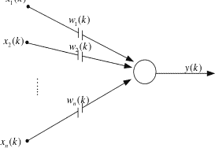

**图 1.1**

单个神经元模型。

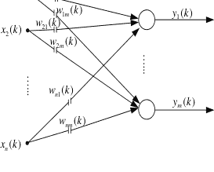

**图 1.2**

多神经元模型。

这些线性网络已被广泛研究[25, 28, 70]，并用于许多领域，包括信号处理[66]、预测[80]、联想记忆[167]、函数逼近[180]、电力系统[15, 153]、化学[196]等。这些神经网络的权重表示神经元之间连接的强度，在不同应用中起着非常重要的作用。各种学习算法用于更新权重，从而使网络通过相应的权重获得不同的应用。例如，自适应线性神经元（ADALINE）网络是实际应用中使用最广泛的神经网络之一，由Widrow和M. Hoff于1960年提出[181]。最小均方（LMS）算法用于更新权重，使ADALINE可以用作自适应滤波器[75]。

在本书中，这些线性网络用于从输入数据中提取主成分、次成分或独立成分。要求这些网络必须逼近一个低维模型。

#### 1.1.2 子空间学习算法

子空间学习算法用于更新这些线性网络的权重，使这些网络旨在逼近一个低维线性模型。通常，原始的随机离散时间（SDT）算法可表述为

$$w(k+1)=w(k)+\eta(k)\,\Delta w(k), \tag{1.4}$$

其中 $\eta(k)$ 是学习率，$\Delta w(k)$ 决定 $k$ 时刻的变化。

本书将主要讨论以下子空间学习算法：PCA学习算法、MCA学习算法和ICA学习算法。

##### 1.1.2.1 PCA学习算法

主成分分析（PCA）是多元分析中的一种传统统计技术，源于Pearson的早期工作[141]。它与Karhunen-Loève（KL）变换或Hotelling变换[82]密切相关。PCA的目的是在尽可能保留数据集中信息的同时，降低给定数据集的维数。

**定义 1.1**  *如果一个向量沿着给定数据集的协方差矩阵最大特征值对应的特征向量方向，则该向量称为第一主成分方向；如果一个向量沿着给定数据集的协方差矩阵第二大特征值对应的特征向量方向，则该向量称为第二主成分方向，依此类推。*

**定义 1.2**  *主成分是将给定数据投影到主成分方向上所获得的方差。*

**定义1.3** *如果一个子空间由前几个主成分方向张成，则称该子空间为主子空间。*

通常，PCA包含两个步骤。首先，必须找到主成分方向。在这些方向上，输入数据具有最大的方差，如图1.3所示。然后，通过将输入数据投影到主方向上来获得主成分。主成分是不相关的且有序的，因此前几个主成分保留了原始数据集中存在的大部分变异。

PCA具有多种不同的应用，并且有多种不同的推导方式 [17, 24, 29, 93, 150]，例如核PCA [42, 99]、概率PCA [170, 171, 207]、局部PCA [116, 179]、广义PCA [173]、L1-PCA [104]、分块PCA [41, 133]、稀疏PCA [208]、拓扑PCA [148] 和贝叶斯PCA [176, 112]。


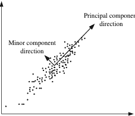

**图1.3**  

二维数据集中主成分方向和次成分方向。

传统上，一些经典方法（如`QR`分解或`SVD`算法）被用于寻找主成分方向。由于协方差矩阵庞大，这些方法在处理大数据集时不实用 [73, 179, 189]。`PCA`学习算法具有一个优势：它们可以在线适应数据，并且无需显式计算协方差矩阵。

`PCA`学习算法用于更新线性神经网络的权重，使权重收敛到张成主子空间的主成分方向。然后，这些网络可以在不预先计算协方差矩阵的情况下提取主成分。`PCA`神经网络具有许多应用，包括与特征提取 [152, 158]、故障检测 [90, 109]、人脸分类 [114, 166]、性别识别 [53]、图像压缩 [51]、文本分类 [113]、预测 [118] 和蛋白质结构分析 [64] 相关的应用。

在文献[134]中，`Oja`使用一个简单的线性单神经网络（图1.1）从输入数据中提取主成分。基于著名的`Hebbian`学习规则，`Oja`提出了一种`PCA`学习算法，使网络的权重收敛到第一个主成分方向。因此，在`Oja`算法下，该网络能够自适应地从输入数据中提取主成分。这些结果在在线数据处理应用中非常有用。

源于`Oja`算法 [134]，人们提出了许多`PCA`算法来更新这些网络的权重 [1, 7, 44, 103, 131, 139, 156, 184]。在`PCA`算法中，`Oja`算法和`Xu`的`LMSER`算法在这些应用中较为常用。其他几种`PCA`算法与这些基本过程相关 [32]。在文献[156]中，`Sanger`提出了`GHA`学习算法，该算法允许多层线性神经网络（图1.2）提取选定数量的主成分。在文献[103]中，`Kung`等人提出了将`APEX`学习算法应用于具有侧向连接的神经网络，以并行提取所有期望的主成分。在文献[44]中，`Cichocki`等人提出了`CRLS`算法，该算法结合了`SAMH`算法 [1] 和`RLS-PCA`算法 [7] 的优点，以顺序提取主成分。还有许多其他扩展，例如参见文献 [31, 37, 81, 91, 135, 175, 179, 203, 204]。

关于`PCA`学习算法的综述可见文献[30]。

### 1.1.2.2 MCA学习算法

次成分由`Xu`在文献[185]中明确引入，它是主成分的对应概念。与`PCA`类似，一些定义如下。

**定义1.4**  *如果一个向量沿着给定数据集的协方差矩阵的最小特征值所对应的特征向量的方向，则称该向量为第一次成分方向；如果一个向量沿着给定数据集的协方差矩阵的第二小特征值所对应的特征向量的方向，则称该向量为第二次成分方向；依此类推。*

**定义1.5**  *如果一个子空间由前几个次成分方向张成，则称该子空间为次子空间。*

图1.3展示了二维数据集中的次成分方向。通过将输入数据投影到次成分方向上获得的次成分通常被视为不重要的成分或噪声。然而，人们发现`MCA`在多个领域有许多应用，例如总体最小二乘（`TLS`）[71, 72]、运动目标指示 [100]、杂波抑制 [9]、计算机视觉 [47]、曲线和曲面拟合 [137, 185]、数字波束形成 [74]、频率估计 [128] 和方位估计 [157]。

`MCA`神经网络可以在不预先计算协方差矩阵的情况下从输入数据集中提取次成分。人们提出了相应的学习算法来更新网络权重，例如`Xu`算法 [185]、`OJA+`算法 [135]、`Luo-Unbehauen-Cichocki`算法 [119]、`Feng-Bao-Jiao`学习算法 [67]、`EXIN`算法 [48]、`Feng`的`OJAm`算法 [68] 和快速`MCA`算法 [12]。

关于`MCA`学习算法的概述可见文献[130]。

### 1.1.2.3 ICA学习算法

独立成分分析（`ICA`）[49] 可以从混合输入信号中估计独立成分。其目标是找到一个子空间，在该子空间中，给定的输入信号可以被分解为相互独立的随机信号组。`ICA`与`PCA`的本质区别在于：`PCA`将一组信号分解为一组不相关的、有序的成分，而`ICA`将一组信号混合物分解为一组独立的、无序的信号 [164]。这意味着`PCA`将具有联合概率密度函数（`PDF`）`p_x(x_1,x_2)` 的输入信号 `x=(x_1,x_2)` 变换为一组新的不相关成分 `y=(y_1,y_2)`，使得

$$E[y_1y_2]=E[y_1]E[y_2].$$

相比之下，`ICA`将具有`PDF` `p_x(x_1,x_2)` 的信号混合物 `x=(x_1,x_2)` 变换为一组新的独立信号 `y=(y_1,y_2)`，使得

$$p_{y_1,y_2}(y_1,y_2)=p_{y_1}(y_1)p_{y_2}(y_2).$$

实际上，`PCA`不仅仅是对输入信号进行变换以使提取的主成分不相关。`PCA`根据方差对提取的主成分进行排序，因此与高方差相关的成分被认为比低方差成分更重要。相比之下，`ICA`本质上对每个提取信号相关的方差不敏感。`ICA`方法的唯一假设是源信号在统计上是独立的且是非高斯的。即使对这些源信号的性质知之甚少，`ICA`也能提取既统计独立又非高斯的成分。

`ICA`分析的数据可以来源于多种应用领域，如语音处理、脑成像、脑电信号、电信和股票市场预测。在许多情况下，这些数据以一组信号混合物的形式给出，术语“盲源分离”被用来描述这个问题。`ICA`的主要应用在于盲源分离 [21, 57, 94, 102, 108]、特征提取 [13, 96, 155] 和盲反卷积 [59, 159, 168]。

`ICA`神经网络能够在随机环境中快速适应，因为输入可以立即用于其算法中 [84]。`ICA`学习算法用于更新`ICA`神经网络的权重，使权重收敛到我们期望的子空间。这些网络已被广泛研究并应用于许多领域；参见文献 [3, 20, 22, 23, 97, 106, 108, 138, 169]。

#### 1.1.3 本书大纲

本章其余部分组织如下。第2节介绍了收敛性分析的方法，第3节给出了`SDT`算法与相应`DDT`算法之间的关系。第4节介绍了一些符号和预备知识。

在第2章中，详细研究了具有恒定学习率的`Oja`算法和`Xu`算法的收敛性。获得了一些不变集，并严格证明了局部收敛性。最重要的贡献是本章建立了确定性离散时间（`DDT`）方法的收敛性分析框架。

在第3章中，为子空间学习算法提供了一种自适应学习率。首先分析了采用自适应学习率的`Oja`算法的全局有界性。然后，获得了全局收敛条件。

在第4章中，通过`DDT`方法研究了广义`Hebbian`算法（`GHA`）的收敛性。`GHA`可以并行提取多个主成分方向。本章使用数学归纳法证明了具有自适应学习率的`GHA`的全局收敛性。

在第5章中，提出了一种稳定的`MCA`算法，并使用`DDT`方法间接解释了所提出算法的动态特性。

在第6章中，讨论了`Hyvärinen-Oja`的`ICA`学习算法。相应的`DDT`算法被扩展到原始`SDT`算法的分块版本。分块算法不仅建立了`SDT`算法与相应`DDT`算法之间的关系，而且在实践中可以获得良好的收敛速度和精度。

在第7章中，介绍了子空间学习算法的混沌行为。将表明一些算法在某些条件下既具有稳定性又具有混沌行为。本章探讨了一类`ICA`算法的混沌行为。推导了算法稳定和混沌的条件。

在第8章中，提出了一种生物上合理的`PCA`模型来自适应地确定主成分方向的数量。通过使用改进的`GHA`，该数量自适应地逼近给定数据集的内在维度。进行了一些仿真以验证理论结果。

在第9章中，提出了一种自适应学习率以保证`Oja`的`MCA`算法的全局收敛性。然后，使用一种基于多分块的`MCA`方法进行非线性曲面拟合。该方法在精度方面表现出良好的性能，仿真结果证实了这一点。

在第10章中，提出了一种`ICA`算法用于提取胎儿心电

心电图（`FECG`）。本章还给出了该算法的理论分析。

最后，第11章介绍了一种刚性医学图像配准方法。该方法仅需对齐特征图像的第一主成分方向和质心即可完成配准。由于使用`PCA`神经网络来计算特征图像的第一主成分方向，因此配准过程简单且高效。

### 1.2 收敛性分析方法

神经网络的学习算法在实际应用中扮演着重要角色。学习算法的收敛性决定了这些应用能否成功。然而，由于这些学习算法是由随机离散时间（`SDT`）算法[202]描述的，直接研究其收敛性非常困难。通常，有两种方法用于分析学习算法的收敛性。传统上，基于一些随机逼近定理[14, 35, 117]，将原始的`SDT`算法转化为相应的确定性连续时间（`DCT`）算法。通过研究相应的`DCT`算法，可以间接解释`SDT`算法的收敛性。这种方法被称为`DCT`方法。另一种方法被称为确定性离散时间（`DDT`）方法。`DDT`方法通过对`SDT`算法两边取条件期望，将`SDT`算法转化为相应的`DDT`算法。`DDT`算法刻画了原始`SDT`算法的平均演化过程。`DDT`算法保留了原始算法的离散时间性质。`DDT`算法的收敛性可以为原始`SDT`算法的动态行为提供一些启示。

#### 1.2.1 DCT方法

传统上，基于一些随机逼近定理[14, 117]，将原始的`SDT`算法转化为相应的确定性连续时间（`DCT`）算法；也就是说，算法(1.4)被转化为如下微分方程(1.5)：

$$\dot{w}(k) = \Delta w(k) \tag{1.5}$$

通过研究相应的`DCT`算法(1.5)，可以间接解释算法(1.4)的收敛性。由于微分方程理论的数学成就，该方法已被广泛使用；例如，参见[4, 36, 135, 136, 154, 162, 172, 192, 199]。


为了将`SDT`算法转化为`DCT`算法，必须施加一些限制性条件。其中一个条件是

\[\eta(k)>0,\quad \sum_k \eta(k)=\infty,\quad \sum_k(\eta(k))^2<\infty.\]

其中`\eta(k)`是`SDT`学习算法`(1.4)`的学习率。该条件意味着学习率`\eta(k)`必须收敛到零。然而，在实际应用中这是不现实的，因为每当步长显著增加时，存在计算舍入限制和跟踪要求。如果必须采用较小但非零的常数学习率[210]。如果学习率趋近于零，可能会显著减慢算法的收敛速度。此外，学习率不能过快趋近于零；否则，算法将在收敛到正确方向之前停止。更多讨论可参见[39, 195, 202, 210]。因此，上述条件在实际应用中是不现实的。

### 1.2.2 DDT方法

为了克服`DCT`方法的缺点，近年来提出了确定性离散时间（`DDT`）方法，用于间接研究`SDT`学习算法的收敛性；参见[39, 124, 195, 210]。`DDT`方法将`SDT`算法`(1.4)`转化为相应的`DDT`算法如下：

\[E\{w(k+1)\}=E\{w(k)\}+E\{\eta(k)\Delta w(k)\}.\tag{1.6}\]

然后，为了保证`DDT`算法的非发散性，必须首先分析算法的有界性。对于全局收敛算法，研究全局有界性。对于局部收敛算法，通过获得不变集来保证局部非收敛性。不变集定义如下。

**定义1.6** 如果对于任意`w(0) ∈ S`，从`w(0)`出发的算法轨迹在所有的`k ≥ 0`下都保持在`S`内，则称紧集`S ⊂ R^n`为算法`w(k+1)=f(w(k),x(k))`的不变集。

不变集之所以引人关注，是因为它提供了一种保证算法非发散性的方法。显然，不变集的子集可能不是不变集。如果一个集合具有不变子集，并不意味该集合也是不变集[195]。

在非发散条件下，利用柯西收敛原理、不等式分析方法等来推导收敛条件并严格证明算法的收敛性。这些结果可以为原始算法提供一些启示。

`DDT`方法不要求学习率收敛到零，因此可以使用常数学习率。`DDT`算法保留了原始算法的离散时间性质，并允许学习率具有更现实的动态行为[210]。与`DCT`方法相比，`DDT`方法是间接研究`SDT`算法收敛性的更合理方法。

`DDT`算法刻画了原始`SDT`算法的平均演化过程。在随机环境中，随机输入对`DDT`方法的结果有很大影响，甚至使`DDT`算法的收敛条件失效[120]。在第6章中，我们提出了一种方法来避免这一问题。首先，通过直接研究原始算法，在随机环境中保证原始算法的非发散性。在此条件下，通过`DDT`方法分析算法的收敛性。

## 1.3 SDT算法与DDT算法之间的关系

`SDT`算法`(1.4)`和相应的`DDT`算法`(1.6)`都保留了离散时间性质。`DDT`算法`(1.6)`也可以表示为

$$\frac{1}{L}\sum_{i=1}^{L}\{w(k+1)\}=\frac{1}{L}\sum_{i=1}^{L}\{w(k)\}\pm\frac{1}{L}\sum_{i=1}^{L}\{\eta(k)\Delta w(k)\},\ L\to\infty.$$

显然，如果`L=1`，这就是`SDT`算法`(1.4)`。因此，令`L`为某个常数，我们得到了一些称为分块算法的算法。分块算法不仅在原始`SDT`算法和相应的`DDT`算法之间建立了联系，如图1.4所示，而且在`SDT`算法和`DDT`算法之间取得了一种折衷。

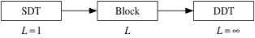

**图1.4**  
`SDT`算法与`DDT`算法之间的关系。

分块大小`L`在分块算法中起着重要作用，可以根据实际应用来确定[129]。对于`SDT`算法及其相应的分块算法和`DDT`算法，很容易得到以下结果。

**推论1.1** *原始`SDT`算法的不变集也是相应的分块算法和`DDT`算法的不变集，反之则不然。*

很容易理解为什么随机输入对`DDT`方法的结果有很大影响。因此，获得原始`SDT`算法的不变集是解决该问题的一个好方法。第6章将详细解释这一问题。

## 1.4 一些符号和预备知识

### 1.4.1 协方差矩阵

对于输入序列`(1.2)`，令`C = E[x(k)x^T(k)]`。已知协方差矩阵`C`是一个对称非负定矩阵。存在由`C`的特征向量组成的`R^n`的标准正交基。设`λ_1, …, λ_n`为`C`的所有特征值，按`λ_1 ≥ … ≥ λ_n ≥ 0`排序。假设`{v_i | i = 1, …, n}`是`R^n`中的一组标准正交基，其中每个`v_i`是与特征值`λ_i`对应的`C`的单位特征向量。

对于每个`k ≥ 0`，`w(k) ∈ R^n`可以表示为

$$w(k)=\sum_{i=1}^{n}z_i(k)v_i,$$  (1.7)

其中`z_i(k)(i = 1, …, n)`是一些常数，于是

$$Cw(k)=\sum_{i=1}^{n}λ_i z_i(k)v_i=\sum_{i=1}^{p}λ_i z_i(k)v_i.$$  (1.8)

### 1.4.2 仿真数据

本书中的仿真将经常使用图1.5（左）中著名的Lenna灰度图像。将512 × 512像素的图像分解为4096个互不相交的块，如图1.5（右）所示。每个块包含8 × 8像素，构成一个64维向量。由此得到一个包含4096个向量的向量集。在去除均值和归一化之后，从该向量集中随机选取的向量构成输入序列

`{x(k)|x(k) ∈ R^{64}, (k = 1, 2, 3, …)}`.  (1.9)

为了满足自适应算法对跟踪能力的要求，我们经常使用`C_k`来替换`(1.4)`中的`x(k)x^T(k)`；`C_k`定义如下[32, 31]：

$$C_k=βC_{k−1}+\frac{1}{k}\left(x(k)x^T(k)−βC_{k−1}\right),\quad (k ≥ 0).$$  (1.10)

其中`β`是遗忘因子，用于确保过去的数据样本被降低权重。由于每个`C_k`都包含输入的一些历史信息

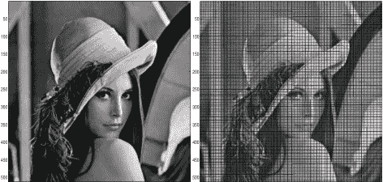

**图 1.5**  
Lenna原始图像（左），以及被划分为4096个分块的图像（右）。

数据，它可以加快收敛速度并减少算法的振荡。通常，如果`{x(k)}`来自平稳过程，我们设`β = 1`。在仿真中，计算信噪比（`SNR`）来衡量图像压缩的质量：

$$\mathrm{SNR}=10\log_{10}\frac{\displaystyle\sum_{i=1}^{\mathrm{row}}\sum_{j=1}^{\mathrm{col}} I_{ij}^{2}}{\displaystyle\sum_{i=1}^{\mathrm{row}}\sum_{j=1}^{\mathrm{col}}(I_{ij}-\hat{I}_{ij})^{2}}. \tag{1.11}$$

其中`I_{ij}, \hat{I}_{ij}`分别表示原始图像或重建图像的像素。

## 1.5 结论

本章首先简要介绍了线性神经网络和神经网络的子空间学习算法。然后，介绍了用于收敛性分析的`DCT`方法和`DDT`方法。可以看出，`DDT`方法是间接研究原始`SDT`算法的一种更合理的方法。同时，给出了`SDT`算法与相应`DDT`算法之间的关系。最后，介绍了一些符号和预备知识。本章为后续章节奠定了基础。

# 2 恒定学习率的PCA学习算法

## 2.1 引言

主成分分析（`PCA`）神经网络是特征提取、数据压缩、模式识别和时间序列预测中的有用工具，尤其是在在线数据处理应用中。`PCA`神经网络的学习算法在其实际应用中发挥着重要作用。从`Oja`算法[134]出发，人们提出了许多`PCA`算法来更新这些网络的权值。在`PCA`算法中，`Oja`算法和`Xu`的`LMSER`算法在实际应用中较为常用。其他几种`PCA`算法都与这两个基本过程相关[32]。在本章中，我们将研究`Oja`算法和`Xu`算法，并为其应用建立理论基础。

学习算法的收敛性决定了这些应用能否成功。本章提出了一个称为`DDT`方法的收敛性分析框架，用于研究恒定学习率下`Oja`算法和`Xu`算法的收敛性。首先将原始`SDT`算法转化为相应的`DDT`算法。然后，利用不变集保证局部非发散条件。最后，在不变集内，通过柯西原理、不等式分析方法等讨论`DDT`算法的局部收敛性质。

本章分为三个部分。第一部分¹通过`DDT`方法分析了恒定学习率下`Oja`算法的收敛性。在2.2.1节中，我们将简要讨论`Oja`的`PCA`学习算法和传统的`DCT`方法。2.2.2节将介绍一些预备知识和`DDT`表述。2.2.3节将研究不变集和收敛性。2.2.4节将给出仿真结果和讨论。最后，2.2.5节将给出结论。

本章第二部分讨论了恒定学习率下`Xu`的`LMSER`算法的收敛性。2.3.1节描述了公式和预备知识。2.3.2节和2.3.3节给出了收敛结果。推导出一个不变集和一个最终界。给出了一个数学证明来证明收敛性。2.3.4节将给出仿真结果和讨论。2.3.5节给出结论。

本章第三部分比较了`Oja`算法与`Xu`的`LMSER`算法的收敛性质。本章在2.5节给出结论。

## 2.2 预备知识


设 \(C=\mathbb{E}[x(k)x^T(k)]\)。假设 \(\lambda_p\) 是最小的非零特征值，即 \(\lambda_p>0\)，但 \(\lambda_j=0\) \((j=p+1,\ldots,n)\)。用 \(\sigma\) 表示 \(C\) 的最大特征值。假设 \(\sigma\) 的重数为 \(m(1\leq m\leq p\leq n)\)，则

$$\sigma=\lambda_1=\cdots=\lambda_m.$$

假设 \(\{v_i\mid i=1,\ldots,n\}\) 是 \(\mathbb{R}^n\) 中的一组标准正交基，使得每个 \(v_i\) 都是 \(C\) 的与特征值 \(\lambda_i\) 相关联的单位特征向量。用 \(V_\sigma\) 表示最大特征值 \(\sigma\) 的特征子空间，即

$$V_\sigma=\operatorname{span}\{v_1,\ldots,v_m\}.$$

用 \(V_\sigma^\perp\) 表示与 \(V_\sigma\) 正交的子空间，显然

$$V_\sigma^\perp=\operatorname{span}\{v_{m+1},\ldots,v_n\}.$$

以下引理将在本章中用到。

**引理 2.1** *以下不等式成立*

$$[1+\eta(\sigma-s)]^2s\leq\frac{4}{27\eta}(1+\eta\sigma)^3$$

*对所有 \(s\in[0,\sigma+1/\eta]\) 成立。*

*证明：* 定义一个可微函数

$$f(s):=[1+\eta(\sigma-s)]^2s$$

其中 \(0\leq s\leq\sigma+1/\eta\)。由此可得

$$\dot{f}(s)=[1+\eta(\sigma-s)]\cdot[1+\eta(\sigma-3s)]$$

其中 \(0\leq s\leq\sigma+1/\eta\)。记

$$\xi=\frac{1}{3}\left(\sigma+\frac{1}{\eta}\right).$$

则

$$

\dot{f}(s)=

\begin{cases}

>0, & \text{if } 0\le s<\xi,\\

=0, & \text{if } s=\xi,\\

<0, & \text{if } \xi<s<\sigma+1/\eta,\\

=0, & \text{if } s=\sigma+1/\eta.

\end{cases}

$$

这表明 \(\xi\) 必为函数 \(f(s)\) 在区间 \([0,\sigma+1/\eta]\) 上的最大值点。于是有

$$

f(s)\le f(\xi)=\frac{4}{27\eta}(1+\eta\sigma)^3,

$$

对所有 \(0\le s\le \sigma+1/\eta\) 成立。证明完毕。

### 2.3 Oja算法

1982年，Oja使用图1.1中的简单线性单神经网络从输入数据中提取第一主成分[134]。基于著名的Hebbian学习规则，Oja提出了一种主成分分析（PCA）学习算法来更新网络的权值。在该算法下，该网络能够自适应地从输入数据中提取主成分。这些结果在在线数据处理应用中非常有用。

文献[210]中，Zufiria提出通过分析相关的DDT算法来研究Oja学习算法的动力学行为。[210]报道了DDT算法的一些局部和全局动力学性质。Zufiria表明，DDT算法的某些轨迹可能是发散的，甚至是混沌的。同时也有一些局部稳定性结果被报道。遵循[210]的DDT算法方法，文献[202]研究了一种广义的Oja PCA学习算法，称为有界PCA算法。

现在要解决的一个重要问题是——[210]中Oja算法对应的DDT算法是否收敛？显然，自[210]的工作以来，DDT算法尚未被证明是全局收敛的。此外，一些轨迹可能发散，甚至变得混沌。因此，探索是否存在不变集以将轨迹保持在集合内，并揭示一些不变集来探讨更大的收敛性问题，是相当有趣的。本节将详细研究这些问题。DDT算法有许多平衡点，因此其收敛性研究属于多稳定性问题。近年来，多稳定性分析受到了广泛关注，例如参见[194]、[191]、[192]、[193]。本节将讨论关于DDT算法收敛性的新颖而深入的结果。这将涉及大量的不变集。从某个不变集出发的DDT算法的任何轨迹都将无限期地停留在该集合内。这很有意义，因为它提供了一种通过从不变集中选择合适的DDT算法初始向量来避免DDT算法发散的方法。此外，现在可以证明DDT算法的收敛性。在下一节中，我们将证明，从不变集出发的DDT算法的几乎所有轨迹都将收敛到与相关矩阵最大特征值相关联的特征向量。因此，这证实了在适当选择初始向量的情况下，可以在Oja的PCA学习算法中使用恒定学习率来保证收敛。

#### 2.3.1 Oja算法与DCT方法

对于网络（1.1）和输入序列（1.2），用于权值更新的基本Oja PCA学习算法描述如下

$$w(k+1)=w(k)+\eta y(k)[x(k)-y(k)w(k)], \qquad (2.1)$$

其中 \(k \ge 0\)，\(\eta(k)>0\) 为学习率。

直接研究（2.1）的收敛性非常困难。为了间接解释（2.1）的收敛性，传统上使用DCT方法。该方法可以简单描述如下：将基本的随机逼近定理[117]应用于（2.1），可以得到一个确定性连续时间系统：

$$\frac{dw(t)}{dt}=Cw(t)-w^T(t)Cw(t)\cdot w(t),\qquad t\ge 0,$$

其中 \(C=\mathbb{E}\,[x(k)x^T(k)]\) 表示以下序列的协方差矩阵

$$\{x(k)\mid x(k)\in\mathbb{R}^n(k=0,1,2,\ldots)\}.$$

然后利用该DCT系统的收敛性来解释（2.1）的收敛性。为了将（2.1）转化为上述DCT系统，需要满足以下限制条件：

-   (C1): \(\sum_{k=0}^{+\infty}\eta^2(k)<+\infty\);
-   (C2): \(\sup_k\mathbb{E}\{[y(k)\,[x(k)-y(k)w(k)]]^2\}<+\infty\).

由条件（C1）显然可知，当 \(k\to+\infty\) 时，\(\eta(k)\to 0\)。然而，在许多实际应用中，由于舍入限制和速度要求，\(\eta(k)\) 通常被设置为一个小的常数[210, 201]。条件（C2）也很难满足[210]。因此，这些条件在实际应用中是不现实的，先前的DCT分析不能直接适用[210], [201]。

#### 2.3.2 DDT表述

为了克服学习率趋于零的问题，文献[210]提出了一种DDT方法。与将（2.1）转化为连续时间确定性系统的DCT方法不同，DDT方法将

##### 定义 2.1

若且仅若

$$

w^*=w^*+\eta\left[Cw^*-(w^*)^TCw^*w^*\right].

$$

成立，则称点 $w^*\in\mathbb{R}^n$ 为 (2.2) 的一个平衡点。

显然，(2.2) 的所有平衡点构成的集合为

$$

\{v_1,\ldots,v_n\}\cup\{-v_1,\ldots,-v_n\}\cup\{0\}.

$$

#### 2.3.3 不变集与收敛结果

(2.2) 的某些轨迹可能发散。考虑一个一维方程的简单例子。

$$

w(k+1)=w(k)+\eta\left[1-w^2(k)\right]w(k),\quad k\geq 0.

$$

若 $w(k)\geq 1+1/\eta$，则有

$$

\eta w^2(k)-w(k)-\eta-1\geq 0.

$$

那么，

$$

|w(k+1)|=w^2(k)\cdot\frac{\eta w^2(k)-\eta-1}{w(k)}\geq w^2(k).

$$

显然，若 $w(0)\geq 1+1/\eta$，则轨迹趋于无穷。关于 Oja 算法发散的其他例子可见文献 [210]。因此，需要解决的问题是找出轨迹有界的条件。即将给出的结果将对应用非常重要。下面，我们将证明一个有趣的定理，它给出了 (2.2) 的一个不变集，从而可以保证轨迹有界。

##### 定理 2.1

记

$$

S=\left\{w\mid w\in\mathbb{R}^n,\ w^T Cw\leq\frac{1}{\eta}\right\}.

$$

若

$$

\eta\sigma\leq\frac{3\sqrt[3]{2}-2}{2}\approx 0.8899,

$$

则 $S$ 是 (2.2) 的一个不变集。

**证明：** 对任意 $k\geq 0$，假设 $w(k)\in S$，即

$$

0\leq w^T(k)Cw(k)\leq\frac{1}{\eta}.

$$

那么，

$$

1+\eta\left(\lambda_i-w^T(k)Cw(k)\right)\geq\eta\lambda_i\geq 0,\quad(i=1,\ldots,n).

$$

由 (2.2)、(1.7)、(1.8) 和 (2.3) 可得

$$

\begin{aligned}


w<sup>T</sup>(k+1)Cw(k+1)

=\sum_{i=1}^{n}\lambda_i z_i^2(k+1)\\

=\sum_{i=1}^{n}\lambda_i\left[1+\eta\left(\lambda_i-w^T(k)Cw(k)\right)\right]^2z_i^2(k)\\

&\leq\sum_{i=1}^{n}\lambda_i\left[1+\eta\left(\sigma-w^T(k)Cw(k)\right)\right]^2z_i^2(k)\\

=\left[1+\eta\left(\sigma-w^T(k)Cw(k)\right)\right]^2w^T(k)Cw(k)\\

&\leq\max_{0\leq s\leq 1/\eta}\left\{\left[1+\eta(\sigma-s)\right]^2\cdot s\right\}\\

&\leq\max_{0\leq s\leq\sigma+1/\eta}\left\{\left[1+\eta(\sigma-s)\right]^2\cdot s\right\}.

\end{aligned}

\&=\frac{4}{27\eta}(1+\eta\sigma)^3.

\利用引理 2.1，

\&=\frac{4}{27\eta}(1+\eta\sigma)^3.

由

\&=\frac{4}{27\eta}(1+\eta\sigma)^3.

\eta\sigma\leq\frac{3\sqrt[3]{2}-2}{2},

\&=\frac{4}{27\eta}(1+\eta\sigma)^3\leq\frac{1}{\eta}.

\因此，

\&=\frac{1}{\eta}.

这表明 $w(k+1)\in S$，即 $S$ 是一个不变集。证明完成。接下来，我们将给出一个更深刻的结果，它将给出一族不变集。

##### 定理 2.2

给定任意常数 $l$ 满足 $1\leq l\leq 2$，若

\&=\frac{4}{27\eta}(1+\eta\sigma)^3\leq\frac{1}{\eta}.

由

\&=\frac{4}{27\eta}(1+\eta\sigma)^3\leq\frac{1}{\eta}.

\eta\sigma\leq\frac{3\sqrt[3]{2l}-2}{2},

\&=\frac{4}{27\eta}(1+\eta\sigma)^3\leq\frac{l}{\eta}.

可得

\&=\frac{4}{27\eta}(1+\eta\sigma)^3\leq\frac{l}{\eta}.

因此，

\&=\frac{l}{\eta}.

w^T(k+1)Cw(k+1)\leq\frac{1}{\eta}.

这表明 $w(k+1)\in S$，即 $S$ 是一个不变集。证明完成。

由上述分析可以得到一些不变集。因此，通过从不变集中选取初始向量，可以保证轨迹不发散。接下来，我们将进一步建立收敛结果。

由 (1.7)，对每个 $k\geq 0$，$w(k)$ 可以表示为

\&=\sum_{i=1}^{m}z_i(k)v_i+\sum_{j=m+1}^{n}z_j(k)v_j,

其中对每个 $k$，$z_i(k)(i=1,\ldots,n)$ 为某些常数。特别地，

\&=\sum_{i=1}^{m}z_i(0)v_i+\sum_{j=m+1}^{n}z_j(0)v_j.

显然，$w(k)$ 的收敛性可以由 $z_i(k)(i=1,\ldots,m)$ 的收敛性决定。接下来，我们将分别通过研究 $z_i(k)(i=1,\ldots,m)$ 和 $z_i(k)(i=m+1,\ldots,n)$ 的收敛性来分析 $w(k)$ 的收敛性。

##### 引理 2.2

假设

\&=\frac{3\sqrt[3]{2}-2}{2}\approx 0.8899,

若 $w(0)\in S$ 且 $w(0)\notin V_{\sigma}^{\perp}$，则存在常数 $\theta_1>0$ 和 $\Pi_1\ge 0$，使得

\&=\Pi_1\cdot e^{-\theta_1 k},

对所有 $k\ge 0$ 成立，其中

\&=\left[\ln\left(\frac{1+\eta\sigma}{1+\eta\lambda_{m+1}}\right)\right]^2>0.

**证明：** 由于 $w(0)\notin V_{\sigma}^{\perp}$，必存在某个 $i\ (1\le i\le m)$，使得 $z_i(0)\ne 0$。不失一般性，假设 $z_1(0)\ne 0$。由 (2.3) 可得

\&=\left[1+\eta\left(\sigma-w^T(k)Cw(k)\right)\right]z_i(k),\quad 1\le i\le m, \tag{2.4},

且

\&=\left[1+\eta\left(\lambda_j-w^T(k)Cw(k)\right)\right]z_j(k),\quad m+1\le j\le n, \tag{2.5},

对所有 $k\ge 0$ 成立。

由引理 2.1，$S$ 是一个不变集，因此对所有 $k\ge 0$，$w(k)\in S$。对任意 $i\ (1\le i\le n)$，有

\&=\eta\lambda_i+\left(1-\eta w^T(k)Cw(k)\right)\ge \eta\lambda_i>0,

对所有 $k\ge 1$ 成立。那么，由 (2.4) 和 (2.5)，对每个 $j\ (m+1\le j\le n)$，可得

\&=\left[\frac{1+\eta\left(\lambda_j-w^T(k)Cw(k)\right)}{1+\eta\left(\sigma-w^T(k)Cw(k)\right)}\right]^2\left[\frac{z_j(k)}{z_1(k)}\right]^2


\&\le \left[1-\frac{\eta(\sigma-\lambda_j)}{1+\eta\left(\sigma-w^T(k)Cw(k)\right)}\right]^2\left[\frac{z_j(k)}{z_1(k)}\right]^2\\

\&\le \left(\frac{1+\eta\lambda_j}{1+\eta\sigma}\right)^2\left[\frac{z_j(k)}{z_1(k)}\right]^2\\

\&\le \left(\frac{1+\eta\lambda_{m+1}}{1+\eta\sigma}\right)^2\left[\frac{z_j(k)}{z_1(k)}\right]^2\\

&=\left[\frac{z_j(0)}{z_1(0)}\right]^2\cdot e^{-\theta_1(k+1)},

\end{aligned}

$$

对所有 $k\ge 1$ 成立。

由 $S$ 的不变性，$z_1^2(k)$ 必有界；即存在常数 $d>0$，使得对所有 $k\ge 0$，$z_1^2(k)\le d$。那么，

\sum_{j=m+1}^{n}z_j^2(k)=\sum_{j=m+1}^{n}\left[\frac{z_j(k)}{z_1(k)}\right]^2z_1^2(k)\le \Pi_1e^{-\theta_1k},

对所有 $k\ge 0$ 成立，其中

\Pi_1=d\sum_{j=m+1}^{n}\left[\frac{z_j(0)}{z_1(0)}\right]^2>0.

证明完成。

##### 引理 2.3

假设

\eta\sigma\le\frac{3\sqrt[3]{2}-2}{2}\approx 0.8899.

*若* $w(0)\in S$ 且 $w(0)\ne 0$，则

\eta w^T(k+1)Cw(k+1)\ge\min\left\{(\eta\lambda_p)^3,\,w^T(0)Cw(0)\right\}

对所有 $k\ge 0$ 成立。

**证明：** 由于 $w(0)\in S$，根据定理 2.1，对所有 $k\ge 0$，$w(k)\in S$，即 $w^T(k)Cw(k)\le 1/\eta$，则

1+\eta\left(\lambda_i-w^T(k)Cw(k)\right)\ge \eta\lambda_i\ge \eta\lambda_p>0,\qquad (i=1,\ldots,p),

对所有 $k\ge 0$ 成立。

若 $\lambda_p\le w^T(k)Cw(k)\le 1/\eta$，则由 (1.8) 和 (2.3) 可得

\begin{aligned}

\eta w^T(k+1)Cw(k+1)

&=\eta\sum_{i=1}^{n}\lambda_i z_i^2(k+1)\\

&=\eta\sum_{i=1}^{p}\lambda_i z_i^2(k+1)\\

&=\eta\sum_{i=1}^{p}\left[1+\eta\left(\lambda_i-w^T(k)Cw(k)\right)\right]^2\lambda_i z_i^2(k)\\

&\ge\left[\eta\lambda_p+\left(1-\eta w^T(k)Cw(k)\right)\right]^2\eta w^T(k)Cw(k)\\

&\ge(\eta\lambda_p)^2\eta w^T(k)Cw(k)\\

&\ge(\eta\lambda_p)^3 \tag{2.6}

\end{aligned}

对所有 $k\ge 0$ 成立。

##### 引理 2.4

假设

\eta\sigma\leq\frac{3\sqrt{2}-2}{2}\approx 0.8899,

且 $w(0)\in S$, $w(0)\notin V_\sigma$。则存在常数 $\theta_2>0$ 和 $\Pi_2>0$，使得

\left|\sigma-w^T(k+1)Cw(k+1)\right|

\leq k\cdot\Pi_2\cdot\left[e^{-\theta_2(k+1)}+\max\left\{e^{-\theta_2k},e^{-\theta_1k}\right\}\right]

对所有 $k\geq 0$ 成立，其中

\left\{\begin{aligned}

\theta_2&=-\ln\delta,\\

\delta&=\max\left\{(1-\gamma)^2,\eta\sigma\right\},\\

\gamma&=\min\left\{(\eta\lambda_p)^3,\eta w^T(0)Cw(0)\right\},

\end{aligned}\right.

且 $0<\delta<1$, $0<\gamma<1$。

**证明：** 显然，

w^T(k+1)Cw(k+1)

&=\sum_{i=1}^{n}\lambda_i\left[1+\eta\left(\lambda_i-w^T(k)Cw(k)\right)\right]^2z_i^2(k)\\

&=\sum_{i=1}^{n}\lambda_i\left[1+\eta\left(\sigma-w^T(k)Cw(k)\right)\right]^2z_i^2(k)\\

&\quad+\sum_{i=m+1}^{n}\lambda_i\left[1+\eta\left(\lambda_i-w^T(k)Cw(k)\right)\right]^2z_i^2(k)\\

&\quad-\sum_{i=m+1}^{n}\lambda_i\left[1+\eta\left(\sigma-w^T(k)Cw(k)\right)\right]^2z_i^2(k)\\

&=\left[1+\eta\left(\sigma-w^T(k)Cw(k)\right)\right]^2w^T(k)Cw(k)+H(k),

\end{aligned}

对于 $k\ge 0$，其中

H(k)=\eta\sum_{i=m+1}^{n}\lambda_i(\lambda_i-\sigma)\times\left[2+\eta\left(\lambda_i+\sigma-2w^T(k)Cw(k)\right)\right]z_i^2(k).

于是，

\sigma-w^T(k+1)Cw(k+1)

&=\left[\sigma-w^T(k)Cw(k)\right]\\

&\quad\times\left[\left(1-\eta w^T(k)Cw(k)\right)^2-\eta^2\sigma w^T(k)Cw(k)\right]\\

&\quad-H(k),

\end{aligned}

对于 $k\ge 0$。记

V(k)=\left|\sigma-w^T(k)Cw(k)\right|,

对于 $k\ge 0$。由 $S$ 的不变性，对 $k\ge 0$ 有 $w(k)\in S$。由此可得

V(k+1)

&\le V(k)\cdot\left|\left(1-\eta w^T(k)Cw(k)\right)^2-\eta^2\sigma w^T(k)Cw(k)\right|+|H(k)|\\

&\le \max\left\{\left(1-\eta w^T(k)Cw(k)\right)^2,\eta^2\sigma w^T(k)Cw(k)\right\}\cdot V(k)+|H(k)|\\

&\le \max\left\{\left(1-\eta w^T(k)Cw(k)\right)^2,\eta\sigma\right\}\cdot V(k)+|H(k)|.

记

\gamma=\min\left\{(\eta\lambda_p)^3,\eta w^T(0)Cw(0)\right\}.

显然，$0<\gamma<1$。由引理 2.3 可知

\gamma \leq \eta\,w^T(k)Cw(k) \leq 1.

记

\delta=\max\left\{(1-\gamma)^2,\,\eta\sigma\right\}.

显然，$0<\delta<1$。则

V(k+1)\leq\delta\cdot V(k)+|H(k)|,\ k\geq 0.

由引理 2.2，

|H(k)|

&\leq \eta\sum_{j=m+1}^{n}\lambda_j(\sigma-\lambda_j)\left[\eta(\sigma+\lambda_j)+2\right]z_j^2(k)\\

&\leq \eta\sum_{j=m+1}^{n}\left[\eta\lambda_j(\sigma^2-\lambda_j^2)+2\lambda_j(\sigma-\lambda_j)\right]z_j^2(k)\\

\&=\left[\frac{z_j(0)}{z_1(0)}\right]^2\cdot e^{-\theta_1(k+1)},

\end{aligned}

对所有 $k\ge 0$ 成立。


&\leq \eta\sum_{j=m+1}^{n}\left(\eta\lambda_j\sigma^2+2\lambda_j\sigma\right)z_j^2(k)\\

&\leq \sigma(\eta\sigma+2)\sum_{j=m+1}^{n}z_j^2(k)\\

&\leq 3\sigma\cdot\sum_{j=m+1}^{n}z_j^2(k)\\

&\leq 3\sigma\Pi_1\cdot e^{-\theta_1 k}.

\end{aligned}$$

对所有 $k\geq 0$ 成立。则

$$\begin{aligned}

V(k+1)

&\leq \delta^{k+1}V(0)+3\sigma\Pi_1\cdot\sum_{r=0}^{k}\delta^{k-r}e^{-\theta_1 r}\\

&\leq \delta^{k+1}V(0)+3k\sigma\Pi_1\max\{\delta^k,e^{-\theta_1 k}\}\\

&\leq k\cdot\Pi_2\cdot\left[e^{-\theta_2(k+1)}+\max\{e^{-\theta_2 k},e^{-\theta_1 k}\}\right],

\end{aligned}$$

其中 $\theta_2=-\ln\delta>0$ 且

$$\Pi_2=\max\left\{\left|\sigma-w^T(0)Cw(0)\right|,\,3\sigma\Pi_1\right\}>0.$$

证明完毕。

### 引理 2.5

假设存在常数 $\theta>0$ 和 $\Pi>0$，使得

$$\eta\left|\left(\sigma-w^T(k)Cw(k)\right)z_i(k)\right|\leq k\cdot\Pi e^{-\theta k},\quad (i=1,\ldots,m)$$

对于 $k \ge 0$ 成立。则

$$\lim_{k\to+\infty} z_i(k)=z_i^*,\quad (i=1,\ldots,m),$$

其中 $z_i^* (i=1,\ldots,m)$ 为常数。

**证明：** 对任意 $\epsilon>0$，存在 $K\ge 1$，使得

$$\frac{\Pi K e^{-\theta K}}{(1-e^{-\theta})^2}\le \epsilon.$$

对任意 $k_1>k_2\ge K$，有

$$\begin{aligned}

|z_i(k_1)-z_i(k_2)|

&=\left|\sum_{r=k_2}^{k_1-1}[z_i(r+1)-z_i(r)]\right|\\

&\le \eta\sum_{r=k_2}^{k_1-1}|(\sigma-w^T(r)Cw(r))z_i(r)|\\

&\le \Pi\sum_{r=k_2}^{k_1-1}e^{-\theta r}\\

&\le \Pi\sum_{r=K}^{+\infty}e^{-\theta r}\\

&\le \Pi K e^{-\theta K}\sum_{r=0}^{+\infty}(e^{-\theta})^{r-1}\\

&=\frac{\Pi K e^{-\theta K}}{(1-e^{-\theta})^2}\\

&\le \epsilon,\quad (i=1,\ldots,m).

\end{aligned}$$

这表明每个序列 $\{z_i(k)\}$ 都是**柯西序列**。根据*柯西收敛原理*，必存在常数 $z_i^*$ $(i=1,\ldots,m)$，使得

$$\lim_{k\to+\infty}z_i(k)=z_i^*,\quad (i=1,\ldots,m).$$

证明完毕。

### 定理 2.3

假设

$$\eta\sigma\le\frac{3\sqrt{3}-2}{2}\approx0.8899,$$

若 `w(0)` 在 `S` 且 `w(0)` 不在 `V_sigma^\perp`，则 `(2.2)` 从 `w(0)` 出发的轨迹将收敛到与协方差矩阵 `C` 的最大特征值相关联的唯一特征向量。

**证明：** 由引理 2.2，存在常数 $\theta_1>0$ 和 $\Pi_1\geq 0$，使得

$$\sum_{j=m+1}^{n} z_j^2(k)\leq \Pi_1e^{-\theta_1k},$$

对所有 $k\geq 0$ 成立。由引理 2.4，存在常数 $\theta_2>0$ 和 $\Pi_2>0$，使得

$$\left|\sigma-w^T(k+1)Cw(k+1)\right|\leq k\cdot\Pi_2\cdot\left[e^{-\theta_2(k+1)}+\max\left\{e^{-\theta_2k},e^{-\theta_1k}\right\}\right]$$

对所有 $k\geq 0$ 成立。

显然，存在常数 $\theta>0$ 和 $\Pi>0$，使得

$$\eta\left|(\sigma-w^T(k)Cw(k))\,z_i(k)\right|\leq k\cdot\Pi e^{-\theta k},\quad (i=1,\ldots,m)$$

对于 $k\geq 0$ 成立。

利用引理 2.5 和引理 2.2，可得

$$\left\{\begin{aligned}\lim_{k\to+\infty}z_i(k)&=z_i^*,\quad(i=1,\ldots,m),\\\lim_{k\to+\infty}z_i(k)&=0,\quad(i=m+1,\ldots,n).\end{aligned}\right.$$

则

$$\lim_{k\to+\infty}w(k)=\sum_{i=1}^{m}z_i^*v_i\in V_\sigma.$$

容易看出

$$\sum_{i=1}^{m}(z_i^*)^2=1.$$

证明完毕。

在上述定理中，要求初始值 `w(0)` 不在 `V_sigma^\perp`，从而至少存在一个 `z_i(0)\neq 0\ (1\leq i\leq m)`。由于 `V_sigma^\perp` 的维数小于 `R^n` 的维数，`V_sigma^\perp` 的测度为零，因此条件 `w(0)\notin V_sigma^\perp` 在实际应用中很容易满足。事实上，任何微小的扰动都会导致 `w(0)\notin V_sigma^\perp`。从这个角度来看，我们可以推断，几乎所有从 `S` 出发的轨迹都将收敛到与协方差矩阵 `C` 的最大特征值对应的单位特征向量。此外，值得指出的是，`w(0)\notin V_sigma^\perp` 蕴含 `w(0)\neq 0`。

#### 2.3.4 仿真与讨论

##### 2.3.4.1 不变集的图示

定理 2.1 给出了一个不变集 `S`，而定理 2.2 给出了一族不变集 `S(l)\ (1\leq l\leq 2)`。显然，`S\subset S(l)`。我们首先说明 `S(2)`（定理 2.2 中最大的不变集）的不变性。考虑 `(2.2)` 的一个简单二维例子，其中

$$C=\begin{bmatrix}1 & 0\\0 & 0.2\end{bmatrix}.$$

容易看出

$$S(2)=\left\{\begin{bmatrix}w_1\\w_2\end{bmatrix}\ \middle|\ w_1^2+0.2w_2^2\le 1.6481\right\}.$$

在图 2.1 中，椭圆所包含的部分即为 `S(2)`。图 2.1 显示，当 `\eta=1.3811` 时，从 `S(2)` 中的点出发的 `(2.2)` 的 80 条轨迹经过 5000 次迭代后仍全部包含在 `S(2)` 中。这清楚地表明了 `S(2)` 的不变性。

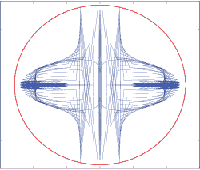

**图 2.1**  
`S(2)` 的不变性。从 `S(2)` 中的点出发的 80 条轨迹仍保持在 `S(2)` 中。

虽然集合 `S(2)` 是不变的，但这并不意味着 `S(2)` 中的每条轨迹都收敛。事实上，`S(2)` 中包含的某些轨迹可能不收敛。图 2.2 显示了从 `w(0)=[0.2,2.5]^T` 出发、`\eta=1.3811` 时的这样一条不收敛轨迹。

##### 2.3.4.2 初始向量的选取

定理 2.3 表明，从 `S-\{0\}` 出发的轨迹将收敛到与最大特征值对应的单位特征向量。因此，从 `S` 中选择初始向量对收敛至关重要。然而，这种选择需要矩阵 `C` 的信息。一般来说，这并不实际。接下来，我们提出一个更实际的初始向量选取区域。

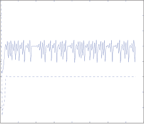

**图2.2** `S(2)` 中的非收敛轨迹。

在 `R^n` 中，用下式定义单位超球 `U`：

$$U = \{w \mid w^T w \leq 1\}.$$

对于任意 `w \in U`，有

$$w^T Cw \leq \sigma w^T w \leq \sigma \leq \frac{1}{\eta},$$


即 $w \in S$。因此，$U \subset S$。这表明可以选择 $U-\{0\}$ 中的初始向量 $w$。从应用的角度来看，从 $U-\{0\}$ 中选择初始向量是很容易的。例如，我们可以简单地通过下式在 $U$ 中生成初始向量：

$$w(0) = \frac{1}{\sqrt{n}} \cdot random(n).$$

### 2.3.4.3 学习率的选择

根据上一节的分析，为保证收敛，学习率应满足 $0 < \eta \leq 0.8899$。如果选择 $\eta$ 接近0，由引理2.2可知，可能会减慢 $z_i(k)$ $(i=m+1,\ldots,n)$ 的收敛。如果选择 $\eta$ 接近0.8899，由引理2.4可知，可能会减慢 $z_i(k)$ $(i=1,\ldots,m)$ 的收敛。为了平衡两者并适当设置 $\eta$ 以实现快速收敛，最好满足

$$\theta_1 \approx \theta_2.$$

在某些温和条件下，有

$$\theta_1 = \ln\left(\frac{1+\eta\sigma}{1+\eta\sigma_{m+1}}\right) \approx \ln(1+\eta\sigma),\quad \theta_2 \approx \ln\left(\frac{1}{\eta\sigma}\right).$$

求解

$$\ln(1+\eta\sigma) \approx \ln\left(\frac{1}{\eta\sigma}\right),$$

可得

$$\eta\sigma \approx 0.618.$$

这表明，将 $\eta\sigma$ 设置在0.618附近可以实现快速收敛。接下来的仿真将支持这一结论。

我们随机生成了一个 $5 \times 5$ 的对称非负定矩阵：

$$C=\begin{bmatrix}

0.1947 & 0.3349 & 0.2783 & 0.1494 & 0.0364 \\

0.3349 & 0.8052 & 0.5105 & 0.1716 & 0.0361 \\

0.2783 & 0.5105 & 0.4149 & 0.1916 & 0.0348 \\

0.1494 & 0.1716 & 0.1916 & 0.1608 & 0.0518 \\

0.0364 & 0.0361 & 0.0348 & 0.0518 & 0.0262

\end{bmatrix}.$$

在 $U-\{0\}$ 中随机选取初始向量如下：

$$w(0)=\begin{bmatrix}0.0706,\ 0.2185,\ 0.0776,\ 0.3105,\ 0.4214\end{bmatrix}^{T}.$$

图2.3显示了(2.2)从 $w(0)$ 出发收敛到特征向量

$$w^{*}=\begin{bmatrix}0.3574,\ 0.7322,\ 0.5299,\ 0.2296,\ 0.0510\end{bmatrix}^{T}$$

的轨迹；在精度 $\epsilon=0.00001$、$\eta\sigma=0.62$ 下，经过17次迭代收敛。显然，$w^{*}$ 是与 $C$ 的最大特征值对应的单位特征向量。

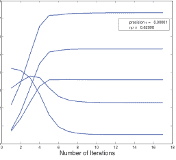

**图2.3** (2.2)的收敛。

为了进一步说明将 $\eta\sigma$ 设置在0.618附近时，DDT算法(2.2)确实能够快速收敛，我们分别随机生成了三个维数为 $5 \times 5$、$50 \times 50$ 和 $500 \times 500$ 的对称非负定矩阵。图2.4显示了当 $\eta\sigma$ 从0.2变化到0.8890时，(2.2)的迭代步数变化情况。它清楚地表明

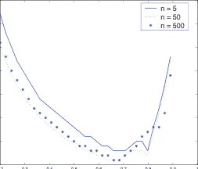

**图2.4** 迭代步数随 $\eta\sigma$ 的变化。

当 $\eta\sigma$ 的值选在0.6到0.7之间时，算法(2.2)收敛很快。图2.4中的仿真还表明，(2.2)的收敛性对其维数似乎不敏感，因为三条曲线非常接近。除了上述仿真结果之外，我们还进一步对(2.2)在高维情况下的收敛性进行了广泛仿真。随后的仿真结果持续显示出类似令人满意的结果。

上述仿真进一步证实了我们的重要结论：只要初始权值向量选自不变集，学习率就可以取某个常数来保证收敛。此外，上述仿真还表明，将 $\eta\sigma$ 设为0.618附近可以加快(2.2)的收敛。要计算 $\eta$，需要估计 $\sigma$，即 $C$ 的最大特征值。在某些应用中，基于具体问题的知识，通常可以在不计算协方差矩阵 $C$ 的情况下估计出 $\sigma$ 的一个上界[20]。然而，在某些实际应用中，尤其是在线计算中，估计 $\sigma$ 是困难的。能否找到另一种估计 $\eta$ 的方法？接下来，我们给出一种估计 $\eta$ 的方法。为了更清楚地说明，我们使用算法(2.1)的如下在线计算版本[31]：

$$w(k+1)=w(k)+\eta(k)\left(C_k w(k)-w^T(k)C_k w(k)w(k)\right) \tag{2.8}$$

其中 $C_k$ 是 $C$ 的在线观测值[31]，且 $\lim_{k\to +\infty} C_k=C$。注意到每当 $w(k)$ 收敛到与 $C$ 的最大特征值对应的单位特征向量时，有

$$\lim_{k\to +\infty} w^T(k)C_k w(k)\to \sigma$$

因此，我们可以简单地取 $\sigma \approx w^T(k)Cw(k)$，然后取

$$\eta(k)=\frac{0.618}{w^T(k)Cw(k)} \tag{2.9}$$

作为(2.8)的在线学习率。当学习步数 $k$ 足够大时，可以将 $\eta(k)$ 截断为一个常数，并在此后将其作为常数学习率。由于(2.9)中 $\eta(k)\rightarrow 0.618/\sigma \neq 0$，预计收敛速度会很快。

最后，使用图1.5中著名的Lenna图像进行说明。将每个在线观测值 $C_k$ (1.10) 作为算法(2.8)的输入。

为了衡量算法(2.8)的收敛性和精度，我们按照[31]计算第 $k$ 次更新时 $w(k)$ 的范数和方向余弦：

$$\text{方向余弦}(k)=\frac{|w^T(k)\cdot \phi|}{\|w(k)\|\cdot\|\phi\|}$$

其中 $\phi$ 是由MATLAB 7.0根据所有采集样本计算得到的、与协方差矩阵 $C$ 的最大特征值对应的真实特征向量。如果 $\|w(k)\|$ 和 $\text{方向余弦}(k)$ 都收敛到1，则算法给出了正确结果。事实上，这清楚地表明 $w(k)$ 收敛到与协方差矩阵 $C$ 的最大特征值对应的单位特征向量。图2.5显示了方向余弦和 $\|w(k)\|$ 的收敛情况。在图2.5中，学习率 $\eta(k)$ 达到0.2527。由于 $\eta(k)$ 收敛到一个正的

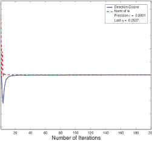

**图2.5** 方向余弦和 $w$ 的范数的收敛。

常数，因此收敛速度相当快。

### 2.3.5 结论

本节推导了关于Oja PCA学习算法的DDT算法收敛性的重要结果。该结果说明，如果学习率满足某个简单条件，则几乎所有从不变集出发的轨迹都会收敛到与协方差矩阵最大特征值对应的单位特征向量。我们建议使用单位超球来方便地选择初始向量以保证收敛，并通过对学习率的选择来实现快速收敛。我们进行了仿真研究，以进一步说明该理论。最重要的结果是，它证实了Oja PCA学习算法使用常数学习率可以实现收敛。

## 2.4 Xu的LMSER学习算法

在文献[184]中，Xu基于最小均方误差重构提出了一种执行真正PCA的学习算法。本节将使用DDT方法，讨论在单神经元情形下、采用常数学习率的Xu LMSER算法的收敛性。我们确定了一个不变集和一个演化最终界，并给出收敛性的数学证明。

### 2.4.1 问题描述与预备知识

假设输入序列(1.2)是一个零均值平稳随机过程，记输入数据集的协方差矩阵为 $C = E[x(k)x^T(k)]$，并令 $C_k$ 是 $C$ 的在线观测值，则Xu的学习算法可用如下随机差分方程描述：

$$\begin{aligned}

w_l(k+1) ={}& w_l(k)+\eta(k)[2C_kw_l(k)\\

&-\sum_{i=1}^{l-1} C_kw_i(k)w_i^T(k)w_l(k)-C_kw_l(k)w_l^T(k)w_l(k)\\

&-\sum_{i=1}^{l-1} w_i(k)w_i^T(k)C_kw_l(k)-\big(w_l^T(k)C_kw_l(k)\big)w_l(k)], \tag{2.10}

\end{aligned}$$

其中 $\eta(k)>0$，$w_l$ 是第 $l$ 个神经元的输入权值向量。显然，当 $l=1$ 时，算法如下：


$$w(k+1)=w(k)+\eta(k)[2C_kw(k)-C_kw(k)w^T(k)w(k)-\big(w^T(k)C_kw(k)\big)w(k)], \tag{2.11}$$

对于 \(\eta(k) > 0\)。算法(2.11)在权向量范数趋近1时逼近Oja的单神经元规则[184]。然而，它表现出一些不同的动态行为。在本章中，通过研究一个相关的DDT算法，我们将讨论(2.11)的收敛性，它是Xu的LMSER算法的单神经元版本的一个特例。通过取条件期望 \(E\{w(k+1) \mid w(0), w(i), i<k\}\)，常数学习率下(2.11)的DDT算法给出如下：

$$w(k+1)=w(k)+\eta\left[2Cw(k)-Cw(k)w^{T}(k)w(k)-\left(w^{T}(k)Cw(k)\right)w(k)\right]. \tag{2.12}$$

其中 \(\eta > 0\)，\(C = E[x(k)x^{T}(k)]\) 为协方差矩阵。

由(1.7)、(1.8)、(2.12)可得

$$z_i(k+1)=\left[1+\eta\left(\lambda_i(2-\|w(k)\|^2)-w^{T}(k)Cw(k)\right)\right]z_i(k), \tag{2.13}$$

对 \(k \ge 0\) 成立，其中 \(i = 1, \ldots, n\)。

**定义2.2** 点 \(w^* \in \mathbb{R}^n\) 称为(2.12)的一个平衡点，当且仅当

$$w^*=w^*+\eta\left[2Cw^*-Cw^*(w^*)^Tw^*-\left((w^*)^TCw^*\right)w^*\right].$$

显然，(2.12)的所有平衡点集合为

$$\{\text{所有单位长度的特征向量}\}\cup\{0\}.$$

**定义2.3** 若对于任意 \(w(0) \in S\)，存在常数 \(N\)，使得对所有 \(k \ge N\) 有 \(\|w(k)\|^2 < M\)，则称界 \(M\) 为(2.12)的一个最终界。

为便于分析，给出如下引理。

**引理2.6** 对所有 \(s \in [0, 2 + 1/\eta\sigma]\)，有

$$\left[1+\eta\left(\sigma(2-s)\right)\right]^2s\leq\frac{4}{27\eta\sigma}\cdot(1+2\eta\sigma)^3$$

成立。

利用引理2.1易证此引理。

### 2.4.2 不变集与最终界

系统(2.12)不是全局收敛的。考虑与第3节相同的例子，即一维情形，

$$w(k+1)=w(k)+\eta\left[2-2w^2(k)\right]w(k),\quad \text{对 } k\geq 0 \text{ 成立.$$

若 \(w(k)\ge 1+1/(2\eta)\)，则有

$$2\eta w^2(k)-w(k)-2\eta-1\ge 0.$$

于是

$$|w(k+1)|=w^2(k)-\frac{2\eta w^2(k)-2\eta-1}{w(k)}\ge w^2(k).$$

如果 \(w(k)\ge 1+1/(2\eta)\)，则 \(w(k)\) 显然将趋于无穷。因此，一个需要解决的重要问题是，是否能够获得一个不变集来保证不发散。这是确保应用成功所必须解决的关键问题。

**引理2.7** 假设 \(\eta\sigma\le 0.25\) 且 \(0<\|w(k)\|^2\le 1+\frac{1}{2\sigma\eta}\)，则对所有 \(k\ge 0\)，有

$$1+\eta\bigl(\lambda_i(2-\|w(k)\|^2)-w^{T}(k)Cw(k)\bigr)>0,\qquad (i=1,\ldots,n)$$

*证明：* 给定任意 \(i\ (1\le i\le n)\)，若 \(2\le\|w(k)\|^2<1+1/(2\eta\sigma)\)，则对所有 \(k\ge 0\)，有

$$1+\eta\bigl(\lambda_i(2-\|w(k)\|^2)-w^{T}(k)Cw(k)\bigr)\ge 1+\eta\bigl(\sigma(2-\|w(k)\|^2)-\sigma\|w(k)\|^2\bigr)>0,$$

若 \(\|w(k)\|^2<2\)，则对所有 \(k\ge 0\)，有

$$1+\eta\bigl(\lambda_i(2-\|w(k)\|^2)-w^{T}(k)Cw(k)\bigr)\ge 1-\eta w^{T}(k)Cw(k)\ge 1-2\eta\sigma>0,$$

证毕。

**定理2.4** 记

$$S=\left\{w(k)\mid w(k)\in\mathbb{R}^n,\ \|w(k)\|^2\le 1+\frac{1}{2\sigma\eta}\right\}.$$

若 \(\eta\sigma\le 0.25\)，则 \(S\) 是(2.12)的一个不变集。

*证明：* 由引理2.7，若 \(2\le\|w(k)\|^2\le 1+\frac{1}{2\sigma\eta}\)，则对 \(k\ge 0\)，有

$$0<1+\eta\bigl(\lambda_i(2-\|w(k)\|^2)-w^{T}(k)Cw(k)\bigr)<1,\qquad (i=1,\ldots,n)$$

由(1.7)、(2.13)可得

$$\begin{aligned}

\|w(k+1)\|^2

&=\sum_{i=1}^{n}\left[1+\eta\bigl(\lambda_i(2-\|w(k)\|^2)-w^{T}(k)Cw(k)\bigr)\right]^2z_i^2(k)\\

&\le \left[1+\eta\bigl(\lambda_p(2-\|w(k)\|^2)-w^{T}(k)Cw(k)\bigr)\right]^2\|w(k)\|^2\\

&\le 1+\frac{1}{2\sigma\eta}.

\end{aligned}$$

若 \(\|w(k)\|^2<2\)，则

$$\begin{aligned}

\|w(k+1)\|^2

&=\sum_{i=1}^{n}\left[1+\eta\left(\lambda_i(2-\|w(k)\|^2)-w^{T}(k)Cw(k)\right)\right]^2z_i^2(k)\\

&\leq \left[1+\eta\left(\sigma(2-\|w(k)\|^2)-w^{T}(k)Cw(k)\right)\right]^2\|w(k)\|^2\\

&\leq \left[1+\eta\sigma(2-\|w(k)\|^2)\right]^2\|w(k)\|^2\\

&\leq \max_{0\leq s\leq 2}\left\{[1+\eta\sigma(2-s)]^2s\right\}.

\end{aligned}$$

由引理(2.6)，

$$\|w(k+1)\|^2<\frac{4}{27\eta\sigma}\cdot(1+2\eta\sigma)^3.$$

若 \(\eta\sigma<0.25\)，则

$$\frac{4(1+2\eta\sigma)^3}{27\eta\sigma}<\frac{1}{2\eta\sigma}<1+\frac{1}{2\eta\sigma}.$$

证毕。

**定理2.5** *假设* \(\eta\sigma\leq 0.25\)。*系统* \((2.12)\) *有一个最终界* \(\frac{2\sigma}{\sigma+\lambda_p}\)；*即，若* \(w(0)\in S\) *且* \(w(0)\notin V^\perp\)，*则存在常数* \(N\)，*使得对所有* \(k>N\)，有

$$\|w(k+1)\|^2\leq\frac{2\sigma}{\sigma+\lambda_p}<2,$$

*证明：* 由引理2.7和定理2.4，若 \(w(0)\in S\)，则有

$$1+\eta\left(\lambda_i(2-\|w(k)\|^2)-w^{T}(k)Cw(k)\right)>0,\qquad (k\geq 0).$$

若 \(2\leq\|w(k)\|^2<1+\frac{1}{2\eta\sigma}\)，则对所有 \(k\geq 0\)，有

$$\begin{aligned}

1+\eta\left(\lambda_i(2-\|w(k)\|^2)-w^{T}(k)Cw(k)\right)

&<1+\eta\left(\lambda_p(2-\|w(k)\|^2)-w^{T}(k)Cw(k)\right)\\

&<1,

\end{aligned}$$

因此，对所有 \(k \ge 0\)，有

$$\begin{aligned}

\|w(k+1)\|^2

&=\sum_{i=1}^{n}\left[1+\eta\left(\lambda_i(2-\|w(k)\|^2)-w^{T}(k)Cw(k)\right)\right]^2z_i^2(k)\\


&\leq\left[1+\eta\left(\lambda_p(2-\|w(k)\|^2)-w^{T}(k)Cw(k)\right)\right]^2\|w(k)\|^2\\

&<\|w(k)\|^2.

\end{aligned}$$

若 \(\frac{2\sigma}{\sigma+\lambda_p}<\|w(k)\|^2<2\)，则对所有 \(k \ge 0\)，有

$$1+\eta\left(\lambda_i(2-\|w(k)\|^2)-w^{T}(k)Cw(k)\right)

\le 1+\eta\left(2\sigma-(\sigma+\lambda_p)\|w(k)\|^2\right)

<1,$$

因此，对所有 \(k \ge 0\)，可得

$$\begin{aligned}

\|w(k+1)\|^2

&=\sum_{i=1}^{n}\left[1+\eta\left(\lambda_i(2-\|w(k)\|^2)-w^{T}(k)Cw(k)\right)\right]^2z_i^2(k)\\

&\le \left[1+\eta\left(2\sigma-(\sigma+\lambda_p)\|w(k)\|^2\right)\right]^2\|w(k)\|^2\\

&<\|w(k)\|^2,

\end{aligned}$$

若 \(0<\|w(k)\|^2\le\frac{2\sigma}{\sigma+\lambda_p}\)，则

$$\begin{aligned}

\|w(k+1)\|^2

&=\sum_{i=1}^{n}\left[1+\eta\left(\lambda_i(2-\|w(k)\|^2)-w^{T}(k)Cw(k)\right)\right]^2z_i^2(k)\\

&\le \left[1+\eta\left(2\sigma-(\sigma+\lambda_p)\|w(k)\|^2\right)\right]^2\|w(k)\|^2\\

&\le \left[1+\frac{0.25}{\sigma}\left(2\sigma-(\sigma+\lambda_p)\|w(k)\|^2\right)\right]^2\|w(k)\|^2\\

&\le \left[1.5-0.25\frac{\sigma+\lambda_p}{\sigma}\|w(k)\|^2\right]^2\|w(k)\|^2\\

&\le \frac{2\sigma}{\sigma+\lambda_p}.

\end{aligned}$$

因此，若 `w(0)`∈`S` 且 `w(0)`∉`V^\perp`，则必然存在常数 `N`，使得对所有 `k>N`，有

$$\|w(k)\|^2\le\frac{2\sigma}{\sigma+\lambda_p}<2,$$

证毕。

上述定理表明，当学习率满足一个简单条件时，(2.12)的不发散性得到保证，且(2.12)的演化最终有界。

#### 2.4.3 收敛性分析

本节将证明，从不变集 `S` 中的点出发的轨迹将收敛到与协方差矩阵最大特征值对应的单位特征向量。为完成证明，首先给出以下引理。

**引理2.8** 假设 `ησ ≤ 0.25`。若 `w(0)`∈`S` 且 `w(0)≠0`，则对所有 `k≥0`，有

$$\eta w^{T}(k+1)Cw(k+1)\ge \gamma>0,$$

其中

$$\gamma=\min\left\{\frac{(2\eta\lambda_p)^2}{\sigma},\,(\eta\lambda_p)\frac{\lambda_p}{\sigma},\,\eta w^{T}(0)Cw(0)\right\}<1.$$

*证明：* 由于 `w(0)`∈`S`，由引理(2.7)，对所有 `k≥0`，有

$$1+\eta\left(\lambda_i(2-\|w(k)\|^2)-w^{T}(k)Cw(k)\right)>0,$$

由定理2.5，若 `2≤\|w(k)\|^2≤1+1/(2ησ)`，则对所有 `k≥0`，有

$$\|w(k+1)\|^2\le \|w(k)\|^2,\qquad (k\ge 0).$$

**情形1：** `λ_p/σ < 2`。

若 `λ_p/σ < \|w(k)\|^2 < 2`，由(1.8)和(2.13)，可得

$$\begin{aligned}

\eta w^{T}(k+1)Cw(k+1)

&=\eta\sum_{i=1}^{p}\lambda_i z_i^2(k+1)\\

&=\eta\sum_{i=1}^{p}\left[1+\eta\left(\lambda_i(2-\|w(k)\|^2)-w^{T}(k)Cw(k)\right)\right]^2\lambda_i z_i^2(k)\\

&\ge \eta\sum_{i=1}^{p}\left[1+\eta\left(2\lambda_p-\sigma\|w(k)\|^2-\sigma\|w(k)\|^2\right)\right]^2\lambda_i z_i^2(k)\\

&\ge \eta\left[2\eta\lambda_p+(1-2\eta\sigma)\|w(k)\|^2\right]^2w^{T}(k)Cw(k)\\

&\ge (2\eta\lambda_p)^2\eta w^{T}(k)Cw(k)\\

&\ge (2\eta\lambda_p)^2(\eta\lambda_p)\frac{\lambda_p}{\sigma}. \tag{2.14}

\end{aligned}$$

对 `k≥0` 成立。

若 `\|w(k)\|^2 ≤ λ_p/σ`，则

$$\begin{aligned}

\eta w^{T}(k+1)Cw(k+1)

&=\eta\sum_{i=1}^{p}\left[1+\eta\left(\lambda_i(2-\|w(k)\|^2)-w^{T}(k)Cw(k)\right)\right]^2\lambda_i z_i^2(k)\\

&\ge \eta\left[1+\eta\left(2\lambda_p-\sigma\|w(k)\|^2-\sigma\|w(k)\|^2\right)\right]^2w^{T}(k)Cw(k)\\

&\ge \eta w^{T}(k)Cw(k). \tag{2.15}

\end{aligned}$$

对 `k≥0`。

**情形 2：** `λ_p/σ > 2`。

显然，若 `2 ≤ \|w(k)\|^2 < λ_p/σ`，则有

$$\|w(k+1)\|^2<\|w(k)\|^2,\qquad (k\ge 0).$$

若 `0<\|w(k)\|^2<2`，则由 (2.15) 可得

$$\eta w^T(k+1)Cw(k+1)\ge \eta w^T(k)Cw(k),\qquad (k\ge 0). \tag{2.16}$$

令

$$\gamma=\min\left\{4(\eta\lambda_p)^3\frac{\lambda_p}{\sigma},\,\eta w^T(0)Cw(0)\right\},$$

其中 `0<γ<1`。由 (2.14)、(2.15) 和 (2.16) 可得

$$\eta w^T(k+1)Cw(k+1)\ge \gamma>0,$$

对所有 `k≥0` 成立。证毕。

##### 引理 2.9

若 `w(0)`∈`S` 且 `w(0)`∉`V_σ^⊥`，则存在常数 `θ1>0`、`Π1≥0` 和 `d>0`，使得

$$\sum_{j=m+1}^{n}z_j^2(k)\le \Pi_1\cdot e^{-\theta_1 k},$$

对所有 `k>N` 成立，其中

$$\theta_1=\ln\left(\frac{\sigma+\lambda_p+2\eta\sigma\lambda_p}{\sigma+\lambda_p+2\eta\lambda_{m+1}\lambda_p}\right)^2>0.$$

**证明：** 由于 `w(0)`∉`V_σ^⊥`，必存在某个 `i (1≤i≤m)` 使得 `z_i(0)≠0`。不失一般性，假设 `z_1(0)≠0`。

由定理 2.4 可知，对所有 `k≥0`，`w(k)`∈`S`。由引理 2.7，有

$$1+\eta\left(\lambda_i(2-\|w(k)\|^2)-w^T(k)Cw(k)\right)>0,$$


对 \(k\ge 0\) 成立。由 (2.13)，对每个 \(j\ (m+1\le j\le n)\)，可得

\[
\left[\frac{z_j(k+1)}{z_1(k+1)}\right]^2=
\left[\frac{1+\eta\left(\lambda_j(2-\|w(k)\|^2)-w^T(k)Cw(k)\right)}
{1+\eta\left(\sigma(2-\|w(k)\|^2)-w^T(k)Cw(k)\right)}\right]^2
\left[\frac{z_j(k)}{z_1(k)}\right]^2.
\]

由定理 2.5，可得

\[
\|w(k+1)\|^2\le \frac{2\sigma}{\sigma+\lambda_p}<2,
\]

对所有 \(k>N\) 成立。因此，可得

\[
\begin{aligned}
\left[\frac{z_j(k+1)}{z_1(k+1)}\right]^2
&\leq \left[\frac{1+\eta\left[\lambda_j(2-\|w(k)\|^2)\right]}{1+\eta\left[\sigma(2-\|w(k)\|^2)\right]}\right]^2\left[\frac{z_j(k)}{z_1(k)}\right]^2\\
&\leq \left[\frac{1+\eta\left[\lambda_j\left(2-\frac{2\sigma}{\sigma+\lambda_p}\right)\right]}{1+\eta\left[\sigma\left(2-\frac{2\sigma}{\sigma+\lambda_p}\right)\right]}\right]^2\left[\frac{z_j(k)}{z_1(k)}\right]^2\\
&=\left(\frac{\sigma+\lambda_p+2\eta\lambda_{m+1}\lambda_p}{\sigma+\lambda_p+2\eta\sigma\lambda_p}\right)^2\left[\frac{z_j(k)}{z_1(k)}\right]^2\\
&=\left(\frac{\sigma+\lambda_p+2\eta\lambda_{m+1}\lambda_p}{\sigma+\lambda_p+2\eta\sigma\lambda_p}\right)^{2(k+1)}\left[\frac{z_j(0)}{z_1(0)}\right]^2\\
&=\left[\frac{z_j(0)}{z_1(0)}\right]^2\cdot e^{-\theta_1(k+1)},
\end{aligned}
\]

对所有 \(k>N\) 成立。

由于 \(w(k)\in S\)，\(z_1(k)\) 必有界；即存在常数 \(d>0\)，使得 \(z_1^2(k)\le d\)。于是，

\[
\sum_{j=m+1}^{n}z_j^2(k)=\sum_{j=m+1}^{n}\left[\frac{z_j(k)}{z_1(k)}\right]^2z_1^2(k)\le \Pi_1e^{-\theta_1k},
\]

对所有 \(k>N\) 成立，其中

\[
\Pi_1=d\sum_{j=m+1}^{n}\left[\frac{z_j(0)}{z_1(0)}\right]^2\geq 0.
\]

证毕。

## 引理 2.10

若 \(w(0)\in S\) 且 \(w(0)\notin\mathcal{V}^{\perp}\)，则存在常数 \(\theta_2>0\) 和 \(\Pi_2>0\)，使得

\[
\left|\sigma(2-\|w(k)\|^2)-w^T(k+1)Cw(k+1)\right|\leq k\cdot\Pi_2\left[e^{-\theta_2(k+1)}+\max\left\{e^{-\theta_2k},e^{-\theta_1k}\right\}\right],
\]

对所有 \(k>N\) 成立，其中

\[
\left\{\begin{aligned}
\theta_2&=-\ln\delta,\qquad (0<\delta<1),\\
\delta&=\max\left\{(1-\gamma)^2,\,2\eta\gamma\right\},\\
\gamma&=\min\left\{(2\eta\lambda_p)^2(\eta\lambda_p)\left(\frac{\sigma}{\sigma+\lambda_p}\right),\,\eta w^T(0)Cw(0)\right\},
\end{aligned}\right.
\]

且 \(0<\delta<1\)，\(0<\gamma<1\)。

**证明：** 由 (1.8)、(2.13)，有

\[
\begin{aligned}
w^T(k+1)Cw(k+1)
&=\sum_{i=1}^{n}\lambda_i\left[1+\eta\left(\lambda_i(2-\|w(k)\|^2)-w^T(k)Cw(k)\right)\right]^2 z_i^2(k)\\
&=\sum_{i=1}^{n}\lambda_i\left[1+\eta\left(\sigma(2-\|w(k)\|^2)-w^T(k)Cw(k)\right)\right]^2 z_i^2(k)\\
&\quad+\sum_{i=m+1}^{n}\lambda_i\left[1+\eta\left(\lambda_i(2-\|w(k)\|^2)-w^T(k)Cw(k)\right)\right]^2 z_i^2(k)\\
&\quad-\sum_{i=m+1}^{n}\lambda_i\left[1+\eta\left(\sigma(2-\|w(k)\|^2)-w^T(k)Cw(k)\right)\right]^2 z_i^2(k)\\
&=\left[1+\eta\left(\sigma(2-\|w(k)\|^2)-w^T(k)Cw(k)\right)\right]^2 w^T(k)Cw(k)-Q(k)
\end{aligned}
\]

对 \(k\ge 0\) 成立，其中

\[
Q(k)=\eta\sum_{i=m+1}^{n}\lambda_i(\sigma-\lambda_i)(2-\|w(k)\|^2)
\left[2+\eta\left((\sigma+\lambda_i)(2-\|w(k)\|^2)-2w^T(k)Cw(k)\right)\right]z_i^2(k).
\]

于是

\[
\begin{aligned}
\sigma(2-\|w(k)\|^2)-w^T(k+1)Cw(k+1)
&=\left(\sigma(2-\|w(k)\|^2)-w^T(k)Cw(k)\right)\\
&\quad\times\left[(1-\eta w^T(k)Cw(k))^2-\eta^2\sigma(2-\|w(k)\|^2)w^T(k)Cw(k)\right]+Q(k),
\end{aligned}
\]

对 \(k\ge 0\) 成立。记

\[
V(k)=\left|\sigma(2-\|w(k)\|^2)-w^T(k)Cw(k)\right|,
\]

对 \(k\ge 0\)。由 \(S\) 的不变性，\(w(k)\in S\) 对 \(k\ge 0\) 成立。因此，

\[
\begin{aligned}
V(k+1)
&\le V(k)\cdot\left|(1-\eta w^T(k)Cw(k))^2-\eta^2\sigma(2-\|w(k)\|^2)w^T(k)Cw(k)\right|+|Q(k)|\\
&\le \max\left\{(1-\eta w^T(k)Cw(k))^2,\ \eta^2\sigma(2-\|w(k)\|^2)w^T(k)Cw(k)\right\}\cdot V(k)+|Q(k)|\\
&\le \max\left\{(1-\eta w^T(k)Cw(k))^2,\ \eta\sigma(2-\|w(k)\|^2)\right\}\cdot V(k)+|Q(k)|.
\end{aligned}
\]

由定理 2.5，可得

\[
V(k+1)\leq \max\left\{\left(1-\eta w^T(k)Cw(k)\right)^2,\,2\eta\sigma\right\}\cdot V(k)+|Q(k)|,
\]

对 \(k>N\) 成立。记

\[
\gamma=\min\left\{(2\eta\lambda_p)^2(\eta\lambda_p/\sigma),\,\eta w^T(0)Cw(0)\right\}.
\]

显然，\(0<\gamma<1\)。由引理 2.9，有

\[
\gamma\leq \eta w^T(k)Cw(k)\leq 1.
\]

记

\[
\delta=\max\left\{(1-\gamma)^2,\,2\eta\sigma\right\}.
\]

显然，\(0<\delta<1\)。于是


V(k+1)\leq\delta\cdot V(k)+|Q(k)|,\quad k\geq N.

\]

由引理 2.8，

\[
\begin{aligned}
|Q(k)|
&\leq \eta\sum_{j=m+1}^{n}2\lambda_j(\sigma-\lambda_j)\left[2+2\eta(\sigma+\lambda_j)z_j^2(k)\right]\\
&\leq \eta\sum_{j=m+1}^{n}4\left[\eta\lambda_j(\sigma^2-\lambda_j^2)+\lambda_j(\sigma-\lambda_j)\right]z_j^2(k)\\
&\leq \eta\sum_{j=m+1}^{n}4\left(\eta\lambda_j\sigma^2+2\lambda_j\sigma\right)z_j^2(k)\\
&\leq 4\sigma(\eta\sigma)(\eta\sigma+2)\sum_{j=m+1}^{n}z_j^2(k)\\
&\leq 12\sigma\cdot\eta\sum_{j=m+1}^{n}z_j^2(k)\\
&\leq 12\sigma\Pi_1\cdot e^{-\theta_1 k}
\end{aligned}
\]

对所有 \(k\geq N\) 成立。于是

\[
\begin{aligned}
V(k+1)
&\leq \delta^{k+1}V(0)+12\sigma\Pi_1\sum_{r=0}^{k}(\delta e^{\theta_1})^r e^{-\theta_1 k}\\
&\leq \delta^{k+1}V(0)+12\sigma\Pi_1\cdot\max\{\delta^k,\,e^{-\theta_1 k}\}\\
&\leq k\cdot\Pi_2\left[e^{-(\theta_2+1)k}+\max\{e^{-\theta_2 k},e^{-\theta_1 k}\}\right],
\end{aligned}
\]

其中 \(\theta_2=-\ln\delta>0\)，且

\[
\Pi_2=\max\left\{2\sigma-w^T(0)Cw(0),\,12\sigma\Pi_1\right\}>0.
\]

证毕。

### 引理 2.11

假设存在常数 \(\theta>0\) 和 \(\Pi>0\)，使得

\[
\eta\left|\left(\sigma\left(2-\|w(k)\|^2\right)-w^T(k)Cw(k)\right)z_i(k)\right|\leq k\cdot\Pi e^{-\theta k},\quad (i=1,\ldots,m)
\]

对 \(k\geq N\) 成立。则

\[
\lim_{k\to+\infty}z_i(k)=z_i^*,\quad (i=1,\ldots,m),
\]

其中 \(z_i^*\) \((i=1,\ldots,m)\) 为常数。

**证明：** 对任意 \(\epsilon>0\)，存在 \(K\geq 1\)，使得

\[
\frac{\Pi K e^{-\theta K}}{(1-e^{-\theta})^2}\leq\epsilon.
\]

对任意 \(k_1>k_2\geq K\)，有

\[
\begin{aligned}
|z_i(k_1)-z_i(k_2)|
&=\left|\sum_{r=k_2}^{k_1-1}[z_i(r+1)-z_i(r)]\right|\\
&\leq \eta\sum_{r=k_2}^{k_1-1}\left|(\sigma(2-\|w(r)\|^2)-w^T(r)Cw(r))z_i(r)\right|\\
&\leq \Pi\sum_{r=k_2}^{k_1-1}re^{-\theta r}\\
&\leq \Pi\sum_{r=K}^{+\infty}re^{-\theta r}\\
&\leq \Pi K e^{-\theta K}\cdot\sum_{r=0}^{+\infty}r(e^{-\theta})^{r-1}\\
&=\frac{\Pi K e^{-\theta K}}{(1-e^{-\theta})^2}\\
&\leq\epsilon,\quad (i=1,\ldots,m).
\end{aligned}
\]

这表明每个序列 \(\{z_i(k)\}\) 都是*柯西序列*。根据*柯西收敛原理*，必存在常数 \(z_i^*\) \((i=1,\ldots,m)\)，使得

\[
\lim_{k\to+\infty}z_i(k)=z_i^*,\quad (i=1,\ldots,m).
\]

证毕。

### 定理 2.6

假设

\[
\eta\sigma\leq 0.25.
\]

若 \(w(0)\in S\) 且 \(w(0)\notin V_\sigma^\perp\)，则由 `(2.12)` 从 \(w(0)\) 出发的轨迹将收敛到与协方差矩阵 `C` 的最大特征值对应的单位特征向量。

**证明：** 由引理 2.9，存在常数 \(\theta_1>0\) 和 \(\Pi_1\geq 0\)，使得

\[
\sum_{j=m+1}^{n} z_j^2(k)\leq \Pi_1e^{-\theta_1k},
\]

对所有 \(k\geq N\) 成立。由引理 2.10，存在常数 \(\theta_2>0\) 和 \(\Pi_2>0\)，使得

\[
\left|\sigma(2-\|w(k)\|^2)-w^T(k+1)Cw(k+1)\right|\leq k\cdot\Pi_2\left[e^{-\theta_2(k+1)}+\max\left\{e^{-\theta_2k},e^{-\theta_1k}\right\}\right]
\]

对所有 \(k\geq N\) 成立。

显然，存在常数 \(\theta>0\) 和 \(\Pi>0\)，使得

\[
\eta\left|\left(\sigma(2-\|w(k)\|^2)-w^T(k)Cw(k)\right)z_i(k)\right|\leq k\cdot\Pi e^{-\theta k},\quad (i=1,\ldots,m)
\]

对 \(k\geq N\) 成立。

利用引理 2.9 和引理 2.11，可得

\[
\left\{\begin{aligned}
\lim_{k\to+\infty}z_i(k)&=z_i^*, &&(i=1,\ldots,m),\\
\lim_{k\to+\infty}z_i(k)&=0, &&(i=m+1,\ldots,n).
\end{aligned}\right.
\]

因此，

\[
\lim_{k\to+\infty}w(k)=\sum_{i=1}^{m}z_i^*v_i\in V_\sigma. \tag{2.17}
\]

由 `(2.12)`，在系统稳定后，有

\[
\lim_{k\to+\infty}2Cw(k)=\lim_{k\to+\infty}\left[Cw(k)w^T(k)w(k)-\left(w^T(k)Cw(k)\right)w(k)\right]. \tag{2.18}
\]

将 `(2.17)` 代入 `(2.18)`，可得

\[
\sum_{i=1}^{m}2\sigma_i^*v_i=\sum_{i=1}^{m}\sigma_i^*z_i^*v_i\sum_{i=1}^{m}(z_i^*)^2+\sum_{i=1}^{m}\sigma_i^*(z_i^*)^2\sum_{i=1}^{m}z_i^*v_i.
\]

容易看出

\[
\sum_{i=1}^{m}(z_i^*)^2=1.
\]

证毕。

上述定理要求初始 \(w(0)\notin V_\sigma^\perp\)，从而至少存在一个 \(z_i(0)\neq 0\ (1\leq i\leq m)\)。由于任何微小扰动都可能导致 \(w(0)\notin V_\sigma^\perp\)，因此在实际应用中 \(w(t)\in V_\sigma\) 很容易满足。因此，只要学习率满足一个简单条件，从 `S` 出发的几乎所有轨迹都将收敛到与协方差矩阵 `C` 的最大特征值对应的单位特征向量。

#### 2.4.4 仿真与讨论

本节中的仿真展示了 Xu 算法在恒定学习率下的收敛性。首先，我们随机生成一个 6 × 6 对称非负定矩阵：


$$C=\begin{bmatrix}0.1712&0.1538&0.097645&0.036741&0.07963&0.12897\\0.1538&0.13855&0.087349&0.033022&0.072609&0.11643\\0.097645&0.087349&0.067461&0.032506&0.043641&0.070849\\0.036741&0.033022&0.032506&0.019761&0.016771&0.025661\\0.07963&0.072609&0.043641&0.016771&0.041089&0.062108\\0.12897&0.11643&0.070849&0.025661&0.062108&0.098575\end{bmatrix}.$$

最大特征值 \(\sigma = 0.5099\)。不变集 \(S\) 可以确定为

$$S=\left\{w(k)\mid w(k)\in\mathbb{R}^n,\ \|w(k)\|^2\leq\frac{1}{2\,\eta\,\sigma}\right\},$$

其中 \(\eta \leq 0.25/0.5099 \approx 0.4903\)。

算法（2.12）不是全局收敛的。若初始向量为

$$w(0)=\begin{bmatrix}3.3500 & 4.3000 & 1.5000 & 2.4000 & 3.4000 & 1.7000\end{bmatrix}^{T}$$

且 \(\eta = 0.05\)，则 \(\|w(k)\|\) 迅速趋于无穷大。图2.6显示了这一结果。

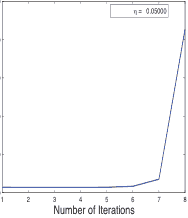

**图2.6** 算法（2.12）的发散。

定理2.6表明，从 \(S-\{0\}\) 出发的轨迹将收敛到与协方差矩阵最大特征值对应的特征向量。下面的仿真将验证这一点。在 \(S-\{0\}\) 中任意选取的六个初始向量如表2.1所示。

**表2.1** 初始向量的\(\mathrm{Norm}^2\)

| 2.5214 | 3.1887 | 1.3608 | 0.0044 | 5.3374 | 0.1287 |

|---|---|---|---|---|---|

图2.7（左）显示了六个轨迹收敛到单位超球面。相同的初始向量和四种不同学习率下的演化结果如图2.7（右）所示。

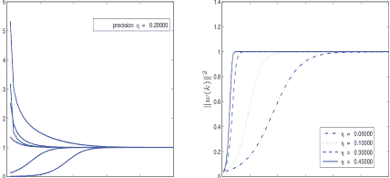

**图2.7** 算法（2.12）在不同初始向量（左）和不同学习率（右）下的收敛。

为了度量收敛方向，我们按照文献 [32]、[31] 计算 \(\boldsymbol{w}(k)\) 的范数以及第 \(k\) 次更新时的方向余弦：

$$\mathrm{Direction\ Cosine}(k)=\frac{|\boldsymbol{w}^{T}(k)\cdot\boldsymbol{\phi}|}{\|\boldsymbol{w}(k)\|\cdot\|\boldsymbol{\phi}\|},$$

其中 \(\boldsymbol{\phi}\) 是与 \(\boldsymbol{C}\) 最大特征值对应的真实特征向量。然后，任意选取一个初始向量：

$$\boldsymbol{w}(0)=[0.0900, 0.0400, 0.0950, 0.0900, 0.0840, 0.0600]^T.$$

图2.8（左）显示了方向余弦的收敛和 \(\|\boldsymbol{w}(k)\|\) 的收敛。右图显示了 \(\boldsymbol{w}\) 的分量收敛到

$$\boldsymbol{w}^{*}=[0.58584, 0.56139, 0.39833, 0.14884, 0.24411, 0.31816]^T.$$

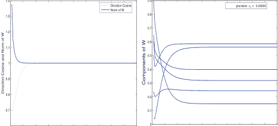

**图2.8** 方向余弦的收敛（左）与 \(w\) 的分量（右）。

该算法更适合高性能在线学习。通过从图1.5中的 Lenna 图像中提取主特征，展示了在线演化行为。通过数值离散化过程，具有恒定学习率的 Xu 算法（2.12）可以改写为如下形式：

$$w(k+1)=w(k)+\eta\left(2C_k w(k)-\left(w^T(k)w(k)\right)C_k w(k)-\left(w^T(k)C_k w(k)\right)w(k)\right),$$

对于 \(k\ge 0\)，其中 \(C_k\) 是在线观测序列。在线观测序列 \(\{C_k\}\)（1.10）将用于训练系统，且满足 \(\lim_{k\to\infty}C_k=C\)，\(k>0\)。重构图像如图2.9所示，其 SNR 为32.175。


**图2.9** Lenna 图像的重构图像。

#### 2.4.5 结论

利用 DDT 方法解释了 Xu 的 LMSER 算法在单单元情形（2.11）下的收敛性。推导出了不变集和最终界，以保证 Xu 的 DDT 系统不发散。严格证明了：若学习率满足某个简单条件，则从该不变集中的点出发的所有轨迹都收敛到由与协方差矩阵最大特征值对应的特征向量所张成的特征子空间。

### 2.5 Oja 算法与 Xu 算法的比较

本节通过比较 Oja 算法与 Xu 算法，讨论两种算法的计算复杂度和收敛速度。

可以观察到，总体而言，Xu 算法随时间收敛更快，或发散更迅速，但代价是计算复杂度更高。

第3节详细分析了具有恒定学习率的 Oja DDT 算法，并给出了一些重要结果。Oja 的 DDT 算法可以表示如下：

$$w(k+1)=w(k)+\eta\left[Cw(k)-\left(w^{T}(k)Cw(k)\right)w(k)\right],$$

其中 \(k\geq 0\)。显然，当权值向量的范数趋近于1时，Xu 算法（2.12）逼近 Oja 的单单元算法。然而，可以展示出一些不同的动力学行为。

一方面，Xu 算法有不同的吸引域。给定相同的输入序列，Oja 算法要求 \(\sigma<0.8899\)，其吸引域为

$$S_{Oja}=\left\{w(k)\mid w(k)\in\mathbb{R}^{n},\ w^{T}(k)Cw(k)<\frac{1}{\eta}\right\}.$$

Xu 算法要求 \(\eta\sigma<0.25\)，其吸引域为

$$S_{Xu}=\left\{w(k)\mid w(k)\in\mathbb{R}^{n},\ \lVert w(k)\rVert^{2}<1+\frac{1}{2\eta\sigma}\right\}.$$

另一方面，我们发现 Xu 算法总体上收敛更快，尽管 Xu 算法（2.12）在每次迭代中计算量更大。在第3节中，关于 Oja 算法的权值系数 \(z_i(k)\) 表示为

$$z_i(k+1)_{oja}=\left[1+\eta\left(\lambda_i-w^{T}(k)Cw(k)\right)\right]z_i(k),$$

其中 \(k \ge 0\)，\(i=1,\ldots,n\)。假设 \(w(k)\) 相同，学习率也相同。由（2.13）可得

$$\left|\frac{z_i(k+1)_{xu}-z_i(k)}{z_i(k+1)_{oja}-z_i(k)}\right|=\left|\frac{\eta\left(\lambda_i(2-\|w(k)\|^2)-w^T(k)Cw(k)\right)z_i(k)}{\eta\left(\lambda_i-w^T(k)Cw(k)\right)z_i(k)}\right|=\left|1+\frac{\lambda_i(1-\|w(k)\|^2)}{\lambda_i-w^T(k)Cw(k)}\right|.$$

显然，当 \(w^T(k)Cw(k)<\lambda_p\) 或 \(w^T(k)Cw(k)>\sigma\) 时，有

$$\left|\frac{z_i(k+1)_{xu}-z_i(k)}{z_i(k+1)_{oja}-z_i(k)}\right|=\left|1+\frac{\lambda_i(1-\|w(k)\|^2)}{\lambda_i-w^T(k)Cw(k)}\right|>1.$$

因此，在此范围内，Xu 算法收敛更快。然而，如果 \(\lambda_p<w^T(k)Cw(k)<\sigma\)，可以观察到两种算法的演化速率相互交织，并趋于相同的速率。图2.10（右）显示了这一结果。此外，不难得到

$$\begin{cases}
\sigma>w^T(k)Cw(k), & \text{for }\|w(k)\|^2<1,\\
\lambda_p<w^T(k)Cw(k), & \text{for }\|w(k)\|^2>1.
\end{cases}$$

因此有

$$\left\{\begin{aligned}


\left|\frac{z_1(k+1)_{xu}-z_1(k)}{z_1(k+1)_{oja}-z_1(k)}\right|&=\left|1+\frac{\sigma(1-\|w(k)\|^2)}{\sigma-w^T(k)Cw(k)}\right|>1, && \text{for }\|w(k)\|^2<1,\\

\left|\frac{z_p(k+1)_{xu}-z_p(k)}{z_p(k+1)_{oja}-z_p(k)}\right|&=\left|1+\frac{\lambda_p(1-\|w(k)\|^2)}{\lambda_p-w^T(k)Cw(k)}\right|>1, && \text{for }\|w(k)\|^2>1.

\end{aligned}\right.$$

因此，当 \(\lambda_p<w^T(k)Cw(k)<\sigma\) 时，Xu 算法至少在一个方向上收敛更快；并且通过大量仿真可以观察到，总体上 Xu 算法收敛更快。考虑一个简单例子：随机生成如下输入矩阵。图2.10显示了两种算法的演化结果。

$$C=\begin{bmatrix}0.9267&0.0633&-0.2633\\0.0633&0.1900&0.1267\\-0.2633&0.1267&0.9000\end{bmatrix}.$$

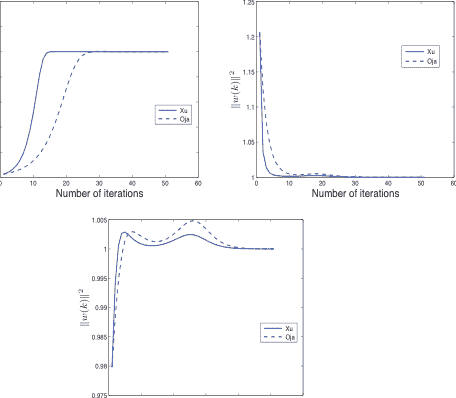

**图2.10** 在相同学习率 \(\eta = 0.3\) 下 Xu 算法与 Oja 算法演化速率的比较。

### 2.6 结论

本章利用 DDT 方法研究了 Oja 算法和 Xu 的 LMSER 算法。得到了一些不变集，从而可以保证算法的非发散性。严格证明了：若学习率满足某个简单条件，则从这些不变集中的点出发的所有轨迹都收敛到由与协方差矩阵最大特征值对应的特征向量所张成的特征子空间。最重要的结果是，它证实了某些 PCA 学习算法使用恒定学习率可以实现收敛。进行了仿真研究，以进一步阐明该理论。

## 3 带自适应学习率的PCA学习算法

### 3.1 引言

在PCA学习算法中，学习率至关重要。它不仅影响PCA算法的收敛速度，还决定该算法是否收敛。显然，DDT方法要求学习率趋近于零。在第2章中，通过使用DDT方法，证明了具有恒定学习率的Oja和Xu的LMSER PCA算法是局部收敛的。

本章针对PCA学习算法提出了一种非趋零自适应学习率。通过DDT方法，详细研究了采用该自适应学习率的Oja学习算法的收敛性。首先，将原始的SDT算法转化为相应的DDT算法。然后，分析了DDT算法的全局有界性。在非收敛条件下，证明了全局收敛性。DDT算法的收敛性可为原始算法的收敛性提供一些启示。

本章其余部分组织如下。第2节针对PCA学习算法提出了一种非趋零自适应学习率。第3节给出了问题描述，并描述了收敛性证明的预备知识。第4节给出了收敛性结果，找到了权重演化的下界和上界，并详细证明了全局收敛性。第5节进行了仿真。第6节给出了结论。

### 3.2 自适应学习率

对于线性神经网络(1.1)和输入序列(1.2)，Oja的PCA学习算法(2.1)可以改写为：

$$w(k+1)=w(k)+\eta(k)[C_{x(k)}w(k)-w^{T}(k)C_{x(k)}w(k)w(k)], \tag{3.1}$$

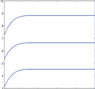

**图3.1** 当\(\eta(k)=\frac{1}{2^k+1}\)时收敛到错误方向。

其中，\(\eta(k)>0\)是学习率，\(C_{x(k)}=x(k)x^T(k)\)是由\(C=E[x(k)x^T(k)]\)定义的协方差矩阵的在线观测值。

在提出非趋零自适应学习率之前，我们先用一个简单例子看看趋零学习率如何影响(3.1)的收敛。考虑以下简单示例：

$$w(k+1)=w(k)\left(1+\eta(k)(1-w(k)^2)\right),\tag{3.2}$$

其中\(k\ge 0\)。如果选择\(\eta(k)=\frac{1}{k+1}\)，则当\(\|w(0)\|>2\)[210]时，\(\|w(k+1)\|\to\infty\)。如果选择\(\eta(k)=\frac{1}{2^k+1}\)，且初始权重向量\(w(0)=(0.0053408,0.0072711,0.0030929)^T\)，则算法(3.2)在六次迭代后收敛到一个不正确的向量\(w^*=[0.0066514,0.0088333,0.0045339]^T\)，其中\(\|w^*\|=0.0120\)，见图3.1。

该示例表明，如果学习率过快趋近于零，算法将收敛到错误方向。

本章中，我们提出一种趋近于常数的自适应学习率。所提出的自适应学习率如下：

$$\eta(k)=\frac{\xi}{w^T(k)C_{x(k)}w(k)},\qquad k\ge 0,\tag{3.3}$$

其中，\(C_{x(k)}\)是\(C\)的在线观测值，\(\xi\)是满足\(0<\xi<1\)的常数。该自适应学习率趋近于一个正常数。将使用DDT方法研究采用所提学习率的(3.1)的收敛性。结果表明，采用所提学习率的(3.1)是全局收敛的。由于全局收敛，(3.1)的初始向量选择将非常简单，实际上，任何非零向量都可以作为初始向量。此外，由于学习率收敛到一个非零常数，学习过程将加快。实验结果将进一步证实，采用所提出的非趋零学习率的算法(3.1)在在线观测序列下具有较高的性能。

### 3.3 带自适应学习率的Oja PCA算法

带自适应学习率的Oja PCA算法改写为：

$$w(k+1)=w(k)+\frac{\tilde{\xi}}{w(k)^T C_{x(k)}w(k)}\left(C_{x(k)}w(k)-w(k)^T C_{x(k)}w(k)w(k)\right),\tag{3.4}$$

对于所有\(k\ge 0\)且\(0<\tilde{\xi}<1\)。

我们将使用DDT方法间接研究(3.4)的收敛性。DDT系统描述了原始算法的平均演化[210]。对(3.4)两边取条件期望\(E\{w(k+1)\mid w(0),w(i),\ i\le k\}\)，可得：

$$E\{w(k+1)\}=E\left\{w(k)+\frac{\tilde{\xi}}{w(k)^T C_{x(k)}w(k)}Y(k)\right\},$$

其中

$$Y(k)=\left(C_{x(k)}w(k)-w(k)^T C_{x(k)}w(k)w(k)\right).$$

显然，概率\(P(Y(k))\)和\(P\left(\frac{\tilde{\xi}}{w(k)^T C_{x(k)}w(k)}\right)\)仅依赖于变量\(X\)的分布。容易看出，\(P(Y(k))\)不受学习率(3.3)取值的影响；也就是说，学习率(3.3)的值不提供关于\(Y(k)\)值的任何信息。因此，学习率(3.3)与\(Y(k)\)相互独立。于是有：

$$E\{w(k+1)\}=E\{w(k)\}+E\left\{\frac{\tilde{\xi}}{w(k)^T C_{x(k)}w(k)}\right\}E\{Y(k)\}.$$

由于

$$E\left\{\frac{\tilde{\xi}}{w(k)^T C_{x(k)}w(k)}\right\}=\alpha\cdot\frac{\tilde{\xi}}{w(k)^T Cw(k)}=\frac{\tilde{\xi}}{w(k)^T Cw(k)},$$

其中\(\alpha>0\)，则(3.4)对应的DDT算法如下：

$$w(k+1)=w(k)+\frac{\tilde{\xi}}{w(k)^T Cw(k)}\left(Cw(k)-w(k)^TCw(k)w(k)\right),\tag{3.5}$$

对于\(k \ge 0\)，其中\(0 < \xi < 0.8\)。我们将证明(3.5)是全局收敛的。

由(1.7)、(1.8)、(3.5)，可得：

$$z_i(k+1)=\left[1+\xi\left(\frac{\lambda_i}{w^T(k)Cw(k)}-1\right)\right]z_i(k), \tag{3.6}$$

对于\(k \ge 0\)，其中\(0 < \xi < 0.8\)。

这里给出一个引理，用于后续的收敛性分析。

**引理3.1.** *以下结论成立：*

$$

\begin{cases}

\left[1+\xi\left(\frac{\sigma}{s}-1\right)\right]^2s\ge 4(1-\xi)\xi\sigma, & \text{for }s>0,\\[6pt]

\left[1+\xi\left(\frac{\sigma}{s}-1\right)\right]^2s\le \max\left\{\sigma,\left[1+\xi\left(\frac{\sigma}{s_*}-1\right)\right]^2s_*\right\}, & \text{for }s\in[s_*,\sigma],

\end{cases}

$$

其中\(0<\xi<0.8\)，且\(s_*>0\)是常数。


*证明.* 定义可微函数

$$f(s)=\left[1+\frac{\xi}{s}(\sigma-s)\right]^2s$$

其中\(s>0\)。则有：

$$\dot f(s)=\left[1+\frac{\xi}{s}(\sigma-s)\right]\left[1-\frac{\xi}{s}(\sigma+s)\right]$$

其中\(s>0\)。记：

$$s^*=\frac{\xi\sigma}{1-\xi}.$$

于是，

$$\dot f(s)\begin{cases}<0, & \text{if }0<s\le s^*,\\=0, & \text{if }s=s^*,\\>0, & \text{if }s^*\le s.\end{cases}$$

这表明\(s^*\)必定是函数\(f(s)\)在区间\((0,+\infty)\)上的最小值点。因此有：

$$\left[1+\frac{\xi}{s}(\sigma-s)\right]^2s\ge 4(1-\xi)\xi\sigma,$$

对\(s>0\)成立。并且有：

$$\left[1+\frac{\xi}{s}(\sigma-s)\right]^2s\le \max\left\{\sigma,\left[1+\frac{\xi}{s_*}(\sigma-s_*)\right]^2s_*\right\}$$

对所有\(s\in[s_*,\sigma]\)成立。证明完毕。

### 3.4 带自适应学习率的Oja算法的收敛性分析

本节将系统地提供所提学习算法收敛性分析的详细内容。

#### 3.4.1 有界性

首先，我们将分析系统`(3.5)`的有界性。系统演化的下界和上界将在以下定理中给出。

**引理3.2.** 假设`0<ξ<0.8`，若`0<w^T(k)Cw(k)<λ_p`，则`w^T(k)Cw(k)`是递增的。

*证明：* 如果`w^T(k)Cw(k)≤λ_p`，可以验证：

$$\left[1+\xi\left(\frac{\lambda_i}{w^T(k)Cw(k)}-1\right)\right]^2\geq\left[1+\xi\left(\frac{\lambda_p}{w^T(k)Cw(k)}-1\right)\right]^2\geq1,$$

对于`k≥0`。然后，由`(3.5)`、`(1.7)`和`(3.6)`，我们有：

$$\begin{aligned} w^T(k+1)Cw(k+1)&=\sum_{i=1}^{p}\left[1+\xi\left(\frac{\lambda_i}{w^T(k)Cw(k)}-1\right)\right]^2\lambda_i z_i^2(k)\\ &\geq\left[1+\xi\left(\frac{\lambda_p}{w^T(k)Cw(k)}-1\right)\right]^2w^T(k)Cw(k)\\ &\geq w^T(k)Cw(k). \end{aligned}$$

对于`k≥0`。证明完毕。

**定理3.1.** 如果`w(0)∉\mathcal{V}_{\sigma}^{\perp}`，则下列不等式成立：

$$w^T(k+1)Cw(k+1)\geq4(1-\xi)\xi\lambda_p>0,$$

对所有`k≥0`成立，其中`0<ξ<0.8`。

*证明：* 可以验证：

$$\left[1+\xi\left(\frac{\lambda_i}{w^T(k)Cw(k)}-1\right)\right]^2\geq\left[1+\xi\left(\frac{\lambda_p}{w^T(k)Cw(k)}-1\right)\right]^2>0.$$

对 $k \ge 0$。由 `(3.5)`、`(1.8)` 和 `(3.6)` 可得

$$\begin{aligned}
w^T(k+1)Cw(k+1) &= \sum_{i=1}^{n}\lambda_i z_i^2(k+1)\\
&= \sum_{i=1}^{p}\lambda_i z_i^2(k+1)\\
&= \sum_{i=1}^{p}\left[1+\xi\left(\frac{\lambda_i}{w^T(k)Cw(k)}-1\right)\right]^2\lambda_i z_i^2(k)\\
&\ge \left[1+\xi\left(\frac{\lambda_p}{w^T(k)Cw(k)}-1\right)\right]^2 w^T(k)Cw(k)\\
&\ge \min_{s>0}\left\{\left[1+\xi\left(\frac{\lambda_p}{s}-1\right)\right]^2\cdot s\right\}.
\end{aligned}$$

对 $k \ge 0$。由引理 3.1，有

$$w^T(k+1)Cw(k+1)\ge 4(1-\xi)\xi\lambda_p,$$

对 $k \ge 0$。证明完毕。上述定理表明，如果 `w(0)≠0`，且从 `w(0)` 出发的轨迹有下界，则该轨迹永远不会收敛到零。显然，零向量必为 `(3.5)` 的不稳定平衡点。

**定理 3.2.** *存在常数 `H>0`，使得对所有 `k≥0` 有 `w^T(k)Cw(k)≤H`。*

*证明.* 若 `w^T(0)Cw(0)=0`，则对所有 `k≥0` 有 `w^T(k)Cw(k)=0`。显然，`w^T(k)Cw(k)≤H`。接下来，假设 `w^T(0)Cw(0)≠0`。定义

$$\bar H=\max\left\{\sigma,\left[1+\xi\left(\frac{\sigma}{\lambda_p}-1\right)\right]^2\lambda_p,\left[1+\xi\left(\frac{\sigma}{w^T(0)Cw(0)}-1\right)\right]^2w^T(0)Cw(0)\right\}.$$

给定任意正数 `H` 满足 `H≥\bar H`，我们将证明：对任意 `k≥0`，有

$$0\le w^T(k)Cw(k)\le H$$

蕴含

$$0\le w^T(k+1)Cw(k+1)\le H.$$

证明分两步完成。

**情形 1.** `σ≤w^T(k)Cw(k)≤H`。此时，

$$\left[1+\xi\left(\frac{\lambda_i}{w^T(k)Cw(k)}-1\right)\right]^2\le 1,\quad (i=1,\ldots,p).$$

因此

$$\begin{aligned} w^T(k+1)Cw(k+1) &= \sum_{i=1}^{n}\lambda_i z_i^2(k+1) \\ &= \sum_{i=1}^{p}\lambda_i z_i^2(k+1) \\ &= \sum_{i=1}^{p}\lambda_i\left[1+\xi\left(\frac{\lambda_i}{w^T(k)Cw(k)}-1\right)\right]^2z_i^2(k) \\ &\leq \sum_{i=1}^{p}\lambda_i z_i^2(k) \\ &= w^T(k)Cw(k) \\ &\leq H. \end{aligned}$$

**情形 2.** `0≤w^T(k)Cw(k)≤σ`。可以验证

$$\left[1+\xi\left(\frac{\lambda_i}{w^T(k)Cw(k)}-1\right)\right]^2\leq\left[1+\xi\left(\frac{\sigma}{w^T(k)Cw(k)}-1\right)\right]^2,$$

对 `i=1,\ldots,n`。因此

$$\begin{aligned} w^T(k+1)Cw(k+1) &= \sum_{i=1}^{p}\lambda_i\left[1+\xi\left(\frac{\lambda_i}{w^T(k)Cw(k)}-1\right)\right]^2z_i^2(k) \\ &\leq \sum_{i=1}^{p}\lambda_i\left[1+\xi\left(\frac{\sigma}{w^T(k)Cw(k)}-1\right)\right]^2z_i^2(k) \\ &= \left[1+\xi\left(\frac{\sigma}{w^T(k)Cw(k)}-1\right)\right]^2w^T(k)Cw(k) \\ &\leq \max_{0\leq s\leq\sigma}\left\{\left[1+\xi\left(\frac{\sigma}{s}-1\right)\right]^2s\right\}. \end{aligned}$$

如果

$$\lambda_p>s^*=\frac{\xi\sigma}{1-\xi},$$

由引理 3.1 和引理 3.2，可得


$$w^T(k+1)Cw(k+1)\leq\begin{cases}\sigma, & \text{if }s^*<s<\sigma,\\ \left[1+\xi\left(\frac{\sigma}{w^T(0)Cw(0)}-1\right)\right]^2w^T(0)Cw(0), & \text{if }0<s<s^* .\end{cases}$$

如果 $\lambda_p < s^*$，由引理 3.1 和引理 3.2，

$$w^T(k+1)Cw(k+1) \le \begin{cases} \sigma, & \text{if } s^* < s < \sigma, \\ \left[1+\xi\left(\dfrac{\sigma}{\lambda_p}-1\right)\right]^2\lambda_p, & \text{if } \lambda_p < s < s^*, \\ \left[1+\xi\left(\dfrac{\sigma}{w^T(0)Cw(0)}-1\right)\right]^2w^T(0)Cw(0), & \text{if } 0<s<\lambda_p. \end{cases}$$

于是，

$$w^T(k+1)Cw(k+1) \le H.$$

证明完毕。

## 3.4.2 全局收敛

考虑第 2 节中相同的、采用我们的非零逼近学习率的一维方程示例。我们有

$$w(k+1)=w(k)\left(1+\frac{\xi}{w^2(k)}(1-w(k)^2)\right), \tag{3.7}$$

对 $k>0$，其中 $0<\xi<0.8$。显然，集合 $\{0,-1,1\}$ 是系统 (3.7) 的平衡点集。若 $|w(k)|<1$，则 $|w(k+1)|$ 增大；若 $|w(k)|>1$，则 $|w(k+1)|$ 减小。显然，在整个区间内，权重收敛到 $-1$ 或 $1$，且 $0$ 是不稳定点。接下来，我们将严格证明 (3.5) 的全局收敛性。

给定 $H>0$，我们定义

$$S(H)=\{w\mid w^TCw\le H\}.$$

**引理 3.3.** 对任意 $H\ge\bar H$，若 $w(0)\in S(H)$ 且 $w(0)\notin V_\sigma^\perp$，则存在常数 $\theta_1>0$ 和 $\Pi_1>0$，使得

$$\sum_{j=m+1}^{n}z_j^2(k)\le \Pi_1\cdot e^{-\theta_1 k},$$

对所有 $k\ge 0$ 成立，其中

$$\theta_1=\ln\left(\frac{\xi\sigma+(1-\xi)H}{\xi\lambda_{m+1}+(1-\xi)H}\right)^2>0.$$

*证明.* 因为 $w(0)\notin V_\sigma^\perp$，所以必存在某个 $i$（$1\le i\le m$）使得 $z_i(0)\ne 0$。不失一般性，假设 $z_1(0)\ne 0$。

由 (3.6)，可得

$$z_i(k+1)=\left[1+\xi\left(\frac{\sigma}{w^T(k)Cw(k)}-1\right)\right]z_i(k),\quad 1\le i\le m, \tag{3.8}$$

以及

$$z_j(k+1)=\left[1+\xi\left(\frac{\lambda_j}{w^T(k)Cw(k)}-1\right)\right]z_j(k),\quad m+1\le j\le n,\tag{3.9}$$

对 $k\ge 0$。

由定理 3.2 可知，对所有 $k\ge 0$ 有 $w(k)\in S(H)$。对任意 $i(1\le i\le n)$，有

$$1+\xi\left(\frac{\lambda_i}{w^T(k)Cw(k)}-1\right)=1-\xi+\xi\frac{\lambda_i}{w^T(k)Cw(k)}\ge (1-\xi)>0,$$

对 $k\ge 1$。然后，由 (3.8) 和 (3.9)，对每个 $j(m+1\le j\le n)$，可得

```
\left[\frac{z_j(k+1)}{z_1(k+1)}\right]^2
&=\left[\frac{1+\xi\left(\frac{\lambda_j}{w^T(k)Cw(k)}-1\right)}{1+\xi\left(\frac{\lambda_1}{w^T(k)Cw(k)}-1\right)}\right]^2\left[\frac{z_j(k)}{z_1(k)}\right]^2\\
&=\left[\frac{w^T(k)Cw(k)+\xi(\lambda_j-w^T(k)Cw(k))}{w^T(k)Cw(k)+\xi(\sigma-w^T(k)Cw(k))}\right]^2\left[\frac{z_j(k)}{z_1(k)}\right]^2\\
&\le\left[\frac{\xi\lambda_j+(1-\xi)H}{\xi\sigma+(1-\xi)H}\right]^2\left[\frac{z_j(k)}{z_1(k)}\right]^2\\
&\le\left[\frac{\xi\lambda_{m+1}+(1-\xi)H}{\xi\sigma+(1-\xi)H}\right]^2\left[\frac{z_j(k)}{z_1(k)}\right]^2\\
&=\left[\frac{z_j(0)}{z_1(0)}\right]^2\cdot e^{-\theta_1(k+1)},
```

对所有 $k\ge 1$。

由于 $w(k)\in S(H)$，$z_1(k)$ 必有界，即存在常数 $d>0$，使得对所有 $k\ge 0$ 有 $z_1^2(k)\le d$。

$$\sum_{j=m+1}^{n}z_j^2(k)=\sum_{j=m+1}^{n}\left[\frac{z_j(k)}{z_1(k)}\right]^2z_1^2(k)\le \Pi_1e^{-\theta_1k},$$

对 $k\ge 0$，其中

$$\Pi_1=d\sum_{j=m+1}^{n}\left[\frac{z_j(0)}{z_1(0)}\right]^2\ge 0.$$

证明完毕。

接下来，为方便起见，记

$$P(k)=\left[1+\xi\left(\frac{\sigma}{w^T(k)Cw(k)}-1\right)\right]^2w^T(k)Cw(k),\tag{3.10}$$

以及

$$Q(k)=\sum_{i=m+1}^{n}\lambda_i\left[2(1-\xi)+\frac{\xi(\lambda_i+\sigma)}{w^T(k)Cw(k)}\right]\left[\frac{\xi(\sigma-\lambda_i)}{w^T(k)Cw(k)}\right]z_i^2(k),\qquad (3.11)$$

对所有 $k\ge 0$。显然，对所有 $k\ge 0$，有 $P(k)\ge 0$ 和 $Q(k)\ge 0$。

**引理 3.4.** 对 $k\ge 0$，有

$$w^T(k+1)Cw(k+1)=P(k)-Q(k)$$

*证明.* 由 (1.8) 和 (3.6)，可得

```
w^T(k+1)Cw(k+1)
&=\sum_{i=1}^{n}\lambda_i\left[1+\xi\left(\frac{\lambda_i}{w^T(k)Cw(k)}-1\right)\right]^2z_i^2(k)\\
&=\sum_{i=1}^{n}\lambda_i\left[1+\xi\left(\frac{\sigma}{w^T(k)Cw(k)}-1\right)\right]^2z_i^2(k)\\
&=\sum_{i=m+1}^{n}\lambda_i\left[2(1-\xi)+\frac{\xi(\lambda_i+\sigma)}{w^T(k)Cw(k)}\right]\left[\frac{\xi(\sigma-\lambda_i)}{w^T(k)Cw(k)}\right]z_i^2(k)\\
&=\left[1+\xi\left(\frac{\sigma}{w^T(k)Cw(k)}-1\right)\right]^2w^T(k)Cw(k)\\
&\quad-\sum_{i=m+1}^{n}\lambda_i\left[2(1-\xi)+\frac{\xi(\lambda_i+\sigma)}{w^T(k)Cw(k)}\right]\left[\frac{\xi(\sigma-\lambda_i)}{w^T(k)Cw(k)}\right]z_i^2(k)\\
&=P(k)-Q(k).
```

证明完毕。

**引理 3.5.** 若 $w(0)\notin V_\sigma^+$，则对 $k\ge 1$，有

$$P(k-1)\ge 4(1-\xi)\xi\sigma,$$
*证明.* 由 (3.10)，可得


P(k-1)&=\left[1+\xi\left(\frac{\sigma}{w^T(k-1)Cw(k-1)}-1\right)\right]^2w^T(k-1)Cw(k-1)\\

&\ge \min_{s>0}\left\{\left[1+\xi\left(\frac{\sigma}{s}-1\right)\right]^2s\right\}.

\end{aligned}$$

对 $k\ge 1$。由引理 3.1，有

$$P(k-1)\ge 4(1-\xi)\xi\sigma,\qquad k\ge 1.$$

证明完毕。

## 引理 3.6
存在正常数 $\Pi_2>0$，使得对 $k\geq 0$ 有

$$Q(k)\leq \Pi_2\cdot e^{-\theta_1 k},$$

*证明.* 由 (3.11)，

$$Q(k)=\sum_{i=m+1}^{n}\lambda_i\left[2(1-\xi)+\frac{\xi(\lambda_i+\sigma)}{w^T(k)Cw(k)}\right]\left[\frac{\xi(\sigma-\lambda_i)}{w^T(k)Cw(k)}\right]z_i^2(k)$$

$$\leq \sum_{i=m+1}^{n}\lambda_i\left[2+\frac{2\xi\sigma}{w^T(k)Cw(k)}\right]\left[\frac{2\xi\sigma}{w^T(k)Cw(k)}\right]z_i^2(k)$$

$$\leq 2\left[1+\frac{\xi\sigma}{w^T(k)Cw(k)}\right]\left[\frac{\xi\sigma}{w^T(k)Cw(k)}\right]\cdot\sum_{i=m+1}^{n}\lambda_i z_i^2(k)$$

对 $k\geq 0$。由定理 3.1 和引理 3.3，

$$Q(k)\leq 2\left[1+\frac{\xi\sigma}{4(1-\xi)\xi\lambda_p}\right]\left[\frac{\xi\sigma}{4(1-\xi)\xi\lambda_p}\right]\sum_{i=m+1}^{n}\lambda_i z_i^2(k)$$

$$\leq 2\Pi_1\cdot\left[1+\frac{\sigma}{4(1-\xi)\lambda_p}\right]\left[\frac{\sigma}{4(1-\xi)\lambda_p}\right]e^{-\theta_1 k}$$

$$\leq \Pi_2e^{-\theta_1 k}$$

对 $k\geq 0$，其中

$$\Pi_2=2\Pi_1\cdot\left[1+\frac{\sigma}{4(1-\xi)\lambda_p}\right]\left[\frac{\sigma}{4(1-\xi)\lambda_p}\right].$$

证明完毕。

## 引理 3.7
对任意 $H\ge \bar H$，若 $w(0)\in S(H)$ 且 $w(0)\notin V_\sigma^\perp$，则存在常数 $\theta_2>0$ 和 $\Pi_5>0$，使得

$$\left|\sigma-w^T(k+1)Cw(k+1)\right|\leq k\cdot\Pi_5\cdot\left[e^{-\theta_2(k+1)}+\max\left\{e^{-\theta_2 k},e^{-\theta_1 k}\right\}\right],$$

对所有 $k\geq 1$ 成立，其中

$$\left\{\begin{aligned}\theta_2&=-\ln\delta,\\ \delta&=\max\left\{(1-\xi)^2,\frac{\xi}{4(1-\xi)}\right\},\end{aligned}\right.$$

且 $0<\xi<0.8$，$0<\delta<1$。

**证明.** 由(3.10)、(3.11)和引理3.4可知

$$\begin{aligned}

\sigma-w^T(k+1)Cw(k+1)

&=\sigma-P(k)+Q(k)\\

&=\sigma-\left[1+\xi\left(\frac{\sigma}{w^T(k)Cw(k)}-1\right)\right]w^T(k)Cw(k)+Q(k)\\

&=\left(\sigma-w^T(k)Cw(k)\right)\left[(1-\xi)^2-\frac{\xi^2\sigma}{w^T(k)Cw(k)}\right]+Q(k)\\

&=\left(\sigma-w^T(k)Cw(k)\right)\left[(1-\xi)^2-\frac{\xi^2\sigma}{P(k-1)-Q(k-1)}\right]+Q(k)\\

&=\left(\sigma-w^T(k)Cw(k)\right)\left[(1-\xi)^2-\frac{\xi^2\sigma}{P(k-1)}\right]\\

&\quad-\frac{\left(\sigma-w^T(k)Cw(k)\right)\xi^2\sigma Q(k-1)}{P(k-1)\left(P(k-1)-Q(k-1)\right)}+Q(k)\\

&=\left(\sigma-w^T(k)Cw(k)\right)\left[(1-\xi)^2-\frac{\xi^2\sigma}{P(k-1)}\right]\\

&\quad+\frac{\left(\sigma-w^T(k)Cw(k)\right)\xi^2\sigma Q(k-1)}{P(k-1)w^T(k)Cw(k)}+Q(k)\\

&=\left(\sigma-w^T(k)Cw(k)\right)\left[(1-\xi)^2-\frac{\xi^2\sigma}{P(k-1)}\right]\\

&\quad-\xi^2\sigma\left[\frac{\sigma}{w^T(k)Cw(k)}-1\right]\frac{Q(k-1)}{P(k-1)}+Q(k)

\end{aligned}$$

对于 $k\geq 1$。

记

$$V(k)=\left|\sigma-w^T(k)Cw(k)\right|,$$

对于 $k\geq 1$。由此可得

$$\begin{aligned}

V(k+1)&\leq V(k)\cdot\left[(1-\xi)^2-\frac{\xi^2\sigma}{P(k-1)}\right]\\

&\quad+\xi^2\sigma\left[\frac{\sigma}{w^T(k)Cw(k)}+1\right]\frac{Q(k-1)}{P(k-1)}+Q(k)\\

&\leq \max\left\{(1-\xi)^2,\frac{\xi^2\sigma}{P(k-1)}\right\}\cdot V(k)\\

&\quad+\xi^2\sigma\left[\frac{\sigma}{w^T(k)Cw(k)}+1\right]\frac{Q(k-1)}{P(k-1)}+Q(k)

\end{aligned}$$

对于 $k\ge 1$。由引理3.5可知

$$

V(k+1) \le \max\left\{(1-\xi)^2,\frac{\xi}{4(1-\xi)}\right\}\cdot V(k)

+\frac{\xi}{4(1-\xi)}\left[\frac{\sigma}{w^T(k)Cw(k)}+1\right]Q(k-1)+Q(k),

$$

对于 $k\ge 1$。记

$$\delta=\max\left\{(1-\xi)^2,\frac{\xi}{4(1-\xi)}\right\}.$$

显然，若 $0<\xi<0.8$，则 $0<\delta<1$。于是

$$V(k+1)\le\delta\cdot V(k)+\frac{\xi}{4(1-\xi)}\left[\frac{\sigma}{w^T(k)Cw(k)}+1\right]Q(k-1)+Q(k),\quad k\ge1.$$

记

$$\Pi_3=\frac{\xi}{4(1-\xi)}\cdot\left[\frac{\sigma}{4(1-\xi)\xi\lambda_p}+1\right].$$

由定理3.1和引理3.6，

$$

\begin{aligned}

V(k+1)&\le\delta\cdot V(k)+\Pi_3\cdot Q(k-1)+Q(k)\\

&\le\delta\cdot V(k)+\Pi_4\cdot e^{-\theta_1 k}

\end{aligned}

$$

其中

$$\Pi_4=\Pi_2\cdot\left(\Pi_3e^{\theta_1}+1\right).$$

那么，

$$

\begin{aligned}

V(k+1)&\le\delta^{k+1}V(0)+\Pi_4\sum_{r=0}^{k}\delta^r e^{-\theta_1(k-r)}\\


&\le\delta^{k+1}V(0)+\Pi_4\sum_{r=0}^{k}(\delta e^{\theta_1})^r e^{-\theta_1 k}\\

&\le\delta^{k+1}V(0)+k\Pi_4\cdot\max\{\delta^k,e^{-\theta_1 k}\}\\

&\le k\cdot\Pi_5\cdot\left[e^{-\theta_2(k+1)}+\max\{e^{-\theta_2 k},e^{-\theta_1 k}\}\right],

\end{aligned}

$$

其中 $\theta_2=-\ln\delta>0$，且

$$\Pi_5=\max\left\{|\sigma-w^T(0)Cw(0)|,\Pi_4\right\}>0.$$

证毕。

## 引理3.8
假设存在常数 $\theta>0$ 和 $\Pi>0$，使得

$$\frac{\left|\sigma-w^T(k)Cw(k)\right|}{w^T(k)Cw(k)}\left|z_i(k)\right|\le k\cdot\Pi e^{-\theta k},\quad (i=1,\ldots,m)$$

对于 $k \ge 1$ 成立。则

$$\lim_{k\to+\infty} z_i(k)=z_i^*,\quad (i=1,\ldots,m),$$

其中 $z_i^*$ $(i=1,\ldots,m)$ 为常数。

### 证明
对任意 $\epsilon>0$，存在 $K>1$，使得

$$\frac{\Pi_1 K e^{-\theta K}}{(1-e^{-\theta})^2}\le \epsilon.$$

对于任意 $k_1>k_2\ge K$，有

```
|z_i(k_1)-z_i(k_2)|
&=\left|\sum_{r=k_2}^{k_1-1}[z_i(r+1)-z_i(r)]\right|\\
&\le \sum_{r=k_2}^{k_1-1}\frac{\epsilon}{w^T(r)Cw(r)}\left|(\sigma-w^T(r)Cw(r))z_i(r)\right|\\
&\le \Pi_1\sum_{r=k_2}^{k_1-1}e^{-\theta r}\\
&\le \Pi_1\sum_{r=k_2}^{+\infty}e^{-\theta r}\\
&\le \Pi_1 K e^{-\theta K}\cdot\sum_{r=0}^{+\infty}(e^{-\theta})^{r-1}\\
&=\frac{\Pi_1 K e^{-\theta K}}{(1-e^{-\theta})^2}\\
&\le \epsilon,\quad (i=1,\ldots,m).
```

这表明每个序列 $\{z_i(k)\}$ 都是柯西序列。根据*柯西收敛原理*，必存在常数 $z_i^*$ $(i=1,\ldots,m)$，使得

$$\lim_{k\to+\infty}z_i(k)=z_i^*,\quad (i=1,\ldots,m).$$

证毕。

## 定理3.3
假设 $0<\xi<0.8$。若 $w(0)\in S$ 且 $w(0)\notin V_\sigma^\perp$，则从 $w(0)$ 出发的(3.5)的轨迹将收敛到协方差矩阵 $C$ 的最大特征值所对应的单位特征向量。

### 证明
由引理3.3，存在常数 $\theta_1>0$ 和 $\Pi_1\ge 0$，使得

$$\sum_{j=m+1}^{n}z_j^2(k)\le \Pi_1 e^{-\theta_1 k},$$

对于所有 $k \ge 0$ 成立。由引理3.7，存在常数 $\theta_2 > 0$ 和 $\Pi_5 > 0$，使得

$$|\sigma-w^T(k+1)Cw(k+1)| \le k\cdot\Pi_5\cdot\left[e^{-\theta_2(k+1)}+\max\{e^{-\theta_2k},e^{-\theta_1k}\}\right]$$

对于所有 $k \ge 0$ 成立。

显然，存在常数 $\theta > 0$ 和 $\Pi > 0$，使得

$$\frac{\left|\sigma-w^T(k)Cw(k)\right|}{w^T(k)Cw(k)}\left|z_i(k)\right| \le k\cdot\Pi e^{-\theta k},\quad (i=1,\ldots,m)$$

对于 $k \ge 0$ 成立。

利用引理3.3和引理3.8，可得

$$\left\{\begin{aligned}\lim_{k\to+\infty}z_i(k)&=z_i^*,\quad(i=1,\ldots,m)\\\lim_{k\to+\infty}z_i(k)&=0,\quad(i=m+1,\ldots,n).\end{aligned}\right.$$

于是，

$$\lim_{k\to+\infty}w(k)=\sum_{i=1}^{m}z_i^*v_i\in V_\sigma.$$ (3.12)

由(3.5)，当系统稳定后，有

$$\lim_{k\to\infty}Cw(k)=\lim_{k\to\infty}w^T(k)Cw(k)w(k).$$ (3.13)

将(3.12)代入(3.13)，得

$$\sum_{i=1}^{m}\sigma z_i^{*}v_i=\sum_{i=1}^{m}\sigma(z_i^{*})^2\sum_{i=1}^{m}z_i^{*}v_i.$$

容易看出

$$\sum_{i=1}^{m}(z_i^{*})^2=1.$$

证毕。

上述定理表明，从 $S(H)$ 出发的几乎所有轨迹都将收敛到协方差矩阵 $C$ 的最大特征值对应的特征向量。$w(0)$ 可以任意选取，只要不取子空间 $V_\sigma^\perp$ 上的点。显然，在实际应用中该条件很容易满足。

### 3.5 仿真与讨论

本节将给出三个仿真示例来说明所提出的理论。

**表3.1** 初始向量的范数

| 范数1 | 范数2 | 范数3 | 范数4 | 范数5 | 范数6 |
|--------|--------|--------|--------|--------|--------|
| 0.41289 | 0.6404 | 1.8768 | 3.9806 | 6.241 | 9.2531 |

#### 示例1

考虑简单示例(3.7)。图3.2给出了在精度 ε = 0.00001 和 ξ = 0.5 下，从不同点出发的(3.7)的六条轨迹收敛到单位向量的结果。表3.1列出了任意生成的六个初始向量。

图3.2中的左图展示了权重的范数演化过程；右图则展示了学习率的演化过程。显然，学习率收敛到0.5，且演化速度也非常快。图3.3展示了在两个不同初始向量下，权重分量收敛到单位向量，该单位向量正是(3.7)的一个平衡点。在图3.3的左图中，初始向量

$$w(0) = [\,0.03218, 0.020258, 0.0084304, 0.046076, 0.021929\,]^T$$

收敛到单位向量

$$w^* = [\,0.5013, 0.31557, 0.13133, 0.71776, 0.34161\,]^T.$$

在图3.3的右图中，初始向量

$$w(0) = [\,15.866, 21.48, 3.9579, 27.996, 19.861\,]^T$$

收敛到单位向量

$$w^* = [\,0.36332, 0.49188, 0.090632, 0.64109, 0.45479\,]^T.$$

实际上，初始向量除原点外可以任意选取。然而，当范数非常大或非常小时，图中无法清晰地显示出来。

#### 示例2

示例2将说明(3.5)的收敛性。首先，考虑 $\mathbb{R}^2$ 中的一个正定矩阵：

$$C = \begin{bmatrix} 5 & 1 \\ 3 & 3 \end{bmatrix}.$$

与最大特征值对应的单位特征向量为 $\pm[\sqrt{2}/2,\sqrt{2}/2]^T$，它们正是系统(3.5)的平衡点。图3.4展示了在精度 ε = 0.00001 和 ξ = 0.5 下，从 $\mathbb{R}^2$ 中随机生成的点出发的轨迹收敛到平衡点的过程。从结果可以明显看出，所有轨迹都收敛到与该矩阵最大特征值对应的正确方向。

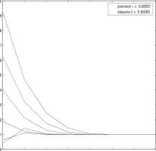

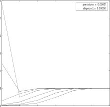

**图3.2**

在六个不同初始值下，权重收敛到单位向量（左），学习率收敛到0.5（右）。

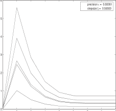

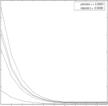

**图3.3**

不同初始向量下(3.7)的收敛情况。

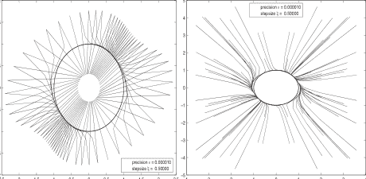


**图3.4**  (3.5)在小初始向量（左图）和大初始向量（右图）下的全局收敛性。

接下来，考虑一个高维空间。协方差矩阵随机生成如下：

$$C=\begin{bmatrix}

0.1712 & 0.1538 & 0.097645 & 0.036741 & 0.07963 & 0.12897 \\

0.1538 & 0.13855 & 0.087349 & 0.033022 & 0.072609 & 0.11643 \\

0.097645 & 0.087349 & 0.067461 & 0.032506 & 0.043641 & 0.070849 \\

0.036741 & 0.033022 & 0.032506 & 0.019761 & 0.016771 & 0.025661 \\

0.07963 & 0.072609 & 0.043641 & 0.016771 & 0.041087 & 0.062108 \\

0.12897 & 0.11643 & 0.070849 & 0.025661 & 0.062108 & 0.098575

\end{bmatrix}.$$

我们选取三个不同的初始向量。权重向量的各分量独立更新。图3.5、图3.6和图3.7给出了演化结果。其中左图展示权重的演化，右图分别展示学习率的演化。在图3.5中，初始向量

$$w(0)=\left[\,0.0092415,\ 0.087626,\ 0.028077,\ 0.062914,\ 0.085038,\ 0.0037035\,\right]^T$$

收敛到向量

$$w^*=\left[\,0.57784,\ 0.52033,\ 0.33672,\ 0.13286,\ 0.27259,\ 0.43592\,\right]^T.$$

其学习率收敛到常数0.98059。

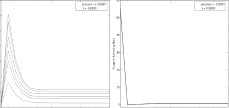

**图3.5**  (3.5)的收敛情况（左图）及学习率收敛到0.98059（右图）。

在图3.6中，初始向量

$$w(0)=\left[\,0.37343,\ 0.20917,\ 0.51432,\ 0.068015,\ 0.49641,\ 0.21005\,\right]^T$$

收敛到向量

$$w^* = \begin{bmatrix}0.57784, 0.52033, 0.33672, 0.13285, 0.27259, 0.43592\end{bmatrix}^{T}.$$

其学习率收敛到常数0.98059。

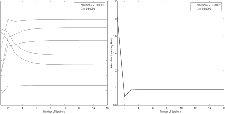

**图3.6**  (3.5)的收敛情况（左图）及学习率收敛到0.98059（右图）。

然后，图3.7展示了初始向量

$$w(0) = \begin{bmatrix}3340.5, 1380.1, 2416.5, 4045, 495.74, 4675.6\end{bmatrix}^{T}$$

收敛到向量

$$w^* = \begin{bmatrix}0.57784, 0.52033, 0.33671, 0.13286, 0.27259, 0.43592\end{bmatrix}^{T}.$$

其学习率收敛到常数0.98059。

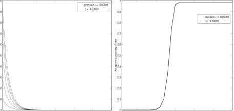

**图3.7**  (3.5)的收敛情况（左图）及学习率收敛到0.98059（右图）。

通过大量实验，进一步证实了系统(3.5)全局收敛，且学习率趋于常数，表明收敛速度非常快。

#### 示例3

通过数值离散化过程，算法(3.5)可写成(3.4)的形式。该算法(3.4)更适用于高性能的在线学习。本节将提供一个图像压缩示例，以说明该方法的这一特性。

将使用图1.5中的Lenna图像和(1.8)中的在线观测序列 `$C_k$` 来训练算法(3.4)，其中 `$C_k$` 满足 `$\lim_{k\to\infty} C_k = C$`（`$k > 0$`）。收敛精度 `$\varepsilon$` 可根据实际需要方便地确定。在以下仿真中，取 `$\varepsilon = 0.00001$`。至于参数 `$\xi$`，较大的 `$\xi$` 会加速收敛，但也会在训练初期引起振荡。较小的 `$\xi$` 会使演化更平滑，但收敛速度相对较低。图3.8展示了同一初始向量在不同 `$\xi$` 下的演化轨迹沿正确方向收敛。

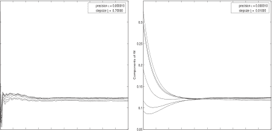

**图3.8**  在 `$\xi = 0.7$`（左图）和 `$\xi = 0.01$`（右图）下(3.4)的收敛情况。

在接下来的仿真中，为清晰地观察演化轨迹，取 `$\xi = 0.01$`。随机生成三个不同的初始向量。在图3.9、图3.10、图3.11中，左图展示了权重向量中八个分量的轨迹，右图分别展示了学习率的演化。可以观察到，不同初始值的权重向量快速收敛到主成分方向，同时学习率趋于常数。显然，所得到的收敛速度非常快。

接下来，取 `$\xi = 0.5$`，进一步研究(3.4)的全局收敛性和收敛速度。选取八个除原点外的任意初始值，每个初始值重复测试20次。平均结果如表3.2所示。显然，任意初始权重向量始终沿正确方向收敛，成功率为100%；学习率 `$\eta(k)$` 收敛到常数，因此所得的演化速度不会越来越慢。同时，提取第一主成分并重建图像。平均信噪比（SNR）也已在表3.2中给出。重建图像如图3.12所示，对应的初始值为2.3083e+011，信噪比为35.7643。

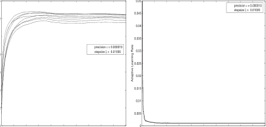

**图3.9**  (3.4)在小初始向量（范数 = 0.2495）下的收敛情况。

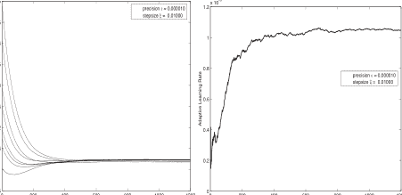

**图3.10**  (3.4)在中等初始向量（范数 = 2.5005）下的收敛情况。

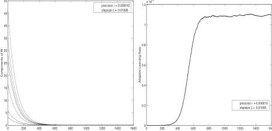

**图3.11**  (3.4)在大初始向量（范数 = 244.7259）下的收敛情况。

**表3.2** 平均信噪比

| 初始值 | `$\eta(k)$` | SNR | 迭代次数 | 收敛值 | 成功率 |
|---:|---:|---:|---:|---:|---:|
| 2.0538e-008 | 0.0541 | 35.9727 | 997.5500 | 1.0000 | 100% |
| 2.1899e-004 | 0.0535 | 36.1848 | 933.7500 | 1.0000 | 100% |
| 0.2238 | 0.0532 | 35.7743 | 858.5500 | 1.0000 | 100% |
| 4.3269 | 0.0531 | 35.8841 | 1.0529e+003 | 1.0000 | 100% |
| 243.4699 | 0.0535 | 35.2856 | 992.1000 | 1.0000 | 100% |
| 2.3382e+004 | 0.0535 | 35.8815 | 977.2500 | 1.0000 | 100% |
| 2.3601e+006 | 0.0533 | 36.0921 | 961.2500 | 1.0000 | 100% |
| 2.0855e+011 | 0.0537 | 35.9520 | 975.5000 | 1.0000 | 100% |


**图3.12**  Lenna图像的重建图像。

### 3.6  结论

提出了一种非趋零自适应学习率，以保证Oja算法的全局收敛性。利用DDT方法，研究了相应DDT系统的全局收敛性。由于学习率全局收敛到常数，学习过程会随时间加快，且学习参数的选择得以简化。大量实验证实，采用这种非趋零自适应学习率的Oja PCA算法适用于高性能的在线学习。显然，这种非趋零自适应学习率可以推广到其他PCA算法。

## 4 GHA PCA学习算法

### 4.1  引言

广义Hebbian算法（GHA）是实际应用中使用最广泛的算法之一，最早在文献[156]中提出。该算法用于计算多个主成分方向，这些方向张成一个主子空间。

在本章²中，将为GHA提出非趋零学习率。所提出的学习率收敛到某个正常数，从而采用此类学习率的GHA能够轻松满足应用中的计算和跟踪要求。非趋零学习率使所有主成分方向上的收敛速度近似相等[131]，从而加快了演化速度。此外，使用非趋零学习率可以保证GHA的全局收敛性。

本章组织如下。第2节描述问题形式并给出预备知识。第3节给出收敛结果。第4节给出仿真结果与讨论。第5节得出结论。

### 4.2  问题形式与预备知识

对于输入序列(1.1)和图1.2中的网络模型，令k为时间步，l为神经元索引。GHA[156]可由以下

如下随机差分方程：

$$y_l(k)=w_l^T(k)x(k)$$


$$w_l(k+1)=w_l(k)+\eta_l(k)\times\left[y_l(k)x(k)-\sum_{i=1}^{l-1}w_i(k)w_i^T(k)y_l(k)x(k)-y_l^2(k)w_l(k)\right]. \tag{4.1}$$

其中$\eta_l(k)>0$是学习率。

关于(4.1)的收敛性存在一些问题。首先，如果学习率为常数，(4.1)可能不收敛；$l=1$的特例可见文献[195]和[210]。其次，如果学习率趋近于零，则在实际应用中难以满足计算和跟踪要求[40, 195, 202, 210]。

为了克服上述问题，本文提出对GHA采用如下不趋近于零的自适应学习率：

$$\eta_l(k)=\frac{\zeta}{y_l^2(k)},\qquad k>0. \tag{4.2}$$

这种不趋近于零的自适应学习率不仅使GHA容易满足应用中的计算和跟踪要求，而且保证了GHA的全局收敛性。采用学习率(4.2)的GHA可写为

$$w_l(k+1)=w_l(k)+\frac{\zeta}{y_l^2(k)}\times\left[y_l(k)x(k)-\sum_{i=1}^{l-1}w_i(k)w_i^T(k)y_l(k)x(k)-y_l^2(k)w_l(k)\right]. \tag{4.3}$$

其中$k>0$，$0<\zeta<1$。

在下一节中，我们将通过DDT方法研究采用所提学习率的GHA的收敛性。

对(4.2)两边取条件期望$E\{w_l(k+1)\mid w_l(0), w_l(i), i<k\}$，必存在常数$\alpha>0$，使得

$$E\left\{\frac{\zeta}{y_l^2(k)}\right\}=E\left\{\frac{\zeta}{w_l^T(k)x(k)x^T(k)w_l(k)}\right\}$$

$$=\frac{\zeta}{\bar{w}_l^T(k)Cw_l(k)}$$

$$=\frac{\zeta}{\bar{w}_l^T(k)C\bar{w}_l(k)}.$$

其中$\xi=\alpha\zeta>0$，$C=E[x(k)x^T(k)]$。记

$$Y(k)=\left[y_l(k)x(k)-\sum_{i=1}^{l-1}w_i(k)w_i^T(k)y_l(k)x(k)-y_l^2(k)w_l(k)\right].$$

显然，概率$P(Y(k))$和$P\left(\frac{\zeta}{y_l^2(k)}\right)$只依赖于变量$X$的分布。容易看出，$P(Y(k))$不受学习率(4.2)取值的影响；也就是说，学习率(4.2)的取值不提供关于$Y(k)$取值的任何信息。因此，学习率(4.2)与$Y(k)$相互独立。对(4.3)两边取条件期望$E\{w_l(k+1)\mid w_l(0), w_l(i), i<k\}$，具有学习率(4.2)的GHA对应的DDT系统可写为

$$\begin{aligned}
w_l(k+1)&=w_l(k)+E\left\{\frac{\zeta}{y_l^2(k)}\right\}\times E\{Y(k)\}\\
&=w_l(k)+\frac{\zeta}{w_l(k)^TCw_l(k)}\times\\
&\quad E\left\{[x(k)x^T(k)w_l(k)\\
&\qquad-\sum_{i=1}^{l-1}w_i(k)w_i^T(k)x(k)x^T(k)w_l(k)\\
&\qquad-w_l^T(k)x(k)x^T(k)w_l(k)w_l(k)]\right\},\\
&=w_l(k)+\frac{\zeta}{w_l(k)^TCw_l(k)}\times\\
&\quad\left[Cw_l(k)-\sum_{i=1}^{l-1}w_i(k)w_i^TCw_l(k)\\
&\qquad-w_l^T(k)Cw_l(k)w_l(k)\right].\tag{4.4}
\end{aligned}$$

其中$k>0$，$0<\zeta<1$，$C=E\{x(k)x^T(k)\}$。

DDT系统保留了原始算法的离散时间形式，并更真实地反映学习增益的行为。

(4.4)中给出的协方差矩阵$C$是对称非负定矩阵。设$\lambda_i\ (i=1,\ldots,n)$为矩阵$C$的所有特征值，按$\lambda_1>\lambda_2>\cdots>\lambda_p>\lambda_{p+1}=\cdots=\lambda_n=0$排序，并令$v_i$为$C$对应特征值$\lambda_i$的单位特征向量。则$\{v_i\mid i=1,2,\ldots,n\}$构成$\mathbb{R}^n$的一组标准正交基。用$V_{\lambda_i}$表示特征值$\lambda_i$的特征子空间，并令$V_{\lambda_i}^{\perp}$为与$V_{\lambda_i}$正交的子空间。记$V_0$为特征值0对应的零特征子空间，显然，

$$V_0=\operatorname{span}\{v_{p+1},\ldots,v_n\}.$$

由于向量集$\{v_i\mid i=1,2,\ldots,n\}$是$\mathbb{R}^n$的标准正交基，对于$k>0$，$w_l(k)\in\mathbb{R}^n$可表示为

$$w_l(k)=\sum_{i=1}^{n}z_i^{(l)}(k)v_i.\tag{4.5}$$

其中$z_i^{(l)}(k)$（$i=1,\ldots,n$）为某些系数，且$1\le l\le p$。需要指出的是，我们要求$1 \le l \le p$，因为提取与零特征值对应的特征向量在实际中没有意义。显然，

$$w_l^T(k)Cw_l(k)=\sum_{i=1}^{p}\lambda_i\left(z_i^{(l)}(k)\right)^2\geq 0, \tag{4.6}$$

对所有$k>0$成立，其中$1 \le l \le p$。

将用到以下引理。

**引理4.1** *下列不等式成立*

$$\left[1-\xi+\frac{\xi D^2}{s}\right]s\geq 4(1-\xi)\xi D,$$

其中$s>0$，$D>0$，$0<\xi<1$。

证明参见引理3.1。

### 4.3 收敛性分析

本节将研究(4.4)的收敛性。我们将证明，从不在子空间$V_l^\perp$中的初始向量出发，算法(4.4)将收敛到子空间$V_l$中的某个向量。由于$V_l^\perp$的维数小于$n$，$V_l^\perp$的测度为零，因此在任何实际应用中都无法观察到不稳定行为。从这个角度看，算法(4.4)是全局收敛的。该证明将采用数学归纳法完成。

#### 4.3.1 证明概要

将使用数学归纳法证明：利用算法(4.4)，$w_l(k)$收敛到$\pm v_l$，其中$1\leq l\leq p$。

对于$l=1$的情形，引理4.2和引理4.3给出$\|w_1(k)\|$的界：

$$0<\sqrt{\frac{4(1-\xi)\xi\lambda_p}{\lambda_1}}\leq \|w_1(k+1)\|\leq \hat{H}_1,$$

其中$\hat{H}_1$为常数。于是，引理4.4证明$z_i^{(1)}$（$i=2,\ldots,n$）收敛到零，引理4.5证明$z_1^{(1)}$收敛到某个常数。最后，定理4.1证明了$w_1(k)$收敛到$\pm v_1$的结论。

接下来，在假设$\lim_{k\to\infty}w_i(k)=\pm v_i$（$i=1,\ldots,l-1$）的前提下，我们证明$w_l(k)$收敛到$\pm v_l$。引理4.6给出如下界：

$$\sqrt{2\xi(1-\xi)\sqrt{\frac{\hat{\lambda}}{\lambda_1}}}\leq \|w_l(k+1)\|\leq \hat{H}_l,$$

其中$\bar{H}_l$为常数。引理4.7证明$\lim_{k\to\infty} z_i^{(l)}(k)=0$（$i=1,\ldots,l-1$）；引理4.9证明$\lim_{k\to\infty} z_i^{(l)}(k)=0$（$i=l+1,\ldots,p$）。引理4.8给出$z_i^{(l)}$收敛到一个常数。定理4.2证明$w_l(k)$收敛到$\pm v_l$。

下面给出详细内容。

#### 4.3.2 情形1：\(l=1\)

若$l=1$，由(4.4)可得

$$w_1(k+1)=w_1(k)+\frac{\xi}{w_1(k)^T C w_1(k)}\times\left[Cw_1(k)-w_1(k)(Cw_1(k))^T w_1(k)\right].$$

其中$k>0$，$0<\xi<1$。则有

$$w_1(k+1)=(1-\xi)w_1(k)+\xi\frac{Cw_1(k)}{w_1(k)^T Cw_1(k)}. \tag{4.7}$$

其中$k>0$，$0<\xi<1$。将(4.5)和(4.6)代入(4.7)，可得


$$\sum_{i=1}^{n} z_i^{(1)}(k+1)v_i=(1-\xi)\sum_{i=1}^{n}z_i^{(1)}(k)v_i+\frac{\xi\sum_{i=1}^{n}z_i^{(1)}(k)Cv_i}{w_1(k)^T Cw_1(k)}.$$

对所有$k>0$成立。在上述方程两边同时乘以$v_i$，可得

$$z_i^{(1)}(k+1)=(1-\xi)z_i^{(1)}(k)+\frac{\xi\lambda_i z_i^{(1)}(k)}{w_1^T(k)Cw_1(k)},\quad (i=1,\ldots,n). \tag{4.8}$$

对所有$k>0$成立。

我们首先证明$\|w_1(k)\|$有下界。

## 引理4.2
设$w_1(0)\notin V_{\lambda_1}^{\perp}$。则以下不等式成立：

$$\|w_1(k+1)\|\geq\sqrt{\frac{4(1-\xi)\xi\lambda_p}{\lambda_1}}>0,$$

对所有$k>0$成立。

### 证明
由于$\lambda_i\geq\lambda_p$（$i=1,\ldots,p$），可以验证

$$\left[1-\xi+\frac{\xi\lambda_i}{w_1^T(k)Cw_1(k)}\right]^2\geq\left[1-\xi+\frac{\xi\lambda_p}{w_1^T(k)Cw_1(k)}\right]^2>0,\quad (1\leq i\leq p).$$

对所有$k>0$成立。由`(4.6)`和`(4.8)`可得

$$\begin{aligned}
w_1^T(k+1)Cw_1(k+1)
&=\sum_{i=1}^{p}\lambda_i\left(z_i^{(1)}(k+1)\right)^2\\
&=\sum_{i=1}^{p}\left[1-\xi+\frac{\xi\lambda_i}{w_1^T(k)Cw_1(k)}\right]^2\lambda_i\left(z_i^{(1)}(k)\right)^2\\
&\geq\left[1-\xi+\frac{\xi\lambda_p}{w_1^T(k)Cw_1(k)}\right]^2\cdot w_1^T(k)Cw_1(k)\\
&\geq\min_{s>0}\left\{\left[1-\xi+\frac{\xi\lambda_p}{s}\right]^2\cdot s\right\}.
\end{aligned}$$

对所有$k>0$成立。利用引理4.1，可得

$$w_1^T(k+1)Cw_1(k+1)>4(1-\xi)\xi\lambda_p,$$

对所有$k>0$成立。因为对$k\geq 0$，有$\lambda_1\|w_1(k)\|^2\geq w_1^T(k)Cw_1(k)$，所以

$$\|w_1(k+1)\|\geq\sqrt{\frac{4(1-\xi)\xi\lambda_p}{\lambda_1}}>0,$$

对所有$k>0$成立。证明完毕。

接下来，我们证明$\|w_1(k)\|$有上界。

## 引理4.3
设$w_1(0)\notin V_1^\perp$。必存在常数$\tilde H_1$，使得

$$\|w_1(k+1)\|<\tilde H_1,$$

对所有$k>0$成立。

### 证明
由`(4.7)`可得

$$\|w_1(k+1)\|\leq(1-\xi)\|w_1(k)\|+\xi\frac{\|C\|\|w_1(k)\|}{w_1^T(k)Cw_1(k)}.$$

令$d_1=\xi\frac{\|C\|}{\lambda_p}$，则有

$$\begin{aligned}
\|w_1(k+1)\|&\leq(1-\xi)\|w_1(k)\|+\xi\frac{\|C\|\|w_1(k)\|}{\lambda_p\|w_1(k)\|^2}\\
&=(1-\xi)\|w_1(k)\|+\frac{d_1}{\|w_1(k)\|}\\
&=(1-\xi)^k\|w_1(0)\|+d_1\sum_{r=1}^{k}\frac{(1-\xi)^{r-1}}{\|w_1(k-r)\|}.
\end{aligned}$$

对所有 $k>0$ 成立。

由于 $0<\xi<1$，根据引理 4.2，有

$$
\begin{aligned}
\|w_1(k+1)\| &\le (1-\xi)^k\|w_1(0)\|+d_1\sqrt{\frac{\lambda_1}{4(1-\xi)\xi\lambda_p}}\sum_{r=1}^{k}(1-\xi)^{r-1}\\
&\le \lim_{k\to\infty}\left[(1-\xi)^k\|w_1(0)\|\right]+d_1\sqrt{\frac{\lambda_1}{4(1-\xi)\xi\lambda_p}}\sum_{r=1}^{k}(1-\xi)^{r-1}\\
&=\widetilde H_1,
\end{aligned}
$$

其中

$$
\widetilde H_1=\frac{d_1}{\xi}\sqrt{\frac{\lambda_1}{4(1-\xi)\xi\lambda_p}}.
$$

显然，$\widetilde H_1$ 是一个常数。证明完成。

由 `(4.8)` 可得

$$
z_1^{(1)}(k+1)=\left[1-\xi+\frac{\xi\lambda_1}{w_1^T(k)Cw_1(k)}\right]z_1^{(1)}(k), \tag{4.9}
$$

以及

$$
z_j^{(1)}(k+1)=\left[1-\xi+\frac{\xi\lambda_j}{w_1^T(k)Cw_1(k)}\right]z_j^{(1)}(k),\quad 2\le j\le n, \tag{4.10}
$$

对于 $k>0$。然后，给定任意 $H_1>0$，我们定义

$$
S(H_1)=\{w_1\mid \|w_1\|\le H_1\}.
$$

### 引理 4.4
假设 $w_1(0)\notin V_{\lambda_1}^{\perp}$。给定任意 $H_1\ge \widetilde H_1$，若 $w_1(0)\in S(H_1)$，则存在常数 $\theta_1>0$ 和 $\Pi_1>0$，使得

$$
\sum_{j=2}^{n}\left(z_j^{(1)}(k)\right)^2\le \Pi_1\cdot e^{-\theta_1 k},
$$

对所有 $k>0$ 成立，其中

$$
\theta_1=\ln\left(\frac{\xi\lambda_1+(1-\xi)\lambda_1H_1^2}{\xi\lambda_2+(1-\xi)\lambda_1H_1^2}\right)^2>0.
$$

*证明.* 由于 $w_1(0)\notin V_{\lambda_1}^{\perp}$，因此 $z_1^{(1)}(0)\ne0$。给定任意 $i$ $(1\le i\le n)$，有

$$
1-\xi+\xi\frac{\lambda_i}{w_1^T(k)Cw_1(k)}\ge (1-\xi)>0.
$$

对于 $k>0$，其中 $0<\xi<1$。然后，由 `(4.9)` 和 `(4.10)`，对每个 $j$ $(2\leq j\leq n)$，可得

$$
\begin{aligned}
\left[\frac{z_j^{(1)}(k+1)}{z_1^{(1)}(k+1)}\right]^2
&=\left[\frac{1-\xi+\dfrac{\xi\lambda_j}{w_1^T(k)Cw_1(k)}}{1-\xi+\dfrac{\xi\lambda_1}{w_1^T(k)Cw_1(k)}}\right]^2\left[\frac{z_j^{(1)}(k)}{z_1^{(1)}(k)}\right]^2\\
&=\left[\frac{(1-\xi)w_1^T(k)Cw_1(k)+\xi\lambda_j}{(1-\xi)w_1^T(k)Cw_1(k)+\xi\lambda_1}\right]^2\left[\frac{z_j^{(1)}(k)}{z_1^{(1)}(k)}\right]^2\\
&\leq\left[\frac{\xi\lambda_j+(1-\xi)\lambda_1H_1^2}{\xi\lambda_1+(1-\xi)\lambda_1H_1^2}\right]^2\left[\frac{z_j^{(1)}(k)}{z_1^{(1)}(k)}\right]^2\\
&\leq\left[\frac{\xi\lambda_2+(1-\xi)\lambda_1H_1^2}{\xi\lambda_1+(1-\xi)\lambda_1H_1^2}\right]^2\left[\frac{z_j^{(1)}(k)}{z_1^{(1)}(k)}\right]^2\\
&=\left[\frac{z_j^{(1)}(0)}{z_1^{(1)}(0)}\right]^2\cdot e^{-\theta_1(k+1)}.
\end{aligned}
$$


对所有 $k>0$ 成立。

由于 $w_1(k)\in S(H_1)$，根据引理 4.3，$z_j^{(1)}(k)$ 必有界；即存在常数 $b_1>0$，使得对所有 $k\geq 0$ 有 $(z_1^{(1)}(k))^2\leq b_1$。于是，

$$
\sum_{j=2}^{n}(z_j^{(1)}(k))^2=\sum_{j=2}^{n}\left[\frac{z_j^{(1)}(k)}{z_1^{(1)}(k)}\right]^2\cdot(z_1^{(1)}(k))^2\leq\Pi_1e^{-\theta_1k},
$$

对所有 $k>0$ 成立，其中

$$
\Pi_1=b_1\sum_{j=2}^{n}\left[\frac{z_j^{(1)}(0)}{z_1^{(1)}(0)}\right]^2\geq0.
$$

证明完毕。

### 引理 4.5

假设 $w_1(0)\notin V_{\lambda_1}^{\perp}$。给定任意 $H_1\geq\widetilde{H}_1$，若 $w_1(0)\in S(H_1)$，则有

$$
\lim_{k\to+\infty}z_1^{(1)}(k)=(z_1^{(1)})^*,
$$

其中 $(z_1^{(1)})^*$ 为常数。

**证明：** 由于 $w_1(0)\notin V_{\lambda_1}^{\perp}$，因此 $z_1^{(1)}(0)\ne 0$。由 `(4.9)` 可得

$$
z_1^{(1)}(k+1)=(1-\xi)z_1^{(1)}(k)+\xi\left[\frac{\lambda_1z_1^{(1)}(k)}{w_1^T(k)Cw_1(k)}\right].
$$

对于所有 $k>0$，其中 $0<\xi<1$。由 `(4.9)` 可知，若 $z_1^{(1)}(0)>0$，则对所有 $k\ge 0$ 有 $z_1^{(1)}(k)>0$；若 $z_1^{(1)}(0)<0$，则对所有 $k\ge 0$ 有 $z_1^{(1)}(k)<0$。因此，$\lambda_1z_1^{(1)}(k)>0$。根据引理 4.2，必存在常数 $N_1$，使得

$$
0<\frac{\lambda_1z_1^{(1)}(k)}{w_1^T(k)Cw_1(k)}<N_1.
$$

于是

$$
\begin{aligned}
z_1^{(1)}(k+1)&\le (1-\xi)z_1^{(1)}(k)+\xi N_1\\
&=(1-\xi)^kz_1^{(1)}(0)+\sum_{r=1}^{k}(1-\xi)^{r-1}\xi N_1\\
&=(1-\xi)^kz_1^{(1)}(0)+(1-(1-\xi)^k)N_1
\end{aligned}
$$

对所有 $k>0$ 成立。

由于 $0<\xi<1$，有

$$
\lim_{k\to\infty}\left[(1-\xi)^kz_1^{(1)}(0)+(1-(1-\xi)^k)N_1\right]=N_1.
$$

因此，必存在常数 $(z_1^{(1)})^*$，使得

$$
\lim_{k\to\infty}z_1^{(1)}(k+1)=(z_1^{(1)})^*.
$$

尽管 $z_1^{(1)}(0)>0$，结果可类似得到。证明完毕。

### 定理 4.1

假设 $w_1(0)\notin V_1^\perp$。若 $w_1(0)\in S(H_1)$，则

$$
\lim_{k\to\infty}w_1(k)=\pm v_1.
$$

**证明：** 由引理 4.4 和 4.5 可得

$$
\left\{\begin{aligned}
\lim_{k\to\infty}z_1^{(1)}(k)&=(z_1^{(1)})^*,\\
\lim_{k\to\infty}z_i^{(1)}(k)&=0,\qquad (i=2,\ldots,n).
\end{aligned}\right.
$$

因此，我们得到

$$
\lim_{k\to\infty}w_1(k)=(z_1^{(1)})^*v_1.
$$

因此，当系统 `(4.7)` 稳定后，有

$$
\lim_{k\to\infty} Cw_1(k)=\lim_{k\to\infty}w_1^T(k)Cw_1(k).
$$

因此，容易看出

$$
\left[(z_1^{(1)})^*\right]^2=1.
$$

证明完毕。

根据数学归纳法，接下来我们将在假设 $\lim_{k\to\infty}w_i(k)=\pm v_i$, $(i=1,\ldots,l-1)$ 下证明 $w_l(k)$ 收敛到 $\pm v_l$。

#### 4.3.3 情形 2：$1<l\le p$

假设存在某些常数 $H_i$ $(i=1,\ldots,l-1)$，使得

- A1. $0<\lvert w_i(k)\rvert\le H_i$, $(i=1,\ldots,l-1)$
- A2. $\lim_{k\to\infty}w_i(k)=\pm v_i$, $(i=1,\ldots,l-1)$
- A3. $w_i(k)\notin V_0$，对于所有 $k>0$。

我们将证明 $\lim_{k\to\infty}w_l(k)=\pm v_l$。根据假设 A2，有

$$
w_i(k)=v_i+\varphi_i(k),\qquad (i=1,\ldots,l-1),
$$

对所有 $k>0$ 成立，其中 $\lim_{k\to\infty}\lvert\varphi_i(k)\rvert=0$。由 `(4.4)`，我们有

$$
\begin{aligned}
w_l(k+1)={}&w_l(k)+\frac{\xi}{w_l^T(k)Cw_l(k)}\bigg[Cw_l(k)-\sum_{i=1}^{l-1}(v_i+\varphi_i(k))(v_i+\varphi_i(k))^TCw_l(k)\\
&\qquad -w_l^T(k)Cw_l(k)w_l(k)\bigg],\tag{4.11}\\
={}&w_l(k)+\frac{\xi}{w_l^T(k)Cw_l(k)}\bigg[Cw_l(k)-\sum_{i=1}^{l-1}v_iv_i^TCw_l(k)-w_l^T(k)Cw_l(k)w_l(k)+\phi_l(k)\bigg],
\end{aligned}
$$

对所有 $k>0$ 成立，其中

$$
\phi_l(k)=-\xi\frac{\displaystyle\sum_{i=1}^{l-1}\left[\varphi_i(k)v_i^T+v_i\varphi_i(k)^T+\varphi_i(k)\varphi_i(k)^T\right]Cw_l(k)}{w_l^T(k)Cw_l(k)}.
$$

令 $\phi_{li}(k)=v_i^T\phi_l(k)$。将 `(4.5)` 和 `(4.6)` 代入 `(4.11)`，对所有 $k>0$，可得

$$
z_i^{(l)}(k+1)=(1-\xi)z_i^{(l)}(k)+\phi_{li}(k), \tag{4.12}
$$

对于 $i=1,\ldots,l-1$，以及

$$
z_i^{(l)}(k+1)=\left\{1-\xi+\frac{\xi\lambda_i}{w_l^T(k)Cw_l(k)}\right\}z_i^{(l)}(k)+\phi_{li}(k), \tag{4.13}
$$

对于 $i=l,\ldots,n$，其中 $\phi_{li}(k)=v_i^T\phi_l(k)$。

令

$$
\widetilde{C}_l(k)=C-\sum_{i=1}^{l-1}w_i(k)w_i^T(k)C,\qquad (1\leq l\leq p),
$$

对所有 $k>0$ 成立。根据假设 A1，必存在常数 $M_l$，使得对所有 $k\geq0$ 有 $0\leq\|\widetilde{C}_l(k)\|<M_l$。记 $V_0^{(l)}(k)$ 为矩阵 $\widetilde{C}_l(k)$ 的与特征值 $0$ 对应的零子空间，$\Lambda_{\min}^{(l)}(k)$ 为 $\widetilde{C}_l(k)$ 的最小非零特征值。显然，对所有 $k>0$ 有 $\Lambda_{\min}^{(l)}(k)>0$。由 `(4.4)` 可得

$$
w_l(k+1)=(1-\xi)w_l(k)+\xi\frac{\widetilde{C}_l(k)w_l(k)}{w_l(k)^TCw_l(k)}, \tag{4.14}
$$

对于 $k>0$ 且 $0<\xi<1$。

##### 引理 4.6

假设对所有 $k>0$，$w_l(k)\notin V_0^{(l)}(k)$。$\|w_l(k+1)\|$ 最终有界；即必存在常数 $K_l>0$，使得

$$
\sqrt{2\xi(1-\xi)\sqrt{\frac{\widetilde{\Lambda}}{\lambda_1}}}<\|w_l(k+1)\|<\widetilde{H}_l,
$$


对所有 $k\geq K_l$ 成立，其中 $\widetilde{\Lambda}=\min\{\Lambda_{\min}^{(l)}(k),k\geq0\}$，且

$$
\widetilde{H}_l=\dfrac{M_l}{\lambda_p\sqrt{2\xi(1-\xi)\sqrt{\widetilde{\Lambda}/\lambda_1}}}.
$$

*证明：* 由 (4.14) 可得

$$
\begin{aligned}
\|w_l(k+1)\|^2={}&w_l(k+1)^Tw_l(k+1)\\
={}&(1-\xi)^2\|w_l(k)\|^2\\
&+2\xi(1-\xi)\frac{w_l(k)^T\widetilde{C}_l(k)w_l(k)}{w_l(k)^TCw_l(k)}\\
&+\xi^2\frac{w_l(k)^T\widetilde{C}_l(k)^T\widetilde{C}_l(k)w_l(k)}{[w_l(k)^TCw_l(k)]^2},
\end{aligned}
$$

对于 $k>0$。由于对所有 $k\geq0$，$w_l(k)\notin V_0^{(l)}(k)$，且根据假设 A2，必存在常数 $K_l$，使得

$$
w_l(k)^T\widetilde{C}_l(k)w_l(k)\geq0,
$$

对所有 $k>K_l$ 成立。于是

$$
\begin{aligned}
\|w_l(k+1)\|^2
&\ge (1-\xi)^2\|w_l(k)\|^2
+\xi^2\frac{w_l^T(k)\tilde C_l(k)\tilde C_l^T(k)w_l(k)}{[w_l^T(k)\tilde C_l(k)w_l(k)]^2}\\
&=(1-\xi)^2\|w_l(k)\|^2+\xi^2\frac{\tilde\Lambda}{\lambda_1\|w_l(k)\|^2}\\
&\ge 2\xi(1-\xi)\sqrt{\frac{\tilde\Lambda}{\lambda_1}}.
\end{aligned}
$$

对于 $k\ge K_l$，其中 $\tilde\Lambda=\min\{\Lambda_{\min}^{(l)}(k),\,k>0\}$。

由于 $0<\xi<1$，根据假设 A3 和 (4.14)，可得

$$
\begin{aligned}
\|w_l(k+1)\|
&\le (1-\xi)\|w_l(k)\|+\xi\frac{M_l}{\lambda_p\|w_l(k)\|}\\
&=(1-\xi)^k\|w_l(0)\|+\xi\frac{M_l}{\lambda_p}\sum_{i=1}^{k}\frac{(1-\xi)^{i-1}}{\|w_l(k-i)\|}\\
&\le (1-\xi)^k\|w_l(0)\|+\xi\tilde H_l\sum_{i=1}^{k}(1-\xi)^{i-1}\\
&\le \tilde H_l.
\end{aligned}
$$

对于 $k\ge K_l$，其中

$$
\tilde H_l=\dfrac{M_l}{\lambda_p\sqrt{2\xi(1-\xi)\sqrt{\frac{\tilde\Lambda}{\lambda_1}}}}.
$$

证明完毕。

该引理要求对所有 $k\ge 0$，$w_l(k)\neq V_0^{(l)}(k)$。这个条件通常可以满足。这是因为 $\tilde C_l(k)$ 会随时间变化，而 $V_0^{(l)}(k)$ 只是一个变化的子空间。然而，由于 $l\le p$，$\tilde C_l(k)$ 可能不会随时间收敛到零。

根据引理 4.6，我们有

$$
\begin{aligned}
\|\phi_l(k)\|
&=\left\|\frac{\displaystyle\sum_{i=1}^{l-1}\left[\phi_i(k)v_i^T+v_i\phi_i(k)^T+\phi_i(k)\phi_i(k)^T\right]Cw_l(k)}{w_l^T(k)Cw_l(k)}\right\|\\
&\leq \zeta\frac{\lambda_1}{\lambda_p\sqrt{2\xi(1-\xi)}\sqrt{\frac{\lambda_p}{\lambda_1}}}\times
\left\|\xi\sum_{i=1}^{l-1}\left[\phi_i(k)v_i^T+v_i\phi_i(k)^T+\phi_i(k)\phi_i(k)^T\right]\right\|.
\end{aligned}
$$

对于 $k>K_l$ 成立。根据假设 A2，$\lim_{k\to\infty}\|\phi_l(k)\|=0$。显然，$\lim_{k\to\infty}\phi_l(k)=0$。

### 引理 4.7

假设 $\lim_{k\to\infty}\phi_i(k)=0$，$(i=1,\ldots,l-1)$。则有

$$
\lim_{k\to\infty}z_i^{(l)}(k)=0,\qquad (i=1,\ldots,l-1).
$$

*证明：* 由（4.12），对任意 $i\ (i=1,\ldots,l-1)$，可得

$$
\begin{aligned}
z_i^{(l)}(k+1)&=(1-\xi)z_i^{(l)}(k)+\phi_i(k),\\
&=(1-\xi)^kz_i^{(l)}(0)+\sum_{r=1}^{k}(1-\xi)^{r-1}\phi_i(k-r)
\end{aligned}
$$

对所有 $k>0$ 成立。由于 $0<\xi<1$ 且 $\lim_{k\to\infty}\phi_i(k)=0$，因此

$$
\begin{aligned}
\lim_{k\to\infty}z_i^{(l)}(k+1)
&=\lim_{k\to\infty}\left[(1-\xi)^kz_i^{(l)}(0)+\sum_{r=1}^{k}(1-\xi)^{r-1}\phi_i(k-r)\right]\\
&=0.
\end{aligned}
$$

证明完毕。

对任意 $H_l>0$，我们定义

$$
S(H_l)=\{w_l\mid \|w_l\|\leq H_l\}.
$$

### 引理 4.8

假设 $\lim_{k\to\infty}\phi_i(k)=0$，$(i=l,\ldots,p)$。对任意 $H_l\geq \widetilde{H}_l$，如果 $w_l(0)\in S(H_l)$，则必存在常数 $\delta>0$，使得

$$
\lim_{k\to\infty}z_l^{(l)}(k)=\left(z_l^{(l)}\right)^*,
$$

且 $\left|\left(z_l^{(l)}\right)^*\right|>\delta$，其中 $\left(z_l^{(l)}\right)^*$ 是一个常数。

*证明：* 由（4.13），若 $i=l$，则

$$
z_l^{(l)}(k+1)=\left\{1-\xi+\frac{\xi\lambda_l}{w_l^T(k)Cw_l(k)}\right\}z_l^{(l)}(k)+\phi_l(k),
$$

对所有 $k>0$ 成立。由于 $\lim_{k\to\infty}\phi_i(k)=0$，$(i=l,\ldots,p)$，存在 $\widetilde{K}_l$ 使得

$$
\begin{cases}
z_l^{(l)}(k+1)>0, & \text{if }z_l^{(l)}(\widetilde{K}_l)>0\text{ for all }k\geq\widetilde{K}_l,\\
z_l^{(l)}(k+1)<0, & \text{if }z_l^{(l)}(\widetilde{K}_l)<0\text{ for all }k\geq\widetilde{K}_l.
\end{cases}
$$

由于 $w_l(0)\in S(H_l)$，根据引理 4.6，对所有 $k\geq K_l$ 有 $w_l(k)\in S(H_l)$。如果 $z_l^{(l)}(\widetilde{K}_l)>0$，则存在常数 $N_l$ 使得

$$
\left\{\frac{\xi\lambda_l}{w_l^T(k)Cw_l(k)}\right\}z_l^{(l)}(k)+\phi_l(k)<N_l,
$$

对所有 $k\geq\max\{K_l,\widetilde{K}_l\}$ 成立。由此可得

$$
\begin{aligned}
z_l^{(l)}(k+1)&\leq (1-\xi)z_l^{(l)}(k)+N_l\\
&=(1-\xi)^kz_l^{(l)}(0)+\sum_{r=1}^{k}(1-\xi)^{r-1}N_l\\
&=(1-\xi)^kz_l^{(l)}(0)+\left(1-(1-\xi)^k\right)N_l,
\end{aligned}
$$

对所有 $k\geq K_l$ 成立。由于 $0<\xi<1$，因此


$$
\lim_{k\to\infty}\left[(1-\xi)^kz_l^{(l)}(0)+\left(1-(1-\xi)^k\right)N_l\right]=N_l.
$$

显然，必存在常数 $\left(z_l^{(l)}\right)^*$ 使得
$$
\lim_{k\to\infty}z_l^{(l)}(k)=\left(z_l^{(l)}\right)^*,
$$
其中 $\left(z_l^{(l)}\right)^*$ 是一个常数。如果 $z_l^{(l)}(\widetilde{K}_l)<0$，同理可得相同结果。接下来，我们将证明存在常数 $\delta>0$ 使得 $\left|\left(z_l^{(l)}\right)^*\right|>\delta$。

如果这不成立，则意味着 $\lim_{k\to+\infty}|z_l^{(l)}(k)|=0$。我们将证明这会导致矛盾。

由于 $\lim_{k\to+\infty}\phi_i(k)=0$（$i=l,\ldots,p$），由（4.13）可得
$$
\begin{aligned}
|z_l^{(l)}(k+1)|
&=\left|\left[(1-\xi)+\frac{\xi\lambda_l}{w_l^T(k)Cw_l(k)}\right]z_l^{(l)}(k)+\phi_l(k)\right|,\\
&=\left(1-\xi+\frac{\xi\lambda_l}{w_l^T(k)Cw_l(k)}\right)|z_l^{(l)}(k)|+\phi'_l(k),
\end{aligned}
$$
对所有 $k\ge K_l$ 成立，其中 $\lim_{k\to+\infty}\phi'_l(k)=0$。且对于 $i=l+1,\ldots,n$，我们有
$$
\begin{aligned}
|z_i^{(l)}(k+1)|
&=\left|\left[(1-\xi)+\frac{\xi\lambda_i}{w_l^T(k)Cw_l(k)}\right]z_i^{(l)}(k)+\phi_i(k)\right|,\\
&=\left(1-\xi+\frac{\xi\lambda_i}{w_l^T(k)Cw_l(k)}\right)|z_i^{(l)}(k)|+\phi'_i(k),
\end{aligned}
$$
对所有 $k\ge K_l$ 成立，其中 $\lim_{k\to+\infty}\phi'_i(k)=0$。显然，
$$
\left(1-\xi+\frac{\xi\lambda_l}{w_l^T(k)Cw_l(k)}\right)\ge\left(1-\xi+\frac{\xi\lambda_i}{w_l^T(k)Cw_l(k)}\right)>0,\quad (i=l+1,\ldots,n).
$$

如果 $k$ 足够大，不难证明 $|z_i^{(l)}(k+1)|\ge |z_i^{(l)}(k)|$。因此，若 $\lim_{k\to+\infty}|z_l^{(l)}(k)|=0$，则 $\lim_{k\to+\infty}|z_i^{(l)}(k)|=0$（$i=l+1,\ldots,n$）。所以，
$$
\lim_{k\to+\infty}\sum_{i=l}^{p}\lambda_i\bigl(z_i^{(l)}(k)\bigr)^2=0.
$$

然而，由（4.7），我们有
$$
w_l(k)^TCw_l(k)=\sum_{i=1}^{l}\lambda_i\bigl(z_i^{(l)}(k)\bigr)^2+\sum_{i=l+1}^{p}\lambda_i\bigl(z_i^{(l)}(k)\bigr)^2,
$$
对所有 $k\ge 0$ 成立。根据引理 4.6 和 4.7，有
$$
\lim_{k\to+\infty}\sum_{i=1}^{p}\lambda_i\bigl(z_i^{(l)}(k)\bigr)^2>2\lambda_p\xi(1-\xi)\sqrt{\frac{\overline{\Lambda}}{\underline{\Lambda}}}>0,
$$
这与事实矛盾。这表明必存在常数 $\delta>0$ 使得 $|z_l^{(l)}|>\delta$。

证明完毕。

## 引理 4.9

假设 $\lim_{k\to\infty}|\phi_i(k)|=0$，$(i=l,\ldots,p)$，且 $w_l(0)\notin V_{\lambda_l}^{\perp}$。对任意 $H_l\ge \widetilde{H}_l$，如果 $w_l(0)\in S(H_l)$，则存在常数 $\theta_l>0$、$\Pi_l\ge0$ 和 $\widetilde{K}_l>0$，使得
$$
\sum_{j=l+1}^{n}\left(z_j^{(l)}(k)\right)^2\le \Pi_l\cdot e^{-\theta_l k},
$$
对所有 $k>\max\{K_l,\widetilde K_l\}$ 成立，其中
$$
\theta_l=\ln\left(\frac{\xi\lambda_l+(1-\xi)\lambda_lH_l^2}{\xi\lambda_{l+1}+(1-\xi)\lambda_lH_l^2}\right)^2>0.
$$

*证明：* 由于 $w_l(0)\notin V_{\lambda_l}^{\perp}$，因此 $z_l^{(l)}(0)\ne0$。于是，由（4.13），对每个 $j$（$l+1\le j\le n$），可得
$$
\left[\frac{z_j^{(l)}(k+1)}{z_l^{(l)}(k+1)}\right]^2=\left[\frac{\left(1-\xi+\dfrac{\xi\lambda_j}{w_l^T(k)Cw_l(k)}\right)z_j^{(l)}(k)+\phi_{lj}}{\left(1-\xi+\dfrac{\xi\lambda_l}{w_l^T(k)Cw_l(k)}\right)z_l^{(l)}(k)+\phi_{ll}}\right]^2
$$
$$
=\left[\frac{1-\xi+\dfrac{\xi\lambda_j}{w_l^T(k)Cw_l(k)}}{1-\xi+\dfrac{\xi\lambda_l}{w_l^T(k)Cw_l(k)}}\right]^2\cdot\left[\frac{z_j^{(l)}(k)}{z_l^{(l)}(k)}\right]^2+\psi_l(k).
$$

对所有 $k>0$ 成立，其中
$$
\begin{aligned}
\psi_l(k)={}&\left[2\left(1-\xi+\frac{\xi\lambda_l}{w_l^T(k)Cw_l(k)}\right)\right]\left(1-\xi+\frac{\xi\lambda_j}{w_l^T(k)Cw_l(k)}\right)z_j^{(l)}(k)z_l^{(l)}(k)\\
&+\left(1-\xi+\frac{\xi\lambda_l}{w_l^T(k)Cw_l(k)}\right)z_l^{(l)}(k)\phi_{lj}\\
&+\left(1-\xi+\frac{\xi\lambda_j}{w_l^T(k)Cw_l(k)}\right)z_j^{(l)}(k)\phi_{ll}\\
&+\left(1-\xi+\frac{\xi\lambda_j}{w_l^T(k)Cw_l(k)}\right)\phi_{lj}\phi_{ll}
\end{aligned}
\left[\frac{P_l(k)}{Q_l(k)^2}\right].
$$

同时，
$$
P_l(k)=\left[\left(1-\xi+\frac{\xi\lambda_j}{w_l^T(k)Cw_l(k)}\right)z_j^{(l)}(k)\right]\phi_{lj}-\left[\left(1-\xi+\frac{\xi\lambda_l}{w_l^T(k)Cw_l(k)}\right)z_l^{(l)}(k)\right]\phi_{ll}.
$$

且
$$
Q_l(k)=\left\{\left[\left(1-\xi+\frac{\xi\lambda_l}{w_l^T(k)Cw_l(k)}\right)z_l^{(l)}(k)\right]^2+\left[\left(1-\xi-\frac{\xi\lambda_l}{w_l^T(k)Cw_l(k)}\right)z_l^{(l)}(k)\right]^2\right\},
$$
对所有 $k>0$ 成立。由于 $\lim_{k\to\infty}|\phi_i(k)|=0$（$i=1,\ldots,p$），根据引理 4.6，可得 $\lim_{k\to\infty}|\psi(k)|=0$。根据引理 4.8，可得 $\lim_{k\to\infty}[Q_l(k)]^2>\delta^2$。因此容易看出 $\lim_{k\to\infty}|\psi_l(k)|=0$。


对任意 $i$（$1\le i\le n$），可以验证

$$
1-\xi+\xi\left(\frac{\lambda_i}{w_l^T(k)Cw_l(k)}\right)\ge (1-\xi)>0,
$$

对于 $k\ge1$ 成立，其中 $0<\xi<1$。因此，必存在常数 $\tilde K_l$ 使得

$$
\left[\frac{z_j^{(l)}(k+1)}{z_l^{(l)}(k+1)}\right]^2\le \left[\frac{\xi\lambda_j+(1-\xi)\lambda_lH_l^2}{\xi\lambda_l+(1-\xi)\lambda_lH_l^2}\right]^2\left[\frac{z_j^{(l)}(k)}{z_l^{(l)}(k)}\right]^2
$$

$$
\le \left[\frac{\xi\lambda_{l+1}+(1-\xi)\lambda_lH_l^2}{\xi\lambda_l+(1-\xi)\lambda_lH_l^2}\right]^2\left[\frac{z_j^{(l)}(k)}{z_l^{(l)}(k)}\right]^2
$$

$$
=\left[\frac{z_j^{(l)}(0)}{z_l^{(l)}(0)}\right]^2e^{-\theta_l(k+1)},
$$

对 $k>\tilde K_l$ 成立。

由于 $w_l(0)\in S(H_l)$，根据引理 4.6，$z_l^{(l)}(k)$ 必定最终有界；即存在常数 $b_l>0$，使得对所有 $k\ge K_l$ 有 $(z_l^{(l)}(k))^2\le b_l$。于是，

$$
\sum_{j=l+1}^{n}(z_j^{(l)}(k))^2=\sum_{j=l+1}^{n}\left[\frac{z_j^{(l)}(k)}{z_l^{(l)}(k)}\right]^2(z_l^{(l)}(k))^2\le \Pi_l e^{-\theta_l k},
$$

对 $k\ge\max\{K_l,\tilde K_l\}$ 成立，其中

$$
\Pi_l=b_l\sum_{j=l+1}^{n}\left[\frac{z_j^{(l)}(0)}{z_l^{(l)}(0)}\right]^2\ge0.
$$

证明完毕。

## 定理 4.2

*假设* $\lim_{k\to\infty}|\phi_i(k)|=0$，$(i=1,\ldots,p)$，*且* $w_l(0)\notin V_{\lambda_l}^{\perp}$。

*对任意* $H_l\ge \widetilde{H}_l$，*如果* $w_l(0)\in S(H_l)$，*则*

$$
\lim_{k\to\infty}w_l(k)=\pm v_l.
$$

其中 $1 \leq l \leq p$。

**证明：**由引理 4.7、4.8 和 4.9 可得

$$
\begin{cases}
\displaystyle\lim_{k\to+\infty}z_i^{(l)}(k)=0, & (i=1,\ldots,l-1),\\
\displaystyle\lim_{k\to+\infty}z_l^{(l)}(k)=(z_l^{(l)})^*, & \\
\displaystyle\lim_{k\to+\infty}z_i^{(l)}(k)=0, & (i=l+1,\ldots,n).
\end{cases}
$$

于是，

$$\lim_{k\to+\infty}w_l(k)=(z_l^{(l)})^*v_l. \tag{4.15}$$

由 (4.4)，在系统稳定后，可得

$$\lim_{k\to+\infty}Cw_l(k)=\lim_{k\to+\infty}\left[\sum_{i=1}^{l-1}v_i(k)v_i^T(k)Cw_l(k)+w_l^T(k)Cw_l(k)w_l(k)\right]. \tag{4.16}$$

将 (4.15) 代入 (4.16)，可得

$$\lambda_l(z_l^{(l)})^*v_l=\lambda_l\big((z_l^{(l)})^*\big)^2(z_l^{(l)})^*v_l.$$

容易看出

$$\left((z_l^{(l)})^*\right)^2=1.$$

证毕。

在前述定理中，需要条件 $w_l(0)\notin V_l^\perp$。由于任何微小扰动都可能导致 $w_l(0)\notin V_l^\perp$，因此在实际应用中该条件容易满足。

在我们的假设中，还要求对所有 $k\geq 0$ 有 $w_l(k)\notin V_0$。由于提取的主方向与非零特征值相关联，且演化轨迹始终接近主方向，因此该条件通常能够满足。下面的引理将进一步说明这一点。

## 引理 4.10

假设 $\displaystyle\lim_{k\to+\infty}\phi_i^{(l)}(k)=0$，$(i=1,\ldots,p)$。则存在常数 $\hat K_l$，使得

$$0<\sqrt{\frac{4(1-\xi)\xi\lambda_p}{\lambda_1}}\leq\lVert w_l(k+1)\rVert\leq\frac{M_l}{\lambda_p}\sqrt{\frac{\lambda_1}{4(1-\xi)\xi\lambda_p}},$$

对所有 $k\geq\max\{K_l,\hat K_l\}$ 成立，其中 $0<\xi<1$。

**证明：**可以验证

$$\left[1-\xi+\frac{\xi\lambda_i}{w_l^T(k)Cw_l(k)}\right]^2\geq\left[1-\xi+\frac{\xi\lambda_p}{w_l^T(k)Cw_l(k)}\right]^2>0,$$

对于 $k>0$ 成立。由 (4.6)、(4.12) 和 (4.13) 可得如下 $\Gamma$：

$$
\begin{aligned}
\Gamma &= w_l^T(k+1)Cw_l(k+1) \\
&=\sum_{i=1}^{p}\lambda_i\left(z_i^{(l)}(k+1)\right)^2 \\
&=\sum_{i=1}^{p}\left[(1-\xi)z_i^{(l)}(k)+\phi_i^{(l)}(k)\right]^2\lambda_i+\sum_{i=1}^{p}\left[1-\xi+\frac{\xi\lambda_i}{w_l^T(k)Cw_l(k)}\right]\left[z_i^{(l)}(k)+\phi_i^{(l)}(k)\right]^2\lambda_i \\
&=\sum_{i=1}^{p}\left\{\left[1-\xi+\frac{\xi\lambda_i}{w_l^T(k)Cw_l(k)}\right]\left[z_i^{(l)}(k)+\phi_i^{(l)}(k)\right]\right\}^2\lambda_i \\
&=\sum_{i=1}^{p}\left\{\left[1-\xi+\frac{\xi\lambda_i}{\displaystyle\sum_{j=1}^{p}\lambda_j\left(z_j^{(l)}(k)\right)^2}\right]\left[z_i^{(l)}(k)+\phi_i^{(l)}(k)\right]\right\}^2\lambda_i \\
&=\sum_{i=1}^{p}\left\{\left[1-\xi+\frac{\xi\lambda_i}{\displaystyle\sum_{j=1}^{p}\lambda_j\left(z_j^{(l)}(k)\right)^2}\right]\left(z_i^{(l)}(k)+\phi_i^{(l)}(k)\right)\right. \\
&\qquad\left.-\frac{\xi\lambda_i z_i^{(l)}(k)\displaystyle\sum_{j=1}^{p}\lambda_j\left(z_j^{(l)}(k)\right)^2}{w_l^T(k)Cw_l(k)\displaystyle\sum_{j=1}^{p}\lambda_j\left(z_j^{(l)}(k)\right)^2}\right\}\lambda_i \\
&=\sum_{i=1}^{p}\left[1-\xi+\frac{\xi\lambda_i}{\displaystyle\sum_{j=1}^{p}\lambda_j\left(z_j^{(l)}(k)\right)^2}\right]\left(\left(z_i^{(l)}(k)\right)^2\lambda_i+\Psi_i^{(l)}(k)\right),
\end{aligned}
$$

其中


$$\Psi_i^{(l)}(k)=2\left[1-\xi+\frac{\xi\lambda_i}{\displaystyle\sum_{j=1}^{p}\lambda_j\left(z_j^{(l)}(k)\right)^2}\right]z_i^{(l)}(k)\phi_i^{(l)}(k)\lambda_i+\left(\phi_i^{(l)}(k)\right)^2\lambda_i.$$

同时，

$$\Phi_i^{(l)}(k)=\phi_i^{(l)}(k)-\frac{\xi\lambda_i z_i^{(l)}(k)\displaystyle\sum_{j=1}^{l-1}\lambda_j\left(z_j^{(l)}(k)\right)^2}{w_l^T(k)Cw_l(k)\displaystyle\sum_{j=1}^{p}\lambda_j\left(z_j^{(l)}(k)\right)^2}.$$

由于 $\lim_{k\to\infty}\phi_i^{(l)}(k)=0$，$(i=1,\ldots,p)$，由引理 4.6 和 4.7 可知 $\lim_{k\to\infty}\Phi_i^{(l)}(k)=0$。因此，$\lim_{k\to\infty}\Psi_i^{(l)}(k)=0$。于是，必存在常数 $\hat K_l$，使得

$$
\begin{aligned}
w_l^T(k+1)Cw_l(k+1) &\geq \sum_{i=1}^{p}\left[1-\xi+\frac{\xi\lambda_i}{\displaystyle\sum_{j=1}^{p}\lambda_j\left(z_j^{(l)}(k)\right)^2}\right]^2\left(z_i^{(l)}(k)\right)^2\lambda_i \\
&\geq \left[1-\xi+\frac{\xi\lambda_p}{\displaystyle\sum_{j=1}^{p}\lambda_j\left(z_j^{(l)}(k)\right)^2}\right]^2\sum_{i=1}^{p}\left(z_i^{(l)}(k)\right)^2\lambda_i \\
&\geq \min_{s\geq 0}\left[1-\xi+\frac{\xi\lambda_p}{s}\right]^2s,
\end{aligned}
$$

对所有 $k>\hat K_l$ 成立。由引理 4.1，有

$$w_l^T(k+1)Cw_l(k+1)\geq 4(1-\xi)\xi\lambda_p,$$

对于 $k\geq\hat K_l$ 成立。由于 $\lambda_1\lVert w_l(k+1)\rVert^2\geq w_l^T(k+1)Cw_l(k+1)$，可得

$$\lVert w_l(k+1)\rVert\geq\sqrt{\frac{4(1-\xi)\xi\lambda_p}{\lambda_1}}>0,$$

对于 $k\geq\hat K_l$ 成立，其中 $0<\xi<1$。

然后，由引理 4.6 容易看出

$$\lVert w_l(k+1)\rVert\leq (1-\xi)^k\lVert w_l(0)\rVert+\xi\frac{M_l}{\lambda_p}\sum_{i=1}^{k}\frac{(1-\xi)^{i-1}}{\lVert w_l(k-i)\rVert}.$$

对所有 $k \ge K_l$ 成立，其中 $\lambda_p < r(k) < \lambda_1$。由于 $0 < \xi < 1$，有

$$
\begin{aligned}
\|w_l(k+1)\| &\leq (1-\xi)^k\|w_l(0)\|+\xi\frac{M_l}{\sqrt{4}}\sqrt{\frac{\lambda_1}{(1-\xi)\xi\lambda_p}}\sum_{i=1}^{k}(1-\xi)^{i-1}\\
&\leq \frac{M_l}{\lambda_p}\sqrt{\frac{\lambda_1}{4(1-\xi)\xi\lambda_p}}.
\end{aligned}
$$

对于 $k \ge \max\{K_l, \hat K_l\}$ 成立。证毕。

该引理表明，当 $k$ 充分增大时，可得到更小的最终界。显然，在这种情况下，条件 $w_l(k) \notin V_0$ 得到满足。

### 4.4 仿真与讨论

本节将提供三组实验，以说明具有这种非零趋近自适应学习率的 GHA 的收敛性。

#### 4.4.1 示例 1

为了清楚地观察收敛轨迹，首先在二维空间中说明 (4.4) 的收敛性质。设 $R^2$ 中的一个对称正定矩阵为

$$C=\begin{bmatrix}5 & 1\\1 & 3\end{bmatrix}.$$

其特征值为 5.4142 和 2.5858。与这些特征值对应的单位特征向量分别为 $\pm[0.9239, 0.3827]^T$ 和 $\pm[-0.3827,0.9239]^T$。图 4.1 和图 4.2 展示了从 $R^2$ 中随机选取的点出发的轨迹收敛到特征向量。图 4.1 和图 4.2 的上图显示 $w_1$ 的轨迹，下图显示 $w_2$ 的轨迹。显然，所有轨迹都沿着正确的方向收敛。

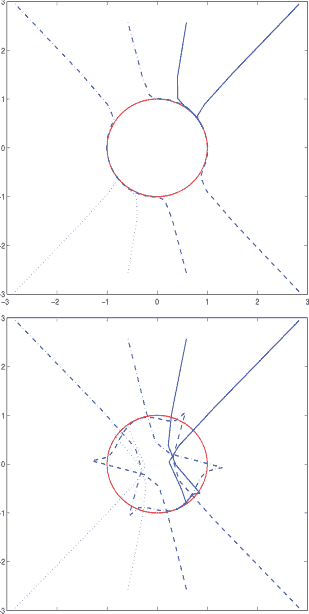

**图 4.1** 第一主方向 $w_1$ 的轨迹在 $\xi = 0.5$ 时收敛到特征向量 $\pm[0.9239, 0.3827]^T$（上图），第二主方向 $w_2$ 的轨迹在 $\xi = 0.5$ 时收敛到特征向量 $\pm[-0.3827, 0.9239]^T$（下图）。

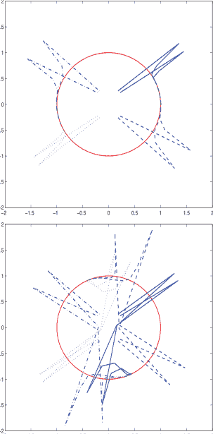

**图 4.2** 第一主方向 $w_1$ 的轨迹在 $\xi = 0.5$ 时收敛到特征向量 $\pm[0.9239, 0.3827]^T$（上图），第二主方向 $w_2$ 的轨迹在 $\xi = 0.5$ 时收敛到特征向量 $\pm[-0.3827, 0.9239]^T$（下图）。

#### 4.4.2 示例 2

我们将在高维空间中进一步说明 (4.4) 的收敛性。考虑如下随机生成的协方差矩阵 $C$。

$$C=\begin{bmatrix}0.0267&-0.0030&-0.0139&0.0001&0.0317&0.0106\\-0.0030&0.0240&0.0016&-0.0000&-0.0036&-0.0012\\-0.0139&0.0016&0.0072&-0.0001&-0.0165&-0.0055\\0.0001&-0.0000&-0.0001&0.0020&0.0002&0.0001\\0.0317&-0.0036&-0.0165&0.0002&0.0377&0.0126\\0.0106&-0.0012&-0.0055&0.0001&0.0126&0.0243\end{bmatrix}.$$

容易求得矩阵 $C$ 的特征值。它们是

$0.0778, 0.0236, 0.0186, 0.0020, 0.0000, 0.0000.$

在本仿真中，我们分别提取与特征值 0.0778、0.0236、0.0186、0.0020 对应的四个主方向。图 4.3 显示了 $\xi=0.3$ 或 $\xi=0.7$ 时四个主方向的范数演化。显然，四个主方向快速收敛到单位超球面。图 4.4 显示了 $\xi=0.3$ 或 $\xi=0.7$ 时四个主方向的学习率演化。结果表明，学习率收敛到常数。这些学习率使所有特征方向上的收敛速度近似相等[131]，从而随时间显著加快演化过程。

为了衡量收敛方向的准确性，在第 $k$ 次更新时按 [32,31] 同时计算方向余弦：

$$\mathrm{DirectionCosine}_l(k)=\frac{|\mathbf{w}_l^T(k)\cdot\boldsymbol{\mu}|}{\|\mathbf{w}_l(k)\|\cdot\|\boldsymbol{\mu}\|},$$

其中 $\boldsymbol{\mu}$ 是与 $C$ 的第 $l$ 个特征值对应的真实特征向量，可预先用 MATLAB 7.0 计算得到。如果 $\mathrm{DirectionCosine}_l(k)$ 收敛到 1，则主方向收敛到正确方向。图 4.5 给出了结果。

在上述仿真中，初始向量除原点外可以任意选取。仿真结果表明，采用这种非零趋近学习率的 GHA 是全局收敛的，且收敛速度相当快。

#### 4.4.3 示例 3

在本示例中，我们将对算法 (4.4) 的在线版本的收敛性进行仿真。

仿真将使用图 1.5 中著名的 Lenna 灰度图像。利用输入序列 (1.9)，将在线观测值 $C_k$ (1.10) 输入算法。

容易看出 $y_i^2(k)$ 收敛到 $\lambda_i$。因此，一方面可以避免除零情况；另一方面，所有特征方向上的收敛速度与文献 [131] 中近似相同。


在本仿真中，计算了六个主方向。收敛结果见图 4.6 和图 4.7。从图 4.6 可以看出，主方向的范数收敛到单位超球面。图 4.7 显示所有方向余弦最终趋近 1，同时学习率收敛到常数。与此同时，主成分也被提取出来。重构图像如图 4.8 所示，其 SNR 为 58.7288。

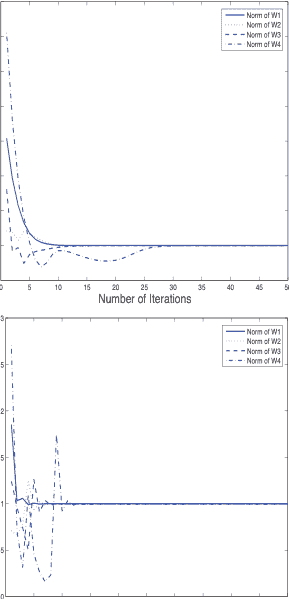

**图 4.3**

四个主方向的范数演化，其中 `ξ = 0.3`（上图）或 `ξ = 0.7`（下图）。

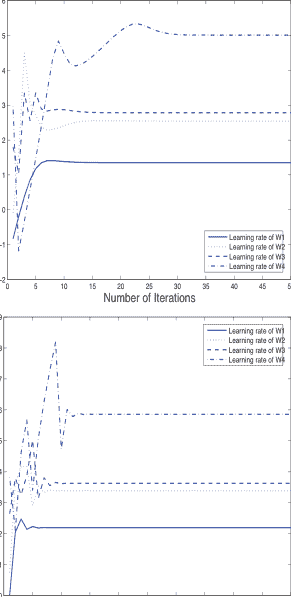

**图 4.4**

四个主方向的学习率演化，其中 `ξ = 0.3`（上图）或 `ξ = 0.7`（下图）。

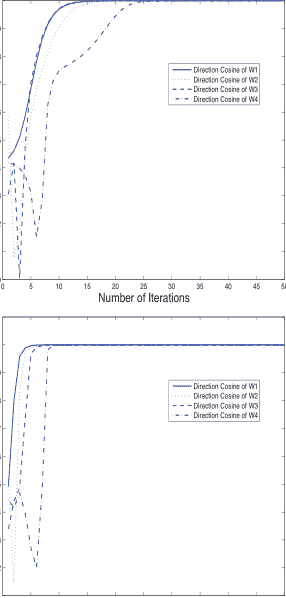

**图 4.5**

四个主方向的方向余弦，其中 `ξ = 0.3`（上图）或 `ξ = 0.7`（下图）。

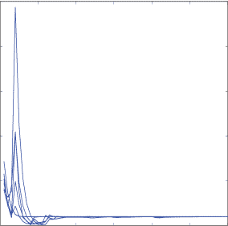

**图 4.6**

六个主方向的范数演化，其中 `ζ = 0.5`。

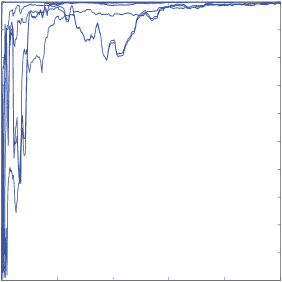

**图 4.7**

六个主方向的方向余弦，其中 `ζ = 0.5`。


**图 4.8**

重建图像（右），SNR 为 53.0470。

### 4.5 结论

本章针对 `GHA` 提出了趋近非零的自适应学习率。通过 `DDT` 方法研究了 `GHA` 在此类学习率下的收敛性。由于这些自适应学习率收敛到非零常数，因此在实用中能够满足计算舍入限制和跟踪要求。这些学习率还使得所有特征方向上的收敛速度大致相等，从而不会使演化过程变得缓慢。此外，采用这些学习率也保证了 `GHA` 的全局收敛性。文中给出了严格的数学证明来证明全局收敛性。进行了仿真，以进一步说明所推导的理论。

## MCA 学习算法

### 5.1 引言

在过去的几年中，人们提出了许多神经网络学习算法来解决 `MCA` 问题，例如 [36, 38, 48, 60, 119, 130, 135, 185]。这些学习算法可以在不预先计算协方差矩阵的情况下，从输入数据中计算出次分量方向，这使得神经网络方法更适合实时应用，并且比传统的代数方法（如特征值分解（`EVD`）和奇异值分解（`SVD`））具有更低的计算复杂度。然而，一些现有的 `MCA` 算法 [48, 130] 存在发散问题。例如，`OJAn` 算法 [185]、`MCA EXIN` 算法 [48] 和 `Luo` 算法 [119] 可能会遭受权向量范数的发散，正如文献 [48] 中所讨论的那样。为了保证收敛，人们提出了一些自稳定的 `MCA` 学习算法，例如 `Möller` 算法 [130]、`Chen` 算法 [36]、`Douglas` 算法 [60] 以及 `Ye` 等人的算法 [188]。在这些自稳定算法中，神经元的权向量可以被保证收敛到归一化的次分量方向。在本章中，我们沿用 [36, 60, 130, 186] 的研究，提出了一种用于次分量分析的稳定神经网络学习算法，与一些现有的 `MCA` 算法相比，该算法具有更令人满意的数值稳定性。

`MCA` 学习算法的收敛性对实际应用至关重要 [142, 143, 144, 190]。通常，`MCA` 学习算法由随机离散时间（`SDT`）系统描述。直接研究 `SDT` 系统的收敛性非常困难。在本章中，我们通过 `DDT` 方法分析所提出的 `MCA` 算法的动力学行为，并获得保证收敛的条件 [145]。

本章的结构安排如下。在第 2 节中，提出了一种稳定的 `MCA` 算法。在第 3 节中，通过 `DDT` 方法分析了所提算法的动力学。在第 4 节中，进行了仿真以进一步说明理论结果。第 5 节给出结论。

### 5.2 一种稳定的 MCA 算法

假设输入序列 `{x(k) | x(k) ∈ ℝ^n (k=0,1,2,…)}` 是一个零均值平稳随机过程，并考虑一个具有如下输入-输出关系的线性神经元：

\[y(k)=w^T(k)x(k),\qquad (k=0,1,2,\ldots),\]

其中 `y(k)` 是神经元输出，`w(k) ∈ ℝ^n` 是神经元的权向量。在文献 [184] 中，为了解决主分量分析（`PCA`）问题，`Xu` 提出了以下 `PCA` 学习算法：

\[w(k+1)=w(k)+\eta\left[(2-w^T(k)w(k))y(k)x(k)-y^2(k)w(k)\right],\qquad (5.1)\]

其中 `η>0` 是学习率。在第 3 章中已经讨论过，`Xu` 算法收敛到输入数据方差最大的主分量方向。与主分量方向相反，输入数据在次分量方向上的方差最小。因此，只需反转 (5.1) 中的符号，即可得到相应的 `MCA` 学习算法，如下所示：

\[w(k+1)=w(k)-\eta\left[(2-w^T(k)w(k))y(k)x(k)-y^2(k)w(k)\right].\qquad (5.2)\]

不幸的是，理论分析和仿真结果表明，上述算法 (5.2) 是发散的，即权向量 `w(k)` 的范数将趋于无穷大。为了避免发散问题，我们在 (5.2) 中添加一个惩罚项 `0.5[1-w^T(k)w(k)]w(k)`，得到一个稳定的 `MCA` 学习算法如下：

\[\begin{aligned}

w(k+1)&=w(k)+0.5\left[1-w^T(k)w(k)\right]w(k)\\

&\quad+\eta\left(w^T(k)w(k)-2\right)y(k)x(k)+\eta y^2(k)w(k),

\end{aligned}\qquad (5.3)\]

添加该惩罚项的动机包括：（1）减小权向量范数与 1 的偏差，即保证所提算法有界；（2）提高学习算法的稳定性，这将在第 3 节的定理 5.3 中说明。

通过对 (5.3) 应用条件期望运算 `E{w(k+1) | w(0), x(i), i<k}`，并将条件期望值视为下一次迭代，可以得到一个 `DDT` 系统，如下所示：

\[\begin{aligned}

w(k+1)&=w(k)+0.5\left[1-w^T(k)w(k)\right]w(k)+\eta\left(w^T(k)w(k)-2\right)Cw(k)\\

&\quad+\eta w^T(k)Cw(k)w(k),

\end{aligned}\qquad (5.4)\]

其中 `C=E[x(k)x^T(k)]` 是输入序列 `{x(k) | x(k) ∈ ℝ^n (k=0,1,2,…)}` 的协方差矩阵。在本章中，我们分析 (5.4) 的动力学，以间接解释算法 (5.3) 的收敛性。`DDT` 系统 (5.4) 是原始随机系统 (5.3) 的“平均”。关于 (5.4) 的收敛性分析结果可以反映 (5.3) 的某些“平均”动力学行为。

为了方便分析，下面给出一些预备知识。由于协方差矩阵 `C` 是对称正定矩阵，因此存在由 `C` 的特征向量组成的 `ℝ^n` 的标准正交基。设 `λ1,…,λn` 是 `C` 的所有特征值，按 `λ1>⋯>λn>0` 排序。假设 `{v_i | i=1,2,…,n}` 是 `ℝ^n` 的一个标准正交基，使得每个 `v_i` 都是 `C` 的与特征值 `λi` 对应的单位特征向量。因此，对于每个 `k≥0`，权向量 `w(k)` 可以表示为

\[w(k)=\sum_{i=1}^{n}z_i(k)v_i,\qquad (5.5)\]

其中 `z_i(k) (i=1,2,…,n)` 是一些常数。由 (5.4) 和 (5.5) 可知，对所有 `k≥0` 有

\[z_i(k+1)=\left[1.5+(\eta\lambda_i-0.5)w^T(k)w(k)+\eta w^T(k)Cw(k)-2\eta\lambda_i\right]z_i(k),\qquad (5.6)\]

`(i=1,2,…,n)`。根据瑞利商（Rayleigh Quotient）的相关性质，有

\[\lambda_n w^T(k)w(k)\leq w^T(k)Cw(k)\leq \lambda_1 w^T(k)w(k),\qquad (5.7)\]

对所有 `k≥0` 成立。

### 5.3 动力学分析

在本节中，我们通过以下三个步骤研究 `DDT` 系统 (5.4) 的动力学行为：

- **步骤 1：** 在定理 5.1 中，我们证明如果满足一些较弱的条件，则 (5.4) 中的权向量是有界的。
- **步骤 2：** 在定理 5.2 中，证明了在某种条件下，(5.4) 中的权向量将收敛到次分量。


# 步骤 3：在定理 5.3 中，我们分析 DDT 系统 (5.4) 的稳定性。

为了分析 DDT 系统 (5.4) 的收敛性，我们需要在下面的引理 5.1 中证明一个初步结论，其中证明了在某些条件下，

\[1.5+(\eta\lambda_i-0.5)w^T(k)w(k)+\eta w^T(k)Cw(k)-2\eta\lambda_i\geq 0，\]

对于 (5.6) 中的任意 \(i\,(i=1,2,\ldots,n)\) 成立。这一初步结论意味着，权向量 `w(k)` 在每个特征向量 `v_i\,(i=1,2,\ldots,n)` 上的投影（记为 `z_i(k)=w^T(k)v_i\,(i=1,2,\ldots,n)`）在 (5.6) 中不会改变符号。

## 引理 5.1

假设 `\eta\lambda_1<0.25` 且 `\|w(k)\|^2\le 1+\frac{2}{1-4\eta\lambda_n}`，则

\[
1.5+(\eta\lambda_i-0.5)w^T(k)w(k)+\eta w^T(k)Cw(k)-2\eta\lambda_i\ge 0,
\]

\((i=1,\ldots,n)\)，对所有 \(k\ge 0\) 成立。

**证明：** 为完成证明，将考虑两种情况。

### 情况1：\(2\le \|w(k)\|^2\le 1+\frac{2}{1-4\eta\lambda_n}\)。

由 `\eta\lambda_1\le 0.25`，根据(5.7)可得

\[
\begin{aligned}
&1.5+(\eta\lambda_i-0.5)w^T(k)w(k)+\eta w^T(k)Cw(k)-2\eta\lambda_i\\
&\ge 1+(0.25-\eta\lambda_n)\cdot[2-w^T(k)w(k)]-0.25w^T(k)w(k)+\eta w^T(k)Cw(k)\\
&\ge 1+(0.25-\eta\lambda_n)\cdot[2-w^T(k)w(k)]-0.25w^T(k)w(k)\\
&\qquad +\eta\lambda_n w^T(k)w(k)\\
&\ge 1.5-2\eta\lambda_n-(0.5-2\eta\lambda_n)\cdot\|w(k)\|^2\\
&\ge 1.5-2\eta\lambda_n-(0.5-2\eta\lambda_n)\cdot\left(1+\frac{2}{1-4\eta\lambda_n}\right)\\
&=0.
\end{aligned}
\]

#### 情况2：\(\|w(k)\|^2<2\)。

由 `\eta\lambda_1\le 0.25`，根据(5.7)可得

\[
\begin{aligned}
&1.5+(\eta\lambda_i-0.5)w^T(k)w(k)+\eta w^T(k)Cw(k)-2\eta\lambda_i\\
&\ge 1+(0.25-\eta\lambda_i)\cdot[2-w^T(k)w(k)]-0.25w^T(k)w(k)+\eta w^T(k)Cw(k)\\
&\ge 1-0.25w^T(k)w(k)+\eta w^T(k)Cw(k)\\
&\ge 1-(0.25-\eta\lambda_n)w^T(k)w(k)\\
&> 0.5+2\eta\lambda_n\\
&>0.
\end{aligned}
\]

综合以上两种情况的分析，证明完毕。

接下来，我们证明一个有趣的引理，该引理为DDT系统(5.4)提供了一个不变集。

## 引理 5.2

记

\[
S=\left\{w(k)|w(k)\in\mathbb{R}^n\text{ 且 }\|w(k)\|^2\le 1+\frac{2}{1-4\eta\lambda_n}\right\}.
\]

若

\[
\eta\lambda_1<0.25,
\]

则 `S` 是(5.4)的一个不变集。

**证明：** 为完成证明，将考虑两种情况。

### 情况1：\(2 \leq \|w(k)\|^2 \leq 1 + \dfrac{2}{1-4\eta\lambda_n}\)。

由 `\eta\lambda_1 < 0.25`，根据(5.7)可知

\[
\begin{aligned}
&1.5 + (\eta\lambda_i - 0.5)w^T(k)w(k) + \eta w^T(k)Cw(k) - 2\eta\lambda_i \\
=&\; 1 + (0.25-\eta\lambda_i)\cdot[2-w^T(k)w(k)] - 0.25w^T(k)w(k) + \eta w^T(k)Cw(k) \\
\leq&\; 1 - 0.25w^T(k)w(k) + \eta\lambda_1w^T(k)w(k) \\
<&\; 1,\quad (i=1,\ldots,n).
\end{aligned}
\tag{5.8}
\]

利用引理5.1，由(5.6)和(5.8)可得

\[
\begin{aligned}
\|w(k+1)\|^2
&=\sum_{i=1}^{n} z_i^2(k+1) \\
&=\sum_{i=1}^{n}\left[1.5+(\eta\lambda_i-0.5)w^T(k)w(k)+\eta w^T(k)Cw(k)-2\eta\lambda_i\right]^2\cdot z_i^2(k) \\
&\leq \|w(k)\|^2 \\
&\leq 1+\frac{2}{1-4\eta\lambda_n}.
\end{aligned}
\tag{5.9}
\]

#### 情况2：\(\|w(k)\|^2 < 2\)。

由 `\eta\lambda_1 < 0.25` 和引理5.1，根据(5.6)和(5.7)可得

\[
\begin{aligned}
\|w(k+1)\|^2
&=\sum_{i=1}^{n} z_i^2(k+1) \\
&=\sum_{i=1}^{n}\left[1.5+(\eta\lambda_i-0.5)w^T(k)w(k)+\eta w^T(k)Cw(k)-2\eta\lambda_i\right]^2\cdot z_i^2(k) \\
&=\sum_{i=1}^{n}\left\{1+(0.25-\eta\lambda_i)\cdot[2-w^T(k)w(k)]\\
&\hspace{3em}-0.25w^T(k)w(k)+\eta w^T(k)Cw(k)\right\}^2\cdot z_i^2(k) \\
&\leq \left[1+(0.25-\eta\lambda_n)(2-\|w(k)\|^2)-(0.25-\eta\lambda_1)\|w(k)\|^2\right]^2\cdot\|w(k)\|^2 \\
&\leq \left[1+(0.25-\eta\lambda_n)(2-\|w(k)\|^2)\right]^2\cdot\|w(k)\|^2 \\
&\leq \max_{0\leq s\leq 1+\frac{2}{1-4\eta\lambda_n}}\left[1+(0.25-\eta\lambda_n)(2-s)\right]^2\cdot s.
\end{aligned}
\tag{5.10}
\]

由 `\eta\lambda_1<0.25`，可计算出：对所有 \(s\in\left[0,1+\frac{2}{1-4\eta\lambda_n}\right]\)，

\[
[1+(0.25-\eta\lambda_n)(2-s)]^2\cdot s\leq\frac{16(1.5-2\eta\lambda_n)^3}{27(1-4\eta\lambda_n)}. \tag{5.11}
\]

由 `\eta\lambda_1<0.25`，根据(5.10)和(5.11)可知

\[
\|w(k+1)\|^2\leq\frac{16(1.5-2\eta\lambda_n)^3}{27(1-4\eta\lambda_n)}<\frac{2}{1-4\eta\lambda_n}<1+\frac{2}{1-4\eta\lambda_n}. \tag{5.12}
\]

由(5.9)和(5.12)，我们可以得出结论：若 `\eta\lambda_1<0.25` 且 `w(k)\in S`，则 `\|w(k+1)\|^2\leq 1+\frac{2}{1-4\eta\lambda_n}`，即 `w(k+1)\in S`。证明完毕。

接下来，利用引理5.1和引理5.2，我们证明：若满足一些温和条件，则在(5.4)中经过若干次迭代后，权值向量的平方范数 `\|w(k)\|^2` 将小于某个常数 `\zeta\ (0<\zeta<2)`。

## 定理 5.1

若 `\eta\lambda_1<0.25` 且 `w(0)\in S`，则存在常数 `\zeta<2` 和正整数 `N`，使得

\[
\|w(k)\|^2\leq\zeta,
\]

对所有 \(k\geq N\) 成立。


## 证明。

利用引理5.2，`S` 是一个不变集，则对所有 `k ≥ 0` 有 `w(k) ∈ S`。由 `eta lambda_1 < 0.25`，显然

\[
0<\frac{1-4\eta\lambda_n}{1-2\eta\lambda_1-2\eta\lambda_n}<2.
\]

接下来，为完成证明，将考虑三种情况。

### 情况1：`0 ≤ ||w(k)||^2 ≤ (1-4 eta lambda_n)/(1-2 eta lambda_1-2 eta lambda_n)`。

由 `eta lambda_1 < 0.25` 和引理5.1，根据(5.6)和(5.7)可得

\[
\begin{aligned}
\|w(k+1)\|^2
&=\sum_{i=1}^{n}\left[1.5+(\eta\lambda_i-0.5)w^T(k)w(k)+\eta w^T(k)Cw(k)-2\eta\lambda_i\right]^2 z_i^2(k)\\
&=\sum_{i=1}^{n}\left\{1.5-0.5w^T(k)w(k)+\eta w^T(k)Cw(k)-[2-w^T(k)w(k)]\eta\lambda_i\right\}^2 z_i^2(k)\\
&\leq\sum_{i=1}^{n}\left[1.5-0.5\|w(k)\|^2+\eta\|w(k)\|^2-(2-\|w(k)\|^2)\eta\lambda_n\right]^2 z_i^2(k)\\
&=\left[1.5-2\eta\lambda_n-(0.5-\eta\lambda_n-\eta\lambda_1)\|w(k)\|^2\right]^2\cdot\|w(k)\|^2\\
&=\left[1+\frac{1-4\eta\lambda_n}{2}\left(1-\frac{1-2\eta\lambda_1-2\eta\lambda_n}{1-4\eta\lambda_n}\cdot\|w(k)\|^2\right)\right]^2\cdot\|w(k)\|^2\\
&\leq\left[1+\frac{1}{2}\left(1-\frac{1-2\eta\lambda_1-2\eta\lambda_n}{1-4\eta\lambda_n}\cdot\|w(k)\|^2\right)\right]^2\cdot\|w(k)\|^2\\
&\leq\left(1.5-\frac{1-2\eta\lambda_n-2\eta\lambda_1}{2-8\eta\lambda_n}\cdot\|w(k)\|^2\right)^2\cdot\|w(k)\|^2\\
&\leq\max_{0\leq s\leq\frac{1-4\eta\lambda_n}{1-2\eta\lambda_1-2\eta\lambda_n}}\left(1.5-\frac{1-2\eta\lambda_n-2\eta\lambda_1}{2-8\eta\lambda_n}\cdot s\right)^2\cdot s.
\end{aligned}
\]

由 `eta lambda_1 < 0.25`，可计算出

\[
\left(1.5-\frac{1-2\eta\lambda_n-2\eta\lambda_1}{2-8\eta\lambda_n}\cdot s\right)^2\cdot s\leq\frac{1-4\eta\lambda_n}{1-2\eta\lambda_1-2\eta\lambda_n},
\]

对所有 `s ∈ [0, (1-4 eta lambda_n)/(1-2 eta lambda_1-2 eta lambda_n)]` 成立。因此，`||w(k+1)||^2 ≤ (1-4 eta lambda_n)/(1-2 eta lambda_1-2 eta lambda_n)`。于是可得，

\[
\|w(0)\|^2\leq\frac{1-4\eta\lambda_n}{1-2\eta\lambda_1-2\eta\lambda_n},
\]

则

\[
\|w(k)\|^2\leq\frac{1-4\eta\lambda_n}{1-2\eta\lambda_1-2\eta\lambda_n}<2,\quad(k\geq0).
\]

### 情况2：`(1-4 eta lambda_n)/(1-2 eta lambda_1-2 eta lambda_n) < ||w(k)||^2 < 2`。

由 `eta lambda_1 < 0.25`，根据(5.7)可得

\[
\begin{aligned}
1.5+(\eta\lambda_i-0.5)w^T(k)w(k)+\eta w^T(k)Cw(k)-2\eta\lambda_i
&=1.5-0.5w^T(k)w(k)+\eta w^T(k)Cw(k)-[2-w^T(k)w(k)]\eta\lambda_i\\
&\leq1.5-0.5\|w(k)\|^2+\eta\|w(k)\|^2-(2-\|w(k)\|^2)\eta\lambda_n\\
&=1.5-2\eta\lambda_n-(0.5-\eta\lambda_n-\eta\lambda_1)\|w(k)\|^2\\
&\leq1.
\end{aligned}
\]

然后，利用引理5.1，根据(5.6)可得

\[
\begin{aligned}
\|w(k+1)\|^2
&= \sum_{i=1}^{n}\left[1.5+(\eta\lambda_i-0.5)\,w^T(k)w(k)+\eta w^T(k)Cw(k)-2\eta\lambda_i\right]^2\cdot z_i^2(k)\\
&\le \|w(k)\|^2.
\end{aligned}
\]

这意味着，如果 `(1-4 eta lambda_n)/(1-2 eta lambda_1-2 eta lambda_n) < ||w(k)||^2 < 2`，则 `||w(k)||^2` 单调递减。利用情况1的分析，我们可以得到：如果

\[
\frac{1-4\eta\lambda_n}{1-2\eta\lambda_1-2\eta\lambda_n}<\|w(0)\|^2<2,
\]

则

\[
\|w(k)\|^2\le \|w(0)\|^2<2,\quad(k\ge 0).
\]

### 情况3：`2 ≤ ||w(k)||^2 ≤ 1 + 2/(1-4 eta lambda_n)`。

由 `eta lambda_1 < 0.25` 和 `2 ≤ ||w(k)||^2`，根据(5.7)可得

\[
\begin{aligned}
1.5+(\eta\lambda_i-0.5)\,w^T(k)w(k)+\eta w^T(k)Cw(k)-2\eta\lambda_i
&= 1+(0.25-\eta\lambda_i)\cdot(2-\|w(k)\|^2)-0.25\|w(k)\|^2+\eta w^T(k)Cw(k)\\
&\le 1-0.25\|w(k)\|^2+\eta\lambda_1\|w(k)\|^2\\
&= (0.25-\eta\lambda_1)\|w(k)\|^2\\
&\le 0.5+2\eta\lambda_1.
\end{aligned}
\]

利用引理5.1，根据(5.6)和(5.13)可得

\[
\begin{aligned}
\|w(k+1)\|^2
&= \sum_{i=1}^{n}z_i^2(k+1)\\
&= \sum_{i=1}^{n}\left[1.5+(\eta\lambda_i-0.5)\,w^T(k)w(k)+\eta w^T(k)Cw(k)-2\eta\lambda_i\right]^2\cdot z_i^2(k)\\
&\le (0.5+2\eta\lambda_1)^2\cdot\|w(k)\|^2\\
&= \beta^2\cdot\|w(k)\|^2\\
&\le \beta^{2(k+1)}\cdot\|w(0)\|^2,
\end{aligned}
\]

其中 `beta = 0.5 + 2 eta lambda_1`。由于 `eta lambda_1 < 0.25`，显然 `0 < beta < 1`。因此，必定存在正整数 `N`，使得 `||w(N)||^2 < 2`。然后，利用情况1和情况2的分析，我们可以得到：对所有 `k ≥ N`，

\[
\|w(k)\|^2\le \max\left\{\|w(N)\|^2,\frac{1-4\eta\lambda_n}{1-2\eta\lambda_1-2\eta\lambda_n}\right\}<2.
\]

利用情况1、情况2和情况3的分析，我们完成了证明。

至此，DDT系统(5.4)的有界性已得到证明。

接下来，我们证明在一些温和条件下，


$$\lim_{k\to\infty} w(k)=\pm v_n, \tag{5.14}$$

在(5.4)中，其中`v_n`是次分量方向，即与协方差矩阵最小特征值对应的单位特征向量。由(5.5)，对于每个`k\geq 0`，`w(k)`可表示为

$$w(k)=\sum_{i=1}^{n-1}z_i(k)v_i+z_n(k)v_n, \tag{5.15}$$

其中`z_i(k) (i=1,\ldots,n)`为某些常数。显然，`w(k)`的收敛性可由`z_i(k) (i=1,\ldots,n)`的收敛性决定。由(5.15)可以看出，通过证明以下两个结论即可得到(5.14)：

- 结论1： $\lim_{k\to\infty}z_i(k)=0$, $(i=1,2,\ldots,n-1)$.

- 结论2： $\lim_{k\to\infty}z_n(k)=\pm1$.

下面的引理5.3和引理5.4将分别给出*结论1*和*结论2*的证明。

### 引理5.3
假设`eta lambda_1<0.25`，若`w(0)\in S`且`w^T(0)v_n\neq 0`，则

$$\lim_{k\to\infty}z_i(k)=0,\quad(i=1,2,\ldots,n-1).$$

**证明.** 由`eta lambda_1<0.25`，根据(5.7)可得

$$\begin{aligned}

\eta w^T(k)Cw(k)-0.25w^T(k)w(k)

&\leq \eta\lambda_1w^T(k)w(k)-0.25w^T(k)w(k)\\

&\leq 0.

\end{aligned} \tag{5.16}$$

利用引理5.1，对任意`i (i=1,\ldots,n)`，有

$$1.5+(\eta\lambda_i-0.5)w^T(k)w(k)+\eta w^T(k)Cw(k)-2\eta\lambda_i\geq0, \tag{5.17}$$

对所有`k\geq0`成立。利用定理5.1，必存在常数`zeta<2`和正整数`N_1`，使得

$$\|w(k)\|^2\leq\zeta, \tag{5.18}$$

对所有`k>N_1`成立。由`eta lambda_1<0.25`，结合(5.7)、(5.16)、(5.17)和(5.18)，对所有`k\ge N`，有

$$\begin{aligned}

&\frac{1.5+(\eta\lambda_i-0.5)w^T(k)w(k)+\eta w^T(k)Cw(k)-2\eta\lambda_i}{1.5+(\eta\lambda_n-0.5)w^T(k)w(k)+\eta w^T(k)Cw(k)-2\eta\lambda_n}\\

&\le \frac{1+(0.25-\eta\lambda_i)\cdot[2-w^T(k)w(k)]}{1+(0.25-\eta\lambda_n)\cdot[2-w^T(k)w(k)]}\\

&\le \frac{1+(0.25-\eta\lambda_i)\cdot(2-\zeta)}{1+(0.25-\eta\lambda_n)\cdot(2-\zeta)}\\

&\le \frac{1+(0.25-\eta\lambda_{n-1})\cdot(2-\zeta)}{1+(0.25-\eta\lambda_n)\cdot(2-\zeta)}\\

&=\gamma,\quad (i=1,2,\ldots,n-1),

\end{aligned} \tag{5.19}$$

其中

$$\gamma=\frac{1+(0.25-\eta\lambda_{n-1})\cdot(2-\zeta)}{1+(0.25-\eta\lambda_n)\cdot(2-\zeta)}.$$

由于`zeta<2`且`eta lambda_1<0.25`，有

$$0<\gamma<1. \tag{5.20}$$

由`w^T(0)v_n\ne 0`，显然`z_n(0)\ne 0`，从而`z_n(k)\ne 0 (k>0)`。利用引理5.1，由(5.6)和(5.19)可得

$$\begin{aligned}

\left[\frac{z_i(k+1)}{z_n(k+1)}\right]^2

&=\frac{1.5+(\eta\lambda_i-0.5)w^T(k)w(k)+\eta w^T(k)Cw(k)-2\eta\lambda_i}{1.5+(\eta\lambda_n-0.5)w^T(k)w(k)+\eta w^T(k)Cw(k)-2\eta\lambda_n}\left[\frac{z_i(k)}{z_n(k)}\right]^2\\

&\le \gamma^2\left[\frac{z_i(k)}{z_n(k)}\right]^2\\

&\le \gamma^{2(k-N+1)}\left[\frac{z_i(N)}{z_n(N)}\right]^2,\quad (i=1,2,\ldots,n-1).

\end{aligned}$$

对所有`k\ge N`成立。由(5.20)，显然

$$\lim_{k\to\infty}\frac{z_i(k)}{z_n(k)}=0,\quad (i=1,2,\ldots,n-1).$$

根据`S`的不变性，`z_n(k)`必有界；于是

$$\lim_{k\to\infty}z_i(k)=0,\quad (i=1,2,\ldots,n-1).$$

证毕。

### 引理5.4
假设`eta lambda_1<0.25`，若`w(0)\in S`且`w^T(0)v_n\ne 0`，则有

$$\lim_{k\to\infty}z_n(k)=\pm1.$$

**证明.** 利用引理5.3，显然，当`k \to \infty`时，`w(k)`将收敛到次分量方向`v_n`。假设在时刻`k_0`，`w(k)`已经收敛到`v_n`的方向，即

$$w(k_0)=z_n(k_0)\cdot v_n. \tag{5.21}$$

由(5.6)，有

$$\begin{aligned}

z_n(k+1) &= z_n(k)\cdot\left[(1.5-2\eta\lambda_n)+(2\eta\lambda_n-0.5)z_n^2(k)\right] \\

&= z_n(k)\cdot\left[1+(0.5-2\eta\lambda_n)(1-z_n^2(k))\right].

\end{aligned} \tag{5.22}$$

对所有`k \geq k_0`成立。由于`w(0) \in S`，利用引理5.2，有

$$|z_n(k)|^2 \leq \|w(k)\|^2 \leq 1+\frac{2}{1-4\eta\lambda_n}.$$

对所有`k \geq 0`成立。由`eta lambda_1<0.25`，显然

$$1+(0.5-2\eta\lambda_n)(1-z_n^2(k))>0. \tag{5.23}$$

对所有`k \geq 0`成立。因此，由(5.22)和(5.23)，有

$$|z_n(k+1)|=|z_n(k)|\cdot\left[1+(0.5-2\eta\lambda_n)(1-z_n^2(k))\right], \tag{5.24}$$

对所有`k \geq k_0`成立。由`eta lambda_1<0.25`，则

$$\frac{|z_n(k+1)|}{|z_n(k)|}=1+(0.5-2\eta\lambda_n)\left[1-z_n^2(k)\right]=\begin{cases}>1, & \text{if } |z_n(k)|<1,\\=1, & \text{if } |z_n(k)|=1,\\<1, & \text{if } |z_n(k)|>1.\end{cases} \tag{5.25}$$

对所有`k \geq k_0`成立。由(5.25)，显然`|z_n(k)|=1`是(5.24)的一个潜在稳定平衡点。接下来，考虑三种情况来完成证明。

**情况1：** `|z_n(k_0)|\leq 1`。

由`eta lambda_n\le eta lambda_1<0.25`和`|z_n(k_0)|\leq 1`，从(5.24)可以计算出

$$|z_n(k_0+1)|=(2\eta\lambda_n-0.5)|z_n(k_0)|^3+(1.5-2\eta\lambda_n)|z_n(k_0)|\leq 1.$$

显然，对所有`k\geq k_0`，有`|z_n(k)|\leq 1`。然而，由(5.25)可知，`|z_n(k)|`对所有`k\geq k_0`单调递增。因此，当`k\to\infty`时，`|z_n(k)|`必收敛到平衡点1。

**情况2：** 对所有`k\geq k_0`，`|z_n(k)|>1`。

由(5.25)可知，`|z_n(k)|`对所有`k\geq k_0`单调递减。然而，对所有`k\geq k_0`，`|z_n(k)|`有下界1。显然，当`k\to\infty`时，`|z_n(k)|`将收敛到平衡点1。


### 情况3：`|z_n(k_0)|>1`，且存在正整数`M` (`M>k_0`)，使得`|z_n(M)|≤1`。

由于`|z_n(M)|≤1`，与情况1类似，可以证明当`k→∞`时，`|z_n(k)|`必收敛到平衡点1。

由前面三种情况的分析，我们可以得到

$$\lim_{k\to\infty}|z_n(k)|=1. \tag{5.26}$$

同时，由(5.22)和(5.23)，我们有：若`z_n(k_0)≥0`，则对所有`k>k_0`，`z_n(k)>0`；若`z_n(k_0)≤0`，则对所有`k>k_0`，`z_n(k)≤0`。因此，由(5.26)可得

$$\lim_{k\to\infty}z_n(k)=\pm 1.$$

证毕。

在引理5.3中，我们已证明：若`ηλ_1<0.25`，`w(0)∈S`且`w^T(0)v_n≠0`，则

$$\lim_{k\to\infty}z_i(k)=0,\quad (i=1,2,\ldots,n-1). \tag{5.27}$$

在引理5.4中，证明了若`ηλ_1<0.25`，`w(0)∈S`且`w^T(0)v_n≠0`，则

$$\lim_{k\to\infty}z_n(k)=\pm 1. \tag{5.28}$$

由于

$$w(k)=\sum_{i=1}^{n-1}z_i(k)v_i+z_n(k)v_n,$$

由(5.27)和(5.28)，我们很容易得出以下结论：

### 定理5.2
*若`ηλ_1<0.25`，`w(0)∈S`且`w^T(0)v_n≠0`，则在(5.4)中，*

$$\lim_{k\to\infty}w(k)=\pm v_n.$$

至此，我们完成了DDT系统(5.4)收敛性的证明。接下来，我们进一步研究(5.4)的稳定性。显然，(5.4)的所有平衡点集合为

$$\{v_1,\ldots,v_n\}\cup\{-v_1,\ldots,-v_n\}\cup\{0\}.$$

下面的定理5.3将说明(5.4)中平衡点`v_n`和`-v_n`的稳定性。

### 定理5.3
*在`ηλ_1<0.25`的条件下，平衡点`v_n`和`-v_n`是局部渐近稳定的。*

$$\eta\lambda_1<0.25.$$

*其他平衡点是不稳定的。*

**证明.** 记

```
G(w)=w(k+1)
    =w(k)+η[(w^T(k)w(k)-2)Rw(k)+w^T(k)Rw(k)w(k)]
    +0.5[1-w^T(k)w(k)]w(k).
```

于是有

$$\left.\frac{\partial G}{\partial w}\right|_{0}=I+2\eta C-\eta w^{T}(k)w(k)C-\eta w^{T}(k)Cw(k)I-4\eta Cw(k)w^{T}(k), \tag{5.29}$$

其中

$$C=\frac{1}{4\eta}I-R,$$

`I`为单位矩阵。对于平衡点`0`，由(5.29)可得

$$\left.\frac{\partial G}{\partial w}\right|_{0}=I+2\eta C=1.5I-2\eta R=J_0.$$

记`J_0`的第`i`个特征值为`α_0^{(i)}`。由`ηλ_1<0.25`，有

$$\alpha_0^{(i)}=1.5-2\eta\lambda_i\ge 1.5-2\eta\lambda_1>1,\quad (i=1,2,\ldots,n).$$

根据李雅普诺夫理论，平衡点`0`是不稳定的。

对于平衡点`±v_j` (`j=1,…,n`)，由(5.29)可得

$$\left.\frac{\partial G}{\partial w}\right|_{v_j}=(1+\eta\lambda_j)I-\eta R-(1-4\eta\lambda_j)v_jv_j^T=J_j.$$

记`J_j`的第`i`个特征值为`α_j^{(i)}`。显然，

$$\alpha_j^{(i)}=1+\eta(\lambda_j-\lambda_i)\quad\text{if }i\ne j.$$

$$\alpha_j^{(j)}=4\eta\lambda_j\quad\text{if }i=j.$$

对任意`j≠n`，有

$$\alpha_j^{(n)}=1+\eta(\lambda_j-\lambda_n)>1.$$

显然，平衡点`±v_j` (`j≠n`)是不稳定的。对于平衡点`±v_n`，由于`ηλ_1<0.25`，可得

$$\alpha_n^{(i)}=1+\eta(\lambda_n-\lambda_i)<1\ \text{if }i\ne n.$$

$$\alpha_n^{(i)}=4\eta\lambda_n<4\eta\lambda_1<1\ \text{if }i=n.$$

因此，`±v_n`是渐近稳定的。证毕。

在本节中，我们分析了与所提出的稳定MCA学习算法(5.3)相关联的DDT系统(5.4)的动力学，并证明了(5.4)的权向量在某些条件下将收敛到稳定平衡点`±v_n`。

## 5.4 仿真结果

在本节中，我们提供两个有趣的仿真结果，分别说明所提出的 MCA 算法 (5.3) 在确定性情形和随机情形下的收敛性与稳定性。在这些仿真中，我们将所提出的 MCA 算法 (5.3) 与以下 MCA 算法的性能进行比较：

- **1. Möller MCA 算法** [130]

$$
w(k+1)=w(k)-\eta\left[2w^{T}(k)w(k)-1\right]y(k)x(k)+\eta y^{2}(k)w(k), \tag{5.30}
$$

- **2. Douglas MCA 算法** [60]

$$
w(k+1)=w(k)-\eta w^{T}(k)w(k)w^{T}(k)w(k)y(k)y(k)x(k)+\eta y^{2}(k)w(k), \tag{5.31}
$$

- **3. OJAμ MCA 算法** [68]

$$
w(k+1)=w(k)-\eta y(k)x(k)+\frac{\eta y^{2}(k)w(k)}{w^{T}(k)w(k)w^{T}(k)w(k)}. \tag{5.32}
$$

为了衡量这些算法的收敛速度和精度，我们按照 [31] 计算 `w(k)` 的范数以及 `w(k)` 在更新时的方向：

$$
\mathrm{Direction\ Cosine}(k)=\frac{|w^{T}(k)\cdot v_n|}{\|w(k)\|\cdot\|v_n\|},
$$

其中 `v_n` 是与协方差矩阵 `R` 的最小特征值相关联的特征向量。显然，如果 `Direction Cosine(k)` 收敛到 1，则权重向量 `w(k)` 必定趋向于次分量 `v_n` 的方向。

首先，让我们考虑确定性情形下的性能比较。通过取条件期望，与上述三个 MCA 算法 (5.30)–(5.32) 相对应的 DDT 系统如下：

- **1.** 与 Möller MCA 算法 (5.30) 相关的 DDT 系统：

$$
w(k+1)=w(k)-\eta\left[2w^{T}(k)w(k)-1\right]Cw(k)+\eta w^{T}(k)Cw(k)w(k), \tag{5.33}
$$

- **2.** 与 Douglas MCA 算法 (5.31) 相关的 DDT 系统：

$$
w(k+1)=w(k)-\eta w^{T}(k)w(k)w^{T}(k)w(k)Cw(k)+\eta w^{T}(k)Cw(k)w(k), \tag{5.34}
$$

- **3.** 与 OJAμ MCA 算法 (5.32) 相关的 DDT 系统：

$$
w(k+1)=w(k)-\eta Cw(k)+\frac{\eta w^{T}(k)Cw(k)Cw(k)w(k)}{w^{T}(k)w(k)w^{T}(k)w(k)}. \tag{5.35}
$$

我们随机生成一个 `4×4` 对称正定矩阵：

$$
C^{*}=
\begin{bmatrix}
1.6064 & 0.2345 & 0.6882 & 1.2175 \\
0.2345 & 1.6153 & 0.3753 & 0.0398 \\
0.6882 & 0.3753 & 1.8981 & 0.6181 \\
1.2175 & 0.0398 & 0.6181 & 1.1799
\end{bmatrix}
$$

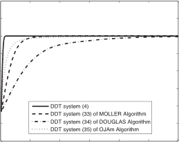

**图 5.1** 确定性情形下 `‖w(k)‖` 的收敛性。


我们使用 DDT 系统 (5.4) 和 (5.33)–(5.35) 提取与 `C*` 的最小特征值相关的单位特征向量，其中 `η = 0.02`，`w(0)` 为随机生成。仿真结果基于 100 次 Monte Carlo 运行进行评估，分别如图 5.1 和图 5.2 所示，显示了 `\|w(k)\|` 和 `Direction Cosine(k)` 的收敛性。从仿真结果可以看出，DDT 系统 (5.4) 中的 `\|w(k)\|` 比其他三个系统更快地收敛到 1。

接下来，我们使用随机输入数据来比较所提出的算法 (5.3) 与 Möller 算法 (5.30)、Douglas 算法 (5.31) 和 OJAμ 算法 (5.32) 的稳定性。在仿真中，输入数据序列由 [68] 生成：

$$
x(k)=C\cdot h(k),
$$

其中 `C=randn(5,5)/5`，而 `h(k)∈ℝ^{5×1}` 是高斯随机生成的。上述四种 MCA 学习算法 (5.3)、(5.30)、(5.31) 和 (5.32) 被用于从输入数据序列 `{x(k)}` 中提取次分量。图 5.3 和图 5.4 分别显示了 `\|w(k)\|` 和 `Direction Cosine(k)` 的收敛性。从仿真结果可以很容易地发现，在这些 MCA 算法中，`Direction Cosine(k)` 能够以大致相同的速度收敛到 1，而所提出的 MCA 算法 (5.3) 中的权重向量范数 `\|w(k)\|` 比其他三种算法具有更好的数值稳定性。

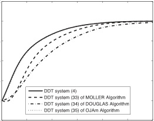

**图 5.2** 确定性情形下 `w(k)` 的方向余弦的收敛性。

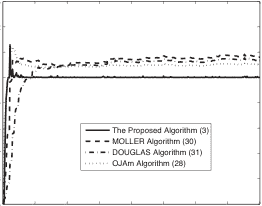

**图 5.3** 随机情形下 `\|w(k)\|` 的收敛性。

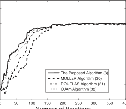

**图 5.4** 随机情形下 `w(k)` 的方向余弦的收敛性。

### 5.5 结论

在本章中，我们提出了一种稳定的 MCA 学习算法，该算法比一些现有的 MCA 方法具有更令人满意的收敛性和稳定性。通过确定性离散时间 (DDT) 方法分析了所提出算法的动力学特性。证明了如果关于学习率和初始权重误差的一些温和条件得到满足，我们所提出的算法将以单位范数收敛到次分量方向。同时，稳定性分析表明，次分量方向是所提出算法中渐近稳定的平衡点。我们在确定性情形和随机情形下对所提出的算法与一些现有 MCA 方法进行了性能比较，这说明了前者的性能改进。

## 6 ICA 学习算法

### 6.1 引言

独立成分分析 (ICA) 能够从混合输入信号中估计独立成分。其目标是找到非高斯数据的线性表示，使得各成分在统计上独立，或尽可能独立 [88]。

ICA 最初是为了处理与鸡尾酒会问题密切相关的问题而发展起来的 [88]。随着近来对 ICA 兴趣的增加，人们已经清楚这一原理还有许多其他有趣的应用。许多学习算法被提出以解决该问题，例如 FastICA [85, 88, 138, 149]、JADE 算法 [27]、EGLD 算法 [65]、Pearson-ICA 算法 [98]、非负 ICA 算法 [147, 187]、CuBICA [22, 23]。

在本章³中，我们使用 DDT 方法研究一类具有恒定学习率的 Hyvärinen-Oja ICA 学习算法的收敛性。通过直接分析原始 SDT 算法，在随机环境中获得了一些不变集，从而通过选择适当的学习参数来保证原始 SDT 算法的不发散性。在这些不变集中，已经通过 DDT 方法间接研究了原始算法的局部收敛性。

为了提高原始 SDT 算法的性能，相应的 DDT 算法被扩展为原始算法的块版本。块算法不仅建立了原始 SDT 算法与相应 DDT 算法之间的关系，而且获得了良好的收敛速度和精度。块算法代表了原始 SDT 算法在所有样本块上的平均演化。因此，原始 SDT 算法的不变集可以保证块算法的不发散性。此外，块算法可以更有效地利用观测样本窗口中所包含的信息。因此，这些算法收敛速度快且精度更高 [197, 198]。

³ 基于“Convergence analysis of Hyvärinen and Oja’s ICA learning algorithms with constant learning rates”，作者 Jian Cheng Lv, K. K. Tan, Zhang Yi, and S. Huang，发表于 IEEE Trans. Signal Processing, vol. 57, no. 5, pp. 1811–1824, May 2009. © 2009 IEEE.

本章结构如下。第 2 节提供问题表述并给出预备知识。第 3 节给出收敛性结果。第 4 节将 DDT 算法扩展为块算法。第 5 节给出仿真结果和讨论。第 6 节得出结论。

### 6.2 预备知识与 Hyvärinen-Oja 算法

假设一个观测序列 `{y(k), k = 1, 2, ...}`，包含 `m` 个标量随机变量，即 `y(k) = [y_1(k), y_2(k), ..., y_m(k)]^T`。在最简单的 ICA [49] 中，假设

$$
\mathbf{y}(k)=\mathbf{A}\mathbf{s}(k),
$$

其中 `s(k) = [s_1(k), s_2(k), ..., s_n(k)]^T` 是未知的，且 `s_1(k), s_2(k), ..., s_n(k)` 相互统计独立，具有零均值和单位方差。`A` 是一个未知的 `m × n` 满秩混合矩阵。ICA 的基本问题是从混合信号 `y(k)` 中估计原始信号 `s(k)`。通过对数据 `y(k)` 进行预白化可以简化该问题。观测数据 `y(k)` 被线性变换为向量 `x = My`，使得其元素 `x_i` 互不相关且都具有单位方差，即 `E{x(k)x^T(k)} = I`。于是有

$$
\mathbf{x}(k)=\mathbf{M}\mathbf{y}(k)=\mathbf{M}\mathbf{A}\mathbf{s}(k)=\mathbf{B}\mathbf{s}(k),
$$

其中 `B` 是一个正交矩阵。显然，`E{x(k)x^T(k)} = BE{s(k)s^T(k)}B^T = BB^T = I`，其中 `B = (b_1, b_2, ..., b_n)`，`s_i(k) = b_i^T x(k)`。这样，ICA 问题就转化为估计 `b_i` 的问题。

信号的峰度通常用于解决 ICA 问题 [85, 86, 87]。对于零均值随机变量 `v`，峰度定义为 `Kurt(v) = E{v^4} - 3E{v^2}^2`。容易证明 `Kurt(v_1 + v_2) = Kurt(v_1) + Kurt(v_2)` 且 `Kurt(α v_1) = α^4 Kurt(v_1)`，其中 `v_1` 和 `v_2` 是两个独立的零均值随机变量。

对于信号 `s_1(k), s_2(k), ..., s_n(k)`，用 `Kurt(s_i)` 表示信号 `s_i(k)` 的峰度。显然，`Kurt(s_i) = E{s_i^4(k)} - 3`。定义如下一些集合：`P = {i | Kurt(s_i) < 0, i ∈ {1, 2, ..., n}}`，`Q = {i | Kurt(s_i) > 0, i ∈ {1, 2, ..., n}}`，`O = {i | Kurt(s_i) = 0, i ∈ {1, 2, ..., n}}` 以及 `T = O ∪ P ∪ Q`。

设 `V_q` 是由 `{b_i | Kurt(s_i) > 0}` 张成的子空间，即 `V_q = span{b_i | Kurt(s_i) > 0}`。子空间 `V_q^⊥` 与 `V_q` 正交。设 `V_p = span{b_i | Kurt(s_i) < 0}`，且 `V_p^⊥` 与 `V_p` 正交。

为了估计 `b_i` 的方向，在 [87] 中，Hyvärinen 和 Oja 提出了 ICA 学习算法：


$$
\mathbf{w}(k+1)=\mathbf{w}(k)+\mu(k)\left[\sigma\mathbf{x}(k)f\left(\mathbf{w}^{T}(k)\mathbf{x}(k)\right)+a\left(1-\lVert\mathbf{w}(k)\rVert^{2}\right)\mathbf{w}(k)\right],
$$

对所有 \(k \ge 0\) 和 \(a > 0\) 成立，其中 \(f\) 是一个标量函数，\(\sigma = \pm1\) 是一个符号，使得

这决定了我们是使峰度最小化还是最大化。\(\mu(k)\) 是学习率序列，\(\boldsymbol{x}(k)\) 是预白化的输入数据。在本章中，令 \(f(y)=y^3\)，并使用常数学习率。采用常数学习率的算法可以表示为

$$\boldsymbol{w}(k+1)=\boldsymbol{w}(k)+\eta\left[b_x(k)\boldsymbol{x}(k)(\boldsymbol{w}^{T}(k)\boldsymbol{x}(k))^3+a(1-\|\boldsymbol{w}(k)\|^2)\boldsymbol{w}(k)\right]. \tag{6.1}$$

$$\boldsymbol{w}(k+1)=\boldsymbol{w}(k)+\eta\left[-b_x(k)\boldsymbol{x}(k)(\boldsymbol{w}^{T}(k)\boldsymbol{x}(k))^3+a(1-\|\boldsymbol{w}(k)\|^2)\boldsymbol{w}(k)\right]. \tag{6.2}$$

对所有 \(k\geq 0\) 成立，其中 \(\eta\) 是常数学习率。在算法中加入一个常数 \(b\geq 0\)，是为了更方便地调整学习参数。

算法 (6.1) 收敛到具有正峰度的独立成分方向，即 \(\boldsymbol{w}(k)\) 将收敛到 \(B\) 的某一列 \(\boldsymbol{b}_i\) 的方向，且 \(\operatorname{Kurt}(s_i)>0\)。算法 (6.2) 收敛到具有负峰度的独立成分方向，即 \(\boldsymbol{w}(k)\) 将收敛到 \(B\) 的某一列 \(\boldsymbol{b}_i\) 的方向，且 \(\operatorname{Kurt}(s_i)<0\)。

为了证明算法的收敛性，首先给出一个变换。令 \(\boldsymbol{w}(k)=B\tilde{\boldsymbol{z}}(k)\)。显然，要证明 \(\boldsymbol{w}(k)\) 收敛到 \(B\) 的某一列 \(\boldsymbol{b}_i\) 的方向，只需证明 \(\tilde{\boldsymbol{z}}(k)\) 的所有分量除 \(\tilde{z}_i(k)\) 外都收敛到零。由于 \(\boldsymbol{x}(k)=B\boldsymbol{s}(k)\)，由 (6.1) 和 (6.2) 可得

$$\tilde{\boldsymbol{z}}(k+1)=\tilde{\boldsymbol{z}}(k)+\eta\left[b_s(k)\boldsymbol{s}(k)(\tilde{\boldsymbol{z}}^{T}(k)\boldsymbol{s}(k))^3+a(1-\|\tilde{\boldsymbol{z}}(k)\|^2)\tilde{\boldsymbol{z}}(k)\right]. \tag{6.3}$$

$$\tilde{\boldsymbol{z}}(k+1)=\tilde{\boldsymbol{z}}(k)+\eta\left[-b_s(k)\boldsymbol{s}(k)(\tilde{\boldsymbol{z}}^{T}(k)\boldsymbol{s}(k))^3+a(1-\|\tilde{\boldsymbol{z}}(k)\|^2)\tilde{\boldsymbol{z}}(k)\right]. \tag{6.4}$$

对所有 \(k\geq 0\) 成立。

在下面的章节中，将对 Hyvärinen-Oja 算法的收敛性进行详细分析。首先，给出一些引理，用于后续分析。

**引理 6.1** 假设 \(D>0\)，\(E>0\)。则有

$$[D-Eh]^2\cdot h\leq\frac{4D^3}{27E}.$$

对所有 \(0<h\leq\frac{D}{E}\) 成立。

*证明.* 定义一个可微函数

$$f(h)=[D-Eh]^2\cdot h.$$

其中 \(0<h<\frac{D}{E}\)。可得 \(f'(h)=[D-Eh]\cdot[D-3Eh]\)。容易得到 \(f(h)\) 在区间 \((0,\frac{D}{E})\) 上的最大值点必为 \(h=\frac{D}{3E}\)。因此可得

$$[D-Eh]^2\cdot h\leq\frac{4D^3}{27E},$$

其中 \(0<h<\frac{D}{E}\)。证明完毕。

**引理 6.2** 假设 \(H>F>0\)。若 \(N>C>0\)，则

$$\frac{F+C}{H+C}<\frac{F+N}{H+N}.$$

*证明.* 因为

$$\frac{F+C}{H+C}-\frac{F+N}{H+N}=\frac{(F-H)(N-C)}{(H+C)(H+N)}<0.$$

证明完毕。

**引理 6.3** 假设 \(0<\varrho<1\)。若 \(0<\eta a<1\) 且 \(\varrho\le h\le 2\)，则有

$$\left|(1-h)^2-\eta ah\right|\le\zeta,$$

其中 \(\zeta=\max\{|(1-\varrho)^2-\eta a\varrho|,|1-2\eta a|\}\) 且 \(0<\zeta<1\)。

*证明.* 定义一个可微函数

$$f(h)=(1-h)^2-\eta ah,$$

对所有 \(\varrho\le h\le 2\) 成立，其中 \(0<\eta a<1\)。可得 \(f'(h)=-2(1-h)-\eta a\)。容易得到 \(f(h)\) 在区间 \([\varrho,2]\) 上的最大值在 \(h=\varrho\) 或 \(h=2\) 处取得。因此可得

$$\left|(1-h)^2-\eta ah\right|\le\zeta,$$

其中 \(\zeta=\max\{|(1-\varrho)^2-\eta a\varrho|,|1-2\eta a|\}<1\)。证明完毕。

### 6.3 收敛性分析

算法 (6.1) 和 (6.2) 可能会发散。考虑一维例子。由 (6.1) 可得

$$w(k+1)=w(k)+\eta\left[bw^3(k)x^4(k)+a\left(1-w^2(k)\right)w(k)\right]$$

$$=\left[1+\eta a-\eta\left(a-bx^4(k)\right)w^2(k)\right]w(k),$$

其中 \(\eta>0\)，\(a>0\) 且 \(b>0\)。假设对所有 \(k\ge 0\) 都有 \(a-bx^4(k)>\bar a>0\)，其中 \(\bar a\) 是一个常数。若 \(w(k)>\frac{1+\eta a}{\eta\bar a}\)，则 \(\eta\left(a-bx^4(k)\right)w^2(k)-w(k)-\eta a-1>0\) 成立。因此可得

$$|w(k+1)|=w^2(k)\frac{\eta\left(a-bx^4(k)\right)w^2(k)-\eta a-1}{w(k)}$$

$$>w^2(k),$$

对所有 \(k \ge 0\) 成立。因此，在条件 \(a-bx^4(k)>\bar a\) 对所有 \(k\ge 0\) 成立的情况下，若 \(w(0)>\dfrac{1+\eta a}{\eta\bar a}\)，轨迹将趋向于无穷。由 (6.2) 可得

$$w(k+1)=w(k)+\eta[-bw^3(k)x^4(k)+a(1-w^2(k))w(k)]$$

$$=[1+\eta a-\eta(a+bx^4(k))w^2(k)]w(k),$$

其中 \(\eta>0\)，\(a>0\) 且 \(b>0\)。若 \(w(k)>\dfrac{1+\eta a}{\eta a}\)，则 \(\eta(a+bx^4(k))w^2(k)-w(k)-\eta a-1>0\) 成立。因此可得

$$|w(k+1)|=w^2(k)\frac{\eta(a+bx^4(k))w^2(k)-\eta a-1}{w(k)}$$

$$>w^2(k),$$

对所有 \(k\ge 0\) 成立。因此，若 \(w(0)>\dfrac{1+\eta a}{\eta a}\)，轨迹将趋向于无穷。

上述例子表明算法 (6.1) 和 (6.2) 可能会发散。因此需要解决的一个问题是找到算法有界的条件。在下面的章节中，通过直接研究 SDT 算法 (6.1) 和 (6.2)，给出了一些有趣的定理，以保证算法在随机环境中的不散性。

#### 6.3.1 不变集


令 \(\Gamma_w=\sup\{\|\boldsymbol{x}(k)\|^4,k=1,2,\ldots\}\)，假设 \(\Gamma_w\) 有限且 \(\|\boldsymbol{w}(0)\|^2\ne 0\)。假设 \(\|\boldsymbol{w}(0)\|^2\le\dfrac{1+\eta a}{\eta a}\)。定义

$$M_{w1}=\min\left\{\delta_{w1}\left[G-\eta(a-b\Gamma_w)\|\boldsymbol{w}(0)\|^2\right]\|\boldsymbol{w}(0)\|^2,\ \delta_{w1}\frac{(b\Gamma_w+\eta b\Gamma_w)^2G}{\eta a^3}\right\},$$

其中 \(G=1+\eta a\)，\(a>b\Gamma_w\)，且 \(\delta_{w1}>0\) 是一个小常数。显然，\(M_{w1}>0\)。

假设 \(\|\boldsymbol{w}(0)\|^2\le\dfrac{1+\eta a}{\eta a+\eta b\Gamma_w}\)。定义

$$M_{w2}=\min\left\{\delta_{w2}\left[G-\eta(a-b\Gamma_w)\|\boldsymbol{w}(0)\|^2\right]\|\boldsymbol{w}(0)\|^2,\ \delta_{w2}\frac{4(\eta b\Gamma_w)^2G^3}{(\eta a+\eta b\Gamma_w)^3}\right\},$$

其中 \(G=1+\eta a\)，\(a>b\Gamma_w\)，且 \(\delta_{w2}>0\) 是一个小常数。显然，\(M_{w2}>0\)。定义两个不变集为

$$\left\{\begin{aligned} S_{w1}&=\{w\mid w\in\mathbb{R}^n,M_{w1}\le\|w\|^2\le\frac{1+\eta a}{\eta a}\},\\ S_{w2}&=\{w\mid w\in\mathbb{R}^n,M_{w2}\le\|w\|^2\le\frac{1+\eta a}{\eta a+\eta b\Gamma_w}\}. \end{aligned}\right.$$

## 定理 6.1
假设 \(\eta>0\)，\(a>0\)，且 \(b>0\)。若 \(\frac{b\Gamma_w}{a}<0.4074\) 且 \(\eta a<1\)，则 \(S_{w_1}\) 是 (6.1) 的不变集。若 \(\frac{b\Gamma_w}{a}<0.2558\) 且 \(\eta a<1\)，则 \(S_{w_2}\) 是 (6.2) 的不变集。

### 证明
由 (6.1) 可得

\[\mathbf{w}(k+1)=[1+\eta a-\eta a\|\mathbf{w}(k)\|^2]\mathbf{w}(k)+\eta b\Gamma_w\|\mathbf{w}(k)\|^2\|\mathbf{w}(k)\|\mathbf{w}(k),\]

对所有 \(k\geq 0\) 成立。因此，必定存在 \(\alpha(k)\) 使得

\[\|\mathbf{w}(k+1)\|=\alpha(k)\left|1+\eta a-\eta a\|\mathbf{w}(k)\|^2\right|\|\mathbf{w}(k)\|+\eta b\Gamma_w\|\mathbf{w}(k)\|^2\|\mathbf{w}(k)\|,\]

对所有 \(k\geq 0\) 成立，其中 \(0<\alpha(k)\leq 1\)。由于

\[\alpha(k)=\frac{\left|\left|1+\eta a-\eta a\|\mathbf{w}(k)\|^2\right|\mathbf{w}(k)+\eta b\Gamma_w\|\mathbf{w}(k)\|^2\|\mathbf{w}(k)\|\mathbf{w}(k)\right|}{\left|1+\eta a-\eta a\|\mathbf{w}(k)\|^2\right|\|\mathbf{w}(k)\|+\eta b\Gamma_w\|\mathbf{w}(k)\|^2\|\mathbf{w}(k)\|},\]

必定存在一个小常数 \(\delta_{w_1}\) 使得 \(0<\delta_{w_1}<\alpha(k)\leq 1\)。因此，若 \(\|\mathbf{w}(k)\|^2\leq\frac{1+\eta a}{\eta a}\)，则有

\[\|\mathbf{w}(k+1)\|^2=\left[\alpha(k)(1+\eta a)-\alpha(k)(\eta a-\eta b\Gamma_w)\|\mathbf{w}(k)\|^2\right]^2\|\mathbf{w}(k)\|^2,\]

对所有 \(k\geq 0\) 成立，其中 \(0<\delta_{w_1}<\alpha(k)\leq 1\)。由于

\[\|\mathbf{w}(k)\|^2\leq\frac{1+\eta a}{\eta a}<\frac{\alpha(k)(1+\eta a)+1}{\alpha(k)(\eta a-\eta b\Gamma_w)},\]

其中 \(a>b\Gamma_w\)，由引理 6.1 可得

\[\begin{aligned}\|\mathbf{w}(k+1)\|^2&=\left[\alpha(k)(1+\eta a)-\alpha(k)(\eta a-\eta b\Gamma_w)\|\mathbf{w}(k)\|^2\right]^2\|\mathbf{w}(k)\|^2 \tag{6.5}\\&\leq \max_{0<h<\psi(k)}\left\{\left[\alpha(k)(1+\eta a)-\alpha(k)(\eta a-\eta b\Gamma_w)h^2\right]^2h^2\right\}\\&\leq\frac{4[\alpha(k)(1+\eta a)]^3}{27\alpha(k)(\eta a-\eta b\Gamma_w)},\end{aligned}\]

其中 \(\psi(k)=\frac{1+\eta a}{\eta a-\eta b\Gamma_w}\)。显然，若 \(\frac{b\Gamma_w}{a}<0.4074\) 且 \(\eta a<1\)，则可得

\[\|\mathbf{w}(k+1)\|^2\leq\frac{4[\alpha(k)(1+\eta a)]^3}{27\alpha(k)(\eta a-\eta b\Gamma_w)}<\frac{1+\eta a}{\eta a}.\]

由 (6.5) 可得

\[\|\mathbf{w}(k+1)\|^2\geq\min_{0<h<\psi(k)}\left\{\left[\alpha(k)(1+\eta a)-\alpha(k)(\eta a-\eta b\Gamma_w)h^2\right]^2h^2\right\},\]

其中 $\psi(k)=\frac{1+\eta a}{\eta a-\eta b\Gamma_w}$。根据引理 6.1，容易看出在区间 $\left[0,\frac{1+\eta a}{\eta a}\right]$ 内，最小值点为 $\|w(k)\|^2\approx\|w(0)\|^2$ 或 $\|w(k)\|^2=\frac{1+\eta a}{\eta a}$。

因此，对所有 $k\ge 0$，可以得到 $\|w(k+1)\|^2\ge M_{w1}>0$。

由 (6.2) 可知，必定存在 $\beta(k)$ 和小常数 $\delta_{w2}$，使得

$$\|w(k+1)\|^2=\beta(k)\left|1+\eta a-\eta a\|w(k)\|^2+\eta b\Gamma_w\|w(k)\|^2\right|\|w(k)\|^2,$$

对所有 $k\ge 0$ 成立，其中 $0<\delta_{w2}<\beta(k)\le 1$。若 $\|w(k)\|^2\le\frac{1+\eta a}{\eta a+\eta b\Gamma_w}$，则有

$$\|w(k+1)\|^2\ge\left[\beta(k)(1+\eta a)-\beta(k)(\eta a-\eta b\Gamma_w)\|w(k)\|^2\right]\|w(k)\|^2,$$

对所有 $k\ge 0$ 成立，其中 $0<\delta_{w2}<\beta(k)\le 1$。若 $\frac{b\Gamma_w}{a}<0.2558$ 且 $\eta a<1$，则可推出

$$M_{w2}\le\|w(k+1)\|^2<\frac{1+\eta a}{\eta a+\eta b\Gamma_w}.$$

对所有 $k\ge 0$ 成立。证明完毕。


上述定理表明，从不变集 `$S_{w1}$` 或 `$S_{w2}$` 中的 `$w(0)$` 出发的算法 `(6.1)` 和 `(6.2)` 的任意轨迹将保持在 `$S_{w1}$` 或 `$S_{w2}$` 内。因此，这保证了算法在随机环境中的非发散性。

这些不变集是通过直接研究原始 `SDT` 算法 `(6.1)` 和 `(6.2)` 得到的。`$\Gamma_w$` 是 `Frobenius` 范数的平方，并根据可用样本进行估计。显然，样本大小不影响定理 `6.1` 的结果。然而，定理 `6.1` 不要求预白化。因此，原始算法的不变集也适用于未经预白化的数据。

由于 `$\|w(k)\|=\|\tilde Bz(k)\|$`，由 `(6.3)` 和 `(6.4)` 可以得到如下类似定理。令 `$\Gamma_z\triangleq\sup\{\|s(k)s^T(k)\|^2,k=1,2,\ldots\}$`，假设 `$\Gamma_z$` 有限且 `$\|\tilde z(0)\|^2\ne 0$`。假设 `$\|\tilde z(0)\|^2\le\frac{1+\eta a}{\eta a}$`。定义

$$M_{z1}=\min\left\{\delta_{z1}\left[G-\eta(a-b\Gamma_z)\|\tilde z(0)\|^2\right]^2\|\tilde z(0)\|^2,\ \delta_{z1}\frac{(b\Gamma_z+\eta b\Gamma_z^2)^2G}{\eta a^3}\right\}>0,$$

其中 `$G=1+\eta a$`，`$\delta_{z1}>0$` 是一个小常数。假设 `$\|\tilde z(0)\|^2\le\frac{1+\eta a}{\eta a+\eta b\Gamma_z}$`。定义

$$M_{z2}=\min\left\{\delta_{z2}\left[G-\eta(a-b\Gamma_z)\|\tilde z(0)\|^2\right]^2\|\tilde z(0)\|^2,\ \delta_{z2}\frac{4(\eta b\Gamma_z)^2(1+\eta a)^3}{(\eta a+\eta b\Gamma_z)^3}\right\}>0,$$

其中 `$G=1+\eta a$`，`$\delta_{z2}>0$` 是一个小常数。将 `$\mathcal{S}_1$` 和 `$\mathcal{S}_2$` 记为如下两个不变集：

$$
\begin{cases}
\mathcal{S}_1 = \left\{z\mid z\in\mathbb{R}^n,\ M_{z1}\leq \|\tilde z\|^2\leq \dfrac{1+\eta a}{\eta a}\right\},\\
\mathcal{S}_2 = \left\{z\mid z\in\mathbb{R}^n,\ M_{z2}\leq \|\tilde z\|^2\leq \dfrac{1+\eta a}{\eta a+\eta b\Gamma_z}\right\}.
\end{cases}
$$

由定理 `6.1` 的分析，我们可以直接得到以下定理。

### 定理 6.2
假设 `$\eta > 0$`，`$a > 0$`，`$b > 0$`。若 `$\dfrac{b\Gamma_z}{a} < 0.4074$` 且 `$\eta a < 1$`，则 `$\mathcal{S}_1$` 是 `(6.3)` 的不变集。若 `$\dfrac{b\Gamma_z}{a} < 0.2558$` 且 `$\eta a < 1$`，则 `$\mathcal{S}_2$` 是 `(6.4)` 的不变集。

定理 `6.1` 和 `6.2` 给出了算法在随机环境中的非发散条件。显然，在这些条件下，即使在随机环境中，算法的范数也不会趋于无穷大。在这些不变集中，将在下一小节进一步研究算法的局部收敛性。

## 6.3.2 DDT 算法与局部收敛

通过分析不变集中相应的 `DDT` 算法，可以间接研究算法 `(6.1)` 和 `(6.2)` 的收敛性。`DDT` 算法刻画了原始算法的平均演化过程。`DDT` 算法的收敛性可以反映原始算法的动态行为 [195, 210]。这里，我们仅给出 `(6.1)` 的收敛性分析。`(6.2)` 的收敛性结果可以用类似方法得到。本章也给出了 `(6.2)` 的收敛性结果，但省略了其收敛性的分析过程。

沿用 `Zufiria` 的方法 [210]，对算法 `(6.1)` 两边取条件期望 `$E\{w(k+1)\mid w(0), w(i), i < k\}$`，即可得到相应的 `DDT` 算法。由于 `$E\{w(k)\}=BE\{\tilde z(k)\}$`，`(6.1)` 的 `DDT` 算法的收敛性分析可以转化为研究 `(6.3)` 的 `DDT` 算法的收敛性。对 `(6.3)` 两边取条件期望 `$E\{\tilde z(k+1)\mid \tilde z(0), \tilde z(i), i < k\}$`，相应的 `DDT` 算法可写为

$$
z(k+1)=z(k)+\eta\left\{E\left[s(k)\left(\tilde z(k)s(k)\right)^3\right]+a(1-\|z(k)\|^2)z(k)\right\}, \tag{6.6}
$$

对所有 `$k\geq 0$` 成立，其中 `$z(k)=E\{\tilde z(k)\}$`。`DDT` 算法 `(6.6)` 保持了原始算法 `(6.3)` 的离散时间形式，并使学习增益具有更真实的动态行为 [210]。由于 `DDT` 算法 `(6.6)` 表示算法 `(6.3)` 的平均演化，因此不变集 `$\mathcal{S}_1$` 也是 `(6.6)` 的不变集。

下面详细给出算法 `(6.6)` 的收敛性。

### 引理 6.4 (Hyvärinen-Oja [85])
对于任意 `$i\in T$`，有

$$
E\left\{s_i(k)\left(\sum_{j=1}^{n}\tilde z_j(k)s_j(k)\right)^3\right\}=Kurt(s_i)\tilde z_i^3(k)+3\|\tilde z(k)\|^2\tilde z_i(k).
$$

对所有 `$k\ge 0$` 成立。

**证明：** 以下结论可在 [85] 中找到。这里给出证明。首先，有

$$
\left(\sum_{j=1}^{n}\tilde z_j(k)s_j(k)\right)^3
=\sum_{i=1}^{n}\tilde z_i^3(k)s_i^3(k)
+\sum_{i=1}^{n}\sum_{j\ne i}3\tilde z_i^2(k)s_i^2(k)\tilde z_j(k)s_j(k)
+2\sum_{q=1}^{n}\tilde z_q(k)s_q(k)\sum_{i\ne j}\tilde z_i(k)\tilde z_j(k)s_i(k)s_j(k).
$$

对所有 `$k\ge 0$` 成立。然后可得

$$
\begin{aligned}
&E\left\{s_i(k)\left(\sum_{j=1}^{n}\tilde z_j(k)s_j(k)\right)^3\right\}\\
&=E\left\{s_i^4(k)\right\}\tilde z_i^3(k)
+E\left\{s_i(k)\sum_{j=1}^{n}\sum_{j\ne i}\tilde z_i^2(k)s_i^2(k)\tilde z_j(k)s_j(k)\right\}\\
&\quad+2E\left\{s_i(k)\sum_{q=1}^{n}\tilde z_q(k)s_q(k)\sum_{i\ne j}\tilde z_i(k)\tilde z_j(k)s_i(k)s_j(k)\right\}.
\end{aligned}
$$

由于 `$s_i$`（`$i=1,\ldots,n$`）相互独立，因此有 `$E\{s_i^2\}=1$`，并且对于四个不同的指标 `$i,j,l,m$`，有 `$E\{s_i^3s_j\}=E\{s_i^2s_js_l\}=E\{s_i^2s_js_ls_m\}=0$` [85]。因此可得

$$
E\left\{s_i(k)\left(\sum_{j=1}^{n}\tilde z_j(k)s_j(k)\right)^3\right\}
=E\left\{s_i^4(k)\right\}\tilde z_i^3(k)
+3\sum_{j\ne i}\tilde z_j^2(k)\tilde z_i(k).
$$

对所有 `$k \ge 0$` 成立。由于 `$Kurt(s_i)=E\{s_i^4(k)\}-3$`，可得

$$E\left\{s_i(k)\left(\sum_{j=1}^{n}z_j(k)s_j(k)\right)^3\right\}=Kurt(s_i)z_i^3(k)+3z_i^3(k)+3\sum_{j\ne i}z_j^2(k)z_i(k)$$

$$=Kurt(s_i)z_i^3(k)+3\|z(k)\|^2z_i(k),$$

对所有 `$k \ge 0$` 成立。证明完毕。

由前述引理，对于 `$z(k+1)$` 的任意分量 `$z_i(k+1)$`，有


$$z_i(k+1)=z_i(k)+\eta\left[Kurt(s_i)z_i^3(k)+3\|z(k)\|^2z_i(k)\right]+\eta a\left(1-\|z(k)\|^2\right)z_i(k)$$

$$=\left[1+\eta Kurt(s_i)z_i^2(k)+3\eta\|z(k)\|^2+\eta a\left(1-\|z(k)\|^2\right)\right]z_i(k)$$

$$=\left[1+\eta a-\eta a\|z(k)\|^2+\eta b\left(Kurt(s_i)z_i^2(k)+3\|z(k)\|^2\right)\right]z_i(k), \tag{6.7}$$

对所有 $k \ge 0$ 成立。

### 引理 6.5

假设 $z(0)\in \mathcal{S}_1$ 且 $\Gamma_s>\max\{Kurt(s_i)+3,3\}$。对于任意 $i\in T$，有

$$1+\eta a-\eta a\|z(k)\|^2+\eta b\left(Kurt(s_i)z_i^2(k)+3\|z(k)\|^2\right)>0$$

对所有 $k\ge 0$ 成立。

**证明：** 有

$$1+\eta a-\eta a\|z(k)\|^2+\eta b\left(Kurt(s_i)z_i^2(k)+3\|z(k)\|^2\right)$$

$$=1+\eta a-\eta\left[a-b\left(Kurt(s_i)\frac{z_i^2(k)}{\|z(k)\|^2}+3\right)\right]\|z(k)\|^2,$$

对所有 $k\ge 0$ 成立。由于 $\Gamma_s>\max\{Kurt(s_i)+3,3\}$ 且 $z(0)\in \mathcal{S}_1$，根据定理 6.2，可得

$$1+\eta a-\eta a\|z(k)\|^2+\eta b\left(Kurt(s_i)z_i^2(k)+3\|z(k)\|^2\right)>0,$$

对所有 $k\ge 0$ 成立。证明完毕。

### 引理 6.6

假设 $z(0)\in \mathcal{S}_1$，$z(0)\notin V_1$ 且 $\Gamma_s>\max\{Kurt(s_i)+3,3\}$。对于任意 $i\in P$ 且 $z_i(k)\ne 0$，若对所有 $k\ge 0$ 有 $z_i^2(k)>0$，则有

$$|z_i(k+1)|^2\le |z_i(k)|^2\left[\frac{z_i(0)}{z_j(0)}\right]^2e^{-\theta_1 k}\le \Pi_1\cdot e^{-\theta_1 k},$$

其中 $j\in Q$ 且

$$\Pi_1=\frac{1+\eta a}{\eta a}\left[\frac{z_i(0)}{z_j(0)}\right]^2$$

\[

\theta_1=\ln\left(\frac{(1+\eta a)(a+3b)}{(1+\eta a)(a+3b)+\eta ab\bar p\,\operatorname{Kurt}(s_i)}\right)^2>0.

\]

**证明。** 由于 \(z(0)\notin V_q^1\)，必定存在 \(j\in Q\)，使得 \(z_j(0)\ne 0\)。对于任意 \(z_i(k)\ne 0\)，\(i\in P\)，且对所有 \(k\ge 0\) 有 \(z_i^2(k)>\bar p>0\)，由 (6.7) 可得

\[

\left[\frac{z_i(k+1)}{z_j(k+1)}\right]^2=

\left[\frac{1+\eta a-\eta a\|z(k)\|^2+\eta b\bigl(\operatorname{Kurt}(s_i(k))z_i^2(k)+3\|z(k)\|^2\bigr)}{1+\eta a-\eta a\|z(k)\|^2+\eta b\bigl(\operatorname{Kurt}(s_j(k))z_j^2(k)+3\|z(k)\|^2\bigr)}\right]^2\cdot

\left[\frac{z_i(k)}{z_j(k)}\right]^2,

\]

对所有 \(k\ge 0\) 成立。由引理 6.5 以及 \(i\in P\)，即 \(\operatorname{Kurt}(s_i)<0\)，可得

\[

\left[\frac{z_i(k+1)}{z_j(k+1)}\right]^2

\leq

\left[\frac{1+\eta a-\eta a\|z(k)\|^2+\eta b\bigl(\operatorname{Kurt}(s_i(k))\bar p+3\|z(k)\|^2\bigr)}{1+\eta a-\eta a\|z(k)\|^2+3\eta b\|z(k)\|^2}\right]^2\cdot

\left[\frac{z_i(k)}{z_j(k)}\right]^2

\]

\[

\leq

\left[\frac{1+\eta a+\eta b\bar p\,\operatorname{Kurt}(s_i)+3\eta b\|z(k)\|^2}{1+\eta a+3\eta b\|z(k)\|^2}\right]^2\cdot

\left[\frac{z_i(k)}{z_j(k)}\right]^2,

\]

对所有 \(k\ge 0\) 成立。由于 \(\|z(k)\|^2<\frac{1+\eta a}{\eta a}\)，由引理 6.2 可得

\[

\left[\frac{z_i(k+1)}{z_j(k+1)}\right]^2

\leq

\left[\frac{1+\eta a+\eta b\bar p\,\operatorname{Kurt}(s_i)+3\eta b\cdot\frac{1+\eta a}{\eta a}}{1+\eta a+3\eta b\|z(k)\|^2}\right]^2\cdot

\left[\frac{z_i(k)}{z_j(k)}\right]^2

\]

\[

\leq

\left[\frac{(1+\eta a)(a+3b)+\eta ab\bar p\,\operatorname{Kurt}(s_i)}{(1+\eta a)(a+3b)}\right]^2\cdot

\left[\frac{z_i(k)}{z_j(k)}\right]^2

\]

\[

\leq

\left[\frac{(1+\eta a)(a+3b)+\eta ab\bar p\,\operatorname{Kurt}(s_i)}{(1+\eta a)(a+3b)}\right]^{2(k+1)}\cdot

\left[\frac{z_i(0)}{z_j(0)}\right]^2

\]

\[

=\left[\frac{z_i(0)}{z_j(0)}\right]^2\cdot e^{-\theta_1(k+1)},

\]

对所有 \(k\ge 0\) 成立，其中

\[

\theta_1=\ln\left(\frac{(1+\eta a)(a+3b)}{(1+\eta a)(a+3b)+\eta ab\bar p\,\operatorname{Kurt}(s_i)}\right)^2>0.

\]

由于 \(z(0)\in S_{z_1}\)，有

\[

|z_i(k+1)|^2\leq |z_j(k+1)|^2\cdot\left[\frac{z_i(0)}{z_j(0)}\right]^2\cdot e^{-\theta_1 k}<\Pi_1\cdot e^{-\theta_1 k},

\]

其中

\[

\Pi_1=\frac{1+\eta a}{\eta a}\cdot\left[\frac{z_i(0)}{z_j(0)}\right]^2.

\]

证毕。

### 引理 6.7

假设 \(\operatorname{Kurt}(s_{j_0})>0\)（\(j_0\in Q\)），且 \(\operatorname{Kurt}(s_j)\ge 0\)，\(j\in(Q\cup O)/j_0\)。如果 \(\operatorname{Kurt}(s_{j_0})z_{j_0}^2(0)>\operatorname{Kurt}(s_j)z_j^2(0)\)，则必定存在常数 \(\xi>0\)，使得对所有 \(k\ge 0\) 有 \(0<\psi(k)<1\)，其中

\[

\psi(k)=\left[\frac{(1+\eta a)(a+3b)+\eta b\operatorname{Kurt}(s_j)z_j^2(k)}{(1+\eta a)(a+3b)+\eta b\operatorname{Kurt}(s_{j_0})z_{j_0}^2(k)}\right]^2.

\]

**证明。** 对于 \(j_0\in Q\) 以及任意 \(j\in(Q\cup O)/j_0\)，由 (6.7) 可得


\frac{z_j^2(k+1)}{z_{j_0}^2(k+1)}=\gamma(k)\frac{z_j^2(k)}{z_{j_0}^2(k)},\tag{6.8}
\]

对所有 \(k\ge 0\) 成立，其中
\[

\gamma(k)=\left[\frac{1+\eta a-\eta a\|z(k)\|^2+\eta b\bigl(\operatorname{Kurt}(s_j)z_j^2(k)+3\|z(k)\|^2\bigr)}{1+\eta a-\eta a\|z(k)\|^2+\eta b\bigl(\operatorname{Kurt}(s_{j_0})z_{j_0}^2(k)+3\|z(k)\|^2\bigr)}\right]^2.

\]
如果 \(\operatorname{Kurt}(s_{j_0})z_{j_0}^2(k)>\operatorname{Kurt}(s_j)z_j^2(k)\ge 0\)，由引理 6.5 可知 \(0<\gamma(k)<1\)。由 (6.8) 可得
\[

z_{j_0}^2(k+1)z_j^2(k)>z_j^2(k+1)z_{j_0}^2(k)\ge 0.

\]
因此，容易看出
\[

\operatorname{Kurt}(s_{j_0})z_{j_0}^2(k+1)>\operatorname{Kurt}(s_j)z_j^2(k+1)\ge 0.

\]
于是，如果 \(\operatorname{Kurt}(s_{j_0})z_{j_0}^2(0)>\operatorname{Kurt}(s_j)z_j^2(0)\ge 0\)，则有
\[

\operatorname{Kurt}(s_{j_0})z_{j_0}^2(k+1)>\operatorname{Kurt}(s_j)z_j^2(k+1),\tag{6.9}

\]
对所有 \(k\ge 0\) 成立。
现在，我们将证明：如果 \(\operatorname{Kurt}(s_{j_0})z_{j_0}^2(0)>\operatorname{Kurt}(s_j)z_j^2(0)\ge 0\)，则必定存在一个小的常数 \(\epsilon>0\)，使得对所有 \(k\ge 0\) 有 \(z_{j_0}^2(k)>\epsilon\)。假设这不成立，则有 \(\lim_{k\to+\infty}z_{j_0}^2(k)=0\)。由 (6.9) 可得 \(\lim_{k\to+\infty}z_j^2(k)=0\)，\(j\in(Q\cup O)/j_0\)。由引理 6.6，有
\[

\lim_{k\to+\infty}\|z(k)\|^2=0.

\]
这与定理 6.2 矛盾。
由于 \(\operatorname{Kurt}(s_{j_0})z_{j_0}^2(0)>\operatorname{Kurt}(s_j)z_j^2(0)\ge 0\) 且对所有 \(k\ge 0\) 有 \(0<\gamma(k)<1\)，由 (6.8) 可得
\[

\operatorname{Kurt}(s_{j_0})z_{j_0}^2(k+1)-\operatorname{Kurt}(s_j)z_j^2(k+1)

\]
\[

=\operatorname{Kurt}(s_{j_0})z_{j_0}^2(k+1)\left(1-\gamma(k)\frac{\operatorname{Kurt}(s_j)z_j^2(k)}{\operatorname{Kurt}(s_{j_0})z_{j_0}^2(k)}\right)

\]
\[

=\operatorname{Kurt}(s_{j_0})z_{j_0}^2(k+1)\left(1-\prod_{l=1}^{k}\gamma(l)\cdot\frac{\operatorname{Kurt}(s_j)z_j^2(0)}{\operatorname{Kurt}(s_{j_0})z_{j_0}^2(0)}\right)

\]
\[

>\operatorname{Kurt}(s_{j_0})z_{j_0}^2(k+1)\left(1-\frac{\operatorname{Kurt}(s_j)z_j^2(0)}{\operatorname{Kurt}(s_{j_0})z_{j_0}^2(0)}\right),

\]
对所有 \(k\ge 0\) 成立。由此可得
\[

\eta ab\operatorname{Kurt}(s_{j_0})z_{j_0}^2(k+1)-\eta ab\operatorname{Kurt}(s_j)z_j^2(k+1)>\bar\epsilon>0,

\]
其中
\[

\bar\epsilon=\eta ab\operatorname{Kurt}(s_{j_0})\epsilon\left(1-\frac{\operatorname{Kurt}(s_j)z_j^2(0)}{\operatorname{Kurt}(s_{j_0})z_{j_0}^2(0)}\right).

\]
容易证明
\[

\xi=1-\frac{a\bar\epsilon}{(1+\eta a)[a(a+3b)+\eta ab\operatorname{Kurt}(s_{j_0})]}<1,

\]
且
\[

\psi(k)=\frac{(1+\eta a)(a+3b)+\eta ab\operatorname{Kurt}(s_j)z_j^2(k)}{(1+\eta a)(a+3b)+\eta ab\operatorname{Kurt}(s_{j_0})z_{j_0}^2(k)}<\xi,

\]
对所有 \(k\ge 0\) 成立。证毕。

##### 引理 6.8

假设 \(z(0)\in S_{\bar{1}}\)，\(z(0)\notin V_1^{\perp}\)，且 \(\Gamma_z\ge\max\{\operatorname{Kurt}(s_j)+3,3\}\)。如果 \(\operatorname{Kurt}(s_{j_0})z_{j_0}^{2}(0)>\operatorname{Kurt}(s_j)z_j^{2}(0)\ge 0\)，其中 \(j_0\in Q\)，\(j\in(Q\cup O)/j_0\)，则有
\[

|z_j(k+1)|^2\leq |z_{j_0}(k+1)|^2\cdot\left[\frac{z_j(0)}{z_{j_0}(0)}\right]^2\cdot e^{-\theta_2 k}<\Pi_2\cdot e^{-\theta_2 k},

\]
对所有 \(j\in(Q\cup O)/j_0\) 成立，其中
\[

\Pi_2=\frac{1+\eta a}{\eta a}\cdot\left[\frac{z_j(0)}{z_{j_0}(0)}\right]^2,\qquad

\theta_2=\ln\left[\frac{1}{\xi}\right]^2>0.

\]

**证明。** 由于 \(z(0)\notin V_1^{\perp}\)，必定存在 \(j_0\)（\(j_0\in Q\)），使得 \(z_{j_0}(0)\ne 0\)，且 \(\operatorname{Kurt}(s_{j_0})z_{j_0}^{2}(0)>\operatorname{Kurt}(s_j)z_j^{2}(0)\)，\(j\in Q/j_0\)。由 (6.7) 可得
\[

\frac{z_j^2(k+1)}{z_{j_0}^2(k+1)}=

\left[\frac{1+\eta a-\eta a\|z(k)\|^2+\eta b\left(\operatorname{Kurt}(s_j(k))z_j^2(k)+3\|z(k)\|^2\right)}{1+\eta a-\eta a\|z(k)\|^2+\eta b\left(\operatorname{Kurt}(s_{j_0}(k))z_{j_0}^2(k)+3\|z(k)\|^2\right)}\right]^2

\cdot\frac{z_j^2(k)}{z_{j_0}^2(k)}.

\]
由引理 6.2 和引理 6.7，有
\[

\frac{z_j^2(k+1)}{z_{j_0}^2(k+1)}\leq\xi\frac{z_j^2(k)}{z_{j_0}^2(k)},

\]
对所有 \(k\ge 0\) 成立。因此可得
\[

|z_j(k+1)|^2\leq |z_{j_0}(k+1)|^2\cdot\left[\frac{z_j(0)}{z_{j_0}(0)}\right]^2\cdot e^{-\theta_2 k}<\Pi_2\cdot e^{-\theta_2 k},

\]
对所有 \(j\in(Q\cup O)/j_0\) 成立，其中
\[

\Pi_2=\frac{1+\eta a}{\eta a}\cdot\left[\frac{z_j(0)}{z_{j_0}(0)}\right]^2,\qquad

\theta_2=\ln\left[\frac{1}{\xi}\right]^2>0.

\]
证毕。

##### 引理 6.9


假设 \(z(0)\in S_{\Sigma_1}\)，\(z(0)\notin V_l^1\)，且 \(\Gamma_{\Sigma}>\max\{\operatorname{Kurt}(s_i)+3,3\}\)。如果 \(\operatorname{Kurt}(s_{j_0})z_{j_0}^2(0)>\operatorname{Kurt}(s_j)z_j^2(0)\)，其中 \(j_0\in Q\)，\(j\in I/j_0\)，则有

\[
\eta a-V(k+1)<\zeta^k\cdot[\eta a-V(0)],
\]

其中 \(V(k)=\eta[a-b(\operatorname{Kurt}(s_{j_0})+3)]z_{j_0}^2(k)\)，\(\zeta=\max\{|(1-\gamma)^2-\eta a\gamma|,\ |1-2\eta a|\}\)，当 \(k\) 足够大时成立。

### 证明
由引理 6.6 和引理 6.8 可得

\[
\lim_{k\to+\infty}z_i(k)=0,\quad(i\in P\text{ 且 }\operatorname{Kurt}(s_i)<0),
\]

\[
\lim_{k\to+\infty}z_j(k)=0,\quad(j\in(Q\cup O)/j_0\text{ 且 }\operatorname{Kurt}(s_j)\ge 0),
\]

其中 \(j_0\in Q\)，\(\operatorname{Kurt}(s_{j_0})z_{j_0}^2(0)>\operatorname{Kurt}(s_j)z_j^2(0)\)。由 (6.7)，当 \(k\) 足够大时，可得

\[
z_{j_0}(k+1)=z_{j_0}(k)+[\eta a-\eta a z_{j_0}^2(k)+\eta b(\operatorname{Kurt}(s_{j_0})z_{j_0}^2(k)+3z_{j_0}^2(k))]z_{j_0}(k)
\]

\[
\qquad=\{1+\eta a-\eta[a-b(\operatorname{Kurt}(s_{j_0})+3)]z_{j_0}^2(k)\}z_{j_0}(k).
\]

由于 \(z(0)\in S_{\Sigma_1}\)，必定存在一个小的常数 \(\varrho\)，使得 \(0<\varrho<1\) 且 \(\varrho\le V(k)\)。因此，可以验证

\[
0<\varrho<V(k)\le \eta[a-b(\operatorname{Kurt}(s_{j_0})+3)]\frac{1+\eta a}{\eta a}
\]

\[
\qquad=\frac{a-b(\operatorname{Kurt}(s_{j_0})+3)}{a}(1+\eta a)
\]

\[
\qquad\le 2,
\]

其中 \(0<\eta a<1\)，且 \(a>b(\operatorname{Kurt}(s_{j_0})+3)\)。进而可得

\[
\eta a-V(k+1)=\eta a-\eta[a-b(\operatorname{Kurt}(s_{j_0})+3)]z_{j_0}^2(k+1)
\]

\[
\qquad=\eta a-\eta[a-b(\operatorname{Kurt}(s_{j_0})+3)]\cdot
\]

\[
\qquad\qquad\{1+\eta a-\eta[a-b(\operatorname{Kurt}(s_{j_0})+3)]z_{j_0}^2(k)\}^2z_{j_0}^2(k).
\]

容易得到

\[
\eta a-V(k+1)=[\eta a-V(k)]\{[1-V(k)]^2-\eta aV(k)\}
\]

\[
\qquad\le |\eta a-V(k)|\,|[1-V(k)]^2-\eta aV(k)|.
\]

由引理 6.3 可得

\[
|\eta a-V(k+1)|\le |\eta a-V(k)|\cdot|[1-V(k)]^2-\eta aV(k)|
\]

\[
\qquad\le |\eta a-V(k)|\cdot\zeta
\]

\[
\qquad=\zeta^k|\eta a-V(0)|,
\]

其中 \(0<\zeta<1\)。证毕。

## 定理6.3
假设 \(z(0)\in S_{z_1}\)，\(z(0)\notin V_1^\perp\) 且 \(\Gamma_z>\max\{K\,\mathrm{Kurt}(s_{j_0})+3,3\}\)。若 \(\mathrm{Kurt}(s_{j_0})z_{j_0}^2(0)>\eta\,\Gamma_z\)，\(j_0\in Q\) 且 \(i\in T/j_0\)，则必存在常数 \(z_{j_0}^*\)，使得 \(\lim_{k\to+\infty}E\{w(k)\}=Bz(k)=b_{j_0}\cdot z_{j_0}^*\)。

*证明：* 根据引理6.6和6.8，当 \(k\) 足够大时，可得

$$
z_{j_0}(k+1)=z_{j_0}(k)+[\eta a-\eta a z_{j_0}^{2}(k)+\eta b(\mathrm{Kurt}(s_{j_0})z_{j_0}^{2}(k)+3z_{j_0}^{2}(k))]z_{j_0}(k).
$$

对于任意给定的 \(\tau>0\)，存在一个 \(K\geq 1\)，使得

$$
|\eta a-V(0)|\sqrt{\frac{1+\eta a}{\eta a}}\frac{\zeta^K}{1-\zeta}<\tau.
$$

对于任意 \(k_1>k_2\geq K\)，可得

$$
\begin{aligned}
|z_{j_0}(k_1)-z_{j_0}(k_2)|
&=\left|\sum_{i=k_2}^{k_1-1}(z_{j_0}(i+1)-z_{j_0}(i))\right|\\
&=\left|\sum_{i=k_2}^{k_1-1}[(\eta a-V(i))z_{j_0}(i)]\right|\\
&\leq\sum_{i=k_2}^{k_1-1}|\eta a-V(i)|\,|z_{j_0}(i)|\\
&\leq\sqrt{\frac{1+\eta a}{\eta a}}\sum_{i=k_2}^{k_1-1}|\eta a-V(i)|.
\end{aligned}
$$

根据引理6.9，可得

$$
\begin{aligned}
|z_{j_0}(k_1)-z_{j_0}(k_2)|
&\leq\sqrt{\frac{1+\eta a}{\eta a}}\sum_{i=k_2}^{\infty}|\eta a-V(0)|\zeta^{i-1}\\
&\leq|\eta a-V(0)|\sqrt{\frac{1+\eta a}{\eta a}}\frac{\zeta^{k_2-1}}{1-\zeta}\\
&\leq\tau.
\end{aligned}
$$

这表明序列 \(\{z_{j_0}(k)\}\) 是柯西序列。根据柯西收敛原理，必存在 \(z_{j_0}^*\)，使得 \(\lim_{k\to+\infty}z_{j_0}(k)=z_{j_0}^*\)。证明完毕。

定理6.3表明，算法(6.1)的平均演化收敛到具有正峰度的独立分量方向。该分析同样可用于研究(6.2)的收敛性。可得如下结果。

## 定理6.4
假设 \(z(0)\in S_{z_2}\) 且 \(z(0)\notin V_1^\perp\)。若 \(-K\,\mathrm{Kurt}(s_{j_0})z_{j_0}^{2}(0)>-K\,\mathrm{Kurt}(s_i)z_i^{2}(0)\)，\(i\in P\)，且 \(i\in T/i_0\)，则必存在常数 \(z_{j_0}^*\)，使得 \(\lim_{k\to+\infty}E\{w(k)\}=b_{j_0}\cdot z_{j_0}^*\)，其中 \(\mathrm{Kurt}(s_{i_0})<0\)。

上述定理表明，从不变集出发的DDT算法的轨迹将收敛到具有正峰度或负峰度的独立分量方向。这些结果有助于揭示原始算法(6.1)和(6.2)的动力学行为。

### 6.4 DDT算法的扩展
算法(6.1)和(6.2)的DDT形式可以清晰地表示为

$$
E\{\mathbf{w}(k+1)\}=E\{\mathbf{w}(k)\}+\eta\left[bE\{\mathbf{x}(k)(\mathbf{w}^{T}(k)\mathbf{x}(k))^{3}\}+a(1-\|\mathbf{w}(k)\|^{2})\mathbf{w}(k)\right],
$$

$$
E\{\mathbf{w}(k+1)\}=E\{\mathbf{w}(k)\}+\eta\left[-bE\{\mathbf{x}(k)(\mathbf{w}^{T}(k)\mathbf{x}(k))^{3}\}+a(1-\|\mathbf{w}(k)\|^{2})\mathbf{w}(k)\right].
$$


令 \(\bar{\mathbf{w}}(k)=E\{\mathbf{w}(k)\}\)。DDT算法重写为：

$$
\bar{\mathbf{w}}(k+1)=\bar{\mathbf{w}}(k)+\eta\left[bE\{\mathbf{x}(k)(\bar{\mathbf{w}}^{T}(k)\mathbf{x}(k))^{3}\}+a(1-\|\bar{\mathbf{w}}(k)\|^{2})\bar{\mathbf{w}}(k)\right], \tag{6.10}
$$

$$
\bar{\mathbf{w}}(k+1)=\bar{\mathbf{w}}(k)+\eta\left[-bE\{\mathbf{x}(k)(\bar{\mathbf{w}}^{T}(k)\mathbf{x}(k))^{3}\}+a(1-\|\bar{\mathbf{w}}(k)\|^{2})\bar{\mathbf{w}}(k)\right]. \tag{6.11}
$$

通过研究DDT算法(6.10)和(6.11)的收敛性，我们间接分析了原始SDT算法(6.1)和(6.2)的收敛性。显然，这些算法在特定条件下会收敛。然而，原始的SDT算法收敛速度较慢，且收敛精度不高[129, 197, 198]。为了提升原始算法的性能，DDT算法可以扩展为原始算法的分块版本。如果期望运算采用以下方式计算

$$
E\{\mathbf{x}(k)(\bar{\mathbf{w}}^{T}(k)\mathbf{x}(k))^{3}\}=\frac{1}{L}\sum_{j=1}^{L}\mathbf{x}(j)(\bar{\mathbf{w}}^{T}(j)\mathbf{x}(j))^{3},
$$

其中 \(L\) 是分块大小[129]，则算法(6.10)和(6.11)也是分块算法。分块算法建立了原始SDT算法与相应DDT算法之间的联系。显然，如果 \(L=1\)，它们就是原始SDT算法。如果 \(L\) 是所有样本的数量，它们就是相应的DDT算法。分块算法代表了原始算法在所有样本块上的平均演化。因此，定理6.1（其中 \(L=1\)）中的许多不变集也是分块算法的不变集。此外，分块算法在实践中可以获得良好的收敛速度和精度。以下仿真将说明其性能。

## 6.5 仿真与讨论

本节将进行三组实验，以说明一类具有恒定学习率的Hyvärinen-Oja ICA学习算法的收敛性。

### 6.5.1 示例1

DDT算法刻画了原始算法的平均演化。DDT算法的收敛性可以反映原始算法在不变集中的动力学行为。根据(6.7)，考虑如下四维DDT算法

$$
\begin{bmatrix} z_1(k+1) \\ z_2(k+1) \\ z_3(k+1) \\ z_4(k+1) \end{bmatrix}
=
\begin{bmatrix} z_1(k) \\ z_2(k) \\ z_3(k) \\ z_4(k) \end{bmatrix}
+\eta\left[
\sigma b
\begin{bmatrix}
\mathrm{Kurt}(s_1)z_1^3(k)\\
\mathrm{Kurt}(s_2)z_2^3(k)\\
\mathrm{Kurt}(s_3)z_3^3(k)\\
\mathrm{Kurt}(s_4)z_4^3(k)
\end{bmatrix}
+
\left(3\sigma b\|z(k)\|^2+a(1-\|z(k)\|^2)\right)
\begin{bmatrix} z_1(k)\\ z_2(k)\\ z_3(k)\\ z_4(k) \end{bmatrix}
\right],
$$

适用于所有 \(k\geq 0\)。令 \(\eta=0.1\)，\(a=5\)，\(b=0.5\)。当 \(\sigma=1\) 且 \(\mathrm{Kurt}(s_1)=-0.6\)，\(\mathrm{Kurt}(s_2)=0\)，\(\mathrm{Kurt}(s_3)=3\)，\(\mathrm{Kurt}(s_4)=0.4\) 时，图6.1展示了在初始向量 \(z(0)= [-0.3\ -0.6\ 0.2\ 0.4]^T\)（上图）和 \(z(0)=[-1\ -0.5\ -0.1\ -0.2]^T\)（下图）下，\(z\) 各分量的演化过程。当 \(\sigma=-1\) 且初始值 \(z(0)=[-0.4\ -0.8\ 0.2\ 0.4]^T\) 时，图6.2展示了在峰度 \(\mathrm{Kurt}(s_1)=-0.6\)，\(\mathrm{Kurt}(s_2)=0\)，\(\mathrm{Kurt}(s_3)=3\)，\(\mathrm{Kurt}(s_4)=-0.4\)（上图）和 \(\mathrm{Kurt}(s_1)=-0.6\)，\(\mathrm{Kurt}(s_2)=0\)，\(\mathrm{Kurt}(s_3)=-2.5\)，\(\mathrm{Kurt}(s_4)=-0.4\)（下图）下，\(z\) 各分量的演化结果。

由于 \(\mathbb{E}\{w(k)\}=Bz(k)\)，当 \(z(k)\) 的所有分量中除一个外都收敛到零时，DDT算法收敛到具有正峰度或负峰度的独立分量方向。该仿真验证了定理6.3和6.4的结果。

此外，初始值和峰度共同决定了DDT算法将提取哪个独立分量。然而，在随机环境中，变量的分布也会影响提取哪个独立分量。以下实验将进一步说明所推导的理论。

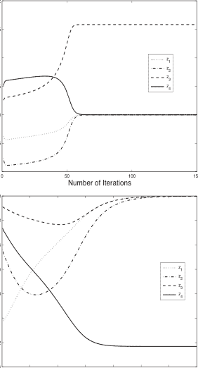

**图6.1**  
当 \(\sigma = 1\) 且 \(\mathrm{Kurt}(s_1) = -0.6\)，\(\mathrm{Kurt}(s_2) = 0\)，\(\mathrm{Kurt}(s_3) = 3\)，\(\mathrm{Kurt}(s_4) = 0.4\) 时，初始值为 \(z(0) = [-0.3\ -0.6\ 0.2\ 0.4]^T\)（上图）和 \(z(0) = [-1\ -0.5\ -0.1\ -0.2]^T\)（下图）下 \(z\) 各分量的演化。

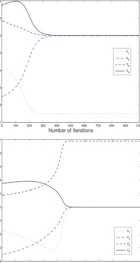

**图6.2**  
当 \(\sigma=-1\) 且初始值为 \(z(0)=[-0.4\ -0.8\ 0.2\ 0.4]^T\) 时，在不同峰度下的 \(z\) 各分量演化：\(\mathrm{Kurt}(s_1)=-0.6\)，\(\mathrm{Kurt}(s_2)=0\)，\(\mathrm{Kurt}(s_3)=3\)，\(\mathrm{Kurt}(s_4)=-0.4\)（上图）；\(\mathrm{Kurt}(s_1)=-0.6\)，\(\mathrm{Kurt}(s_2)=0\)，\(\mathrm{Kurt}(s_3)=-2.5\)，\(\mathrm{Kurt}(s_4)=-0.4\)（下图）。

### 6.5.2 示例2

本示例将说明分块算法(6.10)的收敛性。有两个随机信号 \(s_1\) 和 \(s_2\)，其峰度为 \(\mathrm{Kurt}(s_1)=2.6822\)，\(\mathrm{Kurt}(s_2)=2.4146\)。原始信号是人工生成的，为1000个零均值和单位方差的样本值，如图6.3（上图）所示。随机混合和白化后的信号如图6.3（下图）所示。由于 \(\Gamma_w=1192.7\)，令 \(\eta=0.05\)，\(a=25\)，\(b=0.01\)。使用算法(6.10)从混合信号中提取独立信号。\(\mathbf{w}\) 的范数演化如图6.4所示。令 \(L=200\)，\(\mathbf{w}(0)=[0.3,0.5]^T\)（上图）以及 \(L=1000\)，\(\mathbf{w}(0)=[0.3,0.05]^T\)（下图）。显然，范数在一定范围内变化，不会趋于无穷。

为了验证 \(\mathbf{w}\) 的方向是否收敛，我们将在每个 \(k\) 处计算 \(\mathbf{w}\) 与参考向量 \(\mathbf{v}=[1\ 1]^T\) 之间的*方向余弦*：

$$
DirectionCosine(k)=\frac{|\mathbf{w}^T(k)\cdot\mathbf{v}|}{\|\mathbf{w}(k)\|\cdot\|\mathbf{v}\|},
$$

适用于所有 \(k\geq 0\)。我们事先不知道精确的提取方向以及将提取哪个信号。因此，我们选取了一个参考向量。显然，如果 \(\mathbf{w}\) 的方向收敛，\(DirectionCosine(k)\) 将趋近于某个特定值。图6.5展示了在 \(L=200\)，\(\mathbf{w}(0)=[0.3,0.5]\)（上图）和 \(L=1000\)，\(\mathbf{w}(0)=[0.3,0.05]\)（下图）条件下 \(DirectionCosine\) 的演化。


同时，为了验证 `w` 收敛的方向是否正确，通过将混合白化信号投影到该方向来提取信号。提取的信号如图6.6所示。该示例表明，分块算法(6.10)具有不变集，并在不变集内收敛到独立分量方向。

### 6.5.3 示例3

在接下来的实验中，使用了四个信号，如图6.7（上图）所示。它们具有零均值和单位方差，且 `Kurt(s1)=-1.4984`，`Kurt(s2)=0.0362`，`Kurt(s3)=-1.1995`，`Kurt(s4)=2.4681`。由于 `Gamma_w=471.8463`，令 `eta=0.05`，`a=12`，`b=0.01`。使用原始的`SDT`算法(6.1)和(6.2)从混合白化信号中提取独立信号，如图6.7（下图）所示。对于算法(6.1)，范数和 `DirectionCosine` 的演化如图6.8所示。提取了一个具有正峰度的独立信号，如图6.10（上图）所示。对于算法(6.2)，范数和 `DirectionCosine` 的演化如图6.9所示。提取了一个具有负峰度的独立信号，如图6.10（下图）所示。

我们还比较了算法(6.1)和(6.2)在恒定学习率 `eta=0.05` 和 `eta(k)=0.1/(2*log2(k+1))` `(k>1)` 下的收敛速度。`DirectionCosine` 的演化轨迹如图6.11和6.12所示。

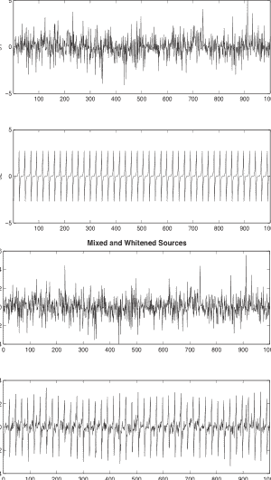

**图 6.3**

原始源信号 `s1` 和 `s2`，其中 `Kurt(s1)=2.6822`、`Kurt(s2)=2.4146`（上半部分）；两个混合并白化后的信号（下半部分）。

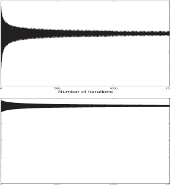

**图 6.4**

`w` 的范数演化，其中 `L=200`、`w(0)=[0.3 0.05]T`（上半部分），以及 `L=1000`、`w(0)=[0.03 0.5]T`（下半部分）。

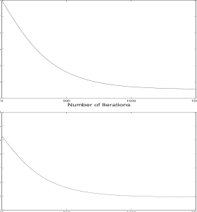

**图 6.5**

`DirectionCosine(k)` 的演化，其中 `L=200`、`w(0)=[0.3 0.05]T`（上半部分），以及 `L=1000`、`w(0)=[0.03 0.5]T`（下半部分）。

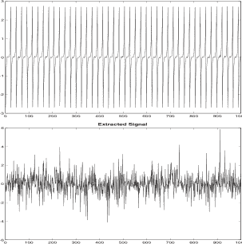

**图 6.6**

提取的信号，其中 `L=200`、`w(0)=[0.3 0.5]T`（上半部分），以及 `L=1000`、`w(0)=[0.03 0.5]T`（下半部分）。

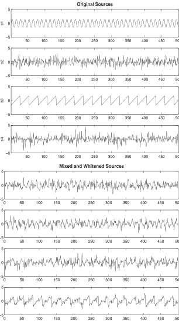

**图 6.7**

原始源信号 `s1`、`s2`、`s3` 和 `s4`，其中 `Kurt(s1)=-1.4984`、`Kurt(s2)=0.0362`、`Kurt(s3)=-1.1995`、`Kurt(s4)=2.4681`（上半部分）；四个混合并白化后的信号（下半部分）。

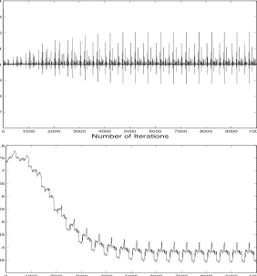

**图 6.8**

算法(6.1)在初始值 `w(0)=[0.6 1.2 0.1]T` 下的 `w` 的范数演化（上半部分）和 `DirectionCosine(k)` 的演化（下半部分）。

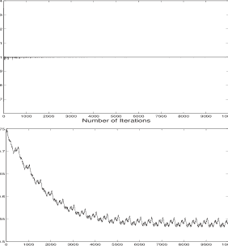

**图 6.9**

算法(6.2)在初始值 `w(0)=[0.6 1.2 0.1 0.1]T` 下的 `w` 的范数演化（上半部分）和 `DirectionCosine(k)` 的演化（下半部分）。

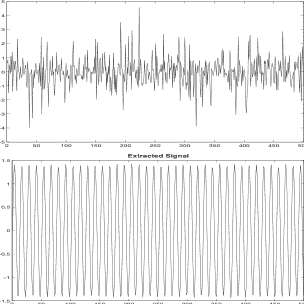

**图 6.10**

(6.1)所提取的信号，其中 `Kurt(s4)=2.4681`（上半部分）；(6.2)所提取的信号，其中 `Kurt(s1)=-1.4984`（下半部分）。

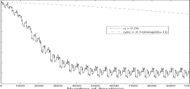

**图 6.11**

算法(6.1)在固定学习率 `eta=0.05` 和趋于零的学习率 `eta(k)=0.1/(2*log2(k+1))` 下的收敛速率比较。点划线表示算法在趋于零的学习率下的演化。

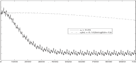

**图 6.12**

算法(6.2)在固定学习率 `eta=0.05` 和趋于零的学习率 `eta(k)=0.1/(2*log2(k+1))` 下的收敛速率比较。点划线表示算法在趋于零的学习率下的演化。

点划线表示各算法在趋于零的学习率下的演化。显然，在本实验中，采用固定学习率的算法收敛得更快。也许可以通过选择合适的趋于零的学习率来改善性能。然而，目前尚不清楚如何选择一种合适的趋于零的学习率，使算法既不发散又能更快收敛。固定学习率简化了原始算法在实际中的应用，并且在随机环境中可以保证收敛性质。

### 6.6 结论

本章研究了一类采用固定学习率的 Hyvärinen-Oja ICA 学习算法的收敛性。结果表明，这些算法收敛到具有正峭度或负峭度的独立分量方向。由于采用了固定学习率，可以满足算法在实际应用中的要求。本章最重要的结果是在随机环境中获得了一些不变集，从而通过选择合适的学习参数保证了原始 `SDT` 算法的不发散性。在这些不变集中，通过 `DDT` 方法间接研究了原始算法的局部收敛性。为了改善原始算法的性能，相应的 `DDT` 算法可以扩展到原始算法的分块版本。进行了仿真，以进一步支持所得结果。

## 学习算法产生的混沌行为

### 7.1 引言

在前几章中，我们主要利用 `DDT` 方法讨论了一些子空间学习算法的收敛性。在某些条件下，可以得到这些算法的一些不变集，并推导出这些算法的收敛条件。然而，一些学习算法在实际应用中会表现出一些混沌行为。在文献[123]中，当学习率选在某个范围内时，`Xu` 的 `LMSER` 算法会产生混沌行为。文献[122]还探讨了 `Douglas` 的 `MCA` 学习算法[60]的混沌行为。

混沌行为对于学习算法在实际应用中的使用至关重要。一方面，混沌行为可能导致系统崩溃[178]。因此，如何选择系统参数以避免混沌行为非常重要。参见文献[2, 78, 79, 92, 110]中的例子。另一方面，混沌行为可应用于许多科学学科：数学、金融[105]、生物学[161, 6]、工程学[34, 33, 140, 163, 183]和生态学[58, 16]。

在本章中，我们探讨一类一维类型的 ICA 算法的稳定性和混沌行为[121]。虽然我们只讨论原始算法的一维情形，但这可以揭示原始算法的动力学行为。

在文献[86]中，`Hyvärinen` 和 `Oja` 为 ICA 提出了一些神经元模型。相应的学习算法描述如下：

```
w(k+1)=w(k)+mu(k)[-sigma(x(k))g(wT(k)x(k))-f(||w(k)||^2)w(k)]
```

其中 `f` 是标量函数，`sigma=±1` 是一个符号，决定我们是在最小化还是最大化峭度[86]。`mu(k)` 是学习率序列，`x(k)` 是预白化后的输入数据。函数 `g` 是一个多项式：

```
g(y)=a*y-b*y^3
```

其中 `a>=0` 且 `b>0`。

在实际应用中，通常需要固定学习率来加快收敛并满足计算要求[125, 127, 185, 210]。本章研究上述算法在固定学习率下的动力学行为。这些采用固定学习率的算法在一维情形下可表示为：


`w(k+1)=w(k)+\eta[-\sigma g(w(k))-f(\lVert w(k)\rVert^2)w(k)]`.

\]
对于所有 \(k\ge 0\)，其中 \(f\) 是标量函数，\(\eta>0\) 是固定学习率。显然，若 \(\sigma=1\)，算法可重写为：

```
w(k+1)=w(k)+\eta[-(aw(k)-bw^3(k))-f(\lVert w(k)\rVert^2)w(k)]. \tag{7.1}
```

若 \(\sigma=-1\)，则有：

```
w(k+1)=w(k)+\eta[(aw(k)-bw^3(k))-f(\lVert w(k)\rVert^2)w(k)]. \tag{7.2}
```

本章将说明算法(7.1)和(7.2)在某些条件下既具有稳定性又具有混沌行为。将推导这些稳定与混沌的条件。因此，容易看出，通过选择合适的学习参数可以避免发散行为和混沌行为。

本章组织如下。第2节确定了一些不变集，并得到这些算法发散的条件。第3节推导了这些算法的稳定性条件。第4节分析了混沌及混沌行为。最后，第5节给出结论。

### 7.2 不变集与发散

显然，不变集保证算法的不发散性。下面的定理将给出算法(7.1)和(7.2)的不变集。为了便于分析，首先给出两个引理。

记

```
M_1^*=\max\left\{\frac{a+f(\lVert w(k)\rVert^2)}{b},\frac{4\left(\eta(a+f(\lVert w(k)\rVert^2))-1\right)^3}{27\eta b}\right\},
```

```
M_2^*=\max\left\{\frac{\eta(a-f(\lVert w(k)\rVert^2))+2}{\eta b},\frac{4\left(\eta(a-f(\lVert w(k)\rVert^2))+1\right)^3}{27\eta b}\right\}.
```

**引理 7.1** 假设 `\eta>0`、`a>0`、`b>0`。则有

```
[1-\eta a-\eta f(\lVert w(k)\rVert^2)+\eta bs]\cdot s\le M_1^*,
```

对于所有 `0<s\le\dfrac{a+f(\lVert w(k)\rVert^2)}{b}` 且 `\eta(a+f(\lVert w(k)\rVert^2))>0` 成立。

**证明：** 定义一个可微函数

```
f(s)=\left[1-\eta a-\eta f(\|w(k)\|^2)+\eta bs\right]^2\cdot s,
```

对于所有 `0<s\leq \dfrac{a+f(\|w(k)\|^2)}{b}`。则有

```
\dot f(s)=\left[1-\eta a-\eta f(\|w(k)\|^2)+\eta bs\right]\left[1-\eta a-\eta f(\|w(k)\|^2)+3\eta bs\right],
```

对于所有 `0<s\leq \dfrac{a+f(\|w(k)\|^2)}{b}`。记

```
\xi_1=\dfrac{\eta(a+f(\|w(k)\|^2))-1}{3\eta b},\qquad \xi_2=\dfrac{\eta(a+f(\|w(k)\|^2))-1}{\eta b}.
```

若 `\eta(a+f(\|w(k)\|^2))>1`，则有

```
\dot f(s)\begin{cases}
>0, & \text{若 }0<s<\xi_1,\\
=0, & \text{若 }s=\xi_1,\\
<0, & \text{若 }\xi_1<s<\xi_2,\\
=0, & \text{若 }s=\xi_2,\\
>0, & \text{若 }s>\xi_2.
\end{cases}
```

这表明函数 `f(s)` 在区间 `\left(0,\dfrac{a+f(\|w(k)\|^2)}{b}\right)` 上的最大值点必为 `s^*=\xi_1` 或 `s^*=\dfrac{a+f(\|w(k)\|^2)}{b}`。若 `\eta(a+f(\|w(k)\|^2))\leq 1`，则 `s^*=\dfrac{a+f(\|w(k)\|^2)}{b}` 必为 `f(s)` 在区间 `\left(0,\dfrac{a+f(\|w(k)\|^2)}{b}\right)` 上的最大值点。因此，不难得到

```
\left[1-\eta a-\eta f(\|w(k)\|^2)+\eta bs\right]^2\cdot s\leq M_1^*,
```

对于所有 `0<s\leq \dfrac{a+f(\|w(k)\|^2)}{b}`。证毕。

#### 引理 7.2

假设 `\eta>0`，`a>0`，且 `b>0`。则有

```
\left[1+\eta a-\eta f(\|w(k)\|^2)-\eta bs\right]^2\cdot s\leq M_2^*,
```

对于所有 `0<s\leq \dfrac{\eta(a-f(\|w(k)\|^2))+2}{\eta b}`，其中 `\eta(a-f(\|w(k)\|^2))>-2`。

**证明：** 定义一个可微函数

```
f(s)=\left[1+\eta a-\eta f(\|w(k)\|^2)-\eta bs\right]^2\cdot s
```

对于所有 `0<s\leq \dfrac{\eta(a-f(\|w(k)\|^2))+2}{\eta b}`。则有

```
\dot f(s)=\left[1+\eta a-\eta f(\|w(k)\|^2)-\eta bs\right]\left[1+\eta a-\eta f(\|w(k)\|^2)-3\eta bs\right],
```

对于所有 `0<s\leq \dfrac{\eta(a-f(\|w(k)\|^2))+2}{\eta b}`。记

```
\xi_1=\dfrac{\eta(a-f(\|w(k)\|^2))+1}{3\eta b},\qquad \xi_2=\dfrac{\eta(a-f(\|w(k)\|^2))+1}{\eta b}.
```

若 `\eta(a-f(\|w(k)\|^2))>-1`，则有

```
\dot f(s)\begin{cases}
>0, & \text{若 }0<s<\xi_1,\\
=0, & \text{若 }s=\xi_1,\\
<0, & \text{若 }\xi_1<s<\xi_2,\\
=0, & \text{若 }s=\xi_2,\\
>0, & \text{若 }s>\xi_2.
\end{cases}
```

这表明函数 `f(s)` 在区间 `\left(0,\dfrac{\eta(a-f(\|w(k)\|^2))+2}{\eta b}\right)` 上的最大值点必为 `s^*=\xi_1` 或 `s^*=\dfrac{\eta(a-f(\|w(k)\|^2))+2}{\eta b}`。

若 `-2<\eta(a-f(\|w(k)\|^2))\leq -1`，`s^*=\dfrac{\eta(a-f(\|w(k)\|^2))+2}{\eta b}` 必为 `f(s)` 的最大值点。因此，不难得到

```
\left[1+\eta a-\eta f(\|w(k)\|^2)-\eta bs\right]^2s\leq M_2^*,
```

对于所有 `0<s\leq \dfrac{\eta(a-f(\|w(k)\|^2))+2}{\eta b}`。证毕。

#### 引理 7.3

若 `0<x\leq 4`，则成立 `(x-1)^3\leq \dfrac{27x}{4}`。

**证明：** 定义一个可微函数

```
f(x)=(x-1)^3-\frac{27x}{4},
```

对于所有 `0<x\leq 4`。则有

```
\dot f(x)=3(x-1)^2-\frac{27}{4},
```

记

```
S_1=\left\{w^2\mid w^2\in\mathbb{R},\ w^2<\frac{a+f(\|w(k)\|^2)}{b}\right\},
```

```
S_2=\left\{w^2\mid w^2\in\mathbb{R},\ w^2<\frac{a-f(\|w(k)\|^2)}{b}+\frac{2}{\eta b}\right\}.
```

#### 定理 7.1

假设 `\eta>0`，`a>0`，且 `b>0`。若 `0<\eta(a+f(\|w(k)\|^2))\leq 4`，则 `S_1` 是 (7.1) 的不变集。若 `-2<\eta(a-f(\|w(k)\|^2))\leq 2`，则 `S_2` 是 (7.2) 的不变集。

**证明：** 由 (7.1) 可得


`w^2(k+1)=\left[1-\eta a-\eta f(\|w(k)\|^2)+\eta b w^2(k)\right]^2\cdot w^2(k),`

$$
$$
对于所有 \(k\geq 0\)。因此有
$$
$$
\begin{aligned}
w^2(k+1)&\leq \max\left\{\left[1-\eta a-\eta f(\|w(k)\|^2)+\eta b w^2(k)\right]^2\cdot w^2(k)\right\}\\\
&\leq \max\left\{\left[1-\eta a-\eta f(\|w(k)\|^2)+\eta b s\right]^2\cdot s\right\}.
\end{aligned}
$$
$$
对于所有 \(0<s\leq\dfrac{a+f(\|w(k)\|^2)}{b}\)。由引理 7.1，可得 `w^2(k+1)\leq M_1^*`，其中 `k\geq 0`。由引理 7.3，若 `0<\eta(a+f(\|w(k)\|^2))\leq 4`，则成立
$$
$$
\frac{4(\eta(a+f(\|w(k)\|^2))-1)^3}{27\eta b}\leq\frac{a+f(\|w(k)\|^2)}{b}.
$$
$$
因此可得
$$
$$
w^2(k+1)\leq\frac{a+f(\|w(k)\|^2)}{b}.
$$
$$
因此，`S_1` 是 `(7.1)` 的不变集。

由 `(7.2)` 可得
$$
$$
w^2(k+1)=\left[1+\eta a-\eta f(\|w(k)\|^2)-\eta b w^2(k)\right]^2\cdot w^2(k),
$$
$$
对于所有 `k\geq 0`。因此有
$$
$$
\begin{aligned}
w^2(k+1)&\leq \max\left\{\left[1+\eta a-\eta f(\|w(k)\|^2)-\eta b w^2(k)\right]^2\cdot w^2(k)\right\}\\\
&\leq \max\left\{\left[1+\eta a-\eta f(\|w(k)\|^2)-\eta b s\right]^2\cdot s\right\}.
\end{aligned}
$$
$$
对于所有 `0<s\leq\dfrac{\eta(a-f(\|w(k)\|^2))+2}{\eta b}`。由引理 7.2，可得 `w^2(k+1)\leq M_2^*`，其中 `k\geq 0`。由引理 7.3，若 `-2<\eta(a-f(\|w(k)\|^2))\leq 2`，则成立
$$
$$
\frac{4(\eta(a-f(\|w(k)\|^2))+1)^3}{27\eta b}\leq\frac{\eta(a-f(\|w(k)\|^2))+2}{\eta b}.
$$
$$
因此可得
$$
$$
w^2(k+1)\leq\frac{\eta(a-f(\|w(k)\|^2))+2}{\eta b}.
$$
$$
因此，`S_2` 是 `(7.2)` 的不变集。证毕。

前面的定理表明，从不变集 `S_1` 或 `S_2` 中的 `w(0)` 出发的算法 `(7.1)` 或 `(7.2)` 的任意轨迹都将保持在 `S_1` 或 `S_2` 中。这保证了算法 `(7.1)` 和 `(7.2)` 的不发散性。然而，在不变集之外，算法表现出不同的动力学行为，甚至可能发散到无穷大。以下定理给出算法的发散条件。

#### 定理 7.2
假设 `η>0`，`a>0`，`b>0`，且 `w(0)\neq 0`。

对于算法 `(7.1)`，若 `0<\eta(a+f(\|w(k)\|^2))` 且
$$
$$
w^2(k)>\frac{a+f(\|w(k)\|^2)}{b},
$$
$$
则
$$
$$
\lim_{k\to+\infty}w^2(k+1)=+\infty.
$$
$$
对于算法 `(7.2)`，若 `-2<\eta(a-f(\|w(k)\|^2))` 且
$$
$$
w^2(k)>\frac{\eta(a-f(\|w(k)\|^2))+2}{\eta b},
$$
$$
则
$$
$$
\lim_{k\to+\infty}w^2(k+1)=+\infty.
$$
$$
**证明：** 由 `(7.1)` 可得
$$
$$
w^2(k+1)=\left[1-\eta a-\eta f(\|w(k)\|^2)+\eta b w^2(k)\right]^2\cdot w^2(k),
$$
$$
对于所有 `k\geq 0`。若
$$
$$
w^2(k)>\frac{a+f(\|w(k)\|^2)}{b},
$$
$$
对于所有 `k\geq 0` 成立，则有
$$
$$
1-\eta a-\eta f(\|w(k)\|^2)+\eta b w^2(k)>1,
$$
$$
对于所有 `k\geq 0` 成立。于是有
$$
$$
\left[1-\eta a-\eta f(\|w(k)\|^2)+\eta b w^2(k)\right]^2>1,
$$
$$
对于所有 `k\geq 0` 成立。因此，对于算法 `(7.1)`，有
$$
$$
\lim_{k\to+\infty}w^2(k+1)=+\infty.
$$
$$
由算法 `(7.2)` 可得
$$
$$
w^2(k+1)=\left[1+\eta a-\eta f(\|w(k)\|^2)-\eta b w^2(k)\right]^2\cdot w^2(k),
$$
$$
对于所有 `k \ge 0`。若
$$
$$
w^2(k)>\frac{\eta\left(a-f(\|w(k)\|^2)\right)+2}{\eta b},
$$
$$
对于所有 `k \ge 0` 成立，则有
$$
$$
1+\eta a-\eta f(\|w(k)\|^2)-\eta b w^2(k)<-1,
$$
$$
对于所有 `k \ge 0` 成立。容易看出
$$
$$
\left[1+\eta a-\eta f(\|w(k)\|^2)-\eta b w^2(k)\right]^2>1,
$$
$$
对于所有 `k \ge 0` 成立。因此，对于算法 `(7.2)`，\(\displaystyle\lim_{k\to+\infty}w^2(k+1)=+\infty\)。

证毕。

#### 定理 7.3
假设 `η>0`，`a>0`，`b>0`，且 `w(0)\ne 0`。对于算法 `(7.1)`，若 `η(a+f(\|w(k)\|^2))\le 0`，则 \(\displaystyle\lim_{k\to+\infty}w^2(k+1)=+\infty\)。对于算法 `(7.2)`，若 `η(a-f(\|w(k)\|^2))\le -2`，则 \(\displaystyle\lim_{k\to+\infty}w^2(k+1)=+\infty\)。

**证明：** 由 `(7.1)` 可得
$$
$$
w^2(k+1)=\left[1-\eta a-\eta f(\|w(k)\|^2)+\eta b w^2(k)\right]^2\cdot w^2(k),
$$
$$
对于所有 `k\ge 0`。若 `η(a+f(\|w(k)\|^2))\le 0` 且 `w(0)\ne 0`，则对于所有 `k\ge 0` 有
$$
$$
\left[1-\eta a-\eta f(\|w(k)\|^2)+\eta b w^2(k)\right]^2>1,
$$
$$
因此，对于算法 `(7.1)`，有 \(\displaystyle\lim_{k\to+\infty}w^2(k+1)=+\infty\)。

由算法 `(7.2)` 可得
$$
$$
w^2(k+1)=\left[1+\eta a-\eta f(\|w(k)\|^2)-\eta b w^2(k)\right]^2\cdot w^2(k),
$$
$$
对于所有 `k\ge 0`。若 `η(a-f(\|w(k)\|^2))\le -2` 且 `w(0)\ne 0`，则对于所有 `k\ge 0` 有
$$
$$
\left[1+\eta a-\eta f(\|w(k)\|^2)-\eta b w^2(k)\right]^2>1,
$$
$$
因此，对于算法 `(7.2)`，\(\displaystyle\lim_{k\to+\infty}w^2(k+1)=+\infty\)。

证毕。

由前面的定理，不变集和发散区域如图 7.1 和图 7.2 所示。`S_1` 和 `S_2` 分别是算法 `(7.1)` 和 `(7.2)` 的不变集。区域 `I`、`II` 和 `III` 是发散区域。在区域 `IV` 中，算法的有界性无法得到保证。下面的例子（图 7.3）说明了 `(7.1)` 和 `(7.2)` 在区域 `IV` 中的发散性。


**图 7.1**

算法（7.1）的不变集 `S_1`，以及发散区域 `I`、`II` 和 `III`。


**图 7.2**

算法（7.2）的不变集 \(S_2\)，以及发散区域 \(I\)、\(II\) 和 \(III\)。


**图 7.3**

算法（7.1）在 \(\eta(a+f(\|w(k)\|^2))=4.01\) 且 \(w^2(0)=0.01<\frac{a+f(\|w(k)\|^2)}{b}=2.6733\) 时的发散（左），算法（7.2）在 \(\eta(a-f(\|w(k)\|^2))=2.01\) 且 \(w^2(0)=0.01<\frac{a-f(\|w(k)\|^2)}{\eta b}=2.6733\) 时的发散（右）。

### 7.3 稳定性分析

在本节中，我们将探讨算法（7.1）和（7.2）在不变集 \(S_1\) 和 \(S_2\) 中的稳定性。

**定义 7.1** 若且仅若

\[
w^*=w^*+\eta\left[-(aw^*-b(w^*)^3)-f(\|w(k)\|^2)w^*\right],
\]

则称点 \(w^*\in\mathbb{R}^n\) 为（7.1）的平衡点。

**定义 7.2** 若且仅若

\[
w^*=w^*+\eta\left[(aw^*-b(w^*)^3)-f(\|w(k)\|^2)w^*\right],
\]

则称点 \(w^*\in\mathbb{R}^n\) 为（7.2）的平衡点。

显然，（7.1）的所有平衡点集合为

\[
\left\{0,\sqrt{\frac{a+f(\|w(k)\|^2)}{b}},-\sqrt{\frac{a+f(\|w(k)\|^2)}{b}}\right\}.
\]

（7.2）的所有平衡点集合为

\[
\left\{0,\sqrt{\frac{a-f(\|w(k)\|^2)}{b}},-\sqrt{\frac{a-f(\|w(k)\|^2)}{b}}\right\}.
\]

显然，这些算法具有多个平衡点，因此其动力学研究属于多稳定性问题 [192]。

根据李雅普诺夫间接法，若算法在某平衡点处的雅可比矩阵的每个特征值的绝对值小于 1，则该平衡点是稳定的 [2]。对于算法（7.1）和（7.2），我们将计算各平衡点处雅可比矩阵的特征值。

**定理 7.4** 对于算法（7.1），若 \(w(k) \in S_1\)，则当 \(0 < \eta(a+f(\|w(k)\|^2)) < 2\) 时，平衡点 \(0\) 是稳定的。若 \(\eta(a+f(\|w(k)\|^2)) > 0\)，则点 \(\pm\sqrt{\frac{a+f(\|w(k)\|^2)}{b}}\) 是不稳定的。

*证明：* 令

\[
G=w(k)+\eta\left[-(aw(k)-bw^3(k))-f(\|w(k)\|^2)w(k)\right].
\]

我们有

\[
\frac{dG}{dw(k)}=1-\eta a-\eta f(\|w(k)\|^2)+3\eta b w^2(k).
\]

显然，\(\left.\frac{dG}{dw(k)}\right|_0=1-\eta a-\eta f(\|w(k)\|^2)\)。若 \(0<\eta(a+f(\|w(k)\|^2))<2\)，则有 \(\left|\frac{dG}{dw(k)}\right|<1\)。因此，\(0\) 是稳定点。至于平衡点 \(\pm\sqrt{\frac{a+f(\|w(k)\|^2)}{b}}\)，\(\left|\frac{dG}{dw(k)}\right|=|1+2\eta(a+f(\|w(k)\|^2))|\)。若 \(\eta(a+f(\|w(k)\|^2))>0\)，则 \(\left|\frac{dG}{dw(k)}\right|>1\)。

因此，对于 \(\eta(a+f(\|w(k)\|^2))>0\)，\(\pm\sqrt{\frac{a+f(\|w(k)\|^2)}{b}}\) 是不稳定点。证明完毕。定理 7.4 表明，在不变集 \(S_1\) 中，当 \(0<\eta(a+f(\|w(k)\|^2))<2\) 时，算法（7.1）收敛于 \(0\)，如图 7.4 所示。


**图 7.4**

算法（7.1）在不同初始值下收敛于 0，其中 \(b=0.2\)，\(\eta(a+f)=0.56\)（左）和 \(\eta(a+f)=1.4\)（右）。

**定理 7.5** 对于算法（7.2），若 \(w(k)\in S_2\)，则当 \(-2<\eta(a-f(\|w(k)\|^2))\leq 0\) 时，平衡点 \(0\) 是稳定的。若 \(0<\eta(a-f(\|w(k)\|^2))<1\)，则点 \(\pm\sqrt{\frac{a-f(\|w(k)\|^2)}{b}}\) 是稳定点。

*证明：* 令

\[
G=w(k)+\eta\left[(aw(k)-bw^3(k))-f(\|w(k)\|^2)w(k)\right].
\]

我们有

\[
\frac{dG}{dw(k)}=1+\eta a-\eta f(\|w(k)\|^2)-3\eta b w^2(k).
\]

显然，\(\left.\frac{dG}{dw(k)}\right|_0=1+\eta a-\eta f(\|w(k)\|^2)\)。若 \(-2<\eta(a-f(\|w(k)\|^2))<0\)，则有 \(\left|\frac{dG}{dw(k)}\right|<1\)。因此，对于 \(-2<\eta(a-f(\|w(k)\|^2))<0\)，\(0\) 是稳定的。

至于平衡点 \(\pm\sqrt{\frac{a-f(\|w(k)\|^2)}{b}}\)，\(\left|\frac{dG}{dw(k)}\right|=|1-2\eta(a-f(\|w(k)\|^2))|\)。若 \(0<\eta(a-f(\|w(k)\|^2))<1\)，则 \(\left|\frac{dG}{dw(k)}\right|<1\)。因此，对于 \(0<\eta(a-f(\|w(k)\|^2))<1\)，\(\pm\sqrt{\frac{a-f(\|w(k)\|^2)}{b}}\) 是稳定点。证明完毕。图 7.5 展示了（7.2）的收敛情况。


**图 7.5**

算法（7.2）在参数 \(\eta(a-f(w)^2)\) 和 \(b=3\) 下，于初始值 \(w(0)=0.4\) 或 \(w(0)=-0.4\) 处收敛于 0（左）。算法在不同初始值下收敛于 \(\pm\sqrt{\frac{a-f(\|w(k)\|^2)}{b}}=\pm0.8165\)，其中 \(b=3\)，\(\eta=0.4\)，\((a-f(\|w(k)\|^2))=2\)（右）。

### 7.4 混沌行为

不变集 \(S_1\) 和 \(S_2\) 保证了算法（7.1）和（7.2）的非发散性。在 \(S_1\) 中，若 \(0<\eta(a+f(w^2))<2\)，算法（7.1）将收敛于 \(0\)。在不变集 \(S_2\) 中，若 \(-2<\eta(a-f(w^2))<0\)，算法（7.2）将收敛于 \(0\)；若 \(0<\eta(a-f(w^2))<1\)，则收敛于 \(\pm\sqrt{\frac{a-f(\|w(k)\|^2)}{b}}\)。那么，当 \(2\leq\eta(a+f(w^2))\leq4\) 时，算法（7.1）的动力学行为是怎样的？当 \(1\leq\eta(a-f(w^2))\leq2\) 时，算法（7.2）的动力学行为又是怎样的？在本章中，我们将绘制算法的分岔图并计算李雅普诺夫指数，以说明算法的混沌行为。

算法（7.1）和（7.2）的分岔图分别如图 7.6 和图 7.7 所示。分岔图清晰地展示了通往混沌的路径。图 7.6 显示 \(\eta(a+f(w^2))=2\) 是（7.1）的一个分岔点，在此处平衡点变得不稳定并出现周期解。如图 7.7 所示，（7.2）的分岔点为 \(\eta(a-f(w^2))=1\)。


**图 7.6**

（7.1）在 \(w(0)=0.01\) 时的分岔图。


**图 7.7**

（7.2）在 \(w(0)=0.01\)（左）和 \(w(0)=-0.01\)（右）时的分岔图。

为进一步说明混沌行为，根据 [2, 6] 计算了算法（7.1）和（7.2）的李雅普诺夫指数。由（7.1），令

\[
y(k):=\frac{dG}{dw(k)}=1-\eta\bigl(a+f(w^2)\bigr)+3\eta b w(k)^2,
\]


其中 $0<\eta(a+f(w^2))<4$ 且 $k\geq 0$。对于（7.2），令

$$
y(k):=\frac{dG}{dw(k)}=1+\eta\bigl(a-f(w^2)\bigr)-3\eta b w(k)^2,
$$

其中 $-2<\eta(a-f(w^2))<2$ 且 $k\geq 0$。李雅普诺夫指数可通过下式计算：

$$
\lim_{k\to+\infty}\frac{1}{k}\sum_{i=1}^{k}\ln|y(i)|.
$$

图 7.8 和图 7.9 分别绘制了算法（7.1）和（7.2）在每个参数值下的李雅普诺夫指数。显然，在图 7.8 中，当 $\eta(a+f(w^2))\simeq 3.4$ 时，李雅普诺夫指数变为正值，演化开始变得混沌。在图 7.9 中，当 $\eta(a-f(w^2))\simeq 1.4$ 时，李雅普诺夫指数变为正值，演化开始变得混沌。因此，容易看出，随着学习参数在不变集内的增加，算法（7.1）和（7.2）表现出混沌行为。

从前述分析可以看出，混沌的出现是因为学习参数被选择在某个特定范围内。因此，通过调整学习参数来控制混沌行为是可能的，从而使该算法在实际应用中能够更好地发挥作用。


**图 7.8**

（7.1）的李雅普诺夫指数。


**图 7.9**

（7.2）的李雅普诺夫指数。

### 7.5 结论

本章研究了一类具有恒定学习率的 ICA 算法。我们推导了其不变集以及平衡点局部稳定性的若干条件。研究表明，这些算法可能表现出混沌行为，甚至在某些条件下发散至无穷。因此，需要选择合适的学习参数，以使算法能够更有效地工作。

## 生物合理 PCA 模型中主方向数量的确定

### 8.1 引言

在第 2、3 和 4 章中，我们研究了 PCA 学习算法的收敛性。然而，要将 PCA 神经网络应用于实际问题，一个需要解决的重要问题是如何为 PCA 神经网络确定合适的主方向数量。主方向的数量对 PCA 神经网络的计算结果有至关重要的影响。例如，在 PCA 神经网络应用于图像压缩时，如果主方向数量过少，重建图像的质量将不达标；而如果主方向数量过多，则会带来过重的计算负担。迄今为止，如何自适应地选择合适的主方向数量以在计算质量和计算复杂度之间取得适当平衡，这个问题在很大程度上仍未得到解决。

过去，PCA 神经网络的主方向数量通常根据先验知识来确定。显然，这在许多应用中并不实用，尤其是对于在线应用。本章提出了一种生物合理的 PCA 模型来克服这一问题。该模型通过使用改进的广义 Hebbian 算法（GHA），自适应地确定主方向的数量，以逼近给定数据集的固有维度。这样，通过所提出的网络，给定的数据集可以被压缩到具有固有维度的子空间中。这能够在结果质量与实现该质量所需的计算复杂度之间取得平衡 [126]。

众所周知，数据集的固有维度反映了该数据集主方向的适当数量。更一般地讲，如果数据集 $\Omega \subset \mathbb{R}^n$ 的元素完全位于 $\mathbb{R}^n$ 的一个 $m$ 维子空间中，其中 $m < n$，则称该数据集的固有维度等于 $m$ [26]。有多种方法可以评估数据集的固有维度，参见 [26, 151]。在 [151] 中，Rubio 提出了一种解释方差方法，用于识别给定数据集的固有维度 $m$，以趋近于

精度 $\alpha$ 由

$$m=\min\left\{Z\in\{0,1,\ldots,n\}\mid\sum_{p=1}^{Z}\lambda_p\geq\alpha\cdot\operatorname{trace}(C)\right\}, \qquad (8.1)$$

其中$C\in\mathbb{R}^{n\times n}$是给定数据集的协方差矩阵，$\lambda_p$（$p=1,\ldots,n$）是$C$的特征值，且$\lambda_1\geq\lambda_2\geq\ldots\geq\lambda_n\geq 0$。$\lambda_i$与$C$的迹之间的比值是$C$的第$i$个主方向所解释的方差量。因此，$\alpha$表示与前$m$个特征值相关联的主方向所解释的方差量。

尽管固有维数$m$对于PCA神经网络而言只是一个合适的主方向数目，但在在线应用中事先计算出$m$并不容易。在本章中，提出了一种受生物神经网络关键特性启发的PCA模型：被激发的神经元可以激活靠近它们的神经元，并抑制远离它们的神经元。利用这一著名的*中心兴奋/周围抑制*（on-center/off-surround）原理[75, 101]，所提出的模型连同改进的GHA算法能够实现自适应。在这一学习过程中，活跃神经元的数目（与模型中的主方向数目相同）逼近给定数据集的固有维数$m$，以达到精度$\alpha$。因此，可以在PCA神经网络的计算结果质量与计算复杂度之间取得良好的平衡。

本章⁴的组织结构如下。在第2节中，给出具有生物合理性的PCA模型和改进的GHA算法。第3节分析该模型的一些重要性质。第4节进行仿真实验。第5节得出结论。

### 8.2 PCA模型与算法

#### 8.2.1 PCA模型

假设输入序列

$$\{x(k)\mid x(k)\in\mathbb{R}^{n},\ (k=1,2,\ldots)\}$$

是一个零均值平稳随机过程。记$C=E[x(k)x^T(k)]$，即输入数据集的协方差矩阵。1989年，Sanger [156]提出了GHA，用于从数据集中自适应地提取主成分。设$y(k)=W(k)x(k)$，其中$W^T(k)=[w_1(k),w_2(k),\ldots,w_{m'}(k)]$是权重矩阵，$y(k)=[y_1(k),y_2(k),\ldots,y_{m'}(k)]^T$是输出向量。GHA PCA模型如图8.1（左）所示，GHA学习算法如下：


**图8.1**

原始GHA模型（左）和带侧向连接的改进GHA模型（右）。

$$W(k+1)=W(k)+\eta\left[W(k)C_k-\operatorname{LT}\left[W^T(k)C_kW(k)\right]W(k)\right]. \tag{8.2}$$

其中$\eta > 0$，$k \geq 1$，$C_k = x(k)x^T(k)$。算子$\operatorname{LT}[\cdot]$将矩阵参数中对角线上方的所有元素置为零。由(8.2)可知，$W^T(k) = [w_1(k), w_2(k), \ldots, w_{m'}(k)]$将收敛到输入数据集的主方向。这里，$m' \ll n$是给定数据集所提取的主方向数目，也是该网络中的神经元数目。显然，要使用PCA神经网络，必须预先确定数目$m'$。这一要求在应用中并不实际，尤其是在线应用。

在本章中，提出了一种改进的PCA模型，如图8.1（右）所示。在该模型中，所提取主方向的数目将被确定，以自适应地逼近给定数据集的固有维数，从而达到所需的精度。该模型中的神经元以侧向连接的方式排列成一条线。侧向连接充当通道，神经元的输出通过其传递给其他神经元，从而产生兴奋和抑制。该模型中有两类神经元：活跃神经元和静息神经元。所有活跃神经元总是排列在模型的前端，第一个神经元始终处于所有活跃神经元的中心。当活跃神经元受到一定幅度的输入刺激后，根据中心兴奋/周围抑制的生物学观点[75, 101]，要么第一个静息神经元被激活，要么最后一个活跃神经元被抑制。活跃神经元的数目（即该PCA模型的主方向数目）通过这一生物学过程逼近数据集的固有维数。

对于在线观测$C_k$（1.10），显然有$\lim_{k\to\infty} C_k = C$，其中$C_0 = 0$。改进模型在数学上可以表示为$y(k)=W(k)x(k)$，$(k\ge 1)$，其中$W^T(k)=[w_1(k), w_2(k), \ldots, w_n(k)]$是权重矩阵，$y(k)=[y_1(k), y_2(k), \ldots, y_n(k)]^T$是输出向量。为了更新网络权重，给出改进的GHA学习算法如下：

$$W(k+1)=W(k)+\eta\Pi(k)\left[W(k)C_k-\operatorname{LT}\left[W^T(k)C_kW(k)\right]W(k)\right], \tag{8.3}$$

其中$\eta > 0$，$k \geq 1$，$\Pi(k)$是一个对角矩阵。$\Pi(k)$在时刻$k$充当控制器，决定神经元是活跃还是静息。$\Pi(k)$的对角元素值始终为1或0，且1总是沿对角线出现。如果某个对角元素的值为1，则对应的神经元处于活跃状态；否则，该神经元处于静息状态。$\Pi(1)$的所有元素初始值均为0，但$\Pi_{11}(1)=1$除外，即初始时刻只有第一个神经元处于活跃状态。正是$\Pi(k)$决定了改进PCA模型在时刻$k$所提取主方向的数目。


原始GHA (8.2)与改进GHA (8.3)的关键区别在于，改进GHA中加入了`Π(k)`。通过改变`Π(k)`的对角元素值，算法(8.3)将自适应地收敛到输入数据集的前`m`个主方向，即`W^T=[w_1, w_2, ..., w_m]`，从而可以以精度`α`在线将数据集的维数约减到`m`维子空间。这里，需要解决的一个重要问题是如何改变`Π(k)`的对角元素值，使得PCA模型的主方向数目以在线方式逼近输入数据集的固有维数。下一小节将讨论这一问题。

## 8.2.2 算法实现

`Π(k)`的对角元素值随时间自适应调整，以使所提取主方向的数目逼近输入数据集的固有维数。`Π(k)`对角元素值的变化有效地实现了中心兴奋/周围抑制过程。本节将描述算法的实现。

首先，定义如下两个函数：

$$\sigma(x)=\begin{cases}1,&\text{if }x\ge 0\\0,&\text{otherwise}\end{cases}\qquad \bar{\sigma}(x)=\begin{cases}1,&\text{if }x\ge 0\\-1,&\text{otherwise}\end{cases}$$

记`l(k)`为时刻`k`的活跃神经元数目，即所提出的PCA模型提取的主方向数目。`l(k)`也是`Π(k)`对角元素中1的个数，且`l(1)=1`。

在第4章中已经证明，当`k→∞`时，`w_i(k)`收敛于`C_k`的第`i`个主方向，且`y_i^2(k)=w_i^T(k)C_k w_i(k)`收敛于`λ_i`。因此，`∑_{i=1}^{l(k)}y_i^2(k)/tr(C_k)`逼近`C_k`的前`l(k)`个主方向所表示的方差量。假设当`k→∞`时，活跃神经元数目`l(k)`逼近给定数据集的固有维数。根据Rubio的方法[151]，`f1(k)`表示时刻`k`数据集固有维数的阈值。在时刻`k`，如果`C_k`的前`l(k)`个主方向所表示的方差量未达到所需精度，即`α·trace(C_k) > ∑_{i=1}^{l(k)} y_i^2(k)`，则`f1(k)=1`。在这种情况下，靠近活跃神经元的第一个静息神经元可能被激活。否则，`f1(k)=-1`，此时最后一个活跃神经元可能被抑制。

$$f_1(k)=\bar{\sigma}\left[\alpha \cdot \operatorname{trace}(C_k)-\sum_{i=1}^{l(k)}y_i^2(k)\right]. \tag{8.4}$$

其中`k ≥ 1`，`α`是近似精度，`trace(C_k)`表示矩阵`C_k`的迹。

显然，活跃神经元的数目不能无限增加，也不能减少到0。这里，`f2(k)`充当邻域阈值。设`n-l(k)`为神经元可被激活的邻域最大长度。邻域阈值定义为

$$f_2(k)=\sigma\left(\sigma(n-l(k)-1)-f_1(k)\right). \tag{8.5}$$

对所有`k≥1`成立。当且仅当`f2(k)=1`时，神经元才可能被激活。显然，`f1(k)`和`f2(k)`将共同充当邻域的开关。

如果仅使用`f1(k)`作为激活或抑制条件，活跃神经元的数目`l(k)`将在输入数据集的固有维数附近振荡。这将在第5节中说明。为了克服这一问题，定义函数`f3(k)`如下：

$$f_3(k)=\sigma\left\{\sigma\left[\sum_{i=1}^{l(k)-1}y_i^2(k)-\alpha\cdot \operatorname{trace}(C_k)\right]+f_2(k)\right\}. \tag{8.6}$$

对所有`k≥1`成立。由(8.4)和(8.6)可知，显然，如果`∑_{i=1}^{l(k)}y_i^2(k) > α·trace(C_k)`且`∑_{i=1}^{l(k)-1}y_i^2(k) < α·trace(C_k)`，则`f3(k)=0`且`f1(k)=-1`。在这种情况下，激活或抑制将不再发生。它仅用于满足停止准则。如果`∑_{i=1}^{l(k)-1}y_i^2(k) > α·trace(C_k)`，则`f3(k)=1`且`f1(k)=-1`，此时在时刻`k`，最后一个活跃神经元可能被抑制。

接下来，以下规则体现了*中心兴奋/周围抑制原理*。

$$\Pi(k)=\begin{bmatrix}1&0&\cdots&0&\cdots&0\\0&1&\cdots&0&\cdots&0\\\vdots&\vdots&\ddots&\vdots&\vdots&\vdots\\0&0&\cdots&1&\cdots&0\\0&0&\cdots&0&\cdots&0\\\vdots&\vdots&\vdots&\vdots&\ddots&\vdots\\0&0&\cdots&0&\cdots&0\end{bmatrix},$$

- A. `l(k+1)=l(k)+f1(k)·f2(k)·f3(k),`  (8.7)
- B. `i=l(k)+σ(l(k+1)-l(k)-1),`  (8.8)
- C. `Π_ii(k+1)=Π_ii(k)+(l(k+1)-l(k)).`  (8.9)

方程(8.7)计算时刻`k+1`的活跃神经元数目，(8.8)确定将被更新的`Π(k)`的对角元素。`Π(k)`的对角元素在(8.9)中更新。

### 8.3 性质

原始GHA(8.2)与改进GHA(8.3)的关键区别在于改进GHA中包含了矩阵`Π(k)`。显然，算法(8.3)不改变(8.2)的收敛性质。在第4章中，已经研究了(8.2)的收敛性。在本章中，我们不讨论这个问题。

然而，通过(8.3)、(8.7)、(8.8)和(8.9)，所提出的PCA模型的主方向数量不需要像原始GHA(8.2)那样事先指定。该数量可以自适应地确定，以逼近给定数据集的固有维度。这一特性对于在线应用尤其有用。下面将给出该算法的一些性质，这些性质可以保证其有效性。

本节给出(8.3)的一些重要性质如下：

**定理8.1** 若`f1(1)=1`，则`1≤l(k)≤n`，`(k≥1)`。

*证明.* 由(8.4)、(8.5)和(8.6)，`f1(k)`、`f2(k)`和`f3(k)`的值分别为

`f1(k)=1` 或 `-1;` `f2(k)=1` 或 `0;` `f3(k)=1` 或 `0,`

对所有`k ≥ 1`成立。显然，`f1(k)·f2(k)·f3(k)=1`或`0`或`-1`。由(8.7)，我们有

`l(k+1)-l(k)≤1,` 对于 `k≥1.`  (8.10)

由(8.4)，若`l(k)=n`，则`f2(k)=σ(0)-f1(k)`。由(8.5)可知，若`f1(k)=-1`，则`f2(k)=0`；若`f1(k)=0`，则`f2(k)=1`。因此，`f1(k)·f2(k)·f3(k)=0`或`-1`。显然，由(8.7)和(8.10)，有`l(k+1)≤l(k)≤n`。

若`l(k)=1`且`l(k)<n`，需要考虑两种情况。

**情形1：** 若`α·trace(C_k)≥∑_{i=1}^{l(k)}y_i^2(k)`，由(8.4)、(8.5)可知，`f1(k)=1`，`f2(k)=1`，`f3(k)=1`。因此，`f1(k)·f2(k)·f3(k)=0`或`1`。由(8.7)，`l(k+1)≥l(k)≥1`。

**情形2：** 若`α·trace(C_k)<∑_{i=1}^{l(k)}y_i^2(k)`，则`f1(k)=-1`且`f2(k)=1`。

由于

`∑_{i=1}^{l(k)-1}y_i^2(k)-α·trace(C_k)=-α·trace(C_k)<0,` `(l(k)=1),`

由(8.6)，`f3(k)=0`。所以，`f1(k)·f2(k)·f3(k)=0`。由(8.7)和(8.10)，有`l(k+1)=l(k)≥1`（`k≥1`）。证明完成。

**定理8.2**


若$l(1)=1$，$\Pi_{ii}(1)=1$（$i=1$），且$\Pi_{ii}(1)=0$（$i=2,\ldots,n$），则成立：(1) $\Pi(k)$的对角元素始终为1或0；(2) 在时刻$k$，1始终出现在$\Pi(k)$的前几列；(3) $l(k)$等于时刻$k$时$\Pi(k)$中1的个数。

*证明：* 由(8.4)、(8.5)和(8.6)，$f_1(k)$、$f_2(k)$和$f_3(k)$的值分别为

$$f_1(k)=1\text{ 或 }-1;\quad f_2(k)=1\text{ 或 }0;\quad f_3(k)=1\text{ 或 }0,$$

对所有$k\ge 1$成立。显然，$f_1(k)\cdot f_2(k)\cdot f_3(k)=1$或$0$或$-1$。由(8.7)，可得

$$l(k+1)-l(k)=1\text{ 或 }0\text{ 或 }-1.$$

需要讨论三种情况。

**情形1：** 若在时刻$k$，$l(k+1)-l(k)=1$，则$f_1(k)=f_2(k)=f_3(k)=1$。由(8.8)，对于$k\ge 1$，可得

$$i=l(k)+1=l(k+1)\quad\text{且}\quad \Pi_{ii}(k+1)=\Pi_{ii}(k)+1. \tag{8.11}$$

**情形2：** 若在时刻$k$，$l(k+1)-l(k)=-1$，则$f_2(k)=f_3(k)=1$且$f_1(k)=-1$。由(8.8)，对于$k\ge 1$，可得

$$i=l(k)=l(k+1)+1\quad\text{且}\quad \Pi_{ii}(k+1)=\Pi_{ii}(k)-1. \tag{8.12}$$

**情形3：** 若在时刻$k$，$l(k+1)-l(k)=0$，则$f_1(k)$、$f_2(k)$、$f_3(k)$中任意一个为0。由(8.8)，对于$k\ge 1$，可得

$$i=l(k)\quad\text{且}\quad \Pi_{ii}(k+1)=\Pi_{ii}(k)+0. \tag{8.13}$$

由(8.11)、(8.12)和(8.13)，不难得出如下结论

$$\begin{cases}\Pi_{ii}(k)=0, & i=l(k+1)=l(k)+1,\\\Pi_{ii}(k)=1, & i=l(k)=l(k+1)+1,\\\Pi_{ii}(k)=1, & i=l(k)=l(k+1),\end{cases}$$

对于$k\ge 1$成立。因此，有

$$\begin{cases}\Pi_{ii}(k+1)=1, & i=l(k+1)=l(k)+1,\\\Pi_{ii}(k+1)=0, & i=l(k)=l(k+1)+1,\\\Pi_{ii}(k+1)=1, & i=l(k)=l(k+1),\end{cases}\tag{8.14}$$

对于$k\ge 1$成立。由(8.14)，很容易得出定理结论。证明完成。

定理8.1和8.2保证了(8.3)的有效性。$l(k)$，即活跃神经元的数目，总是在一定范围内变化。由于在时刻$k$，$\Pi(k)$中的1始终出现在$\Pi(k)$的前几列，因此可以获得输入数据集的前几个主方向。

**定理8.3** *随着$k\to\infty$，改进PCA模型的主方向数目$l(k)$以精度$\alpha$逼近数据集$C$的固有维度。*

*证明：* 根据第4章GHA算法的收敛结果，由定理8.2，我们有

$$\lim_{k\to\infty}\sum_{i=1}^{l(k)}y_i^2(k)=\lim_{k\to\infty}\sum_{i=1}^{l(k)}w_i(k)C_kw_i^T(k)=\sum_{i=1}^{l(\infty)}\lambda_i,$$

其中$\lambda_i$是协方差矩阵$C$的特征值。由(8.4)、(8.5)和(8.7)，若

$$\alpha\cdot\operatorname{trace}(C)>\sum_{i=1}^{l(k)}\lambda_i\quad\text{且}\quad l(k)<n,\text{ 当 }k\to\infty\text{ 时},$$

则当$f_1(k)=1$时，可得$l(k+1)=l(k)+1$。由(8.4)、(8.5)、(8.6)和(8.7)，若

$$\sum_{i=1}^{l(k)-1}\lambda_i>\alpha\cdot\operatorname{trace}(C)\quad\text{且}\quad l(k)>1,\text{ 当 }k\to\infty\text{ 时},$$

则当$f_1(k)=1$时，可得$l(k+1)=l(k)-1$。显然，有

$$\alpha\cdot\operatorname{trace}(C)<\sum_{i=1}^{l(\infty)}\lambda_i(k)\quad\text{且}\quad\alpha\cdot\operatorname{trace}(C)>\sum_{i=1}^{l(\infty)-1}\lambda_i(k).\tag{8.15}$$

因此，由定理8.2和Rubio的解释方差方法，(8.15)表明改进PCA模型的主方向数目\(l(k)\)将以精度\(\alpha\)逼近数据集\(C\)的固有维度[151]。证明完成。

定理8.3表明，随着\(k \to \infty\)，改进PCA模型提取的主方向数目以精度\(\alpha\)逼近\(C\)的固有维度。因此，通过(8.3)，给定数据集可以以精度\(\alpha\)压缩到一个\(m\)维子空间中。

### 8.4 仿真

在本节中，将提供一些示例来说明(8.3)的性质。对于算法(8.3)，学习率\(\eta\)影响算法的学习速度和收敛性。由于算法(8.3)不改变原始GHA的收敛性（这已在第4章讨论过），因此本节将仅说明我们确定的PCA模型的主方向数目如何以\(\eta = 0.1\)自适应地逼近给定数据集的固有维度，从而使数据集能够以精度\(\alpha\)压缩到一个子空间中。

#### 8.4.1 示例1

第一个示例将说明固有维度以及传统PCA算法遇到的典型问题。考虑离线情形。一个离线数据集的协方差矩阵随机生成如下

$$C = \begin{bmatrix}

0.1712 & 0.1538 & 0.0976 & 0.0367 & 0.0796 & 0.1290 \\

0.1538 & 0.1386 & 0.0873 & 0.0330 & 0.0726 & 0.1164 \\

0.0976 & 0.0873 & 0.0675 & 0.0325 & 0.0436 & 0.0708 \\

0.0367 & 0.0330 & 0.0325 & 0.0198 & 0.0168 & 0.0257 \\

0.0796 & 0.0726 & 0.0436 & 0.0168 & 0.4110 & 0.0621 \\

0.1290 & 0.1164 & 0.0708 & 0.0257 & 0.0621 & 0.9860

\end{bmatrix}.$$

容易求得其特征值为1.0534、0.4621、0.2579、0.0200、0.0060、0.0000。其迹等于1.9741。通过(8.1)，可以计算出固有维度\(m\)。若\(\alpha = 0.84\)，则\(m = 2\)；若\(\alpha = 0.98\)，则\(m = 3\)。令对所有\(k \geq 1\)有\(C_k = C\)。通过(8.3)，图8.2（左）表明提取的主方向数目以精度\(\alpha = 0.98\)收敛到\(C\)的固有维度3。因此，通过使用所提出的PCA模型，数据集可以以\(\alpha = 0.98\)的精度压缩到三维空间。此外，如果不使用函数\(f_3(k)\)，主方向数目将在固有维度3附近振荡。结果如图8.2（右）所示。

显然，假设我们使用传统PCA算法来降低


**图 8.2**  

主方向的数量以 α = 0.98 近似本征维数（左）；如果不使用 f₃(k)，该数量将围绕本征维数振荡（右）。

为使数据集达到一定精度，必须预先指定维数 *m*。在离线情况下，或许可以计算 *m*。然而，这一要求并不实际，在线应用中也不容易满足。

#### 8.4.2 示例 2

将使用若干灰度图像进行在线仿真，以说明该算法及其相对于传统算法的优势。首先，将图 1.5 中 512 × 512 像素的 Lenna 图像分解为 4096 个互不相交的块。利用输入数据集 (1.9) 和在线观测值 Cₖ (1.10)，采用算法 (8.3) 对原始图像进行压缩。


为了说明 `(8.3)` 的有效性，我们通过 `(8.1)` 使用 `MATLAB 7.0` 计算给定数据集 `{x(k)}` 的本征维数。当 `α = 0.95` 时，本征维数 `*m*` = 3；当 `α = 0.98` 时，`*m*` = 8。然后，使用改进算法 `(8.3)` 计算给定数据集的主方向。图 8.3（上）显示，当 `α = 0.95` 时，主方向的数量收敛到 3，即 `Wᵀ = [w₁, w₂, w₃]`。在图 8.3（下）中，当 `α = 0.98` 时，主方向的数量收敛到 8，即 `Wᵀ = [w₁, w₂, …, w₈]`。此外，如果不使用函数 `f₃(k)`，而仅使用 `(8.1)` 计算主方向，那么主方向的数量将围绕给定数据集的本征维数振荡。结果如图 8.3（中）所示。


**图 8.3**

主方向的数量以 `α = 0.95` 近似本征维数（上）；如果不使用 `f₃(k)`，该数量将围绕本征维数振荡（中）；主方向的数量以 `α = 0.98` 近似本征维数（下）。

显然，算法 `(8.3)` 已经收敛，改进的 `PCA` 模型 `y(k) = W x(k)`（`k ≥ 1`）能以 `α = 0.98` 的精度将原始数据集压缩到一个八维子空间。当 `α = 0.95` 时，原始数据集也可以被压缩到一个三维子空间。图 8.4 显示了原始图像的压缩结果。在图 8.4（左）中，压缩图像中的每个小矩形（1 × 3 像素）表示由 64 维向量压缩得到的三维向量。图 8.4（左）中的压缩图像由包含 4096 个向量的三维向量集表示，即 `$Y = \{y(k) \in R^3, k = 1, 2, \ldots, 4096\}$`。在图 8.4（右）中，压缩图像中的每个小矩形（2 × 4 像素）表示由 64 维向量压缩得到的八维向量。图 8.4（右）中的压缩图像由包含 4096 个向量的八维向量集表示，即 `$Y = \{y(k) \in R^8, k = 1, 2, \ldots, 4096\}$`。显然，原始图像是由包含 4096 个向量的 64 维向量集表示的。这显示了改进 `GHA` 方法的巨大优势。

重建图像可以简单地通过重建方程 `[77]` 得到：

```
\tilde{X} = \tilde{W}^{T}Y,
```

其中，`\tilde{W}^{T}` 是改进 `GHA` 训练后的权重矩阵，`Y` 是压缩图像的向量集，`\tilde{X}` 表示重建后的 64 维向量集。图 8.5 显示了 `α = 0.95`（左）和 `α = 0.98`（右）时的重建图像。


**图 8.4**

`Lenna` 图像在 `α = 0.95` 时被压缩到三维子空间（左），在 `α = 0.98` 时被压缩到八维子空间（右）。


**图 8.5**

`α = 0.95` 时的重建图像（左），以及 `α = 0.98` 时的重建图像（右）。

接下来，将使用来自 `USC SIPI` 图像数据库的 512 × 512 灰度图像 `Boat, Aerial, Plasticbubbles` 来进一步说明所提出的算法 `(8.3)`。原始图像显示在图 8.6、图 8.7 和图 8.8 的上图中。中间图显示主方向的数量以 `α = 0.98` 的精度收敛到给定数据集的本征维数。重建图像显示在下图中。


**图 8.6**

`Boat` 的原始图像（上）；主方向数量以 `α = 0.98` 收敛到本征维数 18（中）；重建图像（下）。


**图 8.7**

`Aerial` 的原始图像（上）；主方向数量以 `α = 0.98` 收敛到本征维数 35（中）；重建图像（下）。


**图 8.8**

`Plastic bubbles` 的原始图像（上）；主方向数量以 `α = 0.98` 收敛到本征维数 37（中）；重建图像（下）。

### 8.5 结论

本章提出了一种采用改进 `GHA` 算法的 `PCA` 模型。在该模型中，可以确定适当数量的提取主方向，以自适应地逼近输入数据集的本征维数。该模型适用于在线应用，可将给定数据集的维数降至该数据集的本征维数，并保证精度 `α`。由于适当数量的主方向能在结果质量与 `PCA` 神经网络计算复杂度之间取得平衡，因此该算法尤其适用于在线应用。文中进行了仿真以验证理论结果。

## 基于多块的 MCA 用于非线性曲面拟合

### 9.1 引言

在文献 `[133]` 中，聚类分块 `PCA` 利用了数据集中通常存在的时空相关性和局部频率变化。因此，该算法不仅在视觉数据的最终表示上获得了更高的效率，还成功地将 `PCA` 扩展为能够处理大型数据集。

由于 `MCA` 也可以像 `PCA` 一样，通过将数据分解成若干块并对其进行向量化来应用于任何给定数据集，因此利用 `MCA` 神经网络和数据的局部频率变化，我们提出了一种基于多块的 `MCA` 神经网络方法，用于非线性曲面拟合。首先，将给定数据集分解成若干块并向量化，将每个块视为独立同分布，然后对每个块分别应用 `MCA`。接着，将各块的重建结果组合成一个新的数据集，再对该组合数据集再次应用 `MCA`，以获得最终结果。我们将这种方法称为基于多块的 `MCA`。根据自然图像统计的研究 `[20]`，对于几乎任何视觉数据，数据中不同的频率变化往往在空间上局部化于分布在数据中的各个区域。因此，与直接在数据集上应用 `MCA`（称为 `MCA` 直接方法）相比，这种基于多块的 `MCA` 将获得更好的精度。

在本章中，我们使用改进的 `Oja MCA` 神经网络，而非传统的矩阵代数方法，来跟踪次分量 `MC`。由于 `MCA` 神经网络能够在不预先计算协方差矩阵的情况下自适应地从输入数据中提取 `MC`，因此与矩阵代数方法相比，计算复杂度得以简化，因而适用于处理在线数据。同时，通过使用自适应学习率对 `Oja MCA` 算法进行了改进。该学习率收敛到非零常数，从而使演化随时间加快。此外，自适应学习率能够通过自我调整来防止权重偏离正确的演化方向。因此，全局收敛可以得到保证，初始参数的选择也变得简单。

本章组织结构如下。第2节回顾了传统的 `MCA` 方法，并介绍了改进的 `Oja+ MCA` 神经网络。在第3节中，我们提出了一种基于多块的 `MCA` 神经网络方法。第4节将给出一些仿真结果，以说明所提方法的有效性和准确性。最后，第5节给出结论。

### 9.2 MCA 方法

#### 9.2.1 矩阵代数方法

设 `$X=\{x(k)|x(k)\in R^n(k=0,1,2,\ldots)\}$` 是一个 `n` 维零均值、高斯平稳数据集，其非负定协方差矩阵为 `$C=E\{x(k)x^T(k)\}$`。令 `$\lambda_i$` 和 `$w_i$` `$(i=1,\ldots,n)$` 分别表示 `$C$` 的特征值和对应的特征向量。我们将标准正交特征向量排列为使相应特征值按非递减顺序排列：`$0<\lambda_1\leq\lambda_2\leq\cdots\leq\lambda_n$`，则 `$w_i^Tx$` 是第 `i` 个最小次分量，其中 `$w_i$` `$(1\leq i\leq n)$` 是对应于 `$\lambda_i$` 的特征向量。为了获得特征向量和特征值，我们可以对协方差矩阵或数据矩阵进行特征分解，或者直接对数据矩阵进行 `SVD`。

应用 `SVD`，我们可以得到

```
X=UDV^T
```

其中 `U` 的列是 `XX^T` 的特征向量，`V` 的列是 `X^TX` 的特征向量，而 `D` 是一个对角矩阵，其对角元素 `d_i` 为奇异值，即 `X^TX` 的特征值的平方根。

#### 9.2.2 改进的 Oja+ MCA 神经网络

在文献`[135]`中，`Oja` 提出使用图1.5中的线性神经网络来计算与给定随机数据集相关的协方差矩阵的次分量。`Oja+` 的 `MCA` 学习算法可以用以下随机差分方程描述：

```
w(k+1)=w(k)-\eta(k)[C_k w(k)
    -w^T(k)C_k w(k)w(k)
    +\mu(\|w(k)\|^2-1)w(k)],
```

其中 `$\mu$` 是常数，`$\eta(k)>0$`，`$\eta(k)\to 0$`，`$C_k=x(k)x^T(k)$` 是由 `$C=E\{x(k)x^T(k)\}$` 定义的协方差矩阵的在线观测值。为了使自适应算法具有跟踪能力，使用式`(1.10)`中的在线观测值 `$C_k$`。


如果学习率 $\eta(k)$ 收敛到零，这在应用中是不实际的，如文献[40, 195, 202, 210]所讨论的那样。此外，Oja+ 算法可能会遭受突然发散[48]。在本章中，我们提出使用以下自适应学习率：

$$\eta(k)=\frac{\xi}{w^T(k)(\mu I-C_k)w(k)},\qquad (0<\xi<1),$$

其中 $k\geq 0$。所提出的算法如下：

$$\begin{aligned}
w(k+1)={}&w(k)-\frac{\xi}{w^T(k)(\mu I-C_k)w(k)}\left[C_kw(k)\\
&-w^T(k)C_kw(k)w(k)\\
&+\mu(\|w(k)\|^2-1)w(k)\right].
\end{aligned}\tag{9.2}$$

其中 $k\geq 0$，$0<\xi<1$。出于稳定性原因，需要满足条件 $\mu>\lambda_n$。显然，该学习率收敛到一个非零常数，因此演化会随着时间而加快。然而，自适应学习率可以通过自我调整来防止权重偏离正确的演化方向。因此，可以保证全局收敛[125]。收敛后，$w(k+1)\times w(k)$ 即为提取出的次分量。考虑到上述所有优点，我们在基于多块的 MCA 中采用改进的 Oja+ 算法。

### 9.2.3 用于非线性曲面拟合的 MCA 神经网络

在非线性曲面拟合的情况下，许多非线性曲线和超曲面模型可以表示为[185]

$$a_1f_1(\mathbf{x})+a_2f_2(\mathbf{x})+\cdots+a_mf_m(\mathbf{x})+c_0=0,$$

$$\mathbf{x}=[x_1,x_2,\ldots,x_n]^T,$$

其中 $\mathbf{x}$ 是原始坐标点，$f_i(\mathbf{x})$ 是一些基函数，即 $\mathbf{x}$ 的元素的多项式。在二次情形下

$$a_1x_1^2+a_2x_1x_2+a_3x_2^2+a_4x_1+a_5x_2+c_0=0,$$

函数 $f_i(\mathbf{x})$ 定义如下：

$$f_1(\mathbf{x})=x_1^2,\quad f_2(\mathbf{x})=x_1x_2,\quad f_3(\mathbf{x})=x_2^2,$$

$$f_4(\mathbf{x})=x_1,\quad f_5(\mathbf{x})=x_2.$$

当观测数据中加入高斯噪声时，我们可以使用 MCA 神经网络来估计正确的参数 $[a_1,a_2,\ldots,a_n]^T$ 和 $c_0$。令 $f=[f_1(x),f_2(x),\ldots,f_m(x)]^T$。我们通过学习算法(9.2)训练神经网络，并将 $x(t)$ 替换为 $f=f-E(f)$。

让我们考虑观测数据为来自椭球体的三维数据集的情况。通过向原始数据点添加高斯噪声，生成带噪声的观测数据集 $D=\{(x_i,y_i,z_i),i=0,1,\ldots,N\}$。我们可以有一个参数化模型

$$a_1x^2+a_2y^2+a_3z^2+c_0=0 \tag{9.3}$$

通过估计这些参数 $a_1,a_2,a_3$ 来拟合数据点。应用改进的 Oja+ MCA 神经网络，获得拟合曲面的步骤如下：

- 1. 计算均值 $e_f=[e_1,e_2,e_3]^T$，其中 $e_1=E(x')$，$e_2=E(y')$，$e_3=E(z')$。
- 2. 从每个数据点中减去均值，即 $\xi_i^{(1)}=x_i'-E(x')$，$\xi_i^{(2)}=y_i'-E(y')$，$\xi_i^{(3)}=z_i'-E(z')$，得到零均值数据集。
- 3. 用随机元素初始化权重向量 $w(0)=[w_1,w_2,w_3]^T$，并令 $x(j)=[\xi_1^{(j)},\xi_2^{(j)},\xi_3^{(j)}]^T$，其中 $j$ 是以等概率取 $\{1,2,\ldots,N\}$ 中任意整数的随机整数。
- 4. 使用(9.2)自适应调整 $w$，使得 $[a_1,a_2,a_3]^T=w$ 且 $c_0=-E^Tf(x)$，其中 $a_1,a_2,a_3,c_0$ 是(9.3)中的相应参数。
- 5. 通过将 $a_1,a_2,a_3,c_0$ 代入(9.3)，将参数重新归一化到数据点均值非零的情形，即 $a_1=-w_1/c_0$，$a_2=-w_2/c_0$，$a_3=-w_3/c_0$，$c_0=-w^Te_f$。

## 9.3 基于多块的 MCA

在 MCA 直接方法中，将 MCA 直接应用于整个数据集一次，以获得最小权重向量[185]。对于基于多块的 MCA 曲面拟合，我们按以下步骤实现拟合过程：

- 1. 划分。将原始数据集划分为较小的块，然后对每个块分别应用改进的 Oja+ MCA 神经网络，随后分别使用重新排序的权重向量重建各块。
- 2. 分组。按照划分前的顺序将所有重建的块合并为一个块。
- 3. 拟合。对合并后的块应用改进的 Oja+ MCA 神经网络。

为了解释具体过程，我们仍以三维观测数据集为例。给定数据集 $D=\{(x_i,y_i,z_i),i=0,1,\ldots,N\}$，该数据集是通过向来自椭球体的数据集添加高斯噪声生成的，其中 $N=W\times H$，$W$ 和 $H$ 分别是沿 $x$ 轴和 $y$ 轴的不同值的数量。我们根据 $x$-$y$ 平面将数据点划分为 $N/(B_x\times B_y)$ 个小块，使得每个块的大小为 $B_x\times B_y$。


**图 9.1**

取自椭球体片段(9.4)的原始数据集。

然后，每个块变为一个 $3 \times (B_x \times B_y)$ 矩阵。随后，如第9.2.3节所述，将 MCA 学习算法分别应用于各个块以获得权重向量。我们使用这些权重向量将参数化模型(9.3)拟合到每个块中的数据点。之后，我们按照划分前的相同顺序将所有重建的块合并为一个块，形成一个 $3 \times (W \times H)$ 矩阵。最后，再次将 MCA 学习算法应用于合并后的数据集，即 $3 \times (W \times H)$ 矩阵，以提取最小次分量；因此，通过将(9.3)拟合到合并后的数据集来完成拟合。

## 9.4 仿真结果

### 9.4.1 仿真1：椭球体

在此仿真中，原始数据集 $D = \{(x_i, y_i, z_i),\ i = 0, 1, \ldots, 1600\}$ 从一个椭球体片段采样得到

$$0.04x^2 + 0.0625y^2 + 0.1111z^2 = 1,$$

$$(-4 < x \leq 4,\ -4 < y \leq 4,\ 0 < z). \tag{9.4}$$

考虑到在计算机视觉问题中，噪声对变量 $x$、$y$ 的影响通常可以忽略，而 $z$ 变量已被污染


**图 9.2**

用于曲面拟合的噪声干扰数据集，通过以(9.5)给出的方式添加零均值、方差为$\sigma^2 = 0.3$的高斯噪声而获得。


**图 9.3**

对每个$10 \times 10$块应用改进的Oja+算法且$\mu = 40$后得到的数据点。


**图 9.4**

对分组数据应用改进的Oja+算法且$\mu = 40$后得到的数据点，即对图9.2所示数据集使用基于多块的MCA进行曲面拟合的最终结果。

在受到远强于$x, y$的噪声支配的情况下，我们通过向$z$轴观测数据添加高斯噪声生成噪声观测数据集$D' = \{(x_i', y_i', z_i'), i = 0, 1, \ldots, 1600\}$，方式如下：

$$z_i' = z_i + n_z, \quad x_i' = x_i, \quad y_i' = y_i, \quad i = 1, 2, \ldots, 1600. \tag{9.5}$$

该高斯噪声具有零均值和方差$\sigma^2 = 0.3$。图9.1和图9.2分别显示了原始椭球面片段和噪声干扰数据集$D'$。

我们将噪声干扰的数据点划分为16个块，每个块的大小为$10 \times 10$。然后，按照第9.2.3节所述的过程，使用改进的Oja+算法(9.2)对每个块应用MCA。在重构每个块中的数据点后，我们将所有块合并为一个矩阵。对各个块分别应用改进的Oja+ MCA算法后的结果如图9.3所示。随后，我们再次对合并后的矩阵应用改进的Oja+算法(9.2)。图9.4显示了使用基于多块的MCA进行曲面拟合的最终结果。


与直接应用MCA方法相比，基于多块的MCA在同一数据上的仿真结果如表9.1所示。真实参数向量$\mathbf{w}$与估计值$\tilde{\mathbf{w}}$之间的绝对误差定义为$\varepsilon_w = \|\tilde{\mathbf{w}} - \mathbf{w}\|$，用于比较精度。

**表 9.1**

不同方法在同一噪声数据集上获得的解。给出了20次仿真得到的$w$的平均值。

|  | $w_1$ | $w_2$ | $w_3$ | $\varepsilon_w$ |
|---|---:|---:|---:|---:|
| 真实值 | 0.0400 | 0.0625 | 0.1111 |  |
| MCA直接方法 | 0.0368 | 0.0590 | 0.1125 | 0.0051 |
| 基于多块的MCA | 0.0375 | 0.0604 | 0.1084 | 0.0045 |


**图 9.5**

取自鞍面片段(9.6)的原始数据点。

### 9.4.2 仿真2：鞍面

为了说明我们方法的有效性，我们在从鞍面采样的数据集$D=\{(x_i,y_i,z_i), i=0,1,\ldots,1600\}$上进行了另一个曲面拟合仿真。

$$z = 0.3615x^2 - 0.4820y^2,$$

$$(-4 < x \le 4,\quad -4 < y \le 4). \tag{9.6}$$

这一次，噪声干扰数据集$D'=\{(x'_i,y'_i,z'_i), i=0,1,\ldots,1600\}$是通过将区间$[-\sigma,\sigma]$上服从均匀分布、方差为$\sigma^2=0.5$的噪声以(9.5)给出的方式添加到$z$轴观测数据而获得的。原始鞍面和噪声干扰数据集$D'$分别如图9.5和图9.6所示。


**图 9.6**

用于曲面拟合的噪声干扰数据集，通过以(9.5)给出的方式添加零均值、方差为$\sigma^2 = 0.5$的高斯噪声而获得。


**图 9.7**

对每个$10 \times 10$块应用改进的Oja+算法且$\mu = 30$后得到的数据点。


**图 9.8**

对分组数据应用改进的Oja+算法且$\mu = 50$后得到的数据点，即对图9.6所示数据集使用基于多块的MCA进行曲面拟合的最终结果。

与仿真1不同，我们通常将参数化模型

$$a_1x^2 + a_2y^2 + a_3z + c_0 = 0$$

拟合到噪声干扰的数据点，即使用$\bar{f} = f - E(f)$来训练神经网络，其中$f = [x^2, y^2, z]$。在本仿真中，由于原始真实数据集具有零均值，真实的$c_0$为零，而我们的估计值$c_0$接近零。本仿真中使用的块大小为$10 \times 10$。图9.7显示了分割后对每个块应用MCA的结果，图9.8显示了使用基于多块的MCA进行拟合的最终结果。表9.2分别给出了在受强高斯噪声干扰的同一鞍面数据集上应用基于多块的MCA和MCA直接方法的仿真结果。

从仿真结果（表9.1和表9.2）可以看出，基于多块的MCA的估计解相当好，并且在精度方面优于MCA直接方法。

**表 9.2**

不同方法在同一噪声数据集上获得的解。给出了20次仿真得到的$w$的平均值。

|  | $w_1$ | $w_2$ | $w_3$ | $\varepsilon_w$ |
|---|---:|---:|---:|---:|
| 真实值 | 0.3615 | 0.4820 | 1.0000 |  |
| MCA直接方法 | 0.3646 | 0.4844 | 1.0000 | 0.0046 |
| 基于多块的MCA | 0.3644 | 0.4846 | 1.0000 | 0.0044 |

### 9.5 结论

本章针对非线性曲面拟合提出了一种基于多块的MCA方法。仿真结果证实，该方法在精度方面表现出良好的性能。

## 一种用于提取胎儿心电图的ICA算法

### 10.1 引言

胎儿心电图（FECG）提取是生物医学工程中一个有趣且具有挑战性的问题。产前FECG通常通过附着在母亲体表的皮肤电极获得[89]。不幸的是，期望的胎儿心跳信号出现在电极输出端时，被埋没在非期望干扰的加性混合中，例如幅度极高的母亲心跳信号、母亲呼吸引起的噪声以及电子设备噪声。需要适当的信号处理技术从受污染的电位记录中恢复所需的FECG分量。

已有许多方法被报道用于获取FECG，例如奇异值分解（SVD）[95]、多参考自适应噪声对消[200]等。但结果不尽如人意，或者对电极放置位置高度敏感。最近，文献[107]表明该问题可以建模为盲源分离（BSS）[43, 83]。据报道，BSS的结果比经典方法更令人满意[5, 174, 200]。然而，从大量观测到的传感器信号中分离所有源信号耗时且没有必要，因此更倾向于使用盲源提取（BSE）方法。BSE的基本目标是从其线性混合中估计一个或部分源信号。这类信号通常具有特定的随机特性，并能带来最有用的信息。

许多BSE算法利用稀疏性[209]或高阶统计量[46, 115, 205]的特性来提取特定信号。高阶方法在完全盲的背景下解决BSE问题，因为除了源信号的统计独立性外，它们几乎不需要假设。然而，二阶统计量（SOS）[11, 45, 206]在半盲设置中运行，因为其推导通常需要对源信号的性质作出某些额外的假设，例如源的统计非平稳性、平稳信号中存在时间相关性，或循环平稳性。尽管如此，这类信息在实际应用中是可获得的，应当加以利用。此外，高阶方法通常具有更高的与二阶方法相比，其计算负荷较低。因此，基于二阶统计量的通用提取算法变得流行。

Barros 等人 [11] 利用盲信号提取以及关于胎儿心电图（FECG）自相关特性的先验信息，在无噪声测量条件下提出了一种目标函数。我们将其工作扩展到有噪情形。本章还给出了新算法的理论分析 [111]。

本章内容组织如下。第 10.2 节给出问题描述。第 10.3 节提出了一种新算法并给出了理论分析。第 10.4 节给出了仿真实验。第 10.5 节给出了结论。

### 10.2 问题描述

设 \(s(k)=[s_1(k),\ldots,s_n(k)]^T\) 为源信号向量，\(x(k)=[x_1(k),\ldots,x_n(k)]^T\) 为观测信号向量。于是，混合模型可以写为

\[
x(k)=As(k)+n(k), \tag{10.1}
\]

其中 \(A\) 是 \(n\times n\) 非奇异矩阵，\(n(k)\) 是加性噪声。一般假设噪声 \(n(k)\) 与源信号不相关，其协方差矩阵为

\[
E\{n(k)n^T(k-\Delta k)\}=\begin{cases}0, & \text{当 }\Delta k\neq 0\\ R_n, & \text{当 }\Delta k=0\end{cases}. \tag{10.2}
\]

通常，我们进一步假设 \(R_n=\sigma_n^2I\)，其中 \(\sigma_n^2\) 是噪声的方差。估计 \(\sigma_n^2\) 有若干种方法。如果混合信号的数量大于源信号的数量，我们可以使用子空间方法来估计 \(\sigma_n^2\)，此时它表示 \(E\{x(k)x^T(k)\}\) 的最小特征值 [76]；或者我们可以使用自适应主成分分析方法实时估计 \(\sigma_n^2\) [84]。

我们假设源信号具有时间结构且具有不同的自相关函数，但它们不一定需要统计独立。记 \(s_i\) 为待提取的胎儿心跳信号，该信号对特定时延 \(\tau_i\) 满足如下关系：

\[
\begin{cases}E\{s_i(k)s_i(k-\tau_i)\}\neq 0\\ E\{s_j(k)s_j(k-\tau_i)\}=0 & \forall j\neq i\end{cases}. \tag{10.3}
\]

令 \(y(k)=w^Tx(k)\)，其中 \(w\) 是待估计的权重向量，使得 \(y(k)\) 恢复特定的源信号 \(s_i\)。如文献 [11] 那样定义误差函数：

\[
\varepsilon(k)=y(k)-by(k-\tau_i), \tag{10.4}
\]


其中 \(b\) 是待确定的参数，\(\tau_i\) 可以预先获得。一种简单的解决方案是计算传感器信号的自相关 \(E[x_i(t)x_i(t-\tau_i)]\) 作为时延的函数，并找到与该自相关峰值对应的时延 [11]。为简洁起见，记 \(y_k \triangleq y(k)\)，\(y_{\tau_i} \triangleq y(k-\tau_i)\)，\(x_k \triangleq x(k)\)，\(x_{\tau_i} \triangleq x(k-\tau_i)\)。

于是，提取所需 FECG 的目标就转化为寻找合适的参数 \(w\) 和 \(b\)，以最小化目标函数

\[
f(w,b)=E\{\varepsilon^2(k)\}-(1+b^2)\sigma_n^2. \tag{10.5}
\]

### 10.3 所提出的算法

计算目标函数 (10.5) 关于 \(w\) 和 \(b\) 的导数，可得如下更新规则：

\[
\begin{cases}
w(k+1)=w(k)-\eta\,2E\left\{(x_k-bx_{\tau_i})(x_k-bx_{\tau_i})^T\right\}w(k)\\
b(k+1)=b(k)-\eta\left[w^T(k)E\left\{-x_kx_{\tau_i}^T-x_{\tau_i}x_k^T+2bx_{\tau_i}x_{\tau_i}^T\right\}w(k)-2b\sigma_n^2\right]
\end{cases}
\tag{10.6}
\]

之后将向量 \(w(k)\) 的欧几里得范数归一化为 1，以避免平凡解 \(w(k)=0\)。在式 (10.6) 中，\(\eta\) 是一个较小的正学习率。此外，不失一般性，我们可以假设传感器数据已经预白化；因此 \(E\{x_kx_k^T\}=I\)。该算法将 \(b\) 与 \(w\) 一起更新，使目标函数 (10.5) 下降，并最终提取所需信号。

**定理 10.1.** 当 \(\eta\) 足够小时，目标函数 (10.5) 沿迭代规则 (10.6) 下降。

**证明：** 记 \(D_k \triangleq E\left\{(x_k-bx_{\tau_i})(x_k-bx_{\tau_i})^T\right\}\)，则有

\[
f[w(k),b(k)] = w^T(k)D_kw(k)-(1+b^2)\sigma_n^2. \tag{10.7}
\]

进一步，记 \(f_{w(k)} \triangleq 2E\left\{(x_k-bx_{\tau_i})(x_k-bx_{\tau_i})^T\right\}w(k)\)，\(f_{b(k)} \triangleq w^T(k)E\left\{-x_kx_{\tau_i}^T-x_{\tau_i}x_k^T+2bx_{\tau_i}x_{\tau_i}^T\right\}w(k)-2b\sigma_n^2\)，可得

\[
\begin{aligned}
f[w(k+1),b(k+1)]
&= [w(k)-\eta f_{w(k)}]^T E\left\{[x_k-(b(k)-\eta f_{b(k)})x_{\tau_i}]\right.\\
&\quad\left.\times[x_k-(b(k)-\eta f_{b(k)})x_{\tau_i}]^T\right\}[w(k)-\eta f_{w(k)}]\\
&\quad -(1+[b(k)-\eta f_{b(k)}]^2)\sigma_n^2\\
&= f[w(k),b(k)]-4\eta w^T(k)D_k^2w(k)\\
&\quad-\eta f_{b(k)}^2+o(\eta),
\end{aligned}
\tag{10.8}
\]

其中，对所有 \(k\)，\(-\eta f_{b(k)}^2\le 0\)。由于在实际中矩阵 \(D_k^2\) 是半正定的，所以 \(w^T(k)D_k^2w(k)\ge 0\)。因此目标函数下降。证明完毕。

**定理 10.2.** 记性能向量为 \(c=A^T w_*\)，其中 \(w_*\) 是由更新规则 (10.6) 估计得到的权重向量。如果对于特定时延 \(\tau_i\)，关系式 (10.3) 成立，则 \(c=\beta e_i\)，其中 \(\beta\) 为非零标量，\(e_i\) 是第 \(i\) 个元素为 \(\pm1\)、其余元素为 0 的向量。

**证明：** 由算法估计得到的 \(w_*\) 和 \(b_*\) 满足

\[
w_* = E\left\{(x_k-b_*x_{\tau_i})(x_k-b_*x_{\tau_i})^T\right\}w_*. \tag{10.9}
\]

且

\[
w_*^T E\left\{x_kx_{\tau_i}^T+x_{\tau_i}x_k^T-2b_*x_{\tau_i}x_{\tau_i}^T\right\}w_*-2b_*\sigma_n^2=0. \tag{10.10}
\]

由 (10.10) 可得

\[
c_i^2E\{s_i(k)s_i(k-\tau_i)\}-b_*\sum_{j=1}^{N}c_j^2E\{s_j^2(k-\tau_i)\}=0.
\]

若 \(c_i=0\)，则对所有 \(j\ne i\) 均有 \(c_j=0\)，这是不可能的。假设 \(c_i\ne0\)，将方程 (10.9) 两边同时乘以非奇异矩阵 \(A^T\)（这是 BSE 问题可解性的一个基本条件），可得

\[
A^Tw_*=A^TE\{x_kx_k^T-b_*(x_kx_{\tau_i}^T+x_{\tau_i}x_k^T)+b_*^2x_{\tau_i}x_{\tau_i}^T\}w_*.
\]

因此，考虑到 \(E\{x_kx_k^T\}=I\)，可得

\[
c_j=\left[1+(A^TA)_j^2E\{s_j^2(k-\tau_i)\}+b_*^2\sigma_n^2\right]c_j,\qquad \forall j\ne i,
\]

其中 \((A^TA)_j\) 表示 \(A^TA\) 的第 \(j\) 个对角元素。注意 \((A^TA)_jE\{s_j^2(k-\tau_i)\}+\sigma_n^2=1\)，因此显然对所有 \(j\ne i\) 有 \(c_j=0\)。再结合 \(c_i\ne0\)，可得 \(c=\beta e_i\)。定理 10.2 表明，算法 (10.6) 确实能提取所需的源信号。

### 10.4 仿真

为验证所提算法的有效性，我们使用著名的心电图（ECG）数据集 [52]。ECG 信号是由位于孕妇身体不同位置的 8 个皮肤电极在 10 秒内记录得到的（图 10.1）。采样频率为 250 Hz。可以看出，与母亲的心跳相比，胎儿的心跳更弱且更快。


**图 10.1** 取自孕妇的 ECG 信号。\(x_1\)–\(x_5\) 和 \(x_6\)–\(x_8\) 分别对应于孕妇的腹部和胸部测量。

估计合适的 \(\tau_i\) 十分重要。这可以通过检查观测信号的自相关来实现。图 10.2 给出了第一个观测信号 \(x_1\) 的自相关函数，其中胎儿的影响明显强于其他信号。图 10.2 所示的 \(x_1\) 的自相关函数呈现若干峰值。由于我们不知道哪一个峰值最合适，事先了解 \(\tau_i\) 最可能的值非常重要。我们可以利用胎儿心率约为每分钟 120 次这一事实。每分钟 120 次的心率意味着心脏应每 0.5 秒搏动一次。通过仔细检查传感器信号 \(x_1\) 的自相关，我们发现它在 0.448 秒处有一个峰值，对应于 \(\tau_i = 112\) [11]。

加性噪声 \(n(k)\) 的方差 \(\sigma_n^2\) 估计为 0.3。设置学习率 \(\eta = 0.1\)，我们运行算法 (10.6) 和文献 [11] 中的 Barros 算法。恢复结果如图 10.3 所示。显然，我们的算法提取出的 FECG 更清晰，而 Barros 算法提取出的 FECG 混有噪声。此外，从图 10.4 可以看出，目标函数 (10.5) 的值随迭代单调下降。


**图10.2**

图10.1中信号$x_1$的自相关。


**图10.3**

提取的FECG：$y_1$由Barros算法提取；$y_2$由我们的算法(10.6)提取。


**图10.4**

目标函数(10.5)的值。它随着新算法更新参数$w$和$b$而递减。

### 10.5 结论


从复合母体ECG信号中提取FECG信号具有重要意义。本章针对含加性噪声的FECG提取提出了一种新算法。更新规则使目标函数单调递减，并在目标函数达到极小值时提取所需信号。理论分析和仿真结果验证了所提算法的有效性。

## 11 使用PCA神经网络的刚性医学图像配准

### 11.1 引言

患者出于医学诊断目的而接受多次断层放射成像的情况很常见。这些多模态图像提供了互补信息。然而，由于患者体位的变化，医生很难精确地融合这些图像。因此，人们对使用图像配准技术将所有信息变换到同一坐标系产生了浓厚兴趣。本研究的目标是找到一种变换，使浮动图像（未配准图像）与参考图像最佳对齐。

几十年来已经发展出许多配准方法[177]。通常，这些方法要么基于原始图像，要么基于特征图像。在这些方法中，常用的配准技术包括傅里叶变换[62]、互信息[69]和互相关方法[10]。近年来，使用互信息的配准方法非常流行。该方法无需预处理即可准确配准多模态医学图像。然而，互信息的计算复杂且耗时。因此，人们对于寻找快速配准医学图像的新方法有着浓厚的兴趣。

所提出的基于特征图像的方法通过简单地对齐特征图像的第一主方向和质心来完成配准[160]。该方法的目标是找到配准参数（旋转角度、沿`x`轴和`y`轴的平移）。该方法包括三个步骤：

- 1. *特征提取。*对于计算机断层扫描-磁共振（CT-MR）配准，使用提取的轮廓作为特征图像。然而，对于MR-MR配准，使用阈值分割图像作为特征图像。接下来的两步基于此步骤获得的特征图像。
- 2. *计算旋转角度。*所提方法使用主成分分析（`PCA`）神经网络计算参考特征图像和浮动特征图像的第一主方向，然后简单计算两个方向之间的角度，该角度用作旋转角度。
- 3. *计算平移。*平移量通过参考特征图像的质心减去浮动特征图像的质心计算得到。

在上述过程中，关键步骤是使用`PCA`神经网络计算第一主方向[125, 134, 136, 172, 195]。由于`PCA`神经网络可以更容易地计算主方向，计算得以简化。此外，主方向通常收敛为单位向量，这使得旋转角度的计算更简单。

### 11.2 方法

所提方法包括三个步骤：(1)特征提取；(2)计算旋转角度；(3)计算平移。使用图11.1和图11.2中的二维图像来说明该过程。

#### 11.2.1 特征提取

通常，医学图像配准的实现要么基于原始图像，要么基于特征图像。所提出的配准方法在特征图像上实现。


**图11.1**

阈值分割：(a)参考图像和(b)阈值40的参考特征图像。(c)浮动图像和(d)阈值40的浮动特征图像。

对于MR-MR图像配准，使用阈值分割图像作为特征图像。阈值分割的过程包括两个步骤：(1)设置阈值`θ`，使其位于[0,255]内；(2)将图像强度与`θ`进行比较，大于`θ`的值设为1，其他所有值设为0。图11.1显示了阈值分割结果。图11.1(a)和图11.1(c)是患者在不同时间拍摄的MR图像。图11.1(a)用作参考图像，图11.1(c)是对应的浮动图像。图11.1(b)和图11.1(d)分别是图11.1(a)和图11.1(c)在阈值40下的特征图像。在本章中，图11.1(b)称为参考图像，图11.1(c)称为浮动特征图像。

对于CT-MR配准，使用轮廓作为特征图像。本章采用轮廓跟踪方法提取轮廓信息。该方法的详细过程可参见[182]。图11.2显示了使用轮廓跟踪方法的轮廓提取结果。图11.2(a)是患者的CT图像，用作参考图像。图11.2(c)中的MR图像用作浮动图像。图11.2(b)和图11.2(d)分别是图11.2(a)和图11.2(c)的特征图像。


**图11.2**

轮廓提取：(a)CT图像（参考图像）和(b)其参考特征图像。(c)MR图像（浮动图像）和(d)其浮动特征图像。

#### 11.2.2 计算旋转角度

计算旋转角度是刚性医学图像配准的重要步骤。在本节中，我们给出了求旋转角度的方法，该角度与上一节获得的特征图像相关。

如果图像被旋转，显然旋转角度等于其第一主方向的旋转角度。数学基础如下：

*首先，我们简要回顾传统PCA* [8,165]。设向量 $X_i = [x_i, y_i]^T$ 表示图像的点。显然，其第一主方向 $W$ 定义如下：

$$W = \arg\max\left(V^T S V\right), \tag{11.1}$$

其中 $S$ 是协方差矩阵，由下式给出：

$$S = \frac{1}{N}\sum_{i=1}^{N}(X_i-\mu)(X_i-\mu)^T, \quad \mu = \frac{1}{N}\sum_{i=1}^{N}X_i.$$

显然，主方向 \(W\) 是与协方差矩阵 \(S\) 的最大特征值相关联的特征向量。

假设图像旋转角度 \(\theta\)。设向量 \(\tilde{X}_i=[\tilde{x}_i,\tilde{y}_i]^T\) 表示旋转后图像的点。显然，\(\tilde{X}_i\) 可以表示如下：

\(\tilde{X}_i = R \cdot X_i,\qquad (11.2)\)

其中 \(R\) 是变换矩阵，由下式给出：

\[

R=\begin{bmatrix}

\cos(\theta) & -\sin(\theta)\\

\sin(\theta) & \cos(\theta)

\end{bmatrix}

\]

然后，旋转后图像的第一主成分 \(\widetilde{W}\) 计算如下：

\[

\widetilde{W}=\arg\max_{\widetilde{V}}\left\{\widetilde{V}^{T}E\left[\left(\widetilde{X}-\widetilde{\mu}\right)\left(\widetilde{X}-\widetilde{\mu}\right)^{T}\right]\widetilde{V}\right\}

\]

由(11.2)可得：

\[

\begin{aligned}

\widetilde{W} &= \arg\max_{\widetilde{V}}\left\{(R^T\widetilde{V})^T E\left[(X-\mu)(X-\mu)^T\right](R^T\widetilde{V})\right\}\\

&= \arg\max_{\widetilde{V}}\left\{(R^T\widetilde{V})^T S(R^T\widetilde{V})\right\}.

\end{aligned}

\qquad (11.3)

\]

由(11.1)和(11.3)，容易得到：

\(\widetilde{W}=RW.\qquad (11.4)\)

方程(11.2)和(11.4)表明旋转后图像与其第一主成分经历了相同的旋转变换。

在我们的方法中，使用`PCA`神经网络计算参考特征图像和浮动特征图像的第一主方向，然后很容易得到旋转角度，即两个第一主方向之间的夹角。

近年来，已经发展出许多使用神经网络的配准方法[63, 132, 146]。在所提方法中，使用Oja的`PCA`神经网络来计算第一主方向。

Oja网络可以计算与给定随机数据集相关的协方差矩阵 \(S\) 的主方向[134]。设输入序列 \(\{x(k)\}\subseteq R^n(k=0,1,2,\ldots)\) 是零均值平稳随机过程，令 \(C_k=x(k)x^T(k)\)，则Oja的`PCA`学习算法可由以下随机差分方程描述：

\[

w(k+1)=w(k)+\eta\left[C_k w(k)-w^T(k)C_k w(k)w(k)\right],\qquad (11.5)

\]

其中 \(\eta\) 是学习率，\(w(k)=[w_1(k),w_2(k),\ldots,w_n(k)]^T\)。如果学习

当学习率 $\eta$ 满足某个简单条件时，$w$ 将收敛到第一主方向 [125, 195]。图1.5所示的单层神经模型用于提取第一主方向，（11.5）是其学习算法。

在我们的应用中，参考特征图像和浮动特征图像分别作为输入序列 $\{r(k)\}$ 和 $\{f(k)\}$ 获得，其中

$$r(k)=\begin{pmatrix}x(k)\\y(k)\end{pmatrix}\quad\text{or}\quad f(k)=\begin{pmatrix}x(k)\\y(k)\end{pmatrix},$$

对于所有 $k\geq 0$。利用Oja算法（11.5），可以很容易地获得参考图像的第一主方向 $W_R=[r_x,r_y]^T$（$\|W_R\|=1$）以及浮动特征图像的第一主方向。两个向量之间的夹角计算如下：

$$Ab_{\theta}=\left|\arccos\left(W_R^T\cdot W_F\right)\right|,\tag{11.6}$$

其中 $Ab_{\theta}$ 是旋转角度的绝对值。

由于旋转角通常在 $[-30^{\circ},30^{\circ}]$ 内，旋转角的符号可按照下式获得：


$$\theta=\begin{cases}\operatorname{sgn}(f_y/f_x)\cdot Ab_{\theta},&\operatorname{sgn}(r_y/r_x)\neq\operatorname{sgn}(f_y/f_x)\\[2pt]\operatorname{sgn}(r_y/r_x-f_y/f_x)\cdot Ab_{\theta},&\operatorname{sgn}(r_y/r_x)=\operatorname{sgn}(f_y/f_x)\end{cases}\tag{11.7}$$

其中函数 $\operatorname{sgn}$ 定义如下

$$\operatorname{sgn}(x)=\begin{cases}1,&x>0\\0,&x=0\\-1,&x<0\end{cases}.$$

### 11.2.3 计算平移

在得到旋转角之后，我们给出计算配准平移量的方法。

考虑数据集 $\{X_i|X_i=[x_i,y_i]^T,1\leq i\leq N\}$。根据物理学知识，其质心 $[X_c,Y_c]$ 由下式计算：

$$X_c=\frac{1}{N}\sum_i x_i,\quad Y_c=\frac{1}{N}\sum_i y_i.\tag{11.8}$$

由（11.8）可得到浮动特征图像的质心 $[X_c^f,Y_c^f]$ 和参考特征图像的质心 $[X_c^r,Y_c^r]$。平移量按从参考特征图像的质心减去浮动特征图像的质心计算：

$$\Delta X=X_c^f-X_c^r,\quad \Delta Y=Y_c^f-Y_c^r,$$

其中 $\Delta X$ 和 $\Delta Y$ 分别是沿 $x$ 轴和 $y$ 轴的平移量。

### 11.3 仿真

本节包含两个示例来说明所提出的方法。

#### 11.3.1 MR-MR配准


**图11.3**  

MR-MR图像配准：(a) 参考图像及 (b) 阈值为31的特征图像；(c) 浮动图像及 (d) 阈值为31的特征图像；(e) 配准前的轮廓比较与 (f) 配准后的轮廓比较

图11.3显示了MR-MR配准的结果。图11.3(a)作为参考图像，图11.3(c)是对应的浮动图像，它是通过MRIcro软件(http://www.psychology.nottingham.ac.uk)进行连续的旋转和平移操作得到的。图11.3(b)和图11.3(d)分别是图11.3(a)和图11.3(c)的特征图像。利用PCA神经网络，图11.3(b)的第一主方向为[−0.037, −0.999]^T，图11.3(d)的第一主方向为[−0.376, −0.926]^T。然后，根据(11.6)和(11.7)，旋转角为−20.11°。通过从图11.3(b)的质心减去图11.3(d)的质心，沿x轴和y轴的平移量分别为−1.1和8.1像素。

为了便于检验所提方法，图11.3(f)比较了配准后图像的轮廓和参考图像的轮廓。显然，这两个轮廓几乎重叠，这说明我们的方法很有前景。

#### 11.3.2 CT-MR配准

本节使用“回顾性配准评估项目”（The Retrospective Registration Evaluation Project）(http://www.user.virginia.edu/image/registration/)框架中提供的图像。图11.4显示了CT-MR配准的结果。


**图11.4**  

CT-MR图像配准：(a) 患者头部CT图像及(b)其轮廓、质心、主分量；(c) 患者头部MR图像及(d)其轮廓、质心、主分量；(e) 配准前的轮廓比较与(f) 配准后的轮廓比较

图11.4(a)为参考图像，图11.4(c)为对应的浮动图像。图11.4(b)和图11.4(d)分别是图11.4(a)和图11.4(c)的特征图像。图11.4(f)比较了参考图像的轮廓与配准后图像的轮廓。显然，这两个轮廓几乎重叠，这表明所提方法对CT-MR图像配准很有前景。

### 11.4 结论

本节提出了一种用于CT-MR配准或MR-MR配准的自动方法。所提方法基于特征图像，通过简单地对齐特征图像的第一主方向和质心来完成配准。由于使用PCA神经网络来计算特征图像的第一主方向，配准过程简单且高效。

## 参考文献

- [1] H. M. Abbas和M. M. Fahmy。用于自适应图像压缩的Karhunen-Loeve变换神经模型。*IEE学报-I*，140(2)：135–143，1993年4月。

- [2] H. N. Agiza。Kopel映射的稳定性、分岔、混沌及混沌控制分析。*混沌、孤子与分形*，10：1909–1916，1999。

- [3] T. Akuzawa。用于ICA和后因子分析的嵌套牛顿法。*IEEE信号处理汇刊*，51(3)：839–852，2003年3月。

- [4] S. Amari、T. Chen和A. Cichocki。盲源分离学习算法的稳定性分析。*神经网络*，10(8)：1345–1351，1997。

- [5] K. V. K. Ananthanag和J. S. Sahambi。用于胎儿心电提取的盲源分离方法研究。见*2003年IEEE CCECE加拿大电气与计算机工程会议，加拿大蒙特利尔*，页码2021–2024，2003。

- [6] B. R. Andrievskii和A. L. Fradkov。混沌控制：方法与应用。*自动化与远程控制*，51(5)：673–713，2003年5月。

- [7] S. Bannour和R. M. Azimi-Sadjadi。使用递归最小二乘学习的主分量提取。*IEEE神经网络汇刊*，6(2)：457–469，1995年3月。

- [8] P. Bao和H. Hung。用于JPEG图像增强的PCA神经网络。*信号、系统与计算机*，2：976–980，1999。

- [9] S. Barbarossa、E. Daddio和G. Galati。用于杂波对消的最优与线性预测技术比较。见*IEE会刊*，页码134：277–282，1987。

- [10] D. I. Barnea和H. F. Silverman。一类快速数字图像配准算法。*IEEE计算机汇刊*，21：179–186，1996。

- [11] A. K. Barros和A. Cichocki。具有时间结构的特定信号提取。*神经计算*，13(9)：1995–2003，2001年9月。

- [12] S. Bartelmaos和K. Abed-Meraim。使用Givens旋转的快速次分量提取。*电子学快报*，43(18)：1001–1003，2007年8月。

- [13] A. Bell和T. J. Sejnowski。边缘是自然场景的独立分量。见*神经信息处理进展9（NIPS 96）*，页码831–837。MIT出版社，1997。

- [14] A. Benveniste、P. Priouret和M. Métivier。*自适应算法与随机逼近*。Springer出版社，1990。

- [15] D. Bertrand、D. Guibert、J. P. Melcion和G. Guc。使用线性神经网络评估冲击磨中豌豆种子输送的转移矩阵。*粉末技术*，105：119–124，1999。

- [16] L. Billings、E. M. Bollt和I. B. Schwartz。关于线过程、离群值拒绝和鲁棒统计的统一及其在早期视觉中的应用。*物理评论快报*，88：234101(1–4)，2002年11月。

- [17] C. M. Bishop。*模式识别与机器学习*。Springer出版社，纽约，2006。

- [18] M. J. Black和A. Jepson。特征跟踪：使用基于视图表示的鲁棒对象匹配与跟踪。见*会议录，第I卷，计算机科学讲义1064，ECCV，英国剑桥*，页码329–342。Springer出版社，1996。

- [19] M. J. Black和A. Rangarajan。关于线过程、离群值拒绝和鲁棒统计的统一及其在早期视觉中的应用。*国际计算机视觉杂志*，19(1)：57–91，1996。

- [20] D. Blanco和B. Mulgrew。乘性噪声信号中的ICA。*IEEE信号处理汇刊*，53(8)：2648–2657，2005年8月。

- [21] D. Blanco、D. P. Ruiz、E. A. Hernández和M. C. Carrión。调和过程的四阶平稳性和遍历性条件。*IEEE信号处理汇刊*，52(6)：1641–1649，2004年6月。

- [22] T. Blaschke和L. Wiskott。CuBICA：通过三阶和四阶累积量同时对角化的独立分量分析。*IEEE信号处理汇刊*，52(5)：1250–1256，2004年5月。

- [23] T. Blaschke、T. Zito和L. Wiskott。独立慢特征分析与非线性盲源分离。*神经计算*，19：994–1021，2007。


# 参考文献

- [24] J. F. C. L. Cadima和I. T. Jolliffe。变量选择与主子空间的解释。*农业、生物与环境统计杂志*，6(1)：62–79，2001年3月。

- [25] E. R. Caianiello, M. Marinaro, and S. Rampone. 线性神经网络概述. *神经计算*, 12:187–201, 1996.

- [26] F. Camastra and A. Vinciarelli. 基于分形方法估计数据的固有维度. *IEEE 模式分析与机器智能汇刊*, 24(10):176–183, 2002.

- [27] J. F. Cardoso. 独立成分分析的高阶对比度. *神经计算*, 11(1):157–192, 1999年1月.

- [28] H. Chandrasekaran, J. Li, W. H. Delashmit, P. L. Narasimha, C. Yu, and M. T. Manry. 分段线性神经网络的收敛设计. *神经计算*, 70:1022–1039, 2007.

- [29] C. Chatfield and A. J. Collins. *多元分析导论*. Chapman and Hall/CRC, London, 2000.

- [30] C. Chatterjee. 第一主特征向量计算的自适应算法. *神经网络*, 18:145–159, 2005.

- [31] C. Chatterjee, Z. Kang, and V. P. Roychowdhury. 自适应PCA的加速收敛算法. *IEEE 神经网络汇刊*, 11(2):338–355, 2000年3月.

- [32] C. Chatterjee, V. P. Roychowdhury, and E. P. Chong. 主成分分析算法的相对收敛性质. *IEEE 神经网络汇刊*, 9:319–329, 1998.

- [33] C. Y. Chee and D. Xu. 基于离散时间同步混沌的混沌加密. *物理快报A*, 348:284–292, 2006.

- [34] G. Chen, Y. Mao, and C. K. Chui. 基于3D混沌映射的对称图像加密方案. *混沌、孤子与分形*, 21:749–761, 2004.

- [35] N. Chen, W. Liu, and J. Feng. 随机逼近算法收敛的充要条件. *统计与概率快报*, 76(2):203–210, 2006年1月.

- [36] T. Chen and S. Amari. 主成分和次成分提取的统一稳定化方法. *神经网络*, 14:1377–1387, 2001.

- [37] T. Chen, S. Amari, and Q. Lin. 主成分和次成分提取的统一算法. *神经网络*, 11:385–390, 1998.

- [38] T. Chen, S. Amari, and N. Murata. 次成分的顺序提取. *神经处理快报*, 13:195–201, 2001.

- [39] T. Chen, Y. Hua, and W. Yan. 用于主成分提取的Oja子空间算法的全局收敛性. *IEEE 神经网络汇刊*, 9(1):58–67, 1998年1月.

- [40] T. Chen and R. W. Liu. 一种用于自适应特征提取的在线无监督学习机. *IEEE 电路与系统汇刊II：模拟与数字信号处理*, 41(1):87–98, 1994.

- [41] G. A. Cherry and S. J. Qin. 基于组合指标的半导体故障检测与诊断多块主成分分析. *IEEE 半导体制造汇刊*, 19(2):159–172, 2006年5月.

- [42] T. J. Chin and D. Suter. 增量核主成分分析. *IEEE 图像处理汇刊*, 16(6):1662–1674, 2007年6月.

- [43] A. Cichocki and S. Amari. *自适应盲信号与图像处理：学习算法与应用*. John Wiley & Sons, Inc., New York, 2002.

- [44] A. Cichocki, W. Kasprzak, and W. Skarbek. 基于部分数据的主成分分析自适应学习算法. *控制论系统会议录*, 2:1014–1019, 1996.

- [45] A. Cichocki and R. Thawonmas. 基于二阶统计量的任意分布但时间相关源的盲信号提取在线算法. *神经处理快报*, 12(1):91–98, 2000年8月.

- [46] A. Cichocki, R. Thawonmas, and S. Amari. 按随机特性指定顺序的序列盲信号提取. *电子快报*, 33(1):64–65, 1997年1月.

- [47] G. Cirrincione. *运动结构问题的神经方法*. 博士论文, LIS INPG Grenoble, 1998.

- [48] G. Cirrincione, M. Cirrincione, J. Hérault, and S. Van Huffel. 用于次成分分析的MCA EXIN神经元. *IEEE 神经网络汇刊*, 13(1):160–186, 2002.

- [49] P. Comon. 独立成分分析 – 一个新概念? *信号处理*, 36:287–314, 1994.

- [50] T. Cootes, G. Edwards, and C. Taylor. 主动外观模型. 载于 *会议录，第II卷. 计算机科学讲义1407，ECCV，德国弗赖堡*, 第484–498页. Springer, 1998.

- [51] S. Costa and S. Fiori. 使用主成分神经网络的图像压缩. *图像与视觉计算*, 19:649–668, 2001.

- [52] 系统辨识数据库. 在线获取：http://www.esat.kuleuven.ac.be/sista/daisy.

- [53] J. W. Davis and H. Gao. 使用自适应三模PCA从步行动作中识别性别. 载于 *2004年IEEE计算机学会计算机视觉与模式识别研讨会会议录*, 第9–16页, 2004.

- [54] F. De la Torre and M. J. Black. 面向计算机视觉的鲁棒主成分分析. 载于 *计算机视觉国际会议会议录（ICCV’2001）*, Vancouver, Canada, 2001.

- [55] F. De la Torre and M. J. Black. 鲁棒子空间学习框架. *国际计算机视觉杂志*, 54(1/2/3):117–142, 2003.

- [56] K. I. Diamantaras and S. Y. Kung. *主成分神经网络（理论与应用）.* John Wiley & Sons, Inc., New York, 1996.

- [57] K. I. Diamantaras and T. Papadimitriou. 用于卷积混合盲分离的基于子空间的信道缩短. *IEEE 信号处理汇刊*, 54(10):3669–3676, 2006年10月.

- [58] M. Doebeli. 种群动力学中的间歇混沌. *理论生物学杂志*, 166:325–330, 1994.

- [59] D. Donoho. *关于最小熵反卷积.* Academic Press, New York, 1981.

- [60] S. C. Douglas. 一种自稳定的次子空间规则. *IEEE 信号处理快报*, 5(12):328–330, 1998.

- [61] G. Dror and M. Tsodyks. 具有动态突触的神经网络中的混沌. *神经计算*, 32:365–370, 2000.

- [62] W. F. Eddy, W. C. D. Fitzgerald, and D. C. Noll. 利用傅里叶插值改进图像配准. *磁共振医学*, 36:923–931, 1996.

- [63] I. Elhanany, M. Sheinfeld, A. Beck, Y. Kadmon, N. Tal, and D. Tirosh. 基于前馈神经网络的鲁棒图像配准. 载于 *2000年IEEE国际系统、人与控制论会议会议录*, 第1507–1511页, 2000.

- [64] E. G. Emberly, R. Mukhopadhyay, C. Tang, and N. S. Wingreen. β-折叠的柔性：数据库蛋白质结构的主成分分析. *蛋白质*, 55(1):91–98, 2004.

- [65] J. Eriksson, J. Karhunen, and V. Koivunen. ICA模型的源分布自适应最大似然估计. 载于 *第二届独立成分分析与盲信号分离国际研讨会会议录*, 第227–232页, 2000.


- [66] Y. Fang, T. W. S. Chow, and K. T. Ng. 基于线性神经网络的盲均衡. *信号处理*, 76:37–42, 1999.

- [67] D. Z. Feng, Z. Bao, and L. C. Jiao. 全最小均方算法. *IEEE 信号处理汇刊*, 46:2122–2130, 1998.

- [68] D. Z. Feng, Z. W. Zheng, and Y. Jia. 高维数据流中跟踪次子空间的神经网络学习算法. *IEEE 神经网络汇刊*, 16(3):513–521, 2005.

- [69] C. Fookes and M. Bennamoun. 互信息在刚性医学图像配准中的应用：综述. *控制论系统会议录*, 2:1014–1019, 1996.

- [70] E. F. Gad, A. F. Atiya, S. Shaheen, and A. El-Dessouki. 分段线性神经网络学习的新算法. *神经网络*, 13:485–505, 2000.

- [71] K. Gao, M. O. Ahmad, and M. N. Swamy. 全最小二乘自适应信号处理的学习算法. *电子快报*, 28(4):430–432, 1992.

- [72] K. Gao, M. O. Ahmad, and M. N. Swamy. 一种用于全最小二乘估计的约束反赫布学习算法及其在自适应FIR和IIR滤波中的应用. *IEEE 电路与系统汇刊第II部分*, 41:718–729, 1994.

- [73] G. H. Golub and C. F. Van Loan. *矩阵计算*. The Johns Hopkins University Press, Baltimore, 1996.

- [74] J. W. Griffiths. 自适应阵列处理. 载于 *电气工程师学会会议录*, 130(1):3–10, 1983.

- [75] M. T. Hagan and H. B. Demuth. *神经网络设计*. PWS Publishing Company, 1996.

- [76] S. Haykin. *自适应滤波理论，第三版*. Prentice Hall, Inc., Englewood Cliffs, 2001.

- [77] S. Haykin. *神经网络：综合基础，第二版*. Prentice-Hall, Inc., Englewood Cliffs, 2002.

- [78] J. H. He. 同伦摄动方法在非线性波动方程中的应用. *混沌、孤子与分形*, 26:695–700, 2005.

- [79] J. H. He. 非线性问题的极限环与分岔. *混沌、孤子与分形*, 26:827–833, 2005.

- [80] S. Heravi, D. R. Osborn, and C. R. Birchenhall. 欧洲工业生产序列的线性预测与神经网络预测比较. *国际预测杂志*, 20:435–446, 2004.

- [81] K. Hornik 和 C. M. Kuan. 局部特征提取算法的收敛性分析. *神经网络*, 5:229–240, 1992.

- [82] H. Hotelling. 将统计变量复合体分解为主成分的分析. *教育心理学杂志*, 24:417–441, 498–520, 1933.

- [83] A. Hyvärinen. 用于独立成分分析的快速鲁棒不动点算法. *IEEE 神经网络汇刊*, 10(3):626–634, 1999年5月.

- [84] A. Hyvärinen, J. Karhunen, 和 E. Oja. *独立成分分析*. John Wiley & Sons, Inc., 纽约, 2001.

- [85] A. Hyvärinen 和 E. Oja. 用于独立成分分析的快速不动点算法. *神经计算*, 9(7):1483–1492, 1997.

- [86] A. Hyvärinen 和 E. Oja. 用于独立成分分析的简单神经元模型. *国际神经系统杂志*, 7(6):671–687, 1997.

- [87] A. Hyvärinen 和 E. Oja. 基于广义非线性类Hebbian学习规则的独立成分分析. *信号处理*, 64(3):301–313, 1998.

- [88] A. Hyvärinen 和 E. Oja. 独立成分分析：算法与应用. *神经网络*, 13(4–5):411–430, 2000.

- [89] M. G. Jafari 和 J. A. Chambers. 小波域中通过序贯源分离提取胎儿心电图. *IEEE 生物医学工程汇刊*, 52(3):390–400, 2005年3月.

- [90] S. M. Jakubek 和 T. I. Strasser. 用于大规模数据采集系统故障检测的人工神经网络. *人工智能的工程应用*, 17:233–248, 2004.

- [91] M. V. Jankovic 和 H. Ogawa. 调制 Hebb-Oja 学习规则——主子空间分析的一种方法. *IEEE 神经网络汇刊*, 17(2):345–356, 2006年3月.

- [92] Z. Jing 和 J. Yang. 离散时间捕食者-猎物系统中的分岔与混沌. *混沌、孤子与分形*, 27:259–277, 2006.

- [93] I. J. Jolliffe. *主成分分析, 第二版*. 施普林格出版社, 纽约, 柏林, 海德堡, 2002.

- [94] C. Jutten 和 J. Herault. 源信号的盲分离，第一部分：基于神经模拟结构的自适应算法. *信号处理*, 24:1–10, 1991.

- [95] P. P. Kanjilal 和 S. Palit. 利用奇异值分解从单通道母体心电图中提取胎儿心电图. *IEEE 生物医学工程汇刊*, 44(1):51–59, 1997年1月.

- [96] J. Karhunen, A. Hyvärinen, R. Vigario, J. Hurri, 和 E. Oja. 神经盲分离在信号与图像处理中的应用. *IEEE 声学、语音与信号处理国际会议论文集 (ICASSP ’97)*, 页码 131–134, 1997.

- [97] J. Karhunen, E. Oja, I. Wang, R. Vigario, 和 J. Joutsensalo. 一类用于独立成分分析的神经网络. *IEEE 神经网络汇刊*, 8(3):486–504, 1997.

- [98] J. Karhunen, J. Eriksson, 和 V. Koivunen. 基于皮尔逊体系的盲分离方法. 见 *第二届独立成分分析与盲信号分离国际研讨会论文集*, 页码 585–590, 2000.

- [99] K. I. Kim, M. O. Franz, 和 B. Schölkopf. 用于图像建模的迭代核主成分分析. *IEEE 模式分析与机器智能汇刊*, 27(9):1351–1366, 2005年9月.

- [100] R. Klemm. 自适应机载MTI：一种辅助通道方法. 见 *电气工程师协会论文集*, 页码 134:269–276, 1987.

- [101] T. Kohonen. 自组织映射. *神经计算*, 21:1–6, 1998.

- [102] C. J. Kuan 和 T. L. Fine. 随机独立性检验：在盲源分离中的应用. *IEEE 信号处理汇刊*, 53(5):1815–1826, 2005年5月.

- [103] S. Y. Kung, K. I. Diamantaras, 和 J. S. Taur. 自适应主成分提取(APEX)及其应用. *IEEE 信号处理汇刊*, 42(5):1202–1217, 1994年5月.

- [104] N. Kwak. 基于L1范数最大化的主成分分析. *IEEE 模式分析与机器智能汇刊*, 30(9):1672–1680, 2008年9月.

- [105] C. Kyrtsou 和 M. Terraza. 能否同时研究混沌和ARCH行为？含异方差误差的噪声Mackey-Glass方程在巴黎证券交易所收益率序列中的应用. *计算经济学*, 21:257–276, 2003.

- [106] L. D. Lathauwer, J. Castaing, 和 J. F. Cardoso. 基于四阶累积量的欠定混合信号盲辨识. *IEEE 信号处理汇刊*, 55(6):2965–2973, 2007年6月.

- [107] L. D. Lathauwer, B. D. Moor, 和 J. Vandewalle. 通过盲源子空间分离提取胎儿心电图. *IEEE 生物医学工程汇刊*, 47(5):567–572, 2000年5月.

- [108] L. D. Lathauwer, B. D. Moor, 和 J. Vandewalle. 独立成分分析与（同步）三阶张量对角化. *IEEE 信号处理汇刊*, 49(10):2262–2271, 2001年10月.


# 参考文献

- [109] J. M. Le, C. Yoo, 和 I. B. Lee. 使用多向核主成分分析的批过程故障检测. *计算机与化学工程*, 28:1837–1847, 2004.
- [110] C. Li 和 G. Chen. 分数阶陈氏系统中的混沌及其控制. *混沌、孤子与分形*, 21:549–554, 2004.
- [111] Y. Li 和 Z. Yi. 一种提取胎儿心电图的算法. *神经计算*, 71:1538–1542, 2008.
- [112] H. Lian. 使用随机场的贝叶斯非线性主成分分析. *IEEE 模式分析与机器智能汇刊*, 31(4):749–754, 2009年4月.
- [113] C. T. Lin, S. A. Chen, C. H. Huang, 和 J. F. Chung. 基于细胞神经网络和PCA神经网络的旋转/尺度不变纹理分类. 见 *2004年IEEE国际神经网络联合会议论文集*, 页码 153–158, 2004.
- [114] C. Liu. 基于Gabor的核PCA与分数幂多项式模型用于人脸识别. *IEEE 模式分析与机器智能汇刊*, 26(5):572–581, 2004年5月.
- [115] W. Liu 和 D. P. Mandic. 基于归一化峭度的含噪混合信号盲源提取. *信号处理*, 86(7):1580–1585, 2006年7月.
- [116] Z. Y. Liu 和 L. Xu. 拓扑局部主成分分析. *神经计算*, 55:739–745, 2003.
- [117] L. Ljung. 递归随机算法分析. *IEEE 自动控制汇刊*, 22(4):551–575, 1977年8月.
- [118] W. Z. Lu, W. J. Wang, X. K. Wang, S. H. Yan, 和 J. C. Lam. 采用PCA/RBF方法的神经网络模型在香港旺角城区空气污染物趋势预测中的潜力评估. *环境研究*, 96:79–87, 2004.
- [119] F. Luo, R. Unbehauen, 和 A. Cichocki. 一种次成分分析算法. *神经网络*, 10:291–297, 1997.
- [120] J. C. Lv, K. K. Tan, Z. Yi, 和 S. Huang. 一类恒定学习率的H∞-ICA学习算法的收敛性分析. *IEEE 信号处理汇刊*, 10(5):1811–1824, 2008年5月.
- [121] J. C. Lv, K. K. Tan, Z. Yi, 和 S. Huang. 一类ICA神经网络学习算法的稳定性与混沌. *神经处理快报*, 28(1):35–47, 2008年8月.
- [122] J. C. Lv 和 Z. Yi. MCA学习算法中的一些混沌行为. *混沌、孤子与分形*, 33:1040–1047, 2007.
- [123] J. C. Lv 和 Z. Yi. LMSER PCA学习算法的稳定性与混沌. *混沌、孤子与分形*, 32:1440–1447, 2007.
- [124] J. C. Lv, Z. Yi, 和 K. K. Tan. 用确定性离散时间系统方法分析Xu的LMER学习算法的收敛性. *神经计算*, 70:362–372, 2006.
- [125] J. C. Lv, Z. Yi, 和 K. K. Tan. 具有非零趋近自适应学习率的Oja PCA学习算法的全局收敛性. *理论计算机科学*, 367:286–307, 2006.
- [126] J. C. Lv, Z. Yi, 和 K. K. Tan. 生物合理PCA模型中主方向数量的确定. *IEEE 神经网络汇刊*, 18(2):910–916, 2007.
- [127] J. C. Lv, Z. Yi, 和 K. K. Tan. 具有非零趋近学习率的GHA学习算法的全局收敛性. *IEEE 神经网络汇刊*, 18(6):1557–1571, 2007.
- [128] G. Mathew 和 V. Reddy. 针对Pisarenko谐波检索方法的神经网络方法的开发与分析. *IEEE 信号处理汇刊*, 42:663–667, 1994.
- [129] W. B. Mikhael 和 T. Yang. 一种用于高动态通信信道干扰抑制的基于梯度的最优块自适应ICA技术. *EURASIP 应用信号处理杂志*, 页码 1–10, 2006.
- [130] R. Möller. 用于次成分分析的自稳定学习规则. *国际神经系统杂志*, 14(1):1–8, 2004.
- [131] R. Möller 和 A. Könies. 耦合主成分分析. *IEEE 神经网络汇刊*, 15(1):214–222, 2004.
- [132] M. G. Mostafa, A. A. Farag, 和 E. Essock. 利用神经网络信息的多模态图像配准与融合. 见 *第三届信息融合国际会议论文集, 法国巴黎*, 页码 10–13, 2000.
- [133] K. Nishino、S. K. Nayar 和 T. Jebara。用于表示视觉数据的分块聚类 PCA。*IEEE 模式分析与机器智能汇刊*，27:1675–1679, 2005。
- [134] E. Oja。作为主成分分析器的简化神经元模型。*数学生物学杂志*，15:267–273, 1982。
- [135] E. Oja。主成分、次成分与线性神经网络。*神经网络*，5:927–935, 1992。
- [136] E. Oja 和 J. Karhunen。关于随机矩阵期望的特征向量与特征值的随机逼近。*数学分析与应用杂志*，106(1):69–84, 1985年2月。
- [137] E. Oja 和 L. Wang。基于非线性神经单元的鲁棒拟合。*神经网络*，9(3):435–444, 1996。
- [138] E. Oja 和 Z. Yuan。FastICA 算法再探：收敛性分析。*IEEE 神经网络汇刊*，17(6):1370–1381, 2006。
- [139] S. Ouyang、Z. Bao 和 G. S. Liao。用于主成分分析的鲁棒递归最小二乘学习算法。*IEEE 神经网络汇刊*，11(1):215–221, 2000年1月。
- [140] N. K. Pareek、V. Patidar 和 K. K. Sud。基于混沌逻辑斯蒂映射的图像加密。*图像与视觉计算*，24:926–934, 2006。
- [141] K. Pearson。关于空间点系的最优拟合直线与平面。*哲学杂志*，2(6):559–572, 1901。
- [142] D. Peng 和 Z. Yi。采用确定性离散时间方法对 OJA'n MCA 学习算法的收敛性分析。*理论计算机科学*，378(1):87–100, 2007。
- [143] D. Peng 和 Z. Yi。广义 PCA 与 MCA 学习算法的动力学。*IEEE 神经网络汇刊*，18(6):1777–1784, 2007。
- [144] D. Peng 和 Z. Yi。一种改进的 Oja-Xu MCA 学习算法及其收敛性分析。*IEEE 电路与系统汇刊 II*，54(4):348–352, 2007。
- [145] D. Peng、Z. Yi 和 J. C. Lv。一种稳定的 MCA 学习算法。*计算机与数学及其应用*，56(4):847–860, 2008。
- [146] D. Piraino、P. Kotsas 和 M. Recht。使用人工神经网络的三维图像配准。载于 *IEEE 国际神经网络会议论文集*，第 4017–4021 页，2003。
- [147] M. D. Plumbley 和 E. Oja。用于独立成分分析的“非负 PCA”算法。*IEEE 神经网络汇刊*，15(1):66–76, 2004。
- [148] A. Pujol、J. Vitrià、F. Llumbreras 和 J. J. Villanueva。用于人脸编码与识别的拓扑主成分分析。*模式识别快报*，22(6-7):769–776, 2001年5月。
- [149] P. A. Regalia 和 E. Kofidis。ICA 定点算法的单调收敛性。*IEEE 神经网络汇刊*，14(4):943–949, 2003年7月。
- [150] S. T. Roweis 和 L. K. Saul。基于局部线性嵌入的非线性降维。*科学*，290:2323–2326, 2000。
- [151] E. L. Rubio、O. L. Lobato、J. M. Pérez 和 J. A. G. Ruiz。主成分分析竞争学习。*神经计算*，16:2459–2481, 2004。
- [152] B. G. Ruessink、I. M. J. van Enckevort 和 Y. Kuriyama。近岸水深测量的非线性主成分分析。*海洋地质学*，203:185–197, 2004。


# 参考文献

- [153] I. Sadinezhad 和 M. Joorabian。电力系统中基于复自适应线性神经网络状态向量的新型频率跟踪方法。*电力系统研究*，79:1216–1225, 2009。

- [154] H. Sakai 和 K. Shimizu。一种用于次成分分析的新型自适应算法。*信号处理*，71:301–308, 1998。

- [155] T. H. Sander、M. Burghoff、G. Curio 和 L. Trahms。通过时延去相关提取单次诱发躯体感觉脑磁图响应。*IEEE 信号处理汇刊*，53(9):3384–3392, 2005年9月。

- [156] T. D. Sanger。单层线性前馈神经网络中的最优无监督学习。*神经网络*，2:459–473, 1989。

- [157] R. Schmidt。多辐射源定位与信号参数估计。*IEEE 天线与传播汇刊*，34:276–280, 1986。

- [158] A. Selamat 和 S. Omatu。使用神经网络的网页特征选择与分类。*信息科学*，158:69–88, 2004。

- [159] O. Shalvi 和 E. Weinstein。非最小相位系统（信道）盲反卷积的新准则。*IEEE 信息论汇刊*，36:312–321, 1990。

- [160] L. Shang、J. C. Lv 和 Z. Yi。使用 PCA 神经网络的刚性医学图像配准。*神经计算*，69:1717–1722, 2006。

- [161] J. E. Skinner、M. Molnar、T. Vybíral 和 M. Mitra。混沌理论在生物学和医学中的应用。*整合生理与行为科学*，27(1):39–53, 1992年1月。

- [162] V. Solo 和 X. Kong。自适应特征分析算法的性能分析。*IEEE 信号处理汇刊*，46:636–646, 1998年3月。

- [163] P. Stavroulakis。*混沌在电信中的应用*。CRC 出版社，博卡拉顿，2005。

- [164] J. V. Stone。*独立成分分析：教程式导论*。麻省理工学院出版社，2004。

- [165] J. A. K. Suykens、T. Van Gestel、J. Vandewalle 和 B. De Moor。PCA 分析的支持向量机表述及其核版本。*IEEE 神经网络汇刊*，14(2):447–450, 2003。

- [166] K. Tan 和 S. Chen。自适应加权子模式 PCA 人脸识别。*神经计算*，64:505–511, 2005。

- [167] Q. Tao、X. Liu 和 X. Cui。用于联想记忆的线性优化神经网络。*应用数学与计算*，171:1119–1128, 2005。

- [168] J. Thomas、Y. Deville 和 S. Hosseini。用于欠定瞬时与卷积部分盲源分离的微分快速定点算法。*IEEE 信号处理汇刊*，55(7):3717–3729, 2007年7月。

- [169] P. Tichavský、Z. Koldovský 和 E. Oja。FastICA 算法的性能分析及线性独立成分分析的 Cramér-Rao 界。*IEEE 信号处理汇刊*，54(4):1189–1203, 2006年4月。

- [170] M. Tipping 和 C. Bishop。概率主成分分析器的混合模型。*神经计算*，11(2):443–482, 1999。

- [171] M. Tipping 和 C. Bishop。概率主成分分析。*皇家统计学会杂志*，61(3):611–622, 1999。

- [172] J. M. Vegas 和 P. J. Zufiria。用于谱分析的广义神经网络：动力学与李雅普诺夫函数。*神经网络*，17:233–245, 2004。

- [173] R. Vidal、Y. Ma 和 S. Sastry。广义主成分分析（GPCA）。*IEEE 模式分析与机器智能汇刊*，27(12):1945–1959, 2005年12月。

- [174] V. Vigneron、A. Paraschiv-Ionescu、A. Azancot、C. Jutten 和 O. Sibony。基于非平稳 ICA 与小波去噪的胎儿心电图提取。载于 *第七届国际信号处理及其应用研讨会，法国巴黎*，第 69–72 页，2003。

- [175] T. Voegtlin。递归主成分分析。*神经网络*，18:1051–1063, 2005。

- [176] V. Šmídl 和 A. Quinn。关于贝叶斯主成分分析。*计算统计与数据分析*，51:4101–4123, 2007。

- [177] R. Wan 和 M. Li。医学图像配准综述。载于 *第五届国际计算智能与多媒体应用会议论文集（ICCIMA 2003）*，第 385–390 页，2003。

- [178] X. Wang 和 L. Tian。Newton-Leipnik 系统的分岔分析与线性控制。*混沌、孤子与分形*，27:31–38, 2006。

- [179] A. Weingessel 和 K. Hornik。局部 PCA 算法。*IEEE 神经网络汇刊*，11(6):1242–1250, 2000年11月。

- [180] C. Wen 和 X. Ma。用于函数逼近的最大分段线性神经网络。*神经计算*，71:843–852, 2008。

- [181] B. Widrow 和 M. E. Hoff。自适应开关电路。*IRE WESCON 大会记录，纽约：IRE 第 4 部分*，第 96–104 页，1960。

- [182] F. Wu 和 Z. C. Qian。基于图像轮廓的主轴算法及其在医学图像配准中的应用。*第四军医大学学报*，22:567–569, 2001。

- [183] F. Xiao、G. Liu 和 B. Zheng。使用 PCA 神经网络的混沌加密系统。载于 *IEEE 控制论与智能系统会议论文集*，第 465–469 页，2008。

- [184] L. Xu。自组织神经网络的最小均方误差重建原理。*神经网络*，6:627–648, 1993。

- [185] L. Xu、E. Oja 和 C. Y. Suen。用于曲线和曲面拟合的修正 Hebbian 学习。*神经网络*，5:441–457, 1992。

- [186] M. Ye。一种自稳定 MCA 学习算法的全局收敛性分析。*神经计算*，67:321–327, 2005年7月。

- [187] M. Ye。一种离散时间非负 ICA 算法的全局收敛性分析。*IEEE 神经网络汇刊*，17(1):253–256, 2006年1月。

- [188] M. Ye、X. Q. Fan 和 X. Li。一类自稳定 MCA 学习算法。*IEEE 神经网络汇刊*，17(5):1634–1636, 2006。

- [189] M. Ye、Z. Yi 和 J. C. Lv。一种 PCA 神经网络的全局收敛学习算法。*神经计算与应用*，14:18–24, 2005。

- [190] Z. Yi、Y. Fu 和 H. J. Tang. 基于神经网络计算对称矩阵特征向量和特征值的方法. *计算机与数学及其应用*, 47:1155–1164, 2004.

- [191] Z. Yi 和 K. K. Tan. 带时滞的Lotka-Volterra递归神经网络的动力学稳定性条件. *物理评论E*, 66(1):011910, 2002年7月.

- [192] Z. Yi 和 K. K. Tan. *递归神经网络的收敛性分析*. Kluwer学术出版社，波士顿，2004.

- [193] Z. Yi 和 K. K. Tan. 具有非饱和分段线性传递函数的离散递归神经网络的多稳定性分析. *IEEE神经网络汇刊*, 15(2):329–336, 2004年3月.

- [194] Z. Yi、K. K. Tan 和 T. H. Lee. 具有非饱和分段线性传递函数的递归神经网络的多稳定性分析. *神经计算*, 15:639–662, 2003年3月.

- [195] Z. Yi、M. Ye、J. C. Lv 和 K. K. Tan. Oja的主成分分析学习算法的确定性离散时间系统的收敛性分析. *IEEE神经网络汇刊*, 16(6):1318–1328, 2005年11月.

- [196] C. Yin、Y. Shen、S. Liu、Q. Yin、W. Guo 和 Z. Pan. 使用线性神经网络对氨基酸多组分进行同步定量紫外分光光度测定. *计算机与化学*, 25:239–243, 2001.

- [197] V. Zarzoso 和 P. Comon. fastICA有多快？见*EUSIPCO-2006会议录，第十四届欧洲信号处理会议，意大利佛罗伦萨*，第2–4页，2006.

- [198] V. Zarzoso 和 P. Comon. fastICA的速度比较分析。见*ICA-2007会议录，第七届独立成分分析与信号分离国际会议，英国伦敦，计算机科学讲义*，第9–21页。Springer出版社，柏林，2007.


- [199] V. Zarzoso、J. J. Murillo-Fuentes、R. Boloix-Torresado 和 A. K. Nandi. 最优成对四阶独立成分分析. *IEEE信号处理汇刊*, 54(8):3049–3063, 2006年8月.
- [200] V. Zarzoso 和 A. K. Nandi. 无创胎儿心电图提取：盲分离与自适应噪声消除. *IEEE生物医学工程汇刊*, 48(1):12–18, 2001年1月.
- [201] Q. Zhang. 神经网络的Oja流全局分析. *神经计算*, 55:761–769, 2003年10月.
- [202] Q. Zhang. 关于PCA学习算法的离散时间动力学. *神经计算*, 55:761–769, 2003.
- [203] Q. Zhang 和 Y. W. Leung. 单单元Oja算法的能量函数. *IEEE神经网络汇刊*, 6(5):1291–1293, 1995年9月.
- [204] Q. Zhang 和 Y. W. Leung. 一类用于主成分分析和次成分分析的学习算法. *IEEE神经网络汇刊*, 11(2):529–533, 2000年3月.
- [205] Z. L. Zhang 和 Z. Yi. 提取峭度值位于特定范围内的源信号. *神经计算*, 69(7–9):900–904, 2006年3月.
- [206] Z. L. Zhang 和 Z. Yi. 具有时间结构的特定信号的鲁棒提取. *神经计算*, 69(7–9):888–893, 2006年3月.
- [207] J. Zhao 和 Q. Jiang. 用于t分布的概率PCA. *神经计算*, 69:2217–2226, 2006.
- [208] H. Zhou、T. Hastie 和 R. Tibshirani. 稀疏主成分分析. *计算与图形统计期刊*, 15(2):265–286, 2006.
- [209] M. Zibulevsky. 使用稀疏分解从多通道数据中提取源信号. *神经计算*, 49(1–4):163–173, 2002年12月.
- [210] P. J. Zufiria. 关于基本Hebbian神经网络节点的离散时间动力学. *IEEE神经网络汇刊*, 13(6):1342–1352, 2002年11月.

## 索引

### A

- 自适应学习率，主成分分析学习算法，51–74
  - 自适应学习率，51–53
  - 有界性，55–58
  - 收敛性分析，Oja算法，自适应学习率，55–65
  - 示例，66，69
  - 全局收敛，58–65
  - 引理，54–56，58–64
  - 初始向量的范数，66
  - 带自适应学习率的Oja主成分分析算法，53–54
  - 仿真，65–74
  - 定理，56–58，64–65
- 自适应线性神经元，3
- ADALINE. 参见自适应线性神经元

### B

- 源于学习算法的行为，153–167
  - 混沌行为，163–166
  - 不变集，发散，154–161
  - 引理，154–157
  - 稳定性分析，161–163
  - 定理，157–162
- 有界性，55–58

### C

- 源于学习算法的混沌行为，153–167
  - 混沌行为，163–166
  - 不变集，发散，154–161
  - 引理，154–157
  - 稳定性分析，161–163
  - 定理，157–162
- 紧集，定义，9
- 常数学习率，带常数学习率的主成分分析学习算法，13–50
  - 比较，Oja算法，Xu算法，47–49
  - 不变集，图示，27–28
  - Oja算法，15–33
    - 收敛结果，17–27
    - 确定性连续时间方法，16
    - 离散确定性时间形式，16–17
    - 初始向量，选择，28–29
    - 不变集，17–27
    - 学习率，选择，29–32
    - 引理，21–26
    - 仿真，27–32
    - 定理，18–20，26–27
  - Xu的LMSER学习算法，33–47
    - 界M，定义，34
    - 情形，38–39
    - 收敛性分析，37–44
    - 形式，33–34
    - 不变集，34–37
    - 引理，34–35，38–43
    - 仿真，45–47
    - 定理，35–37，43–44
    - 最终界，34–37
- 收敛性分析，8–10，78–95
  - Oja算法，自适应学习率，55–65
- 协方差矩阵，11
- CT-MR配准，210–211

### D

- DCT算法. 参见确定性连续时间算法
- DDT. 参见离散确定性时间
- 确定性连续时间算法，8–9
- 生物学上合理的主成分分析模型中方向的确定，169–184
  - 算法实现，172–174
  - 示例，177–184
  - 主成分分析模型，170–174
  - 性质，174–177
  - 仿真，177–184
  - 定理，174–177
- 离散确定性时间算法
  - 独立成分分析学习算法的扩展，138
  - 随机离散时间算法，关系，10–11
- 动力学分析，次成分分析学习算法，107–117

### E

- 特征值分解，105
  - 次成分分析学习算法，105
- 椭球仿真，非线性曲面拟合，基于多块的次成分分析，189–192
- EVD，105
- 胎儿心电图提取，独立成分分析算法，197–203
  - 问题描述，198–199
  - 所提算法，199–200
  - 仿真，200–202
  - 定理，199–200

### F

- FECG提取. 参见胎儿心电图提取
- 胎儿心电图提取，8，197–203
  - 独立成分分析算法，197–203
  - 问题描述，198–199

### G

- 广义Hebbian算法
  - 主成分分析学习算法，75–103
    - 情形，79，84–95
    - 收敛性分析，78–95
    - 示例，95–103
    - 引理，78–83，85–95
    - 问题描述，75–78
    - 证明概要，78–79
    - 仿真，95–103
    - 定理，83–84，91–92
- GHA. 参见广义Hebbian算法
- 全局收敛，58–65

### H

- 心律心电图提取，8，197–203
  - 独立成分分析算法，197–203
  - 问题描述，198–199
  - 所提算法，199–200
  - 仿真，200–202
  - 定理，199–200
- Hebbian算法
  - 主成分分析学习算法，75–103
    - 情形，79，84–95
    - 收敛性分析，78–95
    - 示例，95–103
    - 引理，78–83，85–95
    - 问题描述，75–78
    - 证明概要，78–79
    - 仿真，95–103
    - 定理，83–84，91–92

### I

- ICA. 参见独立成分分析
- 独立成分分析，1，6–7，123–152，197，199，201，203

## 索引

- 收敛性分析，126–138
- 离散确定性时间算法，局部收敛，130–138
- 示例，139–151
- 离散确定性时间算法的扩展，138
- 胎儿心电图的提取，197–203
  - 问题描述，198–199
  - 提出的算法，199–200
  - 仿真，200–202
  - 定理，199–200
- 胎儿心电图的提取，197–203
  - 问题描述，198–199
  - 提出的算法，199–200
  - 仿真，200–202
  - 定理，199–200
- 不变集，127–130
- 引理，125–126, 131–132, 134–136
- 局部收敛，130–138
- 仿真，139–151
- 定理，128–130, 137–138
- 初始向量范数，66
- 不变集，独立分量分析学习算法，127–130

### L

- 最小均方算法，3
- 线性神经网络，1–3
- LMS算法。*参见* 最小均方算法
- LMSER学习算法，33–47
  - 界限M，定义，34
  - 情形，38–39
  - 收敛性分析，37–44
  - 公式化，33–34
  - 不变集，34–37
  - 引理，34–35, 38–43
  - 仿真，45–47
  - 定理，35–37, 43–44
  - 最终界限，34–37

### M

- MCA。*参见* 次分量分析
- 医学图像配准，主分量分析神经网络，205–211
  - 旋转角的计算，205–209
  - 平移的计算，206
  - 平移的计算，209
  - 特征提取，205–207
  - 仿真，210–211


- CT-MR配准，210–211
- MR-MR配准，210
- 步骤，205–206

- 次分量分析，1, 5–6, 105–121, 185–189, 191, 193, 195
  - 情形，108–113, 115
  - 动态分析，107–117
    - 次分量分析学习算法，107–117
  - 特征值分解，105
  - 改进的Oja次分量分析神经网络，186–187
  - 引理，108–110, 113–116
  - 矩阵代数方法，186
  - 次分量分析学习算法
    - 特征值分解，105
    - 引理，108–110, 113–116
    - 奇异值分解，105
    - 步骤，107
    - 定理，110–113, 116–117
  - 非线性曲面拟合，187–188
  - 仿真结果，118–121
  - 奇异值分解，105
  - 稳定的次分量分析算法，106–107
  - 步骤，107
  - 定理，110–113, 116–117

- MR-MR配准，210
- 基于多块的次分量分析，非线性曲面拟合，185–195
  - 次分量分析方法，186–188
    - 改进的Oja次分量分析神经网络，186–187
    - 矩阵代数方法，186
    - 非线性曲面拟合，187–188
  - 基于多块的次分量分析，188–189
  - 仿真结果，189–195
    - 椭球面，189–192
    - 鞍面，192–195

### N
- 非线性曲面拟合，基于多块的次分量分析，185–195
  - 次分量分析方法，186–188
    - 改进的Oja次分量分析神经网络，186–187
    - 矩阵代数方法，186
    - 非线性曲面拟合，187–188
  - 基于多块的次分量分析，188–189
  - 仿真结果，189–195
    - 椭球面，189–192
    - 鞍面，192–195
- 生物可解释主分量分析模型中主方向数量的确定，169–184
  - 算法实现，172–174
  - 示例，177–184
  - 主分量分析模型，170–174
  - 性质，174–177
  - 仿真，177–184
  - 定理，174–177

### O
- Oja算法，15–33
  - 自适应学习率，53–54
  - 收敛结果，17–27
  - 确定性连续时间方法，16
  - 离散确定性时间公式化，16–17
  - 不变集，17–27
  - 引理，21–26
  - 仿真，27–32
    - 初始向量的选择，28–29
    - 不变集的图示，27–28
  - 学习率的选择，29–32
  - 定理，18–20, 26–27
  - Xu算法，47–49

### P
- PCA。*参见* 主分量分析
- 主分量分析学习算法，3–5
  - 自适应学习率，51–74
    - 自适应学习率，51–53
    - 有界性，55–58
    - 收敛性分析，Oja算法，自适应学习率，55–65
      - 示例，66, 69
      - 全局收敛，58–65
      - 引理，54–56, 58–64
      - 初始向量范数，66
    - 具有自适应学习率的Oja主分量分析算法，53–54
    - 仿真，65–74
    - 定理，56–58, 64–65
  - 常数学习率，13–50
    - 比较，Oja算法，Xu算法，47–49
    - Oja算法，15–33
      - Xu的LMSER学习算法，33–47
      - 广义Hebbian算法，75–103
        - 情形，79, 84–95
        - 收敛性分析，78–95
        - 示例，95–103
        - 引理，78–83, 85–95
        - 问题描述，75–78
        - 证明大纲，78–79
        - 仿真，95–103
        - 定理，83–84, 91–92
        - 不变集的图示，27–28
      - Oja算法
        - 收敛结果，17–27
        - 确定性连续时间方法，16
        - 离散确定性时间公式化，16–17
        - 初始向量的选择，28–29
        - 不变集，17–27
        - 学习率的选择，29–32
        - 引理，21–26
        - 仿真，27–32
        - 定理，18–20, 26–27
- 主分量分析神经网络，刚性医学图像配准，205–211
  - 旋转角的计算，205–209
  - 平移的计算，206
  - 平移的计算，209
  - 特征提取，205–207
  - 仿真，210–211
    - CT-MR配准，210–211
    - MR-MR配准，210
    - 步骤，205–206
- 主成分，方差，定义，3
- 生物可解释主分量分析模型中主方向数量的确定，169–184
  - 算法实现，172–174
  - 示例，177–184
  - 主分量分析模型，170–174
  - 性质，174–177
  - 仿真，177–184
  - 定理，174–177

### R
- 刚性医学图像配准，主分量分析神经网络，205–211
  - 旋转角的计算，205–209
  - 平移的计算，206
  - 平移的计算，209
  - 特征提取，205–207
  - 仿真，210–211
    - CT-MR配准，210–211
    - MR-MR配准，210
    - 步骤，205–206

### S
- 鞍面仿真，非线性曲面拟合，基于多块的次分量分析，192–195
- SDT算法。*参见* 随机离散时间算法
- 仿真数据，11–12
- 奇异值分解，105, 197
  - 次分量分析学习算法，105
- 稳定的次分量分析算法，106–107
- 随机离散时间算法，3, 8–10, 105
  - 离散确定性时间算法，关系，10–11
- 子空间，定义，4–5
- 子空间学习算法，3–7
- SVD。*参见* 奇异值分解

### V
- 向量，定义，3, 5

### X
- Xu的LMSER学习算法，33–47
  - 界限M，定义，34
  - 情形，38–39
  - 收敛性分析，37–44
  - 公式化，33–34
  - 不变集，34–37
  - 引理，34–38, 43
  - 仿真，45–47
  - 定理，35–37, 43–44
  - 最终界限，34–37

### Z
- 零均值随机过程，1

# 神经网络的子空间学习

神经网络的学习算法不只是理论上的玩具，它们在子空间学习中发挥着至关重要的作用，并在众多领域具有重要的实际意义。归根结底，正是这些算法的数学收敛性决定了基于它们的应用能否成功。

*神经网络子空间学习*主要聚焦于这些子空间学习算法的收敛性分析。它探讨了如何将这些网络的用途扩展到多个领域，包括生物医学、加密和信号处理。

作者整合自身已发表的大量研究成果，主要依赖离散确定性时间（DDT）方法。为了克服这种方法固有的局限性并提高收敛质量，他们通过使用分块算法，在一个 SDT 算法与其相应的 DDT 算法之间建立了联系。为了确保变量得到充分考虑，他们研究了一些算法的混沌与鲁棒特性，并指出——正如他们所强调的——混沌与稳定并非必然互斥。

*本书在方法上独树一帜，在发现上具有深度*

- 为神经网络子空间学习算法的收敛性分析提供了一个框架，该框架可推广到其他学习算法的研究中
- 通过该分析框架，构建了对某些子空间学习算法收敛行为的理论理解
- 使用现实生活中的实例来展示学习算法的实际性能

除了为子空间学习算法的研究者提供一份宝贵的资源外，作者还展示了这些发现对多个领域的数据挖掘、图像处理和信号处理的重要性，并提供了一个很好的范例，说明神经网络某一理论领域的改进如何能够惠及各式各样的应用社区。
