# J2EE 技术企业架构 Sun 认证学习指南


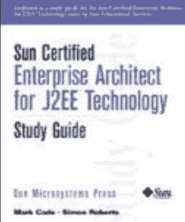


这是由架构师考试的首席开发人员和评估人员编写的唯一学习指南。

本指南是针对具有挑战性的 Java 2 平台企业版（Enterprise Edition）Sun 认证企业架构师考试的首本权威学习指南。Java 平台专家 Cade 和 Roberts 为设计有效的 J2EE 技术架构提供了专业的指导和背景知识，并为每个考试元素提供了全面的准备：多选题考试、作业和论文答辩。你将发现对每个 J2EE 平台架构问题和每个考试目标的全方位覆盖，包括：


# 前言

## 为什么我们编写这本书

Sun 认证考试不是在课后直接安排的。如果是那样的话，它们不太可能获得目前所享有的如此广泛的行业认可。这些考试很难，这意味着它们证明了某些能力，这使得通过这些考试变得有价值。即使在多次尝试后，并不是所有人都能通过。

这些考试的独特之处在于，你不需要通过参加 Sun 的培训来通过考试，尽管当然，Sun 的培训非常有帮助，而且本身也是个好主意。考试的目标广泛，不与任何特定的培训课程相关。Java 2 平台企业版技术 Sun 认证企业架构师 (SCEA) 考试的目标非常广泛；它们试图捕捉作为专业专业人士在多年职业生涯中学的核心思想，通常这种职业生涯跨越的时间更长，涉及的语言也比只有 Java 技术更多。

为了解决这些问题，Sun 的认证部门计划为每项测试提供一份学习指南。这本书就是其中一本。这本书可能不是该考试的唯一学习资料，也不是准备考试的唯一方法；然而，我们发现它很有帮助，并且能让你为自己的职业发展学到有价值的知识，而不仅仅是学会回答考试题。毕竟，考试的目的是给你一个成为更优秀架构师的机会，从长远来看，这对你职业的帮助比一张写着你通过考试的纸大得多。

## 关于作者

在我们之间，我们在 Java 技术方面拥有十多年的工作经验，涉及系统开发、教学以及参与认证考试的工作。在 Java 技术之前的计算机世界中，我们拥有更丰富的经验，包括 C、C++、主语言、硬件设计、基于传输控制协议/网协议 (TCP/IP) 的网络、netbios 和 Novell，以及数据库技术。我们荣幸成为架构师认证考试开发团队的成员，因此对为这一巨大主题编写问题的难度了如指掌，并对考试的性质和范围有相当准确的看法。我们并不声称无所不知，我们也认为没有人能做到，这个话题太庞大了。然而，我们希望拥有足够的背景知识、经验和正确的沟通技巧，帮助你通过架构师认证考试，并帮助你实现作为架构师的潜力。

我们相信，无论你使用什么学习方法，无论使用什么资源来帮助自己，你获得的知识将帮助你构建更好的系统，从而在工作中变得更成功。我们参与考试项目是因为我们享受创造一个真正优雅且成功的系统的快感，并希望帮助他人体验同样的满足感。出于相同的原因，我们决定承担这个项目，并最终你现在正在阅读的这本书。

## 关于这本书

SCEA 面向经验丰富的计算机人员，将所有要求的知识浓缩在一本书中是不可能的。这是一份学习指南。我们试图涵盖考试中测试的关键事实，但你必须理解这些概念而不仅仅是事实，才能通过这次考试。你可能应该进行额外的阅读，并且你必须对考试中测试的观点有通用的理解。

考试中的某些问题可能会从与书中呈现略有不同的视角来看特定问题。这就是为什么理解这些问题至关重要。我们刻意避免给出问题的答案，因为那只会降低考试的价值。此外，考试处于不断开发中，新问题会不断加入，旧问题会被删除。这可能是为了减少作弊的机会，因为作弊会贬低你通过考试所付出的努力。

鉴于这本书不仅仅是列出问题，它做了什么呢？它介绍了考试中涵盖的关键概念并澄清了术语。这将确保你与考试开发人员处于“同一频道上”。它还列出了参考文献，你可以在这些中找到你可能想要研究的主题的更多讨论。此外，它还提供了自评估题，旨在帮助你理解主题。

你可能会惊讶地发现，你对书中给出的某些答案持有不同意见，而且这并不错。架构取决于许多冲突力量的相互作用，两个经验丰富的架构师在如何最好解决特定问题上往往会得出矛盾的结论。

书中的大多数问题都仔细地列出了客户的价值，利用这些价值作为提示，你应该能够看到为什么某个答案被列为正确答案。然而，你能够看到正确答案与备选答案之间的关系可能更重要。

在考试的多选题部分，只有一个接受的答案（或答案的组合）。正因如此，你必须具备客观评估问题的能力。你必须完全根据提供的信息回答问题，并且应该避免填充额外的“如果、但是以及为什么”的倾向。通常，真正的考试会列出一个可能的答案，如果你只包含一个价值判断，它就是完全合理的，但因为该价值判断没有问题的支持，在考试语境下该答案是错误的。

学习像这样思考不仅仅是通过考试的技能，它对你的职业也会有帮助，因为它允许你评估自己的决策过程，并确定你是在将自己的主观价值应用于决策，还是真的在响应陈述的客户需求。如果你是一个经验丰富的架构师，你就知道在许多情况下，使用你的价值来填补客户留下的空白是可以的，甚至是必要的。然而，当你这样做时，你欠客户一个传达你的想法。你可能只是提示他们记住额外的信息。

## 谁应该读这本书

这本书并不打算给初学者提供通过考试所需的技能和知识。它旨在帮助具有多年计算机经验的人完善知识，尽管并非所有人都使用 Java 技术；事实上，如果你使用过其他技术，可能会装备更充分。

在我们编写书时，我们使用以下画像作为可能发现这本书有帮助的读者的指南：

- 你理解面向对象的概念，如封装、继承和多态，并且你熟悉 Java 语言中使用的接口。
- 你使用过面向对象的语言编程，很可能是 Java 编程语言。
- 你设计过面向对象的系统。
- 你正在准备“Java 2 平台企业版 Sun 认证企业架构师”考试，或者在寻求提高你作为架构师的技能。

这本书对其他画像也有价值。例如，许多经理会发现这本书有用，前提是他们具有相当的技术背景，并且对架构流程和价值获得足够的理解，以便进行管理。

## 本书的结构

书中的章节描述了考试涵盖的通用主题，或者是考试多选题部分的关键目标之一。一些通用章节提供了整体背景信息和技能，另一些则与作业相关。

与考试目标相关的章节采用一致的形式。它们从目标的描述开始，并提供主题的背景信息。接下来是对假设你已经掌握的提示知识的描述。注意这些前提，我们努力将它们减少到最低，在某些情况下不假设任何先验知识，但如果列出了前提，你必须确保满足了所有前提条件。在前提列表之后，章节移动


进入讨论主体。在此时，你将找到对当前问题的主要描述。

在讨论这些问题之后，本书将回顾本章包含的关键要点。这将帮助你学习和复习材料，因为它是简要的列表，而不是章节中提供的深度描述。如果你认为自己已经理解了某章中的问题，可以直接查看列表，看看你是否熟悉这些信息。

最后，本章节给出了若干道自我评估题。你不应该将这些问题视为样本考试题，尽管某些题目的格式是相同的。通常情况下，它们的目的是让你思考，并探测你对主题的理解。使用广泛性的问题比匹配你精确的考试题更容易实现这一点。你不应该过度关注答案，而应该更多关注涵盖了问题中所讨论的相同想法的思维过程。例如，本书包含了一些使用自由形式回答的问题，例如“影响对……决策的因素有哪些？”这类问题在考试中也会出现，尽管你需要在作业提交中概述你的决策过程和优先事项。当你解决这类类型的问题时，你应该产生一种“好的，我考虑到了所有这些问题”的感觉，以及对自己理解了所有这些问题的信心。如果你漏掉了某些内容，你应该对自己诚实。对自我判断采取诚实、专业的态度，是你从自己和本书中获得收获的唯一途径。

# 关于案例研究

本书以与作业类似的格式介绍了一个案例研究。你将看到用例、领域模型和额外需求。作为架构师，这种格式对你来说应该是熟悉的。你在现实世界中从事的每一个系统都有某种程度的需求，恰好考试作业选择了通过用例和领域对象模型来定义需求。作为该系统的架构师，你必须提供类图、组件图以及序列图或协作图来传达你的架构。

# 关于考试

考试分为三个部分：多选择测试、一项作业，以及一个你将讨论作业中特定部分的书面部分。

# 谢谢

Mark Cade 感谢他的家人、妻子 Lara、儿子 Alec 和女儿 Sara。没有你们的支持，这本书将是不可能实现的。我希望你们能让我回到家庭，请记住，我是那个在地下室里不停打字的人。

Simon Roberts 感谢 Solvege 充满活力的支持，我的孩子 Emily 和 Bethan 为我的目标（以及睡得足够久以便让我清晨的写作富有成效），我的飞行教练忍受我奇怪的时间安排，以及所有朋友的鼓励。

我们感谢提供见解并评审过本书的人：John Walsh, Brian Cook, Robert Pitman, Chris Steel, Alan Blackwell, Charlie Martin, Mark Cao, Nick Wilde 以及 Sun Java Center 邮件列表提供的精彩讨论。

我们特别感谢我们的朋友、技术作家兼编辑 Patricia Parkhill，她帮助我们成为更好的作家并忍受了我们。Pat，感谢你在书上付出的漫长时间和枯燥的工作；没有你，这本书永远无法完成。

# 第 1 章 什么是架构？

## 1.1 理解架构

## 1.2 架构师的角色

## 1.3 服务级需求

本书中的每一章都遵循相同的结构。章节开头列出本章描述的考试目标。随后是“引言”部分或“先修知识回顾”部分，用于识别本章的假设知识。接下来是“讨论”部分，该部分重点描述了本章的主题。随后是“核心要点”，即本章的核心思想。最后，“回顾你的进度”部分关注可能出现在考试中的问题。

完成本章后，你将能够满足以下 J2EE 技术考试目标：

- 架构师的角色
- 服务级需求

## 引言

对“架构”一词有许多定义。韦氏词典的定义是“建筑的艺术或科学”。韦氏对计算机架构的定义是“计算机或计算机系统组件排列和集成方式”。本章介绍了韦氏架构定义的一个变体，本书的其余部分将强化这一定义。

由于互联网的增长，构建系统所需的架构工作在过去几年中增长了十倍。在互联网之前，架构师创建架构是为了处理公司的内部用户，这些用户可能多达数百人。然而，互联网将公司的计算资源开放给了客户，这意味着架构师现在必须创建一个能够处理成千上万具有不可预测使用模式用户的系统架构。如果你的系统性能不稳定且无法满足客户的预期，那么这些客户将找到其他能够满足他们预期的公司。因此，你所创建的架构将直接影响公司的利润。

## 先修知识回顾

为了不让这本书比字典还厚，它假设读者具有一定水平的知识。如果你不具备先修知识，你必须在阅读本书之前在其他地方获得这些知识。本书假设以下先决条件：

- 你理解面向对象的概念，如封装、继承、多态和接口。
- 你使用过面向对象的语言进行编程，最好是 Java 编程语言。
- 你设计过面向对象的程序和系统。
- 你正在使用本书准备 Java 2 平台企业版技术 认证企业架构师 (SCEA) 考试。

成为一个成熟的系统架构师需要多年创建架构和设计系统的经验。本书将为你提供所需的知识，并帮助你成为 Java 2 平台企业版 (J2EE) 的认证企业架构师。

## 讨论

本书最好的起点是确保你与考试开发人员保持一致。这种共同词汇将减少后续章节的混乱。一个清晰简洁的架构定义对你通过考试至关重要。一旦理解了定义，你就必须理解自己在创建架构中的角色。你必须意识到你的任务。最后，你必须理解创建架构的目的。创建架构是为了支持系统的服务级需求。没有服务级需求，你的系统无法满足客户对可用性、可靠性和扩展性的需求。

根据统一过程的定义：

> 软件架构涵盖了对软件系统组织的重大决策。组成软件系统的结构元素及其接口的选择，以及这些元素之间协作所指定的行为。将结构和行为元素组合成不断更大的子系统，引导这种组织、元素及其接口、协作和组合的架构风格。软件架构不仅关注结构和行为，还关注用法、功能、性能、弹性、复用、可理解性、经济和技术限制与权衡以及审美选择。[1]

[1] Unified Process: An Introduction

这是一个非常长的定义，所以让我们看看 SunTone 架构方法论提供的更简单的定义：


架构是一组结构化原则，它使系统由一组更简单的系统组成，每个系统都有其独立的局部上下文，该上下文与整个系统的上下文保持独立，但又并不冲突。[1]

[1] Sun Microsystems, Inc.

这两个定义都关注系统结构。你创建架构是为了描述要构建的系统的结构，以及该结构如何支持业务和服务层级的需求。你可以将系统的结构定义为系统用于解决系统常见问题所采用的机制。机制是一种以一致且统一的方式支持业务需求的能力。例如，持久化（persistence）是一种在整个系统中应一致使用的机制。这意味着系统任何时候使用持久化，都将以相同的方式进行处理。通过将持久化定义为一种架构机制，你提供了一种处理持久化的默认方法，所有设计人员都应该遵循并一致地实现该方法。架构机制，如持久化、分布、通信、事务管理和安全性，是你们构建系统的基础，必须在你的架构中进行定义。

创建架构意味着什么？意味着你创建了一个软件基础设施，用以解决系统识别出的服务级需求。例如，如果系统有一项服务级需求规定任何用户响应时间不会超过三秒，那么软件基础设施必须确保系统能够满足这一需求。这也意味着你为设计人员提供了一个基础设施，让他们可以设计和编写系统，而不必担心损害这项服务级需求。架构周围的一个真实问题是：架构的创建何时停止，设计过程何时开始？对于每个系统，并没有标准答案。架构与设计的问题可以用“关注”和“控制”来总结。架构定义了要构建什么，而设计概述了你将如何构建它。架构由一或两个关注大局的人控制，而设计由许多了解如何实现大局细节细节的人控制。架构师创建架构，直到设计团队可以使用它来使系统实现目标为止。因此，如果你是为经验丰富的设计师创建架构，你可能不会产生如果你拥有一组经验较少的设计师时才需要的细节。

当你创建一个架构来满足系统的业务和服务层级需求时，你通常没有无限的资金来购买硬件、软件和开发资源，因此你需要让系统在定义的局限性内运行。例如，当你只有一台计算机来支持内部员工时，如何让系统进行扩展以满足互联网时代的需求？在没有资金购买产品的情况下如何创建架构？这些都是架构师在创建系统架构时面临的问题示例。你将面临许多困难的选择，并做出许多权衡来解决这些类型的问题。在做出权衡时，记录关于系统架构所做出的每项决策是重要的。如果你决定让 Oracle 数据库对系统对象进行持久化，那么你应该记录为什么选择 Oracle 而不是其他数据库供应商。这使得其他参与项目或后期进入项目的人能够理解为什么做出这些决策，并防止你反复地辩护你的决定。你在创建架构时做的大多数权衡集中在服务级需求或机制上。大多数系统没有资金来满足系统利益相关者设想的所有服务级别。因此，架构师必须平衡服务级需求与实现这些需求所需的成本之间的。如果购买高可用硬件以实现 24x7 可用花费了你的全部预算，导致没有钱购买应用程序服务器来帮助维护软件方面的该服务级需求，你就必须在架构中进行调整。这些调整取决于你正在创建架构的系统以及你与利益相关者的关系。

## 1.2 架构师的角色

> 理想的架构师应该是一个博学者
> 维特鲁威（Vitruvius），公元前25年左右

维特鲁威指的不是软件架构，但基本思想是架构师应该具备以下特征。架构师应该是一个全面发展、成熟、经验丰富、学习迅速、具有领导力、沟通良好并在需要时能做出艰难的人。为了使架构师做到全面发展，他们必须对业务或问题领域拥有工作性知识。他们可以通过经验或教育获得这些知识。此外，架构师必须具备广博的技术知识。架构师可能对特定技术具有第一手经验，但他们必须对竞争技术至少有一般的了解，以便就哪种技术最有效做出明智的决策。优秀的架构师无论使用何种技术，都会评估解决问题的可能解决方案。

架构师是做什么的？架构师与高级开发人员之间有什么区别？这些是一些常见的问题。设计人员关注用户点击按钮时会发生什么，而架构师关注当一万用户点击按钮时会发生什么。架构师降低系统的技术风险。风险是未知、未经验证明或未测试过的。风险通常与服务级需求相关，偶尔也与业务需求相关。无论风险类型如何，在项目早期创建架构时解决风险要比等到建设阶段容易得多，因为那时你有一大大的开发者群体，他们可能一直在等待风险解决。

架构师必须领导开发团队，以确保设计人员和开发人员根据架构构建系统。作为领导者，必须对系统中的权衡做出艰难决策，而架构师是必须做出这些决策的人。为了领导，架构师必须是优秀的书面和口头沟通者。将系统传达给构建它的设计人员和开发人员取决于架构师。这通常通过视觉模型和小组讨论完成。如果架构师不能有效沟通，那么设计人员和开发人员可能无法正确构建系统。

## 1.3 服务级需求

除了系统的业务需求外，你必须满足服务级或服务质量（QoS）需求。作为架构师，你的工作是在启动（inception）和阐化（elaboration）阶段与系统利益相关者合作，为每个服务级需求定义服务质量衡量。你创建的架构必须解决以下服务级需求：性能、扩展性、可靠性、可用性、扩展性、维护性、管理安全性。如果你在这些需求之间做出权衡，最重要的服务级需求是系统的性能，你可能会牺牲系统的维护性和扩展性以确保满足性能服务质量。随着互联网的扩张提供了更多机会，服务级需求变得越来越重要，因为这些系统的用户不再仅仅是公司员工，而是公司的客户。

### 性能

性能需求通常以每个用户特定屏幕事务的响应时间来衡量。除了响应时间，性能还可以通过吞吐量来衡量，即在给定时间内（通常是一秒）的事务数量。例如，你的性能衡量可能是每个屏幕表单超过三秒，或者事务吞吐量为每秒百次。无论性能如何，你都需要创建一个允许设计人员和开发人员在不考虑性能衡量的情况下完成系统的架构。

### 扩展性

扩展性是在不改变系统的情况下，随着系统负载增加以支持所需服务质量的能力。如果系统随着负载增加仍在接受范围内响应，就可以被认为是可扩展的。可能你的性能衡量是响应时间在二到五秒之间。如果系统负载增加，系统能够保持小于五秒响应的性能服务质量，那么你的系统就是可扩展的。要理解扩展性，你必须理解系统的容量，容量定义为系统在保持质量的情况下能够处理的最大进程或用户数量。


服务。如果一个系统处于满载状态且无法在接受的时间范围内做出响应，那么它已经达到了其最大可扩展性。要扩展一个达到容量的系统，你必须添加额外的硬件。这些额外的硬件可以通过垂直或水平方式添加。垂直扩展涉及向当前机器（或机器）添加额外的处理器、内存或磁盘。水平扩展涉及向环境中添加更多机器，从而增加整个系统的容量。你创建的架构必须能够处理硬件的垂直或水平扩展。软件架构的垂直扩展比水平扩展更容易。为什么呢？增加更多处理器或内存通常对你的架构没有影响，但让你的架构运行在多台机器并看起来像一个系统要困难得多。本书的其余部分描述了你如何让系统实现水平扩展。

## 可靠性 (Reliability)

可靠性确保应用程序及其所有事务的完整性和一致性。随着系统负载的增加，系统必须像负载增加之前一样继续处理请求并准确处理事务。可靠性会对可扩展性产生负面影响。如果系统在负载增加时无法保持可靠性，那么该系统实际上是不具备扩展性的。因此，为了让系统真正实现扩展，它必须是可靠的。

## 可用性 (Availability)

可用性确保服务/资源始终是可以访问的。可靠性有助于提高可用性，但即使组件失败，也可以实现可用性。通过建立冗余组件和故障转移的环境，单个组件可以失败并对可靠性产生负面影响，但由于冗余的存在，服务仍然保持可用。

## 可扩展性 (Extensibility)

可扩展性是在不影响现有系统功能的情况下添加额外功能或修改现有功能的能力。在系统部署时你无法衡量可扩展性，但当你第一次需要扩展系统功能时它就会体现。在创建架构和设计时，你应该考虑以下因素以帮助确保可扩展性：低耦合、接口和封装。

## 可维护性 (Maintainability)

可维护性是在不影响系统其他组件的情况下纠正现有功能缺陷的能力。这是另一个你在部署时无法衡量的质量属性。在创建架构和设计时，你应该考虑以下因素来增强系统的可维护性：低耦合、模块化和文档说明。

## 可管理性 (Manageability)

可管理性是管理系统以确保系统在可扩展性、可靠性、可用性、性能和安全性方面的持续健康。可管理涉及对 QoS 要求的系统监控，以及在不更改系统的情况下更改系统配置以动态提高 QoS的能力。你的架构必须具备监控系统并允许动态系统配置的能力。

## 安全性 (Security)

安全性是确保系统不被攻破的能力。安全性是目前最难处理的系统质量。安全性不仅涉及机密性和完整性问题，还关系到影响可用性的拒绝服务（DoS）攻击。创建一个被分为功能组件的架构使得系统更易安全，因为你可以在组件周围构建安全区域。如果某个组件被攻破，则更容易将安全违规控制在该组件范围内。

## 核心点 (Essential Points)

架构是一组结构化原则，使系统由一组更简单的系统组成，每个系统都有自己的本地上下文，该上下文独立于整个较大系统的上下文，但与其并不不一致。[1]

> [1] Sun Microsystems, Inc.

- 架构师的角色是让设计师和开发者尽可能地提高生产力。
- 创建一个解决服务级要求的架构将帮助你避免那个“CNN”级别的时刻。
- 可扩展性是在系统负载增加时，在不改变系统的情况下支持所需的服务质量的能力。
- 可靠性确保应用程序及其所有事务的完整性和一致性。
- 可用性确保服务/资源始终是可以访问的。
- 可扩展性是在不影响系统功能的情况下添加额外功能或修改现有功能的能力。
- 可维护性是在不影响系统其他组件的情况下纠正现有功能缺陷的能力。
- 可管理性是管理系统以确保系统在可扩展性、可靠性、可用性、性能和安全性方面的持续健康。
- 安全性是确保系统不被攻破的能力。

## 复习进度 (Review Your Progress)

本章为本书的其余部分奠定了基础，因此没有具体的问题要问。

# 第 2 章 J2EE 概述 (J2EE Overview)

2.1 使用 J2EE 实现应用程序

2.2 J2EE API

2.3 J2EE 组件

2.4 使用 EJB

2.5 为 EJB 指定类和接口

2.6 使用 Session Bean 和 实体 Bean (Entity Beans)

2.7 无状态和有状态 Session Bean (Stateless and Stateful Session Beans)

2.8 EJB 生命周期

2.9 实体 Bean、有状态 Bean 和无状态 Bean 的用处

2.10 使用 Bean 池管理 EJB

2.11 EJB 的钝化 (Passivation)

2.12 使用事务

2.13 使用容器托管持久化 (Container-Managed Persistence)

2.14 使用中间数据访问对象 (DAO)

Java 2 平台企业版 (J2EE) 是 Sun Microsystems 分布式计算框架。该框架是考试的基础。

完成本章后，你将能够满足以下 J2EE 技术架构师考试目标：

- 从列表中选择适用于使用 J2EE 实现的应用程序方面
- 为指定应用程序方面的的实现识别合适的 J2EE 技术
- 从列表中选择适用于使用 EJB 实现的应用程序方面
- 列出 EJB 必须提供的所需类/接口
- 区分 Session Bean 和 实体 Bean (Entity beans)
- 识别实体 Bean、有状态 Session Bean 和无状态 Session Bean 的适当用途
- 区分有状态和无状态 Session Bean
- Explain EJB 容器如何进行生命周期管理并具有增加可扩展性的能力
- 说明 EJB 容器中 Bean 池的益处
- 说明 EJB 容器中钝化 (Passivation) 的益处
- 对于在部署描述中指定的事务属性，说明企业 Bean 的事务行为
- 说明使用容器托管持久化的成本和益处
- 识别在实体 Bean 和数据资源之间使用中间数据对象的成本和益处

## 预备知识 (Prerequisite Review)

本章假设你对 JEE 有基本的了解。不要求你编写 JEE 的 API，但要求你理解 API 的功能。本章没有详细描述 JEE。它描述的是考试的 JEE 方面。

## 讨论 (Discussion)

JEE 是用于开发分布式企业软件应用的平台。JEE 由以下部分组成（称为 JEE 框架）：

- J2EE 平台 —— 用于托管 JEE 应用的标准平台。
- 参考实现 (Reference Implementation) —— 支持最新规范的应用服务器，但其重点是最新发布的规范，尚未达到生产就。
- 兼容性测试套件 (Compatibility Test Suite) —— 用于验证应用程序服务器与 JEE 兼容的工具。如果没有兼容性测试套件，每个供应商可能会以不同的方式解释和实现规范，从而降低 JEE 平台“一次编写，随处运行”的功能。
- 应用程序编程模型 (APM) 蓝图 —— 教如何使用 JEE 开发分布式应用程序。随着越来越多的人熟悉分布式应用程序开发，以及书籍和培训课程的增加，APM 在过去一年中失去了一部分用处。

## 2.1 使用 J2EE 实现应用程序

JEE 框架通过提供围绕事务管理、安全检查、状态管理和资源管理的系列基本服务，允许你开发分布式应用程序。应用程序服务器提供了 JEE 框架的实际实现。在应用程序服务器出现之前，每个公司甚至每个系统都会自己开发开发事务、安全和持久化的基本分布式应用服务。


## 2.2 J2EE API

以下列表描述了 J2EE 用于实现分布式计算应用程序部分功能的技术：

- Java 2 标准版 (J2SE)
- Java 数据库连接 (JDBC) – 一种标准 API，用于独立于供应商的方式将 Java 平台连接数据库资源。
- RMI-JRMP – 使用 Java 远程消息协议 (JRMP) 的远程方法调用 (RMI)。
- Java 接口语言 (IDL) – 一项将通用对象请求代理架构 (CORBA) 整合到 Java 平台的服务，通过使用对象管理组 (OMG) 定义的标准接口定义语言 (IDL)提供互操作性。
- 远程方法调用-跨 ORB 协议 (RMI-IOP) – 一种允许 RMI 程序员结合使用 RMI API 的优势和 CORBA IIOP 通信协议的优势，与使用任何支持 CORBA 的语言开发的符合 CORBA 的客户端进行通信。
- 企业级 JavaBean (EJB) – 一种用于开发和部署基于组件的分布式业务应用程序的组件架构。
- Servlet – 在请求-响应机制中与 Web 客户端交互。该机制基于 HTTP 的行为。
- Java 页面 (JSP) – 用于构建包含动态内容的应用程序，例如动态超标记语言 (DHTML) 和可扩展标记语言 (XML)。
- Java 消息服务 (JMS) – 一种带有面向消息中间件 (MOM) 的 API，用于实现点对点和发布/订阅消息系统。
- Java 命名和目录接口 (NDI) – 用于访问不同类型命名和目录服务的统一接口。
- Java 事务 API (JTA) – 一组启用事务管理的 API。应用程序可以使用 JTA API 来启动、提交和中止事务。
- JavaMail – 一种提供平台无关且协议无关框架的 API，用于构建构建和消息传递应用程序。
- JavaBean 激活框架 (JAF) – 供其他包（如 JavaMail）使用的激活框架的 API。你可以使用 JAF 来确定数据类型、封装对该数据的访问、发现该数据上可的操作，并实例化相应的 bean 来执行这些操作。例如，JavaMail 使用 JAF 根据对象的 MIME 类型来确定实例化哪个对象。

## 2.3 J2EE 的组件

J2EE 构建在容器模型之上。四个核心容器组件通过 API 为 J2EE 组件提供运行时支持。这些核心组件对应 J2EE 支持的四种容器类型，分别是应用程序客户端 (Application Client)、Applet、Web 和 EJB。以下是 J2EE 支持的核心应用组件：

- Java 应用程序 – Java 组件是运行在应用程序客户端容器内部的独立程序。应用程序客户端容器提供了消息、远程调用、数据库连接和查找服务的 API。应用程序客户端容器需要以下 API：J2SE、JMS、JNDI、RMI-IIOP 和 JDBC。该容器由应用程序服务器供应商提供。
- Applet – Applet 组件是运行在 Applet 容器中的 Java Applet，该容器是支持 Java 技术的基础浏览器。Applet 必须支持 J2SE API。
- Servlet 和 JSP – Servlet 和 JSP 组件是运行在 Web 容器中的 Web 组件，由 Web 服务器支持。Web 容器是 JSP 和 servlet 的运行时环境。Web 容器必须支持以下 API：J2SE、JMS、JNDI、JavaMail、JAF、RMI-IIOP 和 JDBC。Servlet 和 JSP 提供了一种与展示相关的动态内容准备、处理和格式化的机制。
- 企业级 JavaBean (EJB) – EJB 组件是运行在 EJB 容器中的组件。EJB 组件是 J2EE 应用的核心。EJB 容器提供了事务管理、状态管理、资源池和安全检查。EJB 容器必须支持以下 API：J2SE、JMS、JNDI、JavaMail、JAF、RMI-IIOP 和 JDBC。因为 EJB 组件是 J2EE 的核心，因此大多数考试题在某种程度上与 EJB 相关。因此，本章大部分内容描述了 EJB 的组件和功能。

## 2.4 使用 EJB

EJB 应该包含应用程序的业务逻辑，因此 EJB 是大多数应用程序的核心并不意外。企业级 bean 具有以下特征：

- 包含对企业数据操作的业务逻辑
- 由容器创建和管理
- 协调客户端访问
- 包含元数据（如事务和安全属性），且与 bean 分离
- 提供事务管理、状态管理、资源池和安全检查。如果你有一个不需要安全和/或事务支持的应用程序，那么你真的需要考虑是否应该使用 EJB。

## 2.5 为 EJB 指定类和接口

为了保持 EJB 的一致性，每个 EJB 必须具有以下接口和类：

- Home 接口由 bean 开发人员开发。应用程序提供该接口的实现。Home 接口应该扩展 `javax.ejb.EJBHome`。Home 接口充当工厂模式，用于创建 EJB 实例。它还允许客户端创建、移除或查找 EJB。
- 远程接口（Remote interface）由 bean 开发人员开发，应用程序提供实现。它应该扩展 `javax.ejb.EJBObject`。远程接口包含客户端可以调用的业务方法。
- Bean 类由 bean 开发人员开发，并包含远程接口中定义的方法的实现。它应该扩展 `javax.ejb.Session` 或 `javax.ejb.Entity`。

图 2-1 展示了 EJB 的类和接口。

| 源文件 | 远程接口 | EJB 类 |
| --- | --- | --- |
| Home 接口 | | |
| | 厂商工具 | |
| 运行时 | Home Object | EJB Stub |
| | | Enterprise Object

## 2.6 使用 Session 和 Entity Bean

企业应用程序需要灵活的组件。组件必须提供无状态服务、会话状态并支持数据共享。企业级 JavaBean (EJB) 提供了两种基本 bean 来支持企业应用所需的组件：session 和 entity。Entity bean 为 J2EE 应用提供数据的持久化和共享。并不是说 session bean 可以持久化对象，entity bean 专门持久化对象。Session bean 提供与 J2EE 应用相关的业务逻辑和工作流，对应于无状态和会话服务。

## 2.7 Stateless 和 Stateful Session Bean

Session Bean 有两种类型：Stateless 和 Stateful。

# Stateless Bean

Stateless session bean 不为客户端持有任何会话状态。但这并不意味着它们不能持有状态，Stateless session bean 可以持有状态，但不保证状态特定于调用客户端。这意味着你可以使用 stateless session bean 执行应用程序中的任何操作。

# Stateful Session Bean

Stateful session bean 赋予你为客户端持有会话状态的能力。在企业应用程序中处理会话状态有很多方法，但如果状态需要靠近业务逻辑，那么它应该放在 stateful session bean 中。购物车是 stateful session bean 的例子。

## 2.8 EJB 生命周期

每个 EJB 都有独特的生命周期。该生命周期决定了 EJB 的行为。如果你使用合适的 EJB，EJB 的生命周期就可以帮助应用程序的可扩展性。

图 2-2 展示了无状态 session bean 的生命周期。


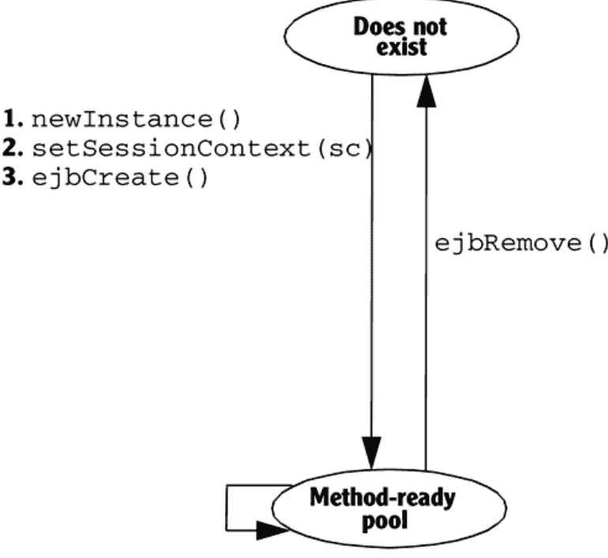

- 1. newInstance()
- 2. setSessionContext(sc)
- 3. ejbCreate()

1. 如果该 bean 不存在，容器将在 bean 类上调用 `newInstance()` 方法，从而启动生命周期。

2. 容器调用 `setSessionContext()` 方法，然后调用 `ejbCreate()` 方法。此时，bean 实例处于方法就绪池中，等待来自任何客户端的业务方法调用。

3. 当容器不再需要该实例时，容器会调用 `ejbRemove()` 方法，移除该会话 bean 的实例。

图 2-3 展示了有状态会话 bean 的生命周期。

# 图 2-3. 有状态会话 bean 的生命周期

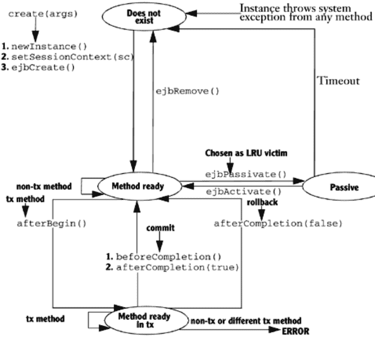

- 1. 客户端在 home 接口上调用 `create(args)` 方法。
- 2. 容器在 bean 上调用 `newInstance()` 方法。
- 3. bean 在实例上调用 `setSessionContext()` 方法和 `ejbCreate()` 方法，并将 EJB 对象引用传递给客户端。该有状态 bean 的实例已准备好接受业务方法。
- 4. 根据事务上下文，有状态 bean 将调用带有 tx 方法或非 tx 方法的方法。非事务方法在 bean 处于就绪状态时执行。事务方法的调用会导致实例被包含在事务中。容器在 bean 上发布 `afterBegin()` 方法。
- 5. 如果请求了事务提交，事务服务会通知容器，容器会在 bean 实例上使用 `beforeCompletion` 方法。
- 6. 事务服务尝试提交事务，导致提交或回滚。
- 7. 当事务完成时，容器在 bean 实例上发布 `afterCompletion()` 方法，并指定完成状态为提交或回滚。如果状态为回滚，bean 实例可能需要恢复对话状态。
- 8. 容器可能会决定将 bean 实例从内存中驱出。在这种情况下，容器在实例上发布 `ejPassivate()` 方法。
- 9. 在处于钝化状态时，容器可以在超时后移除该实例。如果客户端尝试访问 bean 实例，容器将抛出 `java.rmi.NoSuchObjectException`。
- 10. 如果客户端调用了尚未超时的钝化 bean，容器将从次级存储器恢复 bean 的状态并发布 `ejActivate()` 方法。bean 实例再次准备好处理客户端方法。
- 11. 当客户端在 EJB 对象上调用 `remove()` 方法时，这将导致容器在 bean 上发布 `ejbRemove()` 方法。

如果客户端调用创建 bean 会话的代价，唯一的情况是该实例不存在。如果 bean 已经存在，则从方法就绪池中提取出来，使用并在完成后进行替换。这是一个 bean 池，通过能够用更少的资源处理更多请求，从而提高了应用程序的可扩展性。

## 2.9 实体 bean、有状态 bean 和无状态 bean 的用途

实体 bean（Entity beans）用于持久化实体数据。实体 bean 是共享的企业级数据对象，可以被多个用户并发使用。

无状态会话 bean 用于管理服务器上用户会话的状态。无状态 bean 的示例可用于实现应用程序业务逻辑和工作流。

## 2.10 使用 Bean 池管理 EJB

容器无法处理无限数量的 EJB，因此容器必须对资源进行池化并在用户之间共享。每个 EJB 在部署时都会指定要池化和重用的实例数量。EJB 不是可以根据需要创建和销毁的轻级对象。它们是创建和销毁需要消耗大量资源的重量对象。因此，应用程序服务器将管理一个 EJB 池，用户可以在整个应用程序中使用它。通过拥有此池，应用程序服务器如果不再花费时间创建和销毁对象，就可以处理更多请求。

## 2.11 EJB 的钝化

钝化（Passivation）是将 bean 的状态写入文件系统文件的过程，以便 bean 实例可以被另一个会话使用。你使用钝化可以用更少的资源处理更多请求。这适用于实体 bean 和有状态会话 bean。对于无状态 bean，你无法使用钝化，因为没有状态。当钝化会话返回时，bean 被激活，bean 状态被重新加载到 bean 实例中。

## 2.12 使用事务

事务是大多数企业应用程序的重要部分，事务允许你改变主意并返回之前的操作（回滚）或继续进行并提交操作。没有事务，你就无法删除或更改已执行的工作。事务必须遵循 ACID 原则。它必须是原子性的（Atomic）、一致的（Consistent）、隔离的（Isol）和持久的（Durable）。原子性意味着事务不会部分完成。它要么完全完成，要么回滚到起点。一致性事务让数据存储处于一致状态。你可以访问数据存储并获得正确的结果。隔离性事务独立于你控制之外的另一个事务。持久性事务在系统故障后生存。如果系统在事务过程中失败，系统应该为了一致性和原子性回滚事务。

当你编写 J2EE 应用程序时，你决定事务应该在何处发生。例如，应该在 servlet 中启动并传播到 EJB 吗？必须使用程序式控制还是声明式控制？声明式控制允许你配置事务的启动。程序式控制等同于 bean 管理事务（BMT）。声明式控制由容器管理（CMT）。CMT 允许你在运行时配置 bean 的事务属性。BMT 和 CMT 在处理事务时没有区别。声明式控制由容器处理事务支持。以下描述了在事务支持下的所有属性行为，见 2.1。

- Required 属性，容器确保在事务中调用方法。如果客户端没有事务，容器将启动事务。
- New 属性意味着容器在调用方法时总是启动一个新的事务。如果客户端有事务，容器会挂起该事务并启动一个新的。这不是嵌套事务，因为新事务的结果对挂起的事务没有影响。如果客户端没有事务，容器创建一个新事务。
- Not Supported 属性意味着方法无法处理事务。如果客户端有事务，容器在调用方法前将其挂起。如果客户端没有事务，则。
- Supports 属性意味着 bean 接受可用事务，但不要求应用程序服务器创建新事务。如果客户端有事务，容器将传播事务。如果客户端没有事务，容器将调用方法。
- Mandatory 属性规定客户端必须有事务。如果客户端有事务，容器将传播事务。如果客户端没有事务，容器将抛出 `java.transaction.TransactionRequiredException`。
- Never 属性意味着 bean 不期望事务。如果客户端有事务，容器将抛出 `java.rmi.RemoteException`。如果客户端没有事务，容器将调用方法。

表 2.1 总结了容器在各种事务属性下的行为。


| 事务属性 | 客户端有事务 | 客户端无事务 |
| --- | --- | --- |
| Required | 事务传播 | 新事务 |
| Requires New | 挂起事务并启动新事务 | 新事务 |
| Not Supported | 挂起事务 | |
| Supports | 事务传播 | 抛出 java.transaction.TransactionRequiredException |
| Never | 抛出 java.rmi.RemoteException | |

## 2.13 使用容器管理持久化

实体可以使用容器管理持久化（CMP）或 bean 管理持久化（BMP）。在 CMP 中，容器处理在数据源中插入、读取和更新对象所需的代码实现。在 BMP 中，应用程序开发者创建插入、读取和更新对象的实现代码。CMP 是开发应用程序的理想方式，因为当数据模型更改时，应用程序开发者需要的代码较少。然而，为了提供这种灵活性，CMP 生成的 SQL 不是最高效。

遗憾的是，对象关系映射工具仍在成熟中。作为工具，你应该结合数据访问对象（DAO）使用 BMP。


## 2.14 使用中间数据访问对象（DAO）

如果你决定 BMP（无值映射）是你的实体豆（entity beans）的最佳方法，这意味着你正在将 SQL 编码到你的实体豆中。为了减少实体豆与读取、插入、更新和删除对象所需的 SQL 之间的耦合，可以创建一个封装了 SQL 的 DAO（数据访问对象）。通过封装读取、插入、更新和删除对象所需的代码，你减少了对代码变化和数据变化的依赖。

DAO 包含了在数据源中插入、更新、删除和读取对象的实现代码。这允许实体豆被定义为 BMP，但当豆更适合处理 CMP（容器管理映射）时，该实体豆可以更改为 CMP。将数据访问封装在 DAO 而不是实体豆中，允许豆使用容器提供的 CMP 支持来替换 DAO。

使用 DAO 的代价是额外的层级以及创建 DAO 垃圾回收的开销。此外，如果你不熟悉编写 SQL 代码，你可能会写出缓慢的 SQL 命令。

# 核心要点

以下总结了本章描述最重要的点：

- 分布式且需要事务、安全和资源管理的应用程序适用于使用 J2EE 技术实现。
- JSP 和 servlets 非常适合实现 J2EE 应用程序的用户组件。
- EJBs 适用于 J2EE 中业务逻辑实现。
- 适用于使用 EJB 持久化、事务、支持和安全实现的应用方面。
- 实现 EJB 需要的类是：`java.ejb.EJBHome`、`java.ejb.EJBObject` 以及使用 `java.ejb.Session` 或 `java.ejb.EntityBean` 的方法实现。
- 实体豆是持久化的共享资源，会话豆（session beans）与用户请求关联且不共享。
- 有状态会豆维护用户的对话状态，而无状态会豆在多个用户之间共享，每个用户通过单个请求/响应控制该豆。
- 豆池（Bean pooling）允许更多的用户使用更资源使用系统。
- 钝化（Passivation）允许 EJB 容器使用更少的会豆来支持更多资源。
- CMP 允许你创建持久化对象而无需维护持久对象的代码。CMP 的缺点是工具不足以提供企业级应用所需的性能。
- DAO 允许你控制从资源访问数据并在工具提供更好支持时切换到 CMP，但这意味着你必须编写和维护 SQL 代码。

# 复习进度

本节回顾了本章描述的目标，并提供了复习题以确保你理解了本章的要点。

目标：从列表中选择适用于使用 J2EE 实现的应用方面

+ 1. 下列哪项不是适用于 J2EE 的应用方面？


A. 事务
B. Applet
C. 安全
D. 资源管理
E. 分布式

A: 正确答案是 B。

Applet 是一种技术，而不是应用方面。

目标：识别用于实现特定应用方面的合适 J2EE 技术

+ 2. 你将使用哪种技术在 J2EE 中实现异步消息？

A. JMS
B. RMI
C. JNDI
D. HTTP

A: 正确答案是 A。

JMS 是用于在 J2EE 中实现异步消息的技术。
RMI、JNDI 和 HTTP 不提供异步消息。

目标：从列表中选择适用于使用 EJB 实现的应用方面

+ 3. 哪一项不是适用于使用 EJB 实现的应用方面？

A. 分布式
B. 安全
C. 资源管理
D. 命名服务

A: 正确答案是 D。

分布式、安全和资源管理是你使用 EJB 实现的应用方面。命名服务是一个应用方面，但你应该使用 JNDI 而不是 EJB。

# 目标：列出 EJB 提供的类/接口

+ 4. 如果你正在实现实体豆，哪类类不是必须的？

+ A. javax.ejb.EJBObject
B. javax.ejb.Entity
C. javax.ejb.EJBRemote
D. java.ejb.EJBHome

A: 正确答案是 C。

没有 `javax.ejb.EJBRemote` 类。

目标：区分会话豆和实体豆

+ 5. 关于会话豆的哪个陈述是正确的，但关于实体豆是不正确的？

+ A. 豆在 MVC 设计模式中被用作模型。
B. 状态是持久的，可以代表数据库表中的行。
C. 豆可以使用数据访问对象来促进迁移到 CMP。
D. 状态代表特定客户端的对话状态。

A: 正确答案是 D。

MVC 中的模型是实体豆。实体豆将数据作为数据库表中的行持久化，CMP 仅用于实体豆。

目标：区分有状态会豆和无状态会话豆

+ 6. 关于有状态会豆的哪个陈述是正确的，但关于无状态会豆是不正确的？

A. 状态可以缓存，但不代表客户端状态。
B. 状态可以缓存，并且代表客户端状态。
C. 状态是持久的。
D. 状态先缓存，后持久化。

A: 正确答案是 B。

答案 A 对于有状态豆是正确的，对于无状态豆不是。有状态豆是被缓存的，但不是持久化的，所以答案 C 和 D 是错误的。

目标：识别实体豆、有状态豆和会话豆的适当用途

+ 7. 如果你有处理工作流的代码并想要最轻量级的 EJB，你应该使用哪种 EJB？

A. 实体
B. 有状态会豆
C. 无状态会豆
D. Servlet

A: 正确答案是 C。

Servlet 不是 EJB，所以我们可以排除该选项。每个 EJB 都可以用于工作流，但最轻量级的 EJB 是无状态会豆。

目标：解释 EJB 容器如何进行周期管理并具有增加扩展性的能力

+ 8. 关于会话豆生命周期的哪个陈述是正确的？

A. 有状态会豆的数据在服务器崩溃后仍然存在
B. 崩溃重启的服务器可以反序列化有状态会豆的缓存数据
C. 会话豆实例可以通过句柄重建
D. 容器激活无状态会豆以释放资源

A: 正确答案是 C。

会话豆可以通过会话豆生成的句柄重建。无状态豆从不被钝化，生存服务器崩溃的豆是实体豆。

目标：阐述 EJB 容器中豆池的用处

+ 9. 关于池化的哪个陈述是正确的？

A. 池化的无状态豆限制了与其他厂商的互操作性
B. 池化的实体豆提供了到数据库的连接池
C. 池化减少了所需的组件实例
D. 池化的实体豆提供了更好的 SQL 支持

A: 正确答案是 C。

豆池用于减少服务用户所需的组件数量，从而减少应用程序资源。

目标：阐述 EJB 容器中钝化的用处

+ 10. 关于钝化的哪个陈述是正确的？

A. 容器必须将临时值设置为空或零。
B. 容器必须使用 Java 技术序列化来钝化豆实例。
C. 容器调用 ejbPassivate 将豆实例的状态保存到数据库。
D. 只要遵循 Java 序列化规则，容器可以使用任何序列化技术来钝化豆实例。

A: 正确答案是 D。

答案 A 是错误的，因为规范没有强制容器将临时值设置为空或零。答案 B 是错误的，因为容器可以使用选择的序列化方式。答案 C 是错误的，因为 ejbPassivate 将状态写入文件系统而不是数据库。


# 目标：根据部署描述符中指定的特定事务属性，阐述企业豆（enterprise bean）方法在给定场景下的事务行为。

11. 在部署描述符中应该设置哪个事务属性，以保证该方法在不带事务的情况下被调用？

-   A. RequiresNew
-   B. Supported
-   C. Never
-   D. Mandatory

A: 正确答案是 C。

你可能认为答案可能是 B (Supported)，这意味着如果调用者带有事务，该事务将传递给该方法。

# 目标：阐述容器托管持久化（CMP）的优点和成本。

12. CMP 的优点是哪个？

-   A. 更快的运行时性能
-   B. 快速开发
-   C. 模型变化时灵活性较低
-   D. 开发较慢

A: 正确答案是 B。

CMP 允许实体豆（entity beans）的快速开发。CMP 在运行时性能上并不一定优于 BMP。CMP 在模型变化时灵活性较低这可能是事实，但这并不算是一个优点。

# 目标：识别在实体豆和数据资源之间使用中间数据访问对象（DAO）的成本和收益。

13. 与基于 BMP 的实体豆配合 DAO 的优点是？

-   A. 比 CMP 实体豆代码更少
-   B. 比 CMP 数据访问更快
-   C. 减少与实体豆的耦合
-   D. 比 CMP 实体豆更容易编码

**A:** 正确答案是 C。

CMP 实体豆更容易编写且代码更少，且无法保证哪种方式提供更快的数据访问。

# 第 3 章 架构文档化

## 3.1 UML 的构建块

## 3.2 UML 中的常见机制

当前视觉建模的行业标准是统一建模语言（UML）。本章从 UML 构建块的概述开始，继续描述 UML 中的常见机制，最后以不同类型 UML 图的示例结束，并解释如何解读这些图表。在本章结束时，你将学会如何绘制和解读 UML 图。

在完成本章后，你将能够满足 J2EE 架构师的目标：

- 解释如何绘制 UML 图来定义系统架构。
- 解释如何解读 UML 图。

## 引言

在你创建架构时，必须向将构建系统的设计人员和开发者传达这种系统架构。描述架构的最佳方法是使用视觉模型和叙述。视觉模型包含在两个不同的文件中。第一个是《系统需求》文档，它包含了系统的所有需求。需求通过用例图、对象图、序列图或协作图以及活动图来描绘。此外，用例还以叙述格式进行描述。第二个文档是《系统架构》文档，它包含了系统架构的模型。你使用类图、包图、组件图、部署图和状态图来视觉化地传达你的架构。除了《系统架构》文档中的视觉模型外，你还应该提供叙述来证明你的选择是合理的，并提供额外的描述以便更好地理解。

## 前提知识回顾

使用模型定义系统架构是不够的。你必须用叙述来支持模型，并使用用例识别和记录你的需求。本章不涵盖如何编写技术性文档或如何编写用例来记录你的需求和架构。

## 讨论

什么是模型？模型是对现实的简化。你使用 UML 图构建模型，以便更好地理解你正在开发的系统。你构建的模型将帮助你：

- 可视化地呈现现状或你希望它的样子
- 规范系统的结构或行为
- 提供一个指导系统构建的模板
- 记录关于系统的决策

要开始使用 UML 建模，你需要学习 UML 的三个主要元素：构建块、组合块的规则和常见机制。一旦你掌握了这三个元素，就可以读取和创建 UML 图了。

## 3.1 UML 的构建块

构建块有三种：元素、关系和图表。元素是模型中一等公民的抽象；关系将这些元素连接在一起，而图表则通过关系将相关的元素集合分组。

### 元素

UML 中有四种元素：

- 结构类 – 通过表示概念性或物理性的元素来创建模型的静态部分
- 行为类 – 允许你对系统的行为进行建模
- 分类类 – 允许你组织模型中的结构元素和行为元素
- 注释类 – 模型中的解释性部分

这些元素是创建模型时使用的基础元素。

### 结构性元素

共有七种结构元素：类、接口、协作、用例、活动类、组件和节点。

- 类是一组共享相同属性、操作、关系和语义的对象集合。类由一个带有三个区域的矩形表示。第一个区域包含类的名称，第二个区域包含类的属性，第三个区域包含类的操作。图 3-1 展示了一个类。

> 图 3-1. 一个类

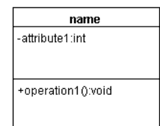

- 接口是操作集合，用于指定类或组件的服务。接口由一个与类相同三个区域的矩形表示。接口在接口名称上方增加了“interface”一词以识别其为接口。图 3-2 展示了一个接口。

### 图 3-2. 一个接口


- 协作定义了一种交互，它是一组元素在特定语境内相互交换某些消息的组合，以实现特定目的。协作由实线箭头线表示。图 3-3 展示了协作。

### 图 3-3. 协作


- 用例是对系统执行的一系列动作的描述，以向参与者产生可见的结果。参与者是系统边界之外的人或子系统。用例的视觉表示是内部带有用例名称的椭圆。图 3-4 展示了一个用例。

### 图 3-4. 用例


- 活动类是一个拥有一个或多个进程或线程的类，因此可以启动活动。活动类看起来和类一样具有三个区域，但有粗边界。图 3-5 展示了一个活动类。

### 图 3-5. 一个活动类

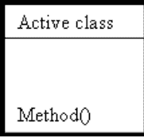

- 组件是系统中物理且可替换的部分，符合并提供一组接口的实现。视觉上，组件是一个带有两个插头的矩形，使其看起来可以插入到某些地方。图 3-6 展示了一个组件。

### 图 3-6. 组件

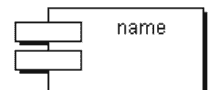

- 节点是运行时存在的物理元素，代表计算资源，通常至少具有内存，并且通常具有处理能力。视觉上，节点看起来像一个立方体，并在正面有一个名称。图 3-7 展示了一个节点。

### 图 3-7. 节点

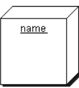

# ## 行为元素

行为元素用于对系统的行为进行建模。行为有两种类型：交互和状态机。交互是一种行为类型，它由一组对象在特定语境内交换的消息集组成，以实现特定目的。交互由实线箭头线表示。图 3-8 展示了一个箭头。


### 图 3-8. 箭头

状态机是一种行为类型，它规定了对象或交互在生命周期内为了响应事件而所经历的状态序列，以及它对这些事件的响应。图 3-9 展示了一个状态机。

### 图 3-9. 状态机


### 分组元素

只有一种类型的分组元素，即包（package）。包是一种用于将元素组织成组的通用机制。图 3-10 展示了一个包。

### 图 3-10. 包

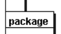

### 标注元素

只有一种类型的标注元素，即注释（note）。注释是用于渲染你附加到其他元素或元素集合上的注释的符号。在视觉上，注释用一个右上角折叠的矩形表示。图 3-11 展示了一个注释。

### 图 3-11. 注释


### 关系

UML 中四种标准关系：依赖（dependency）、关联（association）、泛化（generalization）和实现（realization）。你使用这些关系在模型的元素之间建立连接。

依赖是两个元素之间的语义关系，其中一个事物（独立事物）的变化可能会影响另一个（依赖事物）的语义。依赖表示为带箭头的虚线。箭头指示依赖的方向。使用以下图，Class1 对 Class2 有引用，可以作为方法参数传递，也可以在某个方法中定义为方法变量。图 3-12 展示了依赖关系。

### 图 3-12. 依赖关系

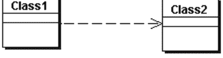

关联是描述一组链接的结构性关系。链接（link）是对象之间的连接。关联是实线。每个关联有两个角色（role）。角色是关联上的一个方向，可以用标签命名。

在示例中，Company 类有一个类型为 Employee 的类变量，Employee 到 Company 的角色命名为 Employer。每个角色都可以有一个多重性（multiplicity），表示关系中参与者数量。表 3-1 显示了不同类型的多重性。

### 表 3-1.

| 多重性 | 含义 |
|---|---|
| 1 | 且仅有一个 |
| 0..* 或 * | 0 到无穷 |
| 1..* | 1 到无穷 |
| 2..4 | 2 到 4 的范围 |
| 2,4 | 2 或 4 |

使用该示例，一个 Company 拥有多个 Employees，而一个 Employee 只能属于一个 Company。关联也可以被导航（navigability），方向沿着关联的方向进行，并由箭头表示。导航性表示一个对象是否有责任通知另一个对象。添加另一个导航性表示哪个对象拥有引用另一个对象的类变量。如果你在某一端由箭头指示单方向的导航性，那么你就拥有一个单向关联。两端都没有箭头则表示双向关联。使用以下示例，没有箭头；因此，该关联是双向的。这意味着 Company 类有一个类型为 Array、Vector 或 Collection 的类变量，持有类型为 Employee 的对象，而 Employee 有一个类型为 Company 的类变量。图 3-13 展示了关联。

### 图 3-13. 关联

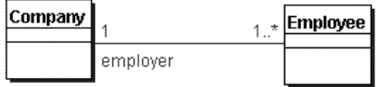

聚合（Aggregation）是一种特殊的关联，表示整体与其部分之间的结构性关系。聚合是一个在整体侧面带有空心菱形的图。通过图 3-14，我们可以看到 Company 由其部分即 Employees 组成。图 3-14 展示了聚合。

### 图 3-14. 聚合

| Company | 1..* Employee |
|---|---|
| employer | |

泛化（Generalization）是一种特化/泛化关系，其中特化元素（子类）的对象可以替换泛化元素（父类）的对象。泛化在视觉上表示为一根末端带有空心箭头的线。箭头从子类/子类指向父类/超类。图 3-15 展示了泛化。

### 图 3-15. 泛化

| 子类 | 超类 |
|---|---|
| | |

实现（realization）是分类器（classifiers）之间的语义关系，其中一个分类器规定了另一个分类器保证执行的合约。实现关系由带实心箭头的虚线表示。图 3-16 展示了实现。

### 图 3-16. 实现


## 3.2 UML 中的通用机制

UML 中贯穿始终四种通用机制：规范（specifications）、装饰（adornments）、划分（division）和扩展性（extensibility）。

### 规范

UML 不仅仅是图形语言。在每个图形表示之后都有一个文本说明的规范。规范为构建块提供了完整set的属性、操作和行为。视觉上，规范可能只显示类的一部分，也可能显示整个类。考虑到这一点，你可以通过反向工程创建图形并构建规范。图 3-17 包含了 -attribute1 和 +operation1()，它们是类的规范。

### 图 3-17. 类的规范示例

| name |
| -attribute1 |
| +operation1() |

### 装饰

装饰机制指示元素是公有的、私有的还是保护的，分别由 +, # 表示。在之前的示例中，attribute1 是私有的，operation1 是公有的。

### 划分

划分指定元素的实例。例如，如果元素名称带有下线，它就是一个实例。你元素元素带有 :a 并拥有匿名实例。你可以在 : 前放置名称并拥有命名实例。图 3-18 包含 :name，这意味着你有一个类的匿名实例。

### 图 3-18. 划分

| :name | |

### 扩展性机制

扩展性机制允许你根据项目需求塑造和扩展 UML。此外，这些机制通过从现有的 UML 构建块创建新的构建块，使 UML 快速适应新技术。

- 模式（Stereotypes）：扩展 UML 的词汇，允许你创建新类型的构建块。这些构建块源自现有的构建块但特定于你的问题。
- 标记值（Tagged values）：扩展 UML 构建块的属性，允许你在元素的规范中创建新信息。
- 约束（Constraints）：扩展 UML 构建块的语义，允许你添加新规则或修改现有规则。

## UML 图

图是元素集的图形化表示，通常渲染为由顶点（元素）和弧（关系）组成的连接图。

### 用例图

用例图显示了一组用例和参与者及其关系。用例图处理系统的静态用例视图。这些图对于组织和建模系统行为特别重要。

图 3-19 包含参与者 Customer、Catalog System、Service Rep 和 Warehouse。Customer 和 Service Rep 参与者与 Browse Catalog、Search for Product、Create Customer Account 和 Checkout 用例交互。Browse Catalog 和 Search for Product 用例检索或发送信息给 Catalog System 参与者。Checkout 用例检索或发送信息给 Warehouse 参与者。

## 3-19. 用例图


## 类图 (Class Diagram)

类图展示了一组类、接口、协作以及它们的关系。这些图表是面向对象系统建模中最常见的图表。类图处理了系统的静态设计视图。包含活动类的类图处理了系统的静态过程视图。

**图 3-20** 显示了九个类。其中两个类 Buy（购买）和 Sell（卖出）是超类 Transaction（交易）的子类。该图表告诉我们，Customer（客户）可以拥有一个 Cash Account（现金账户）和多个 Portfolio（投资组合）。一个 Portfolio 拥有多个 Account（账户），一个 Account 拥有多个 Holding（持仓），而一个 Holding 拥有一个 Stock（股票）并可以被多个 Transaction（交易）访问。由于导航性的原因，Holding 并不知道它与哪些 Transaction 关联。每个 Transaction 只能持有一个 Holding 和一个 Cash Account。Transaction 的类型可以是 Buy 或 Sell。

**图 3-20. 类图**

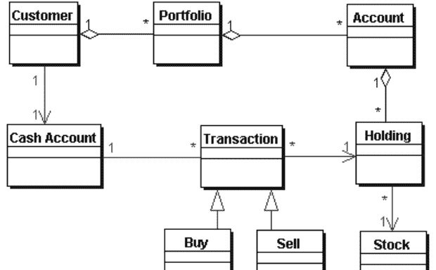

## 包图 (Package Diagram)

包图实质上是一种特殊的类图。包图以分组的形式表示系统的组织结构。

**图 3-21** 使用立体态 <<subsystem>> 将 Package（包）定义为子系统。这张包图实际上是一个子系统图，展示了系统的子系统以及子系统之间的依赖关系。例如，CustomerProfile（客户配置）子系统需要 Security（安全）子系统，并被 OrderEntry（订单输入）和 Marketing（营销）子系统使用。

**图 3-21. 包图**

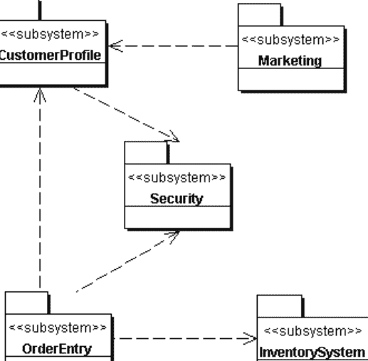

## 交互图 (Interaction Diagrams)

序图和协作图都属于交互图。交互图展示了一种交互，由一组对象及其关系组成，包括在它们之间分发的消息。交互图处理了系统的动态视图。序图是一种强调消息时间顺序的交互图；而协作图是一种强调发送和接收消息的对象的结构化组织的交互图。序图和协作图是同构的，这意味着你可以取一个参与者并将其转换为另一种形式。

所有交互图都从参与者（actor）开始。图 3-22 和图 3-23 显示了 Author（作者）向 Start Object（开始对象）发送消息，Start Object 向 Object1 发送 Create，Object1 再向 Object2 发送 Create。Object2 向自身发送 loadData 消息，这是一个递归消息。 Object2 返回给 Object1，Object1 返回给 Start Object。交互图中没有返回箭头，因为交互图中的返回是隐式的。这两张图建模的是相同的事件流。为了理解协作图上的事件流，对消息进行编号使其更易于跟踪。

### 图 3-22. 序图


## 状态机图 (Statechart Diagram)

状态图展示了一个由状态、转换和活动组成的状态机。状态图处理了系统的动态视图。状态图展示了状态、转换、活动以及状态。它们是建模的。。状态状态    状态。

图 3-24. 状态图


## 活动图 (Activity Diagram)

活动图实际上是一种特殊的状态图，展示了系统内部的活动流。活动图处理了系统的动态视图。图 3-25 展示了活动流。活动图是 Activity2 重要的。如果 Activity2 成功，则进入 Activity3 状态。

### 图 3-25. 活动图


## 组件图 (Component Diagram)

组件图展示了组件之间的组织和依赖关系。组件图处理了系统的静态视图。它们是类图相关的，展示了一个或多个类。

图 3-26. 组件图


## 部署图 (Deployment Diagram)

部署图展示了运行时节点及其在上面的组件。部署图处理了系统的静态视图。它们是类图相关的，展示了一个或多个类。

图 3-27. 部署图


# 要点 (Essential Points)

以下总结了本章的要点：

- UML 有三种构建块：元素、关系和图。
- 有四种元素：
    - 结构元素创建模型的静态部分。
    - 行为元素允许你建模行为。
    - 分组元素允许你组织元素。
    - 注释元素描述模型。
- 关系创建元素之间的链接。有四种标准关系：
    - 依赖：两个元素之间的语义关系，其中一个（独立者）的变化影响另一个（依赖者）。
    - 关联：描述一组结构关系。
    - 泛化：特化/泛化关系，你可以用特化元素（子类）替换泛化元素（父类）。
    - 实现：类之间的语义关系，一个类指定另一个类保证执行的约定。
- 有四种常用机制：
    - 规范：构建块的语法和语义文本说明。
    - 装饰：指示元素是公共、私有还是保护的符号。
    - 通用划分：指定元素实例符号。
    - 扩展性：为了项目需求扩展 UML 的方法。三种扩展性类型：
        - 立体态：扩展构建块的词汇。
        - 标记值：扩展构建块的属性。
        - 约束：扩展构建块的语义。
- 图是一组元素的图形化表示：
    - 用例图展示用例以及参与者及其关系。
    - 类图展示类、接口、协作及其关系。
    - 包图以分组的形式组织系统。
    - 交互图展示交互，由一组对象及其关系组成，包括在它们之间分发的消息。
    - 状态图描述系统的动态视图。
    - 活动图是展示系统内部活动流的状态图。
    - 组件图展示组件之间的组织和依赖关系。
    - 部署图展示运行时节点及其在上面的组件。

# 检查进度 (Review Your Progress)

本部分回顾了章节中描述的目标，并提供了复习题以确保你理解了章中的要点。

# 目标：绘制 UML 图解释系统架构

- 1. 显示的是哪种图？


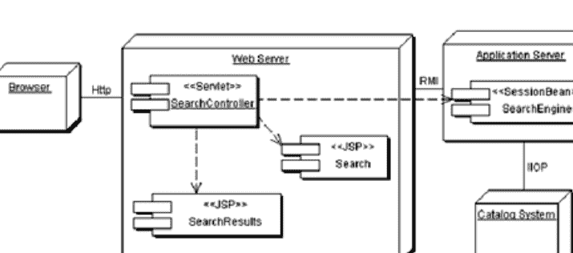

- A. 类图
- B. 部署图
- C. 组件图
- D. 包图

A: 正确答案是 B。

这是一张部署图，显示了系统的节点以及节点之间通信的方式。是的，它确实显示了组件，你可能会认为它是组件图，但组件是节点的一部分，这是部署图的区分特征。

- 2. 显示的是哪种类型的图？

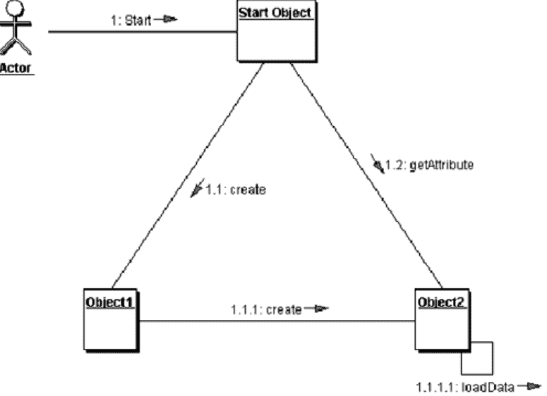

- A. 活动图
- B. 类图
- C. 协作图
- D. 序图
- E. 状态图

A: 正确答案是 C。

> 这是一个协作图，显示了在系统中对象之间发送的消息。它不是类图，因为类图不显示对象之间的消息。它不是活动图，因为活动图使用椭圆表示活动。状态图看起来相似，但状态图显示的是同一个对象的状态，而不是像图中这样有多个对象。

# 目标：解释如何解读 UML 图

- 3. 关于该图，哪个描述是正确的？

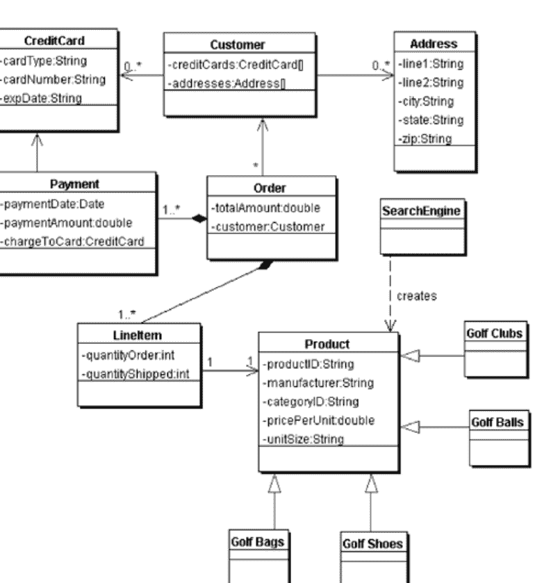

A. CreditCard 持有对 Customer 的引用
B. Customer 持有对 Address 的引用
C. LineItem 持有对 Order 的引用
D. CreditCard 持有对 Payment 的引用

A: 正确答案是 B。

Customer 持有一个 Address，由从 Customer 指向 Address 的箭头表示。答案 A 是错误的，因为箭头指向 CreditCard 而不是指向 Customer。答案 D 同样是错误的，导航方向反了。答案 C 是错误的，因为 Order 由 LineItems 组成。

- 4. 关于该图，什么描述是正确的？

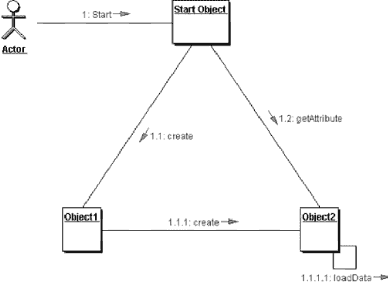

- A. StartObject 类向 Object2 发出 create 指令
- B. Object1 类对 Object2 发起 loadData 操作
- C. Object2 类调用了 getAttribute 方法
- D. 对象方法 loadData 是自调

A: 正确答案是 D。

Object2 正在对自身进行递归调用。答案 A 是错误的，因为 StartObject 是向 Object1 发送 create 指令而不是 Object2。答案 B 是错误的，因为是 StartObject 在调用 Object2，而不是反过来。答案 C 是错误的，因为 Object1 调用 Object2 使用的是 create 而不是 loadData。

# 第 4 章. 设计模式

4.1 创建模式

4.2 结构模式

4.3 行为模式

模式最早由 20 世纪 70 年代一位名为 Christopher Alexander 的建筑师使用。他发现某些解决方案可以反复应用于相同或相似的问题。他还将组合这些现有的解决方案来为新问题创建新的解决方案。1987 年，Ward Cunningham 和 Kent Beck 开发了五种用于接口设计的模式。但直到 1994 年，Erich Gamma、Richard Helm、John Vlissides 和 Ralph Johnson 才出版了著名的《设计模式：可复用面向对象软件的基础结构》，书中描述了一种记录模式的方法，这种方法已成为行业标准。这些人通常被称为“四人帮”（GoF）。随着新模式的开发，大多数模式都遵循《设计模式》一书中描述的文档标准。

本章介绍了你可以如何使用模式来帮助你创建架构。这些模式通常处于对象和类级别，但它们也可以抽象到更高的层次。

在完成本章后，你将能够满足以下 J2EE 技术考试目标：

- 从列表中为给定场景选择最合适的设计模式。模式将限于 Gamma 等人在书中记录的，并使用书中给出的名称。
- 陈述使用设计模式的益处。
- 给定 UML 图和/或对模式功能的简要描述，陈述 Gamma 等设计模式的名称。
- 从列表中选择指定的 Gamma 等设计模式的益处。
- 识别与指定的 J2EE 特性相关的 Gamma 等设计模式。

## 预备复习

本章假设你已经熟悉《设计模式：可复用面向对象软件的基础结构》中描述的四人帮（GoF）模式。本章将在考试目标的背景下复习这些模式，以涵盖考试所需的材料。

## 讨论

设计模式是软件开发中遇到的常见问题的通用解决方案。在本章中，我们从以下方面描述了模式：

- 名称 – 用于识别模式的问题、解决方案和后果的标签。模式名称应具有描述性，并保持在一或两个词内。
- 描述 – 模式的简短描述，以及一个 UML 图和代码示例均用于定义模式。
- 益处 – 描述使用指定模式的优势。
- 使用时机 – 描述在应用程序设计中何时应该使用该模式。

GoF 模式有三种：

- 创建模式
- 结构模式
- 行为模式

## 4.1 创建模式

创建模式支持系统中对象的创建。创建模式允许在系统中创建对象，而无需在代码中识别特定的类类型，你不需要编写大型、复杂的代码来实例化对象。它通过让类的子类创建对象来实现。然而，这可能会限制系统中可以创建的对象的类型或数量。

string描述了以下创建模式：

- 抽象工厂（Abstract Factory）
- 建造器（Builder）
- 工厂方法（Factory Method）
- 原型（Prototype）
- 单例（Singleton）

### 抽象工厂模式

该模式提供了一种接口，用于创建相关或依赖的对象族，而无需指定它们的具体类。

给定一组相关的抽象类，抽象工厂模式提供了一种从匹配的一组具体子类创建这些抽象类实例的方法。图 4-1 展示了抽象工厂模式。

图 4-1. 抽象工厂模式

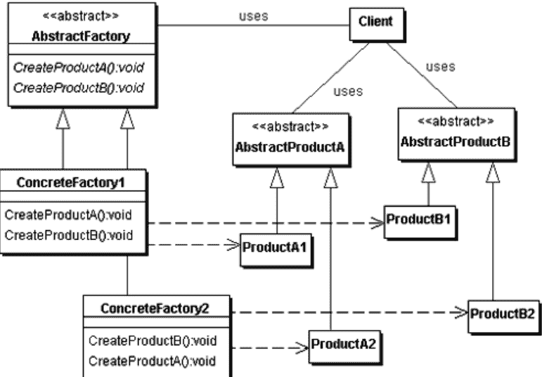

抽象工厂模式提供了一个抽象类，该类确定了实例化具体类以创建一组产品。客户端只与产品接口和抽象工厂类交互。客户端并不知道该模式提供的具体类。抽象工厂模式与工厂模式相似，不同在于它创建的是相关的对象族。

### 益处

以下列出了使用抽象工厂模式的益处：

- 隔离具体类。
- 方便交换。
- 促进产品之间的一致性。

### 使用时机

在以下情况下应使用抽象工厂模式：

- 系统应与产品的创建、组合和表示解耦。
- 系统应配置为多个产品族之一，例如 Microsoft Windows 或 Apple Macintosh 类。
- 相关产品族被设计为共同使用，且你必须强制这种约束。这是该模式的关键，否则你可以使用工厂方法。
- 你想提供产品类库，并仅公开接口而非实现。

### 建造器模式

建造器模式将复杂对象的构造与其表示分离，同一个过程可以创建不同的对象。建造器模式允许客户端通过仅指定类型和内容来构造复杂对象。客户端屏蔽了对象构造的细节。它通过定义一个构建另一个类的类来简化复杂对象的创建。建造器模式产生一个主产品，产品中可能有多多个类，但总有一个主类。图 4-2 展示了建造器模式。

### 图 4-2. 建造器模式

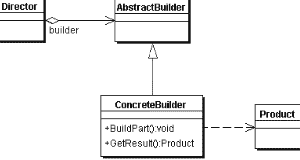

当你使用建造器模式时，你一步步创建复杂对象。其他模式则一步到位构建对象。

### 益处

以下列出了使用建造器模式的益处：

- 允许改变产品的内部表示。
- 隔离构造与表示的代码。
- 让你对构造过程有更好的控制。

### 使用时机

在以下情况下应使用建造器模式：


-   创建复杂对象的算法应该独立于构成对象的各个部分以及这些部分的组装方式。
-   构造过程必须允许对构造的对象有不同的表示。

### 工厂方法模式 (Factory Method Pattern)

工厂方法模式定义了一个创建对象的接口，但让子类来决定实例化哪个类。工厂方法让类将实例化推迟到子类，这对于在不知道要实例化的具体类的情况下，为特定目的构建单个对象非常有用。这允许你可以在不修改代码的情况下引入新类，因为新类仅实现了接口，因此可以被客户端使用。你创建一个新的工厂类来创建新类，而该工厂类实现工厂接口。图 4-3 展示了工厂方法模式。

### 图 4-3 工厂方法模式

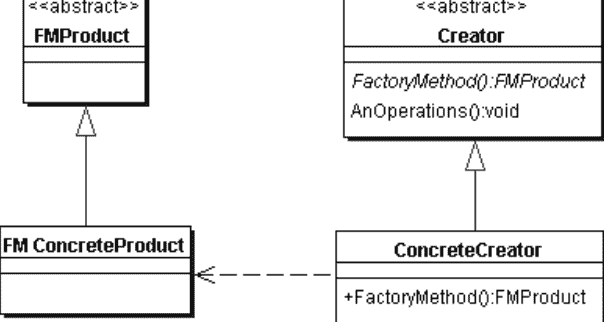

### 优点

以下列表列出了使用工厂方法模式的好处：

-   消除了将应用程序类绑定到代码中的需求。代码只处理接口，因此你可以与任何实现该接口的类工作。
-   允许子类提供对象的扩展版本，因为在类内部创建对象比直接在客户端中创建对象更灵活。

### 使用时机

在以下情况下，你应该使用工厂方法模式：

-   类无法预知它必须创建的对象的类型。
-   类希望其子类来指定它所创建的对象。
-   将责任委托给几个辅助子类之一，并且你希望本地化关于哪个辅助子类是代理的知识。

### 原型模式 (Prototype Pattern)

原型模式允许对象在不知道其确切类或创建细节的情况下创建定制化对象。它使用原型实例来指定要创建的对象类型，并通过复制此原型来创建新对象。原型模式通过向一个对象引入原型对象并启动对象的创建来工作。启动创建的对象通过请求原型对象创建自身的副本来创建对象。原型模式通过定义其对象可以复制自身的类，来实现动态地创建对象。图 4-4 展示了原型模式。

### 图 4-4 原型模式

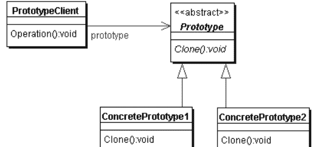

### 优点

以下列表列出了使用原型模式的好处：

-   在运行时添加和删除产品
-   通过改变值来指定新对象
-   通过改变结构来指定新对象
-   减少子类划分
-   动态地使用类配置应用程序

### 使用时机

在以下情况下，你应该使用原型模式：

-   要实例化的类在运行时指定（例如通过动态加载）。
-   为了避免构建与产品类层次结构并行的工厂类层次结构。
-   当一个类的实例的状态只有只有几种不同的组合之一时。

### 单例模式 (Singleton Pattern)

单例模式确保一个类只有一个实例，并为该类提供全局访问点。它确保所有使用该类实例的对象都使用同一个实例。图 4-5 展示了单例模式。

### 图 4-5 单例模式

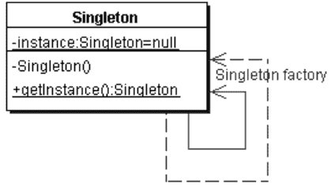

### 优点

以下列表列出了使用单例模式的好处：

-   对唯一实例的受控访问
-   减少命名空间
-   允许对操作和表示进行精炼
-   允许数量数量的实例
-   比类操作更灵活

### 使用时机

在以下情况下，你应该使用单例模式：

-   一个类必须恰有一个实例。

# 4. 结构模式 (Structural Patterns)

结构模式控制应用程序大部分部分之间的关系。结构模式以多种方式影响应用程序，例如，适配器模式允许两个不兼容的系统进行通信，而外观模式允许你向用户呈现简化的接口，而无需移除系统中所有选项。

结构模式允许你在不重写或自定义代码的情况下创建系统。这为系统提供了增强的重用性和健壮的功能。

这里描述了以下结构模式：

-   适配器 (Adapter)
-   桥接 (Bridge)
-   组合 (Composite)
-   装饰器 (Decorator)
-   外观 (Façade)
-   享权重 (Flyweight)
-   代理 (Proxy)

### 适配器模式 (Adapter Pattern)

适配器模式充当两个类之间的中间人，转换一个类的接口使其能与另一个类一起使用。这使得接口不兼容的类能够协同工作。适配器模式实现客户端已接口，并提供对客户端未知的类实例的访问。适配器对象提供了接口的功能，而无需知道用于实现该接口的类。图 4-6 展示了适配器模式。

图 4-6 适配器模式

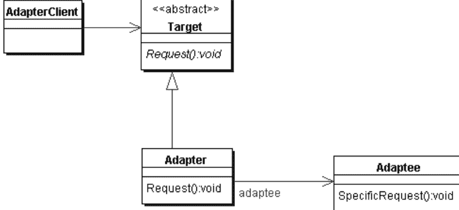

### 优点

以下列表列出了使用适配器模式的好处：

-   允许两个或多个不兼容的对象进行通信和交互
-   提高旧版功能的重用性

### 使用时机

在以下情况下，你应该使用适配器模式：

-   你想使用一个现有的类，但它的接口与你需要的接口不匹配。
-   你想创建一个可重用的类，使其能与无关或不可预见的类协作，这些类并不一定具有兼容的接口。
-   你想在一个期望接口与对象接口不同的环境中使用该对象。
-   必须在多个源之间进行接口翻译。

### 桥接模式 (Bridge Pattern)

桥接模式将一个复杂组件划分为两个或多个继承层次结构：功能抽象和内部实现。这使得改变组件的任何方面变得更容易，以便两者可以独立变化。

当存在抽象层次结构和相应的实现层次结构时，桥接模式非常有用。桥接模式不是将抽象组合成许多不同的类，而是将抽象实现为可以动态组合的独立类。图 4-7 展示了桥接模式。

### 图 4-7 桥接模式

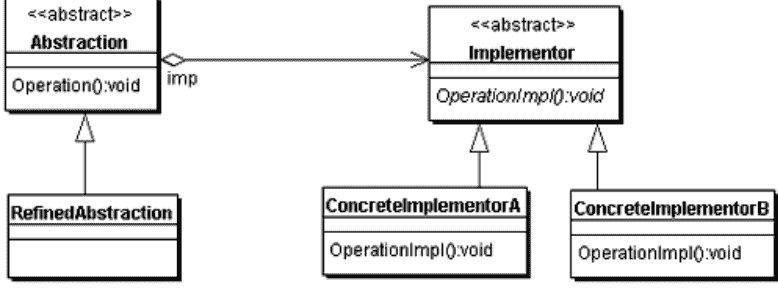

### 优点

以下列表列出了使用桥接模式的好处：

-   允许将接口与实现分离
-   提高可扩展性
-   向客户端隐藏实现细节

### 使用时机

在以下情况下，你应该使用桥接模式：

-   你想避免抽象与其实现之间存在永久绑定。
-   抽象和它们的实现都应该能够使用子类进行扩展。
-   抽象实现的改变不应对客户端产生影响；也就是说，你不必重新编译他们的代码。

### 组合模式 (Composite Pattern)

组合模式允许你创建不同复杂性的分层树结构，同时允许结构中的每个元素通过统一的接口操作。组合模式将对象组合成树形结构以表示整个层次结构或其一部分。这种组合模式允许客户端统一地对待单个对象和对象组合。图 4-8

图 4-8 组合模式

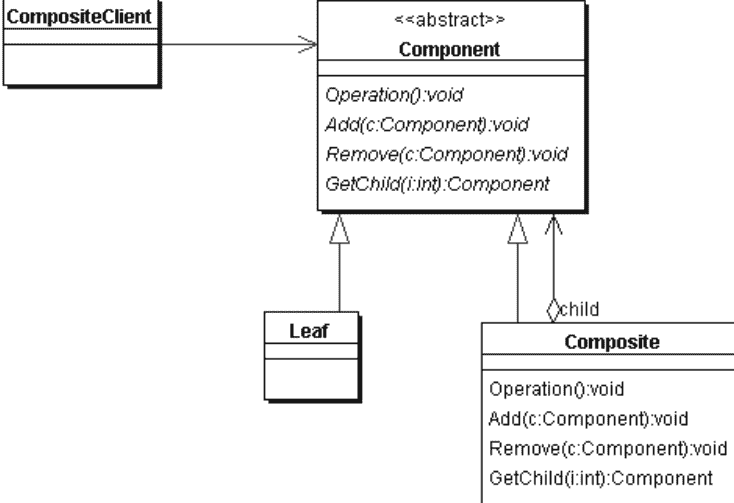

### 优点

以下列表列出了使用组合模式的好处：

-   定义了由原始对象和组合对象组成的类层次结构
-   更容易添加新种类的组件
-   提供了结构的灵活性和易于管理的接口

### 使用时机


在以下情况下，你应该使用组合模式：

- 您想要表示对象的整个层次结构或该层次结构的某部分。
- 您希望客户端能够忽略对象组合与单个对象之间的区别。
- 结构可以具有任何级别的复杂度，并且是动态的。

### 装饰器模式

装饰器模式允许你在不改变对象外部外观或功能的情况下，添加或移除对象的功能。它通过使用原始类子类的实例，并将操作委托给原始对象，从而以一种对客户端透明的方式来改变对象的功能。装饰器动态地为对象附加额外的职责，为不使用静态继承的情况下改变对象功能提供了一种灵活的替代方案。图 4-9 阐了装饰器模式。

### 图 4-9. 装饰器模式

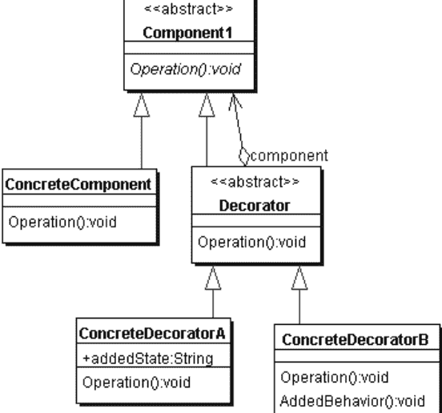

### 优点

以下列出了使用装饰器模式的优点：

- 比静态继承更具灵活性
- 避免在层次结构高层出现功能密集的类
- 简化了编码，因为你编写的是一系列类，每个类都针对功能的特定部分，而不是将所有行为编码到对象中
- 增强了对象的可扩展性，因为你通过编写新类来做出更改

### 使用时机

在以下情况下，你应该使用装饰器模式：

- 您想动态且透明地为单个对象添加职责，即不影响其他对象对象。
- 您想为未来可能想要更改的对象添加职责。
- 当通过子类进行扩展不切实际时。

## 外观面模式

外观面模式为子系统中的一组接口提供统一的接口。
外观面模式定义了一个更高层次的接口，使得子系统更容易使用，因为你只需要一个接口。这个统一接口允许对象仅通过与子系统通信的接口来访问子系统。图 4-10 阐了外观面模式。

> 图 4-10. 外观面模式

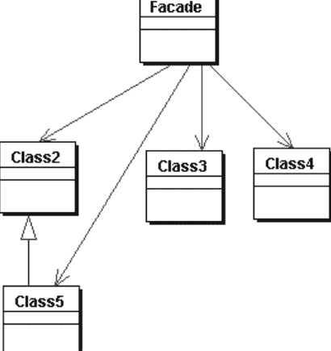

### 优点

以下列出了使用外观面模式的优点：

- 在不减少系统提供的选项的情况下，为复杂系统提供简单的接口。
- 将客户端与子系统组件隔离。
- 促进子系统与其客户端之间的弱耦合。
- 如果每个子系统都使用自己的外观面模式，系统的其他部分使用外观面模式与子系统通信，则减少子系统之间的耦合。
- 将客户端请求转换为可以这些这些请求的子系统。

### 使用时机

在以下情况下，你应该使用外观面模式：

- 您想为复杂的子系统提供一个简单的接口。
- 客户端与抽象的实现类之间存在许多依赖。
- 您想对子系统进行分层。

### 享重量模式

享重量模式通过共享对象来减少系统中低级、详细对象的数量。如果包含相同信息的类实例可以互换，享重量模式允许程序通过共享一个实例来避免多个包含相同信息的实例的开销。图 4-11 阐了享重量模式。

> 图 4-11. 享重量模式

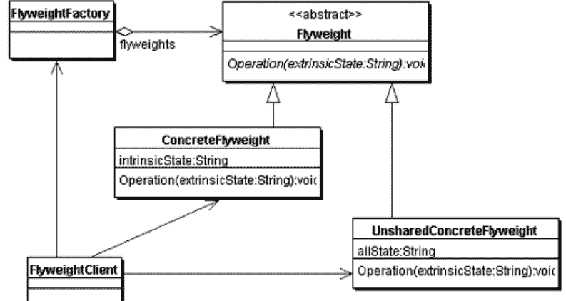

### 优点

以下列出了使用享重量模式的优点：

- 减少了处理的对象数量
- 如果对象是持久化的，则减少了存储设备上的内存和代理

### 使用时机

在满足以下所有条件的情况下，你应该使用享重量模式：

- 应用程序使用了大量对象。
- 由于对象的数量，存储成本很高。
- 应用程序不依赖于对象标识。

### 代理模式

代理模式提供一个代理或占位对象来控制对原始对象的访问。代理模式有几种实现类型，其中远程代理和虚拟代理是最常见的。图 4-12 阐了代理模式。

### 图 4-12. 代理模式

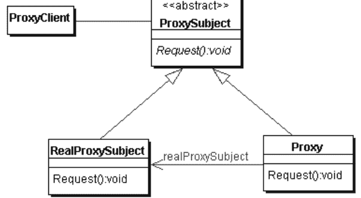

### 优点

以下列出了使用代理模式的优点：

- 远程代理可以隐藏对象位于不同地址空间的事实。
- 虚拟代理可以执行优化，例如按需创建对象。

### 使用时机

在以下情况下，你应该使用代理模式：

- 你需要一个比简单指针更多功能或更复杂的对象引用。

## 4.3 行为模式

行为模式影响状态和行为在系统中的流动。通过优化状态和行为传输和修改的方式，你可以简化、优化并增加应用程序的可维护性。

文中描述了以下行为模式：

- 责任链
- 命令
- 解释器
- 迭代器
- 中介者
- 备备
- 观察者
- 状态
- 策略
- 模板方法
- 访问者

### 责任链模式

责任链模式在系统中建立了一条链，以便消息可以在最初接收的级别被处理，或者定向到可以处理它的对象。图 4-13 阐了责任链模式。

> 图 4-13. 责任链模式

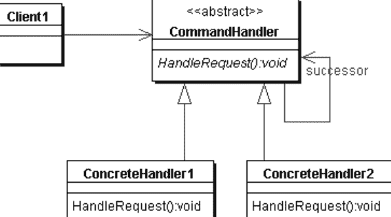

### 优点

以下列出了使用责任链模式的优点：

- 降低了耦合
- 增加了分配职责的灵活性
- 允许一组类作为一个整体行为，因为在类类中产生的事件可以发送给其他处理类

### 使用时机

在以下情况下，你应该使用责任链模式：

- 多个对象可以处理请求，且未知处理者。
- 您想在不明确指定接收者的情况下向多个对象发布请求。
- 处理对象的集合应该是动态。

### 命令模式

命令模式将请求封装在对象中，这允许你存储命令、将命令传递给方法并像其他对象一样返回命令。图 4-14 阐了命令模式。

### 图 4-14. 命令模式

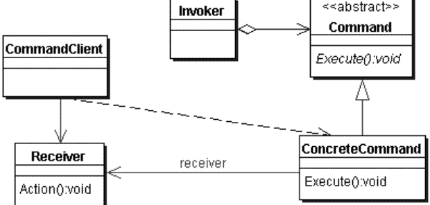

### 优点

的优点：

- 将调用操作的对象与知道如何执行操作的对象分离。
- 添加新命令很容易，因为你不需要更改现有类。

### 使用时机

在以下情况下，你应该使用命令模式：

- 您想通过要执行的操作对对象赋值。
- 您在不同的时间指定、队列和执行请求。
- 您必须支持撤销、日志记录或事务。

### 解释器模式

解释器模式解释一种语言以定义其语法的表示，以及一个使用该表示来解释语言中句子的解释器。图 4-15 阐了解释器模式。

### 图 4-15. 解释器模式

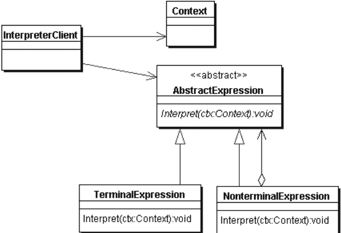

### 优点

以下列出了使用解释器模式的优点：

- 易于更改和扩展语法
- 实现语法简单

### 使用时机

在以下情况下，你应该使用解释器模式：

- 语言的语法简单。
- 效率不是关键问题。


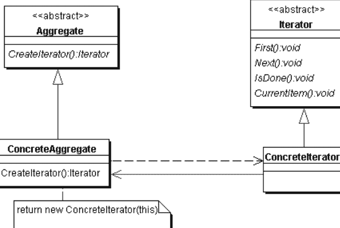

### 优点

以下列出了使用迭代器（Iterator）模式的优点：

- 支持集合遍历的不同方式
- 简化集合的接口

# 使用场景

当你想实现以下操作时，应该使用迭代器模式：

- 在不暴露内部表示的情况下访问集合对象的内容。
- 支持对集合中的对象多次遍历。
- 为遍历集合中不同的结构提供统一的接口。

# 中者模式

中者模式通过引入一个管理其他对象之间分发的单一对象，简化了系统中对象之间的通信。中者模式通过防止对象之间显式的相互引用来促进松耦合，并它允许你独立地改变它们的交互作用。图 4-17 展示了中者模式。

图 4-17. 中者模式

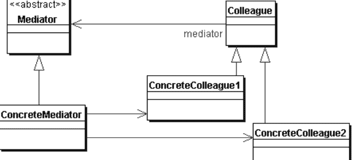

### 优点

以下列出了使用中者模式的优点：

- 解耦同事类（colleagues）
- 简化对象协议
- 集中控制
- 单个组件变得更简单且更容易处理，因为它们不再需要相互传递消息
- 组件更具通用性，因为它们不再需要包含处理与其他组件通信的逻辑。

# 使用场景

在以下情况下，你应该使用中者模式：

- 一组对象以定义良好但复杂的方式进行通信。
- 你想在不使用子类的情况下，自定义分布在多个对象之间的行为。

# 备忘模式

备忘模式保存了对象状态的“快照”，使得对象可以返回原始状态，而无需向世界其他部分暴露内容。图 4-18 展示了备忘模式。

# 图 4-18. 备忘模式

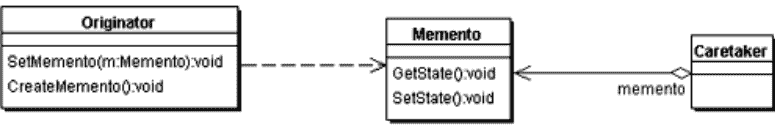

### 优点

以下列出了使用备忘模式的优点：

- 保护封装边界
- 简化源源对象（originator）

# 使用场景

在以下情况下，你应该使用备忘模式：

- 必须保存对象状态的快照，以便以后恢复到该状态。
- 使用直接接口获取状态会暴露实现细节并破坏对象的封装。

### 观察者模式

观察者模式提供了一种组件灵活向感兴趣的接收者广播消息的方法。它定义了对象之间一对多的依赖关系，因此当一个对象的状态改变时，所有依赖项都会收到通知并更新。图 4-19 展示了观察者模式。

# 图 4-19. 观察者模式

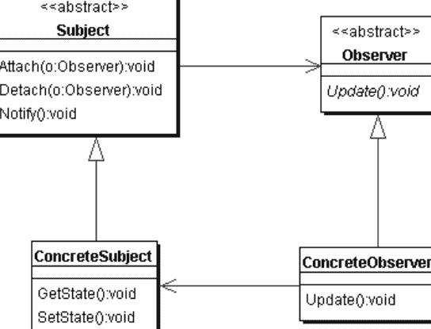

### 优点

以下列出了使用观察者模式的优点：

- 主体与观察者之间的抽象耦合
- 支持广播通信

# 使用场景

在以下情况下，你应该使用观察者模式：

- 一个对象的改变需要改变另一个对象，而你不知道有多少个对象需要改变。
- 对象应该能够通知其他对象，而无需对这些对象的身份做任何假设。

### 状态模式

状态模式允许对象在内部状态改变时改变其行为。该对象似乎改变了它的类。图 4-20 展示了状态模式。

# 图 4-20. 状态模式

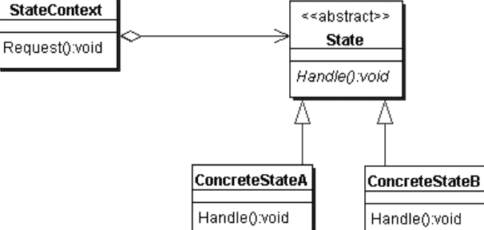

### 优点

以下列出了使用状态模式的优点：

- 将特定状态的行为局部化，并为不同状态划分行为
- 使状态转换显式化

# 使用场景

在以下情况下，你应该使用状态模式：

- 对象的行为取决于它的状态，并且必须根据该状态在运行时改变行为。
- 操作具有依赖于对象状态的多部分条件语句。

### 策略模式

策略模式定义了一组表示可能行为的类。这些行为随后可以在应用程序中使用，以更改其功能。图 4-21 展示了策略模式。

# 图 4-21. 策略模式

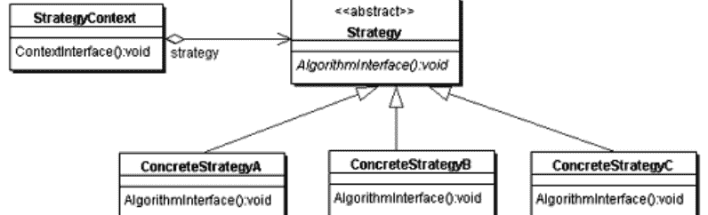

### 优点

以下列出了使用策略模式的优点：

- 子类化的替代方案
- 将每个行为定义在它自己的类中，从而消除了条件语句
- 更容易扩展模型以引入新行为，而无需重新编码应用程序。

# 使用场景

在以下情况下，你应该使用策略模式：

- 许多相关类仅在行为上不同。
- 你需要客户端未知的算法的不同变体。

# 模板方法模式

模板方法模式提供了一种方法，允许子类重写方法的部分内容而无需重写整个。定义算法的骨架，将某些步骤推迟给子类。模板方法允许子类在不改变算法结构的情况下定义算法的某些步骤。图 4-22 展示了模板方法模式。

# 图 4-22. 模板方法模式

| AbstractClass | TemplateMethod() | PrimitiveOperation1() | PrimitiveOperation2() |
| :--- | :--- | :--- | :--- |
| ConcreteClass | PrimitiveOperation1() | PrimitiveOperation2() |


### 优点

以下列出了使用模板方法模式的优点：

- 重用代码的基础技术

# 使用场景

在以下情况下，你应该使用模板方法模式：

- 你想实现算法中不变的部分，并使用子类来实现可变的部分。
- 子类之间的共同行为应该提取并局部化在公共类中避免代码重复。

# 访问者模式

访问者模式提供了一种易于维护、简单的方法来表示对对象结构执行的操作。访问者模式允许你在不改变所操作元素类的情况下定义新操作。图 4-23 展示了访问者模式。

图 4-23. 访问者模式


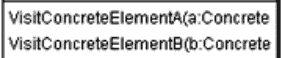


### 优点

以下列出了使用访问者模式的优点：

- 使添加新操作变得简单
- 聚合相关操作并分离不相关的操作

# 使用场景

在以下情况下，你应该使用访问者模式：

- 对象结构包含许多具有不同接口的类，而你想对这些对象执行取决于具体类的操作。
- 定义对象结构的类很少改变，但你经常想在结构上定义新操作。

# 核心要点

以下总结了本章描述的最重要点：

- 创建模式允许在系统中创建对象，而无需在代码中识别特定的类类型，因此你不需要编写大型复杂的代码来实例化对象。
- 抽象工厂模式提供了一个创建相关或依赖对象族的接口，而无需指定它们的具体类。
- 构建器模式将复杂对象的构建与它的表示分离开，使得相同的过程可以创建不同的对象。
- 工方法模式定义了创建对象的接口，但让子类来决定实例化哪一个。
- 原型模式允许对象在不知道其确切类或创建细节的情况下创建定制化对象。
- 单例模式确保一个类只有一个实例，并提供对该类的全局访问点。
- 结构型模式控制应用程序大部分部分之间的关系，通过转换一个的接口使其能与另一个配合。
- 桥接模式将组件划分为两个独立但相关的继承层次：功能性方法和内部实现。
- 组合模式允许你创建不同复杂性的层次级树形结构，同时允许结构中的每个元素使用统一的接口操作。
- 装饰器模式允许你在不改变对象外部外观或功能的情况下添加或删除对象功能。
- 外外观模式为子系统中的一组接口提供统一的接口。
- 享重量模式通过共享对象减少系统内低级、详细对象的数量。
- 代理模式提供一个代理或占位对象来控制对原始对象的访问。
- 行为模式影响状态和行为在系统中的流。
- 责任链模式在系统中建立一条链，使得消息可以在接收的层级被处理，也可以定向到可以处理它的对象。
- 命令模式将请求封装在对象中，这允许你存储命令、将命令传递给方法并像其他任何对象一样返回命令。
- 解释器模式解释语言以定义其语法的表示，并带有一个使用该表示来解释语言句子的解释器。
- 迭代模式提供了一种一致的方式来顺序访问集合中的项，且这种方式与底层集合是独立且分离的。


- 备忘录（Memento pattern）保存对象状态的“快照”，使得对象可以返回原始状态，而无需向外界暴露其内容。
- 观察者模式（Observer pattern）提供了一种组件灵活向感兴趣的接收者广播消息的方法。
- 状态模式（State pattern）允许对象在内部状态改变时改变其行为。
- 策略模式（Strategy pattern）定义了一组表示可能行为的类。
- 模板方法模式（Template Method pattern）提供了一种允许子类重写方法部分而不重写整个方法的方法。
- 访问者模式（Visitor pattern）提供了一种易于维护的方法，用来表示在对象结构元素上执行的操作。

# 复习进度

本节回顾了章节中描述的目标，并提供了问题以确保你理解了章节中的重要要点。

### 目标：为给定场景选择最合适的设计模式

- 1. 你使用哪种模式来创建一个复杂对象并使组装和部分相互独立？

  A. 原型模式（Prototype）
  B. 单例模式（Singleton）
  C. 建造模式（Builder）
  D. 抽象工厂模式（Abstract Factory）

  **A:** 正确答案是 C。

建造模式允许你创建复杂对象，并保持这些部分及其组装过程的分离且独立。

- 2. 你被要求与现有系统中的类建立接口，但该接口与你需要的接口不匹配。你会使用哪种模式？

  A. 装饰器模式（Decorator）
  B. 抽象工厂模式（Abstract Factory）
  C. 命令模式（Command）
  D. 适配器模式（Adapter）

  **A:** 正确答案是 D。

适配器模式允许你调整类或组件的接口以满足你的需求。

### 目标：给定 UML 图，说明设计模式的名称

- 3. 哪种模式允许增加责任？

  A. 代理模式（Proxy）
  B.  Fac面模式（Facade）
  C. 装饰器模式（Decorator）
  D. 策略模式（Strategy）
  E. 适配器模式（Adapter）

  A: 正确答案是 C。

装饰器模式允许增加责任。

- 4. 图中显示的是哪种模式？

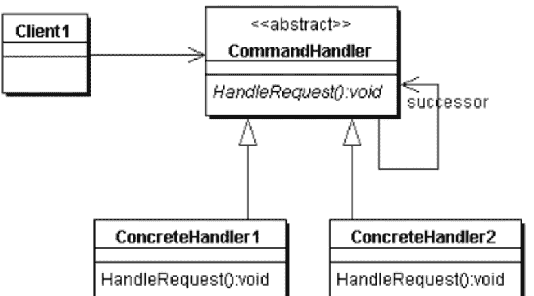

  A. 命令模式（Command）
  B. 观察者模式（Observer）
  C. 责任链模式（Chain of Responsibility）
  D. 复合模式（Composite）

  A: 正确答案是 C（责任链模式）。

你可能因为存在 CommandHandler 而认为这是命令模式，但该图的关键在于 ConcreteHandler1 和 ConcreteHandler2 中的 `HandleRequest` 操作。责任链模式允许由不同的且未知的类处理请求。

### 目标：从列表中选择设计模式的优点

- 5. 外观模式（Facade pattern）的两个优点是什么？（选择两项。）

  A. 它向客户端隐藏了复杂的子系统。
  B. 它允许对象伪装成不同的对象。
  C. 它将对象接口与实现解耦。
  D. 它鼓励客户端与子系统之间建立松耦合。

  A: 正确答案是 A 和 D。

外观模式向客户端隐藏了复杂的子系统，并鼓励客户端与子系统之间的耦合。

- 6. 单例模式（Singleton pattern）的两个优点是什么？（选择两项。）

  A. 它鼓励使用全局变量。
  B. 它控制对单个实例的访问。
  C. 它允许任意数量的实例。
  D. 它允许将对象集合作为单个实例进行操作。

  A: 正确答案是 B 和 C。

单例模式控制对单个实例或任意数量实例的访问。

### 目标：识别与指定 J2EE 特性相关的设计模式

- 7. EJB 的 Home Interface 使用哪种模式？

  A. 代理模式（Proxy）
  B. 装饰器模式（Decorator）
  C. 中介者模式（Mediator）
  D. 工厂模式（Factory）

  A: 正确答案是 D。

EJB 的 Home 接口是一种工厂模式。

## 第 5 章.安安全

- 5.1 下载的代码、Applets 和 Java 安全管理器
- 5.2 安全基础
- 5.3 密码学
- 5.4 签名与证书
- 5.5 构建安全分布式系统的常用工具
- 5.6 系统保护
- 5.7 网络安全拓扑结构
- 5.8 监控
- 5.9 隧道技术

安全是任何严肃应用程序的重要特性。无论该应用程序是否连接到互联网，这一点都是事实，尽管连接互联网的应用程序可能比未连接互联网的应用程序面临更多无特定且无动机的攻击。这是因为许多捣乱者利用互联网攻击系统，其理由仅仅是想证明他们可以做到。尽管如此，与计算机犯罪相关的财务损失在很大程度上源于针对特定公司、网站或私人的攻击。更严重的损害源于受害组织内部。由于威胁无处不在，在不考虑如何保护其安全性的情况下考虑任何类型的系统都是极不理智的。

完成本章后，你将能够满足以下 J2EE 架构师目标：

- 从列表中选择 Java 2 环境通常对在浏览器中运行的方面施加的安全限制。
- 根据给定的架构系统规范，识别实现特定安全功能的合适位置，并为实现这些功能选择合适的技术。

## 引言

考试在安全主题上有两个目标。这些目标的设定并不是为了让你成为安全专家，而是为了确保你能够充分理解安全问题，以便与专家进行讨论，避免某些可能导致应用程序特别不安全的基础错误，并对 Java 编程语言施加的安全有基本的了解。

第一个目标针对的是 applet 的限制。即使你不使用 applet，这也是相关的，因为你理解了 applet 安全保护的是什么以及为什么。第二个目标要求你对技术和术语有一般的了解。你必须意识到本章不能让你成为计算机安全专家。如果进展顺利，你就能参与专家的讨论。

- Firewalls and Internet Security: Repelling the Wily Hacker. Checker, William R. and Bellovin, Steven M. Addison-Wesley Publishing Co., 1994. ISBN: 020163357
- Intranet Security: Stories from the Trenches. McCarthy, Linda. Prentice Hall. 1997. ISBN: 0138947957
- Applied Cryptography: Protocols, Algorithms, and Source Code in C. Schneider, Bruce, 2nd Edition. John Wiley & Sons. 1995. ISBN: 0471117099
- Practical UNIX and Internet Security. Garfinkel, Simeon, and Spafford, Gene. O'Reilly & Associates. 1996. ISBN: 156921488
- Cuckoo's Egg: Tracking a Spy through the Maze of Computer Espionage. Stoll, Clifford. Pocket Books. 2000. ISBN: 074311463
- CERT advisories, http://www.cert.org/contact_cert/certmailist.html
- Crypto-gram, the newsletter of Counterpane Internet Security, Inc. http://www.counterpane.com/crypto-gram.html

## 先决要求

本章以不需要先验知识的术语讨论安全问题。因此，没有先决要求，尽管你会理解安全的基本目标，即保护数据免受未经授权的读取或修改，保护计算机资源免受未经的使用，以及确保授权人员和实体对资源的正确性和可用性。

## 5.1 下载的代码、Applets 和 Java 安全管理器

你可能听过关于 applet 在支持 Java 的浏览器中能做什么的讨论。这些讨论通常忽略了一个重要的点。Java 并不是专门针对 java.applet.Applet 类的子类的实例应用安全规则。相反，它使用安全管理器对所有类应用规则。不同的规则应用


根据特定类加载的位置，以及与之相关的签名（如果有的话），将其应用到不同的类。通常情况下，安全管理器（security manager）会对所有类应用限制，但从系统启动类路径（boot classpath）加载的类除外。启动类路径是加载核心类的位置列表。通常，这限制在主 Java 安装目录下 `jre/lib` 目录中的 jar 文件。

这种讨论表明，使用 `CLASSPATH` 从本地文件系统加载的类仍然受安全规则的限制，但任何程序都能成功打开文件。你可能知道或可以猜测，打开任意文件是安全管理器通常会禁止的行为。如果安全限制适用于所有非空类，那么你的程序（并非从启动类路径加载）又是如何成功打开文件的呢？在 Java 应用程序中，除非你刻意安装，否则不会安装安全管理器。安装安全管理器可以通过程序[使用 `System.setSecurityManager(new SecurityManager())`]或从命令行[使用 `java -Djava.security.manager`]来完成。如果代码在浏览器中运行，重要的一点是安全管理器应该默认安装，这是由浏览器本身处理的。

## 安全管理器禁止了什么？

考试要求你了解安全管理器在浏览器中的默认行为。这具有两个价值：首先，你将立即知道小程序（applet）是否可以在没有权限的情况下执行任何特定操作；其次，你将对为什么这些操作可能有害产生一些理解。不要忘记，如果 applet 默认无法执行给定的操作，那么在实践中，你可能应该假设 applet 不是该功能的合适选择，因为大多数浏览器用户不愿且可能无法向 applet 授予权限。

安全管理器的工作原理是检查请求权限的类是否被授予了特定的权限（permission）。权限由一个描述权限的类来表示。权限类的实例通过添加名称（name）和操作（action）来更详细地描述权限。在某些权限类中，名称和操作是可选的，当使用它们时，它们限定了被允许的具体行为。例如，可以授予 `java.io.FilePermission` 权限类以 "read" 为名称和 "tmp/*" 为操作，，允许读取 `/tmp` 目录下的任何文件（但不包括子目录）。

权限机制是可扩展的，因此你可以添加新的权限来控制对你创建的设备或行为的访问，并在运行时验证它们是否已被授予。运行时不关心任意权限，因为这些权限默认对下载的代码是拒绝的。因此，你只需要关注核心 JDK 部分的权限即可。例如，你不需要学习每一个权限及其所有的变体。相反，你应该考虑被允许的权限类别和被拒绝的权限类别。此外，请记住权限会随着 JDK 新版本的发布而发生变化（即添加新权限）。

## 允许的操作

通常，授予给不受信任代码的权限很少；通常情况下，只授予程序运行所需的权限，例如创建线程的能力、在浏览器为 applet 创建的线程组中操操作线程的有限能力、执行使 GUI 正确运行的、对 AWT 事件队列进行至关重要操作的能力，以及读取但不可修改任何系统属性的有限能力。除了这些权限外，applet 通常被允许与其加载的宿主机建立网络连接。你可能会奇怪为什么 applet 被防止连接到其他主机。原因有两个，其中一个比较微妙，且另一个更有可能。如果 applet 能够与其他主机建立任意连接，那么 applet 就可以被用作对其他系统进行拒绝服务攻击的源头。然而，禁止网络连接的原始原因仅仅是，许多系统根据请求的源 IP 地址授予网络请求权限。如果 applet 可以连接到任意主机，那么它就连接到你公司网络内部的服务器。如果该服务器根据 IP 地址授予对你机器的访问，那么它就会授予 applet 访问权限，因为它是从你的机器发送的请求。然后 applet 就可以获取敏感信息并将其传回给作者，而这是你不希望允许的。

## 被拒绝的操作

通常，任何可能损害宿主机的操作都会被拒绝。这些唯一的例外是 CPU 使用、内存使用和网络带宽使用。在本文编写时的安全系统中，没有检查来确定 applet 是否正尝试使用过量的 CPU 时间。在 UNIX 操作系统上，这不是一个显著问题，因为浏览器可用的 CPU 数量是由操作系统限制的。在其他系统中，applet 可能会故意创建许多线程，导致宿主机系统（而不只是浏览器）瘫痪。

类似地，applet 对内存的使用不受安全系统的限制。预期是宿主机操作系统会防止任何单个进程变得过度贪婪。再次，在某些系统上可能并非如此。

最后，网络带宽的使用不受限制，这使得 applet 可以连接到其加载的宿主机并以尽可能快的速度开始发送网络数据包。这将降低运行此类 applet 的宿主机的网络性能。

这些行为缺陷都不会造成永久性，它们是令人恼的，并且通常可以通过杀死运行该恶恶意 applet 的浏览器来停止。如果 applet 能够访问宿主机计算机上的文件、执行任意程序或向任何任意选定的主机发送网络消息，情况将严重得多。这些功能由所有版本的浏览器普遍保护，并且从 applet 第一次运行以来一直如此。

由于 applet 可以通过网络向宿主机发送信息，安全系统的一个重要目标是防止访问敏感信息。例如，尽管 applet 只能与加载它们的宿主机建立标准的 TCP/IP 连接，但它们也可以向互联网上的协作主机发送数据。这可以通过多种方式实现，但通常涉及常用互联网协议或服务的使用，如 DNS。

JavaStart 是另一种适用于瘦客户端的技术。随着 1.4 的出现，它成为了 JDK 核心发行的一部分。JavaStart 提供了 applet 的所有优点并解决了让 applet 不够理想的问题。在编写时，还没有专门针对 JavaStart 的目标；但是，它是一种强大且优雅的技术，简化了维护并增强了安全性。任何使用内部应用程序的公司都会从使用 WebStart 中受益。因此，对该技术进行简要概述是合理的，部分由于与该技术相关的目标可能会加入考试。

JavaStart 提供了一个类似于 Windows 桌面的小窗口，显示图标。这些图标并不一定安装，而是指向 Web 服务器上代码的链接。

当你启动 JavaStart 桌面上的一个应用程序时，运行该应用程序所需的类从 Web 服务器下载。这种行为与 applet 类似。然而，一旦下载，类就会存储在本地。这使得后续使用应用程序时启动更快。更好，每当你尝试运行该应用程序时，系统都会检查 Web 服务器上是否有可用更新，如果有，将下载所需的更改。这确保了即使计算机没有连接到网络，应用程序也可以准备就绪，同时也确保可以使用最新版本。这不需要安装阶段即可完成。

## 5.2 安全基础

安全的核心点是保护资源免受未经的访问。这需要两类保护：网络上的数据，以及计算机本身的数据和进程。


保护单台计算机通常通过以下熟悉的步骤来实现：

- 1. 确定谁想执行某些操作（例如使用登录名）
- 2. 确定该人员是否如其所称的身份（例如使用密码）
- 3. 确定该人员是否应该执行此操作（例如使用权限列表）

在网络方面，你必须处理另一个问题。通过网络发出的请求通常需要经过与上述讨论类似的类型验证，但此外，你必须假设在传输中传输的消息对于除请求者以外的人来说是可见的。这通常需要额外的安全层级对这些消息进行伪装，以使其对窥探者变得无用，且无法被其伪造。

在继续后续讨论之前，你必须确保自己已经熟悉后续段落中定义的术语。

首先考虑关于保护计算机的讨论——即关于“某人想执行 X，我们允许他们执行”的讨论。通常，被授予或不授予特定权限的可能不是某个特定的人类。它可能是一个职位功能（例如系统管理员或人力资源总监），也可能是另一台计算机或进程。在安全领域，被授予权限的“可识别的人员、功能或实体”的概念被称为“主体”（principal）。职位功能有时被称为“角色”（roles），包括 J2EE 服务器在内的许多系统提供了一种列出具有特定角色的所有主体的机制。大多数系统都有主体列表。在系统内部，每个主体都有一个标识代码，用于指示该工作是为哪个主体执行的，或者数据数据属于哪个主体。该代码（通常是一个数字）是一种识别方法。

当请求以给定主体的名义执行某项工作时，必须尽力确定请求者是否属于该主体。这被称为**身份验证**（authentication），通常通过使用密码完成。在登录机制中，人类提交一个登录名（在内部被翻译为某种识别代码）作为标识，然后提交一个密码作为身份验证。

一旦获得了经过身份验证的标识，系统必须确定请求主体是否应该被允许执行请求的工作。这被称为**授权**（authorization）。

为了使授权机制产生价值，必须有一种方法来强制执行确认为合适的规则。这需要某种形式的访问控制或资源访问控制。为了确保有效，资源访问控制机制必须基于为为此目的设计的主机操作系统特性。例如，Java 虚拟机的安全性，如果运行在一个允许从任何网络地址登录且没有任何形式身份验证的主机系统上，将是无效的。

熟悉的标识、身份验证等机制可以很好地工作，尽管系统在某些情况下会迅速失效。想象一个用户已经登录并离开了无人看管的终端。路人可能会使用该终端输入对于该用户未授权但对于已登录用户已授权的命令。当涉及网络时，这个问题会变得更加严重。考虑通过网络接收消息的情况；消息请求打开某个文件并将其内容发送给请求者。系统如何知道是否应该执行该操作？如何确保返回的数据仅对授权的接收者可用？这些以及其他类似问题属于密码学（cryptography）的范畴，它是下一节的主题。

## 5.3 密码学

密码学是指允许修改信息的技巧，使其信息可以在通过公共视野的同时，对接收者进行加密传输，但不能被公众还原到原始形式。在常用中有两种不同的密码学形式：对称加密和非对称加密，虽然这两种形式之间有很多区别，但它们也有显著的差异。

在对称加密中，发送者和合法的接收者共享他们之间传输的信息伪装的秘密。仔细考虑，这种伪装机制通常包含两个部分：一个定义了对数据加密时执行哪些数学操作的算法，以及密钥。尽管你通常不会公开你使用的算法，但它并不被认为是你系统安全性的重要部分。相比之下，密钥绝对重要。你可能在小时候上学时尝试过这种密码学，例如通过在字母表中移动特定位数来更改消息中的每个字母。例如，算法是“将消息中的字母替换为字母表中字母向后移动 n 个位置的字母，如果在计数时超出字母 Z 的末尾，则从 A 开始”。在这里，密钥就是你所移动的总位移。密钥的唯一性允许多对发送者和接收者使用相同的算法，而无法读取发给他人的消息。这些系统在概念上相当容易理解（尽管在数学上可能并不如此）。它们在适当的条件下也是有效的，并且对运行这些系统的 CPU 有相当高的要求。

非对称加密也涉及算法和密钥。然而，在这种情况下，通信的末端使用了两个不同但相关的密钥。一个称为私钥（private key），保持保密；另一个是公钥（public key），供任何人查看。关于非对称加密有两个重要的概念。首先，一个密钥不能用来推导出另一个密钥。其次，如果用一个密钥加密消息，那么另一个密钥必须解密它。这种方案具有重要的后果。其中之一是你向世界发布一个密钥，同时保留另一个密钥，这样任何人都可以向你发送消息，并知道只有你本人能读取它。这是因为只有一个密钥在公共领域中，而该密钥不能用于创建另一个密钥，也不能用于解密它所加密的消息。

起初，加密消息但在给定密钥的情况下无法反转过程的想法听起来似乎有些不可思议。很难想象单向操作容易但反向操作困难的数学。考虑法法通常比除法容易。找到一个数的平方比找到平方根要容易得多（假设你是手动操作，而不是使用计算器）。还有其他操作反向操作困难得多，这些操作为非对称加密提供了基础。实际上，私钥和公钥之间存在关系。毕竟，公钥与私钥是一对；事实上，两者都是从一个数字通用生成的。然而，公共加密成功的秘诀在于从一个密钥推导出另一个密钥是如此困难的。这种难度使得一组高性能计算机可能需要一或两年时间才能完成计算。这种类型的操作被称为**计算上不可行的**（computationally intractable）。这意味着加密系统并不是阻止未经授权的人读取消息，而是加密系统使得这样做变得昂贵且耗时。其想法是使其变得如此昂贵以不再值得这样做，或者让数据在坏人能够读取它时已经失去了价值。这关乎于密码学所保护的秘密的质量和长效性。

> 公钥为非对称加密提供了另一个可能更常见的名称——公钥加密：公钥加密对执行加密的系统的 CPU 要求通常更高。由于这个原因，你通常尝试使用对称加密进行通信，并使用非对称加密发送尽可能少的数据。

总结一下，公钥加密是一种允许你发布一个公钥供全世界查看的技术。世界随后利用它来加密消息，但不能通过解密来推导出私钥。无论你是否见过他们，任何人都可以向你发送消息，而只有你本人能读取它，这是一项实用的功能，但你可以使用这些工具提供更多的实用性。


世界上其他地方可以使用你提供的的公钥来读取这条消息。如果全世界都能读取它，那这有什么价值呢？嗯，关键在于，如果一条消息使用给定的密钥成功解密，那么它一定是使用该密钥对应的密钥创建的。因此，如果消息使用给定的公钥能够正确解密，它一定是使用与所有人可见的公钥配对的私钥创建的。这意味着消息源于私钥的持有者。出于实际考虑，你并不会解密整个消息，而是解密它的一个被称为“消息摘要”的代表性部分。不过，想法基本上是相同的。

实际上，现实情况并没有数学那么简单。假设爱莉（Alice）收到了一封似乎来自鲍（Bob）的消息。爱莉使用给定的公钥成功解密了消息。现在她知道该消息是使用与她手中的密钥配对的密钥加密的。然而，这并不等同于她知道是鲍写了这条消息。想一下她持有的密钥。她怎么知道它是从哪里来的呢？如果它是某个自称是鲍的朋友的人给她的，那么她并不知道那个所谓的朋友是否在通过替换公钥并发送虚假消息来戏弄她（或鲍）。另一方面，如果爱莉知道鲍是亲手给她的公钥，那么她就有某种把握地知道是鲍写了这条消息，对吧？接近了。爱莉真正知道的是，消息是使用鲍的密钥加密的。这可能意味着鲍发送了它，也可能意味着鲍不小心泄露了它，导致某人拥有它的副本，或者他的电脑上有一个木马程序，该程序在鲍不知情的情况下偷取了他的密钥并使用了它。这些特定问题无法通过数学轻易解决，它们更多属于社会问题的范畴。

如果你忽略了人们不妥善保管密钥（实际上非常真实）的问题，你面临的就是更易管理的问题：如何验证你持有的公钥确实属于你认为的那个个人。

在第一情况下，这个问题归结为一个物理问题。如果你通过你信任的获得密钥，那么你就可以对密钥产生同水平的信任。对于单个密钥来说，这可能不是太大的问题。爱莉可能会花力去见鲍，以便他们面对面交换密钥，但她不太会对她想要通信的所有人以及与其进行互联网业务的公司都这样做。然而，只要她能以足够的信心获得一个密钥，她就可以利用这种情况让她对其他密钥产生某种信任。

这个想法是：爱莉通过费力获得了一个密钥。这个密钥是一个专门验证他人密钥公司的密钥。这家公司被称为证书颁发机构或 CA。CA 向爱莉（以及任何其他感兴趣的人）承诺，他们将验证每一个发送给他们的密钥。他们具体如何执行这些工作（要求查看执照、提取 DNA 样本等）是由一份名为《证书实践陈述》（CPS）的文档决定的。当一个人（在本例中为鲍）向 CA 支付了费用、提交了他的公钥，并按照鲍指定的方式证明了自己的身份后，CA 会给鲍提供一条签过的消息，声称“XYZ 是住在 ABC 的鲍的公钥”。这条消息被称为数字证书（Digital Certificate），或简称为证书。现在，鲍可以将此证书发送给爱莉，爱莉可以利用她从 CA 处费力且极不便获取的密钥来验证该证书的真实性。然后她就可以推断出，证书列表中属于鲍的密钥是真实的。理解了吗？这是一个链；你知道一个可靠的密钥。这允许你确定另一个密钥是由拥有那个可靠密钥的公司签署的。因为你信任这家公司，你就可以信任另一个密钥。

实际上，还有一些你应该考虑的弱点。

首先，大多数人并不是通过类似于安全的路径从 CA 获取密钥的。大多数浏览器已经预装了流行 CA 的密钥。如果你的 Web 浏览器是从一个方便的、不可信的第三方分发的，这可能成为一个问题。它可能包含某些声称来自某某 CA 的密钥，但实际上来自某个想要欺骗你的人。记住，整个过程取决于信任链。削弱该链中的任何一个环节，整个链都会随之削弱。

第二个问题出在 CPS 上。大多数 CA 提供几种不同“强度”的 CPS。为了配合这些，它们通常会发放不同“强度”的证书。现在，大多数人并不知道不同等级证书的存在，即使他们知道，他们也不知道每个等级关联的 CPS。因此，按面意思接受证书是正常的，而不一定知道它是根据强度测试、照片 ID 还是款项已满意结清这一事实颁发的。最近，某家 CA 成功地向一个并不代表该公司的人以微软公司的名义发放了证书。显然，在这种情况下，CPS 的强度还不够。

这导致了第三个问题。当证书颁发后，在过期日期之前，它往往被认为是真实的。假设你支付了大量费用并接受了 DNA 测试，现在你拥有了最强的证书。现在，有人偷走了你的私钥——即描述你证书公钥的那个私钥。这很容易发生，例如你把它保存在笔记本电脑上而电脑被盗了。你可能遭受病毒感染，将你所有的文件发送到另一个主机。你的备份可能丢失或被盗。。无论通过何种手段，你的私钥已经泄露了。现在，小偷可以使用该私钥签名消息，而这些消息在世界上看起来就像是你发送的。在某些国家，数字签名可能会让你入狱。为了缓解这个问题，大多数 CA 提供证书撤销列表（CRL）。CRL 列出了所有被报告为已损坏的证书。这种想法的改进是在线证书状态协议（OCSP）响应器，它允许检查列表。然而，如果你不知道被窃，或者如果你没有及时发现，这就没有帮助。

## 5.5 构建安全系统的常用工具

基于上述的密码学思想，你可以为分布式系统中的许多安全问题设计解决方案。本节将描述这些解决方案，以便你对它们的应用以及一些陷阱有一个清晰的认识。

### 安全套层 (SSL)

可能最明显的安全问题是，在互联网上传输的数据是公开的。也就是说，在大多数情况下，你应该假设在互联网传输的任何数据对于想要查看的人来说都是可见的。技术上，尽管是非法的，获取这种方式传输的数据副本是相当简单的。这种问题的解决方案是加密。

如所述，加密有两种主要的类别，对称加密和非对称加密。对称加密的缺陷在于发送者和接收者需要共享一个秘密。这在与你不认识陌生的人交流时似乎是一个巨大的障碍。然而，有两种方便的方法可以解决这个问题。如果任何一方费力获取了公钥，另一方就可以使用该密钥加密发送给对方的消息。这些消息包含了用于对称或非对称加密算法的新密钥。

通常使用非对称加密在双方之间传递对称加密密钥。双方共享一个对称加密密钥可以使用该密钥以及相应的对称加密系统。这比继续使用非对称加密要好，因为对于相当的安全水平，对称加密算法的数学需求通常较低，减少了 CPU 负载并加快了通信。

还有其他方法可以让从未谋面的双方在不安全的网络上共享对称加密密钥。最常见的是迪菲-赫尔曼密钥交换（Diffie-Hellman key exchange）。这是一项天才的数学方法，允许双方通过向对方发送少量数据，在之间“发明”一个密钥。

其他。然而，如果两个比特数据在传输过程中都被截获，第三方无法重建密钥。

有了了这些交换密钥和加密消息的方法，应该对如何执行加密、需要哪些密钥以及如何交换这些密钥达成共识。如果该机制能够在库层级执行，效果会更好，这样应用程序就可以直接使用这些功能，而无必为每项功能都单独进行编程。SSL 是一个框架，它规定了两个主机如何连接、如何在彼此之间传递证书、协商要使用的密钥以及决定加密机制。目前，SSL 是所有基于互联网的安全性通信的事实标准。

SSL 标准（目前即为互联网工程任务组 (IETF) 基于 SSLv3 的传输层安全协议 1.0 (TLS 1.0)）并不是一种加密标准，而是一个用于协商一组可接受的加密和密钥交换协议的框架。SSL并不是连接安全性的来源，相反，连接安全性主要由 SSL 在协商中选择的加密算法和密钥处理协议提供。

SSL 连接可能受到攻击的主要方法有两种。连接可以通过攻击密钥或加密来受到攻击。如果密钥的生成或交换存在缺陷，攻击者可能会获得有关密钥的知识。SSL 直接参与了这一过程，因此如果密钥交换要安全，其设计和实现必须是正确的。相比之下，算法并非由 SSL 实现，而是系统中的一个独立元素。算法或实现中都可能出现漏洞，尽管重点通常更多地放在攻击算法上，因为这种攻击只需要访问加密后的消息，而不需要访问任何一台机器。

# HTTPS

在传输 HTTP 文档时，可能需要传输的双方或其中之一识别对方。在客户向 Web 页面提供信用卡或其他敏感信息之前，该页面需要妥善地确保信息在通过线路传输时已经过充分加密，并且发送数据的 Web 服务器是正确的服务器。

第二个问题究竟是什么？难道不是显而易见吗，如果你正在看一家公司的主页，那么它就是该公司的主页吗？浏览器顶部的 URL 是正确的，这不算什么？实际上，它的意义并没有你想象的那么大。存在两个问题，一个是技术问题，一个是人性问题。技术问题是：鉴于互联网的性质，有人可能会“劫持”一个 Web 地址并呈现看似来自正确 URL 的 Web 页面，但实际上这些页面来自虚假服务器。在这种情况下，将信用卡号发送到源头将是不利的。人性问题要粗糙得多，但实施起来更简单，且历史证明它几乎有效。攻击者注册一个代表他们想要访问的网站常见拼写错误的域名。大量的潜在客户会去错误的网站，可能在他们致电客户服务投诉卡片被注销但货物未到达之前，他们根没有意识到这一点。

一个相关问题影响着运行 Web 服务器并通过 Web 服务器接收订单的企业。这些企业必须确保在当他们收到订单时，能够验证下单者的真实身份。这个问题在本质上与客户想要确保订单供应商的网站是真实的想法是一样的，只不过是从连接的另一端来看的。

当 HTTP 经 SSL 基础架构传输时，HTTP 可以使用 SSL 的所有功能。这种 HTTP 和 SSL 的组合被广泛用于安全互联网系统，并且它有了自己的名称：HTTPS。你必须区分 HTTPS 和旧的、不安全的且不流行的 SHTTP。通常，SHTTP 在现代系统中是不合适的。

HTTPS 提供了一个加密链路，如果对方能够并愿意这样做。通常 HTTPS 提供加密，但请记住它可能没有使用特别安全的算法。除了加密之外，HTTPS 还提供了让你使用证书对对方进行身份识别的机会，如果你有证书，对方也有机会对你进行身份识别。

因此，在原则上，HTTPS解决了 Web 电子商务的两个主要问题：交易隐私和双方的身份证明。然而，在实践中，这些利益并不总是现实。加密发生在双方都支持的某个层级，情况确实如此。然而，身份证明功能只有在对方拥有并使用来源正当、当前且由 CA 签名的证书时才会发生。一些（但不是大多数）合法电子商务供应商拥有这些证书，而且并不是所有客户在证书可用时都会费心验证这些证书。

逻辑结果是，如果另一个网站没有提供可以让你充分验证的证书，或者你未能验证给给你的证书，你可能会将仔细加密的信息直接发送给错误的人。

# Web 登录

在上一节中，你看到 HTTPS 在配合证书使用时，允许客户和供应商双方被积极识别。然而，通常客户不想费去获取证书的麻烦。在这些情况下，许多企业简单地假设如果信用卡是有效的、送货地址信用卡公司是可以接受的，那么一切都必须使用。你可能识别出这种技术是邮购公司通常使用的技术，无论是电话业务还是基于传统的业务。

即使没有对客户进行积极的身份识别，许多系统仍使用 Web 登录的概念来允许他们定制客户体验。客户通过 Web 获得用户名和密码，并通常要求在下单前出示这些信息。重要的是，这种方案从未真正提供过积极的身份识别，相反它提供了从一次到下一次某种程度的连续性——类似于“我不认识你的真实姓名，但记得你的昵号”之类。与其为客户提供安全性，这对供应商更有价值。这种机制可以用于跟踪购买和其他行为（如搜索），以收集营销信息并诱导客户进行购买。

你可以使用 Web 登录提供某种程度的身份识别。如果登录名和密码是通过可以验证身份身份的机制提供的，那么就可以对该登录/密码组合所代表的身份产生信心。

# 5.6保护保护

密码学在分布式计算环境中提供了一套重要的能力，尽管它起着作用，但它并没有提供完整的解决方案


保护系统免受滥用或攻击的问题。在原则上，这些问题通过之前讨论的身份识别、认证、授权和资源控制概念来解决。在实践中，这些问题比最初描述的要复杂得多。以下章节将探讨围绕分布式、连接互联网的计算系统保护的某些问题。

# 物理安全与内部人员

尽管“脚本小子”（script-kiddies，通常是指在互联网上找到黑客工具的青少年程序员）、国际政治动机病毒以及针对特定企业的蓄意攻击造成了显而易见且引起新闻关注的困扰，但大多数欺诈行为仍涉及内部人员。不满的员工，或者可能更常见的，前员工，会进入他们公司的系统，为了破坏或盗取资金、知识产权或更敏感的信息。任何技术上的魔术都无法解决这个问题，这是一个人事和物理安全问题。然而，在构建任何系统时，你不应该忽视这些问题——始终记住，这些工作缺乏光环和浪漫色彩，而且通常不涉及技术解决方案，这些问题应该尽、频繁且持续地处理。你在这里的角色是确保管理层理解这些问题。有关此主题的更多信息，请参阅书籍《内网安全：战地故事》（Intranet Security: Stories from the Trenches）中的示例。

# 外部威胁

显然，并不是所有的攻击都是内部人员精心计划的。从宣传来看，外部攻击是破坏性的，在直接损失和维修成本方面可能昂贵，而且令人恼恼。这些攻击可以分为两类：实时发生的，即有人或某个程序主动并持续地跨网络发送消息，试图控制你系统的某些部分；另一类是将程序秘密发送到你的系统中，意图在稍后获取某些控制权。这两种向量涉及不同的操作模式，但可能利用类似的漏洞。

实时攻击通常涉及向你的系统发送类似于合法服务请求的消息，这些消息如果成功，将赋予攻击者比允许的更多的访问权限。这些攻击的范围从简单的尝试猜测用户名和密码对，到通过利用漏洞破解你系统网络软件的更深层尝试。在这种情况下，如果消息没有到达你的系统，那么你的系统就是相对安全的。

延迟时间攻击以病毒为典型。一个被设计为自我复制到其他系统的程序找到了进入你其中一个系统的方法。然后，它利用类似的系统开始攻击它周围发现的其他系统，以类似于疾病的方式传播。某些病毒旨在破坏（通常是随机的），而另一些则安装“后门”——类似于特洛伊马的程序，允许以后进行更多可能的实时的访问。

事实上，目前最常见的“病毒”形式实际上是活跃的电子邮件负载，它是一个特洛伊马而不是病毒，因为它是伪装成合法邮件并利用接收者帮助它进入目标系统。一旦进入目标系统，它就会利用设计不当的软件，在你尝试读取它时大肆破坏。正如与实时威胁一样，如果攻击从未到达你的系统，它就不可能造成破坏。

有一种攻击无法通过拒绝接受敌对消息来防止。这（拒绝服务攻击（有时称为 DoS、DDoS、分布式拒绝服务），它通过简单的淹没受害者的网络连接来实现。在这些情况下，拒绝接受或确认入站消息是没有帮助的。唯一有效的保护是让互联网基础设施中的路由器识别恶意消息并拒绝转发它们。不幸的是，这很难实现，因为它需要三方的合作。

## 将攻击阻隔于门外

目前有许多正在经常使用的技术，旨在防止攻击到达敏感系统。其中最基础的是数据包过滤路由器。该系统在组敏感系统（“内网”）与外部世界（互联网）之间提供单一的连接点。只有当数据包的目标是特定端口上特定指定的系统时，路由器才允许包进入内网。也就是说，它允许网络流量仅与特定的服务器软件通信。这种方法可能非常有帮助，而且实现简单。它最小化了你的系统中可能遭受恶意行为攻击的节点数量，从而减少了检查所有漏洞点尽可能安全所需的工作量。这种方法直接防御了那些寻求你不打算提供的服务中漏洞的攻击；然而，通过减少潜在攻击点的数量，它让你能够专注于保护你必须提供的系统。

在对哪些系统和端口可以接收入站数据包进行选择的同时，你的系统应该只在有合理理由认为数据包的源地址有效时，才允许数据包进入你的网络。一个声称来自你网络内部地址的数据包不应该从外部出现。鉴于权限有时是根据源 IP 地址授予的，这种“欺骗”攻击必须在第一个可用的点被阻。。

这三个过滤标准：目的 IP 地址、目的端口和源 IP 地址是底线。你应该根据消息的内容（而不仅仅是源和目的地址）添加额外的限制标准。执行额外过滤的系统通常被称为防火墙。不同的防火墙可以提供不同的功能，但一个典型的防火墙至少包含数据包过滤和一个或多个代理服务器。代理服务器模拟特定服务的网络协议，但它不是提供服务，而是检查入站请求的有效性。然后消息看起来服务器通过了请求。然而，如果消息看起来格式错误或包含其他不受欢迎的特征，消息将被丢弃。

你可能会问代理服务器的价值何在。大多数软件非常复杂，随着复杂性的增加，导致安全漏洞的漏洞风险也迅速增加。代理软件会非常简单且不太可能出现漏洞。此外，代理不根据网络消息的内容操作（除了丢弃或通过它们），消息不太可能说服代理执行任何恶性行为。

通过观察一个示例可以理解典型代理的行为。考虑一个电子邮件代理。代理可能由部分组成。第一部分是一个极简的程序，它接受连接并将请求中的基本数据复制到文件中。该代理以无权限用户的身份运行在沙箱中（例如，在 UNIX 环境中它被锁定在文件系统的一个子树中），这样即使被破解，它对资源的访问也是受到限制的。第二个程序定期运行，寻找第一个程序创建的文件。当发现此类文件时，会读取内容，如果消息看起来有效，它们将通过内部网络转发到真实服务器。

使用这种方法，每段代码都非常简单，从而限制了安全漏洞的概率。

代理还可以执行特定内容的过滤。例如，电子邮件代理可能会拒绝转发任何非纯文本的电子邮件，或者它可能包含病毒扫描功能，该功能可以识别已知病毒字节模式并拒绝转发包含可疑数据的附件。始终记住，每次复杂性都会增加漏洞的可能性，但只要操作得当，基于内容的过滤可以是一个强大且有效的工具。

除了限制进入你网络的消息外，你应该尽量减少任何可以从互联网访问的系统上安装的软件数量。即使软件没有运行，它也可能被攻击者用作实现目标的跳板。

## 5.7 安全网络拓扑

网络布局的方式会极大影响该网络的脆弱性。为了使防火墙有效，你必须确保攻击者无法简单“绕过”防火墙提供的屏障。也就是说，防火墙必须是你网络的唯一入口。许多公司网络侵入发生是因为有人在连接家庭互联网时连接了一台被病毒感染的笔记本电脑。允许内网系统建立现代连接具有类似的灾难性潜力。


你可以采用多种可能的布局来使网络更安全或更灵活。然而，灵活性和安全性是互不兼容的，在设计网络时，你必须平衡这些冲突的需求。

## 简单的防火墙安装

图 5-1 展示了一个简单的防火墙安装。

### 图 5-1 防火墙安装

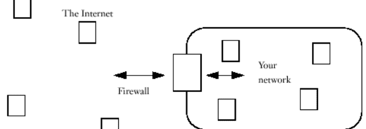

在简单的情况下，构建一个如之前所示仅使用单个防火墙保护的网络即可。在这种布局中，内部网络任何系统与互联网上任何系统之间传输的消息都必须通过防火墙。这种系统的管理相对简单，对于对外提供的服务较少的网络可能提供足够的保护。例如，如果你的网络只允许外部连接传入电子邮件。

在单防火墙配置中，防火墙安全的任何突破都会立即完全让你的网络暴露在直接攻击之下。这就是这种简单系统通常不适用于公司网络的主要原因。

## 两个防火墙和一个 DMZ

图 5-2 展示了带有非军事化区（DMZ）的两个防火墙。

### 图 5-2 两个防火墙和一个 DMZ

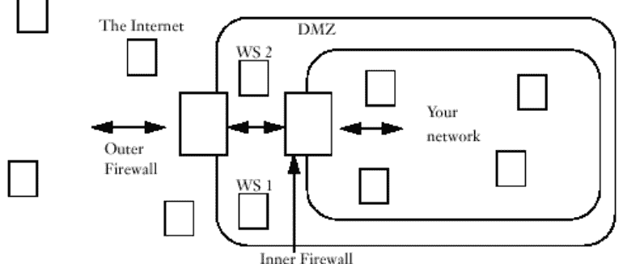

在这种方法中，外部防火墙允许进出 DMZ 的服务之间有大量流量，但内部区域与互联网之间允许的流量很少，或者通常不允许任何流量。在消息必须从位于 DMZ 的代理服务器传递的情况下，传入消息永远不会直接发送到内部网络，而是只发送到 DMZ 中的 Web 服务器或代理服务器。如果合适，该服务器可能会选择将消息转发到内部网络，或者可能向内部机器格式化一个新请求，以便其回答收到的请求。

复杂的布局是可能的，而且在许多情况下是合适的，但大多数是这种布局的变体，即在某些层周围包裹多层保护。例如，某些系统不应让公司网络内的普通用户访问。财务、薪资和人力资源系统通常属于此类。。在主网络内部为此类系统创建内部受保护区域是合理的。图 5-3 展示了这一概念。

### 图 5-3 安全保护系统

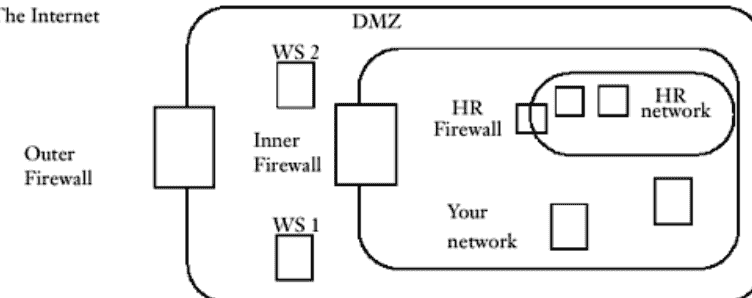

这种布局开始解决内部攻击问题，同时大大增加了你系统中更敏感部分的安全性。

这些配置中的共享许多共同主题：

- 防火墙、DMZ 和类似的保护机制的作用是增加破解你中心网络所需的努力。这种布局也有助于减慢攻击者的速度。它们不应被视为“绝对防御”。
- 除非经过深思熟虑并决定这些消息是必要的且值得承担其可能带来的任何代价，否则不应允许任何消息通过任何防火墙。这些决定应该由一个胜任的安全委员会做出。这些决定应该具体到哪些机器可能会接收或产生这些消息。
- 消息通常不应直接传递到防火墙后的任何系统。相反，所有消息都通过代理进行传递。Web 服务器作为代理（使用 servlets 和其他技术）连接到服务器和数据库。
- 代理软件的设计应该简单，并运行在服务最少的系统上，以便提供最少的攻击点。Web 服务器比理想的代理要复杂得多。

## 5.8 监控

许多人认为防火墙是一个“装好后就可以不管”的选项；事实并非如此。你应该假设受防火墙保护的网络仍然是脆弱，尽管你可以合理地预计攻击它将花费更多时间。

为了进一步提高网络的安全性，你应该安排对通过 DMZ 的活动进行持续监控。这种想法是，如果有人尝试入侵你的网络，你有机会在他们成功之前注意到这些尝试，因此你有机会保护他们试图攻击的任何东西。在许多情况下，这种机会可能只是暂时拔掉你的主互联网连接点。

如果你必须查看每一个进出你网络的数据包，那么你检测异常活动的机会将非常小。因此，有效监控的一个关键是将大部分工作自动化。如果系统进现在发生可疑情况时通知你，你就有更大的机会进行有效监控。

有很多监控工具可用，通常内置或由第三方提供。你应该研究这些工具，并将它们的功能与你的网络必须允许的活动类型进行比较。此外，你可能还可以监控应用程序的行为。监控 UNIX 程序的一个粗略但有效的示例是在 `truss` 命令下运行程序。你使用 `truss` 命令列出程序执行的所有内核调用以及调用的参数。如果你使用 `grep` 命令搜索该列表中的不应发生的内核调用，你就能在某些类型的攻击中发现它。

也许监控最大的问题是“误报”问题。如果一个网络监控系统经常抱怨发生了奇怪的事情，而大多数时间证明是虚假的，那么人们就会倾向于开始忽略它的警告。这与“放羊的小孩”完全相似。

## 5.9 隧道技术

隧道技术（Tunneling）是创建隐蔽通道的一种，即为某种类型的消息创建通信路径，但使用的路径实际上是用于其他类型消息的。隧道可以用于绕过防火墙限制，以进入网络或离开网络。使用隧道技术离开网络可能是一种合理的行为，但用它进入网络通常意味着某人不理解自己的工作。本节的其余部分将讨论这两个选项，以便让你理解设置隧道技术的优势和成本，并使你能够在何时使用它时做出决定。

## 隧道进入网络

一旦设置了防火墙和 DMZ，向内部网络添加新的可从访问的服务就会变得更加困难。首先，这是因为由于防火墙的正常运行，这些服务对互联网是不可见的。

要向你的 DMZ 添加新服务，必须通过防火墙授予访问权限。这可能涉及通过防火墙的数据包过滤路由器元素开启一条新路由。

面对这种情况时，实际上只有三种处理方法：

- 决定该服务对业务至关重要并放弃该项目。
- 说服防火墙管理员该服务对业务至关重要，并说服他们允许。
- 使用防火墙中现有的开启通道创建一个管理员不知道的隐蔽通道。

如果你的工作是提供服务，选项 1 可能是不可接受的。选项 2 从政治角度来看似乎是不可能的。然而，选项 3 看起来也很怀疑。你实际上在欺骗你的公司并故意破坏你的安全措施。然而，流行的“通过 80 端口隧道”方案正是这种行为。

## 隧道离开网络

虽然隧道技术实际上是解决政治而非技术问题的方案，但有时问题并不在你的控制范围内。当你编写运行在他人网络内部的应用或其他客户端，并且需要访问你在自己的网络内部运行的服务时，这种问题是合法的会出现。假设你创建了一个你想让客户使用的应用程序。该客户可能位于一个限制输出消息的防火墙之后。

在这种情况下，考虑简单的将你的新服务运行在特定端口（通常是 80 端口）上是否足够。


在这种情况下，你设置了小程序和服务器以它们各自的原生消息进行操作，但服务器在了一个通常由其他某些服务（如 Web 服务器）使用的端口上监听连接。如果客户的防火墙检查目标端口号但不检查消息内容，那么这种方法效果良好。与此相反的是，如果客户的系统被设定为在他们的防火墙处使用缓存/代理 Web 服务器（Web server），那么这种方法可能没有价值，因为消息不是 HTTP 格式，会被丢弃。

# 核心要点

下载的代码（例如在浏览器中运行的小程序）在默认情况下通常受到以下方式的限制：

- 下载的类无法访问文件系统。这使得无法读取、写入、修改或删除文件，无法读取目录层次结构，无法确定相同的文件信息（例如文件数量、日期和时间戳、文件大小和文件所有者）。
- 下载的类对其他线程的访问受限，因此下载的代码不能阻塞或杀死其他线程。然而，仍然可能构造出死锁条件，而且在某些操作系统上，线程可能会过度使用 CPU。
- 下载的类对 I/O 系统的访问受限，例如，它们不允许在没有警告的情况下显示顶层窗口，也不允许从其他窗口获取键盘或鼠标事件。
- 下载的类对系统包的访问受限。类只被下载到未特权的包中，不能替换或隐藏任何系统类。
- 类存在于与加载该类的 URL 关联的分区命名空间中，因此它们既不会干扰来自其他位置的类，也不会干扰系统类。
- 下载的类对系统属性表的访问受限，因此它们无法确定潜在的敏感信息，也无法修改任何此类信息。

重要的安全概念有关键的术语或短语来描述它们。包括：

- 主体（Principal）——与安全系统相关的个人或实体。
- 身份识别（Identification）——识别系统内部的主体。
- 身份认证（Authentication）——验证主体确实是其声称的身份或实体。
- 授权（Authorization）——确定是否允许已识别的主体访问给定资源。
- 访问控制（Access Control）或资源访问控制（Resource Access Control）——执行授权系统指定的规则。
- 私钥（Private key）——用于加密或签名的值，为了维护加密消息的安全性或签名的有效性，该值必须保密。私钥与相应的公钥一起创建，并成对使用。

- 公钥（Public key）——任何人都可以获知的值。你可以使用公钥加密要发送给相应私钥所有者的消息，或者验证从私钥所有者处收到的消息的签名。
- 加密（Encryption）——从原始消息产生修改后的消息的过程，以便原始消息可以从修改后的（或加密的）消息中轻松恢复，但对于预期的接收者，这种恢复对其他人来说可能困难到徒劳的地步。
- 签名（Signing）——产生一个短消息（签名）的过程，在不知道特定密钥的情况下这种创建是不现实的，但仅使用与该私钥关联的公即可识别其正确性。
- 证书（Certificate）——由一个主体（证书颁发机构）签署的消息，根据证书颁发机构的认为，标识另一个密钥是有效的。
- 证书颁发机构（Certificate Authority）——验证（在某种程度上）个人或组织身份，并颁发带有该个人或组织提供的公钥证书的机构。
- 证书策略声明（CPS）——证书颁发机构判断 a 实际上是请求颁发证书的个人或组织的财产的流程声明。
- 消息摘要（Message digest）——可以与特定消息匹配的短消息，用于证明摘要是从该消息创建的，且自创建以来两者均未被更改。
- 包过滤路由器（Packet-filtering router）——允许数据包仅通过机器上的某些端口进入或传出的路由器。这种安排被用作从互联网访问受保护网络的唯一点。包过滤路由器是防火系统的系统的元素。
- 防火墙（Firewall）——包过滤路由器的扩展，提供额外的安全行为。最常见的是防火墙提供代理服务，以进一步控制外部对你服务的访问。
- 非军事化区（DMZ）——两个防火墙之间的区域，第一个防火墙仅允许来自互联网的访问进入 DMZ 中的系统。第二个防火墙仅允许访问 DMZ 中的系统，而不允许访问任何通往互联网的系统。
- 隧道技术（Tunneling）——当防火墙管理员不授予直接访问时，为服务提供隐蔽通道的一种。使用隧道技术允许连接从网络到互联网，是规避不受你控制的防火墙规则的有效方法。然而，通过隧道技术进入你自己的网络应被视为违反公司规则，应尽可能避免。

以下列表列出了对常见误解的纠正：

- 签名并不证明相应私钥的所有者阅读、签署或批准了该文档。签名仅在合理怀疑之外证明了相应的私钥被用于签署该文档。如果私钥所有者未能妥善保管密钥，或者存储密钥的计算机被入侵（例如通过电子邮件木马），签名可以在没有所有者许可的情况下轻松创建。

- 消息摘要不能证明消息是原始消息。你从未加密消息中知道的摘要是从消息创建的。如果消息被更改，则摘要必须重新生成。

- 证书并不直接验证私钥持有者的身份。相反，证书显示有人拥有你认为是证书颁发机构私钥的副本，证书上的私钥持有者声称它是（或者你希望它是）。如果这听起来很绕口，它确实如此。

# 复习进度

本节回顾了章节中描述的目标，并提供了回顾问题以确保你理解了章节中的要点。

## 目标：从列表中选择 Java 2 环境通常对浏览器中运行的小程序的安全限制

1. 哪种是小程序的最合理用途？

nA. 电子商务系统的用户界面。前端必须执行计算并通过网络与后端服务器通信。
B. 分布式计算系统的元素。每个元素必须通过网络相互进行直接通信。
C. 电子商务系统的用户界面，该界面必须能够在离线模式下工作，允许浏览本地目录本地副本并稍后提交订单。
D. 辅助技术系统，通过增加语音输入和输出来修改主界面的行为。
E. 列出所有系统属性的工具。

A: 正确答案是 A。

A 中描述的小程序是一个典型的前端客户端，对于它来说是一个合理的选项。这个小程序只与其自己的


...源主机。该 applet 不需要对本地文件系统或其他特权资源的任何特殊访问。

在 B 中描述的 applet 被描述为需要连接到任意主机。如果能够以星型拓扑结构处理连接，并将源主机作为中心，那么该方案可以被设计为可以工作，但正如文档所述的，它将由于安全管理器的限制而失败。

在 C 中描述的 applet很难安排，因为离线模式要求将数据存储在本地系统中。如果客户端愿意，这可以实现，但将被安全管理器的默认配置所禁止。

在 D 中描述的 applet 需要对窗口系统的完全访问权限。安全管理器仅允许访问窗口系统——特别是读取指向 applet 的窗口的事件。

在 E 中描述的 applet 将无法列出属性的所有值，因为某些属性被安全管理器认为是特权属性。认为任何此类工具都能编辑和存储这些值也是合理的，但这两种行为都应该是禁止的。

- 2. 典型的 applet 可能被授予哪种能力？

A. 读取文件
B. 写入文件
C. 读取系统属性
D. 写入系统属性
E. 将线程设置为最高优先级

A: 正确答案是 C。
并非所有属性都能被不可信的代码读取，但某些属性至少在正常沙箱内是可读的。不允许修改属性。通常，不会授予对任何文件的读取或写入访问，并且对线程优先级进行限制，以减少 CPU 占用的概率。

# 目标：根据给定的架构系统规范，识别实现指定安全功能的合适位置，并为这些功能的实现选择合适的技术。

- 3. 在公司网络中，有三个部门：薪资、人力资源部和董事会，他们拥有特殊的系统。这些系统包含特权数据，这些数据必须防止受到来自公司其他部分和互联网的未经授权的访问。

至少必须提供什么来满足指定的保护要求？

- A. 在这三个组的整体周围建立一个防火墙
B. 在薪资系统周围建立一个防火墙
C. 在人力资源系统周围建立一个防火墙
D. 在董事会系统周围建立一个防火墙
E. 在整个公司内网周围建立一个防火墙

# A: 正确答案是 B、C 和 D。

正如指定的，没有保护主网络的要求。事实上，唯一指定的合是保护每个组免受这些组之外任何内容的侵害。
这意味着唯一的直接需求是在每个组周围建立一个防火墙。

在现实，你不会让公司网络处于不受保护的状态，可能还有其他要求。然而，从对所提问题的精确回答的角度来看，B、C 和 D 是正确且最小的要求。

- 4. 如果被要求按照偏好顺序对以下技术进行排序，以获取用于与 Bob 进行安全通信的公钥，你会考虑哪些问题。

- A. Bob 的朋友 Trent 给了你密钥。
B. 你在一个未知网站上发现了一个证书。该证书签名验证该证书是由证书颁发机构颁发的，该机构使用了你从朋友那里复制的浏览器安装的密钥。
C. 你在 Bob 的网站上发现了一个证书。该证书签名无法识别。
D. 你从一个你不熟悉的证书颁发机构收到一个证书。你通过打电话给证书颁发机构获取其公钥，来验证该证书上的签名。
E. Bob 在午餐期间亲自交给了他的私钥和公钥。

# A: 在选项 A 中，最大的问题在于你是否可以信任 Trent。即使他是 Bob 的朋友，你也不知道他是否是你的朋友。他可能会替换另一个密钥，可能不是为了欺骗 Bob，而是为了欺骗你。

在选项 B 中，最大的风险是在从不安全源复制的浏览器中使用预装密钥。你不知道你朋友的系统是否可能被不存在的证书颁发机构的虚假密钥所劫持。加上密钥本身来源的不确定性，结果可能是一种弱的验证形式。

选项 C 没有数学上的可靠性，但它依赖于 Bob 的网站、你与该网站之间的连接，以及在你下载证书时该连接是否安全。虽然证书上的签名无法验证，且很难推荐这种方法，但这种方法产生真实密钥的概率很大。然而，如果你打算将此密钥用于重要事务，你应该使用第三方证书颁发机构来增加你的信心。

选项 D 受困于对证书颁发机构的不确定性。通过打电话给他们来验证他们的密钥，从而验证证书是一个相当有力的方法：然而，如果你从未听过该 CA，你可能只是采取了谨慎的步骤来证明由组织攻击者给你的密钥确实是那些组织攻击者创建的。

选项 E 几乎是知道你真的拥有 Bob 密钥的最可靠方法。然而，如果 Bob 对不对称加密的概念理解如此浅薄，以至于把私钥（即使作为他信任的朋友）交给你，这表明虽然你对他拥有他的公钥有信心，但你对他私钥的安全性不能太大信心。如果他的私钥确实泄露了，对于你使用他给你的公钥可能进行的任何后续通信，你并没有什么可以假设。

## 第 6 章 国际化

### 6.1 系统国际化
### 6.2 API

万维网 (WWW) 确实具有全球影响力。部分由于这种影响力，企业不再愿意仅在自己的国界内开展业务。因此，新的应用程序无论最初是否是为 Web 部署设计的，都必须对国际化做出深思熟虑的选择，以及国际化的程度。

完成本章后，你将胜任以下 JEE 架构目标：

- 陈述应用程序在不同区域可能需要更改或自定义的三个方面。
- 将以下 Java 2 平台特性与其功能、目的或典型用途进行匹配：`Properties`、`Locale`、`ResourceBundle`、`Unicode`、`java.text` 包、`InputStreamReader` 和 `OutputStream`。

## 引言

本章的考试目标旨在确保作为架构师的你熟悉支持国际化编程的 Java2 平台功能。这些目标不需要从编程角度对 API 有深入了解，只需要知道系统的哪些方面可以从国际化中受益，以及 API 的广泛功能。事实上，Java 技术提供了易于使用且强大的国际化 API。作为架构师，你应该了解 API 的功能，以便引导你的设计团队实现可能的目标。在某些情况下，如果你作为架构师的角色扩展到项目后期的导师或团队领导，那么更详细的 API 知识可能也有价值。然而，本书并未涵盖这些信息。

# 先决知识回顾

本章的内容没有技术先决条件。不要求你能够用讨论的 API 进行编程，但你需要识别这些 API 的用途和功能。

首先，考虑两个术语：国际化 (i18n) 和本地化 (l10n)。国际化是指创建一个不包含硬编码信息的程序

编码在程序中，使其在不同文化中难以使用。相比之下，本地化（Localization）描述的是将一个国际化的程序进行配置，使其运行在特定的区域或文化环境中的过程。

作为架构师，你必须解决的首要问题始终是：“效益分析是什么？”不可否认，创建一个足够灵活以支持多种语言和文化的系统是有成本的。客户可能对业务在海外市场拟追求的目标有清晰的愿景，或者他们甚至认为业务的未来完全是本地化的。在将项目投入到包含国际化结构的未来之前，你应该考虑以下问题：这种灵活性的通用提升是否值得付出的努力，即使这种灵活性没有用于国际化？

考虑一下这一点。如果程序使用了 Java 技术的国际化设施，那么它就能轻松地支持多个版本的用户界面、多组功能集等。即使输入语言或目标从未改变，这种灵活性也是有价值的。例如，你可以利用国际化能力在程序上展示完全不同的界面。你可以利用此来根据可用性研究改进方法，或者为不同的客户端提供启用了不同功能的版本。这类似于通过在 486DX 上设计数字协处理器来创建 486X 芯片的方式。这种技术允许以较低的总成本创建多个产品，因为产品线中的每个产品都共享大部分代码，并测试产品线的其他部分。

国际化要求在程序结构中解决许多问题。首先，你必须识别系统中任何可能根据程序使用的语言或区域而变化的方面。其次，你应该检查潜在变异的性质。最后，你必须创建一个结构，允许变量部分在运行时插入，以便你无需重新编译整个系统即可向完成的程序添加新的语言区域（locale）。本章描述了这三个问题。

## 系统的哪些方面需要国际化？

当系统在其他地点使用时，任何系统中最明显的改变方面就是语言。程序可能需要更改任何消息、标签等的文本。也许不那么明显的是程序代码——算法——也可能需要变化。例如，不同国家有不同的税制。因此，意识到国际化可能所需的更改范围比仅仅更改消息文本要广泛。

## 应该支持哪些类型的系统变异？

代码和文本通常都需要进行国际化。以下是你应该支持的常见更改类型列表。

- 消息使用的语言
- 消息中参数替换顺序
- 消息中参数使用的语言
- 数字格式
- 日期格式
- 字典排序顺序
- 货币符号及其位置
- 税收和其他法律规则
- 文化偏好（如颜色和符号）

如果用户的语言发生变化，每条消息都需要翻译。此外，语言的变化通常需要词序的变化，以及数字和日历日期表示的变化。例如，某些国家使用逗号表示小数点，使用句号表示千位分隔符。

## 使用 Java 技术 API 创建国际化策略

解决上述所有问题（以及几乎可能需要的任何其他内容）所需的灵活性类型可以通过 `java.util.ResourceBundle` 类提供的资源包（resource bundles）轻松支持。资源包是一个对象集合（自然，这些对象可以是字符串），通过唯一键（key）进行定位。例如，你可以通过搜索键 "disk-failed" 来查找指示磁盘故障的消息。重要的是要意识到资源包可以包含任何对象，包括用户界面，而不仅限于文本内容。事实上，你无法放置在资源包中的唯一信息项是原始类型，即使是这些也可以使用包装对象（wrapper objects）来处理。

资源包概念的一个关键特性是，资源包在运行时使用基于环境中指定的区域（locale）的层级搜索机制进行使用。例如，如果你在魁北克尝试加载一个名为 `ProductImages` 的资源包，系统将首先尝试加载名为 `ProductImages_fr_CA` 的资源包类。如果失败，下一次尝试将加载名为 `ProductImages_fr` 的类，最后，如果失败，系统将回退到默认类，在示例中简单地称为 `ProductImages`。

## 6.2 API

现在你已经考虑了系统中哪些部分可能需要国际化，你应该查看一下你可以使用的 API，并感受每个应用的作用。虽然 Java 2 平台的许多 API 都可以为国际化程序提供帮助，但考试中可能出现的那些目标是非常具体的。由于这个原因，你需要考虑以下 API：

```
Properties, Locale, ResourceBundle, Unicode, java.text package,
InputStream and OutputStreamWriter.
```

## Properties 类

`Properties` 类是 `HashTable` 类的简单派生类。它存储对象，并通过文本键进行索引以检索。你可以在程序中为了自己的目的使用 `Properties` 类的实例，或者在 Java 虚拟机 (JVM) 启动时，它会初始化单个实例，被称为系统属性（system properties）。在系统属性中，你可以找到许多“已知”值，例如指示主机操作系统的值。你还可以从命令行在这些表中设置额外的值。例如，如果按照如下方式调用程序：

```
java -Dconfig.option=false MyApplication
```

当 `MyApplication` 启动时，它将找到与键 `config.option` 一起存储的值 `FALSE`。

`Properties` 类也可以从文本文件中读取，这使得属性机制特别适用于单个机器的本地配置。

## Locale 类

`Locale` 是文化和语言偏好的表示。它由两个（可能是三个）部分组成。第一部分是语言代码（language code），这被认为最重要的部分。第二部分是国家代码（country code）。国家代码为选择正确语言提供的本地化增加了“微调”。例如，英国和美国的 `locale` 共享英语的语言代码 "en"；然而，由于许多其他差异（如拼写、货币符号），这些差异通过主语言代码的后缀来表示。美国的 `locale` 名称为 `en_US`，而英国的 `locale` 名称为 `en_GB`。

在 Java API 中，`Locale` 是一个类。该类的实例表示这些区域变异，并用于触发许多其他类的合适的行为。例如，`Calendar` 类使用 `Locale` 来描述用户的偏好，以定义展示日期时所需的行为。

## ResourceBundle 类

`ResourceBundle` 类是一个对象集合，以文本（字符串）字段作为键。它提供了多种 `ResourceBundle` 的子类，包括一个易于设置的子类（它只代表查找表的文本数据部分），以及一个子类允许任何类型的数据（但设置起来稍微复杂）。通常，你会使用 `ResourceBundle` 类存储程序中可能随区域（locale）变化的所有方面。然后你以这种方式编写程序：使用键字符串进行查找，以获取提供特定用途所需的对象。`ResourceBundle` 的显著特性是它提供了一种机制


根据你提供的“根”名称结合程序运行的区域语言（locale），加载 `ResourceBundle` 子类的特定实例（你为程序创建的类）。例如，如果你提供的根名称为 MyLocalizableElements，且主机操作系统的区域语言为 en_GB，那么程序将首先尝试使用名为 `MyLocalizableElements_en_GB` 的类加载 `ResourceBundle`。如果失败，它将尝试加载 `MyLocalizableElements_en`，最后作为备选，它将尝试加载名为 `MyLocalizableElements` 的类。

## Unicode 编码标准

Java 平台使用 Unicode 来表示文本。这意味着几乎任何现代语言（以及许多古代语言）都可以在程序中编码。当然，仅凭这本身通常是不够的。主机操作系统必须能够显示程序所表示的字符。例如，如果程序引用了一个西里尔字母，那么只有当操作系统配置了合适的字体时，它才会显示出来。但在许多情况下，这意味着 Java 技术程序将正确读取并呈现用户的本地语言——前提是用户的计算机已为该用户的语言进行了设置。然而，存在一种可能性：你可能会从另一个国家的办公室收到一个数据文件，虽然程序可以读取并解释它，但你可能仍然无法查看或编辑这些数据。这并不是 Java 技术的问题，也不是任何特定程序的问题，而是主机  配置的问题。

## java.text 包

不同的文化以特殊的方式表示信息。每天处理的信息，例如日期的显示和货币符号，都是这些问题的很好的例子。表示这些项目时的许多问题已经得到了解决，并且解决方案已内置在 `java.text` 包的类中。具体来说，这些类包括 `MessageFormat` 和 `NumberFormat`，它们提供了文本布局功能，并能够以符合区域语言的格式呈现许多项目。这些项目包括但不限于数字、货币值和日期。

`java.text` 包中的类由 `Locale` 类的实例控制。通常情况下，`java.text` 类将使用默认区域语言对象来确定其行为。但是，如果你需要，可以重写默认区域语言，并指示 `java.text` 类使用特定的区域语言。

## InputStream 和 OutputStream 类

尽管 JVM 使用 16 位 Unicode 表示文本，但许多主机操作系统使用特定于用户区域语言的 8 位编码格式。显然，任何进入 JVM 的数据或离开 JVM 的数据都必须在 16 位 Unicode 和 8 位区域编码格式之间进行转换。这种能力由 `InputStream` 和 `OutputStream` 类提供。正如名称所示，`InputStreamReader` 从 `InputStream`（一个 8 位流）中读取数据，并将其从平台特定格式转换为 Unicode 表示。`Reader` 这一 Java 技术类表示 16 位 Unicode 输入。

相比之下，`OutputStream` 执行相反的转换。它在 `Writer` 接口中接收 16 位 Unicode，并使用平台自身的本地编码能力将其转换为 `OutputStream`（再次是 8 位数据格式）。

`InputStreamReader` 和 `OutputStream` 可以实现与 UTF 之间的双向转换。UTF 是一种变长字符集，它使用 8 位数据（字节），但根据字符的不同，单个字符可能总共使用一个、两个或三个字节。UTF 实际上还表示了某些 Unicode 中不存在的字符。

# 核心要点

以下总结了本章中描述的最重要要点：

- 程序的几乎任何功能都可能需要本地化。这不仅限于消息和其他 UI 元素，还包括算法。需要本地化的算法常见示例是税收规则和字典排序顺序。
- `java.util.ResourceBundle` 类提供了一种灵活的方法，在容器中组织本地化对象。它提供了一种自动机制，可以为给定的区域语言选择最佳匹配容器。
- 资源包（Resource bundles）可以存储任何类的对象，包括字符串，以及封装行为的对象。
- 资源包使用的区域语言通常取自环境。
- `Properties` 对象允许从命令行或配置文件读取外部配置信息。
- `Locale` 代表了一组语言和文化偏好设置。
- `ResourceBundle` 是一个可以使用文本键查找的对象的集合。此类对象通常是程序中区域语言敏感的部分，可以表示纯数据，也可以表示具有状态和（通常是特定区域语言的）行为的完整对象。
- Java 虚拟机使用 Unicode 字符编码标准。这允许表示我们今天使用的大多数自然语言。它是一个 16 位字符代码。
- `java.text` 包提供了许多支持特定区域语言文本操作的类，包括显示和输入。
- `InputStreamReader` 和 `OutputStream` 类提供了流数据在主机平台自身的字符编码格式（通常为 8 位）与 JVM 使用的 Unicode 格式之间的转换。

# 复习进度

本节回顾了本章描述的目标，并提供了复习题以确保你理解了本章的重要要点。

## 目标：列出任何应用程序在不同部署中可能需要更改或自定义的三个方面

1. 在旨在供国际使用的程序中，以下哪些项可能需要国际化？

A. 用户界面
B. 用于读写文本文件的 I/O 例程
C. 写文件和读文件的二进制数据 I/O 例程
D. 税计算算法
E. 文本列表的显示顺序

A: 正确答案是：A, B, D, E。

在这种情况下，用户界面将需要国际化。

B. 用于读写文本文件的 I/O 例程可能需要国际化。

C. 写文件和读取文件的二进制数据 I/O 例程不太需要国际化，因为它们不是由人类使用的。

D. 税计算显而易见。

E. 文本列表的显示顺序看起来没明显，但请记住不同的国家有。

2. 在旨在供国际使用的程序中，以下哪些项需要国际化？

A. 加密算法
B. 快捷方式使用的图标
C. 临时文件的格式和内容
D. URL 的呈现
E. 日期的呈现

A: 正确答案是：A, B 和 E。

A. 加密算法在美国以及世界其他地区都受到许多法律限制。因此，任何使用加密的程序可能需要在不同国家支持不同的算法。

B. 你可能对快捷方式使用的图标可能随语言或文化而变化的建议感到惊讶。然而，不同的文化对相同图像的解释不同，在一个国家“显然”具有某种含义的东西，在另一个国家可能无法识别。此外，任何手势的使用（如指点或数数）在某些国家几乎肯定会被解释为无礼的手势。

E. 日期在全世界有几乎所有可能的排列方式，许多国家使用完全不同的日历。因此，程序中任何显示日期的部分都需要国际化。


D. 实际的 URL（即 http://x.y.com/stuff 部分，而不是链接所指向的页面）通常不进行国际化，因为一旦发生更改，它们就会失去意义。相反，它们所引导的页面可以是翻译的目标，或者可能会为不同的国家提供不同的 URL，以便用户能以自己的语言查看文档。

# 目标：将以下 Java 2 平台的特性与其功能、目的或典型用途的描述进行匹配：properties、locale、ResourceBundle、unicode、java.text 包、InputStreamReader 和 OutputStream

- 3. 下面哪项提供了一种表示当前正在使用的绝大多数书写语言字符的机制？

- A. Locale 类
- B. Unicode
- C. java.text 包
- D. InputStreamReader
- E. Properties 类

A: 正确答案是 B。

Unicode 是一种 16 位的字符编码，为大多数现代和古代语言提供了字符。

错误选项：

- A. Locale 类被用作语言和文化的方便名称，例如，美国使用英语，并在信息（如日期和数字格式化）方面具有美国人的偏好。

- C. java.text 包提供了许多用于格式化消息和解析输入文本的类。这些类实际上执行了格式化数字等工作。它们基于 Locale 对象执行这些操作。

- D. InputStreamReader 将本地字符编码转换为 Unicode，但它本身并不负责表示字符。

- E. Properties 类用于存储键值对，这些键值对可以指定用户或环境偏好。

- 4. 下面哪项最适合指示用户如何显示日历日期？

- A. Properties
- B. Locale
- C. java.text 包
- D. OutputStreamwriter

**A: 正确答案是 B。**

*Locale* 类的存在是为了描述一组特定的语言和文化偏好。由于日期显示是一个文化问题，这几乎肯定是最合适的方法。

错误选项：

- A. *Properties* 对象用于存储配置信息，如果你特别想将日期显示格式与显示的其他方面隔离开来，你可以使用它来存储日期偏好。然而，在大多数情况下，用户对日期的表达方式是他们从小习惯的预期的，而 *Locale* 对象是更好的选择。

- C. *java.text* 包用于显示日期，但它根据 *Locale* 类的对象对如何执行显示做出决策。

- D. *OutputStreamWriter* 将 Unicode 转换为本地字符编码。它不负责准备它转换的字符，也不参与日期格式化。

# 第 7 章 协议

## 7.1 HTTP

## 7.2 HTTPS

## 7.3 IIOP

## 7.4 JRMP

考试目标专门列出了 HTTP、HTTPS、IIOP 和 JRMP。这些协议具有两个不同的目的；HTTP 和 HTTPS 主要用于 Web 页面传输，IIOP 和 JRMP 分别是 CORBA 和 RMI 的传输。然而，HTTP 和 HTTPS 有时用于其他用途，且 IIOP 可以作为 RMI 的替代传输。事实上，IIOP 是 EJB 系统的优传输。完成此列表后，你将能够实现以下目标：

- 给定特性列表，识别出一个是 HTTP、HTTPS、IIOP 或 JRMP 之一的协议。
- 给定场景描述，区分实现该场景的合适和不合适的协议。
- 防火墙如何干扰给定协议的正常运行。

# 前提

本章假设你熟悉 HTTP 和 HTTPS 的目的和典型用途。它假设你理解防火墙性质的某些方面，特别是数据包过滤和代理服务器。有关防火墙的更多信息，请参见第 5 章“安全”。

## 7.1 HTTP

HTTP 主要用于在互联网上加载 Web 页面。它为客户端提供了多种请求格式。主要的请求格式是 GET、POST 和 HEAD。GET、POST 和 HEAD 并不是缩写，而是客户端使用的字符串。

GET 请求是 HTTP 请求的最简单形式。它将单个 URL 携带到服务器，服务器应该返回数据。GET 请求的 URL 反映在大多数大多数浏览器顶部的地址栏中。如果请求需要任何参数（例如为了执行搜索），则这些参数将使用十六进制代码编码在 URL 中，以避免使用空格或 ASCII 以外的任何字符。执行字符串 "hello there" 搜索的 URL 如下所示：

```
http://myserver.com/search?hello%20there
```

这种类型的请求只能向服务器携带适量的量信息，否则 URL 的长度将变得过长。针对 Web 服务器的大量攻击利用了长 URL。如果你需要从客户端向服务器传递大量数据，那么可能应该使用 POST。

与 GET 请求一样，POST 请求的主要意图是获取 Web 页面。然而，POST 请求与 GET 请求的不同之处在于，它被设计为多行从客户端向服务器传输大量数据，而不是将所有数据嵌入 URL 中。

HEAD 请求用于获取有关 Web 页面的有限信息，而不加载页面本身。HEAD 请求的意图是确定缓存页面是否可以刷新。为此，HEAD 请求返回与 Web 页面相关的日期和时间，这可以与缓存相关的日期和时间进行比较。

默认情况下，Web 服务器以及因此 HTTP 请求使用端口 80。然而，该机制不会影响或控制通过该端口传递的数据。由于要在同一台机器上运行另一个服务器，你可能需要在非 80 端口上运行 Web 服务器。每个端口只能由一个进程使用，因此两个服务器必须具有不同的端口。1024 以下的端口在 UNIX 系统中被认为是特权端口，除非进程具有 root 权限否则无法打开。如果你对 Web 服务器使用非 80 端口，常见的选择是 8000、8080、8008 以及 8xx 范围内的其他端口。但记住，这些端口号对于 HTTP、Web 服务器或 TCP/IP 机制并不重要。

任何请求的端口号体现在 URL 中，如果 URL 中没有特定的端口号，则假设为 80。由于大多数由浏览器加载的 URL 是直接从 Web 页面获取的（用户点击链接的结果），使用非标准端口对用户通常没有问题。然而，你应该尽量减少用户可能输入的任何 URL 的复杂性。出于这个原因，如果你可以使用 80 端口作为你的主页，你可能应该这样做。

HTTP 协议是无状态的，这在复杂情况下有时会导致困难。无状态协议意味着每个请求/响应对都是孤立的、自包含单元。早期请求或响应的数据对后续响应不可用。在加载静态 Web 页面时这不是问题，但在许多 Web 中是不可接受的。考虑一个典型的购物购物车应用程序。在请求之间必须维护状态，否则无法将特定购物购物车的内容与任何特定请求关联。

你可以使用以下之一为浏览器连接添加状态：

- Cookies
- URL 重写
- HTTPS
- Applets 和其他客户端

Cookie 是由 Web 服务器设置并存储在浏览器中的变量或键值对。浏览器可以查询给定 cookie 的值，从而将客户端发出的新请求与之前的请求关联起来。这允许服务器跨多个请求维护状态。虽然 Cookie 本身是一个简单的机制，但浏览器在实现 cookie 时遭受了许多漏洞。这些漏洞导致了安全漏洞，作为某些结果，用户不愿意允许浏览器向服务器提供 cookie。

# URL 重写


# HTTPS

HTTPS 是使用 SSL 作为传输层的 HTTP。SSL 连接提供了加密，并可能验证连接两端的双方身份，但在本文讨论的语文中，SSL 连接还提供了在一次请求和下一次请求之间维持状态的功能。在应用层使用 SSL 连接中的状态可以避免与 cookie 或 URL 重写相关的安全问题，并由于 SSL 的本质特性增强了安全性。

# Applet 及其他轻级客户端

如果你可以将 applet 嵌入到 页面中，那么该 applet 就可以维持必要的状态。如果合适，applet 可以使用任何适合你需求的协议与服务器建立一个专用连接，通过保持连接开启，状态就从本质上得到了维持。保持连接开启会有一些后果：每个请求-响应周期都比为每个周期创建并销毁单独的连接要快；然而，维持打开连接会对服务器产生一些额外需求，并且不太可能良好扩展。

# HTTP 中的安全

从安全的角度来看，你应该意识到 HTTP 的一些问题。你应该将 HTTP 请求和响应视为是不安全的。HTTP 以“明文”（即未加密）的形式发送所有消息（包括请求和响应）。参与者（客户端和服务器）是未经验证的。你可能认为未能验证服务器并不是大问题，因为客户端可以看到它们所加载的 URL，而 URL 标识了服务器。然而，这种假设并不稳妥。由于域名服务（DNS）的特性（它提供名称/地址的转换），即使由于你没有连接到正确的服务器，也可能在 URL 中看到正确的 DNS 名称。

大多数客户端允许向外部服务器的 80 端口建立出站连接。所有协议，或者可能是某些其他目标端口，通常会被拦截。大多数防火墙阻止到未知端口的连接，但包含代理服务器的防火墙会检查请求和响应的内容，这些防火墙会拦截其他服务，因为不同服务的消息无法识别并会被丢弃。

HTTP 通常能够穿过防火墙，因此它是隧道化的常用选择。隧道技术是一种使用一种协议作为另一种协议的传输层的技术。例如，你可以使用 HTTP 作为 RMI 或 CORBA/IIOP 消息的传输层。请求被封装在 HTTP 请求中（通常是 POST 请求）并发送到隧道代理服务器，该服务器是一个模仿 Web 服务器的服务器。隧道代理服务器获取请求并将其转换为发送给真实服务器的本地请求。当本地响应到达隧道代理服务器时，它会被封装在 HTTP 响应中并传回客户端。客户端必须以 HTTP 封装的格式创建其请求并解封装它们收到的响应。这种技术很常见，因为客户端端的防火墙很常见且不在服务器管理员的控制范围内，但它是无效的。你应该尝试避免使用隧道化；具体来说，在你同时控制客户端以及客户端与服务器之间所有防火墙的情况下，不要在任何情况下使用它。

# 7.2 HTTPS

HTTPS 不是单一协议，而是而是基于 SSL 传输的 HTTP 的结合。HTTP 和 SSL 的属性都体现在 HTTPS 中。通过引入 SSL，你获得了以下三个益处：加密、身份识别和会话状态。

SSL 使用任意数量的协议提供加密。当 SSL 建立连接时，它首先协商使用哪种协议。结果应该是两端支持的最强加密算法。当然，如果其中一方仅支持弱的加密算法，则生成的连接将是不安全的。对于对加密强度重要的系统，你应该验证所选的算法是可接受的。你可以通过编程或询问用户来做到这一点，但要考虑用户是否有能力做出明智的判断。

如果参与建立 SSL 连接的某方证书，那么 SSL 就可以将此发送给另一方。这允许另一方验证第一方的身份。验证并不是 100% 确定的，尽管验证的数学过程非常接近完美。弱性主要源于人为问题，例如第三方复制了证书合法所有者的私钥。此类问题在第 5 章“安全”中会有讨论。

SSL 连接是有状态的，并且正因如此，HTTPS 可以支持会话，而不会产生 URL 重写或 cookie 的安全风险。然而，由于 HTTPS 直接源于 SSL，连接的建立要慢得多。这是协议协商的直接结果，无法避免。

# 7.3 IIOP

Internet-ORB 协议 (IIOP) 是 CORBA 系统用于在网络上调用方法并传递参数以及这些方法的返回数据的协议。CORBA API 及其 IIOP 一样，适用于许多平台和编程语言，包括 Java 编程语言。这种平台和语言的独立性在连接到遗留系统时使用 IIOP，可能是一个重大的益处；如果你必须在遗留系统的主机上安装支持代码，那么不要忽略通过在该宿主机上安装 JVM 并直接使用 RMI 的可能性，毕竟 JVM 是免费的，而且你可能在系统的其他部分也在使用它。

CORBA 系统定义了大量的标准服务，涵盖了各种垂直和水平市场。CORBA 的水平服务包括但不限于：命名、安全和事务管理。CORBA 服务通常不是免费软件，尽管它们可能被包含在 CORBA 软件包中。然而，如果本地网络上安装了任何 CORBA 服务，那么访问这些服务的能力对于在你的系统中使用 IIOP，可能是一个重大的益处。

Java 技术系统以两种方式使用 IIOP：通过使用 Java IDL API 或通过运行 RMI IIOP。Java IDL API 是在 Java 中使用 CORBA 的最直接的方法。在 IIOP 上运行 RMI 允许在利用 IIOP 作为底层传输层的同时，保持大部分代码的简单性。

有时你可能需要在一个不在你自己的系统上运行客户端程序。在这种情况下，网络可能存在不允许出站流量的防火墙。这种防火墙通常通过其他允许的端口或协议进行隧道化。通常是 80 端口且协议是 HTTP。IIOP 知晓这些问题并可以穿透 HTTP。

# 7.4 JRMP

JRMP 是 RMI 的原生传输协议。与 IIOP 类似，它可以在网络上调用方法并传递参数、返回值和异常。RMI 通常不带有大量的服务，尽管它包含一个命名服务。然而，与 IIOP 最显著的区别是 JRMP 不将参数和返回类型限制为数据值，它处理对象。对象具有状态和行为，这意味着 JRMP 提供了一种机制，将对象的类文件传输到参数或返回值的接收方（异常）。这种类的复制是按需进行的以避免带宽。在复制类的地方，你必须完成额外的管理设置。由于这些任务没有执行或执行错误，你有时会发现 RMI/JRMP 系统表现出 CORBA 的有限行为，即不在网络上移动，只移动状态。只要系统是这样设计的，这并不总是问题；事实上，它可以带来略高的性能和略低的网络带宽消耗。

由于 JRMP 是 RMI 的原生协议，且不需要支持各种不同的主机格式和字节序，因此在 JRMP 上设置参数和返回值的开销比语言中立的系统要小。

JRMP 默认不包含加密或身份识别。然而，很容易设置 JRMP 使用 SSL 作为传输。这通过使用“套接工厂”来实现。关于此机制的更多信息请参见 API 文档。此外，Java 身份验证和授权服务 (JAAS) 是一个用于分布


身份验证与授权为系统添加了大量的价值安全功能。

人们通常认为 JRMP 仅限制与 Java 技术一起。这并不准确。正如在例如 C++ 系统上安装额外代码（如 CORBA 系统）可以允许其与 IIOP 通信一样，安装额外代码（JVM）可以允许相同的 C++ 系统与 JRMP 通信。因此，通过恰当使用 JNI JRMP，可以以一种语言中立的方式提供其功能。JNI 是双向的，它既允许从外部调用 Java 技术系统，也允许 Java 技术系统调用遗留系统。

如果你尝试在客户系统上运行 applet，并且该尝试使用 JRMP 与你的某个系统进行通信，那么你将迅速遇到限制出站流量的防火墙问题。解决此问题的标准方案是使用端口 80 的 HTTP 隧道，JRMP 支持这种方式。

# 核心要点

以下总结了本章描述的最重要的要点。

- HTTP 可以根据需要运行在任何端口上，尽管端口 80 是默认端口。
- HTTP GET 请求从客户端到服务器携带有限的数据，POST 请求可以携带无限量的数据。
- HTTP 是无状态协议。可以通过使用 cookie、URL 重写或使用 SSL 作为传输层（产生 HTTPS）来添加状态。
- 端口 80 的 HTTP 通常允许通过防火墙，因此 HTTP 是隧道传输的常用选择。
- HTTPS 是基于 SSL 之上的 HTTP。
- SSL 提供加密、双方验证以及用于维护状态的可识别会话。
- SSL 中的加密和验证取决于两端的配置和能力，并可能被协商为不执行。
- SSL（以及因此 HTTPS）具有启动开销。
- IIOP 是 CORBA 的方法调用协议。
- IIOP 移动方法调用中参数和返回值的状态。
- CORBA 定义了多种标准服务，如果安装了这些服务，将对 IIOP 可用。
- CORBA 服务包括安全、事务和命名。
- CORBA（因此 IIOP）适用于多种语言和平台。
- IIOP 受 Java IDL 和 RMI/IIOP 支持。
- IIOP 支持通过 HTTP/端口 80 进行隧道传输。
- JRMP 是 RMI 的方法调用协议。
- JRMP 移动方法调用中参数、返回值和异常的状态与行为（整个对象）。
- JRMP 是原生 Java 技术协议，因此它的开销比需要执行格式转换的协议要小。
- JRMP 可以使用 SSL 和 JAAS 安全。
- JRMP 通过 JNI 与其他语言连接。
- JRMP 支持通过 HTTP/端口 80 进行隧道传输。

# 复习学习进度

本节复了本章描述的目标，并提供了复习题以确保你理解了章中的重要要点。

目标：给定一组功能列表，识别出属于以下之一的协议：HTTP、HTTPS、IIOP 或 JRMP

1. 哪种协议表现出以下所有属性？

   - 方法调用协议
   - 能够连接到许多平台上的许多语言
   - 将对象（状态和行为）作为参数移动
A. HTTP
   B. HTTPS
   C. JRMP
   D. IIOP

A: 答案是 C。

HTTP 和 HTTPS  same方法调用协议，因此 A 和 B 必须错误。JRMP 和 IIOP 都可以连接到各种语言创建的遗留代码，JRMP 使用 JNI 实现这一点。然而，IIOP 移动状态，但不是在方法调用中。JRMP 可以移动对象，包括它们的行为部分。因此，C 是正确答案。

2. 哪种协议提供了参与者的加密和身份识别？

   - A. HTTP
   - B. HTTPS
   - C. JRMP
   - D. IIOP

A: 答案是 B。

HTTPS 即 HTTP 和 SSL 的结合，凭借 SSL 的能力直接提供了这些功能。确实，通过将 SSL 作为其他任何协议的传输层，或通过使用 CORBA 的安全服务，可以添加这些功能。

3. 哪种协议通常关联有事务服务？

   A. HTTP
B. HTTPS
C. JRMP
D. IIOP

A: 正确答案是 D。

IIOP 是 CORBA 的传输协议。CORBA 系统通常配有许多标准服务，包括命名、安全和事务。

# 目标：给定场景描述，区分用于实现该场景的合适与不合适的协议

4. 哪种协议在这种情况下最合适：

客户端将发送一个请求，包含少量数据。响应的形式是大量的非结构化数据。请求不是事务的一部分，此请求是否与先前的或后续的请求有任何关联。安全不是被考虑的问题，但响应时间应该是合理的。

   A. HTTP
   B. HTTPS
   C. JRMP
   D. IIOP

A: 正确答案是 A。

关于数据非结构性的观察提示了 JRMP 和 IIOP 不是此处的预期协议。它们可以用于传输非结构化数据（作为大字符串，但这不是它们的真实目的）。相比之下，HTTP（因此 HTTPS）专门用于非结构化数据，返回当时方便的任何内容，例如 Web 页面，或可能是某些 MIME 扩展类型，如图像或音频文件。

每个请求都不是事务的一部分这一信息非常重要，尽管如果情况指示了事务需求，这将具有重大意义。“不需要与先前的或后续的请求有任何关联”意味着不需要状态。这结合不需要安全性，意味着 HTTPS 将引入不必要的开销，从而得出结论 A 是正确选择。

5. 考虑以下来自需求说明的摘录：

站点从我们的中央服务器获取价格和可用性信息。此外，服务器提供折扣计算、销售报告和类似功能。所有站点系统和网络都在公司的控制之下，预计这种情况将持续。系统之间的连接通过公共互联网进行，但网络流量的安全是关重要的。远程系统主要是 Windows，但我们使用的是 Apple Macintosh、Solaris 操作系统或 Linux。未来，公司打算标准化 Linux 或 Solaris 操作系统，这一转变将需要很长时间，并且可能多年都无法百分之百完成。然而，作为这一驱动的一部分，将不会安装其他类型的系统。目前远程站点尚未开发软件。软件成本（包括购买和开发成本）应保持在最低。

哪种协议支持这些需求？

   A. HTTP
   B. HTTPS
   C. JRMP
   D. IIOP

A: 正确答案是 C。

描述提到了必须在网络上传提供的许多功能。虽然你可以在 HTTP 或 HTTPS 上实现这些行为，但分布式计算类型的功能更好地得到 JRMP 或 IIOP 的支持。因为所有网络都在公司的直接控制之下，不应该有隧道的需求。安全需求可以通过 JRMP 使用 SSL 作为传输层，或通过 IIOP 使用 CORBA 安全服务来满足。列出的系统支持所有 Java 技术，CORBA 系统也适用于这些平台。排除其他平台没有特殊意义，但意味着你不需要考虑添加难以由选择的传输层支持的系统（考虑到所涉及的协议，这不太）。由于尚未开发软件，不需要与遗留代码交互，尽管在必要时 IIOP 和 JRMP 都可以这样做。最后，最低成本要求表明 JRMP 是一个很好的选择，因为 RMI（因此 JRMP）是免费 JDK 分发版不可或缺的一部分。IIOP 受 Java 技术支持，但你不太可能找到支持它的免费服务。


# 目标：选择一种可能干扰给定协议正常运行的常见防火墙功能

6. 按协议通过客户防火墙的概率大小进行排序，并说明你选择的理由。

- A. HTTP
- B. HTTPS
- C. JRMP
- D. IIOP

A:正确答案是 A、B、D 和 C。

不要惊慌，考试中不会遇到这样的问题。你说得对，这并不是一个有绝对正确答案的问题。然而，这道题出现在这里是为了让你思考，重要的是你能够理解以下讨论。

许多防火墙管理员会限制出站连接。通常的论据是限制限制公司数据外泄的机会，这些数据可能是由侵入的恶意攻击者发送的，也可能是由不满的员工发送。防火墙通常有两种方式限制此类流量：端口限制和服务代理。

在设置限制时，大多数管理员使用“未显式允许的一律拒绝”的规则。这是一个合理且长久的安全准则，其大意是：关闭所有流量，然后只重新开启 a) 你认为是安全的和 b) 你确定是所需的元素。遗憾的是，隧道技术（tunneling）使整个概念变得毫无意义，因为任何数据都可以以 HTTP 请求的形式通过 80 端口发送出去。尽管如此，这通常是采取的方法，而且比什么都没有要好。

结果是，许多防火墙将出站连接限制在少数已知的服务。HTTP 通常是其中之一，使得 A 是第一个正确选项。HTTPS 通常被认为用于合法的电子商务，并且经常被允许。当然，如果你是为了窃取公司数据的刻意目的而使用隧道，那么 HTTPS 是比 HTTP 更好的选择，因为你可以加密消息内容，并确保没有人能看到消息中包含机密域名。在实践中，HTTPS 是下一个最可能被允许的。

选择 JRMP 和 IIOP 作为第三和第四选项要困难得多。如果防火墙确实限制了出站连接，防火墙管理员不太允许连接到任一协议的端口，但由于 IIOP 出现的时间较早，因此知名度稍高，所以它是第三选择。如果你选择将 JRMP 排在第三，或者在 IIOP 和 JRMP 之间平局，也是可以的。

7. 你的客户端系统使用 HTTP 隧道技术允许向客户网络发送消息。一个特定的客户发现，当他在办公室使用笔记本电脑时，系统无法为其工作，尽管同一台笔记本电脑在家里连接时运行正常。哪种防火墙行为可能导致这种效果？

A: 正确答案：发生这种情况有各种原因；然而，本题限制你仅考虑防火墙行为。

许多防火墙为 Web 访问和 HTTP 连接提供代理服务器。此类代理可能会拒绝连接到某些外部主机，尽管在这种情况下这并不是一个有力的候选因素。Web 代理服务器有时会检查通过它们的请求和响应内容。在这种情况下，你的隧道数据包可能会被拒绝。可能是代理被配置为拒绝加密数据（因为无法通过检查来查看是否包含专有信息）。

另一种可能性是防火墙只允许来自具有固定分配 IP 地址的台式机系统的出站连接。由于笔记本电脑在家里和公司运行，它可能使用 DHCP 分配的地址，而该地址可能在防火墙用于拒绝出站连接的列表中，或者防火墙使用它进行更详细的审查，例如拒绝加密数据包内容。

# 第8章 案例研究

## 8.1 案例研究

## 8.2 解决方案

## 8.3 考试第三部分

SCEA 的第二部分是一项你可以利用空闲时间完成的作业。本章介绍了一个与考试作业类似的案例研究。要完成该作业，你必须完成类图、组件图以及序列图或协作图。

# 8.1 案例研究

高尔夫设备商店 (GES) 是一家高尔夫设备邮购公司。GES 拥有来自每个制造商的最全高尔夫设备选择。

在过去的一年里，GES 看到竞争增加，并预计将继续增长。大部分竞争来自提供额外服务和产品的低成本零售店。然而，GES 拥有一个忠实的客户群。此时，他们正从一家严格基于邮购的公司转变为一家拥有电子业务（e-business）业务的公司。GES 正在尝试将其大部分业务转移到 Web 电子商务网站。

GES 已经有了后端系统来支持其 Web 电子商务网站运营环境。后端系统包括：会计、内容管理、库存、支付服务器和发货。来自 Big O Corporation 的会计系统使用 Java 语言编写。来自 Vine Corporation 的内容管理提供 C++ 和 Java 技术接口。来自 FIFO Corporation 的库存系统使用 C++ 编写，并以 CORBA 为核心。支付服务器由 ePay 提供，它既有 Java 技术也有 C++ 接口。发货系统是一个自有的系统，使用 Java 语言编写。

目前的业务流程是客户通过之前寄给他们的目录，通过邮件、传真或电话下单。当 GES 接收到订单时，订单会被输入订单系统，该系统会从库存中扣除项目、授权信用卡，并通知仓库发货。

GES 想要创建一个在线商店，允许客户输入自己的订单。此外，他们希望开始与制造商建立关系以进行在线业务。为了实现这一点，GES 需要一个能够满足以下目标的系统：

- 1. 在保持现有客户服务人员水平的同时，每年业务收入增长 35%。
- 2. 减少与台式机相关的维护成本。
- 3. 为客户提供电子商务（e-commerce）网站。

业务分析师创建了以下用例图、用例描述和业务领域模型。这是对系统的准确表示，你无法以任何方式对其修改。你可能不同意分析师，但你必须使用这个系统表示。

### 用例图

图 8-1 展示了 GES 系统的用例图。

图 8-1. 用例图


# 业务领域模型

以下展示了业务领域模型。

图 8-2. 领域模型


# 用例 – 浏览目录

浏览目录用例允许客户在未登录的情况下按类别或制造商浏览所有产品。产品和制造商信息（包括图像）从内容管理子系统检索。

### 基本流程

以下步骤概述了浏览目录用例的基本流程：

- 1. 客户选择浏览目录。
2. 系统展示目录首页，其中有类别列表和制造商列表。
3. 客户选择一个类别（包、鞋、杆、球、杂项）。
4. 系统响应该类别销量前十的商品以及拥有该类别产品的制造商列表。
5. 客户从列表中选择一个制造商。
6. 系统响应显示该制造商提供的不同产品的页面。
7. 客户选择一个产品加入购物车。
8. 系统响应产品的可选属性列表。例如，尺寸或颜色。


- 9. 客户选择产品的属性。
- 10. 系统响应并将商品放入购物车。
- 11. 客户为产品选择数量。

## 用例 – 搜索产品

“搜索产品”用例允许客户输入产品名称或制造商，并查看符合搜索标准的结果列表。包括图像在内的产品和制造商信息是从从内容管理子系统中检索的。

## 主流程

以下步骤概述了“搜索产品”用例的主流程：

- 1. 客户输入搜索准则，可以是产品名称、制造商、产品类别或这些信息的任何组合。
- 2. 系统返回产品列表。
- 3. 客户选择要添加到购物车的商品。
- 4. 系统返回该产品可选的属性列表。
- 5. 客户选择产品的属性。
- 6. 系统响应并将商品放入购物车。
- 7. 客户为产品选择数量。

## 用例 – 维护购物车

“维护购物车”用例允许客户查看购物车中的内容并修改内容。

## 主流程

以下步骤概述了“维护购物车”用例的主流程：

- 1. 客户选择查看购物车。
- 2. 系统返回购物车中当前的产品。
- 3. 客户通过选择删除商品或更改数量来修改购物车中的物品，然后提交更改。
- 4. 系统使用库存子系统验证产品的可用性，并根据请求的更改更新购物车。

## 用例 – 创建账户

当客户决定在购物后结账时，客户必须登录。如果客户没有账户，则客户必须创建一个账户。您也可以通过点击“创建账户”按钮访问此用例。

## 主流程

以下步骤概述了“创建账户”用例的主流程：

- 1. 当用户没有设置账户时，系统显示客户账户表。
- 2. 客户输入姓名、家庭地址、配送地址、多个电话号码、多个信用卡以及请求的用户 ID 和密码。
- 3. 系统验证用户 ID 和密码并创建客户账户。

## 用例 – 结账

“结账”用例允许客户购买购物车中的产品。

## 主流程

以下步骤概述了“结账”用例的主流程：

- 1. 客户在任何屏幕上点击结账按钮/链接。
- 2. 系统返回账户登录表。
- 3. 客户输入账户的用户 ID 和密码。
- 4. 系统验证用户身份并显示购物车以及来自发运子系统的配送选项列表。
- 5. 客户选择配送选项并点击重新计算。
- 6. 系统返回应付总额和支付方式。
- 7. 客户选择信用卡支付。
- 8. 系统从支付服务器获取信用卡批准，分配订单号并将订单发送到库存系统。

## 备用流程

以下描述了“结账”用例的备用流程：

- 无客户账户（主流程中的第 3 步）：
  - 3a. 用户没有账户，因此用户选择“创建客户账户”，这会调用账户用例并返回主流程的第 5 步：
- 用户已登录（主流程中的第 2 步）：
  - 2b. 用户已登录。在这种情况下，用户将跳转到第 5 步。
- 通过 ACH（自动扣款）支付（主流程中的第 7 步）：
  - 7a. 客户选择 ACH 支付，这将更改主流程中的第 8 步：
  - 8. 系统向支付服务器发送 ACH 请求，分配订单号并将订单发送到库存系统。

## 用例 – 维护账户

“维护账户”用例允许客户更新账户信息。

## 主流程

以下步骤概述了“维护账户”用例的主流程：

- 1. 客户选择维护账户。
- 2. 系统显示加载了账户维护器数据的账户表单。
- 3. 客户更新相应的数据并将信息提交给系统。
- 4. 系统更新账户信息。

## 备用流程

以下描述了“结账”用例的备用流程。在备用流程中，您是删除账户而非维护账户：

- 第 3 步变为：
  3a. 客户点击删除账户。
- 第 4 步变为：
  4a. 系统返回确认。
- 存在第 5 步：
  5. 客户确认删除。
- 有第 6 步：
  6. 系统将账户标记为已删除。

## 用例 – 查看订单

“查看订单”用例允许客户检查订单状态。

## 主流程

以下步骤概述了“查看订单”用例的主流程：

- 1. 客户选择查看订单。
- 2. 系统返回订单列表。
- 3. 客户选择一个订单进行查看。
- 4. 系统返回订单详情。

## 用例 – 请求退货

“请求商品退货”用例允许客户申请退货。

## 主流程

以下步骤概述了“请求商品退货”用例的主流程：

- 1. 客户选择退货商品选项。
- 2. 系统返回退货商品。
- 3. 客户输入商品信息并提交。
- 4. 系统写入退货请求。

## 用例 – 退商品

“退货商品”用例处理已退货的商品。

## 主流程

以下步骤概述了“退货商品”用例的主流程：

- 1. 客户服务（CSR）审核退货商品。
- 2. 系统返回通知。

## 备用流程

以下描述了“退货商品”用例的备用流程：

- 如果 CSR 未批准退货（第 1 步）：
  - 1a. CSR 未批准退货。
- 第 1 步继续：
  1b. 客户选择拒绝退货的原因并点击。
- 第 2 步变为：
  2a. 系统返回通知。

## 8.2 解决方案

作业的交付物是类图、组件图和序列图。只要您提供了所需的图表，额外的将不会加分。

## 层级图

层次图显示了系统的分层。应用层是代码所在的地方，通用服务代码除外。通用服务代码在多个系统中共享。上层由 Web 服务器、应用服务器以及任何支持应用和通用服务的软件组成。底层是硬件和操作系统。图 8-3 说明了这些分层。

### 图 8-3. 系统分层

![img/5715971f4d127ce2608f26dd89411b_143_0

应用层划分为以下包：客户、订单和目录。客户包包含创建和维护账户的组件。订单包包含处理订单和退货的组件。目录包包含搜索和浏览目录的组件。图 8-4 显示了包与子系统的依赖关系。

### 图 8-4. 包及其依赖关系

![img/5715971f4d127ce2608f26dd89411b_144_0

应用层的分层是逻辑上的而非物理上的。将应用程序逻辑上划分为不同的层使得系统具有活性且易于维护。客户端层是数据模型消耗的地方。层可以是 PC 浏览器、WAP 浏览器或任何能够浏览的设备。表示层用于维护会话并处理连接到系统的各种客户端。业务逻辑层是业务应用处理的地方。由于系统将与后端的多种资源交互，集成层负责从这些资源创建数据模型。资源层是应用程序持久化在关系型数据库或遗留系统的地方。图 8-5 说明了这些层是如何映射的。

### 图 8-5. 分层映射

![img/5715971f4d127ce2608f26dd89411b_144_1


## 类图

类图与业务分析师提供的业务领域对象模型（BDOM）略有不同，但它提供了额外的细节并仍然满足 BDOM 的要求。Address、CreditCard 和 ShoppingCart 都已添加了与 Customer 的关系。增加了 Payment 和 LineItem 以扩展 Order。Manufacturer 不再是一个对象，而是 Product 的一个属性。此外，Order 不再与 Product 建立直接关系，它必须使用 Lineitem 来建立关系。添加了无状态豆（Stateless beans）以显示处理工作流和业务规则的类。

尚未添加 EJB 的 home 接口和 接口，因为这些接口往往会让图表变得混乱，而且开发者已经知道 EJB 需要什么样的 home 和 remote 接口。目前，尚未向类中添加属性和操作，因为这些信息将在详细设计阶段完成。此图仅显示了系统中将使用的基本类，以提供一些结构和业务规则。详细的类图将由开发者在系统设计期间创建。图 8-6 展示了一个类图。

## 图 8-6. 类图

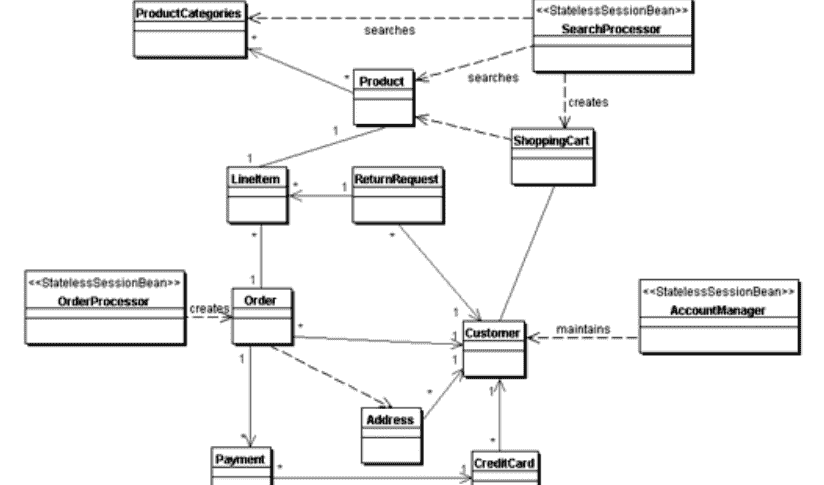

## 组件图

该系统的组件图被拆分为三个独立的图。系统中的每个包结构对应一张图。这些图提供了有关系统基本结构及其如何运行的额外信息。

目录目录组件图（图 8-7）显示了组件之间发生的事件流，用于处理浏览目录和搜索目录的动作。CatalogController 作为所有用户界面请求的控制器。ServiceLocator 是 CatalogController 用于查找和加载 SearchProcessor 的类。该 ServiceLocator 包含在 CommonServices 包中，并用于所有的组件图。

### ### 图 8-7. 目录组件图

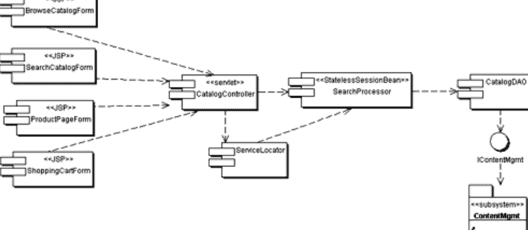

订单组件图（图 8-8）显示了在以下用例进行详细设计时（查看订单、结账、退回商品和请求商品）应遵循的组件流。UserController 作为用户界面的控制机制。ServiceLocator 定位 OrderProcessor，后者是业务逻辑和工作流。OrderDAO 用于检索订单处理时使用的订单数据。由于 Shipping、Payment 和 Accounting 系统拥有 Java 技术 API 且数据未持久化，因此直接从 OrderProcessor 访问，而不是在 DAO 中封装请求。

### ### 图 8-8. 订单组件图

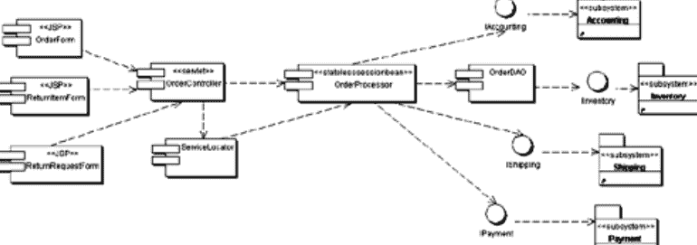

客户组件图（图 8-9）显示了在以下用例进行详细设计时（创建账户和维护账户）应遵循的组件交互作用。

## 图 8-9. 客户组件图

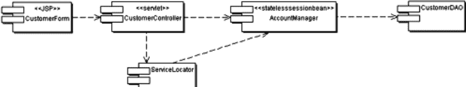

## 序图

架构层面的序图（图 8-10 至 8-13）对组件进行了结构化处理，并规定了通过组件的事件流。这些图没有使用类或对象，而是使用组件来为开发者开发系统详细设计提供一些指南。为了简单起见，有两个序图和一个对应的协作图。作业要求提供其中之一，你不需要两者都提供。

## 图 8-10. 浏览目录

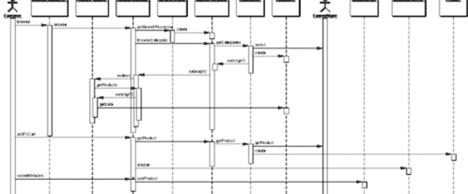

## 图 8-11. 浏览目录协作图

## 图 8-12. 查看订单序图

## 图 8-13. 查看订单协作图。

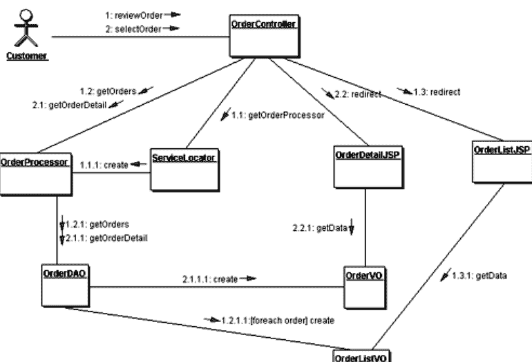

## 8.3 考试第三部分

当你完成作业后，请上传以进行评分。上传作业后，你应该安排考试的第三部分。当你完成考试第三部分时，它将与你的作业合并并发送给评分员。你将获得第二部分和第三部分的合并成绩。第三部分是一系列关于你作业的简答题。如果你复习了第一、第二部分并完成了作业，那么第三部分将会很容易。祝你考试顺利，并让我们知道你的表现。

## 附录 A. 成功指南

Java™ 技术认证是一个宝贵的职业发展机会——也是帮助你掌控职业的绝佳方法。Sun Educational Services 从开始就通过教育、培训和所需的资源支持你，帮助你实现认证目标。

Sun Educational Services 提供课程和认证，支持你扩大职业机会，并创建驱动未来的系统和应用程序。学习路径提供了一目了然的培训和教育信息，让你清楚自己需要什么。


## 3. 联系 PROMETRIC 安排考试

考试在授权的 Prometric 考试中心进行。为了注册方便的日期、时间和地点，请访问 http://www.2test.com 获取您当地 Prometric 办事处的信息。在某些国家，您可以在线注册考试。

## 4. 参加您的考试

在开始考试之前，您必须同意维护保密性并签署《认证候选人考前协议》（Certification Candidate Pre-Test Agreement），该协议可以在 http://suned.sun.com/US/certification/register/policies.html 查看。如果您不签署该协议，将不允许参加考试。

完成考试后，您将获得得分以及针对您测试表现的逐章节评估。您的考试结果将在五个工作日内于 http://suned.sun.com/US/certification/my-certification/index.html 可查。如果您未通过考试，必须等待两周才能再次参加。

## 5. 注册架构与设计项目

一旦您成功完成选择题考试，您可以从当地的教育服务处购买架构与设计项目。24 小时内，您将获得下载该项目的权限。要找到您的当地办事处，请访问 http://www.sun.com/service/suned 并选择您想要注册的国家。

## 6. 下载并提交架构与设计项目

访问 My Certification 数据库 http://suned.sun.com/US/certification/my-certification/index.html 下载架构与设计项目。

完成项目后，您可以通过将其上传到 My Certification 数据库来提交项目。

## 7. 验证考试编号并注册论述考试

在提交架构与设计项目并准备好注册论述考试后，您可以从当地的教育服务处购买考试代金。访问 http://www.sun.com/service/suned 并选择您想要参加测试的国家。

收到代金后，重复步骤三和步骤四。您将在三到四周内从 Sun Certification 数据库 http://suned.sun.com/US/certification/my_certification/index.html 获得得分和性能反馈。如果您未通过，可以再次进行架构与设计项目并提交，需额外支付 150 美元费用（或根据当地规定而定）。您无需重新参加论述考试。

在成功完成所有认证要求后，您将收到来自 Sun 的欢迎包，包括一封祝贺信、一份个性化证书以及一份许可协议（一旦签署，将允许您在名片上使用 Java 技术标志）。此时，您可能想开始考虑职业生涯中的下一个认证了。要开始准备，请访问 http://suned.sun.com/US/certification/to 下载您职业路径中下一个认证的《认证成功指南》。

## 测试目标

针对 J2EE 技术的 Sun 认证企业架构师的测试目标包括：

## 常见架构

- 给出一个网络布局描述的架构，列出与其相关的优点和潜在劣势

## 遗留系统连接

- 在给定遗留系统概述描述的情况下，区分用于 Java 技术代码访问遗留系统的适当与不适当的技术
- 区分有状态（stateful）和无状态（stateless）会 bean
- 区分 session bean 和 entity bean
- 识别 entity bean、有状态会 bean 和无状态会 bean 的适当用途
- 说明容器管理持久化（container-managed persistence）的优点和成本
- 在给定场景中，说明根据部署器描述符（deployor descriptor）定义的指定事务属性的企业 bean 方法的事务行为
- 给出一个详细说明安全和灵活性需求的规格说明，识别满足这些要求的架构
- 识别在 entity bean 和数据资源之间使用中间数据访问对象（DAO）的成本和优点

## 企业 JAVBEAN

## ENTERPRISE JAVABEANS™ 容器模型:

- 说明 Enterprise JavaBeans 容器中 bean 池化（bean pooling）的优点
-  Enterprise JavaBeans 容器如何进行生命周期管理并具有增加扩展性的能力

## 协议:

- 给出的某些功能列表，识别属于以下之一的协议：
- HTTP, HTTPS, IIOP 或 JRMP
- 给出一个场景描述，区分用于实现该场景的适当与不适当协议
- 选择可能干扰给定协议正常运行的常见防火墙功能

## J2EE™ 技术的适用性:

- 识别适合使用 J2EE 技术实现的应用方面
- 识别适合使用 Enterprise Beans 实现的应用方面
- 识别实现特定应用方面所需的合适 J2EE 技术

## 设计模式:

- 针对给定场景识别最合适的设计模式
- 识别使用设计模式的优点
- 根据 UML 图表和/或对模式功能的简要描述，给出 Gamma 等人的设计模式名称
- 识别指定的 Gamma 等设计模式的优点
- 识别与指定的 J2EE 技术功能相关的 Gamma 等设计模式

## 消息传递:

- 识别适合使用消息传递（messaging）、Enterprise JavaBeans 技术或两者实现的场景
- 列出同步消息和异步消息传递的优点
- 识别适合使用消息传递实现的场景
- 识别比同步消息更适合使用异步消息实现的场景
- 识别比异步消息更适合使用同步消息实现的场景

## 国际化:

- 说明任何应用程序在不同本地区域中可能变化的三个方面
- 列出 Java 语言中创建国际化应用的三个特性

## 安全:

- 识别 Java 环境通常对 applet 实施的安全限制
- 给定一个架构系统，识别实现功能的合适位置

## 示例题

- 1: 描述主备复制（active replication）的语句是？
  A. 主备复制要求所有成员执行相同的
  B. 主备复制要求主 bean 同步状态
  C. 主备复制要求主 bean 通知从 bean
  D. 主备复制要求主 bean 发送状态

- 2: 一家运输公司正在构建一个追踪包裹位置的企业系统。系统的一部分是设备网络。这些设备只能通过自定义的 TCP/IP 协议访问。应该如何封装与系统的交互？
  A. 使用 JMS 的 Java 类与系统交互
  B. 使用 IIOP 的 CORBA 对象直接与系统交互
  C. 使用 socket 的有状态 bean 与系统交互
  D. 使用容器管理持久化的 entity bean 封装系统

- 3: 哪个对象可以用于跨数据库和跨模式的可移植性？
  A. entity bean
  B. home object
  C. session bean
  D. data access object

- 4: HTTPS 的两个特性是什么？（选择）
  A. 它是安全的。
  B. 它是无连接的。
  C. 它是基于连接的。
  D. 用于负载均衡。
  E. 用于远程对象通信。

- 5: 您正在开发具有以下系统：
用户使用标准 Web 浏览器访问系统。
所有输入请求将根据用户的 IP 地址进行过滤。
请求响应将根据用户的 IP 地址返回相应的静态 HTML 页面。
哪两种 J2EE 技术用于处理 HTTP 请求？（选择）
  A. JSP
  B. JTS
  C. EJB
  D. SNMP
  E. servlets

- 6: 单例模式的两个优点是什么？（选择）
  A. 它鼓励使用全局变量。
  B. 它控制对单个实例的访问。
  C. 它允许数量变化的实例。
  D. 它允许将对象集合视为单个对象进行处理。

- 7: 异步消息传递的优势是什么？
  A. 简单的架构
  B. 组件立即获得响应。
  C. 组件保证响应的送达。
  D. 组件可以在发出请求后执行任务而无需等待


一个回答。

8: 哪两项明确支持为国际受众编写程序？
（选择两项。）

- A. int 原始类型
- B. char 原始类型
- C. java.lang.String 类
- D. java.lang.Integer 类

9: 哪个陈述是正确的？

- A. 从本地网络加载到浏览器的类是可信的。
- B. 从远程源加载到浏览器的类如果经过了签名，就是可信的。
- C. 从远程源加载到浏览器的类如果它们位于已签名的 jarfile 中，就是可信的。
- D. 从远程源的 jarfile 加载的类即使该 jarfile 未签名也是可信的。
- E. 从已签名的 jarfile 加载的类如果与 jarfile 签名相关的公钥在密钥库中标记为可信，则是可信的。
