# SUSE Linux 10.0 解锁指南

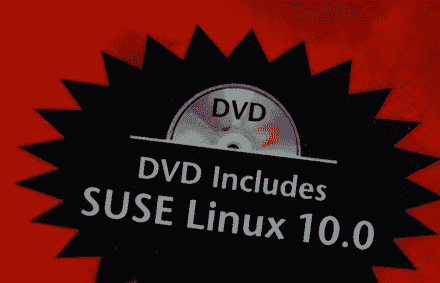

实战指南

收购编辑

Jenny Watson

开发编辑

Scott Myers

主编

Charlotte Clapp

项目编辑

Mandie Frank

校对编辑

Barbara Hacha

索引员

John Sleeve

Aaron Black

技术编辑

Robert Shimonski

Emmett Dulaney

出版协调员

Vanessa Evans

多媒体开发者

Dan Scherf

设计师

Gary Adair

页面布局

Susan Geiselman

## 1 欢迎使用 SUSE Linux 9

- 什么是 SUSE Linux? 10
  - SUSE Linux 12
  - OpenSUSE.org 13
  - SUSE Linux 安装程序 13
- SUSE Linux 中的文件系统 14
- 64 位 SUSE Linux 14
- 获取帮助：文档和其他来源 14
  - 打印文档和 SUSE 帮助中心 15
  - 搜索帮助中心 16
  - Man 和 Info 页面 17
  - SUSE 在线支持 17
  - Linux 文档计划 18
  - Linux 用户组 19

## 2 准备安装 SUSE Linux 21

- 规划你的 SUSE Linux 安装 22
- 系统要求 23
  - 笔记本上的 Linux 26
  - SUSE Linux 与遗留硬件 26
  - 避免潜在的硬件问题 27
- 软件模型 27
  - 通用总线设备 28
  - 主板上的“外围设备” 28
- 关于双启动、分区和其他担忧 29
- 与 Windows 双启动 30
- 如何划分你的驱动器 32

参考文献

# 安装 SUSE Linux

- 安装 SUSE Linux 的方法
- 准备从 CD-ROM 或 DVD 进行安装
- 使用 YaST 安装 SUSE Linux
- 初始安装设置
- 分区
- 设置您的时区
- 安装软件包
- 创建 root 用户
- 配置网络和互联网连接
- 创建用户
- 为 X Window 系统配置硬件
- 首次登录和关机
- 参考
- 使用 YaST 和 SaX2 进行进一步配置
- 排除安装问题
- 使用 YaST 配置硬件
- 收集您的硬件信息
- 修改磁盘控制器设置
- 配置摇杆
- 调整您的键盘布局
- 配置您的鼠标
- 配置您的扫描仪
- 配置您的电视或收音机卡
- 设置日期时间
- 使用网络时间协议 (NTP) 保持时间准确
- 电源管理
- YaST电源管理
- 便携式 PC 问题
- 笔记本电脑电源管理
- 使用 PCMC 卡
- 配置蓝牙无线支持
- 配置红外接口 (IrDA)
- 配置 CD、DVD 和可重写驱动器
- 将 CD 和 DVD 驱动器集成到您的系统中
- 通过直接内存访问 (DMA) 加快 CD 驱动器速度
- 参考

# 第二部分 使用 SUSE Linux

## 5 快速上手 SUSE Linux 65

## 6 登录 SUSE Linux 66

- 6 从 Shell 登录 66
- 6 退出 Shell 66
- 6 使用 Linux 文件系统 66
- 6 位于 `/bin` 和 `/sbin` 目录的常用文件系统命令 68
- 6 使用 `/boot` 和 `/dev` 目录 68
- 6 编辑 `/etc` 目录下的配置文件 69
- 7 所有好东西所在的地方：您的 `/home` 目录 70
- 7 在 `/opt` 中查找桌面程序 70
- 7 大多数程序所在地：`/usr` 目录 71
- 7 变量数据：`/var` 目录 71
- 7 修改用户信息和 Finger 程序 72
- 7 所有 Shell 共有的酷功能 72
- 7 运行 bash 73
- 7 运行 zsh 75
- 7 使用 Midnight Commander 管理文件 76
- 7 ksh 和 ash 77
- 7 选择一个 Shell 78
- 7 编辑文本 79
- 7 使用 vim 及其克隆版本 80
- 8 使用 Emacs 及其克隆版本 81
- 8 其他一些 82
- 8 为什么我不能编辑这个文件？权限的工作原理 82
- 8 修改权限 84
- 8 目录权限 86
- 8 以 Root 身份工作 86
- 8 创建和删除用户 87
- 8 关机和重启 88
- 8 参考 89
- 8 文件系统 89
- 8 Shell 89
- 9 编辑器 90
- 9 以 Root 身份工作 90
- 6 启动您的桌面 91
- 6 理解 X Window 系统 92
- 6 在 SUSE Linux 中配置 X 92

# 选择桌面环境：KDE 和 GNOME 94

- KDE：K 桌面环境 96
- GNOME：GNU 网络对象模型环境 98
- 从桌面管理文件 99
- 在 KDE 中使用 Konquerer 99
- 在 KDE 中使用 Krusader 101
- 在 GNOME 中使用 Nautilus 103
- 配置您的桌面环境 104
- KDE 控制中心 104
- 自定义 GNOME 106
- 什么是窗口管理器？我为什么要想用它？ 107
- 为什么要运行窗口管理器？108
- 使用窗口管理器启动 108
- 运行 fwwm 108
- 运行 WindowMaker 111
- 运行 IceWM 112
- 参考 112

# 7 使用 SUSE Linux 打印 113

- 打印：概述 113
- 通用 Unix 打印系统 (CUPS) 114
- 使用 YaST 配置打印机 115
- 使用 KDEPrint 配置 CUPS 和网络打印机 119
- 使用 CUPS 打印 121
- 使用便携文档格式 (PDF) 122
- 控制台打印控制 124
- 使用基本打印命令 124
- 避免打印问题 125
- 多功能（打印/传真/扫描仪）设备 125
- USB 和其他喷墨打印机 126
- 参考 126

# 8 与您的 Shell 握手 127

- 命令行的力量 128
- Shell 中的模式匹配 129
- 重定向输入和输出 131
- 管道传输数据 132
- 后台处理 132
- 编写 Shell 脚本：基础 132
- bash 脚本 133
- Shell 脚本中的变量 135
- 为变量赋值 136
- 访问变量值 136
- 位置参数
  - 使用位置参数获取命令行变量 137
  - 使用脚本实现任务自动化 137
- 内置变量 139
- 参考 139

# 9 提高效率：办公套件和其他工具 141

- 比较办公套件 141
- 使用 OpenOffice 142
- 使用 KOffice 148
- 使用 GNOME Office 151
- 商业办公软件 152
- COffice 154
- PDA 连接 154
- SUSE 命令行软件 155
- 管理财务 157
- 使用 Scribus 进行版设计 157
- 使用 Dia 绘图 159
- 传真应用 160
- 参考 162

# 10 视觉、听觉和其他 163

- 配置您的声音和视频 163
- 使用 YaST 配置声音 164
- 听收音机 164
- 声音格式 165
- 网络收音和流媒体 166
- 制作自己的 CD 和 DVD 167
- 从桌面刻 CD 和 DVD 168
- 从 Shell 刻 CD 170
- 从 Shell 刻 DVD 172

# 电视和视频：Xine 和 mplayer 174

- 电视和视频硬件 174
- 数码相机 176
- 使用 GIMP 编辑图像 178
- 图像格式 180
- 在 Linux 上游戏 180
- KDE 游戏 182
- GNOME 游戏 182
- Freeciv：策略游戏 182
- 参考 183

# 跨平台 185

- 从 Windows 侧查看文件 185
- 模拟其他操作系统：概述 187
- 关于跨平台工具的一些误区 187
- 使用 Wine 运行 Windows 程序 187
- 安装和配置 Wine 188
- 在 Wine 下安装 Windows 189
- 运行 Wine 190
- Crossover Office 190
- 使用 Win4Line 运行 Windows 程序 191
- 安装 Win4Line 191
- 运行 Win4Line 192
- 使用 VMware 运行 Windows 程序 193
- 安装 VMware 193
- 运行 VMware 193
- 使用 Basilisk II 模拟 Mac 195
- 使用 dosemu 和 DOSBox 196
- Xen：虚拟化的未来？ 196
- 参考 199

# 第三部分 使用互联网

# 连接互联网 203

- 基本连接性信息 203
- 从 localhost 接口开始 205
- 手动配置 localhost 205
- 配置您的拨号上网连接 206
- 使用 YaST 设置拨号连接 207
- 配置数字用户线路 (DSL) 211
- 使用 YaST 设置 DSL 连接 211
- 将您的计算机连接到无线网络 215
- 获取固件和驱动程序 215
- 寻找接入点 216
- 配置您的无线卡 217
- 何时需要拨打互联网服务商电话 218

# 13 使用互联网：浏览网页与撰写电子邮件 221

- 选择 浏览器 221
- Mozilla 和 Mozilla Firefox 222
- Konquerer 224
- Epiphany 225
- Galeon 225
- Opera 226
- 设置您的 SUSE Linux 电子邮件账户 227
- 选择邮件客户端（邮件用户代理 MUA） 229
- Evolution 229
- KDE 个人信息管理器：Kmail/KOrganizer 234
- 以及联系人管理 234
- Mozilla Mail 和 Thunderbird 237
- Sylphed 237
- mutt 238
- 发送文件附件 239
- BinHex 240
- yEnc 240
- UUEncode/UUDecode 240
- MIME/Base64 241
- 使用 UUDEview 解码文件附件 241
- 参考文献 242

# 14 创建基础网站 243

- 选择网页开发工具 243
- 初学者入门 243
- 基于浏览器的页面创建 245
- 专业网页工具 245
- 极客网页工具 247
- 实践：使用 Quanta Plus 构建网站 248
- 使用 SUSE Linux 博客 253
- 使用 Blossom 写博客 255
- Movable Type 和 Typepad 256
- 使用 WordPress 写博客 257
- 热门博客服务 258
- 订阅您的博客 258
- 参考文献 259

# 15 管理电子邮件服务器 261

- 电子邮件的工作原理 261
- MTA 配置 263
- 伪装 263
- 身份验证 263
- 远程 SMTP 连接 263
- 入站邮件协议 263
- 递送模式 264
- 别名 264
- 虚拟域名 264
- 反垃圾邮件与病毒 264
- 反垃圾邮件工具 265
- 客户端垃圾邮件过滤器 266
- Procmail 266
- 反病毒工具 267
- Postfix 的替代方案 267
- Microsoft Exchange Server 268


- CommuniGate Pro ................................................................ 268
- Novell GroupWise ......................................................... 268
- Samsung Connect ................................................................ 268
- OPEN-XCHANGE .................................................................. 268
- Kolab/Kroupware ............................................................. 268
- OpenGroupware (Ogo) ................................................ 269
- phpGroupWare ................................................................ 269
- Hula ...................................................................................... 269
- 结论 ............................................................................ 269
- 参考文献 ............................................................................ 269

# 16 与他人协作 ............................................ 271

- Usenet 新闻今日 ........................................ 272
- 选择 Usenet 新闻阅读器 ......................................... 274
- 邮件/新闻客户端 ......................................................... 274
- 独立 GUI 新闻阅读器 ................................................ 275
- 文本新闻阅读器 ................................................... 278
- 与 Wiki 协作 ................................................... 279
- ZWiki ...................................................................................... 279
- 电子邮件列表 ................................ 281
- 安装 Mailman ........................................................ 282
- 运行 Mailman 列表 ...................................................... 283
- 使用即时通讯与互联网中继聊天 ... ... 284
- 互联网中继聊天 (IRC) ......................................... 284
- Linux 即时通讯 ................................................... 285
- Linux 视频会议 ................................................... 286
- 参考文献 ............................................................................ 287

# 17 安全文件传输 289

- 选择文件传输协议（FTP）客户端 290
- 文本 FTP 客户端 290
- 使用 `sftp` 进行安全文件传输 292
- GUI FTP 客户端 293
- 点对点文件传输 295
- Napster 风格的文件共享 296
- 玩转 BitTorrent 299
- 构建 FTP 服务器 301
- 配置 `inetd` 用于安全传输 301
- 配置安全传输服务器 302
- 参考文献 303

# 第四部分 系统管理

## 18 管理文件、卷和驱动器 307

- 选择文件系统 308
- 磁盘的物理结构 308
- 使用 ReiserFS 309
- 扩展文件系统 (`ext2`, `ext3`) 310
- JFS 和 XFS 310
- 选择文件系统 311
- 使用 Expertitioner 创建和管理分区 311
- 挂载文件系统 317
- `mount` 命令 318
- `umount` 命令 318
- 使用 `/etc/fstab` 自动挂载文件系统 319
- 在运行的系统中挂载只读分区 321
- 使用逻辑卷管理 (`LVM`) 320
- 查找文件 320
- 使用 `find` 321
- 使用 `locate` 321
- 使用 `which` 323
- 使用 `whereis` 324
- 使用 `kfind` 324
- 使用 Beagle 326
- 文件系统操作 329
- 用于测试的文件系统 329
- 检查磁盘镜像 332
- 管理字符设备、块设备和特殊设备 333
- 参考文献 335

## 19 管理用户、管理安全 337

- 用户账户与权限 337
- 在 YaST 中设置用户账户 338
- 系统用户 341
- RWX：理解权限 341
- 谁需要？管理组 342
- 添加组 342
- 密码：安全的第一线 344
- `passwd` 和 `shadow` 文件 344
- 选择密码 345
- 使用可插拔模块 (`PAM`) 设置身份验证 346
- 监控用户活动 348
- 监控用户的 Shell 工具 348
- 让凡人施魔法：超级用户 349
- 使用 `su` 切换身份 349
- 使用 `sudo` 授予 root 权限 350
- 参考文献 351

## 20 数据管理：备份、恢复与重建 353

- 准备防止数据丢失 353
- 如何丢失数据 353
- 评估您的需求与资源 354
- 选择备份策略 355
- 选择备份媒介 356
- 镜像和 RAID 阵列 357
- 可移动存储媒介 357
- 网络存储 358
- 磁带备份 359
- 使用 YaST 备份 359
- 备份软件 362
- 使用 `tar` 备份 363
- 使用 Ark 364
- 使用 GNOME File Roller 365
- 设置镜像磁盘和 RAID 阵列 366
- 恢复损坏的系统 370
- 从 SUSE Linux 光盘启动 370
- 从救援盘集启动 370
- 使用系统恢复 370
- 参考文献 373

## 21 保持系统更新：软件包管理 375

- 使用 YaST 安装软件 ..................................................................... 375
- 红帽软件包管理系统 (`RPM`) 基础.............................. 382
- 在 YaST 之外下载 RPM 包包 ................................................ 383
- 使用 YaST 在线更新 (`YOU`) 更新系统 ............................... 384
- 运行 `YOU` ............................................................................................ 384
- 使用 SUSEwatcher 监控 `YOU` 服务器 ............................................ 386
- 使用 `apt` 更新系统 ....................................................................... 388
- 使用 Red Carpet 更新系统 ................................................................ 391
- 安装 Red Carpet ...................................................................................... 391
- 从命令行运行 Red Carpet (`rug`) ........................................ 392
- 使用 Red Carpet GUI 更新 ................................................................. 393
- 从源码编译软件 ....................................................................... 394
- 参考文献 ................................................................................................ 395

## 第五部分 高级系统管理

## 22 管理启动过程和其他服务 399

- 理解启动过程 ................................................................... 400
- 开始启动：从 BIOS 到启动管理器 ........................................................ 400
- 选择启动管理器：`GRUB` 对比 `LILO` ................................................ 400
- 加载内核 ....................................................................................... 403
- 系统服务与运行级别 (`Runlevels`) ................................................................. 405
- 使用 YaST 运行级别编辑器在启动时控制服务 .......................... 408
- 使用运行级别编辑器 ............................................................................ 409
- 专家模式 ............................................................................ 410
- 手动启动和停止服务 ................................................................. 411
- 系统监控工具 ..................................................................... 411
- KSysGuard ................................................................................................ 412
- KDiskFree 和 KwikDisk ................................................................................ 413
- KGrellM ................................................................................................. 413
- 参考文献 ................................................................................................ 414

## 23 机器安全 417

- 理解计算机攻击 ........................................................ 418
- 评估你的脆弱性 .................................................................... 419
- 保护你的机器 ....................................................................... 421
- 无线网络安全 ................................................................ 421
- 关于密码和物理安全的其他说明 ............................... 422
- 配置 SUSE 防火墙 ....................................................... 422
- 其他考虑的安全实用程序 ................................................ 425
- 如果你被黑客攻击了怎么办 ................................. 425
- 关注 Linux 安全问题 ........................................ 426
- 参考文献 ....................................................................... 427

## 内核与模块管理 ................................................................. 429

- Linus 的宝贝：Linux 内核 ...................................................... 430
- Linux 源码树 ................................................................................ 430
- 内核的类型 ............................................................................ 430
- 模块 ............................................................................................ 431
- 何时需要重新编译 ...................................................................................... 432
- 内核版本 ............................................................................................ 433
- 获取新的内核源码 ....................................................................... 434
- 为内核打补丁 ....................................................................................... 435
- 编译内核 ...................................................................................... 436
- 故障排除 ....................................................................... 438
- 编译过程中的错误 ................................................................................ 438
- 运行时错误、引导程序问题和内核 Oops .......................... 439
- 使用 `sysctl` 进行内核调优 ....................................................................... 439
- 参考文献 ................................................................................................. 440


## 设置网络和 Samba

- TCP/IP 网络
- TCP/IP 体系
- 下一步：互联网协议版本 6 (IPv6) 体系
- 端口
- 网络组织
- 子网划分
- 子网掩码
- 网络地址转换 (NAT)
- 网络中的硬件设备
- 网络接口卡 (NIC)
- 网络线缆
- 集线器
- 路由器和桥接器
- 初始化新的网络硬件
- 动态主机配置协议 (DHCP)
- DHCP 如何工作
- DHCP 软件安装与配置
- 设置 DHCP 服务器
- 使用 NFS 文件系统
- 启动和配置 NFS 服务器
- 使用 NFS 客户端导入目录
- 在 Windows 上使用 Samba
- 网络安全
- 参考文献

## 26 管理你的 Apache 服务器

- 什么是 Apache?
- 安装 Apache
- 从源码构建 Apache
- 启动和停止 Apache
- 运行时配置
- `httpd.conf` 中的额外设置
- 文件系统身份验证与访问控制
- 使用 `allow` 和 `deny` 限制访问
- 身份验证
- Apache 模块
- 虚拟主机
- 基于域名的虚拟主机
- 基于 IP 地址的虚拟主机
- 动态内容
- CGI 程序
- 服务器端包含
- 动态内容模块
- 其他 Web 服务器
- `httpd`
- Caudium WebServer
- Xitami
- Zope
- ColdFusion
- TomCat
- 参考文献

## 27 管理域名

- 基础 概念
- DNS 层次结构
- 区域
- 记录
- 使用 YaST2 配置 DNS
- Hosts 文件
- 基础 DNS 工具
- 使用 BIND 配置名称服务器
- 日志
- 总结
- 参考文献

# 第六部分编程

## 28 使用 GNU 编译器集及其他编程工具

- Linux 下 C 语言基础编程
- 一个简单的 C 程序
- 使用 GNU 编译器集
- 使用 Eclipse 构建 Java 应用程序
- 使用 Eclipse 工作台
- 在 Eclipse 中创建小型 Java 应用程序
- 使用 KDevelop 集成开发环境
- 使用 Anj 创建 GNOME 应用程序
- 使用 CVS 管理集体软件开发
- 以及 Subversion
- 创建 RPM 包
- 制作 Spec 文件
- 列出文件并生成补丁
- 构建和测试你的 RPM 包
- 其他 Linux 编程资源
- 参考文献

## 29 数据库管理

- 什么是关系型数据库？
- 实现 MySQL
- 安装 MySQL
- 完成 MySQL 初始配置中心
- 使用 MySQL 控制中心
- 使用数据库客户端连接 MySQL 数据库
- 使用 MySQL Monitor 数据库
- 优化 MySQL
- 测量关键缓冲区的使用情况
- 使用查询缓存
- 其他微调
- 查询优化
- 总结
- 参考文献

## 30 使用 Perl 和 Python

- 什么是 Perl？
- Perl 变量和数据结构
- 运算符和其他语句
- 正则表达式
- Perl 模块和 CPAN
- Perl 的未来
- 什么是 Python？
- Python 变量和数据结构
- 缩进
- 极端的对象化
- Python IDE 和交互式 Shell
- 参考文献

## 31 创建动态网站

- 使用 PHP
- 安装 PHP
- 编写 PHP 脚本
- 为 PHP 5 添加更多功能
- PHP 5 的未来
- 使用 WordPress 搭建交互式站点
- 安装 WordPress
- 管理用户对 WordPress 的访问
- 设置基于 Web 的社区论坛
- 安装 phpBB
- 配置 phpBB 并创建论坛
- 参考文献

## 32 性能调优

- 优化服务
- 使用 PowerTweak
- 调优硬盘
- 选择最佳硬件
- 在启动时调优硬盘参数
- `hdparmm` 命令
- 禁用文件访问时间
- 分散负载
- 参考文献

## 33 命令行大师课

- 一些基础命令
- 使用 `cat` 显示文件内容
- 使用 `mkdir` 和 `cd` 创建和更改目录
- 使用 `chmod` 修改文件访问权限
- 使用 `cp` 和 `mv` 复制、移动和重命名文件
- 使用 `du` 显示磁盘占用
- 使用 `grep` 搜索字符串
- 使用 `locate` 从索引查找文件
- 使用 `ls` 列出当前目录的文件
- 使用 `man` 读取帮助页
- 使用 `ps` 列出进程
- 使用 `rm` 删除文件和目录
- 使用 `tail` 显示文件的最后几行
- 使用 `top` 显示资源使用情况
- 使用 `which` 查找命令位置
- 组合命令
- 参考文献

# 第七部分附录

## Novell SUSE Linux 版本

- SUSE Linux 10
- SUSE Linux Enterprise (SLES)
- Novell Linux Desktop (NLD)
- Open Enterprise Server (OES)
- SUSE and Linux Internet Resources
- Novell SUSE Reference
- Mailing Lists
- Unix General Reference
- General Linux Reference
- Linux News Reference
- Linux Search Reference
- General Web Link
- SUSE and Linux Internet Resources
- Installation, Disk Tools, and General Systems Administration
- Linux Networking and Security
- LAMP and Other Programming References
- Worldwide Linux Newsgroups
- 索引

# 关于作者

**Michael McCallister** 十年来致力于为不同水平和知识的用户让计算变得简单。他目前是 Compuware 的技术顾问。

Michael 从 5.3 版本开始运行 SuSE Linux 桌面，亲历了该发行版多年来的变化。他是《Computer Certification Handbook》（Ar Press 出版，2000年）的作者，他的技术文章发表在《Linux Journal》、《Java Developer's Journal》、《Internet Voyager》和《Isthmus》等杂志上。他是技术写作协会、密尔沃基 Linux 用户小组以及国家作家协会会员。

## 关于贡献者

**Timothy Boronczyk** 是纽约州锡拉华当地居民。自1998年以来一直从事网页设计，并编写了许多关于 PHP 编程和其他设计主题的文章。空闲时，他喜欢摄影、听音乐和作曲、与朋友聚会以及玩数独。

**Emmett Dulaney** 自1990年以来一直使用 UNIX，从 Linux 诞生起就开始使用。他编写了多本 Novell 出版的书籍，包括《Novell Linux Desktop 9 Administrator's Handbook》以及即将出版的《Novell Linux Practicum Lab Manual》。


**Robert J. Shimonski** 是知名的行业专家、演讲者、培训师和作者。他工作在如今最具挑战的技术和商业环境中。Rob 为读者带来了一线行业知识。可以通过 `RSNetworks.net` 找到他。

## 献辞

献给 Jeanette，她润滑了棱角并让一切保持完整。

## 致谢

写作是一项孤独的努力，但在编写这样本书的过程中，你会遇到各种道路上的人，他们让结果变得更好。非常感谢我的策划编辑 Jenny Watson，她给了我做这件事的机会。感谢我的经纪人，Waterside Productions 的 Carole McClendon。向 Rob Shimonski 致以无限的谢意，他技术编辑了文本的大部分内容，并在最后阶段鼎力支持完成了这个项目。Scott Meyers 提供了出色的建议，Mandie Frank 主导了评审过程，Barbara Hacha 完成了出色的校文字编辑。特别感谢 Novell 的 Scott Villinski，他帮助了安装章节的编写，并（同 Tim Kresler 一起）为密尔基 Linux 用户组提供了一些技巧；还有 Don Bangs，他为我带了第一台电脑，并总是响应硬件紧急故障。

感谢 SUSE Linux 的所有开发者、测试人员、文档编写者和用户，以及与之配套的所有精彩应用程序：谢意远远不够，但我希望这目前足够了。感谢所有邮件列表的参与者：你们对我所有其他用户的忠诚不应被忽视。感谢我在博尔德和密尔基 Linux 用户组的朋友们：没有你们，我无法完成这一切。

最后，献给我的妻子 Jeanette，她一直相信我是一个作家，以及我最喜欢的两个“分心”、Hannah 和 Ben（以及他们的父母 Bev 和 Bob）：愿你们在 Linux 世界中快乐成长。

## 我们想听听你的意见！

作为本书的读者，你是最重要的评论家和评述者。我们重视你的意见，并想知道我们做得对的地方、哪里可以做得更好、你希望我们出版哪些领域，以及任何其他愿意分享给我们的智慧之言。

你可以直接给我发送电子邮件或写信，告诉我你对这本书的喜欢或不喜欢之处——以及我们可以做什么来使书籍更加完善。

请注意，我无法帮助你解决与本书主题相关的技术问题，而且由于收到的邮件量很大，我可能无法回复每一条信息。

当你写信或提供电话和电子邮件地址时，请务必包含书名和作者，以及你的姓名和地址。

- 电子邮件：`opensource@samspublishing.com`

- 邮寄：Mark Taber, Associate Publisher, 800 East 96th Street, Indianapolis, IN 46240 USA

## 读者服务

欲了解更多关于本书或 Sams Publishing 其他书籍的信息，请访问我们的网站 `www.samspublishing.com`。在搜索字段中输入 `ISBN`（不含连字符）或书名即可找到你寻找的页面。

# 引言

欢迎阅读《SUSE Linux 10 Unleashed》！这本书将帮助你充分利用 SUSE Linux 系统，并包含了一份功能完整的操作系统发行版副本。

自从 SUSE Linux A.G. 于 2003 年被网络先驱 Novell 收购以来，更多的美国人开始致力于熟悉长期以来在欧洲受欢迎的 SUSE 发行版。SUSE Linux 提供了极其简的安装方式以及大量经过稳定性测试的应用程序。

SUSE Linux 10 标志着 Novell 和 SUSE 这种事问题的新方式，而这本书将帮助你加入这一热潮中。SUSE Linux 10 是第一个通过 OpenSUSE 项目构建和测试的 SUSE 版本。全球数千万的人下载并运行了测试版，在 OpenSUSE 邮件列表上提交了错误报告、功能建议和帖子。Novell 已承诺在 2006 年进一步开放这一过程。你将在下一章读到关于 OpenSUSE 项目的内容。

无论你是 Linux 新手，还是从其他发行版转向 SUSE Linux，你都会发现书中比你习惯的计算机书籍风格稍显轻松的坚实信息。

SUSE Linux 一直以包含大量应用程序的发行版闻名，第 10 版也不例外。这本书同样包含了 CD 和 DVD 上的完整发行版副本。Linux 内核是真正现代操作系统的核心，它可以驱动从手表到超级计算机的任何设备。SUSE Linux 可以运行在从 Intel 486 到 AMD 和 Intel 64 位处理器的各种计算机处理器上。

对于数百万将 Linux 作为日常系统的人来说，这本书将非常有帮助。Linux 在 20 世纪 90 年代后期横扫服务器领域后，正在桌面领域取得进展。越来越多的 Linux 开发者开始感兴趣于为普通用户编写软件。你将学习如何使用几种开源办公效率应用程序、访问互联网、处理数字音乐和视频，甚至玩几个游戏。

《SUSE Linux 10 Unleashed》包含了你入门并高效工作所需的一切。

> 注意
> 本书包含 SUSE Linux 的副本，但拥有早期版本 SUSE Linux 的读者应该也能在书中找到几乎所有的建议。

在进入 SUSE Linux 成功安装和长期运行所需的准备工作之前，你将先了解一点 Linux 历史。然后，你将获得使用 SU Linux 备用工具——“另一个设置工具”`YaST`在 SUSE Linux 10 Unleashed 中安装 SUSE Linux 并配置硬件的逐步说明。接下来，你将学习 OES 中包含的应用程序。

## 为什么使用 Linux？

自从 Linus Torvalds 将他的操作系统放到互联网上已经过了十多年，数百万的人正在转向 Linux。Linux 是一个好主意有很多原因，特别是：

- Linux 稳固如石。
- Linux 提供了一个免版税的开发平台。
- Linux 现在拥有大型参与者的支持。

大公司、大学、政府、学区和非营利组织都在使用 Linux 来提高生产力。因为有了开源开发模型和为开发者提供的高质量工具，从 13 岁的萌芽程序员到大型开发机构，任何人都能以相对低廉的价格生产高质量软件。尽管 Linux 社区仍然是遇到问题时寻求支持的最佳场所，但 IBM、Novell 等大公司的存在可以即使最不安的人也能稍微放松。

Linux 现在在各种环境中蓬勃发展。它驱动着许多个人助手、桌面和专用计算机。你可以让你的 486 处理器作为路由器或文件服务器工作。当前的内核处理多处理器机器、GB 级的数据，你将学习如何管理你的系统和 TB 级的数据。

最后，献给我的妻子 Jeanette，她一直相信我是一个作家，以及我最喜欢的两个“分心”、Hannah 和 Ben（以及他们的父母 Bev 和 Bob）：愿你们在 Linux 世界中快乐成长。

## 这本书适合哪些读者

这本书将带你上手 SUSE Linux 10。Novell 现在将该版本的目标是“计算机爱好者”和个人用户，对于新的 OpenSUSE 开发项目尤为如此。内容面向中级和高级用户，即使是 Linux 新手也能在书中找到很多有用信息，特别是第一部分。每一章的末尾都提供了指向优质资源的提示。

`YaST` 安装程序比仅仅识别和配置硬件更好，但在安装任何 Linux 系统之前，你应该对你的系统和它包含的硬件类型有一定的了解。熟悉命令行也百有一利。

各种水平的系统管理员都能通过此书安装、设置和运行常见的网络服务，包括 Apache Web 服务器、FTP 服务器和用于跨平台网络的 Samba。你还将熟悉使用 `YaST` 更新你的系统。

程序员将学习有关帮助你提高效率的工具，包括许多专业级文本编辑器、集成开发环境（IDE）以及最佳编程语言和工具的摘要。

## 本书包含的内容

《SUSE Linux 10 Unleashed》分为六部分，涵盖了安装和配置、日常使用、互联网访问和使用、基础和高级系统管理以及编程。其理念是从操作系统的基础开始，进入更困难、更高级的任务。配合随附的 CD-ROM 和 DVD-ROM，你拥有了所需的一切。

新 Linux 用户会发现前三部分最有帮助。你将获得关于以下主题的价值信息：

- SUSE Linux 概述。
- 通过 SUSE Linux 10 提供的纸质版和在线文档、互联网以及 Linux 用户组 `LUGs` 获取帮助。
- 通过查看你对计算机的需求和任务，然后检查你的硬件，来规划你的安装。
- 安装过程的详细步骤。
- 保留现有的 Windows 安装以进行双系统启动。
- 配置和使用 X Window 系统（Linux 图形界面）以及 Linux 的两个主要桌面环境——`KDE` 和 `GNOME`。
- 熟悉你的命令行。
- 在 Linux 中打印。
- 运行 OpenOffice 和其他生产力工具。
- 访问互联网。
- 使用 FTP 和点点协议管理电子邮件、Usenet 和文件传输。
- 播放音乐、视频和游戏。
- 刻录 CD 和 DVD。
- 将你的 PC 变成像 TiVo 那样的个人视频录制器。
- 创建你自己的网站和博客。

第 4 部分和第 5 部分关于系统管理。新用户至少应该复第 4 部分，学习如何管理数据并使用 `YaST` 和其他工具保持系统更新。专业系统管理员可以更深入，学习以下内容的材料：

- 管理启动过程。
- 确保你的系统和网络安全。
- 管理内核及其模块。
- 设置网络。
- 使用 Samba 将 Linux 和 Windows 系统连接起来。
- 管理互联网域名。

# 引言

第 6 部分涵盖了 SUSE Linux 中的编程。你将学习到这些主题：

- 为 C、C++ 和 Java 程序员提供的工具。
- 管理数据库并在编程中使用它们。
- LAMP 网页编程“套件”：Linux、Apache、MySQL 以及脚本语言 Perl、Python 和 PHP。

附录描述了 Novell 提供的 SUSE Linux 的各种变体，并提供了一个扩展的互联网资源列表，用于学习此处介绍的主题。

## 本书使用的惯例

《SUSE Linux 10 入门指南》旨在尽可能完整，但由于发行版中包含的所有应用程序，涵盖选项是不可能的。然而，你将发现许多列表和表格来帮助你。

在需要使用图形化工具的地方，你将看到截图，为你正在操作的步骤提供视觉提示。

为了帮助你更好地理解代码列表示例和命令行界面，使用了几种格式化技术来显示输入和响应。例如，当你必须输入某些内容时，字体看起来如下：

```
ls
```

如果输入内容是对提示符的响应，你输入的内容也将是**粗体**：

Delete files? [y/n] y

命令中括号之间的单词是占位符。如果你看到

`<username>`

在那个位置输入用户名。

以下元素为你提供了与周围文本相关的有用提示信息。

> 注意
> 注释提供了可能帮助你完成任务的额外信息、提供一些辅助细节，或者指向书中的其他位置或在线资源，以获取有关当前主题的更多信息。

较长的注释或侧栏将帮助你处理特定任务、相关技术以及未来的事项。

《SUSE Linux 10 入门指南》

> 提示
> 提示将包含一种节省时间的技巧、独特的见解或其他让你成为更明智用户的内容。

> 警告
> 警告将提醒你注意可能发生的意外，或者在执行某些潜在危险的操作之前需要采取的步骤，例如运行命令、编辑配置或选择设置。

你应该知道，书中的所有内容都是使用 SUSE Linux 和开源工具开发的。

当你阅读这本书并学习更多关于操作系统及其工具的知识时，始终记住 SUSE Linux 开发者在每次安装结束时试图提醒我们的告诫：“玩得开心！”

## 第一部分

## 安装与配置

## 本部分内容

- 第 1 章 欢迎来到 SUSE Linux 9
- 第 2 章 准备安装 SUSE Linux 21
- 第 3 章 安装 SUSE Linux 33
- 第 4 章 使用 `YaST2` 和 `SaX2` 进行进一步配置 45

## 第 1 章：本章内容

### 欢迎来到 SUSE Linux

这是一个开始的好地方！无论你是 Linux 的新手还是从另一个发行版迁移过来，你都会发现 SUSE Linux 既易用又功能强大。《SUSE Linux 入门指南》旨在帮助你发挥它的最大价值。本章将为你提供 SUSE Linux 的简要概述，并给出如何使用本书其他部分的提示。

## 什么是 SUSE Linux？

每个人想知道的第一件事都是“这个 SuSE 到底是从哪里来的，为什么拼写这么奇怪，我该怎么读它？”合理的问题。

- Gesellschaft für Software- und System-Entwicklung（软件与系统开发公司）于 1992 年在德国纽伦堡成立，并在一年后发布了第一个 Linux 内核及相关软件发行版。SUSE 从 1997 年开始用英文出版发行版；当时他们在加利福尼亚州的奥克兰开设了办公室。
- 这种拼写源于营销人员的想法。然而，自 2004 年被 Novell 收购以来，该发行版被称为 SUSE（小写），且这个缩写不再代表任何含义。
- 在德语中没有静音字母，所以它的名字发音为“Sue-suh”。经常有人称它为“Susie”或其他名称。

什么是 Linux？更准确地说是 GNU/Linux，它诞生于 1991 年，当时 Linus Torvalds 是芬兰尔基大学的一名计算机科学学生，他想在拥有大量性能和内存的工作站上运行一个 Unix 的变体。通过 GNU（GNU 非 Unix）项目的工具，Torvalds 能够将一个可用的操作系统移植到 PC 上。他在互联网上发布了源代码，遵循 GNU 通用许可证 `GPL`。

由于这种慷慨，Linux 现在运行在几乎所有的平台和架构上，从手机、个人数字助理到基于 Intel 的 PC，再到运行全球性企业的主机和工作站。

SUSE Linux 是几十种发行版之一。这意味着什么？Linux 内核只是任何发行版的中心部分。每个发行版的区别在于兼容软件（如果不是，大多数遵循 GPL 或其他软件许可证）、安装程序，以及可能的文档和某种程度的支持。

> 提示 想了解更多发行版吗？请访问 `http://distrowatch.com` 查看超过 300 种不同的产品。

SUSE 提供了多种核心发行以满足不同的需求。本书专注于 SUSE Linux 10，Novell 将其称为“社区支持”产品，面向家庭和小型用户。这是由 OpenSUSE 项目于 2005 年 8 月启动的版本。后续章节包含了其他版本的描述。

所有版本都使用 SUSE 安装程序 `YaST`（另一个设置工具）来安装、配置和更新你的 Linux 安装。SUSE 的独特之处在于 `YaST` 是实用且无处不在的工具，你将在本书的每一章中看到它。

### SUSE Linux

SUSE 一直以来以“主流”发行版中规模最大的而闻名。SUSE Linux 捆绑了数百个开源应用程序——多到需要五张光盘（或一张 DVD）才能装下所有。其中一半包含了应用程序的源代码，但应用程序的数量仍然多于你可能使用的。但请考虑这一点：如果你可以使用所有这些程序，你就不再是已安装应用程序的囚徒。如果你在 SUSE Linux 中发现某个应用程序无法满足需求，很可能可以找到另一个更符合你喜好的应用程序进行安装。

如果你的业务需求发生变化，并且你需要其他软件工具来完成任务，你可能不需要通过勾选复选框来获取所需的功能。你只需要启动 `YaST` 并搜索合适的工具，几分钟后，你就可以准备就绪了。

Unix 和 Linux 最初都是以命令行（或 shell）为导向的系统，而命令行是完成任务最快、最简单的方法。但就像 DOS 拥有窗口一样，Unix 开始了 X 窗口系统。后来，专有的 X 服务器和 `XFree86` 项目成为了 Linux 的默认 GUI。2004 年，最初负责 X 开发的 X 联盟复兴并发布了自己的免费服务器。SUSE Linux 从 v9.1 版本开始选择使用此（称为 `X.org`）作为其 X Server 的基础。

如今，在大多数 X 之上运行的是一个桌面环境：桌面环境（`KDE`）或 GNU 网络对象模型环境（`GNOME`）。两者都提供了与专有桌面类似的视觉效果和感受，且每种都有其自己的个性。从历史角度来看，SUSE 团队从一开始就参与了 `KDE` 的开发，`KDE` 一直是 SUSE 的默认桌面，尽管 gnome 始终是一个可选方案。在 SUSE Linux v9.4 中，你可以选择你喜的桌面。你将学习更多关于 X、`KDE` 的知识，并在第 6 章“启动你的桌面”中深入了解。

SUSE Linux 还有两个完整的办公套件（`OpenOffice.org` 和 `KOffice`，其中包含文字处理器、数据库和表格的 `GNOffice` 以及包含文字处理器和表格的 `SoftMaker Office`）、两个工业级开源数据库管理系统（`PostgreSQL` 和 `MySQL`）、两个财务程序（`GnuCash` 和 `KMoney`）、两个个人信息管理器（`Ximian Evolution` 和 `Contact`）以及你提高效率所需的一切。

各种各种技能和经验水平的程序员都能找到他们手艺所需的所有工具。文本编辑器数不胜完，从古老的 GNU `Emacs` 和 `vim` 开始，包括许多其他较新的编辑器；GNU 编译器集合 `gcc`，支持 `Perl`、`Python`、`Ruby`、`PHP`、`Java` 以及你能想到的几乎任何其他语言；以及在 `Kdevelop` 和 `Eclipse` 中提供的至少两个集成开发环境（IDEs）。使用并发版本控制系统（`CVS`）或 `Subversion` 管理你的大型项目。

通常，SUSE Linux 每年发布两次版本，但应用程序会不断获得错误修复、安全修复和功能增强，你可以一直处于最前沿。许多开发者使用红帽软件包管理系统（`RPM`）打包他们的应用程序。SUSE 一直使用这种方法来构建其发行版，并编写了许多 SUSE 特定的 `RPM`。使用 `YaST` 在线更新 `YOU` 或为 Debian 系统创建并适配 `RPM` 的高级软件包工具 `APT`。

通过 SUSE Linux，你可以创建许多类型的系统：网络文件服务器、Web 服务器、DNS 服务器、邮件服务器、路由器或普通的桌面工作站。

你可以将几台机器组合成你自己的超级计算机，被称为 `Beowulf` 集群。选择权在于你。

# 第 1 章 欢迎来到 SUSE Linux

## OpenSUSE.org

2005年8月9日，Novel 在旧金山的 Linux 世界大会上宣布了 OpenSUSE 项目。SUSE 社区首次允许参与 SUSE Linux 的测试和开发过程。Novel 在此项目中的目标是让任何人都能轻松获取“世界上最易用的 Linux 发行版”，并欢迎新的开源开发者加入 SUSE。


OpenSUSE 流程提供了一个可以免费下载的发行版，仅包含开源软件，并能够添加非开源包（如 Java 运行时环境）。此外，OpenSUSE 还是启动的零售版 SUSE Linux 的基础，后者是传统的发行版。

要参与该项目并获取最新的 SUSE Linux 安装版本，请访问 www.opensuse.org 并点击下载链接（见图 1.1）。

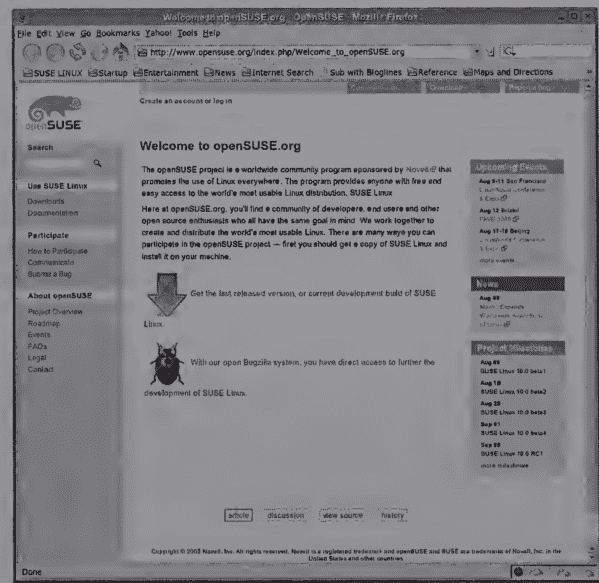

图 1.1 OpenSUSE.org 网站让你能够参与 SUSE Linux 的开发过程。

## 什么是 SUSE Linux？

除了获取最新的发布版本和版本外，该网站还有很多有用内容。你经常会遇到可能是 Bug 的问题，并问自己软件是否意识到了这个问题，并正在修复的路上？有了 SUSE Linux，你现在可以检查了。Novell 开放了它的 SUGE 数据库 Bugilla；如果你遇到困难，可以搜索数据库，并在必要时直接将问题提交给 Bugilla。

在 OpenSUSE.org 网站上，你可以了解更多关于发行版的信息。查看官方文档，阅读来自 Novell 网站及网络其他地方的文章。查看下一个版本的路线图，订阅 OpenSUSE 讨论/支持邮件列表，并浏览常见问题解答（FAQs）。OpenSUSE.org 最有趣的方面之一它是一个 Wiki——页面的每个其他用户都可以向其任何页面提交内容。我们特别鼓励你向文档页面添加内容，随着你对 SUSE Linux 的深入了解，你可以与其他用户分享你的知识。你将在第 16 章“与他人协作”中学习更多关于 wiki 的知识。

用户将是未来发展的驱动力。红帽的 Fedora Core，OpenSUSE 将是新功能和应用程序首次出现的地方。有效的功能将出现在定期更新的盒装版 SUSE 中。

## SUSE Linux 安装程序

有几种方法可以安装 SUSE Linux，但最简单是从 CD 启动的。随书附带的文件系统。你经常会遇到一个可能是 Bug 的问题，并问自己软件是否意识到了这个问题，并正在修复的路上？你可以使用它来：

- 测试你的计算机——确认硬件运行正常。
- 救援遇到问题的系统——如果系统无法从 CD 启动

## SUSE Linux 中的文件系统

默认情况下，SUSE Linux 使用 Reiser4，这由 Hans Reiser 编写并由 Namesys 维护。对于传统的 Reiser3 文件系统，它更快且更高效。当更改（如创建、删除、保存或执行文件）导致系统崩溃时，Reiser 只需要搜索日志而不是整个磁盘。这使得修复和保护数据变得更加简单。你将在第 18 章“管理文件、卷和驱动器”中学习更多关于文件系统的知识。

## 个人电脑随着时间的推移越来越强大。十年前，32 位微处理器以及支持它的新操作系统是关注的焦点。我们正处于下一次革命的黎明，因为 64 位处理器的价格已经下降到你的下一台电脑很可能会拥有。自2003年9月以来，AMD一直在为PC销售64位的 Opteron 和 Athlon 芯片，苹果 G5 也是64 位处理器。

这对普通用户意味着什么？几点。首先，你的系统理论上支持 1600 万 GB 内存。在实际上，你的系统可能会被限制在 256 TB 以内。这意味着应用程序运行得更快。机会也会更大，因为你可以运行更多的代码。

Linux 内核从一开始就支持 64 位处理器，SUSE Linux 从 9.0 版本开始运行在 x86_64 架构上。如果你安装 64 位的 SUSE Linux（本书媒体未包含），你安装的所有应用程序几乎将是 64 位的。SUSE Linux 仍然运行 32 位应用程序，但你更有可能遇到问题。某些已知问题将在本书的注释中提到。

## 获取帮助：文档及其他来源

你有时能看出来这些书籍是从德语翻译而来的，它们的写作风格非常通俗易读，你很快就能上手使用该产品。

这两本手册都已转换成 HTML 页面，并集成到电子版 SUSE 帮助中心（SUSE Help Center）。这对用户来说有两个好处：不需要在办公室里来回跑去去找书，而且你可以对这两本书进行全文本搜索，以找到你需要的信息。

手册的在线版本会定期更新，即使你的发行版版本是最新的，也请至少每年检查几次更新，以确保你拥有的是最新版本。

## 搜索帮助中心

在 shell 中输入 `suhelp` 打开帮助中心，或者在 KDE 或 GNOME 中点击实时保存器（live preserver）。浏览“目录”以查看包含的内容，或点击“搜索”（Search）选项卡来查找特定内容。帮助中心的搜索使用了许多网站上常用的 `http://dig` 引擎（见图 1.2）。

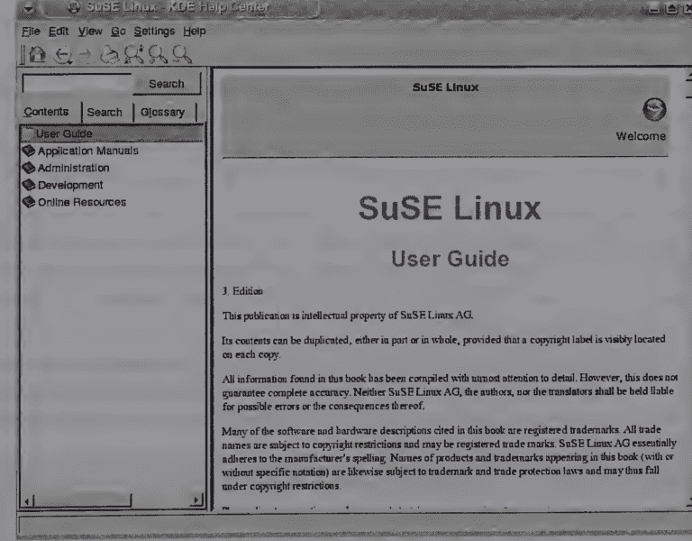

**图 1.2** SUSE Linux 帮助中心提供了《SUSE 管理指南》（SUSE Administration Guide）和《用户指南》（User Guide）的全文。它也可以搜索。

当你第一次想要搜索时，先点击“创建搜索索引”（Create Search Index），让引擎有内容可查。你会看到一组需要索引的在线书籍；勾选所有以便访问全部内容。如果你恰好在一台较慢的机器上，只索引这两本指南，结果可能会更快。点击“HTML 搜索”选项卡可以了解关于 `http://dig` 的知识以及它在系统中的安装位置（同时也会了解到 SUSE 开发者使用 Perl 脚本来创建索引）。准备好后，点击“确定”创建索引。完成后，检查主窗口中的“状态”（Status）列。每本已索引的书籍都应显示“OK”，而未索引的将显示“Missy”。

搜索界面非常像高级搜索界面，你可以从中选择搜索内容、返回多少条结果以及如何处理多词搜索。默认情况下，如果你要求帮助中心查找“spam”和“filter”术语，引擎将搜索包含这两个词的文档（逻辑与关系 AND）。如果你想找到其中一个（或关系），点击“方法”（Method）框。默认搜索范围是这两本手册。要搜索所有组件，勾选“全部”（All）。如果你的答案可能在 info 或 man 页面中（后文将详细介绍），也勾选这些框；此时“范围选择”（Scope Selection）框将切换到“自定义自动”（Custom automatic）。点击查找答案。结果将出现在右侧窗口。点击超链接查看相关文章。

## Man 和 Info 页面

在 Unix 早期，手册（manual）是以系列三环活页夹（three-ring binders）的形式提供的，随每份操作系统副本发送到贝尔实验室（Bell Labs）。

手册随着包含的每个新工具或命令而扩展。在某个时刻，有人想出了一个好主意：创建手册页的电子文件，这样每个运行操作系统的用户都可以获取，而无需到处寻找他们需要的页面。这就是 man（手册）页的诞生，以及 `man` 命令的由来。

man 页面是压缩的文本文件，位于 `/usr/share/doc`。它们通常由应用程序的程序员编写，并按照惯例指定的类别列出信息。这些包括命令参考、每个选项/开关作用的摘要、页面的作者和或程序的作者。偶尔，甚至会有已知的 bug 说明。

如需了解更多关于使用 `man` 程序读取 man 页面的知识，请在命令行输入 `man`。当你按下回车键时，一个名为 `less` 的分页程序将启动并显示页面。按空格键可以逐屏滚动。阅读完后，按 `q` 返回 shell 提示符。

更复杂的程序可能会让 man 页面格式难以从心，因此 info 帮助格式应运而生。这些页面使用一种版本的 Tex 文档格式系统创建，包含分级结构、用于文档间快速导航的超链接，以及键盘和鼠标导航工具。当你第一次使用 `info`（通常是在 Emacs 编辑器中查找 info）时，可能会感到有些无从从，但当你有了感觉后，处理起来并不太难。阅读 info 教程（输入 `info info`）以了解更多。

许多 man 页面都在网上，你可以搜索 man 页面。

还有一个 SUSE 用户 Yahoo 群组。你可以在 http://groups.yahoo.com/group/suselinuxusers/ 注册或查看存档。

## Linux 用户组

当你真正开始生活，需要博学多才的人来帮助你解决问题或教导你时，大多数用户只有两个选择：花大钱请顾问，或者找你最懂电脑的亲近朋友。问题是，那位精通技术且昂贵的朋友可能非常擅长使用西岸生产的某种专有操作系统，但可能对 Unix 或 Linux 并不了解多少。现在你该怎么办？

幸运的是，如果你居住在规模较大的的人口中心或拥有大学校园的城镇不远的地方，可能只需点击几次鼠标就能找到一群精通 Linux 的人——你当地的 Linux 用户组（LUG）。这些人通常每月聚会一次，举行主题演讲、演示、偶尔的抽奖活动以及进行交流交流。大多数活跃的 LUG 都有网站，以及许多邮件列表，人们可以在这些地方解决问题、交易设备，并分享关于各种 Linux 相关问题的意见。如果你对在电脑上安装 Linux 的想法感到有些畏惧，LUG 经常举办“安装测试”，由经验人士在你的系统上安装 Linux 或另一个发行版（随你选择），并在过程中为你提供指导。大多数情况下，这些都是免费提供的。

现在你无法通过拿起书并打电话给 LUG 办公室来开始，但找到它们并不特别困难。你可以查看当地报纸的公告（通常在商业版面上）或致电你的公共图书馆获取信息。有些社区仍然留有以前科技热潮时期的专门杂志，这些杂志列出了各种类型的用户组。

寻找 LUG 最快的方法可能是在线。《Linux Gazette》杂志主办了“随处可见 Linux 用户组”（GLUE）网站 http://glue.linuxgazette.com。它们按地理区域组织，因此你可以浏览列表或在主页上进行搜索。每个小组都有电子邮箱联系方式，许多小组还有 URL。如果这里没有列出网站，不要假设该小组没有。搜索也是一种选择。Google 和 Yahoo 有 Linux 用户组目录，但与其在复杂的目录结构中筛选，不如直接在普通搜索框中输入“<你的城市> Linux 用户组”。

## 参考文献

本书的每一章都包含一个参考部分，其中带有有关章节主题更多或相关信息的链接。它用于建立一组书签，帮助你了解更多关于 Linux 通，特别是 SUSE Linux。

- http://www-1.ibm.com/linux/—IBM 的 Linux 门户网站，包含与这个重要的 Linux 力量相关的新闻、报告和白皮书。检查“Linux 发行版”下的 SUSE Linux 链接以获取与 IBM 支持 SUSE 产品相关的材料。
- http://www.novell.com/linux/suse/—SUSE Linux 的英语主页。新闻、下载、支持。
- http://support.novell.com/linux/—搜索支持数据库，阅读 HOWTO，并订阅邮件列表。
- http://www.opensuse.org—OpenSUSE 项目的主页。下载最新版本进行测试和使用。订阅邮件列表并为 OpenSUSE wiki 做出贡献。
- http://www.namesysys.com—在此处学习 ReiserFS 文件系统。
- http://www.tldp.org/—Linux 文档项目（Linux Documentation Project）。了解通用 Linux 问题以及学习你的 SUSE Linux 发行版中包含的许多应用程序可以这里。
- http://glue.linuxgazette.com/—随处可见 Linux 用户组。找到你最近的 Linux 用户组。
- http://linuxgazette.net/—《Linux Gazette”，“让 Linux 更有趣”。这本电子杂志面向新的 Linux 用户。向“答案小组”提问你的问题。
- http://www.google.com/linux—Google 的 Linux 特定搜索页面。

## 第 2 章

## 本章内容

### 准备安装 SUSE Linux

- 规划你的 SUSE Linux 安装
- 系统要求

今天购买 Linux 电脑比几年前容易了，但即使是商是 Linux 的强力支持者（如 IBM 和 Novell），他们仍然认为没有必要。

你很有可能必须自己安装 SUSE Linux，特别是如果你想将其用作你的日常桌面系统时。

即使你没有计划在 10 台不同的服务器上安装 SUSE Linux，更换操作系统也不是一件可以轻率对待的事。你应该仔细考虑满足硬件要求、双启动安排、安装哪些应用程序，以及你的这台新 SUSE Linux 系统与网络上其他机器的关系，就像任何首席信息官（CIO）所做的那样。

如果你带着某些惶情进行这次安装，请放松！

过去的一些恐怖故事可能是真的，但你安装 SUSE Linux 的经历更有可能在将来变成一段美好的回忆。如果你有一台具有相当现代硬件的典型系统，安装应该是轻而易举的。为了增加可能性，提前计划至关重要。本章和接下来的两章将帮助你进行顺利过渡。

在本章中，我们将仔细考虑在安装 SUSE Linux 之前你需要考虑的所有事情。

我们将介绍使用 SUSE Linux 的最低和推荐系统要求，并尝试帮助你避免某些外围设备可能的驱动程序相关问题。

## 第 2 章：准备安装 SUSE Linux

最后，还有硬盘分区的问题，你绝对应该在开始之前考虑这一点。SUSE Linux 非常灵活，可以满足任何计算需求。本章是关于确定这些需求的。

### 规划你的 SUSE Linux 安装

如果你在单台电脑上安装 SUSE Linux，在开始之前可能有一些业务相关的考虑因素。

如果你预先知道自己对新系统的要求，你将节省时间。你以后可以随时修改。

最重要的考虑是：你想用你的 SUSE Linux 系统做什么？它会运行 Apache Web 服务器还是你的网络文件服务器？这台电脑会连接互联网吗？如果是，如何连接？你想启动网络托管业务吗？它只是用来练习的玩具，还是全职工具？

你需要访问其他电脑或同一台机器上的 Windows 文件吗？

如果你现在有其他其他操作系统（OS）正在执行你想让 Linux 执行的任务，你应该思考为什么要改变。

迁移在时间和培训是有成本的，尽管在大多数情况下，Linux 让这种成本非常值得。

> 提示
>
> 在规划安装时，准备一个笔记本记录你的想法，并始终随身携带，在运行 Linux 期间记录笔记。输入机器的文本文件很方便，就像便利签。但当出现故障导致你无法使用这些电子笔记时，你会有参考资料。
>
> 我是从 Matt 的《Running Linux》中得到的建议，它现在是我得到过的最好的建议之一。

另一个要考虑的问题是对你现有的操作系统做什么。在本章的后半部分，你将学习如何设置你的机器以启动 Windows 和 SUSE Linux。

这是一个很容易做的事，假设你有空间。在决定之前，列出你用于电脑的所有物品以及你使用的应用程序。查看 Windows 开始菜单中的应用程序列表以确保详尽；很容易忘记一些对你来说是理成章的事情。尝试寻找 Linux 的对应替代品。

为了开始，请查看表 2.1。这是我为自己列出的列表样本。应用程序列表列出了该类别中最知名的应用程序，但该列表并不全面。

# 表 2.1 选定的计算任务与 Linux 应用

| 任务 | Windows 应用 | Linux 应用 |
| --- | --- | --- |
| 网页浏览 | Internet Explorer | Netscape/Mozilla/Firefox, Opera, Conqueror, Galeon, Epiphany |
| 预算管理网站 | Quicken, Money, QuickBooks Dreamweaver, Frontpage, HomeSite | Gnucash, KMyMoney, Quanta, Bluefish |
| 照片与图形编辑 / 纯文本编辑 | Photoshop, Paint Shop, Notepad/WordPad, JEdit, NoteTab | The GIMP, KWrite, Emacs, vim, JEdit |
| 数字计算 | Excel, Paradox, OpenOffice.Calc | KSpread, GNOME File Roller,命令行 |
| 打开和创建 Zip 存档 | WinZip, ZipMagic, PKZip | Ark, XMMS, Xine, Kaffeine, Free, RealPlayer |
| 播放 MP3 及多媒体内容 | WinAmp, MusicMatch, RealPlayer, Windows Media Player | RealPlayer (Helix Community version), XMERS |
| 播放 RealAudio 流媒体音频文件 / 收发邮件 | RealPlayer, Outlook/Outlook Express, Mozilla Thunderbird, Eudora, Pegasus Mail | Mail, Mozilla Thunderbird, Evolution, Sylphed |
| 文字处理 | Word, WordPerfect, OpenOffice.Writer, Abiword | OpenOffice.Writer, Abiword, Kword |
| 管理个人信息（联系人、日历） | Outlook, Lotus Notes, Groupwise | Evolution, Contact, Groupwise |

## 系统要求

首先需要了解并理解的是，判断当前的硬件设置是否能运行 Linux 的时代已经过去。Novell/SUSE 承诺对任何 Pentium 级设备提供完全支持，包括 C 和 AMD K5 处理器。

SUSE 也能很好地处理 DEC Alpha。老化过程中的困难在于：老旧的 486 以及带有 64 位处理器和去年 5 月刚发布的高性能游戏显的新机器可能会有问题（尽管可能比你想象的要）。

> 注意：你的 PC 上有 64 位处理器吗？请参阅第 1 章“欢迎来到 SUSE Linux”中关于64 位 SUSE Linux 的章节。


硬件问题通常源于供应商没有为他们的设备编写 Linux 驱动程序。对于笔记本电脑制造商来说尤其如此。由于 Linux 近期的普及，最大的硬件供应商开始通过其硬件支持 Linux，要么直接提供驱动程序，要么为开源开发者提供软件开发工具包（SDK）以编写开源驱动程序。这些驱动程序通常会直接进入所有发行版的 Linux 内核。

SUSE 建议运行 SUSE Linux 10 有三个基本系统要求：

- 处理器–Pentium 1–4；AMD Duron, Athlon, Athlon XP, Athlon MP, 或 Athlon 64

- 主内存–建议至少 256MB

- 硬盘–至少 500MB；标准系统建议 2.5GB

在安装 SUSE Linux 之前，你应该花些时间将你的现有硬件与 SUSE Linux 硬件数据库（`http://cdb.suse.de/`）进行对比。

数据库提供两种类型的硬件搜索。快速搜索（Express Search）允许你输入供应商或设备类型，也可以从预选的硬件类别中进行浏览。

> 提示：如果你是从 Microsoft Windows 迁移并且了解详细信息（制造商、类型等），请前往“设备管理器”查找。右键点击“我的电脑”，并从右键菜单中选择“属性”。转到“硬件”选项卡并点击“设备管理器”。选择列表顶部的系统。点击获取你的所有设备列表。这可能会非常长。如果想获取更多信息，请尝试下载共享软件产品 `mvPCInfo` 或使用第三方系统工具。

快速搜索的结果仅仅是“是”或“否”，并带有一些“部分支持”的列表。点击“详情（Details）”按钮可获取特定项目的更多信息，包括旧版本的 SUSE Linux 是否支持该项目。结果可以打印；点击页面顶部的链接即可。

扩展搜索（Extended Search）提供了许多类别和更多查找数据的方法。如果你想检查你的 Zip 驱动器、业余无线卡或 ISDN 高速连接在 DEC Alpha 下是否可用（参见 2.1），请使用此搜索。

主结果列与快速搜索页面类似，但“状态”列的诚实程度令人满目。例如，某些打印机被列为“有问题（Problematic）”。我们鼓励你点击“详情”按钮获取更多信息。在这里，结果也可以打印。

> 注意：如果你搜索特定项目但它不在数据库中，请不要惊慌。考虑到供应商的数量和硬件的种类，很难测试一切，尤其是当你尝试编写和测试软件时。例如，SUSE 数据库中 ADSL 高速调制调器很少，但根据个人经验和 SUSE 支持列表显示的情况，在识别和支持这些设备方面的记录非常好。

# 系统要求 25

**图 2.1 SUSE 硬件数据库扩展搜索页让你查找几乎任何内容。**

在搜索数据库时，以下是你可能想要确认的类别：

- 控制卡——特别是如果你有 SCSI 或 FireWire（火线）接口。

- CPU——如前所述，几乎每个现代 CPU 都被支持，但检查一下并无害。

- 输入设备——如果你有一个古老的键盘，可能会有问题。

- 调制调器——参见本章后文的调制调器部分。

- 网卡——通常不是问题，但如果你计划让 Linux 管理你的资源，那将很糟糕。

- 指点设备——鼠标和平板，特别是对于笔记本电脑。

- 打印机——除了 SUSE 数据库外，请咨询 `http://www.linuxprinting.org` 获取打印机的最新信息。

- 内存–某些芯片组。

- 声卡——大多数流行的声卡都没问题，但可能没有所有功能。

主板——如果你是从零开始组装的冷门主板，请先检查兼容性。

存储设备–某些 Zip 驱动器存在问题。

通用串行总线（USB）设备–咨询 `http://www.qbik.ch/usb/devices` 获取信息。

显卡——运行 X 窗口系统偶尔会出现问题。你可能无法获得显卡的最高分辨率。Nvidia 驱动必须单独下载。

## 笔记本上的 Linux

SUSE Linux 10 改进了对高级配置电源接口（ACPI）标准的支持，因此电池寿命将更长。

如果你计划在笔记本电脑上运行 Linux，请注意制造商包含了许多硬件专有驱动程序，Linux 的支持可能不稳定。但不要完全灰心。`http://linux-laptop.net/` 的 Linux 笔记本页面上有最新的消息和教程。

> 如果你正准备购买新的 Linux 笔记本电脑，已经几家公司成立，并在品牌机上预装 SUSE Linux 或你喜欢的发行版。浏览你喜欢的 Linux 杂志中的广告，或访问 `http://www.linuxcertified.com/` 或 `http://emperorolin.com`。

## SUSE Linux 与旧留硬件

旧硬件与 Linux 之间的问题正如前所述，是设备驱动程序的普遍缺乏。这在某种程度上是合理的，因为从人们破解 Linux 内核并使用的角度来看，该操作系统是从零开始构建的。随着 Linux 使用量的增加，更多硬件制造商开始注意到，并对服务器端的卡和外围设备提供了活跃的支持。最近，高级显卡、拨号调制调器和打印机才开始拥有 Linux 驱动。

如果你有一台配备 33MHz 处理器或 1GB 硬盘的老旧 Pentium 机器，虽然你可能无法在其安装图形界面，但它几个非常有价值的现代用途。包括：

- 将所有字体安装在这台机器上并连接到网络，为你的其他机器节省大量空间。

- 存储并播放你的 MP3（或 Vorbis）音乐收藏。

- 存储来自 CD 或磁带的数据备份。

## 系统要求

- 为你的网络构建一个硬件防火墙。

- 将其作为内网的 Web 服务器。

- 使用 fetchmail、postfix 和基于文本的电子邮件客户端（mutt, pine, emacs）将其作为你的邮箱。

- 在其内置一个传真调制解器并将其作为传真机。

- 托管一个远程打印机。

- 构建一个 FTP 服务器。

使用 Pentium 处理器 (386/486)，你可能无法运行任何当前版本的 SUSE Linux。不过，你应该能够安装基础的 Debian GNU/Linux。请访问 Debian 项目官网：`http://www.debian.org`。

## 避免潜在的硬件问题

没有任何操作系统是完美的，这并不令人意外。随着每一个 Windows 服务程序包的发布，某些软件就会损坏，而且通常包含硬件驱动程序。Linux 也是如此。许多设备在开箱即用或安装时即可正常工作。越来越多的制造商正在为他们的设备提供 Linux 驱动程序。但某些硬件在 Linux 下运行时似乎总是会遇到一些问题。本节旨在帮助你度过这些特殊的“雷区”。

## 软件调制解器

大多数计算机外设设备都会处理它们自身设计的功能；这只需要一个与操作系统集成的设备驱动程序。告诉应用程序想要打印屏幕上的文件，应用程序调用操作系统，操作系统告诉驱动程序，驱动程序再告诉打印机。完成！

这个规则存在一个例外，大多数用户在在电脑上安装 Linux 之前可能永远不会意识到。突然调制解器无法工作了，你无法访问互联网。欢迎来到 WinModems 的世界！许多流行的调制解器（包括内置和外式的）都如你预期的那样工作。Linux 下对调制解器的驱动支持非常好。不过，某些调制解器将大部分功能转移到了软件上——即为 Microsoft Windows 设计的软件。

这种设置的理由是更新软件比更新硬件更容易、更廉价，但让硬件的运行依赖于特定的操作系统似乎其好也很困难。这有点就像米其林决定只为通用汽车生产轮胎，并告诉福特车主如果想用这些轮胎就得自己制造。

尽管如此，许多开源开发者接受了让 Winmodems 在 Linux 下运行的挑战。几年前，用户唯一的选择是买另一个调制解器，但现在已不再如此。某些 Winmodem

## 第 2 章 准备安装 SUSE Linux

制造商已经帮助提供了细节和开发包以创建开源驱动程序。IBM 在 Linux 内核中为 ThinkPad 600/E 和 770 集成了对软件调制解器的支持。

在购买调制解器之前检查 Linux 兼容性总是最好的，但你并不总有这种选择。获取 Linux 上 Winmodems 信息的来源是：`http://www.linmodems.org`。

## 通用串行线设备

通用串行线（USB）规范的设计允许 PC 支持更多外设设备，而无需向已经负担不堪的电缆堆添加串行或并行连接。它还允许不需要与 PC 固定连接的设备（如数码相机和音频播放器）在需要时插拔，而无需重启，更不用说每次使用时都打开它。

自 20 世纪 90 年代后期生产几乎的所有 PC 都包含了至少两个基于 USB 规范 v1.1 的端口。根据此规范构建的设备传输数据到 PC的速度在每秒 1.5 到 12 兆字节（MBPs）之间。USB 2.0 允许更快的传输速度（高达 480 Mbps），现在你甚至看到便携式驱动器插入 USB 2.0 端口并快速移动。

你将插入 USB 端口的设备类型包括键盘、鼠标、调制解器、扫描仪、数码相机、摄像头和网卡（包括有线和无线）。

Linux 内核从 v2.2.18 版本起就支持 USB 标准，因此所有最新版本的 SUSE Linux 都通过 `uhci` 内核模块支持至少 USB 1.1。开发于 2.6 内核的开发者创建了 `ehci` 模块以支持 USB 2.0，并包含了针对早期内核版本的兼容模块，一直可追溯到 v2.4。尽管如此，某些 USB 设备存在问题，主要是无线 (802.11b) 网络适配器、扫描仪和某些摄像头。

访问 `http://www.qbik.com/devices/` 搜索优质的 USB 设备数据库，访问 `http://www.linux-usb.org/` 获取关于此主题的通用信息。

## 主板上的外设

大多数笔记本电脑和廉价的台式 PC 在主板上内置了视频、音频和网络支持。这种做法降低了功耗需求并简化了设计，尽管这些单元通常不具备昂贵 PCI 卡的所有性能和功能。

如果这些是新设备，Linux 的支持可能并不稳定。

在购买这些机器时，务必小心检查 Linux 支持。向供应商提问并获取答案。这对任何事情都是很好的建议，特别是当你有一台新的尖端笔记本时，因为你无法自己更换笔记本的某一个。它几乎必须返回工厂。

## 思考双启动、分区和其他担忧

在开始安装 SUSE Linux 之前，你最后一个需要考虑的问题是如何处理当前已安装的操作系统。可能你的电脑上有很多非常完好的数据你想保留。这些数据应该备份在其他介质（CD-ROM、Zip 驱动器、磁带）上以防万一。但你创建的那个包含所有数据的 Windows XP 副本呢？你想从头开始，还是保留它更好？这应该备份在其他介质（CD-ROM、Zip 驱动器、磁带）上以防万一。但你创建的那个包含所有数据的 Windows XP 副本呢？你想从头开始，还是保留它更好？这应该备份在其他介质（CD-ROM、Zip 驱动器、磁带）上以防万一。但你创建的那个包含所有数据的 Windows XP 副本呢？你想从头开始，还是保留它更好？这应该备份在其他介质（CD-ROM、Zip 驱动器、磁带）上以防万一。（等待）

这应该备份在其他介质（CD-ROM、Zip 驱动器、磁带）上以防万一。但你创建的那个包含所有数据的 Windows XP 副本呢？你想从头开始，还是保留它更好？这应该备份在其他介质（CD-ROM、Zip 驱动器、磁带）上以防万一。但你创建的那个包含所有数据的 Windows XP 副本呢？你想从头开始，还是保留它更好？这应该备份在其他介质（CD-ROM、Zip 驱动器、磁带）上以防万一。但你创建的那个包含所有数据的 Windows XP 副本呢？你想从头开始，还是保留它更好？（此处原文存在重复内容）

这应该备份在其他介质（CD-ROM、Zip 驱动器、磁带）上以防万一。但你创建的那个包含所有数据的 Windows XP 副本呢？你想从头开始，还是保留它更好？这应该备份在其他介质（CD-ROM、Zip 驱动器、磁带）上以防万一。

这这备份备份在其他介质（CD-ROM、Zip 驱动器、磁带）上以防万一。但你创建的那个包含所有数据的 Windows XP 副本呢？你想从头开始，还是保留它更好？（此处原文存在重复内容）

分区大小等同于（或倍数于）你安装的硬件内存容量。因此，如果你有 256MB 的内存，你的交换分区（swap）也应该是 256MB（甚至是 512MB）。`YaST` 会在安装期间自动配置此项。

如果你只有这两个分区，`YaST` 将把所有其他标准目录放在与 `/` 相同的分区上。这些是：

- `/bin`—二进制文件。

- `/boot`—启动 Linux 的文件。

- `/dev`—设备驱动程序。

- `/etc`—配置文件。

- `/home`—每个用户在此目录下都有一个目录。

- `/lib`—库文件，许多应用程序的底层代码。

- `/media`—可移动磁盘和驱动器（软盘、CD-ROM、Zip 磁盘等）。

- `/mnt`—挂载目录，列出了所有分区（挂载点）。

- `/opt`—某些应用程序安装到此目录而不是 `usr`。

- `/proc`—动态目录，记录了所有正在运行的进程。内容不断变化。

- `/root`—不要与根 `/`（也称为“root”）混淆，这是 root 用户的家目录。

- `/sbin`—系统二进制文件，通常是需要在启动期间运行的文件。

- `/srv`—服务。

- `/tmp`—临时文件。

- `/usr`—大多数应用程序安装在此处。

- `/var`—变量文件和程序，包括打印队列、邮件客户端和安全日志，都存储在这里。

你可能想要考虑将这些目录中的一个或几个放在单独的分区（挂载点）上

## 参考文献

这组链接指向关于分区、在各种硬件上安装 Linux 以及其他安装工具的有用资源。

- `http://linux.dell.com`—Dell Linux 社区主页。Dell 专注于企业 Linux，并将销售带有 SUSE Linux Enterprise Server 或 Red Hat Enterprise Server 的服务器，但社区网站提供邮件列表，以支持桌面和笔记本电脑上的 Linux 用户。

- `http://linuxshop.org/linuxbegin/win-lin-soft-en/table.html`—寻找 Windows 程序的 Linux 等品。

- `http://cdb.suse.de`—SUSE 硬件兼容性数据库。

- `http://www.linuxprinting.org`—想看看你的打印机在 Linux 下是否工作吗？去这里就对了。

- `http://www.linux-usb.org`—Linux-USB 项目，包含支持的设备和驱动程序信息。

- `http://www.qbik.ch/usb/devices`—Linux USB 设备数据库，用于搜索兼容设备。

- `http://www.linmodems.org`—软件介质的 Linux 驱动程序。

- `http://wwwcertified.com` 和 `http://emperorlinux.com`—两家预装 Linux 笔记本电脑的公司。

- `http://linux-laptop.net`—关于 Linux 友好笔记本电脑的更多信息。

- `http://www.linux1394.org`—Linux FireWire 项目，包含此类设备的驱动程序信息。

- `http://elks.sourceforge.net`—嵌入式 Linux 内子集，尝试构建可以在 Intel 286 及更早处理器上运行的某些 Linux 功能。

- `http://www.lnx-bbc.org`—Linux 可启动名片项目主页，制作出标准名片形状的“Live CD”。

- `http://www.knoppix.org`—另一个 Live CD 项目；将 CD 插入驱动器并运行 Linux，无论硬盘上安装了什么操作系统。

- `http://www.gnu.org/software/parted/parted.html`—GNU Parted 主页，免费软件磁盘分区工具。

# 第 3 章

## 本章内容

# 安装 SUSE Linux

- 安装 SUSE Linux 的方法

- 从 CD-ROM 或 DVD 准备安装

- 使用 YaST 安装 SUSE Linux

- 首次登录和关机

安装 SUSE Linux 是一个简单的过程。SUSE Linux `YaST` （Yet another Setup Tool，又一个设置工具）将引导你完成整个过程，检测并配置你的硬件，并通常负责一切。在本章中，你将学习如何使用随书提供的 CD 完成 SUSE Linux 的基础安装。

在目前的阶段，你可能迫不及待要开始，但简短的介绍可以帮助你确保一切都已就绪。然后你就可以开始安装并遵循本章的建议完成全程。

在本章结束时，你将完成首次登录，准备好使用 SUSE Linux。

## 安装 SUSE Linux 的方法

SUSE Linux 可以通过多种方式安装在工作站上。安装可以从中央服务器、跨网络进行，或使用任何可用介质类型（CD ROM/DVD）。

由于本书附带了操作系统介质，我们将重点关注使用这些介质进行安装。虽然与其他类型的安装方法不同，但大多数方法都遵循相同的步骤，你可以在网站上找到针对相应安装的特定信息。

## 从 CD-ROM 或 DVD 准备安装

随书附带的介质是可启动的，当你启动计算机时它将直接安装 SUSE Linux。在开始过程之前需要知道的关键点是你的 BIOS 是否已设置为从 CD-ROM 或 DVD-ROM 驱动器启动。

> 注意

更改 BIOS 设置可能是危险的，如果设置错误，很容易导致计算机无法启动。请务必遵循这些指令，除非你确定自己在做什么，否则不要更改任何其他设置。

要进行检查，请重启计算机。在计算机启动时，你在屏幕上看到的第一个内容之一是访问 BIOS 的方法。通常是 `Delete` 键；有时是键盘顶部的功能键之一。看到它时请按下该键。很快，设置将会出现。

寻找名为 `Boot Sequence`、`Boot Order` 或类似的设置。此设置决定了 BIOS 寻找引导加载程序的位置。如果处于勾选状态，设置应该是这样的：

> 提示

如果是从 DVD 安装，请相应调整。

所有可启动的驱动器都应列在此。此顺序首先指向 CD、硬盘，然后是软盘。可能是硬盘或软盘在前。在这种情况下，你应该调整设置使 CD 被勾选。要更改设置，使用 `Tab` 键高亮 `Boot Sequence`，然后按 `Enter` 键。此过程因 BIOS 而异。你会得到一个供选择的列表，你可能需要按照你的要求选择每个驱动器。

> 注意

在硬盘之前检查其他驱动器会减慢几秒启动时间，你可能在 SUSE 安装完成后重置 `Boot Sequence`。


可以在第 22 章“管理启动过程和其他服务”中了解更多关于 BIOS 的信息。

选择与本节所示类似的序列，并保存你的新选择。如果是，它现在应该启动了。如果没有，并且安装了其他操作系统，计算机可能会启动该操作系统。如果启动了其他操作系统，请确保 SUSE CD 在驱动器中，然后重启计算机。

## 使用 YaST 安装 SUSE Linux

插入第一个 SUSE Linux CD 并启动后开始安装。会出现一个包含多个启动的的（见图 3.1）。选择 Installation。YaST 将识别并初始化所需的硬件，然后显示 Novell 软件许可协议。点击 I Agree 继续到第一个安装界面。从大量的列表中选择你偏好的语言。

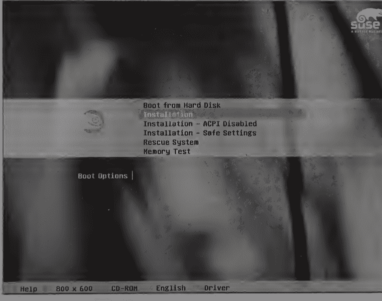

图 3.1 从此界面选择安装选项。

## 初始安装设置

YaST 加载硬盘内核模块并显示安装设置列表（见图 3.2）。仔细检查所有设置的准确性，并点击每个部分的标题或底部的 Change 按钮来修正任何错误。

> 提示

如果你使用的是双键鼠标，请注意 YaST 将自动模拟三键鼠标。这允许你通过同时点击两个按钮来访问许多中键功能。

# 第 3 章 安装 SUSE Linux

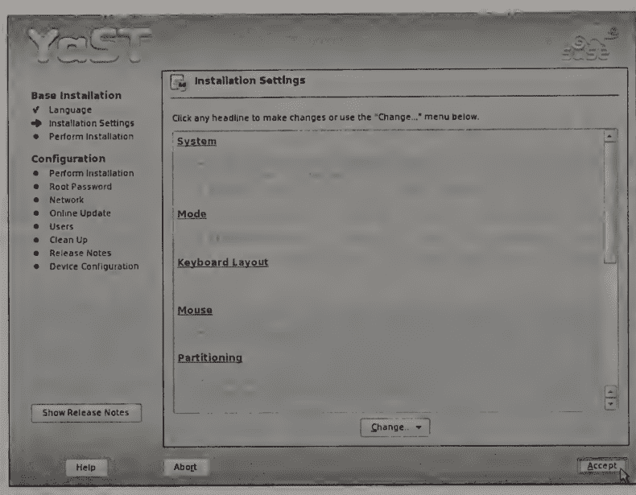

图 3.2 YaST 自动检测您的硬件并对您的安装做出某些默认选择。点击标题或使用“更改”（Change）按钮可以编辑任何默认选择。

## 分区

在第 2 章“准备安装 SUSE Linux”中，您已经学习了更多关于 Linux 下如何对磁盘分区的知识。YaST 默认会创建一个根分区（Root）和交换分区（swap）。如果您想添加分区或使用 ReiserFS 以外的文件文件系统，请选择“分区”（Partitioning）标题并进行更改。

> 提示

> YaST 会检测是否存在另一个操作系统，如果存在，它会询问您是想用 SUSE Linux 替换现有操作系统还是进行双启动。YaST 将使用 Ged 工具缩小现有分区并允许 SUSE 安装。如果您有两个物理硬盘并想在第二个硬盘上安装 Linux，它将对该硬盘进行相应的格式化。

> 欲了解更多信息，请参阅第 2 章中的“考虑双启动、分区和其他忧虑”以及第 11 章“跨平台运行”。

## 设置时区

使用“时区”（Time Zone）识别您的位置，以便确保系统时间符合您的时区。默认情况下，时间使用 24 小时制标记，而不是 AM/PM 划分。您以后可以在 YaST 中更改此设置。请参见第 4 章“使用 YaST2 和 YaX2 进行进一步配置”中的“设置日期和时间”。

## 安装软件包

默认情况下，YaST 会安装带有 KDE 的标准系统，包含一组基础应用程序和 K 桌面环境。如果您偏于其他主流 Linux 桌面环境，可以安装带有 GNOME 的标准系统。点击安装设置中的“软件”（Software）部分，然后点击相应的按钮。

当准备好安装基础系统时，点击“接受”（Accept）。根据所选的软件包，您可能需要查看并接受某些应用程序的其他许可协议（例如 Macromedia Flash 播放器）。

> 警告

> YaST 将警告您它正在格式化某个分区，该分区上的任何数据都将被删除。如果您在计算机上有想要保留的数据，这为您提供了最后一次回头的机会。点击“安装”（Install）开始进程。

YaST 为数据驱动器分区和交换分区格式化，并开始安装操作系统和指定的软件包。根据要安装的软件数量以及处理器和 CD 光驱的速度，完成此操作的时间将有所不同。屏幕右侧有一个进度条，为您提供剩余时间的总估算。

如果您是从 CD 组（而不是 DVD）安装，您将看到有横线穿过进度条；它们代表了距离您下次需要更换 CD 的的大致时间。在安装进行期间，您可以随时离开键盘。DVD 包含了单张光盘上的所有文件，让您无需再为根据需要准备好介质而感到担心。

> 注意

> 在 YaST 安装期间，为了打发时间，您可以观看幻灯片演示（这在漫长的软件安装中很常见），该演示将提供此版本一些新功能的概述；或者点击“详情”（Details）选项卡（见图 3.3）查看正在安装的软件包列表（从每个 CD 安装的软件包数量概览）。

基础系统安装后，YaST 将重启您的计算机以确保一切状态良好并开始（如有必要，您将在停止重启前收到 10 秒的警告）。重启时将第一张 CD 留在驱动器中。重启完成后将出现“软件包安装”界面，并会被要求插入第二张 CD。

软件包将继续安装，蓝色进度条将收短。在安装完成之前，您会被要求偶尔更换 CD。

## 创建 root 用户

当所有软件包安装完成后，您将开始创建 root 用户。当所有软件包安装完成后，您将首次成为系统管理员。所有软件包安装完成后，您的任务是创建 root 用户。第 3 章 安装 SUSE Linux


图 3.3 软件包安装界面显示了 root 用户。

软件包安装完成后，您将首次成为系统管理员。软件包安装完成后，您将需要设置 root 用户。root 用户对系统拥有完全控制权。因此，root 密码必须安全且易于记住。

> 提示

> 欲了解密码设置，请参阅第 19 章“用户管理”中的“选择密码”。

点击“高级”（Expert）以选择加密方法（见图 3.4）。默认情况下，SUSE 使用 DES 加密，但使用 Blowfish 更安全。在输入并确认密码后，点击“下一步”。

## 配置网络和连接

接下来，YaST 将检查网络硬件：以太网卡、拨号调制解调器或高速连接。您可以以后自行配置这些内容，但在安装期间设置它们是好主意。如果 YaST 未能检测到所有网络硬件，或者识别了某些内容，请点击相应的标题或使用“更改”按钮进行调整。

# 第 3 章 安装 SUSE Linux


图 3.4 显示了默认网络设置界面。

YaST 在您设置时会测试连接。它连接到附近的 Linux 更新服务器以检索最新的发布说明和任何软件更新。如果您在连接时遇到任何问题，请检查网络设置并确保一切正确。点击“下一步”连接网络设置。

> 提示

> 欲了解更多关于互联网连接的信息，请参阅第 12 章“连接互联网”。

# 第 3 章 安装 SUSE Linux


图 3.5 显示了网络硬件和配置界面。

## 创建用户

现在是设置您的第一个用户——您自己了！和 root 用户一样，在 Linux 系统上创建用户的中心任务是设置密码。YaST 首先询问此用户是在本地登录还是从其他计算机登录，使用轻量级目录访问协议 (LDAP)、网络信息服务 (NIS) 或通过 Samba 连接 Windows PC。通常情况下，系统的第一个用户将在本地 PC 上登录；选择此选项并点击“下一步”。

在“添加新本地用户”界面（见图 3.6）输入相关信息，包括密码。这应该与 root 密码不同，但应遵循相同的通用规则。有关新用户设置的更多信息和建议，请参阅第 19 章。点击“下一步”创建此用户和其他所有系统用户。

YaST 现在运行 SUConf 以添加用户并确认在此为止所做的所有更改。这可能需要几分钟或更长时间，取决于您的系统。随后将显示发布说明，其中包含有关新功能和已知问题的最新信息。在查看完这些信息后，点击“下一步”。

## 使用 YaST 安装 SUSE Linux

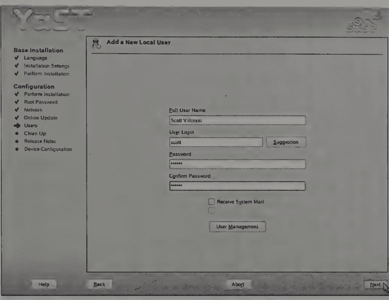

图 3.6 在此界面添加你的第一个用户（通常是你自己）。

## 为 X Window 系统配置硬件

安装的最后一步是识别并配置图形窗口系统以及你选择的桌面环境所需的硬件。YaST 会自动检测你的显卡、连接的打印机、声卡以及一些外设设备。同样，如果自动检测失败或误识别了显卡，请选择相应的标题或点击“更改”按钮并进行任何必要的修改。准备好后点击“下一步”。YaST 将确认更改并写入配置文件。

现在，你将看到“恭喜！”屏幕（见图 3.7），这表示安装过程结束。你已经准备好首次登录了。如果你接下来想检查其他设置或添加更多软件包，请在点击“完成”之前勾选“启动 YaST 控制中心”框。此时你可以取出 CD 了。

系统将开始启动过程，最后显示带有带有登录提示的绿色屏幕。

## 首次登录与关机

当你运行启动脚本并启动 SUSE Linux 系统时，Linux 内核将显示登录屏幕（见图 3.8）。你会被要求输入用户名和密码。只有在极少数情况下出于特定目的才以 root 身份登录。

查看登录屏幕的左下角，你会看到一些登录选项。你可以从菜单中选择语言来更改显示器的语言。通过点击相应的选项，你可以选择关闭或重启计算机，而不是登录。

“会话”（Session）菜单允许在你已经安装了其他窗口管理器或桌面环境的情况下，更改本次会话的桌面环境。虽然在首次登录时可能不是这种情况，但如果你喜欢计算体验的多样化，以后你可能想使用此功能。

> 对于首次登录，始终建议尽可能保持简单。你的首要目标是确保安装成功且没有问题。在你确认无误后，就可以在登录选择上更具创意了。

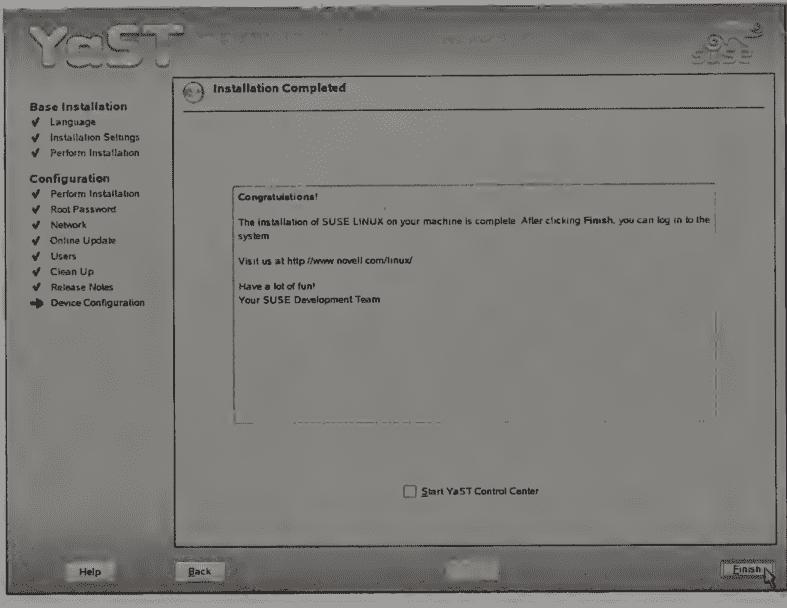

图 3.7 你已完成！

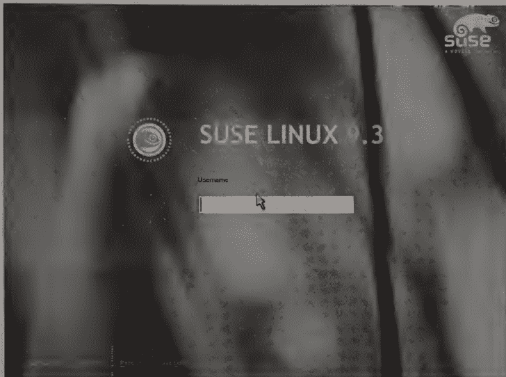

图 3.8 在此登录。

当你输入用户名和密码后，你选择的桌面环境将加载。默认是 KDE，或者根据你的选择显示 GNOME。观察周围环境；尽情点击和右键键。访问 Novell SUSE 网站并熟悉环境。你应该注销并重启系统，以确保一切都运行正常。

从桌面菜单中找到“注销”（Logout）命令并点击“重启计算机”。操作就此结束了。计算机将关机并重启。

欢迎来到 Linux！你现在已经开启了这段旅程。

## 参考文献

- * http://www.novell.com/linux/suse—如果你想了解有关 SUSE Linux 的任何信息，这里始终是起点。

- * http://ldldp.org/HOWTO/Installation-HOWTO/index.html—这篇 Linux 安装 HOWTO 由编程大师 Eric S. Raymond 于 2002 年编写。

- * http://www.pcguide.com/ref/mbsys/bios/set—对大多数 BIOS 设置的详细描述。转到“高级设置”页面查看启动序列/顺序选项。

- * http://www.pcworld.com/howto/article/0,aid,107870,00.asp—《PC World》杂志的这篇文章以更通俗的介绍了各种 BIOS 设置。

- * http://www.gnu.org/software/grub—GRUB 引导程序页面。

# 第 4 章

## 本章内容

## 使用 YaST 和 SaX2 进行进一步配置

- 排除安装问题故障

- 使用 YaST 配置硬件

- 设置日期和时间

- 电源管理

- 便携式电脑问题

- 配置 CD、DVD 和可写驱动器

在上一章中，我们了解了如何轻松地让 SUSE Linux 运行。在本章中，你将学习在安装后配置硬件。你将从那些不再不可避免但仍然令人困扰的安装后故障开始，最后学习外设和便携设备。

## 排除安装问题

Linux 应用程序以及内核本身比以前更具容错性。让系统完全无法启动是很困难的。同时，在一个看似运行良好的系统中，可能会忽略某些影响性能的问题。服务可能无法启动，模块未加载，或者硬盘的响应速度没有预期的那么快。偶尔运行 `dmesg` 程序并定期查看内核信息 `/var/log/messages` 是一个好主意，任何人都可以文本编辑器查看此文件，你也可以在 YaST 中查看。进入“杂项”（Misc）页面并点击“查看系统日志”。

> 提示

除了 `/var/log/messages` 之外，你还可以查看其他日志，例如 `/var/log/messages`。

## 使用 YaST 和 SaX2 进行进一步配置

`/var/log/messages` 中的消息由内核生成。如果你遇到问题，请使用搜索引擎查找错误原因。如果硬件没有加载，请勾选 `initrd` 框。

## 使用 YaST 配置硬件

YaST 检测并配置许多类型的硬件。在本章中，你将学习在安装后配置硬件。你将从那些不再不可避免但仍然令人困扰的安装后故障开始。在 KDE 和 GNOME 环境中，“会话”菜单允许在你已经安装了其他窗口管理器或桌面环境的情况下，更改本次会话的桌面环境。虽然在首次登录时可能不是这种情况，但如果你喜欢计算体验的多样化，以后你可能想使用此功能。

## 获取你的硬件信息

YaST 硬件信息模块是命令行工具 `hwinfo` 的图形化版本。它探测你的系统并显示关于现有硬件的全面报告。

## 修改磁盘控制器设置

你的磁盘控制器（HDC）位于主板上。Linux 内核在启动过程早期加载磁盘控制器。如果你知道自己在做什么，可以在这里设置可选参数以提高系统性能。

## 配置摇杆

如果 YaST 没有检测到你的摇杆，请使用摇杆模块自行手动选择一个。它有一个“测试”按钮，你可以通过它确认摇杆在所选设备上工作正常。

# 第 4 章 使用 YaST 和 SaX2 进行高级配置

> 注意

通过 USB 端口连接的摇杆不需要配置驱动程序。只需将你的摇杆插入 USB 端口即可开始使用！

你可以在桌面环境的设置中进一步配置摇杆的行为（即使没有超级用户权限也可以）。在 KDE 控制中心中，前往“外设”->“摇杆”。

## 调整你的键盘布局

你是否偶尔会使用与母语以外的语言打字？你使用 Dvorak 键盘吗？YaST 键盘布局模块可以更改操作系统和所有程序对你单个按键的响应。打开该模块，你将看到布局样式列表。选择不同的语言并切换到“键盘测试”选项卡。

大多数字母键很可能与你习惯的相同，但标点和符号键会有所不同。在某些语言中，甚至数字键也会发生变化。更改通常涉及带重音的字母和特定语言中的常用符号。

> 注意

将键盘布局更改为不同的字符集（如俄语-西里尔字母或日语）不会加载该字符集。你需要安装相应的语言字体set。

点击“专家设置”更改系统默认值。如果你不使用键盘右侧的数字键盘输入数字，并且不喜欢 NumLock 灯一直亮着，可以在启动时关闭 NumLock。Caps Lock 也是如此。你可以完全启用 Caps Lock。这些设置会被写入 `/etc/sysconfig/keyboard`，因此如果你愿意，可以手动查看和调整。

> 提示

你可以在桌面环境的设置中进一步配置键盘行为（即使没有超级用户权限也可以）。在 KDE 控制中心中，前往“外设”->“键盘”。在 GNOME 控制中心中，前往“硬件”->“键盘”。GNOME 键盘设置的一个优点是，你可以让系统强制你离开键盘休息，以防止重复性劳性损伤。

## 配置你的鼠标

极有可能，YaST 在安装期间自动检测你的鼠标并加载了相应的驱动程序。如果你在安装期间能够使用鼠标，那么你的鼠标应该已经正确安装。可以在 YaST 鼠标模型模块中查看 SUSE Linux 正在使用的。

虽然列表中包含许多驱动程序，但选项很少。请查阅你的鼠标的文档以检查合适的驱动程序。如果没有可用的鼠标，使用 `Tab` 键移动到该模块，然后到列表。如果你看到了你的型号，按方向键向下高亮“测试”按钮。你应该能够点击它。如果无法点击，你将必须遍历列表，逐一测试以找到一个可用的驱动程序。

> 提示

你可以在桌面环境的设置中配置（即使没有超级用户权限也可以）更多的鼠标选项。这些包括选择左手鼠标行为、光标主题和加速设置。在 KDE 控制中心中，前往“外设”->“鼠标”。在 GNOME 控制中心中，前往“硬件”->“鼠标”。

## 配置你的扫描仪

如果 YaST 在你首次安装（或当你将其连接到电脑时）没有自动检测到扫描仪，那么你就出问题了。USB 连接扫描仪的手动配置是复杂且危险的（错误的设置可能会损坏扫描仪）。手动配置 SCSI 扫描仪稍微简单，但你可以在不关闭系统的情况下完成。

扫描仪未被检测到的常见原因包括：http://cdb.suse.de/index.php?LANG=en 提供了 Linux 兼容设备列表。

- 扫描仪未正确安装。

- 未安装 SCSI 控制器。

- 你的 SCSI 终端存在终止问题。

- SCSI 线缆过长。

- 扫描仪具有 Linux不支持的 SCSI 光控制器。

- 扫描仪有故障。

## 配置你的电视卡或广播卡

通过电视卡，你可以将普通 PC 变成家庭娱乐系统。你将在第10章“视觉、声音和其他有趣事物”的“电视和视频”部分学习更多内容，包括如何制作自己的个人录像机。

与本章中的其他卡和外设一样，YaST 应该在安装时识别你的电视卡或广播卡。如果没有，你可以使用电视卡模块手动安装。打开模块并配置。会出现制造商和模型列表（见图 4.2）。选择你的。

## 第 4 章 使用 YaST 和 SaXZ 进行高级配置

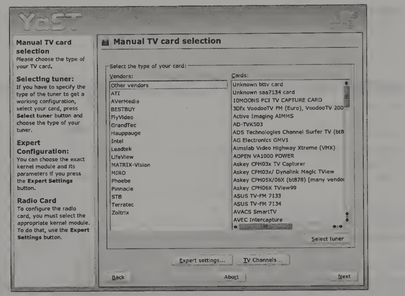

### 4.2 从列表中选择你的电视卡。

根据你的卡类型，你可能还需要选择调谐器型号。点击“选择调谐器”从列表中选择。要列出你可以使用的电台和频道，点击“电视频道”并设置你的位置和电视信号标准。北美用户应选择 NTSC 电视标准并选择美国频率表之一。点击“扫描频道”获取列表。然后可以使用“添加”、“编辑”或“删除”按钮来自定义列表。

点击“下一步”指定如何管理音频输出。默认情况下，Linux 将其发送到声卡。如果你有多个声卡，可以在这里选择一个与你的电视卡配合工作。如果没有设置声卡，点击“声卡”打开该 YaST 模块（此配置在第10章中讨论）。点击“下一步”继续。

此屏幕配置你显卡的红外控制机制。你可以从两个内核模块中选择要加载的，然后点击“测试”查看哪一个有效。点击“下一步”完成过程。

# 设置日期和时间

安装期间，YaST 将询问你的时区并相应设置时钟。如果你有一台随移动的笔记本电脑，可以在“日期和时间”模块（见图 4.3）更改时区。该模块位于“系统”页面。

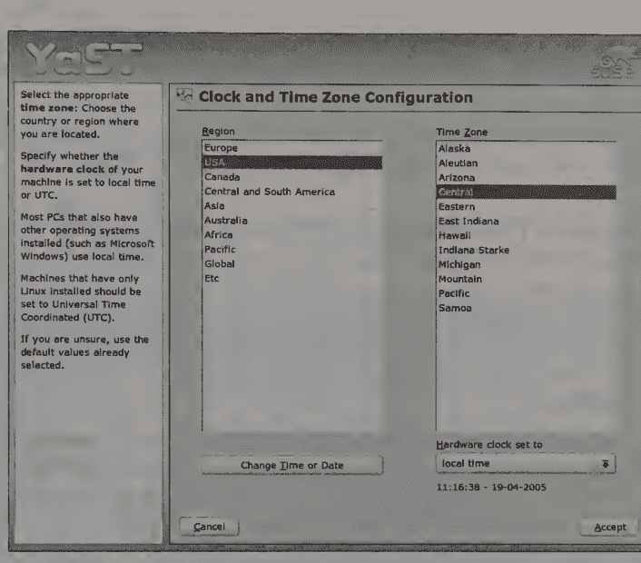


**图 4.3** 在日期和时间模块中选择时区。

如果你倾向于使用世界时（也称为格林尼治标准时间），点击“其他”区域。在此模块中，你还可以指定内核如何在启动时设置硬件时钟。如果你与 Windows 双系统启动，这应设置为本地时间。

当设置正确后，点击“接受”。

你可以在桌面环境中配置你的时间和日期设置。在 KDE 中，通过右键点击任务栏（通常位于任务栏右侧）更改时间设置。此上下文菜单提供了更改时区、手动调整时间和更改显示设置的选项。由于默认显示 24 小时格式，你可能想立即切换到 AM/PM。不过，这可能需要重启。

在 GNOME 中，右键点击打开时钟偏好对话框。你可以从四种显示中选择：传统的 12 小时（AM/PM）和24 小时标准，或者不传统的 UNIX 或 Internet 时间。UNIX 时间计算自 1970 年1月1日以来的秒数，而 Internet 时间是由 Swatch 公司发明的。以下是他们在网站上对格式的描述：：“Internet Time 是由 Swatch 发明的新的通用时间，因为整个世界都在同一时间发生，不再有时区。Internet Time 将一天的24小时划分为1000个单位，称为节（beats）。1节代表1分钟

使用复选框决定是否在时钟上显示流过的秒和/或当前日期，以及是否使用通用时（此处 UTC）。

## 使用网络时间协议 (NTP) 保持时间准确

如果你始终连接互联网（通过局域网或宽带调制解调器），考虑运行网络时间协议 (NTP) 客户端。可以使用 NTP 连接到连接到原子钟。这些钟测量铯原子的共振，百万年丢失一秒。SUSE Linux 的 NTP 客户端与特定的公共时间服务器同步并重置系统时钟。

前往 YaST 网络服务页面打开 NTP 客户端模块（见图 4.4）。点击“启动系统时”来启动客户端。这将加载 NTP 客户端守护进程。为了让其工作，守护进程需要一个连接的时间。

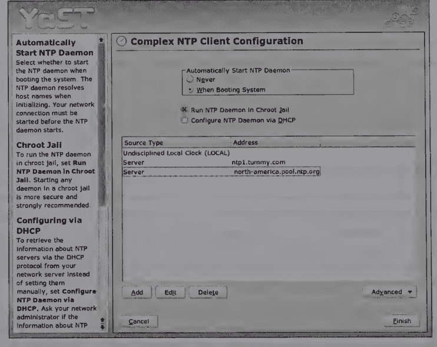

图 4.4 设置你的 NTP 客户端使用池 NTP 服务器以减少高流量服务器的负载。

有两种方法可以设置你的 NTP 连接，简单和复杂。简单的方法是识别局域网上的另一台机器（该机器按理连接到

# 设置日期和时间

（时间服务器），或从 SUSE 找到公共时间服务器列表中进行选择。点击“选择”选取要连接的服务器。将弹出另一个屏幕。现在选择“公共 NTP 服务器”，你将看到所在国家预定义的服务器列表。选择一个地理位置靠近你的服务器。如果服务器位于你的时区会更好一点，但影响不大。点击“测试”确认服务器激活状态，然后点击“确定”确认选择。

点击“复杂配置”设置备份服务器。在第一个屏幕（图 4.5）点击“添加”。在“对等类型”选项中选择“服务器”（图 4.6），点击“下一步”。

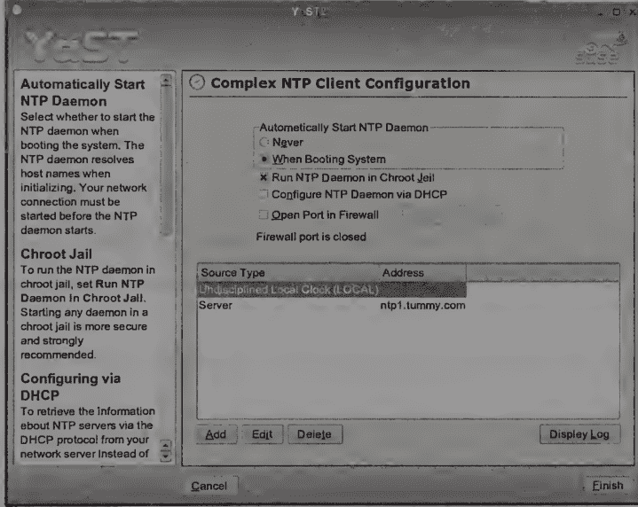

图 4.5 在 YaST 中配置网络时间协议守护进程。

为了减轻公共时间服务器的负担并保持其持续运行，创建了服务器池项目（Server Pool Project）。这是一个系统，客户端指向最近的池服务器（例如 `north-america.pool.ntp.org`），而该站点每小时指向另一个不同的池服务器。这样做是最礼貌的，请在适当的框中输入服务器。点击“测试”确认此连接正常工作。勾选“用于初始同步”框，以使内核在启动时默认使用此服务器，然后点击“确定”将此服务器添加到列表。

> 注意

如果你不在北美，请访问 `http://ntp.isc.org/bin/view/Servers/NTPPoolServers` 获取当前“子区域”池服务器的列表。你也可以将 `pool.ntp.org` 作为最后的备选。

## 第 4 节 使用 YaST 和 SaX2 进一步配置

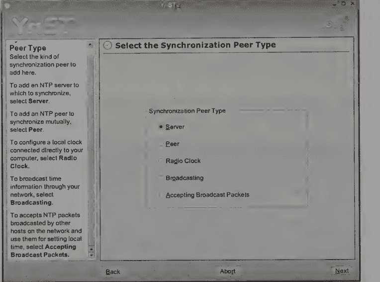

**图 4.6** 你可以从许多类型的计时器中选择，但你可能会选择一个公共服务器来管理你的时钟。

“复杂配置”对话框中还有其他设置。始终接受默认值是可以的。

- `chroot` 中的 NTP 守护进程：永远不要低估想要干扰你系统的恶意者的创意。当你连接远程服务器时，存在微小的风险，即服务器上可能存在破坏你系统的恶意软件。勾选此框（默认值）会将守护进程放在 `/jail` 目录中，在那里它无法访问系统的任何部分。

- 使用 DHCP 配置 NTP：如果你的网络上有 DHCP 服务器，它可以帮助你连接到 NTP 服务器。这提供了另一层安全，因为信息在传递给你之前经过加密。与网络管理员检查 DHCP 服务器是否已设置。

- 在防火墙中打开端口：假设你带着笔记本电脑旅行，并希望通过广域网设置笔记本时间。你必须首先打开防火墙以访问。通过勾选此框来实现。点击“详细信息”选择你将使用的网络接口。在防火墙中只打开一个端口最好。

点击“完成”确认你的选择。下次启动 Linux 时，守护进程将连接到指定的服务器。如果在守护进程运行时更改了设置，YaST 将重启。

## 电源管理

不可避免的事实：计算机和外围设备消耗大量的电力。随着化石燃料的减少导致账单不断增加，减少能耗是有的。我们处于 PC 和笔记本电脑电源管理的过渡阶段，一种取代另一种。高级电源管理（APM）被大多数硬件和 BIOS 程序支持。高级配置电源接口（ACPI）是一种电源管理规范，允许操作系统（OS）控制分配给计算机设备的功率。ACPI 不仅仅在空闲时管理；它会动态监控功率使用并相应分配。ACPI 控制位于 PC 的 BIOS 中，只有当你的系统支持 SUSE Linux 2.6 时 ACPI 才会工作。

> 注意

SUSE Linux 64 位处理器仅支持地方。APM 允许工作站和服务器在指示时自动关闭。ACPI 对该过程提供了更多控制。根据你的系统，你可能需要配置两者。在本节中，你将学习如何使用 YaST 配置桌面。

## YaST 电源管理

电源管理模块位于“系统”页面。如图 4.7 所示。默认情况下，PC 设置为“性能”，但你可以将其调整为“节能”（最低能量消耗）或“静音”（安静运行）。第四种方案与性能相同但关闭屏幕保护。你可以点击“编辑方案”添加自己的方案或编辑现有方案。

## 便携式 PC 问题

笔记本电脑对许多硬件和软件非常敏感。这些问题可能会使安装 SUSE Linux 变得困难。安装并运行操作系统后，在移动时不必将将就。本节将提供一些提示。

## 第 4 节 使用 YaST 和 SaX2 进一步配置

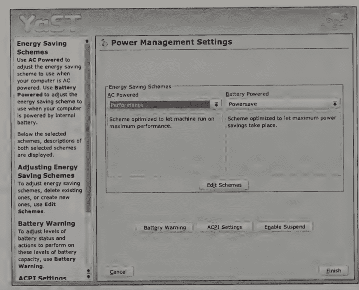

图 4.7 YaST 提供了几种电源管理方案，你可以自行调整。

## 笔记本电脑电源管理

无论你拥有 APM 还是 ACPI，SUSE 都会为笔记本电脑配置节电和延长电池寿命（如果你错过了这些，请参见前面的“YaST 电源管理”部分）。YaST 电源管理模块允许你调整这些设置。选择“编辑方案”进行更改或自定义。使用主屏幕上的三个按钮（参考图 4.7）进行快速调整。

电池警告允许你设置三个电池电量即将耗尽的警告级别。使用下拉菜单更改这些操作，或者如果你希望在第二个（严重）警告级别开启屏幕保护。

ACPI 设置：定义了按下电源和睡眠按钮或关闭笔记本盖时会发生的操作。使用下拉菜单从电池警告操作中选择（通知、关机、待机、挂起到内存、挂起到磁盘、启动屏幕保护、忽略）。

启用挂起：这指的是实现此操作的方法。默认勾选挂起到磁盘。它能有效保护你的数据，但恢复时间比挂起到内存长。挂起到内存恢复快，但如果你在挂起到内存时意外断电，可能会丢失屏幕上未保存的数据。

切换到待机模式：这会关闭屏幕电源，关闭风扇和其他耗电设备，直到你备份。设计用于短暂的休息，在进入待机前不会保存数据。

YaST 会检查你的机器是否支持所有这些选项。不支持的选项可能不可。

## 使用 PCMCIA 卡

笔记本经常使用 PCMCIA（个人电脑内存国际协会）卡添加功能、内存或外围设备。要激活对 PCMCIA 卡的支持，请使用 YaST 硬件编辑器。该模块位于“系统”页面。

## 配置蓝牙无线支持

当瑞典爱立信开发出一种允许不同电子组件在不连接沉重线的情况下通信的新无线工具时，它想给它起一个响亮的名字。追溯斯堪的纳维亚的历史，有人发现了一位丹麦国王，哈尔德·蓝牙（Harald Bluetooth），他在10世纪统一了丹麦和挪威。Blatand 翻译成英语就是蓝牙。这就是商标的由来。

SUSE Linux 自动检测设备并加载相应的驱动程序。YaST 还应该安装 `blue-libs` 和 `blue-utils` 软件包来管理你的连接。

> 提示

如果你需要通过蓝牙打印，请安装 `blue-cups`。

你可以通过位于硬件页面的 YaST 蓝牙模块手动启用蓝牙支持。这告诉内核在启动时“热插”蓝牙内核模块及其守护进程。点击“高级守护进程配置”进一步设置蓝牙支持（见图 4.8）。

如果你希望加密蓝牙通道，请点击“安全选项”。首先，启用身份验证以强制用户在建立蓝牙连接之前输入密码；然后启用加密进一步保护通过连接的数据。

> 注意

并非所有蓝牙设备都支持身份验证或加密。在连接该类型的设备时，你可能必须关闭这些选项。

# 第 4 章 使用 YaST 和 SaX 进行进一步配置

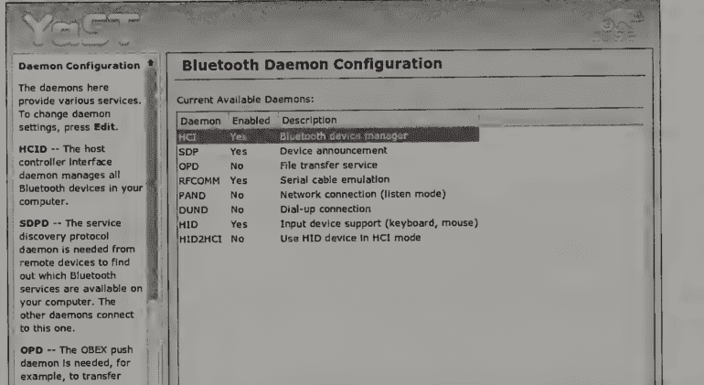

图 4.8 在此处配置蓝牙守护进程。

## 配置红外接口 (IRDA) 模式

你的笔记本电脑很有可能使用蓝牙或红外数据关联（IRDA）与其他设备通信。IRDA 与蓝牙的差异微乎其微，但意义重大：

- 在蓝牙中，各个设备之间不需要直接“看到”对方。

- 在蓝牙中，多个设备可以连接到同一个网络中。然而，最大数据传输率为每秒 72 千比特（在当前的 1.2 版本中）。蓝牙的下一个版本预计将该速率提高到每秒 2兆比特以上。

- 理论上，蓝牙甚至可以穿墙墙通信。在实践中，这取决于墙的属性和设备类别。有三种设备类别，其传输范围在 10 到 100 米之间。

IRDA 有两种操作模式。标准模式 SIR 通过串口接口访问红外端口。这种模式适用于几乎所有系统，并能够满足大多数需求。更快的模式 FIR 需要为 IRDA 芯片提供特殊的驱动程序。由于缺乏合适的驱动程序，FIR 模式并不支持所有的芯片类型。在你的计算机的 BIOS 中设置所需的 IRDA 模式。BIOS 还会显示 SIR 模式下使用了哪个串口接口。

IrDA 是电池耗电大户，因此 SUSE Linux 不会在启动时自动开启 IrDA。只需前往“硬件”（Hardware）页面上的 YaST IrDA 模块即可。

点击“启动 IrDA”，然后为连接设置正确的串口（请参阅你的笔记本电脑手册）。测试连接，然后点击“完成”（Finish）进入。

## 配置 CD、DVD 和可写驱动器

现在我们的很多娱乐都来自各种类型的光盘，对于我们的计算机和操作系统来说，跟上潮流至关重要。尽管克服了一些障碍，Linux 开发者已经让运行 CD、DVD 以及一系列录制 CD 格式变得简单。本节重点关注为这些驱动器和磁盘提供设备驱动程序的技术。要了解更多关于 Linux 多媒体体验（包括如何刻录 CD 和 DVD），请参见第 10 章。

## 将 CD 和 DVD 驱动器集成到你的系统中

YaST 简化了挂载 CD 和 DVD 驱动器的过程（见图 4.9）。CD-ROM 模块识别你的驱动器，并在你的 `/etc/fstab` 文件中添加引用和挂载点。

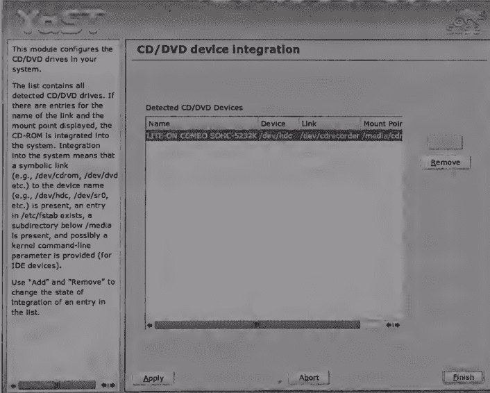

**图 4.9** 确保你的 CD 和 DVD 驱动器在此模块上已挂载。

CD-ROM 模块的功能非常有限。如果 YaST 自动检测到驱动器（当通过 CD/DVD 安装时几乎总是如此），你就无法手动设置和集成该驱动器。它也不允许更改你的任何设置——你仍然可以自己编辑 `/etc/fstab`。

本质上，该模块唯一的选项是“移除”（remove）（或重新集成）驱动器。这将删除 `/dev` 目录中指向驱动器的符号链接以及 `/media` 目录中的挂载点。要恢复驱动器，请点击“完成”（Finish）返回 YaST。

- 请在第 18 章“管理文件、卷和驱动器”中学习更多关于挂载驱动器和 `/etc/fstab` 的知识。

## 通过直接内存访问 (DMA) 加快 CD 速度

默认情况下，你的 IDE 硬盘可以跳过处理器并直接调用内存。这被称为直接内存访问或 DMA。使用 DMA 绕过处理器可以释放处理器以继续其他任务，并极极大提高系统性能。

曾几何时，SUSE Linux 为所有 IDE 驱动器设置默认使用 DMA，但当 CD-ROM 驱动器开启 DMA 时会出现系统死锁或数据丢失的问题。因此，硬盘默认开启 DMA，但 CD 驱动器未开启。你可以在 IDE DMA 设置模式中自行更改此设置（见图 4.10）。

> 警告

> 在更改此设置之前请备份你的数据，以防万一。

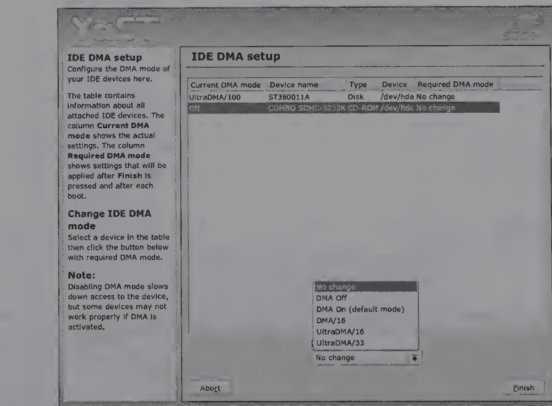

图 4.10 IDE DMA 设置界面。

在列表中选择 CD 驱动器，然后点击 DMA 模式下拉菜单。开始时选择“DMA 开启”（DMA On）默认设置。如果运行良好，考虑更改为更高的速度。你将收到另一个关于可能出现问题的警告，因此你可以在更改之前撤回。点击“完成”（Finish）确认新设置，或点击“取消”（Abort）返回 YaST。

## 参考文献

- `http://www.bluetooth.com`—蓝牙官方网站。

- `http://www.holtmann.org/linux/bluetooth`—Marcel Holtmann 的 Linux 和蓝牙页面。包含英语和德语的文章，以及下载内容。

- `http://www.cs.ul.ac.uk/staff/s.zachariadis/btpalmlinux.html`—关于如何通过蓝牙将你的 Palm PDA 连接到 PC 的指南。

- `http://tuxmobil.org`—获取各种移动硬件（笔记本电脑、PDA 和手机）上运行 Linux 信息的地方。还提供月度通讯报。

- `http://tuxmobil.org/Infrared-HOWTO/Infrared-HOWTO.html`—Linux 红外 HOWTO。配置和使用 IrDa。

- `http://linux-laptop.net`—Linux 笔记本电脑网站。

- `http://www.sane-project.org`—scanner 项目主页。

- `http://www.cpqlinux.org/acpi-howto`—Linux ACPI HOWTO。

- `http://www.ntp.org`—NTP 网站。

- `http://n/ntp.isc.org/bin/Servers/`—公共服务器列表。

# 第二部分 使用 SUSE Linux

## 本部分内容

- 第 5 章 开始使用 SUSE Linux 65

- 第 6 章 启动桌面 91

- 第 7 章 使用 SUSE Linux 打印 113

- 第 8 章 与你的 Shell 交 127

- 第 9 章 高效工作：办公套件和其他工具 141

- 第 10 章 视觉、听觉和其他乐趣 163

- 第 11 章 跨平台 185

## 登录 SUSE Linux

在安装 SUSE Linux 并在系统上创建了至少一个用户（你自己）之后，你必须登录。标准登录过程非常直观。默认情况下，SUSE Linux 会启动到基于 KDE 的图形化登录界面，称为显示管理器。你输入用户名（或点击代表你的图标）和密码，并识别你想要启动 KDE、GNOME、其他 X 管理器还是 shell 命令行（此下拉菜单中显示的内容是针对 Root 用户的，因此你的选项可能会有所不同）。按回车键完成启动。

## 从 Shell 登录

如果你不需要加载图形界面就可以登录、获取某些信息并关机怎么办？或者如果 X 加载出现问题怎么办？文本登录是一个简单的过程。SUSE Linux 会启动到登录 shell。输入你的用户名并按回车键获取密码提示。输入密码即可获得对系统的完全访问权限（或至少拥有与图形界面相当的访问权限）。

> 注意

> 在本书中，你会看到一些为了互替使用的 Linux 命令行界面术语。通常情况下，你会看到 shell 或 command line（命令行）来指代这一界面。当你读到某个在 shell 提示符处运行的命令时，无论你是否加载了图形界面都可以运行该命令。

> 偶尔，你会看到对 console（控制台）或 X Terminal（简称 xterm）的引用。这些指的是 X 环境中的图形 shell。某些控制台具有标准 shell 无法实现的额外技巧。当你看到这些术语时，请理解指令仅适用于图形 shell。

> 注意

> 如果由于发生某些错误导致你看到文本登录提示且 X 无法启动，那么以 Root 身份登录总是更好的，因为你会有更多工具来修复出现的问题。如果你不是 Root（系统管理员），请去找拥有权限的人员。

## 退出 Shell

输入 `exit` 或 `logout` 即可退出 shell。此时，另一个用户可以登录，或者你可以关闭电脑。根据你的设置，用户可以使用 `shutdown` 和 `reboot` 命令来执行这些任务。

## 与 Linux 文件系统工作

正如互联网只有几个特定的、著名的顶级域名（.com, .net, .org, .edu 等）一样，Linux 文件也按照特定的层次结构进行组织，特定的目录持有特定类型的文件。


几乎所有的 Linux 发行版都具有相同的结构，随着 Linux 标准基础（LSB）变得更加通用，这种结构可能会变得更加根深。`Linux Standard Base` (`www.linuxbase.org`)是一项旨在让所有 Linux 发行版相互兼容并与大多数应用程序兼容的努力。`SUSE` 是这一努力长期支持者，并符合 `LSB v1.0` 等 `LSB` 标准。此外，文件系统层次结构标准（`Filesystem Hierarchy Standard`）专门旨在标准化顶级 Unix/Linux 发行版的内容。这种结构对软件开发者非常有利，因为他们可以知道每个用户机器上有哪些目录，并将程序安装到相应的目录中。它还让程序员能够构建依赖其他标准库的更模块化的程序。它有助于软件包系统——例如 `SUSE` 使用的红帽软件包管理器 (`RPM`)——检查并确认用户系统上软件包所依赖的文件。测试也变得简单，因为很少会有出错的地方。

我们在第 2 章“准备安装 SUSE Linux”中简要地介绍过这些。若要再次查看并获得使用 shell 的第一堂课，请打开 `KDE Console` 并输入 `ls /`。你应该看到以下内容：

```
bin dev home media opt root srv usr windows
boot etc lib mnt proc sbin tmp var
```

若要从 shell 更详细地查看文件系统，请使用 `tree` 命令。该程序可能默认没有安装，但它在光盘镜像上。该程序显示的结果包括第 2 章“如何划分你的驱动器”中列出的所有顶级目录，以及几级子目录。

> 注意
>
> 当你在 `KDE Console` 中输入内容时，你正在 `X Terminal`（或 `xterm`）中使用 `bash` shell。你将将在本章的晚些部分学习更多关于 shell 和终端的知识，包括如何更改默认设置。

在 Windows 中，你有能力随心所欲地创建、删除和重命名任意顶级目录和子目录，并且不会发生什么坏事。重命名 `Program files` 或 `Windows` 目录会导致问题，但如果你将程序安装到 `Program files` 之外的目录，系统不会停止。虽然你在 `SUSE Linux` 中同样具有操纵目录结构的技术能力，但只要你至少拥有 `Root` 权限，*千万不要这样做！*

这块看似不公平的规则的唯一例外是家目录（`home directory`）。作为用户，你可以并组织你的文档和其他你能看到的数据。你会在书中看到几条建议，将特定的文件和程序放在你的家目录中，因为那里可能是它们最好的地方。如果你发现这一点，请将创建的每个文件都放在自己的目录中（尽管这可能有点极端）。

这条建议延伸到将你创建的文件放入系统目录之一。假设你创建一个包含多年来通过 `bash` shell 学到的技巧和秘诀的文本文件，命名为 `BashTips`。因为你知道 `/usr/share/doc/bash` 目录下有 `bash` 的 `man` pages和其他文档，你可能想将该文件存储在这里。没问题，在未来的某一天，某个开发者或文档编写人员可能会向 `bash` 包添加一个 `BashTips` 文件。当该文件被安装时，你的文件将被不加询问地替换。

> 注意
>
> 如果你需要同时在两个地方查找文件，请使用符号链接，通常称为 `symlinks`。在前面的示例中，将文件放在 `/home`。然后打开 shell 并输入 `ln -s /documents/bash /usr/share/doc/bash`。

## /bin 和 /sbin 目录中的基本文件系统命令

`/bin`（`binary` 的缩写）目录包含了运行和启动时所需的应用程序和许多命令。`sbin`（或系统 `binary`）目录包含了各种已安装的文件系统、`YaST`、`SUSE` 防火墙以及启动时或 `Root` 用户解决系统问题所需的其他命令。平均而言，每个目录的大小为 `5MB`，`/sbin` 比 `/bin` 大一点。可能并非所有命令都是静态链接的，它们依赖于其他目录中的软件库（主要是 `/lib` 和 `/usr/lib`）。系统上的几乎每个应用程序都依赖一个或多个外部（或共享）库。静态链接的应用和命令以及内核构成了操作系统本身。

## 使用 /boot 和 /dev 目录

`/boot` 包含了启动时加载的压缩 Linux 内核（早期启动脚本会发送内核“爆炸”的消息，但现在极少发生这种情况）。当你重新编译或安装新内核时，新内核和相关文件进入此目录（更多更新内核的信息请参见第 24 章“内核与模块管理”）。

Linux 设备文件位于 `/dev` 目录。如前所述，Linux 中的一切都表示为文件。无需进一步证明即可查看此目录。你发现发现 `7500` 个代表已连接或可能连接到系统的设备的文件。常用的设备包括：

- IDE 和 SCSI 驱动器，表示为 `hda` 和 `sda`，
- CD-ROM、CD-R 和 CD-RW 驱动器（以及相应的 DVD 设备），有些是 IDE；其他被系统视为 SCSI。

## 在 /etc 目录中编辑配置文件

- 标记为 `tty` 的串口端口。
- 指点设备，如 `/dev/input/mouse`。
- 通用串行总 (`USB`) 设备，位于 `dev/usb` 目录。
- 标记为 `1p` 的打印机。

如果你发现磁盘空间不足，你可能会认为清理其中一些文件对你有所帮助。但仔细检查后发现，它们全都是 `0` 字节文件。让它们留在那里吧。

## 在 /etc 目录中编辑配置文件

Linux 应用的优之处之一在于你可以让软件完全符合你的需求。无论是更改命令的行为、添加键盘快捷键，还是更改应用程序标题栏的颜色，都有方法可以让你正在使用的应用程序按照你的意愿运行。通常情况下，你甚至不需要打开想要修改的应用程序就可以进行更改。大多数应用程序将其配置存储在位于 `/etc` 目录下的简单文本文件中，这样就可以查看具体内容。在尝试编辑文件之前，请检查哪个用户在使用该文件——如果 `Root` 拥有该配置，你将必须以超级用户（`SuperUser`）身份登录才能进行更改。

该目录下一些较重要的系统相关配置文件包括：

- `fstab`：此文件系统列出了计算机上可挂载的设备。这些包括硬盘、软磁盘、CD 和 DVD 驱动器以及可移动驱动器。该文件显示每个设备的挂载点、其在分区表上的位置、启动时是否自动挂载的指令以及其他几个选项。有关 `/etc/fstab` 的更多信息，请参阅第 18 章“管理文件、卷和驱动器”中的“挂载文件系统”章节。
- `initab`：系统初始化表定义了系统启动计算机时使用的级别（`runlevels`）。可以手动修改，也可以在 `YaST` 的 `useconfig` 编辑器中修改，以决定启动到图形或文本登录界面，以及是否可以通过调制解调器远程登录。你将在第 22 章“管理启动过程和服务”中学习更多关于启动过程和运行级别的知识。
- `modprobe.conf` 和 `modprobe.conf.local`：主 `modprobe.conf` 文件包含了加载内核模块以操作各种硬件（如声卡、`USB` 设备、网卡等）时使用的指令和选项。该文件的内容在启动期间使用。`SUSE` 工程师会定期更新此文件，并建议如果你想进行自己的编辑，请使用 `modprobe.conf.local` 以防止这些更改被覆盖。在第 24 章“内核和模块管理”中学习更多关于 `modprobe.conf` 的知识。
- `passwd` 和 `shadow`：`passwd` 及其更安全的 `shadow` 文件包含了系统上所有用户的列表及其账户信息。Unix 圈常说，一个用户在拥有密码之前是不存在的。这就是为什么你将在第 19 章“管理用户，管理安全”中学习更多关于用户和密码的知识的原因之一。

## 常用数据存放地：/home 目录

根结底，任何计算机上最重要的数据都属于这个目录——即为你自己创建的文件。Linux 系统上的每个“真实”用户（相对于系统用户）都会获得一个以用户名命名的 `/home` 目录。除了 `Root` 用户外，该用户对在该目录下创建的文件夹和文件具有完全控制权，并对这些文件的访问拥有控制权。

为了提供帮助，`SUSE Linux` 默认在 `/home` 目录下添加了几个子目录：

- `/bin`：可以存放二进制文件，但通常开始是空的。
- `/Desktop`：存放你的 `KDE` 桌面图标。`GNOME` 用户倾向于更简洁的界面，但如果你需要，该子目录就在那里。
- `/Documents`：是文字处理文件和其他……嗯……文档的好地方。
- `/public_html`：存放你网站的地方。如果你安装了 Web 服务器（如 `Apache`），此目录将直接链接到你的本地主机。在第 14 章“创建基础网站”和第 31 章“编写动态 Web 服务器”中阅读更多关于构建网站的知识。

你可以操作这些子目录，创建更多，删除一些——你的 `/home` 就是你的游乐场。记住，要保留你的 `/home` 目录。它是为此设计的。

## 在 /opt 中查找桌面程序

文件系统层次结构标准（`FHS`）规定，“`/opt/` 目录为大型静态应用程序软件包提供存储空间。”在实践中，这意味着面向桌面的应用程序。`/opt` 内部包含了所有内置的 `KDE` 和 `GNOME` 应用、`Mozilla` 及其 `firefox` 浏览器、`Softmaker Office` 以及 `Zope` 应用服务器。根据你安装的内容，实际情况可能会有所不同。

## 大多数程序的去处：/usr 目录

`/usr` 目录看起来很特别，因为它与主目录 (`/`) 具有平行的结构。这就是为什么有些人认为 `/usr` 有它自己的挂载点（即在 DOS/Windows 中它会有自己的盘器号）。该目录通常非常大（取决于安装了多少应用程序，达到兆字节级），包含许多共享文件和应用程序。它还包含了用于图形和远程计算的 `X Window` 系统。当要在系统中寻找特定应用程序、处理故障排除、放置桌面图标以及其他任何操作时，该目录是起点。

## 变动数据：/var 目录

`/var` 目录存放各种服务用于缓冲（`spooling`）和记录的子目录。目录中的某些文件是临时的，例如打印机队列缓冲文件。系统和内核日志保存时间长得多，并定期进行重命名和轮换。接入本地邮件通常重定向到 `/var/mail`。

## 修改用户信息和 Finger 程序

`Finger` 诞生于贝尔实验室，它是早期 Unix 用户的一项需求。该程序是为了帮助用户找到彼此，今天它仍用于查找用户信息。要使用该程序，输入 `finger <username>`。查看自己的信息，输入 `finger`。

该程序也用于更改用户信息。要执行此操作，输入 `chfn <username>`。这将引导你通过提示输入新或更新的信息：

姓名：

办公室电话：

家庭电话：

你可以留空（或进行适当填写）。

# 开始 SUSE Linux

## 第5章 开始 SUSE Linux

`Shell` 可能是 Linux 最被低估的功能之一。新用户试图避免它，更倾向于 GUI 工具。老手们则深陷 `Shell`。默认情况下，`SUSE Linux`（以及大多数 Linux 发行版）安装 `bash`（`Bourne Again Shell`）作为标准命令行界面。没有理由不接受这个优秀的选择并运行它。但这是 Linux，完全没有理由不探索一些或所有的替代方案。本节将为你介绍这些选项，告诉你如何临时和永久地更改 `Shell`，并提供如何高效使用 `Shell` 的建议。

> 注意在第 8 章“熟悉 Shell”中学习更多关于 Shell 的知识，包括编写脚本来自动化任务。

### 所有 Shell 共有的酷功能

`Shell` 不仅仅是一个程序启动器。它是一个强大的工具，如果你知道如何使用，可以快速完成很多事情。某些 `Shell` 设计用于运行脚本以自动化任务，而另一些则最适合用户——也就是你！以下是所有 `Shell` 共同的一些功能：

- 命令历史记录：`Shell` 会存储你输入的每个命令（上限上限，可配置）。此功能让你能够轻松访问和重复历史中的命令。按向上方向键查看上一条命令，并继续查看之前的每一条命令。按向下方向键相当于在时间上向前移动，返回到空白提示符。要重用某个命令，找到它并按回车运行。这跨会话同样有效。即使你每月运行一次 `Shell`（或十年运行一次），命令历史也会保持更新。
- 文件名补全：另一个懒打字者的极极工具。开始输入文件名并按 `Tab` 键。
  `Shell` 会检查路径中是否存在以你输入的键开头的文件，并提供补全建议。
  这在对长文件名或在深层目录中的文件进行操作时特别有用。某些 `shell` 还能补全命令。请参见本章后面关于运行 `tsh` 和 `zsh` 的章节。
- 命令行编辑——你是否在命令中输错了一个字母并收到错误？不要重试整个过程；使用命令历史记录以及左、右方向键移动到错误处，或者更改选项。
- 许多可用的工具——如 `sed` 和 `awk` 等工具可以帮助处理命令和脚本。
- 别名（`Aliasing`）——另一种输入快捷方式，指向符号链接。一个命令（或一组字母）代表另一个命令。这在 `shell` 配置中设置。除其他外，`alias` 允许 `bash` 在你执行 `sh` 时运行，并在在你调用 `csh` 时运行 `tsh` shell。
- 后台处理——如果某个任务需要很长时间才能完成，将其移动到后台运行并运行另一个命令。
- 多会话——你可以同时打开多个 `shell`（以及同一个 `shell` 的多个实例），即使在没有图形界面的情况下也可以来回切换。
- 万物可编程——`shell` 是一个与任何其他编程语言并行的编程环境。

这些只是所有 `shell` 的优势之一。但一个 `shell` 与另一个之间有什么区别？我们将详细查看最流行的 `shell`——`bash`、`tsh` 和 `zsh`，然后查看 `Midnight Commander (mc)`，这是一个用于管理文件和目录的专用 `shell`。最后，对 `Korn (ksh)` 和 `Almquist (ash)` 进行非常短的介绍。

### 运行 bash

几乎每个 Linux 用户至少使用过一次 `bash`。作为原始 GNU 项目之一，它自 `1987` 年以来一直在开发。`3.0` 版本于 `2004` 年 `7` 月发布，包含在 `SUSE Linux Professional 9.2` 中。正如你可能从名字猜的那样，`bash` (`Bourne Again Shell`) 是 `Steve Bourne` 编写的古老 Unix `shell` (`sh`) 的逻辑继任者。这是一个用于运行脚本以自动化任务的 `shell`。

你可以通过编辑 `.bashrc` 配置文件来调整 `bash` 的性能。系统上的每个用户可能都有他们自己的配置文件，尽管用户无法覆盖系统配置。

查看配置文件既可以提供使用 `shell` 可以做的事情的示例，又能让你一览每个 `shell` 执行其任务时所使用的语法。

### 第 5 章 开始使用 SUSE Linux

`SUSE Linux` 中的默认系统配置 `bash.bashrc` 与其他配置文件一样位于 `/etc` 目录。让我们看看定义在这里的一些设置。本节将以不同颜色显示你的目录列表。

颜色在另一个文件 `DIR_COLORS` 中设置。在此设置中，`bash` 首先在主目录中查找 `DIR_COLORS`，然后在 `/etc` 中查找。

```bash
## 彩色文件列表显示
if test -x /usr/bin/dircors ; then
  # 设置颜色-ls 环境变量：
  if test -f $HOME/.dir_colors ; then
    eval dircors -b $HOME/.dir_colors
  elif test -f /etc/DIR_COLORS ; then
    eval dircors -b /etc/DIR_COLORS
  fi
fi
```

注意某些行前面的哈希 (`#`)。这表示该行是一行注释行。该行不会被 `shell` 处理，但通常描述了下一批代码预期执行的操作。本节定义了一些别名。如前所述，别名是命令行快捷方式，允许你用一个命令替换另一个命令。

```bash
## 设置一些通用别名
alias rd=rmdir -p
alias md='mkdir' -p
alias which='type' -p
alias rehash='hash' -r
alias you=yast2 online_update-
```

这个别名非常好用。如果你输错了命令，可以指定一个小小的提醒。你可能认为显示驱动器或分区的命令的反面是 `unmount`（卸载），但实际上是 `umount`（没有 N）。这个别名有助于在你每次添加额外的 N 时提醒你正确的命令。诚然，你可以在你的系统上直接让 `mount` 替换 `on`，但如果你在另一个没有这个别别的别人的系统上工作呢？你可能会忘记真正的命令。

通过这种方法，在几次轻微的提示后，你可能会训练你的手指输入正确的内容。

### 选择和使用 shell

```bash
alias unmount='echo "Error: Try the command: \unmount" 1>&2; false'
test -s $HOME/.alias && $HOME/.alias
fi
```

本节通过确保历史记录文件不会因为出现相同文件的重复列列表而变得过大，修改了命令历史记录的处理方式。

```bash
# 不在 bash 历史文件中保存重复项和以空格开头的行
HISTCONTROL=ignoreboth
if test "$SH" = "ksh"; then
  # 使用 ksh 特定的历史文件并启用
  # emacs 行编辑器
  HISTFILE=$HOME/.kshrc_history
  VISUAL=emacs
fi
```

`SUSE` 建议编辑此默认系统文件，因为它在用户系统中可能会被覆盖。通过这段代码，`bash` 会检查由系统管理员编辑的本地配置文件，该文件保存为 `/etc/bash.bashrc.local`。

```bash
if test "$SH" != "ash"; then
  # 现在让我们看看是否有本地的 bash.bashrc
  test -s /etc/bash.bashrc.local && . /etc/bash.bashrc.local
fi
```


本节以不同颜色显示你的目录列表。（注：此文本似乎是基于上下文的碎片或伪迹）。

## 运行 bash

`Bill Joy`（后来的 `Microsystems` 创始人）编写了原始 shell。交互式 shell 设计设计是为了更具交互性。然而，`tcsh` 最棒的特性在于它的命令补全。

## 第 5 章 开始使用 SUSE Linux

如果你在提示符处输入，它会询问你。

## 运行 zsh

`Z shell` 力求成为两者的结合。它基于 `David Korn` 编写的 `Korn shell` (`ksh`)，功能极其丰富。

## 使用 Midnight Commander 管理文件

无论你日常选择什么，你可能发现 `Midnight Commander` 是一个移动文件的方便工具。假设你不需要加载完整的 GUI 桌面就可以移动一批文件，即使 shell 提供的通配符和快捷方式也无法方便地从不同的目录拷贝一组文件。你需要另一个——一个可以显示两个目录并让你从一个地方移动到另一个地方的东西。你需要 `Midnight Commander`！

在提示符处输入 `mc` 来打开 `Midnight Commander`。图 5.1 显示了主目录的初始默认显示。使用箭头在左面板导航。使用 `Tab` 键切换两侧。鼠标支持非常好；点击顶部任何菜单查看选项。`F`键绑定：按下 `F1` 打开帮助文件，`F2` 显示所选文件或目录的上下文相关菜单，等等。

要将 `.sxw` 扩展的文件从 `~/documents` 拷贝到远程服务器目录 `/backup/mikenc`，步骤如下：

- 1. 在左面板中，使用箭头导航到 `Documents` 目录。按回车打开此目录。
- 2. 切换到右面板。在 `Midnight Commander` 底部你会看到一个闪烁的光标。这是一个 shell 提示符。输入 `cd /backup/mikenc` 导航到该目录。你可以使用父文件夹 `..` 来找到该目录，这样更快。
- 3. 切换到左面板。按下 `Alt-+` 选择组对话框。输入 `*.sxw` 并按回车选择所有 `.sxw` 扩展的文件。

## 选择和使用 Shell

4. 按 `F5` 打开复制对话框。确认正确的文件将发送到正确的目录。通过 `Tab` 键进行导航并使用空格键选择你想要的任何选项。按回车键完成操作。

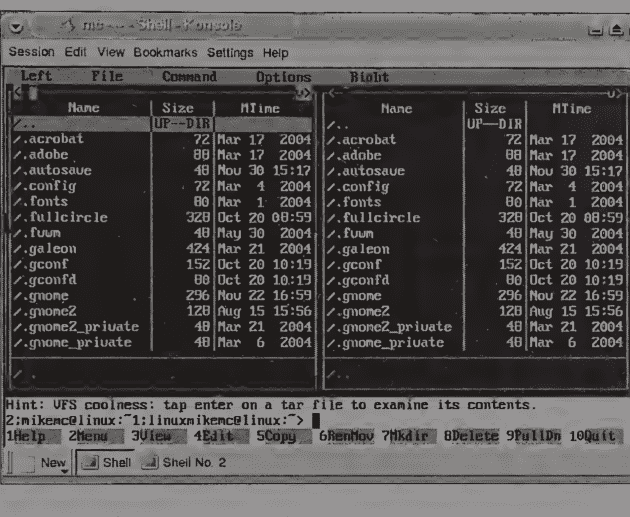

图 5.1 `Midnight Commander`（午夜中指挥官）。

`Midnight Commander` 是一个用于文件管理的程序。在使用它的前几次中，可以多尝试一下。进入菜单，或按 `F` 键查看某个命令的作用。

帮助文件确实非常有帮助！这是一个功能完备的文件管理器：如果你喜欢，可以查看隐藏文件、访问 `FTP` 站点并上传或下载文件（如果需要可以同时进行）、运行可执行文件，并如果可以的话，使用 `Chmod` 和 `Chown` 更改权限和所有者。简而言之，几乎可以在 `Shell` 中执行的操作，你都可以在 `Midnight Commander` 中完成。它甚至还有命令历史记录。

> 提示
> `KDE Konsole` 允许你从会话（Session）菜单打开一个新的 `Midnight Commander` 会话。选择普通或 `Root` 模式（需要输入密码）。

## ksh 和 ash

其他 `Shell` 选择可能没那么流行，但仍然有效。以下是快速概述：

- `Korn shell` (`ksh`) —— 这种由 `David Korn` 编写的 `Shell` 是第一个尝试结合 `Bourne shell` 脚本功能和 `C shell` 交互特性的流行 `Shell`。`A&T` 曾将 `ksh` 转化为一种商业产品，但成功有限。“纯正”的 `Korn shell` 有两个版本：`ksh88` 和 `ksh93`。`SUSE Linux` 随带的版本是属于公有领域许可的 `pd-ksh`。它重现了 `ksh88` 的大部分功能，并带有一些自己的新功能。
- `Zsh` 也是 `Korn` 的后代之一，如果你熟悉 `ksh`，你就能熟练使用 `zsh`。
- `Almquist` (`ash`) —— 这种轻量级的类 `Bourne Shell` 拥有 17 个内置命令，因此它非常适合嵌入式系统和其他空间受限的场景以及登录 `Shell`。事实上，它是 `SUSE` 的默认登录 `Shell`。

## 选择 Shell

你对每个 `Shell` 都有了一定的了解。你如何决定使用哪一个呢？最简单的方法当然是坚持使用你熟悉的。如果你以前用过某个 `Shell`，应该会有某个充分的理由去切换。同样，如果你不打算对你的 `Shell` 进行任何花哨的操作，不妨坚持使用 `bash`。你完全可以用 `bash` 做非常花哨的事情，但为什么要改变默认设置呢？

`Bash` 也是学习脚本的极佳工具。网络上的资源可以帮助你，你在第 8 章也会学习更多相关内容。如果你不想写脚本，可以使用像 `tsh`、`pd-ksh` 或 `zsh` 这样的交互式 `Shell`。

如果你打字慢，应该考虑使用带有快速检查器的 `Shell`。`tsh` 默认进行拼写检查；`zsh` 则通过编辑一个非常快的配置文件进行检查。你对文件和命令补全的要求越“花哨”，可能就越需要 `zsh`。

正如本节开头建议的那样，至少尝试一下所有的 `Shell`。你只需要输入 `Shell` 的名称或任何其他 `Shell` 提示符。当你完成并想返回 `bash` 时，输入 `exit`。查看文档，所有的 `Shell` 都有详尽的 `man` 或 `info` 页面。在你确定了一个 `Shell` 后，运行更改 `Shell` (`ch`) 程序来标识你的选择。花些时间彻底阅读这些文档。

现在既然你已经满意地结束了这场无休止的 Linux 之争，你可以选择一个文本编辑器。

### YaST from the Shell

`YaST` 是一个比大多数 `GUI` 桌面环境更老的工具，它可以在任何 `Shell` 中完美运行。使用该命令以超级用户（SuperUser）身份登录，然后输入 `y`。图 5.2 显示了控制台提示符。

这特别适用于紧急情况，即系统无法进入 `GUI` 登录界面。要从之前的备份恢复系统（更多信息请参见第 20 章“管理数据：备份、恢复与救援”），请遵循以下步骤：

1. 在提示符处输入 `yast` `YaST`。
2. 使用方向键选择左侧列表中的 `System`。
3. 按 `Tab` 键到右侧模块，然后向下箭头选择 `Restore`。
4. 按照页面上的说明操作，或查看第 20 章的“使用系统恢复”部分。

操作菜单和选项，请使用屏幕上显示的快捷键。按下 `Alt` 键配合字母即可跳转到你想要的项目。例如，在任何屏幕上，按下 `Alt+H` 即可获取帮助。完成后，按下 `Alt+Q` 返回 `Shell`。

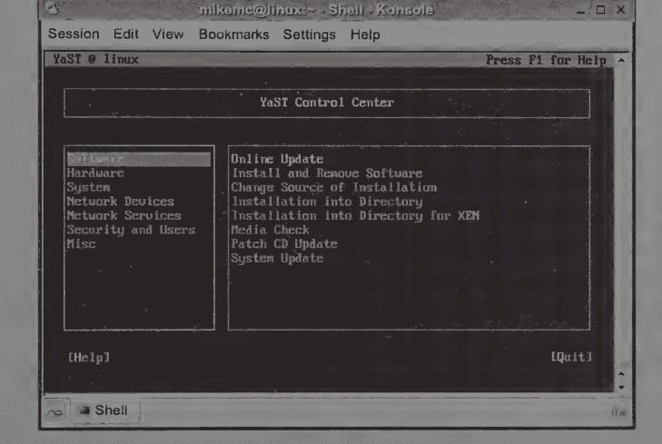

5.2 编辑文本

## 编辑文本

他们说 `vi` 很难学习，但一旦你入门，就可以用它做很多不起的事情。这种难学是显而易见的（对于 `vi` 用户而言）。当你第一次打开 `vi` 编辑器时（现在输入 `vi` 实际上打开的是改进版 `vim`），你什么也做不了。默认情况下，`vi` 以命令/查看模式打开。你可以在文件中移动，前提是你知道 `vi` 中的命令是以冒号 (`:`) 开头的。若要编辑文件，必须先按插入键 (`Esc-i`）。在你学会了这个秘密暗号后，`vim` 可以变得非常好用，通过练习变得非常强大。它还附带了详尽的文档。`Vim` 网站上的文档描述最到位：“最有用的软件会因为糟糕或完全缺失文档而变得毫无用。`Vim` 拒绝因文档匮乏而死亡。”

为了快速上手 `vim`，你不需要运行编辑器。在 `Shell` 提示符处运行 `vimutor` 来获取一个简的教程，预计需要 30 分钟完成。

以下是几个可以帮助你开始使用 `vim` 的命令：

简单导航：方向键可以正常工作，但这些字符也可以移动光标：

- `h` 向左
- `l` 向右
- `k` 向上
- `j` 向下

- 删除字符 `x`
- 删除整行 `dd`
- 保存 `:w` (write)
- 在文件中查找文本：`/<string>`
- 从插入模式切换到命令模式：`Esc`
- 退出 `:q`
- 不保存退出：`:ql`

`Gvim` 和 `Kvim` 都为该基础编辑器提供了图形用户界面（`GUI`）。它们分别为 `GNOME` 和 `KDE` 编写，但你可以在任何环境中使用其中任何一个。`Kvim` 的主要开发团队已转向制作另一个名为 `Yzis` 的 `GUI` 克隆版本。`Nvi` 是加州大学伯克利分校的一个与 `vi` 略有不同的版本。

## 使用 Emacs 及其克隆版本

`GNU emacs` 是一个无限自定义的、“无所一有”的编辑器/工作环境。它是 `GNU` 项目的第一个产品，深受许多软件纯洁者的喜爱。

它是一个文本编辑器，通过看似奇异的键绑定（使用 `Ctrl-X` 开始命令并配合另一个组合键）让你的双手离开键盘。学习 `emacs` 是一件极具技巧的事情。

如果你希望编辑器应该具备的所有功能都包含在一个漂亮、有时难以懂的包中，那么 `emacs` 就是一个模块化的怪物。`Emacs` 可以读取电子邮件和 `Usenet` 新闻，浏览网页，并生成 `HTML`、`XHTML`、`XML` 以及其他各种格式。它为几乎每种编程语言提供了开发环境。你甚至可以查看 `Zippy the Pinhead` 与精神分析师之间奇妙的对话。要实现所有这一切，你必须安装相应的模式（mode）。`Emacs` 是一个大程序（占用高达 30MB），但它并不包含已编写的所有模式。有时你必须寻找你需要的东西。

`Emacs` 启动很容易（在 shell 提示符输入 `emacs <filename>`），导航也可以相当简单。

与 `vim` 不同，`emacs` 有它自己的界面（`vim` 仅显示在 shell 中），带有菜单和鼠标支持，虽然没有 `X` 那么漂亮。除非你在启动时包含一个模式命令，否则 `emacs` 会认为你想写文本并加载文本填充模式（text fill mode）。如果你不希望单词在行尾换行，请转到 `Options`（选项）菜单或使用 `Alt+X-auto-f` 更改模式。

`Emacs` 还有一个教程，会引导你学习基础命令和导航。在 `emacs` 中，使用 `Ctrl+H` 然后按“T”即可获取它。

大多数其他 `emacs` 克隆版本（那些爱好者）都是原始版本的子集，专为特定用途设计。`XE bean` 是一个 `GUI` 版本，但有一组独立的开发者，他们做了一些与父级版本不同的工作。通常来说，`EMacs` 添加新功能的速度更快，且不需要打包者将版权分配给自由软件基金（管理 `GNU` 项目的组织）。

## 其他一些编辑器

在选择编辑器时，你不需要随大流。选择不仅限于这两个大家伙。尝试一下这些：

- `ed`——第一个 unix 编辑器。它默认以查看/命令模式打开，这正是 `vi` 同样这样做的原因。如果它不是早于 `vi` 的话，你可以把它归为 `vi` 克隆类。如果你需要一个 shell 脚本对某些文本进行编辑或执行命令，`ed` 是要调用的编辑器。对于基础行编辑来说，它是快速且实用的。
- `Joe`——假设你无法决定 `emacs` 还是 `vi` 更酷？你还记得那些 `Word` 命令和宏吗？你可能喜欢 `joe's Own Editor`。`joe` 是一个灵活的猛兽，它让你按照你想要的方式工作。它可以模拟之前提到的任何编辑器，并同时编辑多个文件，并为每个文件提供不同的环境。像 `emacs` 一样，它可以读取新闻。帮助信息非常详尽，可以将命令模板直接放在你的屏幕上，这样你就不需要思考如何保存文件（如果必须的话，按 `Ctrl+K` 然后按 `D`）。
- `JEdit`——这是一个基于 java 的图形编辑器，具有插件架构，可以使其更加强大。很棒的一点是，通过内置的插件管理器可以轻松添加和更新你拥有的任何插件。命令相对容易学习，用户指南非常有帮助。
- `Hessling Editor` (the)——这是一个为习惯在 `vms/cms` 环境下工作的人设计的特殊编辑器，是另一个开源环境中“富者更得优待”的例子。可能没有数百万手里拿着钱包的 `vms` 老兵转型到 linux，但只需要一个拥有编程技能的人就能写出它，并将其提供给我们其他人。

## 为什么我不能编辑这个文件？权限是如何工作的

如果说关于 `emacs` 有什么需要了解的重要，那就是你电脑上的一切都以文件的形式存在。你的打印机、声卡、硬盘分区、显示器、目录——系统中的一个文件代表了该项目。每个文件都有关于谁可以访问它以及以什么方式访问的规则。

在本节中，你将获得权限的介绍。这在第 19 章中有更深入的介绍。无论你的技能水平如何，都应该阅读该章节的“用户账户和权限”部分。

Linux 是多用户操作系统

> NOTE
> `Root` 用户在登录时也是超级用户（SuperUser），其他用户可以使用 `Root` 密码成为超级用户。

每个文件（再次，你系统中的一切）都有一个所有者，并在创建时被分配到一个组。

在本节中，你将获得权限的介绍。这在第 19 章中有更深入的介绍。无论你的技能水平如何，都应该阅读该章节的“用户账户和权限”部分。

Linux 是一个多用户操作系统

> NOTE
> `Root` 用户在登录时也是超级用户（SuperUser），其他用户可以使用 `Root` 密码成为超级用户。

每个文件（再次，你系统中的一切）都有一个所有者，并在创建时被分配到一个组。

## 为什么我无法编辑此文件？权限的工作原理

我们的文件仅允许所有者对文件进行更改（写入）。如果你想让写入者组中的任何人都能直接编辑它，你应该将分配给该文件的组从 `users`（所有这些用户都是系统用户）更改为 `writers`（一个预先定义的用户组）：

```
chgrp writers file
```

> 注意
只有当你既是文件的所有者又是你所更改的组成员时，`chgrp` 才会生效。如果你想将权限更改为另一个组，且知道该组的密码，可以使用 `newgrp` 命令临时加入该组。否则，必须由 `Root` 来进行更改。

但我们的工作还没有结束；组权限仍然设置为“只读”。我们在这里完成最后一步的任务：

```
chmod g+w file
```

正如上一节提到的，权限被定义为读、写、执行——--rwx。通过 `g+w` 选项，我们使用 `chmod` 为组 (`g`) 添加了 (+) 写入 (`w`) 权限。

`chmod` 的选项包括：

- - `u`--用户 (user)
- `g`--组 (group)
- `o`--其他 (others)
- `a`--所有用户 (all users)
- 加号 (+) 添加读、写或执行权限
- 减号 (-) 移除读、写或执行权限

有些人在使用 `chmod` 时更倾向于使用八进制（基8）数字。这样，你不需要逐个添加或删除权限，而是在完成命令时精确指定你想要它们的状态。使用八进制进行与我们之前相同的更改，命令如下：

```
chmod 664 file
```

为什么是这些数字？每个数字代表一组权限：所有者、组、其他。每个数字代表每个实体拥有的权利：

- - `4` = 读取权限
- `2` = 写入权限
- `1` = 执行权限

将每个权限数字数字相加，以表示该文件应该拥有的权限级别。如所示，所有者和组具有读取和写入权限（`4+2=6`）；其他人只有读取权限。

要确认你所做的更改，只需运行 `ls -l`。

## 目录权限

目录也分配了它们自己的权限。使用 `ls -ld`（`d`代表目录，Long代表长格式）查看你当前目录（最可能是当前目录）的权限。你应该会看到类似的内容：

```
drwxr-xr-x  64 kmemc   4056 2004-12-09 15:02
```

这里的区别标记是权限块中的 `d`。这告诉你你正在查看的是一个目录。仔细观察，你可以发现所有者 (`kmemc`) 可以执行所有操作 (`rwx`)，用户组和其他人可以读取目录列表。当你需要执行它 (`r-x`) 时才能查看目录。从八进制来看，权限被设置为 `755`。

只要你有权限，你可以使用相同的工具对目录进行与文件完全相同的权限更改。

## 以 Root 身份工作

权限，更重要的是权限的缺失，在 Linux（或 Unix）系统中意味着很多，特别是当你只是“一个普通用户”时。权限关乎安全——确保系统安全免受伤害。在这种情况下，伤害可能来自许多方向。当你考虑到电脑时，脑海中浮现的通常是邪恶黑客，他们试图窃取你的密码、信用卡号、关键数据甚至是你的身份。网络安全无疑是一个重要的考虑因素，保护你的网络和系统免受此类活动的影响至关重要。

> 提示
如果你花时间混迹在 Linux 社区，你可能会听到关于之前提到的黑客的教训。别走开；Unix 和 Linux 诞生于更高尚的“黑客文化”，这种文化致力于创造更好的技术，而不是闯入他人的机器。

然而，在 Linux 和 Unix 中，安全和权限也能防止那些更平庸的冒险以及任何用户在任何时候可能发生的坏事，例如你不小心删除了机器上与你公司最新合并相关的整个文档文件夹，导致 IT 人员不得不从备份中恢复它。

作为 `Root`，你指尖拥有着可安装的力量。你可以让系统顺畅运行，也可以通过几次击键让它崩溃。摧毁一个系统只需要这条命令（不要在家里尝试）：

```
rm -rf /
```


此命令将从树的根节点递归地删除 (`rm`) 所有文件和目录。如果你正在双启动并挂载了 Windows 分区，该分区也将消失。如果你恰好登录在某个现在是你系统一部分的远程机器上，最好现在就打电话。远程文件也在消失。

> 提示
这种情况是另一个不要在启动时自动挂载你的 Windows 分区的理由。

所以不要冒险。即使你是你机器上无所不能的 `Root`，除非你有工作要做，否则始终以谦虚的用户登录。尽管你可以将 `Root` 用户添加到你的 SUSE Linux 登录界面，但不要把它留给紧急情况。

现在你已经感到适度恐惧了，让我告诉你有些基本任务必须由 `Root` 用户执行。你也可以安全地完成这些任务。我们将在第 3 部分和第 4 部分详细介绍许多内容，但现在这里有一个列表：

- 安装和更新大多数软件
- 运行 `YaST`
- 设置时钟
- 开启和关闭防火墙
- 添加和删除用户
- 某些服务

执行所有这些任务的最佳方法是使用 `su` (超级用户) 命令并输入 `Root` 密码。你可以执行任何需要的任务，然后返回 shell 提示符，输入 `Exit` 返回你的用户提示符。

> 注意
当你运行 `YaST` 以及其他需要 `Root` 访问的图形程序时，它们会提议为你记住 `Root` 密码。如果将来某天在你最需要它时忘记了 `Root` 密码，不要接受这个建议。只需手动输入即可。
关于密码的更多提示，请参阅第 19 章。

作为 `Root`，你可以使用 `sudo` 命令允许特定用户执行特定任务。这在第 19 章中有详细描述。

## 创建和删除用户

用户在拥有密码之前就不是用户。所有用户密码（偶尔还有一些其他信息）都存储在 `/etc/passwd` 文件中。你可以通过两种方式在 SUSE Linux 中创建新用户——通过 `YaST` 或 shell。

## 第 5 章 入手 SUSE Linux

当你第一次安装 SUSE Linux 时，你创建了你的第一个用户——你自己。如果不同的人使用这台电脑，给他们他们自己的账户是关重要的。如果你恰好是唯一计划使用 Linux 的人，为什么要创建另一个呢？思考你坐在电脑前时扮演的不同角色。你可能想创建不同的用户来扮演这些角色，互不干扰。

在 `YaST` 中，管理用户和组位于“安全 (Security)”选项卡。要添加用户，转到“管理用户”并点击“添加”。你会被要求提供用户名初始密码。你还会被要求为密码设置过期日期。定期更改密码是一个好主意，特别是在接入互联网的联网计算机上。

从 shell 开始，添加用户是一个两步骤的过程。使用 `su` 登录后，使用 `useradd` 命令快速创建用户：

```
useradd drone77
```

你现在必须创建一个初始密码（记住：没有密码，就没有用户），通过运行 `passwd`：

```
passwd drone77

Changing password for user drone77

New password:

Retype new password:

passed: all authentication tokens updated successfully.
```

输入两次新密码。如果不这样做，`drone77` 将无法登录。`drone77` 第一次登录时，她将获得机会创建自己的密码。

输入 `useradd -D` 来确认新的默认设置。你将看到组 ID、主目录、账户和密码策略、默认 shell 以及存放该 shell 配置文件的目录。

正如你所预期的，如果 `useradd` 用于添加用户，那么 `userdel` 就会从你的系统中删除用户。在从 `passwd` 文件中删除用户时，最好也删除用户的主目录。使用 `-r`（递归）选项执行此操作：

```
userdel -r drone77
```

这也会用户从主队列中移除。

## 关机和重启系统

默认情况下，只有 `Root` 可以关闭系统。当系统作为服务器时，这一点尤为重要，但对于任何人们可能依赖文件可用的网络设备来说也是好事。

`Root` 可以允许用户执行此功能，当你将电脑作为桌面或双启动系统使用时，这是一个好主意。这在 `YaST` 中完成。

### 参考

要从 shell 关系统，请以 `su` 身份登录并运行 `shutdown` 命令。最快的方法是使用 `-h` (halt) 选项：

```
shutdown -h now
```

或者

```
shutdown -h 0
```

如果你处于网络环境中，你可能想指定一个关机时间，并向其他用户发送消息：

```
shutdown -h 18:30 "System is going down for maintenance this evening"
```


消息将在关机前 15 分钟发出（在本例中，为下午 6:15）。

要重启系统，你使用使用相同的 `shutdown` 命令，这次使用 `-r` (reboot) 选项。像之前一样设置时间即可。

如果此系统是服务器，请确保不要在执行某些操作（如备份）时将其关机。再次强调，能力越大，责任越大。

# 参考

本章涵盖了大量内容。参考资料将帮助你更深入地了解 Linux 文件系统、shell、编辑器和权限。在选择 shell 或编辑器时，我强烈建议查看它们的 `man`（或 `info`）页面以及它们的网站。

## 文件系统

- [http://www.pathname.com/fhs](http://www.pathname.com/fhs)—关于新的 Linux 文件系统层级标准 (FHS)，可能比你想了解的还要。
- [http://www.linuxbase.org](http://www.linuxbase.org)—Linux 标准基础 (LSB) 页面。
- [http://standards.ieee.org/regauth/posix](http://standards.ieee.org/regauth/posix)—IEEE POSIX 信息页面。

## Shells

- [http://cnswnn.com.cwru.edu/-bash/bashtop.html](http://cnswnn.com.cwru.edu/-bash/bashtop.html)—C Ramey 的 bash 页面。他是 bash 项目目前的维护者。
- [http://www.tdp.org/LDP/Bash-Beginners-Guide/html/](http://www.tdp.org/LDP/Bash-Beginners-Guide/html/)—网页版的 Bash 入学者指南。如果你访问该网站，可以获取其他格式的指南，以及其他优质资源。
- [http://web.cs.mun.ca/pdksh/](http://web.cs.mun.ca/pdksh/)—Public Korn Shell 页面。
- [http://www.tcsh.org/Welcome](http://www.tcsh.org/Welcome)—tcsh Wiki。了解更多关于这种 C Shell 的知识并贡献你自己的知识。

## 第 5 章 开始使用 SUSE Linux

- [http://www.zsh.org/](http://www.zsh.org/)—Z Shell 的主页。选择一个最近的镜像站。
- [http://www-106.ibm.com/developerworks/linux/library/l-z.html](http://www-106.ibm.com/developerworks/linux/library/l-z.html)—来自 IBM 的 Z Shell 良好介绍。
- [http://www.ibilio.org/mc/](http://www.ibilio.org/mc/)—Midnight Commander 的主页。截图、常见问题解答 (FAQs) 以及开发者的待办事项。
- [http://www.dotfiles.com/](http://www.dotfiles.com/)—探索各种 shell、编辑器和其他工具的贡献配置文件。
- [http://www.sheldorado.com/](http://www.sheldorado.com/)—Heiner 的 Sheldorado。包含所有 shell 的大量脚本信息，也是一个很好的介绍。

## 编辑器

- [http://www.gnu.org/software/emacs/emacs.html](http://www.gnu.org/software/emacs/emacs.html)—GNU/Emacs 主页。
- [http://www.dotemacs.de/](http://www.dotemacs.de/)—“非常非官方的 dotemacs 主页”。探索配置 emacs 的方法。
- [http://www.emacwiki.org](http://www.emacwiki.org)—在这里可以找到新模块和帮助你。
- [http://www.vim.org/](http://www.vim.org/)—Vim 主页。
- [http://vimdoc.sourceforge.net/](http://vimdoc.sourceforge.net/)—可以在这里找到各种类型的 Vim 文档。
- [http://www.yzis.org/](http://www.yzis.org/)—Kvim 开发者为 K 桌面环境的新项目。
- [http://sourceforge.net/projects/joe-editor/](http://sourceforge.net/projects/joe-editor/)—Joe’s Own Editor 的主页。
- [http://jedit/](http://jedit/)—基于 Java 的编辑器。

## 以 Root 身份工作

- [http://linux.about.com/od/embedded/l/blnewbie_toc.htm](http://linux.about.com/od/embedded/l/blnewbie_toc.htm)—Linux 新手指南。基本概述。
- [http://www.gratisof.us/sudo/](http://www.gratisof.us/sudo/)—sudo 主页。该命令的下载、文档和资源。

# 第 6 章

## 本章内容

## 启动你的桌面

- 理解 X 窗口系统
- 选择桌面环境：KDE 和 GNOME
- 从桌面管理文件
- 配置你的环境
- 什么是窗口管理器以及我为什么想使用它？

当你正常登录 SUSE Linux 时，你会使用图形化登录界面。那个显示管理器是你对 X 窗口系统的首次体验，通常被称为 X11R6、X11 或简单的 X。X 的历史比微软 Windows 长得多，但在许多方面是相似的。它在此过程中经历了多次变化。最近的变化是由 X 的官方所有者 X.Org 基金会发起的开发。早版本的 SUSE 包含了适用于 Intel 平台的 XFree86 开源版本 X；SUSE Linux 9.3 使用 X 版本 X11R6.8.2。

X 在架构中使用客户端/服务器模型，但它与你可能认为略有不同。通常，你是在 PC 上运行一个客户端向你的远程服务器发送请求。而在 X 中，服务器安装在你的机器上。它接受来自任意客户端的请求，这些客户端可以在你的机器上，也可以从远程位置（如 Telnet 会话）连接。

## 理解 X 窗口系统

当你正常登录 SUSE Linux 时，你会使用图形化登录界面。那个显示管理器是你对 X 窗口系统的首次体验，通常被称为 X11R6、X11 或简单的 X。

## 配置你的环境

当你正常登录 SUSE Linux 时，你会使用图形化登录界面。那个显示管理器是你对 X 窗口系统的首次体验，通常被称为 X11R6、X11 或简单的 X。

## 什么是窗口管理器以及我为什么想使用它？

完整的 X 桌面直到 20 世纪 90 年代中期才出现。在它们出现之前，使用的是窗口管理器。

## 第6 章 启动你的桌面

如果你在屏幕上看到一些黑色边缘并想调整它们，请进入“几何结构”（Geometry）部分。SaX 会弹出一个窗口（见图 6.2）来提供帮助。

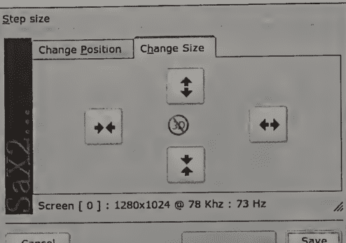

图 6.2 使用 SaX 几何提示符调整屏幕显示的大小。

> 提示
> 在大多数情况下，你会使用显示管理器来登录并启动 X，但有时可能会出现故障，导致你无法进入显示管理器。不要恐慌！你仍然可以进入 X。如果这种情况在启动时发生，你将得到一个文本登录提示符。以用户身份登录，你将位于你的主目录（输入 `pwd` 来确认）。寻找 `.xinitrc` 文件：`ls -a .xinitrc`
> SUSE Linux 在主目录下有一个名为 `.xinitrc.template` 的默认文件。制作该文件的副本以激活它：`cp .xinitrc.template .xinitrc`
> 现在，输入魔法指令：`startx`

## 选择桌面环境：KDE 和 GNOME

在 Windows 和 Macintosh 上，桌面仅仅是桌面。而 Linux 的核心在于选择，X 也是如此。

## KDE：桌面环境

KDE 项目始于 1996 年，已成为 SUSE 的默认选择。

## GNOME: GNU 网络对象模型环境

当你第一次打开 GNOME 时，你可能会注意到它与 KDE 之间有两个不同：外观看起来不那么杂乱，且任务栏位于屏幕顶部。

## 从桌面管理文件

要在任一面板上添加图标，请在你想要项目出现的精确位置点击右键，并选择“添加到面板”。

## 在 KDE 中使用 Konqueror

KDE 的 Konqueror 采用了类似于资源管理器的方法。

## 在复杂的 GNOME 中使用 Nautilus

Nautilus 似乎基于这样一个原则：如果两个窗口可以让文件管理更简单，那么更多的窗口更好。

## 配置你的桌面环境

你可以根据自己的意愿对两个桌面进行尽可能的自定义。

## KDE 控制中心

当你打开 KDE 控制中心时，你将获得系统信息的快速摘要。

## 自定义 GNOME

让桌面最符合你的需求是 GNOME 项目提出的目标之一。

## 为什么要运行窗口管理器？

- 窗口管理器通常是轻量级的；它们加载速度很快，而且不占用内存。
- 如果你只需要 X 连接到远程管理器并移动一些文件，你就不需要加载所有 KDE 工具的库。

## 启动窗口管理器

当你使用 YaST 安装窗口管理器时，显示器的启动菜单中会多出一个选项。登录时，点击“选项”（Options）按钮，进入“会话类型”（Session Type），并选择你的窗口管理器。

## 运行 FVWM

这个窗口管理器最初名为 Feble Virtual Window Manager，但现在不再是一个缩写。

## 运行 WindowMaker

WindowMaker 的根源在于替代操作系统的世界。

## 运行 iceWM

iceWM 是一种轻量级且易于使用的窗口管理器。

# 第 7 章
## 在 SUSE Linux 中打印

## 本章内容
- 打印：概述
- 通用 Unix 打印系统 (CUPS)
- 使用 YaST 配置打印机
- 使用 KDEPrint 配置 CUPS 和网络打印机
- 使用 CUPS 打印
- 使用可便式文档格式 (PDF)
- 控制台打印控制
- 避免打印问题

## 打印：概述

理解 Linux 打印最重要的点是，它很大程度上是一个转换过程。

## 通用 Unix 打印系统 (CUPS)

CUPS 让普通用户的打印变得简单得多。

## 使用 YaST 配置打印机

YaST 尝试在安装时检测活动中的打印机。

## 使用 KDEPrint 配置 CUPS 和网络打印机

设置网络打印机的步骤与本地设置过程没有本质区别。

## 使用 CUPS 打印

设置好打印机后，从用户的角度来看，打印是一件容易的事。

## 控制台打印控制

与 Linux 中的其他所有内容一样，打印文件不需要运行 X。

## 使用基本打印命令

- `lp options <filename><printer>`——基本的“行打印机”缓存命令。
- `lpq`——“行打印机队列”
- `lpstat`——来自服务器和打印机的统计信息。
- `lprm`——取消当前打印作业。
- `lpadmin`——CUPS 行打印机管理系统。

所有这些命令都有较好的 man 页，你也可以在 `/usr/share/doc/packages/cups/sam.html` 查看 CUPS 管理指南。


`lp -dlp *.sxw`

现在如果你知道队列命令 `lpq`，你将看到正在打印的文件。这包括其他相关信息，例如所有者、作业号和作业大小。CUPS 使用作业号来处理多个订单。

有了作业号，你可以使用 `lprm <jobnumber>` 取消该特定作业。

## 避免打印问题

在购买新打印机之前，务必先研究它的 Linux 兼容性。SUSE Linux 和 CUPS 可以运行大多数打印机型号，特别是当它们是通过并行线连接的标准打印机时。某些厂商对 Linux 的支持好于其他厂商，访问 `www.linuxprinting.org` 获取有关每个打印机厂商的当前观点一直是一个好主意。

以下章节包含了一些关于问题较大设备的提示。

### 多功能（打印/传真/扫描仪）设备

你越努力尝试，就越难以掌握。这些打印“三项运动员”需要制造商的全支持才能在 Linux 中运行，而且支持非常及时。响应用户对廉价多功能设备的呼声，Brother 开始了 Linux 打印机和扫描驱动程序。它们在 linuxprinting.org 上仍然是“无用的”，但我的情况可能有所不同。请参见：`https://solutions.brother.com/linux/en_us` 获取 Brother 驱动程序的最新信息。

然而，如果你有一个 HP Officejet 多功能设备，尽管认为自己幸运吧。SUSE Linux 开箱支持这些设备。

## USB 和旧式喷墨打印机

现在更多打印机通过 USB 端口运行。你已经在第 2 章“准备安装 SUSE Linux”中学了有关 Linux 和厂商对 USB 设备的支持。虽然 USB 打印机没有特别需要注意的，但如果你考虑其中一种，仍然应该查看 `http://www.linux-usb.org`。

通常，你应该避免使用上世纪末出的廉价旧式喷墨打印机。当这些打印机新品时，制造商对 Linux 并不了解，它们现在肯定不会添加支持。

就像依赖软件执行许多基本通信任务的 Winmodems 一样，这些打印机中的一些通过微软图形设备接口 `GDI` 降低了成本。本质上，打印机之所以运行是因为它们可以访问此 Windows 接口。

《SUSE Linux 管理指南》提供了这些打印机的部分列表，linux-printing.org 在其数据库中有一个更广泛的列表。

### 参考文献

- `http://linuxprinting.org`—Linux 打印信息的中央汇编。下载官方和非官方源驱动程序。当你打算购买新打印机时，阅读“建议打印机列表”中的建议。在论坛中提问。
- `http://h10018.www.hp.com/wwwolutions/linux/products/printing_imaging`—惠尔的 Linux 驱动程序。
- `http://www.tldp.org/HOWTO/Printing-HOWTO`—该页面是“如何在 GNU/Linux 下生成、预览、打印和传真任何内容的信息集”。
- `http://www.cups.org`—关注通用 Unix 打印系统 `CUPS` 的地方。
- `http://www.pwg.org/ipp`—IETF 打印工作组关于互联网打印协议 `IPP` 的页面，由 CUPS 提供。技术性强，但有很好的常见问题解答 `FAQ`。
- `http://www.ghostscript.com`—Ghost 新闻和社区页面。基于“日记”的新发布公告。
- `http://www.isc.edu/ghost`—Ghostscript 页面。
- `http://www.adobe.com/products/acrobat`—从官方网站获取更多关于 Acrobat 的信息。你也可以下载阅读器。
- `http://solutions.brother.com/linux/en_us`—Brother 支持和驱动程序页面。

# 第 8 章 与你的 shell 握手

“最初是命令行，”Neal Stephenson 在他关于操作系统历史的精彩文章中这样说的。事实确实如此。在 Linux 中完成任务最简单、最快的方法是直接使用命令行，即 shell。为什么要 shell？如果操作系统的内核是坚果，显然你必须破解坚壳才能获取它。

## 命令行威力

- 使用 `locate`、`gawk`、`grep` 文件和目录的模式或正则表达式。
- 将一个程序的结果或输出输入到另一个程序中进一步处理。
- 使用分号分隔运行多个命令。
- 使用单个命令创建五个空文件：`{a,b,c,d,e}`
- 在后台运行程序。

在本章中编写脚本时，你将用到所有这些小奇迹。

> 注意
> 本章中的示例将使用 `bash` shell 脚本，因为它是 SU Linux中最流行（也是默认）的 shell。你也可以在其他 shell 中编写脚本执行此处包含的所有任务。请查看你 shell 的 `man`页以检查正确的语法。你可能还会喜欢 Srinivasa Veeraraghavan 的《Teach Yourself Shell Programming in 24 Hours》或 Ken O. Burch 写的《Linux Shell Scripting with Bash》。

## Shell 中的模式匹配

命令行允许你使用特殊构造的模式字符串进行通配符匹配，例如 `grep`，它可以使用更复杂的模式（称为表达式）来搜索文件或目录，或过滤命令的输入。

shell 的模式字符串可以是简单的也可以是复杂的，但即使使用简单通配符中的可用字符子集，也能在命令行产生建设性的结果。用于 shell 模式匹配的一些常用字符有：

- `*` 匹配任意字符。例如，要查找当前目录下所有以 `.txt` 结尾的文件，你可以使用

```
ls *.txt
```

- `?` 匹配单个字符。例如，要查找当前目录下所有以扩展名 `?c` 结尾的文件（其中 `?` 是 0-9、a-z 或 A-Z）：

```
ls ?d*
```

- `[xxxxxx]` 或 `[x-x]` 匹配字符范围。例如，列出目录中名称包含数字的文件：

```
ls [0-9]*
```

要只查找包含字符 1、5 或 8 的文件，应使用：

```
ls [158]*
```

- `\` 对字符进行转义，例如转义 `?` 或制表符。例如，要创建一个名称中包含问号的文件：

```
touch foo\?
```

表 8.1 显示了更多的特殊字符。要查看完整列表，请参见参考部分列出的《高级 Bash 脚本指南》。

### 8.1 bash 中的特殊字符

| 字符 | 含义 |
| :--- | :--- |
| `#` | 注释开始（除非它是字符串的一部分！） |
| `$` | Shell 变量名。 |
| `;` | 命令分号分隔符。 |
| `.` | 当前目录。 |
| `..` | 父目录。 |
| `~` | 主目录（该字符位于键盘上数字的左侧）。 |
| `` ` `` | 命令替换；告诉 shell 使用命令的结果作为下一个命令的一部分。 |
| `>` | 将脚本的输出重定向到文件。如果文件存在，将会被覆盖。 |
| `>>` | 将脚本的输出追加到现有文件中。如果文件不存在，则将创建它。 |
| `|` | 管道。有助于将命令链在一起，并将一个参数的输出传递给下一个参数。 |
| `&` | 在后台运行；允许你返回 shell 提示符。 |

使用特殊字符时始终务必小心。如你所见，某些字符根据其上下文有不同的含义，因此如果你不正确使用它们，脚本可能无法正常运行。某些字符还具有破坏性，因此请确保使用正确的字符。如果你想“正常”使用特殊字符，请使用反斜杠 `(\ )` 作为转义字符。例如，要显示涉及 `$` 的某些计算结果，请包含此：

```
echo $((5+3))
```

注意，如果不小心，在 shell 脚本中使用通配符和正则表达式可能会导致问题。Linux 命令和 shell 脚本都识别反斜杠为模式中的转义字符，且美元符号 `($)` 有两种含义（模式匹配和变量赋值）。

## 重定向输入和输出

你可以使用输入和输出重定向过程在命令行中创建、覆盖和追加数据。shell 识别用于此过程的几个特殊字符，如 `>`、`<` 或 `>>`。例如，`ls` 命令的输出被重定向创建一个名为 `textfiles.listing` 的文件：

```
ls *.txt > textfiles.listing
```

请谨慎使用输出重定向，因为覆盖文件太容易了。你只需要将不同的命令重定向到任何同名的现有文件，系统就会提示你的意愿。好的一方面是，你可以追加运算符 `>>` 将输出重定向以向现有文件添加内容。因此，如果你发现有有趣的内容要添加到你的 textfiles 集合，请在命令中使用 `>>` 而不是 `>`：

```
ls /usr/share/doc/emacs/doc/gnus.txt >> textfiles.listing
```

你也可以反转命令，使用输入重定向获取数据并将其馈给命令，如下：

```
cat < textfiles.listing
```

## 管道数据

许多 Linux 命令可以一起运行，通过连接命令行将数据从一种格式转换为另一种格式，或作为下一个命令的输入。可以无限进行。使用管道操作符 `(|)` 创建管道（它在此范围内被经常使用，因此许多人将该操作符称为管道）。如果你是系统管理员并需要列出某个时刻登录的用户，管道命令将给你：

```
who | cut -c1-8 | sort -u | pr
```

这里使用了四个命令：

首先，`who` 显示当前登录的用户。此结果由 `cut` 处理，只输出前8个字符（而不是整行），然后结果由 `sort -u` 按字母顺序排序，并删除列表中重复的用户。最后，`pr` 以每行8列的形式将其传递到屏幕。

## 后台处理

这非常简单，随着你 shell 技巧的提高，你将通过几次击键实现神奇的事情。

在很多书中，你会看到命令末尾带有和符号 `(&)`。这在你使用 shell 启动图形化应用程序时尤为如此。你可能好奇这是做什么用的。假设你想从 shell 运行 gnome 监控器。如果你在提示符输入 `gnome`，程序将会运行，但如果你查看 shell，你会看到一个无法完成更多命令的死光标，直到退出 gnome。

如果你退出 gnome（在程序任何地方右键点击并选择退出），你的 shell 提示符就会返回，你可以再次输入命令。使用向上箭头从命令历史中调用之前的命令，提示符中再次出现 `gnome`。这次添加后台处理运算符 `&` 并按回车。`gnome` 运行，但 `bash` 现在返回该应用程序的进程号，然后返回提示符。你现在可以输入任何其他命令。

## 编写脚本：基础

在 shell 提示符可以使用命令历史是一个很好的工具，但如果你每天运行相同命令的变体怎么办？如果你每隔一周运行一次复杂的命令集，但不一定是在那时？这时脚本就大显身场了。Shell 脚本运行速度不一定比 C 程序快，但因为它们不需要编译，所以体积可以小得多。这使得它们更具移植性；它们总能放入磁盘中。此外，除非你需要访问某种其他语言作为脚本的一部分，否则你不需要在系统中安装额外的库。编写脚本的过程也比任何编译语言都简单快捷。

如果你刚开始学习脚本，这就像一项新练习。不要试图一次性做太多。专注于自动化你正在做的、或者本想做但看起来太复杂而没有做的过程。

## 在 bash 中脚本

要开始，你可以创建一些命令别名 `aliases` 来简化一些命令行任务。Linux 中的别名是环境变量，其行为与它们的名称一致——即作为命令的另一个名称。你可以在命令行中临时定义别名，但这些别名仅对当前会有效。最好是让它们在任何时候都可用。

在开始编写脚本之前，先看看 SUSE 定义的默认别名。进入 shell 提示符并输入 `alias`。你将看到以下列表。如果你是：

```bash
alias +=='pushd ' 
alias -=='popd' 
alias ..='cd ..' 
alias ...='cd ../' 
alias A='echo -e "Error: Linux 中没有名为 A 的驱动器。\n如果你想访问软盘，请在 `/media/floppy !*` 目录下尝试 `/dev/fd0*`"'
alias C='echo -e "Error: Linux 中没有这样的驱动器!\n你的硬盘应该已经挂载（通过 /etc/fstab 或 autofs()）"'
alias a='A:'
alias beep='echo -en "007'
alias c='C:'
alias cd.='echo -e "Error: Try: cd .."'
alias chksdsk='echo -e "Error: 你的文件系统在启动时会检查。\n如果你想手动检查，请使用 fsck。\n使用 df 和 mount 查看磁盘概述。\n'
alias copy='echo -e "Error: 命令: cp -piv*"'
alias del='echo -e "Error: 命令: rm -iv*"'
alias dir='ls -1'
alias format='echo -e "Error: DOS 格式化磁盘介质的概念是错误的。\n如果你想使用 \"mkfs\" 创建文件系统。要格式化软盘，请使用：\n`fdformat /dev/fd0` 并使用 `mkfs.minix /dev/fd0."' 
alias l1='ls -aF'
alias la1='ls -la'
alias ll1='ls -1'
alias ls1='/bin/ls $LS_OPTIONS'
alias ls1-l1='ls -1'
alias md='mkdir -p'
```

## 第 8 章 与你的 shell 握手

```bash
alias mem=echo 'Error: Try the command: free'
alias move=echo 'Error: Try the command: mv -iv'
alias o='less'
alias rd='rmdir'
alias rehash=hash -r
alias sys=echo -e 'Error: Linux 不能像那样传输。\n如果你想安装 Linux 或创建启动盘，请使用 YAST。'
alias unmount=echo 'Error: Try the command: 'mount' 1&2; false'
alias ver=echo 'Error: Try the command: uname -a'
alias which='type -p'
alias you=yast2 online_update
```

这些别名位于系统级环境设置文件中：`/etc/profile` 和 `/etc.bashrc`，并且默认适用于所有用户。任何用户都可以通过修改 `~/.bashrc` 文件来自定义自己的别名，并可以编写一个包含你所使用的别名的脚本，然后在 `.bashrc` 中引用该脚本。

例如，打开文本编辑器并输入以下行：

```bash
#!/bin/sh

alias ls='ls -F'

alias ldir='ls -aF'

alias copy='cp'

alias ft='fortune -a'
```

以下是你通过此脚本所做的：

- 在第 1 行，你声明这是一个 `(bash)` shell 脚本。这一行有几个生动的昵称，指的是 `ft` 处的两个字符：text-hash、sh-bang 或直接称为 bang（感叹号）。
- 第 2 行告诉 `bash`，当你输入 `ls` 获取目录列表时，你总是希望它给你提供详细的（长格式）列表，包含权限、大小和日期/时间信息。这与默认别名 `ll` 的显示效果相同。
- 第 3 行让你在输入 `ldir` 时，获得一个带颜色的文件和目录列表，但没有详细信息。
- 第 4 行更改了当你输入 DOS 命令 `copy` 时 shell 的行为：不再收到关于正确 Linux 语法的略粗的提醒，shell 实际上会执行你想要的操作。
- 第 5 行定义了通过 `ft` 获取幸运语饼的快捷方式。`-a` 开关意味着 `fortune` 将查询其所有的幸运语集，并可能在你的屏幕上显示一些粗俗的内容。请谨慎使用此开关。

## Shell 脚本中的变量 135

添加你选择的其他别名，然后将文件保存到 `~/bin/myaliases`。不需要扩展名。当你编辑脚本时，还剩下两个任务。首先，它只是一个文本文件。要使其成为脚本，它必须具有执行权限。打开 shell，切换到 `/bin` 目录并输入 `chmod +x aliases`。由于你拥有家目录下所有文件的所有权，现在是可执行的。

> 提示
> 在脚本生涯早期就养成注释/文档的习惯。在每个脚本的顶部，说明脚本的。对于前面的示例，注释为：
> `#此脚本向默认集添加了一些目录列表 #别名。`

确保在每一行的开头都添加井号 `pound sign`。

## Shell 脚本中的变量

shell 脚本中有三种变量：

- 环境变量：这些别名位于系统级环境设置文件中：`/etc/profile` 和 `/etc.bashrc`，并且默认适用于所有用户。任何用户都可以通过修改 `~/.bashrc` 文件来自定义自己的别名，并可以编写一个包含你所使用的别名的脚本，然后在 `.bashrc` 中引用该脚本。

- 局部变量：定义在脚本内部，仅在脚本运行时可用。

- Shell 变量：由用户定义，在整个 shell 会话期间都可用。

例如，打开文本编辑器并输入以下行：

```bash
#!/bin/sh

alias ls='ls -F'

alias ldir='ls -aF'

alias copy='cp'

alias ft='fortune -a'
```


以下是你通过此脚本所做的：

- 在第 1 行，你声明这是一个 `bash` shell 脚本。这一行有几个生动的昵称，指的是 `ft` 处的两个字符：`text-hash`、`sh-bang` 或直接称为 `bang`。
- 第 2 行告诉 `bash`，当你输入 `ls` 获取目录列表时，你总是希望它给你提供详细的（长格式）列表，包含权限、大小和日期/时间信息。这与默认别名 `ll` 的显示效果相同。
- 第 3 行让你在输入 `ldir` 时，获得一个带颜色的文件和目录列表，但没有详细信息。
- 第 4 行更改了当你输入 DOS 命令 `copy` 时 shell 的行为：不再收到关于正确 Linux 语法的略粗的提醒，shell 实际上会执行你想要的操作。
- 第 5 行定义了通过 `ft` 获取幸运语饼的快捷方式。`-a` 开关意味着 `fortune` 将查询其所有的幸运语集，并可能在你的屏幕上显示一些粗俗的内容。请谨慎使用此开关。

（注：提供的原始文本包含大量重复和 OCR 错误，翻译已根据逻辑进行了合并和去重。）

### 系统监控脚本

此脚本如果添加到你的 `/etc/crontab` 调度表中，可以帮助你通过对日志中的重要信息进行关键词搜索来监控你的系统。

```sh
#!/bin/sh

# name: greplog

# use: 使用关键字对指定日志进行邮件 grep 

# author: bb

# usage: greplog {keyword} {logpath}

# bugs: 未检查参数数量是否正确

# 使用关键字搜索和日期构建报告名称

log_report=/tmp/$1.logreport.$(date '+%Y%m%d')

# 使用系统类型、主机名、日期和时间构建报告头

echo "===================================================="
 > $log_report

echo "SYSTEM MONITOR LOG" >>$log_report

echo uname -a >>$log_report

echo "Log report for \"$hostname" - "on" $(date '+c')" >>$log_report

echo "=================================================="
>>$log_report; echo "" >>$log_report
```

```sh
# 记录日志搜索开始
echo "Search for-> $1 starting `date '+%r'" >>$log_report
echo "" >>$log_report
```

```sh
# 获取并保存日志文件 (2) 中关键词 ($1) 的结果
grep -i $1 $2 >>$log_report
```

```sh
# 使用时间构建报告页脚
echo "" >>$log_report
echo "End of '$(date '+%r')" >>$log_report
```

```sh
# 将报告邮件给 root
mail -s "Log Analysis for $1" <$log_report
```

```sh
# 清理并删除报告
rm $log_report
exit 0
```

此脚本创建了 `$log_report` 变量，该变量存储报告。`$1` 关键字和命令行上的第一个参数被用作文件名的一部分，加上当前日期。报告头包含格式化文本、系统名称（`uname` 命令的输出）、主机名和日期。脚本记录了搜索的开始，日志中的任何关键词匹配项都会添加到报告中。最后会添加一个包含报告名称和时间的页脚。报告将发送给 root，以搜索词为主题，`$log_report` 文件将被删除。

通过亲自运行脚本来测试它。确保系统正在运行 `syslog` 守护进程。给它一个关键词和一个系统日志 `/var/log/messages` 的路径，如下：

```bash
greplog FAILED /var/log/messages
```


如果你的系统发生了任何登录失败，如果你已经正确配置了邮件服务（参见第 13 章“设置 SUSE Linux 账户”、“使用互联网：浏览网页和编写电子邮件”），那么 root 应该会收到该邮件。

## 内置变量 (Built-In Variables)

Linux 内核为 shell 提供了几个内置变量。你无法修改这些变量的结果。它们包括：

- `$#` 传递给 shell 的位置参数数量（我们在上一节中使用过）
- `$?` 在 shell 中执行的最后一个命令或 shell 程序的退出状态
- `$$` shell 程序的进程 ID
- `$*` 在调用 shell 程序时传递的所有参数的单个字符串

这些只是你使用 shell 可以完成的一些基础任务和事情。我们将在第 33 章深入探讨，“命令行大师”。

## 参考文献 (References)

- [The Beginning Was the Command Line](http://www.cryptonomicon.com/beginning.html) —— Neal Stephenson 的文章，“命令行就是开始”。另见 Garrett Birkel 的授权更新“The Command Line in 2004”。
- [Introduction to bash](http://www.gnu.org/software/bash) —— GNU 项目的官方 bash 网站。下载最新版本并阅读《bash 入门》。
- [bash](http://www.cnswu.edu/~chet/bashopt.html) —— Ramey 的 bash 网站。看起来和官方页面一样，但也有 bash FAQ。
- [Bash-Beginners-Guide](http://www.tldp.org/LDP/Bash-Beginners-Guide/html) —— bash学者指南。

## 第 8 章 与 shell 握手 (Shaking Hands with Your Shell)

- [Advanced scripting guide](http://ldp.llng.nl/LDP/abs/html) —— 高级 bash 脚本指南。“本教程假设你没有之前的脚本或编程知识，但向中级/高级水平进。”在线阅读或下载 SGML 源码。
- [config_the_bash](http://www.filibeto.org/sun/lib/development/shell/config_the_bash.html) —— 配置 bash shell。
- [Basic_Console_Commands](http://www.justlinux.com/nhf/Shells/Basic_Console_Commands.html) —— 学习这些命令，你就可以说你熟悉 bash 了。
- [ksh](http://www.kornshell.com/doc) —— 商业 Korn shell ksh 的各种文档。
- [pdksh](http://web.cs.mun.ca/~michael/pdksh) —— 公有领域 Korn shell 网站。这是 SUSE Linux 包含的版本。
- [csh-whynot](http://www.tcsh.org) —— tcsh wiki。虽然它包含大量信息，但你可以订阅 tcsh 邮件列表。查看 Perl 大师 Tom Christiansen 著名的 1996 文章，“Csh 编程是有害的”。在 C shell 中脚本是一个坏主意。
- [zsh](http://www.zsh.org) —— Z shell 主页。非常有用。

## 第 9 章

## 本章内容 (IN THIS CHAPTER)

### 提高效率：办公套件和其他工具 (Being Productive: Office Suites and Other Tools)

- 比较 Linux 办公套件 (Comparing Linux Office Suites)
- PDA 连接 (PDA Connectivity)
- 让你更高效的工具 (More Tools to Make You Productive)

我们正处于一个时代的黎明，企业和普通人正将 Linux 作为他们的日常计算平台。长期以来，一直有文字处理、演示制作、财务管理、个人日历等任务的 Linux 工具。现在越来越多的人开始意识到这一点。

SUSE 一直处于桌面 Linux 的前沿，于 1999 年推出了首个 Linux 办公套件。该套件基于 VistaSource 的 Applibre 套件，并没有引起轰动，但标志着 Linux 桌面革命的开始。

几乎没有在 Windows 中可以完成但在 Linux 中无法完成的任务，而且通常你会发现你的 Linux 应用做得更好、更快或更简单。本章探索了 SUSE Linux 中的办公效率应用程序，并向你展示如何开始使用它们。许多应用程序在安装 Office 时默认安装，其他可以通过 YaST 添加。所有这些都会让你成为一个更高效的用户。

## 比较 Linux 办公套件 (Comparing Linux Office Suites)

今天，有四种竞争性的开源套件在 SUSE Linux 下运行。它们每个都带有一个文字处理器和一个电子表格程序，有些还有额外的元素。有些带有 Windows 和/或 Apple Macintosh 版本。所有这些都能帮你完成工作。

OpenOffice.org（及其商业兄弟版本 StarOffice）可能是这四个中最广为人知的。Sun Microsystems 的支持、多化的应用程序以及对多种字符的支持使其成为一个非常大的角色。但它并不是唯一的选择。KDE 和 GNOME 环境都有关联的办公套件，它们可能没有 OpenOffice.org 那么受关注，但仍然是很好的工具。来自德国公司 Software 的一个新套件在 SUSE Linux 9.2 中亮相，还有其他商业选择供你考虑。

本章为你提供了 SUSE Linux 下所有可用办公套件的简要介绍，帮助你决定需要什么。一如既常，尝试一下每一个。

## 运行 OpenOffice.org (Running OpenOffice.org)

如果你在选择办公套件时主要考虑的是读写 Microsoft Office 文件的能力，OpenOffice.org (OOO) 是你的最佳选择。那些臭名昭著的专有格式在现代业务中仍然占据主导地位，而 OOO 提供了目前最好的过滤器。尽管与该格式保持 100% 兼容是不可能的，但 OOO 做得非常好。Microsoft Office 用户也会发现 OpenOffice.org 的界面很熟悉，让过渡变得更容易。

## 什么是 OpenOffice.org? (What Is OpenOffice.org?)

该产品最初是 OS/2 操作系统的全集成办公套件。它由德国公司 StarDivision 开发，将所有内容封装在一个桌面界面中。StarOffice 5 是首个为 Linux 生成的大套件（击败了 WordPerfect获得这一荣誉）。然而，Linux 使用此类软件存在问题，因为它加载极其缓慢。界面接管了整个桌面，并一次性将所有组件——文字处理器、电子表格、数据库、演示文稿、甚至网络浏览器、日历和电子邮件客户端——加载到内存中。

当 Sun Microsystems 在 2002 年购买 StarDivision 时，做出了两个让产品走向现在成功道路的决定。首先，将将Office 代码以开源许可证（通用公共许可证或 GPL）发布，创建了 OpenOffice.org 项目并允许开发者和用户贡献。其次，它放弃了拖累前作的集成功能。虽然可以轻松访问套件的不同部分并将表格数据放入文档，但桌面界面将消失，且并非所有组件都会同时加载。Sun 还放弃了已经引入的“功能膨胀”，专注于交付套件的核心元素。

那么，这些元素是什么？OpenOffice.org 2.0 将以测试版随 SUSE Linux 9.3 发布，包含以下程序：

- Writer——这款文字处理器对于任何其他类似应用程序的用户来说都很熟悉。它能创建极其复杂的文档，处理协作工具（如注释），并导出多种非原生格式。你可以将任何文档转换为便携式格式 (PDF)，任何人

可以使用 Adobe Acrobat Reader（或开源的 Ghostview）打开并阅读。

Writer/Web 工具提供了略有不同的工具栏布局，但交付的 HTML 代码比微软的对应产品（Word 和 FrontPage）要简洁得多。

- Calc—这个电子表格程序是数字计算爱好者的享受。它使用了与 Microsoft Excel 使用的不同的宏语言，但支持几乎所有的标准函数。Calc 也支持多种数据交换格式。

- Impress—你用此工具制作的演示稿信息量可能并不比 PowerPoint 对应品多，但它们同样专业。当你启动 Impress 时，向导会引导你完成创建新演示稿的步骤。Impress 带有两个演示模板：介绍新产品和推荐策略。

- Draw—一个类似于 CorelDraw 或 Adobe Illustrator 的矢量绘图程序。为你的文档、演示稿或网页创建多边形。你可以使用连接器创建类似 Visio 的流程图和头脑风暴。如果你有兴趣，甚至可以创建 Flash 动画。

- Math—这是一个用于高级方程的公式编辑器。创建并编辑公式以插入电子表格或在文档中显示。Math 包含了标准文字处理文档几乎需要的字体和符号，但适用于核心的科学和数学写作。

- Base—OpenOffice.org 团队对数据库产品的首次尝试将能够创建新数据库并从指定的数据库格式导入，包括 Microsoft Access、MySQL 和 Java 数据库连接 (JDBC)—甚至是文件扁平数据库。

## 安装 OpenOffice.org

当安装包含办公组件的 Linux 时，YaST 将默认安装 OOO 的英文版。如果你倾向于稍后安装 OOO，可以通过 YaST 轻松实现。运行 YaST，进入“安装和删除软件”。搜索 OpenOffice 软件包，或使用“软件包组”定位到“生产力”、“办公”、“套件”。你会在 SUSE Linux 的 CD/DVD 上找到多种语言版本的 OOO。

YaST 会处理安装的所有细节，这很不错。安装下载的版本可能会很混乱。如果你直接从 OOO 网站下载了新版本，你 必须运行两次安装程序。首先以 Root 身份安装 OOO（即使用 `su`）。

这允许所有用户运行 OOO 并安装某些由 Root 拥的文件。每个想要使用 OOO 的用户都应该按照相同的流程安装客户端。第二次安装会将许多 OOO 文件放置在你的主目录中。

正如你对 Sun 产品预期的那样，OOO 的某些任务使用基于 Java 文件，并要求安装 Java 运行时环境 v1.4 或更高版本以获得最佳效果。然而，OOO 安装程序并不总是正确的地方查找 JRE。在 SUSE Linux 中，JRE 存储在 `/usr/lib/Java2` 目录。

# 第 9 章 提高效率：办公套件和其他工具

> 提示
> OpenOffice.org 更新频繁。新且经过测试的版本最终会出现在 YaST 中，但如果你急于看到新功能（带有一定的系统稳定性的风险），请使用之前的过程自己安装 OOO。

## 启动 OpenOffice.org

你可以通过几种方式之一启动 OpenOffice.org。OOO 集成在 KDE 和 GNOME 菜单中，位于“办公”下。在 KDE 中，每个应用程序都列在相应的类型下（文字处理器、电子表格等）。底部是带有 OOO 标志的“办公套件”图标。这会打开“文档和模板”窗口。

OOO 还提供了一个独立的“快速启动器”（QuickStarter），它在 KDE 和 GNOME 任务栏中都放置了 OOO 图标。安装 `oogstart` 并在你想加载 OOO 组件时右键点击图标。双击快速启动器默认会打开新文档。这是可以配置的。可以通过快速启动器菜单配置 OpenOffice.org 快速启动器。

无论使用哪种方法，你都会看到 OOO 菜单。根据你的 OOO 版本，你可能会看到程序列表或你想打开或创建的文档类型：文本文档、HTML 文档、电子表格、绘图、演示稿。“从模板选择”将列出现有的模板列表，“打开文档”则让你从现有文档中选择。

## 配置 OpenOffice.org

无论使用何种方法，在安装 OOO 后，你都准备就绪并可以开始创建文档和其他文件。但是，你可能在开始之前自定义标准的 OOO 行为。在任何 OOO 应用程序中转到“工具, 选项”以打开对话框。

如图 9.1 所示，在“选项”对话框中有很多许多你可以定义的内容：
以下是配置 OOO 的许多内容中的部分：

- 定义你的邮件客户端（如果你想直接从 OOO 通过电子邮件发送文档）以及你可能想要访问的其他外部程序。有关设置和使用电子邮件的更多信息，请参第 13 章“使用互联网：浏览网页和编写电子邮件”和第 15 章“管理电子邮件服务器”。
- 让 OOO 每隔一段时间自动保存你的工作。
- 定位 OOO 存储这些备份的位置。
- 开启（或关闭）自动拼写检查。
- 使用“直接光标”工具选择你点击的任何地方（而不仅仅是下一行的开头）。
- 定义你的默认文档字体。

## Linux 办公套件对比

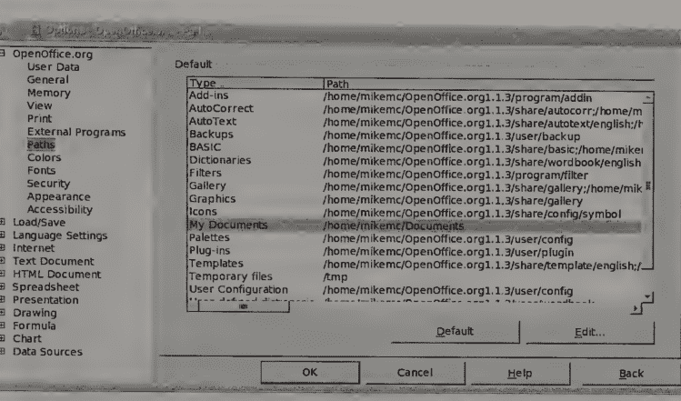

**图 9.1** OpenOffice.org “选项”对话框设置了 OpenOffice.org 以及你使用的各种工具。在此对话框中，更改了文档的默认保存路径。

你也可以在任何时候设置和自定义你的工具栏和快捷键。通过转到“工具, 自定义”菜单。

这些对话框在 2.0 版本中有所改进，但仍然可能令人困惑。假设你需要跟踪字数，并想检查。要更改工具栏，转到“工具, 自定义”（或右键点击工具栏）。点击“工具栏”选项卡。如图 9.2 所示的对话框出现。

在顶部，你会看到各种工具栏。在中间是可用的命令。如果你点击“类别”，它将变为激活状态。将鼠标悬停在列表上，你会看到“文档属性”。

如果你在工具栏上的某个项目没有默认图标，将其添加到工具栏并点击“图标”按钮以选择新图标。你还可以使用“向上移动/向下移动”按钮移动现有图标。从可用列表的底部添加分隔符。

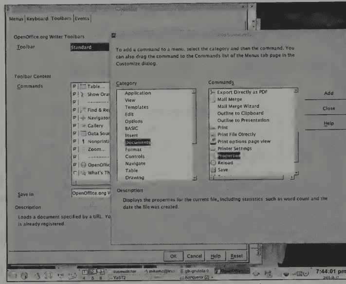

**图 9.2** “自定义工具栏”处理起来有点复杂，但它可以让你放置几乎任何 OpenOffice.org 命令。

点击“关闭”窗口，然后点击“确定”返回文档。完成字数查看后，点击“新建文档”图标，然后点击“统计”。

## 使用 OpenOffice.org

OOO 有一些地方与众不同，可能需要一些适应，特别是如果你是从 Microsoft Office 迁移过来的。其中一些内容如图 9.3 所示，当你查看典型的 Writer 文档时。

在大多数情况下，这种界面对于任何使用过文字处理程序来说都是熟悉的。屏幕左侧的那个额外工具栏是什么？这被称为主工具栏，无论你使用哪个应用程序，它的配置基本相同。顶部的工具栏随应用程序而变化，但某些工具是你始终需要的。

另一个看起来多余，但可以节省大量时间的项目是“样式表”（Stylist）。当你首次打开任何文档或电子表格时，这个东西就坐在你的文档中间，造成困扰。你的直觉可能是让它消失，但请忍住这种冲动。如果它没有挡住你的文档，把它移开，然后使用它。

你是否想过信件中的签名行应该从哪里开始？在学校作业中如何正确执行块引用？列表中的数字和文本之间应该留多少空间？你是否曾花费半小时尝试解决任何

想让这些内容在文档中完美对齐吗？如果是的话，你需要开始学习样式（Styles）和样式管理器（Stylist）。


**图 9.3** OpenOffice.Org 中的典型文档窗口。左侧是垂直工具栏，右侧是样式管理器。

什么是样式管理器？它是一种向文本块或电子单元格应用标准格式的方便方法，大多数人从未更改过“普通（Normal）”样式。在 OO 中，你可以一直使用 `tDefault` 样式过一辈子，但样式管理器至少能让你考虑一下它。

使用样式管理器来设置段落（常用样式）、字符（如书名）、页面和整个文档。如果你对样式的外观有特定的要求，可以编辑现有样式的属性或创建自己的新样式。

OOO 中有一个需要习惯的默认设置（如果你不是早早放弃的话），就是自动补全模式。当你输入时，会突然发现屏幕上出现绿色高亮的字母。按回车键接受 Writer 的建议，或按空格键继续输入让其消失。懒打字的人会喜欢这个功能，就像他们喜欢的 Shell 中的自动补全一样，但 Writer 的猜测经常是不准确的，可能会导致麻烦或尴尬的拼写错误。

你可以让它为你服务，但如果你觉得太烦人，关闭自动补全非常简单：转到“工具（Tools）”，“自动修正/自动格式（AutoCorrect/AutoFormat）”。点击“单词完成（Word Completion）”选项卡并取消勾选“启用单词完成（Enable Word Completion）”。你也可以在此框中进行其他调整。

# 第 9 章 提高效率：办公套和其他工具

> 提示
OpenOffice.org 为正式或学术写作有两个普通观察者不易发现的好处。

- 你可以使用导航器（Navigator）来构建文档大纲。你的标题会列在导航器中，你可以对它们进行拖拽、提升或降级。
- 你还可以创建一个参考文献数据库，用于单个文档或跨文档使用。转到“工具（Tools）”，“参考文献数据库（Bibliography Database）”尝试一下。

# KOffice

K 桌面环境（KDE）团队于 2001 年开始构建办公套件。虽然它没有 OpenOffice.Org 那种精细程度（显然也没有那么高的知名度），但它是一个非常好的套件。

KDE 用户应该特别欣赏 KOffice 及其工具。KOffice 的设计目的是与最流行的桌面以及套件中的其他工具集成。每个组件都可以独立从 Shell 或 KDE Kicker 菜单启动，Kicker 菜单也是一个启动接口 `koshell`，其中包含了所有办公工具的图标。

KOffice 使用了一种名为 KParts 的技术，允许将许多工具整合在一个大伞下，但并不要求每个部分都存在才能运行所有功能。因此，尽管你必须下载并安装整个 OpenOffice.org 套件，但你可能只需要文字处理器。每个 KOffice 工具都是一个 KPart，如果你只需要 K，那就是你需要获取的。

KOffice 的主要弱点是缺乏与大多数 Microsoft 格式的兼容性。KOffice 工具可以读取大多数 Microsoft Office 文档、电子表格，但无法以当前的 Office 格式生成复杂文档，尽管它可以处理富文本格式（RTF）和 WordPerfect（即 Microsoft Word 6）。与 Office 工具通信并非不可能，因为 KOffice 可以保存为 OpenOffice.Org 格式（一种封装的 XML 格式）、WordPerfect 以及标准的 HTML 或 XML。

# KOffice 中有什么？

KOffice 工具在数量上可以与 OOO 竞争，但质量并不总是如此。由于许多与 KDE 相关的内容，它们也倾向于把“K”系列推向极致。以下是你安装整个套件后会发现：

- Koshell——所有 KOffice 工具的集成启动工具。如果你需要工具箱中的所有工具，请使用它。
- KWord——一个基于框架的文字处理器，同时也作为一个出色的桌面出版工具。如果你有 Adobe PageMaker、InDesign 或 FrameMaker 的经验，你会在 KWord 中发现熟悉感。
- KSpread——这个电子表格支持脚本编写，也可以处理复杂的公式。
- KPresenter——另一个演示文程序。

# Linux 办公套件对比 149

- Kivio——一个类似于 Windows 下 Visio 的流程图和绘图程序。
- Karbon——地球生命的要素，它也是 KOffice 的矢量绘图程序。
- Krita——这一个绘画程序希望有一天能取代各处 Linux 设计师心中的 GIMP。
- Kugar——任何操作系统下办公套件中与众不同的：一个业务报告开发者/生成器。
- KChart——图表生成器。
- KFormula——一个公式编辑器。

# 安装和配置 KOffice

YaST 默认不安装 KOffice，即使你选择了 KDE 作为主桌面。要安装 KOffice，请遵循以下步骤：

1. 转到 YaST 软件页面并点击“安装和移除软件”。准备好你的 SUSE Linux CD。
2. 要么搜索 KOffice（这种方式更快），要么转到“生产力（Productivity）”，“办公（Office）”下的软件包显示。
3. 选择你想安装的 KOffice 模块。它们按功能（文字处理、电子表格等）列出。
4. 检查兼容性（如果你不是早早放弃的话）。
5. 检查兼容性（如果你不是早早放弃的话）。
6. 检查兼容性（如果你不是早早放弃的话）。
7. 检查并安装 KOffice。

# 使用 GNOME Office

AbiWord 拥有一个基于 Microsoft Works 文字处理器的美观且洁的界面。它具有非常实用的“另存为”功能，因此与微软世界进行文档交换应该很方便。如既往一样，一些较为生僻的功能很难复现。

Abiword 2.2 是一款与众不同的文字处理器：它的默认文件格式是可扩展标记语言 (XML)。Abiword 创建的任何文档都可以在支持 XML 的网络浏览器或任何文本编辑器中查看。在后者中，你可以看到标记标签。Abiword 可以将文档导出为 HTML 或带有 PHP 指令的文件，并在带有自定义或级联样式表的浏览器中显示结果。

AbiWord 能够轻松处理从右到左的文本，为使用阿拉伯语和希伯来语编写的用户提供支持。如果你是为多个受众写作，可以按段落操作此功能。

你可以在 AbiWord 中使用样式，并随时修改它们。AbiWord 还带了一些模板，其中一个非常有趣的简历模板，它使用了他们的吉祥物——蚂蚁 Abi。

Gnumeric 履行了“快速、免费、准确”的承诺。它可以导入你的 Excel 文件，还能处理许多其他流行的电子表格格式（包括 OpenOffice.org Calc 和 Quattro Pro）。它骄傲的是超过 100 个 Gnumeric 特有的函数（即 Excel 中不提供的函数）。

在 http://www.gnome.org/projects/gnumeric/doc/ 有详尽的文档。电子表格初学者应该阅读在线手册的第 3 章，那是关于使用 Gnumeric 的快速上手教程。

# 运行 Softmaker Office

Softmaker Office 2004 是 SUSE Linux 9.2 的新成员。这个小型商业套件承诺内存占用小、加载快，并能与微软格式进行无缝转换。通过 GNOME Office，Softmaker 是一个由两个应用程序松散连接的集合：文字处理器 Textmaker 2002 和电子表格程序 Planmaker 2004。

像 KOOffice 一样，Textmaker 提供了一些桌面出版功能以及普通的文字处理功能。它的“对象模式”（Object Mode）让你能够轻松地创建并放置新的文本或图形帧（见图 9.6）。

内置模板非常有趣，包括几种名片设计、信函、传真、备忘录和电话列表模板。

Textmaker 的主要缺点是此版本中禁用了拼写检查。

Planmaker 是一个完美的电子表格程序——并不华丽——但具备你对该应用预期的所有功能。它非常擅长导入 Excel 工作表（见图 9.7），并拥有 320 个内置函数。

# 比较 Linux Office 套件 153

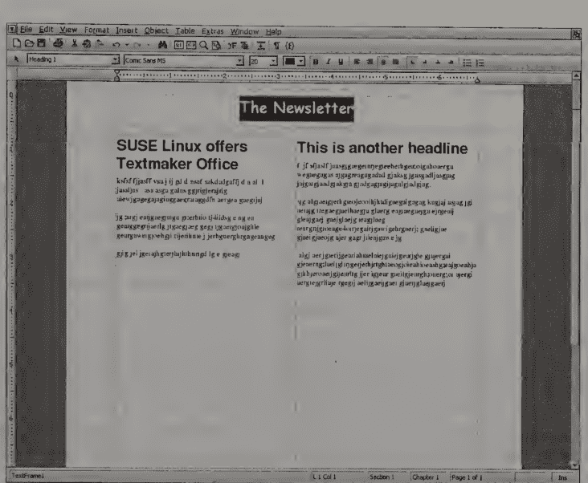

**图 9.6** Textmaker 让你能够轻松创建带有文本和图形帧的多列布局。

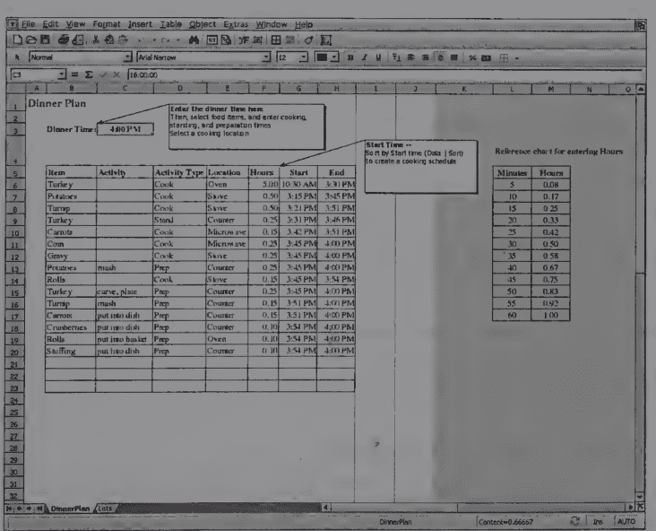

**图 9.7** Planmaker 平畅地导入 Microsoft Excel 工作表。

# 第 9 章 效率：Office 套件和其他工具

# 其他商业套件

虽然没有包含在 SUSE Linux 中，但该类别的其他几个商业产品可能会引起你的兴趣。

Hancom Office 由一家韩国公司生产。2.0 版本提供了一个文字处理器、一个电子表格、演示工具和一个绘画程序。

ThinkFree Office for Linux 在 2005 年 8 月 OpenSUSE 项目宣布前几天发布。它最著名的特点是与 Microsoft Office 工具进行更容易文档共享。ThinkFree 默认将文件保存为微软格式，还会制作供 Adobe Reader 使用 Acrobat PDF 文件。ThinkFree Office 包含一个文字处理器 (Writer)、一个电子表格 (Calc) 和演示 (Show) 软件包。你可以在 ThinkFree 网站免费尝试：http://www.thinkfree.com。

由 VistaSource 开发的 Appclipse 已存在一段时间。最近发布的 v4.3.3 包含文字处理器、电子表格、演示产品、一个图形生成工具包、一个数据库管理集成客户端和一个电子邮件客户端。

WordPerfect 是进入 Linux 市场的第一个知名产品之一，它不再开发 Linux 版本，但你仍然可以购买适用于 Linux 的 Corel WordPerfect Suite 2000。

# PDA 连接

SUSE Linux 提供了你可以与 Palm 风格个人数字助理 (PDA) 使用的程序和客户端。将你的 PDA 数据与 PC 同步、发送和检索邮件、保持日历整洁等。

# 用于 SUSE Linux 的命令行 PDA 软件

最流行的 PDA 相关应用封装在一个名为 pilot-link 的单包中。你可以直接从 shell 提示符组织并处理与 Palm OS 兼容的 PDA——不需要 GUI。pilot-link 惊人的功能包括：

- 从你的地址录（s）中提取并上传地址
- 安装日程信息
- 在 PDA 之间传输文本备忘录
- 管理你的待办列表
- 管理用户设置
- 发送和检索电子邮件文档
- 安装新的 PDA 程序
- 备份、同步和恢复 PDA 的内容
- 获取费用账户数据库信息

该套件有 31 个工具供你使用，在你将 Palm 底座连接到 PC 后，你应该能够使用其中任何一个来管理你的信息。例如，要将你的 Palm 设备的内容备份到 Linux 系统，请在 shell 中输入此命令：

```
```


`pilot-xfer -p /dev/tty8 -b backupdirectory`

此命令创建一个名为 `backupdirectory` 的目录，并将 PDA 的内容下载到该目录。探索套件中的 `pilot-link` 工具范围，或访问 `http://www.pilot-link.org` 与 `pilot-link` 社区联系。

# 在 KDE 和 GNOME 中连接你的 PDA

如果你想知道一个 `pilot-link` 工具好不好，你只需要知道有不同的方法为 `pilot-link` 提供的命令行工具套上漂亮的外观。`KPilot` 和 `Gnome-Pilot` 是各自桌面环境的“官方”界面（尽管 `KPilot` 比其对应产品强大得多，第三个 `J-Pilot` 也运行良好）。

`J-Pilot` 将管理、检索、安装、备份并同步 PDA 的任何信息。点击日程、待办列表、地址录和备忘录按钮来执行相关任务。使用同步和备份按钮更新或保存 PDA 的副本。

# 管理你的财务状况

对于最稳健的 Linux 软件，有两个开源项目想要让财务变得简单。`GnuCash` 是老牌，`KMyMoney` 是新秀。两者都支持复式记账并可以导入 `QIF` 文件。

然而，将收入和支出分类在对应的对应品中有所不同。收入和支出作为与银行账户分开的账户，你必须为每个支出创建子账户。类别可能会迁移，但你可能需要手动创建子账户。`GnuCash` 没有任何默认设置，但这意味着你可以根据想要跟踪的内容识别类别。

当你第一次打开 `KMoney` 时，你会看到一个只有一个（空白）模板的模板屏幕。你必须在创建账户之前选择此图标。你必须首先识别账户所属的机构，然后设置账户。执行此操作的向导非常直观，术语起初可能会令人望而却，但上手很容易。

显示数据的账本界面没有 `GnuCash` 那么好看（见图 9.9），但手动输入交易不那么困惑。当你在编辑框中输入新的付款人时，`KMoney` 会自动添加一个新的付款人。类别在 `0.6.4` 版本中尚未完全实现。

## 更多提高生产力的工具

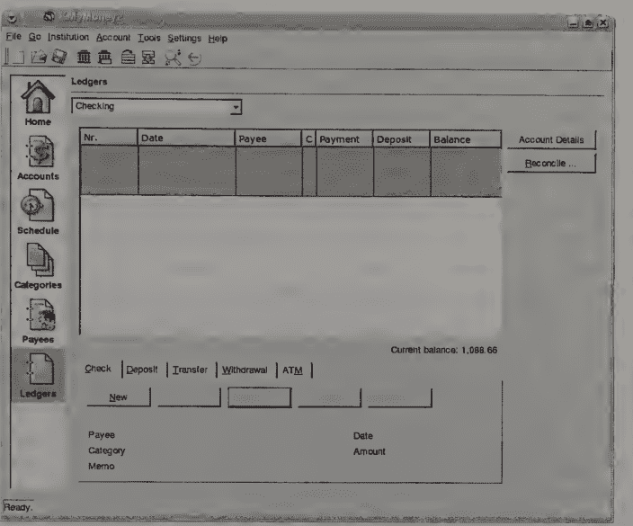

图 9.9 MyMoney 的分类界面显示了你的账户信息，并允许你手动输入交易。

## 更多提高生产力的工具

为了完善本章，还有几个工具可以帮助你完成更多工作，而且通常花费更少。其中一些工具是现有套件中其他工具的替代品，另一些则在所属类别中是独特的。

> 提示
> 管理个人信息对于高效的日常生活至关重要。由于许多管理个人信息的 Linux 工具包含了电子邮件客户端，因此这些工具将在第 13 章中进行描述。

## 使用 Scribus 进行桌面出版

我们在这里讨论的几个文字处理应用程序都具有一些桌面出版功能，但如果你具有 `Quark Xpress`、`Microsoft Publisher` 或 `Adobe PageMaker/InDesign` 等专业出版软件的经验，你可能会发现 `Scribus` 正是你所需要的工具。你可能会发现自己彻底放弃了其他这些应用程序！

你可以创建新闻简和杂志，至少有一本完整的书是用 `Scribus` 出版的。它可以处理繁重的高分辨率打印生产工作，但也可以制作简单的 PDF 传单和海报。你还可以生成用于发布到 Web 上的 HTML 文件。

有趣的是，`Scribus` 作为一个文字处理器被添加到 KDE 菜单中（在 Office 菜单下）。并不是说它的故事编辑器（Story Editor）无法胜优秀文本的工作，但 `Scribus` 是一个页面设计器。它最适合将已经写好的文本和图形放置在页面上。

如果你不熟悉桌面出版，请务必访问 `Scribus` 文档网站 `docs.scribus.net`，并完成“从 `Scribus` 开始”教程。你将学习整个使用 `Scribus` 制作纸质杂志的流程，使用所有的工具，并很好地学习一些页面设计知识。

图 9.10 显示了你使用 `Scribus` 时将遇到的各种窗口。主窗口（带有彩色方块和暗色文本块）是进行工作的地方。你在这个窗口中放置框架、拖动它们，并使用属性对话框（位于左下角）对它们（以及任何对象）进行调整。使用大纲工具（右下角）规划文档元素以及你想要放置它们的位置在使用此工具时，你可以轻松更改移动并移动每个元素。左上角的页面映射让你方便地在多个页面之间导航。剪贴板（Scrapbook）中常用的文本或图形片段可以随时将其拖入你的新文档中。

尝试使用 `Scribus` 并把你的文档制作出来。

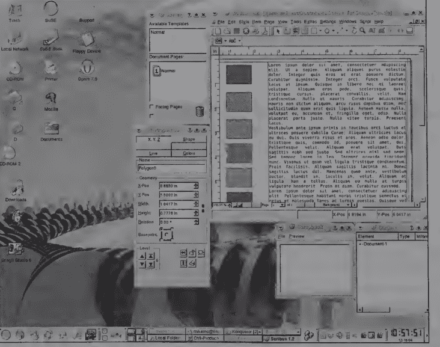

图 9.10 `Scribus` 让创建和发布专业文档变得简单。

## 使用 Dia 进行绘图和流程图

`Dia` 旨在成为 Linux 版本的 `Microsoft Visio`，这是一种让 IT 管理人员能够绘制网络图并让人力资源人员构建组织架构图的业务工具。它做得相当出色。

`Dia` 是一个 GNOME 应用程序，具有几十种默认形状，从通用多边形到网络图，再到统一建模语言（UML）编程图，可以快速组合并连接。图 9.11 显示了一个在不到五分钟内创建的非常简单的网络配置。

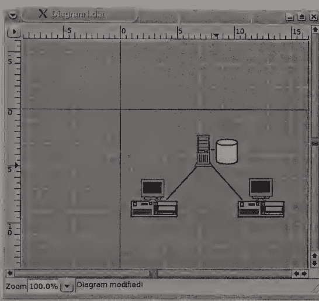

**图 9.11** 一个简单的 `Dia` 网络图。

在对象之间建立连接——即将它们分组以便一起移动——只需两次点击。选择一个对象，右键点击，从上下文菜单中选择“选择连接”（Select Connected）。

`Dia` 在 GNOME 中的工作效果远好于 KDE，但无论你的环境是什么，它都易于使用。KOffice 的对应产品 `Kivio` 在达到 `Dia` 方面还有差距。

## 使用 VYM 创建心导图

`View Your Mind` 是一个实用的工具，类似于 `Dia`，但有一个特定的用途：帮助你的大脑建立所需的连接，以解决脑海中转动的所有小想法。

`VYM` 允许你针对大小各的事发展想法。它可以作为视觉大纲，或帮助你为下一次工作搜索或职业转型制定计划。你的地图可以是深层层次结构的，思想气泡随机散落在屏幕上。将标题与更详细的思考连接，或将其他文档附加到地图。

## 传真和扫描应用程序

正如无数多功能打印机所有者证明的那样，扫描和传真文档只是写作的另一种方式。尽管电子邮件和 FTP 现在可能是许多人传输文档的首选方法，但将纸质数字化并通过电话线作为传真发送仍然是把信息传递给客户的常用方法。Linux 可以轻松处理这两项任务，SUSE Linux 提供了处理这些任务的工具。

## 扫描应用程序

使用扫描仪提供了多种增强生产力的选项。你可以在 `GIMP` 等图形应用程序中处理扫描图像，然后打印或将其嵌入文字处理文档或演示文稿中。你可以扫描纸质文档用于存档，也可以使用光学字符识别（OCR）软件处理它们，将图像转换为可以放入编辑格式的文字。SUSE Linux 提供了 `SANE`。

使用扫描仪提供了多种增强生产力的选项。SUSE Linux 提供了 `SANE`。如果你的扫描仪受支持，可以在 `http://www.sane-project.org/sane-supported-devices.html` 设备列表。

> 提示
> 如果你有扫描仪，请检查 `SANE` 的最新版本。有关该信息，请查看 `http://www.ldp.org` 中的 CVS HOWTO。

`Kooka` 是一个 KDE 应用程序，提供了扫描和 OCR 功能。

## 传真客户端软件

SUSE Linux 提供了几个处理计算、查看和发送传真的客户端。KDE 有两个图形应用程序：`Kfax` 用于查看传入的传真，`dPrintErrorFax` 用于写入传真。传真的实际发送和接收由命令行服务器 `HylaFax` 处理。

你可以使用任何编辑器或文字处理器创建要传真的文档。`OpenOffice Writer` 有一个向导可以方便地创建封面。访问文件、向导、传真来发送。`dPrintErrorFax` 也允许你在其界面中编写封面，见图 9.12。

# 参考

- `http://www.OpenOffice.org`—开源办公套件的家园。包含扩展文档、知识库以及维持该项目运行的各种邮件列表链接。
- `http://www.sun.com/software/star/staroffice/`—`OpenOffice.org` 的商业“大哥”，由 Sun Microsystems 生产和销售。此版本包含一个数据库以及一些其他闭源组件和工具。
- `http://www.taming-openoffice.org/`—针对想要摆脱 OOO（OpenOffice）的人群。包含了宝贵的提示、链接以及其他深入介绍 OOO 的书籍推荐。
- `http://www.KOffice.org`—KDE 办公套件主页。包含下载、新闻、邮件列表和存档。
- `http://www.gnome.org/gnome-office`—GO 软件包的伞型主页。
- `http://www.abisource.com`—`AbiWord` 页面。
- `http://www.gnumeric.org`—`Gnumeric` 页面。
- `http://www.softmaker.de/index_en.htm`—Softmaker Office。
- `http://www.vistource.com/page.php?id=86`—Applixware。
- `http://en.hancom.com/products/hancomoffice20.html`—Hancom Office。
- `http://kmmoney2.sourceforge.net/index.html`—KMymoney。
- `http://www.gnucash.org`—`GnuCash`。
- `http://www.scribus.net`—`Scribus` 桌面出版工具主页。务必查看 `docs.scribus.net` 上详细且非常有用的教程。
- `http://www.gnome.org/projects/dia/`—`Dia` 绘工具。包中未包含实用的文档。
- `http://www.insimilil.de/vym/`—View Your Mind 页面。使用 `VYM` 编写并导出为 HTML。查看程序工作原理的一种棒方法。

# 第 10 章

## 视觉、听觉和其他趣事

你的 SUSE Linux 机器上还有更多工作要做。你的桌面可以播放音乐并当作收音机使用。电影确实是在 Linux 机器上制作的。你可以从数码相机到 PC 创建并编辑电影。你甚至可以在显示器上观看电视（使用合适的视频卡）！

Linux 还不是游戏者的首选操作系统，但在 Linux 上玩耍的方式比你想象的要多。你将在本章中了解到可用功能。

由于这些内容大部分是以视觉为导向的，我们将强调 GNOME 和 KDE 的工具，但也有一些关于多媒体有趣的命令行工具可以学习。

## 入门：配置你的声卡和显卡

人们有一种印象认为 Linux 在多媒体（尤其是声卡）支持方面很薄弱。这很大程度上是因为非常受欢迎的 Creative Labs (`SoundBlaster`) 产品在 Linux 下的表现参差不齐。今天，多媒体支持非常出色并且正在不断改进。

SUSE Linux 开箱即支持大多数当前的声卡。在 SUSE Linux 安装期间，`YaST` 应该识别并为你的声卡和显卡提供默认配置，足以让你运行起来。虽然你可以在设置期间配置两块卡，但最好先让系统运行，稍后通过 `YaST` 进行微调。

SUSE Linux 的音频支持通过 `ALSA`（高级 Linux 音频架构）提供。`ALSA` 起初是一个为单块声卡编写更好驱动程序的简单项目，随后它蓬勃发展。自 v2.5 版本起它就已受内核支持，自 v2.6 版本起成为默认音频系统。它支持从消费级声卡到多通道接口的所有设备，如果你愿意，它还可以同时播放多个音频流。

## 本章内容

- 入门：配置你的声卡和显卡
- 播放音乐和听收音
- 制作自己的音乐
- 刻录 CD 和 DVD
- 电视和视频：Xine 和 Mplayer
- Linux 和你的数码相机
- 使用 GIMP 编辑图像
- 在 Linux 上游戏

`YaST` 处理所有 `ALSA` 的配置任务，你不再需要手动加载内核模块。这是下一节的主题。

## 在 YaST 中配置声卡

大多数音视频设置都在 `YaST` 中。打开 `YaST` 并点击“硬件”（Hardware）开始配置。当你点击“声音”（Sound）时，`YaST` 会检查当前配置并显示所有检测到的声音。

你可以为卡设置一些高级选项，但如果你正在尝试解决某些问题并知道更改什么，应该忽略这些。点击“音量”（Volume）更改卡上每个通道的默认音量设置。“启动序列”（Start Sequencer）复选框在启动时加载 MIDI 声音的内核模块，并默认勾选。

`YaST` 不会自动识别你的显卡，你可以在此对话框中手动添加。

从菜单中选择卡或使用搜索工具找到你的卡。点击“下一步”（Next）确认更改。

如果你更改了硬件，重新配置显卡和显示器也应该自动完成。在 `YaST` 的“硬件”部分点击“显卡和显示器”（Video Card and Monitor）将显示当前设置。点击“更改”（Change）运行 `SaX2`（参见第 4 章“使用 Yast2 和 Sax2 进一步配置”以了解更多关于使用 `SaX2` 配置 X Window 系统的信息）。

> 需要快速测试声音？前往 KDE 或 GNOME 控制中心设置系统通知。在 KDE 系统通知中，选择“KDE 正在启动”并点击 > 图标播放声音。在 GNOME 中，打开“多媒体”（如果需要）然后选择“声音事件”（Sound Events）并任选一个随机声音（你必须安装 `gnome-audio` 包，默认声音才能生效）。

## 播放音乐和听收音

声卡工作正常后，也许你唯一想做的就是播放 CD、MP3 以及访问你喜爱的广播电台。SUSE Linux 提供了丰富的方法来实现这些。

Linux 上最成熟的通用媒体播放器是 `XMMS`，它是根据 Windows 上流行的多媒体播放器 `Winamp` 设计的。它的显示是模块化的，你可以增加（或减少）视觉效果来增强音频体验。图 10.1 显示了在默认安装下的情况。

`XMMS` 播放几乎所有的音频格式，除了 Windows Media (`.wma`, `.asf`) 文件。它会播放音频。

## 刻录 CD 和 DVD

> 注意
> 如果在 64 位处理器上运行 SUSE Linux 9.2，您在基于 Mozilla 的浏览器（包括 `Firefox`、`Epiphany` 和 `Galeon`）中运行 `RealPlayer` 可能会遇到问题。发行版自带的 32 位 `RealPlayer` 软件包不包含 Mozilla 插件，且手动在浏览器中安装插件会导致浏览器启动时崩溃。Helix 社区正在开发 Helix 和 `RealPlayer` 程序的 64 位版本（包括插件），这些版本可能在您阅读此内容时已经发布。
> 在 AMD Athlon 3000 下，`RealPlayer` 作为独立播放器运行良好。

两个版本的 Helix 播放器都具有插件架构，随着时间的推，这将产生满足每个用户需求的播放器。这取决于是否有足够的用户表达他们的愿望。

## 制作你自己的音乐

SUSE Linux 有许多工具可以帮助您录制声音。`Icecast` 是一种流媒体音频服务器应用程序，允许您通过局域网甚至通过互联网播放您的 MP3 集合。

## 刻录 CD 和 DVD

刻录 CD 和 DVD 是 Linux 多媒体爱好者的基本技能。光盘和数字通用光盘（DVD）是所有类型多媒体数据的标准介质，因为它们生产成本低、极其便携，并且可以容载音频（尤其是视频）信号的大文件。即使是标准的三分钟流行歌曲也需要几兆字节的空间来存储。对于多媒体，您可以使用 CD/DVD 来：

- 录制、播放和存储图形图像、音乐、视频和播放列表
- 从您的音乐 CD 中提取音频轨道，并根据您的喜好创建“混音带”

当然，CD 还可以存储许多其他类型的文件，而不只是音频和视觉文件。它是存储硬盘上所有数据备份的极佳介质。更多信息请参阅第 20 章“管理数据：备份、恢复与重建”。

虽然这可能看起来显而易见，但如果您想在 CD 上录制多媒体（及其他）数据，您必须有一个支持刻录光盘的驱动器。CD-ROM 播放器仅具有此功能——播放只读的已录材料。您需要的是 CD-RW（读写）或 DVD-RW 驱动器。光盘本身也必须是可写的（CD-R 或 CD-RW 以及相应的 DVD 格式）。`YaST` 会在安装时配置您的硬件；请查看第 4 章了解如何操作。为了确保您的硬件配置正确，请使用 `cdrecord -scanbus` 获取在 SCSI 下使用 CD 驱动器的信息。当您使用以下命令时：

```
cdrecord -scanbus
```

您将看到类似的内容：

```
cdrecord-2.1 (x86_64-suse-linux) Copyright (C) 1995-2004 Jörg Schilling

Note: 此版本为非官方（修改过的）版本

Note: 可能存在原始版本中不存在的错误。

Note: 请将错误报告或支持请求发送至 http://www.suse.de/feedback

Note: cdrecord 作者不应被此版本的问题困扰。

Linux scsi driver version: 3.5.27

Using libscg version 'schily-0.8'.

cdrecord: Warning: using unofficial libscg transport code version

(akir@suse.de-scsi-linux-sg.c-1.83-resmager-patch '@(@#)scsi-linux-sg.c 1.83 04/05/20

Copyright 1997 J. Schilling).

scisibus0:

0,0,0) 'LITE-ON' 'COMBO SCSI-5232K' 'NK07' Removable CD-ROM

0,1,0) *

0,2,0) *

0,3,0) *

0,4,0) *

0,5,0) *

0,6,0) *

0,7,0) *

scisibus2:

2,0,0) 'Memorec ' 'TD2C ' '1.04' Removable CD

2,1,0) *

2,2,0) *

2,3,0) *

2,4,0) *

2,5,0) *

2,6,0) *

2,7,0) *
```


CD 刻录机已存在，并被系统识别为设备 `0,0,0`。这些数字代表设备的 `scsi/lun`（逻辑单元号）。当您从命令行刻录 CD 时，您需要知道这个设备编号，因此请记下或记住它。

在初次尝试 CD 刻录时，有一个方便的 GUI 界面来引导整个过程是很有帮助的。您最终可以尝试命令行方法，但由于 Linux 提供了两个非常好的刻录多媒体光盘的 GUI 工具，所以您可以放心地使用它们。在本节中，您将首先学习使用 KDE 和 GNOME 制作的 CD 创建工具。您将在键盘前看到这些用于刻录的工具。

## 从桌面创建 CD 和 DVD

KDE 的图形化 CD/DVD 工具“Kreator”被称为 `K3b`，它让 CD 刻录几乎变成了将文件拖入项目中并处理其他事务即可。

## 刻录 CD 和 DVD

171

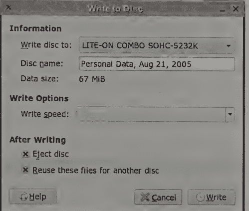

图 10.3 `Nautilus` 为你提供了一个创建 CD 的简单工具。

示例中使用的选项有：

- `-r`—将文件权限设置为更有用的值。`UID` 和 `GID`（个人和组用户 ID 要求）被设置为零，所有文件全局可读且可搜索，且所有文件被设置为可执行（针对 Windows 系统）。
- `-v`—显示详细信息（而不是这些信息），以便你可以看到处理过程中发生了什么；如果发生任何问题，这些信息可以帮助解决问题。
- `-J`—在 `ISO9660` 中使用 `Joliet` 扩展，以便 Windows 能够轻松读取该 CD。`Joliet`（针对 Windows）、`Rock Ridge`（针对 Unix）和 `HSF`（针对 Mac）是 `ISO9660` 标准的扩展用于支持长文件名，而不是该标准原生支持的八字符 DOS 文件名。
- `-l`—允许 31 个字符的文件名；纯 DOS 不喜欢它，但其他人都喜欢。
- `-o`—定义写入镜像的目录（即输出位置）及其名称。`/tmp` 目录非常适合此目的，但镜像也可以放在任何你拥有读写权限的地方。
- `-source_directory`—指定源目录的路径——即包含你想包含在 CD 中的文件的目录。有方法可以添加附加路径并排除指定路径下的目录（文件）；如果你需要更细粒度的控制，在 帮助页（`man page`）中都有详细解释。我们简单的解决方案是构建一个新的目录树，并在其中填充我们想要复制的文件，然后使用该目录作为源创建镜像。

还有许多可用选项，包括使 CD 可引导的选项。

在创建 ISO 镜像后，你可以使用 `cdrecord` 命令将其写到 CD。

```bash
cdrecord -eject -v speed=12 dev=0,0,0 /tmp/our_special_cd.iso
```


# 第 10 章 视觉、听和其他趣事

示例中使用的选项有：

- `-eject`—在写入操作完成后弹出 CD。
- `-v`—显示详细信息。
- `speed`—设置速度；速率取决于你驱动器的能力。如果驱动器或磁盘本身不支持更速度（或在高速度下刻录效果不好），你可以使用较低的速度来获得良好的刻录效果。
- `dev`—指定 CD 刻录机的设备号（我告诉过你需要这个了）。

> 提示
> 如果你有 CD-RW（读写）光盘，可以使用 `cdrecord blank=` 选项来擦除 CD 上所有的现有文件。

`cdrecord` 提供了（在磁盘支持的情况下）制作多回段 CD 的选项。如果没有此选项，当你向 CD 写入文件并从驱动器取出后，即使光盘还有剩余空间，也无法再次被覆盖。使用 `cdrecord -multi` 可以让你选择在磁盘上放置更多文件。

目前 CD 的标准容量为 700MB 数据或 80 分钟音乐。某些 CD 可以超刻录；只要你的驱动器支持，你就可以超刻录。访问 http://www.cdmediaworld.com/hardware/cdrom/cd_oversize.shtml 了解更多信息。

## 从命令行创建 DVD

现在许多新电脑都配备了 DVD 刻录驱动器，成本已经下降，普通用户也可以使用它们。遗憾的是，标准制定机构没有跟上这些驱动器可用性的增长，因此刻录 DVD 有两种格式。通常被称为 + 和 - 格式的 DVD+、DVD+R、DVD-R 和 DVD-RW 是我们现在必须接受的格式。

两者之间的区别可能与数据挂载到 DVD 自身的方式有关，+ 格式在缓冲区恢复方面具有优势。这种实现方式影响了新创建 DVD 在 DVD 播放机上的播放性。DVD+ 格式在有划痕或脏的介质上录制也有一些优势。大多数驱动器都支持 DVD+ 格式，并同时支持两种。

本节将重点关注 DVD+RW 驱动器，因为大多数市售的驱动器都支持这一标准。SUSE Linux 的软件支持两种格式。在使用这些命令行工具之前，阅读 http://fy.chalmers.se/~apro/linux/DVD+RW 的 DVD 刻录 HOWTO 将很有。你可以跳过 HOWTO 中详细解释它们在内核中如何被称为 DVD 读取器的部分。读读那些内容。

你需要安装两个包才能实现 DVD 刻录：`dvd+rw tools` 和 `cdrtools`。`dvd+rw` 包包含了 `growisofs` 应用，它作为 `mkisos` 的前端以及 DVD 格式化工具。

你有两种方式使用 DVD 介质录制数据。第一种与在“会话”中刻制 CD 的类似，而第二种方法是使用包写入将数据作为真正的文件系统记录。

### 会话写入

要在会话中录制数据，你需要使用两个阶段的过程：

- 使用 `dvd+rw-format /dev/scd0` 格式化磁盘（仅第一次使用磁盘时需要）。
- 使用 `growisofs -Z /dev/scd0 -R -J /your_files` 将数据写入磁盘。

`growisofs` 命令只是将数据流向磁盘。对于后续的会话，[文本省略]

> 警告
> 某些[文本省略]

> 提示
> 当你[文本省略]

> 提示
> 当你[文本省略]

### 包写入

包写入将 DVD 视为文件系统。[文本省略]

## 电视与视频：Xine 和 Mplayer

注意

另一个 PVR 软件包 Freevo 也可以在 SUSE Linux 下运行。

**硬件要求** 这并不是一个让你的旧 Pentium II 机器焕发新生的项目。检查电视信号需要大型快速的微处理器芯片和一个良好的显示器。为了实现这一功能，你需要现代设备。请查看 PVR 硬件数据库 http://pvrwh.goldfish.org/tiki-pvrwh.php 并这些系统与 SUSE 硬件数据库进行比较，以为你选择最适合的 PVR 系统。多个热门电视卡的制造商 Hauepage 建议其 PVR 显使用 733MHz 的 Pentium III 处理器（或 1.8GHz 以处理 DivX 视频）。你还应该拥有高速互联网连接（DSL 或电缆调制解调器）以访问节目表信息。此外，MythTV 设定了以下指南：

- 256MB 内存
- 40GB（或更大）硬盘
- XFS 或 JFS 文件系统（它比其他文件系统更好地处理大文件）
- 带有 TV 输出接口的视频卡
- 视频采集卡

视频采集你有两种基本选择：软件驱动的“帧捕获器”或更昂贵的的 MPEG 编码器。帧捕获器使用 PC 的资源进行编码，而板载编码器则自行完成。权衡是，编码器所需的 IvyTV 驱动程序安装起来有些麻烦。

如果你有合适的机器，让我们开始设置。

**设置你的 PVR** 按照以下步骤构建你的个人视频录制器。在设置之前或设置期间，请阅读 MythTV 在线安装指南。在 http://www.mythtv.org/docs/mythtv-HOWTO.html 查看它将非常有帮助。

提示

这些说明使用了两个工具在你的 SUSE Linux 系统上安装和更新软件：YaST 在线更新和 Apt。可以在第 21 节“保持你的系统为最新：包管理”中了解更多信息。

1. 如果你尚未安装，请安装 SUSE Linux。确保你已安装了 qt3, qt3-devel, qt3-mysql, gcc, freepype-devel 和 mysql 包。
2. 运行 YaST 在线更新以确认所有内容都是最新的。
3. 如果尚未安装 apt，请安装它。参见第 20 节说明。
4. 打开终端或控制台并以用户（SuperUser）身份登录。

## 第 10 章 视觉、声音和其他趣事物

5. 在文本编辑器中打开 `/etc/apt/sources.list` 并添加此行：`rpm http://folk.uio.no/oyevideo/apt use/9.2-mythtv MyTV`。该网站包含适用于 SUSE Linux v9.0, 9.1 和 9.2 的 MyTV RPM（根据需要更改版本号）。如果你有 MPEG 编码卡，也添加此行：`rpm http://folk.uio.no/oyevideo/apt use/9.2-ivtv IvyTV` 以获取 IvyTV 软件包。
6. 输入 `apt install xmltv zap2it lame mythtv`。这将安装 MyTV 以及任何其他必要的包。这可能需要一些时间。
7. 设置 MySQL 数据库。在 shell 中输入 `mysql -u root < mc.sql`。
8. 访问 http://www.mythtv.org/docs/mythTV-HOWTO.html#toc5.4 并按照设置 Zap2it DataDirectory 的说明来处理你的需求。
9. 决定你想在文件系统的什么位置存储录制的视频。默认情况下，MyTV 将文件存储在 `/mnt/store`。你可能需要创建此目录；确保至少有一个用户可以写入该目录。你可能还想创建一个用户 mythtv 来执行。如果你倾向于将文件存储在其他地方，稍后需要编辑 MyTV 配置。
10. 进入 MyTV 设置目录并输入 `./setup`。按照提示完成初始配置。接受默认设置应该不会让你遇到麻烦。
11. 完成设置后，是时候回到普通用户身份了。如果你创建了单独的用户 mythtv，请注销并以 mythtv 登录（其他用户，只需退出超级用户）。
12. 运行 MyTV 是一个两步骤的过程。首先，运行 `mythbackend` 打开数据库，然后运行 `mythfrontend` 查看你的内容。

这样你就有了 PVR，而且无需购买任何服务。设置 MyTV 还有许多其他选项；可以在 MyTV 手册中阅读更多信息。

## Linux 与你的数码相机

数码相机配合你的个人电脑是创建、存储、编辑、打印和共享图像的强大工具。你可以拍照，最初将其存储在相机的磁盘或存储卡上，然后用相机的 USB 线将它们传输到 PC。使用你喜欢的图像编辑器查看或编辑文件，然后将照片发送给朋友家人，发布在你的照片博客上，或将图像保存在可刻录 CD 上。无需烦恼，无需胶片。

遗憾的是，运行 Linux 时，与数码相机相关的乐趣和便利性会丧失。相机自带的大部分甚至所有软件只在 Windows 上运行。

然而，不要放弃。SUSE Linux 提供了许多工具来组织和共享你的照片，因为数字影像行业是围绕非常普通的标准组织的，Linux 可以处理任何涉及你的任务。

首先，带有通用串行总（USB）的相机是创建、存储、编辑、打印和共享图像的强大工具。你可以拍照，最初将其存储在相机的磁盘或存储卡上，然后用相机的 USB 线将它们传输到 PC。使用你喜欢的图像编辑器查看或编辑文件，然后将照片发送给朋友家人，发布在你的照片博客上，或将图像保存在可刻录 CD 上。无需烦恼，无需胶片。

图形处理并执行其他文件管理任务。工具箱扩展（Xtns）菜单包含了让 GIMP 特别与众的插件和其他增强功能。

在图像窗口的任何位置点击右键，你都可以访问一个上下文菜单，其中有丰富的选项可以处理你的图像（见图 10.4）。

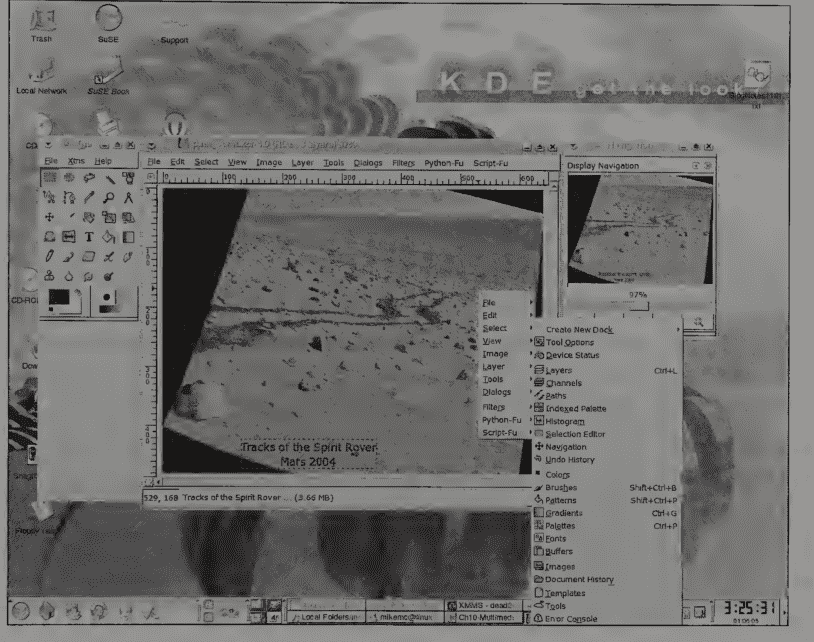

图 10.4 在 GIMP 图像中点击右键时，你可以擁有的选项提示。

菜单右侧有两个重要的选项：Python-fu 和 Script-fu。它们都提供了自动化化任务和完成各种事情的方法。Script-fu 是 GIMP 原始的脚本语言，但因为它基于一种相对冷门的编程语言 Scheme，所以它很难学习。GIMP 2.0 引入了 Python-fu，它基于著名的（并以易于使用和学习而闻名的）Python 脚本语言。

GIMP 的帮助文件非常棒。对于新手来说（无论是针对 GIMP 还是通用的图像编辑），阅读手册也没有坏处。

### PHOTOSOP 对比 GIMP

有两个巨大的阻碍了 GIMP 成为纸质打印机的标准预印格式。

第一个是 Photoshop 对潘通（Pantone）颜色的许可，以确保色彩匹配。Adobe 可以付费获得潘通专利色彩规范的许可；而全志愿的 GIMP 项目则不能。有一些 GIMP 调色板可以近似潘通色，但没有人能确定这些有经验的猜测是否是 100% 正确的。

## 第 10 章 视觉、听和其他趣事

第二个问题涉及到颜色在计算机屏幕上的显示与在杂志上的显示之间的差异。GIMP 根据红、绿、蓝（RGB）值的组合来分离颜色。印刷出版者使用 CMYK（青、洋红、黄色和黑色）方案。短期内，有一个名为 Separate 的 GIMP 插件提供了“对 CMYK 的最小支持”。长期来看，开发者们正在开发一项新技术——通用图形库（GEGL），它将完全支持 CMYK 分色和其他“深色”问题。

如果你为打印而制作图像，这些问题可能是至关重要的，你可能需要保留一份 Photoshop。请注意，你可以在 Codeweavers 的跨平台工具 Crossover Office 下运行 Photoshop。

### 图形格式

当你处理数字图像时，似乎有数百万种不同的格式。尽管你可能不相信，但每种格式的存在都有特定的原因，无论是技术上的、审美上的还是法律/财务上的。某些格式拥有专利，或者包含了专利技术。

当你使用像 GIMP 这样的编辑器时，请为当前任务选择正确的格式。以下是一些常用格式的列表，随后是关于你为什么可能想要使用（或不使用）它们的解释。

- BMP—位图图形，通常在 Windows 中使用。它们是大型且未压缩的文件，用于图标和壁纸。
- GIF—交换格式。网络上的大多数图形曾使用过这种格式，它由最初的在线服务商之一 CompuServe 开发。GIF 使用了需要许可才能使用的专利算法（LZW）。
- JPEG—联合图像专家小组联合摄影专家小组为电子照片开发了这种格式。所有数字相机默认都产生这种格式。压缩会丢失一些数据，但仍然提供了清晰的图像。
- PNG—便携式网络图形。GIF 的开源替代品。
- SVG—可缩放矢量图形。作为“下一个大事”，这项网络标准正在由万维网联盟（W3C）开发。
- TIFF—标记图像文件。通常用于打印和出版。

有时你可能无法以当前的格式处理文件。来救你的是一系列独立的图像转换应用程序，它们几乎可以瞬间更改图像的格式。其中最为人知的 ImageMagick 甚至可以从命令行完成工作！

## 在 Linux 上游戏

作为最初的“爱好”操作系统，一些 Linux 用户将所有的乐趣都花在了调优操作系统和应用程序上。其他人则需要更传统的娱乐。SUSE 为你心中的游戏玩家配备了各种选项。

Linux 商业游戏很少。如今大多数游戏都是使用 Direct3D 图形引擎为 Windows PC 开发的。跨平台的 OpenGL 引擎用于许多热门游戏（如《毁灭战士 3》），但人们认为 OpenGL 并不那么强大。

TransGaming Technologies 拥有一个名为 Cedega 的引擎，可以将 Direct3D 游戏转换为 OpenGL。这使得 Linux 用户能够玩多达 300 款 Windows 和在线游戏，包括多人角色扮演游戏，如《魔兽世界》（Everquest）和《星际穿越》（Star Galaxies）。可以在 http://transgaming.org/gamesdb 查看支持的游戏数据库，其中包含一些玩家评分。

你必须订阅 TransGaming 的服务（每月 5 美元）来获取 Cedega。取决于你玩什么以及你喜欢的程度，这可能是值得的。更多信息请访问 http://www.transgaming.com/。

许多忠实粉丝致力于制作一些经典游戏的开源克隆版，如吃人仔（PacMan）、俄罗斯块和城市模拟器（称为 LinCity）。如果没有一个纸牌游戏，电脑就不算真正的电脑，对吧（见图 10.5）？


图 10.5 在 GIMP 图像中点击右键时，你可以擁有的选项提示。

许多忠实粉丝致力于制作一些经典游戏的开源克隆版，如吃人仔、俄罗斯块和城市模拟器（称为 LinCity）。如果没有一个纸牌游戏，电脑就不算真正的电脑，对吧（见图 10.5）。

### KDE 游戏

Linux 商业游戏很少。如今大多数游戏都是使用 Direct3D 图形引擎为 Windows PC 开发的。跨平台的 OpenGL 引擎用于许多热门游戏（如《毁灭战士 3》），但人们认为 OpenGL 并不那么强大。

TransGaming Technologies 拥有一个名为 Cedega 的引擎，可以将 Direct3D 游戏转换为 OpenGL。这使得 Linux 用户能够玩多达 300 款 Windows 和在线游戏，包括多人角色扮演游戏，如《魔兽世界》（Everquest）和《星际穿越》（Star Galaxies）。可以在 http://transgaming.org/gamesdb 查看支持的游戏数据库，其中包含一些玩家评分。

你必须订阅 TransGaming 的服务（每月 5 美元）来获取 Cedega。取决于你玩什么以及你喜欢的程度，这可能是值得的。更多信息请访问 http://www.transgaming.com/。

许多忠实粉丝致力于制作一些经典游戏的开源克隆版，如吃人仔、俄罗斯块和城市模拟器（称为 LinCity）。如果没有一个纸牌游戏，电脑就不算真正的电脑，对吧（见图 10.5）。

### GOME 游戏

Linux 商业游戏很少。如今大多数游戏都是使用 Direct3D 图形引擎为 Windows PC 开发的。跨平台的 OpenGL 引擎用于许多热门游戏（如《毁灭战士 3》），但人们认为 OpenGL 并不那么强大。

TransGaming Technologies 拥有一个名为 Cedega 的引擎，可以将 Direct3D 游戏转换为 OpenGL。这使得 Linux 用户能够玩多达 300 款 Windows 和在线游戏，包括多人角色扮演游戏，如《魔兽世界》（Everquest）和《星际穿越》（Star Galaxies）。可以在 http://transgaming.org/gamesdb 查看支持的游戏数据库，其中包含一些玩家评分。

你必须订阅 TransGaming 的服务（每月 5 美元）来获取 Cedega。取决于你玩什么以及你喜欢的程度，这可能是值得的。更多信息请访问 http://www.transgaming.com/。

许多忠实粉丝致力于制作一些经典游戏的开源克隆版，如吃人仔、俄罗斯块和城市模拟器（称为 LinCity）。如果没有一个纸牌游戏，电脑就不算真正的电脑，对吧（见图 10.5）。

### Freecy: 免费策略游戏

西德·梅耶的《文明》是广受欢迎的游戏之一。这种从零开始建立城市、进行战争和和平的机会是令人着迷的。自然，有些玩家运行 Linux 是为了更严肃的追求。Freeciv 项目于 1995 年 11 月诞生，在《文明》发布一年后。Freeciv 1.0 在六周后推出，尽管在三周后通过大量更新产生了 v1.0f。当《文明 III》于 2001 年 10 月发布时，Freeciv 已经更新到 v1.12，v2.0 于 2005 年 5 月发布。SUSE Linux 包含了 v10.2。

你可以与电脑对战，与局域网内的朋友一起玩，或者在互联网上与其他一起玩。在 Freeciv 中，你是你种族的绝对统治者。你通过调集和管理资源来建立城市。

## 参考文献

让他们产生更多财富，然后你就可以对其进行征税。与此同时，你试图增加自己的科学和军事能力，目标是实现世界统治，或者建造第一枚飞往半人马座的火箭。

大多数游戏只有一个运行的可执行文件；而 Freeciv 必须在你自己的机器上运行，你首先需要运行服务器应用程序，它包含了地图和大部分游戏细节。请点击此处获取更多信息，并在服务器上同样创建 AI 对手，这样当你独自玩或仅与一两个朋友一起玩时，可以为你提供一些竞争。

新玩家（尤其是那些没有玩过《文明》系列的人）应该阅读 Freeciv 网站上的在线手册，以了解其运作方式。共有三份手册：针对客户端和服务器的更具技术性的、以命令为导的手的手，以及一份描述游戏力量和条件的教程。手册并不完整（尤其是客户端手册），但足以带你入门并让你持续操作下去。

## 参考文献

- http://www.alsa-project.org/alsa-doc 高级 Linux 声卡矩阵。点击此处获取更多关于你的声卡支持情况的信息。
- http://cdb.suse.de SUSE 硬件数据库。在安装 Linux 之前，在此处搜索你的声卡和显卡。
- http://www.linux-sound.org 为 Linux 制作的音乐，面向音乐家邮件列表、玩家和制作软件，是 Linux 下音频和音乐的起点。
- http://www.dccj.org/LAU/guide/index.php Linux 音频用户指南。
- http://www.xmms.org X 多媒体系统 (XMMS) 的主页。此多功能媒体播放器的新闻、下载、插件、皮肤和支持。
- http://helixcommunity.org 许多与开源 Helix 播放器、服务器和 PlayerContent 生成器相关的项目。
- http://www.vorbis.com 关于 Ogg Vorbis 音频格式的原理与原因。
- http://www.exploits.org/v4 Video for Linux 信息页面。关于 V4 API 的技术信息、支持的显卡的驱动程序以及个人录像机。指向制作各种类型视频软件的链接。在输入此 URL 时，请注意最后一个字符是 L（如 Video4Linux），而不是数字 1。你应该输入数字以获得一个简洁的错误提示。
- http://pvguides.no-ip.com 使用 MythTV 和 VDR 系统设置基于 PC 的个人录像机的指南。
- http://www.mythtv.org MythTV 个人录像机软件。包含安装说明和 MythTV 运行的示例。
- http://anandtech.com/linux/showdoc.aspx?i=2190&p=1 对 SUSE Linux 上一次精彩的 MythTV 安装进行详细且诚实的的解释。
- http://www.mplayerhq.hu MPlayer 总部，提供那个功能多样且功能强大的视频播放器。
- http://xineq.de Xine 总部。该视频播放器的新闻和下载。
- http://www.gphoto.org/ 用于数字相机图像的 Linux 管理软件。
- http://www.gphoto.org/proj/libgphoto2/support.php gphoto 支持的相机列表。
- http://www.teaser.fr/-hfiguire/linux/digicam.html UNIX、Linux 和 BSD 的数字相机支持。如果你的相机不在 gphoto 列表中，该网站可能帮助你找到它并提供建议。
- http://digikam.sourceforge.net 用于 gphoto 的 KDE digiKam 前端。在此查看插件和新版本，它们似乎每两个月发布一次。
- http://www.gimp.org GNU 图像处理程序 (GIMP) 组织良好的主页。查看教程部分，那里有从初学者到专家的所有水平的步骤指南。
- http://gug.sunsite.dk—tutorials 全球 GIMP 用户组。邮件列表、大量的图像和纹理库，以及帮助你成为更优秀 GIMP 高手的文章。
- http://iculus.org/lgfaq Linux 游戏玩家常见问题解答。在这里获得问题的答案。
- http://www.happyppenguin.org Linux 游戏大全，各种 Linux 游戏的目录。玩家评分、新闻、论坛和链接。
- http://linuxgames.com LinuxGames，包含与该主题相关的所有各类新闻。
- http://www.kde.org/kdegames KDE 游戏区域，包含了所有随 KDE 提供的游戏描述。
- http://www.gggamingzone.org 免费在线玩 Linux 游戏。
- http://www.freeiciv.org Freeciv wiki 网站。关于 Freeciv 的一切，提供七种欧洲语言的翻译。

# 第 11 章

## 本章内容

# 跨平台操作

Linux 的真正伟大之处之一是它的灵活性。当你迁移到 Linux 时，并不总是被迫放弃你的旧平台或喜爱的应用程序。取决于你在电脑两侧使用的文件系统，你可能感知不到文件行为的任何差异。在足够的磁盘空间下，你可以进行双系统。你甚至可以模拟 MacOS。

- 查看电脑 Windows 侧的文件
- 模拟操作系统：概述
- 使用 Wine 运行 Windows
- 使用 FreeLin 运行 Windows
- 使用 VMware 运行应用程序
- 使用 Basilisk II 模拟 Mac
- 使用 doseBox
- Xen：虚拟化的未来

本章完全关于使用这些工具。有些是 Linux 内置的，另一些可以免费下载。你将学习 Windows 仿真及其 Crossover Office。FreeLin 允许你直接在 Linux 中运行 Windows 98 或 Windows 2000。VMware 使用虚拟机方法安装和运行其他系统。Basilisk II 是 MacOS 模拟器，而 doseBox 捕捉了早期的时代。最后，你将浏览一个备受关注的新项目，Xen。

## 查看电脑 Windows 侧的文件

当你已经在运行某种形式 Windows 的电脑上安装 SUSE Linux 时，YaST 会提议并运行这两个操作系统。Linux 然后将对电脑进行分区，GRUB 引导加载程序会将 Windows 添加到列表中。

## 跨平台操作

在这种情况下，SUSE Linux 还会创建一个 `/windows` 目录以使所有 Windows 文件可访问。从 Windows NT 开始，微软创建了一种基于权限的私有文件系统 NTFS，它是 Windows 2000、2003 和 XP 的默认文件系统。这种文件系统的转换对 Windows 用户是有益的，因为 NTFS 比 FAT 更有效地利用磁盘空间，而且文件和目录的权限更安全。由于微软没有共享该文件系统的许多细节，Linux 的支持并不完全透明。

因此，NTFS 卷上的大多数文件在 Linux 上是只读的。你可以在 Linux 应用程序中打开并编辑这些文件，但无法将更改保存回 NTFS 卷。然而，你可以将 Linux 文件保存或复制到 FAT 格式的软盘或 Zip 磁盘，然后打开并保存到 NTFS 卷。

> 注意 你可以在 Linux 中播放存储在 NTFS 分区上的大多数媒体（音乐和视频）文件。这里没有编辑/保存操作，唯一的潜在问题在于格式支持。Linux 多媒体播放器应用程序如 MPlayer 和 Helix 支持某些 Windows Media 功能。

如果你在两个操作系统中编辑大量文件，强烈建议考虑创建一个小的 FAT 分区来存储你的数据文件。

在电脑的另一侧，Windows 没有原生支持读取任何 Linux 文件系统。某些应用程序允许查看 Linux 扩展文件系统（ext2 和 ext3）的文件，但目前没有程序支持 SUSE Linux 默认文件系统：ReiserFS。

- 在第 18 章“管理文件、卷和驱动器”中了解更多关于 Linux 文件系统的知识。

# 在 Linux 中模拟其他操作系统：概述

本质上，实现跨平台运行应用程序的任务有两种方法。在第一方法中，模拟器将应用程序对一个操作系统（如 Windows）的调用“翻译”到另一个操作系统（Linux）。在第二种方法中，应用程序构建一个“虚拟机”，在你的计算机内部创建第二台计算机。然后，该虚拟机像任何物理计算机一样托管文件系统和操作系统。

在本节中，你将学习三款模拟器（Wine、DOSBox 和 Basilisk II）和两个虚拟机（VMware 和 Win4Lin）。

# 关于跨平台计算的几个误区

没有什么是是完美的，要达到无缝的跨平台计算境界境界是非常困难的。在仔细观察这些工具之前，你应该了解几件可能会让你对这种新功能感到兴奋的事实。

- 无论你从 Linux 运行什么工具，你都不会在计算机的 Windows 端运行你的应用程序。你将安装该应用程序的新实例，并且可能需要从头创建你的设置。
- 你无法在 Windows 端和 Linux 端同时自动使用相同的数据（例如你的 Eudora 邮件队列）。在许多应用程序中，你可以将数据从一端导入到另一端，但在其中一个副本中进行的更改不会反映在另一个副本中。
- 不要为了运行你不需要的应用程序而安装模拟器或虚拟机。所有这些产品都能让你“在 Linux 上运行 Word”，但你仍然需要自己的 Word 副本来安装和运行。如果你只需要一个可以打开和编辑 Word 文档的 Linux 应用程序，请使用 OpenOffice 或其他 Linux 办公件。

# 使用 Wine 运行 Windows

在精美的 GNU 递归缩写中，Wine 的意思是 Wine Is Not (an) Emulator（不是模拟器），至少是这么说的。尽管如此，这个开源项目长期以来帮助 Linux 用户运行 Windows 应用程序。

概述提到，Wine 的工作原理是尝试将 Windows 系统调用转换为 Linux 内核调用，部分是通过让 Windows 应用程序认为自己正舒适地位于 Windows 目录中。

Wine 环境针对的是 Windows 98，因此应用程序的行为就像它们在 Windows 98 下运行一样。

到目前为止，这不是一个问题，但当微软停止对该系统的支持时，其他公司可能会效仿。尽管如此，在购买想要在 Wine 下运行的新应用程序时要要小心。确认它们可以在 Windows 98 下运行，然后检查 Wine 数据库。

# 安装和配置 Wine

获取 Wine 是两步骤的过程。首先，你必须从 YaST 安装 Wine 软件包。这会使 Wine 命令可用，但不会创建环境或安装任何软件。

启动工作的一种简单方法是从 http://www.von-thadden.de/Joachim/WineTools 安装 WineTools 软件包。这为你提供了一个简单的 GUI 工具，用于配置 Wine 并安装一些基本应用程序。该软件包可以通过 YaST 或命令行安装。

> 注意
> 取决于你的系统和 Wine 的版本，你可能会遇到 xdialog 的依赖项错误。你可以安全地忽略它并继续安装。

当你安装了 WineTools 后，进入 shell 提示符（以用户身份）并输入 `wt2`。将出现 WineTools 菜单（见图 11.1）。

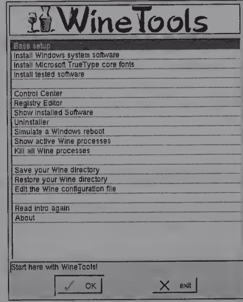

图 11.1 WineTools 简化了你的 Wine 安装。

WineTools 菜单的组织方式使你顺序运行每个工具，并在最后获得一个完备的基础安装。从基础设置（Base Setup）开始，它将创建 fake_windows 目录并处理基础 Wine 配置（见图 11.2）。

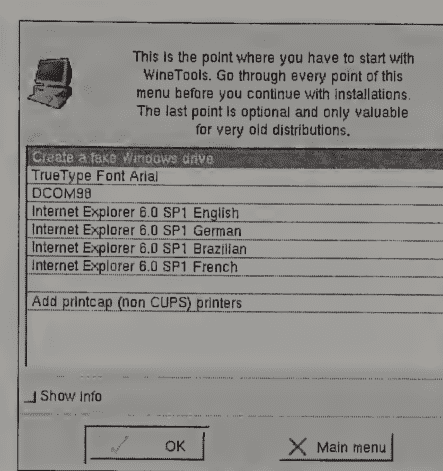

图 11.2 使用此菜单创建你的基础 Wine 配置。

除了创建你的 Wine 驱动器外，还使用此菜单安装 DCOM98（微软组件对象模型 COM 应用程序的关键组件）和 Internet Explorer。当你完成此菜单的操作后，点击主菜单（Main Menu）返回。

继续操作 WineTools 菜单以安装 Windows 系统工具和字体。然后浏览列出的软件列表以寻找常见的、可下载的应用程序。尽管列表分了类，但该列表并不是详尽的，不过它将给你一个良好的开始。

# 在 Wine 下安装 Windows 应用程序

当你运行 Wine 成功后，安装新应用程序与安装任何其他应用程序没有区别，只要你记得将其保持在 Wine 框架内。

在安装任何新的 Windows 应用程序之前，请咨询 http://appdb.winehq.org 上的 Wine 应用程序数据库。搜索你想要安装的应用程序，或浏览类别。你将了解到尝试过的人认为哪些应用程序是运行良好的；其中通常包含关于缺陷、安装问题等的有用注释。大多数（如果不是所有）条目都包含指向产品网站的链接。这对于可下载的应用程序特别有帮助。

有了数据库中的信息，你就可以安装你喜欢的应用程序了。要这样做，请插入安装 CD-ROM。打开一个 shell 并使用 `ls` 找到安装程序。


`ls /media/cdrom`

如果安装程序是 `setup.exe`，输入以下内容在 Wine 中启动它：

```
wine D:\setup.exe &
```

安装程序的运行方式应与在 Windows 中运行时一样。在安装期间，最好接受默认设置。下载和安装应用程序的方法与你在 Windows 中操作的方法相同。

# 运行 Wine

启动 Wine 应用程序可能很棘手。某些应用程序依赖 Wine 菜单。其他应用程序（例如 Internet Explorer）甚至会在你的桌面上放置一个图标。然而，如果你打算从 shell 工作，你需要输入：

```
wine "C:\Program Files\Internet Explorer\EXPLORE.EXE" &
```

安装程序的运行方式应与在 Windows 中运行时一样。在安装期间，最好接受默认设置。下载和安装应用程序的方法与你在 Windows 中操作的方法相同。

# Crossover Office

Crossover Office 是 Wine 项目的商业分支。由几位 Wine 开发者创立的 Codewavers 创建了 Crossover Plugin，允许 Internet Explorer 插件在所有 Linux 浏览器中运行。

Crossover Office 允许用户运行微软的旗舰产品——Office、Internet Explorer 和 Visio，以及其他知名应用程序。现在 Novell Linux Desktop（更多信息请参见附录 A，“SUSE 版本”）的早期版本包含了 Crossover Office，尽管它在当前版本中被移除了。

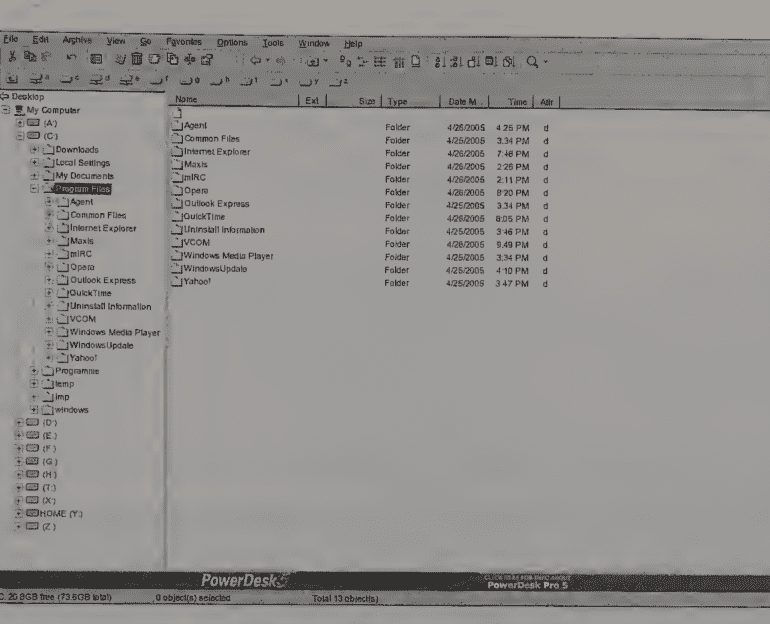

图 11.3 你可以使用这个第三方文件管理器 PowerDesk 5 轻松地管理 Wine 文件。

# 使用 Win4Lin 运行 Windows 应用程序

Win4Lin（原 Netverse）是一家为不同的应用程序提供 Linux 版 Windows 产品的公司：

- Win4Lin 9x 允许你安装并运行 Windows 98 或 Me 虚拟机，以及任何应用程序。
- Win4Lin Home 是一种低成本（29.95 美元）的模拟器，使用 64MB 内存运行其应用程序。
- Win4Lin Pro 是针对 Windows 2000 和 XP 的虚拟机，承诺为这些基于权限的操作系统提供与其姐妹产品为消费级 Windows 提供类似的服务。

你可以直接从 Win4Lin 并下载这三个产品。它们都提供了 GUI 安装程序。

## 安装 Win4Lin

注册并使用超级用户（SuperUser）后，进入下载软件包的目录。输入 `rpm -ivh Win4LinPro-<version>.i386.rpm`。这是 shell 文件补全功能派上用场的时候之一，输入文件名的几个字母并按 Tab 键即可。

## 第 11 章 跨平台操作

接下来，你必须确认你拥有目标操作系统的授权副本（即：对于 Win4Lin 9x/Home，为 Windows 95、98 或 Me；对于 Win4Lin Pro，为 Windows 2000 或 XP）。将你的 Windows CD 插入驱动器。在仍以 SuperUser 身份登录时，输入 `loadwinproCD`（针对 Win4Lin Pro）或 `loadwin9xCD`（针对 Win4Lin 9x/Home）。此程序将确认你的许可，并将操作系统的必要组件安装到你的 Linux 系统中。只要你拥有正确的光盘，你可以使用此命令加载多个操作系统。

安装的第三步是设置客户端环境。以 SuperUser 身份注销并返回用户账户。现在，Win4Lin 将找到你安装的 Windows 版本，将其配置文件放入你的 Home 目录下，位于 `/winpro/configuration` 目录（你可以使用此命令的 `-d` 参数指定不同的目录）。它还会创建一个 Windows 镜像文件，这将作为你虚拟机的的基础。

完成安装后，你应该备份该镜像文件。进入 `/winpro` 目录，执行 `cp GUEST.IMG GUEST.IMG.backup`。在安装新软件或更新 Windows 时，定期执行此操作。

## 运行 Win4Lin

启动 Win4Lin 非常简单。在 shell 中输入 `win`（针对 9x）或 `winpro`（针对 Pro）。这将启动虚拟机（见图 11.4）。


图 11.4 Win4Lin Pro 环境为你提供了一个完整的 Windows 2000 或 XP 虚拟机供使用。

使用 Wineset 工具安装新软件并管理 Win4Lin 设置。

# 使用 VMware 运行 Windows 应用

VMware Workstation 5.0 是另一个虚拟机（简称 VM）的创建工具，它允许你同时运行多种操作系统。VMware 为 Linux 和 Windows 提供了独立的软件包，并支持所有版本的 Windows 以及其他几种 Linux 发行版的客户端。该虚拟机是完整的，甚至包含了自己的 BIOS。

VMware 的主要问题是它对资源的消耗。即使是一台拥有快速处理器和大量内存的强大机器，在运行 VMware 时也很难以进行多任务处理。VMware 的目标受众主要是跨平台软件开发者和测试人员，以及系统管理员。开发者可以在运行 Red Hat、Fedora Core、SUSE Linux、Novell VMware 或任何版本 Windows 的单机上测试他们的产品。系统管理员可以运行测试，查看最新的 Windows 服务包或防病毒升级会对他们的系统产生什么影响。

本节将重点介绍在 SUSE Linux 上运行 Windows 虚拟机。

> 提示 **在 http://www.vmware.com/vmwarestore/newstore/wkst_eval_login.jsp 下载 VMware Workstation 的免费 30 天试用版。**

## 安装 VMware

你有 VMware Workstation 的安装包可选择：RPM 或标准 tar 包（tarball）。你可以使用 YaST 安装 RPM，或者在 shell 中以 SuperUser 身份解压 tar 包。请参阅《VMware 用户指南》（可在 VMware 网站的文档部分获取）以获取说明。

无论你如何进行初始安装，在运行 `vmware-config.p1` 后，该 Perl 脚本将帮助你配置 VMware 的主机程序。

请仔细阅读配置选项，但接受默认值也是可以的。为了确保你的虚拟机使用与 Linux 相同的网络和互联网访问，请使用默认的桥接网络（Bridged Networking）。`vmware-config.p1` 会提示它已完成任务并将提示符返回给你。完成后，退出你的 SuperUser shell 并返回普通提示符。

## 运行 VMware

下一步是运行 VMware 并安装客机操作系统。在 shell 中，在你的桌面环境中按下 `Alt+F2`（或输入 `vmware`）来启动应用程序。你会被要求输入 VMware 盒内附的序列号或下载产品的确认邮件，随后将出现界面（见图 11.5）。

> 提示 **你也可以从 KDE 系统菜单启动 VMware Workstation。在“其他程序”下查找。**

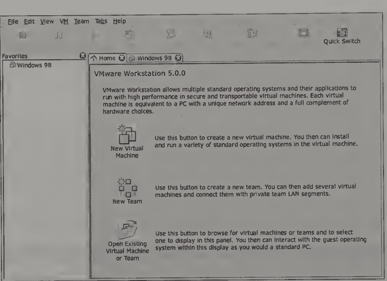

图 11.5 使用 VMware 主界面设置新的虚拟机。

点击“新建虚拟机”按钮开始安装客户端操作系统的过程。识别你想要安装的操作系统，设置好基础配置，你就就绪了。VMware 会在主屏幕上为此虚拟机添加一个标签，看起来如图 11.6 所示。

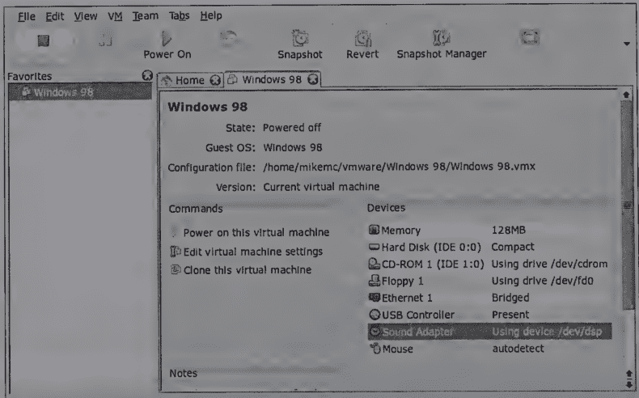

图 11.6 当你配置好虚拟机后，使用此屏幕加载它。

## 使用 Basilisk II 模拟 Mac

将 Windows CD 驱动器并点击电源（Power Up）。一个窗口将打开，就像已启动一样，Windows 将安装。虚拟机将接管你的鼠标。安装完成后，运行 Windows Update，以便查看你的计算机操作系统、软件和硬件需要哪些更新。

然后按下 `Ctrl+Alt` 将鼠标释放回 VMware 和你的 Linux 系统。最后，按下 `Ctrl+Alt` 将鼠标释放回 VMware 和你的 Linux 系统。

## Xen: 虚拟化的未来？

与构建完整虚拟机的 VMware 不同，Xen 是一个虚拟机监控器（hypervisor），这是一个没有到那种程度的层次。这项技术在测试中极大地提升了客户操作系统的性能，使其接近原生性能。这需要对每个操作系统内核进行微调，以便在 Xen 上运行。Linux 实现这一点是：对于标准安装使用标准内核，并将 Xen 虚拟机放入 `/var/tmp/dirinstall` 中，然后使用引导加载程序启动 Xen 内核或标准内核。

Xen 开发者已经移植了多个开源内核，包括 2.4 和 2.6 Linux 内核、NetBSD、FreeBSD 以及 Plan9 操作系统。因此，我们可以使用 Xen 与 FreeBSD 并行运行多个 Linux 发行版。这对于某些用户来说可能很有趣，但对于程序员来说，解决与发行版相关的问题特别有用。

许多用户关注的关键问题是 Windows 是否会在某个时候加入支持的操作系统列表。许可限制阻止了早期 Windows XP 版本的发布。英特尔预计在 2005 年发布新处理器，其中将包含虚拟化技术，能够在一定程度上帮助 Xen 支持 Windows。你可能无法获得直接移植内核时的全部性能，但这些处理器上的应用程序支持可能远超过 Wine。

SUSE Linux 9.3 是第一个包含 Xen 副本的发行版，甚至将其整合到了 YaST 中。在 YaST 软件页面，你会看到“安装到目录（Installation to Directory)”的选项。当你选择此模块时，会出现一个与初始 YaST 安装屏幕非常相似的界面（图 11.8）。

## 注意

> 由于 Xen 是一项相对新的技术，使用它并不完全适合胆小者。你需要手动编辑引导加载程序文件，并初始化一个 Xen 特定的内核。虽然丢失数据的风险很小，但在开始这段冒险之前，备份你的数据是非常稳妥的。

请注意 Xen 安装的目标目录为 `/var/tmp/dirinstall`。该目录将存放 Xen 内核和相关的虚拟机。

YaST 将会检查其安装源模块以查找包的位置。如果你在此处列出了多个源（例如用于新 RPM 的下载目录），你可以选择禁用除标准安装以外的所有项，这通常意味着你的 SUSE CD。默认情况下，YaST 安装带有 KDE 的系统设置，但你可以通过点击底部的“更改（Change）”按钮安装此的任何变。当你做出选择后，点击“下一步（Next）”开始将包安装到目标目录。

在尝试访问此安装之前，你必须以超级用户（SuperUser）身份编辑 `/boot/grub/menu.lst`（先进行备份）。在文件底部添加此条目：

```
### Add Xen to the bootlist ###

ntitle Xen 2.0

kernel (hd1,1)/xen.gen dom0_mem=393216

module (hd1,1)/vmlinuz-2.6.11.40-20a-xen root=/dev/hdb3 ro console=tty0

module (hd1,1)/initrd-2.6.11.40-20a-xen
```

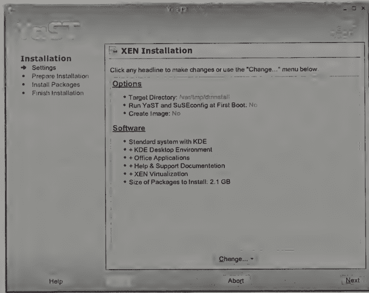

图 11.8 通过 YaST 将 SUSE Linux 安装到 Xen 目录与标准安装几乎无异。使用此屏幕选择要安装的软件，并配置 Xen 特定的选项。

确保 `(hd)` 括号内的数字与第一个 Linux 条目相同（`(1,1)`），因为该目录位于同一块物理硬盘上。保存并退出编辑器。

SUSE Linux 工程师建议在 shell 中以超级用户身份运行这些命令：

> 禁用 TLS 支持：
`mv /lib/tls /lib/tls.disabled`

> 启用 xend 服务：
`chkconfig xend on`

> 启用 xendomains 服务：
`chkconfig xendomains on`

## 第 11 章 跨平台运行

现在使用这些值创建 `/var/tmp/dirinstall/etc/fstab`：

| /dev/sda1 | / reiserfs defaults 1 1 |
| none /dev/pts devpts gid=5,mode=620 0 0 |
| none /dev/shm tmpfs defaults 0 0 |
| none /proc proc defaults 0 0 |
| none /sys sysfs defaults 0 0 |

接下来，使用这些命令初始化 Xen 内核（这可能需要一些时间）：

```
chroot /var/tmp/dirinstall/

mkinitrd -s off
```

`chroot` 命令将你移动到目标目录，因此从该点开始的命令仅适用于 Xen 安装，而不适用于你运行中的系统。
当 `mkinitrd` 完成后，输入 `passwd` 为 Xen 安装分配 Root 密码。最后，输入这些命令将 `/proc/mounts` 链接到 `/etc/mtab`：

```
ln -s /proc/mounts /etc/mtab

echo "mount -t proc proc" >> /etc/rc.d.local

echo "ln -s /proc/mounts /etc/mtab" >> /init.boot.local
```


现在你应该准备好重启系统了。当出现引导菜单时，从列表中选择 `Xen 2.0`。使用你的 `Root` 密码登录，你可以添加用户或其他配置你的“新”系统。
预计于 2005 年底发布的 `Xen 3.0` 将默认支持 64 位架构，尽管目前的 32 位版本 `2.0.5` 在 64 位机器上运行良好。

## 参考文献

- http://www.winehq.org—Wine 项目总部。请务必在应用程序数据库部分为你喜爱的使用 Wine 移植的应用程序投票。
- http://www.von-thadden.de/Joachim/WineTools—WineTools 提供了相对简单的 Wine 安装以及许多著名的免费应用程序，包括 Internet Explorer。
- http://www.codewavers.com—Codewavers 公司，Crossover Office 的制作者。
- http://franksoner.org—该网站可以帮助你充分利用 Wine。它包含了 FAQ 和 HOWTO 来帮助解决你的大部分问题。
- http://www.vmware.com—VMware 公司，你可以在那里获取信息并获得该虚拟机的 30 天免费试用版。
- http://www.win4lin.com—Win4Lin，帮助人们运行 Windows 98 应用程序，现在还支持 Windows 2000/XP 应用程序。

# 第 12 章 连接互联网

Linux 用户已经拥有了。这导致 Linux 的支持普遍缺乏，特别是来自主要参与者的支持。

这意味着你不太可能从 ISP（互联网服务提供商）那里获得包含所有启动所需内容的漂亮光盘，但通过 YaST 总是会有方法处理这些。你最需要了解的是以下内容：

- 你的 IP 地址是如何确定的——静态或动态（DHCP）。
- 你的域名系统（DNS）服务器的 IP 地址，特别是对于动态连接。
- 你的邮件服务器和新闻服务器的 DNS 名称和 IP 地址。
- 如果你使用拨号连接，ISP 的拨号电话号码。
- 你的凭据，例如用户名和密码。

每台连接到互联网的计算机必须有一个唯一的互联网协议（IP）地址。如果每个想连接互联网的人都需要一台唯一的机器来提供 IP 地址，那么 ISP 必须为每位用户购买一台带有独立 IP 的独立机器。由于这样做是不可行的，而且大多数人使用并非总是在线的拨号连接，因此开发出了一种解决方案。绝大多数标准 IP 连接使用动态主机配置协议（DHCP）为每个登录用户分配一个空闲的服务器。

> 注意
你将在第 25 章“设置网络和 Samba”中学习更多关于 TCP/IP 和 DHCP 的知识。

ISP 将获得一组 IP 地址，允许其连接到互联网。作为一个准备配置系统的用户，你可能需要找出该范围。如果那里没有且你已经有一台连接的 Windows XP 电脑，请检查控制面板中的“网络连接”。你应该看到你的连接列表。双击打开它，然后点击“支持”选项卡。这将告诉你你是在使用 DHCP 访问还是使用 DNS 服务，并告诉你所有必要的 IP 地址。

你也可以通过 Windows 命令获取此信息。进入“程序”、“辅助程序”，然后“命令提示符”。输入 `ipconfig`，你将获得 IP 地址、子掩码和默认网关地址。此命令是 Linux `ifconfig` 工具的 Windows 对应，你将在下一节和第 25 章中学习更多关于它的。

> 注意
取决于你的 ISP，可能不需要该范围即可建立连接。

# 从 localhost 接口开始

如果你有高速连接，可能会获得静态 IP，但即使是这些通常也由 DHCP 处理。无论你的连接类型如何，许多 ISP 都会付费为你提供静态 IP 地址。除非你想直接托管服务器（邮件、FTP、DNS），否则这是需要的。

在设置任何类型的互联网连接之前，你需要创建一个虚拟接口，TCP/IP 协议使用它来确定你机器的网络能力。这被称为环回（lo）接口，或 localhost。许多感知网络能力的应用程序也会引用此接口，因此它很重要。

什么是环回接口？对于 Linux 驱动程序来说，这是一个由恰好一个组成的网络。内核使用 `127.0.0.1` IP 地址将流量在自身之间进行回环。

SUSE Linux 应该在安装期间创建 localhost 接口。要确认这一点，请打开根控制台并运行 `ifconfig` 工具来识别你的设置。运行此命令应产生如下的响应：

```
Link encap:Local Loopback

inet addr:127.0.0.1 Mask:255.255.0.0

inet6 addr::1/128 Scope:Host

UP RUNNING MTU:16436 Metric:1

RX packets:2187 errors:dropped:0 overflows:frame:0

TX packets:2187 errors:dropped:0 overflows:carrier:0

collisions:0 txqueuelen:00

RX bytes:114362 (111.6 Kb) TX bytes:114362 (111.6 Kb)
```

此输出告诉你环回接口是激活的，并分配了本地连接的标准 IP 地址 `127.0.0.1`，并使用了 `255.0.0.0` 的广播掩码。甚至可以窥探未来，因为此 `ifconfig` 列出了 `::1/128` 的 IPv6 地址。这个互联网协议的下一个版本（IP 版本 6）比现有的 IP 版本 4 提供了更多的 IP 地址空间。

# 手动配置 localhost

如果在你的 SUSE Linux 安装期间万一没有创建 localhost，这可以很容易地完成。

localhost 接口地址存储在名为 `/etc/hosts` 的文本文件中。该文件存储了所有的网络 IP 地址和主机名信息。内核和其他网络实用程序读取它以理解如何与他人连接。

> 你也可以在 YaSt 中访问并编辑 Hosts 文件。进入“网络服务”，然后选择“主机”。在此处添加、编辑或删除主机。

当你打开此文件时，你会看到一条描述该文件以及你应该遵循的语法的注释：IP地址 [制表符] 全限定主机名 [制表符] 短主机名。

如果 localhost 不在那里，你可以添加此行：

```
127.0.0.1       localhost
```

你可以让短主机名为空。保存并退出。重新打开你的根控制台并 `ifconfig` 和 `route` 来创建接口：

```
config lo 127.0.0.1
```

这会将 localhost 接口放入内存，与其他所有 Linux 网络接口一起，如以太网 (`eth0`) 或拨号连接。

```
route add 127.0.0.1 lo
```

这会将 localhost 接口添加到路由表中。通过 `ifconfig` 测试新连接。你应该看到类似的内容：

```
PING localhost (127.0.0.1): 56 byte of data
64 bytes from localhost (127.0.0.1): icmp_seq=1 ttl=64 time=0.042 ms
64 bytes from localhost (127.0.0.1): icmp_seq=2 ttl=64 time=0.041 ms
64 bytes from localhost (127.0.0.1): icmp_seq=3 ttl=64 time=0.041 ms
--- localhost statistics ---
3 packets transmitted, 3 received, 0% packet loss
rtt min/avg/max/mdev = 0.041/0.041/0.042/0.001 ms
```

# 配置你的拨号连接

如果你真的能想象没有互联网的 Linux 是成功的操作系统，为什么设置拨号连接会如此困难？YaST 为没有计算机硬件深度知识的用户极大地简化了这一点。

当你设置拨号连接时，你只是在使用几种标准协议将它们连接到 ISP。大多数拨号连接使用点对点协议（PPP），因为 ISP 发现这是串口上使用 TCP/IP 的一种快速高效的方法。

# 使用 YaST 设置你的拨号连接

YaST 的网络设备管理多种类型网络连接的设置向导：

- 调制解调器
- 网卡
- ISDN
- 传真
- 电话应答机
- DSL

虽然非常相似，但仍有一些区别。在本节中，我们将介绍调制解调器连接。DSL 连接将在下一节中，其他网络协议将在第 25 章中介绍。

首先打开 YaST。在 KDE 中，进入 Kicker 菜单并选择系统（System），然后选择 YaST。
系统会提示输入 Root 密码并加载 YaST。点击网络设备（Network Devices）。你会看到之前列出的六项内容。点击调制调器（Modem）来设置连接。
YaST 应该已经检测到了你的调制调器，如果没有，你可以轻松完成。点击屏幕顶部的配置（Configure）以启动调制调器向导。第一个界面应该类似于图 12.1。

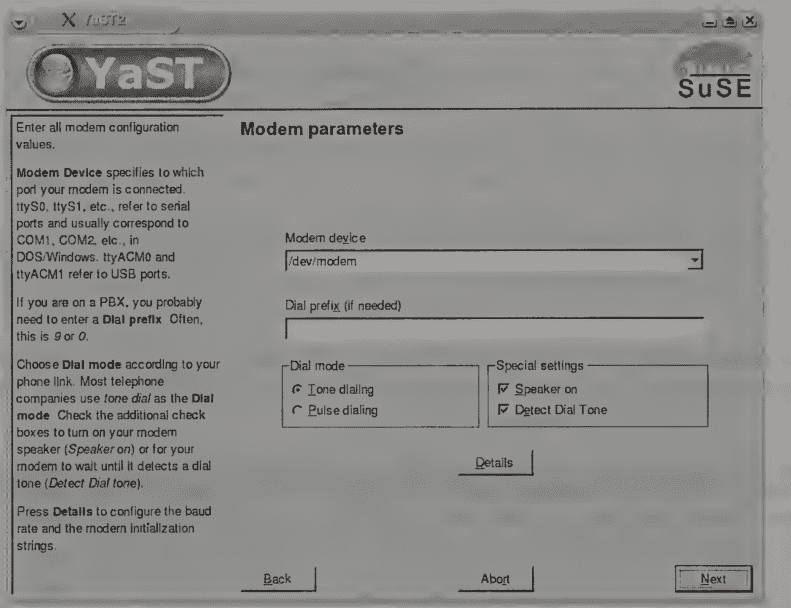

图 12.1 调制调器的第一个配置界面及一些初始设置。

此界面设置调制调器的挂载点和一些初始设置。使用默认的 `/dev modem` 最简单且始终有效，但你可以从下拉菜单中选择不同的点。如果你在一个需要拨 9 才能打外线的办公室，请设置拨号前缀（Dial Prefix）。现代电话系统始终使用频率拨号（Tone dialing），除非你确定，否则不要更改此设置。如果你听不到调制调器连接时伴随白噪音，请关闭扬声器（尽管你正在进行初始设置，但在确认一切正常工作之前保持开启是个好习惯）。如果你有呼叫等待或其他改变拨号音的服务，你可能需要勾选检测拨号音始终拨号（Detect Dial Tone always dials）。只有当你需要更改默认初始化字符串时才点击详细（Details）按钮。完成后，点击下一步（Next）设置你的 ISP。YaST 会列出一个供你选择的服务商列表。在图 12.2 中，你选择了 Earthlink 作为你的提供商。注意屏幕显示了你提供商的网站支持热线。如果你的提供商不在列表中，点击新建（New）进行添加。点击下一步（Next）识别号码和其他访问设置。

## 配置拨号上网连接

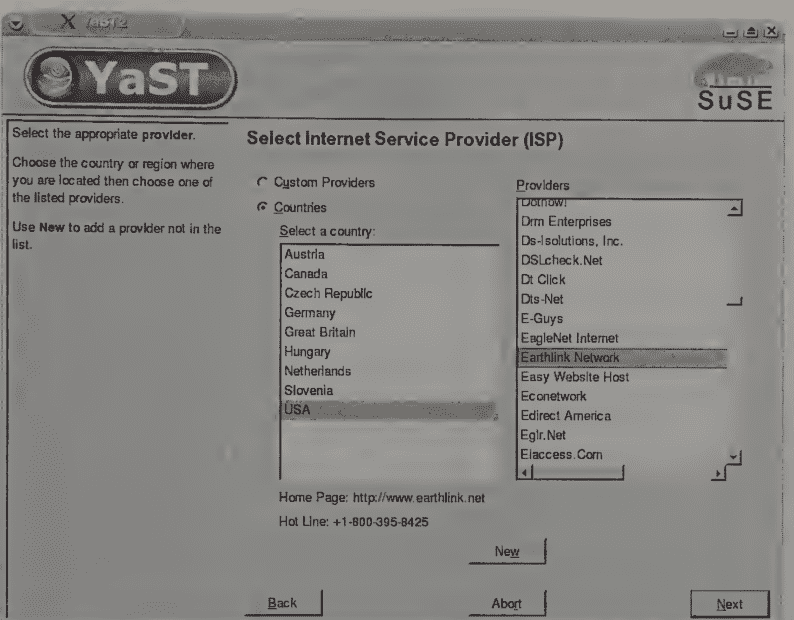

**图 12.2** 从服务商列表中选择你的 ISP，或点击新建（New）添加用户。

图 12.3 显示了 ISP 配置界面。你应该至少知道一个你 ISP 的本地接入号码。在此输入该号码，以及你的用户名和密码。如果你希望每次拨号时都输入 ISP 密码，请勾选始终询问密码（Always Ask for Password）。点击下一步配置你的连接。

最后的配置界面（见图 12.4）定义了如何管理你的连接。要解决的问题是你是否允许应用程序启动拨号连接。当你的邮件客户端检查并拨号时，这可能很方便，但它可能也很讨厌，例如，SUSEWatcher 想要在凌晨 2 点检查系统更新，结果调制调器扬声器响了。如果你的 ISP 经常变化且自动连接在完成任务后没有挂断，情况也不妙。

默认情况下，按拨号（Dial on Demand）是关闭的。勾选框激活此功能。你需要识别至少一个服务器（你应该从 ISP 那里获得）。

勾选激活防火墙（Activate Firewall）框以防止所有入连接攻击你的计算机。空闲超时（Idle Timeout）告知等待连接恢复的时间。默认情况下，如果调制调器五分钟（300 秒）内没有收到服务器的数据，它将挂断。你可以使用下拉菜单将其调长或调短。将超时设置为 0 意味着除非你告知，否则调制调器永远不会挂断。

如果你有静态 IP 地址，点击 IP 详细（IP Details）按钮进行配置。取消勾选动态 IP（Dynamic IP），并在本地 IP 地址（Local IP Address）框中输入静态地址。点击确定返回上一个界面。点击下一步完成设置。你现在应该能在相应的窗口看到你的调制调器和提供商。如果你有多个 ISP，必须分别配置它们。点击添加（Add）到窗口重新启动向导。

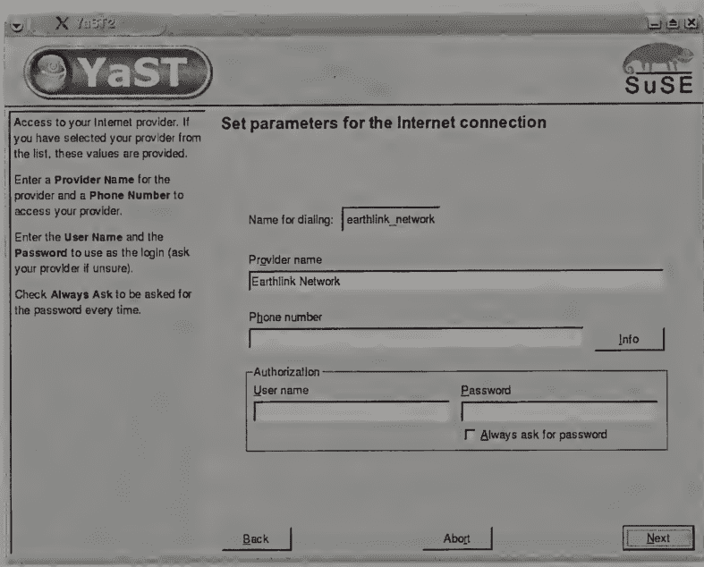

**图 12.3**在此界面输入你的接入名称、用户名和密码。

当你点击完成（Finish）时，你的新设置将被保存，并会被要求设置邮箱账户。此类设置的详情请参见第 15 章“管理电子邮件服务器”。

在 KDE 中通过运行 KInternet 测试你的新连接，或在 GNOME 中运行 GNOME PPP。它应该使用新设置拨号你的 ISP 并让你开始上网。

> 提示
测试调制调器的另一种方法是通过诸如 minicom 的终端程序。此程序默认未安装，但如果你与 ISP 连接时遇到问题，运行 minicom 可以帮助排查调制调器问题。
通过 YaST 安装 minicom，然后在 shell 中带参数 -s 运行 minicom 以设置你的调制调器的串口端口：
**minicom -s**
告诉 minicom 你的调制调器正在使用哪个串口端口，然后返回主界面。现在你可以发送 AT 命令（查看你的调制调器文档获取示例）并查看调制调器的响应。

## 配置数字用户线路 (DSL) 连接

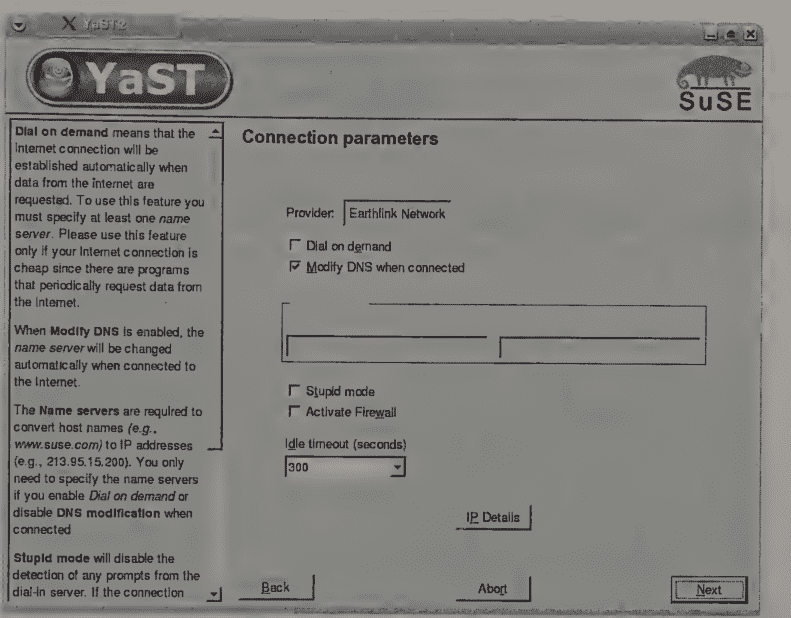

图 12.4 DSL 配置界面

## 第 12 章连接到互联网

### 配置数字用户线路 (DSL)

DSL 服务提供的速度比拨号更快。DSL 连接使用铜质电话线。DSL 连接提供非对称速度，即下载速度高于上传速度。DSL 使用 PPPoE 作为协议。SUSE 支持所有变体 DSL。如果你的 ISP 提供静态 IP，你可以手动配置。如果你的 ISP 使用 DHCP，YaST 会自动处理。

在 YaST 中设置 DSL 与设置调制调器非常相似。首先打开 YaST。进入 Kicker 菜单并选择系统（System），然后选择 YaST。系统会提示输入 Root 密码并加载 YaST。点击网络设备（Network Devices）。

最后的配置界面（见图 12.4）定义了你如何管理你的连接。你并不需要设置按拨号，因为你是始终在线的。同样，你不需要担心空闲超时（Idle Timeout）设置。执行激活防火墙（Activate Firewall）框以防止所有入连接攻击你的计算机。

# 第 12 章 连接到互联网

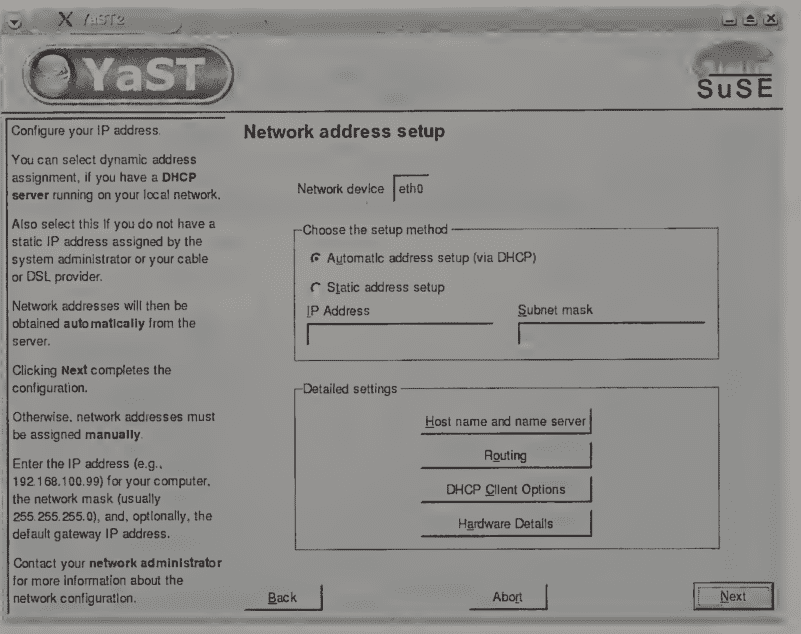

图 12.7 使用此框配置您的 DSL 以太网卡。

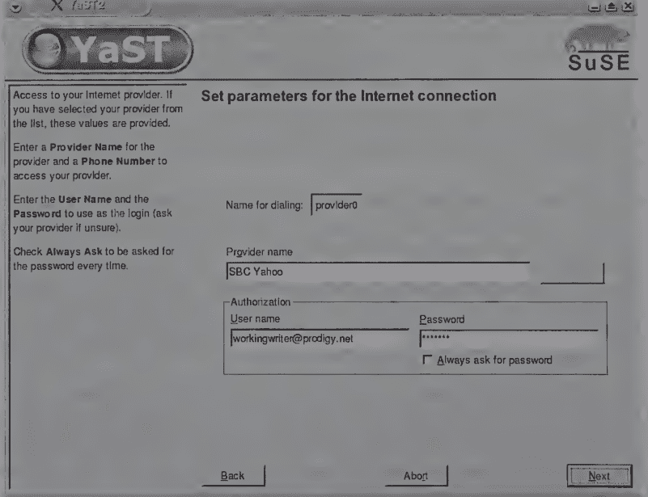

图 12.8 在此屏幕上输入您的用户名和密码。

## 将计算机连接到无线网络 215

如果你有静态 IP 地址，点击“IP 详情”按钮进行配置。取消勾选“动态 IP”复选框并在“本地 IP 地址”框中输入静态 IP 地址。点击“确定”返回上一个屏幕。点击“下一步”完成设置。

> 注意
对于静态地址，请确保 PPP 模式设置为“标准 PPP”，而不是“PPPPoE”。

当你点击“完成”时，你的新设置将会被保存，系统会要求你设置邮件账户。此类设置的详细信息请参阅第 15 章。

## 将计算机连接到无线网络

你正带着你的 SUSE Linux 笔记本电脑旅行，并想连接酒店的无线网络。这可能会是一个问题，但障碍是可以克服的。

尝试连接无线网络时，你基本上需要处理三个问题：

- 确保你的网卡被支持，并且已安装正确的驱动程序和固件。
- 找到热点。
- 配置配置文件。

本节将涵盖这些问题。

## 准备固件和驱动

第一个问题可能是容易解决的。Linux 支持许多不同的无线网卡，尽管并不总是支持网卡的所有功能。固件（直接与网卡通信的代码）通常必须从 Linux 发行版单独下载。你可以通过 YaST 在线更新直接下载 ACX100、ACX111 和 PrismQT 的固件，但这些包并未随发行发行。

大多数无线网卡制造商仍然只生产 Windows 驱动程序，这可能给非 Windows 用户带来巨大的头疼问题。通常这需要手动设置和配置你的网络配置文件 `ifcfg-eth2`。然而，这项任务已经简化。通过 YaST 安装的第二个软件包 `ndwrapper` 可以让你在 Linux 中直接使用 Windows 驱动程序。

为了使其工作，你需要 `*.inf` 驱动程序。如果你的笔记本电脑是双系统，该文件可能位于 `\Windows\System` 文件夹中。它也可能随网卡附带的光盘，或者从制造商网站下载。

> 可下载的硬件驱动程序通常显示为 *.exe 文件。通常这只是一个自解压归包。要从包中提取 INF 文件，在用 ndiswrapper 在 Linux 中使用驱动程序之前，你可能需要在 Wine、Crossover Office 或 Windows 本身运行该程序。

一旦你拥有了 INF 文件，以超级用户身份打开 shell，并导航到 INF 文件所在的目录。运行此命令以确认 ndiswrapper 是否可以识别该驱动程序：

```
ndiswrapper -l <driverfilename>.inf
```

你应该会看到一条确认 ndis 已安装且驱动程序存在的的消息。现在，你需要让内核识别该驱动程序。这是通过 `modprobe` 完成的。
```
modprobe ndiswrapper
```


最后一步是将这两个命令添加到你的 `rc.local` 文件中。现在，内核将在每次启动时加载该驱动程序。

## 寻找热点

理想情况下，在驱动程序准备就绪后，你现在应该能够扫描区域寻找附近的热点。如果你的无线接口是 `eth2`，你可以直接在 shell 中输入 `iwlist eth2 scan`。然后，你需要使用 `iwconfig` 来配置你的连接。

然而，有一个 KDE 工具可以简化这一过程。无线助手（Wireless Assistant）将执行扫描并连接你。从 `~linux01.gwdg.de/~pbleser/rpm-navigation.php?cat=/Network/wlistant` 下载 SUSE Linux 无线助手包并通过 YaST 安装。如果你在 `sources.list` 中有 `suser-guru` 仓库，也可以使用 `apt`。

从 Kicker 菜单启动无线助手

点击你想连接的热点，系统将提示你输入系统的 Root 密码。输入并点击“确定”，你就连接了。

## 将计算机连接到无线网络

## 配置你的无线网卡

YaST 也可以帮助你配置无线网络。如果你知道想要连接的网络，使用 YaST 将为你设置好。在 YaST 中，转到“网络设备”，然后选择“无线网卡”。将出现图 12.9。

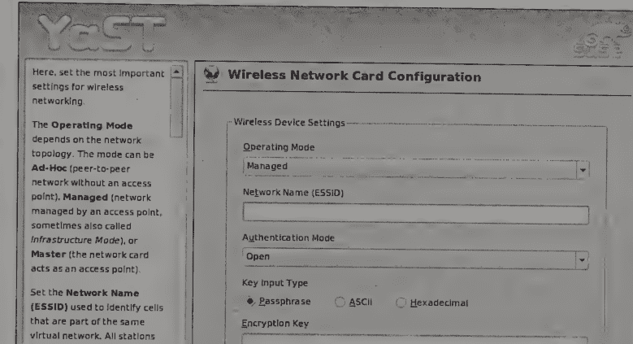

图 12.9 配置你的无线网卡以连接稳定网络。

屏幕顶部是网络操作模式。几乎你总是希望选择“管理模式”（Managed Mode），因为这是与无线热点的连接。自形成网络（ad-hoc network）是无热点的点对点设置，而“主模式”（Master mode）将你的机器设置为热点。

下一行表示你想连接的网络名称。在无线网络中，热点通过扩展集标识符 (ESSID) 标识。你应该在此输入你的网络名称，否则网卡将选择它找到的第一个热点。

最后一部分处理对网络的身份验证。无线网络有三种类型，“开放”网络对所有人开放，无需认证。通常情况下，WEP，“共享密钥”认证是常见的选项。在 WEP 发现严重漏洞后，开发了新的安全协议 WiFi 保护访问（WPA）。该协议尚未被广泛使用，但 Linux 内核支持。从认证模式下拉菜单中选择合适的协议

# 第 12 章 连接到互联网

选择认证模式下拉菜单中选择合适的协议，然后在加密密钥框中定义你的密钥。选择短语（Passphrase），输入一个单词或字符字符串以生成密钥。ASCII 请求输入 5 个字符用于 64 位密钥，以及 13 个字符用于 128 位密钥。对于十六进制（Hexadecimal），输入 10 个字符用于 64 位密钥，或 26 个字符用于 128 位密钥，以十六进制表示法。

> 提示
关于创建密码和短语的提示位于第 19 章“管理用户，管理安全”。

你可以保留四个密钥来加密传输的数据。点击“多个密钥”进入密钥配置对话框。默认情况下，这设置为 128 位安全，但你可以在此处降低为 64 位（尽管你不这样做）。

在对话框底部的列表区域，可以指定四个密钥供你的计算机加密使用。点击“设置为默认”将其中一个定义为默认密钥。除非你更改，否则 YaST 使用第一个输入的密钥作为默认密钥。如果标准密钥被删除，必须手动将其他密钥之一标记为默认密钥
你应该已成功连接到无线网络。

## 何时拨打你的互联网服务供应商电话

互联网接入巨头对 Linux 的支持可能是一个问题，但可以规避。许多连接问题可以通过仔细查看 YaST 窗口中的文档来解决。其他的可以通过 Linux 文档项目的许多 HOWTO 文档解决，包括参考部分列出的那些。一如既往，咨询第 1 章“欢迎来到 SUSE”，“获取帮助：文档和其他资源”章节，识别你当地支持 Linux 的 ISP。

拨号连接问题通常是暂时的或涉及用户错误。在你骚扰技术支持人员之前，请确保你没有陷入以下情况：

- 如果无法成功登录，可能是密码写错了。记住密码对大小写敏感。
- 如果电话和密码都正确，但仍然无法登录，请检查认证协议。
- 如果一切无效，请检查电源线。调制解调器是否已插电并通过正确的插头连接到电脑上？东西确实会松动。
- 如果在你的双系统 Windows 下一切正常，但在 Linux 下什么都不起作用，你可能拥有一个 Winmodem。尝试 Linmodem 驱动程序，或者去买一个硬件调制解调器。

## 参考文献

- 这对拨号上网和 DSL 都有帮助：如果什么方法都不行，而且在几分钟/几小时前还能用，且你的机器没有冒烟，那么可能是 ISP（互联网服务提供商）的问题。如果是大型 ISP，他们会很快发现故障。如果是当地的小型经营者，如果是刚发生的，请打电话报告；否则，请给他们一些时间来修复。如果问题持续了好几个小时。

- 如果你登录了，但无法访问网页，这可能是 DNS 问题。双重检查你的 DHCP 设置并联系 ISP。

当你联系 ISP 时，如果你知道他们不支持 Linux，请尝试从操作系统之外的语境来解释问题。了解你正在操作的 Linux（或 YaST）对话框在 Windows 中对应的对应项（如 Internet 连接向导、网络邻域等）是有帮助的。

## 参考文献

- `http://www.tldp.org/HOWTO/HOWTO-INDEX/hardware.html#HWMODEMS`—Linux 文档项目调制解调器 HOWOS。你需要关于普通型号、Winmodems（软调制解调器）、DSL 模型和电缆模型的极其详细的信息。其中一些内容已过时，但修订日期一直发布在此处。

- `http://axion.physics.ubc.ca/ppp-linux.html`—尝试手动设置 PPP 吗？去这里对了，因为 W. G. Unruh 为解决许多 PPP 问题付出了努力。

- `http://cdb.suse.de`—SUSE 硬件数据库。在此检查你的调制解调器是否受到官方支持。如果你的 DSL 调制解调器未在此列表中，不要假设它无法工作。可选的选择不多。

- `linwinmodems.org`—一个了解软件驱动的“Winmodems”以及在 Linux 中支持它们的尝试的地方。

- `http://start.at/modem`—Winmodems 不是调制解调器。一个检查 Linux 兼容性的调制解调器模型列表。

- `http://www.swcp.com/~jentry/pers.html`—Linux 拨号服务器指南。逐步设置你的拨号服务器的方法。

# 第 13 章 使用互联网：浏览网页和编写电子邮件

## 本章内容

## 使用互联网：浏览网页和编写电子邮件

- 设置你的 SUSE Linux 电子邮件账户

- 选择邮件客户端（邮件代理程序）

- 发送附件

当我们大多数人谈论使用互联网时，通常是在谈论万维网或发送电子邮件。对于某些人来说，这两件事是他们拥有电脑的原因。作为一个操作系统，很大程度上归功于互联网的存在，电子邮件和网页非常好。

本章和接下来的几章涵盖了 SUSE Linux 和互联网。你将在如何在 SUSE 中浏览网页和管理电子邮件。之后，你将学习通过创建一个基础网站来构建万维网。在后面的章节中，我们将深入介绍如何使用网络与他人协作、传输文件以及管理 Web 服务器。

互联网上有有很多可以做的事情，SUSE Linux 在此帮助你充分利用它。

## 选择浏览器

你很有可能有浏览网页的经验，不需要别人告诉你怎么做。但是，你应该知道，SUSE Linux 下有多个浏览器可用。它们都在活跃开发中，并且比微软 Internet Explorer (IE) 更安全。许多参与计算机安全的人敦促用户放弃 IE，但关键在于，在 2004 年 6 月，

## 第 13 章 使用互联网：浏览网页和编写电子邮件

美国计算机应急响应小组 (CERT) 发布了这项建议（目前仍然有效）：“关于 IE 域名/区域安全模型、本地文件系统（本地机器区域）信任、动态 HTML (HTML) 文档模型（特别是 DHT 特性）、HTML 帮助、MIME 类型确定、图形用户界面 (GUI) 以及 ActiveX 有许多漏洞。使用不同的浏览器可以减少这些漏洞，特别是在查看不可信的 HTML 文档时（例如网站、电子邮件消息）”。`http://www.kb.cert/vuls/id/214` 以下是功能的快速概述。

## Mozilla 和 Firefox

美国计算机应急响应小组 (CERT) 发布了这项建议（目前仍然有效）：“关于 IE 域名/区域安全模型、本地文件系统（本地机器区域）信任、动态 HTML (HTML) 文档模型（特别是 DHT 特性）、HTML 帮助、MIME 类型确定、图形用户界面 (GUI) 以及 ActiveX 有许多漏洞。使用不同的浏览器可以减少这些漏洞，特别是在查看不可信的 HTML 文档时（例如网站、电子邮件消息）”。`http://www.kb.cert/vuls/id/214` 最知名且最流行的。Netscape/Mozilla 器的开源允许其他开发者创建他们自己的 Linux 浏览器。在很多方面，我们非常感谢该团队。

## Conqueror

你的 KDE 文件管理器也是一个功能全的浏览器。点击 KDE 任务栏上的类球图标，Conqueror 将以网页模式打开（图 13.3）。它也是默认的 KDE 浏览器（你可以在 KDE 控制中心中更改它），因此点击 KDE 中大多数程序中的链接都会打开 Conqueror。基于快速的 Mozilla Gecko 渲染引擎，它还提供了优秀的 Cookie 管理来保护你在 Web 隐私。

Conqueror 不是一个完美的浏览器。它不导入 Mozilla 或 Firefox 扩展，尽管它很好地导入书签和多媒体插件。网页上的文本文件出现在编辑器窗口中，这会导致导航变得困难。如果你恰好打开了一个文件管理器窗口然后打开一个 URL，浏览器将在文件管理器窗口的新标签页中打开。你然后通过右键菜单分离标签页。某些网站（包括 Novell 的）显示异常。但总来说，它提供了极佳的体验。

> TIP 也许 Conqueror 最棒的地方是它的书签管理工具。在创建书签时对其进行分类非常简单。Conqueror 还可以从 IE、Mozilla 导入

## 选择浏览器

Opera 让你能够轻松地将所有书签整合在一个地方，即使你并不始终忠忠于某一个浏览器。

但如果你曾尝试过修剪冗杂的书签列表，想要移除那些可能未能在互联网时代幸存下来的网站，那么 Konquer 简直是你的天送之星。在书签管理器中，有一个工具可以访问你所有的书签，并告诉你它们是否仍然有效。这可能需要一些时间，但如果你有很多死链接，这些时间是完全值得的。

## Epiphany

默认的 GNOME 浏览器（Epiphany 13.4）也运行在 Mozilla Gecko 引擎上，并具有许多相同的功能，同时也具备一些它特有的功能。它带了一组可选的扩展包，并且也可以运行 Mozilla 扩展。

Epiphany 的开发者正致力于构建一个简单、易用的浏览器。为此，Epiphany 中的书签可以放在多个类别中，并且界面像 GNOME 一样简洁且可定制。


图 13.4 Epiphany，GNOME 默认浏览器。

## Galeon

Galeon 出现在 Epiphany 之后，并且与其相似，但它有自己的独特之处。Galeon (Epiphany 13.5) 旨在成为高级用户的浏览器。可以在工具栏中找到分组和搜索。Galeon 还具有出色的 Cookie 和弹出窗口管理功能，增加了安全性。你可以访问一个网站并使用 Galeon 菜单允许该网站的 Cookie 或弹出窗口。

自从创始人 Marco Gritti 离开后，Galeon 的开发受到了一些影响。但最近发布了一些小版本。你可以广泛地调整 Galeon 的偏好，但你可能需要文本编辑器来完成大部分更改。

## Opera

这款商业浏览器（见图 13.6）对许多现在被视为所当然的浏览创新负责。Opera 引入了标签页浏览的想法，尽管它的 Linux 浏览器直到 2003 年才发布。目前的 8.0 版本包含一个可以显示 RSS 馈（见第 14 章“创建基础网站”部分）的邮件客户端和一个互联网节点聊天（IRC）客户端。遗憾的是，许多网站在 Opera 中仍然无法正常渲染（有时甚至完全无法渲染）。这一直是它被采用的障碍。

## 设置你的 SUSE 邮件账户

在第 12 章“连接互联网”中，我们介绍了在 YaST 中的设置。在配置好调制调器后，YaST 会询问是否配置邮件账户。该向导会配置你的 MTA。如果你对配置账户说“是”，YaST 将打开 MTA 配置窗口，类似于图 13.7 所示的内容。

> 你也可以从 YaST 网络服务页面打开此向导。

默认情况下，YaST 会启用默认防病毒软件 AquaVi。它还允许你根据之前的设置设置连接类型。如果你有一直开启的宽带（DSL、电缆调制调器）连接，应选择“永久”（Permanent）。否则，选择“拨号”（Dial-Up）。点击“下一步”继续。

邮件屏幕（图 13.8）提供了 Postfix。首先识别你的 SMTP 服务器，它不需要使用伪装功能（该功能允许你修改“发件人”行中的服务器名称）。身份验证界面让你识别你的 ISP 登录信息（如果发送邮件需要的话）。点击“下一步”继续。


图 13.7 第一个 YaST 邮件配置界面让你启用默认防病毒软件 AquaVis。

> 提示：有关关于伪装（Masquerading）和身份验证（Authentication）的更多信息，请参见第 15 章“管理邮件服务器”中的“MTA 配置”。

入邮件屏幕配置 Fetchmail。在顶部，为你的入邮件（POP3 或 IMAP4）服务器命名，你应该从你的 ISP 获取。包含你的登录信息以简化获取邮件。使用此屏幕识别哪个本地用户可以使用此账户。如果你想调整账户信息以协助 Fetchmail，请点击“详情”。将根邮件账户指向此处的超级用户邮件，这样发送到 root@localhost 的消息就能在你的邮箱查看。然后，如果你想利用此邮件投递代理（MDA）来对抗垃圾邮件，请将投递模式设置为 Procmail。点击“完成”保存设置。

> 如果你愿意，可以在邮件客户端中设置你的邮件账户。YaST 仅会在单台机器上配置一个邮件账户。如果你有多个用户或多个账户，你需要在客户端中配置账户。每个邮件客户端的配置界面会有所不同。但你始终需要这里列出的来自 ISP 的相同信息。


图 13.6 将其简洁的外观和基于标准的引擎引入了 Linux。

## 选择邮件客户端（邮件用户代理）

人们在处理电子邮件上花费了大量时间。在本节中，你将熟悉领先的邮件程序：Evolution、Kmail/Organizer、Mozilla Mail/Thunderbird、Sylphed 和 mutt。选择一个适合你风格和需求的程序。

## Evolution

设置 Evolution 非常简单，有一个向导会引导你完成整个过程。要设置邮件账户，请输入你的姓名和电子邮件地址以开始（图 13.9）。

Evolution、日历、任务列表和联系人（Contacts）。

Evolution 是由 Nathan Friedman 和 Xian 团队编写的，旨在作为 Outlook 的 Linux 替代方案。虽然它不是逆向工程的作品，但 Evolution 的外观和行为尽可能像 Outlook。在一个软件包中，你拥有集成的邮件客户端、日历、任务列表和联系人。


图 13.9 设置基础邮件信息。

点击“下一步”并在下拉菜单中选择服务器类型。如图 13.10 所示，Evolution 支持多种邮件服务器：POP、IMAP 和 GroupWise，以及 Usenet 新闻。

点击“下一步”填写第三个向导屏幕（图 13.11）。在 Host 框中输入你的邮件服务器名称，以及邮件账户用户名。如果你想记住 ISP 密码（风险未经授权的人读取和撰写你的电子邮件），请勾选“记住密码”框。

再次点击。最后的收邮件设置屏幕（图 13.12）提供了一些选项：Evolution 是否应该自动检查邮件以及频率如何；是否从服务器检索邮件（如果你的 ISP 提供了大量的服务器空间和访问权限）；以及是否禁用 POP3 标准的扩展。通常不需要扩展。

## 选择邮件客户端（邮件用户代理） 231

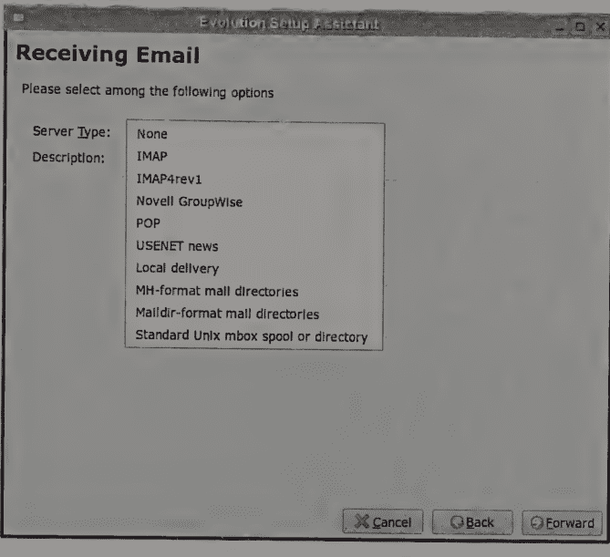

图 13.10 选择您要连接的邮件服务器类型。

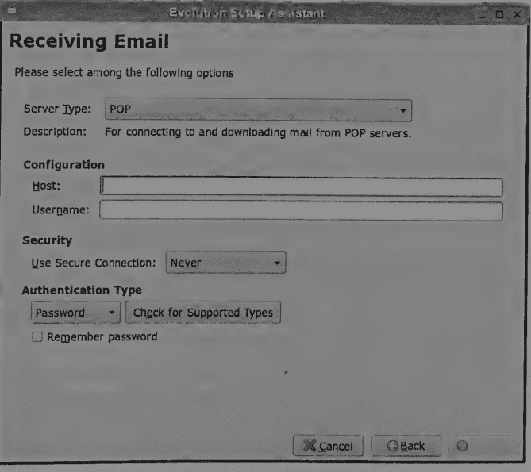

图 13.11 设置您的入邮件服务器信息。

## 232 第 13 章 使用互联网：浏览网页和编写电子邮件

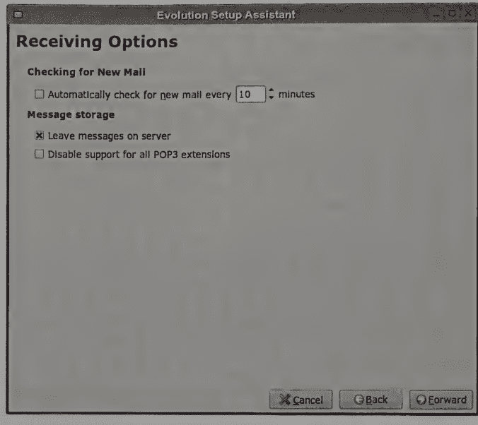

图 13.12 选择接收邮件选项。

在下一个屏幕（图 13.13）中，您将配置出站邮件服务器（简单邮件传输协议，SMTP）。在 Host 行中为服务器命名。再次选择是否使用 Evolution，并记住您的密码，这次是在发送邮件时。

在最后两个屏幕中，您为账户命名并选择时区（从一张完整的世界地图中）。完成所有设置任务后，点击“应用”打开 Evolution，然后点击工具栏上的“发送/接收”来获取邮件。

Evolution 支持标准文件夹，可以帮助您组织邮件。

在示例中，我们选择了五个可能的主题，这些主题可以捕捉列表和新闻组中的大部分相关流量。我们列出了三个邮件客户端和两种“邮件客户端”的变体填充方式。在底部的 vFolder 源中选择“所有本地文件夹”应该也能捕获 Usenet 消息。点击“确定”创建 vFolder。Evolution 将搜索现有消息，并过滤出具有匹配主题的邮件和 Usenet 帖子。

## 选择邮件客户端（邮件用户代理） 233

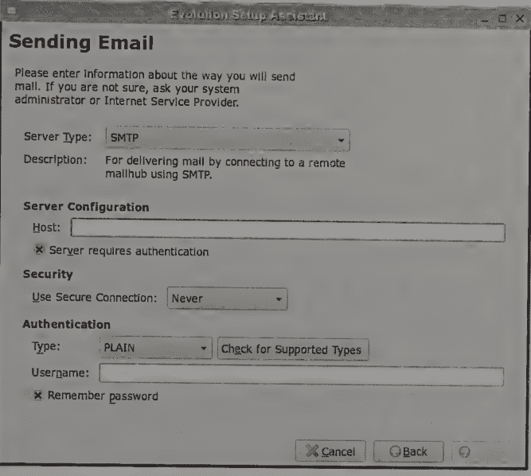

图 13.13 配置出站邮件服务器信息。


图 13.14 在 evolution 中配置 vFolder。

## 234 第 13 章 使用互联网：浏览网页和编写电子邮件

Evolution 同时在与邮件相同的环境中处理 Usenet 新闻。设置 Usenet 馈送使用相同的向导，但要求略有不同。要访问已设置账户的组，请转到“工具”，“订阅文件夹”以连接到您的新闻服务器并选择要订阅的组。这种方法的问题是您无法搜索组，必须通过服务器上所有组的线程列表进行。不过，一旦您做了选择，显示界面与您的邮件客户端一样。有关 Usenet 新闻的更多信息，请参阅第 16 章“与他人协作”。

基于 GTK+，Evolution 在 GNOME 下运行最好，但在 KDE 下也运行良好。它是为企业市场设计的 Novell Linux 桌面产品的默认邮件客户端，部分由于 Exchange Connector 允许 Evolution 从 Microsoft Exchange 服务器获取消息。您还会发现，在网页上点击电子邮件地址时，Firefox 会启动 Evolution，无论您的默认设置如何。Evolution 在您点击日历地址时会提供帮助。

## 使用 Evolution 组织生活

Evolution 是一个完整的个人信息管理器，带有日历和任务（待办）列表。如果您需要，可以将邮件转换为事件或任务。

您可以从其他个人和网页将日历导入 Evolution。该日历支持 Apple 开发的 ICal 标准。访问 `http://icalshare.com` 查看有关各种主题、节假日历史的用户贡献日历。要将来自 ICalShare 的日历导入 Evolution，请在网站上右键点击“订阅”链接并将链接复制到剪贴板。在 Evolution 中，打开日历并从工具栏或“文件”菜单中选择“新建日历”。

从下拉菜单中选择“网络”，并在 URL 框中粘贴复制的地址（删除框中的默认文本）。为日历命名，并决定您想要更新的频率（默认为 30 分钟，但对于美国节假日等，这可能过度了）。如果您使用拨号连接，还可以下载日历文件，这样就不会不断访问网页进行更新。在网站上点击“下载日历”，将其保存到主目录下的某处的日历目录。打开 Evolution 对话框时，从下拉菜单中选择“此计算机”（这应该是默认值）。指向您保存日历的目录，并将其设置为默认文件夹。

## KDE 个人信息管理器：Kmail/KOrganizer 和 Kontakt

KDE 现在提供了两种管理您的电子邮件和个人信息的方法。如果您喜欢 Outlook 将所有功能整合在一个包中的方式，请尝试 Kontakt。如果您希望这些内容保持独立，并希望日历和邮件有独立的窗口，则 KDE-PIM 包的每个组件将单独运行。

Contact 有六个基本组件：

- KMail——一个功能全邮件客户端，内置垃圾和病毒保护、可配置的过滤器帮助您组织邮件，以及常用的自定义功能。

## 选择邮件客户端（邮件用户代理） 237

为了保留你从列表中获取的良好贴士；你可能希望将“读取邮件”（Read Mail）设置设置为“从不”（Never），并在一段适当的时间后清理未读邮件（使用下拉菜单指定你希望让 KMail 以天、周或月为单位标记时间）。

在旧版本的 KMail 中，你必须告诉应用程序要一次性过期单个文件夹或所有文件夹。在 KMail 3.3 中，“过期”（Expire）功能会在后台持续运行，偶尔会在左下角交付消息：文件夹 Y 中的 x 条邮件已过期。

## KOrganizer

联系人功能还可以帮助你通过 KOrganizer 管理日程安排。设置事件、处理待办事项列表、邀请人员参加会议以及你期望在此类应用程序中执行的所有其他事情。

你可以通过为待办事项添加开始和结束时间，轻松将待办项目转换为事件。将电子邮件邮件拖到事件中即可附加。

与 Evolution 日历一样，KOrganizer 支持 iCal 标准，你可以在 iCalShare.com 订阅或下载用户创建的日历。你也可以创建自己的日历并进行分享。

## Mozilla Mail 和 Thunderbird

默认在你的 SUSE Linux 桌面上安装的 Mozilla 套件不仅仅是一个浏览器。软件包中包含了一个邮件和新闻客户端、互联网相对聊天（IRC）程序和一个 HTML 编辑器。

Mozilla 项目开发者正在朝着一个新方向发展，将这些功能每一个分离到加载速度更快、命名新的应用程序中。邮件和新闻客户端被称为 Thunderbird，它是一件精品。它的设计目标是让 Outlook 用户感到舒适，界面非常熟悉。设置邮件账户非常简单；创建文件夹和过滤器更是如此。

Thunderbird 也非常注重安全。为了保护你的隐私，除非你指示，否则该程序不会加载基于 HTML 的消息中的远程图像。远程图像通常包含“网络漏洞虫”，发送者通过它此告知你已经打开了他们的消息，从而确认你的电子邮件地址。垃圾邮件过滤器非常好用。

新功能首先添加到独立产品中，然后引入 Mozilla 软件件。如果你倾向于将所有内容整合在一起，Mozilla Mail 1.7 包含了之前提到的所有 Thunderbird 功能。

截至本文写作，Mozilla 日历仍处于 alpha 状态，但它已经在路上了。

## Sylpheed

这款快速强大的邮件和新闻客户端由日本程序员山本裕之（Hiroyuki Yamamoto）使用 GTK+ 为 Gnome 编写。其整洁的界面易读，尽管你可能想要调整默认的简陋 Courier 字体（图 13.16）。


13.16 Sylphed 的整洁界面。

Sylphed 拥有强大的过滤器，但创建它们的对话框更适合技术专家。其他配置对话框也是如此。

Sylphed 还会读取 Usenet 新闻，但没有日历功能。地址录支持为一个个人设置多个电子邮件地址，并留有许多自由格式的“用户属性”，例如物理地址、公司、职称（生日等）。

## mutt

`mutt` 是一个直接在 shell 中运行的文本邮件客户端。

`mutt` 最初基于另一个名为 `elm` 的邮件客户端，它吸收了几个兄弟产品的功能和处理方式。这就是 mut mutt。对于文本屏幕来说，它的界面是有彩色的，而且颜色是可以配置的。你可以在图 13.17 中看到它。

该客户端的粉丝强调客户端的力量以及他们处理邮件时的便利性。像 KMail 一样，`mutt` 对邮件列表用户非常敏感，具有线程和列表回复选项。

SUSE Linux 在 `/etc/mutrc` 中定义了一个基本的系统级 mutt 配置文件。以 root 身份打开它可以为系统上的所有用户配置 mutt，但每个用户都可以在家目录下拥有自己的 Muttrc。这是一个相对较大的配置文件，你可以看到你所拥有的功能。它带有良好的注释，即使是新手也可以尝试一些设置。在进行更改之前始终要备份文件。

## 发送文件附件

这告诉我们，当我们解码时，将得到单个 JPG 图像，`vacation027.jpg`。你可以在一个实例中 UEncode 任意数量的文件。

当你收到这样一封邮件时，将其保存为家目录下的一个文件。不要留扩展名（命名为 `attach1`）。然后进入你的 shell 并运行 `uudecode` 程序：

```


uudecode attach1

```
这将解码附件并在你的家目录中生成 `vacation027.jpg` 图像。如果你运行该命令，你现在应该能看到这个文件，并且可以打开它。在打开解码后的文件后，删除 `attach1`。

## MIME/Base64

MIME 是用于格式化邮件通用通用标准。它包含了用于编码文件附件的 Base64 方法，以及使用非英语字符的消息。About.com 的 Heinz Tschschitter 简要描述了使用 Base64 编码时发生的情况：Base64 编码取三个字节（每个字节由 8 位组成），并将它们表示为 ASCII 标准中的四个可打印字符。

使用 `UUDview` 解码 Base64 附件。

## 使用 UUDview 解码文件附件

当你发现自己有一个未解码的文件附件时该怎么办？按照以下步骤操作。

- 1. 如我们之前处理 UUEncoded 消息一样，使用邮件客户端中的“另存为”命令，将此消息保存到家目录，并命名为没有扩展名的 `attach1`。

- 2. 进入 shell 或控制。输入此命令：
`uudview -p Documents attach1`

```
uudview -p Documents attach1
```

这将解码附件（无论使用什么格式进行编码），并将解码后的文件放置在你的 `Documents` 目录中。输入 `uudview`（不带开关）可以查看所有选项列表。

- 3. 进入 `Documents` 目录（通过在 shell 中执行 `cd` 或打开文件管理器）并打开新解码的文件。

在打开解码后的文件后，不需要保留原始附件。

> 注意
> 当你解码一个文件附件时，你只是将其变回了二进制文件。要查看或执行它，你仍然需要打开解码后的文件。

## 参考文献

- http://www.mozilla.org—所有 Mozilla 相关事项的主页，包括 Firefox、Thunderbird 和 Mozilla Suite。在这里获取扩展和主题。
- http://www.spreadfirefox.com—Firefox 的社区营销活动。为你自己的网页获取链接，并为与 Internet Explorer 的战争获取一些“弹药”。
- http://www.mozilla.org/projects/seamonkey—下一代 Mozilla Suite。
- http://konqueror.kde.org—了解 Konqueror 的方方面。
- http://www.gnome.org/projects/epiphany—获取你的 Epiphany 扩展以及更多关于其功能的信息。
- http://galeon.sourceforge.org/Main—Galeon 页面。
- http://www.opera.com—Opera 浏览器主页。下载最新版本，注册 OperaMail，并建立你自己的博客。
- http://www.gnome.org/projects/evolution—Evolution 主页。
- http://www.mozilla.org/products/thunderbird—Thunderbird 页面。指向 Mozilla 知识库和帮助论坛的链接。
- http://pim.kde.org—KDE 个人信息管理套的主页：联系人、KMail、Korganizer 以及辅助工具。
- http://sylphed.good-day.net—Sylpheed，另一个基于 GTK 的邮件客户端。
- http://www.mutt.org—文本邮件客户端典模型。
- http://www.fpx.de/fp/Software/UUDeview—带有所有编码格式（BinHex, yEnc, MIME, UUEncode）的 UUDeview。享受《编码简介》文档并获取一些有用的历史。
- http://www.yenc/linux.htm—用于 yEnc 编码格式的 Linux 读写器。
- http://email.about.com/cs/standards/a/base64_encoding.htm—对 Base64 编码的极佳描述。

# 第 14 章

## 本章内容

- 选择 Web 开发工具
- 实践：使用 Quanta Plus 构建网站
- 使用 SUSE 进行网络博客

互联网不仅仅是一个访问的地方。可以说，它是一个贡献的地方。

SUSE Linux 可以帮助你在网络上建立自己的空间。有工具供每个人创建令人印象深刻的网站，无论你的技能水平以及对学习其背后技术的兴趣如何。

网络博客革命改变了人们看待互联网的方式。个人博客（blogs）的兴起改变了人们交流的方式，以及他们与世界的关系——或者至少是与在线世界的关系。

在本章中，你将探索制作网页的可用工具选择。然后你将使用 Quanta Plus 构建一个基础的信息性网站。随后，我们将探索用于制作个人博客的各种 Linux 工具。

## 选择 Web 开发工具

Linux 开发者可以在几个优秀的工具中进行选择。你的选择取决于你的技能水平以及你对编写原始 HTML 的熟悉程度。

### 初学者

对于绝对的网页初学者来说，没有比 OpenOffice.org 的 Writer/Web 更好的。OOO 提供了基本模板（称为 AutoPilots），用于创建各种页面，包括各种表单、双栏布局等关于其功能的介绍。

就像 Microsoft FrontPage 或 Macromedia Dreamweaver 一样，这些应用程序处理了构建专业网站的所有相关任务，而且是免费的。

与更专业的工具相比，办公套件在创建链接页面的项目方面存在短板。Quanta 和 Bluefish 等应用程序提供了我们将探索的优势。

# 246 第 14 章 创建基础网站

最近受到关注的其他工具还有 Screem 和 Ginf；后者的名称源于总是自嘲的 GNU 命名规范，“Ginf 可不是 FrontPage”。

Linux 开发工具与之前提到的 Windows 产品之间的一个区别是：这些工具自豪地实现了“所见即所得”（WYSIWYG），至少在默认情况下如此，它们倾向于先给你看代码，然后再测试外观。这意味着在成功使用这些工具之前，你至少需要了解一点 HTML 标签及其工作原理。

在接下来的示例中，我们不会详细讨论特定标签的含义，但你将对标签的工作方式有一个初步认识。

不过，Quanta 并不像 Blue 那样极度追求“所见即所得”。在 3.3 版本中，Quanta 引入了 VPL（视觉页面布局）编辑器，它可以替代默认（源代码）编辑器显示，或者与其进行双视图显示。虽然这仍然有些小错误，但作为初版已经很不错了。

这并不是说你从这些工具中获得的帮助仅仅是在你要求时添加标签的额外工具栏。Quanta 自带了各种模板来处理页面创建的所有基础操作，如图 14.3 所示。不过，它不包含导航工具。

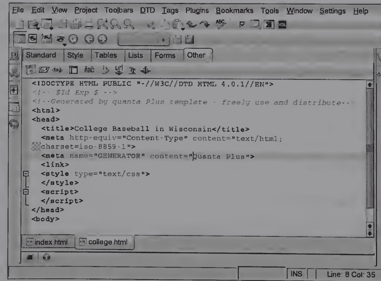

图 14.3 Quanta 的基础 HTML 模板创建了一个标准的页面标题，没有其他内容。

使用 Web 工具可以获得一种普通文本处理器无法提供的支持，那就是对各种网络技术的支持。如果你知道自己在做什么，它可以基于 PHP 网站，或者作为多种 XML 变体（静态 HTML 页面）。

## 选择 Web 开发工具

这两个工具都可以在大多数（如果不是全部）主要的 Linux Web 浏览器中显示你的页面。然而，Bluefish 和 Quanta 的处理方式各不。Quanta 在自己的内部浏览器以及 Konqueror、Mozilla、Netscape、Opera 和 Lynx（基于文本的浏览器）中显示页面。Bluefish 则处理 Mozilla、Netscape、Opera、Galeon 和 GN 默认浏览器。你可以在偏好对话框中添加其他浏览器。当然，你必须在系统中安装了其他浏览器才能使用此功能。

提示
想在不离开 Linux 的情况下在 Microsoft Internet Explorer 上测试你的页面吗？这并不简单，但可能的。
Internet Explorer 将 Wine（Windows 模拟器）下运行，但这需要一些时间。安装 Wine（通过 YaST），从 http://siddeto.com/wineipt/config.html 下载 Hajilime Segawa 的脚本来安装 Internet Explorer 和 Windows Media Player。
将 tar 包解压到主目录，阅读 readme.en 文件获取如何运行脚本的说明。脚本完成后，它会在 Internet Explorer 中打开一个确认页面，这样你就知道系统中有一份可以工作的副本。

将 Internet Explorer 添加到 Quanta 或 Bluefish 的浏览器列表中。

- 在 Bluefish 中，进入编辑（Edit）、偏好（Preferences）、外部程序（External Programs）。添加时你会看到一个列表。看到带有添加（Add）按钮的行了吗？在那里输入 Internet Explorer。在命令（Command）下，使用 `wine explorer %`（针对当前文件）。点击添加，它就会出现在浏览器列表中。点击确定进行确认。
- 在 Quanta 中，进入设置（Settings）、配置（Configurations）。展开树形结构，你将看到“使用（浏览器）查看”（View with (browser)）设置。你以此为基础创建新动作。点击新建动作（New Action）。设置如下：

```
Type:

Text: View with Internet Explorer (你可以选择一个图标,)

ToolTip (optional): View with Internet Explorer

Shortcut (Custom): Alt+Shift+F6 (其他所有都是 F6 的变体。)

Detailed Settings:

$ scriptdir/externalpreview.sh %pid wine explorer (为了方便输入，可以从其中一个“View with”设置中复制并粘贴，然后在末尾添加 wine explorer。)
```

保持其他框的内容不变。点击确定进行确认。

Quanta 和 Bluefish 都提供了详尽的 la文档以及 HTML 和 PHP 的参考手册。Quanta 还包括了 JavaScript 和级联样式表（CSS）的参考。

# Übergeek Web 页面工具

你知道 Linux 极客（geek）不需要 GUI 工具来编写 Web 内容。这仅仅是标记——而且是超文本标记。也许你需要的只是一个文本编辑器和一个标签参考指南。请放心，SUSE Linux 附带的每个文本编辑器都完全能够生成完全符合你喜好的完美 HTML 代码。

Emacs 名如其释，不仅带有一个 Web 浏览器，还有一个针对标准通用标记语言（SGML）的主模式，这意味着它可以帮助你编写任何文档类型定义（DTD）：HTML、XHTML、XML 等。打开或创建任何带有 HTML 扩展的文件，Emacs 就会在你的显示中添加相关菜单。

Vim 有一个名为 2HTML 的转换 HTML 语法文件。Jedit 也有 Code2HTML 插件和内置功能，可以向你的文本中插入标签。

# 练习：使用 Quanta Plus 构建网站

现在你对某些事情非常了解，并且你认为其他人可能感兴趣。没有理由不建立一个网站来展示你所知的一切内容。

在这一节中，我们将使用 Quanta 绘制一个包含几个关于威斯康星州棒球基础信息的页面网站。

## 规划你的网站

理想情况下，在构建网站之前，你应该做一些规划。最重要的是，你必须考虑将页面在哪里。我们的网站将有一个首页、球队的子页面，以及关于该州这项运动的历史。我们将列出该州的大联盟球队，以及已经倒闭的小联盟球队。最后，我们将列出位于纽约州库珀斯顿的棒球名人堂。14.4 显示了一个粗略的站点规划。现在是构建网站的时候了。

## 练习：使用 Quanta 构建网站

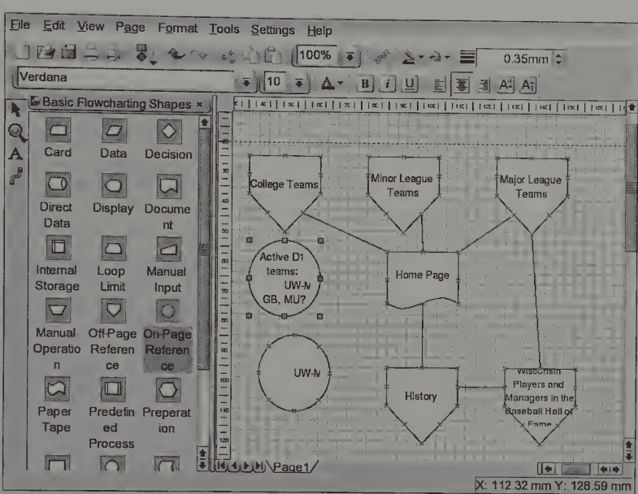

图 14.4 威斯康星州站点的规划。

## 构建网站

在 Quanta 中创建网站的第一项任务是创建一个项目。进入项目（Project），出现图 14.5 所示的向导对话框。命名项目，Quanta 会填充文件名。如果你已经你的 Web 主机如何，调整服务器设置（Server Settings），以便 Quanta 可以在保存时立即上传文件。设置主目录（Main Directory）；可以存储在任何地方，但文档 文件夹是个好地方。模板（Templates）和工具栏（Toolbars）目录将位于主目录下，尽管如果你有多个项目，你可能希望这些目录各只有一个。最后，如果你有一个现有的网站想要拉入 Quanta，在站点来源区域使用 wget 从站点下载文件。

第二页（见图 14.6）取决于你在第一页中对站点来源问题的回答。因为我们没有现有的文件要引入项目，所以什么都不用做。

## 第 14 章 创建基础网站

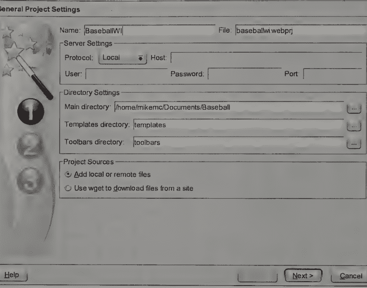

图 14.5 在 Quanta 中创建一个新项目是一个三步过程。

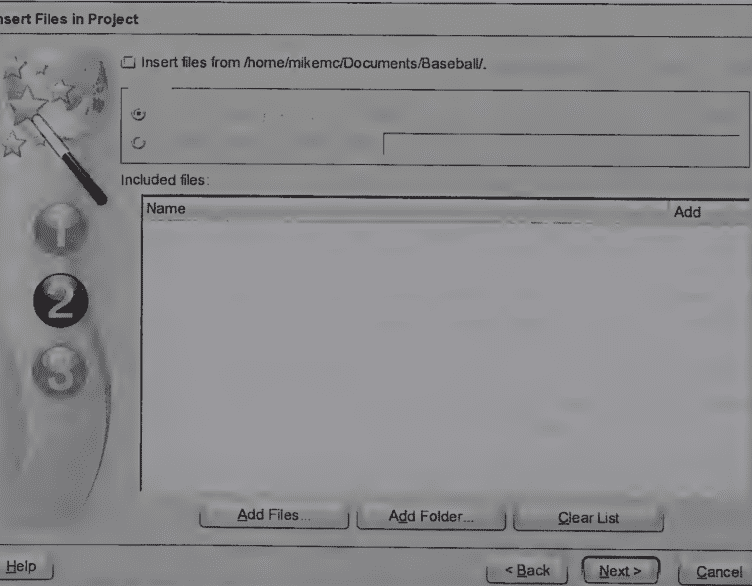

图 14.6 使用此对话框将现有的本地文件拉入你的新项目中。

## 练习：使用 Quanta Plus 251 构建网站

当你将所有现有文件都拉入项目后，点击“下一步”（Next）。你的最后一个任务是告诉 Quanta 你正在构建的是种类型的网站。你也可以将自己（或其他人）标识为网站作者。

在图 14.7 中，你可以看到对于任何给定项目可以使用各种 DTD 变体。对于我们的示例，我们将使用默认的 HTML 4.0 (Transitional)，但你也可以从下拉菜单中选择不同的内容。我们还将坚持默认编码；你很少需要更改它。此外勾选“插入全局模板”（Insert global templates）框；这将让你快速访问网站的不同选项。点击“完成”（Finish）完成你的新项目。


图 14.7 Quanta 让你从不同的 DTD 中选择，以描述你正在建立网站类型。

任何网站的第一个页面都是索引页（Index page），人们访问你的域名时最终到达这里。创建新项目不会自动在 Quanta 中打开新页面，因此我们需要手动操作。有三种方法可以实现：

- 要打开一个没有页眉信息的空白页面，点击“新页面”（New Page）工具栏（或转到“文件”、“新建”）。

- 点击编辑器左侧垂直工具栏上的“模板”（Templates）图标。前往“页面”（Pages）、“HTML”、“4.01”、“Basic”。双击创建页面。然后你可以自己填写页面标题。

- 使用“快速开始”（Quick Start）对话框。点击编辑器空间上方标准工具栏中的第一个图标。此对话框（见图 14.8）让你定义关于页面布局的几乎一切。

## 第 14 章 创建基础网站


图 14.8 使用“快速开始”对话框创建新页面。

此页面的标题——即人们在访问时在浏览器窗口顶部看到的标题（当他们搜索该页面时也会出现）。在默认选项之旁，我们还输入了关键词，这将有助于搜索引擎识别其的主题。用逗号分隔单词和短语。不要让此标签过载；如果你在这里列出的项目超过几个，搜索引擎的爬虫可能会认为你正在过度索取搜索结果；反之，如果项目太少，它可能会忽略你。

Quanta 让多个作者共同维护一个网站变得非常简单。如你所见，你可以从此对话框为每个页面更改几个项目默认设置，包括 DTD、基本目录和作者。如果你不勾选这些框，Quanta 将使用项目默认设置创建页面。

完成页面设置后，点击“确定”（OK）确认。Quanta 可能会问你是否希望新页面成为当前项目的一部分。你应该看到编辑器页面看起来像图 14.9。

> 注意
> 在运行“快速开始”对话框之前必须打开项目，否则除非你指明存储模板的基本目录，否则将无法正确创建页面。

添加内容非常简单。使用现有的工具栏在编写文本前后对段落进行标记。使用“视觉化页面布局”（Visual Page Layout）WYSIWYG 编辑器在你工作时查看其外观。你可以从“源码”（Source）或 VPL 编辑器进行编辑。图 14.9 显示了我们页面在 VPL 编辑器中的开头。

## 威斯康州的棒球

此页面的目的是让各地的棒球迷一览滑德星州（Badger State）各水平棒球的历史和现状，包括小联盟（官方和独立）以及威斯康州棒球的皇冠明珠：密尔沃基的大联盟球队。

```html

<body>

<h1>威斯康星的棒球</h1>

<p>此页面的目的是让各地的棒球迷一览滑德星州各水平的 <a href="history.html">历史</a> 和现状：<a href="college.html" name="Wisconsin College Baseball"></a>，威斯康州的 <a href="minor_leagues.html">小联盟</a>：<a>官方和独立）以及威斯康州棒球的皇冠明珠；位于密尔沃基的 <a href="major.html" name="Major League Baseball in Wisconsin">大联盟 </a>球队。</p>

</body>
```


**图 14.9** 插入图像以丰富页面内容，并包含指向网站上其他页面的链接。

当你准备好一个页面后，在几个浏览器中进行测试，以确保它对所有人来说看起来良好。使用 `Lynx` 浏览器也会间接告诉你你的网站对于使用页面阅读器的盲人来说易用性如何。

当你的网站准备就绪，按 `F8`（或转到“项目”、“上传项目”）将你的作品发布在人们可以看到的地方。弹出如图 14.10 所示的对话框。

在“配置文件名称”（Profile Name）框中选择（或定义）一个主机。从主窗口选择要上传的文件（默认全选）并点击“继续”（Proceed）。`Quanta` 将连接并上传你的文件，并在屏幕底部提供进度报告。

## 使用 SUSE Linux 进行网络日志

网络日志（Weblogging），或简单的博客（blogging），已经存在了相当长的时间。这种做法在 2004 年成功进入了广泛的公众认知，甚至成为《时代》杂志“年度人物”的候选人。

一些观察者认为，网络博客代表了新闻的新形式，因为普通人将他们的生活经历和观点应用于大小各种事件中，并有潜在的全球读者阅读他们所说的内容。


## 第 14 章 创建基础网站


图 14.10 使用 `Quanta` 自动将准备好的网站上传到主机。

许多博客主以各种方式使用博客，欢迎所有操作系统的博客参与（如 `Blogger`、`Typepad` 和 `LiveJournal`）：

- 在线日记，让朋友家人了解最新动态。
- 商务人士日益利用博客与客户进行交流。
- 在技术会议或类似活动现场的人实时报道正在发生的事情。
- 新闻工作者（专业的、业余的还是两者之间）分享他们报道的新闻。

博客可以是一个人的项目，也可以是多个作者。它们可以是关于某个广泛或狭窄的主题，也可以是脑子里跳出的任何内容。有优秀的博客也有糟糕的博客。有些每天有数千人阅读，但大多数只有少数人阅读。无论你想对博客做什么什么，唯一的规则是博客页面按时间倒序排列，最新的文章位于页面顶部。

### Blosom

`Blosom` 以通用网关接口（CGI）脚本的形式在你的 Web 服务器上运行，因此，如果你想让博客始终在线，你就需要一个允许运行 CGI 脚本的主机（大多数主机商都支持）。在确定一个工具之前，你可能想尝试几种工具；为此，你有能力在自己的 SUSE Linux 系统上运行 `Apache`。关于 `Apache` 的更详细解释，请参阅第 26 章。

要在你的 `Apache` 服务器上尝试 `Blosom`，请按照以下步骤安装：

1. 访问 `http://www.blosom.com/downloads/blosom.zip` 下载 `Blosom`。
2. 将 `blosom.cgi` 提取到 `~/public_html/cgi` 目录并赋予其执行权限（`chmod 755`）。
3. 创建一个本地目录来存储你的 `Blosom` 文章；`Blosom` 建议使用 `~/blosom`，但你可以选择任何喜欢的目录。

> **注意**
> 不要选择常用目录来存储你的文章。`Blosom` 将该目录中任何具有适当扩展名（默认认为 `*.txt`）的文件发布到你的博客。

4. 用文本编辑器打开 `blosom.cgi` 以配置你的博客。在脚本中使用前 10 个条目描述 `Blosom` 应该做什么。为你的博客命名。给它提供一段描述，可以是散文式的（这篇博客是关于种植寿菊的），也可以是创意性的（对犬类狼人星和其他奇异现象的沉思）。设置语言。告诉脚本去哪里查找文章（你在第 3 步中选择的目录）。你可能可以让其余条目保持默认设置，但如果你想了解更多信息，请查阅手册。
5. 写一篇测试文章。打开你的文本编辑器写一些内容。将其以 `.txt` 扩展名保存到发布目录。
6. 打开你喜欢的浏览器，并进入 `blosom.cgi` 所在的目录，例如：

```
http://<username>/public_html/cgi/blosom.cgi
```

7. 你的测试文章应该出现，带有你的博客标题和描述，以及你发布文章的日期时间。

有关操作博客的更多信息，请访问 `http://www.blosom.com` 网站。

### Movable Type 和 Typepad

`Movable Type` (MT) 被许多人认为是网络博客应用的黄金标准。它以安装有些困难而闻名，但它的功能如此丰富，这种中等的痛苦是值得的。许多技术倾向型博客运行 MT，许多企业和新闻机构也是如此。

`Typepad` 是由 `Movable Type` 开发者设立类似于 `Blogger` 的托管服务。`Typepad` 让你能够轻松制作高质量的 MT 类型博客，而无需管理安装。他们通过对基础用户收取极低费用（写为 4.95 美元）使其成为了一项长期业务。

`MT` 运行在几乎每一个平台上，并可以使用你喜欢的任何 Web 服务器或数据库应用程序。它有一个供个人使用的免费版本，但如果你想让你的博客有多个作者，就需要付费版本（少于 100 美）。

### 使用 WordPress 写博客

`WordPress` 是一个非常流行的系统，但运行起来有点复杂。它由 `MySQL` 数据库驱动，在开始之前必须运行该数据库。你的 Web 主机可能会支持数据库驱动的网站，但你应该提前检查。

同样，如果你想在本地系统上尝试 `WordPress`，你将必须安装并运行 `MySQL` 和 `PHP`。使用 `YaST` 安装 `PHP` 和 `MySQL` 软件包。

设置 `WordPress`：

1. 访问 `http://www.wordpress.org/latest.tar.gz` 下载当前版本。
2. 将 tar 包解压到任何目录（你的家目录即可，因为它会创建 `WordPress` 目录）。
3. 在 `YaST` 中创建一个 `WordPress` 用户。将其命名为 `wpress`。
4. 创建一个新的 `MySQL` 数据库。从 root shell 中，使用 `/usr/bin/mysqldadmin -p create wordpress`。
5. 登录 `WordPress` 数据库：`/usr/local/bin/mysql -p -u root GRANT ALL PRIVILEGES ON wordpress TO wpress@localhost IDENTIFIED BY password; GRANT ALL PRIVILEGES ON wordpress TO wordpress IDENTIFIED BY password;` 完成后，输入 `exit`。
6. 从从 shell 或你的文件管理器，将你在第 2 步中创建的 `WordPress` 目录的内容复制到 `/public_html`。如果你已经在那里有内容（或想让你的博客成为大型网站的一部分），请复制整个目录。
7. 打开浏览器并访问你提取 `WordPress` 的目录 `http://localhost/wp-admin`。安装屏幕会检查一切是否正常，并偶尔向你提问。
8. `WordPress` 为管理员生成一个密码。登录并发布。你会看到一个非常直观的界面。`WordPress` 网站还提供插件和模板，以进一步定制你的体验。

## 热门博客服务

最大且最知名的博客服务通常为你的博客提供托管以及在其服务器上的免费存储空间。有些服务提供通过邮件发送文章的选项，这是一种方便的工具。以下是你通过这些服务可以做到的快速概述。

### Blogger (www.blogger.com)

博客圈中最知名且最容易入门的平台。基础账户是免费的，并且有许多模板可以选择。在许多方面，`Blogger` 是博客行业中最古老的；它是人们开始的地方。`Blogger` 涵盖了各种风格，但倾向于个人日记类。文章有三种发布方式：基于网页的。

### LiveJournal (www.livejournal.com)

*此处原文截断*

### Typepad

*此处原文截断*


进入`/path/to/xxx`目录，找到`xxx.json`。

在表达式`cvar = avar + bvar`中，加法运算符（`+`）将`avar`与`bvar`相加，得到它们的和`cvar`

在`List.of(arg0, arg1, arg2)`中，`List`接口的工厂方法`of()`接受一系列的元素，返回包含它们的只读列表。

之后我们这样调用`cmd`命令：`cmd arg0 arg1 arg2`。

```
if (condVar > someVal) {console.log("xxx")}
```

- 7. 你的测试文章应该出现，带有你的博客标题和描述，以及你发布文章的日期时间。

有关操作博客的更多信息，请访问 http://www.blosom.com 网站。

## Movable Type 和 Typepad

`Movable Type` (`MT`) 被许多人认为是网络博客应用的黄金标准。它以安装有些困难而闻名，但它的功能如此丰富，这种中等的痛苦是值得的。许多技术倾向型博客运行 `MT`，许多企业和新闻组织也是如此。

`Typepad` 是由 `Movable Type` 开发者设立类似于 `Blogger` 的托管服务。`Typepad` 让你能够轻松制作高质量的 `MT` 类型博客，而无需管理安装。他们通过对基础用户收取极低费用（写为 4.95 美元）使其成为了一项长期业务。

`MT` 运行在几乎每一个平台上，并可以使用你喜欢的任何 Web 服务器或数据库应用程序。它有一个供个人使用的免费版本，但如果你想让你的博客有多个作者，就需要付费版本（少于 100 美）。

## 使用 WordPress 写博客

`WordPress` 是一个非常流行的系统，但运行起来有点复杂。它由 `MySQL` 数据库驱动，在开始之前必须运行该数据库。你的 Web 主机可能会支持数据库驱动的网站，但你应该提前检查。

同样，如果你想在本地系统上尝试 `WordPress`，你将必须安装并运行 `MySQL` 和 `PHP`。使用 `YaST` 安装 `PHP` 和 `MySQL` 软件包。

设置 `WordPress`：

- 1. 访问 http://www.wordpress.org/latest.tar.gz 下载当前版本。
- 2. 将 tar 包解压到任何目录（你的家目录即可，因为它会创建 `WordPress` 目录）。
- 3. 在 `YaST` 中创建一个 `WordPress` 用户。将其命名为 `wpress`。
- 4. 创建一个新的 `MySQL` 数据库。从 root shell 中，使用 `/usr/bin/mysqldadmin -p create wordpress`。
- 5. 登录 `WordPress` 数据库：`/usr/local/bin/mysql -p -u root GRANT ALL PRIVILEGES ON wordpress TO wpress@localhost IDENTIFIED BY password; GRANT ALL PRIVILEGES ON wordpress TO wordpress IDENTIFIED BY password;` 完成后，输入 `exit`。
- 6. 从 shell 或你的文件管理器，将你在第 2 步中创建的 `WordPress` 目录的内容复制到 `/public_html`。如果你已经在那里有内容（或想让你的博客成为大型网站的一部分），请复制整个目录。
- 7. 打开浏览器并访问你提取 `WordPress` 的目录 `http://localhost/wp-admin`。安装屏幕会检查一切是否正常，并偶尔向你提问。
- 8. `WordPress` 为管理员生成一个密码。登录并发布。你会看到一个非常直观的界面。`WordPress` 网站还提供插件和模板，以进一步定制你的体验。

## 热门博客服务

最大且最知名的博客服务通常为你的博客提供托管以及在其服务器上的免费存储空间。有些服务提供通过邮件发送文章的选项，这是一种方便的工具。以下是你通过这些服务可以做到的快速概述。

### Blogger (www.blogger.com)

博客圈中最知名且最容易入门的平台。基础账户是免费的，并且有许多模板可以选择。在许多方面，`Blogger` 是博客行业中最古老的；它是人们开始的地方。`Blogger` 涵盖了各种风格，但倾向于个人日记类。文章有三种发布方式：基于网页的。

*(注：由于您提供的文本在 Blogger 之后出现了大量逻辑重复和截断，以上翻译仅包含您提供的有效内容部分)*

## 第 14 章 创建基础网站

- *kdewebdev.org*—KDE WebDev 站点，用于 Quanta 及其辅助工具。
- *bluefish.openoffice.nl*—Bluefish，基于 GTK 的网页编写工具。
- *bfwiki.telfelsen.net*—Bluefish Wiki，开发团队在此向我们发布最新进展。
- *www.screem*—用于 HTML 和 XML 文件的 GNOME/GTK 编辑器。
- *www.ndepak.info/stuff/vtu/ginf*—“Ginf 不是 FrontPage”，另一个简化网页编写的尝试。
- *webmoney.wired/webmoney*—全能在线网页设计学校。提供各种技能水平的各种网络技术教程，从基础 HTML 到 Apache 以及 ColdFusion。像《Wired》杂志一样，这些页面偶尔会涉及非正规内容。
- *webdesign.about.com*—关于网站设计的实用建议。提供 HTML 和 CSS 样式工具的免费在线课程。
- *radio.weblogs.com/0120449*—来自元宇宙的笔记，作者的技术博客。包含许多与开源软件和 SUSE Linux 相关的链接和新闻。
- *www.planetsuse.org*—Planet SUSE，SUSE Linux 开发者的小组博客。
- *directory.google.com/Top/Computers/Internet/On_the_Web/Blogs*—博客工具和服务的当前目录。你可以在这里找到一些资源。
- *www.blosxm*—下载并学习 Blosxm，一种基于 CGI 的博客工具。
- *www.billclair.com/blogmax*—Eccles 的博客编辑器。
- *wordpress.org*—WordPress 博客和内容管理工具。拥有活跃且实用的支持论坛。
- *www.blogger.com*—仍然是开始博客最简单最便宜的方法。现在由 Google 管理。
- *www.sixapart.com*—Movable Type 和 Typepad 背后的公司。可以通过公司页面博客访问其任一产品。
- *www.livejournal.com*—LiveJournal 是一个用于更多个人博客和建立同类博主社区的地方。
- *radio.weblogs.com/0120385/2003/04/24.html#a329*—关于如何在 Wine 下运行 Windows 博客程序 Radio Userland 的描述。
- *http://akregator.sourceforge.net/index.php*—用于 KDE 的 Akregator 阅读器。

## 第 15 章

## 本章内容

- 电子邮件的工作原理
- MTA 配置
- 对抗垃圾邮件和病毒
- Postfix 的替代方案

## 管理邮件服务器

是否还有哪种应用程序比电子邮件更让人们产生上网的愿望呢？向同事、朋友和家人快速发送短便信息，而无需购买信封、寻找邮票和寻找邮箱——并且让信息在几秒钟内（而不是几天）送到收件人手中——这简直像魔法一样，不是吗？

对我们许多人来说，这种魔力已经消失了一点。我们必须穿过成堆的垃圾邮件、转发的笑话和半无意义的邮件列表帖子，才能找到真正重要的内容。更不用说每周与网络上出现的最新病毒作斗争了。电子邮件是一份礼物，尽管它伴随着许多波折。

电子邮件的魔力发生在一个网络感知操作系统的帮助的一系列标准和协议之上。在本章中，你将学习了解电子邮件从你的信箱发送到收件人信箱的机制。

你还将学习如何在 `YaST` 中设置你的电子邮件账户，以及可以使用哪些用于读取、发送电子邮件以及处理其他信息相关任务的不同程序。如果你在多平台业务环境中使用 SUSE Linux，你也会发现连接 Microsoft Exchange（及其替代方案）的章节非常有帮助。

## 电子邮件的工作原理

当你去掉所有的邮政比喻后，电子邮件（email）只是在网络内部或网络之间传输的纯文本。这些文本使用简单邮件传输协议（SMTP）从服务器发送到服务器。

## 第 15 章 管理邮件服务器

该协议的扩展允许身份验证和发布错误信息。邮件传输代理（MTAs）在用户感知不到的情况下运行，负责邮件的发送和接收。

接收邮件有两套规则。如果你从互联网服务提供商（ISP）获取邮件，你可能使用的是邮局协议第 3 版（POP3）。该协议设置了从中央服务器（你的 ISP）下载邮件到本地客户端（你的硬盘）的规则。POP3 服务器随后会删除已下载的邮件。

接收邮件的另一种方法是邮件访问协议第 4 版（IMAP），通常在企业环境中看到，用户需要访问数据或通过多台机器访问。使用 IMAP，邮件永久存储在中央服务器上，用户在登录网络时查看他们的邮件。

简单来说，当你向 occupant@email.net 写一封电子邮件时，在你点击发送按钮后的几秒内会发生以下情况：

1. 客户端将你的消息发送到 SMTP 服务器。
2. 服务器的 MTA 查询 DNS 服务器以定位 email.net 的 IP 地址，并将其与同时到达的其他消息一起队列。
3. 你的 SMTP 服务器通过 25 端口连接 email.net 的 MTA。当服务器确认连接时，你的 SMTP 服务器发送你的消息以及其他发往 email.net 的消息。

## MTA 配置

当你在 `YaST` 中运行传输代理组件时，你正在配置 `Postfix` 和 `Fetchmail`。自 8.1 版本以来，`Postfix` 一直是 SUSE 的标准 MTA。早期的 SUSE 版本使用了仍广泛使用的 `Sendmail`。`Sendmail` 以难以配置而闻名，而 `Postfix` 则不然。`Postfix` 处理流量也比 `Sendmail` 多。不难看出 SUSE 开发者为什么要进行切换。

然而，对于用户来说，区别不大，因为是由 `YaST` 控制配置。手动创建配置是可能的，但可能会被 `YaST` 在安装新包后的每次运行所覆盖。

在本节中，我们将处理 `YaST` MTA 向导提供的额外界面。基础用户应坚持这些设置的默认值，但如果你想微调邮件操作，请阅读后文。

## 身份验证

假设你有一个不同电子邮件账户的用户，且所有的邮件都应该来自该账户。使用本地用户对话框指定用户以及应显示在邮件“发件人”行中的地址。

某些 ISP 要求在使用其 SMTP 服务器发送邮件时提供密码。如果属于此类，请使用此对话框识别用户、用户名和密码。如果你没有这些信息，可能需要向你的 ISP 技术支持索要。

## 远程 SMTP 连接

如果此系统是邮件服务器，请勾选接受远程连接。这将允许你的用户通过此系统发送邮件。

## 入站邮件协议

如前所述，有两种接收邮件的主要方式：POP3 和 IMAP。其他协议可用于接收/下载邮件，它们列在下拉菜单中。默认情况下，Postfix 会联系服务器并自动确定其使用的协议。其他协议列如下：

- POP2—可能仍存在于某些邮件服务器上，这个版本的邮局协议非常老旧。
- APOP, KPOP—比普通 POP 更安全的身份验证。

> 注意
尽管它是网络上最常用的服务之一且已经持续了很久，但电子邮件仍然是最不安全的服务之一。你为该服务添加任何安全功能（包括更安全的客户端）都能在问题发生之前将其解决。

## 第 15 章 管理邮件服务器

- SDPS——英国互联网服务供应商（ISP）Demon Internet 使用的特殊 POP3 兼容协议。
- ETRN——扩展传输（Extended Turn）的缩写，是 SMTP 邮件投递协议的扩展，允许 SMTP 服务器向另一个 SMTP 服务器请求其针对特定域的任何邮件消息。ETRN 通常用于从没有专用互联网连接的邮件服务器中检索邮件消息（来自 webopedia.com）。
- ODMR——按需邮件中继（On Demand Mail Relay）。

如果你的 ISP 使用了这些协议中的任何一种，他们应该告知你。否则，Fetchmail 的自动检测应该可以正常工作。

## 投递模式

默认为“直接”（Directly）。要使用 SUSE Linux 自带的 Cyrus IMAP 服务器，请从下拉菜单中选择此选项。要使用 Procmail 对邮件投递进行更多控制，请选择此选项。更多信息请参见本章的“对抗垃圾邮件和病毒”章节。

## 别名

别名（Aliases）允许为你本地账户（但接收来自 ISP 的邮件）指定无限数量的电子邮件地址，而无需创建具有登录功能的真实用户。发往 `<alias>@<yourdomain>`（或 IP 地址）的邮件将转发给一个真实用户账户。

打开别名对话框会显示几十个默认别名，这些别名对应邮件转发后到达的真实账户。通过选择你想要操作的别名并点击相应的按钮，可以向列表添加或删除现有别名。

## 虚拟域名

允许你更改电子邮件地址的用户名部分。虚拟域名（也称为虚拟主机）允许你更改地址的域名部分。

关于此点的更多信息请阅读第 26 章“管理 Apache Web 服务器”。

## 对抗垃圾邮件和病毒

电子邮件极其易用，而且几乎是免费的。这就是为什么它很受欢迎。不幸的是，正是这些相同的因素导致我们的邮箱每天都被数十封甚至上百封匿名邮件充斥，这些邮件恳求我们装修家居、购买各种药物以及增强你选择的身体部位。

电子邮件也是通过蠕虫、木洛马、病毒和其他恶意软件对我们的计算机和网络传播攻击的最爱机制。

技术专栏作家、政治家和普通用户在面对这种攻击时宣布了电子邮件的死亡。我们能做什么？继续努力战斗。

SUSE Linux 9.2 引入了一个新的反垃圾向导，它可以与你的邮件客户端协作，在垃圾邮件填满你的邮箱之前将其移除。

几个旨在对抗垃圾邮件的开源项目应运而出，每个项目都有自己的粉丝：SpamAssassin、Bogofilter、SpamBayes、Assistance-Filter 和 GMX 是最为人知的。

KMail 和 Mozilla Thunderbird 都包含了反垃圾工具。Thunderbird 是内置的，而 KMail 则利用上述反垃圾工具创建过滤器。

最后，还有老派的方法，使用 Procmail。

## 反垃圾邮件工具

现代反垃圾工具使用贝叶斯过滤来识别垃圾邮件中典型的单词和模式。它们与 MTA 协作扫描入站邮件并根据其规则进行过滤。

过滤器最大的问题是它们会产生误报，将好邮件（也称为 Ham）当作垃圾邮件丢弃。作为代价，它们也会漏掉大量的垃圾邮件。它们可以通过不同的方式进行训练，以便在你纠正它们的错误时提高它们的检测能力。

在训练过滤器时，确保检测到的垃圾邮件被发送到你自己的文件夹而不是立即删除。否则，无法知道会丢失多少误报。

要训练过滤器，请在你的邮件客户端中创建两个新文件夹：用于误报的“非垃圾邮件”（Not Spam）和用于漏报的“垃圾邮件”（Missed Spam）。当垃圾邮件进入时，手动移动到“漏垃圾邮件”文件夹。尽可能经常（最好每周）检查垃圾邮件文件夹并将好邮件移动到“非垃圾邮件”文件夹。运行训练工具，这取决于你使用的具体工具。

你可能想要访问的是 Apache SpamAssassin 项目，地址为 http://spamassassin.apache.com。这是一个开源软件（一套 Perl 脚本），运行在服务器上并在垃圾邮件进入你的网络之前将其拦截。它通过使用多种不同的技术完成这项艰巨的任务，包括使用 DNS 阻塞列表、分析报头和文本以及一些统计学方法。

由于使用多种技术来识别垃圾邮件，该工具能够过滤掉目前流浮的大多数垃圾邮件。强烈建议你下载最新版本并安装在你的服务器上。

> 可能发生的最噩梦之一是发现你的服务器已变成垃圾邮件网关——字面上的以极快速度传递垃圾邮件。许多公司目前提供作为反垃圾邮件网关的软件产品，这些产品可以防止垃圾邮件、钓鱼尝试和许多病毒越过服务器。

这些产品提供的主要优势是它们预先配置好了，管理员除了在安装期间微调几处设置外无需做其他。除了这种简化外，它们提供的几乎没有 SpamAssassin 中不具备的功能，强烈建议你在购买类似产品之前，调查这个开源解决方案及其可能性。

## 客户端垃圾邮件过滤器

Mozilla Thunderbird 团队对其产生的垃圾过滤器（Junk filters）感到自豪。它很容易训练，而且几乎不会产生误报。可能由于这种心态，它在你的邮箱中留下了许多漏报。幸运的是，选择消息并按 J 键可以迅速将消息标记为垃圾邮件。

垃圾过滤功能默认关闭。转到工具 > 邮件控制（垃圾 Mail Controls）来开启并配置它们。你将看到图 15.1。

  **图 15.1 在 Thunderbird 中设置垃圾过滤**

使用此对话框自动将地址录中的所有人加入白名单。当你确认没有误报时，将邮件移动到“垃圾”文件夹。

## Procmail

Procmail 在邮件从服务器获取时处理每个邮件。详细信息请参见 `/usr/share/doc/procmail` 中的 README 和示例文件。

## 病毒防护工具

传统观念认为 Linux 几乎是免疫的。这在很大程度上是正确的，但可能并非永远。病毒编写者，从脚本小子到更专业的人士，都喜欢利用 Outlook 作为传播媒介。随着越来越多的人使用 Linux 完成日常工作，恶意的程序会尝试挑战。

SUSE Linux 默认不安装病毒工具。你可以配置 fetch 与病毒工具协作，反之适用于大多数病毒工具。

最著名的开源病毒工具是 ClamAV，适用于几个商业工具包括 F-Prot 和 Sophos。

## Postfix 的替代方案

微软尚未被开源产品超越的最后领域之一是企业治理和邮件。许多企业使用 Microsoft Outlook 和/或 Microsoft Exchange Server 获取电子邮件，提供日历、笔记和其他协作功能。行业对 Exchange Server 的普遍投诉集中在可扩展性、管理（特别是备份和恢复，那里有一个活跃的第三方市场）以及许可费用上。

“直接式”替代方案需要兼容 Outlook，因为它旨在在使用微软桌面的环境中替换 Exchange Server。“工作类似”替代方案提供与 Exchange Server 类似的功能，但不提供对 Outlook 客户端的支持；后者是许多开源替代方案的典型。

有几种直接式替代方案，但没有一个是完全开源的，因为需要某些专有连接器来为 Outlook 提供服务（或为 Linux Evolution 客户端提供 Exchange 服务）。对于 Outlook 兼容性，关键似乎在于 MAPI（微软的消息应用程序接口）的完整实现。该目标可能很难实现，因为对于 Linux 解决方案，许多替代方案的成分是一个文档记录良好的协议。

当然，这些功能的独立应用程序在开源世界随处可见，但协作软件的一个特征是集中管理；另一个是所有组件都可以共享信息。开源对微软在该领域统治地位的关键转向邮件、日历和调度的开放标准。日历分布式写作和版本控制（CalDAV）标准基于更早的工作

## 第15章 管理电子邮件服务器

Web上的分布式协作与版本控制 (WebDAV)。随着一种更有序、基于标准方法的出现，Exchange 的统治地位可能走向终结。

接下来的章节将检查几款可用服务器，从 Exchange Server 本身开始，转向与其兼容性日益增加的应用程序。

## Microsoft Exchange Server

由于广泛部署，Exchange Server 和 Outlook 似乎是电子邮件行业的行业基准。它们提供了一个专有的服务器，使用 Outlook 作为客户端并将 MAPI 作为 API，提供电子邮件、联系人、日程、公共文件夹、任务列表、日志和备注。如果你认为 Exchange 提供了“全套”功能，那么没有其他替代方案可以提供 Exchange 100% 的功能。

## CommuniGate Pro

CommuniGate Pro 是一种专有的 Exchange 直接替代方案，提供电子邮件、网页邮件、LDAP 目录、Web 服务器、文件服务器、联系人和列表服务器。CommuniGate Pro MAPI 连接器允许通过 Outlook 和启用 MAPI 的客户端访问该服务器。

## Novell GroupWise

GroupWise 是 Novell 的专有消息和日历解决方案。除了电子邮件外，它还处理即时消息以及任务和文档管理。SUSE Linux 10 首次包含了 GroupWise 客户端。

## Samsung Connect

这是一种专有的 Exchange 直接替代方案。Samsung Connect 服务器提供了几乎是 Exchange 的完全替代品，并将支持任何出现的、支持 Linux 的日历标准。

## OPEN-XCHANGE

OPEN-XCHANGE 是 SUSE 在被 Novell 收购之前进入协作市场的尝试。OPEN-XCHANGE 主要围绕面向 Java 的组件构建，提供了一个可以处理联系人、日程、电子邮件和任务管理的 Web 界面。它基于 Cyrus IMAP 和 Postfix。通过与 SUSE Linux Enterprise Server (SLES)get，OPEN-XCHANGE 还可以进行项目管理、论坛和书签管理。

## Kolab/Krowuate

Kolab 计划始于德国州政府向 KDE 开发人员小组提供资金用于协作软件解决方案。Kolab2 使用 Postfix、Cyrus-imap、OpenLDAP 和 ProFTPd 作为其内核，与 Contact 客户端配合效果最佳。

## OpenGroupware (Ogo)

以前称为 SKYRiX，OpenGroupWare 为任何现有的电子邮件配置提供协作软件和协作组件。它提供日程、联系人、网页邮件、任务管理、资源、项目和文档管理。它运行在 SOPE 应用上。

## phpGroupWare

这可能是几个基于 PHP 的项目中的最好的，你将在第 31 章“创建动态网站”中学习更多相关内容。其他的包括 PHPProject、eGroupWare 和 more.groupWare。它与 MySQL 或 PostgreSQL 等数据库管理系统，以及 Web 服务器和 IMAP 邮件服务器一起使用。它提供基于 Web 的日程、任务列表、地址簿、电子邮件，并附带了新闻标题和文件管理器。问题是 phpGroupWare 在浏览器之外并不能正常运行，将该领域留给了更健壮的客户端。

## Hula

另一个 Novell 开源倡议，Hula 起始于一个专有的 NetMail 服务器。NetMail 在 2005 年春季开源，其初始开发团队公开讨论重新思考人们协作的方式，并使 Hula 成为支持人们真实工作方式的应用程序。它的目标是“既有趣又易用，同时能够从容地从小小组扩展到拥有数千成员的大型组织”。然而，在本文写作时，1.0 版本仍然遥不可及。

## 结论

如前所述，在开发出替代标准之前，企业电子邮件不太可能发生巨大变化。这可能出现在未来几年互联网工程任务组 (IETF) 的讨论中。在此之前，企业可以并应该尝试现有的开源产品，并知道当标准到来时，他们的业务已经准备就绪。

## 参考文献

- http://www.gnome.org/projects/evolution—Evolution 首页。
- http://www.mozilla.org/products/thunderbird—Thunderbird 页面。链接 MozillaZine 知识库和帮助论坛。
- http://pim.kde.org—KDE 个人信息管理套件首页：Contact、KMail、Korganizer 以及所有辅助工具。
- http://sylphed.good-day.net—Sylphed，另一个基于 GTK 的邮件客户端。
- http://www.mutt.org—基于文本的电子邮件客户端中的大杂烩。
- http://www.fpx.de/Software/UDEView—UDEView 多格式附件解码器。支持所有编码格式（BinHex, yEnc, MIME, UUEncode）。享受《编码简介》文档并获取一些实用的历史。
- http://www.yenc.org/linux.htm—用于 yEnc 编码格式的 Linux 读写器。
- http://email.about.com/cs/standards/a/base64_encoding.htm—对 Base64 编码的优秀描述。
- http://www.postfix.org/start.html—Postfix 首页。务必点击菜单上的 Web Sites 以找到适合你的镜像站点。
- http://www.sendmail.org—Sendmail 首页。
- http://catb.org/esr/fetchmail—Fetchmail 首页。
- http://www.paulgraham.com/spam.html—Paul Graham 的原文《垃圾邮件计划》概述了贝叶斯过滤理论。
- http://spamassassin.apache.org—SpamAssassin 首页。查看 wiki 页面以获取可下载的自定义内容。

# 今日 Usenet 新闻 273

对于某些人来说，这导致了替代（alt）层级的兴起，在该层任何人都可以创建一个组，而且许多人都这样做了（见证 alt.swedishchef.bork.bork.bork 的存在）。

随着硬件和软件公司提供 Usenet 支持通道，其他层级也发展出来；学院和大学为学生和教职工使用新闻组；面向社区的企业极客则为他们的本地社区使用新闻组。其中一些在今天仍在运行。

垃圾邮件首次在 Usenet 上显露头角，是一对移民律师在当时活跃的所有新闻组中发布了他们的服务广告。在千年到来之前，垃圾邮件几乎完全消灭了许多小组的真实帖子。但其他小组仍然非常有用。

你的 ISP 很可能提供某种形式的 Usenet 访问。联系他们以获取其 Usenet 服务器的地址以及他们提供的新闻组（也称为他们的新闻源）。许多 ISP 对其馈源内容具有选择性，特别是涉及到 alt 分组时。这些通常被视为种子用户的虚拟社区，其中充斥着盗版软件、恶意软件以及不适合家庭的文本和图像。如果你正在寻找某个特定的组而它没有被包含在内，通常可以请求添加。

有几个可用的新闻服务器，你可以在 http://freenews.maxbaud.net 找到它们的列表。遗憾的是，垃圾邮件发送者经常利用这个机会推销他们的商品，因此在使用时请务必小心。

# 使用 GOOGLE GROUPS

曾经，有一个 DejaNews，它是 Usenet 的存档，而且它非常好用。几乎所有追溯到 1980 年代的每条 Usenet 帖子都包含在这个免费的网络资源中。随后 .com 时代崩溃了，DejaNews 陷入了危险。但谁能来营救呢？那家努力让 Web 对人类更有用的公司：Google。

在写本文时，Google Groups 在技术上仍处于 Beta 阶段，它既可以通过所有标准的 Google 工具搜索 Usenet 存档的方法，也可以免费访问当今的 Usenet。Google 确实在页面上投放了广告。

只需访问 Google Groups (//groups-beta.google.com) 并进行关键词，或通过链接浏览组。通过免费注册，你可以订阅喜爱的组并创建自己的公共或私有组。图 1.6 显示了由 Konqueror 创建的 alt.linux.use.group。

在阅读 Usenet 帖子时，你的客户端可以让你轻松地回复，通过电子邮件或作为公共帖子进行回复。某些客户端支持用于发布和发送电子邮件的多个“身份”，因此你可以选择不同的签名或回信地址。

# 注意

垃圾邮件发送者使用软件“机器人”来收集他们在 Usenet 上找到的每一个电子邮件地址，他们从不发布真实的电子邮件地址。他们使用人类可以读懂但机器人会遇到困难的地址，例如 myNameNOSPAMmyISP.com。

# 第 16 章 与他人协作


**图 16.1** Google Groups 在 Web 上为你提供了可搜索和下载的 Usenet 馈源。这是 alt.os.linux.suse 组。标准的 Google 广告出现在页面底部。

# 选择 Usenet 新闻器

基于在 SUSE Linux 中阅读 Usenet 的选择。许多客户端也可以传递新闻。周围还有几个独立的客户端（Knode/Kontakt、Pan 以及各种基于文本的客户端）。有些要求你会在访问新闻时在线，而另一些则允许离线阅读。当然，还有针对 Emacs 的版本。

# 邮件/新闻客户端

阅读和处理新闻是非常相似的任务：阅读并回复，也许保存以备后用。出于这个原因，跟进的最简单方法是使用支持 Usenet 的邮件客户端。

许多客户端都支持这一点，包括一些最出名的：Mozilla Mail/Thunderbird、Evolution、Sylpeed、mut 和 pine。将它们配置为读取 Usenet 通常只需要识别 Usenet 服务器（通常为 <ISPName.com>）并在需要身份验证时包含登录信息即可。

在邮件客户端中阅读新闻通常是一种非常纯净的体验，没有独立新闻阅读器使用的某些高级过滤器，但通常支持线程（如果邮件支持支持的话），并且回复帖子的操作方式与电子邮件相同。

# 选择 Usenet 新闻器 275

通过 Usenet 进行二进制传输（包括图像、多媒体文件和程序）的支持参差不齐。yEnc 编码格式在 Usenet 中要广泛得多（见第 15 章“管理电子邮件服务器”更多关于 yEnc 信息），如果你的邮件客户端不支持它，你将会错过很多内容。许多内容通过 Usenet 二进制文件传播，这可能是件好事。

# 独立 GUI 新闻器

也许你的邮件客户端不支持某些功能（例如 KMail），或者你想要一些更适应 Usenet 氛围的东西（二进制传输、bozo 过滤器以及清除垃圾邮件的方法）。独立新闻器可能是一个不错的选择。

与许多其他 GUI 软件包一样，针对 KDE (KNode) 和 gnome (Pan) 都有独立的新闻器。如果你需要，可以将 KNode 包含在 Kontakt 内部。

# Pan

Pan 的运行类似于 Windows 新闻器 Forté Agent，但它更先进。你可以从多个服务器读取馈源，包括 Novell Linux 支持组（图 16.2）。


**图 16.2** Pan 是一个易于使用的新闻器。

（注：原文后续存在大量重复段落已省略，仅保留核心翻译内容）

# 第 16 章 与他人协作

5. 现在转到“视图”、“过滤”（或点击像漏斗一样的过滤器工具栏图标），并选择“有新回复”（Has New_Followups）以激活当前群组的过滤器。

## 基于文本的新闻器

由于在图形用户界面（GUI）出现之前 Usenet 就已经存在了，许多基于文本的新闻器仍在在使用。有些甚至仍在活跃开发中。SUSE Linux 带有 NetNews (nn)、InterNews (inn)、tin、slrn 和 suck。

在开始使用任何这些程序之前，您需要将您的新闻服务器设置为环境变量。请以该用户身份操作，不要以 root 身份。在 shell 中，输入以下命令：

```bash


`export NNTPSERVER=<NewsServerDomainName>`

下一步是查看您服务器上的群组并订阅一个或多个群组。这通过创建一个 `.jnewsrc` 文件来实现。例如，让我们使用 `slrn`。输入以下命令：

```bash
slrn -f .jnewsrc -create
```

该配置文件位于 `/etc/slrn.rc`，有详尽的注释且易于自定义。

当您创建 `.newsrc` 并在必要时登录后，`slrn` 将获取服务器上所有可用群组。要订阅感兴趣的群组，请从列表中选择它并输入大写字母 `S`。要查看已订阅的群组，输入大写字母 `L`，接着按 `Esc` 键，然后按数字 `1`。


图 16.4 基于文本的 `slrn` 新闻器显示了一已订阅的群组。选择一个群组并按回车阅读消息。

## 与 Wiki 协作

`WikiWikiWeb` 取自夏威夷语中表示“快速、快捷、敏捷”的含义，由 `Ward Christopher` 创建，旨在挖掘他朋友圈和同事的集体知识。它结合了邮件列表、软件文档和 `Web` 简单结构的特点，以生成有用、易于访问且频繁更新和审查的信息。

这个想法引起了关注，人们正以各种方式与 `Wiki` 协作。最为人知的成功且流行的 `Wiki` 例子是 `Wikipedia.org`。它的目标是产生关于大多数事物的人类知识基础汇编。截至 2005 年 2 月，`Wikipedia` 英文版生成的文章接近 50 万篇，且至少在其他 20 种语言中都有文章。它催生了其他项目，包括 `WikiQuotes`、`Wiktionary` 和 `Wikizens` 新闻项目。

已经编写了许多软件包来创建 `Wiki`。这些软件包被称为 `WikiEngines`（Wiki 引擎），具有不同的功能。就像博客软件一样，一个引擎就应该满足您的需求和特殊性。`Wikipedia` 使用 `MediaWiki` 引擎。`SUSE Linux` 自带了一个引擎，基于 `Zope` 的 `ZWiki` 引擎。其他引擎很容易获得，安装难度程度不相同。请参见 `http://c2.com/cgi/wiki/?ChoosingWiki` 获取选择软件包的帮助。

### ZWiki

该软件包基于 `Zope` Web 应用程序包构建了 `Wiki` 功能。`Zope`（Z 对象发布环境）被构建为一种创建动态网站的面向对象的工具。它包含一个内容管理框架、它自己的关系型数据库（以及其他数据库管理系统）以及其他发布工具。它主要用 `Python` 脚本语言编写。

让 `ZWiki` 运行起来是一个两步过程，因为您首先需要 `Zope`。通过 `YaST` 安装 `Zope`，然后进入 `YaST` 中的“运行级别编辑器”（请参见第 22 章“管理启动过程和其他服务”获取更多关于运行级别编辑器的信息）来开启 `Zope`。

从 `http://wiki.org` 下载最新的 `ZWiki` 版本。新版本通常每月发布一次。将 `tar` 包解压到 `/var/opt/zope/default/Products`，然后重启系统以启动 `Zope`。

打开浏览器访问 `http://localhost:8080`，您将看到 `Zope` 的欢迎信息。点击“Zope 管理界面”（ZMI）链接。系统将要求您输入用户名和密码。`SUSE` 工程师创建了一个默认用户，这是您第一次使用时应该使用的信息。用户名：`superuser`，密码：`123`。

从主界面，选择“类型”下拉菜单来添加 `ZWiki`。点击“添加”。出现图 16.5。

为 ZMI 指定一个 ID 名称并为您的 `Wiki` 指定一个标题。点击“创建 Wiki”（并按回车）。您将看到默认皮肤下的默认页面（参见图 16.6）。


图 16.5 使用 `Zope` 管理界面与 `ZWiKi` Web 交互。


图 16.6 创建新的 `ZWiKi` 时出现基础 `ZWiKi` 模板。

点击“编辑”链接将默认文本替换为您自己的内容（参见图 16.7）。

> 注意：在第 26 章“管理您的 Apache Web 服务器”中了解更多关于 `Zope` 的信息。

`ZWiKi` 在输入的文本类型上非常灵活。它可以读取并解释标准 `HTML`、`Zope` 的文档标记语言 (`DTML`)、结构化文本 (`StructuredText`)……它还可以跟踪所有订阅者并……正如之前提到的，`ZWiki` 运行……（此处原文此处似乎有逻辑跳跃，按原意翻译）……在 `SUSE` 运行的 `WikiWeb`。访问选择符合需求的包的 `Wiki`。


图 16.7 在 `Wiki` 页面中开始。

## 托管邮件列表

邮件列表是异步协作的传统方法。它们不需要特殊的技能或格式化能力，适用于从小型小组到全球项目的范围。自动化列表的概念很简单：列表是人之间的组织讨论。要发起讨论（或主题），您可以向列表发送消息，然后将其发送给所有订阅者。多年来出现了几种列表管理工具：`L-Soft` 的 `Listserv`、`majordorno` 和 `Lyris`。最近，名为 `Mailman` 的开源软件包占据了越来越多的份额。对于用户来说，`Mailman` 提供了一个一致的 Web 界面来管理参与，包括订阅/取消、获取每日摘要、访问列表存档、关闭列表等。邮件管理员可以使用许多自动化工具让工作变得更轻松。`Mailman` 是 `SUSE` 自带的两个列表管理工具之一（另一个是 `majordorno`）。

`Mailman` 跟踪所有订阅者并监控（处理）退信。如果管理员要求，它还会生成列表存档。任何列表至少有一个管理员或审核员——可能就是你。该人员可以访问特殊的受密码保护的管理员 Web 页面；在那里，您可以执行列表职责，例如：

- 手动添加或删除成员，可能是因为你是好人，也可能是所迫。
- 为新成员编写带有列表规则的欢迎。
- 设置列表的审核级别：您想检查每条传入的消息，还是只想检查新人的首次帖子以确认他们不是垃圾邮件。
- 从存档中删除删除消息。

### 安装 Mailman

`YaST` 完成了大部分安装任务，但在您的系统上创建新列表之前，您必须执行一些配置步骤。这些步骤在 `/usr/share/doc/packages/mailman/README.suSE` 中说明。`SUSE` 团队假设您使用 `Postfix` 作为 `MTA`（参见第 15 章）并使用 `Apache` 作为 Web 服务器（参见第 26 章）。

1. 在 `YaST` 系统配置编辑器中（“系统”下），进入“网络”、“邮件”、“Mailman”（您可以直接编辑 `/etc/sysconfig/mailman`）。识别以下项目：

- `MAILMAN_SMTPHOST`
- `MAILMAN_DEFAULT_NNTP_HOST`
- `MAILMAN_DEFAULT_EMAIL_HOST`
- `MAILMAN_DEFAULT_URL_HOST`
- `MAILMAN_VIRTUAL_HOSTS`

并运行 `SuSEconfig -module mailman`。

2. 以 `root` 身份运行 `/usr/lib/mailman/bin/mmsitepass` 来设置站点主密码。

3. 以 `root` 身份编辑 `/etc/postfix/main.cf`。在页面底部，你会看到 `YaST` 已经配置了一个默认别名映射：`hash = /etc/aliases`, ...

4. 在该行添加此语句：`hash:/var/lib/mailman/data/aliases`。

5. 回到 `root` 壳（shell），并使用此命令 `postfix reload` 重新加载 `postfix`。

6. 最后，以 `root` 身份运行 `/usr/lib/mailman/bin/newlist mailman` 创建主邮件列表。`Mailman` 的内部运行需要此列表。系统将要求你作为站点管理员设置一个密码；请设置一个易于记忆但相对难以猜测的密码。

现在你可以使用 Web 界面来设置你的列表了。

> 提示：为你的 `Mailman` 列表寻找主机吗？你可以在 [Python 友好 Web 托管](http://www.python.org/moin/PythonHosting) 找到免费和商业主机的目录。在“提供的服务”（Services Offered）一列中查找 `Mailman`。

### 运行 Mailman 列表

`Mailman` 文件存储在 `/usr/lib/mailman/bin` 中。它们归 `root` 所有，但 `Mailman` 组的所有成员都有执行权限，可以使用 Web 界面或从 shell 运行 `Mailman` 命令。

打开浏览器并访问 `http://localhost/admin` 查看 `Mailman` Web 界面。你可以创建并管理列表。

要运行 `Mailman` 壳命令，请切换目录到 `/usr/lib/mailman/bin` 并运行你的命令。例如，要创建一个新列表，输入以下内容：

```
./newlist
```


使用点斜杠是因为出于安全考虑，这些命令故意没有放在你的`path`中。

当你创建一个新列表时，系统会提示你命名列表（使用全小字母）并提供列表所有者的电子邮件地址。`Mailman`将向所有者发送一封确认邮件。你也会在此过程中建立初始列表密码。

你可以在`/usr/share/doc/packages/mailman`找到`Mailman`的文档。你会发现`README`文件，它们涵盖了各种邮件代理和操作系统的潜在问题，以及当前的常见问题解答（`FAQ`）。更多针对不同类型用户定制的文档请访问`http://www.gnu.org/software/mailman/docs.html`。你可以在线阅读，也可以下载`PDF`或纯文本版本。

# 使用即时通讯工具和互联网相对聊天

实时电子通信有两种基本形式：互联网相对聊天（`IRC`）类似于`Usenet`，你进入一个组（称为通道`channel`）并讨论由该通道标识的话题。任何人都可以建立通道、邀请用户参与、设置规则，并在他们违反规则时将其踢出去。`IRC`上的每个人都有一个用于在聊天中识别身份的“句柄”（`handle`）。他们具有相对匿名性。

即时消息（`IM`）是一个对一的过程，用户可以互相聊天，而无需访问`IRC`频道。随着美国`Online`的`Instant Messenger`普及，此后出现了多个网络来促进跨网络的即时消息通信。

`SUSE Linux`可以从几个网络中选择来处理他们的实时通信需求，包括`IRC`和`IM`。

## 互联网相对聊天 (IRC)

与电子邮件一样，`IRC`协议根本上是关于文本的。第一个`IRC`客户端基于命令行，其中许多仍在在使用。但就像纯文本邮件演变为带有附件和`GUI`客户端的`HTML`邮件一样，`IRC`也是如此。

`SUSE Linux`包含了这些`IRC`客户端：`K`是默认的`KDE`客户端（尽管`Kopete`同时支持`IM`和`IRC`网络）。`Xchat`是`Windows`标准`IRC`客户端。`Kvirc`也是基于`KDE`的，而`ict`是基于`tcl-tk`语言的命令行客户端。如果你还没有喜欢的，请尝试所有它们。

> 出于安全考虑，永远不要以`Root`身份运行`IRC`客户端。为了获得最安全的`IRC`体验，创建一个特殊的`IRC`用户并始终以该用户身份启动客户端。

第一次遇到`IRC`时，可能会感到有些畏惧。除非你知道你要去哪里（例如有人邀请你加入特定网络上的特定通道），否则你有大量的选择。

你的第一个选择是网络。每个客户端提供了丰富的公共`IRC`服务器（`Kopete`在向导中列出了`49`个；`Xchat`列出了`73`个）。你的客户端自带的默认列表是可以编辑的。`EFNet`是最老的`IRC`网络，但也有许多流行的`IRC`网络，包括`DalNet`和`Internet`。根据客户端的不同，你可以同时连接到多个服务器以参与不同的通道。如果你正在寻找`Linux`支持，请查看`ChatJunkiesNet`。

每个服务器托管着多个通道/房间。这些是主题区域，并且会不断变化。某些通道始终存在于网络上；另一些只有在有活动安排时存在。你可以搜索通道列表查找主题（这在某个流行的网络中特别有用，因为此时可能有成千上万个通道开启）。列表将告诉你此时有多少人在线聊天，并提供关于通道主题的描述。你可以通过描述感知通道的对话语气。新用户应该避开那些宣布“菜鸟（Lamers）将被射杀”的通道。大多数通道是公开的，但你可以设置需要密码的私有通道。这可以在你的客户端中配置。

选择好通道后，你可以直接进入对话。如图 16.8 所示，客户端应该在一个窗口中显示参与者的昵称列表，帖子将如下所示。


图16.8 一个`IRC`通道。帖子在左上方滚动，参与者列在右上方。在底部发布消息。

## 即时消息

即时消息应该比`IRC`简单得多，而且确实可以做到。核心问题是大量的私有`IM`协议。三个领先者——`AOL Instant Messenger/ICQ`、`MSN Messenger`和`Yahoo Messenger`都有不同的方法来连接用户。

只要你和你想要`IM`的人在同一个网络上，你只需要一个账户。如果你的朋友在另一个网络，你就需要另一个账户，可能还需要另一个用户名或密码。

你有两种方法来解决这个难题：获取一个支持所有协议的单一`IM`客户端，或者让你所有的朋友都采用开源的`Jabber`协议并使用`Jabber`客户端。`Kopete`和`GAIM`（分别用于`KDE`和`GNOME`）可以运行之前提到的所有服务器并持续数小时。`SIM`（简单即时消息）是一个仅限`ICQ`的客户端（命令行`licq`也如此）。

图 16.9 中的`GAIM`配置窗口显示了你可以选择的协议。

`Jabber`被设计为通用的`Web`标准`IM`协议。将来其他协议都应该采用它，但短期内不会。如果有更多人使用`Jabber`客户端，这一天可能会加速。除了`Kopete`和`GAIM`，`KDE`拥有`PSI Jabber`客户端，`GNOME`有`Gabber`。

# 第16 章与他人协作

`GnomeMeeting`允许用户从任何配备适当且连接互联网的`PC`参加电话和视频会议。它使用`H.323`语音过`IP`（`VoIP`）协议将语音和（如果可用）摄像头视频传输到和从你的位置。`GnomeMeeting`可以在拨号和宽带连接上运行，但在慢连接上视频会更麻烦。

你需要一个支持全双工的声卡、一个麦克风、一个摄像头和一个视频设备来充分利用`GnomeMeeting`的功能。如果您只想收听，那么只需要一个声卡就足够。

首次运行`GnomeMeeting`时，会出现一个向导来配置您的系统。输入您的姓名、电子邮件地址和位置，并选择连接类型。`GnomeMeeting`应该会自动检测您的音频和视频设备，然后就可以使用了。

运行`GnomeMeeting`时，您必须向`ILS`目录服务器注册才能拨打和接收。默认情况下，`GnomeMeeting`使用位于`http://ils.seconix.com`的服务器；如果您需要，也可以配置不同的服务器。这会将您放入用户目录，并让全球都能访问您。告诉您想要通过`GnomeMeeting`连接的人也向服务器注册，这样您就可以拨打给他们了。

`Skype`语音中继网络电话 (`VoIP`) 服务也适用于`SUSE Linux`。从`http://www.skype.com/getskype-linux-qt32`下载`SUSE RPM`包。

## 参考文献

- `http://groups.google.com`—`Google Groups`。在网页上阅读`Usenet`并创建您自己的群组。
- `http://www.isrc.org/index.pl?/products/inn`—`InterNews Usenet`服务器和阅读器。
- `http://slrn.sourceforge.net`—`s-lang`阅读新闻；`slrn`阅读器。
- `http://knode.sourceforge.net`—`Contact`和`KDE`中的`KNode`新闻阅读器。
- `http://pan.rebasebase.com`—适用于`GNOME`的`Pan`新闻阅读器。
- `http://c2.com/cgi/wiki?WikiWikiWiki`—`WikiWikiWiki`，`Ward Cunningham`的协作。
- `http://c2.com/cgi/wiki?ChoosingaWiki`—在`Ward Cunningham`聚集的群众帮助下选择`Wiki`引擎。
- `//zwwiki.org`—`ZWIKI`，包含在`SUSE Linux`中的基于`Zope`的`wiki`引擎。文档正在编写中。
- `http://zopewiki.org/ZopeAndApache`—`Zope`与`Apache`协同工作。当在`Apache`上托管`ZWiki`时这很有帮助。
- `http://twiki.org`—另一个流行的`Wiki`引擎。
- `http://en.wikipedia.org`—维基百科首页，也许是`wiki`工作原理的最佳示例。
- `http://www.list.org`—`Mailman`列表管理器主页。
- `http://www.greatcircle.com/majordomo`—`Majordomo`列表管理器。
- `http://www.siliconexus.com/MajorCool`—`Majordomo`的`Web`。
- `http://www.irchelp.org`—获取`Internet Relay Chat (IRC)`帮助的地方。
- `http://www.irc.org/links.html`—`IRC`客户端、通道、网络和机器人。可以在这里找到。
- `http://tldp.org/HOWTO/IRC`—`KDE`即时通讯微型`HOWTO`。
- `http://kopete.kde.org`—`Kopete`，`KDE`即时通讯软件和`IRC`客户端。
- `http://www.jabber.org/user/userguide`—`Jabber`用户指南，用于学习此开源`IM`协议。`Jabber.org`还托管了一个公共`IM`服务器供您连接。
- `http://gabber.sourceforge.net`—`GNOME Jabber`客户端。
- `http://xchat.org`—`Xchat`主页。
- `http://www.licq.org`—`LICQ`，所有`Linux`即时通讯软件之母。
- `http://gaim.sourceforge.net`—此`IM`客户端最初是`AOL`即时通讯 (`AIM`) 的克隆，但现在支持大多数其他`IM`网络。
- `http://www.gnomemeeting.org`—`GnomeMeeting`视频会议主页。

# 第 17 章

## 本章内容

## 安全文件传输

- 选择文件传输协议 (`FTP`) 客户端
- 点对点文件传输
- 构建 `FTP` 服务器
- 为安全文件传输配置 `xinetd`
- 配置安全传输服务器

在互联网早期，它非常酷的功能之一是从一台计算机向另一台传输文件和程序。使用文件传输协议 (`FTP`)，任何拥有调制解调器的人都可以连接下载大量的文本文件库、共享和应用程序。人们一直在使用`FTP`，尽管它通常被许多图形化`FTP`客户端所隐藏。正如在第三章“安装 `SUSE Linux`”中学到的，你甚至可以在`FTP`的帮助下安装`SUSE Linux`。

然而，`FTP`的易用性是有代价的。`FTP`不是安全协议。带有病毒的文件恶意软件可以很容易上传到`FTP`服务器并在网络中传播。幸运的是，你可以使用新的、更安全的应用程序在更安全的环境中获得`FTP`的优势。安全外壳 (`SSH`) 包括`sftp`（一个安全的`FTP`客户端）和`scp`。两者都让文件传输更安全，并且易于使用。

在互联网上移动文件的另一种方法是通过点对点技术，如`BitTorrent`和`Gnutella`。这些技术同样流行，但它们使用简单的方法跨网络移动数据。本章将仔细查看`SUSE Linux`中提供的使用`FTP`和点对点技术的文件传输软件。你还将学习创建安全服务器。下一节将讨论客户端。

`FTP`使用客户端/服务器模型在网络或互联网上移动文件。它允许显示远程目录。如果权限允许，用户还可以打开并编辑远程目录上的文件。`FTP`本身对客户端和服务器都构成了安全风险，因为它允许输入包括用户名和密码在内的登录信息（并以明文发送到网络上）。匿名在互联网上已成为标准做法。今天，除了匿名`FTP`之外，`SUSE Linux`用户可以使用`OpenSSH`（安全外壳的免费版本）附带的`FTP`客户端来使他们的文件传输更安全。本节将帮助你使用`sftp`和其他客户端。

`YaST`将`FTP`安装为`SUSE Linux`的默认文件客户端。该客户端是为`NetBSD`版本的`UNIX`编写的，运行良好。它替换了标准的`FTP`客户端，因此可以使用所有的`FTP`命令。以下是典型会话中最常用的命令。请注意，在连接到远程服务器后，大多数导航命令（`cd`、`ls`和`pwd`）都能正常工作。

### 启动与停止

- `ftp`—此命令启动`FTP`客户端。如果不先输入此命令，你无法连接。
- `open`—此命令使用`IP`地址或域名连接到远程`FTP`站点。在使用此命令之前，在提示符处输入`ftp`。
- `close`—此命令关闭连接并保持留在`FTP`中，以便你登录另一个服务器。
- `bye`—此命令关闭连接，退出`FTP`并返回你的`shell`提示符。
- `quit`—与`bye`相同。此命令关闭连接，退出`FTP`并返回`shell`提示符。

### 选择文件传输协议 (FTP) 客户端

#### 文件类型

- `ascii`—将传输设置为`ASCII`文本。仅在发送或接收文本文件时使用。
- `bin`—将传输设置为二进制。在上传程序、图像或压缩包时使用。还要确保你下载的任何程序、图像或归档都标记了此标签。某些`Windows`客户端默认以`ASCII`传输文件；这些在下载后是没用的。

#### 操作

- `get`—从远程服务器向你的机器下载单个文件。语法：`get <filename>`。
- `put`—从你的机器向远程机器上传单个文件。语法：`put <path/filename>`。
- `mget`—从远程机器向你的机器下载多个文件。接受通配符作为参数。参见`prompt`：`mget *`。
- `mput`—从你的机器向远程机器上传多个文件。与`mget`一样，接受通配符作为参数。参见`prompt`：`mput *`。
- `prompt`—这是一个交互式命令，用于控制带有通配符的`mget`和`mput`。`prompt`在传输每个匹配文件之前会询问你是否想要。当你的连接很慢且发现自己正在下载重复的或不需要的大型文件时，这特别有用。它默认是开启的。
- `hash`—告诉`FTP`提供哈希标记 (`#`) 进度条以指示传输情况。

`FTP`包含许多其他实用命令，这些命令随服务器而异。如果你想检查服务器是否支持特定命令，请连接到站点后运行`help`。你将获得可用命令的列表（但没有描述）。

> 有关`FTP`命令的完整描述，请参阅`FTP`的信息页：`info ftp`。要深入研究，可以阅读`SUSE Linux DVD`上的源代码中的命令。

`wget`
`wget`是一个用于非交互式传输的实用工具，例如镜像远程目录。它使用`FTP`和`HTTP`等标准协议工作，也支持`HTTPS`等安全协议。它的非活动性可能看起来并不是什么优势，但这一功能允许你在后台下载文件，或者编写脚本使用`wget`将目录备份到远程位置。

请访问`http://www.gnu.org/software/wget/manual`查看在线文档。

# 使用 sftp 进行安全文件传输

安全`FTP`客户端`sftp`是作为`OpenSSH`壳项目的一部分而开发的，旨在加固许多基础互联网协议的安全性问题。对于许多用户来说，`SSH`已经取代`telnet`成为远程连接工具，而`sftp`在文件传输方面发挥了同样的作用。

`sftp`的目标与其说是管理文件本身，不如说是安全地传输登录信息。通过这种方式，不属于匿名`FTP`目录的文件可以被需要的人访问。`sftp`并不是连接到标准的`FTP`服务器，而是连接到`OpenSSH`的`sftp-server`，允许在登录时对用户名和密码进行加密。`sftp`并不包含`FTP`拥的所有内置命令（例如，你不能使用通配符），但其子集仍然非常有用。

如果你担心传输本身应该是安全的，你可以使用`sc`（安全复制）命令代替`sftp`。为此，你需要对远程主机有显式访问权限，并且了解文件系统的结构（即你想要传输的目录所在的位置）。安全文件传输较慢，因为位经过了加密，但速度的缺失被传输安全性带来的安心感所弥补了。

回到`sftp`，只有当远程服务器安装了`OpenSSH`时，你才能使用它。关于`OpenSSH`的更多信息，请参阅第 25 章“设置网络和 `Samba`”中的“保护网络服务”部分。`OpenSSH`默认开启安全`FTP`访问。

你可能需要在交互模式下使用`sftp`。使用命令输入`IP`地址或远程主机名来访问远程机器：

```
sftp <IP address>
sftp docs.protek.edu
```

默认情况下，远程机器会将你识别为本地机器上的当前用户。如果你在远程机器上有不同的用户名，请稍不同地使用命令：

```
sftp mmcall@docs.protek.edu
```

现在它将连接到`docs.protek.edu`并使用新用户名识别你。

# 选择文件传输协议 (FTP) 客户端

`sshd`通常配置为运行在端口`22`，而`sftp`默认也尝试连接到该端口。某些服务器可以配置为监听不同的端口号，你可以使用`-o`开关指定该端口：

```
sftp -oPort2221 mmcall@docs.protek.edu
```


现在你已经连接，并在远程机器上看到了命令提示符。要查看确切可用哪些命令，请在提示符处输入 `help` 或问号 (`?`)。继续你的会话并在结束退出。

# GUI FTP 客户端

SUSE Linux 包含了三个独立的图形化 FTP 客户端。当然，所有的浏览器（Konqueror、Epiphany、Mozilla、Opera）也都内置了 FTP 客户端。文件管理模式下的 Konqueror（以及 GNOME 的 Nautilus 文件管理器）连接到远程服务器并传输文件也没有问题。只需在“位置”框中输入远程的 URL 即可。在本节中，你将学习 FTP 和 KBear。

# 使用 gFTP

适用于 GNOME 的 gFTP 客户端可以轻松从任何远程主机传输文件。当你打开它时，会在左侧面板看到你的主目录（如图 17.1 所示）。当你连接到远程站点时，其主目录将出现在右侧面板。


图 17.1 gFTP 通过并排目录和拖放的便利性简化了文件传输。

# 294 第 17 章 安全文件传输

该程序自带了一些大型 FTP 存储库的书签，包括 SUSE FTP 服务器，因此如果你有兴趣，可以浏览并寻找有趣的文件。如果你已经知道想要连接的站点，可以通过在 `Host` 字段中输入地址和额外信息来建立连接。连接成功后，你可以进入“书签”菜单将其添加到你的书签中，以便于快速访问。

默认情况下，gFTP 用于匿名访问，并提供你的本地电子邮件地址 `<username>@linux.local` 作为密码。你可以在 FTP 下方的“选项”菜单中更改默认地址。该程序还支持 `sftp` 和其他 `SSH` 协议。要检查安全传输的设置，请进入 FTP 菜单并选择“选项，SSH”。

图 17.1 显示了马萨诸理工学院 GNU 项目服务器的 Emacs 编辑器。在屏幕底部，你可以看到已输入的文本流命令。你不能直接在此窗口中输入命令，但所有标准命令都可以从菜单获得。右键上下文菜单也运行良好。

与 Linux 系统一如常地，默认传输类型是“二进制（Binary）”，因此如果你正在上传或下载文本文件，请进入 FTP 菜单并选择“Ascii 码（Ascii）”。

> 注意 仅当你移动的是可以使用文本编辑器可读的纯文本文件时，才使用 Ascii 传输选项。文字处理文件和电子表格文件是二进制文件。

要开始传输，选择一个文件或一组文件并将其拖到另一侧。停止传输，按 `Ctrl+C`。传输完成后，按 `Ctrl+Q` 关闭窗口。

# 使用 KBear

许多 KDE 用户倾向于使用 KBear 管理远程文件传输。如果你更习惯双面板界面，KBear 可以提供帮助。本质上它并排打开 Konquer 窗口，并带有一个 FTP 特定的菜单。

# 点对传输

当你第一次运行 KBear 时，会要求你通过几个向导界面。

新手可能会感到畏缩，但接受默认设置通常没有问题。你可以随时从“配置 KBear”菜单重新访问设置。

KBear 的书签功能称为“站点管理器（Sitemanger）”，它包含了 gFTP 的许多相同站点，以及一些额外的位置（KDE.Org、Qt）。站点管理器编辑界面只需点击即可导入 gFTP 和其他书签（包括 Windows 的 WS-FTP）。图 17.2 显示此对话框。


图 17.2 通过此对话框从其他 FTP 客户端将喜爱的 FTP 站点导入 KBear。

KBear 支持多个连接和事务，尽管窗口顶部的 Konquer 工具栏可能会使界面拥拥。它还支持 `sftp` 和其他 `SSH` 协议。一个非常有用的工具是双击“同步当前目录”操作。这对于备份操作和网站更新都是很有用的。

# 点对传输

尽管点对点（P2P）文件共享备受争议，但它短期内不太可能消失。只要 Linux 服务于“信息想要自由”的群体（并将永远），就会 Linux P2P 工具。

存在两种通用的文件共享协议：
- 传统的 Napster 模型，文件从一台计算机上传并下载到另一台计算机。
- BitTorrent 模型，通过允许从多个源获取位并在最后合并，从而更快地下载大文件或包。

在本书中，我们不再探讨 P2P 文件共享的法律和道德问题。我们注意到，截至本书编写时，Sourceforge 开源开发中心（http://sourceforge.net）前 10 名下载项目中有 6 个是文件共享中心。你如何选择（以及如何）使用这些工具（与书中提到的所有其他工具一样）完全取决于你自己。

SUSE Linux 包含了支持这些风格中每一种的客户端，你将在接下来的章节中学习这些内容。

> 某些此类客户端未包含在 64 位的 SUSE Linux 发行版中。

## Napster 风格的文件共享

虽然录音行业对原始 Napster 和网络的法律攻击改变了其最初的概念，但仍有许多应用程序和文件网络涌现以满足消费者的需求，特别是对电子音乐的需求。

Gnutella、eDonkey/Overnet 和 FastTrack（作为 KaZaa 存在）可能是 Napster 失败以来最为人知的文件共享网络。它们与 Napster 的相似之处在于用户侧的交互过程。
- 1. 用户在线以定位并下载文件的副本（例如，一个 MP3 音乐文件）。
- 2. 客户端连接到 P2P 网络，并在当前在线计算机的共享目录中搜索请求的文件。
- 3. 客户端随后显示匹配文件的列表，以及关于该计算机的少量信息（主要是下载速度）。
- 4. 用户从列表中选择一个副本，客户端从所选计算机上下载文件。

该系统的优点是，无论你在寻找什么，你的网络中很可能有人那里有它。该模型相对于 BitTorrent 相比的缺点是，你受限于伙伴的连接：无论你的宽带或局域网有多快，如果与你共享的人使用的是每天只在线一小时的、极不稳定的拨号上网，你获得的连接也会受此影响。如果你的客户端在另一台更快的计算机上找到了文件的副本，它将开始新的下载，但这可能意味着你的硬盘开始被一堆相同文件的部分下载。

KMLDonkey 是基于 KDE 的 MLDonkey GUI，MLDonkey 是一种传统的 P2P 客户端，寻求与此类多个网络进行操作性。GTK-Gnutella 是它的 GNOME 对应版本。它们操作起来都有些小麻烦，但你应该能够避免其中的一些陷阱。

## KMLDonkey

MLDonkey 是一个多网络 P2P 客户端，旨在与全球所有的文件共享者协作。作为 eDonkey2000 网络（现称为 Overnet）的客户端，它现在支持（不同程度的）Gnutella 和 FastTrack 网络。

KMLDonkey 是该客户端的 GUI。有趣的是，SUSE Linux 包含了该包，但没有核心 KMLDonkey 程序——没有它，KMLDonkey 无法运行。

作为潜在的 KMLDonkey 用户，你必须先去 MLDDonkey 网站（http://www.mldonkey.org）下载“核心”包和服务器列表。KMLDonkey 核心包的稳定版本以 tarball 格式存储在这里。下载最新版本并将其安装到你的主目录下。那些想要尝试前沿版本的人也可以从这里从 CVS 下载并编译。服务器列表包含在 minlet 包中（在某些地方也被定义为“核心”）。

当两个文件都下载完成后，将 MLNet tarball 解压到 MLDDonkey 目录中。现在运行 KMLDonkey，可以从 Internet、点对点（Peer to Peer）菜单或 shell 运行。如果你的服务器没有出现（或收到 Failed to Connect 消息），请手动运行 MLNet 文件。服务器现在应该出现在 KMLDonkey 窗口中，并且属于你了。

当你连接到 Donkey 网络服务器（默认设置）时，KMLDonkey 主界面应该像图 17.3 所示。


图 17.3 KMLDonkey 显示你当前连接的服务器。

## 第 17 章 安全文件传输

默认情况下，服务器（Servers）标签页显示你连接的所有服务器。这在首次运行时尝试确保它正在连接时很有用，但之后可能会很厌烦。进入设置（Settings），配置 KMLDonkey 并取消勾选显示所有服务器（Show All Servers）框。

点击搜索（Search）标签进行查找。在顶部输入搜索关键词，在下方输入修因子。类别是最直而易懂的，但如果你在寻找 MP3 文件，你可能想设置最小比特率。这表示音乐文件的相对音质。128 的比特率等同于标准 CD 记录。比特率越高，文件越大，所以如果你设置“最大大小”（max size）为 500KB 且比特率为 128KB，可能会看到只能持续几秒的文件。

## GTK-Gnutella

Gnutella 是创建的去中心化网络之一。它由 Windows 版 Winamp MP3 播放器开发者 Nullsoft 的开发者编写，Gnutella 在 GPL 协议下发布，并官方可用了一天。当时 Nullsoft 的所有者（AOL/TimeWarner）对这一提供并不满意。一个开发者社区迅速形成以处理代码，并开发了许多客户端。

Gnutella2 创建于 2003 年，设计上比原始协议更快。

GTK-Gnutella 是基于 Gtk Toolkit 的 GUI。它的功能类似于 MLDonkey，但访问 Gnutella 网络。

GTK-Gnutella 界面并不美观，但运行良好。要搜索某些内容，点击搜索框并输入关键词。你会被立即跳转到搜索结果窗口。

设置的呈现方式也相当技术化，如果你不确定某个设置的作用，将鼠标悬停在设置上；你会看到一个带有说明或提示的提示框。

## 点对点文件传输


图 17.4 GTK-Gnutella 搜索结果。选择文件下载此列表。注意左侧的搜索框显示了所有的活动搜索及其命中次数。

## 掌控 BitTorrent

Whatis.com 对 BitTorrent 最重要的优势描述如下：“与其向每个请求的客户发送下载，分发者或内容持有者将其发送给一个客户，由这些客户相互共享下载片段，直到每个人都拥有完整的下载。这使得原始服务器能够处理大量文件请求而不需要海量的带宽。”

在很大程度上，BitTorrent 是存档文本、书籍和音频剪（包括音乐会和电影）的首选共享格式。随着 SUSE Linux 10 的发布，Novel 加入了提供 BitTorrent 下载镜像镜像发行版的行列，使得下载 3.1GB 包变得容易一些。

BitTorrent 的工作方式与上一节的传统文件共享安排不同。流程如下：
- 1. 拥有内容的人分享一个 `.torrent` 文件来封装内容。这是在 BitTorrent 客户端中完成的。此人被称为种子（Seed）。
- 2. 在网站或邮件列表中发布该种子（或一组种子）可用的公告，并提供如何找到其位置的说明。
- 3. 想要下载的人将他们的 BitTorrent 客户端指向种子文件。
- 4. 任何其他拥有该文件（或部分片段，取决于客户端）且在线的客户端都会向每个正在下载相同文件的其他客户端贡献位数据。这减轻了种子的负载，并加快了每个客户端的下载速度。

5. 下载完成后，保持在线是种体面的做法，这样其他人也能受益。客户端会监控上传/下载速率，通常当您上传的比特数与下载的比特数相等时（即比例为 1.0:1.0），它会自动关闭。

寻找种子种子文件并非易事。曾有一家试图成为 BitTorrent 结算站的网站因为美国电影协会的起诉威胁而关闭。安全的选择是从官方渠道下载，并从“对贸易友好型”艺术家那处获取音乐（例如：Phish、Grateful Deed、Leftover Salmon、String Cee）。对于后者，一个很好的网站是 //bt.etree.org（这是大型音乐交易社区的 BitTorrent 部分）。

## Azureus，Java 版 BitTorrent 客户端

Linux 上最易于管理的 BitTorrent 客户端是一个开源 Java 代码编写的 Azureus。它以一种以蓝色著称的青蛙命名，Azureus 安装简单且易于操作。

若要安装 Azureus，请前往 http://azure.sourceforge.net/download.php 下载页面。下载适用于您系统的客户端（对于 x86 处理器，在 GTK 和 Motif 版本之间进行选择；对于其他处理器，选择 AMD84 或 PowerPC 版本）。您将获得一个 tarball 包，可以使用归档管理器打开它。

将包解压到您的主目录，它将创建 `/Azureus` 子目录。您只需要安装程序即可。首次设置 Azureus 时，需要从 shell 运行程序。在主目录下输入 `./azureus/azureus` 来启动配置向导。向导将识别您的连接速度并根据需要进行调整。点击“下一步”继续。

下一个向导屏幕将测试 BitTorrent 监听端口是否可用。点击“测试”运行测试。如果失败，您需要重新配置 YaST 中的防火墙或您的硬件路由器以允许常规 BitTorrent 操作。请查看后续提示获取更多详细信息。

> 提示
> 当其他客户端能够直接访问您的比特时，BitTorrent 效果最好。BitTorrent 客户端通过端口 6881 通信。如果您使用 SUSE 防火墙，则必须配置它打开该端口。进入 YaST“安全与用户”模块并点击“防火墙”。连续点击“下一步”进入防火墙配置：点击“专家”按钮添加服务。在“附加 TCP 服务”框中输入 6881。点击“确定”，端口 6881 应列在底部的“附加服务”下。再次点击“下一步”，然后点击“完成”确认您的更改。
>
> 如果您的路由器是网关（宽带连接通常如此），您可能还需要配置该路由器以允许 BitTorrent 通信。访问 http://www.portforward.org/routers.html 获取有关配置多种常用路由器以进行 BitTorrent 的有用信息。
> 即使您无法打开监听端口，BitTorrent 客户端仍工作，但您的上传/下载速度会受到影响。

配置向导的最后一个屏幕询问存储 `.torrent` 文件的位置。接受默认设置完全可以。点击“完成”打开 Azure。

安装完成后，返回 Azure 下载网站（通过 BitTorrent）获取最新的 Java 运行环境 (JRE)。与 Azure 客户端一样，点击适用于您系统的客户端。区别在于，Azure 现在将打开以管理您浏览器的下载。当其他人使用您已经下载的比特时，您可能会看到“上传速度”一列变为激活状态。

> 提示
> 安装任何新产品时，检查是否有新的 JRE 是一个好主意。并不是所有人都有像 Azure 那样方便的链接。访问 http://www.java.com/en/download 获取最新最强大的版本。安装新 JRE 后，进入 YaST 并移除旧版本。

Azure 拥有多个插件来增强 Torrent 体验，并有一个简单的安装向导来获取和维护它们。进入“插件”菜单并选择“安装向导”。选择“来自 Sourceforge 列表”以查看从 Azure 网站下载的所有插件。点击插件名称查看工具描述，并勾选框进行安装。点击“下一步”，然后点击“完成”下载。安装后，Azure 更新管理器将自动保持主程序和任何已安装插件的最新状态。您还会注意到插件下载到您的 torrent 目录，并且您将下一个插件下载的做种者。

## 构建 FTP 服务器

FTP 是一种客户端/服务器进程。本章的大部分内容都在讨论客户端，因为您很可能正在尝试寻找用于下载的文件。在本节中，您将学习 SUSE Linux 的文件服务能力。

如前提到的，存在两种类型的 FTP 服务器：经过验证的（或称为标准的）服务器和匿名服务器。标准 FTP 服务器需要用户名和密码才能获得访问。匿名 FTP 允许任何人访问。

匿名服务器对用户来说很方便，但如果不加维护，可能会成为安全威胁。坦率地说，SUSE Linux 使用逻辑权限方案和默认配置，使得您很难出错。

SUSE Linux 用户可以构建两种类型的 FTP 服务器，但本节将侧重于使用 Very Secure FTP 服务器软件包 `vsftpd` 来保护匿名服务器。

## 配置 xinetd 进行安全文件传输

在 SUSE Linux 中启动 FTP 服务相对简单，这要归功于 YaST。前往“网络服务”并点击“网络服务 (inetd)”。`inetd` 是原始的互联网服务守护进程，但很大程度上已被 `xinetd` 取代，允许您为不同的网络连接请求（如 FTP）应用单独的访问策略。

### 配置服务器

Very Secure FTP 配置文件 `vsftpd.conf` 位于 `/etc/`。该文件的“匿名（Anonymous）”部分设置了这些用户的规则。您可以在读取此文件时进行任何调整。
- 若要允许匿名用户仅下载世界可见的文件，请设置 `anon_world_only=YES`。
- 若要允许匿名用户向您的服务器上传文件，请设置 `anon_enable=YES`。
- 若要允许他们创建目录，请设置 `anon_mkdir_write=YES`。
- 若要允许其他人在公共目录中写入（编辑和删除）文件，请设置 `anon_other_write=YES`。

- http://gift.sourceforge.net—GiFT 开源 FastTrack 点对点网络项目。
- http://apollon.sourceforge.net—GiFT 的图形用户界面（GUI）。
- http://kmldonkey.org—KMLDonkey GUI 客户端。
- http://www.nongnu.org/mldonkey—MLDonkey 的主页，你可以在此处下载核心程序。首页链接了客户端支持的所有文件共享网络。
- http://www.mldonkeyworld.com—面向所有 MLDonkey 用户的新闻、下载和支持论坛。
- http://wiki.etree.org/index.php?page=BitTorrent—eTree BitTorrent FAQ 页面，包含大量关于 BitTorrent 客户端、BitTorrent 工作原理以及在何处找到内容的有用信息。

# 第四部分
# 基础系统管理

## 本部分内容

- 第 18 章 管理文件、卷和驱动器 307 页
- 第 19 章 管理用户、管理安全 337 页
- 第 20 章 管理数据：备份、恢复与数据恢复 353 页
- 第 21 章 保持系统更新：软件包管理 375 页

# 第 18 章
## 本章内容
## 管理文件、卷和驱动器

- 选择文件系统
- 使用 Expert Partitioner 创建和管理文件系统
- 挂载文件系统
- 逻辑卷管理 (LVM)
- 查找文件
- 文件系统操作
- 为字符设备、块设备和特殊设备管理文件

在接下来的章节中，我们将介绍你必须掌握的系统管理任务，无论你是在管理一个拥有 1,000 个席位的网络，还是单台系统——你自己的系统。

在本章中，你所做的几乎都是是因为你在处理重要的系统相关问题。正如之前提到的，当你拥有 Root 权限时，可以非常轻松地完成很不起的事情。但毁掉你的系统也同样容易。请务必小心。

在这里，你将学习 SUSE Linux 可用于格式化你的驱动器和其他存储设备的不同文件系统。

你将学习逻辑卷管理 (LVM) 以及如何挂载驱动器并向你的系统添加外围存储设备（例如 USB 闪存设备）。

有时在大型系统中很难找到某个文件或目录。你是否想知道你在 Linux 用户组会议上听过的应用程序是否安装在你的系统上？从标准的 shell 文件查找器到全新的 Beagle 图形化搜索工具，通过本章将学到的 Linux 工具，你可以相对容易地找到它们。

我们还会向你介绍 GNU Parted，这是 SUSE Linux 自带的分区工具。

这些信息对于 Linux 新手来说至关重要，老手可能也会学到新东西。

# 选择文件系统

始终记住一点是有好的：在 Unix/Linux 中，文件系统不仅仅是通过 shell 或 GUI 文件管理器访问的文件和目录的层级结构。

文件系统包括磁盘格式类型以及围绕文件和目录的元数据。由于 Linux 中的一切皆都是具有属性、权限和其他特征的文件，因此连接到系统的一切切（打印机、鼠标、键盘、网络服务器上的文件、远程机器、FTP 服务器等）都是文件系统的一部分。

当我们谈论文件系统时，我们是在谈论磁盘格式。Linux 内核和 SUSE Linux 可以与许多文件系统协作。表 18.1 显示了这种多样性。

| 表 18.1 Linux 与各种文件系统的兼容性 | | 名称 | 描述 | 原生运行于 Linux | 从 Linux 读取 | 复制/移动文件 |
|---|---|---|---|---|---|
| Reiser | SUSE Linux 默认文件系统。带日志。 | Y | | Y |
| ext2 | 扩展文件系统。许多旧版 Linux 系统的默认项。 | | Y | Y |
| ext3 | 带日志的 ext2。 | Y | Y | Y |
| JFS | IBM 日志文件系统。 | Y | Y | Y |
| XFS | 原生用于 SGI IRIX 的日志文件系统，已移植到 Linux。 | | Y | Y |
| Minix | Linux Torvalds 移植到 x86 平台的文件系统。 | N | | Y |
| NFS | 网络文件系统。 | N | | Y |
| FAT12 | DOS 软磁盘格式。 | N | | Y |
| FAT16 | MS-DOS 文件分配表。 | N | | Y |
| FAT32/vfat | Windows 9x 文件系统。Windows NT/2000/XP。 | N | | Y |
| HFS | Macintosh 分级文件系统。 | N | Y | | |
| ISO9660 | CD-ROM 文件系统。 | N | | Y |
| UDF | 用于 DVD-ROM 的通用磁盘格式 | N | Y | | |

# 理解磁盘的物理结构

所有这些文件系统以相同的方式组织磁盘上的数据。

它们之间的区别（尤其是 Unix/Linux 文件系统之间）通常与检索速度有关。磁盘按块组织（或格式化）的。任何磁盘的第一个块都是引导区，包含了加载并启动操作程序。

# 选择文件系统 309 页

在双启动系统的情况下，如 `lilo` 或 `grub` 等引导程序将存储在这里。在 Unix 和 Linux 中，每个块默认为 1024 字节。块包含若干冗余数据：
- 超块，关于完整系统的冗余信息。
- 冗余文件描述符，用于可靠性和灾难恢复。当你在 Unix/Linux 中删除文件时，这些冗余也会消失。
- 块位图。
- 索引节点位图（更多信息请见后续章节）。
- 索引节点的信息。
- 数据本身。

索引节点（inode）包含识别文件所需的所有信息——其属性和权限、在磁盘上的位置、所有者、时间戳——除了文件名（文件名属于目录）。

每个文件都有一个索引节点。索引表的作用类似于 DOS 文件分配表 (FAT)。它跟踪文件所在的位置以便于检索。

# 使用 ReiserFS

ReFS 版本 3 是 SUSE Linux 的默认文件系统。由 Hans Reiser 从底层创建，它更安全、更快。ReiserFS 产生日志文件系统，Red Hat 和其他人将其引入该文件系统，并在 2001 年 11 月添加到内核 v2.4.16。

ReiserFS 的下一代 Reiser4 于 2005 年初发布。该系统在国防研究计划署 (DARPA) 的资金支持下具有一些先进的安全功能。这些功能在 Nesys 网站上概述：http://www.mysystem.com/v4/v4.html#enh_security。

你可以预计 SUSE Linux 将未来的版本中集成 Reiser4。

# 扩展文件系统 (ext2, ext3)

`ext2` 文件系统在 Linux 开发早期一直是标准和默认项。直到最近，几乎没有人使用其他系统。ReiserFS 产生日志文件系统，Red Hat 和其他人将其引入该文件系统……等等。

`Ext2` 和 `ext3` 在日志文件方面几乎相同。如果你在现有的 `ext2` 文件系统上安装 SUSE Linux，你可能想使用 `ext3` 而不是 ReiserFS。`ext3` 文件系统的主要优势是它能够自动识别 `ext2` 文件，且不需要重新格式化。

# JFS 和 XFS

IBM 的原始日志文件系统 (JFS) 和来自 SGI（原 Silicon Graphics, Inc.）的 XFS 文件系统是为未移植到 Linux 的 Unix 版本设计的系统。JFS 是 AIX 用户的首选。SGI 创建 XFS 是其 IRS 系统的基础。

## 使用 Expert Partitioner（专家分区器）创建和管理文件系统

### 选择文件系统

不要为选择哪个文件系统而苦结。这里讨论的所有文件系统都是优秀的。不过，这是一个一次性决定。在安装后更改文件系统会有些痛苦，特别是从 `ext2` 或 `ext3` 迁移到 ReiserFS 时。如果你连接到现有的 AIX 或 IRIX 网络，或者正在从这些企业级 Unix 系统迁移，请继续使用当前的文件系统。
否则，选择默认的 ReiserFS 可能是你的最佳选择。

## 使用 Expert Partitioner 创建和管理文件系统

你第一次（可能也是唯一）有时间在 Linux 上创建新文件系统是在安装操作系统时。你已经在第 3 章“安装 SUSE”中学习了如何操作的基础知识。
如果你添加了另一个硬盘，或者设置了一系列你决定以某种方式调整的挂载点，可以通过 YaST Expert Partitioner 工具来为你完成此任务。

> 注意
> 在 Gnu Parted 出现之前，Unix 和 Linux 的分区是由标准的 `fdisk` 工具处理的。它的工作方式与 DOS 同名的工具 略有不同，但执行的是相同的核心任务：创建和修改分区表。
> `fdisk` 与 Parted/Expert Partitioner 之间的主要区别（除 GUI 之外）是 `fdisk` 不保留现有数据。如果你告诉 `fdisk` 将根分区缩小 10GB 并在旧分区的位置创建一个新分区，`fdisk` 会完全照做。如果最后 10GB 的某个块上存数据，它将被覆盖。
> 如果你愿意，在了解其局限性的情况下，可以随时在 shell 中使用 `fdisk`。

Expert Partitioner 是集成到 YaST 中的 Gnu Partition 的 GUI。如果你用过 Windows 的第三方分区产品——PartitionMagic 或 Partition Commander，你会发现 EP 熟悉。
它简化了分区过程，并可以在不损坏现有数据的情况下调整分区表。然而，在开始之前，你应该清楚自己在做什么。它之所以被称为“专家分区器”是有原因的。

> 警告
> 除非你处理的是新或空硬盘，否则 Expert Partitioner 可能会破坏某些数据甚至你的整个硬盘。这种情况很少见，但如果你在雷暴天气中更改分区表，电压浪涌可能会导致非常严重的后果。
> 在使用 EP 之前，务必至少备份你最重要的文件，即使你没有打算触碰那个挂载点！当你的电脑上有任何类型的重要数据时，请配备不间电源（UPS）。这是你需要的最低保护。

## 第 18 章 管理文件、卷、驱动器

### 使用 Expert Partitioner

现在警告已经说完，我们可以开始使用 EP 了。它实际上是一个非常简单的工具。要打开它，进入 YaST，System，Partitioner。YaST 将重复你在本节中看到的警告，并在打开工具前让你确认“是”。

在那里，你将看到你当前分区的布局，如图 18.1 所示。


图 18.1 Expert Partitioner 允许调整现有分区的大小并创建新分区。初始屏幕显示你当前的分区表。

拥有这些信息的纸质是个好主意，在进行任何更改之前，请将其记录在笔记本上。

在图 18.1 中，你可以看到系统中有两个物理硬盘：`/dev/sda` 和 `/dev/sdb`。每个硬盘在格式化后均为 74.5 GB充分`/dev/sda` 有两个 Linux 分区：Root (`/`) 和 Swap；`/dev/sdb` 有一个 Windows (NTFS) 分区：`/windows/C`。Start 和 End 数字是块编号，显示了每个分区从何处开始到何结束。

> DOS/Windows（以及几乎所有的 BIOS 程序）在一个驱动器上仅支持四个分区。双启动在这种设置下存在问题。为了规避这一限制，可以使用将一个分区转换为“扩展分区”，这允许你创建多个“逻辑分区”，从而通过更小的扇区/块创建更高效的驱动器。扩展分区内部逻辑分数量限制非常少。

你可以将 SUSE Linux 安装到扩展分区中；这是 YaST 的默认做法。Linux 文件系统支持多达 15 个分区/挂载点。

记录这些信息是紧急情况下的另一个安全阀，因为如果有必要，可以使用准确的起始和结束块重建分区表。

屏幕底部有八个操作按钮，对应当前的任务。通过 EP，你可以执行以下操作：
- 从磁盘上的空空间创建新分区。
- 编辑现有的驱动器或分区。
- 删除现有的分区或驱动器（以及其上的所有数据）。
- 调整分区大小以增大或减小。
- 管理逻辑卷（本章稍后会介绍）。
- 创建或管理 RAID 卷结构（在第 20 章“管理数据：备份、恢复和重建”中介绍）。
- 加密分区。
- 重新读取或删除分区表（在 Expert 按钮下）。

后续章节将引导你完成这些任务。

> 注意
> 当你使用 Expert Partitioner 时，可以进行实验而不改变系统。在 EP 界面中进行的任何设置直到你从主窗口点击 Apply（应用）后才会生效（参考图 18.1）。

### 创建新分区

要创建新分区，点击 Create。根据你的设置，系统会询问创建什么以及是主分区还是扩展分区。图 18.2 显示了默认设置。在 ReiserFS 中，可以将分区格式化为 `ext2`、`ext3`、`JFS` 或 `XFS`。选项取决于你选择的文件系统。可以在空空间创建新分区，也可以以兆字节指定新分区的大小。如果你想在特定空间创建分区，可以在 18.2 中指定大小。如果你想创建一个新分区，还可以以兆字节（MB）或吉字节（GB）指定空间的大小。

### 编辑分区

当你想要编辑分区时，点击 Edit。选项与 Create 对话框几乎相同，除了大小之外。如果你想更改分区的大小，请使用 Resize 工具。如果你想更改分区的类型，使用下拉菜单。如果你想重新读取或重新删除分区表，使用 Expert 按钮。

### 删除分区

要使用 EP 删除分区，请先在 shell 提示符中卸载它。打开 EP。选择分区。点击 Delete。你会收到一个警告，特别是当你没有卸载它或不小心选择了它时。EP 随后会将该分区标记为待删除。

### 调整分区大小

这是 EP 过程中最棘手的部分，也是 GNU Parted 的特殊技巧。标准的磁盘程序会创建、编辑和删除分区。但 `fdisk` 像它的 OS/Windows 对应工具一样，执行功能时具有破坏性。`fdisk` 会高兴地在旧数据所在的位置创建一个新分区，但在完成后那些数据将不复存在。

Parted EP 会缩小现有分区，小心保护现有数据且不覆盖它。你可以在空空间创建新分区。

### 加密分区或文件

如果你用电脑经营业务，你可能拥有一些比其他文件更敏感、更有价值的文件。你想保护这些信息免受他人窥探。设置权限和其他访问控制是保护这些文件的一种重要方法，但某些内容需要更高级的安全。这对于笔记本电脑和移动硬盘上的数据是如此。

## 第 18 章 管理文件、卷和驱动器


**图 18.3** 专家分区（Expert Partition）显示了您的分区正在使用的空间量。使用滑块或输入您希望新分区所需的大小。

SUSE Linux 让您能够相对容易地设置一个在该空间内加密文件的区域。您可以对整个分区进行加密，也可以在单个文件中创建加密系统。

您可以在安装过程中选择创建加密分区，也可以在 EP 中进行此项操作。

> 注意
> 不要使用 EP 对正在运行的文件系统进行加密！添加加密将破坏运行中分区上的任何数据。请务必按照前面的步骤调整另一个分区并创建一个新的加密分区。

要创建一个用于存放安全数据的单个加密文件，请在 EP 对话框中点击“加密文件（Crypt File）”，然后“创建加密文件（Create Crypt File）”。会弹出另一个对话框（见图 18.4）。

输入要创建的文件路径及其预期大小。默认设置为 50MB。请记住，这只是一个文件，例如存放包含您负债报表的电子表格。您希望此文件足够大以容纳增长的文件，但又不要至于限制了您存储其他文件的能力。一个好的规则是：估计该电子表格在计算机寿命范围内可能变得多大，然后将其翻倍。

SUSE 建议接受建议的格式化设置和文件系统类型（即格式化为 `ext3`）。指定挂载点。在 `fstab` 选项中决定是否在启动时挂载加密文件系统。点击“确定（OK）”标记该文件进行创建。EP 将将此文件放在当前分区的末尾。在过程结束时点击“应用（Apply）”之前，您的加密文件才会被创建。

## 挂载文件系统


**图 18.4** 使用此对话框创建一个存放安全数据的单个文件。在输入路径时，除非您已对其备份，否则不要指向现有文件。

要访问加密分区，您必须使用 `mount` 命令使该分区可见。系统会要求您提供密码。请参见本章后面关于 `mount` 命令的章节。

## 专家函数

专家函数运行 EP 任务。如果您怀疑分区表在 EP 窗口中显示不正确，请点击“重新读取分区表（Reread Partition Table）”。

这并不是常见现象，但磁盘可能会被贴上错误的标签。如果您的系统还存在其他奇怪的问题，放弃标签可能是最后的尝试。“删除分区表和磁盘标签（Delete Partition Table and Disk Label）”等同于挥舞白旗并告别。除了错误的标签外，该分区上的其他所有内容都将消失。在运行此操作之前，请务必进行备份。

## 挂载文件系统

Linux 系统并不在乎在任何时刻挂载了什么。您是想连接走廊尽头的打印机、澳大利亚一位同事的笔记本电脑、上海公司服务器上的备份镜像，还是您自己机器上的软盘？没问题——通过 `mount` 命令和正确的权限，所有设备和文件系统都将出现在您的系统中，就像它们是您计算机的另一个部分一样。

如果您是系统管理员，对于哪些文件系统出现在您的系统中、由谁以及何时出现，您拥有几乎绝对的权力。在实践中，这种权力通过使用 `mount` 和 `unmount` 命令以及通过管理文件系统的 `/etc/fstab` 文件来实现。在本节中，您将学习这些每一个工具。

## mount 命令

`mount` 命令将文件系统加载到您的计算机上并使其可见。例如，要挂载软盘，请插入磁盘然后以超级用户（SuperUser）身份输入以下命令：

```


`mount -t vfat /dev/fd0 /media/floppy`

语法的分解如下（您需要所有部分才能使其工作）：

- `-t` Type(-t)—此标志以及随后的项目标识了要挂载平台的文件系统类型（在本例中，软盘格式化为 FAT32）。
- 文件系统——指向您正在挂载的设备分区。软盘通常通过 `/dev/fd0` 指定。此信息从 `/etc/fstab` 中设置和检索（参见本章后面关于 `/fstab` 的章节）。
- 挂载点——fstab 实际查找文件的地方。在这种情况下，为 `/media/floppy`。

在安装 SUSE Linux 时，将所有外围文件系统（软盘驱动器、硬盘、USB 和串口文件存储设备、CD-ROM、DVD 和 CD-RW 驱动器）连接起来是一个好主意。为什么？YaST 会识别所有这些设备并自动构建您的 `/etc/fstab` 文件。

大多数情况下一旦挂载了硬盘或分区，您会保持其挂载状态。可移动存储介质不同；您通常会插入一个，处理文件（复制/移动到硬盘），然后取出。在 Linux 中这个过程稍微复杂一点。

在按照上一节描述挂载软盘后，在向驱动器插入另一块软盘之前，您必须卸载驱动器。要此操作，您必须使用 `umount` 命令（注意不是 `mount`）：

```
umount /media/floppy
```

```
umount /dev/fd0
```

在卸载任何文件系统之前，确保没有进程在使用它。

## 使用 `/etc/fstab` 自动挂载文件系统

默认的文件系统行为由 `/etc/fstab` 设置。YaST 在初始安装期间设置它。您可以直接在文本编辑器中对其修改。这里是包含驱动器和分区的 fstab 示例：

| /dev/hda2 | reiserfs | acl,user_xattr | 1 1 |
| /dev/sda1 | ntfs | ro,users,umask=0002 | 0 0 |
| /dev/hda1 | swap | pri=42 | 0 0 |
| devpts | /dev/pts | devpts | mode=0620,gid=5 | 0 0 |
| proc | /proc | procfs | auto | 0 0 |
| | | | auto |
| /dev/cdrom | /media/recorder | cdfs | defaults,procuid,nodev,exec,charset=utf8 | 0 0 |
| /dev/fd0 | /media/floppy | fsfs | nosck,procuid,nodev,sync | 0 0 |

`fstab` 文件中的每一行代表另一个设备、文件系统或硬盘。每行中项目的顺序至关重要（你猜对了），之前讨论的语法中的所有项目都出现在这里。按顺序，它们将是文件系统、挂载点和类型。

第四字段指示该文件系统的挂载选项，用逗号隔开。例如，Windows 驱动器 `/dev/sda1` 为只读 (`ro`) 以及所有用户都可以挂载该驱动器。如果没有设置 `user` 标志，只有 `root` 可以挂载文件系统。`/dev/cdrom` 包含 `exec` 选项，允许您从 CD 运行二进制文件。（`/` 根目录）使用访问控制列表（ACL）来确定二进制文件是否可以执行。这意味着权限比允许任何可以访问分区的人执行要更底层、更细致。

此处列出的其他选项通常特定于该文件系统。要查看此处可以使用的所有选项，请参见 `mount` 和 `fstab` 的 man 页面。

最后两个字段（在示例中，除了 `/` 之外，都标记为 `0 0`）是其他程序使用的数字。第五字段告诉一个古老的 Unix 备份程序，在运行时是否要备份该文件系统：`1`=是，`0`=否。

## 第 18 章 管理文件、卷和驱动器

最后一个字段告诉文件系统修复工具 `fsck` 如何与每个文件系统交互：`0`=从不，`1`=在指定时间运行，`2`=定期运行，但频率低于 `1` 选项。

你不应该多次编辑 `/etc/fstab`，但如果你遇到操作系统无法识别文件系统的问题（例如 CD 无法运行、无法从软磁盘或 Zip 磁盘拷贝文件等），这通常是排除故障的起点。

## 逻辑卷管理 (LVM)

分区中的困境始终在于每个分区（也称为卷）应该有多大。通常情况下，你只能接受默认值，或者对你计划放在分区上的数据所需的多少空间进行盲目猜测。某一天，你会发现某一个卷的空间极度匮乏，而另一个卷却有大量空间。如果能拥有可以动态分配的空间（即使在分区已经挂载的情况下），那不是很好吗？逻辑卷管理是一项相对较的技术，允许你在单个逻辑卷中使用来自多个驱动器的磁盘空间。

YaST 中的 LVM 模块位于“系统”页面。当你第一次打开它时，它会要求你创建一个卷组（Volume group）。最好分配默认值并创建一个“系统”卷组，但可以为你的卷组分配你需要的任何空间。

卷组标识了系统上的物理卷（PVs）。这些是逻辑卷（LVs）的构建模块。要创建新的 LV，请点击逻辑卷窗格下的“添加”。你需要指定大小和文件系统（如 ReiserFS）。点击“完成”以挂载新卷。

当需要调整 LV 大小时，请返回此模块。选择你想要缩小的卷并点击“编辑”。将此卷调小，然后选择你想要扩展的卷并对其进行“编辑”。

LVM 适用于任何 Linux 文件系统，并可用于创建更多的交换空间（swap space）。考虑到这一点，让我们讨论如何在如何在文件系统中查找文件。

## 查找文件

你不时可能需要在文件系统中定位某个特定文件。在 SUSE Linux 中，你有多种可用工具来实现此。我们将讨论如何使用 `find`、`locate` 和 `which` 命令，以及几个用于跟踪文件的图形实用程序。

### 使用 find

`find` 工具的作用顾如其名。它用于在你的计算机文件系统中查找文件。使用 `find` 的语法如下：

```
find path search_pattern
```

文件名的一个优势是你可以使用多种搜索模式。你可以搜索文件名、特定类型、特定大小的文件、在特定时间修改的文件，以及属于特定用户或组的文件。

这些搜索模式通过以下命令行选项创建：

- `name *file_name`—该选项允许你搜索文件名。你可以使用特定名称或使用通配符模式。
- `size + - size`—该选项允许你搜索比指定大小更小或更大的的文件。
- `type type`—该选项允许你指定正在查找的是目录 (`d`)、文件 (`f`) 还是符号链接 (`l`)。
- `ctime + - days`—该选项允许你搜索修改时间早于或晚于指定天数之前的文件。
- `group group_name`—该选项允许你搜索属于特定组的文件。
- `user user_name`—该选项允许你搜索属于特定用户的文件。

例如

```
linux:home@tux find /home/tux -name "myfile"
/home/tux/myfile
linux:home@tux $ _
```

**图 18.5** 使用 `find` 搜索文件。

`find` 工具默认会搜索指定路径下的所有子目录。在前面的示例中，你也可以在 shell 提示符输入 `find -name "myfiles"`，它会找到 `/home/tux/myfiles`（尽管耗时更长）。有关如何使用 `find` 的更多信息，请在 shell 提示符输入 `man find`。

除了 `find`，你还可以使用 `locate` 工具搜索文件。让我们接下来来看该工具。

### 使用 locate

`find` 工具用于定位文件系统文件。然而，它有一个缺点。它通过搜索命令行中指定路径下的每一个目录来查找文件。这个过程可能缓慢。例如，如果你使用 `find` 创建一个从文件系统根目录搜索特定文件的任务，可能需要 10 到 15 分钟（甚至更长）完成。

作为替代方案，你可以使用 `locate` 工具搜索文件。`locate` 工具使用完全不同的搜索机制。它不是遍历目录，而是在存储在系统的文件数据库中查找指定的文件。

`locate` 工具是 `findutils-locate` 软件包的一部分。在定位之前，你必须使用 YaST 在系统上安装此包，如图 18.6 所示。


系统会定期更新数据库，但如果你刚刚创建了一个新文件并想立即找到它，可以通过运行 `updatedb` 命令来更新数据库。

使用 `locate` 的语法为：

```
locate pattern
```

例如，如果你想找到所有名为 "myfile" 的文件，输入：

```
locate myfile
```


`locate` 工具将返回所有匹配模式的文件路径。这比 `find` 快得多，因为它搜索的是数据库而不是文件系统。

# 逻辑卷管理 (LVM)


图 18.11 kfind 接口。

在此接口中，你可以配置并执行复杂的搜索操作。要完成这些操作，请执行以下步骤：

1. 在“Named（名称）”字段中，输入你想要搜索的文件名。你可以使用 `*` 和 `?` 等通配符来扩展你的搜索结果。
2. 在“Look In（查找位置）”字段中，输入 kfind 开始搜索的路径。
3. 如果你想让 kfind 在指定路径的子目录搜索指定的文件，请勾选“Include Subfolders”（包含子文件夹）。
4. 选择“Find”（查找）。搜索结果将显示在搜索准则下方的字段中，如图 18.12 所示。


图 18.12 kfind 搜索结果。

# 第 18 章 管理文件、卷、驱动器

除了 kfind，你还可以使用 SUSE Linux 上一种新的、更高级的图形搜索工具：Beagle。

## 使用 Beagle

Beagle 是一种搜索工具，用于从与用户账户相关的各种数据源查找不同类型的信息。Beagle 可以搜索你的个人文档、文本文件（包括源代码）、电子邮件、浏览器历史、即时消息、互联网网页、手册（man pages）和媒体文件。

要使用 Beagle，你必须首先使用 YaST 在系统上安装 `beagle` 软件包，如图 18.13 所示。


图 18.13 安装 Beagle。

注意：`beagle` 软件包包含许多需要一同安装的依赖项。当你在 YaST 中选择“Accept（接受）”时，将显示一个屏幕，列出可能修改或安装以支持 Beagle 的额外包，如图 18.14 所示。

安装 Beagle 后，下一步要做的是启动守护进程。重要的是，你需要理解 Beagle 守护进程的运行方式与你可能熟悉的其他系统守护进程不同。大多数守护进程以 root 用户或其他特殊用户账户身份运行。

相反，Beagle 守护进程是在你的个人账户内部运行的。这是因为 Beagle 搜索的是存在于你的“空间”内的数据。要启动 Beagle 守护进程，打开终端会话并在 shell 提示符输入 `beagle`。该进程将在后台运行，并自动索引你的用户账户可用的内容。


图 18.14 安装 Beagle 依赖项。

如果你想自定义守护进程的行为，可以在 shell 提示符处输入 `beagle-settings` 来运行 Beagle 配置工具。执行后，将显示图 18.15 所示的屏幕。


图 18.15 配置 Beagle 索引和搜索行为。

在“Search（搜索）”选项卡中，你可以配置 beagle 是否自动启动搜索和索引，以及打开搜索窗口所需的快捷序列。你可以通过选择“Indexing（索引）”选项卡（如图 18.16 所示）来配置 beagle 将索引的内容。


图 18.16 配置待索引内容。

在此选项卡下，你可以配置应索引的特定目录以及不索引的其他目录。默认情况下，包含指定目录的所有子目录。当守护进程运行时，你可以在 shell 提示符处输入 `beagle-index-info` 来查看它已索引的内容。

Beagle 将在后台继续搜索和索引操作，并以低优先级运行，这样就不会占用过多的 CPU 时间或磁盘带宽。然而，你可以强制 beagle 以更高的优先级运行并更快地完成索引。这通过停止守护进程、在 shell 提示符输入 `export BEAGLE_EXERCISE_THE_DOG=1` 然后重新重启守护进程来实现。

索引完成后，你可以使用 Bleeding Edge Search Tool (BEST) 来搜索数据。在 shell 提示符处输入 `best -show-window`。将显示图 18.17 所示的屏幕。

在“Search Terms（搜索术语）”字段中，输入你想搜索的文本。在下拉列表中选择你想要搜索的数据源，然后选择“Find（查找）”。

你还可以使用浏览器编写并执行搜索。Beagle 守护进程包含一个小型 Web 服务器应用程序，默认在端口 8888 上启用。


图 18.17 使用 BEST 通过 Beagle 进行搜索。

## 文件系统


图 18.19 使用 fstab 以只读模式挂载分区。

### 检查软磁盘文件

在本章前面的部分，你学习了如何在 SUSE Linux 系统上挂载软磁盘。使用环回文件系统（loop filesystem），你也可以将镜像文件挂载为软磁盘。通过完成以下步骤实现：

1. 打开终端会话。
2. 切换到 root 用户。
3. 在 shell 提示符输入 `dd if=/dev/zero of=floppy.img bs=512 count=2880` 创建镜像文件。
4. 在 shell 提示符输入 `losetup /dev/loop0 floppy.img`。
5. 在 shell 提示符输入 `mkdos /dev/loop0` 使用 MSDOS 系统格式化该文件。
6. 输入 `mount -t msdos /dev/loop0 /media/floppy` 将镜像文件挂载为软磁盘。

此过程如图 18.20 所示。

```
linux: dd if=/dev/zero of=floppy.img bs=512 count=2880

2880 records read

1474560 bytes (1.4 MB) copied, 0.051337 seconds, 28.7 MB/s

linux: losetup /dev/loop0 floppy.img

linux: mkdos /dev/loop0

linux: 2.11 (12 Mar 2023)

linux: mount -t msdos /dev/loop0 /media/floppy
```


图 18.20 将镜像文件挂载为软磁盘。

在结束本章之前，我们需要讨论另一个主题：字符设备和块设备的操作。让我们接下来来看。

# 管理字符设备、块设备和特殊设备的文件

正如你可能注意到的，在本章中，你 SUSE Linux 系统中的每个设备都表示为 `/dev` 目录下的一个文件。你的硬盘表示为一个文件，例如 `hda` (IDE) 或 `sda` (SCSI)。你的软磁盘驱动器也表示为一个文件。你的 CD-ROM 驱动器由 `cdrom` 文件表示，它实际上是指向另一个文件（如 `hdb` 或 `had`）的符号链接。这些文件允许你的硬件设备作为以下设备类型之一：

- 字符设备（Character devices）——字符设备以串行方式传输数据，一次传输一条信息。调制器、键盘、鼠标和终端都是字符设备的示例。
- 块设备（Block devices）——块设备与字符设备不同，提供了访问其包含数据的自由。硬盘、软磁盘和 CD/DVD 驱动器都是块设备的示例。

你系统中的每个设备都需要驱动程序，Linux 内核才能与之交互。例如，你的 IDE 硬盘需要驱动程序；你系统中所有的 SCSI 设备也需要设备驱动程序。需要记住的一点是，同类型的多个设备可以由同一个内核驱动程序服务。例如，如果系统中有三个硬盘，单个 SCSI 内核驱动程序实例就可以管理这三个物理上独立的设备。

Linux 内核通过主设备号（major numbers）和次设备号（minor device numbers）来跟踪这些不同的设备。这些数字分配给 `/dev` 中的每个设备关联文件。主设备号表示与文件相关的设备类型。例如，考虑图 18.21 中显示的文件。

```
brw-rw----1 root disk, 3 0 Aug 28 14:37 /dev/hda

brw-rw----1 root disk, 3 1 Aug 28 14:37 /dev/sda1

brw-rw----1 root disk, 8 1 Aug 28 14:37 /dev/sdb1

brw-rw----1 root disk, 3 2 Aug 28 14:37 /dev/sda2

brw-rw----1 root disk, 3 3 Aug 28 14:37 /dev/sda3

brw-rw----1 root disk, 3 4 Aug 28 14:37 /dev/sda4

brw-rw----1 root disk, 3 12 Aug 28 14:37 /dev/hda12

brw-rw----1 root disk, 3 5 Aug 28 14:37 /dev/sda5

brw-rw----1 root disk, 3 13 Aug 28 14:37 /dev/sda13

brw-rw----1 root disk, 3 14 Aug 28 14:37 /dev/sda14

brw-rw----1 root disk, 3 15 Aug 28 14:37 /dev/sda15

brw-rw----1 root disk, 3 16 Aug 28 14:37 /dev/hda16

brw-rw----1 root disk, 3 17 Aug 28 14:37 /dev/sda17

brw-rw----1 root disk, 3 18 Aug 28 14:37 /dev/sda18

brw-rw----1 root disk, 3 19 Aug 28 14:37 /dev/sda19

brw-rw----1 root disk, 3 7 Aug 28 14:37 /dev/sda7

brw-rw----1 root disk, 3 20 Aug 28 14:37 /dev/hda20

brw-rw----1 root disk, 3 21 Aug 28 14:37 /dev/sda21

brw-rw----1 root disk, 3 22 Aug 28 14:37 /dev/sda22

brw-rw----1 root disk, 3 23 Aug 28 14:37 /dev/sda23

brw-rw----1 root disk, 3 24 Aug 28 14:37 /dev/sda24

brw-rw----1 root disk, 3 25 Aug 28 14:37 /dev/sda25

brw-rw----1 root disk, 3 26 Aug 28 14:37 /dev/sda26

brw-rw----1 root disk, 3 27 Aug 28 14:37 /dev/hda7

brw-rw----1 root disk, 3 28 Aug 28 14:37 /dev/sda28

brw-rw----1 root disk, 3 29 Aug 28 14:37 /dev/hda29
```

图 18.21 主、次号。

在图 18.21 中，使用 `ls -l` 命令来显示 `/dev` 中的 IDE 设备文件（标记为 `hda`）。注意 `ls` 输出中每行显示的两个数字。第一个数字是主号。所有 IDE 设备的主号均为 3（SCSI 设备的主号为 8）。主设备号标识内核应用于与特定设备交互的设备驱动程序。

在图 18.21 中，你会在 `ls` 输出的每行中间看到第二个数字。这是次号。例如，设备文件 `hda` 的主号为 3，次号为 0。次号标识设备的特定节点。在图 18.21 中，你可以看到 `hda1`（主硬盘主通道上的第一个分区）的主号为 3，次号为 1。

此外，图 18.21 中所示的 `ls` 输出了每个文件表示的设备类型。这由每行的第一个字符指示。注意图 18.21 中的每个 `hda` 行都以 `b` 开头。这表示 IDE 硬盘是块设备。对比请参考图 18.22。


**图 18.22** 查看字符设备。18.22 中的设备是串口设备。因此，`ls` 输出每行的第一个字符为 `c`，表示这些文件代表字符设备。

你可以创建自己的字符或块设备文件。这可以使用 `mknod` 工具。`mknod` 的语法如下：

```
mknod file_name device_type major_number minor_number
```

例如，你可以通过 shell 提示符输入以下内容创建一个主号为 33、次号为 0 的名为 `echo` 的新字符设备：

```
mknod /dev/echo c 33 0
```


主号 33（字符）留给串口卡。你可以通过查看 SUSE 系统上的 `/usr/src-linux-kernel_version/Documentation/devices.txt` 文件查看主号完整列表及其关联的设备类型。

## 参考文献

- http://www.tldp.org/HOWTO/Filesystems-HOWTO.html——始终是开始的地方。文件系统 HOWTO。
- http://en.wikipedia.org/wiki/FileSystem——关于文件系统如何工作的维基百科。
- http://en.wikipedia.org/wiki/Comparison_of_file_systems——文件系统差异的有用图表，包含每个文件系统的维基百科条目的链接。
- http://www.namesys.com——负责 ReiserFS 的小组。
- http://bateth.semanticweb-sat.org/projects/FAQs/ext3-faq.html——Linux ext3 FAQ 列表。ext2 和 ext3 之间的差异，以及故障排除。
- http://oss.sgi.com/projects/xfs——Linux 版 XFS 站点。
- http://www-106.ibm.com/developerworks/linux/library-fs9.html——关于 XFS 的 IBM DeveloperWorks 文章。
- http://www-106.ibm.com/developerworks/os-dw-linuxjfs-i.html——JFS 教程；需要 DeveloperWorks 免费注册。
- http://sources.redhat.com/lvm2——逻辑卷管理器主页。
- http://www.tldp.org/HOWTO/LVM-HOWTO——LVM HOWTO 页面。现在应该有 LVM2 的信息。
- http://usalag.org/phpBB2/viewtopic.php?p=33142——使用 hdparm 优化 IDE 硬盘。一个非常有用的教程。
- http://www.gnu.org/software/parted——GNU Parted 主页。

# 第 19 章
## 管理用户，管理安全

## 本章内容

- 用户账户与权限
- 谁需要什么？管理用户组
- 密码：安全的第一道线
- 监控用户活动
- 让凡人施展魔法术：超级用户 (SuperUsers)

Linux 安全的核心在于确定谁可以使用什么文件，以及允许哪些类型的操作。这并不是让 Linux 系统变得更安全的全部，但归根结底这就是计算机安全的目的吗？将坏人隔在你的文件之外。

在本章中，你将学习如何设置用户账户以及创建协同工作的用户组。关于用户密码，需要做出决策：是由用户选择，还是由管理员选择？密码需要多强？多久更改一次？在本章中，你将获得关于安全的所有建议。简而言之，学习系统管理中的人性化方面。

这些内容对于多用户办公环境下的系统管理员尤为重要，但即使你独立工作，也需要熟悉权限和密码。这是问题开始发生的地方，也是当你无法运行某个程序时首要检查的地方。

## 用户账户与权限

所有的 Linux 系统都需要一个管理员（Root）以及至少一个普通用户（两者可以是同一个人）。如文所述，Root 是无所不能的。普通用户可以被限制为只能读取单个文件，也可以作为超级用户（su）拥有整个系统的完全权限。本节将帮助你更好地理解权限系统的工作原理，超越了你在第 5 章“开始使用 SUSE Linux”中学到的知识。

## 在 YaST 中设置用户账户

第一个用户账户是在 SUSE Linux 安装期间设置的。在 YaST 中添加用户是一项简单任务。

在 YaST 中，进入“安全与用户”（Security and Users）。点击“编辑创建用户”（Edit, Create Users）。YaST 将检查当前的用户账户并在第一个屏幕显示它们（见图 19.1）。

除了添加和删除用户的标准操作外，还可以从此界面执行若干与用户相关的任务：

- 更改现有用户的密码和访问权限。
- 允许某些用户无密码登录。
- 查看并编辑系统用户（下一节将介绍）。
- 为新用户设置默认权限和组。
- 设置密码加密标准。
- 为轻量级目录访问协议 (LDAP)、Samba、网络信息服务 (NIS) 和 Kerberos 服务配置用户相关信息。

图 19.1 YaST 用户和组管理工具。

你稍后将探索这些选项，但现在你要创建一个新用户。在示例中，你要创建一个名为 `drone77` 的用户。点击“添加”（Add）。将出现图 19.2。

**图 19** 在第一个“添加新本地用户”中设置用户名和密码。

YaST 要求输入全名。这不是强制要求的，但 YaST 将使用此信息为系统用户名提供建议。由于我们已经选好了一个用户名，请在“用户登录”（User Login）行输入 **drone77**。左侧的帮助页面提供提示。密码必须在 5 到 72 个字符之间；区分大小写（因此请混合大写字母），并可以包括空格以及键盘上的任何字符。

为了让 `drone77` 有机会选择自己的密码，你需要设置过期日期。点击“密码设置”（Password Settings），打开图 19.3。

默认设置适用于密码设置一次且永不更改的系统。对于通过调制调器连接互联网的单用户系统是可以的，但如果你有“始终开启”连接（如 DSL 或电缆调制调器连接），这就是个坏主意。

频繁更改用户的密码是领先攻击者一步的另一种方法。一个好的规则是每 3–6 个月重置一次密码，`drone77` 设置为 90 天更改一次密码。

> **提示** 将“相同密码最小天数”项设置为大于 0，可以防止用户在强制要求更改密码时，立即将其改回原密码。

图 19 使用这些设置让用户在首次登录时设置密码。

为了让 `drone77` 在登录时选择密码，你必须将“过期日期”设为今天，并将“密码过期后仍可登录的天数”设置为 1 或 0。“密码过期前发出警告的天数”可以保持默认值，也可以根据你的喜好进行调整。系统随后会提示 `drone77` 更改密码。当这种情况发生时，你应该返回此处删除过期日期。

完成此对话框后，点击“下一步”（Next）返回“添加用户”主界面。点击“详情”（Details）查看与该用户相关的其他默认设置。这些默认设置**通常是没问题的**，但它们可能需要调整。在此对话框中，你可以设置以下内容：

- 用户 ID (UID)——每个用户都有一个 ID。
- 主目录——默认路径是 `/home`。
- 额外用户信息——此行用于 `finger` 命令。
- 登录 Shell——这是该用户的默认 shell。
- 默认组和额外组组成——默认情况下，YaST 将用户分配到“用户”（Users）组。

当你完成这些设置的调整后，点击“下一步”返回“添加用户”主界面。现在你可以点击“创建”（Create）将此用户添加到你的系统中。`drone77` 应该出现在“本地用户”列表中。点击“完成”（Finish）返回 Ya。

## 系统用户

某些应用程序需要拥有自己的文件和进程以确保安全运行。这些通常始终在后台运行的守护进程（man、lp/print、mail 和 bin），但也包括其他几个应用程序，例如 MySQL 和 Games 用户。系统用户不登录，也没有主目录，但它们拥有密码。它们还拥有普通用户无法控制的文件。系统用户属于自己的组；即 bin 组。

在用户管理界面中点击“设置过滤器”（Set Filter）并选择“系统用户”（System Users），即可查看系统用户列表。你不应该亲自配置它们，除非是以 Root 身份。

## RWX：理解权限

设置权限的大部分实际操作已在第 5 章涵盖。重点在于所有权。这只是关于将读、写、执行权限分配给所有者（Owner）、组（Group）和世界（World）的问题。你可以从命令行使用 `chmod` 命令进行操作，也可以在 GUI 管理器中进行。从命令行可以使用八进制或开关。

- 读（Read）——授予读取的权限。赋予目录读取权限允许访问该目录下的文件列表。大多数情况下，查看文件（无论意图好坏）是无害的。但如果这是一份需要防止窥探的机密文档呢？你可能还想对文件进行加密，但移除读取选项也是一步。如果攻击者想查看某个已知存在安全漏洞的文件是否在你的系统中呢？攻击者（或软件机器人）拥有该目录的 World读取权限即可做到这一点。

- 写（Write）——授予文件的访问权限允许某更改文件内容。对目录的写入权限允许重命名或删除现有文件，并在目录中创建新文件。这让驱动器看起来更容易一点。

你的 Web 服务器目录开启了全局可写权限，你的网站就极易被篡改。如果给攻击者提供对你的 `.login` 文件的写入权限（即使没有读取权限），某天你可能将无法登录，因为文件名已经被更改。这类问题可能不会发生，但它们发生的频率足以让你倍感困扰。

- 从理论上讲，Linux 中的任何文件都可以通过设置权限来变为可执行文件。在实践中，可执行文件是标准程序或可以作为脚本使用的文件。在目录中，执行权限也被称为搜索权限。这意味着你可以在访问其文件时使用目录的名称。

## 谁需要什么？管理组

组是处理网络用户管理中经常出现的“按需知晓”问题的简易方法。当有一组人需要相似权限来处理特定文件或目录时，可以创建一个组。

作为用户，SUSE Linux 中有两种组：本地组（Local）和系统组（System groups）。通常情况下，本地组由现实生活中的用户组成，而系统组用于管理应用程序及其文件。

SUSE Linux 系统上的每个用户都被分配到 Users（用户）组，因为可以为所有人设置通用权限。默认情况下，所有用户也被分配到 Dialout 和 Video 组，尽管这可以在 YaST 中进行更改。

## 添加组

向系统添加新的本地组与添加用户非常相似。在 YaST 的“安全与用户”（Security and Users）中选择“编辑”（Edit）和“创建组”（Create Groups）。你也可以从“编辑与创建用户”页面点击选项按钮直接进入此页面。在此页面上，你将看到现有的本地组（默认只有 Users ）。点击“设置过滤器”（Set Filter）然后点击“系统组”（System Groups）来查看这些组。

要在系统中定义一个写入组，请点击“添加”（Add）显示图 19.4 所示的屏幕。

当你在 YaST 中进行组管理时，你实际上是在编辑 `/etc/group` 文件，该文件存储了系统的组信息。YaST 在更改时还会备份旧文件（`/etc/group.YaST2save`），因此如果需要，可以恢复到旧文件。

在 YaST 中，超级用户（SuperUser）可以使用几个命令来管理组：`groupadd`（添加组）、`groupdel`、`passwd`（设置组密码）和 `grpck`（检查 `/etc/group` 中的拼写错误）是最常用的命令。

你也可以直接作为超级用户直接编辑此文件。请像 YaST 那样先备份文件，然后运行 `grck`。

### 19.4 添加 Writers 组。

此过程非常简单。你只需要为该组命名，并从右侧的本地和系统用户列表中识别其成员。如果你想为了额外的安全设置组密码，也在此处定义。YaST 设置的默认组 ID (GID) 数字从 1000 开始。你可以更改它，但并没有实际必要。

当你勾选了组的复选框后，点击“下一步”（Next）创建该组并返回主页。你将在本地组列表中看到 Writers 组及其成员。你可以通过此屏幕或通过“用户”（User）屏幕来添加和删除成员。

由于用户管理和组管理工具共享同一个页面，因此“专家选项”（Expert Options）按钮在两者中都会出现。除了“立即写入”（Write Changes Now）选项外，此处的其他内容都不适用于组。如果你通过离开 YaST 来切换到用户管理页面，请使用“立即写入”。

点击“完成”（Finish）以确认更改并关闭此窗口。现在，你可以通过将某些文件和目录分配给 Writers 组并设置适当权限，将这些内容限制为 Writers 组访问。

第 19 章 管理用户，管理安全

## 密码：第一道防线

研究表明，系统入侵的主要原因之一（如果不是首要原因的话）是密码容易破解。SUSE Linux 旨在帮助系统管理员训练所有用户（即使只有一个）密码的完整性和安全性。

YaST 安全设置允许你为用户密码设置最低标准，并提供保护密码的其他方法。在本节中，你将学习如何优化这些配置。不过，有一些理论知识需要介绍。

## passwd 和 shadow 文件

用户在拥有密码之前不能称之位用户。在“过去”，Unix 和 Linux 中的所有用户密码都存储在单个 `/etc/passwd` 文件中，任何具有读取权限的人都可以访问。在某种程度上这仍然如此，现在所有“密码”都被标记为 X。

20 世纪 90 年代中期，John F. Haugh 创建了 Shadow 套件来解决密码可读的问题，该支持在 1998 年扩展到各种 Linux 发行版中。其核心思想是：在具有读取权限的单个文件中保留明文密码会使攻击者很容易获取密码。虽然让 `/etc/passwd` 变得不可读是一种解决方案，但这会导致许多问题。解决方案是在一个只有 Root 才能读取的文件中使用真实密码。

`passwd` 和 `shadow` 都是数据库文件。`passwd` 有七个字段，为每个记录或用户存储以下信息：

- 用户名（Username）
- 密码（或占位符）
- UID
- GID
- 用户指纹信息（Finger information）
- 主目录路径
- 默认 shell

即 YaST “添加”屏幕中包含的每一个字段。
`shadow` 为每个记录/用户有九个字段，且与 `passwd` 仅用一个字段：

- 用户名（username）
- 加密密码
- 密码最后更改的时间，表示为自 1970 年 1 月 1 日起的天数；也称为纪元（epoch）。
- 密码可以更改前的剩余天数。
- 密码必须更改的天数。
- 密码过期前的有效期。
- 密码过期后账户被禁用的天数。
- 从纪元开始账户被禁用的天数（如果有）。
- 最后一个字段留供未来使用；目前用途待定。

这些字段在“密码设置”（Password Settings）对话框中设置。

## 选择密码

密码与每个用户都有。有系统登录密码、网页门户密码、在线银行密码、ATM 密码——列表无止。不可否认，你需要这些密码来保护自己、金钱、文件以及其他所有。

你的 Linux 文件的安全性取决于你的密码，因此仔细选择密码至关重要。以下是一些关于加密密码的基本建议：

- 选择一个你容易记住但他人难以猜测的密码。
- 不要使用你的名字、地址、生日或其他为人知的事作为密码。有故事说帕里斯·希尔顿（Paris Hilton）因将“最喜欢的宠物名”作为密码提示而导致手机地址被黑客破解。已知系统管理员拿着人事文件检查用户密码，使用出生日期、配偶姓名等。不过，这些字符的奇特组合可能是有效的。
- 越长越好。默认情况下，你的系统密码至少为五个字符。使用 Blowfish 加密标准（更多信息请见下一节），你的密码最多可达 72 个字符。然而，这很难记住。
- 始终记住：密码是敏感的。在非典型位置结合大写和小写字母。密码以大写字母开头是可以的，但在中间也应该加入一些。
- 始终使用字母、数字和特殊字符的组合。`T3stin@` 比 `testing` 好得多。

诀窍在于不要太习惯一个密码，或者对同一个主题进行无限制的变体。即使你有一个自认为无懈可击的密码，也请准备几个。你永远不知道密码破解脚本何时会走运。

## 使用可插身份模块 (PAM) 进行用户验证设置

引用《Linux-PAM 系统管理员指南》中的话：

Linux-PAM 项目的目的是将权限授予软件的开发与安全且适当的验证方案的开发分离。这是通过提供一个函数库实现的，应用程序可以使用该库来请求对用户进行身份验证。

简而言之，可插身份模块 (PAM) 扩展了传统的 Unix/Linux “只做做好一件事”的原则。如果应用程序需要确认（验证）用户，它们可以访问 PAM 库，而不是创建自己的机制来实现。

> 注意
> Linux-PAM 文档包含在 SUSE Linux 帮助中心内。

YaST 安全设置（Security Settings）是 PAM 的图形用户界面（GUI）前端。请在 YaST 中进入“安全与用户”，然后进入“安全设置”。在第一页，你可以从三种默认配置中选择：
- 居家工作站（未连接互联网的独立个人或家庭计算机）
- 网络工作站（用于联网计算机，既可以与局域网内的其他机器连接，也可以连接到互联网）
- 网络服务器（最高安全级别）。

你可能想将“网络工作站”选项作为基础。你完全可以保持默认，但也许你想微调这些设置。

表 19.1 显示了三种默认配置之间的设置差异。

| 表 19.1 YaST 默认安全设置 |
| 设置 | 级别 1 居家工作站 | 级别 2 网络工作站 | 级别 3 网络服务器 |
| :--- | :--- | :--- | :--- |
| 检查新密码 | Y | Y | Y |
| 密码合理性测试 | N | N | N |
| 密码加密方法 | Blowfish | Blowfish | Blowfish |
| 密码有效字符数 | N/A（仅适用于 DES 加密） | N/A（仅适用于 DES 加密） | N/A（仅适用于 DES 加密） |
| 最小接受密码长度 | 5 | 5 | 6 |
| 更改密码警告最小天数 | 0 | 1 | 1 |
| 更改密码警告最大天数 | 99999 | 99999 | 99999 |
| 到期警告天数 | 7 | 14 | 14 |

## 密码：第一道防线

### 设置

| | 级别 1 居家 | 级别 2 | 级别 3 |
| :--- | :--- | :--- | :--- |
| 工作站 | 重启 | 网络 | 网络 |
| Ctrl+Alt+Del 关机行为 | 所有用户 | 仅 Root | 仅 Root |
| 登录失败后的延迟 | 1 | 6 | 3 |
| 记录失败登录 | Y | Y | Y |
| 记录成功登录 | Y | Y | Y |
| 允许远程图形登录 | N | N | N |
| 用户 ID 限制 | 1000-60000 | 1000-60000 | 1000-60000 |
| 组 ID 限制 | 1000-60000 | 1000-60000 | 1000-60000 |
| 文件权限设置 | | 简单 | 安全 |
| 用户启动 UpdatedDB | Root | Nobody | Nobody |
| Root 路径中的当前目录 | Y | N | N |
| 普通用户路径中的当前目录 | Y | N | N |
| 启用 SysRq 键 | N | N | N |

要更改这些任何默认设置，你必须点击“详细信息”（Details）。YaST 将引导你完成四页设置。

这些项目中的某些可能会令人困惑。在决定如何处理每个设置时，请阅读屏幕左侧面板中对每个设置的帮助描述。以下列表列出了其中几个：

- *密码合理性测试*——强制执行上一节中建议的某些密码规则。
- *密码加密方法*——共有三种。默认情况下，YaST 在所有级别都选择 Blowfish 方法。这种开源算法由安全专家 Bruce Schneider 在 1993 年开发，比其他两个选项更快、更安全。数据加密标准 (DES) 加密由美国政府于 20 世纪 70 年代开发，是最初的免费加密算法。使用这种方法的密码限制为八个字符。MD5 将任何长度的数据字符串转换为较短的固定长度的值。任何两个数据字符串都不会产生相同的哈希值。
- *UpdateDB*——此程序每天运行，并配合 locate 程序快速查找文件。如果 Root 运行 UpdateDB，则所有文件都会更新。如果系统使用 Nobody 运行 UpdateDB，则只有 Nobody 有权访问会被更新。
- *Magic SysRq*——SysRq 键通常位于键盘上的 Scroll Lock（滚轮锁定）键附近。配合 Alt 键使用时，它可以允许崩溃的系统进行有序关闭。坏消息是，拥有你健康系统远程访问权限的人可以瞬间将其关闭。鉴于系统崩溃很少见，最好禁用此。

## 监控用户活动

监控用户活动是管理员的职责，也是跟踪系统资源使用情况的重要组成部分。如果你在 SUSE Linux 系统上有多个用户，特别是如果你没有，你也应该熟悉这些监控工具。

作为无所不能的管理员，你可以监控用户在计算机上执行的几乎操作，仅限于一天中的小时数。对所有人都来说幸运的是，即使是“来自地狱的操作员”也没有时间做这些事情。任何优秀的管理员都会定期检查，以防止入侵。

*(注：提供的 OCR 输出包含大量重复和碎片部分。我已根据逻辑流处理了以下内容。)*

## 查看用户的 Shell 工具

监控用户活动是管理员的职责，也是跟踪系统资源使用情况的重要组成部分。如果你在 SUSE Linux 系统上有多个用户，特别是如果你没有，你也应该熟悉这些监控工具。

- **last**：通过搜索 `/log/utmp` 显示当前已登录的用户。
- **last**：通过搜索 `/log/wtmp` 显示谁曾登录过。
- **lastb**：通过搜索 `/log/btmp` 显示失败的登录尝试。
- **who**：显示当前登录的用户及其正在做什么。
- **w**：显示登录的用户以及正在运行的进程。
- **last**：提供有关登录的详细信息。
- **acct**：提供系统统计信息。

## 通过 su 更改用户身份

当你运行 YaST 更改配置时，首先会被要求输入 Root 密码。YaST 刚刚使用 su 变成了 Root。

> 注意
> 虽然经常在系统上运行以获得超级用户权限，但 su 并不是“SuperUser”（超级用户）命令。它代表“Substitute User”（替换用户），你可以使用密码登录任何其他用户。

要在 shell 提示符中运行 su，请使用此语法：
`su <option> <username> <arguments>`

单独输入 su 意味着你想登录为 Root，系统会提示你输入 Root 密码。你也将保留自己的环境设置。要获得 Root 的环境，输入 `su -`。

要从 shell 运行单个 Root 命令并返回用户提示符，请使用 -c 关。尝试类似：
`su root -c chmod 600 /etc/shadow`

当你完成 Root 任务后，输入 `exit` 返回用户提示符。

## 使用 sudo 授予 Root 权限

当你是一个拥有大量用户的大型系统的管理员时，你不想把 Root 密码发给每一个想要在自己的电脑上安装软件的人。你可以通过 SuperDo（即 sudo）来解决这个问题。

你通过使用特殊的 `visudo` 编辑器编辑 `/etc/sudoers` 来配置 sudo。正如你可能猜到的，`visudo` 是专门为处理此文件设计的 `vi` 版本。它会检查你编辑中的解析错误，因此你绝对应该使用这个工具，而不是你常用的编辑器（即使你平时使用 vi）。如果你不熟悉这个编辑器，可能想回到第 5 章的 vi 部分进行回顾。

在运行 `visudo` 之前，先运行 `su` 登录为 Root。开始时，运行不带参数的 `visudo`：

```bash
```


`visudo`

默认的 `/etc/sudoers` 文件出现在 shell 中，看起来如下所示：

```
# sudoers 文件。

# 此文件必须以 root 身份使用 'visudo' 命令进行编辑。

# 请查看 sudoers 手页获取有关如何编写 sudoers 文件的详情。

#

# 主机别名规范

# 用户别名规范

# 命令别名规范

# 默认规范

Defaults targetpw # 询问目标用户（即 root）的密码

%users ALL=(ALL) ALL # 警告！仅在配合 'Defaults targetpw' 时一起使用

# 用户权限规范

# 在 SELinux 环境中不应作为 root 使用 sudo

# 如果使用 SELinux，请删除下行

root ALL=(ALL) ALL

# 取消注释允许 wheel 组的用户运行所有命令

# %wheel=(ALL) ALL

# 无需密码相同

# %wheel=(ALL) NOPASSWD: ALL
```

## 示例

- `%users ALL=/sbin/mount /cdrom,/sbin/umount /cdrom`
- `%users localhost=/sbin/shutdown -h now`

在编辑 `sudoers` 之前，你可能想查看 `sudoers` 和 `visudo` 的手页（`sudo` 本身也有手页），以获取如何使用这些文件的说明。

可以随时取消任何默认行的注释来激活它们。与其编辑默认行，你应该添加新行（并附带注释说明你想做什么）。`sudoers` 行的基本格式为：

```bash
user host_computer=command
```

用户也可以是一个组；例如，要授予 `Writers` 组运行 YaST 在线更新的权限，请添加此行：

`writers ALL=/sbin/yast2`

要授予 `Writers` 组相同的权限而无需输入密码，请添加此行：

`writers ALL=/sbin/yast2 NOPASSWD: ALL`

编辑完成后，按 `:q` 保存更改并返回 shell 提示符。输入 `exit` 返回到你的用户提示符。

配置完成后，`sudo` 的使用非常简单。`Writers` 组中的任何人现在都应该输入此命令来运行 YaST：

```bash
sudo /sbin/yast2
```


取决于你的设置，`writers` 成员可能会被提示输入自己的用户密码以确认他们是当前登录的人。

## 参考文献

- http://tldp.org/LDP/sag/html—Linux 系统管理员指南。
- http://tldp.org/HOWTO/User-Authentication-HOWTO—设置密码。
- http://tldp.org/HOWTO/HOWTO-INDEX/admin.html#ADMSECURITY—Linux 安全 HOWTO 汇总。请务必阅读 Security-HOWTO 以获取概述。
- http://www.tldp.org/HOWTO/Shadow-Password-HOWTO.html—解释影子密码系统。
- http://www.novell.com/coolsolutions/feature/11685.html—关于权限以及如何在 Nautilus/GNOME 中设置权限的简短且概述。
- http://www.gratisoft.us/sudo—`sudo` 程序允许将特定的管理任务委托给特定用户，而无需交付 Root 密码。
- http://www.kernel.org/pub/linux/libs/pam—Linux 可插认证模块。
- http://publib.boulder.ibm.com/infocenter/pseries/index.jsp?topic=/com.ibm.aix.doc/aixman/security/pam_overview.htm—这份 IBM 版本的 Unix 的 PAM 指南对 Linux 用户也有帮助。
- http://www-106.ibm.com/developerworks/linux/library/l-sc7.html—这篇关于“实用 Linux 安全”的文章为处理用户提供了有趣的观点。
- http://serchenterpriselin.techarget.com/originalContent/0,289142,sid39_gci928466,00.html—此 Linux 安全学习指南是关于各种安全主题的实用文章和链接。
- http://www.schneider.com/blowfish.html—Blowfish 加密算法首页。
- http://linuxgazette.net/issue81/vikas.html—Magic SysRq 过程摘要。

# 第 20 章 数据管理：备份、恢复与重建

## 本章内容

- 准备防止数据丢失
- 选择备份介质
- 使用 YaST 系统备份
- 设置 RAID
- 救援受损的磁盘

在许多方面，决定备份策略取决于两个问题的答案：我需要备份哪些文件，以及这些文件更新有多频繁？这些答案归结到一个更关键的问题：哪些数据对我很重要？

当你解决了这些问题后，问题变成了：在时间和金钱方面，我负担起保护这些数据的代价？如果你拥有海量的带宽和每平方英尺存储 TB 数据的空仓库，这些问题的重要性就会降低。然而，这可能并不符合你的情况。

### 准备防止数据丢失

在许多方面，决定备份策略取决于两个问题的答案：我需要备份哪些文件，以及这些文件更新有多频繁？这些答案归结到一个更关键的问题：哪些数据对我很重要？

当你解决了这些问题后，问题变成了：在时间和金钱方面，我负担起保护这些数据的代价？如果你拥有海量的带宽和每平方英尺存储 TB 数据的空仓库，这些问题的重要性就会降低。然而，这可能并不符合你的情况。

### 如何丢失数据

在许多方面，决定备份策略取决于两个问题的答案：我需要备份哪些文件，以及这些文件更新有多频繁？这些答案归结到一个更关键的问题：哪些数据对我很重要？

当你解决了这些问题后，问题变成了：在时间和金钱方面，我负担起保护这些数据的代价？如果你拥有海量的带宽和每平方英尺存储 TB 数据的空仓库，这些问题的重要性就会降低。然而，这可能并不符合你的情况。

### 评估你的需求和资源

在许多方面，决定备份策略取决于两个问题的答案：我需要备份哪些文件，以及这些文件更新有多频繁？这些答案归结到一个更关键的问题：哪些数据对我很重要？

当你解决了这些问题后，问题变成了：在时间和金钱方面，我负担起保护这些数据的代价？如果你拥有海量的带宽和每平方英尺存储 TB 数据的空仓库，这些问题的重要性就会降低。然而，这可能并不符合你的情况。

某些备份方法耗时比其他方法长，恢复方法也是如此。

考虑需要恢复所有内容的情况。你可以负担起恢复你的方法所需停机的时间吗？你是否每几分钟就要更换一次硬盘，还是可以实现该过程自动化？

## 准备防止数据丢失

- 将备份文件存储在温度恒定的安全区域。
- 将关键数据存储在异地（offsite）。如果你所有的备份都在家里，而房子着火了，你就就有大麻烦了。
- 尝试定期从备份中恢复，以熟悉该操作流程，并测试你正在使用的介质。
- 测试你的存储介质。CD 光盘的问题或磁带的缺陷都可能导致失败。

## 选择备份策略

每个人的情况都不一样，但我们可以对用户类型和你的备份策略进行一些概括。

- *家庭用户*——对于家庭用户来说，关键问题不是重新构建操作系统和应用程序。在同一台机器上有 SUSE Linux 安装光盘的情况下，为你的系统重新构建包只需要一小时。关键在于保留你的家目录（home directory）和你的配置文件。备份家目录是可选的，取决于数据量及其重要性。配置文件通常存储在 `/etc` 目录中，因此备份 `/home` 和 `/etc` 是你的首要任务。如果你在 YaST 之外安装了应用程序，也应该对这些程序进行备份。除非你正在进行某些关键项目，否则每周备份到 CD-RW 或某些外部存储驱动器即可。
- *小微办公/家庭办公室 (SOHO)*——像家庭用户一样，SOHO 用户可以关注保持家目录中数据的安全，以及配置文件、业务相关的媒体和在 YaST 之外安装的应用程序。SOHO 用户备份备份需要比普通用户更严谨，因为后果更大。每天备份重要文件是一个好主意。由于存储在磁带驱动器上的文件比其他介质更快，你可能想投资一台磁带驱动器，尽管 CD 可能也足够……你可能还需要冗余驱动器。

今天使用了许多备份策略，但在本节中，我们将回顾一些流行的策略。你可以根据自己的需求对其中任何一种进行调整。

注意

如果你在同一台电脑上同时运行 Windows 和 Linux，请不要一次性备份两个文件系统。请使用 Linux 工具备份你的 Linux 文件，在 Windows 中备份 Windows 文件。YaST 系统备份也会备份你的分区表。请参见本章后后的部分“使用 YaST 系统备份”。

## 简单策略

如果你只需要备份几个小文档和一些配置文件，你只需要一两个软盘。直接复制文件即可。

## 第 20 章 管理数据：备份、恢复与重建

如果你有 Zip 驱动器或其他大容量软盘，你可以选择备份每个用户的整个 `Documents` 目录，以及包含所有配置文件的 `/etc` 目录。Zip 磁盘有 100MB、250MB 和 750MB 规格。

如果手头有 CD-RW 或 DVD-RW，你应该能够使用 K3b 将所有用户的整个家目录刻到一张 700MB 的 CD 上。

这种策略的妙之处在于，你可以随时备份文件，只需将每个更改或新文件复制到你选择的介质中，尽管在 CD 上这样做较较困难。当你的备份数据超过单个磁盘的容量时，就会出现问题。那时，你将希望采用更正式的策略，即以下方案之一。

## 定期全备份

这是标准的备份过程，即每周、每两周或每月将所有内容归档到你选择的介质中。频率取决于数据的重要性及其更改频率。你可以将此备份到指定的网络服务器，但根据文件占用的空间，使用多张 CD 或 DVD 可能可行。

执行此操作的最佳方法是使用归档软件，这将在章节的后后部分讨论。

## 增量全备份

这是中大型网络中使用的标准企业备份程序。从技术上讲，小型企业也可以这样做，但这可能没有那么必要。通过这种策略，你每周每周向磁带进行一次全备份，并每天备份新文件和更改的文件。

定义什么是“新和更改过的”文件（即包含在增量备份中的内容）有两种。最简单的方法是使用单盘磁带（级别 1）每天引用上一次全备份（级别 0）。通过这种方式，你只需要跟踪两盘磁带。危险在于，如果一周内发生了大量变化，你可能会耗光磁带。

另一种方法是每天使用增量磁带。如果你在周五执行全备份，那么第一个增量备份是周六，它引用全备份。然后你移除周五的磁带并插入周日的磁带，它将包含自周六以来的更改，一直到周四。所以，如果有人来找他在周三不小心删除的文件，你可以轻松地找到周日的备份磁带并从那里恢复。

对于这些复杂的备份，最好使用专业的备份解决方案，例如 Amanda 或 BRU。作为系统管理员，你就不需要再担心更换磁带了。软件会处理实际的备份。

## 选择你的备份介质

撇开数 TB 数据的仓库不谈，你需要决定如何存储备份的文件。将硬盘上所有文件的副本并将其存储在同一块硬盘的另一个分区上，在某些情况下可能有用，但当硬盘故障时就没用了。

考虑到现实，你必须选择另一种介质来备份你的文件。本节将简要介绍你的选择，并提供一些建议帮助你找到合适的介质。

## 镜像与 RAID 阵列

廉价磁盘冗余阵列（RAID）设置为系统管理员提供了一个绝佳机会，可以获得特定硬盘上所有内容的实时副本。镜像是额外的卷，包含存储在任何位置数据的精确副本。每当操作向父卷写入数据时，数据会立即被写入镜像卷。如果父卷发生故障，镜像卷可以接管，确保数据不丢失。由于有了相对廉价的硬盘，这是一个很好的解决方案，因为硬盘最终会损坏。

请注意，镜像不会检查父卷中的损坏文件。它们写入损坏文件的概率与写入良好文件一样。

关于设置 RAID 阵列的更多信息，请参见本章后后的部分“设置磁盘和 RAID 阵列”。

## 可移动存储介质

使用某种可移动介质，1.4MB 软盘是家庭和 SOHO 用户的标准备份方案。尽管它正在从计算领域消失，但其他更健壮的选择会让备份过程变得痛苦。任何帮助用户进行备份的东西都是好事。

除了普通的软盘，还有这些可移动选择。

## Zip 驱动器

SUSE Linux 对 Iomega 的大容量软盘驱动器有很好的支持。驱动器提供 100MB、250MB 和 750MB 规格，可以在你的备份策略中发挥作用。这些驱动器还有多种连接方式（串口和 USB），使得驱动器非常便携。Zip 磁盘也有过遭遇“点击死亡”的历史，即磁盘数据突然清空。这在新的驱动器上不是大问题，但仍然会发生。

## USB “钥匙盘”与固态便携驱动器

钥匙盘（因为它们太小，可以挂在钥匙扣上而得名）非常酷，你可能会把它们作为备份计划的一部分。通过这些小设备，你可以以约 25 美元的价格获得 128MB 的存储空间，或以 150 美元获得 1.5GB。将其插入 USB 接口并复制任何你需要的文件。钥匙盘使用闪存存储存储数据。USB 便携式硬盘的价格也在下降，80GB 存储空间约为 100 美元，400GB 低于 500 美元。SUSE Linux 将这些驱动器识别为 SCSI 磁盘，并像系统上的任何其他卷一样挂载它们。

## 第 20 章 数据管理：备份、恢复与恢复

关于这两种驱动器，需要记住的关键点是：你真的需要 USB v2.0 才能让传输时间变得有利。带有 USB 1.0 端口的旧式电脑无法利用新端口极高的速度。如果你的机器中还有空间再安装另一块 PCI 卡，你可以为系统添加 USB 2.0 端口。

## 火线 (FireWire) 驱动器

这些便携式驱动器使用的接口与 USB 驱动器不同（IEEE 1394），但在其他方面与之相似。该接口与便携式音乐播放器和数字摄像机兼容。这些驱动器大部分是为 Macintosh 平台创建的，但 Linux 内核支持它们。

## CD-RW 和刻录 DVD

对于具有某种内置刻录 CD 或 DVD 驱动器的较新电脑，很难为备份选择其他方案。CD-R 磁盘存储 700MB 数据，价格不到 1 美元；CD-RW（可读写）磁盘在相同容量下仅略贵一点。

CD 经久、紧凑，并提供可挂载的文件系统。这使得它们在恢复文件时比磁带更具通用性。它们比 Zip 驱动器不脆弱，使用的技术也比钥匙驱动器更成熟。传输速度取决于驱动器，但你仍然必须小心不要划伤磁盘，不过可以通过保护盒来保护它们。

刻录 DVD 驱动器也正成为新 PC 配置的一部分。DVD 可以存储多达 4.4GB 数据，价格约为 2 美元。唯一的问题是刻录 DVD 有两种不兼容的格式：DVD-RW 和 DVD+。你需要了解如何格式化你的驱动器并支持相应的驱动器。最近出现了 DVD±RW 驱动器，允许你使用任一种格式。

SUSE Linux 提供了刻录 CD 和 DVD 的命令行工具。k3b 工具为这些应用程序提供了极佳的 GUI，无论你运行的是 KDE 还是 GNOME，它都支持两种格式。要运行 k3b，只需打开终端会话并在提示符处输入 `k3b` 即可。

## 网络存储

虽然企业级系统可以利用网络附属存储 (NAS) 配置（其中备份存储卷直接位于网络上，而不需要恢复到服务器），但对于我们其他人来说，还有其他选择。

- 你的互联网服务提供商 (ISP) 可能提供一些文件存储，作为网站包的一部分，或者直接提供。
- 某些商业存储空间公司（如 www.xdrive.com）按月收取费用提供空间。
- Google 的邮件服务提供免费的 GB 邮件存储。Richard Jones 编写了一个程序，可以将该空间部分或全部转换为一个可运行的 Linux 系统。可以在 http://richard.jones.name/google-hacks/gmail-filesystem.html 找到它。

## 磁带驱动器备份

长期以来，磁带一直是企业标准的备份介质。Unix 的 TAR 归档格式将单个文件分组到单个“tar 包”中以便于检索，其名称代表 Tape Archive（磁带存档）。磁带可以存储多达 70GB 数据（如果数据经过压缩），尽管容量会有所不同。

磁带在维护良好时非常可靠，但它们随时间的推移会老化。磁带驱动器也不容易损坏。

> 注意
> 磁带驱动器脆弱，必须定期进行清洁、对齐和维护。不要因忽视这些任务而让数据面临风险。

## 使用 YaST 系统备份

一如既往，YaST 旨在帮助简化备份任务。它不会备份你的整个驱动器，但如果你的系统故障，它可以获取启动系统所需的所有关键文件。你可以根据策略使用此工具创建多个备份配置文件。

“系统备份”和“系统恢复”工具都位于 YaST 系统页面。你将在本章节中学习更多关于“恢复”工具的内容。

第一次启动系统备份时，你会看到一个空白页面。你必须先创建一个配置文件。进入“配置管理 (Profile Management)”并点击“添加 (Add)”创建一个新配置，如图 20.1 所示。

在本节中，你将学习如何对主目录进行初始备份，以便稍后刻录到 CD。第一个“添加配置”屏幕“归档设置 (Archive Settings)”简单解释了该过程，并询问你将备份存放在哪里。在“文件名 (File Name)”行中输入完整路径和文件名，如图 20.2 所示。

如果你运行了网络文件系统 (NFS) 并可以备份到远程卷，请点击“网络 (Network)”按钮，并在相应的框中选择 NFS 服务器名称和你的目录。

默认情况下，YaST 使用 GZIP 工具压缩你的系统文件，并将所有压缩文件放入磁带存档 (TAR) 中。你也可以选择使用较新的 bzip (bz2) 归档格式进行压缩，或者将未压缩的文件放在另一个 TAR 封装中。如果你使用访问控制列表 (ACL)，YaST 建议对子归档使用星型格式 (*)。选择默认值没有害，但 bzip 的压缩率比 GZIP 稍微好一点。

点击“下一步 (Next)”继续。

在“文件选择 (File Selection)”屏幕中（见图 20.3），你正在定义默认情况下不会被备份的文件（实际上没有办法可以更改这一点），YaST 会备份自安装以来发生更改的所有包文件。勾选“备份属于任何包的文件 (Backup Files Belonging to Any Package)”将备份所有内容，包括数据文件。MD5 替代“时间 (Time)”或“大小 (Size)”选项，使用 MD5 哈希算法来确定文件是否发生了变化。MD5 将任何长度的数据字符串转换为较短的固定长度的值。没有两个数据字符串会产生相同的哈希值。如果你不勾选此框，YaST 将使用最后修改日期或更改的大小来确定文件是否发生了变化。后备份速度更快，但可能不准确。


**图 20.1** 从配置管理中“添加”创建一个新配置。

> 提示
> 你（可能应该）为包、数据（不属于任何包的文件，排除 ~/Mail 目录）和邮件（包含 ~/Mail）创建备份配置文件。“搜索限制 (Search Constraints)”让你学会如何从备份中排除目录。

如果你想在 YaST 完成备份之前查看要备份的文件列表，勾选“创建归档前显示列表 (Display List of Files Before Creating Archive)。在相应的框中输入此特定备份文件的描述。

如果你有双引导系统，且引导管理器位于你的硬盘上，那么备份分区表是一个好主意。这不是默认执行的。点击屏幕底部的“专家 (Expert)”，然后勾选“备份磁盘区域 (Back Up Disk Areas)”。如果你使用的是 ext2 文件系统（而不是默认的 ReiserFS），可以使用“选项 (Options)”。

将 TAR 归档到 Arkeia 和 BRU 等商业工业级产品中。在本节中，你将学习更多关于使用 tar 以及两个 GUI 应用 File Roller 和 Ark 进行归档的知识，它们将帮助创建备份存档。

## 归档与压缩格式

你可能听说过国家档案馆，那是位于华盛顿特区的一座建筑，那里存放着《独立宣言》的原稿以及许多其他文件。你可能在想这与备份文件有什么关系。

与国家档案馆一样，TAR 格式让重要文件保持安全并聚集在一起。它在你设计的文件的核心外包上了一层外壳。它们之间的关系可以非常紧密，如形成可执行程序的文件组，也可以很松散如“我想要备份的文件”。

如果你的介质空间有限，可以使用压缩来挤出冗余信息，以缩小文件占用的空间。GZIP 和 bzip 等程序使用算法来处理像“redundant”（冗余）这样的单词，注意到它包含两对 D 和 N，并将该大小减少了 11%。对于整个文档文件，这些算法通过计算字母、空格和其他字符的出现次数可以节省大量空间。

你可以在 shell 中使用 TAR 和其他压缩程序，也可以使用 GUI 客户端。默认情况下，Linux 使用 Gnome 档管理器处理归档，而 KDE 的 Ark 至少可以工作。

## 使用 tar 进行备份

Tape Archive（磁带存档）工具 `tar` 是 Unix 工具箱中最老老的工具之一。它完美地遵循了 Unix 哲学：“只把一件事做好”。那件事就是将文件分组在一个易于传输的包中。对于备份，`tar` 提供了一个简单的命令行解决方案。该命令归档 `/etc` 目录并将归档放在当前目录中：

```
tar -cvf etc.tar /etc
```


`tar cvf etc.tar /etc`

这些选项会创建一个名为 `.etc.tar` 的新归档，将 `/etc` 目录中的所有文件复制到归档中。在执行此操作时，`tar` 会详细（verbose）地告知它正在做什么；当每个文件被添加到归档时，你会看到一串文件名在 shell 中滚动。

如果你在该命令中添加 `z` 选项——即

```
tar cvzf etc.tar /etc
```

你还将同时用 Gzip 压缩文件。同样，添加 `j` 选项将使用 bzip 公式。

`tar` 工具还可以直接将数据备份到磁带驱动器。大多数驱动器使用 SCSI 接口并通过 `/dev/stx` 访问；`x` 指的是系统中磁带驱动器的编号（`st0`, `st1`, `st2` 等）。例如，如果你的系统中只有一个 SCSI 磁带驱动器，你通过 `/dev/st0` 访问它。

要创建备份作业并将其发送磁带驱动器，请完成以下操作：

- 使用 `YaST` 确保磁带驱动器在启动期间被检测到并且加载了正确的驱动。这通常不是问题，特别是如果你在计算机中使用广泛认可 SCSI 驱动器（如来自 Adaptec 的）。
- 在磁带驱动器中插入磁带并等待其加载并完成队列。
- 打开终端会话。
- 在 shell 提示符处，输入 `tar -cvfz /dev/stx path_to_be_backed_up` 以及所有子目录和系统的第一个 SCSI 驱动器，例如创建 `/home` 目录（以及所有子目录）的归档。如果归档的大小超过了磁带的容量，你需要移除 `-z` 选项并添加 `-M` 选项。这将允许磁带归档跨越多个磁带。
- 当作业完成时，你可以在命令行提示符中使用 `mt -f /dev/st0 rewind` 倒带磁带并将其弹出。`mt` 工具还可以用于对磁带执行许多其他任务，如擦除、倒带和快进。查看 `mt` 页面以获取更多信息。

有效备份策略的关键部分是定期进行备份。使用 `cr` 守护进程，你可以配置 `tar` 在指定的日期和时间自动备份你的系统（通常在深夜你没有使用系统时）。这减轻了你手动启动该过程的责任。不出意外，你忘记运行备份的那天，正是你最需要它的那天。查阅 `tar` 手册以发现此工具的强大和灵活性，然后将其应用于你的备份方案中。

## 使用 Ark

`Ark` 是一个非常易用的应用程序，可以创建或打开多种格式的纯文本和压缩归档：`tar`, `gzip`, `bzip`, `zip`, `rar`, `rar` 等。如果你使用带有 KDE 的 SUSE Linux 系统，它是默认的归档工具。由于有许多为 KDE 设计的应用，它在 GNOME 下也可以正常工作。要使用 `Ark` 创建新归档，请完成以下操作：

- 选择 Kmenu、Utilities、Archiving（假设你正在使用 KDE）。
- 选择 File、New。
- 在 Create New Archive 屏幕中，在 Location 字段中为归档输入一个 `name`。
- 在 Filter 字段中，选择你想创建的归档类型。大多数情况下，你可能想创建一个 gzipped tar 归档。
- 选择 Save。
- 要向归档添加数据，请选择 Action、Add File 或 Action、Add Folder。
- 等待文件添加到归档中。

或者，你可以通过在 Konqueror 中右键点击文件，并从菜单中选择 Compress、Compress as archive_name.tar.gz（压缩为归档）来创建一个 `Ark` 归档。新归档将创建并保存在你指定的位置。

保存后，你可以打开任何现有归档并向其添加文件。如果你在其他目录中有某些文件，这很有帮助。图 20.5 显示了一个现有归档出现在 `Ark` 窗口中。


图 20.5 `Ark` 窗口中 BitTorrent 客户端的 Gzipped 归档。注意顶部的目录，文件名列表中包含了路径。

## 使用 GNOME File Roller

`File Roller` 是 SUSE Linux 的默认归档工具，它与 Nautilus 文件管理器集成，允许通过拖放文件将其添加到归档。

如果你在桌面上打开 Nautilus 然后打开 `File Roller`，你可以将文件从 Nautilus 拖到 `File Roller`。归档将询问是否创建一个新归档，见图 20.6。

## 第 20 章 管理数据：备份、恢复与恢复


图 20.6 在 `File Roller` 中保存新归档。

## 设置镜像磁盘和 RAID 阵列

如果你的计算机中有两个或多个硬盘，保存文件的一种方法是让一个驱动器作为另一个的镜像。这就是 RAID 概念的原理。

Linux 中实现了几种级别的 RAID 阵列。

- `RAID-0`（条带模式）：多个磁盘组合显示为单一设备。数据保存在每个磁盘的“小条带”上。这种“条带”可以极大提高系统性能，因为大量数据被分布在磁盘之间并行读写。遗憾的是，`RAID-0` 不提供任何形式的数据保护。如果阵列中的一个磁盘出现问题，两个磁盘上的文件都会损坏。
- `RAID-1`（镜像）：数据对于镜像阵列中的所有磁盘都是冗余的。与其分割数据，不如将精确副本保存在阵列中的多个驱动器上。每个驱动器都包含其他驱动器的“镜像”。镜像不会提高系统性能。然而，从镜像阵列中检索文件的概率非常好。对于大多数 `RAID-1` 控制器，当系统主驱动器故障时，可以配置镜像驱动器立即“接管”，提供高水平的数据保护。
- `RAID-4`——阵列中包含三个或更多条带，其中一个存储“校验和信息”。校验和信息使得在阵列中的一个磁盘故障时更容易重建数据。从本质上说，它创建既具有条带阵列速度又具有镜像阵列保护的阵列。

### 设置镜像磁盘和 RAID 阵列

- `RAID-5`——与 `RAID-4` 相同，校验信息均匀地分布在所有磁盘上。与 `RAID-4` 一样，`RAID-5` 兼具 `RAID-0` 和 `RAID-1` 的优点。`RAID-5` 的实现比 `RAID-4` 更常见。`RAID-5` 板通常比 `RAID-0` 或 `RAID-1` 板贵。
- `RAID-041`——尽管这不是官方的 RAID 级别，但许多新的 RAID 控制器提供了使用四块硬盘创建镜像条带阵列的选项。这以较低成本提供了与 `RAID-5` 类似的速度和冗余优势。

这里需要注意的是，RAID 可以通过以下方式实现：

- 硬件——通过硬件 RAID，你可以在系统的扩展槽中安装一个特殊的磁盘接口，并将硬盘连接到上面。所有的 RAID 配置都通过 RAID 板的 BIOS 完成。然后，RAID 板本身将以单个硬盘器的形式向操作系统呈现整个阵列。通常认为使用 RAID 板可以提供比软件 RAID 方案更优的性能（尽管成本更高）。
- 软件——通过软件 RAID，你的系统硬盘使用系统中标准的非 RAID 接口连接。然后，使用操作系统通过这些磁盘创建 RAID 阵列。软件 RAID 通常比硬件 RAID 便宜，但也被认为性能较慢。

SUSE Linux 支持这两种类型的 RAID 实现。事实上，使用 `YaST` 专家分区器（Expert Partitioner）在 SUSE Linux 上设置 RAID 阵列非常简单。

> 注意
> 最好在首次安装 SUSE Linux 时设置 RAID 阵列，这样当你使用专家分区器时，你的现有数据就不会受到任何影响。

这里列出的步骤适用于你在初始安装后购买了新硬盘作为镜像驱动的情况。在开始此过程之前，务必备份关键文件。作为设置的一部分，你将更改系统的分区。

在安装新硬盘之前，你应该转换你的 Root 分区以更改 SystemID。通过进入 `YaST`、`系统`、`分区` 来启动专家分区器。选择你的 Root（标记为 Linux Native `/`）并点击编辑。在弹出的对话框中，点击下拉菜单，将文件系统 ID 更改为 `0xFD RAID`。点击确定确认。点击应用转换文件系统 ID。

转换完成后，关闭系统并安装新硬盘。SUSE Linux 应该会识别出新硬件并询问如何格式化它。此时，你想创建 RAID 阵列（见图 20.7）。

## 第 20 章 数据管理：备份、恢复与重建


**图 20.7** 在第一个屏幕上定义 RAID 类型。

> 注意
> 虽然在技术上可以使用同一块硬盘上的两个分区来创建软件 RAID 阵列，但镜像或条带分区应始终位于不同的磁盘上。

你将创建一个镜像。点击“下一步”继续。

第二个屏幕（图 20.8）允许你定义想要镜像的驱动。在本示例中，我们创建了一个虚拟驱动。在实际情况下，镜像的大小至少要与活动硬盘一样。选择两个分区并点击“添加”以创建镜像。点击“下一步”继续。

RAID 向导的最后一个屏幕为镜像设置选项（图 20.9）。对于镜像（`RAID 1`）操作，没有理由偏离默认设置。确认设置并返回专家分区器主界面，点击“完成”。

完成 RAID 向导操作后，点击“应用”创建 RAID 阵列。如果你选择使用硬件级 RAID 阵列，则无需完成这些步骤中的任何一步。RAID 板会将阵列作为单个硬盘呈现给 SUSE Linux。只需像处理物理硬盘一样对逻辑驱动进行分区和格式化即可。

## 设置镜像磁盘和 RAID 阵列 369


图 20.8 在此屏幕添加相互镜像的分区。


图 20.9 在最后的 RAID 屏幕中为镜像磁盘设置选项。

## 救援损坏的系统

当你的系统损坏且无法启动时，这是一个你不想面对的噩梦。但你现在正处于这种情况。幸运的是，你一直在定期备份，并且有一个可以恢复的存档。在本节中，你将学习如何让你的系统恢复正常。

### 从 SUSE Linux CD 启动

书中附带的 SUSE Linux 安装盘是可启动的，可以让你进入救援模式（Rescue mode）。首先，确保在硬盘之前从系统的 CD/DVD 驱动器启动。将第一张 SUSE Linux CD 插入驱动器并启动。你可以在“启动选项”下选择“手动安装”以进入特殊的启动参数，但仅在你清楚自己在做什么时才要这么做。当你从 CD 启动时，系统会要求你选择正确的语言和键盘布局。

在主菜单中选择“开始安装”或“系统”。

选择“启动救援”并识别救援系统所在。默认情况下，这是 CD。如果你有一组软盘，请参阅下一节进行处理。

救援系统启动。你可以以 Root 身份登录，无需密码。

### 从磁盘启动

取决于系统状态，你可能会获得图形界面 `YaST`，或者是命令行版本。菜单是相同的。

如果你喜欢在图形环境下工作（且可以运行 X），输入 `start` 运行 X 窗口系统。否则，输入 `yast`。

使用方向键进入“系统”模块，然后切换到“组件”侧边，向下移动到“启动磁盘”。按回车启动该模块。完成磁盘操作后，你将返回系统主菜单。

### 使用系统恢复

无论你如何启动系统，在进入救援系统后，都有工作要做完成。要从救援系统挂载硬盘，你需要知道挂载点的设备名称。此时，有一个可访问的 `/etc/fstab` 副本非常有用。默认情况下，你的 Root 挂载点是 `/dev/hda1`。你需要按照以下方法逐步挂载系统：

```
mount /dev/hda1 /mnt
```

这将让你能够访问 Root 分区。如果你设置了任何挂载点（交换分区在此并不重要），请同样将它们挂载到 `/mnt` 下，例如使用命令挂载 `/usr` 分区：

```
mount /dev/hda2 /mnt/usr
```


如果你错误配置了配置文件导致启动问题，你现在应该能够 `/etc` 并编辑恢复健康。你也可以选择 YaST 系统恢复来检索备份的文件。按照以下步骤使用系统恢复。

## 第 20 章 管理数据：备份、还原、恢复

使用此屏幕定位您的备份文件。在本例中，它是一个本地文件。如果您已将备份刻录 CD，请使用“可移动设备”选项（确保光盘在第一个驱动器中）。点击“下一步”继续。YaST 将读取备份存档文件的内容。

第二个屏幕将提供有关存档的基本信息：创建时间、位置以及您在创建存档时插入任何注释。要查看您备份的包和文件列表，请点击“存档内容”。这只是一个列表；选择要恢复的包和文件将在下一个屏幕进行。

默认情况下，YaST 会将包恢复到 `/` 目录（即其原始位置），运行 `SUConfig` 以确保恢复后一切正常，并重新加载您的引导程序加载器（如果您有的话）。如果您有充分理由更改任何这些选项，请点击“专家选项”进行更改。点击“下一步”。

在最后一个屏幕中，您可以选择要恢复的包和文件。默认情况下，YaST 会恢复所有内容（见图 20.11）。取消勾选“全部”，点击“选择文件”来选择您的包。


图 20.11 在最后一个屏幕中选择要还原的包和文件。

选择完文件后，点击“下一步”返回 shell 提示符。进程完成后，从驱动器中取出 CD，输入 `reboot` 正常重启系统。

## 参考文献

- http://www.tldp.org/HOWTO/Linux-Complete-Backup-and-Recovery-HOWTO—如何备份您的系统以支持裸机恢复。
- http://www.tldp.org/LDP/sag/html—Linux 系统管理指南。第 12 章关于备份。
- http://www.tldp.org/HOWTO/Ext2-Undeletion.html—从 Ext2/3 文件系统中恢复已删除的文件。
- http://tldp.org/HOWTO/Software-RAID-HOWTO.html—学习 Linux 中的软件 RAID 阵列。
- http://www.amanda.sourceforge.net—Amanda 主页。
- http://www.backupcentral.com—Storage Mountain。关于备份和其他存储相关问题的大量信息和链接。
- http://linuxgazette.net/104/ododonovan.html—一篇关于使用 rsync 和 cron 进行自动备份的优秀且易懂的文章。
- http://www.k3b.org—K3b，KDE CD/DVD 刻录工具。
- http://richard.jones.name/google-hacks/gmail-filesystem/gmail-filesystem.html—GMailFS 程序，允许您将数 GB 的 Gmail 存储转换为可用的 Linux 文件系统。
- http://www.bluehaze.com.au/unix/cdbkup.html—使用 shell 备份到 CD。
- http://www.mondorescue.org—一种可以生成启动 CD 以恢复损坏系统的救援工具。

## 第 21 章 保持系统更新：包管理

### 本章内容

- 使用 YaST 安装软件
- 红帽包管理系统 `RPM` 基础
- 使用 YaST 在线更新 `YOU` 更新系统
- 使用 `apt` 更新系统
- 使用 Red Carpet 更新系统
- 从源码编译软件

SUSE Linux 仅需鼠标点击几次即可为您提供数百个 Linux 应用程序。其中许多程序是与您的系统一起安装的，但您可以随时安装更多。

新版本和更新的应用程序不断发布。大多数为 Linux 开发的应用程序并非由单一公司生产，他们不需要在特定日期发布新版本以匹配本季度的销售预测。它们在准备就绪时发布。

当应用程序中发现安全问题时，补丁可以在几小时内出现。跟上所有变化可能是一场管理噩梦，但 SUSE Linux 让这一切变得简单。毕竟，YaST 的全称是 Yet Setup Tool。“安装/删除软件”和“YaST 在线更新 `YOU`”模块的设计正是为了让您轻松安装所需的工具并保持它们尽可能的最新。

在本章中，您将学习有关安装、删除和更新系统及其应用程序的所有知识。除了 YaST 软件工具外，您还将学习如何使用高级包工具 `apt` 更新系统，该工具最初为 Debian 发行版创建，并已适配用于 SUSE Linux。

### 使用 YaST 安装软件

您在初始系统安装期间已经体验过 YaST 如何安装软件。您从四种标准安装类型中选择了：最小（仅命令行，无 X）、最小图形界面（带 X 但无桌面环境）、带 GNOME 的标准版或带 KDE 的标准版。YaST 然后组装了系统安装中包含的包并安装了它们。

早晚，您将需要某个标准安装中未包含的应用程序。除非它是完全全新的，否则您很可能在 SUSE Linux CD 上找到它。这意味着您离 SUSE Linux CD 只有几分钟距离。按照以下步骤安装：


图 20.11 在最后一个屏幕中选择要还原的包和文件。

选择完文件后，点击“下一步”返回 shell 提示符。进程完成后，从驱动器中取出 CD，输入 `reboot` 正常重启系统。


图 21.3 YaST 安装所选的软件包。

在上一个示例中，你使用 YaST 从 SUSE 安装光盘安装了额外的软件包。然而，你也可以使用 YaST 指定安装软件包的其他位置。你可以选择互联网上的 FTP 或 HTTP 服务器、本地网络上的服务器，或者本地硬盘驱动器上的目录（假设软件包已复制到那里）。

当你需要安装新软件包，但错错或损坏了 SUSE Linux 光盘时，拥有一个备用安装源可以起到救急之用。从互联网安装还能确保你正在安装的软件包是当前可用的最新版本。

让我们来看看如何在互联网上添加一个 SUSE 镜像站点作为额外的安装源。请完成以下操作：

- 1. 打开网络浏览器并导航到 `http://www.novell.com/products/linuxprofessional/downloads/ftp/int_mirrors.html`。该网站提供了可以用作安装源的镜像站点列表。
- 2. 记录距离你最近的镜像站点的 URL。
- 3. 启动 YaST 并提供你的根密码。
- 4. 在 YaST 中，选择“软件”`Software`。你将在右面板选择一个名为“安装源”`Installation Source`的模块，如图 21.4 所示。


图 21.4 YaST 安装源模块。

- 5. 选择“安装源”。显示图 21.5 所示的屏幕。


图 21.5 设置安装源。

在图 21.5 中，你的 CD 或 DVD 驱动器已默认配置为安装源。

选择“添加”`Add`、“FTP 或 HTTP，取决于你所选镜像站点所使用的协议。显示图 21.6 所示的屏幕。


图 21.6 将 FTP 镜像配置为安装源。

- 7. 在“协议”`Protocol`下，为你要使用的镜像站点标记正确的协议。
- 8. 在“服务器名称”`Server Name`字段中，输入你选择的镜像服务器的 DNS 名称或 IP 地址。例如如果你使用俄勒冈州立大学的镜像，你应该在该字段中输入 `ftp.oregonstate.edu`。确保不要输入 `ftp://` 或 `http://`。
- 9. 在“服务器上的目录”`Directory on Server`字段中，输入你使用的发行版根目录路径，不要在开头或结尾带有斜杠。
- 10. 这有点棘手。问题在于每个镜像站点使用的目录结构略有不同。你需要打开浏览器窗口，导航到镜像站点，然后逐层点击链接直到到达根。例如，在俄勒冈州立大学的站点上，你需要深入到 `/pub/suse/suse/i386/10.0/` 才能到达该站点 SUSE Linux 10.0 发行版的根目录。然后在“服务器上的目录”字段中，你应该输入 `pub/suse/suse/i386/10.0`。
- 11. 选择“确定”。你应该看到镜像站点作为额外的安装源被添加。
- 12. 确保镜像站点的状态 `Status` 设置为“开启”`On`。
- 13. YaST 按它们在此屏幕上出现的顺序检查安装源。如果你希望 YaST 在本地 CD 或 DVD 驱动器之前使用镜像站点，请选择你的镜像站点并选择“上移”`Up`，直到它出现在列表首位。
- 14. 选择“完成”`Finish`。

> 注意
> 如果你输入错误的路径，你会看到一条类似于 `ERROR(InstSrc:E_no_instsrc_on_media)` 的错误消息。如果你看到此消息，说明发生了两种情况之一。通常，这发生在你在目录路径中使用开头或结尾的斜杠时。也可能发生在你使用错误路径时。记住，路径必须指向镜像站点上的发行版根，而不是软件包文件所在的目录。

此时，你现在可以通过打开 YaST 中的“软件管理”`Software Management`模块来测试你的新安装源。当你这样做时，你会发现该模块从远程镜像站点而不是你的本地 CD 或 DVD 驱动器检索其软件包信息。

考虑到这一点，我们需要介绍一些关于应用程序和软件包的背景知识。

### 红帽软件包管理系统 `RPM` 基础

`RPM` 系统于 1995 年启动，用于管理 Red Hat Linux 2.0 中的应用程序。它是作为早期 Linux 软件包工具的一系列 Perl 脚本集合的继任者。该系统在 1996 年用 C 语言重写后，迅速成为包括几个发行版（包括 SUSE Linux）管理应用程序安装的事实标准。

`RPM` 背后的基本思想是拥有一个单一的“纯净”应用程序存档。

### 在 YaST 之外下载 RPM 软件包

SUSE Linux 以包含主要发行版中数量最多的软件包而闻名，但并没有包含所有创建过的应用程序。由于 Linux 开发者不断提出新点子，总有新东西可以尝试。

新软件包可能会对你的稳定性产生某些影响，但在 `RPM` 中这种情况很少见。

当你访问像 `freshmeat.net` 这样的软件仓库时，你可以看到每天发布的几十个新和更新的应用程序。许多开发者为他们的应用程序构建 `RPM`，以便用户相对方便地安装。有些甚至为 Red Hat 和 SUSE 用户构建了独立的 `RPM`。

你应该为下载的文件创建一个单一目录。它应该在你的家目录下。设置你的浏览器将所有文件下载到该目录。之所以这样做是因为你可以将该目录添加到 YaST 的安装源，并在 YaST 中直接安装新的 `RPM`。

要将 `~/download` 目录添加到 YaST 的安装源，请遵循以下步骤：

- 1. 打开 YaST：选择“软件”`Software`，“安装源”`Installation Source`。
- 2. 点击“添加”`Add` 并在下拉菜单中选择“本地目录”`Local Directory`。
- 3. 输入或浏览到 `~/download` 目录。点击“确定”`OK`。
- 4. YaST 将检查“产品”，然后给你一条消息，让你“继续”以在软件包部分提供 `RPM` 包。该目录应该出现在主窗口中，状态为“开启”。

现在当你将 `RPM` 包下载到该目录时，你可以打开 YaST 的软件管理模块并安装它。

> 提示
> KDE/Konqueror 用户在使用 Konqueror 浏览器下载 `RPM` 时获得额外的便利。下载完成后，Konqueror 显示一个“使用 YaST 安装”的按钮。点击它运行 YaST 的安装模块。

### 使用 YaST 在线更新 `YOU` 更新您的系统

您只需要连接互联网即可让您的 SUSE Linux 系统保持最新。本节将详细介绍有关如何使用 `YOU` 及其伴侣应用程序 `SUwatcher` 来保持您的系统处于最佳状态。发布到 `YOU` 服务器的每个包都经过了 SUSE 员工的测试，以确保它们与您的系统正常工作。

#### 运行 YOU

为了对更新过程拥有最大的控制权，请手动运行 `YOU`。您可以选择访问哪个服务器、更新哪些应用程序（或不更新），并获取有关所应用于应用程序补丁的更多信息。这需要一些时间，但并不特别复杂。

打开 YaST 并点击“在线更新”`Online Update`。将出现图 21.7。


图 21.7 选择一个最近的更新服务器以获得快速服务。

长期以来，SUSE 仅在德国和欧洲其他几个地点维护了几个更新服务器。`YOU` 每次启动时都会检查新的服务器列表，但列表很少更改。2004 年初，更多的更新服务器上线，`YOU` 为用户提供了一份地理位置列表。

从下拉菜单中选择一个选项。您可以选择从菜单中定义位置、添加新服务器，或通过此屏幕上的按钮编辑当前服务器地址。您很少（如果说有的话）需要这样做。

点击“下一步”`Next` 检查更新。YaST 将其当前安装的包列表与“更新”`Update` 目录中的包进行比较。如果有可用更新，您将看到一个与图 21.8 类似的屏幕。屏幕顶部是可用更新列表。安全更新用红色标记。如果您在“服务器”`Server` 页面上勾选了“手动选择补丁”`Select Patches Manually` 框，您可能会看到一些与您的系统无关的包，但您仍然可以通过选择相应的包来安装它们。


图 21.8 You 更新显示了安全更新（红色标记）以及有关问题修复的描述。

您可以在中间左侧窗格中查看每个补丁的详细描述。对于安全补丁，这描述了补丁解决的问题。对于更平凡的更新（错误修复、新版本发布以及与安全无关的其它补丁），描述的详细程度各不相同。点击“接受”`Accept` 下载并安装更新包。

`YOU` 将下载并安装所选的包，并为您提供屏幕上的进度报告（见图 21.9）。当下载完成后，请检查“更新后删除源包”`Remove Source Packages After Update` 启动项以节省您的硬盘空间，然后点击“完成”`Finish` 返回 YaST 控制中心。

与安装包一样，您也可以从命令行更新您的 SUSE Linux 系统。这是通过使用 `online_update` 命令完成的该实用程序利用以下选项：

- `-u`: 指定下载更新的 URL。
- `-g`: 下载更新但不安装。
- `-i`: 安装已下载的更新。
- `-k`: 检查新更新。
- `-p`: 需要下载更新的产品。
- `-v`: 需要下载更新的产品版本。
- `-a`: 更新的 CPU 架构。
- `-d`: 下载更新并模拟安装（用于测试）。
- `-s`: 显示可用更新列表。

就是这些了。除了内核更新外，您永远不需要重启系统来完成更新。


图 21.9 进度条让您随时了解下载和安装过程。

#### 使用 SUwatcher 监控 YOU 服务器

从 8.2 版本开始，`SUwatcher` 实用程序会监控您指定的服务器的更新，并在有新内容时通知您。

`SUWatcher`（包含在 `KDE-SUSE` 软件包中，及其伴侣插件硬件检测实用程序）位于 KDE 和 GNOME 面板中。在大多数时候，您会看到 SUSE Linux 吉祥物 Gecko（壁虎）脸绿色的笑脸，表示您已是最新状态。但偶尔，图标会变成显眼的红色并带有感叹号。它告诉您有新的安全更新可用。更少的情况下，图标会变成黄色，表示已发布了非安全更新。

点击 `SUWatcher` 图标显示图 21.10 所示的对话框。此对话框是 SUSEwatcher 的唯一设置界面。


图 21.10 SUWatcher 检查 YOU 服务器的更新软件。点击“开始更新”`Start Update` 运行 YOU。

要运行 `YOU`，点击“在线更新”。`YOU` 将要求超级用户 `SuperUser` 密码并正常运行。

除非您非常讨厌任务栏图标，否则您应该将 `SUWatcher` 设置为自动启动。如果您有宽带或局域网连接互联网，您应该让 `SUWatcher` 自动检查更新。

> 提示：
> 您能找到 `SUWatcher` 吗？如果您想更新系统，可以使用 `SUWatcher`。

第一次运行此操作时可能需要一些时间，特别是当你使用调制解调器连接时。

> 注意
> 在 `apt` 中执行任何其他操作之前，务必运行 `update`。新包和更新包可能随时出现在存储库中，任何给包都可能为你正在使用的 `apt` 软件包提供依赖。`Synaptic` 在你打开时会自动执行此操作（如果你在过去的 48 小时内没有更新过）。

当存储库更新完成后，你可以安装（或更新）存储库中的任何软件包。你可能想要从开始的一个包是 APT 的图形界面前端，称为 `Synaptic`。输入以下内容：

```


`apt-get install synaptic`

安装后，Synaptic 会将自己添加到 KDE 和 GNOME 系统配置菜单中，你可以从那里启动它。在提示你输入超级用户（SuperUser）密码后，Synaptic 将显示一个类似 YAST 的搜索界面，你可以浏览该界面以查看可用更新列表。左下角有四个软件包视图，包括你现在看到的搜索（Search）视图。部分（Sections）视图对应于 YAST 的设置，你可以在这里看到已安装和可用的软件包。点击状态（Status）显示此视图（见图 21.12）。


图 21.12 Synaptic 使管理软件包变得简单。具有可用更新的已安装软件包，复选框右上角有一个带有星号的填充。

## 使用 Red Carpet 更新你的系统

在较窄的左侧面板中，你会看到五个状态类别。要查看所有可用更新的软件包，点击“已安装（可升级）”（Installed (upgradable））。注意每个软件包左侧的复选框右上角填充了一个黄色的星号。点击任何软件包可以在右下角面板中查看描述。右键点击并在上下文菜单中选择“标记为升级”（Mark for Upgrade）。如果你想升级此列表上的所有内容，点击工具栏上的“标记所有升级”（Mark All Upgrades）。对于 RPM，Synaptic（以及 APT）同样可以通过添加和删除软件包来解决依赖关系问题，并在你提交更改之前通知你。

> 警告
> 务必检查 APT 是否在没有替换它们的情况下删除关键软件包，否则你可能会发现以后无法启动。在升级主要软件包之前，请备份你的系统和其他文件，如内核、引导程序、桌面环境、数据库等。

在提交任何新更新之前，点击自定义（Custom）视图按钮，然后点击“已标记更改”（Marked Changes）查看你正在安装、更新或删除的软件包列表。当你准备好运行 APT 时，点击工具栏上的“应用”（Apply）。APT 将下载所有标记的软件包并逐个安装。你将看到进度条并收到任何问题的通知。要在安装进行过程中获取更多信息，请前往设置、偏好，并勾选“在终端窗口中应用更改”。

## 使用 Red Carpet 更新你的系统

Ximian 最初是一家为 GNOME 桌面构建应用程序的公司，它做过非常棒的工作，尤其是 Evolution 个人管理器。Ximian 通过一个名为 Red Carpet 的更新产品开始从专注于 GNOME 扩展。由于 Ximian 在 SUSE 几个月前被 Novell 收，Novell 正在将 Ximian 产品整合到自己的产品线中。Red Carpet 现在是 ZENWorks Linux 管理的主要更新工具。在 Novell 的名下，Red Carpet 同样更新 Novel Open Enterprise Server。

与本章涵盖的其他工具一样，Red Carpet 简化了为你的发行版更新和安装软件的任务。某些术语有所不同。例如，Red Carpet 下载被称为“通道”（channel），你对它订阅新内容。尽管如此，你会发现 Red Carpet 易于理解和学习。

### 安装 Red Carpet

对于 APT，Red Carpet 无法通过 YaST 获取。要获取最新版本，请使用浏览器或 FTP 客户端访问 `ftp://ximian.com/pub/redcarpet2/`。选择你的版本和架构（32 位 Intel x86 或 64 位 x86_64）。

你将在该目录下看到几个 RPM 软件包。下载这三个：`red-<version>-architecture>.rpm`（这是在后台运行的守护进程）、`rug-<version>-architecture>.rpm` 和 `red-carpet-<version>-architecture>.rpm`。这三个文件的合并总大小约为 30MB，所以下载不需要很长时间。

## 第 21 章 保持系统为最新：软件包管理

你可以使用 YaST 安装这些软件包，但从命令行运行可能更好。以超级用户身份登录，切换到你的下载目录，并使用以下命令首先安装 Red Carpet 守护进程：

```
rpm red-<<architecture>.rpm
```

你将看到一些简短的活动，如果成功，rpm 程序将返回返回提示符。对命令行和 GUI 软件包重复此过程。

```
rpm rug-<<architecture>.rpm
```

```
rpm red-carpet-<<version>-<architecture>.rpm
```

每个软件包现在都应该在你的系统上安装并运行。Red Carpet 守护进程必须运行，其他程序才能工作，因此你的安装中还有最后一步。输入 `rcd` 完成安装。Red Carpet 守护进程现在将在后台运行。

### 从命令行运行 Red Carpet (rug)

使用 Red Carpet 更新系统最快的方法是通过 `rug` 命令实用工具。与安装新软件一样，你应该以超级用户身份使用 `rug` 登录。

只需在 shell 提示符处输入 `rug` 就会给你一个 `rug` 命令列表。当你第一次运行 `rug` 时，它会找到你的 RPM 数据库，这样它就知道系统中有哪些内容。要查看 Red Carpet 正在通过哪些通道更新系统，输入 `rug ch`。你会看到类似的内容：

```
subd? | Alias | Name

----------------+

redcarpet | Red Carpet 2

rcd-snaps | rcd snapshots

suse-92-x8664 | suse-92-x8664

suse-92-x8664-kernel | suse-92-x8664
```

现在如果你再次通过 `rug ch` 获取通道，你会看到：

| subd? | Alias | Name |
| :--- | :--- | :--- |
| Yes | redcarpet | Red Carpet 2 |
| I | rcd-snaps | rcd snapshots |
| Yes | suse-92-x8664 | suse-92-x8664 |

如果你没有订阅任何通道，你可以订阅 Red Carpet 以及 SUSE。

> 提示
> 为 APT 用户交付 SUSE 软件包的德国服务器也配置为 Red Carpet 服务。service-add http://open-carpet.org/services/gwd/

### 使用 Red Carpet GUI 更新

Red Carpet 图形界面应用程序的操作方式非常像 APT 的 Synaptic，而不是 YaST 的更新方式。它使用标签界面让你保持认知，而不会用一个页面上的大量材料淹没你。要在 KDE 中开始，前往系统、配置、Red Carpet。Red Carpet 会检查通道是否有新内容，并告诉你已安装应用程序是否有更新（或告诉你当前是新的）。

点击“可用软件”（Available Software）查看通道中你尚未安装的应用程序。使用“部分”（Section）按功能分解所有软件包，如果你正在寻找特定的内容，或者直接浏览字母列表。

如果你在这个标签上发现了想要的内容，选择它并点击“标记安装”。图标会出现，你的选择会被添加到侧的“等待操作”（Pending Actions）列表中（见图 21.13）。

当你确定了要安装或更新的应用程序后，点击“立即运行”（Run Now）开始。Red Carpet 将检查依赖性和所有执行列表。点击“继续”。

Red Carpet 下载并安装你的选择。完成后点击“确定”。你将返回主界面，可以在那里选择更多要安装的应用程序或退出。

> 提示
> SUSE Linux 发行版包含了这么多应用程序，有时你可能不知道自己安装了什么。即使你不是超级用户，Red Carpet 也能帮助你，只想看看是否安装了你在杂志上读到的那个应用程序。打开 Red Carpet 图形界面应用程序并点击“已安装的应用程序”（Installed Applications）。


**图 21.13** 在红毯（Red Carpet）中，你可以从左侧的等待操作（Pending Actions）列表中看到你所做的。

### 从源码编译软件

有些程序过于复杂或过于专业，程序员不愿费精力为它们创建 RPM。因此，程序员会将源代码归成 tar 包（tarball）并发送。通常，只需将代码提取到适当目录即可使应用程序运行，正如你在第 14 章“创建基础网站”中的某些博客工具以及第 17 章“安全文件传输”中的 Azure BitTorrent 客户端中所的那样。

其他程序在运行之前必须编译。本节将帮助你完成这一操作。在开始之前，你需要安装 GNU 编译器集合 (`gcc`) 来处理此任务。

首先，在编译新源码时，在你的主目录下创建一个名为 `source` 的新子目录。这将让你以用户身份编译代码，并防止任何坏的（甚至是恶意的）代码损坏你的系统。

现在的任务是将归档提取到新的 `~/source` 目录。你可以在 GNOME File Roller 或 KDE 的 Ark 中执行此操作，但在 shell 中会更快。切换到 `~/download` 文件夹（或你的源码包所在的位置）。根据原始文件的归档格式，输入以下命令之一：

```
tar xzvf <package>.tgz -C ~/source
```

```
tar xzvf <package>.tar.gz -C ~/source
```

```
tar xjvf <package>.bz2 -C /source
```

```
tar xjvf <package>.tar.bz2 -C /source
```

`tar/gzip` 归档使用了两种不同的扩展名，而最后两个是使用 BZip 归档的。`-C` 参数将归档文件提取到 `~/source` 目录。如果不确定使用了哪种归档方法，可以使用 `file` 命令帮助判断格式。输入 `file <package>`。

现在切换到 `~/source` 目录下解压后的包目录。寻找一个（通常全大写写以便你找到）名为 `README` 或 `INSTALL` 的文件。该文件将包含有关如何编译并使程序运行的详细说明。这些说明很可能是 Configure/Make/Make Install 过程的某种变体。这意味着你将首先运行一个名为 `configure` 的脚本，如下：

```
./configure
```

该脚本确认所有依赖项已满足且构建环境可靠。当脚本成功运行后，使用 gcc 自带的 `make` 工具编译程序：

```
make
```

最后，以超级用户（SuperUser）登录并使用相同的 `make` 工具安装程序：

```
make install
```

这将安全地安装你的新源码程序。

## 参考文献

- http://www.novell.com/coolsolutions/feature/11504.html—来自 Novell Cool Solutions 网站的全截屏 YaST 教程。
- http://www.suse.de/de-/YaST2-Package-Manager—旨在解释 YaST v8.1 带来的巨大变化，这里有很多关于 YaST 如何工作的良用信息。
- http://portal.suse.com/sdb/en/2003/04/82-susewatcher.html—SUSEwatcher 的文档，包括图标的说明。
- http://www.rpm.org—Red Hat 包管理系统的信息中心。该网站包含了 Ed Bailey 2000 年书籍《Maximum RPM》的在线版。
- http://linux01.gwdg.de/apt4rpm—在 SUSE Linux 上使用 apt 所需的所有信息。
- http://www.nongnu.org/synaptic—apt 的 Synaptic 图形界面。如果你等不及 apt 的新包，可以从这里下载当前源码。
- http://packman.links2linux.org—包含尚未纳入官方发行版中的包的优秀仓库。直接下载或使用 APT。
- http://speakeasy.rpmfind.net—RPMFind 搜索引擎的美国镜像站。
- http://rpmseek.com—在此处查找更多 RPM 包。
- http://freshmeat.net—Linux 及其他开源软件的巨大仓库，按接收日期组织。因此，“最新的肉类”位于顶部。

## 第五部分：高级系统管理

本部分包含

- **第 22 章** 管理启动过程和其他服务 399
- **第 23 章** 保护你的机器 417
- **第 24 章** 内核和模块管理 429
- **第 25 章** 设置网络和 Samba 443
- **第 26 章** 管理你的 Apache Web 服务器 459
- **第 27 章** 管理域名 477

## 第 22 章：管理启动过程和其他服务

### 本章内容

- 理解启动过程
- 系统服务与运行级别（Runlevels）
- 使用 YaST 运行级别编辑器在启动时控制服务
- 手动启动和停止服务
- 系统监控工具

要了解你的 Linux 如何工作，你需要...

### 理解启动过程

所有 x86 计算机——无论是运行 Intel 还是 AMD——启动方式都是相同的。BIOS 初始化风扇、微处理器芯片和电源。你的 BIOS 启动后，引导加载程序（bootloader）将接管该过程，直到内核启动。

当 BIOS 找到引导加载程序后，它会寻找 MBR，即硬盘上的第一个扇区。这是磁盘上最重要的扇区，因为引导加载程序代码（仅 446 字节）和分区表（64 字节）位于那里。在正确初始化硬件后，BIOS 可以将引导加载程序代码放入内存，并将启动过程移交给引导加载程序。位于 MBR 的引导加载程序代码只有一个工作——启动完整的引导加载程序（默认为 GRUB），并将其加载到内存。

#### 开始启动：从 BIOS 到引导加载程序

任何现代 BIOS 在搜索设备时都应该具有相当的灵活性，但它找到第一个可启动的卷后就会停止搜索。传统的顺序是软磁盘、硬盘、其他地方。近年来，可启动的光盘（CD-ROM）加入了 BIOS 选项并位于列表首位。这就是为什么在系统中添加新软件后，移除 SUSE 安装光盘是一个好主意。如果你不这样做，下次启动将进入光盘。这可能是因为光盘在其打开菜单上已将“从硬盘启动”设置为默认选项。

> 如果 BIOS 发现导致系统无法启动的硬件问题，它将通过一系列哔声向你报警。每个主板制造商都有不同的哔声生成系统，因此请查阅主板手册以了解代码，或联系你的 PC 供应商或制造商尝试解决问题。

### 理解启动过程

Linux 支持多种开源和专有的引导加载程序，但你通过 YaST 只能安装两个：高级统一引导加载程序 (GRUB) 和 Linux 加载器 LILO。自 v8.2 版本以来，GRUB 一直是 SUSE 的默认引导加载程序，而 LILO 仍在使用少数系统中运行，你可能想要使用它。

LILO 作为主要的 Linux 引导加载程序出现，似乎处于被 GRUB 取代的漫长过程中。LILO 能够很好地完成它的单项任务：引导到文件系统。它的配置性没有 GRUB 那么灵活。尽管如此，对于将根分区区安装在依赖 CPU 的 RAID 控制器（例如许多 Promise 或 Highpoint 控制器）、软件 RAID 或逻辑卷 (LVM) 管理磁盘的系统，它仍然是默认的引导加载程序。

这两种引导加载程序的主要区别在于它们找到和加载文件系统的方式。LILO 根据分区表所在的位置来查找文件系统。GRUB 可以读取并识别多种文件系统（ext2, ext3, ReiserFS, XFS, Minix 和 DOS）。

在 YaST 中，引导加载器模块位于“系统”页面。你可以在此界面将 LILO 设置为默认，并设置许多其他选项（见图 22.1）。如果你愿意，可以点击“编辑配置文件”直接编辑文件。


**图 22.1** GRUB 显示一个菜单，允许你从硬盘、软盘启动 SUSE Linux，或进入安全模式。安全模式会加载带有一组参数的内核版本，这使得在出现某些硬件问题时也能启动。如果你的电脑上还有另一个操作系统，GRUB 也会在启动菜单中列出该系统。8 秒后，GRUB 将启动菜单上的第一项；即 SUSE Linux。

> 注意
> 如果你愿意，在 GRUB 菜单的底部，你可以为内核指定选项。

你可以看到每个过程是如何在上一个过程的基础上构建的，允许不同的操作系统在同一块硬件上运行。

GRUB 菜单由 GRUB 配置文件控制，位于位于 `/boot/grub/menu.1`。图 22.2 显示了一个 `menu.1` 示例。

```
linux:" cat /boot/grub/menu.1

# Modified by YaST. Last modification on Sep 4 17:52:53 UTC 2005

ncolor white/blue black/light-gray

default 0

timeout 8

gfxmenu

change (hd0,0)/boot/message

### don't change this comment - YaST Identifier: Original name: linux###

SUSE LINUX 10.0

root (hd0,0)

kernel /boot/vmlinux root=/dev/sda2 uga=0x332 linux=0 resume=/dev/sda1

splash silent showpts

initrd /boot/initrd

### don't change this comment - YaST Identifier: Original name: floppy###

title floppy

chainloader (fd0)-1
```


### don't change this comment - YaST Identifier: Original name: failsafe###

SUSE LINUX 10.0

```
root (hd0,1)

kernel /boot/vmlinux root=/dev/sda2 uga=normal showopts ide=nodma apm=off

pioff normal linux=0 nosappy maxcpu=0 cdd=off 3

initrd /boot/initrd

linux:"
```

图 22.2 使用 `menu.1`。

`menu.1` 的第一部分定义了 GRUB 菜单显示的选项，例如菜单的颜色方案，以及 GRUB 运行默认菜单选项之前的等待秒数（`timeout`）。

显示选项之后是的一份将在 GRUB 菜单中显示的项列表。每个菜单项都以“title”开头。注意图 22.2，此特定的 GRUB 菜单将显示三项：

- SUSE LINUX 10.0
- Floppy（软盘）
- Failsafe—SUSE LINUX 10.0

其余行告诉 GRUB 在何处找到运行 Linux 所需的操作系统文件。这些包括：

- `root`：此命令将当前根设备设置为指定的设备。
- `kernel`：此命令从引导镜像文件加载主引导镜像。
- `initrd`：此命令为引导镜像加载初始内存盘（initial ramdisk）。

要配置 GRUB 启动你的系统，你可以用文本编辑器手动编辑 `menu.1`，或者使用图 22.3 所示的 YaST 系统、“引导加载器”模块。


图 22.3 在 YaST 中配置 GRUB。

如图 22-3 所示，你的每个菜单项都显示在“分区管理”屏幕中。在这里你可以添加、删除或修改你的 GRUB 菜单项，如图 22.4 所示。

## 管理启动过程和其他服务

在此界面中，你可以编辑你的 GRUB 菜单项，如图 22.4 所示。（注：原文中存在 OCR 重复文本，翻译已按逻辑处理）。

# 第 22 章 管理启动过程和其他服务

若要将桌面环境切换到运行级别 3（即最小的图形化环境），你需要完成以下操作：

- 打开终端会话并切换到 root 用户。
- 在 shell 提示符处，输入 `init3` 来运行运行级别 3 的 init 脚本。

当你执行此操作时，`init` 会查询 `/etc/inittab` 配置文件并运行 `/etc/init.d/rc`，并将 `3`（新运行级别）作为参数传递。`rc` 工具会从 `/etc/init.d/rc3.d` 开始运行每个服务的停止脚本，同时在 `/etc/init.d/rc5.d` 中也有相应的停止脚本。

停止脚本的文件名带有 `K`（代表 "kill"），而启动脚本带有 `S`（代表 "start"）。字母后面的数字表示每个脚本执行的顺序。这可以防止某些依赖项在停止之前就已经崩溃。

在所有不必要的运行级别 5 脚本停止后，将运行运行级别 3 需要但运行级别 5 不需要的服务启动脚本。

在安装 SUSE Linux 时，系统提供了使用系统默认运行级别的选项。默认情况下，这是运行级别 5。这对于大多数用户来说通常是最佳选项。然而，假设这并不是你的选择。假设你想将 SUSE Linux 系统作为服务器（它完全胜任），并且你不希望 CPU 浪费周期去重绘图形界面。你可能倾向于默认使用文本提示符，同时保留需要时运行图形桌面的能力。在这种情况下，运行级别 3 会是更好的选择。

你可以通过两种方式设置默认运行级别。首先，你可以使用文本编辑器编辑 `/etc/inittab` 文件，如图 22.5 所示。


图 22.5 编辑 `/etc/inittab` 文件。

注意在屏幕下方四分之三处有一行内容如下：
`id:5:initdefault:`

此行指定了系统默认启动到哪个运行级别。如果你想将其更改为运行级别 3，应完成以下操作：

1. 打开终端会话并切换到 root 用户。
2. 在 shell 提示符处，输入 `vi /etc/inittab`。
3. 使用方向键移动到文件中的 `id:5:initdefault:` 行。
4. 按 `Ins` 键。
5. 将 `5` 改为 `3`。
6. 按 `Esc` 键。
7. 输入 `:exit`。
8. 重启系统。

系统启动时，它将进入运行级别 3，如图 22.6 所示。

```
Setting current state parameters from /etc/sysctl.conf

net.ipv4.icmp_echo_ignore_broadcasts = 1

net.ipv4.conf.all.filter = 1

abling syn flood protection

Disabling IF forwarding

Disabling IPv6 forwarding

Disabling IPv6 privacy

System Boot Control: The system has been

System Control: Running daemon /etc/init.d/boot

UNIT started by kernel: Thu Sep 12 09:53:21 2005

Booting started on /dev/tty0 (console) as switching to runlevel:

Master process acquired previous runlevel: M, switching to runlevel:

Starting B-RDMS daemon

Starting random number generator

Initializing resource manager

Starting VMware Tools services in the virtual machine:

Switching to guest configuration

cat /dev/null as file or directory

DM DM setup:

Guest accepting system daemon

Setting up network interfaces:

lo

  IP address: 127.0.0.1

Waiting for network devices: eth0-id:00:08:2d:59:30:13

eth2

  devices: Advanced Micro Devices [AMD] 793c70 (PCNET53 LANCE) (rev 10)

  config:

    DHCP client MTU routing (1500)

eth2

  IP address: 192.168.1.135/24

  IP address: 192.168.1.135/24
```


进入`/path/to/xxx`目录，找到`xxx.json`。

在表达式`cvar = avar + bvar`中，加法运算符（`+`）将`avar`与`bvar`相加，得到它们的和`cvar`

在`List.of(arg0, arg1, arg2)`中，`List`接口的工厂方法`of()`接受一系列的元素，返回包含它们的只读列表。

之后我们这样调用`cmd`命令：`cmd arg0 arg1 arg2`。

```
if (condVar > someVal) {console.log("xxx")}
```

图 22.6 启动到运行级别 3。

完成后，你的系统将显示一个简单的基于文本的界面要求你进行身份验证。登录后，你可以在 shell 提示符处通过输入 `startx` 选择性启动图形环境。

更改默认运行级别的第二种方法是通过 YaST。如果你不习惯使用 Linux 文本编辑工具，可以让 YaST 为你工作。使用 YaST 更改默认运行级别请完成以下操作：

1. 启动 YaST 并导航到“系统 (System) -> 系统服务（运行级别）(System Services (Runlevel))”模块。
2. 选择“专家模式 (Expert Mode)”。显示如图 22.7 所示界面。


图 22.7 在 YaST 中更改默认运行级别。

3. 在“启动后设置默认运行级别 (Set Default Runlevel After Booting)”下拉列表中选择默认运行级别。
4. 点击确定 (OK)。

### 使用 YaST 在启动时控制服务

（此部分与上述步骤重复，已合并逻辑）

# KSysGuard

Windows 用户早会熟悉任务管理器（Task Manager）工具，即便没有其他原因，为了关闭某些对用户或操作系统“无响应”的应用程序。那些切换到 SUSE Linux 的用户在第一次使用 KDE 对等品工具：KSysGuard 时会感到很舒服。好消息是，你很少、完全不需要运行这个程序来让某个程序运行正常（或者在程序失效时，让它消失）。

尽管 KSysGuard 的外观和行为与任务管理器相似，但它不会阻止关机对话框。你可以通过在 shell 中输入 `ksysguard` 或进入 KDE 菜单中的“监器”（Monitors）来启动此应用程序。

KSysGuard 默认在其标签页窗口中提供两种类型的信息。系统负载（System Load）选项卡（见图 22.10）为你提供了若干系统进程的图形视图。你可以使用左侧的菜单调整此选项卡显示的信息。进程表（Process Table，见图 22.11）列出了系统上运行的每一个进程，并包含了关于其状态的许多细节。如果你发现某个应用程序卡死，可以在这里找到它的进程（并在具有相应权限的情况下）将其杀死。

> 注意
如果问题属于 Root，你可以在名为 SuperUser 的单元格中找到进程 ID（PID）数字，并输入 `kill <PID>` 来结束该进程。


图 22.10 通过 KSysGuard 中的系统负载监视器查看系统的运行状况。

要向 KSysGuard 添加一组新的监视器，转到“文件”（File）、新建”（New）菜单（或按 Ctrl+N），并从左侧菜单选择一组监视器。

# 手动启动和停止服务


**图 22** 在进程表中杀死进程。

## KDiskFree 和 KwikDisk

磁盘空间不足了？需要知道何时修改分区或逻辑卷吗？KwikDisk 可以呆在你的 KDE 系统托盘中，告诉你哪些磁盘当前已挂载以及每个磁盘剩余多少空间。默认情况下，当磁盘快满时，它会弹出一个警告框。

要将 KwikDisk 放入托盘，右键点击托盘上的空白处。选择“添加到面板”（Add to Panel）、“应用程序”、“系统”、“桌面小部件”来找到 KwikDisk。

KDiskFree 是较大进程的监视器，它为你提供关于 `/etc/fstab` 文件的类似信息，并允许你通过右键挂载和卸载驱动器。

## GKrellM

这是一个奇特而妙的小程序，它可以仅仅是点缀，也可以成为你手头非常强大且信息丰富的工具。

GKrellM（见图 22.12）是一个基于 GTK 的监视器，它通过监视 krell 来显示其信息。Krell？NewsForge.com 的 Joe Barr 追踪了这个定义：“Krell 是各种测量值水平显示中的一个单位。如果你在监控电影《摇滚的乐士》（Spinal Tap）中运行的放大器，你会沿着度量的长度看到 krell。”

默认情况下，程序将从 `/proc` 目录提取信息，并告诉你关于你计算机的几件重要事情，包括：

- CPU 正在被什么样的使用。
- 登录的用户数（包括“活跃”和系统用户）以及运行的进程。
- 何时访问硬盘，以及每次的数据量。

# 第 22 章 管理引导过程和其他服务

- 你的网络连接速度。
- 你的随机内存使用图，包括硬件 RAM 和你的交换分区。
- 显示器的顶部提供了你的机器名称以及日期和时间。底部是你已登录时长的总计（运行时间总计）。


**图 22.12** GKrellM 帮助视觉化计算机上正在发生的事情。

右键点击任何监视器以配置该监视器。右键点击边缘可以调出 GKrellM 配置界面。从选择列表中插入你喜欢的任何监视器。

GKrellM 赢得了忠实用户的青睐，他们为你你想要在该应用程序中做的几乎每种操作编写了插件。在它的点缀角色上，你可以下载主题来更改颜色和某些行为。可以在应用程序网站 http://www.gkrell.net 访问所有内容。

## 参考文献

- http://www.linuxgazette.com/issue70/ghosh.html—这篇 Linux 文章“Bootstrapping Linux”提供了关于 BIOS 和 MBR 的许多实用建议。
- http://www.lostcircuits.com/advice/bios2/i.html—TheCircuits BIOS 指南。该网站广告较多，但关于各种 BIOS 设置有极佳的信息。
- http://www.rojakpot.com/freebox.aspx—-—“终极 BIOS 优化指南”，另一个优秀的网站，对许多 BIOS 设置有通俗语言的解释。无论你使用何种操作系统都有用。
- http://www.ibm.com/developerworks/linux/library/slack.html—Joe Brockmeier 解释了 Slack 引导过程，与 SUSE Linux 没有区别。
- http://linux-newbie.sunsite.dk—Linux 新手管理员。

- 3. 确保服务器的物理访问。
- 4. 创建最坏情况下的策略。
- 5. 跟进安全问题。

你将在接下来的章节中学习更多关于每个步骤的知识。你必须执行所有步骤。

## 评估你的脆弱性

人们认为开启防火墙就能变得安全，这是一个常见的错误。虽然毫无疑问开启防火墙是一项重要的步骤，但它并不是解决方案，也从来不是。每个系统都有独特的安全需求，花时间自定义你的安全布局将为你提供最大的保护和最佳的性能。

以下是人们常犯的最常见错误：

- 安装每一个软件包——SUSE Linux 10 的发行版中包含了 3GB字节的软件。如果一台机器不作为 FTP 服务器，你可能不需要在上面安装服务器软件。YaST 可以让你轻松地配置安装，这样你就可以删除不必要的软件包并获取你使用的包。

- 启用未使用的服务——你真的需要远程访问系统的能力吗？你想要向你的机器上传文件吗？如果不需要，就不要运行 SSH 或 FTP。始终考虑你正在使用什么、该服务是否对互联网开放，以及你是否需要它。

- 在现场禁用本地防火墙——提到防火墙时，越多越好。你的电脑就是你的城堡。筑起带有长吊桥的宽护城河，然后是一堵厚墙，再距离第一堵墙 10 英尺的地方另一堵厚墙。它很难被访问，攻击者继续尝试所需的时间是不值得的。

- 让你的机器提供比你需要的更多的信息——之前提到过 `finger` 命令作为查找网络上其他用户的有用工具的不幸（如果说是不可避免的）终结。现在它只是黑入某人系统的另一种方法。

- 让机房的门保持未锁状态——这在如今的 IT 行业并不常见，但仍然是一个想法。即使你的系统管理员住在机房里（对于 Linux 服务器来说，这真的不应该是——它们应该无人值守），在没有人在时房间也应该锁好。

- 小心你的无线网络——无线网络既方便又实用，但这些标准在开发时并没有考虑到安全性。也许有一天，它可能会改进。我们现在还没到那一步。

## 第 23 章 安全你的机器

在排除了这些常见问题之后，你就面临了真正的问题。坏人如何攻击你的机器？人们从外部可以访问什么？这归结为哪些应用程序和服务面向互联网，以及它们运行在哪些端口？

找到这些问题答案的最佳方法是使用 Nmap 网络实用。这个小工具可以扫描你网络上任何机器或所有机器的端口，并告诉你哪些端口在此时是开启的。你安装的任何响应 Nmap 查询的服务都会被指出来，反之，你可以选择锁定不应该开放的端口。

SUSE Linux 默认不安装 Nmap，但你可以通过 YaST 安装命令行版本以及名为 Nmap-gtk 的 GUI 前端。在 Nmap 网站 http://www.insecure.org/nmap 还可以获得其他 GUI。

虽然你可以使用 shell 版本，但在 GUI 中配置和查看 Nmap 的工作结果要容易得多（见图 23.1）。最好以超级用户（SuperUser）身份运行 Nmap，因为你将获得比这更多的的信息。要启动 Nmap-gtk，请以超级用户身份登录并输入 `nmap &`


图 23.1 Nmap 扫描以查看哪些是开放且存在漏洞的。

运行 Nmap Best方法（特别是第一次）是使用 SYN 隐身扫描（以超级用户身份启动时默认开启）结合 OS 探测和版本探测。默认情况下，Nmap 扫描本地主机 (127.0.0.1)，但你可以通过在 Target(s) 编辑框中输入 IP 地址来添加或更改目标。第一次运行 Nmap 时，你应该点击 Scanned Ports 框将扫描范围从几个端口更改为；从下拉菜单中选择 All（全部）。这需要更长的时间，但能给你提供关于你状态的更完整的视图。当你在 GUI 中调整选项时，你会看到窗口底部正在构建的实际命令。如果你愿意，可以将此命令复制到文本文件中并作为脚本使用。

当你做出选择后，点击 Scan（扫描）。Nmap 测试每个端口以确定其是否有响应。它会显示 Nmap 扫描的版本信息。然后你将得到如图 23.1 所示的结果。理想情况下，列表中不会有惊喜。如果有惊喜，或者你认为列表上有一些不必要的服务，你可以采取行动。

你可以通过进入文件（File）并从菜单中选择保存日志（Save Log）来记录你的 Nmap 扫描。要查看日志文件，从文件选择打开日志（Open Log）。

如果你网络上有一台或几台机器，你可能只需要运行一次 Nmap，或者在你怀疑系统被入侵时。较大网络的系统管理员应该定期运行 Nmap，作为其常规维护方案的一部分。

> 像 Gnutella 和 BitTorrent 等点对点共享网络通常要求你在防火墙上开启端口以加速甚至访问网络。请意识到，当你参与这些网络时，你可能正在损害你的安全性。从这些来源下载文件时要警惕。

## 配置 SUSE 防火墙

向导的第一个屏幕（见图 23.2）要求指定想要保护的接口。


**图 23.2** 在此屏幕上选择您的局域网（LAN）接口和互联网接口。

外部接口是您的互联网连接。内部接口是您的局域网卡。使用下拉菜单从默认值选择或更改接口。点击“下一步”继续。

向导第二个页面（见图 23.3）主要用于需要开放端口与客户端通信的活动组件系统。如果您正在使用 Web 服务器（Apache 或类似软件）、邮件服务器或列表上的任何服务器，请勾选相应的框框。

> 注意
> 如果您通过 YaST 网络服务安装了服务器包，安装向导始终会要求您打开防火墙以便其正常运行。

如果互联网应用程序需要打开特定端口，您可以点击“专家”（Expert）按钮来打开该端口。


图 23.3 在此屏幕上为任何服务器打开端口。

> 警告
> 每当您在防火墙中打开端口时，请记住每个开放的端口都是您钻出的攻击者可以到达的“洞”。开放端口总有正理由。在钻孔之前，请确保您有一个正理由。

点击“下一步”继续。

接下来会出现“功能”页面。通常使用默认设置最好。如果此机器仅作为路由器，请勾选“转发流量”（Forward Traffic）和“执行伪装”（Do Masquerading）。如果您希望局域网上的其他计算机对计算机服务的访问权限与互联网其他部分相同，请勾选“受内部网络保护”。

最后一个屏幕列出了防火墙日志包含的信息。除非您正在尝试排除特定问题，否则记录每个包或每个丢弃的包并不是坏主意。在此处保持默认设置。点击“完成”激活防火墙。

配置文件在启动过程中添加了一个脚本，以便防火墙在每次启动时都会加载。要关闭防火墙，请重新打开模块并选择“停止防火墙”和“从启动过程中移除”。

## 需要考虑的其他安全实用

除了上述提到的工具外，您还应该考虑将一些基础 Linux 安全工具加入您的工具箱。这些工具包括以下：

- Tripwire——这是目前最好的文件系统监控工具之一。它在数据库中记录重要文件的信息（如校验和）。如果这些文件发生任何变化，Tripwire 在运行时会捕获这些变化（可以根据需要经常通过 cron 进行配置）并向您发出警报。关于 Tripwire 的更多信息可以访问 http://www.tripwire.org。

- Snort——这是一个嗅探器，可以监控网络包并用于警示您注意可疑活动。作为一种入侵检测系统，它可以为您提供可能正在进行的攻击的第一声警告。关于 Snort 的更多信息可以访问 http://www.snort.org。

- PortSentry——与 Snort 类似，PortSentry 通过寻找可疑活动充当入侵检测系统。它与 Snort 的区别在于，它专注于针对本地计算机和整个网络的尝试来发现异常。它还提供了阻止端口的能力，因此也充当了防火墙。关于 PortSentry 的更多信息可以访问 http://sourceforge.net/projects/sentrytools。

> 注意
> 尽管已经暗示了这一点，但重要的是，任何网络的强度都取决于其最薄弱的环节。要拥有一个安全的网络，保持所有工作站的安全至关重要。

## 如果你被黑了该

抛开幽默书籍不谈，尝试构思最坏的情况绝非乐事，而设法如何从中生存更不风趣。思考某人闯入您精心保护的、看似安全的网络并破坏了您的系统，这会更加困难。然而，提前考虑可以减轻那天的压力，并将那一天推迟到更远的未来。

您可以参加课程，甚至获得灾难恢复管理（也称为业务连续性）认证。因此，这里提供的建议只是冰山一角，但遵循一些想法可以帮助您思考并为那个没有人希望到来的的一天做计划，以及如何从中生存并恢复。您挽救的工作可能是您自己的工作。

- 不要关闭网络。如果攻击已经结束，通过拔掉电线让攻击者知道您正在追踪他们。给安全团队一个机会，在攻击者返回时捕获犯罪分子。

- 并不是所有人都需要知道你受到了攻击。如果攻击来自内部，告诉所有员工并不是一个好主意。

- 转到 http://www.rootkit.nl/projects/rootkit_hunter.html 并下载 Rootkit Hunter。Rootkits 是攻击者留下的程序，以便他们再次整垮你。它们被设计为隐藏自己，但此应用程序可以帮助您找到它们。坏消息是，如果发现了 rootkit，您必须擦除机器并重新开始。

- 在您考虑过并决定受损的机器报废后，擦除机器并重新开始。

## 跟进 Linux 安全问题

计算机安全成为 Web 上的热点并不意外。您可以在许多技术新闻网站和大多数面向 Linux 的新闻网站上找到大量相关信息。您应该熟悉的两个网站是：

- LinuxSecurity.com——这主要是一个新闻服务，在全网搜索安全相关信息并为其网站委托文章。每个周一早上，您可以在收件箱中收到 Linux 安全周报，其中包含了上周所有的安全警告，让您可以保持系统安全。该网站还托管安全 HOWTO、安全术语表以及您对 PHP 驱动网站的评论。

- SecurityFocus.com——可能是计算机安全领域最好的综合网站，也是著名的 BugTrack 邮件列表的托管地。这个流量极高的列表通常是公众首次获知新应用程序漏洞的地方。他们还托管了 Focus on Linux 列表以及其新闻内容和漏洞公告的 RSS 馈送。

# 第 24 章

## 本章内容

- Linus 的宝宝：Linux 内核
- 模块管理
- 何时重新编译
- 内核版本
- 获取新内核源码
- 为内核打补丁
- 编译内核
- 使用 sysctl 调整内核

## 内核与模块管理

此前，你已经学习了启动 Linux 计算机时会发生什么：BIOS 唤醒主板上的电子设备并找到引导程序。引导加载程序检查硬盘以寻找内核。内核负责处理一切事务。但什么是内核呢？

归本质地说，内核本身就是操作系统。它是一段让人们能够与那些本是无生命的塑料、硅和其他珍贵金属进行交互的软件。内核就是 Linux。诸如 SUSE Linux、Debian、Fedora Core 和 Ubuntu 等发行版分发了不同的应用程序集、更新机制和配置。它们之所以都是 Linux，是因为它们分发由林斯·托瓦尔兹（Linus Torvalds）发布并由一个惊人的内核黑客团队开发的 Linux 内核。

在本章中，你将学习如何获取内核源码、如何管理内核模块、如何以及何时为内核打补丁，以及如何排查内核问题。

绝大多数 SUSE Linux 用户会发现，SUSE 工程师提供的预编译内核已经完全满足了他们的需求。这些内核可以通过 YaST 获取（内核源码也是如此）。不过，SUSE Linux 是为折腾者而设计的。如果你认为自己可以成为一名内核黑客，SUSE Linux 可以为你提供帮助。

即使你对动内核内核感到有些畏惧，你也应该阅读本章的前两部分，以了解一点内核的历史及其工作原理。也许有一天，你可能会购买一个全新的硬件，而该硬件的 Linux 驱动在上周刚刚加入了内核快照。读完本章，你将确切知道怎么做来让它运行。

## Linus 的宝宝：Linux 内核

在 Linux 相关网页的底部以及本本（以及几乎所有其他）Linux 书籍的开头，有一条告示：Linus 是林斯·托瓦尔兹的注册商标。在现实世界的大多数情况下，发布告示只是律师对出版商和网页设计师提出的另一项愚蠢要求。但对于这本书来说，至少这只是表达我们对那位开启一切的芬兰程序员之谢意的一种方式。

虽然开发免费 Unix 类操作系统的 GNU 项目多年来一直在开发一个功能完的内核，但托瓦尔兹想在家里完成他的计算机科学作业。1991 年 8 月，他将名为 Minix 的教学操作系统移植到 Intel 8036 平台，并向 Usenet 新组 comp.os.minix 的读者提供了这些代码。

## Linux 源码树

内核源码存在于一组被称为内核源码树的目录中。树的结构非常重要，因为编译内核的过程是自动化的。

当你编译内核时，`make` 实际上在运行一系列脚本。这些脚本（`makefile`）期望在特定位置找到内核组件。如果它们不在那里，`makefile` 就会报错，内核是不完整的。你将在章的后续部分学习如何使用 `make` 编译内核。

Linux 运行并不需要在系统中拥有内核源码——只需要编译好的内核二进制文件即可。如果你以后想编译内核，需要从 YaST 安装 `kernel-sources` 包。

源码存储在 `/usr/src/linux`，其中包含几个目录；对你来说最重要的是 `Documentation` 目录。在这些文件中，你可以找到关于内核及其各种模块所需的所有知识。在子目录中，你将找到包含有关补丁到内核中的各种外设、文件系统和网络任务驱动程序的详细信息的文本文件。这些文档是为程序员编写的，但高级用户通常也能从中获取有用的信息。

## 内核类型

曾有一段时间，Linux 内核是单体式的——即一个单一的代码块，其中包含了针对处理器、主板和其他硬件的所有指令。

当更换硬件时，你必须重新编译内核以包含新硬件的驱动程序并移除旧驱动。这很重要，因为不必要的内核模块会占用内存，而内存是昂贵的资源。

随着内核代码变得越来越大以及添加到计算机的设备数量增加，重新编译变成了一项几乎无法承受的任务。因此，内核黑客开发了一种新的构建方法来解决这个问题：设备驱动模块，可以在需要时在内核中加载和卸载。通过这种模块化方法，所有内核代码可以一次编译，大部分代码被编译成模块。添加新硬件只需加载模块而不是重新构建内核。

标准的 SUSE Linux 内核有一些驱动作为内核的一部分被编译。这些是启动过程中需要的驱动程序。内核模块在登录后加载。

通常，你打算启动的 SCSI 磁盘驱动程序是内联的（inline）。如果它们不是内联的，你就无法访问该驱动器。

然而，巧妙的设计解决了需要内联驱动的问题。你可以使用 `initrd` 来启动 RAM 磁盘。这会创建一个小型内核和相应的设备驱动程序，它访问设备并加载实际内核。更多细节将在本章介绍。

某些代码由于技术原因只能内联或作为模块，但大多数代码可以以任一方式编译。随着快速处理器和廉价内存出现，性能差异可以忽略不计，但在旧、较慢的机器上安装 Linux 时，这些差异值得关注。

编译内核时，在 `make` 期间选择内联或模块化加载。

## 管理模块

当你使用内核时，可能需要这些工具来管理模块：

- **lsmod**: 提供已加载模块的列表。
- **insmod**: 将指定的模块加载到内核。
- **rmmod**: 从内核中卸载（移除）指定的模块。
- **depmod**: 为模块创建依赖文件（/lib/modules/<kernelversion>/modules.dep）。
- **modprobe**: 可能是常用的模块工具，利用依赖文件结合 `insmod` 和 `rmmod`。
- **modinfo**: 从模块对象文件中获取模块名称、作者、许可证类型以及其他信息。
- **/etc/modprobe.conf**: 不是命令，而是一个包含模块变量的文件。

## 何时重新编译

曾几何段时间，SUSE Linux 用户被警告要发血誓不要重新编译 SUSE 内核。SUSE 工程师一直努力工作以确保一切运行良好并拥有最好的设备支持。将新模块编译进这个精心平衡且功能完的内核可能会导致灾难。

今天，SUSE Linux 被设计为一种“爱好者型”（读作“折腾者”）操作系统。作为用户，你几乎被要求调整每一个设置，以从你的计算机中榨出最大的性能和个性化。服务器上存在一个每日内核，任何用户都可以通过 YO 和 APT 获取。不要在生产系统中使用它，但如果你真的喜欢前沿开发，你可以每天尝试。

尽管如此，大多数 SUSE Linux 用户可以也应该依赖 SUSE 提供的（偶尔更新的）内核。那些工程师并没有偷懒；他们仍然努力确保你的系统稳定且尽可能高效。当内核中发现安全漏洞时，补丁后的内核几乎立即出现在 YOU 服务器中。

> 提示要了解更多关于 SUSE 构建内核的过程，请查看 `/usr/src/linux/README.SUSE`。该文件包含在内核源包中。

什么时候应该违反“不要重新编译 SUSE 内核”的规则？你被允许提出自己的例外，但这三个可能是最好的理由：

# 内核版本 433

- 为了适应新设备或冷门硬件。
- 为了在预编译内核可用之前更新你的整个系统。也就是说，你需要一个新发布的内核，其包含的设备程序最终将解决一个长期已的打印问题。
- 如果你在旧款电脑上运行 SUSE，并且需要优化内核以便在旧硬件上运行。

如前所述，你可以通过 SUSE 日期内核（kernel-of-the-day）仓库获取新内核的 RPM 包。将此仓库包含在 `apt sources.list` 文件中，或使用 YaST 获取它。这将简化安装过程。

安装完新内核后，重启系统以加载新内核。

> 注意
> 在手动编译新内核之前，请务必备份数据。当你本质上在升级操作系统时，你永远不知道会发生什么。

> 注意
> 当你使用 YaST 安装新内核时（无论你自己操作，还是由你获取安全补丁），YaST 会在重启前警告你正在运行 lilo 启动加载程序。忽略此警告是安全的。请记住 SUSE Linux 的默认启动加载程序是 grub。

# 内核版本

在上一节中，我提到了日期内核仓库。这个地方的存在本身让你感受到了内核开发的节奏。随着新功能的添加、漏洞的修复以及新技术被整合到代码库中，新版本的内核在不断涌现。

这就是为什么内核版本号如此复杂的原因。对于大多数应用程序来说，版本控制是一个相对操作，主版本号表示许多新功能（或者在商业应用中，足以值得支付升级费的更新），点后的一或两个数字表示修复更新。

例如，SUSE Linux Professional 9.2 附带的内核版本为 2.6.8-24.10。你可以将其拆分为几个部分：

- 主版本——当前为 2。
- 次要版本——当前为 6。偶数次要版本是稳定内核，开发发布版通常为奇数。
- 子级号——这是内核的当前迭代版本。如果你访问 www.kernel.org，你会看到它列为稳定版本。这个数字的变化频率比前两个更高。在这种情况下，它是 8。

# 第 24 章 内核模块管理

- 补丁级别——当子级号后有一个横杠时，下一个数字代表内核团队成员添加小补丁的次数。在这里是 24。

- 额外版本级——这个数字代表 SUSE 工程师针对最新补丁所做的工作。在这里是 10。通常，这解决了“原生”内核中的代码问题以及额外的硬件支持。

要查看你正在运行的内核版本，请在 shell 提示符输入 `uname -r`。

> Alan Cox 在内核破解团队中承担了许多责任。其中任务之一（尽管不那么正式）是发布定期的“ac 补丁”，通过内核版本末尾的 -ac 标记区分。这些补丁存储并可下载于 http://www.kernel.org/pub/linux/kernel/people/alan/，它们包含了测试内核团队正在“酝制”内容的提示。实验者可以加入测试。

# 获取新内核源码

Linux 内核始终免费下载。你可以使用 FTP 客户端或网络浏览器从 ftp.kernel.org 或（优选）位于 http://www.kernel.org/mirrors 列出的 116 个（且不断增加中）镜像之一获取内核 tar 包。用 bzip2 压缩的内核约为 35MB，而使用 gzip 压缩的相同 tar 包则约为 42MB。

在 v2.6 下载目录中，你会发现大量的下载选择（请参见图 24.1 的浏览器视图）。

这些包括 2.6 内核的所有子级版本，使用不同工具压缩，以及带有数字签名文件（.sign 扩展名）以验证内核的官方性。仅包含该迭代补丁的“补丁”版本也存储在这里（你将在下一节中学习这些）。该目录还包含每个迭代的变更日志文件（changelog），指示了相对于上一个版本的更改。

> 在解压下载的内核时，使用 Tab 键利用 shell 的文件自动补全功能。在前面的示例中，输入 `tar -xjvf linux` 然后按 Tab 键完成文件名。

# 补丁内核

| | | | |
|---|---|---|---|
| linux-2.6.8.1.tar.sign | 2004年8月14日 00:13 | 248 | tar 存档 |
| linux-2.6.8.tar.bz2 | 2004年8月14日 01:01 | 34M | tar 存档 |
| linux-2.6.8.bz2.sign | 2004年8月14日 01:09 | 248 | GZIP 压缩文档 |
| linux-2.6.8.tar.gz | 2004年8月14日 01:09 | 43M | GZIP 压缩文档 |
| linux-2.6.8.gz.sign | 2004年8月14日 01:09 | 248 | GZIP 压缩文档 |
| linux-2.6.9.tar.sign | 2004年10月18日 17:05 | 318 | tar 存档 |
| linux-2.6.9.tar.bz2 | 2004年10月18日 17:09 | 31M | tar 存档 |
| linux-2.6.9.bz2.sign | 2004年10月18日 17:09 | 248 | GZIP 压缩文档 |
| linux-2.6.9.tar.gz | 2004年10月18日 17:09 | 43M | GZIP 压缩文档 |
| linux-2.6.9.gz.sign | 2004年10月18日 17:09 | 248 | GZIP 压缩文档 |
| linux-2.6.10.tar.sign | 2004年12月24日 16:38 | 35M | tar 存档 |
| linux-2.6.10.tar.bz2 | 2004年12月24日 16:38 | 34M | tar 存档 |
| linux-2.6.10.bz2.sign | 2004年12月24日 16:38 | 248 | GZIP 压缩文档 |
| linux-2.6.10.tar.gz | 2004年12月24日 16:38 | 44M | GZIP 压缩文档 |
| linux-2.6.10.gz.sign | 2004年12月24日 16:38 | 248 | GZIP 压缩文档 |
| linux-2.6.11.tar.sign | 2005年3月8日 18:59 | 31M | tar 存档 |
| linux-2.6.11.tar.bz2 | 2005年3月8日 18:59 | 31M | tar 存档 |
| linux-2.6.11.bz2.sign | 2005年3月8日 18:59 | 248 | GZIP 压缩文档 |
| linux-2.6.11.tar.gz | 2005年3月8日 18:59 | 44M | GZIP 压缩文档 |
| linux-2.6.11.gz.sign | 2005年3月8日 18:59 | 248 | GZIP 压缩文档 |

图 2.4 这种内核镜像显示了多种选项。

一旦源码 tar 包解压，你将看到一个带有正确版本的新目录。以超级用户（SuperUser）身份复制或移动此目录到 `/usr/src`。创建一个指向新内核的 linux-2.6 符号链接（也称为 symlink）。在 shell 中输入：

```


```
rm /usr/src/linux-2.6
ln -s /usr/src/linux-2.6.10 /usr/src/linux-2.6
```


当你创建此符号链接时，你可以编译并定制多个内核版本。更改符号链接指向工作的内核目录。

> 注意
> 符号链接对于内核正常工作至关重要。始终让符号链接指向你正在工作的内核源码版本。

# 补丁内核

如果你拨号上网连接较慢，下载整个 35MB 的内核可能很耗时。如前所述，内核下载目录还将包含自上一次迭代以来的较小补丁文件。

> 注意
> 使用补丁文件时，你需要从 SUSE Linux 光盘安装 `kernel-sources` 包（或 `/usr/src/linux` 中的另一个完整内核源码）。

# 第 24 章 内核模块管理

在执行此操作时，你可能用一种麻烦交换另一种麻烦。如果你使用的是 2.6.1 版本，而所需的模块补丁是 2.6.11 版本，你不能直接应用 2.6.11 补丁文件就完事。你必须按照发布顺序应用所有中间补丁（先是 2.6.2，然后是 2.6.3，直到 2.6.11）。

为了简单，请将补丁下载到源码树中的 `/patch` 目录。你需要该目录的写入权限。

如果你需要同时补丁多个版本（如上例所示），有一个帮助。`patch-kernel` 脚本位于 `/usr/src/linux/scripts` 文件夹。该脚本应用所有必要的补丁将你的内核更新到最新版本。

> 提示
> 在运行 `patch-kernel` 脚本之前，备份你现有的内核源码文件，以防万一。

`patch-kernel` 脚本的语法为 `<source-dir> <patch-dir> stopversion`

如果你在这里没有指定，源码目录默认为 `/usr/source/linux`，补丁目录默认为当前工作目录。因此，如果你正在将版本 2.6.1 补丁到 2.6.10，且补丁都在 `/usr/src/linux-2.6.1/patch` 中，输入：`scripts/patch-kernel usr/src/linux-2.6.1 /usr/src/linux-2.6.1/patch`

脚本应用 `/patch` 目录中的所有补丁，然后你就有了 2.6.10 的代码。如果你是从干净的内核源码开始工作的，你应该会获得一个无错误的过程。

备份你的数据，以防万一。

确保你有一个带有旧内核且可以运行的启动盘，以防出现任何问题。请参阅下文以了解如何创建。

> 注意
在对当前正在运行的内核进行任何更改之前，请确保你已有一份备份。
SUSE 建议在紧急情况下使用安装光盘启动，但如果光驱驱动器无法访问怎么办？准备一个软盘备份也是好的。
YaST 曾允许你直接制作启动盘，但内核已经增长得太大，无法放入单张软盘中，这使得任务变得复杂。尽管如此，你仍然可以通过以下过程使用五张软盘创建一个可启动的内核：

如果你需要先格式化磁盘，请使用
```
dformat /dev/fd0u140
```

挂载 SUSE Linux 光盘1（例如，挂载到 `/media/cdrom`）：
```
mount -t isiso9660 /dev/cdrom /media/cdrom
```

进入光盘上的 `boot` 目录：
```
cd /media/cdrom/boot
```

使用命令创建启动盘：
```
dd if=/media/cdrom/boot/bootdisk of=/dev/fd0 bs=8k
```

光盘 `/boot` 目录下的 README 文件将为你提供有关如何将内核模块包含额外软盘的更多信息。

- 3. 如果存在，备份 `.config` 文件，以防万一。以（超级用户身份）输入 `cp .config .config.bak`。
- 4. 运行 `make proper` 来准备内核源码树，清理任何旧文件或二进制文件。`make proper` 会删除 `.config` 文件。请将其恢复。
- 5. 编辑 `makefile` 以更改 `EXTRAVERSION` 数字。
- 6. 使用 `make xconfig`（你选择的界面）修改内核配置文件。
- 7. 运行 `make dep` 创建后续过程中使用的代码依赖关系。
- 8. 运行 `make clean` 为实际编译准备源码。
- 9. 运行 `make bImage` 创建内核的二进制镜像。

# 第 24 章 内核与模块管理

> 注意
创建此镜像有多种指令选择，但最常见如下：
* `zImage` 创建一个未压缩的内核镜像。
* `bZImage` 创建一个压缩的镜像。某些 BIOS 无法解析大型镜像，此镜像可以满足这一需求。
* `bZDisk` 创建一个压缩镜像并将其放在软盘上用于测试。在运行此指令之前，请确保驱动器中有一张软盘。系统不会进行提示。

- 10. 运行 `make modules` 编译你新内核所需的任何模块。
- 11. 运行 `make modules_install` 将模块安装到 `/lib/modules` 并创建依赖文件。
- 12. 运行 `make install` 自动将内核复制到 `/boot`，创建所需的其他文件，并修改启动加载程序默认启动新内核。
- 13. 打开文本编辑器并验证对 `/boot/grub/grub.conf` 所所的更改；必要时进行修复。如果你恰好运行 LILO 作为启动加载程序，请检查 `/etc/lilo.conf` 并在进行任何更改后重新运行 `/sbin/lilo`。
- 14. 重启并测试新内核。

# 故障排除

编译内核是一项复杂的操作，可能会出错。很有可能，当出现问题时，你会在屏幕上看到错误信息。其中一些信息会出现在 `/var/log/messages` 文件中，你可以用任何文本编辑器查看。其他信息也可能出现在其他错误日志中。首先：不要恐慌！许多（如果不是全部）问题都可以通过适当的研究来解决。

# 编译期间的错误

内核没有编译成功的情况很少，但总有某些东西会漏掉测试过程。
一种可能的情况是，当你尝试实验新的、未经测试的代码时，内核在完成之前崩溃了。在旧内核中尝试为新设备添加支持会导致内核崩溃。
你还可能得到一个“被污染的”（tainted）内核。被污染内核是指你引入了未受 GPL 或类似许可涵盖的模块。当你使用需要专有模块的硬件（如 Nvidia 显示适配器）时，就会发生这种情况。如果你使用这些专有模块之一编译内核，你将看到污染警告。
如果你遇到这种情况，你有两个选择：移除引起问题的模块并等待内核黑客的解决方案，或者尝试自己修复错误。

# 使用 sysctl 进行内核调优 439

大多数人可能想采取更安全的办法等待修复，但如果你认为自己可以帮助内核，这就是你的机会。找到解决方案不仅能解决你的问题，未来还可能帮助数百万用户。

如果你遇到这个问题并想探索它，你的第一步是联系未编译的内核部分的维护者。前往 `/usr/src/linux/MAINTAINERS` 找到负责人。询问团队是否已经意识到了你的问题。如有必要，你可以将问题发布到适当的邮件列表中，在此之前，请查看 `/usr/src/linux/README` 中的“如果出现问题”部分。

# 运行时错误、启动加载程序问题和内核 Oops

如果内核编译成功，但在重启后崩溃了，则说明你遇到了运行时错误。错误信息将出现在屏幕上（在你按下 Esc 关闭 SUSE 启动界面后可以看到它们）或出现在 `/var/log/messages` 文件中。启动加载程序问题将显示在屏幕上。

+   http://www.gnu.org/software/make/manual/make.html—make 手册。此工具远不止是一个源码构建环境。
+   http://kniggit.net/wwol26.html—Linux 2.6奇妙世界，由 Joseph Panevich 编写的关于最新内核版本的指南。
+   http://www.kernelnewbies.org—面向想要尝试内核黑客（kernel hacking）的人们。Kernel Newbies hot 是一个 IRC 频道 #kernelnewbies，以及来自该网站的 wiki。
+   http://tldp.org/LDP/lki—Linux 内核 2.4 内部指南。更深入地了解内核的工作原理。
+   http://tldp.org/HOWTO/HOWTO-INDEX/os.html#OSKERNEL—这些 HOWTO 从几种方式探索了内核。
+   http://minix1.hamampshire.edu—Al Woodhull 的 Minix 站点。了解更多关于 Linux 的“父”操作系统。
+   http://www.cs.nu.nl/~ast/minix.html—Minix 官方网站。
+   http://jungla.dit.upems/~-jmseyas/linux/kernel/hackers-docs.html—其起源类似于 FAQ 文档，但这份注释过的“对兴趣编写和/或理解 Linux 内核的人的文档索引”更像是一份参考指南，指向了大量有内核信息。
+   http://kerneltrap.org—“您的内核新闻终极来源。
+   http://www.gnu.org/software/grub/manual—GRUB 手册。
+   http://www.tldp.org/HOWTO/LILO.html—LILO 迷你型 HOWTO。

# 第 25 章

## 本章内容

# 设置网络与 Samba

-   使用 TCP/IP 联网
-   网络组织
-   网络中的硬件设备
-   动态主机配置协议 (DHCP)
-   使用网络文件系统 (NFS)
-   通过 Samba 与 Microsoft Windows 良好共处
-   网络服务安全

Linux 在因其他任何方面闻名之前，它已经在网络领域成名。你的 Linux 计算机可以连接到地球上几乎任何操作系统——MacOS（两个版本）、所有的 Unix 版本，甚至还有 Windows（借助 Samba 的帮助）。Linux 服务器可以轻松部署在异构网络中，并且在运行时几乎不会崩溃或重启。

SUSE Linux 与 SUSE 企业级服务器 (SLES) 的主要区别在于 SLES 倾向于提供更适合服务器的实现——通常带有较旧但更稳定的软件包。SUSE Linux 拥有更多的控制权和灵活性来管理你的家庭或中小企业服务器。本章将帮助你入门。

你将学习一些 Linux 网络概念，以及如何使用 YaST 配置你的网卡 (NIC) 和其他网络设备。

# 使用 TCP/IP 联网

Unix 网络基于与驱动互联网相同的协议堆栈（嗯，也许是反过来的）：传输控制协议/网协议 (TCP/IP) 套件。除了这两个同名协议外，TCP/IP 还包括用户数据agram协议 (UDP)。

这些协议的目的是以数据包的形式移动数据。这些数据是在发送端创建的微小数据块，并以光速向接收机移动。相比整块数据，数据包移动到目的地的速度更快、更准确。在 TCP/IP 下，所有数据都通过 IP 数据包从一个 IP 地址传输到另一个 IP 地址。

如果没有两台机器相互连接的方法，IP 数据包将无法远距离。TCP 提供了一种基于连接的协议。当建立 TCP 连接时，数据流会被 IP 数据包拆分并传输到第二台机器。TCP 然后将数据包重新组造成一个完整的流，确定它是什么类型的数据，并接入该数据类型的相应端口（例如，POP 邮件服务器使用端口 110）。

UDP 在此方案中处于什么位置？它是一种无连接协议。使用 UDP 的应用程序只需选择一个目的地并开始发送即可。UDP 通常用于少量数据或在快速可靠的网络上。一些点对点网络使用 UDP。

# TCP/IP 

在开始时需要正确的一点是：局域网 (LAN) 路由与互联网地址是不同的，即使它们基于相同的协议堆栈。这可能会导致某种程度的困惑，部分是因为在 Unix 中，一台从不与其他机器交互的独立计算机仍然有一个回环地址。

互联网 IP 地址（也称为“公共”地址）由地址机构分配，例如美国互联网数字分配机构 (ARIN)，它是美国的机构。互联网服务提供商 (ISP) 和其他需要 IP 地址块的实体向 ARIN 及类似机构申请。地址机构随后分配请求的块，这些块继而分配给 ISP 的用户。需要这些地址机构是因为在任何给定时刻，互联网上的每台机器都需要一个独特的 IP 地址。你稍后在学习 DHCP 时会看到，一个 IP 地址可以是任意物理机器。

LAN IP 地址由系统管理员分配，以便连接到网络的每台物理机器都有独特的地址。因此，你的计算机可以同时拥有三个身份或地址：它的回环地址（单机网络）、它的 LAN 地址（如果计算机可以连接到多个网络，它就有多个 LAN 地址），以及它的公共互联网地址。

-   学习如何设置局域网。

标准的 IP 地址用点分隔的小进制数字表示，例如 0 到 255。每个字节代表一个类。子掩码显示 IP 地址的哪些部分代表网络，哪些部分代表主机。不同类的常用网络如下：

-   A 类 255.0.0.0
-   B 类 255.255.0.0
-   C 类 255.255.255.0

关于子掩码的更多信息请见本章节后面的“网络组织”部分。

IPv4 地址的分配正达到临界点。A 类网络已满。B 类快满了，你可以猜到 C 类又是如何。需要采取行动了，而且已经采取了。欢迎来到互联网协议第6 版。

> 许多年前，人们认为会在很短时间内用完 IP 地址。这导致了对 IPv6 的需求和要求。未被预料或预测的是网络地址转换 (NAT) 等技术的创建和广泛采用，这使得多个客户端共享同一个 IP 地址。由于它们的广泛使用，向 IPv6 的过渡比原本应该要慢得多。

# 下一步：互联网协议第6 版 (IPv6) 地址

很容易看出 IPv6 的需求。只要想想你今天访问互联网使用了多少种不同的设备：台式电脑、笔记本电脑、个人数字助理或带有电子邮件和 Web 访问功能的手机。考虑过 IP 电话 (VoIP) 吗？现在考虑全球南方广泛使用互联网的前景：巴西、中国、印度、南非。所有这些设备都需要地址，更不用“智能家居”和联网的冰箱了。IPv6 通过使用十六进制数字的 128 位地址惊人地解决了这个问题，产生了一个真正巨大的数字，相当于 3.4×¹⁸ 个潜在地址。字节字节，IPv6 有八个十六进制组。四个组属于网络，四个组属于主机。

## 第 25 章设置网络和 Samba

与全球向公制制的转型一样，迁移到 IPv6 是一个漫的过程。最初的标准于 1994 年被采用，但绝大多数 Internet 连接仍在使用旧标准。许多网络实用、固件以及某些（非 Linux）操作系统的部分需要重写以完全支持 IPv6。

你可以使用 IPv6 来建立你的内部网络。SUSE Linux 支持 IPv6，并包含了许多使用新网络的工具。有关更多信息，请参阅 http://www.tldp.org/HOWTO/Linux+IPv6-HOWTO 中的 Linux+IPv6 HOWTO。

## 端口

网络服务器很少只有一个专用的任务。例如，Web 服务器处理标准页面，并还有一个 FTP 卷。由于由于原因，互联网地址与数字分配机构（IANA）会为应用程序分配端口，以便为特定服务建立“直接”连接。这些端口帮助 TCP/IP 区分服务，并将数据传输到正确的应用程序。你已经在本书的其他地方看到过这些端口：Web 浏览器访问 80 端口，POP 邮件客户端查找 110 端口获取邮件，FTP 服务器使用 21 端口，而 BitTorrent 使用 6881 端口。你可以在 `/etc/services` 文件中以及在线 http://www.iana.org/assignments/port-numbers 查看这些常用端口。

作为系统管理员，你可以通过编辑配置文件为不同的应用程序为你的服务器分配端口。这有时可以阻止针对常用端口的远程攻击，但它要求你通知合法用户连接到新端口而不是常用端口。

## 网络组织

网络越大，你的地址划分就变得越复杂。如果你有少于 254 个需要 IP 地址的设备，那么使用 C 类网络就足够了。但在超过这个数量后，情况就会变得有些性。尽管有一些通变方法，但这正是本节讨论的主题。

## 子网划分

A 类和 B 类网络可以包含称为子网的独立网络。这些子网指定在第二个（A 类网络）或第三个（B 类网络）字节中。一个地址为 172.19.25.0 的计算机和另一个地址为 172.19.120.5 的计算机位于同一个 B 类网络（172.19），但在不同的子网上。这两台计算机需要路由器或交换机才能通信。子网可以用于隔离工作组。

## 网络掩码

子掩码（或简单的掩码）被 TCP/IP 用于显示哪些字节属于网络，哪些字节属于主机。你可以在本章前面看到标准网络掩码。你可以使用自定义的网络掩码来组织子网以适应你的需求。即使你只有一个 C 类地址，也可以使用网络掩码创建子网：将最后一个字节设置为大于零的数字。

## 网络地址翻译 (NAT)

NAT 是一种服务，允许服务器使用私有地址和一个或多个公共地址在网络主机之间进行翻译。通常，运行 NAT 服务的路由器管理网络段上的所有客户端，并在它们之间共享单个注册的 IP 地址。这允许主机本质上隐藏在路由器之后，并在网络层创建了一个防火墙。

## 网络中的硬件设备

独立 PC 需要若干硬件设备才能与其他 PC、服务器、外设以及外部世界建立网络。本节回顾了最基本的设备，并解释了如何在你的系统中启动它们。

## 网卡 (NICs)

除非计算机能与网络接口，否则不存在网络。这就是 NIC 的作用。每个 NIC 都有一个唯一地址作为媒体访问控制（MAC）地址，用于识别该 NIC。此硬件地址被 DHCP 和其他几种协议用于识别机器。NIC 有多种类型，取决于你用于与其他 NIC 连接的连接方法（拓扑结构）。除某些无线 NIC 之外，SUSE Linux 支持市场上的几乎每种卡，无论拓扑结构如何。这些拓扑结构将在下文节中讨论。

## 令牌环

这是较旧的网络技术之一，由 IBM 开发。正如你所想的，网络被设置成环形，每个主机传递一个令牌。当主机接收到令牌时，它可以传输数据。令牌环 NIC 的最大传输速度为每秒 16Mbps。它使用非屏蔽双绞线（UTP）缆。

## 10BaseT 以太网

还有其他形式的以太网 NIC，但长期以来一直是标准。以太网主机以星型图案连接到中心的集线器。集线器必须位于任何主机的 100 米之内。数据通过集线器到达所有主机，但数据包仅由相应的主机处理。传输速度为 10Mbps。10BaseT 也使用 UTP 电缆。

## 100BaseT 以太网

对 10BaseT 标准的这种简单升级对于管理员来说很容易处理，提供了比 10BaseT 快多的传输速率，且无需更换 NIC 和集线器。正如你可能猜到的那样，100BaseT NIC 的传输速度为 100Mbps。它需要 5 类 UTP 电缆。

## 光纤和千兆以太网

如果你是第一次构建网络或预算充足，你应该考虑这些网卡。光纤线相对昂贵，但它传输数据的速度快得多。这部分是因为光纤能够直接传输数字数据，而不需要在跨金属线传输时转换为模拟信号。通过光纤线传输的千兆以太网传输数据为 1000Mbps。

## 无线 NIC

在对无线网络的所有炒作和讨论中，很容易忘记有线网络仍然更快。尽管如此，无线网络的便利性和成本可以使得无线网络非常有吸引力，即使对于桌面 PC。像任何新技术一样，Linux 对其支持尚未达到 100%，但正在快速赶上。下文有更多关于无线介绍。

## 网络电缆

在实际操作中，今天有两种类型的网络电缆：UTP 和光纤。六类 UTP 电缆可用，每种都有不同的用途：

- 1 类：电话线，用于语音传输。
- 2 类：令牌环线，传输速度为 4Mbps。
- 3 类：10BaseT 线，传输速度为 10Mbps。
- 4 类：用于环形网络，传输速度为 16Mbps。
- 5 类：目前最常用的 UTP 线。传输速度为 100Mbps。
- 6 类：这种电缆传输速度为 100Mbps。

光纤线经常用于广域网 (WAN)，因为它可以在 62 英里内以 100Mbps 的速度传输数据。它没有电磁干扰，更加安全。

## 集线器

集线器以星型拓扑连接多个主机。它们可以任意数量的端口，但通常提供 4、8、16、24 和 48 端口配置。允许你轻松扩展网络。需要更多连接？只需购买另一个集线器并通过上行端口与其他集线器连接；连接后的集线器将像单个集线器一样工作。故障排除问题会变得更容易，因为一台主机宕机时，不会带走整个网络。

## 路由器和桥器

路由器和桥器连接你的网络到子网和其他网络。它们使用不同的方法实现。桥器作为简单的网关连接子网，在不进行任何过滤的情况下转发信息。缺乏过滤使其成为连接互联网的糟糕方式。路由器设计用于连接网络和其他网络以及互联网。它们过滤数据以便你阻止某些端口

## 初始化新硬件

在 SUSE Linux 中，硬件检测在很大程度上是自动的。在初始安装期间，YaST 会识别并初始化你的 NIC 和其他硬件。

如果 YaST 未自动识别你的卡，你可以在网卡模块中手动设置。打开 YaST，转到网络设备，网卡。配置窗口弹出，下方显示任何检测到的卡。点击配置以设置新卡。图 25.1 出现。


**图 25.1** 选择从列表中选择查找你的网卡，或手动输入 NIC 信息。

## 第 25 章 设置网络与 Samba

在此界面中，你将设置地址。图 25.2 显示了一个配置了 DHCP 的网卡（NIC）。


**图 25.2** 此网卡的地址由 DHCP 处理。你也可以使用此界面设置静态地址或将其配置为路由器。

要使用静态地址设置网卡，请点击相应的按钮。输入静态地址；你会看到子网掩掩码默认被设置为 255.255.255.0。你可以根据需要进行更改。

点击“主机名（Host Name）”和“名称服务器（Name Server）”来为机器在网络上命名，并识别域名服务器（DNS）。将出现图 25.3。更改设置并点击确定。

> 注意：你也可以通过 YaST 网络服务（Network Services）下的 DNS 和主机名（Host Name）模块访问此界面。

在“高级设置（Advanced Settings）”中，你可以为此网卡设置最大传输单元（MTU），在不想启动时选择不加载网卡，并使用别名在“详细设置（Detailed Settings）”菜单中调整网卡设置。你还可以通过别名添加多个地址。除非有特定理由执行上述任何操作，否则你不应该这样做，因为默认值运行良好。

点击“下一步”返回主界面并点击“完成”确认你的设置。你需要重启才能激活网卡。


图 25.3 为这台机器命名并为其互联网连接识别域名服务器。

## 动态主机配置协议 (DHCP)

如你所知，DHCP 允许网络管理员在主机连接到网络时为网络上的每个主机配置 TCP/IP 参数。网络管理员可以为网卡分配 IP 地址，设置 DNS 条目，并为每台主机配置默认路由和网关信息。在本节中，你将学习如何使用 DHCP 分配 IP 地址，以及如何使用 YaST 设置 DHCP 服务器。

## DHCP 如何工作

DHCP 基本上持有每个可能连接到网络的客户端的标识信息，并提供网络参数的持久化存储。这些信息通常包括子网、主机名和地址以及特定的硬件地址。

DHCP 还为客户端和主机分配临时和永久 IP 地址。临时分配被称为“租约（lease）”。租约过期时，客户端可以请求扩展或将其归还服务器。在有足够的空闲地址的情况下，DHCP 可以为永久连接分配无限的租约。

## 第 25 章 设置网络与 Samba

对于网络管理员来说，DHCP 极大地简化了生活，因为内自动化了 IP 地址的分配。不再会意外分配重复地址，也不用担心管理有限的可用地址。

## DHCP 软件安装与配置

在安装期间，YaST 在配置网卡时会为系统设置 DHCP。这实际上是在你的 `/etc/sysconfig/network` 文件中添加了一个条目。你可以通过 YaST 网络服务中的 DNS 和主机名模块访问并更改某些设置。

> YaST 使用了一个名为 `dhcdpc` 的 DHCP 客户端。你还可以选择从互联网系统联盟（Internet Systems Consortium）安装 DHCP-client 包，这为你提供了一些命令行选项。

## 设置 DHCP 服务器

你也可以在 YaST 网络服务中的系统上设置 DHCP 服务器。点击该模块开始该过程。该模块会设置 `/etc/dhcdpd.conf` 文件。

如果你尚未安装 DHCP 服务器，系统会提示插入 SUSE Linux 安装媒体以安装该包。然后将启动配置向导。在第一个屏幕中，你会被要求选择服务器使用哪个网络接口。选择一个并点击“下一步”。将出现图 25.4。


图 25.4 在此处输入你的地址信息。

## 使用网络文件系统

在此处输入的关键信息是该服务器将管理的域名、你所使用的 DNS 服务器的 IP 地址以及默认网关。如你在此看到的，每个主机的默认租约时间为 4 小时。这是可以调整的。如果你希望你的打印服务器由 DHCP 处理，也在此处输入其信息。点击“下一步”继续。

此界面（图 25.5）给出了服务器可以工作的地址范围块。输入它可以分配的起始和结束地址。你还可以调整默认租约时间，并设置一个超出允许扩展的最大时间。点击“下一步”继续。


**图 25.5** 在此处输入 DHCP 服务器可以分配的 IP 地址范围。

在最后一个向导屏幕中，你将被询问是否在启动时启动服务器或在在你要求时启动。要启动服务器，请点击“详细设置”，然后点击“现在启动 DHCP 服务器”。点击“完成”退出向导。

## 使用网络文件系统

网络文件系统 (NFS) 是网络上不同计算机透明共享文件的方式，就像卷和目录都在同一台计算机上一样。如果用户必须在多台机器上工作，NFS 允许使用网络上的任何计算机登录并访问主目录。

网络上的任何计算机都可以拥有 NFS 服务器、NFS 客户端或两者兼有。相应的包已默认安装于 SUSE Linux。

## 第 25 章 设置网络与 Samba

## 参考文献

-   arin.net—美国互联网号码分配机构（American Registry for Internet Numbers），负责为美国分配公共 IP 地址的机构。
-   www.ietf.org/rfc.html—搜索或获取互联网工程任务组征求意见（RFC）列表。
-   www.deepspace6.net—关于 Linux 和新互联网协议信息的资源汇集中心。提供良好的链接和文档页面。
-   www.tldp.org/HOWTO/Linux+IPv6-HOWTO—Linux IPv6 指南。
-   www.ietf.org/rfc2460.txt—IPv6 标准文档。
-   httplinuxreviews.org/features/ipv6—关于“为什么你需要 IPv6”的有趣文章。
-   www.iana.org/assignments/port-numbers—在分配数字管理机构（Assigned Numbers Authority）网站了解哪些端口分配给了哪些应用程序。
-   directory.google.Com/Computers/Software/Internet/Servers/Address_Management/Dynamic_DNS_Services/—查找动态 DNS 提供商的地方。
-   www.isc.org/sw/dhcp—SUSE 默认 DHCP 包和可选客户端的维护者。你可以在 ISC 网站上查看当前的 DHCP README 文件。
-   dhcp-monger.unique-net.wakka.php?wiki=Welcome—DHCP-Mongers 阅读页面，搜索邮件列表，提交新信息。
-   nfs.sourceforge.net—网络文件系统（Network File System）项目页面，包括常见问题（FAQ）列表。
-   www.samba.org—Samba 主页。请查看文档部分的 HOWTO 集合和《Samba 示例指南》。
-   www.wi-fizone.org—在该网站可以找到随处可见无线热点，该网站由 WiFi 联盟团体赞助。
-   standards.ieee.org/getee802—获取任何 802.ax 网络规范的官方 IEEE 标准文档。涵盖了从以太网 (802.3) 到 WiFi (802.11) 及其他领域。
-   portal.suse.com/sdb/en/2002/11/wavelen.html—来自 SUSE 数据库的无线网络设置。
-   www.hpl.com/personal/Jean_Tourrilhes/Linux/Wireless.html—关于 Linux 网络的相关材料。
-   www.securityfocus.com/unix—这个全面的安全网站提供新闻、邮件列表，甚至一些防火墙规则集。
-   http://www.linuxsecurity.com—获取每周 Linux 告警监视和 Linux 安全周刊，以跟最新信息和补丁。包含针对初学者和安全专业人士的教程。
-   http://www.insecure.org—nmap 安全扫描器的主页。
-   http://www.ethereal.com—免费软件 Ethereal 网络协议分析器和数据包嗅探器。

## 第 26 章

## 本章内容

## 管理 Apache Web 服务器

-   什么是 Apache？
-   安装 Apache
-   启动与停止 Apache
-   运行时服务器配置
-   文件系统认证与访问控制
-   Apache 模块
-   虚拟主机
-   动态内容
-   其他 Web 服务器

没有服务器就没有万维网，而没有比开源 Apache 服务器更贴切被称为 Web 服务器的程序了。

在第 14 章“创建基础网站”中，你曾在为自己的网站和博客设置测试服务器时用过 Apache。在这里，我们将更详细地讨论设置和管理你的 Web 服务器的话题。

## 什么是 Apache？

起初是国家超级计算机应用中心（NCSA）。尽管万维网是由蒂姆·伯纳斯-李爵士（Sir Tim Berners-Lee）在瑞士欧洲原子研究中心（CERN）期间发明的，但如果没有两个实用的补充：服务器和浏览器，Web 无法变成它今天的样子。这两项应用的先驱者位于伊利诺伊大学的 NCSA。

Web 服务器无非是一个在后台静默运行的应用程序，监听来自另一台计算机对特定文档的入请求。在收到请求后，服务器使用超文本传输协议（HTTP）响应该文档。NCSA 开发了第一个流行的服务器应用程序 HTTPd，但最终对该项目失去了兴趣。HTTPd 的开发于 1998 年正式结束。

一群用户和开发者继续对 HTTPd 的开源代码进行工作，以杂乱的方式修复错误并添加功能。当 Bob Behlendorf 和 Cliff Stolnick 建立了一个可以存放所有 HTTPd 补片的网站时，事情变得正式化了。不久之后（传说是这么说的），“打过补丁的服务器”有了一个正式的名字，Apache。

Marc Andreessen 和 HTTPd 团队的其他成员还参与了 NCSA Mosaic，这是第一个成功的浏览器应用程序。Andreessen 随后制作了基于 Mosaic 代码构建的商业应用程序 Netscape Navigator。

多年来，Apache 已成为最受欢迎的 Web 服务器应用程序。Netcraft 自 1995 年 10 月起一直在监控使用情况，当时 HTTPd 还是第一。自 1996 年 10 月以来，Apache 一直是最流行的服务器，并不断增加其市场份额。

Apache 软件基金（ASF）于 1999 年成立，作为该项目的官方守护者。它有一个由 ASF 成员每年选举产生的董事会。它托管了两个多个共享开源 Apache 许可的 Web 相关软件项目。

Apache 2.0 Web 服务器于 2002 年发布，是该项目的官方守护者。它有一个由 ASF 成员每年选举产生的董事会。它托管了两个多个共享开源 Apache 许可的 Web 相关软件项目。

（注：原文后续部分存在大量重复内容，翻译时已根据逻辑去重并保留核心信息。）

## 第 26 章 管理您的 Apache 服务器

> 提示
> 如果你已经安装了 Apache 并想要升级到更高版本，请尝试从旧安装目录到新解出的目录创建符号链接。

## 启动和停止 Apache

现在你已经使用默认配置安装了 Apache。SUSE Linux 提供了一个默认主页 `/srv/www/htdocs/index.html`，包含英语及其他几种语言，用于测试 Apache 是否正常工作。运行 Apache 的正确方法是在系统启动、网络配置以及加载任何防火墙之后让 Web 服务器运行。YaST 运行级别编辑器会为你处理这些工作。该模块位于 YaST 系统页面上。请参见第 22 章“管理启动过程和其他服务”中的“使用运行级别编辑器”。

> 提示
> 在运行级别编辑器的高级模式下，确保 Apache 设置为在运行级别 3 和 5 时加载。

完成完成后，打开任何浏览器访问 http://localhost。如果你安装了示例页面包，你应该能看到图 26.1。


图 26.1 如果 Apache 安装正确，当你将浏览器指向 http://localhost 时，将看到此测试页面。

你也可以使用封装脚本 `apachectl` 来启动和停止 Apache 服务器，而无需重启机器。当你调整了 `httpd` 配置并需要重启服务使更改生效时，这非常有用。该脚本位于 `httpd` 二进制文件相同的目录下，其最简单的命令后跟 `start`、`restart`、`graceful` 或 `stop`：
```
./apachectl start
```

直观地说，`start` 和 `stop` 分别将启动和停止服务器。你可以使用 `restart` 停止并立即重启服务器，或使用 `graceful` 让 Apache 在停止之前完成正在执行的任何任务（优雅停止）。

## 运行时服务器配置设置

使用默认设置运行 Apache 应该适合大多数用户。你可以进行一些微调以根据你自己的喜好或需求自定义 Apache。如果你使用 YaST，Apache 的标准配置文件存储在 `/etc/apache2/httpd.conf` 中。如果你安装了 Apache，`httpd.conf` 文件将位于你通过 `config prefix` 选项指定的 Apache 目录的子目录下。你可以使用 `SUSEConfig` 或直接编辑此文件来自定义你的服务器。

SUSEConfig 编辑器位于 YaST 系统页面。要配置 Apache，请转到网络、WWW、Apache2。打开树状（点击 `+` 号）查看设置。这包括：

- APACHE_HTTPD_CONF——此设置用于指定与默认 `httpd.conf` 不同的配置文件。
- APACHE_MPM——多处理模块（MPM）被编译到 Apache 中，并处理网络和进程管理等任务。记住，Apache 一时间只能使用一个 MPM。你可以安装两个 MPM，但此设置决定了使用哪一个。默认情况下，SUSE Linux 安装的是 `prefork` MPM。
- APACHE_SERVERADMIN——仅当 `APACHE_SERVERSIGNATURE` 设置为邮件（email）时有用。此设置列出了管理员的电子邮件地址。默认值为 `webmaster@<hostname>`，其中 `<hostname>` 取自于 `HOSTS` 文件。
- APACHE_SERVERNAME——这是一个重要的设置，特别是当服务器面向互联网而不是你的局域网时。使用此项来定义你的完全限定域名，例如 `www.susefan.com`，因为这是你的服务器在被 ping 时返回的名称。如果机器的规范名称（即 SUSE 对你机器的称呼）你可以接受，则不需要设置此项；Apache 将默认使用它。如果你管理自己的 DNS（请参阅下一章有关如何操作的信息），请确保为你的主机添加别名。否则，请作为你的 DNS 管理员（例如 ISP）设置此名称。
- APACHE_CONF_INCLUDE_FILES——创建一个自定义配置文件并命名为 `httpd.conf.local`。使用此项让 Apache 在使用默认配置之外也使用自定义配置。你可以添加多个用空格分隔的文件。
- APACHE_CONF_INCLUDE_DIRS——假设你有一个服务器应用程序，其配置文件安装在 `/etc/apache2` 以外的目录。使用此设置允许 Apache 读取此配置文件。你可以添加多个用空格分隔的目录。
- APACHE_MODULES——这是激活 YaST 安装的模块的地方。查看描述（Description）文本以获取有关各种模块的提示。
- APACHE_SERVER_FLAGS——这相当于从命令行使用各种开关来启动或关闭 Apache。查阅 Apache 的帮助页（man page）以查看你可以输入的开关/标志列表。
- APACHE_START_TIMEOUT——默认情况下，如果内核在启动期间尝试启动 Apache，且 Apache 未在 2 秒内启动，它将返回超时。你可以扩展此时间（例如，如果你添加了某些会减慢此处响应的安全功能）。
- APACHE_SERVERSIGNATURE——这会在任何服务器生成的错误页面底部启动一个页脚。默认情况下，这包括服务器名称和 Apache 版本号。如果你想包含一个让用户找到的联系方式，可以将此发送到邮件，并在 `APACHE_SERVERADMIN` 输入电子邮件地址。如果你希望不显示任何内容，请将其设置为 `no`。
- APACHE_LOGLEVEL——这通过设置最小级别来定义什么是进入服务器日志的内容。默认情况下是 `warn`，因此只过滤出警告信息。
- APACHE_ACCESS_LOG——你的访问日志的位置。
- APACHE_USE_CANONICAL_NAME——此默认关闭。
- APACHE_SERVERTOKENS——这告诉 Apache 在被询问时提供多少信息。默认值是 `Full`。
- APACHE_EXTENDED_STATUS——开启此选项，可以在服务器状态中获取额外信息，但记录会降低速度。
- APACHE_BUFFERED_LOGS——使用此项在内存中存储日志记录，而不是每次请求后写入。
- APACHE_TIMEOUT——Apache 尝试处理请求并放弃的时间（秒）。默认设置为 300（5分钟）。

## 文件系统认证与访问控制

### httpd.conf 中的附加设置

大多数设置可以在 `sysconfig` 中配置，但某些必须在 Apache 自己的文件中编辑。查阅文档查看以下列表：

- DocumentRoot——此项设置为你希望提供服务的根目录。默认是 `/srv/www/htdocs`。
- MaxClients——并发客户端（即访问的浏览器）的最大数量。默认是 150，但应该根据你预期的流量进行设置。
- Port——Apache 监听流量的端口。默认设置为端口80，这是 HTTP 流量的分配端口。你也可以在预期设置中设置。
- Directory——使用该指令设置目录权限。
- DirectoryIndex——当对目录索引或列表提出请求时 Apache 查找的文件。可以列出多个文件（例如你可以列出 `index.php`、`index.shtml`、`index.htm`、`index.txt`，服务器将返回它找到的第一个）。如果这些文件都不存在，取决于你如何配置指令，Apache 可能会尝试生成自己的目录列表。
- UserDir——在每个用户的主目录下有一个名为 `public_html` 的子目录。要让 Apache 识别此目录中的文件，请在此设置。这些页面的地址将为 http://<servername>/<username>

### 使用 allow 和 deny 限制访问

Apache 允许你根据 IP 地址或主机名限制对站点的访问。这是通过 httpd.conf 中的名为 `allow` 和 `deny` 指令实现的。

假设你计划托管 `suse.com/pub/` 的 apt 软件包仓库，但你不希望 susef.com 之外的任何人使用浏览器下载其文件。你会在 `httpd.conf` 中添加这些行：


## 第 26 章 管理 Apache Web 服务器

```apache
<Location /pub>
SetHandler pub
</Location>
```

```apache
Order deny, allow
Deny from all
Allow from usefanc.com
</Location>
```

请注意这几条语句。首先，我们告诉 Apache，当有人尝试访问 `/pub` 目录时，它需要检查该用户是否被允许。然后，我们设置了 Apache 的检查顺序——先处理拒绝（`deny`）语句，后处理允许（`allow`）语句。在这种情况下，语句非常易理解：拒绝所有人，除非请求来自 `usefanc.domain` 内部的主机。

你可以通过六种方式描述拒绝或允许的限制：

- `all` 影响所有人。
- 完整或部分 IP 地址，例如 `192.168.1.101` 或 `192.168.1`。这比域名名更优，因为处理速度更快。
- 完整或部分主机名或域名，例如 `usefanc.com`。这比 IP 地址慢一点，因为 Apache 必须进行 DNS 查询来确认主机。
- 网络/子掩码对，例如 `192.168.1.0/255.255.255.0`。
- 无类域间路由（CIDR）格式的网络地址，例如 `192.168.1.0/24`。
- 环境变量，例如 `env=allowed_hosts`。

### 身份验证

许多组织的网站都有仅限会员的区域，存储了其他人无法访问的信息。要查看此类受限区域的信息，用户必须证明他们有权访问，通常是通过提供用户名和密码来实现。

Apache 基础身份验证（Basic Authentication）是最常用的身份验证方法，可能是因为其方法简单直接。当有人尝试访问受保护的页面时，Apache 会要求用户名和密码。如果用户名和密码验证成功，Apache 就会提供服务。

> 注意
> 基础身份验证在输入密码时不会对其进行加密，因此不要为你的受保护页面使用贵价值密码（例如你的登录密码）。

同样，网站管理员不应对高度敏感的数据使用基础身份验证。你可以选择使用 Apache 摘要身份验证（Digest Authentication，它更安全，但浏览器并不总是支持）、使用 SSL/TLS 或寻找某些安全手段向选定组提供数据。请参阅 Apache 文档获取有关摘要身份验证的信息。

#### 文件系统身份验证与访问控制

实现基础身份验证的第一步是创建一个用户名和密码的纯文本列表。这是使用 `htpasswd` 完成的，它是 Apache2 软件包包含的脚本，安装在与 `http` 和 `apachectl` 相同的目录下。你应该将这些密码存储在主 Apache 安装目录之外，让恶意应用程序更难找到，因此请以超级用户身份创建一个新目录来存放此文件，例如 `/usr/local/httpd2/passwd`。

> 注意
> 基础身份验证是通过 `mod_auth` 模块实现的。如果在运行 `htpasswd` 时意外遇到“找不到命令”的错误信息，请确保已安装该模块。

创建此目录后，输入此命令创建一个新的隐藏密码文件，并包含第一个用户：

```bash
.htpasswd -c /usr/local/httpd2/passwd/.htpasswd mikemc
```

系统会提示两次输入该用户的密码：

New password:
Re-type new password:
Adding password for user mikemc

要向此文件添加新用户，请使用相同的命令但不要带 `-c` 关（该开关会创建一个新文件）：

```bash
.htpasswd /usr/local/httpd2/passwd/.htpasswd newuser
```

接下来，你需要告诉 Apache 在提供受保护页面时引用 `.htpasswd`。你可以通过两种方式之一实现：直接通过 `http.conf` 或创建新的 `.htaccess` 文件。`.htaccess` 文件应该位于你想要保护的目录中；在 allow/deny 部分使用的示例中，这将是 `/pub/.htaccess`。在 `http.conf` 中，你会创建一个标记为 `<Directory /pub>` 的新部分。无论哪种方式，语法都是相同的。使用以下这四个指令：

```apache
AuthType Basic
AuthName "Members Only"
AuthUserFile /usr/local/httpd2/passwd/.htpasswd
Require user mikemc
```

这里的 `AuthType` 是 `Basic`，因为我们正在使用基础身份验证（如果使用 `mod_auth_digest`，则选项为 `Digest`）。`AuthName` 可以是任何内容，用于标识该页面的“域”（realm）或类别。在所有情况下，`AuthName` 为 `Members Only` 的页面将具有相同的密码。因此，当浏览器访问另一个标记为 `Members Only` 的页面时，它可以传递密码，而无需强制用户在无完尽的弹出对话框中重新输入。`AuthUserFile` 指向包含用户名和密码的 `.htpasswd` 文件。`Require` 指令指定允许访问页面的用户。

如果你不是想让一个人访问资源，而是想创建一个具有相同访问权限的用户组，请在任何文本编辑器中创建一个名为 `.htgroup` 的组，并将其保存到与 `.htpasswd` 相同的目录下。`.htgroup` 文件中的条目如下：

```
Members: mikemc robsh ltorvalds svillinski
```

这两个文件的概念类似于 Linux 的 `/etc/passwd` 和 `/etc/group` 文件；`.htpasswd` 存储每个用户名和密码哈希值，而 `.htgroup` 将用户名聚合为逻辑组。每个组成员在被允许访问之前，都需要在 `.htpasswd` 中列出密码。

现在编辑你的 `.htaccess` 文件，让你的组拥有访问权限：

```apache
AuthType Basic
AuthName "Members Only"
AuthUserFile /usr/local/httpd2/passwd/.htpasswd
Require group
```

> 注意
> 你可以在 `.htgroup` 中创建许多组。每个条目由空格分隔。

### 模块

你不必惊讶服务器通过模块执行大部分工作。毕竟，正是这种模块化设计使其成为一个强大的服务器。一些核心模块包含在 Apache 中，另外几十个包含在 SUSE Linux 发行版中。所有模块都可以通过 YaST 安装。以下是模块示例：

- `bw_mod` 限制虚拟主机连接数和带宽使用。
- `auth_mysql` 添加 MySQL 数据库身份验证。
- `bt` 扩展 Apache 以处理 BitTorrent 协议并作为跟踪器。
- `clamav` 在提供服务前用 ClamAV 扫描病毒。
- `ftpd` 扩展 Apache 以处理 FTP 事务。
- `gnutls` 是 `mod_ssl` 的替代方案，提供了使用 SSL/TLS 的能力。
- `mono` 在非 Windows 环境中使用 Mono 运行 ASP.NET 客户端应用程序。
- `perl` 在提供服务前处理嵌入的 Perl 代码。
- `php` 在提供服务前处理嵌入的 PHP 代码。
- `python` 在提供服务前处理嵌入的 Python 代码。
- `rewrite` 使用正则表达式根据规则处理 URL 地址。
- `ruby` 在提供服务前处理嵌入的 Ruby 代码。
- `so` 启用运行时链接的模块，相对于静态编译的模块。
- `ssl` 添加跨 SSL/TLS 连接通信的能力。
- `tcl` 在提供服务前处理嵌入的 Tcl 代码。
- `xslt` 过滤器，通过应用 XSL 样式表将 XML 文件转换为其他格式。

每个模块都增加了可以添加到配置文件中的新指令。确保该模块与你的 Apache 安装兼容，尽管版本 1.3.x 和 2.x 之间的变化破坏了一些模块。所有这些信息，包括模块的安装程序和它们提供的新配置指令可以在模块或 Apache 的文档中找到。

### 虚拟主机

Apache 允许在单个服务器实例上托管多个域名，这一过程被称为虚拟托管。这项服务对于监控资源有限（如硬件、静态 IP 地址，甚至没有时间监控多个服务器设置）的系统管理员来说，是一个救星。虚拟托管通过 `httpd.conf` 中的若干指令实现。

> 注意 `mod_vhost_alias` 模块是 Apache 核心软件包包含的另一个虚拟托管工具。它专为 ISP 和其他大型网站而设计。

在 Apache 中实现虚拟主机有两种方法：基于名称和基于 IP 地址的托管。本节将涵盖这两种方案。

## 第 26 章 管理你的 Apache Web 服务器

在任何情况下，你都必须首先告诉 Apache 与你关联多个域名的 IP 地址。你可以使用特定的 IP 地址或变量 `*` 来指示 Apache 应该将收到的任何请求视为虚拟主机的候选请求。打开 `httpd.conf` 并输入

```
NameVirtualHost *
```

#### 基于域名的虚拟主机

根据 HTTP/1.1 规范，当客户端从服务器请求一个文档时，它会在请求中包含预期的域名。虽然通过 DNS 查询可以将多个域名解析到同一个 IP 地址，但 HTTP 请求中的域名仍然是不同的。这就是基于域名的虚拟主机的基本原理。

这种类型的虚拟主机（也称为 *hosting*）是处理多个域名最简单、最流行的方法。通过这种方法，你只需要一个 IP 地址即可托管多个域名。Apache 接收请求，对其进行检查以识别所需的域名，并提供相应的页面。

你需要在配置文件的 `VirtualHost` 指令之后为每个域名添加 `VirtualHost` 部分。例如，如果你想在 `www.YourName.com` 托管一个个人网站，并在 `www.susefan.com` 托管第二个站点，你可以这样在 `httpd.conf` 中输入：

```
<VirtualHost *>
ServerName www.YourName.com
DocumentRoot /srv/www/htdocs/YourName.com
ServerAdmin webmaster@YourName.com
ErrorLog /var/log/apache2/www.YourName.com-error_log
CustomLog /var/log/apache2/www.YourName.com-access_log
</VirtualHost>
```

```
<VirtualHost *>
ServerName www.susefan.com
DocumentRoot /srv/www/htdocs/susefan.com
ServerAdmin webmaster@susefan.com
ScriptAlias /srv/www/htdocs/susefan.com/cgi-bin
ErrorLog /var/log/apache2/www.susefan.com-error_log
CustomLog /var/log/apache2/www.susefan.com-access_log
</VirtualHost>
```

> 注意
> 虽然还没有讨论过 SSL/TLS，但值得提到的是，Apache 无法为基于域名的虚拟主机区分不同的安全证书。SSL/TLS 在套接层上运行，当 Apache 接收请求时，请求已经被加密。这可能会根据证书上列出的通用名称（common name）触发客户端浏览器的警告。在这些情况下，可以使用基于 IP 的虚拟主机

#### 虚拟主机

当服务器接收请求时，它将扫描配置文件，寻找与预期域名匹配的虚拟主机 `ServerName` 或 `ServerAlias` 指令。如果没有找到匹配的项，则将使用第一个虚拟主机。虚拟主机首先继承 `httpd.conf` 文件较早定义的指令，并为该主机显式地覆盖它们。

在前面的示例中，YourName 将使用在基础配置中定义的任何 `ScriptAlias` 值，而 `www.susefan.com` 将使用 `/srv/www/htdocs/susefan.com/cgi-bin`。

#### 基于基于 IP 地址的虚拟主机

托管多个 IP 地址比托管多个名称稍微复杂一点，但它支持得更广泛。虽然只有极少数老旧浏览器（即仅支持 HTTP/1.0 的浏览器）支持基于域名的虚拟主机，但如果你想实现通用性，这是正确的做法。

> 注意
> 必须启用内核对多主机的支持（称为 IP 别名），这些命令才能生效。这是 SUSE Linux 的默认设置。

设置基于 IP 的托管分两个步骤。首先，你必须确定要使用的地址。作为超级用户（SuperUser），运行 `ifconfig` 来找到连接到 `eth0`（你的以太网连接）的互联网地址（此处列为 `inet addr`）。它的显示内容类似于：

```
inet addr:172.26.1.33
```

使用 `ifconfig` 为网络接口绑定更多地址：

```
/sbin/ifconfig eth:0 172.26.1.40
/sbin/ifconfig eth:1 172.26.1.41
```

现在你可以在 `httpd.conf` 中创建与使用域名时相同的 `VirtualHost` 语句，只需更改 `VirtualHost` 名称即可：

```
<VirtualHost 172.26.1.40>
ServerName YourName.com
DocumentRoot /srv/www/htdocs/YourName.com
ServerAdmin webmaster@YourName.com
ErrorLog /var/log/apache2/YourName.com-error_log
CustomLog /var/log/apache2/www.YourName.com-access_log common
</VirtualHost>
```

```
<VirtualHost 172.26.1.41>
ServerName www.susefan.com
DocumentRoot /srv/www/htdocs/susefan.com
ServerAdmin webmaster@susefan.com
ScriptAlias /srv/www/htdocs/susefan.com/cgi-bin
ErrorLog /var/log/apache2/www.susefan.com-error_log
CustomLog /var/log/apache2/www.susefan.com-access_log common
</VirtualHost>
```

网页上的动态内容范围可以从简单的表单或意见调查，到搜索引擎页面，再到带有个性化新闻内容的门户。

Apache 提供了三种生成动态内容的方法：内容网关 (CGI)、服务器端包含 (SSI) 和动态内容模块。

### CGI

CGI 是一种规范，允许 Apache 执行程序并将结果返回给客户端。激活 CGI 最简单且最安全的方法是创建一个特殊目录（通常为 `cgi-bin`），并使用 `Alias` 指定它。记住，这些程序必须是可执行的。

要启用 CGI，你需要在 `http.conf` 或 `.htaccess` 中添加 `+ExecGI`：

```
Options +ExecGI
AddHandler cgi-script .cgi .pl
```

### 服务器端包含 (SSI)

SSI 是嵌入网页的特殊注释，称为 *元素*，由 Apache 解析。它们可以包含其他文件的内容、显示环境变量（如当前日期和时间）或文件时间，并产生程序输出。

要启用 SSI，Apache 必须可用 `mod_include`，你需要在 `http.conf` 或 `.htaccess` 中添加 `+Includes`。

识别处理为 SSI 文档的文件有两种方法。第一种是指定文件扩展名（传统上为 `.shtml`），并关联处理器：

```
AddType text/html .shtml
AddHandler server-parsed
```

第二种方法是通过开启 `XBitHack` 指令并对任何 SSI 文件设置执行权限：

```
XBitHack on
```


开启 XBitHack 后，Apache 将解析用户具有执行权限的所有文件，无论其扩展名为何。

### 动态内容模块

如果你自己使用特定的解释型语言编写了大量的 CGI 脚本，那么查看是否存在将该语言解释器与 Apache 集成的模块可能会有益。例如，从远来看，使用 `mod_perl` 可能比通过 CGI 处理 Perl 页面效果更好。

缺点是 `mod_perl` 对错误更加挑剔。Apache 不会在意你是否通过编程方式释放了资源，它会在问题变成之前关闭脚本。在模块中，错误会累积并变成真实的问题。优点是，通过解决所有这些问题，你将成为一名更好的程序员。

## 第 26 章 管理你的 Apache Web 服务器

某些语言专门设计用于通过 Apache 模块运行脚本，例如 PHP。PHP 可以通过 CGI 处理脚本；该语言的文档建议使用 Apache 模块而非 CGI 实现。

SUSE Linux 提供了四种脚本语言的 Apache 模块：`mod_perl`、`mod_python`、`mod_php4` 和 `mod_ruby`。

- 有关使用这些语言的更多信息，请参阅第 30 章“使用 Perl 和 Python”和第 31 章“编写动态网站”。

## 其他 Web 服务器

Apache 在 Web 服务器业务领域可能是第一的，但它并非唯一。除了 IIS（微软的一款商业 Web 服务器产品）外，还有几个通用 Web 服务器可以运行在 Linux 上。专门的 Web 服务器，如 Wiki 引擎、Zope 应用服务器和 J2EE 应用服务器，也运行在 Linux 上。

本节涵盖了一些运行在 Linux 上的服务器产品。

## httpd

这个微型服务器（仅 129KB）包含在 SUSE Linux 中，并可以通过 YaST 安装，旨在成为一个简单、小巧、快速且安全的 Web 服务器。它的功能没有 Apache 或其他服务器应用程序那么丰富，但它支持 CGI、基本认证、虚拟主机和带宽限制。

## Caudium WebServer

Caudium WebServer 与 Apache 平起齐驱，但同样有不同的优缺点。它是一个非阻塞的线程 Web 服务器。它提供了一个基于 Web 的配置界面，并带有 RoZen 宏语言 `RXML` 极具吸引力。它支持 Pike 代码嵌入以及支持数据库（Supports Database），这是一种通过 Web 文档中的 JavaScript 识别请求浏览器能力的方法。Caudium 不随 SUSE 分发，但可以从项目主页下载其源代码。

## Xitami

Xitami 是一个小型的、多线程且模块化的 Web 服务器应用程序，也可以处理 FTP 请求。它支持直接运行用 Perl、Aw 和 Python 编写的 CGI 脚本、基本认证、虚拟主机、即时服务器配置以及服务器端 XML 处理。Xitami 不随 SUSE 分发，但从其网站下载项目源代码。

## Zope

Zope 是一个主要用 Python 编写的开源 Web 应用程序。它包含在 SUSE Linux 中并可以通过 YaST 安装。（当你在第 16 章“与他人协作”中安装 ZWiki 时，你已经对 Zope 有了了解，包括如何安装它。）

Zope 是一个优秀的内容管理框架，面向动态页面服务。Zope 可以提供自己的 Web 服务，并拥有许多与 Apache 相同的模块来完成工作，但它通常与 Apache 配合使用。

Zope 作为 Web 服务器最棒的一点是，简单的基于 Web 的界面使得配置比 Apache 容易得多。

## ColdFusion

Fusion 服务器自誉为创建强大的 Web 应用程序的快速方法。它可以作为独立的应用程序服务器运行，与 Apache 集成，或与其他 J2EE 解决方案配合工作以提供 CFML 文档。ColdFusion 服务器的主要优势是其底层 Java 基础，这允许开发者在互联网 应用程序中使用第三方 Java 代码，并与 Macromedia 的其他技术紧密集成。公司网站上提供免费试用版和开发者版本。

## TomCat

Tomcat Servlet 容器是 Apache 基金会开源 Jakarta 项目的一部分，也是 servlet 和 JSP 接口的行业标准实现。它可以被配置为独立的应用程序服务器，或与 Apache 集成以提供 JSP 页面。当作为独立服务器运行时，Tomcat 可以处理 CGI 和 SSL 请求。其他优势还包括它的单点登录功能和基于 Web 的配置。可以从项目网站下载 Tomcat。

## 参考文献

- http://www.apache.org—Apache 软件基金会总站网站。在此访问所有 Apache 项目。
- http://httpd.apache.org—获取 Apache Web 服务器信息的起点。新闻、下载、常见问题解答 (FAQs)。检查 Docs 子项目获取 PDF 用户指南。
- http://modules.apache.org—Apache 模块注册。查找要安装的模块，并贡献你创建的模块。
- http://www.apachetoday.com—地址有些杂乱，但 ServerWatch 的 Apache Today 仍然是 Apache 新闻和教程的极佳来源。
- http://ildp.org/HOWTO/HOWTO-INDEX/apps.html#SERVERHTTP—与 Web 服务器相关的 HOWTO 索引，涉及 Apache 但还包括其他几个。
- http://usefaq.sourceforge.org/faq/apache.html—非官方 SUSE FAQ 列表包含 SUSE 特有的信息。
- http://news.netcraft.org/archives/web_server_survey.html—Netcraft 每每月流行的 Web 服务器调查。正在编写中，接近 70% 的 Web 运行在 Apache 上。
- http://modpython.org—mod_python Apache 模块主页。
- http://hoohoo.ncsa.uiuc.edu/cgi/—通用网关接口信息。
- http://modrubby.net—mod_ruby 页面。
- http://www.acme.com/software/httpthd—httpd 主页。
- http://caudium.net/—Caudium WebServer 主页。
- http://www.xitami.com/—Xitami 网站。
- http://www.zope.org—来自 Zope 社区的所有最新最棒内容。
- http://www.macromedia.com/software/coldfusion/—Macromedia 推广 ColdFusion MX 服务器的网页。
- http://jakarta.apache.org/tomcat/—Java Servlet 项目。

## 第 27 章 管理域名

## 本章内容

- DNS 核心概念
- DNS 层次级结构
- 通过 YaST 配置 DNS
- Hosts 文件
- DNS 工具
- 使用 BIND 配置 DNS
- 日志

域名系统 `DNS` 是互联网的命脉。没有 DNS，我们将被被迫记忆 IP 地址来访问网站、获取电子邮件、购买商品或在搜索引擎中查找信息。例如，为了了解更多 SUSE，你必须记住 130.57.27。既然可以记住 novell.com，为什么要尝试记忆这样的数字呢？本章我们将学习如何在 SUSE 中使用 DNS。

## DNS 核心概念

DNS 是一个分布式且分层次的数据库，其功能是将主机名解析为 IP 地址。正如前面提到的，这是使用 DNS 的真正原因。事实上，使用 DNS 会增加任何配置的延迟和复杂性。由于 DNS 是“分布式的”，这些更改需要同步，无论它是托管在网络内部、公共 DNS 服务器，还是两者的混合。DNS 值得你付出的每一分精力，让我们先看看如何在本地 SUSE 系统上配置它以便进行测试。

# 核心 DNS 概念

- 2. 这是该站点第一次被请求；因此，本地 DNS 服务器不知道该域名，请求需要从本地 DNS 服务器“转发”到 ISP（服务提供商）的 DNS 服务器，后者知道 `www.novell.com` 解析为 130.57.4.27。ISP 的 DNS 服务器是公用服务器。
- 3. 在 Konqueror 请求将 `http://www.novell.com` 的完整 URL 放置在 Location（位置）字段中，并将其解析为 IP 地址 130..57.4.27 后，该信息会被缓存在本地 DNS 服务器中，这样如果再次发起此请求，解析速度会更快。
- 4. 现在由于 `www.novell.com` 已经解析到本地 DNS 服务器，答案 130.57.4.27 就会提供给客户端。
- 5. 客户端现在可以通过连接网连接到 `www.novell.com` 网站，并浏览 SUSE Linux 帮助或其他信息。

在这一场景中，你拥有一个 DNS 服务器和一个 DNS 客户端。在本章中，你将学习——如何设置和安装 SUSE Linux 来处理这两项任务。DNS 客户端是请求 DNS 信息的主机，这些信息由 DNS 数据库提供，可能在本地系统（hosts，如图 27.2 所示），也可以在配置为提供此类信息的服务器上。首先，让我们查看 SUSE Linux 系统上的本地数据库。你可以在操作系统的根目录下的 `/etc` 目录下找到 `hosts` 文件。（在本章稍后的部分，你将学习如何使用 YaST 对其进行配置。）

图 27.2 查看 Linux HOSTS 文件。

# 第 27 章域名管理

安装了 BIND 的服务器被称为 DNS 服务器。让我们继续讨论什么是 DNS、它的内部工作原理以及它如何与 Linux 协作。

# DNS 层次结构

在理解 DNS 如何用于通信之后，你还应该理解它是如何作为 URL 输入到 Konqueror 等计算机网络浏览器中的。图 27.3 显示了一个插入了 URL 的标准网络浏览器。

FIGURE 27.3 在线查找帮助。

要理解 DNS，你必须理解当你像此处所示输入 URL 时它是用来做什么的。例如，Novell SUSE Linux 主页的 URL 在 Location 字段中显示如下：

`http://www.novell.com/products/linuxprofessional/`

因为 URL 和网页浏览不是本章的重点，让我们快速回顾一下，以便我们更详细地进入 DNS。第一个是你将要使用的协议，即 HTTP（超文本传输协议）。

HTTP 仅仅是种使用 80 端口在万维网（WWW）上传输文件的协议。`www.novell.com` 条目是一个完全限定域名，或 FQDN。它由主机、域名和顶级域名（TLD）组成。这些都显示在 URL `www.novell.com` 中。在这个例子中，`www` 是主机（此条目并非总是需要的），`novell` 是二级域名，而 `.com` 是顶级域名。虽然看不见，但 `.com` 后面还有一个点，这使得 FQDN 看起来像这个点结尾，这个末尾的点表示根节点。你不需要添加这个点，但加上了也没关系。大多数人甚至不知道它的存在。某些浏览器会像如下所示附加该条目。有些则会忽略它；无论哪种情况，它都能工作。

TLD 的解释如下。在图 27.4 中，你可以看到几个带有后续二级域名的 TLD。

FIGURE 27.4 查看示例 DNS 层次结构。

对于这个例子，请看以下三个 URL：

- `http://www.novell.com`
- `http://www.rsnetworks.com`
- `http://www.usmc.mil`

在你输入某些 URL（例如 `www.usmc.mil`）后，你可能会发现尽管它可以工作，但它在你的网络浏览器的 Location 字段中被替换成了一个不同的 URL。在这个例子中，`www.usmc.mil` 被重定向到了一个新的、更长的 URL。两个 URL 都指向网站的首页或索引页；该 URL 是通过 Web 服务器的内部配置进行重定向的。

在这些示例中，DNS 层次结构的最高层是根（Root）。单个点（`.`）代表根域名，如图所示。

你还可以看到 TLD 是 `.com`、`.net` 和 `.mil`。在 20 世纪 80 年代初，指定了大约六个 TLD 用于使用。域名可以在三个最常用的 TLD 中注册，即 `.com`、`.net` 和 `.org`。还有许多其他 TLD，但大多数服务于有限的目的。表 27.1 列出了一些最常见的 TLD。

# 表 27.1 常见顶级域名

| TLD | 描述 |
| :--- | :--- |
| .com | 代表“commercial”（商业）。它是目前使用最广泛、最接受的域名。 |
| .net | 代表“network”（网络）。通常由互联网服务提供商（ISP）、托管公司或直接参与互联网基础设施的其他企业使用。 |
| .org | 代表“organization”（组织）。主要用于非营利团体。 |
| .edu | 代表“education”（教育）。用于全球的大学、学校和教育机构。 |
| .mil | 代表“military”（军事）。用于军事机构。 |
| .biz | 代表“business”（业务）。主要用于商业机构（注：原文此处意为业务）。 |
| .info | 代表“information”（信息）。主要用于信息查询。 |
| .gov | 代表“government”（政府）。用于政府机构。 |
| .int | 代表“international”（国际）。用于国际组织。 |
| .au | 用于澳大利亚。 |
| .tv | 用于图瓦卢。 |
| .ws | 用于萨摩亚。 |
| .cc | 用于科科斯群岛。 |
| .uk | 用于英国。 |
| .jp | 用于日本。 |

## 第 27 章 管理域名

就是这样！在你的本地客户端上设置 DNS 非常简单。如果你使用了动态主机配置协议（DHCP），操作会更简单。如果你在网络上安装了 DHCP 服务器，DHCP 可用于自动更新客户端上的 DNS 信息；或者你的互联网服务提供商（ISP）极可能会在你连接网络时通过 DHCP 服务器为你提供获取初始 IP 地址所需的 DNS 信息。要手动配置 DNS，请按照以下步骤操作。要进入 DNS 配置页面，只需打开 YaST 并在 YaST 控制中心中导航到“网络服务”菜单，如图 27.5 所示。

图 27.5 使用 YaST 配置 DNS。

确保你已以 Root 身份登录，或者能够使用 root 账户进行更改。当你打开 YaST 时，YaST 需要一些时间来初始化网络配置。完成后，如果这是你第一次进入 YaST 的这一部分，可能会提示你手动编辑 DNS 信息。系统会弹出一个警告，告知你你可能正准备进行手动输入，但 DNS 信息已经通过 DHCP 配置过了，如图 27.6 所示。

你可以选择“接受”或“修改”内容。选择“接受”将使 DNS 配置窗口顶部除主机名和域名设置外的所有可配置部分均变为灰色。如果你点击“修改”，你将获得手动编辑的机会。如果你不确定自己的操作，可能想要记录下你正在更改的设置，以便能够恢复到原始配置。如果你更改了 DNS 设置，你可能无法再次从你的 SUSE Linux 系统访问互联网。要手动更改设置，请选择“修改”并插入所需的信息，例如为计算机设置新的主机名和域名，或者输入图 27.7 中列出的服务器列表和域名搜索列表。

图 27.6 查看 DNS 解析器警告。

图 27.7 主机名和名称服务器配置页。

名称服务器是将主机名转换为 IP 地址的计算机，这里看到的三个名称服务器所做的正是此类。如果你记得本章开头的示例，这部分应该更容易理解了——你正在配置客户端从这里列出的三个服务器之一获取信息。为什么呢？通常你会有一个主服务器、一个备服务器和一个三备服务器来获取信息。为了灾难恢复，拥有多个依赖的 DNS 服务器是常见的。依赖单一 DNS 服务器意味着你把所有的鸡蛋都放在了一个篮子里，如果一个鸡蛋碎了，你就失去了域名解析功能！从这个简单的示例可以看出，依靠多个 DNS 服务器设置是常见的。

> 注意
> 尽管我手动更改了这些设置，但我仍然勾选了“通过 DHCP 更新名称服务器和搜索列表”复选框，仅是因为目前 SOHO（小型家庭办公室）中是这样配置的。如果你是手动添加服务器且没有被 DHCP 配置覆盖，则需要取消此设置。

域名搜索列表是主机搜索开始的域名列表——并希望以应用于客户端的域名解析结束。你可以在搜索列表中添加多个名称，尽管通常只看到一个域名。就是这样！确保你点击了“主机名和名称服务器配置”窗口底部的“完成”按钮。完成后，当你尝试解析互联网上的名称（如 `www.novell.com`）时，就可以使用这些设置了。

## Hosts 文件

你 SUSE Linux 系统上的多个文件允许你修改 DNS 信息。要处理 hosts 文件（我们已经在 `/etc` 目录下讨论并处理过该文件），我们将查看如何使用 YaST 进行相同的更改。如你之前所见，打开 YaST 并在 YaST 控制中心中导航到“网络服务”菜单。选择“主机名”。会弹出一个对话框，如图 27.8 所示。

在此部分中，你可以通过 YaST 修改 hosts 文件，而我们之前看到是在 vi 编辑器中编辑它的。你可以任选一种对你来说更方便的方法，具体取决于你觉得最习惯使用哪种工具进行编辑。如果你是 Linux 新手，应该尝试学习这两种方法，尽管 YaST 的方法比 shell 提示符下的 vi 编辑器更容易。

图 27.8 查看主机配置。

## 基础 DNS 工具

要测试新的 DNS 配置，你可以尝试访问互联网，或者如果你想更技术化一点，可以使用 `nslookup` 或 `dig` 等工具。在本章的节中，你将查看这两个工具。

`dig` 工具在 Unix 系统已存在很长时间，具有非常重要的功能。`dig` 代表“Domain Internet Groper”，是一个基于 Unix 的程序，允许用户通过查询 DNS 站点来获取信息。你可以从图 27.7 查看（等等，文字说是 27.9 但可能指的是 dig 工具）。

> 注意
> 尽管我手动更改了这些设置，但我仍然勾选了“通过 DHCP 更新名称服务器和搜索列表”复选框，仅是因为目前 SOHO 中是这样配置的。如果你是手动添加服务器且没有被 DHCP 配置覆盖，则需要取消此设置。

域名搜索列表是主机搜索开始的域名列表——并希望以应用于客户端的域名解析结束。你可以在搜索列表中添加多个名称，尽管通常只看到一个域名。就是这样！确保你点击了“主机名和名称服务器配置”窗口底部的“完成”按钮。完成后，当你尝试解析互联网上的名称（如 `www.novell.com`）时，就可以使用这些设置。

## 第 27 章 域名管理

对你的转发器进行更改。转发器被发送到你的服务器，该服务器能够响应请求并将其缓存在转发服务器上，该服务器很可能是“面向互联网”的并具有公网分配的 IP 地址。

图 27.10 使用 YaST 安装 DNS。

接下来，考虑以下内容。由于你已经设置了客户端，现在你正在设置服务器。如果你还记得之前的示例，DNS 服务器（如果不是根服务器）仍然需要从基于互联网的公共 DNS 服务器获取其信息。你现在使用你的 SUSE Linux 系统创建的服务器是一个本地 DNS 服务器，它将用于你的本地环境（或网络）中，并且它必须向任何 DNS 服务器查询有关你的域名解析信息，因为它不是一个基于互联网的 DNS 服务器。事实上，你可以将它设为基于互联网的 DNS 服务器，但由于这样做超出了本书的范范围，本章将无法深入涵盖所有细节。你有许多方法可以设置它，让你在使用之前几乎可以应对任何域名解析场景。

要将你的 SUSE Linux 系统设置为本地 DNS 服务器，可以通过点击“下一步”跳过转发器配置。你不需要设置转发器。记住，转发器无非是在当本地 DNS 不知道查询答案时，将本地 DNS 设置为转发 DNS 服务器。当你第一次启动该模块时，请参图 27.11 所示的对话框：DNS 服务器安装——转发器设置。

点击“下一步”进入其他 DNS 服务器配置设置，例如你将在哪里构建新的 A 记录。

## 使用 BIND 配置命名服务器

图 27.11 更改转发器设置。

点击“下一步”后，你将看到 DNS 区域部分，你可以在那里添加新区域。图 27.12 显示了默认的 `example.com`。

图 27.12 查看 DNS 区域信息。

此特定对话框包含几个部分，负责管理区域文件、添加新区域或删除区域。要添加区域，请添加或更改 `example.com` 的当前区域名称。区域类型将为主服务器（master），因为这是你创建的第一个区域。

## 第 27 章 域名管理

在创建区域之后，你将获得创建一个从域的选项。从域是必须从主服务器获取主要信息的 DNS 服务器。可以在主服务器上进行读写；从服务器是只读的并从主服务器获取配置信息。

要反转区域，你需要知道区域的扩展名，例如 `10.1.1.in-addr.arpa`，你需要手动添加它。选择“编辑区域”来配置现有区域的其他设置。要删除区域，可以选择“删除区域”。如果你决定编辑区域，可以选择“编辑区域”。

在区域内部，你可以更改许多设置，例如添加记录。要添加一个简单的 A 记录以获得基本解析，点击“记录”选项卡并添加新的资源记录。（资源记录在章的前面已经介绍过；现在你可以手动添加一个。）要添加记录，将主机名（不带域名名）添加到“记录键”。类型为 A 记录（域名翻译）。值是你想要使用的 IP 地址。通过点击“添加”，你已成功添加了除安装期间可能创建之外的第一条资源记录，例如 SOA 记录或权威起始记录（Start of Authority），这是一条指示所创建区域中存储信息的起始点或信息源权威点的记录。SOA 资源记录是在添加新区域时第一个创建的。这是一个为你生成的记录的绝佳示例（参见图 27.13）。

图 27.13 使用区域编辑器。

现在你已经了解了如何添加和调整区域文件数据库，点击“上一步”返回原始的 DNS 区域配置页面。你也可以点击“确定”完成，但你的配置还没有完全完成。

在 DNS 区域对话框中点击“下一步”将带你进入完成向导。你之所以没有通过点击“确定”跳过此屏幕，是因为你想修改 DNS 服务器的启动选项和行为。例如，你是想让服务器现在启动，还是在启动机时启动？或者，你想将其设置为手动启动？无论何种，你都可以在 DNS 服务器安装完成向导中调整这些设置。完成后，点击“完成”以运行你的新 DNS 服务器。你也可以点击“专家选项”以获取更多可选选项，包括一个你可以调整日志设置的部分，该部分将在后续介绍。

## 日志

现在你已经安装了 DNS 服务器，你将希望设置日志以便帮助你发现问题并协助故障排除。建议仅在需要时开启日志，但只要它能帮助发现问题并协助故障排除即可。

图 27.14 查看 DNS 服务器设置。

要指定存储数据的位置，可以使用“浏览”按钮。建议仅在需要时开启日志，但只要它能帮助发现问题并协助故障排除。建议仅在需要时开启日志，但只要它能帮助发现问题并协助故障排除。你有许多可以设置的内容，包括网络 DNS 设置。建议仅在需要时开启日志，但只要它能帮助发现问题并协助故障排除。

## 总结

记住 DNS 仅仅是全球公司在其内部网络以及公共互联网使用的命名系统和协议。DNS 转发器无非是在本地 DNS 不知道查询答案时，将本地 DNS 设置为转发 DNS 服务器。然而，`example.com` 比一组数字更容易记忆。IP 地址是不可移植的。

关于 DNS 有很多需要了解的内容；像 SUSE Linux 一样，你可以将系统设置为 DNS 客户端，或者 YaST 将帮助你配置。

## 参考文献

- [The Linux Documentation Project](https://www.tldp.org/HOWTO/DNS-HOWTO.html#toc1) Linux 文档项目。这是一个深度 DNS指南，包含了 DNS 一般信息。
- [Internet Consortium](https://isc.org/index.pl?sw/bind/) 网络联盟（ISC）是一家非营利公益公司，致力于支持通用连接自组织互联网的基础设施。这是一个深度 DNS/BIND 指南，包含了 DNS/BIND 一般信息。
- [American Registry for Internet Numbers](https://www.arin.net) 美国互联网数字注册机构。一个负责北美、南美、南非洲、加勒比地区以及目前由 Network Solutions, Inc. 管理的所有其他区域的互联网协议（IP）数字管理和注册的非营利机构。
- [Berkeley Internet Name information directory](https://www.isc.org/bind.html) 伯克利互联网名称目录。由加州大学伯克利分校开发的 BIND 软件实现了 DNS 服务器和解析器库，允许客户端存储和检索资源或对象并与网络上的资源共享信息。此链接详细介绍了 BIND。
- [Internet Assigned Numbers Authority](https://www.iana.org) 互联网分配数字机构。IANA 是一个政府资助的机构，分配国际域名和 IP 数字，或监督官方认可根服务器的互联网软件协议。
- [Internic](https://www.internic.net/) 负责 COM、EDU、NET、GOV 和 ORG 等顶级域名分配的注册机构。

## 第六部分
## 编程

## 本部分内容
- 第 28 章 使用 GNU 编译器集和其他编程工具 497
- 第 29 章 管理数据库 517
- 第 30 章 使用 Perl 和 Python 535
- 第 31 章 创建动态网站 547
- 第 32 章 性能调优 561
- 第 33 章 命令行大师课 573

## 第 28 章
## 使用 GNU 编译器集和其他编程工具

## 本章内容
- Linux 环境下的 C 语言基础编程
- 使用 GNU 编译器集
- 使用 Eclipse 构建 Java 
- 使用 KDevelop 集成化开发环境
- 使用 Anjuta 创建 GNOME 应用
- 使用 CVS 和 Subversion 管理软件开发
- 创建 RPM 包
- 其他 Linux 编程资源

尽管 GNU/Linux 有许多功能，但它过去是、未来也一直是程序员的乐场。GNU 项目始于一个 C 编译器和一个文本编辑器。Linux 起于一个移植项目。尽管这些交织的路径已经远远超出了它们最初的业余根源，但这种联系永远不会完全淡灭。

在本章及接下来的几章中，你将学习 SUSE Linux 为初级程序员和最资深的软件工程师提供的工具。从简单的编译器到全功能的集成开发环境（IDE），Linux 可以帮助你使用几十种语言进行编程，并让你能够在最适合你风格的环境中工作。

然而，开源开发并不总是一项孤独的任务。并发版本系统 `CVS` 和 Subversion 让与其他人的协作变得更加容易。如果你创建了一个高质量的程序，你可能希望让公众能够方便地获取和安装。为了这一点，有几种解决方案，其中最著名的是红帽软件包管理器 `RPM`。

本章重点介绍一些可用于 C、C++ 和 Java 编程的工具。你还将了解三款 Linux IDE：Eclipse、KDevelop 和 Anjuta。你将看到如何使用 CVS 和 Subversion 管理你的源代码并与其他程序员协作。最后，你将学习如何使用 RPM 分发你的最终产品。

这并不是一本关于如何编写复杂软件程序的书，初学者也不必期望学习到最核心的细微性知识。学习编程是一项值得的、尽管充满挑战的追求。对于你从 SUSE Linux 中使用的所有精彩应用程序，这也是向 Linux 社区“回馈”的最佳方式之一。如果你对本章及后续章节中的内容感兴趣，关于这个主题还有许多不错的书籍，我们将在本文中对其进行重点介绍。

## Linux 环境下的 C 语言基础编程

Unix 和 C 语言从一开始起就是伙伴关系。绝大多数 Unix 和 Linux 代码（包括 Linux 内内核）是用 C 语言编写的，这种传统一直延续。C 是一种平台无关的语言；代码不依赖于任何特定的系统架构。

C 是一种编译语言，因此除了编写程序时使用的编辑器和编译器之外，你不需要特殊的程序来运行应用程序。解释型语言（如 Perl 和 Python）需要单独的程序作为解释器来运行。

如果你将 C 程序的语句（称为源代码）输入到文本文件中，这些代码会被交给编译器，编译器将源代码翻译成二进制文件——机器可以读取的 0 和 1。之后，使用链接器将程序与其他系统库或其他程序连接起来。

正如你在第 5 章“开始使用 SUSE Linux”中所看到的，SUSE Linux 提供了多种文本编辑器。大多数编辑器包含用于各种语言编程的特殊功能，例如用不同颜色高亮注释，以及检查不匹配的括号和中括号。程序员还 SUSE Linux 中发现以下本质工具：

- GNU 编译器集，它可以编译和链接七种编程语言的程序。
- GNU 调试器 `gdb`，它可以识别并帮助你排查问题性代码。
- Make 工具，它可以将多个源文件合并成单一的工作包。
- Autoconf，它允许程序员为程序的源代码创建自定义的编译和安装配置。

在安装 SUSE Linux 时，默认不会安装这些编程工具。你可以使用 YaST 轻松获取它们，并且在本文中提到的任何程序在你的系统上运行之前，必须安装它们。

## 一个简单的 C 程序

C 程序的源代码有两种类型：头文件（或包含文件）和程序文件（或过程化文件）。标准的 C 程序文件具有 `*.c` 扩展名，并包含至少一个函数。函数是程序执行以完成其任务的一系列命令。头文件具有 `*.h` 扩展名，载有项目中所有源文件通用的变量描述、声明和其他数据。

在 C 中编写简单的程序是一个六步骤的过程：

- 打开你喜喜欢的文本编辑器。
- 输入源代码。
- 使用相应的扩展名保存文件（程序用 .c，头文件用 .h）。
- 如果你的应用程序源代码被拆分为多个文件，请根据需要重复步骤 2 和 3。
- 使用 GCC 编译程序。
- 运行程序并调试任何问题。

自古以来，教给新语言学习者的第一个程序被称为“Hello World”，由在屏幕上打印这两个单词组成。这是一个简短的程序，但它的目的是演示该语言的基本语法。我们将按照之前列出的步骤编写一个“Hello World”。

```c
```


```c
#include <stdio.h>

int main(int argc, char* argv[]){

    printf("Hello, World.\n");

    return 0;

}
```

## 使用 GNU 编译器集

GNU 编译器集 `GCC` 由 Richard Stallman 于 1987 年首次编写，随着时间的推移已支持六种语言：Ada、C++、Fortran、Java、Objective-C 和 Objective++。

要测试你的程序，打开 shell，进入保存它的目录，并编译：

```bash
gcc -o hello hello.c
```

编译器从源文件 `hello.c` 创建名为 `hello` 的执行程序。处理编译器可能产生的任何警告。如果你收到，说明你输入了错误或忘记在代码末尾按回车（换行）。`GCC` 只交付坏消息；如果运行正常，它就会完成工作。

如果你查看目录，你会看到一个没有扩展的新文件 `hello`。现在你可以运行程序：

```bash
./hello

Hello, World.
```

你做了什么？你以 `.c` 扩展名保存了源代码以说明语言。编译器创建了 `hello`（由 `-o` 指定的名称），然后你执行了程序。由于程序不在标准执行目录 `/usr/bin` 或 `/usr/local/bin` 之一，你必须在程序所在的目录中使用点执行命令。

`GCC` 根据源代码的文件扩展名确定使用哪种编译器。表 28.1 显示了语言的常用扩展。你可以使用 `-x` 选项覆盖此行为。

### 表 28.1 GCC 源预期扩展

| 语言 | 扩展名 |
| --- | --- |
| Ada | 源: `.ads`, `.adb` |
| C | 源: `.c` <br> 头: `.h` |
| C++ | 源: `.c`, `.cc`, `.cp`, `.CPP`, `.c++`, `.cxx` <br> 头: `.H`, `.hh` |
| Fortran | 源: `.F`, `.fpp`, `.r` |
| Objective-C | 源: `.m` <br> 头: `.h` |
| Objective-C++ | 源: `.M` <br> 头: `.h` |

额外的 `GCC` 端还适用于 Pascal-2、Modula-3、Mercury、VHDL 和 PLI；这些是由独立于 `GCC` 团队的团队开发的，并且无法通过 YaST 获取。Objective-C++ 组件在 SUSE 中也缺失。你可以通过 `http://gcc.gnu.org/frontends.html` 访问这些语言。

# 使用 Eclipse 构建 Java 应用程序

自 20 世纪 90 年代中期诞生以来，IBM 一直是 Java 语言的坚定支持者，自 21 世纪以来，对 Linux 和开源软件的支持可能更大。因此，这并不意外，由 IBM 赞助的 Eclipse 开发平台是开源并且在 Linux 上运行良好。

Eclipse 再次（而且基本上仍然是）一个用于 Java 语言构建应用程序的环境。由于它可以通过插件进行高度的扩展性，因此它可以实现更多功能。开发者经常使用它用 Python、PHP 以及其他语言进行编程。

您在 SUSE Linux 上安装的 Eclipse 软件包包含这些核心功能：Eclipse Java 开发工具 `JDT`、插件环境 `PDE` 和 Eclipse 软件开发包 `SDK`。SUSE 还包含了 Ant 应用程序、`JDI` 调试器、`JUnit` 测试框架以及一个重构工具。其他插件可以通过 Eclipse 更新管理器安装，这是一种类似于 YaST 的工具，用于检查新的软件版本并进行安装。

> 提示
> 起初在 SUSE Linux 上使用 Eclipse 更新管理器可能会可能会遇到麻烦，但修复它并不特别困难。

当 YaST 安装 Eclipse 时，所有文件和目录都归 Root 用户和 Root 组所有。普通用户只有默认权限，但 Eclipse 更新管理器需要访问 `/usr/share/eclipse` 目录以创建和更新文件。

您可以通过以超级用户（SuperUser）身份登录并创建一个名为 `eclipse` 的新系统用户，以及同名的组（并将新用户作为其唯一成员）来解决这个问题。

最后，由于 Root 拥有此目录及其分支，您需要调整 `/usr/share/eclipse` 的权限。进入该目录并使用 `chgrp -R eclipse *`。这使得 `eclipse` 组负责该目录及其所有子目录。您可以使用 `chmod` 允许该组在相同目录下读写文件：`chmod -R 666 *`。您应该能够无障碍地运行更新管理器。

# 使用 Eclipse 工作台

第一次运行 Eclipse 时，您将看到一个欢迎界面。可以随意浏览那里提供的教程和示例，完成后点击“工作台”（Workbench）开始使用。

> 提示
> Eclipse 使用 Mozilla 浏览器提供在线帮助，包括“欢迎使用 Eclipse”教程。如果您没有安装 Mozilla，或者倾向于使用不同的浏览器，请进入 Eclipse 工作台中“窗口”（Window）菜单下的“首选项”（Preferences）。在“帮助”下，选择“自定义浏览器”并指定您的首选应用程序。

在图 28.1 中，可以看到一个在 Eclipse 工作台中用 Java 编写的示例“Hello World”程序。稍后我们将详细介绍程序，但工作台为您提供了很多方便工具。

左上角是“资源管理器”（Package Explorer），允许您在项目编辑器中移动和打开文件。编辑器位于中心。您可以在编辑器中同时打开任意数量的文件，但一次只能激活一个。您会在区域的标签页中看到所有其他文件。右上角是“大纲”（Outliner），它显示活动程序中的每个元素。点击大纲中的任何项都会突出显示编辑器中的对应元素。

在底部，Eclipse 会监控代码中的问题并为您标记出来。如果您的程序在 shell（也称为控制台）上显示内容，它还会显示一个“控制台”（Console）标签页。


**图 28.1** Eclipse 工作台让许多工具触手可及。

# 在 Eclipse 中创建一个小型 Java 应用程序

透视图（Perspectives）是一组相关的视图和窗口，有助于完成当前任务。每个透视图都是为特定任务定制的。默认情况下，Eclipse 显示“资源透视图”，通过它可以开始创建任何类型的项目。Java 透视图之前在图 28.1 中显示过。

您可以通过进入“窗口”菜单并选择“打开透视图”（Open Perspective）来更改透视图。默认列表取决于您从哪个透视图开始，但始终可以通过“其他”（Other）选项显示整个透视图列表。

对于我们的“Hello World”示例，通过选择透视图，Eclipse 会通过稍微移动默认窗口来设置 Java 透视图布局。您可以通过最大化窗口、添加窗口和关闭窗口来进一步自定义此视图（如果您发现某个设置很有用，还可以从“窗口”的“另存为透视图”来保存自定义透视图）。

您需要一个项目文件夹来存储代码。进入“文件”（File）、“新建”（New）、“项目”（Project）（或使用“新建项目”按钮），会出现一个向导。创建一个新的 Java 项目并将其命名为 Hello World（项目名称允许空格）。您可以进一步指定构建设置，但那是对于比这更复杂的项目，默认设置将适用于您的情况。

现在可以创建您的程序（实际上是一个 Java 类）了。进入“文件”、“新建”、“类”（Class）以启动类向导。将其命名为 `HelloWorld`，这次没有空格。您还应该定义一个类包（class package），因为不建议使用默认包（包会将类放在一个包含相关类类的文件夹中）。Eclipse 平台的规范是使用 `org.eclipse` 作为默认值；对于这一个，使用 `org.eclipse.hello`。勾选创建一个有效的 `main` 方法存根，并点击“完成”（Finish）。您将在 Java 编辑器窗口中看到结果 `HelloWorld.java`。

`Main()` 函数需要内容来执行您的代码。在“大纲”中，点击 `main main(string[])` 并查看编辑器中高亮显示的内容。跳转到行尾（带有左括号的地方）并按回车。输入 `System.out.println("Hello World!");`。

```java
package org.eclipse.hello;

public class HelloWorld {

    public static void main(String[] args) {

        System.out.println("Hello World!");

    }

}
```

当您的代码完成后，通过“文件”、“保存”保存工作。

现在是运行程序了。确保资源管理器中选中了 `HelloWorld.java`。进入“运行”（Run）、“运行方式”、“Java 应用程序”。如果一切顺利，您将在底部看到控制台窗口，如图 28.1 所示。如果有任何问题，您可以使用“调试”（Debug）视图来解决。

# 第28 章 使用 GNU 编译器集和其他编程工具

# KDevelop 集成开发环境

KDevelop 最初是为了为 KDE 项目快速生成 C++ 代码。自诞生以来，它已支持 13 种编译和脚本语言。它不是 SUSE Linux 标准安装的一部分，但您可以在 YaST 中安装必要的包。

KDevelop 自动化了创建新程序的许多任务。事实上，您无需编写任何代码即可用多种语言生成“Hello World”程序！但是，您将了解到如何在真实的 KDE 环境中构建此类程序。让我们走过为 KDE 创建高质量 GUI 软件的过程。

首先打开 KDevelop；它位于 KDE 菜单下的“开发”、“集成环境”。出现一个整洁的界面。进入“项目”菜单并选择“新建项目”。出现一个向导。您将看到语言和默认项目的数组。打开 C++ 树，然后是 KDE 分支。滚动到“简单 KDE 应用程序”。当选择此选项时，右侧面板将显示截图和描述，如图 28.2 所示。


**图 28.2** 在第一个 KDevelop 新项目向导中选择项目并命名。

## 使用 KDevelop 集成开发环境

将项目命名为 `KHello`。注意，“最终位置”（Final Location）行会自动更新。如果你在主目录下还没有源目录，请使用“浏览”（Browse）按钮创建一个。点击“下一步”（Next）继续。

第二个屏幕设置了关于你这位开发者的通用信息，并定义了程序将使用的许可证。默认情况下，KDevelop 选择 GPL，你也可以使用下拉菜单（如图 28.3 所示）根据喜好选择其他许可证。


**图 28.3** 从多种开源许可证中选择。

KDevelop 从你的 KDE 设置中获取你的姓名和地址，但这些字段是完全可编辑的。建议在免费软件中包含一个有效的邮箱地址（即使不是主邮箱），这样用户可以通过提交错误报告等与你联系。点击“下一步”（Next）继续。

第三和第四屏幕设置了你的头文件和程序模板。它们都包含了标准的 GPL 声明，无论你在上一个屏幕中选择了什么许可证。如果你在使用不同的许可证，你可能想要编辑或删除它（你也可以在这些模板的头文件或 CPP 文件中添加文本）。完成模板编辑后，点击“完成”（Finish）创建 `HelloWorld.cpp`。

KDevelop 在它称为 IDEAL 的界面中显示你的代码（见图 28.4）。如果不喜欢，可以在“设置”（Settings）中进行调整。

如果你使用“构建”（Build）菜单中的“执行程序”（Execute Program），KDevelop 会要求先运行 Automake 和 Configure。这是一个良好的做法。KDevelop 会执行这些操作然后运行应用程序。

## 第 28 章 使用 GNU 编译器集合和其他编程工具


图 28.4 KDevelop 生成了一个完整的 C++ "Hello World" KDE 程序并显示在此窗口中。

程序运行后，所有这些文件都是由向导创建的，它们是 Linux 应用程序的标准部分。点击任何文件，它将在编辑器中打开。在你的实际程序中，请对用户友好。如果用户需要执行某些非常规的操作才能让你的程序运行，请修改 `INSTALL` 文件。阅读 `README` 以了解此版本的进度。如果你对程序有特定计划，请务必在 `TODO` 文件中分享这些计划。

## 使用 Anjuta 创建 GNOME

Anjuta 是一个相对新的工具，用于帮助使用 C 和 C++ 创建 GTK+ 和 GNOME 。它与 GTK/GNOME 的 Glade-2 GUI 生成器与其他包配合使用，创建外观良好的 GNOME 应用。正如我们在 KDevelop 中看到的那样，在这里编写 Hello World 应用不需要任何代码。我们将感受一下如何在 Anjuta 中编写应用程序。

你可以安装 Anjuta，但包依赖信息不完整，因此它不会安装所有需要的包。为了安全起见，请在 YaST 开发库中安装 `-devel` 包。在“安装和删除软件”中，点击顶部的下拉菜单中的“软件包组”显示。进入 Development -> Libraries -> GNOME。那里的许多包会被命名为 `<PackageName>-devel`。这些包包含了创建（即，开发）新程序所需的所有文件。

当你打开 Anjuta 时，可以选择创建新项目、导入现有项目或打开现有的 Anjuta 项目或文件。点击“应用程序向导”（Application Wizard）按钮开始新项目，屏幕如图 28.5 所示。


**图 28.5** 在第一个屏幕中选择新项目类型。

在第二个屏幕（见图 28.6），你选择项目名称和使用的语言。项目名称位于“目标”（Target）框中。

第三个屏幕要求你描述你的项目。如果你选择，这可能会很长。在最终设置（见图 28.7）中，你设置程序在 GNOME 菜单中的位置以及其他项目。启用“get”允许你与其他语言一起进行国际化。如果你希望它出现在 GNOME 菜单中，也可以为应用程序指定图标。确认你想要项目拥有的设置并将其应用于 Hello World 程序。Anjuta 现在运行 Autogen，根据向导设置生成文件（见图 28.8）。

## 第 28 章 使用 GNU 编译器集合和其他编程工具


图 28.6 在 Anjuta 中，项目名称是唯一的，可以使用 C 和 C++ 编写代码。


图 28.7 在此处进行最终调整。

Anjuta 生成源代码和配置脚本后，在运行之前必须编译并构建应用程序。进入“构建”菜单并选择“编译”（Compile）。你不应该遇到任何错误。然后返回“构建”菜单并选择“全部构建”（Build All）。应用程序编译构建完成后，从同一个菜单选择“执行”（Execute）。你应该看到终端打开并显示“Hello!”以及如何关闭窗口的说明。

## 使用 CVS 和 Subversion 管理软件开发


**图 28.8** 当 Anjuta 生成源代码时，你必须编译、构建并执行代码。

## 使用 CVS 和 Subversion 管理软件开发

原始的版本控制系统（rc）具有维护小型应用项目的功能，当应用程序变大或由多个开发人员维护时，就需要更好的工具。并发版本系统（CVS）的出现是为了管理广泛影响的开源开发者和可能每分钟变化的文件。

`CVS` 通过将源代码专门存储在一个名为*仓库*（repository）的地方，并设置文件访问规则来控制代码。从客户端的角度来看，`CVS` 仓库类似于 FTP 站点或其他远程目录。它包含了开发项目中的所有文件。`CVS` 和 FTP 的区别在于`CVS` 仓库像图书馆，而 FTP 像书店。要对文件或一组文件进行操作，你必须从仓库检出（check out）并提交（在 `CVS` 术语中为 *commit*）更改。仓库管理员可以决定是否允许多人同时检出一个文件、如何处理多个更改、构建应用程序的新版本以及包含哪些文件。

通过 `CVS`，你可以获得文件的完整记录，而无需在硬盘或服务器卷上占用多个副本。源文件可以与版本之间的更改列表进行比较，并且任何版本都可以重构以审查。因为任何版本都可以随时重构，所以可以更容易跟踪错误并开发出最佳的测试用例。

## 第 28 章 使用 GNU 编译器集合和其他编程工具

顺便说，版本控制不仅适用于软件项目。任何频繁修订或与较大实体中的文件分组（例如，书籍和章节）的电子文件都可能存在于仓库中。在本地驱动器上创建 `CVS` 仓库相当简单。为所有 `CVS` 项目创建一个基础目录，例如 `~/cvsroot`。然后让 `CVS` 指向该目录：

```
cvs -d ~/cvsroot
```


你现在可以 `cvsroot` 添加文件和目录，这些可以通过 CVS 进行版本控制。六个核心命令如下：

- `add`—将新文件提交到仓库。
- `import`—将一批新文件或项目导入到仓库。
- `checkout`—检出一个文件进行编辑。
- `commit`—将编辑过的文件返回仓库。
- `remove`—让仓库中当前的文件消失（尽管可能还存在其他副本）。
- `update`—在本地仓库中，确认一切都是最新的。在远程仓库中，获取工作目录中的最新更改。

然而，CVS 并不是完美的，2001 年，CVS 开发者转向另一个项目 Subversion，他们希望这能解决 CVS 的一些棘手问题。该项目旨在最终取代 CVS 成为开源项目管理工具的首选，于 2004 年发布了 1.0 版本并拥有许多追随者。

CVS 和 Subversion 的工作方式基本相同。Subversion 增加了几个新功能，包括跟踪目录版本的能力、二进制差异算法以及对新版本文件更高效的分支和标记。

C 和 Subversion 都是命令行应用程序，但 Servisia 为 KDE 用户提供了 CVS 和 Subversion 的 GUI 前端。它可以作为独立应用程序使用，也可以集成到 Konqueror 窗口中。Eclipse 也有一个工作方式相同的 CVS 插件。

## 创建 RPM 软件包

你创建了这个很棒的软件并想与 Linux 世界的其他部分分享。由于你是一个体贴的程序员，你希望让非程序员也能轻松在他们的系统上安装和运行它。实现此目标的最佳方法（特别是在 SUSE Linux 系统上）是使用 RPM 构建安装包。

你在第 21 章“保持系统最新状态：软件包管理”中学习了 RPM 系统的基础。该章节从你的视角查看了 RPM：在 SUSE Linux 上安装软件的标准方法。在本节中，你将获得一个简短的介绍——如何从你的源代码创建 RPM 软件包。你可以通过阅读 Ed Bailey 的 [Maximum RPM](http://www.rpm.org/max-rpm) 获得更详细的方法，其中包含了你需要的所有知识。

你可以为任何你拥有可用源代码的程序制作 RPM 软件包。这意味着你可以使用自己创建的程序，也可以任何你认为需要 RPM 的开源程序。为项目帮助打包新的 RPM 是向开源社区做贡献的极佳方式。该过程非常简单：

- 1. 获取应用程序的源代码。
- 2. 编译程序源码。
- 3. 如果需要，创建一个补丁（patch），如果原始代码在你的系统上无法构建，则成功构建代码所需的任何更改。
- 4. 确保你的系统某处存在 RPM 特定的目录：`BUILD`、`SOURCES`、`SPECS`、`RPMs` 和 `RPMS`。
- 5. 为你的包创建一个 spec 文件（spec file）。
- 6. 构建 RPM 软件包。
- 7. 测试软件包。

作为一个示例项目，让我们为你在 K 中编写的“Hello World”应用程序制作一个 RPM。

## 创建 Spec 文件

由于你已经有了一个从源码编译的可以运行的 KHello 程序，该过程的前三个步骤已经完成。关键步骤是创建一个 spec 文件，它告诉 `rpm` 应用程序如何在某人的系统上安装 KHello。可以使用任何文本编辑器创建 spec 文件。

一个 RPM 的 spec 文件包含八个部分：头部（header）、准备部分（prep section）、构建指令部分（build instruction section）、安装部分（installation section）、清理（cleanup）、安装前后脚本及可选安装脚本、包中的文件列表以及变更日志（changelog）。

头部部分提供了软件包的 Basic描述，并包含多个元素。以下是我们为 KHello 的头部部分：

```
Summary: "Hello World" for KDE

Name: khello

Version: 0.1

Release: 1

Copyright: GPL

Group: Applications/Games
```

## 第 28 章 使用 GNU 编译器集和其他编程工具

源：`/home/mikenc/source/KHello/KHello.tgz`
发行版：SuSE Linux

```
%description
```

KHello 在 KDE 窗口中打印“Hello World”单词。

`summary` 元素是 RPM 软件包的单行描述。应用程序的名称和版本分别通过 `name` 和 `version` 识别。发布号（release number）用于在重新编码不想增加版本的情况下识别顺序的错误修复。程序的许可信息可以通过 `copyright` 指定。`group` 元素用于标识将其放置在 K 快捷图标下的哪个部分。

`source` 元素应该指向你源代码的一份原始纯净的副本（未应用任何补丁）。可以使用 `source0`、`source1`、`source2` 等指定多个文件。如果你需要应用补丁，应以源代码相同的方式使用 Patch 元素列出。

`%description` 允许我们插入关于应用程序作用的描述；如有必要，它可以包含多行。

有了头部部分，我们现在可以将注意力转向准备会话（prep session）。准备会话由一个准备工作目录和源代码的 sh 脚本组成。我们还可以使用定义的 RPM 宏（macros）来执行常见任务。我们在准备会话中只需要对 RPM 的 `%setup` 宏进行引用：

```
%prep

%setup
```

如果你有一个补丁文件，你还想在 `%setup` 之后的另起一行引用 `%patch` 宏。

Build（构建）部分相对简单。在你找到源码、打上补丁并 `cd` 进入目录后，你应该在这里放置构建软件时所需的任何命令。这只是传递给 `sh` 的另一组命令，因此任何合法的 `sh` 命令都可以放在这里（包括注释）。

你的当前工作目录在这些部分中都会被重置为源码目录的顶层，请记住这一点。如有必要，可以进入子目录。

```
%build

make
```

Install（安装）部分的工作方式与 Build 类似。理想情况下，你可以运行 `make install`，如果 Makefile 没有提供自动安装应用程序的功能，则有必要在这里编写 `sh` 脚本来实现此。

```
%install

make install
```

Cleanup（清理）部分主要用于测试目的。在第二次运行之前，使用 `%clean` 宏从 BuildRoot 目录删除残留文件。

你可以使用此部分中的 `%pre` 和 `%post` 宏运行安装前或安装后脚本。同样，你可以使用 `%preun` 和 `%postun` 在卸载前或后运行脚本。

你包中包含的所有文件都必须在 Files 部分列出。你将在测试构建中生成文件列表，并将其复制到此部分。还有一些宏可以帮助此类列出，你可以在 http://www.rpm.org/RPM-HOWTO/build.html 找到。

spec 文件的最后部分是变更日志（changelog），列出了此版本中的新功能和修复。每个条目以标准字符串开头：
`*date +%a %d %Y*` `<YourEmailAddress>`

随后的行以 - 开头并列出更改。对于我们的示例，因为你只是第一个版本，输入类似 First version 的内容。你可以输入任何内容，但变更日志应该尽可能详细。

```
%changelog

*date +%a %d %Y* <YourEmailAddress>

- First version.
```

## 列出文件和生成补丁

`files` 的内容至关重要，如果文件没有列出，它将不会包含在包中。要生成良好的列表，请运行测试构建并将输出到 files 部分。如果你需要创建补丁，可以使用 `diff` 命令比较原始源码和修改后的版本：

```
diff -u original_source modified_source > my.patch
```

## 构建并测试你的 RPM

现在你已经有一个实用的 spec 文件，现在是将源码拷贝到目录并将 spec 文件复制到 SPEC 目录。进入 SPEC 目录并执行命令构建 RPM：

```
rpm -ba khello.spec
```

该命令将同时构建二进制 RPM 和源码 RPM。如果你只需要二进制包，请使用 `-bb` 参数；如果你想要源码包，使用 `-bs`。RPM 将使用 `BUILD` 目录从源码和补丁编译应用程序，并将生成的二进制包放在 `RPM`。运气的话，现在你应该进入 `RPMS` 目录并运行 `rpm -ivh khello.rpm` 来安装你的包。

如果可能，请在另一台计算机上尝试安装 RPM。在你成功构建 RPM 后，在 freedom.net 注册并宣布你的新应用程序！

## 其他 Linux 编程资源

这个对编程工具的简要介绍无法涵盖入门领域所需的全部知识。如果你对编程有进一步兴趣，这里是书店的一些好书：

- Sams Teach Yourself C++ in 21 Days, Bradley Jones 和 Jesse Liberty
- The C++ Programming Language, Bjarne Stroustrup
- Sams Teach Yourself C in 21 Days, Bradley Jones 和 Peter Aitken
 The C Programming Language, Brian W. Kernighan 和 Dennis M. Ritchie
- Sams Teach Yourself Java 2 in 21 Days, Rogers Cadenhead 和 Laura
- Eclipse Kick Start, Carlos Valcarcel
- Eclipse in Action, David Gallardo, Ed Burnette 和 Robert McGovern

## 参考文献

- http://gcc.gnu.org—GNU 编译器集主页。
- http://gcc.gnu.org/frontends.html—GCC 其他语言的前端。
- http://www.gnu.org/software/autoconf—Autoconf 配置工具。
- http://gcc.gnu.org/java—GCC 的 Java 编译器，GCJ。
- http://subversion.tigris.org—设计良好的 Subversion 站点。

- [http://svnbook.red-bean.com/en/1.0]—在线书籍，《Subversion 版本控制》。
- [https://www.cvshome.org]—CVS 网站，安全且组织良好。
- [http://www.linux.de/articles/tutorials/cvs.php]—一个略带幽默的入门教程。
- [http://eclipse.org]—Eclipse 社区的中心。包含了你启动和持续运行所需的一切。
- [http://www.eclipseplugincommunity.com]—寻找所需 Eclipse 插件的所在地，同时也提供新闻。
- [http://www-128.ibm.com/developerworks/java/jdk/eclipse/]—适用于 Eclipse 的 IBM 开发包。包含针对 Eclipse 优化的 IBM Java 开发工具包。
- [http://www.kdevelop.org]—新闻、论坛、文档，以及一个显示该 IDE 每小时下载次数的实时图表。
- [http://anjuta.sourceforge.net]—GNOME/GTK+ IDE。
- [http://www.digitalfanatics.org/projects/qt_tutorial]—C++ 开发者学习 Qt 的教程。
- [http://doc.trolltech.com/3.3]—Qt 当前版本的官方参考文档。
- [http://www.rpm.org]—Red Hat 包管理系统信息中心。该网站包含 Ed Bailey 2000 年书籍《Maximum RPM》的在线版本。
- [http://www.rpm.org/RPM-HOWTO]—创建 RPM 的优秀指南。

# 第 29 章
# 数据库管理

## 本章内容

- 什么是关系数据库？
- 实现 MySQL
- 使用数据库客户端连接 MySQL 数据库
- 优化 MySQL

在本章中，我们将介绍如何在 SUSE Linux 上进行数据库的创建和客户端访问。数据库可以被视为数字电话簿——当需要对海量信息进行高度组织化的存储时，就需要数据库。数据库与许多非常特殊的 own；因此，使用特殊软件来创建一个按字段、记录和表等项目高度组织化的数据库系统，似乎并不奇怪。数据库（经过优化并正常运行的情况下）可以存储海量数据，例如 Web 服务器的日志信息。Apache Web 软件、PHP 脚本语言和 MySQL 数据库引擎的融合基本上是当今网站开发的动力。PHP 将在第 31 章“创建动态网站”中介绍。

本章仅是对这两种技术的介绍。有整本出版物专门致力于构建数据库的主题，特别是使用 MySQL，它是当今最热门的基于网络的技术之一。

你的操作系统带有一个开源数据库，它在当今的网络开发团队中非常受欢迎——MySQL。本章涵盖了 MySQL 的安装和配置，以及如何使用客户端访问 MySQL 数据库。

# 什么是关系数据库？

数据库是一个信息集合，其组织方式使得计算机程序可以根据你提供的查询来选择所需的数据片段。如前面提到的，数据库是世界数据的存储存储地。

数据库服务基于客户端/服务器模型。在 SUSE Linux 中，你可以根据该模型为数据库的客户端和服务器部分安装组件。你可以通过安装 MySQL 来安装数据库服务器。你还可以使用各种数据库客户端来访问运行在你的系统上的数据库服务。

通过安装该服务，你就安装了运行、操作和管理如 SQL 等数据库协议所需的软件。SQL 代表结构化（标准）查询语言；它是访问和操纵数据库的标准语言。SQL 定义了可以用于检索和更新数据库中数据的语句，例如 `SELECT`、`DELETE`、`INSERT` 和 `WHERE`。

你可以通过多种方式访问 MySQL 数据库——通过命令行提示符使用 `mysql` 命令，使用如 Knoda 等专用客户端软件，或通过网络浏览器。

在深入学习本章之前，我们需要讨论数据库是如何工作的。数据库主要有两种通用类型：平文件数据库（类似于你的 `/etc/passwd` 文件）和关系数据库（后者要复杂得多，需要更多的“结构”来组织它们）。平文件数据库性能较差，且不是真正的可扩展。平文件数据库是关系数据库的对立面，后者是层次化的。另一方面，关系数据库专门用于处理海量数据。它们是可扩展的，这意味着它们增长良好，与它们的平文件对应物不同。

关系数据库通过字段、记录和表来组织。在关系数据库中，字段是单条信息。记录是一组完整的字段，而表是记录的集合。这从本质上就构成了数据库的逻辑结构。

在数据库中，每个表都通过一个名称标识，例如 *Contacts*（联系人）。每个表都包含记录（也称为行），其中包含实际数据库数据。例如，假设我们定义了一个名为 Contacts 的表并创建了以下记录：

| 姓 | 名 | 地址 | 城市 | 州 |
| :--- | :--- | :--- | :--- | :--- |
| Coughamour | David | 578 E. 200 N | Santaquin | Utah |
| Johnson | Brian | 113 N. 1111 E. | Rigby | Idaho |
| Corry | Jason | 57 E. Wrangler | San Antonio | Texas |

使用 SQL 语言，你可以创建从数据库中返回特定数据的查询。例如，假设你编写了以下查询：

```
SELECT * FROM Contacts
```


数据库将返回以下数据：

Coughamour
Johnson
Corry

除了创建查询外，SQL 语言还允许你更新、插入和删除记录。使用以下命令完成：

- `SELECT` 从表中检索信息
- `UPDATE` 修改表信息
- `DELETE` 从表中删除信息
- `INSERT INTO` 向表中添加新数据

在操纵表内数据之外，SQL 命令还可以用于管理本身。使用以下命令完成：

- `CREATE TABLE` 创建新表
- `ALTER TABLE` 修改现有表
- `DROP TABLE` 删除现有表

关系数据库的一个关键特性是你可以在表之间创建“关系”，这让你能够创建数据集。关系数据库也称为关系数据库管理系统（RDBMS）。RDBMS 是一种基于数据库的管理系统（DBMS），但它关注上述讨论的模型。

当你使用 YaST 安装数据库服务时，你可以创建一个可以高效管理的系统。

# 实现 MySQL

MySQL 是一种免费下载的开源 RDBMS，使用 SQL。在继续之前，你需要理解 MySQL 有两个版本：

- `MySQL`——随你的 SUSE 发行版一起提供的“标准”版本。
- `MySQL-Max DB`——为企业设计的“重型”版本。

在本节中，我们将关注 MySQL，你将学习如何在 SUSE 系统上安装和配置 MySQL。

# 安装 MySQL

大多数情况下（特别是当你以最少服务安装 SUSE Linux 时），你不会安装 MySQL，因为它是默认安装的。只要你有安装光盘，就可以使用 YaST 软件管理快速地安装它，如图 29.1 所示。

要在你的系统上安装 MySQL，请完成以下操作：

- 1. 运行 YaST 并导航到软件、软件管理。
- 2. 在搜索字段中输入 `mysql`；然后点击搜索。
- 3. 在软件包列中，选择以下软件包，如图 29.1 所示：
  * `mysql`
  * `mysql-administrator`
  * `mysql-client`
  * `mysql-shared`

还有其他与 MySQL 相关的软件包可以安装。这些软件包大多数（如 `apache-mod_auth_mysql`）用于增强 MySQL 服务的功能。你也可以选择安装这些软件包：

- 1. 在搜索字段中输入 `knoda`；然后点击搜索。`knoda` 软件包提供了一个可以访问你的 MySQL 服务器的数据库客户端。
- 2. 在右框中勾选 `knoda` 软件包。
- 3. 选择接受。
- 4. 当提示软件包已安装时，点击完成。

## 实现 MySQL

完成安装后，强烈建议您运行 YaST 在线更新，以便可以使用任何可用的新工具、安全修复或补丁对数据库进行修补。您可能还会对 [www.MySQL.com](http://www.MySQL.com) 查看该产品的最新版本。如果需要，可以在 RPM 包中下载源文件并安装最新版本。

在安装 MySQL 后，在开始使用第一个数据库表之前，必须完成若干初始配置任务。接下来我们将介绍这些任务。

## 完成 MySQL 初始配置任务

安装 MySQL 软件包后，您需要执行以下操作：

- 初始化授权表（grant tables）。
- 启动 MySQL 服务器。
- 保护 MySQL 用户账户安全。

让我们讨论一下如何实现每项操作。

## 初始化授权表

您需要完成的任务任务之一是设置 MySQL 服务器的授权表。要理解授权表，您必须首先理解 MySQL 的访问控制（包括用户账户和权限）是在 MySQL 服务内部管理的。这是通过 MySQL 数据库中的五张表实现的：

- `user`—此表用于指定特定用户是否允许连接到 MySQL 服务器。
- `db`—此表用于定义用户允许访问哪些数据库。
- `host`—此表用于定义哪些主机允许访问给定的数据库。
- `tables_priv`—此表用于定义给定表的访问权限。
- `columns_priv`—此表用于定义给定表中指定列数据的访问权限。

在使用 MySQL 之前，必须初始化这些表。这是通过 shell 提示符运行 `mysql_install_db` 脚本来实现。要执行此操作，请完成以下步骤：

- 打开终端会并切换到您的 Root 用户账户。
- 在 shell 提示符处输入 `cd /usr/bin/`。
- 在 shell 提示符处输入 `./mysql_install_db`。

授权表的安装和初始化如如图 29.2 所示。

## 第 29 章 数据库管理

```
linux:usr/bin/mysql_install_db

installing all tables

help help tables

请记住为 MySQL root 用户设置密码！

首先，请执行以下命令：

  usr/bin/mysqladmin -u root password 'new-password'

  usr/bin/mysqladmin -u root -h nebo.tech.com password 'new-password'

更多指令请参阅手册。

您可以使用 'sql-bench' 目录中的基准测试 MySQL 守护进程：

cd sql-bench | run-all-tests

请报告 /usr-bin/mysqllog 脚本的任何问题！

关于 MySQL 的最新信息可以在网上：

http://www.mysql.com

通过 https://order.mysql.com 购买支持/许可证来支持 MySQL

linux:usr/bin #
```

图 29.2 初始化表。

您在安装 MySQL 软件包后只需运行一次 `mysql_install_db`。该脚本会创建数据库的数据目录、授权表以及一个用于测试您的实现的测试数据库。该实用程序还在授权表中为两个 MySQL 用户账户创建条目：

- `root`
- `anonymous-user`

> 注意
> 重要的是您必须理解 MySQL 有自己的用户账户，它们与您的 SUSE Linux 系统用户账户是独立的。尽管 MySQL 使用名为 `root` 的账户，但它与您 Linux 系统上的 `root` 账户不同。MySQL 数据库以名为 `mysql` 的 Linux 用户账户在您的系统中运行，该账户是在安装 MySQL 软件包时创建的。

授权表完成后，您现在需要启动 MySQL 服务。接下来让我们回顾如何执行此操作。

## 启动 MySQL 服务器

您可以通过在 shell 提示符中输入以下命令在服务器上启动 MySQL 服务：

```
mysql_safe --user=mysql &
```

`--user` 选项指定 MySQL 服务器应该以哪个 Linux 账户运行。命令末尾的 `&` 表示该进程应在后台运行。您可能需要等待几分钟让服务器完成加载。

> 注意
> 您也可以在 shell 提示符处输入 `mysql start` 来启动服务器。

## 实现 MySQL

要验证服务器正在运行，请在 shell 提示符处输入以下命令：
`mysadmin version`

您应该会看到与图 29.3 所示类似的输出。

```
linux: # mysqladmin version

mysqladmin Ver 0.41 Distrib 4.1.12 for-linux on i686

Copyright (C) 2000 MySQL AB & Get Oracle 绝对不保证。这是免费软件，

欢迎在 GPL 许可证下修改和分发它。

服务器版本 4.1.13

协议版本 10

连接 Localhost 通过 UNIX socket

UNIX socket /var/lib/mysql/mysql.sock

time 5 min 22 sec

Threads: 1 Queries: 3 慢查询: 0 Opens: 11 Flush tables: 1 Open table

s: 0 每秒查询数 平均: 0.009

linux: # 
```

图 29.3 验证 MySQL 正在运行。

> 本节介绍的命令假设您尚未为 MySQL Root 用户账户创建密码（我们将在本章中讨论如何创建）。如果由于巧合，您已经创建了 Root 用户账户，则必须对此处给出的命令使用以下语法：

```
command -h localhost -u root -p option
```

例如，通过前面的测试，您将输入：
`mysadmin -h localhost -u root -p option`

如果您想确保 MySQL 服务在启动机时启动，请使用 YaST 并导航到“系统（System），服务（Services）”。注意您可以同时访问控制台和节点（Node）。选择 `mysqlcc` 快捷方式打开控制中心，如图 29.6 所示。


图 29.7 配置 MySQL 服务器。


图 29.8 查看已配置的 MySQL 服务器。

# 使用数据库客户端连接到 MySQL 数据库

现在你已经安装并配置了数据库，你只需要连接到它并访问数据了。在许多方面，例如，你可以使用大量的命令行工具——其中一些工具是专有的，另一些是开源的。你也可以使用标准的 浏览器。你还可以使用如上一节提到的 MySQL 控制中心等工具，或者使用你的 SUSE Linux 光盘附带的另一个名为 Knoda 的客户端。

让我们来学习如何使用一个名为 MySQL Monitor 的简单命令行数据库客户端。

# 使用 MySQL Monitor 数据库客户端

MySQL Monitor 客户端允许你连接到 MySQL 服务器并操作其数据库。要建立连接，请完成以下操作：

1. 打开终端会话并切换到你的 Root 用户账户。
2. 在 shell 提示符处输入 `mysql -h localhost -u root -p`。

> 注意：此命令假设你正在连接到运行在同一系统的数据库。如果你要连接的 MySQL 数据库运行在不同的系统上，可以使用 `-h` 选项指定不同的主机名。

3. 提示时，输入你之前为 MySQL Root 用户创建的密码。将显示图 29.9 所示屏幕。

```
linux: # mysql -h localhost -u root -p

Enter password:

Welcome to the MySQL monitor. Commands end with : or g.

Your MySQL connection id is 13 to server version: 4.1.13

type 'help' or 'ah' for help. type 'c' to clear the buffer.

mysql> 
```
图 29.9 使用 mysql。

注意 shell 提示符已被 mysql 提示符取代，表示 mysql 正在运行。通过此提示，你可以输入命令来管理和操作你的数据库。

例如，假设你想创建一个名为 `contacts` 的新数据库，在其中创建一个表并向其中插入数据。你可以通过完成以下操作来实现：

1. 在 mysql 提示符处，输入 `CREATE DATABASE contacts;`。你应该收到数据库已创建的提示。

2. 要让 mysql 客户端使用刚刚创建的数据库，在 mysql 提示符处输入 `USE contacts`。该程序应响应 Database changed。

3. 要查看 `contacts` 数据库中默认定义的表，在 mysql 提示符处输入 `SHOW TABLES;`。它应该报告 Empty set（空集），表示没有定义任何表。

此时，情况变得稍微复杂了一些。你需要使用 `CREATE TABLE` 命令来创建表。这非常简单；然而，你还需要在命令中定义表的列。为了做到这一点，你首先需要定义想要包含在表中的列。然后，你还需要决定每个列将存储什么类型的数据，以及表中数据的长度将有多长。

4. 在我们这里构建的表中，假设我们需要四列：

- `first`
- `last`
- `phone`
- `lastcontact`

我们要知道第一列和第二列将包含长度不确定的字母字符。我们知道 `phone` 将包含 10 个数字和两个连字符（区码-号码）。`lastcontact` 列将包含最后联系的日期。在下一步中，你将输入 `CREATE TABLE` 命令来创建一个名为 `vendors` 的表并格式化这些列。

5. 在 mysql 提示符处，输入 `CREATE TABLE vendors (first VARCHAR(15), last VARCHAR(15), phone CHAR(12), lastcontact DATE);`。

6. 在 mysql 提示符处输入 `DESCRIBE vendors;` 以验证表和列是否正确创建。你应该看到 `vendors` 表和相关列已创建，如图 29.10 所示。

```
mysql> DESCRIBE vendors:

| Field | Type | Key | Default | Extra |

|---|---|---|---|---|

| first | varchar(15) | YES | NULL | |

| last | varchar(15) | YES | NULL | |

| phone | char(12) | YES | NULL | |

| lastcontact | date | YES | NULL | |

4 rows in set (0.04 sec)

mysql> _
```
图 29.10 创建 vendors 表。

在图 29.9 中，每一列都为 null，表示表中尚未添加任何数据。在下一步中，你将使用 mysql 添加一个名为 Diana Nelson 的供应商，其电话号码为 801-555-1234，最后联系时间为 2005 年 7 月 24 日。

7. 将上述数据插入表中，在 mysql 提示符处输入 `INSERT INTO vendors VALUES ('Diana', 'Nelson', '801-555-1234', '2005-07-24');`。该程序应提示查询成功且影响了该行。

8. 要查看表中的数据，在 mysql 提示符处输入 `SELECT * FROM vendors;`。你的 MySQL 服务器应该响应表中的所有数据，如图 29.11 所示。

```
mysql> SELECT * FROM vendors:

+ first | last | phone | lastcontact |

+ Diana | Nelson | 801-555-1234 | 2005-07-24 |

+--------------------------------------+

1 row in set (0 sec)
```
图 29.11 显示 vendors 表。

（注：由于提供的原文后部分存在大量重复和乱码，翻译内容已根据逻辑含义进行了清理和规范化处理，确保符合高级文档工程师的标准。）

# 532 第 29 章 管理数据库

你现在可以通过将 `key_blocks_used` 乘以 1,024，除以 `key_buffer_size`，再乘以 100 来确定你的键缓冲区使用了多少比例。因此，如果 `key_blocks_used` 是 8,000，你将其乘以 1,024 得到 8,192,000；除以 `key_buffer_size` (8388600) 得到 0.97656。乘以 100 得到键缓冲区使用比率为 97.656，这意味着你的键缓冲区有近 98% 正在使用。

现在来说重点部分。你已经发现自己正在从磁盘读取大量的键，而且你也知道读取磁盘的原因几乎肯定是因为你没有为键缓冲区分配足够的 RAM。通用规则是：尽可能将你所有空闲的 RAM 分配给键缓冲区，但不要超过你总内存的 25%。在 512MB 的系统上，这意味着 128MB。超过这个限制，如果你为键缓冲区使用了交换分区（Swap），情况将适得其反，导致速度无法衡量地缓慢。

在文本编辑器中打开 `/etc/my.cnf` 并寻找包含 `key_buffer_size` 的行。如果没有，请在 `[mysql]` 行下方创建一个。当你设置新值时，不要随心而为。尝试将现有值翻倍（如果是新行，则设置为 16MB），看看效果如何。要将键缓冲区大小设置为 16MB，该行应该如下所示：

```
set variable = key_buffer_size=16M

dadir=/var/lib/mysql
```


重启你的 MySQL 服务器，然后回到 MySQL 运行 `SHOW VARIABLES` 来查看 `key_buffer_size`。如果你将其设置为 16MB，它应该是 `16773120`。因为 MySQL 刚刚被重置，它所有关于键命中（key hits）和命中次数的数值也会被重置。你需要让它运行一段时间，以便评估键的变化程度。如果你有一个可以运行的测试系统，那就更好了。

在你的数据库经过正常使用访问了一短段时间后（如果你访问频繁，这可能只需要几分钟），重新计算键缓冲区的使用量。如果你得到另一个高分，再次将大小翻倍，重启并重复。不断尝试直到你的键缓冲区低于 50%，或者你发现没有足够的 RAM 来正确做到这一点。再次，永远不要超过物理内存的 25% 用于键缓冲区。

# 使用查询缓存 (Query Cache)

较新版本的 MySQL 允许你缓存查询结果，这样如果有新的查询使用相同的 SQL 进入，结果就可以从 RAM 中提供。在某些方面，查询缓存是非常智能的。例如，如果另一个查询的结果部分发生了变化，缓存的结果将被丢弃并在下次时重新计算。但在其他方面，它又非常简单。例如，只有当新查询与缓存查询完全相同（甚至包括 SQL 的大小写）时，它才会缓存。

查询缓存可以在许多场景下工作。如果你的网站读写比例均衡，它会尽力而为，但不会达到最优。如果你的网站主要是读取而写入较少，会有更多的查询被缓存（且缓存时间更长），从而提高整体性能。

在我们尝试其他操作之前，你需要确认查询插入是否已缓存。要这样做，请使用 `SHOW VARIABLES` 并查找 `query_cache` 的值。如果一切正常，你应该得到 `YES`，意味着查询缓存已启用。寻找 `query_cache_size`（分配给查询缓存的 RAM 数量）和 `query_cache_limit`（应缓存的最大结果大小）的值。这些应该设置为类似 `8388608` (8MB) 和 `1048576` (1MB)。

8MB 的缓存对于大多数人来说是足够的，但如果你存储了大量数据，请将其翻倍。你永远不需要超过 32MB 的查询缓存。

接下来，输入 `SHOW STATUS LIKE 'cache%';` 来查看有关查询缓存的所有状态信息。你应该能看到八个变量的值，通过这些我们可以确定查询缓存的使用情况。

将 `query_hits`、`query_inserts` 和 `query_not_cached` 求和。这给你你收到的查询总数。将 `query_hits` 除以总查询数并乘以 100，即可得到从查询缓存提供的查询百分比。数字越高，对你越有利。如果神灵眷佑你，这个数字会在 90 左右。

使用查询缓存不会产生太大的性能影响。当 MySQL 正常计算查询结果时，它在连接建立时简单地将其丢弃。有了查询缓存，它会保留这些查询，因此没有额外的工作在进行。

# 杂项调优

如果你已经调整了键缓冲区并优化了查询缓存，但仍然发现网站运行吃力，那么你可以进行一些较小的更改，为你的数据库增加速度。

另一个可以调优的是读入缓冲区的大小，它由 `read_buffer_size` 和 `read_buffer_rnd_size` 控制。这两个都是按连接分配的，这意味着在设置较大数值时需要小心。无论你选择什么，`read_buffer_rnd_size` 应该是 `read_buffer_size` 大小的三倍到四倍。`read_buffer_size` 是 1MB。

# 查询优化

如果你已经调整了键缓冲区并优化了查询缓存，但仍然发现网站运行吃力，你可以进行一些较小的更改，为你的数据库增加速度。

另一个可以调优的是读入缓冲区的大小，它由 `read_buffer_size` 和 `read_buffer_rnd_size` 控制。这两个都是按连接分配的，这意味着在设置较大数值时需要小心。无论你选择什么，`read_buffer_rnd_size` 应该是 `read_buffer_size` 大小的三倍到四倍。`read_buffer_size` 是 1MB。

# 第 30 章 使用 Perl 和 Python

在本章中，你将对这两种语言进行概述，并学习如何在 SUSE Linux 中开始使用它们。

## 什么是 Perl？

Perl 是一种编写于 20 世纪 80 年代中期的解释型脚本语言，旨在帮助系统管理员自动化某些任务。从那时起不断发展。它本质上是一种基于过程的语言，但它也支持面向对象。

由于其强大和灵活性，Perl 有许多绰号：瑞士军刀链锯（the Swiss Army Chainsaw）、加强版 bash（bash on steroids）等。Perl 有趣的一点在于，它几乎所有的代码和语法都是借用自其他语言的。如果你精通计算机语言，你可能会在 Perl 中看到少量的 C 语言、bash、BASIC、awk 和 red 语言影子。

你可能会对 Perl 在你系统中的无处不在感到惊讶。在整个系统上搜索 `*.pl` 文件，你可能会找到数百个具有该扩展名的 Perl 脚本。看看这些文件文件所在的目录，你就会发现 Perl 对这个操作系统及其应用程序开发者来说是多么至重要。

Perl 运动中有两个指导原则：Perl 让“简单的事情变得简单，困难的事情变得可能”（Perl Do “makes things easy, easy, and hard things possible”）以及“多方法”（There Is More One Way To Do It，TIMTOWDI，也称为“Tim Toady”原则）。记住这些思想，你将走得很远。

> 注意：Perl 是一种解释语言，其语法通过 `perl` 解释器运行。该语言始终称为大写的 P (`Perl`)。解释器始终称为小写的 p (`perl`)。在此也是如此。

## Perl 变量和数据结构

Perl 中的变量有三种类型：标量（scalar）、数组（arrays）和哈希（hashes）。

- 标量变量是持有单个值的变量。代码中标量前面带有 `$` 符号。使用标量变量的一些赋值示例是

```perl
$x = 5;
$pi = 3.14159;
$animal = "dog";
```

- 数组是数值索引的标量数据列表。Perl 通过 `@` 符号识别数组。一个数组示例是：

```perl
@months = ("January", "February", "March");
```

- 标量可以是字符串，并根据操作符在两种类型之间转换。如果操作符期望一个数字，Perl 将将该值视为数字；如果操作符期望一个字符串，Perl 将其视为字符串。这让你可以少地关注数字和字符串之间的区别，只要你使用了正确的操作符（你将在下一节学习操作符）。

- 数组遵循与标量相同的语法约定。构成数组的每个标量值都可以通过 `$array[index]` 引用，在在这种情况下，索引从 0 开始，这意味着列表中的第一个项目是 0，第二个结果是 1，以此类推。

- 哈希最初被称为“关联数组”。`=>` 标识符被称为“胖逗号”（fat comma），因为它在其他语境下的行为非常像逗号。事实上，可以使用逗号来定义前一个哈希，但胖逗号使其更具可读性。对比一下：
`%birthdays = ('mom' => 'SEP 06', 'jean' => 'JUN 01', 'marc' => 'JUN 16');`

## 运算符和其他语句

编程一直都是关于操纵数据，只要你有一些操作符来处理这些变量，你就可以做很多事情。Perl 中主要有三种类型的运算符：比较运算符、复合运算符和算术运算符。

比较运算符比较一个操作或语句的值与另一个值，以查看整个语句是否解析为“真”或“假”。根据语句的解析结果，程序内部可以采取不同的行动。表 30.1 列出了 Perl 提供的比较运算符。你会注意到，数字和字符串的操作符是不一样的。

### 表 30.1 比较运算符

| 含义 | 数值运算符 | 字符串运算符 |
|---|---|---|
| 等于 | == | eq |
| 小于 | < | lt |
| 大于 | > | gt |
| 小于等于 | <= | le |
| 大于等于 | >= | ge |
| 不等于 | != | ne |
| 小于返回 -1，相等返回 0，大于返回 1 | <> | cmp |
| 位于第一个和第二个操作数之间的范围 | .. | |
| 由正则表达式匹配 | | ~ |
| 不由正则表达式匹配 | | !~ |

逻辑操作符在很大程度上与布尔运算符相同，并可以与其他运算符类型组合成更复杂的计算形式。这些列在表 30.2 中。

### 表 30.2 Perl 复合运算符

| 含义 | 运算符 |
|---|---|
| 逻辑与 | && |
| 逻辑或 | || |
| 逻辑非 | ! |
| 分组这些复合语句 | () |

算术运算符可用于对变量执行各种数学运算。这些运算符列在表 30.3 中。

### 表 30.3 Perl 算术运算符

| 含义 | 运算符 |
|---|---|
| 计算 x 的 y 次方 | x**y |
| 计算 x/y 的余数 | x%y |
| 将 x 加上 y | x+y |
| 从 x 中减去 y | x-y |
| x 乘以 y | x*y |
| x 除以 y | x/y |
| 取负 | -y |
| 递增 1 并使用值 | ++ |
| 使用 y 的值并递增 1 | y++ |
| y 减 1 并使用值 | --y |
| 使用 y 的值并减 1 | y-- |
| 将 y 的值赋值 x | x=y |

## 正则表达式

许多 Linux 应用使用正则表达式进行搜索。在 Perl 中，正则表达式已达到了艺术境界。如果你熟悉正则表达式和通配符，请注意它们的差异。表 30.4 向你展示了一些主要的元字符及其用途。

### 表 30.4 一些元字符

| 含义 | 元字符 |
|---|---|
| 匹配任意单个字符（换行符除外） | . |
| 匹配前面的字符任意次数 | * |
| 匹配前面的字符一次或多次 | + |
| 前面的字符可能不存在，只要满足其他要求仍将匹配 | ? |
| 逻辑或 | || |
| 文本存在制表符时匹配 | \t |
| 匹配行首 | ^ |
| 匹配行尾 | $ |
| 匹配字母、数字或下划线 | \w |
| 匹配数字 | \d |
| 匹配任何空白字符（如空格、制表符或换行符） | \s |
| 将任何元字符转义为普通字符 | \ |

除了搜索和匹配文本段及字符模式外，正则表达式还可以用于验证用户输入。期望输入的格式表示为正则表达式，并对输入进行比较。

```perl
$my $email = <STDIN>;
print "输入格式正确" if
$email =~ /[A-Za-z0-9._%+-]+\.[A-Za-z]{2,}/;
```

## Perl 模块和 CPAN

Unix 的哲学是创建并使用功能良好的小程序，通常与其他类似的程序协作工作，这导致了复杂应用程序的高度模块化设计。Perl 也是如此。Perl 大工作通过插入 Perl 环境的模块来完成。许多 Perl 模块包含在基础 Perl 安装中，数十个可以通过 YaST 轻松安装。

基础 Perl 安装中包含的一个重要组件是极其 CPAN.pm 模块。CPAN.pm 能够轻松地从此处下载并安装所有其他模块。

## 第 30 章 使用 Perl 和 Python

CPAN，全全 Perl 存档网络（Comprehensive Perl Archive Network）。CPAN 是一个包含 Perl 模块、重用代码和文档的大型仓库。在那里你可以找到超出想象的 Perl 宝贝。

可以通过 http://www.cpan.org 轻松访问 CPAN，你可以直接通过浏览器搜索并下载模块。为了方便安装，Perl CPAN 模块是内置的。

以 SuperUser 身份登录并输入

```bash
perl -MCPAN -e shell
```

第一次运行 CPAN 时，你将通过一个配置对话框。接受默认配置选项通常是正确的做法，但你仍然希望仔细阅读所有内容。如果需要，你稍后可以在 CPAN 提示符处输入 `o conf init` 来修改配置。

配置好系统后，CPAN 会询问你所在的位置以及附近的下载镜像站点。这可以加快传输速度并减少对带宽的占用。在选择了一个或多个镜像站点后，你现在可以在 CPAN 中搜索实用的东西了。

让我们为 SpamAssassin 寻找一个更新。输入 `h` 查看可用命令列表。通过阅读帮助屏幕，我们看到可以使用正则表达式来搜索特定的模块。要用正则表达式 spam 搜索我们更新的包，请输入 `m /spam/`

> 每次访问 CPAN 镜像时，现在重新加载索引，以确保你可以访问最新的模块并命中镜像。

CPAN 模块会在数据库中搜索符合条件的模块并列出匹配项。其中包含 `Mail::SpamAssassin` 模块（以及几个子模块）。要下载并安装此模块，输入

```bash
install Mail::SpamAssassin
```

CPAN 将下载模块、为你的系统进行配置，并一次性运行 make 和 install。如果你喜欢现在下载以后安装，请使用 `get` 命令代替 `install`。`h` 或 `?` 命令随时会在你身边帮助你决定下一步做什么。

> 如果启用了 ReadLine 支持，CPAN 模块提供命令历史记录。如果是，你可以使用向上和向下箭头重复或编辑最近的命令。

当你找到并安装了所有需要的模块后，在 `cpan>` 提示符处输入 `q` 退出模块并返回 SuperUser 提示符。

## Perl 的未来

Perl 6 自 2000 年以来一直在开发，当你读到这里时，它可能已经接近发布。它是解释器代码的几乎完全重写，带有许多更改。最大的变化是新的 Parrot 解释器，所有 Perl 6 代码将通过它运行。这个虚拟机不仅支持 Perl 6，还支持 Perl 5、Python 以及其他几种脚本语言。

以下是对 Perl 语言本身影响的几个亮点：

- Perl 6 将具有更强的类型类型，允许你指定变量的存储类型和实现类型。
- 符号（Sigils）将被简化。在 Perl 的新版本中，符号将不再是形容词，而是变成名词本身不可分割的一部分。
- 分支语句（Case statements）也变成了 `until`。单一控制语句听起来如何？它是通过 `given-taken` 提供的，使用方法如下：

```perl
Sval = 'G4';
given Sval {
  when 'Aa' { print "paper" }
  when 'B4' { print "prior" }
  when 'C4' { die "BOOM!" }
  default { print "huh??" }
}
```

许多 Perl 6 的功能已经可以使用从 CPAN 获取的各种 Perl 5 模块来访问。

## 什么是 Python？

它仍在定义中。2000 年 5 月，《Linux Journal》出了一份关于 Python 语言的特增刊，编辑们想为封面做些什么。没有预算请“说‘Ni’的骑士”，滑稽走部长无法到场，也许他们找不到一个女穿异性别的服装的木工来拍摄。有人想起了一个在海边田地中间放着管风的草图，传说随之流传。特增刊登了一张长侧拍照片，一个男人坐在（电脑）键盘前，系着领结——什么都没穿。信件如约而至。看看 http://www.linuxjournal.com/article/4106。

可能有些人没看懂（事实上，总会有人看不懂），但 Python（语言）和使用它的人的一个目标是消除“幽默极客”的迷话。该语言的名字源自英国喜剧节目《蒙蒂派森的飞行戏团》（Monty Python's Flying Circus）中的永恒巨星。尽管 Python 文化中有着固有的荒诞，但这种语言负责了一些极其实用的工具。

计算机硬件和软件的质量保证团队都使用 Python 来准备产品发布。搜索引擎（包括 Google）使用 Python 执行其任务。网页设计师和博客作者使用基于 Python 的工具 Zope 和 Plone 生成内容。地球物理学、电磁学和流体动力学顶尖科学家在研究中使用 SciPy 库。

Python 程序员效率非常高，因为这种语言很容易理解，而且上手不需要费太多精力。它强调创建人类可读的代码，并对代码正在发生的情况保持明确。语言从容地处理管理活动，如 I/O、内存管理、数据类型和变量绑定。

下一节将介绍一些关于 Python 的信息

## 变量和数据结构

Python 有四种类型：标量（scalars）、列表（lists）、元组（tuples）、字典（dictionaries）。

```python
x = 5
pi = 3.14159
animal = "dog"
```

- 列表通过数字索引。它们可以是任何内容的组合，例如字典。列表示例：
```python
months = ["January", "February", "March", "April", "May", "June", "July", "August", "September", "December"]
```

- 元组与列表相同，但是不可变的。这意味着与列表不同，你无法更改任何方式。

- 字典是关联数组，类似于 Perl 的哈。它们是键值对对象的集合。字典示例：
```python
birthdays = {"mom": "SEP 06", "jean": "JUN 01", "marc": "JUN 16"}
```

## 缩进

每种编程语言都有组织代码的方式——空白、括号、显式的行结束符（如 C 语言中的分号）。Python 使用缩进作为语言正式组成部分，并以换行结束。

缩进规则很简单。保持缩进方式一致。使用相同数量的空间来缩进代码块。如果你需要跨多行的语句，使用反斜杠 `\` 来延续行。这里有一个 Python 缩进的示例：

```python
file = open("./data.txt", "r")
while 1:
    line = file.readline()
    if not line:
        break
    print line,
file.close()
```


## Python IDE 和交互式 Shell

有许多 IDE 可供开发者编写脚本和程序。虽然许多是跨语言的，但有些是专门为处理 Python 编写的。后者的两个例子是 `IDLE` 和 `SPE`。

`IDLE` 是集成开发环境的缩写，是 Python 基础发行版的一部分。它用 Python 本身编码，并使用 `Tkinter` 工具包创建图形界面（注：此处原文截断，推测完整为 graphical interface）

## 第 30 章 使用 Perl 和 Python

界面。然而，不要被它简陋的外表欺骗——`IDLE` 提供语法高亮、智能缩进、多次撤销历史、部分调试器、调用提示以及交互式 shell 环境。

一个非常流行的 Python IDE 是 `SPE`，全称 Stani's Python Editor。它基于 Python，并使用 `xPython` 作为其工具包。`SPE` 提供了比 `IDLE` 更多的功能，包括便签、正则表达式助手、UML 查看器和类资源器窗口。

其他用于 Python 开发的跨语言编辑器包括 `JHEP`（一个用 Java 编写的流行 IDE）、`Eclipse` 和 `Anjuta`（均已在第 28 章“使用 GNU 编译器集合和其他编程工具”中讨论过）。

在没有命令行参数的情况下从控制台调用 `Python` 将启动 Python 的活动式 shell，因此你不需要启动一个完整的 IDE 甚至是文本编辑器就可以在 Python 中测试你的想法。你可以在 shell 提示符处输入语句，它将解释这些语句。发送 EOF 字符（通常是 `Ctrl+D` 键组合）将退出交互式 shell。

## 参考文献

- `http://www.perl.com`—Perl 的源码地。新闻、文章、博客等。
- `http://www.perl.org`—Perl 目录。通往 Perl 世界的链接。
- `http://www.cpan.org`—全面 Perl 存档网络（CPAN）。CPAN 是下载模块和其他必备 Perl 资源的地方。如果你写了东西，把它上传到这里。
- `http://use.perl.org`—Perl 新闻中心。了解会议、用户会议和各种函数。
- `http://learn.perl.org`—在线开始学习 Perl 的地方。教程、针对各专业水平的书籍推荐以及初学者邮件列表。
- `http://www.tpj.com`—《Perl 杂志》，月刊。
- `http://www.pm.org`—PerLMongers 用户组。
- `http://dev.perl.org/perl6`—Perl 6 枢。在这里获取整体设计信息，以及 Perl 6 和 Parrot 解释器开发的最新进展。
- `http://python.org`—Python 宇宙的中心。几乎所有的 Python 链接都指向这里。
- `http://www.python.com/daily/`—《每日 Python》——来自网络和博客世界的 Python 新闻和评论。
- `http://www.python.org/moin/BeginnersGuide`—面向新编程者的 Python 指南。
- `http://docs.python.org/tut/tut.html`—本教程承诺在下午内教你你 Python。
- `http://www.amk.ca/python/howto`—Python HOWTO 文档集，包括如何在 Python 中使用正则表达式。
- `http://www.die-offenbachs.de/detlev/eric3.html`—Eric Python IDE 的首页。
- `http://www.pyzine.com`—一种在线 Python 技术杂志。
- `http://en.wikipedia.org/wiki/Python_programming_language`—一个长而详细的条目，是 Python 语言很好的介绍。
- `http://pythonide.istani.be/`—Stani’s Python Editor 的首页。
- `http://www.jedit.org/`—一个用 Java 编写的程序员文本编辑器，支持 Python 开发。

## 第 31 章

## 本章内容

## 创建动态网站

- 使用 `PHP`
- 使用 `WordPress` 设置交互式站点
- 设置基于 Web 的社区论坛

停滞不前且不变化的网站很可能会遭受损失并失去流量。看一次就再也不想回去。给用户一个回来的理由——新闻、社区、下载、评论——这样不仅有一个人会回来，她的朋友也会访问。你会从其他地方获得链接，然后 Google 就能更快找到你。这是一个简单的公式。

你可以每天手动编写网站的大部分代码，但更简单的方法是使用 `PHP`（PHP 超文本预处理器）来轻松地创建和维护活跃的、交互式的站点，人们会想要经常访问。有 2000 万域名使用 `PHP` 生成网站，而且这个数量几乎每月都在增加。

在第 14 章“创建基础网站”中，你使用 SUSE Linux 的工具创建了一个基础网站。在本章中，你将学习如何使用 `PHP` 让该网站更具互动性和吸引力。你将让你的用户通过论坛相互交流。

## 使用 PHP

`PHP` 是另一个懒惰程序员为了简化生活而付出的努力成果。1994 年，`Rasmus Lerdorf` 想要消除与更新个人网页相关的某些枯燥工作。`Lerdorf` 编写了一些 `Perl` 脚本，根据 C 代码生成 HTML 标签。1995 年 6 月，他在 Usenet 新闻组中宣布了个人主页（PHP）工具 1.0 版本的存在。从以后，这些工具演变成了一种功能强大的脚本语言，拥有强大的引擎 `Zend` 以及一个不断改进代码的大型开发者社区。你可以在 `http://php.net/history` 了解更多关于 `PHP` 的历史。

## 第 31 章 创建动态网站

`www.php.net` 上的 `PHP` 主页将 `PHP` 定义为“一种广泛使用的通用脚本语言，适用于 Web 开发，并可以嵌入到 HTML 中。它的大部分语法借自于 C、Java 和 Perl，并加入了一些独特的 PHP 特有功能”。它是开源的，并在服务器端运行用以……（注：文本将根据随后的页面流继续）

## 安装 PHP

核心包 `mod_php` 以及许多扩展都可以通过 `YaAST` 安装，这可以轻松地使用 Apache 模块来处理 HTML 页面。如果你计划以 CGI 身份使用 `PHP`，这并不是推荐的方法。

要确认你的系统上安装了 `PHP`，打开文本编辑器并编写以下内容：

```php
<?php phpinfo(); ?>
```

将其保存为 `/srv/www/htdocs/test.php`。现在打开 浏览器访问 `http://localhost/test.php`。应该会出现图 31.1。如果没有得到 `PHP` 页面，请确保脚本输入正确，然后通过 YaST 中的运行级别编辑器检查 Apache 是否正在运行。

仔细查看信息页面。你会看到安装了哪些 `PHP` 扩展、你的 `php.ini` 配置文件存储在哪里（默认在 `/etc`）以及一份相当详细的配置报告。

## 使用 PHP


如果你使用网络托管供应商，请在上传 `PHP` 页面到你的站点之前确保其支持 `PHP`。找到支持 `PHP` 的主机并不困难，但许多 `PHP` 相关的网站（如 `http://php.resourceindex.com` 的 PHP 资源索引）包含了指向 `PHP` 友好主机的链接。

编写 PHP 脚本

`PHP` 解释器基本上将传递给它的任何文档视为文本并回显内容，除非发现位于特殊的开始和结束标记之间的代码。神奇之处在于

## 第 31 章 创建动态网站

关于这一点的意思是，你可以将代码嵌入 HTML 页面中，而 `PHP` 不触碰 HTML。它只会处理你的代码，结果是一个最终的 HTML 文档，其中 `PHP` 代码被替换为输出结果。这在图 31.2 中所示。


图 31.2 `PHP` 仅解释由 `<?php` 和 `?>` 定义的代码。最终结果是一个完整的 HTML 文档。

`PHP` 的 `include` 函数用于导入另一个文件的内容。这允许你将其他 `PHP` 脚本甚至 HTML 文件包含到脚本中，并使用 `PHP` 为你的网站制作模板：

```php
<html>
<h1>Welcome!</h1>
<?php include "menu.html"; ?>

<p>欢迎来到我的网站。在这里你将学到关于我的各种酷炫事物。这里是我目前生活中正在发生的一些事情：<?php include "events.html"; ?>
<p>感谢光临！</p><?php include "footer.html"; ?>
</html>
```

变量在 `PHP` 中用于存储内存中脚本可能需要的信息。它们通过 `$` 符号标识，并且不像其他语言中的变量那样具有严格类型。这意味着变量可以包含数字、字符串或任何你想要别名的其他内容。

`PHP` 还提供了各种数学运算符和逻辑运算符来操作变量。通过将它们与 `PHP` 的流程控制结构结合，你可以根据变量的值编写遵循不同路径的脚本。表 31.1 显示了 `PHP` 中可可用的一些运算符。

```php
<?php
$forecast = "rain";
$times = 17;
if ($weather == "rain") {
echo "I've already told you ";
echo $times;
echo "times... if it's going to rain you should bring your umbrella";
if ($weather != "rain") {
    echo "Have a nice day!";
}
}
?>
```

### 表 31.1 选用的 PHP 运算符

| 含义 | 运算符 | 示例 |
| --- | --- | --- |
| 赋值 | = | `$x = $y` |
| 加 | + | `$x + $y` |
| 减 | - | `$x - $y` |
| 乘 | * | `$x * $y` |
| 除 | / | `$x / $y` |
| 计算余数 | % | `$x % $y` |
| 否定 | - | `-$x` |
| 递增 1 | ++ | `$x++` |
| 递减 1 | -- | `$x--` |
| 等于 | == | `$x == $y` |
| 严格相等 | === | `$x === $y` |
| 小于 | < | `$x < $y` |
| 大于 | > | `$x > $y` |
| 小于等于 | <= | `$x <= $y` |
| 大于等于 | >= | `$x >= $y` |
| 不等于 | != | `$x != $y` |
| 逻辑非 | ! | `!$x` |
| 逻辑与 | && | `$x && $y` |
| 逻辑或 | || | `$x || $y` |
| 分组 | 0 | `($x = 5) && ($y = $z)` |

`PHP` 还有循环结构，可以循环执行部分代码任意次数。这节省了你显式反复编写相同代码的时间。这里有一个示例，它将快速处理并输出 1 到 10000 的所有数字——每个数字占一行：

```php
<?php
$x = 1;
while ($x <= 10000) {
    echo $x;
    echo "<br />";
    $x++;
}
?>
```

`PHP` 提供了许多预定义函数来帮助处理数据、探索文本字符串，甚至生成图形图像和 PDF 文件。从早期简单的 Perl时代开始，`PHP` 已经成长了一种非常实用且健壮的脚本语言。我强烈建议探索 `http://www.php.net` 上的文档，以了解更多关于 `PHP` 的。

## 为 PHP 添加更多函数

`PHP` 可以类似于 Apache 的方式进行扩展，其模块化设计允许通过链接新模块来添加功能和特性。`PECL` 库是一组可以链接到语言核心的模块。它们提供的新函数可以像 `PHP` 的任何内置函数一样使用。

`PEAR` 是一组用于 `PHP` 应用程序的可重用开源代码。这些代码被组织为一系列文件，作为包装器提供对各种 `PHP` 函数的便捷访问，或以某种方式扩展 `PHP`。这些文件统称为包（package）。

`PECL` 模块和 `PEAR` 包都可以使用 `pear` 工具进行安装。不带任何参数调用 `pear` 将显示 pear 理解的命令列表。`install` 参数后跟包或模块名称将安装它；同样，`uninstall` 参数将卸载该组件。

```
/pear install Mail ...
downloading Mail-1.1.8.tgz
Starting to download Mail-1.1.8.tgz (16,196 bytes)
....done: 16,196 bytes
install ok: Mail 1.1.8
```


## PHP 5 的未来

PHP 5 版本是该语言的一个重大里程碑，引入了许多面向对象的特性并改进了性能。社区不断进化，新版本为现代 Web 开发带来了更强大的支持。

# 设置基于 Web 的社区论坛

现在点击屏幕顶部的“链接（Links）”。博客列表（blogroll）是让你的读者了解更多关于你的信息，并与其他重要、有趣或其他值得访问的人进行动的另一种方式。默认情况下，WordPress 包含一个指向许多 WordPress 开发人员的博客列表，但它展示了为你的站点设置博客列表是多么简单。

点击“添加链接（Add Link）”手动链接到一个网站。使用编辑框指定通用资源标识符（URI）、该站的“真实名称”以及描述。在“链接分类（Link Categories）”页面为你的链接创建分类，并为每个链接指定分类。你还可以对你与链接的网站之间的关系提供更详细的描述。

如你所见，你可以利用 WordPress 做很多事情来增强与读者的互动。

留住用户访问网站的最佳方法之一是让网站更具互动性，并为访问者提供公告板或论坛系统讨论你网站主题的机会。PHP 让在你的网站中引入论坛变得简单。最受欢迎的公告板软件包之一 `phpBB` 是免费的，并可以在 `http://www.phpbb.com` 获取。

# 安装 phpBB

要安装 `phpBB`，请访问 `http://www.phpbb.com/downloads.php` 获取最新版本。会有存档格式可供选择，选择任意一个。将存档解压到 `/srv/www/htdocs`。这会创建一个 `/phpBB2` 目录。

将 `/srv/www/htdocs/phpBB2/config.php` 的权限更改为 `0666`，以便所有人都能读取和写入此文件。为 `phpBB` 创建一个新的 MySQL 数据库。创建 `bbuser`，设置密码，并授予该数据库所有权限。

在浏览器中，在地址栏输入 `http://localhost/phpBB2/install/install.php`。系统的安装部分将出现，如图 31.3 所示。

请务必填写所有要求的信息。在“基本配置（Basic Configuration）”下，确保你拥有正确的数据库类型。默认情况下，它选择 MySQL 3.x，但你的系统中可能安装了 MySQL 4.x，并可以从 MySQL 网站 `www.mysql.com` 下载 5.x。在“数据库配置（Database Configuration）”中，识别你为 `phpBB` 创建的数据库和用户。

在“管理员配置（Admin Configuration）”部分，告诉 `phpBB` 如何识别你为公告板的管理员。在屏幕底部，点击“开始安装（Start Install）”。程序将连接到数据库并为 `phpBB` 创建管理员用户。点击“完成安装（Finish Installation）”。

出于安全考虑，你想要删除 `/contrib` 和 `/install` 子目录。如果这些文件位于公共 Web 服务器上，你的整个公告板系统都将面临风险。完成后，刷新浏览器将进入一个示例论坛页面。

# 第 31 节 创建动态网站


图 31.3 使用安装页面开始配置你的论坛系统。

# 配置 phpBB 并创建论坛

初始的 `phpBB` 设置包含一个虚拟域名和描述文本，以及一个“测试（Test）”论坛。这主要是为了给你一些可以的内容。在论坛底部，点击“进入管理面板（Go to Administration Panel）”开始正式配置你的公告板。

你将被带到管理员索引（Admin Index）”，当你的论坛上线时，那里将会有非常有趣的统计数据。但我们想从“通用配置（General Configuration）”设置开始，它位于左侧菜单列表“通用管理（General Admin）”下。在图 31.4 中，你会看到站点名称（Site Name）和站点描述（Site Description）已经过调整。这里的大多数其他默认值对于初始设置来说是可以的。检查此处的其他内容并在满意后点击“提交（Submit）”。

现在是时候创建论坛了。在“论坛管理（Forum Admin）”下，点击“管理（Management）”。你在这里为论坛设置分类和主题。在“新分类（New Category）”编辑框中输入分类名称，例如 Wisconsin Baseball Today，然后点击“创建新分类（Create New Category）”。


**图 31.4** 在通用配置设置中为你的论坛命名并提供描述等。

接下来你需要定义一些更具体的论坛主题。在“新论坛（New Forum）”框中（如图 31.5 所示）输入论坛主题，例如 *Milwaukee Brewers*，并点击“创建新论坛（Create New Forum）”。

弹出一个对话框（见图 31.6），你可以在此为此主题添加描述。你可能想在“描述（Description）”中对讨论设置一些限制。检查其他设置并在准备好后点击“创建论坛（Create Forum）”。

在你设置好配置和主题后，可以安全删除“测试（Test）”分类。在“管理（Administration）”下点击“论坛索引（Forum Index）”，你将看到访问者来时看到的内容。它看起来应该像图 31.7。

# 第 31 节 创建动态网站


图 31.5 当我们为论坛有了分类后，你需要定义论坛主题。


图 31.6 在此描述你的

## 参考文献

- `http://www.zend.com`—Zend 技术
- `http://phpresource.com`—PHP 资源
- `http://codewalkers.com`—更多关于
- `http://phpdeveloper.org`—PHP 开发者论坛
- `http://thelinuxconsultancy.co.uk/phpeditors`—一个关于使用的
- `http://devnetwork.net`—PHP 开发者网络
- `http://planet-php.net`—PHP 相关的博客集合
- `http://viapanda.com/nupp.html`—关于使用问题的常见问题
- `http://phpnuke.org`—最早的 PHP 内容管理系统之一
- `http://www.wordpress.org`—WordPress 发布系统
- `http://www.phpbb.com`—phpBB，一个流行的 PHP 社区系统

# 第 32 节

## 本章内容

- 优化服务
- 使用 Powerweak
- 调硬盘

# 性能调优

挤榨硬件的额外性能，考虑到硬盘和内存随时间变得廉价，听起来像是一项毫无意义的任务。在某种程度上事实确实如此，对于大多数人来说，正如我们之前所说的，Linux 用户本质上是折腾者。我们中的许多人愿意花时间让电脑运行得更努力、更快、更智能。就像过去的汽车技师一样，一个由超频者和性能狂热者组成的行业在极客群体中兴起。由于 Linux 和其他开源软件让你能够查看内部并亲眼观察情况，你可以找到榨出应用程序最后一点能量。

列出规格列表和性能指标，并将它们都视为一项比承诺中更具挑战性的任务。这一节是为这些人人士准备的。

在对 Linux 进行任何此类类型的工作之前，请记住几点。首先，在调整系统之前，对您的系统进行基准测试。用于此任务的一个很好的软件包是 `hdbench`，可以从 `http://www.hdbbench` 获取。另一个良好的基准测试工具是 `bonnie`。`bonnie` 工具在 SUSE Linux 上可用。

还有许多其他软件包可用。如果你访问 `http://www.freshmeat.net`，可以搜索“benchmark”一词并找到各种软件包。如果你恰好是一个程序员，你可能会开发自己的基准测试，并且在您的系统上测试几次后，可能想将它们提供给 Linux 社区。

其次，一次只调整一种。如果发生了糟糕的事情（毕竟调优就是为了寻找极限），请确保其易于追溯。在笔记本上记录哪些操作有效、哪些无效，以及哪些导致了崩溃。然后再进行下项操作。

如果你要寻找系统的极限，请随时准备好两样东西：重要数据的良好备份，以及用于在需要时救援系统的批量软盘。如果你还没有，请进入 YaST 系统页面并启动“创建引导、救援或模块软盘”模块来执行这项绝对至重要的任务。

让我们从讨论如何优化运行在您的系统上的服务开始。

## 优化服务

优化 Linux 系统性能最基础（也是最经常被忽略）的任务之一是仔细检查其运行情况。简单来说，运行的服务越多，系统的运行速度就越慢。

SUSE Linux 是一个多任务操作系统。它能够在单个 CPU 上同时运行许多进程。然而，挂起一个进程并运行另一个的过程给系统 CPU 带来沉重负载。这种情况发生得越频繁，系统运行得越慢。你可以使用 shell 提示符中的 `vmstat` 工具监控这种情况发生的频率。`vmstat 3 2.1` 的示例输出。

注意 System（系统）标题下有两个列：`in`，`in` 列显示 CPU 每秒处理的中断请求（由硬件或软件生成）的数量。`cs` 列显示 CPU 每秒需要处理的上下文切换次数。

> 注意：中断（interrupt）是 CPU 接收到的一个信号，表示系统中的某些内容（通常是硬件）需要它的关注。当 CPU 必须挂起一个运行中的进程并运行另一个时，就会发生上下文切换。这两种事件都是 CPU 密集型的。

| proc | swpd | free | buff | cache | si | so | bo | fi | cs | us | sy | id | wa |
|---|---|---|---|---|---|---|---|---|---|---|---|---|---|
| 0 | 57236 | 6836 | 10772 | 46480 | 10 | 16 | 41 | 71 | 302 | 262 | 7 | 18 | 55 | 2 |
| 1 | 57236 | 6836 | 10772 | 46480 | 0 | 0 | 0 | 0 | 0 | 251 | 1 | 2 | 98 | 0 |
| 2 | 57236 | 6836 | 10772 | 46480 | 0 | 0 | 0 | 0 | 0 | 251 | 10 | 2 | 98 | 0 |
| 3 | 57236 | 6836 | 10772 | 46480 | 0 | 0 | 0 | 0 | 0 | 207 | 16 | 4 | 5 | 31 |
| 4 | 57236 | 6836 | 10772 | 46480 | 0 | 0 | 0 | 0 | 64 | 251 | 104 | 1 | 99 | 1 |
| 5 | 57238 | 6548 | 10808 | 46480 | 0 | 0 | 0 | 0 | 0 | 251 | 103 | 1 | 98 | 0 |
| 6 | 57238 | 6548 | 10808 | 46480 | 0 | 0 | 0 | 0 | 0 | 255 | 115 | 2 | 96 | 0 |
| 7 | 57238 | 6548 | 10808 | 46480 | 0 | 0 | 0 | 0 | 0 | 251 | 95 | 2 | 98 | 0 |
| 8 | 57230 | 6548 | 10808 | 46480 | 0 | 0 | 0 | 0 | 0 | 255 | 107 | 2 | 97 | 0 |

图 32.1

优化服务 563

图 32.1 `vmstat 3 2.1` 的示例输出。

注意 System 标题下有两个列：`in`，`in` 列显示 CPU 每秒处理的中断请求（由硬件或软件生成）的数量。`cs` 列显示 CPU 每秒需要处理的上下文切换次数。

# 第 32 章 性能优化


图 32.4 在 PowerTweak 中设置 fs/file-max 的值。

## 优化硬盘驱动器

除了管理运行进程和使用 PowerTweak 之外，你还应该考虑优化你的 SUSE Linux 系统中硬盘的性能。硬盘上的输入/输出操作是 Linux 内核在执行任务时耗时最长的操作之一。正由于这些原因，硬盘操作可能会成为你系统中的瓶颈。

硬盘操作速度之所以慢，是因为与 RAM 或 SRAM 缓存等其他存储设备相比，硬盘驱动器本质上是缓慢的。硬盘由机械设备——电机、盘片和执行臂组成——这些设备需要一定的时间来完成任务。

然而，你仍然可以通过一些方法提高系统中驱动器的性能。你需要考虑的第一个方面是你在计算机中使用的驱动器类型。接下来我们将讨论这个话题。

## 选择最佳硬件

并不是所有的硬盘都是相同的。你选择的驱动器质量会对系统的整体性能产生巨大影响。在选择驱动器时，你应该记住以下几点：

- 驱动器接口——当今大多数桌面系统使用集成设备电子 (IDE) 硬盘。（新一代 IDE 驱动器称为高级技术附件 [ATA] 驱动器）。这些驱动器的制造成本低廉，可以存储大量数据，因此非常受欢迎。

遗憾的是，IDE/ATA 驱动器存在一些你应该记住的严重缺点。首先，主驱动器上的 IDE 控制器需要大量的 CPU 来读取或写入数据。虽然 IDE 驱动器可能具有很高的数据传输率，但 CPU 必须完成大量工作才能实现这一点。

其次，请记住你系统上的每个 IDE 通道（主通道和从通道）都可以连接两个 IDE 设备，这导致导致在一个典型的系统中总共有四块驱动器。请记住，多年来制造了许多类型的 IDE 驱动器。早期的 IDE 驱动器传输数据的速度约为 15MBps。后代 IDE 驱动器数据传输速度可达 133MBps。如果你将一个旧的、较慢的驱动器连接到与新驱动器相同的 IDE 通道上，整个通道将以所连接的较慢设备的速度运行。

最后，在同一个 IDE/ATA 通道上附加两个设备会降低速度，因为单个驱动器控制器必须管理两个设备。如果你选择使用 IDE/ATA，在每个通道上安装单个设备将获得最佳性能。

如果你想从磁盘系统获得最佳性能，你应该考虑并优选使用串行 ATA (SATA) 或小型计算机系统接口 (SCSI) 磁盘控制器。这两个系统都解决了 IDE 的许多缺点，并提供了更好的性能。

- 数据传输——多年来，制造了许多类型的硬盘接口。就可传输的数据量而言，某些接口比其他接口更快。如果你选择使用 IDE/ATA 磁盘接口，请务必选择 ATA100 或 ATA133 系统。

如果你选择 SCSI，你可能会发现选择稍微复杂一些。目前已经实现了多种 SCSI 标准：SCSI I、SCSI II 和 SCSI III。在 SCSI II 和 III 标准中，你可以从 Fast（快速）、Wide（宽）和 Fast/Wide（快速/宽）选项中选择。虽然这些变可能会令人困惑，但你从 SCSI III Fast/Wide 适配器和硬盘的组合获得最佳性能。

如果你选择 SATA，可以在 SATA150（数据传输速度为 150MBps）和 SATA300（数据传输速度为 300MBps）之间进行选择。与其他磁盘选项一样，驱动器和控制器越快，系统的性能就越快。

- 磁盘转速——记住硬盘是机械设备。读取或写入数据的速度高度取决于磁盘内部盘片的旋转速度。转速越快，读取或写入数据就越快。低端、廉价的 RPM 驱动器转速约为 3500 RPM。中端驱动器转速约为 5000 RPM。高速硬盘以 7200 甚至 10000 RPM 转。旋转越快，你的系统性能越好。

在你为系统选择好最佳驱动器后，就可以对驱动器进行调优以获得最佳性能。让我们讨论如何做到。

## 在启动时优化硬盘参数

优化硬盘的一种方法是调整 BIOS 中的设置。每个 BIOS 看起来都不同，而且无论如何都不是 Linux，因此在继续之前请查阅主板说明书。采取一切预防措施，确保 BIOS 能看到你所有的驱动器。一次只更改一个设置。

Linux 在启动期间提供了与 BIOS 设置交互的有限手段（主要用于覆盖它们）。

其他选项包括这些命令，可用于强制 IDE 控制器和驱动器进行优化配置。效果因而异，但它们对某些人有效。你可以在 Linux 文档项目中的 Bootprompt HOWTO 中获取更多信息。考虑以下内容：

- `ide=dma` 将强制为主 IDE 总线（x=0）或从总线（x=1）开启 DMA 支持。
- `ide=autotune` 此命令将尝试调优接口以获得性能。
- `ide=ata66` 如果你有 ATA66 驱动器和控制器，此命令将启用对它们的支持。
- `hdx=scsi` 此命令将启用 IDE 驱动器的 SCSI 仿真。这是必需的。

- `-t` 执行设备读取计时测试
- `-T` 执行缓存读取计时测试
- `-u` 获取/设置取消掩码标记 (0/1)

> 将 `-u` 选项设置为 1 可以显著提升系统性能。然而，某些 IDE 驱动器不支持此参数。

- `-U` 取消 IDE 接口注册（危险）
- `-v` 默认值；对于 IDE 驱动器等同于 `-mcdkrag`
- `-V` 显示程序版本并立即退出
- `-W` 执行设备重置（危险）
- `-W` 设置写入缓存标记 (0/1)（危险）
- `-X` 为热插拔设置设备为三态态 (0/1)（危险）
- `-X` 设置 IDE 传输模式（危险）
- `-Y` 让 IDE 硬盘置于待机模式
- `-Y` 让 IDE 硬盘进入睡眠模式
- `-Z` 禁用希捷（Seagate）自动供电模式
- `-z` 重新读取分区表

如你所见，命令的通用格式为：

```
hdparm <option> <device>
```

这会测试一个 IDE 硬盘：

```
hdparm -T /dev/hda
```

请确保将 `/dev/hda` 替换为硬盘的挂载点（通常带有一个数字，如 `/dev/hda1`）。`hdparm` 将运行两个测试——缓存读取和缓冲区读取。良好的 IDE 硬盘在第一次测试中应获得 400-500MB/sec，第二次测试获得 20-30MB/sec。记下你的得分，然后尝试此命令：

```
hdparm -a16 -d1 -u1 -c1 /dev/hda
```


进入`/path/to/xxx`目录，找到`xxx.json`。

在表达式`cvar = avar + bvar`中，加法运算符（`+`）将`avar`与`bvar`相加，得到它们的和`cvar`

在`List.of(arg0, arg1, arg2)`中，`List`接口的工厂方法`of()`接受一系列的元素，返回包含它们的只读列表。

之后我们这样调用`cmd`命令：`cmd arg0 arg1 arg2`。

```
if (condVar > someVal) {console.log("xxx")}
```

在完成这些更改后（再次查看帮助文档以确认你的操作），测试硬盘。数字应该将会增加。如果是的话，运行此命令：

```
hdparm -a16 -d1 -u1 -c1 /dev/hda
```

`-k`选项保存设置并在随后的启动中使用它们。

仔细阅读`man`手页（`man page`）以获取有关之前列出的众多选项的更多信息。请注意，SUSE工程师在发布发行版已尽力优化了所有设置。然而，由于他们无法预测任何配置，如果你有兴趣，尝试一下自己能获得什么效果是值得的。

你还可以通过禁用文件访问时间来提高性能。让我们接下来查看如何操作。

## 禁用文件访问时间

每当Linux读取文件时，它都会更改最后访问时间——称为`atime`。这对于你的Web服务器也是如此。如果你每秒收到50次请求，你的硬盘每秒将更新50次`atime`。如果你真的不需要知道文件最后一次访问的时间，可以通过修改`/etc/fstab`为文件系统包含`noatime`属性来禁用它。

对于`ext2/ext3`文件系统，你还可以使用`chattr`（更改属性）命令通过以下命令关闭按目录的`atime`更改：

```
chattr -R +A <directory_path>
```

- `R`选项使命令递归地处理指定目录的子目录。

在这些的基础上，让我们了解如何在系统中分散磁盘负载。

## 分散负载

在Linux系统中，某些目录和分区的使用频率比其他更频繁。这包括`swap`分区、`/var`、`/tmp`和`/home`。将所有这些内容放在同一块硬盘上会降低性能。

为了提高性能，应该将它们分散在多个硬盘驱动上。如果可能，可以通过在系统中安装多个硬盘，并为`/var`、`/tmp`和`/home`创建单独分区，然后将它们（以及`swap`分区）分布在各个硬盘上来提高性能。

> 注意 理想的世界是将这些分区每一个放在单独的硬盘上，以实现最高性能，允许多个操作同时进行。

## 参考文献

- http://www.bonnie.org—Linux系统的基准测试工具，附有RAID系统类似工具的链接。
- http://powertweak.sourceforge.net—PowerTest的首页及概述。

# 第33章：命令行大师课

### 组合命令

在整本书中，我们讨论了许多如何在GUI和命令行环境中完成任务。并不难理解，对于大多数用户来说（这可能还是很保守的说法），点点点击界面是使用计算机最好、最简单的方法。在Linux早期，你必须花费数十美元购买一台拥有足够资源运行的机器。Linux让这种力量对大多数用户触手可及。而这种力量就在命令行中。本章旨在让你成为Shell大师，或许培养出尝试更多的兴趣。

### 基础命令

Linux shell可以处理成百上千甚至数万个命令。但典型用户只熟悉少数几个。这些包括：

- `cat`—打印文件内容。任何文本文件都可以查看，默认输出显示在显示器上。
- `cd`—更改目录。当不带任何选项使用此命令时，它从当前目录切换到主目录。
- `chmod`—更改文件访问权限（使用八进制权限——如`777`——或`rwx`）。
- `cp`—复制文件和目录。
- `du`—显示用量。
- `emacs`—一个多功能文本编辑器（带了编译器）。
- `find`—搜索文件并可以配合许多不同的选项使用。例如，要找到所有以"`ins`"三个字母开头的文件并列出它们，命令为：`find --name ins* --print`
- `gcc`—编译器集合；从源代码创建程序。
- `grep`—在输入、文件、目录或任何指定内容中搜索字符串。
- `ln`—在文件之间创建符号链接（`symlink`）。
- `locate`—从索引中查找文件。
- `ls`—列出目录中的文件。可以使用选项以许多种方式更改显示，包括隐藏文件（`-a`）、反向排序（`-r`）、长格式（`-l`）等。
- `make`—编译并安装程序。
- `man`—手册页阅读器，显示实用程序、特殊文件和其他条目的`man`页（帮助文件）。
- `mkdir`—创建（制作）目录。
- `mv`—移动文件或目录。
- `ps`—列出当前用户或所有用户的进程。
- `rm`—移除（删除）文件和目录。

> 在Linux可用的所有实用工具中——有很多——最危险的工具之一是`rm`。在Linux中，使用`rm`时文件并不仅仅被标记为删除，它们真的消失了，并且没有撤销功能。使用此工具时要非常小心。

- `ssh`—安全外壳；连接到其他机器。
- `tail`—显示文件的最后几行。相反的是`head`，显示文件的前几行。
- `top`—在不断更新的编辑器中显示资源占用。
- `vim`—一个文本编辑器。
- `which`—通过遍历`PATH`状态查找第一个遇到的可执行文件，从而显示命令的位置。
- `xargs`—从其输入执行命令。这通常与其他配合使用，在找到特定模式的文件后对它们运行命令。例如，找到由用户"`skipper`"创建的所有文件并在其中查找单词"`original`"，命令为：`find / -user skipper -type f xargs grep -i original`。

基础地了解这些命令的功能以及它们如何相互作用，对于你想成为真正的Shell巫师来说是关重要的。

> 提示 一个提供了更多模式匹配选项的`grep`新版本是`agrep`。

`cat`的标准用法是显示文件，如下：
```
cat myfile.txt
```

`cat`有两个常用的选项。你可以通过添加`-n`开关在`cat`中包含行号。`-s`每次只显示一个空行。这意味着如果你有一个包含许多空行夹杂几行文本的文件，`cat`将“挤压”所有多余的空行，并打印一行文本、一个空行（代表多个空行）、更多文本、另一个空行、更多文本，以此类推。

你也可以在下面的命令中结合这两个开关，该命令将显示`/proc/cpuinfo`的输出，展示关于你CPU的信息：

```
cat -sn /proc/cpuinfo
```

如果你运行这个命令，你将看到列表中的每一行都有编号，并且底部有一个编号的空行。文件本身底部可以有许多空行，但`cat`只会显示（计数）第一个。

最后，你可以使用`cat`拼接多个文件，然后对所有文件执行操作，而无需将它们全部剪切粘贴在一起，如下：

```bash
cat -s myfile.txt motherfile.txt
```

顺便提一下，有些用户惊讶地发现`cat`并不是“catalog”（目录）或其他以这三个字母开头的常用字的缩写。`cat`的工作是连接文件的内容，正如我们在上一个示例中看到的。

## 使用`mkdir`和`cd`创建和更改目录

使用`mkdir`创建新目录是一个非常简单的任务。只需输入命令和新目录的，如果你对新目录的父目录具有写权限，它就会无声地创建。懒于打字的人请注意，`mkdir`的作用与更正式的`mkdir`一样有效。

不要操之过急。如果你想一次创建两个目录，这并不总是可能的。虽然使用`mkdir UserDocs Music`创建两个新目录是允许的，但如果你尝试创建`Music/CDs`而`Music`目录并不已经存在，`mkdir`就会报错。

等一下，这个问题有一个解决方法。尝试这个命令：

```bash
mkdir -p /Music/CDs
```

通过`-p`开关，`mkdir`会创建父目录`Music`，然后是子目录`CDs`。
既然我们在谈论CD，让我们转换一下话题谈谈更改目录。现在这个`cd`看起来是一个非常直接、不加修饰的命令。但通过了解一些`cd`的开关，你会有方法在文件系统中快速穿梭。

如果你有DOS命令行的经验，你可能已经知道如何使用`..`回到父目录。你可能甚至知道`cd /`会带你进入根（`/`）目录。你可能不知道的是，`cd -`会带你回到之前所在的上一个目录。你可能还不知道像这样使用波号：`cd ~`会始终带你回到你的主目录。你可以使用这个波号，直到你对它熟悉为止。

## 使用`chmod`更改文件访问权限

你之前学到的关于`chmod`的知识可以通过一个简单的参数得到极大扩展：`-c`。它指示`chmod`显示其在操作过程中所做的所有更改列表，这意味着我们可以捕获输出并用于其他用途。

这个开关并不是命令历史记录，但这可能是一件好事。如果你希望某个文件具有某些权限，但不确定当前的权限是什么，你可以运行这个命令。如果没有显示任何结果，说明什么都没有发生变化。

另一个有趣的开关是`--reference`。假设你想让当前目录下的所有文件都与`/home/myfile.txt`具有相同的权限，你可以运行：

```bash
chmod --reference ~/myfile.txt *
```

`-R`开关（注意大写）使你的命令递归作用于当前目录的所有文件和子目录。如果你恰好要向`/home`目录写入新文件，运行`chmod -R 000 /home`使所有文件和子目录对所有者变为不可读不可写。

## 使用`cp`和`mv`复制、移动和重命名文件

在shell中管理文件和目录非常简单，掌握`cp`和`mv`的基础知识不需要花费长时间。让我们来看看几个确实让你受益的开关。

将文件或一组文件从一个目录复制到另一个是简单的：

```bash
cp *.txt ~/Documents
```

这将当前目录下的所有文件复制到`/home/username/Documents`目录。这听起来很好，但如果`/Documents`中已经存在一个与你复制的文件同名的文本文件呢？也许你应该考虑更有创意的命名规范，但在这种情况下，`cp`的默认行为是覆盖现有文件。

其中一个开关可以为你解决这个问题。`-i`开关使命令变为交互式，在覆盖现有文件之前会提示你。也许更好（至少当你知道这两个文件确实是同一个文件的不同版本时）的是`-u`开关，它告诉`cp`仅当文件比目标目录中的文件新时才进行复制。这在从笔记本电脑到桌面同步目录时也有用。这两个开关都适用于`mv`，使其在两种情况下都很有用。

关于`mv`的一点：它是你在Linux中用于重命名文件的命令。通常你会在移动操作中包含目标路径，现在只需输入新名称即可。shell将文件“移动”到新名称。

## 使用`du`显示磁盘占用

`du`命令显示当前目录内每个文件和目录的大小。它最基本的用法是最简单的：

```bash
du
```

通过这个命令，你会得到一个文件列表。唯一的问题是它是以字节为单位输出的，这并不易读。`-h`开关使输出人类可读：

```
du -h
```

`-s`开关显示总的大小，而不是列出子目录：

```bash
du -s
```

你可以结合这些开关来获取目录的总人类可读大小：

```bash
du -sh
```

## 使用`grep`搜索字符串

`grep`是一个在文件中搜索模式的强大工具。它最基本的用法是：

```bash
grep "pattern" filename
```

这在指定文件中搜索模式。如果你想递归搜索目录，使用`-r`开关：

```bash
grep -r "pattern" .
```

`-i`开关使搜索忽略大小写：

```bash
grep -i "pattern" filename
```

`-v`开关反转搜索，显示不包含模式的行：

```bash
grep -v "pattern" filename
```

`-c`开关统计匹配模式的行数：

```bash
grep -c "pattern" filename
```

分页器（pager）的作用是解决shell中显示输出内容超过一个屏幕的烦人问题。如果你在标准命令行窗口（不是带滚动条的X终端）中使用`cat`命令，除非文件非常短，否则你只能看到文件的最后部分。使用`less <filename>`可以让你像翻页一样使用键盘滚动查看文件内容。

在`less`中导航大部分是直观的。方向键、Page Up（上页）和Page Down（下一页）的作用如你预期，空格键的作用与Page Down相同（就像在浏览器中）。按Home键带回到页面顶部，按End键带到底部。

在`less`中还有几种有趣的移动方法，如果你想看此页的第27行，只需输入`27`即可。你也可以使用百分比；要到页面的87%处，输入`87%`。你甚至可以通过按下正斜杠（`/`）并输入搜索词进行文本搜索。要查看下一个，输入`/`并回车。要向后搜索，使用问号（`?`）代替斜杠。

最后，记得按`q`退出分页器并返回提示符。

## 使用`ps`列出进程

作为`ps`，你有很多强大的命令可以使用，它们可以告诉你关于你的机器及其运行情况的惊人信息。`ps`的特殊之处在于它的命令开关不使用连字符（`-`），所以你在运行时必须记住这一点。

`ps`的作用是提供一个附加到当前终端的进程列表，这很可能是你的PC，但如果你是远程登录，也可能是其他东西。事实上，当你登录到远程机器时，`ps`是一个非常有用的命令。你可能不知道你有哪些工具可用，而`ps`会告诉你。`ps`的标准之一是查看所有用户的进程列表；使用`-a`。要切换到所有用户的进程（无论它们是否附加到当前终端），使用`ps ax`。

在第22章“管理启动过程和其他服务”中，你看到了以树状模式显示的KSysGuard系统监控应用程序进程，它显示了进程之间的关系。在shell中你是做不到的！尝试使用`ps`来获取“以用户为导向的输出”。

你有大量的可以使用`ps`的选项来控制你的机器。查看`man`页面以获取详细列表。

## 使用`rm`删除文件和目录

在书的开头，你就被警告过`rm`了。如果你忘记自己是以Root身份登录的并输入`rm -rf /`，你就可以和你的系统告别了。虽然防止这种意外的最佳方法是只在绝对需要时才以Root（更准确地说说是超级用户）登录，但还有一个备份计划。你也应该立即实施这一点。

在涉及过度删除的问题时，键盘上的“手滑”比坏意更是一个问题。使用`rm -rf <directory>`并不一定是坏事。你只是在说：“是的，我确实想删除这个目录（以及使用`-r`选项删除下面的所有内容），不要警告我。”但如果你开始输入路径`rm -rf /home/formeruser`并不小心在第一个斜杠后加了一个空格，那么你确实是在自找麻烦。你从删除一个旧用户的家目录变成了删除`/`...然后是删除那个旧用户。

保护你自己的方法是在每次使用`rm`时都包含`--preserve-root`选项。你甚至不需要记住这个提示。现在，只需在你家目录下的`.bashrc`文件（以及你可能使用的任何其他shell的`.rc`配置）中添加此行：

```
alias rm='rm --preserve-root'
```

现在你再也不用担心它了。每当你运行`rm`时，它都会知道不要删除根目录。

## 使用`tail`显示文件的最后几行

你是否发现你的机器出现了一些奇怪的情况？你想检查日志文件看看可能发生了什么吗？你可以通过`tail`读取活动日志文件来实现。此命令显示文件的最后几行并随着新行的添加进行更新。让`tail`监控你的系统日志安全消息，尝试这个：

```bash
tail -f /var/log/secure
```

`-f`选项让`tail`“跟踪”文件的进度，并在生成每条新消息时交付。只要日志产生消息，就保持它运行，添加你正在跟踪的日志的PID号（你可以从`ps`获取）并如下所示添加到命令列表中：

```bash
tail -f --<PID> /var/log/secure
```

现在发生什么情况了！

## 使用`top`显示资源使用情况

这是了解系统正在发生什么的另一种方法。更准确地说，它试图识别特定时刻最大的资源消耗者，因此如果你的系统慢得像爬一样，你可以确定并终止任何正在杀死系统的程序。

你最好以超级用户身份运行，因为你永远不知道是谁拥有那个行为恶劣的进程。为了`top`正常运行，你实际上不需要任何开关。在提示符后输入`top`后，它将打开并显示一个按CPU密集任务从高到低排序的进程列表。遗憾的是，在`top`显示中这些进程没有名称。

要杀死列表顶部的进程，输入`k`并输入PID。系统会提示你输入信号值（你想要杀死进程的方式），默认为`15`。这会向进程发送信号。

## 显示命令的位置

最后一个快速提示：你想知道某个命令的物理位置吗？输入`which`，你就能发现它位于`/bin/`中。

## 组合命令

到目前为止，我们只是单独使用命令。赋予Linux真正力量的是将命令组合在一起使用。我们在此处查看的所有命令都会将信息打印到屏幕上，但有两种方法可以控制输出：管道和重定向。管道将一个程序的输出连接到另一个程序的输入。不是将结果显示在屏幕上，而是将结果发送到另一个程序。

这里有一个FreeBSD正在运行，我们需要知道谁在里面。让我们利用之前学过的两个命令来找出：

```bash
ps aux | grep
```

我们刚才用什么来创建了进程列表？那是发送给`grep`的。它查看了该列表并识别了匹配行。

早些时候我们使用`du`为系统上的所有文件创建了一个良好的列表。如果能把它们放在一个文件中，以便我们在日后进行进一步处理，那不是更好吗？简单：

```bash
du -ahc /home/mikc > du.txt
```

如果我们想在任何时刻运行一个总统计，可以启动一个cron任务来运行我们的`ps | pipe`，然后添加第三个命令：

```bash
ps aux | grep > players.txt
```


简单，但对我们能做的事情是一个很好的说明。

# 第七部分

# 附录

本部分包含

- 附录 A Novell SUSE Linux 的版本 587
- 附录 B SUSE 和 Linux 上的网络资源 591

## 附录 A Novell SUSE Linux 的版本

恭喜你！通过阅读这本书，你已经成功地探索了 SUSE Linux 系统并对其有了初步的了解。也许你现在正在寻找关于你当前使用的版本或其他可能符合你需求的其他版本的更多信息，例如 SUSE Linux 操作系统的服务器版本——被称为 SUSE 企业版服务器（或 SLES）；它更偏向于服务器类，更符合服务器操作系统的需求。书中介绍的 SUSE 版本是基于 SUSE Linux 10 的，这被认为是一个桌面级操作系统。在本附录中，我们将查看 SUSE Linux 的当前版本第 10 版，以及相关的 SUSE 和 Novell 产品家族。

> 要了解有关 Novell 对 Linux 的总体支持和开发，请访问以下 URL。Novell/Linux 网站充满了大量的文档和信息，你可以利用这些信息根据你的个人以及可能存在的业务需求，对部署哪个版本的 Linux 做出明智决策。

`http://www.novell.com/linux/index.html`

- `SUSE Linux 10`
- `SUSE Linux Enterprise Server (SLES)`
- `Novell Linux Desktop (NLD)`
- `Open Enterprise Server (OES)`

### SUSE Linux 10

`SUSE Linux` 目前处于 10.0 版本，是一个先进的桌面操作系统，它能为你提供生产力工具、互联网连接以及更多功能。`SUSE` 一直以来以在各大“主流”发行版中拥有最大的发行量而闻名。数百个开源应用程序被包含在 `SUSE Linux` 中——多到需要 5 张 CD-ROM（或 2 张 DVD）才能装下它们。其中一半包含了应用程序的源代码，但可用程序仍然比你可能用到的要多。某些可用工具是用于系统的深度开发。如果你的个人需求发生变化，需要某些其他软件来完成任务（例如，你在书中学到的众多工具之一），你完全不需要翻阅清单就能获得所需的功能。你只需要启动 `YaAST` 并搜索合适的工具，几分钟后就能准备就绪。

> 你可以查看 `SUSE Linux` 已安装程序的在线列表。你也可以查看随 `SUSE Linux` 附带的每个包并查看详情。

`http://www.novell.com/products/linuxpackages/professional/index.html`

产品种类不断扩大，包含了更多办公生产力和协作工具，以及编程、开发和网络工具；列表层出不穷。

> `SUSE Linux` 还附带两个完整的办公套件（`OpenOffice` 和 `KOffice`）、一个微套件（`GNOMEOffice`、`AbiWord` 文字处理器、`gnome-db` 数据库和 `Gnumeric` 表格）、两个工业级开源关系型数据库管理系统（`PostgreSQL` 和 `MySQL`）、两个财务程序（`GNuCash` 和 `KMyMoney`）以及个人信息管理器（`Ximian Evolution` 和 `Contact`），以及你提高效率所需的一切。

你也可以将 `SUSE` 称为从事 Linux、Unix、C++、LAMP 等工作的程序员的非常坚固的开发工具。所有水平和经验的程序员都能在 `SUSE Linux` 中找到其工艺所需的全部工具。这里有编辑器，包括德老的 `GNU Emacs` 以及许多其他近期版本；`GNU C` 编译器 (`gcc`)，以及用于 `Perl`、`Python`、`Ruby`、`PHP`、`Java` 以及你所想到的任何其他语言的编译器；以及 `KDevelop` 和 `Eclipse` 这两个集成开发环境 (`IDE`)。你还可以使用并发版本系统 (`CSV`) 或 `Subversion` 来管理你的大型项目。

除了所有这些应用程序以及所有常规命令、字体和桌面系统所需的各种视觉元素外，`SUSE` 还附带了扩展的打印文档。《管理指南》（`Administration Guide`）涵盖了具有 root 权限的用户的安装和其他管理任务。《用户指南》（`User Guide`）是一本关于配置和使用桌面环境、办公应用、电子邮件和其他工具的友好手册。你也可以通过 `SUSE` 帮助中心阅读这些书籍的完整内容。

`SUSE Linux` 每更新两次点版本（point releases），但由于应用程序不断进行漏洞修复、安全修复和功能增强，你可以保持在技术前沿。许多开发者使用红帽软件包管理系统 (`RPM`) 来为他们的应用程序打包。`SUSE` 一直使用这种方法来构建其发行版，并编写了许多 `SUSE` 特定的 `RPM` 包。你可以使用 `YaST` 在线更新 (`YOU`) 或为 Debian 系统创建并适配 `RPM` 的高级软件包工具 (`APT`)，因为 `RPM` 绝对是最常用的包格式。无论你选择哪一个，你都可以使用 `SUSE Linux` 打包你的应用程序。

### 10.0 版本

在本书编写期间，`SUSE Linux` 处于 10.0 版本。根据作者对它的经验，很明显 10.0 版本是一个稳健、可靠且安全的桌面操作系统。当前版本易于安装、易于配置且非常稳定。

由于 `SUSE Linux` 主要是一个桌面操作系统，你可以预期它在浏览网页、发送电子邮件、通过即时通讯程序与朋友聊天、设计并发布网页、整理数字照片、播放电影以及创建文档、网页和表格时运行得稳固。你甚至可以用它来托管博客或开发自己的应用程序。

虽然它并非用于业务部署，但 `SUSE Linux 10` 为企业评估人员提供了诸如 `XEN`（虚拟化）、`OpenOffice 2.0`（办公套件）、`Beagle`（桌面搜索）和 `Mono`（开源开发环境）等技术的卓越视角。这些技术在完善并获得支持后，可能会出现在未来的 Novell 产品中。

> 注意：尽管尚未定稿，但预计 `SUSE 10.0` 将提供下载版和盒装版。

### SUSE Enterprise Server (SLES)

`SUSE` 企业版服务器 (`SLES`) 9 是一种企业级操作系统，允许你将“服务器”组件应用于你的 `SUSE Linux` 知识中。正如书中所述，`SUSE Linux` 主要用于桌面操作系统。如果你需要更高级的组件和服务（例如集群化 `SUSE Linux` 知识的能力），`SLES` 提供了必要的工具。通过 Novell `OES`，用户将获得与 `SUSE Linux` 类似的许多功能，如前所述，Novell OS 是专为服务器服务构建的。

### Novell Linux Desktop (NLD)

`Novell Linux Desktop (NLD)` 是一种用于企业环境的桌面系统。它基于 `SUSE Linux` 构建，包含了那里的所有功能——包括 `YaAST`、`YOU` 和 `OpenOffice`。`NLD` 不通过零售渠道销售，而是面向 Novell 客户营销。在本书编写期间，`NLD 9` 是该系统的最新版本，但 10.0 正在开发中。

# 附录 B

## SUSE 与 Linux 互联网资源

### 本附录内容

- Novell SUSE Linux 参考
- 邮件列表
- Unix 通用参考
- Linux 通用资源
- Linux 新闻参考
- Linux 搜索参考
- 通网页链接参考
- Novell 网络与安全参考
- LAMP 及其他编程参考
- 全球 Linux 新闻组（Newsgroups）

现在你已经非常熟悉了 `SUSE Linux` 的操作，你应该通过访问和研究许多免费的在线资源来进一步了解它。互联网是寻找 Unix 和 Linux 信息的资源，特别是如果你是初学者并需要快速找到信息时。

随着 Novell 收购 `SUSE`，一个全新的机遇世界已向你敞开。当你努力学习新的桌面环境、精通 shell，或只是想了解更多关于 Linux 的通用知识时，`SUSE Linux` 的发布为 Linux 桌面运动开辟了许多机会。`SUSE Linux` 不仅由一家在服务器平台方面拥有长期成功的公司开发，而且还得到了该公司的支持。Novell 花了大量时间来确保在线文档的开发，并让操作系统获得其所需的支持。除了从 Novell 获得的支持外，`SUSE` 在公共互联网上也得到了很好的支持，这就是本附录将涵盖的内容。

在第 1 章“欢迎来到 `SUSE Linux`”中，本书首先为你提供了在遇到问题时的搜索途径。例如，第 1 章涵盖了 Novell `SUSE` 在线帮助以及查找 Linux 用户组（LUGs）的地方。正如我们提到的，《Linux Gazette》杂志托管了“各地的 Linux 用户小组”（GLUE）网站，地址为 `http://glue.linuxgazette.com`。该网站按地理位置组织，你可以浏览列表并从主页进行搜索。每个小组都有电子邮件联系方式，许多小组还列出了 URL。

## 附录 B SUSE 与 Linux 互联网资源

本附录基于第一章内容，扩展了你可以在线搜索的信息列表，并将其保持在一个易于使用的参考资料中。这里提供的信息列表是进入无尽信息海洋的门户，只要你搜索得足够仔细，就能找到真实的信息。请注意，这些网站可能很有帮助，但验证你访问的每个网站的合法性取决于你。。像 `Novell.com` 这样的网站可能比由爱好者运行的网站更多（且可能更准确）的信息。如果你不确定，请务必仔细使用网络参考并验证你的信息来源。

当你进入互联网进行研究后，请确保在研究过程中尽可能地继续通过实践来学习 Unix 和 Linux。记住，练习越多，就越容易；当你熟悉了命令、如何导航系统以及各个物品存放在何处后，你对 Unix 的控制力就会增强。

注意互联网上的漏洞软件和受病毒感染的软件。Unix 和 Linux 有太多需要学习的内容，你实际上可以搜索几个月，并且每天都能发现新的信息源。确保不要下载病毒、木马或其他形式的恶意软件。保持你的防病毒软件（以及你可能运行的任何其他形式的反间谍软件）更新更新并打好补丁。你可能还需要注意（并警惕）“孤儿”（orphanware）。这是由某个实体创建的软件，该实体由于某种原因不再支持该产品并离开了，留下了你处于孤儿状态——无解决方案可寻。

在本附录中，你将找到一个用于学习本书涵盖主题的互联网资源列表，并扩展你可能在那里找到更多关于你使用的 Linux 版本的信息，或者任何通用的基于 Linux 的信息。

## Novell SUSE Linux 参考

在第 1 章中，我们涵盖了在哪里可以找到 `SUSE Linux` 特定帮助的基础知识。你可以使用 `SUSE Linux` 操作系统自带的文档源获取帮助，包括帮助中心（Help Center），它通过搜索你刚刚安装的 Linux 版本（如 9.3）自带的文档来为你查找信息。

由于发行版包含了文档以及超过 1000 多个程序的来源，即使是这种长度的书也无法涵盖你的 `SUSE Linux` 中所有内容的基础。有很多地方可以学习更多关于 Linux 的知识，并帮助你排除应用程序的故障。打印文档以及之前提到的 `SUSE` 帮助中心将将帮助你找到许多书中未被回答的通用问题的答案。你也可以尝试通过 `SUSE` 网站 `http://www.novell.com/linuxprofessional/support/` 使用 `SUSE` 在线支持。这项支持是获取帮助的极佳资源。第一组是付费的，第二组是自学（DIY）在线支持。

当你尝试为问题寻找解决方案时，请点击 `sdb/en/index.html` 中的 Support Database（支持数据库），或直接访问 `http://portal.suse.com/` 中的支持数据库。

## Linux 通用资源

该数据库可以通过关键词或全文进行搜索。除了德语和英语外，该数据库还存在法语、西班牙语、捷克语和匈牙利语（Magyar）。主支持页面上的在线支持菜单链接到了一些有趣的 HOWTO 文档，向你一步步演示如何处理大小问题，从划分硬盘分区到配置 HTML 编辑器再到加密电子邮件。

在 `http://www.opensuse.org` 你将找到许多与 `SUSE` 和开源运动相关的信息。你不仅能找到文档和其他链接，这里也是发布测试版和开发发布的地方。你可以报告漏洞、以开发人员身份参与以及进行更多操作。

`man pages`（帮助手册）也是你需要时获取帮助的好方法。如果你正在运行 `SUSE Linux` 并需要帮助，请尝试 `man pages`。`man pages` 是压缩的文本文件，位于 `/usr/share/doc`。它们通常由程序员编写，并概述了每个选项的功能。

## 邮件列表

你可以使用通用 Linux 或 `SUSE` 特定的邮件列表获取更多帮助。

- `http://lists.suse.com/`
- `http://www.suse.com/en/support/mailinglists/`

## Unix 通用参考

以下链接是特定的 Unix，或者让你找到基于 Unix 的通用信息。

- `http://www.ugu.com/`
- `http://www.unix.org/`
- `http://www.sco.com/`
- `http://www.unixreview.com/`
- `http://www.freebsd.org/`

## Linux 通用资源

要获取大量的免费 Linux（SUSE 等）白皮书和其他帮助，请访问 rsnetworks.net。

- `http://www.rsnetworks.net/masterunix/`

Linux 文项目（Linux Documentation Project）是获取 HOWTO 指南和其他各种 Linux 主题信息的良好来源。

- `http://www.tldp.org/`

Linux 笔记本（Linux on Laptops）提供了在特定品牌和型号的笔记本上安装 Linux 的信息。

- `http://www.linux-laptop.net/`

寻找你附近的 LUG（Linux 用户组）。Linux 小组经常举办“安装会议”。你带上你的电脑，他们会帮助你在电脑上安装 Linux。此外，LUG 的会议上会有有趣的演讲者。

GNU 项目和自由软件基金包含了 Linux 发行版中使用的许多工具的源代码和文档。

- `http://www.gnu.org/`

## Linux 新闻参考

- `slashdot.org`
- `http://www.linuxgazette.com/`
- `http://www.linuxworld.com`
- `http://www.linux.com/`
- `http://www.linuxjournal.com/`
- `http://www.linuxquestions.org/`

## Linux 搜索参考

- `http://www.novell.com/linux/`
- `http://www.google.com/linux`
- `http://portal.suse.com/sdb/en/index.html`

使用上述在线搜索引擎（或你的其他特定于或非特定的搜索引擎）并搜索关键词。

关键词示例：`suse`, `linux`, `ftp`, `nfs`, `rpm`, `distribution`, `iso images`, `novell`, `unix`。`SUSE Linux` 包列表可以在 Novell 网站上找到。

- `http://www.novell.com/products/linuxpackages/professional/diff_cd_dvd.html`

## 通网页链接参考

在附录的下一个部分中，我们将按分类查看参考列表。如果你在编辑方面遇到问题并想了解更多关于 vi 编辑器的信息，请搜索附录中的编辑标题，例如。

## SUSE 与 Linux 及其资源

本书的每一章都包含一个参考部分，其中提供了与章节主题相关的更多或相关信息的链接。利用它建立一套书签，帮助你学习更多关于 Linux 的知识，特别是 `SUSE Linux`。

在本节中，参考资料分为三个大部分：系统管理，涵盖了 X Windows、办公应用程序等；网络安全参考，涵盖了 IP 划分、名称服务等教程和信息；以及编程和 LAMP 参考，如果你正准备在 Linux 上进行开发，这些资源将对你的开发工作大有帮助。

以下是在深入研究其他资源之前，可以先查看的几个通用网站。我们认为这些是你的最佳选择。

- * `http://www-1.ibm.com/linux/` —IBM 的 Linux 门户。与这个重要的 Linux 参与者相关的新闻、报告和白皮书。检查“Linux 发行版（Linux Distributors）”下的 `SUSE Linux` 链接，可获取与 IBM 支持 `SUSE Linux` 产品相关的材料。
- * `http://www.suse.com/` —`SUSE Linux` 的英文主页。新闻、下载、支持。
- * `http://www.suse.com/us/private/support` —搜索支持数据库、阅读 HOWTOs、订阅邮件列表。
- * `http://portal.suse.com/sdb/en` —指向 `SUSE` 支持数据库的直接链接。

## 安装、磁盘工具和通用系统管理

这组链接指向关于 Linux 安装、引导、分区以及安装和系统管理工具的有用资源。

- * `http://irc.freedesode.net` —获取 `SUSE`、`Linux` 或任何相关信息的绝佳起点。
- * `http://linux.dell.com` —Dell 社区主页。Dell 专注于企业级 Linux，并将向你销售 `SUSE Enterprise Server` 或 `Red Hat Enterprise Server`，但社区也提供了邮件列表来支持桌面和笔记本电脑上的 Linux 用户。
- * `http://linuxshop.ru/linuxbegin/win-lin-soft-en/table` —寻找 Windows 应用程序的 Linux 等品。
- * `http://cdb.suse.de` —`SUSE` 硬件兼容性数据库。
- * `http://www.linuxprinting.org` —想看看你的打印机在 Linux 下是否工作吗？去这里就对了。
- * `http://www.linux-usb.org` —Linux-USB 项目，包含支持设备和驱动程序的信息。
- * `http://www.qbik.ch/devices` —Linux USB 设备数据库；搜索兼容设备。
- * `http://www.linmodems.org` —基于软件介质的 Linux 驱动程序。
- * `http://www.linuxcertified.com` 和 `http://emperorolux.com` —提供提供预装 Linux 笔记本电脑的公司。
- * `http://linux-laptop.net` —关于 Linux 友好笔记本电脑的更多信息。
- * `http://www.linux1394.org` —Linux 火线（FireWire）项目，包含此类设备驱动程序的信息。
- * `http://elks.sourceforge.net` —嵌入式 Linux 内子集（ELKS），一种尝试构建可以在 Intel 286 及更早处理器上运行 Linux 的尝试。
- * `http://www.lnx-bbc.org` —Linuxable 商务卡项目主页，制作标准名片形状的“LIVE CD”。
- * `http://www.gnu.org/software/parted/parted.html` —GNU Parted 主页，免费的磁盘分区工具。
- * `http://tldp.org/HOWTO/Installation-HOWTO/index.html` —这篇 Linux 安装 HOWTO 写于 2000 年，由程序员 Eric S. Raymond 编写。
- * `http://www.gnu.org/software/grub` —GRUB 引导加载器主页。
- * `http://www.pathname.com/fhs` —关于新的 Linux 文件系统层次级标准，这里提供的信息可能比你想了解的得多。
- * `http://standards.ieee.org/regauth/posix` —IEEE POSIX 信息页面。
- * `http://cnssw.cns.cwru.edu/~bash/basht.html` —Ramey 的 Bash 页面。他是目前 bash 项目的维护者。
- * `http://www.tldp.org/LDP/Bash-Beginners-Guide/html/` —网页版的《Bash 初学者指南》。如果你访问该网站，可以获取其他格式的内容，以及其他优秀的 Linux 资源。
- * `http://www.tcsh.org/Welcome` —tcsh Wiki。学习更多并贡献你关于这种 C Shell 的知识。
- * `http://www.zsh.org/` —Z Shell 主页。选择一个最近的镜像站点。
- * `http://www-106.ibm.com/developerworks/linux/library/l-z.html` —来自 IBM 的关于 Z Shell 的良好介绍。
- * `http://www.ibilio.org/` —Midnight Commander（午夜命令）主页。截图、常见问题（FAQs）以及开发者的待办事项。
- * `http://www.dotfiles.com` —探索各种 shell、编辑器和其他工具的贡献配置文件。
- * `http://www.shellordado.com/` —Heiner Shellordado。包含关于所有 shell 的大量脚本信息以及一个良好的介绍。
- * `http://www.gnu.org/software/emacs/emacs.html` —GNU/Emacs 主页。

# 通用网络链接参考 599

- `http://www.gnome.org/gnome-office` —GO 套件的伞中心。
- `http://www.abisource.com` —AbiWord 页面。
- `http://www.gnumeric.org` —Gnumeric 页面。
- `http://www.softmaker.de/index_en.htm` —Softmaker Office。
- `http://en.hancom.com/products/hancomoffice20.html` —韩字 Office（Hancom Office）。
- `http://kymonery2.sourceforge.net/index.html` —Kymonery2。
- `http://www.gnucash.org` —GnuCash。
- `http://www.scribus.net` —Scribus 桌面出版工具主页。务必查看 docs.scribus.net 上详细且非常有用的教程。
- `http://www.gnome.org/projects/dia/` —**Dia 绘图工具**。软件包中未包含实用的文档。
- `http://www.insimilil.de/vym/` —**View Your mind 页面。使用 VYM 编写并导出为 HTML。看看程序是如何运行的非常有意思。
- `http://www.alsa-project.org/alsa-doc/` —**高级 Linux 声音架构（ALSA）卡矩阵**。在此查看更多关于你的显卡支持的信息。
- `http://www.linux-sound.org` —从用 Linux 制作音乐到音乐人邮件列表，再到播放器和制作软件，Linux 下音频和音乐的跳点。
- `http://www.xmms.org/` —**X 多媒体系统（XMMS）主页**。为这个多功能播放器提供新闻、下载、插件、皮肤和支持。
- `http://www.vorbis.com` —以及我们如何将其用于 Ogg Vorbis 音频格式。
- `http://www.exploits.org/v4l/` —****Linux 相关信息页面**。关于 V4L API 的技术信息、支持的显卡驱动程序以及个人视频录像机。指向制作各种类型视频的软件链接。在手动输入此 URL 时，请注意最后一个字符是 L（如 Video4Linux 所示），而不是数字 1。如果你输入了参数，会收到一个相当迅速的错误信息。
- `http://www.mythtv.org` —MythTV 个人视频录像机软件。安装说明，MythTV 的运行示例。
- `http://www.anandtech.com/linux/showdoc.aspx?i=2190&p=1` —关于在 `SUSE Linux` 上成功安装 MythTV 的详细且诚实的解释。
- `http://www.mplayerhq.hu` —MPlayer 总部，提供那个功能多样且功能 de视频播放器。
- `http://www.xinehq.de` —Xine 总部；该视频播放器的新闻和下载。
- `http://www.gphoto.org/` —****数码相机图像的 Linux 管理软件**。

# 附录 B

## SUSE 和 Linux 互联网资源

- `http://www.gphoto.org/proj/libgphoto2/support.php` —gphoto 支持的相机列表。
- `http://www.teaser.fr/-hfiguiere/linux/digicam.html` —Unix、Linux 和 BSD 的数码相机支持。如果你的相机不在 gphoto 列表中，该网站可能帮助你找出原因并提供建议。
- `http://www.digikam.sourceforge.net` —用于 gphoto 的 KDE DigiKam 前端。在此查看插件和新版本，它们似乎每两个月发布一次。
- `http://www.gimp.org` —GNU 图像处理程序（GIMP）组织极其良好的主页。查看“教程”部分，包含从初学者到专家的所有水平的步进指南。
- `http://gug.sunsite.dk` —全球 GIMP 用户组。包含邮件列表、大量的图像和纹理库、教程以及文章，帮助你成为一名更出色的 GIMP 使用者。
- `http://iculus.org/1fqag` —Linux 游戏玩家常见问题解答（FAQ）；在此获得问题的答案。
- `http://www.happyppenguin.org` —Linux 游戏大全，各种 Linux 游戏的目录。包含玩家评分、新闻和论坛。
- `http://www.linuxgames.com` —Linux 游戏，包含与该主题相关的各种新闻。
- `http://www.kde.org/kegames` —KDE 游戏区域，包含 KDE 自带的所有游戏的描述。
- `http://www.gggamingzone.org` —免费在线玩 Linux 游戏。
- `http://www.freeciv.org` —Freeciv wiki。所有 Freeciv 内容均提供七种语言翻译。
- `http://www.winehq.org` —Wine 项目总部。在“应用程序数据库”部分，务必为你喜欢的 Windows 投票，以便使用 Wine 进行移植。
- `http://www.von-thadden.de/Joachim/WineTools` —WineTools 提供了相对不痛苦的 Wine 安装方法以及一系列著名的免费应用程序，包括远程浏览器（Internet Explorer）。
- `http://www.codewavers.com` —Codewavers 公司，Crossover Over 的制作者。
- `http://frankscscorner.org` —该网站帮助你最充分利用 Wine。包含 FAQ 和 HOWTO 指南，引导你解决大部分问题。
- `http://www.vmware.com` —VMWare 公司，你可以在这里获取信息以及该虚拟机的免费 30 天试用版。
- `http://www.win4lin.com` —Win4Lin，帮助人们运行 Windows 98，现在是 Windows 2000/XP。
- `http://www.dosbox.sourceforge.net` —DOSBox 网站。检查对你游戏的支持，甚至可以找到古老游戏。

## 通用网络链接

- `http://dose..org` —dosemu 的主页。
- `http://freedos.org` —FreeDOS 模拟器。
- `http://www.ac../basilisk.ac.com/tu/basilisk` —在 Linux 上安装和运行 Basilisk 的教程。
- `http://www.gnome.org/projects/evolution` —关于文件系统的维基（此处原文疑为分类误）。
- `http://en.wikipedia.org/Filesystem` —关于文件系统的维基。
- `http://en.wikipedia.org/Comparison_of_systems` —文件系统的对比。
- `http://www.linux-project.org/faq` —ReiserFS 的常见问题解答。
- `http://sources.redhat.com/projects/ext3` —关于 ext3 的信息。
- `http://www.sap.com/lvm` —逻辑卷管理器（LVM）。
- `http://www.linux.org/HOWTO` —关于 LVM 的 指南。
- `http://www.gnu.org/projects/parted` —GNU Parted。
- `http://www.nvu.com/vym` —nvu (View Your mind)。
- `http://www.quanta.sourceforge.org` —Quanta。
- `http://www.kde.org/kddev` —KDE 开发。
- `http://www.bluefish.org` —基于 GTK 的 Bluefish。
- `http://www.bluefish.net` —Bluefish 维基。
- `http://www.scribe.org` —Scribe，用于 HTML 和 XML 的编辑器。
- `http://www.ndeepak.info/stuff/FrontPage` —不是 FrontPage，而是博客工具。
- `http://www.blosom.com` —Blom，基于 CGI 的博客工具。
- `http://www.billstar.com/blogmax` —Emacs 的 Blogmax 插件。
- `http://www.wordpress.org` —WordPress 博客和内容管理工具。
- `http://www.blogger.com` —谷歌托管的博客。
- `http://www.sixapart.com` —Movable Type 和 Typepad 的背后公司。
- `http://www.livejournal.com` —LiveJournal 是创建个人博客和建立志同道合社区的地方。
- `http://www.gnome.org/projects/evolution` —Evolution 邮件。
- `http://www.mozilla.org/products/thunderbird` —Thunderbird 页面。指向 MozillaZone 知识库和帮助论坛。
- `http://pim.kde.org` —KDE 个人信息管理件：Contact、KMail、Organizer 以及所有辅助工具。
- `http://www.sylpheed.good-day.net` —Sylpheed，另一个基于 GTK 的邮件客户端。
- `http://www.mutt.org` —文本邮件客户端的聚集地。

`http://www.yenc.org/linux.htm` —用于 yEnc 编码格式的 Linux 阅读器写入器。

`http://email.about.com/cs/standards/a/base64_encoding.htm` —关于 base64 编码的优秀描述。

`http://www.postfix.org/start.html` —Postfix 首页。请务必点击“Web Sites”链接以查找附近的镜像站点。

`http://www.seaglass.com/postfix/faq.html` —Postfix 邮件列表常见问题解答（FAQ），由《Postfix: The Definitive Guide》作者 Kyle Dent 维护。

`http://www.sendmail.org` —Sendmail 首页。

`http://cat.org/~esr/fetchmail` —Fetchmail 首页。

`http://www.paulgraham.com/spam.html` —Paul Graham 的原始文章《垃圾邮件计划》，概述了贝叶斯过滤理论。

`http://spamassination.apache.org` —SpamAssassin 首页。查看 wiki 页面以获取可下载的规则集。

`http://www.bogofiller.org` —Eric Raymond 的 Bogofiller 项目。

`http://www.nidelven-it.no/articles/introduction_to_thunderbird_5` —使用 Mozilla Thunderbird 进行垃圾邮件过滤的良好介绍。

`http://www.iki.fi/era/procmail/mini-faq.html` —Procmail FAQ。用作者的话说：“作者想把这个叫作‘Mini-FAQ’，但它变得越来越大。计划将其重命名为‘Bronto-FAQ’。”

`http://pm-doc.sourceforge.net` —Procmail 文档项目。访问 PM-Tips 页面查看示例规则集和许多其他好主意。

`http://www.clamav.net` —开源 Clam 防病毒程序的首页。

`http://groups.google.com` —Google Groups。在 Web 上阅读 Usenet 并创建你自己的组。

`http://www.iscg.org/index.pl/?products/inn` —InterNet Usenet 节点和阅读器。

`http://slrn.sourceforge.net` —“s-lang read news，”slrn 新闻阅读器。

`http://knode.sourceforge.net` —Contact 和 KDE 中的 KNode 新闻阅读器。

`http://pan.rebelbase.com` —适用于 GNOME 的 Pan 新闻阅读器。

`http://i2.com/cgi/wikiWikiWikiWikiWeb` —Ward Cunningham 的原始协作站点。

`http://i2.com/cgi?ChoosingWiki` —在 Ward Cunningham 聚集的帮助下选择 Wiki 引擎。

`http://zwiki.org` —Zwiki，包含在 `SUSE Linux` 中的基于区域的邮件引擎。文档进行中。

## 附录 B SUSE 和 Linux 资源

- `http://twiki.org` —另一个流行的 wiki 引擎。
- `http://en.wikipedia.org` —维基百科首页，也许是 wiki 如何工作的最佳示例。
- `http://www.list.org` —Mailman 列表管理器首页。
- `http://www.greatcircle.com/majordomo` —Majordomo 列表管理器。
- `http://www.siliconex.org/MajorCool` —Majordomo 的 Web 界面。
- `http://www.irchelp.org` —获取 IRC（网络中聊天）帮助的地方。
- `http://www.irc.org/links-html` —IRC 频道、网络和机器人。可以在这里找到。
- `http://tldp.org/HOWTO/IRC` —Linux 迷你 HOWTO。
- `http://kopete.kde.org` —Kete，KDE 即时通讯工具和 IRC 客户端。
- `http://www.jabber.org/user/userguide` —Jabber 用户指南，用于学习这种开源 IM 协议。Jabber.org 还托管了一个公共 IM 节点供你连接。
- `http://gabber.sourceforge.net` —GNOME Jabber 客户端。
- `http://xchat.org` —Xchat 首页。
- `http://www.liq.org` —LICQ，所有 Linux 即时通讯工具之母。
- `http://gaim.sourceforge.net` —这个 IM 最初是 AOL 即时通讯 (AIM) 的克隆，现在也支持其他 IM 网络。
- `http://www.gnomemeeting.org` —GnomeMeeting 视频会议首页。
- `http://www.kernel.org` —Linux 内核存档。查找最新内核和更多信息的地方。
- `http://www.kernel.org/mirrors` —从你附近的服务器下载内核。
- `http://www.kernel.org/traffic.org` —Kernel Traffic 通讯杂志，内核邮件列表发生事件的每周总结。
- `http://www.gnu.org` —GNU 不是 Unix。许多内核相关项目的首页。在这里获取软件和文档，以及浓郁的免费软件哲学。
- `http://www.gnu.org/software/make/manual/manual.html` —make 手册。此工具远不止源码编译环境。
- `http://kniggit.net/wwool26.html` —《Linux 2.6 的精彩世界》，由 Joseph Pranevich 编写的关于最新版本内核的指南。
- `http://www.kernelnewbies.org` —面向想要尝试内核黑客的人。Kernel Newbies 是一个 IRC 聊天频道 #kernelnewbies 以及来自该站的 wiki。
- `http://tldp.org/LDP/lki` —Linux 内核 2.4 内部指南。深入了解内核是如何运作的。
- `http://tldp.org/HOWTO/HOWTO-INDEX/os` —操作系统的 HOWTO-INDEX。
- `http://www.iki.fi/era/procmail/mini-faq.html` —Procmail FAQ。用作者的话说：“作者想把这个叫作‘Mini-FAQ’，但它变得越来越大。计划将其重命名为‘Bronto-FAQ’。”
- `http://pm-doc.sourceforge.net` —Procmail 文档项目。访问 PM-Tips 页面查看示例规则集和许多其他好主意。
- `http://www.clamav.net` —开源 Clam 防病毒程序的首页。
- `http://groups.google.com` —Google Groups。在 Web 上阅读 Usenet 并创建你自己的组。
- `http://www.iscg.org/index.pl/?products/inn` —InterNet Usenet 节点和阅读器。
- `http://slrn.sourceforge.net` —“s-lang read news，”slrn 新闻阅读器。
- `http://knode.sourceforge.net` —Contact 和 KDE 中的 KNode 新闻阅读器。
- `http://pan.rebelbase.com` —适用于 GNOME 的 Pan 新闻阅读器。
- `http://i2.com/cgi/wikiWikiWikiWikiWeb` —Ward Cunningham 的原始协作站点。
- `http://i2.com/cgi?ChoosingWiki` —在 Ward Cunningham 聚集的帮助下选择 Wiki 引擎。
- `http://zwiki.org` —Zwiki，包含在 `SUSE Linux` 中的基于区域的邮件引擎。文档进行中。
- `http://tldp.org/LDP/lki` —Linux 内核 2.4 内部指南。深入了解内核是如何运作的。
- `http://tldp.org/HOWTO/HOWTO-INDEX/os` —操作系统的 HOWTO-INDEX。
- `http://www.troubleshooters.org/linux/grub/grub.htm` —“从零开始的 GRUB，”关于如何创建 GRUB 软盘并在禁用的机器上启动的精彩解释。
- `http://www.gnu.org/software/grub/manual` —GRUB 手册，提供多种格式。
- `http://tldp.org/HOWTO/LILO` —LILO 迷你 HOWTO。
- `http://tldp.org/LDP/lame/linux-admin-made-easy-easy` —Linux 管理简易。查看第 4.8 节关于使用 LILO 启动的内容。
- `http://www.linux.com/article.pl?id=04/05/17/1832239` —对 KsysGuard 的短评评。
- `http://docs.kde.org/en/3.3/kdebase/ksysguard` —KSysGuard 手册。
- `http://www.gkrell.net` —GKrellm 的首页。

## Linux 网络与安全参考

这组链接指向了关于 IP 地址、网络以及 Linux 安全性的有用资源。

- `http://arin.net` —美国互联网数字注册机构（American Registry for Internet Numbers），负责分配美国公共 IP 地址的机构。
- `http://www.ietf.org/rfc.html` —搜索或获取互联网工程任务请求（Internet Engineering Task Requests for Comment）列表。
- `http://www.tldp.org/HOWTO/Linux+IPv6-HOWTO` —Linux IPv6 指南。
- `http://www.ietf.org/rfc/rfc2460.txt` —IPv6 标准文档。
- `http://linuxreviews.org/ipv6` —关于“为什么你想要 IPv6”的有趣文章。
- `http://www.iana.org/assignments/port-numbers` —在互联网数字分配机构（Internet Numbers Authority）网站学习哪些端口分配给了应用程序。
- `http://directory.google.com/Top/Computers/Software/Internet/Servers/Address_Management/Dynamic_DNS_Services/` —查找动态 DNS（Dynamic DNS）提供商的地方。
- `http://www.isc.org/sw/dhcp` —`SUSE Linux` 默认 DHCP 包及可选客户端的维护者。你可以在 ISC 网站找到当前的 DHCP README。
- `http://dhcp-monger.est-unique.net/wakka.php?wiki=Welcome` —DHCP-Mongers 维。阅读页面、搜索列表、提交新信息。
- `http://nfs.sourceforge.net` —网络文件系统（Network File System）项目页面，包括常见问题解答（FAQ）列表。
- `http://www.samba.org` —Samba 主页。在文档部分查看 HOWTO 集合和 Samba 示例指南（Samba-By-Example Guide）。
- `http://www.wi-fizon.org` —在该网站可以找到你所在地的无线热点，该网站由 Wi-Fi 联盟赞助。
- `http://standards.ieee.org/getieee802` —获取任何 802.xx 网络规范的官方 IEEE 标准文档。涵盖从以太网（802.3）到 WiFi（802.11）及以上的内容。
- `http://portal.samba.org/sdb/en/2002/11/wavelen.html` —来自 `SUSE` 支持数据库的无线网络设置。
- `http://www.hpl.hp.com/personal/Jean_Tourliches/Linux/Wireless.html` —关于 Linux 网络教程的许多素材。
- `http://www.securityfocus.com/unix/` —这个全面的安全网站提供新闻、邮件列表，甚至一些防火墙规则集。

## 附录 B SUSE 和 Linux 互联网资源

- `http://www.linuxsecurity.com` —获取每周 Linux 警报和 Linux 安全周报，以跟踪最新信息和补丁。包含初学者的教程和针对安全专业人士的文章。
- `http://www.insecure.org` —nmap 安全扫描器的主页。
- `http://www.ethereal.com` —免费以太网协议分析器和数据包嗅器。
- `http://www.tldp.org/HOWTO/DNS-HOWTO.html#toc1` —Linux 文档项目（Linux Documentation Project）。这里也有关于如何使用 DNS 通用信息的深度指南。
- `http://www.isc.org/index.php/?sw/bind/` —互联网系统协会（ISC）是一家致力于支持全球连接自组织互联网基础设施的非营利公益机构。这里也有关于 DNS/BIND 通用信息的深度 DNS/BIND 实践指南。
- `http://www.arin.net` —美国互联网数字注册机构。一家非营利注册机构，负责北美、南美、南非、加勒比海以及所有其他由 Network Solutions, Inc. 集中管理的区域的互联网协议（IP）数字的管理和注册。
- `http://www.isc.org/bind.html` —Berkeley 互联网名称信息直。由加州大学伯克利分校开发的 BIND 软件实现了 DNS 服务器和解析器库，允许客户端存储和检索对象并在网络与其他资源共享这些信息。此链接涵盖了 BIND 的详细信息。
- `http://www.iana.org/` —互联网数字分配机构（IANA）。IANA 是一个政府资助机构，负责分配和发布国际域名和 IP 数字（或互联网地址），并监督官方许可根的互联网软件协议。
- `http://www.internic.net/` —以下顶级域名名称注册机构：COM, EDU, NET, GOV 和 OR 的注册机构。
- `http://linuxprinting.org` —Linux 打印信息中心仓库。下载官方和非官方开源驱动程序。如果你打算购买新打印机，可以阅读“建议打印机列表”中的建议。可以在论坛中提问。
- `http://h00188.www.hp.com/wsolutions/linux/products/printing_imaging` —惠普（Hewlett Packard）的 Linux 驱动程序。
- `http://www.tldp.org/HOWTO/Printing-HOWTO` —“如何在 GNU/Linux 下生成、打印和传真任何内容的信息的集合”。
- `http://www.cups.org` —关注通用 Unix 打印系统（Common Unix Printing System）的地方。

## Linux 网络与安全参考 609

- `http://www.pwg.org/ipp` —IETF 打印工作组关于互联网打印协议（IPP）的页面。
- `http://www.tldp.org/HOWTO/User-Authentication-HOWTO` —设置密码。
- `http://www.tldp.org/Shadow-Password-HOWTO.` —影子密码系统（shadow password system）。
- `http://www.novell.com/coolsolutions/feature/1185` —关于权限的简短但良好的概述。
- `http://www.gratis.org/sudo` —超级用户执行（SuperUser Do），如何在交付 Root 权限的情况下向特定用户授权任务。
- `http://www.kernel.org/pub/linux/pam` —可插认证模块（Pluggable Authentication Modules）。
- `http://pub.builder.ibm.com/infocenter/pseries/index.jsp?topic=com.ibm.aix.aixman/security/pam_overview` —针对 AI 系统的 PAM 指南对 Linux 用户很有帮助。
- `http://www-106.com/devdevelopers/linux/sc7.html` —实用 Linux 对处理用户提供了独特的视角。
- `http://searchenterpriseline.techtarget.com/originalContent/0_289142,sid39_gc2846_00.html` —这份安全指南涵盖了各种安全主题的文章和链接。
- `http://www.schneider.com/blowfish.htm` —Blowfish 加密算法主页。
- `http://linuxgazette.org/issue81/vikas.html` —魔法键（SysRq）过程的总结。
- `http://www.learntsubnet.com` —学习使用和提交 IP 地址的良好资源。

## LAMP 及其他编程参考

如果你需要查找更多关于 Linux 编程、Web 开发、LAMP 等信息，请参考以下链接和资源。

- `http://www.apache.org` —Apache 软件基金会伞网站。在此访问所有 Apache 项目。
- `http://httpd.apache.org` —获取 Apache Web 服务器信息的起点。新闻、下载、常见问题。可以在 Docs 子项目中查看 PDF 用户指南。
- `http://modules.apache.org` —Apache 模块注册。查找要安装的模块，并贡献你创建的模块。

# 附录 B SUSE 与 Linux 互联网资源

- `http://www.apachetoday.com` —ServerWatch 的 Apache Today 网站广受关注和使用，是获取 Apache 新闻和教程的优秀来源。
- `http://tldp.org/HOWTO/HOWTO-INDEX/index.html#SERVERHTTP` —与 Web 服务器相关的 HOWTO 索引。主要处理 Apache，但也涉及其他几个项目。
- `http://usefaq.sourceforge.net/faq/apache.html` —非官方 SUSE 常见问题解答（FAQ）列表包含了实用的 SUSE 特定 Apache 信息。
- `http://news.netcraft.com/archives/web_server_survey.html` —Netcraft 对流行 Web 服务器的调查。该调查正在编写，70% 的 Web 运行在 Apache 上。
- `http://modpython.org` —mod_python Apache 模块主页。
- `http://modubry.net` —mod_ruby 页面。
- `http://www.acme.com/software/htttpd` —httpd 主页。
- `https://helix-server.helixcommunity.org` —开源流媒体服务器。
- `http://www.zope.org` —来自 Zope 社区的所有最新精彩动态。
- `http://gcc.gnu.org` —GNU 编译器集合（GCC）主页。
- `http://www.gnu.org/gcc-4.0/changes.html` —GCC 4.0 的新特性。
- `http://www.gnu.org/software/autoconf` —Autoconf 配置系统。
- `http://gcc.gnu.org/java` —GCC 的 Java 编译器 GCJ。
- `http://subversion.org` —设计非常良好的 Subversion 站点。
- `http://svnbook.red-bean.com/en/1.0` —在线书籍《使用 Subversion 进行版本控制》。
- `https://www.cvsome.org` —CVS 站点，安全且组织良好。
- `http://www.linux.ie/articles/tutorials/cvs.php#` —一个略带幽默的 CVS 教程。
- `http://eclipse.org` —Eclipse 社区中心。你启动并保持良好状态所需的一切这里都有。
- `http://www.eclipsecentral.com` —寻找所需的 Eclipse 插件的所在地，同时也提供新闻。
- `http://www.kdevelop.org` —新闻、论坛、文档，以及一个显示该 IDE 每小时下载量的实时图表。
- `http://anjuta.sourceforge.net` —net——GNOME/GTK+ IDE。
- `http://www.digitalfanatics.org/projects/qt_tutorial` —C++ 开发者学习 Qt 的教程。

# LAMP 及其他编程参考 613

- `http://doc.trolltech.com/3.3` —当前版本 Qt 的官方参考文档。
- `http://www.rpm.org` —Red Hat 软件包管理系统信息主页。该网站包含 Ed Bailey 2000 年著作《Maximum RPM》的在线版本。
- `http://www.mysql.com/` —MySQL 数据库主页。世界上最开源的数据库。软件的官方主页，包含新闻、下载和文档。
- `http://dev.mysql.com/doc/` —MySQL 数据库主页仓库。如果你想了解更多关于 MySQL，请访问文档中心。
- `http://www.postgresql.org/` —PostgreSQL 数据库主页。PostgreSQL 是世界上最先进的开源数据库之一，支持几乎所有的 SQL 结构，包括 select、事务、用户定义类型等。
- `http://www.postgresql.org/docs/` —PostgreSQL 数据库主页仓库。这里有丰富的 PostgreSQL 在线信息，可以从这里开始。网站的这一部分包含 PostgreSQL 用户和管理员的当前及存档手册。
- `http://www.knoda.org/` —下载 Knoda 客户端或了解其信息的主页。
- `http://www.perl.com` —Perl 源码。新闻、文章、博客等。
- `http://www.perl.org` —Perl 目录。通往 Perl 宇宙的链接。
- `http://www.cpan.org` —综合 Perl 归档网络。CPAN 是下载模块和其他必选 Perl 资源的地方。如果你写了有用的东西，请上传到这里。
- `http://use.perl.org` —Perl 新闻中心。了解会议、用户组会议和各种事实。
- `http://learn.perl.org` —从何开始 Perl。针对所有专业水平的教程、书籍推荐，以及初学者邮件列表。
- `http://www.tpj.com` —《Perl Journal》月刊。
- `http://www.pm.org` —PerMongers 用户组。
- `http://dev.perl.org/perl6` —Perl 6 枢。在这里获取整体设计信息，以及 Perl 6 和解释器开发的最新进展。
- `http://python.org` —Python 宇宙中心。几乎所有的 Python 链接都指向这里。
- `http://www.pythonware.com/daily` —Daily Python URL，来自整个网络和博客世界的 Python 新闻和评论。
- `http://www.python.org/moin/BeginnersGuide` —面向新编程者的 Python 指南。
- `http://docs.python.org/tut/tut.html` —这个教程承诺在一个下午内教你 Python。
- `http://www.dieoffenbach.de/dev/eric3.html` —Eric IDE 主页。
- `http://www.pyzine.com` —一份在线 Python 杂志。
- `http://en.wikipedia.org/wiki/Python_programming` —一个长而详细的条目，是 Python 语言值得的介绍。
- `http://www.php.net` —PHP 主页。
- `http://www.phpbuilder.com` —教程和新闻网站。
- `http://www.codewalkers.com` —另一个新闻网站，偶尔会举办带有有趣实物奖励的 PHP 竞赛。
- `http://www.phpresourceindex.com` —PHP 资源索引。该网站的主要吸引力是数千个现成的 PHP 脚本、函数和类。你也可以找到其他的以及更大的 PHP 社区。
- `http://www.zend.com` —Zend Technologies，PHP 4 和 5 核心 Zend 引擎的所有者。
- `http://www.weber.com` —更多代码、教程、网页博客。
- `http://www.hotscripts.com` —满足每个 Web 管理员需求的脚本，主要是 PHP，也有 Perl、JavaScript 甚至 C++。内容不断更新，这里是寻找资源的好地方。
- `http://phpdeveloper.org` —面向所有类型 PHP 编码者的新闻和论坛。
- `http://www.thelinuxancy.co.uk/php.php` —可过滤的 PHP 资源。
- `http://www.php.org/modin/php.php` —PHP 模块。
- `http://subversion.org` —设计非常良好的 Subversion 站点。
- `http://svnbook.red-bean.com/en/1.0` —在线书籍《使用 Subversion 进行版本控制》。
- `https://www.cvsome.org` —CVS 站点，安全且组织良好。
- `http://www.linux.ie/articles/tutorials/cvs.php#` —一个略带幽默的 CVS 教程。
- `http://eclipse.org` —Eclipse 社区中心。你启动并保持良好状态所需的一切这里都有。
- `http://www.eclipsecentral.com` —寻找所需的 Eclipse 插件的所在地，同时也提供新闻。
- `http://www.kdevelop.org` —新闻、论坛、文档，以及一个显示该 IDE 每小时下载量的实时图表。
- `http://anjuta.sourceforge.net` —net——GNOME/GTK+ IDE。
- `http://www.digitalfanatics.org/projects/qt_tutorial` —C++ 开发者学习 Qt 的教程。

# LAMP 及其他编程参考 613

- `http://doc.trolltech.com/3.3` —当前版本 Qt 的官方参考文档。
- `http://www.rpm.org` —Red Hat 软件包管理系统信息主页。该网站包含 Ed Bailey 2000 年著作《Maximum RPM》的在线版本。
- `http://www.mysql.com/` —MySQL 数据库主页。世界上最开源的数据库。软件的官方主页，包含新闻、下载和文档。
- `http://dev.mysql.com/doc/` —MySQL 数据库主页仓库。如果你想了解更多关于 MySQL，请访问文档中心。
- `http://www.postgresql.org/` —PostgreSQL 数据库主页。PostgreSQL 是世界上最先进的开源数据库之一，支持几乎所有的 SQL 结构，包括 select、事务、用户定义类型等。
- `http://www.postgresql.org/docs/` —PostgreSQL 数据库主页仓库。这里有丰富的 PostgreSQL 在线信息，可以从这里开始。网站的这一部分包含 PostgreSQL 用户和管理员的当前及存档手册。
- `http://www.knoda.org/` —下载 Knoda 客户端或了解其信息的主页。
- `http://www.perl.com` —Perl 源码。新闻、文章、博客等。
- `http://www.perl.org` —Perl 目录。通往 Perl 宇宙的链接。
- `http://www.cpan.org` —综合 Perl 归档网络。CPAN 是下载模块和其他必选 Perl 资源的地方。如果你写了有用的东西，请上传到这里。
- `http://use.perl.org` —Perl 新闻中心。了解会议、用户组会议和各种事实。
- `http://learn.perl.org` —从何开始 Perl。针对所有专业水平的教程、书籍推荐，以及初学者邮件列表。
- `http://www.tpj.com` —《Perl Journal》月刊。
- `http://www.pm.org` —PerMongers 用户组。
- `http://dev.perl.org/perl6` —Perl 6 枢。在这里获取整体设计信息，以及 Perl 6 和解释器开发的最新进展。
- `http://python.org` —Python 宇宙中心。几乎所有的 Python 链接都指向这里。
- `http://www.pythonware.com/daily` —Daily Python URL，来自整个网络和博客世界的 Python 新闻和评论。
- `http://www.python.org/moin/BeginnersGuide` —面向新编程者的 Python 指南。
- `http://docs.python.org/tut/tut.html` —这个教程承诺在一个下午内教你 Python。
- `http://www.dieoffenbach.de/dev/eric3.html` —Eric IDE 主页。
- `http://www.pyzine.com` —一份在线 Python 杂志。
- `http://en.wikipedia.org/wiki/Python_programming` —一个长而详细的条目，是 Python 语言值得的介绍。
- `http://www.php.net` —PHP 主页。
- `http://www.phpbuilder.com` —教程和新闻网站。
- `http://www.codewalkers.com` —另一个新闻网站，偶尔会举办带有有趣实物奖励的 PHP 竞赛。
- `http://www.phpresourceindex.com` —PHP 资源索引。该网站的主要吸引力是数千个现成的 PHP 脚本、函数和类。你也可以找到其他的以及更大的 PHP 社区。
- `http://www.zend.com` —Zend Technologies，PHP 4 和 5 核心 Zend 引擎的所有者。
- `http://www.weber.com` —更多代码、教程、网页博客。
- `http://www.hotscripts.com` —满足每个 Web 管理员需求的脚本，主要是 PHP，也有 Perl、JavaScript 甚至 C++。内容不断更新，这里是寻找资源的好地方。
- `http://phpdeveloper.org` —面向所有类型 PHP 编码者的新闻和论坛。
- `http://www.thelinuxancy.co.uk/php.php` —可过滤的 PHP 资源。

# 索引

## 符号
- `&`, 132
- `*` 在 Perl 中, 539
- shell 脚本中的转义字符,
- 在 Perl 中, 539
- `^` 在 Perl 中, 539
- `$` 在 Perl 中, 539
- 在 Perl 中, 539
- 作为 DNS 根域, 481
- 内置变量, 137-139
- `$*` 内置变量, 139
- `$0` 内置变量, 139
- `$?` 内置变量, 139
- 在 bash 中, 135
- `%` 在 Perl 中, 536
- `|` 在 Perl 中, 539
- `+` 在 Perl 中, 539
- `?` 在 Perl 中, 539

## 数字
- 10/100 Base以太网网络, 447
- 64 位处理器, 14

## A
- A (地址) 资源记录, 483
- AbiWord, 151-152
- ac 命令, 348
- ac 补丁, 434
- 访问时间, 禁用, 571

## 辅助模块 (GNOME)
- 辅助模块 (GNOME), 107
- ACPI (高级配置和电源接口, 55-56
- 添加新用户屏幕, 40
- add 命令 (CVS), 510
- 地址 (A) 资源记录, 483
- 通讯录, 235
- 管理模式按钮 (KDE 控制中心), 106
- Adobe Reader, 122-123
- 高级 Linux 架构 (ALSA), 163-164
- 高级软件包工具 (APT), 388-391
- 高级电源管理 (APM), 55
- AFPL Ghostscript, 114
- KDE Akregator, 259
- 别名, 73
- bash shell, 74, 33-135
- CNAME (规范别名) 资源记录, 483
- 别名配置, 264
- 允许目录 (Apache2/httpd.conf), 465-466
- Almquist shell (ash), 78
- ALSA (高级 Linux 架构), 163-164
- AMD 64 位处理器, 14
- 美国互联网数字注册机构 (ARIN), 444, 494
- Ampersands (&), 132
- 创建 Anjuata GNOME 应用, 506-508
- 匿名 FTP, 290, 301-303
- 杀病毒工具, 246-266, 273
- AOL 即时通讯/ICQ, 285
- Apache 软件基金会, 460
- Apache SpamAssassin 项目, 265
- Apache 服务器
    - 访问限制, 465-466
    - 身份验证, 466-468
    - 配置设置, 463-465
    - 动态内容生成, 472-474
    - 历史, 459-460
    - 安装 Apache, 460-461
    - 模块, 468-469. 另另特定模块
    - 在线参考, 475-476
    - 运行级别设置, 462
    - 源代码下载, 460-461
    - 测试, 462
    - 升级 Apache 源码版本, 462
    - 虚拟主机实现, 469-472
- apache2-MPMs, 460-463
- Apache2/httpd.conf 文件, 463-465
- APM (高级电源管理), 55
- APOL pop 协议, 263
- 外观与主题区域 (KDE 控制中心), 104
- 外观设置
    - GNOME, 107
    - KDE, 104
- Apple
    - Gs 作为 64 位处理器, 14
    - MacOS Classic Basil 模拟器, 195-196
- 应用
    - DOS, 运行, 196
    - 创建 GNOME 应用, 506-508
    - 查看已安装应用, 393
    - 安装
        - 使用 APT (高级软件包工具), 388-91
        - 命令行, 378
        - 从互联网下载, 372-382
        - 在线参考, 395-396
        - 使用 Red Carpet, 391-393
        - RPM (Red Hat 包管理), 382-383, 510-514
        - 使用 YaST 安装和移除软件模块, 375-376
        - 使用 YOU (YaST 在线更新) 模块, 382-388
    - Java 应用, 501-503
    - KDE 应用, 506
    - 启动
        - 在 FVWM 中, 108-109
        - 在 GNOME 和 KDE 中, 96
        - 在 WindowMaker 中, 109-110
        - MacOS Classic, 运行, 195-196
        - 源代码编译, 394-395
        - 使用 YOU 更新, 386
    - Windows, 运行
        - 使用 Crossover Office, 190
        - 使用 VMware, 193-195
        - 使用 Win4Lin, 191-192
        - 使用 Wine, 187-190
- 网络广播电台, 164-167
- 录制工具, 167
- 声卡配置, 163-164
- 流媒体传输, 166
- Application Dock (WindowMaker), 109-110
- Apache PAM (可插件认证模块), 346-347
- APT (高级软件包工具), 388-391
    - 更改默认位置, 362
    - 提取到源码, 394-395
    - 选择格式, 359
    - 磁带驱动, 365
    - tar 工具, 363
- bash shell, 619
    - 身份验证
    - 应用, 154
    - apropos, 17
    - 自动补全 (OpenOffice.org), 147
    - 使用脚本自动化任务, 137-139
    - Autoconf 工具, 498
    - Auto Pilots (OpenOffice.org), 243-244
- Azure, 300-301

## B
- ARIN (美国互联网数字注册机构), 444, 494
- 算术运算符, 538
- 数组 (Perl), 536-542
- ascii 命令 (FTP), 291
- ash shell, 78
- 辅助技术 (GNOME), 107
- 异步通信, 271
    - 邮件流量, 262
    - 邮件列表, 281-283
    - 在线参考, 287-288
    - Usenet 新闻, 272-278
    - Wikis, 279
- ATA 硬盘, 566-567
- Atom, 222, 255, 259
- 备份
    - GNOME, 107
    - KDE, 104
    - 需求和资源, 354-355
    - 双启动系统, 360
    - File Roller (GNOME), 365-366
    - 镜像磁盘, 357, 366
    - 网络存储, 358
    - RAID 数组, 366-368
    - 可移动式存储, 323-358
    - SOHO (小型/家庭办公) 策略, 355-356
    - 系统备份 (YaST), 359-362
    - 磁带驱动, 359
    - tar 文件, 364
    - Windows, 355
- Base (OpenOffice.org), 143
- Base Setup (Wine), 188
- base 系统安装, 73
- Base shell, 72-78
- 创建别名, 133-135
- 为变量赋值, 136
- Base64/MIME, 241
    - 发送, 239-240
    - 查看 TNEF 文件, 240
    - UUEncode/UUDecode, 240-241
- 音频攻击, 419
    - 转换文件, 166
    - 文件格式, 165-166
- bash shell, 620
    - 自动化任务, 137-139
    - 内置变量, 139
    - 注释, 135
    - 生成可执行文件, 135
    - 位置参数, 136-137
    - 特殊字符, 130
- Blossom, 255-256
- Blowfish 加密, 38
- Bluefish, 245-247
- Bluetooth, 57, 104
- bluez, 57
- BMP 文件, 180
- 使用 bonnie, 562
- .bashrc 文件, 73-75
- 身份验证 (Apache), 466-468
- Basilik II, 195-196
- 电池环按钮, 56
- Beagle 文件, 226-329
- Behlendorf, Bob, 459
- 执行基准测试, 562
- bin 命令 (FTP), 291
- 启动磁盘模块 (YaST), 370
- 启动磁盘, 370
- Boot Loader 配置模块 (YaST), 401
- 启动顺序设置, 34
- 启动过程, 399
- BIOS, 400
- 启动管理器, 400, 439
- 安全失败模式, 401
- 加载内核, 403-405
- 在线参考, 414-415, 595-606
- 救援磁盘, 370
- 检查 SUSE LINUX 安装, 34-35
- 端口号, 446
- BIND (Berkeley 域名系统), 489-493
- BitTorrent, 299
- 创建空白图像文件, 330
- 块设备文件, 333-334
- 块, 308-309
- 聚合器, 259
    - 使用 Blossom, 255-255
    - 使用普通网站, 254
    - 使用 Movable Type, 256-257
    - 使用 Notepad, 257
    - 使用 WordPress, 257
- 博客行, 295
- 博客列表, 255
- 引导扇, 308
- 创建可引导内核, 736
- 桥接, 448-449
- 芯片组驱动, 174
- Build 部分 (RPM 文件), 512
- 内置频, 555-557
- 内置变量, 135, 139
- bye 命令 (FTP), 290
- zip 存档格式, 359

## C
- Calc (OpenOffice.org), 143
- CalDAV (日历编写与版本控制) 标准, 267
- 日历
    - 图形, 293-295
    - 文本文本, 290-292
- 剪贴板, 97
- CNAME (规范别名) 资源记录, 483
- 密码, 190
- ColdFusion, 275
- 协作工具, 271
- 即时消息, 285-286
- IRC (互联网中继聊天), 284-285
- 邮件列表, 281-283
- 在线参考, 287-288
- Usenet 新闻, 272-278
- 视频会议, 286-287
- Evolution, 234
- KOrganizer, 235-237
- Mozilla 日历, 237
- Perl 中的 caret符号, 539
- 使用 cat, 575-576
- Caudium WebServer, 474
- 更改目录, 576-577
- 硬盘
    - 备份到, 358
    - BIOS 设置, 34-35
    - 挂载, 59-60
    - 使用 DMA 加速, 60-61
- CD-ROM 模块 (YaST), 59-60
- CD-R/RW 磁盘, 172, 358
- CDs
    - 刻录
    - 从 shell, 170-173
    - 在 GNOME 中, 170
    - 在 KDE 中, 168-170
    - 概述, 167-168
    - 数据包写入, 173-174
    - 会话写入, 173
- CDDB (数据库)
- Cedeba, 181
- Cervisia, 150
- CGI (通用网关接口), 472, 535
- changelog (RPM 文件), 513
- channels (Red Carpet), 391-393
- 字符设备文件, 创建, 333-334
-  checkout 命令 (CVS), 510
- chgrp 命令, 84-85
- chmod 命令, 85-86, 577
- chow 命令, 84
- Christians, Tom, 140
- Civilization, 182-183
- ClAM, 267
- Class A/B/C/D 网络, 444-444
- class statements (Python), 543
- Cleanup 部分 (RPM 文件), 513
    - 协作软件开发, 509-510
- com. domain, 481
- 命令联盟, 创建, 133-135
- 命令行 shell. 另另 刻录
- CDs, 刻录, 170-172
- DVDs
    - 刻录, 172-173
    - 数据包写入, 173-174
    - 会话写入, 173
- commands. 另另个人命令
    - 别名, 创建, 133-135
    - FTP 命令, 290-291
    - 组相关命令, 342
    - 历史, 72
    - 在 CVS, 510
    - Linux shell 命令, 574-575
    - Mailman 命令, 283
    - 打印命令, 124-125
    - shell 命令, 128. 另另 Linux shell
- 安装应用从, 378
- YaST, 运行, 从 78-79

## 比较运算符 (Perl)

比较运算符 (Perl), 537
编译器 (C 程序), 500
编译
内核, 436-437
故障排除, 438-439
何时编译, 432-433
源码, 394-395

复杂配置对话框 (NTP), 53-54
复合运算符 (Perl), 537
压缩, 359

Config 模块 (FVWM), 109
配置文件, 在 /etc 目录中编辑, 69-70
配置
- Apache, 463-465
- 桌面环境, 104-107
DHCP, 452
DNS
- 在本地客户端上, 483-486
- 基于服务器的服务, 489-493
测试配置, 487-489
使用 hosts 文件, 486

GNOME, 106-107
硬件, 46
CD 驱动器, 59
GNOME, 107
HDC 事件, 46-47
信息报告, 显示, 46
- 摇杆, 47
KDE, 105
键盘布局, 28
鼠标设备, 48-49
打印机, 115-119
扫描仪, 49

电视和收音机卡, 49-50
IceWM, 111-112
Internet 连接
- 拨号, 38-39, 206-210
- DSL (数字用户用户线), 211-215
在 SUSE Linux 安装期间, 38-39

KDE, 104-106
带有系统调用的内核, 439-440
KOOffice, 149
笔记本电脑
- 蓝牙支持, 57
IrDA 模式, 58-59
PCMC 卡, 57
电源管理, 56-57
本地回接口, 205-206
Mailman, 282-283
MTA, 263-264
MySQL 服务器, 525

NFS 服务器, 454
OpenOffice.org, 144-146
声卡, 163-164
显卡, 163-174
WindowMaker, 110
无线网卡, 217-218

X Window 系统, 92-94
xinetd, 455

连接
数码相机, 177
Internet 连接, 203
在 SUSE Linux 安装期间配置, 38-39
拨号, 38-39, 206-210
DSL (数字用户用户线), 211-215
IP 地址, 204-205
本地回接口, 205-206
控制台 shell
上下文切换, 562
控制中心 (MySQL), 525
社区网站, 17

cp 命令, 利用, 579
CPAN 模块 (Perl), 539-540
Creative Labs SoundBlaster, 163
跨平台计算, 另见 模拟器
误解, 187
在线参考, 199-200
虚拟机
Win32, 193-195
Win4Lin, 191-192
Xen, 196-199

Windows 文件系统, 185-186
Crossover Office, 190

## DNS (域名系统) 623

CUPS, 114-115, 122
管理指南, 125
配置, 119
默认设置, 更改, 121-122
网络打印机, 121
shell 令, 124-125
网站, 608
CVS (并发版本控制), 160, 509-510
Cyrus IMAP 服务器, 264

/dev 目录, 68-69
设备驱动程序, 431
设备号, 333
DHCP, 204, 451-453
Dia, 159
网络绘图
Dia, 159
Kivio (KOOffice), 149
拨号 Internet 连接
配置, 38-39, 206-210
故障排除, 218-219
dialout 组, 342
dig (域名接口网关), 487
dig 认证 (Apache), 466-468
digam, 177
dig 相机, 176-180
dig 数字用户用户线 (DSL) Internet 连接, 215-211

## D

\d 元字符 (Perl), 539
DALNet Inc 网络, 284
数据传输硬盘速率, 567
数据库
- 客户端, 527-529
GNOME DB, 151
MySQL 安装, 519-521
关系型, 517-519
SQL (结构化查询语言), 588
Date and Time 模块 (YaST), 50-51
设置, 50-52
DCOM, 189
dd 命令, 330
Dell Linux , 32
deny 指令 (Apache/httpd.conf), 465-466
depmod 命令, 432
DES 加密, 388
桌面环境, 94-96
配置, 104-107
GNOME 硬件配置, 41
键盘设置, 48
鼠标设置, 49
多个桌面, 95, 104
time/date 设置, 51
Word, 148
scribus, 157-158
Textmaker (Softmaker), 152
目录
文件系统, 66
内核源码树, 430
使用 ls 列出文件, 579
分区, 31
directory 指令 (Apache/httpd.conf), 465
磁盘控制器, 46-47
磁盘硬盘速度, 567
磁盘空间, 使用 du, 578
Disk Device Wizard (YaST), 211-225
DMA (直接内存访问), 60-61
DNS (域名系统), 477-480
DNS 客户端, 483-486
DNS 服务器, 489-493
测试配置, 487-489
层次结构, 480-482
日志, 493-494
在线资源, 494
资源记录, 483, 492

## DNS (域名系统)

zone 文件, 482-483
添加/删除, 491-492
编辑, 492-493
DNS and Host Name 模块 (YaST), 452
Documentation 目录, 430
DocumentRoot 指令 (Apache/httpd.conf), 465
Documents and Templates (OpenOffice.org), 144
Domain Internet Gateway (dig), 487
dig (Domain Internet Gateway), 387
FQDNs (完全限定域名), 480
顶级, 480-482
虚拟域名, 264
Dornfest, Rael, 255
DoS 攻击, 455
DOSBox, 196
dosemu, 196
拖放文件管理, 135
Draw (OpenOffice.org), 143
绘程序
Draw (OpenOffice.org), 143
Karbon14 (KOffice), 149
DSL (数字用户线) Internet 连接, 211-215
命令, 578
跨平台计算
哑网关, 448
备份到, 358
BIOS 设置, 34-352
挂载, 59-60
DVD+RW 磁盘, 358
DVDs
刻录
从 shell, 170-173
在 GNOME 中, 170
在 KDE 中, 168-170
概述, 167-168
数据包写入, 173-174
会话写入, 173

动态主机配置协议, 204, 451-453
动态 IP 地址, 451-453
动态网站, 472-474

## E

- Eclipse, 501-503
ed 编辑器, 82
编辑
图像, 178-180
分区, 314-315
edu 域名, 482
EFNet IRC 网络, 284
elm, 238-239
- Emacs 文本编辑器, 81-82
网站创建, 248
邮件
帐户, 设置, 227-228
异步流量, 262
反病毒工具, 264-267
附件
BinHex, 240
解码, 241
MIME/Base64, 241
发送, 239-240
TNEF 文件, 写入, 240
UEncode/UUDecode, 240-241
yenc, 240
客户端
- Evolution, 229
- Mail, 232-234
- Contact, 234
- mutt, 238
- Thunderbird, 237
Fetchmail, 228
认证, 263
投递, 264
入邮件, 263
伪装, 263
远程连接, 264
垃圾邮件, 266
Postfix, 227
Usenet 新闻, 274

## File Roller (GNOME)

- 网络客户端, 274
以太网卡, 配置, 38-39
epiphany, 225
启用挂按钮, 56
专家模式, 410
专家分区工具, 311-312
创建分区, 313
删除分区, 315
编辑分区, 314-315
加密分区或文件, 315-317
RAID 分区, 368
读取分区, 317
调整分区大小, 315
- ext2/3 文件系统, 310
扩展守护进程, 203
服务集标识符 (ESSID), 217
扩展分区, 312
网络服务安全, 455
蓝牙通信, 315
Root 用户密码, 38
环境变量
可访问值, 136
命令别名, 133-135
声明与初始化, 136

## F

- F-Prot, 267
安全模式, 401
伪 Windows 目录 (Wine), 184
误报, 265
FAT 文件系统, 30, 186, 308
收藏, 224
传真应用, 160-161
订阅, 259
Fetchmail 配置, 228
光纤布线, 447-448
文件共享

文件共享, 295-296
BitTorrent, 299-301
Napster 风格, 296-298
文件系统, 308

使用 locate, 321
使用 whereis, 324
使用 which, 323
图形格式, 180
使用 Midnight Commander 管理, 76-77
操作, 577
权限, 82-86, 341-342
符号链接, 68

选择, 311
为测试创建, 329-331
ext2/3, 310
JFS, 310
日志文件系统, 309-310
Linux, 66-7
使用 Expert Partitioner 管理, 311-313

创建分区, 313-314
删除分区, 315
编辑分区, 314-315
加密分区或文件, 315-317
调整分区大小, 315

文件 (RPM spec 文件), 513
财务软件, 155-156
find 实用, 320-321
finger 命令, 71-72

Firebox
挂载, 317, 330
stab (文件系统表), 319-320
mount 命令, 318
在线参考, 89, 335
物理磁盘结构, 308-309
Reiser4, 310
ReiserFS, 13, 309-310
卸载, 318
Windows, 30, 186

新闻源聚合器, 259
概览, 422-424
防火墙, 422-424
FireWire 驱动器, 358
软盘镜像文件, 332
流程图程序

Dia, 159
Kiv (KOOffice), 149
字体安装器 (KDE), 106
字体

GNOME, 107
Windows 字体（包括 Linux 中的字体）, 106
公式编辑器
KFormula (KOOffice), 149
Math (OpenOffice), 143
论坛, 555-557
正向查找区域, 482-483
转发 (DNS), 配置, 489-491
FQDNs (完全限定域名), 480
帧采集器, 175

文件传输
FTP
图形化客户端, 293-295
sftp (安全 FTP) 客户端, 292-293
基于文本客户端, 290-292
在线参考, 303-304
点对点, 295
BitTorrent, 299-301
Napster 风格, 296-298

另见单个文件名/类型
音频文件, 165-166
备份. 见备份
内容，显示, 575-576
使用 rm 删除, 580-581
查找
使用 Beagle, 326-329
使用 find, 320-321
使用 kfind, 324-326

自由软件项目, 594
Freeciv, 182-183
FreeDOS, 196
freshmeat.net 基准测试包, 562
stab (文件系统表)
描述, 69
挂载文件系统, 319-320

# FTP

客户端
图形化, 293-295
sftp, 292-293
基于文本, 290-292
服务器
匿名, 290, 301-303
标准, 301
ftp 命令, 290
FTP 服务器端口号, 446
全量备份, 356
完全限定域名 (FQDNs), 480
C 程序中的函数, 498
FVVM, 108-109

配置, 106-107
默认桌面, 98
Epiphany, 225
File Roller, 365-366
游戏, 182
gtkam, 177
人机交互指南 (HIG)
文档, 96
多个虚拟桌面, 95
autilus, 103-104
概览, 94-99
新闻阅读器, 275-276
PDAs, 连接, 155
时间/日期, 51
GNOME 控制中心, 106-107
键盘设置, 48
鼠标设置，配置, 49

# G

作为 64 位处理器的 G 芯片, 14
GAIM 即时通讯, 286
Galeon, 225-226
游戏类, 180-182
GCC (GNU 编译器集), 499
编译源码, 394-395
make 实用, 395
gdb (GNU 调试器), 498
get 命令 (FTP), 291
gFTP 客户端, 293-294
Ghostscript, 114
GIMP (GNU 图像处理程序), 178-180
given 语句 (Perl), 541
GLUE (到处 Linux), 19, 591
Gmail (Google), 358
应用程序
创建, 506-508
启动, 96
CD/DVD, 刻录, 190
会议, 286-287
AbiWord, 152
安装, 151
在线文档, 152
包含程序, 151
GNU 编译器, 499
编译源码, 394-395
make 实用, 395
GNU 调试器 (gdb), 498
GNU 图像处理程序 (GIMP), 178-180
GNU Parted, 296
GNU 项目, 594
GCash, 11-155
数值, 151
Gnutella, 421
Gnutella 网络, 298
GNUZip, 359
Google, 358
组, 273-274
gov 域名, 482
密码命令, 342
gphoto, 177
表 (MySQL), 521-522
图形化 FTP 客户端, 293-295

# 图形

图形, 176-180
图形交换格式 (GIF)文件, 180
格林治时间, 51
grep 命令, 578
groupadd/del 命令, 342
组, 342-343
到处 Linux (GLUE), 19, 591
gdisk 命令, 342
GRUB (统一引导加载程序), 400
菜单, 402-403
故障排除, 439
GTK-Gnutella, 298
gtam, 177
vim 编辑器, 81

调优, 566
文件访问时间，禁用, 571
hdparam 实用, 569-571

硬件
配置
CD 驱动器, 59
GNOME, 107
HDC 设置, 46-47
信息报告, 75
摇杆, 47
KDE, 105
键盘布局, 48-49
鼠标设备, 48-49
打印机, 115-119
扫描仪, 49
电视 和收音卡, 49-50

# H

黑客，恢复, 425-426
Hancom Office, 154
硬盘

选择, 566-567
数据传输速率, 567
磁盘旋转速度, 567
磁盘空间，使用 KDisk 查看, 413
驱动器接口, 566-567
IDE/ATA, 566-567
MBR (主引导记录), 400
多个硬盘，利用, 571
分区, 29-31
- 添加分区, 36, 313-314
- 更改文件系统, 36
- 删除分区, 315
- 编辑分区, 314-315
- 加密分区, 315, 317
- 扩展分区, 312
dfsck 实用, 311
- 在线参考, 32, 595-606
建议分区大小, 29
调整分区大小, 315
- 交换分区, 30
物理结构, 308-309
RAID 阵列，设置, 366-368

网络中
桥接, 448-449
布线, 448
集线器, 448
初始化, 449-451
NICs (网络接口卡), 447-488
路由器, 448-449
旧硬件, 26-27
SUSE Linux 安装
内置外设, 28
旧硬件考虑量, 26-27
在线参考, 32
基于软件的介质, 27-28
SUSE Linux Database, 24-26

硬盘控制器, 46-47
硬件信息模块 (YaST), 46
hash 命令 (FTP), 291
hashes (Perl), 536-537
dbchen, 562
HDC 设置，修改, 46-47
hdparam 实用, 569-571
头文件 (C 程序), 498
头部区域 (RPM spec 文件), 511
Helix 社区, 166
Hello World 程序
- C 语言, 499-500
- Java 语言, 502-503
- KDevelop 语言, 505-506

帮助

帮助中心, 15-16, 59
info 页面, 16

ImageMagick, 180
图像, 176-180
IMAP (互联网邮件访问), 262
Impress (OpenOffice), 143
增量备份, 356
缩进规则 (Perl), 54
日志文件系统 (JFS), 310
info 页面, 16
初始化过程, 404
喷墨打印机, 126
日志文件系统, 309
输出重定向, 131
节点, 309
分区格式 (spec 文件), 512
默认设置, 35
双系统启动，Windows, 35
调文件系统, 548
脆弱性, 221

IANA (互联网分配数字), 49
Icecast, 167
IceWM, 111
界面和网络区域 (KDE 控制), Center, 104
Internet  way
安装, 189
运行, 190
在网页上测试, 247
脆弱性, 221

互联网邮件, 262
互联网收音机, 164
中继聊天 (IRC), 284-285
互联网系统联盟 (ISC), 494
互联网时间, 51
中断请求, 562

文本编辑器, 82
网站创建, 248
日志文件系统 (JFS), 310
联合图像专家组 (JPEG), 180

I

IDE 硬盘, 566-567
互联网/网络连接, 38-39
在笔记本上, 295-606
硬盘分区, 29-31, 36
规划考虑, 22-23
Root 用户，创建, 37-38
启动, 35

集成开发环境. 见 IDEs

IDEs, 506-508
Eclipse, 501-503

# 安装 SUSE Linux

系统要求, 23-26
时区，设置, 36
故障排除, 45-46
用户，创建, 40
即时消息, 285-286

IP 别名, 471
IP 包, 443-444
基于 IP 地址的虚拟主机,
实现, 204
ipconfig 命令, 204
IPv4 (互联网协议, 版本 4), 444-445
IPv6 (互联网协议, 版本 6), 445-446
IRC (中继聊天), 284-285
IrDA (红外数据关联),
配置, 58-59
ISC (互联网系统联盟), 494
ISO9660 文件系统, 308

互联网连接, 203
拨号
配置, 38-39, 206-210
故障排除, 218-219

DSL (数字用户线路), 211-215
从...安装应用程序, 379-382
IP 地址，确定, 204-205
本地接口, 205-206
在线资源, 219
问题, 218-219

# J

J-Pilot, 155
Jabber 协议, 286
Java 应用程序，构建, 501-503
JEdit

界面和网络区域 (KDE 控制), Center, 104
Internet 浏览器
安装, 189
运行, 190
在网页上测试, 247
脆弱性, 221

## Ksirc IRC 客户端

631

- 日历 (calendars), 237
- CD/DVD 刻录, 168-170
- 配置 (configuring), 104-106
- 默认桌面, 96-97
- Digikam, 177
- 邮件客户端 (email clients)
  - KMail, 235-237
  - 联系人 (Contact), 234-237
- 传真应用 (fax applications), 160-161
- 游戏 (games), 182
- KDevelop, 506
- Conqueror
  - 利用 (utilizing), 99-101
  - 作为网页浏览器, 224
- Krusader, 101-103
- KSysGuard, 412
- KwikDisk, 413
- 多个虚拟桌面, 95, 104
- 概述 (overview), 94-97
- PDA 连接, 155
- 安全 (security), 105
- 时间/日期设置, 51

- 内核源码包 (kernel-sources package), 430
- 键缓冲区使用 (key buffer usage), 531-532
- 键盘布局模块 (YaST), 48
- 键盘 (keyboards)
  - 配置 (configuring)
    - GNOME, 107
    - KDE, 105
  - 布局调整 (layout, adjusting), 48
- 密钥驱动器 (keychain drives), 357-358
- kfind 实用工具, 324-326
- KFormula, 149
- KHotkeys, 105
- Kicker (KDE), 96, 104
- Kivio, 149
- Klipper 实用工具, 97
- KMail (邮件用户代理), 235-237
- KMLdon, 297-298
- KMyMoney, 115-156
- Knada 数据库客户端, 529
- 节点 (Node), 235
- KNode 新闻阅读器, 276-278
- 笔记 (notes), 235
- KOffice, 111
  - 配置/安装 (configuring/Installing), 149
  - 包含的程序, 148
- Kolab/Kroupner, 268

- KDE CD 播放器, 165

- KDE 控制中心 (KDE Control Center), 104-106
- 键盘设置配置, 48
- 鼠标设置配置, 49

- KDevelop, 505-506
- KDiskFree, 413

- 内核 (kernel)
  - 创建可启动内核, 437
  - 编译 (compiling), 436-438
  - 故障排除 (troubleshooting), 438-439
  - 何时需要重新编译, 432-433
  - 下载选项, 434-335
  - 加载 (loading), 403-405
  - 模块管理 (module management), 431
  - 在线参考 (online references), 440-441
  - 补丁 (patching), 435-436
  - 源码树 (source tree), 430
  - 污染内核 (tainted kernels), 438
  - 故障排除 (troubleshooting), 438-439
  - 使用 sysctl 实用工具调整参数, 439-440
  - 类型, 430-431
  - 版本号, 433-434

- Conqueror
  - 作为网页浏览器, 224
  - 利用 (utilizing), 99-101
- 联系人 (Contact), 11, 234-237
- Kopete 即时通讯软件, 268
- KOrganizer, 235-237
- Koshell, 148
- KParts, 148
- Katience, 181
- KPilot, 235
- KPOP 邮件协议, 263
- KPresenter, 146
- krells, 413
- rita, 149
- Krusader (KDE), 101-103
- KSCD, 165
- sh shell, 77
- Ksirc IRC 客户端, 284

我们如何让这个索引变得更有用？请发送邮件至 indexes@sampublishing.com

## KSpread

- KSpread, 148-151
- KSysGuard, 412
- Kugar, 149
- Kvim 编辑器, 81
- Kvirc IRC 客户端, 284
- KwikDisk, 413
- KWord, 148-151

- ls, 579
- man, 579-580
- mdir, 576-577
- mv, 577
- ps, 580
- rm, 580-581
- tail, 581
- top, 581-582
- which, 582

## L

## LAMP

- Linux 标准基础 (LSB), 67
- Linux 用户组 (LUGs), 19, 594
- Linux 白皮书, 593
- LinuxSecurity.com, 427
- 实时书签 (Firefox), 259
- LiveJournal, 258

- 在线参考 (online references), 611-614
- 概述 (overview), 535

- 本地组 (Local groups), 342-343
- 主机接口 (hosthost interface), 205-206
- locate 实用工具, 321
- 日志输入输出 (logging in/out)
  - Linux shell (Linux shell), 66
  - 以 root 身份 (as root), 309

- 局域网地址 (LAN addresses), 444-445. 另见无线网络

- 笔记本电脑 (laptops)
  - 蓝牙设置 (Bluetooth setup), 57
  - Irda 模式 (Irda mode), 58-59
  - PCMIA 卡卡, 57
  - 电源管理 (power management), 56-57
  - SUSE Linux 安装, 26
  - SUSE Linux, 42-43
  - X Window 系统, 320

- Linux Loader (Linux Loader), 400-402
- Linux 可启动卡 (Linux Bootable Card), 32
- Linux 文档项目 (Linux Documentation Project), 17-18, 593
- Linux 火线 (Linux Firewire), 32
- Linux 新闻组 (Linux newsgroups), 615-616
- 笔记本上的 Linux (Linux on Laptops), 594
- Linux shell 命令 (Linux shell commands), 573-575

- 逻辑卷管理 (Logical Volume Management (LVM)), 320
- LUGs (Linux 用户组), 19, 594
- LVM (逻辑卷管理 (Logical Volume Management)), 320

- 最后命令 (last command), 349
- 租赁 (leases (DHC)), 26-27
- 遗留硬件 (legacy hardware), 291
- libga (GNOME), 151
- libpt 命令, 291
- 回环接口 (loopback interface), 205-206
- losetup, 330
- ip 命令, 125
- ipstat 命令, 125
- is -dl 命令, 86
- is -l 命令, 83
-ismod 命令, 579
-ismod 命令, 431 (注：此处原文可能有重复或拼写错误，已按原样翻译)

- cat, 575-576
- cd, 576-577
- chmod, 577
- cp, 577
- d, 578
- grep, 578
- locate, 579

## M

- MAC (介质访问控制 (Media Access Control)) 地址, 447
- 64 位处理器上的 Mac (Macs as 64-bit processors), 144
- Basilisk II 模拟器, 195-196
- 邮件客户端 (mail clients), 229
- KMail 地址, 235-236
- 邮件 概述 (overview), 18-19, 281-283, 593
- Mailman, 282-283

- C 程序中的 main() 函数 (main() function in C programs), 499
- Java 程序 (Java programs), 503
- 主要数字 (major numbers), 335
- make 编译内核 (make compiling kernel), 436-438
- make 实用工具, gcc (make utility, gcc), 395
- makefiles, 430
- man 命令, 579-580
- man 手页 (man pages), 16, 579-580
- 主引导记录区 (Master Root Book (MBR)), 400
- 添加 DNS 区域 (master zones (DNS), adding), 491
- MaxClients 指令 (MaxClients directive (Apache/2/httpd.conf)), 465
- 主引导启动 (MBR (Master Root Boot)), 400
- 介质访问控制 (Media Access Control (MAC)) 地址, 447
- Helix 媒体质播放器社区 (media players Helix Community), 166-167
- Mplayer, 174-176
- RealPlayer, 166-176
- Xine, 174-216
- XMMS (X 多媒体系统 (X Multimedia System)), 164-166
- Meier, Sid, 182

- 内存 (memory), SU Linux 要求 (SU Linux requirements), 24
- GNOMEDB 菜单模块 (Menu module (GNOMEDB)), 151
- Perl 中的 mergefile (mergefile in Perl), 538-539
- mget 命令 (FTP), 291
- Microsoft Exchange 服务器替代方案, 468

- Midnight Commander 的优势 (Midnight Commander advantages of), 101
- 文件管理 (managing files), 76-77
- .mil, 482
- MIME/Base64, 241
- 脑力图谱 (mindmapping), 159
- minicom, 210
- Minix 文件系统, 308
- 镜像磁盘 (mirror disks), 357, 366
- mkdir, 576-577
- MDLDonkey, 297-298

- 调制解器向导 (Modem Wizard (YaST)), 208-210
- 调制解器拨号连接 (modems dial-up-connections)
- 拨号 (dial-up), 209-211
- 挂载点 (mount points), 208
- 测试连接 (testing connections), 210
- 超时 (timeouts), 209
- USE Linux 安装 (USE Linux installation, and), 27-28
- modinfo 命令, 432
- modprobe 命令, 432
- modprobe.conf, 69
- modprobe.conf 文件, 132

- 模块 (modules)
- Apache 模块 (Apache modules), 468-469
- 内核模块管理 (kernel modules, managing), 431-432
- Perl 模块 (Perl modules), 539-540
- mod_auth Apache 模块 (mod_auth Apache module), 467
- mod_perl Apache 模块 (mod_perl Apache module), 473-474
- mod_php4 Apache 模块 (mod_php4 Apache module), 474
- mod_python Apache 模块 (mod_python Apache module), 474
- mod_ruby Apache 模块 (mod_ruby Apache module), 474
- mod_vhost_alias Apache 模块 (mod_vhost_alias Apache module), 496

- 监控系统 (monitoring systems), 411
- GKReim, 413-414
- KSysGuard, 412
- KwikDisk, 413
- 监控用户活动 (monitoring user activity), 348-349
- mount 命令, 318
- 挂载 (mounting)
- CD 硬盘 (CD drives), 59-60
- DVD 硬盘 (DVD drives), 59-60
- 文件系统 (file systems), 317
- 救援系统硬盘 (hard drives from rescue system), 370-371
- stab, 319-320
- 设备配置 (devices, configuring), 48-49
- KDE 

## O

- Python 中的对象 (objects in Python), 543
- 字节 (octets), 444-445
- OES, 590

- 软件 (Applizware), 154
- GNOME 办公 (GNOME Office), 151-152
- 韩文 Office (Hancom Office), 154
- KOffice, 148-149
- 在线文档 (online documentation), 162
- OpenOffice.org, 141-142
- 自动补全模式 (autocompletion mode), 147
- 配置 (configuring), 144-146
- 安装 (installing), 143

- 新源聚合器 (newsfeed aggregators), 259
- 新闻组 (newgroups), 615-616
- 新闻阅读器 (newsreaders). 另见 Uosit

- 在线菜单 (Online menu), 17
- open 命令 (open command (FTP)), 290
- 开放企业级服务 (Open Enterprise Service (OES)), 590
- Open-SSH 工具, 422
- OpenGL 引擎, 181
- Open 组 (Opengroup (Ogo)), 269
- OpenOffice.org, 11, 142

- KNode, 235
- 独立 GUI, 275-278
- 基于文本的 (text-based), 278
- 网络文件系统 (NFS (Network File System)), 308, 453-454
- 网络接口卡 (NICs (network interface cards)), 447-451
- NLD (Novell Linux 桌面), 91
- nmap 映射 (nmap mapping), 420-421
- 非交互式文件传输 (noninteractive file transfers), 292
- Novell GroupWise, 268
- Novell Linux 桌面 (NLD), 91, 590
- Novell 网站 (Novell websites)
  - 酷社区 (Cool Communities), 177
  - novell.com, 17
  - 订阅支持组 (support groups, subscribing to), 376
- nslookup 命令, 487

## OpenSSH
- OpenSSH, 292-293
- OpenSUSE 项目, 12-13
- opensuse.org, 593

## Opera
- 新闻聚合器, 259
- 概述, 226
- 操作符 (Perl), 537-538
- /opt 目录
  - 描述, 70
  - 独立的挂载点, 31
  - 优化, 561
  - 硬盘, 566-567
  - 硬盘驱动, 568-571
  - MySQL, 531-533
  - PowerTweak, 564-565
  - 查询 (SQL), 533-534
  - 服务, 562-563
- .org 域名, 481
- 组织架构图
  - Dia, 159
  - Kivio (KOffice), 149
  - 孤儿软件, 592
  - Outliner (Eclipse Workbench), 502
  - Outlook 风格邮件客户端, 229-234
- 输出重定向, 131
- 所有者, 83-84
- 使用 YaST 安装和删除软件
  - 模块, 375-376
- 使用 YOU (YaST 在线更新)
  - 模块, 384-388
- 在线列表, 594
- 数据包写入 (DVDs), 173-174
- 数据包 (IP), 444-444
- 绘图程序, 154-155
- PAM (可插身份模块), 346-347
- 饼 查看器, 275-276
- Parrot 解释器, 541
- 硬盘分区, 29-31
  - 添加分区, 36, 313-314
  - 更改文件系统, 36
  - 创建分区, 313-314
  - 删除分区, 314-315
  - 编辑分区, 314-315
  - 加密分区, 315-317
  - 扩展分区, 312
  - fdisk 实用, 311
  - 行引用, 32, 595-606
  - 只读、挂载, 331
  - 推荐的分区大小, 29
  - 调整分区大小, 315
  - 交换分区, 30
- passwd 命令, 70, 88
- 密码, 344
- Apache, 466-468
  - 创建, 37-38, 88
  - 重要性, 422
  - PAM (可插身份模块), 346-347
  - 选择, 345

## P
- P2P, 295
  - BitTorrent, 299-301
  - Napster 风格, 296-298
- Package Explorer (Eclipse Workbench), 502
- 包安装界面, 37
- 软件包
  - 定义, 552
  - 安装
    - 使用 APT (高级包工具), 388-391
    - 在线引用, 395-396
    - 使用 Red Carpet, 391-393
    - RPM (红帽包管理), 382-383
- 补丁
  - 使用 YOU 下载, 384
  - 内核, 434-436
- PCMCIA 卡, 57
- dd-ksh shell, 78
- PDA (个人携电脑), 154-155
- PDF 文档, 122-124
- PECL 库, 552
- 点对点文件传输, 295
  - BitTorrent, 299-301
  - Napster 风格, 296-298
- Procmail, 637
- 性能调优, 561。另见优化
- 外围区域 (KDE 控制中心), 105
- PortSentry, 425
- 位置参数, 136-139
- Perl
  - 与 Python 比较, 535
  - CPAN 模块, 539-540
  - 模块, 539-540
  - 在线引用, 544-545
  - 操作符, 537-538
  - 概述, 536
  - 正则表达式, 538-539
  - 变量, 536-537
- Postfix
  - 替代方案, 267-269
  - 配置, 227, 263-264
  - PostgreSQL, 11
- Postscript 文件, 113-114
- 电源控制设置 (KDE), 105
- 电源管理, 55
  - 笔记本电脑, 56-57
  - KDE, 105
- perl 版本 Perl, 536
- Perl, 541
- 权限
  - 更改, 84-86
  - 目录权限, 86
  - 显示, 83
  - PowerDesk 5 管理器, 190
  - PowerTweak, 564-565
- PP (点对点协议), 206-207
  - pppd 守护进程, 207
- PPPoE
  - 概述, 82, 341-342
- 个人设置 (GNOME), 107
- 个人视频录制器, 174-176
- 视角 (java), 503
- Photoshop, 179-180
- PPPoE (通过以太网 PPP), 211
- PHP
  - 函数, 552
  - 阻塞, 548-549
  - 在线引用, 559-560
  - 概述, 547-548
  - 脚本, 549-552
- 演示程序
  - Impress (OpenOffice.org), 143
  - PHP 5, 552-553
  - phpBB, 255-557
  - phpGroup, 269
- Planmaker, 152-153
- 可插身份模块 (PAM), 346-347
- 打印机
  - 喷墨, 126
  - 多点设备, 125
  - 网络打印机, 121
  - 通过蓝牙, 57
- CUPS, 114-115
  - 默认设置, 121
  - 网络打印机, 121
- PNG (便携图形) 文件, 180
- 点对点协议, 206-207
- PTR (指针) 资源记录, 483
- 公共 IP 地址, 444
- put 命令 (FTP), 291
- PVRs, 174-176
- PySol, 181
- RAID 阵列, 357, 366-368
- Ramey, 139
- Raw 文件, 165
- RDBMS, 518
- 读取权限, 83-86, 341
- 只读分区, 331
- 实时通信
  - 即时消息, 285-286
  - IRC (互联网即时聊天), 284-285
  - 在线引用, 287-288
  - 视频会议, 286-287
- Really Simple Syndicate (RSS), 255, 259
- RealPlayer Gold, 166
- 重启命令, 66
- 重启, 42, 89
- 录制工具, 167
- Red Carpet
  - 命令行操作, 392-393
  - GUI 操作, 393
  - 查看已安装应用, 393
  - 安装, 391-392
- 红帽包管理。另见 RPM
- 重定向 (输入/输出), 131
- 引用
  - 类语句, 543
  - 与 Perl 比较, 535
  - IDE, 543-544
  - 缩进, 543
  - 交互式 shell, 543
  - 概述, 541-542
  - 变量, 542
  - 应用安装, 395-396
- 备份, 373
- 引导过程, 414-415, 595-606
- 协作工具, 287-288
- 跨平台计算, 199-200
- 数据库, 534
- DNS, 494
- 邮件, 242, 269-270
- 文件系统, 89
- 文件系统, 335
- 通用信息, 593-595
- 安装 SUSE Linux, 32, 595-606
- 连接, 219

## Q – R
- Quantum Plus, 245-253
- 查询 (SQL), 优化, 533-534
- 查询缓存 (MySQL), 532-533
- Quicker 文件, 导入, 155-156
- QuickStarter (OpenOffice.org), 144
- quit 命令 (FTP), 290
- RSS (互联网), 164-167
- RSS 卡, 配置, 49-50
- IP 地址分配, 607-611
- 内核, 440-441
- Linux 新闻, 594
- 多媒体, 183-184
- 网络, 456-557
- 组, 515-516
- 办公套件, 162
- 硬盘分区, 32, 595-606
- Perl, 544-545
- PHP, 559-560
- 编程, 514
- Root 用户, 900
- 搜索引擎, 594
- 安全文件传输, 303-304
- 安全, 607-611
- shell, 139-140
- shells, 89
- 系统管理, 595-606
- 文本编辑器, 90
- 关, 88-89
- 用户执行的任务, 87
- 用户删除, 27-88
- Rootkit Hunter, 426
- 路由器, 448-449
- RPM (红帽包管理), 382-383
  - 从源代码创建包, 510-514
  - 在 YaST 之外下载包, 383
- spec 文件, 511-513
- RSS (Really Syndication), 255, 259
- RSS/Atom 馈源, 235
- rug 实用, 392-393
- Runlevel 5, 404-405
- Runlevel Editor (YaST), 408-411
- 级别, 405
- Apache 运行时, 462
- 运行时错误, 439
- X Window System, 112
- 区域和可访问设置 (KDE), 105
- Perl 中的正则表达式, 538-539
- Reiser 文件, 13, 309-310
- 关系型数据库, 517-519
- 备份用移动存储设备, 357-358
- 删除命令 (CVS), 510
- 存储库 (CVS), 509-510
- 修复系统, 370-372
- 资源记录 (DNS), 483-492
- 资源使用, 581-582
- 启动 SUSE Linux, 43
- 还原点, 562
- 恢复 (YaST), 472-483
- 反向查找区域, 482-493
- Rich Site Summary (RSS), 259
- rm 命令, 86-87, 580-581
- rm 实用, 575
- rmmod 命令, 431
- Robertson, Michael, 245
- Root 域名 (DNS), 481
- Root 用户, 71

## S
- s 元字符 (Perl), 539
- Samba, 445-455
- samsung Connect, 268
- SANE, 160
- SATA 硬盘, 567
- SaX, 配置, 92-94
- /sbin 目录, 68
- 可缩矢量图形 (SVG) 文件, 180
- scalar (Perl), 536-537
- 扫描仪应用程序, 160
- 扫描仪
  - 配置, 49
  - CVS 支持, 160
- 屏幕保护
  - GNOME, 107
  - KDE, 104
- Scrib, 155-178
- script kiddies, 417
  - 创建, 37-38
  - 授予 Root 权限, 350-351
  - 登录为, 349
  - 在线引用, 90
  - 重启系统, 89

## Script-fu
- Script-fu, 179
- 脚本。另见各种脚本语言的危险, 418
- shell
  - 别名,创建, 133-135
  - 为变量赋值, 136
  - 自动化任务, 137-139
  - 内置变量, 135, 139
  - 注释, 135
  - 变为可执行, 135
  - 位置参数, 136-137
  - 特殊字符, 130
  - 存储, 132
  - 文字处理和, 132
- SCSI 磁盘收集器, 567
- SDPS 邮件协议, 264
- 搜索引擎, 594
- 权限, 342
- 安全 FTP, 292-293
- 安全
  - 攻击,理解, 418-419
  - 文件传输
    - 图形 FTP 客户端, 293-295
    - 在线引用, 303-304
    - 点对点, 295-301
    - 文本 FTP 客户端, 293-295
- gnutella, 421
- 攻击,恢复, 425-426
- KDE, 105
- MySQL 用户帐户, 524
- 网络服务, 455
- nmap 网络实用程序, 420-421
- 在线引用, 607-611
- Open-SSH 工具, 422
- 补丁,下载, 384
- PortSentry, 425
- 资源, 426-427
- Rootkit Hunter, 426
- Snort, 425
- SUSE 防火墙, 配置, 422-424
- SUSE Linux
  - 优化的, 587-589
  - 其中的文件系统, 13-14
- 帮助中心, 15-16, 592
- info 页面, 16
- Linux 文档项目, 17-18, 593
- Linux 用户组 (LUGs), 19, 594
- 邮件列表, 18-19, 593
- man 页面, 16, 593
- 在线支持, 17, 592
- 打印文档, 14-15
- 历史, 9
- 安装程序, 13
- 登录/输出, 66
- 登录/输出, 42-43
- 概述, 9-10
- SUSE Linux 硬件数据库, 24-26
- SUSE Linux 安装
  - BIOS 设置, 34-35
  - 默认设置, 35
  - 与 Windows 双系统启动, 29-30
  - 硬件考虑
    - 内置外设, 28
    - 针对 Window 系统, 41
    - 传统硬件, 26-27
    - 软件模型, 27-28
  - USB 设备, 28
  - Internet/网络连接, 38-39
  - 笔记本电脑, 26
  - 在线参考, 32, 595-606
    - 硬盘分区, 29-31
  - 规划, 22-23
  - Root 用户, 37-38
  - 软件包, 37
  - 启动, 35
  - 系统要求, 23-26
  - 时区, 36
  - 故障排除, 45-46
  - 用户, 40
- SUSE Linux Professional, 10-12, 33
- SUSE Linux Professional CD, 启动, 370
- SUSE 用户组, 19
- use-linux-e 邮件列表, 18
- use.com, 17
- SUSEConfig (Apache), 463-465
- use 命令, 15
- useWatcher, 97, 386-387
- SVG (可矢量图形) 文件, 180
- 交换分区, 30
- 切换 时间, 51
- 切换到待机模式, 57
- 切换, 237-324
- 符号链接, 68
- 同步博客, 258-259
- sysctl 工具, 439-440
- 系统管理工具 (KDE), 106
- 系统备份 (YaST), 359-362
- 系统组, 342
- 系统菜单 (GNOME), 106-107
- 系统恢复 (YaST), 370-372
- 系统设置 (GNOME), 107
- 系统状态, 399
- 系统运行级别, 462
- 概述, 408
- 系统用户, 341
- 监控工具, 411-744
- 救援, 370-372
- 元字符 (Perl), 539
- 标签页浏览, 222
- 标记图像文件 (TIF), 180
- tail 命令, 581
- 污染的, 663
- tail, 182
- 磁带驱动器, 359

- 上行端口

- tar 文件, 备份, 363-364
- TCP/IP, 445
- IP 数据包, 433-444
- localhost 接口, 205-206
- NAT, 447
- 子网掩码, 446
- tcsh shell, 75-78
- 电视, 174-176
- 模板 (OpenOffice.org), 144
- TeX 发布工具, 123
- 文本编辑器, 79
- Emacs, 81-82
- Gvim, 81
- JEdit, 82
- KNodes, 235
- Kvim, 81
- vi, 80
- vim, 80-81
- tin 新闻阅读器, 278
- tk IRC , 284
- TLS, 482
- TEF (传输封装) 文件, 240
- 令牌环网络, 447
- TomCat, 475
- top 命令, 581-582
- 顶级域名, 480-482
- 拓扑，网络, 447-488
- Torvalds, Linux, 9
- tree 命令, 67
- 内内核故障排除, 438-439
- 救援系统, 370-372
-  卡模块 (YaST), 49-50
- 调优, 257-258
- 设置为一, 570
- UDF (通用磁盘格式) 系统, 308
- UDP (用户数据报协议), 443-444
- UIDs, 使用 YaST, 340
- umount 命令, 318
- 卸载文件系统, 318
- 通用时间, 51
- update 命令 (CVS), 510
- 更新管理器 (Eclipse), 501
- 更新应用程序
  - 使用 APT (高级包工具), 388-391
  - 使用 Red Hat, 391-393
  - 使用 RPM (红帽包管理), 382-383
  - 使用 YaST, 375-377, 384-388
- 上行端口, 448
- 文本 客户端, 290-293
- 文本新闻阅读器, 278
- Textmaker, 152
- THE (Shell 编辑), 82
- 主题
  - GNOME, 107
  - KDE, 105
  - ThinkFree Office, 154
  - 节流, 474
- Web 服务器, 474
- Thunderbird
  - 概述, 237
  - 垃圾邮件, 266
- 标记图像文件 (TIF), 180
- 时间, 50-52
- 时区, 36

## 设备

- 备份, 357-358
- 打印机, 226
- SUSE 安装，以及 28
- /var/log/messages, 45-46
- 矢量绘图程序
  - Draw (OpenOffice.org), 143
  - Karbon14 (KOOffice), 149
- Very Secure FTP, 301-303
- vi 编辑器, 80
- 视频 (PVRS), 174-176
- 声卡，配置, 163-164
- 视频文件, 186
- Video for Linux (V4L) API, 174
- 视频组, 342
- 视频会议, 286-287
- 查看启动日志模块 (YaST), 405
- View Your Mind, 159-160
- vim 文本编辑器, 81
- vim 网站创建器, 248
- 虚拟域名, 264
- Usenet, 272
- 邮件客户端, 274-275
- Google Groups, 273-274
- GUI 新闻阅读器, 275-278
- KNode, 235
- 公共新闻服务器, 273
- 文本新闻阅读器, 278
- User Data Protocol, 443-444
- 用户选项, 522
- 用户变量, 135
- uradd/del 命令, 88
- UserDir 指令 (Apache/2/httpd.conf), 465
- 活动, 348-349
- 在 SUSE 安装期间, 28
- 在 YaST 中, 338
- 删除, 88
- de-MySQL，安全, 524
- 密码。参见 Root
- 系统用户, 341
- 带有 WordPress, 554
- 虚拟主机, 469-472
- 虚拟机, 187-200
- 虚拟计算, 219
- /usr/src/, 430
- 描述, 70
- 挂载点, 31
- /root, 663
- 病毒, 264
- vmstat, 350-351
- vmware, 193-194
- 卷, 320
- vsftpd, 301-303
-  Video for Linux, 174

## 646 实用程序

which utility, 323
白皮书, 593
Wiki

- 无线网络, 448
- 连接, 217-218
- 安全保护, 421-422

文字处理器

- 定义, 13
- Novel's Cool Communities 网站, 17
- WikiEngines, 279
- Wikipedia.org, 279
- Wikis, 279-281
- 通配符, 130
- Win4LIn, 191-192
- 窗口管理器, 107
- 登录时选择, 108
- FVMWM, 108-109
- IceWM, 111-112
- 运行原因, 108
- WindowMaker, 109-110

- AbiWord (GNOME Office), 151-152
- Kword (KOOffice), 148-151
- Textmaker (SoftwareOffice), 152
- Writer (OpenOffice.org), 142, 146-147
- WordPerfect, 154
- WordPress, 257, 553-555
- Workbench (Eclipse), 501-502
- Wspaces Clip (WindowMaker), 109
- Wprefs 实用程序, 110
- Writer 权限, 83-341
- Writer (OpenOffice.org), 142, 146-147
- Writer/Web (OpenOffice.org), 243-244

- WindowMaker, 109
Windows
- 应用程序，安装
- 在 VMware 下, 195
- 在 Win4Lin 下, 192
- 在 Wine 下, 180-190
- 备份, 355
- 双启动 SUSE Linux, 29-30
- 文件系统, 30, 186, 308
- 字体，包括 Linux, 106
- 安装 Windows 应用程序
- 在 VMware 下, 195
- 在 Win4Lin 下, 192
- 在 Wine 下, 189-190
- 运行应用程序
- 跨平台计算
- 误解, 187
- 使用 Crossover Office, 190
- 使用 VMware 下, 193-195
- 使用 Win4Lin 下, 191-292
- 使用 Wine 下, 187-190

## X - Y - Z

- X 服务器, 11
X Terminal, 66
X Window System

- 客户端/服务器模型, 91
- 配置, 92-94
- 硬件, 41
- 登录, 94
- 非线性引用, 112
- 目的, 92
- 窗口管理器, 107-112
- Xchat IRC 客户端, 284
- XEmacs 文本, 82
- n 虚拟虚拟机监视器, 196, 199
- XF86Config 文件, 92
- XFS 文件系统, 310
- Ximian, 11, 91, 234
- Xine, 174-176

- xineted
- 配置安全文件传输, 301-392
- 保护网络服务, 455
- Xitami, 474
XML
- Abiword 文档, 152
- PHP 5 支持, 552
- XMMS (X 多媒体系统), 164-166
- xterm, 66

- Samba, 454-455
- Windows 音视频 (WAV) 文件, 166
- Wine, 187-190
- WineFile 文件管理器, 190
- Winer, 259
- WinTools 包, 188
- 无线卡，配置, 217-218

## Yahoo Messenger, 285 YaST

- 安装 Anuta, 507
- 配置 Apache, 463-465
- 日期/时间设置, 50
- 配置 DHCP, 452
DNS

- 客户端配置, 483-486
- 服务器配置, 489-493
- 电子邮件账户，配置, 263-264
- 文件系统管理, 311-312
- 创建分区, 315
- 删除分区, 315
- 编辑分区, 314-315
- 加密分区, 315-317
- 调整分区大小, 315

- 分组，添加, 342-343
- 配置硬件
- CD 驱动器, 59-60
- DVD 驱动器, 59-60
- HDC 设置, 46-47
- 信息报告，显示, 46
- 初始化硬件, 449
- njoysticks, 47
- 键盘布局, 48
- 鼠标设备, 48-49
- 打印机, 115-19
- TV 和收音机卡, 49
Internet 连接
- 拨号, 207-210
- DSL, 215
- KOffice 安装, 149
- 笔记本电脑，配置, 56-59
- Mailman，配置, 282-283
- 概述, 10
- 安装和删除软件模块, 375-376
- YaST 在线更新, 348-388
- 分区硬盘, 30-311
- 电源管理, 55
- RAID 阵列，设置, 368
- 恢复文件, 370-372
- 从 shell 运行, 78-79
- 声卡，配置, 164
- SUSE Linux 安装
- 默认设置, 35
- 软件包，安装, 37
- 系统备份, 359
- Root 用户，创建, 88,338
- 更新应用程序, 386
- Zip 驱动器, 355-357
- zone (DNS), 482-483
- Zope 应用程序, 491
- ZWiki, 279
- Zwiki 引擎, 279

如何让这个索引更有用？
publishing.com.

DVD 包含了 SUSE Linux 10.0 的完整二进制版本的五张 CD。

### 娱乐
- FreeCiv
- KDE 游戏集
- Maelstrom
- SuperUX
- Tux Racer

### 文档（继续）
- 虚拟化
- 在线手册

### 数据库（继续）
- Merchant
- MySQL
- Recall
- SQLite
- UnixBC

### 多媒体（继续）
- cdparanoia
- CDRDAO
- cdrec
- Cecilia
- dvd-rw
- FluidSynth
- K3b
- Kaffine
- KDE Multimedia
- Kino
- Mksofofs
- RealPlayer
- Rymbox
- Sound
- Totem
- Xine

### 语言
- Bison
- Flex
- GCC
- Guile
- Java
- Mono
- Perl
- Ruby
- Tcl
- TK

### 硬件
- ALSA
- Bluetooth 和库
- CUPS
- 打印机过滤器
- GNOME Architecture
- gPhoto
- GTK+
- hdparam
- KDE Digital Call
- Kooka
- klips
- LIRC
- mgetty
- motv

### PCI 实用程序
- SCSI 工具
- sendfax
- 无线工具
- Xsane

## 编辑器
- GNU Emacs
- AUC Text
- vim
- Gedit
- JOE
- Mined
- PicoTex
- XSLIDE

### 文件实用程序
- GNU Find
- KDE 实用程序
- Midnight Commander
- Nautilus

### 工具
- Ant
- Automake
- cscope
- CVS
- DDD
- ElectricFence
- Expect
- GDB
- Libtool
- Ltrace
- Make
- Stacey
- Subversion

### 网络
- Apache 2
- BIND
- BitTorrent
- Bogofiler
- Curl
- Dante
- DHCP 客户端/服务器
- Dirnmgr
- EPIC
- Epiphany
- Ethereal
- Fetchmail

## 网络（继续）

## 科学

## 基准测试

## GUI（继续）
- mICQ
- Mozilla
- Mozilla Firefox
- MRTG
- mutt
- Netcat
- OpenLDAP
- Opera
- PHP
- Pine
- PostFix
- PPG
- PTTP
- procmail
- Quagga
- RADVD
- rDesktop
- spassassim
- Squid
- SuFirewall2
- Telnet
- Tomcat 5
- Wget
- Whois
- Xineted

- Bc
- Convert
- FFTW
- GNOME Calculator
- Xphem

- BonnieDBench
- bootsplash
- gfbox
- GRUB
- memtest86
- preload
- SYLINUX

- Evince
- FVWM 2
- Gail
- GNOME 2
- KDE 3
- Metacity
- Window Maker

## 安全
- 高级入侵检测环境 (AIDE)
- AntVir
- chkroot
- PPG
- OPI
- 权限

## 管理
- checkmedia
- kiostool
- LiMal

## 控制台
- Cabtextract
- FBSet
- gpm
- initocs
- kbd

## 监控
- procinfo
- props
- psmisc
- sensors
- Sitar

## 遥测
- GNOMeting
- KPhone

## 守护进程
- ACPID
- at
- autofs
- cron
- Fam
- Galago
- Gamin

## 软件包
- apt
- deltarm
- Kyum
- RPM
- Yum

## Text
- Aztecs
- dicts
- diffstat
- diffutils
- Enchant
- Festival
- GNU awk
- GNU grep
- Ispell
- Less
- GNU patch
- Quilt
- Wiggle

## 模拟器
- WINE

## 壳
- ash
- bash
- sash
- tsch

## 办公
- AbiWord
- Evolution
- Gnumeric
- OpenOffice.org
- Planmaker
- Planner
- Tomboy

## 音频守护进程
- esound
- jack
- Window Maker SoundServer

## 发布
- Adobe Reader
- Cedilia
- Conglomerate
- Docbook Edition 4.x
- DVI Units
- Encript
- Gnome Ghostview
- Effect
- JadeTex
- Lacheck
- LaTeX2HTML
- LyX
- MuseXT
- Openjade
- Tex-Guy
- Xalan
- Xerces

### 文档
- BIND 文档
- GNU C Library HTML Documentation
- GNOME 2.x Desktop Linux and POSIX manual pages
- Project man pages
- QT 3 Document Kit and man pages
- Samba 文档
- SuSE Help System

### 力
归档
- Bzip
- cpio
- GNU Zip Utilities
- conserve
- Pack Program
- Pax
- Star
- Unzip
- Zip

### 数据库
- db-util
- Knode
- GNU Data Access (GDA) Library
- PostgreSQL C++ Client Library

### 多媒体
- ALSA Tools
- amaroK
- acts
- aumix
- banshee

- htop
- imap
- INN
- iproute2
- iptables
- iputils
- Lynx
- Mail
- MediaWiki

# SUSE™ Linux®10 深度解析

《SUSE Linux 10 深度解析》全面介绍了 SUSE Linux 的最新版本，它是全球最受欢迎且功能最完整的 Linux 发行版之一。

本书提供了关于安装、使用和管理 SUSE Linux 的详细信息。你将学习如何释放 SUSE Linux 中海量软件产品的潜力，使其能够作为桌面电脑、专业工作站或强大的服务器来使用。

《SUSE Linux 10 深度解析》涵盖了广泛的内容：从日常所需的软件——如电子邮件客户端、Web 浏览器以及包括 OpenOffice.org 办公套件在内的生产力软件——到配置和管理各种网络和服务器产品，例如 Apache Web 服务器和 MySQL 数据库。

此外，本书还详细介绍了 SUSE 宣称的管理工具、Web 编程、网络技术，以及如何从众多的图形界面和桌面环境（包括 KDE 和 GNOME）中进行选择。

Michael McAllister 一直致力于 SUSE Linux 5.3 版本的工作。他是 Mijenix 的技术支持人员，同时也是威斯康星州麦迪逊 Istmus 报的技术记者、自由撰稿以及 Ontrack 的技术作家。他的技术文章发表在《Linux Business》、《Java Developers Journal》、《Internet Voyager》和《Istmus》上。他曾任 NetWork 系统管理员，并具有其他 Novel 产品的经验。他的专业会员身份包括技术传播学会、密尔沃基 Linux 用户小组和国家作家联盟。

- 根据你的计算需求规划 SUSE Linux 安装计划
- 配置并使用 X Window 系统、Linux 图形界面，以及 Linux 的两个主要桌面环境——KDE 和 GNOME
- 运行 OpenOffice 和其他生产力工具
- 创建你自己的网站和网络博客
- 管理内核及其模块
- 设置网络
- 运行 Apache Web 服务器
- 运行 LAMP Web 编程套件：Linux、Apache、MySQL 以及脚本语言 Perl、Python 和 PHP
- 播放音乐、视频和游戏
- 保留现有的 Windows 安装以实现双启动

# DVD 光盘内包含：

- SUSE Linux 10.0 二进制发行版——等同于 5 张 CD——内装了数千个应用程序和实用，包括：
- 最新版本的 Apache Web 服务器
用于基于 Windows 文件和打印机共享的 Samba
- 免费的 OpenOffice.org 办公套件
- 桌面游戏
- 数百个额外的程序、实用程序和开发工具

| 类别 | 操作系统/Linux |
| :--- | :--- |
| 涵盖范围 | SUSE Linux 10.0 Professional/openSUSE 10.0 |
| 用户级别 | 中级–高级 |

$49.99 美国
$69.99 加拿/£35.99 英国（含增值税）
ISBN 0-6722-3276-0

封面版权所有 © ISAS
