# SUSE Linux 8.0 参考手册


- **作者：** Frank Bodammer, Stefan Dirsch, Olaf Donjak, Roman Drahtmüller, Thorsten Dubiel, Karl Eichwalder, Thomas Fehr, Stefan Fent, Werner Fink, Carsten Groß, Klaus Kämpf, Hubert Mantel, Johannes Meixner, Lars Müller, Matthias Nagorni, Peter Pöml, Siegfried Olschner, Marcus Schaefer, Klaus G. Wagner, Christian Zoz
- **译者：** Rebecca Ellis, Olaf Niepohlt
- **编辑：** Antje Faber, Dennis Geider, Roland Haidl, Jana Jaeger, Edith Parzefall, Peter Reinhart, Marc Rührschneck, Thomas Schraitle, Martin Sommer, Rebecca Walter
- **版面设计：** Manuela Piotrowski, Thomas Schraitle
- **排版：** LaTeX

本书采用 100% 无氯漂白纸张印刷。

## 引言

### 什么是 Linux？

真正的“Linux”指的是内核，即每个 UNIX 相关操作系统的“心脏”。然而，仅有内核并不能构成完整的操作系统。Unix 中的许多工具都是自由软件。因此，几乎所有标准 Unix 工具在 Linux 中同样可用。它们与内核一起构成了 Linux 操作系统。

这些工具中有许多是这些 Unix 程序的 GNU 版本，在原始版本的基础上提供了增强功能。其中，GNU C/C++ 编译器（当前可用的最佳编译器之一）大概是最著名的程序。此外，还有大大小小许多工具，既可通过命令行、shell 脚本使用，也可作为完整的程序使用——从 sed、awk、perl 等 shell、文件和文本工具，到 vim 或 Emacs 等完整环境。

使 Linux 真正完整的是 XFree86™（当前版本 4.2.0），即面向 PC 系统的 X Window 系统（当前为 X11 Release 6.6）。这一移植版本是 X Consortium, Inc. 官方发布的一部分，与该标准完全兼容。

所有这些组件，连同许多其他工具、应用程序和娱乐程序，共同构成了名为 Linux 的系统。有大量自由软件可用，也有很多方式可以组合出一个 Linux 系统。这时，Linux 发行版就发挥作用了，这里指的是 SuSE Linux。发行版是从丰富的自由软件中选出的一个组合。以 SuSE Linux CD 为例，最终产品包含超过 1000 个软件包。

> **注意**
>
> SuSE Linux 除了包含自由软件——即源代码随 CD-ROM 提供的软件——之外，还包含一些出于不同原因、SuSE 只能以编译形式提供的软件包。

由于大多数发行版都可以在互联网上免费获取，更新系统并不一定意味着要购买新的发行版。本书旨在让读者能够轻松上手 SuSE Linux。

### 排版约定

本指南中使用的排版约定见表 1.1。

| 文本布局 | 含义 |
|---|---|
| `YaST` | 程序 |
| `/etc/passwd` | 文件或目录名 |
| `{file}` | 输入命令时，应将 `file` 替换为实际值。不要输入尖括号。 |
| `PATH` | 名称为 `PATH` 的环境变量 |
| `192.168.1.2` | 变量的值 |
| `ls` | 命令 `ls` |
| `news` | 用户 news |
| `earth:~ # susehelp` | `~` 目录中的 root shell；`~` 表示相应用户的“主目录”。输入命令 `susehelp`。这里，earth 是计算机名称（主机名）的示例。 |
| `newbie@earth:/tmp > ls` | 在用户 newbie 的 shell 中，在目录 `/tmp` 下输入命令 `ls` |
| `C:\> fdisk` | 在 DOS 提示符下键入命令 `fdisk` |
| `Alt` | 要按下的键，此处为 “Alt” 键 |
| `Ctrl + Alt + Del` | 当使用 “+” 时，同时按下所列的所有键。需要依次按下的键之间仅用空格分隔。 |
| `"Permission denied"` | 系统消息 |
| `"System update"` | 菜单项 |
| `[SuS02a]` | 参考书籍。参见附录第 445 页的参考文献。 |

表 1.1：排版约定


## 致谢

除了为 Linux 的巨大成功做出贡献的每一个人之外，我们还要感谢埃伯哈德·蒙克贝格，他在 CD-ROM 驱动程序问题上总是给予我们很大帮助。

非常感谢著名的 loadlin.exe 的创造者汉斯·莱尔门。

当然，还要非常感谢那些冒着系统崩溃风险的无畏测试人员：安德烈亚斯·科格尔、克里斯蒂安·许特曼、迪尔克·乌尔里希、埃伯哈德·蒙克贝格、弗兰克·霍夫曼、格奥尔格·C. F.·格雷韦、哈拉尔德·柯尼希、哈拉尔德·维兰德、卡洛·格罗斯、延斯·弗兰克、卢茨·普雷斯勒、马丁·黑尔、马丁·科诺尔德、马丁·舒尔策、米夏埃尔·克莱因亨茨、诺贝特·艾克、奥利弗·岑德尔、拉尔夫·格施克、斯特凡·布利泽纳、托马斯·维尔纳、乌尔里希·格贝尔、乌尔里希·温德尔、福尔克尔·伦德克、沃尔夫冈·巴特，以及 KDE 团队。

最后，曼努埃拉·彼得罗夫斯基、马丁·索默和肯·怀默为图形制作和编辑付出了努力。我们同样感谢他们的付出。以下人员参与了先前手册文本的制作：博多·鲍尔、吕迪格·贝利希、丹尼尔·比绍夫、米夏埃尔·布格哈特、莱赫尔·坎宁安、霍尔格·迪罗夫、罗兰·迪罗夫、克里斯蒂安·埃格勒、彼得·芬德森、克劳斯·弗兰肯、弗里茨·甘特、于尔根·格克、维维安·格兰茨、罗尔夫·哈伯雷克、奥拉夫·赫林、马克·霍伊泽、卡斯滕·赫格、迪尔克·赫德尔、里夏德·耶利内克、弗洛里安·拉罗什、拉尔夫·兰茨、福尔克尔·伦德克、汉斯·莱尔门、阿恩特·梅尔霍恩、杰伊·米利亚乔、诺贝特·蒙克尔、乔迪·哈恩·帕利亚雷斯、克里斯托夫-埃德曼·普法伊勒、詹姆斯·塞缪尔、马丁·舍尔鲍姆、阿德里安·施勒特、布夏德·施泰因比尔德、加布里埃莱·施特拉特纳、约尔格·施特雷贝尔、史蒂夫·汤姆林、托尔斯滕·万德斯曼、乌多·韦伯、米夏埃尔·魏劳赫，以及斯特凡·温特迈尔。

宝贵的参考资料——甚至部分用于文本材料：米夏埃尔·安德烈斯、斯特凡·巴特、安德里斯·布劳威尔、约尔格·迪佩尔、罗曼·德伦特米勒、乌韦·德雷克塞尔、克里斯蒂安·埃格斯、丽贝卡·埃利斯、安特耶·法贝尔、迈克·法比安、乌尔里希·费尔茨曼、库尔特·加尔洛夫、伦茨·格里默、米夏埃尔·哈格、罗兰·海德尔、托尔斯滕·哈尔曼、米夏埃尔·哈森施泰因、乌尔里希·赫希特、斯特凡·胡达默、凯文·艾弗里、比约恩·雅克、安德烈亚斯·耶格、托马斯·扬森、克劳斯·肯普夫、贝恩德·凯因德尔、彼得·卡尼亚、卡斯滕·凯尔、安迪·克莱恩、马库斯·库恩、托尔斯滕·库库克、维尔纳·库尔克、汉斯·莱尔门、赖因哈德·马克斯、哈特穆特·迈尔、马尔科·明哈、兰多尔夫·莫克、吕迪格·厄特尔、西格弗里德·奥尔施纳、迪尔克·潘科宁、亚历山大·S.、安德烈娅·拉奇克、克里斯蒂安·施泰因鲁肯、丽贝卡·瓦尔特、桑德拉·温茨格、乌尔里希·温德尔、斯特芬·温特费尔特，以及海因茨·沃勒斯。

克里斯蒂安·埃格勒、克劳迪奥·陶利和妮科尔·茨韦伦茨提供了大部分生产工程支持。感谢他们，希望他们继续保持出色的工作！

还有众多重要的人，没有他们这一切都不可能实现：向所有人致以最最衷心的感谢！

全球 Linux 开发团队仍在为 Linux 紧张地工作——其中大多数是自愿的。我们感谢他们的付出。没有他们，就不会有这张 CD 发行版。我们的工作旨在让他们的成果为众多感兴趣的用户所用。

特别感谢林纳斯·托瓦兹。

最后但同样重要的是：弗兰克·扎帕和帕瓦尔！

纽伦堡，2002 年 3 月 3 日

祝您玩得开心！

您的 SuSE 团队

## 使用 YaST2 安装

新的 SuSE Linux 安装系统简化了初始安装和配置。它会检查您系统的硬件以及是否安装过 SuSE Linux。然后 YaST2 会根据这些信息提供一系列建议。您既可以接受这些建议，也可以根据需要逐项修改。本章包含的信息有助于修改这些建议或在日后重新配置。

| 章节 | 页码 |
| --- | ---: |
| 从 CD-ROM 启动系统 | 6 |
| 启动屏幕 | 6 |
| YaST2 接管 | 7 |
| 选择语言 | 7 |
| 安装模式 | 7 |
| 安装建议 | 8 |
| 鼠标 | 8 |
| 时间设置 | 9 |
| 键盘布局 | 9 |
| 分区 | 10 |
| 安装范围 | 16 |
| LILO — 安装 | 21 |
| 开始安装 | 22 |
| 系统配置 | 22 |
| 硬件配置 | 26 |
| 图形登录 | 27 |

### 从 CD-ROM 启动系统

将第一张 SuSE Linux CD 或 DVD 插入驱动器。然后重新启动计算机，加载 SuSE Linux，从驱动器中的介质进行安装，并完成系统设置。

### 启动屏幕

启动屏幕出现时，SuSE Linux 正在准备安装。可通过左侧的分段条查看其进度。

如果您的机器无法从 CD-ROM 启动，请更改计算机 BIOS 中的设置。初始启动时，系统会进行计算机硬件诊断，并特别对随机存取存储器进行测试。您可以通过系统内存计数识别这一点。屏幕底部列出了调用 BIOS 设置的按键——通常是 (Del) 或 (F1)。按指定按键进入 BIOS 设置。

如果您的机器配备 AWARD BIOS，相关条目标记为 BIOS FEATURES SETUP。其他制造商使用类似条目，如 ADVANCED CMOS SETUP。选择相应条目并按 (↵) 确认。与您的操作相关的是通常列为“Boot Sequence”的子项。

该设置的默认值通常是 C, A 或 A, C。在第一个示例中，启动时机器先在 C 驱动器上查找启动信息，然后在 A 驱动器上查找。选择“Boot Sequence”，然后按 (PageUp) 和 (PageDown)，直到显示 A, CDROM, C 顺序。

接下来，按 (Esc) 退出这些设置。要保存更改，请选择“SAVE & EXIT SETUP”或按 (F10)。此时，系统会询问您是否要退出 BIOS 设置并保存这些新设置。

如果您有 SCSI CD-ROM 驱动器，请访问控制器的 BIOS——如果是 Adaptec 主机适配器，按 (Ctrl) + (A)。选择“Disk Utilities”。系统会检查已安装的硬件并显示相应信息。

记下您的 CD-ROM 的 SCSI ID。接下来，按 (Esc) 退出菜单。打开“Configure Adapter Settings”。您将在“Additional Options”下找到“Boot Device Options”。选择此菜单并按 (↵)。现在输入 CD-ROM 驱动器 ID 并按 (↵)。按两次 (Esc) 返回 SCSI BIOS 的启动屏幕，可通过确认“Yes”退出，然后重新启动机器。

几秒钟后，SuSE Linux 开始加载一个小型 Linux 系统，由它接管其余的安装过程。随后屏幕上会出现一些信息和版权声明。加载过程结束时，YaST2 程序将启动，几秒钟后，将显示 YaST2（SuSE Linux 安装程序）的图形界面。

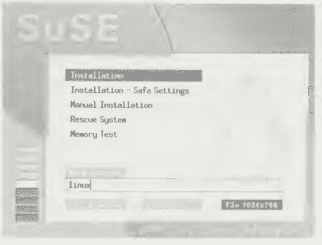

*图 2.1：启动屏幕*

### YaST2 接管

现在 SuSE Linux 的实际安装将借助 YaST2 安装程序开始。所有 YaST2 屏幕都具有相同的格式。YaST2 屏幕上的所有输入字段、列表和按钮都可以通过鼠标操作。如果光标不动，说明 Linux 未能自动识别您的鼠标。此时您需要使用键盘。

### 选择语言

SuSE Linux 和 YaST2 会自动适配所选语言。英语是 SuSE Linux 国际发行版的默认语言。这些设置可单独更改。

如果鼠标无法使用，请使用方向键导航到所需语言，然后反复按 `Tab`，直到选中“Next”。然后按 `↵`。

### 安装模式

如果您的计算机上已安装 SuSE Linux 版本，请决定是进行“新安装”、更新现有安装，还是启动现有系统。如果尚未安装 SuSE Linux 版本，请点击“Next”继续，开始新安装（第 9 页的图 2.3）。本章仅讨论“新安装”。


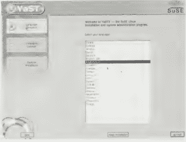

*图 2.2：选择语言*

## 安装建议

检测到硬件并配置鼠标后，YaST2 会提供有关检测到的硬件以及建议的安装和分区选择的信息。如果你修改了任何建议，YaST2 会在更改完成后将你带回到此屏幕。以下各节介绍可用的各种配置设置。

### 鼠标

如果 YaST2 未能自动识别你的鼠标类型，请按 `Tab` 键直到“Change”（更改）高亮显示。按 `Space`（空格键）和方向键，直到选中菜单项“Mouse”（鼠标）。按 `Enter`（回车键）打开鼠标类型选择屏幕，如第10页中的图 2.4 所示。

要选择鼠标类型，请使用上下方向键。鼠标文档中应包含鼠标类型的说明。从列表中选择鼠标类型。按 `Alt` + `T` 确认选择，或按 `Tab` 键然后用 `Enter` 确认。

现在，测试鼠标是否工作。如果屏幕上的鼠标光标跟随鼠标移动，说明鼠标配置正确。如果光标没有移动，请选择其他鼠标类型并重试。

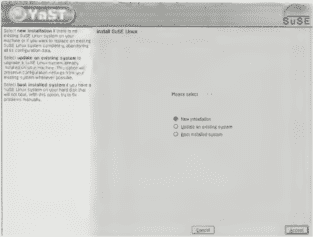

*图 2.3：选择安装类型*

### 时间设置

在此屏幕（第11页中的图 2.5）中，在标有“Set hardware clock to”（将硬件时钟设置为）的字段中选择“Local Time”（本地时间）或“GMT”（格林尼治标准时间）。你的选择取决于计算机的 BIOS 时钟设置。如果硬件时钟在 BIOS 中设置为 GMT，SuSE Linux 将自动反映标准时间和夏令时的变化。

### 键盘布局

在此屏幕中选择你偏好的键盘布局。初始设置与所选语言对应。如有需要请调整。在测试字段中输入任何特殊字符，以确保键盘设置正确。如果显示的字符与输入的字符不一致，请尝试其他布局。“Next”（下一步）返回建议。

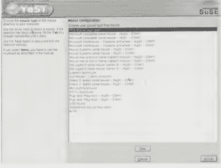

*图 2.4：选择鼠标类型*

## 分区

建议的分区方案会附带一个确认选项，允许你接受、更改或放弃该建议。关于 `/etc/fstab` 中的自动条目，参见第16页的*更多分区提示*。点击“Change”（更改）将打开“Partitioner”（分区器）。

YaST2 会显示所选硬盘上的所有分区（第12页中的图 2.6）。任何空闲存储空间都会显示并自动选中。要为 Linux 分配更多磁盘空间，可以按照从最后一个分区到第一个分区的顺序分配更多分区。如果你有三个分区，则不可能将第二个分区用于 Linux，而将第一个和第三个分区用于其他操作系统。

如果选择“Discard”（放弃），将出现一个包含硬盘选择的对话框（第13页中的图 2.7）。系统中所有硬盘都会列出。决定将 SuSE Linux 安装到何处。选择硬盘没有风险，因为此时不会进行任何更改。

菜单“Advanced Settings, Manual Partitioning”（高级设置，手动分区）显示你系统原来的分区布局，可以手动修改或将其用于新系统。

点击“Entire hard disk”（整个硬盘）将整个硬盘及其所有分区激活给 Linux。如果你已经安装了带有 FAT 文件系统的 Windows 操作系统，将会询问你是否要删除或缩小 Windows 分区（参见第12页的*调整 Windows 分区大小*）。**警告：**该硬盘上现存的所有分区和数据都将丢失。

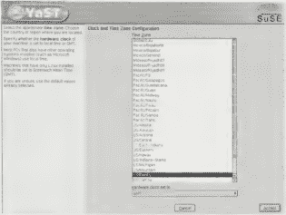

*图 2.5：选择键盘布局和时区*

> **注意**
>
> 如果决定手动分区，请创建交换分区。在“Create Partition”（创建分区）菜单中点击“Format”（格式化），然后选择“File system: Swap”（文件系统：交换）。交换分区负责将暂时需要的数据交换到硬盘，以便为最重要且最频繁需要的数据释放更多 RAM 空间。

在安装过程中，YaST2 将验证是否有足够空间进行最小安装，以及是否可以创建 Linux 使用的三个标准分区。

如果没有足够空间，系统会提示你更改选择。如果有足够的存储空间，YaST2 将应用你的设置，以便整个硬盘或所选分区可以分配到三个默认分区：启动（boot）、交换（swap）和根（root）。

> **警告**
>
> 如果选择“Use entire hard disk”（使用整个硬盘），你将丢失硬盘上的所有信息！

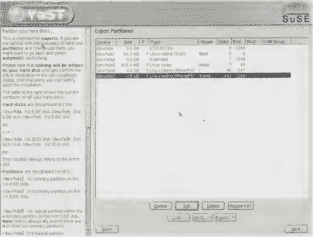

*图 2.6：SuSE Linux 分区器*

### 调整 Windows 分区大小

本节假设所选硬盘包含 Windows 9x 或 ME。以下说明也适用于安装在 FAT 文件系统格式化磁盘上的 Windows XP。但是，如果 Windows NT、2000 或 XP 安装在 NTFS 文件系统上，则无法缩小分区大小。

如果你的计算机预装了 Windows XP，那么它很可能运行在 NTFS 上。如果你想缩小分区大小，建议首先对整个系统重新分区，然后使用 XP 安装光盘重新安装 Windows XP，最好使用 FAT32 作为文件系统，以便将来能够调整所有分区的大小。

如果没有足够的空间安装 SuSE Linux，可在两个选项中选择：要么从硬盘上完全删除 Windows，要么缩小 Windows 分区，为 SuSE Linux 安装腾出足够空间。参见第14页中的图 2.8。

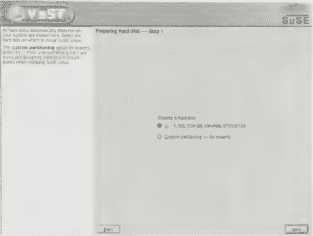

*图 2.7：选择硬盘*

YaST2 会为你的 Windows 分区提供一个合理的调整大小建议。不过，也可以使用下面描述的方法手动修改。如果决定删除 Windows，所有数据都将在 Linux 安装过程中不可挽回地丢失。

> **警告**
>
> Windows Resizer（Windows 调整工具）只在你的计算机硬盘上恰好有一个 Windows 分区时才有效（大多数预装 Windows 的计算机通常如此）。否则，你将不得不手动对硬盘进行分区。

在缩小 Windows 分区之前，请启动 Windows 电脑。然后运行 scandisk 和 defrag 程序。scandisk 和 defrag 会扫描 Windows 使用的文件，然后压缩这些文件到硬盘的开头。这可以加快缩小过程。

进入建议屏幕中的“Partitioning”（分区）后，在随后的屏幕中点击“Edit”（编辑），使用鼠标或方向键高亮显示 Windows 分区。接下来，点击“Reduce FAT Partition”（缩小 FAT 分区）。也可以先选择“Discard”（放弃）再选择“Entire Hard Disk”（整个硬盘）来访问“Windows Resizer”（Windows 调整工具）。接下来，系统会询问你是要缩小还是完全删除 Windows 分区。选择调整大小选项也可以访问调整工具。

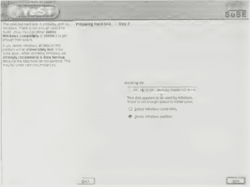

*图 2.8：Windows 分区的可用选项*

在第一个条形图中，YaST2 显示 Windows 当前占用的空间量以及剩余硬盘空间量。第二个图表提供了如何最好地重新分区硬盘的建议（图 2.9）。可以接受这个建议，也可以使用滑块定义自己的分区设置。

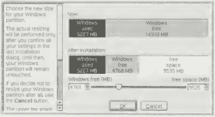

*图 2.9：调整 Windows 分区大小*

## 手动分区

使用“Partitioner”（分区器），可以手动修改硬盘的分区。可以添加、删除或更改分区。启动时，你会看到磁盘列表及其上的分区。磁盘列为整个设备（例如 `/dev/hda`），分区列为设备的一部分（例如 `/dev/hda1`）。大小、类型和挂载点也是重要参数。挂载点描述分区在 Linux 文件系统树中的挂载位置。

### 创建分区

要创建新分区：

- 从列表中选择要在其上创建分区的磁盘。
- 选择“Create”（创建）。将出现一个对话框，询问分区类型。最多可以创建四个主分区，或最多三个主分区和一个扩展分区。在扩展分区内，还可以创建更多分区。
- 选择新分区的格式，以及如果需要，选择挂载点。有关详细信息，请参见本页后续的*添加分区*一节。
- 选择“OK”（确定）以应用更改。

新分区将列在分区表中。选择“Next”（下一步）将分区表写入磁盘，并在必要时进行格式化。

### 添加分区

要向文件系统树添加分区，请执行以下操作：

- 选择分区。
- “Edit”（编辑）分区并设置参数：
  - 文件系统 ID（如果不想格式化该分区）：可以是“Linux swap”、“Linux”、“Linux LVM”或“Linux RAID”。


### 文件系统（如果你想格式化分区）

可以是“Swap”、“Ext2”、“ReiserFS”或“JFS”。“Swap”是一种特殊格式，使分区可用作虚拟内存。每个系统都应至少有一个不小于 128 MB 的交换分区。默认情况下，分区使用“ReiserFS”。与“JFS”一样，它是一种“日志文件系统”。日志文件系统可以在系统崩溃或卸载不当时快速恢复。此外，ReiserFS 在处理大量小文件时速度非常快。“Ext2”不是日志文件系统。它“极其稳定”，适合较小的分区，因为它不需要太多磁盘空间用于管理。

### 挂载点

设置新分区在文件系统树中应连接的目录。如果选择列表中的最后一项，请在此处输入自己的目录名。“Swap”用于特殊的文件系统“Swap”。

- 选择“下一步”以格式化并启用该分区。

### 更多分区提示

如果分区由 YaST2 执行，并且检测到系统上存在其他分区，则这些分区也会被写入 `/etc/fstab`，以便轻松访问这些数据。你可以在文件 1 中看到一个示例。

```text
/dev/sda1        /data1  auto    noauto,user 0 0
/dev/sda8        /data2  auto    noauto,user 0 0
```

*文件 1：/etc/fstab：数据分区*

无论这些分区是 Linux 还是 FAT 分区，都会使用 noauto 和 user 选项进行指定。这样，任何用户都可以在需要时挂载或卸载这些分区。出于安全原因，YaST2 不会在此处自动输入 exec 选项。但是，要从此处运行程序，你可以自己输入该选项。这一操作可以等到遇到诸如“bad interpreter”或“Permission denied”等系统消息时再进行。

## 安装范围

指定要在计算机上安装哪些软件（下一页的图 2.10）。默认预选“带 Office 的默认系统”。SuSE Linux 提供以下基本系统（对面页的图 2.10）：

- **最小系统**

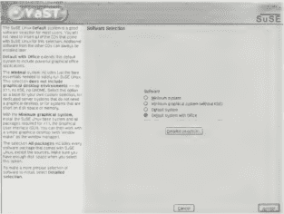

*图 2.10：选择安装大小*

通过选择“最小系统”，可以安装一个面向文本模式、功能完整的 Linux 操作系统。如果你的硬盘可用空间有限，建议选择此项。

- **无 KDE 的最小图形系统**  
  在最小系统的基础上增加 X Window 系统。FVWM2 和 Windowmaker 提供简单的图形界面。

- **默认系统**  
  如果选择“默认系统”，系统将安装一个均衡的基本软件环境，其中包含你入门时可能需要的一切，包括图形用户界面、游戏、CD 播放器、编辑器等。

- **带 Office 的默认系统**  
  在“带 Office 的默认系统”选项中，提供了多种办公应用程序，包括文字处理、电子表格、绘图工具和日程规划器。它使你的 PC 成为办公工作站。如果你需要一个均衡的软件系统来构建功能完整的办公环境，请选择此选项。

> **注意**  
> 你可以选择其他组件和软件。此时若要为 SuSE Linux 增加存储空间，请单击“返回”，直到到达第 10 页的*分区*。然后即可添加更多硬盘空间。

## 选择软件

如果选择“详细选择……”，则除了先前选择的软件包之外，还可以选择不同的软件包组（如多媒体或游戏）进行安装（图 2.11）。从提供的条目中选择所需软件。

在安装的这一阶段，YaST2 还提供两个附加选项：

- **商业软件……**  
  如果你对商业 Linux 应用程序感兴趣，请参阅下一页的*商业软件*一节。

- **选择单个软件包……**  
  你也可以选择组内的单个软件包。请参阅第 20 页的*选择单个应用程序*一节。

在这两种情况下，YaST2 都会返回到详细选择界面。

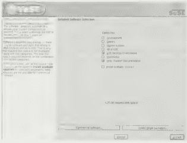

*图 2.11：选择其他组件*

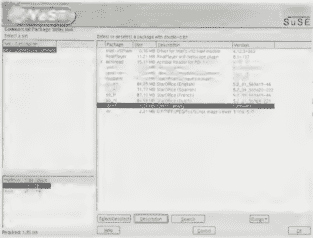

*图 2.12：选择商业软件*

## 商业软件

所有商业软件产品都列在单独的系列中。在这里，你可以找到各种各样的应用程序，例如办公产品、游戏等。如果你在“详细软件选择”下选择了“商业软件”选项，则会看到如图 2.12 所示的屏幕，在其中选择要安装的商业软件包。单击所需的软件包即可将其选中。如果改变主意，不想安装已选中的某个软件包，只需再次单击它即可取消选择。

> **注意**
>
> 这里可以安装的某些软件包并不等同于可以单独购买完整版本。有些功能受限，或者只能使用一定的时间。有些则需要注册。相关的许可协议提供了更多信息。

## 选择单个应用程序

与商业软件包一样，单个软件选择也允许你选择其他软件包。在“详细软件选择”下，如果选择了“选择单个软件包”选项，则会看到如图 2.13 所示的屏幕。单击软件包进行选择。如果改变主意，决定不安装已选中的某个软件包，只需再次单击它即可取消选择。

> **警告**
>
> 在某些情况下，取消选择某些软件包可能会导致系统功能减少。

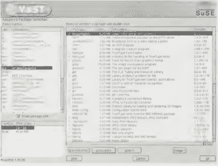

使用“附加”可以选中或取消选中整个系列或组。你还可以保存你的软件选择，或加载之前的软件选择（例如，你在之前的 SuSE Linux 安装中保存的）。在安装期间保存软件选择意义不大，因为该文件会被覆盖。最好进入 YaST2 中的软件安装模块，并在那里保存你的整个选择。这样，它就可以供下次更新使用。单击“下一步”或“确定”继续安装。

## LILO —— 安装

要在计算机上启动 SuSE Linux 或任何其他操作系统，你需要一个程序来帮助你在启动（或引导）计算机时确定要使用 SuSE Linux 还是其他操作系统。这样的程序之一就是引导管理器 LILO，即“Linux Loader”。

默认情况下，YaST2 建议将引导加载程序安装到硬盘的主引导记录（MBR）。如果你有多个硬盘，它会通过读取 BIOS 设置来知道使用哪个硬盘进行引导。这显示在“系统引导”下的“建议屏幕”中。

YaST2 能够识别你是否在运行 SuSE Linux 之外的其他操作系统。根据硬件的不同，安装 LILO 有多种方式。下面介绍 LILO 引导管理器。详细描述可在“引导与引导管理器”一章中找到。当你单击“系统引导”选择 LILO 配置时，将出现如图 2.14 所示的对话框。

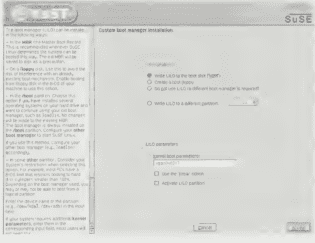

*图 2.14：LILO —— 安装*

在此对话框中，决定如何以及在哪里安装 LILO。这里有四个选项：

1. 安装到 `/dev/hda`（在你的硬盘的 MBR 中）
2. 创建引导软盘
3. 不安装 LILO（使用其他引导管理器）
4. 安装到另一个分区

在大多数情况下，选择选项 1，即将 LILO 安装到引导磁盘的主引导记录（MBR）中。如果 SuSE Linux 是你唯一的操作系统，或者你想将 LILO 用作多个操作系统的引导管理器，请使用此选项。但是，请确保你的操作系统可以由 LILO 引导（通常，MS-DOS 和 Windows 9x/ME、NT 和 2000 都接受 LILO）。

如果你使用多个操作系统，不确定它们是否可以由 LILO 引导，或者想保留以前的引导机制，请选择“创建引导软盘”选项。然后在每次想引导 Linux 时插入该磁盘。如果软驱中没有此软盘，则使用当前引导配置。之后，你随时可以在 YaST2 中将 LILO 配置为引导加载程序，这样 LILO 就可以让你在引导提示符下选择要引导的操作系统。

如果你已经安装了引导管理器，并希望将 SuSE Linux 集成到该引导管理器中，请选择“不安装 LILO”。安装 SuSE Linux 后，重新配置现有的引导管理器，并将 SuSE Linux 集成到引导过程中。

如果你的系统每次重新启动时都需要额外的内核参数，请在指定字段中输入这些参数。通常，你不需要在此处输入任何内容。

如果常规设置无法正常工作，“线性选项”可使 LILO 与较旧的硬件一起工作。大多数用户不需要此选项。

“激活 LILO 分区”选项通常也不需要。只有某些系统的 BIOS 只能从“已激活”的分区引导。

## 开始安装

单击“下一步”将接受建议以及你所做的任何更改。然后你会进入绿色确认屏幕。在此处单击“是”后，将开始安装所有选定设置。安装通常需要十五到三十分钟，具体取决于机器的性能和软件选择。安装期间，你会看到有关 SuSE Linux 的信息。单击“详细信息”可查看安装进度的信息。

## 系统配置

系统和所选软件安装完成后，你需要再进行三项重要设置，然后才能使用 SuSE Linux：为系统管理员定义密码、创建普通用户并配置显示器。


## Root 密码

root 是超级用户的名称，即系统管理员。root 被允许执行普通用户不被允许的所有操作。超级用户可以更改系统，例如安装新应用程序或设置新硬件。如果用户忘记密码或软件出现问题，root 可以帮他们解决。作为一般规则，只以 root 身份登录来执行管理任务，如系统维护或修复。root 在日常使用中相当危险，因为 root 可以删除之后无法恢复的文件。为了验证，密码必须输入两次（图 2.15）。要特别小心不要忘记 root 密码。之后无法找回。

> **注意**
>
> root 用户拥有更改系统所需的所有权限。要执行此类任务，需要 root 密码。没有此密码，您无法执行任何管理任务。

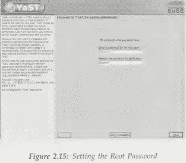

## 用户名和密码

Linux 是一种允许多个用户同时在同一系统上工作的操作系统。为了使其平稳运行，每个用户都需要一个用户账户，以便能够登录系统，然后在完成操作后再次注销。设置用户账户为操作安全提供了坚实的基础。普通用户无法更改或删除系统正常运行所需的文件。同样，用户的个人数据也不能被其他用户访问、修改或删除。每个用户都可以使用自己喜欢的应用程序和设置来建立自己的工作环境。当用户登录 Linux 系统时，他们会发现自己的个人环境保持不变。

使用图 2.16 中显示的对话框自行创建这样一个用户账户。输入用户的姓氏和名字。同时指定用户名（登录名）。如果您想不到合适的用户名，请单击“建议”，系统将自动为您生成一个用户名。

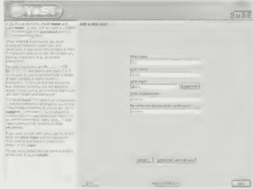

*图 2.16：输入用户名和密码*

最后，为用户输入密码，您必须重复输入以确认。用户名告诉系统您是谁，密码验证您的身份。

> **注意**
>
> 记住您的用户名和密码，因为每次登录时都需要这些信息。
>
> 密码长度应在五到八个字符之间。虽然可以长达 128 个字符，但只显示前八个字符。Linux 区分密码中的小写和大写字母。不允许使用带重音符号的字符。但是，可以使用特殊字符（例如 `*`、`,`、`#`、`;`）以及数字 `0–9`。

## PAM：可插拔认证模块

PAM（可插拔认证模块）的配置文件位于 `/etc/pam.d`。程序员和系统管理员的文档可在 `/usr/share/doc/packages/pam` 中找到。

SuSE Linux 可以处理 MD5 密码。MD5 加密密码可以长于八个字符。MD5 加密与 Unix 中的标准函数 crypt() 不兼容。因此，一些商业 Unix 系统和一些应用程序将无法使用 MD5 密码。

在 `/usr/share/doc/packages/pam/md5.config` 中查找有关配置的信息。

## 显示器设置

这里以合理的设置显示显卡和屏幕。在大多数情况下，您可以直接接受建议。不过，您可以手动自定义颜色深度、分辨率和图像刷新率。

一旦您接受建议或输入更改，设置将被测试。在接下来的对话框中（下一页的图 2.17），定义将来 SuSE Linux 应以“仅文本模式”还是“图形桌面环境”运行。

当您单击“更改”时，您可以选择配置图形界面（第 27 页的图 2.18）。设置图形模式的屏幕分辨率和颜色深度。您甚至可以定义图像刷新率。如果您的显卡带有 3D 芯片，您可以选择“3D 加速”选项。

通过单击“测试”来测试所选的配置。安装程序会发出消息，告诉您屏幕将切换到新配置。如果屏幕不稳定，请立即按 `Esc` 停止测试。

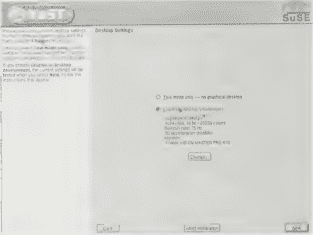

*图 2.17：显示器设置*

单击“更改显示器”将进入第 28 页图 2.19 所示的屏幕。有关所选型号、水平（HSync）和垂直（VSync）频率偏转率的一些技术数据将出现在屏幕底部。如果首选型号不在列表中，请在输入字段中手动输入数据，或选择预定义设置（VESA 模式）。

请使用显示器手册中列出的相关值。否则，您可以使用驱动程序软盘。为此，请单击“驱动程序磁盘”。将磁盘插入驱动器并确认“确定”。然后，显示器数据将出现在相应列表中。如果找不到文件或软盘不可读，您将收到相应的警告。

为了安全起见，您也可以在此处选择标准分辨率。选择 VESA 项，并从列表中选择 640 × 480。

## 硬件配置

显卡配置完成后，您将看到第 28 页图 2.20 所示的屏幕。现在，您可以选择配置系统硬件，例如打印机或声卡。硬件配置也可以在安装后完成。

通过单击每个组件来启动硬件配置。然后 YaST2 将自动检测并配置硬件。

现在，单击“完成安装”。

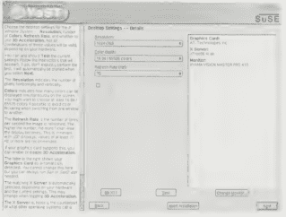

*图 2.18：更改图形界面设置*

## 图形登录

SuSE Linux 现已安装并配置完毕，您可以登录系统了。您的显示器现在显示图形登录界面，您可以在第 29 页的图 2.21 中看到。输入先前指定的用户名和密码以登录系统。

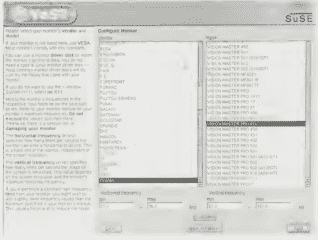

*图 2.19：选择显示器型号*

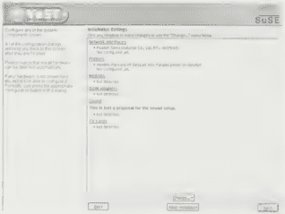

*图 2.20：配置系统组件*

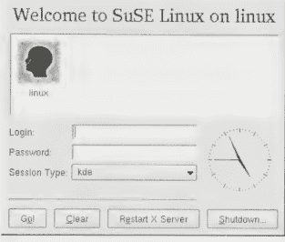

*图 2.21：登录*

## 3 特殊安装过程

SuSE Linux 可以根据许多本地需求进行安装。各种方法涵盖从手动安装到全自动安装。以下章节介绍了使用基于文本的 YaST2 手动安装、使用各种安装源（CD-ROM、FTP、NFS）以及使用自动安装源的技巧。本章最后介绍了安装故障排除和出现问题时如何解决的教程。

- 使用 YaST2 进行基于文本的安装 ........................ 32
- 启动 SuSE Linux ........................................ 37
- 特殊安装 .............................................. 41
- 提示与技巧 ............................................. 43
- 分区提示 ............................................... 49
- 专家分区 ............................................... 50

## 使用 YaST2 进行基于文本的安装

### 背景信息

除了在图形界面的辅助下进行安装外，SuSE Linux 还可以借助 YaST2 文本菜单（控制台模式）进行安装。第 *使用 YaST2 安装* 章（第 5 页）中描述的所有模块在文本模式下也可用。如果您不需要图形界面（例如，对于服务器系统），或者显卡不受 X Window System 支持，则文本模式尤其有用。

### 启动屏幕

将 CD 1 插入驱动器并重新启动计算机。如果计算机未从 CD 启动，请将 BIOS 中的启动顺序重置为 CDROM、C、A。

出现启动屏幕（第 7 页的图 2.1）。在十秒内选择“手动安装”，以便 YaST2 不会自动启动。如果您的硬件需要启动参数，请在 manual 后的启动选项中输入它们。不过，通常不需要此类参数。要切换到文本模式，请选择 F2=Text，然后按 Enter。

现在，会出现一个带有进度显示“正在加载 Linux 内核”的框。内核启动并启动 linuxrc。菜单驱动的 linuxrc 应用程序等待用户输入。

### 可能的问题

- 如果您的 CD-ROM 驱动器（ATAPI）在启动系统时崩溃，请参阅第 46 页的 *ATAPI CD-ROM 在读取时挂起* 一节。
- CD 1 为 Pentium 处理器优化了内核，不被识别为启动介质。请尝试“启动软盘”或 CD 2。请参阅第 43 页的 *从磁盘启动（SYSLINUX）* 和第 43 页的 *使用 CD 2 启动* 一节。
- 对于包括 FireGL 1、2 和 3 在内的显卡，图形模式（帧缓冲）无法启动。在这种情况下，需要基于文本的安装。
- 其他启动问题通常可以通过内核参数规避。请参阅第 240 页的 *启动提示符处的内核参数* 一节。每当 DMA 导致困难时，都会提供启动选项“安装 – 安全设置”。


## linuxrc：基础

使用 linuxrc 进行安装设置。如有必要，将驱动程序作为内核模块加载。最后，linuxrc 启动 YaST 安装工具，开始系统软件和其他应用程序的实际安装。

使用 ↑ 或 ↓ 选择菜单项，使用 ← 或 → 选择命令，如‘OK’或‘Cancel’。按 ↵ 运行命令。

关于 linuxrc 的完整文档，请参阅第 281 页的 *linuxrc* 一节。

### 设置

linuxrc 应用程序启动时首先显示语言和键盘选择选项。

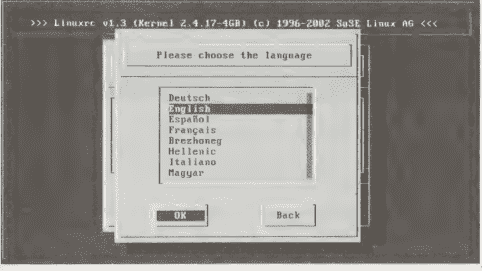

*图 3.1：语言选择*

- 选择安装语言（例如‘English’），然后按 ↵ 确认。
- 接下来，选择键盘布局（例如‘English’）。

### 可能出现的问题

如果 linuxrc 没有提供你偏好的键盘布局选项，请选择一种替代布局。安装完成后，稍后可使用 YaST 切换到精确的布局。

### linuxrc 中的主菜单

现在，你会看到 linuxrc 中的主菜单（图 3.2）。

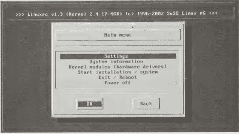

*图 3.2：linuxrc 中的主菜单*

此处提供以下选项：

- **‘设置’** 在此调整语言、显示器或键盘。这些在前面几个部分中已进行配置。
- **‘系统信息’** 如果这些数据已被内核识别并由已加载的模块激活，你可以在这里找到大量关于硬件的信息。
- **‘内核模块（硬件驱动程序）’** 你可能需要在此启动与硬件兼容的模块。这些模块也包括要加载的附加文件系统（如 ReiserFS）。

  *通常，如果硬盘和 CD-ROM 驱动器（ATAPI）连接到 (E)IDE 控制器，则无需使用此菜单项，因为内核已内置 (E)IDE 支持。*

- **‘安装/系统引导’** 继续安装。
- **‘取消/重新启动’** 取消安装。
- **‘关机’** 关闭系统并切断电源。

### 使用模块集成硬件

仅当你需要 SCSI 或 PCMCIA 支持，或者没有 ATAPI 驱动器时，才选择通过‘内核模块’加载内核模块。目前，相应的模块也会以模块形式换出（例如 IDE）或添加（例如 USB、FireWire 或文件系统）。关于模块如何加载，请参阅第 281 页的 Linux 一节。在接下来的子菜单中，选择要加载的模块。可能的选项有：

- **SCSI 模块** — 如果你有 SCSI 硬盘或 SCSI CD-ROM 驱动器。
- **CD-ROM 模块** — 如果你的 CD-ROM 驱动器*没有*连接到 (E)IDE 控制器或 SCSI 控制器。
- **网络模块** — 如果你想通过 NFS 或 FTP 安装，但这里不讨论这一点。
- **一个或多个文件系统** — 例如 ReiserFS 或 ext3。

> **提示**
>
> 如果在标准模块中找不到对安装介质（专有 CD-ROM 驱动器、并口 CD-ROM 驱动器、网卡、PCMCIA）的任何支持，你也许能在模块软盘上找到所需内容，该软盘包含额外的驱动程序。为此，请转到列表末尾并选择“— 更多模块 —”项。系统会提示你插入模块。

### 开始安装

既然你已经选择了‘安装/系统引导’，只需按 `↵` 即可开始安装。

可以使用以下选项：

- **‘开始安装/更新’** 准备安装或更新现有系统。
- **‘引导已安装的系统’** 如果之后在引导系统时遇到问题，你可能需要此选项。
- **‘引导救援系统’** 此选项目前仅适用于 x86 兼容系统。
- **‘弹出 CD’** 以电子方式弹出 CD。

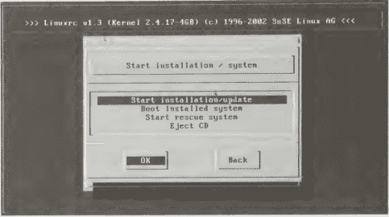

*图 3.3：linuxrc 安装菜单*

要开始安装，请按 `↵` 进入菜单项‘开始安装/更新’。然后选择源介质。通常，可以将光标保留在默认选项‘CD-ROM’上。

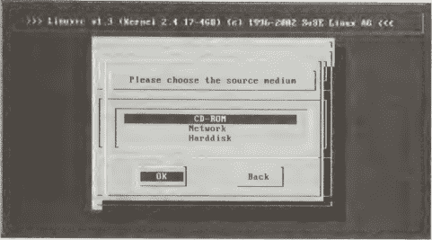

*图 3.4：在 linuxrc 中选择源介质*

现在按 `↵`。安装环境将从 CD 1 直接加载。

此过程完成后，YaST2 将以基于文本的版本（ncurses）启动。然后，安装将按照 [SuS02a] 中的*安装*一章，或此处第 5 页的*使用 YaST2 安装*一章中所述继续进行。

### 可能出现的问题

- 未检测到 SCSI 适配器：
  - 尝试为兼容的驱动程序加载模块。
  - 使用带有相应集成 SCSI 驱动程序的内核。按照第 44 页*在 DOS 中创建引导盘*一节中的说明创建引导软盘。
- ATAPI CD-ROM 驱动器在读取数据时挂起：请参阅第 46 页*ATAPI CD-ROM 在读取时挂起*一节。
- 由于某些仍然未知的原因，有时在向 RAM 磁盘加载数据时会出现问题，导致 YaST2 无法启动。

如果出现这种情况，以下步骤往往能有效解决问题：

在 linuxrc 主菜单中选择‘设置’→‘调试（专家）’。然后，对‘强制根镜像’选择 no。返回主菜单并重新开始安装。

## 启动 SuSE Linux

安装完成后，问题在于你希望如何正常引导系统（启动）。

以下部分介绍可用于引导 SuSE Linux 系统的选项。最适合你的引导方法将取决于你使用 Linux 系统的目的。

**引导盘：** 你可以从*引导盘*（“引导软盘”）引导 Linux。这个选择始终有效（只要引导盘没有损坏），而且很简单。引导盘可能在安装过程中创建。

**loadlin：** loadlin 引导选项可以按如下方式配置：

- 计算机必须运行在 DOS 实模式，或者在虚拟 8086 模式下具有 VCPI 服务器¹。换句话说，此方法在 Unix、OS/2、Windows NT 或 Windows 95/98 机器的 DOS 窗口中*无法*工作。不过，它可以从 MS-DOS 或 Windows 95/98 的 DOS 模式下很好地工作。
- 你的计算机必须有足够的 DOS 内存可用：640 KB 限制以下必须有 128 KB 可用，其余部分可以在扩展内存/EMS/XMS 内存上。

loadlin 的设置相当费工夫，但它可以轻松集成到 Windows 95/98 引导菜单中。这需要手动编辑配置文件。loadlin 最大的优点之一是，不会在硬盘的 MBR（*主引导记录*）中安装任何内容。对于其他操作系统，Linux 分区显示为未知类型。要安装 loadlin，你需要对 Linux 和 DOS 有所了解。你还应该能够使用编辑器创建配置文件。详细信息请参阅第 120 页*使用 loadlin 配置引导机制*一节。如果你在 Windows 95/98 引导菜单中出错，可能会引起问题。如果出现严重错误，你可能会失去对 Windows 硬盘的访问权限。*在*开始修改 Windows 引导菜单之前，请确保你可以用引导软盘引导 Windows 操作系统。

**LILO：** 引导系统的通用且技术上优雅的解决方案是 LILO。LILO 引导菜单可以配置为在引导任何系统之前提供可供选择的操作系统。可以在安装过程中设置 LILO，也可以选择稍后在 YaST 的帮助下进行配置（参见 [SuS02a] 中的 *YaST2* 一章）。LILO 必须安装在硬盘的引导扇区中，这并非没有风险。如果出现任何问题，你需要对引导过程的基本原理有所了解。你还应该足够熟悉主要的 LILO 配置文件以便编辑它。最后，建议你学习如何在遇到困难时卸载 LILO。尽管如此，LILO 仍被认为是最佳的引导方法。

¹ VCPI 服务器由程序 emm386.exe 访问。


> **注意**
>
> 有些BIOS变体会检查引导扇区（MBR）的结构，在LILO安装后会错误地显示病毒警告。要解决此问题，只需进入BIOS并查找相应的可调整设置即可。例如，您应关闭“病毒保护”。您可以稍后重新打开此选项。但是，如果Linux是您唯一使用的操作系统，则无需这样做。

关于各种引导方法（尤其是LILO和loadlin）的详细讨论，请参阅第89页的*引导与引导管理器*一章。

## 图形SuSE屏幕

从SuSE Linux 7.2开始，只要提供了内核参数"vga=771"，图形SuSE屏幕就会在第一个控制台上启用。如果您使用YaST2安装，此选项会被添加到`/etc/lilo.conf`中。

## 禁用SuSE屏幕

实现此目的有三种基本方法：

- 按需禁用SuSE屏幕：

  输入命令

  ```
  earth:  # echo 0 >/proc/splash
  ```

  以禁用图形屏幕。通过执行命令

  ```
  earth:  # echo 0x0f01 >/proc/splash
  ```

  可以重新启用屏幕。

- 默认禁用SuSE屏幕：

  将内核参数`splash=0`添加到引导加载程序配置中。  
  在大多数情况下，这意味着需要编辑`/etc/lilo.conf`文件以包含以下行：

  ```
  append="splash=0"
  ```

  如果您的`lilo.conf`中已包含append行，只需编辑该行即可，例如，将

  ```
  append="vga=771"
  ```

  改为

  ```
  append="vga=771 splash=0"
  ```

  但是，如果您仍然更喜欢旧的文本模式（这是以前版本的默认模式），则应将其设置为`"vga=normal"`。

- **完全禁用SuSE屏幕：**

  在[framebuffer support]菜单中禁用*使用闪屏代替引导徽标*选项后，编译新内核。

> **提示**
>
> 从内核中移除帧缓冲支持也会自动禁用闪屏。如果您使用自定义内核运行系统，SuSE将无法为您的系统提供任何支持。

对于大多数用户，推荐的方法是如上所述编辑`/etc/lilo.conf`。之后执行`lilo`，以便LILO读取其配置中的更改。另请参阅第103页的*安装和卸载LILO*一节。

## 特殊安装

### 无受支持的CD-ROM驱动器的安装

如果无法通过CD-ROM驱动器进行标准安装，该怎么办？如果您的CD-ROM驱动器是较旧的“专有”型号，则可能不受支持。可能是您的第二台计算机，例如笔记本电脑，它甚至可能没有CD-ROM驱动器，而是装备了以太网适配器或PLIP电缆。SuSE Linux提供了通过网络连接安装到此类机器的方法，无需使用受支持的CD-ROM驱动器。可通过以太网或PLIP使用NFS或FTP（参见本页的*从网络源安装*一节）。

### 从网络源安装

我们不对此安装方法提供支持。仅推荐给有经验的计算机用户。

要在其上安装Linux的机器没有安装CD-ROM。您可以通过网络连接到一台远程机器，该机器装有CD-ROM驱动器（内含CD），或其硬盘上有CD的副本。此外，必须将`.s.u.S.E.-disk*`文件从CD-ROM复制到硬盘。可以按如下方式简化：

```
earth: # cp /media/cdrom/.s* /emil

earth: # cp -a /media/cdrom/suse /emil
```

这台“其他”计算机必须以适当的方式“导出”该目录。

> **提示**
>
> 或者，在远程机器上启动救援系统并直接导出CD 1即可。

### 安装步骤

1. 按照第32页*使用YaST2进行基于文本的安装*一节中的规定，开始客户端的安装。

2. 按照第33页*Linux：基础*一节的描述继续安装，但：

   - 当您进入“内核模块”时，选择“网卡”并加载必要的驱动程序。如果您通过PLIP安装，则无需此操作。

   - 当linuxrc提示您指定“源介质”时，选择“网络（NFS）”，然后使用可用菜单配置网络。或者，也可以通过FTP或SMB安装。

3. 按照[SuSE02]中的*安装*一章以及第5页*使用YaST2安装*一章的说明完成安装。

### 可能出现的问题

- 安装在实际开始之前中止，因为“其他”机器的安装目录未以exec权限导出。请更正此问题并重新开始。

- 服务器不知道应在哪台计算机上安装SuSE Linux。请将要安装的计算机的名称和IP地址输入到服务器的/etc/hosts文件中。

## 提示与技巧

### 从磁盘引导（SYSLINUX）

如果您必须处理特殊的安装要求（例如，CD-ROM驱动器不可用），“引导磁盘”方法可用作后备解决方案。有关创建引导磁盘的更多信息，请阅读下一页的*在DOS中创建引导磁盘*和第45页的*在类UNIX系统中创建引导磁盘*。

引导过程由引导加载程序SYSLINUX（软件包`syslinux`）启动。SYSLINUX的配置使其在启动时执行一些最基本的硬件检测。基本上包括以下步骤：

- 检查BIOS是否提供符合VESA 2.0标准的帧缓冲支持，并确保内核相应地被引导。
- 读取任何可用的显示器信息（DDC信息）。
- 读取第一块硬盘的第一个扇区（“MBR”），以便稍后安排LILO配置，在此配置中，BIOS ID将被分配给Linux设备名称。这包括使用BIOS的`lba32`函数读取该扇区的测试，以确定BIOS是否支持相应功能。

> **提示**
>
> 如果在启动SYSLINUX时按住`⇧ Shift`，将跳过上述所有步骤。为简化故障排除，请在`syslinux.cfg`中添加`verbose 1`行，这样引导加载程序将告诉您正在执行哪个操作。

### 可能出现的问题

如果机器无法从软盘引导，请将BIOS中的引导顺序更改为A、C。

### 使用CD 2引导

与CD 1一样，第二张CD也可引导。CD 1使用2.88 MB引导映像。第二张CD包含传统的1.44 MB大小的映像。当您确定可以从CD引导，但使用CD 1无法正常工作时，请使用CD 2（“后备”解决方案）。遗憾的是，并非每个BIOS都能正确识别大映像。

## 在DOS中创建引导磁盘

### 要求

您需要一张已格式化的3.5英寸软盘和一个可引导的3.5英寸软盘驱动器。如果您在Windows 95/98中工作，请从MS-DOS模式启动安装程序，而不是在DOS窗口内。

### 附加信息

CD 1的`/disks`目录中包含许多磁盘映像。借助合适的辅助程序，可以将此类映像复制到磁盘。该磁盘随后被称为引导磁盘。这些磁盘映像还包括“加载程序”SYSLINUX和程序linuxrc。SYSLINUX允许为引导过程选择特定的内核，并在必要时为您的硬件添加参数。程序linuxrc支持为您的硬件加载内核模块，然后启动安装。

### 操作步骤

DOS应用程序rawrite.exe（CD 1，目录`\dosutils\rawrite`）可用于生成SuSE引导磁盘和模块磁盘。这需要一台装有DOS（如FreeDOS）或Windows的机器。

以下描述的操作步骤适用于Windows环境：

1. 插入SuSE Linux CD 1。

2. 打开DOS窗口（在开始菜单的“应用程序”→“MS-DOS提示符”下）。

3. 通过为CD驱动器提供正确的路径名来启动rawrite.exe应用程序。以下示例发生在C:驱动器的Windows目录中，您的CD驱动器为D：

    ```
    C:\Windows> d:\dosutils\rawrite\rawrite
    ```

4. 启动应用程序后，它会提示您输入要复制文件的源和目标。引导磁盘映像存储在CD 1的`\disks`目录下。该文件简称为bootdisk。不要忘记在此处也指定CD驱动器的路径。

    ```
    C:\Windows> d:\dosutils\rawrite\rawrite
    RaWrite 1.2 -- Write disk file to raw floppy diskette

    Enter source file name:  d:\disks\bootdisk
    Enter destination drive:  a:
    ```

一旦您指定了目标驱动器 `a:`，rawrite 将提示您插入一张已格式化的软盘，然后按 `Enter`。随后会显示复制进度。此过程可通过 `Ctrl` + `C` 终止。以这种方式，您也可以创建其他软盘映像 `modules1` 和 `modules2`。如果您有 SCSI 设备或网卡并希望在安装期间访问它们，则需要这些映像。如果遇到问题，可以改用映像 `i386` 作为后备方案。

## 在 UNIX 相关系统中创建启动盘

### 要求

您需要能够访问带有 CD-ROM 驱动器和已格式化软盘的 Unix 或 Linux 系统。

要创建启动盘：

1. 如果需要先格式化软盘：

   ```
   earth: # fdformat /dev/fd0u1440
   ```

2. 将 CD 1 挂载到 `/cdrom`，例如：

   ```
   earth: # mount -tiso9660 /dev/cdrom /cdrom
   ```

3. 切换到 CD 上的 disks 目录：

   ```
   earth: # cd /cdrom/disks
   ```

4. 使用以下命令创建启动盘：

   ```
   earth: # dd if=/cdrom/disks/bootdisk of=/dev/fd0 bs=8k
   ```

在 `disks` 目录下的 README 文件中，可以了解特定内核具有哪些功能。这些文件可以使用 `more` 或 `less` 阅读。

以这种方式，您也可以创建其他软盘映像 `modules1` 和 `modules2`。如果您有 SCSI 设备或网卡并希望在安装期间访问它们，则需要这些映像。如果遇到问题，可以改用映像 `i386`。

在安装过程中使用自行编译的内核会稍显复杂。在这种情况下，请将默认映像（`bootdisk`）写入软盘，然后用您自己的内核覆盖实际内核（`Linux`）（请参阅第 234 页的 *编译内核* 一节）：

```
earth: # dd if=/cdrom/disks/scsi01 of=/dev/fd0 bs=8k
earth: # mount -t msdos /dev/fd0 /mnt
earth: # cp /cdrom/suse/images/eide.lkr /mnt/linux
earth: # umount /mnt
```

## 受支持的 CD-ROM 驱动器

如今，Linux 几乎支持所有 CD-ROM 驱动器。

- 使用 ATAPI 驱动器（即连接到 EIDE 控制器的驱动器）时，应该完全不会有问题。
- 对于 SCSI CD-ROM 驱动器，一个关键问题是连接到 CD-ROM 驱动器的 SCSI 控制器是否受支持。受支持的 SCSI 控制器列表见 http://cdb.suse.de/。然而，如果您的 SCSI 控制器不受支持，而您的硬盘又连接到它，那么无论如何都会遇到问题。
- Linux 支持许多专有 CD-ROM 驱动器。这里是最可能出现问题的地方。如果您的驱动器未被提及，请尝试选择类似类型。
- 并口 CD-ROM 驱动器已变得非常流行。遗憾的是，没有统一标准，这会导致意外问题。SuSE Linux 包含一些适用于某些设备的 alpha 驱动程序。如果它们都不起作用，请通过 DOS 安装。请记住，其中一些设备只有在 DOS 下设置后才可以访问。您可能需要热重启。

## ATAPI CD-ROM 在读取时挂起

如果您的 ATAPI CD-ROM 无法被识别或在读取时挂起，这通常是由于硬件安装不正确所致。所有设备必须按正确顺序连接到 EIDE 控制器。第一个设备是第一个控制器上的主设备（master）。第二个设备是第一个控制器上的从设备（slave）。第三个设备应是第二个控制器上的主设备，依此类推。

经常发生的情况是，除了第一个设备之外只有一个 CD-ROM。CD-ROM 驱动器有时会作为主设备连接到第二个控制器（辅助 IDE 控制器）。这是错误的，可能会导致 Linux 不知道如何处理这个“空档”。请尝试通过向内核传递适当的参数（`hdc=cdrom`）来解决此问题（参见第 240 页的 *启动提示符下的内核参数* 一节）。

有时，某个设备只是“跳线设置错误”。这意味着它按从设备跳线，但连接为主设备，反之亦然。如有疑问，请检查硬件设置并在必要时进行更正。

此外，还有一系列有缺陷的 EIDE 芯片组，其中大部分现已被识别。有一个特殊内核可处理此类情况。请参阅安装 CD-ROM 的 `/disks` 目录中的 README。所需的内核参数在第 240 页的 *启动提示符下的内核参数* 一节中有详细说明。

> **注意**
>
> 如果启动不能立即工作，请尝试使用以下内核参数。在启动提示符（boot）处输入：`Linux (relevant parameters)`（见下文）。
>
> **注意：** 不要忘记在实际参数之前添加内核名称（`linux`）。

`hd(x)=cdrom` — (`x`) 代表 a、b、c、d 等，含义如下：

- `a` — 第一个 IDE 控制器上的主设备
- `b` — 第一个 IDE 控制器上的从设备
- `c` — 第二个 IDE 控制器上的主设备
- `...`

*(要输入的参数)* 的示例：`hdb=cdrom`

使用此参数，在内核无法自行找到 CD-ROM 驱动器且您拥有 ATAPI CD-ROM 驱动器时，向内核指定该驱动器。

`ide(x)=noautotune` — (`x`) 代表 0、1、2、3 等，含义如下：

- `0` — 第一个 IDE 控制器
- `1` — 第二个 IDE 控制器
- `...`

此参数对于 (E)IDE 硬盘通常很有用。

> **注意**
>
> 更多内核参数可在第 240 页的 *启动提示符下的内核参数* 一节中找到。如果遇到 SCSI 系统或连接网卡方面的问题，您也应查看此处。

## 并口上的 CD-ROM 驱动器问题

所有可用的驱动程序都会在安装时由 `linuxrc` 列出。通常没有特殊情况。

遗憾的是，许多驱动器（例如 Freecom）尚不受支持。尽管手册声称该类型与受支持的驱动器相同，但您可能仍无法使用它们。制造商显然更改了内部结构，却未公开这些更改。

某些设备需要在 Linux 下可用之前，先由 DOS 驱动程序进行初始化：

1. 启动 DOS 并加载 CD-ROM 驱动程序。
2. 插入 Linux 启动盘。
3. 热重启机器。

如果您的驱动器不受支持，请从 DOS 分区进行安装（参见第 41 页的 *特殊安装* 一节）。

有关并口编程的最新信息，请查看 http://www.torque.net/linux-pp.html。

## Loadlin 没有足够的内存来加载内核

在最初的 640 KB 内没有足够的可用内存。请尝试从启动文件（`config.sys`、`autoexec.bat`）中移除驱动程序，或将它们移到 640 KB 之后的内存。如果您在 Windows 95/98 下压缩了驱动程序，且无法将它们移到高端内存，请解压缩这些驱动程序。

## Loadlin 无法启动

如果在使用 loadlin 时遇到任何问题，请使用以下选项启动 loadlin：`-v`、`-t` 或 `-d`。最好将调试信息写入文件 `debug.out`。

```
C:\> loadlin -d debug.out (other parameters)
```

您可以将此文件发送给 SuSE 支持。对于 *其他参数*，请输入您系统特定的值（参见第 121 页的 *loadlin 所需文件* 一节）。

## 分区建议

您对 Linux 及其文件系统完全不熟悉吗？那么您可能会问自己以下问题：我应该为 Linux 分配多少空间？我最低需要多少空间？什么最适合我的需求？我应该如何划分可用空间？

### PC 上的分区类型

每个硬盘都包含一个分区表，该表最多可容纳四个条目。每个条目可以是主分区或扩展分区。只能分配一个扩展分区。

主分区是分配给一个操作系统的连续柱面区域。使用主分区时，您只能创建四个分区。更多分区将无法放入分区表中。

扩展分区本身也是一个连续的柱面区域，但您可以将扩展分区划分为多个逻辑分区，这些逻辑分区不需要在分区表中单独记录。扩展分区就像一个逻辑分区的容器。

如果您需要四个以上分区，请将其中一个设为扩展分区，并在其中分配逻辑分区。SCSI 系统最多可有十五个分区，(E)IDE 系统最多可有六十三个分区。

Linux 不关心安装在哪类分区上。可以是主分区或逻辑分区。

### 是时候做决定了

我们先从 SuSE Linux 最小安装开始：180 MB。这仅当您将机器用于简单目的时才有效，例如，您只在文本控制台（无 X Window System）下工作。如果您想查看 X 并启动一些应用程序，则需要 500 MB。这两个值都包括交换分区。

安装时合理的大小是多少？1 GB —— 在如今数十 GB 硬盘的世界里，这是一个相当适中的要求。没有上限。

什么最适合您的需求？这取决于您想做什么：

- 在 X 中工作并使用 **Applixware** 和 **Netscape** 等应用程序将需要 1.2 GB。
- 要在 X 中创建自己的应用程序，您也需要 1.2 GB。
- 以上两项都需要：2 GB。
- 要编译自己的 X 服务器并刻录自己的 CD，再加上上述各项：4 GB。


- 要设置 Internet 或 FTP 服务器：至少需要 700 MB。

应该如何划分磁盘？这是一个简单的问题，答案却并不简单。

> **提示**
>
> 特别是对于新手来说，遵循 YaST 建议的策略是一个非常好的主意：如果需要，可在硬盘开头放置一个小分区用于 `/boot`（约 10 MB；对于大容量硬盘，1 个柱面的分区就足够了），一个交换分区（128–256 MB），其余所有空间给 `/`。

如果你想对磁盘进行分区，但又希望尽可能少分区，那么以下简单的规则适用。

- 高达 500 MB：交换分区和根分区（`/`）
- 500 MB 到 4 GB：在硬盘最开头为内核和 LILO 划分一个小引导分区（`/boot`，约 8–16 MB 或 1 个柱面），一个交换分区，其余空间给根分区 `/`。
- 超过 4 GB：引导（`/boot`）、交换、根（250 MB）、home（`/home`，每个用户约 20 MB），其余给应用程序（`/usr`），可能还需要一个分区给 `/opt` 和 `/var`。

> **注意**
>
> 如果你打算直接从硬盘启动 Linux，你需要一个位于“1024 柱面限制”以下的 Linux 分区作为引导分区（更多信息请参阅第 94 页的 *LILO 位置*）。如果你使用 loadlin 从 DOS/Windows 启动 Linux，则这与你无关。

请记住，有些程序（大多是商业程序）会将其数据安装在 `/opt` 中。如果你要安装多个此类程序，请为 `/opt` 创建单独的分区，或相应增大根分区的容量。KDE 和 GNOME 也存储在 `/opt` 中。

## 专家分区

在前一页的*分区提示*一节中，我们详细介绍了如何对系统进行分区。本节将提供更详细的信息，帮助你量身定制最适合自己需求的系统。本节主要面向那些希望在安全性和性能方面获得优化系统，并准备在必要时重新安装整个系统的用户。

## 特殊安装步骤

对 UNIX 文件系统的功能有深入了解是绝对必要的。你应该熟悉挂载点、主分区、扩展分区和逻辑分区等主题。

这里需要指出的是，没有放之四海而皆准的黄金法则，而是针对不同情况有许多规则。不过，你会在本节中找到具体的数值来帮助你。

首先，你需要收集以下信息：

- 这台机器的用途是什么（文件服务器、计算服务器、独立机器）？
- 有多少人将使用这台机器（同时登录）？
- 安装了多少块硬盘？它们有多大，是什么类型（EIDE、SCSI，甚至 RAID 控制器）？

### 交换分区的大小

你经常会读到：“交换分区至少应该和物理内存一样大”。这是 8 MB 就被视为大量内存的时代遗留下来的观念。需要大量内存的应用程序已经将这些数值推高了。通常，64 MB 的虚拟交换空间就足够了。不要吝啬。如果你在 X 环境下编译内核，想用 Netscape 查看手册页，同时还运行着 emacs，那么 64 MB 就会被全部占用。为安全起见，至少选择 128 MB 的虚拟内存。有一点你绝对不应该做，那就是完全不分配交换空间。即使在有 256 MB 内存的机器上，也应该有一个交换分区。其原因在第 55 页的“处理速度与主内存大小”一节中有说明。

如果你想运行需要数 GB 内存的大型模拟，请阅读第 53 页的“用作计算服务器”一节（示例：计算服务器）。

### 计算机的使用方式

#### 用作独立机器的计算机

Linux 机器最常见的用途是作为独立计算机。为了让你尽可能轻松地做出决定，我们提供了一些具体数值，你可以在家中或公司使用。下一页中的表 3.1 概述了不同 Linux 系统的容量需求。

| 安装类型 | 所需磁盘空间 |
|---|---|
| 最小 | 180 MB 到 400 MB |
| 小型 | 400 MB 到 800 MB |
| 中型 | 800 MB 到 4 GB |
| 大型 | 4 GB 到 8 GB |

*表 3.1：不同安装类型的磁盘空间需求示例*

##### 示例：独立机器（小型）

你有一块 500 MB 的备用硬盘来安装 Linux：使用一个 64 MB 的交换分区，其余空间给 /（根分区）。

##### 示例：独立机器（普通）

你有 1.2 GB 可用于 Linux。一个小引导分区 /boot（5–10 MB 或 1 个柱面），128 MB 用于交换分区，800 MB 给 /，其余空间给独立的 /home 分区。

##### 示例：独立机器（豪华）

如果你有超过 1.2 GB 的可用空间，就没有标准的分区方式。请阅读下一页的*优化*一节。

#### 用作文件服务器

在这里，硬盘性能*确实*至关重要。如果可能，你应该使用 SCSI 设备。请记住磁盘和控制器的性能。文件服务器用于集中保存数据。这些数据可能是主目录、数据库或其他存档。这样做的好处是数据管理简单。

如果文件服务器将服务于大型网络（20 名或更多用户），那么优化硬盘访问至关重要。假设你要为 25 个用户（他们的主目录）提供文件服务器。如果平均每个用户需要 100–150 MB 的个人空间，那么挂载在 /home 下的 4 GB 磁盘可能就够了。

如果有 50 个这样的用户，你将需要一块 8 GB 的磁盘。在这种情况下，最好将 home 分成两个 4 GB 磁盘，这样它们可以分担负载（和访问时间）。

> **提示**
>
> Web 浏览器缓存绝对应该存储在用户的本地硬盘上。

#### 用作计算服务器

计算服务器通常是一台功能强大的机器，通过网络执行大量计算。通常，这类机器配备了大容量主内存（512 MB RAM 或更大）。唯一需要快速磁盘的地方是交换空间。如果你有多块硬盘，可以将交换分区分布到它们上面。

#### 优化

磁盘通常是限制因素。为避免这一瓶颈，有三种方法可以同时使用：

- 将负载分散到多个磁盘上
- 使用优化过的文件系统（例如 reiserfs）
- 为你的文件服务器配备足够的内存（至少 256 MB）

##### 并行使用多个磁盘

这需要进一步讨论。传输数据所需的总时间可以分为五个因素：

- 请求到达控制器所花费的时间
- 请求发送到磁盘所花费的时间
- 硬盘移动磁头到位所花费的时间
- 介质旋转到正确扇区所花费的时间
- 传输数据所花费的时间

第一个因素取决于网络连接，必须在其他地方进行调节。这里我们不予讨论。第二个因素可以忽略，因为它取决于控制器。第三个因素是关键部分。时间以毫秒计。相对于主内存的访问时间（以纳秒计），这是一个百万倍的因素。第四个因素取决于磁盘转速。第五个因素取决于转速、磁头数量以及数据的实际位置（内侧或外侧）。

为了获得最佳性能，请考虑第三个因素。这里，SCSI 的“断开”特性开始发挥作用。看看会发生什么：

控制器向设备发送命令（此处是向硬盘）“转到 x 磁道，y 扇区”。现在磁盘电机必须启动。如果这是一块智能磁盘（支持断开），并且驱动程序本身也能断开，控制器就会发送断开命令，磁盘随即与 SCSI 总线分离。这样其他 SCSI 设备就可以工作了。过一段时间（取决于 SCSI 总线上的策略或负载），与磁盘的连接会重新建立。通常，设备此时已到达所请求的磁道。

在像 Linux 这样的多任务、多用户系统上，这里可以进行大量优化。看一下命令 `df` 的输出（见输出 1）。

| 文件系统 | 大小 | 已用 | 可用 | 使用率 | 挂载点 |
|---|---:|---:|---:|---:|---|
| /dev/sda5 | 1.8G | 1.6G | 201M | 89% | / |
| /dev/sda1 | 23M | 3.9M | 17M | 18% | /boot |
| /dev/sdb1 | 2.9G | 2.1G | 677M | 76% | /usr |
| /dev/sdc1 | 1.9G | 958M | 941M | 51% | /usr/lib |
| shmfs | 185M | 0 | 184M | 0% | /dev/shm |

*输出 1：df 命令输出示例*

这种并行化如何让我们受益？假设我们在 `/usr/src` 中输入：

```shell
root@earth:/usr/src/ > tar xzf package.tgz -C /usr/lib
```

这里，package.tgz 将被解压到 /usr/lib/package。为此，shell 会启动 tar 和 gzip（位于 /bin，因此位于 /dev/sda），然后读取 /usr/src 中的 package.tgz（位于 /dev/sdb）。最后，解压后的数据被写入 /usr/lib（位于 /dev/sdc）。利用并行化，磁盘内部缓冲区的定位以及读写可以同时进行。

这只是一个例子。还有很多很多。如果这种处理需求很频繁，而且有很多磁盘（以这些速度），那么根据经验，/usr 和 /usr/lib 应该物理上放在不同的磁盘上。这里 /usr/lib 的容量大约应为 /usr 的百分之七十。/, 由于访问频繁，应放在包含 /usr/lib 的磁盘上。

当 SCSI 磁盘达到一定数量（4–5 块）时，请考虑购买 RAID 控制器。这样，磁盘上的操作就不仅仅是半并行，而是真正的并行。容错是它著名的副产品之一。


##### 处理速度与主内存大小

在 Linux 中，主内存大小比处理器本身更重要。一个原因，如果不是主要原因，是 Linux 能够动态创建硬盘数据的缓冲区。这里，Linux 使用了许多技巧，例如“预读”（提前获取扇区）和“延迟写入”（将写入保存到有批量数据可写时）。后者是你不应关闭 Linux 机器的原因。这两个因素既导致主内存似乎会随着时间推移而被填满，也促成了 Linux 的高速。另请参见第 275 页的 *free 命令* 一节。

## 更新系统与软件包管理

SuSE Linux 提供了在不完全重新安装的情况下更新现有系统的选项。更新有两种类型：*更新单个软件包* 和 *更新整个系统*。也可以使用软件包管理器 RPM 手动安装软件包。

- 更新 SuSE Linux .................................. 58
- 从一个版本到另一个版本 .............................. 62
- RPM —— 发行版软件包管理器 ............... 69

## 更新 SuSE Linux

软件往往会从一个版本到另一个版本“增长”。因此，我们建议你在更新前先用 `df` 查看可用的分区空间。如果你怀疑磁盘空间不足，请在更新前保护数据并重新分区系统。关于每个分区应有多大空间，没有通用的经验法则。空间需求取决于你的特定分区方案、你选择的软件以及 SuSE Linux 8.0 的版本号。

> **注意**
>
> 建议你阅读 CD 上的 README，以及在 DOS/Windows 下的 README.DOS 文件。你会在那里找到关于本手册付印*之后*所做任何额外更改的说明。

### 准备工作

在开始更新之前，为安全起见，请将旧配置文件复制到单独的介质上。此类介质包括磁带机、可移动磁盘、软盘驱动器、ZIP 驱动器。这主要适用于存储在 `/etc` 中的文件。另外，请检查 `/var/lib` 中的配置文件。此外，将 `/home`（HOME 目录）中的当前用户数据写入备份介质也无妨。以系统管理员 `root` 身份备份这些数据。只有 `root` 对所有本地文件有读取权限。

在开始更新之前，请记下根分区。命令 `df /` 会列出根分区的设备名称。根据输出 2，要记下的根分区是 `/dev/hda7`。

| 文件系统 | 大小 | 已用 | 可用 | 使用% | 挂载点 |
|------------|------|------|-------|------|------------|
| /dev/hda1  | 1.9G | 189M | 1.7G  | 10%  | /          |
| /dev/hda3  | 3.0G | 1.1G | 1.7G  | 38%  | /          |
| /dev/hda5  | 15M  | 2.4M | 12M   | 19%  | /boot      |
| shmfs      | 141M | 0    | 141M  | 0%   | /dev/shm   |

*输出 2：使用 df -h 的列表*

根分区可以识别为挂载在 `/` 的那个分区。

### 可能的问题

#### PostgreSQL

在更新 PostgreSQL（软件包 **postgres**）之前，通常最好“转储”数据库。参见 **pg_dump** 的手册页（man pg_dump）。当然，仅当你确实在更新前使用过 PostgreSQL 时，这才有必要。

#### Promise 控制器

由 Promise 制造的硬盘控制器目前出现在众多计算机型号的高端主板上，要么作为纯 IDE 控制器（用于 UDMA 100），要么作为 IDE-RAID 控制器。从 SuSE Linux 8.0 起，这些控制器由内核直接支持，并被视为 IDE 硬盘的标准控制器。在获得 RAID 功能之前，需要额外的内核模块 **pdcraid**。

对于某些更新，Promise 控制器上的硬盘可能会在标准 IDE 控制器上的硬盘之前被检测到。如果是这样，系统在内核更新后将不再启动，并且通常会退出并显示“Kernel panic: VFS: unable to mount root fs”。在这种情况下，引导时必须传递内核参数 **ide=reverse**，以反转此磁盘检测过程。参见第 32 页的 *启动屏幕* 一节。要在使用 YaST2 时普遍应用此参数，你必须在引导配置中输入它。参见 [SuS02a] 手册中的 *YaST2，引导模式* 章。

> **警告**
>
> 只有 BIOS 中激活的控制器才能被检测到。特别是，随后在 BIOS 中激活或停用控制器会直接影响设备名称。请谨慎操作，否则可能无法引导系统。

#### 技术说明

控制器顺序取决于主板。每个制造商对其辅助控制器的接线方式不同。SCSI 显示了这种顺序。如果 Promise 控制器列在标准 IDE 控制器之前，则更新后需要内核参数 **ide=reverse**。在以前的内核（没有直接 Promise 支持）中，该控制器被忽略，因此标准 IDE 控制器会先被检测到。第一个磁盘当时是 **/dev/hda**。使用新内核时，Promise 控制器会立即被检测到，其（最多四个）磁盘会注册为 **/dev/hda**、**/dev/hdb**、**/dev/hdc** 和 **/dev/hdd**。以前的 **/dev/hda** 磁盘变成 **/dev/hde**，因此在引导过程中不再能被检测到。

## 使用 YaST2 更新

按照第 58 页的 *准备工作* 一节中概述的准备过程，你现在可以引导了。

像最初安装时那样引导系统，然后在确认语言后，在 YaST2 中选择“更新现有系统”。YaST2 随后会尝试确定可用的根分区以及要更新哪些软件包。此外，你还可以选择用重要的新软件组件增强系统。

## 手动更新

### 更新基本系统

由于更新基本系统时必须更换库等基本系统组件，因此无法从当前正在运行的 Linux 系统中运行更新。首先，设置更新环境。这通常通过 CD 或 DVD 或自定义引导盘完成。如果你在更新期间进行手动修改，或者更愿意在 YaST2（文本模式）中使用“ncurses-ui”执行整个更新，请遵循第 32 页的 *使用 YaST2 进行基于文本的安装* 一节中已详细描述的步骤。以下是此过程的摘要。

1. 从“引导盘”或 CD/DVD 引导内核后，linuxrc 会立即自动启动。
2. 在 linuxrc 中，在“设置”下指定语言和键盘设置，并单击“确定”确认每项设置。
3. 你可能需要通过“内核模块”加载所需的硬件和软件驱动程序。有关如何继续的更多详细信息，请参见第 33 页的 *linuxrc：基础* 一节；有关 linuxrc 的说明，请参见第 282 页的 *加载模块* 一节。
4. 转到菜单项“开始安装 / 系统” → “开始安装/更新”，以选择源介质（参见第 284 页）。
5. 从 linuxrc 加载安装环境，然后启动 YaST2。

在 YaST 打开屏幕中，在 YaST2 验证语言和硬件后，选择“更新现有系统”项。

接下来，YaST 尝试确定根分区。从列表中选择根分区（例如 /dev/sda3）。YaST2 随后读取此分区上的“旧”fstab。YaST 将分析其中指定的文件系统并挂载它们。然后，你可以请求系统文件的备份副本。

在以下对话框中，确定是仅更新已安装的软件，还是将重要的新软件组件添加到系统（“升级模式”）。建议接受其中一个默认选择（例如“基本系统”）。

警告对话框：选择“是”以开始软件安装。

首先检查 RPM 数据库，然后更新主要系统组件。YaST 会自动为自上次安装以来在运行系统中修改过的文件创建备份。此外，旧配置文件会以 `.rpmorig` 和 `.rpmsave` 结尾进行备份（参见第 71 页的 *管理软件包：安装、更新和卸载* 一节）。安装或更新过程记录在 `/var/adm/inst-log/installation-*` 中，之后可随时查看。

## 更新系统的其余部分

基本系统更新后，你会切换到 YaST 的更新模式。此模式允许你根据需要定制系统其余部分的更新。完成此操作后，像新安装一样完成该过程。除其他事项外，选择新内核。可用选项由 YaST 提供。

> **提示**
>
> 如果使用 loadlin 引导，请将新内核以及可能的 initrd 保存到 DOS 分区的 loadlin 目录中。

### 可能的问题

- 如果某些 shell 环境在更新后不再按预期运行，你务必检查主目录中当前的“点”文件是否仍与你的系统兼容。如果不兼容，请使用 `/etc/skel` 中的当前版本。例如：

```
newbie@earth:~ > cp /etc/skel/.profile ~/.profile
```

## 更新单个软件包

无论你的整体更新环境如何，你始终可以更新单个软件包。但是，从此时起，确保系统保持一致就是你的责任。更新建议可在 `http://www.suse.de/en/support/download/updates/` 找到。


您可以按需组装 YaST 软件包选择列表的各个组件（参见第 18 页的*选择软件*一节）。如果您选择了对系统整体运行至关重要的软件包，YaST 会发出警告。此类软件包只能在更新模式下更新。例如，许多软件包包含“共享库”，这可能会引发问题；如果您在正在运行的系统中更新这些程序和应用程序，可能会出现故障。

## 版本更迭

各个版本之间发生变化的具体方面将在以下各节中详细说明。此摘要旨在说明，例如，基本设置是否已被完全重新配置，配置文件是否已被移至其他位置，或常用应用程序是否发生了重大更改。下面仅提及会影响系统日常使用（无论是用户层面还是管理员层面）的修改。该列表绝非详尽无遗或完整无缺。下文还会引用 SDB（支持数据库）文章。这些文章位于软件包 sdb_en 的 doc 系列中。

每个版本的问题和错误在发现后即发布在 Web 服务器上。请参阅下面列出的链接。单个软件包的重要更新可通过 http://www.suse.de/en/support/download/ 访问。

### 从 6.x 到 7.0

问题与特殊情况：

```
file:/usr/share/doc/sdb/en/html/bugs61.html
file:/usr/share/doc/sdb/en/html/bugs62.html
file:/usr/share/doc/sdb/en/html/bugs63.html
file:/usr/share/doc/sdb/en/html/bugs64.html
file:/usr/share/doc/sdb/en/html/bugs70.html
```

- 提供不同优化级别的内核供安装。这些内核使用“initrd”，即初始 ramdisk。在生成此类内核时应牢记这一点。参见第 280 页的*可能的困难——自编译内核*一节，以及 file:/usr/share/doc/sdb/en/html/adrian_6.3_boot.html。

- 所有内核模块（“驱动程序”）都是您已安装内核（单处理器、多处理器等）的组成部分。这可以确保安装正确编译的模块。不再需要软件包 `kernelmod` 和软件包 `kern-mods`。已安装内核的配置文件以 `vmlinuz.config-pentium` 等形式存储在 `/boot` 中，例如 `vmlinuz.autoconf.h` 和 `vmlinuz.version.h`。

- 内核模块的配置文件与其他配置文件的文件名模式类似：`/etc/modules.conf`（以前为 `/etc/conf.modules`）。

- nscd（名称服务缓存守护进程）也已包含在 glibc 中。它在 `/etc/nscd.conf` 文件中配置。更多信息请参阅 nscd 的手册页（man 8 nscd）。

- 当前的 glibc 已迎来最终迁移到 “Unix98 PTY” 设备，这需要挂载 `devpts` 文件系统。这由 `/etc/fstab` 中的以下行定义：

```
none    /dev/pts    devpts    gid=5,mode=620    0 0
```

请参阅内核源码（软件包 `kernel-source`，d 系列）中 `/usr/src/linux/Documentation/` 下的 Changes 文档。

- PAM（可插拔认证模块）：除 `/etc/login.defs` 外，现在还有 `/etc/security`、`/etc/security/limits.conf` 和 `/etc/security/pam_env.conf`。参见第 25 页。

- 有效登录 shell 在 `/etc/shells` 中指定。参见 `shells` 的手册页（man 5 shells）。如果某用户的 shell 被指定为 `/bin/true`，则该用户只能通过 X Window System 登录——此用户没有 shell。如果 `/bin/false` 为某用户定义了“登录 shell”，则该用户完全无法登录。

- X Window System 4.0 不再支持某些较旧的显卡，也尚未支持某些较新的显卡。参见第 128 页的*XFree86 4.x 版本*一节。设置程序会识别到这种情况，并自动回退到以前的软件包版本 3.3.x。

- 为增强安全性，XDM 现在预配置为*不接受* XDMCP 或 Chooser 请求。例如，要从 X 终端访问，请在 `/etc/X11/xdm/xdm-config`（以前为 `/var/X11R6/lib/xdm/xdm-config`）中用感叹号（!）注释掉选项行 `DisplayManager.requestPort`。参见 xdm 的手册页（man xdm）。

- RPM（另见第 69 页的*RPM——发行版软件包管理器*一节）现在提供 3.0 版本。RPM 数据库的格式已更改。一旦安装 rpm，就必须立即转换数据库。在使用 YaST 对（基础）系统进行常规更新期间，此转换会在后台适时进行。

- 根据 FHS（文件系统层次结构标准）（参见第 272 页的*文件系统层次结构标准（FHS）*一节），与体系结构无关的文档现在位于 `/usr/share/doc`（以前为 `/usr/doc`）。

- 根据 FHS，手册页存储在 `/usr/share/man`，info 页存储在 `/usr/share/info`。参见第 272 页的*文件系统层次结构标准（FHS）*一节。

- `makewhatis`（软件包 `makewhatis`）现在使用工具 `manpath` 来搜索*手册页*。不应再在 rc 文件中设置环境变量 `MANPATH`。

- 软件包 `aaa_base`：为清晰起见，日常系统维护已被划分为多个脚本。在 `/etc/cron.daily` 中，除了 `aaa_base`，现在还有组件 `backup_rpmdb`、`clean_catman`、`clean_core`、`clean_instlog`、`clean_tmp`、`do_manbd`、`rotate_logs` 和 `updatedb`。此外，`aaa_base` 会读取 `cron.daily.local`，您可以在其中添加自己的扩展。有关 cron 系统的更多信息，请参阅第 273 页的*软件包 cron*一节。

- 包含了一个较新版本的 tar。解包现有文件时的覆盖行为已改变。如果您依赖于旧模式，请使用 `--overwrite` 选项。

- 在 X 中，可以使用（`Shift`）+（`Ctrl`）（右侧）组合键来访问 Compose 按钮（“multikey”）。参见第 291 页的*键盘布局*一节。

- 出于安全原因，不再自动允许*匿名* FTP。要允许通过 ftp 守护进程进行匿名 FTP，必须删除 `/etc/pam.d/ftpd` 中行首的注释符号 `#`：

```
auth    sufficient    /lib/security/pam_ftp.so
```

- 使用 *PAM 可插拔认证模块* 更改密码。`pam_unix` 也可以更改 NIS 密码，并可将 md5 哈希识别为密码。注意：参见第 25 页的*PAM：可插拔认证模块*一节。

  现在有一个新的 pam_pwcheck 模块，负责接管新密码的验证。旧条目：

```
password required    /lib/security/pam_unix.so    #strict=false
```

  必须改为（写在一行中，或在行末使用 \\）：

```
password required    /lib/security/pam_pwcheck.so \
                     nullok #use_cracklib
password required    /lib/security/pam_unix.so    \
                     nullok use_first_pass use_authtok
```

  只有在系统管理员已做出修改、导致 rpm 无法自行更改配置文件时，才需要这种手动介入。所有位于 /etc/pam.d 中的 PAM 配置文件都属于这种情况。

- 仅当存在比 `/etc/ld.so.cache` 更新的 `/lib` 目录时，才会运行 `ldconfig`。这可能在后台运行。可通过将环境变量 `run_ldconfig` 设为 true 来强制运行 ldconfig。您也可以在启动提示符下设置 `"run_ldconfig=true"`。

- `apache` 软件包已被拆分。如果您需要特殊增强功能，请同时安装 `mod_*` 子软件包。有关 PHP 的文档可在软件包 `phpdoc` 中找到。如需良好的概览，请查看 `/var/log/httpd`。

- `package openssh`：为增强安全性，“X11 forwarding”在默认设置中被禁用。参数 `-X` 可以激活此功能。可以通过在 `/etc/ssh/ssh_config` 中输入 `ForwardX11 yes` 来全局或本地（仅限某些机器）激活转发。用户也可以在 `~/.ssh/config` 中指定此选项。

- 来自软件包 `ypserv` 的 `ypserv` 不再链接到 “tcp-wrapper” 库，而是使用 `/var/rpc/securenets`。更新后，应把 `/etc/hosts.allow` 或 `/etc/hosts.deny` 中的设置转移到 `/var/yp/securenets`。

- portmapper 通过 `/etc/init.d/portmap`（自 SuSE Linux 7.1 起）或命令 `rcportmap` 启动。`/sbin/init.d/rpc` 现已过时。

- 关于软件包 cron：根据 FHS，cron 表位于 `/var/spool/cron/tabs`。参见第 273 页的软件包 cron 一节。


- 关于 postgres 软件包：PostgreSQL 及其所有组件已在原始软件包的基础上重新组织。包含初始化数据库的 `pg_datab` 软件包已不再需要。如果需要，初始化将由启动脚本执行。

- 关于 mutt 软件包：若干细节已更改。配置文件 `/etc/Muttrc` 和 `/etc/skel/.muttrc` 会尽可能保留其熟悉的行为。以下行：

  ```
  set autoedit=yes
  set edit_headers=yes
  ```

  确保在 `.muttrc` 中立即启动编辑器以撰写电子邮件。还有一些关键方面需要新的系统行为，例如 PGP。请阅读相关文档以了解更多信息。

### 从 7.0 到 7.1

问题与特殊功能：`http://sdb.suse.de/sdb/en/html/bugs71.html`。

- **内核：** 用于特殊 EIDE 芯片组的“底层”驱动程序已集成到标准内核中。`k_eide` 和 `eide` 不再需要作为单独的映像。这意味着如果你需要此驱动程序，就不再需要创建自己的启动盘。

- 运行级别已更改。请参阅第 299 页上的表 12.1。init 脚本现在位于 `/etc/init.d`。如果你已经创建了自己的脚本，应确保在更新前对它们进行备份。

- **DEFAULT_LANGUAGE：** 是 `/etc/rc.config` 中原变量 `LANGUAGE` 的新名称（自 SuSE Linux 8.0 起位于 `/etc/sysconfig/language`）。请参阅第 292 页上的*本地调整 — I18N/L10N*一节。

- `/etc/resolv.conf` 现在由 YaST 和 YaST2 直接写入，而不是由 SuSEconfig 写入。自 7.2 版起，此任务由 `aaa_base` 软件包中的脚本 `/sbin/modify_resolvconf` 执行。

- 软件包名称最多八个字符的限制已取消，许多软件包现在有了更具描述性的名称。

- dochost 软件包的功能已整合到 susehelp 软件包中，因此 dochost 已过时。

- 关于原 `ypclient` 软件包：该软件包现在分为 `ypbind` 和 `yp-tools`，init 脚本名为 `ypbind`。

- 关于 `jade_dsl` 软件包：为避免与 `rzsz` 软件包冲突，命令行工具 `sx` 现在称为 `s2x` 和 `sgml2xml`。

### 从 7.1 到 7.2

问题与特殊功能：`http://sdb.suse.de/sdb/en/html/bugs72.html`

- `rsh` 软件包已不复存在。不同的程序已被移入多个软件包：`talk`、`rsh`、`finger`、`rwho`、`telnet` 等。

  许多程序已为 IPv6 做好准备。因此，请确保 DNS 配置正确——否则你可能不得不等待 IPv6 查询的 DNS 超时。此外，在 `/etc/nsswitch.conf` 中，将条目 `dns` 替换为 `dns6`。

- 若干软件包已更名（见前一页），例如：
  - `series sgm`：软件包 `docbook-dsssl-stylesheets`、软件包 `docbook_3` 和软件包 `docbook_4`。

- 现在你必须安装软件包 `mod_php4`，而不是软件包 `mod_php`。

- Emacs 已被拆分为多个软件包：
  - 基础软件包 `emacs`。
  - 此外，你必须安装软件包 `emacs-x11`，它包含*带有* X11 支持的程序。
  - 软件包 `emacs-nox` 包含*不带* X11 支持的程序。
  - 软件包 `emacs-info`：info 格式的在线文档。
  - 软件包 `emacs-el` 包含用 Emacs Lisp 编写的未编译库文件——运行环境并不需要它们。
  - 如果需要，还可安装大量附加软件包：软件包 `emacs-auctex`（用于 \TeX）、软件包 `psgml`（用于 SGML/XML）、软件包 `gnuserv`（用于客户端-服务器环境）等。

- 为遵循当前 FHS（请参阅第 272 页上的*文件系统层次结构标准（FHS）*一节）所做的更改：
  - `/media`（原为 `/cdrom` 和 `/floppy`）

  在过渡期内将提供兼容链接。

### 从 7.2 到 7.3

问题与特殊功能：`http://sdb.suse.de/sdb/en/html/bugs73.html`。

- SuSE Linux 附带的 2.4 内核默认启用 IDE-DMA。如果你遇到与 DMA 相关的任何问题，始终可以回退到“安装 — 安全设置”启动选项。另请参阅第 32 页。

- 除了 `rc.config` 中定义的 DISPLAYMANAGER 变量（自 SuSE Linux 8.0 起位于 `/etc/sysconfig/displaymanager`）之外，还需要在 `/etc/inittab` 中设置正确的运行级别。YaST2 可以处理此事。另请参阅第 84 页上的*运行级别编辑器*一节。

- Samba：配置文件已移至 `/etc/samba` 目录，以提高清晰度。

- MySQL 现在使用 TCP wrapper 库来增强安全性。新的子软件包 `mysql-Max` 提供所有新增和增强功能，安装后即可自动使用。

- 为节省空间（超过 30 MB），`allman` 软件包不再包含在内。不过，手册页仍包含在各软件包中。

- 使用某些“特性”的 DocBook 文档会被 `db2x.sh`（软件包 `docbktst`）接受。依赖兼容文档的用户应使用 `--strict` 选项。

### 从 7.3 到 8.0

问题与特殊之处：`http://sdb.suse.de/sdb/en/html/bugs80.html`。

- 启动盘仅以软盘映像的形式提供（disks 目录）。只有在无法从 CD 启动时才需要启动盘。根据你的硬件或安装偏好，你还可以从映像模块（原 modules）和 modules2 创建软盘。有关创建这些磁盘的信息，请参阅第 44 页上的*在 DOS 中创建启动盘*和第 45 页上的*在类 UNIX 系统中创建启动盘*。

- YaST2 已完全取代 YaST1，即使在文本和控制台模式下也是如此。

- 某些 BIOS 需要内核参数 `real-mode-poweroff=off`，该参数直到内核版本 2.4.12 为止被称为 `real-mode-poweroff`。

- 不再需要 `rc.config` 中用于启动服务的 START 变量。如果运行级别目录中存在相应的链接，服务就会启动。这些链接通过 `insserv` 创建。

- 系统服务通过 `/etc/sysconfig` 下文件中的变量行进行配置。`/etc/rc.config.d` 中的设置将在更新时应用。

- `/etc/init.d/boot` 由多个脚本组成，并在必要时移至其他软件包（参见软件包 `kbd`、软件包 `isapnp`、软件包 `lvm` 等）。另请参阅第 301 页。

- 网络领域也有一些更改。有关详细信息，请参阅第 336 页上的*SuSE Linux 8.0 中的更改*一节。

- `logrotate` 用于管理日志文件。`/etc/logfiles` 不再需要。请参阅第 273 页上的*日志文件 — logrotate 软件包*一节。

- 可以通过在 `/etc/pam.d` 下的文件中输入相关配置，允许通过 telnet 或 rlogin 进行 root 登录。由于存在安全风险，`ROOT_LOGIN_REMOTE` 不能再设置为 yes。

- `PASSWD_USE_CRACKLIB` 可以使用 YaST2 激活。

- 如果用于 autofs 的 NIS 文件将通过 NIS 分发，则应使用 YaST2 NIS 客户端模块进行配置。在那里选择“启动自动挂载器”。这一方面已使 `USE_NIS_FOR_AUTOS` 变量过时。

- 用于快速查找文件的 locate 工具不再包含在标准软件安装中。如果需要，可稍后安装。如果已安装，`updatedb` 进程——与先前版本一样——将在计算机启动约十五分钟后自动激活。

## RPM — 发行版软件包管理器

在 SuSE Linux 中，RPM（rpm），即“Red Hat 软件包管理器”，充当软件包管理器。它使强大的 RPM 数据库对所有人可用：用户、系统管理员，当然还有软件包构建者。可以随时从数据库中查询有关已安装软件的详细信息。

本质上，rpm 有三种模式。在一种模式中，它从“源代码”编译软件应用程序并将其打包以供安装。在第二种模式中，它安装、升级并彻底卸载以 RPM 格式打包的软件。最后，在第三种模式中，它支持对软件包的查询，并维护已安装软件包的 RPM 数据库。

可安装的 RPM 归档文件以特殊的二进制格式打包。这些归档文件由待安装的程序文件和某些元信息组成，rpm 在安装期间使用这些元信息配置软件包，或将其存储在 RPM 数据库中作为文档记录。RPM 归档文件通常具有 .rpm 扩展名。

> **提示**
> 
> 对于许多软件包，软件开发所需的组件（库、头文件、包含文件等）已被放入单独的软件包中。仅当你想要自行编译软件时，才需要这些开发软件包，例如最新的 GNOME 软件包。这些开发软件包可以通过其名称扩展名 `-devel`（以前为 `dev` 或 `d`）识别；例如软件包 `alsa-devel`、软件包 `gimp-devel`、软件包 `kdelibs-devel` 等。

### 验证软件包的真实性

自 7.1 版起，SuSE RPM 软件包带有 GnuPG 签名：

```
1024D/9C800ACA 2000-10-19 SuSE Package Signing Key <build@suse.de>
Key fingerprint = 79C1 79B2 E1C8 20C1 890F 9994 A84E DAE8 9C80 0ACA
```

使用以下命令

```
earth:~ # rpm --verbose --checksig apache-1.3.12.rpm
```

验证 RPM 软件包的签名，以确定它是否确实来自 SuSE 或其他可信来源。对于从互联网下载的更新软件包，尤其建议这样做。我们的公共软件包签名密钥通常位于 /root/.gnupg/。


## 管理软件包：安装、更新和卸载

通常，使用 `rpm -i (package).rpm` 即可简单地完成 RPM 安装。使用此命令时，软件包将被安装——但前提是满足其依赖要求且不与另一个软件包冲突。`rpm` 会通过错误信息提示需要安装哪些软件包来满足依赖关系。在后台，RPM 数据库确保不会产生冲突——一个特定文件只能属于一个软件包。通过选择不同的选项，你可以强制 `rpm` 忽略这些默认设置，但务必清楚自己在做什么。否则，你可能会损害系统的完整性，并可能危及系统的更新能力。

使用 `-U` 或 `--upgrade` 更新软件包。该选项会移除旧版本的文件并立即安装新文件。`rpm` 会以更谨慎的方式更新配置文件：

- 如果配置文件**未被**系统管理员修改，`rpm` 将安装相应文件的新版本。无需系统管理员执行任何操作。
- 如果在更新**之前**配置文件已被系统管理员修改，`rpm` 将以扩展名 `.rpmorig` 或 `.rpmsave`（备份文件）保存已修改的文件，并安装新软件包的版本，但前提是原始安装的文件与新版本不同。如果是这种情况，请将备份文件（`.rpmorig` 或 `.rpmsave`）与新安装的文件进行比较，并在新文件中再次进行你的修改。之后，请务必删除所有 `.rpmorig` 和 `.rpmsave` 文件，以免影响将来的更新。
- 如果配置文件已存在**且**在 `.spec` 文件中指定了 `noreplace` 标签，则会出现 `.rpmnew` 文件。

更新后，应在比较后删除 `.rpmsave` 和 `.rpmnew` 文件，以免妨碍将来的更新。如果之前 RPM 数据库未识别该文件，则会分配 `.rpmorig` 扩展名。否则，使用 `.rpmsave`。换句话说，`.rpmorig` 是从外部格式更新为 RPM 时产生的，而 `.rpmsave` 是从旧版 RPM 更新为新版 RPM 时产生的。`.rpmnew` 不透露系统管理员是否对配置文件进行了任何更改的信息。`-U` 选项不仅仅等同于使用 `(-e)` 选项卸载和使用 `(-i)` 选项安装。请尽可能使用 `-U`。

> **注意**
>
> 每次更新后，请检查 `rpm` 创建的所有备份文件。这些是你的旧配置文件。如有必要，将备份文件中的自定义设置合并到新配置文件中。完成此过程后，应删除扩展名为 `.rpmorig` 和 `.rpmsave` 的文件。

要移除软件包，请输入以下命令：

```bash
earth: # rpm -e {package}
```

只有在没有未解决的依赖关系时，rpm 才会删除该软件包。因此，例如，只要另一个应用程序需要 Tcl/Tk，理论上就不可能删除它。即使在这种情况下，RPM 也会请求数据库的协助。

如果由于某种原因且在异常情况下，即使不存在其他依赖关系，此类删除仍然不可能，那么使用 `--rebuilddb` 选项重建 RPM 数据库可能会有所帮助。请参阅下面关于 RPM 数据库的附注（第 75 页的 *RPM 查询* 一节）。

### RPM 查询

使用 `-q` 选项，rpm 会发起查询，从而可以检查 RPM 归档文件（通过添加 `-p` 选项），也可以查询已安装软件包的 RPM 数据库。可以使用多个开关来指定所需信息的类型（参见表 4.1）。

| 选项 | 描述 |
|---|---|
| `-i` | 软件包信息 |
| `-l` | 文件列表 |
| `-f {FILE}` | 查询 `{FILE}` 所属的软件包（必须使用 `{FILE}` 指定完整路径） |
| `-s` | 包含状态信息的文件列表（隐含 `-l`） |
| `-d` | 仅列出文档文件（隐含 `-l`） |
| `-c` | 仅列出配置文件（隐含 `-l`） |
| `--dump` | 包含完整详情的文件列表（与 `-l`、`-c` 或 `-d` 一起使用） |
| `--provides` | 列出软件包的功能，其他软件包可通过 `--requires` 请求这些功能 |
| `--requires, -R` | 软件包所需的功能 |
| `--scripts` | 安装/卸载脚本（预安装、后安装、卸载） |

*表 4.1：最重要的 RPM 查询选项* — (`-q` [`-p` ... `{package}`])

例如，命令

```bash
earth: # rpm -q -i rpm
```

将显示输出 3 中所示的信息：

```text
Name          : rpm                         Relocations: (not relocatable)
Version       : 3.0.3                       Vendor: SuSE GmbH, Germany
Release       : 47                          Build Date: Fri Dec 10 13:50:27
Install date  : Tue Dec 14 12:57:00 1999   Build Host: Cauchy.suse.de
Group         : unsorted                    Source RPM: rpm-3.0.3-47.src.rpm
Size          : 574084                      License: GPL
Packager      : feedback@suse.de
Summary       : RPM Package Manager
Description   :
RPM Package Manager is the main tool for managing software packages
of the SuSE Linux distribution.
[...]
```

**输出 3：rpm -q -i rpm**

选项 -f 只有在指定带有完整路径的完整文件名时才有效。你可以指定任意数量的文件名。例如，

```bash
earth: # rpm -q -f /bin/rpm /usr/bin/wget
```

将产生以下结果：

```text
rpm-3.0.3-3
wget-1.5.3-55
```

如果只知道部分文件名，则必须实现一个 shell 脚本（参见文件 2）。调用脚本时，找到的文件名将作为参数传递。

```sh
#! /bin/sh
for i in `rpm -q -a -l | grep  $1`; do
    echo "\"$i\" is in package:"
    rpm -q -f $i
    echo ""
done
```

**文件 2：用于搜索软件包的脚本**

使用命令

```bash
earth: # rpm -q --changelog rpm
```

可以显示有关特定软件包的精确信息列表（更新、配置、修改等）。此示例针对软件包 *rpm*。无论如何，RPM 数据库中只安装最后五个条目，以便为已安装系统节省空间。所有条目（可追溯至过去两年）都包含在软件包本身中。此查询仅在 /cdrom 下挂载 CD 1 时才有效：

```bash
earth: # rpm -qp --changelog /cdrom/suse/a1/rpm.rpm
```

借助已安装的 RPM 数据库，可以进行验证检查。这些检查通过 `-V`（或 `-y` 或 `--verify`）选项启动。使用此选项时，rpm 将显示软件包中自安装以来已更改的所有文件。rpm 使用八个字符符号来提示以下更改：

| 符号 | 含义 |
|---|---|
| S | MD5 校验和 |
| 5 | 文件大小 |
| L | 符号链接 |
| T | 修改时间 |
| D | 主设备号和次设备号 |
| U | 所有者 |
| G | 组 |
| M | 模式（权限和文件类型） |

*表 4.2：RPM 验证选项*

对于配置文件，将打印字母 c。例如，如果你更改了软件包 wget 中的 /etc/wgetrc，你可能会看到：

```bash
earth: # rpm -V wget
```

```text
S.5....T.  c /etc/wgetrc
```

RPM 数据库的文件位于 `/var/lib/rpm`。如果 `/usr` 分区的大小为 1 GB，则此数据库可能占用近 30 MB，尤其是在完全更新之后。如果数据库比预期大得多，使用 `--rebuilddb` 选项重建数据库会很有用。在执行此操作之前，请先备份旧数据库。cron 脚本 `cron.daily` 每天都会制作数据库的副本（使用 gzip 压缩），并将其存储在 `/var/adm/backup/rpmdb` 中。副本数量由 `/etc/rc.config` 中的变量 `MAX_RPMDB_BACKUPS`（默认值：5）控制。单个备份的大小约为 3 MB。（此值对于 1 GB 的 `/usr` 分区有效。）在决定根分区应有多大时，请考虑此空间需求。如果 `/var` 有独立的分区，则不必担心这一点。

### 安装和编译源码包

SuSE Linux 的所有源码包都位于 `zq` 系列（源码包）中，并带有 `.spm` 扩展名（“源码 RPM”）。

> **提示**
>
> 这些软件包可以像所有其他软件包一样处理。但是，这些软件包不会出现在 RPM 数据库中（在 YaST 中也不会标记为 `[i]`），因为只列出“已安装”的软件。这是因为源码包不包含在 RPM 数据库中。只有已安装的操作系统软件才会列在 RPM 数据库中。

> **提示** — `/usr/src/packages` 中的 rpm 目录必须存在（如果没有进行过任何自己的设置，例如在 `/etc/rpmrc` 中）。

- **SOURCES** — 用于存放原始源码（`.tar.gz` 文件等）和针对特定发行版的调整（`.dif` 文件）。
- **SPECS** — 用于存放“.spec”文件，类似于元 Makefile，控制“构建”过程。
- **BUILD** — 所有源码都在此目录中解包、打补丁和编译。
- **RPMS** — 此处存放已完成的“二进制”软件包。
- **SRPMS** — 此处存放“源码”RPM。

> **注意**
>
> 不要对关键系统软件包进行试验，例如 `libc` 软件包、`rpm` 软件包或 `nkit` 软件包。这可能导致系统故障。


当您使用YaST从zg系列安装源代码包时，所有必要的组件都将安装在`/usr/src/packages`中：源代码和调整文件位于`SOURCES`中，相应的`.spec`文件位于`SPECS`中。要“创建软件包”，请参阅[Bai97]。更多信息可从rpm的手册页获取。

对于我们的示例，我们将选择`wget.spm`包。使用YaST安装该包后，您应该拥有以下文件：

```
/usr/src/packages/SPECS/wget.spec
/usr/src/packages/SOURCES/wget-1.4.5.diff
/usr/src/packages/SOURCES/wget-1.4.5.tar.gz
```

`rpm -ba (X) /usr/src/packages/SPECS/wget.spec`命令开始编译。这里的`(X)`是构建过程不同阶段的有效选项（参见`rpm --help`的输出或RPM文档）。以下是简要说明：

- `-bp` 在`/usr/src/packages/BUILD`中准备源代码：解包并打补丁。
- `-bc` 与`-bp`相同，但额外进行编译。
- `-bi` 与`-bp`相同，但额外安装已构建的软件。
  > 注意：如果软件包不支持BuildRoot功能，您可能会覆盖配置文件。
- `-bb` 与`-bi`相同，但额外创建“二进制”包。如果编译成功，二进制包应位于`/usr/src/packages/RPMS`中。
- `-ba` 与`-bb`相同，但额外创建“源代码RPM”。如果编译成功，二进制包应位于`/usr/src/packages/SRPMS`中。
- `-short-circuit` 允许您跳过特定步骤。

这个二进制RPM现在可以通过调用`rpm -i`来安装，或者使用`rpm -U`更好（这样它会出现在RPM数据库中）。

## 用于处理RPM归档的其他工具

Midnight Commander（mc）能够“浏览”RPM归档并对其部分内容进行操作。该工具处理RPM包归档时，就像处理常规文件系统一样。使用mc时，可按`F3`查看HEADER信息，按`F5`复制归档的部分内容。顺便提一下，现在甚至有了rpm的Emacs前端。

xrpm是一个用Python编写的新图形化RPM管理器，支持对通过FTP访问的归档执行命令。

KDE可以使用kpm工具（X Window System中的图形界面）进行RPM管理。krpm目前处于早期开发阶段。

使用Alien Perl脚本，可以转换或安装“外来”的二进制包。它会在安装前尝试将“旧的”TGZ归档转换为RPM。这样，RPM数据库就能在安装后跟踪这种包。注意：根据其作者的说法，`alien`仍然是“alpha”软件——即使它已经有了很高的版本号。

不要忘记YaST2（另请参阅第18页的*选择软件*一节）。

## YaST2——配置工具

YaST2帮助您为SuSE Linux系统扩展额外的硬件组件，如打印机或声卡，配置和安装系统服务、Internet访问和软件，或删除不需要的软件包。[SuS02a]手册中描述了访问YaST2的多种方式。

- 使用YaST2及其键盘功能 ............ 80
- 硬件 ........................................ 81
- 网络/基本 ................................... 82
- 网络/高级 ................................ 82
- 安全与用户 .............................. 82
- 软件 ........................................ 82
- 系统 .......................................... 83
- 其他 ................................... 87

### 使用YaST2及其键盘功能

可以通过KDE菜单系统启动YaST2，或者以root身份在提示符下输入命令：

```
earth:  # yast
```

YaST2可以使用鼠标或键盘操作。首先，我们将概述一些在控制台中使用按键功能操作该工具的提示。YaST基本上可以使用光标键和Tab键以及**Alt** + *(菜单中高亮显示的字符)* 来操作。使用光标键以及**Page Up**和**Page Down**。空格键允许您选择列表中的单个项目。您的选择通常可以通过**Enter**或**↵**来确认。使用**Esc**或“取消”退出菜单、屏幕或对话框。使用**Tab**在“是-否”问题和输入表单中的字段和按钮之间跳转。使用（**Alt** + **Tab**）或（**Shift** + **Tab**）可以返回之前的对话框。

> **注意**
>
> 如果您在xterm中使用带ui-ncurses的YaST2，某些按键功能可能会被您所使用的特定窗口管理器解释。如果出现这种情况，最好使用图形前端，或重新配置或更换您的窗口管理器。

### YaST2控制中心

启动YaST2后，将打开YaST2控制中心。左侧窗口面板分为“硬件”、“网络/基本”、“高级网络”、“安全与用户”、“软件”、“系统”和“其他”等类别。单击图标时，相应内容将显示在右侧。配置通常分几个步骤进行。YaST2通过“下一步”引导您完成所有对话框。每个主题的帮助文本显示在此窗口的左侧边缘，解释必要的条目。输入所需数据后，在最后一个配置对话框中点击“完成”以完成整个过程。然后，配置将被保存。

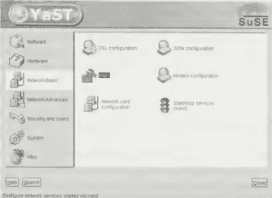

*图5.1：YaST2系统配置与管理*

### 硬件

新硬件必须首先按照供应商的说明进行安装和连接。连接打印机或调制解调器等外部设备，然后启动相应的YaST2模块。大多数常规设备将被YaST2自动识别，此时会显示技术信息。如果自动检测失败，YaST2将显示设备列表（型号、制造商等），供您选择适当的设备。

在“硬件”下，可以找到配置各种设备所需的配置工具。有关YaST2自动检测到的硬件的数据，请参阅硬件信息。这对于支持请求尤其有用。配置图形界面（X11）的模块在安装过程中应该已经很熟悉了。它也可以在YaST2控制中心中使用，以将另一台显示器连接到已在运行的系统。鼠标和键盘也是如此。最后，在“硬件”下，您可以找到用于配置打印机、扫描仪和电视卡以及分区的模块。有关不同YaST2工具的说明，请参阅[SuS02a]。

### 网络/基本

在“网络/基本”下，YaST2提供基本的配置工具，为您进入Internet铺平道路：ADSL、T-DSL（德国）、网卡、ISDN、调制解调器、主机名和DNS的配置。相关文档也位于[SuS02a]中。

### 网络/高级

对于高级Internet用户和网络管理员，有一些模块可用于启动和停止系统服务，如inetd、Sendmail（具有专家配置）、NFS客户端和服务器、路由、专家网络和NIS客户端。“专家网络”提供与“网络/基本”下的“网卡配置”相同的功能，但您仍然可以在此处配置调制解调器和ISDN。

### 安全与用户

在这里，YaST2提供了用于简单用户和组管理的工具。配置模块“系统安全”提供了各种预配置级别和专家设置选项。有关更多信息，请参阅[SuS02a]手册。

### 软件

要安装或删除软件，请使用此模块。使用它来更改安装介质。此外，还有两个更新工具：一个用于“正常”系统更新，另一个用于通过我们的FTP服务器进行的在线更新。相关信息可在“配置”手册中获取。

### 补丁CD更新

与在线更新不同，补丁不是从FTP服务器获取，而是从CD中扫描。此CD适用于“SuSE Linux Enterprise Server”客户。优点是使用CD可以快得多。

插入补丁CD后，CD上存储的所有补丁将被读取并显示在此YaST2模块屏幕中。从补丁列表中选择要安装的补丁。如果您忘记将CD放入驱动器，将出现警告。然后插入CD并继续更新补丁CD。


## 系统

在“系统”下，你可以选择重新配置引导模式、创建引导盘或模块盘，或者设置语言和时区。在“配置”手册中可以找到所有必要信息。

## Sysconfig 编辑器

SuSE Linux 最重要的设置保存在 `/etc/sysconfig` 目录下的文件中。以前，所有配置集中存放在中心文件 `/etc/rc.config` 中。sysconfig 编辑器以易读的方式呈现设置选项。可以修改这些值，然后将其添加到该目录下的各个配置文件中。不过，通常没有必要手动编辑这些文件，因为在安装软件包或配置服务时，这些文件会自动调整。

> **警告**
>
> 如果你没有相关经验和知识，请不要修改 `/etc/sysconfig` 文件。这可能对系统造成相当大的损害。

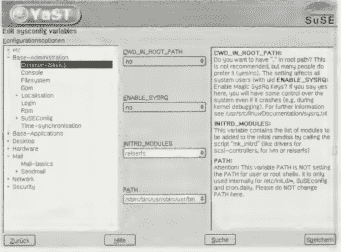

*图 5.2：YaST2：配置 sysconfig 编辑器*

## 运行级别编辑器

Linux 中的运行级别详见第 298 页起的*运行级别*一节。

该专家模块启动后将进行初始化。下一个对话框将显示当前默认运行级别。这种“操作模式”将在系统启动后生效。在 SuSE Linux 中，这通常是运行级别 5（带网络和 KDM，即图形登录的完整多用户操作）。运行级别 3（带网络的完整多用户操作）也同样适用。此时，可以借助 YaST2 设置其他默认运行级别。参见第 299 页的表格 12.1。选择“编辑”后，将进入所有服务和守护进程的概览，并补充说明它们是否已经在你的系统上启用，以及用于哪些运行级别。用鼠标高亮一行，并勾选运行级别“0”、“1”、“2”、“3”、“5”、“6”和“S”的复选框，以此指定哪个服务或守护进程应在哪个运行级别下激活。运行级别 4 未定义——该级别始终保留给自定义设置。

通过“启动”和“停止”可以决定是否应启动某个服务。如果尚未自动更新，则可通过“更新”检查当前状态。“重置为默认值”允许你将默认设置恢复到安装后的初始状态。“激活服务”仅在服务当前被禁用时出现。“将所有服务重置为默认值”可将所有服务恢复为安装后的原始状态。“完成”保存系统配置。

> **警告**
>
> 注意，这里不要做实验——这是专家工具。如果某些服务设置不正确，系统可能无法重新启动，可能需要从头重新安装，或者系统中可能出现安全漏洞。

## 专家分区程序

分区模块可以编辑和删除现有分区，也可以创建新分区。可以从此处访问软件 RAID 和 LVM 配置。

在通常情况下，分区是在安装过程中指定的。但是，也可以将第二块硬盘集成到现有的 Linux 系统中。首先，必须对新的硬盘进行分区。然后必须挂载它，并将其写入 `/etc/fstab` 文件。要将 `/opt` 分区从旧硬盘移动到新硬盘，可能需要复制部分数据。

如果要对正在使用的硬盘重新分区，请务必小心——这基本可行，但操作后必须立即重启系统。从 CD 引导后再分区会稍微安全一些。“专家…”按钮会弹出一个包含以下命令的菜单：

-   **重新读取分区表**：从磁盘重新读取分区表。例如，在文本控制台中进行手动分区时，你会需要此功能。
-   **采用现有 `/etc/fstab` 中的挂载点**：这仅在安装时相关。读取旧的 `fstab` 对于完全重装系统而非仅更新系统非常有用。在这种情况下，无需手动输入挂载点。
-   **删除分区表和磁盘标签**：这会完全覆盖旧分区表。例如，如果遇到非常规磁盘标签问题，此命令会很有帮助。使用此方法将丢失硬盘上的所有数据。

## 逻辑卷管理器（LVM）

逻辑卷管理器（LVM）可以将硬盘空间灵活地分配到多个文件系统。由于在运行中的系统上修改分区很困难，因此开发了 LVM：它提供了一个虚拟的磁盘空间“池”（卷组，简称 VG），可根据需要从中生成逻辑卷（LV）。操作系统将访问这些逻辑卷，而不是物理分区。

功能：

-   多个硬盘或分区可以组合成一个大的逻辑分区。
-   如果某个 LV（例如 `/usr`）已满，可以通过相应配置进行扩容。
-   使用 LVM，你甚至可以在系统运行期间添加硬盘或 LV。不过，这需要专为这类操作设计的“热插拔”硬件。

对于使用频繁的家用 PC 或小型服务器，实施 LVM 已经很有意义。如果你的数据量不断增长，例如数据库、MP3 档案或用户目录，逻辑卷管理器正适合你。它可以让你创建比物理硬盘更大的文件系统。LVM 的另一个优点是，最多可以添加 256 个 LV。请记住，使用 LVM 与使用传统分区有很大不同。

有关配置“逻辑卷管理器”（LVM）的说明和更多信息，请参阅官方 LVM HOWTO 和 SuSE 文档：

-   http://www.sistina.com/lvm/Pages/howto.html
-   http://www.suse.com/us/support/oracle/

## 软件 RAID

RAID（廉价磁盘冗余阵列）的目的是将多个硬盘分区组合成一个大的“虚拟”硬盘，以优化性能和数据安全性。不过，这种方法在获得一种优势的同时会牺牲另一种优势。“RAID 级别”定义了所有硬盘的存储池和公共访问设备，即 RAID 控制器。RAID 控制器大多使用 SCSI 协议，因为它比 IDE 协议能更好地驱动更多硬盘。它也能更好地处理并行运行的命令。软件 RAID 也能承担这些任务，而不必使用通常相当昂贵的 RAID 控制器。SuSE Linux 提供了借助 YaST2 将多个硬盘组合成一个软件 RAID 系统的选项——这是硬件 RAID 的一个非常合理的替代方案。

### 常规 RAID 级别

**RAID 0** 此级别可提高数据访问性能。实际上，这并不是真正的 RAID，因为它不提供数据备份，但“RAID 0”这一名称已成为此类系统的标准。使用 RAID 0 时，两个或更多硬盘组合在一起。性能非常好——但只要众多硬盘中有一个发生故障，整个 RAID 系统就会被破坏，数据也会丢失。

**RAID 1** 此级别为数据提供了非常充分的备份，因为数据会以 1:1 方式复制到另一块硬盘。这就是所谓的“硬盘镜像”——如果一块磁盘损坏，其内容副本仍位于另一块磁盘上。除一块磁盘外，其余所有磁盘都可以损坏而不会危及你的数据。使用 RAID 1 时，复制过程中的写入性能会略有下降（慢 10% 到 20%），但读取访问速度比任何普通物理硬盘都明显更快，因为数据被复制，可以并行扫描。

**RAID 5** 在性能和冗余方面，RAID 5 是另外两种级别之间的优化折衷方案。硬盘容量等于所用磁盘数减一。数据像 RAID 0 一样分布在硬盘上。出于安全原因，会在其中一个分区上创建“奇偶校验块”。这些奇偶校验块通过 XOR 相互关联——这样，在系统发生故障时，可以通过 XOR 利用相应的奇偶校验块重建内容。使用 RAID 5 时，同一时间最多只能有一块硬盘发生故障。如果一块磁盘损坏，必须尽快更换以保护数据。

软件 RAID 的配置说明和更多详细信息可参阅以下 HOWTO：

-   `/usr/share/doc/packages/raidtools/Software-RAID-HOWTO.html`
-   `http://www.LinuxDoc.org/HOWTO/Software-RAID-HOWTO.html`

或通过 Linux RAID 邮件列表获取，例如：

-   `http://www.mail-archive.com/linux-raid@vger.rutgers.edu`

如果出现意外问题，你可以在那里获得帮助。

## 杂项

“杂项”提供以下选项：加载厂商驱动光盘、查看启动日志（`/var/log/boot.msg`）和系统日志（`/var/log/messages`），以及为 CUPS 和 LPD 配置打印机。相关说明可在“配置”手册中找到。


## CUPS 与 LPD 打印机

打印的默认设置是使用默认打印系统，该系统实现了 BSD 假脱机程序 LPD。为此，你的系统已安装软件包 `lprold`。借助 YaST2，可以切换到 CUPS（通用 Unix 打印系统）打印系统，或者从 CUPS 切换回 LPD。旧的 LPD 配置将予以保留。由于它们的配置文件有一定重叠，这两个打印系统互斥——一次只能安装其中一个。请按照 YaST2 中的说明切换到 CUPS，并准备好你的光盘。更多有关 CUPS 的信息，请访问 http://www.cups.org/

> **注意**
>
> 决定打印质量的关键因素不是你使用 LPD 还是 CUPS，而是相关的 Ghostscript 驱动程序和参数设置。

## 引导与引导管理器

本章介绍引导已安装系统的各种方法。首先，概述与 PC 引导过程相关的一些技术细节，以加深你对每种方法工作原理的理解。随后，详细描述 LILO，并简要介绍 loadlin——这两种引导管理器。

- 引导 PC ........................................ 90
- 引导概念 ........................................ 91
- LILO 概述 ................................. 93
- 配置 LILO ..................................... 96
- 安装与卸载 LILO .................... 103
- 创建 Linux 引导盘 .......................... 106
- 示例配置 ............................... 108
- LILO 问题 ........................................ 112
- 使用 loadlin 配置引导机制 ........ 120

### 引导 PC

打开计算机后，首先发生的是 BIOS（基本输入输出系统）接管控制，初始化屏幕和键盘，并测试主内存。在此任务完成之前，系统不识别任何外部设备或外部存储介质。

当基本系统完成内部设置后，它开始验证周围的硬件。日期、时间以及一些最重要外部设备的信息从 CMOS 设置（通常称为 CMOS 设置程序）中读取。读取 CMOS 后，BIOS 应识别第一个硬盘，包括其几何结构等详细信息。然后，它就可以从那里开始加载操作系统（OS）。

要加载操作系统，系统从第一个硬盘加载一个 512 字节的数据段到主内存，并执行该段起始处存储的代码。其中的指令决定其余引导过程。这就是硬盘前 512 字节通常被称为*主引导记录*（MBR）的原因。

尽管整个过程相当复杂，而且此描述过于简化，但应当清楚的是，到目前为止（加载 MBR），引导顺序与已安装的操作系统无关，并且在所有 PC 上都相同。此外，PC 访问外围硬件所需的只是存储在 BIOS 中的那些例程（驱动程序）。

### 主引导记录

MBR 的布局已由独立的约定认证。前 446 字节保留给程序代码。接下来的 64 字节为最多四个分区的分区表提供空间。参见第 49 页的*分区技巧*部分和第 50 页的*专家分区*部分。如果没有分区表，就无法在硬盘上创建文件系统（在 MS-DOS 下称为驱动器）——没有分区表的磁盘几乎毫无用处。最后两个字节必须包含一个特殊的“魔数”（AA55）。任何用其他数字替换此数字的 MBR 都会被拒绝。

### 引导扇区

引导扇区是硬盘分区上的第一个扇区，但作为其他分区“容器”的扩展分区除外。它们提供 512 字节的空间，旨在包含能够在该分区上启动操作系统的代码。已格式化的 DOS、Windows 和 OS/2 分区的引导扇区正是如此。相比之下，Linux 引导分区在最开始时是空的。分区不能直接启动，即使它可能包含内核和有效的根文件系统。有效的引导扇区遵循约定，并将 MBR 的“魔数”写入最后两个字节。

### 引导 DOS 或 Windows 95/98

MBR 包含的信息决定了硬盘的哪个分区是“活动”的——即应搜索哪个分区以找到要引导的操作系统。因此，DOS 必须安装在第一个硬盘上。当标记的分区包含有效的引导扇区时，MBR 中的可执行代码（“第一阶段引导加载程序”）就会启动。

如果是这种情况，就可以从那里启动“第二阶段引导加载程序”。现在可以加载 DOS 系统程序，你会看到通常的 DOS 提示符。在 DOS 中，只有主分区可以标记为活动。因此，不能将扩展分区内的逻辑分区用作可引导的 DOS 分区。

### 引导概念

最简单的引导概念只涉及一台安装了一个操作系统的机器。常见的 PC 配置是仅安装 DOS 或 Windows 95/98 作为操作系统。这种情况下的引导顺序已在前面概述。

如果 Linux 是唯一使用的操作系统，也可以采用类似的概念。在这种情况下，理论上可以跳过 LILO 的安装。这样做的一大缺点是，你将无法在引导时向系统内核传递额外参数。

一旦安装了多个操作系统，就会出现许多新的引导可能性。

**从软盘引导另一个操作系统：** 可以从硬盘引导一个操作系统。其他操作系统可以使用引导盘引导。

- *要求：* 软盘驱动器必须可引导
- *示例：* 在硬盘上安装 DOS 或 Windows 95/98，并从软盘引导 Linux
- *优点：* 跳过可能棘手的引导加载程序安装
- *缺点：* 必须确保你有可用的引导盘
- Linux 没有引导盘就无法引导，这可能是优点也可能是缺点，具体取决于其用途。

**附加系统的链式引导：** 始终引导同一个操作系统。其他系统可以从第一个操作系统内部按需启动。

- *要求：* 必须有足够的用于操作系统链式引导的程序
- *示例：* 使用 loadlin 从 DOS 加载 Linux，或使用 server.exe 从 DOS 启动 NetWare 服务器

**安装引导管理器：** 理论上，这允许你在单台机器上使用任意数量的操作系统。系统选择在引导时进行。更换操作系统需要重新引导。

- *要求：* 引导管理器必须与所有已安装的操作系统顺利协作
- 共存引导管理器的*示例*（至少在特定情况下，参见第 110 页的*OS/2 与 Linux*部分）包括 OS/2 和 DOS 引导加载程序 boot.sys

下一节将使用 Linux 引导管理器 LILO 来描述引导管理器的安装和配置。关于 LILO 功能的完整描述可在 [Alm94] 中找到。输入以下命令可以找到并打印该参考资料：

```
earth:/usr/share/doc/packages/lilo # lpr user.dvi
```

之后是对 loadlin 的描述。

### LILO 概述

Linux 引导加载程序通常安装在 MBR 中（详细内容见下文、下一页以及第 103 页的*安装与卸载 LILO*部分）。启动时，LILO 已经可以访问两个实模式硬盘，并且由于安装方式，它能够从这两个硬盘驱动器找到所需的所有数据，而无需任何分区数据。因此，操作系统既可以从第一个硬盘引导，也可以从第二个硬盘引导。在 MBR 中使用 LILO 时，标准 DOS MBR 用于标记活动分区的分区表条目将被忽略。

与标准 DOS 引导顺序的一个重要区别是，使用 LILO 时，你可以在引导时选择任意已安装的系统。将 MBR 加载到内存后，LILO 启动，并提示你选择其中一个已安装的操作系统。

### 关于 LILO

LILO 是一个功能多样的引导管理器。它可以加载用于引导操作系统的分区引导扇区，或者加载 Linux 内核并引导 Linux。此外，LILO 提供了向内核传递命令的重要选项。出于安全原因，该选项可以完全或部分地使用密码保护。

### 使用 LILO 引导

当 LILO 启动时，它会显示文本 LILO 和一条问候消息（在安装期间输入——参见第 99 页的*其他 LILO 配置选项*部分）。此后，会出现命令提示符：

```
boot:
```

此时，输入操作系统名称来选择你的操作系统，然后它就会被引导。操作系统名称是在安装期间设置的。此时，你可以向 Linux 内核传递参数行。按 `Tab` 键可获取所有可用操作系统名称的列表。

### LILO 的组件

LILO 机制由以下组件组成：

- 引导扇区中启动系统引导的 LILO 代码的起始部分，即*第一阶段*。


> **提示**
>
> LILO 安装的引导扇区包含一个字节序列，该序列类似于引导扇区病毒的特征序列。因此，DOS 病毒扫描程序声称在 `/boot/chain.b` 或 `/boot/os2_d.b` 等文件中检测到 AIRCOOP 引导扇区病毒，这并不罕见。

- LILO 代码的核心，位于 `/boot/boot.b`
- 一个映射文件，通常为 `/boot/map`，LILO 在安装期间会在其中记录 Linux 内核和其他数据的位置
- 可选：一个消息文件，其内容显示在 LILO 引导选择之前的开场消息中。它通常位于 `/boot/message`（或类似位置）
- LILO 应提供的不同 Linux 内核和引导扇区

> **警告**
>
> 对其中任何文件的任何写入访问（即使是通过移动文件）都会损坏映射文件，从而需要重新安装 LILO（参见第 103 页的*更改配置后安装*）。在更换内核时，这一点尤其重要。

## LILO 位置

本节指的是上面提到的 LILO 的*第一阶段*。请考虑这个一般限制：取决于计算机上的 BIOS 版本，可能要求内核映像 `/boot/vmlinuz` 位于硬盘的*前 1024 个柱面*内。这可以通过一个小的额外分区来实现，该分区可以“挂载”到目录 `/boot` 中，而所有这些都位于前 1024 个柱面内。

对于许多仍然可用的 BIOS 版本，在引导阶段，BIOS 驱动程序只能访问这些前 1024 个柱面。在大多数情况下，只能使用*前两块硬盘*。如果您的 BIOS 非常旧，则 (E)IDE 硬盘的存在可能会阻止 SCSI 设备引导。

只有较新的 BIOS 版本才允许访问其他设备，例如，与 EIDE 硬盘控制器配合使用时最多可访问四个 EIDE 设备。许多现代 SCSI 控制器甚至允许将 SCSI 设备“推到前面”，使其可引导。要将此功能与 LILO 一起使用，请参阅第 101 页的磁盘选项。

为简单起见，所有这些都被称为“1024 柱面限制”。在首次安装 Linux *之前*对硬盘进行分区时，就应考虑到这一点。之后可能就太晚了，并可能导致大量额外工作。有关更多信息，请参见第 115 页的*1024 柱面限制*一节。以下位置可用于存储 LILO 引导扇区。

- **在软盘上。** 这是最安全，但也是使用 LILO 引导最慢的替代方案（参见第 107 页的*使用 LILO 的引导盘*一节）。如果您不想更改引导扇区，请选择此方案。

- **在第一块硬盘上的主 Linux 分区的引导扇区中。** 这样不会改动 MBR。在能够引导它之前，必须使用 fdisk 将该分区标记为活动分区。如果 Linux 完全安装在第二块硬盘上的逻辑驱动器或分区中，那么第一块驱动器上只剩下扩展分区的引导扇区（如果有的话）。Linux fdisk 也可以激活这样的分区。

  要从硬盘引导多个系统，这种方式极其笨拙。每次想要引导时，都必须*事先*激活相应的引导扇区。接下来的两种变体则要方便得多。

- **在主引导记录中。** 这种变体提供最高的灵活性。如果所有 Linux 分区都位于第二块硬盘上，并且第一块驱动器上没有扩展分区，那么这是唯一可行的替代方案。MBR 的每一项设置都必须极其小心地编辑，因为错误可能会造成严重后果。安全方面在第 103 页的*安装和卸载 LILO*一节中描述。

- **在由另一个引导管理器引导的引导扇区中。** 如果您使用过另一个引导管理器并希望继续使用它，请尝试这种方式。根据其灵活性和能力，有几种变体。一种常见情况：您在第二块硬盘上有一个主 Linux 分区，并从该分区引导 Linux。您的引导管理器能够通过引导扇区引导此分区。然后，您可以通过将 LILO 安装到此引导扇区中，并告诉引导管理器该分区处于活动状态，来激活您的 Linux 分区。

> **警告**
>
> 如果您尝试通过将 LILO 安装到逻辑 Linux 分区上来使其可引导，请务必小心。对于 8.0 版，即使您的其他引导管理器能够启动逻辑分区，也不能保证成功。

如果您愿意，可以尝试。最安全的方法是使用一个极小的 Linux 安装来测试它是否可行。也许您会走运。推荐的方法仍然是创建一个主分区且可引导的 Linux 分区。

## 配置 LILO

LILO 是一个灵活的引导管理器，提供了许多根据您的需求调整配置的方法。下面描述最重要的选项及其含义。有关更多细节，请参阅 [Alm94]。

LILO 在 `/etc/lilo.conf` 中配置。如果您是第一次安装 LILO，请使用 YaST 配置 LILO。稍后可通过编辑 `/etc/lilo.conf` 进行微调。

> **注意**
>
> `/etc/lilo.conf` 应仅对 root 可读，因为它可能包含密码（参见第 99 页的*其他 LILO 配置选项*一节）。这是 SuSE Linux 的默认设置。如有疑问，请以 root 身份运行 `chmod 0600 /etc/lilo.conf` 进行检查。

建议将任何现有的、旧的且可用的 `lilo.conf` 文件备份到安全的地方。只有在更改 `/etc/lilo.conf` 后重新安装 LILO，您的设置才会生效（参见第 103 页的*安装和卸载 LILO*一节）。

### lilo.conf 的结构

`/etc/lilo.conf` 以一个全局段开始，随后是为 LILO 应启动的每个操作系统设置的一个或多个系统段。新段由以 `image` 或 `other` 开头的行开始。

`/etc/lilo.conf` 中条目的顺序只在一个方面重要：如果用户没有进行交互，列表中的第一个条目将默认被引导——这可以通过 delay 和 timeout 设置。

图 3 显示了一台同时装有 DOS 和 Linux 的计算机的示例配置。在 /dev/hda7 上有两个 Linux 内核（/boot/vmlinuz 和 /boot/vmlinuz.old），在 /dev/hda1 上有 MS-DOS（或 Windows 95/98）。还可以使用 Memtest86 程序。

```
### LILO global section
boot       = /dev/hda           # LILO installation target: MBR
backup     = /boot/MBR.hda.990428  # backup file for the old MBR
                                  # 1999-04-28
vga        = normal              # normal text mode (80x25 chars)
read-only
menu-scheme = Wg:kw:Wg:Wg
lba32                              # Use BIOS to ignore
                                   # 1024 cylinder limit
prompt
password = q99iwr4                # LILO password (example)
timeout = 80                       # Wait at prompt for 8 s before
                                   # default is booted
message = /boot/message           # LILO's greeting

### LILO Linux section (default)
  image  = /boot/vmlinuz         # Default
  label  = linux
  root   = /dev/hda7              # Root partition for the kernel
  initrd = /boot/initrd

### LILO Linux section (fallback)
  image  = /boot/vmlinuz.suse
  label  = suse
  root   = /dev/hda7
  initrd = /boot/initrd.suse
  optional

### LILO other system section (DOS/Windows)
  other  = /dev/hda1             # Windows partition
  label  = windows

### LILO memtest section (memtest)
  image  = /boot/memtest.bin
  label  = memtest86
```

*图 3：/etc/lilo.conf 的示例配置*

`#` 与行尾之间的任何内容都被视为注释。空格和注释会被 LILO 忽略，并且可用于提高可读性。

最重要的行逐项说明如下：

- **全局段**（参数部分）
  - `boot={bootdevice}`

    应在其第一个扇区上安装 LILO 的设备。`{bootdevice}` 可以是软盘驱动器（`/dev/fd0`）、分区（例如 `/dev/hdb3`）或整个磁盘（例如 `/dev/hda`）。最后一种表示将 LILO 安装到 MBR 中。默认值：如果缺少此选项，LILO 将安装到当前根分区上。

  - `lba32`

    使用此选项，如果您的 BIOS 支持，则忽略 LILO 的 1024 柱面限制。

  - `prompt`

    强制显示 LILO 提示符。默认是不显示提示符（参见下一页的*其他 LILO 配置选项*一节，选项 `delay`）。如果 LILO 需要管理多个系统，建议这样做。应设置 `timeout`，以保证在提示符下未输入任何内容时自动重新引导。

  - `timeout={tenth-seconds}`

    为提示选项设置超时，如果在给定时间内没有输入，则启用自动重新引导。`{tenth-seconds}` 是以 0.1 秒为增量的剩余时间。按 `⇧ Shift` 会重新开始超时。默认值：无限——不自动重新引导。

- **Linux 段**
  - `image={kernelimage}`

    输入要引导的内核映像的名称，包括其目录位置。对于您的新系统，这很可能是 `/boot/vmlinuz`。

  - `label={name}`

    此名称在 `/etc/lilo.conf` 中必须唯一。除此之外，可自由为系统选择一个名称（例如 Linux）。最大长度为 15 个字符。名称中只能使用字母、数字和下划线——例如，不能有空格或特殊字符。有关可使用哪些字符的具体规则的更多信息，请参见 [Alm94]，如第 92 页的*引导概念*一节所述。默认值是内核映像的文件名（例如 `/boot/vmlinuz`）。


通过在 LILO 提示符下输入此名称，选择要引导的系统。如果安装了许多系统，建议在一个特殊消息文件中记录它们（参见当前页面上的*其他 LILO 配置选项*一节中的 *message* 选项）。

- `root={root device}`

  这为内核提供你的 Linux 系统根分区的名称（例如 `/dev/hda2`）。出于安全原因，建议这样做。如果省略此选项，内核将使用自己的根分区（*内核映像*）。

- **Linux 部分**（后备）

  即使你安装了自定义内核，你仍然可以引导 SuSE 标准内核来启动稳定系统。

- `optional`

  如果决定删除 `/boot/vmlinuz.suse`（*不推荐*），在 LILO 安装过程中将跳过此部分而不会显示错误消息。

- **其他系统**

  - `other={partition}`

    other 告诉 LILO 启动其他系统的分区（例如 `/dev/hda1`）。

  - `label={name}`

    系统名称（自行选择）。建议这样做，因为默认名称 —— 原始设备名 —— 信息量较少。

## 其他 LILO 配置选项

上一节介绍了 `/etc/lilo.conf` 中必需的条目。下面讨论其他有用的选项。标记为 *image* 的选项属于操作系统的相应配置段。其余选项用于 `/etc/lilo.conf` 的全局参数段。

- `backup={backup}`

  LILO 备份引导扇区的文件。默认值为 `/boot/boot.xxxx`，其中 xxxx 是安装分区的内部设备编号。我们不建议使用晦涩的名称。你将无法使用 LILO 自带的卸载功能，但我们仍然认为手工小心地完成这一操作更好。（参见第 105 页的*卸载 LILO*一节）

> **警告**
>
> 如果备份文件已存在，LILO 不会创建新文件。请确保使用的名称未被占用。

- **compact**

  如果要将 LILO 安装到软盘上，建议使用此选项。启用后，LILO 会尝试一次读取更多扇区，从而加快引导过程。但这并非在所有机器上都有效。我们不建议设置此项，因为常规方式更安全，而且该选项带来的差别只有一两秒。

- `loader={boot loader}`

  要加载属于另一个操作系统的引导扇区，LILO 会在其映射文件中构造一个*伪 MBR*。引导时，LILO 首先启动这个伪 MBR，由它再启动另一个引导扇区。此选项指定存放伪 MBR 代码的文件。

  *默认值：`/boot/chain.b`*（通常这是正确的）。

有时候，某个需要从第一块硬盘引导的操作系统（例如 DOS）却要借助 LILO 从另一块硬盘引导。还有一些附加选项可以根据设备编号交换硬盘顺序：

`map-drive=(number)` 和 `to=(number)`。参见文件 4。加载程序 `os2_d.b` 用于从同一硬盘加载 OS/2。必须显式设置“交换”设备（参见文件 4）。如果要从第一块硬盘引导 OS/2，请设置 `table = D:`。

```
# Booting DOS from the second hard disk
# DOS bootable partition config begins
other = /dev/hdb1
    label = DOS
    loader = /boot/chain.b
        map-drive = 0x80    # first hd: BIOS number 0x80
            to = 0x81       # second hd: BIOS number 0x81
        map-drive = 0x81
            to = 0x80
    table = /dev/hdb
# DOS bootable partition config ends
```

*文件 4：/etc/lilo.conf 摘录：从第二块硬盘引导 DOS*

- `table={ptable}`

  `ptable` 设置写入伪 MBR 的分区表的源设备（通常是 `/dev/hda` 或 `/dev/sda`）。

- `disk={device file}`

  - `bios={BIOS device number}`
  - `cylinders={amount}`
  - `heads={amount}`
  - `sectors={amount}`

  精确告诉 LILO 要使用的 BIOS 设备编号和几何结构。这很少需要。只有一个主要例外：IDE-SCSI 系统。如果你的 BIOS 能够将引导设备切换为 SCSI 优先于 IDE，并且你想使用这一功能，请从 BIOS 的角度告诉 LILO 交换后的顺序。这可以通过在 `lilo.conf` 的全局段中添加一个额外条目来实现。对于配有一个 SCSI 磁盘和一个 IDE 磁盘的系统，可参见文件 5 中的示例。

```
# Enable LILO to correctly access /dev/sda and /dev/hda
# at boot time if their boot order is interchanged in
# the BIOS:
disk = /dev/sda    # The SCSI disk is regarded as ...
    bios = 0x80    # ... first BIOS disk;
disk = /dev/hda    # the IDE disk is regarded as ...
    bios = 0x81    # ... second BIOS disk;
```

*文件 5：lilo.conf 摘录：引导顺序 — SCSI 优先于 IDE*

- **linear**

  在安装 LILO 时给出此选项，会使所有对硬盘扇区的引用都以逻辑地址而不是物理地址存储，因此它们与任何硬盘几何结构无关。此选项适用于引导时 BIOS 检测到的几何结构与正在运行的 Linux 系统不同的情况。仅在极少数情况下需要。

  linear 选项并不能让你摆脱 1024 柱面限制的约束，该限制由引导硬盘的 BIOS 几何结构决定。另请参阅 `/usr/share/doc/sdb/en/html/kgw_lilo_linear.html`。

- `message={message-file}`

  指向一个在系统引导时显示在屏幕上的文本文件。该文件不应超过二十四行（以防止消息滚动），其中可以包含例如 LILO 引导选择的概览。建议使用此选项。

  SuSE Linux 通常使用 PCX 图像而不是传统的启动消息。要了解更多信息，请阅读 `file:/usr/share/doc/sdb/de/html/jkoeke_bootgrafik_72.html`。

> **注意**
>
> 如果设置了此选项，消息文件将成为 LILO 引导机制的一部分，并且每次更改此文件后，都必须重新安装 LILO（参见下页的*安装和卸载 LILO*一节）。

- `password={password}`

  该选项既可以位于全局段，也可以位于系统专用段。通过密码为 LILO 服务或引导相应系统提供安全访问。如果你认真对待这一安全问题，请在使用后将密码从 `lilo.conf` 中移除。作为 root，你可以随时为 LILO 设置新密码（之后只需重新安装即可）。建议同时设置 `restricted` 选项，否则有可能启动 shell，请参阅关于 `lilo.conf` 的手册页（`man lilo.conf`）。

- `read-only`

  LILO 使用这个 image 选项指示内核最初以只读方式挂载根分区，这通常是引导 Linux 系统的惯例。如果省略此选项，内核将使用自己的默认设置，该设置可通过 `rdev -R (kernel image)` 命令查看。

- `delay=(tenth-seconds)`

  如果未显式设置提示符，可通过按 **Shift**、**Ctrl** 或 **Alt** 进入提示符。`delay=` 选项设置 LILO 引导其列表中的第一个系统之前等待的时间。默认值为 0 —— 不等待。如果通过 `prompt` 明确要求显示提示符，则 delay 选项不起作用。

- `vga=(mode)`

  在启动时选择 VGA 模式。有效模式为 `normal`（80x25）、`ext`（80x50）或 `ask`（引导时询问）。对于启用了 framebuffer 的内核，可能的取值在 `/usr/src/linux/Documentation/fb/vesafb.txt` 中列出并说明。

- `append="/parameter/"`

  Linux 内核的 image 选项。允许通过这种方式指定内核参数，例如针对硬件组件的参数，就像在 LILO 提示符下一样。内核首先读取 append 行，然后读取提示符。因此，如果 append 行中给出的参数与提示符处指定的参数不同，将使用后者。

  例如：`append="mcd=0x300,10"`

## 安装和卸载 LILO

在全新安装 Linux 期间或之后的某个时间，YaST 会以交互方式引导你完成安装 LILO 的步骤。在本节中，我们假设需要执行某些超出 YaST2 能力范围的操作，并更深入地了解 LILO 在安装和卸载过程中的工作原理。

> **警告**
>
> 引导管理器的安装比较棘手。请事先确保你完全能够引导 Linux 和其他已安装的系统。你必须在崩溃恢复磁盘上安装 fdisk。否则，你可能会发现自己根本无法访问硬盘。

### 更改配置后的安装

如果 LILO 的任何组件发生了变化，或者你修改了 `/etc/lilo.conf` 中的配置，请重新安装 LILO。只需以 root 身份运行 `/sbin/lilo` 启动 Map 安装程序即可轻松完成。


LILO 会为目标引导扇区创建备份，将它的*第一阶段*写入其中，然后生成一个新的映射文件（另请参见第 93 页的*LILO 的组成*一节）。LILO 会像输出 4 所示那样，为每个已安装的系统生成一份报告。

```
Added linux *
Added suse
Added windows
Added memtest86
```

*输出 4：启动 LILO 后的输出*

安装完成后，可以用 `shutdown -r now` 重新启动机器。重新启动时，BIOS 首先执行系统自检。紧接着，你会看到 LILO 及其命令提示符，在这里可以输入参数，并从刚刚安装的配置中选择一个引导映像。按 `Tab` 键可显示所有已安装系统的列表。

## 重新编译内核后的安装

为了将刚编译好的内核纳入 LILO 引导设置，Linux 内核 Makefile 提供了一个一体化解决方案。配置和创建内核的所有命令都集中在 `/usr/src/linux/Makefile` 中。这里指定了 `INSTALL_PATH=/boot`（参见第 234 页的*编译内核*一节）。该 Makefile 有一个名为 `bzilo` 的目标，它会在内核编译完成后，自动将当前已安装的内核 `/boot/vmlinuz`（以前是 `/vmlinuz`）复制为 `/boot/vmlinuz.old`，将新内核复制为 `/boot/vmlinuz`，然后重新安装 LILO。这可以通过输入命令 `make bzilo` 而不是 `make zImage` 来完成。只有当你事先编辑过 `/etc/lilo.conf`，并且当前内核确实位于 `/boot/vmlinuz` 时，这才有用。新内核以及旧内核现在都应被列出。生成后的 `/etc/lilo.conf` 示例见第 97 页的文件 3。

在 LILO 提示符处，启动这两个内核中的任意一个。这会让你的引导更加安全，因为即使新内核失败，你仍然可以引导旧内核。有关创建新内核的更多信息，请参见第 229 页的*内核与内核参数*一章。

## 卸载 LILO

> **警告**
>
> 卸载引导管理器是件棘手的事。*提前*确保你能够使用各自相应的启动盘引导 Linux 和其他系统。你应该在每张启动盘上都安装 fdisk，以免完全无法访问你的硬盘。

要卸载 LILO，请将引导扇区原有的内容覆盖到 LILO 上。这需要该原有内容有一个有效备份。参见第 99 页*其他 LILO 配置选项*一节中的 backupr 选项。

> **警告**
>
> 如果相关分区有了新的文件系统（对 DOS 用户来说：已被格式化），引导扇区备份就不再有效。如果相关硬盘在此期间被重新分区，MBR 备份中的分区表也会失效。过时的“备份”如同定时炸弹，最好尽快将其删除。将旧且无效的备份恢复到系统扇区是导致数据丢失的直接途径。

要恢复 DOS、Windows 95/98 或 OS/2 的 MBR 非常简单。只需输入 MS-DOS 命令（自 5.0 起可用）：

```
C:\> FDISK /MBR
```

或者在 OS/2 上，

```
C:\> FDISK /NEWMBR
```

这些命令只将前 446 字节（引导代码）写入 MBR，而不会改动分区。对于其他恢复操作，请先为相关的 LILO 扇区做一个备份——只是为了安全起见。然后至少检查两次，确认你的旧备份文件是正确的，并且大小正好是 512 字节。最后将其写回，但不要混淆 if= 和 of=：

- 如果 LILO 位于分区 yyyy（例如 hda1、hda2）：

  ```
  earth:  # dd if=/dev/yyyy of=New-File bs=512 count=1
  earth:  # dd if=Backup-Date of=/dev/yyyy
  ```

- 如果 LILO 位于 zzz 的 MBR 中（例如 hda、sda）：

  ```
  earth:  # dd if=/dev/zzz of=New-File bs=512 count=1
  earth:  # dd if=Backup-Date of=/dev/zzz bs=446 count=1
  ```

最后一条命令是“谨慎”的，不会覆盖分区表。再次强调，*不要忘记*：使用 `fdisk` 将所需的启动分区标记为*可引导*。引导扇区备份做起来又快又简单。我们建议经常这样做。

## 创建 Linux 启动盘

Linux 启动盘（有些简化地说）由一个或多个 Linux 内核组成，可能由 LILO 管理。即使无法直接从硬盘启动（可能原因：MBR 被覆盖、引导管理器配置错误、安装时出错），它也能用来启动你的系统。

这样的启动盘*只*加载内核。其余一切，包括可正常工作的系统程序和 `init` 启动脚本，都必须由硬盘上的安装来提供。启动盘与硬盘上系统之间的联系，是通过在内核中将相关根分区设置为根设备来建立的。

不要将此与用于安装和紧急情况的 SuSE 启动盘混淆。要创建新的 SuSE 启动盘，请将 SuSE CD-ROM 的 `disks` 目录中的相应映像复制到软盘上（参见第 285 页的*SuSE 救援系统*一节）。

## 不带 LILO 的启动盘

通常，如果硬盘控制器的支持已经集成到内核中，那么你的内核*不*需要任何额外的、带有硬件信息的命令行。创建启动盘最简单的方法，就是将实际内核写入原始磁盘并调整根设备（如果之前还没有这样做的话）。

```
earth:  # /sbin/badblocks -v /dev/fd0 1440
earth:  # dd if=my_kernel of=/dev/fd0 bs=18k
earth:  # rdev /dev/fd0 my_root_partition
earth:  # rdev -R /dev/fd0 1
```

最后一条命令确保内核最初以只读方式挂载根目录（启动脚本期望如此）。

## 带 LILO 的启动盘

通过将完整的 LILO 引导启动机制传输到软盘上，可以创建一个功能更强大的启动盘，带有欢迎提示符和内核参数（参见第 93 页的*LILO 的组成*一节）。为此，软盘需要一个文件系统。Minix 文件系统最适合这一用途。

为此，请按以下步骤操作：

- 在一张全新且空白的软盘上创建 Minix 文件系统，然后使用以下命令将软盘挂载到 `/mnt`：

  ```text
  earth:  # /sbin/mkfs.minix -c /dev/fd0 1440
  earth:  # /bin/mount /dev/fd0 /mnt
  ```

  如果软盘驱动器支持更高容量，可以尝试其他值，例如 `/dev/fd0u1722` 或 `1722`。

- 现在，将你的内核文件和 LILO 文件 `/boot/boot.b` 复制到 `/mnt`（即软盘）上。

- 可选：创建消息文件 `/mnt/message`。

- 在 `/mnt` 上创建 `lilo.conf`。— 用实际的根分区替换 `Your_Root_Device`。示例见文件 6。

  ```text
  # LILO Configuration file bootdisk
  # Start LILO global Section
  boot=/dev/fd0                 # Installation: Floppy
  install=/mnt/boot.b           # Of course LILO and
  map=/mnt/map                  # map fit onto floppy!
  message=/mnt/message          # optional
  prompt
  timeout=100      # Wait at prompt: 10 s
  vga = normal     #
  # End LILO global section

  # Linux bootable partition config begins
  image = /mnt/vmlinuz           # default
      root = /dev/Your_Root_Device  # Here is your root partition!
      label = linux
  # Linux bootable partition config ends
  ```

  *文件 6：用于启动盘的 lilo.conf*

- 如果使用 initrd，请按照第 278 页*引导加载程序*一节中的说明将其添加到 `lilo.conf`。

- 使用这个 `lilo.conf` 安装 LILO：

  ```
  earth:  # /sbin/lilo -C /mnt/lilo.conf
  ```

- 卸载软盘

  ```
  earth:  # /bin/umount /mnt
  ```

- 在下次系统启动时检查你的启动盘，以验证其是否正常工作。

## 示例配置

如果 Linux 是你机器上唯一的操作系统，那么就无需再做任何事了。所有必需的步骤都已被 YaST 完成。以下各节给出了一些面向多系统计算机的示例配置。更多信息可以在 `/usr/share/doc/howto/en/mini/Linux+*.gz` 下找到。

## DOS/Windows 95/98 与 Linux

*要求：* DOS/Windows 95/98 和 Linux 各自至少需要一个主分区位于 1024 柱面限制以下（第 94 页的*LILO 位置*一节）。

对于这种情况，我们已经讨论过一种配置（第 97 页的文件 3）——只需调整 root、image 和其他设置。LILO 安装在 MBR 中。

保存好你的 `/etc/lilo.conf`，并确保你有一张 Linux 启动盘。Windows 95/98 尤其倾向于清除“外来”的 MBR。如果你仍然可以用启动盘引导 Linux，那么这个问题很快就能用以下命令解决：

```
earth:  # /sbin/lilo
```

这样就完成了你的 LILO 安装。

## 同一块硬盘上的 Windows NT 与 Linux

1. 如果 Windows NT 和 Linux 需要共存于同一块硬盘上，请使用 NT 引导管理器进行引导。它既可以启动内核映像，也可以启动引导扇区本身。执行以下步骤可为 Linux 与 Windows NT 的和平共处做好一切准备：


-   安装 NT。
-   分区 NT 磁盘（使用 FAT 以便 Linux 可以写入）。
-   按常规安装 Linux（在本示例中，根分区位于 `/dev/sda3`）。挂载 DOS 分区或无错误的 DOS 软盘（例如，挂载到 `/dos`）。
-   安装 LILO，但将其安装在 Linux 的根分区（`/dev/sda3`）中，而不是 MBR（`/dev/sda`）中。你仍然可以为 LILO 配置一组 Linux 内核。以下文件展示了 `lilo.conf` 的示例。

```text
# LILO Configuration file
# Start LILO global Section
boot=/dev/sda3        # Target of installation
backup=/boot/boot.sda3.970428    # Backup previous boot sector;
                                # 28. Apr 1997

prompt
timeout=100           # Wait at prompt: 10 s
vga = normal          # force sane video state
# End LILO global section
# Linux bootable partition config begins
image = /vmlinuz      # default image to boot
    root = /dev/sda3 # Here the root partition!
    label = Linux
# Linux bootable partition config ends
```

编辑 `lilo.conf` 后，使用 `/sbin/lilo` 按常规安装 LILO。

-   将 LILO 启动扇区复制到 NT 可以找到的位置。例如，

```text
earth: # /bin/dd if=/dev/sda3 bs=512 count=1 of=/dos/bootsect.lin
```

此步骤以及以下步骤必须在每次内核更新后执行。

-   启动 NT。如果尚未存在，则从数据磁盘将 `bootsect.lin` 复制到 NT 系统驱动器的主目录。
-   在 `boot.ini` 中（首先设置属性），在末尾添加 `c:\bootsect.lin="Linux"`。
-   在下次启动后（如果一切顺利），NT 的启动管理器中应出现一个条目。

2.  *另一种可能性，但并非总是可行：* 将 LILO 安装到 MBR 并假装它是 DOS（与上述示例所述相同）。这种方法似乎在较新的 NT 版本中不再有效，因为它似乎只有在检测到 MBR 中特殊的（未记录的）序列时才会启动，而遗憾的是 LILO 并不能识别这些序列。

>   **警告**
>
>   NT 3.5x 和 4.0 不识别 Linux 分区类型 82 和 83。请确保没有任何 NT 程序尝试“修复”你的分区表。这会导致数据丢失。务必始终保留 LILO 启动扇区的有效备份。

## OS/2 and Linux

1.  *选项：* 使用 OS/2 启动管理器进行启动。它可在 1024 柱面限制内启动无限个主分区和逻辑分区。用户有责任检查这些分区是否真的可以启动。此启动管理器由 OS/2 的 fdisk 配置。

    *Linux 端的准备：* 使用 LILO 使主分区可启动（通常是根分区）。

    然而，首先应考虑以下事项：

    *OS/2 端的准备：* OS/2 不仅在硬盘的 MBR 以及扩展和逻辑分区的分区扇区中写入现有分区的常规且明显的条目，还利用这些扇区中剩余的空闲空间存储额外信息。如果这些信息不一致，OS/2 的 fdisk 会认为这些分区有故障并拒绝提供启动管理器服务。其他系统的 fdisk 命令不使用这些额外信息，也不了解如何处理它们。冲突不可避免。

    因此，*在* 安装 Linux 之前，加载 OS/2（安装系统即可）并使用 OS/2 的 fdisk 创建 Linux 分区（至少是逻辑分区）。这最初会创建额外的 OS/2 分区，可能会造成干扰。

    *解决方案：* 在创建分区后立即加载 Linux 安装系统（或来自 SuSE Linux CD 的救援系统），并使用 Linux fdisk 将分区类型更改为 83（Linux 原生）。现在这些分区将被 OS/2 忽略。

2.  **选项：** 在第一块硬盘上的主分区上使用 LILO 作为主要启动管理器。这是以下部分中也包含 DOS 的场景的特例。不建议使用 MBR，因为在使用其他 fdisk 重新分区时，MBR 会被重写且 LILO 被擦除。

## DOS, OS/2, and Linux

如果你已为 DOS 和 OS/2 使用 OS/2 启动管理器并希望继续使用它，只需按照前例所述将 Linux 添加到其启动菜单即可。

另一种可能性是在第一块硬盘的主分区上使用 LILO 作为主要启动管理器。以下 `lilo.conf` 的复杂示例（文件 7）假定 DOS 启动分区（主分区）和 Linux 启动分区（也是主分区）都位于第一块硬盘上——在两个分区的 1024 柱面限制内。OS/2 安装在第二块硬盘上。这就是为什么使用特殊加载器（`/boot/os2_b.b`）代替 `/boot/chain.b`。MBR 代码是 DOS 还是 OS/2 并不重要。重要的是 LILO 启动分区（`/dev/sda4`）必须使用 fdisk 在分区表中标记为活动。

```text
# LILO Configuration file
# Start LILO global section
boot = /dev/sda4        # LILO in Linux root partition
backup = /boot/boot.sda4.970428
message = /boot/message  # Greeting message
prompt
delay = 100
vga = normal

# Linux bootable partition config begins
image = /vmlinuz
    label = linux
    root  = /dev/sda4
# Linux bootable partition config ends
# OS/2 bootable partition config begins
other = /dev/sdb5
    table  = /dev/sdb
    label  = os2
    loader = /boot/os2_b.b
# OS/2 bootable partition config ends
# DOS bootable partition config begins
other = /dev/sda1
    table = /dev/sda
    label = dos
# DOS bootable partition config ends
```

*文件 7：两块硬盘上的 LILO、DOS、OS/2 和 Linux*

## LILO Problems

### Some Guidelines

一些简单的初始准则可以预先防止大多数 LILO 问题（摘自 LILO 文档 [Alm94]）：

-   不要惊慌！如果任何东西无法工作，首先尝试找到错误或原因。在开始修复问题之前检查诊断。
-   始终备有最新且经过测试的 *启动* 磁盘。
-   SuSE Linux 在其启动磁盘和安装 CD 上包含完整的 Linux 系统（有关救援系统，请参阅第 *SuSE 救援系统* 节，第 285 页），以便你可以访问所有 Linux 分区。包含可修复几乎任何可能出现问题的工具。
-   阅读完整的 LILO 文档，特别是当系统不按你期望的方式工作时。
-   使用映射安装程序（`/sbin/lilo`）之前检查 `/etc/lilo.conf`。
-   如果你使用大硬盘或多块硬盘，请谨慎操作。注意 1024 柱面限制。
-   尝试同时使用和不使用 linear 选项（通常不使用更好）。

### Diagnosing Errors: LILO Start Messages

以下是对 [Alm94] 中 Werner Almesberger 对 LILO 的描述中某一节所提供信息的回顾。

启动 LILO 时，它会显示单词 `LILO`。每个字母在执行特定操作之前或之后打印。如果 LILO 在某处失败，已打印的字母可用于识别问题。

-   **无** — LILO 的任何部分都未被加载。或者 LILO 根本未安装，或者其启动扇区所在的分区未处于活动状态。
-   **`L` 错误** — 第一阶段启动加载器已加载并启动，但无法加载第二阶段启动加载器（`/boot/boot.b`）。两位数字错误代码表示问题类型。此情况通常表示介质故障或几何结构不匹配。
-   `LI` — 第二阶段已被调用，但无法启动。这可能是由几何结构不匹配或在未重新安装 LILO 的情况下移动 `/boot/boot.b` 引起的。
-   `LIL` — 启动加载器的第二阶段已启动，但无法从映射文件加载描述符表。这通常是由于启动设备的物理错误或磁盘几何结构错误导致。
-   `LIL?` — 第二阶段启动加载器被加载到错误的地址。这通常是由细微的几何结构不匹配或在未重新安装 LILO 的情况下移动 `/boot/boot.b` 引起的。


`LIL-` map 文件中的描述符表已损坏。这可能是由几何参数不匹配，或移动了 `/boot/boot.b` 而未重新安装 LILO 导致的。

`LILO` LILO 的所有部分都已成功加载。

## 错误原因排查

几何参数错误最常见的原因既不是物理缺陷，也不是无效分区表，而是常规安装错误。尤其是未考虑 1024 柱面限制时，会产生几何参数错误（参见下一页*1024 柱面限制*一节）。

在大多数情况下，采取以下措施即可解决问题：

1. 将 LILO 数据安装到 1024 柱面限制以下（如果尚未安装）。这适用于所需的 Linux 内核、`/boot` 的目录内容，以及用于承载 LILO 引导代码的引导扇区。

2. 以 root 身份使用 `lilo` 命令重新安装 LILO。如果你提高详细级别并通过输入以下命令创建日志文件，`lilo` 将生成内容详尽的日志：

```text
earth: # lilo -v -v -v >/boot/lilo.log 2>/boot/lilo.logerr
```

如果引导配置正确，`/boot/lilo.logerr` 应为空。你应该可以在 `/boot/lilo.log` 中准确地看到 LILO 如何保存其文件位置，以及 LILO 为相关硬盘使用了哪些 BIOS 设备编号。

3. 检查硬盘几何参数的一致性。这实际上涉及最多四个方面：

    - (a) **LILO 使用的几何参数** — 参见上述日志文件，该日志受 `lilo.conf` 中的磁盘设置影响。参见第 101 页的信息。

    - (b) **Linux 内核识别的几何参数** — 参见 `/var/log/boot.msg` 中的引导消息或 `dmesg` 命令的输出。这（在一定程度上）受内核参数影响。参见第 248 页的*(E)IDE 控制器和 ATAPI 设备*一节。

    - (c) **分区表所基于的几何参数。** 参见 `fdisk -l` 的输出。它受 `fdisk` 专家命令影响，并对你的数据构成极大风险。强烈建议先完整备份你的数据。

    - (d) **BIOS 检测到的几何参数。** 这是系统引导后 LILO 遇到的几何参数。LILO 必须使用它。请参阅 BIOS 设置，如果适用，可能还需要参阅 SCSI 主机适配器设置。该几何参数受 BIOS 设置影响。

面对不一致时，进行调整的最佳方式往往是采取最省事的路径。在解决这些错误之前，必须先分析以下数据：

- `/etc/lilo.conf`
- `fdisk -l` 命令的输出（分区表）
- 上述日志文件
- 硬盘的 BIOS 和 SCSI-BIOS 设置

## 1024 柱面限制

> **注意**
>
> 较新的 BIOS 版本允许从 1024 柱面限制以上启动操作系统。当前 LILO 版本可以使用此 BIOS 扩展。YaST2 在配置 LILO 时会相应告知你适用于你 BIOS 的这些选项。如果你的 BIOS 不包含此扩展，请继续阅读此处。

如第 94 页*LILO 位置*一节所述，整个 LILO 机制——即引导所需的所有数据——必须可供 BIOS 调用。该节还讨论了可访问柱面的问题。这一限制只影响引导机制。并不要求 LILO 必须安装在 Linux 根分区上。将引导机制放在 Linux 具有读写访问权限的其他操作系统分区上也是可能的，但风险很高。

> **警告**
>
> 这不适用于 LILO 引导扇区。切勿将引导扇区安装到未知分区上，因为这会严重损坏文件系统。

- 最好的方法是创建一个主分区（在允许的区域内），并将所有 LILO 文件（包括 LILO 引导扇区）安装到此分区中。

使用 YaST2 安装时会创建一个小的 `/boot` 分区，其大小仅足以容纳 `boot.b`、`map`、`message` 文件以及 LILO 应引导的 Linux 内核。

几兆字节就足够了。其余分区放在哪里并不重要。不再有其他限制。一旦内核运行，你就可以不受限制地访问所有已安装的驱动器。

- 如果由于某种原因，第一种也是更可取的引导分区方案不可行，请将 LILO 写入引导盘，或者如果你同时运行 MS-DOS，则使用 loadlin 引导 Linux。

- 另一种替代方案是将 LILO 引导机制安装到允许区域内的非 Linux 分区上。Linux 必须具有写访问权限（例如 FAT 或 VFAT 驱动器）。请记住，LILO 引导扇区不能安装在该分区上。只有两个位置可以放置它：第一个驱动器上扩展分区的开头——在 1024 柱面限制之内——或 MBR 上。

假设相关分区挂载为 `/mnt`。你希望将 LILO 安装到 `/dev/hda` 的 MBR 中，并从 `/dev/hda1` 引导 DOS。请按以下步骤操作：

- 创建一个新目录（例如 `/mnt/LINUX`），并将上述 LILO 文件复制到其中：`boot.b`、`map`、`message`、用于其他操作系统的链式加载程序（通常为 `chain.b`），以及 LILO 应引导的 Linux 内核。

- 创建一个 `/mnt/LINUX/lilo.cfg`，其中所有路径都指向 `/mnt/LINUX`（参见文件 8）。

```text
# LILO Configuration file
# Start LILO global section
boot=/dev/hda                  # Installation target
backup=/mnt/LINUX/hda.xxxx    # backup of old MBR
install=/mnt/LINUX/boot.b     # Of course LILO and
map=/mnt/LINUX/map            # map file are in /mnt/LINUX!
message=/mnt/LINUX/message    # optional
prompt
timeout=100                  # Wait at prompt: 10 s
vga = normal                  #
# End LILO global section
#
# Linux bootable partition config begins
image = /mnt/LINUX/first_Kernel   # default
    root = /dev/Your_Root_Device  # Root partition!
    label = linux
# Linux bootable partition config ends
#
# System section for other kernels:
#
# End Linux
# DOS bootable partition config begins
other = /dev/hda1             # MSDOS system drive
    label = dos
    loader = /mnt/LINUX/chain.b
    table = /dev/hda
# DOS bootable partition config ends
```

*文件 8：用于其他分区的 lilo.cfg*

- 使用*这个* `lilo.cfg` 安装 LILO：

```text
earth: # /sbin/lilo -C /mnt/LINUX/lilo.cfg
```

之后，LILO 应该可以正常工作。启动 MS-DOS，并尽可能保护 LILO 文件免受写入访问（任何写入访问都会使 LILO 失效）。至少要为 `X:\LINUX` 中的所有文件（其中 'X' 是挂载到 `/mnt` 的 DOS 驱动器）设置 DOS 属性*system*和*hide*。

另请阅读 `/usr/share/doc/howto/en/mini/` 中的两个 HOWTO——LILO.gz 和 Large-Disk.gz。

## 2.0 及更高版本内核的特殊引导问题

使用 LILO 引导时的问题——无论你是从软盘还是从硬盘引导——都可能在内核部分加载之后出现（例如 SuSE 安装内核）。你可以在 LILO 提示符下选择一个内核，该内核会被加载（屏幕上会输出一些点），但启动内核会失败。在到达 “uncompressing Linux” 之前，系统会以不同的行为崩溃。

可能的错误消息：

- 系统重启
- 系统只是挂起
- "crc-error"
- "no free space"
- "Error 0x00"
- "Error 0x01"
- "incomplete literal tree"

系统会尝试访问软盘，但随后挂起。原因在于大内核、LILO 和有缺陷的硬件三者的组合。这大约影响百分之一的机器。

我们推测这是由于 BIOS 存在缺陷，对快速内存访问的处理有问题。在以下情况下，不会出现此问题：

- 机器通过 loadlin 引导（参见第 120 页*使用 loadlin 配置引导机制*一节）
- 内核已使用 `dd if=/vmlinuz of=/dev/fd0` 复制到软盘，并从软盘引导
- 使用 `make zImage` 创建的较小内核通过 LILO 引导

以下 BIOS 设置也不会导致任何问题：

- 禁用内部高速缓存
- DRAM 预充电等待状态值：*1*
- DRAM 等待突发时序值：`0x3333`


## 解决方案

首先，你应该能够安装一个系统。因此，如果你无法通过 loadlin 或 setup 引导，请使用旧版内核 1.2.13 的启动盘进行安装。如果你没有这样的启动盘，请相应地更改 BIOS 设置。

将来引导时，请使用与安装时相同的中介。从 DOS 使用 loadlin 不应造成任何问题。如果使用启动盘，你应该输入以下参数：

```text
load_ramdisk=0 root=/dev/(rootpartition)
```

其中 *(rootpartition)* 是你的根分区（例如，hda1）。

## 使用 loadlin 配置引导机制

在以下章节中将介绍 loadlin，它是引导 SuSE Linux 的另一种方法。loadlin 是一个 DOS 应用程序，能够引导存储在 DOS 目录中的 Linux 内核。loadlin 可以无缝集成到现有的 DOS/Windows 9x 环境中，并借助 Windows 启动管理器轻松启动。由于 MBR 中没有条目，Windows 不会知道 Linux 已安装，而只会“看到”一个或多个具有 Windows 无法识别的 ID 的分区。这样，Linux 与 Windows 系统共存可能产生的不良副作用就被降到了最低。

此处描述的过程适用于 Windows 95 和 Windows 98。下面显示的配置文件是为 Windows 95 开发的。因此，以下内容仅直接涉及 Windows 95。

你需要做一些准备工作，然后才能使用 loadlin 引导 Linux。根据你的系统环境，你可能还需要修改某些引导文件。

loadlin 可以通过两种方式激活：从启动菜单中的多个配置中选择，或从正在运行的系统状态切换至 Linux 时启动 loadlin。两种方法各有优缺点：

- 使用启动菜单，避免从另一个操作系统内启动 Linux。
- 你可以将其他配置整合到启动菜单中。
- 但是，你必须修改引导文件来设置启动菜单。你可能需要尝试不同的选项。在 DOS 帮助文件中输入 `help menu` 后可以获得一些有用的提示。
- 在 DOS 提示符下切换到 Linux 非常简单。
- Linux 引导可以很好地集成到 Windows 95 的图形用户界面中。通过双击一个图标切换到 Linux。你还可以在 Windows 95 中设置启动菜单（Windows 95 运行在 DOS 7.0 上）。

> **提示**
>
> 如果你希望在打开计算机时立即引导 Linux，请尽可能使用启动菜单。DOS 提示符或双击方法也可用于从 DOS/Windows 95 切换到 Linux。此处仅包含使用 Windows 启动菜单的摘要。

### loadlin 所需的文件

以下是必需的（在 DOS、Windows 3.x 和 Windows 95 中）：

1. 如果 loadlin 尚未安装，请通过输入命令 `setup` 从 CD 1 安装它。
2. 切换到 `c:\loadlin` 目录（在 MS-DOS 中）。你会在此处找到一个文件 `linux.par`。在此目录中，使用编辑器创建一个名为 `startlin.bat` 的文件（如果需要，可以使用其他名称）。在文件中写入以下这一行：

```text
c:\loadlin\loadlin @c:\loadlin\linux.par
```

现在编辑 `linux.par` 文件中的以下行：

```text
c:\loadlin\zimage   # 第一个值必须是
                       # Linux 内核的文件名
initrd=c:\loadlin\initrd
root=/dev/xxx       # 将作为根文件系统挂载的设备
ro                  # 以只读方式挂载根文件系统
```

将 xxx 替换为你的根分区的设备名称。仅当例如你还需要引导 SCSI 支持时，才需要 initrd 条目（有关“初始 ramdisk”概念的更多信息，请参阅第 276 页的“问题描述”一节）。随时使用 `startlin.bat` 文件在 DOS 提示符下启动 Linux。`startlin.bat` 和 `config.sys` 使用的文件 `linux.par` 包含了引导 Linux 所需的所有参数。当你对 Linux 更加熟悉后，可以在 `linux.par` 中添加或替换其他引导参数。如果之后你编译自己的内核，请将其从 Linux 文件系统复制到 `c:\loadlin\zimage` 文件，从那时起，你的新内核将被引导。如有必要，还可以将新生成的 `initrd` 存储在该文件中。

### 设置启动菜单

在 DOS 或 Windows 3.x 中按如下方式配置启动菜单：

1. 首先，在 `c:\config.sys` 文件中设置启动菜单。请根据文件 9 中的示例文件进行编辑。

```ini
[Menu]
menuitem=Win, Boot Windows...
menuitem=DOS, Boot MS-DOS...
menuitem=Linux, Boot Linux...
menucolor=15,1
menudefault=Win,5
```

*文件 9：用于引导 Linux 的示例 config.sys（第 1 部分）*

在 [Menu] 标签下设置启动菜单项。同时设置菜单的颜色、默认系统应启动的时间以及哪个系统是默认系统。

2. 在下方输入 [Common]、[Win]、[DOS] 和 [Linux] 标签。在 [Common] 下写入全局条目。在其他标签下，输入仅应用于特定条目的规范。使用如下文件中的行：

```ini
[Common]
device=c:\dos\himem.sys /testmem:off
device=c:\dos\emm386.exe noems
dos=high,umb
files=30
buffers=10
shell=c:\dos\command.com

[Win]
devicehigh=c:\dos\dblspace.sys /move
devicehigh=c:\lcd\slcd.sys /D:SONY_000 /B:340 /M:P /V /C

[DOS]
devicehigh=c:\dos\dblspace.sys /move
devicehigh=c:\lcd\slcd.sys /D:SONY_000 /B:340 /M:P /V /C

[Linux]
shell=c:\loadlin\loadlin.exe c:\loadlin\linux.par

[Common]
rem 保持为空
```

最后，保存文件。

3. 现在打开 `c:\autoexec.bat` 文件。在文件中输入相同的标签及其对应条目。不过，符号形式会略有不同。在启动菜单中选择的标签存储在变量 `%config%` 中。以下文件是一个示例：

```bat
@echo off

rem 所有配置的条目
.switches /f
set config=c:\dos\command.com
prompt $p$g
loadhigh c:\dos\keyb gr,c:\dos\keyboard.sys
loadhigh c:\dos\doskey
set temp=c:\temp
loadhigh c:\dos\mscdex.exe /D:SONY_000 /E /V /L:H
c:\logimous\mouse.exe

goto

:Win
c:\dos\smartdrv.exe a- b- c+ 2048 1024
path c:\windows;c:\dos;c:\util;
win
c:\dos\smartdrv /C
goto end

:DOS
path c:\dos;c:\util;
goto end

:end
echo * Goodbye *
```

4. 现在，当你启动计算机时，启动菜单将出现，你将有五秒钟时间选择要启动的系统。否则，五秒后 Windows 将自动启动。如果你选择“Linux”，Linux 将启动并提示你登录。

### 从 Windows 引导

请执行以下步骤来配置 Linux 的启动图标，你可以使用该图标从正在运行的 Windows 95 系统引导 Linux。

1. 单击进入 `c:\loadlin` 文件夹，选择文件 `startlin.bat`，然后从“编辑”菜单中选择“复制”。
2. 转到你要保存 Linux 图标的桌面文件夹或位置。按鼠标右键并单击“粘贴快捷方式”。
3. 突出显示你刚创建的快捷方式，按鼠标右键并单击“属性”。转到“应用程序”选项卡，单击下方的“高级”按钮。在对话框中选中“MS-DOS 方式”复选框。单击“确定”确认。
4. 你可以使用“更改图标”浏览按钮搜索一个合适的图标，然后为快捷方式指定一个合适的名称。完成！
5. 双击新图标将进入一个对话框，确认 Windows 95 正在进入 MS-DOS 模式。如果此对话框打扰到你，请在快捷方式属性中禁用它。

### Windows 启动菜单

为 Windows 95 配置启动菜单：

1. 首先，编辑文件 `c:\msdos.sys`。为此，通过输入以下命令使文件可见：

```text
C:> attrib -R -S -H c:\msdos.sys
```

这是一个文本文件，你需要在其中输入一些行来激活特殊的 Windows 95 启动菜单。`[Options]` 标签下方的行应类似于文件 10 中显示的行。

```ini
[Options]
BootGUI=0
BootDelay=0
BootMenu=0
Logo=0
```

*文件 10：用于引导 Linux 的 msdos.sys*

Logo=0 参数是可选的，可防止 Windows 95 在引导前切换到图形模式。这将加快引导过程，并便于以后在 Linux 中使用 DOS 模拟器。

BootGUI=0 参数使 Windows 95 直接引导到 DOS 模式。编辑文件后，重置属性。然后在 DOS 提示符下输入

```text
C:> win
```

来启动 Windows，尽管如果你在菜单中选择 Win95，我们的示例文件 c:\autoexec.bat 已经会执行此操作。


- 2. 接下来，你必须在 `c:\config.sys` 文件中设置你自己的启动菜单，输入与文件开头类似的信息：

  ```text
  [Menu]
  menuitem=Win95, Booting Windows 95...
  menuitem=DOS, Booting MS-DOS...
  menuitem=Linux, Booting Linux...
  menudefault=Win95,5
  ```

  在 [Menu] 标签下设置启动菜单项。选择默认系统，以及用户未做其他选择时自动启动前的等待时间。

- 3. 再往下，你会看到 [Win95]、[DOS]、[Linux] 和 [Common] 标签。在 [Common] 下输入全局设置（Windows 95 中只有少数几项）。在其余标签下输入其他与启动菜单相关的设置。为此，可以使用你当前 config.sys 中的相应行。你可以从以下示例中获得启发。

  ```text
  [Win95]
  dos=high,umb
  device=c:\windows\himem.sys /testmem:off

  [DOS]
  device=c:\plugplay\drivers\dos\dwcfgmg.sys
  dos=high,umb
  device=c:\windows\himem.sys /testmem:off
  device=c:\windows\emm386.exe noems I=B000-B7FF
  devicehigh=c:\cdrom\torisan.sys /D:TSYCD3 /P:SM

  [Linux]
  shell=c:\loadlin\loadlin.exe @c:\loadlin\linux.par

  [Common]
  accdate=c+ D+ H+
  switches= /F buffers=20
  ```

  最后，保存文件。

- 4. 现在打开 `c:\autoexec.bat` 文件。在该文件中输入相同的标签及其对应的条目。不过，表示法会略有不同。启动菜单中选择的标签存储在变量 `%config%` 中。你可以输入如下内容：

  ```bat
  @echo off
  loadhigh keyb gr,,c:\windows\command\keyboard.sys
  goto %config%

  :Win95
  win
  goto end

  :DOS
  path c:\;d:\;c:\windows\command;c:\util;
  loadhigh c:\windows\command\mscdex.exe /D:TSYCD3 /L:x
  loadhigh c:\windows\command\doskey
  c:\windows\command\mouse.exe
  goto end

  :end
  echo * And now? *
  ```

- 5. 现在，当你启动机器时，你自行设计的启动菜单将出现。你将有五秒钟的时间选择要启动的系统。否则，Windows 95 将自动启动。如果你选择“Linux”，Linux 将启动并提示你登录。

## X Window 系统

### 历史背景

X Window 系统是 UNIX 事实上的标准 GUI。然而，X Window 系统远不止于此——X11 是一个基于网络的系统。只要两台机器通过网络相连，运行在 `earth` 机器上的应用程序就可以在 `sun` 机器上显示其结果。这个网络可以是本地网络（LAN），也可以是相距数千英里的计算机之间通过 Internet 建立的连接。

X11 最初是 DEC（Digital Equipment Corporation，数字设备公司）与麻省理工学院（MIT）的 Athena 项目合作开发的成果。X11R1 的首次发布是在 1987 年 9 月。自第 6 版发布以来，X Consortium, Inc. 一直负责 X Window 系统的开发。

XFree86™ 是用于 PC 系统的 X 服务器的免费实现。它由一群雄心勃勃的程序员开发，他们于 1992 年创建了 XFree86 团队。1994 年，该团队又创建了 XFree86 项目，其目标是继续对 X11 进行研究和开发，并将其提供给公众。自 2000 年 3 月起，经过全面修订的主要版本 XFree86-4.0 可从 http://www.XFree86.org 下载。默认情况下，SuSE Linux 安装 XFree86-4.0。下面仔细看看这个版本的功能。

SuSE 感谢 XFree86 团队提供的帮助，并感谢他们允许我们将 beta 服务器放入我们的 CD 中；如果没有这些，SuSE 的生产即使有可能，也会困难得多。

> ¹ 本文档的部分内容摘自 [HHMK96] 中的 *配置 XFree86* 章节，该章节由 Dirk Hohndel 友好提供。

接下来的几个部分讲述如何配置 X 服务器。为此，将讨论 SaX2 和 xf86config，它们是配置 X Window 系统的简单工具。SaX2 用于配置 XFree86-4.0，SaX 用于配置 XFree86 3.3.x 版本。

与基于文本的 xf86config 不同，这两个 SaX 版本直接与 X 服务器配合，并且可以通过鼠标操作。因此，请使用 YaST 安装 SaX（包 sax，系列 x）或 SaX2（包 sax2，系列 x）程序以及相关的依赖包。XFree86-4.0 的基本包中包含所有必要的显卡驱动程序，而如果使用 XFree86-3.3.x，则必须安装与你的显卡匹配的 X 服务器——尤其是 xvga16 包——如果已知的话。X 服务器列在系列 x 中。如果你忘记选择服务器，SaX 会检测到这一点，并使用 YaST 安装合适的服务器。在 XFree86-4.0 中，必要的显卡驱动程序已包含在基本选择中。

为了充分利用可用的硬件（显卡、显示器、键盘），请手动优化配置。下面将解释此优化的某些方面。关于配置 X Window 系统的更详细信息，可在目录 `/usr/share/doc/packages/xf86` 以及 `XF86Config` 的手册页（`man XF86Config`）中找到。

> **警告**
>
> 配置 X Window 系统时务必非常小心。在配置完成之前，切勿启动 X Window 系统。配置错误的系统可能对硬件造成不可修复的损坏（这尤其适用于固定频率显示器）。本书作者和 SuSE 对由此造成的损坏不承担任何责任。这些信息经过仔细研究，但不能保证这里介绍的所有方法都正确且不会损坏你的硬件。

### XFree86 4.x 版本

本版本的 SuSE Linux 附带 XFree86 4.x 版本，该版本在许多方面与以前使用的 3.3 版本不同。总体而言，用户在操作图形桌面时几乎感觉不到差异。KDE 或 GNOME 等图形桌面应用程序在新版本上的行为方式与早期发行版中包含的 3.3.6 版本相同。

²SaX：SuSE 高级 X 配置工具。用于配置 XFree86-4.0 的配置程序 SaX2（sax2）使 XF86Setup（包 xfsetup，系列 x）不再需要。

### 优点

新的 X 服务器不再是一个单一的整体程序，而只是一个相对较小的基本框架，必要时可以在其上添加所需的程序模块。例如，不再像以前版本那样为不同的显卡提供众多不同的 X 服务器，而只有一个名为 XFree86 的可执行程序，位于目录 `/usr/X11R6/bin` 中。这才是实际的 X 服务器。随后负责控制显卡的显卡驱动是一个可加载模块。

类似的方法也用于支持各种输入设备、字体或 X 协议。这些同样由可随后被 X 服务器加载的独立模块组成。通常，你不需要担心这些模块。在计算机上运行图形桌面所需的模块配置，会尽可能由 SaX2 管理。

通过这种模块化概念，供应商可以轻松地为特殊硬件（如触摸屏或新显卡）实现驱动程序。开发人员甚至确保各种操作系统所需的模块只需提供一次，这意味着例如在 FreeBSD 中编译的显卡驱动模块也可以在 Linux 中使用，反之亦然。但是，这种可移植性仅限于相同的硬件平台：为 PowerPC 上的 Linux 编译的模块不能在 Intel PC 上使用。

对鼠标的支持也得到了显著改进。尤其是在高负载下，鼠标对鼠标移动的反应比以前 XFree86 X 服务器快得多、直接得多。总体而言，输出速度也有所提高，因此由于经过彻底修订的 XAA（*XFree86 加速架构*），图形操作通常比旧 X 服务器执行得更快。

与 XFree86 3.3.x 相比，配置文件的格式略有不同，现在位于 `/etc/X11/XF86Config`。有关微调 X 配置的详细信息，包括配置文件的结构及其工作原理，请参见第 160 页的*优化 X Window 系统的安装*一节。

错误记录也得到了改进。X 服务器会创建一个非常详细的日志文件，你始终可以在 X 服务器启动后在文件 `/var/log/XFree86.0.log` 中找到它。该版本的另一个特性是支持特殊选项，例如 True Type 字体。其他功能还包括提供 3D 协议扩展 glx、屏幕伽马校正，以及支持用于 Multihead 配置的多个显卡。更多相关信息请参见第 160 页的*优化 X Window 系统的安装*一节。


## 变更

XFree86-4.0 当然基于 3.3.x 版本。遗憾的是，并非所有驱动程序都被包含在内，因为有些驱动非常复杂，无法移植到新的 XAA 架构中。如果这些显卡之前受 SuSE Linux 支持，您仍然可以在 XFree86 3.3.x 版本中使用它们。请使用 SaX 配置这些显卡。

这里涉及的显卡是此前与以下 X 服务器配合使用的型号：XF86_S3、XF86_Mach8、XF86_Mach32 和 XF86_8514。

就 S3 显卡而言，那些之前需要 S3 服务器的型号不受 XFree86-4.0 支持。之前使用 SVGA 服务器即可正常工作的型号，在 XFree86-4.0 下也能正常工作。基本上这些是采用 S3 Trio3D、Savage4、Savage3D 和 Savage2000 芯片的显卡，以及几乎所有 3Dfx Voodoo 显卡。需要上述其他 X 服务器（Mach8、Mach32 和 8514）的显卡如今已不太常见。对于这些显卡（以及所有旧的 S3 显卡），XFree86-3.3 版本仍然可用。

## 使用 SaX2 配置 X Window 系统

### X 服务器与窗口管理器之间的区别

在 Linux 中，图形界面是指任何能确保所有必要硬件组件得到支持的组件。这项服务简称为 X 服务器。

图形界面（即 X 服务器）让您的硬件能够与软件通信。正因如此，KDE 和 GNOME 等桌面环境才能在屏幕上显示信息，供用户与之交互。这些桌面环境及类似应用程序通常被称为窗口管理器。在 Linux 中，有多种窗口管理器，它们在外观和性能上可能有很大差异。

如果没有可用的图形界面（即未激活 X 服务器），就不会有图形用户环境。SuSE 提供了 SaX2 应用程序，以尽可能简化图形界面的配置。

### 关于 SaX2

SaX2 应用程序（SuSE Advanced X11 Configuration）负责设置 X Window 系统（图形用户界面）。SuSE Linux 在标准安装后会处于以下状态之一：

- **系统已处于图形模式** — 在这种情况下，图形用户界面已在安装过程中由 YaST2 设置完成。这是可行的，因为 SaX2 是一个模块化系统，因此该应用程序的部分组件可在其他应用程序中使用。YaST2 在安装过程中使用一个名为 SaX 的模块进行此设置。在这种情况下，可以使用 SaX2 来调整现有的配置。在启动 SaX2 之前，请切换到文本模式，以避免与直接激活的 X 服务器产生潜在冲突。

  您将有以下选择：

  1. 使用 `Ctrl` + `Alt` + `F1` 切换到文本控制台
  2. 以 root 用户身份登录系统
  3. 输入命令 `init 3`。该命令运行后，系统将处于文本模式。

- **系统已处于文本模式** — 安装后无法启动图形界面的原因有很多。也许您在安装过程中没有配置图形界面。在这种情况下，可以使用 SaX2 快速设置图形界面。

> **注意**
>
> 在以下小节中，我们假设您的系统处于文本模式，并且您已以 root 用户身份登录。

### 启动与硬件识别

要启动 SaX2，请输入命令 `sax2`。应用程序随即开始检测鼠标、键盘、显卡、显示器以及 3D 能力等硬件。前四项是基本组件。如果这些组件未设置好，X 服务器就无法启动。Linux 中的 3D 能力仍处于开发阶段。如果 SaX2 检测到 Linux 支持且具备 3D 能力的显卡，您会被询问是否要使用这些功能。关于此主题的更多内容，请参见第 2 章。

### 配置

SaX2 完成硬件检测后，会生成一个临时配置，SaX2 将使用该配置运行配置界面。在许多情况下，默认设置已经足够。在第一个对话框中，您将有以下选择选项：

- **“保存”** — 您对默认配置感到满意，并希望保存它。
- **“调整”** — 您对配置感到满意，但希望更改屏幕的位置，因为它不在正中央，或者太大或太小。有关调整屏幕几何的更多信息，请参见第 139 页的*“调整图像几何”*一节。
- **“更改配置”** — 您不满意，并希望更改配置。
- **“取消”** — 退出 SaX2，返回文本控制台。

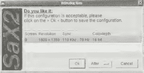

*图 7.1：初始介绍*

### 使用键盘控制鼠标

SaX2 启动后，您会看到屏幕右下区域有一个以白色高亮显示的字段，标签为：*您的鼠标不工作吗？* → *按数字键盘上的 5…* 如果您按照说明按（5），将出现如下窗口：

您无法在此窗口中执行任何操作。此图像仅供信息参考。它表示键盘上的数字小键盘，并描述哪些鼠标功能对应哪些按键。


*图 7.2：使用虚拟鼠标*

- 在图像中：按钮 1 对应 (◉) 键。此键激活鼠标左键。
- 在图像中：按钮 2 对应 (✕) 键。此键激活鼠标中键。
- 在图像中：按钮 3 对应 (—) 键。此键激活鼠标右键。
- 在图像中：**点击** 对应 ⑤ 键。此键触发一次使用先前激活的鼠标按钮的点击。如果没有激活任何鼠标按钮，则使用鼠标左键。点击之后，按钮激活状态将重置为默认状态。
- 在图像中：**双击** 对应 ⊕ 键。此键的作用类似 ⑤ 键，只是触发的是双击。
- 在图像中：**按钮锁定** 对应 ⓪ 键。此键的作用类似 ⑤ 键，只是触发单击并锁定它。
- 在图像中：**按钮释放** 对应 **Del** 键。此键释放由 ⓪ 键锁定的鼠标按钮。
- 在图像中：**左上箭头** 对应 ⑦ 键。此键将鼠标移动到左上角。
- 在图像中：**向上箭头** 对应 ⑧ 键。此键将鼠标垂直向上移动。
- 在图像中：**右上箭头** 对应 ⑨ 键。此键将鼠标移动到右上角。
- 在图像中：**向左箭头** 对应 ④ 键。此键将鼠标向左移动。
- 在图像中：**向右箭头** 对应 ⑥ 键。此键将鼠标向右移动。
- 在图像中：**左下箭头** 对应 ① 键。此键将鼠标移动到左下角。
- 在图像中：**向下箭头** 对应 ② 键。此键将鼠标垂直向下移动。
- 在图像中：**右下箭头** 对应 ③ 键。此键将鼠标移动到右下角。

### 更改配置

如果您选择了“更改配置”项，SaX2 的主屏幕将加载。如果已存在配置，SaX2 会在第一个对话框中提供加载这些数据的选项。所有必要信息都可以在 /etc/X11 目录下的 XF86Config 文件中找到。

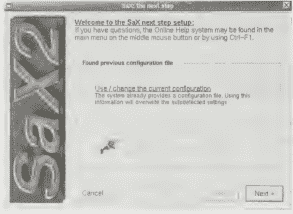

*图 7.3：加载配置*

> **注意**
>
> 如果您不确定是否应该加载现有配置，请继续到下一页而不加载它。

### 配置鼠标

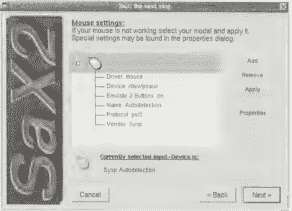

*图 7.4：鼠标配置*

如果不存在配置，SaX2 将从此对话框页面开始。否则，在关于加载现有配置的对话框页面之后，它会直接进入鼠标配置。

如果您的鼠标工作正常，则在此处无需进行任何操作。特殊输入设备的配置（例如设置绘图板或触摸屏）也在此屏幕中进行，但相关说明在第 141 页的*“进一步配置”*一节中。如果鼠标无法工作，请按照第 132 页*“使用键盘控制鼠标”*一节中的说明，使用键盘上的数字小键盘控制光标。如果您熟悉协议和鼠标连接方式，则应采用第 150 页*“常见问题与故障排除”*一章中描述的过程。

### 键盘配置

首先，检查语言设置。如果语言设置不正确，请相应修改该项，然后点击“应用”。现在，切换到“速度”选项卡，并在那里的测试字段中输入一些字符。如果并非所有字符都能正确显示，请转到“常规”选项卡并更改键盘类型。然后再次点击“应用”，以使更改生效。


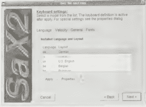

*图 7.5：键盘配置*

## 配置显卡

在此对话框中，对显卡进行设置。这里重要的是，你的显卡已被列出，并且已为该显卡定义了正确的驱动程序。

通常，你无需在此对话框中进行任何更改。如果你的系统安装了多块显卡，而只希望使用其中特定的一块，请单独选中你不想使用的显卡，然后单击“移除”。

## 配置显示器与分辨率

这里主要配置颜色和分辨率。在某些情况下，可能需要输入与显示器相关的规格参数，因为显示器并不总是能被自动检测到。

- **更改颜色和分辨率**
  
  单击“属性”。在第一个选项卡中，找到这两个相关字段。最上面的字段包含当前颜色深度。单击右箭头并选择所需的颜色深度。在分辨率字段中执行相同操作。

> **注意**
> 
> 选择或取消选择多个分辨率。分辨率将按选择的顺序使用。如果你不想使用某个分辨率，请取消选择它。

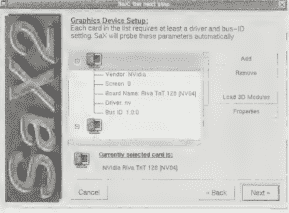

*图 7.6：显卡配置*

### 更改显示器属性

选择颜色和分辨率后，切换到“显示器”选项卡。

如果显示器已被检测到，它会被预先选中。如果这正是你想要的选项，则无需做任何其他操作。如果没有选择显示器，或者只选中了“兼容 VESA 的显示器”，请从提供的列表中选择合适的显示器型号。如果显示器不在列表中，请切换到“频率”选项卡，并在相应字段中输入适合你的显示器的*水平*和*垂直*偏转频率范围。

相应的频率值可在显示器制造商提供的手册中找到。关闭属性窗口，然后继续下一项。

### 测试并保存配置

在最后一个对话框中单击“完成”后，将出现一个参考显示窗口，你可以在其中进行以下选择。

- “取消”——中止刚才所做的更改。返回上一屏幕。
- “保存”——保存配置。之后，系统会询问你是否要退出 SaX2。

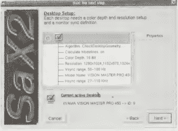

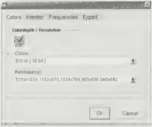

- **“开始”**——启动另一个应用新设置的 X 服务器，并让你有机会将图像的位置和大小调整到新环境。请参阅对页的*调整图像几何*一节。

如果在配置过程中修改了显示器或分辨率设置，建议启动测试 X 服务器，以便在需要时调整图像。如果没有添加新的硬件组件，则无需重新启动测试 X 服务器即可应用所有其他设置。

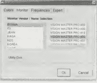

*图 7.9：显示器选择*

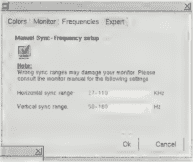

*图 7.10：手动频率选择*

### 调整图像几何

SaX2 提供了一个名为 XFine2 的独立应用程序。每当图像的位置或大小被修改时，该应用程序都会启动。单击“保存”后，对图像几何所做的更改会合并到当前配置中。在 SaX2 中，通常有两种方式启动 XFine2：

- **启动测试 X 服务器时加载 XFine2**
  
  在这种情况下，如果单击“保存”或“取消”，测试 X 服务器将退出；根据你的选择，更改要么保存到图像几何中，要么被丢弃。退出测试 X 服务器后，你将返回 SaX2。测试 X 服务器*完全独立于* SaX2 本身所使用的 X 服务器运行。如果你单击了“保存”，测试 X 服务器显示的属性将被保存，但不会传输到运行 SaX2 本身的 X 服务器。

- **通过菜单项“调整”启动 XFine2**

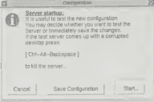

*图 7.11：完成配置*

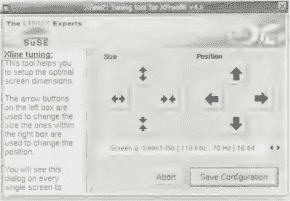

*图 7.12：调整图像几何*

在这种情况下，如果单击“保存”或“取消”，SaX2 将退出，你将返回文本模式。只有在先单击“保存”后，对图像几何所做的更改才会被保存。

若要稍后在图形用户环境的运行过程中进行更改，可随时手动调用 XFine2。为此，只需输入命令 `xfine2`。

## 启动图形界面

保存配置并退出 SaX2 后，你将再次回到文本模式，并可从那里切换到图形登录级别。为此，请使用命令 `init 5`。现在你可以通过图形方式登录系统。进行图形登录后，图形用户环境将自动启动。

## 更多配置

以下章节旨在提供启发，并作为 X11 增强配置的简要说明。对于这些配置，我们无法以免费安装支持的形式提供任何帮助。

### 关于键盘的补充说明

与其它输入设备不同，键盘这一主题并不适合进行同样深入的讨论，因为你通常不需要对键盘进行任何特殊配置。

在特定情况下，以下应用程序和文件可能会有用。xkeycaps（软件包 `xkeycaps`，系列 `xap`）可让你实时查看当前对键盘布局所做的更改，或测试不同的设置。将对单个字符和符号的更改永久保存到 `~/.Xmodmap` 文件中。有关此文件的结构，请参阅 `xmodmap` 的手册页（`man xmodmap`）。

KDE 提供了 `kikbd` 工具（“国际化键盘布局”）。它让你可以轻松地在各种键盘布局之间来回切换。例如，当你需要西班牙语或德语中的特殊字符时，这会很有用。使用“国际化键盘布局”编写带有特殊字符的外语时，请注意，许多 X 应用程序只识别与你在本地配置的国家/地区字符设置相对应的字符。如果是这种情况，其它字符将被忽略。因此，正确配置“区域设置”也是必要的。这可以通过*在启动应用程序之前*将环境变量 LANG 重置为所需的国家/地区设置来完成。有关所有可能的选项，请参阅 `locale` 的手册页（`man locale`）。

### 自动配置（笔记本电脑）

如果你使用的是笔记本电脑，由于笔记本电脑具有特殊的硬件属性，在许多情况下配置会更加简单。在典型场景中，笔记本电脑使用其预先指定的内置显示器——LCD/DSTN 或 TFT 矩阵显示屏。

SaX2 会识别显示器的大小。只需输入命令：

```
sax2 -a
```

SaX2 将开始硬件检测并自动创建配置，无需你进行任何额外输入。此命令运行完成后，请按照上一页*启动图形界面*一节的说明启动图形环境。

### 重新配置（快速路径）

当前版本的 SaX2 允许你在运行的图形用户环境中调整当前配置的某些方面。为此，提供了“快速路径”（FastPaths）。SaX2 目前实现以下快速路径：

1. **鼠标** 输入设备的配置，特别是鼠标
2. **键盘** 键盘和字体配置
3. **桌面** 颜色和分辨率配置
4. **布局** 各种屏幕的排列配置（仅适用于多显卡配置）

例如，要在正在运行的会话中更改鼠标配置，请输入：

```
sax2 -F mouse
```

这将导致 SaX2 不启动硬件识别，而是加载现有配置并显示相应的对话框。进行任何更改后，必须重新启动 X 服务器，这些更改才能生效。

### 多显卡

XFree86 版本 4 支持多块显卡。这被称为“多显卡环境”。当你的系统中有多块显卡时，SaX2 会自动识别，并相应地进行配置。配置仅限于两个方面：

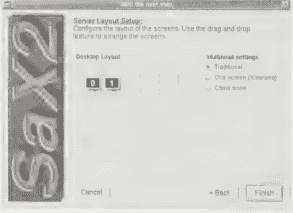

*图 7.13：调整显示器排列*


## 选择多头显示类型

SaX2 区分三种多头显示环境：

1. “传统多头显示”——每个显示器都被视为一个独立的显示单元
2. “Xinerama 化多头显示”——所有显示器合并为一个大的显示区域
3. “克隆多头显示”——只有一个显示内容，其他所有显示器都显示其完全相同的内容

## 定义多头布局

多头环境的布局是指各显示器之间的排列与配对关系。SaX2 通常按照显卡被检测到的顺序创建默认布局，即将所有显示器从左到右排成一条直线。你可以用鼠标左键将相应的屏幕（在布局对话框中显示为图标）拖动到新位置，从而修改此布局。

完成布局对话框后，点击“启动”来测试新的配置——但你应该注意，图像的几何参数只能在“传统多头显示”模式下修改，因为只有该模式下各显示器才是相互独立的。建议按以下步骤操作：

1. 按照上述说明定义新布局。
2. 将多头显示类型设置为“Traditional”（传统）。
3. 点击“完成”，然后点击“启动”。
4. 调整图像几何参数以适配所有显示器，并保存此状态。
5. 当系统提示是否结束 SaX2 时，回答“否”。
6. 设置你偏好的多头显示类型。
7. 点击“完成”，然后点击“保存”。
8. 当系统询问是否结束 SaX2 时，确认“是”。

Linux 目前不支持在多头显示环境下使用 3D 加速。在这种情况下，SaX2 将停用 3D 加速支持。

## 数位板

目前，XFree86 仅支持 Wacom 数位板。SaX2 提供 USB 和串口配置。遗憾的是，目前还无法自动检测并设置连接到系统的数位板。从配置角度看，数位板被视为一种输入设备——就像鼠标一样。建议按以下步骤操作：

1. 启动 SaX2 并切换到鼠标配置对话框。
2. 点击“添加”并添加一个数位板。
3. 用同样的方式，为数位板添加压感笔。请注意，笔和橡皮擦被视为两个独立设备。
4. 测试所有已添加到串口数位板的设备的连接情况：`/dev/ttyS0` 表示第一个串口，`/dev/ttyS1` 表示第二个，以此类推。
5. 保存配置。测试配置是可选的。

## 触摸屏

目前，XFree86 支持 Microtouch 和 Elographics 触摸屏。不过，SaX2 只能自动检测显示器，无法检测触摸屏。触摸屏同样被视为鼠标类设备，因此在 SaX2 的鼠标对话框中进行配置。建议按以下步骤操作：

1. 启动 SaX2 并切换到鼠标配置对话框。
2. 点击“添加”按钮并添加一个触摸屏。
3. 保存配置。测试配置是可选的。

触摸屏具有诸多选项，通常需要先进行校准。遗憾的是，Linux 中目前没有可用的校准工具。不过，你可以在 SaX2 中添加触摸屏时，在“高级”选项卡下定义屏幕尺寸比例。这些尺寸在很大程度上取决于所使用的硬件。

## X 服务器日志文件

为了分析 X 服务器的问题，X 服务器在启动时会创建一个非常详细的日志。该文件由 XFree86-4.0 X 服务器按照以下模式创建：`/var/log/XFree86.Display.Screennumber.log`。如果你只启动了一个 X 服务器（通常情况下），且该显示被分配为编号“0”，则该日志文件的文件名通常是 `/var/log/XFree86.0.log`。请注意，SaX2 在这里是一个例外：它至少会临时运行两个 X 服务器（Display :0）用于配置对话框，随后再运行第二个（Display :1）来测试设置。

与 XFree86-3.3.x 相比，此文件的格式发生了巨大变化。现在对信息消息、取自配置文件的数值、来自计算机硬件的数据以及警告和错误进行了更清晰的区分。

SaX2 允许你通过鼠标中键查看 X 服务器日志文件。在这里，不同类型的消息（错误、信息、警告等）以不同颜色显示。这有助于你在 X 服务器无法启动时快速定位问题。

通常，此类日志文件的开头如图 11 所示。

```text
XFree86 Version 4.0 / X Window System
(protocol Version 11, revision 0, vendor release 6400)
Release Date: 8 March 2000
        If the server is older than 6—12 months, or if your card is
        newer than the above date, look for a newer version before
        reporting problems.  (see http://www.XFree86.Org/FAQ)
Operating System: Linux 2.2.13 i686 [ELF] SuSE
Module Loader present
(==) Log file: "/var/log/XFree86.0.log", Time: Sat May 20 13:42:15 2000
(==) Using config file: "/etc/X11/XF86Config"
Markers: (--) probed, (**) from config file, (==) default setting,
         (++) from command line, (!!) notice, (II) information,
         (WW) warning, (EE) error, (??) unknown.
(==) ServerLayout "Layout[all]"
(**) |-->Screen "Screen[0]" (0)
(**) |-->Monitor "Monitor[0]"
```

*图 11：摘自 X 服务器日志文件*

这提供了以下信息：

这是一个 XFree86 4.0 版本的 X 服务器，兼容 X11R6.4 “vendor release 6.4.0”。发布日期为 2000 年 3 月 8 日。`Operating System: Linux 2.2.13 i686 [ELF] SuSE` 这一行指的是 X 服务器编译时所使用的系统。因此，内核版本和 CPU 定义可能与你自己系统的不同。

在这些版本消息之后，会出现 X 服务器启动时创建的首批日志条目。首先，这日志文件是否正确？在 `Time:` 旁边，指定了日志文件的创建时间。有时你可能正在查找错误的日志文件。

配置文件也是如此。如果你没有在命令行指定其他文件，那么在普通的 SuSE Linux 系统上，它始终是 `/etc/X11/XF86Config`。

下面的表 7.1 解释了其他行开头两个括号字符的含义：

| 符号 | 含义 |
|---|---|
| (==) | X 服务器的默认设置 |
| (--) | 通过自动硬件检测从系统中获取的值。 |
| (**) | 在配置文件中固定的设置。 |
| (++) | 在命令行输入的参数。 |
| (!!) | 此处，X 服务器会在详细说明它正在“做什么”。 |
| (II) | X 服务器模块的版本号等通常记录为“信息消息”。 |
| (WW) | 警告：此处 X 服务器会告诉你，它为什么没有执行配置文件中指定的某些操作，或那些本应默认激活的操作。 |
| (EE) | 错误！这些消息会取消启动过程或导致 X 服务器崩溃。如果 X 服务器无法启动，请注意日志文件中以 (EE) 开头的行。你通常可以通过查看这些消息自行修复大多数错误。 |

*表 7.1：X 服务器日志文件中的消息类型*

如果在启动 SaX2 或进行配置步骤时发生任何意外情况，所有与 SaX2 相关的错误和步骤都会记录在 `/var/log/SaX.log` 文件中。X 服务器错误则如上所述记录在 `/var/log/XFree86.0.log` 文件中。通过这些文件，你可以找到继续处理的线索。

## 启动 X Window 系统

X Window 系统使用 `startx` 命令启动。系统为所有用户提供了一个预配置的 KDE 窗口管理器 GUI。我们建议使用普通用户账户（而非 root）启动 X Window 系统。X11 服务器的错误消息保存在 `~/.x.err` 文件和 `/var/log/XFree86.0.log` 中。`startx` 命令有一些选项。例如，你可以通过输入 `startx -- -bpp 16` 来选择 16 位色深。

## 常见问题与故障排除

1. **如何检测已安装的显卡？**

   如果你不知道系统上安装的是什么显卡，可以使用 `sax2 -p` 查询系统上已安装并受支持的所有显卡列表。

2. **如何加快 SaX2 的启动速度？**

   如果在 SaX2 上次启动后硬件没有改动，可以使用 `sax2 -q` 命令显著加快启动速度。在这种情况下，不会进行硬件检测。该选项在重新配置时尤其有用。如果你是通过 fastpath 启动 SaX2 的，请不要使用 `-q` 选项，因为 fastpath 会自动设置该选项。

3. **如果显卡不受支持怎么办？**

   如果显卡的图形芯片组没有对应的驱动程序，你仍然可以使用显卡的帧缓冲。其优点是，它几乎能与任何现代显卡以及几乎所有笔记本电脑良好配合。由于在没有驱动程序的情况下需要绕过显卡的图形控制器，显示反而会加速。X 服务器只需在启动内核时已经切换到图形模式后，直接访问帧缓冲即可。

   其工作方式如下：Linux 内核在启动时加载显卡的 VGA BIOS，并指示它切换到给定的 VESA 图形模式。文本控制台将以此配置的图形模式显示。遗憾的是，VGA BIOS 是以 16 位代码编写的，因此无法在运行中的 Linux 系统中加载。因此，在启动时确定的视频模式将一直保持到关机。

   要使用此 VESA 帧缓冲，内核必须提供支持，并且在启动时需要选择图形模式。SuSE Linux 内核当然包含 VESA 帧缓冲支持。在系统启动时选择你所需的图形模式。在 LILO 启动提示符处传递参数 `vga=x`，其中 x 代表从下一页的表 7.2 中获取的值。


| 首选颜色深度 | 640×480 | 800×600 | 1024×768 | 1280×1024 |
|---|---:|---:|---:|---:|
| 256（8位） | 769 | 771 | 773 | 775 |
| 32768（15位） | 784 | 787 | 790 | 793 |
| 65536（16位） | 785 | 788 | 791 | 794 |
| 1670万（24位） | 786 | 789 | 792 | 795 |

*表7.2：可用的VESA模式*

或者，可以在`/etc/lilo.conf`文件中明确将其作为vga参数指定。此值不会并入append行，而是直接以`vga=x`的形式写入配置文件。

启动Linux系统后，请再次以root用户登录，并按如下方式启动SaX2：

```
earth:/root # sax2 -m 0=fbdev
```

请注意，0是数字零，而不是大写字母O。这会指示X服务器使用该驱动程序作为帧缓冲。由于分辨率、颜色深度和图像刷新率都已严格定义，如果你对鼠标和键盘设置感到满意，可以让SaX2立即保存自动检测到的数据，然后再次退出SaX2。

### 4. 配置结果保存在哪个文件中？

整个X11配置存储在名为`XF86Config`的文件中。请在该文件路径`/etc/X11/XF86Config`下查找。

### 5. 如果显卡受支持但SaX2无法识别怎么办？

在极少数情况下，你可能会有一张受XFree86支持但SaX2无法识别的显卡。此时，需要使用命令`sax2 -m 0=<driver>`指定该显卡支持的驱动模块名称。选项-m将数字分配给驱动程序名称。例如，如果要将nvidia模块分配给始终编号为0的主显卡，命令应为`sax2 -m 0=nvidia`。所有驱动模块的完整列表可在`http://www.xfree86.org/4.1.0/Status.html`找到。

### 6. 如果SaX2在测试X服务器时崩溃怎么办？

在少数情况下，配置完成后进行X服务器测试时，SaX2甚至整个系统可能会崩溃。这通常意味着驱动程序有缺陷，只有在同时启动多个X服务器时才显得重要。为防止这种情况，请按以下步骤操作：

- 保存配置但不测试X服务器
- 通过`startx`或图形登录方式启动X11系统
- 如果图像几何形状不正确，以`root`用户身份启动`xvidtune`程序并调整图像。

### 7. SaX2启动了YaST2。为什么？

在某些情况下，SaX2会意识到，如果不更新或安装软件，就无法执行所请求的配置。如果是这样，SaX2将启动YaST2来更新已安装的软件或安装缺失的软件。

### 8. 抗锯齿在多头环境中不起作用

抗锯齿支持主要影响链接到Qt库的应用程序，只有在所有驱动程序都支持RENDER扩展的情况下，它才能在多头环境中正常工作。使用`xdpyinfo`程序可以检查RENDER扩展是否在所有显示器上激活。

### 9. 支持请求中应包含哪些内容？

如果您想就SaX2的问题咨询支持人员，在请求中附上最新的日志文件至关重要。该文件按以下方式生成：

- (a) 不带参数运行SaX2。如果SaX2启动，请使用`(Ctrl) + (Alt) + (←)`退出应用程序。
- (b) 当前日志文件将位于`/var/log/SaX.log`中。

### 10. 没有鼠标光标，只有条形码或彩色方块。

有时鼠标已激活，但鼠标指针不可见，或仅显示为方块。可以通过在`/etc/X11/XF86Config`文件的Device部分添加以下行来修复此错误：

```
Option "sw_cursor"
```

### 11. 图像太小或被压缩。可用的显示器设置已达到其极限。

- (a) 图像刷新率和水平同步频率设置过高，已达到显示器极限。要解决此问题，请降低垂直同步或水平同步频率。
- (b) 使用`xvidtune`程序移动图像。可能其中一种模式不太合适。
- (c) 将参数`+hsync +vsync`附加到模式行，并尝试将`+`替换为`-`。

### 12. 如果鼠标无法正常工作怎么办？

鼠标通过其连接的端口以及定义数据格式的协议来识别。如果SaX2无法识别鼠标，可以使用小键盘上的模拟功能来操作鼠标。否则，运行SaX2并指定鼠标连接及其协议的正确数据。启动SaX2时将这些数据传递给它的命令是`sax2 -t <protocol> -n <connection>`。表7.3显示了各种鼠标协议。

| 协议 | 鼠标类型 |
|---|---|
| PS/2 | 带PS/2接口的2键或3键鼠标。 |
| IMPS/2 | ADB鼠标、USB鼠标或滚轮鼠标，具有3个或更多按键以及一个或多个滚轮，连接到USB端口。 |
| Microsoft | 连接至串口的2键（有时为3键）鼠标。 |
| MouseSystems | 串口上的3键鼠标。 |
| Intellimouse | 连接至串口的滚轮鼠标，具有3个或更多按键以及一个或多个滚轮。 |
| Auto | 自动检测串口鼠标。 |

*表7.3：鼠标及其协议*

有关所支持鼠标的更精确描述，可在文件`/usr/X11R6/lib/X11/doc/README.mouse`中找到。

### 13. 在X中通过GPM使用鼠标

GPM具备充当“中继器”的功能。在这种情况下，GPM通过`/dev/gpmdata`设备提供鼠标数据。通过在`/etc/sysconfig/mouse`文件的`GPM_PARAM`变量中的GPM参数后添加`-R`选项，即可启用中继器选项。通过命令`rcgpm restart`，GPM现在仅作为中继器运行。为了在X中也通过GPM使用鼠标，请使用以下命令启动SaX2：

```
sax2 -g
```

### 14. 移动窗口会留下杂散标记、窗口碎片或其他残影。它们在我停止移动后也不会消失。我只能通过刷新桌面来去除它们。该怎么办？

- (a) 降低图像刷新率或分辨率。
- (b) 根据你的芯片组，应用`/usr/X11R6/lib/X11/doc/`中README文件里的相关选项，例如`fifo_conservative`或`slow_dram`。这取决于图形芯片组。
- (c) 选项`noaccel`、`no_imageblt`或`no_bitblt`可能就足够了。

### 15. “噪点”——移动窗口或观看视频时出现的图像失真——当图像内容静止时消失。

- (a) 降低图像刷新率、颜色深度或分辨率。
- (b) 降低显卡的时钟速度，或者移除或添加等待状态。有时可以使用`set_mclk`实现（但并非对所有芯片组都有效）。在README目录中查看更多信息。*警告：*此选项有风险（显卡可能会进入超频状态）。
- (c) 总线也可能处于超频状态。检查PCI/VLB或ISA总线的总线速度。

### 16. 启动XFree86时屏幕变黑。

- (a) 降低刷新率。
- (b) 检查计算机的BIOS设置。禁用BIOS的任何“优化设置”。你可能需要查阅主板手册。常见问题因素包括显示内存缓存模式选项、AGP孔径大小，以及控制PCI总线访问的任何选项，如PCI对等并发。你几乎总能在标记为“Advanced Chipset Features（高级芯片组功能）”的菜单中找到这些设置。
- (c) 考虑其他可能的原因：检查系统是否存在IRQ冲突（例如PS/2鼠标需要IRQ 12）。

### 17. 使用xf86config进行配置

如果您的X11系统无法使用SaX2进行配置，可以使用一个非常简单的基于文本的工具`xf86config`来完成此操作。以root用户身份执行命令`xf86config`即可启动它。

## 使用xf86config进行配置

在大多数情况下，作为简单的配置工具，XF86Setup优于xf86config。然而，在一些极少数情况下，XF86Setup会失败。如果出现这种情况，只需使用xf86config，它几乎总是有效的。

XFree86-4.0包含一个类似的基于文本的程序xf86config。在某些地方，它包含一些稍微修改过的对话框，当然，它会将配置文件写入`/etc/X11/XF86Config`。然而，在XFree86-4.0中，通常不需要使用xf86config，因为“问题”显卡也可以使用帧缓冲或vga模块进行配置，如第147页的FAQ和故障排除部分所述。

请确保你已掌握以下信息：

- 鼠标类型、鼠标连接的端口以及波特率（波特率通常可选）
- 显卡规格
- 显示器数据（频率等）

如果已知这些设置，或者你手边有手册，就可以开始配置。请记住，你必须以root身份才能执行此操作。
配置通过以下命令启动：

```
earth:/root # /usr/X11R6/bin/xf86config
```

### 鼠标

在欢迎屏幕之后，系统会询问你的鼠标类型。你将看到以下选项：

- 1. Microsoft兼容（2键协议）
- 2. Mouse Systems（3键协议）
- 3. 总线鼠标
- 4. PS/2鼠标
- 5. Logitech鼠标（串口，旧式，Logitech协议）
- 6. Logitech MouseMan（Microsoft兼容）
- 7. MM系列
- 8. MM HitTablet

*输出5：X的鼠标选择*

在选择鼠标时，请记住，许多新型Logitech鼠标要么兼容Microsoft，要么使用MouseMan协议。“总线鼠标”选项指的是任何总线鼠标，包括Logitech。


Selection is made by entering the relevant number. There may be a question as to whether to activate “ChordMiddle”. This is necessary for some Logitech mice or trackballs for activation of the middle mouse button.

Please answer the following question with either 'y' or 'n'.  
Do you want to enable ChordMiddle?  
If you have a two-button mouse, emulate the third button by answering 'y' to the next question.

Please answer the following question with either 'y' or 'n'.  
Do you want to enable Emulate3Buttons?  
The middle button is enabled by simultaneously pressing the two mouse buttons.

Next you must specify the mouse's interface:

```
Now give the full device name that the mouse is connected to, for example:
/dev/tty00. Just pressing Enter will use the default, /dev/mouse.
```

If you have already entered a port for your mouse during the system installation, just enter /dev/mouse.

## Keyboard

Next you are asked whether to assign Meta (ESC) to the left Alt key and to assign ModeShift (AltGr) to the right Alt key.

Please answer the following question with either 'y' or 'n'.  
Do you want to enable these bindings for the Alt keys?  
If you answer 'y', the left Alt key can serve as the meta key for Emacs and the keys that need ModeShift (AltGr) can be entered.

## Monitor

Next, specify your monitor. Be extremely careful with vertical and horizontal frequencies. These values can be found in your monitor manual.

> **Caution**
>
> Setting frequencies incorrectly can lead to irreparable damage to your monitor. The X Window System only addresses video modes that operate the monitor in the given frequency range. Entering frequencies for which the monitor was not designed can cause severe damage to it.

Some monitors are listed under /usr/X11R6/lib/X11/doc/Monitors. (However, we cannot be held liable if this information is inaccurate.)  
To enter the horizontal frequency, the following selection is displayed:

| Choice | Hsync in kHz | Monitor type with characteristic modes |
| --- | --- | --- |
| 1 | 31.5 | Standard VGA, 640x480 @ 60 Hz |
| 2 | 31.5 - 35.1 | Super VGA, 800x600 @ 56 Hz |
| 3 | 31.5, 35.5 | 8514 Compatible, 1024x768 @ 87 Hz interl. (no 800x600) |
| 4 | 31.5, 35.15, 35.5 | Super VGA, 1024x768 @ 87 Hz interl., 800x600 @ 56 Hz |
| 5 | 31.5 - 37.9 | Extended Super VGA, 800x600 @ 60 Hz, 640x480 @ 72 Hz |
| 6 | 31.5 - 48.5 | Non-Interlaced SVGA, 1024x768 @ 60 Hz, 800x600 @ 72 Hz |
| 7 | 31.5 - 57.0 | High Frequency SVGA, 1024x768 @ 70 Hz |
| 8 | 31.5 - 64.3 | Monitor that can do 1280x1024 @ 60 Hz |
| 9 | 31.5 - 79.0 | Monitor that can do 1280x1024 @ 74 Hz |
| 10 | Enter your own horizontal sync range | |

Enter your choice (1-10):

*Output 6: Input of Horizontal Frequencies of the Monitor*

You should only choose one of the predefined modes if you are unsure of the settings for your monitor. Selection '10' allows you to enter your own frequencies.  
The next screen asks you to enter your monitor's vertical frequency. It will also provide a selection:

| Choice | Vertical sync range |
| --- | --- |
| 1 | 50-71 |
| 2 | 50-90 |
| 3 | 50-100 |
| 4 | 40-150 |
| 5 | Enter your own vertical sync range |

Enter your choice (1-5):

*Output 7: Detailed Vertical Frequencies*

Again, using the known values is preferable to using one of the items '1' to '4'.  
Next, enter a name, vendor name, and model for your monitor:

```
Enter an identifier for your monitor definition:
Enter the vendor name of your monitor:
Enter the model name of your monitor:
```

These are just descriptive names used to document your configuration, which do not affect the configuration itself. Merely pressing ↵ will select the default values, which are usually sufficient.  
Your monitor configuration is now complete.

## Graphics Cards / X server

Next, you must specify your graphics card:

*Do you want to look at the card database?*

If you enter 'y', a selection of predefined cards is presented. Here, select your card by pressing the corresponding number. Do not trust this list blindly, since there can be differences in clock chip and RAMDAC³ settings.

This is why a menu item appears later for selecting a RAMDAC and a clock chip, even though you have entered them already. Then the predefined settings for this card will be presented as an extra option.

The card definitions contain information on clock chips, RAMDAC, and the X server to be used. Furthermore, some valuable information concerning the card is written to the device section in XF86Config.

If your card is not listed, do not panic. Switch back to the normal configuration by selecting 'q'. Only select one of the defined cards if it matches your card exactly. Selecting a card with a similar name is not recommended. Similar names do not necessarily refer to similar hardware.

More information on how to configure your card is given in chapter *Section Optimizing the Installation of the X Window System* on page 160.

After specifying your card, the X server is next.

1. The XF86_Mono server. This is a monochrome server that should work on any VGA-compatible card, in 640x480 (more on some SVGA chip sets).
2. The XF86_VGA16 server. This is a 16 color VGA server that should work on any VGA-compatible card.
3. The XF86_SVGA server. This is a 256 color VGA server that supports a number of SVGA chip sets. It is accelerated on some Cirrus and WD chip sets. It supports 16 and 32-bit color on certain Cirrus configurations.
4. The accelerated servers. These include XF86_S3, XF86_Mach32, XF86_Mach8, XF86_8514, XF86_P9000, XF86_AGX, XF86_W32, and XF86_Mach64.

These four server types correspond to the four different "Screen" sections in XF86Config (vga2, vga16, svga, accel).

5. Choose the server from the card definition, XF86_S3.

Which one of these four screen types do you intend to run by default (1–4)?

### Output 8: Selecting the X Server

1. A server for monochrome (b/w) monitors. This should run on any VGA-compatible graphics card and at least offer a resolution of 640x480.
2. 16 color server XF86_VGA16. Should run with any VGA-compatible card.
3. SVGA server XF86_SVGA. This server supports a wide variety of SVGA cards. Graphics acceleration is used with some Cirrus or WD cards. The 16- or 32-bit color mode can be activated with some Cirrus cards.
4. Server for accelerated cards (see below).
5. This item only exists if you have entered a card definition in the previous selection. Here, the server is selected (default) that suits the selected card.

When you have selected a server, you are asked if you want to create a symbolic link to /usr/X11R6/bin/X. If you answer with 'y', you are asked whether you want to put it in /var/X11R6/bin/X.

Do you want to set it in /var/X11R6/bin?  
Reply with 'y', since it may not always be possible to write to /usr tree.

Afterwards, if you have selected '4' (the accelerated servers) in the previous selection, a menu is presented of all available accelerated X servers.

Select an accel server:

| Choice | Server |
| --- | --- |
| 1 | XF86_S3 |
| 2 | XF86_Mach32 |
| 3 | XF86_Mach8 |
| 4 | XF86_8514 |
| 5 | XF86_P9000 |
| 6 | XF86_AGX |
| 7 | XF86_W32 |
| 8 | XF86_Mach64 |

Which accel server:

These servers support each card listed above. To create links, the appropriate server must already be installed. This means that you must already have selected the correct server during the installation of your X Window System. After selecting your X server, configure your graphics. First, specify the amount of memory the video card has.

How much memory do you have on your graphics card:

| Choice | Memory |
| --- | --- |
| 1 | 256K |
| 2 | 512K |
| 3 | 1024K |
| 4 | 2048K |
| 5 | 4096K |
| 6 | Other |

Enter your choice:

### Output 9: Specifying the Video Memory

Next, enter the name, vendor name, and type for your graphics card. If you earlier selected a card from the predefined list, pressing `↵` will enter this as the default.

```
Enter an identifier for your graphics card definition:

Enter the vendor name of your graphics card:

Enter the model (board) name of your graphics card:
```

If you chose an accelerated X server, you must enter the RAMDAC settings. This only applies to the S3 and AGX servers.

| Choice | RAMDAC | Identifier |
| --- | --- | --- |
| 1 | AT&T 20C490 (S3 server) | att20c490 |
| 2 | AT&T 20C498/21C498/22C498 (S3) | att20c498 |
| 3 | AT&T 20C505 (S3) | att20c505 |
| 4 | BrookTree BT481 (AGX) | bt481 |
| 5 | BrookTree BT482 (AGX) | bt482 |
| 6 | BrookTree BT485/9485 (S3) | bt485 |
| 7 | Sierra SC15025 (S3, AGX) | sc15025 |
| 8 | S3 GenDAC (86C708) (autodetected) | s3gendac |
| 9 | S3 SDAC (86C716) (autodetected) | sdac |
| 10 | STG-1700 (S3) | stg1700 |
| 11 | TI 3020 (S3) | ti3020 |
| 12 | TI 3025 (S3) | ti3025 |
| 13 | TI 3020 (S3, autodetected) | ti3020 |
| 14 | TI 3025 (S3, autodetected) | ti3025 |
| 15 | TI 3026 (S3, autodetected) | ti3026 |
| 16 | IBM RGB 514 (S3, autodetected) | ibm_rgb514 |
| 17 | IBM RGB 524 (S3, autodetected) | ibm_rgb524 |
| 18 | IBM RGB 525 (S3, autodetected) | ibm_rgb525 |
| 19 | IBM RGB 526 (S3) | ibm_rgb526 |
| 20 | IBM RGB 528 (S3, autodetected) | ibm_rgb528 |
| 21 | ICS5342 (S3, ARK) | ics5342 |
| 22 | ICS5341 (W32) | ics5341 |
| 23 | IC Works wc30516 ZoomDac (ARK) | zoomdac |
| 24 | Normal DAC | normal |

### Output 10: Setting RAMDACs

It is usually best to press `↵` and not make any custom selections. If you specified a graphics card that supports a given RAMDAC setting, it will be included in the selection list.

³ Random Access Memory Digital-to-Analogue Converter.


回答这些问题后，如果你有的话，可以为加速卡输入一个时钟芯片。输入时钟芯片可以避免时钟线，因为所需的时钟可以被编程。

- 1. Chrontel 8391 — `ch8391`
- 2. ICD2061A 及兼容型号 (ICS9161A, DCS2824) — `icd2061a`
- 3. ICS2595 — `ics2595`
- 4. ICS5342 (类似于 SDAC，但不完全兼容) — `ics5342`
- 5. ICS5341 — `ics5341`
- 6. S3 GenDAC (86C708) 及 ICS5300 (自动检测) — `s3gendac`
- 7. S3 SDAC (86C716) — `s3_sdac`
- 8. STG 1703 (自动检测) — `stg1703`
- 9. Sierra SC11412 — `sc11412`
- 10. TI 3025 (自动检测) — `ti3025`
- 11. TI 3026 (自动检测) — `ti3026`
- 12. IBM RGB 51x/52x (自动检测) — `ibm_rgb5xx`

## 输出 11：设置时钟芯片

如果选择了没有时钟芯片的卡，只需按 **[Enter]**（从而未选择时钟芯片）。如果已选择卡，则时钟芯片将被设为默认值（如果有的话）。

如果未设置时钟芯片，xf86config 会建议运行 X -probeonly 以确定支持的时钟时序。这些内容会自动写入 XF86Config 中的单独时钟行。

这里，我们必须解释为什么自动定义设置可能 **非常危险**：如果卡具有可编程时钟芯片，X 服务器在探测时无法区分不同的时钟，只能识别时钟 0、1，有时还有 2。所有其他值或多或少都是随机数（通常，时钟 0、1 和 2 会重复并被零替换）。

除 0 和 1 之外的所有时钟都受预编程时钟芯片的强烈影响。因此，时钟 2 在探测时（并写入文件 XF86Config）可能具有不同的设置，而当 X 服务器稍后启动时则不同。然后所有时序都会错误，显示器可能会严重损坏。

可编程时钟芯片（以及可能带来的问题）的一个良好迹象是多个零或重复的时序值。绝对地，在任何情况下，永远不要将此类值写入 `XF86Config`。

要配置时钟芯片，请按照以下步骤操作：

- 最好的方法是如果有的话输入一个现有的 *(可编程)* 时钟芯片。它将根据你的 `XF86Config` 进行编程，并且不包含时钟行。将卡上的芯片与菜单中提供的芯片进行比较。大多数较新的 S3 卡都有可编程时钟芯片。

- 如果你没有可编程时钟芯片，你应该启动 X-probeonly 并将这些值与手册中的值进行比较。如果这些值对应（±2），请将它们输入 `XF86Config`。

    除非手册提供一些相关建议，否则这些值是通过运行 X-probeonly 确定的（这在未加载的机器上效果最好）。检查这些值是否准确，因为并非每张卡的时钟值都能确定。（多个零或重复值是设置无效的标志。）将正确的值输入 `XF86Config`。不要省略任何值。不要尝试重新排列它们或以任何方式更改它们。值必须按其确切顺序输入。

    如果使用 P9000 服务器，顺序无关紧要；只需将所需时钟的模式输入 *clocks line* 即可。

- 总之：如果有可编程时钟芯片，`XF86Config` 中不应有 clocks 行（例外，P9000）。对于没有可编程时钟芯片的卡，`XF86Config` 中应有 clocks 行。这避免了每次启动时繁琐（有时甚至有风险）的时钟探测。此外，对于值不可读的卡，没有无效值，也不会对显示器造成风险。

在阅读了上一节后，如果你想让时钟自动识别，只需回答以下问题的 ‘y’ 即可：

> 你现在想要我运行 “X -probeonly” 吗？

现在屏幕会变黑，然后探测到的时钟列表才会出现，或者会出现找不到时钟的消息。如果你已选择时钟芯片，此问题将不会出现，因为时钟将被自动编程。如果是这种情况，本节将被跳过。

> **警告**
>
> 如果上一个问题已回答为 ‘y’ 且屏幕在 30 秒以上仍保持黑色，请立即使用 `Ctrl` + `Alt` + `F1` 或 `Ctrl` + `C` 取消测试。如果这不起作用，请关闭显示器和计算机以防止硬件损坏。

## 保存你的配置

现在写入配置文件。建议将其写入 /etc/XF86Config，以确保即使在网络环境中，每台机器都有自己的配置文件——即使它们共享 /usr 文件系统。在此指定 `/etc/XF86Config`。这包括 xf86config 和 X Window System 的配置。

## 优化 X Window System 的安装

本节描述配置文件 `/etc/X11/XF86Config`。每个部分都以关键字 `Section <name of section>` 开始，以 `EndSection` 结束。下面是对最重要的部分的粗略概述。

之后，学习如何集成额外的字体，如何配置输入设备，以及 3D 加速是如何实现的。这也由 XF86Config 文件中的某些部分管理，当然，集成额外字体需要外部程序的帮助，这些程序随 SuSE Linux 提供或属于默认安装。这里讨论的方法旨在说明可用的可能性并作为激励，但并不声称涵盖所有情况。

程序 SaX2 和 xf86config（用于 XFree86-4.0）默认在 `/etc/X11` 中创建文件 XF86Config。这是 X Window System 的主要配置文件。这里可以找到有关你的显卡、鼠标和显示器的所有设置。

XF86Config 分为几个部分，每个部分处理配置的某个方面。一个部分始终具有相同的形式：

```
Section (name of section)
    entry 1
    entry 2
    entry n
EndSection
```

存在以下类型的部分：

| 部分 | 描述 |
|---|---|
| **Files** | 本部分描述用于字体和 RGB 颜色表的路径。 |
| **ServerFlags** | 这里设置通用开关。 |
| **InputDevice** | 本部分配置输入设备。与 XFree86-3.3 不同，键盘、鼠标和特殊输入设备（触摸板、操纵杆等）通过本部分配置。这里的重要术语是 Driver 以及由 Protocol 和 Device 定义的选项。 |
| **Monitor** | 描述所使用的显示器。其各个元素为名称，该名称在 Screen 定义中稍后引用、带宽以及允许的同步频率（HorizSync 和 VertRefresh）。设置以 MHz、kHz 和 Hz 给出。通常，服务器会拒绝任何与显示器规格不对应的模式行。这是为了防止意外向显示器发送过高的频率。 |
| **Modes** | 这里存储特定屏幕分辨率的模式行参数。这些参数可以根据用户提供的值由 SaX2 计算，通常无需更改。然而，如果例如你想连接固定频率显示器，你可以在此处手动干预。对各个参数的精确解释对于本书来说太多了。有关各个数值含义的详细信息，请参阅 HOWTO 文件 `/usr/share/doc/howto/en/XFree86-Video-Timings-HOWTO.gz`。 |
| **Device** | 本部分定义特定的显卡。它通过其描述性名称引用。 |
| **Screen** | 本部分将 Driver（例如 vga2）、显示器和 Device 组合起来形成 XFree86 所需的所有设置。在 Display 子部分中，指定与此虚拟屏幕一起使用的虚拟屏幕的大小（Virtual、ViewPort 和 Modes）。 |
| **ServerLayout** | 本部分定义单头或多头配置的布局。输入设备 InputDevice 和显示设备 Screen 组合成一个部分。 |

*表 7.4：`/etc/X11/XF86Config` 中的部分*

我们现在将更详细地查看 Monitor、Device 和 Screen。有关其他部分的更多信息，请参阅 XFree86 的 man 手册（man XFree86）和 XF86Config 的 man 手册（man XF86Config）。


在 XF86Config 中可以有多个不同的 Monitor 部分。甚至可以有多个 Screen 部分。启动哪一个取决于所启动的服务器。

## Screen 部分

首先，我们来仔细看看 Screen 部分。如上所述，它将一个显示器与一个设备部分组合在一起，并确定应使用哪种色深、使用哪种分辨率。Screen 部分可能类似于文件 12 中的示例。

```text
Section "Screen"
    DefaultDepth 16
    SubSection "Display"
        Depth        16
        Modes        "1152x864" "1024x768" "800x600"
        Virtual      1152x864
    EndSubSection
    SubSection "Display"
        Depth        24
        Modes        "1280x1024"
    EndSubSection
    SubSection "Display"
        Depth        32
        Modes        "640x480"
    EndSubSection
    SubSection "Display"
        Depth        8
        Modes        "1280x1024"
    EndSubSection
    Device       "Device[0]"
    Identifier   "Screen[0]"
    Monitor      "Monitor[0]"
EndSection
```

*文件 12：/etc/X11/XF86Config 文件中的 Screen 部分*

Identifier 行（此处为 Screen[0]）为该部分指定了一个确定的名称，可在接下来的 ServerLayout 部分中唯一引用。Device 行和 Monitor 行指定了属于此定义的显卡和显示器。它们只是指向 Device 和 Monitor 部分的链接，这些部分带有相应的名称或“标识符”。这些部分将在后面更详细地讨论。

利用 `DefaultColorDepth`，可以选择在未明确指定时服务器将使用的色深模式。每种色深都有一个对应的 Display 子部分。`Depth` 为该子部分指定有效的色深。`Depth` 的可能值为 8、16、24 和 32。并非每个 X 服务器都支持所有这些模式。对于大多数显卡，24 和 32 基本相同。有些显卡将 24 用于像素打包的 24bpp 模式，而另一些则选择 32 用于像素填充模式。

在色深之后，设置一个分辨率列表（`Modes`）。服务器从左到右检查此列表。对于每个分辨率，会搜索一个合适的 `Modeline`，该模式行必须与给定的某个时钟频率或用于对显卡编程的时钟频率相对应。

找到的第一个分辨率即为默认模式。使用 `Ctrl` + `Alt` + `+`（在小键盘上），切换到列表中右侧的下一个分辨率。使用 `Ctrl` + `Alt` + `−`（在小键盘上），切换到左侧。这使您可以在 X 运行时调整分辨率。

Depth 16 的 Display 子部分的最后一行指的是虚拟屏幕的大小。虚拟屏幕的最大可能大小取决于显卡上安装的内存量以及所需的色深，而不是显示器的最大分辨率。由于现代显卡拥有大量的显存，因此您可以创建非常大的虚拟桌面。但是，您应该注意，如果将大部分显存用于虚拟桌面，可能将无法再使用 3D 功能。例如，如果显卡具有 16 MB 显存，则在 8 位色深下，虚拟屏幕的大小最大可达 4096x4096 像素。然而，特别是对于加速显卡，不建议将所有内存用于虚拟屏幕，因为显卡上的这部分内存也用于多个字体和图形缓存。

## Device 部分

Device 部分描述特定的显卡。只要使用关键字 `Identifier` 区分它们的名称，您就可以在 `XF86Config` 中拥有任意数量的设备条目。通常——如果安装了多张显卡——只需按顺序对这些部分编号：第一个称为 `Device[0]`，第二个称为 `Device[1]`，依此类推。在下面的文件中，您可以看到一台装有 Matrox Millennium PCI 显卡的计算机的 Device 部分。

```text
Section "Device"
    BoardName       "MGA2064W"
    BusID           "0:19:0"
    Driver          "mga"
    Identifier      "Device[0]"
    VendorName      "Matrox"
    Option          "sw_cursor"
EndSection
```

如果您使用 SaX2 进行配置，Device 部分应类似于上面所示。Driver 和 BusID 都取决于计算机中安装的硬件，并由 SaX2 自动检测。BusID 定义了显卡所在的 PCI 或 AGP 插槽。这与命令 lspci 显示的 ID 相匹配。请注意，X 服务器需要十进制形式的详细信息，而 lspci 以十六进制形式显示这些信息。通过 Driver 参数，指定用于此显卡的驱动程序。如果显卡是 Matrox Millenium，则驱动程序模块称为 mga。然后，X 服务器会在 Files 部分定义的 ModulePath 的 drivers 子目录中进行搜索。在标准安装中，这是目录 /usr/X11R6/lib/modules/drivers。为此，只需在名称后添加 `_drv.o`，因此，对于 mga 驱动程序，会加载驱动程序文件 `mga_drv.o`。X 服务器或驱动程序的行为也可以通过其他选项来影响。例如，在 Device 部分中设置的 sw_cursor 选项。这会停用硬件鼠标光标，并使用软件绘制鼠标光标。根据驱动程序模块的不同，有各种可用选项，可以在目录 /usr/X11R6/lib/X11/doc 中的驱动程序模块描述文件中找到。一般有效的选项也可以在 XF86Config 的手册页（man XF86Config）和 XFree86 的手册页（man XFree86）中找到。

## Monitor 部分

与 Device 部分一样，每个 Monitor 部分描述一台显示器。配置文件 /etc/X11/XF86Config 同样可以包含任意数量的 Monitor 部分。ServerLayout 部分指定哪个 Monitor 部分与之相关。Monitor 定义只能由有经验的用户设置。Monitor 部分的关键部分是模式行，它为适当的分辨率设置水平和垂直时序。显示器属性，尤其是允许的频率，存储在 Monitor 部分中。

> **警告**
>
> 除非您对显示器和显卡功能有深入的了解，否则不应更改模式行中的任何内容，因为这可能会对您的显示器造成严重损坏。

对于那些想开发自己的显示器描述的人，`/usr/X11/lib/X11/doc` 中的文档可能会派上用场。[FCR93] 部分值得特别提及。它详细描述了硬件的工作原理以及模式行的创建方法。

实际上，如今几乎不需要“手动”设置模式行。如果您使用的是现代多频同步显示器，通常 X 服务器可以通过 DDC 直接从显示器读取允许的频率和最佳分辨率，如 SaX2 配置部分所述。如果由于某种原因无法做到这一点，您也可以使用 X 服务器自带的 VESA 模式之一。这几乎适用于所有显卡和显示器的组合。

## 集成额外的（True Type）字体

标准的 X11R6 X 服务器安装也包含大量字体。这些字体可以在目录 `/usr/X11R6/lib/X11/fonts` 中找到，它们被划分成逻辑相关的组，分别放在各个子目录中。请确保只使用满足以下条件的 X 服务器子目录：

- 在文件 `/etc/X11/XF86Config` 的文件部分（`Files`）中作为 `FontPath` 列出。
- 包含有效的 `fonts.dir` 文件。
- 未在 X 服务器运行时使用命令 `xset -fp` 关闭，也未在 X 服务器运行时使用命令 `xset +fp` 启动。

从版本 4.0 开始，XFree86 不仅可以使用自己的格式 Type1（一种 PostScript 格式）用于可缩放字体、pcf 用于位图字体，还可以使用 ttf（True Type 字体）字体。如第 128 页的 *XFree86 的 4.x 版本* 一节所述，这种支持是通过 X 服务器的可加载模块提供的。因此，您也可以将包含 True Type 字体的目录与 X 服务器一起使用。要做到这一点，几乎不需要任何准备工作。


大多数 True Type 字体的一个巨大优势，除了其出色的可伸缩性之外，是这些字体几乎总是包含多于标准的 255 个西欧字符（以 “iso-8859-1” 编码）。使用这些字体，您可以毫无问题地显示西里尔字母、希腊字母或东欧语言，并且借助特殊软件，甚至可以显示亚洲语言。

本描述主要涉及将字体作为 8 位字符集使用。如果要使用亚洲语言（日语、中文等）的字符，请使用专门的编辑器，SuSE Linux 中也提供了这些编辑器。

一个 8 位字符集包含 255 个字符，基本上由 US-ASCII 字符集组成（该字符集仅定义了 255 个可能字符中的前 128 个），并在此基础上扩展了更多字符。一个文本字符在计算机内存中占用 8 位。由于 127 个字符肯定不足以记录例如所有欧洲语言的特殊字符，因此各种语言被组合成组，然后为该组赋予一个简短名称。相关的字符集根据相应规范命名为 “iso-8859-x” 字符集，其中 x 代表从 1 到 15 的数字。iso-8859-1 字符集中字符的精确顺序可以在 iso-8859-1 的手册页（man iso-8859-1）中找到。

更常见的编码列于表 7.5 中：更多编码可参考上述手册页。

| 字体 | 支持的区域，包含特殊字符 |
|---|---|
| iso-8859-1 | 西欧语言：西班牙语、德语、法语、瑞典语、芬兰语、丹麦语等 |
| iso-8859-2 | 中欧和东欧：捷克语、罗马尼亚语、波兰语、德语等 |
| iso-8859-5 | 俄语的西里尔字符 |
| iso-8859-7 | 希腊语的希腊字符 |
| iso-8859-9 | 土耳其语字符 |
| iso-8859-15 | 同 iso-8859-1，但包含土耳其语字符和欧元符号。 |

*表 7.5：重要字体编码*

然后，用户必须——根据所使用的语言——选择匹配的编码。特别是在不同计算机之间传输文本时，所使用的编码也必须一并传输。这种做法的优势显而易见：要获得对区域特殊字符的支持，您只需选择正确的编码，大多数程序就能立即显示这些特殊字符，因为几乎所有程序都使用一个 8 位值（一个字节）来表示一个文本字符。如果选择了错误的编码，特殊字符将被错误地显示。在大多数 X 应用程序以及 KDE 桌面环境中，您通常可以在配置要使用的字体时选择字符集的编码。在 X 应用程序中，编码通常被称为 Encoding。

这种方法的缺点是某些语言组合无法实现：例如，您不能轻松地编写一个包含带变音符号的德语文本，同时在其中用西里尔字母提及俄罗斯地名。

这种困境只能通过一种不同的方法来解决——使用 Unicode。与 ASCII 不同，Unicode 用两个甚至更多字节对字符进行编码，从而可以表示更多的字符。只有使用 Unicode，您才能在计算机上描绘超过 127 个字符的亚洲语言，例如中文、日文或韩文。这种方法的缺点是，大多数现有软件无法处理这些字符，并且您只能使用特殊软件来读写包含 Unicode 字符的文本。有关在 Linux 中使用 Unicode 字体的更多信息，请参阅 `http://www.unicode.org`。预计未来会有越来越多的程序支持 Unicode 字符。SuSE Linux 提供了 yudit 程序来输入 Unicode 文本。yudit 程序可以在 yudit 软件包（系列 xap）中找到，安装后可通过 SuSE 菜单，在 Office → Editors 下启动。

经过以上观察，我们现在以 True Type 字体为例，逐步描述额外字体的安装过程。

在您的 X Window 系统中找到要安装的字体。如果您拥有已获授权的 True Type 字体，您可以直接在系统上使用它们。挂载包含这些字体的分区。

您应该创建一个字体目录——如果该目录尚不存在——并切换到该目录。SuSE Linux 已经有一个名为 `/usr/X11R6/lib/X11/fonts/truetype` 的目录。您可以将相关字体复制到此目录。

```
earth:/root # cd /usr/X11R6/lib/X11/fonts/truetype
```

创建指向 ttf 文件的链接并创建字体目录。对于 True Type 字体，您还需要一个名为 `ttmkfdir` 的特殊程序（软件包 `ttmkfdir`，系列 xap）来创建 `fonts.dir` 文件。传统的 X 字体仅通过 `mkfontdir` 命令包含。请将路径 `/<path/to/the/fonts/>` 替换为这些字体所在的实际路径。

```
earth:/usr/X11R6/lib/X11/fonts/truetype #
    ln -s /pfad/zu/den/fonts/*.ttf

earth:/usr/X11R6/lib/X11/fonts/truetype #
    ttmkfdir | sed s/'/[0-9]//' > fonts.scale.myfonts

earth:/usr/X11R6/lib/X11/fonts/truetype #
    /sbin/conf.d/SuSEconfig.fonts
```

如果 X 服务器已在运行，您现在可以动态地使这些字体可用。直接执行以下操作：

```
newbie@earth:/home/tux > xset +fp /usr/X11R6/lib/X11/fonts/truetype
```

> **提示**
>
> xset 命令通过 X 协议访问 X 服务器。因此，它必须对当前运行的 X 服务器具有访问权限。您可以在 xauth 的手册页（man xauth）中找到更多相关信息。

要永久设置字体，请将此搜索路径添加到 XF86Config 文件中。您可以使用 SaX2 来执行此操作。要更改字体路径，您必须选择 SaX2 的“自定义”配置模式。在“路径对话框”中，使用“添加”将该目录添加到已列出的目录中。

要检查 xset 命令是否设置正确，请使用 xlsfonts 命令。如果字体正确安装，将显示所有已安装字体的列表，包括新安装的 True Type 字体。您也可以使用 KDE 字体管理器，它会显示带有示例文本的已安装字体。这可以在 KDE 控制中心中启动。

```
newbie@earth:/home/tux > xlsfonts
```

这些新安装的字体随后可用于所有 X 应用程序。

| OpenGL 驱动程序 | 支持的硬件 |
|---|---|
| Mesa 软件渲染（非常慢） | 适用于 XFree86 支持的所有显卡 |
| nVidia GLX / XFree86 4.x | nVidia 芯片：除 Riva 128(ZX) 外的所有芯片 |
| DRI / XFree86 4.x | 3Dfx Voodoo Banshee<br>3Dfx Voodoo 3/4/5<br>Intel i810/i815<br>Matrox G200/G400/G450<br>FireGL 1/2/3/4<br>ATI Rage 128(Pro)/Radeon<br>3Dlabs Glint MX/Gamma |
| Utah GLX / XFree86 3.3 | ATI Rage Pro<br>nVidia Riva 128 |
| Mesa/Glide | 3Dfx Voodoo Graphics<br>3Dfx Voodoo II |

*表 7.6：支持的 3D 硬件*

## OpenGL—3D 配置

OpenGL 和 GLIDE 是 Linux 中 3Dfx Voodoo 卡的 3D 接口。几乎所有现代 3D 应用程序都使用 OpenGL 接口，因此即使对于 3Dfx Voodoo 卡，3D 硬件加速也只能通过 OpenGL 接口实现。只有较旧的应用程序仍直接使用 GLIDE 接口。适用于 3Dfx Voodoo 卡的 OpenGL 驱动程序也使用 GLIDE 接口。Microsoft 的 Direct3D 在 Linux 中不可用。

### 硬件支持

SuSE Linux 包含多个用于 3D 硬件支持的 OpenGL 驱动程序。前一页的表 7.6 提供了概览。

如果您是首次安装 YaST2，请在安装过程中激活 3D 支持（如果识别到相关的 YaST2 支持）。nVidia 图形芯片是唯一的例外。对于这些芯片，必须将随附的“dummy”驱动程序替换为官方的 nVidia 驱动程序。使用 YaST 在线更新（YOU）来更新 NVIDIA_GLX 和 NVIDIA_kernel 软件包。如果无法使用 YOU 进行更新，请从 nVidia 网站 (http://www.nvidia.com) 下载相应的 RPM 软件包 NVIDIA_GLX 和 NVIDIA_kernel，使用 YaST2 安装它们，然后运行 switch2nvidia_glx 脚本。由于许可规定，我们只能提供“dummy”nVidia 驱动程序软件包。如果以后需要更新或安装了新的显卡，则必须对 3D 硬件支持进行不同的配置。具体操作方法取决于所使用的 OpenGL 驱动程序，并在以下部分中进一步详细描述。

### OpenGL 驱动程序

#### Mesa 软件渲染

如果在安装期间未配置 3D 支持，或者 Linux 中特定显卡没有可用的 3D 支持，则将始终使用此 OpenGL 驱动程序。
只有在 3D 驱动程序引起任何问题（显示错误或系统不稳定）时，才应使用 Mesa 软件渲染。确保已安装 `mesasoft` 软件包，然后运行 `switch2mesasoft` 脚本。如果您有 nVidia 显卡，请同时运行 `switch2nvidiasoft`，以便 XFree86 使用 nVidia 驱动程序而不是 `nvidia` 驱动程序。使用 `3Ddiag --mesasoft` 命令检查 Mesa 软件渲染是否已正确配置。

#### nVidia-GLX 和 DRI

这个 OpenGL 驱动程序可以使用 SaX2 相当容易地配置。启动 SaX2 后，对配置 3D 回答“是”。如果您有 nVidia 显卡并且尚未更新，SaX2 将需要通过在线更新将 SuSE 的 dummy 驱动程序软件包替换为官方的 nVidia 驱动程序。使用 `3Ddiag` 命令测试 nVidia-GLX 和 DRI 是否配置正确。


出于安全原因，只有属于**video**组的用户才能访问3D硬件。请确保在本机本地工作的所有用户都是该组的成员。否则，在尝试启动OpenGL应用程序（Nvidia-GLX）时会出现内存访问错误，并将使用OpenGL驱动程序之前的*软件渲染回退*（DRI）。使用命令`id`检查当前用户是否属于*video*组。如果不是，请使用YaST2将用户添加到该组。

## Mesa/Glide

此OpenGL驱动程序需要借助`3Ddiag`提供的信息进行手动配置。详细信息可参见本页中的*诊断工具3Ddiag*一节。

如果你使用Mesa/Glide驱动程序，请以`root`身份启动OpenGL应用程序，因为只有root才能访问硬件。为此，当前登录用户必须为root启用`$DISPLAY`。可以使用命令`xhost localhost`完成此操作。OpenGL应用程序使用的分辨率需要GLIDE支持（支持的分辨率为640×480和800×600）。否则，将使用OpenGL驱动程序中非常缓慢的“软件渲染回退”。

## 诊断工具3Ddiag

诊断工具3Ddiag可用于验证SuSE Linux中的3D配置。这是一个命令行工具，必须在终端中调用。

该应用程序会检查XFree86配置，例如验证是否已安装3D支持包，以及是否通过GLX扩展使用了正确的OpenGL库。如果出现“failed”消息，请遵循3Ddiag中的指示。理想情况下，屏幕上只会看到“done”消息。除非在安装期间已经激活了3D支持，否则使用此诊断工具配置Mesa/Glide OpenGL驱动程序的3D配置可能相对繁琐。

`3Ddiag -h`提供有关3Ddiag选项的信息。

## OpenGL测试应用程序

诸如`bzflag`、`tuxracer`和`tuxkart`（来自同名软件包）以及来自`mesa`软件包的`gears`和`glinfo`等游戏，适合作为OpenGL测试应用程序。如果已激活3D支持，它们可以在配置较新的计算机上流畅运行。然而，不建议将这些游戏与Mesa软件渲染一起使用，因为会导致幻灯片般的效果。

## 故障排除

如果OpenGL 3D测试结果不佳（游戏无法有效运行），请使用3Ddiag确保配置中不存在错误（“failed”消息）。如果修正这些错误没有帮助，或者没有出现failed消息，请查看XFree86日志文件。通常，你会在XFree86 4.x文件`/var/log/XFree86.0.log`中找到“DRI is disabled”行。只有仔细检查日志文件才能发现确切原因——这是一项需要一定经验的任务。

在这种情况下，通常不存在配置错误，因为3Ddiag应该已经检测到了。因此，此时最佳选择是不具备3D硬件支持的Mesa软件渲染OpenGL驱动程序。请利用Mesa软件渲染，放弃3D硬件加速，以避免OpenGL显示错误或不稳定。后者一个常见的例子是使用DRI和bttv（在Linux中看电视）搭配ATI Rage 128显卡。

## 安装支持

除Mesa软件渲染外，Linux中的所有OpenGL驱动程序都处于开发阶段，因此被视为实验性的。由于Linux中对3D硬件加速的高需求，这些驱动程序被包含在发行版中。考虑到OpenGL驱动程序的实验性状态，我们无法为配置3D硬件加速提供任何安装支持，也无法提供相关问题上的进一步协助。图形用户界面X11的基本配置不包括3D硬件加速配置。本章回答了许多关于此主题的问题。如果你遇到3D硬件支持问题，请使用第170页*Mesa软件渲染*一节中所述的Mesa软件渲染。

## 其他在线文档

- nVidia GLX: `/usr/share/doc/packages/nv_glx/`、来自nVidia服务器的`/usr/src/kernel-modules/nv_glx/README NVIDIA_GLX`和`NVIDIA_kernel`
- DRI: `/usr/X11R6/lib/X11/doc/README.DRI`（软件包`xf86`，系列x）
- Utah GLX: `/usr/share/doc/packages/glx/`（软件包`glx`，系列x3d）
- Mesa/Glide: `/usr/share/doc/packages/mesa3dfx/`（软件包`mesa3dfx`，系列x3d）
- Mesa通用: `/usr/share/doc/packages/mesa/`（软件包`mesa`，系列x3d）

## 游戏杆配置

SuSE Linux自动支持USB端口游戏杆。使用YaST2模块“声音配置”来配置声卡游戏杆端口上的模拟设备。

使用`jstest /dev/js0`测试你的游戏杆。该命令会显示游戏杆的值，当游戏杆移动或按下按钮时，这些值会发生变化。

如有必要，请使用来自软件包libjsw（系列d）和软件包libjsw-calibrator（系列d）的jscalibrator（`/usr/bin/jscalibrator`）应用程序校准游戏杆。


*图7.14：校准游戏杆*

至此，你的游戏杆配置完成。你的游戏杆现在可以使用了。尝试启动一个支持游戏杆作为输入设备的应用程序，例如游戏clanbomber（软件包clanbomber，系列fun）。

如果遇到任何问题，可以在文件`/usr/src/linux/Documentation/input/joystick.txt`（软件包kernel-source，系列d）中找到针对不同游戏杆模块的附加配置说明和选项。

## ALSA音频

ALSA — http://www.alsa-project.org。以下各节基于《应用程序手册》中概述的基础知识。

- 基本PCM类型 ........................................ 176
- 混音器envy24control ............................... 177
- 压缩音频数据 ................................ 179
- 缓冲与延迟 ................................ 180
- ALSA与MIDI ............................................. 181
- kmid — MIDI播放器 ................................ 186
- 在没有WaveTable声卡的情况下播放MIDI文件 ..... 187
- arecord和aplay .......................................... 188

### 主要PCM类型：hw和plughw

ALSA 0.9.x改变并扩展了PCM设备的概念。从现在起，通过选择特定的PCM类型，用户可以影响ALSA访问声卡的方式。最重要的PCM类型是hw和plughw。

要理解这两种类型之间的区别，有必要了解PCM设备是如何打开的。需要设置（至少）以下参数：采样格式、采样频率、通道数、周期数（以前称为“fragments”）以及周期大小。例如，应用程序可能想要播放采样频率为44.1 kHz的WAV文件，但声卡不支持该频率。在这种情况下，ALSA会在插件层自动将数据转换为声卡支持的格式。转换会影响采样格式、采样频率和通道数等参数。

选择PCM类型plughw会激活插件层。选择PCM类型hw会使ALSA尝试使用应用程序所需的参数直接打开PCM设备。

PCM设备的完整标识符由PCM类型后跟冒号，再跟声卡编号和设备编号组成，例如：

`plughw:0,0`

### 声卡芯片Envy24的混音器

系列snd，软件包alsa

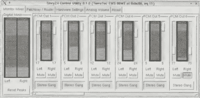

*图8.1：envy24control中的监视器和数字混音器*

envy24control是用于配备Envy24 (ice1712)芯片的声卡的混音器应用程序。可以通过‘SuSE’ → ‘多媒体’ → ‘声音’启动混音器，或在命令行中运行envy24control &。

接下来，我们将描述envy24control中最重要的功能。Envy24芯片的灵活性也意味着其功能可能因声卡而异。有关Envy24声卡芯片的最新详细信息，可以在`/usr/share/doc/packages/alsa/alsa-tools/envy24control`中找到。

#### envy24control中的监视器和Patchbay

信号控件显示在envy24control的‘Monitor Mixer’中。信号可以在声卡中混合。标记为‘PCM Out’的信号由发送PCM数据到声卡的应用程序生成。模拟输入的信号显示在‘H/W In’下。‘S/PDIF’输入显示在其右侧。模拟通道的输入和输出控件必须在‘Analog Volume’下设置。

使用‘Monitor Mixer’滑块进行数字混合。相关控件显示在‘Digital Mixer’中。此混合的输出路由在‘Patchbay’中定义。‘Patchbay’包含一列与每个输出通道对应的单选按钮，可用于选择所需的通道源。


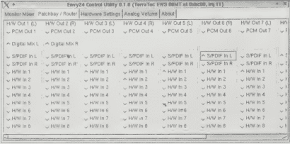

*图 8.2：在跳线盘中设置信号路由*

## 模拟输入和输出

模数转换器和数模转换器的放大倍数在‘模拟音量’下定义。‘DAC’滑块负责输出声道。输入声道使用‘ADC’滑块。使用单选按钮在 +4 dBu 和 -10 dBV 之间切换控件。第一种配置面向音频专业人士。-10 dBV 配置用于家庭用途。

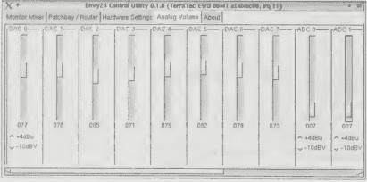

*图 8.3：模拟输入和输出的混音器*

## S/PDIF 声道配置

S/PDIF 声道设置在‘硬件设置’下进行。‘Env24’芯片对控制变化的反应延迟可通过‘音量变化’参数配置。

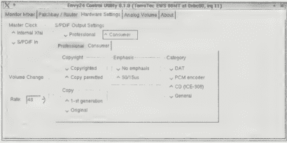

*图 8.4：配置 S/PDIF 参数*

## 压缩音频数据

- 系列 ap，软件包 cdparanoia
- 系列 snd，软件包 vorbis-tools

将音频 CD 转换为 WAV 文件在“刻录 CD 的专业工具”一章中有详细描述。使用命令 `cdparanoia "-B -z -1-3"` 将第 1 至第 3 音轨保存为 WAV 文件，其中 cdparanoia 会自行搜索插入了音频 CD 的驱动器。在 KDE 中，甚至可以通过拖放来抓取音频 CD。启动 Konqueror 并在‘URL’中输入 `audiocd:/` 后，插入的音频 CD 的音轨将与若干虚拟目录一起列出。更多相关信息请参阅《应用程序手册》中“使用 KonCD 刻录 CD”一章的“使用 Konqueror 抓取音频 CD”一节。

CD 质量的未压缩音频数据每分钟占用近 10 MB。因此，MP3 编码流程是在弗劳恩霍夫研究所开发的。遗憾的是，该流程已获专利。销售 MP3 编码器的公司必须支付许可费。因此，尽管其源代码遵循 GPL，我们发行的版本中并未包含为 Linux 开发的高性能 MP3 编码器 LAME。有关法律状态的更多信息，请访问项目网站 http://lame.sourceforge.net。在包括德国和美国在内的一些国家，仅允许将 LAME 用于研究目的。

Ogg Vorbis 是一种免费的压缩音频格式。KonCD、xmms、terminatorX 以及许多其他播放器已支持 Ogg 格式。该项目网站位于 http://www.xiph.org/ogg/vorbis。vorbis-tools 软件包包含一个编码器和一个简单播放器。编码器通过命令行使用 oggenc 启动。要压缩的 WAV 文件是唯一必需的参数。选项 `-h` 会显示附加参数的摘要。在最新版本中，Ogg 编码器甚至支持可变比特率编码。这样，在相同质量下可以获得更高的压缩率。也可以为比特率本身指定参数。参数 `-b` 定义平均比特率。`-m` 和 `-M` 指定最小和最大比特率。也可以不指定比特率，而给出用于所需质量的参数 `-q`。

ogg123 是用于命令行的 Ogg 播放器。作为参数，指定用于播放的设备。使用如下命令启动应用程序：

```
ogg123 -d alsa09 mysong.ogg
```

## 缓冲与延迟

本节说明如何保证无中断的音频播放。这不仅是 Linux 的问题，而是所有多任务操作系统都存在的问题。通常，在多任务操作系统中，会有多个进程同时运行。由于处理器一次只能执行一个进程，操作系统的调度器会给每个进程分配一定的处理器时间。进程之间的切换通常发生得非常快，以至于用户根本察觉不到。

然而，对于音频输出，这种现象会以短暂中断或咔嗒声的形式被察觉。因此，音频程序使用缓存（缓冲）进行输出。即使音频应用程序被调度器中断，存储在缓存中的音频数据仍会继续转发到声卡的输出。足够大、能够弥合最长中断的缓存可保证无咔嗒声输出。

这其中存在相互冲突的需求。缓存大小决定了应用程序的反应时间，即延迟。尤其对于交互式应用程序，例如实时合成器和 DJ 混音控制台，将缓存大小保持得尽可能小非常重要。基本上，中断的长度取决于系统负载和处理器优先级。因此，通过提高音频应用程序的优先级，可以减少无咔嗒声输出所需的缓存大小。因此，许多音频应用程序尝试将其进程切换为实时优先级。然而，只有当这些应用程序以 root 权限运行时，这才可能实现。

以 root 模式运行应用程序总是有风险的，因为该应用程序可以执行任何操作。如果计算机连接到互联网，就会出现安全风险。如果是这种情况，未经授权的用户可能利用应用程序中的安全漏洞来访问你的系统。

> **警告**
>
> 下文描述的命令绝不应在可从互联网访问的机器上执行，也不应在系统崩溃或数据丢失会造成严重后果的机器上执行。

你应使用 su 机制以 root 身份运行应用程序。我们的示例使用 timidity++ 应用程序。要使所有用户都能在其系统上以 root 权限运行 timidity++，请修改 /etc/sudoers 文件。有关信息，请参阅 sudo 的手册页（man sudo）和 sudoers 的手册页（man sudoers）。以 root 身份启动 visudo，并将以下行添加到 /etc/sudoers 文件末尾：

```
ALL     ALL=(ALL) /usr/bin/timidity
```

现在，系统上的所有用户都能够使用 `sudo timidity` 以 root 模式启动 timidity。如果距离上次 sudo 命令已超过五分钟，则会要求输入用户自己的密码。

## ALSA 与 MIDI

- 系列 snd，软件包 alsa，软件包 alsa-driver，yast2

除了播放 PCM 数据外，许多声卡还具备 MIDI 功能。ALSA MIDI 音序器实现了一种强大的 MIDI 数据路由架构。

许多声卡具有外部 MIDI 端口，用于连接 MIDI 设备，例如合成器、键盘和音源模块。如果声卡的 MIDI 端口受 ALSA 支持，你可以使用音序器应用程序（例如 jazz）通过该端口录制 MIDI 文件。在 KDE 控制中心的‘声音’ → ‘MIDI’下可找到声卡提供的 MIDI 设备列表。还要指定应使用其中哪些设备来播放 MIDI 文件。使用命令 `pmidi -l` 列出所有可用的 MIDI 设备及其内部 ALSA 端口号。例如，对于“Soundblaster Live!”声卡，该列表如下所示：

| 端口 | 客户端名称 | 端口名称 |
| --- | --- | --- |
| 72:0 | 外部 MIDI 0 | MIDI 0-0 |
| 73:0 | Emu10k1 WaveTable | Emu10k1 端口 0 |
| 73:1 | Emu10k1 WaveTable | Emu10k1 端口 1 |
| 73:2 | Emu10k1 WaveTable | Emu10k1 端口 2 |
| 73:3 | Emu10k1 WaveTable | Emu10k1 端口 3 |

*文件 13：Soundblaster Live! MIDI 设备*

第一列包含设备响应 ALSA 驱动程序的内部端口号。在其余列中，可以找到每个设备的客户端名称和端口名称。除了已经提到的外部 MIDI 端口外，还可以找到若干 WaveTable 端口。使用类似 `pmidi -p 73:0 mysong.mid` 的命令，通过上面列出的某个端口播放 MIDI 文件。

> **注意**
>
> 在播放期间中断 MIDI 播放器可能会导致持续发声。如果发生这种情况，请运行 `all_notes_off` 脚本，或以 root 身份使用 `rcalsasound restart` 重启 ALSA。

许多声卡，例如 Soundblaster AWE 和 Live!，具有内部 WaveTable 合成器。它会将 MIDI 事件转换为可听见的声音。这些 MIDI 事件可以由外部 MIDI 键盘或应用程序（例如 MIDI 播放器或音序器）转发到 WaveTable 合成器。如果你有 Soundblaster AWE 或 Soundblaster Live! 声卡，请使用音色库初始化 WaveTable 合成器，以使声音可听见。如果你没有此类声卡，请跳过下一节。


## 加载音色库（SB Live! 和 AWE）

该软件包使用 `sfload` 命令在 Soundblaster AWE 和 Live! 声卡中加载音色库。相关的音色库文件可以在声卡的驱动光盘上找到。如果已使用 YaST2 安装了 Creative 驱动光盘中的相应文件，ALSA 启动脚本可以自动加载 WaveTable 合成所需的音色库。目前，该脚本仅适用于一块声卡。但是，ALSA 可以轻松管理多达八块声卡。然后使用命令 `sfload -D n /usr/share/sfbank/creative/8MBGM.SF2` 加载音色库。`{n}` 表示声卡的编号。此编号不一定与声卡的配置顺序相对应。在 YaST2 的“硬件”下查找该编号。

如果您的驱动光盘不可用，您也可以加载已安装在 `/usr/share/sounds/sf2` 中的音色库。由 Ian Wilson 制作的音色库 `Vintage_Dreams_Waves_v2.sf2` 包含 128 种模拟合成器声音和 8 套鼓组。它与 SB AWE 和 SB Live! 声卡都兼容。由 Samuel Collins 制作的 ROM 音色库 `gun1-rom.sf2` 仅与 SB AWE 声卡兼容。它为这些声卡提供了扩展的通用 MIDI 音色库。请查看 `/usr/share/doc/packages/snd_sf2` 中的版权文件和相关文档。互联网上还可以找到更多音色库。参见 `http://www.hammersound.net`。

> **提示**
> 
> ALSA 目前仅支持最大 32 MB 的音色库大小。

## vkeybd — 虚拟 MIDI 键盘

如果您没有将外部 MIDI 键盘连接到声卡，请使用虚拟键盘 vkeybd。之前通过 `pmidi -l` 列出的内部端口号在这里尤其重要。通过在命令行输入 `vkeybd --addr 73:0` 启动该应用程序。端口地址在您的系统上可能会不同。请指定列表中的第一个波表端口。如果连接了外部声音发生器，您可以在此指定外部 MIDI 端口。

vkeybd 支持一系列附加选项。例如，使用 `vkeybd --addr 73:0 --octave 5` 可将八度音程数增加到五个。通过 `vkeybd --help` 或 vkeybd 的手册页（`man vkeybd`）可以获取命令行选项的摘要。

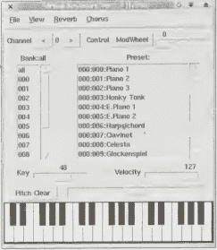

*图 8.5：vkeybd — 完整的虚拟 MIDI 键盘*

预设列表中的乐器名称可通过 `--preset` 选项指定预设文件来配置。可使用 `sftovkb` 命令从声音字体文件中提取乐器名称：

```
earth:~# sf2 /usr/share/sounds/sf2
earth:/usr/share/sounds/sf2 # sftovkb Vintage_Dreams_Waves_v2.sf2 \
        ~/vintage.vkb
```

此命令将名称保存到主目录中名为 vintage.vkb 的文件中。vkeybd 界面可在“视图”下进行配置。

## 设置 MIDI 端口之间的连接

ALSA 为多个 MIDI 端口的连接提供了完善的基础设施。声卡和 MIDI 应用程序（只要它们支持 ALSA 音序器结构）都有一个或多个 MIDI 端口用于相互通信。这些端口可以通过 KDE 应用程序 kaconnect 或 aconnect 进行连接。启动后，kaconnect 会显示系统中可读和可写的 MIDI 端口以及现有连接。要查看演示，请使用 vkeybd 和 aseqview 启动两个 MIDI 应用程序。在应用程序名称后指定端口地址。例如，第一个应用程序分配端口号 128:0，第二个分配 129:0。也可以在 kaconnect 中获取应用程序端口的列表。

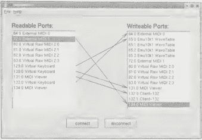

*图 8.6：使用 kaconnect 连接 MIDI 端口*

现在可以手动配置应用程序端口与波表（或外部 MIDI 端口）之间的连接。为此，请选择相应的端口，然后点击“连接”。如果您更喜欢使用命令行工具 aconnect，可以输入类似 `aconnect 128:0 73:0` 的命令。这将在作为发送方的端口 128:0 和作为接收方的端口 73:0 之间建立一条（单向）连接。

现在，您可以建立键盘 MIDI 端口与 ALSA 音序器查看器 MIDI 端口之间的连接。如果您更改键盘设置，例如声像或弯音轮（必须先通过“视图”启用），这些更改将立即反映在 qseqview 中。

输入 `aconnect --i` 或 `aconnect --o` 可查看可用于接收和发送的端口列表及其连接状态。可通过指定 `--d` 选项终止使用 aconnect 建立的连接，例如 `aconnect --d 128:0 129:0`。

要终止所有连接，请输入 `aconnect --x`。可在 aconnect 的手册页（`man aconnect`）中查看 aconnect 的更多命令行选项列表。

> **提示**
> 
> 给专家：aseqnet 允许您通过网络在本地机器之外建立 MIDI 连接。也许您想和德国的一位老朋友来一场钢琴二重奏。

## kmid — KDE MIDI 播放器

系列 kde2，软件包 kdemultimedia

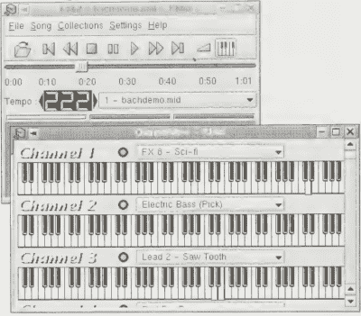

*图 8.7：kmid 的主窗口和声道视图*

在 KDE 开始菜单中，找到“多媒体” → “MIDI/卡拉OK播放器”。此格式的一些演示文件位于 /opt/kde2/share/apps/kmid 目录中，采用 .kar 格式。这些文件还包含歌词，歌词会随播放同步滚动和突出显示。

可以从互联网上找到 MIDI 文件。推荐地址之一是 http://www.midi.net。古典音乐的综合 MIDI 存档位于 http://www.classicalarchives.com。

kmid 的详细在线帮助可通过 (F1) 打开。在此应用程序中，必须通过“设置” → “MIDI 设置”正确设置 MIDI 端口。尤其值得一提的是，您可以通过单击工具列表中的键盘按钮来选择声道视图。您可能需要将窗口稍微向右拖动才能看到此项目。MIDI 事件在声道视图中以图形方式显示在多个键盘上——因此您可能还需要调整窗口的大小。此处也可以更改乐器。

然而，此应用程序存在一个潜在问题。如果在 KDE 文件管理器 Konqueror 中通过单击 MIDI 文件启动 kmid，则将应用在 KDE 控制中心中指定的 MIDI 设置。只有在单独启动应用程序时，应用程序本身指定的配置才会生效。

## 在没有波表声卡的情况下播放 MIDI 文件

系列 snd，软件包 timidity

并非每块声卡都有波表合成器，能够按照加载的音色库（或乐器补丁）播放 MIDI 文件。如果您遇到这种情况，软件波表合成器 timidity++ 就是为您设计的。

### 配置 timidity++

timidity++ 在配置文件 /usr/share/timidity/timidity.cfg 中进行配置。有关其配置的特定文档可通过输入 man timidity.cfg 查看。请参阅 /usr/share/doc/packages/timidity 中的文档。

兼容的乐器补丁可从 http://www.stardate.bc.ca/eawpatches/html/default.htm 获取。请从该处加载 eawpats11_full.rar 文件。此文件大小为 22 MB，但完全值得。它包含一套完整的 GM/GS/XG 乐器组。要将这些补丁与 timidity 一起使用，必须按以下步骤操作。

切换到 root。创建目录 /usr/share/timidity/eawpats，将 eawpats11_full.rar 复制到该位置，然后切换到该目录。命令 unrar x eawpats11_full.rar 解压此压缩包。现在必须修改 /usr/share/timidity/ 目录中的 timidity.cfg。此文件只需包含以下两行。

```text
dir /usr/share/timidity/eawpats
source timidity.cfg
```

*文件 14：timidity.cfg*

注意：eawpats11_full.rar 包含另一个 timidity.cfg，解压后它将出现在 eawpats 目录中。上面的 timidity.cfg 中的 source 命令会包含这个文件。此文件中只有四行比较重要：

```
source gravis.cfg
source gsdrums.cfg
source gssfx.cfg
source xmap2.cfg
```

为了使用声音字体而非Gravis乐器补丁，请修改`/usr/share/timidity/timidity.cfg`文件。例如，要在timidity++中使用Vintage Dreams声音字体，只需一个`timidity.cfg`，仅包含一行：

```
soundfont: /usr/share/sounds/sf2/Vintage_Dreams_Waves_v2.sf2
```

更多相关内容请参阅`/usr/share/doc/packages/timidity/README.sf`。

## 使用图形界面启动timidity++

除了timidity++，很少有应用程序能够为用户提供如此多的可选应用界面。输入`man timidity`可以查看可用界面列表。“Athena Widget Interface”（Athena部件界面）是一个高级界面，通过`/usr/bin/timidity -iatv`启动。

> 注意
> 
> timidity绝不能从`/usr/share/timidity`目录内部启动。

勃拉姆斯第一交响曲第一乐章的录音是一个令人印象深刻的MIDI文件，展示了完整的管弦乐声音能力。可以在`http://www.classicalarchives.com/brahms.html`找到它。

## ALSA服务器模式下的timidity++

使用以下命令以ALSA服务器模式启动timidity++：

```
/usr/bin/timidity -iA -B2,8 -Os &
```

## 录制和播放WAV文件

ALSA声音包还提供了arecord和aplay，也值得一提。它们包含在ALSA包中，为PCM设备提供了简单而灵活的接口。

音频数据可以使用arecord和aplay以WAV格式录制和播放。命令`arecord -d 10 mysong.wav`录制一个十秒的WAV文件。使用`-h`选项查看arecord和aplay的完整选项列表。录制时务必注意混音器设置的正确性。这些设置在alsamixer中的控制是‘Capture’（捕获），以及根据录制源不同而有的‘Line’（线路）和‘MIC’（麦克风）。还必须正确指定录制源。录制时，信号源通过模数转换器进行数字化。对于16位转换器，最大振幅为65535。任何高于此值的信号都将失真，因为它会被转换为振幅为65535的信号。

## 打印

本章提供Linux下打印的背景知识，还将说明如何运用这些知识。内容包括本地和网络打印机的连接、使用lprsetup配置打印系统，以及打印过滤器的信息。

- 打印基础与要求 — 192
- 本地连接打印机 — 194
- 使用lprsetup配置打印系统 — 203
- 打印机假脱机程序及其管理工具 — 203
- 生成打印作业 — 205
- 打印过滤器 — 207
- 关于Ghostscript的一些内容 — 215
- 关于a2ps的一些内容 — 218
- ASCII文本编码 — 220
- 在TCP/IP网络中打印 — 221
- 自定义生成的打印过滤器 — 225

### 打印基础与要求

打印基础和使用YaST2进行打印机配置在*YaST2、打印机章节中的基础*中有所描述。这里是打印系统流程的简短总结。

### 打印作业的处理流程

- 1. 用户或应用程序使用`lpr`命令生成打印作业。
- 2. 要打印的数据写入打印队列，打印机假脱机程序随后将其转发给打印过滤器。
- 3. 打印过滤器还可以定义要打印数据的类型，如有必要，使用Ghostscript将此数据转换为指定打印机可识别的语言。最后，过滤器将特定于打印机的数据发送到打印机。
- 4. 打印作业完整发送到打印机后，打印机假脱机程序将该打印作业从队列中删除。

### 默认打印机语言的示例

- **ASCII文本** — 通常，任何打印机至少能够输出ASCII文本。
- **PostScript** — PostScript是Unix和Linux用于生成输出的默认语言，PostScript打印机可以直接打印该输出。
- **PCL5e或PCL6** — 这些打印机语言在激光打印机中很常见。
- **PCL3** — 大多数HP DeskJet打印机及兼容型号理解这种打印机语言。
- **ESC/P、ESC/P2或ESC/P点阵** — 几乎所有爱普生打印机及兼容设备都理解这些打印机语言。

### GDI打印机

不理解上述任何默认打印机语言、只能通过专有协议访问的打印机被称为“GDI打印机”。这类打印机通常无法在Linux中使用。然而，有些GDI打印机在硬件层面上也理解一种默认打印机语言。这些打印机需要配置为使用该语言。请查阅打印机手册获取必要信息。

### 硬件和软件要求

- 检查您的打印机是否受SuSE Linux支持。查看已安装系统上的列表以及互联网上的：
  - `file:/usr/share/doc/packages/ghostscript/catalog.devices`
  - `http://cdb.suse.de` 和 `http://hardwaredb.suse.de/`
  - `http://www.linuxprinting.org` → ‘数据库’（`http://www.linuxprinting.org/database.html`）和 `http://www.linuxprinting.org/printer_list.cgi`
  - `http://www.cs.wisc.edu/~ghost/`

  这里描述的Ghostscript驱动程序包含在YaST2打印机配置中每个型号对应的选择中。

  > **注意**
  > 
  > 有时您会听说某些打印机需要当前版本的Aladdin Ghostscript。出于许可原因，SuSE Linux包含略有不同的GNU Ghostscript。在大多数情况下，可以找到适用于任何给定打印机的GNU Ghostscript驱动程序。

- 检查您是否能够对打印机进行必要的物理和逻辑连接。详见下一页的*本地连接打印机*部分。
- 自行编译的内核可能缺乏打印所需的支持；如有疑问，请先安装并从标准SuSE内核启动。（这可以通过YaST2完成。）
- 建议安装‘标准系统’。

### 可能的问题

最常见的问题在*基础*手册中讨论。其他问题请参阅支持数据库（`http://www.suse.de/sdb/en/html`）中“打印机配置”关键词下的内容。

### 定义合适的打印机驱动程序

在上一页*硬件和软件要求*部分提到的列表中，提供了针对特定打印机型号的Ghostscript驱动程序。如果您的供应商无法提供有关您打印机型号的任何Linux特定信息，以下提示可能会有所帮助：

- 查明您的打印机是否与能够在Linux下运行的型号兼容，然后使用该兼容型号的Ghostscript驱动程序。“在Linux中兼容”意味着您的打印机可以使用与兼容型号相同的二进制控制序列正确打印——打印机可以直接“理解”相同的打印机语言（而不仅仅是能够在Windows中通过驱动程序软件模拟它）。

  两种打印机名称相似并不总是能够保证它们兼容。这是因为名称相似的打印机并不总是直接理解相同的打印机语言。

- 有关打印机原生语言的最佳信息来源是制造商。在许多情况下，可以在打印机手册的技术数据中找到列出的打印机语言。现有打印机语言的一些示例请参见第192页的*默认打印机语言的示例*部分。

### 本地连接打印机

### 并行端口

打印机可以通过并行端口连接到Linux系统。并行端口上的打印机由内核的parport子系统处理。使用YaST2进行并行端口基本配置在*基础*手册的*手动配置*部分中说明，因此这里仅提供补充信息。必须通过加载特定于架构的内核模块，使parport子系统识别并行端口。这样，可以通过一个并行端口同时使用多个串联设备。并行端口打印机的设备文件编号从`/dev/lp0`开始。要通过第一个并行端口打印，SuSE标准内核必须加载`parport`、`parport_pc`和`lp`模块。这通常由内核模块加载器kmod负责（参见第232页的*Kmod——内核模块加载器*部分），一旦访问相应的设备文件（例如`/dev/lp0`）就会自动加载。


当内核模块 `parport_pc` 在没有任何特殊参数的情况下加载时，它会尝试自动检测并配置并口。在少数情况下，此操作无法成功，必须手动配置 `parport_pc` 模块的参数。

## 手动配置

如果不满足自动配置的某些条件，或者你需要自定义配置，请手动配置并口。

## 硬件连接（端口）

如果 YaST2 能够自动检测到打印机型号，则假定打印机连接在硬件层面正常工作。在这种情况下，无需在此进行任何设置。

如果完全没有检测到打印机，则需要手动配置打印机端口。启动 YaST2 控制中心，依次选择“硬件”和“自动打印机检测”。未识别的打印机会列在可用打印机下，名称为“其他（未识别）”。接下来，单击“配置”，在以下菜单中选择你的端口，并单击“下一步”。然后你会看到相应的端口：

- `/dev/lp0` — 第一个并口
- `/dev/usblp0` — USB 打印机的端口

此时，在 YaST2 中运行测试，以确定是否能通过所选端口访问你的打印机。然后，单击“下一步”。

现在选择你的打印机型号。单击“信息”可获得有关 Linux 对各打印机支持情况的信息；对于 GDI 打印机，还可了解在哪里可以找到 Linux 驱动程序。

如果你的打印机型号未列出，请单击“通用打印机”，并为标准打印机语言选择一种通用 Ghostscript 驱动程序。

> **注意**
>
> 如果你不知道你的打印机型号支持哪种打印机语言，或者它是否与打印机数据库中列出的型号之一兼容，请咨询打印机制造商。打印机必须能够在硬件层面“理解”相同的打印机语言。仅靠软件仿真是不够的。

当打印机直接连接到第一个并口，并在 BIOS 中指定以下设置时，可以获得最佳效果：

- I/O 地址 378（十六进制）
- 中断无关紧要（默认不使用中断）。
- 模式 Normal、SPP 或 Output Only（其他模式并非总是可用）
- 禁用 DMA（上述任一模式均应自动禁用该功能）

如果即使进行了这些 BIOS 设置，打印机仍无法通过第一个并口访问，则必须在详细并口设置中按照 BIOS 中的设置，以格式 0x378 显式输入 I/O 地址。如果有两个并口分别设置为 I/O 地址 378 和 278（十六进制），通常必须以 0x378, 0x278 的格式输入。

## 打印机名称

打印机名称指的是“队列”，在输入打印命令时通常需要指定该名称。因此，你应该只使用小写字母组成的短名称，也可以使用数字。默认情况下，lp 配置为第一个队列。

在某些情况下，可以设置原始队列。在原始队列中，要打印的数据不会由打印机过滤器转换，而是以原始形式直接发送到打印机。因此，待打印数据必须已经使用该型号相应的打印机语言表示。队列可以设置为带或不带“换页”，具体取决于打印假脱机程序是否在每次打印后执行换页，从而使已打印的最后一页也能从打印机中送出。通常情况下，Ghostscript 驱动程序会负责此项操作，因此无需显式配置换页。

## Ghostscript 驱动程序和打印机语言

由于 Ghostscript 驱动程序为非 PostScript 打印机生成特定于打印机的数据，因此 Ghostscript 驱动程序的配置是决定打印输出类型的关键。首先，选定的 Ghostscript 驱动程序，然后是驱动程序特定的设置，共同定义打印图像。对于同一台打印机，可以设置不同的配置来获得不同的打印图像。

如果 YaST2 自动检测到打印机型号，或者该型号在打印机数据库中可以找到，系统会提供合理的兼容 Ghostscript 驱动程序选择。如果打印机型号不在打印机数据库中，系统会提供适用于标准打印机语言的通用 Ghostscript 驱动程序选择。

> **注意**
>
> 你可能需要咨询制造商，了解你的打印机型号支持哪种打印机语言，或者你的打印机与打印机数据库中列出的哪种型号在硬件上兼容。这些打印机必须在硬件层面理解同一种打印机语言，且无需额外的仿真软件。

如果你想使用未列出的 Ghostscript 驱动程序，也许可以在制造商分类下找到。

通常可以为每个 Ghostscript 驱动程序设置特定参数。所选值与其选项之间的对应关系可以从选择菜单本身的结构中看出——即菜单项及其相应的子项。

并非所有驱动程序设置组合都适用于每种打印机型号，尤其是在选择了高分辨率的情况下。请打印 YaST2 测试页，确保你的设置有效。如果测试打印产生不理想的结果（例如，大量空白页上只有少量字符），可以通过取出所有纸张，然后点击“停止”按钮，立即在打印机上停止打印作业。但是，如果这样做，有些打印机之后可能无法再次打印。因此，最好只点击“停止”按钮，等待打印停止。

## 硬件相关设置

尽管所有可用选项都应能产生所需的打印输出，你仍然应通过打印测试页来检查设置。

- 页面布局只能针对 ASCII 文本打印输出指定，不能用于图形或特定应用程序生成的文档。
- 在特殊情况下，可以配置 ASCII 队列。在 ASCII 队列中，打印过滤器被强制输出 ASCII 文本。例如，当 ASCII 文本文件因某种原因未被打印过滤器识别为 ASCII 文件时，就需要这样做。
- 特定国家/地区的编码与 ASCII 文本打印输出以及 Netscape HTML 页面的简单文本输出中特殊字符的显示有关。

在简单文本中，每个字符都编码为一个给定数字。代码表定义了每个数字所显示的字符。根据应用程序使用的代码表，同一编码在屏幕上可能显示不同的字符。标准字符集只能使用 0 到 255 的代码。0 到 127 是 ASCII 字符（“普通”字母、数字和特殊字符，但不含特定国家/地区的特殊字符），这些代码始终相同。128 到 255 的代码用于特定国家/地区的特殊字符，例如变元音、波浪号和重音符号。由于特定国家/地区的特殊字符远不止 128 个，因此 128 到 255 的代码并非在所有地方都相同，而是根据地理位置保留给特定的国家字符设置。ISO-8859-1（即 Latin 1）是西欧语言的编码，ISO-8859-2（即 Latin 2）是中欧和东欧语言的编码。根据 ISO-8859-1 编码，代码 161 输出一个倒感叹号；而在 ISO-8859-2 中，则是一个带鼻化元音符号的大写字母 A。

## 配置并口

并口 `/dev/lp0` 通过在 `/etc/modules.conf`（文件 15）中输入一行来配置。

```
alias parport_lowlevel parport_pc
options parport_pc io=0x378 irq=none
# If you have multiple parallel ports, specify them this way:
# options parport_pc io=0x378,0x278 irq=none
```

*文件 15：/etc/modules.conf：第一个并口*

io 代表并口的第一个地址。`irq=none` 这一项使并口进入“轮询模式”，而非中断驱动模式。这通常是更好的选择，只有在非常旧的计算机上才会更慢。

要使这些设置生效，必须在 BIOS 或计算机固件中设置以下并口值（如果可用）：

- I/O 地址 378（十六进制）
- 中断 7（在轮询模式下无关紧要）
- 模式 Normal、SPP 或 Output-Only（其他模式并非总是可用）
- 禁用 DMA（应处于 Normal 模式）


## 配置其他并行端口

第二个并行端口（/dev/lp1，可通过标准 I/O 地址 278（十六进制；例如，通过 ISA 接口卡上的跳线设置）访问）也由 /etc/modules.conf 中的一行配置（文件 16）。

```text
alias parport_lowlevel parport_pc
# options parport_pc io=0x378 irq=none
# If you have multiple parallel ports, specify them this way:
options parport_pc io=0x378,0x278 irq=none
```

*文件 16：/etc/modules.conf：两个并行端口*

### 特殊插件卡：ISA PnP 和 PCI

如果其他并行端口的 I/O 地址目前未知，则必须自行确定。

**ISA PnP 卡** 如有可能，请为 I/O 地址以及必要时为中断和模式设定固定值（例如，通过跳线设置）。

否则，I/O 地址、中断和模式的值只有在 Linux 启动后才会写入 ISA PnP 卡。可以通过查看 /var/log/boot.msg 文件中的 Linux 启动信息，或借助 pnpdump 命令（软件包 isapnp）来验证所输入的值。

**PCI 卡** 可通过输入 `/sbin/lspci -v | less` 查看 PCI 卡对应的 I/O 地址和中断。结果显示在输出 12 中。

**输出 12：PCI 接口卡的 lspci -v 输出**

```text
earth:  # /sbin/lspci -v | less

...
00:0a.0 Parallel controller: ...
        ...
        Flags: stepping, medium devsel, IRQ 10
        I/O ports at b400
        I/O ports at b000
        I/O ports at a800
        I/O ports at a400
...
```

两个相隔 400（十六进制）的 I/O 地址共同属于一个并行端口——在我们的示例中，一个端口拥有 b000 和 b400，另一个端口拥有 a400 和 a800。您可能需要通过实验来确定这两个 I/O 地址中哪一个有效。然后，/etc/modules.conf 中的配置条目可能如文件 17 所示。

```text
alias parport_lowlevel parport_pc
options parport_pc io=0x378,0xb400,0xa800 irq=none,none,none
```

*文件 17：/etc/modules.conf：具有 2 个并行端口的 PCI 卡*

### 激活并测试并行端口

重启后，并行端口即被激活。无需重启，以 root 用户身份更新内核模块的依赖列表，然后卸载并重新加载与并行端口相关的内核模块即可。

```text
earth: # depmod -a 2>/dev/null
earth: # rmmod lp
earth: # rmmod parport_pc
earth: # rmmod parport
earth: # modprobe parport
earth: # modprobe parport_pc
earth: # modprobe lp
```

如果打印机能够打印 ASCII 文本，则应以 root 用户身份输入以下命令：

```text
earth: # echo -en "\rHello\r\f" > /dev/lp0
```

这将打印一张包含 Hello 字样的页面。这样，单词 Hello 通过在前面加上回车符的 ASCII 字符 `\r`，再在后面加上触发换页的 ASCII 字符 `\f`，使其与打印兼容。/dev/lp1 应用作第二个并行端口，/dev/lp2 用于第三个。

## USB 连接

必须在计算机的 BIOS 中激活 USB 中断。例如，在 Award BIOS 中，在“PNP AND PCI SETUP”相关菜单中将“USB IRQ”等条目设置为 Enabled。

以 root 用户身份输入 `echo -en "\rHello\r\f" >/dev/usb/lp0`，测试 USB 打印机是否可访问。如果打印机连接到第一个 USB 端口 `/dev/usb/lp0` 并且能够打印 ASCII 文本，则输出应为一页包含 Hello 字样的页面。

有时，USB 打印机可能无法再访问，例如在打印过程中拔下 USB 插头的情况。通常只需使用以下命令重启 USB 系统：

```text
earth:  # rchotplug stop
earth:  # rchotplug start
```

如果这样仍无效，则需要终止所有访问 `/dev/usb/lp0` 的进程。然后必须卸载并重新加载 USB 打印机的内核模块。首先，使用 `lsmod` 命令查明加载了哪些 USB 模块（`usb-uhci`、`usb-ohci` 或 `uhci`），以及是否存在其他模块依赖关系。

```text
usbcore  ...  [printer usb-uhci]
```

这表明 printer 和 usb-uhci 模块需要 usbcore 模块。在这种情况下，必须先卸载 printer 和 usb-uhci 模块，然后再卸载 usbcore。

以 root 用户身份输入以下命令。根据系统不同，可能需要将 usb-uhci 替换为 usb-ohci 或 uhci：

```text
earth:  # fuser -k /dev/usb/lp0
earth:  # rchotplug stop
earth:  # rmmod printer
earth:  # rmmod usb-uhci
earth:  # umount usbdevfs
earth:  # rmmod usbcore
earth:  # modprobe usbcore
earth:  # mount usbdevfs
earth:  # modprobe usb-uhci
earth:  # modprobe printer
earth:  # rchotplug start
```

## 串行端口

`file:/usr/share/doc/packages/lprng/LPRng-HOWTO.html` 中的 *LPRng HOWTO*，特别是 `/usr/share/doc/packages/lprng/LPRng-HOWTO.html#SERIAL` 文件部分，以及 `printcap` 的手册页（man printcap），描述了如何使用 LPRng 后台打印程序在串行端口上操作打印机。

本节提供针对 BSD 和 plp 后台打印程序的补充说明。

1. 应使用 plp 打印机后台打印程序（n 系列中的 `plp` 软件包），而不是 BSD 后台打印程序。如果仍想使用 BSD 后台打印程序，请按照下文所述进行操作。

2. 检查您的 `/etc/printcap` 文件。除了常规条目外，还需要一些指定串行端口参数的条目。

   ```text
   :br#9600:\
   :ty=ixon -imaxbel -ixany -ixoff -crtscts:\
   ```

   br 用于指定串行端口的波特率。ty 代表 stty 选项。根据您的硬件，可能需要调整这两个值。同样，您可能需要设置正确的速度值以匹配您的具体配置——通常为以下值之一：2400、4800、9600、19200、38400、57600、115200 和 230400。

   例如，对于 HP DeskJet 500，以下 stty 设置应该可行：

   ```text
   :ixon ixoff imaxbel opost
   ```

   stty 的手册页介绍了许多可用选项。

3. 如果使用 BSD 后台打印程序：该打印后台处理程序虽然会读取 `/etc/printcap` 中的 br 条目，但并不知道 ty 选项。不过，串行端口参数也可以使用 `setserial` 和 `stty` 命令进行配置。

   若要将参数设置为上面示例中通过 `/etc/printcap` 定义的相同值，请使用以下命令：

   ```shell
   earth: # stty 9600 ixon -imaxbel -ixany -ixoff \
       -crtscts </dev/ttyS(x)
   ```

   要获得所需结果，请为 ttyS(x) 使用合适的值——在大多数情况下应为 ttyS0 或 ttyS1。

   将所需的 setserial 和 stty 命令插入到文件 `/etc/init.d/boot.local` 中，可确保它们在启动时自动运行。此外，编辑 `/etc/printcap`，删除任何如下所示的行：

   ```text
   :br#9600:\
   :ty=ixon -imaxbel -ixany -ixoff -crtscts:\
   ```

   如果不删除这些行，它们将为串行端口设置错误的默认值，因为 BSD 后台打印程序不知道 ty 选项。请记住，您希望串行端口按照上述命令进行配置（也许在启动时），并且之后不会被更改。

## 使用 lprsetup 配置打印系统

通常，打印系统使用 YaST2 配置，如 *基础* 手册中的 *YaST2，打印机* 一章所述。也可以使用 lprsetup 程序。它可以在命令行模式下完全操作。

如果使用 YaST2 配置打印机，YaST2 会收集必要的信息，然后调用带必要选项的 lprsetup，从而创建实际配置。lprsetup 程序被设计为“专家”工具。与 YaST2 不同，lprsetup 不会在为每个选项选择正确值方面提供任何帮助。

`lprsetup --help` 简要列出了可用选项。更多详细信息请参见 `lprsetup` 的手册页（man `lprsetup`）和 `lpdfilter` 的手册页（man `lpdfilter`）。

有关 Ghostscript 驱动程序和驱动程序特定参数的信息，请参阅第 215 页的 *关于 Ghostscript 的一点介绍* 一节。

### 打印后台处理程序及其管理工具

### 打印后台处理程序 (lpd)

默认情况下，通常使用 LPRng（软件包 `lprng`）作为打印后台处理程序。打印后台处理程序 lpd（Line Printer Daemon，行式打印机守护程序）通常在启动时通过调用脚本 `/etc/init.d/lpd` 激活。可以手动输入以下命令启动和停止在后台运行的打印后台处理程序守护进程：

```text
earth:  # rclpd start
earth:  # rclpd stop
```

打印后台处理程序会在配置文件 `/etc/printcap` 中检查定义了哪些打印队列，并组织处理“排队”的作业：

- 打印后台处理程序管理本地队列。如有必要，它会将每个作业的数据文件通过打印过滤器发送，然后直接发送到打印机，或者转发到另一个队列。


- 它考虑队列中打印作业的顺序。
- 它监视队列和打印机的状态，并在请求时提供相关信息。
- 它监听 515 端口，以接受（或拒绝）来自远程计算机的本地队列打印作业。
- 它将队列上的打印作业转发到远程机器的打印机假脱机程序。

有关 LPRng 假脱机程序的详细信息可以在 LPRng HOWTO 文件：`/usr/share/doc/packages/lprng/LPRng-HOWTO.html`、`printcap` 的手册页（man printcap）以及 `lpd` 的手册页（man lpd）中找到。

## 打印机假脱机程序的管理工具

对打印队列进行许多操作需要 root 权限。管理工具在*基础*手册的*管理打印系统的命令*一节以及 LPRng HOWTO 文件：`/usr/share/doc/packages/lprng/LPRng-HOWTO.html#LPRNGCLIENTS` 中有概述。因此，下面我们仅对这部分信息进行总结。

**lpq -Pqueue** 显示指定队列中的打印作业。如果 `all` 作为 LPRng 假脱机程序队列给出，则将显示所有队列中的所有打印作业。`lpq -l -Pqueue` 显示更广泛的信息，`lpq -L -Pqueue` 输出详细的状态报告，有助于故障排除。更多信息请参阅*显示远程队列的状态*。另请参阅 `lpq` 的手册页（man lpq）以及 LPRng HOWTO 中的文件：`/usr/share/doc/packages/lprng/LPRng-HOWTO.html#LPQ`。

**lprm -Pqueue jobnumber** 从指定队列中删除具有给定作业编号的打印作业。只有 root 可以删除其他用户发送的作业。root 可以通过输入命令 `lprm -Pall all` 删除 LPRng 假脱机程序中所有队列中的所有打印作业。

更多信息请参阅下一页的*生成打印作业*一节、`lprm` 的手册页（man lprm）、文件：`/usr/share/doc/packages/lprng/LPRng-HOWTO.html#LPRM` 以及第 193 页的*可能存在的问题*。

**lpc** 控制打印队列：可以按名称指定队列，也可以指定所有队列。下面列出的大多数 lpc 命令只能由 root 执行。最重要的选项有：

- `help` — 提供选项的简要概述
- `status queue` — 发出状态报告
- `disable queue` — 阻止新作业进入队列
- `enable queue` — 打开队列以接收新作业
- `stop queue` — 停止队列中作业的打印。不过，当前正在打印的作业将完成。
- `start queue` — 恢复队列中作业的打印
- `down queue` — 相当于 disable 和 stop 一起使用
- `up queue` — 与 enable 和 start 一起使用效果相同
- `abort queue` — 与 down 相同，不同之处在于当前正在打印的作业会立即停止。作业保留在队列中，使用 up 重新启动队列后可以继续处理。

在命令行中直接将这些命令传递给 `lpc`（例如 `lpc status`），或者不带参数运行 `lpc`，这样就会启动具有自己提示符 `lpc>` 的对话模式，等待输入 `lpc` 命令。使用 `quit` 或 `exit` 结束此对话。

更多信息可以在 `lpc` 的手册页（man lpc）、文件：`/usr/share/doc/packages/lprng/LPRng-HOWTO.html#LPRM` 以及*基础*手册的“显示和管理队列”一节中找到。

> **注意**
>
> 即使在打印过程中关闭计算机然后重新启动 Linux，打印作业仍会保留在队列中。出现问题的打印作业应使用上面显示的命令从队列中删除。

## 生成打印作业

`lpr` 命令在*基础*手册的“生成打印作业”一节以及 LPRng HOWTO 文件：`/usr/share/doc/packages/lprng/LPRng-HOWTO.html#LPR` 中有所描述，因此下面我们仅提供一些补充信息。

### 为本地队列生成打印作业

典型的打印命令是 `lpr -Pqueue file`。

如果省略 `-Pqueue` 选项，则默认值取自 PRINTER 环境变量。这也适用于 `lpq` 和 `lprm` 命令 — 请参阅 `lpr` 的手册页（man lpr）、`lpq` 的手册页（man lpq）和 `lprm` 的手册页（man lprm）。环境变量 PRINTER 在您登录时自动设置，可以使用命令 `echo $PRINTER` 检查，并使用 `export PRINTER=queue` 将其重置为另一个队列。

### 为远程队列生成打印作业

LPRng 假脱机程序也可以通过 `lpr` 命令访问远程队列，例如 `lpr -Pqueue@printserver file`。将 `printserver` 替换为打印服务器的名称或 IP 地址，将 `queue` 替换为打印服务器上的队列名称。当然，这还需要打印服务器配置为允许您在其队列上打印。有关更多信息，请参阅下文*在 TCP/IP 网络中打印*一节中的项目*连接到打印服务器并在打印服务器上过滤的打印机*。

### 显示远程队列的状态

使用以下命令查询远程队列：

```
newbie@earth:  > lpq -Pqueue@printserver
newbie@earth:  > lpq -l -Pqueue@printserver
newbie@earth:  > lpq -L -Pqueue@printserver
```

此状态查询可能很有帮助，尤其是在您无法通过远程队列打印时。请参阅下文*在 TCP/IP 网络中打印*一节中的项目*验证远程 lpd*。

### 删除远程队列中的打印作业

通过输入以下命令，可以删除远程队列中所有自己生成的打印作业：

```
newbie@earth:  > lprm -Pqueue@printserver jobnumber
newbie@earth:  > lprm -Pqueue@printserver all
```

root 对远程队列没有任何访问权限。

## 打印过滤器

lpdfilter（软件包 lpdfilter）用作打印过滤器。打印过滤器的基本操作方法在*基础*手册的*打印作业流程*一节中有所描述。下面将详细描述打印作业流程。要准确分析打印过滤器，请浏览打印过滤器脚本（尤其是 `/usr/lib/lpdfilter/bin/if`）。您还可以按照第 215 页的*打印过滤器故障排除*一节中的说明进行操作。

1. 打印过滤器（`/usr/lib/lpdfilter/bin/if`）定义从假脱机程序直接传递给它的选项，或者从打印作业的“控制文件”以及相应队列的 `/etc/printcap` 和 `/etc/lpdfilter/queue/conf` 文件中读取选项（路径名中的 queue 应替换为实际队列名称）。

2. 它定义要打印的数据类型。脚本 `/usr/lib/lpdfilter/bin/guess` 使用 file 命令来确定数据类型。命令的输出根据 `/etc/lpdfilter/types` 文件中的规范定义要打印的数据类型。
    - 如果是 ascii 队列，则强制打印过滤器将要打印的数据视为 ASCII 文本。
    - 如果不是 ascii 队列，打印过滤器将尝试检测要打印的数据类型。

3. 根据要打印的数据类型和队列，数据随后会被转换为打印机特定信息：
    - 如果是原始队列，数据通常直接转发到打印机（或另一个队列）。但是，根据 `/etc/lpdfilter/queue/conf` 中的设置，也可能使用 recode 进行转换。如果是绝对原始队列——没有 lpdfilter——您必须删除相应队列的 `/etc/printcap` 中的行 `:if=/usr/lib/lpdfilter/bin/if:\`。
    - 如果不是原始队列：
        - (a) 如果打印数据不是 PostScript，则首先使用 `/usr/lib/lpdfilter/filter/type2ps` 将其转换为 PostScript（将 type 替换为打印数据的实际类型）。特别是，ASCII 文本通过 `/usr/lib/lpdfilter/filter/ascii2ps` 使用程序 `a2ps` 转换为 PostScript，具体取决于为队列配置的国家特定编码，因此简单的文本也可以打印国家特定的特殊字符。有关更多信息，请参阅 a2ps 的手册页（`man a2ps`）。
        - (b) 如果需要，可以再次重新格式化 PostScript 数据，只要在 `/etc/lpdfilter/queue/pre` 中有相应的脚本（将此处 queue 替换为实际队列名称）。
        - (c) 如有必要，PostScript 数据随后会转换为另一种打印机语言。
            - 如果连接了 PostScript 打印机，PostScript 数据将直接发送到打印机（或另一个队列）。此外，可以激活 `/usr/lib/lpdfilter/global/functions` 中定义的 bash 函数“duplex”和“tray”，以使用 PostScript 命令启用双面打印或纸盒选择——前提是 PostScript 打印机能够相应地处理这些命令。
            - 如果未连接 PostScript 打印机，将使用针对您的特定打印机型号的 Ghostscript 驱动程序生成打印机特定数据，然后可以将其发送到打印机或另一个队列。Ghostscript 命令的参数直接存储在 `/etc/printcap` 文件的 `cm` 行中，或者存储在 `/etc/lpdfilter/queue/app` 文件中（将此处 queue 替换为实际队列名称）。如果在 `/etc/lpdfilter/queue/post` 中有适当的脚本（将此处 queue 替换为实际队列名称），则可以重新格式化 Ghostscript 输出。
        - (d) 打印机特定数据将被发送到打印机（或另一个队列）。同时，如果在 `/etc/lpdfilter/queue/conf` 中指定了打印机特定的控制序列，则可以在打印机特定数据之前和之后发送这些控制序列。

### 配置打印过滤器

打印过滤器通常在设置打印系统时通过 YaST2 配置，如*基础*手册中“YaST2、打印机”一章所述。


手动调整打印过滤器配置文件以添加任何特殊设置。每个队列都有自己独立的配置文件 `/etc/lpdfilter/queue/conf`（将这里的 queue 替换为实际的队列名称），其中还包含每个选项的信息。

## 向打印过滤器添加特殊设置

1. 如果打印数据不是 PostScript 格式，则默认情况下会使用 `/usr/lib/lpdfilter/filter/type2ps` 将其转换为 PostScript（将 type 替换为实际打印的数据类型）。如果有一个相应的脚本保存在 `/etc/lpdfilter/queue/type2ps`（将 queue 替换为实际的队列名称，将 type 替换为实际打印的数据类型），该脚本将用于将数据转换为 PostScript。此脚本从 stdin 接收打印数据，并将 PostScript 发送到 stdout。

2. 如果在 `/etc/lpdfilter/queue/pre` 中存在相应的脚本，则可以重新格式化 PostScript 数据。您也可以使用脚本为此目的添加自己的 PostScript 预加载。此脚本从 stdin 接收 PostScript 数据，并将 PostScript 输出发送到 stdout。可以在 `psutils` 软件包中找到用于重新格式化 PostScript 数据的程序。特别是 `pstops`，具有广泛的重新格式化功能。有关此方面的更多信息，请参阅 pstops 的手册页（man `pstops`）。

3. 特殊 Ghostscript 参数：使用 YaST2 配置时，运行 Ghostscript 的参数保存在 `/etc/lpdfilter/queue/upp` 文件中。也可以手动向此文件添加特殊 Ghostscript 参数。有关 Ghostscript 参数的更多信息，请参见第 215 页的 *关于 Ghostscript 的简要说明* 一节。

4. 如果在 `/etc/lpdfilter/queue/post` 中存在合适的脚本，也可以重新格式化 Ghostscript 的输出。此脚本从 stdin 接收 Ghostscript 输出，并将特定于打印机的数据发送到 stdout。

## 一个与硬件无关的示例

假设您希望一个名为 `test` 的队列打印带行号的 ASCII 文本，并将两页缩小到一页上。然后，您可以创建脚本 `/etc/lpdfilter/test/ascii2ps` 和 `/etc/lpdfilter/test/pre`：

```bash
#!/bin/bash
cat -n - | a2ps -1 --stdin=',' -o -
```

*文件 18：`/etc/lpdfilter/test/ascii2ps`：ASCII 到 PostScript 的转换*

```bash
#!/bin/bash
pstops -q '2:0L0.6(20cm,2cm)+1L0.6(20cm,15cm)'
```

*文件 19：`/etc/lpdfilter/test/pre`：重新格式化 PostScript*

这些脚本必须对所有用户可执行，可以通过以下命令实现：

```shell
earth:  # chmod -v a+rx /etc/lpdfilter/test/ascii2ps
earth:  # chmod -v a+rx /etc/lpdfilter/test/pre
```

pstops 命令仅适用于那些能够被重新格式化的 PostScript 文件（通常都是如此）。

## 使用自定义 PostScript 预加载

PostScript 预加载是包含特殊 PostScript 命令的小型 PostScript 文件。它们可以在实际打印数据之前被发送，以初始化 PostScript 打印机或 Ghostscript。

通常，PostScript 预加载用于在 PostScript 打印机中激活双面打印或特殊纸盒，或相应地设置 Ghostscript 的页边距和 Gamma 校正。

首先，PostScript 打印机或 Ghostscript 必须能够正确处理下面列出的特殊 PostScript 命令（Ghostscript 对双面打印或纸盒命令没有响应）。

假设所涉及的队列名为 test。

**双面打印** — 要启用或禁用双面打印，请创建文件 `/etc/lpdfilter/test/duplexon.ps` 和 `/etc/lpdfilter/test/duplexoff.ps`，内容如下：

```postscript
%!PS
statusdict /setduplexmode known
statusdict begin true setduplexmode end if pop
```

*文件 20：`/etc/lpdfilter/test/duplexon.ps`：启用双面打印*

```postscript
%!PS
statusdict /setduplexmode known
statusdict begin false setduplexmode end if pop
```

*文件 21：`/etc/lpdfilter/test/duplexoff.ps`：禁用双面打印*

**纸盒选择** — 例如，要激活默认纸盒（0）或 2 号纸盒，请创建文件 `/etc/lpdfilter/test/tray0.ps` 和 `/etc/lpdfilter/test/tray2.ps`，内容如下：

```postscript
%!PS
statusdict /setpapertray known
statusdict begin 0 setpapertray end if pop
```

*文件 22：`/etc/lpdfilter/test/tray0.ps`：激活 0 号纸盒*

```postscript
%!PS
statusdict /setpapertray known
statusdict begin 2 setpapertray end if pop
```

*文件 23：`/etc/lpdfilter/test/tray2.ps`：激活 2 号纸盒*

**页边距设置** — 要更改页边距设置，请创建文件 `/etc/lpdfilter/test/margin.ps`，内容如下：

```postscript
%!PS
<<
/.HWMargins [left bottom right top]
/PageSize [width height]
/Margins [left-offset top-offset]
>>
setpagedevice
```

*文件 24：`/etc/lpdfilter/test/margin.ps`：页边距设置*

页边距设置 left、bottom、right 和 top 以及纸张尺寸的 width 和 height 必须以点为单位指定，一个点为 1/72 英寸（约 0.35 毫米）。另一方面，页边距偏移量 left-offset 和 top-offset 应根据分辨率以点阵为单位指定。

如果只需要在纸张上移动打印输出的位置，以下文件就足够了：`/etc/lpdfilter/test/offset.ps`

```postscript
%!PS
<< /Margins [left-offset top-offset] >> setpagedevice
```

*文件 25：`/etc/lpdfilter/test/offset.ps`：打印输出的位置*

## Gamma 校正

要修改颜色的亮度范围，请创建文件 `/etc/lpdfilter/test/cmyk.ps` 和 `/etc/lpdfilter/test/rgb.ps`，内容如下：

```postscript
%!PS
cyan exp magenta exp yellow exp black exp setcolortransfer
```

*文件 26：`/etc/lpdfilter/test/cmyk.ps`：CMYK Gamma 校正*

```postscript
%!PS
red exp green exp blue exp currenttransfer setcolortransfer
```

*文件 27：`/etc/lpdfilter/test/rgb.ps`：RGB Gamma 校正*

颜色模型（CMYK 或 RGB）必须与打印机兼容。为青色、品红色、黄色、黑色、红色、绿色和蓝色设置的值必须介于 0.001 和 0.999 之间。

您可以通过以下命令（不使用 Gamma 校正）在图形界面中总体了解上述文件的效果：

```shell
earth:  # gs -r60 \
    /usr/share/doc/packages/ghostscript/examples/colorcir.ps
```

（使用 Gamma 校正时，以下任一示例均可）：

```shell
earth:  # gs -r60 /etc/lpdfilter/test/cmyk.ps \
    /usr/share/doc/packages/ghostscript/examples/colorcir.ps

earth:  # gs -r60 /etc/lpdfilter/test/rgb.ps \
    /usr/share/doc/packages/ghostscript/examples/colorcir.ps
```

使用 `Ctrl` + `C` 退出。

## 重置打印机

要恢复打印机的基本设置，请创建文件 `/etc/lpdfilter/test/reset.ps`，内容如下：

```postscript
%!PS
serverdict begin 0 exitserver
```

*文件 28：`/etc/lpdfilter/test/reset.ps`：重置打印机*

要激活 PostScript 预加载文件，请创建脚本 `/etc/lpdfilter/test/pre`，内容如下：

```bash
#!/bin/bash
cat /etc/lpdfilter/test/preload.ps -
```

*文件 29：`/etc/lpdfilter/test/pre`：加载 PostScript 预加载*

将 preload 替换为实际的预加载文件名。该脚本必须对所有用户可执行且可读，这可以通过 chmod 实现：

```shell
earth:  # chmod -v a+rx /etc/lpdfilter/test/pre
earth:  # chmod -v a+r /etc/lpdfilter/test/preload.ps
```

同样的机制也可以用于在实际 PostScript 打印数据之后向打印机发送 PostScript 文件。要在打印作业完成后恢复打印机的原始设置，请创建脚本 `/etc/lpdfilter/test/pre`，内容如下：

```bash
#!/bin/bash
cat /etc/lpdfilter/test/preload.ps - /etc/lpdfilter/test/reset.ps
```

*文件 30：`/etc/lpdfilter/test/pre`：PostScript 预加载与 PostScript 重置*

## 配置 GDI 打印机的示例

GDI 打印机通常无法在 Linux 中使用。请参见第 192 页的 *GDI 打印机* 一节。但是，某些 GDI 打印机有特殊的驱动程序应用程序。这些驱动程序应用程序通常通过将 Ghostscript 输出转换为打印机特定格式来补充 Ghostscript。此类驱动程序应用程序通常只允许有限的打印选项，例如仅黑白打印。因此，Ghostscript 和驱动程序应用程序按如下方式协同工作（另请参见第 215 页的 *关于 Ghostscript 的简要说明* 一节）：

1. Ghostscript 将 PostScript 数据解析为包含各个像素的矩阵。然后将矩阵数据以合适的格式和分辨率传递给相应的 Ghostscript 驱动程序。

2. 然后，驱动程序应用程序将矩阵数据转换为打印机特定格式。


下文假定你的 SuSE Linux 版本已存在打印机的驱动程序应用，或者可以从互联网下载该驱动程序。同时还假定该驱动程序应用如上所述那样工作，并且你熟悉 Unix 源码的处理方法（例如 `.zip` 和 `.tar.gz` 归档文件，以及 `.rpm` 包）。更多信息，另请参阅第 69 页的*RPM — 发行版包管理器*一节。解压此类归档后，你通常会在 README 或 INSTALL 文件中，或在一个名为 doc 的子目录中找到安装提示。对于 `.tar.gz` 归档文件，实际的驱动程序应用通常还需要编译和安装。

下文还基于以下假定：驱动程序应用位于 `/usr/local/bin/printerdriver`，需要分辨率为 600 dpi 的 Ghostscript 驱动 `pbmraw`，并且打印机连接到第一个并行端口 `/dev/lp0`。实际所需的 Ghostscript 驱动和分辨率最终由特定驱动程序应用的文档指定。

首先，用 lprsetup 创建 gdi 队列（以 root 用户身份）：

```sh
earth:  # lprsetup -add gdi -lprng --device /dev/lp0 \
        --driver pbmraw --dpi 600 --size a4dj --auto --sf
```

该命令现在必须在一行内输入，不带反斜杠（`\`）。按如下方式创建脚本 `/etc/lpd/filter/gdi/post`：

```bash
#!/bin/bash
/usr/local/bin/printerdriver {driver-specific_parameters}
```

*文件 31：`/etc/lpd/filter/gdi/post`：运行驱动程序应用*

你可能需要输入适当的驱动特定参数。所需的驱动特定参数在驱动程序应用的文档中指定。

该脚本必须让所有用户都可执行。然后，重启打印机假脱机程序：

```sh
earth:  # chmod a+rx /etc/lpd/filter/gdi/post
earth:  # rclpd stop
earth:  # rclpd start
```

现在，所有用户都可以通过以下命令打印：

```sh
newbie@earth:  > lpr -Pgdi filename
```

## 打印过滤器故障排除

通过删除主打印过滤器脚本 `/usr/lib/lpdfilter/bin/if` 中相应行前面的注释符 # 来激活正确的调试级别。

```
# DEBUG="off"
# DEBUG="low"
DEBUG="medium"
# DEBUG="high"
```

*文件 32：/usr/lib/lpdfilter/bin/if：调试级别*

对于 DEBUG="low"，`/usr/lib/lpdfilter/bin/if` 的仅 stderr 输出将保存到文件 `/tmp/lpdfilter.if-$$.XXXXXX`（$$ 由进程号替换，XXXXXX 由任意或唯一字符串替换）。

对于 DEBUG="medium"，由 `/usr/lib/lpdfilter/bin/if` 调用的 `/usr/lib/lpdfilter/filter/` 中的脚本的 stderr 输出将保存到格式为 `/tmp/lpdfilter.name-$$.XXXXXX` 的文件（将 name 替换为要运行的脚本名称，`$$.XXXXXX` 如前所述）。

对于 DEBUG="high"，输出将不会发送到打印机，而是发送到格式为 `/tmp/lpdfilter.out-$$.XXXXXX` 的文件（`$$.XXXXXX` 的替换方式如前所述）。

每次执行更多测试之前，应先输入 `rm -v /tmp/lpdfilter*` 删除这些文件。

## 关于 Ghostscript 的一点介绍

Ghostscript 接受 PostScript 和 PDF 数据作为输入，并包含众多 Ghostscript 驱动（在 Ghostscript 中称为设备），用于转换为其他格式。Ghostscript 转换分两步进行：

- 1. PostScript 数据被转换为矩阵。由 PostScript 语言描述的图像被解析为精细的单个像素矩阵图案。此过程与各个 Ghostscript 驱动无关。矩阵越精细（分辨率越高），输出质量越高，但处理器和内存消耗也越多，因为分辨率加倍时矩阵中的点数会翻两番。

- 2. 最后，解析为点阵的图像现在被转换为所需格式，即所需的打印机语言。

Ghostscript 不仅提供打印机驱动，还可以处理用于屏幕输出的 PostScript 文件（参见*基础手册*中的“从应用程序打印”一节），甚至可以将其转换为 PDF。使用 gv 程序（包 gv）可以轻松地在屏幕上以 Ghostscript 的图形用户界面查看 PostScript 文件的输出。

Ghostscript 是一个功能非常复杂的应用程序，具有众多命令行选项。除了 gs 的手册页（man gs）和 Ghostscript 驱动列表外，最基本的文档可以在 /usr/share/doc/packages/ghostscript/catalog.devices 中找到，以及
file:/usr/share/doc/packages/ghostscript/doc/index.html
file:/usr/share/doc/packages/ghostscript/doc/use.htm
file:/usr/share/doc/packages/ghostscript/doc/Devices.htm
file:/usr/share/doc/packages/ghostscript/doc/hpdj/gs-hpdj.txt
file:/usr/share/doc/packages/ghostscript/doc/hpijs/hpijs_readme.html
file:/usr/share/doc/packages/ghostscript/doc/stp/README

如果直接启动，Ghostscript 会打开一个带有其自身提示符 GS> 的对话框。用 quit 退出。

帮助命令 gs -h 列出最重要的选项并输出当前的设备列表。如果某个驱动支持多个型号，则只会出现诸如 uniprint 和 stp 之类的基本驱动描述。uniprint 和 stp 型号的参数文件在 /usr/share/doc/packages/ghostscript/catalog.devices 中有更详细的列出。

## 使用 Ghostscript 的示例

在 /usr/share/doc/packages/ghostscript/examples 中查找 PostScript 示例文件。“colorcir” 很适合用于打印机测试（file:/usr/share/doc/packages/ghostscript/examples/colorcir.ps）。

## X11 输出

在 X 图形界面中，使用 gs 命令在屏幕上查看 PostScript 文件：

```
newbie@earth:  > gs -r60 \
    /usr/share/doc/packages/ghostscript/examples/colorcir.ps
```

分辨率通过选项 -r 指定，该选项必须与输出设备（打印机或屏幕）兼容。例如，可以用 -r30 试试。要退出程序，请在启动 gs 的终端中按 (Ctrl) + (C)。

## 转换为 PCL5e 或 PCL6

使用以下命令将 PostScript 文件转换为 PCL5e 或 PCL6 打印机的特定格式：

```text
newbie@earth:~ > gs -q -dNOPAUSE -dSAFER -sOutputFile=/tmp/out.prn \
    -sDEVICE=ljet3 -r300x300 \
    /usr/share/doc/packages/ghostscript/colorcir.ps quit.ps
```

其中命令在一行内输入，不带反斜杠（`\`）。同时假定文件 /tmp/out.prn 尚不存在。

## 转换为 PCL3

使用以下命令将 PostScript 文件转换为 PCL3 打印机的特定格式：

```text
newbie@earth:~ > gs -q -dNOPAUSE -dSAFER -sOutputFile=/tmp/out.prn \
    -sDEVICE=hpdj -r300x300 \
    -sModel=500 -sColorMode=mono -dCompressionMethod=0 \
    /usr/share/doc/packages/ghostscript/examples/colorcir.ps \
    quit.ps
```

```text
newbie@earth:~ > gs -q -dNOPAUSE -dSAFER -sOutputFile=/tmp/out.prn \
    -sDEVICE=cdj300 -r300x300 \
    /usr/share/doc/packages/ghostscript/examples/colorcir.ps \
    quit.ps
```

```text
newbie@earth:~ > gs -q -dNOPAUSE -dSAFER -sOutputFile=/tmp/out.prn \
    -sDEVICE=cdj500 -r300x300 \
    /usr/share/doc/packages/ghostscript/examples/colorcir.ps \
    quit.ps
```

```text
newbie@earth:~ > gs -q -dNOPAUSE -dSAFER -sOutputFile=/tmp/out.prn \
    -sDEVICE=cdj550 -r300x300 \
    /usr/share/doc/packages/ghostscript/examples/colorcir.ps \
    quit.ps
```

（每条命令在一行内输入，忽略“\”。）

## 转换为 ESC/P、ESC/P2 或 ESC/P 点阵

使用以下命令将 PostScript 文件转换为 ESC/P2、ESC/P 或 ESC/P 点阵打印机的特定格式：

```text
newbie@earth:~ > gs -q -dNOPAUSE -dSAFER -sOutputFile=/tmp/out.prn \
    @stcany.upp \
    /usr/share/doc/packages/ghostscript/examples/colorcir.ps \
    quit.ps
```


```
newbie@earth:~ > gs -q -dNOPAUSE -dSAFER -sOutputFile=/tmp/out.prn \
    -sDEVICE=cr360x360 \
    -dBitsPerPixel=1 -dDithering=gsmono -dNoWeave \
    -sOutputCode=plain \
    /usr/share/doc/packages/ghostscript/examples/colorcir.ps \
    quit.ps
```

这里可以看到，当为 uniprint 驱动程序或其他 Ghostscript 驱动程序使用参数文件时，命令之间的区别。由于所有驱动程序特定的参数都位于 uniprint 参数文件中，因此与其他 Ghostscript 驱动程序不同，无需指定任何其他驱动程序特定参数。

## 直接打印机输出

在上述每条命令之后，打印机特定的数据都位于 `/tmp/out.prn` 中。只要打印机连接到第一个并行端口 `/dev/lp0`，就可以使用以下 root 命令（无需假脱机程序或过滤器）将这些数据直接发送到打印机：

```
earth: # cat /tmp/out.prn >/dev/lp0
```

## 关于 a2ps 的一点说明

在使用 Ghostscript 打印 ASCII 文本文件之前，必须将其转换为 PostScript，因为 Ghostscript 期望输入的是 PostScript。为此使用 a2ps（软件包 a2ps）。a2ps 是一个强大的工具，可以从简单文本生成高质量的 PostScript 输出。它是一个非常复杂的程序，带有众多命令行选项。最重要的文档可以在 a2ps 的手册页中找到（man a2ps）。

## 使用 a2ps 的示例

### 使用 a2ps 直接输出文本文件到打印机

以下命令可用于将文本文件使用 a2ps 转换为 PostScript，使两页缩小并适合打印在一页上：

```
newbie@earth:~ > a2ps -2 --medium=A4dd --output=/tmp/out.ps textfile
```

要在图形界面中检查 a2ps 的输出，请输入

```
newbie@earth:~ > gs -r60 /tmp/out.ps
```

您可能需要在输入 `gs` 的终端窗口中使用 `↵` 滚动页面。使用 `Ctrl` + `C` 退出。

a2ps 的输出可以使用以下命令转换为打印机特定格式：

```
newbie@earth:~> gs -q -dNOPAUSE -dSAFER -sOutputFile=/tmp/out.prn \
    {driver-parameter} \
    /tmp/out.ps quit.ps
```

其中 `{driver-parameter}` 需要按照上一节中描述的方式指定。

Ghostscript 的输出可以直接发送到打印机（无需假脱机程序或过滤器），以 root 身份使用

```
earth:  # cat /tmp/out.prn >/dev/lp0
```

只要打印机连接到第一个并行端口 /dev/lp0。

### 打印名片

为了演示 a2ps 提供的所有选项，我们将介绍如何打印名片。创建一个简单的文本文件作为名片，内容如下：

```
Title FirstName LastName
Street
Postal/Zip Code City
E-mail: user@domain
Phone: area-number-extension
```

*文件 33: card: 一张名片*

添加 ASCII 字符 `\f` 以触发换页符，这样每张名片都会被视为一个单独的页面。

```
newbie@earth:~> echo -en "\f" >> card
```

将此页面复制十份到一个名为 cards 的文件中：

```
newbie@earth:~ > for i in $(seq 1 10) ; do cat card >> cards ; done
```

定义 cards 中最长的行：

```
newbie@earth:~> cat cards | wc -L
```

将文件 cards 转换为 PostScript，使所有十张名片以两列五行的形式出现，每张都带有边框，最大宽度根据最长行确定，且不附加额外的页眉或页脚：

```
newbie@earth:~> a2ps -i -j --medium=a4dj --columns=2 --rows=5 \
    --no-header --chars-per-line=number --output=cards.ps cards
```

请在单行中输入该命令，忽略反斜杠（`\`），并将 number 替换为 `cat cards | wc -L` 命令输出中显示的数字。

通过输入 `gs -r60 cards.ps` 在屏幕上测试结果后，您可以按照上述方式打印它们，或者使用打印系统通过 `lpr` 命令打印（`lpr cards.ps`）。

## ASCII 文本编码

有关 ASCII 文本编码的基本信息可以在基础手册的 YaST2、打印机、手动配置章节中找到。以下是一个包含一些附加信息的摘要。

在简单文本中，每个字符都编码为某个数字。每个代码对应的字符在代码表中定义。根据特定应用程序使用的代码，这些代码在屏幕和打印机上的显示可能会有所不同。

ISO-8859-1（或 Latin 1）是西欧语言的编码，而 ISO-8859-2（或 Latin 2）是中欧和东欧语言的编码。因此，在 ISO-8859-1 中，代码 241（八进制）对应一个倒感叹号，而在 ISO-8859-2 中，对应一个大写的带鼻音化符号的 A。ISO-8859-15 与 ISO-8859-1 基本相同，只是代码 244（八进制）产生欧元符号。

### 概要

所有命令都应作为单行输入，忽略反斜杠（`\`）。

使用以下命令创建一个 ASCII 文本示例文件：

```
newbie@earth:  > echo -en "\rCode 241(octal): \
\241\r\nCode 244(octal): \244\r\f" >example
```

在图形界面中打开三个终端窗口：

```
newbie@earth:  > xterm -fn -*-*-*-*-*-*-14-*-*-*-*-iso8859-1 \
    -title iso8859-1 &
newbie@earth:  > xterm -fn -*-*-*-*-*-*-14-*-*-*-*-iso8859-15 \
    -title iso8859-15 &
newbie@earth:  > xterm -fn -*-*-*-*-*-*-14-*-*-*-*-iso8859-2 \
    -title iso8859-2 &
```

在每个终端窗口中显示示例文件：

```
newbie@earth: > cat example
```

在“iso8859-1”显示中：代码 241 显示为倒感叹号（西班牙语）  
代码 244 显示为带小圆圈的圆圈（通用货币符号）  
在“iso8859-15”显示中：代码 241 显示为倒感叹号（西班牙语）  
代码 244 显示为欧元符号  
在“iso8859-2”显示中：代码 241 显示为大写带小圆圈的 A（带鼻音化符号的 A）  
代码 244 显示为带小圆圈的圆圈（通用货币符号）

ASCII 文本根据为每个队列配置的编码进行打印（如文件 example 的打印输出所示）。由文本处理系统生成的文档打印输出不受此编码的影响。

有关正确字符显示的更多信息：对于“iso8859-1”，请参阅 iso_8859-1 的手册页（man iso_8859-1）；对于“iso8859-15”，请参阅 iso_8859-15 的手册页（man iso_8859-15）；对于“iso8859-2”，请参阅 iso_8859-2 的手册页（man iso_8859-2）。

## 在 TCP/IP 网络中打印

### 可能的设置

在网络中打印主要有三种可能性：

- TCP/IP 网络中的打印机本地连接到其中一个主机（打印服务器）。
- 打印机连接到“打印服务器单元”，这是一个带有 TCP/IP 网络连接的小型设备。
- 打印机具有直接的 TCP/IP 网络连接（网络打印机）。

打印作业根据您拥有的打印机型号类型通过打印过滤器传递。

### 概述：可能的情况

主要区别在于要打印的文件如何被过滤。在链中的某个点，输出文件必须转换为打印机最终可以打印的格式：打印机语言（PostScript、HP PCL、ESC/P）。此转换由打印过滤器完成。对于网络打印机和打印服务器单元，过滤必须在客户端计算机上完成，然后再发送打印作业。如果使用打印服务器，过滤可以在客户端或打印服务器上完成。可能的情况如下：

**网络打印机，在客户端过滤：**

1. 客户端：将文件转换为打印机数据（预过滤）
2. 客户端：将打印数据发送到网络打印机（转发）

**打印服务器单元，在客户端过滤：**

1. 客户端：将文件转换为打印数据（预过滤）
2. 客户端：将打印数据发送到打印服务器单元（转发）
3. 打印服务器单元：将打印数据发送到打印机

**打印机连接到打印服务器，在客户端过滤：**

1. 客户端：将文件转换为打印数据（预过滤）
2. 客户端：将打印数据发送到打印服务器（转发）
3. 打印服务器：将打印数据发送到打印机

**打印机连接到打印服务器，在打印服务器上过滤：**

1. 客户端：将文件发送到打印服务器（转发）
2. 打印服务器：将文件转换为打印数据（过滤）
3. 打印服务器：将打印数据发送到打印机

由于过滤由打印服务器管理，如果您使用 LPRng 假脱机程序，则无需配置客户端，因为 LPRng 假脱机程序允许 lpd 命令将打印作业直接发送到远程队列。有关更多信息，请参见第 206 页的*为远程队列生成打印作业*一节。因此，客户端上必须安装 LPRng 假脱机程序（软件包 lprng），但假脱机程序本身（lpd）不必运行。客户端上只需存在一个所有用户都可读的空文件 `/etc/printcap`，并且客户端用户必须知道打印服务器的名称以及各个队列的名称。


- 在上述示例中，凡是出现“forward”的地方，都需要一个打印机转发队列。数据会被直接转发，不经过过滤。
- 凡是出现“prefilter”或“filter”的地方，都需要一个打印队列来过滤数据。如果过滤在客户端进行，则该过滤队列是打印服务器的“打印机转发队列”的“预过滤器”。如果过滤在打印服务器上进行，则该过滤队列是打印服务器上配置的常规队列之一，例如 `lp`。

## 先决条件

打印机必须受 SuSE Linux 支持，因为预过滤器会以与本地连接的打印机相同的方式（通常通过 Ghostscript）生成打印机专用数据。有关此内容的更多信息，请参见第 194 页的 *本地连接打印机* 一节。

必须存在到网络打印机的可用 TCP/IP 连接。尤其需要正确设置名称服务。

## 配置

使用 YaST2 配置所需的预过滤队列和转发队列，并测试所有已定义的队列。划分为预过滤队列和转发队列是使用 lpd 协议（根据 RFC 1179）的打印机后台打印程序的经典配置。

对于打印服务器单元或网络打印机，这可能不起作用（请参见下一页的 *出现问题时* 一节）。LPRng 后台打印程序允许使用其他方法访问网络打印机或打印服务器单元。这些方法已部分受到 lprsetup 支持。请参见 `lprsetup --help` 以及 `lprfilter` 的手册页（man `lprfilter`）。有关 LPRng 后台打印程序的详细信息，在文件：`/usr/share/doc/packages/lprng/LPRng-HOWTO.html` 中的 *LPRng 操作指南* 中有所概述。lpd 协议也在那里进行了描述。文件：`/usr/share/doc/packages/lprng/LPRng-HOWTO.html#NETWORKPRINTER` 文件：`/usr/share/doc/packages/lprng/LPRng-HOWTO.html#NETWORKPRINTER`。

## 出现问题时

### 检查预过滤器的配置

将打印机直接连接到 PC 的第一个并行端口。出于测试目的，将打印机配置为本地打印机，以消除可能存在的任何网络问题。按第 194 页的 *本地连接打印机* 一节所述进行操作。如果打印机在本地可以工作，那么现在您就知道了用于配置预过滤器的正确 Ghostscript 驱动程序和其他参数。现在，使用正确的设置按上述方式在网络中配置打印机。

### 验证远程 lpd

以 root 用户身份，使用以下命令请求远程主机上队列的状态报告（前提是 lpd 正在运行并且可以接收直接请求）：

```sh
earth: ~ # echo -e "\004queue" | netcat -w 2 -p 722 host 515
```

此报告可能非常长。lpd 没有响应可能是某些基本网络问题导致的。如果您确实从远程 lpd 得到了响应，它应该指出为什么无法从远程主机上的队列进行打印。示例：

```
lpd: your host does not have line printer access
lpd: queue does not exist
printer: spooling disabled
printer: printing disabled
```

*输出 13：来自 lpd 的错误消息*

如果您从 lpd 收到此类响应，则问题根源在于远程 lpd。

### 网络打印机或打印服务器单元工作不可靠

有时，位于打印服务器单元或网络打印机上的打印机后台打印程序可能会出现问题，尤其是当多个客户端同时向打印服务器单元或网络打印机发送打印作业时。由于问题出在打印服务器单元或网络打印机中的打印机后台打印程序，最简单的解决方案是将打印机直接连接到打印服务器，或者在客户端过滤打印数据。

## 自定义生成的打印过滤器

### 初步说明

本节的主要目的不是介绍 lpfilter 的替代方案，而是基于一个自定义设计的打印过滤器的简单示例，提供一些 Linux 打印的背景知识。这里概述的示例已尽可能保持简单，以强调最关键的步骤。因此，我们在下面的示例过滤器脚本中省略了错误纠正过程。以下内容还基于这样的假设：打印机连接到第一个并行端口（/dev/lp0）。如果打印机连接到另一个端口，请使用另一个端口设备代替 /dev/lp0。

打印过滤器通过标准输入从后台打印程序接收要打印的数据。打印过滤器的任务是在将数据转发到标准输出之前，将其转换为打印机专用格式。打印机后台打印程序确保打印过滤器通过标准输出输出的所有内容都到达打印机设备 /dev/lp0。内核则将所有到达打印机设备的内容转发到指定端口（例如，转发到 IO 地址 0x378）。硬件负责确保发送到 IO 地址（此处为 0x378）的所有内容都通过并行连接电缆转发到打印机。然后打印机解释此数据流，并最终按照规范进行打印。

以下命令通常只能以 root 用户身份执行，因为普通用户无法直接访问打印机设备，除非 root 使用 `chmod a+w /dev/lp0` 命令允许这样做。命令如下所示：

```sh
earth:  # cat ascii-file > /dev/lp0
```

在此处，将 ascii-file 替换为现有 ascii 文件的名称。

### 一个简单示例

命令 `echo -n "\rHello\r" > /dev/lp0` 通过直接寻址打印机设备 `/dev/lp0` 本身，跳过了打印机后台打印程序和过滤器。此命令只是将 ASCII 字符 `\r`、`H`、`e`、`l`、`l`、`o`、`\r` 和 `\f` 直接发送到打印机。字符 `\r` 和 `\f` 分别代表回车和换页。如果打印机可以直接打印 ASCII 字符，它将打印单词 Hello 并弹出页面。

```sh
earth:  # cat ascii-file > /dev/lp0
```

通过直接寻址打印机设备 `/dev/lp0` 本身，跳过了打印机后台打印程序和过滤器。ASCII 文本文件中的 ASCII 字符会直接发送到打印机。

在 Linux 中，只有换行 ASCII 符号分隔两行 ASCII 文本。在 DOS/Windows 中，两行 ASCII 文本由换行和回车 ASCII 符号分隔。

如果使用上面显示的命令将 ASCII 文本文件发送到打印机，打印输出通常会如下所示：

```
First line
             Second line
                         Third line
                                      ...
```

因为打印机只会缩进各行而不提供回车，因为没有发送回车 ASCII 符号。可以重新配置打印机，使其在每次换行时提供回车。

对于理解打印机语言 PCL3 的打印机，在每次换行后（如果给出了换行 ASCII 符号），使用转义序列 `\033&k2G` 触发回车。

命令 `echo -en "\033&k2G" > /dev/lp0` 将转义序列发送到打印机。然后，使用 `cat ascii-file > /dev/lp0` 打印 ASCII 文本文件，并带有正确的换行回车。之后，您可能需要输入 `echo -en "\f" > /dev/lp0` 来从打印机中弹出最后一页。

特殊字符（例如变音符号）通常无法正确打印，因为此类特殊字符在 DOS/Windows 中的编码与 Linux 中不同，而且打印机通常预设为 DOS/Windows。

命令

```sh
earth:  # cp ascii-file ascii-file.ibmpc
earth:  # recode lat1..ibmpc ascii-file.ibmpc
```

将 ASCII 文件复制为 ascii-file.ibmpc，然后将其重新编码为 DOS/Windows 标准。

命令 `cat ascii-file.ibmpc > /dev/lp0` 应确保换行以及变音符号或波浪号都能正确打印。由于这些字符已按照 DOS/Windows 标准编码在 ascii-file.ibmpc 中，您不再需要任何特殊转义序列来为打印机设置适当的换行行为。

因此，命令

```sh
earth:  # cp ascii-file ascii-file.ibmpc
earth:  # recode lat1..ibmpc ascii-file.ibmpc
```


```
earth: # cat ascii-file.ibmpc > /dev/lp0
```

应能正确地将 ASCII 文本文件输出到一台打印 ASCII 文本并使用 DOS/Windows 字符的打印机。如果这样做可行，建议创建一个打印过滤器，自动将 ASCII 文本文件转换为打印机特有的格式。

## 自定义打印过滤器示例

首先，为您的自定义打印过滤器创建一个子目录。然后（以 root 用户身份）切换到该子目录：

```
earth: # mkdir /usr/local/myprinterfilter
earth: # cd /usr/local/myprinterfilter
```

创建一个名为 asciifilter 的 bash 脚本（作为 ASCII 文本文件），如文件 34 所示。

```
#!/bin/bash

# make a temporary file
INPUT="$(mktemp /tmp/asciifilter.$$.XXXXXX)"

# First store everything from stdin in $INPUT
# to have the input as a regular file
cat >$INPUT

# Recode the INPUT
recode lat1..ibmpc $INPUT

# Add a FormFeed at the end of $INPUT
# to get the last page out of the printer
echo -en "\f" >>$INPUT

# Send $INPUT to stdout
cat $INPUT

# Remove the INPUT file
rm $INPUT
```

*文件 34：/usr/local/myprinterfilter/asciifilter*

使用以下命令使这个脚本对所有用户可执行：

```
earth: # chmod -v a+x /usr/local/myprinterfilter/
earth: # chmod -v a+rx /usr/local/myprinterfilter/asciifilter
```

使用 lprsetup 创建一个额外的打印机队列（参见 lprsetup --help）。  
此处，af 代表“asciifilter”，即队列名称。

```
earth: # lprsetup --add af --lprng --device /dev/lp0 --raw --sf
```

在 /etc/printcap 的 af 条目中，找到相应行，并将 `/usr/lib/lpd/filter/bin/if` 替换为 `/usr/local/myprinterfilter/asciifilter`。整个条目应如下所示：

```
af:\
        :cm=lpdfilter drv= method=raw color=no:\
        :method=ascii color=no:\
        :lp=/dev/lp0:\
        :sd=/var/spool/lpd/af:\
        :lf=/var/spool/lpd/af/log:\
        :af=/var/spool/lpd/af/acct:\
        :if=/usr/local/myprinterfilter/asciifilter:\
        :la=mx#0:\
        :tr=\f:
```

*文件 35：/etc/printcap：自定义过滤器*

使用以下命令停止并重新启动打印假脱机服务：

```
earth: # rclpd stop  
earth: # rclpd start
```

现在，所有用户都应能使用 `lpr -Paf ascii-file` 进行打印。

## 10 内核与内核参数

内核是系统的心脏。虽然接下来的章节不会教您如何成为内核“黑客”，但它们将带您进入内核的世界。其中包含编译定制内核的基础知识。

- 内核源代码 ........................................ 230
- 内核模块 ........................................ 230
- 内核配置 .................................. 233
- 内核配置中的设置 .................. 234
- 编译内核 .................................. 234
- 安装内核 .................................. 235
- 创建启动盘 .................................. 236
- 编译后清理硬盘 ............. 237
- 内核中的驱动程序 .................................. 238
- 关于驱动程序与参数的一些提示 ................... 239
- 参数 ........................................ 239

标准 SuSE 内核在安装期间写入磁盘，在正确安装的系统中的 `/boot` 目录下可以找到，它被配置为尽可能支持广泛的硬件。如果您在安装或更新期间做出了正确的选择，该内核将针对您的处理器进行专门优化。因此，不一定需要自己编译内核。但是，如果您想测试实验性功能和驱动程序，则可能需要生成一个新内核。您必定能深入了解当前的开发状态。

内核附带几个 Makefile 以自动化该过程。这些 Makefile 几乎为您处理了所有细节。您唯一需要手动完成的是为硬件设置和其他内核功能作出选择。

### 内核源代码

要构建内核，必须安装以下软件包：内核源代码（软件包 `kernel-source`）、C 编译器（软件包 `gcc`）、GNU binutils（软件包 `binutils`）以及 C 编译器的包含文件（软件包 `glibc-devel`）。它们位于系列 D（开发）中。无论如何，强烈建议安装 C 编译器，因为 C 语言与 UNIX 操作系统密不可分。

内核源代码位于 `/usr/src/linux`。如果您计划试验不同的内核，请将它们解压到不同的子目录中，并创建一个指向当前内核源代码的符号链接。由于有些软件包依赖 `/usr/src/linux` 中的源代码，您应将此目录维护为指向当前内核源代码的符号链接，以便需要访问内核源代码的系统程序能够无错编译。

### 内核模块

许多驱动程序和功能不再需要直接编译到内核中，而是可以在运行时作为内核模块加载。要编译到内核中的驱动程序以及作为运行时模块加载的驱动程序在内核配置中定义。内核模块位于 `/lib/modules/<Version>`，其中 `<Version>` 是当前内核版本。

基本上，系统启动不需要的组件应构建为模块。这样可以确保内核不会过大，以免 BIOS 或引导加载程序无法加载。对于 ext2 驱动程序、基于 SCSI 的系统上的 SCSI 驱动程序以及类似驱动程序，应编译到内核中。相比之下，isofs、msdos 或 sound 等并非启动计算机系统所必需的项，可以构建为模块。

### 模块管理

可使用以下命令：

- `insmod`  
  insmod 在 `/lib/modules/(Version)` 的子目录中搜索请求的模块后加载它。但最好使用 modprobe（见下文）而不是 insmod。

- `rmmod`  
  卸载请求的模块。仅当不再需要此模块时才能执行此操作。例如，当 CD 仍处于挂载状态时，无法卸载 isofs 模块。

- `depmod`  
  创建 `/lib/modules/(Version)` 中的 `modules.dep` 文件，该文件定义所有模块的依赖关系。这可以确保所有依赖模块都与所选模块一起加载。如果在 `/etc/rc.config` 中设置了 `START_KERNEL`，则每次系统启动时都会重建此文件。

- `modprobe`  
  在考虑给定模块的依赖关系的情况下加载或卸载该模块。此命令非常强大，可用于许多操作（例如，探测给定类型的所有模块，直到成功加载一个）。与 insmod 不同，modprobe 会检查 `/etc/modules.conf`，因此是加载模块的首选方法。有关此主题的详细信息，请参阅相应的手册页。

- `lsmod`  
  显示当前已加载的模块以及有多少其他模块正在使用它们。由内核守护进程启动的模块会标记为 `autoclean`。此标签表示这些模块一旦达到空闲时间限制，将被自动移除。

- `modinfo`  
  显示详细的模块信息。

### /etc/modules.conf

`/etc/modules.conf` 影响模块的加载方式。请参阅 depmod 的手册页（`man depmod`）。  
在此文件中输入直接访问硬件的模块的参数。此类模块可能需要系统特定的选项（例如，CD-ROM 驱动程序或网络驱动程序）。此处输入的参数大部分与内核启动提示符下给出的参数相同；例如，使用 LILO（参见第 240 页的*启动提示符下的内核参数*一节），但在许多情况下，启动提示符下使用的名称是不同的（要比较这些名称，请参见第 255 页的*modprobe 参数*一节）。如果某个模块加载失败，请尝试在此文件中指定硬件，并使用 modprobe 而不是 insmod 来加载该模块。

### Kmod — 内核模块加载器

内核模块加载器是使用模块最优雅的方式。Kmod 在后台进行监视，并确保当内核功能被激活时，一旦运行 modprobe，所需模块就会自动加载。要使用 Kmod，请在内核配置 '内核模块加载器'（CONFIG_KMOD）中设置相应变量。  
访问根文件系统所需的驱动程序应直接编译到内核中。不要将 SCSI 驱动程序或文件系统（通常为 ext2）配置为模块。

> **警告**  
> 由于 SuSE Linux 使用 initrd（初始 RAM 磁盘）并通过 initrd 集成 SCSI 驱动程序，例如，您必须确保在编译自己的内核之后，调整文件 `/etc/sysconfig/kernel`（第 316 页的*安全与本地管理服务*一节）中的 `INITRD_MODULES` 变量，并注释掉 `/etc/lilo.conf` 中的 `initrd` 行（参见第 280 页的*可能的问题 — 自编译内核*一节）。如果不这样做，内核将在启动时挂起。  
> **警告**

内核模块对于很少使用的功能很方便，例如并口和打印机支持、软盘驱动器驱动程序，以及某些只是偶尔使用的文件系统。


Kmod 并非设计用于自动加载模块。对于当今计算机的 RAM 容量而言，其潜在的内存节省微不足道。另请参阅 `/usr/src/linux/Documentation/kmod.txt`。出于性能考虑，对于具有特殊任务且只需少量驱动程序的服务器机器而言，采用“单体”（monolithic）内核更为合适。

## 内核配置

已安装或已更新的内核的配置保存在文件 `/usr/src/linux/.config` 中。

内核可以在命令行、文本模式菜单或 X Window System 菜单中进行配置。以下是这三种方法的简要概述。

> **提示**
> 
> 要使用已有的 `.config`，只需输入 `make oldconfig`，然后按照下一页 *编译内核* 一节的说明继续操作。

### 命令行配置

要配置内核，请切换到 `/usr/src/linux` 并输入 `make config`。系统会询问你选择希望内核支持并构建的选项。此处有两个或三个可能的答案：`Y`、`N` 或 `M`。`M` 表示该设备不会直接编译进内核，而是作为模块编译。任何引导系统所需的驱动程序都应集成到内核中，而不是作为模块加载。如果你按下任何其他键，则会获得有关当前选项的简短帮助文本。

### 文本模式配置

配置内核的一种更方便的方法是通过输入 `make menuconfig` 实现。使用 menuconfig 时，你不必遍历所有问题：只需进行你想要的少量更改即可。

### X Window System 配置

如果你已安装并配置了 X Window System（软件包 `xf86`）和 Tcl/Tk（软件包 `tcl` 和软件包 `tk`），则可以使用 `make xconfig` 作为替代方案。你将看到一个 GUI（图形用户界面），它使内核配置变得非常用户友好。你应该以 root 身份启动 X Window System，否则你将不得不采取额外步骤，例如接管另一个用户的显示。

### 内核配置中的设置

这里无法详细涵盖所有内核配置选项。请充分利用内核配置中提供的众多帮助文本。最新的内核文档始终位于 `/usr/src/linux/Documentation` 中。

### 编译内核

> **提示**
>
> 你可以移除主 Makefile（大约在第 92 行）中的注释符号 `#`。该行包含 `EXPORT_INSTALL_PATH=/boot`。这允许你将自定义内核安装到 `/boot`。

我们建议编译“bzImage”。通常情况下，这可以避免内核过大的问题，因为如果你选择了太多功能并创建了“zImage”，很容易出现这种情况。然后你会收到类似“kernel too big”或“System is too big”的错误消息。

自定义内核配置后，通过输入以下命令开始编译：

```
earth:/usr/src/linux # make dep
earth:/usr/src/linux # make clean
earth:/usr/src/linux # make bzImage
```

这三个命令也可以在同一行中输入。它们会依次启动。例如，这对于通宵编译内核可能很有用。只需输入：

```
earth:/usr/src/linux # make dep clean bzImage
```

根据你的系统，内核重新编译可能需要几分钟。在编译期间，你仍然可以在其他控制台之一上工作。

编译成功后，你将在 `/usr/src/linux/arch/i386/subarch/boot` 中找到压缩内核。内核映像——包含内核的文件——称为 `bzImage`。如果你找不到此文件，则可能是内核编译期间发生了错误。由于大量屏幕输出，这很容易被忽略。如果发生了错误，可以通过重新启动内核编译来确定，使用：

```
earth:/usr/src/linux # make bzImage
```

并查看相应的错误消息。但是，在内核编译期间错误并不经常发生。

如果你使用 bash shell，请输入：

```
earth:/usr/src/linux # make bzImage 2>&1 | tee kernel.out
```

将编译输出写入 `kernel.out`。如果你使用 tcsh shell，请使用以下命令：

```
earth:/usr/src/linux # make bzImage |& tee kernel.out
```

如果你已将内核的某些部分配置为作为模块加载，则必须启动模块编译。可以通过输入以下命令来完成：

```
earth:/usr/src/linux # make modules
```

### 安装内核

内核编译完成后，必须安装它以便能够引导。如果你使用 LILO，则还必须重新安装 LILO。在最简单的情况下，将新内核复制到 `/boot/vmlinuz`（参见对面页 *编译内核* 一节），然后运行 LILO。然而，为防止不愉快的意外，建议你首先保留旧内核（`/boot/vmlinuz.old`），以便在新内核无法按预期工作时仍然可以引导它：

```
earth:/usr/src/linux # cp /boot/vmlinuz /boot/vmlinuz.old
earth:/usr/src/linux # cp arch/i386/boot/bzImage /boot/vmlinuz
earth:/usr/src/linux # lilo
```

Makefile 目标 `make bzlilo` 可一步完成这三个步骤。现在需要安装已编译的模块。通过输入：

```
earth:/usr/src/linux # make modules_install
```

将这些模块复制到 `/lib/modules/(Version)` 中的正确目录。这会覆盖具有相同内核版本的旧模块。但是，原始模块可以与内核一起从 CD 重新安装。

> **提示**
>
> 你应该确保那些功能现在可能已直接编译进内核的模块从 `/lib/modules/<Version>` 中移除。否则，可能会发生意外效果。这也是强烈建议经验不足的用户不要编译内核的原因之一。

在 `/etc/lilo.conf` 中输入一个额外的标签 `Linux.old` 作为引导映像（另请参见第 96 页 *lilo.conf 的结构* 一节），并将旧内核重命名为 `/boot/vmlinuz.old`。这样，你可以确保如果新内核无法正常工作，你仍然可以使用先前内核引导。此选项在第 89 页 *引导与引导管理器* 一章中有详细描述。

当你根据需要调整了 `/etc/lilo.conf` 后，输入 `lilo`。如果你通过 `linux.bat`（loadlin）从 DOS 引导 Linux，则必须将内核复制到 `/dosc/loadlin/bzImage`（或你安装 loadlin 的目录），以便它在下次引导时可用。

如果你通过 Windows NT 引导管理器启动 Linux，则必须再次将 LILO 引导扇区复制到 Windows NT 启动分区（有关详细信息，请参见第 108 页 *Windows NT 和 Linux 共用一个硬盘* 一节）。

此外，文件 `/System.map` 包含模块所需的、用于确保成功调用内核函数的内核符号。此文件依赖于当前内核。因此，一旦你编译并安装了内核，应将 `/usr/src/linux/System.map` 复制到 `/boot` 目录。每次重新编译内核时都会重新生成此文件。如果你使用 `make bzlilo` 或 `make zlilo` 创建内核，则会自动完成此操作。

如果你收到类似 `"System.map does not match current kernel"` 的错误消息，那么很可能 System.map 未被复制。

### 创建引导盘

要使用新内核创建引导盘，请使用以下命令：

```
earth:/usr/src/linux # make bzdisk
```

### 编译后清理硬盘

如果你的硬盘空间不足，请在 `/usr/src/linux` 目录中使用 `make clean` 删除内核编译期间生成的目标文件。如果你有充足的磁盘空间并计划定期重新配置内核，则可能希望跳过此步骤。这样会大大加快内核的重新编译速度，因为只有受更改影响的部分才会被实际重新编译。

## 内核中的驱动程序

PC 硬件组件种类繁多。要正确使用这些硬件，你需要一个“驱动程序”，操作系统（在 Linux 中即为“内核”）可以通过该驱动程序访问此硬件。将驱动程序集成到系统中有两种基本方式：

- 1. 驱动程序可以直接编译进内核。这种内核（“一体化”）被称为单体内核。某些驱动程序仅以这种形式提供，这就解释了为什么需要单体内核。
- 2. 驱动程序可以按需加载到内核中。此时，内核被称为模块化内核。其优点是只加载真正需要的驱动程序，因此内核不会包含任何不必要的内容。SuSE 引导盘内核利用模块来支持大多数硬件配置。

无论驱动程序是直接编译进内核还是作为模块加载，硬件组件仍可能不被内核识别。如果是这种情况，你可以选择更精确地指定组件属性。

- 指定关于你确切硬件以及应如何寻址它的信息（例如，地址范围、中断等）。有时，驱动程序可以自行查明这些信息。然而，你自己将信息传递给内核会更快、更安全。
- 在问题场景中，你可能能够使用特殊的内核参数启动 Linux 系统。

对于单体内核，这些参数必须在引导提示符处或通过引导加载程序给出。因此，这些参数也被称为 LILO 参数，以 x86 架构的历史悠久的加载程序命名。模块化驱动程序通过 insmod 或 modprobe 获取参数，这些命令同时会加载模块本身。

你必须在每次引导计算机时给出参数，因为内核不会学习。在安装之后，内核参数可以在文件 /etc/lilo.conf 或 /etc/modules.conf 中设置，以便 LILO 或 modprobe 自动解释它们。

不幸的是，直接编译进内核的参数格式与按需加载的参数格式不同。因此，在以下页面中它们被分为两组。现在一些模块具有统一的参数（例如，CD-ROM 驱动器），因此无论你使用模块还是引导提示符，都可以给出相同的参数。


## 关于驱动程序和参数的一些提示

在介绍参数列表之前，这里有一些关于识别硬件、添加参数以及使用 SuSE 启动盘启动的提示：

- 大多数驱动程序都可以进行*自动探测*，例如测试此类硬件通常所在的各个标准地址。在自动探测期间，驱动程序可能会初始化一个不属于它的地址。这可能导致机器死机。
- 有些模块即使其硬件未安装也能成功加载。这主要适用于 3Com 网卡驱动程序。您应该先尝试自动探测。未使用的驱动程序可以轻松移除。然后，必须使用相应的参数启动未被自动识别的硬件。
- 最后，有些硬件组件有多个驱动程序（例如 NCR 53C810、Ultrastor）。据我们所知，两个 Ultrastor 驱动程序之间没有显著差异。NCR53C810 的 BSD 驱动程序还支持其他 NCR53C8xx 产品（例如 53C875），而旧的 NCR 驱动程序是唯一能识别 CD 刻录机的驱动程序。请选用适合您需求的那个。

### 参数

### 符号与含义

以下是按字母顺序排列的内核参数及相应设备列表。表 10.1 中的变量始终具有相同的含义。

| 变量 | 含义 |
|---|---|
| ⟨addr⟩ | 十六进制端口地址（如 0x300） |
| ⟨irq⟩ | 设备将使用的中断（如 7） |
| ⟨dma⟩ | 设备的 DMA 通道（如 1） |
| ⟨Start address⟩ |  |
| ⟨End address⟩ | 共享内存的十六进制内存分配 |

*表 10.1：内核参数中常用的变量*

我们主要关注成功安装所需的参数，但还有其他用于特殊用途的参数。大写字母很重要。

安装后，可以在 `/usr/share/doc/howto` 中的 `BootPrompt-HOWTO` 以及内核源代码文件 `/usr/src/linux/Documentation/kernel-parameters.txt` 中找到可能的内核参数的完整介绍。

### 启动提示符下的内核参数

本节列出的参数只能在启动提示符下传递给内核，例如在 SYSLINUX 提示符（包括启动盘）、LILO 提示符或使用 loadlin 时。

如果您打算将其中一个驱动程序作为模块安装，请参阅第 255 页*modprobe 参数*一节中的参数。

> **注意**
>
> 所有参数必须直接一个接一个地输入，用逗号分隔。参数之间不应有空格。

例如，要在启动提示符下输入 aha1542 的参数，请输入 `linux aha1542=0x300`。请记住，您始终必须在参数前面加上启动配置的名称。在 SuSE 启动盘上，这是名为 `linux` 的配置。

### 常规启动参数

某些参数可用于控制 Linux 内核的整体行为。

- *重启模式*（关闭 Linux）  
  `reboot={mode}`

  在这里，`{mode}` 有以下值：

  | 变量 | 值 / 含义 |
  |---|---|
  | `warm` | 热重启（不检查内存） |
  | `cold` | 冷重启（检查内存） |
  | `bios` | BIOS 重启 |
  | `hard` | CPU 崩溃重启（三重故障） |

  *示例：* `reboot=cold`

  这样会在关机后像按下了重置按钮一样启动机器。

- *保护内存段（reserve）*  
  `reserve={start1},{range1},...,{startN},{rangeN}`

  此参数允许您为那些对自动探测无响应（甚至可能因探测而崩溃）的硬件保留内存空间。

  示例：通过输入 `reserve=0x330,32 ether=5,0x330,eth0`，可以保护一块“敏感”的网卡不被自动探测和初始化。在此示例中，网卡具有 32 位数据总线，起始地址为 `0x330`，使用中断 5。

  有关网卡参数的完整说明，请参阅第 250 页*其他设备*一节。

- *放置根分区*  
  `root={partition}`

  | 变量 | 值 / 含义 |
  |---|---|
  | `{partition}` | 例如 `/dev/hda1`、`/dev/sdb5` |

  示例：`root=/dev/hda5`  
  这将启动内核，并尝试从扩展分区中的第一个逻辑驱动器将根分区加载到第一块（E）IDE 硬盘上。

- *RAM 大小（mem）*  
  `mem={size}`

  以字节、千字节（‘K’）或兆字节（‘M’）为单位输入 RAM 大小。对于 256 MB RAM，请输入 `mem=256M`。

  如果使用 Pentium 兼容品，请尝试 `mem=nopentium`。这可能会使其正常工作。

  这里随附的用于 i386 的标准内核以及较旧的 SMP 系统最多支持 4 GB。标准 SMP 内核配置为支持 64 GB。

- *使用 SMP 时的 CPU 数量*  
  `maxcpus={number}`

  使用 SMP 内核时，将 CPU 的最大数量设置为 `{number}`。

  示例：  
  `maxcpus=1`

- *串行控制台*  
  `console={device},{options}`

  设置系统控制台的设备。此参数可以多次使用。

  ```
  Examples:
  console=ttyS1,9600
  console=tty0
  ```

  更多示例请参阅 `/usr/src/linux/Documentation/serial-console.txt`。

### SCSI 控制器与 SCSI 子系统

大多数 SCSI 控制器都可以通过参数进行配置。

- *SCSI 流式磁带机*  
  `st={buffer},{threshold},{max}`

  | 变量 | 值 / 含义 |
  |---|---|
  | `{buffer}` | 缓冲区大小（1 KB 块的数量） |
  | `{write threshold}` | 写阈值（1 KB 块的数量） |
  | `{max}` | 最大缓冲区大小（可选）（例如 2） |

  示例：`st=1000,2000`

- *每个 ID 的 SCSI 设备数量*  
  `max_scsi_luns={number}`

  | 变量 | 值 / 含义 |
  |---|---|
  | `{number}` | `1..8` |

  示例：如果您只想使用第一个 LUN，则需要设置 `max_scsi_luns=1`。

  这通常用于 CD 换盘器，其中可用 CD 的数量等于参数 `max_scsi_luns=1` 的值。

- *Adaptec AHA-1520 / 1522 / 1510 / 1515 / 1505 SCSI 主机适配器*  
  `aha152x={ioaddr},{irq},{id},{rec},{par},{sync},{delay}[,{ext_tran}]`

  | 变量 | 值 / 含义 |
  |---|---|
  | ⟨id⟩（主机适配器的 SCSI ID） | 0, 1 |
  | ⟨rec⟩（重新连接） | 0, 1 |
  | ⟨par⟩（奇偶校验） | 0, 1 |
  | ⟨sync⟩（同步） | 0, 1 |
  | ⟨delay⟩ | 100 总线延迟，默认值 |
  | ⟨ext_trans⟩ | 0, 1 C/H/S 转换 |

  该驱动程序用于运行多个低成本 SCSI 控制器。所有带有 SCSI 控制器的声卡（Pro Audio Spectrum 除外）都可以通过安装的 Adaptec 芯片访问。

  对于所有非原装 152x，第四个参数（RECONNECT）似乎是必需的。对于大多数型号，必须将其设置为 ‘0’。只有 AHA2825 需要 ‘1’。

  *示例：* `aha152x=0x300,10,7`

- *Adaptec AHA-1540 / 1542 SCSI 主机适配器*  
  `aha1542={addr}[,{buson}[,{busoff}[,{DMA speed}]]]`

  | 变量 | 值 / 含义 |
  |---|---|
  | ⟨buson⟩ | 2..15 |
  | ⟨busoff⟩ | 1..64 |
  | ⟨DMA speed⟩ | 5、6、7、8、10 |

  *示例：* `aha1542=0x300`

- *Adaptec AHA-274x / 284x / 294x 主机适配器*  
  `aic7xxx={modifier}[,{modifier}[,...]]`

  | 变量 | 值 / 含义 |
  |---|---|
  | `{modifier}` | `extended`<br>激活硬盘几何结构的转换<br><br>`no_reset`<br>在主机适配器初始化时禁用 SCSI 总线重置<br><br>`irq_trigger:{x}`<br>仅适用于 EISA 系统<br>0 表示边沿触发，<br>1 表示电平触发<br><br>`verbose`<br>接收更多消息<br><br>`reverse_scan`<br>如果 BIOS 以错误的顺序处理多块卡<br><br>`7895_irq_hack:{x}`<br>-1 仅适用于 Tyan II 主板<br><br>`pci_parity:{x}`<br>如果完全不使用 pci_parity<br>奇偶校验为偶校验<br>0 不进行奇偶校验<br>1 奇校验<br><br>`tag_info:xxxx`<br>用于性能提升的队列管理，专家请参阅内核源代码 |

  **示例：** 如果机器在重置 SCSI 总线时挂起，则使用 `aic7xxx=no_reset`。仅在出现故障或功能异常时，才需要为基于 aic7xxx 的 SCSI 主机适配器设置参数。

  从 BIOS 1.3 版开始，AHA-2940 AU 不会再引起问题。可以从 Adaptec 支持部门获取更新。

  SCSI 主机适配器 Adaptec 2920 由 Future Domain 驱动程序驱动（请参阅第 246 页的 SCSI 控制器与 SCSI 子系统一节）。

- **Advansys SCSI 主机适配器**  
  `advansys={addr1},{addr2},...,{addrN}`

  **示例：** `advansys=0x110,0x210`

  此示例告诉内核在给定地址处搜索 Advansys 主机适配器。


- *AM53C974 SCSI 主机适配器*
  `AM53C974=(host-id),(target-id),(rate),(offset)`

| 变量 | 值 / 含义 |
|---|---|
| `{host-id}` | 主机适配器的 SCSI ID（通常为 7） |
| `{target-id}` | 设备的 SCSI ID（通常为 0...7） |
| `{rate}` | 3、5、10 MHz/s，最大传输速率 |
| `{offset}` | 传输模式；0 = 异步 |

如果主机适配器似乎会“吞掉”一些数据包，请为此设备（例如 SCSI 总线上 ID 为 5 的第一个 CD-ROM SCSI 驱动器 `/dev/scd0`）降低最大传输速率，方法如下：

*示例：* `AM53C974=7,5,3,0`

可以为每个设备单独指定传输速率和传输模式，这意味着 `AM53C974=x,x,x,x` 最多可对单个主机适配器应用七次。

- *BusLogic SCSI 主机适配器*
  `BusLogic=(addr)`
  `BusLogic=(probing)`

  *示例：* `BusLogic=0x300`

| 变量 | 值 / 含义 |
|---|---|
| `{addr}` | 适配器的地址，例如 0x300 |
| `{probing}` | `NoProbe` 不探测任何适配器<br>`NoProbeISA` 不探测任何 ISA 适配器<br>`NoProbePCI` 不探测任何 PCI 适配器<br>`NoSortPCI` 多主适配器的顺序由 PCI BIOS 设置<br>`MultiMasterFirst` 多主控制器优先于 Flashpoint<br>`FlashPointFirst` Flashpoint 优先于多主控制器<br>`InhibitTargetInquiry` 用于在 `scsi_luns > 0` 时会产生问题的旧设备<br>`TraceProbe` 在适配器初始化时输出额外消息<br>`TraceHardwareReset` 在适配器硬件重置时输出额外消息<br>`TraceConfiguration` 在适配器配置时输出额外消息<br>`TraceErrors` 输出所连接设备的错误消息<br>`Debug` 输出所有内容 |

该主机适配器还支持更多参数。这些参数用于对适配器进行微调，详见 `/usr/src/linux/drivers/scsi/README.BusLogic`。

- *Future Domain TMC-16x0 SCSI 主机适配器*
  `fdomain={addr},{irq},{id}`

| 变量 | 值 / 含义 |
|---|---|
| `{id}` | 主机适配器的 SCSI ID `0...7` |

该驱动程序也控制 Adaptec 2920。

*示例：* `fdomain=0x1400,11,7`

- *Future Domain TMC-885/950 主机适配器*
  `tmc8xx={addr},{irq}`

  *示例：* `tmc8xx=0xca000,5`

- *NCR 5380 SCSI 主机适配器系列*
  `ncr5380={addr},{irq},{dma}`

示例：`ncr5380=0x340,10,3`

- **NCR 53c400 SCSI 主机适配器系列**
  `ncr53c400={addr},{irq}`

  示例：`ncr53c400=0x350,5`

- **NCR 53c406a SCSI 主机适配器系列**
  `ncr53c406a={addr},{irq}[,{fastpio}]`

| 变量 | 值 / 含义 |
|---|---|
| `{fastpio}` | 如果不需要快速 PIO 模式，则为 0 |

示例：`ncr53c406a=0x330,10,0`

- **Seagate ST01/02 SCSI 主机适配器**
  `st0x={addr},{irq}`

  示例：`st0x=0xc8000,5`

- **Trantor T128/T128F/T228 SCSI 主机适配器**
  `t128={addr},{irq}`

  示例：`t128=0x340,10`

## (E)IDE 控制器和 ATAPI 设备

有大量参数可用于配置 (E)IDE 控制器及与其连接的设备。

- *ATAPI CD-ROM 及连接到 (E)IDE 控制器的其他设备*
  `hd(x)={trouble}`

| 变量 | 值 / 含义 |
|---|---|
| `{x}` | `a, b, ..., n` 第 1 至第 8 块硬盘<br>`a` 第 1 个 IDE 控制器上的主设备<br>`b` 第 1 个 IDE 控制器上的从设备<br>`c` 第 2 个 IDE 控制器上的主设备<br>`d` 第 2 个 IDE 控制器上的从设备<br>等等 |
| `{trouble}` | `noprobe` — 如果探测新硬盘会引起任何问题<br>`none` — 忽略 CMOS 条目且不进行探测<br>`nowerr` — 忽略 `WRERR_STAT` 位<br>`cdrom` — 如果设备被错误检测为硬盘，或引导完全失败<br>`autotune` — 使用最快的 PIO 模式<br>`slow` — 在每次寻道操作后插入较长的暂停，这会使设备运行得非常慢，但有时可能作为最后的手段有所帮助 |

该驱动程序最多支持六个 IDE 接口，并且根据 ATA 2 规范，每个接口可以连接两个设备。

要告诉内核你有一个 ATAPI CD-ROM 驱动器作为主设备连接到第 2 个 IDE 控制器，请传递参数 `hdc=cdrom`。另请参阅 `/usr/src/linux/Documentation/ide.txt`。

*示例：* `hdd=cdrom`

- *硬盘*

  `hd(x)=(cylinders),(heads),(sectors)[,(write)][,(irq)]`

| 变量 | 值 / 含义 |
|---|---|
| `{x}` | `a, b, ..., n` 第 1 至第 8 块硬盘 |
| `{cylinders}` | 柱面数 |
| `{heads}` | 磁头数 |
| `{sectors}` | 扇区数 |
| `{write}` | 在此之后使用写补偿的柱面数 |
| `{irq}` | 中断 |

如果 BIOS 较旧，则可能无法正确识别硬盘的几何参数。此时可以传递正确的参数，以便内核仍然能够访问完整的硬盘。

示例：`hdc=1050,32,64`

- **EIDE 控制器芯片组**
  `ide0=(chipset)`

某些 EIDE 控制器的芯片组存在缺陷，或者使用从控制器时会引起问题。

许多此类芯片组现已得到内核支持。不过，这种支持需要通过内核参数专门激活。

表 10.2 中所示的芯片组是可配置的。

**表 10.2：特殊 EIDE 芯片组**

| 芯片组 | 描述 |
|---|---|
| CMD 640 | 这种芯片组常见于许多主板上。由于它包含许多缺陷，内核提供了特殊支持来识别该芯片并绕过这些问题。在某些情况下，只有使用这种特殊支持才能使用从控制器。在 PCI 系统中，该芯片会被自动识别。对于 VLB 系统，需要以下参数：`ide0=cmd640_vlb`。 |
| RZ 1000 | 这种芯片用于许多采用 Neptune 芯片组的主板，并且存在缺陷。如果激活对该芯片的支持，系统运行速度会稍慢，但更可靠。无需额外的内核参数激活。 |
| DTC-2278 | 只有通过 `ide0=dtc2278` 激活此驱动，才能使用从控制器。 |
| Holtek HT6560B | 激活从控制器需要以下参数：`ide0=ht6560b`。 |
| QDI QD6580 | 如果激活此驱动，它将支持更高的速度：`ide0=qd6580`。 |
| UMC 8672 | 要激活从控制器，需要以下参数：`ide0=umc8672`。 |
| ALI M1439/M1445 | 要激活从控制器，需要以下参数：`ide0=ali14xx`。 |
| PROMISE DC4030 | 要激活从控制器，需要以下参数：`ide0=dc4030`。尚不支持连接到从控制器的 CD-ROM 和磁带机。 |

如果芯片组不在已知有缺陷的芯片组列表中，但仍未被识别，则可以改用以下参数：

```
`ide{number}={basis}|{control}|{irq}`
```

| 变量 | 值 / 含义 |
|---|---|
| `{number}` | 适配器编号，通常为 0 或 1，但也可能是 3 或 4 |
| `{basis}` | 适配器的基地址，通常为 `0x1f0`、`0x170`、`0x1e8` 或 `0x168` |
| `{control}` | 适配器的控制寄存器，通常为 `0x3f6`、`0x376`、`0x3ee` 或 `0x36e` |
| `{irq}` | 适配器的中断，通常为 14、15、11 或 10 |

如果芯片组不在已知有缺陷的芯片组列表中，但仍会引起问题，则可以改用以下参数：

```
`ide{number}={tune}`
```

| 变量 | 值 / 含义 |
|---|---|
| `{number}` | 适配器编号，通常为 0 或 1，但也可能是 3 或 4 |
| `{tune}` | autotune：尝试尽可能高的 PIO 值，并非所有芯片组都支持；noautotune：不改善速度；serialise：与下一个适配器的操作在时间上不重叠 |

## 其他设备

- *以太网*网卡

```
`ether={irq},{addr}|{par1}|{par2}|...{par8}|,{Name}`
```

对于不同的驱动程序，`{par1}` 到 `{par8}` 这几个参数的含义各不相同。通常只需要两个参数，其中第一个是*共享内存*的起始地址，第二个是结束地址。第一个非数值参数被视为名称。

`{irq}`    所使用的中断；0 表示自动探测
`{addr}`   端口地址；0 表示自动探测

*表 10.3：下页继续...*


`{start}` 共享内存的起始地址。有些驱动程序使用最低四位表示调试级别。Lance 使用它们作为其 DMA 通道。

`{end}` 共享内存的最后一个地址。3COM 3c503 驱动程序使用此参数区分内部和外部收发器。

`{xcvr}` 收发器类型。Cabletron E211X 卡使用最低四位选择介质。

`{Name}` 接口名称（通常为 eth0）

**表 10.3：以太网网卡的变量名**

此参数让内核能够识别多块网卡，因为默认情况下只搜索第一块卡。这可以很容易地通过以下方式完成：

```
ether=0,0,eth1
```

通过为 IRQ 和地址都传入 0，会告知驱动程序启动*自动探测*，这意味着独立探测多个地址。

一个更复杂的示例：

```
ether=10,0x310,3,0x3c509,eth0
```

这会将首先检测到的 3c509 卡配置为 IRQ 10、地址 0x310，并使用 10base2（BNC）连接。

- **软盘驱动器**
  `floppy={drive},{type},cmos`

| 变量 | 值 / 含义 |
|---|---|
| `{drive}` | 0, 1, 2, 3 |
| `{type}` | 0 — 未知或未识别<br>1 — 5 1/4 英寸 DD，360 KB<br>2 — 5 1/4 英寸 HD，1.2 MB<br>3 — 3 1/2 英寸 DD，720 KB<br>4 — 3 1/2 英寸 HD，1.44 MB<br>5 — 3 1/2 英寸 ED，2.88 MB<br>6 — 3 1/2 英寸 ED，2.88 MB<br>16 — 未知或未安装 |

`floppy={value}`

对于 `{value}`，可以设置以下值（表 10.4）：

| 参数 | 描述 |
|---|---|
| `all_drives` | 超过两个软盘驱动器 |
| `asus_pci` | 禁止访问第 3 和第 4 个软盘驱动器 |
| `daring` | 仅在可靠的控制器上使用 — 可提升性能 |
| `0,daring` | 与 daring 相反 |
| `{addr}/two_fdc` | 如果使用辅助软盘控制器时省略了 `{addr}` 值，则会设置端口地址 `0x370`。 |
| `thinkpad` | IBM Thinkpad 机器 |
| `0,thinkpad` | 不是 Thinkpad 机器 |
| `omnibook` | Omnibook 计算机 |
| `nodma` | 用于 Omnibook 计算机 |
| `dma` | 标准 |
| `nofifo` | 如果出现“总线主控仲裁错误” |
| `fifo` | 标准 |
| `0xX,fifo_depth` | FIFO 阈值，标准为 `0xA` |
| `unexpected_interrupts` | 如果发生意外情况则显示警告。 |
| `no_unexpected_interrupts` | 以及…… |
| `L40SX` | 此值与 `unexpected_interrupts` 相反。 |

*表 10.4：软盘的内核参数值*

- **Logitech 总线鼠标**
  `bmouse={irq}`
- **XT 硬盘控制器**
  `xd={type},{irq},{addr},{dma}`

## 专有控制器上的 CD-ROM 驱动器

- **Aztech CDA1268-01 CD-ROM**
  `aztcd={addr}[,0x79]`

仅当固件版本未知时，才需要设置值 0x79。

*示例：* `aztcd=0x320`

- **Goldstar R420 CD-ROM 驱动器**
  `gscd={addr}`

- **Mitsumi CD-ROM 驱动器**
  `mcd={addr},{irq},{wait}`
  *示例：* `mcd=0x300,10`

- **Mitsumi CD-ROM 驱动器（多会话）**
  `mcdx={addr},{irq}`
  *示例：* `mcdx=0x300,10`
  最多支持五个驱动器。

- **Mozart 接口**
  `isp16={addr},{irq},{dma},{type}`

| 变量 | 值 / 含义 |
|---|---|
| `{type}` | Sanyo, Panasonic, Sony, Mitsumi |

此驱动程序负责连接到 ISP16、MAD16 或 Mozart 类型的 CD-ROM 驱动器。`{type}` 的值取决于 CD-ROM 连接到声卡的接口插头。

*示例：* `isp16=0x340,10,3,Sony`

- **Optics Storage 8000 AT CD-ROM 驱动器**
  `optcd={addr}`
  *示例：* `optcd=0x340`

- **Philips CM206 CD-ROM 驱动器**
  `cm206={addr},{irq}`
  *示例：* `cm206=0x340,10`

- **Pro Audio Spectrum 16 – SCSI 主机适配器**
  `pas16={addr},{irq}`

在 Pro Audio Spectrum 16 声卡上有一个 SCSI 主机适配器，其设置可以通过此参数传递给内核。

示例：`pas16=0x340,10`

如果该卡未被识别，它可以在没有中断的情况下运行。在这种情况下，中断设置为 255。

示例：`pas16=0x340,255`

- **Sanyo CD-ROM 驱动器**
  `sjcd={addr}`

示例：`sjcd=0x340`

- **Sony CDU 31/33A**
  `cdu31a={addr},{irq}`

此驱动程序的自动探测已从内核中移除。因此，你必须显式设置所有参数。

示例：`cdu31a=0x340,5`

如果没有为驱动器分配中断，并且只能通过轮询模式访问它，则必须为 IRQ 输入 0。

示例：`cdu31a=0x1f88,0,PAS`

例如，如果此驱动器连接到 Pro Audio Spectrum 卡，参数可以如下：

示例：`cdu31a=0x1f88,0,PAS`

- **Sony CDU 535**
  `sonycd535={addr},{irq}`

示例：`sonycd535=0x340,10`

- **SoundBlaster Pro 16 MultiCD**
  `sbpcd={addr},{type}`

| 变量 | 值 / 含义 |
|---|---|
| `{type}` | LaserMate, SPEA, SoundBlaster |

示例：`sbpcd=0x340,10`

## 并行端口

- **并行端口**
  `parport={addr0},{irq0} [parport={addr1},{irq1}] [parport={addr2},{irq2}]`

| 变量 | 值 / 含义 |
|---|---|
| `{addrX}` | 地址 |
| `{irqX}` | 中断 |

示例：`parport=0x3bc parport=0x378,7 parport=0x278,auto`

- 并行端口上的打印机
  `lp={parport0} [lp={parport1} [lp={parport2}]]`

| 变量 | 值 / 含义 |
|---|---|
| `{parportX}` | 并行端口 |

示例：`lp=parport0 lp=parport2`

## modprobe 参数

本节介绍那些可以作为模块加载的参数。如果你在加载驱动程序时遇到困难（尽管已经输入了参数），或者没有章节描述该参数，那么你可能必须将此驱动程序集成到单体内核中。

有些驱动程序尚不能构建为模块，有些只有在编译进内核后才能正确识别你的硬件。尽管如此，我们建议先尝试“模块变体”。

如果驱动程序作为模块加载，则所使用的每一个变量都可以在命令行上覆盖。例如，NE2000 驱动程序中有变量 `io`，用于指定所使用的 I/O 范围。为此，加载此模块的正确命令是（参见第 230 页的*内核模块*一节）：

```
earth:/ # modprobe ne io=0x300 irq=10
```

请注意，`=` 前后不应有空格。十六进制值必须按给定形式设置（带有前导 `0x`）。

> **注意**
>
> 要输入多个参数，请用空格分隔。这是与在 LILO 提示符下输入参数的主要区别，在那里，一个驱动程序的参数内不应使用空格。

你在此处输入的参数也可以集成到 `/etc/modules.conf` 中。在这里，可以为特定模块分配许多参数。每个模块一行。该行应类似于以下内容：

```
options ⟨module name⟩ ⟨parm1⟩=⟨value1⟩ ...
```

其中：

| 变量 | 值 / 含义 |
|---|---|
| ⟨module name⟩ | 模块名称，不带扩展名 .o |
| ⟨parm1⟩ | 参数 1 |
| ⟨value1⟩ | 分配给参数 1 的值 |

NE2000 卡的条目可能如下所示：

```
options ne io=0x300 irq=10
```

现在我们将列出大多数所用模块的最重要参数。

## SCSI 控制器和 SCSI 子系统

- **Adaptec AHA-1520 / 1522 / 1510 / 1515 / 1505 SCSI 主机适配器**
  模块名称：`aha152x.o`

| 变量 | 值 / 含义 |
|---|---|
| ⟨io⟩ | ⟨addr⟩ |
| ⟨irq⟩ | ⟨irq⟩ |
| ⟨id⟩ | 主机适配器的 SCSI-ID；默认为 7 |
| ⟨rec⟩ | 重新连接；0，1 |
| ⟨par⟩ | 奇偶校验；0，1 |
| ⟨sync⟩ | 同步操作模式；0，1 |
| ⟨delay⟩ | 总线延迟；默认 100 |
| ⟨translat⟩ | 硬盘几何参数转换；0，1 |

在 LILO 提示符下：

```
Example: modprobe aha152x aha152x=0x340,10,7,1,1,0,0,0
```

对于第二个主机适配器：

```
Example: modprobe aha152x aha152x=0x140,12,7,1,1,0,0,0
```

- **Adaptec AHA-1540 / 1542 SCSI 主机适配器**
  模块名称：`aha1542.o`

| 变量 | 值 / 含义 |
|---|---|
| `{io}` | `{addr}`；默认值为 0x330 和 0x334 |
| `{buson}` | 2.15 |
| `{busoff}` | 1.64 |
| `{DMA speed}` | 5,6,7,8,10；默认值为 5 |

在启动提示符下：

`Example: modprobe aha1542 aha1542=0x130`

- **Future Domain TMC-16x0 主机适配器**
  - 模块名称：`fdomain.o`
  - 此驱动程序还支持 SCSI 主机适配器 Adaptec 2920 等。
  - `fdomain={addr},{irq},{id}[,{id}]`

| 变量 | 值 / 含义 |
|---|---|
| `{addr}` | `{addr}` |
| `{irq}` | `{irq}` |
| `{id}` | `{id}` |

在启动提示符下：

`Example: modprobe fdomain fdomain=0x140,11,7`

- **NCR 5380 或 NCR 53C400 SCSI 主机适配器系列**
  模块名称：`g_NCR5380.o`

| 参数 | 值 |
|---|---|
| `ncr_addr` | `{addr}` |
| `ncr_irq` | `{irq}`；用 255 关闭 |
| `ncr_dma` | `{dma}` |
| `ncr_5380` | 对于 NCR5380 适配器为 1 |
| `ncr_53c400` | 对于 NCR53C400 适配器为 1 |

对于 NCR5380 适配器：

`Example: modprobe g_NCR5380 ncr_irq=5 ncr_addr=0x350`

`ncr_5380=1`

对于关闭中断的 NCR53C400 适配器：

`Example: modprobe g_NCR5380 ncr_irq=255 ncr_addr=0xc8000`

`ncr_53c400=1`

此驱动程序支持广泛使用的 Trantor T130B SCSI 主机适配器。


## 内核与内核参数

### 网卡

- **3Com 3c501 / 3c503 / 3c505 / 3c507 网卡**

模块名称：`3c501.o`、`3c503.o`、`3c505.o`、`3c507.o`

| 参数 | 值 |
|---|---|
| io | `{addr}` |
| irq | `{irq}` |

示例：`modprobe 3c509 io=0x300 irq=10`

- **3Com 3c509 / 3c579 网卡**

模块名称：`3c509.o`

| 参数 | 值 |
|---|---|
| irq | `{irq}` |
| xcvr | `0: internal; 1: external` |

示例：`modprobe 3c509 irq=10 xcvr=0`

- **3Com 3c515 网卡**

模块名称：`3c515.o`

*示例：* `modprobe 3c515`

- **3Com 3c59x / 3c90x 网卡（“Vortex”/“Boomerang”）**

模块名称：`3c59x.o`

对于康柏（Compaq）计算机（PCI），请尝试以下参数：

| 参数 | 值 |
|---|---|
| compaq_ioaddr | `{addr}` |
| compaq_irq | `{irq}` |
| compaq_prod_id | `{id}` |

示例：`modprobe 3c59x compaq_irq=10`

- **Allied Telesis AT1700 网卡**

模块名称：`at1700.o`

| 参数 | 值 |
|---|---|
| io | `{addr}` |
| irq | `{irq}` |

示例：`modprobe at1700 io=0x300 irq=10`

- *Cabletron E21xx 网卡*

模块名称：`e2100.o`

| 参数 | 值 |
|---|---|
| io | `{addr}` |
| irq | `{irq}` |
| mem | `{addr}` |
| xcvr | 0：内部；1：外部 |

*示例：* `modprobe e2100 io=0x300 irq=10 mem=0xd000 xcvr=0`

- *Digital DE425 / 434 / 435 / 450 / 500 网卡*

模块名称：`de4x5.o`

`io=0x(bus)(device ID)`

| 参数 | 值 |
|---|---|
| bus | PCI 总线编号，通常为 0 |
| device ID | PCI 设备编号 |

使用较新的 PCI BIOS 时，这些文件会在机器启动时显示。在 Linux 中，可以使用同样的命令 `cat /proc/pci` 查看它们。

*示例：* `modprobe de4x5 io=0x007`

- *Digital DEPCA / DE10x / DE20(012) / DE42、EtherWORKS 网卡*

模块名称：`depca.o`

| 参数 | 值 |
|---|---|
| io | `{addr}` |
| irq | `{irq}` |
| mem | `{mem}` |
| adapter_name | `{name}`，例如 DEPCA、de100、de101、de200、de201、de202、de210、de422 |

*示例：* `modprobe depca io=0x300 irq=10`

- *EtherWORKS 3（DE203、DE204、DE205）网卡*

模块名称：`ewrk3.o`

| 参数 | 值 |
|---|---|
| io | `<addr>` |
| irq | `<irq>` |

示例：`modprobe ewrk3 io=0x300 irq=10`

- *Intel EtherExpress 16 网卡*

模块名称：`eexpress.o`

| 参数 | 值 |
|---|---|
| io | `<addr>` |
| irq | `<irq>` |

示例：`modprobe eexpress io=0x300 irq=10`

- *Intel EtherExpressPro 网卡*

模块名称：`eepro.o`

| 参数 | 值 |
|---|---|
| io | `<addr>` |
| irq | `<irq>` |
| mem | `<addr>` |

示例：`modprobe eepro io=0x300 irq=10 mem=0xd000`

- *Intel EtherExpressPro 100 网卡*

模块名称：`eepro100.o`

Intel EtherExpressPro 包含 i82557/i82558 芯片。

| 参数 | 值 |
|---|---|
| options | `<duplex operation>` |
|  | `<bus transceiver>` |
|  | 16 全双工 |
|  | 32 仅 100 MBit 操作 |
|  | 64 仅 10 MBit 操作 |

示例：`modprobe eepro100 options=48`

这将同时启用全双工和 100 MBit 操作（48 = 32 + 16）。

- SMSC 83i70，“EPIC”系列

模块名称：`epic100.o`

| 参数 | 值 |
|---|---|
| debug | 启用调试 0..6 |
| options | 启用自动检测：0；对于 10base2/BNC：1 |
| full_duplex | 自动检测：0；全双工：1 |

**示例：** `modprobe epic100 debug=1 full_duplex=0,1`

这会配置两张网卡，并在第二张上显式设置全双工。

有关其他配置选项，请访问 http://www.scyld.com/network/epic100.html。

- Fujitsu FMV-181/182/183/184 网卡

模块名称：`fmv18x.o`

| 参数 | 值 |
|---|---|
| io | `{addr}` |
| irq | `{irq}` |

**示例：** `modprobe fmv18x io=0x300 irq=10`

- HP PCLAN+（27247B 和 27252A）网卡

模块名称：`hp-plus.o`

| 参数 | 值 |
|---|---|
| io | `{addr}` |
| irq | `{irq}` |

**示例：** `modprobe hp-plus io=0x300 irq=10`

- HP PCLAN（27245 / 27xxx）

模块名称：`hp.o`

| 参数 | 值 |
|---|---|
| io | `{addr}` |
| irq | `{irq}` |

**示例：** `modprobe hp io=0x300 irq=10`

- *HP 10/100 VG-AnyLAN（ISA、EISA、PCI）网卡*

模块名称：`hp100.o`

| 参数 | 值 |
|---|---|
| hp100_port | `{addr}` |

*示例：* `modprobe hp100 hp100_port=0x300`

- *ICL EtherTeam 16i / 32 网卡*

模块名称：`eth16i.o`

| 参数 | 值 |
|---|---|
| io | `{addr}` |
| irq | `{irq}` |

*示例：* `modprobe eth16i io=0x300 irq=10`

- *Novell NE2000 / NE1000 网卡*

模块名称：`ne.o`

| 参数 | 值 |
|---|---|
| io | `{addr}` |
| irq | `{irq}` |
| bad | bad，仅当网卡未被识别时使用 |

*示例：* `modprobe ne io=0x300 irq=10`

- *NI6510（AM7990 “lance” 芯片）网卡*

模块名称：`ni65.o`

| 参数 | 值 |
|---|---|
| io | `{addr}` |
| irq | `{irq}` |
| dma | `{dma}` |

*示例：* `modprobe ni65 io=0x300 irq=10`

- *SMC Ultra 网卡*

模块名称：`smc-ultra.o`

| 参数 | 值 |
|---|---|
| io | `<addr>` |
| irq | `<irq>` |

*示例：* `modprobe smc-ultra io=0x300 irq=10`

- **SMC 9194 网卡**

模块名称：`smc9194.o`

| 参数 | 值 |
|---|---|
| io | `<addr>` |
| irq | `<irq>` |
| if_port | `<medium>` |

| 变量 | 值 / 含义 |
|---|---|
| `<medium>` | 0 自动<br>1 TP<br>2 AUI、10base2 |

*示例：* `modprobe smc9194 io=0x300 irq=10 if_port=2`

- **Western Digital WD80x3 网卡**

模块名称：`wd.o`

| 参数 | 值 |
|---|---|
| io | `<addr>` |
| irq | `<irq>` |
| mem | `<mem>` |
| mem_end | `<mem_end>` |

*示例：* `modprobe wd io=0x300 irq=10`

- **IBM Tropic 芯片组令牌环网卡**

模块名称：`ibmtr.o`

| 参数 | 值 |
|---|---|
| io | `<addr>` |
| irq | `<irq>` |
| mem_start | `<mem_start>` |

*示例：* `modprobe ibmtr io=0x300`

- *D-Link DE620 袖珍适配器网卡*

模块名称：`de620.o`

| 参数 | 值 |
|---|---|
| io | `{addr}` |
| irq | `{irq}` |
| bnc | 1 表示 BNC 输入/输出 |
| utp | 1 表示 UTP 输入/输出 |
| clone | 1 表示等效设备 |

*示例：* `modprobe de620 io=0x300 irq=10 bnc=1 utp=0`

### 专用 CD-ROM 驱动器

以下参数涉及连接到特殊控制器的 CD-ROM 驱动器。拥有这些“老古董”之一的人肯定了解它。

- *Aztech CDA268-01 CD-ROM 驱动器*

模块名称：`aztcd.o`

| 参数 | 值 |
|---|---|
| aztcd | `{addr}` |

*示例：* `modprobe aztcd aztcd=0x300`

- *Goldstar R420-CD-ROM 驱动器*

模块名称：`gscd.o`

| 参数 | 值 |
|---|---|
| gscd | `{addr}` |

*示例：* `modprobe gscd gscd=0x300`

- *Mitsumi CD-ROM 驱动器*

模块名称：`mcd.o`

`mcd={addr},{irq}`

*示例：* `modprobe mcd mcd=0x300,10`

- *Mitsumi CD-ROM 驱动器（多会话）*

模块名称：`mcdx.o`

`mcdx={addr},{irq},{addr},{irq}`

对于多个驱动器，设置 `{addr}`、`{irq}` 最多可重复四次。

- *带 CD-ROM 驱动器端口的 Mozart 声卡*

模块名称：`isp16.o`

```
isp16_cdrom_base={addr}
isp16_cdrom_irq={irq} isp16_cdrom_dma={dma}
isp16_cdrom_type={typ}
```

| 变量 | 值 / 含义 |
|---|---|
| `{typ}` | Sanyo、Panasonic、Sony、Mitsumi |

此驱动程序并非真正的 CD-ROM 驱动程序。它仅负责 CD-ROM 驱动器连接到 ISP16、MAD16 或 Mozart 声卡时的接口配置。加载此驱动程序后，只加载接口。还需要加载相应的 CD-ROM 驱动程序。变量 `{typ}` 的值写在将 CD-ROM 电缆连接到声卡的插头上。

```
Example:  modprobe isp16 isp16_cdrom_base=0x300
          isp16_cdrom_irq=10 isp16_cdrom_dma=1
          isp16_cdrom_type=sony
```

- *Optics Storage 8000 AT CD-ROM 驱动器*

模块名称：`optcd.o`

| 参数 | 值 |
|---|---|
| `optcd` | `{addr}` |

```
Example:  modprobe optcd optcd=0x300
```

- *Philips CM206 CD-ROM 驱动器*

模块名称：`cm206.o`

`cm206={addr},{irq}`

```
Example:  modprobe cm206 cm206=0x300,10
```

- *Sanyo CD-ROM 驱动器*

模块名称：`sjcd.o`

| 参数 | 值 |
|---|---|
| `sjcd` | `{addr}` |

```
Example:  modprobe sjcd sjcd=0x300
```


- *Sony CDU 31/33 A*

  模块名称：`cdu31a.o`

  | 参数 | 值 |
  |---|---|
  | cdu31a_port | *(地址)* |
  | cdu31a_irq | *(IRQ)* |

  *示例：* `modprobe cdu31a cdu31a_port=0x300 cdu31a_irq=10`

- *Sony CDU 535*

  模块名称：`sonycd535.o`

  | 参数 | 值 |
  |---|---|
  | sonycd535 | *(地址)* |

  *示例：* `modprobe sonycd535 sonycd535=0x300`

- *Soundblaster Pro 16 MultiCD*

  模块名称：`sbpcd.o`

  `sbpcd={addr},{type}`

  `{type}` 可以具有以下值：

  | 变量 | 值 / 含义 |
  |---|---|
  | 0 | LaserMate |
  | 1 | SoundBlaster |
  | 2 | SoundScape |
  | 3 | Teac16bit |

  *示例：* `modprobe sbpcd sbpcd=0x300,0`

## 并行端口

并行端口的操作有些复杂。配置完成后，即可使用完整的子系统。

- *并行端口*

  模块名称：`parport.o`

  *示例：* `modprobe parport`

- *并行端口 — 与体系结构相关*

  模块名称：`parport_pc.o`

  | 参数 | 值 |
  |---|---|
  | io | `(addr)` |
  | irq | `(irq)` |

  例如，要以 PC 风格设置三个端口，其中一个地址为 0x3bc 且无 IRQ，一个地址为 0x378 且 IRQ 为 7，还有一个地址为 0x278 且 IRQ 自动检测，您应输入（全部在同一行）：

  ```
  Example: modprobe parport_pc io=0x3bc,0x378,0x278 irq=none,7,auto
  ```

- *打印机驱动程序*

  模块名称：`lp.o`

  | 参数 | 值 |
  |---|---|
  | parport | `{port}` |

  ```
  Example: modprobe lp parport=0,2
  ```

- *并行端口 IDE 设备*

  模块名称：`paride.o`

  如果要在单个并行端口上使用链式 Paride 设备，必须先加载 parport.o（参见前一页的*并行端口*一节）。

  ```
  Example: modprobe paride
  ```

  并行端口应尽量在“EPP 模式”下运行。请在计算机的 BIOS 中设置此模式。

- *并行端口 IDE 底层协议驱动程序*

  模块名称：`{xxxx}.o`

  | 协议 | 设备 |
  |---|---|
  | aten | ATEN EH-100 (HK) |
  | bpck | Microlutions backpack (US) |
  | comm | DataStor（旧式）“commuter”适配器（TW） |
  | dstr | DataStor EP-2000 (TW) |
  | epat | Shuttle EPAT (UK) |
  | epia | Shuttle EPIA (UK) |
  | fit2 | FIT TD-2000 (US) |
  | fit3 | FIT TD-3000 (US) |
  | friq | Freecom IQ 电缆（DE） |
  | frpw | Freecom Power (DE) |
  | kbic | KingByte KBIC-951A and KBIC-971A (TW) |
  | ktti | KT Technology PHd 适配器（SG） |
  | on20 | OnSpec 90c20 (US) |
  | on26 | OnSpec 90c26 (US) |

  示例：`modprobe epat`

- *并行端口 IDE 硬盘*

  模块名称：`pd.o`

  | 参数 | 值 |
  |---|---|
  | verbose | {value} |

  首先，加载 parport 和底层驱动程序（参见前一页的*并行端口*一节）。

  示例：`modprobe pd verbose=1`

- *并行端口 ATAPI CD-ROM*

  模块名称：`pcd.o`

  首先，加载 parport 和底层驱动程序（参见前一页的*并行端口*一节）。

  示例：`modprobe pcd`

- *并行端口 ATAPI 软盘驱动器*

  模块名称：`pf.o`

  首先，加载 parport 和底层驱动程序（参见前一页的*并行端口*一节）。

  示例：`modprobe pf`

- **并行端口 ATAPI 流式驱动器**

  模块名称：`pt.o`

  首先，加载 parport 和底层驱动程序（参见第 267 页的*并行端口*一节）。

  示例：`modprobe pt`

- **并行端口通用 ATAPI 设备**

  模块名称：`pg.o`

  首先，加载 parport 和底层驱动程序（参见第 267 页的*并行端口*一节）。

  示例：`modprobe pg`

## SuSE Linux 的特殊功能

本章提供有关*文件系统层次结构标准（FHS）*和*Linux 标准规范（LSB）*、各种软件包以及使用“initrd”启动、linuxrc 和“救援系统”等特殊功能的信息。

- 文件系统层次结构标准（FHS）和 Linux 标准规范（LSB） ........ 272
- FTP 和 HTTP 的示例环境 ........ 272
- 关于特殊软件包的提示 ........ 273
- 使用初始 RAM 磁盘启动 ........ 276
- linuxrc ........ 281
- SuSE 救援系统 ........ 285
- 虚拟控制台 ........ 290
- 键盘布局 ........ 291
- 本地调整 — I18N/L10N ........ 292

## 文件系统层次结构标准（FHS）和 Linux 标准规范（LSB）

### 文件系统层次结构标准（FHS）

SuSE Linux 尽可能遵循文件系统层次结构标准（FHS，软件包 fhs，系列 doc。另请参见 http://www.pathname.com/fhs/）。因此，有时有必要将文件或目录移动到文件系统中它们的“正确”位置。

### Linux 标准规范（LSB）

SuSE 支持 Linux 标准规范（LSB）项目。有关此项目的最新信息可在 http://www.linuxbase.org 找到。
8.0 的 LSB 规范版本为 1.0。今后，文件系统层次结构标准（FHS）被包含在该规范中，并定义了软件包格式和系统初始化等设置。参见第 297 页的“SuSE Linux 启动概念”一章。

### teTeX — SuSE Linux 中的 TeX

teTeX 按照 TeX 目录结构（TDS）组织而成（参见 ftp://ftp.dante.de/tex-archive/tds/），同时又不损害 FHS。

## FTP 和 HTTP 的示例环境

### 关于 FTP

为了简化 FTP 服务器的设置，软件包 ftpdir 包含一个示例环境。它安装在 /usr/local/ftp。

### 关于 HTTP

Apache 是 SuSE Linux 中的标准 Web 服务器。安装 Apache 后，/usr/local/httpd 中会提供一些示例文档。要设置自己的 Web 服务器，建议在 /etc/httpd/httpd.conf 中输入您自己的 DocumentRoot。

## 关于特殊软件包的提示

### 软件包 cron

cron 表现在位于 `/var/cron/tabs`（而不是以前的 `/var/lib/cron`）。`/etc/crontab` 用作系统范围的 cron 表。请在时间表之后直接输入应运行该命令的用户名（参见文件 36，其中输入了 root）。位于 `/etc/cron.d` 的软件包专用表具有相同的格式。参见 cron 的手册页（man 8 cron）。

```
1-59/5 * * * * root test -x /usr/sbin/atrun && /usr/sbin/atrun
```

> *文件 36：/etc/crontab 中的条目示例*

`/etc/crontab` 不能通过 `crontab -e` 处理。必须直接加载到编辑器中进行修改，然后保存。
许多软件包将 shell 脚本安装到目录 `/etc/cron.hourly`、`/etc/cron.daily`、`/etc/cron.weekly` 和 `/etc/cron.monthly` 中，这些脚本由 `/usr/lib/cron/run-crons` 控制。`/usr/lib/cron/run-crons` 每十五分钟从主表（`/etc/crontab`）运行一次。这保证了可能被忽略的进程能够在适当的时间运行。如果在启动后不久，用户 nobody 出现在进程表中并且十分活跃，不必感到奇怪。这很可能只是 nobody 在更新区域设置（locale）（参见第 316 页的*安全与本地管理服务*一节）。

### 日志文件 — logrotate 软件包

许多系统服务（“守护进程”）与内核本身一样，会定期将系统状态和特定事件记录到日志文件中。这样，管理员可以定期了解系统在特定时间点的状态，识别错误或故障功能，并进行故障排除以达成有针对性的解决方案。这些日志文件通常按照 FHS 的规定存储在 `/var/log` 中，并且每天都会增长。软件包 `logrotate` 有助于控制这些文件的增长。

### 更新到 logrotate（8.0）

更新到 8.0 时，将采用下面列出的旧设置：

- 来自 `/etc/logfile` 且未与特定软件包关联的条目会被移动到 `/etc/logrotate.d/aaa_base`。
- 原 `rc.config` 文件中的变量 `MAX_DAYS_FOR_LOG_FILES` 被映射为 dateext，并在配置文件中管理。请参阅 `logrotate` 的手册页（man 8 logrotate）。

### 配置

使用 `/etc/logrotate.conf` 文件配置 logrotate。特别是，include 指令主要配置要读取的其他文件。SuSE Linux 确保各个软件包将文件安装到 `/etc/logrotate.d`（例如 `syslog` 或 `yast`）。`/etc/cron.daily/logrotate` 每天通过 cron 激活 logrotate 本身。

> **注意**
>
> create 选项包含在 `/etc/permissions/*` 中完成的所有设置。请确保您自行进行的任何修改都不会引起冲突。参见第 304 页。

### 手册页

对于某些 GNU 应用程序（如 tar），其手册页已不再维护，取而代之的是 info 文件。info 是 GNU 的超文本系统。输入 `info info` 可获得使用 info 的入门帮助。`info` 可以通过 `emacs -f info` 启动，也可以直接运行 `info`。程序 `tkinfo` 和 `xinfo` 很容易单独使用来访问 SuSE 帮助系统。

### ulimit 命令

使用 `ulimit`（用户限制）命令，可以设置系统资源的使用限制并显示这些限制。`ulimit` 在限制应用程序可用内存方面尤其有用。通过这种方式，可以防止应用程序自行使用过多内存。这可能导致系统陷入停顿。

`ulimit` 可以使用多种选项。要限制内存使用量，请使用下一页中表 11.1 列出的选项。

- `-m` — 物理内存的最大大小
- `-v` — 虚拟内存（交换空间）的最大大小
- `-s` — 堆栈的最大大小

*表 11.1：接下页…*


-   `-c` 核心转储文件的最大大小
-   `-a` 显示已设置的限制

*表 11.1：`ulimit`：为用户设置资源*

系统范围的设置可以在 `/etc/profile` 中进行。在其中，必须启用创建核心转储文件的功能，程序员进行“调试”时需要用到这些文件。普通用户不能提高系统管理员在 `/etc/profile` 中指定的值，但可以在自己的 `~/.bashrc` 中添加特殊条目。

```sh
# 物理内存限制：
ulimit -m 98304

# 虚拟内存限制：
ulimit -v 98304
```

### *文件 37：`ulimit`：`~/.bashrc` 中的设置*

内存的详细信息必须以 KB 为单位指定。如需更详细的信息，请查看 bash 的手册页。

## free 命令

如果你的目标是了解当前正在使用多少 RAM，`free` 命令多少会有些误导性。

相关信息可以在 `/proc/meminfo` 中找到。如今，能够使用 Linux 这类现代操作系统的用户，确实不必过于担心内存问题。“可用 RAM”的概念要追溯到统一内存管理出现之前。*空闲内存是糟糕的内存*这句口号非常适合 Linux。因此，Linux 始终致力于平衡缓存，而不是真正允许空闲或未使用的内存存在。

基本上，内核并不直接了解任何应用程序或用户数据。相反，它在“页缓存”中管理应用程序和用户数据。如果内存不足，其中的一部分会被写入交换分区或文件，之后可以借助 `mmap` 命令（参见 `mmap` 的手册页（man 2 mmap））重新读回。

此外，内核还控制其他缓存，例如“slab 缓存”，其中存储了用于网络访问的缓存。这可以解释 `/proc/meminfo` 中计数器之间的差异。其中大多数（但不是全部）可以通过 `/proc/slabinfo` 访问。

## 文件 /etc/resolv.conf

文件 `/etc/resolv.conf` 只会由脚本 `/sbin/modify_resolvconf` 更新，其他任何程序都无权直接修改 `/etc/resolv.conf`。强制执行这一规则是保证系统网络配置和相关文件保持一致状态的唯一方法。

## 使用初始 ramdisk 引导

### 问题描述

一旦 Linux 内核完成引导并挂载了根文件系统（/），就可以运行程序，并可以集成更多内核模块以提供附加功能。

要挂载根文件系统，必须满足某些条件。内核需要相应的驱动程序来访问根文件系统所在的设备（尤其是 SCSI 驱动程序）。内核还必须包含读取文件系统（ext2、reiserfs、romfs 等）所需的代码。此外，根文件系统也有可能已加密。在这种情况下，挂载文件系统时需要密码。

如果仅考虑 SCSI 驱动程序的问题，可以有许多不同的解决方案：内核可以包含所有能想到的驱动程序。这可能是个问题，因为不同的驱动程序可能会相互冲突。而且，内核也会因此变得非常庞大。另一种可能性是提供不同的内核，每个内核只包含一个或少数几个 SCSI 驱动程序。这种方法也有问题，即需要大量不同的内核，而不同优化的内核（Pentium 优化、SMP）又进一步加剧了这一问题。

将 SCSI 驱动程序作为模块加载的想法引出了一个普遍性问题，而*初始 ramdisk* 的概念正是为了回答这个问题：在根文件系统挂载之前，就先能够运行用户空间程序。

### 初始 ramdisk 的概念

初始 ramdisk（也称为“initdisk”或“initrd”）恰好解决了上述问题。Linux 内核提供了一个选项，可以在实际的根文件系统挂载之前，将一个小型文件系统加载到 RAM 磁盘并在其中运行程序。initrd 的加载由引导加载程序（LILO、loadlin 等）负责。引导加载程序只需要 BIOS 例程即可从启动介质加载数据。如果引导加载程序能够加载内核，它也能够加载初始 ramdisk。不需要特殊的驱动程序。

### 使用 initrd 的引导过程顺序

引导加载程序将内核和 initrd 加载到内存并启动内核。引导加载程序会告知内核存在 initrd 以及它在内存中的位置。

如果 initrd 是压缩的（通常情况如此），内核会解压 initrd，并将其挂载为临时的根文件系统。随后会在 initrd 中启动一个名为 linuxrc 的程序。该程序现在可以执行挂载正确根文件系统所需的所有操作。一旦 linuxrc 完成，临时的 initrd 就会被卸载，引导过程会像正常一样继续挂载正确的根文件系统。挂载 initrd 并运行 linuxrc 可以看作是正常引导过程中的一段简短插曲。

在实际的根分区引导完成后，内核会尝试将 initrd 重新挂载到 `/initrd`。如果因为挂载点 `/initrd` 不存在等原因而失败，内核将尝试卸载 initrd。如果卸载也不成功，系统仍可完全正常运行，但 initrd 占用的内存将无法再被释放，因此不再可用。

### linuxrc

这是对 initrd 中程序 linuxrc 的唯一要求：它必须具有特殊的名称 linuxrc，并且必须位于 initrd 的根目录中。除此之外，它只需要能够被内核执行即可。这意味着 linuxrc 可以是动态链接的。在这种情况下，`/lib` 中的“共享库”必须完整地包含在 initrd 中。linuxrc 也可以是一个 shell 脚本。为此，`/bin` 中必须存在一个 shell。简而言之，initrd 必须包含一个最小的 Linux 系统，使得 linuxrc 程序能够运行。在安装 SuSE Linux 时，会使用静态链接的 linuxrc，以便尽可能保持 initrd 小巧（启动磁盘上的空间非常有限）。linuxrc 以 root 权限运行。

### 真正的根文件系统

一旦 linuxrc 终止，initrd 会被卸载并丢弃，引导过程照常继续，内核会挂载真正的文件系统。linuxrc 可以影响最终挂载为根文件系统的内容。它只需要挂载 `/proc` 文件系统，并将真正的根文件系统的值以数字形式写入 `/proc/sys/kernel/real-root-dev`。

### 引导加载程序

大多数引导加载程序（尤其是 LILO、loadlin 和 syslinux）都能处理 initrd。各个引导加载程序的使用说明如下：

-   **LILO**

在 `/etc/lilo.conf` 中输入以下行：

```
initrd=/boot/initrd
```

文件 `/boot/initrd` 就是初始 ramdisk。它可以是压缩的，也可以不是。

-   **loadlin.exe**

使用以下命令运行：

```
C:\> loadlin /kernelimage initrd=C:\loadlin\initrd (参数)
```

-   **syslinux**

在 `syslinux.cfg` 中输入以下行：

```
append initrd=initrd (进一步参数)
```

## 在 SuSE 中使用 initrd

### 安装系统

initrd 已经被用于安装有一段时间了：在这里，用户可以加载模块并进行安装所需的条目设置（尤其是用于指定安装源介质）。随后 linuxrc 会启动 YaST，由 YaST 执行安装。当 YaST 完成后，它会告知内核新安装系统的根文件系统所在位置。linuxrc 将此值写入 `/proc`，然后终止，并通知内核继续引导进入新安装的系统。

对于 SuSE Linux 的安装，你从最开始就是在引导正在安装的系统。只有当内核与系统中安装的模块不匹配时，安装后才需要进行真正的重启。由于 SuSE Linux 在安装期间使用适用于单处理器系统的内核，因此只有当系统中安装了带有相应模块的 SMP 内核时，才需要重启。

### 引导已安装的系统

过去，YaST 曾提供四十多个内核用于安装系统，其唯一的基本区别在于特定的 SCSI 驱动程序。这是为了能够在引导后挂载根文件系统所必需的。其他驱动程序随后可以作为模块加载。由于现在有了优化的内核，这种概念已不再可行——到如今，需要的内核映像将超过一百个。

这就是为什么现在即使要正常启动系统，也会使用 initrd。其使用方式与安装时类似。不过，这里使用的 linuxrc 只是一个 shell 脚本，任务是加载给定的模块。通常，这只是单个模块——即访问根文件系统所需的那个 SCSI 驱动程序。

### 创建 initrd

initrd 通过脚本 `mkinitrd`（以前为 `mk_initrd`）创建。在 SuSE Linux 中，要加载的模块由 `/etc/sysconfig/kernel` 中的变量 `INITRD_MODULES` 指定。安装后，该变量会自动被填入正确的值（安装时的 linuxrc 知道哪些模块已被加载）。这里需要提及的是，模块会严格按照它们在 `INITRD_MODULES` 中出现的顺序加载。这在使用了多个 SCSI 驱动程序时尤其重要，否则硬盘名称会发生改变。严格来说，只加载访问根文件系统所需的那些驱动程序就足够了，但由于自动加载其他 SCSI 驱动程序可能会引发问题（如果硬盘连接在第二个 SCSI 适配器上，该如何“触发”加载呢？），我们通过 initrd 加载安装时所需的全部 SCSI 驱动程序。

当前的 `mkinitrd` 会检查根文件系统是否需要 SCSI 驱动程序。如果你在 `/` 位于 EIDE 硬盘上的系统上运行 `mkinitrd`，则不需要 initrd，因为用于 SuSE Linux 的内核已经包含了 EIDE 驱动程序。随着市场上出现越来越多的特殊 EIDE 控制器，未来在这种情况下，可能有必要使用 initrd 来引导已安装的系统。


> **注意**
>
> 由于使用引导加载程序加载 `initrd` 的过程与加载内核本身相同（LILO 在其映射文件中记录文件的位置），因此每次更改 `initrd` 后都必须重新安装 LILO。每次执行 `mkinitrd` 之后，还需要执行一次 `lilo`。

## 可能遇到的问题 —— 自行编译的内核

自行编译的内核常常会导致以下问题：出于习惯，SCSI 驱动被硬链接到内核，但现有的 `initrd` 保持不变。启动时会发生以下情况：内核已包含 SCSI 驱动，因此硬件被检测到。然而，`initrd` 现在又尝试将该驱动作为模块再次加载。对于某些 SCSI 驱动，尤其是 `aic7xxx`，这会导致系统阻塞。严格来说，这是一个内核错误。已经存在的驱动不应被允许再次作为模块加载。不过，这个问题在另一种情况下（串行驱动）已经为人所知。解决这个问题有几种方法：要么将驱动配置为模块（这样它会在 `initrd` 中被正确加载），要么从文件 `/etc/lilo.conf` 中删除 `initrd` 的条目。后一种方法的等价做法是从 `run.mkinitrd` 中移除变量 `INITRD_MODULES`，这样它就会意识到不需要 `initrd`。

## 前景展望

将来，`initrd` 很可能会被用于更多、更复杂的用途，而不仅仅是加载访问 / 所需的模块。

- 高端 EIDE 驱动
- 根文件系统位于 RAID 软件上（linuxrc 设置 md 设备）
- 根文件系统位于 LVM 上
- 根文件系统是加密的（linuxrc 会要求输入密码）
- 根文件系统位于 PCMCIA 适配器上的 SCSI 硬盘上。

## 更多信息

```text
/usr/src/linux/Documentation/ramdisk.txt
/usr/src/linux/Documentation/initrd.txt
the man page for initrd (man 4 initrd)
```

## linuxrc

linuxrc 在内核启动期间启动，通常作为 Linux 系统安装的前奏，在“实际”启动开始之前（当然，内核必须首先正确配置）。这样，您可以启动一个小型的模块化内核，并从软盘加载所需的少量驱动模块。

如果需要，linuxrc 会协助加载相关驱动。不过，YaST2 的自动硬件检测通常相当可靠。

您也可以将 linuxrc 用作已安装系统的启动工具。您甚至可以启动一个完全独立的基于 RAM 磁盘的救援系统，例如，当您的硬盘发生严重问题或您只是忘记了 root 密码时。更多相关内容请参见下面的第 285 页*SuSE 救援系统*一节。

### 主菜单

选择语言和键盘后，您将进入 linuxrc 的主菜单（参见第 34 页的图 3.2）。通常，linuxrc 用于启动 Linux。进入启动菜单以开始安装（“开始安装 / 系统”）。

### 设置 / 首选项

请指定关于“语言”、“屏幕”（彩色/单色）、“键盘布局”和“调试（专家）”的设置。

### 系统信息

在“系统信息”（下一页的图 11.1）中，除了内核消息外，还可以检查许多其他信息，例如 PCI 卡的 I/O 地址或 Linux 识别出的主内存大小。

您可以在“系统信息”中查看一些系统信息。在这里，可以检查已使用的中断、已使用的 I/O 端口、主内存以及 Linux 检测到的 PCI 设备。

接下来的几行显示了连接到 (E)IDE 控制器的硬盘和 CD-ROM 如何宣布它们的启动。在这种情况下，您不需要加载额外的模块：

```text
hda: ST32140A, 2015MB w/128kB Cache, LBA, CHS=1023/64/63
hdb: CD-ROM CDU-51G, ATAPI CD-ROM drive
Partition check:
 hda: hda1 hda2 hda3 < hda5 >
```

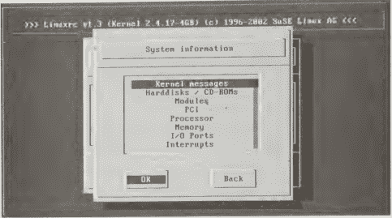

*图 11.1：系统信息*

如果您启动的内核已经编译了 SCSI 驱动，那么您也不需要将该 SCSI 驱动作为模块。加载 SCSI 适配器和连接设备时的典型提示信息可能如下所示：

```text
scsi : 1 host.
Started kswapd v 1.4.2.2
scsi0 : SCSI host 0 accepting period 100ns offset 8 10.00MHz FAST SCSI-II
scsi0 : setting target 0 to period 100ns offset 8 10.00MHz FAST SCSI-II
  Vendor: QUANTUM  Model: VP3210S       Rev: 811H
  Type:   Direct-Access                    ANSI SCSI revision: 02
Detected scsi disk sda at scsi0, channel 0, id 0, lun 0
scsi0 : setting target 2 to period 248ns offset 8 4.03MHz synchronous SCSI
scsi0 : setting target 2 to period 248ns offset 8 4.03MHz synchronous SCSI
  Vendor: TOSHIBA  Model: CD-ROM XM-3401TA  Rev: 0283
  Type:   CD-ROM                         ANSI SCSI revision: 02
scsi2 : detected 1 SCSI disk total.
SCSI device sda: hdwr sector=512 bytes. Sectors=4308352 [2103 MB] [2.1 GB]
Partition check:
 sda: sda1 sda2 sda3 sda4 < sda5 sda6 sda7 sda8 >
```

### 加载模块

选择您需要哪些种类的模块。如果您通过磁盘启动，linuxrc 必须读取相应的数据并显示在列表中。

如果您从 CD 或 DOS（通过 loadlin）启动，这些模块已经在 linuxrc 中设置好了。这省去了繁琐的加载过程，但需要额外的内存。

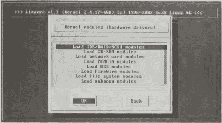

*图 11.2：加载模块*

linuxrc 提供了一个可用驱动列表。左边是模块名称，右边是对其用途的简要描述。对于某些组件，有多种驱动可供选择（甚至包括较新的 alpha 驱动）。

### 传递参数

找到合适的驱动后，用光标移动到它并按下 [Enter]。这将打开一个对话框，其中有一个区域可以为该模块添加额外参数。关于模块参数的更多信息，请参见第 255 页的 *modprobe 参数*一节。

请注意——与在内核提示符下输入参数（如 MILO、SILO 或 SYSLINUX）不同——同一模块的多个参数在这里必须用空格分隔。

在大多数情况下，不需要详细指定硬件。大多数驱动会自动找到它们的组件。只有在您有网卡或带有专有控制器卡的旧 CD-ROM 驱动器时，才需要指定参数。如有疑问，只需尝试按 [Enter]。识别和初始化某些硬件可能需要一些时间。切换到虚拟控制台 4（Alt + F4）可以让您在加载时查看内核消息。SCSI 驱动需要一段时间，因为它们必须等待每个设备加载完毕。

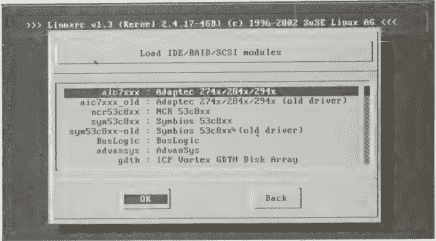

*图 11.3：SCSI 驱动选择*

这些消息由 linuxrc 显示，以便您可以验证一切是否顺利运行。如果失败，这些消息可能会提示原因。

### 开始安装 / 系统

一旦您通过模块设置了硬件支持，请进入“开始安装 / 系统”菜单。

从这里可以启动多种流程：“开始安装”（更新也是从此项启动）、“启动已安装的系统”（必须知道根分区）、“启动救援系统”（参见对面页的*SuSE 救援系统*一节）和“弹出 CD”。

“启动 Live-CD”仅在您使用“LiveEval CD”启动时可用。从 FTP 服务器下载 ISO 镜像（live-eval——变量 VERSION）：

ftp://ftp.suse.com/pub/suse/i386/

> **提示**
>
> 如果您想在不实际安装的情况下测试这台计算机或您可能想购买的笔记本电脑是否与 SuSE Linux 兼容，“启动 Live-CD” 这一项会非常有用——这样的测试应该在任何现代电脑商店都能毫无问题地进行。

对于安装（第 286 页的图 11.5），请为安装选择各种来源，救援系统也是如此（参见第 286 页的图 11.5）。

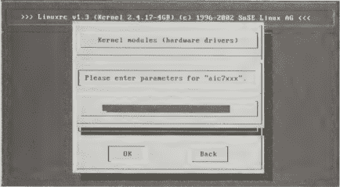

*图 11.4：输入要加载模块的参数*

### SuSE 救援系统

SuSE Linux 包含多个 Linux 救援系统，以便在紧急情况下，您硬盘上的 Linux 分区可以从“外部”访问：通过启动盘或从磁盘、CD、网络或 SuSE FTP 服务器加载的“救援”系统。还有一个可启动的 SuSE Linux CD（“LiveEval CD”）可用作救援系统。救援系统包含几个帮助程序，您可以用它们来解决无法访问的硬盘、配置错误的配置文件或其他类似问题带来的大麻烦。

救援系统的另一个方面是 Parted，用于修改分区大小。如果您不想利用 YaST2 中集成的调整大小工具，可以从救援系统内部启动该程序。有关 Parted 的信息可以在以下网址找到：

http://www.gnu.org/software/parted/

> **提示**
>
> 请始终在手边准备一张启动盘和救援盘，因为与紧急情况下无法访问系统或 CD-ROM 驱动器所浪费的时间和精力相比，创建和维护启动盘所需的一点点努力是微不足道的。


*图 11.5：在 linuxrc 中选择源介质*

## 准备工作

要设置救援系统，你需要两张无错误的磁盘：一张作为将来的启动盘，另一张用于存放小型根文件系统的压缩镜像。用于启动系统的镜像文件 bootdisk 和用于根文件系统的文件 rescue 可以在第一张 CD 的 /disks 目录中找到。有三种方法可以将根文件系统设置到磁盘上：

- 使用 YaST
- 在控制台中使用 Linux 命令

  ```
  earth:  # /sbin/badblocks -v /dev/fd0 1440
  earth:  # dd if=/media/cdrom/disks/rescue of=/dev/fd0 bs=18k
  ```

- 在 DOS 提示符下（其中 CD-ROM 驱动器为 Q:）

  ```
  Q:\> cd \dosutils\rawrite
  Q:\dosutils\rawrite> rawrite.exe
  ```

从版本 8.0 开始，救援盘目前基于 libc5（SuSE Linux 5.3），因为这样可以将一些程序（如编辑器、fdisk 或 e2fsck）保存到磁盘上。

> **注意**  
> 救援盘无法挂载，因为它不是一个文件系统。它只包含文件系统的压缩镜像。有关读取文件系统的说明见下一段。

要读取镜像，你需要先解压缩镜像文件，然后以 root 用户身份挂载解压后的镜像。如果你的 Linux 内核支持 loop 设备，操作步骤如下：

```
earth:  # cp /media/cdrom/disks/rescue /root/rescue.gz
earth:  # gunzip /root/rescue.gz
earth:  # mount -t ext2 -o loop /root/rescue /mnt
```

## 启动救援系统

救援系统由你创建的 SuSE 启动盘或可启动的 CD 或 DVD 启动。要求磁盘和 CD-ROM 或 DVD 驱动器是可引导的。如有必要，请在 CMOS 设置中更改启动顺序。启动救援系统的步骤如下：

- 1. 使用你自行创建的 SuSE 启动盘或插入相应驱动器的第一张 SuSE Linux CD 或 DVD 启动系统。
- 2. 启动整个系统，或选择“手动安装”，以便输入“启动选项”并定义要加载的内核模块。
- 3. 对语言和键盘进行相应设置。
- 4. 在主菜单中选择“安装/启动系统”项。
- 5. 如果你使用启动盘启动，现在请插入安装 CD 或带有救援系统压缩镜像的救援盘。
- 6. 在菜单“启动安装/系统”中选择“启动救援系统”项（参见第 36 页的图 3.3），然后指定所需的源介质（下一页的图 11.6）。

接下来，我们将介绍一些关于选择选项的技巧：

> **“CD-ROM”**：加载救援系统时，会导出路径`/cdrom`。这样就可以从*这张* CD 进行安装。


*图 11.6：救援系统的源介质*

> **“网络”**：要通过网络连接启动救援系统，必须首先加载网卡的驱动程序。有关此内容的常规信息，请参阅第 41 页的*从网络源安装*一节。为此存在多种协议（参见图 11.7），如 NFS、FTP 或 SMB。


*图 11.7：网络协议*

> **“硬盘”**：从硬盘加载救援系统。

> **软盘**：救援系统也可以从软盘启动，尤其是在计算机只有少量工作内存的情况下。

无论选择哪种介质，救援系统都会被解压缩、加载到 RAM 软盘上作为新的根文件系统、挂载并启动。现在它就可以使用了。

## 使用救援系统

救援系统在按键 `Alt` + `F1` 到 `Alt` + `F3` 上提供三个虚拟控制台。在这里，root 无需密码即可登录。`Alt` + `F4` 访问系统控制台，你可以在其中查看内核和 syslog 消息。

在 `/bin` 目录中可以找到一个 shell 和许多其他有用的实用程序（网络工具），例如 mount 程序。在 `sbin` 中，可以找到用于检查和修复文件系统的重要文件和网络实用程序（例如 `e2fsck`）。

此外，此目录还包含系统维护所需的最重要二进制文件，例如 fdisk、mkfs、mount、init 和 shutdown，以及用于维护网络的 ifconfig、route 和 netstat。

编辑器 vi 位于 `/usr/bin` 中。此外，还提供 grep、find、less 等工具，以及 telnet。

## 访问你的正常系统

要使用救援系统挂载你的 SuSE Linux 系统，请使用挂载点 `/mnt`。你也可以使用或创建另一个目录。

例如，假设你的正常系统是按照示例文件 38 中显示的 `/etc/fstab` 组合而成的。

| 设备 | 挂载点 | 类型 | 选项 | 转储 | 传递 |
|---|---|---|---|---:|---:|
| `/dev/sdb5` | `swap` | `swap` | `defaults` | 0 | 0 |
| `/dev/sdb3` | `/` | `ext2` | `defaults` | 1 | 1 |
| `/dev/sdb6` | `/usr` | `ext2` | `defaults` | 1 | 2 |

*文件 38：示例 `/etc/fstab`*

> **小心**
>
> 请注意以下部分中挂载各种设备时步骤的顺序。

要访问整个系统，请使用以下命令在 `/mnt` 目录中逐步挂载：

```
earth:/ # mount /dev/sdb3 /mnt
earth:/ # mount /dev/sdb6 /mnt/usr
```

现在，你可以访问整个系统，并例如更正配置文件（如 `/etc/fstab`、`/etc/passwd` 和 `/etc/inittab`）中的错误。配置文件现在位于 `/mnt/etc` 目录中，而不是 `/etc` 中。

要使用 fdisk 程序通过简单地重新设置来恢复甚至完全丢失的分区，请确定分区之前位于硬盘上的位置，并打印输出 `/etc/fstab` 目录以及 `fdisk` 的输出。

```
earth:  # fdisk -l /dev/(disk)
```

将 `(disk)` 变量替换为你的硬盘设备名称，例如 `hda`，按顺序插入。

## 修复文件系统

损坏的文件系统对救援系统来说是棘手的问题。这可能在断电或系统崩溃导致意外关机后发生。通常，无法在运行中的系统上修复文件系统。如果遇到真正严重的问题，你可能甚至无法挂载根文件系统，导致系统启动以“内核恐慌”结束。这时，唯一的办法是使用救援系统从“外部”修复系统。

SuSE Linux 救援系统包含 e2fsck 和 dumpe2fs（用于诊断）等实用程序。这些应该可以解决大多数问题。

在紧急情况下，man 手册页通常不可用。这就是为什么我们在本手册附录 A（第 431 页）中包含了它们。

示例：如果由于超级块无效而导致挂载文件系统失败，e2fsck 程序可能也会失败。如果是这种情况，你的超级块可能也已损坏。超级块的副本位于每 8192 个块处（8193、16385 等）。如果你的超级块已损坏，请尝试使用其中一个副本。这可以通过输入以下命令来完成：

```
earth:  # e2fsck -f -b 8193 /dev/damaged_partition
```

`-f` 选项强制进行文件系统检查，并覆盖 e2fsck 的错误，这样——由于超级块副本完好——一切都会正常。

## 虚拟控制台

Linux 是一个多用户、多任务系统。即使在独立的 PC 系统上，你也会体会到这些功能的优势。

在文本模式下，有六个虚拟控制台可用。使用 `(Alt + F1)` 到 `(Alt + F6)` 在它们之间切换。第七个控制台保留给 X11。通过修改 `/etc/inittab` 文件，可以分配更多或更少的控制台。要从不离开 X11 的情况下切换到控制台，请使用 `(Ctrl + Alt + F1)` 到 `(Ctrl + Alt + F6)`。然后使用 `(Alt + F7)` 返回到 X11。

## 键盘布局

为了标准化程序的键盘映射，对以下文件进行了更改：

```
/etc/inputrc
/usr/X11R6/lib/X11/Xmodmap
/etc/skel/.Xmodmap
/etc/skel/.exrc
/etc/skel/.less
/etc/skel/.lesskey
/etc/csh.cshrc
/etc/termcap
/usr/lib/terminfo/x/xterm
/usr/X11R6/lib/X11/app-defaults/XTerm
/usr/share/emacs/(VERSION)/site-lisp/term/*.el
/usr/lib/joerc
```

这些更改仅影响使用 terminfo 条目或其配置文件被直接更改的应用程序（vi、less 等）。其他非 SuSE 应用程序应调整为这些默认值。

在 X 环境下，可以使用组合键 `(Ctrl + Shift)`（右侧）来访问 compose 键（“multikey”）。另请参阅 `/usr/X11R6/lib/X11/Xmodmap` 中的相应条目。


## 本地调整 — I18N/L10N

SuSE Linux 在很大程度上已经国际化，并且可以灵活地进行本地化修改。换言之，国际化（“I18N”）使得具体的本地化（“L10N”）成为可能。缩写 I18N 和 L10N 分别由相应单词的首字母、末字母以及中间省略的字母数组成。

设置通过 `/etc/sysconfig/language` 文件中定义的 LC_* 变量完成。这不仅涉及“母语支持”，还涉及以下类别：消息（语言）、字符集、排序顺序、时间和日期、数字以及货币。上述每个类别既可以通过自身对应的变量直接定义，也可以通过 language 文件中的某个变量间接定义（参见 locale 的手册页（man 5 locale））。

1. **RC_LC_MESSAGES、RC_LC_CTYPE、RC_LC_COLLATE、RC_LC_TIME、RC_LC_NUMERIC、RC_LC_MONETARY：** 这些变量（去除 RC_ 前缀后）会传给 shell，并决定上述类别。相关文件如下所列。DEFAULT_LANGUAGE 直接在 language 文件中定义，且不会被导出。当前设置可以用命令 `locale` 显示。

2. **RC_LC_ALL：** 该变量（如果设置）会覆盖第 1 项中提到的变量的值。

3. **RC_LANG：** 如果上述变量均未设置，则此变量为“回退值”。默认情况下，SuSE Linux 只设置 RC_LANG。这使用户更容易输入自己的值。

4. **ROOT_USES_LANG：** 一个 yes/no 变量。如果设置为 no，则 root 始终在 POSIX 环境下工作。

5. **DEFAULT_LANGUAGE：** 此变量有两个功能。它定义 YaST2 启动时所用的语言，同时若 RC_LANG 未设置，它也作为回退值。它由 YaST2 根据语言选择菜单中选择的语言设置。为避免误解：DEFAULT_LANGUAGE 不会由 SuSEconfig 作为 LANGUAGE 传给 shell，而是仅在需要时用该变量的值设置 LANG。

LANGUAGE 也可用于定义语言支持的“回退链”。参见第 294 页了解具体做法。

DEFAULT_LANGUAGE 可以通过 YaST2 的“选择语言”项进行影响。其他变量可以通过 sysconfig 编辑器设置。

此类变量的值包含语言代码、国家代码、编码和修饰符。各个组成部分通过特殊字符连接：

```
LANG={language}[_{[COUNTRY]}.Encoding[@Modifier]]
```

### 一些示例

应始终同时设置语言和国家代码。语言设置遵循 ISO 639 标准（http://www.evertype.com/standards/iso639/iso639-en.html 和 http://www.loc.gov/standards/iso639-2/）。国家代码列于 ISO 3166，参见（http://www.din.de/gremien/nas/nas/iso3166/codlistp1/en_list.htm）。只有能在 /usr/lib/locale 中找到可用的描述文件时，设置相应的值才有意义。可以使用命令 localedef 从 /usr/share/i18n 中的文件创建额外的描述文件。可以为 en_US.UTF-8（英语和美国的组合）创建描述文件：

```
earth:~ # localedef -i en_US -f UTF-8 en_US.UTF-8
```

```
LANG=en_US.ISO-8859-1
```

这将变量设置为英语语言、美国国家代码和 ISO-8859-1 字符集。该字符集不支持欧元符号，但对于某些尚未更新以支持 ISO-8859-15 的程序来说，有时会很有用。定义字符集的字符串（此处为 ISO-8859-1）随后会被诸如 Emacs 等程序解析。

```
LANG=en_US.UTF-8
```

如果使用 Unicode xterm，则还必须指定 UTF-8。为此，可以创建一个小 shell 脚本，命名为 uxterm，以便每次启动时加载 UTF-8 的 xterm。参见文件 39。

```bash
#!/bin/bash
export LANG=en_US.UTF-8
xterm -fn \
    '-Misc-Fixed-Medium-R-Normal--18 120-100-100-C-90-ISO10646-1' \
    -T 'xterm UTF-8' $*
```

*文件 39：uxterm 启动 Unicode xterm*

SuSEconfig 读取 `/etc/sysconfig/language` 中的变量，并将必要的更改写入 `/etc/SuSEconfig/profile` 和 `/etc/SuSEconfig/csh.cshrc`。`/etc/SuSEconfig/profile` 由 `/etc/profile` 读取或“引入”（sourced）。`/etc/SuSEconfig/csh.cshrc` 由 `/etc/csh.cshrc` 引入。这样，这些设置即可在整个系统中生效。

### 语言支持的设置

*消息* 类别中的文件通常只存放在语言目录（例如 en）中，以作为回退。如果设置 LANG 为 en_US，而 `/usr/share/locale/en_US/LC_MESSAGES` 中的“消息”文件不存在，则会回退到 `/usr/share/locale/en/LC_MESSAGES`。

也可以定义回退链，例如布列塔尼语 → 法语，或加利西亚语 → 西班牙语 → 葡萄牙语：

```
LANGUAGE="br_FR:fr_FR"
LANGUAGE="gl_ES:es_ES:pt_PT"
```

如果需要，也可以使用挪威语的“新挪威语”（nynorsk）和“书面挪威语”（bokmål）变体（并附带回退到 no）：

```
LANG="nn_NO"
LANGUAGE="nn_NO:nb_NO:no"
```

或

```
LANG="nb_NO"
LANGUAGE="nb_NO:nn_NO:no"
```

请注意，在挪威语中，LC_TIME 的处理方式也有所不同。

### 可能的问题

- 千位逗号无法识别。LANG 可能被设置为 en，但 glibc 使用的描述文件位于 `/usr/share/locale/en_US/LC_NUMERIC`。例如，必须将 LC_NUMERIC 设置为 en_US。

### 更多信息

- *GNU C 库参考手册*，第“区域设置与国际化”章，包含在 glibc-info-series doc 包中。
- Markus Kuhn，*Unix/Linux 的 UTF-8 和 Unicode FAQ*，当前位于 `http://www.ci.cam.ac.uk/~mgk25/unicode.html`。
- Bruno Haible 所著的 *Unicode-Howto*

  ```
  file:/usr/share/doc/howto/en/html/Unicode-HOWTO.html
  ```

## SuSE Linux 启动概念

启动并初始化一个 UNIX 系统，即使对经验丰富的系统管理员来说也颇具挑战。本章简要概述 SuSE Linux 的启动概念。新的实现与 LSB 规范（1.0 版）的“系统初始化”部分兼容。有关 LSB 的更多信息，请参考第 272 页的“Linux 标准基础（LSB）”一节。

- init 程序 ........................................ 298
- 运行级别 .................................................. 298
- 更改运行级别 ........................................ 300
- init 脚本 .............................................. 300
- SuSEconfig、/etc/sysconfig 和 /etc/rc.config ........... 303
- 系统配置：脚本和变量 .............. 304

“Uncompressing Linux...” 这几个简单的字样表明内核开始接管你的硬件。它会检查并设置你的控制台——更准确地说：显卡的 BIOS 寄存器和输出格式——以读取 BIOS 设置并初始化基本硬件接口。接着，驱动程序“探测”现有硬件并对其进行相应初始化。检查分区并挂载根文件系统后，内核启动 init，init 将“启动”（Unix 术语）整个系统及其所有程序和配置。内核控制着整个系统，包括硬件访问和程序使用的 CPU 时间。

### init 程序

init 程序负责正确初始化所有系统进程。因此，它是整个系统中所有进程的父进程。

init 扮演着一个特殊角色。它由内核直接启动，并且抵制信号 9——通常信号 9 可以终止进程。所有其他程序要么由 init 直接启动，要么由它的某个“子”进程启动。

init 通过 /etc/inittab 文件进行集中配置。这里定义了“运行级别”（参见本页的 *运行级别* 一节）。它还指定了每个级别中可用的服务和守护进程。

根据 /etc/inittab 中的条目，init 会调用多个脚本，为清晰起见，这些脚本都位于 /etc/init.d 目录中。

启动系统和关闭系统的整个过程由 init 维护。从这个角度看，内核可以被视为一个后台进程，其任务是维护所有其他进程，并根据其他程序的请求调整 CPU 时间和硬件访问。

### 运行级别

在 Linux 中，*运行级别* 定义系统的启动方式。启动后，系统按照 /etc/inittab 中 initdefault 行的定义启动。通常为 3 或 5（参见下一页的表格 12.1）。另一种方式是在启动时指定一个特殊的运行级别（例如在 LILO 提示符下）。内核会将其不需要的任何参数直接传递给 init。

要在系统运行时更改运行级别，请输入 init 并带上适当的数字。只有超级用户才允许这样做。

```
root@earth:/ > init 1
```


| 运行级别 | 含义 |
|---|---|
| 0 | 系统停机 |
| S | 单用户模式；从引导提示符（使用美式键盘布局）进入 |
| 1 | 单用户模式 |
| 2 | 本地多用户模式，无远程网络（标准） |
| 3 | 完整多用户模式，支持网络 |
| 4 | 未使用 |
| 5 | 完整多用户模式，支持网络和 xdm |
| 6 | 系统重启 |

*表 12.1：Linux 中的有效运行级别*

这会将你带入单用户模式，该模式用于系统的维护和管理。在 S 模式下完成工作后，系统管理员可以再次输入以下命令将运行级别更改为 3：

```
root@earth:/> init 3
```

现在所有必需的程序都已启动，用户可以登录并使用系统。下面的表 12.1 概述了可用的运行级别。在 /usr 分区通过 NFS 挂载的系统上，不应使用运行级别 2。你可以使用 init 0 关闭系统，或使用 init 6 重启系统。

如果你已经正确安装并配置了 X Window 系统（参见第 127 页的*X Window 系统*一节），并且希望用户通过图形用户界面登录，请将运行级别更改为 5。首先输入 init 5 试一下，看看系统是否按预期工作。之后，在 YaST2 中将默认运行级别设置为 5。

> **提示**
> 
> 如果 `/etc/inittab` 已损坏，系统可能无法正常启动。因此，在编辑 `/etc/inittab` 时务必格外小心。要修复损坏，请尝试在 LILO 引导提示符下输入 `init=/bin/sh`，直接引导进入 shell。具体形式如下：`boot: linux init=/bin/sh`

## 更改运行级别

通常，更改运行级别时会发生几件事。首先，会启动当前运行级别的停止脚本，关闭当前运行级别所需的一些程序。然后，会启动新运行级别的启动脚本。在大多数情况下，会启动许多程序。为了说明这一点，我们将向你展示从运行级别 3 更改为 5 的过程：

- 管理员（root）通知 init 更改运行级别：

```
root@earth:/ > init 5
```

- 现在，init 查阅其配置文件（`/etc/inittab`），并意识到它应该以新的运行级别作为参数启动 `/etc/init.d/rc`。

- 然后，rc 调用当前运行级别的所有停止脚本，但仅针对那些在所选新运行级别中没有对应启动脚本的脚本。在我们的示例中，这些脚本都位于 `/etc/init.d/rc3.d`（旧运行级别为 3）中，并且以 `K` 开头。`K` 后面的数字保证了特定的启动顺序，因为需要考虑一些依赖关系。

> **注意**
>
> 停止脚本的名称始终以 `K` 开头，表示 kill（终止）。启动脚本以 `S` 开头，表示 start（启动）。

- 最后启动的是新运行级别的启动脚本。在我们的示例中，这些脚本位于 `/etc/init.d/rc5.d`，并以 `S` 开头。这里也应用了与启动顺序相同的规则。

当切换到与当前运行级别相同的运行级别时，init 只会检查 `/etc/inittab` 是否有更改，并启动相应的步骤（例如，在另一个接口上启动 getty）。

## 初始化脚本

`/etc/init.d` 中的脚本分为两部分：

- 由 init 直接执行的脚本。这仅适用于系统启动和立即关闭系统时（电源故障或用户按下 `Ctrl` + `Alt` + `Del`）。

表 12.2：init 脚本选项摘要

| 选项 | 含义 |
|---|---|
| start | 启动服务 |
| stop | 停止服务 |
| restart | 停止服务，如果服务已在运行则重新启动；如果服务未运行，则启动该服务 |
| reload | 在不停止和重启服务的情况下重新加载服务的配置 |
| force-reload | 如果服务支持，则重新加载服务的配置；如果不支持，则执行重启 |
| status | 显示当前状态 |

- 由 init 间接启动的脚本。这些脚本在更改运行级别时运行，并且总是调用主脚本 `/etc/init.d/rc`，该脚本保证相关脚本的正确顺序。

所有脚本都位于 `/etc/init.d` 中。用于更改运行级别的脚本也位于此处，但通过某个子目录（`/etc/init.d/rc0.d` 到 `/etc/init.d/rc6.d`）中的符号链接来调用。这只是为了清晰起见，并避免脚本重复（例如，如果它们在多个运行级别中使用）。由于每个脚本既可以作为启动脚本，也可以作为停止脚本执行，因此这些脚本必须理解参数“start”和“stop”。此外，脚本还理解 restart、reload、force-reload 和 status 选项。表 12.2 解释了这些不同的选项。

离开运行级别 3 后，会运行 `/etc/init.d/rc3.d/K40network`。`/etc/init.d/rc` 通过 stop 参数运行 `/etc/init.d/network` 脚本。进入运行级别 5 后，会启动同一个脚本。不过，这次使用的是 start 参数。

这些特定于运行级别的子目录中的链接仅用于将脚本分配给特定的运行级别。添加和删除所需链接的工作由 insserv 程序（或通过链接 `/usr/lib/lsb/install_initd`）在安装和卸载软件包时完成。请参阅 insserv 的手册页（man 8 insserv）。

下面，我们简要介绍最先（或最后）启动的引导和停止脚本，并解释维护脚本。

**boot** —— 在使用 init 直接启动系统时执行。它独立于所选运行级别，并且只执行一次。在这里，会检查文件系统、启动内核守护进程、删除 `/var/lock` 中一些不必要的文件，并为回环设备配置网络（如果已在 `/etc/rc.config` 中选择了该设备）。此外，还会使用 isapnp 工具设置系统时间，并配置即插即用硬件。

如果在自动检查和修复文件系统时发生错误，系统管理员可以在输入 root 密码后进行干预。

最后执行的是脚本 `boot.local`。

**boot.local** —— 在这里，你可以输入在切换到运行级别之前在引导时执行的其他命令。它可以与 DOS 系统中的 AUTOEXEC.BAT 相类比。

**boot.setup** —— 从单用户模式切换到另一个运行级别时必须执行的一般设置。在这里，会加载键盘映射，并启动内核守护进程，该进程会自动加载模块。

**halt** —— 此脚本仅在切换到运行级别 0 或 6 时执行。在这里，它以 halt 或 reboot 的形式执行。系统是关机还是重启取决于 halt 是如何被调用的。

**rc** —— 每当运行级别更改时，该脚本都具有至关重要的作用。它调用当前运行级别的相应停止脚本和新选择运行级别的启动脚本。

理解了这一概念后，你可以创建自己的脚本。`/etc/init.d/skeleton` 中已准备好一个骨架。具体格式在 LSB 大纲中有所描述。它明确规定了步骤的顺序以及脚本应在哪些级别中处理。

现在，在相应的 `rc?.d` 中为你的脚本创建链接，以确保在更改运行级别时它能被启动（有关脚本名称，请参见上文第 300 页的*更改运行级别*一节）。`init.d` 的手册页（`man 1 init.d`）提供了所有必要的技术背景。

> **警告**
> 
> 务必极其小心地处理这些脚本！一个错误的脚本可能会导致你的机器死机！如果所有其他方法都失败，请参阅第 298 页的*运行级别*一节。

## SuSEConfig、/etc/sysconfig 和 /etc/rc.config

SuSE Linux 的主要配置可以通过 `/etc/sysconfig` 中的配置文件以及名为 `/etc/rc.config` 的中心配置文件来完成。在后者中，会设置一些对整个系统有效的环境变量。`/etc/init.d` 中的每个脚本都会首先执行 `/etc/rc.config`，以读取适用于自身的变量值。`/etc/rc.config` 还包含用户设置的变量。`/etc/sysconfig` 中的配置文件由单独脚本来解释，例如，ISDN 配置文件仅由 isdn 脚本读取。

> **注意**
>
> 从 SuSE Linux 6.0 开始，具有大量调整选项的软件包会将其变量存储在 `/etc/rc.config.d` 目录中的各个文件中。例如，sendmail 软件包或 i4l（ISDN）软件包就是这种情况。
>
> 不过，为了简化起见，我们通常只提及 `/etc/rc.config`，即使该文件已被移到其他地方。

此外，大量配置文件是根据 `/etc/rc.config` 和 `/etc/sysconfig` 中的设置生成的。这是 `/sbin/SuSEConfig` 的任务。例如，如果你更改了网络配置，文件 `/etc/hosts.conf` 会重新生成，因为它取决于你所做的配置。

因此，如果你手动更改了这些文件中的任何内容，之后需要运行 `/sbin/SuSEConfig`，以确保对相应配置文件的所有更改都发生在正确的位置。如果你使用 YaST2 更改配置，它会自动执行 `/sbin/SuSEConfig` 并更新你的配置文件。

这种概念使你无需重启系统即可对配置进行基本更改。由于某些更改相当复杂，可能需要重新启动某些程序才能使更改生效。如果网络配置已更改，可以使用以下命令重新启动网络程序：

```
earth:    # rcnetwork stop
earth:    # rcnetwork start
```

如你所见，你可以轻松地手动启动和停止 init 脚本。通常，我们建议按以下步骤配置系统：

- 将系统切换到*单用户模式*（运行级别 1）：

```
earth:    # init 1
```


-   按需修改配置文件。这可以使用你选择的编辑器完成。
-   执行 `/sbin/SuSEconfig` 使修改生效。如果你通过 YaST2 修改了 `/etc/rc.config`，则这一步骤会自动完成。
-   将系统恢复到之前的运行级别。

```
root@earth:   > init 3
```

此步骤主要在你更改了系统级设置（如网络配置）时相关。对于小改动，不必进入单用户模式，但这样做可以确保所有相关程序都被正确重启。

> **提示**
> 
> 要禁用 SuSEconfig 的自动配置，请在 `/etc/sysconfig/suseconfig` 中将变量 `{ENABLE_SUSECONFIG}` 设置为 no。如果你想使用 SuSE 安装支持，请不要禁用 SuSEConfig。也可以部分禁用自动配置。

## 系统配置：脚本和变量

在本节中，我们介绍一些系统参数及其默认设置。如果你不使用 YaST2 修改 `/etc/rc.config` 或 `/etc/sysconfig` 中的配置文件，务必确保将空参数设置为两个引号（例如 `KEYTABLES=""`），并将包含空格的参数用引号括起来。只由一个词组成的参数则不必加引号。

### /etc/rc.config 中的基本设置

```
PATH="/sbin:/bin:/usr/sbin:/usr/bin"
```

该变量仅供内部使用。请不要更改它。

```
CHECK_PERMISSIONS="set"
```

定义是否对照 `/etc/permissions` 文件检查文件权限。设置为 set 时，错误的设置会被纠正。设置为 warn 时，仅发出“警告”。设置为 no 时，此功能被禁用。

```
PERMISSION_SECURITY="easy local"
```

在 /etc/permissions.paranoid、/etc/permissions.secure 和 /etc/permissions.easy 中，预定义了三个安全级别。请设置为 easy、secure 或 paranoid。如果你选择 paranoid，某些系统服务可能不再可用。如有需要，请显式启用它们。

要定义自己的设置，例如创建一个文件 /etc/permissions.local，然后将变量设置为 local。

> **注意**
> 
> 如果你定义自己的 /etc/permissions.local，请确保你的设置与轮转机制（logrotate 软件包）不冲突。logrotate 会覆盖 /etc/permissions.local 中的设置。参见第 273 页的 *日志文件 — logrotate 软件包* 一节。

```
HALT_SOUND="no"
```

设置为 yes 或 quint，可在系统关机或重启时播放五度音音序；设置为 octave，则播放八度音。

```
CHECK_INITTAB="yes"
```

SuSEconfig 可以对 `/etc/inittab` 做一些修改。如果你不希望这样，请将此变量设置为 no。

```
CONSOLE_SHUTDOWN="reboot"
```

此变量决定 init 进程如何处理 [Ctrl] + [Alt] + [Del]。必须将 CHECK_INITTAB 设为 yes 才能激活此功能。可能的设置为 ignore、reboot 或 halt。默认值为 reboot。

```
DVB_SOUND_CHIP="ti"
```

选择 DVB 卡上的声音芯片 — ti 或 crystal。

```
START_FRONTBASE="no"
```

启动 FrontBase 和 FrontBase Web 服务吗？

```
IRCSERVER="sun.cosmos.com"
```

指定一个以空格分隔的 IRC 服务器列表（*互联网中继聊天*）。

```
SECCHK_USER="root"
```

此变量决定安全检查脚本的报告发送到哪个电子邮件地址。默认为 root。

```
START_SECCHK="yes"
```

此变量控制安全检查脚本是否应自动在每晚、每周或每月运行。设置为 no 可禁用。

```
KERNEL_LOGLEVEL="1"
```

klogd 的默认日志级别。

```
SYSLOGD_PARAMS=""
```

syslogd 的参数，例如 `"-r = my.dom.ain"`。

```
LOAD_MEMSTAT_MODULE="no"
```

启用此选项可在启动时自动为 xosview 加载 memstat 内核模块。

### /etc/sysconfig 中文件的设置

**suseconfig** – SuSEconfig 的设置。

```
ENABLE_SUSECONFIG="yes"
```

决定 SuSEconfig 是否负责更新配置。如果你想咨询我们的安装支持，请不要禁用 SuSEconfig。

```
MAIL_REPORTS_TO="root"
```

选择要将 SuSEconfig 在自动系统管理期间创建的电子邮件报告发送给哪个用户。

```
MAIL_LEVEL="warn"
```

如果只想发送重要消息，请将变量设置为 warn。如果日志文件也要通过邮件发送，请将其设置为 all。

```
CREATE_INFO_DIR="yes"
```

如果应使用 perl 脚本自动生成文件 /usr/share/info/dir，请将此变量设置为 yes。该文件是所有 info 页面的索引。

```
CREATE_JAVALINK="yes"
```

如果你将此变量设置为 yes，SuSEconfig 可以自动创建链接 /usr/lib/java 和 /usr/lib/jre，它们分别指向合适的 JDK 或 JRE。

```
CREATE_PERLLOCAL_POD="yes"
```

SuSEconfig 可以修改你的 perllocal.pod 吗？

```
UPDATE_GROFF_CONF="yes"
```

更新 DESC 以获得正确的页面尺寸吗？

```
GROFF_PAGESIZE=""
```

如果在你的 printcap 中找不到正确的页面尺寸，可以将此变量设置为 groff 和 ghostscript 均支持的以下值：letter、legal、a4 或 b5。

**CHECK_ETC_HOSTS="yes"**  
定义 SuSEconfig 是否应检查并修改 `/etc/hosts`。

**BEAUTIFY_ETC_HOSTS="no"**  
`/etc/hosts` 是否应由 SuSEconfig 排序？

**SORT_PASSWD_BY_UID="no"**  
如果此变量设置为 yes，SuSEConfig 会按“uid”和“gid”对 `/etc/passwd` 和 `/etc/group` 进行排序。

**CWD_IN_ROOT_PATH="no"**  
当前工作目录（“.”）是否应包含在 root 用户的路径中？  
出于安全原因，不建议使用此设置。此设置对所有 “UID” 低于 100 的用户（系统用户）有效。

**CWD_IN_USER_PATH="yes"**  
当前工作目录（“.”）是否应包含在普通用户的路径中？

**onlineupdate** – YaST2 在线更新的设置。

**YAST2_LOADFTPSERVER="yes"**  
启动时（YaST2 在线更新），是否应通过 wget 调用 `www.suse.de` 来更新默认的 FTP 服务器列表？该列表存储在 `/etc/suseservers` 下。如果你不想重新加载 FTP 服务器列表，请将该变量设置为 no。

**autoinstall** – YaST2 的 AutoInst。

**REPOSITORY="/var/lib/autoinstall/repository"**  
包含所有配置文件的仓库。

**SuSEDir=""**  
SuSE 目录。

**CLASS_DIR="/var/lib/autoinstall/classes"**  
类。

**USE_CLASSES="no"**  
使用类吗？

**autofs** – 使用此守护进程，可以自动挂载可通过 NFS 访问的目录或本地目录（CD-ROM 驱动器、磁盘驱动器等）。必须安装并配置 `nfs` 软件包或 `series n` 软件包。

**AUTOFS_OPTIONS=""**  
autofs 守护进程参数，例如 `"--timeout 60"`。

**susehelp** – SuSE 帮助系统。

```
DOC_HOST=""
```

如果 SuSE 帮助系统应使用全局文档服务器，请在此处输入服务器名称，例如 "sun.cosmos.com"。

```
DOC_SERVER="no"
```

在文档服务器上，必须将此变量设置为 yes，这样根据 DOC_ALLOW 中的设置，将允许访问 http-man，并且 HTTP 服务器的索引文件将被相应修改。它们将指向文档服务器，而不是 http://localhost。

```
DOC_ALLOW="LOCAL"
```

主机和域的列表，作为 /etc/hosts.allow 的模式，这些主机和域应有权访问文档服务器。仅当 DOC_SERVER 设置为 yes 时才会读取此变量。子域也可以列在这里（例如使用 "*.cosmos.com"）。

### language — 语言和区域设置

```
DEFAULT_LANGUAGE="english"
```

如果你在控制中心更改语言设置，YaST 会自动设置此变量。如果 RC_LANG 未设置，则使用此值作为后备。该值通过文件 /usr/share/locale/locale.alias 传递。

```
RC_LANG="en_US"
```

为区域设置设置 LANG 变量。只要没有使用 RC_LC_* 变量，这就是本地用户的默认值。相应的 sysconfig 变量为：RC_LC_ALL（覆盖 LC_* 和 LANG！）、RC_LC_MESSAGES、RC_LC_CTYPE、RC_LC_MONETARY、RC_LC_NUMERIC、RC_LC_TIME 和 RC_LC_COLLATE。

参见第 292 页的 *本地调整 — I18N/L10N* 一节。

```
ROOT_USES_LANG="no"
```

是否应为 root 用户应用区域设置？

### mail — 电子邮件设置

```
FROM_HEADER=""
```

为整个系统定义的 From: 行。如果为空 ""，则使用 FQDN。参见第 330 页的 *域名系统* 一节。

```
MAIL_CREATE_CONFIG="yes"
```

如果 SuSEconfig 不应生成配置文件，请将其设置为 no（例如，你想自己生成 /etc/sendmail.cf）。如果你想根据 /etc/sysconfig/sendmail 中给出的参数生成 sendmail 配置 /etc/sendmail.cf，请使用 yes。


```
NULLCLIENT=""
```

空客户端是一种只能发送邮件的机器。它不从网络接收邮件，也不在本地投递任何邮件。空客户端通常使用 POP 或 NFS 访问邮箱。

## 3ddiag — 用于 3Ddiag。

```
SCRIPT_3D="switch2mesasoft"
```

该变量指定用于创建指向正确 OpenGL 库或扩展的必要符号链接的脚本。这些脚本位于 `/usr/X11R6/bin`。可能的值有：

- `no` — 不执行任何脚本。
- `switch2mesasoft` — Mesa-Software 仿真（适用于所有显卡）
- `switch2mesa3dfx` — Mesa/Glide
- `switch2nvidia_glx` — XFree86 4.x/NVIDIA_GLX (NVIDIA_GLX/NVIDIA_kernel)
- `switch2xf86_glx` — XFree86 4.x/DRI

使用 3Ddiag 确定正确的设置。参见第 169 页的 *OpenGL — 3D 配置* 一节。

## xdmsc — 使用 X 终端。

```
START_RX="no"
```

首先，编辑 `/etc/inittab`，取消包含 `/sbin/init.d/rx` 那行的注释。然后必须设置 RX_XDMCP 和 RX_RHOST。最后，如果你想拥有一个 X 终端，将 START_RX 设为 yes。

```
RX_XDMCP="broadcast"
```

xdm 控制协议：query、indirect 或 broadcast。对于 query 或 indirect，需要设置 RX_RHOST。

```
RX_RHOST=""
```

当 RX_XDMCP 设置为 query 或 indirect 时，xdm 主机是必需的。

```
RX_DSP=""
```

可选 DISPLAY 编号，例如 :1 或 :2。默认为 DISPLAY :0。

```
RX_BPP=""
```

本地 X 服务器的可选颜色深度。

```
RX_CLASS=""
```

## windowmanager — 窗口管理器。

```
DEFAULT_WM="kde"
```

在这里设置默认窗口管理器，例如 kde、gnome 或 fvwm。

```
INSTALL_DESKTOP_EXTENSIONS="yes"
```

为新用户安装 SuSE 扩展（主题和附加功能）。

```
KDM_SHUTDOWN="auto"
```

指定允许通过 kdm 关闭或重启计算机的用户。  
可能的设置：root、all、none、local 和 auto。

```
KDM_USERS=""
```

应在 KDM 中显示图标的用户列表，以空格分隔。如果为空，则使用系统默认值。

```
KDE_USE_FAM="no"
```

KDE 是否应使用 fam 守护进程？仅对 NFS 挂载的目录有意义。

```
KDE_USE_FAST_MALLOC="no"
```

是否使用改进的 malloc？*注意：* 这种内存分配方式仍是*实验性*的。

```
SUSEWM_UPDATE="yes"
```

SuSEConfig.fwm 是否应为窗口管理器创建系统级配置文件？

```
SUSEWM_WM="all"
```

应为其生成配置文件的窗口管理器列表，以空格分隔。有效值为 fvwm、fvwm2、fvwm95、bowman、wmw、ctwm、kwm 和 all。

```
SUSEWM_XPM="yes"
```

将 SUSEWM_XPM 设为 yes 可在菜单中使用像素图。必须安装 3dpixms 软件包。

## displaymanager — 显示管理器配置

```
DISPLAYMANAGER="kdm"
```

设置用于登录的显示管理器。可能的值：console、xdm（X Window 系统的传统显示管理器）、kdm（KDE 的显示管理器）、gdm（GNOME 的显示管理器）或 wdm（“WINGs 显示管理器”）。

```
DISPLAYMANAGER_REMOTE_ACCESS="no"
```

是否允许远程访问你的显示管理器（仅限 KDM）。

```
DISPLAYMANAGER_STARTS_XSERVER="yes"
```

显示管理器启动本地 X 服务器；如果仅为远程访问，请设为 no。

## tetex — TeX/LaTeX。

```
CLEAR_TEXTMF_FONTS="no"
```

TeX 或 LaTeX 系统的自动字体生成会将位图字体放入目录 `/var/cache/fonts/`。如果 CLEAR_TEXTMF_FONTS 设置为 yes，则会清除该目录中最近 20 天内未使用的字体。

## printer – 打印机。

```
DEFAULT_PRINTER="lp"
```

lpr 在不带 -P 参数调用时使用的打印机队列名称。

## 初始化本地硬件（键盘、调制解调器、鼠标、PCMCIA）

### hardware – 硬件设置

```
DEVICES_FORCE_IDE_DMA_ON=""
```

为列出的 IDE 设备开启 DMA。

```
DEVICES_FORCE_IDE_DMA_OFF=""
```

为列出的 IDE 设备关闭 DMA。

### clock – 时间设置

```
GMT="-u"
```

如果你的硬件时钟设置为 GMT（*格林尼治标准时间*），请将其设为 -u。否则设为 --localtime。此设置对于自动切换夏令时和冬令时非常重要。

```
TIMEZONE="CET"
```

时区对于夏令时和冬令时的切换也很重要。这会设置 `/usr/lib/zoneinfo/localtime`。

### console – 控制台设置：串行控制台、键盘、帧缓冲

```
SER_CONSOLE_SESSION="console"
```

控制台会话名称

```
SER_CONSOLE_SCREENRC="/usr/share/cyclades/screenrc"
```

屏幕配置文件

```
SER_CONSOLE_OWNER="root"
```

串行控制台会话的所有者

```
SER_CONSOLE_DEVICE="/dev/ttyC0"
```

第一个串行控制台设备，例如 Cyclades-Z 的 `/dev/ttyC0`。

```
KEYTABLE="de-latin1-nodeadkeys"
```

定义键盘布局。如果你使用美式键盘，此变量可以留空。

```
KBD_NUMLOCK="no"
```

将其设为 no 后，启动时不会启用 (NumLock)。

```
KBD_CAPSLOCK="no"
```

启动时不要启用 (CapsLock)。

```
KBD_TTY="tty1 tty2 tty3 tty4 tty5 tty6"
```

将 (NumLock) 和 (CapsLock) 限制在特定的 TTY 上。"" 表示所有 TTY。

```
KBD_RATE="30,0"
```

键盘自动重复的速率。将其设为每秒 2 到 30 次之间的值。还需要设置延迟变量。

```
KBD_DELAY="250"
```

设置自动按键重复开始前的延迟。可能的值：250、500、750 和 1000（毫秒）。同时设置变量 `KBD_RATE`。

```
CONSOLE_FONT=""
```

启动时加载的控制台字体。其他设置包括：CONSOLE_SCREENMAP、CONSOLE_UNICODEMAP 和 CONSOLE_MAGIC。

```
COMPOSETABLE="clear winews shiftctrl latin1.add"
```

要加载的 Compose 表。

### irda – IrDA 是红外接口，例如笔记本电脑使用的接口。

```
IRDA_PORT="/dev/ttyS1"
```

当前默认配置支持 UART（SIR）模式。如果你希望使用 FIR（4 Mbit/s，仅少数芯片组支持），请参阅 IrDA HOWTO，位于 /usr/doc/howto/en/IRDA-HOWTO.gz。变量 IRDA_PORT 设置所使用的串行端口。请查看你的 BIOS 设置以确定哪个端口是正确的。

### mouse – 鼠标设置

```
MOUSE="/dev/ttyS0"
```

指定鼠标所连接的接口。YaST2 或 SuSEconfig 会创建一个指向该设备的链接 /dev/mouse。

```
GPM_PROTOCOL=""
```

鼠标设备（来自变量 MOUSE）的 gpm 协议。默认值由 YaST2 定义。

```
GPM_PARAM="-t $GPM_PROTOCOL -m $MOUSE"
```

gpm 的默认参数。

### joystick – 摇杆配置

```
GAMEPORT_MODULE_0=""
```

游戏端口模块名称，例如 ns558（用于传统游戏端口支持）。

```
JOYSTICK_MODULE_0=""
```

摇杆模块名称，通常为 analog。

```
JOYSTICK_MODULE_OPTION_0=""
```

摇杆模块选项，例如 analog 的 `gameport`。

```
JOYSTICK_CONTROL_0=""
```

要激活的声卡驱动控制名称（通过 alsactl）。

```
JOYSTICK_CONTROL_PORT_0=""
```

要使用的端口（通过 alsactl）。某些声卡（如 ens1371）需要端口地址（通常为 0x200）。

### pcmcia - PCMCIA 系统和 PC 卡。

```
PCMCIA_SYSTEM="external"
```

将该变量设置为 external 或 kernel。

```
PCMCIA_PCIC=""
```

为所选 pcmcia 系统指定插槽驱动程序。对于外部 pcmcia 系统，可能的值是 `i82365` 或 `tcic`；对于内核 pcmcia，则为 `yenta_socket`、`i82365` 或 `tcic`。如果留空，启动脚本将尝试确定正确的驱动程序或使用合理的默认值。

```
PCMCIA_PCIC_OPTS=""
```

插槽驱动程序时序参数。这些参数在手册页 i82365（或 man tcic）中有描述。

```
PCMCIA_CORE_OPTS=""
```

pcmcia_core 选项，如 man pcmcia_core 中所述。更多信息请参阅 `/usr/doc/packages/pcmcia` 下的 PCMCIA-HOWTO 中的“CORE_OPTS”。

### powermanagement - apmd。

```
APMD_WARN_LEVEL="10"
APMD_WARN_ALL="no"
APMD_WARN_STEP="0"
APMD_CHECK_TIME="0"
APMD_DEBUG="no"
APMD_ADJUST_DISK_PERF="no"
APMD_BATTERY_DISK_TIMEOUT="12"
APMD_AC_DISK_TIMEOUT="1"
APMD_BATTERY_DATA_TIMEOUT="30"
APMD_BATTERY_LOW_SHUTDOWN="0"
```

以分钟为单位。

```
APMD_SET_CLOCK_ON_RESUME="no"
APMD_SUSPEND_ON_AC="yes"
APMD_PCMCIA_SUSPEND_ON_SUSPEND="no"
APMD_PCMCIA_EJECT_ON_SUSPEND="no"
APMD_INTERFACES_TO_STOP=""
APMD_INTERFACES_TO_UNLOAD=""
APMD_LEAVE_X_BEFORE_SUSPEND="no"
APMD_LEAVE_X_BEFORE_STANDBY="no"
APMD_LOCK_X_ON_SUSPEND="no"
APMD_STOP_SOUND_BEFORE_SUSPEND="no"
APMD_KBD_RATE=""
APMD_KBD_DELAY=""
APMD_TURN_OFF_IDE_DMA_BEFORE_SUSPEND=""
```

## 安全与本地管理服务

### security - 系统安全设置

```
CHECK_PERMISSIONS="set"
```

SuSEconfig 是否应使用 `/etc/permissions` 检查文件权限？值 set 将纠正错误的设置，warn 会产生警告。使用 no 禁用此功能。

```
PERMISSION_SECURITY="easy local"
```

在 `/etc/permissions.paranoid`、`/etc/permissions.secure` 和 `/etc/permissions.easy` 中预定义了安全级别。请输入 easy、secure 或 paranoid。如果你选择 paranoid，某些系统服务可能不再可用。如有需要，请显式启用它们。

```
CONSOLE_SHUTDOWN="reboot"
```

该变量决定 init 进程如何处理 `Ctrl` + `Alt` + `Del`。必须将 CHECK_INITTAB 设为 yes 才能激活此功能。可能的设置是 ignore、reboot 和 halt。默认值是 reboot。

### backup - RPM 数据库的备份


```bash
RPMDB_BACKUP_DIR="/var/adm/backup/rpmdb"
```

RPM 数据库的 cron.daily 备份应存储在何处？如果你不需要备份，请将变量设置为 ""。

```bash
MAX_RPMDB_BACKUPS="5"
```

RPM 数据库的备份数量。

```bash
MAX_RCONFIG_BACKUPS="5"
```

## cron

系统上的日常管理工作。

cron 守护进程会在指定时间自动启动某些程序。cron 仅在运行级别 2 和 3 中启动。建议在始终运行的计算机上启用它。另一种选择或补充是 AT 守护进程。

```bash
MAX_DAYS_IN_TMP="0"
```

cron.daily 可以检查 tmp 目录中的旧文件。它将删除超过此处指定天数未被访问的所有文件。将其留空或设置为 0 可禁用此功能。

```bash
TMP_DIRS_TO_CLEAR="/tmp /var/tmp"
```

指定应从中删除旧文件的目录。

```bash
OWNER_TO_KEEP_IN_TMP="root"
```

指定不应删除其文件的用户，即使已超过设定的时间。

```bash
CLEAR_TMP_DIRS_AT_BOOTUP="no"
```

将其设置为 yes，以便在启动时从 TMP_DIRS_TO_CLEAR 中定义的临时目录中完全删除（rm -rf）所有文件和子目录。此功能会忽略 OWNER_TO_KEEP_IN_TMP——所有文件都将被删除，没有例外。

```bash
DELETE_OLD_CORE="no"
```

是否应删除旧的 core 文件？如果设置为 no，cron.daily 会在发现旧 core 文件时告知你。此功能要求将 RUN_UPDATEDB 设置为 yes，并且需要安装 findutils-locate 软件包。

```bash
MAX_DAYS_FOR_CORE="7"
```

core 文件的最大保留天数。

```bash
REINIT_MANDB="yes"
```

是否应由 cron.daily 重新创建手册页数据库（mandb 和 whatis）？

```bash
DELETE_OLD_CATMAN="yes"
```

是否应删除旧的预格式化手册页（位于 /var/catman）？

```bash
CATMAN_ATIME="7"
```

旧的预格式化手册页在删除前应保留多长时间（以天为单位）？

## locate

locate 数据库允许在系统上快速查找文件。它通常在系统启动后不久更新。

```bash
RUN_UPDATEDB="no"
```

locate（locate）的数据库是否应每天更新一次？可以使用以下变量对 updatedb 进行更详细的配置。

```bash
RUN_UPDATEDB_AS="nobody"
UPDATEDB_NETPATHS=""
UPDATEDB_PRUNEPATHS="/mnt /cdrom /tmp /usr/tmp /var/tmp
/var/spool /proc /media"
UPDATEDB_NETUSER=""
UPDATEDB_PRUNEFS=""
```

## 内核

内核。

```bash
INITRD_MODULES="aic7xxx"
```

指定启动期间要加载的内核模块名称，*例如*，以便访问硬盘。在系统安装或更新期间，此处会进行合理的设置。

## sysctl

内核级别的系统控制。

```bash
IP_DYNIP="no"
```

是否希望在启动时启用“动态 IP 补丁”？

```bash
IP_TCP_SYNCOOKIES="yes"
```

启用“SYN 洪水防护”？参见 /usr/src/linux/Documentation/Configure.help。

```bash
IP_FORWARD="no"
```

如果主机应在两个网络接口之间转发，请将此变量设置为 yes。这通常对路由器或“伪装”有用。脚本 /etc/init.d/boot.proc 通过 /proc 文件系统中的一个条目启用 IP 转发。

```bash
ENABLE_SYSRQ="no"
```

如果将其设置为 yes，即使系统崩溃（例如在内核调试期间），你也能对系统进行一些控制。更多信息请查阅 /usr/src/linux/Documentation/sysrq.txt。

```bash
DISABLE_ECN="yes"
```

如果你使用 2.4 内核连接 Internet 上的某些机器时遇到问题，而使用 2.2 时没有问题，这可能是由于有问题的防火墙丢弃了设置了 ECN（早期拥塞通知）标志的网络数据包。将其设置为 yes，以便在启动时禁用 ECN。

```bash
BOOT_SPLASH="yes"
```

设置为 no 可在启动时（内核加载后）关闭控制台 1 上的启动画面。

## devfs

devfs 文件系统。

```bash
USE_DEVFS="no"
```

## 网络和本地服务的启动与配置

### SuSEfirewall2

激活防火墙。参见 SuSE-firewall2 软件包中的 readme 文件。

### 新闻

访问 NNTP 服务器的设置。

```bash
ORGANIZATION=""
```

此处输入的文本将出现在从此机器发送的每篇新闻帖子中。

```bash
NNTP_SERVER="news"
```

新闻服务器的地址。如果你通过 UUCP 接收新闻并且它们存储在本地，请将此变量设置为 localhost。

### 代理

代理设置。

```bash
HTTP_PROXY=""
```

如果相应设置了此环境变量，某些程序（例如 lynx、arena 或 wget）会使用代理服务器。SuSEconfig 会将其设置到 /etc/SuSEconfig/* 中（参见 SDB 文章 file:/usr/share/doc/sdb/de/html/lynx_proxy.html）。示例："http://proxy.me:3128/"

```bash
FTP_PROXY=""
```

FTP 的代理。示例："http://proxy.provider.com:3128/"。

```bash
GOPHER_PROXY=""
```

Gopher 的代理。示例："http://proxy.provider.com:3128/"。

```bash
NO_PROXY="localhost"
```

从代理使用中排除域或子域。示例："www.me.de, do.main, localhost"。

### ssh

在启动“Secure Shell 守护进程”之前，请确保存在“主机密钥”。请查阅 /usr/share/doc/packages/ssh 中的文档和手册页。

```bash
SSHD_OPTS=""
```

sshd 的选项。

### ypbind

NIS 客户端的配置。附加信息：域名在 /etc/defaultdomain 中设置。使用 YaST2 配置期间，服务器名称将直接输入到 /etc/yp.conf 中。

```bash
YP_OPTIONS=""
```

NIS 的选项。

### 网络

网络配置的目录。

### network/config

```bash
DEFAULT_BROADCAST="+"
CHECK_FOR_MASTER="yes"
NO_ROUTING_INTERFACETYPES="lo dummy"
CHECK_DUPLICATE_IP="yes"
CHECK_CONNECTIONS="yes"
CLOSE_CONNECTIONS="false"
```

关闭路由时，可以关闭所有网络连接（并不总是有用）。如果 CLOSE_CONNECTIONS 设置为 true，/etc/init.d/route 将扫描 /proc 中的活动网络连接，并向相应进程发送 term 信号。

```bash
DEBUG="no"
USE_SYSLOG="yes"
MODIFY_RESOLV_CONF_DYNAMICALLY="yes"
FQHOSTNAME="earth.cosmos.com"
```

完全限定主机名，包含主机名和域名。

### network/dhcp

启动 DHCP 服务器（动态主机配置协议）。

```bash
DHCLIENT_SLEEP="1"
DHCLIENT_DEBUG="no"
DHCLIENT_MODIFY_RESOLV_CONF="yes"
DHCLIENT_MODIFY_NTP_CONF="no"
DHCLIENT_MODIFY_NIS_CONF="no"
DHCLIENT_SET_HOSTNAME="yes"
DHCLIENT_SET_DOMAINNAME="no"
DHCLIENT_KEEP_SEARCHLIST="no"
DHCLIENT_TIMEOUT="999999"
DHCLIENT_HOSTNAME_OPTION=""
DHCLIENT_CLIENT_ID=""
DHCLIENT_RELEASE_BEFORE_QUIT="yes"
```

### network/ifcfg-eth0

```bash
IPADDR="193.141.17.202"
```

第一块网卡的 IP 地址。

### network/ifcfg-lo

### plip

PLIP：通过并行接口的点对点连接

### sendmail

sendmail 变量；使用 YaST2 邮件模块进行配置

### dhcpd

DHCP 服务器。

```bash
DHCPD_INTERFACE="eth0"
DHCPD_RUN_CHROOTED="no"
DHCPD_CONF_INCLUDE_FILES=""
DHCPD_OTHER_ARGS=""
```

### dhcrelay

DHCP 中继代理。

```bash
DHCRELAY_INTERFACES=""
DHCRELAY_SERVERS=""
```

### nfs

NFS 服务器。守护进程 rpc.nfsd 和 rpc.mountd 会同时启动。

```bash
REEXPORT_NFS="no"
```

将此变量设置为 yes，以重新导出已挂载的 NFS 目录或 NetWare 卷。

### postgresql

PostgreSQL。

```bash
POSTGRES_DATADIR="~/postgres/data"
POSTGRES_OPTIONS=""
```

### apache

HTTP 守护进程 Apache 的配置。

```bash
HTTPD_PERFORMANCE="slim"
HTTPD_START_TIMEOUT="2"
HTTPD_CONF_INCLUDE_FILES=""
HTTPD_ASTATS_COMBINED_LOG="yes"
HTTPD_DDT="yes"
HTTPD_IDS="yes"
MAILMAN_APACHE="yes"
HTTPD_SEC_MOD_SSL="no"
HTTPD_SEC_ACCESSSERVERINFO="no"
HTTPD_SEC_SAY_FULLNAME="yes"
HTTPD_SEC_SERVERADMIN=
HTTPD_SEC_PUBLIC_HTML="yes"
ZOPE_PCGI="no"
ZOPE_KEEP_HOMES="yes"
```

### argus

Argus（网络监视器）的服务器。

```bash
ARGUS_INTERFACE="eth0"
```

argus 应监听哪个接口？

```bash
ARGUS_LOGFILE="/var/log/argus.log"
```

Argus 日志文件。它可能会变得非常大。

### xntpd

启动 xntp 软件包的“网络时间协议（NTP）守护进程”。配置在文件 `/etc/ntp.conf` 中完成。

```bash
XNTPD_INITIAL_NTPDATE="AUTO-2"
```

在本地 ntpd 启动之前，用于查询当前时间和日期的 NTP 服务器列表，以空格分隔，例如 "sun.cosmos.com"。将值设置为 AUTO 可查询 `/etc/ntpd.conf` 中配置的所有服务器和对等端。新的默认值为 AUTO-2，它只会查询 `/etc/ntpd.conf` 中列出的前两个服务器。

无线电和调制解调器时钟的地址形式为 127.127.T.U，其中 T 是时钟类型，U 是范围 0–3 内的单元编号。

这些时钟大多需要串行端口或特殊总线外设。特定设备通常通过将软链接 `/dev/device-U` 添加到所涉及的特定硬件设备来指定，其中 U 对应上面的单元编号。（参见 `/usr/share/doc/packages/xntp/html/refclock.htm`。）

### zope

ZOPE 系统的配置。

```bash
ZOPE_FTP="yes"
ZOPE_FTP_PORT="8021"
ZOPE_HTTP_PORT="8080"
```


# 网络中的 Linux

如今，联网计算机非常普遍，以至于至少有一部分时间不联网的独立机器已变得罕见。Linux 确实是互联网的产物，它提供了所有必要的网络工具和功能，可以集成到各种类型的网络结构中。

接下来将介绍 Linux 常见的协议 TCP/IP，然后讨论该协议的各种服务和特殊功能。

在介绍基础知识之后，您将了解如何在 YaST2 的帮助下使用网卡设置网络访问。我们将讨论核心配置文件，并描述一些最重要的工具。

您基本上可以使用 YaST2 配置整个网络。由于网络配置可能相当复杂，本章我们只介绍基本机制以及相关的网络配置文件。

通过调制解调器、ISDN 或其他连接使用 PPP 配置互联网接入，可以借助 YaST2 完成。该内容在 *《配置手册》* 中描述。

# TCP/IP —— Linux 使用的协议

Linux 和其他 Unix 操作系统使用 TCP/IP 协议。准确地说，它不是一个单一的网络协议，而是一个提供各种服务的网络协议族。TCP/IP 是基于一个用于军事目的的应用而开发的，并在 1981 年以 RFC 的形式确定了其当前形态。RFC 代表“Request for Comments（请求评论）”。这些文档描述了各种互联网协议以及操作系统及其应用程序的实现过程。您可以直接通过网络访问这些 RFC 文档，网址为 http://www.ietf.org/。此后，TCP/IP 协议不断被改进，但自 1981 年以来，基本协议几乎未发生改变。

> **提示**
>
> RFC 文档描述了互联网协议的结构。要扩展您对任何协议的知识，相应的 RFC 文档是合适的起点：http://www.ietf.org/rfc.html

表 13.1 中列出的服务用于通过 TCP/IP 在两台 Linux 机器之间交换数据。

| 协议 | 描述 |
|---|---|
| TCP | **传输控制协议：** 一种面向连接的可靠协议。待传输的数据首先由应用程序以数据流的形式发送，然后由操作系统转换为适当的格式。数据以最初发送时的原始数据流格式到达目标主机上相应的应用程序。TCP 会判断传输过程中是否有数据丢失，并确保数据不会混淆。凡是数据顺序重要的场合，都会使用 TCP。 |
| UDP | **用户数据报协议：** 一种无连接的不可靠协议。待传输的数据以应用程序已经生成的包的形式发送。数据到达接收方的顺序无法保证，而且可能丢失数据。UDP 适用于面向记录的应用，其延迟时间比 TCP 更短。 |
| ICMP | **互联网控制报文协议：** 本质上，这不是一个面向用户的协议，而是一种特殊的控制协议，负责发出错误报告，并能控制参与 TCP/IP 数据传输的机器的行为。此外，ICMP 还提供一种特殊的回显模式，可以通过程序 ping 查看。 |
| IGMP | **互联网组管理协议：** 该协议在实现 IP 多播时控制机器行为。由于篇幅所限，后续章节不再包含有关 IP 多播的更多信息。 |

*表 13.1：TCP/IP 协议族中的若干协议*

由 TCP/IP 组合而成的网络构成了一个全球性网络，整体上也被称为“互联网”。

几乎所有硬件协议都基于数据包工作。待传输的数据被包装成“束”，因为数据无法一次全部发送。这就是为什么 TCP/IP 只处理小的数据包。TCP/IP 数据包的最大尺寸约为 64 KB。实际上，数据包通常要小得多，因为网络软件可能是一个限制因素。以太网上数据包的最大尺寸约为 1500 字节。当数据通过以太网发送时，TCP/IP 数据包的大小被限制为此值。如果传输更多数据，操作系统就需要发送更多数据包。

严格来说，它实际上不应被称为 TCP/IP 协议，而应简称为 IP 协议。IP（互联网协议）是进行不可靠数据传输的地方。TCP（传输控制协议）在一定程度上只是 IP 平台的上层，用于保证可靠的数据传输。IP 层本身则由底层（即依赖于硬件的协议，如以太网）支持。

# 层模型

专业人员将这种结构称为“层模型”。网络体系结构可以分为多个层。参见图 13.1。


*图 13.1：TCP/IP 简化层模型*

该图展示了每个层的一两个示例。正如您所看到的，各层按照“抽象程度”排列。最底层非常接近硬件，而最上层则几乎完全抽象于硬件。每一层都有其特定的功能，下面将予以说明。

每一层的特殊功能已经隐含在其描述中。例如，所使用的网络（如以太网）由位传输层和保障层描述。

- 第 1 层处理电缆类型、信号形式、信号编码等，而第 2 层负责访问过程（哪个主机可以发送数据？）以及纠错。第 1 层称为位传输层，第 2 层称为保障层。
- 第 3 层是通信层，负责远程数据传输。网络层确保数据到达正确的远程接收方并可以被传递。
- 第 4 层是传输层，负责应用数据。传输层确保数据按正确的顺序到达且不丢失。保障层只是为了确保已到达的数据是正确的，传输层则防止数据丢失。
- 最后，第 5 层是应用程序自身处理数据的层。

为了使每一层发挥其指定功能，必须在数据包中保存有关每一层的附加信息。这发生在数据包的包头中。每一层都在每个新生成的数据包前面附加一小块数据，称为协议头。图 13.2 显示了通过以太网电缆传输的 TCP/IP 数据包示例。


*图 13.2：TCP/IP 以太网数据包*

校验和位于数据包的末尾，而不是开头。这简化了网络硬件的工作。在以太网中，单个数据包中最大的用户数据量为 1460 字节。

当应用程序通过网络发送数据时，数据会经过每一层。除第 1 层（网卡）外，所有这些层都在 Linux 内核中实现。每一层负责准备数据，以便将其传递给下一层。最底层最终负责发送数据。

接收数据时，整个过程正好相反。就像洋葱的层次一样，在每一层，协议头都会从用户数据中移除。最后，第 4 层负责将数据提供给目标主机上的应用程序使用。

这样，一个层只与其直接上层或直接下层通信。对于应用程序而言，数据是通过 100 MBit/s 的 FDDI 网络还是通过 56-kbit/s 的调制解调器线路传输并不重要。同样，只要数据已被正确打包，传输的数据内容对数据传输来说也不重要。

层模型的好处在于每一层几乎是独立运作的。例如，如果在调制解调器线路上使用一个放大器来处理电信号（这种设备确实存在，称为中继器），那么放大器只需识别第 1 层和第 2 层即可正确解读数据包。


## IP 地址与路由

### IP 地址

**表 13.2：IP 地址的书写方式**

|  |  |
|---|---|
| IP 地址（二进制） | `11000000 10101000 00000000 00010100` |
| IP 地址（十进制） | `192.168.0.20` |

为了确保数据包正确传输，网关只需要理解到第 3 层——IP 的协议。数据包之间不一定需要有任何关联，也能被正确传输。

互联网上的每台计算机都有一个唯一的 32 位地址。这 32 位（即 4 字节）通常按表 13.2 第二行所示的方式书写。以十进制形式书写时，这 4 个字节用十进制数表示，并以句点分隔。

更准确地说，不仅一台主机拥有 IP 地址，该主机的每个网络接口也拥有 IP 地址。IP 地址被分配给一台主机或一个网络接口后，就不能再被世界上其他地方使用。当然，这条规则也有例外，但这些例外在后续内容中影响很小。

以太网卡本身也有自己唯一的地址：MAC（媒体访问控制）地址。它长 48 位，在全球范围内唯一，并由网卡厂商写入硬件。然而，厂商分配的地址有一个不利之处：MAC 地址并不构成层级系统，而是或多或少随机分布的。因此，它们不能用于远程机器的寻址。MAC 地址在本地网络中主机之间的通信中起着重要作用，是第 2 层协议头的主要组成部分。

这些句点已经表明，IP 地址构成了一个层级系统。直到 20 世纪 90 年代，IP 地址一直被严格划分为类别。根据该分类体系，第一个字节（A 类：1.x.x.x — 127.x.x.x）、前两个字节（B 类：128.x.x.x — 191.255.x.x）或前三个字节（C 类：192.0.0.x — 223.255.255.x）构成网络地址，其余字节表示特定网络上的主机。然而，这一体系过于僵化，因而被弃用。现在使用的是“无类别路由”（或称 CIDR，无类别域间路由）。

## 子网掩码与路由

子网掩码的设计目的是让 IP 地址为 192.168.0.20 的主机知道 IP 地址为 192.168.0.1 的主机位于何处。

简而言之，主机上的子网掩码界定了哪些是“内部”，哪些是“外部”。位于“内部”的主机（专业人士称之为“位于同一子网络中”）会直接响应。位于“外部”的主机（“不在同一子网络中”）只能通过网关或路由器进行通信。由于每个网络接口都可以拥有自己的 IP 地址，情况可能会变得相当复杂。

在发送网络数据包之前，计算机上会执行以下操作：将 IP 地址与子网掩码进行逻辑与运算，同时将发送主机的地址也与子网掩码进行逻辑与运算。如果有多个网络接口可用，通常会校验所有可能的发送方地址。

然后会比较这些与运算的结果。如果比较结果没有差异，说明目标主机（即接收主机）位于同一子网络中；否则就必须通过网关访问。也就是说，子网掩码中“1”位越多，能直接访问的主机就越少，需要通过网关访问的主机就越多。下一页的表 13.3 展示了几个示例。

子网掩码和 IP 地址一样，也以点分十进制形式出现。由于子网掩码也是 32 位值，因此有 4 个十进制数值并排书写。哪些主机是网关，或者通过哪些网络接口可以访问哪些地址域，必须在用户配置中指定。

再举个例子：连接到同一根以太网电缆的所有机器通常位于同一子网络中，可以直接访问。当以太网被交换机或网桥划分时，这些主机仍然可以访问。然而，廉价的以太网不再适合覆盖较大距离。这时就需要将 IP 数据包传输到其他硬件上（例如 FDDI 或 ISDN）。这些设备称为路由器或网关。当然，Linux 机器也可以执行此任务，相应的选项称为 ip_forwarding。

如果配置了网关，IP 数据包将被发送到相应的网关。随后网关会以同样方式尝试逐跳转发该数据包，直到它到达目标主机，或该数据包的 TTL（生存时间）到期为止。

| 地址或结果 | 二进制表示 | 十进制表示 |
|---|---|---|
| IP 地址：192.168.0.20 | `11000000 10101000 00000000 00010100` |  |
| 子网掩码：255.255.255.0 | `11111111 11111111 11111111 00000000` |  |
| 与运算结果 | `11000000 10101000 00000000 00000000` |  |
| 十进制表示 |  | `192.168.0.0` |
| IP 地址：192.168.0.22 | `11000000 10101000 00000000 00010110` |  |
| 子网掩码：255.255.255.0 | `11111111 11111111 11111111 00000000` |  |
| 与运算结果 | `11000000 10101000 00000000 00000000` |  |
| 十进制表示 |  | `192.168.0.0` |
| IP 地址：213.95.15.200 | `11010101 01011111 00001111 11001000` |  |
| 子网掩码：255.255.255.0 | `11111111 11111111 11111111 00000000` |  |
| 与运算结果 | `11010101 01011111 00001111 00000000` |  |
| 十进制表示 |  | `213.95.15.0` |

*表 13.3：IP 地址与子网掩码的逻辑与运算*


*图 13.3：我们的示例小型网络*

这一点不太容易理解。设想一个如图 13.3 所示的示例网络。发送方 earth 可以直接访问目标主机 sun，就像 venus 和 earth 可以通信一样。不过，earth 无法直接访问目标主机 www.suse.de。必须在主机 earth 上指定一个网关，使它知道在这种情况下可以访问哪台其他主机。此例中，该网关就是主机 sun。

这种安排在互联网的每个子网络中都很常见。下页的表 13.4 列出了一些特殊地址。

| 地址类型 | 描述 |
|---|---|
| 网络基础地址 | 这是将子网掩码与网络中任一地址进行逻辑与运算得到的地址，如前面表 13.3 中的“与运算结果”所示。该地址不能分配给任何主机。 |
| 广播地址 | 它基本上表示“访问此子网络中的所有主机”。要生成该地址，需要将子网掩码的二进制形式按位取反，再与网络基础地址进行逻辑或运算。因此，上面的示例将得到 192.168.0.255。该地址不能分配给任何主机。 |
| 本地主机 | 地址 127.0.0.1 被严格分配给每台主机上的“回环设备”。使用该地址可以建立到本机的连接。 |

**表 13.4：特殊地址**

由于 IP 地址必须在全球范围内唯一，你不能随意编造地址。有三个地址域可用于建立私有 IP 网络。使用这些地址无法与互联网的其他部分建立连接，除非使用某些技巧，因为这些地址无法在互联网上传输。

这些地址域在 RFC 1597 中有规定，并列于表 13.5。

| 网络、子网掩码 | 地址域 |
|---|---|
| 10.0.0.0, 255.0.0.0 | 10.x.x.x |
| 172.16.0.0, 255.240.0.0 | 172.16.x.x – 172.31.x.x |
| 192.168.0.0, 255.255.0.0 | 192.168.x.x |

**表 13.5：私有 IP 地址域**

> **注意**
>
> 如果你正在搭建网络，想使用 TCP/IP，并且还没有从互联网服务提供商那里获得 IP 地址，请从表 13.5 列出的地址域中选择 IP 地址。

## 域名系统

### DNS

DNS 的作用是减轻必须记住 IP 地址的负担：DNS 帮助将 IP 地址映射到一个或多个名称，反之亦然，将名称映射到 IP 地址。在 Linux 中，这种转换通常由一种名为 bind 的特殊软件完成。负责这种转换的机器称为域名服务器。

这些名称构成一个层级系统，其中每个名称组成部分之间用点分隔。不过，名称层级与上文描述的 IP 地址层级是相互独立的。

来看一个完整的名称：

```
laurent.suse.de
hostname.domain
```

完整的名称被专业人士称为“完全限定域名”（fully qualified domain name），简称 FQDN，由主机名和域名的一部分组成。这里的部分域名由域名的某个组成部分（上例中的 suse）以及顶级域（TLD）构成。

由于历史原因，TLD 的分配已经变得相当混乱。例如，美国使用三字母顶级域名，而世界其他地区则以两字母的 ISO 国家代码作为标准。表 13.6 列出了各种 TLD。这个概览并不完整。

| TLD | 描述 |
|---|---|
| `.com` | （商业）——美国公司。 |
| `.edu` | （教育）——美国的学校、大学和其他非商业机构。 |
| `.gov` | （政府）——美国国家机构。 |
| `.org` | （组织）——美国的非商业和非营利组织。 |
| `.de` | 位于德国的机器。 |
| `.at` | 位于奥地利的机器。 |

*表 13.6：各种顶级域*


在互联网早期（1990 年之前），有一个文件 `/etc/hosts`，用于存储互联网上所有机器的名称。随着连接到互联网的计算机数量迅速增长，这种做法很快被证明不切实际。因此，人们开发了一个分布式数据库，以广泛分布的方式存储主机名。这个数据库与上文提到的名称服务器类似，并不直接提供互联网上所有主机的数据，而是可以将请求分派给其他名称服务器。

层次结构的顶端是“根名称服务器”。根名称服务器管理顶级域。根名称服务器由网络信息中心（Network Information Center，简称 NIC）管理。根名称服务器识别负责每个顶级域的名称服务器。有关顶级域 NIC 的更多信息，请访问 http://www.internic.net。

要让您的机器也能解析 IP 地址，它至少需要识别一个具有 IP 地址的名称服务器。请借助 YaST2 配置名称服务器。如果您使用调制解调器拨号连接，可能根本无需手动配置名称服务器。拨号协议会在建立连接时提供名称服务器地址。

DNS 能做的不仅仅是解析主机名。名称服务器还“知道”哪个主机在为整个域接收电子邮件，即邮件交换器（MX）。在 SuSE Linux 中配置名称服务器访问的说明，请参见第 349 页的“DNS — 域名服务”一节。

## whois

与 DNS 密切相关的是 whois 协议。使用这个程序，您可以快速查明任何指定域由谁负责。

## IPv6 — 下一代互联网

### 新的互联网协议

由于万维网（WWW）的出现，互联网在最近十年里经历了爆炸式增长，越来越多的计算机通过 TCP/IP 进行通信。自从 CERN 的蒂姆·伯纳斯-李（http://public.web.cern.ch/）于 1990 年发明万维网以来，互联网主机数量已从几千台增长到约 1 亿台。

IP 地址“仅”由 32 位组成。由于相当多的 IP 地址因组织管理上的原因而无法使用，许多 IP 地址被浪费掉了。互联网被划分为多个子网。子网中可用的地址数为 2 的子网位数次方减 2。例如，一个子网有 2、6 或 14 个可用地址。例如，要将 128 台主机连接到互联网，需要一个“C 类”子网，其中包含 256 个 IP 地址，但只有 254 个可用。子网中要减去两个 IP 地址——广播地址和网络基础地址。

在 TCP/IP 网络中配置主机相对复杂。如您所见，您必须在主机上配置以下项目：IP 地址、子网掩码、网关地址（如果有）以及名称服务器。您必须事先知道这些信息，或者从您的提供商处获取。

每个 IP 数据包都包含一个校验和，用于验证每个路由过程，并且必须重新计算。这就是为什么高速路由器需要强大的处理器性能，因而也更昂贵。

某些服务以前是通过广播实现的（例如 Windows 网络协议 SMB）。然而，与此服务无关的主机也被迫处理这些数据包，然后将其忽略。这可能导致高速网络中出现问题。

现有 IP 协议的继任者 IPv6 是解决所有这些问题的方案。其开发的主要目标是大幅扩展相当有限的地址空间、简化工作站配置，并尽可能实现自动化。在本节中，IPv4 或 IP 指的是目前使用的互联网协议，IPv6 指的是新的第 6 版协议。

IPv6 在 RFC 1752 中有更详细的定义。要深入研究相关材料，可先阅读该 RFC 中的初步介绍。IPv6 使用 128 位地址，因此拥有千万亿级的 IP 地址，足以实现更普遍的地址分配。这海量的 IPv6 地址允许您将即使是最小的子网也“扩展”到 48 位。

这样，您就可以利用前面提到的 MAC 地址作为地址组成部分。由于该地址全球唯一且由硬件厂商严格定义，这将使您的主机配置变得容易得多。实际上，EUI-64 令牌会被合并到前 64 位。在此过程中，MAC 地址的最后 48 位会被移除，其余 24 位将包含有关令牌类型的特殊信息。这也使得没有 MAC 地址的设备（PPP 和 ISDN 连接）也能分配 EUI-64 令牌。

此外，IPv6 还有一个新的发展：通常，一个网络接口被分配多个 IP 地址。这样做的好处是可以访问不同的网络。其中一个地址可以成为自动配置的网络地址。只需指定网卡的 MAC 地址和一个前缀，您就不需要再配置其他任何内容。启动 IPv6 后，本地网络中的所有主机立即可访问（“链路本地地址”）。此外，工作站上的其余配置任务可以在更大程度上自动完成。为此有一种特殊的协议，工作站可以通过该协议从路由器获取 IP 地址。

所有支持 IPv6 的主机绝对需要“多播”支持。多播可以帮助多个主机同时被访问——它们不必全部设置为“广播”，也不必只将一个设置为“单播”，而是可以设置一组。具体使用哪种方式取决于应用。不过，也存在一些定义明确的多播组，例如“所有名称服务器多播组”或“所有路由器多播组”。

由于将互联网上的所有主机从 IPv4 升级到 IPv6 完全不可行，因此存在一种兼容模式。该模式将以前的地址映射到 IPv6 地址。同时，还有“隧道”等机制——在这里，IPv6 数据包以 IPv4 数据包的形式发送。当然，也可以将 IPv6 转换为 IPv4。要从 IPv4 主机访问 IPv6 主机，IPv6 主机必须拥有 IPv4 兼容地址。

### IPv6 地址的结构

IPv6 地址由 128 位组成，比 32 位的 IPv4 地址长得多。因此，IPv6 地址长度为 16 字节。由于长度因素，新的 IPv6 地址采用与以前使用的 IPv4 地址不同的格式书写。请看下一页表 13.7 中的示例。

如表所示，IPv6 地址用十六进制数表示。十六进制数以两个字节为一组，用冒号分隔。因此，一个地址中最多只能有八组和七个冒号。一组开头的零字节可以省略，但组中间或末尾的零字节不能省略。连续四个以上的零字节可以用省略符 :: 跳过。但是，一个地址中只允许一个省略符。这种省略过程在技术上称为“折叠”。IPv4 兼容地址是折叠的一个具体示例：这里，IPv4 地址只是附加到为 IPv4 兼容地址预定义的前缀之后。

| 地址类型 | IPv6 地址 |
|---|---|
| 本地主机 | `::1` |
| IPv4 兼容的 IPv6 地址 | `::10.10.11.102`<br>（支持 IPv6） |
| IPv4 映射的 IPv6 地址 | `::ffff:10.10.11.102`<br>（不支持 IPv6） |
| 随机地址 | `3ffe:400:10:100:200:0:ffed:0:a4c3` |
| 链路本地地址 | `fe80::10:100:1a` |
| 站点本地地址 | `fec0:1:1:210:21ff:fe00:1a4` |
| 多播组<br>“所有链路本地路由器” | `ff02:0:0:0:0:0:0:2` |

*表 13.7：各种 IPv6 地址的表示*

IPv6 地址的每个部分都有固定的含义。前几个字节构成前缀并指定地址类型。中间部分用于寻址网络或没有含义，地址的最后部分则包含主机段。表 13.8 解释了一些较常见前缀的含义。

| 前缀（十六进制） | 用途 |
|---|---|
| `00` | IPv4 地址，以及通过 IPv6 兼容地址承载的 IPv4 地址。这是 IPv4 兼容地址。IPv6 数据包仍需要通过相应的路由器转换为 IPv4 数据包。其他特殊地址（例如环回设备）也同样使用此前缀。 |
| 首位数字为 2 或 3 | 基于提供商的单播地址。如前面的示例所示，您可以从提供商处分配到一个 IPv6 子网。 |
| `fe80` 到 `febf` | 链路本地地址。具有此前缀的地址无法路由，因此无法在同一子网之外访问。 |
| `fec0` 到 `feff` | 站点本地地址。这些地址可以路由，但只能在组织内部路由。这样，这些地址就相当于以前的“私有”网络（例如 10.x.x.x）。 |
| `ff` | 以 ff 开头的 IPv6 地址为多播地址。 |

*表 13.8：各种 IPv6 前缀*


正如你在上面已经看到的，特殊的单播地址可能会变得相当长。这些地址已经无法简单地记住。因此，一个功能正常的名称服务器对于 IPv6 比对于 IPv4 更加重要。名称服务器非常重要，以至于甚至有一种专门针对它们的自动配置协议。

## IPv6 网络掩码

在 IPv6 中，网络掩码的表示方式略有不同。由于从一开始就使用无类别路由，而且最小的子网已经可以容纳任意数量的主机，因此按类别对网络进行分类已不再实用。如果按先前的方式写出来，网络掩码会变得相当长，因此现在采用一种完全不同的格式来书写。格式

```
fec0:1:0:210:10ff:fe00:1a4/64
```

表示最后 64 位构成主机部分，前 64 位是网络部分。

更准确地说，64 表示网络掩码从左侧起用 1 位填充。因此，网络掩码中有 64 个 1 位。与 IPv4 一样，将网络掩码与 IP 地址进行逻辑与运算，即可确定主机是位于同一子网还是不同的子网中。

## 关于 IPv6 的更多信息

当然，以上概述不能也不打算成为对 IPv6 这一非常广泛主题的全面介绍。如需更深入的 IPv6 介绍，请参阅 `http://www.ipv6.org/`。

## 网络集成

目前，TCP/IP 是标准的网络协议。所有现代操作系统都可以通过 TCP/IP 进行通信。不过，Linux 也支持其他网络协议，例如以前由 Novell NetWare 实现的 IPX，或 Macintosh 机器使用的 AppleTalk。我们只讨论将 Linux 机器集成到 TCP/IP 网络中的问题。为此，将讨论如何将带有以太网卡的主机集成到局域网（LAN）中。要集成“特殊”的 ARCnet、令牌环或 FDDI 网卡，请在内核源码 /usr/src/linux/Documentation 中查找更多相关帮助。

## SuSE Linux 8.0 中的变化

在 SuSE Linux 8.0 中，对网络配置进行了大量更改。因此，即使是有经验的网络管理员也应阅读文件 /usr/share/doc/packages/sysconfig/README。所有更改都记录在该文件中，尤其是本手册印刷之后所做的更改，这些更改只能在该文件中找到。

网络配置最重要的修改如下：

- 不再需要在文件 `/etc/rc.config` 中进行网络特定的设置。
- 目录 `/etc/sysconfig/network` 现在包含与网络相关的配置文件。
- `ifconfig` 和 `route` 被软件包 `ip` 和软件包 `iproute2` 取代。

有关这些更改如何影响网络配置的详细信息，请参阅相关章节。

## 准备工作

机器必须拥有一块受支持的网卡。通常情况下，网卡会在安装过程中被识别，并挂载相应的驱动程序。输入命令 `ifstatus eth0`，检查你的网卡是否正确集成。输出应显示网络设备 eth0 的状态。

> **提示**
>
> 如果网卡的内核支持是以模块形式实现的（SuSE 内核通常如此），则必须在 `/etc/modules.conf` 中将该模块的名称作为别名输入。例如，对于第一块以太网卡：
>
> ```text
> alias eth0 tulip
> ```
>
> 如果在首次安装期间通过 linuxrc 启动了驱动程序支持，则会自动完成此操作。否则，可在以后通过 YaST2 启动。

## 在 YaST2 辅助下进行配置

要使用 YaST2 配置网卡，请启动控制中心并选择“网络/基本”→“网卡配置”。将出现如图 13.4 所示的对话框。使用“添加”配置新的网卡。使用“删除”将其从配置中移除。使用“编辑”修改网卡配置。


*图 13.4：网络基础配置对话框*

勾选“硬件”复选框，即可使用“编辑”修改已配置网卡的硬件数据。这将打开用于更改网卡设置的对话框，如后一页的图 13.5 所示。

通常情况下，网卡的正确驱动程序会在安装过程中配置并激活。因此，只有在使用多块网卡或网络硬件未被自动识别时，才需要手动设置硬件参数。在这种情况下，选择“添加”以指定新的驱动程序模块。


*图 13.5：配置硬件参数*

在此对话框中，设置网卡类型；对于 ISA 卡，还要设置要实现的中断和 I/O 地址。对于某些网络驱动程序，还需要指定特殊参数，例如要使用的接口，或者它使用的是 RJ-45 还是 BNC 连接。为此，请参阅驱动程序模块文档。

输入硬件参数后，配置其他网络接口数据。在“网络基础配置”对话框中选择“接口”，以激活网卡并为其分配 IP 地址。选择网卡编号，然后点击“编辑”。将出现一个新对话框，用于指定 IP 地址和其他 IP 网络数据。更多信息请参见下一页的图 13.6。有关为自有网络分配地址的信息，请参见第 321 页的“TCP/IP — Linux 使用的协议”一节和第 329 页的表 13.5。否则，请在指定字段中输入网络管理员分配的地址。

在“主机名和名称服务器”下配置名称服务器，以便名称解析按第 349 页“DNS — 域名服务”一节的描述正常工作。通过“路由”设置路由。选择“专家配置”进行高级设置。


*图 13.6：配置网络地址*

至此，网络配置就完成了。YaST2 会启动 SuSEconfig，并将设置传输到相应的文件中（参见下一页的*手动网络配置*一节）。为使更改生效，必须重新配置相关程序，并重新启动所需的守护进程。输入命令 `rcnetwork restart` 即可完成此操作。

## PCMCIA

PCMCIA 网卡的管理方式有些特殊。普通网卡是固定组件，被分配了永久设备名称，如 eth0。相比之下，PCMCIA 卡会根据需要动态地分配一个空闲设备名称。为避免与固定网卡冲突，PCMCIA 服务只在启动顺序中网络之后加载。

与 PCMCIA 相关的配置和启动脚本位于目录 `/etc/sysconfig/pcmcia` 中。只要 PCMCIA 设备管理器 cardmgr 检测到新插入的 PCMCIA 卡，就会执行这些脚本——这就是为什么在启动过程中 PCMCIA 服务不需要先于网络启动的原因。有关 PCMCIA 的更多详细信息，请参见“参考”手册。

## 配置 IPv6

要配置 IPv6，通常不需要在各个工作站上进行任何更改。但是，必须加载 IPv6 支持。最简单的方法是输入命令 `modprobe ipv6`。

由于 IPv6 的自动配置概念，网卡会被分配一个“链路本地”网络中的地址。通常情况下，工作站上不进行路由表管理。工作站可以通过“路由器通告协议”向网络路由器查询应使用哪些前缀和网关。
可以使用软件包 radvd（n 系列（网络））中的 radvd 程序来设置 IPv6 路由器。该程序会告知工作站应为 IPv6 地址使用哪些前缀，以及应使用哪些路由器。
为了方便地为工作站分配 IPv6 地址，建议使用 radvd 程序安装和配置路由器。这样，工作站就会自动获得分配给它们的 IPv6 地址。

## 手动网络配置

手动配置网络软件应始终作为最后的选择。我们建议使用 YaST2。

### 配置文件

本节概述网络配置文件，并说明它们的用途和使用的格式。

**`/etc/hosts`**

在此文件（参见文件 40）中，IP 地址被分配给主机名。如果没有实现名称服务器，则所有将要建立 IP 连接的主机都必须列在此处。对于每个主机，在文件中输入一行，包含 IP 地址、完全限定主机名和主机名（例如 earth）。IP 地址必须位于行首，各条目之间用空格和制表符分隔。注释总是以 '#' 号开头。


## /etc/hosts

```text
#
# hosts        This file describes a number of host name-to-address
#              mappings for the TCP/IP subsystem.  It is mostly
#              used at boot time, when no name servers are running.
#              On small systems, this file can be used instead of a
#              "named" name server.  Just add the names, addresses,
#              and any aliases to this file...
#
127.0.0.1 localhost
192.168.0.1 sun.cosmos.com sun
192.168.0.20 earth.cosmos.com earth
# End of hosts
```

*文件 40：/etc/hosts*

## /etc/networks

这里，网络名称被转换为网络地址。格式与 hosts 文件类似，只是网络名称位于地址之前（参见文件 41）。

```text
#
# networks    This file describes a number of netname-to-address
#             mappings for the TCP/IP subsystem.  It is mostly
#             used at boot time, when no name servers are running.
#
loopback     127.0.0.0
localnet     192.168.0.0
# End of networks
```

*文件 41：/etc/networks*

## /etc/host.conf

名称解析——通过*解析器*库对主机名和网络名进行转换——由该文件控制。该文件仅用于链接到 libc4 或 libc5 的程序。对于当前的 glibc 程序，请参阅 `/etc/nsswitch.conf` 中的设置。每个参数必须独占一行，注释以 `#` 号开头。下一页的表 13.9 显示了可用的参数。

**表 13.9：/etc/host.conf 的参数**

| 参数 | 描述 |
|---|---|
| `order hosts, bind` | 指定名称解析时访问服务的顺序。可用参数（以空格或逗号分隔）有：<br>`hosts:` 搜索 `/etc/hosts` 文件<br>`bind:` 访问名称服务器<br>`nis:` 通过 NIS |
| `multi on/off` | 定义在 `/etc/hosts` 中录入的主机是否可以拥有多个 IP 地址。 |
| `nospoof on/off` | 这些参数影响名称服务器欺骗，但除此之外，对网络配置没有任何影响。 |
| `trim {domainname}` | 指定的域名在主机名解析后与主机名分开（只要主机名包含该域名）。如果 `/etc/hosts` 文件中只有本地域的域名，但仍希望识别带附加域名的主机名，则该选项很有用。 |

`/etc/host.conf` 的示例如文件 42 所示。

```text
#
# /etc/host.conf
#
# We have named running
order hosts bind
# Allow multiple addrs
multi on
# End of host.conf
```

*文件 42：`/etc/host.conf`*

## /etc/nsswitch.conf

随着 GNU C 库 2.0 的推出，“名称服务开关”（NSS）变得更加重要。更多详情请参见 `nsswitch.conf(5)` 的手册页，*GNU C 库参考手册*，第“系统数据库和名称服务开关”章。参见软件包 `libcinfo`，系列文档。

在 `/etc/nsswitch.conf` 文件中，定义了某些数据的顺序。`nsswitch.conf` 的示例如文件 43 所示。注释以 `#` 号开头。例如，此处“database”下的 hosts 条目意味着请求通过 DNS 发送到 `/etc/hosts`（文件）（参见第 349 页的 *DNS — 域名服务*一节）。

```text
#
# /etc/nsswitch.conf
#
passwd:    compat
group:     compat

hosts:     files dns
networks:  files dns

services:  db files
protocols: db files

netgroup:  files
```

*文件 43：* `/etc/nsswitch.conf`

通过 NSS 可用的“数据库”列在表 13.10 中。此外，automount、bootparams、netmasks 和 publickey 预计将在不久后出现。

**表 13.10：通过 /etc/nsswitch.conf 可用的数据库**

| 数据库 | 描述 |
|---|---|
| `aliases` | 由 `sendmail(8)` 实现的邮件别名。另请参见 aliases 的手册页。 |
| `ethers` | 以太网地址。 |
| `group` | 用于用户组，由 `getgrent(3)` 使用。另请参见 group 的手册页。 |
| `hosts` | 用于主机名和 IP 地址，由 `gethostbyname(3)` 和类似函数使用。 |
| `netgroup` | 网络中有效的主机和用户列表，用于控制访问权限。另请参见 `netgroup` 的手册页。 |
| `networks` | 网络名称和地址，由 `getnetent(3)` 使用。 |
| `passwd` | 用户密码，由 `getpwent(3)` 使用。另请参见 passwd 的手册页。 |
| `protocols` | 网络协议，由 `getprotoent(3)` 使用。另请参见 protocols 的手册页。 |
| `rpc` | “远程过程调用”名称和地址，由 `getrpcbyname(3)` 和类似函数使用。 |
| `services` | 网络服务，由 `getservent(3)` 使用。 |
| `shadow` | “影子”用户密码，由 `getspnam(3)` 使用。另请参见 shadow 的手册页。 |

NSS 数据库的配置选项列于表 13.11 中。

**表 13.11：NSS “数据库”的配置选项**

| 数据库 | 描述 |
|---|---|
| `files` | 直接访问文件，例如访问 `/etc/aliases`。 |
| `db` | 通过数据库访问。 |
| `nis` | NIS，另请参见第 363 页的 NIS — *网络信息服务*一节。 |
| `nisplus` |  |
| `dns` | 仅可被 hosts 和 networks 用作扩展。 |
| `compat` | 仅可被 passwd、shadow 和 group 用作扩展。 |
| `also` | 可以对某些查询结果触发各种反应。详细信息可以在 `nsswitch.conf` 的手册页中找到。 |

## /etc/nscd.conf

nscd（名称服务缓存守护进程）在此文件中配置（参见 nscd 和 nscd.conf 的手册页）。这会影响由 passwd、groups 和 hosts 产生的数据。每次通过修改 `/etc/resolv.conf` 文件来更改名称解析（DNS）时，都必须重新启动该守护进程。使用 `rcnscd restart` 重新启动它。

> **警告**
>
> 例如，如果已激活 passwd 的缓存，系统通常需要大约十五秒才能识别新添加的用户。通过重新启动 nscd，可以减少此等待时间。

## /etc/resolv.conf

与 `/etc/host.conf` 文件一样，该文件也通过解析器库在主机名解析中发挥作用。主机所属域在该文件中指定（关键字 search）。还列出了要访问的名称服务器地址的状态（关键字 nameserver）。可以指定多个域名。当解析一个非完全限定的名称时，会尝试通过附加各个搜索条目来生成一个。可以通过输入多行来指定多个名称服务器，每行以 nameserver 开头。注释以 `#` 号开头。

`/etc/resolv.conf` 的示例如文件 44 所示。

```text
# /etc/resolv.conf
#
# Our domain
search cosmos.com
#
# We use sun (192.168.0.1) as name server
nameserver 192.168.0.1
# End of resolv.conf
```

*文件 44：`/etc/resolv.conf`*

某些服务（如 pppd (wvdial)、ipppd (isdn)、dhcp (dhcpcd 和 dhclient)、pcmcia 和 hotplug）会修改文件 `/etc/resolv.conf`。为此，它们依赖脚本 modify_resolvconf。

如果 `/etc/resolv.conf` 文件被此脚本临时修改过，它将包含一个预定义的注释，提供有关修改它的服务的信息、原始文件的备份位置，以及如何关闭自动修改机制的提示。

如果 `/etc/resolv.conf` 被多次修改，该文件将以嵌套形式包含这些修改。即使这种还原发生的顺序与引入修改的顺序不同，也可以干净地还原这些修改。可能需要这种灵活性的服务包括 isdn、pcmcia 和 hotplug。

如果某个服务没有以正常、干净的方式终止，可以使用 `modify_resolvconf` 恢复原始文件。此外，在系统启动时，将执行检查以查看是否存在未清理的已修改 `resolv.conf`（例如在系统崩溃后），在这种情况下，将恢复原始（未修改）的 `resolv.conf`。

YaST2 使用命令 `modify_resolvconf check` 来查明 `resolv.conf` 是否已被修改，随后将警告用户：恢复该文件后更改将丢失。

除此之外，YaST2 不会依赖 `modify_resolvconf`，这意味着通过 YaST2 更改 `resolv.conf` 的影响与任何手动更改相同。在这两种情况下，更改都是有目的且永久生效的，而上述服务请求的修改只是暂时的。

## /etc/HOSTNAME

这里是不带域名的主机名。机器启动时，几个脚本会读取该文件。它只能包含一行，其中提及主机名。

## 启动脚本

除了上述配置文件之外，还有各种在机器启动时加载网络程序的脚本。一旦系统切换到多用户运行级别之一（另见对页的表 13.12），这些脚本就会启动。


| 脚本 | 描述 |
|---|---|
| `/etc/init.d/network` | 该脚本在系统启动阶段接管网络硬件和软件的配置。 |
| `/etc/init.d/inetd` | 启动 inetd。仅当你想通过网络登录此机器时才需要。 |
| `/etc/init.d/portmap` | 启动 RPC 服务器（如 NFS 服务器）所需的端口映射器。 |
| `/etc/init.d/nfsserver` | 启动 NFS 服务器。 |
| `/etc/init.d/sendmail` | 控制 sendmail 进程。 |
| `/etc/init.d/ypserv` | 启动 NIS 服务器。 |
| `/etc/init.d/ypbind` | 启动 NIS 客户端。 |

*表 13.12：网络程序的一些启动脚本*

## SuSE Linux 中的路由

在 SuSE Linux 中，路由表通过配置文件 `/etc/sysconfig/network/routes` 和 `/etc/sysconfig/network/ifroute-*` 设置。

系统各项任务所需的全部静态路由都可以输入到 `/etc/sysconfig/network/routes` 文件中：到主机的路由、通过网关到主机的路由，以及到网络的路由。对于所有需要单独路由的接口，可以为每个接口定义一个额外的配置文件：`/etc/sysconfig/network/ifroute-*`。符号 `*` 需要替换为接口名称。路由配置文件中的条目如下所示：

```
目标           网关     网络掩码  接口 [ 类型 ] [ 选项 ]
目标           网关     前缀长度  接口 [ 类型 ] [ 选项 ]
目标/原始      网关     -        接口 [ 类型 ] [ 选项 ]
```

若要省略网关、网络掩码、前缀长度或接口，请写入 `-` 代替。条目类型和选项可以省略。

- 路由的目标地址在第一列。此列可以包含网络或主机的 IP 地址，或者对于**可达**的名称服务器，可以包含完整的网络或主机名称。
- 第二列包含默认网关或可通过其访问主机或网络的网关。
- 第三列包含网关后面网络或主机的网络掩码。例如，对于网关后面的主机，掩码为 `255.255.255.255`。
- 最后一列仅与连接到本地主机的网络相关，例如 loopback、ethernet、ISDN、PPP 和 dummy 设备。必须在此处输入设备名称。

`/sbin` 目录中的以下脚本有助于处理路由：

- **ifup-route** 用于设置路由
- **ifdown-route** 用于禁用路由
- **ifstatus-route** 用于检查路由状态

## DNS — 域名服务

DNS（域名服务）用于将域名和主机名解析为 IP 地址。通过这种方式，IP 地址 `192.168.0.20` 被分配给主机名 earth，例如。在设置自己的名称服务器之前，请阅读第 330 页 *Domain Name System* 一节中关于 DNS 的一般信息。

## 启动名称服务器 BIND

名称服务器 BIND8 以及新版本 BIND9 已在 SuSE Linux 中预先配置好，因此你可以在安装发行版后立即轻松启动它。

如果你已经有一个可用的 Internet 连接，并且在 `/etc/resolv.conf` 中为本地主机输入了 `127.0.0.1` 作为名称服务器，那么你通常应该已经拥有可用的名称解析，而无需知道提供商的 DNS。BIND 通过根名称服务器进行名称解析，这是一个明显较慢的过程。通常，应将提供商的 DNS 及其 IP 地址输入到配置文件 `/etc/named.conf` 中的 forwarders 下，以确保有效且安全的名称解析。如果到目前为止这能正常工作，名称服务器将作为纯“仅缓存”名称服务器运行。只有当你配置了自己的区域时，它才会成为真正的 DNS。一个简单的示例可以在 doc 目录下的 `/usr/share/doc/packages/bind8/sample-config` 中找到。但是，在负责机构实际分配给你官方域名之前，不要设置任何官方域。即使你拥有自己的域并且它由提供商管理，你最好不要使用它，因为否则 BIND 将不再转发该域的请求，例如，提供商的 Web 服务器将无法通过该域访问。

要启动名称服务器，请在命令行中以 root 身份输入 `rcnamed start`。如果在右侧出现绿色的“done”，则表示名为 named 的名称服务器进程已成功启动。立即使用 `nslookup` 程序测试本地系统上名称服务器的功能。本地主机应显示为默认服务器，地址为 `127.0.0.1`。如果不是这种情况，则可能在 `/etc/resolv.conf` 中输入了错误的名称服务器，或者该文件不存在。对于第一次测试，在提示符下输入 `nslookup “localhost”` 或 `“127.0.0.1”`，这应该始终有效。如果你收到错误消息，例如“No response from server”，请使用命令 `rcnamed status` 检查 named 是否确实在运行。如果名称服务器无法启动或表现出错误行为，请查看 `/var/log/messages` 中记录的可能原因。

如果你有拨号连接，请确保 BIND8 一旦启动就会检查根名称服务器。如果它无法做到这一点，因为尚未建立 Internet 连接，则可能导致除本地定义的区域外，DNS 请求无法解析。BIND9 的行为不同，但比 BIND8 需要更多的资源。

要实现提供商的名称服务器或已经在你的网络上运行的名称服务器作为“转发器”，请在 options 部分的 forwarders 下输入一个或多个这样的服务器。参见文件 45。

```
options {
        directory "/var/lib/named";
        forwarders { 10.11.12.13; 10.11.12.14; };
        listen-on { 127.0.0.1; 192.168.0.99; };
        allow-query { 127/8; 192.168.0.24; };
        notify no;
};
```

*文件 45：named.conf 中的转发选项*

示例中使用的 IP 地址是任意的，因此必须根据你的个人环境进行调整。

在 options 之后是区域 “localhost”、“0.0.127.in-addr.arpa” 和 “.” 条目。至少应存在 “type hint” 条目。它们对应的文件永远不必修改，因为它们以当前状态即可正常工作。另外，请确保每个条目后面跟一个 “;”，并且花括号设置正确。

如果你更改了配置文件 /etc/named.conf 或区域文件，请调整 BIND 以重新读取这些文件。通过输入 `rcnamed reload` 来完成此操作。或者，通过给出命令 `rcnamed restart` 完全重新启动名称服务器。要停止名称服务器，请输入 `rcnamed stop`。

## 配置文件 /etc/named.conf

在 /etc/named.conf 文件中进行名称服务器 BIND8 和 BIND9 的所有设置。区域数据，包括主机名、IP 地址等，存储在 /var/lib/named 目录中的单独文件中。

/etc/named.conf 大致分为两个区域。一个是用于常规设置的 options 部分，另一个是用于各个域的区域条目。可以添加用于日志记录和 acl 类型条目的其他部分。注释行以 '#' 符号或 '//' 开头。一个极简的 /etc/named.conf 如文件 46 所示。

```conf
options {
    directory "/var/lib/named";
    forwarders 10.0.0.1;
    notify no;
};

zone "localhost" in {
    type master;
    file "localhost.zone";
};

zone "0.0.127.in-addr.arpa" in {
    type master;
    file "127.0.0.zone";
};

zone "." in {
    type hint;
    file "root.hint";
};
```

*文件 46：基本的 /etc/named.conf*

此示例适用于 BIND8 和 BIND9，因为没有使用只有其中一个版本才能理解的特殊选项。BIND9.1.1 接受所有 BIND8 配置，并在启动时记录未实现的选项。但是，BIND8 不支持特殊 BIND9 选项。

## 重要配置选项

**directory "/var/lib/named";** 指定 BIND 可以找到包含区域数据的文件的目录。

**forwarders 10.0.0.1;** 用于指定名称服务器（通常是提供商），无法直接解析的 DNS 请求将被转发到这些服务器。

**forward first;** 导致 DNS 请求首先被转发，然后再尝试通过根名称服务器解析它们。除了 forward first，还可以写入 forward only，以便转发所有请求，并且不向根名称服务器发送任何请求。这对于防火墙配置很有意义。


**listen-on port 53** 127.0.0.1; 192.168.0.1; ; 告诉 BIND 监听哪个网络接口和端口。端口 53 的指定可以省略，因为 53 是默认端口。如果完全省略此条目，BIND 将在所有接口上接受请求。

**query-source address** * port 53; 如果防火墙阻止外部 DNS 请求，则需要此条目。这告诉 BIND 从端口 53 而不是大于 1024 的任何端口向外部发送请求。

**allow-query** 127.0.0.1; 192.168.1/24; ; 定义客户端可以发送 DNS 请求的网络。末尾的 /24 是网络掩码的简写表达式，在本例中为 255.255.255.0。

**allow-transfer** ! *; ; 控制哪些主机可以请求区域传输。由于 ! *，此示例完全禁止它们。没有此条目，区域传输可以在任何地方不受限制地请求。

**statistics-interval** 0; 如果没有此条目，BIND8 会在 /var/log/messages 中生成几行统计信息。指定 0 会完全抑制它们。否则可以在此处给出以分钟为单位的时间。

**cleaning-interval** 720; 此选项定义 BIND8 清理缓存的时间间隔。每次发生时都会在 /var/log/messages 中触发一条条目。时间指定以分钟为单位。默认值为 60 分钟。

**interface-interval** 0; BIND8 会定期搜索网络接口以查找新接口或不再存在的接口。如果将此值设置为 0，则不会执行此操作，BIND8 仅在启动时检测到的接口上监听。否则，可以以分钟为单位定义间隔。默认值为 60 分钟。

**notify** no; no 可防止在区域数据更改或名称服务器重新启动时通知其他名称服务器。

## 配置部分“logging”

可以在 BIND8 中广泛配置归档的内容、方式和位置。通常，默认设置就足够了。文件 47 表示此类条目的最简单形式，将完全抑制任何日志记录：

```text
logging {
    category default { null; };
};
```

*文件 47：用于禁止日志记录的条目*

## 区域条目结构

```text
zone "my-domain.de" in {
    type master;
    file "my-domain.zone";
    notify no;
};
```

*文件 48：my-domain.de 的区域条目*

在 zone 之后，指定要管理的域的名称，my-domain.de，然后是如文件 48 所示用大括号括起来的相关选项块。要定义“从区域”，只需将 type 切换为 slave，并指定一个将此区域作为主区域（也可以是“从区域”）进行管理的名称服务器，如文件 49 所示。

```text
zone "other-domain.de" in {
    type slave;
    file "slave/other-domain.zone";
    masters { 10.0.0.1; };
};
```

*文件 49：other-domain.de 的区域条目*

选项：

- **type master**; master 表示此区域在此名称服务器上进行管理。这假定你的区域文件已正确创建。
- **type slave**; 此区域从另一名称服务器传输。必须与 masters 一起使用。
- **type hint**; type hint 的区域 . 用于指定根名称服务器。此区域定义可以保持不变。
- **file "my-domain.zone" or file "slave/other-domain.zone"**; 此条目指定域的区域数据所在的文件。从服务器不需要此文件，因为其内容由另一名称服务器读取。为了区分主区域文件和从区域文件，从区域文件指定目录 slave。
- **masters { 10.0.0.1; }**; 此条目仅对从区域需要。它指定应从哪个名称服务器传输区域文件。
- **allow-update { ! *; }**; 此选项控制外部写访问，这将允许客户端进行 DNS 条目——出于安全原因，这通常是不希望的。没有此条目，区域更新完全不被允许。请注意，使用上述示例条目也会达到同样的效果，因为 ! * 有效地阻止任何客户端进行此类访问。

## 区域文件结构

需要两种类型的区域文件：一种用于将 IP 地址分配给主机名，另一种则相反——为 IP 地址提供主机名。在此区域文件中，“.”具有重要意义。如果主机名未以“.”结尾，则会附加区域。因此，用完整域指定的完整主机名必须以“.”结尾，这样域就不会再次添加到其中。缺少点号或点号位置错误可能是名称服务器配置错误最常见的原因。首先要考虑的是区域文件 world.zone，负责域 world.cosmos，如下一页的文件 50 所示。

```text
$TTL 2D
world.cosmos.    IN SOA    gateway  root.world.cosmos. (
                 2001040901 ; serial
                 1D         ; refresh
                 2H         ; retry
                 1W         ; expiry
                 2D )       ; minimum

                 IN NS      gateway
                 IN MX      10 sun

gateway          IN A       192.168.0.1
mars             IN A       192.168.1.1
sun              IN A       192.168.0.2
moon             IN A       192.168.0.3
earth            IN A       192.168.1.2
mars             IN A       192.168.1.3
```

*文件 50：文件 /var/lib/named/world.zone*

**第 1 行：** `$TTL` 定义适用于此文件中所有条目的标准 TTL，这里为 2 天。TTL 的意思是“生存时间”。

**第 2 行：** SOA 控制记录从这里开始：

- 要管理的域的名称在第一位置为 `world.cosmos`。它以“.”结尾，因为否则区域会被再次附加。或者，可以在此处输入“@”。然后，区域将从 `/etc/named.conf` 中的相应条目中提取。
- 在 `IN SOA` 之后是负责此区域的主名称服务器的名称。名称从 `gateway` 扩展到 `gateway.world.cosmos`，因为它不以“.”结尾。
- 之后将跟随负责此名称服务器的人员的电子邮件地址。由于“@”符号已有特殊含义，因此在此应输入“.”代替，对于 root@world.cosmos，相应地为 root.world.cosmos。末尾的“.”符号不可忽略，否则区域仍会被添加到此处。
- 这里末尾跟一个“(”，将以下行直到“)”包含到 SOA 记录中。

第 3 行：序列号是一个任意数字，每次更改此文件时都会增加。它用于通知辅助名称服务器（从服务器）更改。为此，采用日期和运行编号的十位数，格式为 YYYYMMDDNN，已成为惯用格式。

第 4 行：刷新率指定辅助名称服务器验证区域序列号的时间间隔。在本例中为 1 天。

第 5 行：重试率指定辅助名称服务器在出错时再次尝试联系主服务器的时间间隔。这里为 2 小时。

第 6 行：过期时间指定辅助名称服务器如果未重新协商与主服务器的联系，则丢弃缓存数据的时间范围。这里为一周。

第 7 行：最小生存时间说明从其他名称服务器获得的 DNS 请求结果可以被缓存多长时间，然后它们会失效并需要再次请求。

第 9 行：IN NS 指定负责此域的名称服务器。同理，gateway 因为不以 `.` 结尾而扩展为 gateway.world.cosmos。可以有几行这样的记录，一行用于主服务器，一行用于每个辅助名称服务器。如果在 `/etc/named.conf` 中 notify 未设置为 no，这里列出的所有名称服务器都将被通知区域数据的更改。

第 10 行：MX 记录指定接受、处理并转发 world.cosmos 域电子邮件的邮件服务器。在此示例中，这是主机 sun.world.cosmos。主机名前面的数字是优先级值。如果有多个 MX 条目，则优先使用值最小的邮件服务器，如果向该服务器投递邮件失败，则会尝试使用下一个更高值的服务器。

第 12–17 行：这些是实际的地址记录，其中一个或多个 IP 地址分配给主机名。这里列出的名称没有 `.`，因为它们是未添加域输入的，可以全部附加 world.cosmos。主机 gateway 分配了两个 IP 地址，因为它有两个网卡。

伪域 in-addr.arpa 用于协助将 IP 地址反向查找为主机名。为此目的，它将被附加到这里所述的网络组件的反向顺序。192.168.1 因此被翻译为 1.168.192.in-addr.arpa。参见文件 51。


```text
1. $TTL 2D
2. 1.168.192.in-addr.arpa. IN SOA gateway.world.cosmos.
                              root.world.cosmos. (
3.                              2001040901       ; serial
4.                              2D               ; refresh
5.                              2H               ; retry
6.                              1W               ; expiry
7.                              2D )             ; minimum
8.
9.                              IN NS            gateway.world.cosmos.
10.
11. 1                            IN PTR          gateway.world.cosmos.
12. 2                            IN PTR          earth.world.cosmos.
13. 3                            IN PTR          mars.world.cosmos.
```

## 文件 51：反向查找

**第 1 行：** `$TTL` 定义适用于此处所有条目的标准 TTL。

**第 2 行：** ‘反向查找’ 应通过此文件为网络 `192.168.1.0` 激活。由于此处区域名为 ‘1.168.192.in-addr.arpa’，当然不希望将其添加到主机名中。因此，这些全部连同域名一起输入并以 ‘.’ 结尾。其余部分与之前为 world.cosmos 描述的示例相对应。

**第 3–7 行：** 请参阅 world.cosmos 的前一个示例。

**第 9 行：** 此行还指定负责此区域的名称服务器。不过这次，名称是连同域名一起完整输入并以 ‘.’ 结尾。

**第 11–13 行：** 这些是指向记录，它们与相应主机名处的 IP 地址相关联。行首仅输入 IP 地址的最后一部分，缺少最后的 ‘.’。现在，如果将区域附加到此并且忽略 in-addr.arpa，整个 IP 地址将被颠倒。

这种形式下，区域文件既可用于 BIND8 也可用于 BIND9。不同版本之间的区域传输通常不应成为问题。

## DNS 示例配置

在此说明的名称服务器示例配置中，我们将做出以下假设：您的域名是 world.cosmos，您有一个建立 Internet 连接的网关主机，并且有两个相互连接的公司内部网络。该主机将作为我们的名称服务器，并命名为 “gateway”。您的网络如下所示：

网络 1 包含以下主机：

- gateway IP 192.168.1.1
- earth IP 192.168.1.2
- mars IP 192.168.1.3

网络 2 包含以下主机：

- gateway IP 192.168.0.1
- sun IP 192.168.0.2
- moon IP 192.168.0.3

主机 earth 和 mars 只能通过 gateway 与 sun 和 moon 连接，就像所有主机只能通过 gateway 访问 Internet 一样。

配置名称服务器需要以下文件：

- **named.conf** 中央配置文件
- **world.zone** 包含主机表
- **192.168.1.zone** 用于包含主机 earth 和 mars 的子网
- **192.168.0.zone** 用于包含主机 sun 和 moon 的子网
- **localhost.zone** 包含本地主机的 IP 地址
- **127.0.0.zone** 回环
- **root.hint** 包含 Internet 根服务器

`localhost.zone`、`127.0.0.zone` 和 `root.hint` 文件在安装 BIND 8 期间会自动创建。
文件 `/etc/named.conf` 必须按文件 52 中的方式进行调整。

```conf
acl internal { 127.0.0.1; 192.168.1/24; 192.168.0/24; };

options
{
    directory "/var/lib/named";
    allow-query { internal; };
    forwarders { 10.0.0.1; };
#   listen-on port 53 { 127.0.0.1; 192.168.0.1; 192.168.1.1; };
#   query-source address * port 53;
    cleaning-interval 120;
    statistics-interval 0;
    notify no;
};

zone "world.cosmos" in {
    type master;
    file "world.zone";
};

zone "0.168.192.in-addr.arpa" in {
    type master;
    file "192.168.0.zone";
};

zone "1.168.192.in-addr.arpa" in {
    type master;
    file "192.168.1.zone";
};

zone "localhost" in {
    type master;
    file "localhost.zone";
};

zone "0.0.127.in-addr.arpa" in {
    type master;
    file "127.0.0.zone";
};

zone "." in {
    type hint;
    file "root.hint";
};
```

### 文件 52：文件 named.conf

acl 是访问控制列表，定义可以从哪些 IP 地址访问 DNS 服务器。
目录条目指定其他配置文件的位置。`/var/lib/named/` 为默认值。
named 的进程 ID 存储在 pid-file 中。
`listen-on` 端口定义名称服务器接收请求的端口。
zone 条目指定 IP 地址和主机名相互分配的配置文件。这些文件需要在下一步中在 `/var/lib/named/` 目录中设置。
完整的主机表输入在 `world.zone` 文件中（参见文件 53）。它包含以下内容：

```text
$TTL 2D

world.cosmos. IN SOA        gateway    root.world.cosmos (
                            2001040501 ; serial
                            1D         ; refresh
                            2H         ; retry
                            1W         ; expiry
                            2D )       ; minimum

                            IN NS      gateway
                            IN MX      10 sun

gateway     IN A           192.168.0.1
            IN A           192.168.1.1
sun         IN A           192.168.0.2
moon        IN A           192.168.0.3
earth       IN A           192.168.1.2
mars        IN A           192.168.1.3
```

### 文件 53：文件 /var/lib/named/world.zone

选项 `$TTL` 指定“生存时间”。“SOA” 代表“start of authority”，并引入预设记录：主机名、电子邮件地址（其中“@”符号替换为“.”）、序列号（日期和两位版本号）以及 TTL。“NS” 标记名称服务器。“A” 表示主机 IP 地址将在域名中跟随。名称服务器 “gateway” 有两个 IP 地址，因为它属于两个子网。
在接下来的两个区域文件中，对两个子网进行反向查找。请参阅对面页面的示例文件 54 和 55。

```text
$TTL 2D

0.168.192.in-addr.arpa. IN SOA gateway.world.cosmos. root.world.cosmos. (
                              2001040501     ; serial
                              1D             ; refresh
                              2H             ; retry
                              1W             ; expiry
                              2D )           ; minimum

       IN NS                 gateway.world.cosmos.

1      IN PTR                gateway.world.cosmos.
2      IN PTR                sun.world.cosmos.
3      IN PTR                moon.world.cosmos.
```

### 文件 54：文件 192.168.0.zone

```text
$TTL 2D
1.168.192.in-addr.arpa. IN SOA gateway.world.cosmos. root.world.cosmos. (
                              2001040501     ; serial
                              1D             ; refresh
                              2H             ; retry
                              1W             ; expiry
                              2D )           ; minimum

       IN NS                 gateway.world.cosmos.

1      IN PTR                gateway.world.cosmos.
2      IN PTR                earth.world.cosmos.
3      IN PTR                mars.world.cosmos.
```

### 文件 55：文件 192.168.1.zone

现在，以 root 身份使用命令 `rcnamed start` 启动名称服务器。网络中的其他主机只需在 YaST2 控制中心下的 ‘Network/Basic’ → ‘Host Name & DNS’ 中设置名称服务。

现在，如果在控制台中输入 `nslookup earth`，您应该会看到名称服务器的输出，其中包含 IP 地址和主机 earth 的 IP 地址。如果名称服务器无法正常运行，您可以在 `/var/log/messages` 文件中找到原因。

## 更多信息

- bind8 软件包的文档：文件：`/usr/share/doc/packages/bind8/html/index.html`。
- 示例配置可在以下位置找到：`/usr/share/doc/packages/bind8/sample-config`
- named 的手册页（`man 8 named`），其中命名了相关的 RFC，以及 `named.conf` 的手册页（`man 5 named.conf`）。


## NIS — 网络信息服务

一旦网络中的多个 UNIX 系统想要访问公共资源，就必须确保例如所有用户和组标识对该网络中的所有机器都相同。网络对用户应该是透明的：无论用户使用哪台机器，他始终会在完全相同的环境中找到自己。这是通过 NIS 和 NFS 服务实现的。NFS 将文件系统分布在网络上，并在第 365 页的章节 NFS — 共享文件系统 中讨论。

NIS（Network Information Service）是一种数据库服务，可在网络上实现对 `/etc/passwd`、`/etc/shadow` 和 `/etc/group` 的访问。NIS 可用于其他更专业的任务（例如 `/etc/hosts` 或 `/etc/services`）。

> **Note**
>
> 在 YaST2 中配置 NIS 最为简便。详细的配置说明可在 *Basic* 手册的 YaST2 章节中找到。如果您仍想自定义配置 NIS，可以在下面找到必要的信息。

### Manual Installation of an NIS Client

SuSE Linux 包含安装 NIS 客户端所需的所有软件包。操作如下：

- 在文件 `/etc/defaultdomain` 中设置 NIS 域。NIS 域名不应与 DNS 域名混淆。两者互不相关。
- NIS 服务器通过 `/etc/yp.conf` 设置：
```
ypserver 192.168.0.1
```
- NIS 使用 RPC（远程过程调用）。因此，RPC 端口映射器需要运行。该服务器由 `/etc/init.d/portmap` 启动。
- 完成 `/etc/passwd` 和 `/etc/group` 中的条目。为使请求在本地文件搜索后发送到 NIS 服务器，需要在相关文件中添加以 '+' 开头的行。

¹ NIS 通常被称为 YP。这源自“yellow pages”，即网络上的“黄页”。

- NIS 允许您在文件 `/etc/sysconfig/ypbind` 中设置多种其他选项。
- 激活 NIS 服务器的最后一步是启动 `ypbind`。这实际上启动了 NIS 客户端。
- 要激活更改，请重新启动系统或输入：
```
earth:  # rcnetwork restart
earth:  # rcypbind restart
```

## NIS Master and Slave Server

一个 NIS 服务器需要软件包 ypserver、ypserv 以及正在运行的 portmap。如果您的端口映射器内置了 tcp-wrapper，请确保 `/etc/hosts.allow` 和 `/etc/hosts.deny` 设置正确。NIS 主要用于 `/etc/passwd`、`/etc/shadow` 和 `/etc/group`，但 `/etc/hosts` 和 `/etc/services` 也可通过网络共享。客户端和服务器机器需要一个共同的域名。它不一定是 DNS 域名。您可以选择任意名称。将名称写入文件 `/etc/defaultdomain`。

## NFS — Shared File Systems

如第 363 页的章节 *NIS — Network Information Service* 所述，NFS（与 NIS 结合使用）使网络对用户透明。通过 NFS，可以将文件系统分布在网络上。用户登录到哪个终端并不重要。他始终会在相同的环境中找到自己。

与 NIS 一样，NFS 是一种不对称服务。存在 NFS 服务器和 NFS 客户端。一台机器可以同时兼任两者——它可以提供文件系统供网络使用（导出）并挂载来自其他主机的文件系统（导入）。通常，这些是具有非常大硬盘容量的服务器，其文件系统由其他客户端挂载。

### Importing File Systems

要从 NFS 服务器导入文件系统，唯一的要求是 RPC 端口映射器已在运行。与 NIS 相关的启动该服务器已在第 363 页的章节 *Manual Installation of an NIS Client* 中介绍。如果是这种情况，其他文件系统（只要由服务器导出）就可以像本地文件系统一样轻松地使用 mount 程序挂载，语法如下：

```
mount -t nfs {host}:{remote path} {local path}
```

例如，如果要导入机器 sun 的用户目录，可以使用以下命令：

```
earth:/ # mount -t nfs sun:/home /home
```

### Exporting File Systems

导出文件系统的机器称为 NFS 服务器。在 NFS 服务器上，有几个需要启动的工具：

- RPC portmapper (*rpc.portmap*)
- RPC mount daemon (*rpc.mountd*)
- RPC NFS daemon (*rpc.nfsd*)

这些由脚本 /etc/init.d/portmap 和 /etc/init.d/nfsserver 在启动时启动。启动 RPC 端口映射器已在第 363 页的章节 *Manual Installation of an NIS Client* 中描述。在这些守护进程启动后，配置文件 /etc/exports 决定应将哪些目录导出到哪些机器。

对于每个要导出的目录，需要一行来指定哪些机器可以用什么权限访问该目录。该目录下的所有子目录也将自动导出。通常，所有授权机器都用其全名（包括域名）表示，但也可以使用通配符如 ‘*’ 或 ‘?’。如果此处未指定机器，则任何机器都可以用给定权限导入此文件系统。

要导出文件系统的权限用机器名后的括号表示。最重要的选项有：

| Option | Description |
|---|---|
| `ro` | 文件系统以只读权限导出（默认）。 |
| `rw` | 文件系统以读写权限导出。 |
| `root_squash` | 这确保给定机器的 root 用户在此文件系统上没有 root 特定权限。这是通过将用户 ID 0（root）的用户分配用户 ID 65534 实现的。该用户 ID 应设为 nobody。 |
| `no_root_squash` | 不将用户 ID 0 分配给用户 ID 65534（默认）。 |
| `link_relative` | 将绝对链接（以 `/` 开头）转换为 `../` 的序列。这仅在整台机器的文件系统被挂载时才有用（默认）。 |
| `link_absolute` | 符号链接保持不变。 |
| `map_identity` | 客户端和服务器上的用户 ID 完全相同（默认）。 |
| `map-daemon` | 客户端和服务器没有匹配的用户 ID。这告诉 nfsd 为用户 ID 创建转换表。`ugidd` 需要此功能才能工作。 |

Table 13.13: Permissions for Exported File Systems

您的 exports 文件可能如下所示 File 56。

```
# /etc/exports
#
/home          sun(rw)    venus(rw)
/usr/X11       sun(ro)    venus(ro)
/usr/lib/texmf sun(rw)    venus(rw)
/              earth(ro,root_squash)
/home/ftp      (ro)
# End of exports
```

### File 56: /etc/exports

文件 /etc/exports 由 mountd 读取。如果您更改此文件中的任何内容，请重新启动 mountd 和 nfsd 以使更改生效。这可以用 `rcnfsserver restart` 轻松完成。

## DHCP

### The DHCP Protocol

“动态主机配置协议”的目的是从服务器集中分配网络设置，而不是在每台工作站上本地配置。配置为使用 DHCP 的客户端无法控制自己的静态地址。它能够根据服务器的指示完全自动配置自身。

使用 DHCP 的一种方式是使用网络卡的硬件地址（在大多数情况下是固定的）来识别每个客户端，然后每次客户端连接到服务器时为其提供相同的设置。DHCP 也可以配置为服务器从为此目的设置的地址池中动态地为每个“感兴趣”的主机分配地址。在后一种情况下，DHCP 服务器会尝试每次收到来自客户端的请求时都分配相同的地址（即使在较长的时间段内）。当然，如果网络中的客户端主机数量超过可用网络地址数量，这将无法工作。

凭借这些可能性，DHCP 可以在两个方面让系统管理员的生活更轻松。任何与地址和网络配置总体相关的更改（甚至更大的更改）都可以通过编辑服务器的配置文件集中实现。这比重新配置大量客户端机器更方便。此外，将机器（特别是新机器）集成到网络中也变得更加容易，因为它们可以从池中获得 IP 地址。从 DHCP 服务器检索适当的网络设置对于经常在不同网络中使用的笔记本电脑尤其有用。

DHCP 服务器不仅提供 IP 地址和网络掩码，还提供客户端要使用的主机名、域名、网关和名称服务器地址。此外，DHCP 允许以集中方式配置许多其他参数，例如客户端可以从中轮询当前时间的时服务器，甚至是打印服务器。

以下小节概述了 DHCP，而不详细描述该服务。特别是，我们想展示如何在自己的网络中使用 DHCP 服务器 dhcpd，以便从一个中心点轻松管理其整个设置。


## DHCP 软件包

SuSE Linux 随附三个与 DHCP 相关的软件包，均包含在系列 N 中。其中第一个是 Internet Software Consortium（或 ISC）分发的 DHCP 服务器 `dhcpd`。这是分配并管理网络对应信息的程序。通常在 SuSE Linux 中，就服务器而言只有这一个程序可用，但您可以选择两种不同的 DHCP 客户端程序。SuSE Linux 同时包含来自 ISC 的软件包 `dhclient`，以及由软件包 `dhcpcd` 提供的“DHCP 客户端守护进程”。

SuSE Linux 默认安装 `dhclient`。该程序非常易于处理，并在每次系统启动时自动启动以查找 DHCP 服务器。它执行工作不需要配置文件，在大多数标准设置中即插即用。

如果您管理的是更复杂的网络，您可能需要 ISC 的 `dhclient`，它可以通过配置文件 `/etc/dhclient.conf` 进行控制。无论您是想在搜索列表中添加额外域，甚至想模拟 Microsoft DHCP 客户端的行为——如果您对网络有所了解，您会发现 `dhclient` 提供了所有可能性，可让其按您的需求精确运行。

## The DHCP Server dhcpd

任何 DHCP 系统的核心都是 *动态主机配置协议守护进程*。该服务器“租用”地址并监视其使用情况，根据配置文件 `/etc/dhcpd.conf` 中定义的设置进行操作。通过更改此文件中的参数和值，系统管理员可以以多种方式影响程序的行为。请看一个基本的 `/etc/dhcpd.conf` 文件示例：

```conf
default-lease-time 600;        # 10 minutes
max-lease-time 7200;            # 2 hours

option domain-name "kosmos.all";
option domain-name-servers 192.168.1.1, 192.168.1.2;
option broadcast-address 192.168.1.255;
option routers 192.168.1.254;
option subnet-mask 255.255.255.0;

subnet 192.168.1.0 netmask 255.255.255.0
{
    range 192.168.1.10 192.168.1.20;
    range 192.168.1.100 192.168.1.200;
}
```

*文件 57：配置文件 /etc/dhcpd.conf*

此简单的配置文件足以让 DHCP 服务器为网络中的主机分配 IP 地址。然而需要记住的一点是，每行末尾都要包含分号（;）。如果没有该字符，dhcpd 甚至无法启动。

如您所注意到的，上述示例文件可分为三个不同的部分。第一个部分定义了 IP 地址默认“租用”给请求主机的秒数（default-lease-time），在此之后应申请续租。该部分还包括有关机器在不申请续租的情况下可保留由 DHCP 服务器分配的 IP 地址的最长期限的说明（max-lease-time）。

在第二部分中，一些基本网络参数在全局级别定义：

- 行 option `domain-name` 定义了网络的默认域。
- 使用条目 option `domain-name-servers`，指定最多三个用于将 IP 地址解析为主机名（反之亦然）的 DNS 服务器的值。理想情况下，在设置 DHCP 之前，先在自己的机器或网络中的其他位置配置一台名称服务器。该名称服务器还应为每个动态地址定义主机名，反之亦然。了解如何配置自己的名称服务器，请阅读第 DNS — *域名服务* 节，第 349 页。
- 行 option `broadcast-address` 定义请求主机使用的广播地址。
- 使用 option `routers`，告诉服务器将无法交付到本地网络主机的数据包发送到何处（根据提供的源和目标主机地址以及子网掩码）。在大多数情况下，尤其是在较小的网络中，此路由器将与 Internet 网关相同。
- 使用 option `subnet-mask`，指定分配给客户端的网络掩码。

文件的最后一部分用于定义网络，包括子网掩码。最后，指定 DHCP 守护进程应用来为感兴趣的客户端分配 IP 地址的地址范围。在我们的示例中，客户端可以获得 `192.168.1.10` 到 `192.168.1.20` 之间的任何地址，以及 `192.168.1.100` 和 `192.168.1.200`。

编辑完这些几行后，您应该可以通过发出命令 `rcdhcpd start` 来激活 DHCP 守护进程。之后服务器即可立即使用。通过输入命令 `rcdhcpd syntax-check` 进行基本检查，以查看配置文件是否语法正确。如果您在配置中遇到任何意外问题——服务器启动时报错或未返回“done”——您可以通过查看主系统日志 `/var/log/messages` 中的信息或在控制台 10（Ctrl + Alt + F10）上查找来了解出了什么问题。

## Assigning Fixed IP Addresses to Hosts

现在服务器已设置好分配动态地址，是时候更仔细地查看静态地址及其配置方式了。如上所述，使用 DHCP 时，还可以在主机每次向服务器发送请求时为其分配预定义的固定地址。正如预期的那样，显式分配的地址始终优先于来自动态地址池的地址。此外，静态地址永远不会像动态地址那样过期，例如当可用地址不足以服务器需要重新分配给主机时。

为了识别配置为获取静态地址的主机，DHCP 守护进程会获取该主机的硬件地址。这是一个由六个八位字节对组成的数字代码，在大多数情况下是固定的，并且对世界上销售的每个网络设备都是唯一的，例如 `00:00:45:12:EE:F4`。

如果将适当的行（如 58 中的行）添加到第 369 页的配置文件 57 中，DHCP 守护进程将在所有情况下为相应主机分配相同的数据集。

```
host earth {
    hardware ethernet 00:00:45:12:EE:F4;
    fixed-address 192.168.1.21;
}
```

### *文件 58：添加到配置文件的条目*

此条目的结构几乎不言自明：第一行设置新定义主机的 DNS 名称（host *主机名*），第二行设置其 MAC 地址。在任何启用网络的 Linux 主机上，此地址都可以通过命令 *ifconfig* 加上网络设备，例如 eth0，非常容易确定。如果网卡未启用，请先使用命令 *ifup eth0*。输出应包含类似 *link/ether 00:00:45:12:EE:F4* 的内容。

在上述示例中，具有 MAC 地址为 *00:00:45:12:EE:F4* 的网卡的主机将被自动分配 IP 地址 *192.168.1.21* 和主机名 *earth*。

输入的硬件类型在几乎所有情况下都是 ethernet，尽管在 IBM 系统上常见的 token-ring 也得到支持。

## The Finer Points

正如本章开头所述，这些页面仅旨在简要概述您可以使用 DHCP 做的事情。如需更多信息，*互联网软件联盟* 关于该主题的页面（http://www.isc.org/products/DHCP/）将证明是了解 DHCP 细节的好来源，包括目前处于测试阶段的协议版本 3。除此之外，您始终可以依靠手册页获取进一步帮助。尝试 man dhcpd、man dhcpd.conf、man dhcpd.leases 和 man dhcp-options。此外，多年来已出版了几本关于 *动态主机配置协议* 的书籍，对该主题进行了深入探讨。

使用 dhcpd，甚至可以向请求主机提供一个文件，如参数 *filename* 所定义，并且该文件可能包含可启动的 Linux 内核。这使您可以构建不需要硬盘的客户端主机——它们能够通过网络加载操作系统和网络数据（*无盘客户端*），这对于成本和安全原因来说可能是一个有趣的选择。现在再加上 alice 软件包，您就可以做一些真正令人惊叹的事情。


## Samba

使用程序包 Samba，可将任何 UNIX 机器转换为强大的文件和打印服务器，供 DOS、Windows 和 OS/2 机器使用。*Samba 项目* 由 *Samba 团队* 运营，最初由澳大利亚人 Andrew Tridgell 开发。自 1991 年起，Samba 已证明自己是一个稳定可靠的产品，已进入商业环境，可作为 Windows NT 服务器的补充甚至替代品。Samba 现在已成为一个功能完善且相当复杂产品。本节提供概述。在 `/usr/share/doc/packages/samba` 中，可找到许多有助于使用 Samba 构建复杂网络解决方案的文档。Samba 的参考文件 `/etc/samba/smb.conf` 有自己的手册页 (`man smb.conf`)。

Samba 使用来自微软公司的 SMB 协议（Server Message Block），基于 NetBIOS 服务。由于 IBM 公司的压力，微软发布了该协议，以便其他软件制造商能够连接到 Microsoft 域网络。Samba 将 SMB 协议置于 TCP/IP 协议之上，因此 TCP/IP 协议也必须安装在所有客户端上。

## NetBIOS

NetBIOS 是一种为机器间通信设计的软件接口（API）。这里提供“名称服务”。它使连接到网络的机器能够为自己保留名称。预留后，这些机器可以通过其名称寻址。没有中央进程来检查名称。只要名称未被使用，网络上的任何机器都可以保留任意多个名称。

NetBIOS 名称现在可为不同的网络架构实现。一种与网络硬件相对紧密工作的实现称为 NetBEUI，但这通常被称为 NetBIOS。使用 NetBIOS 实现的网络协议有 Novell 的 IPX（NetBIOS via IPX）和 TCP/IP。

通过 TCP/IP 发送的 NetBIOS 名称与 `/etc/hosts` 中使用的名称或 DNS 定义的名称没有任何共同之处。NetBIOS 使用自己的、完全独立的命名约定。然而，建议使用与 DNS 主机名相对应的名称以便于管理。这是 Samba 使用的默认值。

## Clients

所有标准操作系统，如 DOS、Windows 和 OS/2，都支持 SMB 协议。TCP/IP 协议必须安装在所有计算机上。Samba 也可以与各种 UNIX“变种”一起使用。

SMB 服务器通过共享为其客户端提供硬件空间。这里，共享包括一个目录及其子目录。它通过名称导出并可通过其名称访问。当然，共享名称可以设置为任意名称。它不必是导出目录的名称。打印机也分配一个名称。客户端可以通过其名称访问打印机。

## Installation and Configuration of the Server

首先应安装来自系列 n 的软件包 samba。计算机启动时，SMB 服务会启动。服务可通过 rcsmb start 手动启动。通过 rcsmb stop，服务可以停止。

Samba 的主要配置文件是 /etc/samba/smb.conf。在这里配置整个服务。它分为两个独立的部分。在 [global] 部分进行中央和通用设置。第二个部分是 [share] 部分。在这里根据用户情况释放目录并设置文件和目录权限。如果 [share] 部分中的特定值应对所有共享有效，可将其移至 [global] 部分，使其在整个系统范围内对所有共享有效。这为系统管理员节省了一些工作。为了呈现整个过程的图景，示例显示在第 376 页的文件 59 和 60 中。之后会给出解释。

```ini
; /etc/samba/smb.conf
;
; Copyright (c) 1999 SuSE GmbH Nuernberg, Germany.
;
[global]
    workgroup = workgroup
    guest account = nobody
    keep alive = 30
    os level = 2
    kernel oplocks = false
    security = user

; Uncomment the following if you want to use an existing
; NT Server to authenticate users, but remember
; to create them locally.
; security = server
; password server = 192.168.1.10
; encrypt passwords = yes

    printing = bsd
    printcap name = /etc/printcap
    load printers = yes

    socket options = TCP_NODELAY

    map to guest = Bad User

; Uncomment this if you want to integrate your server
; into an existing net, e.g., with NT-WS to pre-
; vent net traffic
; local master = no

; Uncomment the following entry and replace the
; IP number and netmask with the correct numbers for
; your ethernet interface.
; interfaces = 192.168.1.1/255.255.255.0

; If you want Samba to act as a wins server, set
; wins support = yes
    wins support = no
```

### File 59: Example of `/etc/samba/smb.conf`

```ini
; If you want Samba to use an existing wins server,
; uncomment the following line and replace
; the dummy with the wins server's IP number.
; wins server = 192.168.1.1

; For samba to act as a login server for
; your Windows 95/98 clients, uncomment the
; following:
; logon script = %U.bat
; domain logons = yes
; domain master = yes
; [netlogon]
; path = /netlogon

[homes]
    comment = homedirectory
    browseable = no
    read only = no
    create mode = 0750

[cdrom]
    comment = Linux CD-ROM
    path = /cdrom
    read only = yes
    locking = no
    guest ok = yes

[printers]
    comment = All Printers
    browseable = no
    printable = yes
    public = no
    read only = yes
    create mode = 0700
    directory = /tmp
```

### Annotation

- **workgroup = workgroup**
  在任何 Windows 机器上，Samba 被分配为一个工作组，可在 `network` 环境中看到。`workgroup` 是 Windows for Workgroups 的默认工作组。

- **guest account = nobody**
  Samba 需要一个列在 `/etc/password` 中的用户名，该用户仅对某些任务具有有限权限。如果定义了公共共享（参数 `public = yes`），所有操作都将以此用户 ID 执行。即使未定义公共共享，guest account 账户也必须定义，以便 Samba 机器出现在网络环境中。

- **keep alive = 30**
  Windows 机器有时会崩溃。如果它们留下打开的连接，服务器可能要到很晚才识别到它们。如果不想让 Samba 浪费资源，请告诉它通过设置 keep alive = 30 来检查客户端是否仍然存活。

- **os level = 2**
  参数 os level = 2 指定 Samba 向 WfW 和 Windows 95 提供浏览器服务。如果网络上有 NT 机器，Samba 不会向其提供这些服务，而是使用 NT 机器本身。

- **Kernel oplocks = false**
  不幸的是，由于 Linux 目前不通过内核支持机会锁定，因此必须将 Kernel oplocks 的值设置为 false。

- **security = user** 请参阅下一页的 *安全级别* 部分。

条目 [cdrom] 是从外部可见的目录名。通过此名称，目录被导出到网络环境。由于 guest ok = yes，网络中的所有用户都可以访问它。这里 [homes] 共享特别重要。如果用户拥有 Linux 文件服务器的有效账户和密码以及自己的主目录，则可以连接到它。

- **path = /cdrom** 目录 `/cdrom` 通过 path 导出。

- **comment = Linux CD-ROM** 每个 SMB 服务器的共享都可以提供一个描述共享的注释。

- **browse = yes** 此设置使共享 `cdrom` 在网络环境中可见。

- **read only = yes** 默认情况下，Samba 禁止对导出共享进行写访问。已登录的用户应在主目录中具有写入权限，因此必须设置 `read only = no`。

- **create mode = 0750** Windows 机器不理解 UNIX 权限的概念，因此在创建文件时无法分配权限。参数 `create mode` 指定创建新文件时使用什么权限。当然，这仅适用于具有写入权限的共享。

- **public = yes** 访客用户可以访问此共享。它不要求密码。用户 simply 表现为用户 nobody。

## Security Levels

SMB 协议来自 DOS/Windows 世界，并直接考虑了安全问题问题。每个共享访问都可以用密码保护。SMB 有三种实现方式：

- **Share Level Security:** 在共享级安全中，密码牢固地分配给一个共享。知道此密码的任何人都可以访问该共享。
- **User Level Security:** 此变体在 SMB 中引入了用户的概念。每个用户必须使用自己的密码向服务器注册。注册后，服务器可以独立于用户名授予对各个导出共享的访问权限。
- **Server Level Security:** Samba 坚持其客户端在用户级模式下工作。然而，它将所有密码查询传递给另一个用户级模式服务器，后者负责身份验证。此设置期望进一步的参数（`password server =`）。

共享级、用户级和服务器级安全的区别必须针对整个服务器进行。不可能将某些共享通过共享级安全导出，而其他共享通过用户级安全导出。有关此主题的更多信息可在文件 `/usr/share/doc/packages/samba/xtdocs/security_level.txt` 中找到。


> **提示**
>
> 对于 Samba 服务器的简单管理任务，还有 swat 程序。它提供了一个简单的 Web 界面，可方便地配置 Samba 服务器。在 Web 浏览器中调用 `http://localhost:901` 并以用户 root 登录。swat 也在文件 `/etc/inetd.conf` 和 `/etc/services` 中激活。有关 swat 的更多信息可在其手册页中找到。

## Samba 作为登录服务器

在主要使用 Windows 客户端的网络中，通常更希望用户只能使用有效的账户和密码注册。这可以通过 Samba 服务器来实现。在纯 Windows 网络中，Windows NT 服务器承担此任务。它被配置为主要域控制器（PDC）。以下条目必须在 smb.conf 的 [global] 部分中进行。

```text
[global]
workgroup = TUI-NET
domain logons = yes
domain master = yes
```

*文件 61：*

如果使用加密密码进行验证，则 Samba 服务器必须能够处理这些密码。[global] 部分中的条目 encrypt passwords = yes 可启用此功能。此外，有必要以符合 Windows 的加密格式准备用户账户和密码。这可通过命令 smbpasswd -a name 完成。由于根据 Windows NT 域概念，计算机本身也需要域账户，因此使用以下命令创建：

```text
useradd -m machinename
smbpasswd -a -m machinename
```

*文件 62：添加机器账户*

使用 useradd 命令，会添加一个被反斜杠屏蔽的美元符号。smbpasswd 命令在使用 -m 参数时会自动包含此符号。

## 客户端安装

首先应提及，客户端只能通过 TCP/IP 访问 Samba 服务器。目前尚不提供 NetBEUI 和通过 IPX 的 NetBIOS。由于 TCP/IP 越来越受欢迎，即使在 Novell 和 Microsoft 中，也不能确定在不久的将来是否会发生变化。

### Windows 95/98

Windows 95/98 已内置 TCP/IP 支持。然而与 Windows for Workgroups 相同，这并非默认安装。要添加 TCP/IP，请转到“控制面板”→“系统”，然后选择“添加”→“协议”→“来自 Microsoft 的 TCP/IP”。请确保正确输入网络地址和网络掩码。重新启动 Windows 机器后，您将在网络中找到配置正确的 Samba 服务器（在桌面上双击网络图标）。

> **提示**
>
> 要在 Samba 服务器上使用打印机，请从相应的 Windows 版本安装标准或 Apple-PostScript 打印机驱动程序。最好将其链接到 Linux 打印机队列，其中包含自动 apsfilter 识别。

## 优化

在此首先应指出，Samba 在其默认版本中已准备好处理 Windows NT 服务器。因此实际上没有必要进行优化，因为许多调优选项仅导致速度方面的微小差异。当然，`/etc/samba/smb.conf` 中的标准配置并非针对每个网络和网络使用方式进行调优，因此也可以进行优化。由于这种微调取决于许多因素，无法提供通用解决方案。请查看帮助文件以及文件 `/usr/share/doc/packages/samba/textdocs/Speed.txt` 和 `/usr/share/doc/packages/samba/textdocs/Speed2.txt` 中的许多优化提示。

## Netatalk

使用软件包 `netatalk`，可为 MacOS 客户端获得高性能的文件和打印服务器。通过它，可以从 Macintosh 访问 Linux 机器上的数据或打印到连接的打印机。

Netatalk 是一套在基于内核的 DDP（数据报传递协议）上运行的 Unix 程序，实现 AppleTalk 协议族（ADSP、ATP、ASP、RTMP、NBP、ZIP、AEP 和 PAP）。AppleTalk 实际上相当于更熟悉的称为 TCP（传输控制协议）的协议。它在 TCP/IP 上具有许多服务的对应服务，包括主机名解析和时间同步服务。例如，命令 `nbplkup`（NBP，名称绑定协议）代替 `nslookup`（DNS，域名服务）使用，而 `aecho`（AEP，AppleTalk 回显协议）代替 `ping`（ICMP ECHO_REQUEST，互联网控制消息协议）。

下面描述的三个守护进程通常在服务器上启动：

- `atalkd`（“AppleTalk Network Manager”），其功能与程序 `ifconfig` 和 `routed` somewhat 相关
- `afpd`（AppleTalk Filing Protocol daemon），为 Macintosh 客户端提供访问 Unix 文件系统的接口
- `papd`（Printer Access Protocol daemon），使打印机在（AppleTalk）网络中可用。

当然，您不仅可以通过 Netatalk 导出服务器目录，还可以同时通过 Samba 为 Windows 客户端（参见第 374 页的 Clients 部分）和通过 NFS（参见 *NFS — 共享文件系统* 第 365 页），这在异构网络环境中非常有用。这将 Linux 服务器上的数据备份和用户权限管理集中化。

注意：

- 由于 Macintosh 客户端限制，服务器上的用户密码不能超过八个字符。
- Macintosh 客户端无法访问名称超过 31 个字符的 Unix 文件。
- 文件名中不得包含冒号（`:`），因为它们在 MacOS 中用作路径名分隔符。

必须安装 `netatalk` 系列 2 软件包。

## 配置文件服务器

在默认配置中，Netatalk 已作为 Linux 系统主目录的文件服务器完全可用。要使用扩展功能，请在配置文件中定义一些设置。这些文件位于 `/etc/atalk` 目录中。

所有配置文件都是文本文件。跟在井号 `#`（注释）后面的文本和空行可以忽略。

### 配置网络 — atalkd.conf

在 `/etc/atalk/atalkd.conf` 中定义提供服务的接口。这通常是 eth0，这意味着在此处仅输入 eth0 就足够了。Netatalk 附带的示例文件中就是这种情况。输入其他接口以同时使用多个网卡。当服务器启动时，它将搜索网络中已存在的区域和服务器，并通过输入设置的 AppleTalk 网络地址修改相应行。然后您将在文件末尾找到类似以下的行

```
eth0 -phase 2 -net 0-65534 -addr 65280.57
```

文件末尾。要进行更复杂的配置，请在配置文件中查找示例。有关其他选项的文档请参阅 afpd 的手册页。

### 定义文件服务器 — afpd.conf

`afpd.conf` 文件包含定义文件服务器在 MacOS 机器上如何在“选择器”对话框下显示为项目的定义。与其他配置文件一样，这些文件也包含详细注释，解释各种选项。

如果您在此处不做任何更改，默认服务器将简单地启动并在“选择器”中以主机名显示。因此，您不一定需要输入任何内容。但是，您可以在此处为其他文件服务器提供各种名称和选项。例如，要提供一个特定的“访客服务器”，让每个人都可以作为“访客”保存文件，

```
"Guest server" -uamlist uams_guest.so
```

使用以下命令定义一个拒绝访客访问、但仅对已存在于 Linux 系统中的用户可访问的服务器

```
"Font server" -uamlist uams_clrtxt.so,uams_dhx.so
```

此行为由选项 `uamlist` 控制，后跟要使用的身份验证模块列表，以逗号分隔。如果不提供此选项，则默认情况下所有程序都处于活动状态。

AppleShare 服务器不仅默认通过 AppleTalk 提供服务，还通过 TCP/IP（“封装”）提供服务。默认端口为 548。如果要通过 TCP 运行其他 AppleShare 服务器（在同一台机器上），请为其分配专用端口。通过 TCP/IP 提供服务可使服务器即使在非 AppleTalk 网络（如 Internet）上也能被访问。

在这种情况下，语法应为：

```
"Font server" -uamlist uams_clrtxt.so,uams_dhx.so -port 12000
```

然后设置为端口 12000 的 AppleShare 服务器将在网络中以“Font server”名称出现，并且不允许访客访问。这样，它也可以通过 TCP/IP 路由器访问。

文件 `AppleVolumes.default`（下面详细介绍）定义服务器上哪些目录由每个 AppleShare 服务器作为网络“卷”提供。使用选项 `-defaultvol` 定义包含每个 AppleShare 服务器唯一描述的其他文件，例如（在一行中）：

```
"Guest server" -uamlist uams_guest.so -defaultvol
/etc/atalk/AppleVolumes.guest
```

更多选项在 `afpd.conf` 文件本身中进行了说明。

### 目录和访问权限 — AppleVolumes.default

在此定义要导出的目录。访问权限通过常规的 Unix 用户和组权限定义。这在 `AppleVolumes.default` 文件中配置。

> **注意**
>
> 此处语法已部分更改。如果您从早期版本更新此版本，请注意。例如，现在是
> `allow:` 而不是 `access=`（典型症状是，如果在 Mac 客户端的“选择器”中看到的不是驱动器描述，而是驱动器选项的显示。）由于在更新期间新文件会以 `.rpmnew` 结尾创建，因此由于修改后的语法，您的先前设置可能不再起作用。我们建议备份配置文件，将旧配置从中复制到新文件中，然后将这些文件重命名为正确名称。这样，您将受益于配置文件中包含的当前注释，这些注释详细解释了各种选项。


除 `AppleVolumes.default` 外，还可以创建额外文件，例如 `AppleVolumes.guest`，某些服务器会使用它（通过在 `afpd.conf` 文件中指定选项 `-defaultvol` —— 参见上一节）。

语法

```
/usr/local/psfonts "PostScript Fonts"
```

表示位于根目录的 Linux 目录 `/usr/local/psfonts` 可作为名为 "PostScript Fonts" 的 AppleShare 卷使用。选项以空格分隔并附加在行尾。一个非常有用的选项是访问限制：

```
/usr/local/psfonts "PostScript Fonts" allow:User1,@group0
```

这将限制对卷 "PostScript Fonts" 的访问，仅允许用户 "User1" 以及组 "group0" 的所有成员访问。这里输入的用户和组当然必须为 Linux 系统所知。同样，可以使用 `deny:User2` 明确拒绝用户访问。

这些限制仅适用于通过 AppleTalk 的访问，而不适用于用户如果能够登录到服务器本身所拥有的正常访问权限。

Netatalk 将 MacOS 文件的传统资源分支映射到 Linux 文件系统中的 `.AppleDouble` 目录。使用 `nodouble` 选项，可设置这些目录仅在实际需要时才创建。语法：

```
/usr/local/guests "Guests" options:nodouble
```

附加选项和功能可在文件本身包含的说明中找到。

此配置文件中的波浪号 (`~`) 代表服务器上每个用户的家目录。这样，每个用户都可以轻松访问其家目录，而无需在此处逐一明确定义。已安装的示例文件已包含波浪号，因此只要不修改此文件中的任何内容，Netatalk 默认就会提供家目录。

`afpd` 还会在登录到系统的用户的主目录中搜索文件 `AppleVolumes` 或 `.AppleVolumes`。该文件中的条目补充了服务器文件 `AppleVolumes.system` 和 `AppleVolumes.default` 中的条目，以便进行单独的类型和创建者文件规范并访问特定目录。这些条目是扩展，并且不允许服务器端拒绝访问权限的用户访问。

`netatalk.pam` 文件通过 PAM（可插拔认证模块）用于身份验证目的。然而，在此上下文中使用 PAM 是无关紧要的。

## 文件规范 — AppleVolumes.system

在 AppleVolumes.System 文件中，定义哪些常规的 MacOS 类型和创建者规范分配给某些文件后缀。已有整套默认值预先定义。如果文件以通用白色图标显示，则该文件中尚无其条目。如果遇到来自其他系统的文本文件在 MacOS 中无法正常打开或反之亦然，请检查条目。

## 配置打印服务器

通过配置 papd.conf 文件提供 laserwriter 服务。打印机必须已通过 lpd 在本地正常工作，因此请按照参考手册所述配置打印机。如果您可以使用命令 `lpr file.txt` 在本地打印文本文件，则第一步已成功完成。如果 Linux 中已配置本地打印机，您不必在 papd.conf 中输入任何内容，因为打印作业可以简单地转发给打印守护进程 lpd，而无需额外说明。打印机在 AppleTalk 网络中作为 LaserWriter 注册。您可以通过参考文件 63 来扩展打印机条目。

```
Printer_Reception:pr=lp:pd=/etc/atalk/kyocera.ppd
```

> 文件 63：`papd.conf` 不允许此宏。请参阅文档。

这会导致名为 Printer_Reception 的打印机作为“选择器”项目出现。相应的打印机描述文件通常由厂商提供。否则，请参考位于“系统扩展”文件夹中的 Laserwriter 文件。然而，使用此文件时，通常无法使用打印机的所有功能。

## 启动服务器

服务器可以在系统启动时通过其“init 脚本”启动，或手动使用 `rcatalk start` 启动。init 脚本位于 `/etc/init.d/atalk`。服务器的实际启动在后台进行。大约需要一分钟时间，AppleTalk 接口才会设置好并响应。请按以下方式检查状态（如果报告三次 OK，则表示所有服务器都在运行）：

```
earth:  # rcatalk status
```

```
Checking for service atalk:OK
earth: #
```

现在是时候使用运行 MacOS 的 Mac 了。检查 AppleTalk 是否已激活，选择“文件共享”，双击“AppleShare”。服务器名称应随后出现在窗口中。双击服务器并登录。选择卷，即可获得您的共享网络卷，可从 MacOS 内部访问。对于仅配置为使用 TCP（且不使用 DDP）的 AppleShare 服务器，流程略有不同。要连接，请按“服务器 IP 地址”按钮并输入相应的 IP 地址。如有必要，请附加端口号，以冒号（‘:’）分隔。

## 附加信息

为了充分利用 netatalk 提供的所有选项，请阅读相应的手册页。输入以下命令即可找到它们：

```
earth: # rpm -qd netatalk
```

/etc/atalk/netatalk.conf 文件在我们的 netatalk 版本中未使用，因此请忽略它。
有用的网址：
- http://netatalk.sourceforge.net/
- http://www.umich.edu/~rsug/netatalk/
- http://thehamptons.com/anders/netatalk/
- http://cgi.zettabyte.net/form-serve/netatalk/cache/1.html

我们目前不建议尝试从 Linux 机器访问托管在 Macintosh 上的 AppleShare 文件系统。已有软件可用，但仍处于早期开发阶段。有关更多信息，请参阅
- http://www.panix.com/~dfoster/apfs/

## 使用 MARSNWE 进行 Netware 仿真

Netware 仿真器 MARSNWE 可以轻松替代 Novell Netware 2.2 或 3.11 服务器的文件和打印服务。它也可以以这种方式用作 IPX 路由器。然而，它不提供更新 Netware 版本的功能，例如 NDS（Netware 目录服务）。已配置为访问 Netware 2.2、3.11 或 3.12 服务器的运行 DOS 或 Windows 的工作站，可以在无需大幅更改配置的情况下使用带有 Netware 仿真器 MARSNWE 的 Linux 服务器作为服务器。最好在 Linux 中进行管理，因为 Novell 系统管理应用程序只能在特定条件下使用，并且也存在许可问题。

## 启动 Netware 仿真器 MARSNWE

在 SuSE Linux 中，MARSNWE 安装后即可立即启动，因为它已预先配置用于初始测试。内核所需的 IPX 支持作为可加载内核模块提供，并由启动脚本自动加载。IPX 接口由 MARSNWE 自动设置。此时，网络号码和要使用的协议将从注释详尽的配置文件 `/etc/nwserv.conf` 中读取。MARSNWE 通过命令 `rcnwe start` 启动。屏幕右侧的绿色完成消息表示 MARSNWE 已成功启动。使用 `rcnwe status` 检查 Netware 仿真器是否正在运行。使用 `rcnwe stop` 停止它。

## 配置文件 /etc/nwserv.conf

配置选项按编号部分汇总。每个配置都以对应部分编号开头。此处仅与 1 到 22 部分相关。然而并非所有编号都使用。通常情况下，以下部分足以进行配置：
- 1 Netware 卷
- 2 服务器名称
- 4 IPX 网络
- 13 用户名称
- 21 打印机

修改配置后，必须使用命令 `rcnwe restart` 重新启动 MARSNWE。
配置选项的详细说明：

### 卷（第 1 部分）：

```
1    SYS    /usr/local/nwe/SYS/    kt    711 600
```

在此处定义要导出的卷。每行以部分编号（此处为 1）开头，后跟卷名和服务器目录路径。此外，还可以指定由特定字母表示的各种选项以及用于生成目录和文件的 UMASK。如果未指定 UMASK，则使用第 9 部分的默认值。SYS 的卷已输入。为避免文件名中大小写字母导致的问题，建议使用 k 选项，这样所有文件名将被转换为小写字母。

### 服务器名称（第 2 部分）：

```
2    MARS
```

此指定为可选。默认情况下将使用主机名。

### 内部网络号码（第 3 部分）：

```
3    auto
```

如果此处指定 auto，则内部网络号码将从网卡的 MAC 地址生成。此设置通常保留。

### IPX 配置（第 4 部分）：

```
4    0x0    *       AUTO          1
4    0x22   eth0    ethernet_ii    1
```

在此处指定 Netware 网络号码，以及应使用哪个协议绑定到哪个网络接口。第一个示例自动设置所有内容，而第二个将网络号码 0x22 绑定到帧类型为 Ethernet-II 的网卡 eth0。如果您有多个网卡并为其输入不同的网络号码，则 IPX 将在它们之间路由。

### 创建模式（第 9 部分）：

```
9    0751    0640
```


创建目录和文件时使用的默认权限。

## 最小权限的 UID 和 GID（第 10、11 节）：

```
10    65534
11    65534
```

未登录用户的组 ID 和用户 ID。这里是 nongroup 和 nobody。

## 监督员登录（第 12 节）：

```
12    SUPERVISOR        root
```

监督员映射到用户 root。

## 用户登录（第 13 节）：

```
13    LINUX             linux
```

Netware 用户分配给 Linux 用户。此处可选择性地输入静态密码。

## 自动用户映射（第 15 节）：

```
15    0              top-secret
```

如果此处指定 1 而不是 0，Linux 登录将自动作为 Netware 登录提供。在这种情况下，密码为“top-secret”。

## 打印机队列（第 21 节）：

```
21    LP      -       lpr -
```

第一个参数 LP 是 Netware 打印机的名称。第二个可以给出 spool 目录的名称。打印命令列在最后。

## 打印服务器（第 22 节）：

```
22    PS_NWE   LP_PS   1
```

这里可以定义通过包 ncpfs 的 pserver 访问的打印机。

## 访问 Netware 服务器及其管理

系列 `n` 中的包 `ncpfs` 是一组小型程序，可用于从 Linux 管理 Netware 2.3.11 服务器、挂载 Netware 卷或管理打印机。要访问版本 4 以上的 Netware 服务器，必须在它们上启用 bindery 仿真和 IPX。

以下程序可用。请参阅手册页了解其功能：

|  |  |  |  |
|---|---|---|---|
| `nwmsg` | `ncopy` | `ncpmount` | `ncpumount` |
| `nprint` | `nsend` | `nwauth` | `nwbocreate` |
| `nwbols` | `nwboprops` | `nwborm` | `nwbpadd` |
| `nwbpcreate` | `nwbprm` | `nwbpset` | `nwbpvalues` |
| `nwdlr` | `nwdpvalues` | `nwfsctrl` | `nwfsinfo` |
| `nwfstime` | `nwgrant` | `nwpasswd` | `nwpurge` |
| `nwrevoke` | `nwrights` | `nwsfind` | `nwtrustee` |
| `nwtrustee2` | `nwuserlist` | `nwvolinfo` | `pqlist` |
| `pqrm` | `pqstat` | `pserver` | `slist` |

例如，`ncpmount` 是一个必不可少的程序，用于在 Linux 中挂载来自 Netware 服务器的卷。反过来，`ncpmount` 也用于卸载它们。包 `ncpfs` 包含用于配置 IPX 协议和 IPX 路由的工具：

```
ipx_init
ipx_configure
ipx_interface
ipx_internal_net
ipx_route
```

使用 `ipx_configure` 和 `ipx_interface` 配置网卡的 IPX。然而，如果你已经运行了 MARSNWE，它将自动处理此配置。

## 使用 ipxrip 的 IPX 路由器

另一个将 Linux 转换为 IPX 路由器的包是系列 `n` 中的包 `ipxrip`。通常不需要它，因为可以使用 MARSNWE 或包 `ncpfs` 中的工具配置 IPX 路由器。

## 配置 ADSL 或 T-DSL 连接

### 默认配置

目前，SuSE Linux 支持使用大多数主要提供商使用的以太网上点对点协议（PPPoE）工作的 DSL 连接。如果您不确定 DSL 连接使用什么协议，请咨询您的提供商。如果您有一台带图形界面的单用户工作站，应使用 YaST2 模块 ADSL/T-DSL 设置 DSL 连接。

- 1. 必须安装 ppp 和 smpppd 包。最好使用 YaST2 来实现此目的。
- 2. 使用 YaST2 配置您的网卡。不要激活 dhcp，而是设置固定的 IP 地址，例如 `192.168.2.22`。
- 3. 使用 YaST2 设置的参数将保存在文件 `/etc/sysconfig/network/providers/dsl-provider0` 中。此外，还有 SuSE meta ppp 守护进程及其前端 kinternet 和 cinternet 的配置文件。请参阅手册页 `man smpppd`。
- 4. 使用命令 `rcnetwork start` 启动网络。
- 5. 在非图形系统上，使用命令 `cinternet --start` 和 `cinternet --stop` 可以建立或终止连接，在图形桌面上使用 kinternet，如果您使用 YaST2 设置了 DSL，它会自动启动。单击控制面板中的齿轮图标。选择‘Communication/Internet’ → ‘Internet Tools’ → ‘kinternet’。控制面板中会出现一个插头图标。单击一次启动连接，再次单击终止连接。

### 按需拨号的 DSL 连接

按需拨号意味着当用户上线时，例如在浏览器中访问网站或发送电子邮件时，连接将自动建立。在一段空闲时间后，当没有数据发送或接收时，连接将自动断开。由于通过 PPPoE（ADSL 的协议）的拨号连接相当快，几乎就像您拥有持续的 Internet 连接一样。

然而，这只有在您拥有包月连接时才真正有意义。如果您的 Internet 访问按在线时长计费，请确保没有任何间隔进程，例如 cronjob，可能会定期建立连接。这可能会相当昂贵。

虽然使用 DSL 包月连接也可以实现永久在线连接，但在需要时仅存在短暂时间的连接具有某些优势：

- 大多数提供商会在一定时间后断开连接。
- 永久连接可被视为资源消耗（例如 IP 地址）。
- 永久在线是一个安全风险，因为黑客可能能够系统地扫描系统寻找脆弱区域。仅在必要时通过 Internet 可访问且 IP 地址不断变化的系统要显著难以攻击。

可以使用 YaST2 启用按需拨号（另请参阅基础手册）或手动设置：

在 `/etc/sysconfig/network/providers/dsl-provider0` 文件中设置参数 `DEMAND="yes"`，然后通过变量 `IDLETIME="60"` 定义空闲时间。这样，未使用的连接将在 60 秒后断开。

## 代理服务器：Squid

以下章节描述了由代理服务器辅助缓存网站的工作原理以及使用代理服务器的优势。Linux 和 UNIX 平台上最流行的代理缓存是 Squid。我们将讨论其配置、使其运行所需的规范、如何配置系统进行透明代理、如何借助 Calamaris 和 cachemgr 等程序收集缓存使用统计信息，以及如何使用 squidguard 过滤网页内容。

### 关于代理缓存

Squid 充当代理缓存。它表现得像一个代理，接收来自客户端（本例中为网页浏览器）的请求并将其传递给指定的服务器提供商。当请求的资源到达代理时，它会在磁盘缓存中存储一份副本。

当不同客户端请求相同的资源时，会产生好处：这些资源将直接从磁盘缓存提供，比从 Internet 获取快得多，同时也节省了系统的整体带宽。

> **提示**
> 
> Squid 涵盖了广泛的功能，包括相互通信的代理服务器层级以分担负载、为访问代理的所有客户端定义严格的访问控制列表，以及在其他应用程序的帮助下允许或拒绝访问特定网页。它还可以获取有关访问量最大的网站、用户 Internet 使用情况等的统计信息。

Squid 不是通用代理。它通常仅在 HTTP 连接之间进行代理。它也支持 FTP、Gopher、SSL 和 WAIS 协议，但不支持其他 Internet 协议，例如 Real Audio、新闻或视频会议。由于 Squid 仅支持 UDP 协议来提供不同缓存之间的通信，许多其他多媒体程序将不受支持。

### 关于缓存代理的一些事实

### Squid 与安全

也可以将 Squid 与防火墙一起使用，通过代理缓存保护内部网络免受外部攻击。防火墙拒绝除 Squid 之外的所有外部服务，强制所有万维网连接由代理建立。

在包含 DMZ 的防火墙配置中，将代理设置在那里。在这种情况下，重要的是 DMZ 中的所有计算机都将其日志文件发送到安全网络内部的主机。

实现此功能的一种方法是借助“透明”代理。它将在第 *透明代理配置* 节第 404 页中介绍。

### 多个缓存

“多个缓存”意味着配置不同的缓存，以便它们之间可以交换对象，减少总系统负载并增加在本地网络中找到对象的机会。它使缓存层级的配置成为可能，以便缓存能够将对象请求转发给同级缓存或父缓存。它可以从本地网络中的另一个缓存获取对象或直接从源获取。

选择缓存层级的适当拓扑非常重要，因为我们不希望增加网络上的总体流量。例如，在非常大的网络中，可以为每个子网配置一个代理服务器并将其连接到父代理，父代理反过来连接到 ISP 的代理缓存。

所有这些通信由运行在 UDP 协议之上的 ICP（Internet 缓存协议）处理。缓存之间的数据传输使用基于 TCP 的 HTTP（超文本传输协议）处理，但对于这类连接，使用能够在最多一到两秒内响应传入请求的更快更简单的协议更为可取。


为了找到获取对象最合适的服务器，一个缓存会向所有兄弟代理发送 ICP 请求。这些代理将通过 ICP 响应进行回复，如果检测到对象则返回 HIT 代码，如果未检测到则返回 MISS。如果发现多个 HIT 响应，代理服务器将根据诸如哪个缓存发送了最快的响应或哪个更近等因素决定从哪个服务器下载。如果没有收到满意的响应，则请求将被发送到父缓存。

> **提示**
> 
> 为了避免在我们的网络中不同缓存中对象的重复，使用了其他 ICP 协议，例如 CARP（Cache Array Routing Protocol，缓存阵列路由协议）或 HTCP（HyperText Cache Protocol，超文本缓存协议）。网络中维护的对象越多，找到所需对象的可能性就越大。

## 缓存 Internet 对象

我们网络中并非所有对象都是静态的。有很多动态生成的 CGI 页面、访问计数器或加密的 SSL 内容文档。这就是这类对象不被缓存的原因：每次访问时它们都会发生变化。

问题仍然在于缓存中存储的所有其他对象应保留多长时间。为确定这一点，缓存中的所有对象都被分配三种状态之一。Web 服务器和代理服务器通过为这些对象添加诸如“Last modified”（最后修改时间）或“Expires”（过期时间）以及相应日期的头部来获知对象状态。还有一些指定对象不得被缓存的头部也被使用。

由于缺乏空闲硬盘空间，缓存中的对象通常会使用诸如 LRU（Least Recently Used，最近最少使用）之类的算法进行替换。它首先替换请求较少的对象。

## 系统要求

最重要的是确定系统将要承受的最大负载。因此，重要的是要更关注负载峰值，因为这些峰值可能超过日平均值的四倍。存疑时，最好高估系统的需求，因为让 Squid 在其能力极限附近运行可能导致服务质量严重下降。

## 硬盘

### 速度：选择快速硬盘

速度在缓存过程中起着重要作用，因此应是首要关注点。在硬盘中，该参数被描述为“random seek time”（随机寻道时间），以毫秒为单位。经验法则是，该值越低越好。与使用 IDE 或 SCSI 硬盘相比，SCSI 更为可取。然而，较新的 IDE 硬盘的寻道时间与 SCSI 相似，并且与 DMA 兼容的 IDE 控制器一起使用，可以在不显著增加系统负载的情况下提高数据传输速度。加快系统的另一种可能性是同时使用更多硬盘。

### 磁盘缓存大小

这取决于几个因素。在小型缓存中，HIT（找到请求的已位于其中的对象）的概率会很小，因为缓存很容易填满，因此请求较少的对象会被更新的对象替换。另一方面，如果缓存可用 1 GB，而用户每天仅浏览 10 MB，则需要超过 100 天才能填满缓存。

决定所需缓存大小最简单的方法可能是考虑我们连接的最大传输速率。以 1 MB/s 的连接为例，最大传输速率为 125 KB/s。如果所有这些流量在一小时内全部进入缓存，将累计达 450 MB；假设所有这些流量仅在 8 小时工作时间内产生，则一天将达到 3.6 GB。由于连接未使用到最大容量，我们可以假设通过缓存的数据总量约为 2 GB。在示例中，要将一天浏览的数据全部保留在缓存中，我们需要为 Squid 提供 2 GB 的磁盘空间。总结来说，Squid 倾向于从磁盘读取或写入较小的块，因此对象在磁盘上的检测速度比拥有快速磁盘更为重要。

### RAM

Squid 所需的内存量与缓存中分配的对象数量直接相关。Squid 还将缓存对象引用和频繁请求的对象存储在内存中以加快检索这些数据。内存比硬盘快一百万倍。将硬盘的寻道时间，约 10 毫秒，与新 RAM 内存的 10 纳秒访问时间进行比较。

RAM 内存中的每个对象大小为 72 字节（对于“小型”指针架构如 Intel、Sparc 和 MIPS。对于 Alpha，则为 104 字节）。如果互联网上对象的平均大小约为 8 KB，且缓存可用 1 GB 磁盘空间，则将存储约 130,000 个对象，仅元数据就需要接近 10 MB RAM。Squid 还为其他事物在内存中保存数据，例如包含所有使用 IP 地址的表、完全限定域名缓存、热门对象（请求最多的）、缓冲区和访问控制列表。

为 Squid 进程提供充足的内存非常重要，因为如果必须将其交换到磁盘，系统性能将大幅下降。为协助缓存内存管理，请使用工具 `cachemgr.cgi`，如第 407 页 `cachemgr.cgi` 小节所述。

## CPU

Squid 并不是需要大量 CPU 使用的程序。处理器负载仅在缓存内容被加载或检查时才会增加。使用多处理器机器不会提高系统性能。为了提高效率，最好购买更快的磁盘或增加更多内存。

一些运行 Squid 的配置系统示例可在 http://wwwcache.ja.net/servers/squids.html 获取。

## 启动 Squid

Squid 已在 SuSE Linux 中预配置，因此安装后即可轻松启动。顺利启动的前提是已配置的网络、至少一个名称服务器，当然还有 Internet 访问。如果使用动态 DNS 配置的拨号连接，可能会出现问题。在这种情况下，至少应明确输入名称服务器，因为如果 Squid 在 `/etc/resolv.conf` 中未检测到 DNS，则不会启动。

要启动 Squid，请以 root 身份在命令行输入 `rcsquid start`。首次启动时，必须先在 `/var/squid/cache` 中定义目录结构。这由启动脚本 `/etc/init.d/squid` 自动完成，可能需要几秒钟甚至几分钟。如果 done 在右侧以绿色显示，则 Squid 已成功加载。通过在浏览器中将代理输入为 localhost 和端口 3128 来测试 Squid 在本地系统上的功能。为允许所有用户访问 Squid 从而访问 Internet，请将配置文件 `/etc/squid.conf` 中的条目从 `http_access deny all` 改为 `http_access allow all`。然而，执行此操作时请注意，此举会使 Squid 对任何人都完全可访问。因此，请定义控制对代理访问的 ACL。更多内容请参见第 402 页“Options for Access Controls”小节。

如果您对配置文件 `/etc/squid.conf` 进行了更改，请指示 Squid 加载更改后的文件。方法是输入 `rcsquid reload` 或使用 `rcsquid restart` 重启 Squid。使用 `rcsquid status` 确定代理是否正在运行，并使用 `rcsquid stop` 停止 Squid。后者可能需要一段时间，因为 Squid 会等待长达半分钟（`/etc/squid.conf` 中的 `shutdown_lifetime` 选项）后才断开与客户端的连接，然后仍需将其数据写入磁盘。如果使用 `kill` 或 `killall` 停止 Squid，可能导致缓存被破坏，此时必须完全删除缓存才能重新启动 Squid。

如果 Squid 在短时间内死亡，尽管似乎已成功启动，这可能是名称服务器条目错误或缺少 `/etc/resolv.conf` 文件所致。启动失败的原因随后将由 Squid 记录在 `/var/squid/logs/cache.log` 文件中。

如果系统启动时应自动加载 Squid，请在 `/etc/sysconfig/squid` 文件中将条目 `START_SQUID=no` 重置为 `START_SQUID=yes`。卸载 Squid 不会删除缓存或日志文件。请手动删除 `/var/cache/squid` 目录。


## 本地 DNS 服务器

设置本地 DNS 服务器，例如 BIND-8 或 BIND-9，即使服务器不管理自己的域名也是绝对有意义的。它随后将仅作为“仅缓存 DNS”运行，并且还能够通过根名称服务器解析 DNS 请求，而无需任何特殊配置。如果你在 /etc/resolv.conf 中输入此项，本地主机的 IP 地址为 127.0.0.1，Squid 在启动时会检测到有效的名称服务器。配置名称服务器在第 349 页的章节 DNS — 域名服务中讨论。然而，安装软件包并启动它就足够了。提供商的名称服务器应连同其 IP 地址一起输入到配置文件 /etc/named.conf 的 forwarders 下。如果你运行着防火墙，即使只是个人防火墙，也要确保 DNS 请求会被发送。

## 配置文件 /etc/squid.conf

所有 Squid 代理服务器设置都在 /etc/squid.conf 文件中进行。首次启动 Squid 时，此文件中无需进行任何更改，外部客户端最初将被拒绝访问。代理需要对本地主机可用，通常端口为 3128。选项非常多，因此在预安装的 /etc/squid.conf 文件中提供了充足的文档和示例。几乎所有条目都以 # 符号开头（该行被注释掉），相关规范可以在行尾找到。给定的值几乎总是与默认值相关，因此在不更改任何参数的情况下移除注释符号在大多数情况下实际上影响很小。最好保留示例原样，并在下一行重新插入选项以及修改后的参数。这样可以轻松解释默认值和更改。

如果您更新了较早的 Squid 版本，建议编辑新的 /etc/squid.conf 并仅应用在先前文件中所做的更改。如果您尝试再次实现旧的 squid.conf，则存在配置可能不再功能的风险，因为选项有时会被修改并添加新更改。

## 通用配置选项

`http_port 3128` 这是 Squid 监听客户端请求的端口。默认端口是 3128，但 8080 也很常见。在这里你可以指定多个由空白分隔的端口号。

**cache_peer <hostname> <type> <proxy-port> <icp-port>** 这里，输入父级代理作为“parent”，例如，或使用提供商的代理。作为 <hostname>，输入要使用的代理的名称和 IP 地址，作为 <type>，输入 parent。对于 <proxy-port>，输入父级运营商在浏览器中使用的端口号，通常为 8080。如果不知道父级的 ICP 端口且其使用与提供商无关，则将 <icp-port> 设置为 7 或 0。此外，应在端口号后指定 `default` 和 `no-query`，以严格禁止使用 ICP 协议。这样 Squid 在提供商的代理方面将表现得像一个普通浏览器。

**cache_mem 8 MB** 此条目定义 Squid 可用于缓存的内存量。默认值为 8 MB。

**cache_dir ufs /var/cache/squid/ 100 16 256** 条目 `cache_dir` 定义所有对象存储在磁盘上的目录。末尾的数字表示要使用的最大磁盘空间（以 MB 为单位）以及第一级和第二级目录的数量。`ufs` 参数应保持不变。默认情况下，`/var/cache/squid` 目录占用 100 MB 磁盘空间，并在其中创建 16 个子目录，每个子目录包含 256 个更多子目录。指定要使用的磁盘空间时，请留出足够的预留磁盘空间。这里可能最有意义的值是从可用磁盘空间的最低 50% 到最高 80%。目录的最后两个数字应谨慎增加，因为过多的目录也可能导致性能问题。如果您有多个共享缓存的磁盘，请输入多行 `cache_dir`。

**cache_access_log /var/squid/logs/access.log** 日志消息的路径

**cache_log /var/squid/logs/cache.log** 日志消息的路径

**cache_store_log /var/squid/logs/store.log** 日志消息的路径

这三个条目指定 Squid 将记录其所有操作的位置。通常，这里不需要更改。如果 Squid 承受重负载，可能有意义将缓存和日志文件分布在多个磁盘上。

**emulate_httpd_log off** 如果将条目设置为 on，则可获得可读的日志文件。然而，一些评估程序无法解释此设置。

**client_netmask 255.255.255.255** 通过此条目，可以屏蔽日志文件中的记录 IP 地址以隐藏客户端身份。如果在此处输入 255.255.255.0，则 IP 地址的最后一位数字将被设为零。

**ftp_user Squid** 通过此设置 Squid 在匿名 FTP 登录时应使用的密码。然而，指定一个有效的电子邮件地址是有意义的，因为大多数 FTP 服务器可以检查其有效性。

**cache_mgr webmaster** 如果 Squid 意外崩溃，Squid 会向其发送消息的电子邮件地址。默认值为 webmaster。

**logfile_rotate 0** 如果运行 `squid -k rotate`，Squid 可以轮换受保护的日志文件。在此过程中，文件将被编号，并在达到指定值后，当时最旧的文件将被覆盖。此处的值通常为 0，因为在 SuSE Linux 中归档和删除日志文件是由配置文件 `/etc/logrotate.d/syslog` 中找到的 cron 作业执行的。文件被删除的时间段在 `/etc/sysconfig/aaa_base` 文件中通过 `MAX_DAYS_FOR_LOG_FILES` 条目定义。

**append_domain <domain>** 使用 append_domain，指定在未给出时自动附加的域名。通常在此处输入您自己的域名，这样浏览器中输入的 www 就会访问您自己的 Web 服务器。

**forwarded_for on** 如果将条目设置为 off，Squid 将从 HTTP 请求中删除客户端的 IP 地址和系统名称。

**negative_ttl 5 minutes; negative_dns_ttl 5 minutes** 通常，您无需更改这些值。然而，如果您有拨号连接，互联网有时可能无法访问。Squid 会记录失败的请求，然后拒绝发出新的请求，即使互联网连接已重新建立。在这种情况下，将分钟更改为秒，然后在浏览器中单击重新加载后，拨号过程应在几秒钟后重新启动。

**never_direct allow <acl_name>** 为防止 Squid 直接从互联网获取请求，使用上述命令强制连接到另一个代理。您需要在 `cache_peer` 中先前输入此项。如果 `<acl_name>` 指定为 all，则强制所有请求直接转发到父级。例如，如果您使用的是严格规定使用其代理的提供商，或其防火墙拒绝直接互联网访问，则可能需要这样做。

## 访问控制选项

Squid 提供了一个智能系统来控制对代理的访问。通过实现 ACL，可以轻松全面地进行配置。这涉及按顺序处理的规则列表。ACL 必须在可以使用之前定义。一些默认 ACL，例如 all 和 localhost，已经存在。定义 ACL 后，例如与 `http_access` 结合使用即可实现它。

`acl <acl_name> <type> <data>` 一个 ACL 需要至少三个规范来定义它。名称 `<acl_name>` 可以任意选择。对于 `<type>`，可从多种不同选项中选择，这些选项可以在 `/etc/squid.conf` 文件的 ACCESS CONTROLS 部分找到。`<data>` 的规范取决于单个 ACL 类型，也可以从文件中读取，例如通过主机名、IP地址或 URL。以下是一些简单示例：

```
acl myusers srcdomain .my-domain.com
acl reaches src 192.168.1.0/255.255.255.0
acl students src 192.168.7.0 192.168.9.0/255.255.255.0
acl lunch time MTWHF 12:00-15:00
```

`http_access allow <acl_name>` `http_access` 定义谁被允许使用代理以及谁可以在互联网上访问什么。为此，必须提供 ACL。`localhost` 和 `all` 已在上面定义，可以通过 `deny` 或 `allow` 拒绝或允许访问。可以创建包含任意数量 `http_access` 条目的列表，按从上到下的顺序处理，并且根据哪个先出现，对相应 URL 的访问将被允许或拒绝。最后一个条目应始终为 `http_access deny all`。在以下示例中，localhost 可以自由访问所有内容，而所有其他主机完全被拒绝访问。

```
http_access allow localhost
http_access deny all
```

另一个示例，其中使用了先前定义的 ACL：教师组始终可以访问互联网。学生组仅在周一至周五午餐时间获得访问权限。

```
http_access deny localhost
http_access allow teachers
http_access allow students lunch time
http_access deny all
```

`http_access` 条目的列表应仅出于可读性的考虑，输入到 `/etc/squid.conf` 文件的指定位置。也就是说，在以下文本之间

```
# INSERT YOUR OWN RULE(S) HERE TO ALLOW ACCESS FROM YOUR CLIENTS
```

以及最后的

```
http_access deny all
```

**redirect_program /usr/bin/squidGuard** 通过此选项，可以指定一个重定向器，例如 SquidGuard，它能够阻止不需要的 URL。借助代理身份验证和适当的 ACL，可以对不同用户组的 Internet 访问进行单独控制。SquidGuard 本身是一个独立的软件包，可以单独安装和配置。

**authenticate_program /usr/bin/pam_auth** 如果用户必须在代理上进行身份验证，则可以在此处指定相应的程序，例如 pam_auth。首次访问 pam_auth 时，用户会看到一个登录窗口，需要输入用户名和密码。此外，还需要一个 ACL，以确保只有具有有效登录信息的客户端才能使用 Internet：

```
acl password proxy_auth REQUIRED
```

```
http_access allow password
http_access deny all
```

`proxy_auth` 之后的 REQUIRED 可以替换为允许的用户名列表或此类列表的路径。

**ident_lookup_access allow <acl_name>** 通过此设置，可为所有 ACL 定义的客户端运行 ident 请求以查找每个用户的身份。如果将 all 应用于 `<acl_name>`，则对所有客户端都有效。此外，所有客户端上必须运行 ident 守护进程。对于 Linux，请为此目的安装 identd 软件包。对于 Windows，可以从 Internet 上下载免费软件。为了确保只有 ident 查找成功的客户端才被允许，还必须在此处定义相应的 ACL：

```
acl identhosts ident REQUIRED
```

```
http_access allow identhosts
http_access deny all
```

同样在此处，用允许的用户名列表替换 REQUIRED。使用 ident 会大大减慢访问时间，因为每次请求都会重复进行 ident 查找。

## 透明代理配置

使用代理服务器的通常方式如下：Web 浏览器向代理服务器的某个端口发送请求，代理服务器提供这些所需的对象，无论它们是否在缓存中。在实际网络中工作时，可能会出现以下几种情况：

- 出于安全原因，建议所有客户端使用代理上网。
- 所有客户端必须使用代理，无论他们是否意识到。
- 在已使用代理的大型网络中，可以避免在系统更改时重新配置每台机器的麻烦。

在所有这些情况下，都可以使用透明代理。其原理非常简单：代理拦截并回答 Web 浏览器的请求，因此 Web 浏览器在不知道来源的情况下接收请求的页面。整个过程是透明进行的，因此得名。

## 内核配置

首先，确保代理服务器的内核支持透明代理。否则，将此选项添加到内核并重新编译。有关此主题的更多信息可在 *SuSE Linux 参考手册* 中找到。

在对应于网络选项的条目中，选择“Network Firewalls”，然后选择“IP: firewalling”和“IP: Transparent proxying”选项。现在，保存新配置，编译新内核，安装它，必要时重新配置 LILO，并重新测试系统。

## /etc/squid.conf 中的配置选项

要使透明代理运行起来，需要在 /etc/squid.conf 文件中激活的选项如下：

- httpd_accel_host virtual
- `httpd_accel_port 80` # 实际 HTTP 服务器所在的端口号
- `httpd_accel_with_proxy on`
- `httpd_accel_uses_host_header on`

## 使用 SuSEfirewall 进行防火墙配置

现在借助端口转发规则通过防火墙将所有传入请求重定向到 Squid 端口。
为此，使用 SuSE 提供的工具：SuSEfirewall。其配置文件位于 `/etc/sysconfig/scripts/SuSEfirewall2-custom`。同样，配置文件由文档完善的条目组成。即使只设置透明代理，也必须配置一些防火墙选项。在我们的示例中：

- Device pointing to the Internet: `FW_DEV_WORLD="eth1"`
- Device pointing to the network: `FW_DEV_INT="eth0"`

在防火墙上设置端口和服务（参见 `/etc/exports`），这些端口和服务可从不受信任的网络（如 Internet）访问。在此示例中，仅向外部提供 Web 服务：

```
FW_SERVICES_EXTERNAL_TCP="www"
```

在防火墙上定义端口或服务（参见 `/etc/exports`），这些端口或服务可从安全网络访问，包括 TCP 和 UDP 服务：

```
FW_SERVICES_INTERNAL_TCP="domain www 3128"
FW_SERVICES_INTERNAL_UDP="domain"
```

我们正在访问 Web 服务和 Squid（其默认端口为 3128）。
之前指定的服务“domain”代表 DNS 或域名服务器。
最常见的是使用此服务，否则我们只需将其从上述条目中删除并将以下选项设为 no：

```
FW_SERVICE_DNS="yes"
```

最重要的选项是第 15 项。

```
```text
#
# 15.)
# Which accesses to services should be redirected to a localport
# on the firewall machine?
#
# This can be used to force all internal users to surf via your
# squid proxy, or transparently redirect incoming webtraffic to
# a secure webserver.
#
#
# Choice: leave empty or use the following explained syntax of
# redirecting rules, separated by a space
# A redirecting rule consists of 1) source IP/net,
# 2) destination IP/net, 3) original destination port and
# 4) local port to redirect the traffic to, separated by a colon;
# "1.1.1.0/0,0/0,80,3128 0/0,172.20.1.1,80,8080"
#
```
```

*文件 64：防火墙配置的选项 15*

上面的注释显示了应遵循的语法。首先是访问代理防火墙的“内部网络”的 IP 地址和网络掩码。其次是这些客户端“发送”其请求的 IP 地址和网络掩码。对于 Web 代理，指定网络 0/0，这是一个通配符，表示“到处”。之后，输入发送这些请求的“原始”端口，最后输入所有这些请求被“重定向”到的端口。由于 Squid 支持除 HTTP 之外的更多协议，请将来自其他端口的请求重定向到我们的代理，例如 FTP（端口 21）、HTTPS 或 SSL（端口 443）。示例使用默认端口 3128。如果要添加更多网络或服务，只需在相应条目中用单个空格字符分隔即可。

```
```text
FW_REDIRECT_TCP="192.168.0.16/0,0/0,80,3128 192.168.0.16/0,0/0,21,3128"
FW_REDIRECT_UDP="192.168.0.16/0,0/0,80,3128 192.168.0.16/0,0/0,21,3128"
```
```

要使用新配置启动防火墙，请更改 `/etc/sysconfig/SuSEfirewall2` 文件中的任何条目。条目 `START_FW` 必须设置为 "yes"。

按第 397 页 *启动 Squid* 部分所示启动 Squid。要检查一切是否正常工作，请查看 `/var/log/squid/access.log` 中的 Squid 日志。

为了验证所有端口是否正确配置，请从网络外的任何计算机对该机器执行端口扫描。仅 Web 服务端口（80）应处于打开状态。使用 nmap 执行端口扫描：

```
```text
nmap -O IP_address
```
```

## 透明代理配置

## Squid 和其他程序

在以下部分中，查看其他应用程序如何与 Squid 交互。cachemgr.cgi 使系统管理员能够检查缓存对象所需的内存量。squidGuard 过滤网页。Calamaris 是 Squid 的报告生成器。

## cachemgr.cgi

缓存管理器（cachemgr.cgi）是一个 CGI 实用程序，用于显示正在运行的 Squid 进程的内存使用情况统计信息。它也是在不登录服务器的情况下管理缓存和查看统计信息的一种更方便的方式。

## 设置

首先，系统上需要一个正在运行的 Web 服务器。要检查 Apache 是否已在运行，请以 root 身份输入 rcapache status。

如果出现如下消息：

```
Checking for service httpd: OK
Server uptime: 1 day 18 hours 29 minutes 39 seconds
```

Apache 正在您的机器上运行。否则，输入 rcapache start 以使用 SuSE Linux 默认设置启动 Apache。设置最后一步是将文件 cachemgr.cgi 复制到 Apache 目录 cgi-bin：

```
cp /usr/share/doc/packages/squid/scripts/cachemgr.cgi
/usr/local/httpd/cgi-bin
```

## /etc/squid.conf 中的缓存管理器 ACL

原始文件中需要缓存管理器的一些默认设置：

```
acl manager proto cache_object
acl localhost src 127.0.0.1/255.255.255.255
```

使用以下规则：

```
http_access allow manager localhost
http_access deny manager
```


第一个 ACL 最为重要，因为缓存管理器尝试通过 cache_object 协议与 Squid 通信。
以下规则假设 Web 服务器和 Squid 运行在同一台机器上。如果缓存管理器与 Squid 之间的通信源自另一台计算机上的 Web 服务器，请按图 65 添加一个额外的 ACL。

```
acl manager proto cache_object
acl localhost src 127.0.0.1/255.255.255.255
acl webserver src 192.168.1.7/255.255.255.255 # IP of webserver
```

图 65：访问规则

然后按图 66 添加规则。

```
http_access allow manager localhost
http_access allow manager webserver
http_access deny manager
```

图 66：访问规则

为管理器配置密码以访问更多选项，如远程关闭缓存或查看有关缓存的更多信息。为此，请为管理器配置条目 cachemgr_passwd 的密码以及要查看的选项列表。该列表作为 /etc/squid.conf 中条目注释的一部分出现。
每次配置文件更改时，使用选项 -k reconfigure 重启 Squid。

## 查看统计信息

前往对应的网站：
http://webserver.example.org/cgi-bin/cachemgr.cgi
按“继续”并浏览不同的统计信息。缓存管理器显示的每个条目的更多详细信息可在 Squid FAQ 中找到，网址为 http://www.squid-cache.org/Doc/FAQ/FAQ-9.html

## SquidGuard

本节无意详细介绍 SquidGuard 的配置，仅介绍它并提供使用建议。有关更深入的配置问题，请参阅 SquidGuard 网站 http://www.squidguard.org

SquidGuard 是一个免费（GPL）、灵活且快速的过滤器、重定向器和访问控制器插件，适用于 Squid。它允许您为 Squid 缓存中的不同用户组定义具有不同限制的多个访问规则。SquidGuard 使用 Squid 的标准重定向器接口。

SquidGuard 可用于以下用途：
-   将某些用户的 Web 访问限制为接受的或众所周知的 Web 服务器或 URL 列表
-   对某些用户阻止访问某些列出或黑名单的 Web 服务器或 URL
-   对某些用户阻止访问匹配正则表达式列表或单词的 URL
-   将被阻止的 URL 重定向到基于 CGI 的“智能”信息页面
-   将未注册用户重定向到注册表单
-   将横幅重定向为空 GIF
-   根据一天中的时间、星期几、日期等设置不同的访问规则
-   为不同用户组设置不同的规则
-   以及更多

SquidGuard 或 Squid 不能用于：
-   编辑、过滤或审查文档内部的文本
-   编辑、过滤或审查嵌入 HTML 的脚本语言，如 JavaScript 或 VBscript

## 使用 SquidGuard

从系列 n 安装软件包 squidguard。编辑最小的配置文件 /etc/squidguard.conf。http://www.squidguard.org/config/ 中有大量配置示例。稍后可尝试更复杂的配置设置。

下一步是创建一个虚拟的“访问被拒绝”页面或一个或多或少智能的 CGI 页面，以便在客户端请求黑名单网站时重定向 Squid。强烈建议使用 Apache。

现在，告诉 Squid 使用 SquidGuard。在 /etc/squid.conf 文件中使用以下条目：

```
redirect_program /usr/bin/squidGuard
```

还有另一个名为 redirect_children 的选项，用于配置机器上运行的多少个不同的“重定向”（本例中为 SquidGuard）进程。SquidGuard 足够快，可以处理大量请求（SquidGuard 速度相当快：在 500MHz Pentium 上，5900 个域名、7880 个 URL、总计 13780 个，10 秒内可处理 100,000 个请求）。因此，不建议设置超过 4 个进程，因为这可能导致为这些进程分配内存而造成不必要的增加。

```
redirect_children 4
```

最后，发送 HUP 信号给 Squid 使其读取新配置：

```
squid -k reconfigure
```

使用浏览器测试您的设置。

## 使用 Calamaris 生成缓存报告

Calamaris 是一个 Perl 脚本，用于以 ASCII 或 HTML 格式生成缓存活动报告。它使用原生的 Squid 访问日志文件。Calamaris 主页位于 http://Calamaris.Cord.de/

该程序的使用相当简单。以 root 登录，然后：

```
cat access.log.files | calamaris [options] > reportfile
```

在管道传输多个日志文件时，日志文件必须按时间顺序排列，较旧的文件在前。
各种选项：
-   `-a` 通常用于输出可用报告
-   `-w` HTML 报告
-   `-l` 报告头部的消息或标志

有关各种选项的更多信息可在手册页中找到

```
man calamaris.
```

一个典型示例是：

```
cat access.log.2 access.log.1 access.log | calamaris -a -w \
  >/usr/local/httpd/htdocs/Squid/squidreport.html
```

这会将报告放在 Web 服务器的目录中。需要 Apache 才能查看报告。

另一个功能强大的缓存报告生成工具是 SARG（Squid Analysis Report Generator），包含在系列 n 中。有关此工具的更多信息可在 http://web.onda.com.br/orso/ 的相关互联网页面中找到。

## 有关 Squid 的更多信息

访问 Squid 的主页 http://www.squid-cache.org/。在这里可以找到 Squid 用户指南以及大量关于 Squid 的常见问题解答。

在包 howtoen 中，位于 /usr/share/doc/howto/en/mini/TransparentProxy.gz 下，有一份关于透明代理的 Mini-Howto。

此外，Squid 的邮件列表可在以下地址获取：
squid-users@squid-cache.org.

其归档位于：
http://www.squid-cache.org/mail_archive/squid_users/

## SSH — Secure Shell，安全替代方案

在网络日益增多的时代，访问远程系统也变得越来越常见。无论活动如何，访问系统的人员必须经过身份验证。

大多数用户现在应该知道用户名和密码仅用于个人使用。雇主、计算机中心或服务提供商之间通常保证个人数据的严格保密。然而，以明文形式进行身份验证和传输数据的持续做法是一种令人恐惧的现象。受影响最直接的是常用的服务，即用于检索邮件的邮局协议（POP）和用于登录远程系统的 telnet。使用这些方法，用户信息和被视为敏感的数据（如信件内容或通过 talk 命令进行的聊天）会以开放且不安全的方式在网络上传输。这侵犯了用户的隐私，并使此类访问方法容易被滥用。通常，这种滥用是通过访问一个系统来攻击另一个系统或获取管理员或 root 权限发生的。

参与数据传输或在本地网络上运行的任何设备，如防火墙、路由器、交换机、邮件服务器或工作站，也都可以访问数据。虽然有法律禁止此类行为，但很难检测到。

SSH 软件提供了必要的保护。完整的身份验证，通常是用户名和密码，以及通信都被加密。即使在这里，窃取传输的数据也是可能的，但入侵者没有密钥就无法破译内容。这使得通过不安全的网络（如互联网）进行安全通信成为可能。在 SuSE Linux 中，OpenSSH 软件包可在 sec 系列中找到。

## OpenSSH 软件包

安装 OpenSSH 软件包后，以下程序将可用：ssh、scp 和 sftp，作为 telnet、rlogin、rsh、rcp 和 ftp 的替代方案。

## ssh 程序

使用 ssh 程序，可以登录远程系统并进行交互式工作。它同时取代了 telnet 和 rlogin。符号名称 login 指向 ssh。例如，通过输入 `ssh sun` 登录到主机 sun。然后系统会提示您输入 sun 系统上的密码。

身份验证成功后，可在该处从命令行工作或使用交互式应用程序。如果本地用户名与远程用户名不同，请使用不同的登录名登录，命令为 `ssh -l augustine sun` 或 `ssh augustine@sun`。

此外，ssh 提供了在另一系统上运行命令的选项，与 rsh 类似。在以下示例中，我们将在主机 sun 上运行 uptime 命令并创建一个名为 tmp 的目录。程序输出将显示在主机 earth 的本地终端上。

```
hannah@earth:~> ssh sun 'uptime; mkdir tmp' hannah@sun password:
1:21am up 2:17, 9 users, load average: 0.15, 0.04, 0.02
```

这里需要使用单引号来一次性发送两个指令。

## scp — 安全复制

scp 将文件复制到远程机器。它是 rcp 的安全且加密的替代品。例如，`scp MyLetter.tex sun:` 将文件 MyLetter.tex 从机器 earth 复制到机器 sun。要指定不同的用户名，请使用 username@machine 格式。

输入正确的密码后，scp 开始数据传输并显示一系列星号，逐渐从左到右标记进度。此外，预计到达时间将显示在右侧边距。所有输出都可以通过使用选项 `-q` 来抑制。

scp 还提供了用于整个目录的递归复制功能。

```
scp -r src/ sun:backup/
```

将目录 src/ 的全部内容，包括所有子目录，复制到机器 sun 的 backup/ 子目录中。如果该子目录尚不存在，将自动创建。

通过选项 `-p`，scp 保持文件的时间戳不变。`-C` 压缩数据传输。这最大限度地减少了需要传输的数据量，但会给处理器带来更大的负担。


## sftp — 安全文件传输

与 scp 不同，sftp 可用于安全文件传输。在会话期间，sftp 提供了 ftp 使用的许多命令。这可能比 scp 更具优势，尤其是在传输文件名未知的数据时。

## SSH 守护进程 (sshd) — 服务器端

为使 SSH 客户端程序 ssh 和 scp 能够工作，后台必须运行一个服务器，即 SSH 守护进程。它在 TCP/IP 端口 22 上等待连接。

守护进程在首次启动时生成两对密钥。密钥对由私钥和公钥组成。因此，该过程被称为基于公钥的。为了保证通过 SSH 通信的安全性，只有系统管理员才能查看私钥文件。文件权限由默认设置严格定义。私钥仅由 SSH 守护进程本地需要，不得交给任何其他人。公钥组件（可通过名称扩展名 .pub 识别）发送给通信伙伴，并且所有用户均可读取。

连接由 SSH 客户端发起。等待中的 SSH 守护进程和请求的 SSH 客户端交换识别数据，比较协议和软件版本并防止连接到错误的端口。由于原始 SSH 守护进程的子进程响应请求，因此可以同时建立多个 SSH 连接。

然后服务器会发送其公钥主机密钥和服务器密钥，后者由 SSH 守护进程每小时重新生成。两者都允许 SSH 客户端加密一个自由选择的会话密钥然后将其发送到 SSH 服务器。SSH 客户端还会告诉服务器使用哪种加密方法（密码）。

私钥主机密钥和服务器密钥对于解码会话密钥绝对必要，且无法从公开部分推导出来。只有联系到的 SSH 守护进程才能使用其专有密钥解密会话密钥（另请参阅 /usr/share/doc/packages/openssh/RFC.nroff）。此初始连接阶段可使用 SSH 客户端程序的详细选项 -v 密切观察。它将以 SSH 守护进程的确认输出“Received encrypted confirmation.”结束。通过在客户端将所有公钥主机密钥在首次接触后存储在 ~/.ssh/known_hosts 中，可以防止所谓的“中间人”访问尝试。试图欺骗性使用他人名称和 IP 地址的 SSH 服务器将被明显的指示器暴露。它们要么因主机密钥错误而与 ~/.ssh/known_hosts 不同而被注意到，要么由于缺少相应的私钥对应物而无法解密会话密钥。

建议将存储在 `/etc/ssh/` 中的私钥和公钥安全地在外部归档。这样可以检测密钥修改，并在重新安装后再次使用旧密钥。这可以免除用户不安的警告。如果经过验证，尽管有警告，但确实是正确的 SSH 服务器，则必须从 `~/.ssh/known_hosts` 中删除有关该系统的现有条目。

## SSH 身份验证机制

现在将进行实际的身份验证，其最简单形式如上所述，是输入密码。SSH 的目标是引入一种安全且易于使用的软件。由于它旨在取代 rsh 和 rlogin 程序，SSH 还必须能够提供适合日常使用的身份验证方法。SSH 通过用户生成的另一对密钥来实现这一点。SSH 包还为此提供了一个帮助程序 ssh-keygen。输入 ssh-keygen 后，将生成密钥对，并提示您输入存储密钥的基础文件名：

```
Enter file in which to save the key (/home/hannah/.ssh/identity):
```

确认默认设置并回答对密码短语的请求。即使软件建议使用空密码短语，对于此处描述的过程，推荐使用十到三十个字符的文本。不要使用简短且简单的单词或短语。通过重复密码短语进行确认。随后，您将看到私钥和公钥的存储位置，在我们的示例中为文件 `identity` 和 `identity.pub`。

```
Enter same passphrase again:  Your identification has been saved
in /home/hannah/.ssh/identity.  Your public key has been saved
in /home/hannah/.ssh/identity.pub.  The key fingerprint is:
79:c1:79:b2:e1:c8:20:c1:89:0f:99:94:a8:4e:da:e8 hannah@sun
```

```
Use ssh-keygen -p to change your old passphrase.
```

将公钥组件 (`identity.pub`) 复制到远程机器并在该处保存到位置 `~/.ssh/authorized_keys`。下次建立连接时，您将被要求使用旧密码短语进行身份验证。如果未发生此情况，请验证这些文件的位置和内容。

从长远来看，此过程比每次输入密码更麻烦。因此，SSH 包提供了另一个工具 ssh-agent，它在 X 会话期间保留私钥。整个 X 会话将作为 ssh-agent 的子进程启动。最简单的方法是在 `.xsession` 文件开头将变量 `use_ssh` 设置为 yes 并通过 KDM 或 XDM 等显示管理器登录。或者，输入 `ssh-agent startx`。

一旦 X 会话启动，使用 `ssh-add` 启用您的私钥。如果 `ssh-add` 无法访问终端，将出现图形输入屏幕：`x11-ssh-askpass`。现在您可以像往常一样使用 ssh 或 scp。如果您已按上述方式分发了私钥，则不再提示输入密码。

## X、身份验证和其他转发机制

除了前面描述的安全相关改进外，ssh 还简化了远程 X 应用的使用。如果使用选项 `-X` 运行 ssh，DISPLAY 变量将在远程机器上自动设置，并且所有 X 输出将通过现有的 ssh 连接导出到远程机器。同时，通过此方法远程启动并本地查看的 X 应用无法被未经授权的人员拦截。

通过添加选项 `-A`，ssh-agent 身份验证机制将被带到下一台机器。这样，您就可以在不同机器上工作而无需输入密码，但前提是您已将公钥分发到目标主机并正确保存。

这两种机制在默认设置中均处于停用状态，但可以随时在系统范围的配置文件 `/etc/ssh/ssh_config` 或用户的 `~/.ssh/config` 中永久激活。

ssh 还可用于重定向 TCP/IP 连接。在以下示例中，SMTP 和 POP3 端口通过 ssh 重定向：

```
ssh -L 25:sun:25 sun
```

这里，每个指向“earth 端口 25”的连接，SMTP 将通过加密通道重定向到 sun 上的 SMTP 端口。这对于使用没有 SMTP-AUTH 或 POP-before-SMTP 功能的 SMTP 服务器的人尤其有用。从连接到网络的任意位置，电子邮件可以传输到“家庭”邮件服务器以便投递。类似地，以下命令将 earth 上的所有端口 110 和 POP3 请求转发到 sun 的 POP3 端口：

```
ssh -L 110:sun:110 sun
```

这两个示例必须由用户 root 执行，因为连接是到特权本地端口。电子邮件由普通用户在现有的 SSH 连接中发送和检索。为此，SMTP 和 POP3 主机必须设置为 `localhost`。

有关上述每个程序的更多信息可在手册页中找到，也可在 `/usr/share/doc/packages/openssh` 下的文件中找到。

## 安全和保密

### 基本考虑

Linux 或 UNIX 系统的主要特征之一是其能够同时处理多个用户（多用户）并允许这些用户在同一台计算机上同时执行多个任务（多任务）。此外，操作系统是网络透明的。用户通常不知道他们使用的数据和应用程序是本地提供的还是通过网络提供的。

具有多用户功能，不同用户的数据必须分别存储。安全性和隐私需要得到保证。“数据安全”在计算机可以通过网络连接之前就已是一个重要问题。就像今天一样，最重要的关注点是能够在数据介质丢失或损坏的情况下保持数据可用，在大多数情况下是硬盘。

本章主要关注保密问题以及保护用户隐私的方法，但必须强调的是，完善的安全概念应始终包括定期更新、可工作且经过测试的备份程序。没有备份，您可能很难恢复数据——不仅在硬件故障的情况下，而且如果怀疑有人获得未经授权的访问并篡改文件时也是如此。

### 本地安全和网络安全

有几种访问数据的方式：

- 与拥有所需信息或对计算机上数据访问权限的人进行个人沟通
- 直接从计算机控制台（物理访问）
- 通过串行线路
- 使用网络链接

在所有这些情况下，在访问相关资源或数据之前，用户应经过身份验证。Web 服务器在这方面可能限制较少，但您仍然不希望它向任何冲浪者披露您所有的个人数据。


在上面的列表中，第一种情况涉及的人为交互最多，例如当你联系银行员工并需要证明你是该银行账户的所有者时。然后你将被要求提供签名、PIN码或密码来证明你就是你声称的那个人。在某些情况下，只需在这里那里提及一些已知的信息片段，就有可能通过巧妙的修辞赢得知情人士的信任，从而套取一些情报。受害者可能会被引导逐渐透露更多信息，也许甚至没有意识到这一点。在黑客中，这被称为“social engineering”。你只能通过教育人们以及有意识地处理语言和信息来防范这一点。

在入侵计算机系统之前，攻击者通常会尝试针对接待员、为公司工作的服务人员，甚至是家庭成员。在许多情况下，这种基于社会工程的攻击要到很晚才会发现。想要获得你数据未经授权访问的人也可以使用传统方式，直接尝试获取你的硬件。因此，机器应受到任何篡改的保护，以防止任何人移除、替换或破坏其组件。这也适用于备份，甚至任何网络电缆或电源线。

同样，保护启动过程，因为有一些众所周知的按键组合会在启动期间引发特殊反应。通过为 BIOS 和启动加载程序设置密码来防范这一点。

串行终端连接到串行端口，在许多地方仍然在使用。与网络接口不同，它们不依赖网络协议与主机通信。简单的电缆或红外端口用于在设备之间来回发送纯文本字符。电缆本身是此类系统的最薄弱点：当连接了旧打印机时，很容易记录通过电线传输的任何内容。用打印机能实现的事情也可以通过其他方式实现，这取决于攻击投入的精力。

在主机上本地读取文件所需的访问规则与向不同主机上的服务器打开网络连接所需的访问规则不同。本地安全和网络安全之间存在区别。界限在于数据必须被打包以发送到其他地方时才划定。

## Local Security

Local security 从计算机运行位置的物理环境开始。设置你的机器在与你的期望和需求相符的安全性下。

“local security”的主要目标是让用户彼此分离，以便没有用户可以承担另一个用户的权限或身份。这是一条应遵守的一般规则，但对于拥有系统最高权限的用户 root 来说尤其如此。用户 root 可以在不提示输入密码的情况下承担任何其他本地用户的身份并读取任何本地存储的文件。

## Passwords

在 Linux 系统上，密码当然不是以明文存储，输入的文本字符串也不是简单地与保存的模式匹配。如果是这样，一旦有人获得相应的文件访问权限，你系统上的所有账户都会被攻破。相反，存储的密码会被加密，每次输入时都会再次加密，然后比较两个加密字符串。自然地，这只有在加密密码无法反向计算为原始文本字符串时才有效。这实际上是通过一种特殊类型的算法实现的，也称为“trapdoor algorithm”，因为它只朝一个方向工作。攻击者如果获得了加密字符串，就无法通过再次应用相同的算法来获取你的密码。相反，有必要测试所有可能的字符组合，直到找到一个组合在加密后看起来像你的密码。可以想象，对于八个字符长的密码，有相当多的可能组合需要计算。

在七十年代，人们认为由于所用算法的相对缓慢——加密一个密码需要几秒钟——这种方法比其他方法更安全。与此同时，个人电脑已变得足够强大，每秒可以执行数十万甚至数百万次加密。因此，加密密码不应对普通用户可见（/etc/shadow 不能被普通用户读取）。更重要的是，密码不应容易猜测，以防因某些错误导致密码文件可见。因此，将密码如“kantalise”翻译成“t@nt@l1s3”并无太大用处。

用看起来相似的数字替换单词中的一些字母是不够安全的。使用字典猜测单词的密码破解程序也会玩这种替换。更好的方法是编造一个没有常见含义的词，只有你个人才有意义的东西，比如一个句子的单词首字母或一本书的标题，例如 Umberto Eco 的“The Name of the Rose”。这将给出以下安全密码：“TNotRbUE9”。相比之下，像“beerbuddy”或“jasmine76”这样的密码即使是只对你有一些偶然了解的人也很容易猜到。

## The Boot Procedure

配置你的系统使其无法从软盘或 CD 启动，要么完全移除驱动器，要么设置 BIOS 密码并配置 BIOS 仅允许从硬盘启动。通常，Linux 系统会由启动加载程序启动，允许你向已启动的内核传递额外的选项。这对你的系统安全至关重要。内核本身不仅以 root 权限运行，而且在系统启动时也是授予 root 权限的第一个权威机构。通过在 /etc/lilo.conf 中使用选项 "restricted" 和 "password=your_own_password" 防止他人在启动期间使用此类参数。修改 /etc/lilo.conf 后执行命令 lilo 并查看命令可能产生的任何异常输出。如果你忘记此密码，你将需要知道 BIOS 密码并从 CD 启动，以从救援系统读取 /etc/lilo.conf 中的条目。

## File Permissions

作为一般规则，始终以给定任务可能的最严格权限工作。例如，读取或写入电子邮件绝对不需要 root 权限。如果邮件程序有漏洞，此漏洞可被利用进行攻击，该攻击将以程序启动时的确切权限运行。遵循上述规则，可将可能造成的损害降到最低。

SuSE 发行版中包含的超过 200,000 个文件的权限经过精心选择。安装额外软件或其他文件的系统管理员在执行此操作时应格外小心，尤其是在设置权限位时。经验丰富且注重安全的系统管理员总是使用 -l 选项与命令 ls 一起使用，以获取详细的 文件列表，这使他们能够立即检测到任何错误的 文件权限。不正确的 文件属性不仅仅意味着文件可能被更改或删除。这些被修改的文件可能由 root 执行，或者在配置文件的 情况下，程序可能以 root 的权限使用此类文件。这显著增加了攻击者的可能性。这种攻击被称为 cuckoo eggs，因为程序（蛋）由不同用户（鸟）执行（孵化），就像布谷鸟欺骗其他鸟孵化它的蛋一样。

SuSE Linux 系统包含文件 `permissions`、`permissions.easy`、`permissions.secure` 和 `permissions.paranoid`，全部位于目录 `/etc` 中。这些文件的目的是定义特殊权限，例如世界可写目录或针对文件的 setuid 位，这意味着相应程序不会以启动它的用户的权限运行，而是以文件所有者的权限运行，在大多数情况下是 root。管理员可以使用文件 `/etc/permissions.local` 添加自己的设置。要定义 SuSE 的配置程序使用上述哪个文件来相应地设置权限，请使用 YaST2 中的子菜单 `Security`。要了解更多关于该主题的信息，请阅读 `/etc/permissions` 中的注释或查阅 `chmod` 的手册页（`man chmod`）。

## Buffer Overflows and Format String Bugs

每当程序需要处理可以或可能被用户更改的数据时，都必须特别小心，但这更多是应用程序程序员的问题，而不是普通用户的问题。程序员必须确保他的应用程序以正确的方式解释数据，而不会将它们写入过小的内存区域。此外，程序应以一致的方式传递数据，使用为此目的定义的接口。

如果在向缓冲区写入时未考虑内存缓冲区的实际大小，就会发生“buffer overflow”。在某些情况下，此数据（由用户生成）占用的空间超过缓冲区可用空间。因此，数据会被写入该缓冲区区域之外，在某些情况下，这使得程序可能执行受用户（而不是程序员）影响的程序序列，而不是仅仅处理用户数据。这种类型的错误可能产生严重后果，特别是如果程序以特殊权限执行（参见章节 *File Permissions* 在前一页）。

“Format string bugs” 的工作方式略有不同，但同样是用户输入可能导致程序偏离轨道。在大多数情况下，这些编程错误是利用以特殊权限执行的程序——setuid 和 setgid 程序——来利用的，这也意味着你可以通过从程序中删除相应的执行权限来保护你的数据和系统免受此类错误的影响。同样，最好的方法是采用使用最低可能权限的策略（参见章节 *File Permissions* 在前一页）。


鉴于缓冲区溢出和格式字符串漏洞是与用户数据处理相关的漏洞，它们不仅在获得本地账户访问权限时才可被利用。许多已报告的漏洞也可以通过网络链路被利用。因此，缓冲区溢出和格式字符串漏洞应被归类为与本地和网络安全都相关的问题。

## 病毒

与有些人所说相反，*有病毒*在 Linux 上运行。然而，已知的病毒都是由其作者作为“概念验证”发布，以证明该技术按预期工作。迄今为止，这些病毒尚未在“野外”被发现。

病毒如果没有可以生存的宿主就无法存活和传播。在我们的情况下，宿主将是一个程序或系统的某个重要存储区域，例如主引导记录，病毒的程序代码需要能够写入该区域。得益于多用户功能，Linux 可以限制对某些文件的写入访问，尤其是系统文件。因此，如果你使用 root 权限进行日常工作，就会增加系统被病毒感染的几率。相反，如果你遵循上面提到的使用尽可能低权限的原则，感染病毒的几率就很小。

除此之外，你绝不要急于从不熟悉的互联网站点执行程序。SuSE 的 RPM 包带有加密签名作为数字标签，表明在构建它们时采取了必要的谨慎措施。病毒通常是管理员或用户缺乏必要安全意识的典型表现，即使是一个本应通过设计就高度安全的系统也会因此面临风险。

病毒不应与蠕虫混淆，蠕虫完全属于网络世界。蠕虫传播不需要宿主。

## 网络安全

网络安全对于防止来自网络的攻击至关重要。典型的登录过程需要用户名和密码进行用户身份验证，这是一个本地安全问题。然而，在通过网络登录的特定情况下，我们需要区分这两种安全方面。直到实际身份验证发生之前所发生的事情属于网络安全，而之后发生的一切则属于本地安全。

## X Window 系统和 X11 身份验证

如开头所述，网络透明性是 UNIX 系统的核心特征之一。X11，即 UNIX 操作系统的窗口系统，可以以令人印象深刻的方式利用这一特性。使用 X11，基本上没有问题可以在远程主机上登录并启动图形程序，然后该程序会通过网络发送到你的计算机上显示。

为了让 X 客户端能够使用我们的 X 服务器远程显示，后者应保护其管理的资源（即显示）免受未经授权的访问。更具体地说，必须向客户端程序授予某些权限。在 X Window 系统中，有两种方法可以做到这一点，称为基于主机的访问控制和基于 cookie 的访问控制。前者依赖于客户端 supposed 运行的主机的 IP 地址。控制此项的程序是 xhost。xhost 会将合法客户端的 IP 地址输入到存储在 X 服务器上的一个微型数据库中。然而，依赖 IP 地址进行身份验证并不安全。例如，如果发送客户端程序的主机上还有第二个用户在工作，那么该用户也将能够访问 X 服务器——就像有人窃取了 IP 地址一样。由于这些缺点，我们在这里不会更详细地描述这种身份验证方法，但你可以在 man xhost 中了解它。

在基于 cookie 的访问控制的情况下，会生成一个只有 X 服务器和合法用户才知道的字符字符串，就像某种身份证一样。这个 cookie（这个词源于不是普通 cookie，而是包含箴言的中国幸运饼干）在登录时存储在用户主目录中的文件 .Xauthority 中，任何想要使用 X 服务器显示窗口的 X Window 客户端都可以访问该文件。文件 .Xauthority 可以由用户使用工具 xauth 检查。如果你重命名 .Xauthority 或不小心从主目录中删除了该文件，你将无法再打开任何新的窗口或 X 客户端。有关 X Window 安全机制的更多信息，请参阅 Xsecurity 的手册页（man Xsecurity）。

ssh（安全 shell）可用于完全加密网络连接并透明地将其转发到 X 服务器，而用户不会察觉到加密机制的存在。这也称为 X 转发。X 转发是通过在服务器端模拟一个 X 服务器并为远程主机上的 shell 设置一个 DISPLAY 变量来实现的。有关 ssh 的更多详细信息，请参阅第 413 页的章节 *SSH — 安全的 Shell，安全的替代方案*。

> **注意**
>
> 如果你认为你登录到的主机不是安全主机，请不要使用 X 转发。启用 X 转发后，攻击者可能会通过你的 X 服务器连接进行身份验证，从而入侵你的 X 服务器，例如嗅探你的键盘输入。

## 缓冲区溢出和格式字符串漏洞

如第 422 页所述，缓冲区溢出和格式字符串漏洞应被归类为与本地和网络安全都相关的问题。与此类漏洞的本地变体一样，网络程序中的缓冲区溢出在成功被利用时大多用于获取 root 权限。即使不是这种情况，攻击者也可以利用该漏洞访问一个没有特权的本地账户，以利用系统上可能存在的其他漏洞。通过网络链路可利用的缓冲区溢出和格式字符串漏洞无疑是远程攻击中最常见的形式。对于这些新发现的安全漏洞的利用程序，通常会发布在安全邮件列表上。它们可以在不知道代码细节的情况下用于针对漏洞。多年来的经验表明，利用代码的可用性有助于更安全的操作系统，显然这是因为操作系统制造商被迫修复其软件中的问题。对于自由软件，任何人都可以访问源代码（SuSE Linux 附带所有可用的源代码），任何发现漏洞及其利用代码的人都可以提交补丁来修复相应的错误。

## DoS — 拒绝服务

此类攻击的目的是迫使服务器程序甚至整个系统宕机，这可以通过多种方式实现：使服务器过载、用垃圾数据包使其忙碌，或利用远程缓冲区溢出。

通常 DoS 攻击的唯一目的是使服务消失。然而，一旦某个服务变得不可用，通信就可能变得容易受到所谓的“中间人攻击”（嗅探、TCP 连接劫持、欺骗）和 DNS 污染的攻击。

## 中间人：嗅探、劫持、欺骗

一般来说，任何攻击者将自己置于通信主机之间所执行的远程攻击都称为“中间人攻击”。几乎所有类型的中间人攻击的共同点是，受害者通常并不意识到正在发生什么。有许多可能的变体，例如，攻击者可以截获一个连接请求并自行将其转发给目标机器。现在受害者无意中与错误的主机建立了连接，因为另一端冒充了合法的目的地机器。

中间人攻击的最简单形式称为“嗅探器”——攻击者“只是”监听经过的网络流量。作为更复杂的攻击，“中间人”可能会尝试接管已建立的连接（劫持）。为此，攻击者必须在一段时间内分析数据包，以便能够预测属于该连接的 TCP 序列号。当攻击者最终接管目标主机的角色时，受害者会注意到这一点，因为他们会收到一条错误消息，称连接因故障而终止。存在一些协议未通过加密防止劫持，仅在建立连接时执行简单的身份验证程序，这使得攻击者更容易进行攻击。“欺骗”是一种攻击，其中数据包被修改以包含伪造的源数据，主要是 IP 地址。大多数主动形式的攻击都依赖于发送此类伪造数据包——在 Linux 机器上，这只能由超级用户（root）完成。

许多提到的攻击都是与 DoS 结合进行的。如果攻击者看到有机会在短时间内突然使某台主机宕机，这将使他更容易推动主动攻击，因为主机在一段时间内无法干扰攻击。

## DNS 污染

DNS 污染意味着攻击者通过用伪造的 DNS 回复数据包对其进行回复来破坏 DNS 服务器的缓存，试图让服务器向正在向该服务器请求信息的受害者发送某些数据。许多服务器基于 IP 地址或主机名与其它主机保持信任关系。攻击者需要很好地了解主机之间信任关系的实际结构，以便伪装成受信任的主机之一。通常，攻击者会分析从服务器收到的一些数据包以获取必要的信息。攻击者通常还需要对名称服务器进行一次恰到好处的 DoS 攻击时机的攻击。通过使用能够验证要连接的主机身份的加密连接来保护自己。


## 蠕虫

蠕虫经常被误认为是病毒，但两者之间有明显区别。与病毒不同，蠕虫不需要感染宿主程序即可存活。相反，它们专门用于在网络结构上尽可能快速地传播。过去出现的蠕虫，例如 Ramen、Lion 或 Adore，利用了 bind 或 lprNG 等服务器程序中众所周知的漏洞。防御蠕虫相对容易。鉴于从发现安全漏洞到蠕虫攻击服务器之间会有一段时间间隔，很可能在蠕虫到来时，受影响程序的更新版本已经可用。当然，这只有在管理员实际在相关系统上安装安全更新时才有用。

## 一些通用安全技巧

**信息：** 要胜任地处理安全问题，重要的是跟上新发展并了解最新的安全问题。保护系统免受各种问题侵害的一个非常好的方法是尽快获取并安装安全公告推荐的更新包。SuSE 安全公告发布在邮件列表上，您可以通过以下链接订阅 `http://www.suse.de/security`。列表 `suse-security-announce@suse.de` 是关于更新包的第一手信息来源，其活跃贡献者中包括 SuSE 安全团队的成员。

邮件列表 `suse-security@suse.de` 是讨论任何感兴趣的安全问题的良好场所。请在上述 `suse-security-announce@suse.de` 的 URL 下订阅它。

`bugtraq@securityfocus.com` 是全球最知名的安全邮件列表之一。我们建议阅读此列表，每天接收 15 到 20 条帖子。更多信息可在 `http://www.securityfocus.com` 找到。

以下是一份规则列表，您在处理基本安全问题时可能会觉得有用：

- 根据为每项工作使用最严格权限集的规则，避免以 root 身份执行日常工作。这降低了感染木马或病毒的风险，并能保护您免受自身错误的影响。
- 如果可能，始终尝试使用加密连接来操作远程机器。使用 ssh（安全 shell）替代 telnet、ftp、rsh 和 rlogin。
- 避免仅基于 IP 地址的身份验证方法。
- 尽量保持最重要的网络相关软件包为最新状态，并订阅相应的邮件列表以接收此类程序（如 bind、sendmail、ssh 等）新版本的公告。本地安全相关的软件也应如此。
- 修改 `/etc/permissions` 文件以优化对系统安全至关重要的文件权限。如果您从程序中移除 setuid 位，它可能就无法按预期执行其工作。另一方面，请考虑在大多数情况下，该程序也将不再成为潜在的安全风险。您也可以对世界可写目录和文件采取类似的做法。
- 禁用服务器正常工作绝对不需要的任何网络服务。这将使系统更安全。处于套接字状态 LISTEN 的开放端口可通过程序 `netstat` 找到。关于选项，我们建议您使用 `netstat -ap` 或 `netstat -anp`。`-p` 选项允许您查看哪个进程以何名称占用端口。
  将 `netstat` 结果与从主机外部进行的彻底端口扫描结果进行比较。执行此任务的优秀程序是 `nmap`，它不仅检查您机器的端口，还会推断出后面等待的服务是什么。然而，端口扫描可能被视为一种攻击行为，因此请勿在未经管理员明确批准的情况下对主机执行此操作。最后，请记住不仅要扫描 TCP 端口，还要扫描 UDP 端口（选项 `-sS` 和 `-sU`）。
- 要以可靠的方式监控系统文件的完整性，请使用 SuSE Linux 发行版上提供的程序 `tripwire`。加密 `tripwire` 创建的数据库以防止有人篡改它。此外，请在不通过网络链接连接的外部数据介质上保留此数据库的备份，并将其保存在机器外部。
- 安装任何第三方软件时请谨慎操作。曾有案例显示黑客在安全软件包的 tar 归档中植入了特洛伊木马，幸运的是很快被发现。如果您安装二进制包，请不要对下载来源有任何疑虑。
  请注意，SuSE 的 RPM 包均经过 gpg 签名。SuSE 用于签名的密钥如下：
  ID:9C800ACA 2000-10-19 SuSE Package Signing Key <build@suse.de>
  Key fingerprint = 79C1 79B2 F1C8 20C1 890F 9994 A84E DAE8 9C80 0ACA
  命令 `rpm --checksig package.rpm` 可显示未更改包的校验和和签名是否正确。您可以在发行版的第一张 CD 上以及全球大多数密钥服务器上找到该密钥。
- 定期检查用户和系统文件的备份。请考虑如果您不测试备份是否有效，它实际上可能毫无价值。
- 检查日志文件。尽可能编写一个小脚本来搜索可疑条目。 admittedly，这并不是一个简单的任务。最终，只有您自己知道哪些条目是不寻常的，哪些不是。
- 使用 `tcp_wrapper` 限制机器上运行的各个服务的访问权限，以便您明确控制哪些 IP 地址可以连接到服务。有关 `tcp_wrappers` 的更多信息，请参阅 `tcpd` 和 `hosts_access` 的手册页（man 8 tcpd, man hosts_access）。
- 使用 SuSEfirewall 增强 `tcpd`（`tcp_wrapper`）提供的安全性。但是，如果您不打算从主机提供任何服务，则可能应改安装 SuSE personal-firewall。配置 SuSE personal-firewall 只需提供应拒绝入站流量的网络接口名称即可。
- 设计冗余的安全措施：重复看到的消息远比没有消息好。

## 使用中央安全报告地址

如果您发现安全相关问题（请先检查可用的更新包），请发送电子邮件至 security@suse.de。请包含问题的详细描述以及相关软件包的版本号。SuSE 将尽力尽快回复。建议您对电子邮件进行 pgp 加密。SuSE 的 pgp 密钥如下：

ID:3D25D3D9 1999-03-06 SuSE Security Team <security@suse.de>
Key fingerprint = 73 5F 2E 9F DD 9B D4 C8 4F 5A AE 03 AF E2 F2 D5
此密钥也可从以下地址下载：http://www.suse.de/security

## e2fsck 手册页

### NAME

e2fsck - 检查 Linux 第二扩展文件系统

### SYNOPSIS

```
e2fsck [ -panyrdvtfsvFSV ] [ -b superblock ] [ -B block-size ] [ -l|-L bad_blocks_file ] [ -C fd ] [ -j external-journal ] [ device ]
```

### DESCRIPTION

e2fsck 用于检查 Linux 第二扩展文件系统（ext2fs）。E2fsck 还支持包含日志的 ext2 文件系统，有时也称为 ext3 文件系统。

device 是对应设备的特殊文件（例如 /dev/hdc1）。

### OPTIONS

- `-a`  此选项与 `-p` 选项做同样的事情。它仅为向后兼容而提供；建议用户尽可能使用 `-p` 选项。
- `-b superblock`  不使用正常超级块，而是使用 superblock 指定的替代超级块。此选项通常在主超级块损坏时使用。备份超级块的位置取决于文件系统的块大小。对于块大小为 1k 的文件系统，备份超级块可在块 8193 找到；对于块大小为 2k 的文件系统，在块 16384；对于 4k 块大小，在块 32768。


额外的备份超级块位置可以通过使用 `mke2fs` 程序的 `-n` 选项来打印出超级块位置的创建位置来确定。`mke2fs` 的 `-b` 选项指定文件系统的块大小，必须指定该选项才能使打印出的超级块位置准确。

如果指定了替代超级块并且文件系统不是以只读方式打开，`e2fsck` 将在文件系统检查完成后确保主超级块得到适当更新。

- **-B blocksize**
  通常，`e2fsck` 会在各种不同的块大小下搜索超级块以尝试找到合适的块大小。这种搜索在某些情况下可能会被误导。此选项强制 `e2fsck` 仅尝试在特定块大小下定位超级块。如果未找到超级块，`e2fsck` 将以致命错误终止。

- **-c**
  此选项导致 `e2fsck` 运行 `badblocks(8)` 程序以查找文件系统中任何损坏的块，然后通过将它们添加到坏块索引节点来将其标记为坏块。

- **-C**
  此选项导致 `e2fsck` 将完成信息写入指定的文件描述符，以便可以监控文件系统检查的进度。此选项通常由运行 `e2fsck` 的程序使用。如果指定的文件描述符为 0，`e2fsck` 将在执行过程中打印完成条。这要求 `e2fsck` 在视频控制台或终端上运行。

- **-d**
  打印调试输出（除非你在调试 `e2fsck` 否则无用）。

- **-f**
  即使文件系统看起来干净也强制检查。

- **-F**
  开始前刷新文件系统设备的缓冲区缓存。仅在进行 `e2fsck` 时间测试时才真正有用。

- **-j external-journal**
  设置可找到此文件系统的外部日志的路径名。

- **-l filename**
  将 filename 指定的文件中列出的块添加到坏块列表中。此文件的格式与 badblocks(8) 程序生成的格式相同。

- **-L filename**
  将坏块列表设置为 filename 指定的块列表。（此选项与 `-l` 选项相同，只是坏块列表在将文件中列出的块添加到坏块列表之前会被清除。）

- **-n**
  以只读方式打开文件系统，并对所有问题假设答案为“否”。允许以非交互方式使用 e2fsck。（注意：如果同时指定 `-n` 选项和 `-r` 选项，则文件系统将以读写方式打开，以便更新坏块列表。但是，不会对文件系统进行其他更改。）

- **-p**
  自动修复（“整理”）文件系统而不提问。

- **-r**
  此选项完全不执行任何操作；它仅为向后兼容而提供。

- **-s**
  此选项将对文件系统进行字节交换，使其使用标准字节顺序（即 i386 或小端）。如果文件系统已处于标准字节顺序，e2fsck 将不采取任何操作。

- **-S**
  此选项将对文件系统进行字节交换，无论其当前字节顺序如何。

- **-t**
  打印 e2fsck 的计时统计信息。如果此选项使用两次，则会按遍打印额外的计时统计信息。

- **-v**
  详细模式。

- **-V**
  打印版本信息并退出。

- **-y**
  对所有问题假设答案为“是”；允许以非交互方式使用 e2fsck。

## 退出代码
e2fsck 返回的退出代码是以下条件的总和：

| 代码 | 描述 |
|------|-------------|
| 0 | 无错误 |
| 1 | 文件系统错误已更正 |
| 2 | 文件系统错误已更正，如果文件系统已挂载则系统应重新启动 |
| 4 | 文件系统错误未更正 |
| 8 | 操作错误 |
| 16 | 用法或语法错误 |
| 128 | 共享库错误 |

## 信号
发送到 e2fsck 时，以下信号具有以下效果。

### SIGUSR1
此信号导致 e2fsck 开始显示完成条。（参见 -C 选项的讨论。）

### SIGUSR2
此信号导致 e2fsck 停止显示完成条。

## 报告错误
几乎任何软件都会有错误。如果您发现一个导致 e2fsck 崩溃或 e2fsck 无法修复的文件系统，请向作者报告。

请在错误报告中尽可能多地提供信息。理想情况下，请包含 e2fsck 运行的完整记录，以便我可以看到显示的确切错误消息。如果您有一个可写的文件系统可以存储记录，script(1) 程序是保存 e2fsck 输出到文件的一种便捷方法。

发送 dumpe2fs(8) 的输出也很有用。如果特定的 inode 或 inode 似乎给 e2fsck 带来麻烦，请尝试运行 debugfs(8) 命令并发送对相关 inode 运行的 stat(1) 命令的输出。如果 inode 是目录，debugfs dumpe2fs 命令将允许您提取目录 inode 的内容，该内容可以在先通过 uuencode(1) 运行后发送给我。

始终包含 e2fsck 运行时的完整版本字符串，以便我知道您运行的版本。

## 作者
此版本的 e2fsck 由 Theodore Ts'o 编写  
<tytso@mit.edu>。

## 另请参阅
- mke2fs(8), tune2fs(8), dumpe2fs(8), debugfs(8)

## GNU通用公共许可证

## GNU通用公共许可证
Copyright (C) 1989, 1991 Free Software Foundation, Inc.  
59 Temple Place, Suite 330, Boston, MA 02111-1307, USA

Copyright (C) 1989, 1991 Free Software Foundation, Inc. 675 Mass Ave, Cambridge, MA 02139, USA Everyone is permitted to copy and distribute verbatim copies of this license document, but changing it is not allowed.

## 前言
大多数软件的许可证旨在剥夺您共享和更改它的自由。相比之下，*GNU General Public License* 旨在保证您共享和更改自由软件的自由——确保软件对所有用户都是自由的。此 *General Public License* 适用于 *Free Software Foundation's* 的大多数软件以及任何作者承诺使用它的其他程序。（某些其他 *Free Software Foundation* 软件受 *GNU Library General Public License* 约束。）您也可以将其应用于您的程序。

当我们谈论“自由”软件时，我们指的是自由，而不是价格。我们的通用公共许可证旨在确保您有权分发自由软件的副本（如果愿意，可以收取此服务的费用），您会收到源代码或在需要时可以获取它，您可以更改软件或将其部分用于新的自由程序；并且您知道您可以做到这些。

为了保护您的权利，我们需要制定限制，禁止任何人剥夺您的这些权利或要求您放弃这些权利。如果您分发软件的副本或对其进行修改，这些限制会转化为您的某些责任。

例如，如果您分发此类程序的副本，无论是免费还是收费，您必须给予接收者您所拥有的所有权利。您必须确保他们也能收到或获取源代码。您还必须向他们展示这些条款，以便他们知道自己的权利。

我们通过两个步骤保护您的权利：（1）对软件进行版权保护，（2）向您提供此许可证，给予您合法许可复制、分发和/或修改软件的权限。

此外，为了保护每位作者和我们的利益，我们希望确保每个人都明白，此自由软件没有任何担保。如果软件被他人修改并传递下去，我们希望其接收者知道他们拥有的不是原件，这样他人引入的任何问题都不会影响原作者的声誉。

最后，任何自由程序都不断受到软件专利的威胁。我们希望避免分发者单独获得专利许可的危险，从而实际上使程序成为专有产品。为防止这种情况，我们已明确表示，任何专利必须为所有人免费使用许可，否则不得许可。

复制、分发和修改的确切条款和条件如下。

## GNU通用公共许可证

## 复制、分发和修改的条款和条件
**0.** 本许可证适用于任何包含版权持有者放置的通知的程序或其他作品，该通知说明其可在本 *General Public License* 条款下分发。下文中的“Program”指任何此类程序或作品，而 *work based on the Program* 指根据版权法，Program 或其任何衍生作品：也就是说，包含 Program 或其一部分的作品，无论是逐字还是经过修改和/或翻译成另一种语言。（此后，翻译在“修改”一词中包括在内，但不限于此。）每个被许可人都称为“您”。

除复制、分发和修改之外的活动不属于本许可证的范围；它们超出了其范围。运行 Program 的行为不受限制，并且 Program 的输出仅在其内容构成基于 Program 的作品时才受覆盖（独立于是否通过运行 Program 产生）。是否属实取决于 Program 的功能。


## 1. 你可以以收到的形式在任何媒介上复制和分发该程序的源代码的逐字副本，前提是你显著且适当地在每份副本上公布适当的版权声明和免责声明；保持所有提及本许可证和任何担保缺失的声明完整；并向该程序的任何其他接收者提供本许可证的副本以及该程序。

你可以对复制品的物理传输收取费用，并且你可以自愿提供担保保护以换取费用。

## 2. 你可以修改你的一份或多份该程序的副本或其任何部分，从而形成基于该程序的作品，并在上述第1节的条款下复制和分发此类修改或作品，前提是你同时满足以下所有条件：

### a) 你必须使被修改的文件带有显著的声明，说明你更改了文件以及任何更改的日期。

### b) 你必须使你分发或出版的任何作品，如果其全部或部分包含该程序或其任何部分，或源于该程序或其任何部分，则必须作为一个整体无偿地根据本许可证的条款许可给所有第三方。

### c) 如果被修改的程序在运行时通常交互式地读取命令，你必须使其在以最普通的方式启动进行此类交互式使用时，打印或显示一份公告，其中包括适当的版权声明和声明没有担保（或者说明你提供担保），并且用户可以在这些条件下重新分发该程序，并告知用户如何查看本许可证的副本。（例外：如果程序本身是交互式的，但通常不打印此类公告，则基于该程序的你的作品无需打印公告。）

这些要求适用于修改后的作品整体。如果该作品的可识别部分并非源于该程序，并且可以合理地视为独立的、单独的作品，则本许可证及其条款在你将这些部分作为单独作品分发时不适用于这些部分。但当你将同一部分作为基于该程序的整体作品的一部分分发时，整体的分发必须遵守本许可证的条款，其对其他被许可人的许可延伸至整个整体，从而延伸至每个部分，无论谁撰写了它。

因此，本节的意图并非主张权利或质疑你对完全由你撰写的作品的权利；其意图是行使控制基于该程序的派生作品或集体作品分发的权利。

此外，将另一项并非基于该程序的作品与该程序（或基于该程序的作品）简单聚合在存储或分发媒介的卷上，并不会使该另一作品落入本许可证的范围。

## 3. 你可以在上述第1节和第2节的条款下，以目标代码或可执行形式复制和分发该程序（或根据第2节基于它的作品），前提是你同时执行以下一项：

### a) 连同其完整的相应机器可读源代码一起分发，该源代码必须根据上述第1节和第2节的条款在通常用于软件交换的媒介上分发；或，

### b) 连同一份书面要约一起分发，该要约有效期至少为三年，向任何第三方提供，以不超过你实际进行源代码分发成本的费用，提供一份完整的相应源代码的机器可读副本，该副本必须根据上述第1节和第2节的条款在通常用于软件交换的媒介上分发；或，

### c) 连同你收到的关于分发相应源代码的要约的信息一起分发。（此替代方案仅允许非商业分发，并且仅当你以目标代码或可执行形式收到该程序并附带此类要约时，符合上述小节b。）

作品的源代码是指用于对其进行修改的首选形式。对于可执行作品，“完整源代码”是指其包含的所有模块的所有源代码，加上任何相关的接口定义文件，加上用于控制可执行文件的编译和安装的脚本。然而，作为特别例外，分发的源代码不必包括通常随可执行文件运行的操作系统的主要组件（编译器、内核等）在源代码或二进制形式中正常分发的内容，除非该组件本身随可执行文件一起提供。

如果通过提供从指定位置复制的访问权限来分发可执行文件或目标代码，则从同一位置提供等效的源代码复制访问权限即视为分发源代码，即使第三方并非被迫连同目标代码一起复制源代码。

## 4. 除非本许可证明确规定，否则不得复制、修改、再许可或分发该程序。任何其他复制、修改、再许可或分发该程序的尝试均属无效，并将自动终止你在本许可证下的权利。然而，只要这些方继续完全遵守规定，从你处收到副本或权利的各方，其许可证将不会因此终止。

## 5. 你并非必须接受本许可证，因为你并未签署它。然而，除此之外没有任何东西授予你修改或分发该程序或其衍生作品的许可。法律禁止你在不接受本许可证的情况下进行这些操作。因此，通过修改或分发该程序（或基于该程序的任何作品），你表明你接受本许可证以这样做，并接受其复制、分发或修改该程序或基于它的作品的所有条款和条件。

## 6. 每次你重新分发该程序（或基于该程序的任何作品）时，接收者都会自动从原始许可人处获得许可，在这些条款和条件之下复制、分发或修改该程序。你不得对被许可人行使本许可授予的权利施加任何进一步限制。你不对第三方遵守本许可证负责。

## 7. 如果由于法院判决、专利侵权指控或任何其他原因（不限于专利问题），对你施加的条件（无论是法院命令、协议或其他）与本许可证的条件相矛盾，它们并不能使你免于本许可证的条件。如果你无法同时满足本许可证的义务和任何其他相关义务，则作为后果，你不得分发该程序。例如，如果专利许可不允许所有直接或间接通过你收到副本的人免费重新分发该程序，那么你满足该许可和本许可证的唯一方法就是完全停止分发该程序。如果本节的任何部分在任何特定情况下被认定为无效或不可执行，其余部分仍 intended to apply，其余部分仍 intended to apply，并且本节整体 intended to apply 于其他情况。

本节的目的并非诱使你侵犯任何专利或其他财产权利主张，或质疑任何此类主张的有效性；本节的唯一目的是保护通过公共许可实践实施的自由软件分发系统的完整性。许多人依赖于该系统的一致应用，对通过该系统分发的广泛软件做出了慷慨贡献；作者/捐赠者自行决定是否愿意通过任何其他系统分发软件，而被许可人不得强加这种选择。

本节旨在彻底阐明人们认为本许可证其余部分的结果。

## 8. 如果由于专利或版权接口的原因，该程序在某些国家的分发和/或使用受到限制，则将该程序置于本许可证下的原始版权持有人可以增加明确的地理分发限制，排除这些国家，以便仅允许在未被如此排除的国家或国家之间进行分发。在这种情况下，本许可证被视为已将该限制纳入许可证正文。

## 9. 自由软件基金会可能会不时发布通用公共许可证的修订版和/或新版本。此类新版本在精神上将与本版本相似，但在细节上可能有所不同，以解决新的问题或关切。

每个版本都分配一个区别版本号。如果该程序指定了适用于它的本许可证的版本号以及“任何后续版本”，则你可以选择遵循该版本或自由软件基金会发布的任何后续版本的条款和条件。如果该程序未指定本许可证的版本号，则你可以选择自由软件基金会发布过的任何版本。

## 10. 如果你希望将该程序的部分内容并入分发条件不同的其他自由程序中，请写信给作者请求许可。对于由自由软件基金会版权所有的软件，请写信给自由软件基金会；我们有时会为此破例。我们的决定将以保留我们所有自由软件衍生作品的自由地位以及促进软件的共享和再利用为指导原则。


## 无担保

11. 由于该程序是免费许可的，在适用法律允许的范围内，该程序不提供任何担保。除非另有书面说明，版权持有人和/或其他方按“原样”提供该程序，不提供任何形式的担保，无论是明示的还是暗示的，包括但不限于适销性和特定用途适用性的暗示担保。关于该程序的质量和性能的全部风险由你承担。如果该程序被证明有缺陷，你承担所有必要的维护、维修或更正费用。

12. 在任何情况下，除非适用法律要求或另有书面约定，任何版权持有人，或任何根据上述规定可以修改和/或重新分发该程序的其他方，均不对因使用或无法使用该程序而产生的损害（包括任何一般性、特殊性、偶然性或后果性损害）承担责任，这些损害源于使用或无法使用该程序（包括但不限于数据丢失或数据不准确、你或第三方遭受的损失，或该程序无法与其他程序一起运行），即使该持有人或其他方已被告知此类损害的可能性。

条款和条件的结束

## 如何将这些条款应用于你的新程序

如果你开发了一个新程序，并且希望它对公众最有用，实现这一目标的最好方法是将其制作成自由软件，使每个人都可以在这些条款下重新分发和修改它。

为此，请将以下声明附加到程序中。最安全的做法是将它们附加到每个源文件的开头，以最有效地传达担保排除；并且每个文件应至少包含“版权”行以及指向完整声明位置的指针。

*用于给出程序名称和简要说明其功能的一行。*

Copyright (C) 19yy  作者姓名

本程序是自由软件；你可以在自由软件基金会发布的 GNU 通用公共许可证条款下重新分发和/或修改它；许可证的第 2 版，或（由你选择）任何后续版本。

本程序的发布是出于希望它会有用，但 WITHOUT ANY WARRANTY；甚至不提供适销性或特定用途适用性的暗示担保。有关更多详细信息，请参阅 GNU 通用公共许可证。

你应该已随本程序一起收到 GNU 通用公共许可证的副本；如果没有，请写信至 Free Software Foundation, Inc., 675 Mass Ave, Cambridge, MA 02139, USA.

还添加有关如何通过电子邮件和纸质邮件联系你的信息。如果程序是交互式的，请使其在交互模式启动时输出如下简短声明：

Gnomovision version 69, Copyright (C) 19yy  _作者姓名_  
Gnomovision comes with ABSOLUTELY NO WARRANTY; for details type ‘show w’. This is free software, and you are welcome to redistribute it under certain conditions; type ‘show c’ for details.

假设的命令 show w 和 show c 应显示通用公共许可证的相应部分。当然，你使用的命令可能被称为除 show w 和 show c 之外的其他名称；它们甚至可以是鼠标点击或菜单项——无论什么适合你的程序。  
你还应让你的雇主（如果你作为程序员工作）或你的学校（如有）为该程序签署“版权免责声明”（如果必要）。下面是一个示例；更改名称：

Yoyodyne, Inc. 特此声明放弃对 James Hacker 编写的程序‘Gnomovision’（该程序对编译器进行攻击）的所有版权权益。  
由 Ty Coon 签署，1989 年 4 月 1 日  
Ty Coon，副总裁

本 *通用公共许可证* 不允许将你的程序并入专有程序中。如果你的程序是一个子程序库，你可能认为允许专有应用程序链接该库更有用。如果这是你想要做的，请改用 *GNU 库通用公共许可证* 而不是本许可证。

## 参考书目

[Alm94]  ALMESBERGER, Werner:  *LILO 用户指南*, 1994. – (see file `/usr/doc/lilo/user/.div`)

[Bai97]  BAILEY, Edward C.:  *最大 RPM*. Red Hat, 1997. – (ISBN 1-888172-78-9)

[CAR93]  COSTALES, Bryan; ALLMAN, Eric; RICKERT, Neil:  *sendmail*. O’Reilly & Associates, Inc., 1993. – (ISBN 1-56592-056-2)

[CB96]  CHESWICK, William R.; BELLOVIN, Steven M.:  *防火墙与互联网安全*. Addison Wesley GmbH, 1996. – (ISBN 3-89319-875-x)

[CR91]  CAMERON, Debra; ROSENBLATT, Bill:  *学习 GNU Emacs*. O’Reilly & Associates, Inc., 1991. – (ISBN 0-937175-84-6)

[CZ96]  CHAPMAN; ZWICKY:  *配置互联网防火墙。确保互联网安全。* O’Reilly & Associates, Inc., 1996. – (ISBN 3-93067332)

[Daw95]  DAWSON, Terry:  *Linux NET-2/NET-3 指南*, v2.8, 07 Jan 1995. – (see file `/usr/doc/howto/NET-2-HOWTO`)

[FCR93]  FANG, Chin; CROSSON, Bob; RAYMOND, Eric S.:  *X86/XFree86 视频时序的搭车客指南（或，为乐趣和利润调整你的显示器）*, 1993. – (see file `/usr/X11/lib/X11/doc/VideoModes.doc`)

[Fr93]  FRISCH, Aeleen:  *系统管理精要*. O’Reilly & Associates, Inc., 1993. – (ISBN 0-937175-80-3)

[Gil92]  GILLY, Daniel:  *UNIX 精简指南：System V 版*. O’Reilly & Associates, Inc., 1992. – (ISBN 1-56592-001-5)

[GMS93] Goossens, Michel; Mittelbach, Frank; Samarin, Alexander: *LaTeX 伴侣*. Addison Wesley GmbH, 1993. – (ISBN 3-54199-8)

[Gri94] Grieger, W.: *谁害怕 Emacs？* Addison Wesley GmbH, 1994. – (ISBN 3-89319-620-X)

[GS93] Garfinkel, Simon; Spafford, Gene: *实用 UNIX 安全*. O’Reilly & Associates, Inc., 1993. – (ISBN 0-937175-72-2)

[Her92] Herold, H.: *UNIX 基础*. Addison Wesley GmbH, 1992. – (ISBN 3-89319-542-8)

[HHMK96] Hetze, Sebastian; Hohndel, Dirk; Müller, Martin; Kirch, Olaf: *Linux 用户手册*. 6. LunetIX Software, 1996. – (ISBN 3-929764-05-9)

[Hof97] Hoffmann, Erwin: 使用 qmail 的电子邮件网关. In: *iX* 12 (1997), S. 108ff

[Hun95] Hunt, Craig: *TCP/IP 网络管理*. O’Reilly & Associates, Inc., 1995. – (ISBN 3-930673-02-9)

[Kie95] Kienle, Michael: 用于面向应用的防火墙系统的 TIS 工具包. In: *iX* 8 (1995), S. 140ff

[Kir95] Kirch, Olaf: *LINUX 网络管理员指南*. O’Reilly & Associates, Inc., 1995. – (ISBN 1-56592-087-2)

[Kof95] Kofler, M.: *Linux*. Addison Wesley GmbH, 1995. – (ISBN 3-89319-796-6)

[Kop94] Kopka, Helmut: *LaTeX 入门*. Addison Wesley GmbH, 1994. – (ISBN 3-89319-664-1)

[Kun95] Kunitz, Ulrich: 几乎免费的安全：设置免费防火墙系统. In: *iX* 9 (1995), S. 176ff

[Lam90] Lamb, Linda: *学习 vi 编辑器*. O’Reilly & Associates, Inc., 1990. – (ISBN 0-937175-67-6)

[Lam94] Lamport, Leslie: *LaTeX 用户指南和参考手册*. Addison Wesley GmbH, 1994. – (ISBN 0-201-52983-1)

[Lef96a] Leffler, Sam: *HylaFAX 主页*, 1996

[Lef96b] Leffler, Sam: *TIFF 软件*, 1996

- [OT92] O’REILLY, Tim; TODINO, Grace: *管理 UUCP 和 Usenet*. O’Reilly & Associates, Inc., 1992. – (ISBN 0-937175-93-5)

- [Per94] PERLMAN, G.: *软件开发人员的 Unix*. Prentice-Hall, 1994. – (ISBN 0-13-93297-8)

- [Pug94] PUGH, K.: *MS-DOS 用户的 UNIX*. Prentice-Hall, 1994. – (ISBN 0-13-146077-3)

- [SB92] SCHOONOVER, M.; BOWIE, J.: *GNU Emacs*. Addison Wesley GmbH, 1992. – (ISBN 0-201-56345-2)

- [Sch98] SCHEIDERER, Jürgen: *免费安全 - 使用 Linux 的防火墙*. In: *iX* 12 (1998)

- [Sto98] STOLL, Clifford: *Kuckucksei; 追捕破解五角大楼的德国黑客*. Fischer-TB-Vlg., 1998. – (ISBN 3596139848)

- [SuS02a] *SuSE Linux. 基础*. 1. Nürnberg : SuSE Linux AG, 2002

- [SuS02b] *SuSE Linux. 应用*. 1. Nürnberg : SuSE Linux AG, 2002

- [The96] The XFree86™-Team: *XF86Config(4/5) - XFree86™ 配置文件*, 1996. – Manual-Page zu XFree86™

- [TSP93] TODINO, Grace; STRANG, John; PEEK, Jerry: *学习 UNIX 操作系统*. O’Reilly & Associates, Inc., 1993. – (ISBN 1-56592-060-0)

- [Wel94] WELSH, Matt: *Linux 安装与入门*. 2. SuSE Linux AG, 1994. – (ISBN 3-930419-03-3)

- [WK95] WELSH, Matt; KAUFMAN, Lars: *运行 Linux*. O’Reilly & Associates, Inc., 1995. – (ISBN 1-56592-100-3)


## 索引

### **符号**
- 3D ................................................................ 169–173
  - SaX2 和 ............................................................ 131
  - 测试 ................................................................ 171
  - 故障排除 ...................................................... 172
- 3Ddiag ................................................................. 170–172

### **A**
- a2ps .................................................................... 218
- **地址**
  - IP ...................................................................... 326
  - MAC .................................................................... 326
- **ADSL**
  - 配置 ............................................................ 391
  - 按需拨号 ........................................................ 391
  - 启动 ................................................................ 391
- **ALSA** ................................................................. 175–189
  - MIDI .................................................................. 181–185
  - PCM 类型 ............................................................... 176
- Apache .................................................................. 272
  - Squid .................................................................. 407
- APM ..................................................................... 313
  - 内核参数 ....................................................... 68
- AppleTalk ......................................................... 参见 Netatalk
- Argus ................................................................... 320
- **ASCII**
  - 编码 ............................................................ 197, 220

### **B**
- **BIND** ............................................................... 349–357
  - BIND8 .............................................................. 349, 351
  - BIND9 .............................................................. 349, 351
- **BIOS**
  - LILO 和 ................................................................. 94
  - 病毒保护 .......................................................... 39
- **启动磁盘**
  - 创建 ....................................................... 106–108, 236
  - 在类 Unix 系统中创建 ....................................... 45
  - 在 DOS 中创建 .......................................................... 44
  - 使用 rawrite 创建 ................................................... 44
  - 安装时使用 ..................................................... 33, 43
- **启动** ......................................................... 89–119, 297–320
  - BIOS .................................................................... 90
  - 启动磁盘 ............................................................... 37
  - 启动图形 .......................................................... 102
  - 启动加载器 ........................................................... 278
  - 启动管理器 ....................................................... 89–119
  - 启动扇区 ............................................................ 91
  - CD2 ....................................................................... 43
  - 链式加载 .................................................................. 92
  - CMOS ..................................................................... 90
  - 概念 .................................................................. 91
  - 柱面限制 ....................................................... 115–117
  - DOS ....................................................................... 91
  - 从软盘 ............................................................... 91
  - 图形 ................................................................... 39
    - 禁用 ................................................................. 39
  - 初始 RAM 磁盘 ........................................................... 276
  - 2.0 之后的内核 ......................................................... 118
  - LILO .................................................................. 38, 93
  - loadlin ............................................................. 37, 120–126
  - 逻辑分区 .......................................................... 96
  - 消息文件 .............................................................. 102
  - 方法 ................................................................... 37
  - 根分区 .............................................................. 241
  - 示例配置 ..................................................... 108
  - 保护 ............................................................... 99, 102
  - 系统冻结 ................................................ 参见 BIOS, 病毒保护
  - 病毒 ................................................................... 94
  - Windows .................................................................. 91

### **C**
- cardmgr ........................................ 339
- 卡
  - 网络 ...................................... 336
  - 测试 ...................................... 336
  - PCMCIA ....................................... 339
- CD-ROM
  - ATAPI ........................................ 46, 247
  - EIDE ......................................... 247
  - 并行端口驱动器 ........................ 48
  - 主端口控制器 .................... 252, 264
  - 支持的驱动器 ............................ 46
- 客户端
  - 无盘 ..................................... 372
- CMOS ........................................... 90
- 颜色深度
  - SaX2 和 ..................................... 136
- 命令
  - free .......................................... 275
- 压缩
  - 音频数据 ................................... 179
- 配置 .................................. 304
  - 更改 ..................................... 303
- 配置文件 ............................ 340
  - .Xmodmap ..................................... 141
  - .bashrc ...................................... 275
  - .config ...................................... 233
  - .xsession .................................... 416
  - arp.conf ..................................... 382
  - AppleVolumes.default ......................... 383
  - AppleVolumes.system ......................... 385
  - atalk ........................................ 282
  - atalkd.conf .................................. 382
  - boot.local ................................... 202
  - crontab ...................................... 273
  - csh.cshrc .................................... 294
  - defaultdomain ................................ 363, 364
  - dhcpd.conf ................................... 369
  - exports ...................................... 365, 366, 405
  - fstab ........................................ 16, 289
  - group ........................................ 307
  - groups ....................................... 363
  - host.conf .................................... 303, 341
    - alert ...................................... 342
    - multi ...................................... 342
    - nospoof .................................... 342
    - order ...................................... 342
    - trim ....................................... 342
  - HOSTNAME ..................................... 346
  - hosts ........................................ 307, 340
  - hosts.allow .................................. 364
  - hosts.deny .................................... 364
  - httpd.conf .................................... 272
  - inittab ....................................... 291, 298–300, 305, 309
  - kernel ........................................ 279
  - language ...................................... 292
  - lilo.conf ..................................... 96–103, 147, 236, 238, 421
  - locale.alias .................................. 308
  - localtime ..................................... 311
  - logrotate.conf ................................ 274
  - lpdfilter ..................................... 207, 209
  - modules.conf .................................. 200, 231–232, 238
  - named.conf .................................... 349–357, 399
  - netatalk.conf ................................. 386
  - networks ...................................... 341
  - nscd.conf ..................................... 345
  - nsswitch.conf ................................. 343
  - ntp.conf ...................................... 320
  - ypserv.conf ................................... 387
  - pam.d .......................................... 25
  - papd.conf ..................................... 385
  - passwd ........................................ 307, 363
  - permissions ................................... 304, 428
  - permissions.local ............................. 305
  - printcap ...................................... 2, 203, 207, 222, 228, 306
  - profile ....................................... 275, 294
  - rc.config ..................................... 231, 294, 302–320
    - START 变量 ............................. 69
  - rc.config.d ................................... 303
  - resolv.conf ................................... 276, 345, 397
  - routes ......................................... 347
  - sendmail.cf ................................... 308
  - smb.conf ...................................... 373, 374
  - squid .......................................... 398
  - squid.conf .................................... 398–405, 407, 409
  - squidguard.conf ............................. 409–410
  - sshd_config ................................... 417
  - suseconfig .................................... 304, 306
  - userservers ................................... 307
  - sysconfig ...................................... 69, 303–304, 306–311
  - syslinux.cfg .................................. 43
  - timidity.cfg .................................. 187
  - XF86Config .................................... 129, 134, 148, 152, 160
    - 设备 ...................................... 163
    - 监视器 ..................................... 164
    - 屏幕 ...................................... 162
    - yp.conf ..................................... 318, 363
    - ypbind ...................................... 364
- 配置
  - DHCP ......................................... 370
  - DNS .......................................... 349
  - IPv6 ......................................... 339


- Netatalk ................................ 382
- 网络
  - 手动 ............................ 340–348
  - 路由 ............................. 347
  - Samba ............................... 374
  - Squid ............................... 399
  - X ................................... 152
  - YaST2 ............................... 79
- 控制台
  - 分配 ........................... 291
  - 字体 ............................... 312
  - 切换 ........................... 131, 290
- 核心文件
- cron ................................... 273, 315
  - 删除核心文件 ................. 315
  - 删除临时文件 ............ 315

## D
- 守护进程
  - autofs .............................. 307
- depmod .................................. 231
- DHCP .................................... 318, 368–372
  - 配置 ......................... 370–372
  - dhcpd ............................... 369–371
  - 软件包 ............................ 369
  - 服务器 .............................. 369–371
  - 启动 ............................ 371
  - 静态 .............................. 371
- Direct3D ................................ 169
- DMA
  - 禁用 ........................... 311
  - 启用 ............................ 311
- DNS ..................................... 330–331
  - BIND ............................... 349–357
  - 配置 ........................ 349–?
  - 转发 ......................... 350
  - 日志记录 ............................. 352
  - 邮件交换器 ..................... 331
  - NIC ................................ 331
  - 选项 ............................ 351
  - 反向查找 ..................... 356
  - 示例配置 ............... 358
  - 安全和 ....................... 426
  - Squid 和 .......................... 399
  - 启动 ........................... 349
  - 顶级域名 ................... 330
  - 故障排除 .................... 349
  - 区域 .............................. 353
- 文件 .................................. 354
- DOS
  - 文件共享 ...................... 373
- 动态主机配置协议 ........ 参见 DHCP

## E
- e2fsck
  - 手册页 ........................... 431
- EIDE
  - 芯片组 ........................... 249
- 错误
  - 错误的解释器 .................... 16
  - 权限被拒绝 .................. 16

## F
- 文件系统
  - FSH ................................ 272
  - 修复 .......................... 290
  - TeX 和 ............................ 272
- 文件
  - ogg ................................ 180
- 防火墙
  - Squid 和 .......................... 405
  - SuSEfirewall2 ...................... 317
- 软盘驱动器
  - 参数 ........................ 251
- 字体
  - 亚洲 .............................. 166
  - 编码 .......................... 166
  - LaTeX .............................. 311
  - TeX ................................ 311
  - Unicode ............................ 167
  - X .................................. 165
- 帧缓冲 ............................. 147
- FTP
  - 服务器 ............................ 272

## G
- GDM ..................................... 310
- Ghostscript ............................. 215–218
  - Aladdin ............................ 193
  - 驱动程序 ............................ 196
  - GNU ................................ 193
  - 打印驱动程序 ...................... 194
- GLIDE ................................... 169–173
- GNU
  - GPL ................................ 437–444
- 图形
  - 3D
    - 诊断 ....................... 171
    - 测试 .......................... 171
    - 故障排除 .................. 172
- 图形卡
  - 3D ................................ 169–173
  - 驱动程序 ........................................ 170
  - 安装支持 ...................... 172
  - 支持 ................................... 170
  - 时钟芯片 ................................... 159
  - 使用 SaX2 配置 ........................ 136
  - FireGL ........................................ 32
  - 不受支持 .................................. 147
- 图形表
  - 使用 SaX2 配置 ...................... 144

## H
- 硬盘
  - 参数 ................................ 248
  - XT 控制器 ............................ 252
- 硬件
  - CD-ROM 驱动器 .............................. 46
  - 初始化 .......................... 311–317
  - 即插即用 ............................ 302
  - Promise 控制器 .......................... 59
  - YaST2 ....................................... 81
- 帮助
  - 文档服务器 ...................... 308
  - info 页面 ................................ 274
  - 手册页 ................................. 274
  - X ......................................... 165

## I
- I18N ....................................... 292
- id .......................................... 171
- info 页面 .................................. 274
  - 索引 .................................... 306
- init ........................................ 298
  - inittab .................................. 298
  - 脚本 .............................. 300–302
- initrd ................................ 232, 277, 316
  - 启动加载器和 ........................ 278
  - 创建 ................................ 279
  - linuxrc 和 ............................. 277
- insmod ...................................... 231
  - 参数 ............................... 238
- 安装支持
  - 3D 图形卡和 .................... 172
- 安装
  - 启动磁盘 ................................ 43
  - 启动方法 .............................. 37
  - CD2 ....................................... 43
  - FTP ....................................... 41
  - linuxrc .................................. 33
  - 模块 .................................. 35
  - 网络作为源介质 ..................... 41
  - NFS ....................................... 41
  - 特殊安装 .................... 41
- YaST2 ....................................... 32
- IP 地址 ........................... 326–331
  - 类别 .................................. 326
  - 动态 .................................. 316
  - IPv6 ................................ 331–335
    - 配置 ........................... 339
  - 网络 ................................. 335
  - 前缀 ................................ 334
  - 结构 ............................... 333
  - 网络掩码 ........................... 327–329
  - 私有 ................................ 329
- IPX ............................... 参见 MARSNWE
- IRC ........................................ 312
  - 服务器 .................................. 305
- IrDA ....................................... 312

## J
- 操纵杆 ................................ 173
  - 配置 ............................ 312

## K
- KDM ....................................... 310
  - 关闭 .......................... 310
  - 用户显示 ........................... 310
- 内核 ............................... 229–269
  - 缓存 .................................. 275
  - 编译 .......................... 229–237
  - 配置 ........................ 233–234
  - 控制台 ................................ 241
  - 错误消息 ........................ 234
  - 安装 ........................ 235–236
  - Kmod ................................ 232–233
  - 模块 ............................ 230–233, 235
    - 加载 ................................ 316
    - memstat ................................. 306
    - 网络卡 ............................ 337
    - modules.conf ............................ 232
    - CPU 数量 .......................... 241
    - 参数 ........................ 238–269
    - 问题 ................................ 280
    - 源 ................................. 230
    - 透明代理和 ................ 404
- 键盘
  - CapsLock ................................. 312
  - 使用 SaX2 配置 .................... 135
  - 使用 xf86config 配置 .............. 153
  - 延迟 .................................... 312
  - 布局 ................................ 291, 311
    - compose ................................ 291
    - multikey ............................... 291
  - NumLock .................................. 312


- 重复率 ................................ 312
- 键盘布局 ................................. 37
- YaST ............................................. 80
- klogd ............................................ 306
- kmd .............................................. 186–187
- Kmod ............................................. 232–233

## L
- L10N ............................................. 292
- Lame ............................................. 180
- 语言
  - 设置 ...................................... 308
- 局域网
  - 配置 ................................... 336–348
  - IPX ............................................ 93–119
- LILO
  - BIOS ........................................... 94
  - 启动磁盘 ..................................... 106–108
  - 启动扇区 .................................... 95
  - 启动 DOS .................................... 108
  - 启动 Windows 95/98 .......................... 108
  - 使用另一个引导管理器启动 .............. 95
  - 组件 ..................................... 93
  - 配置 .................................... 38, 96–103
  - 软盘 ......................................... 95
  - 安装 ..................................... 103
  - lilo.conf ...................................... 96–103
  - 位置 ...................................... 94
  - 映射文件 ...................................... 94
  - MBR ............................................. 95
  - 消息文件 ................................... 94, 102
  - 其他系统 ................................... 99
  - 概述 ....................................... 93
  - 参数 ..................................... 98, 238
  - 密码 ...................................... 102
  - 重新安装 ................................... 103–104
  - 示例配置 .......................... 100–108
  - 故障排除 ................................ 112–119
  - 卸载 ................................... 105–106
  - Windows NT ..................................... 108
  - YaST2 ........................................... 96
- Linux
  - 关于 .......................................... 1
  - 发行版 .................................. 1
  - 内核 ......................................... 1
  - 网络 ....................................... 321
  - 与其他操作系统共享文件 .................... 373, 381
- Linux 标准基线 .............................. 272
- linux ............................................ 33
  - init 和 ....................................... 277
- loadlin ........................................... 120–126
  - 配置 ..................................... 37
  - 文件 ............................................ 121
  - 问题 ......................................... 48
- 局域网 ............................. 参见 LANs
- 本地 ............................................. 308
- locate ............................................ 69, 316
  - 更新 ....................................... 316
- 日志文件 ......................................... 273
  - Argus ......................................... 320
  - 管理 ...................................... 69
  - 消息 ...................................... 349, 362
  - SaX.log ....................................... 146
  - Squid ......................................... 398, 400, 406
  - X ............................................. 145
  - XFree86.0.log ................................ 129, 146
- 逻辑卷管理器
  - YaST2 ......................................... 85
- logrotate ........................................ 273
- lpc .............................................. 204
- lrsetup .......................................... 203
- LSB .............................................. 参见 Linux 标准基线
- lsmod ............................................ 231

## M
- MacOS
  - 共享文件 ................................ 381
- 手册页 ........................................ 274
  - 数据库 ..................................... 315
- MARSNWE .......................................... 387–390
  - 配置 .................................. 387–389
  - IPX ........................................... 387, 390
  - 权限 .................................. 388
  - 打印 ...................................... 388
  - 启动 ...................................... 387
- 伪装
  - IP 转发 ................................ 316
- 主引导记录 ............................... 参见 MBR
- MBR .............................................. 90
  - LILO .......................................... 95
- 内存
  - 保护 ................................... 241
  - RAM ............................................ 275
  - 保留 ..................................... 241
  - 未识别 .................................. 241
- MIDI ............................................. 181–185, 187–188
  - 连接端口 .............................. 184
  - kmd ............................................ 186–187
  - vkeybd ......................................... 183
- modinfo ........................................... 232
- modprobe
  - 参数 ................................... 238, 255–269
- 模块
  - 加载 ........................................ 282
  - 参数 .................................... 283
- 显示器
  - 使用 SaX2 配置 ....................... 136
  - 使用 xf86config 配置 .................. 153
- mount ........................................ 367
- 鼠标
  - 使用 SaX2 配置 .................. 135, 150
  - 使用 xf86config 配置 .................. 152
  - 使用键盘控制 .................... 132
  - 模拟中键 ...................... 153
  - 接口 ..................................... 312
  - Logitech 总线鼠标 ........................... 252
  - 类型 .......................................... 152
- MIPs
  - 编码 ...................................... 180
  - SaX2 和 ...................................... 142

## N
- 名称服务器 .................................. 参见 DNS
- 名称服务缓存守护进程 ...................... 345
- Netatalk .................................... 381–386
  - afpd .......................................... 381
  - AppleDouble ................................... 384
  - atalkd ........................................ 381
  - 配置 .............................. 382–385
  - 访客服务器 ................................ 382
  - papd .......................................... 381
  - 权限 ................................... 383
  - 打印 ...................................... 385
  - 限制 .................................. 381
  - 启动 ...................................... 385
  - TCP/IP 和 ................................... 383
- Netware
  - 从 Linux 管理 ..................... 390
  - 仿真 ................................ 387–390
- 网络
  - 配置文件 .......................... 340
  - 打印 .................................. 221–224
  - YaST2 和 ..................................... 82
- 网卡
  - 参数 ............................... 250, 258
- 网络文件系统 ..................... 参见 NFS
- 网络信息服务 ............. 参见 NIS
- 网络 ................................... 321
  - 基本网络地址 ........................ 329
  - 广播地址 ........................... 329
  - 配置 ....................... 318, 337, 340–348
    - IPv6 ...................................... 339
  - DNS ....................................... 330–331
  - 集成 ............................. 336–348
  - IP 地址 ............................. 326–331
  - 本地主机 .................................. 329
  - 子网掩码 ................................... 327
  - 路由 ................................ 326–329
  - TCP/IP ..................................... 321
  - 测试卡 ............................... 336
- 新闻
  - 服务器 .................................... 317
- NFS ................................... 365–367
  - 导出 .................................. 365
  - 导入 .................................. 365
  - 挂载 ................................... 365
  - 权限 ................................ 366
  - RPC ......................................... 363
    - 服务器 .................................... 319
    - 服务器 ................................... 365
- nfsd ...................................... 367
- NIS ................................ 318, 363–364
  - autofs ....................................... 69
  - 安装 .................................. 363
  - 主服务器 ..................................... 364
  - 选项 ..................................... 318
  - 服务器 ...................................... 363
  - 从服务器 ...................................... 364
- NNTP
  - 服务器 .................................... 317
- NSS ....................................... 343
  - 数据库 .................................. 343
- nVidia .................................... 170

## O
- Ogg Vorbis
  - 编码 ................................... 180
  - 播放 .................................... 180
  - 支持 .................................... 180
- OpenGL ................................ 169–173
  - 驱动程序 .................................... 170
  - 测试 .................................... 171
- OpenSSH ................................ 参见 SSH
- OS/2
  - 共享文件 ............................... 373

## P
- 软件包
  - 3dpmxs ..................................... 310
  - a2ps ........................................ 218
  - aaa_base ................................. 64, 66
  - alice ...................................... 372
  - allman ...................................... 68
  - alsa .................................. 177, 188


- alsa, amidi, aseqview, vkeybd ................................ 181
- alsa-devel .................................................... 70
- apache ........................................................ 65
- autofs ........................................................ 307
- awesfx ........................................................ 183
- awesfx, snd_sf2, kalsatools .................................. 181
- bind8 ......................................................... 362
- binutils ...................................................... 230
- cdparanoia .................................................... 179
- clanbomber .................................................... 173
- cron .......................................................... 65
- dhclient ...................................................... 369
- dhcpd ........................................................ 369
- docbkts ....................................................... 68
- docbook-dsssl-stylesheets .................................... 67
- docbook_4 ..................................................... 67
- emacs-autoc ................................................... 67
- emacs-el ...................................................... 67
- emacs-info .................................................... 67
- emacs-nox ..................................................... 67
- emacs-x11 ..................................................... 67
- fhs ........................................................... 272
- findutils-locate .............................................. 315
- ftpd .......................................................... 272
- gcc ........................................................... 230
- gimp-devel .................................................... 70
- glibc-devel ................................................... 230
- glibc-info .................................................... 294
- glibc-noc ..................................................... 172
- gnuserv ....................................................... 67
- gv ............................................................ 216
- howtoen ........................................................ 411
- i4l ........................................................... 303
- ip ............................................................ 336
- iproute2 ...................................................... 336
- ipxrip ........................................................ 390
- isapnp ........................................................ 69, 199
- jade_dsl ...................................................... 67
- kbd ........................................................... 69
- kdelibs-devel ................................................. 70
- kdemultimedia .................................................. 186
- kernel-source .................................................. 63, 173, 230
- kermod ........................................................ 63
- kernmods ....................................................... 63
- libc .......................................................... 75
- libcinfo ....................................................... 343
- libjsw ........................................................ 173
- libjsw-calibrator ............................................. 173

- logrotate .................................................... 273, 305
- lpfilter ...................................................... 207
- lprng ......................................................... 203, 222
- lpr-old ........................................................ 88
- lvm ........................................................... 69
- makewhatis ...................................................... 64
- mesa .......................................................... 171, 173
- mesa3dfx ...................................................... 172
- mesasoft ..................................................... 170
- mod_php ....................................................... 67
- mod_php4 ...................................................... 67
- mutt .......................................................... 66
- ncftp ......................................................... 389, 390
- netatalk ...................................................... 381
- nkit .......................................................... 75
- nkitb ......................................................... 67
- openssh ....................................................... 65
- pg_database ...................................................... 66
- phpdoc ........................................................ 65
- plp ........................................................... 202
- postgres ...................................................... 59, 66
- psql .......................................................... 67
- psutils ....................................................... 209
- radvd ........................................................ 340
- rpm ........................................................... 75
- rzsz .......................................................... 67
- samba ......................................................... 374
- sax ........................................................... 128
- sax2 .......................................................... 128
- sdb_en ........................................................ 62
- sendmail ...................................................... 303
- squidguard ...................................................... 409
- SUSEfirewall2 ................................................. 317
- susehelp ...................................................... 66
- syslinux ...................................................... 413
- tcl ........................................................... 234
- timidity ...................................................... 187
- tk ............................................................ 234
- ttmkfdir ...................................................... 168
- vorbis-tools .................................................. 179
- wget .......................................................... 74
- xf86 .......................................................... 172, 234
- xfsetup ........................................................ 128
- xkeycaps ....................................................... 141
- xntp ........................................................... 320
- xvgal6 ......................................................... 128
- ypclient ....................................................... 67
- ypserv ......................................................... 65
- ypserver ........................................................ 364
- yudit .......................................................... 167

- 编译 ........................................ 75
- 安装 ....................................... 71
- RPMs ......................................... 69–77
- 卸载 .................................... 71
- 验证 ........................................ 25

## PAM
- MD5 密码 .................................... 25

## 并行端口
- 架构特定 .......................... 266
- IDE 设备 .................................... 267
- 内核参数 ........................ 254, 266

## 分区
- 磁盘 ............................................ 16
- 手动 ......................................... 15

## 分区
- 专家分区 ............................. 50
- 分区表 .................................. 90
- 交换 ............................................. 51
- 技巧和窍门 .................................. 49
- YaST2 和 ........................................ 84

## 密码
- MD5 .............................................. 25

## PCMCIA ........................................ 313
- 网卡 .................................. 339

## 权限 ................................... 314
- 文件权限 ................................ 274

## 端口
- 并行 ................................... 194–203
- 扫描 ........................................ 406
- 串行 ...................................... 201–213

## PostgreSQL ................................... 519
- 更新 ......................................... 59

## 打印机
- 连接 ................................ 194–203
- GDI ............................................. 192
- 内核参数 .......................... 255, 267
- 语言 ....................................... 192
- PostScript ...................................... 192
- 串行 ....................................... 201–203
- 支持 ....................................... 193
- USB .......................................... 200–201

## 打印 ................................ 194–203
- ASCII ............................................ 197
- CUPS .............................................. 88
- 默认队列 .................................. 311
- 驱动程序 .......................................... 194
- GDI 打印机 ................................... 192
- Ghostscript ............................... 196, 215–218
- 语言 ....................................... 192
- lpc .............................................. 204
- lpd ......................................... 203–204
- lpr ............................................. 205
- LPRng ............................................ 201
- lprsetup ......................................... 203
- 网络 ..................................... 221–224
- 打印过滤器 ........................ 207–215, 225–228
- 打印机排队程序 .......................... 203–205
- 流程 ....................................... 192
- 队列 ........................................... 196
- 远程队列 .................................. 206
- 启动 ......................................... 205

## 编程
- 核心文件 ...................................... 274

## 协议
- SMB ............................................. 373

## 代理
- 优点 ..................................... 393
- 缓存 ........................................... 393
- FTP .............................................. 317
- gopher ........................................... 317
- HTTP ............................................. 317
- Squid ....................................... 393–411
- 透明 ..................................... 404

## RAID
- 软件 ............................................. 86

## RAM .................................... 参见 内存

## rc.config
- 使用 YaST2 编辑 .............................. 83

## 救援系统 ................................ 285
- 准备 ....................................... 286
- 启动 ........................................ 287
- 使用 ............................................ 289

## 分辨率
- 使用 SaX2 配置 .......................... 136

## RFCs .......................................... 321

## rmmod ......................................... 231

## root
- 区域设置 .......................................... 308
- 远程登录 .................................... 69
- 工作目录 .............................. 307

## 路由 ................................ 326, 347–348
- IP 转发 .................................. 316
- 网络掩码 .................................. 327–329
- 路由 .......................................... 347
- 静态 .......................................... 347

## RPM
- 数据库 ................................... 69–77
- 数据库 .................................. 69, 315
- 重新构建 ...................................... 75
- 依赖关系 ................................... 71
- 安装 ...................................... 71


- 查询 ........................................ 77
- 安全 ...................................... 428
- SRPMS ......................................... 75
- 工具 .......................................... 76
- 卸载 .................................. 71, 72
- 更新 ...................................... 71
- 验证 ........................................ 74
- 验证 .................................... 70

- 运行级别 ................................... 298–300
  - 更改 ................................... 300
  - YaST2 中的编辑器 ............................ 84

### Samba ..................................... 373–380
- 客户端 ...................................... 374
- 配置 .................................. 374
- 安装 ................................... 374
- 安装客户端 ........................... 380
- 登录 ........................................ 379
- 名称 ........................................ 373
- NetBIOS ...................................... 373
- 优化 ................................... 380
- 打印 ..................................... 380
- 安全 ..................................... 378–379
- 服务器 ...................................... 374–379
- 共享 ....................................... 374
- SMB .......................................... 373
- 启动 ..................................... 377
- 停止 .................................... 374
- swat ......................................... 379
- TCP/IP 和 ................................... 373

### SaX2 ...................................... 130–151
- 3D 和 ....................................... 131
- 3D 图形 .................................. 170
- 颜色深度 .................................. 136
- 配置 ................................ 148
- 配置显卡 ................... 136
- 显示问题 ............................. 149
- FAQ .......................................... 147
- 快速路径 .................................... 142
- 显卡 ............................... 147, 148
- 图形平板 ............................. 144
- 硬件重新配置 ..................... 131
- 图像几何 ............................... 139
- 键盘配置 ....................... 135
- 笔记本电脑 ...................................... 141
- 加载旧配置 .................... 134
- 显示器配置 ........................ 136
- 鼠标配置 .......................... 135, 150
- 多头配置 ...................... 142
- 笔记本电脑和 ................................. 141
- 分辨率 .................................. 136
- 保存配置 .......................... 132
- 启动 ..................................... 131, 147
- 支持 ...................................... 149
- 测试配置 .............................. 137
- 触摸屏 ................................ 144
- 故障排除 .............................. 147

### 脚本
- init.d ....................................... 298, 300–302, 346
- atalk ........................................ 385
- 启动 ......................................... 69, 302
- boot.local ................................... 302
- boot.proc .................................... 316
- boot.setup ................................... 302
- 停止 ......................................... 302
- inetd ........................................ 347
- lpd ......................................... 203
- 网络 ...................................... 347
- nfsserver .................................... 347, 365
- portmap ...................................... 347, 363, 365
- rc ........................................... 300–302
- sendmail ..................................... 347
- skeleton ..................................... 302
- squid ........................................ 398
- ypbind ....................................... 347
- ypserv ....................................... 347
- lpfilter
  - guess ...................................... 207
  - if ......................................... 215
- mkinitrd ..................................... 279
- modify_resolv.conf ........................... 345
- pcmcia ....................................... 339
- 从当前目录运行 ............... 309
- SuSEconfig ................................... 303–304
  - 禁用 .................................. 304, 306
- switch2mesasoft .............................. 309
- ypbind ....................................... 364

### SCSI
- 控制器 .................................. 242–247, 256
- 流式磁带机 .................................... 242

### 安全 .................................. 418, 429
- 攻击 ...................................... 425–427
- 启动 ...................................... 419, 421
- 错误和 ..................................... 422, 425
- DNS .......................................... 426
- 本地 ........................................ 419–423
- 网络 ...................................... 423–427
- 密码 .................................... 422
- 权限 .................................. 421–422
- 报告问题 ........................... 429
- RPM 签名 ............................... 428
- Samba ........................................ 378
- 串行终端 ............................. 419
- 社会工程学 ........................... 419
- Squid ......................................... 394
- SSH ........................................... 413–417
- tcpd .......................................... 429
- 技巧和窍门 ............................... 427
- 病毒 ....................................... 423
- 蠕虫 ......................................... 427
- X 和 ......................................... 424

## sendmail ........................................ 319

## 系列
- ap ............................................ 179
- d ............................................. 63, 173
- D ............................................. 230
- doe ........................................... 62, 272, 294, 343
- fun ........................................... 173
- kde ........................................... 186
- n ............................................. 202, 307, 340, 364, 369, 374, 381, 390, 409, 410
- scm ........................................... 67
- snd ........................................... 177, 179, 181, 187, 188
- x ............................................. 128, 172
- x3d ............................................ 172, 173
- xap ............................................ 141, 167, 168
- xsv ............................................ 128
- zq ............................................. 75, 76

## shell
- 更新后出现的问题 ....................... 61

## SMB .............................................. 参见 Samba

## Soft RAID ........................................ 参见 YaST2,Soft RAID

## 声音
- ALSA ........................................... 175–189
- aplay ........................................... 188
- arecord ......................................... 188
- 缓冲 ....................................... 180–181
- 压缩音频数据 ........................ 179
- 失真 ...................................... 189
- 延迟 ....................................... 180–181
- MIDI ............................................ 181–187
- 混音器
  - Envy24 ....................................... 177
- Ogg Vorbis ...................................... 180
- 声音字体 ..................................... 183
- timidity++ ...................................... 187–188
- vkeybd ........................................... 183
- WAV ............................................. 188

## 源
- 编译 ....................................... 75

## spm ............................................... 75

## Squid ............................................. 393–411
- 访问控制 ............................... 402, 407
- Apache .......................................... 407
- 缓存大小 ..................................... 396
- cachemgr.cgi ................................... 407–408
- 缓存 .......................................... 393, 394
- Calamaris ...................................... 410
- 配置 .................................... 399–404
- CPU 和 ........................................ 397
- 目录 .................................... 398
- DNS ............................................ 399
- 功能 ....................................... 393
- 防火墙和 .................................. 405
- 硬盘和 ................................ 396
- 日志文件 ...................................... 398, 400, 406
- 对象状态 .................................. 395
- 权限 .................................... 398, 402
- 协议 ...................................... 394
- RAM 和 ........................................ 396
- 报告 ........................................ 410
- SARG ........................................... 410
- 安全 ....................................... 394
- SquidGuard ..................................... 408–410
- 启动 ....................................... 397
- 统计 ..................................... 407–408
- 停止 ....................................... 398
- 系统要求 ........................... 395
- 透明代理 ........................... 404–406
- 故障排除 ............................... 398
- 卸载 ................................... 398

## SSH .............................................. 413–417
- 身份验证机制 ...................... 416
- 守护进程 ......................................... 415
- 密钥对 ...................................... 415, 416
- scp ............................................. 414
- sftp ............................................ 415
- slogin .......................................... 414
- ssh ............................................. 414
- ssh-agent ...................................... 416, 417
- ssh-keygen ..................................... 416
- sshd ............................................ 317, 415
- X 和 ........................................... 417

## sudo ............................................. 181

## SuSEconfig ....................................... 306

## switch2mesasoft .................................. 170

## switch2hny ....................................... 170

## SYSLINUX ......................................... 43

## 系统
- 配置 .................................... 304
- 冻结 ......................................... 参见 BIOS, 病毒防护
- 信息 .................................... 281
- 限制资源使用 .......................... 274


- 本地化 ................. 292
- 救援 ................... 285
- 关闭 ................... 305, 314
- 时间 ....................... 311
- 更新 ................... 57–77

## T
- T-DSL ....................... 参见 ADSL
- TCP/IP ...................... 321–326
  - ICMP ...................... 322
  - IGMP ...................... 322
  - 层模型 ............... 324–326
  - 数据包 ................... 323
  - 服务 .................. 322
  - TCP ....................... 322
  - UDP ....................... 322
- 时区 .................. 311
- timidity++ .................. 187–188
- 触摸屏
  - 使用 SaX2 配置 ..... 144
- Tridgell, Andrew ............ 373

## U
- ulimit ...................... 274
  - 选项 .................. 274
- 更新 .................... 57–77
  - 基础系统 ............... 60
  - loadlin ................... 61
  - 补丁 CD .................. 82
  - 问题 .................. 59, 61
- USB
  - 打印机 .................. 200–201
  - 重启 ................ 201
- 用户
  - 在 KDM 中显示 ......... 310
  - nobody .................... 273
  - 工作目录 ......... 307

## V
- 变量
  - HOME ...................... 58
  - LANG ...................... 308
  - LC_* ...................... 308
  - MAILPATH .................. 64
  - PATH ...................... 206
  - PRINTER ................... 206
  - run_ldconfig .............. 65
- 变量
  - 环境 ............... 292
- vkeybd ...................... 183

## W
- WDM ........................ 310
- Web 服务器
  - Apache .................... 319
  - 设置 ................ 272
- whois ....................... 331
- 窗口管理器
  - X 和 ..................... 130

## X
- X .......................... 127
  - 启动时空白屏幕 ..... 151
  - 色深 ............... 309
  - 配置 ............... 151, 152
  - 使用 SaX2 配置 ..... 130–151
  - 控制协议 ......... 309
  - 默认窗口管理器 .... 309
  - 显示管理器 .......... 310
  - 显示编号 ........... 309
  - 驱动程序 ................... 164
  - 字体 ..................... 165
  - GDM ....................... 310
  - 历史 ................... 127
  - KDM ....................... 310
  - 日志文件 .................. 145
  - 优化 ................ 160
  - 安全 .................. 424
  - 服务器 ................... 155
  - 关闭 .................. 310, 314
  - SSH 和 ................... 417
  - 启动 .................. 140, 147
  - 故障排除 .......... 147
  - 虚拟屏幕 ............ 163
  - WDM ....................... 310
  - 窗口管理器和 ....... 130
  - XFree86 ................... 127
- X Window System ............. 参见 X
- xf86config .................. 152
  - 显卡 ............ 155
  - 键盘配置 .... 153
  - 显示器 .................. 153
  - 鼠标配置 ....... 152
- XF86Config .................. 139

## Y
- YaST ....................... 参见 YaST2
  - 键盘布局 ........... 80
- YaST Online Update .......... 参见 YOU
- YaST2 ....................... 5–27, 68
  - 3D ........................................ 170
  - 配置系统 ......................... 79
  - CUPS ....................................... 88
  - 硬件 ................................... 81
  - 逻辑卷管理器 ..................... 85
  - LVM ........................................ 85
  - 网络 .................................... 82
  - 网络配置 ...................... 337–339
  - PAM ........................................ 25
  - 分区器 ................................ 154, 84
  - 补丁 CD 更新 ............................ 82
  - rc.config .................................. 83
  - 运行级别编辑器 ........................... 84
  - Soft RAID .................................. 86
  - Sysconfig 编辑器 ........................... 83
  - 基于文本 ................................ 32
    - 更新 ................................ 60
  - YOU ........................................ 170
    - 服务器列表 ............................ 307
  - YP
    - 参见 NIS .................................. 363

## Z
- Zope
  - 配置 ............................ 320


**SuSE inc. · 美国**  
318 Harrison Street, Suite 301  
Oakland, CA 94607  

电话： (888) 875-4689  
(510) 628-3380  
传真： (510) 628-3381  
网址： http://www.suse.com/  
电子邮件： info@suse.com  

**安装支持：**  
电子邮件： support@suse.com

**SuSE Linux Ltd. · 英国**  
The Kinetic Centre · Theobald Street  
Borehamwood, Herts. WD6 4PJ  

电话： +44 208 387 4088  
传真： +44 208 387 4010  
网址： http://www.suse.co.uk/  
电子邮件： info@suse.co.uk  

**安装支持：**  
电子邮件： support@suse.co.uk

**SuSE Linux AG · 德国**  
Deutscherstr. 15-19  
90429 Nuremberg  

电话： +49 911 74 05 33 9  
传真： +49 911 74 05 33 9  
网址： http://www.suse.de/en/  
电子邮件： info@suse.de  

**安装支持：**  
电子邮件： support@suse.de


