# SuSE Linux 8.1 用户指南

## 欢迎

SuSE Linux 是一个易于安装的 Linux 发行版。在过去的几个版本中，安装和配置工具 `YaST2` 经历了深入的开发。您只需点击几次即可完成安装，或者选择根据您的具体需求自定义安装各个方面。本手册中详细介绍了快速安装方法和自定义安装方法。您还可以找到帮助 Linux 新用户入门的信息。

使用 `YaST2` 进行配置也非常简单。配置的各个方面（如硬件管理和互联网访问）是本手册第二部分的主题。该部分还讨论了 KDE 和 GNOME 桌面环境的配置。

SuSE Linux 包含一系列应用程序。其中一些在第三节中有所介绍。OpenOffice.org 已取代 StarOffice 成为该发行版的标准办公套件，书中对其进行了详尽的描述。此外，还介绍了多媒体和图形应用程序，例如用于扫描和修改图像以及播放声音文件的程序。讨论 Web 浏览器和电子邮件程序的章节可以帮助您选择最理想的互联网工具。

SuSE 在最后一节中还解决了您对更多信息和支持的需求。您可以在此处找到有关安装支持和在线帮助的信息。此外，还可以获取常见问题的答案，并在术语表中找到重要术语的定义。

本书及随附的程序使得普通用户不再需要为了安装和维护 Linux 系统而通过借用、租赁、招募、购买或“窃取”一名极客（geek）来解决问题。SuSE Linux 对于极客来说足够强大，而对于普通用户来说则足够友好。

## 用户指南中的新特性

前一版本（SuSE Linux 8.0）的文档修改如下：

- `Applications`（应用程序）和 `Basics`（基础）手册合并为本本 `User Guide`（用户指南）。
- 使用 `YaST2` 进行安装和配置的说明已完全修订：
  - 除了快速安装外，本手册还涵盖了用户定义安装。
  - 安装和配置的结构完全按照 YaST 中的实际操作流程编写。涉及到了菜单和模块。
  - 仅涉及专家的复杂问题已移至 `Administration Guide`（管理指南）。
- 由于新特性较多，以下章节经过了大幅编辑：
  - GNOME
  - OpenOffice.org（取代 StarOffice）
  - Sound（声音）
  - Kooka
- 应用程序部分增加了以下章节：
  - Opera
  - Digital Cameras in Linux（Linux 中的数字相机）
  - Evolution
  - K3b

## 排版约定

本书使用了以下排版约定：

| 示例 | 含义 |
| :--- | :--- |
| `YaST` | 程序 |
| `/etc/passwd` | 文件或目录 |
| `⟨placeholder⟩` | 将字符字符串 `placeholder`（包括尖括号）替换为实际值 |
| `PATH` | 称为 `PATH` 的环境变量 |
| `192.168.1.2` | 变量的值 |
| `ls` | 命令 |
| `user` | 用户 |
| `earth:~ # ls` | 在主机 “Earth” 上，以 `root` 用户身份在其主目录的 shell 中输入命令 `ls` |
| `newbie@earth:~ > ls` | 在主机 “Earth” 上，以 `newbie` 用户身份在其主目录的 shell 中输入命令 `ls` |
| `C:\> fdisk` | 在 DOS 提示符下，输入命令 `fdisk` |
| `Alt` | 按此键；顺序按下的键用空格分隔 |
| `Ctrl` + `Alt` + `Del` | 同时按下的键用 “+” 连接 |
| "Permission denied" | 系统消息 |
| 'System update' | 菜单项或按钮文本 'System update' |
| `boot` | 引用附录术语表中的条目 |

所有为本发行版成功做出贡献的人员名单足以填满一本书。我们要感谢每一位为了让这个优秀的 SuSE Linux 比以往所有版本都更好而辛勤工作的人——他们拥有坚定的承诺，喝了无数杯咖啡，经历了大量的加班和无数个不眠之夜。

Linux 开发者在全球范围内自愿合作，共同推动 Linux 的发展。我们感谢他们的努力。没有他们，这个发行版将不复存在。

当然，特别感谢 Linus Torvalds。

祝您使用愉快！

您的 SuSE 团队

# 第一部分

## 安装

## Linux 入门

本章主要面向来自其他操作系统、即将首次使用 Linux 的用户。我们将文本组织为问答列表，以探讨在初次尝试 Linux 时产生的最重要疑问和问题。在本手册的末尾，您可以找到解释重要概念的术语表以及关于 SuSE Linux 的常见问题列表。这两者都是本章的良好补充。

答案基于 SuSE Linux 的标准安装。如果您已经自定义了系统，答案仍然适用，但请考虑到已更改的设置。

- 重要要求 . . . . . . . . . . . . . . . . . . . . . . 4
- 使用 Linux . . . . . . . . . . . . . . . . . . . . . . . . . . 4
- 文件、文件夹和目录 . . . . . . . . . . . . . . . . . . . . 7
- 关于密码和用户 . . . . . . . . . . . . . . . . . . . . . . 10
- 挂载、Shell 及其他主题 . . . . . . . . . . . . . . . . . . 12

### 重要要求

**我需要多少硬盘空间？我的 Windows 会怎么样？**

当然，安装 Linux 需要一定的硬盘空间。大约需要 1.5 GB 的可用空间。尽管如此，对于最小系统，400 MB 可能就足够了。SuSE Linux 可以作为计算机上唯一的操作系统安装。不过，它也可以与其他操作系统共用硬盘。在这种情况下，它至少需要一个空闲分区。

如果您安装了 Windows 且有多个分区（C 盘和其他硬盘驱动器），理论上您可以将 SuSE Linux 安装在其中一个附加分区上。如果要安装 Linux 的分区包含数据，请先将其保存到另一个分区。

如果您之前的系统由占用整个硬盘的单个分区组成，只要它是 “FAT” 文件系统（FAT 或 FAT32，Windows 95、98 和 ME 均如此），SuSE Linux 就可以轻松快速地调整其大小。如果您的 Windows (NT, 2000, 或 XP) 使用 NTFS 文件系统的分区，则 SuSE Linux 无法调整该分区的大小。

如果 Windows XP 是使用 NTFS 文件系统预装的，但您拥有安装 CD，您可以重新安装 Windows XP 并选择 “FAT32” 作为 XP 的文件系统。这会导致硬盘以 FAT 文件系统格式化，在 Linux 安装过程中可以轻松调整其大小。

关于硬盘分区和调整 Windows 系统大小的指令请参阅第 30 页的 `Resizing a Windows Partition`。

### 使用 Linux

**是否有 Linux 程序可以用，以便我读取在 Windows 下创建的旧文件？**

在大多数情况下，您可以在 Linux 下继续使用旧文件。标准程序（如 StarOffice 和 The GIMP）可以处理您迄今为止使用的大多数文件格式，无论是文档、图片或其他图形，还是视频或音频数据。SuSE Linux 为所有这些提供了合适的应用程序，让您能够毫无困难地处理旧文件。

**我可以在哪里获取 Linux 应用程序？**

您的 SuSE Linux 附带了日常工作所需的所有程序和应用程序。只需点击 KDE 桌面上左下角的 SuSE 菜单即可了解详情。许多程序均可直接使用。除非您安装了所有软件包，否则还可以通过 `YaST2` 从发行版中安装更多应用程序。

**为什么我不能直接关闭计算机？**

您不应该直接关闭计算机，而需要正确地对其进行 “关机” 操作。正确关机可以避免数据丢失。直接关闭运行中的系统就像一次击倒。另一个用户可能通过网络连接正在使用您的计算机。如果您直接关闭系统，您还会危及另一个用户尚未保存的数据。同样的情况也适用于您的数据。但是，如果您正确注销，就可以确保您的数据已保存。

**如何为 Linux 格式化软盘？**

最简单的方法是使用 KDE 软盘格式化工具。要启动此工具，点击桌面左下角的 SuSE 菜单，然后选择 `‘System’ → ‘Tools’ → ‘KFloppy’`。在 FAT 格式（用于 DOS 和 Windows）和 Linux 自身的 `ext2` 文件系统格式之间做出选择。您也可以使用 `mtools`。更多信息请参阅第 295 页的 `Working with the Shell`。

**在哪里可以找到包含软件的描述，以及如何为 SuSE Linux 自带的众多程序获取帮助？**

点击 SuSE 帮助按钮。您的桌面上将打开一个窗口，从中您可以访问 SuSE 帮助系统并找到所有问题的答案。

**什么是虚拟桌面？**

您可能会遇到这样一种情况：您想要打开很多窗口，以至于事情变得有点混乱。在 Linux 下，这个问题可以轻松避免：查看面板以找到可用虚拟桌面的数字图标，这些图标代表您可以打开并排列窗口的不同空间。然后，您可以随时在虚拟桌面之间切换以访问窗口。

- **文件管理器在哪里？**

尝试使用 `Konqueror`，它不仅是一个文件管理器，还是一个网页浏览器、查看应用程序等。`Konqueror` 是 KDE 中处理所有与文件管理相关任务的首选程序。

### 文件、文件夹和目录

- **C 盘怎么了？**

驱动器是存储介质，例如软盘、CD-ROM 或硬盘。您可能习惯于将它们称为 `A:`、`C:`、`D:` 等。然而，与 Windows 不同，Linux 将所有驱动器直接纳入系统的目录结构中。结果就是，访问驱动器不再使用 `C:` 这样的名称，而是使用文件夹（即存储区域的名称）来告知用户数据所在的位置。

#### 什么是 root？

根目录由一个斜杠 (`/`) 表示。Linux 文件系统通常包含一个从 `/` 开始并细分为许多分支的目录树。例如，这些子目录的名称有 `home`（用户个人文件的子目录）或 `bin`（包含二进制文件——大多数情况下是程序）。整个目录树起源的地方被称为“根目录”。从这个点开始，可以访问所有子目录。从理论上讲，可以用一个名称来称呼根目录，但从历史上它被简称为 `/`。每个目录或文件夹在其名称前也会有一个斜杠。事实上，每个这样的文件夹反过来也可以被用作另一个独立文件系统的根。

#### 谁是 root？

`Root` 是 Linux 系统（一个多用户系统）中的几个用户之一。然而，`root` 是一个非常特殊的用户，因为它是机器上权限最高的用户，因此需要承担最大的责任。就像建筑物的物业经理一样，`root` 负责整个 Linux 系统，确保其可靠运行、基础设施正常工作、所有程序均已更新，并且没有“住户”侵犯他人的权利。同样像物业经理一样，`root` 拥有整个 Linux 系统的万能钥匙，使其能够更改普通用户无法更改的内容。此外，`root` 拥有对主目录 `/` 及其所有子目录的访问权限。基于所有这些原因，该用户被称为 `root`。

请养成习惯，只有在工作确实需要时才以 `root` 身份登录系统。例如创建新用户账户或安装程序。通常，如果某个特定操作需要权限，系统会明确提示您输入 `root` 的密码（万能钥匙）。

- **文件系统中的各项内容位于何处？**

Linux 有许多标准目录。其中最重要的部分解释如下。如需更完整的概述，请参阅第 297 页的图 22.1。

`/home`

这里是单个用户主目录所在地。您的主目录包含所有数据、个人配置文件以及任何其他只有您才能访问的内容。大多数此类数据对其他用户是可读的，但只能由所有者更改。当然，此默认设置可以随时更改。要详细了解此内容，请阅读第 305 页的 `文件系统权限 (File System Permissions)` 章节。

`/root`

管理员 `root` 的主目录。

`/usr/`

大多数程序在此目录下存储一些支持文件，如文档、帮助文件和其他重要数据。

`/bin` 和 `/sbin`（可执行文件）

这些目录包含许多与操作系统本身密切相关的程序，它们在启动过程的早期阶段就需要。

`/opt`（可选）

不属于系统本身的商业软件和大型软件包放入此目录。这包括 KDE、Netscape、Mozilla 等。

`/etc`（配置目录）

与系统配置相关的文件存储在此文件夹中。这包括互联网访问的设置信息、启动配置以及单个程序的配置（如备份例程）。

`/boot`（系统启动文件目录）

这是存储启动所需任何文件和程序（如 Linux 内核）的地方。

**其他**

除此之外，还有其他包含系统信息和连接设备信息的文件夹：`/lib` 和 `/usr/lib`（库）、`/var`（变量数据）、`/proc`（进程）、`/media`（可移动存储介质，如软盘和 CD-ROM）、`/dev`（所有连接的设备，如打印机、硬盘和键盘）。

有关此主题的更多信息，请参阅第 297 页的 `文件和目录 (Files and Directories)`。

### 关于密码和用户

- **为什么我需要密码？**

密码是进入您主目录的钥匙。与其他操作系统不同，Linux 是一个真正的多用户系统：不同用户的文件和设置在保持独立的同时被统一管理，且不同用户可以同时访问系统。如果您想象您的机器有两个键盘和两个屏幕，您可以与另一位用户共同使用而互不干扰。Linux 以智能的方式在活跃用户之间分配系统资源，因此如果另一个键盘和屏幕位于另一个房间（因为它们通过网络连接到系统），您可能根本不会注意到还有另一个用户在工作。

每个用户都有自己的目录，即主目录。主目录用于存储所有个人数据以及应用程序的个人配置设置。例如，网页浏览器的书签列表和电子邮件程序的地址簿。出于安全原因，整个区域受密码保护。只有在知道该密码的情况下，才能获得对此个人数据的完全访问权限。

- **为什么我可以读取某些文件但不能删除它们？**

因为您没有必要的权限。在读取您输入的密码后，系统不仅会知道您的主目录，还会知道您作为用户所拥有的权限——即您被允许做的事情和不允许做的事情。

例如，您拥有读取 `/etc` 中大多数文件的权限，但更改它们需要系统管理员的权限。对于普通用户来说，包含影响系统安全和稳定性的文件的目录是**只读**的，或者完全无法访问。

然而，在您的主目录中，完全由您决定哪些文件应该对其他用户隐藏，或者哪些文件可以与他们共享。在 `Konqueror` 中设置此项，请右键单击文件，然后选择“属性”。

- **如何添加或删除用户？**

新用户必须由 `root` 创建。请始终以 `root` 身份登录以执行与系统管理相关的任务，例如创建新用户。为此，请以普通用户身份启动 `YaST2` 控制中心，输入 `root` 密码，然后点击图标选择“安全与用户 (Security and Users)”。在右侧，您可以看到许多选项，包括“用户管理 (User administration)”。选择“创建新用户 (Create a new user)”。在填写完字段（名，姓）并提供密码后，即可创建新用户账户。

输入密码时，请确保区分大写和小写字母。密码长度应至少为五个字符，且不得包含特殊字符（如重音符号）。不过，允许使用字符 `#*,_;:"+!$%&()/[ ]`，以及空格和 0 到 9 的任何数字。通常，您应该设置一个由大约八个字符组成的密码。为了确保密码输入正确，必须在第二个输入字段中重新输入。请务必记住您的密码。

可以让 `YaST2` 为您创建用户名，然后编辑该字段，或者由您自己创建用户名。用户名只能由小写字母（不含变音符号）、三个字符 `._-` 和数字组成。对用户名的限制比对密码的限制稍强。

要开始在系统上工作，请通过提供此用户名和密码来证明您的身份。这通常被称为登录过程。

要删除用户，请选择“编辑和创建用户 (Edit and create users)”项。在对话框中，从列表中选择相应的用户并点击“删除”。

### 挂载、Shell 和其他主题

- **什么是挂载 (Mounting)？**

挂载是一个重要的过程。已挂载的软盘和 CD 在卸载之前不应从驱动器中取出。

另一方面，除非进行挂载，否则将磁盘放入驱动器并不会使其对系统可用。

`mount` 命令将存储介质（软盘、CD、zip 驱动器等）集成到目录树中。相反，`umount` 将介质从目录树中移除。如果您使用 KDE，整个过程将放置在后台，例如通过点击 CD 图标或软盘图标来触发。

*为什么需要这样做？*

起初这看起来可能像是个 Linux 的古怪之处，但如果我们仔细观察，就会发现它其实非常实用。对于 Linux 文件系统来说，挂载的是什么样的介质并不重要：无论是软盘、DVD、硬盘还是 ZIP 磁盘。通过挂载，它们会被注册到系统中。在一个面向多用户的系统中，这一点至关重要，因为在同一时间可能有多名用户和多个程序想要访问同一个介质。

想象一下，有人来到你的办公室，因为他需要在那里工作一小时而调换了你写字台的抽屉。当你过一段时间回来时，你找不到那份必须在明天之前准备好的合同草案——因为抽屉不在原来的位置了。因此，在 Linux 下，任何驱动器或介质（文件系统的“抽屉”）都需要被显式地挂载（`mount`）和卸载（`unmount`）。

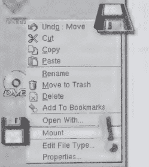

## 使用 Shell

在 Linux 中，实现同一个特定目标通常有多种方法。起初这可能会让人感到困惑，但它具有很多优势。如果某个特定功能因为某种原因失效或不可用，可以通过其他方式向计算机发出相同的命令。

例如，如果无法通过菜单中的鼠标点击启动某个程序，你可以使用键盘输入程序名称来启动该应用程序。另一个例子是，要查看目录的内容，可以使用文本命令 `ls`。

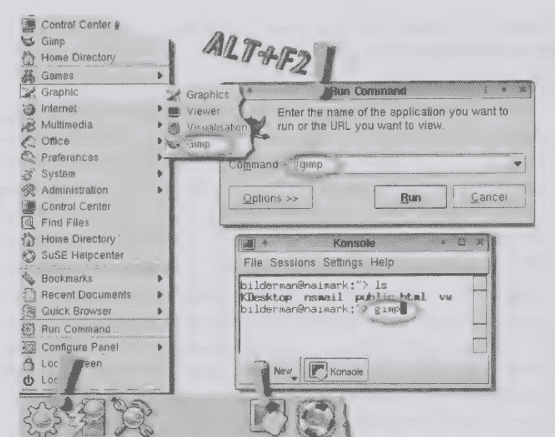


此类命令在文本控制台中输入，这是一个简易的、无装饰的文本窗口（也称为“shell”），它使你能够控制计算机的几乎每一个方面。经验丰富的用户通常更喜欢控制台。它允许将不同的命令组合成一条很长的命令行，从而像一个全新的小型程序一样运行。根据你想实现的目标，这比使用鼠标具有实际的优势。请参阅第 296 页的 *Introduction to Bash*（Bash 简介）章节以了解更多关于使用控制台的信息。

## 快速安装

要在计算机上完全安装 SuSE Linux，几乎只需要**点击几次鼠标**。如果之前没有安装过 Linux 系统，你的硬盘将被自动分区，现有的 Windows 系统（95/98/ME）将被调整大小，各种软件将被安装，且你的硬盘将被自动配置。

如果你不喜欢 YaST2 提供的建议或有特殊要求，请手动修改安装建议。第 19 页的 *User-Defined Installation*（用户自定义安装）章节描述了具体操作方法。

- 第一步：选择语言................................................16
- 第二步：接受建议................................................16
- 第三步：安装....................................................17
- 配置..........................................................18

### 第一步：选择语言

启动计算机并将 CD 1 或 DVD 插入正确的驱动器。重启计算机。如果你的 BIOS 配置为从 CD-ROM 启动，你的 CD 将被检测到并且安装系统将启动。如果 CD-ROM 没有启动，请重新配置 BIOS，使 CD-ROM 驱动器在硬盘之前启动。

为你的系统选择语言。此处设置的语言配置将作为键盘应用的默认设置。如有需要，可以在下一步中调整键盘布局。

### 第二步：接受建议

SuSE Linux 将扫描你的所有硬件并扫描任何之前安装过的操作系统。它在此列出结果（见下一页的图 2.1）。同时还可以看到建议的分区方案（包括 Windows 缩减）和安装选项。

如果这是你第一次安装 Linux，你可能应该接受大多数这些建议。核实推荐的键盘布局和时区，并在必要时进行修正。

以下建议列出供你审阅。可以通过点击相应的参数或点击“Detailed”（详细）来更改 YaST 建议的硬件和分区设置。

> **注意**
>
> 除非你清楚自己在做什么，否则请勿更改启动加载程序、分区或硬件设置。

- **Installation Mode**（安装模式）：默认值为“New Installation”（新安装）。
- **Keyboard Layout**（键盘布局）：根据第一步中选择的语言来选择布局。
- **Mouse**（鼠标）：此处列出检测到的鼠标类型。
- **Partitioning Suggestion**（分区建议）：列出为你系统建议的分区方案。如果磁盘上存在 Windows 9x 或 ME，此处将指定缩减率。
- **Software Selection**（软件选择）：默认安装为包含办公软件包的默认系统。
- **Boot Loader**（启动加载程序）：确定 SuSE Linux 安装引导管理器的位置。主引导记录（MBR）是此项的默认设置。
- **Time Settings**（时间设置）：此处根据语言设置设定本地时区。此设置通常需要手动修改。

更改参数后，点击“Accept”（接受）。这将返回选择界面并使用修改后的值继续安装。

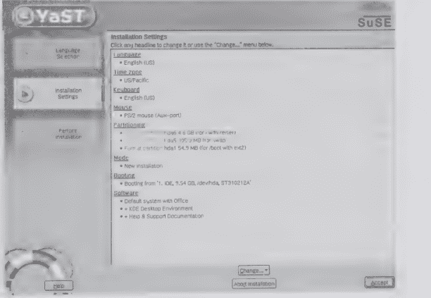

*图 2.1：检测到的硬件以及安装和分区建议*

### 第三步：安装

在绿色窗口中点击“Yes”开始安装。根据计算机性能的不同，包含约 350 个程序包的系统完整安装大约需要十五分钟。

### 配置

安装完成后，在开始使用 SuSE Linux 之前，请进行三项重要设置（详细说明请参阅第 37 页的 *System Configuration*（系统配置）章节）。首先，为系统管理员（也称为 `root` 用户或“超级用户”）设置密码。

> **注意**
>
> 请务必记住 `root` 密码，因为你只能使用 `root` 身份修改系统或安装程序。请检查屏幕和显卡的设置，因为错误的设置可能会损坏你的显示器。

然后配置一个用户。最后，显示检测到的屏幕和显卡。如有必要，请更改屏幕分辨率或色彩深度（见第 40 页的 *Monitor Settings*（显示器设置））。在测试图形设置后，决定是否设置或启动系统其他硬件组件（如打印机、声卡或调制解调器）的自动检测与配置。你也可以在以后再配置硬件。

**祝你在使用 SuSE Linux 中获得很多乐趣！**

## 用户自定义安装

前一章涵盖了快速标准安装流程。本章提供了关于各个参数的详细信息，你可以通过启动相应的模块从建议窗口中修改这些参数。这让你能够完全控制安装过程。得益于 YaST2 的新设计，即使是 SuSE Linux 和应用程序的高级安装也非常简单。

- 从 CD-ROM 启动系统...........................................20
- 启动界面.....................................................21
- YaST2 接管...................................................22
- 选择语言.....................................................22
- 安装模式.....................................................22
- 安装建议.....................................................22
- 模式........................................................23
- 键盘布局.....................................................23
- 鼠标........................................................23
- 分区........................................................24
- 软件........................................................33
- 启动........................................................35
- 时间设置.....................................................36
- 开始安装.....................................................36
- 系统配置.....................................................37
- 硬件配置.....................................................40
- 图形登录.....................................................41

### 从 CD-ROM 启动您的系统

将第一张 SuSE Linux CD 或 DVD 插入驱动器。然后重启计算机以加载 SuSE Linux，从驱动器中的介质进行安装并设置您的机器。

#### 从 CD/DVD 启动时可能出现的问题

如果您可以从 CD 引导机器，请使用 YaST2 继续安装。由于以下原因，可能无法从 CD 引导：

- 您的 CD-ROM 驱动器可能无法读取第一张 CD 的“引导镜像”。在这种情况下，请使用 CD 2 来引导系统。第二张 CD 包含一个常规的 1.44 MB 引导镜像，即使是较旧的驱动器也能读取。
- 机器的启动顺序可能不正确。关于更改 BIOS 参数的信息可在您的主板文档以及以下段落中找到。

BIOS 是一个用于启动计算机基本功能的微小实用程序。主板制造商会根据主板的特性提供适配的 BIOS。

只能在特定时间进入 BIOS 设置。在系统启动时，会执行一些硬件测试，例如内存测试。您可以通过系统内存计数器看到这一点。同时，屏幕底部会显示按下哪个键进入 BIOS 设置。通常是通过按下 `Del`、`F1` 或 `Esc`。按下相应的键进入 BIOS 设置。

BIOS 设置启动后，请按以下步骤更改启动顺序：在 AWARD BIOS 中，寻找“BIOS FEATURES SETUP”。其他制造商使用类似的条目，例如“ADVANCED CMOS SETUP”。选择相应条目并按 `Enter` 确认。

要更改启动顺序，请寻找定义驱动器启动顺序的项目，通常为 `C, A` 或 `A, C`。在第一种情况下，机器先在硬盘（`C`）中搜索操作系统，然后在软盘驱动器（`A`）中搜索。选择“Boot Sequence”并按下 `Page Up` 或 `Page Down`，直到显示 `A, CDROM, C`。

按下 `Esc` 退出设置。要保存更改，请选择“SAVE & EXIT SETUP”或按下 `F10`。按下 `Y` 确认您的设置。要撤销设置，请按下 `N`。

如果您使用的是 SCSI CD-ROM 驱动器，请启动其 BIOS（例如，对于 Adaptec 主机适配器，请按下 `Ctrl` + `A`）。选择“Disk Utilities”。系统将检查并显示连接的硬件组件。记录您的 CD-ROM 驱动器的 SCSI ID。按 `Esc` 退出菜单，然后进入“Configure Adapter Settings”。在“Additional Options”下，选择“Boot Device Options”并按 `Enter`。输入 CD-ROM 驱动器的 ID 并按 `Enter`。连续按两次 `Esc` 返回 SCSI BIOS 的启动屏幕。退出此屏幕并确认“Yes”以重启机器。

- 您的 CD-ROM 驱动器可能因型号过旧而不受支持。要检查您的驱动器是否受支持，请参考 SuSE Linux 的硬件数据库：`http://hardwaredb.suse.de/en/`。

### 启动屏幕

当启动屏幕出现时，SuSE Linux 正在准备安装。

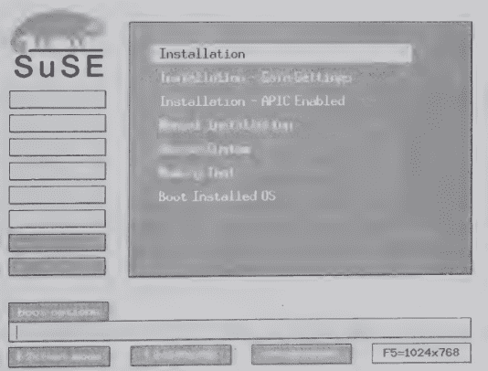

*图 3.1：启动屏幕*

几秒钟后，SuSE Linux 开始加载一个微型的 *Linux 系统*，该系统将接管接下来的安装过程。随后，屏幕上会出现许多消息和版权声明。加载过程结束时，YaST2 程序启动，几秒钟后，SuSE Linux 安装程序 YaST2 的图形界面将显示出来。

### YaST2 接管

现在，SuSE Linux 的实际安装由 YaST2 安装程序开始。所有 YaST2 屏幕都有统一的格式。YaST2 屏幕上的所有输入字段、列表和按钮都可以通过鼠标访问。如果您的光标不移动，说明 Linux 未自动识别您的鼠标。在这种情况下，您需要使用键盘。

### 选择语言

SuSE Linux 和 YaST2 会根据所选语言进行适配。英语是 SuSE Linux 国际发行版的默认设置。这些设置可以单独更改。

如果您的鼠标无法工作，请使用方向键导航到所需的语言，然后重复按下 `Tab` 直到选中“Next”。然后按下 `Enter`。

### 安装模式

如果您的计算机上已经安装了 SuSE Linux 版本，请决定是执行“New Installation”（新安装）、“Update”（更新）现有安装，还是引导现有系统。如果您没有安装 SuSE Linux 版本，请点击“Next”继续开始新安装（见第 24 页图 3.3）。本章仅涵盖“New Installation”。关于系统更新的信息请参阅第 51 页的系统更新章节。

### 安装建议

在硬件检测完成且鼠标配置好后，YaST2 将提供有关检测到的硬件的信息，以及关于安装和分区的建议（如第 15 页的快速安装章节和第 17 页的图 2.1 所述）。在您修改建议后，YaST2 会返回到建议窗口。以下章节将解释可用的各种配置设置。

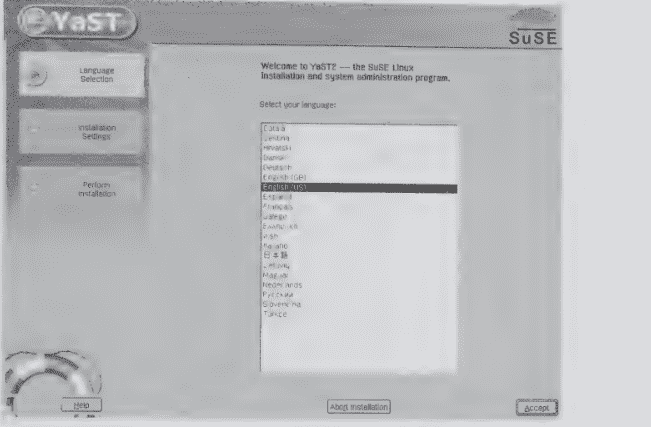

图 3.2：选择语言

#### 模式（Mode）

如果您电脑上已有 Linux 系统，可以在建议窗口出现前在此处更改之前选择的安装模式。您也可以在此处引导已安装的系统。如果您的系统无法再从硬盘引导，这会非常有用。

#### 键盘布局（Keyboard Layout）

选择键盘布局。默认情况下，布局与所选语言相对应。更改布局后，使用测试特殊字符的字段 `V` 和 `2` 来确保布局正确。如果它们显示不正确，则键盘布局不正确。点击“Next”返回建议页面。

#### 鼠标（Mouse）

如果 YaST2 没有自动识别您的鼠标类型，请使用 `Tab` 直到“Change”被高亮显示。按下 `Space` 和方向键直到选中“Mouse”。按下 `Enter` 打开鼠标类型选择屏幕，如图 3.4（对面页）所示。

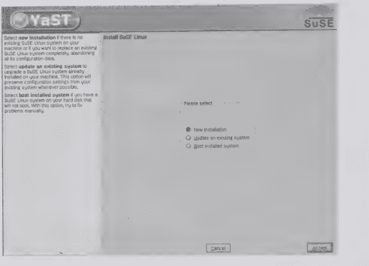

图 3.3：选择安装类型

现在，测试您的鼠标是否正常工作。如果屏幕上的鼠标光标随您的鼠标移动，则您的鼠标配置正确。如果光标不移动，请选择不同的鼠标类型并重试。

#### 分区（Partitioning）

如果您不熟悉 Linux 及其文件系统，可能会担心需要多少磁盘空间。考虑如何分配这些空间同样重要。YaST2 通常会根据可用的硬盘空间提供合理的建议。如有需要，请修改此建议以适应您的系统需求。

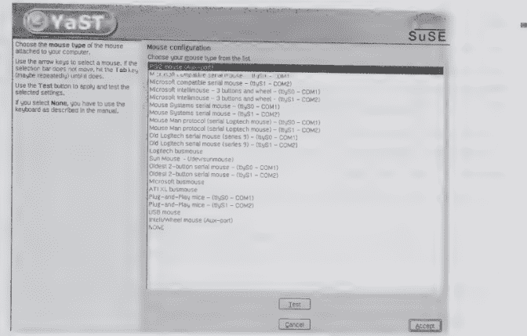

图 3.4：选择鼠标类型

#### 分区类型（Partition Types）

每个硬盘都有一个分区表，包含四个条目的空间。分区表中的每个条目可以是主分区（primary partition）或扩展分区（extended partition）。只能拥有**一个**扩展分区。

主分区很简单：它们由分配给一个操作系统的连续柱面范围组成。然而，使用主分区，您**每块硬盘最多只能设置四个分区**。分区表无法容纳更多条目。

这就是使用扩展分区的原因。扩展分区同样是硬盘柱面的连续范围。然而，扩展分区本身可以进一步细分为**逻辑分区（logical partitions）**，这些逻辑分区不需要在分区表中占用条目。换句话说，扩展分区是逻辑分区的容器。

如果您需要四个以上的分区，请确保至少第四个分区是扩展分区，并将其分配给整个空闲柱面范围。随后，设置多个逻辑分区（SCSI 硬盘最多 15 个分区，(E)IDE 硬盘最多 63 个分区）。

Linux 不关心安装时使用的是哪种类型的分区（主分区或逻辑分区）。

### 决策时间

SuSE Linux 的绝对最低要求是 180 MB。然而，这会限制机器的用途。例如，您只能使用控制台而不能使用 X Window 系统。若要使用 X 并启动一些应用程序，最低值是 500 MB。这两个数值均包含交换分区（swap partition）所需的空间。

一个合理的数值是包括交换分区在内的 1 GB——在如今拥有数 GB 硬盘的时代，这是一个相当低的要求。当然，您可以随意使用更多的硬盘空间。

所需硬盘容量取决于您的需求：

- 若需 X Window 系统以及现代应用程序（如 KDE、GNOME、OpenOffice.org 和 Netscape）：约 1 GB。
- 若需使用 Linux 下载大量电影和音乐：2 GB。
- 以上两者兼顾：3 GB。
- 刻录 CD 及上述所有项：4 GB。

这些指南可以帮助您为系统制定分区方案：

- 空间小于 4 GB：一个交换分区（128–256 MB）和一个根分区（`/`）。
- 空间大于 4 GB（您也可以按照前一项所述进行）：启动分区（`/boot`）、交换分区（swap）、根分区（root，250 MB）、主目录分区（`/home`，每个用户约 200 MB），其余部分用于应用程序（`/usr`）。可以考虑为 `/opt` 和 `/var` 各设置一个分区。

### YaST2 分区工具

建议的分区方案将随确认选项一起出现，允许您接受、更改或放弃该建议。关于文件系统表中的自动条目，请参阅第 32 页的“更多分区技巧”。点击“Change”（更改）将打开“Partitioner”（分区工具）（见对面页的图 3.5）。

YaST2 会显示所选硬盘上的所有分区（见下一页的图 3.5）。任何可用存储空间都会被显示并自动选中。要为 Linux 分配更多磁盘空间，请按照从最后一个分区到第一个分区的顺序分配更多分区。如果您有三个分区，则无法将第二个分区用于 Linux，而将第一个和第三个分区用于其他操作系统。

如果您选择“Discard”（放弃），将出现一个包含硬盘选择的对话框，如图 3.6（第 28 页）所示。系统中的所有硬盘都列在此处。

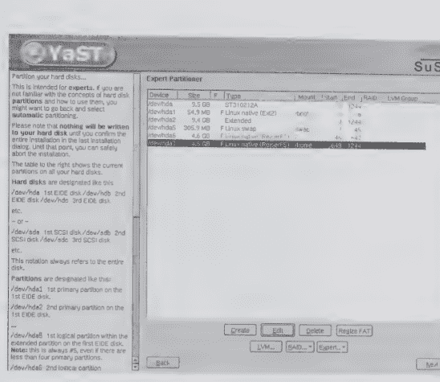


#### 图 3.5：SuSE Linux 分区工具

决定在哪里安装 SuSE Linux。选择硬盘没有风险，因为此时尚未进行任何更改。

“Advanced Settings, Manual Partitioning”（高级设置，手动分区）会显示您系统的先前分区情况。它可以被手动修改，或者为您的新系统重复使用。

在随后的对话框窗口中点击“Entire hard disk”（整个硬盘），整个硬盘及其所有分区都将为 SuSE Linux 激活。如果您已经安装了使用 FAT 文件系统的 Windows 操作系统，系统将询问您是想要删除还是缩小 Windows 分区（参考第 30 页的“调整 Windows 分区大小”）。

在安装过程中，`YaST2` 将验证是否有足够的空间进行最小安装，以及是否可以创建 Linux 使用的三个标准分区。如果不是这样，您将被提示修改选择。如果存储空间足够，`YaST2` 将使用您的设置来划分整个硬盘或选定分区。

> **Caution**（注意）
>
> 如果您选择“Use entire hard disk”（使用整个硬盘），您硬盘上的所有信息都将丢失。

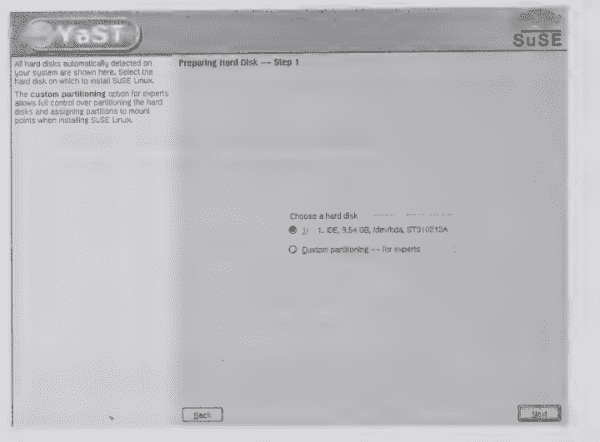

#### 图 3.6：选择硬盘

### 手动分区

通过前一页图 3.5 所示的“Partitioner”（分区工具），您可以手动修改硬盘分区。分区可以被添加、删除或更改。

如果您在建议界面选择“Partitioning”（分区），并在下一个对话框中选择“Base partition setup on this proposal”（基于此方案的基础分区设置），分区工具将列出硬盘以及所有可用或建议的分区。磁盘被列为不带数字的设备（例如`/dev/hda`或`/dev/sda`）。分区被列为设备的组成部分（例如`/dev/hda1`或`/dev/sda1`）。同时还会显示大小、类型、文件系统和挂载点。挂载点描述了该分区在 Linux 文件系统树中的连接位置。

### 创建分区

要创建新分区：

1. 选择要创建分区的磁盘（如果只有一个硬盘，这将自动完成）。
2. 选择“Create custom partition setup”（创建自定义分区设置）。随后会出现一个询问分区类型的对话框。您可以创建最多四个主分区，或者最多三个主分区和一个扩展分区。在扩展分区内，您可以创建多个“逻辑”分区（详见第 25 页的 *Partition Types*）。
3. 选择用于格式化硬盘的文件系统，以及（如果需要）挂载点。`YaST2` 会为每个创建的分区建议一个挂载点。参数详情在下一节中提供。
4. 选择“OK”应用更改。

分区将列在分区表中。选择“Next”（下一步）将把分区表写入磁盘，并在必要时格式化分区。

### 分区参数

要将分区添加到文件系统树中，请在分区工具中设置以下参数：

1. 选择分区。
2. “Edit”（编辑）分区并设置参数：
   - 文件系统 ID（如果您不想格式化分区）：可以是“Linux swap”、“Linux”、“Linux LVM”或“Linux RAID”。有关 LVM 和 RAID 的详细信息，请参阅《管理指南》。
   - 文件系统（用于格式化分区）：可以是“Swap”、“Ext2”、“Ext3”、“ReiserFS”或“JFS”。Swap 是一种特殊格式，使分区可用作虚拟内存。每个系统应至少有一个 128 MB 以上的 swap 分区。默认情况下，分区使用 ReiserFS。与 JFS 和 Ext3 一样，它是一个“日志文件系统”（Journaling File System）。日志文件系统能够从系统崩溃或异常卸载中快速恢复。此外，ReiserFS 在处理大量小文件时速度非常快。Ext2 是一个非日志文件系统。它“稳如磐石”且适用于较小分区，因为它不需要太多磁盘空间进行管理。
   - 挂载点（Mount Point）：设置新分区在文件系统树中连接的目录。如果您选择列表中的最后一项，请输入您自己的目录名称。“Swap”用于特殊的 Swap 文件系统。
3. 选择“Next”（下一步）以格式化并启用分区。

> **Note**（注）
>
> 如果您进行手动分区，请创建一个 swap 分区。swap 分区用于扩展系统的可用内存。

### 调整 Windows 分区大小

SuSE Linux 可以轻松地与其他操作系统共存于同一台机器上。如果您的计算机上已经安装了 Microsoft Windows (9x/ME 或 FAT 32 上的 XP)，且为 SuSE Linux 选择的硬盘只有一个包含 Windows 的分区（大多数预装电脑的情况如此），您可以在无需删除该操作系统的情况下，减小预留给 Windows 的硬盘部分，从而为安装 SuSE Linux 腾出空间。

本节假设所选硬盘包含 Windows 9x 或 ME。以下说明同样适用于安装在 FAT 文件系统格式磁盘上的 Windows XP。但是，如果 Windows NT、2000 或 XP 安装在 NTFS 文件系统上，则无法减小分区大小。

如果可用空闲空间不足以安装 SuSE Linux，请在两个选项中做出选择：要么完全从硬盘删除 Windows，要么缩小 Windows 分区以创造足够的空间安装 SuSE Linux。见对面页的图 3.7。

`YaST2` 会为您的 Windows 分区提供一个合理的调整建议。不过，您也可以手动修改。如果您决定删除 Windows，所有数据将在 Linux 安装过程中被不可恢复地丢失。

### 基于 NTFS 的 Windows

如果您使用的是一台预装了 Windows XP 的计算机，它很可能使用了 NTFS。尽管如此，您仍有两种方案可以将 SuSE Linux 与 XP 并行安装。较简单的选项是使用 XP 安装 CD 重新安装 Windows XP，并将文件系统选择为 FAT 32。然而，这可能会导致 Windows 性能下降，因为它是从现代的 NTFS 迁移到了一个古老的 FAT 系统。

更干净但更复杂的解决方案是使用您选择的分区工具（如`fdisk`或`Partition Magic`）将硬盘的一部分格式化为 NTFS，随后在该部分安装带有现代文件系统的 Windows XP，并保留一部分硬盘不格式化。在安装完 Windows XP 后，利用这部分空闲空间安装 SuSE Linux。`YaST2` 会自动检测空闲空间，并可以在不触动 XP 安装内容的情况下将 Linux 安装在那里。

图 3.7：Windows 分区可用选项

### Windows 分区调整工具（The Windows Resizer）

> **注意**
>
> Windows 分区调整工具仅在您的计算机硬盘上恰好只有一个 Windows 分区时才有效（大多数预装 Windows 的计算机通常如此）。否则，您必须手动对硬盘进行分区。

**注意**

在缩小 Windows 分区之前，请`reboot`（重启）您的 Windows PC。然后运行`Scandisk`和`Defrag`程序。`Scandisk`和`Defrag`会扫描 Windows 使用的文件，然后将这些文件压缩到硬盘的起始位置。这将加快缩小分区的过程。

> **注意**
>
> 在对硬盘进行碎片整理之前，请禁用 Windows 交换文件并重启 Windows。Windows 为其交换文件分配了一个特殊的不可见 ID，这会阻止`Defrag`移动这些文件。

**注意**

在建议界面进入“分区（Partitioning）”并点击随后界面中的“编辑（Edit）”后，请使用鼠标或方向键突出显示 Windows 分区。接下来，点击“调整大小（Resize）”。

在第一个条形图中，`YaST2` 显示了 Windows 当前占用了多少空间以及硬盘还剩余多少空间。图 3.8 所示的第二个图表给出了如何最好地重新划分硬盘分区的建议。您可以接受此建议，或使用滑块自定义您的分区设置。

还可以通过先选择“放弃（Discard）”然后选择“整个硬盘（Entire Hard Disk）”来访问“Windows 分区调整工具”。接下来，系统将询问您是要缩小还是完全删除 Windows 分区（见前页图 3.7）。选择调整大小选项即可访问该工具。

图 3.8：调整 Windows 分区大小

### 更多分区技巧

如果分区由 `YaST2` 执行，并且系统中检测到其他分区，这些分区也将被写入`/etc/fstab`文件中，以便轻松访问这些数据。该文件包含系统中的所有分区及其属性（参数），例如文件系统、挂载点和用户权限。文件 1 中显示了一个摘录。

```
/dev/sda1    /data1  auto    noauto,user 0 0
/dev/sda8    /data2  auto    noauto,user 0 0
```

文件 1：`/etc/fstab`：分区数据

无论这些分区是 Linux 分区还是 FAT 分区（Windows 95/98、ME），都指定了`noauto`和`user`选项。这允许任何用户在需要时挂载或卸载这些分区。出于安全原因，`YaST2` 不会自动在此输入`exec`选项。但是，为了从那里运行程序，您可以自行输入此选项。如果您遇到诸如“bad interpreter”或“Permission denied”之类的系统消息，此操作将是必要的。

有关分区的详细背景信息和技巧，请参阅 *Administration Guide* 中的 *Special Installation Procedures, Partitioning for Experts*。

### 软件

在此步骤中，确定要在机器上安装哪些软件。默认选择中预设了包括 KDE 和 OpenOffice.org 在内的内容。如果您点击“软件（Software）”，将出现一个提供三种基本安装系统的对话框：

- 最小系统（仅推荐专家使用）
- 最小图形系统
- 默认系统（包含 KDE 和办公软件包）

如果您点击其中一个系统，然后点击“详细选择（Detailed selection）”，软件安装模块将启动。详细软件选择模块较之早期版本已完全重新设计（见下页图 3.9）。它提供了比以往更多的功能和灵活性。

#### 预选

该模块从选择过滤器开始。在左上角“过滤器（Filter）”旁边标记有“选择（Selection）”。这些选择代表一组程序包，可以通过点击相应的复选框来选择安装或删除。在下方，可以看到该过滤器的可选预选组，其中一些已被选中，因为它们属于 SuSE Linux 的默认安装。

右侧框架显示了属于该选择的单个软件包列表。选定安装的软件包在名称左侧会被勾选。根据您的需要选择或取消选择单个软件包。为此，请多次点击该符号直到显示所需状态。关于状态标记的完整描述以及该模块的详细说明请参阅第 48 页的 *Install/Remove Software* 章节。

图 3.9：安装和删除软件

> **注意**
>
> 默认提供的安装选择通常同时适用于初学者和高级家庭用户。这是根据我们的经验精心选择的。通常，您不需要在此处修改任何内容。删除软件包时，请留意警告，不要取消选择 Linux 基础系统的任何软件包（通常位于“System”软件包组中）。

#### 其他过滤器

点击“过滤器（Filter）”可以查看一组额外的过滤器，这些过滤器可用于组织软件包的视图。例如，有一个根据“软件包组（package groups）”进行选择的选项，这也是在系统安装后在 YaST 中启动软件选择时的默认过滤器。使用此过滤器，程序包将根据主题在左侧以树状结构显示。您在软件包组中展开的树越深，选择就越详细，右侧软件包列表中相关的软件包数量就越少。

### 引导（Booting）

启动 Linux 需要一个引导加载程序。它还可以提供操作系统的选择。处理此任务的程序包括引导管理器 `LILO`（“Linux LOader”）和 `GRUB`（“GRand Unified Bootloader”）。

在 8.1 版本之前，`LILO` 是 SuSE Linux 的默认引导管理器。如果您更新了旧系统，`LILO` 将被保留为引导管理器。另一方面，如果您执行了全新安装，您当前的引导加载程序则是 `GRUB`。对于普通用户来说，这两者的区别微乎其微。

默认情况下，`YaST2` 建议将引导加载程序安装在硬盘的主引导记录（`MBR`）中。如果您有多个硬盘，它将通过 BIOS 设置识别引导硬盘。

这在建议屏幕的“引导（Booting）”项下显示。`YaST2` 将检测您是否具有任何其他操作系统。安装引导加载程序将有几种可能性。以下段落提供了引导管理器的介绍。有关详细描述（面向专家），请参阅 Administration Guide 中的引导加载程序章节。点击“引导（Booting）”进入引导加载程序配置。对话框如图 3.10 所示。

图 3.10：引导加载程序安装

在此对话框中，确定引导加载程序如何安装以及安装在何处。可用选项如下：

- 将 `GRUB` 写入引导盘（`/dev/hda` 上的`MBR`）
- 创建引导软盘
- 将 `GRUB` 写入不同的`partition`（分区）
- 不使用 `GRUB`

第一个选项通常是最合适的。此选项将引导加载程序安装在引导硬盘的`MBR`中。如果您打算将 Linux 引导加载程序作为多个操作系统的引导管理器，请同样使用此选项。但是，请确保您的操作系统可以由 `LILO` 或 `GRUB` 引导（适用于 MS-DOS、Windows 9x/ME、NT、2000、XP 和 OS/2）。

如果不确定或不想修改之前的引导机制，请使用“创建引导软盘（Create a boot floppy）”选项。在开启计算机之前将软盘插入驱动器，Linux 即可引导。如果驱动器中没有软盘，则启动另一个操作系统。引导加载程序稍后可以使用 `YaST2` 安装到硬盘中。

如果您已经安装了不同的引导管理器并希望将 SuSE Linux 包含在此引导管理器中，请选择“不使用 GRUB（Do not use GRUB）”。在安装 SuSE Linux 之后，重新配置现有的引导管理器并将 SuSE Linux 包含在引导程序中。

如果您的系统在每次启动时需要额外的内核参数，请在相应字段中输入这些参数。对于普通的家庭用户系统，通常不需要输入任何内容。

### 时间设置

在此屏幕（见下页图 3.11）中，在标记为“将硬件时钟设置为（Set hardware clock to）”的字段中，在`Local Time`（本地时间）和`GMT`（格林威治标准时间）之间做出选择。您的选择取决于计算机的 BIOS 时钟设置。如果 BIOS 中的硬件时钟设置为`GMT`，SuSE Linux 将自动反映标准时间和夏令时的变化。

### 开始安装

点击“下一步（Next）”将接受建议以及所做的任何更改。随后会打开一个绿色的确认屏幕。在此点击“是（Yes）”后，安装将根据您的设置开始。安装通常需要 15 到 30 分钟，具体取决于您的机器性能和软件选择。

图 3.11：选择时区

### 系统配置

在完成系统及所选软件的安装后，在开始使用 SuSE Linux 之前，您还需要进行三项重要的设置：为系统管理员 `root` 定义密码、创建普通用户以及配置显示器。接下来的章节将介绍具体的操作方法。

#### Root 密码

`root` 是超级用户（即系统管理员）的名称。`root` 被允许执行所有普通用户不允许执行的操作。超级用户可以对系统进行更改，例如安装新应用程序或设置新硬件。如果用户忘记了密码或遇到软件问题，`root` 可以提供帮助。通常情况下，仅在执行管理任务（如系统维护或修复）时才以 root 身份登录。在日常使用中，使用 `root` 具有相当高的风险，因为 `root` 可能会不可逆地删除文件。

为了验证目的，必须像下一页的图 3.12 中那样输入两次密码。请特别小心，不要忘记 `root` 密码，因为之后无法找回。

> **注意**
>
> 用户 `root` 拥有对系统进行更改所需的所有权限。执行此类任务需要 `root` 密码。没有此密码，您无法执行任何管理任务。

图 3.12：设置 Root 密码

#### 用户名和密码

Linux 是一种允许多个用户同时在同一系统上工作的操作系统。为了使其顺畅运行，每个用户都需要一个 *用户账户*，以便他们登录系统并在完成后注销。设置用户账户为操作安全提供了坚实的基础。普通用户无法更改或删除系统正常运行所需的文件。同样，其他用户不能访问、修改或删除某个用户的个人数据。每个用户都可以根据偏好的应用程序和设置来建立自己的工作环境。当用户登录 Linux 系统时，会发现他们的个人环境保持不变。

请使用下一页图 3.13 所示的对话框自行创建此类用户账户。输入用户的名字（First Name）和姓氏（Last Name）。同时指定用户名（登录名）。如果您想不出合适的用户名，请点击“Suggestions（建议）”，系统将自动为您生成一个。

图 3.13：输入用户名和密码

最后，为该用户输入密码，并重复输入以确认。用户名告诉系统您是谁，而密码则验证您的身份。

> **注意**
>
> 请记住您的用户名和密码，因为每次登录时都需要这些信息。为了提供有效的保护，密码长度应在 5 到 8 个字符之间。密码的最大长度为 128 个字符。然而，如果没有加载特殊的模块，则仅使用前 8 个字符来识别密码。Linux 密码区分大小写。不允许使用重音字符。可以使用特殊字符（如`*`、`.`、`#`、`;`、`)`）和数字 0–9。

#### 显示器设置

此处显示了带有合适配置的显卡和屏幕。在大多数情况下，您可以接受建议的配置。不过，您也可以手动自定义色彩深度、分辨率和图像刷新率。

一旦您接受了建议或输入了更改，系统将对设置进行测试。

当您点击“Change（更改）”时，您可以选择配置图形界面。为此，系统将启动 `SaX2` 程序。在修改图形用户界面的建议配置之前，请阅读第 62 页 *Display and Input Devices (SaX2)* 中的说明。

#### 硬件配置

图 3.14：配置系统组件

一旦显卡配置完成，您将看到如图 3 所示的屏幕。

图 4.1：YaST2 控制中心

### 软件

#### 更改安装源

安装源是包含待安装软件的软件的介质。您可以从 CD 或 DVD（常用方法）、网络服务器或硬盘进行安装。请参考详细的 `YaST2` 帮助文本。


当您使用“保存并退出”退出该模块时，设置将被保存并应用于“安装/删除软件”、“系统更新”以及“引导和内核配置”配置模块。该模块还提供了通过“安装”来安装或删除软件包的可能性。

### 在线更新

YaST 在线更新（YOU）支持安装重要的升级和改进。相应的补丁可在 SuSE FTP 服务器上下载。最新的软件包可以自动安装。使用“手动更新”来决定哪些补丁将安装在您的 SuSE Linux 系统中。

图 4.2：更改安装源

按下“下一步”以下载所有可用补丁的列表（如果您选择了“手动更新”）。随后，软件安装模块（见当前页面的“安装/删除软件”）启动，列出所有下载的补丁。在此处，选择要安装的软件包，或者直接接受 YaST2 的建议安装。补丁的安装方式与其他软件包相同。

### Patch CD 更新

与在线更新不同，补丁不是从 FTP 服务器下载，而是从 CD-ROM（提供给“SuSE Linux Enterprise Server”客户）安装，速度快得多。

### 安装/删除软件

该模块允许您在计算机上安装、更新或删除软件。它在 SuSE Linux 8.1 中经过了完全修订（见第 34 页图 3.9）。如需从 CD 安装，请将第一张 CD 插入驱动器。

图 4.3：YaST2：在线更新

#### 选择过滤器

通过主窗口左上角的“过滤器”，定义显示软件包选择的标准。默认设置为“软件包组”。

> **注意**
>
> 如果您熟悉旧版本的 SuSE Linux，您会发现您不能再从“软件包系列”中选择软件包。原因是软件包数据库结构经过了完全修订。现在软件包被组织在“组”中。

这些软件包组在左侧以树形结构显示。如果您点击其中一个主组（例如，“开发”或“文档”），所有属于该主组的程序包将列在右侧框架的顶部。如果您点击其中一个子组，右侧框架将仅显示该相应子组的软件包。

另一个有趣的过滤器是根据“选择”显示软件包的过滤器。如果您在建议界面中输入了软件设置（见第 33 页的软件），您可能在安装过程中注意到了这个过滤器。使用“选择”过滤器，只需单击一下即可为特定利用领域安装预定义的选择。这是目前唯一可以在左侧框架中激活某些内容的过滤器。如果您勾选左侧框架中选择的复选框，则将安装相应选择的所有软件包。如果您从标准选择（如 KDE）中取消选择某个软件包，在确认时所有相关软件包都将被卸载。随着每个选择的显示，右侧框架会显示属于该选择的软件包及其当前状态。根据需要选择或取消选择单个软件包。预定义选择包括“开发”、“游戏”、“KDE”、“GNOME”、“多媒体”、“Web 服务器”和“文档”。

#### 软件包窗口

右侧的软件包窗口为每个软件包显示以下信息（从左到右）：状态、软件包名称、简短描述、大小、版本以及允许您安装软件包源代码的源列。

软件包的状态由各种图标表示。可用图标如下：

- 已安装
- 未安装且不会被安装
- 由于手动选择将被安装
- 由于被另一个选中的软件包需要（依赖关系）而被安装
- 将被更新版本替换（更新）
- 将被删除（卸载）
- 已重命名：此状态不能手动选择（适用于被一个名称不同的新软件包替换的软件包）

请参考该模块的“帮助”。在那里可以找到各个图标的详细描述以及关于哪个图标代表哪个状态的信息。

通过点击软件包名称左侧的图标来切换状态。系统仅提供适用的选项，这意味着未安装的软件包不能具有“卸载”状态。如果您不知道某个状态的含义，请不要选择它，或者如果它是自动设置的，请不要修改它。

> **警告**
>
> 您可以将已安装的软件包标记为删除。请留意警告信息，不要删除 Linux 基础系统的任何软件包（主要位于“系统”软件包组中）。

#### 信息窗口

右下角的框架显示了几个选项卡，可以在其中找到关于当前选中软件包的信息，例如详细描述、技术数据、随此软件包安装的文件列表、此软件包所需的软件包、需要此软件包的软件包，以及与已安装或选定安装的其他软件包可能存在的冲突。

#### 搜索

“搜索”打开一个搜索对话框，您可以在其中搜索特定的软件包名称或软件包名称的一部分。在搜索结果中，决定如何处理找到的软件包。

### 系统更新

该模块允许您更新系统。该过程由多个步骤组成。YaST2 检查需要更新哪些软件包。如果需要，可以为每个软件包单独决定是否执行更新。此方法不能用于基础系统，基础系统需要从安装介质（如 CD）引导。

> **注意**
>
> 系统更新是一个非常复杂的过程。对于每个程序包，YaST2 必须检查计算机上安装的版本以及需要执行什么操作才能正确地用新版本替换旧版本。YaST2 还尝试继承已安装软件包的任何个人设置。然而，如果旧配置无法按预期处理新程序版本，或者各种配置之间出现意外的不一致，某些配置在更新后可能会导致问题。
>
> 现有版本越旧，且待更新软件包的配置与标准偏离越多，更新就越容易出现问题。有时，旧配置无法被正确继承。在这种情况下，必须重新进行全新的配置。在开始更新之前，应保存现有配置。

图 4.4：系统更新

### 硬件

新硬件必须首先按照供应商的说明进行安装或连接。开启外部设备（如打印机或调制解调器），并启动相应的 YaST2 模块。大多数设备由 YaST2 自动检测并显示技术数据。如果自动检测失败，YaST2 将提供一个设备列表（型号、供应商等），从中选择合适的设备。请查阅随硬件附带的文档以获取信息。

> **注意**
>
> 如果您的型号不在设备列表中，请尝试类似的型号名称。但在某些情况下，型号必须完全匹配，因为类似的名称并不总是意味着兼容。不幸的是，名称相似的设备可能不支持相同的语言。

### 打印机

#### Linux 打印的特殊之处

在 Linux 中，打印机通过打印队列进行寻址。要打印的数据暂时存储在打印队列中，随后由打印后台处理程序（printer spooler）发送到打印机。

通常，这些数据并不以可以直接发送给打印机的形式存在。例如，图像通常需要转换为打印机可以打印的格式。向打印机语言的转换由打印后台处理程序使用的打印过滤器处理。

#### 一些标准打印机语言

- ASCII 文本 —— 大多数打印机可以直接打印 ASCII 文本。然而，有些打印机不能直接打印 ASCII。相反，它们可以通过以下标准打印机语言之一进行寻址。
- PostScript —— PostScript 是 Unix 和 Linux 中用于在 PostScript 打印机上直接打印的标准页面描述语言。
- PCL3、PCL4、PCL5e、PCL6、ESC/P、ESC/P2 和 ESC/P 光栅 —— 如果没有连接 PostScript 打印机，打印过滤器将使用 Ghostscript 程序将数据转换为这些其他标准打印机语言。为此，需选择一个与相应打印机型号匹配的驱动程序，以考虑特定型号的特性（如颜色设置）。

#### Linux 打印作业的工作流程

1. 用户或应用程序生成一个新的打印作业。
2. 打印数据暂时存储在打印队列中，随后由打印后台管理程序（printer spooler）将其发送到打印过滤器。
3. 此时打印过滤器执行以下操作：
   1. 确定打印数据的类型。
   2. 如果打印数据不是 PostScript 格式，则首先将其转换为标准语言 PostScript。通常，ASCII 文本使用 `a2ps` 工具转换为 PostScript。
   3. 如有必要，将 PostScript 数据转换为另一种打印机语言。
      - 如果连接的是 PostScript 打印机，则将 PostScript 数据直接发送到打印机。
      - 如果没有连接 PostScript 打印机，Ghostscript 程序将使用适用于相应打印机型号的驱动程序来生成特定于打印机的数据，随后将其发送到打印机。
4. 在整个打印作业发送到打印机后，打印后台管理程序将该打印作业从打印队列中移除。

#### 各种打印系统

SuSE Linux 支持两种不同的打印系统：

**LPRng 和 lpdfilter**：这是一个传统的打印系统，由打印后台管理程序 LPRng 和打印过滤器 lpdfilter 组成。在传统打印系统中，队列的整个配置由系统管理员确定，用户仅能从各种队列中进行选择。若要为一台打印机选择多种配置，必须为该打印机设置多个具有不同配置的队列。

#### CUPS

在 CUPS 打印系统中，用户能够为每次打印单独确定特定于打印机的设置，因为队列的整个配置并非由系统管理员确定。相反，特定于打印机设置的选项存储在每个队列的“PPD 文件”（PostScript Printer Description）中，并可以通过打印对话框提供给用户。

由于两种打印系统的配置文件存在冲突，一次只能安装其中一个。有关 CUPS 的更多信息，请参阅 `http://www.cups.org/` 和《Administration Guide》（管理指南）。

#### 打印队列

通常出于以下原因需要多个打印队列：

- 通过不同的打印队列来指定不同的打印机。
- 每个打印队列都可以单独配置打印过滤器。因此，同一台打印机可以使用多个队列来实现多种配置。

对于普通的黑白打印机（如大多数激光打印机），一个标准配置就足够了，但彩色喷墨打印机通常至少需要两个配置（队列）：

- 一个用于快速且廉价的灰度打印的 `lp` 标准配置。应该始终有一个名为 `lp` 的打印队列，因为这是默认队列的传统名称。
- 一个用于彩色打印的 `color` 彩色队列。

#### 支持的打印机

由于 Linux 的打印机驱动程序通常不由硬件制造商提供，因此必须使用通用的打印机语言来调用打印机。

优质的打印机至少支持一种通用打印机语言。不支持任何通用打印机语言而仅使用私有协议的打印机被称为“GDI 打印机”（许多廉价的喷墨打印机即是如此）。这些打印机仅能与制造商提供驱动程序的操作系统版本协同工作。由于这些打印机的控制序列不符合任何普遍认可的标准，这些设备在 Linux 中经常导致困难。

尽管如此，SuSE Linux 仍支持其中的许多打印机。然而，对于某些型号，仅支持有限的功能范围，例如低分辨率黑白打印。由于我们不亲自测试 GDI 打印机驱动程序，因此无法保证以下信息的可靠性。以下打印机可以直接使用 YaST 进行配置：

- Brother HL 720/730/820/1020/1040、MFC 4650/6550MSC/9050 以及兼容型号。
- HP DeskJet 710/712/720/722/820/1000 以及兼容型号。
- Lexmark 1000/1020/1100/2030/2050/2070/3200/5000/5700/7000/7200、Z11/42/43/51/52 以及兼容型号。Lexmark 的 Linux 驱动程序可在 `http://www.lexmark.com/printers/linuxprinters.html` 获取。
- Oki Okipake 4w/4w/6w/8w/8wLite/8z/400w 以及兼容型号。
- Samsung ML-200/210/1000/1010/1020/1200/1210/1220/4500/5080/6040 以及兼容型号。

据我们所知，以下 GDI 打印机不受 SuSE Linux 支持。此列表绝非详尽无遗。

- Brother DCP-100、MP-21C、WL-660
- Canon BJ 5000/5100/8000/8500、LBP 460/600/660/800、MultiPASS L6000
- Epson EcuLaser C1000、EPL 5500W/5700L/5800L
- HP LaserJet 1000/3100/3150
- Lexmark Z12/22/33/31/32/33/82、Winwriter 100/150c/200
- Minolta PagePro 6L/1100L/18L、Color PagePro L、Magiccolor 6100DeskLaser/2DeskLaserPlus/2DeskLaserDuplex
- Nec SuperScript 610plus/660/660plus
- Oki Okijet 2010
- Samsung ML 85G/5050G、GL 85G
- Sharp AJ 2100、AL 1000/800/840/F880/121

#### 使用 YaST2 进行配置

SuSE Linux 8.1 中的 YaST2 打印机模块发生了重大变化。该模块得到了简化，四个按钮减少为一个，并且 CUPS 被定义为标准打印系统。不过，您可以随时在 CUPS 和 LPRng 打印系统之间切换。要更改打印系统，请按照 YaST2 的指示操作并准备好您的 CD。

> **注意**
>
> 如果您在安装 SuSE Linux 8.1 期间选择了“新安装”（New Installation），则 CUPS 及其所有相关程序包已自动安装。但是，如果您是对旧版 SuSE Linux 进行了升级，系统会询问您是否希望将系统从 LPRng 更改为新打印系统。如果您决定保留 LPRng，现在可以使用 YaST2 打印机模块根据需要将系统更改为 CUPS。不过，CUPS 无法采用之前 SuSE Linux 版本的 LPRng 配置。

要设置打印机，请启动 YaST2 并选择“硬件”（Hardware）→“打印机”（Printers）。随后会出现主打印机设置窗口。在这里，可以看到任何已安装的打印机。要添加打印机，请点击“添加”（Add）。在随后的对话框中，选择自动检测打印机或手动添加。如果自动检测失败，YaST2 将打开手动设置。如果打印机被自动检测到，它将出现在主窗口的上半部分。接下来的章节将涵盖自动配置和手动配置。

#### 自动配置

在满足以下条件的情况下，YaST2 将启用打印机的自动配置：

1. 并口或 USB 端口设置正确，并且连接的打印机被自动检测到。
2. 检测到的打印机列在打印机数据库中。由于此标识可能与型号名称不同，因此可能需要手动选择型号。
3. 打印机数据库中包含至少一个已知可正常运行的相应型号配置。根据打印机的不同，最多可自动配置五个队列。

为了确保一切运行正常，应使用 YaST2 的打印测试功能检查每个配置。此外，YaST2 页面还提供了关于配置的重要信息。

#### 手动配置

如果自动配置的要求之一未满足，或者您需要特定的个人配置，请手动配置打印机。根据检测结果，YaST2 可以自动确定所需数据或提供一个有用的预选方案。需要配置以下参数：

##### 硬件连接（端口）

- 如果 YaST2 能够自动检测到打印机型号，这表明打印机连接在硬件层面上工作正常，此处无需进行任何设置。
- 如果 YaST2 无法自动检测到打印机型号，则硬件层面的打印机连接在没有手动配置的情况下将无法工作。

##### 队列名称

由于打印队列名称在打印时会被频繁输入，请使用由小写字母（可能包含数字）组成的短名称。

##### Ghostscript 驱动程序或打印机语言

由于 Ghostscript 驱动程序为非 PostScript 打印机生成特定于打印机的数据，因此 Ghostscript 驱动程序的配置是决定打印输出类型的关键。所选的 Ghostscript 驱动程序和合适的驱动特定设置决定了打印输出的外观。同一台打印机在不同配置下生成的打印输出外观差异在此指定。

如果 YaST2 已自动检测到打印机型号，或该型号列在打印机数据库中，系统将提供一组实用的 Ghostscript 驱动程序预选方案。在这种情况下，YaST2 通常提供几个预定义配置，例如：

- 黑白打印，300 dpi
- 仅 LPRng：灰度打印，300 dpi
- 彩色打印，300 dpi
- 仅 CUPS：彩色打印，600 dpi

图 4.5：选择打印机接口

- 照片打印，600 dpi

YaST2 会指示某项配置是仅由 CUPS 还是 LPRng 支持。预定义配置由一个合适的 Ghostscript 驱动程序以及针对相应打印输出类型的某些驱动特定设置组成。

并非所有可选择的单个驱动设置组合都能在每种打印机模式下工作，尤其是在高分辨率的情况下。请通过打印 YaST2 测试页来测试配置。如果测试打印产生了乱码（例如，大量几乎为空的页面），通常可以通过从打印机中取出所有纸张然后取消测试打印来立即终止该过程。然而，在某些情况下，之后将无法再进行打印。因此，最好的做法是先取消测试打印，然后等待打印结束。

如果打印机型号未列在打印机数据库中，YaST2 为标准打印机语言提供了一系列标准驱动程序的选择。

图 4.6：选择打印机

#### 高级设置

在这里，可以访问硬件相关（驱动特定）和硬件无关的设置，允许您为队列指定特殊设置以及访问限制。通常情况下，您不需要且不应在此进行任何更改。有关选项的详细信息，请参阅《管理指南》中的打印章节。

#### 应用程序配置

应用程序使用现有打印队列的方式与在命令行打印时相同。通常，您不需要重新配置打印机。直接使用现有的打印队列即可。

#### 从命令行打印

在命令行中，执行命令 `lpr -Plp filename`（将 `filename` 替换为要打印的文件名）。在此示例中，使用了默认打印队列 `lp`。选项 `-P` 允许您明确指定打印队列。例如，`lpr -Pcolor filename` 使用打印队列 `color`。

##### 使用 LPRng 打印系统

在这种打印系统中，应用程序使用 `lpr` 命令进行打印。在应用程序中，请在打印对话框中选择现有打印队列的名称（如 `lp` 或 `color`），或输入相应的打印命令（如 `lpr -Plp` 或 `lpr -Pcolor`）。

##### 使用 CUPS 打印系统

`cups-client` 软件包包含用于 CUPS 打印的命令行工具，包括 `lpr` 命令。因此，上述方法在 CUPS 中同样适用。

此外，可以使用 `xpp` 或 KDE 的集成打印对话框 `kprinter` 等程序，通过图形选择菜单选择打印队列，并设置 CUPS 标准选项和 PPD 文件的打印机特定选项。

##### 故障排除

如果计算机与打印机之间的通信出现故障，打印机将无法处理发送的数据，结果将产生许多填满无法识别字符的纸页。

1. 取出所有纸张（喷墨打印机）或打开纸盒（激光打印机）以终止打印过程。


- 2. 由于打印作业仅在完全发送到打印机后才会从打印队列中删除，因此它通常仍留在打印队列中。即使重启也不会将打印作业从打印队列中删除。请使用 `kprinter` 等实用程序删除打印作业。关于在命令行处理打印作业的指令请参阅《管理指南》。

- 3. 即使打印作业已从打印队列中删除，可能仍有部分数据被传输到打印机。使用 `fuser` 命令终止所有仍在访问打印机的进程。对于连接到并行端口的打印机，输入以下内容：

```bash
earth:~ # fuser -k /dev/lp0
```

对于 USB 打印机，输入以下内容：

```bash
earth:~ # fuser -k /dev/usb/lp0
```

- 4. 通过关闭电源一段时间来重置打印机。然后放入纸张并开启打印机。

#### 更多信息

有关 Linux 打印的详细信息请参阅《管理指南》中的“打印”章节。本手册包含在 CD 中并默认安装。要查看此书，请启动 SuSE Help（您 KDE 桌面上的救星）并点击 `Administration Guide`。您也可以在浏览器中加载目录`/usr/share/doc/packages/suselinu-reference_en`并点击 PDF 文件。

《管理指南》中的文档主要描述了通用问题及其解决方案。您可以在支持数据库中找到许多特殊问题的解决方案。支持数据库位于 SuSE Help 系统中；最新版本可在`http://sdb.suse.de/en/`在线获取。对于打印机问题，请查看支持数据库文章 `Installing a Printer, Printer Configuration with SuSE Linux 8.0` 和 `Installing a Printer Since SuSE Linux 6.4 and Up to 7.3`，您可以通过搜索关键字“installation”或在以下网址在线查找：

`http://sdb.suse.de/en/sdb/html/jsmeix_print-einrichten.html`

`http://sdb.suse.de/en/sdb/html/jsmeix_print-einrichten-80.html`

`http://sdb.suse.de/en/sdb/html/jsmeix_print-einrichten-64.html`

每个版本的主要问题都汇总在一个中心文章中，即`http://sdb.suse.de/en/sdb/html/bugs81.html`上的 `Known Problems and Special Features in SuSE Linux 8.1`。如果您在文档或支持数据库中无法找到任何解决方案，请利用`http://www.suse.de/en/services/support/index.html`上的 SuSE 支持服务。

### 显示和输入设备（SaX2）

X 服务器是 Linux 上的图形输入和显示子系统。所有图形程序都通过它来接收按键按下和鼠标操作，并在屏幕上显示窗口。

通常，图形界面在安装期间设置。要在运行的系统中优化数值或连接不同的显示器，请使用此 YaST2 模块。在进行任何更改之前，当前配置将被保存。

配置使用的是与安装 SuSE Linux 时相同的对话框。在“仅文本模式”和图形界面之间进行选择。对于后者，将显示当前数值：屏幕分辨率、色彩深度、刷新率，以及（如果自动检测到）显示器的厂商和型号。如果您正在安装系统，或刚刚安装了想要初始化的加速显卡，会出现一个小对话框，询问是否为您的显卡激活 3D 加速。

点击“Edit”。用于输入和显示设备配置的工具 `SaX2` 将在单独的窗口中启动（图 4.7）。

图 4.7：新 SaX2 的主窗口

#### SaX2——主窗口

在左侧导航栏中，有四个主要项目：“Display”、“Input devices”、“Multihead” 和 “AccessX”。在 “Display” 下配置显示器、显卡、色彩深度、分辨率以及屏幕的位置和大小。在 “Input devices” 下可以配置键盘、鼠标、触摸屏显示器和图形平板。使用 “Multihead” 配置多屏幕操作（见第 67 页的 Multihead）。在此设置多头显示模式和桌面上屏幕的布局。“AccessX” 是一个使用数字键盘控制鼠标指针的实用工具。可在此调整用数字键盘控制的鼠标指针速度。

选择您的显示器和显卡。通常，这些由系统自动检测。在这种情况下，您无需修改任何内容。如果显示器未被自动检测，将自动跳转到显示器选择对话框。您很有可能在详尽的厂商和设备列表中找到您的显示器。您也可以手动输入显示器文档中指定的数值，或选择一个预配置的 VESA 模式。

在主窗口中完成显示器和显卡的设置并点击“Finish”后，请测试您的设置。从而确保您的配置适用于您的设备。如果图像不稳定，请立即按下 `Esc` 终止测试，并降低刷新率、分辨率或色彩深度。无论是否运行测试，所有修改仅在重启 X 服务器后才会生效。

#### 显示

如果您进入“Edit configuration” → “Properties”，会出现一个带有“Monitor”、“Frequencies”和“Expert”选项卡的窗口。

- “Monitor”——在窗口的左侧选择厂商。在右侧选择您的型号。如果您有包含显示器 Linux 驱动程序的软盘，请点击“Driver disk”进行安装。

图 4.8：SaX2：显示器选择

- “Frequencies”——在此输入屏幕的水平和垂直频率。垂直频率是图像刷新率的另一种称呼。通常，可接受的数值范围会从型号中读取并输入到这里。通常不需要更改它们。

- “专家”（Expert）——在此处输入屏幕的选项。在上方区域字段中，定义用于计算屏幕分辨率和屏幕几何结构的计算方法。除非显示器被错误识别且显示不稳定，否则请勿更改任何内容。此外，您可以更改显示的图像大小并激活 DPMS 省电模式。

#### 显卡

显卡对话框有两个选项卡——“常规”（General）和“专家”（Expert）。在“常规”中，与显示器配置一样，在左侧选择显卡厂商，在右侧选择型号。

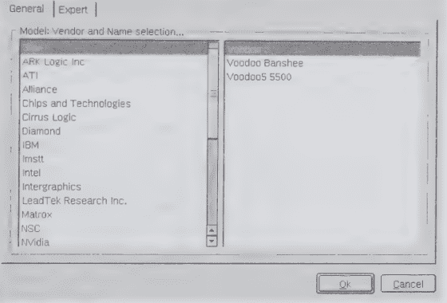

图 4.9：SAx2：选择显卡

“专家”提供了更高级的配置可能性。在右侧，可将屏幕向左旋转或旋转至垂直位置（适用于某些可旋转的 TFT 屏幕）。`BusID` 的条目仅在您运行多个屏幕时才相关。通常情况下，这里无需更改任何内容。除非您在该领域有经验并了解这些选项的含义，否则不应修改显卡选项。如有必要，请查阅显卡的文档。

> **注意**
>
> 仅由 XFree86 3.3.6 支持的显卡配置已不再包含在安装程序中。这影响到像旧版 S3 PCI 显卡之类的设备。相反，YaST2 会根据显卡的不同，为这些显卡配置没有加速的帧缓冲（framebuffer）或通用 16 色 VGA 驱动程序。如果您的显卡受到影响，请使用 `SAx 1` 配合 XFree86 3.3.6 重复配置。为此，请在命令行输入命令 `sax sax`。

#### 颜色与分辨率

此处可见三个选项卡——“颜色”（Colors）、“分辨率”（Resolution）和“专家”（Expert）。

- “颜色”——根据所使用的硬件，选择 16、256、62768、65536 或 1670 万种颜色深度（4、8、15、16 或 24 位）。为了获得合理的显示质量，请至少设置 256 色。

- “分辨率”——当硬件被检测到时，系统会查询分辨率。因此，该模块通常仅提供您的硬件能够正确显示的分辨率和颜色深度组合。这使得在 SuSE Linux 中因错误设置而损坏硬件的风险非常低。如果您手动更改分辨率，请参考硬件文档以确保所设置的值可以被显示。

- “专家”——除了在前一个选项卡中提供的分辨率外，此选项卡允许您添加自定义分辨率，随后这些分辨率将包含在选项卡的选择列表中。

#### 3D 加速

可选地激活显卡的 3D 加速。随后会显示一个对话框，用于激活显卡的 3D 属性。

#### 图像位置与大小

在这两个选项卡下，可以使用箭头精确地调整图像的大小和位置（参见第 68 页的图 4.11）。如果您处于多头（multihead）环境（拥有一个以上的屏幕），请使用“下一个屏幕”（Next screen）按钮移动到其他显示器以调整它们的大小和位置。按下“保存”（Save）以保存设置。

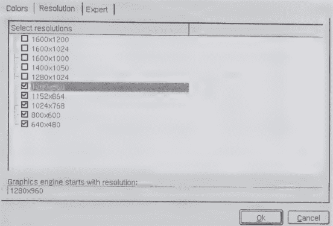

图 4.10：SAx2：配置分辨率

#### 多头（Multihead）

如果您在计算机中安装了一个以上的显卡，或者安装了具有多个输出口的显卡，您可以将多个屏幕连接到系统中。如果运行两个屏幕，这被称为“双头”（dualhead）。超过两个则被称为“多头”（multihead）。`SAx2` 会自动检测系统中的多个显卡并相应地准备配置。在多头对话框中设置多头模式和屏幕排列。提供三种模式：“传统”（Traditional）（默认）、“单屏幕（Xinerama）”（One screen (Xinerama)）和“克隆模式”（Clone mode）：

- “传统多头”——每个显示器代表一个独立单元。鼠标指针可以在屏幕之间切换。

- “克隆多头”——在此模式下，所有显示器显示相同的内容。鼠标仅在主屏幕上可见。

- “Xinerama 多头”——所有屏幕组合形成一个巨大的单一屏幕。程序窗口可以在所有屏幕上自由定位，或缩放到填充多个显示器的大小。

多头环境的布局描述了单个屏幕之间的排列方式和关系。默认情况下，`SAx2` 配置一个标准布局，该布局遵循检测到的显卡顺序，将所有屏幕从左到右排成一列。在多头工具的“布局”（Layout）对话框中，通过使用鼠标在网格中移动屏幕符号来确定显示器在屏幕上的排列方式。完成布局对话框后，点击“测试”（Test）验证新配置。

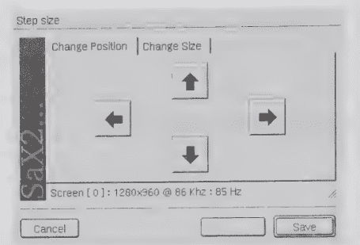

图 4.11：调整图像几何结构

Linux 目前不为 Xinerama 多头环境提供 3D 支持。在这种情况下，`SAx2` 会禁用 3D 支持。

#### 输入设备

**鼠标**：如果鼠标已经可以工作，您无需进行任何操作。但是，如果鼠标无法工作，请按照下一页 *AccessX* 中的说明，使用键盘的数字小键盘来控制。

如果自动检测失败，请使用此对话框手动配置鼠标。参考鼠标文档获取型号描述。从支持的鼠标类型列表中选择您的型号，然后按下数字小键盘上的 5 确认。

**键盘**：此对话框顶部的选择字段允许您指定要使用的键盘类型。然后选择键盘布局的语言（键位的国家/地区特定位置）。使用测试字段检查特殊字符是否显示正确。

用于激活和禁用重音字母输入的复选框状态取决于相应的语言，无需更改。点击“完成”（Finish）将新设置应用于您的系统。

#### 触摸屏

目前 XFree86 仅支持 Microtouch 和 Elo Touch-Systems 触摸屏。`SAx2` 只能自动检测显示器，不能自动检测触摸设备。触摸设备被视为一个输入设备。按以下步骤配置触摸设备：

1. 启动 `SAx2` 并选择“输入设备”（Input devices）→“触摸屏”（Touchscreens）。
2. 点击“添加”（Add）并添加一个触摸屏。
3. 点击“完成”（Finish）保存配置。您无需测试配置。

触摸屏具有多种选项，通常需要先进行校准。遗憾的是，Linux 中没有用于此目的的通用工具。标准配置包含适用于触摸屏尺寸的合适默认值。通常不需要额外的配置。

#### 绘图平板

目前 XFree86 仅支持有限数量的绘图平板。`SAx2` 支持配置连接到 USB 端口或串口的绘图平板。从配置角度来看，绘图平板就像鼠标一样——作为一个输入设备。建议采取以下步骤：

1. 启动 `SAx2` 并选择“输入设备”（Input devices）→“绘图平板”（Graphics tablet）。
2. 点击“添加”（Add），从随后的对话框中选择厂商，并从选择列表中添加一个绘图平板。
3. 如果您连接了笔或橡皮擦，请勾选右侧的复选框。
4. 如果您的平板连接到串口，请验证端口。`/dev/ttyS0` 指第一个串口，`/dev/ttyS1` 指第二个。其他端口使用类似表示法。
5. 点击“完成”（Finish）保存配置。

#### AccessX

如果您在没有鼠标的情况下操作计算机并在 `SAx2` 中激活 AccessX，您可以使用键盘的数字小键盘控制屏幕上的鼠标指针。使用 8 作为鼠标左键，0 作为鼠标中键，- 作为鼠标右键。按下其中一个键来选择按钮，然后松开它并使用 5、+ 和 1 来执行点击、双击或锁定按钮。锁定是一种模拟按住按钮的方法。Del 键释放由 1 锁定的按钮。使用数字小键盘 1、2、3、4、6、7、8 和 9 移动光标。使用滑块来确定按下相应按键时鼠标指针的速度。

#### 更多信息

有关 X Window 系统的更多信息及其历史和属性，请参阅《管理指南》中关于“使用 SaX2 配置 X Window 系统”的章节。

### 硬件信息

YaST2 会执行硬件检测以配置硬件组件。检测到的技术数据将在此屏幕中显示。例如，如果您需要提交支持请求且需要提供硬件信息时，此功能将特别有用。

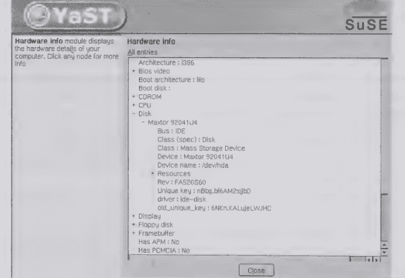

图 4.12：显示硬件信息

#### IDE DMA 模式

此模块允许您在已安装的系统中为 IDE 硬盘以及 IDE CD 和 DVD 驱动器激活或禁用 DMA 模式。此模块不具备针对 SCSI 设备的功能。DMA 模式可以显著提高系统的性能和数据传输速度。

在安装过程中，当前的 SuSE Linux 内核会自动为硬盘激活 DMA，但不会为 CD 驱动器激活，因为对所有驱动器默认激活 DMA 经常会导致 CD 驱动器出现问题。请使用 DMA 模块来决定是否为您的驱动器激活 DMA。如果驱动器能流畅支持 DMA 模式，激活 DMA 可以提高 CD 驱动器的数据传输率。

> **注意**
>
> “DMA（直接存储器访问）意味着您的数据可以直接传输到 RAM，绕过处理器控制。”

#### 操纵杆

使用这个新模块，您只需从列表中选择厂商和型号，即可轻松配置您的操纵杆。您也可以通过声卡配置访问此模块，因为它是声卡配置的一个组成部分。

#### 分区

虽然在已安装的系统中修改分区是可能的，但这应该仅由清楚自己操作内容的专家执行。否则，数据丢失的风险非常高。如果您仍然想使用此工具，请参阅第 24 页“分区”部分的描述（安装期间的分区程序与安装后的系统中的分区程序相同）。

#### 扫描仪

如果您的扫描仪已连接并已开启，在启动此 YaST2 模块时，它应该会被自动检测到。在这种情况下，会出现扫描仪安装对话框。如果没有检测到扫描仪，则会出现手动配置对话框。如果您已经安装了一个或多个扫描仪，则会出现一个列出可修改或删除的现有扫描仪的表格。按下“Add”以配置新设备。

接下来，将使用默认设置执行安装。如果安装成功，将出现相应的消息。现在，通过插入文档并点击“Test”来测试您的扫描仪。

##### 扫描仪未被检测到

只有受支持的扫描仪才能被自动检测。连接到另一个网络主机的扫描仪将不会被检测到。手动配置区分三种类型的扫描仪：USB 扫描仪、SCSI 扫描仪和网络扫描仪。

- **USB 扫描仪**：指定厂商和型号。YaST2 将尝试加载 USB 模块。如果您的扫描仪非常新，模块可能无法自动加载。在这种情况下，您将被引导至一个允许您手动加载 USB 模块的对话框。更多信息请参阅 YaST2 帮助文本。

- **SCSI 扫描仪**：指定设备（例如 `/dev/sg0`）。在系统运行时不应连接或断开 SCSI 扫描仪。请先关闭系统。

- **网络扫描仪**：您需要 IP 地址或主机名。

您可以使用连接到网络中某个主机并被配置为网络扫描仪的扫描仪。要配置网络扫描仪，请参阅支持数据库文章“Linux 中的扫描”（`http://sdb.suse.de/en/`，关键字为“scanner”）。在选择网络扫描仪时，在对话框中输入连接扫描仪的主机名或 IP 地址。

如果您的扫描仪未被检测到，可能是因为该设备不受支持。然而，有时即使是受支持的扫描仪也无法被检测到。如果出现这种情况，请进行手动扫描仪选择。如果您能在厂商和型号列表中识别出您的扫描仪，请选择它。否则，请选择“Cancel”。关于与 Linux 兼容的扫描仪的信息可在`http://cdb.suse.de/index.php?LANG=en`、`http://sdb.suse.de/en/`和`http://www.mostang.com/sane`获取。

> **注意**
>
> 仅在您绝对确定时才手动分配扫描仪。错误的选择可能会损坏您的硬件。

##### 故障排除

您的扫描仪未被检测到可能是由于以下原因之一：

- 扫描仪不受支持。请检查`http://sdb.suse.de/en/`以获取 Linux 兼容设备列表。
- 您的 SCSI 控制器未正确安装。
- 您的 SCSI 端口存在端接问题。
- 您的 SCSI 线缆过长。
- 您的扫描仪具有 Linux 不支持的 SCSI Light 控制器。
- 您的扫描仪有故障。

> **注意**
>
> 在系统运行时不应连接或断开 SCSI 扫描仪。请先关闭系统。

**注意**

有关扫描的更多信息，请参阅第 265 页的 *Kooka——扫描应用程序* 章节。

### 声音

启动声音配置工具时，YaST2 会尝试自动检测您的声卡。您可以配置一个或多个声卡。要使用多个声卡，请首先选择其中一张要配置的卡。按下“Configure”按钮进入“Setup”对话框。“Edit”打开“Sound configuration”，您可以在其中编辑已配置的声卡。“Finish”保存当前设置并完成声音配置。如果 YaST2 无法自动检测您的声卡，请在“Sound configuration”中按下“Add sound card”进入“Manual sound card selection”，您可以在这里选择声卡及其相应的模块。


## 设置

使用“Quick automatic setup”（快速自动设置），您无需经过任何进一步的配置步骤，且不执行声音测试。声卡将被完全配置。“Normal Setup”（常规设置）提供了控制输出音量和播放测试声音的选项。通过“Advanced setup”（高级设置），您可以手动调整声音模块的选项。

通过点击相应的复选框来设置您的操纵杆。在随后的对话框中选择操纵杆类型并点击“Next”。当您在 YaST2 控制中心点击“Joystick”时，会出现相同的对话框。

## 声卡音量

在此测试屏幕中测试您的声音配置。使用“+”和“-”按钮调节音量。建议从 10% 开始，以避免损坏扬声器或损害听力。按下“Test”时应当能听到测试声音。如果您听不到任何声音，请调节音量。按下“Continue”完成声音配置。音量将被保存。

## 声音配置

使用“Delete”移除声卡。已配置声卡的现有条目将在`/etc/modules.conf`文件中被禁用。通过“Options”，手动调整各种声音模块的选项。

在“Mixer”中，为每张声卡的输入和输出配置单独的设置。“Next”保存新值，“Back”重置默认配置。在“Add sound card...”下，配置额外的声卡。如果 YaST2 自动检测到另一张声卡，请继续执行“Configure a sound card”。如果 YaST2 未检测到声卡，请继续执行“Manual sound card selection”。

如果您使用 Creative Soundblaster Live 或 AWE，可以使用“Install sound fonts”自动将 SF2 声音字体从原装 Soundblaster 驱动 CD-ROM 复制到您的硬盘中。它们被保存在`/usr/share/sfbank/creative/`目录下。

可以使用“Start ALSA”启用或禁用机器启动时 ALSA 的启动。若要播放 MIDI 文件，请激活“Start sequencer”复选框。这样，支持序列器所需的声音模块将随 ALSA 模块一起加载。

点击“Finish”时，所有安装的声卡的音量和配置都将被保存。混音器设置保存到`/etc/asound.conf`文件，ALSA 配置数据则附加到`/etc/modules.conf`文件的末尾。

## 配置声卡

如果检测到多张声卡，请在“List of automatically recognized...”下选择您首选的卡。点击“Next”进入“Setup”。如果声卡未被自动检测，请点击“Select from the list”，然后点击“Next”进入“Manual sound card selection”。

### 手动声卡选择

如果您的声卡未能被自动检测到，系统将显示一个声卡驱动程序和型号列表供您选择。选择“All”可查看所有支持的声卡完整列表。

请参考您的声卡文档获取所需信息。ALSA 支持的声卡参考列表及其对应的声音模块可在`/usr/share/doc/packages/alsa/cards.txt`和`http://www.alsa-project.org/~goemon/`中找到。做出选择后，点击“Next”返回“Setup”。

### 电视卡

启动并初始化此 YaST2 模块后，将出现“Setting Up the TV Card”对话框。如果您的电视卡被自动检测到，它将显示在这里。用鼠标突出显示该行，然后点击“Add”。如果您的电视卡未被检测到，请配置“other, not recognized”卡，这将激活手动配置。使用“Edit”来更改现有配置。

如果您已经安装并配置了一个或多个电视卡，在点击“Edit”后或启动此 YaST2 模块后会立即出现“Overview of the TV cards”。在此对话框中，可以分别编辑或删除每张卡的配置。“Add”将启动手动配置。

在“Manual Configuration”界面中，选择您的电视卡类型。如果您需要选择调谐器（tuner）类型以获得可运行的配置，请点击“Select Tuner”并突出显示调谐器类型。如果您不确定，请暂时将设置保持在“Default (recognized)”，然后观察是否正常工作。如果没有任何一个或并非所有调谐器都能配置，这可能是因为调谐器类型的自动检测失败，或者您选择了错误的类型。

“Details”将打开专家配置。在这里，选择用作电视卡驱动程序的内核模块及其参数。所有电视卡驱动参数均可调整。为此，选择要编辑的参数并输入新值。使用“Apply”确认新值，或使用“Reset”恢复默认值。

在“TV card, Audio”对话框中，您可以创建在计算机上带声音观看电视的设置。通常，您的电视卡随附一根短电缆，用于连接到声卡的音频输入端。为此，声卡必须已经安装且外部输入未被静音。在该界面点击“Yes”，并在下一步中选择一个声卡。在这里您也可以配置您的声卡。另请参阅第 73 页的 Sound 部分。

## 网络/基础

### 关于互联网访问的基础信息

本节解释了与互联网访问相关的若干重要术语，并简要介绍其目的和功能。所有连接到互联网的机器构成了一个巨大的网络，其中运行着基于不同硬件的各种操作系统。互联网使用一种标准的通信协议，无论使用何种硬件或软件都能被理解。通信是通过互联网协议（IP）以及传输控制协议（TCP）、用户数据报协议（UDP）和互联网控制消息协议（ICMP）来实现的。这些协议构成了所有互联网机器所使用的通用“语言”，其缩写为 TCP/IP。

互联网上的每台机器都有一个 ID 号——即 IP 地址。TCP/IP 只能通过这个号码来寻址。通常，一台机器还有一个文本名称，由应用程序用来引用。域名系统（DNS）负责将 IP 地址转换为文本名称。这项特定的服务由名称服务器提供。提供服务的机器或应用程序被称为服务器（例如 DNS 服务器），而使用服务的机器或应用程序被称为客户端。

在 TCP/IP 之下，有各种标准化协议用于将相应的 TCP/IP 数据传输转发到给定的传输方式。对于通过网卡进行的网络连接，使用的是以太网（ethernet）协议。对于调制解调器和 ISDN 电话连接，使用的是点对点协议（PPP）。对于 ADSL 和 T-DSL 连接，则使用以太网上的点对点协议（PPPoE）。在建立互联网连接之前，必须先建立以太网、PPP 或 PPPoE 连接，随后是您的机器与互联网供应商机器之间的 TCP/IP 连接。

在 TCP/IP 之上，有各种标准化协议用于将数据正确传输到应用程序。

- 超文本传输协议（HTTP）用于传输超文本标记语言（HTML）格式的网页。
- 简单邮件传输协议（SMTP）负责将电子邮件发送到另一台机器，而邮局协议（POP3）负责从邮件服务器下载电子邮件。
- 文件传输协议（FTP）用于传输文件。

为了让多个应用程序（如 Web 浏览器和电子邮件程序）能够同时使用同一个互联网连接，每个应用程序都使用独立的 TCP/IP 连接。大量 TCP/IP 数据也会被分成小包，因此 Web 浏览器的 HTTP 数据包可以通过其 TCP/IP 连接发送，同时与电子邮件程序通过其他 TCP/IP 连接发送的 SMTP 或 POP3 数据包交替传输。

由于多个应用程序使用同一个互联网连接，仅能标识机器的 IP 地址是不够的。需要一个端口号来区分哪些 TCP/IP 数据属于哪个应用程序。这些标准服务通常在特定服务器的以下端口号上提供：DNS 在端口 53，HTTP 在端口 80，SMTP 在端口 25，POP3 在端口 110，FTP 在端口 20 和 21。只有当客户端寻址服务器上的正确端口号时，才能实现正确的服务。

### 关于互联网拨号的信息

如果您在 YaST2 模块中激活“Dial on demand”或“Automatic dial-up”，每当需要时（例如在浏览器中输入外部 URL 或发送/接收电子邮件时），互联网连接将自动建立。“Dial on demand”或“automatic”仅在您拥有互联网访问包月套餐时才建议使用。选择“manual”时，计算机仅在您要求时才建立互联网连接。后台进程（例如定期检索电子邮件）经常会建立互联网连接，这可能会产生高昂的费用。

### 电子邮件

配置模块允许您在通过 sendmail、postfix 或供应商的 SMTP 服务器发送邮件时调整邮件设置。通过 SMTP 或 fetchmail 程序检索邮件，为此您还可以输入供应商的 POP3 服务器或 IMAP 服务器的详细信息。

您也可以使用您选择的邮件程序（如 KMail 或 Evolution），像往常一样设置您的 POP 和 SMTP 访问数据（使用 POP3 接收邮件，使用 SMTP 发送邮件）。在这种情况下，您不需要此模块。电子邮件模块在 Administration Guide 中有详细描述。

### 网卡

借助 YaST2，您可以配置网卡以连接到局域网。您可以选择“Automatic address setup (with DHCP)”或“Static address configuration”。

“Automatic address setup (with DHCP)”：DHCP（动态主机配置协议）确保主机从 DHCP 服务器接收一个 IP 地址。网络配置将自动进行。此功能仅在您的网络中存在 DHCP 服务器时才能实现。

“Static address configuration”：这是传统方法。在此处输入您的 IP 地址。在“Subnet mask”下已经输入了一个网络接口，这通常就足够了。否则，需要对其进行修改。请向您的系统管理员咨询此信息。

点击“Finish”后，继续进入下一个界面。现在，您将看到网卡连接的端口显示，如果您使用的是 PCI 卡，还将看到自动检测到的硬件。对于 ISA 和 ISA-PnP 卡，请手动进行选择。您还可以编辑网卡设置、删除网卡配置或添加额外的网卡。如果您处于无线局域网中，请勾选“Wireless support”复选框。激活后，配置您的无线局域网选项和访问权限。按下“Next”查看已配置的网卡列表。点击“Finish”完成配置。

图 4.13：网卡配置

### Cable Modem（电缆调制解调器）

在某些国家（如美国、奥地利），通过电缆调制解调器接入 Internet 已相对普及。电缆用户从 ISP 获取一个类似调制解调器的设备，该设备的一端连接到电视电缆网络，另一端通过 10BaseT（双绞线）电缆和网卡连接到计算机。就计算机而言，这基本上是一个具有静态 IP 地址的永久网络链接。

请根据供应商的规范，为您的网卡配置选择“自动地址设置（使用 DHCP）”或“静态地址配置”。如今大多数供应商都使用 DHCP。静态 IP 地址通常包含在供应商的商务套餐中。在这种情况下，供应商应该已经分配了一个静态 IP 地址。

关于电缆调制解调器的安装和配置，请参阅在线支持数据库文章：`http://sdb.suse.de/en/sdb/html/cmodem8.html`。

### Modem（调制解调器）

在 YaST2 控制中心，在“Network/Basic”下找到调制解调器配置。如果自动检测失败，请选择手动配置。在打开的屏幕中，通过“Device”输入端口，通过“Modem name”为您的调制解调器输入任何名称。

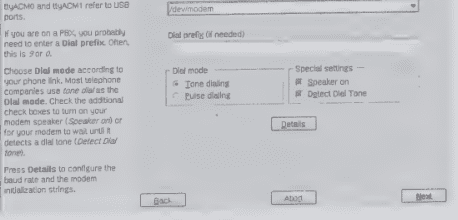

图 4.14：调制解调器配置

如果中间经过了 PBX（私人分支交换机），您可能需要输入一个额外的号码才能拨出系统（通常是 0，但您可以在电话系统的操作说明中找到此信息）。此外，请在双音多频（tone）和脉冲（pulse）拨号之间做出选择，决定是否开启扬声器，以及是否等待拨号音。如果您的调制解调器连接到 PBX，则不应使用最后一个选项。

调制解调器的波特率和初始化字符串设置可以在“Details”下指定。仅在调制解调器未被自动识别且必须进行特殊数据传输设置时才进行更改。这种情况主要发生在 ISDN 终端适配器上。

对于 ISP（Internet 服务提供商），您可以选择一个所在国家的标准供应商，或点击“New”手动输入 ISP 参数：拨号名称和连接名称（例如，所选供应商的名称）、电话号码（供应商的）以及您的用户名。在“Request for password”下，输入您的密码；或者出于安全原因，如果您不想将密码保存到硬盘，请选择“Always ask me”。接下来的对话框允许您将之前定义的供应商设为默认 ISP，并且如果您有多个调制解调器，可以为每个供应商设置默认调制解调器。

通过选择“Dial on demand”（按需拨号），告知系统在应用程序尝试访问 Internet 时自动建立连接。通常，仅在您拥有包月/固定费率连接时才建议这样做（另请参阅第 77 页的 Information about the Internet Dial-Up）。通过选择“Activate firewall”，启用个人防火墙。

在“Details”下，激活附加功能：

- “Reconnect when the connection is lost”：如果连接因某些原因中断，调制解调器将尝试自动重新拨号。
- “Modify DNS when connected”：此项为默认设置，通常无需更改。
- “Disconnect after (seconds)”：这允许您定义在线路不活跃（无数据传输）多久后应终止连接。在大多数情况下，180 秒是一个合适的值。

通过选择“Next”或“Finish”完成配置过程。

### DSL

要配置 ADSL 接入，您的网卡必须配置正确。使用 YaST2，您只能设置基于点对点以太网协议（PPPoE）的连接。DHCP 协议不会进行自动 IP 地址分配。您不能使用“自动地址设置（使用 DHCP）”。相反，请使用一个静态的“虚拟 IP 地址”。例如，`192.168.22.1`是一个不错的选择。在“Subnet mask”中输入`255.255.255.0`。对于独立系统，请确保不要在“Default gateway”字段中输入任何内容。您机器的“IP address”和“Subnet mask”的值仅为占位符。它们与建立 ADSL 连接无关，仅用于激活网卡。

在屏幕中输入您的用户 ID 和个人密码。最后，设置连接调制解调器的以太网卡（通常为`eth0`）。建议设置 60 秒的“Idle time”（空闲时间）——如果数据流停止，连接将自动终止。点击“Finish”完成此步骤。

如果您使用的是独立系统且要使用“Dial on demand”（见第 77 页），则必须输入名称服务器。如今大多数供应商支持动态 DNS 分配，因此每次建立连接时，当前的 IP 地址都会转发给名称服务器。但是，在此对话框中必须输入一个合适的虚拟名称服务器 IP。`192.168.22.99`是一个不错的选择。如果您没有收到动态名称服务器分配，请在此处输入供应商的名称服务器 IP 地址。

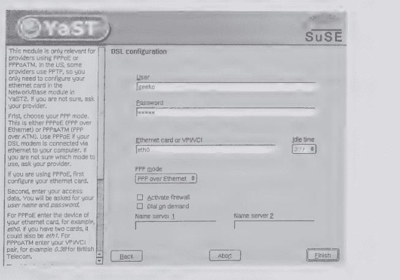

图 4.15：ADSL 配置

配置 T-DSL（德国电信）的步骤与 ADSL 相同。配置 T-DSL 需要以下数据：附件标识、T-Online 号码、共享用户 ID 和个人密码。这些信息可以从您的 T-DSL 登录单中获得。

### ISDN

如果您的 ISDN 网卡成功被自动检测到，会出现一个对话框让您进行“Selection of ISDN protocol”（ISDN 协议选择）。在欧洲，“Euro-ISDN (EDSS1)”是标准协议（参阅下面的场景 1 和 2a）。“1TR6”是旧式且大型电话系统使用的协议（参阅下面的场景 2b）。“NI1”是美国的标准。如果自动检测失败，请选择正确的 ISDN 网卡。然后指定 ISDN 协议并点击“Next”。

在随后的屏幕中，指定您的国家和供应商。此处列出的是“Call-by-Call”供应商。要使用未包含在列表中的供应商，请点击“New”。这将打开“ISP parameters”屏幕，在该屏幕中对您首选的供应商进行所有必要的设置。“ISDN SyncPPP”是标准的“ISDN type”。为“Connection Name”指定供应商名称，然后输入供应商的电话号码。

在经过 PBX 拦截的情况下，您可能需要在电话号码前输入一个额外的号码才能拨出（通常是 0 或 9，但最好参考您的 PBX 说明书）。整个电话号码不得包含任何分隔符，如逗号或空格。输入从供应商那里获得的用户名和密码。

接下来，进入 ISDN 连接参数。以下场景需要为您的“Phone Number”提供不同的规格：

- ISDN 网卡直接连接到电话公司的插孔。如果电话公司提供了 MSN（多用户号码），请输入 MSN。否则，请留空，ISDN 网卡应该可以工作。

- ISDN 网卡连接到 PBX：
  - 电话系统协议为 Euro-ISDN/EDSS1（通常用于家庭“小型”电话系统）：这些电话系统具有内部 S0 总线，并为连接的设备使用内部号码。在这种情况下，将内部号码指定为 MSN。更多信息可从电话系统文档中获得。只要该 MSN 被允许外部访问，您电话系统可用的任何一个 MSN 应该都能工作。如果其他方法都失败了，尝试输入单个 0 可能也有效。
  - 内部端口的电话系统协议为 1TR6（多见于大型企业电话系统）：此处 MSN 被称为“EAZ”，通常是分机号。通常，在 Linux 配置中，您只需输入 EAZ 的最后一位数字。如果其他方法都失败了，请尝试数字 1、2、3、4、5、6、7、8 或 9。

选择“Manual”（手动）、“Automatic”（自动）或“Off”（关闭）拨号模式。关于“Automatic”拨号模式，请参阅第 77 页的 Information about the Internet Dial-Up。最好选择“Manual”，这样您可以使用 `kinternet` 建立 Internet 连接，并且可以在不等待超时的情况下断开连接。使用命令行`/usr/sbin/isdndctrl dial ipp0`进行拨号，使用`/usr/sbin/isdndctrl hangup ipp0`挂断。


您还可以配置在不再进行数据传输后多少秒终止连接。建议设置为 60 秒。启用“ChargeHUP”可确保连接在下一个计费单位之前不会终止。不过，这并不适用于所有供应商。

强烈建议选择“Initialize ISDN system when booting”（启动时初始化 ISDN 系统），以便自动加载必要的驱动程序。仅凭此操作不会建立 Internet 连接。

如果只有一个本地主机，您无需在“IP settings”中更改任何内容。YaST2 将建议接受最合适的本地和远程 IP 地址。

预选的“Dynamic IP Address”和“Dynamic DNS”项目可确保供应商分配的 IP 地址和名称服务器在连接期间被转发，这通常是必要的。在“Callback settings”下，应选择“Callback off”，因为其他选项——至少对于私人使用而言——是不相关的。点击“Next”和“Finish”完成配置。

#### Starting or Stopping System Services（启动或停止系统服务）

此工具允许您确定在 SuSE Linux 启动时启动哪些网络服务（如 `telnet`、`finger`、`talk` 和 `ftp`）。这些服务允许外部主机连接到您的计算机。还可以为每个服务配置各种参数。默认情况下，管理单个服务的主服务（`inetd`）不启动。必须首先激活它。可以在标准配置和用户自定义设置之间进行选择。

图 4.16：ISDN 配置

> **注意**
>
> 这是一个专家级工具。只有在您熟悉网络服务并确切知道自己在做什么的情况下，才进行修改。

### 网络/高级

此组主要包含面向专业人员和系统管理员的工具。如果您使用的是 SuSE Linux 个人版（Personal Edition），本节中涉及的部分工具将不存在于此组中，因为它们仅安装在专业版（Professional Edition）中。

由于“LDAP 客户端”、“NIS 服务器”、“NIS 客户端”和“NIS+ 客户端”这些工具是纯粹的专家级工具，通常仅用于公司网络，因此此处将不再讨论。关于这些模块的更多信息请参阅 `Administration Guide`。

#### 主机名与 DNS

此处可以更改主机名和域名。如果 DSL、调制解调器或 ISDN 访问的提供商配置正确，名称服务器列表将包含自动生成的条目，因为这些条目是从提供商数据中检索而来的。如果您处于局域网中，您可能会通过 DHCP 接收主机名，在这种情况下，您不应修改该名称。

#### NFS 客户端与 NFS 服务器

只有当您处于网络环境中时才需要这两个工具。在这种情况下，您可以运行一个可供网络成员访问的文件服务器。在该文件服务器上，您可以为用户提供程序、文件或存储空间。使用“NFS 服务器”模块将您的计算机设置为 NFS 服务器，并确定要导出哪些目录供网络用户使用。NFS 服务器应由专家设置。要配置 NFS 服务器，请参阅《Administration Guide》中“Linux in the Network: NFS”章节下的简要说明。

随后，任何（具有所需权限的）用户都可以在自己的文件树中挂载这些目录。最简单的方法是通过“NFS 客户端”模块，用户只需输入充当 NFS 服务器的计算机的主机名以及其计算机上的挂载点。为此，在第一个对话框中选择“添加”并输入上述数据（见图 4.17）。

图 4.17：NFS 客户端配置

#### 路由

仅当您处于局域网中，或者通过网卡连接到 Internet（如 DSL 情况）时才需要此工具。

正如第 80 页关于 DSL 的说明，对于 DSL，网关数据仅用于正确配置网卡。然而，这些条目是虚拟的（dummies），没有任何功能。只有当您处于局域网中并使用自己的计算机作为网关（通往 Internet 的网关）时，该值才重要。

#### 安全与用户

Linux 的一个基本特性是它是一个多用户系统。因此，多个用户可以在同一个 Linux 系统上独立工作。每个用户都有一个由登录名标识的用户账户和用于登录系统的个人密码。所有用户都有自己的主目录，用于存储个人文件和配置。

##### 用户管理

首先，确认“用户管理”已被勾选。YaST2 提供了所有用户的列表，极大地简化了用户管理。要删除用户，请从列表中选择该用户（该行将以深蓝色高亮显示）并点击“删除”。要“添加”用户，只需填写所需字段。随后，新用户可以使用登录名和密码登录计算机。在“编辑” → “详细信息”下编辑详细内容。

##### 组管理

首先，确认“组管理”已被勾选。YaST2 提供了所有组的列表，极大地简化了组管理。要删除组，请从列表中选择该组（该行将以深蓝色高亮显示）并点击“删除”。“添加”和“编辑”用户同样简单，只需遵循 YaST2 中的帮助文本。当您在底部的输入框中输入新组成员时，请确保用户名在逗号后没有空格。YaST2 会建议一个组 ID，您可以直接接受。

##### 安全设置

在“安全与用户”下可以访问的“本地安全配置”起始界面中，有四个选项：

- 级别 1 适用于独立计算机（预配置）。
- 级别 2 适用于具有网络的工作站（预配置）。
- 级别 3 适用于具有网络的服务器（预配置）。
- 使用“自定义设置”进行您自己的配置。

如果您点击前三个选项之一，可以选择纳入其中一个级别的预配置系统安全选项。为此，只需点击“完成”。在“详细信息”下，可以访问可修改的各项设置。如果您选择“自定义设置”，请通过“下一步”进入不同的对话框。在这里，您可以找到默认安装值。

图 4.18：用户管理

**“密码设置”** 定义未来用户的密码长度（最小长度和最大长度）。5 到 8 个字符是一个可接受的值。指定密码的有效期、过期时间以及提前多少天发出过期警告（警告在登录文本控制台时发出）。

**“启动设置”** 此界面涉及两件事。首先，它设置如何解释 `Ctrl` + `Alt` + `Del` 组合键。通常，在文本控制台中输入此组合键会导致系统重启。除非您的机器或服务器是公开访问的，且您担心有人在未经授权的情况下执行此操作，否则请保持默认设置。如果您选择“停止”，此组合键将导致系统关机。选择“忽略”则此组合键将被忽略。其次，它设置谁被允许从 KDM（KDE Display Manager —— 图形登录界面）关闭系统。选项包括“仅 root”（系统管理员）、“所有用户”、“无人”或“本地用户”。如果选择“无人”，系统只能通过文本控制台关闭。

图 4.19：组管理

**“登录设置”** 通常，在登录尝试失败后，会有几秒钟的等待期，然后才能进行下一次登录尝试。其目的是增加“密码嗅探者”的难度。此外，您可以选择激活“记录失败的登录尝试”和“记录成功的登录尝试”。如果您怀疑有人试图窃取您的密码，请检查 `/var/log/` 中系统日志文件的条目。

**“添加用户设置”** 每个用户都有一个数字用户 ID 和一个字母用户 ID。两者之间的关联通过 `/etc/passwd` 文件建立，并且应尽可能唯一。使用此界面中的数据，定义添加新用户时分配给用户 ID 数字部分的数值范围。对于普通用户，最小值设为 500 是合理的。

**“杂项设置”** 对于“文件权限设置”，有三个选择选项：“简单”（Easy）、“安全”（Secure）和“偏执”（Paranoid）。对于大多数用户来说，第一个选项应该就足够了。YaST2 帮助文本提供了关于这三个安全级别的信息。

“偏执”设置极其严格，应作为系统管理员设置的基本操作级别。如果您选择“偏执”，请考虑在使用某些程序时可能会出现的干扰和故障，因为您将不再拥有访问各种文件的权限。

在此对话框中，还可以定义哪些用户可以启动 `updatedb` 程序。该程序每天或在启动后自动运行，它会生成一个数据库（locatedb），其中存储了计算机上每个文件的位置（可以通过运行 `locate` 命令来搜索 locatedb）。如果您选择“无人”，任何用户只能在数据库中找到其他（非特权）用户可见的路径。如果选择了 `root`，则所有本地文件都会被索引，因为 `root` 用户作为超级用户可以访问所有目录。

另一个选项是激活“在 root 用户的路径中省略当前目录”，这是一个合理的选择。最后，还有一个选项“禁用 root 用户的 telnet 登录”。选择此项也是一个好主意。否则，可以通过 `telnet` 以 `root` 身份登录您的机器，而 root 密码在 `telnet` 中是以明文传输的。

按下“完成”以完成您的安全配置。

#### 防火墙

此模块可用于激活和配置 SuSE 防火墙。如果您连接到 Internet，应采取这一保护措施。SuSE 防火墙能为您提供高效的保护。

启动该模块后，会依次出现四个对话框。在第一个对话框中，选择您要保护的接口（见第 91 页的图 4.21）。“外部接口”是用于 Internet 的接口。“内部接口”仅在您处于内部网络并打算使用防火墙保护计算机免受内部攻击时才需要。在这种情况下，您的计算机将处于“非军事区”（DMZ）。通常，DMZ 配置仅用于公司网络。

选择接口后，有选择地激活您计算机中允许从 Internet 访问的服务（见第 92 页的图 4.22）。如果您没有运行包含这些服务的服务器，而仅有

如果您希望浏览 Internet 并发送和接收电子邮件，请不要激活这些服务（关闭的外部“门越多，攻击者渗透的可能性就越小）。

如果您不熟悉 `masquerading`（伪装）和 `traceroute`（路由跟踪）这些术语，请直接接受第三个对话框而无需进行任何修改。您也可以接受最后一个对话框，因为默认的日志选项通常已经足够。

当您点击“Next”时，会弹出一个小窗口要求确认。随后，新配置将被保存到您的硬盘中。下次启动 Internet 连接时，您的计算机将有效地防止攻击。

有关 SuSE 防火墙的更多信息，请参阅 *Administration Guide* 中 *Linux in the Network: Firewall* 章节。

### System（系统）

#### 创建系统备份

YaST2 备份模块允许您创建系统备份。该模块创建的备份并不包含整个系统，而仅保存有关已更改软件包的信息以及关键存储区域和配置文件的副本。

定义要保存在备份中的数据类型。默认情况下，备份包含自上次安装运行以来更改的所有软件包信息。此外，它可能包含不属于软件包本身的数据，例如 `/etc` 中或 `/home` 下目录中的许多配置文件。除此之外，备份还可以包含硬盘上的重要存储区域，这些区域在尝试恢复系统时至关重要，例如分区表或主引导记录（MBR）。

#### 创建启动、救援或模块磁盘

使用 YaST2 模块，可以创建两种不同类型的启动磁盘、一个救援磁盘和四种模块磁盘。两种启动磁盘均可在您无法从 CD 启动时启用初始安装。这些磁盘实际上并非旨在启动已安装的系统。不过，通过一个小技巧，您可以使用它们来启动已安装的系统。

“启动磁盘”标准启动磁盘包含一个完整的最小系统，具有启动 SuSE Linux 所需的所有文件（包括内核）。您还可以为 i386 和较旧的 Cyrix 处理器创建启动磁盘。

> **注意**
>
> 这些启动磁盘不应与启动已安装系统的启动磁盘相混淆。用于已安装系统的启动磁盘是在安装期间或通过 YaST2 中的引导加载程序模块创建的，如果在计算机启动时插入，它将启动安装在硬盘上的 Linux 系统。它不包含任何系统，仅包含引导加载程序。

如果其他方法都失败了，您也可以使用上述创建的启动磁盘启动已安装的系统。为此，请从软盘启动，然后当它要求您插入第一张 CD 时，退出对话框以防止启动重新安装。在进行语言和键盘输入后，进入一个可以选择“Start installation or system”的菜单。在随后的窗口中，选择“Boot installed system”。

“救援磁盘”救援磁盘允许您重新获得系统的控制权。它将加载一个包含解决大多数问题所需的所有有用工具的最小 Linux 系统。

“模块磁盘”如果您在安装时需要额外的硬件模块或驱动程序（例如，如果您通过网络安装），请创建以下磁盘之一：

- Modules 1: USB 驱动程序
- Modules 2: IDE、RAID 和 SCSI 模块
- Modules 3: 网络模块
- Modules 4: CD-ROM、PCMCIA、Firewire、文件系统

在对话框中选择相应的项目，插入一张磁盘（最好是空白或已格式化的），然后点击“Next”。相应的内容随后将被写入软盘。

#### 引导加载程序配置

启动模式通常在安装期间指定（参见第 35 页的 Booting）。如果您的 SuSE Linux 可以启动，则无需更改任何内容，除非您之前是从软盘启动而现在想从硬盘启动。

引导加载程序配置得到了大幅扩展。除了这里描述的主对话框外，普通用户通常可以忽略通过“Next”（如果选择了“Edit”）访问的大多数其他对话框，因为这些大多涉及专家设置。然而，允许在引导加载程序启动屏幕（系统启动时出现）中包含新分区的对话框对于家庭用户可能很有意义。如果您安装了 Linux 且计算机上还有其他操作系统（如 Windows、OS/2 或另一个 Linux），您可以将这些操作系统包含在引导加载程序的选择列表中，以便您可以选择要启动哪个操作系统。

> **注意**
>
> 在运行的系统中更改启动模式是一项仅应由专家执行的操作。如有必要，请阅读 *Administration Guide* 中关于引导加载程序配置的章节。

#### LVM

“逻辑卷管理器”（LVM）是一个通过逻辑驱动器对硬盘进行独立分区的工具。由于这是一个纯粹的专家工具，本用户指南范围内不提供额外信息。有关信息，请参阅 `Administration Guide`。

#### 配置文件管理器（SCPM）

SCPM（System Configuration Profile Management）模块提供了创建、管理和在整个独立的系统配置之间进行切换的可能性。这对于在不同地点（不同网络）且由不同用户使用的移动计算机尤其有用。尽管如此，即使对于固定机器，此功能也很有用，因为它允许使用各种硬件组件或测试配置。虽然该模块及其随附的帮助文档易于使用，但配置配置文件是一项应由专家或系统管理员执行的任务。

有关 SCPM 的基础知识和利用方法，请参阅 *Administration Guide* 中的相应章节。

#### Restore（恢复）

此模块允许您从备份存档中恢复系统。请遵循 YaST2 中的指示。按下“Next”进入各个对话框。首先，指定存档所在的位置（可移动介质、本地硬盘或网络文件系统）。随着操作继续，将显示单个存档的描述和内容，以便您可以决定从存档中恢复什么。

此外，还有两个对话框，分别用于卸载自上次备份以来添加的软件包，以及重新安装自上次备份以来删除的软件包。这两个步骤使您能够恢复到上次备份时的确切系统状态。

> **警告**
>
> 由于此模块通常会安装、替换或卸载许多软件包和文件，因此您应该仅在具有备份经验的情况下使用它，否则可能会丢失数据。

### Runlevel Editor（运行级别编辑器）

#### SuSE Linux 中的运行级别

SuSE Linux 可以在多个运行级别中运行。默认情况下，系统在运行级别 5 中启动，该级别提供多用户模式、网络访问和图形用户界面（X Window System）。其他运行级别提供带有网络但没有 X 的多用户模式（运行级别 3）、没有网络的多用户模式（运行级别 2）、单用户模式（运行级别 1 和 S）、系统停止（运行级别 0）和系统重启（运行级别 6）。

如果在较高的运行级别中遇到与特定服务（X 或网络）相关的问题，各种运行级别将特别有用。在这种情况下，可以在较低的运行级别中启动系统以修复该服务。此外，许多服务器在没有图形用户界面的情况下运行，必须在没有 X 的运行级别（如运行级别 3）中启动。

通常家庭用户只需要标准运行级别（5）。但是，如果图形用户界面在任何时候冻结，您可以通过 `Ctrl` + `Alt` + `F1` 切换到文本控制台，以 root 身份登录，并使用命令 `init 3` 切换到运行级别 3。这将关闭您的 X Window 系统。输入 `init 5` 重新启动它。

> **提示**
>
> 如果您只想尝试在不同的运行级别（如运行级别 3）中会发生什么，请启动计算机并等待引导加载程序屏幕出现。然后按下 `↑`，输入 `3` 并按下 `↵`。系统将以文本控制台启动。要从文本控制台启动图形用户界面，请登录并输入 `startx`，或以 root 身份登录并输入命令 `init 5`。

#### 在 YaST2 中设置运行级别

在默认安装中，选择了运行级别 5。如果您希望在系统启动时启动不同的运行级别，请在此处更改默认运行级别。“Run-level properties”允许您确定哪些服务在哪个运行级别中启动。

> **警告**
>
> 除非您绝对确定自己在做什么，否则请勿修改任何内容。如果您误禁用了某个运行级别的某些服务，您的系统随后可能无法正常工作。

有关 SuSE Linux 中运行级别的更多信息，请参阅 *Administration Guide* 中的 *The Boot Concept: The Runlevels* 章节。

### Sysconfig Editor（系统配置编辑器）

目录 `/etc/sysconfig` 包含 SuSE Linux 最重要设置的文件（以前集中管理在文件 `/etc/rc.config` 中）。sysconfig 编辑器以透明的形式显示所有设置。

这些值可以被修改并保存到各自的配置文件中。通常不需要手动编辑，因为在安装软件包或配置服务时，这些文件会自动进行调整。

> **注意**
>
> 这是一个专业工具。如果您不完全清楚自己在做什么，请不要编辑 `/etc/sysconfig` 中的文件，因为这可能会对系统的功能产生非常不利的影响。

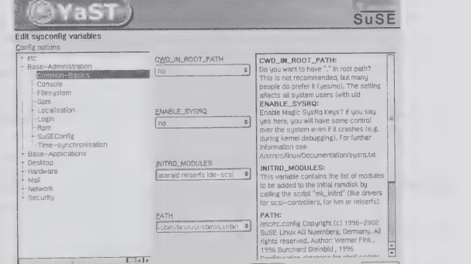

图 4.25：YaST2：sysconfig 编辑器配置

更多信息请参阅 *Administration Guide* 中的 *The Boot Concept*。

### 时区选择


时区在安装过程中已经设置，但您可以在此处进行更改。在列表中点击您的国家或地区，并选择“Local time”（本地时间）或“GMT”（格林威治标准时间）。“GMT”经常在 Linux 系统中使用。安装有其他操作系统（如 Microsoft Windows）的机器大多使用本地时间。

### 语言选择

在此设置 Linux 系统的语言。语言可以随时更改。在 YaST2 中选择的语言适用于整个系统，包括 YaST2 和 KDE 3 桌面环境。

### 键盘布局选择

> **注**

> 您仅在没有 X Window 系统且没有图形用户界面的系统上工作时才应使用此模块。如果您使用图形系统（如 KDE），请使用“Display and Input Devices”模块来设置键盘（参见第 62 页的 *Display and Input Devices (SaX2)*）。

所需的键盘布局通常与所选语言匹配。使用测试字段查看特殊字符（如管道符号 `|`）是否显示正确。

### 杂项

#### 提交支持请求

通过购买 SuSE Linux，您有权获得免费的安装支持。有关范围、地址和电话号码等信息列在第 324 页的 *Installation Support* 中。

YaST2 提供了直接通过电子邮件向 SuSE 团队发送支持请求的可能性。首先需要进行注册。从输入相关数据开始——您的注册码位于 CD 封底。关于您的咨询，在随后的窗口中选择问题类别并提供问题的描述（见下一页的图 4.26）。同时阅读 YaST2 帮助文本，其中解释了如何最好地描述问题，以便支持团队能够帮助您。

> **提示**

> 如果您需要高级支持（例如针对特殊问题），请考虑使用 SuSE 专业服务。详情请查看 `http://www.suse.de/en/support/`。

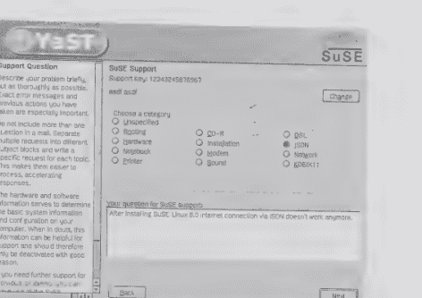

图 4.26：提交支持请求

#### 启动协议

启动协议包含计算机启动时显示的屏幕消息。启动协议记录在 `/var/log/boot.msg` 中。使用此 YaST2 模块可以查看协议，例如检查所有服务和功能是否按预期启动。

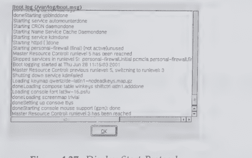

图 4.27：显示启动协议

#### 系统协议

系统协议将计算机的操作记录在 `/var/log/messages` 中。内核消息记录在这里，并根据日期和时间进行排序。

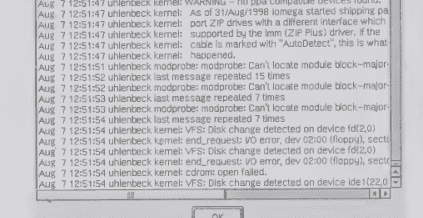

图 4.28：显示系统协议

#### 加载供应商驱动光盘

通过此模块，可以从包含 SuSE Linux 驱动程序的 Linux 驱动光盘中自动安装设备驱动程序。在从头开始安装 SuSE Linux 时，请在安装后使用此 YaST2 模块从供应商光盘加载所需的驱动程序。

### 在文本模式下使用 YaST2

此版本的 YaST2 非常适合在没有 X 或 X 无法正常工作时管理系统。要在文本模式下启动 YaST2，请在 `prompt` 处输入 `yast as root`。

文本版本的 YaST2 在 YaST1 停止开发后取代了后者。虽然之前已经提供了文本模式的 YaST2，但很少被使用。文本模式下的 YaST2 像 YaST1 一样通过键盘操作。YaST2-ncurses 的外观和感觉有所不同，YaST1 的快捷键不再起作用。

#### 控制

操作方式可能不熟悉，但非常简单。原则上，整个程序可以使用 Tab、Alt + Tab、Space、方向键（↑ 和 ↓）以及 Enter 键和快捷键来操作。当 YaST2 在文本模式下启动时，主窗口首先出现（见图 4.29）。

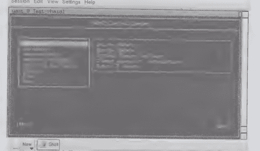

图 4.29：带有活动模块框架的 YaST2-ncurses 主窗口

这里有三个区域：左栏显示各种模块所属的类别。用 x 选中的类别中的模块位于右侧的白色框架内。底部有两个用于放弃或启动框架中标记模块的按钮。

启动后，光标位于最顶端的“All”字段上，因此该字段被颜色高亮（通常为绿色）。然而，当前选中地是“Software”，这可以通过括号中的“x”来识别。按下 Tab 键可从左栏的一个项目切换到下一个项目。使用 Space 键激活绿色的类别。该类别的模块随后将出现在右侧框架中。标记项的颜色取决于当前的终端设置。

重复按下 Tab 键，直到右侧的细白色框架变得突出。通常，可以使用 Alt + Tab 或 Shift + Tab 向后移动（见下一页的模块操作部分）。高亮白色框架会将焦点切换到右侧窗口，在该窗口中可以选择一个模块进行启动。方向键在模块之间前后移动。当所需模块标记为绿色时，按下 Enter 键启动。或者，按下 Tab 键选择“Start”，然后按下 Enter 键启动所选模块。

不同的按钮或选择字段还包含一个不同颜色的字母（标准设置中为黄色）。`Alt` + `字母` 的组合可以直接选择该按钮，跳过 TAB 导航。

#### 按键组合的限制

如果运行中的 X 服务器设置了全系统范围的 `Alt` 键组合，YaST2 中的 `Alt` 组合可能无法工作。此外，所使用的终端可能会捕获 `Alt` 或 `Shift` 等键。

- **用 `Esc` 代替 `Alt`**：可以使用 `Esc` 代替 `Alt` 来执行 `Alt` 快捷键。例如，`Esc` + `H` 代替 `Alt` + `H`。

- **用 `Ctrl` + `F` 和 `Ctrl` + `B` 代替前后导航**：如果 `Alt` 和 `Shift` 组合被窗口管理器或终端占用，可以使用 `Ctrl` + `F`（前进）和 `Ctrl` + `B`（后退）组合代替。

- **功能键的限制**：在 SuSE Linux 8.1 中，功能键也是快捷键（见对面页的 *Module Operation*）。某些功能键可能同样被所选终端占用，从而无法在 YaST 中使用。然而，在纯文本控制台上，`Alt` 键组合和功能键应该是完全可用的。

#### 模块操作

在接下来的内容中，假设 `Alt` 键组合功能正常。如果需要，请进行适当的替换或切换到纯文本控制台。

- **在按钮和选择列表之间导航**：`Tab` 和 `Alt` + `Tab` 在按钮、包含选择列表的框架之间以及框架之间前后导航。

- **在选择列表中导航**：`↑` 和 `↓` 始终在包含选择列表的已激活框架内的单个项目之间导航。例如，这些可以是控制中心中模块组的单个模块。

- **勾选单选按钮和复选框**：通过 `Space` 或 `Enter` 选择控制中心左侧带有空方括号的按钮（复选框 `[ ]`）或带有圆括号的模块组（单选按钮 `( )`），其方式与安装期间选择软件包的方式相同。当各种模块或控制中心底部的按钮被颜色高亮时，使用 `Enter` 或 `Alt` + `黄色键` 激活。

- **功能键**：功能键 `F1` 到 `F12` 提供了快速访问各种可用按钮的途径。哪些功能键实际映射到按钮取决于哪个 YaST 模块处于活动状态，因为不同的模块提供不同的按钮。这些包括详情 (details)、信息 (info)、添加 (add) 和删除 (delete)。与 YaST 一样，“OK”、“Continue”和“Cancel”被分配给 `F10`。映射到功能键的各种功能在通过 `F1` 访问的帮助中有所解释。

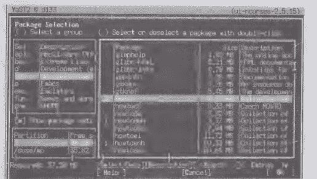

图 4.30：软件安装模块

#### 启动单个模块

每个 YaST 模块也可以直接启动。可以使用 `yast <module name>` 简单地启动模块。例如，网络模块使用命令 `yast lan` 启动。通过运行 `yast -l` 或 `yast --list` 可以访问系统中可用模块的名称列表。各种模块的描述可以在第 53 页找到。

# 文档标题

这是一段正文内容的示例，由于原图分辨率极低且模糊，无法识别具体文字，此处为占位符。


这是图片下方的说明文字或后续段落，同样由于图像质量问题无法精准识别内容。

## KDE — 桌面环境

K 桌面环境（简称 KDE）是 SuSE Linux 的标准桌面。所有关于优化桌面系统工作效率的信息都可以在此处找到。本章将展示图形元素，总结部分应用程序，并介绍 KDE 的互联网连接。本章假设您已成功安装 SuSE Linux 并正确设置了 X server。

- KDE 的历史 . . . . . . . . . . . . . . . . . . . . . . . . . . 106
- 首次启动 . . . . . . . . . . . . . . . . . . . . . . . . . . . . . 106
- 帮助 . . . . . . . . . . . . . . . . . . . . . . . . . . . . . . . . . . 106
- 操作 KDE . . . . . . . . . . . . . . . . . . . . . . . . . . . . . . . . 107
- 精选 KDE 应用程序 . . . . . . . . . . . . . . . . . . . . . . . . . . . . . 111
- 常见问题解答 . . . . . . . . . . . . . . . . . . . . . . . . . . . . . . 116
- 获取更多信息 . . . . . . . . . . . . . . . . . . . . . . . . . . . . . . 118

### KDE 的历史

KDE 的故事听起来像一个现代童话。一名来自德国图宾根的计算机科学专业的学生感到非常苦恼，因为之前的 Unix 和 Linux 桌面缺乏统一性。因此，他为 X Window 系统开发了流行的图形用户界面：KDE。在那个时代，Matthias Ettrich 绝不会想到他的号召力会引发一个新闻组的诞生。他为自己的项目“K Desktop Environment”（KDE）寻找志愿者，并得到了热烈的响应。

很快，第一个可执行版本被编译出来，KDE 变得越来越受欢迎。随后的改进使 KDE 项目达到了临界质量，使其能够独立起飞。如今，全世界有数百名程序员参与到为 KDE 开发更多改进中。

### 首次启动

当您第一次启动 KDE 时，屏幕上会出现一个配置助手。首先，选择国家和语言，然后选择系统行为（KDE、Unix、Windows、Apple OS）、各种效果以及桌面设计，共分五个简单的步骤。最后，启动控制中心并进一步自定义 KDE 以满足您的需求。可以通过按下 `Alt` + `F2` 并输入 `kpersonalizer` 来手动启动配置助手。

#### 帮助

如果您在 KDE 中遇到无法继续操作的情况，请按下 `F1` 或在应用程序的“帮助（Help）”菜单下选择“内容...（Contents...）”。随后会出现 KDE 帮助中心。左侧面板有两个选项卡：“内容（Contents）”和“搜索（Search）”。

**内容**

“内容”列出了属于 KDE 系统和 Linux 系统的各种文档——man 页（帮助页）和 info 页。例如，点击“应用程序手册（Application manuals）”后，可以看到与 K 菜单相同的菜单结构。浏览子菜单，并在右侧区域查看显示的帮助文档。

通过“Unix man pages”浏览传统的 Unix man 页。其结构基于历史习惯，man 页被分为九个或十个部分。点击相应部分以显示项目，然后点击所需信息。若要从 man 页中查找特定命令的信息，请在 URL 字段中输入井号（`#`）和命令名称。

### 操作 KDE

在 KDE 中，有多种方式可以更改配置以及打开文件和应用程序。KDE 桌面、菜单栏、标题栏、窗口和控制面板均可用于此目的。以下各小节将介绍这些不同的选项。

#### KDE 桌面

桌面是 KDE 的中央交换机。启动 KDE 后，您会在桌面上发现各种图标，这些图标可以快速访问 CD-ROM 盘或硬盘，并允许轻松保存文件以及设置目录和文件的链接。实际上，桌面只是您硬盘上的一个文件夹。它位于您的主目录下的 `Desktop` 中。所有存储在这里的文件都将由 KDE 显示在桌面上。要更改此路径，请参阅第 123 页的 *外观与感觉（Look and Feel）*。

#### 菜单栏

如果需要，可以将 KDE 的菜单栏放置在桌面的上边缘。通过右键点击桌面来访问菜单栏。在出现的弹出菜单中，找到“启用桌面菜单（Enable desktop menu）”或“禁用桌面菜单（Disable desktop menu）”。通过点击此项来激活或停用桌面菜单。以下列表提供了可用项目以及旨在简化您在 KDE 中工作的选项概述。

- “文件（File）”：执行各种命令，启动应用程序，锁定屏幕或注销。
- “新建（New）”：创建目录、FTP 文件链接、WWW 文件以及各种应用程序，以便以后能更快地找到它们。
- “书签（Bookmarks）”：管理您的书签。这样可以轻松访问经常访问的地址和文件。KDE 还会自动管理来自其他浏览器（目前为 Netscape 和 Mozilla）的书签。
- “桌面（Desktop）”：重新排列和组织您的窗口与图标，并配置背景和桌面。此外还可以停用菜单栏。
- “窗口（Window）”：显示所有桌面以及打开的应用程序。
- “帮助（Help）”：获取关于 KDE 的信息或报告错误并提出请求。

#### 标题栏

标题栏是窗口顶部的区域，包含窗口名称和一些图标，具体取决于所选的窗口装饰。在默认装饰中，KDE2 展示了以下标题栏布局：窗口面板菜单、“图钉”符号、相应的窗口名称，以及最小化、最大化和关闭符号。有时，在最小化符号前可能会出现一个问号，即“这是什么（What is that?）”符号。图 5.1 展示了标题栏的组成。

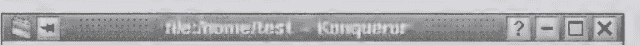

图 5.1: KDE2 标题栏

通过右键点击标题栏可获得更多功能。随后会打开一个弹出菜单，用于配置当前窗口或创建所有窗口布局的设置。弹出菜单包含以下项目：

- “移动（Move）”：窗口跟随鼠标移动，直到通过左键点击释放。
- “尺寸（Size）”：通过鼠标移动来更改窗口的水平和垂直尺寸，左键点击确认。
- “最小化（Minimize）”：最小化当前窗口。应用程序保持打开状态，但其窗口从桌面消失，仅在任务栏中显示为图标。要重新打开窗口，请点击任务栏中的图标。
- “最大化（Maximize）”：最大化当前窗口。应用程序现在占据整个屏幕。再次点击可将窗口恢复到原始大小。
- “卷帘（Shade）”：当前窗口被缩减至仅剩标题栏。
- “总在最前（Always On Top）”：当前窗口将一直可见，直到您停用此功能或关闭窗口。
- “存储设置（Store Settings）”：保存您的规格设置。
- “设置...（Settings...）”：在打开的窗口中指定属性和装饰。
- “移至桌面（To desktop）”：通过子菜单选择，将窗口移动到另一个桌面。
- “关闭（Close）”：关闭当前窗口。

#### 控制面板

启动 KDE 后，任务栏出现在底部边缘（默认设置）。在该边缘内，可以找到 SuSE 菜单以及各种常用应用程序的快速启动图标，例如 shell 和 Konqueror。此外还提供了一些“applets（小应用程序）”，这些将在下一页的“Applets：微型程序”中介绍。

#### KDE 与 SuSE 菜单结构

SuSE KDE 软件包包含两个菜单：常规 K 菜单和扩展 SuSE 菜单。K 菜单是“传统”菜单，仅包含 KDE 应用程序。SuSE 菜单的分类方案略有不同。初次启动后，该菜单被构建在默认配置中。在 SuSE 菜单中可以找到所有 KDE 应用程序及更多内容。这使您例如可以启动所有 GNOME 和 X 应用程序。

您可以地使用以下类别：开发、游戏、图形、互联网、多媒体、办公软件、设置、系统和服务应用程序。此外，还能找到 SuSE 帮助和控制中心等项目。

可以在控制中心的 “外观与感觉（Look & Feel）” → “菜单设置（Menu settings）” 中从一个菜单切换到另一个菜单。在此处，还可以为启动面板集成额外的菜单，例如任务菜单或管理员菜单。这些菜单提供了预先排序的常用应用程序列表。

基本上，所有 KDE 应用程序都可以通过 K 菜单或 SuSE 菜单访问。您可以自行决定倾向于哪种菜单结构。

图 5.2：精选 Applets

### Applets：小程序

控制面板还为可嵌入的 Applets（小程序）提供了空间。例如，用于显示当前时间。

图 5.2 从左到右依次显示了：切换板 (switchboard)、快速启动器 (quickstarter)、系统监视器 (system monitor)、眼睛 (eyes)、新闻滚动条 (newsticker)、控制栏的系统部分以及时间。每个 Applet 旁边都有一个可打开菜单的小箭头。在这里可以移动或删除该 Applet。如果该程序设有设置对话框，也可以通过菜单打开。要添加类似的实用程序，请在空白处右键单击并选择“添加” → “Applet”。

任务栏 (The Taskbar) —— 任务栏有助于在打开的应用程序之间快速轻松地跳转。可以根据桌面对应用程序进行排序，或将相应的窗口分组。在控制中心选择菜单项“外观与感觉” → “任务栏”，并探索不同的设置选项。

图 5.3：任务栏：显示所有活动的桌面窗口。

切换板 (The Switchboard) —— KDE 提供多个桌面。您可以配置最多 16 个“虚拟桌面”，并可以为其指定名称。

对面页中的图 5.4 实际上显示了同一个切换板（从左到右），分别以数字视图、预览视图和名称视图显示。

在切换板内部右键单击可打开弹出菜单。选择“预览”、“数字”或“名称”。


点击“启用桌面预览”后，其旁边会出现一个箭头。点击此箭头可打开一个小窗口，显示桌面的预览。直接点击窗口即可激活该窗口。

新闻滚动条 (Newsticker) —— 如果您有可用的互联网连接，可以接收最新的新闻。新闻报告以滚动文本的形式显示在一个小 Applet 程序中。第 129 页的*网络 (Network)*章节将详细介绍这个实用工具。

### 精选 KDE 应用程序

KDE 有大量的应用程序。由于篇幅限制，我们无法详细介绍所有程序。随后的列表中的精选内容绝不代表质量上的比较。

#### 硬盘管理

`kdf` 和 `kwikdisk` 都能帮助您快速轻松地挂载或卸载系统中可用的数据介质。

图 5.5：`kdf` 的数据介质概览

- `kwikdisk` 是一个 Applet，因此可以集成到控制面板中。右键单击图标时，会打开一个用于挂载或卸载相应数据介质的菜单。如需图形化概览，请选择 `Start KiDiskFree`。

- `kdf` 和 `KDiskFree` 显示从 `/etc/fstab` 文件获取的数据介质概览，类似于 `df` 命令。该窗口

#### DVI, PostScript 和 PDF 查看器

Linux 中最重要的格式包括 DVI 和 PostScript。可以使用 DVI 查看器 `kdvi`，或 PostScript 和 PDF 查看器 `kghostview` 轻松查看。这两个应用程序的设置都非常直观。图 5.6 显示了 `KDvi` 窗口。

这些查看器的特点之一是它们可以集成到 Konqueror 窗口中。这使得在无需手动启动相应应用程序的情况下即可非常方便地显示文件。

图 5.6：`KDvi` 文档查看器

在 `kghostview` 中（见对面页图 5.7），加载任何 PostScript 或 PDF 文档并查看。使用“文件” $\rightarrow$ “打开”并选择相应文档。在“视图”菜单中，选择各种显示方式，内容将自动适应尺寸。要将图像旋转 90 度，请使用“视图” $\rightarrow$ “方向”。

图 5.7：`KGhostview` 文档查看器

#### 使用 KOrganizer 安排约会

使用 `korganizer` 管理约会，并轻松获取生日和重要事件的提醒。定义任务并记录进度。该应用程序包含在 `kdepim3` 软件包中，可以使用 YaST2 安装。按下 `Alt` + `F2` 并输入 `korganizer` 即可启动。

要设置新约会，请点击“动作” $\rightarrow$ “新约会”。随后会出现一个窗口，用于输入关于约会的通用信息、参会人员以及重复频率。例如，如果条目每周重复一次，请在“重复”选项卡下设置。为此，必须在“通用”选项卡下勾选“重复事件”。

在“通用”选项卡下，输入“摘要”并设置开始和结束日期以及开始时间。您还可以设置此约会的提醒。激活“提醒”字段，并设置您希望 `korganizer` 提醒您的时间。在下方的文本框中输入更详细的文本。

为了组织您的约会，请定义`类别 (categories)`。点击“类别”打开窗口以选择相应的事件。如果要计划的事件类型不在列表中，请在“新类别”中添加新名称并按下 Enter 键。点击“确定”关闭窗口。

图 5.8：`KOrganizer`：KDE 日计划表

以下说明如何有效地添加新约会。为此，最好使用“动作” $\rightarrow$ “新事件”。

示例：首先，安排一个简单的约会。为此，在“摘要”字段中输入约会类型。通过“开始日期”和“结束日期”定义日期。在“开始时间”和“结束时间”中设置合理的时间。如果您不想设置时间，只需激活“无关联时间”。

要获得此约会的提醒，请激活“提醒”。现在，旁边的输入字段可用于设置以分钟、小时或天为单位的提醒。在下方的文本框中输入约会的详情。通过“类别”，可以对日历条目进行分类。

要指定其他参会者，请点击“参会者”。输入他们的姓名和电子邮件地址。定义参与者的角色（如仅参与者或组织者）以及状态（如需要准备、已接受或已确认）。通过“地址簿...”选择参与者，姓名和电子邮件地址将自动添加。

点击“应用”后，您的约会将添加到日历中。该按钮会保持窗口打开，以便您进行微调。要关闭窗口，请点击“确定”。

使用 `KOrganizer` 不仅可以管理约会，还可以组织任务。在“动作”中找到“新待办事项”。尝试一下 `KOrganizer` 提供的众多选项。

图 5.9：设置新约会

#### KInternet —— 连接互联网

要浏览互联网或发送/接收电子邮件，您需要一台连接到计算机并在 SuSE Linux 中配置好的调制解调器、以太网卡或 ISDN 卡。这可以通过安装和配置工具 YaST2 来完成。配置好设备后，使用 `KInternet` 应用程序来管理您的拨号上网连接。

KDE 在启动时加载 `KInternet`。该应用程序会独立评估是否可以建立互联网连接。如果可以，应用程序图标将以插头形式自动出现在 KDE 面板的右下角。

- 不存在互联网连接。

- 正在建立连接。

- 连接已建立。

- 互联网连接不存在，但一旦从互联网检索数据，将建立连接。

- 数据正在向互联网传输或从互联网传输。

如果您右键单击 `KInternet` 图标，会出现一个菜单，它可以辅助您进行 `KInternet` 配置并帮助管理与提供商的数据连接。使用 YaST2 可以轻松配置所选提供商的访问。大多数常用提供商已预先配置。

`KInternet` 还提供一系列额外的实用功能，例如代理服务器 WWW-Offle，它是所有网站的缓存（无论您使用哪种浏览器）。这使得在无需重新拨号上网的情况下即可查看先前下载的站点。离线状态下请求的网站将在您重新上线后自动下载。要使用这些功能，请安装 `wwwoffle` 软件包。同时在浏览器中输入代理 `localhost, Port 8080`。在 Netscape Navigator 中，此选项位于“编辑” $\rightarrow$ “首选项” $\rightarrow$ “高级” $\rightarrow$ “代理”下。在 Konqueror 中，选择“设置” $\rightarrow$ “配置 Konqueror”，在“代理”下进行设置。

### 常见问题解答

1. **如何访问 CD 或 DVD？**

   KDE 桌面上有一个带有 CD 图像的图标。将 CD 或 DVD 插入驱动器并左键单击该图标。CD 将被挂载，其内容将在 Konqueror 窗口中显示。

2. **我的桌面上没有 CD 图标。如何创建？**

   右键单击桌面。选择“创建新...” $\rightarrow$ “CD-ROM 设备”。一个窗口将打开。在“通用”下，重命名桌面上的图标。在“设备”下输入 CD 或 DVD 驱动器的设备名称。

#### 3. 我可以将控制面板放在其他地方吗？

是的，当然可以。在面板的空白区域左键单击并将其拖动到任何其他边缘。释放鼠标按钮释放后，控制面板将放置在该位置。

#### 4. 我想要另一个控制面板，这可行吗？

可以。在现有控制面板的开放空间右键单击。选择“添加” $\rightarrow$ “扩展” $\rightarrow$ “外部任务栏”。一个任务栏随后会打开。现在可以通过 Konqueror 在其中添加文件和目录。或者，右键单击面板并选择“添加”下的相应项。

#### 5. 如何将程序和其他项目添加到控制面板？

为此有两种选择：

- (a) 右键单击控制面板的空白区域。弹出菜单将打开。选择“添加” $\rightarrow$ “按钮”，你将看到与 K 菜单中相同的条目。通过点击“添加此菜单”将你喜欢的项目添加到控制面板。也可以直接点击选择所需的程序。在这两种情况下，相应的图标都会出现在控制面板中。

- (b) 可以直接在 Konqueror 中用鼠标左键选中程序和文件夹，在保持鼠标按钮按下的同时，将对象拖入控制面板并再次释放鼠标。

#### 6. 我想了解更多关于我的系统的信息，在哪里可以找到？

这里有两个选项：按下 `Alt` + `F2` 并在命令对话框窗口中输入应用程序名称 `ksysguard`。另一个窗口将打开。使用左侧的“传感器浏览器”点击单个监控模块并将其拖入主窗口。另一个选项是控制中心。所有与你的计算机相关的资源和设备都位于“信息”项下。

#### 7. 如何显示 PostScript 或 PDF 文件？

在 KDE 中，`KGhostView` 程序用于此目的。第 112 页的 `DVI, PostScript, and PDF Viewers` 章节提供了关于该程序的更多详细信息。

#### 8. 如何查看图形文件？

使用 `KView`。通过输入 `Alt` + `F2` 和 `kview` 来启动它。该应用程序支持多种图形格式。

#### 9. 我可以在 KDE 中播放 WAV、MP3 和其他音频文件吗？

可以，按下 `Alt` + `F2` 并输入 `noatun`。一个窗口将打开。在“文件” $\rightarrow$ “打开”下加载你的音频文件。

#### 10. 如何播放音频 CD？

将音频 CD 插入驱动器，启动 `noatun` 应用程序（`Alt` + `F2` 然后输入 `noatun`）。使用 `kmix` 调节音量。

#### 11. 如何拨号上网？

通过 `KInternet` 应用程序。关于它的详细描述在第 115 页的 *KInternet — Connecting to the Internet* 中。

#### 12. 如何阅读电子邮件？

使用 `KMail` 应用程序。

#### 更多信息

如果你需要关于 KDE 的更多信息，请查看以下网页：

| URL | 描述 |

| :--- | :--- |

| http://www.kde.org | KDE 页面 |

| http://www.konqueror.org | 关于 Konqueror 应用程序的一切 |

| http://i18n.kde.org | KDE 国际化 |

| http://kde.themes.org | 你想知道的所有关于设计及其他与 KDE 相关的主题 |

| http://artist.kde.org | 关于 KDE 图标、剪贴画和其他图形的一切 |

| http://lists.kde.org | 邮件列表 |

| http://bugs.kde.org | 已知的 KDE bug |

## 6 KDE — 配置

本章旨在阐明如何使用控制中心更改 KDE 的外观和感觉。它还展示了如何配置文件管理器、网页浏览器和其他工具以满足你的需求。KDE 控制中心允许根据个人需求配置 KDE。本章仅侧重于 KDE 配置的主要方面。

- KDE 控制中心 . . . . . . . . . . . . . . . . . . . 120

- 外观和感觉 . . . . . . . . . . . . . . . . . . . . . . . . . 123

- 信息 . . . . . . . . . . . . . . . . . . . . . . . . . . . . . . 127

- 声音 . . . . . . . . . . . . . . . . . . . . . . . . . . . . . . 127

- 网络 . . . . . . . . . . . . . . . . . . . . . . . . . . . . . 129

- 个性化 . . . . . . . . . . . . . . . . . . . . . . . . . . . . . 130

- 系统 . . . . . . . . . . . . . . . . . . . . . . . . . . . . . . 131

- 网页浏览器 . . . . . . . . . . . . . . . . . . . . . . . . . . . 133

### KDE 控制中心

可以通过控制面板图标直接访问 KDE 控制中心，或者在 K 菜单和 SuSE 菜单的“控制中心”下访问。如图 6.1 所示，一个窗口将打开。

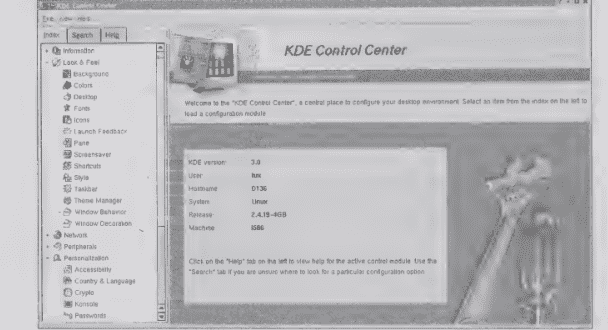

图 6.1：KDE 控制中心

控制中心分为菜单栏以及左、右面板。左面板显示配置模块列表。点击菜单后，右面板中的相关模块会显示一些信息。再次点击该模块将在右侧面板中启动设置对话框。在下方可以找到最多四个按钮：

- “帮助” — 查看简短的帮助文本

- “使用默认设置” — 恢复默认设置

- “应用” — 确认更改

- “重置” — 撤销更改

菜单栏包含以下菜单：

- “文件” — 通过“退出”关闭控制中心

- “视图” — 选择控制中心的布局。在“模式”中，决定是使用结构化的“树状视图”还是简单的“图标视图”。指定后者的“图标大小”。

- “帮助” — 通过“目录”查看控制中心帮助页面。通过使用“这是什么？”并用鼠标选择图标来获取信息文本。向程序作者提交“关于...的 Bug 报告”，或查找关于 KDE 或控制中心的信息。

如果你不确定某个特定设置的作用，可以通过按下 `Shift` + `F1` 然后点击相关元素来查阅工具提示。其帮助文本将会出现。

#### 外设设备

包括“打印机管理”、“鼠标”、“智能卡”和“键盘”。

**鼠标** “常规”选项卡定义左手或右手鼠标/轨迹球的使用方式，文件或文件夹应通过单击还是双击打开，图标在鼠标触摸时是否切换状态，以及鼠标指针在悬停于图标上时是否发生变化。

“高级”选项卡包括鼠标移动与屏幕光标移动之间相关性的配置选项（“光标速度”）、第二次鼠标点击必须在第一次点击后多久才被视为双击（“双击间隔”）、使用鼠标滚轮时行如何变化（“鼠标滚轮再生滚动”）以及类似选项。

**键盘** 要切换键盘布局，请在此选择不同的布局。在“高级”选项卡中，配置数字键盘（“启动 KDE 时锁定数字键盘”项）和按键重复率。

#### 文件显示

此菜单包含“文件管理器”和“文件关联”模块。

**文件管理器** 此模块包含“行为”、“外观”和“回收站”设置选项。

在“行为”下，决定目录是否应在独立窗口中打开。“在单个窗口中显示网络进程”允许将所有进程合并到一个易于阅读的单个窗口中。“外观”设置 Konqueror 窗口的视觉布局（字体、字体大小等）。回收站设置可以在第三个选项卡中进行。

**文件关联** 为特定程序分配文件类型 —— 也称为 “MIME”（多用途互联网邮件扩展）类型。通常，这些仅涉及电子邮件中的文件附件。文件关联包括文件识别规则、描述、图标以及可用于打开给定文件类型的应用程序列表。文件关联被分为“应用程序”、“音频”、“图像”、“inode”、“消息”、“打印”、“文本”或“视频”，并显示在名为“已知类型”的菜单中。以下是不同功能的摘要。

要自动 *根据 MIME 类型搜索*，请在“查找文件名模式”中输入文件名（见图 6.2）。通过双击某种类型、打开它并浏览其关联的 MIME 类型来启动手动搜索。

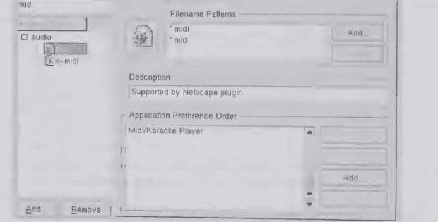

图 6.2：编辑 MIME 类型

通过点击窗口左下角的“添加”来 *创建新的 MIME 类型*。这将打开一个小对话框，从中可以在列表中选择合适的类别。在相应字段中为其指定“名称”。

通过选择要修改的类型来 *编辑 MIME 类型*（见图 6.2）。从可用文件类型列表中进行选择。相应的设置随后将出现在右侧窗口面板中。

在“常规”下，指定图标、文件模式和简短描述。能够处理此类型的应用程序可以通过“添加”来增加。

“集成”选项决定文件应该集成到 Konqueror 中，还是出现在自己的窗口中。集成需要一个作为插件运行的应用程序。

### 电源控制

使用此菜单项中的模块，可以启用计算机的节能功能。配置在电量不足的情况下运行的特定命令或发出的声音。如今的计算机可以在一段时间不活动后切换到待机模式。此功能需要 APM 支持，大多数现代 PC 都包含此支持。

### 外观和感觉

此模块为您的 KDE 系统提供各种设置。其中包括“桌面”、“屏幕保护程序”、“主题管理器”、“颜色”、“窗口装饰”、“窗口行为”、“任务栏”、“背景”、“面板”、“启动反馈”、“字体”、“样式”、“图标”和“键绑定键”等模块。

> **注意**

> 在更改 KDE 的外观和感觉时，请考虑您计算机的内存能力。具有大量颜色变化和背景图像的样式需要更多的内存和处理器能力。

大多数对话框都是自解释的。不过，下面讨论几个重要的模块。

**桌面** “桌面”定义桌面的垂直位置、隐藏文件的显示方式，并启用菜单面板。还可以为某些文件（如 HTML）启用预览。这里列出的最重要的设置是 KDE 路径，例如存储桌面的路径。

在“外观”下，选择字体大小、默认字体、纯文本颜色显示以及相应的背景颜色。启用或禁用文件名的下划线。

在“桌面数量”下，设置桌面的数量和名称。

> **提示**

> 按下 `Ctrl` 和任意功能键 `Fx`（其中 x 代表桌面编号），或使用 `Ctrl` + `Tab` 在桌面之间导航。

**屏幕保护程序** 要启用屏幕保护程序，请点击“启用屏幕保护程序”前面的方框。从列表中选择所需的一项。要调整单个屏幕保护程序的设置选项，请点击“设置”。

**主题管理器** 此模块提供了创建、保存或删除主题（桌面设计）的选项。在“安装”下，从列表中选择一个主题。在“内容”中进行微调。这控制了包含哪些元素，例如颜色、声音和图标。要获取更多信息，请前往“关于”。

*图 6.3：桌面的颜色调整*

**颜色** 在这里，更改 KDE 桌面的配色方案并进行单个颜色调整（见图 6.3），所有更改将应用于大多数 KDE 应用程序。列表中已经列出了一些预设的配色方案。当您点击它们时，更改将显示在顶部的示例窗口中。

**窗口装饰** 使用此模块装饰您的窗口边缘和标题栏。根据所选装饰模块的特性，相应的选项卡（“按钮”、“配置 [Quartz]”等）将被激活。然后进行微调。

**窗口行为** 在此模块中，配置点击、移动或调整窗口大小时的窗口行为。如果您选择了 KWin 以外的窗口管理器（在“窗口装饰”菜单中，KWin 为 “KDE2 (默认)”），则设置可能无法生效。

**任务栏** 在此模块中，决定是在任务栏中仅显示当前桌面上的打开应用程序，还是显示所有打开的应用程序。还可以显示任务栏本身的按钮、对相关窗口进行分组，或根据桌面对打开的应用程序进行排序。建议至少勾选“显示应用程序图标”，以便获得更好的概览。


## 背景

在此模块中，为桌面分配统一背景、不同背景或颜色渐变。要分配背景或颜色渐变，请从列表中选择一个桌面。其右侧是一个预览窗口。在窗口底部，可以找到“背景”、“壁纸”、“高级”和“优化”选项卡。

在“背景”下，配置一种模式，例如图案或水平/垂直颜色渐变。相应的颜色位于模式下拉框的正下方。

“壁纸”为您的桌面指定一个或多个壁纸图像。此处还定义一种模式（居中、平铺等）。如果您不想使用这些选项，请选择“无壁纸”。

“高级”提供了混合壁纸背景的选项。有几种可用选项，包括水平、垂直和金字塔形。

“优化”提供了内存优化选项（面向专家）。

## 面板

在此模块中，设置面板（或 “kicker”）的位置、大小和外观。在此模块中可以找到分隔符。

在“位置”下，配置面板在屏幕上的位置（左、右、上、下）、样式（极小、小、中、大）和大小。

在“菜单”中，定义 K 菜单布局的外观 —— 即那里应该出现哪些附加项目。此外，集成快速浏览器菜单，设置菜单缓存或使用其他选项。

通过“Applets”选项卡指定面板小程序（applets）的安全级别。可以通过两种方式启动这些小程序：内部或外部。内部方法优于外部方法，但如果小程序编程较差，可能会导致不稳定和安全漏洞。请在此选择合适的安全级别。

最后一个选项卡名为“扩展”，负责设置额外的外部任务栏，例如位置、自动混合或隐藏按钮。

## 启动反馈

要查看启动应用程序的状态，在此菜单中进行几项设置。

勾选“启用忙碌光标”以在鼠标上接收反馈输出。此外，决定此反馈是否应伴随闪烁效果，以及启动反馈应激活多久。

可选地，让反馈通知您程序正在启动。如果勾选了“启用任务栏通知”，此信息也将显示在面板中。在此设置启动反馈激活的时长。

## 字体

如果默认字体设置不令人满意，请根据您的需求进行调整。点击要更改的字体旁边的“选择”。在对话框中设置字体样式和大小，然后点击“确定”确认选择。

## 样式

样式是按钮、列表、菜单和其他此类桌面元素的呈现方式。列表中已经列出了一些预设选项。要应用 GNOME 和 GTK 样式，请点击“导入 GTK 设计...”。随后会打开一个窗口引导您完成安装。

## 图标

此模块允许指定图标的显示方式。还可以定义应用于图标的特殊效果。

在“主题”下，决定图标是以较少颜色显示还是以丰富的颜色和更多色调显示。通过“安装新主题”安装另一种设计。

在“高级”下，决定是否为图标添加效果。同时设置各种面板和桌面中的几种图标大小。

## 绑定键

如果之前的键盘快捷键不适合您，可以在此模块中重新定义动作和应用程序的各种快捷键。

在“全局快捷键”下为您的桌面定义组合键。为列表中的某个动作分配快捷键。例如，`Alt` + `F2` 打开“运行命令”窗口。

“快捷键序列”定义用于在桌面之间切换或将窗口移动到桌面的快捷键。“应用程序快捷键”选项卡定义用于许多应用程序中经常出现的各种动作（如复制和粘贴）的特定组合键。

## 信息

要查看您的系统信息，请浏览这里的各个模块。这些信息大部分源自 `/proc` 目录。项目内容是自解释的，通常显示硬件相关信息。通过这种方式，可以轻松确认某些 Linux 设备是否被正确识别。

## 声音

使用此模块配置声卡的使用。

### 音频 CD

此模块负责设置音频 CD 的输入和输出模块。通过在 Konqueror 的 URL 字段中输入 `audiocd:/` 来启动。可以对音频 CD 的自动检测、错误校正、文件格式 “Ogg-Vorbis” 和 “MP3” 以及连接到互联网音乐数据库的设置进行配置。

### Midi

选择用于播放 MIDI 文件的 MIDI 设备。

### 混音器

在此模块中，可以进行基础的 `kmix`（KDE Mixer）声卡设置。在第一个部分保存默认音量级别或加载已保存的音量级别。通过“登录时加载音量”在 KDE 启动时自动加载首选设置。

在“硬件设置”部分，通过“探测混音器的最大数量”定义 `kmix` 在启动时应检测多少个声卡。通过“每个混音器探测设备的最大数量”设置每个声卡上应检测多少个设备。

### 系统铃声

设置一个系统铃声来代替系统报告。其音量、音调和持续时间可以在此模块中设置。

### 音频服务器

该模块用于设置 KDE arts 音频服务器，您可以使用它来聆听系统声音、MP3 文件以及其他声音事件。

### 系统通知

您可以在此模块中进行设置，以报告发生的事件或记录此类事件。

选择一个应用程序或应用程序类别。点击该项目前的 + 符号将其展开，直到显示四个选项。“记录到文件”将消息保存到文件中，而不发出任何声音或光学信号。“播放声音”将播放配置好的声音文件。“显示消息框”将显示一个消息窗口。“标准错误输出”由应用程序本身监管错误输出。

在“文件名”旁边，定义要播放的声音文件。在此处输入文件名，或点击目录图标后从出现的列表中选择。

选择声音文件后，使用目录图标右侧的播放按钮（箭头图标）进行测试。播放音量可以通过“音量”旁的滑块进行调节。要使用外部播放应用程序，请勾选“使用外部播放器”前的复选框，并使用目录图标选择所需的应用程序。

## 网络

在此处进行网络相关设置。

### 电子邮件

在此模块中输入用户信息，例如姓名、组织、电子邮件地址和回复地址。指定您首选的电子邮件应用程序。

### 首选项

配置 KDE 应用程序与互联网及网络的协作行为：超时值和 FTP 选项。

### 局域网浏览

在此模块中设置局域网信息服务器 LISo。您只能以 `root` 身份进行更改。

### 新闻跑马灯

使用此模块配置 KNewsTicker 小部件。为此目的提供了四个选项卡窗口。

在“常规”下，如果使用该类型的鼠标，请调整鼠标滚轮的灵敏度和新闻查询间隔。同时设置是否应减慢滚动文本的速度。

在“新闻源”下查找能够发出新闻查询的可用互联网地址。要更改这些新闻源设置（如源文件、图标、类别或最大文章数），请点击“修改”。使用“添加”来增加新闻源。

如果您仅对某些类型的新闻感兴趣，请在下一个选项卡下定义“过滤器”规则。最后一个选项卡“滚动条首选项”控制滚动速度、跑马灯方向以及字体、前景色、背景色和高亮色的外观。使用“杂项”选项卡来设置当前标题显示的下划线、图标显示、无限滚动或高亮标题。

### SOCKS

此模块支持设置 KDE 对 SOCKS 服务器或代理的支持。

### Talk 配置

通过网络与他人通信。您需要一个 talk 守护进程才能实现此功能。在三个选项卡下提供广泛的设置选项。

使用“公告”选项卡来设置用于公告 talk 请求的应用程序以及要启动的 talk 应用程序。设置当 talk 请求到达时是否应发出声音信号。

设置一个应答机，以便在您不在场无法接收传入的 talk 请求时接收文本消息。

在“转发”下，可以进行设置将传入的 talk 请求转发到其他机器。

### Windows 共享

使用此模块对通过网络访问的驱动器和目录进行设置。在访问数据之前，请验证您的用户身份。要启用此功能，请填写此模块中的相关字段。服务器与其认证的组合被称为“分配”。在访问已分配的共享时，KDE 会自动为您处理认证。如果您已经输入过密码，系统将不再询问。

> **注意**
>
> 出于安全原因，请避免保存密码。在高度敏感的网络环境中，这一点尤为重要。

## 个性化

此菜单项下有几个用于自定义 KDE 的模块。

### 国家与语言

为您的地区进行语言、数字和日期设置。通常选择相应的“国家”即可。在“数字”、“货币”和“时间与日期”下进行任何额外设置。

如果所需的语言不在列表中，请尝试安装必要的 KDE 语言包。软件包名称以 `kde3-i18n-` 开头，以语言缩写结尾，例如德语为 `de` 或西班牙语为 `es`（例如，德语包为 `kde3-i18n-de`）。

> **提示**
>
> 在窗口底部的模块预览中查看您的设置将如何应用。

### 密码

决定在输入密码时显示空格还是星号。建议限制任何密码的存储时间。

### 拼写检查

定义拼写字典、字符编码和拼写检查应用程序等设置。支持 ASpell（KDE）和 ISpell（非 KDE）。

### 加密

此模块提供 SSL（安全套接字库）设置选项、认证、身份验证以及其他安全相关方面的配置。欲了解更多信息，请点击“帮助”。

### 辅助功能

若要通过标准系统铃声以外的声音或视觉信号发出错误消息，请在此模块的“铃声”窗口中进行设置。

在“键盘”窗口中设置按键延迟。这设置了按键在被视为输入之前必须按下的最短时间。

要使用数字键盘操作鼠标，请勾选“鼠标”选项卡下“使用键盘移动鼠标（使用数字键盘）”旁的复选框。此外，为此设置延迟、加速、重复率等。

## 系统

该菜单包含有关系统行为设置的模块。

> **注意**
>
> 由于“登录管理器”和“日期与时间”模块的设置会影响整个系统，您只能以 `root` 身份在此进行更改。

### 登录管理器

通过此模块，可以通过修改启动屏幕的外观来设置 KDE 的图形化登录过程。还可以调整其他功能，例如谁可以访问登录管理器或谁有权限将其关闭。

在“外观”下，通过问候语和标志配置登录屏幕的外观。设置视觉显示和语言，且语言独立于用户定义的语言设置。为登录管理器的位置定义全局或自定义设置。

使用“字体”选择登录管理器用于问候文本和用户名的字体。若要为登录屏幕设置特殊的背景或简单的壁纸颜色，请在“背景”窗口中进行设置。

在“会话”下，决定登录管理器中应显示哪些会话类型（如“KDE”或“安全模式”）。同时设置谁可以在何处关闭机器。此外，决定在关闭或重启系统时应执行哪些命令。

使用“用户”窗口设置网络上哪些现有用户出现在登录管理器中。自动用户登录和其他杂项功能可以在“便捷性”下定义。

> **注意**
>
> 保存密码会带来安全风险。因此，请避免使用此类“便捷”功能。

### 日期与时间

定义系统日期、时间和时区。

### Linux 内核配置器

KDE 为编译您自己的 Linux 内核提供了图形界面。为此，您需要内核源代码（`kernel-source` 包）。此模块仅限专家使用，因为需要相关经验。

### 控制台

使用此模块配置 KDE 中的终端应用程序，通过以下菜单进行全局设置并修改配色方案。

在“常规”下，定义使用哪个应用程序作为默认终端。同时指定面板和边距的位置，甚至基础字体布局。

在“方案”下创建您自己的个人调色板。在最后一个选项卡中，指定应保存哪些会话。

### 字体安装程序

首次启动此模块时，助手将引导您完成字体安装。通常您不需要在此处更改太多，因为此功能已有默认设置。

### 会话管理器

通过此模块，定义登录后是否应进行确认，或者是否直接恢复之前的会话设置。

## 网页浏览器

此菜单包含用于将 Konqueror 配置为网页浏览器的模块。

### Cookies

这些文件负责存储和查询有关您的机器及活动的信息，Web 服务器可以通过您的浏览器获取这些信息。有时，cookies 很有帮助，例如当它们包含互联网站点设置时，您的浏览器在每次访问同一网站时无需重新校准所有设置。网站经常在您不知情的情况下保存和查询 cookie 数据。查询到的信息用于统计或投放针对您消费者概况的横幅广告。此模块允许您设置规则以限制 cookie 的使用，或允许来自特定服务器的 cookie。

### 增强浏览

通过此模块，激活另外两个 Konqueror 功能：“启用互联网关键词”选项可帮助您在互联网上查找贸易名称，如公司、名人或组织。例如，在 Konqueror 的 URL 字段中，无需输入 `http://www.kde.org/`，只需输入“K Desktop Environment”。输入的内容将被解释为 URL 并加载。

在“启用 Web 快捷方式”部分，可以找到用于访问某些搜索引擎的快捷方式，并可根据您的需求进行调整。要执行搜索，在 Konqueror 的 URL 字段中输入搜索引擎的快捷方式，然后输入冒号及所需的搜索词。例如，若要使用 “google” 搜索 “icq”，请在 URL 字段中输入 `gg:icq`。

### Konqueror 浏览器

使用此模块来配置 Konqueror 中的浏览器功能。设置选项分为多个选项卡。在 “HTML” 下，可调整诸如文本字段中的自动文本补全以及补全频率等设置。在 “外观 (Appearance)” 下，可选择网站显示的字体、字体大小及其编码。

> **注意**
>
> 活动内容（如 Java 和 JavaScript 应用程序）会带来安全风险，即使潜在的损害并不大。如果可能，请仅指定特定于域的设置。

决定嵌入式 “Java” 应用程序是否能在网站上运行。请将这些设置设为特定于域，或配置为仅在相关应用程序运行期间激活。决定嵌入式 “JavaScript” 应用程序是否能在网站上运行。在最后一个选项卡下为 “插件 (Plugins)” 进行全局设置。

### Netscape 插件

插件允许外部应用程序（如 Flash）的内容在相应的浏览器内部显示。如果需要，可以配置为每次启动 KDE 时自动搜索插件。在 “插件 (Plugins)” 下，可以找到已安装的 Netscape 插件的详细列表。Konqueror 同样可以使用它们。

### 代理与缓存

在此模块中进行代理服务器设置。

### 样式表

“CSS” 文件包含用于标准化 HTML 页面显示的信息。每个样式元素都被赋予一种格式（例如标题）。在 “常规 (General)” 下指定要使用的样式表。点击 “使用用户自定义样式表” 以使用 “自定义 (Customize)” 选项卡下生成的样式表。

### 用户代理 (User Agent)

当 Konqueror 与网站建立连接时，一些基本的用户识别数据会以 “用户代理” 登录的形式传输。智能网站会评估此信息，以调整其网站的 HTML 代码，使其匹配用于访问的浏览器要求。这是一个有用的功能，因为并非所有 Web 浏览器的工作方式都相同。某些 Web 服务器会拒绝 “不合格” 浏览器的连接。您可以使用不同的 “用户代理” 登录来欺骗它们。

# 7 GNOME — 桌面

随着 GNOME2 的近期发布，GNOME 为 Linux 桌面提供了一个惊人的快速选项。这种速度是在不牺牲功能或便捷性的情况下实现的。GNOME（GNU Object Network Model Environment）既是一个高效的桌面，也是一个灵活且先进的开发环境。它的开发旨在使用户界面更加统一，简化外观和感觉的各个方面。除了管理窗口的组件外，其他组件还确保应用程序之间可以共享数据，并具有统一的操作概念和帮助系统。模块化允许将可重用的程序元素集成到其他应用程序中，这样就无需为每个单独的场景重新造轮子。

本章重点介绍如何使用 GNOME 以及如何自定义环境和应用程序。它还提供了对一些核心应用程序的概述。

- 切换到 GNOME2 .................................... 136
- 启动 GNOME2 ........................................ 137
- 帮助 .................................................... 137
- 配置 GNOME ........................................ 137
- Nautilus ................................................ 141
- 有用的 GNOME Applets 和应用程序 ..................... 144
- 更多信息 ............................................ 146

*图 7.1：运行应用程序的 GNOME2 桌面*

## 切换到 GNOME2

虽然 GNOME2 核心桌面已经发布，但应用程序的切换则较为耗时。SuSE Linux 8.1 尽可能多地包含了 GNOME2 应用程序。当应用程序尚未更新到新环境时，则包含最新的 GNOME 1.4 版本。

这些应用程序可以在 GNOME2 中轻松使用，但不能提供 GNOME2 应用程序所具备的配置集成。不幸的是，为 GNOME 1.4 创建的 applets 与 GNOME2 面板不兼容。发行版中尽可能多地包含了应用程序和 applets。要查找额外的 GNOME2 软件包，请经常参考 `http://www.suse.com` 获取更新。

有关 GNOME 和 GNOME2 之间变更的更多信息，请参阅 `http://www.gnome.org/start/2.0/releasenotes.html` 的发布说明。这些说明提供了来自开发者的关于 GNOME 桌面变更的具体信息。

## 启动 GNOME2

可以通过 SuSE Linux 包含的图形显示管理器启动 GNOME2 会话。也可以使用 `startx gnome2` 启动。系统为普通用户和 root 用户都提供了一个合理的默认配置。系统管理员也可以修改此配置或提供额外选项。

### GNOME2 与窗口管理器

除了 GNOME2，还必须使用一个窗口管理器。窗口管理器控制窗口在桌面上的绘制方式。GNOME2 提供了两种窗口管理器 —— Metacity 和 Sawfish2。Sawfish2 是在早期 GNOME 版本中常用的 Sawfish 窗口管理器的移植版。Metacity 是一个专为 GNOME2 设计的新窗口设计器。它比 Sawfish 更轻量、更快，并提供简化的配置。Metacity 现在是 SuSE Linux 中默认的 GNOME2 窗口管理器。

### 帮助

GNOME2 包含广泛的帮助和文档。Yelp（GNOME2 帮助浏览器）还提供了便捷访问系统上其他文档（如 man 页）的途径。通过从菜单中选择 “帮助 (Help)” 来访问帮助。许多配置对话框和应用程序也通过菜单或按钮提供帮助。

## 配置 GNOME

如果默认配置不符合您的需求，可以对其进行广泛的修改。

### GConf

GNOME2 提供了一种新的配置方法。其目的是简化并统一程序中的配置。例如，您不必在每个应用程序中单独更改字体，而只需更改一次，即可应用于所有与 GConf 兼容的应用程序。系统管理员也可以使用 GConf 来创建配置布局。GConf 编辑器对管理员和资深用户非常有用。GConf 的基本功能通过 “桌面偏好设置 (Desktop Preferences)” 和单个应用程序的配置对话框提供。

### 桌面偏好设置


如果是第一次启动，请尝试桌面上的“从这里开始 (Start Here)”图标，然后选择“桌面偏好设置 (Desktop Preferences)”。如果此图标不可用，请右键点击桌面并选择“新窗口 (New Window)”来打开 Nautilus（默认的 GNOME 文件管理器和查看器）。在“位置 (Location):”中输入`preferences://`。双击图标即可进入对话框。此处可用的配置选项也可以从菜单中打开。

#### 辅助功能

GNOME2 旨在为残障人士提供极高的可访问性。特殊的辅助选项（如键盘控制）位于此文件夹中。

#### 高级

“高级 (Advanced)”文件夹包含更复杂的配置对话框。使用它们来选择不同文件类型所使用的应用程序、控制对 CD 数据库的访问以及其他事项。子文件夹“Sawfish”包含 Sawfish2 窗口管理器的配置。除非您专门选择使用 Sawfish，否则请忽略此配置，并使用下文描述的“Metacity 设置 (Metacity Setup)”对话框。

“首选应用程序 (Preferred Applications)”对话框非常有用。使用它来选择您的默认 Web 浏览器和文本编辑器。

#### 背景

您的 GNOME 背景可以是图片或简单的渐变色。要选择图片，请从打开的 Nautilus 窗口中拖放一张，或点击“图片 (Picture)”图像以打开文件浏览器。在“图片选项 (Picture Options)”下选择选项的显示方式。如果您不想要图片，请使用“无图片 (No Picture)”。在

#### 键盘

在此对话框中，为您的键盘进行特殊设置。您也可以在此配置光标的闪烁方式。

#### 键盘快捷键

您可以使用键盘控制大量的窗口管理器功能。默认设置包含许多合理的键盘快捷键。如需检查快捷键或根据个人偏好进行修改，请使用此对话框。目前提供两种方案：“默认 (Default)”和“Emacs”。Emacs 方案对于 Emacs 用户来说非常方便。两种方案均可根据您的需求进行修改。要输入新的快捷键，请选择要更改的项目，然后按下今后用于该功能的按键。

#### Metacity 设置

此配置工具仅在您使用 Metacity 窗口管理器时适用。该窗口管理器是 SuSE Linux 的默认设置。从列表中选择一个主题，它将立即生效，因此您可以直接看到使用后的效果。若要使用与“字体首选项”对话框中设置不同的字体，请取消勾选“使用默认字体”复选框并选择所需的字体。通过“焦点选择器 (Focus Selector)”设置窗口获取焦点的方式。“点击 (Click)”仅在点击窗口时给予焦点。“鼠标 (Mouse)”和“宽松 (Sloppy)”在鼠标光标移至窗口上时都会给予焦点。使用“鼠标”模式时，当光标离开该窗口，窗口将失去焦点。通过“工作区选择器 (Workspace Selector)”选择要使用多少个工作区。

#### 鼠标

使用“按钮 (Buttons)”选项卡为左手或右手习惯配置鼠标。同时设置“双击延迟 (Double-click Delay)”。在“光标 (Cursor)”下，配置鼠标光标的显示，并可选择在按下 Ctrl 键时在光标周围设置动画高亮。“移动 (Motion)”包含鼠标加速和灵敏度设置，以及拖动项目的阈值距离。

#### 网络

如果您使用代理访问 Web，请在此配置其设置。该设置将应用于所有兼容 GConf 的应用程序。

#### 声音

在“常规 (General)”下，选择在启动时启用或禁用声音服务器。如果启用了声音服务器，可选择启用“事件声音 (Sounds for events)”。使用“声音事件 (Sound events)”下的列表为兼容应用程序中的各个事件配置独立的声音。

#### 主题

此选择控制兼容应用程序中使用的 Gtk+ 主题。Gtk+ 主题决定了应用程序中使用的控件，包括按钮、复选框和单选按钮。标题栏和窗口边框由窗口管理器主题控制，需使用相应的窗口管理器配置工具进行设置。

#### 工具栏与菜单

使用此项来控制工具栏和菜单的外观及功能。选择在工具栏中如何使用文本和图标、工具栏是否可以移动，以及菜单项是否可以拥有图标。

#### 面板

GNOME 面板易于配置、添加和删除。面板可用于提供菜单、小程序 (applets)、抽屉 (drawers) 和启动器 (launchers)。小程序是提供实用功能的微型应用程序。启动器是用于启动程序的图标。抽屉类似于可以包含其他面板对象的子面板。要访问面板控制，请在现有面板的空白处右键单击以打开面板菜单。如果您右键单击现有的启动器或小程序，则仅打开该项目的菜单。

##### 配置面板

如果可用，请使用面板菜单中的“属性 (Properties)”进行面板特定设置。可用设置根据面板类型而有所不同。“隐藏 (Hiding)”设置在大多数面板类型中都可用。“自动隐藏 (Auto-hide)”在面板未被使用时将其从视图中移除。当鼠标移动到面板位置时，面板将重新出现。隐藏按钮允许用户根据需要折叠和展开面板。“背景 (Background)”选项卡包含面板背景颜色或图像的设置。

##### 创建面板

GNOME 提供五种类型的面板——菜单、边缘、角落、滑动和浮动。菜单面板是屏幕顶部包含菜单和时钟的面板。边缘面板是沿屏幕四个边缘之一放置的全长面板。角落面板是短面板，可以 positioned 在边缘的末端或中间。滑动面板是短面板，可以通过鼠标中键点击并沿边缘拖动到所需位置。浮动面板可以通过鼠标中键点击并拖动到屏幕上的任何位置。

要创建新面板，请右键单击现有面板并选择“创建面板 (Create Panel)”。选择所需的面板类型。右键单击新面板以对其进行配置或添加项目。通过中键点击并拖动来移动它。

##### 添加项目

要向面板添加内容，请右键单击空白处并选择“添加到面板 (Add to Panel)”。可用的小程序按类别列在子菜单中。启动器可以手动添加或从菜单中添加。选择要添加的项目。如果您选择“启动器 (Launcher)”，将打开一个对话框。为该项目输入一个具体名称和通用名称。如果需要，也可以输入注释。对于“命令 (Command)”，输入用于启动程序的命令，例如`xchat`来启动 xchat。如果应用程序应在终端中运行，请勾选“在终端中运行 (Run in Terminal)”复选框。点击“无图标 (No Icon)”来为应用程序选择图标。“高级 (Advanced)”下的选项并非必填。

##### 重新排列面板项目

小程序、启动器和抽屉等项目可以重新排列。只需将项目拖动到指定位置，或右键单击该项目并选择“移动 (Move)”。项目可以在不同面板之间拖动。通过右键单击并选择“从面板中移除 (Remove from Panel)”来删除项目。

##### 删除面板

要删除面板，请右键单击并选择“删除此面板... (Delete this panel...)”。当面板被删除时，面板中的所有项目及其所有配置设置都将丢失。如果您希望面板中的项目在另一个面板中可用，请在删除面板前将它们移动到另一个面板。

### Nautilus

Nautilus 是 GNOME2 的文件管理器和查看器。它还提供桌面上的图标。对于 GNOME2，Nautilus 经历了广泛的改进，极大地提升了速度。如果您以前尝试过 Nautilus 且不喜欢它，现在或许可以再次尝试。此处提供的信息仅是对 Nautilus 基本功能的简要概述。更多信息请参考内部帮助。

#### 控制您的桌面

默认配置在桌面上提供了几个有用的图标。双击桌面图标可启动应用程序或在 Nautilus 中打开文件夹。要对图标进行更改（如重命名），请右键单击图标并从菜单中选择相应选项。使用“属性 (Properties)”选择不同的图标或进行其他更改。“重命名 (Rename)”可用于简单地重命名图标。要删除启动程序的图标，只需将其扔进垃圾桶。对代表文件夹或数据的图标执行此操作时请谨慎。如果图标是文件夹或文件，实际数据将被删除；如果图标是对目录或文件的链接，则仅删除链接。

如果您右键单击桌面上的空白处，将打开一个选项菜单。若要在桌面上创建用于存储项目的新文件夹，请选择“新建文件夹 (New Folder)”。若要为应用程序创建启动器，请选择“新建启动器 (New Launcher)”。输入应用程序的名称和命令，并选择一个图标。如果应用程序需要在终端窗口中运行，请勾选“在终端中运行 (Run in Terminal)”。

若要在桌面上为现有文件夹或文件创建链接，请在 Nautilus 中打开该文件（双击主目录图标然后导航到正确位置）。右键单击要创建链接的项目，选择“创建链接 (Make Link)”。将链接从 Nautilus 窗口拖动并放置到桌面上。

#### 在 Nautilus 中导航

Nautilus 的导航与大多数现有的 Web 浏览器类似。要打开新窗口，请右键单击桌面上的空白处并选择“新窗口 (New Window)”。Nautilus 的默认打开位置是您的主目录，这可以更改。

默认的窗口布局显示在下一页的图 7.2 中。工具栏具有前进、后退、向上跳转目录级别、停止、重新加载和返回主页的图标。当前显示的目录或文件的路径列在“位置 (Location)”中。可以直接在此栏中输入新路径。

左侧窗格显示当前查看的项目以及关于该项目的一些信息。窗格底部有“历史 (History)”和“笔记 (Notes)”选项卡。

图 7.2：Nautilus 显示主目录

“Notes”（笔记）可用于对项目进行标注，笔记与项目一同存储。“History”（历史）显示您访问过的项目。要返回默认视图，请点击顶部的选项卡。

Nautilus 会根据其能确定的文件类型，尝试为项目选择合适的图标。对于图像和文本文件，会显示一个小的预览图。双击文件可在查看器中打开该文件。随后，左侧选项卡将显示可用于打开该文件的候选应用程序列表。在查看器中打开的文件无法在 Nautilus 内部进行编辑。

您还可以在 Nautilus 中存储书签。使用“Bookmarks”（书签）来添加、编辑或访问您的书签。

#### 管理文件

在 Nautilus 中可以通过拖放来管理文件。要将文件从一个目录移动到另一个目录，请使用右键菜单中的“New Window”（新窗口）或 Nautilus 的“File”（文件）菜单来打开两个窗口。在一个窗口中打开要移动的项目，在另一个窗口中打开目标位置。要移动文件，只需将其拖到新位置并释放即可。复制的操作稍微复杂一些。右键点击要复制的项目并选择“Duplicate”（复制）。然后将副本拖到新位置。右键点击项目时显示的菜单包含重命名文件和编辑其他属性的选项。

#### 配置 Nautilus

Nautilus 从桌面配置中获取基础字体和其他信息。要进行 Nautilus 特有的设置，请在任何 Nautilus 窗口中使用“Edit”（编辑）→“Preferences”（首选项）。

在“View Defaults”（视图默认值）下，配置视图默认设置。选择文件夹应以“Icon View”（图标视图）还是“List View”（列表视图）显示。同时为两种视图样式设置排序顺序。

在“Appearance”（外观）中，为 Nautilus 选择一个主题。该主题控制 Nautilus 内部的颜色，不影响您的窗口管理器或 Gtk+ 主题选择。

“Windows”（窗口）中的设置控制打开新窗口时显示的内容。如果您选择“Open each file or folder in a separate window”（在单独窗口中打开每个文件或文件夹），那么在双击文件或文件夹时，Nautilus 将打开一个新窗口。每个项目将拥有自己的窗口。侧边栏即为左侧面板。

“Desktop & Trash”（桌面与回收站）包含 Nautilus 桌面、桌面目录和回收站的选项。使用回收站有助于防止项目被意外删除。

“Icon & List Views”（图标与列表视图）包含控制点击行为和排序顺序的设置。在“Executable Text Files”（可执行文本文件）下，设置点击脚本时应直接运行、显示还是每次询问。“Show/Hide Options”（显示/隐藏选项）控制特殊文件类型的列出。

“Icon Captions”（图标标题）控制图标下方可用信息的显示。“Sidebar Panels”（侧边栏面板）控制侧边栏中可用内容。

“Speed Tradeoffs”（速度权衡）对于在速度和显示之间取得平衡非常有用。请根据您的需求调整各项设置。

### 有用的 GNOME Applets 和应用程序

GNOME2 包含各种 applets 和应用程序。这里仅介绍其中一些最有用或最有趣的项。这些全部符合 GNOME2 的配置方案。

#### 面板 Applets

##### Dictionary（词典）

Dictionary 是一个用于查询单词拼写和含义的有用 applet。它访问在线词典，因此需要互联网连接。通过“Add to Panel”（添加到面板）→“Accessories”（附件）→“Dictionary Lookup”（词典查询）将其添加到面板。

##### Inbox Monitor（收件箱监视器）

Inbox Monitor 是一个用于检查是否有新邮件到达的便捷 applet。它可以在邮件到达时播放声音，并可配置为检查多种类型的邮箱及其位置。通过“Add to Panel”（添加到面板）→“Internet”（互联网）→“Inbox Monitor”（收件箱监视器）添加。

##### Disk Mounter（磁盘挂载器）

这个便捷的 applet 用于挂载和卸载驱动器。它可以配置为任何挂载点，并提供一系列图标。通过“Add to Panel”（添加到面板）→“Utility”（实用程序）→“Disk Mounter”（磁盘挂载器）添加。

##### Fish（小鱼）

对于那些喜欢在面板上放些傻傻的消遣的人，可以试试 GNOME fish。这条鱼历史上被命名为 Wanda，它是完全可配置的——提供多种动画和自定义命名。默认情况下，点击 Wanda 鱼会提供一句签语。通过“Add to Panel”（添加到面板）→“Amusements”（娱乐）→“Fish”（小鱼）添加一条鱼（或一只咆哮的猴子）。

#### GNOME Terminal（GNOME 终端）

使用 GNOME Terminal 访问命令行。通过“Applications”（应用程序）→“System Tools”（系统工具）→“Terminal”（终端）启动。默认字体基于您的字体偏好。此版本的 GNOME Terminal 的一个新特性是配置文件（profiles）。使用这些配置文件，可以为不同目的创建多种设置选项并轻松切换。例如，如果您连接到不同的机器，可能希望为每台机器使用不同的终端设置。

要创建、编辑或管理配置文件，请选择“Edit”（编辑）→“Profiles”（配置文件）。在此对话框中设置新终端使用的默认配置文件。要创建新终端配置，点击“New”（新建）。输入配置文件的名称，并选择作为设置基础的现有配置文件。点击“Create”（创建）。从列表中选择新配置文件并点击“Edit”（编辑）。同样可以使用此操作编辑现有配置文件。在各个选项卡下，为新配置文件进行设置。

要在打开的终端窗口中切换配置文件，选择“Terminal”（终端）→“Profile”（配置文件），然后选择所需的配置文件。此更改立即生效。可以通过“File”（文件）菜单将额外的终端作为新窗口或标签页打开。该应用程序的键盘快捷键可以在“Edit”（编辑）→“Keybindings”（键绑定）下配置。

#### File Roller（文件卷轴）

File Roller 是一个用于创建各种归档文件的便捷用户界面。它可以创建和解压归档文件，以及向归档文件中添加或从中提取项目。除了使用菜单项和按钮添加项目外，您还可以通过从 Nautilus 窗口拖动项目并将其释放到 File Roller 中来添加。通过“Applications”（应用程序）→“Accessories”（附件）→“File Roller”（文件卷轴）启动 File Roller。

#### Games（游戏）

GNOME2 在“Games”菜单下包含丰富的游戏选择。Aisle Riot 是一款纸牌接龙游戏，包含几种不同的接龙布局。Iagno 与奥赛罗（Othello）类似。Tangrams（七巧板）是一款将几何形状的碎片移动以形成预定形状（如一只鸡）的游戏。

#### 更多信息

要了解更多关于 GNOME 桌面的信息，请查看以下链接。

- http://www.gnome.org——GNOME 项目主页
- http://www.gtk.org/——GIMP Toolkit (GTK) 主页
- http://www.sunshineinabag.co.uk/——GNOME2 主题资源
- http://www.gnome.org/faqs/——常见问题解答

## 工作场所的人机工程学

本章简要讨论计算机工作场所布局中所涉及的人机工程学（人体工程学）问题。本文不应被视为研究相关标准的替代品。为了保持可读性，此处未包含这些标准的引用，且完全省略了指向其他文献的脚注。本文试图以简明扼要的方式总结最新的研究结果，但仍有许多内容未被提及。各节中提到的项目大多搜集自德国文献，且几乎总是基于德意志联邦共和国的法规和政策。这些信息在设计符合人机工程学的工作区域时仍然有用。

- 工作环境 .................................................. 148
- 办公设备 .................................................. 153
- 链接与文献 ................................................ 158

### 工作环境


如果人机工程学专家系统地检查计算机用户在家的工作站，他们可能会在看到一些最古怪的构造时流下眼泪。不幸的是，目前还没有任何标准能阻止个人用户购买所谓的“专用电脑桌”。那些低价的金属管框架配有“实用的滚轮”（稳定性差）、“人体工程学可伸缩键盘托盘”（没有腕托）、“集成 PC 机箱持有者和带纸架的打印机支架”（堆叠空间小，有时腿部空间不足）、“旋转鼠标垫”（不稳定且工作空间不足）以及“良好的屏幕视野”（太近，太高），这些只能让你在短时间内使用计算机。它们不应被用于专业终端工作站，因为它们几乎不符合任何相关标准的准则。在专业的计算机设备目录中，你不会发现太多这类计算机家具，因为制造商通过遵守计算机工作站的最低标准，间接地关注员工的健康。“最低标准”这个词意味着它们仍有改进空间。

## 正确的办公桌

高度不对的桌子会使手臂和背部肌肉紧张。由此产生的蜷缩姿势尤其会对脊柱造成压力。腿部空间太小可能会迫使身体处于不自然的状态，并导致血液供应紊乱。

选择正确的桌子非常简单。它应该尽可能宽且深。能够个体化调节桌面高度是最理想的。通过将桌子转变为书写台（通常只需按下按钮）即可在坐姿和站姿之间切换的工作台是一种奢侈，但这种坐站切换能带来缓解。

- 工作材料的灵活布置要求桌面至少为 160 x 80 cm。
- 推荐使用由多个互连板块组成的工作站。
- 无法垂直调节的桌子高度必须为 72 cm。可垂直调节的桌子高度必须在 68 到 76 cm 之间。
- 某些工作任务（如 CAD 工作站）需要更宽的桌面。在屏幕工作和其他类型的工作之间切换时，至少需要 200 cm 的宽度。
- 腿部空间应至少有 60 cm。然而，以往的经验表明，这个腿部空间通常仍然不足。
- 使用大屏幕时，桌子的深度应为 100 甚至 120 cm。
- 桌面不应采用亮色，且应尽可能减少反射。许多办公家具仅提供低调的灰色。

## 在合适的办公椅上正确坐姿

与在单人沙发椅上可以轻松移动不同，坐在办公椅上会让你长时间保持同一姿势。持续处于错误的坐姿（例如前倾或向侧面扭曲）会损害呼吸和消化器官。这会导致过早疲劳、血液循环障碍，以及因脊柱和椎间盘过度紧张而引起的背痛。在极端情况下，多年错误的坐姿可能会导致肌肉和骨骼疾病。

正确的坐姿意味着频繁地变换姿势。这样身体的不同部位就能不断得到使用。基本上，这是一个正确调节的问题。当你的前臂放在桌子上与上臂呈直角时，办公椅的高度最为合适。你的双脚应能够完全平放在地面上，且大腿与小腿也应呈直角。健身球和平衡椅为传统的座椅安排提供了另一种选择。遗憾的是，根据人体工程学标准制造的优质椅子相对昂贵，但对健康的投资是值得的。

一把好椅子的重要特性包括：

- 靠背可达肩胛骨，并具有可调节的动力阻力。
- 为腰椎提供支撑。
- 座位同样可调节，并且可以向前或向后倾斜。
- 靠背和座位可自动调节以保持理想角度。
- 具有在坐下时能轻柔缓冲重量的弹簧。
- 通过至少五个带滚轮的支脚提供稳定性，且在站立时滚轮会被限制。
- 座位（根据标准为 42 至 53 cm）和靠背的高度可调。
- 如果有扶手（豪华配置），扶手可单独调节。
- 如果双脚无法触地，则配备脚踏板。

## 为高效工作提供良好的照明

一般而言，工作场所的照明强度远低于户外光线。由于人类的感知能力非常灵活，这种差异往往被忽略。照明条件对我们自身效率的影响经常被低估。如果光线太亮，你无法看清屏幕上的内容；如果太暗，视觉清晰度会下降。错误的照明会使视觉系统过度紧张，最终导致疲劳和压力症状。

通常认为，通用照明和个人工作站照明相结合是最佳方案。对于居家工作站，建议将大功率吸顶灯（500 瓦，最好带有调光器）与一两盏工作灯相结合。办公室中用于通用照明的荧光灯通常应辅以个人工作站灯。不过，照明不应过于强烈，且应可单独调节。应避免强烈的对比。使用强力台灯时需小心。不幸的是，良好的照明非常昂贵，但最低的照明要求也可以通过较便宜的照明布局来实现。

然而，单一的光源往往存在问题。如果光源太强，与通用照明的对比会过于明显。和谐、流畅的过渡被认为更加舒适。

在规划工作站照明时，请记住以下几点：

- 首先，确保能够接触到自然光非常重要。拥有户外视野至关重要。
- 如果通用照明不低于 250 lx（通常要求 500 lx，开放式办公室则要求 1000 lx），则被认为是舒适的。
- 个人工作站照明应发出 500–750 lx 的光强。
- 灯光不应闪烁。在荧光灯老化的情况下，有时可以用余光注意到闪烁。
- 避免阴暗的阴影。
- 吸顶灯应从上方斜向发光。照明带应与屏幕桌垂直设置。这样，在屏幕桌上的视线应与照明带平行。
- 照明是否舒适取决于灯具类型的色温和光色。建议使用暖白色或中性白色。
- 对光线的需求不仅取决于工作任务，还取决于年龄：老年人需要更多的光线。老年人家中通常只有一盏小灯，这与他们的光线需求无关，而是因为他们想要节省电费。
- 靠近自然光的屏幕工作站需要最佳的遮蔽措施，以防止直接眩光和反射眩光，尤其是当视线直接面向窗外或与其成 45° 角时。内置的防眩光设施应该是可变的。在任何情况下，人工照明都不应在屏幕上产生反射眩光。

## 最佳气候条件

室内气候在很大程度上决定了我们的舒适度。如果太冷、太热、通风太强或太干燥，更容易出现问题。低相对湿度会导致眼睛灼热、黏膜干燥、皮肤过敏以及感冒易感性增加。当在同一个房间工作的人们习惯于不同的基础温度时，情况会变得复杂。

为了你的舒适，观察建议的温度和湿度基础值并避免强烈的空气流动至关重要。工作材料本身不应导致温度升高。

- 对于坐姿活动或简单工作，建议室温在 20 到 22 °C 之间。夏季温度最高不应超过 26 °C。只有在室外温度较高时，该值才可在短时间内被超过。
- 许多设备以及人员都会发出热量并影响室内空气条件。应尽可能减少这种情况。
- 湿度应在 40（有时为 50）到 65% 之间，并应进行检查。这一数值尤其受中央供暖的影响。
- 穿堂风（可能来自打开的窗户、门或空调）不应超过 0.1 到 0.15 m/s。应避免身体局部部位受风。
- 空调应可单独调节，并应定期维护。
- 窗户应能够打开，并配备遮阳帘以避免眩光影响。阳光会显著提高室温。安装在建筑外部的遮阳设施能提供最好的保护。
- 植物可以改善室内条件，因此在所有情况下都被推荐。它们能增加相对湿度并过滤空气中的污染物。

## 过多噪音会导致压力

噪音是一个强大的物理压力因素。虽然它经常被低估，但过多的噪音会让你生病。除了听力受损、植物神经功能紊乱和心理变化等健康损害外，噪音还会通过损害我们的集中注意力能力来影响效率。此外，不满情绪会降低工作积极性。采取适当的降噪措施可能会花费大量资金，这也是一个问题。

安静的工作环境能提高效率。终端工作站的工作通常被定义为“脑力活动”。因此，科学研究或编程的最大载荷值为 55 dB (A)。dB (A) 代表声压的加权评估。A-滤波曲线最接近人类的感知。声级增加 10 dB (A) 通常被感知为音量翻倍。

- 由于在终端工作站主要进行脑力工作，从一开始就应使用安静的工作材料。
- 办公室工作的最高限值为 55 dB (A)。在心理要求极高或需要语言沟通的情况下，要求低至 35-45 dB (A)。例如，专业工作、科学研究或编程就属于这种情况。
- 此外，最大 55 dB (A) 的评估水平非常重要。如果在 15 分钟内测得 70 dB (A)，则剩余时间的噪音应小于或等于 55 dB (A)。
- 工作站可以配备隔墙、吸音地板、合适的壁纸墙面、窗帘以及其他消音设备。
- 噪音较大的工作设备（如矩阵式打印机）应安装在吸音机箱中。办公设备的允许噪音水平由 DIN 标准确定。
- 空调不应增加正常的噪音水平。
- 噪声过大而引起的压力也可以通过工作组织结构的调整来减轻。

如果你已经存在视力模糊的问题，低质量的屏幕会让情况变得更糟。除了眼睛问题，还可能导致紧张、疲劳和许多其他紊乱症状。

最新的技术发展包括 `Trinitron`（特丽珑）或黑矩阵屏幕以及 TFT 平面屏幕。不幸的是，平面屏幕仍然相对昂贵。目前有广泛的标准来规范所显示信息的清晰度。在购买屏幕时，建议研究这些详尽的标准，以避免错误购买。有一点是肯定的：一个好的屏幕通常很昂贵。普通的 CRT 屏幕不会永久耐用，它们只能在几年内保持其焦距和对比度。

- 所有显示的字符在直至屏幕边缘的范围内都应定义清晰且易于阅读。推荐使用正向显示（浅色背景上的深色字符，如书籍所示）。
- 由于显示的字符必须足够大，建议使用 17 英寸的显示器，至少对于图形用户界面（如 KDE）而言如此。对于 CAD、排版和图形处理，则应使用 21 英寸。
- 特别重要的一点是屏幕不能闪烁。具体而言，15 英寸显示器的最低同步频率应至少为 73 Hz，但建议为 85 Hz。对于更大的屏幕（如 21 英寸），则应为 100 Hz。
- 亮度（Luminosity）和对比度应该是可调的。字符的焦距不应随亮度或对比度的调整而改变。
- 图像应无失真且无色彩错误。
- 为避免反射眩光，建议屏幕表面具有良好的防反射涂层。
- 屏幕应可旋转且可倾斜，建议具备垂直调节功能。
- 颜色显示有助于更好地接收所示信息。然而，颜色的显示也可能使眼睛过度劳累，因为不同的颜色被透镜折射的方式不同。对于红色，人们倾向于远视，而对于蓝色，我们则是近视。旧屏幕经常出现汇聚误差——屏幕管的三束光线不再精确对齐，因此在字母周围会形成彩色边缘。
- 从屏幕发射的电磁辐射应保持在最低限度。

## 屏幕位置

放置在错误位置的屏幕会导致工作时姿势拘谨，从而引起疾病。深度不足的工作台经常导致屏幕无法合理放置。头部和手臂的自然位置是为正前方的工作而设计的。人体工程学专家为所谓的“视觉与抓取区域”制定了自己的指南。这些指南反对将屏幕放在侧面，除非屏幕很少被使用。这样放置的原因是，即使是要求的最低 80 厘米工作台深度，在面对大屏幕和使用工作文档时也显得不足。屏幕经常被放置在——正如许多 PC 手册图片所示——电脑机箱的顶部。这同样会导致不自然的姿势。观察一下你阅读时的样子：你是直视前方还是略微向下看？

- 肩膀、键盘和屏幕应在一条直线上，以便你始终直接面对屏幕。这条规则不一定需要时刻遵守。
- 最终，工作站应根据个人和工作任务进行个体化调整。灵活性是关键。鼓励使用易于移动、可旋转，且理想情况下可缩入桌内的屏幕。
- 舒适的视觉距离因人而异，但至少需要 50 厘米。有些人需要更多。
- 用户时不时将视线移开屏幕是个好主意，这样他们的眼睛可以适应不同的距离。
- 如果在复制文档，文档应与屏幕处于相同的距离，以避免频繁更改焦点。
- 直接工作区、屏幕与紧邻区域（如屏幕外壳）之间的亮度差异不应超过 3:1。因此，办公室里的电脑机箱不是黑色的。工作区与周围环境的差异不应超过 10:1。反光区域会产生巨大的亮度差异，这就是为什么办公家具没有亮色且采用哑光表面的原因。
- 为了最大限度地减少屏幕上的反射眩光，屏幕和键盘的布置应使视线与窗玻璃平行。屏幕距离窗户越远越好。
- 屏幕不应直接位于灯带下方，而应位于其侧面。视线应与灯带平行。

## 键盘与手腕

一段时间以来人们已经很清楚，源自打字机的键盘布局不一定符合人体工程学。在打字过程中，手指、手部、手臂和肩部区域会承受压力，从而导致紧张。低质量键盘引起的所有压力会随着时间的推移而累积。不幸的是，打字时产生的微小动作很难衡量。RSI 综合征（重复性累积损伤）是一个风险。

毫无疑问，键盘是电脑中使用最频繁的输入设备。因此，它必须构造精良。人体工程学专家经常批评 `Shift` 键和 `Enter` 键太小。另一个基本问题是电缆，电缆往往太短，阻碍了舒适的个体化放置。这就产生了一个疑问：为什么很多人愿意花一千美元买一台 PC，却只愿花二十美元买一个合适的键盘。在购买键盘的同时，你也应该买一根延长线。

- 键盘应与屏幕分开。它也应该是可倾斜的，但要设置在稳定的位置（足够大且带有橡胶涂层的支撑脚）。
- 中间键行距离桌面表面不应超过 30 毫米。
- 键盘前应有支撑手部的地方。如果没有内置的手腕托，请购买一个。
- 标记必须与塑料颜色形成对比且易于阅读。键盘不应有强烈的颜色，且应具有绸面哑光饰面。对于键盘字符，建议使用浅色背景上的深色字体。黑色按键不符合人体工程学。
- 按键的形状应能实现轻快且准确的输入。按键行程应为 2–4 毫米，且触点应有明显感觉。建议按键下压压力为 50–80 克。
- 打字量大的人应定期休息。
- 学习盲打有助于将工作量分散到所有手指上。
- 分离式或可独立拆分的键盘需要一段时间适应，但仍然是一个值得考虑的替代方案。它们根据最新的人体工学研究结果构造，并在某些标准中得到了推荐。它们可以防止手腕向侧面过度倾斜。
- 由于按键拥挤，笔记本电脑的键盘无法符合这些标准。因此，除非连接外部键盘和鼠标，否则不应将笔记本电脑用作工作站设备。

## 解放鼠标

由于图形用户界面的普及，用户几乎被迫使用鼠标。密集地使用鼠标不仅会导致疲劳，还可能引起手-臂-肩区域的紊乱，RSI 就是一个例子。当使用“劣质”鼠标时，这种危险会增加。

目前还没有针对人体工程学鼠标的正式标准。PC 经常随标准鼠标一起销售。这绝对应该被仔细考虑。这个鼠标真的合适吗，还是应该更换一个更好的？让经销商为你拆开几个鼠标尝试。电缆可能太短，请要求经销商给你一个延长线。

评估你自己的鼠标使用习惯。你能够重新训练自己吗？许多交互密集的专业程序完全不需要点击鼠标。首先，你必须学习如何使用快捷键来操作程序，这样你的工作速度最高可以提升四倍。通常建议将鼠标和键盘操作相结合是推荐的做法。

- 人体工程学鼠标在手中感觉舒适。按键不应太近或太小。甚至还有专门为儿童设计的鼠标。
- 你的手指应该能够以放松的状态停留在按键上。
- 鼠标应放置在键盘旁边。左撇子用户具有一定优势，因为键盘在字母键和右侧鼠标之间有多个功能键和数字小键盘，这延长了抓取距离。如果你是左撇子，请购买专为左撇子设计的鼠标。
- 学习键盘快捷键可以减轻整个手臂的工作量。通过适当的体育训练加强手臂-肩部区域，能更好地应对短时间内的过度劳累。
- 线缆应足够长。如有必要，必须购买延长线。无线鼠标则是一种奢侈品。
- 鼠标需要合适的底座才能良好运行。请准备一个高质量的鼠标垫。
- 注意鼠标驱动程序。优秀的鼠标配备的功能丰富的驱动程序。例如，你可以根据自己的需求精确调整光标移动速度，或为不同的鼠标按键分配特殊指令。通过驱动程序，可以将双击功能设置在中键上。
- 确保根据个人喜好调整鼠标的加速和双击设置。有些人习惯通过手腕关节操作鼠标，而另一些人则倾向于移动整个前臂。
- 鼠标的一种替代方案是轨迹球。在这种设备中，你通过移动固定外壳内的球来控制鼠标指针。与鼠标相比，轨迹球减少了手部和手臂区域的动作。

### 链接与文献

一份针对员工和主管的优秀手册，包含许多清单和问卷，并考虑到了心理压力：

Burmester, M., Görner, C., Hacker, W., Kärcher, M. 等 (1997). 《SANUS 手册》。屏幕工作 EU 合规（- 研究 - FB 760）。柏林：联邦工作保护与职业医学办公室系列。[SANUS：基于国际标准的终端工作安全与健康保护]

一份关于终端工作站分析和工作保护任务的清晰且结构良好的指南：

Richenhagen, G., Prümper, J. & Wagner, J. (1998, 第二版). 《屏幕工作手册》(Handbuch der Bildschirmarbeit)。Neuwied: Luchterhand.

一个关于工作与健康的广泛资源集，包含所有关于最新德国或国际标准的关键信息。强烈推荐，但遗憾的是仅有德语版：`http://europe.osha.eu.int/`

# 第三部分：应用

## 使用 OpenOffice.org 进行文字处理及更多操作

`OpenOffice.org` 是一个适用于 Linux 的功能广泛且强大的办公软件包。它提供了用于各类办公任务的工具，例如撰写文本、处理电子表格、创建令人印象深刻的图形或设计复杂的演示文稿。它可以打开、编辑甚至保存 Microsoft Office 格式的文件。本章涵盖了 `OpenOffice.org` 的安装和初步操作步骤。

| 主题 | 页码 |
| :--- | :--- |
| StarOffice 演变为 OpenOffice.org | 162 |
| 安装 | 163 |
| 获取帮助 | 164 |
| 转换 Microsoft Office 文档 | 165 |
| 进行设置与更改 | 165 |
| 使用 OpenOffice.org Writer 进行文本处理 | 167 |
| 使用 Calc 处理电子表格 | 172 |
| 使用 OpenOffice.org Draw 绘图 | 177 |
| 使用 OpenOffice.org Impress 创建演示文稿 | 178 |
| 获取更多信息 | 178 |

### StarOffice 演变为 OpenOffice.org

StarOffice 以前随 SuSE Linux 一起提供。近期，厂商 Sun 发布了其办公软件包的 6.0 版本，该版本不再像其前任产品那样免费提供。想要使用该软件包的人必须支付费用（尽管与竞争产品相比，该费用仍然较低）。为了继续提供 StarOffice，SuSE 将不得不大幅提高 SuSE Linux 的价格。

然而，`OpenOffice.org` 是一个极佳的替代品。它是开源社区程序员和 Sun 在 StarOffice 5.2 源代码于 2000 年 10 月发布后的 18 个月里共同努力的结果。该软件包遵循 LGPL 许可证，这意味着它可以免费下载和使用。

**注意**

由于“OpenOffice”是 Sun 的注册产品名称，开源办公软件包不允许使用此名称。因此，它被命名为“OpenOffice.org”。

`OpenOffice.org` 与 StarOffice 非常相似，新功能较少。与 StarOffice 5.2 的主要区别在于：

- 由于 `OpenOffice.org` 是开源产品，StarOffice 的商业组件必须从软件包中移除。这影响了数据库 `StarBase`、多个导入导出过滤器、图形、剪贴画和模板。Sun 为 StarOffice 购买的拼写检查实用程序也被移除，并由开源工具 `myspell` 取代。
- 调度程序、电子邮件模块、网页浏览器、`Image` 应用程序和日历也被移除。同时增加了一个用于生成数学公式的便捷工具 `Math`。


- 程序实现了模块化，这意味着可以直接启动单个组件。原先作为中央用户界面的桌面被程序员移除了。现在可以通过 `K` → `Office` → `OpenOffice.org` 方便地启动各个应用程序。
- 引入了一种新的基于 XML 的标准文件格式（参见 `http://xml.openoffice.org`）。可以读取和创建 StarOffice 及 Microsoft Office 格式的文件。针对 Microsoft Office 文件的过滤器得到了改进。

### 安装

在开始使用 OpenOffice.org 之前，请将其安装在您的计算机上。然后使用程序的图形化安装程序。以下部分将为安装提供帮助。

如果您遵循了快速安装程序且没有明确取消选择 OpenOffice.org，那么该程序应该已经安装在您的计算机上了。如果并非如此，请使用 YaST2 安装 OpenOffice.org 软件包 `OpenOffice_org-en`。

#### OpenOffice.org 安装程序

当您第一次通过“`K` → `Office` → `OpenOffice.org` → `Writer`”启动 OpenOffice.org 时，会启动一个设置实用程序。此屏幕显示一些重要信息，例如软件许可证。请仔细阅读并确认接受，以开始安装 OpenOffice.org。

接受条件后，如果可用，请从之前的安装中导入您的个人数据和设置。如果检测到先前版本，OpenOffice.org 会将其显示出来。如果没有，请点击“导入个人数据”，然后激活“浏览”按钮。随后会打开一个窗口以指定目录。

点击“下一步”后，输入个人用户信息，例如您的姓名、地址、邮政编码。您可以选择将这些字段留空或稍后填写。不过，我们建议输入您的数据，以避免日后（例如在写信时）频繁重复输入。

**注意**

不要更改安装路径和安装类型（标准工作站安装）的默认设置。OpenOffice.org 提供了安装到本地硬盘的可能性，但这没有必要，因为 OpenOffice.org 已经本地安装。如需重复安装，请删除主目录中的 `.sversionrc` 和 `.user*.rdb` 文件。

为了在 OpenOffice.org 中启用 Java 和 Javascript 支持，必须安装 `java` 软件包。如果您已经安装了其他 Java 版本，请选择“正确”的一个 —— 即安装在目录 `/usr/lib/java` 中的那个。当 OpenOffice.org 安装完成后，`root` 用户将收到一封汇总安装过程的电子邮件。

接下来，选择安装类型：“Standard”或“Standard Workstation”（默认）。选择“Standard Workstation”。

安装完成后，从 K 菜单启动 OpenOffice.org 或使用 `openoffice` 命令启动。

### 修复 OpenOffice.org

如果在运行 OpenOffice.org 期间文件损坏，可以随时对其进行修复。在 KDE 中，按下 `Alt + F2` 并在输入框中输入以下内容：

```
/usr/X11R6/bin/openoffice
```

随后将弹出一个对话框，您可以选择移除或修复 OpenOffice.org。通过点击“Repair”可以恢复受损的安装。所有步骤都将自动执行。

### 程序概览

OpenOffice.org 由几个能够在一定程度上相互协作的程序组成：

| 程序 | 描述 |
| :--- | :--- |
| Writer | 强大的文本处理应用程序 |
| Calc | 带有图表生成工具的电子表格应用程序 |
| Draw | 用于创建矢量图形的绘图应用程序 |
| Math | 用于生成数学公式的应用程序 |
| Impress | 用于创建演示文稿的应用程序 |

表 9.1：OpenOffice.org 中可用的程序

### 获取帮助

您可以随时在“Help”菜单中获取 OpenOffice.org 的帮助。若要深入了解某个主题，请使用“Help” → “Contents”。在这里，您可以找到关于 OpenOffice.org 组件（如 Writer、Calc 和 Impress）的信息。

“Help Agent”尝试提供与您当前任务相关的帮助信息。当您在 OpenOffice.org 中执行不同操作时，它会更新窗口并提供有用的提示。要使用该功能，请激活“Help” → “Help Agent”。当您用鼠标指向某个图标时，“Tips”或“Extended Tips”会显示帮助文本。由“Extended Tips”显示的文本更为详细。在刚开始使用时，“Tips”和“Extended Tips”（均位于“Help”菜单中）非常有用。在熟悉 OpenOffice.org 后，您可以轻松地将其禁用。

> **提示**
>
> 如果您不确定某些功能是否处于激活状态，请点击“Help”菜单。带有勾选标记的菜单项即为已激活。

## 转换 Microsoft Office 文档

通过选择“File” → “AutoPilot” → “Document Converter...”，您可以轻松在 OpenOffice.org 中编辑 Microsoft Office 97 或 2000 文档。选择要转换的文件格式，可以选择多种 StarOffice 和 Microsoft Office 格式。然后点击“Next”，指定 OpenOffice.org 应该在哪里查找待转换的文档，以及转换后的文件应存放在哪个目录下。同时，请检查此页面上的其他设置。

> **注意**
>
> 来自 Windows 分区的文档通常位于 `\windows` 的子目录下。

点击“Next”进入摘要页面。在这里再次检查您的输入项。点击“Convert”开始转换程序。

### 创建和更改设置

所有全局设置均可通过“Tools” → “Options”访问。随后将打开如图 9.1 所示的窗口。

左侧以树状结构显示了各项设置。

“OpenOffice.org”此结构单元包含各种基础设置。输入用户数据（如地址和电子邮件），以及打印机和外部程序的关键路径与设置。

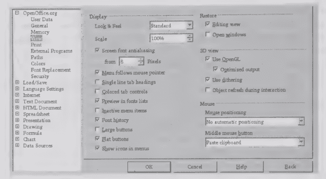

图 9.1：选项对话框

“Load/Save”在此对话框中，确定如何

样式管理器（Stylist）提供了多种样式以满足不同的格式化需求：

- **段落样式**：缩进、间距、连字符、制表符、对齐方式、字体、首字下沉。
- **字符样式**：字体、字体大小、语言。
- **框架样式**：位置、锚定、框架。
- **页面样式**：页眉、页脚、页边距、分栏。
- **编号样式**：项目符号或编号类型、结构、图形、位置、选项。

### 使用样式管理器分配段落样式

要为段落分配样式，请在样式管理器中选择要使用的样式名称。点击样式管理器中的油漆桶符号。通过用鼠标点击相应的段落来分配选定的样式。要退出此模式，请按 `Esc` 键或再次点击油漆桶符号。

### 创建新样式

您可以按照以下步骤轻松创建自己的样式：

1. 根据需要对段落或字符进行格式化。使用工具栏或“格式（Format）”菜单。
2. 在样式管理器中，用鼠标左键点击“从选定内容创建新样式（New Style from Selection）”（位于油漆桶符号右侧）。
3. 输入样式名称并点击确定。

将新创建的样式应用于其他段落。通过选择样式名称并点击鼠标右键选择“修改...（Modify...）”，即可轻松更改样式的详细信息。所有修改都可以在随后的对话框中完成。

### 插入表格

点击工具栏中的“插入（Insert）”图标并保持按下几秒钟即可创建表格。随后会出现另一个工具栏，您可以在其中指定选择。如果您用鼠标触碰第三个图标，将打开如次页图 9.4 所示的网格。

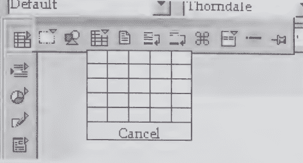

图 9.4：使用工具栏插入表格

将鼠标悬停在网格上。当您移动鼠标时，网格会自动变为黑色，并显示当前选择的行和列。点击一下即可在当前文本的当前光标位置插入表格。

> **提示**：‘插入’图标会根据最后一次插入的内容而改变。

### 插入图形

可以通过工具栏（左起第二个图标）或选择“插入（Insert）” → “图形（Graphics）” → “从文件...（From file...）”来插入图形。

随后会打开一个对话框窗口。选择相应的文件。如果您点击“预览（Preview）”，文件内容将显示在右侧。对于较大的图像，此过程可能需要一些时间。确认选择后，插入的图像将出现在光标位置。激活图像（由图像周围的八个小方块表示）。现在，在右键菜单中选择“图形...（Graphics...）”。随后的对话框提供各种设置，例如环绕方式和边框。

要修改图像大小，请点击图像以激活它。点击其中一个“控制点”，保持按下并向所需方向拖动。虚线框将显示新的尺寸。释放鼠标以缩放图像。

若要更改图像的位置而非大小，请点击图像并保持鼠标按钮按下。将图像移动到所需位置，然后释放鼠标按钮。

### 使用 Calc 处理电子表格

Calc 是 OpenOffice.org 中的电子表格应用程序。您可以使用此程序进行个人账目或业务计算。在 Writer 中，可以通过点击“文件（File）” → “新建（New）” → “电子表格（Spreadsheet）”来启动 Calc。

启动时，Calc 会显示一个由行和列组成的空白电子表格。行从上到下编号，列从左到右用字母表示。“单元格（Cells）”位于行和列的交点处。每个单元格都有一个唯一的地址。例如，地址 `B3` 指的是位于第二列（`B`）和第三行（`3`）的单元格。这在左上角的输入行旁边也有显示。

单元格的可能内容包括数字、文本、日期、时间、货币和公式。单元格可能是激活状态或非激活状态。一次只能有一个激活单元格。激活单元格具有粗黑框。可以使用光标键或用鼠标点击另一个单元格来移动激活状态。激活的单元格可以被编辑。

#### 更改单元格属性

要在单元格中输入内容，只需在单元格中写入即可。默认情况下，文本左对齐，数字右对齐。按 `Enter` 键确认输入。要更改单元格的格式，请选择要修改的单元格，然后右键点击打开右键菜单。选择“设置单元格格式...（Format Cells...）”以打开调整设置的对话框。如对面页图 9.5 所示，该对话框包含“数字（Numbers）”、“字体（Font）”、“字体效果（Font Effects）”、“对齐（Alignment）”、“边框（Borders）”、“背景（Background）”和“单元格保护（Cell Protection）”选项卡。

- “数字”：选择类别，如百分比、货币、日期或时间。格式决定了小数位数和前导零。
- “字体”：设置字体名称和样式。
- “字体效果”：设置额外的字体效果，包括下划线、删除线、浮雕、轮廓和阴影。
- “对齐”：确定单元格内容的水平和垂直位置。此处还可以设置文本方向。
- “边框”：为单元格添加边框。此处可以调整各种阴影和线型。
- “背景”：确定单元格背景的颜色。

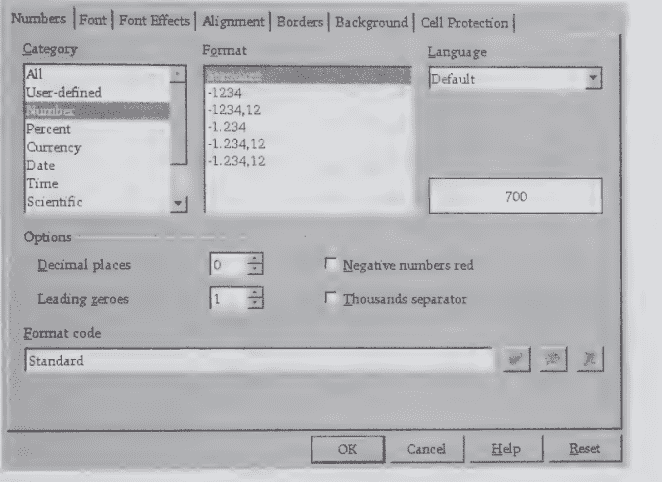

图 9.5：设置单元格属性

> “单元格保护”：通过激活“保护（Protected）”来防止对单元格进行无意或故意的更改。

#### 实际示例：月度支出

OpenOffice.org 中的计算可以通过公式完成。在单元格中输入数字。使用公式和唯一的单元格坐标，根据输入的值计算其他数值。

例如，您想检查您的月度支出。您可以在以下（简化后的）电子表格中看到项目：

单元格 `B3` 包含 1 月的电话费，`B4` 包含燃油费用。要将这两个金额相加，请在 `B5` 中输入公式 `= B3+B4`。结果将显示在 `B5` 中。如果您输入数字有误（或对电话费估算不准），请重新输入金额。总和将自动更新。

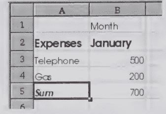

图 9.6：Calc 电子表格示例

除了四种基本数学运算外，Calc 还提供了许多函数。在“插入（Insert）” → “函数...（Function...）”下可以找到一个按类别排列的详尽列表。

电子表格可以轻松扩展。要在 `Fuel` 和 `Sum` 之间插入另一个条目，请右键点击相邻的 `5`。从右键菜单中选择“插入行（Insert Row）”。新行将插入到第 5 行。

对于大量单元格，输入公式会变得相当繁琐。如果您在 `A` 列中有多个项目并想要将它们相加，请尝试使用 `SUM` 函数。为此，在 `B6` 字段中输入 `= SUM(B3:B5)`。另一种方法是点击输入行旁边的 Sigma（`Σ`）符号并手动输入范围。此公式将相加从 `B3` 到 `B5` 的所有数字。

您还可以指定多个范围。如上述公式所示，一个范围由两个由冒号分隔的单元格地址定义。多个范围可以用分号分隔。相应地，公式 `= SUM(B3:B5;D3:D5)` 将相加从 `B3` 到 `B5` 以及从 `D3` 到 `D5` 的所有内容。

#### 创建图表

在电子表格中添加更多条目。在第 `2` 行写入几个月，使其看起来像图 9.7。选择从 `A2` 到 `E5` 的范围。文本将以黑底白字显示。

要创建图表，请点击“插入（Insert）” → “图表...（Chart...）”。随后会出现一个对话框窗口。您可以选择性地修改选择范围，或将第一行或第一列用作标签。通常，可以直接接受提供的设置。点击“下一步（Next）”。

该对话框窗口共有四页。最有趣且最重要的页面如图 9.8 所示（位于下一页）。

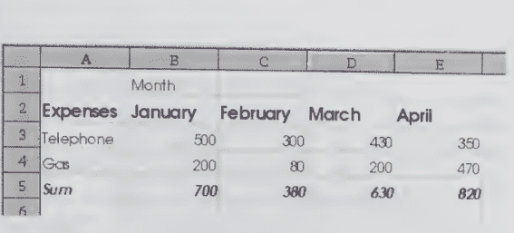

图 9.7：扩展的示例电子表格

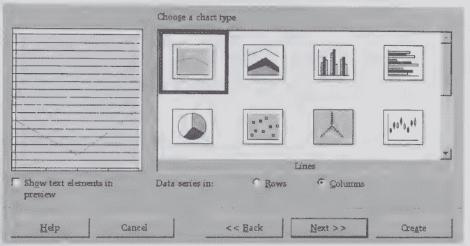

图 9.8：图表类型的选择

可用图表类型显示在中间。选项包括折线图、面积图、柱形图和条形图。在左侧，可以看到数据呈现的预览。

折线图最适合我们的示例。点击“下一步”进入折线图的不同变体：带符号或不带符号、堆积、百分比或三次样条曲线。我们选择“符号（Symbols）”。如果您激活“在预览中显示文本元素”，则名称（如 `January` 和 `February`）会显示在 X 轴上，数值显示在 Y 轴上。右侧将添加图例。

在下一页中，为图表以及 X 轴和 Y 轴分配标题。默认情况下，X 轴处于停用状态。尽管如此，您也可以在这里输入文本。点击“创建（Create）”后，图表将出现在您的电子表格中。随后的图 9.9 显示了示例图表。

# 费用概览

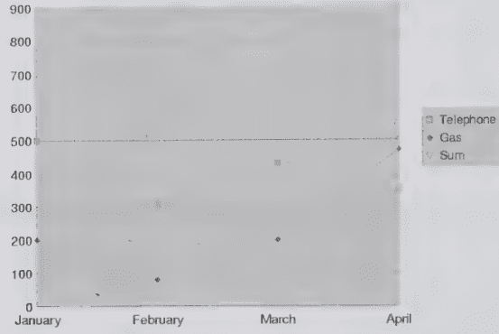

图 9.9：Calc 中的图表

#### 导入表格

有时，您可能需要将表格形式的信息导入到 Calc 表格中，例如证券交易所数据、电话资费或列表。有两种将此类信息导入 Calc 的方法。

**方法 1**：从剪贴板导入

假设您想导入证券交易所信息。为此，在 Web 浏览器中输入您喜爱的证券交易所页面的地址。当表格出现时，用鼠标按钮选中它。根据浏览器的不同，您可能需要点击“复制”。选定范围将被复制到剪贴板。

在 OpenOffice.org 中，通过“文件” → “新建” → “电子表格”打开一个新文档。选择插入表格的起始单元格。选择“编辑” → “粘贴”。表格将连同所有格式规范、超链接和其他信息一起粘贴到文档中。

**方法 2**：使用过滤器导入

要将现有的 HTML 文件导入 Calc，请选择“文件” → “打开”。随后将打开一个对话窗口。此时选择“文件类型” → “HTML (OpenOffice)”。

### 使用 OpenOffice.org Draw 绘图

Draw 可用于创建矢量图形。线可以通过两种方式描述：第一种是通过许多结合在一起形成线的点。这是“常规”变体，称为位图。常见的位图格式包括 GIF、JPEG 和 PNG。然而，这只是一个取决于点数量的粗略近似值。

相反，线可以通过定义两个端点来描述。这节省了大量内存，但需要对线宽、颜色和其他细节进行描述。常见格式包括 EPS 和 AI。这种表示方法被称为矢量图形。矢量图形在缩放方面也具有更好的效果。

#### 绘制图形元素

要创建新绘图，通过“`K` → `办公` → `OpenOffice.org` → `Draw`”启动 Draw。如果 OpenOffice.org 已经在运行，则选择“文件” → “新建” → “绘图”。

Draw 中可用的图形元素可以通过各种影响线宽、线型、颜色、填充和其他参数的操作进行修改。尝试绘制一个矩形。工具栏显示在左侧。点击填充矩形图标并保持鼠标按钮按下几秒钟。一个小子菜单将打开，其中包含填充和未填充的矩形和正方形，部分带有圆角。选择一个填充矩形。鼠标指针的形状将变为十字线。点击文档以设置一个角，然后将鼠标向右下方拖动。一个矩形出现并随鼠标移动而缩放。达到所需大小时，释放鼠标按钮。

要更改填充颜色，用鼠标点击激活该矩形。在四个角和四条边上会出现可用于修改大小的绿色控制点。如果您按下鼠标右键，将打开上下文菜单。选择“区域...”以进入包含各种设置的对话框。对结果满意后点击“确定”。或者，使用工具栏更改颜色。

工具栏包含更多有用的图形元素，如圆、椭圆、线，甚至是 3-D 元素。如需更多信息和帮助，请使用帮助功能。

### 使用 OpenOffice.org Impress 创建演示文稿

#### 使用 AutoPilot 创建演示文稿


如果您在将想法转化为“虚拟纸张”时遇到困难，请尝试使用 AutoPilot。选择“文件” → “AutoPilot” → “演示文稿...”。通过 AutoPilot，您可以在三个简短的步骤中定义演示文稿的基本结构。配置背景、输出媒介和各种效果。还可以借助向导从现有演示文稿中导入信息。

在您使用“创建”终止 AutoPilot 后，Impress 将为页面布局提供若干模板。选择一个适合您目的的模板，并为第一页输入标题。点击“确定”以生成新创建的演示文稿的第一页。要完成演示文稿，请输入标题和文本。

通过“演示文稿” → “幻灯片放映”，立即查看演示文稿。您可以通过按下鼠标左键逐页推进。使用 `ESC` 退出演示模式。

有关修改选项范围的信息，请参阅 OpenOffice.org 的帮助系统。

### 添加幻灯片

要向演示文稿添加幻灯片，请使用“幻灯片” → “插入”。将打开一个如图 9.10（在下一页）所示的对话窗口。

输入幻灯片的名称并确定使用哪个自动布局（AutoLayout）。点击“确定”以插入幻灯片，或点击“取消”以终止该过程。

使用“文件” → “新建” → “自模板...”来调用模板。

### 获取更多信息

要跟踪或支持 OpenOffice.org 的持续开发，或获取有关这个重要项目的更多信息，请访问 OpenOffice.org 主页 `http://www.openoffice.org`。

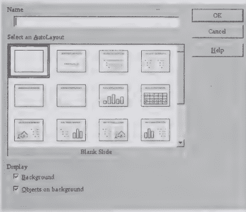

图 9.10：在 Impress 中插入幻灯片

## Adobe Acrobat Reader —— PDF 查看器

Adobe Acrobat Reader 是一个用于查看和打印 PDF 文件（便携式文档格式文件）的程序。Acrobat Reader 可作为独立查看器或 Netscape 插件使用。其界面使得即使是复杂的文档也易于导航。可以通过 YaST2 随时安装 `acroread` 软件包。

- 打开 PDF 文件 ...................................................... 183
- Acrobat 窗口 ........................................................ 184
- 可读性 ................................................................ 187
- 文档导航 ............................................................ 187
- 查找特定信息 ........................................................ 187
- 打印 .................................................................. 188
- 帮助 .................................................................. 188
- 在 Netscape 中打开 PDF 文件 ........................................ 188

开发者的目标是让计算机用户能够实现无纸化信息管理。愿景中的无纸化办公室电子文档在理论上有几个优点。这些优点涵盖了从便捷的电子邮件发送到节省空间的海量数据存档。

从全球范围来看，PDF 格式只是许多可能的文本核心图像格式之一。Acrobat Reader 是这种文件格式的查看器。该程序和文件格式具有若干实用功能。图 10.1 显示了显示帮助文档的屏幕。

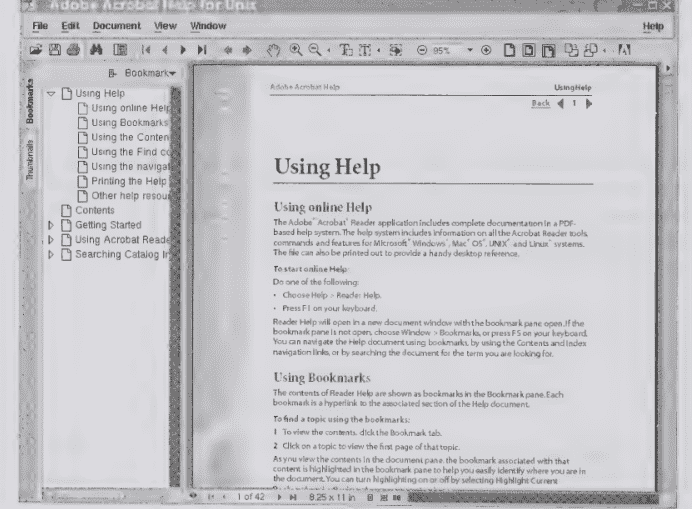

图 10.1：Adobe Acrobat Reader

PDF 格式已针对其预期用途进行了高度优化，现在被视为便携式文档的标准格式。Adobe Acrobat Reader 充分利用了所有 PDF 特性。它适用于 Macintosh 和 Windows 以及 Unix 和 Linux。这为用户提供了与标准文档配套的标准界面，实现了标准化的查看和打印。

PDF 格式是最受欢迎的文档标准格式。您可以在互联网上找到许多 PDF 文档，并可以轻松查看和下载。Acrobat Reader 可以以插件的形式（一个为另一个程序提供服务的特殊程序）集成在 Netscape 中。当您在网页上点击 PDF 文件时，Acrobat Reader 会自动启动并显示所选文档。可以使用 Acrobat Reader 工具栏中的相应图标将文件保存到本地。

PDF 文档可以包含指向文档其他部分或其他文档的链接和书签。当“书签”选项卡处于激活状态时，这些内容显示在文本左侧的独立窗口中。它们也显示在文本中。点击链接可立即打开相应的页面。

PDF 文件还可以包含预览图像，通常称为缩略图。这些代表整个页面的微型图像也显示在左侧窗口中。缩略图提供了文档的快速概览，可用于定位特定的章节或段落。

> **注意**
>
> 使用 Acrobat Reader 无法创建 PDF 文档，只能查看。遗憾的是，Adobe 目前仅为 Windows 和 Macintosh 提供 Acrobat（完整文本处理应用程序）。在 SuSE Linux 中，您可以使用各种程序创建自己的 PDF 文档。例如，`ps2pdf` 是一款广泛用于从 PostScript 文件生成 PDF 文件的实用程序。

### 打开 PDF 文件

通过“SuSE 菜单” → “办公” → “查看器” → “Acrobat Reader”启动 Acrobat Reader。或者，在控制台中使用 `acroread` 启动 Acrobat Reader。通过“文件” → “打开”、`Ctrl` + `O` 或相应图标在 Acrobat Reader 中打开文件。

如果您在 KDE 文件管理器中点击任何扩展名为 `.pdf` 的文件，并且使用的是基础 SuSE Linux 系统，该文件将使用 KGhostView 而不是 Acrobat Reader 打开。因为 PDF 文件基于 PostScript 格式，所以 KGhostView 可以显示并打印它们。然而，KGhostView 缺乏 Acrobat Reader 的链接和搜索功能。如果需要，可以手动配置 KDE 以改为使用 Acrobat Reader。

这可以通过“文件关联”对话框（见对面页的图 10.1）完成，该对话框可通过“设置” → “配置 Konqueror”进入。在树形结构中，在“application”下寻找扩展名 pdf。在“应用程序首选项顺序”中，将“Acrobat Reader”移到顶部。重启文件管理器后，PDF 文件应会自动使用 Acrobat Reader 打开。

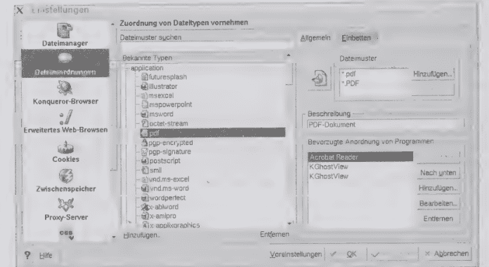

图 10.2：Konqueror 中的文件类型关联

### Acrobat 窗口

如果使用默认设置，Acrobat Reader 的界面如图 10.3（见下一页）所示。包含控制组件的第一行是菜单栏。菜单包含了 Acrobat Reader 的所有控制命令。建议熟悉键盘快捷键，以便更高效地使用该程序。

工具栏位于菜单栏下方。使用工具栏图标可以快速访问最重要的功能。图标分组成组，可以根据您的个人喜好进行排列或移动到应用程序窗口的其他侧边。甚至可以将图标移动到单独的应用程序窗口或隐藏其中一部分。

以下是从左到右对各个图标的简要说明（假设所有图标均可见）：

- 📂 — 打开 Acrobat Reader 文件管理器。

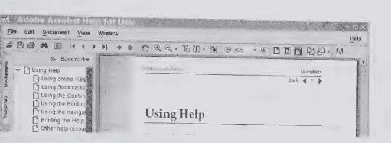

*图 10.3：带有书签的 Acrobat Reader 菜单栏和工具栏*

- 打开用于保存当前显示 PDF 文件的对话框。
- 打开包含多种配置选项的打印机对话框。
- 打开搜索功能。
- 显示或隐藏包含缩略图和书签的左侧窗口。
- 跳转到显示文档的第一页。
- 跳转到上一页。
- 跳转到下一页。
- 跳转到文档的最后一页。
- 应用程序会保存您在文档中浏览的路径。如果您使用了书签，此功能尤其有用。使用此功能可在历史列表中后退一步。
- 在历史列表中前进。
- 激活此功能后，可以使用鼠标左键抓取并移动文本窗口中显示的页面。
- 🔍 — 放大显示的文档。新视图将以点击点为中心。
- 🔍 — 缩小文档的放大倍数。新视图将以点击点为中心。
- 🔤 — 当此图标激活时，可以使用鼠标右键或菜单选择文本并将其复制到剪贴板。文本按行标记。
- 🔤 — 另一种选择文本的工具。该工具按列工作。使用鼠标左键在要复制的文本周围绘制虚线选择框。
- 🖼️ — 使用此图标将显示的 PDF 文件中的图像复制到剪贴板。不过，复制的图像并非在所有应用程序中都可用。
- ⊖ — 逐渐缩小。
- `95%` ▾ — 在百分比窗口中直接输入显示大小。点击箭头选择常用值。
- 📄 — 将缩放因子设置为 `100%`。
- 📄 — 缩放以显示整个页面。
- 📄 — 将页面适应窗口宽度。
- 🅰️ — 打开 Adobe 网站。如果未为 Acrobat Reader 定义浏览器，则打开相应的配置对话框。

工具栏下方左侧的窗口包含链接（称为书签）或预览图像（缩略图）。如果文档不具备这些功能，则不显示该窗口。

所选文档显示在右侧。通常，此窗口占据程序窗口的大部分空间。文档下方的状态栏包含更多信息和附加工具（见对面页的图 10.4）。使用这些工具在文档中导航，并切换页面显示模式：“单页”、“连续”和“连续 — 对页”。


图 10.4：Acrobat Reader 状态栏

### 显示文档

有时文档文本显示得太小而难以阅读。Acrobat Reader 提供了几种放大文本的方法。最简单的方法是点击工具栏中的纸张图标。通过这种方式，可以将显示尺寸更改为“100%”、“全页”或“页面宽度”。点击工具栏中的放大镜以激活其功能。在文档中左键单击可放大，`Ctrl`-单击可缩小显示尺寸。或者，点击百分比显示并直接输入您自己的缩放因子。

### 文档导航

要切换页面，请使用鼠标或键盘。鼠标允许您轻松控制垂直和水平滚动条。或者，点击工具栏或状态栏中的箭头图标。要跳转到特定页面，请点击状态栏中的页码并输入页码。键盘上的方向键可小步上下移动页面。`PgUp` 和 `PgDn` 可切换到上一页或下一页。

> **提示**
>
> `F6` 可开启或关闭链接窗口。`F7` 和 `F8` 分别用于禁用和启用菜单和工具栏。`Ctrl` + `F` 激活搜索功能。

### 查找特定信息

Acrobat Reader 具有搜索功能，可轻松定位文本。使用双筒望远镜图标或选择“编辑” → “查找”。输入所需的关键字，Acrobat Reader 将找到第一个匹配项。要继续搜索，请使用“编辑” → “再次查找”。

### 打印

在打印机菜单中，以下选项很重要：

- **打印机选择**：通过“打印机命令”指定打印队列。默认值为 `lpr`。
- **页面选择**：打印全部或仅打印部分页面。
- **反向打印**：使用此项可先打印文档的最后一页。
- **页面放大**：如果文档的页面尺寸大于或小于纸张，请使用“适应页面”。

#### 帮助

点击“帮助”将打开一个包含详细帮助文本的 PDF 文件。使用 Acrobat 的搜索、链接和滚动功能查找所需信息。

### 在 Netscape 中打开 PDF 文件

如果 PDF 文档无法自动打开，可能是由于 Netscape 配置不正确。必须指示 Netscape 如何处理 PDF 文件。要访问这些设置，请打开“编辑” → “首选项” → “导航器” → “应用程序”。MIME 类型为 `application/pdf`，文件扩展名为 `pdf`。如果您已有该 MIME 类型的条目，请点击“编辑”，否则点击“新建”。`nppdf.so` 应该是可选的（见下一页图 10.5）。

如果由于某种原因插件模块不可用，请在“应用程序”列下输入 `acroread %s`。在这种情况下，Acrobat Reader 将不会作为插件在 Netscape 中打开，而是作为独立应用程序在其自己的窗口中启动。您的系统必须首先安装 Acrobat Reader。

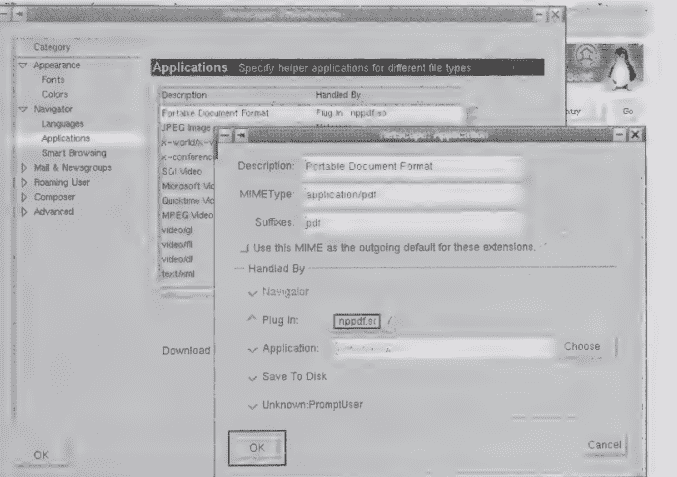

图 10.5：Netscape 设置

## Konqueror — KDE 文件管理器和 Web 浏览器

Konqueror 是为 KDE 桌面设计的结合了 Web 浏览器、文件管理器和文档查看器的综合工具。它为用户提供了一个强大的多功能工具。尽管用途广泛，但它依然用户友好。用户只需熟悉一个界面即可执行许多不同的任务。

- 启动 Konqueror .................................................... 192
- Konqueror 窗口 ........................................................ 192
- Konqueror 基础知识 .................................................. 194
- 作为文件管理器的 Konqueror ........................................ 195
- 作为 Web 浏览器的 Konqueror ........................................ 198
- 作为文件查看器的 Konqueror ......................................... 201
- 更多信息 ............................................................ 201

### 启动 Konqueror

可以通过多种方式启动 Konqueror。在 KDE 中，面板上的一个图标显示为一个房子。左键点击此图标即可启动 Konqueror，或者按下 `Alt` + `F2` 并输入 `konqueror`。图 11.1 显示了一个 Konqueror 窗口。在其他桌面环境下，可以使用命令 `konqueror` 启动。

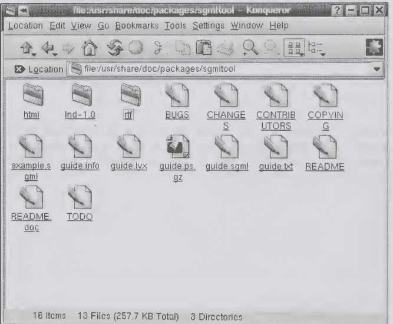

*图 11.1：Konqueror 窗口*

#### Konqueror 窗口

Konqueror 窗口分为几个部分。标题栏是窗口顶部的条带，它显示当前目录、文档或网页的路径。

标题栏下方是菜单栏。根据 Konqueror 是作为 Web 浏览器还是文件管理器运行，您只能选择特定的项目。工具栏显示了在 Konqueror 中导航时经常需要的图标。如果您将鼠标光标停留在某个图标上几秒钟，会出现一段简短的帮助文本。右键单击可打开弹出菜单。在这里，可以设置对齐方式、文本位置和图标大小。

工具栏下方是一个用于输入 URL 的输入行。URL 是许多不同对象的通用地址。这些位置可以在互联网上或本地硬盘上。输入 URL 并按下 Enter 键。

一个 URL 由传输协议和地址组成。最常见的协议有：

- `http` 网页
- `file` 本地文件
- `ftp` FTP 服务器上的文件
- `smb` Samba 计算机上的共享
- `man` man 手册页
- `info` info 页面
- `tar` tar 格式的压缩文件
- `audiocd` Konqueror 中的音频 CD
- `floppy` 浏览软盘

还有许多其他协议。有效的 URL 例如 `http://www.suse.de` 和 `file:///localhost/opt/kde2` 或者简写形式 `file:/opt/kde2`。

> **提示**
>
> 使用输入行左侧的 `×` 图标删除整行内容。

要返回之前的条目，请单击屏幕右边缘向下的箭头。这将打开一个之前的条目列表。选择所需的条目。您还可以显示书签面板。在“设置” → “显示书签工具栏”下，可以激活或停用此功能。

URL 行下方是主窗口。它显示目录、网页或文档的内容。您可以将窗口划分为不同的视图，在一个区域查看文档，在另一个区域查看网页。

窗口底部的状态栏提供了一个概括总结。如果鼠标光标在链接上悬停几秒钟，它将显示互联网地址。如果鼠标停留在目录上，它将显示文件夹名称。对于文件，则显示文件的名称、大小和类型。如果窗口被划分（见“不同显示模式”节），每个视图都有一个状态行，且左侧的一个小图标显示当前哪个视图处于活动状态。

### Konqueror 基础知识

#### 帮助

在 Konqueror 中有多种获取帮助的方法。通常，在“帮助”菜单中选择“Konqueror 手册”。KDE 帮助系统将启动，显示 Konqueror 的文档以及众多额外的参考资料。有时，这种帮助过于详尽，例如当您只想了解一个小图标的信息时。通常，当鼠标在图标上悬停几秒钟时，会出现一段简短的帮助文本。要获取更多信息，请按 `Shift` + `F1` 或选择“帮助” → “这是什么？”，然后单击该图标。一个小窗口将打开并提供更详细的信息。左键单击可将其再次关闭。


### 不同显示模式

在“视图” $\rightarrow$ “视图模式”中，选择图标视图、多列视图（文件名出现在图标左侧）、树状视图、详细列表视图或文本视图。图 11.2 从左到右依次显示了图标视图、树状视图和多列视图。乍一看，树状视图和详细列表视图看起来一样。然而，您可以通过启用树状视图更仔细地检查目录——多个目录可以同时打开。树状视图在文件夹名称前用“+”或“-”表示。详细列表视图不提供此选项。它用于切换到某个目录。

### 划分窗口并保存配置

您可能熟悉这种困境：进入某个目录后，在过程中失去了对整体结构的掌握。一种解决方案是像对面页图 11.2 那样使用不同的显示方式。

Konqueror 可以水平或垂直地划分窗口。为此，只需在“窗口”菜单中单击“左右分屏”或“上下分屏”。活动显示区域在状态栏中显示一个绿点。

您甚至可以激活一个终端窗口。如果“显示终端模拟器”前的复选标记被激活，将打开一个终端窗口，您可以在其中像往常一样输入并运行命令。这使得在同一个窗口中结合两种偏好——图形界面和命令行导向——变得非常容易。

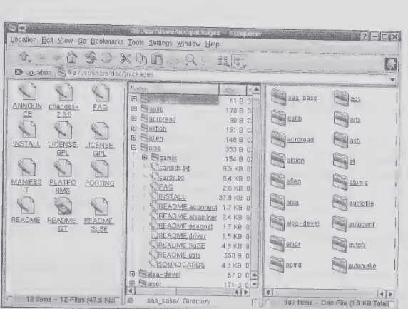

**图 11.2：具有各种视图的 Konqueror 窗口**

一旦您“组装”好一个显示界面，请在“窗口” $\rightarrow$ “配置视图配置文件...”下将其保存。给您的配置文件起个名字，以便将来再次加载。此外，决定是否保存窗口大小。如果空间太小，请将 Konqueror 窗口移至其专属桌面并选择“全屏模式”。

## Konqueror 作为文件管理器

### 在 Konqueror 中导航

作为文件管理器，Konqueror 能够轻松地在各种目录层级之间进行导航。例如，在 URL 输入行中输入您的主目录（或单击那个房子的图标）。像往常一样使用鼠标切换目录或打开文件。单次单击通常足以更改目录或打开文件。您还可以使用方向键在 Konqueror 中移动。使用任意方向键高亮显示一个项目（所选图标的背景显示为不同的颜色）。按下 Enter 键可打开文件或切换到该目录。要选择多个文件，请按住 `Alt`。要返回上一个目录，请左键单击工具栏中的向左箭头。

### 使用侧边栏导航

Konqueror 提供了一个侧边栏。这是一个您可以在 Konqueror 内部激活或停用的窗口，提供多种选项：显示您的书签、最近访问的 URL、主目录等。通过“窗口” $\rightarrow$ “显示扩展侧边栏”激活侧边栏。

### 删除文件和目录

在 KDE 中，有三种方法可以删除文件和目录。每种方法都有不同的优点。在第一种方法中，当您选择“编辑” $\rightarrow$ “删除”时，高亮显示的文件会被移至回收站目录。它们存储在那里，在清空回收站之前可以被找回。在所有删除方法中，这是最安全的一种。右键单击桌面上的回收站图标可删除回收站的内容。在出现的弹出菜单中，选择“清空回收站”。

第二种方法通过将文件系统对象标记为“空闲”来删除文件。这些被删除的文件只能使用特殊工具尝试恢复，且不一定成功。第三种方法是 `真正` 地删除文件：“编辑” $\rightarrow$ “粉碎”。

> **注意**
>
> 使用“粉碎”时请极其小心。经过此处理后，文件将被真正删除，因为它们所占用的空间会被随机数据覆盖。如果您有不应落入他人之手的敏感数据，请使用此方法。

### 选择多个文件

要在 Konqueror 中选择多个文件，请围绕所需文件拖动一个框架。在窗口的空白区域单击，按住鼠标按钮并移动鼠标。一个虚线框将包围选中的文件。当背景颜色改变时，释放鼠标按钮并执行所需操作，如复制或删除。

对于更精确的选择（例如所有 PNG 文件），请选择“编辑” $\rightarrow$ “选择”。在出现的对话框中输入一个表达式，例如 `*.png`。现在，当前显示的目录中所有 PNG 文件都将被选中。要向选择中添加更多文件，请再次打开对话框并重复各个步骤。

### 查找文件

要查找文件，请转到“额外” $\rightarrow$ “查找文件...”。指定名称或模式以及路径，然后单击“查找”。Konqueror 将搜索指定的目录并在下方显示结果。通过选择“日期范围”（从何时到何时）或“高级”（类型、文本或大小）来进行更精确的搜索。该程序也可以通过点击 K 菜单中的“查找文件”单独运行。

### 重命名文件

要重命名文件，请右键单击相应文件。一个弹出窗口将打开。选择“重命名”。给您的文件起个新名字，然后按 Enter 键完成操作。

### 使用过滤器

如果您的目录显示的文件比预期的多，请尝试使用过滤器。过滤器可以将显示限制在仅需要的文件上。为此，选择“额外” $\rightarrow$ “视图过滤器”。它列出了当前识别的文件类型。如果您单击某个条目，Konqueror 窗口中将仅显示此类文件。通过菜单项“使用多个过滤器”，可以指定多个过滤器。使用“重置”可再次查看所有文件。

### 浏览压缩文件

Konqueror 还有另一个有趣的特性：它可以浏览压缩文件。如果您有一个 tar.gz 文件，单击它，Konqueror 将像显示目录一样显示其内容。

您还可以从中复制单个文件。目前尚不支持将文件复制到存档中，但此功能可能会在接下来的版本中推出。URL 窗口输入行开头的 `tar:/` 表示您正在浏览一个压缩文件内部。

### 读取音频 CD

使用 `audiocd:/`，Konqueror 可用于将音频 CD 的内容转换为各种格式并保存到硬盘中。具体操作步骤请参阅第 244 页的 *Reading Audio CDs*（读取音频 CD）。

## 创建图像库

Konqueror 可以通过生成一个包含图像缩略图的 HTML 文件来帮助管理装满图像的目录。在 Konqueror 中打开相应目录，然后选择“Extras” $\rightarrow$ “Create Image Gallery”。随后会打开一个窗口，用于指定背景色和前景色、标题以及保存位置。点击“Ok”开始创建。默认情况下，会创建一个名为 `index.html` 的文件。使用 Konqueror 打开它，即可看到以缩小且清晰的格式显示的图像。

## 右键弹出菜单

如果在打开的 Konqueror 窗口中显示了一个目录，您可以随时用鼠标右键打开弹出菜单。根据文件类型不同，可在此启动的操作也不同。如果您点击一个文件或目录，会出现类似于“Edit”菜单中的条目。

## 将 Konqueror 作为 Web 浏览器

Konqueror 不仅仅是一个文件管理器，它还是一个高效的 Web 浏览器。

### 打开网页

只需在 URL 行中输入网址，例如 `www.suse.de`。Konqueror 将尝试显示该地址。您甚至不需要在开头写协议（`http://`），因为程序会自动识别。不过，此功能仅对 Web 地址有效。对于 FTP 服务器，您必须在输入行的开头输入 `ftp://`。

### 保存网页和图形——Web 存档

要保存网页，请选择“Address” $\rightarrow$ “Save as...”并为您的 HTML 文件命名。图像不会随之保存。要存档整个网页（包括文本和图形），请选择“Extras” $\rightarrow$ “Archive Web Page”。Konqueror 会建议一个文件名，您可以接受或编辑。文件名以 `.war` 结尾，这是 Web 存档的后缀。以后要查看保存的 Web 存档时，只需点击相应文件，网页及其图像就会在 Konqueror 中显示。

### 扩展 Web 浏览（互联网关键字）

使用 Konqueror 在网上搜索非常方便。Konqueror 为您定义了许多搜索引擎，每个搜索引擎都有一个特定的缩写。要在互联网上搜索某个主题，请输入缩写和关键字，两者之间用冒号隔开。随后将显示包含搜索结果的相关页面。

要定义您自己的缩写，请点击“Settings” $\rightarrow$ “Configure Konqueror”并选择“Advanced Web Browsing”。随后会出现一个对话框，您可以在其中定义自己的缩写。

### 翻译网页

Konqueror 不能直接翻译网页，而需要外部互联网资源。要翻译网页，请输入地址，然后选择“Tools” $\rightarrow$ “Translate Web Page”。随后会打开一个对话框，用于选择源语言和目标语言。选定后，翻译后的页面将在几秒钟后出现。

### 您的书签集

如果您经常访问某些页面，重复输入相同地址通常很麻烦。Konqueror 可以帮助您设置书签列表。为此，请使用“Bookmark”菜单。在这里，您可以将所有书签（从网页到目录链接）保存到本地硬盘上。

要在 Konqueror 中创建新书签，请点击“Bookmarks” $\rightarrow$ “Add Bookmark”。如果您已经添加了一些书签，在该菜单中也会看到它们。建议按主题对您的收藏进行分类，并进行层级分组。“New Directory”可以创建用于对书签进行分组的文件夹。通过选择“Bookmarks” $\rightarrow$ “Edit Bookmarks...”打开书签编辑器。使用此程序，您可以组织、重新排列、添加和删除书签。

如果您使用 Netscape 或 Mozilla 作为附加浏览器，则无需重新设置书签文件夹。书签编辑器包含“File” $\rightarrow$ “Import Netscape Bookmarks”，您可以通过此项将 Netscape 和 Mozilla 书签整合到您最新的收藏集中。反向操作也可以通过“Export as Netscape Bookmark”实现。

通过右键点击条目来更改您的书签。会出现一个弹出菜单，从中选择所需的操作（剪切、复制、删除等）。达到预期结果后，请将其保存（“File” $\rightarrow$ “Save”）。

为了保存您的书签列表并实现即时访问，请在 Konqueror 中使书签可见。选择“Settings” $\rightarrow$ “Show Bookmark Toolbar”，当前 Konqueror 窗口中将自动显示书签面板。

### Java 和 JavaScript

不要混淆这两种语言。Java 是由 Sun Microsystems 开发的一种面向对象、平台无关的编程语言。它经常用于小型程序（applets），这些程序通过互联网发送，用于网上银行、聊天和电子购物系统等。JavaScript 是一种解释型脚本语言，主要用于网页的动态结构化。

Konqueror 允许您启用或禁用这两种语言，甚至可以在特定域名的级别上进行设置。您可以允许某些主机访问，同时拒绝其他主机的访问。

> **注意**
>
> 为了使 applets 能够正确运行，必须至少安装一个“Java Runtime Environment”。最简单的解决方案可以在 `javarunt` 包中找到。如果您需要编译 Java 源代码，请安装 Java Development Kit（`java` 包）。
>
> 如果您有较高的系统安全要求，请完全禁用 Java 和 JavaScript。遗憾的是，某些网页需要 JavaScript 才能运行。

### 代理

如果您的服务提供商允许访问代理服务器，请将其输入到 KDE 中。这样做的好处是，如果多个用户同时访问页面，页面加载速度可能会更快。

在“Settings” $\rightarrow$ “Configure Konqueror...”中，选择“Proxy Server”。输入 HTTP 和 FTP 的代理及其相应的端口。在“No proxy for:”下，排除特定的服务器。通常在这里输入 `localhost` 或您的 Linux 计算机名称。

## 将 Konqueror 作为文件查看器

在 Konqueror 中，您可以查看不同的文件以及目录和网页。例如，如果您点击一个文本文件，程序不会启动该文件所属的应用程序，而是将文本“嵌入”到 Konqueror 窗口中。显示的文件无法编辑。如需编辑，请右键点击文件。使用“Open with”选择打开该文件的程序。

### 更多信息

以下链接提供进一步的信息。

- `http://www.kde.org` 关于 KDE 的一切
- `http://bugs.kde.org` 已知的 KDE bug
- `http://www.konqueror.org` 关于 Konqueror 的一切

## Web 浏览器 Galeon

最近，这款广泛使用的 Web 浏览器已转变为一个真正的“全才”。如今的互联网应用具有如此深度的集成，并与相应的桌面环境紧密结合，这几乎被认为是理所当然的。使用过时机器的用户很快就能感受到这种发展带来的影响。全能浏览器往往是内存大户，运行缓慢，且在硬盘上占用 30 MB 空间。

这就是为什么 Galeon 背后的理念是专注于一项任务：Web，且仅限 Web。Galeon 实现了 Mozilla 浏览器的快速“Gecko”引擎，并将其集成到一个简洁、极其功能化的用户界面中。该应用程序加载迅速，是目前最快的浏览器之一。

- 使用 Galeon 访问互联网……204
- 为 Web 优化……204
- 使用标签页高效冲浪……205
- 设置与控制……205
- 更多信息……205

### 使用 Galeon 访问互联网

Galeon 最核心的导航工具位于第一个工具栏中。“Next”和“Back”提供了像其他浏览器一样翻阅互联网站点的功能。这些按钮右侧是“Reload”，用于更新站点内容。随后是“Cancel”，用于停止连接或传输。一个很有用的功能是缩放，通常缩放至 100%——即文档的 1:1 显示。在其右侧，上箭头和下箭头可用于以 10 为间隔设置缩放级别。在随后的输入框中输入互联网（URL）地址。最右侧是 GNOME 图标，显示 Galeon 的进度。如果图标在闪烁，说明 Galeon 正在工作并传输数据。

### 为 Web 优化

Galeon 的设计初衷是让上网冲浪尽可能方便。在默认配置中，Galeon 提供第二个工具栏，能够快速访问流行的 Google 搜索引擎及其新闻以及图像搜索功能。它还可以提供在线词典访问权限并使用“书签lets”。这得益于 Galeon 内置的小型 JavaScript 函数。例如，您可以了解页面的更新时间，或允许网页在屏幕上缓慢向下滚动。这提供了许多实用的功能。

### 使用标签页高效冲浪

Galeon 可以在单个应用程序窗口中显示多个 WWW 文档。这种操作通常比为每个互联网文档打开一个新窗口更实用。若要在网页中以新标签页的形式打开链接，请右键单击该链接，在弹出的弹出菜单中选择“在新标签页中打开”。现在，Galeon 将其应用程序窗口划分为“索引卡”，以便您可以轻松访问这些文档。点击“文件” $\rightarrow$ “打开新标签页”即可创建新的 Galeon 标签页。

### 设置与控制

其他 Web 浏览器特有的所有设置也可以在此处通过“设置” $\rightarrow$ “首选项”进行访问。凭借该对话框用户友好的布局，关键选择选项几乎是不言而喻的。Galeon 的外观也可以通过这些选项进行更改。

Galeon 具有内置的密码管理和 Cookie 控制功能。它还具有指定允许下载图像的网站的选项。所有这些选项都可以通过“工具” $\rightarrow$ “Cookies” $\rightarrow$ “查看 Cookies”在单个对话框中访问。

经过短暂的初始适应期后，您会发现 Galeon 针对其唯一的关键任务进行了优化。Mozilla HTML 引擎惊人的速度也发挥了作用。祝您使用愉快！

#### 更多信息

| URL | 描述 |
| --- | --- |
| `http://galeon.sourceforge.net` | Galeon 主页 |
| `http://www.gnome.org` | 关于 GNOME 的一切 |

## 文档标题

这里是正文段落的提取内容，描述了文档的主要概念和背景信息。


接着是关于插图的详细解释及其在系统中的作用。

- 列表项 1
- 列表项 2
- 列表项 3

| 标题1 | 标题2 |
| --- | --- |
| 数据1 | 数据2 |
| 数据3 | 数据4 |

最后的总结性段落，阐述了结论和后续步骤。

## Opera——商业替代方案

Web 浏览器 Opera 变得越来越流行。其出色的技术特性以及许多实用功能使其极具吸引力。本章将介绍这款浏览器，并向您介绍一些明显的功能以及更多隐藏的可能性。使用 YaST2 安装 `package opera`。

- Opera 的哲学……208
- 结构……208
- 特色功能……212

### Opera 的哲学

它紧凑、快速且舒适——这是用户对这款来自挪威奥斯陆的替代 Web 浏览器 Opera 特别欣赏的一点。当 Netscape 和微软通过向市场投放速度更快、体积更大且技术功能日益繁多的浏览器，以展开一场激烈的浏览器市场份额之战时，Opera 从最初的利基地位发展成为互联网内容显示程序中一个可行的替代方案。


与两家主要竞争对手（它们以牺牲稳定性和速度为代价，在产品中集成大量功能）相反，Opera 的开发引导方向不同。开发人员并没有用功能将浏览器填满，而是努力提高速度并纠正网页的显示。尽管功能增强，新版本的体积往往比前代更小，且显示速度持续稳步提高。

然而，这种对基本要素的关注也带来了一些缺点：不包含电子邮件客户端（至少在 Linux 版本中没有），完整的 Java 支持仅可通过下载获得，且 Opera 对某些插件的支持并不太舒适。与可以免费且无限制使用的 Internet Explorer、Netscape Navigator、Konqueror 及类似产品不同，Opera 的用户必须支付 39 美元，或者忍受右上角的广告横幅。对于许多用户来说，优点似乎超过了缺点。大约 5% 的互联网用户使用 Opera，近年来有数百万人下载了 1 到 2 MB 的 Opera 安装文件。

### 结构

当浏览器启动时，与其他程序的区别之一就变得显而易见了：在您接受许可条件后，您可以选择是要在浏览器窗口之外还是之内显示网页。

在桌面模式下，您的窗口管理器只能看到一个 Opera 实例。要选择一个 Opera 窗口，请使用 Opera 中的窗口栏。如果您不想在每次启动时被询问，请勾选“不要再次询问我”。

#### 工具栏

如对面页面的图 13.1 所示，该程序的用户界面在许多方面与其它 Web 浏览器相似。主导航工具栏位于顶部。广告横幅位于右侧。

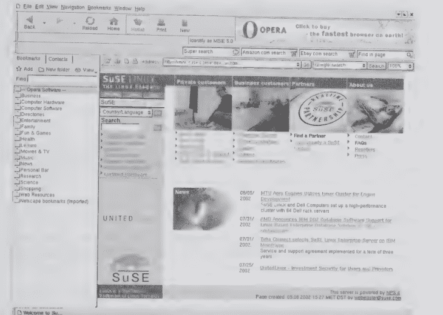

**图 1.31：使用默认设置的 Opera**

工具栏包含常用的“后退”、“前进”、“重新加载”和“主页”按钮。“快捷列表 (Hotlist)”按钮可激活或禁用主窗口左侧的书签列表。关于此用户友好书签工具的更多信息请参阅下一页的*书签管理器章节 (Section The Bookmark Manager)*。

主栏下方显示的是“个人栏 (Personal bar)”。常用的书签可以归档在这里。只需点击一次鼠标即可访问这些页面。

在右侧框架中，您可以方便地在搜索引擎或互联网交易商处进行搜索。只需在相应字段中输入搜索字符串并按 Enter 键即可。这省去了显式打开互联网页面然后填写搜索表单的麻烦。

状态栏位于个人栏下方。如果您将鼠标悬停在 Opera 图标上而没有点击它们，该栏的左侧会显示简短的描述。

右侧部分显示 Opera 向互联网服务器声明自己是什么浏览器。此功能的优点是，当您访问仅对特定浏览器开放的页面时，可以“伪装” Opera。点击此字段将 Opera 向其他服务器介绍为 Netscape (“Mozilla”)、Internet Explorer 或简单地作为 Opera。

如果您在程序启动时决定在 Opera 内部显示所有窗口，那么当前所有打开的网页概览将显示在窗口底部的“窗口栏”中。如果页面显示在 Opera 外部，则在状态栏下方会显示一个类似的栏——“页面栏”。

#### 主窗口

在获得了关于 Opera 各种工具栏可能性的通用信息后，我们现在将注意力转向主窗口，它占据了 Opera 用户界面的大部分区域。

#### 书签管理器

Opera 在主窗口的左侧提供了一个方便的书签管理器。如果您之前在 Linux 中使用 Netscape，Netscape 的书签将自动导入到 Opera 中。

**提示：** Konqueror 或 Internet Explorer 的书签也可以导入。更多信息请参阅“文件” $\rightarrow$ “首选项...” $\rightarrow$ “应用程序” $\rightarrow$ “书签”。书签文件甚至可以通过“文件” $\rightarrow$ “导出”导出。

使用拖放功能，只需点击并拖动书签和文件夹即可对其进行排列。使用主工具栏中的“快捷列表 (Hotlist)”禁用书签管理器。书签仍可在“书签”菜单下找到。

#### 显示窗口

显示窗口是显示互联网页面的大窗口。其上边界有一系列按钮和输入字段。

`[icon]` 最左侧的这个图标显示当前连接是否加密。这代表（不安全的）未加密连接。

`[该图标]` 表示当前连接受保护，防止嗅探和数据篡改。如果您点击此按钮，将打开加密连接的配置窗口。

如果显示此图标，网页上的图像将正常显示。

`[该图标]` 仅显示已存在的图像。

`[该图标]` 完全不显示图像。这对于非常复杂的页面很有用，因为使用网页并不一定需要所有图像。

`[该图标]` 使用“作者模式”，按照作者的设计显示页面。

`[该图标]` “用户模式”根据您的首选项显示页面。在“文档” $\rightarrow$ “页面布局”下配置这两种模式。

使用此按钮，查看当前页面在打印机上的打印效果。

在这四个按钮旁边是一个用于输入所需互联网地址的字段。在输入最近访问的地址时，Opera 会在输入几个字符后自动补全 URL。如果 Opera 的建议与所需地址匹配，只需按 Enter (`\hookleftarrow`) 键即可。

**提示：** 可以通过点击“地址：”、保持鼠标按钮按下并向书签管理器移动鼠标指针，快速为当前页面创建书签。在您选择的位置释放按钮即可设置新书签。

地址字段旁边的双箭头会展开一个之前通过输入地址访问的页面列表。如果您最近是通过输入地址（而不是通过书签或点击链接）访问所需页面的，此功能尤其有用。

箭头旁边的“Go!”按钮与 Enter (`\hookleftarrow`) 具有相同的效果。点击此按钮将加载输入的地址。

一个更有趣的功能是右侧标记为“Google 搜索”的输入字段。类似于“个人...的四个搜索按钮。

bar”，您可以直接从这里向各种网页发送搜索查询。然而，与其它字段的不同之处在于，点击双箭头符号会产生大约二十个可搜索页面的选项。您可以在互联网上找到 Opera 的扩展插件，利用它们可以直接从浏览器向无数其他页面发送搜索查询。

> **提示**
>
> 这种快速搜索功能也可以在实际的地址栏中使用。在搜索字符串前输入一个字母和一个空格。相应的缩写列在 “文件” $\rightarrow$ “首选项...” $\rightarrow$ “网络” $\rightarrow$ “搜索” 下。例如，如果您在地址栏中输入 `g Linux`，Opera 会自动将关键词 `Linux` 的搜索查询发送到 Google 搜索引擎。

在显示窗口的右上边界，有一个标记为 “100%” 的字段用于设置缩放因子。如果互联网页面上的字体非常小且难以阅读，这尤其有用。

### 特色功能

Opera 提供了许多特色功能。下文描述的许多功能可以通过 “文件” $\rightarrow$ “首选项...” 或按下 `Alt + P` 来访问。

### 调整外观与结构

不要被 Opera 的结构吓到，它在首次启动时看起来有些复杂。各种工具栏、按钮和输入字段对您的日常工作很有帮助。但是，如果您不喜欢浏览器的外观，可以根据自己的喜好进行调整。

移动工具栏只需点击相应工具栏的左边界，并在保持鼠标左键按下时将其拖动，或者右键点击以分配新位置。通过 “菜单”，可以在下拉菜单中查看并配置所有工具栏。

使用 “首选项...” $\rightarrow$ “常规” $\rightarrow$ “外观” 进行进一步修改。`http://my.opera.com` 还为浏览器提供了广泛的按钮设计和背景。

### 保护

Opera 可以非常灵活地适应用户的数据保护需求。“首选项...” $\rightarrow$ “安全” 提供了许多配置选项。存储页面的数量也可以在同一菜单的 “网络” $\rightarrow$ “历史和缓存” 下设置。

Linux 版 Opera 具有一个用于管理现有 Cookie 的实用程序。在 “编辑” $\rightarrow$ “Cookie” 下，可以找到所有 “数据 Cookie” 的详细列表，这些 Cookie 可以单独或全部删除。

> **注意**
>
> Cookie 是存储识别数据的文本片段。当再次访问页面时，由于这些数据是从 Cookie 中提取的，您就无需费力输入密码或电子邮件地址。虽然这非常方便，但它也让用户在他人面前变得透明。尽管这并不一定构成安全风险，但某些数据可能会在未经您同意的情况下被传输。

要清除所有活动痕迹，请使用 “文件” $\rightarrow$ “删除私密数据...”。

### 键盘快捷键

大量的按键组合使您即使没有鼠标也能充分且高效地使用 Opera。例如，`F8` 将您带到地址栏，`F9` 将您带到内容窗口。使用 `Page↑` 和 `Page↓` 逐页向上或向下移动。`A` 和 `G` 在链接之间跳转。`F12` 在屏幕上显示最重要的设置简要概览。

完整的 Opera 快捷键列表可以在 “帮助” $\rightarrow$ “键盘” 下访问。而在 “编辑” $\rightarrow$ “快捷键...” 下提供的列表更为复杂，但它提供了定义新快捷键以及编辑或删除现有快捷键的额外可能性。

### 鼠标手势

经过少量练习，“鼠标手势” 可以像键盘快捷键一样高效。其原理很简单：按下鼠标按钮并在特定方向上移动鼠标以执行特定操作。例如，如果您按下鼠标右键并同时将其向下移动，则会打开一个新窗口。如果按下按钮时将鼠标上下移动，则会重新加载当前页面。“帮助” $\rightarrow$ “鼠标” 提供了 “鼠标手势” 以及在 Opera 中使用鼠标的通用概览。

### 双击功能

双击一个单词可以在搜索引擎中搜索它，在百科全书中查询它，将其翻译成另一种语言，甚至通过电子邮件发送。如果您点击三四次，则会标记一个句子部分或整个段落。

### 注册

如果您喜欢 Opera，请考虑注册该浏览器。支付 39 美元，您将获得一个由数字和字母组成的密钥，该密钥可移除右上角的广告横幅，并使您有资格获得优先支持。

## KMail — KDE 邮件应用程序

KMail 是 KDE 的邮件应用程序。除了发送和接收电子邮件以及多种邮件协议等常规功能外，它还提供了几个可自定义的过滤器，用于将电子邮件分类到单独的文件夹中。例如，这对于将重要的业务信函与来自邮件列表的次要电子邮件分离开来非常有用。邮件既可以从容阅读，也可以快速浏览并安全删除。

- 第一步 . . . . . . . . . . . . . . . . . . . . . . . . . . . . 216
- 使用 KMail . . . . . . . . . . . . . . . . . . . . . . . . . . . . . . . . 217
- 创建新邮件 . . . . . . . . . . . . . . . . . . . . . . . . . . . . . 219
- 邮件文件夹 . . . . . . . . . . . . . . . . . . . . . . . . . . . . . . . 220
- 地址簿 . . . . . . . . . . . . . . . . . . . . . . . . . . . . . . . . . . . 222
- 过滤器 . . . . . . . . . . . . . . . . . . . . . . . . . . . . . . . . . . . . . 222
- 使用 PGP 或 GnuPG 进行邮件加密 . . . . . . . . . . . . . . . 224

### 第一步

首次启动 KMail 时，您的主目录下将添加一个 `Mail` 文件夹。该文件夹包含初始邮件目录（收件箱、发件箱、已发送和垃圾桶）。使用 “设置” $\rightarrow$ “配置 KMail...” 输入 KMail 发送和接收邮件所需的初步信息。

#### 定义您的用户身份

“身份”中的设置分为三个选项卡：“常规”、“高级”和 “签名”。在 “常规” 下，在 “名称” 中输入您的全名，并可选地在 “组织” 字段中输入相关信息。在 “电子邮件地址” 中输入您的电子邮件地址。

在 “高级” 下，输入 “回复地址”（如果适用）。要发送加密或签名邮件，请在 “OpenPGP 密钥” 下选择一个密钥（如果您已经拥有公钥）（另请参阅第 224 页的使用 GnuPG 或 GnuPG 进行邮件加密）。选择 “已发送邮件文件夹” 和 “草稿文件夹”。通常不需要 “特殊发送方法”。

最后，通过在 “签名” 选项卡下选择 “启用签名”，选择在每封电子邮件底部添加一条特殊信息。这是在电子邮件中添加个人信息或表达方式的常用方法。

使用 “新建” 按钮添加额外的用户身份。

#### 配置邮箱

“网络” 图标面板中的设置告诉 KMail 如何接收和发送电子邮件。这里有两个选项卡 —— 一个用于发送，一个用于接收电子邮件。

其中许多设置根据您的邮件服务器所在的系统和网络而有所不同。如果您不确定设置或应选择哪些项，请咨询您的互联网服务提供商或系统管理员。

**发送** 在 “已发送” 选项卡下创建出站邮箱。“添加” 提供 SMTP 或 `sendmail` 的选择。对于大多数用途，请在此选择 SMTP。做出此选择后，将出现一个窗口，用于输入 SMTP 服务器数据，例如 “名称”、“服务器” 以及（如果需要）所需的授权信息。

安全设置在 “安全” 选项卡下。在此指定您首选的加密方法。如果不确定，请点击 “测试服务器能力”。相应的设置将被测试并应用。

**接收** 在 “接收” 选项卡下可以找到接收电子邮件所需的一切。使用 “添加”，从各种选项中选择：本地（Mbox 格式）、POP3、IMAP 或本地（maildir 格式）。通常情况下，POP3 就足够了。

做出选择后，将出现一个窗口用于输入 POP3 服务器数据。给服务器起一个唯一的名称。由于所有附加数据应由您的互联网服务提供商或系统管理员提供，您只需在相应字段中输入值。此处需要填写的字段是 “用户”、“服务器” 和 “密码”。

在 “额外” 选项卡下，可以找到几种加密和授权方法。如果您不确定您的服务器提供哪些选项，请尝试 “测试服务器能力”。

### 使用 KMail

#### 主窗口

KMail 启动时会出现主窗口。它被分为三个部分。

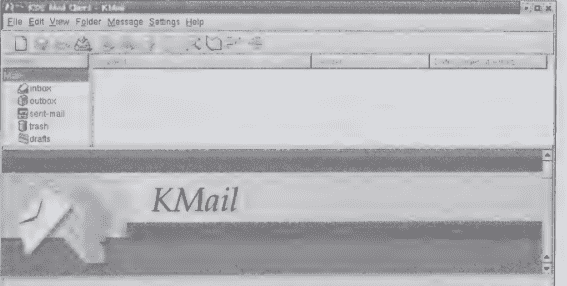

*图 14.1：启动后的 KMail 主窗口*

- **文件夹区域（左侧）**

  此部分包含您的邮件文件夹或邮箱列表。文件夹旁边的数字表示其中包含未读邮件。只需点击即可选择文件夹。其中包含的消息将出现在右上角的窗口面板中。状态栏显示未读邮件的数量以及所选文件夹中的消息总数。文件夹可以以简写形式（仅占用左窗口边栏的一小部分）或详细显示（占用屏幕整个左侧部分，但可显示更多文件夹）来展示。

- **标题区域（右侧）**

  在此窗口面板中，列出了当前所选文件夹中消息的标题信息（消息状态、发件人、主题和日期）。点击标题即可选择该消息并在消息窗口中显示。若要一次选择多条消息，请点击一条消息，然后按住 `Shift` 键，再点击另一条消息。这两条消息以及它们之间所有的消息都将被选中。通过按住 `Ctrl` 键，可以选择任意数量的消息而无需高亮显示其中的其他消息。点击相应的列即可对消息进行排序。如果多次点击同一列，排序方向将在升序和降序之间切换。您可以根据主题、发件人或日期进行排序。

- **消息区域（下方）**

  此处打开并显示当前所选消息的标题和内容。附件根据其 MIME 类型，以图标形式呈现在消息底部的边距中。使用 `PgUp` 和 `PgDn` 翻页滚动消息，或使用 `↑` 和 `↓` 逐行滚动。快捷键可在主窗口中找到。

消息可以用几种不同类型的状态标志进行标记。可以在“消息 (Message)” $\rightarrow$ “标记为 (Highlight as)”下更改它们。

- “新邮件 (New)”（红点，红色字体标题）：消息是新的，尚未阅读。
- “未读 (Unread)”（绿点，蓝色字体标题）：包含该消息的文件夹在重新打开后，消息状态从“新邮件”变为“未读”。
- “已读 (Read)”（-）：消息已被阅读。
- “已回复 (Replied)”（蓝色 U 型箭头）：消息已得到答复。
- “等待中 (Waiting)”（信封）：消息已放入发件箱待发送。
- “已发送 (Sent)”（倾斜的信封）：消息已发送。
- “重要 (Important)”：重要消息的标记。

### 创建新消息

“创建消息”窗口用于编写新消息。可以通过主窗口底部的文档图标打开，或者通过“消息 (Message)” $\rightarrow$ “新消息 (New Message)”打开。

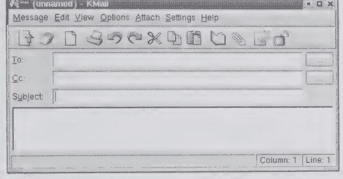

图 14.2：创建消息

#### 创建消息

填写“新消息”窗口中的相应字段。有一些快捷键可以帮助您编写消息。若要使用不同的电子邮件账户发送邮件，请选择您在*定义用户身份 (Defining Your User Identity)* 中已经配置好的身份。“收件人 (To:)”、“抄送 (CC:)”以及（如果适用）“密送 (Bcc:)”旁边的按钮可打开地址簿以选择地址。如果您已经输入了地址的开头，请按 `Ctrl` + `↑` 来获取可能的补全列表。写完消息后，点击“发送 (Send)”。使用“视图 (View)”来设置不同的标题。

#### 附件

使用以下方法之一将文件附加到消息中：

- 点击回形针图标并选择要附加的文件。
- 将文件从桌面或其他文件夹拖入“新消息”窗口。
- 在“附加 (Attach)”菜单中选择其中一个选项。


随后会出现“附件属性（Attachment Properties）”窗口，要求提供关于附件的信息。通常，文件的 MIME 类型会被正确识别，但如果识别错误，请从列表中选择。在描述字段中输入简短的描述文字。接下来，从选项列表中为您的文件选择一个编码（默认值通常效果良好）。如果消息附加了文件，它将出现在窗口底部的附件列表中。通过选择附件名称，随后在“附加（Attach）”菜单中点击“删除（Remove）”、“保存（Save）”或“属性（Properties）”来保存、删除或打开附件。通过在“附加（Attach）”菜单中选择相应选项将 PGP 密钥附加到消息中。PGP 密钥被视为文件附件，其 MIME 类型为 `application/pgp-keys`。

### 检查消息拼写错误

通过“编辑（Edit）”→“拼写检查...（Spelling...）”检查消息的拼写。KMail 使用 KSpell 来检查拼写。KSpell 是 `ispell` 和 `aspell` 拼写检查程序的 KDE 前端。拼写检查器必须通过“设置（Settings）”→“拼写检查器...（Spellchecker...）”进行配置。

### 消息文件夹

消息文件夹是组织消息的工具。默认情况下，所有消息文件夹都存储在主目录的 `Mail` 文件夹中。首次启动 KMail 时，将添加 `Inbox`（收件箱）、`Outbox`（发件箱）、`SentMessages`（已发送邮件）和 `Trash`（垃圾桶）文件夹。这些文件夹具有以下功能：

- `Inbox`：存储新消息（除非定义了过滤器）。
- `Outbox`：存储待发送的消息。
- `Sent`：存储所有已发送电子邮件的副本。
- `Trash`：存储已删除的电子邮件。

虽然默认文件夹很可能满足您的需求，但您可能需要额外的文件夹来组织电子邮件。选择“文件夹（Folder）”→“创建（Create）”来添加新文件夹。对话框将询问文件夹的名称（见下一页图 14.3）。如果它应该是子文件夹，请选择其上级文件夹（一个标记为“属于（Belongs to:）”的下拉菜单）。在此窗口中指定文件夹类型、属于该文件夹的任何邮件列表以及过期日期（一段时间后，电子邮件将被标记为删除）。您仍然可以选择另一个用户身份，或显示特定的发件人或收件人。

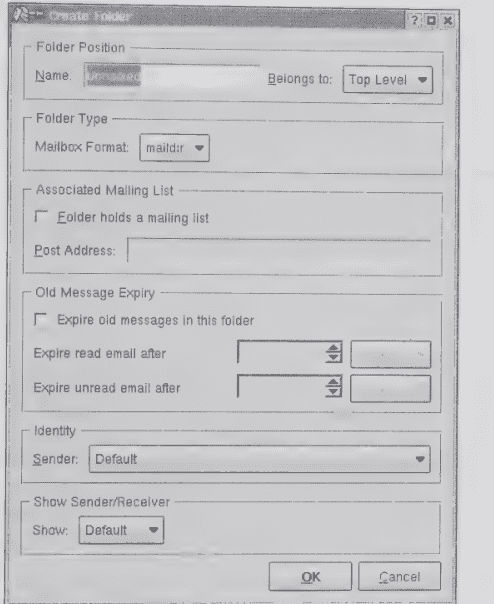

图 14.3：创建新文件夹

要将消息从一个文件夹移动到另一个文件夹，请高亮显示要移动的消息，然后按 `M` 或点击“消息（Message）”→“移动到...（Move to...）”。随后会出现文件夹列表，选择要将消息移至的文件夹。还可以通过将消息拖放到相应的文件夹中，将消息从上方窗口移动到左侧窗口面板。

要删除文件夹中的所有消息，请点击“文件夹（Folder）”→“清空（Empty）”。此时，该文件夹中所有的消息将被移至 `Trash`（垃圾桶）。在您实际清空垃圾桶之前，这些消息不会被永久删除。

### 地址簿

将常用的电子邮件地址保存到地址簿中。可以通过“文件（File）”菜单、主窗口中的打开书籍图标或在“新消息”窗口中打开地址簿。

KMail 提供了几种地址簿的选择。“传统 KMail（Traditional KMail）”非常简单，而“KAB”则提供了更多功能。通过点击图标面板“杂项（Miscellaneous）”并在“设置（Settings）”→“配置 KMail（Configure KMail）”菜单中选择“地址簿（Address Book）”选项卡来定义地址簿。如果您之前没有任何地址簿，建议使用 `KAddressbook`。

请注意选择下方的注释。在那里可以看到增强版替代方案所需的软件包。不同地址簿中的数据相互独立。您在“KAB”中看不到那些仅输入在“传统 KMail”地址簿中的地址。

#### 过滤器

使用 KMail 一段时间后，您可能会厌倦将所有新收件箱消息手动分类到各自的文件夹中。过滤器能够自动处理接收到的消息，以及手动处理文件夹中选定的消息。若要将选定消息过滤到特定文件夹，请高亮显示这些消息并输入 `Ctrl` + `J`，或选择“消息（Message）”→“创建过滤器（Create Filter）”。这样，您所有的过滤规则都将应用于此消息。目前无法仅对某条特定消息使用部分过滤器。要删除过滤器，请在“过滤规则（Filter Rules）”窗口中选中它并点击“删除（Delete）”。

##### 过滤规则

过滤器由标准（Criteria）和动作（Actions）组成。例如，一个过滤标准可以根据发件人、内容或收件人来选择消息。与此标准相对应的过滤动作可以是移动、删除、高亮显示或转发这些消息。

##### 过滤器示例

如果您订阅了 KDE 用户列表，请为该列表创建文件夹（我们称之为 KDE Users）。按照以下说明创建过滤器，将新消息从收件箱自动传输到 KDE User 文件夹：

## 14

1. 按照第 220 页 *Message Folders* 中的说明的方式添加一个新文件夹。例如，将其命名为 `kde-user`。
2. 首先，思考识别要过滤消息的最简洁方式。在我们的示例中，KDE 用户列表中的消息是通过其 `kde-user@kde.org` 地址指定的，该地址可在“To:”或“Cc:”字段中找到。
3. 点击“Settings”→“Configure Filters”。随后打开一个窗口。左侧显示可用过滤器，窗口右侧由两个面板组成：过滤规则和过滤操作。
4. 点击“New”图标创建一个空过滤器。它显示为 `unknown`。
5. 从第一个下拉菜单中选择“To:”或“Cc:”，从第二个下拉菜单中选择“contains”。在文本字段中输入 `kde-user@kde.org`。
6. 在“Filter actions”字段中，从第一个下拉菜单中选择“Move to Folder”选项。随后出现第二个下拉菜单用于选择文件夹。选择一个在过滤消息符合所需标准时应移动到的文件夹。在这种情况下，从下拉菜单中选择 `kde-user`。

您可能需要复杂的条件来过滤消息。例如，您可能只想保存由您的朋友 Fred Johnson（`fj@anywhere.com`）编写的 KDE 用户列表消息。此时，其余的过滤条件就派上用场了：

1. 点击“Settings”→“Configure Filters”并高亮显示刚才添加的过滤器。
2. 为了过滤所有在“To:”或“Cc:”字段中包含 `kde-user@kde.org` 且来自 Fred 的消息，请使用第二行下拉菜单在“Filter Criteria”下定义第二个过滤器。在第一个菜单中选择“From”，在第二个中选择“contains”。然后输入要过滤的电子邮件地址。

从下拉菜单中选择过滤条件内部的第二个弹出菜单并选择“From”。在其旁边选择“contains”。输入您朋友的电子邮件地址：`fj@anywhere.com`。此处激活了“Applies to all”。

3. 现在您已经创建了一个能够转移所有来自 KDE 用户列表中 Fred Johnson 邮件的过滤器。

### 使用 PGP 或 GnuPG 进行邮件加密

您可以加密您的电子邮件（即您使用 KMail 发送的邮件）。这并不意味着附件会被加密，因此您必须提前使用 shell 命令或其他工具处理附件。在 KMail 中实现 PGP 或 GnuPG 之前，请先正确安装并配置它。详情请参阅 `gpg (man gpg)` 或 `pgp (man pgp)` 的 man 手册页。

#### PGP 和 GnuPG 的要求

KMail 要求您将 PGP 二进制文件命名为 `pgp`。如果您使用的是 GnuPG，KMail 将寻找名为 `gpg` 的二进制文件。首先，为您的身份生成一对密钥。这可以在命令行完成（使用 `pgp -kg` 或 `gpg -gen-key`）。KMail 需要身份信息（通常是您的姓名，后跟用尖括号括起来的电子邮件地址，如 `JohnDoe<john@example.com>`）和您的密码来解析 PGP。

#### KMail 设置

通过“Settings”→“Configure KMail”打开 KMail 设置对话框。点击“Security”→“OpenPGP”。在“Select encryption program”中指定用于此目的的应用程序。通常选择“Automatic recognition”选项。

做出决定后，点击“Identity”。在此处找到“OpenPGP key”项。点击“Change”会显示一个对话框，从中选择所需的密钥。

在“OpenPGP”选项卡下，有以下附加选项：

- “Keep passphrase in memory”：如果禁用此选项，KMail 在您签署消息（发送前）或解码接收到的消息时将始终要求输入密码。如果启用此选项，KMail 在将密码存储在内存中之前只会要求您输入两次密码。这样密码被存储在内存中，而不会写入硬盘。但请注意，具有相应权限的用户（例如 root）可能能够从内存中读取您的密码。
- “Always encrypt to self”：如果禁用此选项且您想发送加密电子邮件，那么在邮件创建并加密后，您自己将无法读取该消息。如果您希望能够阅读自己的加密消息，请启用此选项。您可以在 `Sent` 文件夹中阅读消息的纯文本。
- “Show ciphered/signed text after composing”：如果您希望在邮件加密或签名后显示文本，请启用此选项。
- “Always verify the encryption key”：如果您勾选此选项，每次都会被询问使用哪个密钥进行签名和编码。

在“Composer”下，勾选“Automatically sign messages with OpenPGP”旁边的复选框。此时，所有消息在发送前都将被签名。若要发送加密消息并让接收者验证您的签名，请将您的公钥交给对方。若要向他人发送加密电子邮件或审阅您签名的消息，您将需要您的公钥。公钥可以存储在公共 PGP 密钥服务器上，例如 `www.pgp.net`。

#### 签署消息

像平时一样创建消息。在发送消息之前，点击窗口工具面板中的倒数第二个图标。然后发送消息。为了对其进行签名，KMail 必须知道您的 PGP 密码。但是，如果您已经提供了密码，KMail 将在无需进一步请求信息的情况下签署消息。在 `Sent Messages` 文件夹（或者如果您没有使用“Send now”则在发件箱中）中查看 PGP 签名过程的结果。在那里，您的电子邮件应该被标记上由您签名的标签。

#### 发送公钥

为应该接收您公钥的人创建一条消息。在“Attach”菜单中选择“Attach Public Key”。现在可以发送邮件了。无法保证签署消息的接收者会获得正确的密钥。邮件在发送给接收者的途中可能会被截获并用另一个密钥签署。因此，接收者应通过将指纹与之前接收到的值进行比较来检查附件密钥。关于此问题的更多信息可以在 PGP 和 GnuPG 文档中找到。

#### 解码加密消息

在 KMail 中，您只需点击该消息。在提示时输入您的密码。如果消息是用您的公钥编码的，KMail 将尝试解码该消息并以明文显示。否则，您将无法阅读该电子邮件。KMail 将电子邮件保存为加密消息，以防止任何人在没有您密码的情况下读取它们。

#### 接收公钥

您可以以附件、通过 FTP 或通过软盘接收公钥。在使用该密钥为发送给该持有者的电子邮件加密之前，请检查该密钥（检查指纹或寻找可靠的签名）。通过在命令行输入命令 `pgp -ka {filename}` 或 `gpg --import {filename}` 将密钥添加到您的公共密钥环中。如果密钥没有可靠的签名，您将无法在 KMail 中使用它进行编码（使用 `pgp -ks {identity}`）。

#### 使用他人的公钥——编码您自己的消息

要向您拥有其公钥的接收者发送编码消息，请在“Create Message”窗口中编写消息。在发送消息之前，点击“Create Message”窗口工具栏中的红色密钥图标。现在，消息可以发送了。如果 KMail 无法为接收者找到唯一密钥，将出现一个包含所有可用密钥的列表。从列表中选择合适的密钥或取消操作。如果在加密过程中发生错误，KMail 也会通知您。如前所述，如果您没有在“Security”选项卡中点击“Always encrypt to self”，您将无法阅读加密邮件。

## Evolution：电子邮件和日历程序

Evolution 是由 Ximian 创建的一套群组软件。它提供常规的电子邮件功能以及任务列表和日历等扩展功能。使用 Evolution 通过日历功能与其他用户预约，或者仅仅用来检查和分类您的电子邮件。它还提供了一个完整的地址簿，包括将您的联系信息作为 vCard 发送给他人的能力。

- 启动 Evolution ........................................ 228
- Evolution 窗口 ........................................ 229
- 邮件 .................................................. 231
- 日历 .................................................. 235
- 联系人 ................................................ 236
- 获取更多信息 ........................................ 236

Evolution 不包含在 SuSE 的默认安装中。要安装 Evolution，请使用 YaST2 安装 `evolution` 软件包以及由 YaST2 自动选择的所有依赖软件包。

Evolution 是一个 GNOME 应用程序。然而，只要安装了所需的库，它可以在任何窗口管理器中使用。若要从 GNOME 启动 Evolution，请选择“程序”→“应用程序”→“Evolution”。它也可以从 SuSE 菜单的“互联网”→“工具”→“Evolution”中启动。在终端中，可以使用 `evolution &` 启动 Evolution。

### Evolution 设置助手

首次启动时，Evolution 会打开一个配置工具以协助进行初始设置。如果它没有自动打开，可以通过收件箱视图进入“工具”→“邮件设置...”，然后在“账户”选项卡中点击“添加”。点击“下一步”使用助手。在相应的字段中输入您的姓名和电子邮件地址。如果您有多个电子邮件地址，请在此处使用您首选的地址。其他地址可以在稍后配置。点击“下一步”。

从“服务器类型”下拉框中为该地址选择合适的接收邮件格式。“POP”是从远程服务器下载邮件最常用的格式。“IMAP”则与特殊服务器上的邮件文件夹协同工作。请从您的 ISP 或服务器管理员处获取此信息。在选择服务器类型后，完成显示的其他相关字段。完成后点击“下一步”。

接下来需要输入的信息是关于邮件发送的。这将用于所有已配置的电子邮件地址。要在本地系统上使用发送邮件，请选择“Sendmail”。对于远程服务器，请选择“SMTP”。从您的 ISP 或服务器管理员处获取详细信息。对于 SMTP，请在选择后完成显示的其他字段。完成后点击“下一步”。

默认情况下，电子邮件地址被用作识别账户的名称。如果需要，请输入另一个名称。“将其设为我的默认账户”字段决定该账户是否应被用作默认账户。默认账户是最初选定用于发送邮件的电子邮件地址。如果需要，可以在邮件撰写窗口中选择另一个账户。点击“下一步”。

下一个窗口中的时区信息用于日历功能。选择正确的时区对于使用预约调度功能至关重要。点击地图上您所在时区城市的点。选择后，显示将缩放到该区域，如果需要可以进行更改。当“选择”下方显示正确的时区时，点击“下一步”。在下一个窗口中，点击“完成”以保存输入的数据。使用“返回”进行修改。

### 从其他邮件程序导入

Evolution 可以从其他邮件程序（如 Netscape 或 KMail）导入邮件。要导入，请选择“文件”→“导入”。对于 KMail 或 mutt，使用“导入单个文件”。对于 Netscape，选择“从旧程序导入数据和设置”。更多信息可在内部帮助中找到。

### Evolution 窗口

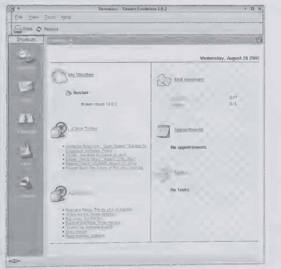

图 15.1：带有快捷方式和摘要的 Evolution 窗口

默认的窗口视图显示在前一页的图 15.1 中。可用的菜单、菜单项以及工具栏中的图标因窗口而异。使用左侧的“快捷方式”窗格来选择在右侧窗格中显示的信息。通过拖动分割条来调整任何窗格的大小。

> **提示**
>
> 右键单击项目（如邮件消息或联系人）会打开一个与该项目相关的操作菜单。

随时可以使用“视图”来移除“快捷方式栏”或添加“文件夹栏”。下文将对“快捷方式”中列出的不同项目进行描述。

#### 摘要

“摘要”提供有关邮件、预约和任务的一些基本信息，以及可个人配置的天气和新闻源。此窗口显示在前一页的图 15.1 中。使用“工具”→“摘要设置”来配置显示的信息。

#### 收件箱

在此视图中，窗口的上半部分显示“收件箱”文件夹的内容。下半部分是用于显示所选邮件消息的预览窗格。通过“视图”→“预览窗格”禁用预览窗格。


要更改显示的文件夹，请点击“收件箱”旁边的向下箭头，并从列表中选择另一个文件夹。搜索栏可用于搜索文件夹中的消息。点击消息列表的表头可以根据该表头对消息进行排序。排序可以是升序或降序，如右侧的箭头所示。点击表头直到显示正确的方向。

### 日历

初始显示为当前日期的天视图，月份和任务列表显示在右侧的附加窗格中。从工具栏或“视图”菜单也可以选择周、工作周和月视图。使用搜索栏查找已输入的预约。使用工具栏中的按钮添加预约和任务。同时使用工具栏翻页浏览日历或跳转到特定日期。

### 任务

“任务”提供一个任务列表。使用工具栏添加任务。使用搜索栏搜索任务。

### 联系人

此视图显示您地址簿中的所有地址。要定位特定地址，请使用搜索栏或点击右侧显示联系人姓氏首字母的按钮。使用工具栏添加联系人或列表。

## 邮件

要在 Evolution 中配置邮件设置，请通过“快捷方式”切换到“收件箱”视图。选择“工具” $\rightarrow$ “邮件设置...”。

### 配置账户

Evolution 能够从多个邮件账户获取邮件。在撰写消息时可以选择发送邮件的账户。要编辑当前账户，请选择该账户并点击“编辑”。要添加新账户，请点击“添加”。这将打开第 228 页 *Evolution 设置助手* 中描述的配置助手。通过选择当前账户然后点击“删除”来将其删除。

要将某个账户设为发送邮件时使用的默认账户，请选择所需账户然后点击“默认”。要禁用从某个账户获取邮件，请选择该账户然后点击“禁用”。禁用的账户仍可用作发送地址，但该账户不会检查接收邮件。使用“启用”重新激活账户。

### 其他设置

使用“显示”来选择或禁用引用高亮颜色，或者设置打开消息后多久将其标记为已读。同时设置如何处理 HTML 邮件消息中的图像。

使用“撰写”为您的邮件撰写器进行设置。“其他”包含 PGP、字符编码和其他功能的设置。

### 撰写和发送邮件

点击“新消息”以撰写新邮件。回复或转发消息会打开相同的基本消息编辑器。在“发件人”旁边，选择从哪个账户发送消息。在收件人字段中，输入电子邮件地址，或输入您地址簿中姓名或地址的一部分。如果 Evolution 能将您输入的内容与地址簿中的内容匹配，Evolution 将显示一个可供选择的列表。点击所需的联系人，如果没有匹配项则继续输入。若要直接从地址簿选择，请点击“收件人”或“抄送”。

Evolution 可以发送常规文本邮件或 HTML 邮件。使用格式工具栏对 HTML 邮件进行格式化。点击“附件”或“插入” $\rightarrow$ “附件”以随邮件发送文件。要使用 PGP 保护您的电子邮件，请从“安全”菜单中做出相应选择。

要发送您的消息，请点击“发送”。如果无法立即发送，请在“文件”下做出其他选择。例如，将消息保存为草稿或稍后发送。

## 文件夹

将电子邮件消息分类到各种文件夹中通常很方便。Evolution 也提供了文件夹。要查看您的文件夹树，请选择“视图” $\rightarrow$ “文件夹栏”。如果您通过 IMAP 访问邮件，IMAP 文件夹也将显示在此文件夹栏中。对于 POP 和大多数其他格式，您的文件夹存储在本地，分类在“本地文件夹”下。您的“联系人”、“日历”和“任务”在此视图中也被视为文件夹，但不应被用于归档邮件。

默认包含几个文件夹：

- “收件箱”是从服务器获取的新消息最初存放的地方。
- “已发送”用于保存您发送的邮件副本。
- “发件箱”是尚未发送邮件的临时存储区。它在离线工作或发送邮件服务器暂时无法连接时非常有用。
- “草稿”用于保存未完成的电子邮件消息。
- “垃圾桶”是删除项目的临时存储区。在“工具” $\rightarrow$ “邮件设置...”下配置该文件夹的自动清空。

新文件夹可以在“本地文件夹”下创建，也可以作为现有文件夹的子文件夹。根据需要创建复杂的文件夹层级。在“收件箱”视图中创建新文件夹，请选择“文件” $\rightarrow$ “文件夹” $\rightarrow$ “新文件夹”。在打开的对话框中输入名称。同时选择该新文件夹将作为其子文件夹的文件夹。对于新的邮件存储文件夹，将“文件夹类型”保持为“邮件”。点击“确定”以创建新文件夹。

要将消息移动到文件夹中，请选择要移动的消息。右键单击打开上下文菜单。选择“移动到文件夹...”，在对话框中打开目标文件夹。点击“OK”来移动邮件。原文件夹中的邮件标题将显示一条删除线，这意味着该邮件在该文件夹中被标记为删除。邮件现在存储在新文件夹中。复制邮件的操作方式与之类似。

手动将大量邮件移动到不同文件夹可能会非常耗时。可以使用过滤器来自动完成此过程。

## 过滤器（Filters）

Evolution 提供了多种过滤选项。过滤器可用于将邮件移动到特定文件夹或删除邮件。通过过滤器，邮件还可以直接移动到垃圾桶。创建新过滤器有两种选项：从零开始创建过滤器，或基于要过滤的邮件创建过滤器。后者对于过滤发送到邮件列表的邮件非常有用。

### 从零开始创建过滤器

选择“Tools” $\rightarrow$ “Filters”。该对话框列出了您现有的过滤器（可进行编辑），并允许删除或添加。点击“Add”以创建新过滤器。

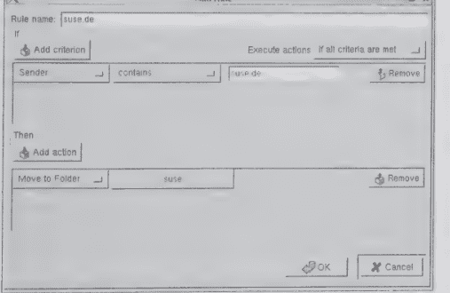

图 15.2：创建过滤器

在“Rule Name”中为新过滤器输入名称。选择过滤器要使用的标准。选项包括发件人、收件人、源账户、主题、日期和状态。显示“Contains”的下拉框提供了多种选项，如“包含 (contains)”、“是 (is)”和“不是 (is not)”。选择适当的条件。输入要搜索的文本。点击“Add criterion”以添加更多过滤标准。使用“Execute actions”来确定是必须满足所有标准还是仅部分标准才能应用该过滤器。

在窗口的下半部分，确定满足过滤标准时要执行的操作。例如，邮件可以被移动或复制到文件夹，或被分配一种特殊颜色。在移动或复制时，通过点击选择目标文件夹。在出现的文件夹列表中选择文件夹。使用“New”创建新文件夹。选择正确文件夹后，点击“OK”。完成过滤器创建后，点击“OK”。

### 基于邮件创建过滤器

选择要作为过滤器基础的邮件。右键点击并选择“Create Rule From Message”。选择所需的过滤器选项。这将打开过滤器创建对话框，且正确的标准已预先选中。根据需要添加额外标准。选择适当的过滤器操作。完成后点击“OK”。

### 应用过滤器

过滤器按照“Tools” $\rightarrow$ “Filters”对话框中列出的顺序应用。通过突出显示某个过滤器并点击“Up”或“Down”来更改顺序。完成后点击“OK”关闭过滤器对话框。

过滤器应用于所有新邮件。它们不会应用于已经在文件夹中的邮件。要将过滤器应用于已接收的邮件，请突出显示所需的邮件，然后选择“Actions” $\rightarrow$ “Apply Filters”。

## 虚拟文件夹（VFolders）

Evolution 提供了独特的 VFolders。VFolder 是一个虚拟文件夹，它根据搜索或过滤标准显示邮件。虚拟文件夹中的邮件并不会被移动，而是保留在原文件夹中。对邮件执行的操作将作用于原文件夹中的邮件。

在通过过滤器将邮件分发到多个不同目录后，VFolders 是在同一个地方阅读新邮件的一种便捷手段。例如，可以创建一个 VFolder 来搜索所有文件夹中的未读邮件。

要创建新的 VFolder，请选择“Tools” $\rightarrow$ “Virtual Folder Editor...”。在对话框中点击“Add”。VFolders 也可以像过滤器一样从邮件创建。右键点击，选择“Create Rule from Message”，然后选择正确的 VFolder 标准。

输入“Rule Name”。对于上述新邮件示例，将标准设置为“Status”不是“Read”。根据需要设置来源。其他 VFolder 搜索也可以类似地设置。完成后点击“OK”，这将返回到虚拟文件夹列表。如果需要，可以更改顺序。点击“OK”将其关闭。

新的 VFolder 将显示在文件夹列表的“VFolders”下方。您可以使用 VFolder 阅读、回复和删除邮件。但是，删除邮件会将其从存储该邮件的真实文件夹中删除，而不仅仅是从 VFolder 中删除。

## 日历（Calendar）

### 添加预约

要在日历中添加新预约，请点击“New Appointment”。在“Appointment”选项卡下，输入预约详情。如果需要，可以选择一个类别，以便日后更轻松地搜索和排序。可选地，在“Reminder”选项卡下设置 Evolution 在预约前提供提醒。如果预约是定期发生的，请在“Recurrence”下进行设置。所有设置完成后，点击“Save and Close”。新预约将显示在您的日历中。

### 安排会议

要与他人安排会议，请点击“New Appointment”，然后选择“Actions” $\rightarrow$ “Schedule Meeting”。输入类似于预约的信息。在“Meeting”下添加参会者。对于在“Contacts”中的人员，点击“Invite Others...”并从对话框中选择参会者。完成后，点击“Save and Close”。参会者将收到一封关于已安排会议的电子邮件。

该系统还可用于安排适合所有参会者的时段或预留资源。有关使用调度功能的更多信息，请参阅内部帮助。

### 添加任务

Evolution 可用于跟踪待办事项列表。要在列表中添加新任务，请点击“New Task”。输入摘要信息、截止日期和开始日期以及描述。在“Details”下输入任务状态和其他信息。点击“Save and Close”将任务添加到列表中。双击任务可重新打开对话框以进行更改或将其标记为已完成。

## 联系人（Contacts）

### 添加联系人

除了姓名和电子邮件地址外，Evolution 还可以存储一个人的其他地址和联系信息。要快速添加发送过邮件给您的某人的姓名和电子邮件地址，请在邮件预览中右键点击带下划线的地址。选择“Add to Contacts”。要输入更多信息，请点击“Edit Full”。否则，点击“OK”。如果您选择了“Edit Full”，完成后请点击“Save and Close”。

要输入一个完全新的联系人，请在“Contacts”视图中点击“New Contact”。输入所有所需的联系信息。完成后点击“Save and Close”。

### 创建列表

如果您经常向同一组人发送邮件，可以通过创建列表来简化此操作。在“Contacts”视图中点击“New List”。为列表输入名称。通过在框中输入地址然后点击“Add”，或从 Evolution 联系人视图中将联系人拖拽并放入框中来添加地址。切换“Hide addresses”以选择收件人是否可以看到其他谁也收到了该邮件。完成后点击“Save and Close”。该列表现在成为您的一个联系人，在撰写窗口输入前几个字母后就会出现。

### 分享联系人

要将地址簿中的联系人信息发送给另一位 Evolution 用户，请右键点击要转发的联系人。选择“Forward Contact”。这将把联系人“名片”作为电子邮件的附件发送。像平常一样撰写并发送此邮件。

要添加收到的联系人，请以行内方式查看该联系人。点击“Save in addressbook”将完整的联系人名片添加到您的地址簿中。

### 更多信息

Evolution 包含详尽的内部帮助。使用“Help”菜单访问这些信息。有关 Evolution 的更多信息，请参阅 Ximian 的网站 `http://www.ximian.com`。

## Linux 中的声音应用

Linux 提供了大量处于不同开发阶段的声音应用。由于应用程序种类繁多且名称不寻常，很难确定某个应用程序的功能以及找到适合特定用途的应用。以下是对 SuSE Linux 发行版中包含的一些较为实用或有趣的声音应用的介绍。

其中许多应用程序未包含在默认安装中。请使用 YaST2 安装相应的软件包。

| 应用类别 | 页码 |
| :--- | :--- |
| 混音器 (Mixers) | 238 |
| 播放器 (Players) | 239 |
| MIDI 程序 | 241 |
| 合成器 (Synthesizers) | 243 |
| 作曲与乐谱 | 243 |
| 读取音频 CD | 244 |

> **注意**

除非另有说明，否则应用程序可以通过“SuSE 菜单”中的“多媒体” $\rightarrow$ “声音”启动。

### 混音器

混音器是控制计算机声音输出和输入音量及平衡的一种便捷方式。各种混音器的主要区别在于界面。请选择一个符合您需求且操作舒适的混音器。此外还有其他混音器可用。在“多媒体” $\rightarrow$ “声音”菜单中，名称中包含“mix”的大多数程序都是混音器应用程序。

> **提示**

通常，建议在打开其他声音应用程序之前先打开混音器应用程序。使用混音器来测试和调整声卡输入和输出的控制设置。某些声卡可能不允许多个应用程序同时访问。如果声音应用程序卡死，这可能是原因所在。

#### `gamix`

如果您拥有多块声卡，`gamix` 为每块卡提供了一组控制器。滑动控制滑块即可设置所需的电平。

#### `alsamixer`

`alsamixer` 是一个基于文本的混音器，可以在 X 环境之外的命令行中运行。输入 `alsamixer` 启动它。使用左右方向键选择要调整的电平。使用上下方向键均匀地控制电平。$\textcircled{Q}$、$\textcircled{W}$、$\textcircled{E}$、$\textcircled{Y}$、$\textcircled{X}$ 和 $\textcircled{C}$ 可用于为左右声道进行不同的设置。使用 $\textcircled{M}$ 将声道静音。按下 $\textcircled{Esc}$ 退出。更多信息可在 `alsamixer` 的 man 手册页中找到（`man alsamixer`）。

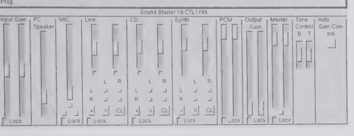

图 16.1：混音器 gamix

#### `KMix`

`KMix` 是 KDE 的混音器。它为 KDE 用户提供了一个便捷且熟悉的界面。它还可以集成到 KDE 面板中。

### 播放器

Linux 提供了多种程序用于播放音频 CD 和各种可用的音乐格式，包括 MP3、OGG 和 WAV 文件。在可能的情况下，列出了播放器支持的格式。

#### `kscd` — 音频 CD 播放器

`kscd` 是一款易于使用的音频 CD 播放器。通过“SuSE 菜单”中的“多媒体” $\rightarrow$ “多媒体” $\rightarrow$ “CD” $\rightarrow$ “KsCD”访问。点击带有工具图标的按钮可访问配置菜单。`kscd` 可以配置为搜索在线 CDDB 服务器以获取 CD 的名称和曲目名称。

#### `WorkMan` — 音频 CD 播放器

对于那些不喜欢 KDE 风格而倾向于简单 CD 播放器的人，`WorkMan` 提供了一个非常基础的界面，且不牺牲功能或便捷性。

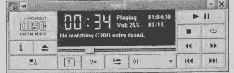

图 16.2：kscd

#### GNOME CD 播放器小部件

这是一个简单的插件，可以添加到 GNOME 面板中。右键单击面板并选择“面板” $\rightarrow$ “添加到面板” $\rightarrow$ “小部件” $\rightarrow$ “多媒体” $\rightarrow$ “CD 播放器”即可添加。

#### `XMMS` — MP3、WAV、OGG 及流媒体播放器

`XMMS` 是 Linux 上最受欢迎的播放器之一。它提供 GNOME 和 KDE 小部件，允许在这些桌面环境的面板中进行集成。它还提供了一系列可视化和效果插件。使用弹出按钮打开文件。通过标题显示下方的“PL”指示符访问播放列表编辑器，可用其选择和排序若干要播放的文件。播放列表可以保存以备后用。点击左上角的按钮可打开完整菜单。更多信息和文档请访问 `http://www.xmms.org`。

#### `FreeAmp` — MP3、OGG 及流媒体播放器

`FreeAmp` 是另一款流行的播放器，支持多个平台。使用“MyMusic”来整理您的收藏并创建播放列表。`FreeAmp` 提供许多主题，可用于完全改变播放器的外观。

#### `GDAM` — DJ 应用程序

`GDAM` 是一款复杂且功能丰富的应用程序，提供包括多个文件同时播放、多块声卡播放以及添加一系列特殊效果的能力。该软件包包含详尽的文档，位于 `/usr/share/doc/packages/gdam` 目录中。

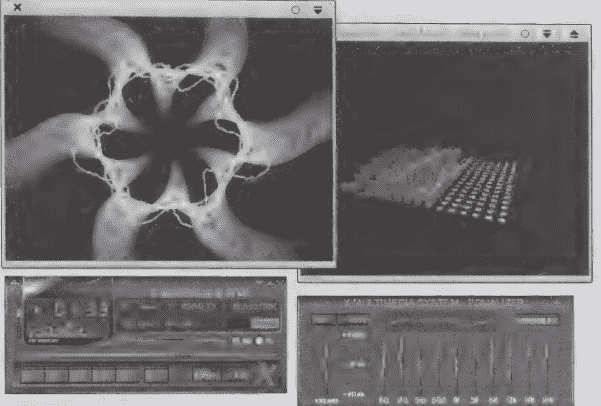

图 16.3：带有均衡器、“OpenGL 频谱分析仪”和“Infinity”插件的 xmms

#### `terminatorX` — 另一款 DJ 应用程序

`terminatorX` 是另一款具有特殊效果的 DJ 应用程序。文档位于 `/usr/share/doc/packages/terminatorX` 目录中。

### MIDI 程序

许多声卡都有外部 MIDI 端口，用于连接 MIDI 设备，如合成器、键盘或声模块。如果您的声卡 MIDI 端口受 ALSA 支持，可以使用像 `jazz` 这样的序列器应用程序通过该端口记录和播放 MIDI 文件。在命令行中，使用 `pmidi -l` 查看可用的 MIDI 设备和内部 ALSA 端口号。使用类似 `pmidi -p 73:0 mysong.mid` 的命令通过列出的端口之一播放 MIDI 文件。将 `73:0` 替换为列表中所需的端口号。

#### `TiMidity++` — 软件波表合成器


如果您的声卡没有波表合成器（无法根据加载的声音字体或乐器补丁播放 MIDI 文件），请使用 `TiMidity++` 来模拟。有关配置的信息可以在 `timidity.cfg` 的 man 手册页中找到（`man timidity.cfg`）。乐器补丁可以在 `http://www.stardate.bc.ca/eawpatches/html/default.htm` 找到。`timidity++` 提供了一系列界面和服务器模式。相关信息可在 `timidity` 的 man 手册页中找到（`man timidity`）。

#### `vkeybd` — 虚拟 MIDI 键盘

`vkeybd` 为没有外部 MIDI 键盘的用户提供了一个虚拟键盘。有关信息，请参考 `vkeybd` 的 man 手册页（`man vkeybd`）或 `vkeybd --help`。

#### `aconnect` 和 `kaconnect` — 连接 MIDI 端口

`aconnect` 和其 KDE 版本 `kaconnect` 可用于连接 MIDI 端口和设备。`kaconnect` 提供了一个简单的图形界面来建立连接。`aconnect` 依赖于命令，具体在 `aconnect` 的 man 手册页中描述（`man aconnect`）。

#### `KMid` — KDE MIDI 播放器

`KMid` 可用于播放 MIDI 文件。按下 <kbd>F1</kbd> 访问在线帮助。KAR 格式的文件包含歌词。在歌曲播放时，歌词可以滚动并高亮显示，使 `KMid` 能够作为卡拉 OK 机运行。

#### `jazz` — MIDI 序列器

`jazz` 是一款强大且复杂的序列器。它在“杂项” $\rightarrow$ “和声浏览器”下包含 `jazz` 和声。`jazz` 可以配合 `timidity++` 或具有波表合成功能的声卡使用。该程序包含详尽的内部帮助以及位于 `/usr/share/doc/packages/jazz` 的文档。

### 合成器

并非每个人都能负担得起合成器或鼓机等高端设备。以下程序允许您使用计算机模拟这些设备。

#### `SpiralSynth` — 软件模拟合成器

`SpiralSynth` 提供了一个完整的模拟合成器。其界面与早期的模拟合成器相似。它可以通过键盘或 `vkeybd` 进行控制。相关信息可在 `/usr/share/doc/packages/SpiralSynth` 或 `http://www.pawfal.org/Software/SpiralSynth/Manual.html` 找到。

#### `RTSynth` — 实时软件物理建模

在命令行启动 `RTSynth` 时应指定输入和输出。命令类似于 `RTSynth -i /dev/snd/midiC1D0 -o /dev/dsp`。通过 `RTSynth --help` 获取有关命令行参数的信息。其他文档位于 `/usr/share/doc/packages/rtsynth`。

#### `tk707` — 鼓机

`tk707` 基于 Roland 的 TR-707 鼓机。在初始对话框中配置所需的 MIDI 端口。文档位于 `/usr/share/doc/packages/tk707/tk707.html`。

#### `trommler` — 包含采样文件的鼓计算机

与 `tk707` 不同，`trommler` 不需要访问 MIDI 端口即可播放声音。鼓采样文件包含在 `/usr/share/sounds/trommler` 中。使用行首的数字按钮加载采样。有关更多信息，请参考 `/usr/share/doc/packages/trommler` 中的文档和示例。

### 作曲与乐谱

虽然图形化作曲程序可能还没有达到理想中的先进或功能完备程度，但仍然可以使用 Linux 来创建和编辑乐谱。

#### `LilyPond`

`LilyPond` 不包含图形界面。乐谱是通过一个包含音符、调号和布局规格的文本文件创建的。虽然它可能比图形化程序稍微难以使用，但 `LilyPond` 稳定、功能广泛，并且能够产生出色的输出结果。关于使用 `LilyPond` 的详细手册可在 `http://lilypond.org/stable/` 获取。`LilyPond` 有时也可用作其他程序的输出选项。

#### `NoteEdit`

`NoteEdit` 可能是 Linux 上最完整的带有图形界面的乐谱编辑软件。利用它，可以创建包含全套音乐符号的乐谱。通过右键单击输入音符，通过中键单击输入休止符。内部文档可在“Help”菜单中找到。在这里创建乐谱后，可以将其导出为 `LilyPond` 格式以进行打印。


图 16.4：作曲编辑器 `noteedit`

#### 读取音频 CD

`Konqueror` 可以轻松地将音频 CD 转换为音频文件。将 CD 插入驱动器并在 URL 窗口中输入 `audiocd:/`。几秒钟后，该 CD 的内容将显示出来。如果您收到错误消息，请检查确保您是 `disk` 组的成员（使用 `id`）。如果需要，可以使用 YaST2 将自己添加到该组。注销 KDE，重新登录并再次尝试。

如果您有开放的互联网连接，甚至会显示音频 CD 的标题。这是自动从 CDDB 服务器查询的。那里由许多不同的用户进行条目录入，因此很有可能能找到您的 CD 标题。将音频轨道从 CD 复制到硬盘也是可能的，甚至可以将它们转换为 `ogg-vorbis`（一种类似于 MP3 的非专利音乐格式）。

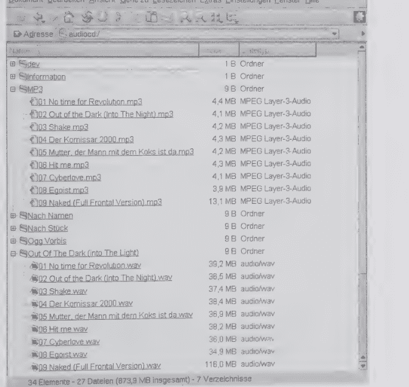

图 16.5：使用 `konqueror` 抓轨 CD


## 电视、视频、广播和网络摄像头

本章介绍在 Linux 中观看电视、收听广播以及访问网络摄像头的应用程序。由于本节中描述的并非所有应用程序都包含在 YaST2 的基础安装中，请使用 YaST2 手动安装它们。

- 所需软件包 . . . . . . . . . . . . . . . . . . . . . . . 248
- 使用 `motv` 观看电视 . . . . . . . . . . . . . . . . . . . . . 248
- 使用 `alevt` 查看视频文本 . . . . . . . . . . . . . . . . . . . 250
- 网络摄像头与 `motv` . . . . . . . . . . . . . . . . . . . . . . . . 250
- 使用 `kradio` 收听广播 . . . . . . . . . . . . . . . . . . . . . 251

### 所需软件包

| 软件包 | 系列 | 描述 |
| :--- | :--- | :--- |
| `motv` | `xap` | 具有 OpenMotif 界面的电视应用程序 |
| `xawtv` | `xap` | 具有 Athena 界面的电视应用程序 |
| `alevt` | `gra` | 视频文本解码器 |
| `nxtvepg` | `xap` | 您的 PC 电视杂志 |
| `kradio` | `kde` | 广播应用程序 |
| `bttv` | `doc` | bttv 模块文档 |

电视卡的配置已集成在配置工具 YaST2 中。如果您的显卡被正确识别，则可以自动配置。否则，请手动输入显卡设置。

以下章节重点介绍由 BTTV 驱动程序作者创建的 `motv` 应用程序。另一个电视应用程序是 `KWinTV`。如果您更喜欢 `KWinTV`，在阅读本章后应该很容易上手。

#### 使用 `motv` 观看电视

`motv` 是 `xawtv` 的改进继承者。它将所有基本功能集成到了用户界面中。通过“SuSE” $\rightarrow$ “Multimedia” $\rightarrow$ “Video”启动该应用程序。在命令行中使用 `motv` 启动。最初，应用程序启动后仅出现一个电视窗口。右键单击该窗口可打开菜单窗口。

##### 视频源和网络搜索

在“Settings” $\rightarrow$ “Input”菜单中，选择视频源。如果您在此选择“Television”，请在启动应用程序之前设置广播网络。这可以通过在“Settings”菜单下找到的网络搜索自动完成。如果您点击“Save settings”，找到的网络将被输入到您主目录下的 `.xawtv` 文件中，并在下次启动应用程序时可用。

> **提示**
>
> 如果您不想浏览所有可用频道，可以使用 `Ctrl` + $\uparrow$ 查找下一个频道。如有需要，随后使用 $\leftarrow$ 或 $\rightarrow$ 调整广播频率。

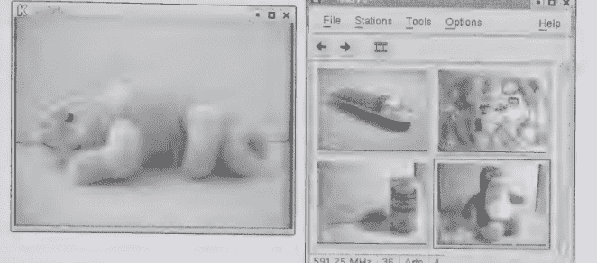

图 17.1：电视应用程序 `motv`

##### 从默片到有声电影

电视卡的音频输出连接到声卡的线路输入、扬声器或放大器。在某些电视卡的情况下，可以更改音频输出的音量。如果您选择“Settings” $\rightarrow$ “Slider”，在出现的滑块中设置音量。在这里还可以找到亮度、对比度和色彩的滑块。

若要使用声卡进行音频播放，请使用 `gnmixing` 检查混音器设置。对于符合 AC97 规范的声卡，将“Input-MUX”设置为“Line”。然后可以使用“Master”和“Line”滑块调节音量。

##### 屏幕比例和全屏模式

大多数电视图像的高宽比为 4:3。通过“Tools” $\rightarrow$ “Screen Dimensions”设置这些比例。如果此处选择了“4:3”（这是默认设置），即使更改显示大小，屏幕尺寸也会自动保持。

通过 $\textcircled{F}$ 或“Tools” $\rightarrow$ “Fullscreen”切换到全屏模式。如果全屏模式下的电视图像没有缩放到整个显示器大小，则需要进行一些微调。许多显卡可以在不更改图形模式的情况下将全屏模式的电视图像缩放到整个显示器大小。如果您的显卡不支持此功能，则全屏模式需要将图形模式切换到 640x480 像素。在“Settings” $\rightarrow$ “Configuration”中创建相关配置。重启 `motv` 后，如果您切换到全屏模式，显示器模式也会随之更改。

> **提示**
>
> `.xawtv` 文件在点击“Settings” $\rightarrow$ “Save settings”时自动创建并更新。在这里，广播者将与配置一起保存。关于配置文件的更多信息可以在 `xawtvrc` 的主页中找到。

##### 启动菜单

使用启动菜单启动其他可与 `motv` 配合使用的应用程序。例如，使用键盘快捷键启动音频混音器 `gamix` 和视频文本应用程序 `alevt`。要从 `motv` 启动的应用程序必须输入在 `.xawtv` 文件中。条目应如下所示：

```ini
[launch]
Gamix = Ctrl+G, gamix
AleVT = Ctrl+A, alevt
```

在应用程序名称之后，应依次跟随快捷键和用于启动应用程序的命令。通过“Tool”菜单启动在 `[launch]` 下输入的应用程序。

#### 使用 `alevt` 查看视频文本

使用 `alevt` 浏览视频文本页面。可以通过“SuSE” $\rightarrow$ “Multimedia” $\rightarrow$ “Video” $\rightarrow$ “alevt”启动，或在命令行中使用 `alevt` 启动。该应用程序保存了刚才用 `motv` 激活的广播网络的所有页面。通过输入要查看的页码或用鼠标单击页码来浏览这些站点。通过单击位于窗口下边缘的“$\lt$”或“$\gt$”在页面之间前后移动。

#### 网络摄像头与 `motv`

如果您的网络摄像头已被 Linux 支持，可以使用 `motv` 访问。在 `http://www.linux-usb.org` 可以找到支持的 USB 设备摘要。

如果您在访问网络摄像头之前已经使用 `motv` 访问过电视卡，则 `bttv` 驱动程序已被加载。当您的网络摄像头连接到 USB 时，网络摄像头驱动程序会自动加载。在命令行中使用参数 `-c /dev/video1` 启动 `motv` 以访问网络摄像头。使用 `motv -c /dev/video0` 访问电视卡。

> **注意**
>
> 在 `bttv` 驱动程序自动加载（通常发生在您调用电视应用程序时）之前将网络摄像头连接到 USB，`/dev/video0` 将被预留给网络摄像头。在这种情况下，如果您使用 `-c /dev/video1` 参数启动 `motv` 来访问电视卡，可能会收到错误消息，因为 `bttv` 驱动程序不会自动加载。解决此问题的方法是以 `root` 用户身份使用 `modprobe bttv` 单独加载驱动程序。可以使用 `motv -hwscan` 查看系统中可配置视频设备的概览。

#### 使用 `kradio` 收听广播

`kradio` 应用程序可以在“SuSE” $\rightarrow$ “Multimedia”菜单中找到。要开始频道搜索，请单击双箭头按钮。使用单箭头按钮以 50 kHz 为间隔更改频率。通过右键单击六个广播网络按钮并输入网络名称来启用它们。这将与刚才设置的频率一起保存到 `~/.kde2/share/config/kradiorc` 文件中。

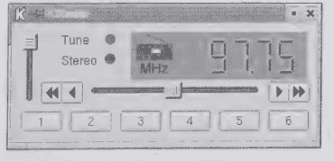

图 17.2：广播应用程序 `kradio`

并非所有电视卡都能更改音量。如果您已将电视卡的音频输出连接到声卡的线路输入（line in），请使用混音器 `gamix` 设置音量。

## `K3b` — KDE 刻录软件

`K3b` 是一款功能非常全面的数据光盘和音频 CD 刻录程序。除了常规功能外，该程序还提供了一些额外的选项以方便工作，尤其是在多媒体领域。在 KDE 或 SuSE 菜单中，通过“多媒体” $\rightarrow$ “CD”访问该程序。以下章节介绍了程序的主要功能。

- 首次启动 . . . . . . . . . . . . . . . . . . . . . . . . . . . . . 254
- 创建数据 CD . . . . . . . . . . . . . . . . . . . . . . . . . . . . . 254
- 刻录 CD . . . . . . . . . . . . . . . . . . . . . . . . . . . . . . . . . . 255
- 创建音频 CD . . . . . . . . . . . . . . . . . . . . . . . . . . . . . . . 255
- 复制 CD . . . . . . . . . . . . . . . . . . . . . . . . . . . . . . . . . . . 256
- 获取更多信息 . . . . . . . . . . . . . . . . . . . . . . . . . . . . . . 256

### 首次启动

在程序首次启动后，会出现 `K3b` 设置助手。设置该程序需要 `root` 权限，因此请输入 `root` 密码。按照设置助手的步骤操作，它通常会自动完成所有设置。在设置助手的第四点中，您可以手动分配挂载点以及 `/etc/fstab` 文件中的条目。如果您对该文件一无所知，请不要修改任何内容。在第五步中，定义有权创建自己 CD 的用户。请输入至少一个用户。第六步完成设置。现在程序已准备就绪，可以使用。

### 创建数据 CD

创建数据 CD 非常简单。选择“文件” $\rightarrow$ “新建项目” $\rightarrow$ “新建数据项目”。如图 18.1 所示，左下角会出现一个显示新数据项目文件夹的选项卡。将所需的目录或单个文件拖放到项目文件夹中。从工具栏选择“刻录”。随后会出现一个对话框，其中包含四个选项卡，提供各种刻录 CD 的选项（见第 256 页的图 18.2）。


图 18.1：创建新的数据 CD

### 刻录 CD

检测到的刻录机显示在刻录对话框的“设备”下。在“刻录速度”中设置刻录速度。这里提供以下选项：

- “模拟刻录” — 此功能可用于检查您的系统是否能跟上当前刻录速度的要求。刻录是在激光器关闭的情况下进行的，以测试系统。
- “即时刻录 (Writing on the fly)” — 直接刻录所需数据，而无需先创建镜像文件。如果您的计算机系统性能有限，请不要使用此功能。

> **注意**
>
> 镜像文件（也称为 ISO 镜像）是一个包含整个 CD 内容的文件，随后将原封不动地刻录到 CD 中。

- “仅创建镜像” — 最初仅写入镜像文件。您可以以后将其刻录到 CD 中。为此，请使用“工具” $\rightarrow$ “写入 ISO 镜像”。
- “删除镜像” — CD 刻录完成后删除镜像文件。
- “一次刻录 (Disc at once)” — CD 将不间断地刻录。这推荐用于音频 CD（见下文）。
- 使用 BURN-PROOF — 如果您的刻录机支持此功能，请激活它以防止数据流中断。如果不支持此功能，该按钮将处于禁用状态。

在“设置”选项卡下，输入关于 CD 的信息，例如名称。不过，这是可选的。“多会话 (Multisession)”显示了几个关于刻录包含多个数据或音频轨道的 CD 的可选请求。“高级”选项卡用于文件名约定。为了实现高水平的兼容性，请确保勾选了“生成 Joliet 条目”。

### 创建音频 CD

基本上，创建音频 CD 与创建数据 CD 之间没有显著区别。选择“文件” $\rightarrow$ “新建音频项目”。通过拖放将单个音频轨道复制到项目文件夹中。音频数据必须为 MP3、WAV 或 Ogg Vorbis 格式。通过拖放移动项目文件夹中的轨道来设置轨道的顺序。


图 18.2：使用 `K3b` 刻录 CD


刻录对话框与刻录数据 CD 的对话框没有太大区别。但是，`DiscAtOnce` 选项，或者在未激活该选项时的 `TrackAtOnce` 模式具有更大的重要性。`TrackAtOnce` 模式会在每条轨道后插入两秒钟的静默间隔。

## 复制 CD

从工具栏选择“复制 CD”。在随后的对话框中，为读取和刻录设备进行设置（见对面页的图 18.3）。上述选项在此同样可用。一个附加功能允许您创建多个 CD 副本。

## 获取更多信息

除了上述两个主要功能外，K3b 还提供其他此处未描述的功能。这包括创建 DVD 副本、读取 WAV 格式的音频数据、重写 CD 或集成音频播放器。关于所有可用程序功能的详细描述可在 `/usr/share/doc/packages/k3b/README` 中找到。


图 18.3：使用 K3b 复制 CD

# 数字相机与 Linux

目前，广泛的数字相机可以在 Linux 上使用。支持这些设备的最优秀程序之一是 `gphoto2`。gPhoto 2.0 是一个命令行程序，被称为“后端库”。它与多个图形界面（“前端”）兼容，包括 `gtKam`、`Konqueror`、`Kamera` 和 `GnoCam`。本章将讨论 `gtKam` 和 `Konqueror` 的使用。

- 连接相机 . . . . . . . . . . . . . . . . . . . . . . . . . . . . 260
- 安装与准备 . . . . . . . . . . . . . . . . . . . . . . . . . . . 260
- 使用 Konqueror . . . . . . . . . . . . . . . . . . . . . . . . 260
- 使用 gtKam . . . . . . . . . . . . . . . . . . . . . . . . . . . 261
- 获取更多信息 . . . . . . . . . . . . . . . . . . . . . . . . . . 262

> **提示**
>
> 支持的相机完整列表可在 `http://www.gphoto.org/cameras.html` 获取。如果安装了 `gphoto2`，可以使用命令 `gphoto2 --list-cameras` 获取列表。
>
> `gphoto2 --help` 提供关于命令行界面中可用命令的信息。

## 连接相机

数字相机与计算机之间最快、最方便的连接方式是 USB。这要求相机和计算机都支持 USB。只要您的计算机有 USB 端口，默认的 SuSE 内核就提供此支持。此外还需要一根合适的连接线。

> **注意**
>
> 使用 USB 连接会迅速耗尽相机的电量。请考虑使用电源适配器。

使用方法很简单，只需将相机连接到 USB 端口，然后打开相机电源。

## 安装与准备

使用 YaST2 安装 `gtkam` 软件包。其他所需的软件包将被自动选择。有关使用 YaST2 安装软件包的更多信息，请参阅第 48 页的 *安装/删除软件*。

## 使用 Konqueror

对于 KDE 用户，通过 `Konqueror` 访问数字相机可提供熟悉的界面和便捷的访问。将相机连接到 USB 端口。桌面上应该会出现一个相机图标。双击此图标即可在 `Konqueror` 中打开相机。也可以在 `Konqueror` 中输入 URL `camera:/` 来访问相机。在相机的目录结构中浏览，直到显示文件。使用常规的 `Konqueror` 文件管理功能按需复制文件。有关使用 `Konqueror` 的更多信息，请参阅第 191 页的 *Konqueror — KDE 文件管理器和 Web 浏览器*。

## 使用 gtKam

`gtKam` 与所有窗口管理器兼容。它是一个快速且简单的图形界面，用于从数字相机下载和删除照片。要调整或编辑您的照片，请使用 The GIMP，具体描述见第 275 页的 *使用 The GIMP 进行图形处理*。


图 19.1：gtKam 的主窗口

将相机连接到相应的端口并将其打开。使用命令 `gtkam &` 启动 `gtKam`。从菜单中选择“相机” $\rightarrow$ “选择相机...”。在对话框中，选择相机型号或使用“检测”。如果未检测到，请选择相应的端口。

`gtKam` 的主窗口分为三个部分 —— 菜单和工具栏、带有索引设置以及相机和目录选择的左侧窗格，以及用于显示带或不带缩略图的索引列表的右侧窗格。工具栏中的图标提供了所需的主要功能。磁盘图标保存选定的图像。垃圾桶图标删除它们。带有箭头的图标重新加载右侧窗格中显示的图像索引。带有纸张和铅笔的图标打开相机配置选项。门图标退出程序。

您的相机应该列在左侧窗格中。使用左侧的加号（`+`）展开目录结构的树状显示。您的具体目录结构取决于相机的品牌和型号。继续展开，直到您到达无法展开的条目。这些就是实际照片的索引列表。点击某个项目即可选中。如果激活了“查看缩略图”，右侧窗格中将显示图片名称和缩略图。否则，将显示名称和图标。

右侧窗格中的图像可以通过点击来选择或取消选择。使用“选择” $\rightarrow$ “全部”或 $\boxed{Ctrl}$ + $\boxed{A}$ 选中所有图像。使用工具栏中的磁盘图标、“文件” $\rightarrow$ “保存选定照片...”或 $\boxed{Ctrl}$ + $\boxed{S}$ 来保存选定的图像。如图 19.2（在对面页面）所示的“保存”对话框包含若干选项。在“保存内容”下，选择保存缩略图、图像或两者都保存。通过“使用...打开图像”，您可以在保存图像的同时将其在另一个程序中打开。要立即在 The GIMP 中打开图像，请输入 `gimp`。建议使用相机提供的文件名。

### 更多信息

有关在 Linux 中使用数字相机的更多信息，请参考以下网站。

- `http://www.gphoto.org` — 关于 gPhoto、gPhoto2 以及兼容 gPhoto2 的 GUI 的信息
- `http://www.thecompany.com/projects/gphoto/` — 关于 Kamera（gPhoto2 的 KDE 前端）的信息
- `http://www.stud.uni-karlsruhe.de/~urc8/GnoCam/` — GnoCam 信息


图 19.2：保存图像

# Kooka — 扫描应用程序

`Kooka` 是一款图形化扫描应用程序，它结合了操作 `xscanimage` 的简单性和 XSane 的功能广度，并融入了 KDE 应用程序中常见的便捷且用户友好的操作方式。`Kooka` 是一个集成了 SANE 系统库的 KDE 应用程序。要使用 `Kooka`，必须安装 SANE 软件包。本章分为两部分。第一部分包括对 `Kooka` 应用程序的简短描述。第二部分概述了一些通用扫描技巧。

| 主题 | 页码 |
| :--- | :--- |
| 开始窗口 | 266 |
| 预览 | 266 |
| 最终扫描 | 267 |
| 菜单 | 268 |
| 保存 | 269 |
| 使用 gocr 进行字符识别 | 270 |
| 一些扫描技巧 | 271 |
| 更多信息 | 274 |

网站 `http://www.mostang.com/sane` 提供了关于 Linux 支持哪些扫描仪及其驱动程序开发状态的信息。如果可能，请在购买扫描仪之前查看此信息。

## 开始窗口

在控制台中使用命令 `kooka` 启动 `Kooka`。如果需要，可以在 KDE 桌面上创建该应用程序的快捷方式。`Kooka` 启动时，首先会打开一个带有菜单栏和工具栏的双框架窗口。您可以选择地包含一个显示图像目录缩略图的额外窗口。根据需要使用鼠标放大或缩小窗口。如果需要，可以将某个单独的窗口完全从 `Kooka` 窗口中分离，并将其移动到桌面上您选择的位置。要移动窗口，请点击相应窗口上方的细双线并用鼠标拖动。您可以将所有窗口（主窗口除外）放置在任何其他窗口的左侧、右侧、顶部、底部或中心。当放置在中心时，两个窗口具有相同的大小，相互叠加，并可以通过标签页将其带到前台。

通过标签页在用户界面两个框架的各种窗口之间进行切换。图像目录视图（画廊）是一个小型文件浏览器，方便您存储扫描的图像。

使用窗口中与扫描仪相关的部分来修改某些特定于扫描仪的设置。在底部，可以看到用于生成预览和启动最终扫描的两个按钮。扫描的图像出现在右侧的大窗口（“图像”）中，这是唯一不能移动的窗口。

## 预览

为了便于理解，本节假设画廊和预览窗口位于左上角，扫描仪设置位于左下角。图像查看器和缩略图视图位于右侧。

在左上角，可以看到预览窗口，以及旁边的尺寸和方向设置。按下“预览扫描”（左下角）后，扫描仪中的图像将进行测试扫描并显示在预览窗口中。此次预览扫描不会生成文件。“最终扫描”将激活实际的扫描过程以创建文件，但请在完成适当设置后再使用。

在左上部分的文档尺寸和方向信息下，可以找到有关图像尺寸和内存要求的信息。使用预览窗口来定义扫描范围并调整伽马值、亮度和对比度。请不要认为打印件将与预览显示完全一致。正确调整显示器、扫描仪和打印机是一个复杂的过程。

### 扫描预览

在扫描预览之前，请在包含扫描仪设置的窗口（在本例中为左下角）中设置生成预览的模式。“彩色”和“灰度”不言而喻。“二值”意味着仅使用黑白，没有任何灰度。只有在仅涉及纯文本或黑白图形时，此选项对于预览才有意义。如果您是为了进行文本识别而对图像或文本进行最终扫描，则必须使用此选项（见本页的“最终扫描”）。下方窗口中的分辨率和其他设置尤其会影响最终扫描。

如果选择了“预览”，也可以在左上部分定义扫描尺寸和方向。尺寸以 mm 以及 KB 或 MB 为单位在下方给出。如果您将扫描尺寸选择为“用户定义”，则无法选择方向。在预览扫描后，标记显示窗口以定义要扫描的区域。这通常是最合理的方式。所有设置调整完毕后，按下“预览扫描”以扫描图像预览。随后图像的缩略图将出现在预览窗口中。

## 最终扫描

如果您为扫描尺寸选择了“用户定义”，请使用鼠标突出显示要扫描的矩形区域。选定区域将用虚线边框标记。选择扫描模式和分辨率。您将看到更多选项，如伽马值、对比度和亮度。这些选项由扫描仪型号本身指定。配置完所有设置后，点击“最终扫描”以扫描实际图像。

选择创建图像的格式。若要以后在无需确认的情况下以相同格式进行扫描，请勾选“不再询问”然后点击“确定”。您可以在“设置” $\rightarrow$ “配置 Kooka” $\rightarrow$ “图像保存”下重新配置此项。

图像将全尺寸显示在右侧的图像窗口中。显示的尺寸根据所选的扫描区域和分辨率而有所不同。如果您选择了较高的分辨率，可能只能看到右侧显示的部分图像。在右侧窗口中，可根据您的喜好缩放显示区域。

## 菜单

工具栏功能可以在“文件”和“图像”菜单下找到。在“设置” $\rightarrow$ “配置 Kooka”下修改 `Kooka` 设置。在“工具视图”下，可以显示或隐藏各个窗口。

在“文件”下，可以找到打开打印向导的“打印...”和“退出”。“在图形应用程序中打开图像”选项位于“图像”下。以下是这些菜单项的描述。

- **在图形应用程序中打开图像**

  使用文件浏览器或命令行选择一个应用程序来查看扫描的图像。GIMP 对此非常有用，但它不包含在默认安装中。

- **字符识别 (OCR) 图像...**

  打开光学字符识别 (OCR) 窗口。如果您安装了 `gocr`，该应用程序应位于 `/usr/bin/gocr`。该应用程序允许您对预览图像或预览图像中突出显示的选区启动字符识别。

- **对选区进行 OCR...**

  仅为在最终扫描中已标记的区域打开字符识别窗口（见 *使用 gocr 进行字符识别* 节）。

- **缩放到宽度**

  使用此选项将主图像显示区域中的图像缩放以适应窗口宽度。

- **缩放到高度**

  将图像缩放至图像显示区域的全高。

- **原始尺寸**

  将显示中的图像重置为原始扫描尺寸。

> **注意**
>
> 通过右键点击图像，可以获得更多缩放图像显示的方式。选项包括之前提到的三种选项，以及根据您自己的规格放大图像的选项。您也可以在预览窗口中执行相同的操作。

### 从选择区域创建

如果您没有准确地选择图像区域，可以使用此工具通过在右侧的大图显示区域进行标记，然后点击此选项来永久裁剪图像。结果见右侧。如果您使用过 The GIMP 中的裁剪工具，可能已经熟悉此功能。

### 垂直镜像图像

将图像进行垂直翻转。

### 水平镜像图像

将图像进行水平翻转。

### 双向镜像图像

同时将图像进行水平和垂直翻转。

### 顺时针旋转图像

将图像顺时针旋转九十度。

### 逆时针旋转图像

将图像逆时针旋转九十度。

### 旋转 180 度

将图像旋转 180 度。

### 保存

在 `Kooka` 中保存图像的方法与您习惯的方法有所不同。点击左上角窗口的“Gallery”选项卡后，会看到一个显示 `~/.kde/share/apps/ScanImages/` 目录的小文件浏览器。

这里是所有扫描图像最初保存为文件的地方。当您首次启动 `Kooka` 时，`ScanImages` 是唯一存在的目录。可以通过右键点击此主文件夹来创建子文件夹。所选文件夹（以蓝色高亮显示）是扫描图像保存的首选位置。图像将被命名为 `kscan_0001`、`kscan_0002` 等，并分配连续的编号。

要保存图像，请点击名称。然后，为其起一个新名称并分配正确的文件后缀——即扫描图像时的格式。如果您指定了错误的后缀，会收到一条错误消息，通知您该后缀与图像扫描时的格式不符。目前 `Kooka` 不支持“即时”转换。

如果您不想在 `~/.kde/share/apps/ScanImages/` 下管理图像，可以将图像保存到另一个位置。为此，请右键点击图像并选择“Save”。然后输入路径。

您也可以在此关闭或永久删除图像。使用 `Konqueror` 的拖放功能将外部图像添加到画廊中。启动 `Konqueror`（KDE 栏中的地球图标），转到包含要添加到画廊的图像的目录，然后只需用鼠标将它们拖动并释放到 `Kooka` 的画廊目录中即可。

### 使用 gocr 进行字符识别

执行此操作必须安装 `gocr`。使用灰度或彩色模式扫描文档的预览图。您也可以使用二值模式扫描。在预览窗口中，标记要识别的文本区域。在最终扫描时选择二值模式，然后点击“Final Scan”进行扫描。

点击工具栏中从左起第二个图标“Character recognition image...”，或从“Image”菜单中选择此菜单项。在打开的 OCR 窗口中，至少在第一次试运行期间保持默认设置不变（见对面页的图 20.1）。这些设置符合大多数用户的需求。现在点击“Start character recognition”。一个像第 272 页图 20.2 那样的窗口将显示字符识别的结果。质量在很大程度上取决于文档本身。点击“Open in Kate”打开文本。

如果您在二值模式最终扫描后只想提交部分文本或图像，请在右侧的图像显示区域标记您的选择。然后点击工具栏中从右起第三个按钮，或选择“Image” $\rightarrow$ “Character recognition on selection”。按照前一段所述步骤操作。


图 20.1：gocr 窗口

## 一些扫描技巧

虽然 `Kooka` 非常易于使用，但扫描可能非常复杂，尤其是对于具有众多设置选项的扫描仪，或者在使用质量较差的文档副本时。作为初学者，请做好进行一些实验的准备，直到结果令您满意。请记住：获得一张完美的彩色照片打印件需要时间和练习。

### 硬件

您的扫描设备和 PC 可能与专业平面设计机构的设备相差甚远。不幸的是，价格也是决定这些设备性能的一个因素。

成功的便捷扫描需要良好的硬件。36 位扫描仪比 24 位扫描仪提供更丰富的色彩和灰度。Linux 中的 SANE 支持 SCSI 扫描仪，以及近年来越来越多地支持 USB 扫描仪。由于整体质量更好，建议购买 SCSI 设备。一些公司也提供并行端口扫描仪的 Linux 驱动程序。然而，我们无法对其质量和功能提供信息。对于 SCSI 扫描仪，您可能需要一块基础的 SCSI 卡，因为扫描仪自带的卡仅提供最基本的功能。

如果您考虑购买扫描仪，请查看 SANE 项目的互联网页面。在选择扫描仪时，请考虑可用驱动程序的开发阶段。YaST2 通过即插即用简化了 USB 扫描仪的配置。


图 20.2：字符识别结果

大尺寸图像（无论是处理过的还是原始格式）在某些情况下可能需要大量的内存空间。因此，您的计算机应至少拥有 64 MB RAM，最好是 128 MB 或更多。CPU 越快，数据处理速度就越快。不过，您不需要高端设备。对于家庭使用，中端设备就足够了。为了在桌面上充分显示图像，您还需要一块能够在高分辨率下描绘正确色彩深度的显卡。

### 分辨率

> **注意**
>
> 打印机分辨率通常以 dpi（“每英寸点数”）表示，打印机的半色调分辨率以 lpi（“每英寸线数”）表示，而扫描仪分辨率以 ppi（“每英寸像素”）表示。

75 到 100 ppi 的扫描分辨率足以扫描一张简单的照片并在桌面上查看。桌面通常具有 75 dpi 的默认分辨率。更高的扫描 ppi 值只会占用更多存储空间，而不会增强屏幕显示效果。

如果您还不确定以后如何使用图像，或者只是想创建一个图像文件，请以 150 ppi 的分辨率扫描。更高的分辨率通常会导致巨大的内存消耗。当然，有时您可能想以更高的分辨率扫描图像的一部分，但这对于普通照片是不需要的。大多数图形应用程序可以在需要时保存较低分辨率的图像。


若要以 1:1 的比例扫描图像进行打印，通常建议将扫描分辨率设置为打印机分辨率的 1.6–2 倍。普通的激光打印机通常产生 75 lpi。如果您拥有这种类型的打印机，根据此倍数，您应该将扫描分辨率设置为 120 到 150 dpi。为了生成在互联网上显示的图像，75 dpi 的默认分辨率就足够了。

如果您想使用打印机放大图片，则需要极高的 dpi 设置。在进行放大时，扫描分辨率应乘以放大倍数。这样做，您将很快接近插值分辨率范围。以上述为例，5 倍放大需要 750 ppi 或更高的设置。由于扫描仪通常无法达到如此高的物理 dpi 值，这些值是由软件计算得出的。

#### 调整亮度和对比度

请记住，桌面显示并不一定反映实际的打印结果，而只是一个近似值。通常建议为黑白或彩色打印设置略高的亮度和对比度值。除非您想直接打印扫描的图像，否则在扫描时无需指定这些值。否则，请稍后在 The GIMP 中进行这些设置。

#### 图像中的异常图案

在扫描印刷文档（书籍、杂志、报纸）时，组成图像的单个像素可能会产生“摩尔纹（Moiré pattern）”。Kooka 无法消除这种图案。在 The GIMP 中，可以在“Filter” → “Enhance” → “Despeckle”下找到用于去除摩尔纹的滤镜。它的作用是以牺牲一定的清晰度为代价。

> **提示**
>
> 如果您的扫描结果出现了重复图案，请尝试将文档旋转五到十度然后重新扫描。稍后在 The GIMP 中将图像恢复到原始方向。通常，这比使用增强滤镜去除杂点效果更好。

#### 更多信息

有关 kooka 的更多信息可在 KDE 页面 `http://kooka.kde.org` 上找到。

## 使用 GIMP 处理图形

GIMP（GNU Image Manipulation Program）是一款功能极其强大的像素图形处理程序。在对照片和其他图像文件进行修饰或修改时，GIMP 是首选。一旦您足够熟悉该程序，您甚至能够从零开始创建完整的图像。然而，普通用户并不需要 GIMP 所有的强大功能。它甚至可以用于自由绘画。所有的工具，如画笔、铅笔或喷枪，均可使用（见下一页的图 21.1）。经常使用这些功能的用户绝对应该考虑购置一块图形平板电脑。

- 图像处理与图形格式……277
- 使用 GIMP……278
- 在 GIMP 中工作……285
- 图像处理入门……291
- 更多信息……294

图 21.1：GIMP 工具箱——默认窗口

考虑到 GIMP 的强大功能和性能，以及商业“专业”图形软件的价格，人们很快就会发现 GNU Image Manipulation Program 是 Linux 社区的一份惊人礼物。与许多 Linux 程序一样，GIMP 处于不断的开发之中。

本简介无法涵盖其全部功能。“GIMP 官方手册”长达 924 页，可通过互联网 `http://manual.gimp.org` 获取。遗憾的是，其中的一些描述和插图已经过时，因为自手册编写以来，GIMP 经历了广泛的开发。仍在开发中的内部帮助系统也能为新用户提供宝贵的帮助。

> **注意**
>
> 本发行版中包含并在本手册中讨论的版本是稳定 1.2 系列的最新发布版。不稳定的 GIMP 1.3 系列并非面向普通用户，而仅面向参与 GIMP 本身开发的人员。

### 图像处理与图形格式

#### 像素图像

GIMP 旨在处理像素图形。这些图像由彩色小块组成，共同构成了整个图像。在分辨率为 800 × 600 的显示器上的全屏图像恰好具有该数量的像素，即包含 480,000 个独立像素。考虑到这一点，图像文件通常体积庞大也就不足为奇了。除了每个像素的坐标外，还存储了颜色信息。对于一张 800 × 600 像素的图像，很容易产生超过 1 MB 的数据。因此，从一开始，人们就在开发压缩程序上投入了更多的时间、金钱和精力，以压缩信息量。一些常见的像素图像图形文件格式包括：

- **XCF**：GIMP 的原生格式。它支持稍后讨论的分层技术和其他特定的 GIMP 功能。如果您使用 GIMP 特有设置创建图像并将其保存为不同的文件格式，信息将会丢失。
- **BMP**：Microsoft Windows 使用的一种无压缩格式。该格式的优点是图形加载和保存速度非常快，但这一优点被巨大的文件体积所抵消。
- **GIF**：“图形交换格式（Graphics Interchange Format）”专为互联网数据传输而开发，并具有支持此功能的特殊特性。由于许可原因，许多程序不再支持此格式。GIF 的一个特殊功能是动画 GIF，这是一个存储了多张图像的 GIF 文件。在互联网浏览器中，这些独立图像会迅速地依次显示，从而产生动态图像的印象。尽管有局限性，GIF 之所以流行主要是因为它支持透明度。
- **PNG**：“便携式网络图形（Portable Network Graphics）”是 GIF 格式的流行替代品。它可以在不丢失信息的情况下生成相同质量的压缩文件，且可免费使用。它支持更好的透明度形式，但尚未被所有互联网浏览器完全支持。
- **PSD**：此格式由专业软件 Adobe Photoshop 使用，支持多图层技术。
- **TIFF**：“标签图像文件格式（Tagged Image File Format）”是专业领域另一种保存文件的方法。它在印刷业中尤为流行。
- **JPEG**：“联合图像专家组（Joint Photographic Experts Group）”的压缩方法允许高效地减小图像文件体积。根据压缩因子的不同，图像信息会发生丢失。尽管如此，它仍是互联网图像的理想文件格式。

> **提示**
>
> 务必保存您创建图像的 XCF 版本。这将使未来的修改变得更加容易。

#### 矢量图形

与像素图形不同，矢量图形不存储所有单个像素的信息。相反，它们存储关于图像点、线或区域如何组合在一起的信息。一条水平横跨屏幕、代表总共 800 个像素的线，仅需要四个信息单位：起点的坐标、终点的坐标、这两个点由直线连接的信息，以及可能的线条颜色。通过四个坐标和连接它们的四条线，您可以轻松创建一个矩形。这个矩形被填充为特定颜色这一事实，基本上只需要再增加一个信息单位。通过这种方式，即使是复杂的图像也可以用相对较少的基础信息来表示。例如，OpenOffice.org 的绘图应用程序就使用这种格式。

### 使用 GIMP

#### 启动 GIMP

默认情况下，GIMP 包含在 SuSE Linux 的标准安装中。通过“SuSE”→“Multimedia”→“Graphics”→“GIMP”启动 GIMP，或者在命令行中输入 `gimp`。当 GIMP 首次为用户启动时，会执行一些安装后的操作。在打开的对话框底部的左侧按钮是“安装”按钮。点击此按钮，然后在随后的对话框中点击“继续”。随后 GIMP 将被正确安装并设置。

由于首次启动时需要加载许多文件，GIMP 需要一些时间来加载。默认情况下，每次启动后都会显示一个显示“每日提示”的窗口。如果需要，可以通过取消勾选左侧的“下次显示提示”框来禁用它。

#### 工具箱

起初，GIMP 在屏幕上的出现相当朴实。它打开一个包含工具箱的相对较小的窗口。该窗口的按钮是进行强大图像操作所需的主要功能。以下是对图标及其功能的描述。

GIMP 工具箱窗口可分为三个部分：包含“文件”、“插件”（Xtns）和“帮助”菜单的菜单栏；工具图标；颜色、图案和画笔选择图标。

#### 菜单栏

菜单栏见第 276 页的图 21.1。使用“文件”菜单来创建新的图形文件、通过文件管理器加载现有图像、创建屏幕截图（屏幕截图是屏幕部分区域的图像）、设置基本选项以及访问最近处理的文件。“插件”菜单下的主要项目包括模块、插件（链接到 GIMP 中用于实现特定图形功能的附加程序）、脚本以及 GIMP 网页。“帮助”菜单包含访问帮助信息的多种方式。

#### 工具图标

工具箱中的每个图形代表一个特定的功能。工具箱的宽度和高度都可以调整。总的来说，可以将功能分为三个或四个区域。

#### 选择工具

在图像处理中，您可能希望处理整个图像或仅处理其特定部分。GIMP 需要知道随后的操作应应用于哪个区域。多个选择工具将帮助定义特定区域。一旦做出选择，就可以对其进行处理而不影响图像的其他部分。在 `Shift`（叠加选择）和 `Ctrl`（减法选择）的帮助下，可以增加或减小选择区域的大小。光标会变为加号或减号以示区分。

#### 变换工具

这些功能用于修改选择区域。可用的功能很多，包括裁剪、翻转和变换。

#### 绘画工具

绘画工具代表了铅笔、画笔、喷枪、钢笔和手指（涂抹），旨在模拟它们在真实世界中的属性。

可与这三个区域归为一类的第四个功能区可能包括颜色、填充和画笔选项，用于指定绘画颜色或绘画工具的笔尖。

> **提示**
>
> 单击工具图标即可激活该工具。双击则会打开一个额外的窗口，其中包含该特定工具的选项设置。

#### 选择工具

- 矩形选择是最简单的选择工具。通过按住鼠标左键并同时拖动鼠标，可以标记一个矩形区域。当你松开鼠标按钮时，一个边框将指示所选区域。如果你在开始绘制选择后按下 `Shift` 键，则只能选择正方形。
- 此工具的工作方式与矩形选择类似，不同之处在于它选择的是圆形或椭圆形区域。其使用方法相同，但在开始选择后按下 `Shift` 键会将选择限制为正圆。
- 这是首个可用于照片的实用选择工具。套索允许自由手绘选择不规则形状。按下鼠标左键并根据需要跟随形状绘制。当你松开鼠标按钮时，起点和终点将由一条直线连接。由于精确选择较为困难，建议在放大图像的情况下进行操作。
- 魔棒模糊选择工具通过相邻像素的颜色相似度来选择图像区域。如果默认设置不合适，可以在选项框中更改阈值，或使用 `Shift` 键组合多次选择。魔棒是选择颜色相似的不规则区域的理想选择。
- 稍微花点功夫，贝塞尔曲线工具可以让你捕捉图像中的特定区域或对象。借助鼠标点击设置的锚点，绘制干净的曲线。这种技术的一个优点是你可以在控制点的帮助下更改选择。一旦你标记了所需区域，只需点击其内部即可完成选择。该工具需要一定的练习才能掌握，但对于更高级的工作来说非常有价值。使用此工具制作的选择也可以在“图层、通道和路径”对话框的“路径”选项卡中保存和操作。

当你点击时，智能剪刀会尝试沿着颜色或亮度边缘绘制选择。有时它的效果非常好。可以在选项框中修改设置。

#### 变换工具

当“移动”被激活时，可以使用鼠标抓取并移动你的选择区域。

放大镜并不是一个真正的变换工具，因为它仅对屏幕显示进行放大或缩小。图像本身没有改变。要使用缩小功能（将屏幕上的图像按一定百分比缩小），请在点击鼠标时按住 `Ctrl` 键。

若要真正放大图像，请在图像中右键点击打开上下文菜单，然后选择“图像”→“缩放图像”。在打开的对话框中，可以通过百分比或像素值更改图像的高度和宽度。

裁剪并调整图像大小。例如，为了让风景照具有美感，建议将天空分配图像高度的三分之一，将风景分配三分之二。使用鼠标点击并拖动以打开一个矩形。点击该矩形内部将裁剪掉周围区域。你可以随时通过 `Ctrl + Z` 立即撤销此操作。请花时间尝试这个工具。你还可以更改此矩形的大小。通过抓取并移动左上角或右下角来调整区域大小。整个矩形可以通过抓取并移动左下角或右上角来移动。

此图标隐藏了许多可能会让初学者困惑的功能。你可以先点击工具图标然后点击图像来处理整幅图像，或者先做一个选择然后点击工具图标来处理一部分。

共有四个功能可用：围绕任意旋转点旋转图像或选择区域、放大或缩小（缩放）、将矩形转换为梯形（倾斜）或扭曲区域的透视。默认设置为“旋转”。其他功能可以在双击工具图标打开的选项框中指定。


一个简单的工具，用于水平或垂直地翻转（镜像）所选区域。

一旦你借助变换工具修改了整个图像或选择区域，请将这个浮动选择重新连接到图像。在集成之前，你仍然可以修改变换的结果。将更改集成到图像中有几种可能的方式：使用锚定图层键盘快捷键（`Ctrl + H`），在图像中选择区域外的任意位置点击，或者选择并应用不同的选择工具。

#### 绘画工具

以下列表中的前几个工具与其他绘画工具略有不同。不过，它们被包含在本节中，是因为它们用于添加颜色或文本，而不是修改它们。GIMP 提供的主要绘画工具具有真实世界的特定属性，程序对其进行了模拟。设置适当的选项以模拟各种铅笔，或根据个人需求调整画笔。在绘画工具的选项框中，可以找到“不透明度”滑块。它用于设置所用颜色的不透明度。通过“模式”下拉框，指定绘画线条或平面应如何集成到图像中。根据工具的不同，不同的模式具有不同的效果。


T 代表文本输入。在 GIMP 中，文本输入有两种方式，并提供许多选项。双击工具以打开选项框。通过激活或停用“使用动态文本”按钮，选择带有对齐方式的多行文本输入或单行文本输入。在激活 T 工具的情况下点击图像，将打开相应的对话框，在该对话框中输入文本并选择字体、大小和其他参数。

> **注意**
>
> 如果你不将文本保存在单独的图层中，之后将无法修改它，因为它已以像素形式集成到你的图像中。更多信息请参阅第 289 页的*图层*章节。

GIMP 提供了一个相对简单的文本工具。许多文本效果（如阴影或渐变）理论上必须手动输入。但在实践中，“Script-Fu”和“滤镜”子菜单提供了许多自动修改程序，其中一部分是专门为文本设计而开发的。


颜色拾取器允许从图像中受控地选择一种颜色，并将其传输到颜色选择框中。当你使用颜色拾取工具点击图像中的特定颜色时，该颜色即被选中。通过它，你可以快速找到例如修饰照片所需的特定肤色。


使用油漆桶，可以用颜色填充选定区域。除了颜色，它还可以填充图案。在填充操作之前，激活“图案填充”。然后，选择区域内的所有内容都将按照选定的设置被覆盖。


此图标代表颜色或灰度渐变。GIMP 有几个预定义的渐变可用于填充选定区域。此工具相对复杂，需要一些练习，尤其是如果你想在图像上覆盖透明颜色渐变时。


铅笔是每位用户都熟悉的绘画工具。使用虚拟铅笔——就像使用真实铅笔一样——绘制自由线条。线条的类型（铅笔尖的宽度和形状）在画笔对话框中选择。可以通过双击工具箱右下角的画笔图标，或者选择“文件”→“对话框”→“画笔”。这里提供了一些在真实世界中并不存在的铅笔尖。你可以将铅笔尖设为特细或特粗，或者选择一种特殊形状。


画笔绘制出的效果比铅笔更柔软、更具流动感。在相应的选项框中，可以设置淡出（绘画时颜色强度缓慢降低）或渐变（通过渐变设置选项进行选择）。当激活淡出选项时，松开画笔并重新开始以涂抹更多颜色。


橡皮擦用于擦除。它也可以用来“反擦除”。画笔选择同样决定了橡皮擦的形状。

喷枪工具允许你像使用真实的喷枪一样进行工作。通过更改“压力（Pressure）”并使用多种不同的画笔设置来实现。该工具非常适合搭配压力感应图形平板电脑使用。

克隆工具（图标是一个橡胶印章）是照片修图的终极工具。它可用于指定图像的某些部分，然后将其克隆。在实际操作中，这意味着你可以非常精确地指定将图像的哪个部分复制到哪里以及以何种形式呈现。这与“剪切”和“粘贴”功能关系较小。它使用的是绘画功能，允许你设置想象中的橡胶印章的形状和不透明度。

例如，如果你有一张带有白色污点的旧照片，情况就会变得有趣。激活克隆工具，并在必要时打开其选项框。按住 `Shift` 键并点击图像中要用作副本的区域。然后松开鼠标按钮，将光标置于损坏的图像区域。如果你现在按下鼠标左键并移动鼠标，第一步标记的图像区域将被插入。当你向上移动鼠标时，被复制的区域也随之向上移动。该点由十字准星标记。根据画笔设置，可以复制小半径或大半径的区域；根据工具设置，复制可以以半透明或不透明的方式进行。在修饰照片时，你经常需要用到这个功能。例如，你可以消除扫描图像中不需要的文字，甚至消除肖像画中的皮肤瑕疵。

卷积工具（图标是一个水滴）用于对图像部分进行精确的手动模糊或锐化。在选项框中可以设置激活这两种操作中的哪一种。画笔的选择决定了操作区域的大小和边界。模糊就像是在图像上覆盖了一层薄雾，或者像在水彩画上滴了一滴水一样，使“绘画”区域变得模糊。锐化则相反。此时程序会尝试增加对比度，使边缘的分离更加清晰。如果你稍后从远处观察图像，锐化效果会非常好。然而，这也意味着信息的丢失。从近处看，图像会显得有明显的像素感。

钢笔不仅可用于绘画，还可用于书法。不过，只有在图形平板电脑的辅助下才能写好字。在工具设置中，根据你的要求调整钢笔的形状。

那个看起来像大头针的工具图标，实际上是一根粘有不透明卡纸圆圈的细木棒。在摄影实验室中，这种工具被用于手动相纸拷贝的完美曝光。由于底片（或正片）中只有一小部分能被完美曝光，因此在相纸曝光时，将此工具移动到那些否则会变得太暗的区域。这样，就可以单独调整特定问题区域的曝光。相反，一块带小孔的卡纸则用于后期曝光。这个 GIMP 工具同时实现了这两种功能：减淡（Dodge，使之变亮）或加深（Burn，使之变暗）单个图像区域。要创建柔软的过渡边缘，请使用弥散画笔形状。


该工具图标中显示的手指可以在刚刚涂在纸上的颜色上移动并将其抹开。这可以用来创造非常有趣的效果。

使用量规（calipers）可以测量距离和角度。在相关的选项框中，激活“使用信息窗口（Use Info Window）”按钮。

#### 颜色、画笔、图案和渐变选择

选中的颜色、画笔、图案和渐变显示在你的工具箱中。颜色选择功能在左侧。右侧是当前激活的画笔形状、激活的图案和激活的渐变。点击其中任何一个都会打开一个用于单独配置的对话窗口。

## 使用 GIMP

### 打开图像

例如，你将一张扫描的图像或一张来自互联网的图像存储在自己的硬盘上，并想使用 GIMP 对其进行处理。点击“文件（File）” $\rightarrow$ “打开（Open）”或按下 `Ctrl` + `O` 来打开 GIMP 文件管理器对话框，如次页图 21.2 所示。

在左侧，通过双击切换到不同的目录。在右侧，文件按字母顺序排列。目前无法按文件类型或日期进行单独排序。一个便捷的功能是小型集成预览窗口。如果 GIMP 识别该文件格式，你会看到当前选中文件的缩略图。双击文件名或点击“确定（OK）”即可打开图像。

为了方便，GIMP 在一个独立的图像窗口中处理图像，该窗口与包含工具图标的窗口完全独立。你可以在屏幕上移动图像窗口，并在需要时独立地更改其大小和缩放设置。

### 创建新图像

要创建新图像，请选择“文件（File）” $\rightarrow$ “新建（New）”或按下 `Ctrl` + `N`。随后会打开一个对话框，用于指定若干图像属性（见对面页图 21.3）。最重要的属性是宽度和高度（通常以像素为单位）、图像类型和填充类型。如果你指定宽度 800 像素、高度 600 像素，且你的屏幕分辨率具有相同数值，那么你以后可以将绘制的图像用作全尺寸背景图。在“填充类型（Fill Type）”选择区域，选择在新图像中使用的填充类型：当前的前景或背景色、白色或透明。默认情况下，透明区域以灰色方格渲染。

### 保存图像

使用鼠标或 `Ctrl` + `S` 保存。使用鼠标时，在图像内部右键单击以打开图像的上下文菜单。要保存图像，请激活“文件（File）” $\rightarrow$ “保存（Save）”。如果你已经为图像命名，它将以该名称保存。如果没有，GIMP 文件管理器将打开，允许你指定所需的文件名和路径。通过“确定文件类型（Determine file type）”，指定 GIMP 保存时应使用的图像格式。请使用正确的文件扩展名。理论上，将 GIF 文件保存为 `.TIF` 扩展名没有问题。如果文件类型设置为“按扩展名（By Extension）”，GIMP 将根据文件名中的文件扩展名来保存对应的文件类型。

### 打印图像

要打印图像，请用鼠标右键打开上下文菜单。通过“文件（File）” $\rightarrow$ “打印（Print）”打开打印对话框。选择正确的打印队列（打印机）、介质大小（默认设置“Letter”）、方向（自动、纵向、横向）和输出类型（黑白或彩色）。请使用 `raw` 队列，因为 GIMP-Print 生成的是特定于打印机的数据。缩放图像并指定其在页面上的位置。点击“打印（Print）”按钮将打印作业发送到打印机。

### 配置 GIMP

GIMP 提供了一些简单的设置选项，以便快速高效地工作。探索“文件（File）” $\rightarrow$ “首选项（Preferences）”以查看可用选项范围。当你对 GIMP 更熟悉后，可以尝试各种设置。建议参考内部帮助系统获取建议。

一个重要的设置是多级撤销（Undo），用于撤销最后的操作。要使用它，请在上下文菜单中选择“编辑（Edit）” $\rightarrow$ “撤销（Undo）”或按下 `Ctrl` + `Z`。设置 GIMP 应保存多少级更改非常重要。请在之前提到的“首选项”对话框的“环境（Environment）”类别中进行设置。

如果你记住了键盘快捷键，使用 GIMP 会容易得多。你可以根据个人需求更改快捷键。右键单击所需的菜单项并保持鼠标按钮按下，然后输入所需的组合键 —— 它会被立即分配。避免重复设置快捷键，因为这虽然可行但会干扰程序的运行。

- **提示**：许多功能或工具设置都有自己的窗口，你可以根据需要打开和关闭。在较大的屏幕上，无需顾虑地保持经常需要的对话窗口开启。

撕页菜单（Tear-off menus）是 GIMP 的另一个杰出特性。每当菜单顶部显示虚线时，点击该线，即可将该菜单从较大的上下文菜单中分离出来。随后，该菜单将显示在桌面的独立窗口中。

### 图层

图层是高效使用 GIMP 的关键。它们允许你排列图像内容，并更轻松地编辑和修改图像。为了在保存文件时存储图层信息，请保存为 GIMP 的原生格式 `.XCF`。除了保留图层信息外，它还会保存 GIMP 的其他特性（如导线的位置）。

为了理解图层如何工作，可以将图像想象成由一叠透明薄片创建的。图像的不同部分绘制在不同的薄片上。这叠薄片可以重新排列，从而改变哪些部分在顶层。单个或一组图层可以移动位置，将图像的部分区域移至其他位置。可以添加新薄片，也可以将某些薄片移开。这正是 GIMP 中图层的工作方式。

通过将图像的不同部分绘制在独立的图层上，您可以对这些部分进行操作、更改或删除，而不会损坏图像的其他部分。为文本使用独立图层是最常见的用法，但其可能性要广泛得多。

GIMP 包含一个图层管理器。可以通过右键菜单中的“图层” $\rightarrow$ “图层、通道和路径...”访问，然后在打开的对话框中的“图层”选项卡下进行操作（见图 21.5）。在这里，您可以创建、复制和删除图层，或者将图层锚定在背景图像中。此外，图层管理器中的眼睛图标可用于使图层不可见而不丢失其信息。带有四个箭头的图标表示链接图层。显示此图标的图层将作为一个组一起移动。

在“通道”选项卡下，可以单独或以任何组合查看三个颜色通道——红、绿和蓝。“路径”选项卡提供了关于使用贝塞尔选择工具绘制的路径的信息。


图 21.5：图层、通道和路径对话框

## 图像模式

GIMP 有三种基本的图像模式——RGB、灰度（grayscale）和索引（indexed）。RGB 是 GIMP 中通常使用的主要颜色模式。灰度用于黑、白、灰图像。索引几乎专门用于将图像转换为 GIF 文件格式。在处理图像模式时，有几点需要记住：

- 只有 RGB 模式可以使用所有滤镜。不过，大多数滤镜在灰度模式下也可使用。要在索引图像上运行滤镜，请先转换为 RGB。

- 仅在保存为需要索引模式的图像格式（如 GIF）之前才转换为索引模式。切勿在索引模式下编辑图像。

- 无论在灰度图像上使用任何颜色，该颜色都会被去饱和并以灰色调呈现。

- 请查阅内部帮助系统以了解更多关于图像模式的信息。

## 图像处理简介

以下章节提供了处理自有图像的技巧。这里仅介绍了 GIMP 中可能实现的功能的一小部分。

### 为打印准备照片

例如，您有一张孩子的照片，想用彩色打印机打印出完美的效果。不幸的是，第一次打印结果并不符合预期：颜色相当暗淡，而且图像中有一个点非常黑。

打印彩色图像时存在一个根本性问题：在屏幕上看到的图像颜色和对比度与打印机输出的结果并不一致。屏幕上的图像通常对比度更丰富，色彩更鲜艳。只有在专业系统中，所有组件才经过调整，使屏幕呈现与未来的打印输出高度匹配。为了改进图像，建议进行以下操作。

在开始之前，请创建图像的备份副本。一旦您保存了修改，就无法再还原到原始状态。虽然可以使用“图像” $\rightarrow$ “颜色” $\rightarrow$ “亮度-对比度”进行修正，但通过右键菜单中“图像” $\rightarrow$ “颜色” $\rightarrow$ “色阶”下的色阶（Levels）对话框可以获得更好的效果。


图 21.6：色阶对话框

色阶对话框显示了颜色值和颜色在整个图像中的分布情况（见图 21.6）。通过将端点滑块调整到黑色区域的起始和结束位置，您可以将它们重新分布在整个数值范围内。这意味着图像中的某些地方将变为纯黑，某些地方将变为纯白，而其余范围将相应地分布。通常，点击“自动”即可获得可接受的结果，但有时需要手动调整。要手动调整，请将端点滑块拖动到图中黑色区域的起始和结束位置。在每个通道中执行此操作（从默认显示为“数值”的下拉框中选择）。这应该能同时修正亮度问题和对比度问题。

有时，您可能需要对整个图像进行锐化以获得高质量的打印件。在锐化过程中，边缘和颜色过渡会被强化。右键点击，在右键菜单中选择“滤镜” $\rightarrow$ “增强” $\rightarrow$ “锐化”。在小型预览窗口中观察效果，甚至可以用 `Ctrl` + `Z` 撤销。

要使单个图像区域变亮或变暗，请使用工具箱中的“减淡或加深”（Dodge or Burn）工具。为了获得最佳效果，请在画笔选择对话框中选择一个具有弥散边界的画笔尖端。

最后，使用“裁剪或调整大小”工具将图像裁剪至合适尺寸并将其打印出来。

### 特殊效果

在右键菜单中，“滤镜”或“Script-Fu”下提供了许多不同的处理工具。其中包括一些易于应用的特效。通常，点击菜单中的滤镜会打开一个选项框，用于控制这些滤镜的效果。请参考内部帮助系统以获取滤镜的描述。

### 插入文本

您可以使用 GIMP 将文本轻松地集成到图像中。首先利用工具箱中的颜色选择图标确定文本颜色。然后点击 `T` 图标激活文本输入，并点击图像。随后会打开一个如图 21.7 所示的对话框，用于指定文本和字体设置。根据您的系统可用字体，在第一个选择列中指定字体系列。第二列确定样式和粗细（中等、粗体、极粗或斜体），第三列设置字体大小。点击“确定”将文本添加到图像中。只要虚线围绕着您的文字，您就可以移动文本。然而，一旦文本被锚定在图像中，您就只能通过“撤销”来删除它——前提是您还没有保存图像。建议将文本放在独立图层上，以便日后轻松修改。


图 21.7：输入文本

在文本工具的选项框中，可以选择单行文本或包含多行且具有文本对齐方式的文本窗口。当您激活“使用动态文本”按钮时，在图像内部点击将打开一个选项框，用于输入和对齐多行文本。

### 图像修补

最适合此目的的工具是克隆工具（clone tool）。它在工具窗口中由一个橡胶印章表示。由于我们之前已经解释了该工具的功能，这里仅提供一些简要提示：

- 将画笔设置为中等大小且具有弥散边界区域。

- 在图像的放大表示形式上进行操作。

- 通过“视图” $\rightarrow$ “新视图”打开图像的第二个视图，并缩放至 `1:1` 以查看更改效果。

- 经常以不同的文件名保存您的工作。如果您不喜欢某次修改，请恢复到之前的阶段。

修补可能需要一些时间，因为您经常需要更换画笔并重新定义要复制的图像区域。使用克隆工具需要一定的经验。

### 更多信息

有一个非常优秀的 GIMP 网站 `http://www.gimp.org`。在那里，您可以查找并下载文档、插件等。此外，“重要链接”部分提供了大量令人印象深刻的 GIMP 相关链接。

## 使用 Shell

图形用户界面对于 Linux 变得越来越重要，但使用鼠标并不总是执行日常任务的最佳方式。命令行工具可能会证明更加高效和灵活。在本章的第一部分，阅读关于 `bash` shell 的介绍。随后是一个关于 Linux 用户权限基本概念的章节，以及另一个关于可用最重要命令的章节。本章以 `vi` 编辑器的入门教程结束。

- Bash 介绍 . . . . . . . . . . . . . . . . . . . . . . . . . . . . . 296
- 用户权限 . . . . . . . . . . . . . . . . . . . . . . . . . . . . . . 304
- 最重要的 Linux 命令 . . . . . . . . . . . . . . . . . . . . . . . 308
- `vi` 编辑器 . . . . . . . . . . . . . . . . . . . . . . . . . . . . . 317

基于文本的应用程序是一个有趣的选项，特别是当 Linux 安装在没有足够资源运行更“耗硬件”用户界面的旧机器上时。在这种情况下，可以通过文本模式的虚拟控制台来控制系统。总共可以使用六个控制台。使用组合键 `Alt` + `F1` 到 `Alt` + `F6` 在它们之间进行切换。第七个控制台预留给 X11。

### Bash 简介

在 KDE 任务栏中，有一个图标描绘了一个带有海贝的显示器。当你用鼠标点击这个图标时，会打开一个用于输入命令的控制台窗口。控制台通常运行 Bash（代表 “Bourne again shell”），这是作为 GNU 项目的一部分开发的程序。到目前为止，它是 Bourne shell (`sh`) 最广泛使用的衍生版本。打开 shell 后，查看第一行的提示符，它通常由用户名、主机名以及当前路径组成。不过，提示符可以进行个性化配置。当光标位于此提示符旁边时，直接向你的计算机系统发送命令。

```
newbie@earth: ~ >
```

### 命令

一个命令由几个元素组成。第一个始终是命令的名称，随后是参数或选项。当你按下 `Enter` 时执行命令。在此之前，你可以轻松地编辑命令行、添加选项或纠正输入错误。

最常用的命令之一是 `ls`，它可以带有或不带有参数使用。在控制台中输入简单的 `ls` 命令会显示当前目录的内容。选项以连字符为前缀。例如，命令 `ls -l` 会详细显示同一目录的内容。在每个文件名旁边，还可以看到文件的创建日期、以字节为单位的文件大小以及下面讨论的进一步详细信息。许多命令都存在一个非常重要的选项，即 `--help` 选项。通过输入 `ls --help`，可以查看 `ls` 命令的所有选项。

你还可以使用 `ls` 命令来查看其他目录的内容。为此，必须将目录指定为参数。例如，要查看 `Desktop` 的内容，请输入 `ls -l Desktop`。

### 文件与目录

为了高效地使用 shell，了解 Linux 系统的文件和目录结构是非常有用的。你可以将目录视为电子文件夹，其中存储着文件、程序和子目录。层次结构中的顶层目录是根目录，表示为 `/`。这是所有其他目录都可以从中访问的地方。`/home` 目录包含不同用户的家目录，用户可以在其中存放个人文件。

图 22.1 显示了 Linux 中的标准目录树，其中包含用户 xyz、linux 和 tux 的家目录。Linux 系统的目录树遵循一定的功能结构——即“文件系统标准”。下一页的表 22.1 提供了这些标准目录的简短描述。


*图 22.1：标准目录树摘录*

| 路径 | 描述 |
| :--- | :--- |
| `/` | 根目录，目录树的起点 |
| `/home` | 用户的（私有）目录 |
| `/dev` | 代表硬件组件的设备文件 |

*表 22.1：续下页...*

| 路径 | 描述 |
| :--- | :--- |
| `/etc` | 用于系统配置的重要文件 |
| `/etc/init.d` | 启动脚本 |
| `/usr/bin` | 通用可访问程序 |
| `/bin` | 启动过程中早期需要的程序 |
| `/usr/sbin` | 为系统管理员预留的程序 |
| `/sbin` | 为系统管理员预留且启动时需要的程序 |
| `/sbin/init.d` | 启动脚本 |
| `/usr/include` | C 编译器的头文件 |
| `/usr/include/g++` | C++ 编译器的头文件 |
| `/usr/share/doc` | 各种文档文件 |
| `/usr/man` | 系统手册页 (man pages) |
| `/usr/src` | 系统软件的源代码 |
| `/usr/src/linux` | 内核源代码 |
| `/tmp` | 临时文件 |
| `/var/tmp` | 大型临时文件 |
| `/usr` | 包含所有应用程序 |
| `/var` | 配置文件（例如从 `/usr` 链接的文件） |
| `/var/log` | 系统日志文件 |
| `/var/adm` | 系统管理数据 |
| `/lib` | 共享库（用于动态链接程序） |
| `/proc` | 进程文件系统 |
| `/usr/local` | 本地、独立于发行版的扩展 |
| `/opt` | 可选软件，较大的附加程序包（如 KDE, GNOME, Netscape） |

表 22.1：*重要目录概览*

### Bash 功能

Shell 有两个重要功能可以让你的工作变得更加轻松：

- 历史功能 —— 要重复之前输入过的命令，按下 `↑` 直到之前的命令出现在提示符处。按下 `↓` 在之前输入过的命令列表中向前移动。要编辑命令行，只需使用方向键将光标移动到所需位置并开始输入。使用 `Ctrl` + `R` 在历史记录中进行搜索。
- 补全功能 —— 在输入文件名的前几个字母且能唯一标识后，将其扩展为全称。为此，输入前几个字母然后按下 `Tab`。如果有几个文件名以相同的字母开头，可以通过两次按下 `Tab` 来获取它们的列表。

### 第一个示例：管理文件

现在你已经知道了命令的形式、SuSE Linux 中存在哪些目录以及如何在使用 Bash 时提高速度，那么通过一个小练习将这些知识付诸实践吧。

1. 点击 shell 图标，从 KDE 桌面打开一个控制台。
2. 输入 `ls` 命令查看家目录的内容。
3. 使用 `mkdir` 命令（代表 “make directory”）通过输入 `mkdir test` 来创建一个名为 `test` 的新子目录。
4. 现在通过按下 `Alt` + `F2` 并在输入框中输入 `kedit` 来启动 KEdit 编辑器。在编辑器中输入几个字母，然后将文件作为 `Testfile` 保存到你的家目录中。Linux 区分大小写。在这个示例中，请使用大写字母 T。


5. 再次查看家目录的内容。不要再次输入 `ls`，只需按下两次 `↑`，`ls` 命令应该会再次出现在提示符处。按下 `Enter` 执行命令。新创建的目录 `test` 应该以蓝色字母显示，而 `Testfile` 以黑色显示。这就是在控制台中区分目录和文件的方式。

6. 使用 `mv` 命令将 `Testfile` 移动到子目录 `test` 中。为了加速此操作，使用补全功能：只需输入 `mv T` 然后按下 `Tab`。只要目录中没有其他以该字母开头的文件，shell 就会扩展文件名并添加字符串 “estfile”。否则，你自己再多加一两个字母，每次用 `Tab` 测试 shell 现在是否能扩展该名称。最后，在扩展后的文件名后输入一个空格，然后输入 `test` 并按下 `Enter` 执行命令。

7. 此时，`Testfile` 应该不再位于该目录中。再次输入 `ls` 来检查。

8. 要查看文件是否已成功移动，使用 `cd test` 命令进入 `test` 目录。现在再次输入 `ls`。你应该在列表中看到 `Testfile`。在任何时候，只需输入 `cd`（代表 “change directory”）即可返回家目录。

9. 要复制文件，请使用 `cp`。例如，输入 `cp Testfile Testbackup` 将 `Testfile` 复制为 `Testbackup`。同样地，可以使用 `ls` 命令查看这两个文件是否都在目录中。

#### 指定路径

在处理文件和目录时，使用指向其实际位置的正确路径非常重要。然而，这样做并不要求指定到相应文件的完整（或绝对）路径。你也可以从当前目录开始。

`~` 代表你的家目录。有几种方法可以列出 `test` 目录中的 `Testfile` 文件：要么输入相对路径如 `ls test/*`，要么指定绝对路径如 `ls ~/test/*`。要列出其他用户的家目录内容，请输入 `ls ~username`。在上面显示的目录树中，其中一个示例用户是 `tux`。因此，命令 `ls ~tux` 将列出 `tux` 的家目录内容。

当前目录始终可以用一个点来表示。树中的上一级由两个点表示。通过输入 `ls ..`，可以查看当前目录的父目录内容。命令 `ls ../..` 显示层次结构中高两级的目录内容。

### 第二个示例：操作路径

这里有另一个示例，用于演示如何在 SuSE Linux 系统的目录中移动。

- 使用 `cd` 命令进入你的家目录。然后通过输入 `mkdir test2` 在其中创建一个名为 `test2` 的目录。
- 使用 `cd test2` 进入新目录，并在其中创建一个名为 `subdirectory` 的子目录。要进入该目录，你可以使用补全功能：输入 `cd su` 然后按下 `Tab`。Shell 将补全目录名的其余部分。
- 现在尝试在不再次更改目录的情况下，将之前创建的文件 `Testbackup` 移动到当前目录（即 `subdirectory`）中。为此，指定该文件的相对路径：`mv ../../test/Testbackup .`

该命令末尾的点是必需的，用于告知 shell 当前目录是文件将被移动到的目标位置。另一方面，另一方面，两个点 (`..`) 会带你进入目录树的上一级。在我们的示例中，`../../` 指的是你的主目录。

#### 通配符

Shell 提供的另一个便利之处是允许使用通配符。在 Bash 中有四种不同类型的通配符：

- `?` 匹配恰好匹配一个任意字符
- `*` 匹配任意数量的字符
- `[set]` 匹配方括号内指定组中的一个字符，这里由字符串 "set" 表示
- `[!set]` 匹配除 "set" 所标识字符以外的一个字符

假设你的 `test` 目录包含文件 `Testfile`、`Testfile1`、`Testfile2` 和 `datafile`，命令 `ls Testfile?` 将列出文件 `Testfile1` 和 `Testfile2`。使用 `ls Test*`，列表还将包括 `Testfile`。命令 `ls *fil*` 会显示上述所有示例文件。最后，使用集合通配符来定位所有最后一个字符为数字的文件：`ls Testfile[1-9]`。

在四种类型的通配符中，最包容的是星号。它可以用于将一个目录中的所有文件复制到另一个目录，或者用一条命令删除所有文件。例如，命令 `rm *fil*` 将删除 `test` 目录中所有名称包含字符串 "fil" 的文件。

#### More 或 Less

Linux 包含两个小型程序，使你能够直接在 shell 中查看文本文件。例如，无需启动编辑器来读取 `Readme.txt` 之类的文件，只需输入 `less Readme.txt`，文本就会在控制台窗口中显示。使用 `Space`（空格键）可向下滚动一页。你还可以使用 `Page ↑` 和 `Page ↓` 在文本中向前或向后移动。要退出 `less`，请按 `q`。

`less` 程序还可以用于以更便捷的方式查看命令的输出。要了解其工作原理，请阅读下一页的 *Redirection*（重定向）章节。

除了 `less`，你还可以使用较旧的程序 `more`，尽管它不太方便，因为它不允许你向后滚动。可以说，用了 less 却得到了 more（此处为英文双关语，意指 less 的功能更多）。

#### 重定向

通常，shell 的标准输出是你的监视器，或者更准确地说，是控制台窗口。标准输入设备是你的键盘。要将命令的输出重定向到像 `less` 这样的程序，请使用“管道”。

要查看 `test` 中的文件列表，请尝试命令 `ls test | less`。现在在控制台上，你可以看到由 `less` 显示的 `test` 目录的内容。通常，只有当 `ls` 的输出超过一个屏幕页时，这样做才有意义。例如，如果你尝试使用简单的 `ls /dev` 来列出 `/dev` 的内容，只有一小部分列表能适应窗口。而使用 `ls /dev | less`，则可以毫无问题地滚动浏览整个文件列表。

Shell 还允许你将命令的输出保存到文件中。作为上述示例命令的变体，输入 `ls test > listing`。这将创建一个名为 `listing` 的新文件，其中包含 `test` 中的文件和目录列表。命令 `less listing` 可以让你查看该文件的内容。

相反，你可以将一个文件作为命令的输入。例如，要将之前创建的测试文件中的行按字母顺序排序，请输入 `sort < Testfile`。`sort` 命令会将输出发送到屏幕上——你将看到该文件的内容，且各行已根据首字母排序。这样的命令在排列姓名列表或类似数据的条目时非常方便。

要创建包含排序列表的文件，需要将 `sort` 命令的输出重定向到一个文件中。你可以亲自尝试：在编辑器中创建一个未排序的姓名列表，并将其在 `test` 目录下保存为 `unsortedlist`。然后进入 `test` 目录并输入命令 `sort < unsortedlist > sortedlist`。最后，使用 `less` 查看排序后的列表。

就像标准输出一样，标准错误输出也会被发送到控制台。然而，要将标准错误输出重定向到名为 `errors` 的文件，你需要在相应的命令后附加 `2> errors`。另一方面，如果你附加 `&> alloutput`，标准输出和标准错误都将被保存到同一个名为 `alloutput` 的文件中。最后，要将命令的输出附加到一个已存在的文件中，命令后面必须使用 `>>` 而不是单个 `>`。

#### 归档与数据压缩

既然你已经创建了一些文件和目录，现在考虑一下归档和数据压缩。假设你想将整个 `test` 目录打包在一个文件中，以便将其保存到软盘作为备份副本或通过电子邮件发送。为此，你需要 `tar` 程序（"tape archiver"，磁带归档）。通过 `tar --help`，可以查看 `tar` 命令的所有选项，其中最重要的选项解释如下：

- `-c` (代表 create) 创建一个新归档
- `-t` (代表 table) 显示归档的内容
- `-x` (代表 extract) 解包归档
- `-v` (代表 verbose) 在创建归档时在屏幕上显示所有文件
- `-f` (代表 file) 允许你为归档文件选择文件名。在创建归档时，此选项必须始终放在最后。

要将 `test` 目录及其所有文件和子目录打包到名为 `testarchive.tar` 的归档中，你绝对需要 `-c` 和 `-f` 选项。为了本示例的测试目的，你还应该添加 `-v` 以跟踪归档进度，不过此选项并非强制要求。使用 `cd` 切换到 `test` 目录所在的主目录后，输入 `tar -cvf testarchive.tar test`。之后，使用 `tar -tf testarchive.tar` 查看归档文件的内容。`test` 目录及其所有文件和目录在你的硬盘上保持不变。要解包归档，请输入 `tar -xvf testarchive.tar`，但现在先不要这样做，因为我们想先压缩归档文件以节省磁盘空间。

说到文件压缩，Linux 上的显然选择是流行的 `gzip` 程序。只需输入 `gzip testarchive.tar`。现在通过 `ls` 可以看到 `testarchive.tar` 文件已不再存在，而是创建了 `testarchive.tar.gz` 文件。该文件小得多，因此更适合通过电子邮件传输或存储在软盘上。

现在，将这个包解压到之前创建的 `test2` 目录中。为此，输入 `cp testarchive.tar.gz test2` 将文件复制到该目录。使用 `cd test2` 切换到该目录。带有 `.tar.gz` 扩展名的压缩归档可以使用 `gunzip` 命令“解压”。因此只需输入 `gunzip testarchive.tar.gz`，这将产生文件 `testarchive.tar`，然后需要使用 `tar -xvf testarchive.tar` 将其提取或“解包”。

你还可以通过添加 `-z` 选项，在一步中完成压缩归档的“解压”和提取。完整命令为 `tar -txzvf testarchive.tar.gz`。使用 `ls` 可以看到 `test` 目录现在已被恢复，且内容与你主目录中的原目录相同。

#### mtools

`mtools` 是一组可用于操作 MS-DOS 文件系统的命令。这在处理软盘时特别有用。`mtools` 中包含的命令允许你将第一个软盘驱动器指定为 `a:`，就像在 MS-DOS 下一样，而且这些命令与 MS-DOS 命令类似，只不过它们带有前缀 ‘m’：

| 命令 | 描述 |
| :--- | :--- |
| `mdir a:` | 显示 a: 驱动器软盘的内容 |
| `mcopy Testfile a:` | 将 Testfile 文件复制到软盘。 |
| `mdel a:Testfile` | 删除 a: 中的 Testfile |
| `mformat a:` | 将软盘格式化为 MS-DOS 格式（使用 fdformat 命令）。 |
| `mcd a:` | 将 a: 设为当前目录 |
| `mmd a:test` | 在软盘上创建子目录 test。 |
| `mrd a:test` | 从软盘中删除子目录 test。 |

#### 清理

经过这次速成课程，你应该已经熟悉了 Linux shell 或命令行及其基础知识。你可能想通过使用 `rm` 和 `rmdir` 命令删除各种测试文件和目录来清理你的主目录。

### 用户权限

#### 简介

自 20 世纪 90 年代初诞生以来，Linux 一直被开发为一个多用户系统。任意数量的用户可以同时在上面工作。这导致它与微软的最终用户操作系统 Windows 之间存在一些显著的区别。

## 222 使用 Shell

最重要的一项区分特征是，用户在工作站开始前必须先登录系统。每个用户都有自己的用户名和相应的密码。这种用户区分机制保证了未经授权的用户无法查看他们没有权限的文件。对系统的较大更改（例如安装新程序）通常对普通用户也是不可能或受限的。只有 `root`（或称“超级用户”）具有不受限制的修改系统能力，并拥有对所有文件的无限访问权限。

能够明智地使用这一概念（仅在必要时才使用具有完整 `root` 权限登录）的人，可以降低意外丢失数据的风险。由于在正常情况下只有超级用户才能删除系统文件或格式化硬盘，因此来自“特洛伊木马效应”或误输入破坏性命令的威胁可以显著降低。

#### 文件系统权限

基本上，Linux 文件系统中的每个文件都属于一个用户和一个组。这两个所有权组以及“外部用户”都可以被授权对这些文件进行写入、读取或执行。

在这种情况下，组可以被定义为一组具有某些共同权利的关联用户。例如，将一个在某个特定项目上工作的组命名为 `project3`。Linux 系统中的每个用户至少是一个所有权组的成员，通常是 `users` 组。可以根据需要向系统添加任意数量的组，但只有 `root` 能够添加组。每个用户都可以使用 `groups` 命令查出自己属于哪些组。

#### 文件访问

让我们仔细看看文件系统中的访问结构。我们可以从文件开始。

`ls -l` 的输出可能如下所示：

```text
-rw-r----- 1 tux project3 14197 Jun 21 15:03 Roadmap
```

*输出 1：显示文件权限的示例输出*

如第三列所示，此文件属于用户 `tux`。它被分配给 `project3` 组。要发现 `Roadmap` 文件的用户权限，必须更仔细地检查第一列。

| 类型 | 用户权限 | 组权限 | 其他用户授权 |
| :--- | :--- | :--- | :--- |
| | `rw-` | `r--` | `---` |

这一列由一个前导字符和随后分为三组的九个字符组成。十个字母中的第一个代表所列文件系统组件的类型。破折号 (`-`) 表示这是一个文件。在这里，目录 (`d`)、链接 (`l`)、块设备 (`b`) 以及字符设备也可以被标示。

接下来的三个区块遵循标准模式：前三个字符指的是文件是否可读 (`r`) 或不可读 (`-`)。中间部分的一个 `w` 符号表示相应的对象可以被编辑，而破折号 (`-`) 则表示无法写入该文件。第三个位置的 `x` 表示该对象可以被执行。由于本例中的文件是一个文本文件而非可执行文件，因此该特定文件不需要执行权限。

在我们的示例中，`tux` 作为 `Roadmap` 文件的所有者，对其具有读取 (`r`) 和写入 (`w`) 权限，但不能执行 (`x`)。`project3` 组的成员可以读取该文件，但不能修改或执行它。其他用户没有任何权限访问此文件。

通过这些安全选项，用户 `tux` 可以确保只有授权人员（工作组员）可以读取该文件，且只有他自己可以修改它，因为他是唯一具有写入权限的成员。

#### 目录权限

看看目录（类型为 `d` 的对象）的访问权限。在这里，每种访问类型的意义与上述示例略有不同。

```text
drwxrwxr-x 1 tux project3 35 Jun 21 15:15 ProjectData
```

*输出 2：显示目录权限的示例输出*

在这里，`ProjectData` 目录的所有者 (`tux`) 和所有者组 (`project3`) 很容易识别。与前一页 *文件系统权限* 中的文件访问权限不同，读取权限 (`r`) 意味着可以显示目录的内容。写入权限 (`w`) 意味着可以创建新文件。执行权限 (`x`) 意味着用户可以切换到该目录。在上述示例中，这结果意味着用户 `tux` 以及 `project3` 组的成员可以切换到 `ProjectData` 目录 (`x`)，查看内容 (`r`) 并向其中添加新文件 (`w`)。另一方面，其余用户的权限较低。他们可以进入目录 (`x`) 并浏览其中的内容 (`r`)，但不能插入任何新文件 (`w`)。

#### 修改文件权限

##### 更改访问权限

文件或目录的访问权限可以通过所有者（当然也包括 `root`）使用 `chmod` 命令来更改，该命令需要连同访问权限参数和要修改的文件名一起输入。

两个参数由以下部分组成：

1. 相关类别

   - `u` (user) —— 文件的所有者
   - `g` (group) —— 拥有该文件的组
   - `o` (others) —— 额外用户（如果不给出参数，更改将应用于所有类别）

2. 用于删除 (`-`)、设置 (`=`) 或插入 (`+`) 的字符
3. 缩写

   - `r` —— 读取 (read)
   - `w` —— 写入 (write)
   - `x` —— 执行 (execute)

4. 由空格分隔的文件名

例如，如果前一页输出 2 中的用户 `tux` 还想授予其他用户对 `ProjectData` 目录的写入 (`w`) 权限，他可以使用以下命令：

```bash
newbie@earth:~ > chmod o+w ProjectData
```

然而，如果他想拒绝除他之外所有其他用户的写入权限，他可以通过输入以下命令来实现：

```bash
newbie@earth:~ > chmod go-w ProjectData
```

要禁止所有用户向 `ProjectData` 文件夹添加新文件，请输入：

```bash
newbie@earth:~ > chmod -w ProjectData
```

现在，即使是所有者在重新建立写入权限之前也无法写入该文件。

##### 更改所有权权限

此上下文中的其他命令是 `chown` (CHange OWNer) 和 `chgrp` (CHange GRouP)，它们控制单个文件系统组件的所有权。

`chown` 命令用于更改给定文件的所有权。只有 `root` 可以发起这些更改。

假设 306 页输出 2 中的 `Roadmap` 文件不应属于 `tux`，而应属于用户 `geeko`。作为用户 `root` 输入的相应命令如下：

```bash
earth:~# chown geeko Roadmap
```

`chgrp` 同样非常直观 —— 它更改文件的组所有权。但你应该记住，文件的所有者必须是新组的成员。

通过这种方式，305 页输出 1 中的用户 `tux` 可以将拥有 `ProjectData` 文件的组切换为 `project4`（只要他是该新组的成员），通过输入：


```bash
newbie@earth:~ > chgrp project4 ProjectData
```

这些限制对 `root` 来说不是问题。

## 最重要的 Linux 命令

本节将介绍 SuSE Linux 系统中最重要的命令。除了单个命令外，还列出了参数，并在适当的地方引入了典型的应用示例。要获取关于命令的更多信息，请使用 `man`。输入 `man` 后跟命令，如 `man ls`。

在这些手册页中，使用 `PgUp` 和 `PgDn` 上下移动，使用 `Home` 和 `End` 在文档的开头和结尾之间移动。按下 `q` 键退出此查看模式。通过 `man` 进一步了解 `man` 命令本身。

本章列出的命令远非全部。如需了解其他命令或更详细的信息，我们推荐 O'Reilly 出版社的 *Linux in a Nutshell*。

在接下来的概述中，单个命令元素将使用不同的字体书写。

## 222 使用 Shell

- 实际的命令始终以 `command` 形式打印。没有它，任何功能都无法运行。
- 如果没有该选项则相应程序无法运行的选项以斜体打印。
- 为了使命令正确运行而必须传递给命令的进一步详细信息（如文件名）使用 `Courier` 字体编写。
- 非必需的规范或参数放置在 `[括号]` 中。

请根据您的需求调整可能的规范。如果实际上不存在名为 `file(s)` 的文件，那么编写 `ls file(s)` 是没有意义的。您通常可以通过简单地编写 `ls -la` 而不是 `ls -l -a` 来组合多个参数。

### 文件命令

#### 文件管理

```bash
ls [option(s)] [file(s)]
```

当在没有进一步规范和参数的情况下调用 `ls` 时，将以简短形式列出当前目录的内容。

**选项：**

- `-l` 详细列表
- `-a` 显示隐藏文件

```bash
cp [option(s)] sourcefile targetfile
```

在 `targetfile` 中创建 `sourcefile` 的副本。

**选项：**

- `-i` 在必要时，在覆盖现有的 `targetfile` 之前等待确认
- `-r` 递归复制（包括子目录）

```bash
mv [option(s)] sourcefile targetfile
```

将 `sourcefile` 的副本放入 `targetfile` 中，然后删除原文件。

**选项：**

- `-b` 在移动之前创建 `sourcefile` 的备份副本
- `-i` 在必要时，在覆盖现有的 `targetfile` 之前等待确认

```bash
rm [option(s)] file(s)
```

从文件系统中删除指定的 `file(s)`。除非明确使用参数 `-r` 指定，否则 `rm` 不会删除目录。

**选项：**

- `-r` 同时删除现有的子目录
- `-i` 在删除每个文件之前等待确认

```bash
ln [option(s)] sourcefile targetfile
```

在另一个名称下放置一个指向 `sourcefile` 的内部链接。此引用通常直接指向 `sourcefile` 在文件系统中的位置。但是，如果调用 `ln` 时使用了 `-s` 选项，则会创建一个符号链接，该链接仅指向 `sourcefile` 的路径，因此在文件系统边界之间也有效。

**选项：**

- `-s` 创建符号链接

```bash
cd [option(s)] [directory]
```

更改当前目录。如果仅输入 `cd` 而不带参数，该命令将切换到用户的主目录。不过，通常会指定目标目录。`cd ..` 切换到更高一级的目录（父目录）。

```bash
mkdir [option(s)] directoryname
```

创建新目录。

```bash
rmdir [option(s)] directoryname
```

删除指定的目录，但仅在目录为空时才执行。要删除仍包含文件的目录，应使用 `rm -r` 命令。

```bash
chown [option(s)] username.group file(s)
```

将文件的所有者更改为指定的 `username` 和组。

**选项：**

- `-R` 更改所有子目录中的文件和目录。

```bash
chgrp [option(s)] groupname file(s)
```

将拥有给定文件的组名称更改为 `groupname`。文件所有者只有在同时属于原所有者组和新所有者组时才能更改此值。

```bash
chmod [options] mode file(s)
```

更改访问权限。

`mode` 参数分为三个部分：组、访问和访问类型。组接受以下字符：

**组选项：**

- `u` 用户 (user)
- `g` 组 (group)
- `o` 其他人 (others)

对于访问，使用 `+` 符号授予访问权限，使用 `-` 符号拒绝访问权限。

访问类型由以下选项控制：

**访问类型：**

- `r` 读取 (read)
- `w` 写入 (write)
- `x` 执行 (Execute) —— 用于执行文件或切换到该目录。
- `s` 设置 uid 位 (Set uid bit) —— 应用程序或程序启动时，就像是由文件的所有者启动一样。

```bash
gzip [parameters] file(s)
```

该程序通过复杂的数学过程在不丢失数据的情况下压缩文件的内容。压缩文件的名称以 `.gz` 结尾，并且在再次使用之前必须解压缩。要压缩多个文件或整个目录，请同时使用 `tar`。

**选项：**

- `-d` 解压缩打包的 gzip 文件，使其恢复到原始大小并可以正常处理（类似于 `gunzip` 命令）。

```bash
tar options archive file(s)
```

`tar` 通常将一个或多个文件合并到一个归档文件中，然后可以对其进行压缩（例如）。`tar` 是一个相当复杂的命令，提供了许多选项。最常用的选项是：

**选项：**

- `-f` 将输出写入文件，而不是像通常那样输出到屏幕
- `-c` 创建新的 tar 归档文件
- `-r` 将文件添加到现有归档中
- `-t` 输出归档文件的内容
- `-u` 添加文件，但但仅当它们比归档中已包含的文件更新时才添加
- `-x` 从归档中解包文件（“提取”）
- `-z` 使用 `gzip` 对生成的归档进行打包
- `-j` 使用 `bzip2` 对生成的归档进行压缩
- `-v` 列出处理的文件

由 `tar` 创建的归档文件以 `.tar` 结尾。如果归档还使用了 `gzip` 压缩，则结尾为 `.tgz` 或 `.tar.gz`。如果使用 `bzip2` 压缩，则为 `.tar.bz2`。

示例应用可见第 303 页的 *Archives and Data Compression*（归档与数据压缩）章节。

```bash
locate pattern(s)
```

使用 `locate` 可以查找特定文件位于哪个目录中。您还可以使用通配符。该程序运行速度非常快，因为它不是在文件系统本身中缓慢搜索，而是在为此专门创建的数据库中搜索。这也是这个快速命令的主要问题：无法列出在最后一次更新该数据库之后创建的文件。数据库可以由 `root` 通过 `updatedb` 生成。

```bash
updatedb [option(s)]
```

此命令允许轻松地更新 `locate` 所需的数据库。为了注册尽可能多的文件，该程序应由 `root` 运行。将其放入后台（通过附加和号 `&`）也是有意义的，这样您可以立即继续工作（`updatedb &`）。

```bash
find [option(s)]
```

使用 `find` 命令在特定目录中查找文件。第一个参数代表开始搜索的目录。`-name` 选项使用字符串搜索，其中也允许使用通配符。与 `locate` 不同，`find` 实际上在指定的目录中进行搜索，而不仅仅是在其自己的数据库中。

#### 访问文件内容的命令

```bash
cat [option(s)] file(s)
```

`cat` 命令不间断地输出指定文件的内容。

**选项：**

- `-n` 在左边缘为输出内容编号

```bash
less [option(s)] file(s)
```

便捷地查看特定文件的内容。使用 `PgDn` 和 `PgUp` 向上或向下移动半页，使用 `Space` 向前移动一整页。使用 `Home` 或 `End` 移至文档的开头或结尾。使用 `Q` 退出输出模式。

```bash
grep [option(s)] searchword file(s)
```

`grep` 旨在在给定的 `file[s]` 中查找某个搜索词。如果成功，它将显示包含 `searchword` 的行以及文件名。

**选项：**

- `-i` 忽略大小写
- `-l` 仅显示相应的文件名，而不显示文本行
- `-n` 额外显示找到匹配项的行号
- `-v` 仅列出不出现 `searchword` 的文件

```bash
diff [option(s)] file1 file2
```

`diff` 命令旨在比较任何两个选定文件的内容，并以修改行列表的形式显示。这经常被程序员使用，因为他们只需要发送程序的改动部分，而不需要发送整个源代码。

**选项：**

- `-q` 仅报告两个给定文件是否不同

#### 文件系统

```bash
mount [option(s)] [<device>] mountpoint
```

可以使用此命令将任何数据介质挂载到文件系统中。挂载是指将硬盘、CD-ROM 和其他驱动器集成到 Linux 文件系统的一个目录中。

**选项：**

- `-r` 只读挂载
- `-t filesystem` 指定文件系统。最常用的是 Linux 硬盘的 `ext2`、MS-DOS 介质的 `msdos`、Windows 文件系统的 `vfat` 以及 CD 的 `iso9660`。

对于未在 `/etc/fstab` 文件中定义的硬盘，必须指定设备类型。在这种情况下，只有 `root` 可以挂载。如果文件系统还需要由其他用户挂载，请在 `/etc/fstab` 文件的相应行中输入 `user` 选项（用逗号分隔）并保存更改。更多信息可见 `mount` 的 man 页（`man mount`）。

```bash
umount [option(s)] mountpoint
```

此命令将挂载的驱动器从文件系统中移除。在从驱动器移除数据介质之前，请使用此命令，否则会有数据丢失的风险。只有 `root` 可以执行挂载和 `umount`。例外：当 `/etc/fstab` 文件中为该驱动器设置了 `user` 选项时。

### 系统命令

#### 系统信息

```bash
df [option(s)] [directory]
```

`df`（disk free）命令在不使用选项的情况下，显示所有挂载驱动器的总磁盘空间、已用磁盘空间和可用磁盘空间的统计信息。如果指定了目录，则统计信息中将显示该目录所在的驱动器。

**选项：**

- `-H` 以 GB、MB 或 KB 显示占用块的数量 —— 采用“人类可读”的格式
- `-t filesystem` 文件系统类型（`ext2`、`nfs` 等）

```bash
du [option(s)] [path]
```

当不带参数调用时，该命令将显示当前目录下所有文件所占用的总磁盘空间。如果存在子目录，其总大小也将被列出。

**选项：**

- `-a` 显示每个单独文件的大小
- `-h` 以人类可读的格式输出
- `-s` 仅显示计算出的总大小

```bash
free [option(s)]
```

`free` 显示总内存、已使用的工作内存以及交换空间的总和。

```bash
date [option(s)]
```

这个小程序在调用时显示当前的系统时间。以 `root` 用户身份，还可以使用此命令来更改系统时间。详情可在 man 页中找到。

#### 进程 (Processes)

```bash
top [options(s)]
```

`top` 显示当前运行进程的快速概览。按下 `H` 键，将显示包含解释的最重要选项页面，从而允许程序根据用户的个人需求进行调整。

```bash
ps [option(s)] [process ID]
```

在不带选项运行此命令时，它会返回一个包含所有“您自己”——即用户启动的程序或进程的表格。此命令的选项前不应使用连字符前缀。

**选项：**

- `aux` 显示所有进程的详细列表，与所有者无关。

```bash
kill [option(s)] process ID
```

虽然 Linux 系统本身被认为相当稳定，但不幸的是，仍有一些程序（通常是编程糟糕的程序）无法以正常方式关闭。通过 `kill` 命令，几乎所有由进程 ID 标识的进程“尸体”（参见 `top` 和 `ps`）都可以被“杀死”。它会发送一个 “TERM” 信号，指示程序自行关闭。如果这没有效果，还有一个非常有用的参数。

**选项：**

- `-9` 发送 “KILL” 信号而非 “TERM” 信号，此时进程会被操作系统真正地“消灭”。在几乎所有情况下，这都能强制结束特定进程。

```bash
killall [option(s)] processname
```

此命令的功能与 `kill` 类似，但无需进程 ID，只需指定进程名称即可“杀死”所有具有该名称的进程。

#### 网络 (Network)

```bash
ping [option(s)] hostname or IP address
```

`ping` 严格来说是一种检查 TCP/IP 网络基本功能效率的手段。该工具向另一台计算机发送一个小数据包，并指示其立即将其发回。如果成功，`ping` 将显示一条相应的消息，表明网络基本上是在运行中的。

**选项：**

- `-c number` 确定要发送的数据包总数，并在发送完毕后结束。默认情况下不设置限制。
- `-f` “洪水 ping”：发送尽可能多的数据包。这是一种常用的由 `root` 保留的测试网络的方法。
- `-i value` 指定两个数据包之间的时间间隔（秒）。默认值：一秒。

```bash
nslookup
```

“域名系统 (Domain Name System)”将域名转换为 IP 地址。此工具允许对相应的信息服务（DNS 服务器）进行查询。

```bash
telnet [option(s)] hostname/IP address
```

Telnet 实际上是一种互联网协议，它使您能够通过网络与其他计算机协作。然而，Telnet 也是一个 Linux 程序的名称，它解析完全相同的协议，使您无需物理地坐在相应的控制台前即可与其他计算机协作。

请勿在第三方可以“窃听”的网络上使用 `telnet`。特别是在互联网上，您应该使用加密传输方法，例如 `ssh`，以避免密码被恶意滥用的风险（参见 `ssh` 的 man 页）。

#### 杂项 (Miscellaneous)

```bash
passwd [option(s)] [username]
```

用户可以使用此命令随时更改自己的密码。超级用户 `root` 也可以使用它来更改任何用户的密码。

```bash
su [option(s)] [username]
```

`su` 允许您在会话期间更改用户登录。在不带进一步参数的情况下，该命令会提示您输入 `root` 密码，如果您输入正确，则授予管理员权限。在输入用户名和该用户的正确密码后，您可以使用该用户的环境。作为 `root`，您无需输入密码。凭借管理员权限，您可以直接接管任何用户的身份。

```bash
halt [option(s)]
```

为了避免数据丢失的风险，请始终使用此程序关闭计算机。

```bash
reboot [option(s)]
```

功能与 `halt` 命令相同，但计算机会立即重启。

```bash
clear
```

一段时间后，控制台可能会被文本行填满。使用 `clear` 来“清理”控制台。此命令没有任何选项。

## vi 编辑器 (The vi Editor)

操作 `vi` 编辑器需要一些练习。对于许多人来说，它是首选的编辑器，部分原因是它在任何类 UNIX 操作系统上都可用，且包含在默认的 Linux 安装中。此外，如果其他方法都失效，`vi` 总是行之有效的。接下来的简短指令应能让您使用 `vi` 编辑各种配置文件和其他类型的文件。

`vi` 识别三种操作模式：

- *命令模式 (Command mode)*：按键被解释为命令元素。
- *插入模式 (Insert mode)*：按键被解释为文本输入。
- *末行模式 (Last line mode)*：用于更复杂的命令，在最后一行进行编辑。

命令模式中最重要的命令是：

- `i` 切换到插入模式（字符将出现在当前光标位置）。
- `a` 切换到插入模式（字符将出现在当前光标位置之后）。
- `A` 切换到插入模式（字符将添加到行尾）。
- `R` 切换到命令模式（覆盖旧文本）。
- `r` 切换到插入模式并覆盖每一个字符。
- `s` 切换到插入模式（光标所在位置的字符将被您接下来的输入所替换）。
- `C` 切换到插入模式（该行剩余部分被新文本替换）。
- `o` 切换到插入模式（在当前行之后插入新行）。
- `O` 切换到插入模式（在当前行之前插入新行）。
- `x` 删除当前字符。
- `dd` 删除当前行。
- `dw` 删除至当前单词末尾。
- `cw` 切换到插入模式（当前单词的剩余部分被您接下来的输入覆盖）。
- `u` 撤销上一次命令。
- `J` 将下一行与当前行合并。
- `.` 重复上一次命令。
- `:` 切换到末行模式。

可以在每个命令前添加一个数字，用以指定该命令应影响的对象数量。通过输入 `3dw` 一次性删除三个单词。通过输入 `10x`，删除光标位置后的十个字符。使用 `20dd`，删除最后 20 行。

末行模式中最重要的命令是：

#### 表 22.3：vi 编辑器中的复杂命令

| 命令 | 描述 |
|---|---|
| `:q!` | 退出 `vi` 且不保存任何更改 |
| `:w (filename)` | 保存为 `{filename}` |
| `:x` | 保存修改后的文件并退出编辑器 |


| `:e (filename)` | 编辑（加载）`{filename}` |
|---|---|
| `:u` | 撤销最后一次编辑命令 |

通过按下 `Esc` 键切换回命令模式。

# 第 IV 部分：帮助（Part IV: Help）

## 帮助与文档（Help and Documentation）

如果您对 SuSE Linux 系统有疑问，可能已经有了答案。您可以在传统的格式中找到丰富的文档：man 页、info 页、HOWTOs、READMEs、FAQs 等。SuSE Help 将所有这些格式整合在一个系统中，并使其更加系统化。结合强大的搜索性能，这应该能为您的问题提供答案。本章将介绍 SuSE Help 并提供传统文档源的概览。

- 安装支持 .............................................................. 324
- SuSE Help .............................................................. 324
- KDE Help ............................................................... 328
- 支持数据库 ............................................................. 329
- 手册页（Manual Pages）.................................................... 329
- Info 页 ................................................................. 330
- HOWTOs ................................................................. 331
- 内核文档 ............................................................... 331
- 免费书籍 ............................................................... 332

如果您在安装过程中遇到困难，我们很乐意为您提供安装支持。某些计算机具有特殊的特性，会增加安装的复杂性。然而，在专业人员的协助下，这些问题是可以解决的。免费的 SuSE 安装支持正是为这种情况提供的专项服务。有关安装支持的详细信息，请访问 `http://www.suse.com/us/support/inst_support/index.html`。

所有与支持相关的信息、联系伙伴和主题提示都发布在 SuSE 支持页面 `http://support.suse.de/en/` 上。如果您在此无法找到解决方案，请通过电子邮件 `support@suse.de` 与我们联系。我们已经为许多问题和故障找到了答案和解决方案。这些信息以数百篇文章的形式全天候保存在我们的在线支持数据库中：`http://sdb.suse.de/en/`。

### SuSE 帮助

可以通过 KDE 桌面控制面板中的救生圈图标（带有 Geeko 的那个），或者通过 K 菜单或 SuSE 菜单中的“SuSE Help”项启动 `SuSE Help`。

其他桌面的用户可以使用任何浏览器查看 SuSE 帮助。在 KDE 之外启动 SuSE 帮助，可以在控制台中输入 `help`，或在浏览器中使用 URL `http://localhost/hilfe/index.html`。

> **注意**
>
> 需要 `inf2htm` 软件包才能将 SuSE 帮助以 HTML 格式作为文档服务器显示。关于将您的帮助系统配置为内网文档服务器的说明，请参阅 `/usr/share/doc/packages/susehelp/README`。

#### 使用 SuSE 帮助

单个搜索设置在左侧窗口面板中进行。在右侧面板中以文档链接列表的形式查看搜索结果。此列表通常限制每个文档源最多十条条目，并按优先级排序。有关配置 SuSE 帮助的信息，请参阅第 121 页的 `The KDE Control Center` 节。

## 23 帮助与文档


图 23.1：SuSE 帮助主页

**主页** 启动 SuSE 帮助后，在右侧窗口面板中可以看到主题类别的概览。点击列出的文档源即可打开。随时点击“Home”可返回摘要页面。

#### 软件包与应用程序

- “Package Descriptions” —— 查找 SuSE Linux 中每个应用程序软件包的简短描述，无论其是否已安装。获取所有可用软件包的摘要及相关信息（如所需的硬盘空间）。
- “SuSE Applications” —— 获取针对 PC 日常任务（办公、电子邮件、图形等）设计的应用程序介绍。
- “KDE Applications” —— 提供所有 KDE 应用程序的信息。
- `/usr/share/doc/packages` —— 经典的 Linux 文档目录，包含应用程序软件包的文档。


图 23.2：高级搜索

#### 安装与硬件

- “SuSE Administration Guide” —— 提供关于安装、网络配置、图形用户界面等方面的基础指导 —— 即电子版的 SuSE 手册。
- “SDB” —— 此链接指向本地安装的支持数据库，并提供已知问题的解决方案（见 `Support Database` 节）。
- “HOWTOs” —— 提供 Linux 的实操安装和配置指南（见第 331 页的 `HOWTOs` 节）。

#### 配置

- “SuSE User Guide” —— KDE 和 SuSE Linux 的配置手册，包括调制解调器、声音、电视卡、扫描仪配置等。
- “KDE Help” —— 查找您需要了解的关于 KDE 的一切信息。例如，查找有关安装或配置图形用户界面的信息。

#### 命令与函数

- “Man Pages” —— UNIX 系统“手册页”描述了命令及其选项和参数（见第 329 页的 Manual Pages 节）。
- “Info Pages” —— 这些帮助页面为使用复杂的 Linux 命令和库提供了解释和示例。它们描述了这些项目的使用方法（见第 330 页的 Info Pages 节）。

**搜索文档** 在左侧窗口面板中，找到“Search”（搜索）、“Advanced”（高级）和“Contents”（内容）选项卡（见前页图 23.2）。

- “Search” —— 进行基础搜索时，输入搜索词并点击“Search”。通常情况下，只要已安装且您没有专门禁用搜索数据库的设置，系统将搜索软件包描述、所有 SuSE 手册（参考、网络、配置、应用程序）、KDE 帮助和支持数据库（SDB）。

点击“Search”按钮后，其标签会变为“Next”。再次点击时，将搜索任何剩余的数据源。

- “Advanced” —— 此选项卡允许使用多种选项进行精细搜索。如果您输入了至少两个关键词，可以通过“Method”选择两个关键词必须同时出现（“and”）还是其中至少一个出现（“or”）。

“Max. results” 限制每个源显示的条目数，或者让您一次性查看每个文档源的所有结果。例如，选择 “5/” 仅查看每个文档源中最重要的五个条目。使用包含两个箭头的按钮可以反转您的选择。

通过点击工具按钮，可以将额外的文档源添加到显示列表中。现在请为新源添加相应的索引数据库。在此对话框中也可以删除文档源。请参阅第 121 页。小旗子符号代表文档文本的语言。使用相应的复选框选择要搜索的来源和语言。

设置完成后，点击“Search”。搜索结果显示在右侧，按主题类别排序。

- “Contents” —— 启动页面的主题类别在此列出（见下页图 23.3）。通过鼠标点击主题区域查看属于该主题类别的文档源。再次点击则关闭该主题类别。如果您点击文档源，相应的文本将出现在右侧窗口中。这是访问 KDE “Tutors”（导师）的唯一途径，它们可以帮助您学习 KDE 术语，使使用 KDE 帮助变得更容易。


图 23.3：SuSE 帮助中的内容搜索

要安装额外的文档源，请点击“Uninstalled documentation”并从列表中选择相应的文档软件包。

### KDE 帮助

KDE 帮助包含关于 KDE 及其应用程序以及配置图形桌面的信息。它与 SuSE 帮助完全集成。见图 23.3。如果您更喜欢原始的“KDE Help Center”，请通过救生圈（不带 Geeko 的那个）或“K Menu”中的“Help”启动。


图 23.4：KDE 帮助主页

### 支持数据库

我们已经为许多潜在问题找到了答案和解决方案。这些内容在线发布在我们支持数据库的众多文章中：`http://sdb.suse.de/en/sdb/html/index.html`。您也可以在 SuSE Linux CD 中包含的 `sdb_en` 软件包中找到支持数据库的内容。使用任何浏览器阅读这些文章即可。

> **提示**
>
> 在 Konqueror 的 URL 字段中输入命令 `sdb:` 及其后的关键词，即可启动支持数据库并快速搜索。

### 手册页

手册页（Manual pages）是 UNIX 中访问应用程序用法和命令（如 C 函数）描述的传统方式。它包含了命令的所有参数和选项。手册页分为以下类别（在启动手册页时会显示）：

- 1. 用户命令
- 2. 系统命令
- 3. C 函数
- 4. 文件格式、设备文件
- 5. 配置文件
- 6. 游戏
- 7. 杂项
- 8. 系统管理
- 9. 内核
- n. 新命令

可以通过以下方式访问手册页：

**控制台** 在控制台或终端中使用序列 `man <category> <command>` 访问手册页。使用选项 `-k`（例如 `man -k <command>`）可显示所有类别中的相关命令。

**Konqueror** 在 URL 字段中输入 `man:/<command>(<category>)`。

**SuSE 帮助** 根据类别或关键词浏览各种手册页。在主题类别“Commands / Functions”下的“Man Pages”中可以找到它们。

### Info 页面

对于更复杂的命令，Info 页面已成为标准。它们不仅描述选项和参数，还对命令如何使用和应用提供更深入的解释。这些解释大多伴有相关示例。通常，通过文件查看器 Emacs 或 infoviewer（`info`）来访问 info 页面。

**控制台** 您有三个基本选项：

- `info` 显示可用 info 页面的列表。
- `info -apropos <command>` 显示与 `<command>` 相关的 info 页面。
- `info <command>` 使用 Emacs 打开 `<command>` 的说明文档。

**Konqueror** 在 URL 字段中输入：`info:/<command>`。像平常一样点击浏览器中的链接。

**SuSE Help** 在 SuSE Help 中（参见第 324 页的 `SuSE Help` 节），在“Commands / Functions”中查找 info 页面。主页是所有 info 页面的摘要，此处以 HTML 格式显示。

### HOWTOs

HOWTOs 是针对 Linux 的详细且面向实践的安装和配置指南，位于 `/usr/share/doc/howto/` 目录中。如需 HTML 版本，请使用 `howtoenh` 软件包。

在第一张 CD 的 `docu/howto` 目录中，可以找到截至 CD 发布时最重要的 HOWTO 文件的当前版本。这些文件未被压缩，即使在安装之前也可以轻松查看。

**Console** 使用 `less` 命令在控制台中查看 HOWTO 文本，即使文本已压缩。例如，要查看关于 Linux 安装的 HOWTO 文本，请输入以下内容：

```bash
less /usr/share/doc/howto/en/Installation-HOWTO.txt.gz
```

**SuSE Help** 通过 SuSE Help 在更用户友好的环境中阅读 HOWTO 文本并进行搜索。

### 内核文档（Kernel Documentation）

对于内核本身的问题，`/usr/src/linux/Documentation` 目录是一个详尽的信息源，但仅在安装了内核源码（`linux` 和 `kernel-source` 软件包）时才可用。您还可以在内核源码的各个子目录以及内核源码本身中找到许多有价值的提示。

### 免费书籍

`books` 软件包包含一些 PostScript 格式的书籍，可以使用 `gv` 查看和打印。在打印之前，请考虑购买该书是否实际上更经济。

### SuSE Linux FAQ

在这里，我们回答最常见的问题（Frequently Asked Questions）。

1. **我是唯一使用这台电脑的人。为什么我总是需要登录？**

   Linux 是一个多用户系统。提供用户名和密码是必要的，这样 Linux 才知道是谁在操作。仅以 `root` 身份登录以对系统进行更改（安装软件或更改配置）。对于日常使用，请创建普通用户。这可以防止意外损坏安装环境。

2. **我在哪里可以获得更多关于 SuSE Linux 的信息？**

   关于安装或 SuSE Linux 特定事项，请在手册中查找信息。PDF 文件位于 `suselinux-adminguide-en` 软件包中（参见 `/usr/share/doc/packages/suselinux-adminguide-en`）。关于程序的文档可以在 `/usr/share/doc/packages` 中找到，指南则提供在 `/usr/share/doc/howto/en` 的“HOWTOs”中。例如，可以使用以下命令阅读：

   ```bash
   less /usr/share/doc/howto/en/DOS-to-Linux-HOWTO.txt.gz
   ```

3. **我在哪里可以获得特别的技巧或帮助？**

   在 Konqueror 中输入路径 `/usr/share/doc/sdb/en/html/index.html`。在那里查看我们的支持数据库，其中包含大量技巧和帮助条目。如果该路径尚不存在，请先安装 `sdb` 和 `sdb_en` 软件包。在互联网上，我们的支持数据库在 `http://sdb.suse.de/sdb/en/html/` 具有最新的更新。

4. **如何在 KDE 中输入命令？**

   点击 ‘K’ → ‘Tools’ → ‘Terminal’。或者，按下 `Alt` + `F2` 然后输入 `xterm`。这将打开一个用于输入命令的终端窗口。

   在 KDE 中，点击工具栏上带有屏幕和海螺的图标即可启动 `konsole`。

5. **我在 KDE 中找不到很多程序。**

   您可以通过终端窗口（如上述的 `xterm`）启动所有程序，只需输入程序名称并按下 ↵ 键。

6. **什么是镜像（Mirror）？为什么我不应该从 `ftp.suse.com` 获取这些东西？**

   由于有许多用户需要同时从服务器检索数据，如果每个人都使用同一个服务器，它很快就会不堪重负。还有许多其他 FTP 服务器包含 SuSE 服务器的副本。这样的服务器被称为“镜像”。访问地理位置离您较近的镜像——在同一个国家或附近区域——这样下载速度更快。在 `http://www.suse.de/en/support/download/index.html` 查找镜像列表。

7. **我找不到任何 `.exe` 文件。所有的应用程序在哪里？**

   在 Linux 中，可执行文件通常没有文件扩展名。大多数程序位于 `/usr/bin` 和 `/usr/X11R6/bin`。

8. **我如何识别可执行文件？**

   使用 `ls -l` 命令，目录中所有可执行文件将显示为红色。同时可以通过第一列中的 ‘x’ 来识别它们。

   ```text
   -rwxr-xr-x 1 root root 64412 Jul 23 15:23 /usr/bin/ftp
   ```

9. **我想删除 Linux。该怎么操作？**

   使用 `fdisk` 删除 Linux 分区。您可能需要在 Linux 中运行 `fdisk`。之后，从 MS-DOS 磁盘启动并在 DOS 或 Windows 中运行 `fdisk /MBR`。

10. **我需要防火墙、地址伪装（masquerading）、邮件和 Web 服务器。你们的安装支持能帮我解决这些问题吗？**

    不能。安装支持将协助您让 Linux 运行起来。对于超出此范围的需求，您可以从当地书店购买优秀书籍，或参考 `/usr/share/doc/packages`、`/usr/share/doc/howto/en/NET-3-HOWTO.gz` 和 `/usr/share/doc/howto/en/NET3-4-HOWTO.gz` 中的优秀文档。

    此外，您可以使用我们的高级支持。详情请访问 `http://support.suse.de/en/`。

11. **我如何访问我的 CD？**

    您必须先使用 `mount` 命令挂载 CD。关于此命令的信息可以在第 313 页的 `File Commands` 节中找到。

12. **我无法将 CD 从驱动器中取出。现在该怎么办？**


首先，卸载 CD。这可以使用`umount`命令完成。更多相关信息可以在第 314 页的 *File Commands* 节中找到。在 KDE 中，您只需右键点击 CD-ROM 图标并选择“Unmount Drive”。如果您的电脑上正在运行 YaST，请退出它。

### 13. 我如何查询 Linux 中可用空间的大小？

使用`df -hT`命令。另请参阅第 314 页的 *System Commands* 节。

### 14. 我可以在 Linux 中进行复制和粘贴吗？

可以。要在文本模式下复制和粘贴，必须运行`gpm`。在 X Window 系统和文本模式中：通过左键点击并拖动来高亮文本块，然后通过中键插入。在大多数程序和应用程序中，右键具有特殊功能。

### 15. 我需要担心 Linux 中的病毒吗？

不需要。在 Linux 中，尚未发现严重的病毒。此外，如果病毒没有被 root 激活，它们无法造成任何严重的破坏。Linux 中可用的唯一病毒扫描器用于在电子邮件中搜索 Windows 病毒（如果 Linux 被用作路由器或服务器）。

### 16. 我需要自己编译内核吗？

不需要，这通常是不必要的。目前的内核非常庞大，配置时大约有八百个选项需要考虑。由于几乎不可能掌握所有可能的配置及其影响，我们强烈建议没经验的用户不要重新编译内核。如果您仍决定执行此操作，将自行承担风险。在这种情况下，我们不提供任何安装支持。

### 17. 我在哪里可以看到系统报告？

在终端窗口中以`root`身份输入以下命令：

```bash
tail -f /var/log/messages
```

与此相关的其他有趣程序包括`top`、`procinfo`和`xosview`。启动消息可以使用`less /var/log/boot.msg`显示。

### 18. 我无法使用`telnet`登录我的电脑。我总是收到“Login incorrect”的回答。

您可能尝试以`root`身份登录。出于安全原因，默认情况下无法通过`telnet`实现。

使用 YaST2 设置一个普通用户账户。使用该用户名登录。然后使用`su`切换到`root`用户。不过，使用`ssh`程序代替`telnet`会好得多且更安全。`ssh`程序使用加密的安全连接。

### 19. 在 Linux 中如何连接到互联网？

第 115 页的 *KLinternet — Connecting to the Internet* 章节提供了相关信息。

### 20. OpenOffice.org 在哪里？

使用 YaST2 进行安装。只需在搜索对话框中输入 OpenOffice.org 并开始搜索。安装模块将告诉您插入哪张 CD。

### 21. 我在 SuSE Linux 中发现了一个 bug。我应该在哪里报告它？

首先，确定这确实是程序的 bug，还是仅仅是操作错误或错误的配置设置。同时阅读`/usr/share/doc/packages`和`/usr/share/doc/howto`中的文档。该 bug 可能已经被发现了。在支持数据库`http://sdb.suse.de/sdb/en/html/`中检查。输入关键字或通过“History”链接向前或向后查找。如果确实是一个 bug，请将描述通过电子邮件发送至`feedback@suse.de`。

### 22. 我如何安装应用程序？

SuSE Linux CD 中包含的应用程序最好使用 YaST2 安装。

### 23. 我“只有”一个源码形式的应用程序。我该如何安装它？

某些应用程序需要一定的专业知识。在优秀的 Linux 书籍中查找更多信息。

简而言之，使用`tar xzvf name.tar.gz`解压存档，阅读`INSTALL`或`README`文件，并遵循指令。通常需要执行以下命令序列：`./configure`；`make`；`make install`。

对于编译阶段或自行编译的程序，我们无法提供任何安装支持。

### 24. 我的硬件受支持吗？

最好参考组件数据库`http://hardwaredb.suse.de`或`http://cdb.suse.de`。此外，执行`less /usr/share/doc/howto/en/Hardware-HOWTO.gz`也可以提供一些信息。

### 25. 如何对硬盘进行碎片整理？

Linux 拥有智能文件系统。该文件系统使得碎片整理变得多余，因为它能防止碎片产生。您的分区使用率不应超过 90%（`df -h`）。

### 26. 什么是分区？

分区是指将硬盘划分为若干个独立的部分。Windows 和 MacOS 也位于它们各自的分区中。对于默认配置，SuSE Linux 至少需要两个分区（一个用于 Linux 系统本身，一个用于虚拟主内存的交换分区）。

### 27. 安装 Linux 需要多少空间？

这取决于您安装了多少以及哪些软件包。包含办公软件的默认安装大约需要 1 GB。如果您还想为自己的数据留出空间，建议分配 2 GB。如果要安装几乎所有内容，根据版本的不同，需要 3 GB 到 6 GB。

### 28. 我需要更多的 Linux 空间。如何添加另一块硬盘？

您可以随时将空闲硬盘或硬盘上的空闲分区集成到 Linux 系统中，以提供更多空间。例如，如果您在`/opt`中需要更多空间，可以在那里挂载一个额外的硬盘分区。具体步骤如下：

- (a) 安装硬盘并启动 Linux。请注意针对该硬盘的特定说明。
- (b) 以`root`用户登录。
- (c) 使用`fdisk`进行分区，在本例中为`/dev/hdb1`。
- (d) 使用`mke2fs /dev/hdb1`格式化该分区。
- (e) 输入以下命令：

```bash
earth:~ # cd /opt
earth:/opt # mkdir /opt2
earth:/opt # mount /dev/hdb1 /opt2
earth:/opt # cp -axv . /opt2
```

仔细检查是否所有数据都已复制。之后，您可以移动旧目录并添加一个新目录——一个空的挂载点：

```bash
earth:/opt # mv /opt /opt.old
earth:/opt # mkdir /opt
```

使用编辑器将新分区添加到`/etc/fstab`文件中。其形式可能如文件 2 所示。

```text
/dev/hdb1 /opt ext2 defaults 1 2
```

##### 文件 2：`/etc/fstab` 中关于附加分区的示例行

现在，关闭计算机并重启。

- (f) 计算机重启后，请使用`mount`命令确认`/dev/hdb1`确实已挂载到`/opt`。如果一切运行如预期，请删除`/opt.old`中的旧数据：

```bash
earth:/~ # cd /
earth:/~ # rm -fr opt.old
```

### 29. 我的电脑崩溃了。我可以直接按复位按钮而没有任何风险吗？

如果您的计算机不再响应鼠标或键盘，这并不一定意味着整个系统都崩溃了。可能某个程序阻塞了鼠标或键盘，但所有其他程序仍在运行。如果可以通过远程方式（串口终端、网络）访问您的机器，请在其他地方登录并使用`killall (programname)`中止相应的程序。如果这不起作用，请尝试`killall -9 (programname)`。

如果无法远程访问，请尝试使用`Ctrl` + `Alt` + `F2`进入另一个控制台，从中杀死故障进程。但是，如果计算机对任何按键都没有反应，请在按下复位键之前至少等待十秒钟，以确保没有硬盘活动。

### 30. 如何从虚拟文本控制台切换到图形用户界面？

默认情况下，有六个虚拟文本控制台，可以通过`Ctrl` + `Alt` + `F1`到`F6`访问。按下`Alt` + `F7`进入图形用户界面。

## 词汇表

本词汇表仅限于 UNIX 特定和 Linux 特定术语，因为完整的电子数据处理介绍超出了本书的范围。阅读本词汇表的读者应已熟悉 *bits*（比特）和 *bytes*（字节）等术语。

### access permissions（访问权限）

账户由用户名或登录名和密码定义。访问权限通常由系统管理员设置。访问权限定义了新用户被分配到哪个用户组以及由此产生的权限。

### account（账户）

参见 *access permissions*。

### ADSL — Asymmetric Digital Subscriber Line（非对称数字用户线路）

一种在电话网络中传输数据速度比 ISDN 快约一百倍的传输程序。

### AGP — Accelerated Graphics Port（加速图形端口）

一种基于 PCI 的高速显卡插槽，但提供了更大的带宽。此外，与 PCI 型号相比，AGP 显卡可以直接返回到随机存取存储器和主内存（无需经过处理器路由）以交换图形数据。

### ATAPI

ATAPI 是一种连接到 (E)IDE 控制器的 CD-ROM 驱动器。除了 ATAPI 驱动器外，还有由 SCSI 控制器处理的 SCSI CD-ROM 驱动器，以及使用自有控制器或连接到声卡的专用 CD-ROM 驱动器。

### backup（备份）

备份是数据的副本，用于恢复损坏或丢失的数据。应该定期进行备份，尤其是重要文件。

### bandwidth（带宽）

数据通道的最大负载能力。

### BIOS

负责重要硬件进程初始化的微小组件。当 LILO 出现在屏幕上时，此过程完成。

### bookmark（书签）

一个大多是个人的有趣网页或文件引用集合，可直接在浏览器中访问。

### booting（启动）

从电源开启到系统准备就绪可供使用的计算机操作序列。

### browser（浏览器）

搜索并显示内容的程序。如今主要用于图形化显示 *World Wide Web*（万维网）页面内容的程序。

### cache（缓存）

相对于主内存，它较小，但仍是一个快速的内存缓冲区。例如，打开的文件被保存到缓存中，以便下次加载文件时减轻硬盘负担。

### client（客户端）

在由服务器运行的计算机网络中的工作站。

### command line（命令行）

一种基于文本的操作模式，在提示符处输入命令。命令行既可以从图形环境进入，也可以从虚拟控制台进入。

### console（控制台）

在以前，这与 *Terminal*（终端）同义。在 Linux 中，您拥有虚拟控制台。这使您能够使用一个屏幕进行多个独立但并行的会话。

### CPU — Central Processing Unit（中央处理器）

处理器。

### cursor（光标）

光标通常是一个块字符，标记计算机屏幕上的输入位置。该术语也经常指代图形界面中代表鼠标位置的符号。

### DDC

监视器与显卡之间的通信标准，将监视器名称或分辨率等各种参数传输给显卡。

### daemon（守护进程）

daemon（Disk and execution monitor）是一个在后台运行并根据需要采取行动的程序。例如，此类守护进程响应 FTP 或 HTTP 请求，或控制 PCMCIA 插槽的活动。

### desktop environment（桌面环境）

桌面环境（经常被误认为是窗口管理器）并不是在图形环境中工作所必需的。像 GNOME 和 KDE 这样的桌面环境为用户和开发人员提供了额外的功能，并统一了外观和配置。使用桌面环境需要一个窗口管理器。

### directories（目录）

目录是电子文件夹，其中可以存储文件、程序甚至子目录。它们构建了一个文件系统结构，该结构在 Linux 中是标准化的。

### DNS

一个将基于名称的地址转换为 TCP/IP 地址以及反之的系统。

### driver（驱动程序）

位于操作系统和硬件之间，负责“翻译”这两层之间通信的程序。

### EIDE

改进的 EIDE 标准，甚至允许容量超过 512 MB 的硬盘。

### e-mail — electronic mail（电子邮件）

通过网络在注册用户之间电子传输邮件的手段。与“普通”邮件（通常称为“蜗牛邮件”）一样，必须输入地址。在电子邮件中，其形式为“发件人@发件人域名”到“收件人@收件人域名”。E-mail 不仅能让你发送文本，还能发送声音文件或图片。它具有许多优点：价格低廉，且邮件通常在几分钟内即可送达目的地。

### environment（环境）

Shell 通常提供某种环境，你可以在其中临时设置选项，例如程序的路径、用户名、当前路径以及提示符的外观。这些数据存储在环境变量中。这些变量可以通过 shell 的配置文件进行分配。

### environment variable（环境变量）

Shell 环境中的一个存储位置。每个变量由一个名称（通常用大写字母编写）和一个值（如路径名）组成。

### ethernet（以太网）

一种用于低成本计算机网络的流行标准。

### EXT2 — Second Extended File System（第二扩展文件系统）

EXT2 是 Linux 使用的原生文件系统。

### file system（文件系统）

文件系统是一种组织文件的系统。目前有许多可用的文件系统，它们在性能和功能上存在差异（有时差异极大）。

### firewall（防火墙）

使用各种安全措施将本地网络连接到 Internet。

### free software（自由软件）

参见 GNU。

### FTP — file transfer protocol（文件传输协议）

一种基于 TCP/IP 的用于传输文件的协议。

### GNU

GNU 代表 *GNU is Not Unix*，是自由软件基金会（FSF）的一个项目。“GNU 项目”与理查德·斯托曼（RMS）的名字紧密相连，其目标是创建一个与 Unix 兼容的“自由”操作系统。这里的“自由”是指自由（freedom）意义上的自由（即拥有访问、修改和使用软件的权利），而非低成本（less free of cost）的免费。

为了保证源代码（程序代码）的自由，每一次修改也必须是自由的：特别是，不得通过修改或增加程序代码来损害这种自由意义上的软件自由。关于如何保证这一点，在经典的 GNU 宣言（`http://www.gnu.org/gnu/manifesto.html`）中有详细解释。GNU 软件在法律上受 GNU 通用公共许可证（简称“GPL”，`http://www.gnu.org/copyleft/gpl.html`）和 GNU 宽通用公共许可证¹（“LGPL”，`http://www.gnu.org/copyleft/lgpl.html`）的保护。

在 GNU 项目的推动下，所有的 Unix 帮助程序都在被重新开发，并且部分提供了更多或增强的功能。即使是像 Emacs 或 glibc 这样复杂的软件系统，也是该“项目”不可或缺的组成部分。

受 GPL 约束的 Linux 内核受益于这个“项目”（尤其是其中的工具），但不应将其视为同一事物。

### GPL

参见 GNU。

### home directory（家目录）

你在 Linux 文件系统中的私有目录。它属于特定用户（通常位于`/home/<username>`）。除超级用户 root 外，只有用户本人在其家目录中拥有完整的访问权限。

### host name（主机名）

Linux 中机器的名称，通常是它在网络上被访问时使用的名称。

### HTML

万维网中用于设计内容的最重要语言。HTML 提供的布局命令定义了文档的外观以及它在浏览器中的显示方式。

### HTTP

一种用于浏览器和 Internet 服务器之间在万维网上传输 HTML 页面的协议。

### IDE — Integrated Drive Electronics（集成驱动电子设备）

低端和中端 PC 中广泛使用的一种硬盘标准。

> ¹此前被称为“GNU General Public License”。

### Internet（因特网）

基于 TCP/IP 的全球计算机网络，被极大量的人群使用。

### IP address（IP 地址）

一个 32 位的数值型 Internet 地址，由四个由点分隔的十进制序列组成（例如 192.168.10.1），唯一地分配给连接到 TCP/IP 网络的机器。

### IRQ — Interrupt Request（中断请求）

由硬件组件或程序向操作系统发出的请求，以为其分配处理器能力。

### ISDN — Integrated Services Digital Network（综合数字化业务网络）

一种流行的用于通过电话网络进行高速数据传输的数字标准。

### KDE

一个流行的 Linux 桌面环境。KDE 及其相应的窗口管理器是 SuSE Linux 的默认图形界面。

### kernel（内核）

内核是 Linux 操作系统的核心。它管理内存，包含实现与硬件通信的驱动程序，并处理进程和任务。应用程序运行在内核之上。

### LAN — local area network（局域网）

LAN 是一个本地网络，通常规模较小。

### LILO

安装在硬盘引导扇区的小程序，不仅可以由 Linux 启动，也可以由其他操作系统启动。

### link（链接）

链接是一个指向文件的指针，在 Internet 和 Linux 文件系统中都被广泛使用。在 Linux 中，区分“硬”链接和“符号”链接。而“硬”链接指向文件系统中的确切位置，符号链接仅指向相应的名称。

### Linux

在 GPL（GNU）下免费分发的高性能类 UNIX 操作系统内核。这个名字是一个缩写（“Linus’ uniX”），指的是其创建者 Linus Torvalds。尽管从严格意义上讲，这个名字仅指内核本身，但大众对“Linux”一词的理解通常涵盖了整个系统。

### login（登录）

通过用户名和密码对用户进行身份验证，以获得对计算机系统或网络的访问权限。


#### logout（注销）

关闭交互式 Linux 会话并返回到输入用户名和密码的 `login` 提示符的过程。

#### main memory（主存/主内存）

容量有限且可以快速访问的物理内存。这通常被称为 RAM（随机存取存储器）。

#### man pages（man 页）

Unix 系统的传统文档，可以使用 `man` 命令阅读。

#### MBR

硬盘的第一个物理扇区，其内容被加载到主存中并由 `BIOS` 执行。这段代码随后从硬盘分区加载操作系统，或加载一个更复杂的引导加载程序（如 `LILO`）。

#### mounting（挂载）

这描述了将文件系统“插入”到系统目录树的操作。

#### mount point（挂载点）

挂载点是分区或其他设备连接到 Linux 文件系统的目录。

#### MP3

一种非常高效的音频文件压缩程序，与未压缩的音频文件相比，可将体积缩小十倍。

#### multitasking（多任务）

能够同时调用多个程序的操作系统被称为多任务系统。

#### multiuser（多用户）

允许多个用户同时在同一系统上工作。

#### network（网络）

将几台计算机汇集在一起，通常使用 `servers`（服务器）和 `clients`（客户端）来实现。

#### NFS Network File System（网络文件系统）

一种用于访问通过网络共享的文件系统的协议。

#### NIS Network Information Service（网络信息服务）

网络中的一个集中式数据管理系统。用户名和密码可以通过 NIS 在整个网络范围内同步管理。

#### operating system（操作系统）

操作系统是一个永久在后台运行的进程，控制计算机的基本运行。

#### partition（分区）

硬盘在逻辑上独立的区域，每个区域可能包含不同的文件系统。在 Windows 中，也被称为“驱动器”。

#### path（路径）

文件中在文件系统内位置的唯一描述。

#### plug and play（即插即用）

自动硬件组件配置技术。IRQ 和 DMA 等资源与系统分开配置和管理。

#### PC Personal Computer（个人计算机）

与大型机相比，“个人”计算机规模较小。自 20 世纪 80 年代初以来，这通常指 IBM 生产的基于 Intel x86/88 处理器的小型计算机——尽管这类机器的第一台是 Apple——现在这个名字以 PowerPC 的形式重新回归。

#### process（进程）

在 Linux 中，启动的程序或可执行文件作为进程运行，通常被称为任务。可以通过在 shell 中输入 `top` 等命令来控制进程。

#### processor（处理器）

处理器是每台计算机的“大脑”，负责处理和执行用户或程序以机器语言给出的指令。处理器控制整个系统，并决定计算机的实际性能。

#### prompt（提示符）

参见 command line。

#### 协议（protocol）

专门为规范硬件、软件或网络通信而定义的标准。这类标准种类繁多，最常见的例子是 HTTP 和 FTP。

#### 代理（proxy）

最常用的是由互联网服务提供商实现的缓存，它将经常请求的内容存储在数据库中，以便其他请求这些页面的机器能直接从中加载。这个过程不仅减少了下载信息所需的时间，还节省了可用带宽。

#### RAM（随机存取存储器）

参见主内存（main memory）。

#### root（根用户）

负责复杂计算机系统（如网络）配置和维护的用户。该系统管理员通常是唯一有权访问系统所有部分的人（root 权限）。

#### 根目录（root directory）

位于文件树顶端、文件系统起始位置的目录，与其它目录不同，它不是任何目录的子目录。在 UNIX 中，根目录用 `/` 符号表示。

#### SCSI（小型计算机系统接口）

由于其高速性能，这种硬盘标准被应用于服务器和其他高端机器。参见服务器（server）。

#### 服务器（server）

服务器通常是一台功能强大的计算机，通过网络向其他机器提供服务（如 HTTP、DNS 和 FTP）或数据。此外，还有被称为服务器的程序，例如 X server。

#### shell（壳/命令解释器）

一种特别灵活的命令行界面，通常配备有自己的特定编程语言。Shell 的例子包括 `bash`、`sh` 和 `tcsh`。

#### SMTP（简单邮件传输协议）

用于传输电子邮件的协议。

#### SSL（安全套接层）

用于传输 HTTP 数据的加密程序。

#### 超级用户（superuser）

参见 root。

#### 系统管理员（system administrator）

参见 root。

#### 任务（task）

参见进程（process）。

#### TCP/IP

互联网通信协议，在被称为“内网”的局域网中应用日益广泛。

#### telnet

Telnet 是与其他主机通信的协议和命令。通常，用户仅将 telnet 视为登录远程系统的一种手段。

#### 终端（terminal）

此前指连接到中央计算机的键盘和显示器组合。这种组合在连接到多用户机器时，本身不具备计算能力。该术语现在也用于描述模拟实际终端的程序。

#### UNIX

UNIX 是一种被广泛分发的操作系统，尤其是在网络工作站上。自 20 世纪 90 年代初以来，出现了一个可免费用于 PC 的版本：Linux。

#### URL（统一资源定位符）

唯一的互联网地址，包含类型（例如 `http://`）和主机名称（例如 `www.suse.de`）。

#### 用户账户（user account）

参见账户（account）。

#### VESA（视频电子标准协会）

一个工业联盟，负责定义包括重要的视频标准在内的各项规范。

#### 通配符（wild cards）

代表一个（符号：`?`）或多个（符号：`*`）未知字符的占位符，最常用于命令（尤其是搜索命令）中。

#### 窗口管理器（window manager）

窗口管理器是在 X Window System 和用户之间进行交互的层。它主要负责你的桌面显示。目前有多种可用的窗口管理器，其中较为流行的是 KDE 的 `kwm`。

#### WWW（万维网）

基于 HTTP 协议，这是一个由超链接组成的文档、文件和图像的集合，可以通过 Web 浏览器查看。

#### X11

参见 X Window System。

#### X Window System

X Window System 是 Linux 中图形接口的标准。与其他操作系统不同，它仅仅是硬件与所选窗口管理器（如 KDE 或 GNOME）之间的中间层。

#### YP

参见 NIS。

## 索引

### A

- 访问权限（access permissions）：339
- 可访问性（accessibility）
  - GNOME：138
  - KDE：131
- 账户（account）：339
- `aconnect`：242
- Acrobat：181–188
  - 优势：182
  - 帮助：188
  - 导航：187
  - PDF：182
  - 打印：188
  - 搜索：187
  - 启动：183
  - 缩略图：183
  - 缩放：187
- Adobe Acrobat Reader：参见 Acrobat
- ADSL：339
- AGP：339
- `adev`：250
- `alsamixer`：238
- 小程序（applets）
  - KDE：110
- 应用程序（applications）
  - 帮助：325
  - 安装：336
  - KDE：111–114
- `aRts`
  - 配置：128
- ATAPI：339
- 备份（backups）
  - 使用 YaST2 创建：90
  - 还原：94
- 带宽（bandwidth）：340
- Bash：296
  - 命令：296
  - 函数：298
  - 管道：302
  - 通配符：301
- BIOS：340
- BMP：277
- 书签（bookmark）：340
- 书签（bookmarks）
  - Konqueror：199
  - Opera：210
- 引导/启动（booting）：340
  - 从 CD 启动：20
  - 配置：93
- 浏览器（browser）：340
- 缺陷/Bug（bugs）
  - 报告：336

### B

- 背景（backgrounds）
  - KDE：125
- 备份（backup）：340

### C

- 缓存（cache）：340
- 日历（calendars）
  - Evolution：230, 235
- 卡/适配器（cards）
  - 显卡：65
  - 网卡：77
  - 声卡：73
  - 电视卡：75
  - 配置：248
- `cat`：313
- `cd`：310
- CD
  - 音频
  - 复制：244
  - 创建：255
  - 播放器：239
  - 从 CD 启动：20
  - 刻录：253–257
  - 复制：256
  - 数据：254
  - 创建：255
  - ISO 镜像：255
- `chgrp`：308, 311
- `chmod`：307, 311
- `chown`：308, 310
- `clear`：317
- 客户端（client）：340
- 命令行（command line）：340
- 命令（commands）：308–317
  - `cat`：313
  - `cd`：310
  - `chgrp`：308, 311
  - `chmod`：307, 311
  - `chown`：308, 310
  - `clear`：317
  - `cp`：309
  - `date`：315
  - `df`：314
  - `diff`：313
  - `du`：315
  - `find`：315
  - CUPES：312
  - `free`：315
  - `grep`：313
  - `gzip`：303, 311
  - `halt`：317
  - 获取帮助：296, 308
  - `kill`：315
  - `killall`：316
  - `less`：313
  - `ln`：310
  - `locate`：312
  - `lpr`：60
  - `ls`：309
  - `mkdir`：261
  - `mount`：314
  - `mv`：309
  - `nslookup`：316
  - `passwd`：317
  - `ping`：316
  - `ps`：300
  - `reboot`：317
  - `rm`：310
  - `rmdir`：310
  - `su`：317
  - `tar`：303, 311
  - `telnet`：316
  - `top`：315
  - `umount`：314
  - `updatedb`：312
- 配置文件（configuration files）：74
  - `asound.conf`：74
  - `fstab`：32, 254, 314, 338
  - `ftsab`：314
  - `modules.conf`：97
  - `rc.conf`：96
  - `sysconf`：96
- 配置（configuring）：65
  - 显卡：65
  - 硬件：53–75
  - 操纵杆：71
  - 网络：76–86
  - 打印机：53–62
  - 安全：86–90
  - 软件：47–52
  - 系统：45–103
  - 时区：97
  - X：62–70
  - 控制台：340
- 控制面板（control panel）：109
  - KDE：109
  - `cp`：309
- CPU：340
- 崩溃（crashes）：338
- CUPES：参见打印（printing）
- 光标（cursor）：341

### D

- 守护进程（daemon）：341
- `date`：315
- DDC：341
- 桌面环境（desktop environment）：341
- `df`：314
- `ln`：313
- `diff`：313
- 数字相机（digital cameras）：259–262
  - 连接：260
  - `gtkCam`：261
  - Konqueror：260
- 目录（directories）：341
  - 切换：310
  - 创建：310
  - 删除：310
  - 导航：300
  - 路径：300
  - 结构：297
- 磁盘（disks）：91
  - 引导磁盘：91
  - 模块磁盘：91
  - 救援磁盘：91
- DNS：341
- 配置 ................................... 85
- 文档 ............................ 参阅帮助
- 驱动程序 ........................................... 341
- 驱动器
  - 挂载 ................................... 314
  - 卸载 ................................. 314
- `du` ............................................... 315
- DVI
  - 查看器 ..................................... 112

### E

- 电子邮件 .......................................... 341
  - 配置 ................................ 77
- 电子邮件程序 ........................... 227–236
  - Evolution ............................ 227–236
  - KMail ................................ 215–226
- 编辑器 .......................................... 317–319
  - `vi` .......................................... 317–319
- EIDE ................................................ 341
- 环境 .................................... 342
- 环境变量 .......................... 342
- 人机工程学 ................................... 147–158
- 错误 .......................................... 参阅 bugs
  - 错误的解释器 ............................. 33
  - 权限被拒绝 ........................ 33
- 以太网 .......................................... 342
- Ettrich, Matthias ................................. 106
- Evolution ..................................... 227–236
  - 地址簿 ............................ 236
  - 附件 ................................ 232
  - 日历 .............................. 230, 235
  - 联系人 ............................... 231, 236
  - 创建邮件 ........................ 232
  - 过滤器 ....................................... 233
  - 文件夹 ....................................... 232
  - 导入邮件 .............................. 229
  - Gequiv ....................................... 228
  - 启动 ..................................... 228
  - VFolders .................................... 234


- `EXT2` ................................................ 342

### F

- 常见问题（FAQs） ............................................. 116
  - `KDE` ........................................ 116

- 反馈 ............................................ 126
  - `KDE` ........................................ 126

- 文件系统 ........................................ 342

- 文件 ........................................ 303, 311
  - 归档 .............................. 303, 311
  - 比较 .................................... 313
  - 压缩 ........................ 303, 311
  - 转换 `Microsoft` 格式 .................... 165
  - 复制 ...................................... 309
  - 删除 ........................................ 310
  - 可执行文件 .................................... 334
  - 查找 .......................................... 132
  - 在 `Konqueror` 中查找 ........................ 197
  - 格式
    - `BMP` .......................................... 277
    - `GIF` .......................................... 277
    - `JPEG` ........................................ 278
    - `PNG` .......................................... 277
    - `PSD` .......................................... 277
    - `TIFF` ........................................ 277
    - `XCF` .......................................... 277
  - 在 `KDE` 中管理 ..................... 121–123, 195
  - 在 `Konqueror` 中管理 ........................ 195
  - 在 `shell` 中管理 .............................. 299
  - 移动 .......................................... 309
  - 路径 .......................................... 300
  - 在其中搜索 .................................... 85
  - 服务 ............................................ 85
  - 解压缩 ................................ 303
  - 查看 .................................... 301, 313
  - 在 `Konqueror` 中查看 ........................ 320

- `find` ................................................ 312

- 防火墙 ............................................ 342

- 字体 ................................................ 133
  - 格式化
    - `KDE` .......................................... 126
    - 硬格式化 ....................................... 169
    - 软格式化 ....................................... 169

- `free` ................................................ 315

- 自由软件 .................................... 342

- `FreeAmp` ............................................ 240

- `FTP` ................................................... 342

### G

- `Galeon` ........................................ 202–205
  - 配置 ................................ 205

- `gamix` ................................................ 238

- `GDAM` ................................................ 240

- `GIF` ................................................... 277

- `GIMP` ................................................ 275
  - 画笔 ........................................ 285
  - 通道 ...................................... 290
  - 图像修正 ........................ 291
  - 效果 ........................................ 293
    - 过滤器 .................................... 293
    - 渐变 .............................. 285
  - 图形格式 ............................ 277
  - 帮助 .......................................... 279
  - 图像模式 ................................ 290
  - 图层 ........................................ 289
  - 手册 ........................................ 276
  - 打开图像 ........................... 285
  - 路径 .......................................... 290
  - 图案 ...................................... 285
  - 打印 ...................................... 288
  - 图像修饰 .................... 284, 294
  - 保存图像 ............................... 287
  - 选择 ................................. 279, 280
  - 启动 ...................................... 278
  - 文本 ....................................... 282, 293
  - 提示 ............................................. 279
  - 工具箱 ...................................... 287
  - 透明度 ................................ 287

- `GNOME` ........................................ 135–146
  - 辅助功能 ................................. 138
  - 小应用程序 ........................................ 144
    - `CD` 播放器 ............................... 240
  - 配置 ............................... 137–141
  - 桌面 ........................................ 142
  - 文件管理器 ................................ 143
  - `File Roller` ................................... 146
  - `GConf` ........................................ 137
  - `GNOME2` ...................................... 136
  - 帮助 ............................................. 137
  - 鼠标 .......................................... 139
  - `Nautilus` ................................. 141–144
  - 面板 .................................... 140–141
  - 声音 .......................................... 140
  - 启动 ........................................ 137
  - 终端（`Terminal`） ...................................... 145
  - 窗口管理器 ........................ 137

- `GNU` ........................................ 275, 296, 343

- `gphoto2` .................................... 259–262
  - 安装 ...................................... 260
  - `GPL` ............................................. 343

- 图形 ................................................ 177
  - 位图 .......................................... 177
  - 格式 ........................................ 277
  - `GIMP` ............................................. 275
  - 像素 ............................................ 277
  - 矢量 .................................... 177, 278

- `grep` .................................................... 313

- 用户组 ....................................................
  - 在 `YaST2` 中管理 ........................ 86

- `gtKam` .................................................... 261
  - 相机选择 ............................ 261
  - 安装 ...................................... 260

- `gunzip` .................................................... 303

- `gzip` ................................................ 303, 311

### H

- `halt` .................................................... 317

- 硬盘 ................................................
  - 添加 .......................................... 337
  - 碎片整理 ............................. 337
  - `DMA` ............................................... 70

- 硬件 ................................................ 70
  - 信息 .................................... 70
  - 支持 .................................... 337

- 帮助 ............................................. 323–332
  - `Adobe Acrobat Reader` ................... 188
  - 应用程序 .................................... 325
  - 书籍 ............................................. 333
  - `FAQ` ............................................... 332
  - `GNOME` .......................................... 137
  - `HOWTOs` ................................. 326, 331
  - `info` 页 ............................... 327, 330
  - 安装支持 ........................ 324
  - `KDE` ................................. 106, 325, 326, 328
    - 控制中心 ........................... 121
  - 内核 ............................................ 331
  - `Konqueror` ..................................... 194
  - `man` 页 ..................... 106, 308, 327, 329
  - `OpenOffice.org` ............................. 164
  - 软件包描述 ....................... 325
  - 搜索 ................................. 324, 327
  - 启动 `SuSE Help` ......................... 324
  - 支持 .......................................... 324
  - 支持数据库 ............................. 326
  - 支持数据库（`Support Database`） ............................ 329

- 家目录 ........................................ 343

- 主机名 ............................................. 343
  - 设置 ........................................... 85

- `HTML` .................................................... 343

- `HTTP` .................................................... 343


- 图标 .................................................... 126
  - KDE ............................................. 126
  - IDE ............................................... 343

- 图像 .................................................... 275
  - GIMP ............................................. 275
  - Konqueror 图像库 ................ 198
  - 模式 ............................................. 290
  - 修饰 ..................................... 294
  - 矢量 ............................................ 278

- `inetd` ....................................................... 83

- `info` 页 .................................... 327, 330

- 安装 ............................................. 15
  - 支持 .......................................... 324
  - YaST2 ..................................... 19–41

- 互联网 ................................................. 344
  - 访问 ............................................ 76
  - ADSL ............................................... 80
  - 连接到 ...................... 76, 115–116, 336
  - ISDN ............................................... 82
  - T-DSL ............................................... 81

- IP 地址 ............................................ 344

- IP 地址（复数） ........................................... 76

- IRQ ..................................................... 344

- ISDN ..................................................... 344

### J

- Java .................................................... 200

- JavaScript ............................................... 200

- jazz ....................................................... 242

- 操纵杆（joysticks）
  - 配置 ........................................ 71

- JPG ....................................................... 278

### K

- K3b ............................................... 253–257
  - 音频 CD .......................................... 255
  - 配置 .................................... 254, 255
  - 复制 CD .......................................... 256
  - 数据 CD .............................................. 254
  - 启动 ............................................... 254

- `kaconnect` ................................................... 242

- KDE ............................................... 105–118, 344
  - 辅助功能 .......................................... 131
  - 小应用程序（applets） ................................................ 110
    - 新闻滚动条（newsticker） ........................................ 129
  - 应用程序 .................................... 111–114
    - 邮件 ................................................. 215
    - 预约设置 ............................ 111
  - 背景 ............................................ 125
  - 命令 ............................................... 333
  - 配置 ................................... 106–111, 120–134
  - 控制中心 ................................. 120–134
    - 桌面 ............................................ 123
    - 帮助 ................................................. 120
    - 语言 .......................................... 130
    - 外观和感觉 ................................. 123–127
    - 网络 ............................................ 129
    - 启动 ............................................. 120
  - 控制面板 ............................................ 109
  - 日程计划表 ............................................ 111
  - 桌面 .......................................... 107, 123
    - 切换 .......................................... 110
    - 开发 ...................................... 106
    - 常见问题（FAQ） .................................................... 116
  - 反馈 ................................................. 126
  - 文件管理器
    - 配置 ................................. 121–123
  - 字体 ....................................................... 126
  - 帮助 .................................... 106, 325, 326, 328
  - 历史 .................................................... 106
  - 图标 ...................................................... 126
  - K 菜单 .................................................... 109
  - 键盘配置 ............................................... 121

- KMail ................................................. 215–226

- `korganizer` ................................................ 113

- 外观和感觉 ........................................ 123–127

- 菜单 ................................................. 107, 126

- MIME 类型 ............................................ 121–123

- 挂载磁盘 ............................................ 111

- 鼠标配置 ..................................... 121

- 面板 ........................................................ 125

- 电源控制 ............................................... 123

- 屏幕保护程序 .............................................. 124

- 安全 ....................................................... 131

- 进入 Shell ........................................................ 296

- 快捷方式 .................................................... 126

- 声音 ........................................................ 127

- 拼写检查 .............................................. 131

- 启动 ....................................................... 106

- SuSE 视图 .................................................... 109

- 交换机/接线板（switchboard） ................................................. 110

- 任务栏 ........................................................ 110

- 任务栏（复数） ...................................................... 125

- 终端 ..................................................... 133

- 主题 ....................................................... 124

- 标题栏 ....................................................... 108

- 查看器 ....................................................... 112

- KDM ............................................................ 131

- 从此关机 .............................................. 88

- 内核 .......................................................... 344

- 内核（复数） .......................................................... 125
  - 使用 KDE 编译 .................................... 132
  - 帮助 ........................................................ 331

- 键盘
  - 购买 .................................................... 155
  - 配置 ................................................ 98
    - 在 GNOME 中配置 ............................ 139
    - 在 KDE 中配置 ............................... 121

- `kghostview` .................................................... 112

- `kill` ............................................................... 315

- `killall` ........................................................... 316

- KInterNet ................................................ 115–116

- KMail .................................................... 215–226
  - 地址簿 .......................................... 222
  - 附件 ................................................ 219
  - 配置 ...................................... 224–225
  - 消息加密 ........................ 224, 225
  - 过滤器 ................................................. 222–223
    - 文件夹 ................................................ 220
    - GnuPG ................................................. 224
    - 身份 .............................................. 216
    - 邮箱配置 ................. 216–217
    - 消息状态 ..................................... 218
    - PGP ..................................................... 224
    - 消息签名 .................................... 225
    - 拼写检查 .................... 220
  - 撰写消息 .................... 219

- KMid .................................... 242

- KMix .................................... 239

- Konquer ................................. 192–201
  - 音频 CD ............................ 244
  - 书签 ........................ 193, 199
  - 压缩文件 ........................ 197
  - 删除文件 .......................... 196
  - 数码相机 .......................... 260
  - 文件管理器 ...................... 195–198


- 文件查看器 ................................ 201
- 过滤器 .................................... 197
- 查找文件 .................................. 197
- 帮助 ...................................... 194
- 图像库 .................................... 198
- 互联网关键字 ............................ 199
- `Java` ................................... 200
- `JavaScript` ............................ 200
- 导航 ...................................... 195
- 代理 ...................................... 201
- 重命名文件 ................................ 197
- 保存网页 .................................. 199
- 选择文件 .................................. 196
- 侧边栏 .................................... 196
- 启动 ...................................... 192
- 终端模拟器 ................................ 194
- 查看模式 .................................. 194–195
- 网页浏览器 ................................ 133–134, 198–201

- `Kooka` ................................ 264–274
  - 字符识别 ................................ 270
  - 配置 .................................... 268
  - 预览 .................................... 266–270
  - 保存图像 ................................ 269–270
  - 扫描 .................................... 267–268
  - 启动 .................................... 266

- `kradig` ................................ 251
- `kscd` .................................. 239

### L

- 局域网（LAN） ............................ 344
- 语言
  - KDE 配置 ................................ 130
- `less` ................................... 301, 313
- `LILO` ................................... 344
- `LilyPond` ............................... 244
- `link` ................................... 344
- `Linux` .................................. 344
- `ln` ..................................... 310
- `locate` ................................. 312
- 日志文件 .................................. 335
  - `boot.msg` .............................. 99
  - `log` .................................. 88
  - `messages` ............................ 100
- 日志记录
  - 登录尝试 ................................ 88
- 登录 ...................................... 345
- 注销 ...................................... 345
- `lpfilter` ............................... 参阅 `printing`（打印）
- `LPRng` .................................. 参阅 `printing`（打印）
- `ls` ..................................... 296, 309

### M

- 主内存 .................................... 345
- `man` 页 ................................ 308, 327, 329, 345
- `MBR` ................................... 106
- 菜单 ...................................... 345
  - `KDE` .................................. 109, 126
- `Metacity`
  - 配置 .................................... 139
- `MIDI`
  - 应用程序 ................................ 241–242
  - 连接端口 ................................ 242
  - `KMid` ................................ 242
  - `TiMidity++` ............................ 242
  - `vkeybd` ............................... 242
- MIME 类型
  - `KDE` .................................. 121–123
- 镜像 ...................................... 334
- `mkdir` .................................. 299, 310
- 调制解调器
  - 电缆 .................................... 79
  - `ISDN` ................................ 82
- 显示器
  - 购买 .................................... 153
- `more` ................................... 301
- `motvy` .................................. 248–250
  - 启动程序 ................................ 250
  - 比例 .................................... 249
  - 搜索网络 ................................ 249
  - 声音 .................................... 249
  - 视频源 .................................. 248
  - 摄像头 .................................. 250–251
- `mount` .................................. 314
- 挂载点 .................................... 345
- 挂载 ...................................... 345
- 鼠标
  - 购买 .................................... 156
  - 在 `KDE` 中配置 ........................ 121
- `MP3` .................................... 345
- `MS-DOS`
  - 文件系统 ................................ 304
  - 工具 .................................... 304
- `mtools` ................................. 304
- 多任务处理 ................................ 345
- 多用户 .................................... 345
- 音乐
  - 记谱法 .................................. 243–244
- `mv` ..................................... 309

### N

- `Nautilus` ............................... 141–144
  - 配置 .................................... 144
  - 桌面 .................................... 142
  - 导航 .................................... 142
- `Netscape` ................................ 188
  - PDF 查看 ................................ 345
- 网络 ...................................... 76–86
  - 配置 .................................... 76–86
  - 路由 .................................... 85
  - 服务 .................................... 83
- `NFS` .................................... 346
  - 客户端 .................................. 85
  - 服务器 .................................. 85
- `NIS` .................................... 346
- `NoteEdit` ................................ 244
- `nslookup` ............................... 316

### O

- `OpenOffice.org` ........................ 161–178, 336
  - `AutoPilot` ............................ 167
  - `Calc`（表格）.......................... 172–177
    - 图表 .................................. 174
    - 单元格格式化 ........................ 172–173
    - 导入表格 ................................ 176
    - 保护单元格 ............................ 173
  - 配置 .................................... 165–167
  - `Draw`（绘图）.......................... 177
    - 图形 .................................. 171
  - 帮助 .................................... 164
  - `Impress`（演示）....................... 178
  - 安装 .................................... 163–164
  - Microsoft 文档格式 .................... 168
  - 演示文稿 ................................ 178
  - 程序 .................................... 164
  - 修复 .................................... 168
  - 选择文本 ................................ 168
  - 电子表格 ................................ 172–177
  - 启动 .................................... 164
  - `Stylist`（样式管理器）................. 168
  - `Writer`（文字处理）.................... 167–171
  - `AutoPilot` ............................ 167
  - 上下文菜单 ................................ 168
  - `Stylist`（样式管理器）................. 168
- `OpenOffice.org` ........................ 170
  - 表格 .................................... 170
- `Opera` .................................. 207–214
  - 书签 .................................... 210
  - 键盘快捷键 ................................ 213
  - 鼠标手势 .................................. 213
  - 个人工具栏 ................................ 209
  - 状态栏 .................................... 209
  - 工具栏 .................................... 208
- 操作系统 .................................. 346

### P

- 软件包
  - `acroread` ............................. 181
  - `evolution` ............................ 228
  - `java` ................................ 163, 200
  - `javarunt` ............................ 200
  - `OpenOffice_org-en` ................... 163
  - `opera` ............................... 207
  - `wwolfie` ............................. 116
- 面板
  - `KDE` .................................. 125
- 分区 ...................................... 346
- 分区操作 .................................. 337
  - `fstab` ................................ 32
  - 手册 .................................... 28
- 分区 ...................................... 24
  - 创建 .................................... 24


- `类型` ................................................. 25
- `passwd` ................................................. 317
- `密码` ................................................ 317
- `路径` ........................................
  - `更改` ........................................ 317
  - `路径` .................................................... 300
  - `绝对路径` .......................................... 300
  - `相对路径` ............................................ 300
  - `使用路径` ..................................... 300
- `PBX` ...................................................... 82
- `PC` ........................................................ 346
- `PDF` .....................................................
  - `优势` .................................... 182
  - `打印` .......................................... 188
  - `查看器` — `Adobe Acrobat Reader` . 181–188
- `外围设备` .....................................
  - `在 KDE 中配置` ................................ 121
- `权限` ........................................ 304–308
  - `更改` .......................................... 307
  - `默认` ............................................. 89
  - `目录` .......................................... 306
  - `解释` ................................... 305
  - `文件` ................................................. 305
  - `文件系统` ......................................... 305
- `ping` .................................................... 316
- `即插即用` ........................................ 346
- `PNG` ........................................................ 277
- `PostScript`
  - `查看器` .................................... 112
- `电源控制` ................................. 123
  - `KDE` .......................................
- `打印` ................................. 53–62
  - `Adobe Acrobat Reader` ................... 188
  - `从应用程序打印` ....................... 60
  - `从命令行打印` ................... 60
  - `配置` ............................. 55
  - `使用 YaST2 配置` ................... 57
  - `CUPS` ..................................... 55, 61
  - `驱动程序` ................................... 58
  - `GDI 打印机` ............................. 55
  - `Ghostscript` ............................... 288
  - `GIMP` ....................................... 61
  - `kprinter` ................................... 61
  - `LPRng` .................................... 54, 61
  - `PDF` ....................................... 188
  - `打印队列` ............................... 58
  - `打印系统` ............................. 55
    - `切换` ............................. 57
  - `打印机语言` ......................... 53
  - `问题` .................................. 61
  - `支持的打印机` ......................... 55
  - `测试页` ................................ 59
  - `故障排除` ............................. 61
  - `不支持的打印机` ..................... 56
  - `打印作业工作流` ................... 54
    - `xpp` ....................................
- `进程` .................................... 346
- `进程` .................................... 315
  - `终止` .................................... 315
  - `列出` .................................... 315
- `处理器` ................................... 346
- `提示符` ...................................... 346
- `协议` .................................... 347
- `协议` ................................... 193
- `代理` .................................... 116
  - `WWW-Offle` ...................................
- `代理` ...................................... 315
- `ps` .......................................... 315
- `PSD` .......................................... 277

### R

- `广播/无线电` ..................................... 251
  - `kradio` .................................... 251
- `RAM (内存)` ........................................ 347
- `根目录` ............................. 347
- `路由` ..................................... 85
- `RTSynth` ..................................... 243
- `运行级别` ................................. 95–96
  - `引导至` ............................. 96
  - `默认` ................................... 96
  - `切换` ................................. 96

### S

- `SaX` ....................................... 62–70
- `SaX2`
  - `多线程` .............................. 67
- `扫描仪` .................................... 58
  - `配置` ............................. 71
  - `支持的设备` ................................ 266
- `扫描` ................................... 270
  - `字符识别` ..................... 270
  - `Kooka` .................................... 264–274
  - `技巧` ...................................... 271–273
- `SCPM` .......................................... 55
- `屏幕保护程序` .................................... 94
  - `KDE` ..................................... 124
- `SCSI` ........................................ 347
- `SDB` ........................................ 329, 333
- `安全性` ................................... 86–90
  - `配置` ............................. 86–90
  - `防火墙` ................................ 89
  - `KDE` ..................................... 131
- `选择` .................................... 279, 280
  - `GIMP` ..................................... 279, 280
  - `服务器` .................................... 347
- `Shell` .................................... 295–319, 347
  - `Bash` ..................................... 296
  - `命令` .................................. 308–317
  - `路径` .................................... 300
  - `管道` .................................... 302
  - `重定向` ............................... 302
  - `通配符` ............................... 301
- `快捷键` ................................... 157
  - `优势` ........................... 157
  - `KDE` ..................................... 126
- `SMTP` ........................................ 347
  - `jazz` — 242
  - `kaconnect` — 242
  - `KMid` — 242
  - `TiMidity++` — 242
  - `vkeybd` — 242
  - `混音器 (mixers)` — 238–239
    - `alsamixer` — 238
    - `gamix` — 238
    - `KMix` — 239
  - `播放器 (players)` — 239–241
    - `FreeAmp` — 240
    - `GDAM` — 240
    - `GNOME` — 240
    - `kscd` — 241
    - `terminatorX` — 241
    - `WorkMan` — 239
    - `XMMS` — 240
  - `乐谱 (scores)` — 243–244
    - `LilyPond` — 244
    - `NoteEdit` — 244
  - `序列器 (sequencers)` — 242
    - `jazz` — 242
  - `合成器 (synthesizers)` — 243
    - `RTSynth` — 243
    - `SpiralSynth` — 243
    - `tk707` — 243
    - `tromller` — 243
- `声音字体 (sound fonts)`
  - `使用 YaST2 安装` — 74
- `声音服务器 (sound servers)`
  - `aRts` — 128
- `SpiralSynth` — 243
- `ssh` — 336
- `SSL` — 347
- `StarOffice` — 见 `OpenOffice.org` — 317
- `su` — 317
- `超级用户 (superuser)` — 348
- `sysconfig` — 96
- `系统 (system)`
  - `编辑器` — 96
  - `配置` — 45–103
  - `日期和时间` — 132
  - `信息` — 127
  - `语言` — 98
  - `重启` — 317
  - `安全` — 317
  - `关机` — 317
  - `更新` — 51
- `系统管理员 (system administrator)` — 348

### T

- `tar` — 303, 311
- `任务 (task)` — 348
- `TCP/IP` — 76, 348
  - `端口` — 77
  - `telnet` — 316, 336, 348
  - `终端` — 348
  - `terminatorX` — 241
- `主题 (themes)`
  - `KDE` — 124
- `TIFF` — 277
- `TiMidity++` — 242
- `tk707` — 243
- `top` — 315
- `tromller` — 243

### U

- `umount` — 314
- `UNIX` — 348
- `updatedb` — 312
- `更新 (updating)`
  - `在线更新` — 47–48
  - `补丁 CD 更新` — 48
- `URL` — 348
- `URLs` — 193
- `USB`
  - `数字相机` — 260
- `用户账户 (user account)` — 348
- `用户 (users)`
  - `在 YaST2 中管理` — 86
  - `root` — 8

### V

- `变量 (Variable)` — iii
  - `PATH` — 278
- `矢量图形 (vector graphics)` — 278
- `VESA`
- `vi` — 317–319
- `虚拟控制台 (virtual consoles)`
  - `导航` — 296
  - `切换` — 96
  - `vkeybd` — 242

### W

- `网页浏览器 (web browsers)`
  - `Galeon` — 202–205
  - `Konqueror` — 198–201
  - `Opera` — 207–214
- `网页 (web pages)`
  - `存档` — 199
- `网络摄像头 (webcams)` — 250–251
- `通配符 (wild cards)` — 312, 348
- `窗口管理器 (window manager)` — 349
- `WorkMan` — 239
- `WWW` — 349
- `WWW-Offline` — 116

### X

- `X` — 66
  - `3D` — 66
  - `配置` — 62-70
  - `多线程` — 67
- `X Window 系统` — 349
- `X11` — 349
- `XCF` — 277
- `XMMS` — 240

### Y

- `YaST2` — 94
  - `ADSL` — 80
  - `备份` — 90
  - `启动盘` — 91
  - `启动` — 93
  - `电缆调制解调器` — 79
  - `配置` — 45-103
  - `DMA` — 70
  - `DNS` — 85
  - `电子邮件` — 77
  - `防火墙` — 89
  - `图形用户界面` — 62-70
  - `显卡` — 62-70
  - `显卡` — 65
  - `用户组管理` — 86
  - `硬件` — 53-75
  - `硬件信息` — 70
  - `主机名` — 85
  - `安装` — 19-41
  - `安装源` — 47
  - `互联网访问` — 76
  - `ISDN` — 82
  - `摇杆` — 71
  - `键盘布局` — 98
  - `语言` — 98
  - `调制解调器` — 79
  - `网卡` — 77
  - `网络配置` — 76-86
  - `NFS 客户端` — 85
  - `NFS 服务器` — 85
  - `在线更新` — 47-48
  - `分区管理器` — 28
  - `补丁 CD 更新` — 48
  - `打印` — 53-62
  - `rc.config` — 96
  - `路由` — 85
  - `运行级别` — 96
  - `扫描仪` — 71
  - `SCPM` — 94
  - `屏幕配置` — 62-70
  - `安全` — 86-90
  - `软件` — 47-52


- 安装 — 48
- 卸载 — 48
- 声音 — 73
- 启动 — 46
- 支持请求 — 98
- `sysconfig` 编辑器 — 96
- `T-DSL` — 81
- 文本模式 — 100-103
  - 模块 — 103
  - 启动 — 100
- 时区 — 97
- 电视卡 — 75
- 更新 — 51
- 用户管理 — 86
- 厂商驱动 CD — 100
- 您 (YOU) — 47-48
- `YP` — 349

## 联系信息

**SuSE Inc. · 美国**

318 Harrison Street, Suite 301

Oakland, CA 94607

电话: (880) 875-4689, (880) 628-3380

传真: (510) 628-3381

网址: `http://www.suse.com/`

电子邮件: `info@suse.com`

安装支持 (需要支持密钥): `support@suse.com`

**SuSE Linux Ltd. · 英国**

The Kinetic Centre · Theobald Street

Borehamwood, Herts. WD6 4PJ

电话: + 44 208 387 4088

传真: + 44 208 387 4010

电子邮件: `info@suse.co.uk`

网址: `http://www.suse.co.uk/`

安装支持 (需要支持密钥): `support@suse.co.uk`

**SuSE Linux AG · 德国**

Deutschherrnstr, 15-19

90429 Nuernberg

电话: +49 911 74 05 33 9

网址: `http://www.suse.de/en/`

电子邮件: `info@suse.de`

安装支持 (需要支持密钥): `support@suse.de`
