# SuSE Linux 8.2 用户指南

- 作者：Stephanie Haefner, Carsten Fischer, Viviane Glanz, Holger Herterich, Johannes Meixner, Matthias Nagornny, Siegfried Olschner, Marcus Schäfer, Arvin Schnell, Adrian Schröter, Gabriele Strattner, Rebecca Walter
- 译员：Daniel Pisonio, Tino Tanner
- 者：Jörg Arndt, Antje Feber, Roland Haidl, Jana Jaeger, Edith Parzfall, Peter Reinhardt, Thomas Rölz, Thomas Schraitle, Rebecca Walter
- 排版：Manuela Piotrowskiej, Thomas Schraitle
- 字体设置：LaTeX

## 1 迁移到 Linux 1

## 2 快速安装 9

## 3 用户自定义安装 13

## 5 KDE — 桌面 111

## 6 配置 KDE 125

## 7 GNOME — 桌面 139

## 8 职场人体工程学 151

获取帮助 . . . . . . . . . . . . . . . . . . . . . . . . . . . . . . . . . . . . . . . 166

## 10 Adobe Acrobat Reader — PDF 查看器 . . . . . . . . . . . . . . . 183

## 11 Konqueror — KDE 文件管理器和网络浏览器 . . . . . . . . . . . . . . . 191

- 在 Konqueror 中导航 . . . . . . . . . . . . . . . . . . . . . . . . . . . . . . . . . . . . . . . . . . . 195
- 使用侧边栏导航 . . . . . . . . . . . . . . . . . . . . . . . . . . . . . . . . . . . . . . . . . . . . . . 196
- 删除文件 . . . . . . . . . . . . . . . . . . . . . . . . . . . . . . . . . . . . . . . . . . . . . . . 196
- 作为网络浏览器的 Konqueror . . . . . . . . . . . . . . . . . . . . . . . . . . . . . . . . . . . 98
- 打开网页 . . . . . . . . . . . . . . . . . . . . . . . . . . . . . . . . . . . . . . . . . . . . . . 98

## 12 网页浏览器 Galeon 203

- 使用标签页高效浏览 . . . . . . . . . . . . . . . . . . . . . . . 205

## 13 KMail — KDE 邮件应用程序 207

## Evolution: 邮件和日历程序 22

## 15 ISDN 通信 33

## 16 Linux 中的多媒体应用

## 17 数码相机与 Linux 265

## 19 扫描应用程序 271

- 调整亮和对比度 . . . . . . . . 279
- 图像中的奇特图案 . . . . . . . . . . . . . . . . . . . . . 280

## 20 使用 GIMP 进行图像处理 281

- 图像处理简介 . . . . . . . . . . . . . . . 297
- 打印前的照片准备 . . . . . . . . . . . . 297

## 21 使用 Shell . . . . . . . . . . . . . 301

- vi 编辑器 . . . . . . . . . . . . . . . . . . . . . . . . . . . . . . . . . 326
- HOWTOs . . . . . . . . . . . . . . . . . . . . . . . . . . . . . . . . 332
- 内核文档 . . . . . . . . . . . 333

# 欢迎

SuSE Linux 是一个易于安装的发行版。在过去的几个版本中，安装和配置工具 `YoST` 经过了大量的开发。只需几次点击即可完成特定的配置。本手册在最后部分帮助用户选择理想的工具。SuSE 还解答了关于安装支持的需求，术语表中解答了常见问题。第二部分讨论了桌面环境和 KDE。SuSE Linux 包含了大量的应用程序，例如用于扫描和修改图像以及播放声音的程序。第三部分介绍了这些网络浏览器和电子邮件程序。OpenOffice.org 取替了 StarOffice 作为该发行版的标准办公软件进行了详细描述。

# SUSE 发行版图

## 个人版

个人版的图是由 Werner 在 1901 年构建的表面，代表了实平面在三维空间中的投影。该图像通过 `surf` 应用（见 http://surf.sourceforge.net）使用以下方程计算：

```
(x+z)^2(y^3+w^3)+(y+w)(x^3+z^3)
(8yzw+8xzw+8xyw)(y+w)(x+z)
+4y^2w^2(x+z)+4x^2z^2(y+w)=0
```

使用了 `surf` 应用（见 http://surf.sourceforge.net）的四面体对称表面坐标：

```
x'=z-1+x, y'=z-1-x, z'=(-z+1+y), w'=(-z+1-y)
```

更多信息请参考 http://www.OliverLabs.net/suse/。用于画的 `surf` 文件可以下载。

## 专业版

专业版的图是一个带有四个阶双点的五次表面。

## 排版规范

本书中使用了以下排版规范：

| 示例 | 含义 |
| --- | --- |
| YaST | 应用程序 |
| `/etc/passwd` | 文件或目录 |
| `(placeholder)` | 将占位符字符串（包括括号）替换为实际值 |
| `PATH` | 名为 `PATH` 的环境变量 |
| `192.168.1.2` | 变量的值 |
| `ls` | 命令 |
| `user` | 用户 |
| `earth:~ # ls` | 在“Earth”主机用户 `root` 家目录的 shell 中输入 `ls` 命令 |
| `newbie@earth:~ > ls` | 在“Earth”主机用户 `newbie` 的家目录的 shell 中输入 `ls` 命令 |
| `C:\> fdisk` | 在 DOS 提示符下，输入命令 `fdisk`；按空格顺序按的键 |
| `Ctrl + Alt + Del` | 同时按下的、用“+”连接的键 |
| `"Permission denied"` | 系统消息 |
| ‘System update’ | 菜单项或按钮文本‘System update’ |
| `#boot` | 附录术语表中条目的引用 |

# 致谢

开发者们为 Linux 贡献了大量的志愿者工作，在全球范围内协作使项目繁荣。我们感谢他们的付出。没有他们，这个发行版将不存在。额外感谢 Frank Zappa 和 Pawar。

当然，特别感谢 Linus Torvalds。

祝你玩得开心！

你的 SuSE 团队

# 迁移到 Linux

本章主要针对来自其他操作系统并准备首次使用 Linux 的人员。文本以问答列表的形式组织，讨论首次使用 Linux 时出现的最重要疑问和问题。

在本手册的末尾，可以找到一个解释重要概念的术语表以及一个关于 SuSE Linux 的常见问题列表。两者都是本章的很好的补充。

答案是基于 SuSE Linux 的标准安装。如果您已经对系统进行了自定义，答案仍然适用，但请考虑更改后的设置。

# 重要要求

- 我需要多少磁盘空间？我的 Windows 会发生什么？

很自然，安装 Linux 需要一定量的磁盘空间。标准安装大约需要 1.5 GB 的空闲空间。对于最小化系统，400 MB 可能就足够了。SuSE Linux 可以作为计算机上唯一的操作系统进行安装。然而，它也可以与其他操作系统共享硬盘。在这种情况下，它至少需要至少一个空闲分区。

如果您已经安装了 Windows 并且有多个分区（C 盘和其他硬盘驱动器），从理论上讲，您可以将 SuSE Linux 安装在其中一个额外分区上。如果要安装 Linux 的分区包含数据，请先将其保存到另一个分区。


如果您之前的系统由一个占据整个硬盘的单一分区组成，那么 SuSE Linux 可以非常轻而易举地调整其大小，前提是它是一个“FAT”文件系统（FAT 或 FAT32），Windows 95、98 和 ME 正属于这种情况。如果您的 Windows（NT、2000 或 XP）使用 NTFS 文件系统的分区，则 SuSE 无法调整该分区的大小。

如果 Windows XP 是使用 NTFS 文件系统预装的，但您拥有安装光盘，您可以重新安装 Windows XP 并选择“FAT32”作为 XP 的文件系统。这将导致硬盘格式化为 FAT 文件系统，在安装 Linux 期间可以轻松地调整大小。

> 注意
> 
> FAT32 分区必须小于 32 GB。

有关硬盘分区和调整 Windows 系统的说明，请参阅第 27 页的“调整 Windows 分区”。

# 使用 Linux

- 是否有可以使用的 Linux 程序可以让我读取我在 Windows 下创建的旧文件？

在大多数情况下，您可以在 Linux 下继续使用您的旧文件。标准程序（如 OpenOffice.org 和 The GIMP）可以处理您到今为止使用过的大多数文件格式，无论是文档、图片或其他图形，还是视频或音频数据。SuSE Linux 为所有这些内容都提供了相应的应用程序，让您能够轻松地处理旧文件。

- 我可以在哪里获取 Linux 应用程序？

SuSE Linux 自带了日常工作所需的程序和应用程序。只需点击 KDE 桌面左下角的 SuSE 菜单即可了解它们。有许多程序供选择。

- 为什么我不能直接关闭计算机？

你不应该简单地直接关闭计算机。正常关机非常重要。正确关机可以避免数据丢失。简单地关闭运行中的系统等于强制断电。另一个用户可能通过网络连接使用您的计算机。如果您简单地关闭系统，还会危及尚未保存的数据。然而，如果您注销并正常关机，就可以确保所有数据已保存。

- 我如何为 Linux 格式化软盘？

此最简单的方法是使用 KDE 软盘格式化器。要启动此工具，点击桌面左下角的 SuSE 菜单，然后选择“系统”→“工具”→“软盘”。在 FAT 格式（用于 DOS 和 Windows）和 Linux 自己的 ext2 文件系统之间进行选择。您也可以使用 mtools。更多信息请参阅第 310 页的 mtools。

- 我可以在哪里找到包含软件的描述，以及如何通过 SuSE Linux 自带的许多程序的帮助按钮获取帮助？

点击 SuSE 帮助按钮。桌面上会弹出一个窗口，通过该窗口访问 SUSE 帮助系统并找到您所有问题的答案。

- 什么是虚拟桌面？

您可能会遇到这样的情况：打开的窗口太多，导致布局变得有些混乱。在 Linux 下，这个问题很容易被避免：查看面板，以找到可用虚拟桌面的编号图标，这些图标代表了您可以打开并排列窗口的不同空间。

然后可以随时在虚拟桌面之间进行切换以访问窗口。

- 文件管理器在哪里？

尝试使用 Konqueror，它不仅是一个文件管理器，还是网络浏览器、查看器等。Konqueror 是 KDE 处理与文件管理相关的任何事务的首选程序。

# 文件、文件夹和目录

- C 盘发生了什么？

驱动器是存储介质，例如软盘、光光碟或硬盘。您可能已经通过 `A:`、`C:`、`D:` 等名称认识了它们。然而，与 Windows 不同，Linux 将所有驱动器直接整合到系统的目录结构中。结果是，访问驱动器不再使用 `C:` 这样的名称，而是使用文件夹（存储区域的名称）告诉用户数据的位置。

- 什么是根（root）？

根目录由斜杠 (`/`) 标识。Linux 文件系统通常包含一个从 `/` 开始的目录树，并被划分为许多分支。这些子目录的名称如 `home`（用户个人文件的子目录）或 `bin`（包含二进制文件——大部分是程序）。整个目录的源头被称为“根目录”。从这里开始访问所有子目录。从理论上讲，可以给根目录起一个名字，但在历史上它被称为 `/`。每个目录或文件夹前面都会有一个斜杠。每个这样的文件夹反过来也可以被用作另一个独立文件系统的根。

- 文件位于文件系统中的什么位置？

Linux 有许多标准目录。下面解释了其中最重要的几个。要查看更完整的概述，请参阅第 303 页的图 21.1。

`/home`

这是个人用户家目录所在地。您的家目录包含您所有数据、个人配置以及您可以访问的任何其他内容。这些数据大部分其他用户可读，但可以由者更改。此默认设置可以随时更改。要了解更多信息，请参考第 311 页的文件系统权限。

`/root`

管理员的主目录。

`/usr`（Unix 系统资源）

许多程序存储在此目录下，并带有帮助文件、文档和其他重要数据。

`/bin` 和 `/sbin`（可执行文件）

这些目录包含许多与操作系统相关的程序，在启动过程中需要它们。

`/opt`（可选软件）

商业软件和不属于系统的大软件包进入此目录。这包括 KDE、Netscape、Mozilla 以及其他。

`/etc`（配置目录）

与系统配置相关的文件存储在此文件夹中。这包括您的互联网访问设置信息、启动配置以及各个程序的配置（如备份程序）。

`/boot`（启动文件目录）

这是存储启动所需的任何文件程序的地方，例如 Linux 内核。

其他

此外还有其他包含系统信息和连接设备的目录：`/lib` 和 `/usr/lib`（库）、`/var`（变量数据）、`/proc`（进程）、`/media`（移动存储介质，如软盘和光盘）、`/dev`（所有连接设备，如打印机、硬盘和键盘）。更多信息请参见第 303 页的文件和目录。

# 密码、用户和 root

- 为什么我需要密码？

密码是您家目录的钥匙。与其他操作系统不同，Linux 是一个真正的多用户系统：不同用户的文件和设置在管理时会保持分离，这些不同的用户可以同时访问系统。如果您想象您的机器有两个键盘和屏幕，您就可以与其他用户一起使用它而互不干扰。

Linux 以智能的方式在活动用户之间分配系统资源，因此如果另一个键盘和屏幕位于另一个房间（因为它们通过网络连接），您可能甚至注意到有另一个用户在工作。每个用户都有一个私有目录——家目录。家目录用于存储所有个人数据以及个人配置设置。

应用程序的。示例包括网络浏览器的书签列表和电子邮件程序的地址录。出于安全考虑，整个区域都受密码保护。只有在已知密码的情况下，才会授予对这些个人数据的完全访问权限。

- 谁是 root？

`root` 是 Linux 系统（一个多用户系统）中的几个用户之一。然而，`root` 是非常特殊的用户，因为它是你机器上最强大的用户，因此也是最需要责任的用户。就像大楼管理员一样，`root` 负责整个 Linux 系统，确保它可靠运行、基础设施工作正常、所有程序都是最新版本，并确保没有“住户”侵犯他人的权利。同样像楼管理员一样，`root` 拥有整个 Linux 系统的主钥匙，使用该用户能够执行普通用户无法的操作。此外，`root` 拥有根目录 `/` 及其所有子目录的权限。出于各种原因，该用户被称为 `root`。

> 只有在工作确实需要时，才在你的系统中以 `root` 身份登录。例如，创建新用户账户或安装程序。通常情况下，如果某个特定操作需要，系统会显式地提示你输入 `root` 密码（主钥匙）。

- 为什么我可以读取某些文件但不能删除它们？

你没有必要的权限。在读取你输入的密码后，系统不仅会知道你的主目录，还会知道你作为用户拥有的权限——你被允许做的事情和你不被允许的事情。例如，你有权限读取 `/etc` 中的大多数文件，但更改它们需要系统管理员的权限。影响系统安全和稳定文件的目录对普通用户来说是只读的，或者是完全无法访问的。

但在你的主目录中，完全由你决定哪些文件应该对其他用户隐藏，或者哪些文件进行共享。要在 Konqueror 中设置此项，请右键点击文件然后选择“属性”。

- 我该如何添加或删除用户？

新用户必须由 `root` 创建。始终以 `root` 身份登录以执行与系统管理相关的任务，如创建新用户。要执行此操作，以普通用户身份启动 YaST2 控制中心，输入 `root` 密码，并点击图标选择“安全与用户”。在右侧你可以看到许多选项，包括“用户管理”。选择“创建新用户”。在你填写了字段（名、姓）并提供密码后，即可创建新用户账户。

输入密码时，请务必区分大写字母和小写字母。密码长度至少为五个字符，且不包括特殊字符（如重音符号）。允许使用字符 `#*,._;+$%&//!`，空格以及 0 到 9 的任何数字。通常，你应该创建一个大约八个字符的密码。为了确保密码输入正确，必须在第二次输入中重新输入。

让 YaST2 为你创建用户，然后编辑字段，或者你自己创建一个用户。用户名仅由小写字母（不带变音符号）、连字符 `-` 和数字组成。对用户名的限制比密码的限制严格一些。

要开始使用系统，通过提供此用户名和密码来识别身份。这通常被称为登录过程。

要删除用户，选择“编辑和创建用户”。在对话框中，从列表中选择用户并点击“删除”。

# 挂载、Shell 及其他主题

- 我如何用 Linux 读取我的介质（CD、软盘、ZIP 等）？

在 KDE 中，点击图标（CD、软盘或 ZIP）即可打开一个带有相应内容的窗口。KDE 实际上会在后台挂载，以便将选定的介质绑定到你的系统。由于介质已挂载，在弹出之前需要先将其卸载。

为什么这是必要的？


起初这看起来可能是 Linux 的一个奇特性，但它实际上非常实用。对于 Linux 文件系统来说，挂载的是什么种介质并不重要：无论是软盘、DVD、硬盘还是 ZIP Disk。通过挂载，它们被注册到系统中。在多个用户使用的系统中，这一点很重要，因为多个用户和多个程序可以同时访问同一个目录。

想象有人来到你的办公室换了桌子上的抽屉，因为他需要工作一小时。当你过段时间回来时，你会发现——在 Linux 下，任何驱动器或介质（文件系统的“抽屉”）必须显式地挂载和卸载。

### 使用 Shell

在 Linux 中，有多种方法可以实现特定的目标。这起初可能有点困惑，但有很多优势。如果某个功能由于原因失效或不可，可以通过其他方式向计算机相同的命令。

例如，如果程序无法通过鼠标点击菜单启动，可以使用键盘输入程序名称并启动应用程序。另一个例子是，使用文本命令 `ls` 查看目录内容。此类命令在文本控制台中输入，控制台是一个简单的文本窗口（也称为“shell”），让你控制计算机的几乎每个方面。经验丰富的用户通常倾向于使用控制台。它允许将不同的命令组合成一条长命令，这可能可能像一个新的小程序。这取决于你想实现的目标，具有实际优势。了解更多关于 shell 的信息。

# 快速安装

在理想情况下，只需几次点击即可在你的计算机上安装 SuSE Linux。如果你的计算机之前没有安装过系统，会对硬盘进行自动分区、安装软件选择并配置你的硬件。如果你不喜欢系统助手的建议，可以手动更改各个设置。

- 第一步：启动屏幕 . . . . . . . . . . . . . . . . . . . . 10
- 第二步：接受建议 . . . . . . . . . . . . . . . . . . . . 10
- 第三步：安装 . . . . . . . . . . . . . . . . . . . . 12
- 配置 . . . . . . . . . . . . . . . . . . . . . . . . . . . 12

# 时区

根据所选的语言设置，将选择相应国家的时区。请检查此设置，因为许多语言在多个国家通用。

您可以通过点击相应的标题随时修改 `YoST` 的建议。显示的对话框将启用详细设置。具体步骤请参阅第 17 页的“`YoST` 接管”一节。更改后，您将返回概览界面，并点击“接受”使用修改后的值继续安装。

## 注意事项

如果硬件检测正确，您无需更改任何内容。除非您清楚自己在操作什么，否则请更改引导加载程序、分区或硬件设置。

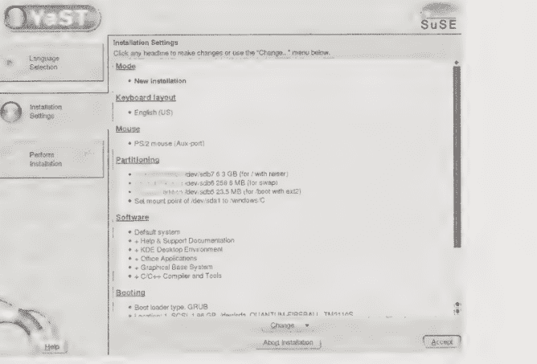

图 2.1：建议屏幕

# 第三步：安装

在 `YaaST` 显示的绿色窗口中点击“是”，使用当前设置开始安装。根据您计算机的性能，安装包含约 350 个程序软件包的完整系统大约需要十五分钟。

# 配置

安装完成后，在开始使用 SuSE Linux 之前指定某些重要设置。详细说明请参阅第 33 页的“完成安装”一节。首先，为系统管理员（用户 `root`）设置密码。此特殊用户由 `YaaST` 直接配置，用于系统维护任务。

> 注意：请记住 `root` 密码，因为您可以使用 `root` 身份修改系统或安装程序。

如果在安装过程中发现网卡或其他通信硬件（如调制解调器或 ISDN 卡），现在可以对其进行配置，并与互联网或局域网（LAN）建立连接。这将允许在程序的剩余部分使用各种服务。例如，如果您配置了 Internet 连接，将能够立即进行在线更新。通过这种方式，您可以包含系统包含最新更新。如果您建立了局域网连接，可以配置 NIS 等名称服务。`YaaST` 假设您不会管理系统上的任何本地用户。这对于商业工作站通常如此，其所有者是集中配置的（例如在部门服务器上）。如果您不配置名称服务，可以为系统的正常操作设置本地用户。额外的概览显示检测到的显示器、显卡和其他硬件组件（打印机、声卡等）。如有必要，更改设置，例如建议的分辨率或色彩深度。请参阅第 40 页的“硬件配置”。配置额外硬件的某些对话框可以搜索连接的设备。然而，在此阶段不需要指定这些设置。您也可以跳过此步稍后进行。完成最后最后步骤后，您新安装的系统将启动，您可以开始使用它。

# 用户定义安装

上一章介绍了快速安装程序。本章提供了有关您通过从建议窗口启动相关模块可以修改的设置的详细信息。这提供了对安装的完全控制。

- 从 CD-ROM 启动系统 . . . . . . . . . . . . . . . . . . . . 14
- 引导屏幕 . . . . . . . . . . . . . . . . . . . . . . . . . . . 15
- `YoST` 接管 . . . . . . . . . . . . . . . . . . . . . . . . . . . 17
- 选择语言 . . . . . . . . . . . . . . . . . . . . . . . . . . . 17
- 安装模式 . . . . . . . . . . . . . . . . . . . . . . . . . . . . . 17
- 安装建议 . . . . . . . . . . . . . . . . . . . . . . . . . . . 18
- 安装模式 . . . . . . . . . . . . . . . . . . . . . . . . . . . . . 18
- 键盘布局 . . . . . . . . . . . . . . . . . . . . . . . . . . . 18
- 鼠标 . . . . . . . . . . . . . . . . . . . . . . . . . . . 19
- 分区 . . . . . . . . . . . . . . . . . . . . . . . . . . 19
- 软件 . . . . . . . . . . . . . . . . . . . . . . . . . 30
- 引导 (Boot Loader) . . . . . . . . . . . . . . . . . . . . . . . 32
- 时区 . . . . . . . . . . . . . . . . . . . . . . . . . . . 32
- 开始安装 . . . . . . . . . . . . . . . . . . . . . . . . . . 33
- 完成安装 . . . . . . . . . . . . . . . . . . . . . . . . . . 33
- 硬件配置 . . . . . . . . . . . . . . . . . . . . . . . . . . 40
- 图形登录 . . . . . . . . . . . . . . . . . . . . . . . . . . 41

# 从 CD-ROM 启动您的系统

将第一个 SuSE Linux CD 或 DVD 插入驱动器。然后重启计算机从介质启动安装。

# 从 CD/DVD 启动时可能的问题

如果您的计算机没有从 CD 启动，可能有由于：

- CD-ROM 驱动器无法读取第一个 CD 镜像。在这种情况下，使用 CD 2 启动系统。CD 2 包含旧驱动程序可以读取的启动镜像。
- 计算机 BIOS 中设置的启动顺序不正确。有关更改设置的信息可以在您的主板文档以及后续章节提供。

`BIOS` 是一组用于激活基本功能的软件程序。`BIOS` 由主板制造商提供，专为配合主板功能而制造。通常，只有在特定时间才能访问 `BIOS` 设置——即机器启动时。在初始化阶段，机器会执行许多诊断测试。其中一个是通过计数器识别的内存计数器。尝试在计数器出现时捕捉到进入 `BIOS` 设置的行。此行通常位于计数器下方或底部。通常要按的键是 `Del`、`F1` 或 `Esc`。按此键进入 `BIOS` 设置。

要在 AWARD `BIOS` 中启动序列，请查找 'FEATURES SETUP'。其他制造商可能有不同的名称，如 'ADVANCED CMOS'。当您找到该项时，选择它并按 `Enter` 确认。在出现的屏幕上查找 'BOOT SEQUENCE'。启动顺序通常设置为 `C`, `A`。在前一种情况下，机器搜索硬盘 (`C`)，然后是软磁盘驱动器 (`A`) 以寻找启动介质。您可以通过按 `Page Up` 或 `Page Down` 修改设置，直到顺序变为 `A`, `CDROM`, `C`。

您可以按 `Esc` 退出 `BIOS` 设置。要保存更改，选择 'SAVE & EXIT' 或按 `F10`。按 `Y` 确认保存您的设置。


如果您有 SCSI CD-ROM 驱动器，需要更改 SCSI BIOS 设置。例如，在 Adaptec 主适配器的情况下，可以通过 `Ctrl + A` 打开设置。之后，选择‘`Disk Utilities`’显示连接的硬件组件。记下 CD-ROM 驱动器的 `SCSI ID`。按 `Esc` 退出菜单，打开‘`Configure Adapter Settings`’。在‘`Additional Options`’下，选择‘`Boot Device Options`’，按下 CD-ROM 驱动器的 ID 并再次按 `Enter`。两次退出此屏幕返回 SCSI BIOS 启动界面。退出此屏幕并确认“是”。

- 您的 CD-ROM 驱动器可能不支持，因为它旧型号。

# 引导屏幕

在引导屏幕上，选择“`Installation`”。默认选择“`Boot Installed OS`”用于启动已安装的系统。使用箭头在项目之间移动。确认选择以便 `YoST` 加载并开始安装。


图 3.1：引导屏幕

安装过程中的问题很少见，但可能在对某些功能未优化的旧硬件上发生。通常此类困难与电源管理功能或磁盘驱动器无法良好处理 DMA 模式有关。由于系统无法预先扫描此类问题，它们可能会随机地干扰安装。如果因为此类问题无法完成安装，请重启并在引导屏幕上选择“`Installation — Safe Settings`”。在此安装模式下，将跳过某些较现代的硬件功能，这通常可以防止问题。以下是引导屏幕的各个选项及其触发的操作：

- `Boot Installed OS`：启动安装在硬盘上的系统（机器上电时正常启动的系统）。
- `Installation`：“正常”安装模式。
- `Installation — Safe Settings`：禁用 DMA 模式（用于 CD-ROM 驱动器）和任何不安全的电源功能。专家还可以使用命令行进入更改内核参数。
- `Installation — APIC Enabled`：对于支持 APIC（可编程中断控制器）的新型机器，可能需要此项。
- `Manual Installation`：如果驱动程序的自动加载导致安装问题，您可以执行“手动”安装。在手动安装中，必须根据需要手动加载驱动程序。然而，如果您的机器使用 USB 键盘，这将无法工作。
- `Rescue System`：如果由于某种原因无法进入已安装的 Linux 系统，可以从 DVD 或 CD 启动计算机然后选择此项。这将启动“救援系统”—一个没有图形界面的最小 Linux 系统，专家可以使用它访问磁盘分区来修复错误。
- `Memory Test`：通过向内存写入块后再读取来测试机器的内存（RAM）。这在无限循环中重复，因为内存损坏通常随机出现，因此可能需要多次读写才能检测到。如果您怀疑计算机内存可能有缺陷，请启动此测试并运行几小时。如果经过较长时间后没有检测到错误，可以安全地假设内存是完好的。重启以终止测试。

安装开始几秒后，SuSE Linux 会加载一个最小的 Linux 系统，由它接管控制并执行安装。随后会显示许多信息和版权声明，在加载过程结束后，启动 YaST 安装程序。几秒钟后，屏幕将显示图形界面，该界面将引导您完成安装。

## YaST 接管

现在 YaST 开始为 SuSE Linux 准备安装。YaST 界面具有通用格式。所有按钮、输入字段和列表都可以用鼠标访问。如果您的鼠标指针不移动，说明鼠标没有被正确检测。在这种情况下，您必须使用键盘进行导航。

## 选择语言

用于 SuSE Linux 和 YaST 的语言。国际发行版的默认设置是英语。如果您的鼠标无法工作，请使用方向键进行导航，直到选择所需的语言。之后，反复按下 `Tab` 键，直到“下一步”（`Next`）被高亮显示。然后按回车键（`Enter`）确认您的语言选择。

### 安装模式

如果您的计算机上已经安装了其他版本的 SuSE Linux，请选择是执行“新安装”（`New Installation`）还是“更新现有系统”（`Update an Existing System`）。还有一个启动现有操作系统的选项。如果您之前没有安装过 SuSE Linux，则只能进行新安装。选择选项后，点击“下一步”继续。参见第 19 页的图 3.3。

本节仅描述选择“新安装”后的步骤。系统更新的详细说明请参见第 51 页的“系统更新”。

## 安装建议

硬件检测后，第 20 页图 3.4 显示的建议窗口将显示有关所识别硬件的一些信息，并提出若干安装和分区选项。当选择


这些项目中的某项并在相应的对话框中进行配置时，您将始终返回到建议窗口，该窗口会相应更新。具体的设置将在后续章节中讨论。

### 安装模式

这提供了更改之前所选安装类型的机会。如果您的机器上已经安装了 Linux 系统，可以使用该选项进入该系统。如果系统由于某些原因损坏且无法从硬盘启动，这将非常有用。

### 键盘布局

选择键盘布局。默认情况下，该布局与所选语言对应。更改布局后，测试 Y、Z 和特殊字符以确保选择是正确的。完成后，选择“下一步”返回建议窗口。

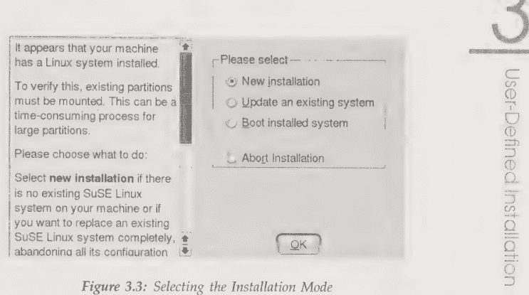

## 鼠标

如果 YaST 未自动检测到您的鼠标类型，请多次按下 `Tab` 键直到选中“鼠标”（`Mouse`）。然后使用空格键（`Space`）打开设置鼠标类型的对话框。该对话框见第 21 页的图 3.5。

要选择鼠标类型，请使用向上和向下键。有关鼠标类型的信息请参阅鼠标文档。选择鼠标类型后，使用组合键 `Alt+1` 测试设备是否正常工作，而无需永久选择它。如果鼠标运行不符合预期，请使用键盘选择其他类型并再次测试。使用 `Tab` 和回车键使当前选择永久。

## 分区

在大多数情况下，YaST 会提出一个合理的分区方案，可以在不更改的情况下接受。如果需要，可以修改此方案以满足您的需求或创建一个新方案。

## 分区类型

每个硬盘都有一个分区表，空间允许四个条目。分区表中的每个条目可以是主分区或扩展分区。然而，只允许一个


图 3.4：建议窗口

扩展分区条目。

主分区由分配给特定操作系统的连续磁道范围（物理磁盘区域）组成。使用主分区，我们无法为每个硬盘设置超过四个分区。分区表无法容纳更多分区。

这就是使用使用扩展分区的原因。扩展分区也是磁盘磁道的连续范围，但扩展分区本身可以被进一步划分为逻辑分区。逻辑分区不需要在分区表中占用条目。换句话说，扩展分区是逻辑分区的容器。

如果您需要四个以上的分区，请创建一个扩展分区。此扩展分区应该跨越整个剩余空磁道范围。在扩展分区内创建多个逻辑分区。SCSI 磁盘上的逻辑分区最大数为 15，(E)IDE 磁盘上为 63。

对于 Linux 使用哪种类型的分区并不重要。主分区和逻辑分区都能良好工作。

## 3

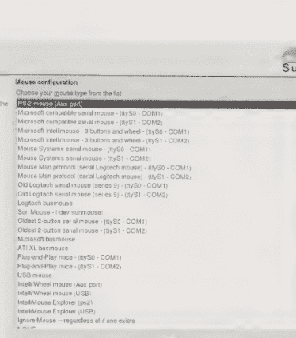

选择连接到您计算机的鼠标类型。

使用效果最好的选择。如果选择无效，请再次使用 `Tab` 键。

点击测试（`Test`）按钮以应用并测试默认设置。

如果您无法点击，则必须按照手册说明的方法使用键盘。

鼠标配置

从列表中选择您的鼠标类型：

- Microsoft compatible serial mouse -ps/2 - COM1
- Microsoft compatible serial mouse -ps/2 - COM2
- Microsoft IntelliMouse -ps/2 - COM1
- Microsoft IntelliMouse -ps/2 - COM2
- Microsoft compatible serial mouse -ps/2 - COM1
- Microsoft compatible serial mouse -ps/2 - COM2
- Microsoft IntelliMouse -ps/2 - COM1
- Microsoft IntelliMouse -ps/2 - COM2
- Microsoft compatible serial mouse -ps/2 - COM1
- Microsoft compatible serial mouse -ps/2 - COM2
- Microsoft IntelliMouse -ps/2 - COM1
- Microsoft IntelliMouse -ps/2 - COM2
- Microsoft compatible serial mouse -ps/2 - COM1
- Microsoft compatible serial mouse -ps/2 - COM2
- Microsoft IntelliMouse -ps/2 - COM1
- Microsoft IntelliMouse -ps/2 - COM2
- Microsoft compatible serial mouse -ps/2 - COM1


### 图 3.5：选择鼠标类型

- Microsoft compatible serial mouse -ps/2 - COM2
- Microsoft IntelliMouse -ps/2 - COM1
- Microsoft IntelliMouse -ps/2 - COM2
- Microsoft compatible serial mouse -ps/2 - COM1
- Microsoft compatible serial mouse -ps/2 - COM2
- Microsoft IntelliMouse -ps/2 - COM1
- Microsoft IntelliMouse -ps/2 - COM2
- Microsoft compatible serial mouse -ps/2 - COM1
- Microsoft compatible serial mouse -ps/2 - COM2
- Microsoft IntelliMouse -ps/2 - COM1
- Microsoft IntelliMouse -ps/2 - COM2
- Microsoft compatible serial mouse -ps/2 - COM1
- Microsoft compatible serial mouse -ps/2 - COM2
- Microsoft IntelliMouse -ps/2 - COM1
- Microsoft IntelliMouse -ps/2 - COM2
- Microsoft compatible serial mouse -ps/2 - COM1
- Microsoft compatible serial mouse -ps/2 - COM2
- Microsoft IntelliMouse -ps/2 - COM1
- Microsoft IntelliMouse -ps/2 - COM2
- Microsoft compatible serial mouse -ps/2 - COM1
- Microsoft compatible serial mouse -ps/2 - COM2
- Microsoft IntelliMouse -ps/2 - COM1
- Microsoft IntelliMouse -ps/2 - COM2
- Microsoft compatible serial mouse -ps/2 - COM1
- Microsoft compatible serial mouse -ps/2 - COM2
- Microsoft IntelliMouse -ps/2 - COM1
- Microsoft IntelliMouse -ps/2 - COM2
- Microsoft compatible serial mouse -ps/2 - COM1
- Microsoft compatible serial mouse -ps/2 - COM2
- Microsoft IntelliMouse -ps/2 - COM1
- Microsoft IntelliMouse -ps/2 - COM2
- Microsoft compatible serial mouse -ps/2 - COM1
- Microsoft compatible serial mouse -ps/2 - COM2
- Microsoft IntelliMouse -ps/2 - COM1
- Microsoft IntelliMouse -ps/2 - COM2
- Microsoft compatible serial mouse -ps/2 - COM1
- Microsoft compatible serial mouse -ps/2 - COM2
- Microsoft IntelliMouse -ps/2 - COM1
- Microsoft IntelliMouse -ps/2 - COM2
- Microsoft compatible serial mouse -ps/2 - COM1
- Microsoft compatible serial mouse -ps/2 - COM2
- Microsoft IntelliMouse -ps/2 - COM1
- Microsoft IntelliMouse -ps/2 - COM2
- Microsoft compatible serial mouse -ps/2 - COM1
- Microsoft compatible serial mouse -ps/2 - COM2
- Microsoft IntelliMouse -ps/2 - COM1
- Microsoft IntelliMouse -ps/2 - COM2
- Microsoft compatible serial mouse -ps/2 - COM1
- Microsoft compatible serial mouse -ps/2 - COM2
- Microsoft IntelliMouse -ps/2 - COM1
- Microsoft IntelliMouse -ps/2 - COM2
- Microsoft compatible serial mouse -ps/2 - COM1
- Microsoft compatible serial mouse -ps/2 - COM2
- Microsoft IntelliMouse -ps/2 - COM1
- Microsoft IntelliMouse -ps/2 - COM2
- Microsoft compatible serial mouse -ps/2 - COM1
- Microsoft compatible serial mouse -ps/2 - COM2
- Microsoft IntelliMouse -ps/2 - COM1
- Microsoft IntelliMouse -ps/2 - COM2
- Microsoft compatible serial mouse -ps/2 - COM1
- Microsoft compatible serial mouse -ps/2 - COM2
- Microsoft IntelliMouse -ps/2 - COM1
- Microsoft IntelliMouse -ps/2 - COM2
- Microsoft compatible serial mouse -ps/2 - COM1
- Microsoft compatible serial mouse -ps/2 - COM2
- Microsoft IntelliMouse -ps/2 - COM1
- Microsoft IntelliMouse -ps/2 - COM2
- Microsoft compatible serial mouse -ps/2 - COM1
- Microsoft compatible serial mouse -ps/2 - COM2
- Microsoft IntelliMouse -ps/2 - COM1
- Microsoft IntelliMouse -ps/2 - COM2
- Microsoft compatible serial mouse -ps/2 - COM1
- Microsoft compatible serial mouse -ps/2 - COM2
- Microsoft IntelliMouse -ps/2 - COM1
- Microsoft IntelliMouse -ps/2 - COM2
- Microsoft compatible serial mouse -ps/2 - COM1
- Microsoft compatible serial mouse -ps/2 - COM2
- Microsoft IntelliMouse -ps/2 - COM1
- Microsoft IntelliMouse -ps/2 - COM2

## 磁盘空间

所需的磁盘空间取决于用途。以下提示为我们提供了要求：

- 最小系统：180 MB。这包含 X。
- 带图形界面的最小系统：500 MB。这包含 X 和一些应用程序。
- 带有现代应用程序的图形系统：1 GB 到 2 GB 之间。这包含了最新版本的 KDE 和 GNOME。
- 下载大量电影和音乐的 Linux：2 GB
- 两者都有：3 GB
- 刻光光和上述项目：4 GB

这些指南可以帮助为系统开发分区方案：

- 500 MB 以下：交换分区和根分区（`/`）。
- 500 MB 到 4 GB 之间：位于硬盘起始的小分区（约 10 MB，大硬盘为 1 个磁道）用于存放内核和引导加载程序。还要创建一个 256 MB 的交换分区，并将剩余空间留给 `/`。


- **4 GB 以上**：启动分区（`/boot`）、交换分区、根分区（250 MB）、用户目录（`/home`）（每个用户约 200 MB），并将剩余空间留给程序和数据（`/usr`）。您也可以为 `/opt` 和 `var` 各留出一个额外的分区。

某些商业程序将其数据安装在 `/opt` 中。如有必要，为 `/opt` 创建单独分区或使根分区足够大。KDE 和 GNOME 也安装在 `/opt` 中。

> 提示
>
> 如果您的分区设置与 YaST 建议的相似，应该是好的。这通常是一个 `/boot` 的小分区（10 MB 或 1 个磁道）、一个交换分区（128 到 256 MB）以及剩余空间留给 `/`。

## 使用 YaST 进行分区

当第一次在建议窗口中选择分区项时，YaST 会显示一个列出当前建议设置的对话框。接受这些当前设置或在继续之前进行更改。或者，丢弃所有设置从头开始。

下一步是确定是使用整个磁盘（“`Use entire disk`”）还是使用任何现有的分区来用于

# YaST

YaST 已检测到您的硬盘，并为您的硬盘提出了显示的分区设置建议。

### 建议的分区

您可以继续使用此建议的布局，或者在此情况下选择第二个单选按钮。

YaST 的建议可能不符合您的需求；在此情况下，您可以通过点击单选按钮来创建一个包含您当前所需分区的自定义布局。对于 RAID 和 LVM 等高级选项，也可以选择此选项。

- `/dev/sda` 50 GB（用于根目录）
- `/dev/sdb` 256 MB（用于交换分区）
- `/dev/sdc` 500 MB 用于家目录，使用 `ext4` 格式
- 选择 `(dev/?)` 的结果分区到 `/home/`

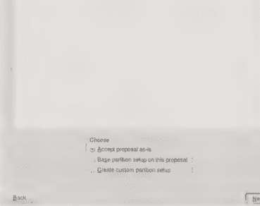

图 3.6：编辑分区设置

安装过程中，如果发现磁盘上存在 Windows 操作系统或存在其他 FAT 文件系统，请选择删除或调整分区大小。在执行此之前，请阅读第 27 页的“调整 Windows 分区”。如果需要，可以在此处进入“专家分区器”对话框以创建自定义的分区设置（参见当前页的“使用 YaST 进行专家级分区”）。

YaST 在安装期间会检查磁盘空间是否足够满足选择的软件。如果空间不足，YaST 将根据需要自动从软件选择中移除部分内容。建议窗口将包含此通知以告知您。只要有足够的磁盘空间，YaST 就会接受您的设置并相应地对硬盘进行分区。

# 使用 YaST 进行专家级分区

通过第 25 页图 3.8 所示的专家对话框，可以手动修改硬盘分区。可以添加、删除或编辑分区。

SUSE Linux - 用户指南


此处显示了系统上自动检测的所有硬盘。选择您想要在其创建分区的硬盘。

您可以选择磁盘的哪个部分用于 SUSE Linux。

针对专家人士的自定义分区允许在安装 SUSE Linux 时，完全控制对硬盘的过度分区或在多个点创建分区。

- 1: SCSI, 1.96 GB, `dev/hda`, QUANTUM-FIREBALL-TM21100
- 2: SCSI, 14 GB, `dev/sdb`, IBM-ONES-6917W
- 专家级自定义分区

所有连接硬盘上的所有现有或建议的分区都显示在专家对话框的列表中。整个硬盘以无数字设备的形式列出，例如 `/dev/hda` 或 `/dev/sda`。分区列为这些设备的部分，例如 `/dev/sda1` 或 `/dev/sda2`。硬盘及其分区的尺寸、类型、文件系统和挂载点也会显示。挂载点描述了分区在 Linux 文件系统树中的挂载位置。任何空闲的磁盘空间也会被列出并自动检测。要为 Linux 分配额外的存储空间，请从列表底部向向上释放所需的空间（从硬盘的最后一个分区到第一个分区）。例如，如果您有三个分区，您不能专门将第二个分区留给 Linux，同时将第三个和第一个分区留给其他操作系统。

图 3.7：选择硬盘

# 创建分区

1. 选择“新建”。如果连接了多个硬盘，将出现选择对话框，在其中为新分区选择硬盘。然后，指定分区类型（主分区或扩展分区）。最多创建四个分区，或创建三个主分区和一个扩展分区。在扩展分区内部，您可以创建多个逻辑分区（参见第 19 页的“分区类型”）。

# 专家分区器

如果您不熟悉分区以及如何管理分区，或者希望进行手动和扩展自动分区，则此工具是供专家人士使用的。

请注意，写入您的 LVM 设备的内容将擦除上一次安装的条目。使用此工具可能会删除现有分区。

如果您使用的是非 LVM 设备或交换设备，它将不会进行交换。对于此类设备，您应该手动创建分区。

右侧的表格显示了所有硬盘上的当前分区。

硬盘的设计结构如下：

`dev/sda1` EIDE disk, `dev/sda2` EIDE disk, `dev/sda3` EIDE disk 等。

`dev/sda1` scsi disk, `dev/sda2` scsi disk, `dev/sda3` scsi disk 等。

此关系始终指的是顺序。

| 设备 | 尺寸 | F | 类型 | 挂载 | 开始 | 结束 | RAID | LVM |
|---|---|---|---|---|---|---|---|---|
| `dev/sda1` | 10 GB | `ext4` | FAT16 | | 0 | 256 | | |
| `dev/sda2` | 5 GB | `ext4` | LVM | | 256 | 1114 | | |
| `dev/sda3` | 5 GB | `ext4` | LVM | | 1114 | 2048 | | |
| `dev/sda4` | 5 GB | `ext4` | LVM | | 2048 | 2560 | | |
| `dev/sda5` | 512 MB | `swap` | | | 2560 | 3072 | | |
| `dev/sda6` | 5 GB | `ext4` | LVM | | 3072 | 4096 | | |


2. 选择用于格式化分区的的文件系统，并在必要时指定挂载点。YaST 为每个创建的分区建议一个挂载点。参数的细节将在下一节提供。

3. 选择“确定”以应用您的更改。

新分区将列在分区表中。点击“下一步”，将采用当前值并返回到建议屏幕。

# 分区参数

如果您创建了新分区或修改现有分区，可以在分区工具中设置各种参数。对于新分区，YaST 会设置合适的参数，通常不需要任何修改。要执行手动设置，请按照以下步骤操作：

1. 选择分区。
2. “编辑”分区并设置参数：
   - 文件系统 ID
     
     即使您不想格式化分区，也要指定以下文件系统 ID 之一以确保分区正确注册：'Linux'、'Linux swap'、'Linux LVM' 或 'Linux RAID'。详情参考《管理指南》。
   - 文件系统
     
     在安装范围内格式化分区。根据所使用的文件系统，提供各种选项。只有在完全确定自己在做什么时才进行更改。
   - 加密文件系统
     
     如果您启用加密，所有数据将以加密的形式写入硬盘。这增加了敏感数据的安全性，但由于加密需要时间，会降低系统速度。
   - fstab 选项
     
     在此处指定文件系统管理文件的参数 (`/etc/fstab`)。这些选项应由专家修改。
   - 挂载点
     
     指定分区在文件系统树中挂载的目录。可以在相应的字段展开各种 YaST 建议。如果您接受这些建议，将实现默认文件系统。然而，您也可以指定任何其他名称。

3. 选择“下一步”激活分区。

# 注意

如果您手动分区，必须创建一个交换分区。交换分区用于从内存中释放当前未使用的数据。这可以将内存留给最频繁使用的数据。

# 注意

# 调整 Windows 分区

如果您的分区设置包含带有 Windows FAT 分区的硬盘，YaST 提供删除或缩小它的选项。使用此选项允许您在当前设置未提供足够空间的情况下安装 SUSE Linux。这种情况通常发生在覆盖整个硬盘的单一分区上。这种设置有时出现在预装 Windows 的电脑上。

以下讨论基于假设 Windows 系统安装在 FAT 分区上。如果 YaST 发现所选硬盘的空间不足，但通过删除或缩小 Windows 分区可以获得空间，它将呈现一个对话框，供您选择这两个选项之一。


如果您选择“完全删除 Windows”，则 Windows 分区将被标记为删除，并将空间用于安装 SUSE Linux。

> > 注意
>
> 一旦开始格式化，如果你删除 Windows，所有数据将无法恢复地丢失。

# 注意

要缩小 Windows 分区，请先中断安装并首先进入 Windows，从该处对分区进行准备。虽然此步骤并非严格强制，但它可以加快调整大小的过程并使操作更安全。

在 Windows 中，首先运行 `scandisk` 以确保 FAT 分区没有丢失的文件碎片和交叉链接（这些在 Windows 下并不常见）。之后，运行 `defrag`（磁盘碎片）将文件移动到分区的开头。这将使调整速度更快。

> > 注意


> 如果你为 Windows 优化了虚拟内存设置，使用了具有相同初始（最小）和最大大小限制的连续交换文件，请考虑其他步骤。在这些 Windows 设置下，调整大小可能会导致交换文件被分成许多分散在 FAT 分区上的细小部分。此外，在调整过程中需要移动整个交换文件，这会导致过程变得非常缓慢。因此，暂时取消这些 Windows 优化，并在调整完成后重新启用它们是很有用的。

# 注意

当你完成这些准备工作并再次回到 Linux 分区设置界面时，选择“缩小 Windows 分区”。在对分区进行快速检查后，YoST 会打开一个新的对话框，对调整 Windows 分区给出建议。

第一个条形图显示 Windows 目前占据了多少磁盘空间以及仍有多少可用空间。第二个条形图显示根据 YoST 当前的建议，调整大小后空间将如何分布（见下一页的图 3.10）。接受建议的设置或使用滑块更改分区大小（在特定限制范围内）。

当你通过选择“下一步”离开此对话框时，设置将被存储，你将返回到上一个对话框。调整大小将在磁盘格式化之前不久进行。

# 用户自定义安装

为你的 Windows 分区选择新标签页。

如果你想创建一个新分区或在最后的安装步骤中更改设置，请选择 Windows 分区并移除其他分区。

要调整现有分区的大小：

按“后退”

下方图表显示了当前大小。蓝色图表表示新分区的尺寸。

拖动滑块或在字段中输入数值来调整建议的大小。

注意：调整现有分区将自动清除内存空间。


> 注意

Windows 版本 NT、2000 和 XP 默认安装在 NTFS 文件系统上。如果你安装了此类系统，YaST 可能无法调整文件系统的大小，因此可能没有足够的空间进行安装。要安装 SuSE Linux，要么从硬盘上删除 Windows，要么在较小的分区上重新安装 Windows。

如果你的电脑预装了 Windows 且使用 NTFS 系统，最好的选项可能是在较小的分区上重新安装 Windows，但使用 FAT 32 文件系统。这样做如果以后需要，将可以调整 Windows 分区的大小。

> 注意

# 更多分区提示

如果由 YaST 执行分区并在系统中检测到其他分区，这些分区也会输入到 `/etc/fstab` 文件中，以便于访问这些数据。该文件包含系统中的所有分区及其属性（参数），例如文件系统、挂载点和用户权限。

```
/dev/sda1      /data1 auto noauto,user 0 0
/dev/sda8      /data2 auto noauto,user 0 0
```

SuSE Linux - 用户指南 29

# 文件 1: /etc/fstab: 分区数据

无论 Linux 分区还是 FAT 分区，都用 `noauto` 和 `user` 选项指定。这允许任何用户根据需要挂载或卸载这些分区。出于安全考虑，你在此处自动输入 `exec` 选项（该选项用于从相应位置执行程序）。然而，为了从那里运行程序，你可以手动输入此选项。当你遇到如“解释器错误”或“被拒绝访问”等系统消息时，此项措施是必要的。

《管理指南》中的“特殊安装过程，专家级分区”部分提供了详细的背景信息和提示。

# 软件

在此，选择要在你的机器上安装的软件。默认选择包含 KDE 和 OpenOffice。如果你点击“软件”，将显示一个对话框，从中选择一个基本系统设置之一：

- 最小系统系统（仅建议专家使用）
- 最小图形系统（不含 KDE）
- 默认系统（包含 KDE 和办公软件包）

在选择所需的设置后，你可以点击“详细选择”启动软件安装模块。该模块见对面页的图 3.11。

## 预选

该模块从选择过滤器——“过滤器”开始：左上角默认设置为“选择”。选择是整个程序包组，可以通过点击相应的复选框将其一组标记为待安装或移除。其中某些包是预选的，因为它们属于 SuSE Linux 的默认安装。

窗口右侧显示了一个表格，列出了当前选择中包含的各个软件包。表格最左侧的列显示每个软件包当前的状态。在初始安装过程中，通常使用两种状态设置：“已选择安装”（包名前前的复选框已勾选）和“不安装”（复选框为空）。

# 用户自定义安装


图 3.11：安装和移除软件

要选择或取消选择单个软件包，只需遍历列表并点击框直到它们被勾选或为空。其他状态选项对安装并不重要。有关状态选项的说明见第 47 页的“安装和移除软件”。

# 注意

预选的系统符合新用户和高级用户的需求。通常情况下，不需要更改任何设置。然而，如果你决定选择额外的软件包，应该意识到你的决定对系统产生的影响。特别是，请注意任何警告并避免取消“系统”组的任何部分。

> > 注意

SuSE Linux - 用户指南 31

# 其他过滤器

点击“过滤器”下拉框查看可以使用其他方式安排软件包列表的过滤器。从系统内部启动此 YoST 模块时，默认按“软件包组”过滤。此视图在安装期间也有用。它在窗口左侧以树形结构列出软件包，分支代表不同的类别或主题。展开的树分支越多，选择就越精细。

# 启动（引导程序安装）

在安装期间，YaST 为你的系统建议了启动配置。通常情况下，你应该保持这些设置不变。然而，如果你需要自定义设置，请修改系统建议。

一种可能性是配置引导机制依赖特殊的启动软盘。虽然这有一个需要在驱动器中使用软盘的缺点，但它允许你保留现有的引导机制。然而这通常没有必要，因为 YaST 也可以配置 SuSE Linux 引导程序启动其他操作系统。另一种可能性是更改引导机制在硬盘上的位置。

要更改 YoST 建议的启动配置，选择“启动”。将打开一个对话框，可以在其中更改引导机制的许多细节。你更改的后果可能是严重的，在修改引导程序设置之前，请阅读第 99 页的“使用 YaST 配置引导程序”。

> 注意 引导方法应仅由经验丰富的的用户更改。

# 时区

在此对话框中（见下一页的图 3.12），在“硬件时钟设置为”下选择“本地时间”或“UTC”。选择取决于你机器上硬件（BIOS）时钟的设置。如果它设置为 GMT，当


对应 UTC，您的系统可以依靠 SuSE Linux 切换到标准夏令时间反之亦然。

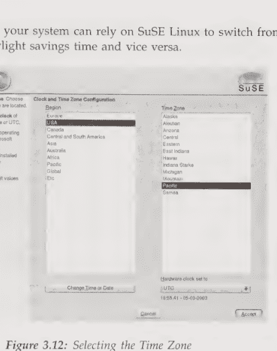

## 开始安装

对安装设置满意后，点击“下一步”开始安装。在打开的绿色对话框中点击“是”确认。安装通常需要十五到三十分钟，取决于系统性能和所选软件。

## 完成安装

完成基本系统设置和所有所选软件包的安装后，为系统管理员账户（“root” 用户）提供密码。然后，可用，配置您的互联网访问和网络连接。在安装期间可以使用安全补丁和软件更新更新系统。如果需要，为本地网络中的集中用户管理配置服务器设置。还要配置任何硬件设备，如打印机和扫描仪。

## root 密码

`root` 是超级用户、系统管理员的名字。与普通用户不同（普通用户可能拥有或不拥有执行系统中某些操作的权限），`root` 拥有权限：更改系统配置、安装程序和设置新硬件。如果用户丢失了密码或系统遇到其他问题，`root` 可以提供帮助。`root` 账户应仅用于系统管理、维护和修复。作为 `root` 登录日常工作是相当危险的：一个错误就导致许多系统文件不可挽回地丢失。

页面上的图 3.13 显示了相关对话框。出于验证目的，必须输入两次 `root` 密码。不要忘记 `root` 密码。以后无法找回。

> 注意
用户 `root` 拥有更改系统所需的所有权限。执行此类任务需要 `root` 密码。没有此密码，您将无法执行任何管理任务。

## 网络配置

在这一步中，配置网络设备以连接到外部世界。如果您有这些设备，如网卡、调制解调器以及 ISDN 或 DSL 硬件，现在配置它们是一个好主意。互联网连接允许您获取任何可用的 SuSE Linux 更新。

配置网络硬件的说明见第 78 页的“网络设备”，其中描述了必要的步骤。如果需要，可以稍后从安装的系统中配置您的网络设备。这样做请选择“跳过网络配置”然后点击“接受”。

## 测试互联网连接

如果您配置了互联网连接，现在可以通过尝试与 SuSE 服务器建立连接来测试它。它将检查任何

## YaST 配置

系统的非特权用户，通过“root”密码，系统管理员浏览互联网，用户“root”在每项需要执行的系统任务中需要，如果您是系统管理员，请登录，然后

由于 `root` 用户拥有广泛的权限，应小心输入“root”密码。如果输入的密码错误，请几秒钟后重新输入。

您应用于“root”密码的所有规则都应该是唯一的，长度至少为 5 个字符，且规则不得包含字母或单位。

有效的密码字符为字母、数字和 -。

不要忘记“root”密码！

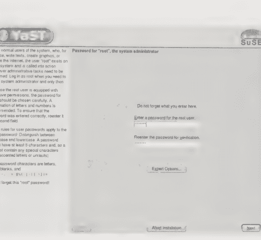

图 3.13：设置 root 密码

适用于您的 SuSE Linux 版本的 YaST 更新。如果连接畅通且有可用更新，请在下一步中选择是否下载并安装这些更新。最新的发布说明——有关软件的信息——也将被下载。

如果您不想在此时测试连接，请选择“跳过测试”然后点击“下一步”。这将跳过产品更新和发布说明的下载。

## 加载软件更新

如果 YaST 能够连接到 SuSE 服务器，请选择是否执行 YaST 在线更新。如果服务器上有任何可用补丁包，您可以现在下载并安装它们以修复已知错误或安全问题。

> 注意
更新下载可能需要很长时间，取决于互联网连接的带宽和更新文件的大小。

> 注意


图 3.14：配置网络设备

要立即执行软件更新，请选择“立即更新”并点击“确定”。这将打开 YaST 在线更新对话框，列出可用补丁（如果有），可以从中选择并加载。要了解过程的详情，请阅读第 45 页的“YaST 在线更新”。此类更新可以在安装后的任何时间进行。如果您不想现在更新，请选择“跳过更新”并点击“确定”。

## 用户认证

如果在安装的后续步骤中成功配置了网络访问，您现在有两种管理系统上用户账户的两种可能性。

**本地用户管理** 使用此方法，用户在本地管理——在安装的机器上。这种方法适用于工作站。

**使用 NIS 或 LDAP 进行用户管理** 此方法常用于部门管理工作站。整个部门的管理在中央主机或服务器上进行，从而无需创建本地账户。


图 3.15：测试互联网连接

## 配置主机作为 NIS 客户端

如果您决定通过 NIS 管理用户账户，请将主机配置为 NIS 客户端。启用 NIS 的网络需要一些专业知识。NIS 的细节见管理指南。以下仅解释客户端的基本设置。

在以下对话框中（见第 39 页），首先选择主机是具有固定 IP 地址还是通过 DHCP 获取。DHCP 还提供 NIS 域和服务器。有关 DHCP 的更多信息，请参见管理指南。如果使用静态 IP 地址，请手动指定 NIS 域和服务器。

## 用户认证方法

在这里，您可以选择系统的用户认证方法。

如果您只想在首次登录通过密码验证用户，请选择独立机器。

如果您使用 NIS 服务器存储用户数据，请选择网络客户端，并在证明后继续配置客户端。

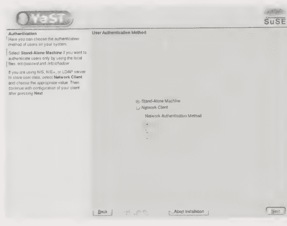

图 3.16：用户认证

## 创建本地用户账户

在本地创建用户账户时，任何与用户账户相关的数据（名称、登录、密码等）都存储在本地主机上。

Linux 是一种允许多个用户同时在同一系统上工作的操作系统。对于每个用户，都需要用户账户来登录系统。通过使用用户账户，系统在安全性方面大大增益。普通用户不允许更改或删除系统运行所需的文件——无论他们是否真的有意为之。

# NIS 客户端

输入您的 NIS 域（例如 col.）和 NIS 服务器的地址（例如 host.loc.com 或 192.168.1.1）。

通过输入用逗号分隔的地址来指定多个服务器。

- 广播（Broadcast）选项允许在指定的主机未响应后，在子网内搜索以查找服务器。
- 如果您正在使用 DHCP 且服务器提供了 NIS 域名或服务器，可以不勾选“自动设置”（Automatic Setup）框，以便通过网络模型进行设置。
- 专家（Expert）模式提供某些不常用的选项访问。

如果您需要访问多个域，请使用按钮切换到所需的域。

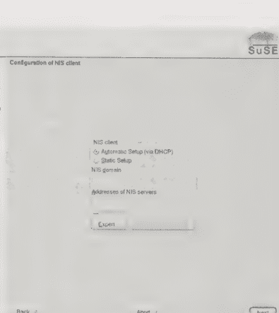

图 3.17: NIS 客户端配置

# 用户自定义安装

首先要执行此操作。同样，指定用户的个人数据无法被其他用户修改、查看或篡改。每个用户都可以设置自己的工作环境，并且在重新登录时会发现环境始终保持不变。

可以使用下一页图 3.18 所示的对话框创建用户账户。在输入名和姓后，指定用户名（登录名）。如果您想不起合适的用户名，只需点击“建议”（Suggestion），让系统自动生成一个。

最后，为用户输入密码。重新输入以进行确认（以确保您没有误输其他内容）。用户名告诉系统您是谁，而密码用于验证此身份。

为了提供有效的安全保障，密码长度应在 5 到 8 个字符之间。密码的最大长度为 128 个字符，但如果没有加载特殊的安全模块，则仅使用前 8 个字符来识别密码。

Linux 区分密码中的大小写字母。不允许使用带重音的字符和变音符号。可以使用特殊字符（如：* # ;) )）和数字 0–9。

# 阅读发行说明

完成用户身份验证设置后，YaST 将显示发行说明。它们包含了在打印手册时无法获取的重要最新信息。如果您安装了更新包，则可以使用最新版本的发行说明。

# 硬件配置

配置显卡以及（如果需要）其他硬件设备，如打印机和声卡。只需点击组件即可开始其配置。大多数情况下，YaST 会自动检测并配置设备。

您可以跳过任何外围硬件设备并在稍后配置它们。然而，您应该立即配置显卡。虽然 YaST 自动配置的显示设置通常是可以接受的，但用户在分辨率、色彩和其他图形功能方面有很强的偏好。要更改这些设置，请选择“X Config

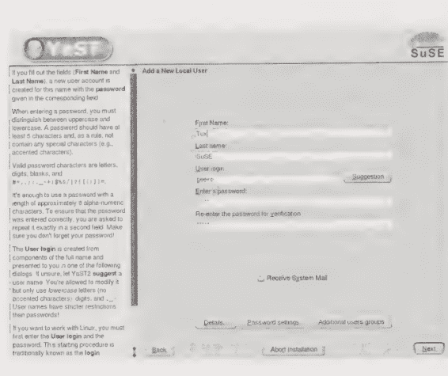

图 3.18: 输入用户名和密码

ration'。配置将在将在第 62 页的“显示和输入设备 (SaX2)”中进行说明。完成后，点击“完成安装”。

# 图形登录

SuSE Linux 现在已安装并准备好供您首次登录。在您的屏幕上，您应该看到如下一页图 3.20 所示的图形登录界面。输入安装期间创建的用户名，然后输入密码。

# 欢迎来到 Linux 上的 SuSE Linux

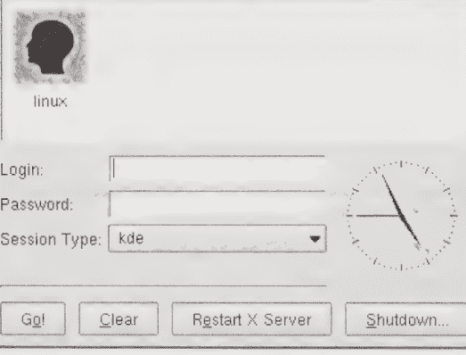

图 3.20: 登录屏幕

# YaST — 配置

您在安装时已经使用的 YaST 也是 SuSE Linux 的配置工具。本章涵盖了使用 YaST2 对系统进行配置，它可以对主系统组件进行舒适的配置。这包括大多数硬件、图形用户界面、访问访问、安全设置、用户管理、软件安装以及系统更新和信息。本章还提供了文本模式下使用 YaST 的说明。

- 启动 YaST . . . . . . . . . . . . . . . . . . . . . . . . . . 44
- YaST 控制中心 . . . . . . . . . . . . . . . . . . . . . 44
- 软件 . . . . . . . . . . . . . . . . . . . . . . . . . . . . 44
- 硬件 . . . . . . . . . . . . . . . . . . . . . . . . . . . . 53
- 网络设备 . . . . . . . . . . . . . . . . . . . . . . . . . . 78
- 网络服务 . . . . . . . . . . . . . . . . . . . . . . . . . . 87
- 安全与用户 . . . . . . . . . . . . . . . . . . . . . . . 91
- 系统 . . . . . . . . . . . . . . . . . . . . . . . . . . . . . . 96
- 杂项 . . . . . . . . . . . . . . . . . . . . . . . . . . . . . 105
- 文本模式下的 YaST (ncurses) . . . . . . . . . . . . . . . . . . . . . . . . . . . . . . . . . . . . . . . . . 106

# 启动 YaST

K 菜单和 SuSE 菜单（底部的图标）提供了几种访问 YaST 的方式：通过“控制中心”、通过“SuSE”➔“配置”，以及通过“偏好”。

在 K 菜单中，您可以直接选择所需的模块。启动时，YaST 首先打开一个对话框，输入 root 密码。您也可以从命令行启动 YaST，但这有点复杂。在 shell 中以 root 用户执行，因为只有 root 可以修改系统文件。

要更改 YaST 以及整个系统的语言，请在控制中心选择“系统”➔“选择语言”。注销，然后重新登录并重启 YaST。

# 控制中心

当您以图形模式启动 YaST 时，首先打开页面所示的控制中心。在左侧框架中，可以看到“软件”、“硬件”、“网络设备”、“网络服务”、“安全与用户”、“系统”和“杂项”。如果您点击一个图标，右侧将列出相应的内容。例如，如果您选择“硬件”，然后点击右侧的“声卡”，将打开声卡的配置对话框。各个项目的配置通常包含几个步骤。按“下一步”进入后续。

左框架显示相应主题的帮助文本，说明所需的输入。做出必要的规范后，在最后一个配置对话框中点击“完成”完成过程。配置将保存。

# 软件

# 修改安装源

安装源是包含要安装软件的介质。可以是光盘或 DVD、网络服务器或硬盘。请参考详细的 YaST 帮助文本。

当您通过“保存并退出”模块时，设置将保存并应用于“安装和删除软件”、“系统更新”以及“引导和内核配置”配置模块。此模块还提供了通过“安装”进行软件包安装或删除的可能性。


图 4.2：更改安装源

点击“下一步”下载所有可用补丁的列表（如果您选择了“手动更新”）。随后，软件安装模块（详见下一页的“安装和卸载软件”章节）启动，并列出所有可用的补丁。选择要安装的软件包，或直接接受已标记为安装的建议补丁。

首先，所有软件包都将从服务器下载并安装到您的机器上。如果发生错误，错误将在窗口中显示。在这种情况下，您可以跳过相应的补丁。某些补丁在安装之前会弹出一个信息窗口，允许您选择安装或跳过该软件包。所有补丁安装成功后，将显示一个摘要。点击“关闭”退出概览，点击“完成”退出 YOU 菜单。随后，将执行 SuConfig。

## 补丁 CD 更新

补丁 CD 更新适用于“SuSE Linux Enterprise Server”客户。补丁将从 CD 安装，而不是从 FTP 服务器下载。

## YaST - 配置

YaST 在线更新 (YOSU) 是从 SUSE 更新服务器快速获取所有推荐补丁简单方法。

如果勾选“手动选择补丁”，则仅显示选定的补丁，供您选择要安装的补丁。

如果勾选“从服务器接收补丁”，则将从服务器匹配所有补丁，并由提供程序提供。

点击“专家”，选择安装源而不是 FTP 或 HTTP 服务器，或者选择另一个 FTP 或 HTTP 服务器。

勾选“配置全自动更新”允许您配置为每天检查两次更新，并在有可用安装包时自动下载，无需人工交互。

## 欢迎使用 YaST 在线更新

系统信息
产品：SUSE Linux
版本：8.19
架构：i386

目前尚未执行任何更新

更新配置

安装源

http://download.kernel.org/linux/suse

- 手动选择补丁
- 从服务器接收所有补丁
- 配置全自动更新...

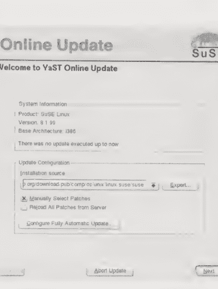

图 4.3：YaST 在线更新

## 安装和卸载软件

此模块允许您安装、更新或删除软件。请参见第 31 页的图 3.11。要从 CD 或 DVD 安装，请向驱动器插入第一张 CD 或 DVD。

## 菜单

在软件窗口（软件包管理器）顶部有三个菜单：“文件”、“软件包”和“帮助”。在“文件”下，您可以使用“导出”将所有已安装软件包列表写入文本文件。系统将提示您指定路径和名称，或确认默认设置。使用“退出 — 放弃更改”退出软件包管理器。选择“退出 — 保存更改”保存您的设置。

“软件包”下的项目仅在当前选中某个软件包时可用。若要对软件包组中的所有软件包执行操作，请点击相应的组并选择“此列表中的所有”。可以执行以下操作：

安装：状态更改为“安装”。如果您点击“接受”，将安装该软件包或组中的所有软件包。

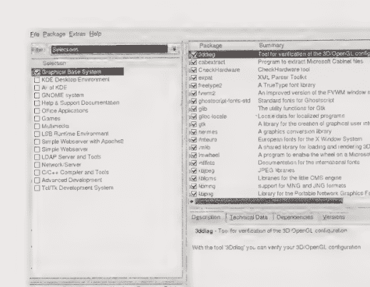

图 4-4：安装和删除软件

不安装：状态更改为“不安装”，因此该软件包不会被安装。

保留：状态更改为“保留”。该软件包已安装并按此形式保留。

删除：状态更改为“删除”。一旦您点击“接受”，该软件包将被移除。

更新：状态更改为“更新”。该软件包将被新版本替换。

禁忌 — 绝不安装：状态更改为“禁忌”。这意味着该软件包永远不会被安装，即使您安装的另一个软件包需要它。

安装所有可用源：也将安装源代码。

不安装任何源：将不安装源。

这些操作也可以通过菜单项右侧所示所示按键来执行。或者，通过点击复选框来更改软件包状态。已安装的软件包前面有一个空框。带有蓝色勾选标记的框是已安装且将保留的软件包。待安装的软件包前面有黑色勾选标记。如果您点击已安装的软件包，状态将首先变为“更新”，并用回收符号表示。如果再次点击一次，软件包将变为“删除”并标记有垃圾桶符号。如果再次点击该软件包，它将标记为蓝色勾选标记并保留。未安装的软件包也可以设置为“禁忌”。在这种情况下，软件包将标记有禁止进入符号。如果您右键点击软件包，将显示上下文菜单，允许直接为软件包选择所需状态。如果您不确定符号的含义，请查看帮助菜单。这里可以找到软件包管理器的说明以及各种符号的映射。

## 选择过滤器

使用主对话左上角的过滤器下拉框确定如何显示软件包。默认设置是选择显示。

- 1. 通过过滤器，可以勾选右框来安装或取消选择特定应用程序。选择范围包括开发、游戏、GNOME、多媒体、Web 服务器和文档。
- 2. 另一种选项是按软件包分组。这些组在左侧以树形结构显示。如果您点击一个子组，右框将仅显示子组的软件包。

> 注意
- 3. 查找特定软件包的最简单方法是使用搜索功能，此处访问。输入搜索字符串并使用复选框设置搜索方法（名称、描述、软件包依赖）。例如，使用此功能查找“库”。
- 4. 在选择安装、更新或删除的软件包后，查看过滤器下的安装摘要，查看点击“接受”时将发生什么变化。使用左侧复选框按操作列出软件包。要仅检查哪些软件包被手动或自动删除，请取消所有其他复选框。只要选定的软件包需要其他软件包，就会执行自动安装、卸载或更新。

> 您可以标记已安装的软件包进行删除。注意删除删除系统的软件包。

## 信息窗口

右下方框中的标签页提供了有关选中软件包的各种信息。选中软件包的描述自动激活。点击其他标签页查看技术数据、来自其他软件包的列表或版本信息。

## 检查依赖

在信息窗口下方找到“检查依赖”，旁边“自动检查”已激活，当选择安装软件包时，会自动显示其他所需的程序。如果需要，可以禁用自动检查并在选择软件包后使用“检查依赖”。如果禁用了自动检查且您没有手动检查依赖，一旦您点击“接受”，将检查软件包依赖。

# 依赖冲突

### sendmail 8.12.7-37 冲突
- 冲突项：
  - postfix 与 sendmail 冲突
  - sendmail 与 postfix 冲突
- 冲突解决：
  - 不安装 sendmail
  - 移除冲突包
  - 删除 postfix
  - 忽略冲突并承担系统不一致的风险

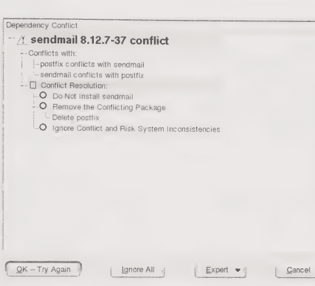

图 4.5：软件模块的冲突管理

# 系统更新

此模块允许您更新系统。过程包括几个步骤。YaST 会检查哪些包。如果需要，可以单独为每个包决定是否执行更新。此方法不允许基础系统，基础系统需要从安装介质（如 CD）启动。

# 注意

系统更新是一个非常复杂的程序。对于每个程序包，YaST2 必须检查计算机上安装了哪个版本，以及需要哪些操作才能正确将旧版本替换为新版本。YaST2 还会尝试采用已安装包的任何个人设置。然而，如果旧配置无法按预期处理新程序版本，或者各种配置之间出现意料之外的不一致，某些配置在更新后可能会导致问题。

现有版本越旧、待更新包的配置与标准差异越大，更新就越困难。有时，旧配置无法被正确采纳。在这种情况下，必须创建一个全新的配置。在开始更新之前，应该保存现有配置。

# 注意

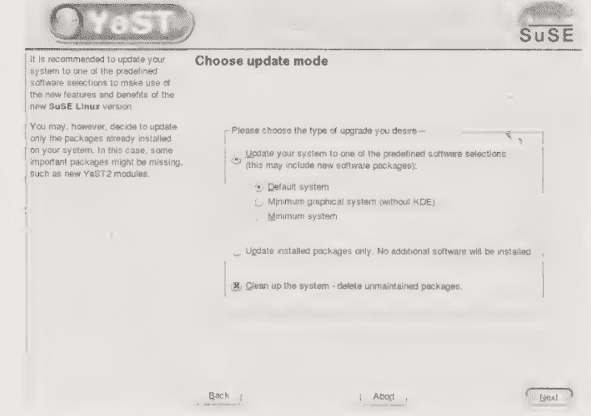

图 4.6：系统更新

# 硬件

必须首先按照指定的指定安装或连接新硬件。开启外部设备（如打印机或调制解调器），并启动相应的 YaST模块。大多数设备由 YaST 自动检测并显示技术数据。如果自动检测失败，YaST 会提供设备列表（型号、供应商等），从中从中选择合适的设备。请咨询硬件随附的文档获取信息。

> 注意
使用型号名称时要小心。如果您的型号不在设备列表中，请尝试型号相似的设备。然而，在某些情况下，型号必须完全匹配，因为相似的型号并不总是表示兼容性。

# CD-ROM 驱动器

在安装范围内，所有检测到的 CD-ROM 驱动器通过 `/etc/fstab` 文件中的目集成到安装系统中，并在 `/media` 中创建相应的子目录。此 YaST模块可用于在系统中集成额外的驱动器。

启动模块时，将显示所有检测到的驱动器列表。使用行前面的复选框标记新驱动器，并点击“完成”完成集成。新驱动器将集成到系统中可以使用。

# 打印机

# Linux 打印基础

Linux 系统通过打印队列管理打印机。在打印任何数据之前，它会被发送到打印队列进行临时存储。然后，它由打印后台进程（spooler）提取，并按要求的顺序发送到打印机设备。

然而，大部分数据并不是以打印机可以处理的形式存在的。例如，图形图像首先需要转换为打印机可以理解的格式。这种到打印语言的转换是通过打印过滤器实现的，过滤器是由打印后台进程调用的程序，根据需要翻译数据，以便打印机进行处理。

### ASCII 打印语言

- ASCII 文本
每个普通打印机至少应该能够直接打印 ASCII 文本。然而，某些设备无法直接打印 ASCII 文本，但能够处理下面提到的其他标准打印语言之一。

- PostScript
PostScript 是 Unix 和 Linux 系统上成熟的打印语言。许多程序产生的 PostScript 输出可以由 PostScript 打印机直接打印。

- PCL3, PCL4, PCL5e, PCL6, ESC/P, ESC/P2 和 ESC/P 栅格
如果没有 PostScript，打印过滤器可以使用 Ghostscript 将 PostScript 数据转换为这些其他标准打印语言之一。Ghostscript 为不同的打印机使用不同的驱动程序，以尽可能利用各种型号提供的特定功能（如颜色设置）。

# 处理打印作业

1. 用户或应用程序生成一个新的打印作业。
2. 打印数据临时存储在打印队列中。打印后台进程从那里将其发送到打印过滤器。
3. 现在，打印过滤器执行以下步骤：
   (a) 如果打印数据还不是 PostScript，则将其转换为 PostScript。例如，ASCII 文本通常由过滤器程序 `a2ps` 转换为 PostScript。
   (c) 如果必要，将 PostScript 数据转换为另一种打印语言：
   - 如果打印机是 PostScript 型，则直接将 PostScript 数据发送到打印机。
   - 如果打印机不是 PostScript 型，则 Ghostscript 使用适用于相应打印机的驱动程序生成打印机特定数据，随后发送到打印机。
4. 在整个打印作业发送到打印机后，打印后台进程从打印队列中移除打印作业。

# 可用的打印系统

SuSE Linux 支持两种不同的打印系统：LPRng 和 lpdfilter。这是一个由 LPRng 和 lpdfilter 组成的传统打印系统。

据我们所知，以下 GDI 打印机不支持 SuSE Linux。此列表并不完整。

# 管理：
有关 CUPS 的更多信息，请参阅 http://www.cups.org/

# 队列

在大多数情况下，需要多个队列：
- 必须定义不同的打印机。
- 黑白打印机，足够了：
- 标准 “lp” 配置

- HP LaserJet 1000/3100/3150
- Lexmark Z12/22/23/31/32/33/82, Winwriter 100/150c/200
- Minolta PagePro 6L/1100L/18L, Color PagePro L, Magicolor 6100-DeskLaser/2DeskLaserPlus/2DeskDuplex
- Nec SuperScript 610p/660/660plus
- Oki Okijet 2010
- Samsung ML 85G/5050G, QL 85G
- Sharp AJ 2100, AL 1000/800/840/F880/121

## 使用 YaST2 配置

要设置打印机，请进入 YaST 控制中心的“硬件”（Hardware）项目，然后选择“打印机”（Printer）。这将打开打印机配置窗口，其中上方列出了检测到的设备。下部分列出了到目前已配置的所有队列。如果未检测到您的打印机，请重新启动自动检测。如果再次失败，请选择“配置”（Configure）手动配置打印机。并不是所有的打印机都能同时配置两种打印系统。某些配置仅由 CUPS 或 LPRng 和 lfilter 支持。YaST 会根据需要通知您。

## 注意事项

> 在 SuSE Linux 中，默认打印系统是 CUPS，但你可以随时在 CUPS → LPRng 之间切换。要进行切换，请在 YaST 打印机配置模块中选择“更改”（Change）→“高级”（Advanced）。然后选择相应的打印系统并进行配置。

## 自动配置

如果满足以下要求，YaST 将自动配置打印机：

- 1. 并口或 USB 端口可以自动正确设置，且连接的打印机可以被自动检测。
- 2. 在硬件自动检测期间提供 YaST 的打印机 ID 字符串位于数据库。由于此 ID 可能与实际型号不同，你可能需要手动选择型号。

为了确保一切工作运行正常，应通过 YaST 的打印测试功能检查每项配置。YaST 测试页还提供了有关所选配置的重要信息。

## 手动配置

如果未满足自动配置的任一要求，或者你想自定义设置，请手动配置打印机。

取决于自动检测的成功程度以及数据库中发现了多少打印机型号信息，YaST 可能能够自动确定正确的设置，或至少做出合理的选择。

必须配置以下参数：

硬件连接（端口）：硬件连接的配置取决于 YaST 在自动检测期间是否能够找到打印机。

- 如果 YaST 能够自动检测打印机型号，可以假设打印机连接在硬件层面工作正常，无需在此方面更改任何设置。
- 如果 YaST 无法自动检测打印机型号，硬件层面可能存在某些问题，需要手动干预以配置连接。有关涉及的步骤，请参考《管理指南》（Administration Guide）。

队列名称：发布打印命令时使用的队列名称。名称应较短，且仅由小写字母和数字组成。

Ghostscript 程序或打印机语言（打印机型号）：Ghostscript 程序和打印机语言取决于你的打印机型号。YaST 允许你选择适用于你型号的预定义配置。选择制造商和型号基本上意味着选择了适合该语言的打印机语言和 Ghostscript 程序，并带有驱动的一些默认设置。然后可以根据需要在额外的对话框中更改这些设置。

对于 PostScript 型号，所有打印机特定数据均由 Ghostscript 程序生成。程序配置——包括选择正确的程序及其对应的正确选项——是决定输出质量最重要的因素。在此处所的设置将按队列逐个影响打印结果。

## SuSE

制造商：
选择你打印机的制造商。

打印机的制造商和型号

选择制造商：

选择型号：

型号：
选择制造商后，型号列表将更新为所选制造商的打印机。
选择其中一个：

| ALPS | 24-Pin Series |
|---|---|
| ANTECH | 24-Pin Series |
| APOLLO | ActionLaser 1100 |
| APPLE | ActionLaser i650 |
| BROTHER | ActionColor 3250 |
| CANON | Aculaser C1000 |
| CITRIH | Aculaser C2600 |
| COMPAQ | Aculaser C2800PS |
| DELL | Aculaser C4000 |
| OPTI | Aculaser C6000PS |
| DYMO-COSTAR | Aculaser C8500 |
| EPSON | Aculaser C8200PS |
| MEIDBERG | CL-700 |
| HITACH | CL-750 |
| IBM | EM-600C |
| HP | EM-620C |
| IMAGEN | EPS-5200 |
| INFOTEC | EPS-5200W |

如果你在 Ghostscript 设备列表中找不到你的打印机。如果你不知道打印机使用哪种协议，请咨询或联系制造商。

非 YaST PPD 文件
如果你的打印机制造商提供 PPD 文件，你可以配合 CUPS 蜘蛛使用 PPD 文件。


图 4.7：选择打印机

如果打印机是自动检测的或者手动选择了型号，YaST 将提供适用的 Ghostscript 程序选择，通常对每个型号都有预定义配置：

- 黑白
- 彩色 300 dpi
- 彩色 600 dpi

对于高分辨率，所有打印机型号都适用于可选程序组合。

始终通过打印测试页来检查你的设置是否符合预期。如果输出乱码（例如页面几乎为空），你应该先通过 YaST 停止打印。

最好先停止打印测试，然后等待打印机吐出所有页面。

如果打印机型号不在数据库中，YaST 为标准语言提供了标准程序选择。

## 高级设置 使用此对话框访问某些额外的硬件相关（程序特定）和硬件无关的选项。如有需要，更改特殊队列设置或限制对打印机的访问。然而，通常不需要更改任何内容。有关设置的详情请见《管理指南》中的打印章节。

## 应用程序配置 以与命令行工具相同的方式依赖现有的打印队列。通常不需要为特定应用程序重新配置打印机，你应该可以使用可用队列从应用程序打印。

## 从命令行打印 使用 `lpr -Plp filename` 命令命令行打印，其中 `filename` 是发送到打印机的文件名。在此示例中，使用了默认打印机队列 `lp`，`-P` 允许你指定另一个队列。例如，命令 `lpr -Pcolor filename` 通知打印系统使用彩色队列。

## 使用 LPR 打印系统 使用此打印系统，应用程序可以使用 `lpr` 命令进行打印。为了使之工作，让应用程序使用现有队列之一（如 `lp` 或 `color`），或在应用程序的打印对话框中输入相应的命令，例如 `lpr -Plp` 或 `lpr -Color`。

## 使用 CUPS 打印系统 CUPS 打印系统也提供了命令行工具，例如 `lpr` 命令，上述方法同样适用于 CUPS。

要让 KDE 程序支持上述功能，需要在打印对话框中启用“通过外部程序打印”选项。还存在几种图形化工具，如 `xpp` 和 KDE 程序 `kprinter`，它们提供了图形化界面来选择队列并更改通过 PPD 文件提供的 CUPS 标准选项和打印机特定选项。

如果需要，通过指定 `kprinter` 或 `kprinter --stdin` 来配置应用程序使用 `kprinter` 作为标准打印接口。

这些应用程序相应对话框中的命令。使用这两个命令中的哪取决于应用程序自身的行为。如果设置正确，当从该程序发布打印任务时，应用程序应该调用 kprinter 对话框，这样你就可以 kprinter 选择队列并设置其他选项。这应用程序自身的打印设置不要与 kprinter 的设置冲突，并且在启用 kprinter 后设置应保持不变。

# 故障排除

如果计算机与打印机之间的通信发生某种错误，打印机可能无法正确解释数据。这可能导致输出乱码并浪费大量纸。

- 1. 要停止打印，请取出所有纸或打开打印机托盘。
- 2. 由于打印任务只有在完全发送到打印机后才会从打印队列中删除，因此它通常会留在那里。即使重启也不会删除它。要删除打印任务，请使用如 kprinter 等工具。《管理指南》（Administration Guide）提供了从命令行管理打印任务的说明。
- 3. 即使打印任务已从队列中删除，可能仍有数据传输到打印机。要停止所有仍在使用打印设备的进程，请使用 `fuser` 命令。对于连接到第一个并行端口的打印机，输入：

```
fuser /dev/lp0
```


```
earth:~ # fuser -k /dev/lp0
```

对 USB 打印机实现相同操作，输入：

```
earth:~ # fuser -k /dev/usb/lp0
```

- 4. 通过关闭电源对打印机进行完全重置。在将纸回托盘并开启设备之前等待几秒。打印机应该准备好接受新任务。

# 更多信息

关于 Linux 打印系统的详情见《管理指南》中的“打印操作”（`Printer Operation`）章节，该指南已安装在你的系统中。要阅读手册，启动 `SuSE Help` 然后点击“管理指南”。PDF 文件也位于 `/usr/share/doc/packages/suselinux-adminguide_en`，可以使用查看器打开。

《管理指南》中的上述章节通泛讨论了打印问题和解决方案。对于更具体的问题和排除提示，请咨询支持数据库（`Support Database`）。

如果你遇到打印机问题，请检查支持数据库中的《安装打印机》和《SuSE Linux 8.02 及以上版本的打印机配置》文章，你可以通过搜索关键词“installation”或在线找到它们：

```
http://sdb.suse.de/en/sdb/html/jsmeix_print-einrichten.html
http://sdb.suse.de/en/sdb/html/jsmeix_print-einrichten-82.html
```


可以通过 LDAP 访问公共地址簿，例如 SuSE OpenServer 使用的地址簿。Evolution 对这些地址簿具有完全访问权限，可以读取并添加新项目。
在左菜单窗口中，点击“联系人”或选择此文件夹。从菜单栏，选择“工具” → “地址簿源...”。打开一个窗口，显示已配置的地址簿。要添加新源，选择“添加”。要编辑或删除现有链接，选择“编辑”或“删除”。然后点击“添加”打开配置地址簿所需数据的对话框。
“基本”在“帐户名称”下输入名称，并在“服务器名称”下输入 SuSE OpenServer 或 LDAP 服务器的主机名或 IP 地址。对于 SuSE OpenServer，只有在登录服务器后才能使用该地址簿。为了此目的，必须激活相应的选项。检查“使用服务器身份验证：”下是否标记了“区分名称 (DN)”。在相应字段中输入 DN 值。例如，对于用户 hili，SuSE OpenServer 所需的值如下：


uid=hili,dc=penguinlovers,dc=ch


进入`/path/to/xxx`目录，找到`xxx.json`。

在表达式`cvar = avar + bvar`中，加法运算符（`+`）将`avar`与`bvar`相加，得到它们的和`cvar`

在`List.of(arg0, arg1, arg2)`中，`List`接口的工厂方法`of()`接受一系列的元素，返回包含它们的只读列表。

之后我们这样调用`cmd`命令：`cmd arg0 arg1 arg2`。

```
if (condVar > someVal) {console.log("xxx")}
```

“高级”设置端口：通常可以使用默认值`389`。在“搜索基础”下输入您的基节点。从系统管理员处获取所需的值。点击“应用”或“确定”后，地址簿的数据将显示在“联系人”文件夹中。对于 Microsoft Exchange 情况类似。如果您只想读取而不写入相关地址簿，可以取消勾选“使用服务器身份验证:”选项。

# 更多信息

Evolution 包含了广泛的内部帮助。使用“帮助”菜单访问这些信息。有关 Evolution 的更多信息，请参阅 Ximian 网站：http://www.ximian.com。

SuSE Linux - 用户指南

231

# ISDN 通信

在互联网和电子邮件时代，电话和传真等传统通信形式几乎已经没有意义。新的通信套件 `CAPISuite` 为基于 ISDN 的计算机支持型应答机和传真处理程序提供了解决方案。

本章旨在更详细解释 `CAPISuite` 的工作原理。随后将介绍如何使用 `YaST` 进行安装，并对系统的用法进行简要介绍。

- `CAPISuite` 基础 . . . . . . . . . . . . . . . . . . . . . . 234
- 配置 . . . . . . . . . . . . . . . . . . . . . . 234
- 使用 . . . . . . . . . . . . . . . . . . . . . . . . . . 240

# CAPISuite 基础

`CAPISuite` 是一个守护进程（在后台运行的程序），提供基础的通信功能。当前版本特别提供了电话和传真连接的功能。

这意味着该系统支持例如发起和终止入站及出站传真及语音连接。随后可以通过这些连接发送和接收传真和音频文件。此外，还支持某些特殊功能，如电话连接切换到传真连接以及 `DTMF`（双音多频——常见的触摸电话拨号音）的处理。

然而，该系统并不构成完成某些任务（如应答机）的完整应用程序套件。实际应用程序使用 Python 脚本语言（一种非常适合初学语言）编写，因此可以根据当前需求自由调整。`CAPISuite` 仅处理提供的脚本并执行列出的命令。这使得创建从简单应答机到小型呼叫中心（该系统目前仍缺少其中一些功能）的灵活解决方案成为可能。

`CAPISuite` 包提供了一些预定义的脚本，可提供多用户应答机和传真解决方案。关于系统的更多详细信息以及编写自定义脚本的说明，可以在安装后在 `/usr/share/doc/packages/capisuite/manual/index.html` 中以及项目网站（http://www.capisuite.de/）上找到。

# 配置

`CAPISuite` 访问 ISDN 硬件的 CAPI 编程接口。由于该接口最近才被 Linux 支持，因此所有常见的 ISDN 适配器尚未配备合适的驱动程序。但对于制造商 AVR 的非常常见的 ISDN 适配器，驱动程序已经可用，并可以方便地通过 `YaST` 安装和配置。

测试 CAPI 驱动运行状态的简单方法是作为 root 用户执行 `capinfo` 命令。如果命令返回了有关 ISDN 适配器能力的详细信息，则说明驱动安装正确。随后即可安装并使用 `CAPISuite`。

必须使用 `YaST` 软件安装模块安装 `capuisite` 包才能配置 `CAPISuite`。关于安装软件的更多信息请参考 `YaST` 章节中的相应部分。

> 尚未确定是否包含个人版中。无论如何，该软件包都可以在 SuSE Internet 服务器上下载。相应的安装说明已发布在 `CAPISuite` 项目网站 http://www.capuisite.de/ 上。

## 注意

安装后，`YaST` 提供了两个模块用于配置传真和应答机功能。

# 配置传真服务

来自“网络设备”（Network Devices）组的 `YaST` 模块包含一个带有用户列表和处理列表项按钮的表格。列表包含所有已为传真系统配置的用户。这里使用的 `CAPISuite` 脚本支持多用户，允许每个用户独立地发送和接收传真。入站电话的目标号码决定了哪个用户接收传真。该模块的列表在首次启动时当然为空。

如果多个用户想要使用 `CAPISuite` 接收传真，必须确保相关的电话号码都是不同的，并且所有这些号码也都关联到 ISDN 适配器连接的线路。如果您并发使用 ISDN PBX（交换），这一点非常重要。

> 如果您打算同时接收传真和普通电话，请仅使用应答机模块，因为它提供了一个集成的传真识别和接收模块。请参见第 237 页的“配置应答机”。

## 提示

可以使用列表下方的图标编辑或删除现有条目，并创建新条目。在创建新条目或修改现有条目时，会弹出一个对话框输入以下数据：

可以在对话框中设置一个或多个用户的传真系统。每个用户必须配置至少一个唯一的传真号码。更多细节请参阅手册中的通信章节。

在添加或编辑用户时，将显示包含以下字段的对话框：

- **User（用户）：** 想要接收或发送传真电话的系统用户。
- **Faxnumbers（传真号码）：** 属于（仅属于）用户的一个或多个传真号码（用逗号分隔）。第一个号码在发送传真时用所有者号码。
- **StationID（站 ID）：** 传真协议使用的传真站 ID，通常设置为国际格式的外部号码，例如 +49 123456。有效 `StationID` 的示例是德国慕尼黑 123456 号传真对应的 +49 89 123456。该条目的最大长度为二十位。有效字符是数字、空格以及作为国际国家代码前缀的 + 符号。

# 传真机配置

用户表

| User（用户） | Faxnumbers（传真号码） | StationID（站 ID） | Action（操作） |
| :--- | :--- | :--- | :--- |
| | | | 添加 / 编辑 / 删除 |
| | | | 返回 / 取消 / 完成 |


‘User’ 应激活用于传真功能的系统用户。该用户账户将接收入站传真和状态报告。

‘Fax Numbers’ 此字段必须包含至少一个与用户相关的接收传真的电话号码。也可以输入多个用逗号分隔的号码。发送到这些号码的所有传真都将以电子邮件的形式发送给用户。列表中的第一个号码用于识别出站传真。

‘StationID’ 传真协议使用握手期间传输的 ID 进行识别，该 ID 通常应包含国际记法的传真设备电话号码。一个有效 `StationID` 的示例是德国慕尼黑 123456 号传真对应的 +49 89 123456。该条目的最大长度为二十位。

‘Header（头部）’ 此字段可以包含任意文本，作为发送传真的头部。

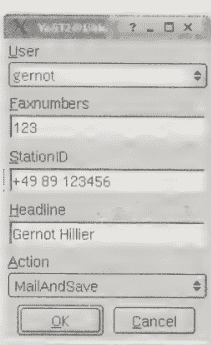

图 15.2：传真功能：用户偏好

‘Action’：在默认配置 `MailAndSave` 下，入站传真将保存在系统中并以电子邮件的形式发送给用户。`SaveOnly` 选项确保传真仅保存到硬盘上。此选项仅建议专家用户使用。

点击‘OK’接受更改。点击‘Cancel’放弃更改并关闭表单。

# 配置应答机

提供的标准脚本还提供了一个舒适的多用户应答机。可以通过“网络设备”组中的 `YaST` “应答机”（Answering Machine）模块进行配置。

与传真配置类似，这里有一个已配置的用户列表（首次启动时为空）。录音的入站电话将发送给与号码关联的用户。这说明了为用户分配唯一电话号码的重要性。此时无法设置个人用户欢迎语。将在稍后通过配置的应答机的远程访问功能进行录音。

应答机具有自动静音识别程序，在五秒没有声音后终止录音会。

在对话框中可以为一个或多个用户设置语音信箱。每个用户必须配置至少一个唯一的电话号码。更多信息请参阅手册中的电信章节。

## 语音信箱配置

在添加或编辑用户时，将显示包含以下详细信息的对话框：

- **用户（User）**：希望通过语音信箱接收电话的系统用户。
- **电话号码（Phonumbers）**：属于（仅）该用户的一个或多个电话号码（用逗号分隔）。
- **延迟（Delay）**：语音信箱响应电话前的等待时间（秒）。
- **时长（Duration）**：单次通话的最大录音长度。
- **动作（Action）**：默认录音


图 15.3：语音信箱配置的 `YaST` 模块

> 在大多数情况下，入入传真电话也会自动识别并接收。然而，这种自动程序在旧款传真机上可能会失效，因此尽可能使用单独的传真号码。

使用“添加”、“编辑”和“删除”来管理条目。创建新条目或修改现有条目的表单包含以下字段：

- ‘用户（User）’：选择配置语音信箱的系统用户。每个注册用户分配有一个或多个传真号码。拨打这些号码的入入电话将以电子邮件的形式发送给用户。
- ‘电话号码（Phone Numbers）’：设置为用户录制消息的电话号码。由于语音信箱具有自动传真识别功能，传真也可以发送到声明的电话号码。用逗号分隔多个号码。


图 15.4：语音信箱：用户偏好

**‘响应时间（Response Time）’**：此值以秒为单位定义，决定语音信箱在多久后接听入入电话。可以从列表中选择或手动输入值。

**‘时长（Duration）’**：决定语音信箱的最大录音时间——即录音入入电话的最大时长（秒）。此值通常是次要的，因为录音通常由通话者挂断终止。建议将此值设置为合理的时间，例如两分钟（120 秒）。

**‘动作（Action）’**：语音信箱对入入消息具有多种处理选项。默认设置 `MailAndSave`（邮件并保存）会录制消息、将其保存到系统中并通过电子邮件发送给用户。如果不需要接收电子邮件，可以选择 `SaveOnly`（仅保存）选项。它仅将消息保存到硬盘。此选项仅建议专家用户使用。`None`（无）选项将完全激活消息录制，它播放欢迎语后挂机。

‘PIN’：为远程访问输入个人身份识别（PIN）。此处可以输入任意长度的数字代码。如果在播放欢迎语期间输入代码，用户将进入远程访问菜单。如果该字段留空，则禁用远程访问功能。

‘OK’：接受更改。“取消（Cancel）”在不应用任何更改的情况下关闭对话框。

# 使用

## 关于接收的注意事项

`CAPISuite` 的开发很大程度上依赖于 Linux 现有功能。这就是为什么入入传真和语音消息的递送是由 Linux 内部邮件系统处理的，而不是通过专用应用程序和协议。

这需要为 `CAPISuite` 的每个用户配置接收本地消息的邮件客户端。详细信息请参阅关于邮件程序的相应章节或应用程序提供的文档。

## 传真操作

接收传真不需要进一步的说明。一旦为分配给用户的号码接收到传真，文档将存储在系统中并以带有 PDF 附件的电子邮件形式递给用户。PDF 是文档的常用交换格式，任何安装了 Adobe Acrobat Reader 的操作系统都可以读取。用户可以根据需要打开并打印文档。

每份收到的文档也存储在硬盘的 `/var/spool/capisuite/users/<username>/received/` 中。如果电子邮件递送过程中出现问题或邮件被意外删除，可以访问此目录。更多信息可以在 `CAPISuite` 文档 `/usr/share/doc/packages/capisuite/manual/index.html` 中找到。

提供了命令行工具 `capisitefax` 用于发送传真。它接受一个或多个目标传真号码和一个或多个 PostScript 格式的文档。这种格式由几乎所有 Linux 应用在打印到文件时生成。

`capisitefax` 接受以下参数：

- `-h` 或 `--help`：返回有效参数的简短摘要。
- `-d <number>` 或 `--dialing=<number>`：此参数声明要发送传真的目标号码。
- `-q` 或 `--quiet`：`capisitefax` 通常会生成几条信息性消息。此选项将抑制这些消息，仅允许显示可能的错误消息。

以下命令将文档 `document1.ps` 和 `document2.ps` 发送到目标号码 `089123456`：

```
```


`capisitefax -d 089123456 document1.ps document2.ps`


`capisitefax`将文档转换为正确的格式并与描述文件一起存储在特殊文件夹中，CAPISuite从从中获取并发送。这就是为什么在运行和实际发送之间可能会有短暂延迟。可以通过以下方式方便地发送传真：

- 在左窗格中选择“系统（System）”图标。
- 点击 HylaFAX 功能。
- 选择“设置（Settings）→配置”。
- 使用命令 `capitefax -d %number %files`。
- 修改 `/usr/bin/capitefax`。
- 因为 `capitefax` 与 HylaFAX 兼容，请使用 HylaFAX。
- 按照说明操作。
- 点击 HylaFAX 功能。
- 选择“设置（Settings）→配置”。
- 使用非 KDE 应用程序。


图 15.5：在 KDEax 中配置 CAPISuite

- 点击“确定”完成配置并关闭 KDEax。

“发送传真（Send to Fax）”选项在任何 KDE 应用程序的打印菜单可用。选择它将启动 KDEax，请求目标号码并发送传真。非 KDE 应用程序也可以使用此功能，如果它们允许手动设置命令。常用的 `lpr` 则应替换为 `kprinter`，这将显示 KDE 菜单。

> 注意
> `capisufax`不支持完整的 HylaFAX 功能集。这意味着分辨率设置等高级功能会被直接忽略。

## 语音信箱操作

如果关闭了电子邮件回复，留在语音信箱上的语音消息将以电子邮件的形式发送给与入入号码相关的接收者。这意味着语音信箱的操作不需要任何描述。所有入入消息都可以使用邮件客户端方便地查看和打开。为了备份，入入消息还存储在 `/var/spool/capisuite/users/<username>/received/`。

录制个人欢迎语是通过语音信箱的远程访问功能进行的。

要远程访问语音信箱，请从任何电话拨打您的号码。在播放欢迎语期间输入之前定义的 PIN。如果输入错误，请等待几秒后重试。在正确输入 PIN 后，语音信箱会告诉您存储的消息数量。然后您可以选择录制新的欢迎语或收听存储的消息。按照说明操作。

下表提供了远程访问消息菜单项目的简要概述。如果您频繁使用远程访问，建议携带它的副本。在播放消息期间，可以任何时候输入命令。这意味着过长的语音消息可以轻松跳过。

| 键 | 功能 |
| :--- | :--- |
| 1 | 删除当前消息 |
| 4 | 跳到下一条消息 |
| 5 | 跳到上条消息 |
| 6 | 重放当前消息 |

表 15.1：消息播放命令

## Linux 中的多媒体应用

Linux 提供了各种处于开发阶段的音频应用程序。由于应用程序种类多样且名称奇特，可能很难确定某个应用程序的功能，也找到适用于特定用途的程序。以下是用于多媒体各种任务的应用程序概述。这里还详细描述了 SuSE Linux 发行版中包含的一些较强大的应用程序。

许多许多应用程序未包含在默认安装中。请使用 YaST 安装相应的软件包。

- 调音器 (Mixers) . . . . . . . . . . . . . . . . . . . . . . . . . . . . 246
- 播放器 (Players) . . . . . . . . . . . . . . . . . . . . . . 248
- 创作与乐谱 (Composition and Scores) . . . . . . . . . . . . . . . . . . . . . 250
- 读取音频 CD (Reading Audio CDs) . . . . . . . . . . . . . . . . . . . . . . . 251
- 电视、视频、广播和网络摄像头 (TV, Video, Radio, and Webcam) . . . . . . . . . . . . 252

> 注意
> 除非另有说明，否则可以从“SuSE 菜单”下的“多媒体” → “音频”启动应用程序。

## 调音器

调音器是控制计算机声音输出输入音量及平衡的方便方法。各种调音器的主要区别在于接口。选择一个符合你需求且你操作起来舒服的即可。其他调音器可用。“多媒体” ▶ “音频”菜单中大多数名称带有“mix”字样的程序都是调音器应用程序。

> 提示
> 通常，建议在打开音频程序之前打开调音器程序。使用调音器测试并调整声卡输入输出的控制设置。某些声卡可能不允许多个应用程序同时访问。如果音频程序冻结，这可能是原因。

### gamix

如果你有多个声卡，`gamix` 为每块声卡提供一组控制器。滑动控制杆以设置所需的电平。

### alsamixer

`alsamixer` 可以在没有 X 环境的情况下从命令行运行。该程序使用光标键进行操作。可以使用 Q、W、E、Y、X 和 C 设置左右声道的不同电平。

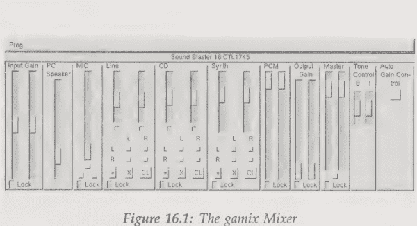

| 输入增益 | PC | MIC | 线路 | CD | 合成器 | PCM | 输出增益 | 主音 | 音调控制 | 公共增益控制 |
|---|---|---|---|---|---|---|---|---|---|------|
| 声器 | | | | | | | | | | | | |
| | | | | | | | | | | | | |
| | | | | | | | | | | | | |
| | | | | | | | | | | | | |
| | | | | | | | | | | | | |
| | | | | | | | | | | | | |
| 锁定 | | | | | | | | | | | | |
| | | | | | | | | | | | | |
| 锁定 | | | | | | | | | | | | |
| 锁定 | | | | | | | | | | | | |

# 注意

`alsmixer` 的外观和感觉取决于所使用的声卡类型。以下描述指的是调音器功能的常用 AC97 标准。如果你的声卡不符合此标准，可能会出现一些偏差。配备 Envy24 (ic1712) 芯片的声卡应使用 Envy24 调音器。

声音输出的基本滑块有“Master”（主音）、“PCM”和“CD”。Master”设置总音量。“PCM”和“CD”控制 PCM 和音频 CD 通道的平衡。静音单声道。在这种情况下，静音控制器上方会出现“MM”。

按空格键确定录音源。“capture”（采集）控制器调节输入放大器。根据录音源使用“Line”（线路）控制器和“MIC”控制器。

按 Esc键 关闭 `alsmixer`。通过 `man alsmixer` 获取更多信息。

`alsamixer`gui 是带有图形界面的鼠标操作版 `alsmixer` 变体。见下一页的图 16.2。

## KMix

`KMix` 是 KDE 的调音器。它为 KDE 用户提供了一个方便且熟悉的界面。它还可以集成到 KDE 面板中。

## GNOME 调音器组件

如果你使用 GNOME，此组件提供了一个方便的音量控制，可以集成到面板中。要将其添加到面板，右键点击并选择“面板” → “添加到面板” → “组件” → “多媒体” → “调音器”。

## 播放器

Linux 提供了多种播放音频 CD 以及各种可用音乐格式的程序，包括 MP3、OGG 和 WAV 文件。在可能的情况下列出了播放器支持的格式。

### kscd — 音频 CD 播放器

`kscd` 是一个易用的音频 CD 播放器。可以从“SuSE 菜单”访问。

### WorkMan 音频 CD 播放器

WorkMan 提供了一个简单方便且功能丰富的界面。对于任何偏好 CD 的人来说都是理想的。

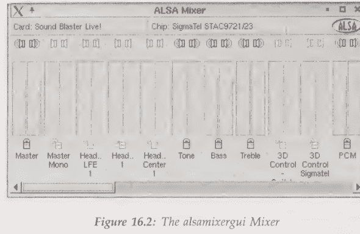

### GNOME 组件

这是一个可以添加到面板的简单组件。要将其添加到面板，右键点击并选择“面板” → “添加到面板”。

### XMMS — MP3、OGG 和 WAV 文件

`XMMS` 是一个可以集成到面板中的方便音量控制。要将其添加到面板，右键点击并选择“面板” → “添加到面板” → “组件” → “多媒体” → “调音器”。

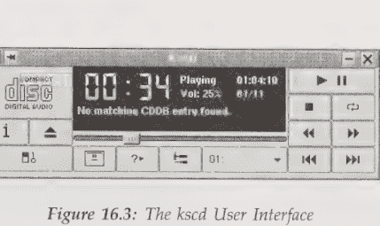

## 电视、视频、广播和摄像头

电视卡卡的配置集成在配置工具 YaST 中。如果您的显卡已被正确识别，它将自动配置。否则，请手动进入显卡设置。

以下章节将重点介绍 `motv` 应用，该程序由 ETIV 驱动程序的作者创建。另一个电视应用是 KWinTV。如果您更喜欢 KWinTV，在阅读本章后应该易于使用。

## 使用 motv 看电视

`motv` 是 `xawtv` 的改进继任者。它将所有基本功能整合到用户界面中。通过“SuSE”→“多媒体”→“视频”启动应用程序。也可以在命令行中输入 `motv` 启动。程序启动后，最初仅会出现一个电视窗口。右键点击该窗口打开菜单窗口。

## 视频源和网络搜索

在“设置”（Settings）→“输入”（Input）中选择视频源。如果您在这里选择了“电视”（Television），请在启动程序之前设置好广播网络。这可以通过网络搜索自动完成，网络搜索也可以“设置”菜单下找到。如果您点击“保存设置”（Save settings），找到的网络将输入到：


| 名称 | 大小 | 类型 |
| --- | --- | --- |
| idev | 1 B 文件夹 | |
| information | 1 B 文件夹 | |
| MP3 | 9 B 文件夹 | |
| 001 No time for Revolution.mp3 | 4.4 MB | MPEG Layer-3-Audio |
| 002 Out of the Dark (The Night).mp3 | 4.1 MB | MPEG Layer-3-Audio |
| 003 Shake.mp3 | 4.2 MB | MPEG Layer-3-Audio |
| 004 Der Kommissar 2000.mp3 | 4.3 MB | MPEG Layer-3-Audio |
| 005 Mutter, der Mann mit dem Koks ist da.mp3 | 4.2 MB | MPEG Layer-3-Audio |
| 006 Hit me.mp3 | 4.3 MB | MPEG Layer-3-Audio |
| 007 Cyberlove.mp3 | 4.1 MB | MPEG Layer-3-Audio |
| 008 Egosat.mp3 | 3.9 MB | MPEG Layer-3-Audio |
| 009 Naked (Full Frontal Version).mp3 | 13.1 MB | MPEG Layer-3-Audio |
| Nach Namen | 9 B 文件夹 | |
| Nach Stück | 9 B 文件夹 | |
| Out Of The Dark (The In Light) | 9 B 文件夹 | |
| 001 No time for Revolution.wav | 38.2 MB | audio/wav |
| 002 Out of the Dark (The Night).wav | 36.5 MB | audio/wav |
| 003 Shake.wav | 37.4 MB | audio/wav |
| 004 Der Kommissar 2000.wav | 38.4 MB | audio/wav |
| 005 Mutter, der Mann mit dem Koks ist da.wav | 36.9 MB | audio/wav |
| 006 Hit me.wav | 38.2 MB | audio/wav |
| 007 Cyberlove.wav | 38.0 MB | audio/wav |
| 008 Egosat.wav | 34.9 MB | audio/wav |
| 009 Naked (Full Frontal Version).wav | 116.0 MB | audio/wav |

图 16.6: 拷贝光盘

位于主目录下的 `.xawtv` 文件在下次启动程序时将变为可用。

> 提示
> 如果您不想浏览所有可用频道，请使用 (Ctrl + ↑) 查找下一个频道。如果需要，随后使用 (← 或 →) 调整频率。

SuSE Linux 用户指南
Linux 中的多媒体应用
253


## 从视频到音频

电视卡的音频输出连接到声卡的线路输入、连接到扬声器或到放大器。某些电视卡可以更改音频输出音量。在出现“设置”（Settings）后，可以使用滑动块设置音量。此框还提供了亮度、对比度和颜色的滑动块。

要使用声卡播放音频，请检查第 246 页描述的混音器（Mixers）。符合 AC97 的声卡，选择“输入”（Input）→“线路”（Line）。音量可以通过“主”和“线路”滑动块进行调整。

## 屏幕比例和全屏模式

大多数电视图像的长宽比为 4:3。这些比例可以通过“工具”（Tools）→“屏幕尺寸”（Screen Dimensions）设置。如果在这里选择了“4:3”（默认设置），即使更改显示器大小，屏幕尺寸也会保留。

通过“工具”→“全屏”切换到全屏模式。如果屏幕模式下的电视图像未缩放到显示器大小，则需要微调。如果您的显卡不支持此功能，则将图形模式切换到 640x480 像素以全屏模式。在“设置”（Settings）→“配置”（Configuration）创建相关配置。重启 `motv` 后，如果您切换到了全屏模式，显示器模式也会随之改变。

> 提示
> `.xawtv` 文件会自动创建，并在点击“设置”（Settings）→“保存设置”时更新。在这里，广播将与设置的频率一起保存。关于该文件的更多信息可以在 `xawtv` 的 man 页中找到。

## 启动菜单

使用启动菜单通过 `motv` 启动其他应用程序。使用键盘快捷键启动混音器和文本应用程序。从 `motv` 启动的应用程序必须在 `.xawtv` 文件中输入。条目应该如下所示：快捷键以及启动应用程序的命令位于“工具”（Tool）菜单下。

## 使用 alev 查看文本

要浏览文本页面，可以通过“SuSE”→“多媒体”→“视频”→“alev”或在命令行中使用 `alev` 启动程序。应用程序会保存所选电台的页面。可以通过输入页码或点击页码来浏览页面。点击窗口底部的“<<”或“>>”向前向后移动页面。

## 摄像头和 motv

如果您的摄像头已被 Linux 支持，请通过 `motv` 访问它。在 http://www.linux-usb.org 查找支持设备的摘要。如果您在访问摄像头之前已使用 `motv` 访问电视卡，则 btv 驱动已加载。当您的摄像头连接到 USB 时，摄像头驱动会自动加载。在命令行中使用参数 `-c /dev/video1` 启动 `motv` 以访问摄像头。使用 `motv -c /dev/video0` 访问电视卡。

在 btv 驱动自动加载之前将摄像头连接到 USB（通常调用电视应用时发生），`/dev/video0` 将留给摄像头。在这种情况下，如果您使用 `-c /dev/video1` 参数启动 `motv` 访问电视卡，可能会收到错误消息，因为 btv 驱动不会自动加载。通过 `modprobe btv` 单独加载驱动来解决此问题。可以使用 `motv -hwscans` 查看系统中配置视频设备的概述。

## 使用 kradio 听广播

可以在“SUSE”→“多媒体”菜单找到 `kradio` 应用。点击双箭头按钮开始信道搜索。使用单箭头按钮以 50 kHz 的间隔更改频率。右键点击网络按钮以启用广播网络。这将与刚设置的频率一起保存到 ~/.kde2/share/config/kradiorec


> 图 16.8: 广播应用 kradio

无法为每个电视卡更改音量。如果您将电视卡的音频输出连接到声卡的线路，请用混音器设置音量。

## nxtvepg — 您的电脑的电视杂志

从某些广播电台，EPG 信号（电子节目指南）会与视频文本信号一起传输。使用 `nxtvepg` 程序可以轻松查看此电子文本信号。然而，您必须有一张被 btv 驱动支持的电视卡，并能够接收带有 EPG 广播的频道之一。

使用 `nxtvepg`，广播根据频道和主题（如“电影”和“体育”）进行排序，并根据标准（如“直播”、“立体声”或“字幕”）进行过滤。可以通过“SuSE”→“多媒体”→“视频”菜单启动程序，或在命令行中使用 `nxtvepg`。

## 更新 EPG 数据库

要通过 EPG 信号设置并更新节目数据库，请将电视卡调谐器设置为广播 EPG 的电台。这可以使用电视应用（如 `motv` 或 `nxtvepg`）完成。一次只有一个应用程序可以访问调谐器。

如果您在 `motv` 中设置了 EPG 广播，`nxtvepg` 将立即导入当前节目列表。将显示进度。


图 16.6: 电子电视杂志 nxtvepg

如果没有启动电视应用，让 `nxtvepg` 搜索 EPG 广播。为此，使用“配置”（Configure）→“提供者扫描”（Provider scan）。`.xvat` 默认激活。这表示 `nxtvepg` 正在访问文件中保存的广播。

> 提示
> 如果出现问题，请检查“电视卡输入”下是否选择了正确的视频源。

找到的 EPG 提供者可以在配置”（Configure）→“选择提供者”（Select Provider）菜单中选择。“配置”（Configure）→“合并提供者”（Merge Providers）甚至可以在不同的提供者数据库之间创建灵活的关联。

# 节目排序

`nxtvepg` 提供了一个方便的过滤函数，用于管理最庞大的节目列表。通过“配置（Configure）”→“显示网络（Show networks）”激活网络选择列表。“过滤（Filter）”菜单提供了许多过滤函数。

特别值得关注的是“导航（Navigate）”菜单。它直接根据 EPG 数据构建。它将以网络提供的语言显示。

右键点击节目列表以打开一个特殊的过滤菜单，可以在其中激活上下文过滤函数。

# K3b — KDE 刻录应用程序

`K3b` 是一个非常全面的程序，用于刻录数据和音频 CD。除了常规功能外，该程序还提供了一些方便工作的额外选项，特别是在多媒体领域。在 KDE 或 SuSE 菜单中通过“多媒体（Multimedia）”->“CD”访问该程序。本节将介绍程序的主要功能。

- 首次启动 . . . . . . . . . . . . . . . . . . . . . . . . . . . . . 260
- 创建数据 CD . . . . . . . . . . . . . . . . . . . . . . . . . . . . 260
- 刻录 CD . . . . . . . . . . . . . . . . . . . . . . . . . . . . . . 261
- 创建音频 CD . . . . . . . . . . . . . . . . . . . . . . . . . . . . 262
- 复制 CD . . . . . . . . . . . . . . . . . . . . . . . . . . . . . . 262
- 更多信息 . . . . . . . . . . . . . . . . . . . . . . . . . . . . . . . 263

# 首次启动

首次启动程序后，会显示 K3b 设置向导。设置程序需要 root 权限，请输入 root 密码。按照设置向导的操作，它通常会自动完成所有分配。在设置向导的第四点中，你可以手动分配挂载点和 `/etc/fstab` 文件中的项目。如果你对该文件并不了解，请不要修改任何内容。在第五步中，定义授权创建自己的 CD 的用户。输入至少一张 CD 即可完成设置。程序现在可以使用。

# 创建数据 CD

创建数据 CD 非常简单。选择“文件（File）”→“新项目（New Project）”→“新数据项目（New Data project）”。如图 17.1 所示，左下角会出现一个显示新数据项目文件夹的标签页。将所需的目录或单独的文件拖放到项目文件夹中。从工具栏中选择“刻录（Burn）”。将显示带有四个标签页的对话框，提供写入 CD 的选项。见第 26 页的图 17.2。

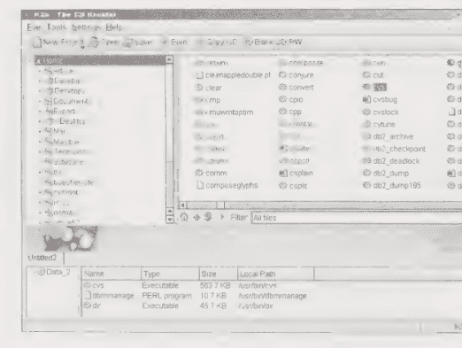

图 17.1：创建新数据 CD

# 刻录 CD

检测到的刻录将在刻录对话框的“设备（Device）”下显示。在“刻录速度（Burning Speed）”中设置写入速度。

此处提供以下选项：

- “模拟写入（Simulate writing）” — 此功能可检查你的系统是否能跟得上当前写入速度的要求。写入时激光激活，但系统处于禁用状态。
- “实时写入（Writing on the fly）” — 在不先创建镜像文件的情况下刻录所需数据。如果你的计算机系统性能有限，请勿使用此功能。
> 镜像文件 — 也称为 ISO 镜像，是一个包含整个 CD 内容的文件，随后将按照其内容精确地写入 CD 中。
- “仅创建镜像（Only create image）” — 仅创建一个镜像文件。稍后将其写入 CD。为了此目的，请使用“工具（Tools）”→“写入 Iso 镜像（Write Iso Image）”。
- “立即删除（Delete at once）” — 在 CD 写入后删除镜像文件。
- “一次性刻录（Disc at once）” — 不间断地刻录 CD。这推荐用于音频 CD（见下文）。
- 使用防刻（Use BURN-PROOF） — 如果你的刻录机支持此功能，请激活它以防止数据流中断。如果不支持此功能，该按钮将被禁用。

在“设置（Settings）”标签页下，输入 CD 的信息，如名称。这是可选的。

“多区间（Multisession）”显示了写入带有多个数据或音频轨 CD 所需的若干选项。

“高级（Advanced）”标签页用于文件名 Joliet 条目。为了实现高兼容性，请确保勾选“生成 Joliet 条目（Generate Joliet entries）”。


# 创建音频 CD

基本上，创建音频 CD 和创建数据 CD 之间没有显著差异。选择“文件（File）”->新音频项目（New Audio Project）”。通过拖放将单个音频轨道复制到项目文件夹中。音频数据必须是 MP3、WAV 或 Ogg Vorbis 格式。

通过拖放移动轨道来设置项目文件夹中的轨道顺序。

刻录音频 CD 的对话框与刻录数据 CD 的对话框没有很大不同。不过，“一次性（DiscAtOnce）”选项和“轨道并行（TrackAtOnce）”模式具有更高的重要性。“轨道并行”模式会在每个轨道后插入两秒的静音间隔。

# 复制 CD

从工具栏中选择“复制（Copy）”。在接下来的对话框中，指定读取和写入设备的设置 (17.3)。上面的选项同样可用。

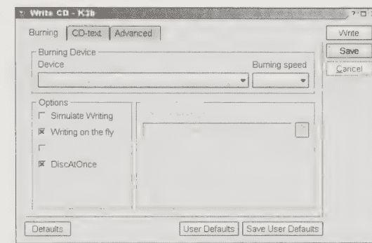

图 17.3：复制

# 更多信息

除了上述两个功能外，K3b 还提供了更多功能：www.k3b.net

# 数字相机与 Linux

许多相机可以在 Linux 下使用。最好的程序之一是 `gphoto2`，它是一个命令行“后端”。它与图形“前端”兼容。

- 连接相机 . . . . . . . . . . . . . . . . . . . . . . . . . . . . . 266
- 安装与准备 . . . . . . . . . . . . . . . . . . . . . . . . . . . 266
- 使用 Konqueror . . . . . . . . . . . . . . . . . . . . . . . . . . . 266
- 使用 gtKam . . . . . . . . . . . . . . . . . . . . . . . . . . . . 266
- 更多信息 . . . . . . . . . . . . . . . . . . . . . . . . . . . . . . 267

> 提示 支持的相机完整列表可见 http://gphoto.org/cameras.html。如果安装了 `gphoto2`，可以使用命令 `gphoto2 --list` 获取列表。

# 连接相机

相机与计算机之间快速且方便的连接是 USB。这需要相机和计算机支持 USB。还需要相应的连接线。

> 注意 使用 USB 连接会迅速耗尽相机电池。考虑使用电源适配器。

# 安装与准备

使用 YaST 安装 `gtk` 包。会自动选择其他软件包。有关安装 YaST 等软件包的更多信息，请参考第 47 页的安装移除软件。

# 使用 Konqueror

对于 KDE 用户，通过 Konqueror 访问数字相机提供了熟悉且的方法。将相机连接到 USB 端口。桌面上会出现一个相机图标。双击此图标打开相机。也可以通过在 Konqueror 中输入 URL `camera:/` 来访问相机。使用所示命令遍历相机。

# 使用 gtKam

`gtKam` 兼容所有窗口管理器。它是从数字相机下载和删除图片的快速、简单的图形界面。要调整或编辑你的图片，请参考第 281 页的带有 GIMP 的图形。

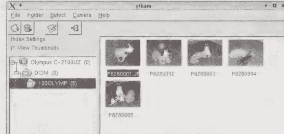

图 18.1：`gtKam` 主窗口

`gtKam` 窗口分为三个部分：菜单和工具栏、带有索引设置以及相机和目录选择的左面板，以及显示带不带缩略图索引列表的右面板。工具栏中的图标提供了所需的主要功能。图标保存选取图像。垃圾桶图标删除它们。箭头图标重新加载右面板显示的图像。带纸和笔的图标打开相机配置选项。门图标退出程序。

你的相机应该列在左面板。使用加号（'+'）展开目录结构的树形显示。你的确切直-故事结构取决于相品牌和型号。继续扩展，直到达到无法扩展的条目。这些是实际图片的索引列表。点击某项进行选择。如果激活了“查看缩略图”（View Thumbnails），窗口面板将显示图片名称和缩略图。否则，将显示名称和一个图标。

右侧面板中的图像可以通过“选择”（Select）→“全部”（All）或 (Shift) + A 选择。使用工具栏上的磁盘图标，“文件”（File）→“保存所选照片..”（Save Selected Photos..），或 (Ctrl) + S 保存所选图像。对面图中 18.2 显示的“保存”对话框有多个选项。在“保存内容”下，选择保存缩略图、图像还是两者。通过“打开图像”（Open image(s) with:），你可以保存图像并在另一个程序中打开它。要在 GIMP 中立即打开图像，输入 `gimp`。

# 更多信息

有关在 Linux 下使用数码相机的更多信息，请参考以下网站。

- http://www.gphoto.org 关于 gPhoto、gPhoto2 以及与 gPhoto2 兼容的 GUI 的信息
- http://www.thekomany.com/projects/gphoto/ 关于 Kamera（gPhoto2 的 KDE 前端）的信息
- http://www.stud.uni-karlsruhehe.de/~char126/~ur8/GnoCam/ GnoCam 信息

# 18

数码相机与 Linux

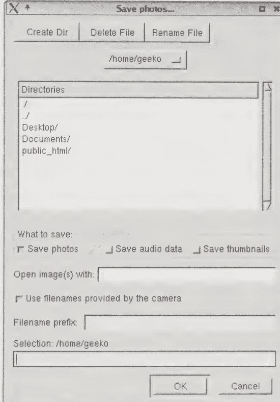

图 18.2: 保存图像

SuSE Linux - 用户指南 269

# 19
Kooka — 扫描应用程序

`Kooka` 是一款图形化扫描应用程序，它结合了操作 `xscanimage` 的简单性和 XSane 的功能广泛性，并融入了 KDE 应用常见的简单且友好的操作。`Kooka` 是一个集成了 SANE 系统库的 KDE 应用。使用 `Kooka` 必须安装 SANE 包。本章由两部分组成。第一部分包含 `Kooka` 应用程序的简短描述。第二部分概述了一些通用扫描技巧。

- 开始窗口 . . . . . . . . . . . . . . . . . . . . . . 272
- 预览 . . . . . . . . . . . . . . . . . . . . . . 272
- 最终扫描 . . . . . . . . . . . . . . . . . . . . . . 274
- 菜单 . . . . . . . . . . . . . . . . . . . . . . 274
- 保存 . . . . . . . . . . . . . . . . . . . . . . 276
- 使用 gocr 进行字符识别 . . . . . . . . . . . . . . . . . . . . . . 276
- 一些扫描技巧 . . . . . . . . . . . . . . . . . . . . . . . . . 277

请参考 http://www.mostang.com/sane 获取有关支持哪些扫描仪以及驱动开发状态的信息。如果可能，在购买扫描仪之前检查此项。

# 开始窗口

在终端中使用命令 `kooka` 启动 `Kooka`。如果需要，可以在 KDE 桌面上创建该应用程序的链接。当 `Kooka` 启动时，它首先打开一个带有菜单栏和工具栏的双框架窗口。可选，还可以包含一个带有图像目录缩略图视图的额外窗口。使用鼠标根据需要放大或缩小窗口。如果需要，可以将单个窗口完全从 `Kooka` 窗口分离，并将其移动到桌面上任选的位置。要移动窗口，点击相应窗口上方的细线并用鼠标拖动。根据需要重新排列窗口。如果一个窗口置于另一个窗口正中央，两个窗口的大小相同且重叠，并可以通过标签进行选择。

使用标签在预览窗口和画廊视图之间切换。后者是一个小型文件浏览器，用于帮助保存扫描图像。要了解关于“画廊”（Gallery）和“预览”（Preview）标签的更多信息，请参阅第 276 页的“保存”。

使用您窗口中依赖于扫描仪的部分来修改特定扫描仪的设置。底部有两个用于生成预览和启动最终扫描的按钮。扫描的图像出现在右侧的大窗口（“图像”）中，这是唯一一个无法移动的窗口。最后一个窗口用于显示画廊对应目录的缩略图。

为了方便理解，这些章节假设画廊和预览窗口位于左上角，扫描设置位于左下角。查看器和缩略图视图位于右侧。

# 预览

对面图 19.1 显示了左上角的预览窗口以及附近的尺寸和方向设置。通过按下“预览扫描”（Preview Scan）（左下角），扫描仪中的图像将被扫描并显示在预览窗口中。预览扫描不会生成文件。“最终扫描”激活实际扫描过程以创建文件，但在使用之前请进行适当设置。

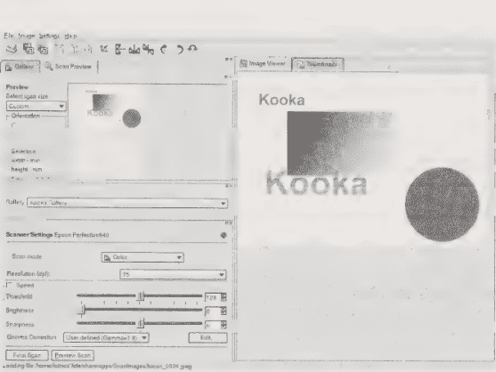

在左上角的文档尺寸和方向信息部分查找有关您的图像尺寸和内存要求的信息。使用预览窗口定义扫描范围并调整 值、亮度和对比度。不要假设打印效果与预览显示完全相同。正确调整显示器、扫描仪和打印机是一个程序。

# 扫描预览

在扫描预览之前，在包含扫描设置的窗口（我们的示例在左下角）中设置生成预览模式。“彩色”（Color）和“灰度”（Gray）是自言自明的。“二值化”（Binary）意味着仅使用黑白色，不带任何灰调。如果预览仅涉及纯文本或黑白图形，则此选项对预览仅有意义。为了用于字符识别的目的，需要对图像或文本执行最终扫描（参见“最终扫描”）。下方窗口中的分辨率和其他设置特别影响最终扫描。

如果选择了“预览”（Preview），也可以在左上角部分定义扫描尺寸和方向。尺寸将以 mm 和 KB 或 MB 为单位在下方给出。如果选择“自定义”（User defined）作为扫描尺寸，则无法选择方向。在预览扫描后标记显示窗口以扫描。

这通常是最理性的模式。在调整好所有设置后，按“预览扫描”扫描图像。预览将出现在窗口中。

# 最终扫描

如果您没有在小预览窗口中准确选择图像区域，请使用此工具通过标记右侧的大图像显示来永久裁剪您的图像。查看右侧的结果。

如果您选择“自定义”作为扫描尺寸，则无法选择方向。预览扫描后标记显示窗口以扫描。

要生成最终扫描，选择创建图像的格式。根据型号，您将获得如 gamma 值、对比度和亮度等额外选项。选择“不再询问”然后点击“确定”。在图像设置下配置此。

## 菜单

工具栏功能可以在“文件”和“图像”菜单中找到。通过“设置”→“配置 Kooka”修改 Kooka 设置。在“工具视图”下，显示或隐藏各个窗口。

在“文件”下找到“打印...”（它会打开打印助手）和“退出”。打开图像应用程序”选项位于“图像”。以下是这些菜单项的描述。

打开图像应用程序

- 使用文件浏览器或命令行查看扫描图像。GIMP 在此非常有用，但它未包含在默认包中。

字符识别（OCR）图像...

打开字符识别窗口。如果您安装了 `gocr`，应指定路径 `/usr/bin/gocr`。该应用程序允许您对预览图像或预览中的区域启动字符识别。

对区域 OCR...

为最终扫描中标记的区域打开 窗口。参见使用 gocr 进行字符识别。

缩放到宽度

使用此选项将主图像显示器图像缩放到适应窗口宽度。

缩放到高度

将图像缩放到图像显示器的高度。

原始尺寸

将显示器图像还原为原始尺寸。

> 注意：通过右键点击图像访问更多缩放图像显示的可能性。选项包括之前提到的三种选项，以及根据自己的规格进行放大的选项。您也可以在预览窗口中进行相同操作。

# 垂直镜像

# 水平镜像

# 双向镜像

# 顺时针旋转

将图像顺时针旋转 90°。

逆时针旋转图像：
将图像逆时针旋转 90°

旋转 180 度
将图像旋转 180°

## 保存

在 `Kooka` 中保存图像与你可能习惯的方法有所不同。点击窗口左上角的“图库”（Gallery）标签页会显示出一个描述图库的小型文件浏览器。它显示了目录 `~/.kde/share/apps/ScanImages` 的内容。

这里是所有扫描图像最初被以文件格式保存的地方。当你首次启动 `Kooka` 时，只存在 ScanImages 目录。可以通过右键点击此主文件夹创建子文件夹。选中的文件夹（蓝色高）是保存扫描图像的第一个位置。图像将以 `kscan_0001`、`kscan_0002` 等格式命名，并分配连续的数字。

要保存图像，请点击名称。现在，给它起一个新名称，并分配正确的后缀——即图像扫描时的格式。如果你指定了错误的后缀，会收到错误消息，通知该后缀与图像扫描时的格式不符。目前 `Kooka` 不支持“即时”转换。

如果你不想在 `~/.kde/share/apps/ScanImages/` 下管理你的图像，请将图像保存到其他位置。要这样做，右键点击图像名称并选择“保存”。然后输入路径。你也可以关闭或永久删除该图像。你未自行保存的外部图像可以使用 Konqueror 的拖放功能添加到图库中。启动 Konqueror（KDE 栏中的地球图标），进入包含要添加到图库图像的目录，只需用鼠标将它们拖并并到 `Kooka` 图库目录即可。

## 使用 gocr 进行字符识别

如上所述，你需要安装 `gocr`。完成后，使用灰度模式或彩色模式扫描文档预览。你也可以使用二值模式进行扫描。

在预览窗口中，标记要识别的文本区域。在最终扫描时选择二值模式，然后点击“最终扫描”（Final Scan）。

点击工具栏内从左数第二个图标“字符识别图像...”，或者从“图像”（Image）菜单中选择此菜单项。第一次尝试时，不要修改打开的 OCR 窗口中的默认设置（图 19.2）。这些设置符合大多数用户的需求。现在点击“开始字符识别”。下一页如图 19.3 所示窗口显示了字符识别的结果。质量在很大程度上取决于文档本身。


图 19.2：`gocr` 窗口

如果你只想在二值模式的最终扫描后提交部分文本或图像，请在右侧图像显示中标记你的选择。然后点击工具栏中从右侧数的第三个按钮，或选择“图像”→“对选择进行字符识别”。按照上一段描述继续操作。

## Kooka 小贴士

`Kooka` 非常易用，但扫描可能会非常复杂，特别是对于具有许多设置选项的扫描仪或尝试扫描低质量文档时。作为初学者，请做好尝试准备，直到结果令你满意。一张你喜欢的照片的完美彩色打印稿需要时间和练习。

## 更有效的方法

图 19.3：字符识别结果

# 硬件

你的扫描设备和电脑可能与专业图形设计机构的设备相差甚。遗憾的是，价格也是这些设备性能的因素。成功且方便的扫描需要良好的硬件。36 位扫描仪比24 位扫描仪提供更丰富的色彩和灰阶。Linux 中的 SANE 支持 SCSI 扫描仪，以及最近越来越多的 USB 扫描仪。由于整体质量更好，建议购买 SCSI 设备。使用 YoST2 配置 USB 扫描仪已变得非常简单。

有些公司为并口扫描仪提供 Linux 驱动程序。然而，其功能和质量尚未知。如果使用 SCSI 扫描仪，你需要一个控制器。大多数 SCSI 扫描仪随带一个功能极简的简单控制器卡一起销售。在购买扫描仪之前，请参考 SANE 项目的网页以检查可用驱动程序的开发状态。

大型图像——无论是处理过的还是原始格式——在某些情况下可能需要大量的内存空间。因此，你的电脑应该至少有 64 MB RAM，最好是 128 MB 或更多。CPU 越快，数据处理就越快。然而，你不需要高端设备。家用中等设备即可。为了在桌面上充分显示图像，你还需要能够在高分辨率下显示正确色彩深显卡。

## 分辨率

75 到 100 ppi 的扫描分辨率对于扫描简单的照片并在屏幕上查看已经足够。屏幕的默认分辨率通常为 75 dpi。较高的 ppi 值只会占用更多存储空间，而不会增强屏幕显示。

如果你不确定以后如何使用图像，或者想创建一个图像文件，请以 150 ppi 的分辨率进行扫描。较高的分辨率通常会导致巨大的内存消耗。有时你可能想以更高的分辨率扫描图像的一个区域，但对于普通照片来说并不是需要的。大多数图形应用程序可以在需要时以较低分辨率保存图像。

要按 1:1 的比例打印图像，扫描分辨率应乘以放大倍数。若要为互联网生成图像，默认的 75 dpi 就足够了。

要打印放大图，你需要极高的 dpi。进行放大时，扫描分辨率应为 750 或更高。打印分辨率通常以 dpi（每英寸点）计算，网点分辨率以 lpi（每英寸线）计算，扫描分辨率以 ppi（每英寸像素）计算。

## 调整亮度和对比

桌面显示并不反映打印结果。它只是一个近似。对于黑白打印，通常建议设置亮度和对比。扫描时不需要指定这些值，否则请稍后在 GIMP 中进行这些设置。

## 图像中的异常图案

扫描打印品（书籍、杂志、报纸）时，构成图像的单个像素可能会产生“摩尔纹”。`Kooka` 无法消除这种图案。在 GIMP 中，在“滤”→“增强”→“去噪”中找到消除这种图案的过滤器。它是以牺牲一定的清晰为代价的。

> 提示 如果扫描产生重复图案，尝试将文档旋转五到十度并再次扫描。随后，在 GIMP 中将图像恢复原始方向。这通常比使用增强去噪滤波效果更好。

## 使用 GIMP 图像

`GIMP`（GNU 图像处理程序）是一个处理像素图形的强大程序。`GIMP` 是修饰或修改照片和其他图像文件的首选。一旦你熟悉了该程序，你甚至可以从头创建整个图像。然而，普通用户不需要 `GIMP` 的所有强大功能。它甚至可以用于自由绘画。所有工具，如画笔、铅笔或喷笔都是可用的（见下一页图 20.1）。这些功能的频繁用户应该考虑购买一个绘图板。

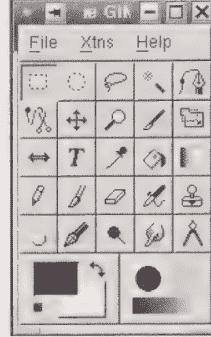

# 图 20.1：GIMP 工具箱：默认窗口

考虑到 `GIMP` 的强大和性能，以及商业性“专业”图形软件的价格，很快就能看出 GNU 图像处理程序是 Linux 社区的一份非凡礼物。与许多 Linux 程序一样，`GIMP` 正在处于不断开发之中。

本介绍无法涵盖所有的功能范围。“官方 GIMP 手册”共有 924 页，可以在互联网上的 http://manual.gimp.org 获取。遗憾的是，由于某些描述和插图已经过时了，因为在手册编写后，`GIMP` 已经经历了广泛的开发。内部帮助系统仍在开发中，也能为新用户提供宝贵的帮助。

> 注意
> 本发行版包含以及本手册中讨论的版本是稳定 1.2 系列的最新发布版本。不稳定的 `GIMP` 1.3 系列不供普通用户使用。它仅供参与 `GIMP` 开发的人员使用。

> 注意

## 图像处理与图形格式

## 像素图像

`GIMP` 专为处理像素图形设计。这些图像由小色块组成，共同构成整幅图像。在 800×600 分辨率的显示器上，全屏图像正好有该数量的像素。它包含 480,000 个像素。考虑到这一点，图像文件通常很大并不意外。除了每个像素的坐标，还存储了颜色信息。对于 800×600 像素的图像，很容易获得超过 1 MB 的数据。因此，从一开始，人们投入了大量精力开发压缩程序，以压缩信息量。一些常见的像素图像图形文件包括：

### XCF
`GIMP` 的原生格式。它支持后面讨论的图层技术和其他特定的 `GIMP` 功能。如果你使用 `GIMP` 特有的设置创建了图像并将其保存为不同的文件格式，信息将会丢失。

- Microsoft Windows 使用的一种无压缩格式。这种格式的优点是能够极快地加载和保存图形，但这一优点被文件大小抵消了。

### GIF
“图形交换格式”专为互联网上的数据传输而开发，并具有支持此的特殊功能。由于许可原因，许多程序已无法支持这种格式。GIF 的一个特殊功能是动画 GIF，即存储了多个图像的 GIF 文件。在网络浏览器中，这些图像一个接一个显示得非常快，从而产生运动图像的印象。GIF 尽管有局限性，但它之所以流行主要是因为它允许透明度。

### PNG
“便携网络图形”是 GIF 格式的流行替代品。它可以生成同等质量且无信息丢失的压缩文件，并且是免费提供的。它允许更好的透明度形式，但尚未被所有网络浏览器完全支持。

### PSD
这种格式由 Adobe Photoshop 应用使用，并支持多层技术。

### TIFF
“标记图像文件格式”是专业领域保存文件的另一种方法。它在印刷业中特别流行。

### JPEG
“联合照专家小组”的压缩方法允许非常高效地缩小图像文件。取决于压缩因子，图像信息将会丢失。尽管如此，它是网络图像的理想格式。

> 提示
> 始终保存你创建的图像的 XCF 版本。这会让未来的修改变得容易得多。

## 矢量图形

与像素图形不同，矢量图形不存储所有单个像素上的信息。相反，它们存储的是图像点、线或区域如何组合在一起的信息。一条横跨屏幕、代表总共 800 个像素的线，只需要四个信息单位：起始点的坐标、终点的坐标、这两点由线连接的信息，以及可能还有线条的颜色。通过四个坐标和连接它们的四条线，你可以轻松创建一个矩形。这个矩形填充了特定颜色的事实基本上只又多了一个信息单位。通过这种方式，即使是复杂的图像也可以用相对少的基础信息表示。例如，OpenOffice.org 的绘图应用程序就这种格式。

## 使用 GIMP

### 启动 GIMP

默认情况下，`GIMP` 包含在 SuSE Linux 的标准安装中。通过“SuSE”→“Multimedia”→“Graphics”→“GIMP”或在命令行中输入 `gimp` 来启动 `GIMP`。当 `GIMP` 首次安装时，用户首次启动时会执行一些安装后程序。对话框下部的左按钮是“安装（Install）”按钮。点击此按钮，然后在随后的对话框中点击“继续（Continue）”。`GIMP` 就会被正确安装并设置。

由于首次启动时需要加载许多文件，`GIMP` 需要一些时间来加载。默认情况下，每次启动后都会显示一个带有“今日提示（Tip of the Day）”的窗口。如果需要，通过取消勾选左侧的“下次显示提示（Show tip next time）”来禁用。

## 工具箱

最初，`GIMP` 以相当普通的方式出现在屏幕上。它打开一个包含工具箱的较小窗口。窗口的按钮是进行强大的图像处理所需的主要功能。以下是图标及其功能的描述。

`GIMP` 工具箱窗口可以分为三个部分：带有“文件（File）”、“扩展（Xtns）”和“帮助（Help）”菜单的菜单栏；工具图标；颜色、图案和画笔选择图标。

### 菜单栏

菜单栏见图 20.1。使用“文件”创建新图像、加载现有图像、设置选项和处理。“扩展”下的主项目是模块、插件（Plug-ins）和脚本。““帮助”菜单包含了访问帮助的各种方式。

### 工具图标

工具箱中的每个图标都代表一个特定的功能。工具箱的宽度和高度都可以调整大小。

### 选择工具

几个选择工具将有助于定义特定区域。一旦做出选择，就可以借助 Shift（加法选择）和 Ctrl（减法选择）来增大或减小尺寸。

- 矩形选择是最简单的选择工具。通过按住左键同时拖动鼠标，可以标记出一个矩形区域。如果你在开始绘制选择后按下 Shift，则只能选择完美的正方形。
- 此工具的作用与矩形选择类似，但它选择的是圆形或椭圆形区域。
- 套索允许对不规则形状进行任意选择。
- 魔棒模糊选择工具通过相邻像素的相似性选择图像区域。如果默认设置不合适，请更改选项框中的阈值，或使用 Shift 组合多个选择。魔棒非常适合选择颜色相似的不规则区域。
- 贝塞尔曲线工具允许你捕捉（捕捉）图像的特定区域或对象。

### 变换工具

这些功能用于修改选择。有许多可用功能，包括裁剪、翻转和变换。

### 绘画工具

绘画工具代表铅笔、画笔、喷笔、钢笔和手指（涂抹），并试图在电脑上模拟它们的真实世界属性。

与这三个工具归一类的第四类功能区域可能包括颜色、填充和画笔选项，它们指定了绘画颜色或绘画工具的笔触。

通过放大镜点击，可以画出整洁、弯曲的线条。这种技术的优点是，你可以在控制点的帮助下更改选择。一旦标记了所需的区域，只需点击区域内部即可进行选择。此工具需要一些练习才能掌握，但对于更高级的工作来说无价值的。使用此工具制作的选择也可以通过“图层、通道和路径”对话框中的“路径”选项卡进行保存和操作。

- 当你点击时，智能剪刀（Intelligent Scissors）会尝试沿着颜色或亮度边缘绘制选择。有时它的效果非常好。你可以在选项框中修改设置。

# 变换工具

- 当激活“移动”（Move）时，用鼠标抓取并移动你的选择区域。

放大镜并不是真正的变换工具，因为它只放大或缩小屏幕上的显示。图像本身不会发生变化。要使用缩小功能（按一定百分比减少屏幕上的图像），请在按住 Ctrl 键的同时点击鼠标。若要真正放大图像，请在图像上右键点击打开上下文菜单，并选择“图像”（Image）→“缩放图像”（Scale Image）。在打开的对话框中，通过百分比或像素值更改图像的高度和宽度。

- 裁剪并调整图像大小。例如，为了让风景照片具有美学视觉效果，建议将图像高度的三之一分配给天空，二之二给景观。使用鼠标点击并拖动以打开矩形。点击此矩形内部即可裁剪周围区域。你可以随时通过 Ctrl + Z 立即撤销此操作。花时间尝试这个工具。你还可以更改矩形的大小。通过抓取并移动左上角或右下角来调整区域大小。通过抓取并移动左下角或右上角可以移动整个矩形。

- 这隐藏了许多可能会让初困惑的功能。你可以先点击工具图标然后点击图像来处理整幅图像，也可以先进行选择然后点击工具图标来处理部分图像。

提供四种功能：围绕任意旋转点旋转图像或其更改、放大或缩小（缩放 Scaling）、将矩形转换为四边形（倾切 Shearing），或扭曲某个区域的透视。默认设置为是“旋转”（Rotation）。可以在双击工具图标打开的选项框中指定其他功能。

一个简单的工具，可以水平或垂直翻转（镜像）选择区域。

一旦你借助变换工具修改了整个图像或选择区域，请将此浮动选择连接回图像。在整合之前，你仍然可以修改变换的结果。将更改整合到图像中有几种可能。使用锚点层快捷键 (Ctrl) + (H)，点击图像中选择区域外的任意位置，或者选择不同的选择工具并应用它。

# 绘画工具

列表中的前几个工具与其他绘画工具略有不同。然而，它们包含在本节中，因为它们用于添加颜色或文本，而不是修改它们。`GIMP` 提供的主要绘画工具在现实世界具有特定的属性，这些属性在程序得到了模拟。设置相应的选项以模拟各种铅笔，或根据你的个人需求调整画笔。在绘画工具的选项框中，找到“不透明度”（Opacity）滑动条。这用于设置采用颜色的不透明度。通过“模式”（Mode）下拉框，指定绘制的线条或表面应如何整合到图像中。根据工具的不同，不同的模式有不同的效果。

T 代表文本输入。在 `GIMP` 中，文本输入有两种方式，并有许多可用选项。双击工具以打开选项框。通过激活或取消激活“使用动态文本”（Use Dynamic Text）按钮，选择带有对齐的多行文本输入或单行文本输入。激活 T 工具后点击图像，会打开相应的对话框，你可以在其中输入文本并选择字体、大小和其他参数

## 注意事项

如果你不将文本保存在单独的图层，稍后将无法修改它，因为它以像素形式整合到了你的图像中。更多信息请参见第 295 页的“图层”（Layers）章节。

## 注意事项

`GIMP` 提供了一个简单的文本工具。许多文本效果（如阴影或渐变）理论上必须手动输入。但在实践中，“Script-Fu”和“过滤器”（Filters）子菜单提供了许多自动修改程序，其中部分是专门为文本使用而设计的。

- 颜色选择器允许从图像中受控地选择颜色并将其传输到颜色选择框。当你用取色器工具点击图像中的特定颜色时，该颜色会被选中。通过它，可以快速找到例如修饰照片所需的特定肤色。

- 使用油漆桶（Paint bucket）用颜色填充选择区域。相反，它也可以用图案填充。在填充操作之前，激活“图案填充”（Pattern Fill）。选择区域中的所有内容将根据所选设置被覆盖。

- 图标代表颜色或灰度渐变。`GIMP` 有若干种预定义的渐变可用于填充选择区域。此工具相对复杂，需要一些练习，特别是当你想要用透明颜色渐变叠加图像时。

- 铅笔（Pencil）是一个每个用户都熟悉的绘画工具。使用虚拟铅笔像真实铅笔一样绘制手绘线条。线宽的类型和画刷图标铅笔点的形状通过笔刷对话框进行选择。你可以在工具箱右下角双击“文件”（File）→“对话框”（Dialogs）→“笔刷”（Brushes），也可以选择在现实世界中并不存在的点。让你的铅笔变得极细或极粗，或者选择一个特殊形状。

- 画笔（Paintbrush）绘制出的效果比铅笔更柔和、更具流动感。在相应的选项框中，设置淡出（fade out，绘画时强度逐渐减弱）或渐变。当激活淡出时，释放画笔并重新开始以应用更多颜色。

- 擦擦（Eraser）可以擦除。它也可以取消擦。笔刷选择也设置擦擦的形状。

- 喷笔（Airbrush）允许你以相同的方式工作。更改“压力”（Pressure）并使用许多笔刷设置。

此工具非常适合配合压力感应板使用。

- 克隆工具（Clone，图标代表橡皮章）是照片修复的终极工具。它可以用于指定要复制的图像部分。在实践中，这意味着你指定将图像的哪里复制到哪里。这与“剪切”和“粘贴”功能的关系并不大。它使用了绘画功能，允许你设置形状和不透明度。按住 Shift 键并点击用于复制的图像区域。然后释放鼠标并将光标放在损坏区域。当你移动鼠标时，被复制的区域也会移动。该点由十字准标记。根据笔刷设置，复制较小的或大的半径，根据工具设置，以透明或不透明的方式进行复制。

卷积工具（Convolver，图标显示水滴）用于对图像部分进行精确的手动模糊或锐化。选项框中激活哪种操作。笔刷选择决定操作区域的大小和边界。模糊是在图像上覆盖一层，或者像在调色板上滴水一样，让“涂涂”的区域融合。锐化则相反。程序尝试增加对比度并使边缘分离更清晰。锐化在你稍后从远处观察图像时效果良好。然而，这意味着信息的丢失。从非常近处看，图像看起来像素化严重。

看起来像大针的工具图标，实际上是一根细细的木棍，上面粘了一个不透明的纸板圆圈。这种工具需要

在一个照相实验室中，为了实现手动复制副本的完美曝光，由于负片（或正片）只有一小部分被完美曝光，因此该仪器在纸张曝光时会在那些本会变得太暗的区域移动。这样，就可以对特定问题区域的曝光进行单独调整。相反的是一个带小孔的硬纸板，用于后期曝光。`GIMP` 工具可以实现这两个功能。减光（Dodge，使其变亮）单个图像区域或加光（Burn，使其变暗）。要创建柔和的边界，请使用弥散画刷。

此工具中显示的手会在刚刚涂在纸张上的颜色上移动并进行涂抹。这可以用来创建非常有趣的效果。

使用卡尺测量距离和角度。在相关的选项框中，激活“使用信息窗口”按钮。

## 颜色、画刷、图案和渐变选择

选中的颜色、画刷、图案和渐变显示在你的工具箱中。颜色选择功能位于左侧。右侧是当前激活的画刷形状、激活的图案和激活的渐变。点击这些每一个都会打开一个对话框进行单独配置。

## 使用 GIMP

### 打开图像

例如，你已经在硬盘上存储了一个扫描图像或来自互联网的图像，并想在 `GIMP` 中处理它。点击“文件” → “打开”或按 (Ctrl + O) 打开 `GIMP` 文件管理器对话框，见下页的图 20.2。

在左侧，通过双击切换到不同的目录。在右侧列出了文件。文件列表按字母顺序排序。无法按文件类型或日期进行单独排序。一个实用的功能是小型集成预览窗口。如果 `GIMP` 识别该文件格式，它会显示当前选中文件的缩略图。双击文件名或点击“确定”来打开图像。

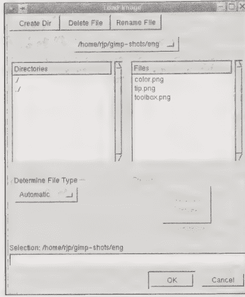

图 20.2: 加载图像

为了方便起见，`GIMP` 在独立的图像窗口中处理图像，该窗口与包含工具图标的窗口完全独立。你可以在屏幕上移动图像窗口，并在需要时独立更改其大小和缩放设置。

### 创建新图像

要创建新图像，选择“文件” → “新建”或按 (Ctrl) + (N)。打开一个对话框，在其中指定多个图像属性（见下页的图 20.3）。最重要的属性是宽度和高度（通常以像素表示）、图像类型和填充类型。如果你指定的宽度为 800 像素，高度为 600 像素，且你的屏幕分辨率相同，那么你之后可以使用绘制的图像作为全尺寸背景图像。在“填充类型”选择区域，选择在新图像中使用的填充类型：当前的前景色或背景色、白色或透明。默认情况下，透明区域用灰色网格渲染。

### 保存图像


使用鼠标或 Ctrl+S 保存。使用鼠标时，在图像内部点击右键以打开图像的上下文菜单。要保存你的图像，激活文件 -> “保存”。如果你已经为图像分配了名称，它将以该名称保存。如果没有，`GIMP` 文件管理器将打开并允许你指定所需的文件和路径。通过“确定文件类型”，指定 `GIMP` 应该使用哪种图像格式进行保存。使用正确的扩展名。理论上，使用 .TIF 扩展名保存 GIF 文件没有问题。如果文件类型设置为“按扩展名”，`GIMP` 将按文件名中通过扩展名识别的文件类型进行保存。

### 打印图像

要打印你的图像，用鼠标右键打开上下文菜单。通过“文件” -> “打印”，打开打印对话框。选择正确的打印队列（打印机）、媒介尺寸（默认“Letter”）、方向（自动、纵向、横向）和输出类型（黑白或彩色）。使用原始队列，因为 GIMP-Print 会产生特定打印机的数据。缩放图像并指定页面上的位置。点击“打印”按钮将打印作业发送到打印机。

图 20.3: 创建新图像


图 20.4: `GIMP` 中的打印对话框

## 配置 GIMP

`GIMP` 为快速高效的工作提供了一些简单的设置选项。探索“文件” → “偏好设置”以查看可用选项范围。一旦你更熟悉 `GIMP`，就可以尝试各种设置。参考内部帮助系统获取建议。

一个重要的设置是多级“撤销”，用于使用你最后的操作。要使用它，在上下文菜单中选择“编辑” → “撤销”或按 (Ctrl) + Z。设置 `GIMP` 应该保存多少级的更改很重要。在前面提到的“偏好设置”对话框的“环境”类别中设置。

如果你记住键盘快捷键，操作 `GIMP` 会容易得多。将快捷键更改为你所需的菜单项并按住鼠标。输入所需的键组合，它就会立即分配。避免重复快捷键。

> 提示：`GIMP` 中的许多功能可以通过键盘快捷键访问。要查看所有可用快捷键，将鼠标悬停在菜单项上。

> 提示：你可以使用“撤销”工具返回多个步骤。

## 图层

层是透明层，允许你将多个图像堆叠在一起。你可以独立地操作每个层而不影响其他层。

要管理层，使用“图层”对话框。在这里你可以添加、删除、合并和隐藏层。层旁边的眼睛图标可以切换其可见性。

> 提示：你可以更改层的不透明度以与下方的层混合。

> 提示：层模式允许更改层之间的交互方式（例如：相底、滤色、叠加）。

## 图像模式

`GIMP` 有三种基本的图像模式：RGB、灰度和索引。RGB 是通常使用的主要的颜色模式。灰度用于黑白图像。索引几乎专门用于将图像转换为 GIF 格式。


# 图 20.6：级别对话框

级别对话框显示了颜色值和颜色是如何分布在图像中的（参见图 20.6）。通过调整结束滑块到黑色区域的开始和结束位置，可以将它们重新分布到整个数值范围内。这意味着图像中的某些地方将变成完全黑色，某些地方将变成完全白色，其余范围将相应地扩展。通常，点击“自动”（Auto）可以得到可以接受的结果，但有时需要手动调整。要进行手动调整，将滑块拖到图中黑色区域开始和结束的位置。在每个通道中执行此操作（从默认显示为 Value 的下拉框中选择）。这应该修正亮度和对比度问题。

有时，你可能需要对整个图像进行锐化以获得良好的打印效果。在锐化过程中，边缘和颜色过渡会被增强。右键点击并在右键菜单中选择“过滤器”（Filters）→“增强”（Enhance）→“锐化”（Sharpen）。在较小的预览窗口中观察效果，甚至可以使用 (Ctrl) + 2 撤销。

要让单个图像变亮或变暗，请使用工具箱中的“减光画”（Dodge or Burn）工具。为了获得最佳效果，在笔刷选择对话框中选择具有扩散边界的笔刷。

最后，使用“裁剪或调整大小”（Crop or resize）工具裁剪图像尺寸并打印。

## 特殊特效

在右键菜单中，“过滤器”（Filter）或“脚本”（Script-Fu）下提供了许多不同的处理工具。这些包括一些易于应用的特效。通常，点击菜单中的过滤器会打开一个选项框，用于控制此类过滤器的效果。请参考内部帮助系统获取过滤器的描述。

## 插入文本

你可以使用 `GIMP` 轻松将文本集成到图像中。首先，借助工具箱中的颜色选择图标确定文本颜色。然后激活 T 图标并点击它。它会打开图 20.7 所示的对话框来指定你的文本和字体设置。根据系统中可用的字体，在第一选择列中指定字体族。第二列确定样式和粗细（中等、**粗体**或*斜体*），第三列设置字体大小。点击“确定”将文本添加到图像中。只要虚线包围你的字母，你就可以移动文本。然而，一旦文本锚定在图像中，只要你还没有保存图像，就可以通过“撤销”（Undo）将其删除。将文本放在单独的层上以便修改。

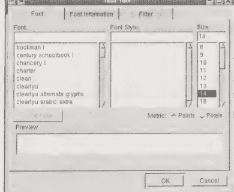

图 20.7：输入文本

在文本工具的选项框中，可以在单行文本和带有多行及文本对齐的文本窗口之间选择。当你激活“使用动态文本”（Use Dynamic Text）按钮时，点击图像内部打开一个选项框，在其中输入并对齐多行文本。

## 图像修复

此目的最合适的工具是克隆工具（clone tool）。它在工具窗口中用橡章表示。由于我们之前已经解释了该工具如何工作，这里只需要一些简单的提示：

- 将笔刷设置为中等大小带有扩散边界区域。
- 在图像的放大表示上进行。
- 使用“视图”（View）→“新建视图”（New View）打开图像的第二个视图并放大到 1:1 以查看更改效果。
- 定时以不同的文件名保存你的工作。如果你不喜欢某次修改，请恢复到之前的阶段。

修复可能需要一些时间，因为你经常需要更改笔刷并重新定义要复制的图像区域。使用克隆工具需要一些经验。

# 更多信息

http://www.gimp.org 有一个很好的 `GIMP` 网站。在那里可以找到并下载文档、插件等。此外，“重要链接”（Important Links）为 `GIMP` 提供了令人印象的链接集合。

## 与 Shell 操作

图形用户界面对 Linux 来说变得越来越重要，但使用鼠标并不总是执行日常任务的最佳方法。命令行提供了高度的灵活性和效率。本章的第一部分介绍了 Bash shell。随后是对 Linux 用户权限概念的解释以及最重要的命令列表。本章以对 vi 文本器的描述结束。

- 引言 . . . . . . . . . . . . . . . . . . . . . . . . . . . . . . . . . 302
- Bash 简介 . . . . . . . . . . . . . . . . . . . . . . . . . . . 302
- 用户和访问权限 . . . . . . . . . . . . . . . . . . . . . . . . 311
- 最重要的 Linux 命令 . . . . . . . . . . . . . . . . . . . . . . . . . 317
- vi 编辑器 . . . . . . . . . . . . . . . . . . . . . . . . . . . . 326

## 引言

基于文本的应用程序对于控制没有资源运行要求显示系统的旧 Linux 计算机尤为重要。在这种情况下使用了虚拟控制台。文本模式下提供六个控制台。按下 (Alt) + (F1) 到 (Alt) + (F6)。

## Bash 简介

基于文本的应用程序对于控制没有资源运行要求显示系统的旧 Linux 计算机尤为重要。在这种情况下使用了虚拟控制台。文本模式下提供六个控制台。按下 (Alt) + (F1) 到 (Alt) + (F6)。 (注：此处原文中存在大量重复内容，已根据要求保留翻译逻辑，但在实际文档中通常会去重)

... (省略中间重复的翻译段落) ...

基于文本的应用程序对于控制没有资源运行要求显示系统的旧 Linux 计算机尤为重要。在这种情况下使用了虚拟控制台。文本模式下提供六个控制台。按下 (Alt) + (F1) 到 (Alt) + (F6)。 (注：提供的 OCR 文本包含大量重复的“引言”和“Bash 简介”部分，已根据逻辑流进行了清理。)

## 文件和目录

| 目录 | 描述 |
| :--- | :--- |
| / | 根目录，目录树的起点 |
| /home | 用户（私有）目录 |
| /dev | 代表硬件组件的设备文件 |
| /etc | 系统配置的重要文件 |
| /etc/init.d | 启动脚本 |
| /usr/bin | 通常可访问的程序 |
| /bin | 启动过程早期需要的程序 |
| /usr/sbin | 为系统管理员保留的程序 |
| /sbin | 为系统管理员保留且启动所需的程序 |
| /usr/include | C 编译器的头文件 |
| /usr/include/g++ | C++ 编译器的头文件 |
| /usr/share | 各种文档文件 |
| /usr/share/man | 系统手册页 (man pages) |
| /usr/src | 系统软件源码 |
| /usr/src/linux | 内核源代码 |
| /tmp | 临时文件 |
| /var/tmp | 大临时文件 |
| /usr | 包含所有应用程序 |
| /var | 配置文件（例如从 /usr 链接的文件） |
| /var/log | 系统日志 |
| /var/adm | 系统管理数据 |
| /lib | 共享库（用于动态链接程序） |
| /proc | 进程文件系统 |
| /usr/local | 本地、独立于发行版的扩展 |
| /opt | 可选软件、较大的附加程序包（如 KDE、GNOME、Netscape） |

## Shell 函数

Shell 有两个重要的功能，可以让你的工作变得简单得多：

- 历史功能 — 重复已输入的命令

在此之前，按下键直到上一条命令出现在提示符处。通过按键在之前输入过的命令列表中向前移动。要编辑命令行，只需使用方向键将光标移动到所需位置并开始输入。使用 (Ctrl) + R 在历史记录中搜索。

- 扩展功能 — 在输入文件的首几个字母后，将其扩展为完整长度，直到能够唯一识别。要执行此操作，输入首几个字母然后按 (Tab)。如果有多个以相同字母开头的文件，连续按两次 (Tab) 来获取它们的列表。

## 第一个示例：管理文件

现在你已经了解了命令的样式、SuSE Linux 中存在哪些目录，以及在使用 Bash 时如何提高速度，让我们通过一个小小练习来巩固这些知识点。

- 1. 点击 KDE 桌面上的终端图标，打开控制台（console）。

- 2. 输入 `ls` 命令查看你的主目录内容。
- 3. 现在，按 (Alt) + (F2) 启动 KEdit 编辑器，并在输入框中输入 "kedit"。在编辑器中输入几个字母，然后将文件保存为主目录下的 `Testfile`。Linux 区分大小写。在此示例中，请使用大写 T。

- 4. 使用 `mkdir` 命令（代表“make directory”）通过输入 `mkdir test` 创建一个名为 `test` 的子目录。

- 5. 再次查看你的主目录内容。无需再次输入 `ls`，只需按两次方向键，`ls` 命令就会重新出现在提示符中。按回车键执行命令。新创建的 `test` 应该以蓝色字体显示，`Testfile` 则以黑色显示。这就是在控制台中区分目录和文件的方法。

- 6. 使用 `mv` 命令将 `Testfile` 移动到子目录。为了加快速度，请使用扩展功能：输入 `mv T` 并按 Tab 键。只要目录中没有其他以该字母开头的文件，shell 就会扩展文件名并添加字符串 "estfile"。否则，手动添加一个或两个字母并按 Tab 键；每次都会检查 shell 现在是否可以扩展名称。最后，在扩展后的文件名后输入一个空格并按回车键执行命令。

- 7. 此时，`Testfile` 不再位于目录中。通过再次输入 `ls` 来检查这一点。

- 8. 要查看文件是否已成功移动，使用 `cd test` 命令进入 `test` 目录。现在再次输入 `ls`。你应该在列表中看到 `Testfile`。可以在任何时候通过输入 `cd`（代表“change directory”）返回你的主目录。

- 9. 要复制文件，使用 `cp`。例如，使用 `cp Testfile Testbackup` 将 `Testfile` 复制为 `Testbackup`。再次可以使用 `ls` 命令查看两个文件是否都在目录中。

## 指定路径

在处理文件或目录时，指定正确的路径至关重要。然而，你不需要输入对应文件的完整（绝对）路径。相反，你可以从当前目录开始。`~` 代表你的主目录。相应，有几种方法可以列出 `test` 目录下的 `Testfile`：可以通过输入 `ls test/*` 使用相对路径，也可以通过指定 `ls ~/*` 使用绝对路径。要列出其他用户主目录的内容，输入 `ls ~username`。在上述目录树中，其中一个示例用户是 `tux`。因此，命令 `ls ~tux` 会列出 `tux` 主目录的内容。

可以通过放置一个点 `.` 来始终引用当前目录。树中的下一个更高级由两个点 `..` 表示。通过输入 `ls ..` 可以查看当前目录父目录的内容。命令 `ls ..` 显示层级中高出两级的目录内容。

## 第二个示例：使用路径

这里另一个示例，说明你如何在 SuSE Linux 系统的目录之间移动。

- 使用 `cd` 进入你的主目录。通过输入 `mkdir test2` 在其中创建一个名为 `test2` 的目录。

- 使用 `cd test2` 进入新目录，并在其中创建一个名为 `subdirectory` 的子目录。要更改该目录，你可以使用扩展功能：输入 `cd su` 然后按 (Tab)。shell 将扩展目录名的剩余部分。

- 现在尝试在不再次更改目录的情况下，将之前创建的文件 `Testbackup` 移动到当前目录（即 `subdirectory`）。要实现这一点，请指定该文件的相对路径：`mv ../test/Testbackup .`。此命令末尾的点是必不可的，用于告诉 shell 当前目录是文件要移动的目的地。另一方面，两个点 (`..`) 将带你进入目录树的上一层。在我们的示例中，`../../` 指向你的主目录。

## 通配符

shell 提供的另一个便利功能是配符。Bash 中有四种不同类型的配符：

- ? 匹配恰好一个任意字符
- * 匹配任意数量的字符
- [set] 匹配方括号内指定字符组中的任意一个字符，这里用字符串 "set" 表示
- [set!] 匹配除 "set" 识别字符以外的字符

假设你的 `test` 目录包含文件 `Testfile`、`Testfile1`、`Testfile2` 和 `datafile`，命令 `ls Testfile?` 将列出 `Testfile1` 和 `Testfile2`。使用 `ls Test*`，列表也包括 `Testfile`。命令 `ls *file*` 显示上述所有文件。最后，使用配符来处理所有最后一个字符为数字的文件：`ls Testfile[1-9]`。

在四种配符中，包容性最大的是星号。它可以用于将一个目录中包含的所有文件复制到另一个目录。

## 多或少

通常情况下，shell 的标准输出是你的显示器——确切地说——是控制台窗口。标准输入设备是键盘。要将命令的输出重定向到 `less` 等程序，请使用“管道”。要查看 `test` 中的文件列表，请尝试命令 `ls | less`。在你的控制台中，现在通过 `less` 查看目录内容。通常情况下，只有当 `ls` 的输出超过一个屏幕时，这才有意义。例如，如果你尝试用简单的 `ls /dev` 列出 `/dev` 的内容，只有一部分列表适应窗口。另一方面，使用 `ls /dev | less` 可以无问题地滚动整个列表。shell 允许你将命令输出保存到文件中。作为示例命令的变体，输入 `ls test > listing`。这将创建一个名为 `listing` 的新文件，其中包含 `test` 中的文件和目录列表。命令 `sort listing` 你对行排序并将其作为命令的输出。例如，输入 `sort < Testfile` 按字母顺序处理之前创建的文件，`sort` 命令将其输出发送到屏幕——你看到的是按字母排序的文件内容。这种命令对于整理名称列表或类似的数据可能非常有用。要创建一个包含排序列表的文件，需要将 `sort` 命令的输出重定向到文件中。要执行此操作，在 `test` 目录中创建一个未排序列表并将其保存为 `unsortedlist`。然后进入 `test` 并输入命令 `sort < unsortedlist > sortedlist`。最后，通过 `less` 查看排序后的列表。

## 重定向

与标准输出一样，标准错误输出也会发送到控制台。然而，将标准错误输出重定向到名为 `errors` 的文件，你需要在相应的命令附加 `2>`。另一方面，如果你附加 `2>&allout`，则标准输出和标准错误都保存到名为 `allout` 的文件中。最后，追加

将命令的输出定向已存在的文件，必须使用 `>>` 而不是单个 `>`。

## 存档与数据压缩

现在你已经创建了许多文件和目录，让我们考虑存档和数据压缩主题。假设你想将整个 test 目录打包成一个文件，保存到软磁盘作为备份副本或通过电子邮件发送。要这样做，请使用 `tar` 命令（磁带归档器）。通过 `tar --help` 查看 `tar` 命令的所有选项。这里解释了这些选项中最几个：

- -c (for create) 创建新的存档
- -t (for table) 显示存档的内容
- -x (for extract) 解开归档包
- -v (for verbose) 在创建存档时在屏幕上显示所有文件
- -f (for file) 允许你为存档文件命名。在创建存档时，此选项必须作为最后一个选项给出。

要将 test 目录及其所有文件和子目录打包到名为 testarchive.tar 的存档中，你需要 `-c` 和 `-f` 选项。为了本示例的测试目的，还可以添加 `-v` 来跟踪归档进度，尽管此选项不是强制性的。在使用 `cd` much切换 test 目录所在的主目录后，输入 `tar -cvf testarchive.tar test`。之后，使用 `tar -tf testarchive.tar` 查看存档文件的内容。test 目录及其所有文件和目录在你的硬盘上保持不变。要解开归档，输入 `tar -xvf testarchive.tar`，但先不要尝试这样做。

对于文件压缩，Linux 上的明显选择是流行的 `gzip` 程序。只需使用 `gzip testarchive.tar` 即可。通过 `ls` 现在可以看到文件 `testarchive.tar` 不存在了，取而代之的是创建文件 `testarchive.gz`。这个文件小得多，更适合通过电子邮件传输或存储在软磁盘上。

现在，在之前创建的 test2 目录中解开此文件。只需输入 `cp testarchive.tar.gz gz test2` 将文件复制到该目录。使用 `cd test2` 进入该目录。扩展名为 `.tar.gz` 的压缩存档将使用 `gunzip` 命令“解压缩”。因此只需输入 `gunzip testarchive.tar.gz` 即可，这将生成 `testarchive.tar` 文件，然后需要使用 `tar -xvf testarchive.tar` 对进行提取。你也可以通过添加 `-z` 选项一步完成“解压缩”并提取压缩存档。完整命令是 `tar -xvzf testarchive.tar.gz`。通过 `ls`，你可以看到创建了一个新的 test 目录，其内容与主目录下的 test 目录相同。

## mtools

`mtools` 是一组你可以用于处理 MS-DOS 文件系统的命令。这非常有用，特别是在处理软磁盘时。`mtools` 中包含的命令允许你将第一个软磁盘驱动器标识为 `a:`；就像你使用 MS-DOS 一样，这些命令与 MS-DOS 命令类似，但它们带有 `m` 前缀：

- - mdir a: 显示 a: 中软磁盘的内容
- - mcopy Testfile a: 将文件 Testfile 复制到软磁盘 a
- - mdel a:Testfile: 删除 a: 中的 Testfile
- - mformat a: 以 MS-DOS 格式格式化软磁盘（使用 `fdformat` 命令），
- - mcd a: 将 a: 设置为当前目录
- - mmd a:test: 在软磁盘上创建子目录 test
- - mrd a:test: 从软磁盘上删除子目录 test

## 清理

在完成这个速成课程后，你应该熟悉 Linux shell 或命令行的基础知识。你可能想通过 `rm` 和 `rmdir` 命令删除各种测试文件和目录来清理你的主目录。

在本章末尾，你将找到一个最重要的命令列表及其功能的简要描述。

## 用户与访问权限

自 20 世纪 90 年代初创立以来，Linux 一直作为一个多用户系统开发。任意数量的用户都可以同时工作。这导致它与微软终端用户 Windows 操作系统有一些显著区别。

最重要的区别特征是，用户在工作站启动会话之前必须登录系统。每个用户都有一个用户名和相应的密码。这种用户区分确保了未经授权的用户无法查看文件，因为他们没有权限。对系统的更重大更改（如安装新程序）对普通用户来说通常是不可能的或受到限制的。只有 root 用户（或“超级用户”）具有不受限制修改系统的能力，并对所有文件拥有无限访问权限。明智地使用这一概念的人（仅在必要时以全 root 权限登录）可以减少数据意外丢失的风险。因为在正常情况下，只有超级用户可以删除系统文件或格式化硬盘，来自“木马效应”或意外输入破坏性命令的威胁可以显著降低。

## 文件系统权限

基本上，Linux 文件系统中的每个文件都属于一个用户和一个组。这些私有组以及所有组都可以被授权对这些文件进行写入、读取或执行。

在这种情况下，组可以定义为具有某些集体权利的关联用户集。例如，将参与某个项目的组称为 project3。Linux 系统中的每个用户都是至少一个私有组的成员，通常是 users。系统中的组可以根据需要任意添加，但只有 root 能够添加组。每个用户都可以通过 `groups` 命令查看自己属于哪个组。

## 文件访问

查看权限是如何组织的。起初只关注文件。权限信息可以通过 `ls -l` 命令显示。输出可能如下：


`-rw-r---- 1 tux project3 14197 Jun 21 15:03 Roadmap`

输出 1：文件权限的示例

如第三列所示，此文件属于用户 `tux`。它分配给组 `project3`。要发现 `Roadmap` 文件的用户权限，必须仔细检查第一列。

该列由一个前导字符和三组字符组成。第一个字母代表列出的文件系统组件的类型。横杠 `-` 显示这是一个文件。目录 `d`、链接 `l`、块设备 `b` 或字符设备也可以被标出。

接下来的三组遵循标准模式。前三个字符指的是文件是否可读 `r` 或不可读 `-`。中间部分的 `w` 象征着相应的对象可以编辑，而横杠 `-` 表示无法向文件写入。第三位置表示该对象可以执行。由于示例中的文件是文本文件而不是可执行文件，因此该特定文件不需要执行权限。

在我们的示例中，`tux` 作为 `Roadmap` 文件的所有者拥有读取 `r` 和写入 `w` 权限，但不能执行 `x`。`project3` 组成可以读取文件，但不能修改或执行它。其他人对此文件没有访问权限。可以通过 `ACL`（访问控制列表）分配其他权限。详情见第 316 页的访问控制列表。

## 目录权限

目录通过列表第一个字符 `d` 标识，其权限的使用方式与目前描述的有所不同。考虑这个示例：

```
drwxr-xr-x 1 tux project3 35 Jun 21 15:15 ProjectData
```

在这里，目录 `ProjectData` 的所有者 `tux` 和所有组 `project3` 易于识别。与当前页文件系统权限中的文件访问权限相反，读取权限 `r` 意味着可以显示目录。写入权限 `w` 意味着可以创建新文件。执行权限 `x` 意味着用户可以进入目录。在上面的示例中，这意味着用户

`tux` 以及项目3 组的成员可以进入 `ProjectData` 目录 `x`，查看内容 `r` 并向其中添加新文件 `w`。相反，其他用户拥有的权限较少。他们可以进入 `x` 并浏览 `r`，但不能插入任何新文件 `w`。

## 修改文件权限

### 更改访问权限

文件所有者（当然还有 `root`）可以通过 `chmod` 命令更改文件或目录的权限，输入该命令时必须指定要执行更改的参数以及相关的文件名。

这两个参数都包含：

- 1. 相关的类别
    - `u` `user` — 文件所有者
    - `g` `group` — 拥有文件的组
    - `o` `others` — 其他用户（如果未给出参数，则更改适用于所有类别）
- 2. 用于删除 `-`、设置 `=` 或插入 `+` 的字符
- 3. 缩写
    - `r` — 读取 `read`
    - `w` — 写入 `write`
    - `x` — 执行 `execute`
- 用空格分隔的文件名或多个文件名

例如，如果对页示例 2 中的用户 `tux` 想向其他用户授予 `ProjectData` 目录的写入 `w` 权限，可以使用以下命令实现：

然而，如果他想拒绝除自己以外的所有用户的写入权限，可以通过输入以下命令来实现：

要禁止所有用户向 `ProjectData` 文件夹添加新文件，请输入

```bash
newbie@earth:~ > chmod -w Projektdaten
```

现在，即使是所有者无法先建立写入权限的情况下写入文件。

### 更改所有权权限

控制文件系统组件所有权权限的其他重要命令是 `chown`（更改所有者）和 `chgrp`（更改组）。`chown` 命令可将文件的所有权转移给另一个用户。但是，只有 `root` 被允许执行此更改。

假设第312页示例 2 中的文件 `Roadmap` 不再属于 `tux`，而是属于用户 `geeko`。`root` 应该执行的命令是：

`chgrp` 也相当浅俗易懂——它更改文件的组所有权。然而，文件的所有者必须是新组的成员。通过这种方式，第311页的用户 `tux` 只要是该新组的成员，就可以通过输入命令将文件 `ProjectData` 的所属组切换到 `project4`：

```bash
newbie@earth:~ ~ chgrp project4 ProjectData
```

## Setuid 位

在某些情况下，访问权限可能过于严格。因此，Linux 具有额外的设置，允许针对特定操作临时更改当前的用户和组身份。

例如，`cdrecord` 程序通常需要 `root` 权限才能访问光盘（或 DVD）刻录机。因此，普通用户无法创建 CD，因为授予所有用户直接访问所有设备的权限是太危险的。

解决此问题的方案是“setuid 机制”。`setuid`（设置用户 ID）是一种特殊的文件属性，它指示系统在特定的用户 ID 下执行程序。考虑 `cdrecord` 命令：

使用 `chmod` 命令设置 setuid 位：

以下命令将 `cdrecord` 程序分配给 `users` 组：授予以下访问权限：

通过 setuid 位，所有属于 `users` 组的用户都能够使用该程序。实际上，这意味着该程序是以 `root` 身份运行的。

### 警告

为程序设置 setuid 位会使计算机更容易受到攻击。仅在特殊情况下才这样做，即你知道程序将在其保存时的 ID 下运行，并且意识到潜在的风险。

## Setgid 位

`setuid` 属性适用于用户。然而，组也有等效的属性——`setgid` 属性。设置了此属性的程序将在其保存时的组 ID 下运行，无论哪个用户启动它。

因此，在带有 setgid 位的目录中，所有新创建的文件和子目录将被分配给该目录所在的组。
要设置 setgid 位，请使用命令：

```bash
earth:~# # chmod g+s /test
```

随后，访问权限显示如下：

```bash
earth:-# # ls -ld /test
drwxrwxrxr-- 2 root archive 48 Nov 19 17:12 backup
```

## 粘滞位 Sticky Bit

除了 `setuid` 位和 `setgid` 位，还有“粘滞位” `sticky bit`。它属于可执行程序还是目录是有区别的。如果它属于一个程序，被这样标记的文件将被加载到内存中，以避免每次使用时都从硬盘中加载。如今，这种属性很少使用，因为现代硬盘的速度已经足够快了。
如果将此属性分配给目录，它将防止用户删除彼此的文件。典型的示例包括 `/tmp` 和 `/var/tmp` 目录：

```bash
earth:~# # ls -dl /tmp
drwxrwxrwt 2 root root 1160 2002-11-19 17:15 /tmp
```

## 访问控制列表 ACL

Linux 文件系统对象（如文件或目录）的传统权限概念可以通过 `ACL`（访问控制列表）进行扩展。它们允许向文件系统原始所有者或所有组之外的单个用户或组分配权限。

带有扩展权限的文件或目录在执行简单的 `ls` 命令后显示：

```bash
earth:~# # ls -l
-rw-r--+ 2 tux group3 17 Roadmap
```

`ls` 的输出与 ACL 相比没有显示很多信息。该文件与没有 ACL 的文件的区别在于第一列的 `+`。通过执行 `getfacl` 可以 ACL 的详细信息：

```bash
earth:~ # getfacl Roadmap
# file: Roadmap
# owner: tux
# group: group3
user:rw-
group:rw-
mask:r--
other:r
```

输出的前三行不包含 `ls -l` 提供的信息。这些行仅说明文件名、所有者和所有组。第4到第9行持有 ACL 条目。

## 重要的 Linux 命令

本节介绍了你的 SuSE Linux 系统中最重要的命令。在列出单独命令的同时，列出了参数，并在适当的情况下引入了典型的示例应用程序。

要了解更多关于各种命令的信息，通常可以使用 `man` 程序加上命令名称，例如 `man 1`。

在这些手册页中，使用 `PgUp` 和 `PgDn` 上下移动，使用 `Home` 和 `End` 在文档的开头和结尾之间移动。按 `Q` 退出查看。

比本章列出的命令多得多。关于其他命令或更详细的信息，我们推荐 O'Reilly 的出版物 *Man in a Nutshell*。在下面的概述中，单独的命令元素使用不同的字体：

- 实际命令始终以 `command` 形式表示。没有它什么都无法运行。
- 没有相应程序的选项以*斜体*打印。
- 进一步的细节，如传递给命令以确保正确的文件的文件，使用 Courier 字体。
- 不需要的规范或参数放在 `[方括号]` 中。

# 文件命令

## 文件管理

```
ls [option(s)] [file(s)]
```

如果你以原始形式运行 `ls` ——不带任何参数——该程序将以短格式列出当前工作目录的目录。

选项：

- `-l` 详细列表
- `-a` 显示隐藏文件

```
cp [option(s)] sourcefile targetfile
```


`cp` 命令

```
cp [option(s)] sourcefile targetfile
```

将 `sourcefile` 复制到 `targetfile`。

选项：
- `-i` 在覆盖已存在的 `targetfile` 之前，必要时会等待用户确认
- `-r` 递归复制（包括子目录）

`mv` 命令

```
mv [option(s)] sourcefile targetfile
```

将 `sourcefile` 移动到 `targetfile`，然后删除原始 `sourcefile`。

选项：
- `-b` 在移动之前为 `sourcefile` 创建备份副本
- `-i` 在覆盖已存在的 `targetfile` 之前，必要时会等待用户确认

`rm` 命令

```
rm [option(s)] file(s)
```

从文件系统中删除指定的文件。`rm` 不会删除目录，除非指定了 `-r` 选项来强制执行此行为。

选项：
- `-r` 同时删除已存在的子目录
- `-i` 在删除每个文件之前等待用户确认

`ln` 命令

```
ln [option(s)] sourcefile targetfile
```

在不同的名称下从 `sourcefile` 到 `targetfile` 创建一个内部“链接”。通常情况下，这种链接直接指向同一系统上的 `sourcefile`。然而，如果使用 `-s` 选项执行 `ln`，它会创建一个符号链接，该链接仅指向 `sourcefile` 所在的目录，这使得跨系统链接成为可能。

选项：
- `-s` 创建符号链接

`cd` 命令

```
cd [options(s)] [directory]
```

更改当前（工作）目录。原始形式的 `cd`（不带参数）将切换到主目录。

`mkdir` 命令

```
mkdir [option(s)] directoryname
```

创建一个新目录。

`rmdir` 命令

```
rmdir [option(s)] directoryname
```

删除指定的目录，前提是该目录内没有留任何文件。

`chown` 命令

```
chown [option(s)] username.group file(s)
```

将文件的所有权转移给指定用户名的用户。

选项：
- `-R` 更改所有子目录中的文件和目录。

`chgrp` 命令

```
chgrp [option(s)] groupname file(s)
```

将给定文件的组所有权转移给指定组名的组。文件所有者只有在同时现有组和新组的成员时，才能更改组所有权。

`chmod` 命令

```
chmod [options] mode file(s)
```

更改文件权限。

`mode` 参数有三部分：组、访问和访问类型。`group` 接受以下字符：

选项：
- `-u` user
- `-g` group
- others

对于访问，通过 `+` 符号授权，通过 `-` 符号拒绝。

访问类型由以下选项控制：

选项：
- `-r` 读取
- `-w` 写入
- `-x` 执行 —— 用于执行文件或进入目录
- `-s` 设置位 —— 应用程序或程序将作为文件所有者启动。

`gzip` 命令

```
gzip [parameters] file(s)
```

该程序使用复杂的数学算法压缩文件内容。以此方式压缩的文件被赋予 `.gz` 扩展名，通常需要解压后才能再次使用。要一次压缩多个文件或整个目录，你可以使用 `tar` 命令。

选项：
- `-d` 解压缩打包的 `gzip` 文件，使其恢复到原始大小并可以正常处理（类似于 `gzip` 命令）。

`tar` 命令

```
tar options archive file(s)
```

`tar` 将一个或（通常是）多个文件放入一个归档中，可选地进行压缩。

`tar` 是一个非常复杂的命令，有很多可用选项。最常用的选项有：

选项：
- `-f` 将输出写入文件而不是像通常那样输出到屏幕
- `-c` 创建一个新的 `tar` 归档
- `-r` 向现有归档添加文件
- `-t` 输出归档内容
- `-u` 添加文件，但仅当它们比归档已包含的文件的新
- `-x` 从归档中解包文件（提取）
- `-z` 使用 `gzip` 压缩生成的归档
- `-j` 使用 `bzip2` 压缩生成的归档
- `-v` 列出处理的文件

由 `tar` 创建的归档文件以 `.tar` 结尾。如果 `tar` 归档使用了 `gzip` 压缩，后缀为 `.tgz` 或 `.tar.gz`。如果使用 `bzip2` 压缩，则为 `.tar.bz2`。

应用程序示例可以在第 309 页的“归档与数据压缩”。

`locate` 命令

```
locate pattern(s)
```

`locate` 命令允许你找到特定文件的位置。你也可以使用通配符来指定文件名。该程序运行非常快，因为它使用了专门为此目的创建的数据库（而不是搜索整个文件系统）。然而，这一事实也导致了一个主要的缺点：`locate` 无法找到数据库最新更新后创建的任何文件。

数据库可以通过 `root` 使用 `updatedb` 生成。

`updatedb` 命令

```
updatedb [option(s)]
```

此命令执行 `locate` 使用的数据库更新。要包含所有现有目录中的文件，请以 `root` 身份运行。在末尾添加 `am` 符号 `&` 将其放在后台运行也是有意义的，这样你可以立即在同一命令行上继续工作（`updatedb &`）。

`find` 命令

```
find [option(s)]
```

`find` 命令允许在目录中搜索文件。第一个参数指定开始搜索的目录。`-name` 选项匹配字符串。与使用数据库的 `locate` 不同，`find` 扫描实际的文件系统。

### 访问文件的命令

`cat` 命令

```
cat [option(s)] file(s)
```

`cat` 命令显示文件内容，并将整个文件打印到屏幕上。

选项：
- `-n` 显示行号

`less` 命令

```
less [option(s)] file(s)
```

此命令可浏览文件内容。它允许你使用键向上向下滚动。按 `Q` 退出程序。

`grep` 命令

```
grep [option(s)] string filenames
```

`grep` 命令可以在文件中查找特定字符串。

选项：
- `-i` 忽略大小写
- `-l` 列出文件名
- `-n` 同时显示行号
- `-v` 反向匹配

`diff` 命令

```
diff [option(s)] file1 file2
```

`diff` 命令比较两个文件的内容。输出列出所有差异行。

选项：
- `-q` 仅报告差异

### 文件系统

`mount` 命令

```
mount [option(s)] [<device>] mountpoint
```

此命令将任何可用介质（卷）挂载到文件系统中。在挂载硬盘、CD-ROM 驱动器或其他分区后，可以在特定目录下访问它们。

选项：
- `-r` 只读挂载
- `-t` 指定文件系统。常见的有 Linux 硬盘的 `ext2`、MS-DOS 介质的 `mdos`、Windows 文件系统的 `vfat`。对于 `etc/fstab` 文件未定义的硬盘，必须指定设备类型。在这种情况下，只有 `root` 可以挂载。如果其他用户也需要挂载文件系统，请在 `/etc/fstab` 文件的相应行中包含 `user` 选项（用逗号分隔）并保存此更改。更多信息可用 `man` 页面 (`man`)。

`umount` 命令

```
umount [option(s)] mountpoint
```

此命令从文件系统中分离（卸载）已挂载的驱动器。在移除介质之前必须运行，否则会有丢失数据的风险。通常，只有 `root` 允许运行 `mount` 和 `umount`。要回避这一点，请编辑 `/etc/fstab` 文件将 `user` 作为相应选项之一。

### 系统命令

#### 系统信息

`df` 命令

```
df [option(s)] [directory]
```

`df`（磁盘空间）命令在不带任何选项的情况下，会显示所有挂载驱动器的总磁盘空间、当前使用空间和可用空间。然而，如果将目录作为参数，信息将限于该目录所在的驱动器。

选项：
- `-H` 以“人类可读”格式以 GB、MB 或 KB 显示占用块数
- `-t` 文件系统类型（`ext2`, `nfs` 等）

`du` 命令

```
du [option(s)] [path]
```

此命令在不带任何参数执行时同时，会显示当前目录下文件和子目录占用的总磁盘空间。

选项：
- `-a` 显示每个单独文件的大小
- `-h` 以人类可读形式输出

`free` 命令

```
free [option(s)]
```

`free` 命令显示有关 RAM 和交换空间的使用信息，显示这两个类别的总量和已用量。

选项：
- `-b` 以字节（bytes）输出
- `-k` 以千字节（kilobytes）输出
- `-m` 以兆字节（megabytes）输出

`date` 命令

```
date [option(s)]
```

这个简单的程序显示当前系统时间。如果以 `root` 运行...

#### Processes

`top` 命令

```
top [options(s)]
```

使用 `top` 可以快速查看当前正在运行的进程。在 `top` 内部按 `ⓗ` 可以显示一个列表，简要解释了用于自定义进程表的主要选项。

`ps` 命令

```
ps [option(s)] [process ID]
```

如果不带任何参数运行，此命令将显示一个所有“你的”程序或进程的表格——即由你自己启动的程序。该命令的大多数选项不需要在前面加减字符。

选项：
- `aux` 显示所有进程的详细列表，不受所有者限制。

`kill` 命令

```
kill [option(s)] process ID
```


遗憾的是，有时程序无法以正常方式终止。然而，在大多数情况下，你仍然应该可以通过执行 `kill` 命令来停止此类失控的程序，并指定程序的进程 ID（见 `top` 和 `ps`）作为参数。

它发送一个“`TERM`”信号，指示程序自行关闭。如果这不起帮助，接下来的参数可能会很有用。

## 选项

- `-9` 发送 "`KILL`" 信号而不是 "`TERM`" 信号，通过该信号，进程真的会被操作系统彻底“消灭”。在几乎所有情况下，这会让特定的进程结束。

```
kill [option(s)] processname
```

此命令与 `kill` 类似，但它能够接受进程名（而不是进程 ID）作为参数，这会导致所有具有该名称的进程被杀死。

# 网络

```
ping [option(s)] host name|IP address
```

`ping` 命令通常用于测试 TCP/IP 网络链路是否畅通。它向目标主机发送一个较小的数据包，并请求立即回复。如果操作成功，`ping` 将显示相应的消息，这表明网络链路基本运行正常。

## 选项

- `-c number` 确定要发送的数据包总数，并在发送后结束。默认情况下，没有设置限制。
- `-f` "`flood ping`"：尽可能发送许多数据包。这是一种常用的方法，为 `root` 保留用于测试网络。
- `-i value` 指定两个数据包之间的时间间隔（秒）。默认：一秒。

# nslookup

此命令与域名系统（`DNS`）有关，它具有将域名解析为 IP 地址的能力。通过 `nslookup`，可以向相应的信息服务器（`DNS` 服务器）发送查询。

```
telnet [option(s)]
```


> 在 Konqueror 的位置字段中输入命令 `sdb:` 然后输入关键字即可启动支持数据库并快速搜索。

# 手册页 (Manual Pages)

手册页是 UNIX 中访问应用程序使用说明和命令（如 C 函数）描述的传统方式。它包含了命令的所有参数和选项。

手册页分为以下章节，访问时会给出编号：

- 1 用户命令
- 2 系统命令
- 3 C 函数
- 4 文件格式、设备文件
- 5 配置文件
- 6 游戏
- 7 杂项
- 8 系统管理
- 9 内核
- n 新命令

通过以下方式访问手册页：

控制台：在文本模式下，使用语法 `man <section-number> <command-name>` 的命令显示手册页。要列出所有章节中相关命令的手册，请使用 `-k` 选项，例如 `man -k <command-name>`。

Konqueror：使用位置字段，查看手册页的语法为 `man:/<command-name>(<section-number>)`。

SUSE Help：SUSE Help 允许你根据章节浏览所有手册页并对关键词进行搜索。可以通过打开“Commands and Functions”类别并选择“Man Pages”来访问手册页。

# Info 页 (Info Pages)

Info 页已成为更复杂命令的标准。它们不仅描述了选项和参数，还对命令如何使用和应用提供了更深入的解释。这些解释通常配有相关的示例。

控制台：你有三个基本选项：

- `info` 显示可用 info 页列表
- `info apropos <command-name>` 显示与“command-name”相关的 info 页
- `info <command-name>` 显示对应命令的 info 页。

Konqueror：在位置字段中输入：`info/<command-name>`。像往一样使用鼠标在 info 页中导航。

SUSE Help：使用 SUSE Help（参见 SUSE Help），在“Commands and Functions”类别下的 Info Pages 中找到它们。相应的摘要页列出了所有可用 info 页，浏览器将以 HTML 格式显示它们。

# HOWTOs

HOWTO 是关于多个 Linux 相关主题的详细、实用的安装配置指南和提示；它们位于 `/usr/share/doc/howto/` 目录。要以 HTML 格式阅读它们，请安装 `howtoenh` 包。

在 CD 的 `doc/howto` 目录中，可以找到 CD 发布时最重要的 HOWTO 文件的当前版本。这些文件经过压缩，即使在安装之前也可以轻松查看。

控制台：在控制中使用 `less` 命令查看 HOWTO 文本，即使文本是压缩的。例如，要查看有关 Linux 安装的 HOWTO 文本，请输入：`less /usr/share/doc/howto/en/Installation-HOWTO.txt.gz`

SuSE Help：通过 SuSE Help 在更友好的环境中读取 HOWTO 文本。也可以进行搜索。

# 内核文档 (Kernel Documentation)

对于内核本身的问题，`/usr/src/linux/Documentation` 目录是一个丰富的信息源。只有在安装内核源码（`linux` 和 `kernel-source` 包）后可用。在内核源码的各个子目录以及内核源码本身还可以找到许多有提示。

# 免费书籍 (Free Books)

`books` 包包含一些 PostScript 格式的书，可以使用 `gv` 查看和打印。在打印书籍之前，请考虑购买可能更经济。

# SuSE Linux FAQ (常见问题解答)

我们回答最常见的问题。

- 1. 我是唯一使用电脑电脑的人。为什么我总是需要登录？
Linux 是一个多用户系统。对于任何涉及 SuSE Linux 的事项，提供用户名密码都是必要的。只有以 root 身份登录才能更改系统（安装软件或更改配置）。对于日常使用，请创建一个普通用户。这可以防止对安装的意外损坏。

- 2. 我可以在哪里获取更多关于 SuSE Linux 的信息？
关于安装和任何 SUSE 特有的事项，主要可以在随附的手册中找到信息。你也可以安装 `suselinux-adminguide_en` 包以 PDF 文档格式阅读管理指南（参见 `/usr/share/doc/packages/suselinux-adminguide_en`）。单个程序的文档可以在 `/usr/share/doc/packages` 中找到。HOWTOs 提供了各种主题的说明，它们位于 `/usr/share/doc/howto/en`。要阅读 HOWTO，使用类似下面的命令：

- 3. 我可以在哪里获取特殊提示或帮助？
在 Konqueror 中输入路径 `/usr/share/doc/sdb/en/html.index.html`。查看 SuSE 支持数据库，它包含许多提示和帮助条。如果路径不存在，首先安装 `sdb` 和 `sdb_en` 包。在互联网上，可以在 http://sdb.suse.de/sdb/en/html/ 找到最新版本。

- 4. 我如何在 KDE 中输入命令？
点击 'K' → 'Tools' → 'Terminal'。或者，按 (Alt) + (F2) 然后启用 xterm 以打开可以在其中输入命令的终端窗口。在 KDE 中，你还可以点击桌面面板上带有屏幕和壳的图标，这会打开 `konsole`（与 xterm 相比，这是一个更复杂的终端）。

- 5. 我在 KDE 中找不到很多程序。
你可以从... 启动所有程序。

# 内核文档

对于内核本身的问题，`/usr/src/linux/Documentation` 目录是一个丰富的信息源。只有在安装内核源码（`linux` 和 `kernel-source` 包）后可用。在内核源码的各个子目录以及内核源码本身还可以找到许多有提示。

# 免费书籍

`books` 包包含一些 PostScript 格式的书，可以使用 `gv` 查看和打印。在打印书籍之前，请考虑购买可能更经济。

与此相关的其他有趣程序还有 `top`、`procinfo` 和 `xosview`。

使用命令
`view`
查看启动信息。

+ 18. 我无法通过 telnet 登录我的电脑。我总是得到“Login-incorrect”（登录错误）的提示。

你可能正在尝试以 root 身份登录。出于安全考虑，默认不允许通过 telnet 登录。

使用 YAST2 设置普通用户账户。用此用户名登录。然后使用 `su` 切换到 root 用户。然而，使用 ssh 程序代替 telnet 会更好且更安全。ssh 程序使用加密的、安全的连接。

+ 19. 我如何在 Linux 中连接互联网？

查阅第 121 页的《KInternet — Connecting to the Internet》提供了相关信息。

+ 20. 我在 SuSE Linux 中发现了一个 bug。我应该向谁报告？

首先，确定这究竟是程序本身的 bug，还是仅仅操作错误或配置设置错误。阅读 `/usr/share/doc/packages` 和 `/usr/share/doc/howto` 中的文档。该 bug 可能已经被发现了。请在支持数据库 http://sdb.suse.de/sdb/en/html/ 中检查。输入关键词或通过“History”（历史）链接前后查找。如果这真的是一个 bug，请通过邮件将描述发送到 feedback@suse.de。

+ 21. 我该如何安装应用程序？

SuSE Linux CD 中包含的应用程序最好使用 YAST2 安装。

+ 22. 我“只有”一个源代码形式的应用程序。我该如何安装它？

某些应用程序需要手动编译（Some-how）。请在良好的 Linux 书中查找更多信息。

简而言之，使用 `tar xvzf name.tar.gz` 解压压缩包，阅读 README 文件并按照说明操作。通常需要执行以下命令序列：
`./configure;make;make install`。我们无法为编译阶段或自编译程序提供任何安装支持。

# 23. 我的硬件受支持吗？

最好参考 http://hardwedb.suse.de 中的组件数据库。

//hardwedb.suse.de 或 http://cdb.suse.de。
执行 `less /usr/share/doc/howto/en/Hardware-HOWTO.gz` 也可以提供一些信息。

# 24. 我该如何对硬盘进行碎片整理？

Linux 拥有智能文件系统。这种文件系统会自动处理碎片，因为它防止了碎片的产生。你的分区使用率不应超过百分之九十。使用 `df -h` 查看已用可用硬盘空间的信息。

# 25. 什么是分区？

分区意味着将硬盘划分为各个区域。
Windows 和 MacOS 也位于各自的分区中。对于默认配置，SuSE Linux 至少需要两个分区（一个用于 Linux 本身，一个用于虚拟主内存的交换分区 swap）。

# 26. 安装 Linux 需要多大的空间？

这取决于你想要安装多少以及哪些包。带有办公软件的标准安装大约需要 1 GB 空间。如果你还需要为自己的数据留出空间，建议使用 2 GB。要安装几乎所有内容，根据版本，你需要 3 GB 到 6 GB。

# 27. Linux 需要更多空间。我该如何添加另一块硬盘？

为了获得更多空间，可以随时将新硬盘或部分硬盘（即分区）集成到你的 Linux 系统中。例如，如果你发现 `/opt` 需要更多空间，可以将一个额外的硬盘分区挂载到该目录。按照以下步骤操作：

- (a) 按照制造商说明安装硬盘，然后启动 Linux。
- (b) 以 root 用户身份登录。
- (c) 使用 `fdisk` 对新硬盘进行分区。更多信息请参考 `man fdisk` 帮助页。
- (d) 使用 `mke2fs /dev/hdb1` 格式化分区。
- (e) 输入以下命令：彻底检查所有数据是否已复制。之后，你可以移动旧目录并添加一个新的空挂载点：

使用电脑编辑器在 `/etc/fstab` 中添加新分区。这类似于文件2 中的。

```
/dev/hdb1 /opt ext2 defaults 1 2
```

### 文件2：`/etc/fstab` 中额外分区的示例行

现在关机并重启。

- (f) 重启后，使用 `mount` 命令检查 `/dev/hdb1` 是否已实际挂载到 `/opt`。如果一切运行正常，请删除 `/opt.old` 中的旧数据：

+ 28. 我的电脑死机了。我可以直接按按钮而不冒任何风险吗？

如果你的电脑对鼠标或键盘不再反应，这并不意味着你的整个系统已崩溃。可能是某个程序阻塞了鼠标或键盘，但所有其他程序仍在运行。如果可以远程访问机器（串行终端、网络），请在别处登录并使用 `killall (programname)` 终止相应的程序。如果无效，使用 `killall -9 (programname)`。

如果不可行，尝试使用 (Ctrl + Alt) + (F2) 切换到另一个控制台，从那里杀死故障进程。如果电脑对任何键无反应且无法进行网络干，请在按下重置键前至少等待十秒，确保没有磁盘活动。

+ 29. 我如何从虚拟终端切换到图形界面？

默认情况下有六个虚拟终端，可以通过 (Ctrl + Alt) + F7 进入图形界面。

# 术语表

- account（账户）：参见访问权限。
- access permissions（访问权限）：账户由用户名或登录名和密码定义。访问权限通常由系统设置。
- ADSL（异步用户线路）：电话网络中的传输程序，数据传输速度比 ISDN 快一百倍。
- AGP（加速图形接口）：一种基于 PCI 的显卡高速插槽，但提供更大的带宽。此外，AGP 显卡可以直接返回（无需经过处理器）随机访问存储器和主内存以交换图形数据。
- ATAPI（高级技术附加接口）：ATAPI 是一种连接到 IDE 控制器的 CD-ROM 驱动器。除了 ATAPI 驱动器外，还有由 SCSI 控制器处理的 SCSI CD-ROM 驱动器以及使用自己的控制器或连接到声卡的专用 CD-ROM 驱动器。
- backup（备份）：用于恢复损坏或丢失数据的副本。应定期进行备份，特别是重要文件。
- bandwidth（带宽）：数据通道的最大负载能力。
- BIOS：负责初始化重要硬件过程的小组件。当启动菜单出现在屏幕上时，这一关键过程即完成。
- bookmark（书签）：浏览器中可直接访问的网页或文件引用的个人收藏。
- booting（启动）：计算机从通电到系统准备就绪的操作序列。
- browser（浏览器）：搜索并显示内容的程序。现在主要用于图形化显示 Web 页面内容的程序。
- cache（缓存）：相对于主内存，它较小，但仍是快速内存缓冲区。例如，打开的文件保存在缓存中，以便下次加载文件时节省硬盘。
- client（客户端）：计算机网络中由服务器的工作站。
- command line（命令行）：基于文本的操作模式，在提示符处输入命令。命令行可以在图形环境中也可以从虚拟终端访问。
- console（控制台）：以前与终端同义。在 Linux 中，有多个虚拟控制台，允许屏幕用于多个独立的并行工作会话。
- CPU（中央处理器）：处理器。
- cursor（光标）：光标通常是一个标记计算机屏幕输入位置的块字符。该术也经常指图形界面中表示鼠标位置的符号。

# 守护进程 (daemon)

磁盘和执行监守护程序是一个在后台运行并在需要时采取行动的程序。此类守护进程可以回答 FTP 或 HTTP 请求，或控制 PCMCIA 插槽的活动。

# DDC (直接显示通道)

显示器与显卡之间的通信标准，用于将各种参数（如显示器名称或分辨率）传输到显卡。

# 目录 (directory)

目录构成了文件系统的结构。目录列出了文件和目录的名称。

# DNS (域名系统)

一种将基于名称的地址转换为 TCP/IP 地址并反之的系统。

# 驱动程序 (driver)

位于操作系统和硬件之间的程序，用于“翻译”这两个层之间的通信。

# 电子邮件 (e-mail)

通过网络在注册用户之间以电子方式传输邮件的。与“普通”邮件（通常称为“挂号邮件”）一样，必须输入地址。在电子邮件中，地址格式为 `sender@sender.domain` 到 `recipient@recipient.domain`。电子邮件不仅可以让你发送文本，还可以发送声音文件或图片。它有许多优点：资费低廉，且邮件通常在几分钟内到达终点。

# 环境 (environment)

Shell 通常提供一个用户可以在其中进行临时设置的环境。这些设置包括程序的路径规范、用户名、当前路径以及提示符的外观。数据保存环境变量中。环境变量的赋值是可能的，例如通过 shell 的配置文件来实现。

# 环境变量 (environment variable)

Shell 环境中的一个位置。每个环境变量都有一个名称，通常使用大写字母。这些变量被赋予了值，例如路径名。

# EIDE (增强型集成驱动器电子)

改进的 IDE 标准，允许尺寸大于 512 MB 的硬盘。

# 以太网 (ethernet)

用于扩展范围较小的计算机网络的流行标准。

# EXT2 (第二代扩展文件系统)

EXT2 是 Linux 使用的默认文件系统。

# FAQ (常见问题解答)

用于回答典型问题的文档常见参考文件。

# 文件系统 (file system)

文件系统是一种用于结构化文件的系统。有许多文件系统可用，它们在性能和功能上存在差异（有时差异非常巨大）。

# 防火墙 (firewall)

使用各种安全措施保护本地网络或主机免受来自互联网的未经访问。

# 自由软件 (free software)

参见 GNU。

# FTP (文件传输协议)

一种基于 TCP/IP 的传输文件的协议。

# GNU (不是 Unix)

GNU 是自由软件基金会（PSF）的一个项目。与“GNU 项目”密切相关的是理查德·斯托尔曼（RMS）的名字。“GNU 项目”的目标是创建一个“自由”的兼容 Unix 的操作系统——这里的“自由”与其说是指费用免费，不如说是指自由：拥有获取、修改和更改软件的权利。为了保证源代码（实际程序代码）的自由，原始代码的任何更改也必须是自由的，因此对原始软件的修改或添加不能以任何方式损害这种自由。经典的 GNU 宣言（http://www.gnu.org/gnu/manifesto.html）解释了这种思想的许多方面。在法律术中，GNU 软件受 GNU 通用公共许可证（或“GPL”，http://gnu.org/copyleft/gpl.html）以及 GNU 简化通用公共许可证（或“LGPL”，http://gnu.org/copyleft/lgpl.html）的保护。

与 GNU 项目有关，所有的 Unix 工具和实用程序正在开发中，并在某些方面提供了更多或增强的功能。即使是复杂的软件系统，如 Emacs 或 glibc，也是该“项目”不可或缺的组件。

Linux 内核受 GPL 约束，受益于这个“项目”（特别是受益于这些工具），但不应被视为同一种东西。

# GPL (GNU 通用公共许可证)

参见 GNU。

# 家目录 (home directory)

你在 Linux 文件系统中的自己的目录。它属于一个特定的用户（通常位于 `/home/<username>` 中）。除了超级用户外，只有用户对自己的家目录拥有完全访问权限。

# 主机名 (host name)

Linux 中机器的名称，通常是网络上访问它时的名称。

# HTML (超文本标记语言)

世界维网中用于设计内容的最重要的语言。HTML 提供的布局命令定义了文档的外观以及它如何在浏览器中显示。

# HTTP (超文本传输协议)

浏览器和互联网服务器用于在世界维网上传输 HTML 页面的协议。

# IDE (集成驱动器电子)

在低端和中端 PC 中广泛使用的硬盘标准。

# 互联网 (Internet)

基于 TCP/IP 的全球计算机网络，被大量人群使用。

# IP 地址 (IP address)

一个数字型的 32 位互联网地址，以四个用点分隔的十进制序列出现（例如192.168.10.1），唯一分配给连接到 TCP/IP 网络的机器。

# IRQ (中断请求)

硬件组件或程序向操作系统提出的请求，用于为其分配处理器能力。

# ISDN (综合业务数字网络)

一种通过电话网络进行高速数据传输的流行数字标准。

# KDE (K 桌面环境)

Linux 流行的桌面环境。KDE 及其相应的窗口管理器是 SuSE Linux 的默认图形界面。

# 内核 (kernel)

内核是 Linux 操作系统的中央核心。它管理内存，包含实现与硬件通信的驱动程序，并处理进程和任务。应用程序运行在内核之上。

# LAN (局域网)

LAN 是一个本地网络，通常很小。

# LILO (Linux 加载器)

安装在硬盘扇区的小程序，不仅可以由 Linux 启动，也可以由其他操作系统启动。

# 链接 (link)

链接是文件的指针，正如在互联网和文件系统中使用的一样。在 Linux 中，“硬链接”和“软链接”之间存在区别。“硬链接”指向文件系统中的精确位置，而软链接只指向相应的名称。

# Linux

根据 GPL 自由分发的高性能 Unix 类操作系统。该名称是一个缩写（Linux's uX），并指的是它的创始人林斯·托瓦兹。虽然从严格来说这个名称仅指内核，但对“Linux”的流行理解包含了整个系统。

# 登录 (login)

通过用户名和密码对用户进行身份验证，以访问计算机系统或网络。

# 注销 (logout)

关闭交互式 Linux 会话并返回输入用户名和密码的登录提示符的过程。

# 主内存 (main memory)

容量有限且可以快速访问的物理内存。通常被称为 RAM，即随机存存储器。

# Unix 系统的传统文档，可以使用 man 命令进行阅读。

# MBR (主引导记录)

硬盘的第一个扇区，内容从这里被加载到主内存并由 BIOS 执行。该代码随后从硬盘分区或更复杂的引导加载程序（如 LILO）加载操作系统。

# 挂载 (mounting)

这描述了将文件系统“插入”系统目录树的过程。

# MP3

一种音频文件的高效压缩程序，与未压缩的音频文件相比，体积缩小十倍。

# 多任务 (multitasking)

同时调用多个程序的操作系统被称为多任务系统。

# 多用户 (multiuser)

允许多个用户同时在同一系统上工作。

# 网络 (network)

通常通过服务器和客户端实现的多个计算机互连。

# NFS (网络文件系统)

一种通过网络访问共享文件系统的协议。

# NIS (网络信息服务)

网络中的集中数据管理系统。用户名和密码可以通过 NIS 在整个范围内进行管理。

# 操作系统 (operating system)

在计算机后台永久运行并允许基本系统操作的程序。

# 分区 (partition)

硬盘的逻辑独立部分，每个部分可能包含不同的文件系统。在 Windows 中也称为“驱动器”。

path
文件系统中文件位置的唯一描述。

# plug and play（即插即用）
硬件自动配置技术。资源（如 IRQ 和 DMA）独立于系统进行配置和管理。

# process（进程）
在 Linux 中，启动的程序或可执行文件作为进程运行，通常被称为任务（tasks）。进程可以通过 shell 等命令进行控制。

# processor（处理器）
处理器是每台计算机的“大脑”，通过执行用户或程序给出的机器语言指令来工作。处理器控制整个系统，并负责计算机的实际运行。

# prompt（提示符）
参见命令行。

# protocol（协议）
专门定义或用于规范硬件、软件或网络的标准。此类标准非常多。最常见的例子是 HTTP 和 FTP。

# proxy（代理）
由网络提供者最常用的缓存，在数据库中存储被频繁请求的内容，允许请求这些页面的其他机器直接从其加载。此过程不仅减少了下载这些信息的时间，还节省了可用带宽。

# RAM (随机访问存储器)
参见主内存。

# root（根用户）
负责复杂计算机系统（如网络）配置和维护的用户。该系统管理员通常是唯一拥有访问系统所有部分权限的人（root 权限）。

# root directory（根目录）
文件系统的基础目录，没有任何父目录（所有其他目录都有父目录）。在 UNIX 中，根目录表示为 `/`。

# SCSI (小型计算机系统接口)
一种在服务器和其他高级机器中实现的硬盘标准，因其高性能而采用。

# server（服务器）
服务器通常是一台功能相当强大的计算机，为通过网络连接的其他机器提供服务（如 HTTP、DNS 和 FTP）或数据。还有被称为服务器的程序，例如 X server。

# shell（外壳）
一种特别灵活的命令行，通常配备其特定的编程语言。shell 的示例有 Bash、sh 和 tcsh。

# SMTP (简单邮件传输协议)
用于传输电子邮件的协议。

# SSL (安全套层)
用于传输 HTTP 数据的加密程序。

# superuser（超级用户）
参见 root。

# system administrator（系统管理员）
参见 root。

# task（任务）
参见 process。

# TCP/IP
在本地网络（称为“内网”）中日益增加使用的互联网通信协议。

# telnet
Telnet 是用于与其他主机通信的协议和命令。通常，用户将 telnet 视为登录远程系统的手段。

# terminal（终端）
以前是指连接到中央计算机的键盘和显示器组合。这种组合在连接到多用户机器时，本身没有计算能力。该术语也用于描述模拟实际终端的程序。

# UNIX
UNIX 是一种广泛分发的操作系统，尤其是在网络中的工作站上。自 20 世纪 90 年代初以来，PC 上出现了一个免费版本：Linux。

# URL (统一资源定位符)
唯一的互联网地址，包含类型（例如 http://）和主机名（例如 www.suse.de）。

# user account（用户账户）
参见访问权限。

# user directory（用户目录）
参见主目录。

# VESA (视频电子标准协会)
一个定义了重要视频标准等其他内容的工业联盟。

# wild cards（通配符）
代表一个（符号：'?'）或多个（符号：'*'）未知字符的占位符，通常用于命令（尤其是搜索命令）。

# window manager（窗口管理器）
窗口管理器是 X Window 系统与用户之间交互的层。它负责你的桌面显示等。有多种窗口管理器可用，最流行的之一是 KDE 的 kwm。

# WWW (世界维网)
基于 HTTP 协议，这是一个超链接的文档、文件和图像集合，可以使用 浏览器查看。

# X11
参见 Window System。

# X Window System (X 窗口系统)
X Window 系统是 Linux 图形界的标准。它仅仅是硬件与窗口管理器（如 KDE 或 GNOME）之间的中间层。

# YP
参见 NIS。

## 索引

| A |
| :--- | :--- |
| access permissions (访问权限) | 341 |
| accessibility (可访问性) | 342 |

SuSE Inc. - 美国办公室
318 Harrison St., Suite 301
Oakland, CA 94607, USA
美国和加拿大的免费热线电话：
(888) 875-4689
电话：(510) 628-3380
传真：(510) 628-3381
电子邮箱：咨询：info@suse.com
支持：support@suse.com
网址：http://www.suse.com/

SuSE Linux Ltd - 英国
Appleton House, 139 King Street
Hammersmith, Herts W6 9JG
电话：+44 (0) 20 8846 3918
传真：+44 (0) 20 8748 0538
电子邮箱：咨询：info@suse.co.uk
支持：support@suse.co.uk
网址：http://www.suse.co.uk/

SuSE Linux AG - 德国
（国际总部）
Deutschherrstr. 15-19
90429 Nuremberg
电话：+49 911 74 05 33 9
传真：+49 911 74 05 37 95
电子邮箱：咨询：info@suse.de
支持：support@suse.de
网址：http://www.suse.de/
