# SuSE Linux 入门指南


作者：Jörg Dippel, Stefan Dirsch, Matthias Eckermann, Carsten Fischer, Klaas Freitag,
Gerd Knorr, Holger Herterich, Johannes Meixner, Siegfried Olschner, Marcus Schäfer,
Jesko Schneider, Arvin Schnell, Adrian Schröter, Gabriele Stratner
编辑：Antje Faber, Dennis Geider, Roland Haidl, Jana Jaeger, Edith Parzfall,
Peter Reinhart, Marc Rührschneck, Thomas Schreitle, Martin Sommer, Rebecca Walter
布局：Manuela Piotrowski, Thomas Schreitle
排版：LaTeX


# 欢迎

感谢您选择 SuSE Linux！我们的发行版现在比以往任何时候都更容易安装。只需点击几次即可准备好安装，大约 15–20 分钟即可完成系统安装。然后设置带有密码的用户并确定屏幕分辨率。您就可以开始使用 SuSE Linux 了。SuSE Linux 的配置也得到了进一步简化，同时仍然根据您的需求对不同的软件包进行调整和优化。

本书以及其中描述的软件让普通用户不再需要借用、租赁、招募或偷取“Linux 极客”来安装或使用 Linux。SuSE Linux 对极客来说功能强大，但对普通用户来说同样直观且易用。

在简单易懂的介绍之后，您将更深入了解 KDE 图形界面，并获得针对您个人需求的调整建议。通过 GNOME，我们向您展示另一个用户友好的界面。

之后，您将学习如何使用图形全能工具 YaST2 轻松地配置和管理您的硬件、互联网连接和系统。这一切都在系统运行期间完成，无需最后的重启。

在最后，您将找到命令行操作的说明、SuSE 帮助系统的介绍以及围绕 SuSE Linux 的常见问题解答。

安装支持——我们为您提供支持，以应对各种情况。有时计算机会偏离通用规范，这可能导致安装过程中出现问题，但在专业帮助下可以快速解决。为此，我们提供了免费的 SuSE 安装支持服务。通常情况下，只需查看 http://support.suse.de 下的 SuSE 支持服务即可。在那里您可以找到所有信息、联系人和最新的提示。如果您在那里没有找到解决方案，我们当然也会通过邮件 support@suse.de 为您提供帮助。
您可以在 doc 系列中的 `suselinux-reference_de` 包中找到参考手册。它包含了许多主题（YaST 模块、内核、网络等）的深入信息。PDF 文件位于 `/usr/share/doc/packages/suselinux-reference_de/`。
对于许多问题和挑战，我们已经找到了答案和解决方案。我们在支持数据库中提供了数百篇文章，通过 http://sdb.suse.de/ 全天候在线提供。
祝您用得愉快！
您的 SuSE 团队


## 迁移到 Linux

本章主要针对首次使用 Linux 的用户。信息根据问答原则构建，提供了在初次使用 Linux 时经常出现的要点解答。

在本书的附录中，您可以找到一个重要术语表和一个关于 SuSE Linux 的常见问题解答，这些是对本章的补充。我们假设您的计算机上已经通过标准安装安装了 SuSE Linux。随后的建议和答案均以此为基准。如果您已经对系统进行了个性化定制，那么下述说明同样适用。


## 安装期间

- Swap 区域（交换分区）应该设置在主分区还是扩展分区中？
  Swap 区域用于将数据从内存 (RAM) 交换到硬盘上。这样，内存就可以完整地留给当前数据。如果您需要运行多个操作系统，建议在扩展分区中创建 Swap 区域。主分区的数量通常是有限的，应该为其他操作系统留出，因此您应该在扩展分区中创建 Swap 区域。

./images/png/um_yast2_swap.png

## 在 Linux 下工作

- Linux 下是否有程序可以读取我以前在 Windows 下创建的文件？
  当然可以，您可以在 Linux 下继续使用您的旧文件。像 StarOffice 和 GIMP 等标准程序可以处理您以前熟悉的所有文件格式——无论它们是文本、图像、图表、视频还是音频文件，SuSE Linux 总是能提供相应的程序，让您可以轻松编辑您的文件。

./images/png/um_datformate.png

- 在哪里可以找到 Linux 程序？
  您的 SuSE Linux 已经自带了您应用程序和工作所需的所有程序。点击桌面左下角的 SuSE 菜单，您将对其所拥有的程序选择感到惊讶。

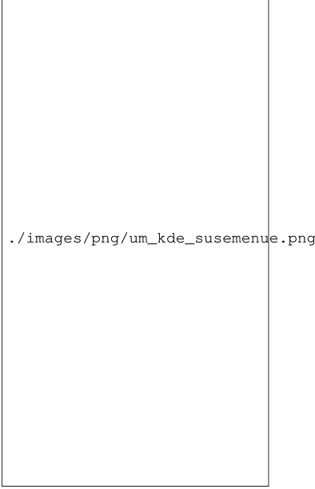

- 我如何为 Linux 格式化软磁盘？
  最好的方法是使用 KDE。点击桌面左下角的 SuSE 菜单，选择“系统” → “工具” → “格式化”。您现在可以在 FAT（用于 Windows）和 ext2（用于 Linux）之间进行选择。


## /usr (Unix 系统资源)

许多程序从此目录获取文档、信息、帮助文本和其他重要数据。

## /bin 和 /sbin (可执行程序)

在这些目录中可以找到许多与系统相关的程序，它们是系统启动时所需的。

## /opt (可选软件)

商业软件或不属于系统的大型程序（例如 KDE、Netscape、Mozilla 等）存放在此处。

## /etc (配置文件夹)

这里汇总了包含您的计算机配置信息的文件。它们包含了关于网络连接、计算机启动模式或单个程序（如备份）的信息。

## /boot (系统启动目录)

系统启动所需的文件和程序，例如内核 (Kernel)。

# 其他

此外，还有其他文件夹包含有关系统和已连接设备的信息：

/lib 和 /usr/lib（库文件）、/var（可变数据）、/proc（进程）、/media（可移动介质，如软盘、CD 等）/dev（所有连接的设备，如打印机、硬盘、键盘等.）

更多信息请参阅第 123 页的“文件与目录”章节。

## 关于密码和用户

-   我为什么需要密码？密码是访问主目录（Home directory）的钥匙。与其他操作系统不同，Linux 是一个真正的多用户系统。这意味着 SuSE Linux 独立管理每个用户的数据和设置，此外不同的用户还可以同时在同一台计算机上工作。想象一下，您的计算机有两个键盘和两个显示器，您和另一位用户同时在同一台电脑上工作，且互不干扰。

在实践中，键盘和屏幕位于同一个房间内，因此也是通过网络连接的，您甚至察觉不到有第二个用户也在使用系统，Linux 会智能地将现有的计算资源分配给已登录的用户。

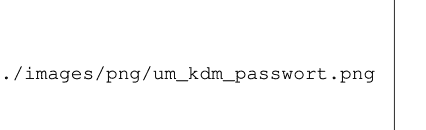

每个用户都拥有一个仅属于他自己的目录，那里是他的“家”。在主目录中，存储了所有的所有的数据以及对程序进行的所有设置，例如浏览器的书签列表和邮件程序的地址簿录。出于安全考虑，该区域受密码保护。只有通过此密码才能访问您的个人文件。

-   为什么我能读取某些数据但不能删除？

因为您没有相应的权限。通过输入密码，计算机不仅能识别您的主目录，还能识别赋予您作为用户所需的权限，即您在计算机上可以做什么以及不能做什么。当然，您可以查看 `/etc` 中的大多数文件，但只有系统管理员可以修改它们。涉及系统安全和稳定性的目录对您来说要么是只读的，要么完全锁定。

```
./images/png/um_rechte.png
```

对于您主目录中的数据，您可以自行决定向其他用户隐藏哪些内容，以及开放哪些内容供共同编辑。右键点击该文件，然后选择“属性”菜单项。您甚至可以通过在数据名称前加一个点来完全隐藏它。

-   我该如何添加或删除用户？

新用户由 root 创建。如您所知，每当有需要管理的事或需要创建新用户时，您必须以 root（系统管理员）身份登录计算机。以普通用户身份启动 YaST2 控制中心，选择“安全与用户”密钥并输入 root 密码。在右侧字段中会出现一系列选项，其中包含“创建新用户”项。填写字段（名和姓）后，将创建一个新用户并设置密码。

在输入密码时，必须区分大小写。密码长度应至少为五个字符，且不包含特殊字符（例如重音符号）。允许的字符有 `#*,;-_+$%&/![]`，空格以及 0 到 9 的数字；建议选择约 8 个字符的长度。为了确保密码输入正确，必须在第二个字段中不带符号的情况下重复一遍。重要：请牢记密码！

所谓的用户名（登录）是作为整个名称的一部分生成的。您可以为 YaST2 建议一个用户名。您可以更改它或输入自己的名称。名称不能包含小写字母（如变音符号）、数字和字符 `_`。用户名的限制比密码更严格。

当您使用 Linux 时，请使用此用户名和密码登录系统；这一过程也称为登录（Login）。

如果您想删除用户，请选择“创建和编辑用户”。选择该用户并点击“删除”。

## 挂载、Shell 及其他

-   什么是 mount（挂载）？

因为有了挂载，您不能直接从驱动器取出软盘。它必须先被挂载才能被读取。无论是软盘、硬盘、CD 还是 USB 闪存——所有介质在 Linux 中都必须先挂载才能访问。这是通过 `mount` 命令完成的。

为什么是这样？

在 Linux 系统中，始终可以通过多种路径到达目标。这在开始可能有些困惑，但有很多益处。如果某个功能失效或被锁定，您可以通过其他方式告知计算机执行这些命令。

想象一下，如果有人仅仅因为不能从驱动器取出抽屉就更换抽屉。它们必须先挂载才能被读取。无论是软盘、硬盘、CD 还是 USB 闪存——所有介质在 Linux 中都必须先挂载才能访问。这是通过 `mount` 命令完成的。

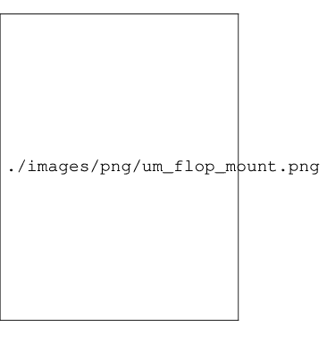

-   为什么我不能简单地关闭计算机？

您可以关闭，只是这种日常操作并不特别友好。可能除了您之外，还有另一位用户正连接在您的计算机上工作。如果您直接关闭系统，尚未保存的数据将面临危险。

当然，这同样适用于您自己的数据，但如果您按正常退出，就可以确保您的数据是安全的。SuSE Linux 以高数据安全性而闻名，为什么不利用这一特性呢？

-   一切听从命令！

在 Linux 系统中，始终可以通过多种路径到达目标。这在开始可能有些困惑，但有很多益处。如果某个功能失效或被锁定，您可以通过其他方式告知计算机执行这些命令。

例如，您不需要在菜单中通过点击鼠标启动程序，也可以通过键盘输入程序名称，这同样可行。或者您可以使用 `ls` 命令显示文件夹的内容。

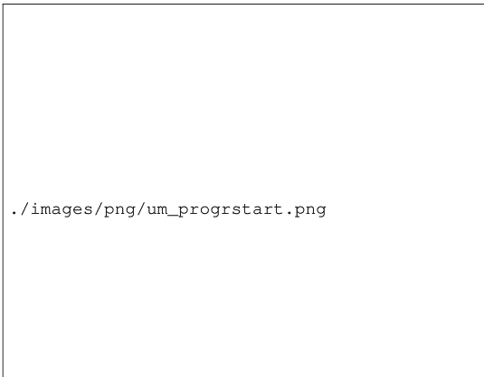


## 安装

过程几乎再简单了：在理想情况下，只需点击几次，SuSE-Linux 就会完全安装在您的计算机上。如果您的计算机上尚未安装任何 Linux 系统，程序将自动对您的硬盘进行分区，缩小可能已安装的 Windows 系统（9x/ME），安装一系列软件并自动配置您的硬件。如果您对 YST2 安装程序的建议不满意，或者对您的系统有特殊要求，没问题，因为您当然可以手动修改任何安装建议。

- 题前的重要提示——务必阅读！... 16
- 第一步：选择语言 ... 16
- 第二步：接受建议 ... 16
- 第三步：安装 ... 18
- 结束：配置 ... 18

## 题前的重要提示——务必阅读！

由于微软尚未公布这些文件系统的规范，目前 Linux 尚无法缩小带有微软 NT 文件系统的分区。如果您使用 NTFS 文件系统，受影响的包括 Windows NT、2000 和 XP。预配置的计算机通常属于这种情况。

如果您拥有一台计算机在单个分区上安装了上述任一系统，那么在安装 SuSE Linux 时，该系统将被不可恢复地删除。整个硬盘将由 Linux 格式化。在这种情况下，您需要 Windows 安装软件以便在需要重新安装系统。如果您的 Windows 预装了 NTFS 文件系统，但您拥有安装 CD，可以重新安装 XP 并选择“FAT32”作为 XP 的文件系统。这样硬盘将以 FAT 文件系统格式化，Linux 安装就可以毫无问题地缩小它。

但如果您在系统中还有其他分区（除 C 盘外的其他硬盘驱动器），SuSE Linux 理论上可以顺利地安装在其中一个额外分区上。不过，如果要在打算安装 Linux 的分区上有数据，您应该先将其备份到另一个分区中。

## 第一步：选择语言

启动您的计算机，并将 CD 1 或 DVD 放入相应的驱动器。首先，您将获得选择系统语言的机会。您选择的语言设置将自动应用于您的键盘布局。

## 第二步：接受建议

Linux 现在首先会检查您的系统。如果您已经在计算机上安装了 Linux 操作系统，下一个窗口中会询问您是想完全重新安装 SuSE Linux、对现有系统进行更新，还是启动硬盘上的系统。

如果到目前为止计算机上尚未安装 Linux，或者您选择了“新安装”，SuSE Linux 现在将检查您的完整硬件，并将结果列在所谓的“建议窗口”中（见下页的图 2.1）。在此窗口中，您还将看到分区建议（可能包括 Windows 缩小建议）和安装选项（新安装）。如果您是第一次安装 Linux，应该接受这些建议——它们通常是经过合理选择的。系统检查后会出现以下消息和建议：

**安装模式**：此处的默认值为“新安装”。

**键盘布局**：键盘布局将根据第一步中指定的语言进行选择。

**鼠标**：此处显示识别出的鼠标类型。

**分区建议**：此处建议一个合理的分区方案。如果磁盘上存在 Windows 9/ME，将指定其缩小的程度。

**软件选择**：此处设置了带有 Office 软件包的标准系统。

**引导加载程序（Boot Loader）**：此处设置了 SuSE Linux 安装引导管理器 LILO 的位置。这里是主引导记录 (MBR)。

**时间设置**：此处将根据语言设置相应国家的时区。此设置显然需要经常手动更改，因为许多语言在不同的国家被使用，而且 SuSE Linux（目前）无法猜测您住在哪个国家。

您可以随时通过点击相应的参数来更改 YST2 提供的建议。在硬件正确的情况下，更改通常没有太大意义。如果您更改了某个参数，可以每次都返回选择界面，并点击“继续”以使用更改后的值继续安装。

**注意**
如果您对引导加载程序、分区或硬件设置进行更改，您应该准确了解自己在做什么。

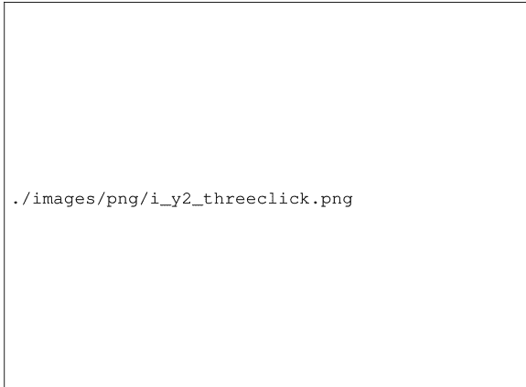

图 2.1：“建议窗口”——已识别的硬件、安装和分区建议

## 第三步：安装

现在到了这一步：如果您在绿色窗口中选择“是”，安装将开始。根据计算机的性能，您将将在约 15 分钟后获得一个安装完成的系统，其中包含约 350 个软件包。在安装期间，会显示有关其他几个 SuSE 产品的信息。您也可以点击“详细信息”。

## 结束：配置

安装完成后，在最终开始使用 SuSE 之前，您还需要进行一些重要的设置。

注意
如果您对引导加载程序、分区或硬件设置进行更改，您应该准确了解自己在做什么。

配置完成后，您可以重启屏幕。如有需要，您可以再次进行设置。

祝您使用 SuSE Linux 愉快！


# 帮助

如果您在 KDE 中不小心无法返回，可以随时按下 F1 键，或在相应程序的菜单中选择“内容...”条目。这将弹出 KDE 帮助中心。启动后，您将在左侧找到一个包含“内容”和“搜索”标签页的侧边栏。接下来的子章节将描述各自内容的功能。

# 内容

在“内容”选项下，您可以找到各种文档，这些文档为 KDE 系统的程序以及 Linux 系统提供信息。在这里您还可以找到 Man 手页（来自 Manual；指南）以及 Info 页面。例如，点击“程序手册”，将向您显示 K 菜单中的菜单结构。在此处，您可以在可以在菜单分支中或直接在右侧字段中找到您所选内容的文档。通过“Unix 帮助页”条目，可以找到“Man-Pages”。这种结构由于历史原因，根据计数方式的不同被划分为若干节的章节（用户系统、系统调用等）。点击相应章节的 K 将为您显示所有条目。选择所需的条目以获取相关信息。

您也可以通过在 Kon 的 URL 输入框输入数字符号 # 和命令名称来获取特定命令的信息。

# 使用 KDE

在 KDE 中，有多种方式可以更改设置或调用数据、应用程序。您可以使用 KDE 桌面、工作区、标题栏、窗口栏和控制栏。接下来的步骤将为您介绍这些具体方法。

## KDE 桌面

桌面是 KDE 的中心枢纽。启动后，您会在桌面上找到各种图标，通过它们您可以访问 CD-ROM、软磁盘或硬盘驱动器，放置文件以及插入指向目录和文件的链接。

实际上，桌面是您硬盘上的一个文件夹。它位于您的目录下的 `KDEdesktop`。所有在此处存放的文件都会通过 KDE 桌面显示。如果您可以更改路径，可以在第 42 页的“外观”章节中了解。

## 工作区菜单

与许多操作系统一样，您也可以在 KDE 顶部放置一个菜单栏。如果您想显示该栏，请在桌面上点击鼠标右键。将弹出一个菜单；请选择“激活工作区菜单”条目。您只需点击菜单栏即可启用或禁用它。下文中，我们将为您提供包含的菜单以及简化 KDE 操作选项的概述：

- ‘文件’ – 执行单个命令、启动应用程序、锁定屏幕或注销。
- ‘新建’ – 例如创建目录、指向 FTP 或 WWW 文件的链接，或创建用于快速访问频繁使用的地址或文件的应用程序。KDE 会自动管理来自浏览器的所有书签（目前为 Netscape 和 Mozilla）。
- ‘书签’ – 管理您的书签（Bookmarks）。这样您就可以轻松访问频繁使用的地址或文件。
- ‘工作区’ – 您可以排列或对齐窗口和图标，设置背景和工作区，以及禁用菜单栏。
- ‘窗口’ – 显示所有工作区上已打开的应用程序。
- ‘帮助’ – 使用关于 KDE 的帮助和信息，或由您报告问题或建议。

## 标题栏

标题栏是每个窗口顶部的条，包含窗口名称以及根据装饰风格的不同图标。

在“KDE2”装饰中，标题栏的结构如下所示：窗口菜单、应用程序图标、相应的窗口名称、最小化、最大化以及关闭图标。在最小化图标之前有时还会出现一个问号，即所谓的“是什么？”图标。该结构如图 3.1 所示。

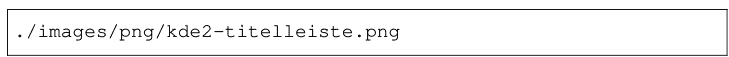

### 图 3.1：KDE 装饰下 KDE 窗口的标题栏

通过鼠标点击标题栏，可以获得更多功能。将弹出一个菜单，您可以在其中找到当前窗口或所有窗口布局的设置。它具有以下条目：

- ‘移动’ – 随鼠标移动，直到您点击左键将其“放下”。
- ‘大小’ – 通过移动鼠标更改窗口的水平和垂直方向，通过点击左键确定大小。
- ‘最小化’ – 最小化当前窗口。应用程序不会关闭，而是作为图标存放在窗口列表中。如需打开程序，请通过窗口列表中的图标激活应用程序。
- ‘最大化’ – 最大化当前窗口。应用程序现在将全屏显示。通过再次选择可以恢复原始窗口。
- ‘移动’ – 随鼠标移动。
- ‘始终置顶’ – 当前窗口保持在顶层。
- ‘设置’ – 保存。
- ‘对设置’ – 打开。
- ‘工作区’ – 移动。
- ‘关闭’ – 关闭窗口。

## 控制栏

控制栏在启动后可见。


Newticker – 如果您拥有互联网连接，就可以获取实时新闻；新闻将以滚动文本的形式在一个小型微程序中显示。第 48 页的“网络”（Netwerk）章节将详细介绍这一实用工具。

## 选定的 KDE 应用

目前有大量的 KDE 应用。由于空间限制，我们无法向您详细介绍所有程序。因此，选择和顺序并不代表质量标准。

## 磁盘管理

`kdf` 和 `quickdisk` 这两个系统程序可以帮助您快速、方便地挂载或卸载（英语为 mount）系统上可用的磁盘。

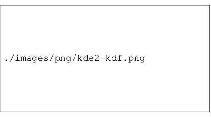

图 3.5：使用 kdf 您的磁盘概览

- quickdisk 是一个“微程序”，即它集成在系统栏中。右键点击图标时会打开一个菜单，以便您挂载或卸载相应的磁盘。如果您想查看图形概览，请选择“启动 KDiskFree”。

- kdf 或 KDiskFree 类似于 `df` 命令，向您显示从 `/etc/fstab` 文件中提取的磁盘概览。窗口包含磁盘符号、类型、大小、挂载点、占用百分比以及图形化表示。这样您就可以掌握全局了。

当您对某个条目点击右键时，会弹出一个弹出菜单。在这里，您可以通过“挂载设备”将磁盘连接到您的系统中，或通过“卸载设备”将其移除。“打开文件管理器”菜单项将启动一个显示该磁盘内容的新窗口。

## DVI、PostScript 和 PDF 查看器

Linux 下最重要的格式是 DVI 和 PostScript。您可以使用 DVI 查看器 `kdvi` 以及 PostScript 和 PDF 查看器 `khostview` 非常方便地查看它们。这两个程序的结构都非常直观。图 3.6 显示了 KDVi 的窗口。

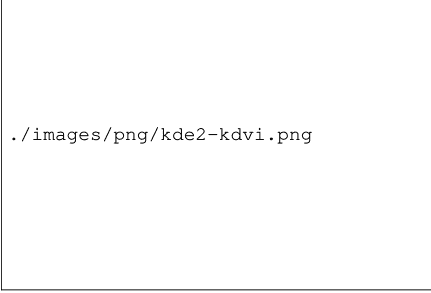

**图 3.6：** 显示文档时的 KDvi

这些查看器的功能之一是可以嵌入到 Conqueror 窗口中。这使得在无需重新启动相应程序的情况下显示文件变得非常简单。在 `khostview` 中（参见下页第 30 页的图 3.7），您可以加载并显示任意 PostScript 或 PDF 文档。点击“文件”、“打开”并选择相应的文档。

在“视图”（Ansicht）菜单中，您可以在不同的显示模式之间进行选择，决定以什么大小显示文档。
如果您想将显示旋转 90 度，建议查看“视图”下的“取向”（Ausrichtung）子菜单。


图 3.7：显示文档时的 KGhostview

## 使用 KOrganizer 管理日程

通过 KOrganizer ，您可以管理日程，并在生日和重要日期时收到提醒。此外，您还可以定义任务并记录其进度。该程序位于 `kdepim3` 软件包中。如有需要，可以使用 YaST2 安装它。

您可以通过按下 Alt + F2 键并在输入框中输入 `organizer` 来启动程序。

如果您想创建一个新日程，请点击“操作”（Aktionen）菜单中的“新日程”。将弹出一个窗口，您可以在其中设置日程的所有常规数据以及可能的会话人员。如果某个条目例如每周重复，您可以在“重复日程”（Eintrag wiederholen）选项卡中进行相应设置。不过，这需要激活“重复日程”字段。

在“常规”（Allgemein）选项卡下，您输入“摘要”（Zusammenfassung），设定开始和结束日期以及开始和结束时间。您还可以设置日程提醒。只需激活“提醒”（Erinnerung）字段并设定 KOrganizer 提醒您的时间即可。

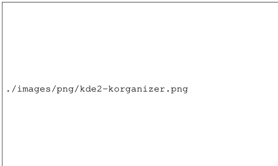

**图 3.8：** KOrganizer – KDE 日程表

在底部的文本框中，您可以输入更详细的内容。为了给您的日程一定的结构，您可以定义所谓的“类别”。您只需点击“类别”按钮；会打开一个窗口，您可以在其中选择相应的条目。如果存在此类条目，请在“编辑类别”中输入名称并按“确定”。点击“确定”关闭窗口。

接下来我们将向您介绍如何有效地[创建]一个日程……（注：原文在此处文本不完整）


在 Konqueror 中调用“设置”条目 $\rightarrow$ 将出现“设置 Konqueror”。在“代理服务器”下，您可以输入相关设置。

# 常见问题解答

- 我如何访问 CD/DVD？
您的 KDE 桌面面上有一个带有 CD 图像的图标。将您的 CD/DVD 插入驱动器，然后用左键点击该图像。CD 将被挂载，内容将通过 Konqueror 窗口显示。

- 我的桌面上没有 CD 图标。我该如何创建一个？
在桌面上点击右键。从菜单中选择“新建...” $\rightarrow$ “光驱 CD-ROM...”。会弹出一个窗口。在“常规”下，您可以更改桌面上图标的名称。在“设备”下，您可以设置您的 CD 或 DVD 驱动器设备。

- 我可以将控制栏放在任何地方吗？
可以的。用左键点击一个区域并拖动到任意边缘。释放鼠标后，控制栏将移动到那里。

- 我想要独立的控制栏。可以吗？
可以。在现有控制栏的区域上点击右键。选择“添加” $\rightarrow$ “扩展” $\rightarrow$ “依赖控制栏”。会打开一个控制栏。现在您可以通过 Konqueror 将文件或文件夹拖到那里。或者在栏上点击右键，从“添加”菜单项中选择相应的项目。

- 我如何将程序等添加到控制栏中？
这里有两种方法：
1. 在控制栏的区域上点击右键。会弹出一个弹出菜单。选择“添加” $\rightarrow$ “按钮”，您将看到 K 菜单中出现的条目。现在您可以将您喜好的类别“添加此菜单”放置到控制栏上。或者直接点击一次选择所需的程序。在这两种情况下，控制栏上都会出现相应的图标。
2. 您也可以直接从 Conqueror 中用左键点击程序、文件夹等，按住并将其拖到控制栏上。

# 我想了解更多关于我的系统信息。我该如何做？

有两种方法：按下组合键 Alt + F2 并输入命令 `ksysquery`。会弹出一个窗口。在窗口左侧的所谓“传感器浏览器”中，您可以点击显示的模块并将其回主窗口。另一种方法在控制中心中。在“信息”下，包含了所有与您的计算机关联的资源和设备。

# 我如何显示 PostScript 或 PDF 文件？

在 KDE 中有一个程序：KGhostview。在第 29 页的 DVI、PostScript 和 PDF 查看器章节中，您可以获得更多信息。

# 我如何显示图形文件？

您可以通过菜单输入“文件”、“打开”并输入 `kview` 来启动它。该程序支持多种图形格式。

# 我如何播放我的 WAV、MP3 文件？

可以，按下 Alt + F2 并输入 `noatun`。会弹出一个窗口；通过“文件”、“打开”菜单加载加载音频文件。

# 我如何播放音频 CD？

将音频 CD 插入驱动器，启动程序 `noatun` (Alt + F2) 并输入 `noatun`。您可能还需要调整音量。您可以使用 `kmix` 程序完成此。

# 我如何连接互联网？

通过 Kinetner 程序。详细描述请参阅第 33 页的“Kinetner – 通往 WWW 之路”章节。

# 我如何阅读邮件？

KMail 程序可以帮到您。在《程序》一书中会有详细描述。

## 更多信息

如果您需要更多关于 KDE 的信息，一定可以在以下网站之一找到答案：

- http://www.kde.org KDE 官方网站。
- http://www.konqueror.org 关于 Konqueror 程序的所有信息。
- http://il8n.kde.org KDE 国际化。
- http://kde.themes.org 关于 KDE 设计、主题等的一切信息。
- http://artist.kde.org 关于 KDE 图标、剪贴画等的一切信息。
- http://lists.kde.org 关于 KDE 所有主题的邮件列表列表。
- http://bugs.kde.org 在这里可以找到所有 KDE 的错误。
- http://www.gnupg.org 加密软件。

# KDE – 配置

在本章中，我们将向您展示如何使用控制中心更改外观，以及如何配置文件管理器、网络浏览器等……

| 主题 | 页码 |
| :--- | :--- |
| 引言 | 38 |
| 连接的设备 | 39 |
| 文件显示 | 40 |
| 电源角色 | 41 |
| 外观 | 42 |
| 信息 | 46 |
| 声音 | 46 |
| 网络 | 48 |
| 个人设置 | 50 |
| 系统 | 52 |
| 浏览器 | 53 |

## 引言

在本章中，我们将向您展示如何使用控制中心更改外观，以及如何配置文件管理器、网络浏览器等……

控制中心被分为一个栏以及左侧和右侧区域。在左侧区域找到配置。在右侧通常会有这些按钮：

- 帮助：显示一段文本。
- 使用预设：恢复默认设置。
- 应用：应用已更改的设置。
- 重置：恢复到原始值。


在“高级”选项卡下，您可以设置数字小键盘（KDE启动菜单中的“数字键锁定”项）和按键重复。

## 文件显示

该菜单包含“文件管理器”和“文件关联”模块。

**文件管理器** 此模块具有“行为”、“外观”和“回收桶”设置选项。

在“行为”下，您可以确定是否在单独的窗口中打开目录。“在窗口中显示网络操作”选项非常用，它会将所有操作“收集”在在一个单一且清晰的窗口中。

“外观”决定了配置窗口的视觉效果（字体、字号、...等）。

关于回收桶的设置可以在同名的选项卡中找到。

**文件关联** 将特定的数据类型分配给特定的程序——包括与电子邮件附件相关的“MIME”类型（英文：Multipurpose Internet Mail Extension，即多用途互联网邮件扩展协议）。通过文件识别规则、描述和符号可以帮助进行关联；在打开数据类型时，会显示程序列表。所有关联都会归类为 `application`（应用程序）、`audio`（音频数据）、`image`（图像）、`inode`（特殊文件）、`message`（消息）、`print`（打印系统）、`text`（文本）或 `video`（视频数据），并在“已知类型”列表框下显示。

功能概述：

如需自动搜索 MIME 类型，请在“文件管理器搜索”中输入该名称（请见下一页图 4.2）。通过双击打开一个类型并查看相应的 MIME 类型可以进行手动搜索。

如需添加新的 MIME 类型，可以点击窗口底部的“添加”。随后会弹出一个小型对话框，您可以在其中选择合适的类别，随后在“名称”下输入一个名称。

如需编辑 MIME 类型，请选择您想要更改的类型（请见下一页图 4.2）。从可用数据类型列表中做出相应选择；相关项将在窗口右侧显示。

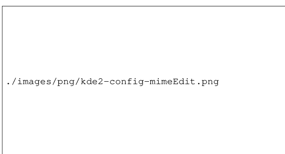

图 4.2：编辑 MIME 类型

点击 MIME 类型后，右侧会打开一个区域，您可以在其中进行更多设置：

在“常规”选项卡下，您可以设置图标、文件模式和简短描述。通过“添加”设置可以处理此类型的程序。

如果所选程序是 KDE 插件，您可以在“嵌入”下控制此操作，即文件是应该嵌入到 Konquerer 中，还是在单独的窗口中打开。

## 能量控制

通过此菜单项的模块，可以激活计算机的能量管理功能。这样，您可以在电力短缺时执行命令或播放声音。现代计算机可以在一段时间未活动后切换到待机模式。前提是支持 APM，这在今天的电脑中已作为标准包含。

# 外观

此模块为您的 KDE 系统提供了大量的设置选项。可用模块包括：“桌面”、“屏幕保护程序”、“设计管理”、“颜色”、“窗口装饰”、“窗口属性”、“标题栏”、“背景”、“控制面板”、“程序启动显示”、“字体”、“图标”和“按键布局”。

- 注意事项
在更改外观时，请考虑您的计算机的要求：选择一个具有许多颜色变化和背景底的样式，需要相应的计算性能。

- 注意事项
对话框本身是直观易懂的；但我们将介绍一些重要的模块。

**桌面** 在“外观”下，您可以调整桌面的视觉效果。在这里您可以设置背景图片和字体颜色。

**屏幕保护程序** 在此模块中，您可以设置屏幕保护程序的时间，屏幕将在该时间后关闭。

**设计管理** 通过此您可以为您的系统选择并管理不同的主题（Themes）。

**颜色** 在此模块中，您可以调整窗口、菜单和其他图形元素的颜色。

**窗口装饰** 在这里您可以更改标题栏和框的外观。

**窗口属性** 在此模块中可以定义窗口的行为，例如它们应该如何打开或运行。

**标题栏** 在这里您可以配置标题栏的功能和外观。

**背景** 在此模块中，您可以为您的桌面表面设置背景图片。

**控制面板** 在这里您可以对系统栏进行设置。

**程序启动显示** 通过此您可以设置系统启动时显示哪些程序。

**字体** 在这里您可以定义整个系统的字体。

**图标** 在此模块中，您可以调整应用程序和应用程序的图标。

**按键布局** 在这里您可以配置各种功能的按键布局。


“选项卡”标签页决定了 K 菜单的布局，即使用哪些额外的条目。此外，您还可以集成一个快速显示菜单，设置菜单缓存以及其他细微选项。

对于微程序，您可以通过控制列表顶部的“微程序”选项卡指定安全状态。它们可以通过两种方式启动：内部或外部。内部启动优于外部启动，但对于某些编写得不规范的微程序，可能会出现稳定性或安全性问题。请在此处选择相应的安全状态。

最后一个选项卡名为“扩展”，用于设置额外的窗口列表，例如是否应该有位置、自动隐藏或显示标题栏。

## 程序启动显示
为了查看程序是否正在启动，可以在此菜单中进行各种设置。

开启“程序启动时显示活动”，以获取在您的鼠标指针上显示的反馈。在点击“继续”时，决定此反馈是否以闪烁效果显示，或者程序启动显示应持续多久。

程序启动时的反馈输出也可以在控制列表中进行，通过激活窗口列表中的“显示”来实现。在这里，您也可以设置程序启动显示的持续时间。

## 字体
如果您的用户用户界面的预设字体未显示，您可以在此处根据需要调整字体类型：选择要更改字体旁边的“选择”。在对话框中选择字体类型、字体样式和字体大小，并点击“确定”确认您的设置。

样式是按钮、列表、菜单等的呈现方式。列表中提供了一些预定义的示例。如果您不想使用 GNOME/GTK 样式，请点击“导入 GTK 设计...”。将打开一个窗口并引导您完成安装。

## 符号
该模块允许您选择工作区域符号的显示。此外，您还可以指定应用于符号的效果。

# KDE – 配置

在“设计”选项卡中，您可以选择是更倾向于使用颜色较少的显示方式，还是使用具有更多渐进的真色彩显示方式。您还可以通过“新设计”加载其他设计。

在“高级”下，您可以决定是否为不同的列表或工作区域定义符号效果或不同尺寸的大小。

### 快捷键分配
如果您对目前的键盘布局不满意，可以在此模块中为操作和程序定义不同的键盘快捷键：

- 在“通用快捷键”下为您的桌面分配通用键盘组合键。在列表中，您可以为某个操作分配快捷命令，例如，默认情况下 Alt 和 F2 的组合会调出“执行命令”窗口。
- “快捷键序列”定义了切换到另一个桌面或将窗口移动到桌面的快捷命令。
- “单个程序快捷键”选项卡为程序中经常发生的各种操作设置特定的组合键，例如复制、粘贴等。

# 信息

如果您想查看有关系统的信息，请为每个模块留一点时间。您在此处找到的信息大部分来自 /proc 目录。这些条目本身是显而易懂的，通常显示硬件特定的信息。通过这种方式，可以轻松检查设备是否正常工作。

# 声音

在此模块中，您可以为声卡定义各种设置。

**音频-CD** – 此模块用于设置音频 CD 的输入输出模块。通过在地址栏输入 `audicd/` 进行调用。

可以进行以下设置：自动识别音频 CD、错误纠正、Ogg-Vorbis 和 MP3 文件格式，以及连接到在线音乐数据库。

MIDI —— 选择您想要播放的 MIDI 文件。

在第一个部分，您可以将当前音量设为默认值，或加载已保存的音量，并选择“登录时自动加载音量设置”。

在“硬件设置”部分，您可以在“最大计数设备”中指定启动时搜索多少个声卡，在“混合器最大测试设备”中指定在声卡上搜索多少个设备。

信号音 —— 除了系统消息，还可以输出信号音，您可以在此模块中设置其音量、高度和持续。

声音服务器 —— 通过此模块您可以设置 KDE 的声音，并播放 MP3 文件等。

系统消息 —— 为了在特定事件发生时获得通知或进行记录，您可以在此模块中进行设置：

- 开启“显示通知”以获取反馈。
- 对于您想要记录的特定事件，选择“保存到日志文件”。
- 在此处设置消息显示的持续时间。


使用“消息”选项卡可以使用消息通知程序，该程序会通知您来电请求并确定要启动的聊天程序。此外，当有来电请求时，您还可以通过声音进行提醒。

请根据您的要求设置语音信箱，以便在您无法接听请求时，传入的聊天请求可以为您留下文本消息。

在“重定向”下，您可以进行设置，将传入的聊天请求转发到其他计算机。

## Windows 资源 – 此模块允许访问网络中的共享驱动器和目录。为了以后能够访问数据，您必须先进行身份验证。请输入所需的数据。

服务器与相关认证的组合被称为“映射”。当您点击一个已映射的资源时，KDE 将自动为您执行身份验证。如果您输入了密码，将来将

## 注意

> 出于安全考虑，应避免保存密码；特别是在与安全相关的网络中。

注意

## 个人设置

在此菜单项下有多个模块，您可以通过这些模块根据个人喜好和需求调整 KDE。

### 国家与语言 在此模块中，您可以为所在的地区设置语言、数字和日期。通常情况下，只需点击相应的“国家”即可设置所有其他必要设置。但如果您想更改设置，可以在“数字”、“货币”以及“时间与日期”下根据您的个人要求进行调整。

如果找不到所需的语言，您可能没有安装 KDE 语言包。包名以 `kde3-i18n-` 开头，并包含语言缩写，例如德语的 `de`、法语的 `fr` 等。例如 `kde3-i18n-de` 是德语包。

> 提示
在模块的预览（位于底部）中，您可以看到您所选设置将产生的影响。

> 提示

**密码** 决定在输入密码时是不显示任何内容还是显示简单字符。在任何情况下，请限制密码的保存时间。

**拼写检查** 选择使用的词库、字符编码以及您想要进行拼写检查的程序。支持包括 Aspell (KDE) 和 ISpell (非 KDE 程序)在内的所有程序。

**加密** 此区域允许设置 SSL（英文 Socket Library）、证书、身份验证以及安全相关方面的设置。更多信息请参阅“帮助”。

**辅助功能** 如果您希望错误信息不仅通过声音，还通过其他听觉或视觉信号显示，您可以在此模块中通过“信号”选项卡进行设置。

通过“键盘”选项卡设置按键延迟。例如，这可以防止在只按住一个键时通过键盘接收字符。

如果您想或必须使用数字小键盘控制鼠标，请在“鼠标”选项卡上勾选“使用键盘（数字键盘）移动鼠标”。此外，您还有机会设置延迟、加速、重复等。


## 系统

该菜单保留了用于让您设置系统行为的模块。

> 注意
由于“登录管理器”和“日期与时间”模块中的设置适用于整个系统，因此您只能以 root 身份进行更改。

注意

登录管理器 – 通过此模块您可以设置 KDE 的图形化登录过程。更改欢迎界面的外观，并设置登录管理器的访问权限或禁用它。

在“外观”选项卡下，您可以设置登录界面的外观，包括欢迎文本和 Logo、语言样式（这独立于自定义设置），或定义登录管理器的中心或精确确定的位置。

字体允许您选择登录管理器用于欢迎语和用户名的字体。

如果您想为登录界面设置特定的背景图片或颜色，可以在“背景”选项卡下进行相应设置。

在“会话”下，您可以决定在登录管理器中显示哪些类型的 `KDE` 或 `failsafe`（安全模式）会话，以及允许何时从从何处“关机”计算机。此外，您还可以确定在“停止”或“重启”时执行哪些命令。

“用户”选项卡设置登录管理器应显示哪些可用用户。

“简化”等项规定了用户在必要时可以自动登录。

> 注意
保存密码会构成安全风险，因此请避免此类“简化”。

注意

日期与时间 – 设置系统日期、时间以及时区。

Linux 内核配置 – 如果您想编译 Linux 内核，KDE 为您提供了图形化界面。为此，您必须拥有内核源码（包 `kernel-source`）。在在此进行任何更改时，您应该非常清楚自己在做什么，因此此模块更适合专家！

**终端** – 在此模块中设置 KDE 的终端程序，通过对单个选项卡进行通用设置或编辑控制台配色方案。

在“常规”选项卡下，您可以指定使用哪个程序作为默认终端，并确定工具栏和框架的位置或字体的基本布局。

如果您偏好个人颜色，可以在“配色方案”选项卡下组合您个人喜爱的颜色。但请注意

**字体安装** – 首次调用时会出现一个向导程序来帮助您。

**会话管理** – 通过此模块您可以决定在登录后是否恢复会话。

## Web 浏览器

该菜单包含用于设置 Konqueror 的模块。

* Cookies – 这些数据用于存储和检索有关网页的信息。您可以限制 Cookie 的使用，或对特定网站始终允许 Cookie。


在“插件”（Plugins）选项卡下，您可以查看已安装的 Netscape 插件的详细列表。这些插件也可以被 Konqueror 使用。

**代理服务器** – 使用此模块对代理服务器进行设置。

**样式表** – 这些上述“CSS”文件包含用于统一 HTML 页面显示的信息。为此，将为标题等单个样式元素分配特定的格式。

您可以通过“常规”（Allgemein）选项卡确定要使用的样式表。要在“自定义”（Benutzerdefiniert）选项卡上使用创建的样式表，请选择“在‘自定义’选项卡上使用样式表...”项。

**用户代理 (User Agent)** – 当 Konqueror 建立网页连接时，将“User Agent”标识的形式传输唯一的身份识别信息。智能网页会评估这些信息，以使其 HTML 代码适应所使用的浏览器。这很有用，因为不同的 Web 浏览器工作方式存在差异。

一些 Web 服务器会拒绝“不合适”浏览器的连接，而您可以通过伪造错误的“User Agent”标识来欺骗它们。

# 4

KDE – 配置

# GNOME – 桌面

GNOME (= GNU Network Object Model Environment) 是除 KDE 之外第二个流行的桌面系统。在本章中，我们将描述如何使用 GNOME 以及根据您的喜好和需求对其进行定制。

- 它是关于什么的？ . . . . . . . . . . . . . . . . . . . . . . . . . . 58
- GNOME 帮助浏览器 . . . . . . . . . . . . . . . . . . . . . . 59
- GNOME 面板 . . . . . . . . . . . . . . . . . . . . . . . . . . . 59
- 桌面配置 . . . . . . . . . . . . . . . . . . . . . . . . . . 63
- Sawfish 配置 . . . . . . . . . . . . . . . . . . . . . . . . . . 67
- Nautilus - 文件管理器 . . . . . . . . . . . . . . . . . . . . . 71
- 更多信息 . . . . . . . . . . . . . . . . . . . . . . . . . . 77

## 它是关于什么的？

除了 KDE、FVWM 或 Windowmaker 之外，还成立了一些项目来简化用户界面并整合外观（Look&Feel）方面的特征。这不仅仅是管理图形界面的窗口。其他组件确保了应用程序之间可以交换数据，并具有统一的整体概念和帮助系统。通过模块化，可以将复用程序集成到其他应用程序中，这样许多应用程序就不需要每次都发明轮子。其中一个项目 GNOME (= GNU Network Object Model Environment) 诞生于 1997 年 8 月，目标是开发一个基于完全自由软件的完全自由用户界面的基础。对于全球绝多数开发者来说，GNOME 已成为一个成功的桌面和一个灵活且强大的开发环境。

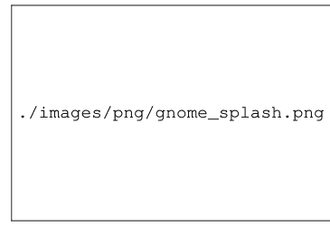

> 图 5.1：GNOME 启动标志

## GNOME

SuSE 致力于保持 GNOME 桌面组件的最新性。如果您使用 SuSE 提供的 GNOME，您将获得带有合理预配置的 GNOME 项目的最新版本。您可以通过在图形登录时选择 GNOME 会话或通过 `startx gnome` 调用 X 服务器来启动 GNOME。之后将出现一个标志，告知您启动进程。

## GNOME 帮助浏览器

GNOME 帮助浏览器是存储在您的 Linux 系统上的文档的中央集合。选择“程序”→“GNOME 帮助”来启动该程序。帮助浏览器除了查看 GNOME 特定文档外，还可以查看传统的帮助格式，如手册页（Manual-Pages）或 Info 页。

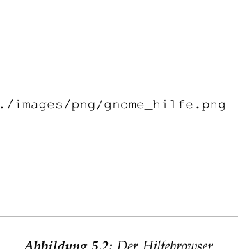

操作类似于普通的 Web 浏览器：可以通过工具栏创建书签并在页面之间前后翻页。当在程序内部调用帮助时，也会显示帮助浏览器。此外，在浏览器的主页上您还可以找到“GNOME 用户指南”选项，这是一份关于 GNOME 桌面的详细用户手册。

## GNOME 面板

GNOME 面板是控制列表的名称，当您第一次启动 GNOME 时，它位于屏幕底部。从这里启动您要操作的程序。

（注：原文中存在大量重复的段落，根据指令“不要重复输出原文”，此处仅保留核心描述并翻译。）


> 提示
每个小组件（Applet）都有自己的配置选项和设置对话框。通过在小组件上右键，不仅可以将其移动或从面板移除，还可以进入这些配置对话框。

- 桌面概览（Desktopübersicht）：您可以将桌面分为多个工作区域。为了快速访问各个界面，有一个桌面概览小组件。此外，您可以通过点击小组件中的箭头来访问程序。这将显示包含所有工作区域和正在运行程序的列表。
- 任务列表（Taskliste）：为了管理当前运行工作区域上的程序，任务列表将程序显示为可点击的按钮。通过左点击确定哪个程序处于激活状态，通过右键可以触发不同的操作，例如结束程序或最小化/最大化窗口。

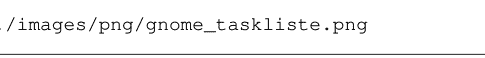

图 5.5：任务列表

- 处理器和内存负载显示：此小组件让您一目了然系统状态。通过三个彩色条显示处理器、内存和交换内存的占用率。
- GNOME 天气：此小组件向您显示世界上几乎每个地方的精确天气数据。必须保持永久 Internet 连接。

在基础配置中，GNOME 已经提供了许多满足日常需求的小组件。如果您需要更多小组件，可以从网上下载。

## 桌面配置

通过 GNOME 控制中心（见图 5.6），您可以在一处对桌面的所有外观进行设置。

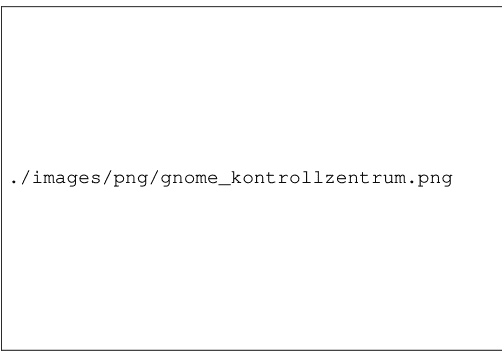

图 5.6：GNOME 控制中心

## 工作空间

**屏幕保护程序**：有许多屏幕保护程序可供选择，其中一些支持 3D 图形。作为一个多任务操作系统，Linux 可以同时执行多个进程，因此您可以通过“优先级”滑块为您的屏幕保护程序分配相应的计算能力。如果您的系统支持 APM（英语高级电源管理），您可以通过“使用节电模式”在指定时间关闭显示器。

**窗口管理器**：GNOME 不绑定到特定的窗口管理器。在此对话框中，您可以从系统现有的窗口管理器列表中选择一个。大多数窗口管理器使用随附的配置程序，可以通过点击“调用配置工具”来启动。

> 提示
虽然 GNOME 可以与任何窗口管理器配合，但并非所有的管理器都支持 GNOME。我们推荐 100% 兼容 GNOME 的 Sowfish。另一种方法是 Enlightenment，由于其复杂的图形效果，可以用它充分发挥整个系统的性能。

## 背景

配置您的桌面背景。您可以选择一张图片并以各种方式将其设置为背景。如果图片显示变形，请选择“缩放”选项（保持比例）。或者，您也可以为桌面选择一种颜色渐变。在右侧的“预览”框中，您可以看到未设置前的背景外观。如需激活设置，请点击“应用”。

## 面板

您可以在这里更改面板内容的设置。由于设置的描述文字将超出范围，因此我们只想向您介绍“按钮”选项卡，通过该选项您可以用磁贴填充面板上的图标。

## 选择主题

GNOME 的一个特点是能够通过“主题（Themes）”完全更改桌面的外观。我们收集了一系列免费主题。这些主题可以在 xwm（窗口管理器）系列的 gtk-theme 包中找到，并可以使用 YaST 进行安装。当 GNOME 首次启动时，将设置一个特殊的 SuSE 主题。

## 用户界面

### 应用程序

这些选项影响所有兼容 GNOME 的应用程序。您可以在此处设置菜单、工具栏和状态栏的行为。几乎所有的 GNOME 菜单都是“可拆分的”，即它们可以脱变成一个独立的窗口。

### 对话框

对话框用于与用户进行交互。在这里，您可以为所有显示对话框的 GNOME 兼容程序进行设置。在“对话框布局（Dialoglayout）”框架下，可以设置对话框按钮的对齐方式（右对齐、左对齐、均匀）以及是否可以使用键盘控制。在“对话框行为（Dialogverhalten）”框架下，您可以设置弹出对话框的位置。该决定可以由窗口管理器接管，或者由 GNOME 将对话框框位于屏幕中央或鼠标所在的位置。通过“将对话框置于应用程序窗口之上”，可以确保弹出对话框始终在当前应用程序窗口上方打开。

### 模式

这些选项影响所有兼容 GNOME 的应用程序。您可以在此处设置菜单、工具栏和状态栏的行为。几乎所有的 GNOME 菜单都是“可拆分的”，即它们可以变成一个独立的窗口。

### 模式

（注：原文此处可能出现重复或碎片，译文已根据提供的逻辑片段进行处理）


您可以单独开启或关闭每种可视化方法。可以同时激活多种方法，并对它们进行逐一关闭。

# Sawfish 配置

尽管 GNOME 可以处理许多窗口管理器，但 Sawfish 特别适用于协作。

- 低内存占用：Sawfish 作为一个特别“轻量级”的程序，对资源的利用非常出色，这同时也保证了极高的运行速度。
- 主题使用：可以通过主题更改 Sawfish 的视觉效果（Look&Feel），包括控制元素的排列布局。
- GNOME 兼容性：Sawfish 与 GNOME 100% 兼容。Sawfish 可以在 GNOME 控制中心内进行配置。

Sawfish 可以通过自己的控制中心进行设置。为此，请在 GNOME 控制中心中选择“工作区” → “选择窗口管理器” → “配置 Sawfish”。不过，我们将重点侧重于在 GNOME 控制中心内部的配置。

# 工作区

在 Sawfish 中，工作区被划分为行和列。例如，如果选择了 2 列 2 行，工作区就会被分为四个区域。每个区域的大小相当于整个屏幕。这样，你可以将一个缩小的窗口显示在任务栏中，并将其移动到工作区范围内的另一个区域。如果窗口超出了屏幕边缘，它将位于相邻的不可见区域中。在此窗口中，您可以设置 Sawfish 管理多少个工作区以及每个工作区包含多少个区域。同样，您还可以为工作区命名符号名称，并决定当鼠标指针碰到屏幕边缘时是否切换工作区。

# 外观

在此处您可以设置 Sawfish 的图形主题，这涉及窗口框和窗口控制元素。此外，还可以对字体以及随附主题“Mono”的设置进行调整。

> 提示
> 借助 Sawfish 自带的程序 `sawfish-themer`，可以交互式地创建 Sawfish 主题。

# 焦点行为

焦点行为决定了窗口如何变为激活。在 `enter-exit` 设置下，当鼠标指针位于窗口区域内时，即可获得焦点。`enter-only` 的区别在于，当指针离开窗口区域时，窗口仍保持焦点；只有当指针移动到另一个窗口的区域时，新窗口才会获得焦点。在第三种设置 `click` 中，只有当指针位于窗口区域内且用户通过鼠标点击确认保持焦点时，窗口才会获得焦点。此外，还有更多关于窗口折叠和焦点行为细节设置选项。如果启用 `Shade-Hover` 模式，当鼠标指针位于标题栏时，折叠的窗口会自动打开。

# 声音

在此界面，可以为 Sawfish 管理的事件（例如最大化时显示为图标等）分配音效。关联的音频文件格式应为 WAV。

# 难度等级

Sawfish 自身的配置可以分两个阶段进行。在 `Novice`（新手）设置下，将隐藏一些可能会困扰初学者的设置。`Intermediate`（中级）是本手册参考的设置，提供了大部分配置选项，仅去除了非常特殊的设置，这些设置将在 `Expert`（专家）模式下解锁。

# 放置

当新程序窗口出现时，Sawfish 可以控制它们在桌面上的何处以及如何放置。默认设置为 `best-fit`（最佳适应），Sawfish 会计算桌面哪个位置剩余“空白区域”最多，并尝试放置新窗口。或者可以选择 `interactively`（交互式）设置，允许用户自行为新窗口定位。

# 微帮助

除了各种详细功能外，此处还可以配置 Sawfish 的微帮助。微帮助是 Sawfish 通过小气泡显示的简短说明。

# 快捷键

使用键盘操作窗口系统对资深用户非常有帮助。Sawfish 满足所有需求。在此窗口中，您可以为几乎每个操作分配一个按键或组合键组合。Sawfish 将操作划分为不同的逻辑组；组名说明了操作所属的范围。例如，在 `Window`（窗口）组中，您可以找到最大化、移动或最小化窗口的操作。

# 缩小与放大

在此处您可以设置 Sawfish 在最小化或恢复窗口时的行为。此外，您可以规定是否允许在最大化的程序窗口上手动更改窗口几何形状。

# 移动与更改

您可以设置窗口管理器，使其在移动窗口时仅绘制一个矩形。这种设置对于性能较低的计算机或显卡特别有用。在放大窗口框时也可以进行相同的设置。此外，您可以应用不同的窗口“吸附”方法。例如，将对齐方法设置为 `magnetism`（磁性），窗口框将具有磁性。

# 对齐窗口

“对齐窗口”部分允许您个性化处理窗口的方式。这里将通过一个简单的示例来解释此功能的用途：

- 首先启动 GNOME 控制中心并选择“对齐窗口”。
- 现在启动应用程序 GNOME。
- 点击“添加”。
- 左侧列显示一个目录、包含多少个对象以及最后修改时间。在终端中，人们经常需要更改键盘布局，因此当鼠标进入窗口区域时，更改此应用程序的焦点是有意义的。为此，请将 `fokus-mode`（焦点模式）选择切换。
- 因为经常需要终端程序，我们想给它一个不同的外观。为此，请将 `framestyle` 设置为任意的 Sawfish 主题。
- 点击“确定”应用更改。从现在起该功能将影响所有新启动的终端应用程序。

# Nautilus - 文件管理器

Nautilus 是 GNOME 桌面的新文件管理器，具有许多新功能和扩展。

```
./images/png/gnome_nautilus_main.png

**图 5.7:** Nautilus

## 初步

在上方图中，可以看到典型的 Nautilus 窗口。左侧窗口部分显示目录符号、包含多少对象（即文件）以及最后修改时间，而右侧窗口部分显示目录内的单个对象。

## 导航

在“位置”文本输入框中，您可以查看使用 Nautilus 窗口时在哪个目录（或 URL，稍后介绍）中。

- Nautilus 尝试尽可能自动补全您在“位置”输入框中的输入。补全建议将以反向字母的形式显示。如果 Nautilus 的建议正确，只需按下 Tab 键即可！点击文本输入框上方工具栏中的主页按钮，Nautilus 将始终切换到主目录下的 Nautilus 文件夹。


图 5.8：Nautilus 窗口的工具栏

“前进”和“后退”按钮允许您在普通的网络浏览器中导航。“上级”按钮切换到上一级目录。“刷新”强制重新加载视图。“搜索”功能允许您在计算机的本地资源中进行文件搜索：在底部的文本框中输入搜索词，点击“查找”按钮开始搜索。“网络搜索”将打开一个搜索引擎，您可以在其中搜索互联网上的内容。

## Nautilus 作为文件管理器

缩放、图像和文本预览、图像和文本视图——这种通过图形化表示文件及其内容的方法几乎不可避免地会导致一个问题，即视觉化更多内容还是提供更多概览性更有意义。Nautilus 通过可变的缩放功能帮助您在这之间平衡。文件管理器通常对文本和图形数据显示缩小后的视图，这已经足够提供信息，例如文本文件是如何开始的，或者它显示了什么图片。非常实用的是，您可以对许多文件进行放大和缩小：由用户决定。双击图标，文件管理器将用相应的关联程序打开文件；如果是图像文件，Nautilus 将加载内置的图像查看模块并切换到图像的大视图。在这里，您也可以使用缩放键，例如当图像大于桌面分辨率时。

> 提示
> 如果您将文本文件显示为图标，您可以在图标中看到文本的前几个字。现在放大视图，您在看到图标放大的同时也能看到更多文本！

点击 + 和 - 按钮之间的放大镜图标，将缩放比例调整为 100%，即原始大小。

列表视图 另一种方法是，可以使用“以列表形式查看”按钮（两个缩放图标旁边）切换到列表显示，在文件非常多时，这种显示方式更实用。

## 对象的复制、移动和链接

选择“文件” → “新建窗口”以出一个第二个 Nautilus 窗口。现在通过拖动和移动，您可以使用鼠标左键复制文件。相反，如果用右键拖动图标，目标位置将出现一个小型菜单，询问 Nautilus 您是想在该处“移动”、“复制”还是“链接”对象。Nautilus 管理桌面以及位于那里的图标。当然，您可以将一个文件移动到桌面背景，或者链接三个文件。

Nautilus 帮助 在窗口的左侧部分，您可以看到“帮助”标签页。Nautilus 汇总了所有和信息文档，并将其转换为统一的 HTML 格式。选择“帮助”标签页时，Nautilus 的左侧会出现各种帮助主题的摘要，并以树形结构显示。当选择其中一个主题时，窗口的右侧将显示内容。

位置笔记 在帮助标签页区域，您可以找到“笔记”标签页。您可以对窗口右侧看到的所有内容制作笔记：网页、目录或图像文件。笔记将始终与所显示内容的位置一起存储。

历史记录 记录存储了所有访问过的位置，以便日后快速访问。您也可以通过菜单中的“转到”访问它。在这里您可以删除当前历史记录（“清除历史记录”）。

文件系统 “树”标签页在您想要快速切换目录或将文件移动到其他目录时提供帮助；它提供了您的磁盘结构的清晰表示。正如在“复制、移动和链接对象”一点中提到的，您在这里也可以处通过简单地移动文件来触发复制操作。

标记带徽章的对象 您可以为窗口右半部分的所有配备“徽章”。它们用于有目的地地标记文件或目录。例如，有“草稿”、“重要”或“个人”等符号。如果您右键点击文件或目录并在弹出的菜单中选择“显示属性”，将打开对话框。您会找到“基本”、“权限”和“徽章”三个标签页。选择哪些徽章随对象图标一起。您也可以分配多个徽章。更改将立即生效。

图标的布局、位置和大小 与其他文件管理器不同，您可以个性化调整图标的视觉外观。通常，Nautilus 的“自动布局”会自动处理图标的布局、位置和大小。一旦您移动其中一个文件，文件管理器就会询问您是否想切换到“手动布局”。如果您确认“切换”，Nautilus 将不再进行自动调整。
突出特定对象的另一种方法是更改图标的大小。为此，请右键点击图标。在弹出的弹出菜单中，您可以调整大小。您也可以选择不同的缩放大小以便更好地查看图标。

## 配置 Nautilus 和桌面

Nautilus 管理桌面上的图标。通过此，您可以使用颜色和图案调整桌面。

Nautilus 具有三种难度级别，可据此调整操作。您可以通过顶部的“帮助”菜单更改当前设置。下文指的是“高级”级别。而在“学者”级别，显示的选项会多或少。

偏好设置 在相同的菜单中，通过设置设置进入偏好对话框

- “外观” – 在这里您可以对视图和使用的字体进行各种设置。特别重要的是：如果 Nautilus 消耗过多资源，请关闭“使用平滑图形”选项。放大图像和图标的功能使用了复杂的算法以获得更好的缩放质量。
- “文件夹视图” – 在这里选择是双击还是单击启动。如果您希望在每次点击对象时都打开新窗口，请激活“窗口行为”框架下的相应功能。
- “搜索” – 这涉及网络搜索以及“普通”搜索。您可以对搜索速度和网络搜索引擎的选择进行设置。
- “侧边栏” – 在这里您可以设置窗口左部分显示哪些标签页。
- “导航” – 设置 Nautilus 的主页。这可以是一个网页或目录。如果是为了连接互联网且您使用代理服务器，请激活“代理设置”框架下的相应设置，并勾选“使用 HTTP 代理”。Nautilus 提供了一系列内置书签，例如指向 Linux 发行版和服务提供商。如果您想禁用这些，请取消勾选“不包含内置书签”。
- “速度舒适度” – Nautilus 可以为图形、文本或声音类型的对象生成视图。可以理解，这需要大量的计算时间，例如为文本文件创建视图。如果不需要，您可以在关闭相应功能。


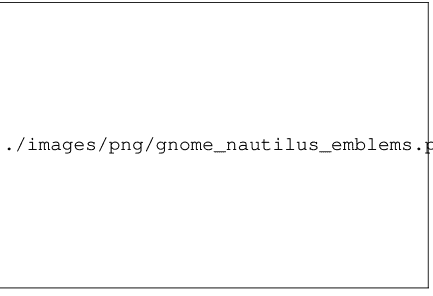

图 5.9：背景与图标

## 通过拖放设置背景和图标！

在 Nautilus 的主菜单中，选择“编辑” → “背景和图标”。在弹出的对话框中，您可以在“图案”、“颜色”以及之前讨论过的“图标”之间进行选择。用“拉丝金属”（BrushedMetal）拖到屏幕背景并将其“释放”在该处。更改将立即生效。通过这种方法，您可以为任何选择都找到一个“重置”图标。如果您将该图标拖入屏幕元素中，将恢复原始设置。将图标拖到文件或文件夹上，即可为它们加上图标。

Nautilus 主题：Nautilus 的视觉外观可以完全改变。Nautilus 主题不仅包含控件的图形设计，还包含文件夹或文本文件等常用对象的图标。选择“编辑” → “更改外观”，这将打开“主题选择对话框”。点击其中一个主题即可应用。

对象信息的后续显示：除了图标外，对象下方始终会显示特定信息（可能您需要增加详细级别，才能看到所有信息）。假设您正在与同事合作一个项目：也许与其显示大小、类型和修改日期，显示群组所属关系和所有权可能更合适。在选择“编辑” → “图标说明”时出现的对话框中，您可以随时更改显示的顺序和显示的信息。

Nautilus — 文件管理器

## 更多信息

- http://www.gnome.org
- http://developer.gnome.org/
- http://www.gtk.org/
- http://gtk.themes.org/

GNOME 项目的首页。关于符合 GNOME 标准编程的详尽文档。GIMP 工具包 (GTK) 的首页。GTK 主题的海量。

您可以在 http://www.gnome.org/faqs/ 找到关于 GNOME、GTK 和 GNOME 基金会的常见问题及解答。

# YaST2 – 配置

本章介绍了如何使用 YaST2 配置您的系统。可以方便地设置重要的系统组件。这包括大部分硬件、图形界面、互联网访问、安全设置、用户管理、软件安装以及系统更新和信息。

| | |
| :--- | :--- |
| 硬件 | . . . . . . . . . . . . . . . . . . . . . . . . . . . . . . . 81 |
| 用户和组管理 | . . . . . . . . . . . . . . . . . . . . . . . . . . 106 |
| 系统安全 | . . . . . . . . . . . . . . . . . . . . . . . . . . . . . . 109 |
| 安装/删除软件 | . . . . . . . . . . . . . . . . . . . . . . . . 112 |
| 其他 | . . . . . . . . . . . . . . . . . . . . . . . . . . . . . . . 117 |

## 通往 YaST2 的多种途径

通过“K”或“SuSE”菜单，您有多种方式访问 YaST2：通过“控制中心”、通过“SuSE” → “管理” → “配置”以及通过“设置”。或者在 Shell 中切换到 root 用户（执行 su root，然后输入 root 密码）并输入 yaast2`。

在 K 菜单中，您可以直接选择所需的配置模块。YaST2 在启动时会首先打开一个小窗口。在这里您必须输入 root 用户（系统管理员）的密码。配置是以 root 用户身份进行的，因为只有它能修改 Linux 系统文件。

如果由于某种原因无法按照上述方法调用 YaST2，还有一种更复杂的方法按顺序执行。请在图形界面下的 Shell 中输入以下命令：

```
tuxerde--> xhost +
erde:# # su -
(输入 root 密码)
erde:# export DISPLAY=:0.0
erde:# # yast2
```

在操作 YaST2 后，您应该使用 `exit` 从 root 用户切换回普通用户：

erde:# xhost -

以重新启用 X 服务器的访问控制。如果您想更改 YaST2 的语言，请在 YaST2 控制中心中点击“系统”并点击“选择语言”（Choose language）——在那里选择您的语言，关闭 YaST2 控制中心并重新启动。

## YaST2 控制中心

首先出现 YaST2 控制中心。在左侧区域，您可以找到硬件、网络/基础、网络/高级、安全/用户、软件和其他分类。点击其中一个图标，右侧将列出相应的内容。例如，点击“声音”（Sound），将打开一个可以在其中进行配置的窗口。

左侧区域将显示帮助文本，说明所需信息。如果您想更改 YaST2 的语言，请在 YaST2 控制中心中点击“系统”并点击“选择语言”（Choose language）——在那里选择您的语言，关闭 YaST2 控制中心并重新启动。

### YaST2 - 配置

```
./images/yast2-single.png
```

### 硬件

新硬件需要根据制造商进行设置。YaST2 允许自动配置打印机，如果满足以下条件：

- 并列端口被正确设置且连接的打印机被自动识别.........../html/printer-

### YaST2-配置

- 打印队列将分别调用。
- 每个打印队列都可以对打印机进行单独配置。
- 因此，同一个打印机将使用不同的打印队列来满足不同的... 需求 YaST2 需要多个打印队列。
- 彩色打印的配置。

## YaST2 配置

在 YaST2 的“硬件”下选择“自动打印机检测”。如果您的打印机出现在可用打印机列表中，点击“配置”。要对已设置的打印机进行配置，选择已打印机列表下方的“编辑”。如果您不想进行打印机检测，或者知道想要手动添加打印机，请点击“硬件上编辑打印机”。

## 自动配置

YaST2 允许自动配置打印机，如果满足以下条件：

- 并列端口被正确设置且连接的打印机被自动识别。


3. 对于每个模型，打印机数据库中至少有一条被认为运行良好的的配置。

对于每种配置，原则上都应该通过 YoST2 测试打印来评估其是否实际有效。YoST2 测试文件提供了有关相应配置的额外重要信息。

## 手动配置

如果无法满足自动配置的任一条件，或者需要特殊的个性化配置，则必须多或少手动进行配置。

## 硬件连接（接口）

如果无法识别到打印机，说明打印机接口在硬件层面上无需手动配置即可工作。在这种情况下，必须配置接口。未定义的打印机将作为“其他（未知）”列在可用打印机列表中。点击“配置”，在接出的菜单中选择接口并点击“确定”。

然后您将看到相应的接口：

```
/dev/lp0	是第一个并行接口
/dev/usb0	是 USB 打印机的接口
```

在此，必须在 YoST2 中进行相应的测试，以检查打印机是否可以通过所选接口进行响应。点击“确定”。

现在选择您的模型。通过信息按钮，您可以获取有关在 Linux 下支持情况的信息，以及对于 GDI 打印机，可能从哪里获取 Linux 驱动程序。

如果打印机模型已在打印机数据库中，则有一组用于标准打印机的通用 Ghostscript Driver。点击左侧的“通用打印机”。

## 注意事项

> 必要时请咨询打印机制造商您的模型支持什么语言，或者您的打印机与打印机数据库中的哪个模型硬件兼容——这意味着打印机必须在硬件上能够“理解”这种打印语言，而不仅仅是通过额外的软件进行仿真。

注意

## 打印名称

这里指的是打印时需要输入的“队列”名称。因此，应仅使用小写字母和可能的数字的短名称。默认第一个队列设置为 `lp`。

## 应用程序配置

在命令行中，使用命令 `lpr -Plp 文件名` 进行打印，其中 `文件名` 应替换为要打印的文件名。在这种情况下，将使用默认队列 `lp`。通过选项 `-P` 可以显式指定队列。使用 `lpr -Color 文件名` 则使用 `color` 队列。

应用程序也使用 `lpr` 命令进行打印。因此，通常情况下不要在应用程序中配置打印机，而是使用您通过 YaST2 设置的队列，并通过打印 YaST2 测试页验证这些队列的功能。

为此，在应用程序中选择您通过 YaST2 设置的队列名称（例如 `lp` 或 `color`），或在应用程序的界面中输入相应的打印命令（例如 `lpr -Plp` 或 `lpr -Color`）。

## 可能的问题

- 如果计算机与打印机之间的通信出现故障，打印机可能无法有效处理发送的数据，导致出现打印大量带有无意义字符的纸张的问题。
  1. 对于喷墨打印机，请取出所有纸张或打开纸盒层以停止打印。
  2. 打印任务在发送到打印机后才会从队列中删除，此时它通常仍在队列中。即使是重启也不会从队列中删除打印任务。使用 `lpq` 或 `lpc status` 检查正在从哪个队列打印，并使用 `lprm` 删除打印任务。

3. 即使打印任务已从队列中删除，可能仍有一些数据传输到打印机。所有仍在访问打印机的进程都可以用 `fuser` 终止；对于并行端口的打印机：

```
# fuser -k /dev/lp0
```

对于 USB 打印机，可以使用：

```
# fuser -k /dev/usb10
```

4. 通过将打印机断电一段时间来完全重置打印机。之后重新放入纸张并开启打印机。现在打印机应该恢复正常。

## 更多信息

关于 Linux 下打印的细节和特定的故障排除，请参阅安装在您的 SuSE Linux 8.0 上的“参考”手册第 7 章“打印机运行”。查看您的 SuSE 帮助（您 KDE 桌面上的救援光）中的书籍，并点击那里的“您的参考”。或者，您也可以在浏览器中加载目录 `/usr/share/doc/packages/suselinux-reference_de` 并打开 PDF 文件。

遇到问题时，配置的起点是支持数据库文章“设置打印机”，您可以通过关键词“设置”在离线状态找到它：

http://sdb.suse.com/de/drucker_einrichten.html


通过“启动 ALSA”复选框，可以在计算机启动时启用或禁用 ALSA。要播放 Midi 文件，应勾选“启动序列器”复选框。这样，在加载 ALSA 模块时，会加载序列器支持所需的音频模块。

点击“退出”时，将保存所有已安装声卡的音量和配置。混器设置将存储在 `/etc/asound.conf` 文件中，ALSA 配置数据将写入 `/etc/modules.conf` 文件的尾。

## 配置声卡

如果发现了多个声卡，请通过“自动检测列表”选择您所需的声卡。点击“下一步”将进入“设置”部分。如果没有自动找到声卡，请选择“从列表中选择”，并点击“下一步”即可进入“手动选择声卡”菜单。

## 手动选择声卡

如果您的声卡未被自动识别，系统将显示声卡驱动程序和声卡型号列表，您可以从中进行选择。通过选择“全部”，可以显示支持的声卡的完整列表。

如有，请查阅您的声卡文档以获取所需信息。此外，您还可以在 `/usr/share/doc/packages/alsa/cards.txt` 和 http://www.alsa-project.org/~goemon/ 找到 ALSA 支持的声卡列表以及相应的音频模块。选择后，通过“下一步”返回“设置”菜单。

## 声卡的高级选项

在此处可以调整音频模块的各个选项。请标记要编辑的行。在“可能的值”字段中，系统将为您建议配置的默认值。只有在您完全确定时，才更改默认值。否则，您可以在输入框中自行传递相应的参数。

值可以用十进制或十六进制表示。如果是后者，您必须在值前加上 `0x`。在输入选项值后，您必须点击“应用”按钮确认。点击“重置”按钮将删除所有值。您可以在 `/usr/share/doc/packages/alsa/INSTALL` 下找到所需的选项和用于音频检查的可能参数列表。

## 显卡与显示器

图形界面被称为 X11 系统，为用户在图形环境内工作提供了基础，因为图形用户界面（例如 KDE 桌面）依赖于图形界面。X11 设置存储在相应的文件中：

- XFree86 3.x: `/etc/XFree86Config`
- XFree86 4.x: `/etc/x11/XFree86Config`

图形界面通常在安装过程中就已经设置好了。但如果您想改进路径，例如想在系统中连接另一个显示器，您可以使用 YaST 模块来实现。如果发生可能的更改，系统将保存当前配置。在启动界面中，您首先有机会恢复早先保存的 X11 配置。之后，您将进入与安装 SuSE Linux 时相同的对话框。

您可以在文本模式和图形界面之间进行选择。对于后者，将显示当前的分辨率、颜色、刷新率、显示器的制造商和类型（如果已自动识别），以及可能的 3D 加速。点击“更改”进入可以进行显示设置的对话框。如果您带有 3D 芯片的显卡，您可以在其中激活 3D 加速。在选择颜色时，根据所用硬件，提供 16、256、32768、65536 和 1670 万色供选择。提供 8、16 或 24 位。为了获得良好的显示效果，您至少应该设置 256 色。

在继续之前，您应该测试设置——只需点击“测试”按钮即可。如果立即点击“下一步”，将自动进行测试。如果没有获得一个清晰的大图像，请立即按 (ESC) 键取消测试并减小值。通过测试图，您可以调整显示器图像的大小和位置（参见图 6.2）。为了检查，测试图的四个角有小的白色正方形。在最佳显示状态下，这些正方形应该是完全可见且没有颜色失真或畸变的。

/images/png/sax2_xfine.png

图 6.2：调整图像几何

一旦对图像几何进行了更改，将点击“保存”将其应用到当前配置。如果您的显示器未被自动识别，将自动进入显示器选择对话框。您也可以通过“指定显示器”进入此对话框。制造商和列表提供了大量型号选择，您可能可以在其中找到您的显示器，或者输入显示器说明书中的值。

*(注：原文后续部分存在大量重复段落，译文已根据要求去重，仅保留核心内容)*


如果您的扫描仪未被识别，则该设备可能不受支持。然而，有时即使是支持的扫描仪无法识别。在这种情况下，手动选择扫描仪可能对您有所帮助。如果您可以在制造商和型号列表中找到您的扫描仪，请直接选择它——如果找不到，请务必通过“取消”（Abbrechen）来查找。关于在 Linux 下运行的扫描仪信息，请参阅 http://cdb.suse.de、http://sdb.suse.de 或 http://www.mostang.com/sane。

## 注意

只有在您确定的情况下，才应对扫描仪进行手动分配。错误的选择可能会导致您的硬件损坏。

注意

## 故障排除

如果您的扫描仪未被识别，可能存在以下原因：

- 扫描仪不受支持。您可以在 http://www.suse.de/sdb 找到一个与 Linux 兼容的设备列表。
- 您的 SCSI 控制器未正确安装。
- 你的 SCSI 接口存在终接问题。
- 您的 SCSI 线超过了允许长度。
- 您的扫描仪带有 Linux 不支持的 SCSI-Light 控制器。
- 您的扫描仪可能损坏。

## 注意

> 对于 SCSI 扫描仪，严禁在系统运行期间连接或拔掉设备。请先关闭您的计算机。

注意

关于扫描的更多信息，请参阅《Die Programme》（Die程序）一书中的“Kooka – 新的扫描程序”章节。

## TV 卡

在启动并初始化此 Yoast2 模块后，首先会显示“设置 TV 卡”对话框。如果您的 TV 卡被自动识别，它将在此处显示。用鼠标点击该行并点击“添加”。如果您的 TV 卡未被识别，请配置“其他，未识别的”卡，以便您进入手动配置。通过“编辑”按钮，您可以更改现有配置。

点击“编辑”或在启动 Yoast2 模块后（如果您已经安装并配置了一个或多个 TV 卡），将出现“TV 卡概览”对话框。在此对话框中，您可以编辑每个卡的配置，或通过“添加”开始手动配置。

在“手动配置”界面中，首先从列表中选择 TV 卡类型。如果您必须选择一种调谐器类型才能获得有效的配置，且您不确定，则应先将设置保持为“默认（已识别）”并确定它们是否有效。如果部分或所有内容无法发送，可能是因为调谐器类型的自动识别失败，或者您选择了错误的调谐器类型。

在“细节”处，您可以找到专家配置。在这里，可以专门选择作为 TV 卡驱动运行的内核模块以及该参数。您还可以检查 TV 卡驱动程序的所有属性。在此处选择要处理的参数并输入新值。通过“应用”将采用新值，通过“重置”将接受默认值。

在“TV 卡，音频”对话框中，您可以进行相应的设置，以便您可以使用电脑看电视。通常，TV 卡会随带一根电缆，以便您将声音放置在声卡的音频输入上。此时，声卡必须已经设置好，且外部输入不再处于静音。请在此界面上点击“是”并选择要配置的声卡；请参见第 86 页的“声卡”部分。此外，您还可以直接锁定扬声器区域，而不通过声卡——假设您本来就从其他地方获取声音（例如外部卫星电视接收器）。也有完全没有音频功能的 TV 卡，例如用于 CCD 相机。在这种情况下，不需要或在某些情况下无法进行音频配置。

## DMA 模块

一个新的 YaST2 模块允许您在已安装的系统中为您的硬盘和 CD/DVD 驱动器启用或禁用所谓的“DMA 模式”。DMA 模式可以显著提高系统的性能或数据传输速度。

SuSE Linux 的当前内核在系统安装时会自动为硬盘启用 DMA，并保持禁用状态，因为在过去，对所有驱动器启用默认 DMA 经常会导致 CD 驱动器出现问题。稍后可以通过 DMA 模块为您的驱动器决定是否启用 DMA。例如，如果您的硬盘运行出现问题，禁用 DMA 可能会有所帮助。相反，如果您启用 DMA 且驱动器支持该模式，则会提高磁盘的数据传输速率。

> 提示
> “DMA”（= Direct Memory Access）意味着“直接内存访问”，即磁盘可以直接将数据传输到内存中，而无需经过进程控制的“迂路路”。

## 互联网接入

### 互联网连接的基础

这里将介绍了互联网连接的关键术语，并简要说明了它们的目的和功能。
互联网上的所有计算机构成了一个巨大的网络，不同的操作系统在其中运行。为了让互联网上的任何计算机相互通信，必须使用通用的协议，即互联网协议 (IP) 以及传输控制协议 (TCP)、用户数据报协议 (UDP) 和互联网控制消息协议 (ICMP)。

互联网上的每台计算机都有一个标识号，即所谓的 IP 地址，且仅通过此号码就可以通过 TCP/IP 进行访问。通常，一台计算机还有一个文本名称，可以在应用程序中对其进行标识。为了将 IP 地址转换为文本名称，有了域名系统 (DNS)。这是一个提供名称服务的特殊服务，称为服务器（例如 DNS 服务器）；请求该服务的计算机或程序称为客户端。

在 TCP/IP 之下，有多种标准协议用于根据传输类型传输 TCP/IP 数据——例如，网络连接使用以太网，调制解调器和 ISDN 链路使用点对点协议 (PPP)，ADSL 连接使用点对以太网 (PoE)。

建立互联网连接，必须首先建立以太网、PPP 连接，然后在本地计算机与互联网提供商之间建立 TCP/IP 连接。
在 TCP/IP 之上，有多种标准协议可以根据需要传输数据：

- 超文本传输协议 (HTTP) 用于传输 HTML（超标记标记语言）格式的 WWW 页面
- 通过简单邮件传输协议 (SMTP) 将电子邮件发送到另一台计算机，并通过邮局协议三 (POP3) 在需要时从邮件服务器下载电子邮件
- 为了传输数据，使用了文件传输协议 (FTP)

为了让不同的应用程序（例如 Web 浏览器和电子邮件程序）能够共同使用同一个互联网连接，实际上每个应用程序实际上都使用一个独立的 TCP/IP 连接，并将大量的 TCP/IP 数据拆分成小数据包，以便交替传输，例如浏览器的 HTTP 包通过此 TCP/IP 连接传输，而电子邮件程序的 SMTP 或 POP3 包则通过其他 TCP/IP 连接传输。


- DNS 位于 53 端口，
- HTTP 位于 80 端口，
- SMTP 位于 25 端口，POP3 位于 110 端口，
- FTP 位于 20 和 21 端口。

只有当客户端在访问服务器时使用正确的端口号，它才能调用相应的服务。

## 关于所有类型互联网接入的说明

### 自动拨号 (Dial on Demand)

如果您在 YaST2 模块中激活“按需拨号”或“自动拨号”，那么例如在浏览器中输入外部 URL 或在收发邮件时，系统将自动建立互联网连接。只有当您拥有互联网流量包（套餐/Flatrate）时，才建议使用“按需拨号”。由于这些过程在后台运行（例如通过定期获取邮件），会导致频繁接入互联网并增加电话费用。

## 调制调器

在 YaST2 控制中心中，位于“网络/基础”下可以找到调制调器配置。如果自动识别失败，请选择手动配置。在弹出的窗口中，在“设备”处选择接口，并在“调制调器名称”处为调制调器输入一个可选的名称。

如果中间连接了电话交换机，可能需要输入断开时的拨码（通常为 0；请参考您的电话交换机用户说明）。您可以选择音调拨号或脉冲拨号，以及是否开启或计费扬声器。如果您的调制调器连接在电话交换机上，则不应使用最后一种选项。在“详细信息”下可以找到调制调器的波特率和初始化字符串。仅当调制调器未被自动识别且需要针对数据传输进行特殊设置时，才进行更改。这在 ISDN 终端适配器上尤为常见。


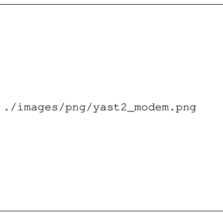

## 图 6.3：YaST2 调制调器配置

接下来是 ISP（互联网服务提供商）选择。您可以选择所在国家的预设供应商，或点击“新建”手动输入 ISP 参数：拨号名称和连接名称（例如所选供应商的名称）、电话号码（提供商的号码）以及您的用户名。在“密码提示”下，您可以输入密码，或者如果出于安全考虑想防止密码保存在硬盘上，请勾选“始终询问”选项。在下一步操作中，您可以将输入的供应商设为默认值。如果您有多个调制调器，可以在此处为每个供应商指定一个默认调制调器。如果激活“自动选择”，每当您启动互联网应用程序时，系统都会自动建立连接。只有在您拥有流量包时才应使用此功能（参见上一页的*自动选择 (按需拨号)*）。

在“详细信息”下，您可以激活更多要点：

- “连接丢失时重连” – 如果连接意外中断，调制调器将尝试重新重新拨号。
- “连接期间更改 DNS” – 这通常是默认设置。

## ISDN

- “在（秒）后中断” – 您可以确定在没有数据流的情况下多长时间后中断连接（例如，如果您忘记关闭连接——此处建议设置为 180 秒）。点击“下一步”或“完成”结束配置。

您可以在“网络/基础”下找到 ISDN 配置。如果您的 ISDN 卡自动识别成功，将进入 ISDN 连接的参数设置。在以下情况下，需要为“自己的电话号码”提供相关信息：

- 1. 这里的 ISDN 卡直接连接到 NTBA（电信的电话插座）：存在一个所谓的“MSN”——这是电信为您的接入提供的电话号码（无需输入前区码！）。即使输入了错误内容，应该仍能工作，因为网络运营商（例如电信）应当使用与您的 ISDN 接入关联的 MSN。

- 2. ISDN 卡连接到电话交换机上：
    - (a) 电话交换机内部端口使用 Euro-ISDN/EDSS1 协议（通常用于家庭使用的“小型”电话交换机）：这些电话交换机具有内部 S0 总线，并为连接的设备使用内部电话号码。在这种情况下，请使用内部号码作为 MSN。更多信息请参阅电话交换机文档。只要开启了该 MSN 的权限，根据电话状况可能的任何 MSN 都可以工作。
    - (b) 电话交换机内部端口使用 Euro-ISDN/EDSS1 协议（通常用于家庭使用的“小型”电话交换机）：这些电话交换机具有内部 S0 总线，并为连接的设备使用内部电话号码。


# 6

根据您的提供商信息，在配置网卡时，请在“自动分配地址（通过 DHCP)”和“静态地址配置”之间进行选择。大多数提供商使用 DHCP。静态 IP 地址通常用于提供商的商业套餐。在这种情况下，提供商已为您分配了一个固定的 IP 地址。请务必查看关于电缆调制解器设置和配置的支持数据库文章，您可以在此处获取相关信息：

```
http://sdb.suse.de/sdb/html/kngu_cmodem.html
以及
```

```
http://sdb.suse.de/sdb/html/thallma_cmodem_dhcp.html
```

# ADSL/T-DSL

请注意，ADSL 访问配置取决于网卡是否配置成功。目前使用 YaST 配置的基于点对以太网（PPPoE）协议的网络较少。在这种情况下，自动 IP 地址分配不是通过 DHCP 协议进行的。因此，您不能使用“自动分配地址（通过 DHCP）”。请分配一个静态的“虚拟 IP 地址”，例如 192.168.22.1 是一个不错的选择。在“默认网关掩码”字段中仅保留占位符。对于单机系统，不需要在 255.255.255 字段中输入内容。请务必确保单机系统仅使用占位符。计算机的“IP 地址”和“子网掩码”值对于建立连接没有意义，只需激活网卡。位于“网络/基础”下的 ADSL 配置 YaST2 模块适用于典型的 PPPoE ADSL 访问，但并非“开箱即用”（参见 http://www.adsl4linux.de/infos/）。在界面中输入用户名和个人密码。指定设置了哪个接口（通常是 eth0）。建议将“空闲时间”设为 60 秒——这意味着当没有数据流时，连接将自动断开。点击“完成”结束操作。

YaST2 - 配置

SuSE Linux — 基础

103

为了使用“按需拨号”（参见第 97 页），在单机系统上您必须配置 DNS（名称服务器）。大多数提供商现在支持动态 DNS 分配，这意味着在建立连接时会传递名称服务器的当前 IP 地址。尽管如此，在您的单机系统对话框中仍必须输入 DNS 服务器的占位符，例如 192.168.22.99 是合适的。如果不是动态分配名称服务器，则必须在此处输入提供商的名称服务器 IP 地址。

推荐以下链接：
http://www.ads14linux.de/infos/
在这里除了许多关于 ADSL 的信息外，还可以找到关于奥地利使用的 ADSL 变体（PPTP）的信息来源提示。

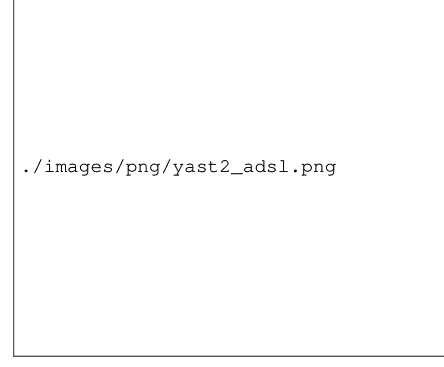

**图 6.6：YaST2：ADSL 配置**

T-DSL 的操作与 ADSL 相同。
您的 T-DSL 配置需要以下数据：连接标识、T-Online 号、用户名和您的个人密码。请从您的 T-DSL 登录单中获取信息。

# 电子邮件

邮件设置配置模块已根据最新需求进行了调整。除了 sendmail，现在还支持使用 postfix 发送邮件。在位于“网络/高级”下的配置对话框中，请在第一个对话框中选择您的连接类型：

104 硬件

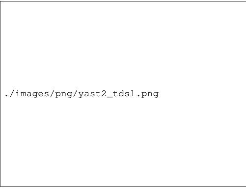

图 6.7：YaST2：德国的 T-DSL 配置

- ‘具有永久网络连接的计算机’
这指的是所谓的“专线”，常见于公司或其他经常使用互联网的机构。到的连接是永久的，因此无需担心。然而，此点适用于本地网络的成员，该网络没有永久的互联网连接，但使用中央邮件服务器发送电子邮件。
- ‘具有临时网络连接的计算机（调制解调器或 ISDN）’
这涉及许多家里拥有计算机的用户，不属于任何网络，但偶尔访问互联网——通过调制解调器、T-DSL/ADSL 或 ISDN 拨号。
- ‘无网络连接’
如果您没有接入互联网且不属于网络，则无法使用互联网连接。在界面中输入用户名和个人密码。指定设置了哪个接口（通常是 eth0）。建议将“空闲时间”设为 60 秒——这意味着当没有数据流时，连接将自动断开。


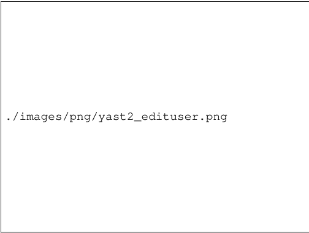

图 6.11：使用 YaST2 进行用户管理

## 系统安全

在“本地安全配置”启动界面中（您可以在“安全与用户”下访问到该界面），有四个点需要应用：
级别 1 适用于单机电脑（已预配置），级别 2 适用于带网络的工作站（已预配置），级别 3 适用于带网络的服务器（已预配置），而“自定义”则用于自行设置。

如果您选择前三个点之一，则可以根据需要采用相应的预配置系统安全设置。为此请点击“完成”。在“详细信息”下，您也可以访问各个设置，并根据需要进行更改。如果您选择“自定义”，点击“下一步”将自动进入不同的对话框。在这些，您将看到安装时推荐的默认值。

- 1. ‘密码设置’

在此处，您可以规定未来用户密码的最小和最大长度。设置为五到八个字符是有意义的。此外，您还可以设置在过期前多少天以及多久发出警告（警告将作为消息在登录文本控制台时）。

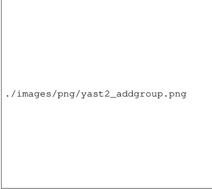

图 6.12：使用 YaST2 创建新组

- 2. ‘系统启动设置’

此界面涉及两个方面。首先：应该如何解释 Ctrl Alt+Ent 组合键？
通常情况下，这会导致文本控制台的系统重启。您应该将其保持原样，除非您的计算机或服务器是公开访问的，且您担心有人执行未经授权的操作。
如果您选择“停止”，该组合键将导致系统关闭；如果选择“忽略”，该组合键将无效。其次：系统是否允许从 KDM（KDE 显示管理器 – 图形化登录界面）关机？是“仅限 Root”（即系统管理员）、“所有用户”、“匿名”还是“本地用户”？如果您选择“匿名”，则系统只能从文本控制台关机。

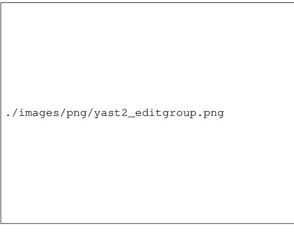
图 6.13：使用 YaST2 进行组管理 (img/7c7b5e54e6579952ad3fd8bde9e1a136_config)

- 3. ‘登录设置’

通常在登录尝试失败后会有几秒钟的等待时间才能再次登录。引入此机制增加了“密码黑客”的难度。此外，您还可以启用“记录失败的尝试”和“记录成功的尝试”。如果您怀疑有人在尝试破解您的密码，可以检查 /var/log 下系统文件中的条目。

- 4. ‘新用户设置’

每个用户都有一个数字 ID（UID）和一个用户标识符（用户名）。这是通过 /etc/passwd 文件实现的，并且应该尽可能唯一。通过这些数据，您可以规定在创建新用户时分配哪些范围。对于用户来说，最小值为 500是有意义的，且不应低于此值。

- 5. ‘其他设置’

在‘权限设置’中，有三个选择：“简单”、“安全”和“偏执”。对于大多数用户来说，第一个可能足够了。YaST 会为您提供关于这三个安全级别的信息。

‘偏执’设置是极其严格的，应仅作为例外使用。如果您选择了此项，在使用某些特定程序时可能会遇到干扰。您将不再拥有访问不同文件的权限。此外，您可以在此对话框中指定用户，该用户将在每天启动后自动创建一个数据库 (locatedb)，该数据库存储了您计算机上的每个文件。可以使用 `locate` 命令进行搜索。如果选择了‘匿名’，则任何用户（包括其他非特权用户）都可以在数据库中找到路径。如果选了 root，则将列出所有本地文件。

此外，还可以激活‘从用户路径中移除当前目录’这一项。建议选择此项。最后，有‘禁用用户的 Telnet 登录’选项。选择此处完成安全配置。

## 安装/删除软件

“软件”下的模块允许您在计算机上安装额外的软件。此外，可以删除程序以腾出磁盘空间。如果您想从 CD 安装，请将光盘放入驱动器。

在对话框中，左侧显示软件包（pay），右侧显示您选择的所有软件包。计算机上已安装的软件包标记为 i。选择或取消软件包的方法是双击该行并点击‘确定’。要安装的软件包标记为 X，要删除的软件包标记为 d。如果软件包需要额外的包，YaST 会自动选择它们（标记为 a），或者您也可以从候选软件包中进行选择。


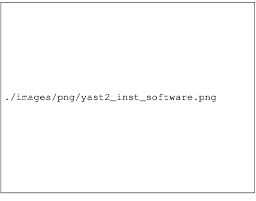

# 在线更新 (Online-Update)

YaST 在线更新允许安装重要的升级，或者在 SuSE FTP 服务器上提供相应的“补丁”（Patches）供下载。当前软件包的安装可以全自动进行。然而，通过“手动更新”，您可以自行决定哪些补丁被应用到您的 SuSE Linux 系统中。

点击“详细信息”后，您将获得有关上次更新的信息以及可用软件包的信息。点击“显示补丁信息”后可以了解更多细节。点击“下一步”，您将进入所有可用补丁的列表（如果选择了“手动更新”），您可以在从中进行选择。通过点击“确定”或双击可以激活各个部分。点击“下一步”然后点击“完成”即可完成在线更新。

# 从控制台进行在线更新

```
erde:/root # yast2 online_update .auto.get
```

# 6
YaST2 - 配置

```
./../images/png/yast2_inst_medium.png
```

**图 6.15:** *YaST2: 切换安装源*

从列表 `/etc/suseserver` 中的第一个服务器获取当前的补丁列表和所有相关的 rpm。如果您想加载特定的补丁，可以在调用时额外提供选项。

可能的选项有 `security`, `recommended`, `document`, `YaST2` 和 `optional`。`security` 包含安全相关的补丁，`recommended` 包含 SuSE 推荐的更新，`document` 提供来自 FTP 服务器的关于补丁通知，`YaST2` 仅提供 YaST2 补丁，而 `optional` 提供低优先级的更新。

补丁通知存储在 `/var/lib/YaST/patches/i386/update/X.Y/patches` 中。您只能读取它们。X.Y 是对应 SuSE Linux 的相应版本。

下载安全补丁后的调用命令为：

```
erde:/root # yast2_online_update .auto.get security
```

每当您调用 `.auto` 时，通常会根据 `/etc/suseserver` 加载 FTP 服务器列表。如果您想关闭它，必须在文件 `/etc/rc.config` 中禁用该功能。在以下行中：

```
erde:/root # YAST2_LOADFTPSERVER="yes"
```

将 `yes` 设置为 `no`。

现在可以使用以下命令安装补丁：

SuSE Linux - Basis 11

```
erde:/root # yast2 online_update .auto.install
```

此调用将安装所有获取的补丁。如果您安装一个组，可以在 `.auto.get` 时使用相同的选项。这种方法的优点是它可以被自动化。系统管理员可以在例如夜间下载软件包，并在早晨安装他们需要的包。

# 更新系统

此模块允许您将系统更新到最新状态。将调用多个工作步骤，YaST2 将确定哪些软件包需要更新。如果需要，您可以对每个软件包单独决定是否进行更新。但是，基础系统可能无法变为新的，这必须从安装介质（例如 CD）启动。请注意，要更新的基础版本越旧，或者要更新的软件包的配置偏离标准越远，更新的问题就越棘。某些情况下，配置可能无法正确采用；此时应该创建一个全新的配置。此外，在更新之前应该对现有配置进行备份。

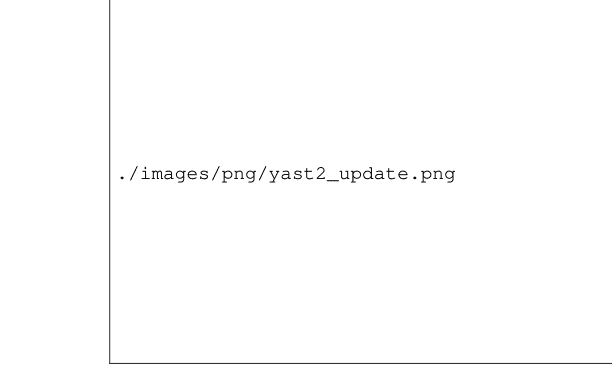

图 6.16: YaST2: 更新系统

# 其他

# 备份

通过新的备份模块，您第一次可以使用 YaST2 对系统进行备份。该模块不执行完整备份，而是备份已更改软件包、系统关键区域和配置文件的信息。

在配置时，您可以确定要备份哪些文件。默认情况下会存储自上次安装以来更改的软件包信息。此外，您可以存储属于 `/etc/` 或您的主目录的配置文件。此外，还可以通过分区表向 MBR 添加硬盘上的其他系统区域，以便在需要恢复时可以使用它们。

# 启动模式

启动模式通常在安装期间确定。当您的 SuSE Linux 启动时，后续不需要更改此处，除非您之前是从软盘启动且现在想从硬盘启动。

> 注意
> 在运行的系统中更改启动模式仅建议专家操作。如有需要，请阅读参考手册中的“LILO 安装”章节。关于参考手册的信息可以在前言中找到。

## 创建启动、救援或模块磁盘

通过 YaST2 模块（在“系统”下找到），您可以以多种方式创建两种不同的启动磁盘、一个救援磁盘和两种不同的模块磁盘。如果在从 CD 安装时遇到问题，这些磁盘实际上用于启动已安装系统，通过一个小技巧，您仍然可以使用它们。

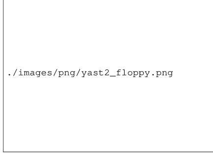

## 图 6.17: YaST2: 创建启动/模块磁盘

- **创建启动磁盘：** 启动磁盘是您在安装时找到的。
- **创建救援磁盘：** 此外，还有一个救援磁盘，它可以帮助您访问系统。
- **创建模块磁盘：** 如果您的安装需要额外的模块，可以创建这些磁盘。

上述磁盘用于启动已安装的系统。


# 使用 Shell 操作

图形界面对于 Linux 来说变得越来越重要。鼠标点击并不总是能满足日常生活中的所有需求。在这里，命令行提供了高度的灵活性和效率。在本章的第一部分，您将获得关于如何操作 Bash Shell 的介绍，随后是对 Linux 下用户用户权限概念的解释，以及一份最重要的命令列表，最后是文本编辑器 vi 的介绍。

- 引言 ................................................................ 122
- Bash 简介 ........................................................ 122
- 用户权限 ................................................................... 131
- 重要的 Linux 命令概览 ................................... 135
- vi 编辑器 ..................................................................... 146

## 引言

特别是对于旧型号的 Linux 计算机，由于它们没有足够的资源运行硬件无关的显示系统，基于文本的程序控制至关重要。在这种情况下，您将使用虚拟控制台，它在文本模式下非常可用。使用组合键 Alt + F1 到 Alt + F6 可以在不同控制台之间切换。第六个控制台留给 X11 使用。

# Bash 简介

在任务栏上，您可以找到一个显示带有外壳（英语 shell）的显示器的图标。点击此符号将打开“控制台”窗口，您可以在其中输入命令。默认情况下它是 Bash（英语 Bourne again）。Bash 是由 GNU 项目开发的，是 Bourne Shell (sh) 的一种流行的变体。当您打开 Bash 后，您会在行中看到“提示符”（Prompt），它通常包含用户名和主机名以及当前路径，但可以进行单独配置。当光标位于此提示符后面时，您可以直接向您的计算机系统发送命令：

```
tux@eder:->
```

# 命令

命令由不同的部分组成。首先是参数或选项。当您按下 `ls` 时，会执行该命令。在此之前，您可以轻松编辑命令行、纠正选项或拼写错误。最常用的命令之一是 `ls`，您可以使用它或带指定的参数使用它。在控制台中输入 `ls` 即可显示您当前所在目录的内容。选项以前加连字符为标记。如果您输入 `ls -l`，将以详细的形式显示目录内容。除了文件名之外，您还会看到文件的创建日期、字节大小以及我们稍后将讨论的其他信息。最重要的选项之一（很多命令都有这个选项）是 `--help`。如果您输入 `ls --help`，将向您显示 `ls` 命令的所有选项。

通过 `ls`，您也可以查看其他目录。为此，您将要显示的目录作为参数传递。例如，要显示子目录 Desktop 的内容，请输入 `ls -l Desktop`。

# 文件与目录

要有效地与 Shell 工作，需要了解 Linux 下文件和目录结构的知识。目录是用于存放文件、程序或其他目录的文件夹。根目录位于层级结构的顶端，通过“/”进行访问。

`/home` 目录中包含每个用户的目录，其中存放着他们的个人文件。图 7 显示了 Linux 下的标准目录树，带有示例用户 yxz、linux 和 tux 的家目录（Home）。您的 Linux 系统的目录树在功能上是划分的（“文件系统标准”），在下一页的表格 7.1 中，您将获得 Linux 下标准目录的简要描述。

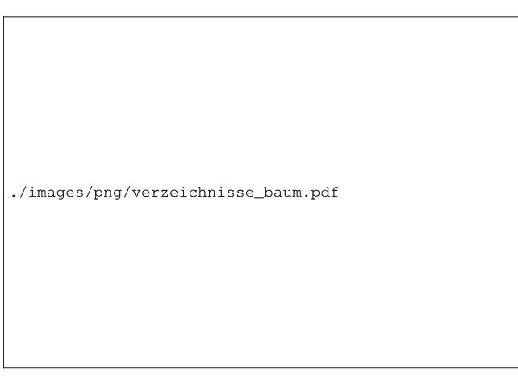

| 路径 | 描述 |
| :--- | :--- |
| / | 根目录（英语 root directory），目录树的起点 |
| /home | 用户文件的（私有）目录 |
| /dev | 代表设备硬件组件 |
| /etc/init.d | 系统配置的重要文件（脚本） |
| /usr/bin | 启动系统时已需要的通用命令 |
| /usr/sbin | 供系统管理员保留的命令 |
| /sbin | 供系统管理员保留且启动系统所需的命令 |
| /usr/include | C 编译器的头文件 |
| /usr/include/g++ | C++ 编译器的头文件 |
| /usr/share/doc | 各种文档文件 |
| /usr/share/man | 帮助文本（手册页） |
| /usr/src | 内核源码 |
| /usr/src/linux | 临时文件 |
| /tmp | 大的临时文件 |
| /var/tmp | 存放所有的应用程序 |
| /var | 配置文件（例如，从 /usr 链接） |
| /var/log | 日志文件 |
| /var/adm | 系统管理 |
| /lib | 库（用于动态链接程序） |
| /proc | 进程文件系统 |
| /usr/local | 可选软件 |
| /opt | 较大的系统 |

表格 7.1：Linux 下标准目录

# Bash 功能

Bash 的两个重要功能简化了工作：

字体 历史（History）：当您调用该命令时，按下按键。
- 扩展功能：如果没有带有该字母的文件，Shell 将补全字符串。

**文件操作**

您知道如何与 Shell 工作，哪些目录可以简化操作：

1. 要显示目录内容，请使用 `ls`。
2. 要查看内容，需要 `ls` 位于一级。
3. 使用 `mkdir`（英语 make directory）创建一个新的子目录。
4. 要查看移动是否成功，请使用命令 `cd`（英语 change directory）切换目录。
5. 如果您需要文件的副本，请使用命令 `cp`（英语 copy）。


## 示例：处理路径

另一个示例将向您展示如何在您的 SuSE Linux 系统的目录结构中导航。

- 使用 `cd` 切换到您的主目录。通过 `mkdir test2` 创建另一个子目录 `test2`。
- 使用 `cd test2` 切换该目录，并创建一个名为 `Unterverzeichnis` 的目录。通过仅按 `Tab` 键使用扩展功能来自动补全字符串的剩余部分。
- 现在您位于子目录中，需要在不切换目录的情况下移动之前创建的备份 `Testsicherung`。为此，您必须指定所需文件的路径。不要忘记命令 `mv ../test/Testsicherung .` 末尾的点，它将当前目录设置为移动的目标。通过使用两个点，可以将一个选定的文件分别移动到您的目录中。

# 通配符 (Wildcards)

通配符的进一步优势是这四个字符。“Wildcards”或通配符字符：

- ? 替换任意一个字符。
- * 替换任意数量的字符。
- [set] 替换任意一个一个字符，但方括号内指定的字符除外（字符字符串“*set”）。
- [set]] 包含任意一个字符，但“set”中指定的字符除外。

如果您在目录中有文件 `Testdatei`、`Testdatei2` 和 `date`，并输入 `ls Testdatei`，您将获得 `Testdatei` 和 `Testdatei2`。通过 `ls *` 您还将获得文件 `Testdatei`。
`ls *` 命令将向您显示所有通配文件，而您可以使用通配符集匹配最后一个字符为数字的任何字符：`Testdatei[1-9]`。
最重要的始终是 `*` 通配符：通过使用它，您可以将一个目录中的文件复制到另一个目录或删除。例如，命令 `rm *date*` 会删除您 `test` 目录中所有名称中包含字符串“date”的文件。

# 更多或更少

两个小型程序允许您直接在 Shell 中查看文本文件。我们甚至不需要启动编辑器。要打开文件 `Datei.txt` 文件，只需输入 `less README.txt`。控制台窗口将只显示文本。使用方向键可以一直向下翻页，但您可以使用 `↑` 和 `↓` 键在文本中向前或向后移动。按 `G` 键退出程序。

该程序以“少即是多”为格言命名，不仅可以用于读取文本文件，还可以用于命令输出。相关内容请阅读本页的“重定向”部分。

此外可以使用较旧的程序 `more`，但它没有那么方便，因为您无法向前和向后翻页。

# 重定向

通常情况下，Shell 中的标准输出是您的显示器或控制台窗口，标准输入通过键盘进行。如果您想将一个命令的输出传递给程序，则必须使用所谓的“管道”（Pipeline）。

要查看 `test` 目录中的文件，请输入命令 `ls test | less`。在德语键盘上，通过同时按下 `Alt` 和带有字符 `<` 的键来获取符号 `|` 符号。您现在会在控制台中查看到 `test` 目录的内容。这仅在普通输出过于混乱时才有用。例如，使用 `ls /dev` 查看目录，您在窗口中只能看到内容的一部分，而通过 `ls /dev | all` 则可以列出所有文件。

如果您想将命令的输出保存到文件中，示例中的命令将是：`ls > Inhalt`。之后您将有一个名为“Inhalt”的新文件，其中包含 `test` 中的文件和目录。您可以使用 `less` 查看该文件。
相反，您可以使用文件作为命令的源。例如，通过 `sort < Testdatei` 让您自己编写的测试文件的行按字母顺序排序。命令的输出将在屏幕上显示。您现在可以看到之前编写的文本，它们已根据每行的首字母进行了排序。这在例如需要排序未排序的名称列表时非常有帮助。

# 7

如果您想创建一个带有排序列表的新文件，则必须将 `sort` 命令的输出重新重定向到文件中。如果您想理解这一过程，请在编辑器中创建一个无序列表 `Namensliste`，并将其保存为 `test` 目录下的 `liste`。

进入该目录并调用命令 `sort < liste > sortierteListe`。使用 `less` 查看新列表。

标准错误输出也是屏幕。如果您想将这些错误重定向到名为“Fehler”的文件，请在命令后输入：`2 Fehler`。使用 `>` 将输出同时重定向到标准输出和标准错误输出。如果在该处使用 `>>` 而不是 `>`，则输出将追加到现有文件中。

# 存档与数据压缩

在您已经创建了一些文件和目录之后，我们来看存档和数据压缩的主题。假设您想将 `test` 目录打包到一个文件中，以便将其保存到磁盘上或通过电子邮件发送。为此您使用 `tar` 命令。

- -c (engl. create) 创建新存档。
- -t (engl. table) 显示存档内容。
- -x (engl. extract) 解包。
- -v (engl. verbose) 在处理时显示所有文件。
- -f (engl. file) 指定文件名。

使用 Shell
SuSE Linux

现在要将目录中的所有文件打包成名为 `test.tar` 的存档，我们至少需要 `-c` 和 `-f` 选项。由于我们要跟踪存档过程，我们加上 `-v` 选项。使用 `cd` 进入该目录。现在的输入为：`tar -cvf test.tar`。使用 `tar -tf test.tar` 查看内容。这对硬盘上的目录保持不变。要解压存档，您必须输入 `tar -xvf test.tar`。如果我们想压缩存档文件以节省空间，请不要这样做。
推荐使用广泛的 `gzip`，即 `gzip test.tar`。现在输入 `ls`，您会看到 `test.tar` 文件消失了，取而代之的是一个 `test.tar.gz`。该文件更小，因此更容易发送。
现在应该将存档复制到 `test2`。您使用 `cp test.tar.gz test2`。使用 `cd test2` 进入目录。解包以 `.gz` 结尾的压缩文件使用 `gunzip` 命令，因此输入为 `gunzip test.tar.gz`。我们得到了 `test.tar` 文件，它仍需 `tar -xvf test.tar` 解析。您也可以直接为 `tar` 命令添加 `-z` 选项并解包压缩存档：`tar -xvzf test.tar.gz`。

通过输入 `ls` 您将看到有一个与主目录内容相同的新目录。

# mtools

`mtools` 组可以操作 MS-DOS 文件系统的命令。这对于磁盘驱动器的工作非常重要。在 MS-DOS 下可以通过 `a:` 调用驱动器。这些命令与 MS-DOS 下的命令相似，但显示如下：

- mdir a: - 显示驱动器 `a:` 磁盘的内容。
- mcopy a:Testdatei a: - 将文件 `Testdatei` 复制到磁盘上。
- mdel a:Testdatei - 删除 `a:` 上的 `Testdatei`。
- mformat a: - 使用 `fform` 命令以 MS-DOS 格式格式化磁盘。


cd a: - wechseln in Ihr aktuelle Verzeichnis.

mkdir a:test - erstellt das Unterverzeichnis test auf der Festplatte.

rmdir a:test - löscht das Unterverzeichnis test auf der Festplatte.

# 清理

In diesem Crash-Kurs haben Sie die wichtigsten Grundlagen im Umgang mit der Shell gelernt. Damit Ihr Heimatverzeichnis nicht zu unübersichtlich wird, sollten Sie Dateien und Verzeichnisse nicht einfach mit den Befehlen rm und rmdir wieder löschen.
Am Ende dieses Kapitels finden Sie eine Liste mit den wichtigsten Befehlen und entsprechenden Kurzbeschreibungen.

# Benutzerrechte

Linux wurde von Anfang an als Multiuser-System konzipiert, also für die gleichzeitige Nutzung durch mehrere Anwendungen. Daraus ergeben sich einige wichtige Unterschiede zu Microsoft System Windows.
Das deutlichste Unterscheidungsmerkmal ist der Zwang, sich zu Beginn einer Arbeitssitzung am System anzumelden. Dazu wird dem Benutzer ein eigener „Benutzername“ mit zugehörigen Passwort gewährt, dass Unbefugte keinen Einblick in für sie gesperrte Inhalte erhalten können. Größere Veränderungen am System, z. B. die Installation von Programmen, sind einem Benutzer in der Regel nicht oder nur beschränkt möglich. Nur root, der Administrator, verfügt über praktisch unbegrenzten Zugriff auf alle Dateien. Dieses Konzept ist sicher und nutzt sich, indem man sich nur bei Bedarf als root einloggt, was die Gefahr unbeabsichtigter Datenverluste stark eingrenzt: Da im Normalfall nur der Administrator Systemdateien löschen oder Festplatten formatieren kann, wird die Bedrohung durch Trojanische Pferde oder wesentlich eingegebene destrukt Befehle stark eingeschränkt.

# Rechte im Dateisystem

Grundsätzlich gehört jede Datei im Linux-Dateisystem einem Benutzer und einer Gruppe. Jeder dieser beiden Parteien, auch „Fremden“, können vom Besitzer Schreib-, Lese- sowie Ausführrechte zugiesen werden.

Als Gruppe werden Zusammenschlüsse von Benutzern mit bestimmten kollektiven Rechten bezeichnet. So ist eine solche Gruppe eine einem bestimmten Projekt arbeitende Arbeitsgruppe, nennen wir sie projekt3. Jeder Benutzer unter Linux ist Mitglied in mindestens einer Verwaltungseinheit, standardmäßig wird nur users eingetragen. Wir können nahezu beliebig Gruppen anlegen, allerdings ist nur root dazu. Jeder Benutzer kann mit dem Befehl herausfinden, in welcher Gruppe er Mitglied ist.

# Rechte auf Dateien

Betrachten wir die Rechtestruktur im Dateisystem genauer und beginnen mit den Dateien. Die Ausgabe von ls -l kann beisweise so aussehen:

```
-rw-r----- 1 tux projekt3 14197 Jun 21 15:03 Roadmap
```

> Ausgabe 1: Beispielausgabe der Zugiffsrechte von Dateien

Wie Sie anhand der dritten Spalte erkennen, gehört diese Datei dem Benutzer tux und ist der Gruppe projekt3 zugeordnet. Um die Rechte auf die Datei zu sehen, betrachten wir die erste Spalte genauer.

| Typ | Benutzer | Gruppen | Rechte für andere Benutzer |
|---|---|---|---|
| - | rw- | r-- | r-- |

Die Spalte gliedert sich in ein führendes sowie neun in Detailgruppen unterteilte Zeichen. Der erste der Zeichen steht für den Typ des gelisteten Dateisystembestandes. Der Bindstrich zeigt, dass es sich um eine Datei handelt. Er könnte genauso wie ein Verzeichnis (d), ein Querverweis (l), ein Block (b) bzw. Charakter-Gerät (c) stehen.
Die folgenden zwei Blöcke folgen einem einlichen Schema: Das sind jeweils zwei Zeichen dafür, ob die jeweilige Fraktion Leszugriff auf die Datei verfügt (r) oder nicht (-). Ein w in der mittleren Einheit symbolisiert Schreibzugriff auf das jeweilige Objekt, steht dort ein Bindstrich (-), so ist dies nicht möglich. Darüber hinaus könnte in der rechten Spalte ein x dargestellt sein, welches für einenführungszugriff stünde. Da es sich um ein Beispiel für eine Text-, also nicht um eine ausführbare Datei handelt, kann auf diese executive Rechte verzichtet werden.

In unserem Beispiel hat tux als Besitzer der Datei Roadmap sowohl Lesezugriff (r) als auch Schreibzugriff (w), kann sie aber nicht ausführen (kein x). Die Mitglieder der Gruppe projekt3 können die Datei nur lesen, aber nicht ändern oder ausführen. Andere Benutzer haben keinen Zugriff darauf. Benutzer kann mit dieser Sicherheitseinstellung dafür sorgen, dass nur autorisierte Personen (die Arbeitsgruppenmitglieder) die Datei lesen und nur sie verändern können.

# Rechte auf Verzeichnisse

Wenden wir uns den Zugiffsrechte für Verzeichnisse zu, dazu ist der Typ. Hier haben die einzelnen Rechte eine etwas andere Bedeutung. Ein kleines Beispiel zur Verdeutlichung:

```
drwxr-xr-x   1 tux projekt3   35 Jun 21 15:15 Projektdaten
```

**Ausgabe 2:** Beispielausgabe der Zugiffsrechte auf Verzeichnisse

Auch hier sind Besitzer (tux) und Benutzergruppe (projekt3) des Verzeichnisses Projektdaten leicht zu erkennen. Im Gegensatz zu den Rechten im Dateisystem aus dem letzten Jahr bedeutet das gesetzte Lesrecht (r) jedoch, dass der Inhalt des Verzeichnisses angezeigt werden kann. Das Schreibrecht (w) steht darüber hinaus für die Berechtigung, neue Dateien anzulegen, das Executiverecht (x) erlaubt dem Benutzer sowie den Mitgliedern der Gruppe projekt3, im Verzeichnis Projektdaten zu wechseln (x), den Inhalt anzuzeigen (r) und Dateien anzulegen (w). Alle übrigen Benutzer mit weniger Rechten dürfen in das Verzeichnis wechseln (x) bzw. es durchstöbern (r), jedoch keine Dateien anlegen.

# Dateberechtigungen anpassen

# Ändern von Zugiffsrechte

Die Zugiffsrechte einer Datei eines Verzeichnisses können vom Besitzer (und natürlich von root) mit dem Befehl chmod verändert werden, zusammen mit Parametern für die zu ändernden Rechte.

Die Parameter setzen sich zusammen:

1. den betroffenen Kategorien
   - u (user) - der Besitzer der Datei
   - g (group) – die Gruppe des Besitzers
   - o (others) – sonstige Benutzer (wird kein Parameter angegeben, gelten die Änderungen für alle Kategorien)

2. einem Zeichen für Entzug (-), Gleichsetzung (=) bzw. Hinzufügen (+)

3. den bekannten Kürzungen für
   - r (read) – lesen
   - w (write) – schreiben
   - x (execute) – ausführen

sowie, durch Leerzeichen getrennt, den Namen der Dateien.

Möchte nun allen Benutzern das Verzeichnis gewähren, kann er dies den folgenden Befehl:

```
chmod o+w projektaten
```

Will er jedoch sich selbst das Schreibrecht entziehen, nimmt er:

```
chmod u-w projektaten
```

Um allen Benutzern das Verzeichnis zu verbieten, schreibt man:

```
chmod o-w projektaten
```

# Ändern von Eigentumsrechte

Weitere Kommandos, die Eigentumsverhältnisse regeln, sind chown (Change Owner) und chgrp (Change Group). Der Befehl chown dient dazu, einen Benutzer zu ändern. Allerdings darf root diese Änderung vornehmen.

Angenommen, die Datei Roadmap aus Beispiel 2 soll nicht mehr tux, sondern dem Benutzer geek gehören, so lautet der entsprechende Befehl:

```
chown geek Roadmap
```

# Wichtige Linux-Befehle im Überblick

In diesem Abschnitt möchten wir Ihnen einen Überblick über die wichtigsten Befehle Ihres Systems geben. Dabei werden wir die Grundbedeutung der einzelnen Kommandos auf einige Parameter eingehen und wenn es sich anbietet, ein typisches Anwendungsbe liefern.

Um über die Details dieses Kommandos zu erfahren, können Sie zusätzliche Informationen mit dem Programm man gefolgt von Befehl erhalten z. B.

```
man ls
```

In diesen „Manual Pages“ können Sie sich mit den Bildlauften ↑ ↓ vom Anfang bis Ende der Dokumentation bewegen. Beenden Sie diesen Darstellungsmodus durch Drücken der Taste Q. Durch Eingabe von man können Sie mehr über man-Befehle selbst erfahren.


+   如果某些信息或参数不是绝对必要的，则将它们放在 [方括号] 中。

Und natürlich müssen Sie etwaige Angaben Ihren Bedürfnissen anpassen. Es macht keinen Sinn, wie ls Datei(en) zu schreiben, soweit nicht eine Datei, die sich Datei(en) nennt, tatsächlich existiert. Außerdem können Sie mehrere Parameter in aller Regel kombinieren, indem Sie z.B. statt ls -1 -a ls -la schreiben.

# 文件命令

Dateiververwaltung

```
ls [Option(en)] [Datei(en)]
```

Wird ls ohne weitere Angaben und Parameter aufgerufen, listet es den Inhalt des Verzeichnisses, in dem Sie sich gerade befinden, in Kurzform auf.

Optionen:

+   -l detaillierte Liste,
    -a zeigt versteckte Dateien an.

```
cp [Option(en)] Quelldatei Zieldatei
Erstellt eine Kopie der Quelldatei in Zieldatei.
```

Optionen:

+   -i Wartet ggf. auf Bestätigung, bevor eine existierende Zieldatei überschrieben wird.
+   -r Kopiert rekursiv (mit Unterverzeichnissen)

```
mv [Option(en)] Quelldatei Zieldatei
Legt eine Kopie der Quelldatei in Zieldatei an und löscht anschließend die ursprüngliche Datei.
```

Optionen:

+   -b Erstellt vor dem Verschieben eine Sicherungskopie der Quelldatei
+   -i Wartet ggf. auf Bestätigung, bevor eine existierende Zieldatei überschrieben wird.

```
rm [Option(en)] Datei (en)
Entfernt die angegebenen Datei (en) aus dem Dateystem. Verzeichnisse werden außer durch explizite Angabe des Parameters -r nicht durch rm gelöscht.
```

Optionen:

+   -r Löscht evtl. vorhandene Unterverzeichnisse
+   -i Wartet vor Löschen angegebene Datei auf Bestätigung

```
ln [Option(en)] Quelldatei Zieldatei
Legt in Zieldatei einen internen Querverweis („Link“) auf die Quelldatei unter anderem Namen an. Normalerweise zeigt dieser weist direkt auf die Position der Datei innerhalb eines Dateisystems. ln hingegen mit der Option -s aufgerufen, wird ein sogenannter „symbolischer Link“ angelegt, der lediglich auf den Pfad der Datei zeigt und deswegen über Dateystem-grenzen hinweg funktioniert.
```

Optionen:

+   -s Legt einen symbolischen Link an.

```
cd [Option(en)] Verzeichnis
```

Wechselt das aktuelle Verzeichnis. Wenn nur cd eingegeben wird, wird in das Homeverzeichnis gesprungen.

```
mkdir [Option(en)] Verzeichnisname
```

Legt ein neues Verzeichnis an.

```
rmdir [Option(en)] Verzeichnisname
```

Löscht das Verzeichnis, allerdings nur, wenn dieses bereits leer ist.

```
chown [Option(en)] Benutzername.Gruppe Datei
```

Ändert den Besitzer einer Datei auf den angegebenen Benutzernamen.

# Optionen:

+   -R Ändern der Dateien und Verzeichnisse in allen Unterverzeichnissen.

```
chgrp [Option(en)] Gruppename Datei (en)
```

Ändert den Namen der Gruppe, die eine gegebene Datei besitzt Gruppename. Der Datei-Besitzer darf diesen Wert nicht ändern, wenn er sowohl Mitglied der bisherigen als auch der Eigentümergruppe ist.

```
chmod [Optionen] modus Datei (en)
```

Ändert Zugriffsrechte.

Der Parameter modus ist dreiteilig: Gruppe, Zugriff und Zugriffstyp. Für Gruppe sind die Zeichen

# Gruppenoptionen:

+   u für den Benutzer (engl. User),
+   g für die Gruppe (engl. group),
+   c für alle anderen (engl. others).

erlaubt. Für Zugriff sind die Zeichen + und – möglich. Durch das Zeichen + kann der Zugriff erlaubt werden, durch – entzogen werden.

Der Zugriffstyp wird durch folgende Optionen gesteuert:

# Zugriffstyp:

+   r für Lesen (engl. read),
+   w für Schreiben (engl. write),
+   x Ausführen von Dateien, bzw. Wechseln in das Verzeichnis (engl. execute).

+   s Setuid-Bit; das Programm wird ausgeführt, als es vom Inhaber der Datei gestartetete wurde.

# gzip [Parameter] Datei (en)

Dieses Programm verkleinert („komprimiert“) den Inhalt von Dateien durch komplizierte mathematische Verfahren. Die Namen der reduzierten Dateien dann auf .gz und müssen bei erneuter Nutzung „entpack“ werden. Wollen Sie mehrere Dateien oder ganze Verzeichnisse komprimieren, müssen Sie zusätzlich den Befehl verwenden.

# Optionen:

+   -d „Dekomprimiert“ die gepackten zip-Dateien, sodass diese ihre ursprüngliche Größe wiederherstellen und normal bearbeitet werden können (entspricht dem Aufruf von gzip).

# Optionen Archivname Datei (en)

tar fasst eine (oder der Regel) mehrere Dateien, die dann z. B. komprimiert werden können, zu einem sogenannten „Archiv“ zusammen.

tar ist ein sehr komplexer Befehl, der eine Vielzahl von Optionen zur Verfügung stellt. Die gebräuchlichsten stellen wir hier kurz vor.

# Optionen:

+   -f Schreibt die Ausgabe in eine Datei und nicht auf den Bildschirm, wie es standardmäßig vorgesehen (engl. file).
+   -c Legt einen neuen tar-Archiv an (engl. create).
+   -u Fügt Dateien einem bestehenden Archiv hinzu.
+   -t Gibt den Inhalt Archives aus.
+   -u Fügt Dateien einem bestehenden Archiv hinzu.
+   -x Extrahiert Dateien
+   -z Komprimiert das mit gzip.
+   -j Komprimiert das mit bz2.
+   -v Gibt die Namen aller bearbeiteten Dateien aus.

Die von tar erstellten Dateien mit.gz, bz2.

Mit `locate` kann man in, in,,..........,,,,,,,,,,,,,.,...,,.,,,,,,,,,,,,,,,,,,,,,,,,,,,,,,,,,,,,,,,,,,,,,,,,,,,,,,....,,,, zu setzen, in den Hintergrund (&).

find [Option(en)]
Mit dem Befehl finden in einem bestimmten Verzeichnis suchen. Das erste Argument bezeichnet das Verzeichnis, von dem die Suche gestartet soll. Die Option -name verlangt einen suchenden String, der Wildcards erlaubt. find findet sich nicht in einer Datenbank, sondern durchsuch tatsächlich das angegebene Verzeichnis.

# Inhaltsbefehle

cat [Option(en)] Datei(en)
cat gibt den Inhalt einer angegebenen Datei ohne Unterbrechung aus.

+ Option:
-n Nummeriert die Ausgabe am linken Rand.

less [Option(en)] Datei (en)
Dieser Befehl ermöglicht es, durch den Inhalt der spezifizierten Datei zu „wandern“. Beispielsweise können Sie mit [Bild] und [Bild] um eine halbe Seite vor zurück springen, mit der Leertaste eine nach. Es ist möglich, mit [Pos] den Anfang bis das Ende der Datei zu navigieren. Mit [Q] kann dieser Ausagemodus beendet werden.

grep [Option(en)] sucht Datei (en)
grep ist dazu gedacht, ein bestimmtes Suchwort in den angegebenen Datei(en) zu finden. Hat es Erfolg, gibt es die Zeilen, in denen das Suchwort gefunden wurde, sowie den Namen der Datei aus.

+ Optionen:
- i Ignoriert Groß-/Kleinschreibung
- l Gibt die Namen der jeweiligen Dateien, nicht aber die Textzeilen aus
- n zeigt zusätzlich Nummern der Zeilen, in denen sie fündig sind
- l Listet Dateien, in denen das Suchwort nicht vorkom

diff [Option()] Datei2
diff wurde geschaffen, um den Inhalt beliebiger gewählter Dateien zu vergleichen und in Form eine Liste von geänderten Zeilen auszugeben.

Häufig wird es von Programmierern verwendet, die auf diese nur die Änderungen in Ihren Programmen, nicht den gesamten Quellentexte verschicken.

+ Optionen:
- q Meldet nur, ob sich die beiden angegebenen Dateien überhaupt in ihrem Inhalt unterscheiden.

# Dateisysteme

mount [Option(en)] [Gerät] Mountpoint
Mit Hilfe Befehl können beliebige Daträger in das Dateisystem „gemounted“ werden. Darunter versteht man das Einbinden von Festplatten, CD-ROM- und anderen Laufwerken in ein Verzeichnis des Linux-Dateystems.


选项：

- r 仅读挂载（英文. read only）。
- t 指定文件系统。最常用的有：用于 Linux 平台的 ext2，用于 Windows 文件系统的 mdos vfat 以及用于 CD 的 iso9660。

对于未在 `/etc/fstab` 文件中定义的驱动器，必须指定设备类型。在这种情况下，挂载（英文. mount）不能由 root 执行。如果该文件系统也由其他用户挂载，请在 `/etc/fstab` 文件的对应行中输入 `user` 选项（用逗号分隔）并保存。更多信息请参阅 `mount` 的手册页（man mount）。

```
mount [Option(en)] 挂载点
```

此命令将已挂载的驱动器作为一个文件系统。在从驱动器中移除磁盘之前，请执行此命令。否则会有数据丢失的风险！通常情况下，`mount` 和 `umount` 都可以由 root 执行。例外是在 `/etc/fstab` 文件中为驱动器指定了 `user` 。

## 系统命令

# 信息

```
df [Option(en)] [目录]
```

该命令（英文. disk free）在不带选项调用时，会显示所有挂载驱动器的总空间、已用空间可用可用统计信息。如果指定了一个目录，则统计信息将显示该目录所在的驱动器。

选项：

- H 以“人类可读”（英文. human readable）的格式以 GB、MB 或 KB 为单位显示已用块数。
- t 驱动器类型（ext2, nfs 等）。

```
du [Option(en)] [路径]
```

此命令在不带参数的情况下，会显示当前目录下所有文件的总空间占用；存在子目录，也会显示它们的总大小。

# 7

选项：

- a 显示每个单独文件的大小
- h 以“人类可读”格式输出
- s 仅显示计算出的总大小

## 与 Shell 操作

```
free [Option(en)]
```

`free` 统计总内存、已用内存以及交换内存的总和。

选项：

- b 以字节（Bytes）显示，
- k 以千字节（Kilobytes）显示，
- m 以兆字节（Megabytes）显示

```
date [Option(en)]
```

此小型程序在调用时会输出当前系统时间。此外，root 可以通过此命令更改系统时间。详情请参阅手册（date 的手册页 (man date)）。

## 进程

```
top [Option(en)]
```

通过 `top` 可以快速获取当前运行进程的概述。通过按下 `h` 键，会显示一个包含重要选项说明的页面，以便根据个人需求调整程序。

```
ps [Option(en)] [进程 ID]
```

在不带选项调用时，每个命令都会返回一个所有“自己的”（即由你自己启动的）程序或进程的表格。注意，此命令的选项不应预设最小准则。

选项：

- aus 以列表形式详细列出所有所有者的所有进程

```
kill [Option(en)] 进程 ID
```

有时会出现程序无法停止的情况。通过 `kill` 命令的常规方法，几乎可以根据进程 ID（参见 `top` 或 `ps`）“杀死”所有的进程“僵尸”。

SuSE Linux - 基础 143

为此，它会发送一个所谓的“TERM”信号，要求程序自终止。如果这不起作用，还有一个非常有用的参数：

### 选项：

- 9 发送“KILL”信号代替“TERM”信号，从而将进程从操作系统中移除。这在几乎所有情况下都能终结指定的进程。

```
killall [Option(en)] 进程名
```

此命令的功能与 `kill` 等效，只需提供进程名称即可“杀死”所有同名的进程。

## 网络

```
ping [Option(en)] 主机名|IP 地址
```

`ping` 是检查 TCP-IP 网络基本功能性的终极手段。该工具向另一台计算机发送一个数据包，要求其立即返回。如果成功，`ping` 将显示相应的消息，从而确保了网络的基本传输能力。

### 选项：

- c 数量：设置发送的数据包总数，发送完毕后程序将退出。默认没有限制。
- f “洪泛 ping”：发送尽可能的数据包。只有 root 可以执行的测试，用于测试网络。
- i 值：设置两个数据包之间的间隔时间（秒），默认为一秒。

```
nslookup
```

为了将域名转换为 IP 地址，存在上述域名系统。

```
telnet [Option(en)] 主机名或 IP 地址
```

`telnet` 是一种允许在其他计算机上执行工作的协议。

## 注意

- Telnet 显示了通过网络可以实现。

# 其他

```
passwd [Option(en)] 用户名
```

```
su [Option(en)] 用户名
```

```
halt [Option(en)]
```

```
reboot [Option(en)]
```

```
clear
```


- x 删除当前字符。

- dd 删除当前行。

- dw 删除到当前单词末尾。

- cw 切换输入模式（当前单词的剩余部分将被输入覆盖）。

- u 撤销上一个命令。

- J 将下一行附加到当前行之后。

- : 重复上一个命令。

- w 进入复合命令模式切换。

# 表格 7.2：vi 编辑器的简单命令

在所有命令前都可以加上一个数字，表示后续命令作用于多少对象。例如，通过输入 `3dw` 可以一次删除三个单词。输入 `10x` 可以删除从光标位置开始的十个字符，`20dd` 则删除 20 行。

复合命令模式的主要命令：

- :q! 不保存修改退出 vi
- :w (文件名) 另存为 (文件名) 
- :x 保存修改后的文件并退出编辑器
- :e (文件名) 编辑（加载）(文件名) 
- :u 撤销上一个编辑命令

# 表格 7.3：vi 编辑器的复杂命令

在输入模式下按下 (ESC) 键切换到命令模式。

# 8 工作场所人体工程学

工作场所人体工程学

本章包含对“工作场所人体工程学设计”主题的简要介绍。阅读本文不能替代对相关规范的研究。为了便于阅读，文中未对逐条引用这些规范，也省略了参考文献索引。作者已力求简洁扼要地总结了当前的科研现状，但仍有许多内容未提及。各章节中未引用的点最初摘自德语文献，几乎总是基于德意志联邦共和国的法令或规定。在统一欧洲和国际标准的框架下，这些规定通常在整个欧洲范围内具有相似的形式和效力。

- 引言 . . . . . . . . . . . . . . . . . . . . . . . . . . . . . . . . . 150
- 工作环境 . . . . . . . . . . . . . . . . . . . . . . . . . . . . . . . 150
- 工作设备 . . . . . . . . . . . . . . . . . . . . . . . . . . . . . . . . . . 156
- 链接与参考文献 . . . . . . . . . . . . . . . . . . . . . . . . . . . . . . . . 161

## 引言

该主题主要因《显示设备工作安全与健康条例》（显示器工作条例 - BildarschVV）的实施而变得重要。该条例根据欧盟指令制定，规定了显示器工作位设计必须符合的最低要求。在德意志联邦共和国，工作岗位必须在 1999 年 12 月 31 日之前根据该条例的要求调整。在许多企业中，这尚未实现。

# 工作环境

如果人体工程学家去研究电脑用户的“家庭办公场所”，面对那些最奇特的构造，他们可能会感到绝望并流泪。遗憾的是，目前还没有通过标准来引导个人避免购买所谓的“特种电脑”。那些通常很廉价就能买到的金属管支架，配有“实用的轮子”（=稳定性差）、“人体工程学可调节的键盘架”（= 带有腕托）、集成式 PC 主箱支架以及带有纸托的打印机”（= 存储空间小且腿部空间狭窄）和“可旋转的鼠标垫”（= 不稳定且工作表面太小）以及“良好的显示器视角”（= 太近、太高），顶多仅供短期使用计算机。在专业的显示器工作位中，这些设备没有立足之地，因为它们在所有方面都不符合相应的标准。因此，在专业办公家具商的目录中，可以找到类似的电脑移动设备，因为它们通过遵守公司工作岗位的最低标准，间接地关注了员工的健康。请注意——“最低标准”这个词意味着实际上还可以做得更好。

# 写字桌

错误的桌面高度会消耗手臂和背部肌肉。由此产生的强制性姿势主要损害脊柱。此外，空间不足可能迫使人采取不自然的体态并导致血液循环障碍。

基本上，选择正确的桌子非常简单。它应该尽可能宽且深。为此，个性化调整桌面高度是理想的。奢侈品是那些可以在坐和站之间切换的工作桌（例如通过按下按钮即可非常舒适地变成立式桌），坐和站两种负载形式之间的切换可以缓解压力。

- 灵活安排工作设备需要至少 160 x 80 cm 的桌面。
- 为了工作，配有多个工位的办公位建议配备多个连接板。
- 可调节的桌面高度应在 68 到 72 cm 之间可调，且符合人体工程学。
- 对于某些工作任务，DIN 标准要求至少 200 cm。
- 桌面宽度至少为 60 cm。
- 根据经验，显示空间是充足的。
- 使用大显示器时，应使用至少 120 cm 的深度表面。
- 桌面应避免（颜色）（因此许多家具有深灰色可选）。

# 正确坐姿

在办公椅上坐会迫使人处于静态持续姿势，而不是“瘫坐”，这增加了脊柱的负担。在极端情况下，长期错误压力会导致肌肉和骨骼疾病。

正确的坐姿意味着变换姿势。这样身体部位会被反复活动。基本上这很大程度上取决于正确的调节：当手臂与上臂成直角时，椅子的高度是理想的。双脚应完全着地，小腿也应该是垂直。传统座椅的替代方案是健身椅和平衡椅。

根据人体工程学标准设计的椅子相当昂贵，但对健康的投资是值得的。另外：GS 认证标志仅显示符合最低要求。德国 TÜV 认证——人体工程学测试对椅子提出了更高的要求。


## 良好的光带来良好的工作

通常情况下，工作场所的照明亮度接近于我们在室外感受到的亮度。这种差异并不会被人察觉，因为人类的感知系统是灵活的。光照条件对个人工作能力的影响往往被低估。如果光线太亮，可能会觉得太暗，导致看不清屏幕显示。不正确的照明会导致视觉系统过度使用，最终导致记忆力受损和疲劳症状。

目前人们认为，基础照明与个人工作照明相结合是最佳的。对于工作场所，建议结合高亮度的天花板灯（500 瓦）以及在必要时配备一盏或两盏工作灯。办公室里通用的荧光灯管作为基础照明，应通过个人工作站进行补充。但照明不应过于强光，且应具备个人可调节性。应避免产生高对比度。因此，在使用强烈的单点照明时要小心；此外，良好的照明非常昂贵，而廉价的光源设备也能满足照明的最低要求。

- 应该让人具备感知自然光的机会。窗外的视野非常重要。
- 当基础照明亮度不超过 250 lx 时，被认为是舒适的（要求至少为 500 lx，开放式办公室为 1 000 lx）。
- 个人工作灯应向工作区域辐射 500 - 750 lx 的光线。然而，光源往往存在问题，因为在这种强度下，它们会与基础照明产生过大的亮度差异。和谐流畅的过渡被认为是更舒适的。
- 照明在任何情况下都应该是无闪烁频率的。（在所有低亮度荧光灯中，有时会在余光中观察到闪烁。）
- 应避免产生深色阴影。
- 天花板灯应从斜侧上方射光，灯带应相对于屏幕错错排列。屏幕工作时的视线方向应与灯带平行。

SuSE Linux - 基础
153

- 照明是否让人舒适取决于灯具的色温度和光色。建议使用暖光或中性白光。
- 光线需求不仅取决于工作任务，还取决于年龄：老年人需要更多的光。老年人只在家里开一盏小灯，这与光需求无关，而是为了节电。
- 靠近自然光的屏幕工作位要求对直射光和反射眩光具有最佳屏蔽，特别是当视线直接或以 45 度角看向窗外时。内置的眩光防护装置能够个人调节。但屏幕上的人工照明也会导致反射眩光。

## 良好的气候

室内气候很大程度上决定了我们的舒适度。如果太冷、太热、太通风或太干燥，就会经常出现问题。相对湿度较低会导致眼睛干燥、粘膜干燥和感冒易发性增加。如果一个房间里工作的人习惯了不同的温度，情况就会变得复杂。对于舒适度来说，重要的是遵守温度、湿度的理想基本值，并避免强烈的空气流动。同时，工作设备本身不应导致温度升高。

- 对于坐姿或轻体力活动，建议室内温度为 20 到 22°C。夏季温度最高不应 26°C，在高温情况下，该值可以短暂超过。
- 必须注意，不仅是人，其他设备也会产生热并影响室内气候。应尽可能减少。
- 空湿度应保持在 40%（有时为 50%）之间并进行控制。这一值主要受暖气的影响。
- 穿堂风（例如通过开启的窗门或空调）不应超过 0.1 到 0.15 m/s。应避免气流直吹单个身体部位。
- 空调应能够个人调节。必须注意进行定期维护。
- 窗户应该是开启的，并具有防止眩光的防护设施。阳光会大幅提高室内温度。外部遮光设施提供最好的保护。
- 植物可以改善室内气候，因此在任何情况下都推荐使用。它们增加了相对湿度并过滤空气中的污染物。

## 过多的噪音会导致压力

噪音是一种生理压力源，会引发心理压力。即使噪音增加，它也会让人生病。除了听力下降、植物功能障碍和心理变化等健康损害外，噪音还会影响我们工作能力的专注能力。在许多情况下，噪音会导致不满意。安静的环境对工作能力至关重要。在许多情况下，噪音会导致不满意。安静的环境对工作能力至关重要。

- 由于工作位主要进行脑力劳动，应满足要求。办公工作的限值为 55 dB(A)。对于特别高脑力要求的甚至要求 35 - 45 dB(A)。
- 此外，重要的是评估值最大为 55 dB(A)。如果测量得连续十分钟为 70 dB(A)，则剩余时间的噪音应小于或等于 55 dB(A)。
- 工作位可以通过隔断墙、吸音地板、壁纸墙、织物帘进行配备。
- 工作设备，例如某些企业所需的针式打印机，应放置在隔音罩内。
- 噪音污染也可以通过工作的组织重组来减轻。

## 工作设备

### 购买屏幕时注意眼睛！

糟糕的屏幕可能会加剧已经存在的视力问题。除了眼睛问题外，还会导致紧张、疲劳和许多光照问题。目前的水平是三极管或黑矩阵屏幕以及 TFT 平显示器。遗憾的是，平显示器仍然相当。。许多标准规定了信息的易读性。屏幕在德国有 GS 标志，并符合其他非强制标准，例如 TCO 99（低辐射）。特别是在购买屏幕之前，建议研究现有的标准以避免购买错误。这一点也很非常安全：通常良好的屏幕很贵。廉价的箱式显示器不耐用。它们在几年内能保持清晰度。

- 所有显示的字符在边缘区域都应清晰可见，建议使用正像显示（=亮色背景上的深色字符，如书一样）。
- 由于显示的字符必须足够大，至少对于图形界面（例如 KDE），建议使用 17 英寸显示器。在 CAD、布局和图形编辑中，应为 21 英寸。


- 特别重要的是图像必须无闪烁。具体来说，对于15寸显示器至少要达到 73 Hz。但建议使用 85 Hz。对于较大的设备，例如21寸，建议为 100 Hz。

- 亮度和对比度是可以调节的。字符的清晰度不应因亮度或对比度的不同而产生差异。

- 理所当然的是，图像应该是无畸变的且不产生色差。

- 为了避免反射眩光，建议屏幕表面具有良好的反射性能。

- 显示器应能够自由旋转和倾斜。建议具有高度调节功能。

- 色彩呈现有助于更好地获取所展示的信息。颜色的呈现也可能导致眼睛疲劳。不同颜色被透镜的折射程度不同。对于红色，我们是远视的；对于蓝色，是近视的。旧的显示器往往会出现会散误差，即显示器管的三束光线不再精确对齐；这会导致单词中的字母出现彩色边缘等。

- 显示器发出的电磁辐射应尽可能保持低水平。建议遵守瑞典 MPR II 标准。TCO 99 是目前该领域最严格的标准。

- 德国的新显示器应符合 CE 标志和欧洲标准，并具备节能功能。

## 我如何设置我的显示器？

这一点同样适用：放置不当的显示会在工作时产生强制性姿势，可能导致已知的疾病。通常，足够的书深度会限制显示器的合理放置。头部和手臂的自然姿势是为了适应字面意义上位于我们面前的工作而设计的。

人体工程学专家针对所谓的“视觉与抓取空间”制定了专门的准则。例如，他们拒绝了常见的侧向偏移显示器放置法。唯一的例外是显示器使用频率极低的情况。这种放置习惯的一个原因是，当使用大屏幕且配合工作模板使用时，要求的 60 cm 最小书深度是不够的。显示器像许多 PC 手册图中所示的那样，被放置在计算机主机上。这同样导致了不自然的身体姿势。请你在阅读时观察一下自己：直视前方，或者最好向下看。

肩部、键盘和显示器应该保持线性对齐。视线直接对着显示器。但这并不是一条总是或必须执行的规则。

- 从效果上说，工作站应根据个人进行调整。灵活性是关键词。因此，个人化需要易于移动、可旋转且理想情况下可嵌入桌桌的显示器支架。

- 一个舒适的距离，让显示器用户和他们的视线能够得到游动。这样眼睛可以在中间调整到不同的距离。

- 如果是根据模板打字，模板应位于与显示器相同的距离。这样可以避免频繁切换对焦焦距。

- 在直接工作区域（即显示器内容）与紧邻的区域（例如显示器外壳）之间，亮度差异不应超过 3:1。因此，在办公室里，设备的外壳不是深黑色的。工作区域与环境之间的差异不应超过 10:1。

- 亮面也会产生巨大的亮度差异。因此，办公家具不提供亮色选择，且具有哑光表面。

- 为了最大限度地减少屏幕反射眩光的危险，显示器和键盘的布局应使视线方向与表面平行。离显示器越远越好。

- 显示器不应直接放在荧灯管下方，而应错位放在上方。视线方向应与荧灯管平行。

## 敲击键盘和手腕

众所周知，从打字机衍生而来的键盘布局并不一定符合人体工程学。打字受累的不是手指或手而是手臂和肩部区域。紧张是其结果。糟糕键盘带来的负担会随着时间的推移而增加。遗憾的是，打字时产生的微动作很难测量。这里的风险因素主要是 RSI 综合征（重复性劳性劳损伤）。键盘无疑是电脑最常用的输入设备。因此，它必须设计得特别好。人体工程学专家不断批评：但一个根本性的问题似乎是电缆经常太短，这阻止了舒适的放置。现在的问题是，有多少人愿意为一台 PC 花 2000 瑞，却只为配套的键盘花 20 瑞？实际上，他们应该在买键盘时也一起买一根延长线。

- 键盘应与显示器分离。

- 键盘高于桌面高度不应超过 30 mm。

- 如果没有键盘托，建议配备一个。

- 键盘的标记必须与塑料颜色有鲜明对比且清晰可见。

- 键盘应具有哑光表面。

- 键盘可以是符合人体工程学的。

- 键盘键程应为 2-4 mm，触感点应易于感知。

- 对于大量打字者，建议使用 50-80 g。

- 注意经常休息。

- 此外，学习十指打字是有益的，因为负担被分配到了所有手指。

- 分离式或个人定制的键盘虽然需要适应，但绝对是更优的替代方案。它们是人体工程学设计的，并在某些标准中更推荐。这可以避免手腕侧侧弯曲。


- 手指应该能够放松地放在按键上。
- 鼠标应该放在键盘旁边的。左手者在这里具有优势，因为在键盘右侧，字母键和鼠标之间有多个功能键和一个数字小键盘。这些键延长了抓取的距离。如果您是左手者，请购买一个左手鼠标；或者通过学习键盘快捷键来减轻整个手臂的负担。通过合理的臂-肩部预防措施，可以更好地应对短时间的过负荷。
- 电缆长度应该足够长，可能需要购买一个延长线。

- 鼠标需要一个合适的底座以保证良好工作；请准备一个好的鼠标垫。
- 请务必注意鼠标驱动程序。良好的鼠标具有具有多种功能的驱动程序。例如，可以根据需要调整光标移动，或为不同的鼠标分配特殊命令。可能可以通过驱动程序将双击设置在中键上。

- 此外：请务必个性化设置鼠标的加速和双击设置。有些人仅用手腕操作鼠标，另一些则希望用整个前臂配合。

- 鼠标的替代方案是轨迹球。在这里，一个固定外壳内的球体移动来控制鼠标指针。与鼠标相比，手-臂的活动减少了。

## 链接与参考文献

一本为员工和主管编写的优秀手册，包含清单和调查工具，这些工具没有忽略心理负担：Bermaster, M., Görner, C., Hacker, W., Kärcher, M. u a. (1997). Das SANUS-Handbuch. Bildschirmarbeit EU-konform - Forschung - FB 760). Berlin: Schriftenreihe der Bundesanstalt für Arbeitsschutz und Arbeitsmedizin. [SANUS: 基于国际标准和规范的显示器工作安全与健康保护]

一份关于显示器工作站周围分析和劳动保护任务的清晰且结构化的指南。

Richenhagen, G., Prümper, J. & Wagner, J. (1998, 2. Auflage). Handbuch der Bildschirmsarbeit. Neuwied: Luchterhand.

关于工作与健康的丰富收集，包含了关于当前德国或国际标准的所有重要信息。非常推荐，遗憾仅限德语：

http://www.sozialnetz-hessen.de/ergo-online

欧洲职业安全与健康局信息网络。提供多种语言版本，信息最详尽：

http://europe.osha.eu.int/

## 帮助与文档

您一定对您的 SuSE Linux 有很多问题。对于这些大多数问题，已经有了答案。因此在 Linux 中，您通常可以通过经典格式找到大量的文档：Man-Pages、Info-Pages、Howtos、FAQs 等。

通过 SuSE 帮助，我们将所有这些格式整合在了一起并进行了系统化。结合全局搜索功能，它为您的问题提供了答案。

在本章中，我们将向您介绍 SuSE 帮助，然后为您概述上述传统的文档源。

- SuSE 帮助 . . . . . . . . . . . . . . . . . . . . . . . . . . . . . . 164
- KDE 帮助 . . . . . . . . . . . . . . . . . . . . . . . . . . . . . . 169
- 支持数据库 . . . . . . . . . . . . . . . . . . . . . . . . . . . . . . 169
- Man-Pages . . . . . . . . . . . . . . . . . . . . . . . . . . . . . . 170
- Info-Pages . . . . . . . . . . . . . . . . . . . . . . . . . . . . . . 171
- Howtos . . . . . . . . . . . . . . . . . . . . . . . . . . . . . . 171
- 内内核文档 . . . . . . . . . . . . . . . . . . . . . . . . . . . . . . 172
- 自由书籍 . . . . . . . . . . . . . . . . . . . . . . . . . . . . . . 172

## SuSE 帮助

您可以通过 KDE 界面面的控制栏上的救生圈（带有集成的 Gecko）启动 SuSE 帮助，或者在安装某些内容后通过 K 或 SuSE 菜单中的“SuSE 帮助”选项启动；参见图 9.1。

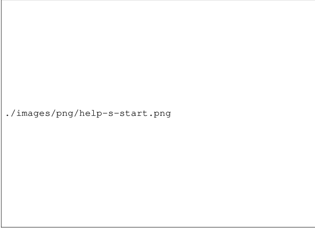

图 9.1：SuSE 帮助主页

当然，“非 KDE 用户”也可以通过任何浏览器显示 SuSE 帮助。但这必须安装 `apache`, `serie n` 软件包；参见第 112 页的“安装/删除软件”章节。


Flaggen stehen symbolisch für die Sprache der Dokumentationskontexte. Wählen Sie aus der Liste der möglichen Quellen aus, in der nach dem Stichwort gesucht werden soll, indem Sie die entsprechende Quelle markieren. Wenn Sie alle Einstellungen vorgenommen haben, klicken Sie auf „Suche“. Nach Themenbereich sortiert erhalten Sie rechts die Suchergebnisse.

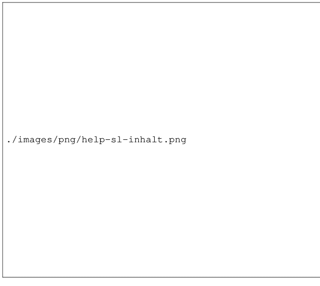

**Abbildung 9.3:** Inhaltssuche

- *Inhalt* – Hier finden Sie die aufgelierung der Startseite (siehe Abb. 9.3). Sie können sich die Dokumentationsquellen zu jedem Themenbereich ansehen, indem Sie mit der Maus auf den Themenbereich klicken; durch erneutes Klicken schließen Sie den Themenbereich wieder. Aktivieren Sie eine Dokumentationsquelle, öffnet sich im rechten Fenster der dazugehörige Text. Zusätzlich erhalten Sie hier die „Lernhilfen“ zu KDE, unter denen Sie Begriffserklärungen für eine eindeutige Zuordnung der verwendeten Begriffe und Objekte im Umgang mit der KDE-Hilfe finden. Um weitere Dokumentationsquellen zu installieren, klicken Sie auf „Nicht installierte Dokumentation“ und wählen Sie aus dieser Liste die entsprechenden Dokumentationspakete aus.

168 SuSE Hilfe

## KDE-Hilfe

Die KDE-Hilfe ist zwar in deutscher Sprache verfügbar, aber einige Texte stehen nur in englischer Sprache verfügbar. Sie enthält Informationen zu KDE sowie deren Programme und zur Konfiguration der grafischen Benutzeroberfläche. Die KDE-Hilfe ist vollständig in die SuSE Hilfe integriert (Abb. 168). Falls Sie das ursprüngliche „KDE-Hilfezentrum“ bevorzugen, können Sie es über den Rettungsring (ohne Geeko!) oder über „Hilfe“ im „K-Menü“ starten.

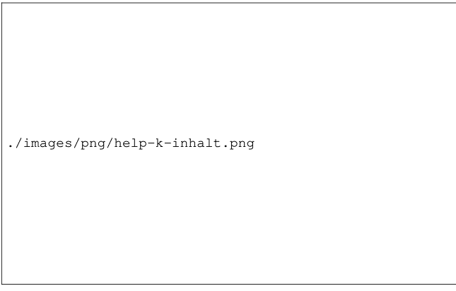

**Abbildung 9.4:** Die Startseite der KDE-Hilfe

## Support-Datenbank

Für viele Fragen und Probleme haben wir die Antworten und Lösungen bereits gefunden. Wir stellen diese in einer Vielzahl von Artikeln in unserer Support-Datenbank rund um die Uhr zur Verfügung: http://sdb.suse.de.

Neben diesem Online-Angebot ist der Inhalt der Support-Datenbank auch im Paket sdb_de, Serie doc auf Ihrer SuSE Linux-CD enthalten. Sie können die Artikel mit jedem Browser lesen.

Tipp
> Zum schnellen Starten und Suchen eignet sich in der URL-Zeile von Konsole der Befehl sdb: gefolgt von dem gesuchten Stichwort.

Tipp

## Man-Pages

Man-Pages sind der traditionelle Weg unter Unix, um eine Beschreibung zur Anwendung von Programmen bzw. Befehlen sowie C-Funktionen zu erhalten. Dabei werden alle Parameter und Optionen erläutert und der Befehl präzisiert. Es gibt Man-Pages in deutscher Sprache (Paket man-pages-de), aber die englischen sind nicht nur vollständiger, sondern auch aktueller.

Die Unterteilung erfolgt in die folgenden Bereiche, die grundsätzlich beim Aufruf der Man-Pages und in vielen Unix-Büchern angegeben werden:

- 1. Benutzerbefehle
- 2. Systemaufrufe
- 3. C-Funktionen
- 4. Dateiformate, Gerätedate
- 5. Konfigurationsdateien
- 6. Spiele
- 7. Verschiedenes
- 8. Systemadministration
- 9. Kernel
- 10. Neue Befehle

Der Aufruf der Man-Pages erfolgt über die folgenden Möglichkeiten:

```
**Konsole** Im Textmodus folgt die folgende Syntax zum Aufruf der Man-Pages:
man <Bereich> <Komando>; um den Befehl aus allen Bereichen anzuzeigen, mit der Option -r,-k wie z. B. man -k <Komando>.
```

```
**Konqueror** zur Eingabe in das URL-Feld: man/<Komando>(<Bereich>)
```

In SuSE Hilfe können Sie in den verschiedenen Man-Pages nach Bereichen geordnet blättern oder nach Stichworten suchen. Sie finden die Man-Pages im Themenbereich „Befehle / Funktionen“ unter „Man-Pages“.

## Info-Pages

Info-Pages haben sich für komplexere Befehle etabliert und beschreiben nicht nur Optionen und Parameter, sondern erklären den Einsatz und die Anwendung der Befehle ausführlicher; meist anhand entsprender Beispiele. Standardmäßig werden Info-Pages mit dem Dateibetrachter Emacs bzw. dem Infoview (info) aufgerufen.

Konsole Sie haben zwei grundlegende Möglichkeiten:

- info zeigt eine Liste der verfügbaren Info-Pages.
- info -apropos <Komando> – Info-Pages zum Thema „Komando“
- info <Komando> öffnet Emacs mit der Beschreibung des Befehls „Komando“

Quellen werden in das URL-Feld eingegeben: info:/<Komando>. Im Browser können Sie die Links auf gewohnte Weise durchklicken.

SuSE Hilfe in der SuSE Hilfe (Abschnitt SuSE Hilfe) finden Sie die Info-Pages im Themenbereich „Befehl / Funktionen“. Die Startseite ist eine Übersicht über Infoseiten, die in HTML-Version angezeigt werden.

## Howtos

Howtos sind ausführliche praxisbezogene Anleitungen zur Installation und Konfiguration unter Linux, die Sie im Verzeichnis /usr/share/doc/howto/ finden. Sie liegen in englischer und (umfangreich) in anderen Sprachen vor.

Zum schnellen Starten und Suchen eignet sich in der URL-Zeile von Konsole der Befehl sdb: gefolgt von dem gesuchten Stichwort.


使用 `fdisk` 删除 Linux 分区；您可能需要先调用 `fdisk`；然后使用 MS-DOS 软盘启动，并在 DOS 下执行 `fdisk /MBR` 命令。

+ 11. 我需要防火墙、地址转换（Masquerading）、邮件服务器和 WWW 服务器。你们的安装支持能帮我吗？

不。

安装支持帮助您让 Linux 基本上运行起来。对于超出安装支持范围的主题，市面上有很好的书籍，此外可以在 `/usr/share/doc/packages` 和 `/usr/share/doc/howto/DE-NET3-HOWTO.txt` 中找到优秀的文档。

+ 12. 我如何访问我的 CD？

您必须先用 `mount` 命令对 CD“挂载”。有关该命令的信息，请参阅第 141 页的文件命令章节。

您必须先对 CD 进行“卸载”。这可以使用 `umount` 命令完成。更多信息请参阅第 142 页的文件命令章节。在 KDE 中，您只需右键点击 CD-ROM 图标，然后选择“取消驱动器”（Laufwerk-Einbindung lösen）。

如果 YaST 运行，您可以坚持。

+ 14. 我如何显示 Linux 中的可用空间？

使用 `df -hT` 命令，另请参阅第 142 页的系统命令章节。

+ 15. 我如何在 Linux 中进行“剪切粘贴”（Cut-and-Paste）？

可以。

想在文本模式下使用“剪切粘贴”，必须运行 `gpm`。在 X 窗口和文本模式下：按住并拖动鼠标左键进行标记，点击鼠标中键粘贴。右键在大多数程序中具有特殊功能。如果您没有中键，请同时按下两个键。

+ 16. 我在 Linux 下也需要担心病毒吗？

不需要。

Linux 下没有正规的病毒。此外，如果您不是以 `root` 身份运行，病毒可能无法对系统造成太大伤害。Linux 下唯一的病毒扫描程序是用于扫描邮件中的 Windows 病毒（如果 Linux 作为路由器或服务器运行）。

## 17. 我必须自己编译内核吗？

不需要，在所有通用情况下都不是必要的！
内核现在已经非常庞大，配置时甚至有 800 个选项需要考虑！要掌握所有及其影响的各种配置是不可能的，我们强烈建议不熟悉的不要重新编译内核。如果您坚持要这样做，请自担风险——在这种情况下我们无法提供安装支持！

## 18. 我如何查看系统模块？

在终端窗口中以 root 身份输入以下命令：

```
root: # tail -f /var/log/messages
```

与此相关的其他感兴趣程序还有：`top`、`procinfo` 和 `xview`。

启动时的信息可以通过以下命令查看：

```
root: # less /var/log/boot.msg
```

## 19. 我无法通过 `telnet` 登录我的电脑。一直得到“Login incorrect”（登录错误）的回复。

您可能正尝试以 `root` 身份登录。出于安全考虑，这样做是不行的。
使用 YaST 创建一个普通用户；可以使用该用户登录。之后使用 `su` 切换到 `root` 用户。但更好更安全的方法是使用 `ssh` 程序；因为它使用了加密且不会被窃听的连接。您可以在 `sec` 系列中找到该程序。

## 20. 我如何通过 Linux 互联网？

请参考第 33 页的章节“KInternet – 通往 WWW 的路”。

## 21. StarOffice 在哪里？

您可以在 `pay` 系列中找到名为 `so_base` 包进行选择。德语语言包包含在 `so_de` 包中。请使用 YaST 安装程序进行安装，它会告诉您插入哪个 CD。

## 22. 我在 SuSE Linux 中发现了一个错误。我可以在哪里报告？

请确认这确实是程序错误，而不仅仅是操作或配置错误。请查看 `/usr/share/doc/packages` 和 `/usr/share/doc/howto` 中的文档。如果您注意到了错误，可以在互联网的 http://sdb.suse.de/sdb/html/ 数据库中查找相关信息。输入关键词或通过“History”（历史）链接进行查找。

如果证明是错误，请通过邮件向 `feedback@suse.de` 发送描述。

## 23. 我如何安装程序？

包含在 SuSE Linux CD 中的程序，最好使用 YaST 安装。请注意，许多大型程序（“Demos”）可以在相关系列中找到。

## 24. 我有一个程序“只有”源代码。我如何安装它？

有些程序需要一些“专业知识”，最好的方法是在良好的 Linux 书籍中找到——参见 http://www.suse.de/de/produkte/books/。

## 25. 我的文件系统受支持吗？

请注意，许多大型程序（“Demos”）可以在系列中找到。

## 26. 我如何对我的磁盘进行碎片整理？

由于 Linux 不产生碎片，因此文件系统不需要碎片整理。

## 27. 我正在分区，文件系统是什么？

使用 `fdisk` 是可以分区的。

## 28. 我运行 Linux 需要多少空间？

这取决于您需要多少包。

## 29. 我需要 Linux 空间，我该如何分区？

使用 `disk` 和 YaST 来获取空间。

## 30. 我的电脑崩溃了，我可以安全地按下重置键吗？

如果您的电脑对鼠标或键盘没有反应，并不意味着整个电脑都崩溃了。可能只是某个程序阻塞了鼠标和键盘，所有其他程序仍在运行。如果电脑可以从外部访问（串口终端、网络），可以仍然登录并使用 `killall` 终止干扰进程。如果您没有这种可能，请尝试通过 `Str + (Alt) + F2` 进入另一个控制台，并在那里终止进程。如果计算机对任何按键都没有反应，请等待至少 10 秒发生磁盘访问后，然后再按下重置键。


## 术语表

## 账户
参见访问权限。

**ADSL** (英文 非对称数字用户线路)
一种数据传输技术，其通过电话线传输数据的速度比 ISDN 快约 100 倍。

**AGP** (英文 加速图形端口)
用于显卡的快速插槽。基于 PCI，提供比 PCI 高出数倍的带宽。与 PCI 模型不同，AGP 显卡还可以访问计算机的内存（无需经过处理器中转），以便在其中调出图形数据。

**内存** (英文 memory)
容量有限的物理存储器，可以较快地访问。

**ATAPI** (英文 高级附件数据包接口)
现在通常被称为 IDE。EIDE 中的“Advance”（高级）源于一个硬盘容量仅 10 MB 且极其缓慢的时代。

## 备份 (Backup)
Backup 是“安全拷贝”的英文表达。人们应该定期进行此类备份，特别是针对重要数据。

## 带宽
数据通道的最大传输能力。

**用户目录** (英文 home directory)
参见 Home 目录。

## 操作系统 (英文 operating system)
在计算机后台永久运行的程序，它使得系统的基本操作成为可能。

## BIOS (英文 基本输入输出系统)
一个在系统启动前几秒内负责硬件组件初始的小型模块。这个对于计算机至关重要的过程在 Linux 系统中 LILO 出现时即结束。

```
LILO
```

## 书签 (Bookmark)
书签。

## 启动 (英文 bootstrap = 引导)
启动指的是系统从开启电源到系统提供给用户使用的整个启动过程。

## 浏览器 (Browser)
用于搜索或显示内容的程序。如今主要用于图形化显示万网内容的程序。

## 缓存 (Cache)
相对于内存而言较小但速度更快的中间存储。缓存中用于存储例如调用的文件，当有持续需求时，就不必再次从硬盘长时间加载。

## 客户端 (Client)
计算机网络中的工作站，由服务器“提供服务”。

## CPU (英文 中央处理单元)
```
处理器。
```

## 光标 (Cursor)
标记输入位置的小块状字符。

## 守护进程 (英文 Disk and execution monitor)
在后台运行的程序，在需要时采取行动。类型的守护进程例如响应 FTP 或 HTTP 请求，或协调 PCMCIA 存储器的活动。

## 文件系统 (英文 filesystem)
文件的组织系统。有许多不同的文件系统，它们在性能方面存在巨大差异。

## DDC (英文 直接显示通道)
显示器与显卡之间通信的标准，用于将各种参数例如显示器名称或分辨率传输给显卡。

## DNS (英文 域名系统)
将 WWW 域名转换为 TCP/IP 地址反之亦然的系统。

## 电子邮件 (英文 electronic mail)
在本地网络用户或连接互联网的系统之间传输“电子信件”的方法。

## EIDE (英文 增强集成硬盘电子)
改进的 IDE 标准，允许容量超过 512 MB 的硬盘使用。

## 提示符 (英文 prompt)
文本型 Shell 的标记，用于输入命令的位置。

## 登录
参见登录。

## 以太网 (Ethernet)
广泛使用的计算机网络标准。

## EXT2 (英文 第二扩展文件系统)
Linux 使用的文件系统。

## FAQ (英文 Frequently Asked Questions)
常见问题的解答。

## 窗口管理器 (英文 window manager)
负责桌面显示的层。

## 自由软件
参见 自由。

## 防火墙 (英文 Firewall)
通过各种安全措施将本地网络连接到互联网的“防火墙”。

## FTP (英文 file transfer protocol)
传输文件的协议。

## GNU (英文 is Not Unix)
自由软件基金会 (FSF) 的项目目标是创建一个与 Unix 兼容的“自由”操作系统。

## GPL (英文 General Public License)
参见 GNU。

## Home 目录 (英文 home directory)
参见用户目录。

## 主机名 (Hostname)
计算机名称。

## HTML (英文 Hypertext Language)
用于网页设计的语言。

## HTTP (英文 Hypertext Transfer Protocol)
用于传输数据的协议。

## IDE (英文 Integrated Drive Electronics)
硬盘驱动器标准。

## IRQ (英文 Interrupt Request)
对硬件的请求。

## 互联网
全球网络。

## IP 地址
数字地址。

## ISDN (英文 Integrated Services Digital Network)
数字标准。

## 通配符
代表一个（符号：'?'）或多个（符号：'*'）未知字符。

## KDE (英文 K Desktop Environment)
Linux 极其用户友好的图形界面。

## 内核 (Kernel)
操作系统的内核。

## 控制台 (英文 console)
终端等。

## LAN (英文 local area network)
地理范围较小的计算机网络。

## 书签 (英文 bookmark)
交叉引的集合。

## LILO (英文 Loader)
用于启动的程序。

## 链接
文件的交叉引用。

## Linux
Unix 类的操作系统内核。

## 登录
登录。

## 注销
注销。

## Man-Page
手册页。


# MBR (英文. 主记录)

硬盘的物理第一个扇区，其内容在系统启动时被加载到内存中并执行。该代码要么从可启动的硬盘分区加载操作系统，要么加载更复杂的引导加载程序，例如 LILO。

# 挂载 (Mount)

在系统的目录树中挂载文件系统。

# 多任务处理 (Multitasking)

操作系统同时运行多个程序的能力。

# MP3

一种非常高效的音频文件压缩方法，与未压缩的文件相比，它可以将文件大小缩小约 10 倍。

# 多用户 (Multiuser)

允许多个用户同时与系统工作的可能性。

# 网络 (英文. net, network)

许多计算机的连接，通常通过服务器和客户端实现。

# NFS (英文.网络文件系统)

用于访问联网计算机文件系统的协议。

# NIS (英文.网络信息服务)

用于在网络中集中管理管理数据的系统。NIS 可以在网络范围内保持用户名和密码的同步。

# 分区 (Partition)

硬盘上逻辑独立的子区域，每个区域可以包含不同的文件系统。在 Windows 中被称为“驱动器”。

# 路径 (英文. path)

文件在文件系统中位置的唯一描述。

# 即插即用 (Plug and Play)

自动配置硬件组件的技术。诸如 IRQ、DMA 等其他资源应由系统自行进行配置和管理。

# 提示符 (Prompt)

见输入提示符。

# 协议 (英文. protocol)

一种定义的特定标准，用于规定硬件层、软件层以及网络层面的通信。此类标准有许多，广泛使用的例子有 HTTP 和 FTP。

# 代理 (Proxy)

通常位于互联网服务提供商处的缓存，经常将频繁请求的内容存储在数据库中，以便请求该页面的其他计算机直接获取。这种方法不仅可以缩短直接下载的时间，还能节省现有带宽。

# 进程 (英文. process)

程序或可执行文件以进程的形式运行，可以在 Shell 中进行观察，例如使用 `top`。该术语通常与以机器语言处理和执行程序的“任务 (Task)”同用。

# 处理器 (Processor)

处理器是计算机的“大脑”，负责处理和执行用户或程序的机器指令。它负责控制整个系统并提供实际的计算能力。

# RAM (英文. 随机访问存储器)

见内存

# 根用户 (Root)

在复杂的计算机系统或网络中负责配置和维护员。该系统管理员（通常是个人）拥有访问计算机系统所有方面的权限（Root权限）。

# SCSI (英文. 小型计算机系统接口)

一种硬盘标准，由于其高速度，特别地用于服务器和高位价计算机。

# 服务器 (Server)

通常是性能非常强大的计算机，为连接到网络的其他计算机（客户端）提供数据和服务。此外，所有根据其结构或可用性被称为“服务器”的程序也称为服务器。

# Shell

通常提供灵活的命令输入，且经常配备有自己的编程语言。Shell 的示例有 bash、sh 和 tsh。

# SMTP (英文. 简单邮件传输协议)

用于传输电子邮件的协议。

# SSL (英文. 安全套接层)

用于加密 HTTP 数据传输的程序。

# 系统管理员 (英文. system administrator, root user)

见根用户。

# 任务 (Task)

见进程。

# TCP/IP

互联网的通信协议；越来越多地用于局域网，这种局域网被称为“内网”。

# Telnet

Telnet 是用于与其他计算机（英文. hosts）通信的协议和命令。

# 终端 (英文. terminal)

以前指连接到中央计算机的键盘-屏幕组合，无自身计算能力，在德语中也称为数据保护设备或数据站。在工作站上也用于指模拟真实终端的程序。

# 驱动程序 (Treiber)

位于操作系统和硬件之间的程序，负责“翻译”这两种层之间的通信。

# 环境 (英文. environment)

Shell 提供了一个环境，用户可以在其中临时进行设置。这些设置例如指向程序的路径名、用户名、当前路径、提示符的外观等。数据存储在环境变量中。环境变量的赋值通常通过 Shell 的配置文件完成。

# 环境变量 (英文. environment variable)

Shell 中的一个位置。每个环境变量都有一个用大写字母指定的名称。变量被分配了值，例如路径名。

# UNIX

一种操作系统，在网络工作站上应用得非常广泛。自 90 年代初以来，UNIX 已经有了免费软件版本供 PC 使用。

# URL (英文. 统一资源定位符)

互联网上的唯一地址，包含了类型（例如 http://）以及计算机的名称（例如 www.suse.de）。

# 目录 (英文. directory)

目录构建了文件系统的组织结构。目录中列出了文件或目录名称。

# VESA (英文. 视频电子标准协会)

一个工业联盟，定义了重要的视频标准。

# 通配符 (Wildcard)

见通配符目录。

# 窗口管理器 (Windowmanager)

见窗体管理器。

# 根目录 (英文. root directory)

文件系统的顶层目录，与所有目录不同，它没有上级目录。根目录在 UNIX 下显示为 '/'。

# WWW (英文. 世界维网网)

基于 HTTP 协议的互联网图形化部分，具有所谓的 ...

# X1

见 X

# X 系统

适用于类 Unix 操作系统的图形窗口系统。

# Y (英文. yellow)

见错误

# 根目录 (英文. root directory)

文件系统的顶层目录，与所有目录不同，它没有上级目录。根目录在 UNIX 下显示为 '/'。


## C

- 缓存: 182
- cat: 140
- cd: 175
- chgrp: 138
- chown: 138
- clear: 145
- 客户端: 182
- cp: 137
- CPU: 182
- 光标: 182
- 剪切粘贴: 175
- 进程: 182
- date: 143
- 压缩文件: 129
- 文件管理器: 40
- 日期系统: 40
- 日期重命名: 40
  - 编辑: 40
  - 添加: 40
  - 搜索: 40
- 数据保护: 189
- 工作站: 229
- DDC: 183
- 磁盘碎片: 178
- 桌面: 23，参见工作表
- diff: 142
- 按需拨号: 97
- df: 141
- DNS: 183
- 打印: 82
  - 来自程序: 85
  - 打印文件: 82
  - 打印队列: 82
  - GDI 打印机: 82
  - 配置: 82
  - 队列: 82
- du: 142

## E

- 电子邮件: 48, 104, 183
- 编辑器: 146
  - vi: 146
- EIDE: 183
- 命令行提示符: 183
- 登录: 183
- Enlightenment: 58
- 以太网: 183
- 可执行文件: 174
- EXT2: 184

## F

- FAQ: 173, 183
- 错误: 177
- 窗口装饰: 43
- 标题栏: 27, 44
- 窗口管理器: 183
- 硬盘:
  - 额外的: 178
  - 磁盘管理: 28
- find: 140
- 防火墙: 175, 184
- free: 143
- 自由软件: 143
- 常见问题: 173
- FTP
- FWMM: 58

## G

- GNOME: 58
  - 注销: 60
  - 小插件: 60, 61
  - 小插件（桌面视图）:62
  - 小插件（最后性能）:62
  - 小插件（任务栏）:62
  - 屏幕: 60
  - 屏幕保护: 63
  - 桌面: 58
  - 桌面配置: 63
  - 图标: 73
  - 收藏: 60
  - 窗口管理器: 63
  - 页脚: 59
  - 帮助: 59
  - 背景: 75
  - 图标文件: 74
  - 边栏面板: 61
  - 菜单面板: 61
  - MIME 类型: 66
  - Nautilus: 71
  - 面板: 59
  - 对齐面板: 61
  - 浮动面板: 61
  - 滑动面板: 61
  - 配置面板: 60
  - 运行程序: 60
  - Sawfish 配置: 67
  - 难度: 74
  - 启动: 59
  - 启动菜单: 60
- 主题: 64
- 主题: 76
- GNU: 58, 184
- 图形程序: 43
- grep: 141
- gzip: 130
- GPL: 184
- 索引: 194

## H

- halt: 139
- 硬件: 145
- 帮助: 163, 164, 174
- 主机名: 185

## K

- 内核: 176, 185
- killall: 143
- 编译: 177
- 配置: 82, 176
- 控制列表: 26
- 控制中心: 38
- KDE: 174, 185
- KDE 帮助: 169
- K 菜单: 23, 24, 26, 29, 44
- Kdf: 28
- kdvi: 29, 185
- Korganizer: 29
- 边栏面板: 61

## J

- 通配符: 185

SuSE Linux - 基础: 195


- 外观 42 鼠标
- 颜色 43 MBR
- 颜色方案 43 mcopy
- 窗口装饰 43 mdel
- 窗口属性 43 mdir
- 窗口栏 44 mformat
- 背景 44 MIME 类型
- 信息 46 - 编辑
- 声音 46 - 添加
- 控制列表 44 - 搜索
- 国家与语言 50 微型程序
- 鼠标 39 Mirror
- MIME 类型 40 mkdir
- 网络 48 mmd
- 新闻快报 128 more
- 面板 44 mount
- 密码 51 Mount
- 个人设置 50 MP33
- 程序启动 45 mrd
- 法律 51 MS-DOS 命令
- 字体 45 mtools
- 样式 45 多任务处理
- 图标 52 Multiser
- 系统 137
- 系统消息 47 N
- 选项卡 44 Nautilus
- 键盘 39 71
- 按键生成 46
- 加密 51 网卡参见 YaST2,网络卡
- 浏览器 53 48
- 辅助功能 51

# L
- LAN 186
- 国家设置 50
- 书签 186
- less 128, 141
- LILO 186
- 链接 186
- 移除 Linux 174
- 在 137
- locate 140
- 登录 173, 186
- 登出 186
- Is 136

# M
- 邮件服务器 175
- Man页 186
- Man-Pages 23, 170
- 伪装 175

# O
- 在线更新参见 YaST2,在线更新
- 软件包
- apache 164
- 书籍 172
- gt.keng 64
- gv 172
- hotecoded 177
- inf2htz 164
- 内核源码 53, 172
- linux 172
- man-page-de 170
- sdb_de 169
- so_base 177
- so_de 177
- suselinux-reference_de .. iv, 173
- wwwoffle 33
- 安全 51, 109
- SMTP 189
- 面板 44
- 安装/卸载软件参见
- 分区 187
- 声音参见 YaST22,声卡
- 分区 - 额外 178
- 源代码 177
- 分区 178
- 选择语言 119
- 密码 51
- 语言设置 50
- passwd 145
- ssh 176
- 个人设置 50
- SSL 177
- 路径 187
- ping 144
- 即插即用 187
- su 145
- 程序 - 安装 45
- 程序启动显示 188
- 支持数据库 169
- 帮助 164
- Prompt 188
- 搜索 28
- 协议 188
- SuSE 菜单 26
- 代理 188
- 系统 52
- 进程 188
- 系统管理员 189
- 处理器 144
- 系统设置 52
- 系统信息 46
- 系统程序 26
- 法律 51
- Root 145
- 磁盘 188
- 选项卡 44
- 扫描仪 188
- 键盘 39
- 选项卡 46
- TCP/IP 48
- 终端 144
- 主题 45
- Top 188
- 驱动 39
- U 137
- 分区 187
- tar 178
- tar 188
- V 189
- Ver 188
- W 188
- vi 186
- vi 186
- X 137
- X 189
- Y 205
- Z 119
索引 196

