# SUSE Linux Enterprise Server 10 高级管理指南

## 学习 Shell 脚本中的有用命令

- 使用 `cat` 命令
- 使用 `cut` 命令
- 使用 `date` 命令
- 使用 `grep` 和 `egrep` 命令
- 使用 `sed` 命令
- 使用 `test` 命令
- 使用 `tr` 命令
- 总结

## 第 6 章 从源码编译软件

- 目标
- 介绍
- 目标 1：理解 C 语言基础
- 源代码与可执行文件的区别
- 简单 C 程序的结构
- 编译简单的 C 程序
- 练习 6-1：编译简单的 C 程序
- 目标 2：理解共享库的概念
- 目标 3：理解 GNU 构建工具链
- 使用 `configure` 准备构建过程
- 使用 `make` 编译源码
- 使用 `make install` 安装编译后的程序
- 安装构建环境所需的包
- 目标 4：执行标准构建过程
- 练习 6-2：从源码包编译软件
- 总结

## 第 7 章 执行健康检查与性能优化

- 目标
- 介绍
- 目标 1：寻找性能瓶颈
- 分析进程和处理器利用率
- 分析内存占用和性能
- 分析存储性能
- 分析网络利用率和性能
- 练习 7-1：分析系统性能
- 目标 2：减少系统和内存负载
- 分析密集型应用程序
- 仅运行所需的软件
- 保持软件最新更新
- 优化 Swap 分区
- 硬件组件
- 练习 7-2：减少资源利用率
- 目标 3：优化存储系统
- 使用 `hdparm` 配置 IDE 硬盘
- 调整内核参数
- 调整文件系统访问
- 硬件组件
- 练习 7-3：使用 `hdparm` 调整 IDE 硬盘
- 目标 4：优化网络性能
- 修改内核网络参数
- 更改你的网络环境
- 目标 5：使用 `Powertweak`
- 练习 7-4：使用 `Powertweak`
- 总结

## 第 8 章 硬件管理

- 目标
- 简介
- 目标 1：描述设备与接口之间的差异
- 目标 2：描述设备驱动的工作原理
- 目标 3：描述设备驱动如何加载
- 目标 4：手动管理内核模块
  - 内核模块基础
  - 从命令行管理模块
  - `modprobe` 配置文件 (`/etc/modprobe.conf`)
  - 练习 8-1：管理 Linux 内核模块
- 目标 5：描述 `sysfs` 文件系统
- 目标 6：描述 `udev` 的工作原理
  - 理解 `udev` 的目的
  - 理解 `udev` 如何工作
  - 理解持久化接口名称
  - 练习 8-2：使用 `udev` 添加设备软链接
- 目标 7：使用 `hwup` 命令
  - 来自配置文件
  - 来自 `sysfs`
  - 练习 8-3：探索硬件初始化
- 目标 8：从 YaST 获取硬件配置信息
  - 练习 8-4：获取硬件配置信息
- 总结

## 第 9 章 准备 Novell CLP 10 实践考试

- 场景
- 目标 1：安装 Xen 环境
- 目标 2：配置 Web 服务器
- 目标 3：配置 Samba 文件服务器
- 目标 4：自动化系统任务

## 简介

在 SUSE Linux Enterprise Server 10 高级管理 (3073) 课程中，你将学习完成基础 SUSE Linux Enterprise 10 技能包所需的 SUSE Linux Enterprise Server 10 管理技能。

这些技能，同在 SUSE Linux Enterprise Server 10 基础 (3071) 和 SUSE Linux Enterprise Server 10 管理 (3072) 中教授的技能一起，将为你参加 Novell® 认证 Linux® 专业 (Novell CLP) 认证实践考试做好准备。

你的学生包包含以下内容：

- SUSE Linux Enterprise Server 10 高级管理手册
- SUSE Linux Enterprise Server 10 高级管理练习册
- SUSE Linux Enterprise Server 10 课程 DVD
- SUSE Linux Enterprise Server 10 产品 DVD
- SUSE Linux Enterprise Desktop 10 产品 DVD

课程 DVD 包含一个预装的 SUSE Linux Enterprise Server 10 VMware 镜像，你可以将其结合 SUSE Linux Enterprise Server 10 高级管理练习册使用，以练习参加 Novell CLP 实践考试所需的技能。

> 设置自学环境的说明位于课程 DVD 上的 `setup` 目录中。

## 课程目标

本课程教你如何针对 SUSE Linux Enterprise Server 10 执行以下 SUSE Linux 管理任务：

1. 使用 XEN 管理虚拟化
2. 配置 Web 服务器
3. 配置 Samba
4. 启用基础网络服务
5. 创建 Shell 脚本
6. 从源码编译软件
7. 执行健康检查和性能调优
8. 管理硬件

这些是企业环境中资深 SUSE Linux 管理员常见的任务。

课程的最后一天留给了“实战演练”练习，该练习提供一组场景来测试你的 SUSE Linux Enterprise Server 10 管理技能，并为参加 Novell CLP 10 实践考试做好准备。

## 目标读者

本课程专为已有 Linux 经验（包括通用系统配置和命令行工作）的人设计。本课程对于寻求在 SUSE Linux Enterprise Server 10 上获得高级管理技能的人、完成 Novell CLP10 课程中前两门课程的人以及准备参加 Novell CLP10 实践考试的人来说也是理想的。

## 认证与先决条件

本课程帮助你准备 Novell 认证 Linux 专业 10 (Novell CLP 10) 实践考试（称为 practicum）。Novell CLP 10 是针对兴趣成为 SUSE Linux 管理员的人士的入门级认证。

与所有 Novell 认证一样，建议学习课程。要获得该认证，你需要通过 Novell CLP 10 实践考试。

Novell CLP 10 实践考试是一场基于场景的实操考试，你需要在其中应用所学的知识。

实践考试将测试本课程（SUSE Linux Enterprise Server 10 高级管理 - 3073）中的目标，以及以下 Novell 课程概述的技能：

- SUSE Linux Enterprise Server 10 基础 - 3071
- SUSE Linux Enterprise Server 10 管理 - 3072

## 图 Intro-1

以下展示了 Novell CLP 10 的培训/测试路径：

本课程专为具有 Linux 中间知识的人设计。他们应该能够：

- 理解什么是 Linux 并了解开源概念
- 执行 SUSE Linux Enterprise Server 10 的基础安装
- 执行基础系统配置，包括网络设置
- 管理软件
- 命令行操作，包括文件管理和文本编辑。

这些知识也可以通过 SUSE Linux Enterprise Server 10 基础（课程 3071）和 SUSE Linux Enterprise Server 10 管理（课程 3072）获得。

有关 Novell 认证计划和参加 Novell CLP 实践考试的更多信息，请参阅 `http://www.novell.com/education/certinfo`。

## SUSE Linux Enterprise Server 10 支持与维护

你在学生包中收到的 SUSE Linux Enterprise Server 10 是一个功能完整的 SUSE Linux Enterprise Server 10 产品。

然而，为了获得官方支持和维护更新，你需要执行以下操作之一：

- 注册免费的注册/序列号，以获得提供 30 天的支持和维护。
- 从 Novell（或授权经销商）购买 SUSE Linux Enterprise Server 10 副本。

你可以在 `http://www.novell.com/products/linuxenterpriseserver/eval.html` 获取免费的 30 天支持和维护代码。

你需要拥有或创建一个 Novell 登录账户以访问 30 天试用版。

## Novell 客户中心

Novell 客户中心是一个直观的基于 Web 的界面，帮助您管理与 Novell 的业务和技术交互。Novell 客户中心整合了对信息、工具和服务的访问，例如：

- 针对新 SUSE Linux Enterprise 产品的自动注册
- 针对 Novell 发售的所有 Linux 产品的补丁和更新
- 所有 Novell 产品、订阅和服务的订单历史
- 新 SUSE Linux Enterprise 产品的权限范围可见性
- Linux 订阅续订状态
- 通过合作伙伴或 Novell 进行订阅续订

例如，一家公司可能有一位需要下载 SUSE Linux 软件更新的管理员，一位想要查看订单历史的采购员，以及一位必须对许可进行对账的 IT 经理。通过 Novell 客户中心，该公司可以在一个位置满足所有这些需求，并为每个用户提供与其角色相应的访问权限。

您可以通过 `http://www.novell.com/center` 访问 Novell 客户中心。

## SUSE Linux Enterprise Server 10 在线资源

Novell 提供了多种在线资源，帮助您配置和实施 SUSE Linux Enterprise Server 10。

这些包括以下内容：

- `http://www.novell.com/products/linuxenterpriseserver/`
  - 这是 SUSE Linux Enterprise Server 10 的 Novell 主页。
- `http://www.novell.com/documentation/sles10/index.html`
  - 这是 SUSE Linux Enterprise Server 10 的 Novell 文档网站。
- `http://support.novell.com/linux/`
  - 这是所有 Novell Linux 支持的主页，包含了知识库、下载和常见问题（FAQs）等支持选项的链接。
- `http://www.novell.com/coolsolutions`
  - 该 Novell 网站提供了 Novell 对各种产品（包括 SUSE Linux）最新的实施指南和建议。

## 课程安排

以下是本 5 天课程的议程：

| 天数 | 章节 | 时长 |
|---|---|---|
| 1 | 引言 00:45<br>第 1 章：使用 XEN 管理虚拟化 04:00<br>第 2 章：配置 Web 应用服务器 01:15 | |
| 2 | 第 2 章：配置 Web 应用服务器（继续） 3:30<br>第 3 章：配置 Samba 03:00 | |
| 3 | 第 4 章：启用基础网络服务 02:30<br>第 5 章：创建 Shell 脚本 04:00 | |
| 4 | 第 5 章：创建 Shell 脚本（继续） 02:00<br>第 6 章：从源码编译软件 01:30<br>第 7 章：执行健康检查和性能调优 03:00 | |
| 5 | 第 8 章：管理硬件和组件变更 02:00<br>第 9 章：为 Novell CLP 实操做准备 04:30 | |

## 场景

数字航空公司（Digital Airlines）管理层决定将若干后端服务迁移到运行 SUSE Linux Enterprise Server 10 的 Linux 服务器上。这些服务应该运行在一个主机的不同独立虚拟机中。

您之前已经安装过 SUSE Linux Enterprise Server 10，并熟悉如何通过 YaST 和命令行管理 SUSE Linux Enterprise Server 10。

为了能够实施迁移计划，您在以下领域需要额外的经验：

- 使用 Xen 进行虚拟化。
- 配置文件层面的系统设置
- 通过命令行配置重要服务


- 创建基础 Shell 脚本并从源码包编译软件

您决定在实验室中建立一台测试服务器，以增强在这些领域的技能。

## 练习规范

在进行练习时，您将看到某些约定，指示您需要输入的特定于服务器的信息。

以下是最常见的约定：

- *斜体/粗体文本*。这是对您独特情况的引用，例如服务器的主机名。

例如，如果您的服务器主机名为 `DA50`，且您看到：

```
hostname.digitalairlines.com
```

您将输入：

```
DA50.digitalairlines.com
```

- *10.0.0.xx*。这是分配给您的 SUSE Linux Enterprise Server 10 的 IP 地址。

例如，如果您的 IP 地址是 `10.0.0.50`，且您看到：

```
10.0.0.xx
```

您将输入：

```
10.0.0.50
```

- *Select（选择）*。单词 *select* 用于练习步骤中，表示各种操作，包括点击界面上的按钮和选择菜单项。

- *Enter and Type（回车并输入）*。单词 *enter* 和 *type* 有不同的含义。

单词 *enter* 意味着在字段或命令行中输入文本并在必要时按下 Enter 键。单词 *type* 意味着输入文本但不按 Enter 键。

如果您被要求 `type` 一个值，请务确保不要按 Enter 键，否则您可能会启动一个您尚未准备好启动的进程。

## 第 1 节 使用 Xen 管理虚拟化

在本节中，您将学习 SUSE Linux Enterprise Server 10 中的 Xen 虚拟化技术。

## 目标

1. 理解虚拟化概念
2. 理解 Xen 的工作原理
3. 安装 Xen
4. 使用 YaST 管理 Xen 域
5. 在命令行下管理 Xen
6. 理解 Xen 网络
7. 迁移虚拟机

## 引言

虚拟化是目前行业内最热门的话题之一。然而，虚拟化的概念并不新。IBM 的 zSeries 和 pSeries 提供了内置虚拟化，而 x86 系统可以使用第三方软件进行虚拟化。

现在虚拟化已进入主流，因为便宜的 Intel 或 AMD 系统提供了运行多个虚拟机的资源。

SUSE Linux Enterprise Server 10 通过虚拟机提供了内置虚拟化支持。在接下来的章节中，您将学习如何使用此功能。

## 目标 1

### 理解虚拟化概念

虚拟化技术将运行的操作系统实例与硬件分离。操作系统不再运行在物理机上，而是运行在所谓的虚拟机中。多个虚拟机共享底层硬件。

虚拟化允许您在单台物理机上运行系统。

图 1-1


与非虚拟化硬件相比，虚拟化的主要优势如下：

1. **高效利用硬件**。通常系统没有充分利用其硬件。通过在相同硬件上运行多个虚拟机，资源得到了更高的利用。
2. **减少停机时间**。虚拟机可以轻松迁移到新的主机。这减少了硬件故障时的停机时间。
3. **灵活资源分配**。可以根据需要分配硬件资源。当虚拟机的资源需求变化时，可以调整分配或将其迁移到不同的主机。

## 目标 2

### 理解 Xen 的工作原理

虚拟化的概念并不新。IBM zSeries 和 pSeries 提供了内置虚拟化，x86 系统可以使用 VMware 等第三方软件进行虚拟化。

SUSE Linux Enterprise Server 10 带有名为 Xen 的虚拟化技术，它允许在单块 Intel x86 基础硬件上运行多个虚拟机。

目前，运行在 Xen 虚拟机中的操作系统需要修改，因此只能安装开源操作系统如 Linux 或 BSD。一个例外是 Netware，它经过 Novell 的调整已运行在 Xen 虚拟机中。

Intel 和 AMD 正在开发 x86 标准扩展（Intel Vanderpool 和 AMD Pacifica）以支持虚拟化。一旦这些扩展可用，Xen 将能够运行包括微软 Windows 在内的未修改操作系统。

> 您可以在 OpenSUSE 页面找到有关 Xen 的更新信息，地址：http://en.opensuse.org/Xen

为了理解 Xen 如何工作，您需要执行以下操作：

- 理解虚拟化方法
- 理解 Xen 架构

### 理解虚拟化方法

在我们详细讨论 Xen 技术之前，你应该理解以下两种不同的虚拟化方法。

- **全虚拟化（Full Virtualization）**。在这种情况下，虚拟化软件模拟了一个包含所有硬件资源的完整虚拟机。运行在虚拟机中的操作系统（客体 OS）与这些资源进行通信，就像这些资源是物理硬件一样。VMware Workstation 是一种流行的全虚拟化软件。

图 1-2

| 应用程序 |
| :--- |
| 操作系统 |
| 虚拟机 |
| 虚拟机监控器 |
| 平台 |

## 全虚拟化

- **半虚拟化（Para Virtualization）**。半虚拟化软件并不是模拟整个虚拟机，而是提供了一个应用程序编程接口（API），供客体操作系统通过它来访问硬件资源。这要求客体操作系统意识到自己运行在虚拟机中，并且需要知道如何访问该 API。Xen 是一种半虚拟化软件。

## 图 1-3

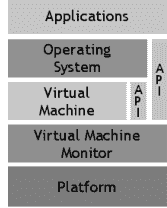

半虚拟化

半虚拟化提供了更好的性能，因为它没有模拟所有的硬件细节。缺点是，客体操作系统需要修改才能在半虚拟化环境下运行。全虚拟化可以与未经修改的客体操作系统工作，但产生更多的开销，导致性能较弱。

半虚拟化的另一个优势是可行的资源分配。由于客体操作系统感知虚拟环境，例如 Xen 可以在不重启的情况下动态更改虚拟机的内存分配。

### 理解 Xen 架构

Xen 由以下两个主要组件组成：

- **虚拟机监控器（Virtual Machine Monitor）**。虚拟机监控器在物理硬件和虚拟机之间形成了一个层。通常这种软件被称为 Hypervisor。
- **Xen 工具（Xen tools）**。Xen 工具是一组命令行应用程序，用于管理虚拟机。

虚拟机监控器必须在任何虚拟机启动之前加载。在操作 Xen 时，虚拟机被称为域（domains）。

Xen 虚拟机监控器既不包含访问宿主机物理硬件的驱动程序，也不包含与管理员直接通信的接口。这些任务由运行在特权 domain0 中的操作系统完成。

以下是一个带有三个域的 Xen 系统概述。

图 1-4

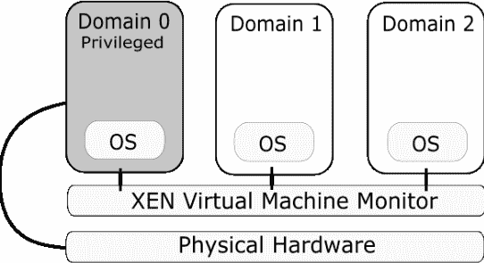

一个名为 `xend` 的进程运行在 domain0 Linux 安装中。该进程用于管理系统中运行的所有 Xen 域并提供控制台的访问。

非特权域在 Xen 术语中也称为 `domainU`。

SUSE Linux Enterprise Server 10 可用于特权 (domain0) 和非特权 (domainU) Xen 域。

## 目标 3

### 安装 Xen

要设置 Xen 系统，你从一个标准的 SUSE Linux Enterprise 10 安装开始，它将运行在 domain0 中。

其他 Xen 域稍后安装在物理分区或文件系统镜像中。当你计划使用物理分区时，必须确保初始的 SUSE Linux Enterprise Server 10 安装没有占用可用磁盘空间。

为了最大的灵活性，对 Xen 系统使用逻辑卷管理器 LVM 或 EVMS 是有意义的。

在初始的 SUSE Linux Enterprise Server 10 安装中必须安装以下包：

- **xen**。此包包含 Xen 虚拟机监控器（Hypervisor）。
- **xen-tools**。包含 `xend` 和一组用于管理 Xen 系统的命令行工具。
- **kernel-xen**。此包包含一个在 Xen 域中运行的修改过的 Linux 内核。
- **xen-doc-***（可选），各种格式的 Xen 文档。

安装 Xen 包会自动在引导加载程序配置文件 `/boot/grub/menu.lst` 中添加条目。

```
title Xen
root (hd0,3)
kernel /boot/xen.gz
module /boot/mlinux-Xen root=/dev/hda3 selinux=0
module /boot/initrd-Xen
```

## SUSE Linux Enterprise Server 10 高级管理

在某些 Xen 系统上，你可能会在内核模块行看到 `dom0_mem` 参数。该参数在启动时为 domain0 分配一定数量的主内存。然而，在 Xen 3 版本中，不再需要此参数。

最初，所有可用内存都由 domain0 使用。当你启动额外的 domainU 时，domain0 和新 domainU 的所需内存量会减少。

menu.list 中的条目为你的系统启动菜单添加了一个新选项。选择此条目时，将加载 Xen 虚拟机监控器（`kernel /boot/xen.gz`），它会在 domain0 中启动 SUSE Linux Enterprise Server 10（见以 `module` 开头的行）。

在带有 Xen 选项重启系统之前，你应该检查自动生成的条目是否正确。确保……

- `root (hd0,3)` 这一行指向包含 Xen 虚拟机监控器和 domain0 Linux 安装内核的所在系统。例如，`hd0,3` 意味着系统中第一块硬盘上的第四个分区。还要检查第一行 module 行中的 `root` 参数是否指向 domain0 安装的根分区。
- Xen 版本的 Linux 内核和 `initrd` 已加载到 module 中。镜像文件的名称应以 `module` 结尾。

（注：原文此处存在 OCR 重复，已根据逻辑流进行清理）

对话框为您提供了两个选项：

- 运行操作系统安装程序。这允许您从系统中注册的安装源运行 SUSE Linux Enterprise Server（SUSE Linux 企业服务器）安装。
- 使用包含操作系统启动文件的磁盘镜像或物理磁盘。此选项允许您从物理磁盘或磁盘镜像中的现有安装创建一个 Xen 域（domain）。

对于接下来的示例，我们选择“运行操作系统安装程序”选项。随后出现以下对话框：

图 1-7

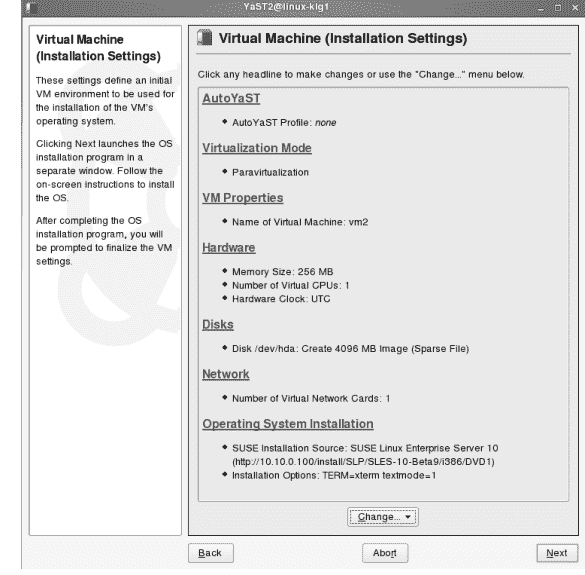

可以通过选择标题来调整以下选项：

- **AutoYaST**。在此选项中，您可以指定用于安装的 AutoYaST 配置文件。如果没有 AutoYaST 配置文件，将启动手动安装。
- **Virtualization（虚拟化）**。您可以在半虚拟化和全虚拟化之间切换。全虚拟化适用于支持 Intel 或 AMD 虚拟化扩展的硬件。
- **VM Properties（虚拟机属性）**。在此处您可以更改新域的名称。
- **Hardware（硬件）**。在此选项中，您可以配置域的硬件配置。（内存、CPU 数量、……）
- **Disks（磁盘）**。在此处配置磁盘。这些可以是物理块设备，也可以是文件系统/磁盘镜像。
- **Network（网络）**。此选项允许您为域添加额外的网络适配器。
- **Operating System Installation（操作系统安装）**。在此处您可以配置安装源和额外的安装选项。

## 使用 Xen 管理虚拟化

对于我们的示例，我们保持默认设置并选择“下一步”。现在，域环境和安装过程启动了。

## 图 1-8

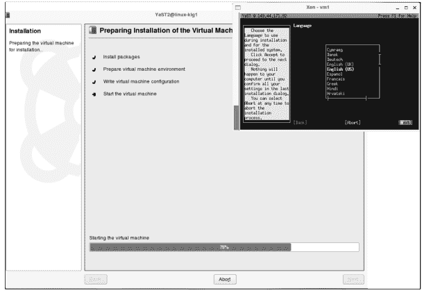

安装本身是标准的 SUSE Linux Enterprise Server 安装，区别在于它以文本模式运行。软件包安装完成后，会出现以下对话框：

## 图 1-9

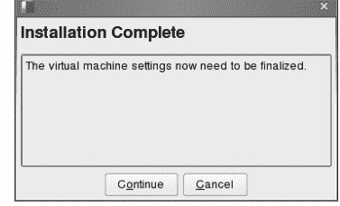

选择“继续”。

版本 1 严禁复制本手册的全部或部分内容或发行副本。如怀疑有抄袭，请拨打 1-800-PIRATES。1-17

接下来的对话框提供了域配置的摘要。通常情况下这里不需要做任何操作。在此对话框和域概览中选择“下一步”。

将打开一个终端窗口，您可以在其中使用 YaST 完成操作系统安装的剩余步骤。

## 练习 1-2

### 安装客域（Guest Domain）

在下面的内容中，您可以练习如何使用 YaST 安装 Xen 客域。在开始此练习之前，您必须在系统中安装了 xen。

您可以在工作手册中找到此练习。

（练习结束）

## 目标 5

### 在命令行管理 Xen 域

在下面的内容中，您将学习如何在命令行中管理 Xen 域。这包括：

- 理解域配置文件
- 使用 xm 工具
- 迁移客域

### 理解域配置文件

每个 Xen 域都需要一个配置文件。对于使用 YaST 创建的域，配置文件通常位于 `/etc/xen/vm/`。

在 `/etc/xen/examples/` 目录下，您可以找到两个示例文件，如果您想从头开始创建配置，可以使用这些文件。

- `xmexample1`。这是一个单个域的模板配置文件。
- `xmexample2`。这是一个在一个文件中包含多个域配置的示例。

对于初学者，`xmexample1` 是更好的选择。

配置文件包含几个关键字，用于配置 Xen 域的不同方面。以下是一个使用最常用选项的配置示例文件。`#` 字符用于注释。请阅读示例中的注释以获取有关配置选项的详情。

```
## 域的唯一名称
name = "examplevm"

## 运行的内核路径
kernel = "/boot/vmlinuz-example"

## 运行的初始化 RAM 磁盘
initrd = "/boot/initrd-example"

## 分配的内存（MB）
memory = 512

## CPU 核心数量
vcpus = 1

## 磁盘配置
vda = "disk=/dev/sdb,size=10"

## 网络配置
eth0 = "bridge=xen0"
```


对于开始，`xmexample1` 是更好的选择。

配置文件包含多个关键字，用于配置 Xen 域的不同方面。以下是一个使用最常用选项的配置示例文件。`#` 字符用于注释。请阅读示例中的注释以获取有关配置选项的详情。

```
## 域的唯一名称
name = "examplevm"

## 运行的内核路径
kernel = "/boot/vmlinuz-example"

## 运行的初始化 RAM 磁盘
initrd = "/boot/initrd-example"

## 分配的内存（MB）
memory = 512

## CPU 核心数量
vcpus = 1

## 磁盘配置
vda = "disk=/dev/sdb,size=10"

## 网络配置
eth0 = "bridge=xen0"
```

以下是关于域配置的示例：

```
## 域的唯一名称
name = "examplevm"

## 运行的内核路径
kernel = "/boot/vmlinuz-example"

## 运行的初始化 RAM 磁盘
initrd = "/boot/initrd-example"

## 分配的内存（MB）
memory = 512

## CPU 核心数量
vcpus = 1

## 磁盘配置
vda = "disk=/dev/sdb,size=10"

## 网络配置
eth0 = "bridge=xen0"
```

## 练习 1-3 修改客户域的内存分配

在下文中，你将学习如何通过更改域配置文件来修改客户域的内存分配。

你可以在工作手册中找到此练习。

（练习结束）

## 自动化域的启动和关闭

当你启动、关机或重启 Xen 系统的 domain0 时，这也会影响其他运行中的 Xen 域。如果没有运行的 domain0，其他 Xen 域无法运行。

SUSE Linux Enterprise Server 10 自带有一个名为 `zendomains` 的启动脚本，它包含在 `xen-tools` 包中。

该脚本应安装在 domain0 上，并执行以下操作：

- 当 domain0 启动时，所有配置文件位于 `/etc/xen/auto/` 下的域都会被启动。
- 当 domain0 关或重启时，运行中的 Xen 域将自动关闭。

该脚本有一些配置选项，可以在 `/etc/sysconfig/zendomains` 文件中调整。该文件中的配置变量有详细的文档说明。

一个有趣的选项是在 domain0 关时自动将域迁移到不同的主机。这可以通过变量 `XENDOMAINS_MIGRATE` 配置。该变量必须设置为目标机器的 IP 地址。当变量为空时，则不执行迁移。

## 练习 1-4 自动化域启动

在此练习中，你将学习如何在系统启动时自动启动域。

你可以在工作手册中找到此练习。

（练习结束）

## 目标 6

### 理解 Xen 网络

通常，Xen 域的网络连接是开箱即用的。然而，如果你想更改配置，Xen 的网络可能会有点复杂。以下内容将为你提供 Xen 域如何连接到物理网络的概览。

为了更好地理解 Xen 网络的概念，请执行以下操作：

- 理解基础网络概念
- 理解桥接（Bridging）
- 理解 domain0 中的网络接口

### 理解基础网络概念

在 Xen 设置中，domain0 控制宿主机系统的物理网络接口。非特权域通过虚拟以太网适配器连接到 domain0。

非特权域中的一个虚拟适配器连接到 domain0 中的一个虚拟适配器。

在 domain0 中，使用标准的 Linux 网络机制（如桥接或路由）通过物理适配器将虚拟适配器连接到网络。

以下是该基本概念的说明：

图 1-10

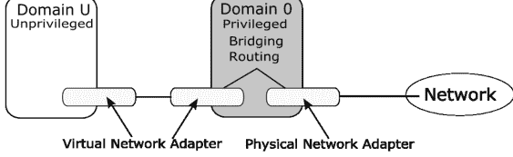

### 理解桥接

在 SUSE Linux Enterprise Server 10 上，在 domain0 中连接虚拟和物理接口的默认机制是桥接。其他机制（如带有或不带网络地址转换 NAT 的路由）不在本课程的范围内。

桥接基本上意味着将多个网络接口合并为一个。传统上，这种技术用于连接两个物理网络接口或网络段。

在 Xen 系统中，桥接用于连接 domain0 中的虚拟和物理网络适配器。在 Xen 系统中，你可以将桥接视为一种虚拟交换机，所有的虚拟和物理接口都连接在上面。

桥接的配置由 `xend` 管理进程完成。当创建一个新域时，会对网络配置进行以下更改（简化版）：

1. Xen 为新域提供一个虚拟接口。
2. `xend` 在 domain0 中创建一个新的虚拟接口。
3. 两个虚拟接口通过虚拟点对点连接连接。
4. domain0 中的虚拟接口与物理接口一起被添加到桥接中。

这些步骤仅影响一般的网络连接性。Xen 域中的 IP 配置必须单独通过 DHCP 或静态网络配置完成。

`xend` 通过脚本来执行这些网络更改，脚本位于 `/etc/xen/scripts/`。以下脚本用于桥接网络：

- `network-bridge`。该脚本在 `xend` 启动时最初被调用。它设置桥接 `xenbr0` 并将物理接口移动到该桥上。
- `vif-bridge`。该脚本为每个启动的域被调用一次，并将虚拟接口添加到桥接中。

在 `/etc/xen/xend-config.sxp` 文件中，你可以配置 `xend` 使用哪些网络脚本。

### 理解 domain0 中的网络接口

当你使用 `ip a` 命令查看 domain0 中的网络接口时，你会发现接口比普通安装要多得多。

以下是 domain0 上 `ip a` 的示例（缩短）：

```
1: lo:<LOOPBACK,UP> mtu 1600 qdisc noqueue
    link/loopback 00:00:00:00
    inet 127.0.0.1/8 host
    inet6 ::/128
2: eth0:<BROADCAST,MULTICAST,ARP,UP> mtu 1500 qdisc fifo qlen 100
    link/ether fe:ff:ff:ff:ff brd ff:ff:ff:ff
    inet6 fe80::ffff:ffff/64
4: vif0:0:<BROADCAST,MULTICAST,UP> mtu 1500 qdisc noqueue
    link/ether fe:ff:ff:ff:ff brd ff:ff:ff:ff
    inet6 fe80::ffff:ffff/64 global
5: eth0:<BROADCAST,MULTICAST,LOWER_UP,UP> mtu 1500 qdisc noqueue
    link/ether 00:15:81:4c:5b brd 255.255.255.255
    inet 149.255.255.255/
    link/ether fe:ff:ff:ff:ff brd 149.255.255.255
    inet6 fe80::ffff:ffff/64 global
5: eth0:<BROADCAST,MULTICAST,LOWER_UP,UP> mtu 1500 qdisc noqueue
    link/ether 00:15:81:4c:5b brd 255.255.255.255
    inet 149.255.255.255/
    link/ether fe:ff:ff:ff:ff brd 149.255.255.255
    inet6 fe80::ffff:ffff/64 global
4: vif0:0:<BROADCAST,MULTICAST,UP> mtu 1500 qdisc noqueue
    link/ether fe:ff:ff:ff:ff brd ff:ff:ff:ff
    inet6 fe80::ffff:ffff/64 global
5: eth0:<BROADCAST,MULTICAST,LOWER_UP,UP> mtu 1500 qdisc noqueue
    link/ether 00:15:81:4c:5b brd 255.255.255.255
    inet 149.255.255.255/
    link/ether fe:ff:ff:ff:ff brd 149.255.255.255
    inet6 fe80::ffff:ffff/64 global
```

以下是 domain domain0 中使用的接口命名方案：

- `peth`
- `vif`
- `veth`
- `eth0`

以下插图给出了 domain0 中接口的概览。

图 1-11

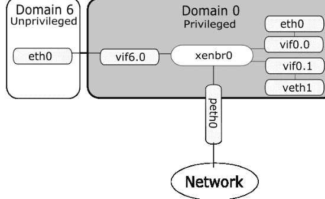

> 由于 Xen 网络设置的复杂性，默认防火墙（SuSEFirewall2）在 domain0 中工作不正常。因此，建议禁用 SuSEFirewall2 并在需要时自定义防火墙。

## 练习 1-5 检查网络配置

本练习假设你有一个运行着域0（domain 0）以及另一个 Xen 域的 Xen 系统。

你可以在练习册中找到此练习。

（练习结束）

## 目标 7 迁移虚拟机（Guest Domain）

虚拟化的优势之一是域可以轻松地从一个物理系统移动到另一个。在 Xen 中，此过程被称为域迁移（domain migration）。

域迁移是通过复制当前的内存内容完成的。在迁移域之前，请注意以下几点：

你有以下两种方法来迁移 Xen 域：

- 使用域保存和恢复（Domain Save and Restore）
- 使用迁移（Migration）和热迁移（Live Migration）

### 使用域保存和恢复

迁移域的一种非常简单的方法是使用 `xm` 工具的保存和恢复功能。

使用命令 `xm save <domain_id> <filename>`，你可以挂起指定的域并将状态保存到指定的文件。

然后可以将此文件复制到新的主机系统。要恢复该域，请使用命令 `xm restore <filename>`。

如上所述，除了使用 `xm` 创建的文件外，你可能还需要将文件系统复制到新的主机系统。

### 使用迁移和热迁移

与其使用 `xm` 的保存和恢复命令，你也可以使用命令 `xm migrate <domain_id> <target_host>`。此命令将域迁移到新主机。在这种情况下，不需要手动复制内存状态文件。

为了使之正常工作，当前主机和新主机必须都运行 Xen 和 `xend`。

通过在迁移命令行中添加 `--live` 选项，可以将迁移期间的停机时间缩短到典型的 60-300 秒。Xen 不会在迁移开始前关闭域，而是在迁移过程中保持其运行。

`xend` 配置文件 `/etc/xen/xend-config.sxp` 包含有关域迁移的选项：

- `xend-relocation-server yes`：此选项启用 `xend` 中的域迁移功能。
- `xend-relocation-hosts-allow '^localhost$'`：此选项控制哪些主机允许连接到 `xend` 进行域迁移。默认情况下，只允许 localhost 连接。该选项接受正则表达式作为参数。请查看配置文件示例。

> 请注意，域迁移涉及两个 `xend`（当前主机和新主机）。你可能需要调整两个系统上的 `xend-config.sxp` 文件。

## 总结

| 目标 | 总结 |
| --- | --- |
| 1. 理解虚拟化概念 | 虚拟化技术将运行的操作系统实例与物理硬件分离。操作系统不再运行在物理机，而是运行在所谓的虚拟机中。多个虚拟机共享底层硬件的资源。虚拟化允许你在单台物理机器上运行多个虚拟系统。 |
| 2. 理解 Xen 的工作原理 | 有两种不同的虚拟化类型：<br>- 全虚拟化（Full-Virtualization）<br>- 半虚拟化（Para-Virtualization）<br>Xen 使用半虚拟化。它通过 API 提供对物理硬件的访问。 |

## 目标总结

| 目标 | 总结 |
| --- | --- |
| 3. 安装 Xen | 初始 SUSE Linux Enterprise Server 10 安装安装以下包：<br><br>- `xen`。此包包含 Xen 虚拟机监控器（Hypervisor）。<br>- `xen-tools`。包含 `xend` 和一组用于管理 Xen 系统的命令行工具。<br>- `kernel-xen`。此包包含一个在 Xen 域中运行的修改过的 Linux 内核。<br>- `xen-doc`（可选）。Xen 提供多种格式的文档。<br><br>安装 xen 会在 grub 配置文件中添加条目。 |
| 4. 使用 YaST 管理 Xen 域 | YaST 提供了一个用于创建和管理 Xen 域的模块。该模块名为：**虚拟机管理 (Xen)**。<br><br>该模块提供了一种创建和控制 Xen 域的便捷方法。 |
| 5. 使用命令行管理 Xen 域 | 每一个域都需要一个配置文件。通常位于 `/etc/xen/`。`xm` 是用于域的工具。<br><br>要启动虚拟机，使用以下命令：<br><br>```<br>xm create -f<br>```<br><br>有些服务在域中是必需的：<br><br>- `inserr -r`<br>- `inserr -r`<br>- `inserr -r`<br><br>在 Xen 中，域通过物理网络连接。 |
| 6. 理解 Xen 网络 | domain0 是配置网络的中心。<br><br>网络通过交换机进行设置。 |
| 7. 迁移虚拟机 | 虚拟化的优势之一是域可以轻松地从一个物理系统移动到另一个。在 Xen 中，此过程被称为域迁移。<br><br>可以通过 save 和 restore 命令或 migrate 命令迁移。 |

## 第二节 配置 Web 服务器

在本节中，你将学习如何在 SUSE Linux Enterprise Server 上安装和配置 Apache。

## 目标

- 1. 设置基础 Web 服务器
- 2. 配置虚拟主机
- 3. 配置访问
- 4. 使用 OpenSSL 配置 Apache
- 5. 安装 PHP
- 6. 描述 Tomcat
- 7. 安装并配置 Tomcat
- 8. 安装 Web 应用
- 9. 使用 Tomcat 管理工具
- 10. 使用端口 80

## 目标 1 设置基础 Web 服务器

Apache Web 服务器是基础软件。要设置基础 Web 服务器，你需要了解：

- Web 服务器的基本功能
- 安装基础 Web 服务器
- 理解 Apache 配置文件的结构
- 默认 Apache 配置

### Web 服务器的基本功能

Web 服务器向浏览器交付数据。数据可以是不同的格式，如 HTML 文件、图像文件、Flash 动画或音频文件。

浏览器和服务器使用 HTTP（超文本传输协议）进行通信。下图显示了浏览器、服务器和 HTTP 之间的关系：

图 2-1


除了向浏览器交付数据外，Web 服务器还可以执行限制特定网页访问、记录访问以及加密服务器与浏览器之间的连接等任务。

### 安装基础 Web 服务器

你需要执行以下操作：

- 安装所需的软件包
- 启动并测试 Web 服务器
- 定位 Web 服务器的 DocumentRoot

#### 所需的软件包

要运行基础 Web 服务器，你需要通过 YaST 安装以下包：

- `apache2`。基础 Web 服务器软件。
- `apache2-prefork`。影响 Web 服务器多处理行为的附加包。
- `apache2-example-pages`。示例 HTML 页面。

安装上述包时，YaST 会提示你安装 Apache 所需的其他包。通过点击 OK 解决依赖依赖。

#### 启动并测试 Web 服务器

安装所需的软件包后，你需要启动 Web 服务器。作为 root 用户执行以下命令：

```
rcapache2 start
```

与所有服务一样，执行以下命令停止 Web 服务器：

```
rcapache2 stop
```

如果你希望 Web 服务器在启动机时启动，需要执行以下命令：

```
insserv apache2
```

要测试 Web 服务器是否安装正确，打开浏览器并输入以下地址：

http://localhost

浏览器显示以下页面：

## 图 2-2


如果你的 SUSE Linux Enterprise Server 10 连接到网络，你（以及网络上的其他主机）可以通过输入以下内容远程访问 Web 服务器：

http://your_system_IP_address

如果你的网络提供 DNS 服务器，你可以使用主机名代替 IP 地址。

#### 定位 Web 服务器的 DocumentRoot

Apache 提供的默认目录为 `/srv/www/htdocs`。


该目录也被称为 Web 服务器的 `DocumentRoot`（文档根目录）。安装完成后，它包含了如上方所示的 Apache 示例页面。

你可以替换 `DocumentRoot` 目录中的数据以显示你自己的 Web 服务器内容。由于 Web 服务器以 `wwwrun` 用户身份运行，因此你必须确保该用户对 `DocumentRoot` 目录下的文件具有读权限。

如果你在 `DocumentRoot` 中创建了子目录，你可以使用以下 Web 地址方案访问这些子目录：

```
http://your_server/name_of_subdirectory
```

如果地址中没有请求特定文件，Apache 将查找名为 `index.html` 的文件。你可以在 Apache 配置文件中更改此默认文件的名称。

## 练习 2-1：安装 Apache

在本次练习中，你将在系统上安装 apache 组件。

你可以在练习册中找到此练习。

（练习结束）

## 练习 2-2：测试 Apache 安装

在本次练习中，你将检查 apache 是否安装成功。

你可以在练习册中找到此练习。

（练习结束）

## 理解 Apache 配置文件的结构和基本元素

要配置 Apache Web 服务器，你需要执行以下操作：

- 定位 Apache 配置文件
- 理解配置文件的基本规则

### 定位 Apache 配置文件

Apache Web 服务器的配置分布在 `/etc/apache2` 目录下的多个配置文件中。

以下是最重要的 Apache 配置文件列表：

- `httpd.conf`：这是主要的 Apache 配置文件。
- `default-server.conf`：此文件包含基础 Web 服务器设置。然而，此文件中设置的所有选项都可以被其他配置文件覆盖。
- `vhost.d/`：这是一个包含虚拟主机设置配置文件的目录。你将在本节后面学习更多关于虚拟主机的知识。
- `uid.conf`：此配置文件设置 Apache 的用户和组 ID。默认情况下，Apache 使用用户 ID `wwwrun` 和组 ID `www`。
- `listen.conf`：在此配置文件中，你可以指定 Apache 监听的 IP 地址和 TCP/IP 端口。默认情况下，Apache 在 80 端口上监听所有分配的接口。
- `server-tuning.conf`：你可以使用此配置文件精调 Apache 的性能。除非你打算运行需要同时处理大量请求的 Web 服务器，否则默认值通常是可以的。
- `error.conf`：在此文件中，你配置当请求无法正确执行时 Apache 的行为。
- `ssl-global.conf`：在此文件中配置使用 SSL 的连接加密。

### 理解配置文件的基本规则

Apache 配置文件的选项称为**指令（directives）**。指令是大小敏感的，这意味着诸如 `include` 之类的单词与 `Include` 是不相同的。

指令可以进行分组，使其不应用于全局服务器配置。在下文中，这些指令仅适用于 `/srv/www/htdocs` 目录：

```
<Directory "/srv/www/htdocs">
  Options None
  AllowOverride None
  Order allow,deny
  Allow from all
</Directory>
```

指令通过 `<Directory "/srv/www/htdocs">` 和 `</Directory>` 分组，这使得它们的有效性仅限制在 `/srv/www/htdocs` 目录。

你可以使用 `#` 字符来表示配置文件中的注释。所有以 `#` 开头的行都会被 Apache 服务器忽略。

每当你编辑 Apache 配置文件时，你都需要通过输入以下命令来重新加载 Web 服务器：

`rcapache2 reload`

在某些情况下，仅重新加载 Apache 是不够的。你需要通过输入以下命令停止并重启 Web 服务器：

`rcapache2 restart`

如果你不确定更改是否使用了正确的语法，可以通过输入以下命令来验证配置文件的语法：

```
apache2ctl configtest
```

如果语法正确，命令将显示以下消息：

```
Syntax OK
```

## 理解默认 Apache 配置

主 Apache Web 服务器配置定义在 `/etc/apache2/default-server.conf` 文件中。以下是该文件中使用的最重要的指令的概述：

### 表 2-1

| 指令 | 描述 |
| --- | --- |
| DocumentRoot | 指定 Web 服务器的 DocumentRoot。 |
| `<Directory "dir_name"></Directory>` | 在此块内使用的所有指令均仅适用于指定的目录。 |
| Options | 使用此指令可以对目录等逻辑块应用额外的选项。 |
| AllowOverride | 决定是否允许被目录中 .htaccess 文件中的配置所覆盖。 |
| Alias "fename" "realname" | 允许你为目录创建别名。 |
| ScriptAlias | 允许你为包含动态内容生成脚本的目录创建别名。 |

在大多数情况下，默认设置是合适的，不需要更改。

所有 Apache 指令的概述可以在 http://httpd.apache.org/docs-2.0/mod/directives.html 处找到。

## 目标 2：配置虚拟主机

要使用 Apache 的虚拟主机功能，你需要了解：

- 虚拟主机的概念
- 配置虚拟主机

### 虚拟主机的概念

在默认设置下，可以通过以下方式访问 Apache 服务器：

- http://localhost
- http://server_address
- http://server_hostname

为了避免这种情况，Apache 可以在一个物理系统上托管多个虚拟服务器。这些虚拟服务器被称为虚拟主机。

为了访问虚拟主机，每个虚拟主机都需要一个 DNS 条目。这些虚拟主机提供 `DocumentRoot` 目录下的文件。

以下是向虚拟主机 www.example.com 发送请求的步骤：

1. 浏览器请求 IP 地址。
2. 浏览器使用 IP 地址从监听该地址的服务器请求文件。
3. 在 HTTP 请求中，浏览器包含了它想要到达的主机名。
4. Apache 使用主机名来确定相应的虚拟主机并从该主机交付请求的数据。

下图说明了这一过程：

### 图 2-3


### 配置虚拟主机

每个虚拟主机你需要在 `/etc/apache2/vhosts.d/` 目录下创建一个配置文件。文件名必须以 `.conf` 结尾。

你可以在 `/etc/apache2/vhosts.d/` 目录下找到模板文件 `vhost.template` 作为配置文件的基础。

你需要编辑模板中的指令：

### 表 2-2

| 指令 | 描述 |
| --- | --- |
| ServerAdmin | 输入虚拟主机管理员的电子邮件地址。 |
| ServerName | 输入 DNS 中配置的虚拟主机主机名。 |
| DocumentRoot | 设置虚拟主机的 DocumentRoot。该目录及其文件必须允许 `wwwrun` 用户读取。 |
| ErrorLog | 输入日志文件名。该文件对 `wwwrun` 用户可写。 |
| CustomLog | 输入常规日志文件名。该文件对 `wwwrun` 用户可写。 |
| ScriptAlias | 将 ScriptAlias 设置为你选择的目录。该目录不能位于虚拟主机的 DocumentRoot 下。如果你不需要创建动态内容的脚本，请删除此指令。 |
| `<Directory "script_dir">` | 如果你之前设置了 ScriptAlias，则你必须配置一个包含脚本文件的目录。如果你没有使用 ScriptAlias，请删除此目录块。 |
| `<Directory "document_root">` | 你需要调整此目录指令的路径名称为你的 DocumentRoot 路径。 |

在自定义模板文件后，你需要重新加载 Apache Web 服务器。你还需要确保 DNS 中的设置已同步更新，以便你的虚拟主机的主机名被正确解析。

## 练习 2-3：配置虚拟主机

在本次练习中，你将为会计部门配置一个虚拟主机。

你可以在练习册找到此练习。

（练习结束）

## 目标 3：限制 Web 服务器的访问

通常情况下，Apache 将数据交付给网络中所有能够到达 Web 服务器的主机。有时限制对 Apache 交付内容的访问是有用的。

以下是最常用的方法：

- 基于 IP 地址限制访问
- 使用用户身份验证限制访问

### 基于 IP 地址限制访问

Apache 提供了以下指令来根据 IP 地址限制对 Web 服务器的访问：

### 表 2-3

| 指令 | 描述 |
| --- | --- |
| allow | 此指令后列出的 IP 地址或网络被允许访问 Web 服务器 |
| deny | 此指令后列出的 IP 地址或网络不允许访问 Web 服务器 |
| order | 此指令设置了 allow 和 deny 指令的评估顺序 |

这些指令必须在 `<Directory>` 块中使用，并控制对该目录及其子目录下所有数据的访问。

以下示例允许来自 10.0.0/24 网络的主机访问 `/srv/www/htdocs` 目录下的数据：

```
<Directory "/srv/www/htdocs">
  Order deny,allow
  Deny from all
  Allow from 10.0.0.0/24
</Directory>
```

以下列并描述了示例中的各行：

- `<Directory "/srv/www/htdocs">`：此指令启动目录块。随后的指令仅适用于 `/srv/www/htdocs` 目录。
- `Order deny,allow`：Order 指令决定了 allow 和 deny 指令的评估顺序。

你有以下选项可用：

- `Deny,Allow`：deny 指令在 allow 指令之前评估。默认允许访问。任何不匹配 deny 指令或不匹配 allow 指令的客户端都被允许访问服务器。
- `Allow,Deny`：allow 指令在 deny 指令之前评估。默认拒绝访问。任何不匹配 allow 指令或不匹配 deny 指令的客户端都被拒绝访问服务器。
- `Mutual-failure`：只有出现在 Allow 列表中且不在 Deny 列表中的主机被授予访问权限。这与 `Order Allow,Deny` 的效果相同。
- `Deny from all`：评估 deny 指令，在这种情况下，拒绝所有客户端访问。你可以在 deny 和 allow 指令配合使用以下选项：
- `all`：此选项适用于所有主机。
- 一个 (部分) 域名：此选项适用于名称匹配或以给定表达式（如 `novell.com`）结尾的主机。仅匹配完整的域名组件。`novell.com` 会匹配 `www.novell.com`，但不会匹配 `novell.com`。
- 一个完整的 IP 地址：此选项适用于特定的 IP 地址（如 `10.0.0.23`）。
- 一个部分 IP 地址：此选项适用于以给定 IP 地址段开头的 IP 地址（如 `10.0.0`）。
- 一个网络/子掩码对：此选项适用于匹配给定的网络/子掩码对的 IP 地址（如 `10.0.0.0/255.255.255.0`）。
- 一个网络/nnn CIDR 规范：此选项适用于匹配给定的 CIDR 表达式的 IP 地址（如 `10.0.0/24`）。
- `Allow from 10.0.0/24`：此 allow 指令在 deny 指令之后评估。在这种情况下，允许 10.0.0/24 网络中的主机访问。
- `</Directory>`：此指令结束目录块。

### 使用用户身份验证限制访问

通过限制某些 IP 地址的访问，你可以控制访问 Web 服务器的主机，但你无法控制坐在电脑前的用户。

Apache 提供了另一种访问控制选项：基础身份验证。如果你使用这种方法保护 Web 服务器上的内容，用户在访问数据之前需要先登录。

在配置 Apache 使用基础身份验证之前，你必须先为 Web 服务器创建用户账户。你可以使用 `htpasswd2` 工具完成此操作。

以下命令为用户 tux 创建密码文件和一个账户。

```
htpasswd2 -c /etc/apache2/htpasswd tux
```

输入此命令后，`htpasswd2` 会提示你输入要创建的用户密码。密码存储在 `/etc/apache2/htpasswd` 文件中。

你可以指定密码文件的不同位置，但必须确保它对 `wwwdata` 用户是可读的，并且没有位于服务器的 `DocumentRoot` 中。

当你第一次使用密码文件时，必须带有 `-c` 选项调用 `htpasswd2` 来创建文件。如果你以后想添加更多用户，使用以下命令：

```
htpasswd2 /etc/apache2/htpasswd username
```

要从密码文件中删除用户，请使用以下命令：

```
htpasswd2 -D /etc/apache2/htpasswd username
```

在创建了用户账户后，你需要配置 Apache 在访问受限数据时提示密码。你需要在受限目录的块中添加以下行：

```
AuthType Basic
AuthName "Restricted Files"
AuthUserFile /etc/apache2/htpasswd
Require user tux
```

以下是行的说明：

- `AuthType Basic`：此指令设置身份验证方法。对于本节描述的类型，值为 Basic。
- `AuthName "Restricted Files"`：通过此，你需要为 Web 服务器的受限目录选择一个名称。该名称用于浏览器和服务器之间的身份验证过程。
- `AuthUserFile /etc/apache2/htpasswd`：此指令设置用于受限目录的密码文件。
- `Require user tux`：此指令列出了允许访问目录的用户。你可以通过空格分隔多个用户，也可以使用以下指令：
- `Require valid-user`：这定义了任何有效的用户名/密码组合都被授予访问权限。

密码以明文通过网络传输。对于关键应用程序，建议配置 SSL 加密。详情请参见下一个目标。

## 练习 2-4：配置身份验证

在本次练习中，你将为虚拟主机添加用户身份验证。

你可以在练习册找到此练习。

（练习结束）

## 目标 4：使用 OpenSSL 配置 Apache

默认情况下，Web 浏览器与服务器之间的连接是不加密的。任何可以监听浏览器和服务器之间交换的数据包的人都可以访问传输的信息。

Apache 可以使用 SSL（安全套接层）协议加密连接。要在 Web 服务器上配置 SSL 加密，你需要了解以下内容：

- SSL 加密的基础
- 创建测试证书
- 配置 Apache 使用 SSL
- SSL 配置的局限性

### SSL 加密的基础

RSA 密钥经常用于数据加密。例如，RSA 被加密软件 PGP（Pretty Good Privacy）用于加密电子邮件，被 ssh（Secure Shell）用于两台计算机之间的加密数据传输，被 Apache 用于 Web 服务器和 Web 浏览器之间的安全数据传输。

这种加密基于两个不同的密钥：私钥和公钥。私钥仅所有者已知，而公钥应该是公开的。

### 图 2-4

以下显示了加密过程：

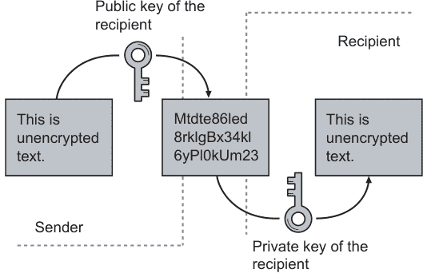

公钥和私钥也可以用于数据签名。原则上，当数据被签名时，会根据数据生成一个加密校验和。发送者使用其私钥对数据进行签名。

接收者可以通过发送者的公钥来检查签名，以确定数据是否真的来自她，或者文本是否被第三方修改过。

### 以下说明了签名过程：

#### 图 2-5

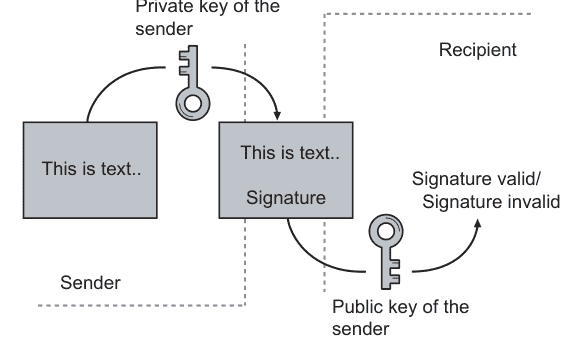

上述加密程序的一个问题是你无法确定公钥的所有者。这个问题的解决方法是使用证书授权（CA），它使用自己的私钥对公钥进行签名。

由 CA 签名的公钥也称为证书。

CA 是像 VerSign 或 VISA 这样著名的公司或组织。这些组织的公钥已内置在网络浏览器中。通过使用 CA 的公钥验证签名，浏览器可以确保 Web 服务器的公钥是有效的。

以下解释了在 Web 服务器上使用 CA 和 SSL 加密的过程：

1. 浏览器识别以 `https://` 开头的网络地址。这意味着到该服务器的连接应该是加密的。SSL 连接的默认端口是 443，而不是端口 80（用于普通的未加密 HTTP 连接）。
2. 浏览器向服务器请求其公 RSA 公钥（证书）。
3. Web 服务器将公钥发送给网络浏览器。
4. 网络浏览器使用签署该密钥的 CA 公钥来验证服务器的密钥。
5. 如果密钥有效，网络浏览器和 Web 服务器将建立安全连接。

你需要一个正式签名的密钥来建立安全的 Web 服务器。你可以自己签名密钥，但这仅用于测试目的。

### 创建测试证书

为了测试目的建立安全的 Web 服务器，你可以自己创建一个证书。你绝对不要将此类证书用于生产系统。

要创建测试证书，你需要执行以下操作：

- 创建 RSA 密钥对
- 签名公钥以创建证书

#### 创建 RSA 密钥对

要创建一个密钥对，你需要一个包含尽可能多随机数的文件。你可以通过输入以下命令生成此文件：

```bash
cat /dev/random > /tmp/random
```


按下 `Ctrl+C` 几秒后停止此过程。生成的文件应该至少为一千字节。你现在可以通过输入以下命令生成密钥对：

```bash
openssl genrsa -des3 -out server.key -rand /tmp/random
```

在此过程中，系统会提示你输入一个密码。此密码用于保护密钥对的私钥。

生成的密钥共同保存在 `server.key` 文件中。

## 签名公钥以创建证书

接下来，你需要通过以下命令签名你的公钥以创建证书：

```bash
openssl req -new -x509 -key server.key -out server.crt
```

在此过程中，系统会提示输入以下信息：

- **Enter pass phrase for /tmp/server.key:**

输入你为服务器密钥选择的短语。

- **Country Name (2 letter code) [AU]**

输入你所在国家代码（例如德国的 `DE`）。

- **State or Province Name (full name) [Some-State]:**

输入你所在的州或省名称。你可以输入一个点 (`.`) 来留空此字段。

- **Locality Name (eg, city) []:**

输入你城市的名称。

- **Organization Name (eg, company) [Internet Widgets Pty Ltd]:**

输入你的公司名称。

- **Organizational Unit Name (eg, section) []:**

输入你部门的名称，或者你可以输入一个点 (`.`) 来留空它。

- **Common Name (eg, YOUR name) []:**

输入你系统的完全限定域名（例如 `www.example.com`）。该证书将仅对此主机名有效。

- **Email Address []:**

输入负责服务器的管理员的电子邮件地址。

在回答所有问题后，服务器证书将保存到 `server.crt` 文件中。

最后，你需要将 `server.key` 和 `server.crt` 文件复制到正确的位置：

- 将 `server.key` 文件复制到目录 `/etc/apache2/ssl.key/`。
- 将 `server.crt` 文件复制到目录 `/etc/apache2/ssl.crt/`。

## 配置 Apache 使用 SSL

在生成 RSA 密钥和服务器证书后，你必须配置 Apache 使用 SSL。首先，你需要更改 `/etc/sysconfig/apache2` 文件中的两个设置。

此文件中的设置适用于 Apache 启动脚本，不属于服务器配置。

将以下变量设置为适当的值：

- `APACHE_START_TIMEOUT="10"`

此设置扩展了 Apache 的启动超时时间，你有更多时间输入密码。

- `APACHE_SERVER_FLAGS="SSL"`

以下是 PHP 架构的概述：

## 图 2-6

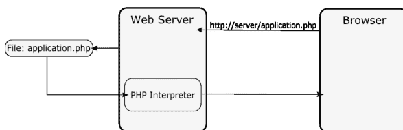

## 安装 PHP

在 SUSE Linux Enterprise Server 10 上，PHP 组件被拆分为多个软件包。对于基础的 PHP Web 应用程序服务器，你至少需要以下软件包：

- **PHP5** 核心 PHP 解释器和库。
- **apache2_mod_php** 用于 Apache 的 PHP 模块。

当你在 YaST 的软件管理模块中搜索“php”时，你会发现有更多可用的 php 包 (`php-**`)。这些模块扩展了 PHP 的功能。你需要哪些包取决于你想要运行的 PHP 应用程序的需求。

PHP 解释器具有一些配置选项，可以在 `/etc/php5/apache2/php.ini` 文件中进行调整。默认配置对于大多数用途都是足够的。以下是几个选项：

- **memory_limit** 这定义了脚本允许使用的内存量。对于复杂的应用程序，这可能需要设置更高的值。默认值为 8MB。
- **max_execution_time** 此选项设置了最大执行时间（秒）。复杂的应用程序有时需要更长的执行时间。默认为 30 秒。
- **display_errors** 决定是否在 HTML 输出中显示错误或警告信息。对于生产系统，此选项应设置为 Off，而在开发系统上，将其切换为 On 是很有用的。默认值为 Off。

安装 PHP 软件包后，你必须使用以下命令重启 Apache：

```bash
rcapache2 restart
```

## 测试 PHP 安装

通过在 Web 服务器的文档根目录某处创建一个包含以下内容的文件可以轻松测试 PHP 安装：

```php
<?php
phpinfo();
?>
```

该内容是一个简单的 PHP 应用程序。调用函数 `phpinfo()` 会输出一个包含 php 安装相关信息的完整网页。

当你使用类似 `http://myserver.php/php_info.php` 的 URL 请求此文件时（假设你将文件命名为 `php_info.php`），将显示如下所示的页面：

## 图 2-7

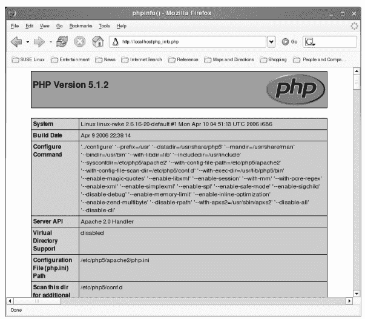

仅供内部使用-允许打印一份纸质

严禁复制本手册的全部或部分或分发此类副本。

如需报告疑似抄袭，请拨打 1-800-PIRATES。

## 练习 2-6

## 安装 PHP

在此练习中，你将安装并测试 PHP。

你可以在练习册中找到该练习。

（练习结束）

## 目标 6

## 描述 Tomcat

在 Web 早期，几乎所有的网站都提供静态内容。这意味着内容存储在 Web 服务器的 HTML 文件中，并将页面“按原样”交付给请求的浏览器。

今天，越来越多的网站提供定制化内容，这些内容对于每个访问网站的查看者来说都是不同的。例如，内容可以是一个邮件服务或自定义的门户页面。

这些页面在被请求时动态生成。生成网页的逻辑是用编程语言编写的。流行的 Web 编程语言有 PHP、Perl 或 Python。

通过输出 HTML 页面与用户交互的程序被称为 **Web 应用程序**。它们运行的服务器被称为 **Web 应用程序服务器**。

Java 编程语言也用于 Web 应用程序。Java 的优势，如可移植性、性能、可重用崩溃保护，使其成为更大更复杂的 Web 应用程序的首选编程语言。

在讨论用 Java 编写的应用程序时，经常使用以下术语：

- **Java servlets** 这些是根据 Java servlet 规范开发的实际 Web 应用程序。
- 它们与平台无关，可以在任何提供 Java 环境的平台上运行。
- **JSP** (Java Server Pages) 这是 Java servlet 规范的扩展，允许开发者将 HTML 和应用程序代码分离。

通过在 HTML 文档中使用特殊的 JSP 标签，开发者可以访问 Java servlet 应用程序中的函数。

要运行实现为 Java servlet 的应用程序，你需要一个 servlet 容器。servlet 容器提供了一个框架，允许你在服务器上加载并运行 Java servlets。

Tomcat 就是这样一个 servlet 容器。它由 Apache 基金会开发，该基金会还负责 Apache Web 服务器。

可以在此处找到 Tomcat 项目首页：

http://jakarta.apache.org/tomcat/index.html

SUSE Linux Enterprise Server 10 附带 5.0.19 版本 Tomcat，它实现了 servlet 2.4 和 JSP 2.0 规范。与托管的 Web 应用程序一样，Tomcat 本身用 Java 编写。

## 目标 7：安装和配置 Tomcat

在 SUSE Linux Enterprise Server 10 上安装和配置 Tomcat，你需要执行以下操作：

- 安装 Tomcat 软件包
- 理解文件系统结构
- 编辑 `server.xml` 文件

## 安装 Tomcat 软件包

在 SUSE Linux Enterprise Server 10 上，Tomcat 被拆分为以下软件包：

- **tomcat5** 这是主包。它包含了核心 Tomcat 组件。
- **tomcat5-admin-webapps** 此软件包包含基于 Tomcat 的管理工具。
- **tomcat5-webapps** 此软件包包含了一些 Web 应用程序。

要在你的系统上运行 Tomcat，你至少应该安装 `tomcat5` 和 `tomcat5-admin-webapps` 软件包。

安装并配置后，你可以通过输入 `rctomcat5 start` 来启动 Tomcat。

要停止 Tomcat，输入 `rctomcat5 stop`。

与其他服务不同，Tomcat 没有重载选项。相反，可以使用命令 `rctomcat5 restart`。

这是 `rctomcat5 stop` 和 `rctomcat5 start` 的组合。

## 练习 2-7：安装 Tomcat

在此练习中，你安装 Tomcat 组件。

你可以在练习册中找到该练习。

（练习结束）

## 理解文件系统结构

在配置 Tomcat 时，有两个必须处理的配置变量：

- **CATALINA_HOME** 此变量指向 Tomcat 安装的所有目录和文件的根目录。这类似于 Apache 服务器的 `ServerRoot` 指令。

运行在同一系统上的所有 Tomcat 实例共享一个 `CATALINA_HOME`。

- **CATALINA_BASE** 此变量用于运行多个 Tomcat 实例。在这种情况下，每个实例都有自己的用于配置和日志的目录。

当你只运行一个 Tomcat 实例时，`CATALINA_HOME` 和 `CATALINA_BASE` 指向同一个目录。此部分仅适用于单实例设置。

`CATALINA_HOME` 和 `CATALINA_BASE` 由启动脚本传递给 Tomcat，脚本从 `/etc/sysconfig/tomcat` 文件读取变量。

在 SUSE Linux Enterprise Server 10 上，`CATALINA_HOME` 默认指向 `/usr/share/tomcat5/`，而 `CATALINA_BASE` 指向 `/srv/www/tomcat5/base/`。

以下是 `/usr/share/tomcat5/` 中最重要的子目录：

- **bin/** 此目录包含管理 Tomcat 服务器的脚本，如启动和停止脚本。
- **server/** 此目录包含 Tomcat 服务器本身。它拥有 Tomcat 运行所需的 Java 库目录，以及一个包含用于管理 Tomcat 的应用程序子目录。
- **conf/** 此目录包含 Tomcat 的配置文件。在 SUSE Linux Enterprise Server 10 上，它指向 `/etc/tomcat5/base/`。
- **logs/** 此目录包含 Tomcat 日志文件。在 SUSE Linux Enterprise Server 10 上，它指向 `/var/log/tomcat5/base/`。
- **webapps/** 此目录包含 Tomcat 托管的 Web 应用程序。在 SUSE Linux Enterprise Server 10 上，它指向 `/srv/www/tomcat5/base/webapps/`。

所有包含 “base” 的路径都属于 SUSE Linux Enterprise Server 10 上的默认 Tomcat 实例。

在运行多实例设置时，不包含 “base” 的目录路径可以与同一系统上的其他 Tomcat 实例共享。

## SUSE Linux Enterprise Server 10 高级管理

以下是一个非常基础示例文件：

```xml
<Server port="8005" shutdown="SHUTDOWN">
<GlobalNamingResources>
  <!-- Used by Manager web --
  <Resource name="UserDatabase" auth="Container"
    type="org.apache.catalina.UserDatabase"
    description="User database that can be updated and saved"
  </Resource>
  <ResourceParams name="UserDatabase">
    <Parameter>
      <name>factory</name>
      <value>org.apache.catalina.users.MemoryDatabaseFactory</value>
    </Parameter>
    <Parameter>
      <name>pathname</name>
      <value>conf/tomcat-users.xml</value>
    </Parameter>
  </ResourceParams>
</GlobalNamingResources>

<Service name="Catalina">
  <Connector port="8080" />
  <!-- This is here for compatibility only, not required -->
  <Connector port="8009" protocol="AJP/1.3" />
  <Engine name="Catalina" defaultHost="localhost">
    <Logger className="org.apache.catalina.logger.FileLogger" />
    <Realm className="org.apache.catalina.realm.UserDatabaseRealm"
      resourceName="UserDatabase" />
    <Host name="localhost" appBase="webapps" />
  </Engine>
</Service>
</Server>
```

该配置文件包含几个配置元素，这些元素相互嵌套。每个元素都使用以下语法：

```xml
<element_name argument1="value" argument2="value" >
  <nested_element>...
  </nested_element>
</element_name>
```

## CNI 仅供内部使用- 允许质打印

严禁复制本手册的全部或部分内容或分发副本。如发现疑似抄袭行为，请拨打 1-800-PIRATES。

2-42

版本 1

当元素不包含其他嵌套元素时，可以写在一行，通过在闭合标签 `>` 之前添加一个 `/` 来省略闭合元素：

```xml
<element_name argument1="value" argument2="value"/>
```

以下是最重要的配置元素概述：

## 表 2-4

| 元素 | 描述 |
| --- | --- |
| `<server ...> </server>` | 这是顶层元素，也称为根元素。所有其他元素都嵌套在 `server` 元素中。以下是最重要的属性：<br>* **port** 这设置了服务器监听关闭命令的端口。服务器仅接受来自 Tomcat 运行的同一系统发送的关闭命令。默认值为 **8005**。<br>* **shutdown** 这设置了为了关闭服务器而需要发送给 Tomcat 的字符串。默认字符串为 **SHUTDOWN**。如果你有其他用户可以登录到运行 Tomcat 的系统，你可能希望将其设置为不同的值，以防止普通用户关闭服务器。 |
| `<GlobalNamingResources></GlobalNamingResources>` | `GlobalNamingResources` 元素为服务器定义了全局 JNDI 资源。JNDI 是 Java 命名和目录接口（Java Naming and Directory Interface）API 的缩写。通过调用此 API，应用程序可以定位资源和其他程序对象。资源是提供到与系统（如数据库服务器和消息系统）连接的程序对象。 |

## SUSE Linux Enterprise Server 10 高级管理

| 表 2-4 (续) | 元素 | 描述 |
|---|---|---|
| | `<Resource>` | `Resource` 元素代表由 tomcat 服务器提供的资源。 |
| | `</Resource>` | 这些资源可以被 Web 应用程序使用。在我们的示例中，`Resource` 元素用于为 tomcat manager 应用定义用户数据库。 |
| | `<ResourceParams>` | `ResourceParams` 元素定义了该资源的参数组。 |
| | `</ResourceParams>` | `Parameter` 元素用于定义资源。 |
| | `<Parameter>` | `Parameter` 元素用于配置主机名。 |
| | `<service>` | `service` 元素负责处理请求。 |
| | `<connector/>` | `connector` 属性指定了 Tomcat 在哪个端口上监听 HTTP 请求。 |

CNI 仅供内部使用- 允许质打印

严禁复制本手册的全部或部分内容或分发副本。如发现疑似抄袭行为，请拨打 1-800-PIRATES。

2-44

版本 1

表 2-4 (续) | 元素 | 描述 |
|---|---|---|
| | `<engine>` | `engine` 元素负责从连接器接收并发送数据。 |
| | `</engine>` | `service` 元素中有一个 `engine` 元素。 |
| | `<host>` | `host` 元素用于配置主机名。`defaultHost` 属性指定了在没有匹配的配置主机时使用的主机。 |


| | </host> | `host` 元素允许在物理系统上托管多个主机名。`appBase` 属性决定了该主机的 Web 目录。 |

| <context> | `context` 元素将 URL 路径映射到特定的 Web 应用程序。`path` 属性与每个请求的开头进行匹配。 |

| | </context> | `docBase` 属性指向所选 Web 应用程序的目录。 |

| <logger/> | `logger` 元素可以在引擎或所有其他容器元素中使用以配置日志。由于 Tomcat 提供了不同的日志器实现，`className` 属性用于选择实现。 |

以下插图，展示了主要元素是如何相互嵌套的：

## 图 2-8

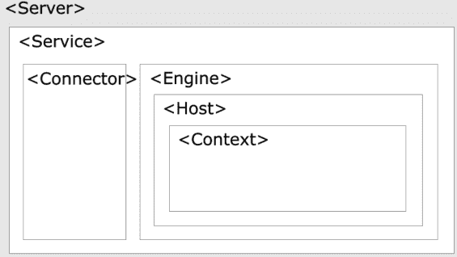

> 这是对最重要的配置元素及其属性的概述。有关所有元素和属性的完整文档，请参阅 http://jakarta.apache.org/tomcat/tomcat-5.0-doc/config/index.html。

## 练习 2-8 使用配置模板

在练习中，你将使用最小配置模板作为 `server.xml` 文件。

你可以在练习册中找到此练习。

（练习结束）

## 目标 8

## 安装 Web 应用

用 Java 开发的 Web 应用通常以 WAR 文件的发布。

WAR 代表 WebARchive（Web归档），相应的文件以 `.war` 结尾。

WAR 文件是类似于 zip 压缩包的压缩存档。

内容必须符合以下结构：

- 静态 HTML 文件和 JSP 存储在根目录中。
- servlet 和相关的 Java 技术类文件必须存储在 `WEB-INF/classes` 目录。
- 任何辅助库 JAR 文件必须存储在 `WEB-INF/lib` 目录中。
- 部署描述符以名为 `web.xml` 的文件存储在 `WEB-INF` 目录中。

`WEB-INF` 目录下的 `web.xml` 文件也称为部署描述符（Deployment Descriptor）。它包含了关于如何将应用程序部署到 Tomcat 环境中的信息。该文件还可以包含 Web 应用程序的设置和启动参数。

如果你不确定如何配置 Web 应用的某个选项，请查看 `web.xml` 文件。

安装应用程序最简单的方法是使用 Tomcat 的自动部署（auto deploy）功能。这意味着你只需要将应用程序的 `.war` 文件复制到想要使用的虚拟主机的 `/webApps` 目录中。

通过重启 Tomcat，WAR 归档会自动解压，应用程序将完成部署。默认情况下，你可以通过应用程序目录的路径访问该应用程序。

自动部署需要为指定的虚拟主机开启自动部署功能。这可以在 Tomcat 的 `server.xml` 文件的 `host` 元素中完成。如果你完全没有配置自动部署，它默认是开启的。

## 练习 2-9 安装示例应用程序

在本次练习中，你将学习如何使用 Tomcat 的自动部署功能安装应用程序。

你可以在练习册中找到此练习。

（练习结束）

## 目标 9 使用 Tomcat 的管理工具

Tomcat 自带两个基于 Web 的应用程序，可用于管理服务器。这两个程序都用 Java 实现，并在 Tomcat 服务器上以特权权限运行。

可以使用管理工具完成以下任务：

- 使用 Manager（管理器）控制 Web 应用
- 使用 Admin Interface（管理界面）调整服务器配置
- 限制对管理工具的访问

### 使用 Manager 控制 Web 应用

Manager 可用于部署和控制 Web 应用。默认虚拟主机 localhost 在 `/manager` 上下文中配置了 Manager。

Manager 提供了不应让所有人都能访问的功能。因此，在访问 Manager 之前，你必须进行身份验证。

为了使身份验证生效，你需要在文件 `/usr/share/tomcat5/conf/tomcat-users.xml` 中创建一个用户。

该文件包含一个用户数据库，可用于对 Manager 或其他 Web 应用的用户进行验证。

文件中使用了以下两个配置元素：

- `<role/>`。根据角色向通过验证的用户授予权限。`role` 元素接受属性 `rolename`，用于定义角色名称。要访问 manager 应用程序，请如下例所示定义角色 manager：

```
<role rolename="manager"/>
```

- `<user/>`。文件中的每个用户都由一个 `user` 元素定义。元素接受 `username`、`password` 和 `roles` 属性。`password` 参数包含明文密码。`roles` 参数用于为用户分配角色。你可以通过逗号分隔来指定多个角色。

以下示例创建了用户 `kbailey`，他拥有 `manager` 角色：

```
<user username="kbailey" password="kbailey" roles="manager"/>
```

在对 `tomcat-user.xml` 文件进行更改后，你必须重启 Tomcat。Tomcat 不会自动重新读取该文件。

在定义 manager 角色并将角色分配给用户后，你可以将浏览器指向 `http://hostname:port/manager/html` 来启动 Manager。

## 图 2-9

出现一个密码对话框。输入正确的凭据后，你的浏览器中应出现以下内容：


| Tomcat Web 管理器 |
| :--- |
| 消息: OK |
| Manager |
| 应用列表 | HTML 帮助 | 帮助 | 服务器状态 |
| 应用 |
| 路径 | 显示名称 | 运行中 | 会话 | 命令 |
| /admin | Tomcat 管理应用程序 | true | 0 | Stop Reload Deploy |
| /balancer | Tomcat 简单负载均衡示例应用 | true | 0 | Stop Reload Deploy |
| /manager | Tomcat 应用程序 | true | 0 | Stop Reload Deploy |
|  |
| 服务器上的目录或 WAR 文件 |
| 上下文路径 (可选): |
| XML 配置文件 URL: |
| WAR 或目录 URL: |
| 要上传的 WAR 文件 |
| 选择要上传的 WAR 文件 Deploy |
| 服务器信息: |
| Tomcat 版本 | JVM 供应商 | OS 名称 | OS 版本 | OS 架构 |
| Apache Tomcat/5.0 | 1.5.0_03-b07 | Sun Microsystems Inc. | Linux | 2.6.11.4-20a-default | i386 |

在页面顶部，你可以访问 Manager 的不同功能。

默认选择是应用列表。

通过服务器状态（Server Status），你可以获得运行中的 Tomcat 模块概览。

当你在应用列表页面时，可以看到正在运行的 Tomcat 模块。

在命令（Commands）列中，你可以找到用于启动 (Start)、停止 (Stop)、重载 (Reload) 或删除 (Remove) 的链接。这非常有用，因为所有操作都可以在不重启 Tomcat 的情况下完成。

在下一个表格中你可以看到 Tomcat 组件的版本。

在最后一个表格中可以看到 Tomcat 模块。

关于 Manager 的更多信息，可以选择顶部的帮助链接。

Tomcat 自带的第二个管理工具用于调整服务器设置。

### 使用管理界面调整服务器配置

在标准配置中，可以通过以下 URL 访问 Admin Interface：

```
http://hostname:port/admin
```

与 Manager 一样，Admin Interface 需要身份验证。你需要创建一个名为 admin 的角色，并将角色分配给允许使用 Admin Interface 的用户。

## 图 2-10

输入正确的用户名和密码后会出现以下页面：

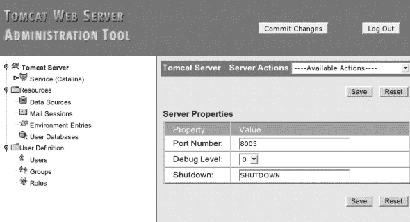

在左侧你可以浏览服务器配置，选择项目后可以在右侧更改相应的值。

配置以树的形式显示，具有以下顶级元素：

- **Tomcat Server.** 树的这部分遵循 `server.xml` 结构。
- **Resources.** 你可以配置资源或数据源。
- **User Definition.** 你可以编辑用户相关的配置部分。

完成更改后，点击管理工具顶部的提交更改（Commit Changes）。

## 限制对管理工具的访问

当 Tomcat 作为互联网服务运行时，你不希望所有人都能访问管理工具。

你可以使用上下文配置中的 `<Valve>` 元素来限制访问。

这需要在以下文件中完成：

`/usr/share/tomcat5/conf/Catalina/localhost/manager.xml`

用于 Manager 工具，以及

`/usr/share/tomcat5/conf/Catalina/localhost/admin.xml`

用于 Admin 工具。

在 Context 元素中，你需要插入 `<Valve>` 元素，如下所示：

```
<Context path="/manager"
docBase="/usr/share/tomcat5/server/webapps/manager"
debug="0" privileged="true">

<!-- 连接到获取角色的用户数据库 ---->
<ResourceLink name="users" global="UserDatabase"
type="org.apache.catalina.UserDatabase"/>

<Valve className="org.apache.catalina.valves.RemoteAddrValve"
allow="127.0.0.1"/>

</Context>
```

在此示例中，仅允许从本地（IP 地址 127.0.0.1）访问 Manager。对于更多条目，我们使用逗号进行分隔。

## 练习 2-10 启用管理器和管理员工具

在本次练习中，你将启用管理器和管理员工具。

你可以在练习册中找到此练习。

（练习结束）

## 目标 10 使用端口 80 访问 Tomcat

Tomcat 接受在 `server.xml` 配置文件 `<Connector>` 元素中配置的端口上的的请求。一个非常常用的端口是 8080。

如果单独使用 Tomcat，那么配置端口 80 是极有意义的，因为这是 HTTP 协议的默认端口。

这里的问题是，只有以 root 权限运行的 Linux 进程才允许打开 1024 以下的端口。这些端口也被称为特权端口（privileged ports）。

默认情况下，在 SUSE Linux Enterprise Server 10 系统上，Tomcat 以 `tomcat` 用户身份运行。这种设置不允许 Tomcat 开启特权端口。可以以 root 用户身份运行 Tomcat，但出于安全考虑，不建议这样做。

在 Tomcat 以 root 用户身份运行的配置中，利用 Tomcat 的漏洞将导致对底层系统的 root 访问。

为了让 Tomcat 安全地处理到达端口 80 的请求，你可以使用以下选项之一：

- 使用类似 `rinetd` 的端口转发器将进入端口 80 的传入请求转发到 Tomcat 监听的端口。
- 使用 `iptables` 将进入端口 80 的传入请求转发到 Tomcat 监听的端口。
- 将 Tomcat 与 Apache Web 服务器集成。

如果你的内容包含许多静态 HTML 页面且只有部分动态生成的页面，这种方法可能也有意义。

让 Apache 提供静态内容可以带来更好的整体性能。

关于 Apache 集成的端口更多信息，请访问：http://jakarta.apache.org/tomcat/connectors.html#integrate

- 使用 Squid 缓存将请求转发到 Tomcat。

要使用 `rinetd` 进行端口转发，当 `rinetd` 安装在与 Tomcat 相同的系统同时，你可以使用如下配置。

`rinetd` 的配置文件使用 `/etc/rinetd.conf` 文件完成：

```
10.0.0.1 10.0.0.1 8080
allow 10.0.0.*
logfile /var/log/rinetd.log
logcommon
```

在此示例中，所有到达 IP 地址 10.0.0.1 端口 80 的传入请求都被转发到 10.0.0.1 的端口 8080。

> 如果你想使用 `rinetd`，必须先停止 Apache 守护进程 (httpd)，因为两者无法继续使用端口 80。

> 关于 `rinetd` 的更多信息，请在安装 `rinetd` 软件包后查看 `/usr/share/doc/packages/rinetd` 目录。

## 练习 2-11 配置 rinetd 将端口 80 转发到端口 8080

在本次练习中，你配置 `rinetd` 将端口 80 转发到端口 8080。

你可以在练习册中找到此练习。

（练习结束）

## 总结

| 目标 | 总结 |
| --- | --- |
| 1. 设置基础 Web 服务器 | - Apache 是领先的 Web 服务器软件。<br>- Apache 使用 HTTP 协议将数据传递给 Web 浏览器。<br>- 对于基础 Web 服务器，你需要安装以下包：<br>- apache2<br>- apache2-prefork<br>- apache2-example-pages<br>- 本地运行的 Web 服务器可以使用地址 http://localhost 访问。<br>- Web 服务器的默认文档根目录是 /etc/www/htdocs。<br>- Apache 配置文件位于 `/etc/apache2` 目录。<br>- Apache 配置文件的选项称为指令（directives）。<br>- 你可以使用命令 `apache2ctl configtest` 检查配置文件的语法。 |
| 2. 配置虚拟主机 | 通过配置虚拟主机，你可以在单台物理机器上托管多个域名。<br>- 你需要为每个虚拟主机在 `/etc/apache2/vhosts.d/` 目录下创建一个配置文件。 |

## 目标总结

| 目标 | 总结 |
| - | - |
| 3. 限制对 Web 服务器的访问 | - 你可以限制对 Apache Web 服务器的访问。<br>- 基于 IP 地址的限制。<br>- 基于用户验证的限制。 |
| 4. 使用 OpenSSL 配置 Apache | - 为了加密浏览器与服务器之间的连接，你可以配置 Apache 使用 SSL。<br>- 在 SSL 环境下运行生产系统，你需要由 CA 签名的证书。<br>- 访问启用 SSL 的系统，使用以 https:// 开头的地址。 |
| 6. 描述 Tomcat | Tomcat 是一个用于 Java 开发的 Web servlet 容器。<br><br>它提供了一个部署和运行 Java servlet 和 JSP 文件的框架。<br><br>就像 Apache Web 服务器一样，Tomcat 由 Apache 基金会开发。<br><br>你可以在此处查找更多信息和文档：http://jakarta.apache.org/tomcat |
| 7. 安装并配置 Tomcat | `CATALINA_HOME` 变量指向 Tomcat 安装根目录。在 SUSE Linux Enterprise Server 10 上，这是 `/usr/share/tomcat`。`CATALINA_HOME` 由启动脚本传递给 Tomcat。在 SUSE Linux Enterprise Server 10 上，可以在文件 `/etc/sysconfig/j2ee` 中设置 `CATALINA_HOME`。主服务器配置位于 `/usr/share/tomcat5/conf/server.xml` 文件。该文件以 XML 格式编写，包含多个配置元素。根元素是 `<Server>`。 |
| 8. 安装 Web 应用程序 | Web 应用程序位于 `/usr/share/tomcat5/webapps`。当使用 Tomcat 的自动部署功能时，将 `.war` 文件复制到此目录，Tomcat 将解压并部署应用程序。可以通过以下方案访问：http://host:port/name_of_application/ |
| 9. 使用 Tomcat 工具 | 管理器和管理员界面可以通过浏览器管理 Tomcat。这些工具默认在路径 `/manager/html` 和 `/admin` 下访问。这两个工具都需要验证。你需要在 `/usr/share/tomcat5/conf/tomcat-users.xml` 中创建 manager 和 admin。 |
| 10. 使用端口 80 访问 Tomcat | 出于安全考虑，Tomcat 不应以 root 用户权限运行。因此它无法使用小于1024的端口。为了让 Tomcat 监听80，你可以使用 inetd 或 iptables。你也可以将 Tomcat 连接到 Apache 服务器或使用 Squid 缓存。 |

## 第3 节 配置和使用 Samba

在本节中，你将学习如何使用 Samba 为 Windows 主机配置文件服务器，以及如何使用一些高级功能。

## 目标

- 1. 理解 Samba
- 2. 配置简单文件服务器
- 3. 配置用户验证
- 4. 使用 Samba 客户端工具
- 5. 将 Samba 作为域控制器
- 6. 将 Samba 集成到 Windows 域
- 7. 配置 Samba 作为打印服务器

## 目标 1


### 理解 Samba

Samba 是用于将 Linux 系统集成到 Windows 网络的应用程序集。Samba 最常用作 Windows 主机文件服务器。

SMB（服务器消息块）协议是一种在 Windows 网络中提供文件和打印服务的网络协议。Samba 让 Linux 使用 SMB，从而集成到 Windows 环境中。

你可以将 Samba 用于以下目的：

- 为 Windows 提供文件和打印服务。
- 访问 Linux 系统上的 SMB 文件和打印服务。
- 作为 Windows 域的域控制器。
- `smbclient`。此工具提供了对 SMB 文件和打印服务的访问。

SUSE Linux Enterprise Server 10（未包含更新或服务包的原始版本）包含了 Samba 3.0.22。该版本的一个重要新功能是 winbind 对 Kerberos 的支持。这允许基于 Kerberos 的集成到 Active Directory 域中。

Novell 是 Samba 项目的重要贡献者。你可以在 http://www.opensuse.org/samba 找到关于 Novell/SUSE Samba 软件包和 Novell/SUSE Samba 团队的信息。

## 目标 2：配置简单的文件服务器

要使用 Samba 搭建一个简单的文件服务器，你需要：

- 安装 Samba
- 理解 Samba 配置文件

## 安装 Samba

基础 Samba 设置需要安装以下软件包：

- `samba`。这是主要的 Samba 包。它包含了 Samba 服务器软件。
- `samba-client`。此包包含 Samba 客户端工具。
- `samba-doc`（可选）。此包提供了有关 Samba 的额外文档。

安装软件包后，你可以使用以下命令启动 Samba 守护进程：

```
rcnmb start
rcsmb start
```

要在系统启动时自动启动 Samba 服务，请输入以下命令：

```
insserv nmb
insserv smb
```

## 练习 3-1：安装 Samba

在练习中，你可以学习如何安装 Samba 组件。

你可以在练习册中找到此练习。

（练习结束）

## 理解 Samba 配置文件

Samba 服务配置在 `/etc/samba/smb.conf` 文件中。

文件中的选项被分为不同的部分。每个部分都以方括号中的关键字开始。

要使用 Samba 配置一个简单的文件服务器，请执行以下操作：

- 创建一个通用服务器配置的节
- 创建一个用于共享文件的节

## 创建一个通用服务器配置的节

通用服务器配置部分以关键字 `[global]` 开始。以下是一个基础全局节的示例：

```
[global]
workgroup = DigitalAirlines
netbios name = Fileserver
security = share
```

此示例中全局部分的条目描述如下：

- `workgroup = DigitalAirlines`：此行设置 Samba 服务器的 Windows 工作组（在此例中为 DigitalAirlines）。
- `netbios name = Fileserver`：此行设置 NetBIOS 空间中的系统名称（在此例中为 Fileserver）。
- `security = share`：此行决定客户端访问共享时如何进行身份验证。该选项可以有以下值：
  - `share`：客户端在初始连接到服务器时不需要提供密码。然而，当客户端尝试访问共享时，可能需要密码。
  - `user`：客户端在连接到服务器时需要提供用户名和密码。Samba 根据 Linux 系统上的可用用户及其自身的密码文件验证密码。
  - `server`：客户端在连接到服务器时需要提供用户名和密码。Samba 联系网络中的另一个 SMB 服务器来验证密码。
  - `domain`：客户端在连接到服务器时需要提供用户名和密码。Samba 连接到域控制器并验证密码。这仅在 Samba 加入 Windows 域时才有效。
  - `ads`：Samba 作为 ADS 域的成员运行，以验证用户名和密码。

你可能需要为这些选项配置额外的设置以使其正常工作。更多信息，请参阅 `smb.conf` 的主页。


## 创建一个用于共享文件的节

在全局节之后，你需要添加一个共享的节。以下是一个基础节的示例：

```
[data]
comment = Shared Data
path = /srv/share
valid users = users
read only = no
```

该节的条目描述如下：

- `comment = Shared Data`：此行提供共享描述。
- `path = /srv/share`：此行设置要共享的目录路径。
- `valid users = users`：此行指定允许哪些用户访问共享。
- `read only = no`：此行决定共享是只读还是可写的。

## 目标 3：配置用户身份验证

在上例中，Samba 共享需要用户名和密码。以下显示了如何配置 Samba 要求身份验证。

第一个任务是将用户创建为 Linux 用户。然后，需要使用 `smbpasswd` 工具设置 SMB 密码。

```
smbpasswd -a tux
```

`smbpasswd` 提示你输入两次密码并通过显示以下消息确认密码设置：

```
New password: novel
Retenter password: novel
Added user tux
```

禁用账户：

```
smbpasswd -d kbailey
Disabled user kbailey.
```

重新激活已禁用的账户：

```
smbpasswd -e kbailey
Enabled user kbailey.
```

删除 Samba 用户，可以使用命令：

```
smbpasswd -x kbailey
Deleted user kbailey.
```

更改 Samba 密码时，用户本人不需要添加任何选项：

```
kbailey@host~ smbpasswd
Old password:
New password: novel
Retype new password: novel
Password changed for user kbailey
```

系统管理员必须使用用户登录使用 `smbpasswd`：

```
host:~ # smbpasswd kbailey
New password: novel
Retype new password: novel
Password changed for user kbailey.
```

## 配置一个仅允许一个用户访问的共享

以下示例配置了一个仅允许用户 tux 访问的共享：

```
[tuk-dir]
comment = Tux Directory
path = /srv/share
valid users = tux
read only = no
```

- `valid users = tux`

此选项列出了所有允许连接此共享的用户。用户名之间必须用逗号分隔。你可以使用 `@group_name` 语法添加整个 UNIX 用户组。然而，该 UNIX 用户组的所有用户都需要在 `smbpasswd` 文件中拥有账户。

- `read only = no`

此选项通过将 `read only` 选项设置为 `no`，使共享变为可写。

## 为用户组配置共享访问

以下示例创建了一个对于 `accounting` UNIX 用户组的所有用户都可读可写的共享：

```
[accounting]
comment = Accounting department
path = /srv/share
valid users = @accounting
force user = tux
force group = accounting
read only = no
```

与之前的示例相比，以下行是新增的或已更改过的：

- `valid users = @accounting`

此行允许所有属于 `accounting` UNIX 用户组的用户访问共享文件夹。

- `force user = tux`

此行强制 Samba 服务器以用户 `tux` 的身份执行共享文件夹中的所有文件操作。这确保了共享文件夹中的所有文件对于允许访问共享的每个用户都是可读可写的。

- `force group`

此行强制 Samba 服务器以 `accounting` 组身份执行所有文件操作。

## 配置家目录导出

以下示例导出了 Samba 服务器上所有 UNIX 用户的家目录。在设置生效之前，你需要将用户添加到 `smbpasswd` 文件中：

```
[homes]
comment = Home Directories
valid users = %S
read only = No
browseable = No
```

在此示例中，你必须将共享命名为 `homes`。如果 Samba 在配置文件中找到名为此名的共享，它将以特殊方式处理。

当请求一个共享时，Samba 首先扫描配置文件的现有部分。如果没有找到该命名的部分，Samba 将使用请求的共享名称作为用户名，并在本地密码文件中查找该用户。

如果找到了该用户并提供了正确的密码，Samba 会自动为该用户的家目录创建一个共享。

以下描述了示例中的各个行：

- `valid users = %S`

`%S` 宏将 `valid users` 选项的值设置为请求的共享名称。

- `read only = No`

导出的家目录对于经过身份验证的用户应该是可读可写的。

- `browseable = No`

出于安全考虑，该共享是不可浏览的。

要访问导出的家目录，请使用地址 `//server_name/user_name`。

## 为用户 Geeko 配置共享

### 练习 3-2

在此练习中，你将学习如何配置一个基础 Samba 共享。

你可以在练习册中找到此练习。

（练习结束）

## 目标 4：使用 Samba 客户端工具

虽然 Samba 主要目的是为 Windows 客户端提供服务，但它也提供了从 Linux 访问 SMB 共享的工具。这些共享是由 Samba 还是原生 Windows 服务器提供的没有区别。

你可以使用 Samba 工具执行 3 个基本任务：

- 使用 `nmblookup`
- 使用 `smbclient`

## 使用 nmblookup

通过 `nmblookup` 工具，你可以将 NetBIOS 名称解析为 IP 地址。在下面的示例中，查询 NetBIOS 名称为 `Fileserver` 的 Samba 服务器的 IP 地址：

```
nmblookup Fileserver
```

命令的输出如下：

```
querying Fileserver on 10.0.0.255
10.0.0.1 Fileserver<00>
```

在第一行中，`nmblookup` 表示它通过广播到地址 `10.0.0.255` 查询 IP 地址。在第二行中，它显示了查询结果，在这种情况下，NetBIOS 名称为 `Fileserver` 的系统地址为 `10.0.0.1`。

> 如果你查询的系统不在你的同一个子网内，则无法通过广播查询解析名称。相反，`nmblookup` 使用 WINS 服务器来解析名称。

更多信息，请参阅 `nmblookup` 的 man 页面。

## 使用 smbclient

通过 `smbclient` 工具，你可以访问网络上的 SMB 共享。

它也是测试 Samba 服务器配置的一个非常有用的工具。

你可以使用 `smbclient` 执行基本任务：

- 浏览服务器提供的共享
- 访问 SMB 服务器提供的文件
- 在 SMB 服务器提供的打印机上打印
- 将 SMB 共享挂载到 Linux 文件系统

## 浏览服务器提供的共享

要显示 SMB 服务器提供的共享，请输入如下所示的命令。

```
smbclient -L //Fileserver
```

当 `smbclient` 请求密码时，按 Enter 键继续。

`smbclient` 的输出如下：

| Domain=[DigitalAirlines] OS=[Unix] Server=[Samba 3.0.22-SUSE] | |
|---|---|
| Sharename | Type | Comment |
| data | Disk | Data |
| IPC$ | IPC | Service |
| ADMIN$ | IPC | IPC Service |
| Domain=[DigitalAirlines] OS=[Unix] Server=[Samba 3.0.22-SUSE] | |
| Server | Comment |
| ----- | ----- |
| Workgroup | Master |
| ----- | ----- |
| DigitalAirlines | Fileserver |

`smbclient` 首先显示 SMB 服务器上的所有可用共享。

除了你在 `smb.conf` 文件中配置的共享外，SMB 服务器始终提供至少另外 2 个共享：

- `IPC$`。此共享提供有关 SMB 服务器上可用其他共享的信息。
- `ADMIN$`。在 Windows 计算机上，此共享指向 Windows 自身的安装目录。这对于管理任务非常有用。当 Samba 尝试模拟 Windows 时，可以使用此共享。

## 练习 3-3：使用 smbclient 访问用户 Geeko 的共享

在此练习中，你将学习如何使用 `smbclient` 访问共享。

你可以在练习册中找到此练习。

（练习结束）

## 将 SMB 共享挂载到 Linux 文件系统

与其使用 `smbclient` 访问共享文件，你可以将共享挂载到文件系统中，就像挂载硬盘分区或光驱驱动器一样。

基础挂载命令所示：

```
mount -t cifs //Fileserver/data /mnt
```

在此示例中，SMB 服务器的 `data` 共享被挂载到 `/mnt` 。`-t cifs` 选项是必要的，用于指定要挂载的资源是 SMB 共享。

如果共享需要验证，你可以提供用户名和密码，如下所示：

```
mount -t cifs -o username=tux,password=novell //Fileserver/data /mnt
```

## 练习 3-4：挂载 Geeko 共享

在此练习中，你将在 Linux 系统上挂载 Samba 共享。

你可以在练习集中找到此练习。

（练习结束）

## 目标 5：将 Samba 作为域控制器

Samba 可以配置为作为 Windows NT4 风格的域控制器。


在学习本节之前，请注意：要使用 Samba 配置域控制器，你需要对 Windows 域概念和 Windows 网络有深入了解。这些知识超出了课程的范围。你可以在此处找到非常好的 Samba Howtos 和示例：http://www.samba.org/docs/man/Samba-Guide/

要将 Samba 配置为 NT4 风格的主域控制器，请完成以下操作：

- 理解域控制器
- 配置 `/etc/samba/smb.conf`
- 创建工作站账户

## 理解域控制器

域控制器（Domain Controller）是一种用于管理一组网络计算机用户的系统。在 Windows 术语中，这一组被称为“域”。

域控制器提供了一个用户数据库，用于在用户登录到受管理的计算机之一时进行身份验证。

除了用户身份验证外，域控制器还提供有关用户允许访问的网络共享以及其他用户策略的信息。

自 Windows 2000 以来，域控制器基于微软的 Active Directory（活动目录）服务。随着 Active Directory 的引入，域控制器与主机之间的通信协议发生了变化。

Samba 可以作为 NT4 域控制器工作。Windows 2000 和 Windows 专业版工作站向兼容 NT4，因此可以与 Samba 使用。然而，在这种情况下无法使用新的 Active Directory 功能。

## 配置 `/etc/samba/smb.conf`

以下是 `smb.conf` 中基础的域控制器配置：

```
[global]
netbios name = da50
workgroup = berlin
security = user
passdb backend = ldaps:///da2.digitalairirlines.com
logon script = %.bat
domain master = yes
os level = 50
local master = yes
preferred master = yes
domain logins = yes

[netlogon]
path = /netlogon
```

新选项的描述如下：

- `passdb backend`。指定用户和组信息存储在何种数据库中。

输入以下内容之一：

- `smbpasswd`
- `tdbsam` (smbpasswd 加 NT SAM)
- `ldapsam`

如果你的网络中有备份域控制器 (BDC)，你必须在此选择 `ldapsam` 并指定 LDAP 服务器。

使用非 LDAP 后端的 SAM 数据库特别特别有问题，因为域成员会定期更改机器信任账户密码。新密码随后仅存储在本地。

- `logon script`。指定一个用户登录时在客户端上执行的 Windows 批处理脚本。变量 `%U` 会替换为用户名。在此配置中，每个用户都有自己的登录脚本。脚本必须放在 `netlogon` 共享指定的目录中。

- `domain master`。此选项告诉 Samba 作为域控制器。

- `local master`。此选项允许 Samba 参与本地主浏览器（local master browser）的选举。

- `os level`。此整数值控制 Samba 在什么种级别上广告自己用于浏览选举。你需要 32（或更高）的值来成为 PDC。

- `preferred master`。如果设置了此选项，`nmbd` 将强制强制选举。

- `domain logons`。此选项定义了是否允许其他系统加入域。对于域控制器，这需要设置为 `yes`。

Samba 不能作为 Active Directory 服务器或 Active Directory 主域控制器。

## 创建工作站账户

对于每个将成为域成员的 Windows 工作站，你都需要在 Samba 服务器上创建一个工作站账户。工作站账户用于在域控制器和客户端之间建立信任关系和安全连接。

为 Windows NT 工作站创建本地账户，请使用命令

```
smbpasswd -a -m workstation
```

工作站账户创建时名称末尾带有“$”符号。

在输入命令之前，Linux 上必须有一个同此名称的用户账户。

参见示例：

```
da2:- # smbpasswd -a -m da50
User da50 does not exist in system password file (usually /etc/passwd).
Cannot add account without a valid local system user.
Failed to modify password entry for user da2$
da2:- # smbpasswd -a -m da51
Added user da51$
d22:2: # cat smbpasswd
## Sample smbpasswd file.
## To use this, set 'encrypt passwords = yes' in the [global]-section
## of /etc/samba/smb.conf
kbailey:108DD098F35B3B2417306D272A9441BB:6478A025C56EBBC1CA6FDE37971:
[U]:LCT-39CC96
da50$:101:6AD9466E87D9AAD3B4
...
```

## 目标 6

### 将 Samba 集成到域

SUSE Enterprise Server 10 自带一个模块，帮助你将 Samba 与 Windows 集成。可以在“网络服务 (Network Services) > 域 (Domain)”找到该模块。

当你启动该模块时，它看起来如下：

在顶部的文本字段中，输入你想添加的域或工作组名称。

如果你想使用身份验证，请选择相应的选项。

- 登录创建（Home on Login）。当你启用此选项时，用户首次登录时会自动创建目录。
- 离线身份验证（Offline Authentication）。此选项允许在未连接时也进行身份验证。

选择完成（Finish）后，可能会提示输入连接的域控制器的凭据。

配置将写入 `/etc/samba/smb.conf`。

## 目标 7 将 Samba 配置为打印服务器

Samba 可以作为 Windows 网络中的打印服务器使用。这允许与其他计算机共享打印机。

要使用 Samba 打印，你首先需要在 Samba 服务器上安装运行的 CUPS 系统并配置连接的本地打印机。可以通过 YaST（硬件 > 打印机）完成。

在开始配置 Samba 打印共享之前，你应该通过本地应用程序（例如 Firefox 浏览器）测试 CUPS 安装。

一旦 CUPS 系统和打印机配置完成，就可以使用 Samba 与网络工作站共享 CUPS 打印机。

在 Linux 上，应用程序的标准打印格式是 PostScript。当打印机不直接理解 Postscript 时，CUPS 系统中的打印程序会将数据转换为打印机的原生格式。

Windows 使用 Metafile 作为其标准打印格式。共享打印机时有两种方法可以将这种格式转换为打印机理解的内容。

- 在 Samba 服务器上预处理
- 在 Windows 客户端预处理

### 在 Samba 服务器上预处理

配置取决于你想共享的打印机数量。

你必须决定：

- 共享一台打印机
- 共享多个打印机

#### 共享一台打印机

如果你只想为 Windows 提供一台打印机，可以直接创建一个共享。

创建共享的命令看起来如下：

```
[laserjet]
printable = yes
printer = lp_raw
path = /var/tmp
```

`printable = yes` 告诉 Samba 该共享是打印机共享而不是共享目录。

使用 `printer` 选项指定通过此共享使用哪个 Linux 打印队列。如果你想在客户端预处理，请在此输入 RAW 队列。

输出目录由 `path` 选项指定。该目录对所有允许打印的用户具有可写权限。

## 图 3-2

在这里，打印任务将被存储，直到可以打印为止。

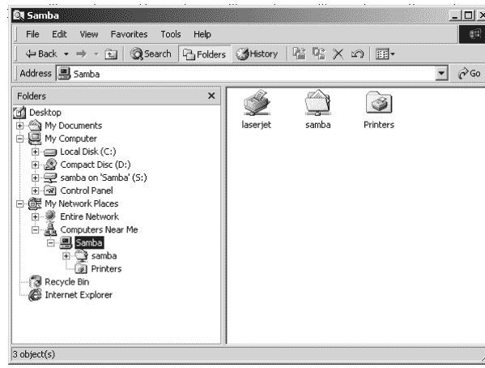

如果您在配置打印机共享时遇到问题，可以使用选项 `print command = cp %s /tmp/out.ps`。

到达 Samba 服务器的信息将写入文件 `/tmp/out.ps`。

#### 共享多个打印机

如果您想在从 Windows 访问的 Samba 服务器上安装许多打印机，则上述方法并不适用。

可以通过以下方式配置多个打印机。

如果您使用 CUPS 打印系统，请在 `[global]` 部分添加以下行：

```
printing = CUPS
printcap name = CUPS
```

使用 `printing` 选项可以指定打印系统。

以下是有效值：

- AIX
- BSD
- CUPS
- HPUX
- LPRNG
- PLP
- QNX
- SYSV

使用参数 `printcap name` 来指定打印机的配置文件。

可以在 `[printers]` 部分使用之前介绍的选项配置打印机共享。

该部分看起来如下所示：

```
[printers]
printable = yes
path = /var/tmp
```

## 仅限 CNI 使用-允许打印副本

### 在 Windows 客户端预处理

如果打印预处理是由客户端完成的，则必须手动在每个客户端上安装打印机驱动程序。

要做到这一点你需要 Windows 安装光盘。

最好将可用驱动程序存储在 Samba 服务器上，这样整个网络都可以访问。

要做到这一点，您首先需要在 `/etc/samba/smb.conf` 文件中创建一个打印共享。

以下是一个示例：

```
[laserjet]
printable = yes
print command = lpr -Plp -I %s
```

还需要一个标记为 `[print$]` 的特殊共享。指定存储 Windows 驱动程序的路径。

此共享应仅对管理员可写，所有用户可读。

`[print$]` 共享如下：

```
[print$]
path=/var/lib/samba/drivers
write list = root
```

现在您可以在 Windows 客户端上安装驱动程序了。

如果您在打印机配置中选择“添加打印机”，将启动“添加打印机向导”。

## 图 3-3

如果您浏览打印机，应该可以找到您的打印机共享。

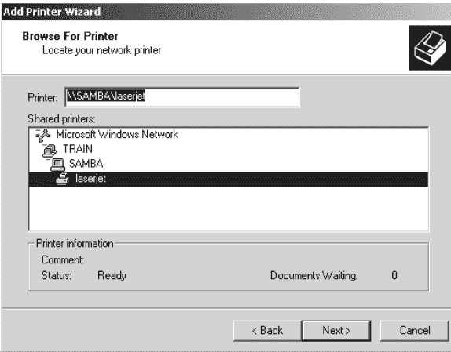

几步之后，您可以选择您的打印机模型。在安装驱动程序后，Samba 将使用指定目录 `[print$]` 中的 `path` 为不同的 Windows 版本创建新目录。

在下面的示例中，您可以找到安装的打印机驱动程序（HP2100_6.PPD）：

```
da2: # ls /var/lib/samba/drivers/
 W32ALPHA W32MIPS W32PPC W32X86 WIN40
da2: # ls /var/lib/samba/drivers/W3286/
 2
da2: # ls /var/lib/samba/drivers/W3286/2/
 HP2100_6.PPD PSCRIPT.DLL PSCRIPT.HLP PRSCRPTUI.DLL
```

## 配置 Samba 作为打印服务器

练习 3-5

在此练习中，您将配置一个 Samba 打印服务器。

您可以在练习中找到此练习。

（练习结束）

## 总结

| 目标 | 总结 |
| --- | --- |
| 1. 理解 Samba | Samba 可用于 Linux 系统集成到 Windows 环境中。Windows 服务通过 SMB 协议提供。Windows 环境中使用 NetBIOS 网络协议。NetBIOS 独立于 DNS 创建它自己的空间。可以使用地址 `\server_name\service_name` 访问 SMB 共享。Samba 可用于以下用途：<br>- 作为文件和打印服务器<br>- 访问 SMB 共享<br>- 作为域控制器 |
| 2. 配置简单文件服务器 | Samba 服务器在 `/etc/samba/smb.conf` 文件中配置。Samba 配置文件采用分段结构。您可以使用 `testparm` 命令检查配置文件的语法。 |
| 3. 配置用户认证 | 使用安全选项来指定身份验证级别：<br>- share. 为每个共享分配密码。<br>- user. 在用户访问任何共享之前，必须进行身份验证。<br>- server. 这类似于用户认证，但认证是由 SMB 服务器完成的。<br>- domain. 认证由 PDC（主域控制器）完成。<br>- ads. Samba 服务器是 Active Directory 域的一部分。<br>选项 `guest ok = yes` 允许来用户连接到服务器或共享。<br>`encrypt passwords = yes` 激活密码加密。<br>用户账户由 `smbpasswd` 命令管理：<br>- a login. 添加用户账户。<br>- d login. 禁用用户账户。<br>- e login. 重新激活禁用的用户账户。<br>- x login. 删除用户账户。 |
| 4. 使用客户端工具 | 使用 `smlookup` 选项解析 NetBIOS 节点。<br>使用 `smclient` 访问共享。<br>使用 `mount -t cifs` 挂载共享。 |
| 5. 使用 Samba 作为域控制器 | Samba 服务器在 `/etc/samba/smb.conf` 文件中配置。Samba 配置文件采用分段结构。您可以使用 `testparm` 命令检查配置文件的语法。<br>`domain` 选项允许 Samba 参与。<br>设置 `local` 选项使 Samba 成为浏览器。<br>`os` 级别控制 Samba 广播的级别。<br>`preferred` 选项将强制立即进行。<br>`local` 选项用于 Samba 服务器。<br>要为 Windows 工作站创建本地账户，请使用命令<br>```
smbpasswd -a
``` |
| 6. 在域中集成 Samba | SUSE Linux Server 10 带有一个新的 YaST 模块，允许轻松集成到域中。<br>可以在 YaST 的“网络服务 > 域成员”下找到该模块。 |
| 7. 配置 Samba 作为打印服务器 | 有两种预处理方法：<br>- 在 Samba 服务器上预处理：<br>    - 共享一个打印机<br>    - 共享多个打印机<br>- 在 Windows 客户端上预处理<br>使用 `printable = yes` 选项告诉 Samba 该共享是打印机而不是共享目录。<br>使用 `printer` 选项指定使用哪个 Linux 队列。<br>使用 `path` 选项指定目录。<br>使用 `printing` 选项指定打印系统。<br>使用 `printcap name` 参数指定打印机的配置文件。<br>在 `[print$]` 共享中，您可以指定存储 Windows 驱动程序的路径。 |

## 第 4 节 启用网络服务

在本节中，您将学习启用 SUSE Linux Server 10 中常用的网络服务的基础知识。

## 目标

1. 启用扩展守护进程 (xinetd)
2. 启用 FTP 服务器
3. 在 SUSE Linux Server 10 上配置时间
4. 配置 NFS (网络文件系统)

## 启用扩展守护进程 (xinetd)

在本目标中，您将通过查看以下内容学习启用扩展守护进程 (xinetd)：

- 什么是 xinetd
- 使用 YaST 配置 xinetd
- 手动管理 xinetd

### 什么是 xinetd

服务可以独立运行（它们自己监听端口），也可以通过超级守护进程 xinetd 运行。在这种情况下，超级守护进程作为一系列服务的调解器。它接受请求并传递给新启动的进程。

如果客户端与服务器之间的连接终止，由 xinetd 启动的服务器进程将从内存中移除。

通过 xinetd 启动服务优缺点都有。优点是节省资源（特别是内存），因为只有在需要时才启动服务器进程。缺点是在加载、启动和连接所需的服务时会产生延迟。

通常情况下，您只想将 xinetd 用于服务器上偶尔需要（而非永久需要）的服务。传统上 xinetd 的服务包括 Telnet 和 FTP。

有关 xinetd 的详细信息，请输入 `man 8 xinetd`。


## 使用 YaST 配置 xinetd

要配置由 xinetd 管理的服务，你可以使用 YaST 网络服务 (xinetd) 模块。启动 YaST 控制中心，然后选择“网络服务” > “网络服务 (xinetd)”。或者打开终端窗口，使用 `su -` 切换到 root 用户，然后输入 `yast2 inetd`。

用于配置 xinetd 的 YaST 模块称为 inetd。这是因为在过去，SUSE Linux 的默认服务器守护进程并不是 inetd。

通过选择“启用 (Enabling)”来启用 xinetd 服务进程。这将激活“当前可用服务”列表。你可以在列表中添加、编辑或删除服务：

## 图 4-1

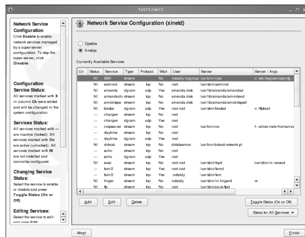

严禁复制本手册的全部或部分内容或分发副本。如怀疑有抄袭行为，请拨打 1-800-PIRATES。

管理通过 xinetd 可用的服务（除启用 Telnet 或 FTP 等服务外）所需的技能超出了本课程的目标。这在通过**编辑 (Edit)** 配置服务时尤为如此。

注意某些服务处于关闭状态 (---)，而其他服务未安装 (NI)。

要配置服务，请选择该服务，然后选择**切换状态（开启或关闭）(Toggle Status (On or Off))**。

如果服务未安装，它将被安装。状态列将显示“开启 (On)”。“已 (Ch)”列将显示“X”，表示该服务已编辑并将在系统配置中更改。


你可以通过选择**所有服务的状态 > 激活所有服务** 或**所有服务的状态 > 取消所有服务** 将所有已安装服务的状态改为开启或关闭。

完成服务配置后，保存配置设置并选择**完成** 以启动 `inited` (或 `xinetd`) 守护进程。

## 手动管理 xinetd

要手动管理 `xinetd`，你需要了解如何执行以下操作：

- 启动、停止和重启 `xinetd`
- 配置 `xinetd`
- 配置访问控制
- 配置日志文件

## 启动、停止和重启 xinetd

要通过 `xinetd` 提供服务，你需要在你的 SUSE Linux Enterprise Server 上安装并启动守护进程。要让守护进程在启动时自动激活，请输入 `inserv xinetd`。

`xinetd` 由脚本 `/etc/init.d/xinetd` 控制。`/usr/bin/rcinetd` 是该脚本的链接。你可以输入 `rcinetd start` 或 `rcinetd stop` 来启动和停止守护进程。你可以输入 `rcinetd status` 来检查守护进程是否激活。

此外，`xinetd` 可以受到通过 `kill` `killall` 发送信号的影响。下表列出了可以使用于 `xinetd` 的一些信号。

### 表 4-1

| 信号 | 数字 | 描述 |
|---|---|---|
| `SIGUSR1` | 10 | 引起内部状态转储（默认转储文件为 `/var/run/xinetd.dump`）。 |
| `SIGQUIT` | 3 | 导致 `xinetd` 终止。 |
| `SIGTERM` | 15 | 在终止 `xinetd` 之前终止所有运行的服务。 |
| `SIGHUP` | 1 | `xinetd` 重新读取配置文件，并停止在不再使用的服务的端口上监听，和或根据新配置绑定到当前可用的端口... |
| `SIGIO` | 29 | 引起内部一致性检查，以验证程序使用的数据结构未被损坏。 |

## 配置 xinetd

`xinetd` 的配置分布在多个文件中。`/etc/xinetd.conf` 列出了通用选项，而 `/etc/xinetd.d/` 中的文件则包含了通过 `xinetd` 提供的特定服务的配置。这些文件通过 `/etc/xinetd.conf` 末尾的 `include` 语句包含在 `xinetd` 配置中。

要配置 `/etc/xinetd`，你需要了解以下内容：

- 文件 `/etc/xinetd.conf`
- 目录 `/etc/xinetd.d/`
- `chkconfig`
- 内部服务

## 文件 /etc/xinetd.conf

在 SUSE Linux Enterprise Server 中，`/etc/xinetd.conf` 文件仅包含通用选项，没有服务配置。以下是 `/etc/xinetd.conf` 用于 `xinetd` 默认配置参数的语法：

```
defaults
{
    key operator parameter parameter. .
}
```

运算符包括 `=` `-=` 和 `+=`。大多数属性（键）仅支持运算符 `=`，但你可以通过输入 `+=` 为某些属性包含额外值，或通过输入 `-=` 移除它们。

配置文件中的 `defaults` 条目是可选的，允许设置如下默认值：

```
defaults {
  log_type          = FILE /var/log/xinetd.log
  log_on_success    = HOST EXIT DURATION
  log_on_failure    = HOST ATTEMPT
  only_from         = localhost
  instances        = 30
  cps               = 50 10
}
includedir /etc/xinetd.d
```

`log_type` 和 `instances` 的配置将被单独服务条目中定义的内容覆盖。对于所有其他项，默认配置将与设置的值合并。

`log_type` 语句可以定义输出是直接写入日志文件（如 `xinetd`）还是转发到 `syslog`。`log_on_success` 和 `log_on_failure` 键配置了连接成功或失败时应记录的内容。

键 **instances** 可用于限制每个服务的守护进程数量。

`cps` 代表每秒连接数。第一个值 (50) 是每秒最大连接数。第二个值 (10) 是接受新连接之前的等待时间。

指令 `includedir /etc/xinetd.d` 提示 `xinetd` 搜索所有文件以获取配置。

## 目录 /etc/xinetd.d/

在 `/etc/xinetd.d/` 目录中，每个服务都有一个独立的配置文件。将配置拆分为多个文件的主要优势是提高了透明度。

在这些文件中配置网络服务的语法与在 `/etc/xinetd.conf` 中使用的类似：

```
service_name
{
    key operator parameter. .
    key operator parameter. .
}
```

以下是一个配置指纹示例：

```
## default: off
## description: finger 服务器响应请求。
# Finger 协议允许远程用户查看
# 信息，如登录名和登录时间
# 针对当前登录的用户。
service finger {
    socket_type = stream
    protocol = tcp
    wait = no
    user = nobody
    server = /usr/sbin/in.finger
    server_args = -w
    disable = yes
}
```

### 示例中关键字的含义

| 关键字 | 描述 |
| --- | ---|
| `socket_type` | 套字类型（stream, dgram, raw 或 segpacket）。 |
| `protocol` | 对应网络服务使用的协议（通常为 tcp 或 udp）。协议必须列在 `/etc/protocols` 文件中。 |
| `wait` | 指定 `inetd` 是否应等待守护进程释放端口后再处理同一端口的后续连接请求（是：单线程）或否（多线程）。 |
| `user` | 指定守护进程以哪个用户 ID 启动。用户名必须列在 `/etc/passwd` 文件中。 |
| `server` | 指定要启动的守护进程的绝对路径。 |
| `server_args` | 指定启动时传递给守护进程的参数。 |
| `disable` | 设置 yes 则禁用该服务。 |

> 有关所有参数的描述，请输入 `man xinetd.conf`。

## 内部服务

某些服务（如 `echo`, `time`, `daytime`, `chargen` 和 `discard`）由 `inetd` 自身提供，而不调用其他程序。这些被称为内部服务，并在配置中标记如下：

```
type = INTERNAL
```

如果没有此行，`xinetd` 会假设涉及外部服务。

对于像 `echo` 这样同时基于 TCP 和 UDP 的服务，你不需要指定相应的 `socket_type`，但你还需要在 `id` 字段中标识该服务，以便与其他服务进行正确区分。

以下两个示例展示了 `echo` 的情况：

```
## /etc/xinetd.d/echo
## default: off
# description: An echo server. This is the tcp version.

service echo
{
    type = INTERNAL
    id = echo-stream
    socket_type = stream
    protocol = tcp
    user = root
    wait = no
    disabled = yes
}
```

```
## /etc/xinetd.d/echo-udp
## default: off
# description: An echo server. This is the udp version.

service echo
{
    type = INTERNAL UNLISTED
    id = echo-dgram
    socket_type = dgram
    protocol = udp
    user = root
    wait = yes
    disabled = yes
    port = 7
}
```

## chkconfig

程序 `chkconfig` 可用于列出 `xinetd` 涵盖的服务：

```
dalo0:- # chkconfig -l
...
xinetd based services:
    chargen:         off
    chargen-udp:    off
    daytime:        on
    daytime-udp:    on
    echo:           off
...
```

它也可以用于开启和关闭服务：

```
dalo0:- # chkconfig daytime
daytime xinetd
dalo0:- # chkconfig daytime off
dalo0:- # chkconfig daytime
daytime off
```

## 配置访问控制

守护进程 `xinetd` 识别四种用于控制访问监控的参数：

- **only_from.** 通过此参数，你可以定义哪些主机可以使用此服务。你可以指定来自主机或网络的完整 IP 地址，或仅指定网络或主机名。你可以在 `defaults` 部分或 `service` 部分中定义此参数。
- **no_access.** 通过此参数，你可以定义哪些主机被排除在访问之外。你可以指定来自主机或网络的完整 IP 地址，或仅指定网络或主机名。你可以在 `defaults` 部分或 `service` 部分中定义此参数。
- **access_time.** 你可以使用此参数定义服务的可用时间段（24小时制格式）。
- **disabled.** 你可以使用此参数完全关闭服务器。这同样适用于记录访问尝试。

以下是 `disabled` 属性的示例：

```
disabled = finger
```

使用此设置后，`finger` 服务被完全关闭。如果计算机尝试访问该服务，该尝试甚至不会被记录。

`disabled` 参数只能在 `defaults` 部分使用。（在 `service` 部分中，对应的使用参数为 **disabled.** 请注意末尾缺少 d！）

以下是 Telnet 服务的示例：

```
## default: off
# description: Telnet is the old login server which is
# INSECURE and should never be used. Use secure
# shell (openssh If you need telnetd not to发送
# 'keep-alives'（例如如果它运行在 ISDN 上行链路上），
# 请添加 "-n"。更多信息请参见 'man telnetd'。
telnet service {
    socket_type = stream
    protocol = tcp
    wait = no
    user = root
    server = /usr/sbin/in.telnetd
    server_args = -n
    only_from = 192.168.0.3 192.168.0.7
    only_from = + 192.168.0.10 192.168.0.12
    only_from = 192.168.1.0/24
    no_access = 192.168.1.10
    flags = IDONLY
    access_times = 07:00-21:00
    disabled = yes
}
```

## CNI 仅供内部使用 - 允许质印

严禁复制本手册的全部或部分内容或分发副本。如怀疑有抄袭，请拨打 1-800-PIRATES。

4-12

版本 1

这些设置导致以下结果：

- 允许具有以下 IP 地址的机器访问：
  - 192.168.0.3
  - 192.168.0.7
  - 192.168.0.10
  - 192.168.0.12
  - 192.168.1.0-255
- 拒绝 IP 地址为 192.168.1.10 的主机访问。
- 服务在上午 7:00 到晚上 9:00 之间可用。

如果你对访问监控有高要求，可以通过在 `flags` 条目中使用 `INTERCEPT` 和 `IDONLY` 参数来进一步收紧安全级别。

如果在 `log_on_access` 和 `log_on_failure` 条目中设置了 `USERID` 参数，那么 `IDONLY` 将确保只有在用户通过验证时才允许与网络服务的连接。

如果设置了 `INTERCEPT` 参数，连接将保持直到用户通过身份验证。如果验证失败，连接将被断开。如果没有设置该参数，连接将立即被接受，并在后台执行验证。

`IDONLY` 参数只能在 `defaults` 部分使用。（在 `service` 部分中，对应的使用参数为 **IDONLY.**）

以下是 Telnet 服务的示例：

```
telnet service {
    socket_type = stream
    protocol = tcp
    wait = no
    user = root
    server = /usr/sbin/in.telnetd
    server_args = -n
    only_from = 192.168.0.3 192.168.0.7
    only_from = + 192.168.0.10 192.168.0.12
    only_from = 192.168.1.0/24
    no_access = 192.168.1.10
    flags = IDONLY
    access_times = 07:00-21:00
    disabled = yes
}
```

*(注：由于原文中存在大量重复和 OCR 错误，此处已根据要求合并并翻译了核心逻辑内容。)*

SUSE Linux 企业版服务器 10 高级管理

随后，FTP 服务器为 FTP 客户端提供一个非特权的 TCP 端口用于数据通道连接，客户端将数据通道初始化到服务器提供的端口。

### 图 4-3

| 客户端 | 服务器 | 端口 |
| --- | --- | --- |
| 高端口 | "被动" | 端口 21 |
| 高端口 | "使用端口 23456" | 端口 21 |
| 高端口 | 端口 23456 | |

被动模式 FTP 传输避免了在客户端建立入站连接的需求。这使得防火墙管理员更容易建立安全配置。

## PureFTPd 服务器的优势

Linux 有许多 FTP 服务器可供选择，例如 `in.ftpd` 中的标准 FTP 服务器、来自华盛顿大学的 `wu.ftpd` 提供的 FTP 服务器、`proftpd`，或者 PureFTPd FTP 服务器 (`pure-ftpd`)。


尽管你可以使用其他 FTP 服务器来提供 FTP 网络服务，但 `PureFTPd` 具有若干功能使其与其他 FTP 服务器中脱颖而出：

- 一致使用 `chroot` 环境。
- 虚拟 FTP 服务器的配置简单。
- 虚拟用户独立于 `/etc/passwd` 文件中列出的系统用户。
- 通过命令行参数或配置文件进行配置。

## 安装并运行 PureFTPd 服务器

你可以通过 YaST 软件管理模块选择 `pure-ftpd` 软件包来安装 `PureFTPd` 服务器。

安装后，你可以通过手动编辑配置文件 `/etc/pure-ftpd/pure-ftpd.conf` 来配置 FTP 服务器。

你可以使用以下方法之一运行 `PureFTPd` 服务器：

- **从命令行。** 要从命令行启动 `PureFTPd`，请输入 `pure-ftpd` 选项（例如 `pure-ftpd -B -e`）。如果你以这种方式启动 `pure-ftpd`，将不会使用配置文件。

  有关可能的 `pure-ftpd` 选项的详细信息，请输入 `man pure-ftpd`。

- **通过启动脚本。** 要启动 `PureFTPd`，请输入 `/etc/init.d/pure-ftpd start`（或 `service pure-ftpd start`）。要停止 `PureFTPd` 服务，请输入 `service pure-ftpd stop`。

  配置文件 `/etc/pure-ftpd/pure-ftpd.conf` 由 Perl 脚本 `/usr/sbin/pure-config-args` 解析，并将配置文件中的参数转换为命令行选项。

  这些选项会被传递给守护进程 `/usr/sbin/pure-ftpd`。

  如果你希望 `pure-ftpd` 在启动时初始化，你需要通过输入以下命令设置符号链接：

  ```
  insserv /etc/init.d/pure-ftpd
  ```

- **通过 xinetd。** 如果你想通过 `xinetd` 启动 `PureFTPd`，你需要编辑文件 `/etc/xinetd.d/pure-ftpd` 并在下面的示例中添加所需的选项：

  ```
  ## default: off
  # The ftpd server serves FTP connections. It uses normal,
  # encrypted usernames and passwords for authentication.
  # This ftpd is the pure-ftpd.
  #   ** NOTE ** 当使用 pure-ftpd 从 xinetd 启动时，控制
  #   其行为的参数应添加到此文件的
  #   "server_args" 行中，因为配置文件
  # /etc/pure-ftpd.conf 仅用于独立的 pure-ftpd。
  # 命令 "/usr/sbin/pure-config-args /etc/pure-ftpd.conf" 
  # 将打印出类似于独立
  # pure-ftpd 行为所需的参数。

  service ftpd {
    socket_type = stream
    server = /usr/sbin/pure-ftpd
    server_args = -A -i
    protocol = tcp
    user = root
    wait = no
    disable = yes
  }
  ```

  当通过 `xinetd` 启动 `PureFTPd` 时，`pure-ftpd.conf` 配置文件不会被解析或评估，所有所需的选项必须在 `/etc/xinetd.d/pure-ftpd` 文件中作为 `server_args` 行中的服务器参数给出。

  有关 `PureFTPd` 的所有命令行选项的详细信息，请输入 `pure-ftpd --help`。

## 配置 PureFTPd 服务器

要对 `PureFTPd` 服务器执行基本配置任务，你需要了解以下内容：

- 配置匿名 FTP
- 配置带有匿名 FTP 虚拟主机的 FTP
- 配置面向授权用户的 FTP
- 配置不包含在 `/etc/passwd` 中的虚拟用户的 FTP

### 配置匿名 FTP

要为 `PureFTPd` 配置匿名 FTP，你需要在 `/etc/passwd` 文件中有一个用户和主目录（例如 `/srv/ftp/`，它在 SLES 10 中默认存在）。

但是（与其他 FTP 服务器不同），你不需要在主目录中创建任何子目录（如 `bin`）。

以下是一个简单的 `pure-ftpd.conf` 示例：

| 配置项 | 值 |
| :--- | :--- |
| Chroot | yes |
| 不允许已验证用户访问公用 FTP | yes |
| 允许匿名用户上传新文件 | no |
| 禁止下载文件 | yes |
| 重命名 | yes |

### 配置带有虚拟主机的 FTP

虚拟 FTP 主机在一台机器上托管多个 FTP 站点（例如 `ftp.slc.digital.com` 和 `ftp.muc.digitalairlines.com`）。这些 FTP 站点中的每一个都需要自己的 IP 地址，因为 FTP 协议无法处理主机名。

由于此原因，你需要为网卡分配多个 IP 地址。此外，你还需要配置如 DNS 之类的服务，以确保正确匹配 IP 地址。

与其使用命令行或 `pure-ftpd.conf` 文件，不如通过 `/etc/pure-ftpd/hosts/` 目录配置虚拟主机。该配置是一个简单的步骤：

- 从命令行使用 `ip` 创建虚拟网络设备，如下例所示：

  ```
  ip address add 10.0.0.80/24 brd + dev eth0
  ip address add 10.0.0.81/24 brd + dev eth0
  ```

- 在 `/etc/pure-ftpd/hosts/` 中为该 IP 地址创建符号链接，将其链接到在该地址提供匿名 FTP 的目录。

  以下是一个示例：

  ```
  cd /etc/pure-ftpd/hosts/
  ln -s /ftp/directory/of/ftp.slc.digitalairlines.com 10.0.0.80
  ln -s /ftp/directory/of/ftp.muc.digitalairlines.com 10.0.0.81
  ```

`AutoRename` 选项确保已存在的文件不会被覆盖。相反，将创建一个带有数字的新文件（例如 `file.1`）。

管理员必须在此之前使用 `chown` 更改文件的所有者（例如更改为 `root`）。

虚拟 FTP 服务器仅处理匿名 FTP 用户而不处理授权用户。

### 配置面向授权用户的 FTP

对于那些托管网站的人来说，配置授权用户的 FTP 服务器非常重要。个人客户在只有他们自己有访问权限的目录中维护自己的页面。

以下是一个配置示例，其中不允许匿名 FTP 访问，且所有用户都被限制在自己的主目录中：

```
# 将每个用户锁定在其主目录中
ChrootEveryone yes
```

```
# 禁止匿名连接。只允许经过身份验证的用户。
NoAnonymous yes
```

在命令行上的等效命令为 `pure-ftpd -A -E`。

如果你想修改上述配置，使得某些用户不限制在 `chroot` 环境中（例如，GID 为 500 的组 `ftpdadmin` 的成员），你可以输入以下内容：

```
# 将每个用户锁定在其主目录中
ChrootEveryone no
```

```
# 如果上一个选项设置为 "no"，则以下组的成员
# 将不会被锁定。其他人将受限制。如果你不想对任何人进行 chroot() 操作，
# 只需注释掉 ChrootEveryone 和 TrustedGID 即可。
TrustedGID 500
```

```
# 禁止匿名连接。只允许经过身份验证的用户。
NoAnonymous yes
```

在命令行上的等效命令为 `pure-ftpd -a 500 -E`。

### 配置不包含在 /etc/passwd 中的虚拟用户 FTP

`PureFTPD` 提供了一种在其自己的文件中管理 FTP 用户的方法，其结构与 `/etc/passwd` 文件相似。

其优点是，`PureFTP` 用户与系统用户分离，并且只能通过 FTP 访问系统。如果 `/etc/passwd` 文件中没有匹配的条目，则无法进行普通登录。

为了在单独的用户数据库中管理 `PureFTPd` 用户，你需要创建一个系统用户，FTP 用户将以该用户的 UID 身份出现在系统中：

```
useradd -m ftpusers
```

完成此操作后，你就可以通过输入以下内容使用 `pure-pw` 创建 FTP 用户（在文件 `/etc/pureftpd/pureftpd.passwd` 中）（以使用 user joe 为例）：

```
pure-pw user joe -u ftpusers -d /home/ftpusers/joe
```

系统要求为以下用户输入密码（两次）：

通过命令行选项，你可以指定用户选项，例如文件数量的配额（`-n 100`）、MB 大小限制（`-N 10`）或用户登录的次数（`-z 0900-1800`）。

`PureFTPd` 不使用 ASCII 文件 `/etc/pure-ftpd/pureftpd.passwd`，而是使用二进制文件 `/etc/pureftpd/pureftpd.pdb`。每当进行更改时，必须输入 `pure-pw mkdb` 来重新生成该文件。

要访问特殊用户数据库，你需要使用 `-j` 启动 `PureFTPd`，以确保在用户登录时立即创建主目录，并在 `-l` 选项之后创建密码数据库文件。

以下是一个示例：

```
pure-ftpd -j -l puredb:etc/purepd.pdb
```

你可以通过输入 `pure-pw usermod` 修改 FTP 用户，通过输入 `pure-pw userdel` 删除用户。

关于使用 `pure-pw` 语法的更多细节，请输入 `man 8 pure-pw` 或 `pure-pw --help`。

## 管理 PureFTPd 日志

`PureFTPd` 将消息发送到 `syslog` 守护进程，因此这些消息出现在常规日志文件中。

`PureFTPd` 也可以以各种格式写入自己的日志文件。此选项为 `-O formatlogfile`，其中 `format` 可以是 `clf`（通用日志格式，类似于 Apache Web 服务器使用的格式）、`stats`（特殊输出格式，专为日志分析软件设计）或 `w3c`（大多数商业日志分析器解析的特殊输出格式）。

配置文件 `/etc/pure-ftpd/pure-ftpd.conf` 中已存在相应的条目。但是，你可能需要移除注释符号 (`#`) 来激活该条目。

以下是一个示例条目：

| AltLog | clf:/var/log/pureftpd.log |

## 练习 4-2 配置匿名 PureFTPd 访问

在此练习中，你将配置具有上传权限的匿名 FTP 访问。

你可以在练习找到此练习。

（练习结束）

## 目标 3 在 SUSE Linux Enterprise Server 10 上配置时间

为了在网络中的所有计算机上实现统一时间，所有计算机必须能够访问一个时间服务器，以便同步时间。

在 SUSE Linux Enterprise Server 上同步时间有两种方法：`netdate` 和 `NTP`。要配置并同步时间，你需要理解以下内容：

### 概述

- 使用 `netdate` 和 `hwclock` 同步时间
- 网络时间协议 (NTP)
- 使用 NTP 同步时间

### 基本概念

为了在 SUSE Linux Enterprise Server 上配置并同步时间，你需要理解以下基本概念：

- 硬件时钟和系统时间
- GMT (UTC) 和本地时间
- 时间配置文件

#### 硬件时钟和系统时间

Linux 系统中有两个时钟：

- **硬件时钟。** 这是一个独立于 CPU 中运行的任何控制程序的时钟。即使在你关闭服务器时它也会运行。

  此时钟是 ISA（工业标准架构）标准的一部分，通常被称为硬件时钟。也被称为时间钟、RTC（实时时钟）、BIOS 时钟或 CMOS（互补金属氧化物）时钟。

  Linux 系统上使用硬件时钟一词表示由 `hwclock` 工具设置的时间。

- **系统时间。** 这是 Linux 内核内部时钟记录的时间，由定时器中断驱动（另一个 ISA 标准）。

  当 Linux 运行时，系统时间是有意义的。在 Linux 服务器上，系统时间与硬件时钟同步。

  当 Linux 启动时，系统时间将由 `hwclock` 设置为 00:00:00 1970 年 1 月 1 日 UTC（或自 1970 年以来的秒数）。

  在 Linux 服务器上，硬件时钟的主要目的是在 Linux 运行时保持时间。

  对于连接到互联网的 Linux 服务器，同步时间的最佳方法是 `ntpd`。

  对于独立机器，你可以使用 `adjtimex`。


# 使用 netdate 和 hwclock 同步时间

当 Linux 启动时，系统时间与硬件时钟同步。

要使用 netdate 和 hwclock 在网络服务器之间同步时间，你需要了解以下内容：

- 使用 hwclock
- 使用 netdate

## 使用 hwclock

`hwclock` 是一个访问硬件时钟的工具。你可以显示当前时间、将硬件时钟设置为指定时间、将硬件时钟设置为系统时间，以及从硬件时钟设置系统时间。

你还可以定期运行 `hwclock`，向硬件时钟中插入或移除时间，以补偿系统漂移（即如果持续运行，时钟会以一定的速率持续变快或丢失时间）。

`hwclock` 使用几种方法来获取和设置硬件时钟值。正常的方法是初始化一个 I/O 进程到设备特殊文件 `/dev/rtc`（RTC: 实时钟），该文件由 rtc 驱动程序维护。

然而，这种方法并不总是可用。rtc 驱动程序是 Linux 较新添加的，在旧版系统中不可用。

在旧版系统中，访问硬件时钟的方法取决于系统硬件。


关于系统如何访问硬件时钟以及其他 `hwclock` 的更多细节，请参见 `man hwclock`。

`hwclock` 的一些常用选项包括以下：

### 表 4-3

| 选项 | 说明 |
| --- | --- |
| `-r` or `--show` | 此选项显示硬件时钟的当前时间。时间始终显示本地时间，即使你将硬件时钟设置为 UTC 时间。 |
| `-w` or `--systohc` | 此选项将硬件时钟设置为当前系统时间。 |
| `-s` or `--hctsys` | 此选项将系统时间设置为硬件时钟时间。将内核的时区值设置为由 `TZ` 变量指定的本地时区。 |
| `-a` or `--adjust` | 此选项在硬件时钟上增加或减少时间，以补偿系统漂移（输入 `hwclock` 查看详细信息）。 |
| `-v` or `--version` | 此选项显示 `hwclock` 的版本。 |
| `--set --date=newdate` | 此选项将硬件时钟设置为 `--date` 选项指定的日期。 |

例如：

`hwclock --set --date="9/22/06 16:45:05"`

你也可以通过输入 `cat /proc/driver/rtc` 查看硬件时钟时间。

## 使用 netdate

要仅设置一次系统时间，你可以如下所示使用 `netdate` 命令：

```
netdate timeserver1 timeserver2 ...
```

其中 `timeserver` 代表网络或互联网上在 UDP 端口 37 上提供时间服务的时间服务器。

在查询时间服务器后，`netdate` 客户端会将它们的时间与自己的时间进行比较。

时间差会被分组，以确定哪一组服务器具有相同的时间（在特定范围内数量最多）。然后使用该组中的第一台计算机来更新本地服务器的时间。

要将时间同步到特定的外部时间源，你在下方输入 `netdate time_source`：

```
netdate ptbtime1.ptb
```

在这种情况下，客户端查询位于德国布伦斯克克的联邦物理技术研究院（Physikalisch-Technische Bundesanstalt, PTB）的时间服务器。

然后你需要通过输入 `hwclock --systohc` 或 `hwclock -w` 将硬件时钟设置为系统钟时间。


使用 `netdate` 和 `hwclock` 实现时间同步简单的方法是使用由 `cron` 定期运行的脚本。

# 网络时间协议 (NTP)

使用 `netdate` 的缺点是它会导致系统时间与当前系统时间相比跳到过去或未来。NTP 提供了一种方法，通过稍微加快或减慢系统时间来避免这种跳跃，从而（在范围内）调整时间的同时保持系统时间的时间连续性。

随着网络环境不断扩展到包含混合操作系统环境，时间同步变得越来越依赖于 NTP。

在 SUSE Linux Enterprise Server 上配置 NTP，你需要了解以下内容：

- 网络时间协议
- 层 (Stratum)
- NTP 守护进程 (ntpd)
- NTP 术语
- NTP 守护进程如何工作

关于 NTP 的更多信息，请访问 www.ntp.org。


## 网络时间协议

NTP 是一种行业标准协议，使用端口 123 UDP 在时间服务器和时间客户端之间进行通信。

NTP 服务器使用 NTP 协议为网络上的其他服务器或工作站提供时间信息。

NTP 客户端是理解网络时间协议并从 NTP 服务器获取时间信息的计算机。时间客户端反过来也可以作为网络上其他服务器和客户端工作站的时间服务器。

你网络上任何可以访问互联网的计算机都可以从互联网上的 NTP 服务器获取时间，NTP 将时钟同步到 UTC 标准（国际时间标准）。

NTP 不仅校正时间，它还跟踪一致的时间变化并自动调整客户端上的时间漂移。它允许更少的网络流量，并即使在网络中断时也能保持时钟更稳定。

## 层 (Stratum)

NTP 引入了层（stratum）的概念。Stratum x 被用于标记服务器在 NTP 树状层次结构中的位置。

Stratum 1 是层次结构中的第一层（最高层）。它表示通过某些外部参考时间源（如 GPS 全球定位系统、原子钟或无线电）调整其时间的服务器。

同步到 stratum 1 服务器的服务器标记为 stratum 2，使用 stratum 2 同步时间的服务器标记为 stratum 3，以此类推，直到达到 stratum 16 层（允许的最大值）。

stratum 2 服务器和 stratum 1 服务器之间的差异通常非常小，对于大多数用户来说是无法察觉的。

### 图 4-4

下图描述了层的层次结构。

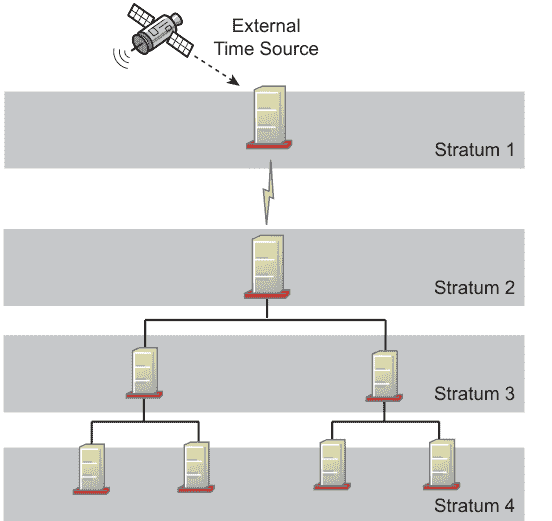

通常网络中只有一个服务器与外部时间提供者通信。这减少了跨地理区域的网络流量，并最小化了跨地理区域的流量。

## NTP 守护进程 (ntpd)

`ntpd` 使用几种方法来获取和设置硬件时钟值。正常的方法是初始化一个 I/O 进程到设备特殊文件 `/dev/rtc`（RTC: 实时钟），该文件由 rtc 驱动程序维护。

然而，这种方法并不总是可用。rtc 驱动程序是 Linux 较新添加的，在旧版系统中不可用。

在旧版系统中，访问硬件时钟的方法取决于系统硬件。

# 使用 NTP 同步时间

要使用 NTP 同步网络时间，你需要了解如何执行以下操作：

- 从命令行启动 ntpd
- 使用 ntpdate 调整时间
- 配置 NTP 服务器 (/etc/ntp.conf)
- 使用 ntptrace 追踪时间源
- 使用 YaST 配置一个 NTP 客户端

## 从命令行启动 ntpd

在 SUSE Linux Enterprise Server 中，时间服务器守护进程 ntp 包含在 xntp 软件包中，该包是默认安装的。它的启动脚本为 `/etc/init.d/ntp`，其核心配置文件为 `/etc/ntp.conf`。

你可以通过输入 `rcntp start` 来启动 NTP 守护进程。通过输入 `rcntp status` 可以检查 ntp 的状态。要停止 NTP 守护进程，请使用 `rcntp stop`。

启动脚本使用了 `/etc/sysconfig/ntp` 中定义的变量。

若想在系统启动时自动启动 NTP，你需要通过输入 `inserver ntp` 在相应的运行级别目录中设置符号链接。

如果对 `ntp.conf` 文件进行了任何更改，你需要使用命令 `rcntp restart` 重启 ntpd 以更新配置。

在 ntpd 读取了 `/etc/ntp.conf` 文件后，客户端会向服务器发送请求，服务器将返回带有时间戳的响应，以及关于准确度和层级（stratum）的信息。

一旦 NTP 守护进程启动，其他计算机就可以将其作为时间服务器。

## 使用 ntpdate 调整时间

如果系统时间与时间服务器之间的差异过大，通过小增量方式同步系统时间可能花费很长时间。

为了避免这种情况，启动脚本 `/etc/init.d/ntp` 在 ntpd 启动之前会使用 `ntpdate` 程序设置系统时间。如果你想手动使用 `ntpdate`，其语法如下：

```
ntpdate timeserver
```

在用 `ntpdate` 更新系统时间之前，你需要停止 NTP 守护进程。

## 配置 NTP 服务器 (/etc/ntp.conf)

一旦在主机上启动了 ntpd，它就会作为一个 NTP 服务器并可以通过 NTP 进行查询。你可以通过编辑配置文件 `/etc/ntp.conf` 来配置 NTP 服务器。

例如，你可以将一个网络主机配置为服务器，与互联网上的时间服务器同步时间。其他网络主机可以访问内网上的此时间服务器。

首先，你需要确保 `/etc/ntp.conf` 文件中存在以下本地时钟条目（当时间服务器不可用时）：

```
server 127.127.1.0 # 本地时钟 (LCL)
fudge 127.127.1.0 stratum 10 # LCL 未同步
```

stratum（层级）之后的数值表示与原子钟的距离，显示了该时间服务器的可靠性。

值 1 表示服务器直接连接到原子钟，非常可靠。级值为 2 的服务器从层级值为 1 的服务器获取时间，依此类推。值 16 表示服务器非常不可靠。

`/etc/ntp.conf` 中的下一个条目用于请求当前时间的时间服务器：

```
## 外部同步时间源
server ptbtime1.ptb.de
server ptbtime2.ptb.de
```

时间服务器与客户端之间有两种可能的同步方法：

- **轮询（Polling）。** 通过轮询，客户端向服务器请求当前时间。

轮询从每 1 分钟间隔一次开始。如果确定时间间隔是可靠的，则间隔将重置为每 1024 秒一次。

你可以在 `/etc/ntp.conf` 中设置轮询的最小和最大限制，如下：

```
server ptbtime1.ptb.de minpoll 4 maxpoll 12
```

`minpoll` 和 `maxpoll` 值被解释为 2 的幂（秒）。默认设置分别为 6（2^6 = 64 秒）和 10（2^10 = 1024 秒）。允许 4 到 17 之间的值。

- **广播（Broadcasting）。** 通过广播方式，服务器将当前时间发送给所有客户端，客户端通过其 `ntpd.conf` 中的 `broadcastclient` 选项接收该信号。

在大型网络中，轮询时间产生的流量可能很大。在这种情况下，你可能希望配置时间服务器通过发送广播包来分时间信息。

要实现这一点，你需要在服务器的 `/etc/ntp.conf` 中输入以下内容（IP 地址为网络中使用的广播地址）：

```
broadcast 10.0.0.255
```

在客户端上：

```
disable auth
broadcastclient
```

出于安全考虑，基于广播的同步应与身份验证配合使用，以便客户端仅接受来自可靠时间服务器的信息。请参见 `/usr/share/doc/packages/xntp-doc/`（软件包 xntp-doc）下的文档。

你还需要在 `/etc/ntp.conf` 中包含漂移文件和日志文件的名称，如下：

```
driftfile /var/lib/ntp/drift/drift
logfile /var/log/ntp
```

漂移文件包含了描述硬件时钟如何漂移的信息。当首次启动 ntp 守护进程时，该文件不存在。守护进程大约需要 15 分钟收集足够的信息来创建该文件。

要让守护进程 ntp 重新读取配置，可以使用 `ntp restart`。


# NTP 配置

## 配置文件示例

```
logfile /var/log/ntp
```

`driftfile` 包含了描述硬件时钟如何漂移的信息。当首次启动 `ntp` 守护进程时，该文件不存在。守护进程大约需要 15 分钟收集足够的信息来创建该文件。

要让守护进程重新读取配置，可以使用 `ntp restart`。

如果时间服务器是可靠的，你需要在 `/etc/ntp.conf` 中包含 `driftfile` 和 `logfile` 的名称，如下：

```
driftfile /var/lib/ntp/drift/drift
logfile /var/log/ntp
```

## 使用 YaST 配置一个 NTP 客户端

一旦在主机上启动了 `ntpd`，它就会作为一个 NTP 服务器并可以通过 NTP 进行查询。你可以通过编辑配置文件 `/etc/ntp.conf` 来配置 NTP 服务器。

一旦 NTP 守护进程启动，其他计算机就可以将其作为时间服务器。

你可以在 `/etc/ntp.conf` 中设置轮询的最小和最大限制。

要让守护进程收集足够的信息。

如果时间服务器是可靠的，你需要在 `/etc/ntp.conf` 中包含 `driftfile` 和 `logfile` 的名称，如下：

```
driftfile /var/lib/ntp/drift/drift
logfile /var/log/ntp
```

`driftfile` 包含了描述硬件时钟如何漂移的信息。当首次启动 `ntp` 守护进程时，该文件不存在。守护进程大约需要 15 分钟收集足够的信息来创建该文件。

要让守护进程重新读取配置，可以使用 `ntp restart`。

服务器名称前的星号（“`*`”）表示该服务器是当前的参考服务器，系统时间将与其进行比较。如果无法访问此服务器，则将使用带有前加号（“`+`”）标记的服务器。

# 练习 4-3 配置 ntpd

在本次练习中，你将配置你的服务器从服务器 `da1` 获取时间信息。

你可以在工作手册中找到此练习。

（练习结束）

# 目标 4 配置 NFS（网络文件系统）

网络文件系统 (NFS) 允许您配置 NFS 文件服务器，使用户可以透明地访问服务器上的程序、文件或存储空间。

要为您的网络配置 NFS，您需要了解以下内容：

- 网络文件系统基础
- NFS 的工作原理
- NFS 配置概述
- 手动配置 NFS 服务器
- 使用 YaST 配置 NFS 服务器
- 临时导出目录
- 使用 YaST 配置 NFS 客户端访问
- 从命令行配置 NFS 客户端访问
- 监控 NFS 系统

## 网络文件系统基础

NFS 设计用于在网络上共享文件和目录，需要配置 NFS 服务器（文件和目录所在的位置）和 NFS 客户端（远程访问文件和目录的计算机）。

文件系统由 NFS 服务器导出，并在 NFS 客户端上的表现和行为就像它们位于本地机器上一样。

例如，通过 NFS，每个用户的家目录都可以由 NFS 服务器导出并导入到客户端，这样网络上的每台工作站都可以访问相同的家目录。

如 `/home/`、`/opt/`、`/usr/` 等目录是通过 NFS 导出的良好候选对象。然而，其他目录包括 `/bin/`、`/boot/`、`/dev/`、`/etc/`、`/lib/`、`/root/`、`/sbin/`、`/tmp/` 和 `/var/` 应该仅在本地磁盘可用。

家目录仅在集中用户管理（例如 OpenLDAP）的情况下才有意义。

以下是在计算机 `earth` 上挂载由 NFS 服务器 `sun` 导出的目录 `/home/` 的示例：

## 图 4-7

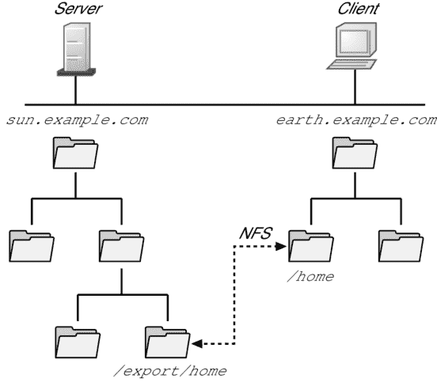

计算机既可以是 NFS 服务器，也可以是 NFS 客户端。它可以通过网络提供文件系统（导出），并挂载来自其他主机的文件系统（导入）。

NFS 守护进程是内核的一部分，只需要进行配置和激活。启动脚本是 `/init.d/nfsserver`。内核 NFS 守护进程包含文件锁定，这意味着一次只有一个用户可以访问文件。

## NFS 的工作原理

NFS 是一种 RPC（远程过程调用）服务。RPC 服务的关键组件是端口映射器（portmapper），它管理这些服务并需要首先启动。`portmap` 守护进程在 SUSE Linux Enterprise Server 10 中默认激活。

当一个 RPC 服务启动时，它会绑定到系统中的一个端口（像任何其他网络服务一样），还会与此端口以及服务提供（如 NFS）向端口映射器进行通信。

由于每个 RPC 程序都必须在启动时进行注册，因此每次你重启 portmapper 时，都必须重启 RPC 程序。

以下列出了 NFS 服务器所需的服务：

| 服务 | 程序（守护进程） | 启动脚本 |
| --- | --- | --- |
| Port mapper | `/sbin/portmap` | `/etc/init.d/portmapper` |
| NFS server | `/usr/sbin/rpc.nfs` | `/etc/init.d/nsserver` |
| | `/usr/sbin/rpc.mountd` | |

`/sbin/rpc.lockd` 程序在不自动启动的内核上启动 NFS 锁管理器。在 SUSE Linux Enterprise 10 中，内核会自动启动。

你可以使用命令 `/etc/init.d/nsserver` 来启动 NFS 服务器。`nsserver` 脚本将导出的目录列表传递给内核，并启动或停止守护进程 `rpc.mountd` 以及 `rpc.nfsd`（nfsd 内核线程）。

挂载守护进程（`/usr/sbin/rpc.mountd`）接受挂载请求并与配置文件 `/etc/exports` 中的条目进行比较。如果允许访问，则将数据传递给客户端。

由于 `rpc.nfsd` 可以启动多个内核线程，启动脚本会解释 `/etc/sysconfig/nfs` 文件中的变量 `USE_KERNEL_NFS_NUMBER`。该变量决定了启动的线程数。默认情况下启动 4 个服务器线程。

## NFS 配置概述

NFS 服务器的所有配置设置都存储在 `/etc/exports` 文件中。客户端配置使用 `/etc/fstab` 文件进行。这两者都将在稍后详细介绍。

NFS 服务器和客户端都可以使用 YaST 模块进行配置。你也可以直接修改配置文件。

为了让 NFS 服务器在计算机启动时自动启动，必须在运行级别（runlevel）目录中生成相应的符号链接。如果你使用 YaST 配置 NFS 服务器，否则，你需要使用 `inserv nfsserver` 生成它们。

## 手动配置 NFS 服务器

你可以通过执行以下操作从命令行配置服务器：

- 检查服务（守护进程）的可用性。确保你的 NFS 服务器上可用以下内容：
    - RPC portmapper (`portmap`)
    - RPC mount 守护进程 (`rpc.mountd`)
    - RPC NFS 守护进程 (`rpc.nfsd`)

- 配置服务在启动时可用。为了让这些服务在系统启动时由脚本 `/etc/init.d/portmap` 和 `/etc/init.d/nfsserver` 启动，请输入以下命令：

```
inserv /etc/init.d/portmap (默认激活)
inserv /etc/init.d/nfsserver
```

- 在 `/etc/exports` 中定义导出的目录。每个要导出的目录，都需要一行来设置哪些计算机可以带权限访问该目录。该目录的所有子目录也会自动导出。

以下是 `/etc/exports` 文件的通用语法：

```
directory [host[(option1,option2,option3,...)]] ...
```

不要在主机名、括号和选项字符串本身之间留任何空格。

主机可以是以下之一：

- 具有短形式名称的独立计算机（必须能够通过名称解析解析）、其完全限定域名 (FQDN) 或其 IP 地址。
- 网络，通过带有子掩码的地址或带有前缀占位符的域名指定（例如 `*.digitalairlines.com`）。

授权计算机通常用其全名（包括域名）指定，但你可以使用通配符 `*` 或 `?`。

如果你未指定主机或使用 `*`，任何计算机都可以根据给定权限导入文件系统。

- 在 `/etc/exports` 中为导出目录设置权限。你需要在计算机名称后的括号中为导出的文件系统设置权限选项。最常用的选项包括：

### 表格 4-5

| 选项 | 含义 |
|---|---|
| `ro` | 文件系统以只读权限导出（默认）。 |
| `rw` | 文件系统以读写权限导出。不覆盖本地文件权限。 |
| `root_squash` | （默认）这确保给定机器在此文件系统上没有 root 权限。这是通过将用户 ID 65534 分配给用户 ID 0 (root) 实现的。此用户 ID 应设置为 `nobody`（默认）。 |
| `no_root_squash` | 不将用户 ID 65534 分配给 ID 0，保持 root 权限有效。 |

以下是一个包含权限的编辑过的 `/etc/exports` 文件示例：

```
## /etc/exports
# /home          da10(rw, sync) da20(rw, sync)
# /usr/X11      da10(ro, sync) da20(ro, sync)
## /usr/lib/texmf da10(ro, sync) da20(ro, sync)
# /srv/ftp      * (ro, sync)
```

每当你想为已导出的目录（如 `/home/`）的子目录（如 `/home/geeko/`）指定不同的权限时，额外的目录需要在 `/etc/exports` 中有一个单独的条目。

- 重启 mount 和 nfsd。`/etc/exports` 文件由 mount 和 nfsd 读取。如果你更改了此文件中的任何内容，都需要重启 mount 和 nfsd 以使你的更改生效。你可以通过输入 `rcnfserver restart` 来实现。

## 使用 YaST 配置 NFS 服务器

要使用 YaST 配置 NFS 服务器，启动 YaST 并选择网络服务 > NFS 服务器。你也可以通过在终端窗口中作为 root 输入 `yast2 nfs-server` 直接启动 NFS 服务器模块。

## 显示如下：

## 图 4-8

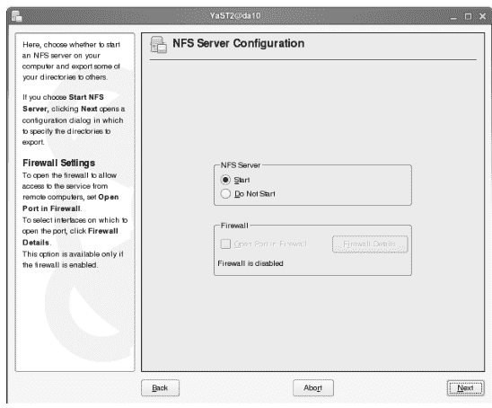

在对话框上部选择**启动**。只有在防火墙已激活的情况下，下部才有效。在这种情况下，你可以通过选择**在防火墙中打开端口**来为 NFS 打开必要的端口。

## 图 4-9

继续选择**下一步**。出现一个“要导出的目录”对话框：

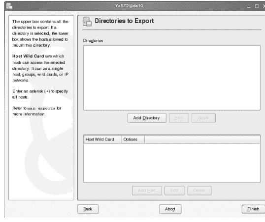

通过选择**添加目录**添加要导出的目录；然后输入或浏览并选择一个目录。

出现以下对话框：

## 图 4-10

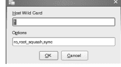

在主机通配符（Host Wild Card）下，此对话框允许你配置应具有该目录访问权限的主机。你可以定义单个主机、网络组（netgroups）、通配符和 IP 网络。

有关配置主机设置的详情，请参阅“手动配置 NFS 服务器”部分。

选择一个目录以添加更多主机、编辑或删除该目录的主机条目；然后选择**添加主机**、**编辑**或**删除**。

完成后，选择**完成**保存配置。

### 临时导出目录

你可以使用 `exports` 命令临时导出目录（而不必编辑 `/etc/exports` 文件）。

例如，要将 `/software` 目录导出到网络 `192.168.0.0/24` 中的所有主机，你需要输入以下命令：

```
exports -o ro,root_squash,sync 192.168.0.0/24:/software
```

要恢复原始状态，你只需要输入命令 `exports -r`。此时，`/etc/exports` 文件将重新加载，`software` 目录将不再被导出。

当前导出的目录列在 `/var/lib/nfs/etab` 文件中。当你使用 `exports` 命令时，该文件的内容会更新。

### 使用 YaST 配置 NFS 客户端访问

在服务器上导出的 NFS 目录可以挂载到客户端的文件系统树中。实现此点的简单方法是使用 YaST NFS 客户端模块。

要使用 YaST 配置 NTP 客户端，启动 YaST 控制中心，然后选择网络服务 > NFS 客户端。你也可以在终端中以 root 身份输入 `yast2 nfs` 直接启动 NFS 客户端模块。

## 显示 NFS 客户端配置对话框：

#### 图 4-11

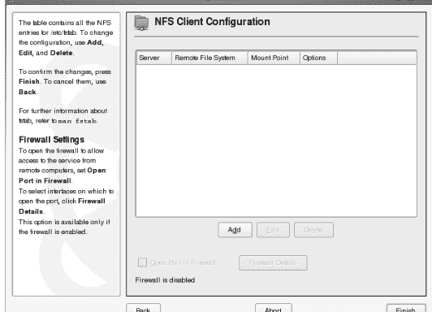

通过选择**添加**向列表添加目录。出现如下：

#### 图 4-12

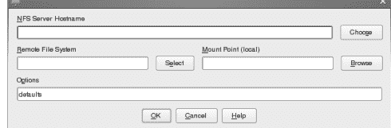

从此对话框中，你可以配置要在你的文件系统树中挂载的目录。通过以下步骤配置目录：

1. **输入 NFS 服务器的主机名**，或通过选择**选取**从网络上的 NFS 服务器列表中查找并选择 NFS 服务器。
2. 在**远程文件系统**字段中，输入想要挂载的 NFS 服务器上的**导出目录**，或通过选择**选择**查找并选择可用目录。
3. 在**挂载点（本地）**字段中，输入你本地文件树中的挂载点以挂载该导出的目录，或通过选择**浏览**来浏览并选择该挂载点。
4. 在**选项**字段中，输入你通常在 `mount` 命令中使用的任何选项。要查看这些选项的列表，请输入 `man mount`。
5. 完成目录配置后，选择**确定**。你将返回 NFS 客户端配置对话框。

通过选择**完成**保存 NFS 客户端设置。设置将被保存，服务将重启，导出的目录将挂载到你的本地文件系统树中。

### 从命令行配置 NFS 客户端访问

要配置和挂载 NFS 目录，你需要了解如何执行以下操作：

- 从 NFS 服务器手动导入目录
- 自动挂载 NFS 目录

### 从 NFS 服务器手动导入目录

你可以使用 `mount` 命令从 NFS 服务器手动导入目录。唯一的前提条件是 RPC 端口映射器，你可以通过输入（以 root 身份）命令 `portmap start` 来启动它。

`mount` 命令会自动尝试识别文件系统（如 ext2、ext3 或 ReiserFS）。你也可以使用 `mount` 选项 `-t` 来指定文件系统类型。

在以下示例中，指定了文件系统类型 NFS：

```
mount -t nfs -o options host:/directory /mountpoint
```

在 `mount` 命令中，使用的是 NFS 服务器名称以及要导入的目录，而不是设备文件。

以下是最重要的挂载选项：

- **soft**（相反选项为 `hard`）：如果尝试访问 NFS 的时间超过了预设时间（60 秒），该尝试将被终止。
- **hard**：如果挂载的是 NFS，进程将挂起，直到收到来自服务器的反馈。
- **bg**（相反选项为 `fg`）：如果挂载失败，进程将在后台运行。
- **rsize=n**：旧版本有 1024 字节的限制。
- **wsize=n**：为了更快的访问，建议将 wsize 设置为 8192。
- **retry=n**：配置挂载可以尝试的次数。
- **nosuid**：出于安全建议使用此选项。
- **nodev**：此选项禁用对文件系统中设备文件的解释。
- **exec**（相反选项为 `noexec`）：允许或不允许在挂载的文件系统中执行二进制文件。

### 自动挂载 NFS 目录

为了在启动时自动挂载目录（例如主目录），你需要在 `/etc/fstab` 中创建相应的条目。

系统启动时，启动脚本 `/etc/init/nfs` 会加载 fstab 文件，该文件指示哪些文件系统以及使用哪些选项。


以下是 NFS 挂载的一个示例：

```
da:/home /home nfs soft,rsize=8192,wsize=8192 0 0
```

在此条目中，第一个值表示 NFS 服务器的主机 (`da`) 以及其导出的目录 (`/home`)。第二个值表示挂载点，即本地文件系统中挂载的目录 (`/home`)。第三个值表示文件系统类型 (`nfs`)。文件系统类型后面的逗号分隔值提供了 NFS 特有的挂载选项。在行末尾有两个数字 (`0 0`)。第一个数字表示是否通过 `dump` 帮助备份文件系统。第二个数字配置文件系统是禁用 (`0`)、一次仅处理此文件系统 (`1`) 或在可用多个磁盘时并行处理 (`2`)。在示例中，由于两个选项都设置为 `0`，因此都不执行。

在修改 `/etc/fstab` 中已挂载文件系统的条目后，你可以通过输入 `mount -a remount /mountpoint` 让系统读取更改。要挂载所有未挂载且不包含 `noauto` 选项的文件系统，执行 `mount -a`（`noauto` 用于不会自动挂载设备，如软盘）。

你还需要通过输入 `inserv nfs` 来激活 NFS 客户端的启动脚本（这将在相应的级别目录下设置符号链接）。

## 监控 NFS 系统

有一些工具可以帮助你监控 NFS 系统。

## SUSE Linux Enterprise Server 10 高级管理

输入 `rpcinfo -p` 显示端口映射器的信息。`-p` 选项显示所有向端口映射器注册的程序，类似于所示：

```
da10:~ # rpcinfo -p
Program Vers Proto Port
100000 2 tcp 111 portmapper
100000 2 udp 111 portmapper
100003 2 udp 2049 nfs
100003 3 udp 2049 nfs
100003 4 udp 2049 nfs
100003 2 tcp 2049 nfs
100003 3 tcp 2049 nfs
100003 4 tcp 2049 nfs
100024 1 udp 1026 status
100021 1 udp 1026 nlockmggr
100021 3 udp 1026 nlockmggr
100021 4 udp 1026 nlockmggr
100024 1 tcp 29301 status
100021 1 tcp 29301 nlockmggr
100021 3 tcp 29301 nlockmggr
100021 4 tcp 29301 nlockmggr
100005 5 udp 967 mountd
```

NFS 服务器守护进程以 `nfs` 的名称向端口映射器注册。NFS 挂载守护进程使用 `mountd`。

你可以使用 `showmount` 命令显示 NFS 服务器导出目录的信息。

`showmount -e da1` 显示机器 `da1` 的导出目录。`-a` 选项显示哪些计算机挂载了哪些目录。

### 练习 4-4 设置和管理网络文件系统 (NFS)

在练习的第一部分，你创建一个目录 `/export/sles10`，并将其作为挂载点，通过 NFS 从 `da1` 导入 `/export/sles10` 目录。创建一个 `/etc/fstab` 条目，以便在启动时自动挂载该目录。

在第二部分，你使用 NFS 向其他人导出 `/export/data2` 目录。

你可以在练习册中找到此练习。

（练习结束）

## 总结

| 目标 | 总结 |
| --- | --- |
| 1. 启用扩展网络守护进程 (xinetd) | 扩展网络守护进程 (`xinetd`) 用于在建立连接到相应端口时启动如 ftp 或 POP3 等网络服务。`xinetd` 的配置文件为 `/etc/xinetd.conf`，各种服务的配置文件位于 `/etc/xinetd.d/` 中。可以使用 YaST 网络服务模块、编辑器以及在某种程度上通过 `chconfig` 进行配置。 |
| 2. 启用 FTP 服务器 | FTP 是一种广泛使用的文件传输协议。它使用两个 TCP 连接，一个用于控制命令，另一个用于数据传输。有多种 FTP 服务器可用。PureFTPd 的优点是配置灵活且具有安全声誉。它可以通过配置文件或命令行选项进行配置。 |
| 3. 在 SUSE Linux Enterprise Server 10 上配置时间 | 为了在网络中的所有计算机上实现统一的时间，所有计算机必须能够访问一个时间服务器。在 SUSE Linux Enterprise Server 上同步时间有两种方法：`netdate` 和 NTP。`xntp` 软件包包含 NTP。 |

## 目标 2：使用基础脚本元素

Shell 编程语言是一种强大且完整的编程语言。在开始创建脚本之前，你需要熟悉基本的脚本技术和元素。

在编写第一个脚本之前，你应该考虑关于脚本编写的通用几点。

脚本本质上是一个 ASCII 文本文件，其中包含按顺序执行的命令。为了实现这一点，为运行该脚本的用户将脚本文件的权限设置为“r”（可读）和“x”（可执行）是非常关键的。

然而，新创建的文件默认不赋予执行权限。要分配此权限，你需要使用类似下面的命令：

```bash
chmod +x script.sh
```

你也可以通过类似下面的命令从另一个 shell 运行脚本：

```bash
bash script.sh
```

在这个示例中，没有必要将脚本标记为可执行。在 SUSE Linux Enterprise Server 10 中，`/bin/sh` 是 `/bin/bash` 的链接。无论你是用 `./script.sh` 还是 `bash script.sh` 调用脚本，这并不重要。

另一个重要的点是，脚本所在的目录必须实际位于用户的可执行文件搜索路径中。

处理此问题的一种良好方法是在每个用户的家目录下创建一个 `~/bin` 目录。然后你可以通过在 `~/.bashrc` 中添加类似如下的一行将该目录添加到用户的搜索路径中：

```bash
export PATH=$PATH:~/bin
```

否则，必须使用完整路径启动脚本。

在命名脚本文件时，在文件名后添加 `.sh` 扩展名是一个好主意。这确保文件可以很容易被识别为 shell 脚本。

如果你不添加后缀，你需要确保文件名不会与现有的命令相同。例如，一个常见的错误是将脚本命名为 `test`，这会与命令行工具冲突。

在我们开始项目之前，让我们看看我们将要用 Request 处理的邮箱文件。以下是文件的部分内容：

```
From wwwrun@linux-rwke.site Tue 9 11:06:32 2006
Return-Path: <wwwrun@linux-rwke.site>
X-Original-To: geeko@localhost
Delivered-To: geeko@localhost.linux-rwke.site
Received: by linux-rwke.site (Postfix, from userid 30)
id 048002105F: Tue, 9 May 2006 11:06:31 -0400 (EDT)
To: geeko@localhost.linux-rwke.site
Subject: Ticket
Message-Id: <20060509150632.048002105F@linux-rwke.site>
Date: Tue, 9 May 2006 11:06:31 -0400 (EDT)
From: wwwrun@linux-rwke.site (WWW daemon apache)
```

```
#Ticket|Can not Print! tux@novell.com |Workstation|The Printer in office is not working. You can please check...
From wwwrun@linux-rwke.site Tue 9 11:07:46 2006
Return-Path: <wwwrun@linux-rwke.site>
X-Original-To: geeko@localhost
Delivered-To: geeko@localhost.linux-rwke.site
Received: by linux-rwke.site (Postfix, from userid 30)
id CAD1C2105F; Tue, 9 May 2006 11:07:46 -0400 (EDT)
To: geeko@localhost.linux-rwke.site
Subject: Ticket
Message-Id: <20060509150746.CAD1C2105F@linux-rwke.site>
Date: Tue, 9 May 2006 11:07:46 -0400 (EDT)
From: wwwrun@linux-rwke.site (WWW daemon apache)
```

```
#Ticket|Web Server Broken! websupport@novell.com|Server|Our web server is not reachable anymore. Please fix it!
```

示例显示了邮箱文件中的两条邮件消息。每条邮件都以 `From wwwrun@linux-rwke.site...` 行开头并以 `#Ticket` 行结束。`#Ticket` 行是邮件的实际内容，所有其他行都是带有元数据和邮件传输详情的头信息。

`#Ticket` 行包含了通过网络界面发送的请求信息。它包含多个由 `|` 字符分隔的字段。这些字段具有含义（在 `#Ticket` 之后）：

| 请求主题 | 发件者邮箱地址 | 请求类别 | 请求描述 |
| --- | --- | --- | --- |

我们从一个简单的脚本开始，该脚本将邮箱文件输出到终端：

```bash
#!/bin/bash
# basic_script1.sh
cat /var/spool/mail/geeko
```

第一行告诉 Linux 内核该文件必须传递给 bash shell 以进行执行。每个需要直接执行的 shell 脚本都需要这样一行。bash 二进制文件的路径为 `/bin/bash`。

第二行是注释。任何以 `#` 开头的行都不会被解释型 shell 识别。在这种情况下，注释用于说明在课程 CD 中找到该脚本的文件名。后续所有的脚本示例都有注释。

第四行使用 `cat` 命令打开邮箱文件 `/var/spool/mail/geeko` 并将其内容打印到终端。你也可以在 shell 脚本中使用你知道的任何命令行命令。

当你执行此脚本时，输出看起来格式并不整齐。我们只对邮件的内容感兴趣，而不是头信息。看以下改进：

```bash
#!/bin/bash
# basic_script2.sh

cat /var/spool/mail/geeko | grep '#'
```

`cat` 的输出通过管道字符 `|` 传递给 `grep`。`grep` 只打印包含 `#` 的行，这使得输出更加清晰。

作为最后的改进，我们在脚本中添加了以下内容：

```bash
#!/bin/bash
# basic_script3.sh

echo -e "Welcome to the Request.\nThe following are open requests:"
cat /var/spool/mail/geeko | grep '#'
```

`echo` 命令用于输出双引号内的内容。`-e` 选项让 `echo` 解释转义序列。以下是其他序列的列表：

- `\a` 输出警报（蜂鸣音）
- `\b` 输出退格符
- `\c` 输出抑制行尾符
- `\f` 输出分页符
- `\n` 输出换行
- `\r` 输出回车
- `\t` 输出水平制表符
- `\v` 输出垂直制表符

修改后，我们脚本的输出如下：

```
geeko@linux-rwke:~/Shell_Scripting> ./basic_script3.sh
Welcome to the Request.
The following are open requests:
#Ticket|London Office|florian|fluvian.de|Telephone|Im trying to call the office, but the line is busy all day!
#Ticket|Can not Print!|tux@novell.com|Workstation|The Printer in office is not working. You can please check...
#Ticket|Web Server Broken!|websupport@novell.com|Server|Our web server is not reachable anymore. Please fix it!
```

### 练习 5-2 创建基础 Shell 脚本

在这个练习中，你将创建第一个脚本。

你可以在练习册找到此练习。

（练习结束）

## 目标 3：理解变量和命令替换

变量是所有编程语言的重要组件。你可以将变量理解为存储数据的容器。在程序代码中使用变量而不是数据本身。

请看下面的示例：

```bash
#!/bin/bash
# variable_1.sh
a="Geeko"
echo "Hello, my name is $a"
```

字符串 "Geeko" 被赋值给变量 `a`。然后在 `echo` 命令中使用该变量。这里有两个点很重要：

- 赋值变量时，直接使用变量名。访问变量数据时，在变量名前加上 `$`。
- 给变量赋值数据时，变量名、等号字符和数据之间不能有空格。

以下是示例脚本的输出：

```
geeko@linux-rwke:~/Shell_Scripting> ./variables_1.sh
Hello, my name is Geeko
```

变量不仅包含字符串，还可以包含数字。默认情况下，shell 脚本变量可以持有任何类型的数据。然而可以使用 `declare` 命令将变量限制为特定类型（例如字符串）。

到目前为止，我们只给变量赋值了静态值，但可以将命令的输出赋值给变量，或者在需要输出的地方直接使用命令。这被称为命令替换。

命令替换术语基本上意思是命令的输出被用于 shell 命令行或 shell 脚本中。

在下面的示例中，命令 `date` 的输出用于生成当前日期的输出：

```bash
#!/bin/bash
# command_subs_1.sh
echo "Today is `date +%m/%d/%Y`"
```

注意命令 `date +%m/%d/%Y` 被包含在反引号（`` `...` ``）中。

与其使用 `echo` 将命令的输出打印到屏幕，也可以将其赋值给变量，如下：

```bash
#!/bin/bash
# command_subs_2.sh
TODAY=`date +%m/%d/%Y`
echo "Today is $TODAY"
```

在这种情况下，输出被赋值给变量 `TODAY`，然后通过 `echo` 将 `TODAY` 打印到屏幕。同样，等号前后没有空格。

让我们利用所学的知识来改进我们的请求跟踪器。在启动消息中，我们将包含开启请求的数量：

```bash
#!/bin/bash
# command_subs_3.sh
tinum=`cat /var/spool/mail/geeko | grep '#' | wc -l`
echo -e "Welcome to the Request Tracker.\nThere are $tinum open requests."
```

命令 `cat /var/spool/mail/geeko | grep '#' | wc -l` 统计 `/var/spool/mail/geeko` 中包含 `#` 的行。结果存储在变量 `tinum` 中。然后该变量被用于 `echo` 命令以显示开启请求的数量。

脚本的输出如下：

```
user@linux:~/Shell_Scripting> ./subs_2.sh
Welcome to the Request Tracker.
There are 3 open requests:
```

### 练习 5 使用变量和命令替换

在此练习中，你将学习如何使用变量和命令替换。你可以在练习册找到此练习。

（练习结束）

## 目标 4：使用控制结构

通过你到为止所学的脚本技术，你只能开发从头到尾顺序执行的脚本。在这个目标中，你将学习如何使用控制结构，使脚本部分的执行取决于某些条件，或重复执行脚本部分。

在这个目标中，我们将涵盖：

- 创建分支
- 创建循环

### 创建分支

脚本中的分支意味着脚本的一个部分只有在特定条件下才会执行。一种非常常见的控制结构使用了 `if` 命令：

```bash
if condition
then
  commands
fi
```

如果条件为真，则执行一个或多个命令。`if` 语句可以扩展一个可选的 `else` 语句，如下文所示：

```bash
if condition
then
  command1
else
  command2
fi
```

在这种情况下，当 `if` 条件不为真时，将执行 `command2`。

## SUSE Linux Enterprise Server 10 高级管理

让我们为我们的请求跟踪器添加一个结构。我们正在添加一些修改启动消息的代码。如果有 10 个开启的请求，用户将看到警告消息。


```bash
#!/bin/bash
#control_stru.sh

tinum=`cat /var/spool/mail/ | grep '#' | wc -l`

if test $inum -gt 10
then
  echo -e "Welcome to the Request Tracker.\nThere are $inum open requests. You have to do something!"
else
  echo -e "Welcome to the Request Tracker.\nThere are $inum open requests:"
fi
```

检查条件时使用了 `test` 程序。`test $inum -gt 10` 检查 `$inum` 是否大于 (`-gt`) 10。如果此为真，`test` 返回值 0，否则返回值 1。

几乎所有的命令行工具都有返回值。0 表示类似于“真”或“一切正常”。否则，会返回一个不同于 0 的值。当用于测试的程序返回 0 时，`if` 条件即为真。

`test` 的用途远比检查一个数字是否大于另一个数字要多。以下是最重要的 `test` 选项的概述：

- `test STRING1 = STRING2`：字符串相等
- `test STRING1 != STRING2`：字符串不相等
- `test INTEGER1 -eq INTEGER2`：INTEGER1 等于 INTEGER2
- `test INTEGER1 -lt INTEGER2`：INTEGER1 小于 INTEGER2
- `test -e FILE`：FILE 存在

要查看所有 `test` 选项的完整列表，请查看 `test` 的手册页（man page）。

当你查看别人编写的脚本时，你还会看到不同的 `test` 语法。除了 `test 12 -eq 14`，你也可以省略 `test` 命令并将表达式放在方括号中，如 `[12 -eq 14]`。

你可能还注意到了另一点是，`then` 和 `else` 之后的行进行了缩进。这并不是强制要求的，但可以增加代码的可读性。

在 `in` 之后定义的列表并不总是静态的。`for` 循环经常用于遍历文件列表。实现此点的简单方法是在 `in` 之后使用 `*`。

```bash
#!/bin/bash
#/for_loop_2.sh

for i in *
do
  lower=`echo $i | tr [:upper:]] [:lower:]`
  mv $i $lower
done
```

此脚本遍历当前工作目录下的所有文件，并将文件名从大写重命名为小写。`*` 会被 shell 扩展为这些文件的列表。

在循环的每次迭代中，变量 `$i` 包含一个文件名。文件名被转换为小写并存储在变量 `lower` 中。然后使用 `mv` 将原始文件重命名为小写。


这只是一个演示脚本。对于生产环境脚本，你需要添加一些代码来确保已的小写文件不会被意外覆盖。

创建列表的另一种方法是命令替换：

```bash
#!/bin/bash
#/for_loop_3.sh
for i in `find -name "*mp3*"`
do
  rm $i
done
```

此脚本使用 `find`（注意反引号）创建当前目录及所有子目录下所有 .mp3 列表。这些文件在 `for` 循环中被删除。

## 另一种循环结构是 while 循环：

```bash
while condition
do
  commands
done
```

# 与 while 循环非常相似的是 until 循环：

```bash
until condition
do
  commands
done
```

两种循环类型都依赖于条件。在 `while` 循环中，只要条件为真就会执行命令；而在 `until` 循环中，命令会一直执行直到条件变为真。

我们将使用 `while` 循环来让 Request Tracker 的输出更易读：

```bash
#!/bin/bash
#while_loop_1.sh

stinum=$(cat /var/spool/mail/geeko | grep '#' | wc -l)

if test $stinum -gt 10
then
  echo -e "Welcome to the Request Tracker.\nThere are $stinum open requests. You have to do something!"
else
  echo -e "Welcome to the Request Tracker.\nThere are $stinum open requests:\n"
fi

while read line
do
  if echo $line | grep '#' > /dev/null
then
    echo $line | grep '#' | cut -d '|' --output-delimiter=',' -f '2 3 4'
  fi
done < /var/spool/mail/geeko
```

在循环中，`grep` 检查行是否包含 "#"。如果是，则使用 `cut` 只显示每行的主题、电子邮件地址和类别。以下是示例中 `cut` 选项的描述：

- `-d '|'`：此选项确定分隔符（在我们的案例中为 '|' 字符），用于将输出拆分为字段。
- `--output-delimiter=', '`：此选项确定分隔符为 ", "。

Request Tracker 的输出如下：

```
geeko@linux-rwke:~/Shell_Scripting> ./while_loop_1.sh
Welcome to the Request Tracker.
There are 3 open requests:
```

London Office, florian@fluvian.de, Telephone

Can not Print!, tux@novell.com, Workstation

Web Server Broken!, websupport@novell.com, Server

## 练习 5-5 使用 while 循环

在此练习中，你将练习如何使用 `while` 循环遍历文件。

你可以在练习集中找到此练习。

（练习结束）

## 目标 5

## 使用算术运算符

Shell 脚本经常使用赋值给变量的值进行计算。

有多种方法可以实现这一点。

Bash shell 内置了对算术操作的支持，但存在一些局限。具体来说，Bash 的算术能力体现在以下方面：

- 只能对整数（整数）进行操作。
- 所有值都是带符号的 64 位值。因此，可能范围是从 -2^63 到 +2^63。

因此在使用 Bash 时，你可能需要使用外部命令，例如用于浮点计算的 `bc`。

以下段落列出了算术操作的所有方法和格式。它们都基于此示例操作：

```bash
A=B+10
```

- 使用外部命令 `expr`（兼容 Bourne shell）

```bash
A=`expr $B + 10`
```

由于使用了外部命令，此方法也适用于传统的 Bourne shell。使用外部命令的脚本执行速度总是比依赖内置命令的慢。

- 使用 Bash 内置命令 `let`

```bash
let A="$B + 10"
```

在 Bash 中，你可以使用 `let` 命令执行算术表达式。

- 在圆括号或中括号中使用算术表达式（两种不同的格式）

```bash
A=$((B + 10))
```

或者

```bash
A=$[B + 10]
```

算术表达式可以包含在双括号或中括号中。

- 使用内置命令 `declare`

```bash
declare -i A
A=10
```

这把变量声明为整数。

通过 `declare -i`，你可以直接对变量进行算术操作：

```bash
A=10
A=A + 5
```

变量 `A` 现在是 15 了。

可用的运算符有：

- `+` 加法
- `-` 减法
- `*` 乘法
- `/` 除法
- `%` 取模
- `**` 幂

以下展示了这些操作的应用：

```bash
A=10
B=5
echo $((A + B))
echo $((A - B))
echo $((A * B))
echo $((A / B))
echo $((A % B))
echo $((A ** B))
```

首先，将变量初始化为字符串“blank”。然后进入 `while` 循环。在循环结束时，我们将用户输入读取到变量 `$Sinput` 中。如果用户输入“quit”，脚本将终止。如果输入其他任何内容，将再次列出请求。

目前这样做是有意义的，但很快我们为脚本添加了更多输入选项。

## 练习 5-7 读取用户输入

在本次练习中，你将学习如何在脚本中读取用户输入并处理这些输入。

你可以在练习册中找到此练习。

（练习结束）

## 目标 7 使用数组

数组基本上是可以存储多个值的变量。为了识别数组中的值，会使用数字索引。索引写在数组名后的方括号中。

```
lines[1]="Hello World"
```

这一行代码将字符串“Hello World”赋值给名为 `lines` 的数组的索引 1。

要访问数组中的值，你必须指定一个索引并在数组名周围加上大括号：

```
echo ${lines[1]}
```

数组对于存储列表数据（如文件列表或我们请求跟踪器中的请求）非常有用。

## SUSE Linux Enterprise Server 10 高级管理

查看以下修改：（从现在起，我们只列出修改过的类型代码。你可以在课程 CD 上找到完整版本。）

```bash
#!/bin/bash
#array_1.sh
#Full version on CD

input='blank'
until test $input = "quit"
do
    reqnr=1

    while read line
    do
        if echo $line | grep '#' > /dev/null
        then
            lines[$reqnr]="$reqnr" $line
            ((reqnr++))
        fi
    done < /var/spool/mail/geeko

    for ((i=1;i<=${#lines[@]};i++))
    do
        echo -e ${lines[$i]} | cut -d '|' --output-delimiter=',' -f '1 3 4 5'
    done

unset lines
read input
```

在 `while` 循环中，请求被存储在数组 `$lines` 中。用作索引的变量 `$reqnr` 在每次 `while` 循环循环中都会递增。

在 `for` 循环中，数组的内容被回显到终端。这里使用了不同的 `for` 循环语法，它类似于 C 语言编程中的 `for` 循环。

`for ((i=1;i<=${#lines[@]};i++))` 意味着只要变量 `$i` 小于或等于 (`<=`) 数组 `$lines` 中的元素数量，循环就会运行。`${#lines[@]}` 是访问数组元素数量的方法。

## CNI 内部使用-1 允许质印

5-36

严禁复制本手册的全部或部分内容或分发副本。

如怀疑有抄袭，请拨打 1-800-PIRATES。

版本 1

索引变量 `$i` 最初被设置为 1，并在每次 `for` 循环循环中递增。

在 `while` 循环结束时，使用 `unset` 命令删除数组 `lines`。否则，该数组在下一次 `while` 循环运行时将无法重用。

目前这些更改并没有太大意义，因为我们没有添加任何新功能。然而，使用数组将使后续的更改变得容易得多。

## 练习 5-8

### 使用数组

在本次练习中，你将学习如何使用数组。

你可以在练习册中找到此练习。

（练习结束）

## 目标 8 完成课程项目

在这个目标中，我们想为请求跟踪器（Request Ticker）添加以下功能：

- 查看请求详情
- 删除请求

## 查看请求详情

目前只显示请求的主题、发送者和类别。现在我们正在添加一个选项，允许用户查看请求的描述：

```bash
#!/bin/bash
#finalize.sh
#Full Version on CD

input='1'
until test $input = "quit"
do
  reqnr=1
  while read line
  do
    if echo $line | grep '#' > /dev/null
    then
      lines[$reqnr]=$reqnr|$line
      ((reqnr++))
    fi
  done < /var/spool/mail/geeko

  com=$(echo $input | cut -d ':' -f 1)
  req=$(echo $input | cut -d ':' -f 2)

  case $com in
    'i') echo -e ${lines[$req]} | cut -d '|' --output-delimiter='\n' -f 3 4 5 6 ;;
    'l') for ((i=1;i<=${#lines[@]};i++))
      do
        echo -e ${lines[$i]} | cut -d '|' --output-delimiter=' ' -f 1 3 4 5
      done ;;
    *) echo "Unknown Command" ;;
  esac

unset lines
read input
```

用户可以以 `<command>:<request number>` 的格式输入命令。命令存储在变量 `$com` 中，请求编号存储在 `$req` 中。

## CNI 内部使用-1 允许质印

然后使用 `case` 语句来确定执行的操作。如果命令是 "l"，则像之前一样列出请求。对于任何其他输入，将回显“Unknown Command”。

## 删除请求

现在我们将添加一个允许删除请求的命令。

```bash
#!/bin/bash
#finalize.sh
#Full Version on CD

input='1'
until test $input = "quit"
do
  reqnr=1
  while read line
  do
    if echo $line | grep '#' > /dev/null
    then
      lines[$reqnr]=$reqnr|$line
      ((reqnr++))
    fi
  done < /var/spool/mail/geeko

  com=$(echo $input | cut -d ':' -f 1)
  req=$(echo $input | cut -d ':' -f 2)

  case $com in
    'i') echo -e ${lines[$req]} | cut -d '|' --output-delimiter='\n' -f 3 4 5 6 ;;
    'l') for ((i=1;i<=${#lines[@]};i++))
      do
        echo -e ${lines[$i]} | cut -d '|' --output-delimiter=' ' -f 1 3 4 5
      done ;;
    *) echo "Unknown Command" ;;
  esac

unset lines
read input
```

用户可以以 `<command>:<request number>` 的格式输入命令。命令存储在变量 `$com` 中，请求编号存储在 `$req` 中。

## 练习 5-9

### 添加命令

在本次练习中，你为请求跟踪器添加更多命令。

以下代码创建目录并进入该目录。

## 目标 9

### 使用高级脚本技术

在这个目标中，你将学习以下高级技术，它们将帮助你解决问题：

- 使用函数
- 使用 `getopts` 读取选项

## 使用函数

有时你需要在脚本中多次执行某个任务。与其反复编写相同的代码，可以使用函数。

函数的作用类似于脚本模块，它们通过一个名称使整个脚本部分可用。函数通常定义在脚本开头。你可以将多个函数存储在一个文件中，并在需要时包含它。

声明函数有两种方法。以下是函数的标准语法：

```bash
functionname () {
  commands
  commands
}
```

以下是使用 `function` 命令生成函数：

```bash
function functionname {
  commands
  commands
}
```

以下是一个简单的函数，用于创建目录并进入该目录：

```bash
mcd () {
  mkdir $1
  cd $1
}
```

创建后，可以在脚本中调用它，如下所示：

```
...
mcd /tmp/new_directory
..
```

参数 `/tmp/new_directory` 被称为参数。在函数内部，可以通过变量 `$1,$2,$3` 等来访问参数，取决于传递给函数的参数数量。

以下函数可用于在脚本创建暂停。只有在按下回车键后，脚本才会恢复：

```bash
pause () {
  echo "To continue, hit RETURN."
  read q
}
```

你还可以创建从内部停止处理的函数，这类似于使用 `break` 和 `continue` 命令退出循环（迭代）。

要退出一个函数，请使用 `return` 命令。如果在不带任何参数的情况下调用 `return`，则函数的返回值将与该函数中执行的最后一个命令的退出状态相同。

否则，返回值与作为 `return` 参数所提供的值相同。

## 练习 5-10 使用 Shell 函数

在本次练习中，你将学习如何使用 shell 函数。

你可以在练习集中找到此练习。

（练习结束）


## 使用 getopts 读取选项

使用 shell 内置命令 `getopts`，你可以提取从命令行传递给脚本的选项。只有当命令行参数以 `-` 开头时（这是交互式使用 shell 时的默认行为），shell 才会将其解释为命令选项。

这使得将选项放置在命令行的不同位置并以任意顺序提供成为可能。

这意味着以下命令：

```
cp -dpR *.txt texts/
```

与以下命令的效果相同：

```
cp -R *.txt -d texts/ -p
```

`getopts` 以相同的方式识别选项。以下是 `getopts` 的语法：

### getopts optionstring variable

`optionstring` 描述了所有要识别的选项。例如，`getopts` 将 a、b 和 c 声明为要处理的选项。

如果选项需要一个参数（例如 `-m maxvalue`），则字符串中相应的选项后面必须跟一个冒号（如 `getopts m:`）：

`optionstring` 后面是一个变量，所有命令行选项将作为一个列表分配给该变量。

`getopts` 命令通常在 `while` 循环中配合 `case` 使用，以定义为给定选项执行哪个命令，如下所示：

```
while getopts abc: variable
do
  case $variable in
    a ) echo "The option -a was used."
    b ) echo "The option -b was used."
    c ) option_c="$OPTARG"
      echo "Option c has been set."
  esac
done
```

```
echo $option_c
```

如果使用了选项 `-a` 或 `-b`，脚本将打印一条消息说明使用了相应的选项。如果使用了选项 `-c`，则该值将被赋值给变量 `option_c`，并在脚本结束时打印到屏幕。

可以使用变量 `OPTARG` 访问选项的参数。

## 目标 10

## 学习 Shell 脚本中的实用命令

下一个目标将为你提供 shell 脚本中可用实用命令的概述。它旨在作为参考，而不是要求你从头读到尾。

我们将讨论以下内容：

- 使用 `cat` 命令
- 使用 `cut` 命令
- 使用 `date` 命令
- 使用 `grep` 和 `egrep` 命令
- 使用 `sed` 命令
- 使用 `test` 命令
- 使用 `tr` 命令

## 使用 cat 命令

当与 here 运算符 (`<<`) 结合使用时，`cat` 命令是脚本输出多行文本的良好选择。在交互式使用中，该命令通常以文件名作为参数运行，在这种情况下 `cat` 将文件内容打印到标准输出。

## 使用 cut 命令

你可以使用 `cut` 命令从文件中剪切行的部分，因此只在标准输出上打印指定的区域部分。

该命令作用于文件或标准输入中的每行文本。你可以使用 `cut -f` 提取文本字段，使用 `cut -c` 处理指定的字符。

你可以指定单个区域（字符或字段）或多个区域。分隔字段的默认分隔符是制表符，但你可以通过 `-d` 选项指定不同的字段分隔符。

以下是使用 `cut` 的一些示例：

```
cut -d : -f1 /etc/passwd
root
bin
daemon
lp
mail
news
```

上述命令指定字段分隔符为冒号。在 `/etc/passwd` 的每一行中，第一个冒号之前的字段被提取出来并管道到标准输出：

```
ls -1 somdir/ | cut -c 35- | sort -n
687 Sep 20 17:06 file2
2199 Sep 20 17:05 file1
6593 Sep 20 17:06 file3
```

上述命令获取 `ls` 命令的输出，并剪切从第35个字符开始的所有内容。将其传递给 `sort`，因此最终输出根据文件大小排序。

## 使用 date 命令

每当需要获取日期或时间字符串供脚本进一步处理时，都可以使用 `date` 命令。在不指定任何选项的情况下，命令的输出如下：

```
date
Fri Sep 03 14:18:12 CEST 2004
```

`date` 命令允许你更改几乎每个细节的输出格式。使用 `-I` 选项（如下所示），`date` 以 ISO 格式打印日期和时间（这与使用选项 `+%Y-%m-%d` 相同）：

```
-I
2004-09-03
date %+m-%d %H:%M
09-03 14:19
date %+D, %r
09/03/02
```

## 使用 grep 和 egrep 命令

`grep` 命令及其变体 `egrep` 用于在文件中搜索某些模式。以下是其语法：

### grep pattern filename

该命令打印包含给定模式的行。有多个选项可以指定只打印行号，或者打印匹配行及其前后的上下文。

搜索模式可以以正则表达式的形式提供，尽管 `grep` 命令在这方面受到限制。要搜索更复杂的模式，请使用 `egrep`，它接受扩展正则表达式。为了避免 shell 解释搜索模式中的特殊字符，请将模式括在引号中：

```bash
egrep "pattern" filename
```

## 使用 sed 命令

`sed` 程序是一个流编辑器，一种从命令行而非交互式使用的编辑器。`sed` 逐行执行文本转换。

你可以直接在命令行指定 sed 命令，也可以在程序加载的特殊文件中指定。

以下是 `sed` 命令的语法：

### sed editing-command filename

可用的编辑命令是单字符，例如：

- d: 删除
- s: 替换（Substitute）
- p: 输出行
- a: 在之后追加

与其他命令一样，`sed` 的输出通常指向标准输出，但也可以重定向到文件。每个 `sed` 命令之前必须跟有一个地址或地址范围，以指定编辑命令应用的行。

除了用于文本转换的单字符命令外，你还可以指定影响 sed 程序整体行为的选项。

以下是一些重要的 sed 命令行选项：

- -n, --quiet, --silent。默认情况下，sed 在处理后将所有行打印到标准输出。此选项会抑制输出，使得 sed 只打印那些显式给出 `p` 编辑命令以重新启用打印的行。
- -e command1 -e command2 .... 当指定两个或多个编辑命令时，此选项是必要的。它必须插入每个额外的编辑命令之前。
- -f filename。使用此选项，你可以指定一个脚本文件，sed 从文件中读取其编辑命令。

对于许多编辑命令，指定要由命令处理的精确行号是非常重要的。最常用的地址标签之一是 `sed$`，它代表最后一行。

以下是 `sed` 命令的 2 个示例：

- `sed -n '1,9p' somefile`
  该命令仅在标准输出上打印第 1 到 9 行。

- `sed '10,$d' somefile`
  该命令删除从第 10 行到文件结束的所有内容，并打印 somefile 的前 9 行。

你可以使用正则表达式来定义编辑命令的地址或地址范围。正则表达式必须包含在正斜杠之间。如果使用此类表达式定义了地址，`sed` 将处理包含给定模式的每一行。

以下是使用正则表达式的示例：

```
sed -n '/Murphy.**/p' somefile
```

此示例打印所有包含 `Murphy.*` 模式的行。

如果你想让 **sed** 对同一个地址执行多个编辑命令，你需要将命令包裹在大括号中，如下所示：

```
sed '1,10{command1 ; command2}'
```

以下列出了 `sed` 可用的最重要的编辑命令：

| 命令 | 示例 | 编辑操作 |
|---|---|---|
| d | sed 10,$ file | 删除行。 |
| a | sed 'a\.txt' file | 在指定行之前插入文本。 |
| i | sed 'i\.txt' file | 用文本替换指定行。 |

## 表 5-1 (续)

| 命令 | 示例 | 编辑操作 |
| --- | --- | --- |
| c | sed '2000,$c\ text' | 用文本替换指定行。 |
| s | sed s/x/y/option | 替换。搜索模式 x 被替换为模式 y。在大多数情况下，搜索模式和替换模式都是正则表达式，搜索和替换行为可以通过各种选项产生影响。 |
| y | sed y/abc/xyz/ | (yank) 将源字符集中的每个字符替换为目标字符集中相同位置的字符。 |

你可以在 `s` 命令（搜索并替换）中使用以下选项：

* **I.** 不区分字母的大小写。
* **g.** 在行中任何发现搜索模式的地方进行全局替换（而不是仅替换第一个实例）。
* **n.** 仅替换第 n 个匹配模式。
* **p.** 在替换后打印该行。
* **w.** 将结果文本写入指定的文件，而不是打印到标准输出。

以下是使用 `s` 命令的一些示例：

- `sed 's/:/ / /etc/passwd'`
  该命令将每行的第一个冒号替换为空格。

- `sed 's/:/g /etc/passwd'`
  该命令将所有行中的所有冒号替换为空格。

- `sed 's/:/ /2/' /etc/passwd`
  该命令仅将每行的第二个冒号替换为空格。

- `sed -n 's/\([aeiou]\)\1\1/\1/Igp'`
  该命令将所有单音元替换为双音元。该示例展示了如果搜索模式在括号中（必须转义），则如何使用 "\1" 来引用匹配的模式。`I` 选项确保 `sed` 忽略大小写。`g` 选项导致字符被全局替换。`p` 选项告诉 `sed` 打印所有以此方式处理的行。

## 使用 test 命令

`test` 命令既作为内置命令存在，也作为外部命令存在。它用于比较值并检查文件及其属性（文件是否存在、是否为可执行文件等）。

如果 `test` 条件为真，`test` 返回退出状态 0；如果条件不为真，则退出状态为 1。在 shell 脚本中，`test` 主要用于声明条件以影响循环、分支和其他语句的操作。

以下是 `test` 语法：

```
test condition
```

你可以使用 `test` 命令执行以下操作：

- 测试文件是否存在。一些可用选项包括：

### 表 5-2

| 选项 | 说明 |
| - | - |
| -e | 文件存在 |
| -f | 文件存在且是普通文件 |
| -d | 文件存在且是一个目录 |
| -x | 文件存在且是一个可执行文件 |

- 比较 2 个文件。一些可用操作符包括：

### 表 5-3

| 选项 | 说明 |
| - | - |
| -nt | 比...新 |
| -ot | 比...旧 |
| -ef | 指向同一个 inode（如硬链接） |

- 比较 2 个整数。可用的操作符有：

### 表 5-4

| 选项 | 说明 |
|---|---|
| -eq | 等于 |
| -ne | 不等于 |
| -gt | 大于 |
| -lt | 小于 |
| -ge | 大于等于 |
| -le | 小于等于 |

- 测试字符串。可用的操作符有：

### 表 5-5

| 选项 | 说明 |
|---|---|
| test -z string | 如果字符串长度为零（为空），则退出状态为 0（真）。 |
| test string | 如果字符串长度非零（包含至少一个字符），则退出状态为 0（真）。 |
| test string1 = string2 | 如果字符串相等，则退出状态为 0（真）。 |
| test string1 != string2 | 如果字符串不相等，则退出状态为 0（真）。 |

- 组合测试。可用的操作符有：

### 表 5-6

| 选项 | 说明 |
|---|---|---|
| test ! condition | 如果条件不为真，则退出状态为 0（真）。 |
| test condition1 -a condition2 | 如果两个条件都真，则退出状态为 0（真）。 |
| test condition1 -o condition2 | 如果任一条件为真，则退出状态为 0（真）。 |

有关 `test` 的更多详细信息，请输入 `help test` 或 `man test`（内置 test 和外部命令的功能相同）。

## 使用 tr 命令

`tr` 命令翻译（替换）或删除字符。它从标准输入读取并将结果打印到标准输出。通过 `tr`，你可以替换普通字符或此类字符的序列以及特殊字符如 `\t`（制表符）或 `\r`（回车）。

`tr` 处理的所有特殊字符列表包含在程序的帮助书中。

以下是 `tr` 的标准语法：

```
tr set1 set2
```

`set1` 中的字符将被替换为 `set2` 中的字符。

以下是使用 `tr` 命令的一个示例：

```
cat text-file | tr a-z A-Z
```

此命令将文件中的所有小写字母转换为大写，并将结果打印到标准输出。

你可以通过以下命令从 `set1` 中删除字符：

```
tr -d set1
```

这不会翻译任何内容；仅删除 `set1` 中的字符。

以下是另一个使用 `tr` 命令的示例：

```
VAR=$(echo $VAR | tr -d %)
```

在此示例中，`tr` 删除了 `VAR` 中的百分号，并将结果赋值给该变量。

## 总结

| 目标 | 总结 |
| --- | --- |
| 1. 理解课程项目 | 作为课程项目，我们正在开发一个请求跟踪器的 shell 脚本。请求可以通过网络界面输入。shell 脚本从邮箱文件读取请求并管理它们。 |
| 2. 使用基本脚本元素 | shell 脚本基本上是一个按顺序执行命令的 ASCII 文本文件。为了允许运行，必须为运行脚本的用户权限设置为“r”（可读）和“x”（可执行）。你在命令行中熟悉的任何命令都可以在 shell 脚本中使用。 |
| 3. 理解变量和命令替换 | 变量是所有编程语言的重要组件。你可以将变量理解为存储数据的容器。在程序中使用变量而不是数据本身。当你给变量赋值时，只需使用变量名。当你访问变量数据时，在变量名前加 `$`。 |
| 4. 使用控制结构 | 根据你目前学到的脚本技术，你只能开发从头到尾顺序执行的控制结构。在本目标中，你学习了如何使用控制结构使脚本部分的执行取决于某些条件，或重复脚本部分。分支可以使用 `if` 或 `case` 创建。循环通过 `while` 或 `until` 实现。 |

## 创建 Shell 脚本

## 摘要

### 5. 使用算术运算符

Shell 脚本经常使用赋值给变量的值进行计算。实现这一点有多种方法。Bash Shell 内置了对算术操作的支持，但存在一些局限性。Bash 的算术能力在以下方面存在限制：

- 仅能对整数进行操作。
- 所有值均为带符号 64 位值。因此，可能的值范围从 -2⁶³ 到 +2⁶³。
- 所以，在使用 Bash 时，你可能需要使用外部命令（例如用于浮点数计算的 `bc`）。

### 6. 读取用户输入

读取用户输入的一种方法是使用 `read` 命令。`read` 命令接受变量作为参数并将读取的输入存储在变量中。然后可以使用该变量来处理输入。以下示例将用户输入读入名为 `VARIABLE` 的变量中：

```
read VARIABLE
```

| 目标 | 总结 |
|---|---|
| 7. 使用数组 | 数组本质上是包含多个值的变量。要标识数组中的值，使用数值索引。索引写在数组名后的方括号中。`lines[1]="Hello World"` 这一行将字符串 "Hello World" 赋值给数组 **lines** 的索引 **1**。要访问数组中的值，必须在数组名周围加上括号：`echo ${lines[1]}` |
| 8. 完成课程项目 | 在此目标中，我们添加了详细的请求视图和删除请求的。 |
| 9. 使用高级脚本技术 | 在此目标中，你学习了如何创建 Shell 函数以及如何评估命令行选项。 |
| 10. 学习 Shell 脚本中的实用命令 | 此目标提供了可以在 Shell 脚本中使用的实用命令。 |

## 第 6 节 从源码编译软件

在本节中，你将学习如何编译和安装源码形式提供的软件。

## 目标

- 1. 理解 C 语言基础
- 2. 理解共享库的概念
- 3. 理解 GNU 构建工具链
- 4. 执行标准构建过程

## 介绍

尽管 SUSE Linux Enterprise Server 10 附带了几乎所有用途的软件软件包，但你可能希望从其他源安装软件。

有时，开源项目或第三方供应商会提供为 SUSE Linux Enterprise Server 10 制的 RPM 软件包，可以使用 RPM 命令行工具或 YaST 进行安装。

然而，在许多情况下，开源项目仅提供应用程序源码的 tar 归包。在本节中，你将学习如何从这些源码包编译并安装软件。

## 目标 1

## 理解 C 语言基础

大多数应用程序（以及 Linux 内核）都是用 C 或 C++ 语言编写的。为了从源码包编译并安装软件，了解 C 语言基础以及将代码转换为可执行文件的必要步骤非常有帮助。

C++ 语言被认为是 C 语言的继承者。C++ 的语法与 C 非常相似，但 C++ 允许你创建面向对象的代码。然而，许多应用程序和 Linux 内核仍然使用 C 。

在此目标中，你将学习以下 C 语言基础：

- 源码与可执行文件的区别
- 简单 C 程序的结构
- 编译简单的 C 程序

## 源码与可执行文件的区别

编程语言基本上有 2 种类型：

- 脚本语言。用脚本语言编写的应用程序只需要文本编辑器即可轻松开发。脚本文件可以在解释器程序的帮助下直接执行。脚本语言的示例包括 Perl、PHP、Python 和 Shell 脚本语言。
- 编译型语言。用这些编程语言编写的应用程序也可以文本编辑器创建，但通常没有解释器软件。


在代码执行之前，它需要转换为 CPU 可以直接执行的二进制格式。这种转换由一个称为编译器的特殊程序完成。编译型语言的示例包括 `C`、`C++` 和 `Fortran`。

以下是各编程语言类型的优缺点：

| 语言类型 | 优点 | 缺点 |
|---|---|---|
| 脚本语言 | - 大多数脚本语言相对容易学习。<br>- 脚本语言的开发过程相当快。<br>- 脚本程序基本上可以在所有可用解释器的平台上运行，无需更改代码。 | - 脚本应用程序的执行相当慢。<br>- 无法使用脚本语言进行系统编程（如操作系统或驱动程序）。 |
| 编译语言 | - 与脚本语言相比，执行速度非常快。<br>- 可以进行编程（如操作系统或设备驱动程序）。 | - 编译语言可能很难学习。<br>- 开发过程通常耗时。<br>- 源码在不同平台上执行之前需要重新编译。 |

表中的总结并不完整。还有像 `Java` 这样的编程语言介于上述编程语言类型之间。

## 简单 C 程序的结构

以下是一个简单 C 程序的源码：

```c
#include <stdio.h>

int main() {
    char name[50];
    printf("Please enter your name: ");
    scanf("%s", name);
    printf("Your name is: %s\n", name);
    return 0;
}
```

## 编译简单的 C 程序

要执行之前描述的程序，需要将其编译为二进制文件。为此，你需要一个 C 编译器。Linux 中的标准 C 编译器是 `gcc`，即 Gnu C 编译器。

要编译这个简单的示例程序，你可以使用以下命令调用编译器：

```
gcc my_name.c -o my_name
```

首先，将包含源代码的文件名传递给 `gcc`，然后是 `-o` 选项和输出二进制文件的名称。

编译完成后，可以像启动其他命令行程序一样启动二进制文件，如下所示：

```
./my_name
Please enter your name: Florian
Your name is: Florian
```

## 练习 6-1

## 编译简单的 C 程序

在此练习中，你将编译一个简单的 C 程序。

你可以在练习册找到此练习。

（练习结束）

## 目标 2 了解共享库的概念

系统中的许多任务由多个应用程序完成。例如，PNG 文件的打开和显示是由网络浏览器、图形程序和其他应用程序完成的。

在每个应用程序中重复实现打开 PNG 文件的功能是没有意义的。因此，程序功能可以存储在共享库中。

在打开和显示 PNG 文件的情况下，该功能由共享库 `libpng` 提供。

从物理上讲，共享库是硬盘上的一个文件，当需要该库功能的应用程序启动时，它会被加载到主内存中。

查找和加载所需库的任务由程序 `ld` 负责。

以下图示说明了共享库的工作原理：

图 6-1

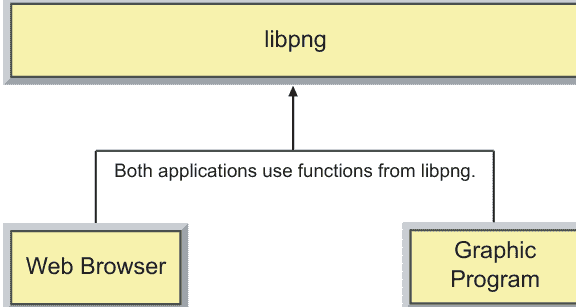

共享库由 2 部分组成：

- 共享库文件本身，当程序需要相应库的函数时会被加载。这些文件的文件名以 `lib` 开头，并以 `.so`（共享对象）结尾。例如：`libpng.so`
- 库的头文件，包含库的函数声明。这些文件的文件名以 `.h`（头文件）结尾。例如：`png.h`

正如本节开头描述的，C 语言要求程序中使用的每个函数都必须经过声明。

这意味着，为了编译使用该库函数的软件，需要在系统上安装该库的头文件。要运行已经编译好的软件，只需要共享库文件即可。

由于随 SUSE Linux Enterprise Server 10 提供的软件已经过编译，因此默认不会安装某些库的头文件。这些库被分成两个包：包含头文件的软件包在包名后附有 `-devel` 后缀。

例如，包 `libpng` 包含共享库，而包 `libpng-devel` 相应的头文件。

当你运行 `configure` 脚本时，它有时会提示你缺少本应安装在系统上的库。如果你使用 YaST 安装了所需的包，你必须确保同时选择了共享库和相应的 devel 包。

位于安装介质顶层的文本文件 `ARCHIVES.gz` 包含了随 SUSE Linux Enterprise 10 提供的所有文件列表。该文件可以查找哪个库文件包含在哪个 RPM 包中。

以下命令行用于搜索 PNG 库的头文件 `png.h`。

```
zcat ARCHIVES.gz | grep png.h
```

使用 `zcat` 是因为 `ARCHIVES.gz` 文件是用 Gzip 压缩的。在命令行的输出中，会列出匹配的文件名及其对应的 RPM 包。接下来的一行显示，`png.h` 可以在包 `libpng-devel-1.2.8-19.2.i586.rpm` 中找到（输出已简化）：

```
[..] libpng-devel-1.2.8-19.2.i586.rpm: [..]/usr/include/libpng12/png.h
```

## 目标 3 理解 GNU 构建工具链

在大多数情况下，程序使用多个源代码文件。为了结构化源码，开发者倾向于将代码分散在多个文件中。

手动在命令行编译一个带有多个源代码文件的程序是很困难的。幸运的是有一些工具可以管理编译过程。

在此目标中，你将学习如何执行以下操作以完成标准构建过程：

- 使用 `configure` 准备构建过程
- 使用 `make` 编译源代码
- 使用 `make` 安装编译后的程序
- 安装构建环境所需的包

## 使用 configure 准备构建过程

在启动实际编译过程之前，你必须使用 `configure` 脚本准备源代码。这样做有以下原因：

- 许多应用程序可以在不同的 UNIX 系统、Linux 发行版和硬件平台上编译。为了实现这一点，构建过程需要针对实际环境进行准备。
- 构建过程本身由一个名为 `make` 的程序控制。如何编译不同源文件的指令从 `Makefile` 中读取。`configure` 脚本根据系统环境生成 `Makefile`。
- 你可以使用 `configure` 启用或禁用应用程序的某些功能。

要运行 `configure` 脚本，你需要在源码目录下使用以下命令：

```
./configure
```

要启用或禁用应用程序的某些功能，`configure` 需要额外的参数。可用参数取决于应用程序。

你可以使用以下命令列出所有的 `configure` 参数：

```
./configure --help
```

## 使用 make 编译源代码

你使用 `make` 工具按顺序编译多个源文件。`Make` 由 `Makefile` 控制。

通常，这些 `Makefile` 是由 `configure` 脚本生成的，但你也可以手动创建。

以下是一个展示 `make` 如何运行的简单 `Makefile`：

```
## Makefile for my_name
all: my_name
my_name: my_name.c
	gcc my_name.c -o my_name
install: my_name
	install -m 755 my_name /usr/local/bin/my_name
uninstall:
	rm -f /usr/local/bin/my_name
clean:
	rm -f my_name
```

此 `Makefile` 可以执行以下任务：

- 从源码编译程序
- 安装程序
- 卸载程序
- 清理编译目录

每个 `Makefile` 由目标、依赖项和目标的命令组成。目标和依赖项用冒号分隔。命令必须放在目标下方，并以一个制表符缩进。`#` 用于注释。

如果你在相应的目录下执行 `make` 命令，程序会在该目录搜索 `GNUmakefile`、`Makefile` 或 `makefile`。

如果不带任何参数执行 `make`，将使用 `Makefile` 的第一个目标。在上面的示例中是 `all`。该目标与目标 `my_name` 关联，后者指定了编译步骤：文件 `my_name.c`。

`make` 命令也可以配合单个目标使用。例如，以 root 执行 `make install` 将二进制文件安装到指定位置，`make uninstall` 删除二进制文件。

大型软件项目以相同的方式创建，但 `Makefile` 更加广泛复杂。如果软件要在多个架构上编译为功能性程序，情况会复杂得多。

因此，`Makefile` 通常由 `configure` 脚本生成。

## 使用 make install 安装编译后的程序

从源码安装程序的最后一步是安装二进制文件以及应用程序的其他文件。

这一步通常通过 `make` 和相应 `Makefile` 中的 `install` 目标完成。

你可以使用以下命令进行安装：

```
make install
```

你必须以 root 身份在源码目录顶层执行此命令。

## 安装构建环境所需的包

执行所述的构建过程需要许多不同的软件包。安装所有包的最简单方法是在 YaST 软件包管理器中选择 `C/C++ Compiler and Tools` 模式。

## 从源码编译软件

要访问预定义的选项，请从过滤器下拉列表中选择“Patterns”（模式），如下所示：

## 练习 6-2

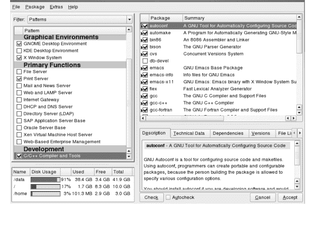

仅供 CNE 内部使用 - 允许一份纸质副本

严禁复制本手册的全部或部分内容，或分发此类副本。如怀疑有侵权复制行为，请拨打 1-800-PIRATES。

版本 1 6-17

## 目标 4 执行标准构建过程

在此目标中，`xpenguins` 程序从源码压缩包编译并安装，作为标准构建过程的示例。

`xpenguins` 程序可以以 `xpenguins-2.2.tar.gz` 名的 tar 压缩包下载。

在开始构建过程之前，您需要输入以下命令解压 tar 压缩：

```
tar xzf xpenguins-2.2.tar.gz
```

某些 tar 包以 `.bz2` 结尾。在这种情况下，该包使用 bzip2 压缩，需要使用 `xjf` 选项解压。

解压包后，您需要输入以下命令进入创建的源码目录：

```
cd xpenguins-2.2/
```

在源码目录中，您需要运行以下命令运行 `configure` 脚本：

```
./configure
```

## 从源码编译软件

输出如下：

```
creating cache ./config.cache
checking for a BSD compatible install... /usr/bin/install-c
checking whether build environment is sane... yes
checking whether make sets $(MAKE)... yes
checking for working local... found
checking for working autoconf... found
checking for working automake... found
checking for working autoheader... found
checking for working makeinfo... missing
checking for gcc... gcc
checking whether the C compiler ( gcc ) works... yes
checking whether the C compiler ... is a cross-compiler... no
checking whether we are using GNU C... yes
checking whether gcc accepts -g... yes
checking for a BSD compatible install... /usr/bin/install-c
checking how to run the C preprocessor... gcc -E
checking for X... libraries /usr/XLR16/lib, headers /usr/XLR16/include
checking for dnet_nt in -ldnet... no
checking for dnet_ntoa -ldnet_stub... no
checking for gethostbyname... yes
checking for connect... yes
checking for remove... yes
checking for shmat... yes
checking for IceConnectionNumber in -LICE... yes
checking for XpmReadFileData in -lXpm... yes
checking for Xpm in -lXpm... yes
checking for ANSI header files... yes
checking for unistd.h... yes
checking whether time h and sys/time.h may be included... yes
checking return type of signal handlers... void
checking for select... yes
checking for strdup... yes
updating cache ../config.cache
creating ../.config.status
creating Makefile
creating src/Makefile
creating themes/Makefile
...
```

仅供 CNI 内部使用 - 允许一份纸质副本

严禁复制本手册的全部或部分内容，或分发副本。如怀疑有侵权复制行为，请拨打 1-800-PIRATES。

版本 1 6-19

在输出的最后几行，您可以看到 `Makefile` 已创建。

如果 `configure` 脚本没有报告任何错误，您可以通过输入以下命令开始编译过程：

```
make
```

## xpenguins 的 make 输出如下：

```
make all-recursive
make[1]: Entering directory '/tmp/xpenguins-2.2'
Making all is now
make[2]: Entering directory '/tmp/xpenguins-2.2/src'
gcc -DHAVE_CONFIG_H -I -I.- -I. /usr/X11R6/include -g -O2 -DPKGDATADIR="/usr/local/share/xpenguins" -c main.c
gcc -DHAVE_CONFIG_H -I -I.- -I. /usr/X11R6/include -g -O2 -DPKGDATADIR="/usr/local/share/xpenguins" -c xpenguins_theme.c
gcc -DHAVE_CONFIG_H -I -I.- -I. /usr/X11R6/include -g -O2 -DPKGDATADIR="/usr/local/share/xpenguins" -c xpenguins_core.c
gcc -DHAVE_CONFIG_H -I -I.- -I. /usr/X11R6/include -g -O2 -DPKGDATADIR="/usr/local/share/xpenguins" -c toon_associate.c
gcc -DHAVE_CONFIG_H -I -I.- -I. /usr/X11R6/include -g -O2 -DPKGDATADIR="/usr/local/share/xpenguins" -c toon_draw.c
gcc -DHAVE_CONFIG_H -I -I.- -I. /usr/X11R6/include -g -O2 -DPKGDATADIR="/usr/local/share/xpenguins" -c toon_set.c
gcc -DHAVE_CONFIG_H -I -I.- -I. /usr/X11R6/include -g -O2 -DPKGDATADIR="/usr/local/share/xpenguins" -c toon_globals.c
gcc -DHAVE_CONFIG_H -I -I.- -I. /usr/X11R6/include -g -O2 -DPKGDATADIR="/usr/local/share/xpenguins" -c toon_query.c
gcc -DHAVE_CONFIG_H -I -I.- -I. /usr1/X11R6/include -g -O2 -DPKGDATADIR="/usr/local/share/xpenguins" -c toon_end.c
gcc -DHAVE_CONFIG_H -I -I.- -I. /usr1/X11R6/include -g -O2 -DPKGDATADIR="/usr/local/share/xpenguins" -c toon_init.c
gcc -DHAVE_CONFIG_H -I -I.- -I. /usr1/X11R6/include -g -O2 -DPKGDATADIR="/usr/local/share/xpenguins" -c toon_root.c
gcc -DHAVE_CONFIG_H -I -I.- -I. /usr1/X11R6/include -g -O2 -DPKGDATADIR="/usr/local/share/xpenguins" -c toon_signal.c
```

## 执行健康检查与性能优化

在本节中，你将学习如何分析 SUSE Linux Enterprise Server 10 系统的性能，以及你可以采取哪些措施来防止这些瓶颈。

## 目标

- 查找性能瓶颈
- 减少系统和内存负载
- 优化存储系统
- 调整网络性能
- 使用 Powertweak

## 简介

与任何系统一样，有时 SUSE Linux Enterprise Server 10 系统的性能可能并不足够。

由于当今 IT 系统和基础设施的复杂性，性能瓶颈有时并不容易发现。所有组件之间都相互作用，不同类型的服务器需要不同的措施来提高系统性能。


在本节中，你将学习监控工具，这些工具可以帮助你找到出现性能问题的组件。

你还将学习一些解决性能问题的提示。请记住，解决问题的方案需要基于你的性能分析结果，并取决于你的系统类型。

无论你选择什么种措施，请确保在实际生产系统中启用它们之前，所有更改都经过了良好的测试。内核参数的更改需要非常仔细地测试。

> 关于 Linux 性能调优的更多信息的来源：http://www.redbooks.ibm.com/abstracts/redp3862.html?Open。

## 目标 1

### 查找性能瓶颈

如果你需要调整系统性能，通常是因为系统在某种程度上太慢了。在进行任何更改之前，你需要识别导致性能问题的瓶颈。

用户或客户对系统缓慢的投诉通常是通用的，不会提供关于问题原因的详细信息。

在开始对系统进行故障排除之前，你应该获取更多信息以对情况有更全面的了解。以下可以帮助你找到性能瓶颈的问题列表：

- **哪种服务器受了影响？** 这包含了关于硬件和服务器用途的信息。
- **问题的具体症状是什么？** 你拥有的信息越多，就越可能确定问题的原因。
- **问题是否发生在一天中的特定时间或一周中的特定时间？** 例如，性能问题可能会发生在早上人们开始工作时，或者午休结束后人们回到工作时。
- **问题何时以及如何开始的？** 问题是突然发生的，还是在几天或几个月内缓慢增加的？
- **谁遇到了问题？** 是只有一个人遇到了问题，还是使用同一台文件服务器的一组人都遇到了问题？
- **问题可以重现吗？** 当你在分析系统时，这非常有帮助。

当你收集了足够的信息后，就可以通过以下步骤开始分析系统：

- 分析进程和处理器利用率
- 分析内存利用率和性能
- 分析存储性能
- 分析网络利用率和性能

### 分析进程和处理器利用率

当你遇到性能问题时，应该首先查看处理器利用率。如果处理器运行不够快，无法以合理的速度运行所有的应用程序，那么这就是你必须处理的瓶颈。

测量处理器利用率的一种方法是系统负载（load）。负载值可以通过各种监控工具显示，如 `top` 或 `uptime`。

在诸如 Linux 这样的多处理器操作系统上，多个进程可以几乎同时运行。由于一个处理器在同一时间只能运行一个进程，Linux 内核将 CPU 的处理时间分成短切片，并分配给正在运行的进程。

为了分配 CPU 时间，内核将运行中的进程放入队列中。根据进程的优先级和自上次执行以来经过的时间，内核决定下一个应该执行哪个进程。

负载值是特定时间内进程队列中等待的进程的平均数量。因此，程序 `top` 或 `uptime` 显示的是过去 1 分钟、5 分钟和 15 分钟的负载值。

在单处理器系统上，平均负载值为 1 意味着处理能力完全被应用程序和操作系统使用。

如果该值小于 1，则某些容量未被使用。如果平均值大于 1，说明处理器的速度不足以处理所有当前运行的进程。

在多处理器系统上，负载值可以更高。根据经验，负载值不应高于系统中安装的处理器数量。

在系统上启动的进程并不需要 CPU 时间。取决于它运行的进程类型，CPU 会花费大量时间等待 I/O 进程完成。例如，I/O 进程可以是用户输入或从硬盘读取/写入硬盘的数据。

在这些时间里，进程不在内核的进程队列中等待，也不会影响系统的负载值。这意味着应用程序可能很慢，但 CPU 时间不是其原因。

以下是用于显示当前 CPU 利用率和平均负载值的监控工具列表：

#### 表 7-1

| 程序 | 描述 |
| :--- | :--- |
| top | 显示排序后的应用程序列表以及过去 1 分钟、5 分钟和 15 分钟内平均负载值的三个值。当你发现系统负载值很高时，`top` 也对找出实际上是哪个应用程序产生的负载非常有帮助。 |
| uptime | `uptime` 也可以显示过去 1 分钟、5 分钟和 15 分钟的负载。 |
| mpstat | 在多处理器系统上，`mpstat` 可以显示每个处理器的利用率。 |

### 分析内存利用率和性能

| 程序 | 描述 |
| :--- | :--- |
| free | 性能的另一个瓶颈可能是内存。系统有两种可用内存： |

- **物理内存。** 这是实际安装的内存。访问这种内存的速度很快。
- **交换内存（Swap）。** Linux 系统至少有一个交换分区。与物理内存相比，访问交换内存较慢。

你可以通过输入以下命令使用 `free` 程序查看物理和交换内存的利用率：

```
free
```

输出如下：

| | 总计 | 使用 | 空闲 | 共享 | 缓冲区 | 缓存 |
| :--- | :--- | :--- | :--- | :--- | :--- | :--- |
| Mem: | 516204 | 502080 | 14124 | 0 | 29356 | 154920 |
| -/+ buffers/cache: | | 317804 | 198400 | | | |
| Swap: | 1036152 | 143320 | 892832 | | | |

输出包含三行信息的标题：

- **Mem.** 该行包含关于物理内存的信息。它包含以下细节：
    - **total.** 显示可用物理内存的总量（KB）。该数字小于安装的物理内存，因为内核本身使用了一小部分内存。
    - **used.** 显示用于应用程序和缓存数据的内存量。
    - **free.** 显示当前未使用且可用的内存。
    - **Shared/buffers/cached.** 这些列显示了关于内存使用情况的更详细信息。
- **-/+ buffers/cache.** Linux 系统的一部分内存用于缓存应用程序或设备的数据。当需要时，这部分内存可以被释放。free 列显示了经过调整后的行，即如果释放了缓冲区和缓存，可用的内存。
- **Swap.** 该行显示关于交换内存利用率的信息。信息包括总量和空闲可用内存。

由于访问硬盘的速度远慢于访问物理内存，当必须使用大量交换空间时，整个系统的性能都会受到影响。

通常发生在物理内存不足以执行系统所需的功能时。它也发生在应用程序请求的内存远大于其实际需要时。

这种情况的原因之一可能是应用程序崩溃，但也发生在正常运行期间，即程序的实现存在缺陷时。在这种情况下，应用程序存在**内存泄漏**。

你可以使用 `top` 命令来查找占用内存大量的程序。默认情况下，`top` 按 CPU 利用率对进程列表进行排序。通过输入 `F`、`n`，然后按 Enter 键，你可以将排序列改为内存利用率。这样，内存消耗最高的程序就会显示在列表顶部。

如果 `free` 列显示了大量的已用内存，这可能表明由于物理内存不足导致了性能瓶颈。但并非总是如此。有时大量内存会被复制到交换分区（swap partition），但之后再也没有被访问过。只有在实际访问交换内存时，系统性能才会受到影响。

你可以使用 `vmstat` 命令显示交换内存的活动，如下所示：

```
vmstat 1
```

选项 `1` 让 `vmstat` 每秒重复一次输出。这样就可以显示一段时间内交换内存的使用情况。你可以按 `Ctrl+C` 终止程序。

`vmstat` 的输出看起来如下：

| procs | --memory-- | --swap-- | --io-- | --system-- | --cpu-- |
|---|---|---|---|---|---|
| r b swpd | free buff cache | si bo in | cs us us id wa |
| 0 0 4 | 6728 34464 244744 | 0 0 | 447 1216 384 15 | 3 74 7 |
| 0 0 4 | 6728 34464 244744 | 0 0 | 0 1186 229 1 198 0 |
| 0 0 4 | 6760 34532 244744 | 0 0 | 0 1182 299 0 3 97 0 |
| 0 0 4 | 6696 34532 244744 | 0 0 | 68 1139 147 1 97 1 |
| 0 0 4 | 6696 34532 244744 | 0 0 | 0 1105 123 0 98 0 |
| 0 0 0 | 6696 34532 244744 | 0 0 | 0 1117 131 0 98 0 |

在这种情况下，`si` 和 `so` 列的输出很有参考价值。`si` 代表 swap in（换入），意味着数据从交换空间传输到主内存；`so` 代表 swap out（换出），意味着数据从主内存传输到交换空间。在上面的示例中，这些列没有活动。

输出的第一行显示自系统启动以来的平均值。随后的行是自上次输出以来的平均值。

以下 `vmstat` 输出是在另一个耗尽内存的系统上截取的，显示了交换内存中有大量的活动：

| procs | ---memory--- | ---swap----- | ---io----- | ---system---| ---cpu | |
| r b swpd | free buff cache | si bo in | cs us id wa | |
| 0 3 167880 | 608 93400 340 | 188 2588 196 | 1223 1215 7 3 0 | 50 59 |
| 1 3 169316 | 1072 4044 90352 300 | 1768 5968 1868 | 1222 1232 36 5 0 | |
| 1 2 170628 | 2520 4088 90416 228 | 1180 1034 1224 | 1260 642 23 2 0 | 75 |
| 0 3 170652 | 1484 4020 90136 364 | 668 1844 808 | 1160 1142 0 0 | 85 |
| 0 4 171380 | 1488 3504 91984 555 | 388 1592 388 | 1218 1195 11 8 0 | 891 |
| 0 5 171576 | 1352 3504 91984 555 | 386 1592 388 | 1218 1195 15 3 0 | 82 |

在这个示例中，`si` 和 `so` 列的活动比之前多得多。显示的数字代表复制到交换内存或从交换内存复制的内存量。

显示此类 `vmstat` 输出的存在由于物理内存不足导致的瓶颈。

以下是你可以用于显示内存利用率的命令和应用程序：

## 表 7-2

| 程序 | 说明 |
| --- | --- |
| free | 显示物理内存和交换内存的当前利用率。 |
| vmstat | 监控交换内存的活动，也可显示其他系统参数。 |
| KDE System | 提供随时间可视化内存使用的功能。 |

## 分析存储性能

存储系统的性能可能会出现问题，特别是对于 ftp、web 或其他面临高硬盘利用率的系统。在分析硬盘性能和利用率之前，你应该确保没有系统负载过高或物理内存不足的问题。

磁盘问题通常表现为较低的网络和 CPU 利用率，但安装磁盘活动很高，这是由内存分页或交换引起的。在这种情况下，你可以使用 `vmstat` 命令显示磁盘子系统的活动。通过输入以下启动 `vmstat`：

```
vmstat 1
```

以下是一个几乎没有磁盘操作的系统输出：

| procs | --memory-- | --swap-- | --io-- | --system-- |
|---|---|---|---|---|
| r b swpd | free buff cache | si bo in | cs us id wa |
| 0 0 4 | 6728 34464 244744 | 0 0 | 447 1216 384 15 | 3 74 7 |
| 0 0 4 | 6728 34464 244744 | 0 0 | 0 1186 229 1 198 0 |
| 0 0 4 | 6760 34532 244744 | 0 0 | 0 1182 299 0 3 97 0 |
| 0 0 4 | 6696 34532 244744 | 0 0 | 68 1139 147 1 97 1 |
| 0 0 4 | 6696 34532 244744 | 0 0 | 0 1105 123 0 98 0 |
| 0 0 0 | 6696 34532 244744 | 0 0 | 0 1117 131 0 98 0 |

在这个示例中，感兴趣的列是 **bi** 和 **bo**。它们显示了磁盘子系统读取 (**bi**) 或写入 (**bo**) 的块数。

## 执行健康检查和性能调优

以下是一个磁盘子系统利用率高的系统：

| r | b | swpd | free | buff | memory-- | cache | si | so | bi | bo | in | system-- | cs | us | sy | id | wa |
|---|---|---|---|---|---|---|---|---|---|---|---|---|---|---|---|---|---|
| 1 | 2 | 52 | 5680 | 6100 | 221688 | 0 | 0 | 0 | 0 | 36160 | 1273 | 1655 | 42 | 58 | 0 | 0 |
| 0 | 3 | 304 | 6896 | 1232 | 225672 | 0 | 0 | 0.256 | 0 | 42216 | 1850 | 1127 | 31 | 40 | 0 | 28 |
| 1 | 2 | 304 | 5936 | 1225 | 225640 | 0 | 0 | 0 | 0 | 28400 | 1487 | 460 | 15 | 23 | 0 | 35 |
| 1 | 2 | 304 | 7792 | 1276 | 224404 | 0 | 0 | 0 | 0 | 33228 | 1342 | 408 | 20 | 29 | 0 | 51 |
| 1 | 2 | 304 | 6256 | 1624 | 224648 | 0 | 0 | 0 | 0 | 88260 | 1205 | 439 | 24 | 42 | 0 | 62 |
| 0 | 2 | 476 | 6668 | 1672 | 224112 | 0 | 0 | 0.172 | 0 | 45452 | 1149 | 8015 | 29 | 54 | 0 | 17 |
| 0 | 2 | 476 | 7672 | 1720 | 223184 | 0 | 0 | 0 | 0 | 836940 | 1168 | 8310 | 23 | 44 |

在这里你看到，大量的内存读取或写入磁盘导致了瓶颈。但这并不意味着磁盘是慢的，内存交换是系统可以轻松处理的。

如输出所示，相关系统并不忙碌。自系统启动以来的平均等待时间（await）为 53.50 毫秒，平均服务时间（svctm）为 2.14 毫秒。

从以下几行可以看出，当前的磁盘利用率远低于平均水平，await 和 svctm 时间均为 0 毫秒。

将其与 I/O 负载较高的系统输出进行对比：

| avg-cpu: %user %nice %sys %iowait %idle |
|---|---|---|---|---|
| | 26,00 | 0,00 | 45,00 | 29,00 | 0,00 |
| Device: rmq/s | wrmq/s | r/s | w/s | rsec/s | wsec/s | rkB/s | wkB/s |
| avgrq-sz | avgqu-sz | await | svctm | %util | | | | | | |
| hda | 1718.70 | 0.00 | 9198.00 | 1430.33 | 4.00 | 100.10 | 32.00 | 73872.00 | 16.00 | 36936.00 |
| avg-cpu: %user %nice %sys %iowait %idle |
|---|---|---|---|---|
| | 20,79 | 0,00 | 39,60 | 28,28 | 0,00 |
| Device: rmq/s | wrmq/s | r/s | w/s | rsec/s | wsec/s | rkB/s | wkB/s avgrq-sz |
| avgqu-sz | avgqu-sz | await | svctm | %util | | | | | | | |
| hda | 99.97 | 2441.89 | 0.00 | 9105.94 | 22.24 | 99.11 | 0.00 | 44.45 | 0.00 | 73140.59 | 0.00 | 36570.30 | 1641.60 |
| avg-cpu: %user %nice %sys %iowait %idle |
|---|---|---|---|---|
| | 24,00 | 0,00 | 48,00 | 28,00 | 0,00 |
| Device: rmq/s | wrmq/s | r/s | w/s | rsec/s | wsec/s | rkB/s | wkB/s avgrq-sz |
| avgqu-sz | avgqu-sz | await | svctm | %util | | | | | | | |
| hda | 92.70 | 2447.00 | 0.00 | 9293.00 | 24.41 | 101.10 | 0.00 | 41.41 | 0.00 | 74640.00 | 0.00 | 373220.00 | 1820.49 |

你可以看到，该系统的平均 await 时间远超 2000 毫秒，且 svctm 时间远高于之前。这样的系统无法以足够的速度完成请求的 I/O 操作。

# CNI 仅供内部使用 - 允许单份打印

严禁复制或分发本手册的全部或部分内容。如怀疑有抄袭行为，请拨打 1-800-PIRATES。

以下是你可以用于分析磁盘利用率的命令概述：

| 命令 | 说明 |
|---|---|
| vmstat | 监控从磁盘读取或写入的数据量。 |
| iostat | 显示应用程序的 I/O 请求所需的时间。 |

# 分析网络利用率和性能


在服务器系统中，网络连接可能成为性能瓶颈。许多不同的参数可能会干扰网络连接。

你可以使用 KDE System Guard 监控这些参数。可以通过在命令行输入 `ksysguard` 来启动它。

> 尽管 KDE System Guard 是 KDE 应用程序，但它也可以与 Gnome 桌面配合使用。该程序包含在 `kdebase3` 包中。

以下是 KDE System Guard 的截图：

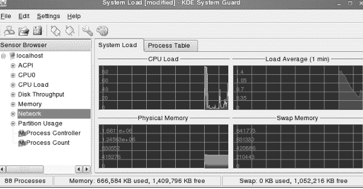

以下是你可以用于分析磁盘利用率的命令概述：

| 命令 | 说明 |
|---|---|
| vmstat | 监控从磁盘读取或写入的数据量。 |
| iostat | 显示应用程序的 I/O 请求所需的时间。 |

# 分析网络利用率和性能

在服务器系统中，网络连接可能成为性能瓶颈。许多不同的参数可能会干扰网络连接。

你可以使用 KDE System Guard 监控这些参数。可以通过在命令行输入 `ksysguard` 来启动它。

> 尽管 KDE System Guard 是 KDE 应用程序，但它也可以与 Gnome 桌面配合使用。该程序包含在 `kdebase3` 包中。

以下是 KDE System Guard 的截图：


如输出所示，相关系统并不忙碌。自系统启动以来的平均等待时间为 53.50 毫秒，平均服务时间为 2.14 毫秒。

从输出看到，该系统的平均 await 时间远超 2000 毫秒，且 svctm 时间远高于之前。这样的系统无法以足够的速度完成请求的 I/O 操作。

以下是你可以用于分析磁盘利用率的命令概述：

| 命令 | 说明 |
|---|---|
| vmstat | 监控从磁盘读取或写入的数据量。 |
| iostat | 显示应用程序的 I/O 请求所需的时间。 |

# 分析网络利用率和性能

在服务器系统中，网络连接可能成为性能瓶颈。许多不同的参数可能会干扰网络连接。

你可以使用 KDE System Guard 监控这些参数。可以通过在命令行输入 `ksysguard` 来启动它。

> 尽管 KDE System Guard 是 KDE 应用程序，但它也可以与 Gnome 桌面配合使用。该程序包含在 `kdebase3` 包中。

以下是 KDE System Guard 的截图：


## 减少守护进程数量

在大多数情况下，服务器只提供少数服务，但实际上运行了许多守护进程。通过减少运行的守护进程数量，你可以降低处理器和内存的负载。

要查看当前服务配置的概览，可以通过输入以下命令来使用 `chkconfig` 命令：

```bash
chkconfig -l
```

`-l` 选项会列出每个运行级别中的所有服务及其配置。例如，以下是 Apache Web 服务器的输出：

| apache2 | 0:off | 1:off | 2:off | 3:on | 4:off | 5:off | 6:off |
|---|---|---|---|---|---|---|---|

如你所示，`apache2` 在运行级别 3 和 5 中是启用的。

检查列表并确保所有运行的服务都是你服务器默认运行级别下需要的。如果你发现某个服务是不必要的，可以通过从 init 进程中删除其脚本来防止它在开机时启动。

使用如下所示命令从进程中移除某个服务：

```bash
chkconfig apache2 off
```

在此示例中，`apache2` 在所有运行级别中均已禁用。要重新启用某服务，请使用如下命令：

```bash
chkconfig apache2 3
```

在此示例中，`apache2` 在运行级别 3 中已启用。

更改运行级别配置不会影响当前运行的服务实例。如果你不想带新配置重启系统，则需要通过手动调用其 rc 脚本来停止正在运行的服务。

以下示例中的命令停止了运行中的 `apache2` 实例：

```bash
sudo service apache2 stop
```

## 保持软件更新

保持软件最新状态有许多原因。除了过时软件可能导致潜在的安全问题外，最新的软件还可以提高性能。

导致系统资源高利用的实现错误可能会在较新的版本中得到修复。并且可能会使用更新、更快的算法。

然而，这种规则可能存在例外。因此，在生产环境中使用新版本之前，你应该仔细对其进行测试。

## 优化交换分区

在具有大量交换的系统中，你通常应该添加更多的主内存来增强性能。然而，如果你无法这样做，优化交换分区将有所帮助。

首先，你应该确保有足够的交换空间。旧的规则——即交换空间的大小应该是物理内存的两倍——虽然有些过时，但仍然是一个合理的起点。

加快交换空间速度是将其分散在多个磁盘上。这只在安装了多个块磁盘的系统中才有效。

每个交换分区在 `/etc/fstab` 文件中都有一个如下的条目：

```text
/dev/hda1 swap swap 0 0
```

你可以通过创建分区并将其添加到 `/etc/fstab` 来使用多个交换分区，如下所示：

```text
/dev/hda1 swap      swap pri=1 0 0
/dev/hdb1 swap      swap pri=1 0 0
/dev/hdc1 swap      swap pri=1 0 0
```

在此示例中，使用了 3 个磁盘上的 3 个分区。额外的参数 `pri=1` 为所有交换分区分配了相同的优先级。

通过为所有交换分区分配优先级 1，内核可以并行使用这些分区。这提高了交换操作的整体性能。

持有交换分区的驱动器运行速度应该相同。

## 更改硬件组件

如果上述减少系统负载的方法未能降低资源利用率，你应该考虑升级以下硬件：

- 升级 CPU
- 升级内存

## 升级 CPU

如果你的系统显示高负载，但所有其他参数（如内存、网络和存储利用率）都不高，你应该考虑升级 CPU。

然而，在升级 CPU 之前，你需要考虑以下因素：

- 对于你正在使用的系统类型，是否有更快的 CPU（取决于插槽、BIOS 支持）？
- 系统的其余组件对于 CPU 来说是否足够快？
- 系统在不久的将来是否会被替换？
- 你的组织内是否有其他更快的系统可以替代当前系统？

根据这些答案，你可能决定更换整个系统而不仅仅是 CPU。在某些情况下，从长远来看这可能更加经济。

## 升级内存

升级通常意味着安装更多的物理内存。你可能会提出的第一个问题是应该安装多少额外的内存。回答这个问题的方法是查看当性能问题发生时系统使用的交换空间大小。增加等量的交换空间可能是一个很好的起点。

然而，你还应该比较内存升级成本与安装新系统的成本。请记住，在大多数情况下，超过 1 GB 的交换空间不会显著提高性能。

## 练习 7 减少资源利用率

在练习中，你将学习如何减少 SUSE Linux Server 10 的资源利用率。你可以在练习本中找到此练习。

（练习结束）

## 目标 3：优化存储系统

有许多方法可以优化存储系统的性能，包括：

- 配置 IDE 驱动器
- 调整内核参数
- 调整文件系统
- 更改硬件组件

## 配置 IDE 驱动器

你可以使用 `hdparm` 工具调整 IDE 驱动器的某些设置。输入以下命令显示驱动器的当前设置：

```bash
hdparm -i /dev/hda
```

在此示例中，列出了设备 `hda` 的设置。

你可以通过 `hdparm` 更改的最重要设置是 DMA（直接内存访问）。有了 DMA，数据可以直接写入主内存而无需 CPU。这通过以下两种方式增强了性能：

- 传输本身快得多。
- CPU 不再被大量占用。

默认情况下，DMA 应该为磁盘启用。然而，如果你发现磁盘性能缓慢，应该检查设置。DMA 也可以在处理文件操作时启用。

你可以使用以下命令检查 DMA 配置：

```bash
hdparm -d /dev/hda
```

在此示例中，检查了 `hda` 的 DMA，输出如下：

```
/dev/hda: using_dma=1 (on)
```

在此示例中，`hda` 的 DMA 已启用；否则 `using_dma` 值为 0。

你可以使用如下命令启用 DMA：

```bash
hdparm -d 1 /dev/hda
```

在此示例中，`hda` 已启用 DMA。

通过 `hdparm` 你还可以使用影响驱动器性能的命令行选项。以下列出了最重要的选项：

| 参数 | 说明 |
| :--- | :--- |
| `-c 1` | 通过 PCI 总线进行 32 位数据传输。 |
| `-u 1` | 设置为 1 允许在处理磁盘中断时屏蔽其他中断，极大提高了 Linux 的响应速度并消除了串口溢出。 |
| `-X value` | 配置驱动器使用特定的传输模式。 |
| `-A 1` | 启用预读，提高处理顺序文件时的性能。 |

在使用 `hdparm` 更改任何设置之前，你应该确保系统上的重要文件已保存并备份。不当的设置会导致系统崩溃或数据丢失。更多信息请参阅 `man hdparm`。

`hdparm` 还提供了一个用于衡量硬盘传输性能的选项，如下所示的设备 `hda` 命令：

```bash
hdparm -t /dev/hda
```

该命令的输出可能如下：

```
/dev/hda:
Timing buffered disk reads: 156 MB in 3.01 seconds = 51.75 MB/sec
```

在此示例中，磁盘的顺序传输率为 51.75 MB/sec。为了获得有效的结果，你应该重复多次并比较结果。通常，测试应该在系统和存储负载较低的情况下运行。

通过 `hdparm` 进行的所有更改在下次重启之前有效。为了确保每次系统启动时都执行 `hdparm` 命令，你可以将它们添加到 `/etc/init.d/boot.local`。

## 调整内核参数

负责硬盘访问的 Linux 内核组件提供了运行时更改的参数。

这些参数都不会被永久保存。如果你想在每次系统启动时设置它们，可以在 `/etc/init.d/boot.local` 文件中输入命令来设置参数。

可调参数允许您执行以下操作：

- 调整 I/O 调度器
- 修改预读参数
- 修改交换积极性参数

### 调整 I/O 调度器

由于 Linux 是一个多任务操作系统，可能同时有多个进程访问硬盘。

因此，Linux 内核包含一个名为 I/O 调度器的组件。该调度器收集进程的请求，并将它们交给负责驱动器的硬件驱动程序。

SUSE Linux Enterprise Server 10 的 I/O 调度器有一个用于调整 I/O 性能的参数。该参数存储在文件中：`/sys/block/device/queue/iosched/quantum`

该参数决定了在请求交给驱动程序之前，队列中存储多少 I/O 请求。通过对请求进行队列，调度器可以优化请求的顺序。

当使用此参数时，数据吞吐量和延迟之间存在权衡。请遵循以下规则：

- 数值越小 = 延迟越短但数据吞吐量越低
- 数值越大 = 延迟越高但数据吞吐量越高

SUSE Linux Enterprise Server 10 的默认值为 4 个请求。

您可以使用类似下面的命令设置该参数的值：

```bash
echo 6 > /sys/block/hda/queue/iosched/quantum
```

当更改值时，您应该始终对应用程序进行基准测试，以衡量更改的效果。

对 I/O 调度器参数的更改可能不会提升通用服务器的性能。但在数据库服务器等高磁盘利用率的系统中，尝试这些设置可能有用。

### 修改预读参数

另一个内核参数允许您决定应该使用多少数据进行预读。预读基本上意味着从文件中读取的数据比应用程序请求的数据更多。

这是因为应用程序通常想要读取文件的所有数据，而不仅仅是开头的数据。您可以在 `/sys/block/device/queue/read_ahead_kb` 文件中设置预读参数。

该值决定了从文件中读取的数据量（以 KB 为单位）。SUSE Linux Enterprise Server 10 的默认值为 512 KB。较大的值可以带来更好的整体吞吐量，但缺点是延迟较高：

您可以使用以下命令设置值：

```bash
echo 256 > /sys/block/device/queue/read_ahead_kb
```

### 修改交换积极性参数

交换积极性参数影响内存和 I/O 性能。它基本上决定了系统何时开始交换到磁盘，可以在 `/proc/sys/vm/swappiness` 文件中设置。

您可以设置 0 到 100 之间的参数值。值越高，系统交换越频繁。SUSE Linux Server 10 的默认值为 60。

您可以使用类似下面的命令设置参数：

```bash
echo 40 >/proc/sys/vm/swappiness
```

该参数决定了您对页缓存相对于程序内存的重视。

## 调整文件系统访问

为了应用程序获得性能优势，您可以通过以下方法控制内核访问文件系统：

- 禁用 atime 更新
- 实现依赖文件系统的调优选项

### 禁用 atime 更新

对于每个文件，Linux 都会存储以下信息：

- 文件创建的时间
- 文件最后一次修改的时间
- 最后一次访问的时间

为了保持 atime 信息的更新，内核在每次访问文件时都需要更新 atime 属性。更新 atime 意味着内核需要执行写入过程，这会给硬盘带来额外负载。

如果 atime 属性对您并不重要，可以使用 `noatime` 选项挂载数据分区。

以下显示了分区 `/dev/hda2` 使用 `noatime` 选项的 fstab 条目：

| /dev/hda2 /data reiserfs noatime 0 0 |

### 实现依赖文件系统的调优选项

除了通用磁盘调优选项外，您还可以配置文件系统以：

- 使用 `notail` 挂载 Reiser 文件系统
- 配置 Ext3 的日志模式

### 使用 notail 挂载 Reiser 文件系统


在传统的 UNIX 系统上，您可以使用 `notail` 来禁用此功能。然而，您必须权衡升级的成本和预期优势与购买新系统进行对比。硬件升级始终存在在系统中产生新瓶颈的风险。

您可以在 `mount` 的 `-o` 选项中使用这些选项，或者将它们添加到 `/etc/fstab`，如下所示：

```
/dev/hda2 /data reiserfs notail 0 0
```

# 配置 Ext3 的日志模式

ext3 文件系统提供日志功能。在日志记录中，每个文件事务都会记录在一个名为日志（journal）的特殊区域。这有助于在发生崩溃或掉电时恢复一致的文件系统。

ext3 提供 3 种日志模式，也会影响性能：

- **data=journal**：如果使用此模式，数据和元数据都会记录在日志中。这是最安全的选项。
- **data=ordered**：当使用此选项挂载 ext3 时，只有元数据记录在日志中。然而，它强制在写入元数据之前写入数据。这是 SUSE Linux Enterprise Server 10 的默认设置。
- **data=writeback**：这是最快选项。元数据记录在日志中，但文件数据不经过特殊处理。这是速度和可靠性之间的良好折中。

您可以使用 `mount` 命令的 `-o` 选项使用这些选项，或者将它们添加到 `/etc/fstab`，如下：

```
/dev/hda2 /data ext3 data=writeback 0 0
```

# 修改组件

如果上述选项都不能提高性能，您可能需要升级硬件。从性能角度来看，真正的 RAID 系统可能是最佳选择。但升级到新的 IDE 或 SCSI 磁盘也可以产生类似的效果。

# 练习 7-3 使用 hdparm 调优 IDE 硬盘

在此练习中，您将调优 IDE 硬盘。您可以在练习册中找到此练习。

（练习结束）

## 目标

# 调整网络性能

有多种方法可以调优 Linux 系统的性能。由于网络的特性，有时不仅包括您的系统，还包括整个网络基础设施。

以下是您可以调优网络性能的 2 种方法：

- 修改内核网络参数
- 修改网络环境

# 修改内核网络参数

Linux 内核允许在运行时更改某些网络参数。这对于需要处理大量并发的系统（如 Web 服务器）非常有意义。

可以使用 `sysctl` 命令设置参数。使用此命令需要 root 用户权限，因为普通用户更改内核参数。

`sysctl` 最重要的命令行参数是 `-w`。您还可以从 proc 文件系统访问内核参数，该系统挂载在 `/proc` 下。通过向 `/proc` 目录中的相应文件写入内容来更改参数。

以下列出了几个 `sysctl` 命令及其对网络性能的影响：

| sysctl 命令 | 效果 |
|---|---|
| `sysctl -w net.ipv4.tcp_tw_reuse=1` | 当 TCP 连接关闭时，相应的 socket 会在 TIME-WAIT 状态保持一段时间。 |
| `sysctl -w net.ipv4.tcp_tw_recycle=1` | 设置这 2 个参数后，允许为新连接复用这些 socket。在连接有许多 TCP 连接的系统中，这可以减少打开连接的数量和系统资源的利用率。 |
| `sysctl -w net.ipv4.tcp_keepalive_time=900` | TCP 连接通常会保持特定的存活时间。在此时间之后，系统会进行探测以检查连接对端是否仍然可达。如果不可用，则会关闭连接并释放已使用的资源。SUSE Linux Enterprise Server 10 的默认时间为 900 秒。通过缩短这段时间，你可以减少已打开但未使用的连接数量。 |

## 更改你的网络环境

由于网络涉及多个系统，因此你应该考虑对其他主机或网络基础设施进行哪些更改可以提高网络性能。

以下是提高网络性能的一些建议：

- **监控所有系统组件。** 在更改你的网络基础设施之前，你应该确保你的问题确实是由网络连接引起的。在较长的时间内仔细监控所有其他组件，特别是 CPU 和内存利用率。
- **限制冲突域。** 如果你在监控系统网络接口时看到很多冲突，可能是有太多的系统共享同一个以太网冲突域。在这种情况下，你应该重新构建网络或使用交换机（`switches`）而不是集线器（`hubs`）。
- **检查电缆质量。** 如果你在监控网络接口时看到很多传输错误，可能是你的网络电缆存在问题。更换网线并再次监控接口。
- **检查连接的双方。** 如果你的服务器与特定客户端之间存在连接性问题，而所有其他客户端都工作正常，那么你应该检查客户端侧的连接。
- **更改网络适配器。** 在某些情况下，网络适配器的驱动程序可能是故障的并导致性能瓶颈。尝试切换到不同厂商的适配器并监控系统，查看性能是否提高。
- **升级到更快的网络类型。** 如果其他措施未能提高性能，升级到更快的网络技术（如千兆以太网）可能会有所帮助。然而，你必须确保系统的其他组件（如芯片组）能够处理这种速度。

## 目标 5

## 使用 Powertweak

`/proc/` 目录下的文件和目录包含了关于运行系统各个方面的丰富信息。这包括 `/proc/sys/` 下的文件，你可以在运行期间查看并修改它们以更改系统设置。

SuSE Linux Enterprise Server 提供了一个用于配置内核和硬件参数的特殊工具，称为 Powertweak。该工具包含了守护进程 `powertweakd` 和一个图形化的 YaST 前端。

使用 Powertweak 设置内核和硬件参数的一个显著优势是为每个参数都提供了简短描述。

要启动 Powertweak，请执行以下操作：

1. 通过以下任一方式启动 YaST Powertweak 配置模块：
    - 启动 YaST 并选择 **System** > **Powertweak**。
    - 打开终端窗口并输入 `su -` 输入 root 密码；然后输入 `yast2 powertweak`。

当你启动该模块时，需要安装 `powertweak` 软件包。通过勾选 **Install powertweak-extra Package** 复选框，你可以安装额外的 `powertweak` 模块，它提供了更多的配置选项。

## SUSE Linux Enterprise Server 10 高级管理

1. 以下是 Powertweak 模块的截图：

图 7-2

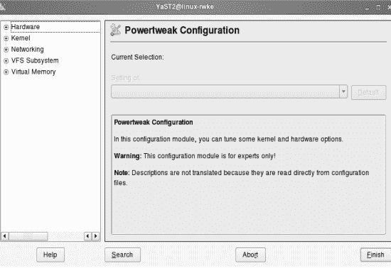

2. 要找到参数，请执行以下任一操作：
    - 从左侧框架展开类别和子类别，直到找到你想更改的参数；选择 *setting*（设置）。
    - 或者
    - 选择 **Search**（搜索）并输入 *keyword*（关键词）；然后点击 **OK**。

一旦选择了一个参数，信息就会出现在右侧框架。

例如，如果你找到并选择了 `Networking > IP > net/ipv4/ip_forward`，将出现以下内容：

# 图 7-3

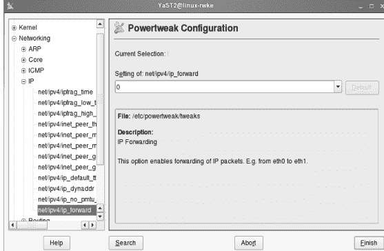

3. 从右侧框架读取信息（文件、可能的值、默认值和描述）；然后选择或输入设置。例如，你可以通过输入 `1` 来激活路由。

4. （可选）查找并配置其他设置。如果你想将设置恢复为默认值，请选择 **Default**（默认）。

5. 完成后，选择 **Finish**（完成）。

# 图 7-4

出现以下内容：

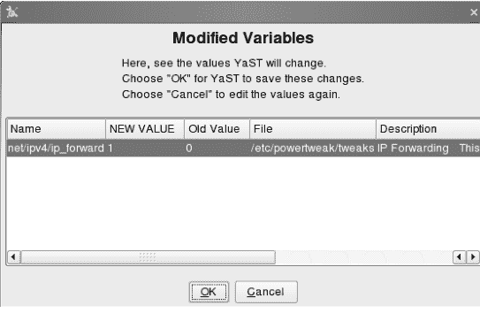

此对话框列出了你指示要求进行的所有更改的摘要。

6. 完成检查列表后，选择 **OK** 保存更改。

更改将由 `SuSEConfig` 保存并激活。

当你使用 Powertweak 修改参数时，`powertweak` 守护进程 (`powertweakd`) 被配置在运行级别 3 和 5 启动。当系统重启时，守护进程会恢复这些参数。

## 练习 7-4

## 使用 Powertweak

在练习中，你使用 Powertweak 调整 TCP 保持时间。

你可以在练习本找到此练习。

（练习结束）

## 总结

| 目标 | 总结 |
| --- | --- |
| 1. 寻找性能瓶颈 | 要找到性能瓶颈，你应该监控系统的以下组件：<br><br>**CPU。** CPU 负载通过等待执行的进程平均数来衡量。可以使用 **uptime** 或 **top** 显示负载。top 也可以显示 CPU 利用率最高的进程。<br><br>**内存。** 物理内存不足是非常常见的性能瓶颈。当系统需要将内存页交换到交换内存时，整体性能会受到影响。可以使用工具 **vmstat** 显示分页交换活动。<br><br>**存储系统。** 系统负载的一个良好指标是应用程序等待 I/O 请求的时间以及 I/O 请求所需的时间。这两个值都可以通过 **iostat** 显示。 |
| 1. 寻找性能瓶颈（续） | **网络组件。** 显示各种网络参数，如包、错误或冲突。 |
| 2. 减少系统和内存负载 | 为了减少系统和内存负载，你可以执行以下操作：<br>- Determine哪些进程消耗了大部分资源。判断这是故障还是正常运行的一部分。<br>- 只运行满足系统目的的软件。<br>- 将软件更新到最新版本。<br>- 通过将其分布在多个磁盘上来优化交换内存。<br>- 升级 CPU 和物理内存。 |
| 3. 优化存储系统 | 为了增强存储系统的性能，你可以执行以下操作：<br>- 使用 `hdparm` 确保硬盘配置优化。<br>- 设置内核参数优化磁盘访问。<br>- 调整文件系统的访问。<br>- 更换缓慢的存储组件。 |
| 4. 调整网络性能 | - 根据需要调整 Linux 内核的网络参数。<br>- 重新配置网络环境。这包括：<br>- 减少以太网的冲突域。<br>- 检查连接的物理质量（如电缆和插头）。<br>- 检查故障网络连接的双方。<br>- 替换或升级网络设备。 |
| 5. 使用 Powertweak | YaST 提供了一个 Powertweak 模块。Powertweak 允许你对内核参数进行更改并在系统重启时恢复这些更改。 |

## 第 8 节 管理硬件

在本节中，你将学习 SUSE Linux Enterprise Server 10 如何处理硬件和设备驱动程序。你还将学习如何添加和替换某些类型的硬件。

## 目标

- 1. 描述设备与接口之间的差异
- 2. 描述设备驱动程序的工作原理
- 3. 描述设备驱动程序是如何加载的
- 4. 手动管理内核模块
- 5. 使用 `hwup` 命令
- 6. 描述 `sysfs` 文件系统
- 7. 描述 `udev` 的工作原理
- 8. 从 YaST 获取硬件配置信息

## 简介

虽然大多数硬件设备可以通过 YaST 进行配置，或者在插入系统时自动检测到，但了解其背后的工作原理有时会有帮助。

在本节中，你将介绍 SUSE Linux Enterprise Server 10 的硬件管理方法以及设备驱动程序是如何加载的。

## 目标 1

### 描述设备与接口之间的差异

本目标使用了“设备”（device）和“接口”（interface）这两个术语。这些术语不仅让用户和管理员容易混淆，操作系统及相关工具的开发者也经常如此。

本课程对设备和接口有以下定义：

- **设备（Device）**：设备是一个真实的物理硬件。这可以是一个 PCI 网卡、一个 AGP 图形适配器、一个 USB 打印机，或任何你可以拿在手里、感觉到或在需要时弄坏的硬件。
- **接口（Interface）**：接口是与设备关联的软件组件。要使用物理硬件，需要通过软件接口进行访问。

一个设备可以有多个接口。

接口通常由驱动程序创建。在 Linux 中，驱动程序通常是一个可以加载到 Linux 内核的软件模块。因此，驱动程序可以看作设备与其接口之间的胶水剂。

## 目标 2

### 描述设备驱动程序的工作原理

如前所述，设备驱动程序访问并使用设备。设备驱动程序有 2 种基本类型：

- **内核模块（Kernel modules）**。Linux 内核的功能可以通过内核模块进行扩展。这些模块可以在运行时加载和移除。它们允许内核提供对硬件的访问。
- **用户空间驱动程序（User space drivers）**。某些硬件需要运行在用户空间的额外驱动程序。这类硬件的示例包括打印机或扫描仪。

下图说明了内核驱动和用户空间驱动程序的作用：

#### 图 8-1

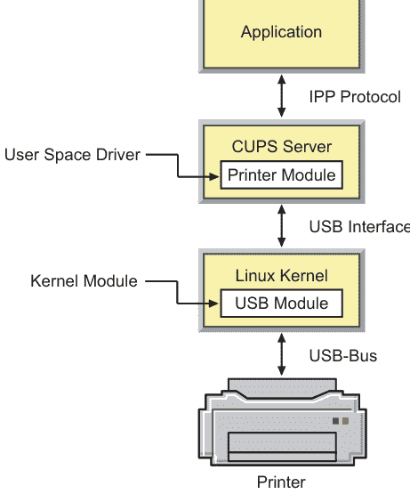

虽然用户空间驱动程序的处理取决于它们所使用的框架，但你可以使用以下命令管理内核模块：

- **lsmod**。此命令列出所有已加载的内核模块。

```
lsmod
```

- **modprobe**。此命令加载内核模块。由于内核模块之间相互依赖，`modprobe` 会自动解析这些依赖并加载所有所需的模块。例如：

```bash
modprobe usb-storage
```

在本示例中，`modprobe` 加载了 `usb-storage` 模块，该模块用于访问连接到 USB 总线的存储设备。

由于该模块需要其他 USB 模块，`modprobe` 还会加载这些模块。

- **rmmod**。此命令移除已加载的内核模块。

```bash
rmmod usb-storage
```

只有不需要的模块才能被移除。在本示例中，在移除 `usb-storage` 模块之前，必须先断开 USB 设备。

内核模块是存储在 `/lib/modules/kernel-version/` 目录下的文件。

由于模块通常只与其编译时针对的内核版本配合，因此每当你安装一个新的内核更新，都会创建一个新目录。

模块存储在多个子目录中，文件名扩展名为 `.ko`（代表内核对象，kernel object）。使用 `modprobe` 加载模块时，你可以省略扩展名，仅使用模块名。

## 目标 3

### 描述设备驱动程序是如何加载的

由于在每次系统启动后手动加载所有内核模块会非常不便，因此有几种方法可以自动执行此任务。

以下是 SUSE Linux Enterprise Server 10 中加载设备驱动程序的概览：

- **initrd**。为了从 initrd 访问根分区所必需的重要设备驱动程序。initrd 是一个由引导加载程序加载到内存中的特殊文件。此类模块的示例包括 SCSI 主机控制器和文件系统驱动程序。
- **initscripts**。某些脚本专门用于加载和设置硬件设备，例如用于声卡的 ALSA 音频脚本。
- **udev**。`udev` 也会通过 `hwup` 命令加载内核模块。
- **X Server**。虽然显卡驱动程序不是内核模块，但 X Server 会加载特殊的驱动程序以启用硬件 3D 支持。
- **手动**。你始终可以在命令行或脚本中使用 `modprobe` 命令、或者 `hwup` 或 `hwdown` 命令来加载内核模块。

## 目标 4

### 手动管理内核模块

虽然 SUSE Linux Enterprise Server 10 会自动初始化大多数硬件设备，但知道如何手动管理内核模块会非常有帮助。

要管理内核模块，你需要理解以下内容：

- 内核模块基础
- 从命令行管理模块
- `modprobe` 配置文件 (`/etc/modprobe.conf`)

有关最新的内核文档，请参阅 `/usr/src/linux/Documentation`。

## 内核模块基础

安装在 `/boot/` 目录下的内核已针对各种硬件进行了配置。除非你想测试实验性功能和驱动程序，否则没有必要编译自定义内核。

Linux 内核的驱动程序和功能可以编译进内核，也可以加载到内核中。由于模块通常只与其编译时针对的内核版本配合，因此每当你安装一个新的内核更新，都会创建一个新目录。

模块存储在多个子目录中，文件名扩展名为 `.ko`。使用 `modprobe` 加载模块时，你可以省略扩展名，仅使用模块名。

`modinfo` 选项 `module`。此命令显示命令行上指定模块的信息（如许可证、作者和描述）。

以下是一个示例：

```
DA50:- # modinfo isdn
license: GPL
author: Fritz Elfert
description: SDN4Linux: link layer
depends: slhc
supported: yes
magic: 2.6.5-7.21-default 586 REGPARM gcc-3-3
```

如需更多详细信息，请输入 `man modinfo`。

## modprobe 配置文件 (/etc/modprobe.conf)

`/etc/modprobe.conf` 文件是内核模块的配置文件。例如，它包含了直接访问硬件的模块参数。

该文件在加载模块时起着重要作用。文件中可以找到多种类型的指令，例如：

- **install**。这些指令让 `modprobe` 在将特定模块加载到内核时执行某些命令。

以下是一个示例：

```
install eth0 /bin/true
```

- **alias**。这些指令决定了为特定的设备文件将加载哪个内核模块。

以下是一个示例：

```
alias eth0 nvnet
```

- **options**。这些指令是加载模块的选项。

以下是一个示例：

```
options ne io=0x300 irq=5
```

如需更多详细信息，请输入 `man 5 modprobe.conf`。

## 管理 Linux 内核模块

在本练习中，你将加载和卸载内核模块。

你可以在工作手册中找到此练习。

（练习结束）

## 目标 5

### 描述 sysfs 文件系统

`sysfs` 是一个挂载在 `/sys` 下的虚拟文件系统。在虚拟文件系统中，没有物理设备持有这些信息。相反，文件系统是由内核虚拟生成的。

`/sys` 下的目录和文件结构提供了有关当前连接到系统的硬件的信息。在 `/sys` 下，有 4 个主目录：

- `/sys/bus` 和 `/sys/devices`。这些目录包含了系统硬件的不同表示形式。设备在这里被表示。

例如，以下内容表示一个连接到 USB 总线的数字数码相机：

```
/sys/bus/usb/devices/1-1/
```

该目录包含多个提供有关设备信息的文件。以下是该目录下的文件列表：


| 1-1:1.0 | bMaxPower | manufacturer |
| :--- | :--- | :--- |
| bcdDevice | bNumConfigurations | maxchild |
| bConfigurationValue | bNumInterfaces | power |
| bDeviceClass | detach_state | product |
| bDeviceProtocol | devnum | serial |
| bDeviceSubClass | idProduct | speed |
| bmAttributes | idVendor | version |

例如，通过读取 `manufacturer` 文件的内容，你可以确定设备的制造商：

```
cat manufacturer
OLYMPUS
```

在这种情况下，一台奥松（Olympus）数码相机连接到了系统。

- `sys/class` 和 `/sys/block`。设备的接口在这两个目录下表示。

例如，属于奥松数码相机的接口由以下目录表示：

`/sys/block/sda`

名为 `/sda` 的目录像访问 SCSI 硬盘一样访问数码相机。

以下是 `/sda` 的内容：

| dev | removable | size |
| :--- | :--- | :--- |
| sda1 | stat | |

子目录 `/sda1` 代表内存卡上第一个分区的接口。例如，通过读取 `sda1/size` 的内容，你可以确定分区的大小：

```
cat sda1/size
31959
```

该分区的大小为 31959 字节块，约为 16 MB。为了将接口与设备连接，使用了文件链接。在奥松数码相机的示例中，存在从 `/sys/block/sda` 到对应设备的链接：

```
lrwxrwxrx 1 root root Aug 17 14:03 device -> ../devices/pci0000:00:1d.0/usb/1-1
```

通过这种方式，系统所有的接口都与其对应的设备链接在一起。除了 sysfs 中的表示外，`/dev` 目录下还有设备文件。应用程序访问设备接口时需要这些文件。“设备文件”这个名称有点误导性，使用“接口文件”会更合适。

## 目标 6

### 描述 udev 如何工作

在使用硬件设备之前，你需要加载驱动模块并设置相应的接口。对于 SUSE Linux Enterprise Server 10 中的大多数设备，这是通过 udev 完成的。

要获取关于 udev 的概览，请执行以下操作：

- 理解 udev 的目的
- 理解 udev 如何工作
- 理解接口名称

### 理解 udev 的目的

udev 有三个主要目的：

- 创建设备文件。udev 最显而易见的任务是在设备连接到系统时在 `/dev` 下创建设备文件。在此，`/dev` 目录包含了系统中可能出现的每一个设备。这导致 `/dev` 目录变得非常复杂且混乱，因为大多数设备文件实际上并没有被使用。
- 持久化设备名。udev 的另一个优势是它提供了一种持久化设备名的机制。
- 热插替换。在 SUSE Linux Enterprise Server 10 中，udev 还替换了在以前版本中负责初始化硬件设备的热插系统。udev 现在是 SUSE Linux Enterprise Server 10 中硬件初始化的中心点。

### 理解 udev 如何工作

udev 实现为一个守护进程（`udevd`），它在启动时通过 `/etc/init.d/boot` 启动并通过 `uevent` 接口与 Linux 内核通信。当内核发送设备已添加或删除的 `uevent` 时，udev 执行以下操作：

- 通过 `hwup` 初始化设备。
- 在 `/dev` 创建设备文件。
- 通过 `ifup` 设置网络接口。
- 根据需要重命名网络接口。
- 通过 `/fstab` 识别并挂载存储设备。
- 通过 HAL（硬件抽象层）通知其他应用程序新设备。

为了处理在 udev 启动之前发出的 `uevent` 消息，udev 脚本通过解析 sysfs 文件系统触发这些事件。在之前的 SUSE Linux Server 版本中，系统的这部分初始化是由 `coldplug` 脚本完成的。

udev 的所有操作取决于 `/etc/udev/rules.d/` 下定义的规则，这些规则用于处理 `uevent`。规则的详细描述超出了本课程的范围。但以下是事实：

- udev 规则分布在多个文件中，按字母顺序处理。这些文件的每行都是规则。可以使用 `#` 字符添加注释。
- 每个规则由多个键值对组成。键值对的示例：`kernel=="sda"`。
- 有两种不同的键类型：
  - 匹配键。这些键用于判断是否应该使用某个规则来处理事件。
  - 赋值键。这些键决定在处理规则时做什么。
- 规则中始终至少有一个匹配键和一个赋值键。

对于每个事件，所有的规则都会被处理。在找到匹配规则时处理不会停止。你可以使用工具 `udevmonitor` 监控 udev 活动。当你启动工具并更改硬件配置（例如插拔 USB 设备）时，udev 的活动将显示在屏幕上。如需更多细节，可以启动工具并使用 `--env`。

### 理解持久化接口名称

`/dev` 目录下的接口文件是在设备被驱动程序识别并初始化时创建并分配给相应的硬件设备的。因此，接口文件与设备之间的分配取决于：

- 设备驱动加载的顺序。
- 设备连接到计算机的顺序。

这可能导致无法确定哪个设备文件被分配给了哪个设备。考虑以下示例：

你有两个 USB 设备，一台数码相机和一个闪存卡读取器。这两个设备都通过设备 `/dev/sda`、`/dev/sdb` 等存储设备被访问。哪个设备被分配到哪个接口文件，通常取决于它们插入的顺序。第一个设备获得 `sda`，依此类推。

udev 可以帮助使这一过程更具预测性。通过 sysfs 的帮助，udev 可以发现哪个设备连接到了哪个接口文件。实现持久化设备名称最简单的方案是重命名接口文件，例如从 `/dev/sda1` 重命名为 `/dev/camera`。

遗憾的是，Linux 下无法重命名接口文件。该规则的唯一例外是网络接口，它们传统上在 `/dev` 下没有接口文件。

因此，udev 采用了不同的方法。它不是重命名接口文件，而是为分配的接口文件创建一个具有唯一且持久名称的链接。

默认情况下，udev 配置为为所有存储设备创建这些链接。对于每个设备，在 `/dev/disk/` 下的每个子目录中都会创建一个链接：

- `by-id`。链接名称基于厂商和设备名称。
- `by-path`。链接名称基于设备的总线位置。
- `by-uuid`。链接名称基于设备的序列号。

创建这些链接的 udev 规则位于 `/etc/udev/rules.d/60-persistent-storage.rules` 文件中。

这意味着，设备与接口文件之间的关联仍然取决于驱动程序加载的顺序或设备连接到系统的顺序。

然而，通过 udev，每当设备配置发生变化，就会创建并调整持久链接。

如前所述，网络接口的处理方式不同。它们没有接口文件，并且可以由 udev 直接重命名。

持久化网络接口作为 udev 规则配置在 `/etc/udev/rules.d/30-net_persistent-names.rules` 文件中。

# SUSE Linux Enterprise Server 10 Advanced Administration

以下是一个规则示例：

```
SUBSYSTEM="net", ACTION="add", SYSFS{address}="00:30:05:4b:98:85",
IMPORT="/sbin/rename_netiface %k eth0"
```

匹配键 `SYSFS{address}` 用于通过其 MAC 地址识别网络设备。在规则的末尾给出了接口名称。在本例中为 `eth0`。

> 在 SUSE Linux Enterprise Server 9 中，可以在 `/etc/sysconfig/network` 下的接口配置文件中配置持久化网络接口名称。在 SUSE Linux Enterprise Server 10 中不再支持这种方法。接口名称现在必须在 udev 规则中配置。

# 练习 8-2 使用 udev 添加设备符号链接

在本次练习中，我们将创建一个 udev 规则，当设备插入时在 `/dev` 中创建一个符号链接。要完成此练习，你需要一个 USB 鼠标。

你可以在练习册中找到此练习。

（练习结束）

# 使用 hwup 命令

`hwup` 命令被 udev 用于加载驱动模块和初始化设备。在这一目标中，你将学习如何使用此命令以及如何解释相应的配置文件。

要启动设备，会带上硬件描述参数调用 `hwup`。硬件描述是系统中特定设备的唯一标识符。以下是 `hwup` 命令行的示例：

```bash
hwup bus-pci-0000:02:08.0
```

设备描述由以下组件组成：

- `bus`。这决定了设备通过其所连接的总线进行识别。
- `pci`。这表示设备连接到 PCI 总线。
- `0000:02:08.0`。这是设备在 PCI 总线上的地址。

你可以使用 `lspci` 命令显示设备的 PCI 地址，如下例：

```
0000:02:08.0 Ethernet controller: Intel Corp. 82801BD PRO/100 VE (LOM) Ethernet Controller (rev 81)
```

如你所见，通过命令 `hwup bus-pci-0000:02:08.0`，PCI 地址为 `0000:02:08.0` 的以太网控制器将启动。

可以使用 `hwdown <hardware_description>` 命令停止设备。`hwdown` 是指向 `hwup` 的链接，而不是一个独立的命令。

`hwdown` 将设备从其驱动程序中解除，但不会自动卸载驱动模块。

`hwup` 有两种不同方式获取关于设备需要加载的驱动程序的信息：

- 从配置文件
- 从 sysfs

## 从配置文件

当需要初始化设备时，`hwup` 首先尝试从 `/etc/sysconfig/hardware/` 目录下的文件读取设备配置。

为了确定正确的配置文件，配置文件名遵循特定的命名方案。

以下是 PCI 网络适配器的文件名：

`hwcfg-bus-pci-0000:02:08:0`

文件名由关键字 `hwcfg` 和设备的硬件描述组成。

以下列出了设备配置文件中可能的变量：

| 变量 | 说明 |
| --- | --- |
| STARTMODE | 这决定了设备何时以及如何启动：<br>`auto`。设备在启动启动时或设备连接到系统时自动启动。<br>`manual`。设备不应自动启动，但可以手动启动。<br>`off`。设备永远不应启动。 |

# 表 8-1（续）变量描述

| 变量 | 说明 |
| --- | --- |
| MODULE | 此变量的值决定了应为设备加载的内核模块名称。如果需要加载多个模块，可以多次使用此变量并附加任何后缀。<br>示例：<br>`MODULE_A="foo"`<br>`MODULE_B="bar"`<br>`MODULE_OPTIONS_A="foo-opt"` |
| MODULE_OPTIONS | 通过此变量可以将选项传递给内核模块。 |
| SCRIPT{UP,DOWN} | 这指定了用于初始化和卸载设备的脚本。如果设备类型与指定的类型匹配，则调用该脚本。 |
| SCRIPT{UP,DOWN} | 这指定了用于初始化和卸载设备的脚本。只有在配置了特定类型脚本时，才会调用它。 |

以下是网络适配器的配置文件示例：

```
MODULE='e100'
MODULE_OPTIONS=''
STARTMODE='auto'
```

模块 `e100` 被加载，该设备没有选项，设备在启动时自动启动。

你也可以手动使用它。例如，以下命令启动了之前显示的网卡：

```
hwup bus-pci-0000:02:08.0
```

你可以使用 `hwdown` 命令取消配置设备，如下：

```
hwdown bus-pci-0000:02:08.0
```

## 从 sysfs

当 `/etc/hardware` 下没有设备配置文件时，`hwup` 使用 sysfs 获取更多关于所需驱动程序的信息。

在 `/sys/bus/devices/<pci_device_id>/modalias` 文件中可以找到唯一的 ID。以下是网络适配器 `modalias` 文件的内容：

```
pci:v0008086d00001039sv00001734sd00001001bc02sc0010
```

现在 udev 调用 `probe` 命令并作为参数传递。

`/lib/modules/<kernel_version>/modules.aliases` 文件包含了 `modalias` ID 及其对应的内核驱动模块列表。关于哪个驱动模块处理 `modalias` ID 的信息包含在模块源文件中。`demod` 命令用于从模块中提取信息并写入 `modules.aliases` 文件中。

因此，你可以将 `modules.aliases` 文件视为驱动数据库，用于查找哪个设备由哪个驱动程序处理。

当 udev 带有 `modalias` 参数调用时，`modprobe` 在 `modules.aliases` 中查找驱动并加载关联的驱动程序。

## 练习 8-3

## 探索硬件初始化

在本练习中，你将学习如何使用 `hwdown` 关闭设备以及如何手动重新启动它。

你可以在练习集中找到此练习。

（练习结束）

## 目标 8

## 从 YaST 获取硬件配置

要获取有关硬件配置的信息，请从 YaST 控制中心选择硬件（Hardware）> 硬件信息（Hardware Information）。

在扫描硬件片刻后，YaST 会显示一个类似下面的对话框，汇总检测到的硬件信息：

## 图 8-2

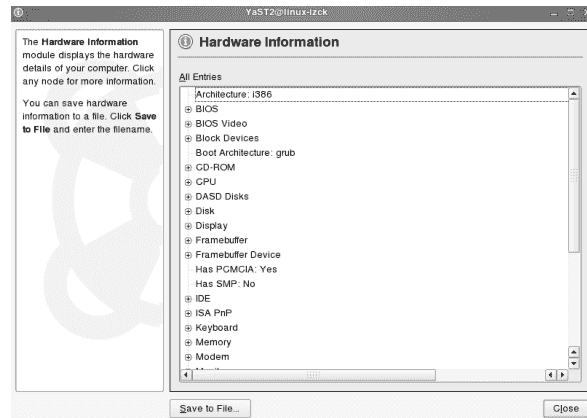

## 练习 8-4 获取硬件配置信息

在本练习中，你将学习如何获取关于计算机的硬件配置信息。

你可以在练习集中找到此练习。

（练习结束）

## 总结

| 目标 | 总结 |
|---|---|
| 1. 描述设备与接口之间的区别 | 设备（device）和接口（interface）这两个词经常被混淆。本节使用了：<br>**设备。** 设备是一个物理硬件单元。<br>**接口。** 接口是一个用于访问设备的软件组件。<br>一个设备可以有多个接口。<br>接口由设备驱动程序创建。 |

| 2. 描述设备驱动程序的工作原理 | 设备驱动程序分为两种基本类型：<br>**内核模块（Kernel modules）。** 内核模块加载到 Linux 内核并扩展其功能。<br>**用户空间驱动程序（User space drivers）。** 这些驱动程序运行在用户空间应用程序中。<br>某些设备同时需要内核模块和用户空间驱动程序。<br>你可以使用以下命令来管理内核模块：<br>**lsmod。** 使用 `lsmod` 列出已加载的驱动程序。<br>**modprobe。** 使用 `modprobe` 加载内核模块。 |

## 目标总结

| 目标 | 总结 |
| :--- | :--- |
| 2. 描述设备驱动程序的工作原理（续） | - `rmmod`。使用 `rmmod` 移除内核模块。<br>- 内核模块是存储在 `/lib/modules/kernel-version/` 目录下的文件。 |

| 3. 描述设备驱动程序如何加载 | 在 SUSE Linux Enterprise Server 10 系统，内核模块通过以下方式加载：<br>- 从 initrd<br>- 通过 initscript<br>- 通过 udev<br>- 通过 X Server<br>- 用户手动加载 |

| 4. 手动管理内核模块 | - `hwup` 命令用于启动预配置的设备。<br>- 设备配置文件存储在 `/etc/sysconfig/hardware/` 目录下。<br>- 配置文件的文件名包含对应设备的唯一标识符。<br>在配置文件中，可以使用以下变量：<br>- STARTMODE<br>- MODULE<br>- MODULE_OPTIONS<br>- SCRIPT(UP,DOWN)_[type]<br>- SCRIPT(UP,DOWN) |

| 目标 | 总结 |
|---|---|
| 5. 描述 sysfs 文件系统 | - sysfs 文件系统提供了系统中所有设备和接口的表示。<br>- 设备在目录 `/sys/bus` 和 `/sys/devices` 中表示。<br>- 接口由目录 `/sys/class` 和 `/sys/block` 表示。<br>- 设备及其接口通过文件系统链接连接。 |

| 6. 描述 udev 的工作原理 | 在 SUSE Linux Enterprise Server 10 中，udev 也取代了热插拔系统（热插拔系统在之前的版本中负责硬件初始化）。udev 是 SUSE Linux Enterprise Server 10 中硬件初始化的核心。 |

| 7. 使用 hwup 命令 | `hwup` 用于加载设备驱动程序。设备所需驱动程序的信息来自 `/etc/sysconfig/hardware/` 下的配置，或者来自 `/lib/modules/<kernel_version>/modules.aliases` 文件。 |

| 8. 从 YaST 获取硬件配置信息 | 要获取有关硬件配置的信息，请选择 YaST 模块硬件（Hardware） > 硬件信息（Hardware Information）。 |

## 第 9 节 准备 Novell CLP 10 实操

在本节中，你将通过以下场景来准备 Novell CLP（认证 Linux 专业人员）实操考试：

1. 安装 Xen 环境
2. 配置 Web 服务器
3. 配置 Samba 文件服务器
4. 自动化系统任务

请记住，完成所需任务可能需要来自所有 3 门 Novell CLP 课程的技能。

> 课程最后一天可能没有足够的时间完成本节的所有目标。我们建议在家里完成剩余部分。

## 场景


# Digital Airlines 计划在其 IT 基础设施中部署 SUSE Linux

在第一阶段，`SUSE Linux Enterprise Server 10` 将用于文件、Web 服务器和网络基础设施服务器等后端系统。

作为你 Digital Airlines 办公室的网络管理员，你（以及管理层）设计了一份迁移计划，其中包括以下要迁移到 `SUSE Linux Enterprise Server 10` 的服务：

- 内部网 Web 服务器
- 面向 Windows 客户端的文件打印服务

这两项服务都应该运行在同一个物理系统的不同 Xen 域中。

你决定首先开始在测试实验室的一台计算机上安装并测试这些服务。

# 目标 1：安装 Xen 环境

为了为 samba 和 apache 系统建立，需要重新安装物理机并设置 3 个 Xen 域：`domain0` 和两个 `domainU`。

- 删除系统上现有的安装并重新安装 `SUSE Linux Enterprise 10`。
- 在安装期间，创建一个有足够空间存放系统文件的分区。
- 在 `domain0` 下将此分区挂载到 `/xen`。
- 安装 Xen 并进入 `domain0`。
- 使用 YaST 创建两个 Xen 域并安装 `SUSE Linux Enterprise 10`。
- 确保 `domain0` 和两个 `domainU` 的网络正常工作。

# 目标 2：配置 Web 服务器

你的 Digital Airlines 办公室运行着一个为员工提供信息的内部服务器。该服务器托管门户网站以及每个部门的虚拟主机。

由于 Web 服务器需要迁移到 `SUSE Linux Enterprise Server 10`，你决定在一个 Xen 域（`domainU`）中为门户网站和两个部门（会计和营销）创建一个原型。

- 安装并配置 Apache Web 服务器，托管门户网站以及两个部门的虚拟主机。
- 使用 Apache 示例页面作为演示内容。
- 会计虚拟主机应在 SSL 下运行，并且仅允许会计组的用户访问。
- 在 `/etc/hosts` 文件中添加条目以测试虚拟主机设置。
- 每个部门应允许一个用户通过 SSH 登录服务器更改虚拟主机的内容。

在你的系统中创建 `JNelson` 和 `SRife` 两个用户。`JNelson` 负责营销部门，`SRife` 负责会计部门。

- 你需要迁移的所有页面都是 `.htm` 格式。编写一个脚本，将 `.htm` 替换为 `.html`。

# 目标 3：配置 Samba 文件服务器

作为 Digital Airlines 办公室 SUSE 迁移计划的一部分，你需要将文件打印服务迁移到运行在 `SUSE Linux Enterprise Server 10` 上的 Samba 服务器。

你决定在另一个 Xen 域（`domainU`）上测试营销部门的迁移。

- 安装 Samba 服务器和客户端软件。
- 配置 marketing 工作组。
- 创建名为 marketing 的 UNIX 组。
- 创建两个普通用户（`PSmith` 和 `JWattson`），他们是 accounting 组的成员并包含在 `smbpassword` 文件中。
- 为 accounting 组创建一个共享文件夹。
- 将 `PSmith` 和 `JWattson` 的家目录导出为个人共享文件夹。
- 测试你的共享（可以使用 `smbclient`）。

# 目标 4：自动化系统任务

为了使 `SUSE Linux Enterprise Server 10` 系统的管理尽可能方便，某些任务应该通过 shell 脚本实现。

执行以下操作：

- 在 `domain0` 上开发一个 shell 脚本，用于启动和停止 Web 服务器域和 Samba 服务器域。该脚本的使用应该像 `xm` 命令行一样简便，并仅接受 `start` 和 `stop` 参数。
- 脚本的每次调用都应该通过向 root 用户发送邮件进行记录。注意：这可以通过 `mail` 命令完成。详情请参阅 `mail` 的 manpage。
- 首先，为 Web 服务器域开发一个脚本。当该脚本运行正常后，复制一份并针对 Samba 域进行调整。
- 两个脚本都应该安装在 root 用户的 `~/bin` 目录下。
- 在 Samba 服务器上，开发一个脚本，搜索财务部门的共享文件夹中的 Windows 可执行文件。
- 使用 `file` 命令判断文件是否为 Windows 可执行文件。
- 当检测到 Windows 可执行文件时，应将该文件移动到 root 目录下的隔离目录。此外，每发现一个可执行文件，都应向 root 用户发送邮件。邮件中应包含文件名和发现该文件的位置。
- 在 Web 服务器域上，开发一个备份脚本，对 `/srv/www/` 目录进行增量备份。备份完成后，应将状态信息邮件给 root 用户。

# 索引

## 符号

- `/etc/exports` 4-52–4-53
- `/etc/init.d/nfserver` 4-52
- `/etc/ntp.conf` 4-42
- `/etc/sysconfig/nfs` 4-52
- `/etc/sysconfig/ntp` 4-40
- `/usr/sbin/rpn.mountd` 4-52

## A

- 地址 2-18, 2-27, 3-8, 3-15
- 管理 Intro-1, Intro-3
- 别名 alias 2-10
- Apache 2-2–2-3, 2-5–2-13, 2-15, 2-17, 2-19–2-20, 2-22, 2-27–2-29, 2-37, 2-40, 2-42, 2-45, 2-47, 2-57, 2-59–2-60, 2-62–2-63, 6-25, 7-21, 9-4

## B

- 后端 back-end Intro-10, 9-2
- 背景 background 8-2
- 二进制 binary 6-3, 6-5, 7-6–7-8, 6-15, 6-23
- 块 block 3-2
- 广播客户端 broadcastclient 4-43

## C

- 线缆 cable 7-39
- 缓存 cache 6-18, 7-8–7-11
- 证书颁发机构 Certificate Authority 2-24
- chkconfig 4-11
- 类 class Intro-2, 2-49, 8-14, 8-32
- 命令 commands 5-17, 5-22, 5-45–5-46
- 兼容性 compatibility 2-42
- 组件 component Intro-9, 2-38, 2-55, 7-2, 7-16, 7-23–7-24, 7-29–7-30, 7-35, 7-39–7-40, 7-46–7-47, 8-3, 8-7, 8-30
- 压缩的 compressed 2-49, 6-17
- 简介 Intro-10, 2-5, 2-8–2-10, 2-13–2-14, 2-27–2-29, 2-38, 2-40–2-43, 2-47–2-48, 2-52, 2-55–2-57, 2-59–2-60, 2-62, 3-4, 3-6, 3-8, 3-10, 3-14, 3-31, 3-33–3-34, 3-34, 3-37, 4-40, 7-11, 7-21, 7-28, 7-37, 7-41, 7-47, 8-9–8-10, 8-22–8-25, 8-28–8-29, 8-31–8-32
- 配置 configure Intro-2, Intro-9, 2-1, 2-6–2-9, 2-16, 2-19–2-22, 2-27–2-30, 2-38–2-39, 2-45–2-46, 2-49–2-50, 2-56, 2-59, 2-61, 2-63, 3-1, 3-7, 3-10, 3-12–3-14, 3-16, 3-24–3-25, 3-30, 3-32, 6-11, 6-13–6-15, 6-17, 6-19, 6-24–6-25, 7-27, 7-33–7-34, 7-43, 9-4–9-5
- 连接 connection 7-48
- 上下文 context 2-52
- 控制器 controller 3-62, 6-8
- 创建 create Intro-2, Intro-6, 2-10, 2-13, 2-19, 2-25–2-26, 2-52, 2-55, 2-62, 2-65, 3-6–3-8, 3-27, 3-31, 3-35, 3-39, 5-1–5-3, 5-17, 5-19, 5-46–5-47, 6-3, 6-14, 7-24, 7-82, 8-9, 9-4–9-5

## D

- 日期 date 4-29
- 调试 debug 2-57
- 设备 device 7-11, 8-14
- 目录 directory 1-9, 2-25, 2-8–2-20, 2-12–2-14, 2-17–2-20, 2-27, 2-40-21, 2-43, 2-45-46, 2-49-50, 2-55-60, 2-62, 2-64, 3-12, 3-14-35, 3-19–3-20, 3-22, 3-26, 3-31, 3-35, 3-38, 3-40, 5-3, 5-7, 5-46, 5-59, 6-13, 6-15-17, 6-20, 6-25, 7-37, 7-41, 8-5, 8-7-8, 8-13-14, 8-23, 8-31
- 硬件 hardware Intro-2, Intro-9, 6-13, 7-3, 7-23, 7-30, 7-35, 7-41, 8-1-4, 8-6-7, 8-9-10, 8-13, 8-16, 8-23, 8-28-8-32
- 硬件时 hardware clock 4-29
- 头部 header 6-5, 6-11, 6-18, 6-24
- 健康 health Intro-2, Intro-9, 7-1
- 检查 check Intro-2, Intro-9, 7
- 主目录 home directories 3-14
- DNS 2-4, 2-14-25, 3-37, 7-17
- HTTP 2-2
- 硬件时钟 hwclock 4-30, 4-32
- 域 domain 7-15
- 漂移 drift 4-38
- 驱动程序 driver 3-35
- 间隔 interval 7-11

## E

- IP 7-43
- 加密 encrypted 2-22–2-24, 3-10
- 地址 2-18
- 导出 export 3-14, 5-7, 9-5

## J

- 外部 external 5-27, 5-59, 5-61, 5-65
- 抖动 jitter 4-38

## F

- 文件系统 file system 2-40, 3-8, 3-22, 3-39, 7-32-74, 7-37, 8-6, 8-13-14, 8-32
- 关键字 keyword 3-6
- 格式 format 5-53

## G

- 库 libraries 6-18
- 生成 generate 2-25, 5-14
- 列表 list 3-34
- 全局 global 2-9, 2-43, 2-57, 3-6-3-7, 3-25, 3-27, 3-33
- 加载 LOAD 2-37, 3-9, 7-4-7-6, 7-10-7-11, 7-13, 7-15-7-16, 7-19-7-21, 7-23, 7-29, 7-32, 7-46-7-47, 8-6, 8-12, 8-16, 8-30
- GMT 4-30
- 逻辑 logical 2-10
- 格林威治时间 Greenwich Mean Time 4-30
- 组 group 3-13

## M

- 管理 management Intro-10, 7-6, 8-9
- 主节点 master 3-18, 3-25–26, 3-39
- 内存 memory 6-10, 7-6–11, 7-19–25, 7-27, 7-31–72, 7-39, 7-46
- 迁移 migrate Intro-10, 9-4
- 监控 monitor 7-14-15, 7-17, 7-39-40
- 邮件 MAIL 5-52

## N

- 名称 name 3-6
- 导航 navigation 2-55
- 网络 network 2-28, 3-34, 7-15, 7-17
- 网络文件系统 Network File System 4-50, 7-17

## R

- RAID 7-35
- 远程过程 Remote Procedure 4-52
- 资源 resource 2-42–2-44, 3-22, 7-72, 23-26
- root 5-52
- RPC 5-52

## S

- 安全层 Secure Layer 2-22
- 安全性 security 2-59, 2-65, 3-6, 3-10, 3-15, 3-38, 7-72
- 服务器 server Intro-10-Intro-11, 2-20, 2-12-23, 15, 2-17-20, 2-22, 2-24-29, 2-26, 2-40-47, 2-50, 52, 2-24-57, 2-59, 2-62-65, 3-2, 3-4, 3-6-10, 3-14-15, 3-17-20, 3-22, 3-24, 3-26-37, 3-30-34, 3-36-40, 7-3, 7-14-17, 7-20, 71, 7-39, 7-41, 8-6, 83-1, 9-2, 9-4-5
- SLES 2-64
- 软件 Intro-2, Intro-10, 2-2, 2-22, 2-62, 3-4, 6-1, 6-11, 6-15-16, 6-21-25, 7-19-20, 7-22, 47, 8-3, 8-30, 9
- 空间 space 3-6
- SSL 2-9
- 独立 standalone 2-59, 3-9
- 启动 service 3-18
- 设置 set 37
- 大小 size 8
- SUSE Linux Server 12
- SUSE 2-37–2-38, 2-40–41, 2-59
- 语法 syntax 3-13
- SYS 6-18, 7-12-17, 7-30-72, 7-41, 8-13-8, 8-32
- 系统 system Intro-10, 2-21, 2-4, 2-12, 2-25, 2-27, 2-29, 2-38, 2-40-42, 2-43-45, 2-59, 2-62, 3-2, 3-4, 3-6-8, 3-12-13, 3-17-20, 3-22, 3-24, 3-26-37, 3-30-34, 3-36-40, 7-3, 7-14-17, 7-20, 71, 7-39, 7-41, 8-6, 83-1, 9-2, 9-4-5

## T

- 术语 terms 8-3
- 时间 2-4, 2-8, 2-19, 2-27, 2-29, 5-53, 6-7, 6-18, 7-4-7, 7-10, 7-11-73, 7-21, 7-41, 8-6, 8-9, 8-22, 8-31, 9-2
- 事务 transaction 7-34
- 传输 transmission 2-22, 7-17, 7-39
- 调节 tune 2-8, 7-3, 7-27, 7-29-70, 7-32, 7-36-37, 7-47

## U

- 协调世界时间 Universal Timeordinated 4-30
- 升级 upgrade 7-23-25, 7-35, 7-40, 7-47
- 用户 user 3-13-14
- UTC 4-30

## V

- 值 value 7-30

## W

- Web 服务器 web server 2-2-10, 2-12-13, 2-15, 2-17, 2-19-2-20, 2-22, 2-24-2-25, 2-36-37, 2-40, 2-45, 2-59, 2-62-63, 6-25, 7-21, 9-2, 9-4

## X

- XML 2-41, 2-64
- xntp 4-37
