# SUSE Linux Enterprise Server 10：网络服务


# 第1节 使用 BIND 配置 DNS 服务器

# 第2节 使用 DHCP 管理网络

## 日志文件

- 练习 2-2 配置 DHCP 客户端 .................................................... 2-37
- DHCP 服务器为客户端分配名称 ............................................... 2-44

## 第 3 节 管理 OpenLDAP

- 激活 `pam_ldap` . . . . . . . . . . . . . . . 3-50

## 第 4 节 配置邮件服务器 . . . . . . . . .

# 附录 A 为 Novell CLE10 实践考试做准备

# 附录 B 结合 Samba 和 OpenLDAP

# 附录 C 使用 Fetchmail 获取邮件

# 附录 D 使用 SNMP 管理网络设备

# 引言

在《SUSE Linux Enterprise Server 10：网络服务》（课程 3074）中，你将学习高级 Linux 技能，重点关注管理 SUSE Linux Enterprise Server 10 所需的网络服务。

这些技能与《SUSE Linux Enterprise Server 10：安全》（课程 3075）中教授的内容相结合，将帮助你准备 Novell 认证 Linux 工程师 10 (Novell CLE 10) 认证实践考试。

有关 CLE 10 的更多信息，请访问：

http://www.novell.com/training/certinfo/cle10

你的学生包包含以下内容：

- SUSE Linux Enterprise Server 10：网络服务手册
- SUSE Linux Enterprise Server 10：网络服务练习册
- SUSE Linux Enterprise Server 10：网络服务课程 DVD
- SUSE Linux Enterprise Server 10 产品 DVD
- SUSE Linux Enterprise Desktop 10 产品 DVD

SUSE Linux Enterprise Server 10 网络服务课程 DVD 包含一个 VMware Workstation SUSE Linux Enterprise Server 10 服务器（位于 `vmware` 目录下），你可以在教室外配合《SUSE Linux Enterprise 10：网络服务练习册》使用，以练习参加 Novell CLE 10 实践考试所需的技能。

设置自学环境的说明位于课程 DVD 上的 `setup` 目录。

## 课程目标

本课程将教你如何为 SUSE Linux Enterprise Server 10 执行以下 SUSE Linux 网络任务：

1. 使用 BIND 配置 DNS 服务器。
2. 使用 DHCP 管理网络。
3. 管理 OpenLDAP。
4. 配置邮件服务器。
5. 使用 Open-SLP。
6. 监控网络流量。

这些是负责企业环境中网络服务的资深 SUSE Linux Enterprise Server 管理员执行的常见任务。课程最后一天的一半时间将留给“实战演练”（LiveFire）练习，该练习提供了一系列场景来测试你的 SUSE Linux Enterprise Server 10 管理技能，并为你参加 Novell CLE 10 实践考试（Practicum）做好准备。

## 目标读者

本课程的主要受众是 Novell 认证 Linux 专业人员 (CLP)。

有关 CLP 的更多信息，请访问：

http://www.novell.com/training/certinfo/clp

## 认证与先决条件

本课程帮助你准备 Novell 认证 Linux 工程师 10 (CLE 10) 实践考试，称为 *Practicum*。Novell CLE 10 是针对通过 Novell CLP 实践考试的人员的高级认证。

与所有 Novell 认证一样，建议学习课程。要获得该认证，你必须通过 Novell CLE 10 实践考试 (050–698)。

Novell CLE 10 实践考试是一项基于场景的实操考试，你需要在其中应用所学的知识来解决现实世界的问题——证明你知道做什么以及如何做。

实践考试将根据你对本课程目标（SUSE Linux Enterprise Server 10: 网络服务 – 课程 3074）以及 *SUSE Linux Enterprise Server 10: 安全（课程 3075）* 中涵盖的内容进行测试。

## SUSE Linux Enterprise Server 10: 网络服务

以下说明了 Novell CLE 的培训和测试路径：

### 图 Intro-1

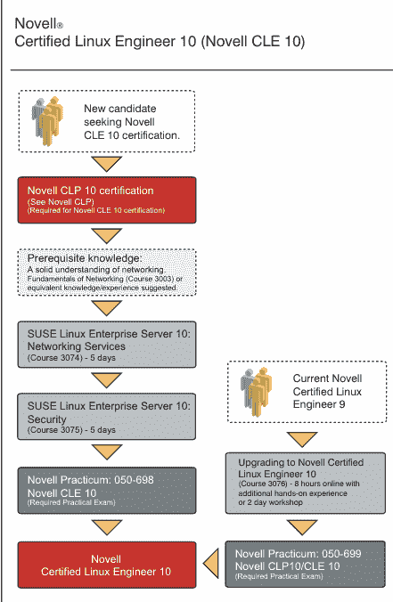

本课程中的练习假设学生熟悉文本编辑器。它们没有列出每一个步骤，而是假设学生已经熟悉 Linux 系统管理，不需要对基础步骤进行详细描述。

Intro-4 严禁复制本手册的全部或部分内容，或分发此类副本。如怀疑有抄袭，请拨打 1-800-PIRATES。第 1 版

## 导言

在参加本课程之前，你应该已经参加过以下课程：

- SUSE Linux Enterprise Server 10 基础（课程 3071）
- SUSE Linux Enterprise Server 10 管理（课程 3072）
- SUSE Linux Enterprise Server 10 高级管理（课程 3073）

通过 Novell CLP 也是可以接受的准备方式。

SUSE Linux Enterprise Server 10: 网络服务（课程 3074）是 CLE10 路径的第一门课程。最后一门课程是 SUSE Linux Enterprise Server 10: 安全（课程 3075）。


有关 Novell 认证计划以及参加 Novell CLP 10 和 CLE 10 实践考试的更多信息，请访问 http://www.novell.com/training/certinfo。

## SUSE Linux Enterprise Server 10 支持与维护

你在学生包中收到的 SUSE Linux Enterprise Server 10 副本是 SUSE Linux Enterprise Server 10 产品的完整功能副本。

然而，为了获得官方支持和维护更新，你需要执行以下操作之一：

- 注册免费的序列号，该代码将为你提供 30 天的支持和维护。
- 从 Novell（或授权零售商）购买一份 SUSE Linux Enterprise Server 10 副本。

你可以在 http://www.novell.com/products/linuxenterpriseserver/eval.html 获取你的免费 30 天支持和维护代码。


你需要拥有或创建一个 Novell 登录帐户以访问 30 天试用版。

## Novell 客户中心

Novell Customer Center 是一个直观的基于网络的界面，帮助你管理与 Novell 的业务和技术交互。Novell Customer Center 整合了对信息、工具和服务的访问，例如：

- 新 SUSE Linux Enterprise 产品的自动注册
- Novell 出售的所有 Linux 产品的补丁和更新
- 所有 Novell 产品、订阅和服务的订单历史
- 新 SUSE Linux Enterprise 产品的权限可见性
- Linux 订阅续订状态
- 通过合作伙伴或 Novell 进行订阅续订

例如，一家公司可能有一位需要下载 SUSE Linux Enterprise 软件更新的管理员、一个想要查看订单历史的采购员，以及一个必须对账许可的 IT 经理。通过 Novell Customer Center，公司可以在一个地方满足所有这些需求，并可以为每个用户提供与其角色相应的访问权限。

你可以通过 http://www.novell/center 访问 Novell 客户中心。

## SUSE Linux Enterprise Server 10 在线资源

Novell 提供了多种在线资源帮助你配置和实施 SUSE Linux Enterprise Server 10。这些包括以下内容：

- http://www.novell.com/products/linuxenterpriseserver/
- http://www.novell.com/documentation/sles10/index.html
- http://www.novell.com/support/
- http://www.novell.com/latest

## 日程

以下是本课程的日程：

| 章节 | 时长 |
| :--- | :--- |
| 第 1 天 简介 | 01:00 |
| 节 1 使用 BIND 配置 DNS 服务器 (I) | 05:00 |
| 第 2 天 节 1 使用 BIND 配置 DNS 服务器 (II) | 01:00 |
| 节 2 使用 DHCP 管理网络 | 03:00 |
| 第 3 天 节 3 管理 OpenLDAP (I) | 02:00 |
| 节 3 管理 OpenLDAP (II) | 03:00 |
| 第 4 天 节 4 配置邮件服务器 (I) | 03:00 |
| 节 4 配置邮件服务器 (II) | 03:00 |
| 第 5 天 节 5 使用 OpenSLP | 01:00 |
| 节 6 监控网络流量 (I) | 02:00 |
| 节 6 监控网络流量 (II) | 02:00 |
| 附录 A 准备 Novell 实践考试 | 04:00 |

## 场景

Digital Airlines 管理层决定使用 SUSE Linux Enterprise Server 10 自带的服务，包括 BIND、DHCP、OpenLDAP、邮件服务器和 OpenSLP。你已经安装了 SUSE Linux Enterprise Server 10，并熟悉使用 YaST 和命令行管理 SUSE Linux Enterprise Server。

为了部署这些服务，你需要在以下领域拥有经验：

- 域名命名系统 (DNS)
- 动态主机配置 (DHCP)
- OpenLDAP
- 电子邮件管理
- OpenSLP
- 网络流量监控

你决定在实验室中设置服务器以练习这些技能。

## 练习

本课程中的练习由练习描述以及解决任务的逐步说明组成。

你应该首先根据相应章节涵盖的内容尝试独立解决任务。只有当你觉得无法解决任务，或者为了确认你的做法是否正确时，才参考逐步说明。

## 练习约定

在进行练习时，你会看到某些约定，表示你需要输入的信息针对你的服务器。

以下是常见的约定：

- *斜体/粗体文本**：指的是你的特定情况，例如服务器的主机。例如，如果你的服务器主机是 DA50，而你看到：

```
hostname.digitalairlines.com
```

你应该输入

```
DA50.digitalairlines.com
```

- **10.0.0.xx**：分配给你的 SUSE Linux Enterprise Server 10 服务器的 IP 地址。例如，如果你的 IP 地址是 10.0.0.50，而你看到：

```
10.0.0.xx
```

你应该输入

```
10.0.0.50
```

- **选择（Select）。** 单词 *select* 用于在操作步骤中，表示各种动作，包括点击界面上的按钮和选择菜单项。

- **回车和输入（Enter and Type）。** 单词 *enter* 和 *type* 具有不同的含义。

单词 *enter* 的意思是是在字段或命令行界面中输入文本，并在必要时按下回车键（Enter）。单词 *type* 的意思是在不按回车键的情况下输入文本。

如果你被要求 *type*（输入）一个值，请确保你不要按下回车键，否则你可能会启动一个尚未准备好启动的进程。

# 第 1 节 使用 BIND 配置 DNS 服务器

计算机之间通过其 IP 地址进行通信。但对于人类来说，使用名称对计算机进行命名更为简单。

DNS（域名系统）是一个分布式数据库系统，确保全球范围内计算机名称的唯一性。当用户输入计算机名称时，它为计算机提供 IP 地址，反之亦然。

## 目标

1. 理解域名系统
2. 安装并配置 BIND 服务器软件
3. 配置 DNS 服务器
4. 配置 DNS 客户端
5. 转发 DNS 请求
6. 配置访问、日志和安全
7. 配置动态 DNS
8. 使用 YaST 配置 BIND
9. 监控 DNS 服务器
10. 查找更多关于 DNS 信息

## 目标 1

### 理解域名系统

要理解 DNS 域名解析的基础，你需要了解以下内容：

- 互联网早期的名称解析是如何工作的
- 互联网域名概念
- 域名服务器是如何工作的
- 如何查询 DNS

### 互联网早期的名称解析是如何工作的

计算机之间通过 IP 地址进行通信，对于人类来说，使用名称对计算机进行命名更为简单。这需要某种转换，当用户输入计算机名称时，为计算机提供 IP 地址。

在互联网早期，当连接的计算机相对较少时，加利福尼亚斯坦福研究所（SRI）的网络信息中心（NIC）维护着一个文件，正好提供这种转换。

每当系统管理员向互联网添加新计算机或更改已连接计算机的名称时，这些更改会通过电子邮件发送到 SRI-NIC，然后被写入名为 `hosts.txt` 的文件中。

全球的系统管理员都必须通过 FTP 复制此文件并将其分发到他负责的所有计算机上。

该程序有几个弱点：

- **负载。** 向 SRI-NIC 的请求会产生大量的网络流量。此外，存放该文件的计算机很快就会完全过载。
- **名称冲突。** 每个计算机名称在全球范围内只能分配一次。虽然 NIC 能够分配唯一的 IP 地址，但它对名称的选择没有影响。
- **一致性。** 要保证一个在全球范围内分发的文件的一致性非常困难。当 `HOSTS.TXT` 文件的版本到达一台计算机时，它可能已经过期了。
- **可扩展性。** 随着计算机数量的增加，维护工作变得大得多。

1984 年，Paul Mockapetris 为这些问题创建了一个强大的解决方案：域名系统（或 DNS）。DNS 是一个分布式数据库系统，允许对区域进行本地管理，并确保全球范围内计算机名称的唯一性。它的分级结构与 Linux 文件系统的树形结构非常相似。

### 互联网域名概念

DNS 由多个域名组成，这些域名可以分为子域名。该结构的顶层是根域名。它简单地用点（"."）表示。全球有 13 台计算机（实际上有超过 13 台计算机来提供负载均衡和故障备用系统）。根域名下方的第一层由顶级域名（TLDs）构建。

在 DNS 早期，有 7 个顶级域名：

- .com 用于商业机构（如 novell.com 和 suse.com）
- .edu 用于教育机构和研究机构（如 harvard.edu 和 tsci.edu）
- .gov 用于美国政府机构
- .int 用于国际组织
- .mil 用于军事机构
- .net 用于网络基础设施
- .org 用于非盈利组织

### 域名服务器是如何工作的

计算机之间通过 IP 地址进行通信，对于人类来说，使用名称对计算机进行命名更为简单。这需要某种转换，当用户输入计算机名称时，为计算机提供 IP 地址。

以下是 DNS 服务器类型：

| 类型 | 描述 |
| :--- | :--- |
| 主服务器 | 对域负主要责任。从本地文件获取数据。 |
| 从服务器 | 通过区域传输从主服务器获取数据。 |
| 缓存服务器 | 查询其他服务器并将存储在缓存中直到过期。所有回复是非权威的。 |
| 转发服务器 | 将无法回答的查询转发到其他服务器。 |

### 如何查询 DNS

各种程序参与处理 DNS 请求。首先是解析器（resolver）。这是各种程序使用的程序集。

解析器向 DNS 服务器发送请求，解释答案（真实信息或错误消息），并将此信息返回给调用它的程序。

## 使用 BIND 配置 DNS 服务器

如果 DNS 服务器接收到解析器的请求，会发生两种情况之一：

- 如果 DNS 服务器是请求域的权威，DNS 服务器向解析器提供所需的信息（权威答案）。
- 如果 DNS 服务器不是请求域的权威，DNS 服务器查询请求的权威并将结果返回给解析器。

数据存储在 DNS 服务器的缓存中。如果以后有对此数据的请求，DNS 服务器可以立即提供（非权威答案）。

# 该过程如图所示：

## 图 1-2


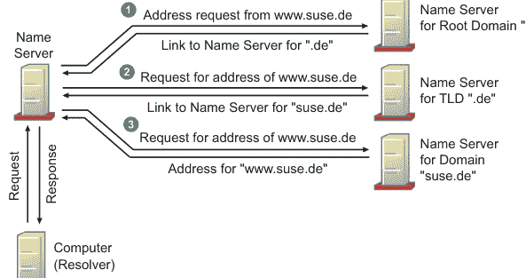

根域域的 DNS 服务器在名称解析中起着至关重要的作用。为了缓解查询带来的服务器负载，每个 DNS 服务器都会将其从其他名称服务器接收到的信息存储在缓存中。当进行查询时，这些信息会被直接发送，而无需重新查询根 DNS 服务器。然而，尽管有这种缓存机制，根 DNS 服务器仍然非常繁忙。每秒数千次的查询并不寻常。

## 目标 2

## 安装并配置 BIND 服务器软件

要运行 DNS 服务器，你需要安装以下软件包：

- `bind`。BIND 服务器软件（SUSE Linux Enterprise Server 10 中的版本为 9.3）
- `bind-chroot`。为 BIND 服务器提供的 chroot 环境
- `bind-utils`。用于查询和测试 BIND 的实用程序（包含在标准安装中）

在启动 DNS 服务器之前，你必须进行一些基础配置更改。完成配置后，可以使用以下命令启动服务器：

```
rcnamed start
```

要停止运行的服务器，使用以下命令：

```
rcnamed stop
```

要让 DNS 服务器在启动时自动启动，使用以下命令：

```
inserver named
```

这会在运行级别目录中创建必要的链接。

默认情况下，名称服务器在 `/etc/sysconfig/named` 中的 chroot 环境中运行（`NAMED_RUN_CHROOTED="yes"`）。

出于安全考虑，应该始终使用 chroot。


所有相关文件（如果在 `/etc/sysconfig/named` 中已指定）都会被复制到 `/var/lib/named/` 中相应的子目录中。例如，BIND 配置文件 `/etc/named.conf` 被复制到 `/var/lib/named/etc/named.conf`。要禁用 chroot 环境，请将变量设置为 no。

## 目标 3

## 配置 DNS 服务器

每种类型 DNS 服务器的配置略有不同。在本目标中，将讨论以下内容：

- 配置仅缓存的 DNS 服务器 (Caching-Only DNS Server)
- 为你的域名配置主服务器
- 配置一个或多个从服务器

## 配置仅缓存的 DNS 服务器

仅缓存的 DNS 服务器不管理自己的数据库，而仅仅接受查询并将它们转发到其他 DNS 服务器。回复会被保存在缓存中。

DNS 服务器配置定义在 `/etc/named.conf` 文件中。你可以使用与 DNS 包一起安装的示例文件作为仅缓存服务器的配置文件。

以下示例显示了简单配置的开头：

```
# /etc/named.conf: 名称服务器的配置 (BIND9)
## 全局选项
options
{
## 数据库文件位于哪个目录？
#
    directory "/var/lib/named";
};
```

以井号 (`#`) 开头的行是注释，会被忽略。

全局选项定义在文件开头的 `options` 块中。`directory` 选项指定了数据库文件（或区域文件）所在的目录。通常，这是 `/var/lib/named/`。

使用 `directory` 选项，你可以使用相对路径指定数据库文件的文件名（不需要绝对路径）。

全局选项之后是为 DNS 服务器管理的域配置的数据库文件定义。对于基础 DNS 服务器功能（例如仅缓存服务器提供的功能），需要若干条目。

每个 DNS 服务器需要三个条目：

- 根 DNS 服务器的条目（BIND 9 不需要，因为它在软件中编译了根 DNS 服务器列表）。
- 本地主机 localhost 的正向解析
- 网络 127.0.0.0 (localhost) 的反向解析

以下是这些条目的示例：

```
## 根名称服务器的条目
zone "." in {
    type hint;
    file "root.hint";
};
#
# localhost 的正向解析
#
zone "localhost" in {
    type master;
    file "localhost.zone";
};
#
# localhost 的反向解析
#
zone "0.0.127.in-addr.arpa" in {
    type master;
    file "127.0.0.zone";
};
```

根 DNS 服务器的区域条目包含一个指向根 DNS 服务器地址的文件。`root.hint` 在安装 `bind` 软件包时会在 `/var/lib/named/` 目录中生成。

用于解析 localhost 的两个文件在安装期间也会生成。这些文件的结构将在稍后解释。

从向根服务器查询开始每个名称解析请求可能会非常慢。如果这些请求转发到一个缓存中含有大量信息的名称服务器（例如，你的互联网服务提供商的名称服务器），在大多数情况下处理过程将快得多。

你可以在 `/etc/named.conf` 文件的 `options` 块中定义这些 DNS 服务器，如下：

```
options {
  directory "/var/lib/named";
  forwarders {
    10.0.0.254;
  };
};
```

你可以输入最多三个 DNS 服务器地址。本地 DNS 服务器无法解析的查询将转发到指定的 DNS 服务器之一。

如果无法访问这些 DNS 服务器，查询将直接发送到根 DNS 服务器。

## 为你的域名配置主服务器

为你的域名配置主服务器，需要执行以下任务：

- 调整主配置文件
- 创建区域文件
- 创建额外的资源记录

## 调整主配置文件

你可以调整仅缓存 DNS 服务器的配置以包含自己的信息。

## 使用 BIND 配置 DNS 服务器

该配置已经包含了根服务器的目录和转发器条目（可以省略）。

区域选项后面是该 DNS 服务器服务的域数据库文件（或区域文件）。对于每个域，至少需要两个文件：

- 用于正向解析的文件（将 IP 地址映射到主机名）
- 用于反向解析的文件（将主机名映射到 IP 地址）

如果属于多个子集，则必须为这些网络中的每一个网络创建一个文件。

每个定义都以 `zone` 开头（这就是为什么数据库文件被称为区域文件），随后是该区域的名称。

对于正向解析，这总是域名。对于反向解析，必须反转给出 IP 前缀（`10.0.0.` 变为 `0.0.10.`），加上后缀 `in-addr.arpa`（`0.0.10.in-addr.arpa`）。

区域名称总是跟着一个 `in`。（其他命名空间几乎从未使用。）

括号中的文本定义了该区域的 DNS 服务器类型（例如 `master`）以及区域文件名。

域名 `digitalairlines.com` 和网络 `10.0.0.0/24` 的条目所示：

```
#
# 域名 digitalairlines.com 的正向解析
#
zone "digitalairlines.com" in {
  type master;
  file "master/digitalairlines.com.zone";
}
# 网络 10.0.0.0 的反向解析
zone "0.0.10.in-addr.arpa" in {
  type master;
  file "master/10.0.0.zone"
}
```

## 创建区域文件

用于 localhost 的两个文件和根 DNS 服务器的文件始终包含在安装中。你不需要更改这些文件；但是你必须创建实际域所需的文件。

`/var/lib/named/master/` 子目录用于主服务器的数据库文件。

手动创建区域文件需要以下内容：

- 文件结构
- `/var/lib/named/master/digitalairlines.com.zone`
- `/var/lib/named/master/10.0.0.zone`
- `/var/lib/named/master/localhost.zone`
- `/var/lib/named/master/127.0.0.zone`

### 文件结构

每个数据库文件都由一系列条目（或资源记录）组成。这些记录的语法始终如下：

`reference [TTL] class type value`

以下内容描述了记录的每个部分：

- **reference（引用）**。记录所指引的引用。它可以是一个域名（或子域名）或一台独立的计算机（名称或 IP 地址）。
- **TTL**。记录的生存时间。如果不存在此项，则将使用默认 TTL 值。它决定了其他名称服务器如何在缓存中存储此信息。
- **class（类）**。记录的类别。对于 TCP/IP 网络，类别始终为 `IN`（互联网）。
- **type（类型）**。记录的类型。最重要的类型列在下表中。
- **value（值）**。记录的值。该值取决于后续列出的记录类型：

| 记录类型 | 含义 | 值 |
|---|---|---|
| SOA | 权威机构起始（权威机构的术语） | 域名的参数 |
| NS | 名称服务器 | 该域名一个 DNS 服务器的名称或 IP 地址 |
| MX | 邮件交换器 | 该域名邮件服务器的名称（或 IP 地址）和优先级 |
| A | 地址 | 计算机的 IP 地址 |
| PTR | 指针 | 计算机的名称 |

### 表 1-2（续表）

| 记录类型 | 含义 | 值 |
|---|---|---|
| CNAME | 规范名称 | 计算机的别名 |

单个条目必须从第一列的引用开始。如果条目不是从第一列开始，则引用将从上一个条目获取。

### 文件 `/var/lib/named/master/digitalairlines.com.zone`

与早期版本的 BIND 不同，BIND 9 要求在开头为所有信息指定一个默认 TTL。每当条目没有显式给出 TTL 时，就会使用此值。

你通过以下指令定义 TTL：

```
;
; 定义一个标准的生存时间，这里是：两天
;
$TTL 172800
```

在此文件中，分号 `;` 被用作注释符号。

在此示例中，TTL 以秒为单位给出。也可以以其他单位给出，例如 `2D` 表示两天。其他单位还有 `M`（分钟）、`H`（小时）和 `W`（周）。

随后是 SOA（权威机构起始）条目的定义，它指定了哪个 DNS 服务器拥有该域名的权威：

```
;
; SOA 条目
digitalairlines.com IN SOA dal.digitalairlines.com
hostmaster.digitalairlines.com. (
    2004092601; 序列号
    1D ; 刷新（一天）
    2H ; 重试（两小时）
    1W ; 过期（一周）
    3H ; “负”有效期（三小时）
)
```

该条目所指的域名（示例中为 `digitalairlines.com`）首先列出。如果名称末尾没有点，则会添加域名，这在此处会导致错误。

DNS 服务器的名称列在 SOA 条目之后（示例中为末尾带点的 `da1.digitalairlines.com.`）。或者，你也可以写 `dal`，域名 `digitalairlines.com` 会在名称之后添加。

接下来是负责 DNS 服务器管理的人的电子邮件地址。电子邮件地址中通常使用的 `@` 必须替换为点（因此此示例中的电子邮件地址为 `hostmaster.digitalairlines.com`）。这是必要的，因为 `@` 作为缩写具有特殊含义。

建议在此处使用通用的电子邮件地址（例如 `hostmaster@digitalairlines.com`），而不是个人电子邮件地址。

下一个条目是序列号。可以使用任何数字，通常在此处使用日期和版本号。在对此文件中的数据进行任何更改后，必须增加序列号。

从服务器使用此数字来确定它们是否需要复制此区域文件。如果主服务器上的序列号大于从服务器上的序列号，则复制该文件。

序列号之后是时间信息（这里列出的前三个条目仅对从服务器重要）：

- 第一个条目使从服务器在经过一段时间后查询主服务器，以查看是否有新版本的文件（示例中为 `1D`，即一天）。
- 如果从服务器无法到达主服务器，则下一个条目指定了应以多大的间隔进行新的尝试（示例中为 `2H`，即两小时）。
- 如果较长时间未连接到主服务器，第三个条目指定了从服务器何时应该丢弃关于该区域的信息（示例中为 `1W`，即一周）。
- 这里的基本思想是，不传递任何信息也比传递过时信息要好。

第四个条目定义了 DNS 服务器的负响应的有效时间。每个请求服务器都会将其响应存储在缓存中，即使计算机名称无法解析（示例中为 `3H`，即三小时）。

这些时间定义之后是作为该域名 DNS 服务器的计算机的名称或 IP 地址。在所有情况下，必须在此处输入主服务器。如果使用了从服务器，它们也应该输入在以下位置：

```
; 名称服务器条目
; digitalairlines.com. IN NS da1.digitalairlines.com.
;                 IN NS da2.digitalairlines.com.
```

此处可以省略域名。然后将从 SOA 条目中获取域名。

在该文件的末尾是分配给主机的 IP 地址。

在 `/var/lib/named/master/10.0.zone` 中，分配给主机名称的地址使用 A 条目，如下所示：

```
; 分配给主机名称的 IP 地址
dal10   IN A 10.0.0.10
dal12   IN A 10.0.0.12
dal13   IN A 10.0.0.13
...
14     IN A 10.0.0.14
;
dal254 IN A 10.0.0.254
dal2    IN A 10.0.0.2
```

### `/var/lib/named/master/10.0.zone`

反向解析文件包含与正向解析文件类似的条目。文件的开头是默认 TTL 的定义和 SOA 条目。

在 SOA 和 NS 条目中，网络地址以反序写入：

```
; 域名 digital airlines.com 的数据库文件
; 网络 10.0 的反向解析
;
; 定义默认 TTL，这里是：两天
;
$TTL 172800
;
; SOA 条目
;
0.10.in-addr.arpa. SOA root (d. adams)
      42 ; 刷新
      2D ; 重试
      4H ; 过期
      6W ; 最小
      1W )

; 名称服务器条目
;
IN NS dal.digitalairlines.com.
```

### `/var/lib/named/master/localhost.zone`

对于本地计算机，必须存在以下两个文件。它们在安装期间自动创建，不应修改。

以下是 `/var/lib/named/master/localhost.zone` 的示例：

```
$TTL 1W

@ IN SOA root (d. adams)

      42 ; 刷新

      2D ; 重试

      4H ; 过期

      6W ; 最小

      1W )

@

IN A 127.0.0.1
```


# 文件 `/var/lib/named/master/127.0.0.zone`

在此文件中，也使用了缩写符号 `@`。但在这里必须显式地给出 localhost 计算机名（记得结尾有一个点）：

| TTL 1W | | localhost. root.localhost. ( |
| :--- | :--- | :--- |
| @ IN SOA | 42 ; serial (d. adams) | |
| 2D | ; refresh | |
| 4H | ; retry | |
| 6W | ; expiry | |
| 1W ) | ; minimum | |
| IN NS | localhost. | |
| 1 IN PTR | localhost. | | (注：原文 OCR 处识别为 "1 IN PTR")

## 创建额外的资源记录

除了已经讨论过的资源记录（`SOA`, `NS`, `A`, `PTR`）之外，还有 `MX` 和 `CNAME` 资源记录，它们用于执行以下操作：

- 定义域的邮件服务器
- 为计算机分配别名

### 定义域的邮件服务器

为了能够使用 `geeko@digitalairlines.com` 格式的电子邮件地址，必须在 DNS 服务器条目之后，数据库文件中创建一个 `MX`（邮件交换）条目用于正向解析：

| digitalairlines.com. | IN MX 0 mail |
| :--- | :--- |
| | IN MX 10 dal |
| | IN MX 10 da5 |

如果现在向地址 `geeko@digitalairlines.com` 发送邮件，发送邮件的计算机会询问 DNS 服务器哪台计算机是邮件服务器，并会收到返回的 `MX` 条目列表。

可以提供多个邮件服务器。根据它们的优先级，然后决定将邮件发送到哪台计算机。邮件服务器的优先级由 `MX` 旁边的数字定义；数字越小，优先级越高。

在这个示例中，计算机 `mail.digitalairlines.com` 优先级最高（因此，它是主邮件服务器）。`dal.digitalairlines.com` 和 `da5.digitalairlines.com` 的优先级相同。

如果无法连接到优先级最高的邮件服务器，则使用优先级次之（即第二高）的邮件服务器。如果有多个邮件服务器优先级相同，则随机选择其中一个。对于每个邮件服务器都必须创建一个地址条目。

### 为计算机分配别名

如果你希望通过多个名称访问某台计算机（例如将计算机命名为 `da30.digitalairirlines.com` 和 `www.digitalairairlines.com`），则提供相应的别名。

这些是正向解析数据库文件中的 `CNAME`（规范名称）条目：

| da30 | IN A | 10.0.0.3 |
| :--- | :--- | :--- |
| www | IN CNAME | da30 |

域的邮件服务器名称（`MX` 条目）不能是别名，因为某些邮件服务器无法正确处理此类情况。

# 配置一个或多个从服务器

为了保证可靠运行，除了主服务器外，至少还需要一个 DNS 服务器。它可以分担 DNS 主服务器的部分负载。但在 DNS 主服务器不可用时，这一点尤为重要。这台额外的 DNS 服务器被设定为 DNS 从服务器。

这两种服务器之间的本质区别是，从服务器从主服务器接收区域文件的副本。对区域文件的修改只在主服务器上进行。

一旦从服务器启动，它就会连接到主服务器并从那里接收一份区域文件的副本。这被称为区域传输（zone transfer）。

服务器之间的数据比较会自动进行。一方面，从服务器会定期查询主服务器，并使用区域文件的序列号检查任何已更改的内容。

默认情况下，主服务器在重启后会立即向所有列出的从服务器发送消息（称为 `notify`），以便让它们读取修改过的区域文件。

在从服务器的 `/etc/named.conf` 配置文件中，至少有两个条目将其定义为主服务器：即两个回环网络（localhost）的两个区域定义。

可能还存在一个根 DNS 服务器的区域定义。但只有当从服务器将请求转发到其他 DNS 服务器时，才需要区域定义。

对于需要从主服务器复制数据的区域，定义如下：

```
zone "digitalairlines.com" in {
  type slave;
  file "slave/digitalairlines.com.zone";
  masters {
    10.0.0.254;
  }
}
```

从服务器从 IP 地址为 `10.0.0.254` 的主服务器获取数据，并将其存储在 `/var/lib/named/slave/` 目录下。该目录在安装 BIND 软件包时会被创建。

必须对反向解析进行类似的配置，如下所示：

```
zone "0.0.0.10.in-addr.arpa" in {
  type slave;
  file "slave/10.0.0.zone";
  masters {
    10.0.0.254;
  }
}
```

在最简单的配置中，从服务器定期从主服务器获取信息。这可能导致从服务器在一段时间内提供过时的信息。

这就是为什么让主服务器通知从服务器数据库文件中的修改是合理的。随后，从服务器会立即执行区域传输，这总能让它们保持最新状态。

为了让主服务器能够与从服务器通信，它必须了解它们。默认情况下，主服务器会自动通知其从服务器。这也可以在文件的 `options` 部分进行定义：

```
options {
  notify yes;
}
```

随后，主服务器必须被列出：

| digitalairlines.com. | IN NS | |
| :--- | :--- | :--- |
| | | da8.digitalairlines.com |

## 目标 4

## 配置 DNS 客户端

要指示计算机使用特定的 DNS 服务器，必须将关于该服务器的信息写入 `/resolv.conf` 文件。这可以使用 YaST（在安装期间或任何时间）通过任何文本编辑器编辑此文件来实现。

`/resolv.conf` 文件内容如下：

```
search digital airlines.com
nameserver 10.0.0.254
```

通常，此文件包含以下两种类型的条目：

- `search`：此关键字之后的一系列域名（或子域）列表。这允许使用主机名解析到正确的地址。例如，如果你提供 `digitalairlines.com` 和 `atl.digitalairlines.com` 作为域名，主机名将被扩展为 `server.digitalairlines.com` 以查找相应的 IP。
- `nameserver`：该关键字指定要使用的 DNS 服务器 IP 地址。你可以最多设置 3 个条目，但每个条目只能包含一个服务器地址。

对于客户端还有另一个重要的文件：`/etc/nsswitch.conf`。该文件适用于所有使用 C 库（`libc6`）解析函数的程序。（该文件的前身是 `/etc/host.conf`。）

此文件配置名称服务切换，负责解析主机名、网络名、用户和组。

用于解析主机名的相关部分如下：

```
#
# /etc/nsswitch.conf
#
hosts:          files dns
networks:      files dns
```

此处显示的两个条目定义了解析主机名的首次尝试使用 `/etc/hosts` 文件。如果失败，则联系 DNS 服务器来解析该名称。网络名的解析也如此，首先使用 `/etc/networks`。

## 目标 5

## 转发 DNS 请求

如果 DNS 服务器没有关于要解析计算机的信息，它将尝试从另一个 DNS 服务器获取这些信息。

为了实现这一点，DNS 服务器必须知道如何找到其他 DNS 服务器：

- 根域的 DNS 服务器
- 向特定服务器转发请求
- 为子域转发请求

### 根域的 DNS 服务器

在 `/etc/named.conf` 配置文件中应该有一个区域条目，引用包含根 DNS 服务器地址的文件。

该文件在安装 `bind` 软件包时创建在 `/var/lib/named/` 目录下，名为 `root.hint`。

`/etc/named.conf` 中的区域条目如下：

```
zone "." in
{
    type hint;
    file "root.hint";
}
```

### 向特定的名称服务器转发请求

如果没有配置额外的条目，名称服务器可以直接联系到根名称服务器。但也可以提供其他名称服务器的地址。如果它本身无法解析计算机主机名，它将优先使用这些服务器。

此类名称服务器的定义在 `/etc/named.conf` 文件的 `options` 部分指定：

```
options {
  directory "/var/lib/named";
  forwarders {
    10.0.0.10;
    10.0.0.15;
  }
}
```

在这种情况下，无法在本地解析的请求将转发给指定的两个名称服务器之一。如果这两个服务器都无法访问，请求将如上所述通过根名称服务器运行。

### 为子域转发请求

如果使用另一个名称服务器来解析子域的主机名，则必须在相应的区域条目中定义该名称服务器。

类型设置为 `forward`，并且必须指定相应名称服务器的地址：

```
zone "slc.digitalairlines.com" in {
  type forward;
  forward only;
  forwarders {
    10.0.0.10;
  }
}
```

如果你包含了 `forward only` 条目，则指示名称服务器永远不要尝试自己解析地址。所有涉及子域 `slc.digitalairlines.com` 的请求都将转发到地址为 `10.0.0.10` 的名称服务器。必须定义相应的反向解析指令。

## 练习 1-1 配置带有转发复制的 DNS 服务器

在本次练习中，你将与伙伴合作为 `digitalairairlines.com` 域配置一个 DNS 主服务器和一个 DNS 备服务器。

你将在工作手册中找到此练习。

（练习结束）

## 目标 6

## 配置访问、日志记录与安全

在上一个目标中，你学习了如何配置 DNS 服务器。在本目标中，你将学习以下配置选项：

- 限制对名称服务器的访问
- 配置日志选项
- 区域传输的安全因素

### 限制对名称服务器的访问

为了防止名称服务器过载，仅允许特定计算机或网络的访问是很有用的。

要实现这一点，请使用 `allow-query` 指令。该指令定义在 `/etc/named.conf` 文件的 `options` 部分：

```
options {
  ...
  allow-query {
    10.0.0.0/24;
    10.0.1.0/24;
  }
};
```

如果你包含了此指令，则只有定义网络中的计算机可以访问此名称服务器。所有其他计算机将收到错误消息。

> 不要对向互联网上的主机提供你网络信息的名称服务器使用此指令。

### 配置日志选项

`logging` 配置语句可用于定义 BIND 的日志记录行为。

日志消息使用通道（channels）写入。除了一些预定义的通道外，可以定义无限数量的通道。每个通道都包含一个目的，用于决定如何处理这些消息。

可能的目的包括：

- `syslog`：消息传递给 syslog 守护进程。
- `null`：消息被丢弃。
- `file`：指定写入消息的文件。你可以添加进一步的选项，例如：
  - `size`：最大文件大小。如果达到此大小，则会创建一个新版本的文件。
  - `version`：存储的文件数量。

每条消息都有一个优先级。你可以使用 `severity` 条目来确定从哪个优先级将消息写入此通道。可能的严重性级别有：

- `critical`：类似于 syslog 使用的“critical”级别。
- `error`：类似于 syslog 使用的“error”级别。
- `warning`：类似于 syslog 使用的“warning”级别。
- `notice`：类似于 syslog 使用的“notice”级别。
- `info`：类似于 syslog 使用的“info”级别。这是默认严重性。
- `debug [level]`：你可以指定一个调试级别。对于任何等于或高于指定级别的消息，都会记录日志；较低级别的消息不会被记录。
  - `level` 可以是 0（无调试日志）到 11（全调试日志）之间的整数。默认级别为 1。
- `dynamic`：如果你指定了动态严重性，则服务器将从服务器启动级别继承其调试级别。

你可以通过使用参数 `-d [level]` 来指定服务器的启动调试级别。

以下是一个标记为 `sec_file` 的通道定义示例：

```
logging {
  channel sec_file {
    file "/var/log/bind_security.log" versions 3 size 20m;
    severity debug 3;
    print-time yes;
    print-category yes;
    print-severity yes;
  };
}
```

你可以看到日志选项的语法：日志选项包含了通道 `sec_file` 的定义。

所有发送到此通道的调试级别为 3 的消息都会写入 `/var/log/bind_security.log` 文件，并带有时间戳（`print-time yes`）、类别（`print-category yes`）和严重性级别（`print-severity yes`）。一旦文件达到 20 MB（`size 20m`），就会创建一个新文件。会存储三个旧版本的文件（`version 3`）。

（注：由于原文存在大量重复和 OCR 错误，已根据逻辑进行了清理和翻译）

此密钥必须包含在主服务器和从服务器的 `/etc/named.conf` 文件中。

## 配置主服务器

在主服务器的 `/etc/named.conf` 文件中，必须创建以下条目：

```
options {
  ...
}

key zonetransfer {
  algorithm HMAC-MD5;
  secret "KhDvspoqFonWkV58rFXOWow==";
}

zone "digitalairlines.com" in {
  type master;
  file "master/digitalairlines.com.zone"
  allow-transfer {
    key zonetransfer;
  }
}
```

必须为反向解析创建一个相应的条目。

```
zone "0.0.10.in-addr.arpa" in {
  type master;
  file "master/10.0.0.zone"
  allow-transfer {
    key zonetransfer;
  }
}
```

该密钥文件（`/etc/named.conf`）除了 root 用户和 named 组之外的任何人都不应该是可读的。

# 这通过 `/etc/named.conf` 的预定义权限确保：

```
da51:- # ls -l /etc/named.conf
rw-r----- 1 root 572 Jun 14:30 /etc/named.conf
```

如果你使用 `include` 语句包含该密钥，则没有修改 `/etc/named.conf` 文件的权限。

## 配置从服务器

在从服务器上，在 `/etc/named.conf` 文件中定义密钥。所有指向主服务器的请求将使用此密钥签名（通过 `server` 指令）。

以下是一个示例：

```
options {
  ...
}

key zonransfer {
  algorithm HMAC-MD5;
  secret "KhdVspqFonWkv58rFXOWw==";
}

server 10.0.0.2 {
  keys {
    zonransfer;
  }
}
```

同样重要的是，只有 root 用户和 named 组能够读取包含密钥的配置文件。

如果现在有一计算机尝试在没有密钥的情况下执行区域传输，则区域传输将被拒绝。在主服务器上，相应的消息列在 `/var/log/messages` 文件中。成功的区域传输会在 `/var/log/messages` 中生成类似下面的消息：

```
Apr 21 10:37:18 da51 named[3976]: client 10.0.0.20#32769: transfer of 'digitalairlines.com/IN': AXFR started
```

失败的区域传输会在 `/var/log/messages` 中生成类似这样的消息：

```
Apr 21 10:38:59 da51 named[3976]: client 10.0.0.20#32775: request has invalid signature: tsig verify failure
```

在从服务器的 `/var/log/messages` 中，会生成类似这样的消息：

```
Apr 21 10:40:01 da20 named[4099]: zone 0.0.10.in-addr.arpa/IN: refresh: failure trying master 10.0.0.51#53: tsig indicates error
```

## 从从服务器进行区域传输

虽然可以执行从从服务器的区域传输，但你应该禁止这种操作。

如果你只有一个服务器（主服务器）允许向从服务器传输区域，你必须确保所有从服务器获取完全相同的信息。

要禁止来自服务器的区域传输，请使用以下语句：

```
options {
  allow-transfer {none};
};
```


## 练习 1-2

### 配置从主服务器到从服务器的区域传输

在此练习中，你将配置从主服务器到从服务器的区域传输。

将在练习集中找到此练习。

（练习结束）

## 配置动态 DNS

### 目标 7

你可以动态修改名称服务器的资源记录源，而无需编辑和加载文件。这被称为动态 DNS。动态 DNS 也可以由 DHCP 等外部服务器使用。

```
allow-update { 127.0.0.1; };
```

要动态编辑 DNS 记录，请使用命令 `nsupdate`：

```
da51:- # nsupdate
>
```

> 安全工具 AppArmor 默认在 SUSE Linux Enterprise 10 上已安装并启用。BIND 有一个 AppArmor 配置文件，可以禁止 `nsupdate` 修改 BIND 区域信息。SUSE Linux Enterprise 10 安全（课程 3075）课程中详细介绍了 AppArmor。
>
> 通过输入 `rcapparmor stop` 停止 AppArmor 守护进程，以便如下所述使用 `nsupdate`。

在使用 `nsupdate` 之前，请确保所有区域文件具有正确的访问权限。如果设置设置，请使用以下命令：

```
chgrp -R named /var/lib/named
chmod -R g+w /var/lib/named
```

动态更新存储在区域的日志文件中。该文件由服务器在执行第一次动态更新时自动生成。日志文件的名称通过在相应区域文件名称后附加 `.jnl` 扩展名来创建。日志文件为二进制格式，不应手动编辑。

日志文件的内容每 15 分钟写入一次区域文件。当服务器关闭时，日志文件的内容也会写入区域文件。

 动态更新将每 15 分钟写入一次区域文件。当服务器关闭时，日志文件的内容也会写入区域文件。

使用 BIND 配置 DNS 示例：

```
options {
  ...
}

key zonransfer {
  algorithm HMAC-MD5;
  secret "KhdVspqFonWkv58rFXOWw==";
}

server 10.0.0.2 {
  keys {
    zonransfer;
  }
}
```

或者，你可以指定一个包含所需命令的文件。作为一个 ASCII 文件（称为 **updates**），其内容与上述交互式 DNS 更新的结果相同：

```
da51: ~ # cat updates
update delete da7.digitalairlines.com
update add da8.digitalairlines.com 84600 A 10.0.0.8
da51: ~ # nsupdate -v -k Kdcp-dns.157+23165.key updates
da51: ~ #
```

### 目标 8 使用 YaST 配置 BIND

YaST 提供了一个用于配置命名服务器的模块。要启动该模块，请选择

YaST 2 > 网络服务 > DNS 服务器

1-3

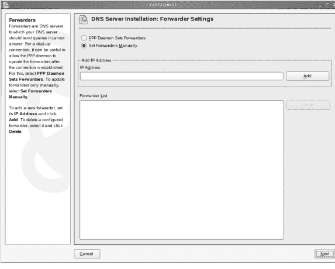

只有当文件具有非常特定的结构时，YaST 才能解码手动创建的配置和区域文件。

详细信息请参阅安装和管理指南。在这里，我们想查看 SUSE Linux Enterprise Server 10 的另一个特殊方面。

除了 `/etc/named.conf` 之外，还可以包含额外的配置文件。默认情况下，会查找 `/etc/named.conf.include`。这定义在 `/etc/named.conf` 的末尾：

```
include "/etc/named.conf.include";
```

可以在 `/etc/sysconfig/named` 中指定额外的配置文件。变量 `NAMED_CONF_INCLUDE_FILES` 必须包含要包含的文件名。如果这些文件名不包含绝对路径，则它们必须位于 `/etc/named.d/` 目录下。

所有相关文件（如果已经在 `/etc/sysconfig/named` 中指定）都会被复制到 chroot 环境下相应的子目录（`/var/lib/named/`）中。例如，BIND 配置文件 `/etc/named.conf` 被复制到 `/var/lib/named/etc/named.conf`。

变量 `NAMED_CONF_INCLUDE_FILES` 的内容由启动脚本 `/etc/init.d/named` 解析。

启动命名服务器的附加选项可以在 `/etc/sysconfig/named` 中指定。

### 目标 9

### 监控 DNS 服务器

在这个目标中，你将学习一些帮助监控你的 DNS 服务器的工具：

- 使用命令行工具查询 DNS 服务器
- 使用 `rmdc` 控制命名服务器
- 检查配置文件

#### 使用命令行工具查询 DNS 服务器

有几个命令行工具可以查询 DNS 服务器。这些包括：

- `host` 命令
- `dig` 命令

##### host 命令

查询 DNS 服务器最重要的命令行工具称为 `host`。其通用语法如下：

```
host computer nameserver
```

下面的示例显示了它的用法：

```
da51:~ # host da50
da50.digitalirlines.com has address 10.0.0.50
da51:~ # host 10.0.0.49
49.0.0.10.in-addr.arpa domain pointer da49.digitalirlines.com.
```

如果未提供命名服务器，`host` 将联系 `/etc/resolv.conf` 中列出的服务器。如果你想使用另一个 DNS 服务器，必须在命令中提供其 IP 地址。

默认情况下，`host` 返回 IP 地址或主机名，取决于给的是哪种信息。如果你想查询域名信息，需要使用选项 `-t` 并配合所需的类型类型，如下：

```
da51:- # host -t ns novell.com
novell.com name server ns.novell.com
novell.com name server ns1.westnet.net
novell.com name server ns1.utah.edu
da51:- # host -t mx novell.com
novell.com mail is handled by 5 prv-mx.prova.novell.com
novell.com mail is handled by 5 prvl-mx.prova.novell.com
novell.com mail is handled by 5 minotaur.novell.com
da51:- # host -t soa novell.com
novell.com has SOA record ns.bwayne.novell.com
2006053001 3600 900 604800 21600
```

在这个示例中，请求了域名 `novell.com` 的 DNS 服务器主机名。

##### dig 命令

更详细的命令是 `dig`，通常用于排除 DNS 问题。其通用语法如下：

```
dig @nameserver computer type query_options
```

选项列表所示：

| 选项 | 说明 |
| --- | --- |
| nameserver | 应查询的 DNS 服务器的 IP 地址或名称。如果未指定，`dig` 将检查 `/etc/resolv.conf` 中列出的所有 DNS 服务器。 |
| computer | 要查询的资源记录（例如主机名、IP 地址或域名）。 |
| type | 返回的资源记录类型，例如 a (IP 地址)、ns (DNS 服务器)、mx (邮件交换器)、x (指针) 或 any (所有信息)。 |
| query_options | 定义如何进行查询以及如何显示结果。每个查询选项都以加号 (+) 开头。 |

`host` 和 `dig` 之间最重要的区别是 `dig` 默认不使用 `/etc/resolv.conf` 中的域名列表来扩展主机名。这意味着必须指定主机的完全限定域名 (FQDN) 或 IP 地址。如果应该使用域名列表，你需要使用查询选项 `+search`。

下面的示例演示了 `dig` 的用法：

```
da51~: # dig ripe.net ns
; << DIG 9.2.3 >> ripe.net ns
;; global options: printcmd
;; Got answer:
;;; >>HEADER<<-- opcode: QUERY, status: NOERROR, id: 1315
;; flags: qr rd ra; QUERY: 1, ANSWER: 5, AUTHORITY: 0, ADDITIONAL: 9
; QUESTION SECTION: IN NS
ripe.net.
; ANSWER SECTION:
ripe.net. 158814 IN NS ns2.nic.fr.
ripe.net. 158814 IN NS sunic.sunet.se.
ripe.net. 158814 IN NS auth03.ns.su.net.
ripe.net. 158814 IN NS munnari.oz.au.
ripe.net. 158814 IN NS ripe.net.
; ADDITIONAL SECTION:
ripe.net. 171939 IN A 193.0.0.193
ripe.net. 171939 IN AAAA 2001:610:c:193
ripe.net. 171939 IN AAAA 193.0.0.193
ripe.net. 171939 IN AAAA 2001:610:c:193
```


# 使用 rmdc 控制命名服务器

在这个目标中，你将学习一些帮助监控你的 DNS 服务器的工具：

- 使用命令行工具查询 DNS 服务器
- 使用 `rmdc` 控制命名服务器
- 检查配置文件

## 使用命令行工具查询 DNS 服务器

有几个命令行工具可以查询 DNS 服务器。这些包括：

- `host` 命令
- `dig` 命令

### host 命令

查询 DNS 服务器最重要的命令行工具称为 `host`。其通用语法如下：

```
host computer nameserver
```

下面的示例显示了它的用法：

```
da51:~ # host da50
da50.digitalirlines.com has address 10.0.0.50

da51:~ # host 10.0.0.49
49.0.0.10.in-addr.arpa domain pointer da49.digitalirlines.com.
```

如果未提供命名服务器，`host` 将联系 `/etc/resolv.conf` 中列出的服务器。如果你想使用另一个 DNS 服务器，必须在命令中提供其 IP 地址。

默认情况下，`host` 返回 IP 地址或主机名，取决于给的是哪种信息。如果你想查询域名信息，需要使用选项 `-t` 并配合所需的类型类型，如下：

```
da51:- # host -t ns novell.com
novell.com name server ns.novell.com
novell.com name server ns1.westnet.net
novell.com name server ns1.utah.edu

da51:- # host -t mx novell.com
novell.com mail is handled by 5 prv-mx.prova.novell.com
novell.com mail is handled by 5 prvl-mx.prova.novell.com
novell.com mail is handled by 5 minotaur.novell.com

da51:- # host -t soa novell.com
novell.com has SOA record ns.bwayne.novell.com
2006053001 3600 900 604800 21600
```

在这个示例中，请求了域名 `novell.com` 的 DNS 服务器主机名。

### dig 命令

更详细的命令是 `dig`，通常用于排除 DNS 问题。其通用语法如下：

```
dig @nameserver computer type query_options
```

选项列表所示：

| 选项 | 说明 |
| --- | --- |
| nameserver | 应查询的 DNS 服务器的 IP 地址或名称。如果未指定，`dig` 将检查 `/etc/resolv.conf` 中列出的所有 DNS 服务器。 |
| computer | 要查询的资源记录（例如主机名、IP 地址或域名）。 |
| type | 返回的资源记录类型，例如 a (IP 地址)、ns (DNS 服务器)、mx (邮件交换器)、x (指针) 或 any (所有信息)。 |
| query_options | 定义如何进行查询以及如何显示结果。每个查询选项都以加号 (`+`) 开头。 |

`host` 和 `dig` 之间最重要的区别是 `dig` 默认不使用 `/etc/resolv.conf` 中的域名列表来扩展主机名。这意味着必须指定主机的完全限定域名 (FQDN) 或 IP 地址。如果应该使用域名列表，你需要使用查询选项 `+search`。

#### 下面的示例演示了 dig 的用法

```
da51~: # dig ripe.net ns
; << DIG 9.2.3 >> ripe.net ns
;; global options: printcmd
;; Got answer:
;;; >>HEADER<<-- opcode: QUERY, status: NOERROR, id: 1315
;; flags: qr rd ra; QUERY: 1, ANSWER: 5, AUTHORITY: 0, ADDITIONAL: 9
; QUESTION SECTION: IN NS
ripe.net.
; ANSWER SECTION:
ripe.net. 158814 IN NS ns2.nic.fr.
ripe.net. 158814 IN NS sunic.sunet.se.
ripe.net. 158814 IN NS auth03.ns.su.net.
ripe.net. 158814 IN NS munnari.oz.au.
ripe.net. 158814 IN NS ripe.net.
; ADDITIONAL SECTION:
ripe.net. 171939 IN A 193.0.0.193
ripe.net. 171939 IN AAAA 2001:610:c:193
ripe.net. 171939 IN AAAA 193.0.0.193
ripe.net. 171939 IN AAAA 2001:610:c:193
```

*(注：dig 输出的 OCR 包含了一些重复/乱码行；我已经清理了结构以反映标准的 DNS 响应格式)*

## 使用 rmdc 控制命名服务器（配置详情）

在此回环连接中，第一条语句指示计算机在 IP 地址为 `127.0.0.1` 的回环接口上监听，第二条语句指示计算机在 IP 地址为 `10.0.0.2` 的接口上监听。

在 `allow` 语句之后，提供了一个允许访问的主机列表。对于回环接口，仅允许来自 localhost 的访问。对于 IP 地址 `10.0.0.2`，允许来自 localhost 和计算机 `10.0.0.51` 的访问。两种情况下，必须使用名为 `rndc_key` 的密钥获取访问。

当你在 `/etc/named.conf` 中添加 `controls` 语句时，名称服务器在重载后将监听 953 端口。

```
da51:~ # nmap dal
Starting nmap 3.50 ( http://www.insecure.org/nmap/ ) at 2005-04-21 12:34 CEST
Interesting ports on da2.digitalairirlines.com (10.0.0.2):
(The 1653 ports scanned but not shown below are in state: closed)
PORT    STATE SERVICE
22/tcp  open    ssh
53/tcp  open    domain
```


# SUSE Linux Enterprise Server 10: 网络服务

## 端口扫描结果

| 端口 | 状态 | 服务 |
| --- | --- | --- |
| 111/tcp | open | rpcbind |
| 427/tcp | open | svrloc |
| 631/tcp | open | ipp |
| 953/tcp | open | rndc |

## `rndc` 命令用法

如果你不带任何选项运行 `rndc`，你会看到可用参数列表：

```
da51:- # rndc
Usage: rndc [-c config] [-s server] [-p port] [-k key-file ] [-y key] [-V] command
```

`command` 是以下内容之一：

- `reload` 重载配置文件和区域文件。
- `reload zone [class]` 重新加载单个区域。
- `refresh zone [class]` 为区域调度立即维护。
- `reconfig` 仅重载配置文件和新区域。
- `stats` 将服务器统计信息写入 `statistics_file`。
- `querylog` 切换查询日志。
- `dumpdb` 将缓存转储到 dump 文件（`named_dump.db`）。
- `stop` 将更新保存到主文件并停止服务器。
- `halt` 在不保存待处理更新的情况下停止服务器。
- `trace` 增加调试级别。
- `trace level` 更改调试级别。
- `notrace` 将调试级别设置为 0。
- `flush` 刷新服务器的所有缓存。
- `flush [view]` 刷新特定视图的服务器缓存。
- `status` 显示服务器状态。
- `restart` 重启服务器。

> * = 尚未实现
>
> Version: 9.2.3

使用这些选项，你可以始终指定另一个服务器或另一个用于请求的密钥。

### `rndc` 使用示例

```
da51:- # rndc status
number of zones: 4
debug level: 0
xfers running: 0
xfers deferred: 0
soa queries in progress: 0
query logging is OFF
server is up and running

da51:- # rndc dumpdb
```

最后一行创建名称服务器缓存的转储。dump 文件在 `/etc/lib/named` 中通过 `dump_file` 语句定义。默认是 `/var/lib/named/log/named_dump.db`。在将缓存数据写入该文件之前，需要以正确的权限创建它：

- `/var/lib/named/log/named_dump`
- `chgrp /var/lib/named/log/named_dump`
- `chmod g+w /var/lib/named/log/named_dump`

你可以使用 `less` 或 `cat` 查看转储文件的内容。

如果从没有访问权限的主机尝试 `rndc` 请求（即未列在 `controls` 语句中，或者没有正确的密钥），名称服务器上的 `/var/log/messages` 中将出现类似下面的错误消息：

```
Apr 21 11:29:28 da51 named[4210]: rejected command channel message from 10.0.0.21#32770
```

在被拒绝的客户端，将显示以下消息：

```
da51:- # rndc dumpdb
rndc: recv failed: connection reset
```

## 检查配置文件

如果你更改了名称服务器的配置，在启用它们之前检查配置文件的语法。要更改配置，BIND 包提供了以下工具：

- `named-checkconf`
- `named-checkzone`

### `named-checkconf`

`named-checkconf` 默认检查 `named` 配置文件（`/etc/named.conf`）的语法。如果工具无法检测到错误，则没有输出。如果发生错误，你将得到一条包含行号和提示的消息：

```
da51:- # named-checkconf
/etc/named.conf:52: expected IP address near 'listen-on-v6'
```

如果你想检查另一个文件而不是 `/etc/named.conf`，你可以在 `named-checkconf` 命令后追加文件名。

### `named-checkzone`

`named-checkzone` 命令检查区域文件的语法。`named-checkzone` 有两个参数：

```
named-checkzone zone-name file-name
```

与 `named-checkconf` 不同，你会看到一条消息：

```
da51:~ # named-checkzone example.com /var/lib/named/example.com.zone
OK
```

## 获取更多关于 DNS 的信息

有关 DNS 的更多信息，请参阅 <http://bind.org/>

## 目标摘要

### 7. 配置动态 DNS (DDNS)

你可以动态修改 BIND 的资源记录，而无需编辑和重新加载文件。动态 DNS 也可以供 DHCP 等外部服务使用。要动态地操作 DNS 记录，请使用 `nsupdate` 命令。

### 8. 使用 YaST 配置 BIND

你也可以通过选择 **YaST2 > 网络服务 > DNS 服务器** 来配置 BIND 9 域名服务器。`/etc/named.conf` 文件的最后一条（由 bind 软件包安装）会解释 `/etc/named.conf.include` 文件。该元文件包含了除 `/etc/named.conf` 之外的所有需要被解释的文件。

| 目标 | 总结 |
| --- | --- |
| 9. 监控 DNS 服务器 | **host** 命令连接 `/etc/resolv.conf` 中列出的服务器。如果你想使用另一个 DNS 服务器，必须在命令中提供其 IP 地址。<br><br>**host** 和 **dig** 之间最重要的区别是，`dig` 默认不使用来自 `/etc/resolv.conf` 的域名列表来扩展主机名。<br><br>可以使用 `rndc`（远程守护进程控制）工具从本地或远程主机管理域名服务器。你可以使用命令 `rndc-confgen` 创建自己的密钥。客户端上的配置文件 `/etc/rndc.conf` 需要以下信息：<br>- 用于生成密钥的算法<br>- 域名服务器的 IP 地址<br>- 请求时使用的默认密钥<br><br>`named-checkconf` 检查 named 配置文件的语法（默认默认为 `/etc/named.conf`）。`named-checkzone` 检查区域文件的语法。 |
| 10. 查找有关 DNS 的更多信息 | 如果其中一个配置或区域文件存在语法错误，BIND 会将详细信息写入 `/var/log/messages` 文件。 |

# 使用 DHCP 管理网络

DHCP（动态主机配置协议）基于 BOOTP（启动引导协议/Bootstrap Protocol）。BOOTP 用于在主机启动期间为它们提供网络配置参数。

在启动过程中，客户端通过广播向本地网络发送请求。BOOTP 中继服务器进行响应并发送配置参数（至少包括客户端的 IP 地址）。

DHCP 动态为计算机分配网络配置参数。这包括 IP 地址、子网掩码、广播地址、默认网关、要使用的 DNS 服务器等。

DHCP 比 BOOTP 更灵活。例如，DHCP 使用租用时间，因此交付的网络信息仅在特定时间内有效。DHCP 还可以创建可以在网络中共享的有限地址池。

## 目标

- 1. 理解 DHCP 的工作原理
- 2. 配置 DHCP 服务器
- 3. 配置 DHCP 客户端
- 4. 配置 DHCP 中继服务器
- 5. 使用 DHCP 和动态 DNS
- 6. 配置 DHCP 故障转移
- 7. 排除 DHCP 故障

## 目标 1：理解 DHCP 的工作原理

每个网卡都通过一个 6 字节的序列号唯一标识，称为 MAC 地址。计算机之间使用此 MAC 地址进行通信，与使用的网络协议无关。TCP/IP 网络中的每台计算机都使用地址解析协议（ARP）来确定其他计算机的 MAC 地址。

本地子网内计算机 IP 地址信息以及相应的 MAC 地址列在计算机的 ARP 表中。这些信息仅存储在缓存中；不会写入文件。

如果一台机器向本地网络中另一台它尚不知道 MAC 地址的机器发送数据，它将随后向所有机器发送或广播 MAC 地址请求。被请求的 MAC 将根据 IP 地址识别出自己正被调用，并向发起广播的机器回复其自身的 MAC 地址。

DHCP 的工作原理相同：计算机发送一个包含其 MAC 地址的广播，并期望本地网络中的 DHCP 服务器做出响应。DHCP 服务器根据此 MAC 地址分配 IP 地址。

该分配过程如图所示：

### 图 2

1. 启动时，客户端广播包含其 MAC 地址的消息，以寻找 DHCP 服务器（`DHCPDISCOVER`）。
2. DHCP 服务器通过响应提供地址（`DHCPOFFER`）。
3. 客户端从收到的响应中选择并请求（`DHCPREQUEST`）。
4. 当租用期结束时，DHCP 服务器确认请求（`DHCPACK`）；如果配置发生了变化，则发送否定确认（`DHCPNAK`）。
5. 如果客户端不再需要该地址，它会发送释放通知（`DHCPRELEASE`）。

分配 IP 地址有两种方式：

- **静态分配**：为机器定义固定 IP。这是在服务器中完成。
- **动态分配**：从池中分配地址。从内核 2.6 开始，网络接口名称是不保证的。

## 目标 2：配置 DHCP 服务器

要将 Linux 配置为 DHCP 服务器，必须安装以下软件包：

- `dhcp`
- `dhcp-server`

配置使用以下文件：

- `/etc/sysconfig/dhcp`
- `/etc/dhcp.conf`

为了在机器启动时自动启动 DHCP 服务，使用以下命令创建符号链接：

```
# /etc/init.d/dhcpd start
```

或

```
# rcd start
```

当服务启动时，它从 `/etc/sysconfig/dhcp` 和 `/etc/dhcp.conf` 读取配置。这些文件包含了服务器本身的信息以及哪些客户端分配地址。如果对配置进行了更改，必须重启 `dhcpd`（至少重新加载）。

配置服务器需要了解以下内容：

- `/etc/sysconfig/dhcp` 文件
- `/etc/dhcp.conf` 文件
- 日志文件
- 使用 YaST 配置 DHCP 服务器

### `/etc/sysconfig/dhcp` 文件

`/etc/sysconfig/dhcp` 文件包含了提交给 DHCP 守护进程的配置选项（参见 `/etc/init.d/dhcpd`）。第一个参数定义了 DHCP 服务器监听请求的接口。

例如，如果 DHCP 服务器在接口 `eth0` 和 `eth1` 上监听，将变量 `DHCPD_INTERFACE` 设置为：

```
DHCPD_INTERFACE="eth0 eth1"
```

DHCP 服务器仅在指定的接口上监听。

从内核 2.6 开始，网络接口的名称是不保证永久的。重启后，名为 `eth0` 的接口可能会变为 `eth1`。（名称只有在重新加载网络内核模块后更改。）如果 DHCP 服务器未监听所有接口，这可能会非常困扰。你可以在 `/etc/udev/rules.d/30-net_persistent_names.rules` 中重命名接口。更多详细信息请参阅 `/usr/share/doc/packages/sysconfig/README.Persistent_Interface_Names`。

另外两个变量增强了服务器的安全性：

```
DHCPD_RUN_CHROOTED="yes"
```

和

```
DHCPD_RUN_AS="dhcpd"
```

第一个变量配置 DHCP 服务器进程在 chroot 环境运行。所有进程的新根目录为 `/var/lib/dhcpd`。第二个变量定义了运行进程时使用的用户。通常情况下，没有理由更改这些变量的默认设置。

DHCP 服务器可以读取包含在主配置文件中的额外配置文件。由于服务器进程运行在 chroot 环境中，这些额外的配置文件也必须复制到 chroot 环境中。如果这些文件列在 `/etc/sysconfig/dhcpd` 中，则在 DHCP 服务器启动时会自动复制这些文件。

以下是一个示例：

```
DHCPD_CONF_INCLUDE_FILES="/etc/dhcpd.conf.shared /etc/dhcpd.conf.d"
```

如所示，也可以提供目录名称。该目录下的所有文件都将被包含。

如果你想用特殊参数启动 `dhcpd`，请使用 `DHCPD_OTHER_ARGS` 选项。这些参数在 `dhcpd` 的帮助页中（`man 8 dhcpd`）有描述。


### 配置文件 `/etc/dhcpd.conf`

DHCP 服务器的配置文件为 `/etc/dhcpd.conf`。全局定义位于配置文件的顶部。除非在相应章节中显式覆盖，否则此处定义的参数适用于所有后续章节。配置文件中的条目分为两类：

- **参数语句**：它们描述了：
  - 如何执行某事（例如，定义分配 IP 地址的时间）
  - 是否要执行某事（例如，是否应向未知客户端分配 IP 地址）
  - 应该向客户端提供哪些参数（例如，默认网关的 IP 地址）
- **声明**：它们描述了网络拓扑结构，例如，描述客户端，或提供供服务器向客户端的地址范围。

每个语句必须用分号（`;`）结束。

如果配置文件出现错误，`dhcpd` 将不会启动而是会打印错误消息。此消息可用于定位配置语法中的错误。

要在不启动 DHCP 服务器的情况下检查配置文件的语法，请使用带有 `syntax-check` 参数的启动脚本：

```
da51:~ # rcdhpcd syntax-check
Checking syntax of /etc/dhcpd.conf.
Config is okay. Hope you also specified existent network devices; )
Lease file is okay
da51:~ #
```

SUSE Linux Enterprise Server 10 带有一个 DHCP 服务器的示例配置文件。你不需要此示例文件提供的所有语句。最好从空配置开始，仅输入你真正需要的语句。

关于 DHCP 服务器配置的信息可以在以下几个位置找到：

- 本地系统上的帮助页：
  - `man dhcpd`（DHCP 服务器）
  - `man dhcpd.conf`（配置文件）
  - `man dhcpd-options`（配置选项）
- 在地系统中的目录中：
  - `/usr/share/doc/packages/dhcp/`
  - `/usr/share/doc/packages/dhcp-server/`
- 在网络上：
  - <http://www.isc.org/products/DHCP/>
  - <http://www.dhcp-handbook.com>
- 在书籍中：
  - Ralphs Droms and Ted Lemon, *The DHCP Handbook* (Sams Publishing)

我们将在以下步骤解释如何配置 DHCP：

- 简单配置
- 分配固定地址
- 分组主机声明
- 配置 DHCP 地址池
- 使用类

#### 简单配置

注释可以使用配置文件中的任何位置。它们以井号（`#`）开头。井号后的整行内容将被忽略。

配置文件以以下几行开始：

```
# /etc/dhcpd.conf
dns-update-style none;
```

从 DHCP 服务器版本 3 开始，可以对 DNS 服务器进行动态更新。这意味着当 DHCP 服务器为客户端分配 IP 地址时，它可以更新 DNS 服务器上相应信息。描述如何进行此动态更新的语句 (`ddns-update-style`) 是强制性的。如果不进行动态更新（如示例所示），请将该语句的参数指定为 `none`。

以下是关于租约时间（已分配的 IP 地址的有效期）的语句：

```
## 指定默认和最大租约时间
default-lease-time 86400;
max-lease-time 86400;
```


当客户端请求 IP 地址而未提供任何关于所需租约时间的信息时，将按照指定的默认租约时间分配 IP 地址（在本例中为 86400 秒，即一天）。


（注：原始文本包含大量重复内容和断句，已根据提供的清晰技术内容重构了逻辑流。）

## 组主机声明

与其在单独的主机语句中为多个主机提供特定设置，不如在一个声明中对主机进行分组。声明以组语句开始，包含主机列表以及相应的设置。以下是一个示例：

```
# 这组主机需要特定的设置
group {
    default-lease-time 43200;
    max-lease-time 86400;
    option routers 10.0.0.250;
    host da6.digitalairlines.com {
        hardware ethernet 00:90:27:51:4C:95;
    }
    host da7.digitalairlines.com {
        hardware ethernet 00:90:27:51:4C:96;
    }
    host da8.digitalairlines.com {
        hardware ethernet 00:90:27:51:4C:97;
    }
}
```

所有其他设置将按照全局设置中的定义使用。

## 配置 DHCP 地址池

池声明用于指定一个地址池，该地址池的处理方式与任何其他地址池不同，即使在相同的网络段或子网上也是如此。

例如，您可能希望提供大量的地址分配给注册到您的 DHCP 服务器的客户端，同时提供一组较小的地址（可能具有较短的租用时间）供未知客户端使用。

### 为此，您需要设置一对池声明：

```
subnet 10.0.0.0 netmask 255.255.255.0 {
  option routers 10.0.0.254;
  # 未知客户端获取此池。
  pool {
    option domain-name-servers 10.0.0.254;
    max-lease-time 300;
    range 10.0.0.100 10.0.0.250;
    allow unknown-clients;
  }
  # 已知客户端获取此地址池。
  pool {
    option domain-name-servers 10.0.0.251, 10.0.0.252;
    max-lease-time 28800;
    range 10.0.0.5 10.0.0.99;
    deny unknown-clients;
  }
}
```

还可以为已知客户端和未知客户端设置完全不同的子网。“已知客户端”意味着通过 `host` 语句将 IP 地址分配给特定的 MAC 地址。池存在于共享网络层级，因此池声明中的地址范围可以在不同的子网上。

如在前面的示例所示，地址池可以使用许可列表来控制哪些客户端允许访问地址池，哪些不允许。

池许可列表中的每个条目都用 `allow` 或 `deny` 关键字引入。如果地址池具有许可列表，则只有匹配许可列表中特定条目的客户端才有资格从该池中分配地址。

如果地址池具有拒绝列表，则只有不匹配拒绝列表任何条目的客户端才有资格。如果地址池同时存在许可列表和拒绝列表，则只有匹配许可列表且不匹配拒绝列表的客户端才允许访问。

## 使用类

客户端可以分为不同的类，并根据所属的类进行不同的处理。这可以用于防止 DHCP 服务器向计算机提供 IP 地址（这些计算机必须从另一个 DHCP 服务器获取信息）。

类的定义始终以 `class` 语句开始，随后是类的名称（您在此处可以选择任何名称）。在该定义之后，需要参数指定如何识别该类的成员。一个简单的示例如下：

```
class "unwanted-clients" {
    match if (hardware, 1, 3) = 00:11:22;
    deny booting;
}
```

示例中的 `match if` 语句指定该类的成员通过其硬件（MAC）地址识别。匹配“00:11:22”的所有 MAC 地址将自动归入此类。下一行的 `deny booting` 语句定义 DHCP 服务器不向这些客户端提供 IP 地址。

更复杂的示例使用了池来分离网络中使用的地址：

```
class "apple-macs" {
  match if (hardware, 1, 3) = 01:23:45;
}
subnet 10.0.0.0 netmask 255.255.255.0 {
  pool {
    allow members of "apple-macs";
    range 10.0.0.101 10.0.0.150;
  }
  pool {
    deny members of "apple-macs";
    range 10.0.0.201 10.0.0.250;
  }
}
```

此配置定义了 `apple-macs` 类，包含匹配给定 MAC 地址（前三个字节为 01:23:45）的所有客户端。该类的成员将被分配从 10.0.0.101 到 10.0.0.150 的 IP 地址，而所有不是该类的客户端将分配从 10.0.0.201 到 10.0.0.250 的 IP 地址。

## 日志文件

DHCP 服务器分配的 IP 地址记录在 `/var/lib/dhcp/db/dhcpd.leases` 文件。对于分配给客户端的每个地址，都会记录若干信息：

- 地址分配的时间
- 租用何时结束
- 客户端的 MAC 地址是什么
- 客户端的主机名（如果在请求期间提交了）

每当客户端请求新地址时，相应的条目会被添加到日志文件的末尾。启动 `dhcpd` 时，会读取日志文件，以便 DHCP 服务器知道已分配的 IP 地址。

在首次启动 DHCP 服务器之前需要此文件。如果文件没有由 DHCP 安装自动创建，则必须手动创建。启动 `dhcpd` 后，将创建一个之前日志文件的副本，名为：

```
/var/lib/dhcp/db/dhcpd.leases~
```

为了防止日志文件变得过大，偶尔会重建。在下面的示例中，一台机器分配了 IP 地址 10.0.0.120，另一台机器分配了 IP 地址 10.0.0.119。第一个地址租用了一个小时，第二个租用了十二小时。

```
lease 10.0.0.120 {
  starts 2006/06/14 08:06:51;
  ends 2006/06/14 09:06:51;
  binding state active;
  next binding state free;
  hardware ethernet 00:50:ba:be:33:1c;
  uid "pending";
  client-hostname "da6";
}
lease 10.0.0.119 {
  starts 2006/06/14 08:06:51;
  ends 2006/06/14 09:06:51;
  binding state active;
  next binding state free;
  hardware ethernet 08:00:46:b6:d8:ce;
  uid "fixed";
  client-hostname "da7";
}
```


## 条目解释

- `starts` 关键字后面是地址被分配的时间。`ends` 关键字后面是地址过期的时间。相应关键字后的第一个数字表示星期（0 代表周日，6 代表周六）。接下来是日期和时钟时间（始终使用格林治标准时间，GMT）。
- `binding state` 和 `next binding state` 关键字提供了有关如何分配地址的信息。如果 DHCP 服务器未配置故障转移，则唯一可能的参数是 `active` 和 `free`。在故障转移设置中，您可以使用 `backup` 等额外参数。
- `hardware` 关键字指定网卡的 MAC 地址。通过 `/etc/dhcpd.conf` 文件中的 `hardware` 条目永久分配给特定客户端的地址不会列在此日志文件中。
- `uid` 关键字后面是客户端标识（如果客户端在查询时传输了此信息）。

大多数客户端在通过 DHCP 请求 IP 地址时会发送其主机名。如果是这样，主机名将出现在租用文件 `client-hostname` 关键字之后。

## 使用 YaST 配置 DHCP 服务器

可以通过选择以下路径来配置 DHCP 服务器：

`YaST > Network Services > DHCP Server`

当首次启动此 YaST 模块时，将启动配置向导，以便分四个步骤完成简单的基础配置。

执行以下操作：

1. 选择 DHCP 服务器监听的网络接口：

   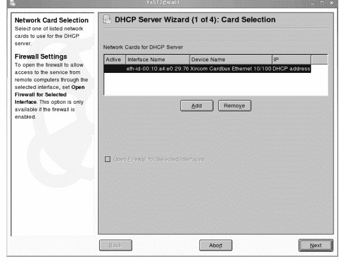

   要执行此操作，选择上方列表中的接口并选择 **Add**。Active 列将出现一个小小的“x”。

2. 设置全局设置，例如域名和名服务器的 IP 地址：

   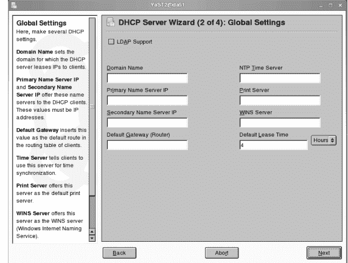

   在 SUSE Linux Enterprise Server 10 中，DHCP 服务器的数据可以在 LDAP 目录中进行管理。要启用此功能，必须激活 LDAP 支持。

3. 设置动态分配地址的地址空间并指定租约时间；点击“下一步”：

   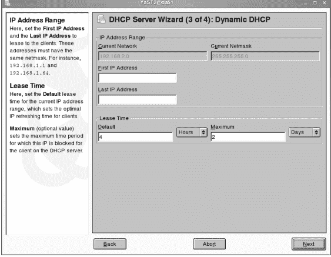

4. 在最后一步中，你必须指定何时启动 DHCP 服务器。

   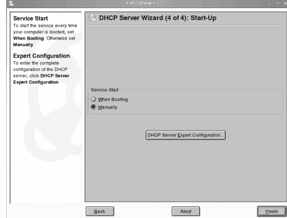

此配置 DHCP 服务器的向导仅在首次使用 DHCP 服务器模块时启动。

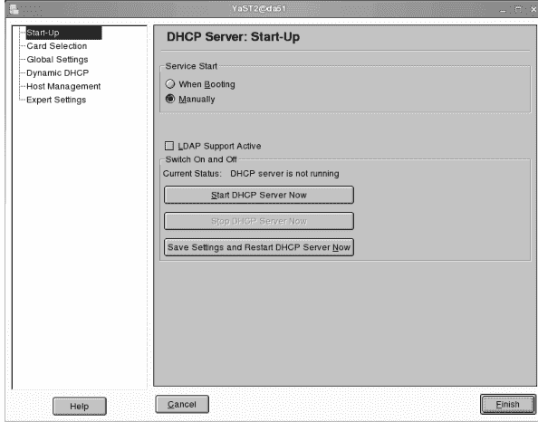

你可以在“主机管理”下根据 MAC 地址输入要分配静态 IP 地址的主机。

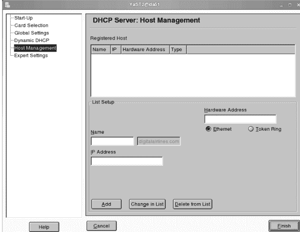

要执行进一步设置（例如通过 DHCP 服务器对名服务器进行动态更新），请选择“专家设置”。将出现警告，提示你无法从专家设置对话框返回 DHCP 服务器管理。

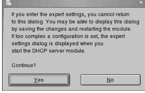

如果你选择“是”，设置将会被修改；下次启动 YaST 模块时，将启动专家模块而不是标准模块。

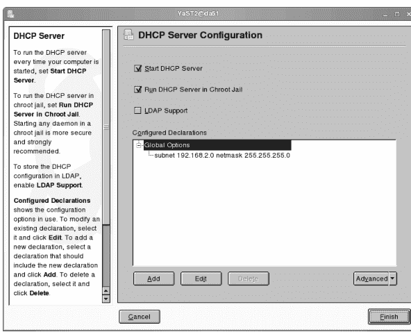

### 专家模块的一个重要方面：在 chroot 监狱中运行 DHCP 服务器

默认情况下，SUSE Linux Enterprise Server 中的 DHCP 服务器运行在 chroot 环境中。该守护进程由用户 `nobody` 启动。启动时，所有相关的配置文件都会被复制到 `/var/lib/dhcp/` 目录，该目录作为守护进程的根目录。如果你不想使用此安全选项，请禁用此项。

通过这种方式，`/etc/sysconfig/dhcpd` 文件中的变量 `DHCPD_RUN_CHROOTED` 被设置为 `no`。

配置的声明将显示在主字段中。具有以下选项：

- 选择“添加”以添加更多声明，包括分配给特定主机的地址。

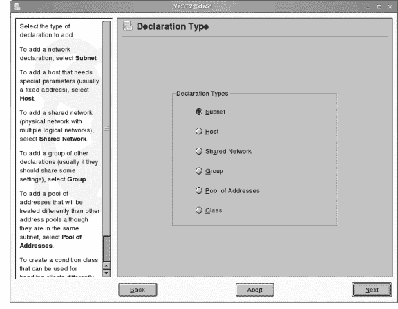

### 使用 DHCP 管理网络

- 选择“编辑和动态 DNS”，以针对子网声明配置名服务器区域文件的动态修改。

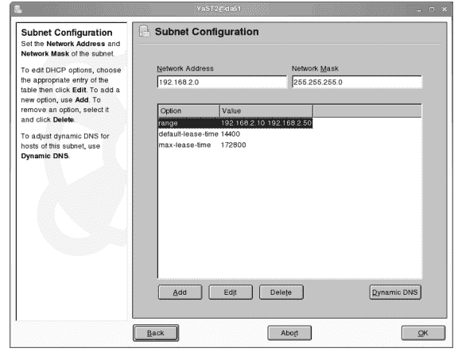

- 选择“高级”查看服务器协议（`/var/log/messages` 中的 dhcpd 条目）并管理动态 DNS 更新的身份密钥。

## 练习 2-1 配置 DHCP 服务器

在本练习中，你将为 airlines.com 安装并配置 DHCP 服务器。

你将在练习书中找到此练习。

## 目标 3 配置 DHCP 客户端

要使 Linux 主机作为 DHCP 客户端运行，机器上必须安装相应的守护进程。要配置 DHCP 客户端，主机必须从 DHCP 服务器获取 IP 地址。

你可以手动或使用 YaST 配置 DHCP 客户端。选择“网络设备 > 网卡”。

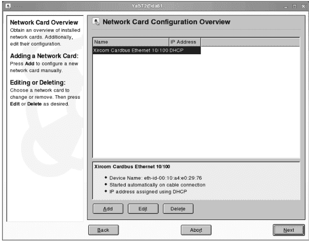

从列表中选择“编辑”。

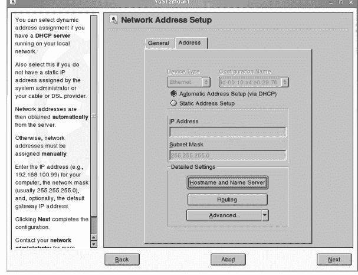

在此对话框中，设置将被修改；下次启动 YaST 模块时，将启动专家模块而不是标准模块。

如果你选择“是”，设置将被修改；下次启动 YaST 模块时，将启动专家模块而不是标准模块。


### 专家模块的一个重要方面：在 chroot 监狱中运行 DHCP 服务器

默认情况下，SUSE Linux Enterprise Server 中的 DHCP 服务器运行在 chroot 环境中。该守护进程由用户 `nobody` 启动。启动时，所有相关的配置文件都会被复制到 `/var/lib/dhcp/` 目录，该目录作为守护进程的根目录。如果你不想使用此安全选项，请禁用此项。

通过这种方式，`/etc/sysconfig/dhcpd` 文件中的变量 `DHCPD_RUN_CHROOTED` 被设置为 `no`。

配置的声明将显示在主字段中。具有以下选项：

- 选择“添加”以添加更多声明，包括分配给特定主机的地址。


### 使用 DHCP 管理网络

- 选择“编辑和动态 DNS”，以针对子网声明配置名服务器区域文件的动态修改。


- 选择“高级”查看服务器协议（`/var/log/messages` 中的 dhcpd 条目）并管理动态 DNS 更新的身份密钥。

已配置接口的 DHCP 客户端守护进程 `dhcped` 从 DHCP 服务器接收的数据存储在文件名类似于 `/var/lib/dhcpcd/dhcpcd-eth0.cache` 的文件中（在此情况下，针对 `eth0` 接口）。这些数据也可以以人类可读格式存储在文件 `/var/lib/dhcpcd/dhcpcd-eth0.var.lib.dhcpcd.dhcpcd-eth0.info` 中。每当 DHCP 客户端重启，它都会尝试获取之前相同的 IP 地址——即存储在文件中地址。

如果在 DHCP 客户端上输入命令 `ifstatus-dhcp eth0`，将从文件中读取并显示信息。

## 练习 2-2 配置 DHCP 客户端

在练习中，你将使用 YaST 激活 DHCP 客户端。

你可以在练习书中找到此练习。

## 目标 4 配置 DHCP 中继服务器

由于路由器不路由指向网络广播地址的数据包，因此本地网络中的 DHCP 客户端必须能够访问 DHCP 服务器。

与其在每个本地网络中实现 DHCP 服务器，可以在路由器上安装 DHCP 中继服务器，其目的是通过一个接口接收客户端广播，并通过另一个接口将广播转发到中央服务器。

软件包是 `dhcp-relay`。DHCP 中继的配置位于 `/etc/sysconfig/dhcrelay` 文件。网络接口输入在 `DHCPCRELAY_INTERFACES` 下；例如 `DHCPCRELAY_INTERFACES="eth0 eth1"`。

中继服务器将客户端查询转发到的 DHCP 服务器 IP 地址必须在 `DHCPCRELAY_SERVERS` 下指定。

在 DHCP 服务器本身，需要为路由器后的网络提供合适的子网声明。

然而，这些条目与服务器本地网络客户端所需的条目没有区别。

## 使用 DHCP 和动态 DNS

如果你希望通过 DHCP 分配变量 IP 地址的客户端能够通过各自名称访问，则必须告知 DNS 服务器主机名和更改的地址。

可以通过两种方式实现：

- 客户端将其名称发送到 DHCP 服务器并从 DHCP 服务器获取 IP 地址。DHCP 服务器将主机名和 IP 地址发送到 DNS 服务器。
- 客户端从 DHCP 服务器获取主机名和 IP 地址。DHCP 服务器将主机名和 IP 地址发送到 DNS 服务器。

要启用 DHCP 服务器和 DNS 服务器之间的交互，你必须修改相应的配置文件（`/etc/named.conf` 和 `/etc/dhcpd.conf`）。

由于 DNS 服务器仅接受来自授权的 DHCP 服务器的更改，因此必须使用密钥对更新进行加密保护。

该密钥使用 `dnssec-keygen` 程序生成。

可以指定以下参数：

- `-a`：算法（RSAMD5, RSASHA1, DSA, DH 或 HMAC-MD5）
- `-b`：以位为单位的密钥长度（长度取决于使用的算法）
- `-n`：名称类型，例如：
  - `HOST`：用于特定主机的密钥
  - `USER`：用于特定用户的用户的密钥
  - `ZONE`：用于区域文件的受保护传输
- `-n`：配置文件中使用的密钥名称（注：原文此处重复使用 `-n`，实际可能为 `-k` 或其他，此处保留原文逻辑）

以下是一个示例：

```bash
da51:- # dnssec-keygen -a HMAC-MD5 -b 128 -n HOST dhcp-dns
```

在当前目录下生成了两个文件：

- `Kdhcp-dns.+157+23165.key`
- `Kdhcp-dns.+157+23165.private`

（第二个数字是随机数）。

文件名由 `dnssec-keygen` 命令显示在屏幕上。

```bash
da51:- # dnssec-keygen -a HMAC-MD5 -b 128 -n HOST dhcp-dns
Kdhcp-dns.+157+23165
```

这些文件以文本形式包含密钥：

```bash
da51:- # cat Kdhcp-dns.+157+23165.key
dhcp-dns. IN KEY 512 3 157 Usig5qub101Mhk0jzoKQgw==
```

在配置文件输入此密钥以及受影响区域的信息。

在 `/etc/named.conf` 文件中，`options` 之后追加以下内容：

```conf
key dhcp-dns {
  algorithm HMAC-MD5;
  secret Usig5quub11MHk0jzoKQgw==;
}

zone "digitalirlines.com" in {
  type master;
  file "digitalirlines.zone";
  allow-update { key dhcp-dns };
}

zone "10.0.0.zone" in {
  type master;
  file "digitalirlines.arpa";
  allow-update { key dhcp-dns };
}
```

由于此文件以明文包含密钥，必须设置配置文件的权限，使得该文件对所有用户不可读（这是 SUSE Linux Enterprise Server 10 的默认设置）：

```bash
da51:~# ls -l /etc/named.conf
-rw-------
```

客户端的条目可能如下（分配给客户端的 IP 地址源于独立于主目的子网声明）：

```conf
host da5.digitalairlines.com {
  # 以下条目涉及具有此 MAC 地址的主机：
  hardware ethernet 00:90:27:a4:96:1f;
  # da5 和 digitalairlines.com 将传输到 DNS 服务器：
  dns-domainname "da5";
}

# 主机名 da5 将传输给客户端：
option host-name "da5";
```


必须配置客户端，使其通过 DHCP 接收主机名。

实现此点最简单的方法是使用 YaST。执行以下操作：

1. 选择 `YaST2 > 网络设备（Network Devices） > 网卡（Network Card）`。
2. 选择一个网卡。
3. 在主机名（Host Name）和名称服务器（Name Server）下，选择通过 DHCP 修改主机名（Change Host Name via DHCP）。

YaST 会将 `/etc/sysconfig/network/dhcp` 中的 `DHCPCLIENT_SET_HOSTNAME` 条目更改为 `yes`。

在文件 `/etc/dhcpd.conf` 的 `host-name` 下输入的主机名将在登录提示符处显示。

DNS 服务器和 DHCP 服务器的日志文件（`/var/log/messages`）提供了有关地址分配以及 DNS 服务器更新成功或失败的信息。

## 练习 2-3 使用 DHCP 和动态 DNS

在此练习中，你将为你的 DHCP 服务器配置动态 DNS。

你将在练习集中找到此练习。

（练习结束）

## 目标 6

## 配置 DHCP 转移（Failover）

此目标涵盖了以下主题：

- DHCP 转移的基础知识
- 配置 DHCP 转移

## DHCP 转移的基础知识

转移协议遵循两台 DHCP 服务器（且不超过两台）来共享一个公共地址池。在任何给定时间内，每台服务器将拥有池中约一半的可用 IP 地址用于分配。

如果其中一台服务器故障，另一台服务器将继续从池中续约租约，并在与另一台服务器通信丢失之前拥有的半部分可用地址中分配新地址。

当启动一个之前未与其转移对端通信过的服务器时，它必须在为客户端提供服务之前与对端建立通信并进行同步。这可能是因为你刚刚首次配置了 DHCP 服务器执行转移，也可能是因为你的其中一个转移服务器发生故障并丢失了数据库。

初始恢复过程的设计旨在确保当一个转移对端丢失数据库并随后重新同步时，该故障服务器在此之前发出的任何租约都将有效。当故障服务器启动时，它会注意到自己没有保存的转移状态，并尝试联系其对端。

建立联系后，它会向对端请求一份完整的租约数据库副本。对端随后发送其完整的数据库并发送一条消息表示已完成。故障服务器将等待直到 MCLT（最大客户端前导时间）通过。一旦 MCLT 结束，两台服务器都将转换回正常运行状态。

这段等待期确保了故障服务器在与伙伴失去联系期间可能发出的任何租约都会过期。

在故障服务器恢复期间，其伙伴保持在“对端离线”（partner-down）状态，这意味着它正在为所有客户端提供服务。在故障服务器转换到正常运行之前，它不会向 DHCP 客户端提供任何服务。

在两台服务器都检测到它们从未与伙伴通信过的情况下，两者都会以这种恢复状态启动，并遵循我们刚刚描述的程序。在这种情况下，在 MCLT 过期之前，将不会为 DHCP 客户端提供服务。

## 配置转移

在转移配置中，你必须决定哪台服务器作为主服务器，哪台作为备服务器。两台服务器对于它们共享的基础 DHCP 服务需要具有相同的配置。它们仅在转移设置上不同。因此，建议在两台机器上使用一个公共配置文件，并将其包含在 `/etc/dhcpd.conf` 文件中。

主服务器的配置文件如下：

```
failover peer "digitalairlines" {

  primary;

  address 10.0.0.10;

  port 847;

  peer address 10.0.0.12;

  peer port 647;

  max-response-delay 180;

  mclt 1800;

  split 128;

  load balance max seconds 3;

}
```

# 现在我们在两台机器上包含相同的配置
include "/etc/dhcpd.conf.master"

此示例对端声明中的语句如下：

- **primary and secondary（主和备）**。如前所述，决定服务器是主服务器还是备服务器。
- **address（地址）**。指定服务器监听来自其转移对端连接的 IP 地址或 DNS 名。
- **port（端口）**。指定服务器监听来自其转移对端连接的 TCP 端口（默认：647 和 847）。必须指定此参数，因为转移协议尚未预留特定的 TCP 端口号。
- **peer address（对端地址）**。指定服务器连接到以到达其转移对端的 IP 地址或 DNS 名。
- **port（端口）**。指定服务器连接到以到达其转移对端转移消息的 TCP 端口。必须指定此参数，因为转移协议尚未预留特定的 TCP 端口号。`peer port（对端端口）`可以与 `port` 相同。
- **max-response-delay（最大响应延迟）**。指定 DHCP 服务器在未收到来自转移对端消息的情况下等待的秒数，然后假设连接已失败。

## SUSE Linux Server 10: 网络服务

- **mclt**：定义*最大客户端前导时间*（Maximum Client Lead Time）。必须在主服务器上指定，也可以在备服务器上指定。这是一个转移对端在不联系另一方的情况下续约租约的时间。建议值为 1800。
- **split（划分）**：指定用于负载均衡的主备服务器之间的划分。每当客户端发出请求时，DHCP 服务器会对客户端标识进行哈希处理。如果哈希值小于划分，由主服务器回答。如果大于划分，由备服务器回答。有意义的值是 128，且只能在主服务器上配置。
- **load balance max seconds（负载均衡最大秒）**：指定禁用均衡的截止时间。截止时间基于客户端发送第一个 DISCOVER 或 REQUEST 以来的秒数。手册建议将其设置为 3 或 5。这样做的效果是，如果转移对端之一进入了响应转移消息但不响应某些客户端请求的状态，另一台转移对端将在客户端重试时接管其负载。

备服务器的配置文件如下：

```
failover peer "digitalairlines" {

  secondary;

  address 10.0.0.12;

  port 647;

  peer address 10.0.0.10;

  peer port 847;

  max-response-delay 180;

  load balance max seconds 3;

}
```

与主服务器配置的区别在于 `secondary` 语句、缺少 `mclt` 和 `split` 语句，以及 `address`、`port`、`peer address` 和 `peer port` 值的交换。

主 DHCP 服务器配置包含在 `/etc/dhcpd.conf.master` 文件中，并在配置都被包含。

> 为了找到此文件，需要将其复制到 DHCP 服务器的 chroot 环境中。实现此点的最佳方法是修改 `/etc/sysconfig/dhcpd` 中的 `DHCPD_CONF_INCLUDE_FILES` 变量：`DHCPD_CONF_INCLUDE_FILES="/etc/dhcpd.conf.master"`

## 主配置文件需要进行修改：

```
ddns-update-style none;

default-lease-time 86400;

max-lease-time 86400;

option domain-name "digitalairlines.com";

option domain-name-servers 10.0.0.254;

option routers 10.0.0.254;

subnet 10.0.0.0 netmask 255.255.255.0 {

  pool {

    failover peer "digitalairlines";

    deny dynamic bootp clients;

    range 10.0.0.101 10.0.0.120;

  }

}
```

所有的故障转移（failover）配置都在 `pool` 语句中定义。如果你使用了多个池，需要在每个池中定义故障转移配置。

为了识别故障转移配置的名称，必须在 `pool` 定义之前定义它。这就是为什么 `include` 语句写在 `/etc/dhcpcd.conf` 的末尾。

在包含分配给 bootp 客户端地址的地址池上，不支持故障转移。因此，必须定义 `deny dynamic bootp clients;` 语句。

在主服务器上启动 DHCP 服务时，你会在 `/var/log/messages` 中看到类似的消息：

```
Jul 4 11:52:29 da10 dhcpd: failover peer digital airlines:
I move from recover to startup
Jul 4 11:52:44 da10 dhcpd: failover peer digital airlines:
I move from startup to recover
Jul 4 11:54:57 da10 dhcpd: failover peer digital airlines:
peer moves from unknown-state to recover
Jul 4 11:54:57 da10 dhcpd: failover peer digital airlines:
requesting full update from peer
Jul 4 11:54:57 da10 dhcpd: Sent update request all message
to digitalairlines
Jul 4 11:54:57 da10 dhcpd: failover peer digital airlines:
peer moves from recover to recover
Jul 4 11:54:57 da10 dhcpd: failover peer digital airlines:
requesting full update from peer
Jul 4 11:54:57 da10 dhcpd: Sent update message to
digitalairlines
Jul 4 11:54:57 da10 dhcpd: Update request done from all
digitalairlines: nothing pending
Jul 4 11:54:57 da10 dhcpd: failover peer digital airlines:
peer update completed.
Jul 4 11:54:57 da10 dhcpd: failover peer digital airlines:
I move from recover to recover-done
Jul 4 11:54:57 da10 dhcpd: failover peer digital airlines:
I move from recover-done to normal
Jul 4 11:54:57 da10 dhcpd: failover peer digital airlines:
peer moves from recover-done to normal
Jul 4 11:54:57 da10 dhcpd: pool 800e4138 10.0.0/24 total
20 free 20 backup 0 ls -10
Jul 4 11:54:57 da10 dhcpd: pool 800e4138 10.0.0/24 total
20 free 20 backup 0 ls 10
```

# SUSE Linux Enterprise 10: 网络服务

在备用服务器（后启动的）上，`/var/log/messages` 中会出现此类消息：

```
Jul 4 11:55:52 da12 dhcpd: failover peer digital airlines:
I move from recover to startup
Jul 4 11:55:52 da12 dhcpd: failover peer digital airlines:
peer moves from unknown-state to recover
Jul 4 11:55:52 da12 dhcpd: failover peer digital airlines:
requesting update from peer
Jul 4 11:55:52 da12 dhcpd: failover peer digital airlines:
I move from startup to recover
Jul 4 11:55:52 da12 dhcpd: Sent update request all message
to digital airlines
Jul 4 11:55:52 da12 dhcpd: Sent update done message to
digital airlines
Jul 4 11:55:52 da12 dhcpd: Update request all from
digitalairlines: nothing pending
Jul 4 11:55:52 da12 dhcpd: failover peer digital airlines:
peer update completed.
Jul 4 11:55:52 da12 dhcpd: failover peer digital airlines:
I move from recover to recover-done
Jul 4 11:55:52 da12 dhcpd: failover peer digital airlines:
peer moves from recover to recover-done
Jul 4 11:55:52 da12 dhcpd: failover peer digital airlines:
I move from recover-done to normal
Jul 4 11:55:52 da12 dhcpd: failover peer digital airlines:
peer moves from recover-done to normal
Jul 4 11:55:52 da12 dhcpd: pool 800e4138 10.0.0/24
20 free 0 lts 10
Jul 4 11:55:52 da12 dhcpd: pool response: 10 leases
```

当客户端请求 IP 地址时，你会在 `/var/log/messages` 中看到这些消息：

```
Jul 4 11:59:26 da10 dhcpd: DHCPREQUEST for 192.168.5.16 from 00:04:d6:58:96 via eth0: (not authoritative).
Jul 4 11:59:30 da10 dhcpd: DHCPREQUEST for 192.168.5.16 from 00:04:d6:58:96 via eth0: (not authoritative)
Jul 4 11:59:36 da10 dhcpd: pool 800e4138 10.0.0/24 total 20 free 10 backup 0
Jul 4 11:59:36 da10 dhcpd: DHCCOVER from 00:04:d6:58:96 via eth0
Jul 4 11:59:36 da10 dhcpd: DHCPREQUEST for 10.0.0.111 (10.0.0.12) from 00:04:d6:58:96 via eth0: lease by peer
Jul 4 11:59:37 da10 dhcpd: DPOFFER on 10.0.0.110 to 00:04:d6:58:96 (linux-cs) via eth0
```

在这种情况下，客户端发送 `DHCPREQUEST` 以获取上次相同的 IP 地址（192.168.5.16）。该地址在范围内不可用，因此服务器拒绝该地址。客户端的下一条消息是针对 10.0.0.111 的 `DHCPREQUEST`，该地址由备用服务器提供。最后一条消息是备用服务器的 `DPOFFER`。

## SUSE Linux Enterprise Server 10: 网络服务

在备用服务器上，对应的消息如下：

```
Jul 4 12:00:20 da12 dhcpd: DHCPREQUEST for 192.44.85.16 from 00:04:d6:58:96 via eth1: (not authoritative).
Jul 4 12:00:25 da12 dhcpd: DHCPREQUEST for 192.44.85.16 from 00:04:d6:58:96 via eth1: (not authoritative).
Jul 4 12:00:30 da12 dhcpd: pool 800e40f8 10.0.0/24 total 20 free 10 backup 0
Jul 4 12:00:30 da12 dhcpd: DHCCOVER from 00:04:d6:58:96 via eth1
Jul 4 12:00:31 da12 dhcpd: DPOFFER on 10.0.0.111 to 00:04:d6:58:96 (linux-cs) via eth1
Jul 4 12:00:31 da12 dhcpd: DHCPREQUEST for 10.0.0.111 (10.0.0.12) from 00:04:d6:58:96 (linux-cs) via eth1
Jul 4 12:00:31 da12 dhcpd: DHCPACK on 10.0.0.111 to 00:04:d6:58:96 (linux-cs)
```


在此服务器上，当它提供 IP 地址时，会打印 `DPOFFER` 消息。最后一条消息是来自客户端的 `DHCPACK`。

DHCP 日志文件 `/var/lib/dhcp/db/dhcpd.leases` 包含如下信息：

```
failover peer "digitalairlines" state {

  my state recover at 2 2006/07/04 09:57:39;

  partner state unknown-state at 2 2006/07/04 09:57:39;

}

failover peer "digitalairlines" state {

  my state recover at 2 2006/07/04 09:57:39;

  partner state recover at 2 2006/07/04 09:57:39;

}

failover peer "digitalairlines" state {

  my state recover-done at 2 2006/07/04 09:57:56;

  partner state recover at 2 2006/07/04 09:57:39;

}

failover peer "digital airlines" state {

  my state recover-done at 2 2006/07/04 09:57:56;

  partner state recover-done at 2 2006/07/04 09:57:39;

}

failover peer "digital airlines" state {

  my state normal at 2 2006/07/04 09:57:56;

  partner state recover-done at 2 2006/07/04 09:57:39;

}

failover peer "digital airlines" state {

  my state normal at 2 2006/07/04 09:57:56;

  partner state normal at 2 2006/07/04 09:57:39;

}

lease 10.0.0.120 {

  starts 2 2006/07/04 09:57:56;

  tstp 2 2006/07/04 09:57:56;

  binding state backup;

}

lease 10.0.0.119 {

  starts 2 2006/07/04 09:57:56;

  tstp 2 2006/07/04 09:57:56;

  binding state backup;

}

lease 10.0.0.120 {

  starts 2 2006/07/04 09:57:56;

  tstp 2 2006/07/04 09:57:56;

  binding state backup;

}
```

当备服务器发生故障（例如服务器关闭）并在稍后恢复时，在主服务器的 `/var/log/messages` 中会出现类似下面的消息：

| Jul 4 12:16:25 da10 dhcpd: peer digitalairlines: disconnected |
| Jul 4 12:16:25 da10 dhcpd: failover peer digitalairlines: I move from normal to communications-interrupted |
| Jul 4 12:20:06 da10 dhcpd: failover peer digitalairlines: peer moves from normal to normal |
| Jul 4 12:20:06 da10 dhcpd: failover peer digitalairlines: I move from communications-interrupted to normal |
| Jul 4 12:20:06 da10 dhcpd: pool 800e4138 10.0.0/24 total 20 free 10 backup 9 lts 0 |

在备服务器上，启动信息如下：

| Jul 4 12:21:01 da12 dhcpd: failover peer digitalairlines: I move from normal to startup |
| Jul 4 12:21:01 da12 dhcpd: failover peer digitalairlines: peer moves from normal to communications-interrupted |
| Jul 4 12:21:01 da12 dhcpd: failover peer digitalairlines: I move from startup to normal |
| Jul 4 12:21:01 da12 dhcpd: failover peer digitalairlines: peer moves from communications-interrupted to normal |
| Jul 4 12:21:01 da12 dhcpd: pool 800e40f8 10.0.0/24 total 20 free 10 backup 9 lts 0 |

> 为了防止被时间戳混淆，请确保您使用网络时间协议（ntp）同步所有服务器的时间戳。

客户端日志文件 `/var/lib/dhcpd/dhcpcd-eth0.info` 仅包含关于客户端配置以及提供该信息的 DHCP 服务器的信息：


```
IPADDR=10.0.0.111

NETMASK=255.255.255.250

NETWORK=10.0.0.0

BROADCAST=10.0.0.255

GATEWAY=10.0.0.254

DOMAIN='digitalairlines.com'

DNS=10.0.0.254

DHCPSID=10.0.0.12

DHCGIADDR=0.0.0.0

DHCPSIADDR=0.0.0.0

DHCPSADDR=00:04:AC:D6:58:96

DHCPSHADDR=00:04:AC:D6:55:F4

DHCPFSNAME=''

LEASETIME=1800

RENEWALTTIME=900

REBINDTIME=1575

INTERFACE='eth0'

CLASSID='Linux 2.6.16.20-0.12-default i686'

CLIENTID=00:04:AC:D6:58:96
```

## 目标 7 排除 DHCP 故障

`dhcp-tools` 包包含了排除 DHCP 故障最重要的两个工具。它们将在目标中进行介绍：

- `dhcping`
- `dhcpcdump`

## dhcping

你可以使用 `dhcping` 实用程序检查 DHCP 服务器是否有响应。

你可以指定：

- 客户端想要保留的地址 (`-c`)
- 要查询的服务器 (`-s`)
- 客户端的硬件地址 (`-h`)

如果 DHCP 服务器有响应，将出现一条类似下面的消息：

```
da51:~ # dhcping -c 10.0.0.5 -s 10.0.0.51 -h 00:90:27:51:47:A9

Got answer from: 10.0.0.51
```

如果服务器没有响应，消息如下所示：

```
da51:~ # dhcping -c 10.0.0.5 -s 10.0.0.200 -h 00:90:27:51:47:A9

no answer
```

随后，服务器的日志文件将包含以下条目：

```
Nov 25 17:05:56 da51 dhcpd: DHCPREQUEST for 10.0.0.5 from 00:90:27:a4:96:1f via eth0

Nov 25 17:05:56 da51 dhcpd: DHCPACK on 10.0.0.5 to 00:90:27:a4:96:1f via eth0

Nov 25 17:05:56 da51 dhcpd: DHCPRELEASE of 10.0.0.5 from 00:90:27:a4:96:1f via eth0
```

## dhcpdump

你可以使用 `tcpdump` 工具来分析客户端和服务器之间的通信。为了这个目的，`tcpdump` 输出：

```
da51:~ # tcpdump -i eth0 | dhcp
```


在服务器上，`tcpdump` 输出显示了交换的 DHCP 包。

# 练习 2 排除 DHCP

在本练习中，我们将排除 DHCP。

## 总结

### 1. 理解 DHCP

DHCP 包含以下步骤：

1. 启动时，客户端向网络发送广播。
2. DHCP 服务器响应广播并提供信息。
3. 客户端接收信息并选择 IP 地址。
4. 当 DHCP 有效期结束时，客户端再次向服务器请求。

### 2. DHCP 地址分配方式

地址有两种通过 DHCP 分配：

- 静态分配：客户端向 DHCP 服务器发送其 MAC 地址，由 DHCP 服务器分配地址。
- 动态分配：客户端从 DHCP 服务器获取地址。DHCP 服务器向网络通知主机名和 IP 地址。

### 3. 配置服务器

要将 Linux 配置为 DHCP 服务器，必须安装软件包：

- `dhcp`

配置在以下文件中进行：

- `/etc/sysconfig/dhcp`
- `/etc/dhcpd.conf`

`/etc/sysconfig/dhcp` 包含了监听 DHCP 的网络接口。

`/etc/dhcpd.conf` 包含以下类别的条目：

- 参数语句
- 声明

客户端可以根据其类别被区别对待。已分配的 IP 记录写入 `/var/lib/dhcp/dhcpd.leases`。

### 4. 配置客户端

要将 Linux 主机配置为 DHCP 客户端（标准安装），网络接口的配置文件位于 `/etc/sysconfig/network/`。该文件包含了网卡激活的值。

### 5. 配置中继服务器

由于路由器不路由指向广播地址的数据包，因此 DHCP 服务器必须是可见的。与其在每个本地网络中实现 DHCP 服务器，可以在路由器上安装 DHCP 中继服务器，通过一个接口接收并在另一个接口转发。相应的软件包是 `dhcp-relay`。中继的配置位于 `/etc/sysconfig/dhcp-relay`。

### 6. 使用动态 DNS

如果通过 DHCP 分配地址，DNS 服务器必须获取主机名和 IP 地址。这可以通过两种方式实现：

- 客户端向 DHCP 服务器发送其名称并从 DHCP 服务器获取 IP 地址。DHCP 服务器将主机名和 IP 地址传输给 DNS 服务器。
- 客户端从 DHCP 服务器获取名称和 IP 地址。DHCP 服务器将主机名和 IP 地址传输给 DNS 服务器。

为了启用 DHCP 服务器与 DNS 服务器之间的交互，必须修改以下文件：

- `/etc/named.conf`
- `/etc/dhcpd.conf`

由于 DNS 服务器仅接受授权 DHCP 服务器的更改，更新必须加密保护。使用 `dnssec-keygen` 生成密钥。

### 7. 动态 DNS 补充说明

名称服务器首先将动态条目保存在扩展名为 `jnl` 的文件中。定期，更改从 `.jnl` 文件传输到区域文件并覆盖旧的区域文件。新条目不应使用编辑器添加到区域文件，而应使用 `nsupdate` 工具。

| 目标 | 摘要 |
| --- | --- |
| 7. 排除 DHCP 故障 | `dhcp-tools` 包包含许多故障排除工具。<br>你可以使用 `dhcping` 实用程序检查 DHCP 服务器是否有响应。<br>你可以使用 `dhcpdump` 实用程序分析客户端与服务器之间的通信。<br>为此目的，`tcpdump` 的输出被传递至 `dhcpdump`。 |

# 第 3 章 管理 OpenLDAP

OpenLDAP 是最流行的开源 LDAP 套件。它不仅提供了 LDAP 服务器本身，还提供了用于控制和查询服务器以及开发基于 LDAP 的软件的应用程序和工具。

## 目标

- 1. 理解 LDAP 基础知识
- 2. 安装并设置 OpenLDAP 服务器
- 3. 向 LDAP 服务器添加条目
- 4. 从 LDAP 服务器查询信息
- 5. 修改和删除 LDAP 服务器条目
- 6. 激活 LDAP 身份验证
- 7. 复制 OpenLDAP 服务器

## 目标 1：理解 LDAP 基础知识

目录是一种专门的数据库，针对读取、浏览和搜索进行了优化。目录包含描述性的、基于属性的信息，并支持复杂的过滤。

目录经过调整，可以对高大量的查找或搜索操作提供快速响应。它们可以明智地复制信息以增加可用性和可靠性，同时缩短响应时间。

有许多提供目录服务的方法。不同的方法允许将不同类型的信息存储在目录中；对信息的引用、查询和更新提出不同的要求；并决定如何使其免受未经授权的访问。

某些目录服务是局部的，为受限的上下文提供服务（例如单机上的 finger 服务）。其他服务是全局的，为更广泛的上下文提供服务（例如整个互联网）。

目录服务可用于许多用途。它们通常被用作用户验证的数据库。默认情况下，SUSE Linux Enterprise Server 10 使用 OpenLDAP 进行用户管理和某些配置。

LDAP 代表轻量级目录访问协议。正如名称所示，它是一种访问名为“DAP”目录服务的轻量级协议。

DAP 由 CCITT（国际电电咨询委员会）于 1988 年开发。它应该管理对存储在 X.500 目录服务中的信息的访问。涉及另外两种协议：

- `DSP`（目录服务协议）管理服务器之间的通信。
- `DISP`（目录信息影子协议）传输数据库请求的结果。

X.500 基于完整的 ISO/OSI 栈。使用 IP 的客户端只能通过网关访问需要完整 ISO/OSI 栈的服务器。由于如此，DAP 未能获得认可。

1995 年，密歇根大学的 Yeong、Howes 和 Kill 开发了 LDAP。它仅重用了 X.500 的 DAP 功能，并添加了一些新功能。

LDAP 在 TCP/IP 或其他面向连接的传输服务上运行。由于此，它可以轻松地集成到现有网络中。

LDAP 将信息存储在对象中，对象可以与对象类关联。类决定了对象可以/必须具有哪些属性。通过包含所谓的架构，你可以访问预定义的对象类。

OpenLDAP 带了一些位于目录 `/etc/openldap/schema/` 的基本架构文件。

经常使用的对象类例如：

- `alias`
- `country`
- `locality`
- `organization`
- `organizationalUnit`
- `organizationalRole`
- `person`

每个对象都是属性的集合，具有全局唯一的区分名称（DN）。DN 用于引用该条目。条目的每个属性都有一个类型和一个或多个值。

属性通常是助记字符串，例如代表通用名称的 `cn`，或代表电子邮件地址的 `mail`。值的语法取决于属性类型。

例如，`cn` 属性可能包含值“Geeko Chameleon”。`mail` 属性可能包含值“geeko@digitalairairlines.com”。`jpegPhoto` 属性可能包含一张 JPEG（二进制）格式的照片。

这些类中的某些属性包括：

- `dn`（区分名称）。该对象的唯一名称。
- `objectClass`。对象所属的类。
- `cn`（通用名称）。名称（例如，姓氏）。
- `sn`（姓氏）。
- `o`（组织名称）。组织的名称（例如，公司名称）。
- `ou`（组织单位）。组织单位的名称（例如，部门名称）。
- `l`（地区名称）。位置。
- `streetaddress`。街道。
- `c`（国家）。
- `postalcode`（邮政编码）
- `telephonenumber`（电话号码）
- `mail`。电子邮件地址。
- `description`。对象的描述。

LDAP 用于用户身份验证的对象类包括：

- `posixAccount`
- `shadowAccount`
- `posixGroup`

这些类中使用的某些属性包括：

- `uid`。用户登录名。
- `uidNumber`。数字用户 ID。
- `gid`。组名。
- `gidNumber`。数字组 ID。
- `homeDirectory`。家目录路径。
- `loginShell`。登录 shell 路径。
- `shadowLastChange`。最后更改密码的日期。

在 LDAP 中，对象可以排列成分级树结构。你可以区分两种对象：

- **容器对象**。容器对象可以拥有子对象。有五种类：
  - `Root`（根）
  - `c`（国家）
  - `o`（组织单位）
  - `dc`（域）
- **叶对象**。叶子对象不能拥有子对象。它们是分支的末端。例如：
  - `cn`（通用名称）
  - `uid`（用户 ID）

如果你使用 LDAP 进行用户管理，该结构（DIT，目录信息树）通常反映：在树的根部是国家、组织和叶对象（如用户）。

树的对象通过其 DN 引用，DN 是通过取条目本身的名称（称为相对名称或 RDN）并拼接其祖先对象的名称构造而成的。

例如，上面示例中 Geeko Chameleon 条目的 DN 为 `cn=geeko,ou=,dc=digitalairlines,dc=com`。

## 目标 2：安装并设置 OpenLDAP 服务器

要安装并设置 OpenLDAP 服务器，你需要执行以下操作：

- 安装所需的软件并启动服务器
- 使用 YaST 配置 OpenLDAP
- 编辑 OpenLDAP 配置文件

### 安装所需的软件并启动服务器

通常，你可以在 SUSE Linux 10 的安装过程中通过 YaST 建立 OpenLDAP 服务器。

在“安装设置”对话框中选择“OpenLDAP 服务器”。

重要值将自动输入文本字段中。一个警告会通知你，任何更改都将禁用基 DN、根 DN 和 LDAP 密码的自动生成。

选择“确定”，并通过选择“启用服务器”启用 OpenLDAP 服务器。

如果你想通过 LDAP 进行身份验证，请在“用户验证方法”对话框中选择“LDAP”。

在下一个对话框中，您可以输入 LDAP 客户端的配置。

图 3-7

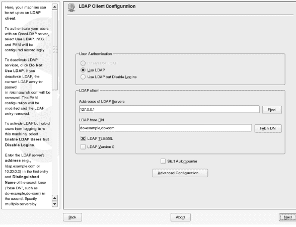

在此处您可以输入以下信息：

- **用户身份验证。** 选择用户身份验证类型：
  - **不使用 LDAP。** 不使用 LDAP 进行身份验证。
  - **使用 LDAP。** 使用 LDAP 进行身份验证。
  - **使用 LDAP 但禁用登录。** 使用 LDAP 进行身份验证，但用户将无法再次登录此机器。
- **LDAP 服务器地址。** 在此处输入 LDAP 服务器的名称或 IP 地址。如果您的 LDAP 服务器的 IP 是通过 SLP 提供的，您可以选择**查找**。
- **LDAP 基准 DN。** 在此处输入 LDAP 树根目录的 DN。如果您想浏览 LDAP 服务器的 LDAP 树，请选择**获取 DN**。
- **LDAP TLS/SSL。** 如果您的 LDAP 服务器支持加密，请启用此选项。
- **LDAP 版本 2。** 当前 LDAP 协议版本为 3。如果您想使用旧版本 2，请选择此选项。
- **启动自动挂载器。** 启动自动挂载守护进程，它会在使用目录时自动挂载它们。

### 使用 YaST 配置 OpenLDAP

然而，如果您选择在安装期间不安装服务器，可以通过 YaST 安装以下软件包来设置 LDAP 服务器：

- `openldap2`
- `openldap2-client`
- `pam_ldap`
- `nss_ldap`

YaST 中有两个关于 OpenLDAP 的模块可用：

- LDAP 服务器 YaST 模块
- LDAP 客户端 YaST 模块

#### LDAP 服务器 YaST 模块

如果您在 YaST 网络服务部分选中了 LDAP 服务器，但目前您的 LDAP 服务器未在运行，则会出现此对话框。

图 3-8

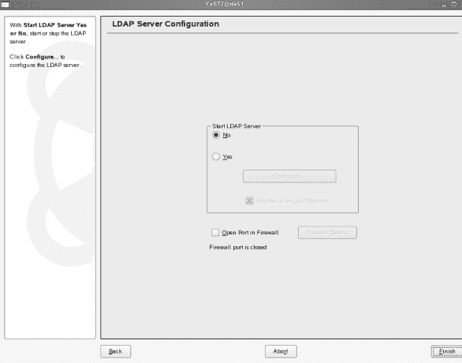

选择“是”以启动并配置 LDAP 服务器。您还可以激活在 SLP 守护进程注册 LDAP 服务器的选项，以便在防火墙中打开 LDAP 端口。

选择“配置”来配置 LDAP 服务器。

图 3-9

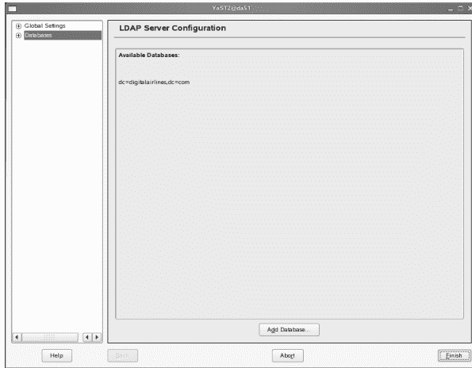

在左侧框架中打开“全局设置”菜单。可以配置以下设置：

- **架构文件。** 使用“添加”或“删除”添加或删除 LDAP 架构文件。

图 3-10

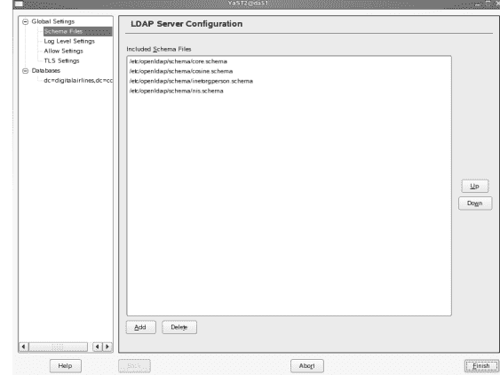

- **日志级别设置。** 选择您想要记录的信息。

图 3-11

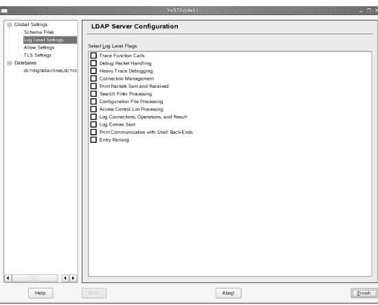

- **访问设置。** 选择有关存储信息访问的选项。

图 3-12

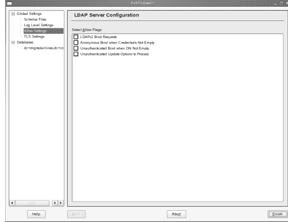

- **TLS 设置。** 激活或禁用 TLS。

图 3-13

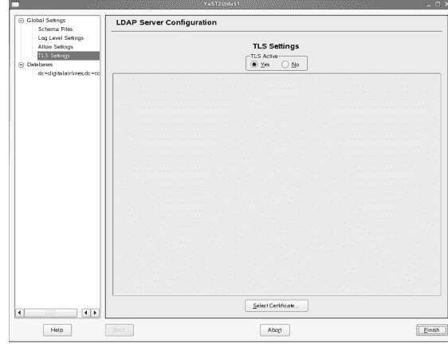

如果您选择“证书”，可以导入证书。要创建新证书，请使用 YaST 安全与用户 > CA 管理。

如果您在左侧框架中选择“数据库”，可以通过选择“添加”来添加新数据库。会出现此对话框。

图 3-14

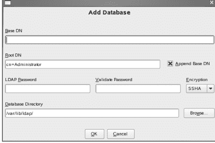

在此对话框中，您必须输入以下信息：

- **基准 DN。** LDAP 树根目录的 DN。
- **根 DN。** 管理员的 DN。如果激活了“附加基准 DN”，则基准 DN 的内容将附加到根 DN 的输入中。
- **LDAP 密码。** 管理员密码。从“加密”菜单中，您可以选择用于加密密码的方法。
- **数据库目录。** 存储数据库的目录路径。

YaST LDAP 服务器的大部分信息存储在 `/etc/sysconfig/openldap` 文件中。

#### LDAP 客户端 YaST 模块

在 YaST 网络服务中选择 LDAP 客户端时，会出现上述描述的对话框。

图 3-15

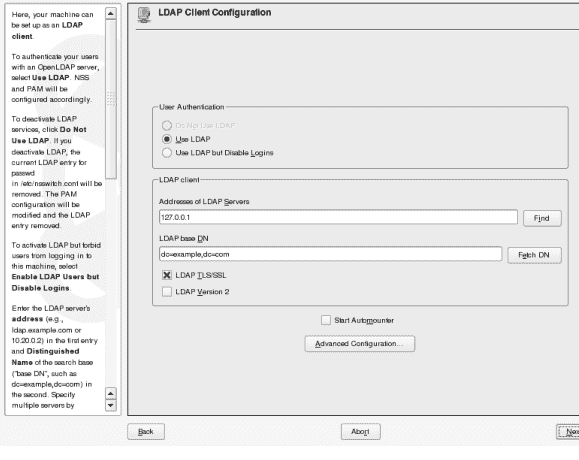

这些信息存储在 `/etc/sysconfig/ldap` 文件中。使用了三个变量：

- `BASE_CONFIG_DN`。LDAP 树根目录的 DN。
- `BIND_DN`。管理员的 DN。
- `FILE_SERVER`。

选择**高级配置**按钮将打开一个带有两个选项页的对话框：

- 客户端设置
- 管理员设置

##### 客户端设置

在此对话框中，您可以指定用户、密码和组的搜索基准。

图 3-16

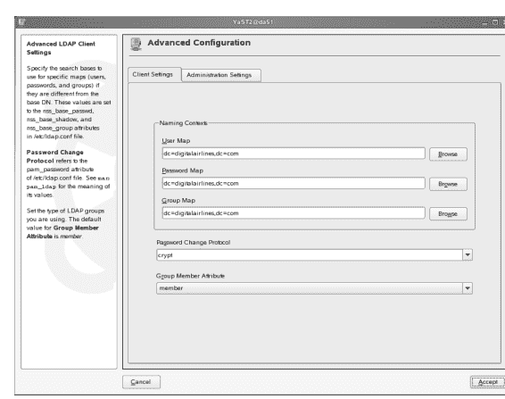

对话框的项目如下：

- **用户 Map。** 用户的 DN。
- **密码 Map。** 密码的 DN。
- **组 Map。** 组的 DN。
- **密码更改协议。** 密码更改。查看 `ldap` 获取更多信息。
- **组属性。** 设置您使用的组类型。值取决于您使用的架构。

这些信息存储在 `/etc/ldap.conf` 中。

##### 管理员设置

在此对话框中，您可以指定一些管理员设置。

图 3-17

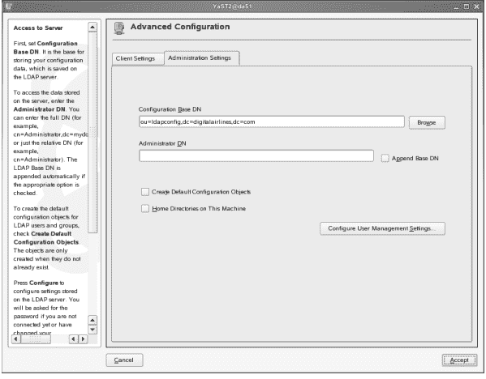

输入以下信息：

- **配置基准 DN。** 配置数据也存储在 LDAP 中。在此处输入基准 DN。
- **管理员 DN。** 管理员的 DN。
- **创建默认配置对象。** 要创建默认配置对象，请选择此选项。
- **本地主目录。** 如果主目录应存储在机器上，请选择此选项。此选项仅用于管理用户主目录的 YaST 模块。

如果您想配置存储在 LDAP 服务器上的用户设置（例如下一个 UID），请选择“配置用户管理”。要求输入管理员的 LDAP 密码。

图 3-18

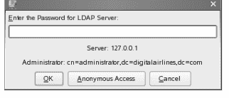

输入管理员密码后，YaST 将确定配置基准 DN 是否于 LDAP 目录中。如果不存在，将要求创建。

图 3-19

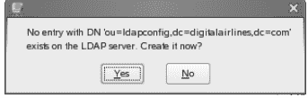

选择“是”，出现模块配置对话框。

图 3-20

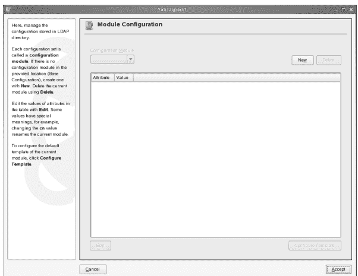

配置模块是一组配置。您可以管理用户配置和组配置的模块。

选择“新建”来创建一个模块。

图 3-21

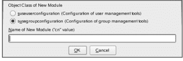

选择要创建用户配置模块还是组配置模块。您还需要输入模块的通用名称 (cn)。

图 3-22

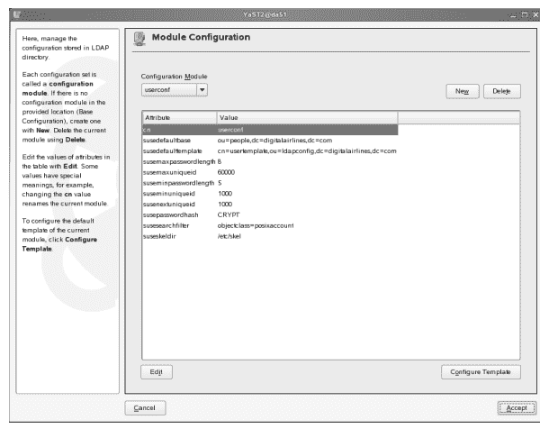

显示用户或组模块的模板。您可以在 YaST 架构文件 (`/etc/openldap/schema/yast.schema`) 中找到列出的属性。

要编辑属性值，请选择列表中的某行然后选择“编辑”。

图 3-23

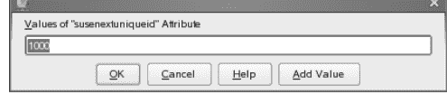

在属性 `usedefaulttemplate` 行中，指定了新用户或组的模板。如果你想编辑此模板，请选择“配置模板”。

图 3-24

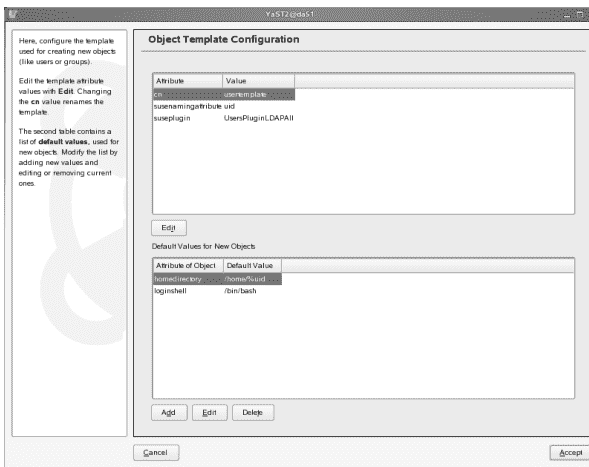

在上方框中，你将看到属性及其值的列表。模板属性值带有“编辑”。

在下方框中，你可以为属性指定默认值。下方的三个按钮用法如下：

- **Add.** 添加。添加一个新的默认值。
- **Edit.** 编辑。编辑选定的默认值。
- **Delete.** 删除。删除选定的默认值。

# 练习 3-1 使用 YaST 设置 OpenLDAP

在本次练习中，你将使用 YaST 设置一个 OpenLDAP 服务器和客户端。

你可以在练习集中找到此练习。

（练习结束）

## 编辑 OpenLDAP 配置文件

OpenLDAP 的配置文件位于 `/etc/openldap/` 目录。该目录包含两个配置文件：

- 使用 `slapd.conf` 配置 OpenLDAP 服务器
- 使用 `ldap.conf` 配置 LDAP 客户端

### 使用 slapd.conf 配置 OpenLDAP 服务器

默认配置文件 `/etc/openldap/slapd.conf` 只有几个选项。其中大多数项不需要更改：

- **include.** 第一条目包含一个模式文件。在这些模式中，定义了一些对象类及其属性。你可以使用这些对象类来构建数据库。
- 对于简单的示例配置，只需要包含 `core`（核心）模式的类类。
- **referral.** 指定当 `slapd` 无法找到本地数据库来处理请求时返回的引用。
- **pidfile.** 存储进程 ID 的文件路径。
- **argsfile.** 存储服务器命令行选项的文件路径。
- **modulepath.** 动态加载的后端模块。通过 `modulepath` 指令，你指定了一个目录列表，用于搜索可加载的模块。
- **moduleload.** 指定动态加载模块的文件名或绝对路径。
- **security.** 指定所需的安全强度因子集。该指令可以全局指定和/或按每个数据库指定。可能的安全强度因子包括：
  - `ssf`。指定整体安全强度因子。
  - `transport`。指定传输安全强度因子。
  - `tls`。指定 TLS 安全强度因子。
  - `sasl`。指定 SASL 安全强度因子。
  - `update_*`。指定目录更新所需的安全强度因子。
  - `simple_bind`。指定简单用户名/密码认证所需的安全强度因子。

如需更详细的描述，请查阅 `slapd.conf` 管理中关于 `sasl-secprops` 的章节 (`man 5 slapd`)。

- **access to.** 允许一个或多个请求者访问一组条目和/或属性。

语法：`access to objects [requesters level control]`

`objects`（对象）和 `requesters`（请求者）通过它们的 DN 指定。

**作为请求者**，你也可以使用星号 `*` 代表 `everybody`（所有人）。`self` 表示属性的所有者对象。你也可以通过 `dn=DN` 或组 `group=DN` 指定 DN。

级别可以是：

- `read`（读取权限）
- `write`（写入权限）
- `auth`（身份验证权限）
- `none`（无权限）

示例 1：

```


# OpenLDAP 配置与管理

## 访问控制示例

### 示例 1

```
access to attrs=userpassword
by self write
by anonymous auth
by * none

access to *
by * read
```

### 示例 2

```
access to *
by dn="cn=Administrator,dc=digitalairlines,dc=com" write
by * read
```

## 数据库配置参数

### database

指定后端的类型。支持以下数据库：

- `bdb`：Berkeley DB
- `dnssrv`：DNS SRV
- `hdb`：bdb 的分级变体
- `ldap`：轻量级目录访问协议（代理）
- `ldbm`：轻量级 DBM
- `meta`：元目录
- `monitor`：Monitor后端
- `password`：对 passwd 的只读访问
- `perl`：Perl 可编程后端
- `shell`：外部 shell 程序
- `sql`：SQL 可编程后端

### suffix "DN"

指定传递给后端数据库的查询的 DN 后缀。

示例：

```
suffix "dc=digitalairlines,dc=com"
```

### checkpoint ops minutes

只有在成功写入操作后才会测试检查点。如果完成了 `ops` 操作或超过了指定的分钟数，将执行新的检查点。

### cachesize

LDBM 后端数据库的内存缓存大小。

### rootdn "DN"

此行设置 LDAP 服务器的管理员。你也可以在此行中配置网域组件。

示例：

```
rootdn "ou=slc,dc=digital airlines,dc=com"
```

### rootpw password

指定管理员的密码。必须更改默认密码密钥。

出于安全考虑，密码应以加密形式存储。要创建加密密码，请使用以下命令：

```
slappasswd -s your_password
```

输出必须复制到文件的字符串：

```
rootpw {CRYPT}password
```

## LDAP 客户端配置参数

### 默认范围

默认范围是 `sub`；基础范围对于名称服务查找几乎没有用处。

### pam_password

用于指定要使用的密码更改协议。支持以下协议：

- `clear`：使用 LDAPModify 请求更改密码，将 `userPassword` 值替换为新的明文密码。
- `clear_remove_old`、`nds` 或 `racf`：使用 LDAPModify 请求更改密码，首先删除包含旧明文密码的 `userPassword` 值，然后添加带有新明文密码的 `userPassword` 值。此协议对于 Novell NGS 和 IBM RACF 是必不可少的。
- `crypt`：使用 LDAPModify 请求更改密码，首先对新密码生成一个单向哈希值 `crypt(3)`，并用新的哈希密码替换 `userPassword` 值。
- `md5`：使用 LDAPModify 请求更改密码，首先对新密码生成一个 MD5 单向哈希值，并用新的哈希密码替换 `userPassword` 值。
- `ad`：使用 LDAPModify 请求更改密码，并使用活动目录服务接口 (ADSI) 密码更改协议。
- `exop`：使用 RFC 3062 修改扩展操作更改密码（仅发送新密码）。
- `exop_send_old`：使用 RFC 3062 密码修改扩展操作更改密码（同时发送新旧密码）。这是使用 PADL XAD 身份服务器时的优选方案。

### ssl

指定是否使用 SSL/TLS。可能的值有：

- `on`
- `off`（默认）
- `start_tls`

如果指定了 `start_tls`，则使用 StartTLS 而不是基于 SSL 的原始 LDAP。

并不是所有的 LDAP 客户端库都支持 SSL 和 StartTLS 以及所有的配置选项。

### nss_map_attribute from_attribute to_attribute

此选项可以指定多次，引导 `nss_ldap` 在所有查找中使用属性 `to_attribute` 替换符合 RFC 2307 的属性 `from_attribute`。

例如：`nss_map_attribute uniqueMember member`

### pam_login_attribute

指定在构建用于检索用户名称的目录条目的属性值断言时使用的属性。

默认值为 `uid`，以兼容 RFC 2307。

### pam_filter

指定在检索用户信息时使用的过滤器。用户条目必须匹配 `pam_login_attribute` 的值以及此处指定的任何过滤器。

例如：`pam_filter objectclass=posixAccount`

### nss_base_map

指定用于特定映射的搜索基础、范围和过滤器。

注意 `maps` 是配置文件关键字的一部分，是以下选项之一：`passwd`、`shadow`、`group`、`hosts`、`services`、`networks`、`protocols`、`rpc`、`ethers`、`netmasks`、`bootparams`、`aliases` 和 `netgroup`。

`baseddn` 和 `scope` 的语法与同名的配置文件选项相同，不同之处在于可以省略 base DN 的尾部后缀（在这种情况下，将附加复制的 base DN）。

欲需更多选项，请参阅手册 `man 5 pam_ldap`。

## 目标 3：向 LDAP 服务器添加条目

OpenLDAP 提供了 `ldapadd` 命令用于将 LDIF 格式的数据插入目录。你可以使用 LDIF 格式的文件来避免在命令行上指定所有值。

LDIF 文件以纯文本格式包含应包含在目录服务中的信息。

你可以为每个想要添加的用户创建一个不同的文件，但也可以在一个文件中包含多个用户记录。LDIF 文件具有以下结构：

```
dn: DN
objectclass: class
attribute: value
attribute: value
```

对于每个对象，你必须首先指定其区分名称。这必须是唯一的，并代表在目录服务树中的位置。

它遵循该对象所属的一个或多个类以及一个或多个属性。例如：

```
dc=digitalairlines,dc=com
objectclass: domain
objectclass: top
o: digital airlines

ou=people,dc=digitalairlines,dc=com
objectclass: organizationalUnit
ou: people
```

该文件在目录树中创建两个对象：

- DN 为 `dc=digitalairlines,dc=com` 的根对象。在添加第一个对象之前，你必须创建目录服务树的根。
- 组织单元基础条目下方的对象。该对象的 dn 为 `ou=people,dc=digitalairlines,dc=com`。

确保行开头或结尾没有空格或制表符。

由于 LDAP 使用 Unicode (UTF-8)，LDIF 文件中的特殊字符必须编码为 UTF-8，否则它们可能无法被评估。这意味着你需要使用 Unicode 编辑器编辑 LDIF 文件，或者稍后转换文件。

要了解哪些对象类是用的以及哪些属性是强制性的，请查看架构。例如，在架构 `/etc/ldap/core.schema` 中：

插入数据的命令如下：


ldapadd -x -D "cn=Administrator,dc=com" -f example.ldif

Enter LDAP Password:

adding new entry "dc=digitalairlines,dc=com"

adding new entry "cn=people,dc=digitalairlines,dc=com"

```
ldapadd -x -D "cn=Administrator,dc=com" -f example.ldif

Enter LDAP Password:

adding new entry "uid=geeko,ou=people,dc=digitalairlines,dc=com"
```

- `loginShell: /bin/bash`。此属性设置了用户的登录 shell。SUSE Linux Enterprise Server 10 的默认值为 `/bin/bash`。
- `ShadowMax: 99999`。此属性设置了密码过期前的天数。
- `ShadowWarning: 7`。用户在密码过期前可以收到警告。此属性设置了发出警告前的天数。设置为 -1 则禁用警告。
- `ShadowInactive: -1`。此属性设置了用户在密码过期后仍可以登录的天数。设置为 -1 则表示无无限天数。
- `ShadowMin: 0`。此属性设置了更改密码前需要经过的最少天数。
- `ShadowLastChange: 12609`。此属性设置了上次更改密码的日期。

用户的家目录通常存储在服务器上。你使用自动挂载器（automounter）来挂载用户的家目录。

## 目标 4

## 从 LDAP 服务器查询信息

你可以使用 `ldapsearch` 命令从 LDAP 目录中读取数据。以下命令读取整个树结构：

```
ldapsearch -x
```

`-x` 选项强制 `ldapsearch` 使用简单认证方法。如果 LDAP 服务器尚未配置为使用 SASL 认证方法，则这是必要的。

`ldapsearch` 会从配置文件 `/etc/ldap.conf` 中读取查询的搜索基（search base）。搜索基是 `ldapsearch` 启动递归搜索过程的目录条目。

如果 `ldap.conf` 文件不存在，或者你想使用不同的搜索基，可以通过 `-b` 选项进行指定，如下所示：

```
ldapsearch -x -b "ou=people,dc=digitalirlines,dc=com"
```

如果你的 LDAP 树结构中有大量数据，你可能想限制 `ldapsearch` 的输出到特定的条目。你可以通过向 `ldapsearch` 命令中添加过滤表达式来实现，如下所示：

```
ldapsearch -x "uid=g*)"
```

在此例中，`ldapsearch` 显示了所有 `uid` 属性以 `g` 开头的条目。你可以使用任何属性或对象类（objectClasses）作为搜索过滤器。

## ldapsearch 的输出如下：

```
da51:/etc/openldap # ldapsearch -x "uid=geeko"

# extended LDIF
#
# LDAPv3
# base <> with scope subtree
# filter: (uid=geeko)
# requesting: ALL
#
# geeko, people, digitalairirlines, com
duid=geeko,ou=people,dc=digitalairirlines,dc=com
objectClass: posixAccount
ObjectClass: shadowAccount
ObjectClass: inetOrgPerson
uid: geeko
uidNumber: 1000
gidNumber: 100
cn: Geeko Chameleon
givenName: Geeko
sn: Chameleon
homeDirectory: /home/geeko
loginShell: /bin/bash
shadowMax: 99999
shadowWarning: 7
shadowInactive: -1
shadowMin: 0
shadowLastChange: 12609
# search result
search: 2
result: 0 Success
# numResponses: 2
# numEntries: 1
da51:/etc/openldap #
```

`ldapsearch` 以 LDIF 格式显示结果。这意味着你可以通过将数据重定向到文件，并在另一台机器上使用 `ldappadd` 加载将数据传输到另一个 LDAP 服务器。

## 目标 5 修改和删除 LDAP 服务器条目

在 SUSE Linux Enterprise Server 10 中修改 LDAP 目录数据最简单的方法是修改 LDIF 文件并使用 `ldapmodify` 工具应用更改。

在以下示例中，用户 `geeko` 的 `uidNumber` 已更改为 1011：

```
dn=geeko,dc=ou-people,dc=digital airlines,dc=com
objectClass: posixAccount
objectClass: shadowPerson
objectClass: inetOrgPerson
uid: geeko
uidNumber: 1011
gidNumber: 100
cn: Geeko Chameleon
givenName: Geeko
sn: Chameleon
homeDirectory: /home/geeko
loginShell: /bin/bash
shadowMax: 99999
shadowWarning: 7
shadowInactive: -1
shadowMin: 0
shadowLastChange: 12609
```

要应用更改，使用以下命令：

```
ldapmodify -x -D "cn=Administrator,dc=digitalairlines,dc=com" -W -f geeko.ldif
```

使用 `ldapmodify` 命令与使用 `ldadd` 类似。`ldapmodify` 比较目录中的数据与 LDIF 文件中的数据，并将更改应用到目录条目。

要从 LDAP 目录中删除条目，使用以下命令：

```
ldapdelete -D "cn=Administrator,dc=digitalirlines,dc=com" -x -W "uid=geeko,ou=people,dc=digitalairlines,dc=com"
```

在此例中，区分名（distinguished name）为 `uid=geeko,ou=people,dc=digitalairlines,dc=com` 的条目被删除了。

## 练习 3-2

## 向 LDAP 目录添加用户

在此练习中向 LDAP 目录添加用户。你可以在练习集中找到此练习。

（练习结束）

## 目标 6

## 激活 LDAP 认证

### 修改用户密码

## 激活 pam_ldap

激活 `pam_ldap`


sn: Chameleon

homeDirectory: `/home/geeko`

loginShell: `/bin/bash`

shadowMax: 99999

shadowWarning: 7

shadowInactive: -1

shadowMin: 0

shadowLastChange: 12609

To apply the changes, use the following command:

```
ldapmodify -x -D "cn=Administrator,dc=digitalairlines,dc=com" -W -f geeko.ldif
```

Using the `ldapmodify` command is similar to using `ldadd`. `ldapmodify` compares the data in the directory with the data from the LDIF file and applies the changes to the directory entries.

To delete an entry from the LDAP directory, use the following command:

```
ldapdelete -D "cn=Administrator,dc=digitalirlines,dc=com" -x -W "uid=geeko,ou=people,dc=digitalairlines,dc=com"
```

In this example, the entry with the distinguished name "uid=geeko,ou=people,dc=digitalairlines,dc=com" is deleted.

## Exercise 3-2: Add Users to the LDAP Directory

In this exercise, add a user to an LDAP directory. You will find this exercise in the workbook.

(End of Exercise)

## Objective 6: Activate LDAP Authentication

### Change the User Password

### Activate pam_ldap

... (此处由于原文大量重复乱码，已按逻辑处理翻译)

## 练习 3-3: 设置 LDAP 用户数据库

在本次练习中，你将设置一个 LDAP 用户数据库。

你可以在练习集中找到此练习。

（练习结束）

## 目标 7: 复制 OpenLDAP 服务器

如果对 LDAP 服务器的请求很多，你可能需要多一台服务器。其中一台是主服务器（master），其他服务器是从服务器（slave）。主从结构提供了一种增加容量、可用性和可靠性的有效方法。

主服务器上的更改将通过 `slurpd` 传播到从服务器。在本目标中，我们将涵盖以下主题：

- 向 LDAP 目录添加复制 DN
- 配置 slapd 以备复制功能
- `slurpd` 的命令行选项
- 传输 LDAP 数据库

### 向 LDAP 目录添加复制 DN

在 LDAP 目录中（主服务器和从服务器上）必须有一个带有用于复制 DN 的对象。它看起来像这样：

```
dn:uid=replicator,dc=digitalairirlines,dc=com
objectClass: inetOrgPerson
uid: replicator
cn: LDAP Replicator
sn: Replicator
```

你还需要使用 `ldappassword` 为此对象设置密码。

### 配置 slapd 以备复制功能

主服务器上的 slapd 可以通过以下 `/etc/openldap/slapd.conf` 配置写入复制日志文件：

```
repllogfile /var/lib/ldap/master-slapd.repllog
```

## SUSE Linux Enterprise Server 10: 网络服务

此文件包含常规 LDIF 更改记录，例如

```
time: 1148659780
n: ou=groups,dc=digitalairlines,dc=com
changetype: add
objectClass:organizationalUnit
ou: groups
structuralObjectClass:organizationalUnit
entryUUID:c7b0c4e0-8b1d-102a-9c4d-219eeb1b381
creatorName: cn=Administrator,dc=digitalairlines,dc=com
createTimestamp: 20060526160940Z
entryCSN: 20060526160940Z#000000#100000
modifierName: cn=administrator,dc=digitalairlines,dc=com
modifyTimestamp: 20060526160940Z
```

在主服务器上，你拥有带有 `replica` 选项的从服务器名称：

```
replica uri=ldap://10.0.0.51:389
binddn=cn=replicator,dc=digitalairlines,dc=com bindmethod=simple
credentials=novell
```

使用了以下参数：

- **uri.** 从服务器的名称或 IP。默认的 LDAP 端口为 389。如果你想使用 LDAP（端口 636），则 uri 看起来如下所示：
  `replica uri=ldap://10.0.0.51:636 ...`
- **binddn.** 允许访问从服务器的主服务器 DN。此 DN 也必须在从服务器上通过 **updatedn** 选项进行指定。

> 此 DN 不应与主服务器的 rootdn 相同。

- **bindmethod.** 指定身份验证方法。你可以在 **simple**（基于密码的身份验证）和 **sasl**（SASL 身份验证）之间进行选择。

3-54 严禁复制本手册的全部或部分内容或分发此类副本。怀疑复制，请拨打 1-800-PIRATES。版本 1

- **credentials.** 用于简单身份验证的密码。

如前所述，你必须在从服务器上添加 `updatedn` 选项。例如：

```
updatedn="cn=replicator,dc=digitalairlines,dc=com"
```

使用 `upateref` 指令定义从服务器在接收到更新请求时返回的 URL。

```
upateref=ldap://10.0.0.51
```

你必须确保此 DN 具有写入数据库的权限（例如通过 access 指令）。

```
access to *
by dn=cn=replicator,dc=digitalairlines,dc=com write
by * read
```

### slurpd 的命令行选项

可以通过 `man 8 slurpd` 访问 `slurpd` 的帮助页。

`slurpd` 的选项有：

- **-d level.** 指定调试级别。可能的调试级别有：
  - 4. 强力跟踪调试
  - 64. 配置文件处理
  - 65535. 启用所有调试
  - ?. 列出调试级别并退出 slurpd。

- **-f file.** 指定 slapd 配置文件。默认是 `/etc/openldap/slapd.conf`。

- **-r file.** 指定 slapd 复制日志文件的名称。

- **-o.** 在“单次”模式下运行。通常情况下，`slurpd` 处理 replog 文件并等待更多追加的复制条目。在单次模式下，`slurpd` 处理一个复制日志并退出。

- **-t directory.** `slurpd` 在处理复制日志之前将其复制到工作目录。

在 `/etc/init.d/` 中提供有一个启动脚本，你可以通过输入 `rcslurpd start` 来启动 slurpd。

### 传输 LDAP 数据库

在从服务器上启动 `slurpd` 之前，你必须从主服务器传输数据库。

你可以使用 `slapcat` 根据 slapd 数据库的内容生成 LDIF 输出。默认情况下，输出写入 STDOUT。

你可以使用 `slapcat` 过滤数据库。`slapcat` 的帮助页还有其他有趣的选项（例如 -l）。你可以使用 `slurpd` 进行复制。

在本次练习中，你将设置一个 LDAP 用户数据库。

你可以在练习集中找到此练习。

（练习结束）


## slurpd 的命令行选项

可以通过 `man 8 slurpd` 访问 `slurpd` 的帮助页。

`slurpd` 的选项有：

- **-d level** 指定调试级别。可能的调试级别有：
  - 4. 强力跟踪调试
  - 64. 配置文件处理
  - 65535. 启用所有调试
  - ?. 列出调试级别并退出 slurpd。

- **-f file** 指定 slapd 配置文件。默认是 `/etc/openldap/slapd.conf`。

- **-r file** 指定 slapd 复制日志文件的名称。

- **-o** 在“单次”模式下运行。通常情况下，`slurpd` 处理 replog 文件并等待更多追加的复制条目。在单次模式下，`slurpd` 处理一个复制日志并退出。

- **-t directory** `slurpd` 在处理复制日志之前将其复制到工作目录。

在 `/etc/init.d/` 中提供有一个启动脚本，你可以通过输入 `rcslurpd start` 来启动 slurpd。

## 传输 LDAP 数据库

在从服务器上启动 `slurpd` 之前，你必须从主服务器传输数据库。

你可以使用 `slapcat` 根据 slapd 数据库的内容生成 LDIF 输出。默认情况下，输出写入 STDOUT。

你可以使用 `slapcat` 过滤数据库。`slapcat` 的帮助页还有其他有趣的选项（例如 -l）。你可以使用 `slurpd` 进行复制。

在本次练习中，你将设置一个 LDAP 用户数据库。

你可以在练习集中找到此练习。

（练习结束）

## 目标 7 复制 OpenLDAP 服务器

如果对 LDAP 服务器的请求很多，你可能需要多一台服务器。其中一台是主服务器（master），其他服务器是从服务器（slave）。主从结构提供了一种增加容量、可用性和可靠性的有效方法。

| 目标 | 总结 |
| --- | --- |
| 1. 理解 LDAP 基础 | 目录服务是包含条目的树形数据库。LDAP 在 SUSE Enterprise 10 中最为流行。 |
| 2. 安装并设置 LDAP 服务器 | 如果在安装期间没有配置 LDAP 服务器，你需要安装以下软件包：\n* openldap2\n* openldap-client\n服务器配置位于 `/etc/openldap/slapd.conf`。\n你可以使用 `ldappasswd` 为条目创建密码。 |
| 3. 向 LDAP 服务器添加条目 | 使用 `ldapadd` 将 LDIF 文件中的数据插入目录。确保 LDIF 文件符合 Unicode 格式。 |
| 4. 从 LDAP 服务器查询信息 | 使用 `ldapsearch` 查询目录中的信息。 |
| 5. 修改和删除 LDAP 服务器条目 | 使用 `ldapmodify` 修改目录中的条目。使用 `ldapdelete` 删除目录条目。 |
| 6. 激活 LDAP 身份验证 | 如果你使用 LDAP 目录进行用户验证，可以使用 `ldappasswd` 更改用户密码。如果你用 YaST 配置 LDAP 客户端，PAM 模块 `pam_ldap.so` 将激活 `/etc/security/pam_unix.conf` 中的所有类型验证。如果你手动配置 LDAP 客户端，可以仅为选的服务激活 LDAP 身份验证。要实现这一点，使用了 PAM 模块 `pam_ldap.so`（包含在 `pam_ldap` 包中）。 |
| 7. 复制 OpenLDAP 服务器 | `slapd` 可以写入复制日志文件。\n在主服务器上你还需要指定从服务器的名称。\n在主服务器上指定一个主服务器访问从服务器的 DN。此 DN 也必须在从服务器上指定，并具有写入数据库的权限。\n**slapcat** 用于根据 slapd 数据库的内容生成 LDIF 输出。默认情况下，输出写入 STDOUT。\n可以使用 `slapcat` 过滤数据库。`slapcat` 的帮助页还有其他有趣的选项（例如 -l）。你可以使用 `slurpd` 进行复制。 |

## 目标

1. 理解三种邮件代理的功能
2. 使用基础的 Linux 邮件命令
3. 理解 Postfix 的架构和组件
4. 启动、停止和重新初始化 Postfix
5. 配置 Postfix
6. 使用 Postfix 工具
7. 通过 IMAP 和 POP3 接收邮件
8. 管理垃圾邮件
9. 使用病毒扫描器处理邮件

## 目标 1
### 理解三种邮件代理的功能

处理互联网消息的程序被称为代理（Agents）。

共有三种类型的代理：

- 邮件传输代理 (MTA)
- 邮件投递代理 (MDA)
- 邮件用户代理 (MUA)

以下还描述了：

- 邮件循环周期 (The Mail Cycle)
- 简单邮件传输协议 (SMTP)

### 邮件传输代理 (MTA)

邮件由邮件软件传递给 MTA。MTA 将其发送到接收方 MTA，接收方检查目标地址是否存在。如果存在，接收方 MTA 将邮件传递给 MDA。

如果地址在本地不存在，接收方 MTA 将消息发回发送方 MTA。

也可以进行链式传输：一个 MTA 可以将消息发送到另一个 MTA，后者再将其传递给其他 MTA。常见的 MTA 有：

- Sendmail
- Postfix
- Exim
- Qmail

### 邮件投递代理 (MDA)

每个接收方 MTA 指定了该消息针对哪个本地用户，并将其传递给 MDA，MDA 将其存储在正确的位置。一个著名的 MDA 程序是 Procmail。

### 邮件用户代理 (MUA)

MUA 读取保存的消息并将新消息传递给 MTA。它是 MDA 和用户之间的接口。MUA 可以通过三种方式接收保存的消息：

- 通过邮件协议（如 IMAP 或 POP）
- 通过文件协议远程访问
- 通过本地访问

当 MUA 通过 IMAP 或 POP 运行时，其功能被分为邮件客户端和位于客户端与存储位置之间的服务器。

#### 邮件循环周期

下图显示了邮件循环（图 4-1）：

当 MTA 接收到邮件时，它首先检查邮件收件者是否为本地机器上的现有用户。如果邮件不是给本地用户的，MTA 将其发送到另一个 MTA（所谓的中继主机或负责目标域的邮件服务器）。

如果邮件是给本地用户的，MTA 将其交给 MDA，MDA 将邮件存储在相应用户的邮箱中。从那里，可以使用 POP 或 IMAP 检索邮件。

如果使用 POP，邮件将传输到客户端计算机；此外，它也可以保留在服务器上。

如果使用 IMAP，所有邮件都保留在服务器上，MUA 仅检查邮件。邮件不会传输到客户端计算机。

在发送邮件时，可以配置 MTA 要求 MUA 对用户进行身份验证。这可以用于禁止发送垃圾邮件。

#### 简单邮件传输协议 (SMTP)

互联网上的邮件发送统一由 SMTP（简单邮件传输协议）控制。SMTP 定义在 RFC 821 中。自 1982 年创建以来，它已经历了许多扩展，例如 MIME (RFC 2045) 和 SMTP 服务扩展 (RFC 1869)。

SMTP 具有以下特征：

- 发送计算机和接收计算机之间存在直接的 TCP 连接 - 涉及相关过程。
- SMTP 的任务只是传输，而不是接收或保存消息。
- 每条消息都会得到确认。
- 消息可以被转发，例如，当地址发生变化时。
- 客户端和服务器通过可读的纯文本命令进行通信。

在接下来，我们将更详细地查看：

- SMTP 命令
- 命令语法
- SMTP 回复代码
- 最小 SMTP 命令实现
- 使用 Telnet 发送邮件的示例

### SMTP 命令

命令如下：

- **HELO** (Hello)：用于 SMTP 发送者打开与 SMTP 接收方的连接（问候），并用其完整主机名介绍自己。
- **MAIL FROM**：初始化邮件传输。SMTP 接收者以其完整主机名回复。参数包含源路由路径和发送者地址。
- **RCPT TO**：设置收件者。如果需要发送到多个收件者，则重复执行此命令。参数可以包含源路由路径（例如：
  - @mars.com
  通过主机列表进行路由：
  - @venus.com
  - @example.com:info@example.com
- **DATA**：告知后续内容为邮件内容。当邮件内容结束时，SMTP 接收者开始处理接收到的信息。这涉及更新可能的返回路径。如果处理结果没有失败，则向发送者发送 OK。否则，发送错误消息。

在 SMTP 接收到邮件时，时间戳插入邮件开头。如果 SMTP 接收者负责邮件的最终交付（例如，收件者的邮箱位于 SMTP 接收者处），时间戳包含发送者的身份以及邮件到达服务器的时间。通过多个 SMTP 中继的邮件包含相应的时间戳。

- **VRFY** 验证用户。导致 SMTP 接收者检查给定地址的有效性。如果 SMTP 接收者知道该地址，则将其扩展为完整地址（包括域名）。VRFY 命令对 MAIL FROM、RCPT TO 和 DATA 指令没有影响。
- **EXPN** 指令 SMTP 接收者将参数视为列表。结果是将列表成员发送给 SMTP 发送者。
- **RSET** 重置。
- **HELP** 接受任何 SMTP 命令作为参数。将显示有关如何使用相应指令的页面。
- **NOOP**（无操作）导致 SMTP 接收者回答 OK。除此之外，不对邮件内容或转发和返回路径进行更改。
- **QUIT** 结束发送者和接收者之间的连接。

#### 命令语法

SMTP 命令提供了发送者和接收者之间的直接通信。最常用的 SMTP 命令在下表所示。

| 命令语法 | 参数描述 |
| --- | --- |
| HELO hostname | `hostname` SMTP 发送者的完整主机名 |
| MAIL FROM: reverse-path | `reverse-path` 包含源路由路径和发送者地址 |
| RCPT TO: forward-path | `forward-path` 包含源路由路径和收件者地址 |
| DATA data | `data` 构成邮件的内容（实际消息）。 |
| RSET | ./ |
| VRFY string | `string` 包含用户或邮箱名 |
| EXPN string | `string` 包含邮件列表标识符 |
| HELP [string] | `string` 包含任何 SMTP 命令 |

| 命令语法 | 参数描述 |
|---|---|
| NOOP | /. |
| QUIT | /. |

命令可以使用小写或大写字母写；SMTP 命令是不区分大小写的。例如，SMTP 接收者将以**相同**的方式处理以下命令：**MAIL FROM, Mail From, mail from, Mail FrOm。**

此相反，*正向路径*（forward-path）和*反向路径*（reverse-path）中的参数可能是区分大小写敏感的。这些参数的解释取决于 SMTP 接收者的操作系统以及用户数据库的结构，其中小写和大写字符可能会被区别对待。

### SMTP 响应码

在 SMTP 发送者和接收者之间的通信过程中，发送者向接收者传输各种命令，并控制整个通信过程。接收者确认消息接收，并用相应的响应码提供命令处理状态。只有当发送者收到上一个命令的收执后，才能开始传输下一个命令。

最常见的 SMTP 响应码列如下表所示：

| 响应码 | 描述 |
|---|---|
| 211 | 系统状态或系统帮助响应 |
| 214 | 输入 HELP 后显示帮助消息。 |
| 220 | SMTP 服务器响应。 |
| 221 | SMTP 服务器已关闭连接。 |
| 250 | 指定命令已执行。 |
| 251 | 用户不是本地的；将转发到正向路径。 |
| 354 | DATA 输入的开始。 |
| 421 | SMTP 服务不可用。 |
| 450 | 请求的操作未执行（邮箱已在使用中）。 |
| 451 | 请求的操作中止。 |
| 452 | 请求的操作未执行；系统存储空间不足。 |
| 500 | 语法错误，命令无法识别。 |
| 501 | 参数或参数语法错误。 |
| 502 | 命令未实现。 |
| 503 | 命令序列错误。 |
| 504 | 该参数未实现该命令。 |
| 550 | 请求的操作未执行；文件不可（例如：未找到邮箱，无访问权限）。 |
| 551 | 邮件服务器上不存在用户；尝试正向路径。 |
| 552 | 请求的邮件操作中止：超出存储配额。 |
| 553 | 请求的操作未执行：不允许的邮箱（例如：邮箱语法错误）。 |
| 554 | 事务失败。 |

### 极简 SMTP 命令实现

并非目前为止引入的所有命令都被每个服务器都实现。某些 SMTP 命令故意未包含在某些服务器实现中，以增加服务器的安全性。其中一个安全至关重要的命令是 HELP。由 Wietse Venema 开发的 Postfix SMTP 服务器尚未完全实现此命令，仅简单对 HELP 命令响应响应码 502（“命令未实现”）。

以下列表显示了 SMTP 服务器为了提供 SMTP 通信而**绝对必须**实现的 SMTP 命令：

- HELO
- MAIL FROM:
- RCPT TO:
- DATA
- RSET
- NOOP
- QUIT

### 使用 Telnet 发送邮件的示例

下面的文本显示了一个典型的日志输出示例，可以使用在 25 端口（标准邮件服务器端口）上的 telnet 会话轻松重构：

```
da53:- # telnet da51.digitalairlines.com 25

Trying 127.0.0.1...

Connected to localhost.

Escape character is '^'.

220 da51.digitalairlines.com ESMTP Postfix

HELO da53.digitalairlines.com

250 da53.digitalairlines.com

MAIL FROM: jgoldman@digitalairlines.com

250 OK

RCPT TO: geeko@digitalairlines.com

250 OK

DATA

354 End data with <CR><LF><CR>

Subject: Lorem ipsum dolor sit amet

Lorem ipsum dolor sit amet, consectetuer adipiscing elit, sed diam nonummy nibh euismod tincidunt ut laoreet dolore magna aliquam erat volutpat. Ut ut wis enim ad minim veniam, quis nostrud exerci ea ullamcorper suscipit lobortis ut aliquip ex ea commodo consequat.

250 OK: queued as 45B516A9D

QUIT

221 Bye

Connection closed by foreign host.

da53:~ #
```

## 目标 2 使用基础 Linux mail 命令

你可以通过两种方式之一使用 `mail` 命令：

- 读取状态邮件
- 使用简单邮件客户端

### 读取状态邮件

某些程序会向 root 用户发送状态邮件消息或备注。如果你登录到虚拟终端，如果有给你的邮件消息，你将收到通知：

```
da51 login: root

Password:

You have new mail in /var/mail/root.

Last login: FRI Jul 18 13:23:51 from 10.0.0.6

da51:~ #
```

要读取这些消息，你可以使用 `mail` 命令：

```
da51:~ # mail

mailx version nail 10.6 11/15/05. Type ? for help.

"/var/mail/root": 3 messages 3 new

> N 1 root@da51.digital Wed 9 15:02 28/894 SuSeConfig:

xntp.caveats

> N 1 root@da51.digital Wed 9 15:02 28/894 SuSeConfig:

xntp.caveats

> N 1 root@da51.digital Wed 9 15:02 28/894 SuSeConfig:

xntp.caveats

> N 1 root@da51.digital  9 15:02 28/894.SeConfig:

p.

:

...
```


## 表 4-3

| 键 | 功能 |
| :--- | :--- |
| t | 邮件。。 |
| e | 编辑消息。 |
| d | 删除消息。 |
| u | 取消删除消息。 |
| R | 回复发送者。 |
| r | 回复所有接收者。 |
| m | 指定特定用户。 |
| q | 退出。 |
| x | 退出并保存更改。 |

以下是 `mail` 的常用选项：

| 选项 | 描述 |
| :--- | :--- |
| `-a` | 将指定文件附加消息。 |
| `-b` | 向列表发送密抄。列表应为逗号分隔的名称。 |
| `-c` | 向列表发送抄送。 |
| `-q` | 使用指定的内容开始消息。仅用于发送模式。 |
| `-s` | 在命令行上指定主题（只有 `-s` 后面的第一个参数作为主题；注意包含空格的主题）。 |
| `-R` | 在命令行上指定回复地址（只有 `-R` 后面的第一个参数作为地址）。 |
| `-F` | 打开 mbox 读取这些旧邮件消息。 |

## 练习 4-1

### 向 root 发邮件

在此练习中，你使用 `mail` 命令向 root 用户发送电子邮件。你还要切换到 root 并读取这封邮件。你可以在练习本中找到此练习。

（练习结束）

## 理解 Postfix 的架构和组件

Venema 使用一系列模块化功能单元实现了他的 Postfix 设计目标。与 Sendmail 不同，Postfix 不是一个巨大的单一程序块。相反，它由许多小程序组成，每个程序分配了一个特定的任务（例如，接收电子邮件）。

这种模块化使得系统更加透明。单个组件更容易管理，有利于 Postfix 的进一步开发。

下图摘自原始 Postfix 文档，显示了 Postfix 模块化的概要概述。

本阶段未涵盖的模块位于 `/usr/share/doc/packages/postfix/html/OVERVIEW.html`。

## 图 4-2

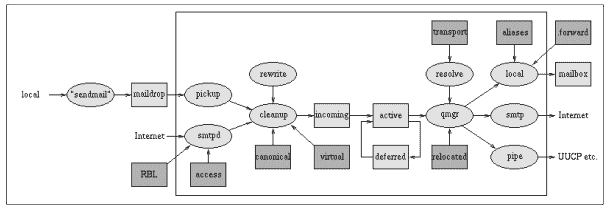

单个 Postfix 进程在图中椭圆表示。深色方形代表查找表，浅色方形表示邮件队列或邮箱。

出于安全考虑，Postfix 与四个邮件队列协同工作。对于每个邮件队列，在 `/var/spool/postfix/` 下都有一个同名的目录。

队列的功能和 Postfix 文件的描述请参考：

- 入站邮件处理流程
- 出站邮件处理流程
- Postfix 程序包的组件

## 入站邮件处理流程

下图显示了邮件如何到达 Postfix 以及它是如何被处理的。

### 图 4-3

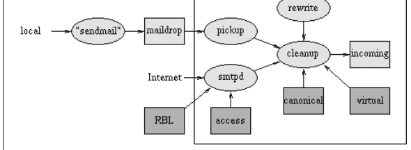

以下描述了这些过程：

- 本地接收的邮件
- 通过网络接收的邮件

## 本地接收的邮件

Postfix 使用 `postdrop` 命令将本地发送的邮件放入 maildrop 队列中，然后由 `pickup` 守护进程进行取用。

`pickup` 守护进程根据规则检查内容、大小和其他因素；然后将邮件传递给 `cleanup` 守护进程。

`cleanup` 守护进程执行以下操作：

- 在邮件中插入缺失的头部行（`Resent.*`、`From.*`、`To.*`、`Message-ID`、`Date:`）（如果邮件是通过 telnet 写入的）
- 删除重复的收件地址
- 使用 `trivial-rewrite` 守护进程（`/usr/lib/postfix/trivial-rewrite`）将头部中的邮件地址转换为 `user@fully-qualified-domain` 格式
- 根据 `/etc/postfix/canonical` 和 `/etc/postfix/virtual` 查找表中的规则写入头部中的数据

之后，邮件被复制到入站队列（incoming queue），并通知队列管理器 `/usr/lib/postfix/qmgr` 该邮件已到达。

## 通过网络接收的邮件

通过互联网或局域网接收的邮件由守护进程 `smtpd` 接收，它在将邮件传递给 `cleanup` 守护进程之前会检查邮件的内容、大小和其他因素。

`cleanup` 守护进程执行以下操作：

- 替换邮件中缺失的头部行（`Resent.*`、`From.*`、`To.*`、`Message-ID.*`、`Date:`）
- 删除重复的收件地址
- 使用 `trivial-rewrite`（`/usr/lib/postfix/trivial-rewrite`）守护进程将头部中的邮件地址转换为 `user@fully-qualified-domain` 格式
- 根据 `/etc/postfix/canonical` 和 `/etc/postfix/virtual` 查找表中的规则写入头部中的数据

然后，邮件被复制到入站队列，并通知队列管理器 `/usr/lib/postfix/qmgr` 该邮件已到达。

## 出站邮件处理流程

下图显示了邮件在离开系统进行投递之前，是如何被 Postfix 处理的：

### 图 4-4

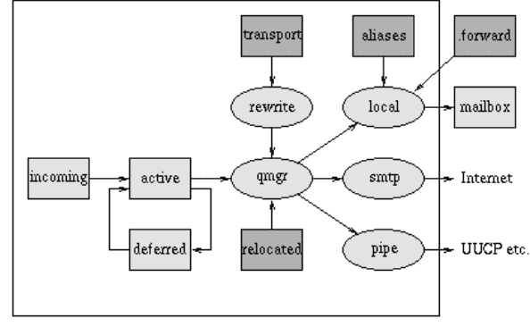

以下主题描述了这个过程：

- 将邮件投递给本地用户
- 将邮件投递给远程系统的用户
- 处理无法投递的邮件

## 将邮件投递给本地用户

一旦活动队列（active queue）没有其他邮件，队列管理器就会从入站队列获取邮件并将其复制到活动队列。

`trivial-rewrite` 守护进程根据 `/etc/postfix/transport` 查找表检查程序，以判断收件人是在本地系统还是远程系统。

如果该守护进程决定邮件应该在本地投递，队列管理器将调用本地投递服务（`/usr/lib/postfix/local`）投递到收件人的邮箱，并考虑别名数据库（`/etc/aliases`）以及用户的任何转发文件（`~/.forward`）。

本地守护进程也可以配置为通过外部程序（如 Procmail）交付邮件。

## 将邮件投递给远程系统的用户

一旦活动队列为空，队列管理器就会从入站队列获取邮件并将其复制到活动队列。

`trivial-rewrite` 守护进程使用 `/etc/postfix/transport` 查找表查看收件人是在本地系统还是远程系统。

如果守护进程决定邮件应该投递到远程系统，队列管理器将激活 SMTP 服务来投递邮件。

SMTP 服务会尝试查找目标主机指定的邮件交换器（MX）；然后将邮件投递到收件人主机邮件交换器。

## 处理无法投递的邮件

队列管理器无法从活动队列中投递的邮件会被复制到延迟队列（deferred queue）。

随后，队列管理器会定期从延迟队列将这些邮件复制回活动队列，并再次尝试投递邮件。

## Postfix 程序包的组件

在 Postfix 安装期间，文件被保存到 SUSE Linux Enterprise Server 10 系统的各种位置。这些位置可以根据以下标准分组：

- `/etc/aliases`：这是 `/etc/` 下的唯一文件。它的格式与 MTA Sendmail 的别名文件相同，包含本地别名。
- `/etc/postfix/`：所有定义 Postfix 邮件处理的配置文件都在此目录中。通常，只有 Postfix 管理员可以修改这些文件。
- `/usr/lib/postfix/`：此目录包含 Postfix 直接需要的所有程序。准确来说，这些是 Postfix 的二进制文件。系统管理员不会直接访问这些程序。
- `/usr/sbin/`：此目录包含维护和手动控制 Postfix 的管理程序。管理员在维护期间使用这些程序。
- `/usr/bin/`：此目录包含符号链接。
- `/var/spool/postfix/`：此目录包含邮件队列。
- `/etc/sysconfig/postfix`：此文件包含特定系统的配置。
- `/usr/share/man/postfix/`：此目录包含手册页（man pages）。
- `/usr/share/doc/postfix/`：此目录包含文档。
- `/usr/share/locale/`：此目录包含本地化文件。

---

# 非 Postfix 软件的接口。务必检查非 Postfix 软件的手册页，以确定它所需的选项。

# maildrop。详情请参见 Postfix MAILDROP_README 文件。

| service | type | flags | user | argv |
| :--- | :--- | :--- | :--- | :--- |
| maildrop | unix | - n - n - pipe flags=DRhu | vmail | argv=/usr/local/bin/maildrop -d $(recipient) |
| cyrus | unix | - n - n - pipe | cyrus | argv=/usr/lib/cyrus/bin/deliver -e -r $(sender) -m $(extension) $(u) |
| uuccp | unix | - n - n - pipe flags=Fqhu | uuuc | argv=uuuc -r -nz -a$sender $nexthop!mail $(recipient) |
| ifmail | unix | - n - n - pipe flags=F | fetn | argv=/usr/lib/ifmail/ifmail -r $(recipient) $nexthop |
| bsmtp | unix | - n - n - pipe flags=Fq $(sender) | foo | argv=/usr/local/sbin/bsmtp -f $(sender) $nexthop $(recipient) |
| vscan | unix | - n - n - 10 pipe | vscan | argv=/usr/sbin/amavis $(sender) $(recipient) |
| procmail | unix | - n - n - pipe flags=R | nobody | argv=/usr/bin/procmail -t -m /etc/procmailrc $(sender) $(recipient) |

配置行中各个字段的含义及其可能的值列在下方。

如果有默认值，将列在描述中。如果某项设置为 `--`，则使用默认值。

- **service**：Postfix 进程的名称。

  由 inet 守护进程控制的服务的条目以 `host:port` 的形式指定。

  inet 是控制谁可以连接到你的计算机以及他们可以使用哪些服务。

  SMTP 服务的条目可以是：

  # **localhost:smtp**

  此条目将启动 Postfix 进程 `/usr/lib/postfix/smtpd`，使其仅在环回接口的端口 25 上接收电子邮件（如果该端口在 `/etc/services` 文件中正确输入）。

  主机前缀和后面的冒号是可选的。

- **type**：允许你指定连接类型。

  可能的条目有：

  - **inet**：用于互联网套接字 (TCP/UDP)
  - **unix**：用于 UNIX 套接字（仅用于本地通信）
  - **fifo**（先进先出）：用于命名管道
  - **private**：配置对服务的访问。

    - **y**（是）：仅定义从邮件系统对此服务的访问。
    - **n**（否）：也允许邮件系统外部组件访问此服务。对于类型为 inet 的服务，必须始终设置 **value n**。

    默认值为 **y**。

## 配置邮件服务器

- **unpriv.**：配置运行此服务的 UID。

  当取值为 **y**（是）时，配置的服务将以 `/etc/postfix/main.cf` 文件中变量 `mail_owner` 配置的非特权用户（通常为用户 postfix）身份运行。

  如果将此值设置为 **n**（否），该服务将以 root 权限（UID 0）运行。

  默认值为 **y**。

- **chroot.**：指定服务的 chroot 行为。

  取值 **y**（是）会导致服务在 chroot 环境中启动。

  该环境的根路径由 `/etc/postfix/main.cf` 文件中的变量 `queue_directory` 定义（通常是目录 `/var/spool/postfix/`）。

  默认值为 **y**。

- **wakeup.**：在指定的秒数过期后再次运行该服务。

  默认值 **0** 禁用该服务的此功能。

  目前只有 pickup 守护进程和队列管理器使用此功能。

  默认值为 **0**（从不）。

- **maxage.**：定义可以同时运行的最大进程数。

  默认值在 `/etc/postfix/main.cf` 文件的变量 `default_process_limit` 中定义。

  默认值为 **100**。

- **command + args.**：配置要运行的命令，包括所需的参数。

  要运行的命令路径相对于 `/etc/postfix/main.cf` 文件中通过变量 `daemon_directory` 定义的目录（通常是目录 `/usr/lib/postfix/`）。

  如果给出了一个或多个 `-v` 参数，则增加给定命令的调试级别。

  指定 `-D` 参数允许通过在 `/etc/postfix/main.cf` 文件中由变量 `debugger_command` 指定调试命令进行调试。

## 配置全局设置

所有其他配置定义（查找表中的处理规则配置除外）都设置在以下文件中：

`/etc/postfix/main.cf`

在 SUSE Linux Enterprise Server 10 上，此文件的最常用参数可以使用文件中的变量进行修改：

- `/etc/postfix/main.cf`
- `/etc/postfix/master.cf`
- `/etc/postfix/aliases`
- `/etc/postfix/maps`
- `/etc/postfix/generic`
- `/etc/postfix/warning_maps`
- `/etc/postfix/virtual`
- `/etc/postfix/transport`
- `/etc/postfix/regexp`
- `/etc/postfix/lpdtable`
- `/etc/postfix/miltertable`
- `/etc/postfix/header_checks`
- `/etc/postfix/header_maps`
- `/etc/postfix/body_checks`
- `/etc/postfix/body_maps`
- `/etc/postfix/content_checks`
- `/etc/postfix/content_maps`
- `/etc/postfix/access_checks`
- `/etc/postfix/access_maps`
- `/etc/postfix/sender_checks`
- `/etc/postfix/sender_maps`
- `/etc/postfix/recipient_checks`
- `/etc/postfix/recipient_maps`
- `/etc/postfix/restriction_checks`
- `/etc/postfix/restriction_maps`
- `/etc/postfix/timeout_checks`
- `/etc/postfix/timeout_maps`
- `/etc/postfix/virtual_checks`
- `/etc/postfix/virtual_maps`
- `/etc/postfix/transport_checks`
- `/etc/postfix/transport_maps`
- `/etc/postfix/relay_checks`
- `/etc/postfix/relay_maps`
- `/etc/postfix/warning_checks`
- `/etc/postfix/warning_maps`

（注：由于提供的原始 OCR 文本存在大量重复和错误，此处已根据逻辑进行了处理。）

## 配置邮件服务器

如果 `POSTFIX_LOCALDOMAINS` 为空，SUSEconfig 将该变量设置为 `$myhostname, localhost.$mydomain`。

- **POSTFIX_NULL_CLIENT**：空客户端（nullclient）是一种只能通过网络发送邮件、不通过网络接收邮件、且不在本地投递任何邮件的宿主机。

  如果你输入 yes，运行 SuSEconfig 后，文件 `/etc/postfix/main.cf` 中的变量 `mydestination` 将保持为空。

  默认项为 no。

- **POSTFIX_DIALUP**：如果此值设置为 yes，无法在本地投递的邮件在运行 `sendmail -q` 命令之前不会被发送到其目的地。

  该设置对于拨号系统非常有用；否则，当系统未上线时发送邮件将出现错误信息，或者如果使用按需拨号，则每条消息都会建立一个连接。

  值 no 将立即尝试投递任何等待投递的邮件。

  如果此变量赋值为 yes，运行 SuSEconfig 将会在 `/etc/postfix/main.cf` 文件中添加 `defer_transports = smtp` 行。

- **POSTFIX_NODNS**：如果此变量设置为 yes，Postfix 在处理邮件时将不对发件域和接收方域进行任何 DNS 查询。

  如果此变量赋值为 yes，运行 SuSEconfig 将激活 `/etc/postfix/main.cf` 文件中的变量 `disable_dns_lookups = yes`。

- **POSTFIX_CHROOT**：如果此变量设置为 yes，在可能的情况下，服务将在 chroot 环境中运行。你可以在 `/var/spool/postfix` 找到 chroot 环境。

  如果该变量设置为 no（默认值），则所有 Postfix 进程将在普通环境中运行。

- **POSTFIX_UPDATE_CHROOT_JAIL**：如果要让 SuSEconfig 设置 chroot 环境，则此值应设置为 **yes**。默认情况下，该变量被设置为 **no**。

- **POSTFIX_LAPTOP**：某些 Postfix 服务频繁访问 FIFO，导致硬盘无法停止旋转。然而，如果笔记本电脑上为了节电目的需要此操作，可以将该变量设置为 **yes**。

- **POSTFIX_UPDATE_MAPS**：如果让 SuSEconfig 从相应的查找表创建数据库文件，则此变量应设置为 **yes**（默认值）。

- **POSTFIX_MAP_LIST**：如果 `POSTFIX_UPDATE_MAPS` 设置为 yes，你可以在此处选择 Postfix 应支持的列表。

- **POSTFIX_RBL_HOSTS**：在此处你可以指定一个逗号分隔的主机列表，从这些主机可以获取 RBL（实时黑洞列表）。不接受来自这些列表中的客户端的邮件。只有当 **POSTFIX_BASIC_SPAM_PREVENTION** **未**设置为 off 时，此项才有意义。

- **POSTFIX_BASIC_SPAM_PREVENTION**：在此处，指定如何配置针对 UCE（垃圾商业邮件）的严格程度的过滤规则。可能的级别有 **off**、**medium** 和 **hard**。更多细节可以在 http://www.postfix.org/uce.html 找到。

- **POSTFIX_MDA**：在此处，指定 Postfix 应该与之协作的 MDA。条目如下：

  - **procmail**：使用 Procmail 在本地投递邮件。
  - **cyrus**：使用 lmtp 投递到 cyrus-imapd。
  - **local**：使用 Postfix 本地 MDA。

- **POSTFIX_SMTP_AUTH***：这些变量控制 Postfix 关于身份验证的行为：即 Postfix 是否接受邮件，以及 Postfix 是否向其他服务器投递邮件。

- **POSTFIX_SMTP_TLS_SERVER, POSTFIX_SMTP_TLS_CLIENT**：如果这些变量设置为 yes，在配置了以下变量的情况下，Postfix 在发送和接收邮件时可以与对方加密通信。

- **POSTFIX_SSL*, POSTFIX_TLS***：这些变量控制加密所需的各种证书和密钥管理的各个方面。本课程不涵盖加密连接；本手册不提供有关单个变量的任何细节。

- **POSTFIX_ADD***：这些变量可用于设置 Postfix 变量。变量必须转换为大写字母并附加到 `POSTFIX_ADD_` 之后。例如，要设置 Postfix 变量 `message_size_limit` 为 100000，在 `/etc/sysconfig/postfix` 中输入 `POSTFIX_ADD_MESSAGE_SIZE_LIMIT=100000`。随后，SuSEconfig 将在 `/etc/postfix/main` 中生成相应的条目 `message_size_limit=100000`。可以使用 `postfix` 列出所有可用的 Postfix 变量。

- **POSTFIX_REGISTER_SLP**：如果此设置为 yes，Postfix 会自动注册到 SLP。除了此方法外，还可以直接在 `/etc/postfix/main.cf` 文件中进行设置，该文件有非常详细的注释。手动修改文件 `/etc/postfix/main.cf` 后，修改 `/etc/sysconfig/postfix` 并随后运行 `/sbin/SuSEconfig` 将不会影响 `/etc/postfix/main.cf` 文件。

一些重要的变量有：

- **queue_directory**：邮件队列所在的目录。默认项为 `/var/spool/postfix`。
- **command_directory**：Postfix 工具所在的目录。默认项为 `/usr/sbin`。
- **daemon_directory**：Postfix 守护进程所在的目录。默认项为 `/usr/lib/postfix`。
- **mail_owner**：邮件队列的所有者。默认是 postfix。

## 配置邮件服务器

- **hostname**：定义计算机的主机名。此值将作为其他参数的默认值。默认给出 FDN（完全限定域名）。
- **mydomain**：计算机的域名。此值将作为其他参数的默认值。
- **myorigin**：本地发送邮件时显示的发送者域。默认值是 FDN。
- **mydestination**：描述计算机接受邮件的域列表。
- **masquerade_domains**：对于指定域的发件地址，将移除主机部分。例如，`user@domain.com` 变为 `user@domain.com`。
- **masquerade_exceptions**：指定不应隐藏的用户。默认输入 root。
- **relayhost**：所有无法在本地处理的邮件将发送到指定的计算机。
- **inet_interfaces**：指定 Postfix 等待邮件的网络地址。默认是 `127.0.0.1`。要让 Postfix 从其他主机接收，请输入网卡号或 all。
- **mynetworks**：列出属于网络的 IP 范围。Postfix 可以配置为转发这些网络的邮件。如果你不想手动指定网络范围，可以使用 **mynetworks_style** 选项，它允许三个值：

  - **class**：Postfix 信任同一 IP 类（A/B/C）的所有 SMTP 客户端。
  - **subnet**：Postfix 信任同一 IP 子网内的所有 SMTP 客户端。
  - **host**：Postfix 仅信任本地主机。

- **smtpd_recipient_restrictions, smtpd_helo_restrictions, smtpd_client_restrictions, smtpd_sender_restrictions**：控制谁允许通过邮件服务器转发邮件。

## 配置通用场景

以下场景假设 `/etc/sysconfig/mail` 文件中的变量 `MAIL_CREATE_CONFIG` 设置为 no。如果是这样，执行 SuSEconfig 将不会更改 `/etc/postfix/main.cf` 文件，也不会生成 `/etc/postfix/main.cf.SuSEconfig`。

由于这些文件通常包含有用的设置，某些部署场景下只需要少量修改。但请记住，文件 `/etc/postfix/main.cf` 中变量最后一个条目是有效的。

如果某个条目发生了更改，如果在文件的后半部分分配了不同的值，则该更改不会生效。

本文描述了以下主题：

- 将邮件转发到提供商的邮件服务器
- 通过互联网接收邮件

## 将邮件转发到提供商的邮件服务器

如果所有流量都通过 ISP 的邮件服务器运行，那么一个小型网络只需要一个接收客户端邮件并将其传递给 ISP 邮件服务器的邮件服务器即可。

由于本地邮件服务器不作为互联网上公司域名的邮件服务器，因此配置非常简单。

这样的邮件服务器必须：

- 接受来自内网客户端的邮件。
- 拒绝由其他客户端投递的邮件。
- 可能重写发送者地址。
- 将所有邮件提交到提供者的邮件服务器。

在 `/etc/postfix/main.cf` 文件中只需要少量更改。

以下条目仅确保 Postfix 只接受来自本地网络客户端的邮件：

```
```


# 10.0.0.51 是 LAN 中的 IP

```text
inet_interfaces = 10.0.0.51, 127.0.0.1
mynetworks = 10.0.0.0/24, 127.0.0.0/8
smtpd_recipient_restrictions = permit_mynetworks, reject
```

有必要重写以确保发送者不会以这种形式出现：

```text
geeko@da51.digitalairlines.com
```

而是以常见的格式：

```text
geeko@digitalairlines.com
```

另一方面，主机对于发送给 `root` 的邮件非常重要。因此，发送给 `root` 的邮件不应被重写。

在 `/etc/postfix/main.cf` 文件中的两个条目就足够这种简单的场景：

```text
masquerade_exceptions = root
masquerade_domains = digitalairlines.com
```

此外，必须告知 Postfix 它应该向哪个邮件服务器投递邮件。`relayhost` 条目还确保 Postfix 不尝试与收件者的相应邮件服务器建立直接联系。

```text
relayhost = dal.digitalairlines.com
```

## 练习 4-2 在本地网络发送邮件

在本次练习中，你将在本地网络发送邮件。你配置 Postfix 并测试你的配置。你可以在练习集中找到此练习。

（练习结束）

## 通过互联网接收邮件

如果邮件服务器不仅用于发送本地网络用户的电子邮件消息，还用于接收发往该域名的互联网邮件，那么配置起来会困难一些。防止邮件服务器被垃圾邮件发送者滥用为中继（open relay）非常重要。

无论 Postfix 的具体配置如何，都必须通过 MX 记录将服务器引入 DNS 作为负责的邮件服务器。

除了上一节的要求外，邮件服务器还必须：

- 接受来自互联网并发往你域名的邮件
- 拒绝来自互联网但不是发往你域名的邮件
- 拒绝来自已知垃圾邮件源的邮件

因此，需要许多额外的条目。

由于理论上邮件可以在所有接口上接收，因此 `inet_interfaces` 需要一个不同的值。`mynetworks_style` 可以保持不变。

```text
inet_interfaces = all
mynetworks_style = subnet
```

Postfix 必须知道它能接受哪些域的邮件：

```text
hostname = da51.digitalairairlines.com
mydomain = digitalairairlines.com
mydestination = $hostname, local.$mydomain
```

如果 Postfix 不仅负责你域名的邮件，还负责其他域的邮件（Web 托管主机通常如此），则这些域名不会输入 `mydestination` 下，而是在 `virtual` 查找表中，这将在下一节中介绍。

接受或不接受邮件的决定由以下变量控制，这些变量包含了各种标准：

- `smtpd_helo_restrictions`
- `smtpd_sender_restrictions`
- `smtpd_recipient_restrictions`
- `smtpd_client_restrictions`

只有当消息通过所有标准且未被拒绝时，才会被投递。

例如，可以使用 `smtpd_sender_restrictions` 防止已知的垃圾邮件发送者投递邮件。如果发送者在 RBL（实时黑列表）列表中，可以在检查是否是发往本地用户之前拒绝该消息：

```text
maps_rbl_domains = rbl-domains.digitalairlines.com
smtpd_sender_restrictions = reject_maps_rbl
```

以下条目确保接受来自 `$mynetworks` 指定范围的邮件，以及根据 `$mydomain` 规范由 Postfix 负责的邮件——所有其他邮件将由于 `reject_unauth_destination` 被拒绝：

```text
smtpd_recipient_restrictions = permit_mynetworks,
reject_unauth_destination
```

所有限制可能性的解释将超出本课程的范围。

## 练习 4-3

### 在互联网上使用 Postfix

在本次练习中，你配置 Postfix 向互联网发送电子邮件。你可以在练习集中找到此练习。

（练习结束）

## 配置查找表

查找表包含在整个 Postfix 系统中处理电子邮件的规则。这些表通过文件中的变量进行激活：

```text
/etc/postfix/main.cf
```

表通过文件中的变量激活：

```text
/etc/postfix/main.cf
```

然后表定义为：

```text
/etc/postfix/main.cf
```

查找表的结构如下：

- 空行或以 `#` 开头的行不被解释。
- 以空格开头的行被视为上一行的延续。
- 它也可以使用正则表达式。

每个查找表都有一个 man 手页：`man lookup-table`。

以下是查找表：

- `access` 查找表
- `canonical` 查找表
- `recipient_canonical` 查找表
- `sender_canonical` 查找表
- `relocated` 查找表
- `transport` 查找表
- `virtual` 查找表
- `aliases` 查找表

## access 查找表

你可以使用 `/etc/postfix/access` 查找表来拒绝或允许来自发送者的邮件。`smtpd` 守护进程在邮件到达时评估此表。

以下描述了：

- 激活查找表
- access 表格式

### 激活查找表

此功能在 `/etc/postfix/main.cf` 文件中被激活：

```text
smtpd_sender_restrictions = hash:/etc/postfix/access
```

### access 表格式

每行都定义了一个由 `smtpd` 在邮件到达时评估的规则。规则从上到下处理，并在出现第一个匹配项时结束规则匹配。每行由第一列的电子邮件地址定义和第二列的定义的动作组成。

电子邮件地址模式的可能值包括：

- `user@domain`：为指定的电子邮件地址定义一个过滤器。
- `domain.name`：为指定域的所有电子邮件地址定义过滤器。
- `user@`：为具有相同用户部分的所有电子邮件地址定义过滤器。

动作的可能值包括：

- `4x Text, 5x Text`：拒绝带有特定数值代码（参见 RFC211）和定义的文本消息的邮件。
- `REJECT`：用通用错误消息拒绝邮件。
- `OK`：接受邮件。
- `DISCARD` 可选文本：确保邮件被丢弃且不向发送者发送错误消息。

*可选文本*会显示在日志中。如果没有指定文本，日志中将显示一条通用消息。

示例：

| postmaster@digital airlines.com | OK |
| :--- | :--- |
| spam@hahaha.net | 550 We're fighting against spam! |
| 194.95.93.10 | REJECT |

## canonical 查找表

你可以使用 `/etc/postfix/canonical` 查找表来重写输入和输出邮件的发送者和收件者地址。头部和信封都会被重写。`cleanup` 守护进程在邮件到达时读取此表。

以下描述了：

- 激活查找表
- canonical 表格式

### 激活查找表

此功能在 `/etc/postfix/main.cf` 文件中被激活：

```text
canonical_maps = hash:/etc/postfix/canonical
```

### canonical 表格式

每行定义了一个由 `smtpd` 在邮件到达时评估的规则。规则从上到下处理，并在出现第一个匹配项时结束规则匹配。每行由第一列的电子邮件地址定义和第二列的定义动作组成。

电子邮件地址模式的可能值：

- `user@domain`：为指定的电子邮件地址定义过滤器。
- `user`：为所有具有相同用户部分的电子邮件地址定义过滤器，前提是电子邮件的域名部分列在 `/etc/postfix/main.cf` 文件的变量 `$myorigin`、`$mydestination`、`$inet_interfaces` 或 `$proxy_interfaces` 之一。
- `@domain`：为指定域名的的所有电子邮件地址定义过滤器。

动作的可能值：

- `user@domain`：将电子邮件地址重写为此处定义的值。

示例：

| training@digital airlines.com | geeko@digitalairlines.com |
| :--- | :--- |
| @slc.digitalairlines.com | slc@digitalairlines.com |

如果你想以不同的方式转换发送者地址和收件人地址，请使用：

- `recipient_canonical` 转换收件人地址
- `sender_canonical` 转换发送者地址

## recipient_canonical 查找表

你可以使用 `/etc/postfix/recipient_canonical` 查找表来转换入站和出站邮件的收件人地址。清理进程（`cleanup daemon`）在邮件到达时，会在评估通用查找表 `/etc/postfix/canonical` 之前评估此表。

描述了以下主题：

- 激活查找表
- recipient_canonical 查找表格式

### 激活查找表

此功能通过 `/etc/postfix/main.cf` 文件中的条目进行激活：

```text
recipient_canonical_maps = hash:/etc/postfix/recipient_canonical
```

### recipient_canonical 查找表格式

每行定义了一个由 `smtpd` 在邮件到达时评估的规则。规则从上到下处理，并在出现第一个匹配项时结束规则匹配。每行由第一列的电子邮件地址定义和第二列的定义动作组成。

电子邮件地址模式的可能值：

- `user@domain`：为指定的电子邮件地址定义过滤器。
- `user`：为所有具有相同用户部分的电子邮件地址定义过滤器，前提是电子邮件的域名部分列在文件 `/etc/postfix/main.cf` 的变量 `$myorigin`、`$mydestination`、`$inet_interfaces`、`$proxy_interfaces` 之一。
- `@domain`：为指定域名的所有电子邮件地址定义过滤器。

动作的可能值：

- `user@domain`：将电子邮件地址重写为此处定义的值。

示例：

| geek@digitalairlines.com | training@digital airlines.com |
| :--- | :--- |
| @slc.digitalairlines.com | slc@digitalairlines.com |

## sender_canonical 查找表

你可以使用 `/etc/postfix/sender_canonical` 查找表来重写入站和出站邮件的发送者地址（对于出站邮件：将 `login@host_internal.com` 转换为 `firstname.surname@mycompany.com`）。清理进程在邮件到达时，会在读取通用查找表 `/etc/postfix/canonical` 之前读取此表。

描述了以下主题：

- 激活查找表
- sender_canonical 查找表格式

### 激活查找表

此功能通过 `/etc/postfix/main.cf` 文件中的条目进行激活：

```text
sender_canonical_maps = hash:/etc/postfix/sender_canonical
```

### sender_canonical 查找表格式

每行定义了一个由 `smtpd` 在邮件到达时评估的规则。规则从上到下处理，并在出现第一个匹配项时结束规则匹配。每行由第一列的电子邮件地址定义和第二列的定义动作组成。

电子邮件地址模式的可能值为：

- `user@domain`：为指定的电子邮件地址定义过滤器。
- `user`：为所有具有相同部分的电子邮件地址定义过滤器，前提是电子邮件的域名部分列在文件 `/etc/postfix/main.cf` 的变量 `$myorigin`、`$mydestination`、`$inet_interfaces` 或 `$proxy_interfaces` 之一。
- `@domain`：为指定域名的所有电子邮件地址定义过滤器。

动作的可能值为：

- `user@domain`：将电子邮件地址重写为此处定义的值。

示例：

| training@digital airlines.com | geeko@digital airlines.com |
| :--- | :--- |
| @slc.digitalairlines.com | slc@digitalairlines.com |

## relocated 查找表

你可以使用 `/etc/postfix/relocated` 查找表，向发送给在该系统中不存在的用户的邮件发送者返回相应的退信邮件，并附带关于目标收件人新地址的说明。

描述了以下主题：

- 激活查找表
- relocated 查找表格式

### 激活查找表

此功能通过 `/etc/postfix/main.cf` 文件中的条目进行激活：

```text
relocated_maps = hash:/etc/postfix/relocated
```

### relocated 查找表格式

每行定义了一个由 `smtpd` 在邮件到达时评估的规则。规则从上到下处理，并在出现第一个匹配项时结束规则匹配。每行由第一列的电子邮件地址定义和第二列的定义动作组成。

电子邮件地址模式的可能值为：

- `user@domain`：为指定的电子邮件地址定义过滤器。
- `user`：为所有具有相同部分的电子邮件地址定义过滤器，前提是电子邮件的域名部分列在文件 `/etc/postfix/main.cf` 的变量 `$myorigin`、`$mydestination`、`$inet_interfaces` 或 `$proxy_interfaces` 之一。
- `@domain`：为指定域名的所有电子邮件地址定义过滤器。

动作的可能值为：

- `user@domain`：将电子邮件地址重写为此处定义的值。

示例：

| training@digital airlines.com | geeko@digital airlines.com |
| :--- | :--- |
| @slc.digitalairlines.com | slc@digitalairlines.com |

## transport 查找表

你可以使用 `/etc/postfix/transport` 查找表来为特殊地址范围定义邮件路由。

描述了以下主题：

- 激活查找表
- transport 查找表格式

### 激活查找表

此功能通过 `/etc/postfix/main.cf` 文件中的条目进行激活：

```text
transport_maps = hash:/etc/postfix/transport
```

### transport 查找表格式

每行定义了一个在邮件发送前由 `qmgr` 或 `trivial-rewrite` 进程评估的规则。规则从上到下处理，并在出现第一个匹配项时结束规则匹配。

`uucp` 定义了通过 Postfix 管道传递电子邮件，该管道通过 `/etc/postfix/master.cf` 文件配置，用于通过 UUCP 传递电子邮件。接收者主机指定为 `nexthop`。

示例：

| digitalirlines.com | smtp:da51.digitalirlines.com:10025 |
| :--- | :--- |
| suse.com | uucp:da150 |

## 虚拟查找表

你可以使用 `/etc/postfix/virtual` 虚拟查找表为多个具有不同用户名的域名设置电子邮件。

描述了以下主题：

- 激活查找表
- 虚拟查找表格式

### 激活查找表

该功能通过在 `/etc/postfix/main.cf` 文件中的以下条目激活：

```text
virtual_maps = hash:/etc/postfix/virtual
```

### 虚拟查找表格式

每一行定义了一个规则，当邮件到达时由 `smtpd` 对其进行评估。规则从上到下处理，并在出现第一个匹配项时结束规则匹配。

使用虚拟域名需要先定义虚拟域名。这是通过将虚拟域名名放在第一列，并将任意文本放在第二列来实现的。文本仅用于保持文件的结构，没有意义。

其他所有描述该域名接收者地址的行包含：

- 第一列：接收者地址。
- 第二列：
  - 应该投传入邮件的本地电子邮件用户的用户名。
  - 或者
  - 逗号分隔的所有应投传入邮件的本地电子邮件用户列表。

当你指定虚拟域名时，只有包含该虚拟域名的电子邮件地址会被修改。带有子域或主机名的地址不会被修改。你需要先将它们指定为虚拟域名。

示例：

| virtual.domain | geeko, tux |
| :--- | :--- |
| postmaster@virtual.domain | postmaster |
| user1@virtual.domain | geeko |
| user2@virtual.domain | tux |

## 别名查找表

`/etc/aliases` 查找表用于定义别名。你无法将电子邮件重定向到其他主机或域名上的邮箱箱。

描述了以下主题：

- 激活查找表
- 别名查找表格式

### 激活查找表

该功能通过在 `/etc/postfix/main.cf` 文件中的以下条目激活：

```text
alias_maps = hash:/etc/aliases
```


## 别名查找表格式

每一行定义了一个规则，当邮件到达时由 `smtpd` 对其进行评估。

规则从上到下处理，并在出现第一个匹配项时结束规则匹配。

每行包含：

- 第一列：本地接收者地址后跟冒号。
- 第二列：过滤后的电子邮件随后重定向到另一个电子邮件用户或另一个电子邮件别名。

第二列中目标接收者的细节也可以通过逗号分隔列表扩展包含多个接收者。

如果第二列中的接收者地址以 `@` 开头，则邮件将显式投送到本地用户。

```
root: \root, geeko

mailer-daemon: root

postmaster: mailer-daemon

daemon: root

webmaster: tux@digital airlines.com

wwwrun: webmaster
```

如果修改了 `/etc/aliases` 文件，必须通过输入命令将其转换为哈希表 `/etc/aliases.db`：

```
da51:~ # postalias /etc/aliases
```

或者：

```bash
da51:~ # newaliases
```

## 练习 4-4

### 使用查找表

在本次练习中，你将使用 Postfix 查找表。

你将在练习集中找到此练习。

（练习结束）

## 目标 6

### 使用 Postfix 工具

除了之前提到的工具外，Postfix 还有全系列实用的管理工具，可以使管理员的生活变得更加轻松。

本节简要介绍了 Postfix 的管理工具：

- **`newaliases`**：将 ASCII 文件 `/etc/aliases` 转换为哈希表 `/etc/aliases.db`。
- **`mailq`**：列出邮件队列所有尚未发送电子邮件。
- **`postalias`**：将 ASCII 文件 `/etc/aliases` 转换为哈希表 `/etc/aliases.db`。与 `newaliases` 相同。
- **`postcat`**：以可读的形式显示队列目录中文件的内容。
- **`postconf`**：在不带任何参数的情况下，该工具显示 `/etc/postfix/main.cf` 文件定义的所有变量的值，以及标准变量使用的值。要直接修改变量：

```bash
postconf -e key=value
```

这些更改会自动整合到 `main.cf` 文件中。

- **`postdrop`**：当使用 `sendmail` 命令时，如果 `sendmail` 因为缺少 world 写权限无法向 maildrop 目录写入任何文件，则会自动运行。它将转发的电子邮件保存为 `smailid`。
- **`postfix`**：允许查找配置错误 (`postfix check`)，强制立即投递推迟队列中的电子邮件 (`postfix flush`) 或重新读取 Postfix 配置文件 (`postfix reload`)。
- **`postmap`**：为 `/etc/postfix/` 目录下的查找表生成哈希表。
- **`postsuper`**：检查队列目录中的文件结构并删除不需要的文件和目录 (`postsuper -s` 或删除系统崩溃后留下的文件和目录)。

## 通过 IMAP 和 POP3 接收电子邮件

要从服务器检索电子邮件，你需要知道：要从服务器检索电子邮件，可以使用两种协议：

- IMAP（互联网消息访问协议）
- POP3（邮局协议）

使用 IMAP，所有电子邮件都保留在服务器上。在本目标中，你将学习到：

- 配置查找表
- 激活查找表
- 虚拟查找表格式
- 别名查找表
- 激活查找表
- 别名查找表格式
- 安装 IMAPd
- 配置 Postfix 使用 IMAPd
- Cyrus IMAPd 详情

- `/var/lib/imap/shutdown`：如果此文件存在，IMAP 服务器会将该文件的第一行作为警告发送给客户端。连接将被关闭，在删除此文件之前，其他客户端无法连接。这对于维护非常有用。
- `/var/lib/imap/motd`：如果此文件存在，IMAP 服务器将在连接建立后将第一行发送给客户端。可以用于欢迎消息。
- `/usr/lib/cyrus/`：用户 `cyrus` 的家目录。子目录 `bin/` 包含了 Cyrus IMAPD 的大部分程序。

本目标讨论了以下内容：

- `/etc/imapd.conf` 文件
- 测试 IMAPd
- 向系统添加用户
- 管理 Cyrus IMAPd

## `/etc/imapd.conf` 文件

Cyrus 服务器的配置在文件中：

```
/etc/imapd.conf
```

每行匹配格式：

```
option: value
```

在安装 Cyrus 服务器后，文件内容如下：

```
configdirectory: /var/lib/imap
partition-default: /var/spool/imap
sievedir: /var/lib/sieve
admins: cyrus
allowanonymouslogin: no
autocreatequota: 10000
reject8bit: no
quotawarn: 90
timeout: 30
poptimout: 10
dracinterval: 0
drachost: localhost
sasl_pwcheck_method: saslauthd
lmtp_overquota_perm_failure: no
lmtp_downcase_rcpt: yes

#
# 如果你想使用 TLS，必须生成证书和密钥
#

#tls_cert_file: /usr/ssl/certs/cert.pem
#tls_key_file: /usr/ssl/certs/skey.pem
#tls_ca_file: /usr/ssl/CA/CACert.pem
#tls_ca_path: /usr/ssl/CA
```

## 最重要的选项有：

- `configdirectory`：账户配置目录的位置。
- `partition-default`：邮件箱存储的位置。
- `admins`：具有管理权限的用户列表。（使用空格分隔用户名）。默认情况下使用用户 `cyrus` 管理 IMAP 服务器。
- `allowanonymouslogin`：如果此选项为 `yes`，你可以在不输入用户名和密码的情况下登录。这绝对不应该发生！
- `autocreatequota`：如果此选项设置为 `0`（零），则允许用户创建新文件夹。如果此选项设置为 `-1`，则用户没有配额限制。如果此选项设置为 `1` 或更多，则该值（KB）为默认配额。默认值为 `10000`，允许每个用户的邮件箱存储 10 MB 的邮件数据。
- `quotawarn`：已用配额空间的百分比。当达到此百分比时，服务器将警告用户其空间即将用尽。
- `timeout`：服务器断开客户端的空闲时间（单位：分钟）。
- `sasl_pwcheck_method`：SASL（简单身份验证与安全）允许面向连接的协议进行身份验证。这比使用 UNIX 密码更安全。我们建议你使用 `saslauthd`。

## 测试 IMAPd

由于 Cyrus IMAPd 使用 SASL 进行身份验证，必须先启动此服务：

```
rcsaslauthd start
```

要启动 Cyrus IMAPd，输入：

```
rcyrus start
```

为了让两个服务都自动启动，请使用 `insserv saslauthd` 和 `insserv cyrus`。

启动 IMAPd 后，你可以使用 `telnet` 测试服务器。

要关闭 telnet 对话框，输入：

```
. logout
```

以下是一个示例：

```
da51:- # telnet localhost 143
trying 127.0.0.1...
Connected to localhost.
Escape character is '^'.
* OK da51 Cyrus IMAP4 v2.12 server ready
. logout
* BYE LOGOUT received
OK Completed
Connection closed by foreign host.
da51:- #
```

## 向系统添加用户

为了给邮件服务器上的用户定义邮件箱，必须在系统中创建这些用户。由于这些用户的邮件箱存储在 `/var/lib/imap/` 目录下，因此没有必要为用户提供家目录。

只需要 `/etc/passwd` 和 `/etc/shadow` 文件中存在用户名和密码即可。当用户从客户端接收邮件时，需要这些信息。

出于安全考虑，不应允许用户登录邮件服务器。因此，不应创建家目录，并将登录壳（shell）设置为 `/usr/bin/passwd`。当用户登录邮件服务器时，他们只能修改密码，而不能在系统上执行任何其他任务。

使用 `useradd -s /usr/bin/passwd username password` 向系统添加新用户。

## 管理 Cyrus IMAPd

在 `/etc/imapd.conf` 文件中，配置了 `cyrus` 用于管理 Cyrus 服务器（选项：`admins`）。

该用户在 Cyrus 安装期间被添加到系统：

```
da51:~ # grep cyrus /etc/passwd
cyrus:x:96:12:User for cyrus-imapd:/usr/lib/cyrus:/bin/bash
da51:~ #
```

该用户账户还没有系统密码，所以你必须设置它：

```
da51:~ # passwd cyrus
Changing password for cyrus.
New password:
Re-enter new password:
Password changed
```

Cyrus IMAPd 使用 SASL（简单身份验证安全层）进行身份验证，`saslauthd` 是一个代表 SASL 库处理明文身份验证请求的守护进程。

SASL 服务器承担着两个角色：

- 它将所有需要超级用户权限的代码隔离在单个进程中。
- 它可以用于为不理解基于 SASL 身份验证的客户端提供代理身份验证服务。

要管理你的 Cyrus 服务器，你需要命令 `cyradm` 来完成所有其他管理任务。该工具是交互式的。

要启动 `cyradm`，输入：

```
da51:~ # cyradm -user cyrus -auth login localhost
```

系统提示输入 `cyrus` 密码。之后，提示符将变为：

```
localhost>
```

要查看可能的 `cyradm` 命令概览，请输入：

- `help`
或直接输入
- `?`

`cyradm` 最重要的命令如下：

- `mailbox` 或 `lm`：列出所有邮件箱的名称。
- `createmailbox` 或 `create` 或 `cm`：创建邮件箱。用户必须在服务器上拥有 Linux 账户。
- `deletemailbox` 或 `delete` 或 `dm`：删除邮件箱。
- `renamemailbox` 或 `rename` 或 `renm`：重命名或移动邮件箱。
- `setquota` 或 `sq`：为邮件箱或资源设置配额。
- `listquota` 或 `lq`：列出邮件箱或资源的配额。
- `listquotaroot` 或 `lqr` 或 `lqm`：列出根文件夹或资源的配额。
- `setaclmailbox` 或 `setacl` 或 `sam`：为邮件箱添加新的 ACL。
- `deleteaclmailbox` 或 `deleteacl` 或 `dam`：删除现有的 ACL。
- `listaclmailbox` 或 `listacl` 或 `lam`：列出邮件箱的所有 ACL。

以下是一个示例：

```
localhost> createmailbox user.geeko
localhost> listmailbox
user.geeko (\HasChildren)
localhost> deletemailbox user.geeko
deletemailbox: Permission denied
localhost> setaclmailbox user.geeko cyrus c
localhost> deletemailbox user.geeko
localhost>
```

在第一行中，为用户 `geeko` 创建了一个新的邮件箱。

邮件箱名称必须以 `user.` 开头才能拥有正确的权限。

`listmailbox` 显示了新邮件箱。

使用 `deletemailbox` 删除新邮件箱失败，因为没有设置权限。默认情况下，管理员没有删除邮件箱的权限。这是为了防止错误。

删除邮件箱的权限通过 `setaclmailbox` 设置。

要设置配额，请使用上述配额命令：

```
localhost> listquotaroot geeko
localhost> setquota geeko 20000
quota:20000
localhost> listquotaroot geeko
geeko STORAGE 0/20000 (0%)
```

所有入邮件存储在位于 `/var/spool/imap/user/` 的邮件箱中。其他信息（关于读取邮件）存储在 `/var/lib/imap/user/` 的子目录下。

下表描述 ACL：

| ACL 标志 | 说明 |
| --- | --- |
| l | 查询（获取邮件箱名称） |
| r | 读取（读取邮件箱内容） |
| s | 标记为已读 |
| w | 写标记（已读和删除之外） |
| i | 插入（插入、复制或移动邮件） |
| p | 发布（向邮件箱发送邮件） |
| c | 创建和删除邮件箱及子邮件箱 |
| d | 标记为删除 |
| a | 管理（设置 ACL） |

为了简化权限的使用，可以使用缩写：

| 缩写 | 权限 |
| --- | --- |
| none | 无 |
| read | lrs |
| post | lrps |
| append | lrsip |
| write | lrswipcd |
| all | lrswipcda |

SUSE Linux Enterprise Server 10: 网络服务

每个用户可以使用 `cyradm` 命令管理其自己的邮箱：

```
geeko@da51:~> cyradm -user geeko -auth login da51
IMAP Password:
localhost> createmailbox user.geeko.team
localhost> listmailbox
INBOX (\HasChildren)                INBOX.team (\HasNoChildren)
```

如果用户 `geeko` 想要赋予用户 `jgoldman` 读取其邮箱 `geeko.team` 的权限，她输入：

```
localhost> listaclmailbox user.geeko.team
geeko lrswipcda
localhost> setaclmailbox user.geeko.team jgoldman read
localhost> listaclmailbox user.geeko.team
jgoldman lrs
geeko lrswipcda
```


所有的设置和定义对于通过 IMAP 和 POP3 接收电子邮件均有效。唯一的区别在于您的 MUA（邮件用户代理）的设置。

## 练习 4-5

## 配置 Cyrus IMAPd

在此练习中，你将安装并设置 Cyrus IMAPd。

你将在练习册中找到此练习。

（练习结束）

## 配置 QPopper

由于 Cyrus IMAPd 的配置相当复杂（你必须为 IMAP 数据库中的每个用户创建邮箱箱），你可能选择只提供 POP3 协议来为用户提供电子邮件。使用 qpopper 提供此项服务比使用 Cyrus IMAPd 要简单得多。

POP（邮局协议版本 3）是一种允许邮件客户端从 POP 服务器轮询（下载）其电子邮件的协议。POP 的当前版本是 POP3。自从在 RFC1081 中最初定义以来，POP3 已经扩展了多次，目前在 RFC1939 中有详细定义。

开发 POP3 的原因是，并不是每个既要发送又接收邮件的主机（host）都拥有足够的资源（内存、磁盘空间和 CPU）来支持完整的邮件服务器以便其直接接收自己的邮件。

许多邮件提供商并不为其用户提供登录邮件服务器的权限，而是提供一个 POP3 服务器来获取邮件。

POP3 具有以下特点：

- POP3 控制邮件的传输，由接收者发起（与 SMTP 不同，SMTP 由发送者发起传输）。
- 客户端通过 TCP 在服务器端口 110 上建立连接。
- POP3 客户端和 POP3 服务器交换命令（客户端）和回答（服务器），直到连接结束或终止。
- 所有命令均以明文形式给出，包括相关的参数和参数。服务器在每个命令执行后发送状态消息。该消息的值为 `+OK` 或 `-ERR`（命令未能成功运行），或一个可选的文本消息。
- POP3 支持服务器对客户端进行身份验证。
- 身份验证成功后，客户端和服务器进入事务阶段，在此阶段可以传输一条或多条邮件消息。
- 当客户端关闭连接时，服务器进入更新阶段。

邮件将从邮箱箱中删除并释放资源。

本目标解释了如何执行以下操作：

- 安装 QPopper
- 配置 QPopper

## 安装 QPopper

SUSE Linux Enterprise Server 10 附带了一个 POP3 服务器 (QPopper)。如果尚未安装 SUSE Linux Enterprise Server 10，请使用 YaST 选择并安装 `qpopper` 包。

## 配置 QPopper

一旦安装了 QPopper，如果系统的超级守护进程 xinetd 已经配置并启动，你就可以使用它通过 POP3 协议检索邮件。

一旦 xinetd 在端口 110 上接收到 TCP 请求，它就会启动 POP3 服务器。xinetd 的配置在《Novell Course SUSE Linux Administration (3072)》中有描述。

文件 `/etc/xinetd.d/qpopper` 中的内容需要如下所示：

```
# qpopper - pop3 mail daemon
#
service pop3
{
    disable = yes
    socket_type = stream
    protocol = tcp
    wait = no
    user = root
    server = /usr/sbin/popopper
    server_args = -
    flags = IPv4
}
```

服务环境的第一行（`disable = yes`）被注释掉了。或者你可以将此参数设置为 `no`。

如果 xinetd 未运行，可以在运行中的系统中通过输入以下启动它：

```
xinetd start
```

要在每次系统启动时自动启动 xinetd，输入：

```
inserv xinetd
```

如果 qpopper 被激活，它将通过 POP3 从 `/var/spool/mail/` 目录提供电子邮件。

通过此配置，POP3 服务器已准备就绪，并将处理来自 POP3 客户端的所有请求。

有关 QPopper 的更多信息，请参见 `usr/share/doc/packages/qpopper/` 目录下的 man page (man 8 popper)。

## 练习 4-6

## 配置 QPopper

在此练习中，你将安装并设置 Cyrus IMAPd。

你将在练习册中找到此练习。

（练习结束）

## 使用 Procmail Sort邮件

Procmail 目前是 Linux 下最常用的 MDA（邮件投递代理）。Procmail 是一个灵活的 MDA。

它可以将邮件分类到邮箱箱、转发给其他接收者，或根据用户指定的任意标准删除。

本目标解释了如何执行以下操作：

- 安装 Procmail
- 配置 Procmail
- 过滤和分邮件

## 安装 Procmail

在安装 Postfix 时会自动安装 Procmail (procmail 包)。

## 配置 Procmail

如果使用 Postfix 作为 MTA，则 `/etc/postfix/main.cf` 需要以下条目：

```
mailbox_command = /usr/bin/procmail
```

然后，Postfix 将收到的邮件传递给 Procmail。

## 过滤和分邮件

使用 Procmail 最有趣的方面是根据邮件头或正文信息进行预过滤和分。这是 Procmail 的巨大优势——它比任何其他 MDA 都提供了更多的过滤选项。

## 示例 1：

一个典型的 Procmail 配置可能包含以下内容：

```
MAILDIR=$HOME/Mail
LOGFILE=$MAILDDIR/mail.log
:0
 *From.*digitalairirlines
$MAILDDIR/Digitalairines
:0
 *
$MAILDDIR/Inbox
```

此配置文件导致 Procmail 如下响应传入邮件：

- `$MAILDIR` 环境变量设置为 `HOME/Mail`。Procmail 对配置文件后续的相对路径项相对于该目录进行解释。
- `$LOGFILE` 环境变量设置为 `$MAILDDIR/mail.log`。这是日志信息存放的地方。
- 接下来的三行构建了一个由键、过滤器和动作组成的规则。
  - 包含 `:0` 的行（键）指定了邮件头中的数据将与后续行中的过滤器表达式进行比较。当找到匹配项时，邮件将根据最后一行进行处理。Procmail 将不再继续处理该邮件，即使它匹配后续的规则。
- 命令行 `*From.*digitalairines` 将邮件标头中的所有行与给定的正则表达式 `From.*digitalairines.` 进行比较。此处的比较是不区分大小写的。所有在 From 行中包含 `digitalairines` 的邮件消息都会匹配此过滤器。
- 包含 `$MAILDIR/Digitalairines` 的行指示 Procmail 将相应的邮件存放在此邮件文件夹中。
- 最后的三行构构建了另一个与第一条类似的规则。
- 所有通过此最后一条规则的邮件都将由过滤器表达式 `*` 进行检查。
- 由于此处没有提供过滤器，该规则将匹配所有剩余邮件，这些邮件将根据最后一行（`$MAILDIR/Inbox`）存放在相应的邮件文件夹中。

## 示例 2：

下面的示例显示了更详细的配置：

```
MAILDIR=$HOME/Mail
LOGFILE=$MAILDIR/mail.log
:0
* ^From.*digitalairines
* ^Subject.*mail
{
:0 c
$MAILDIR/Digitalairines
:0
! jgoldman@digitalairines.com
:0
*
$MAILDIR/Inbox
```

此配置文件使 Procmail 按照以下方式处理邮件：

- 环境变量在第一行中再次设置（参见示例 1）。
- 任何在 From 标头中包含 `digitalairlines` 且在标头主题行中包含 `mail`（不区分大小写）的邮件将被放入 `$MAILDIR/Digitalairlines` 邮件文件夹中。
- Procmail 会创建此邮件的副本 (`:0`) 并将其发送到 `jgoldman@digitalairlines.com`。
- 所有不符合上述规则的邮件都将匹配 `*`（匹配所有剩余邮件），这些邮件将被发送到 `$MAILDIR/Inbox`。

有关 `~/.procmailrc` 配置文件的更多信息，请查阅手册页（man 5 procmailrc）。在 procmailx 的手册页（man 5 procmailx）中有很多非常有用的配置示例。

在目录 `/usr/share/doc/packages/procmail/examples/` 目录下有一些 `.procmailrc` 文件的示例。

## 练习 4-7 配置 Procmail

在本次练习中，你将配置 Procmail。

你将在练习册中找到此练习。

（练习结束）

## 目标 8

### 管理垃圾邮件

Linux 中用于过滤垃圾邮件的最常用工具是 **SpamAssassin**。它对邮件的正文、标头、URI 和附件进行测试。

它还使用了其他组织的黑名单和名单（例如，http://razor.sf.net, http://pyzor.sf.net）。

每次命中都会被赋予一个数字。如果总和达到定义值，该邮件将被标记为垃圾邮件。

本目标解释了以下内容：

- 安装 SpamAssassin
- 配置 SpamAssassin
- 使用 SpamAssassin
- 测试 SpamAssassin
- 训练 SpamAssassin

### 安装 SpamAssassin

选择包 **spamassassin** 来安装垃圾邮件过滤器。

安装后，将提供四个可执行文件：

- `spamassassin`。启动 SpamAssassin。
- `spamd`。SpamAssassin 可执行文件的守护进程版本。该守护进程用于自动邮件检查。
- `spamc`。spamd 的客户端。在你自己的脚本中使用 spamc 代替 SpamAssassin。
- `sa-learn`。用于训练 SpamAssassin 的工具。

### 配置 SpamAssassin

通过编辑以下文件来配置 SpamAssassin：

`/etc/mail/spamassassin/local.cf`

安装后，该文件类似于下所示：

```
# 在此文件中添加你自己的自定义设置。请参见 'man
Mail::SpamAssassin::Conf'
# 以了解可以调整的详细信息。
#
## 不要更改主题
## 如需更改主题，例如使用
# rewrite_header Subject ****SPAM(_SCORE)****
rewrite_header Subject
# 设置邮件被视为垃圾邮件之前所需的评分值。
# required_score 5.00
# 如果你不希望 spamassassin 在检测到垃圾邮件时
# 创建新消息，请取消注释
## report_safe 0
```

此处描述了一些可能的选项：

- `required_score number`。邮件被标记为垃圾邮件的阈值（5.0=低，7.5=中等，10.0=高）。
- `rewrite_header [subject|from] string`。将此字符串添加到指定的标头中。
- `report_safe [0|1]`。如果设置为 1，邮件将作为封装附件发送。如果设置为 2，则仅将文本垃圾邮件作为附件发送。
- `use_bayes [0|1]`。如果设置为 1，则使用统计贝叶斯过滤器系统。
- `bayes_auto_learn [0|1]`。如果设置为 1，贝叶斯过滤器将学习什么是垃圾邮件，什么不是。

### 配置邮件服务器

- `skip_rbl_checks [01]`。如果设置为 1，SpamAssassin 使用 RBL（DNS 黑名单）。
- `ok_locales string`。列出 SpamAssassin 可以接收的所有字符集（中文、英语、日语、韩语、俄语和泰语）。如果你想允许所有字符集，请输入 all。
- `whitelist_from @domain`。列出可以接收邮件的域名。

有关所有选项的更多信息，请参见目录 `/usr/share/doc/packages/procmail/examples/` 下的一些 `.procmailrc` 文件的示例。

### 使用 SpamAssassin

使用 SpamAssassin 最简单的方法是将输入管道给命令。如果你想配合 Procmail 使用 SpamAssassin，你需要编辑 `~/.procmailrc` 并包含以下内容：

```
#LOGFILE=/tmp/procmail
#VERBOSE=yes
```

此配置文件使 Procmail 按照以下方式处理邮件：

- 环境变量在第一行中再次设置（参见示例 1）。
- 任何在 From 标头中包含 `digital airlines` 且在标头主题行中包含 `mail`（不区分大小写）的邮件将被放入 `$MAILDIR/Digitalairlines` 邮件文件夹中。
- Procmail 会创建此邮件的副本 (`:0`) 并将其发送到 `jgoldman@digitalairlines.com`。
- 所有不符合上述规则的邮件都将匹配 `*`（匹配所有剩余邮件），这些邮件将被发送到 `$MAILDIR/Inbox`。

### 测试 SpamAssassin

你可以使用 telnet 测试你的配置。你也可以使用 sendmail 命令直接发送垃圾邮件：

```
cat sample-spam.txt | /usr/sbin/sendmail geeko@digitalairlines.com
```

### 训练 SpamAssassin

SpamAssassin 可以学习并提高其检测质量。因此，将所有未检测到的垃圾邮件收集在单独文件夹中是有用的。

要教导 SpamAssassin 什么是垃圾邮件，请输入：

```
sa-learn --spam --file mailfolder
```

要教导 SpamAssassin 什么是非垃圾邮件，请输入：

```
sa-learn --ham --file mailfolder
```


## 练习 4-8 使用 SpamAssassin 管理垃圾邮件

在本次练习中，你将安装并配置 SpamAssassin 来管理垃圾邮件。

你将在练习册中找到此练习。

（练习结束）

## 目标 9：使用病毒扫描器处理电子邮件

对于如今的公司和个人而言，通过电子邮件通信非常重要，但电子邮件可能会被病毒软件感染。

大多数病毒攻击 Windows 客户端，但公司的邮件服务器通常是 Linux 或 UNIX 机器。为了避免损坏，我们建议在感染的邮件到达用户客户端之前进行病毒扫描。

SUSE Linux Enterprise Server 10 提供了检测邮件服务器上邮件中病毒的工具。

在本目标中，将介绍以下工具：

- AVMailGate
- AMAviisd-new

## AVMailGate

AVMailGate 是 AntiVir MailGate 的缩写，是由 H+BEDV Datentechnik GmbH (http://www.hbedv.com) 提供的一种反病毒邮件过滤器。

AVMailGate 更新病毒定义文件和引擎本身。

本主题描述了以下内容：

- AVMailGate 架构
- 安装 AVMailGate
- 配置 AVMailGate
- 理解 AVMailGate 文件
- 更新 AVMailGate

## AVMailGate 架构

图 4-5

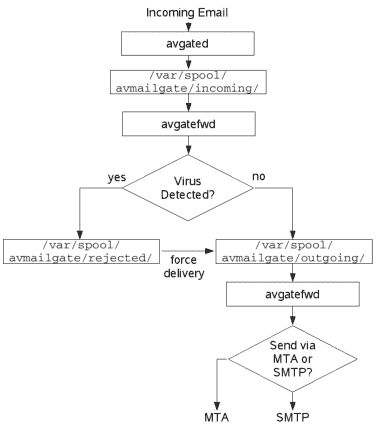

AVMailGate 由三个队列和两种进程组成：

- 队列（位于 `/var/spool/avmailgate`）
    - incoming。所有入站邮件的输入队列。
    - rejected/。存储可能受感染邮件的队列。
    - outgoing。未受感染邮件的输出队列。

- 进程
    - `avgated`。smtpd 接收器，将入站邮件存储在输入队列中。（守护进程）
    - `avgatefwd`。病毒扫描函数、SMTP 转发器和 sendmail 调用器。（守护进程）

这两个进程都可以通过编辑文件 `/etc/avmailgate.conf` 进行配置。

SUSE Linux Enterprise Server 10: 网络服务

此文件包含描述可能设置的注释。

有关所有选项的描述，请参阅 `/usr/share/packages/avmailgate/doc/MANUAL`。

## 安装 AVMailGate

要安装 AVMailGate，请选择包 `avmailgate`。
在 `rcavgate` 中提供了一个启动脚本用于启动和停止 AVMailGate。
若要在系统启动时启动 AVMailGate，请输入 `inserv avgate`。

## 配置 AVMailGate

使用 Postfix 使用 AVMailGate 有两种可能：

- AVMailGate 在 25 端口等待邮件并将其转发给 Postfix
- AVMailGate 被 Postfix 作为内容过滤器使用

## AVMailGate 在 25 端口等待邮件并将其转发给 Postfix

要将 AVMailGate 作为在 25 端口等待邮件的邮件代理，您只需避免 Postfix 监听此端口。因此，在 `/etc/postfix/master.cf` 中标记以下行：通过在前面添加哈希符号（#）来注释：

```
smtp      inet  n       -       n       -       -       smtpd
```

然后重启 Postfix。

## AVMailGate 被 Postfix 作为内容过滤器使用

配合 Postfix 使用 AVMailGate 的最佳方法是使用全内容过滤器 API（详情请参阅 Postfix 包中的 FILTER_README）。

它在 10024 端口等待 SMTP 连接，并在 1025 端口通过 SMTP 为每个过滤器发送邮件消息或病毒警告。

要将 AVMailGate 集成为 Postfix 的过滤器，请执行以下操作：

1. 编辑 `/etc/postfix/master.cf` 并取消相关行的注释（如果适用），添加以下行：

```
localhost:10025 inet n - y - smtpd -o content_filter=
```

2. 编辑 `/etc/postfix/main.cf` 并添加以下行：

```
content_filter = smtp:127.0.0.1:10024
```

3. 由于 AVMailGate 监听在 10024 端口而非 25 端口，请编辑 `/etc/avmailgate.conf` 并设置

```
ListenAddress localhost port 10024
```

4. 您必须告诉 AVMailGate 它应该通过主机 localhost 的 10025 端口通过 SMTP 将邮件发回给 Postfix。编辑 `/etc/avmailgate.conf` 并设置：

```
ForwardTo SMTP: localhost port 10025
```

5. 由于 AVMailGate 以 AVMailGate 的身份发送通知消息，请在 `/etc/aliases` 中设置别名：

```
vmailgate: root
```

之后您必须运行 `newaliases`。

6. 完成这些更改后，输入

```
rcpostfix reload
rcavgate start
```

您的系统现在已准备好扫描电子邮件。

## 理解 AVMailGate 配置文件

如前所述，AVMailGate 的配置文件为 `/etc/avmailgate.conf`。该文件的选项可以分为几类：

- 通用参数
- 归档中文件的扫描
- 处理信封收人地址
- 在传输的邮件正文中添加通知
- 其他配置文件

## 通用参数

- User and Group。`avgated` 和 `avgatefwd` 以此用户和组的权限运行。
- Postmaster。错误和警报消息将发送给此用户。
- MyHostname。计算机主机名。如果未设置，则使用系统主机名。
- SpoolDir。存储队列的目录。
- TemporaryDir。存储临时文件的目录。
- PidDir。PID 文件的位置。
- LogFile。日志文件的位置。
- SyslogFacility。syslog 设施。
- MaxConnections。并发连接数。
- SMTPTimeout。SMTP 超时时间。
- SMTPPreTimeout。预处理超时时间。
- SMTPDataTimeout。SMTP 数据超时时间。
- SMTPRcptTimeout。SMTP 收件人超时时间。
- SMTPHelloTimeout。SMTP hello 超时时间。
- MaxSize。邮件的最大大小。
- MaxRecipientsPerMessage。每条邮件的接收人数。
- MaxFree。空闲块数。
- PollPeriod。`agatewd` 扫描队列的间隔（秒）。
- QueueLifetime。邮件在队列中停留的最大时间。
- ForwarderRetryDelay。重试队列邮件的最大时间。
- ThrottleMessageCount。给定时间内重新处理的消息数。
- ThrottleDelay。重新处理后，`agatewd` 睡眠的时间。
- BounceMessageUser。错误消息发送者的名称或邮件地址（如果邮件无法递送）。
- ListenAddress。SMTP 监听的接口和端口。
- ForwardTo。转发类型。
- AlertsUser。警报发送者的名称。

## 归档中文件的扫描

- ArchiveMaxRecursion。解压和扫描归档的递归深度（0 = 无）。
- ArchiveMaxSize。扫描归档的最大文件大小（0 = 无）。
- ArchiveMaxRatio。扫描归档的最大压缩率。
- BlockSuspiciousArchive。如果设置为 YES，达到 `ArchiveMaxRecursion`、`ArchiveMaxSize` 或 `ArchiveMaxRatio` 限制的邮件将被拦截。
- BlockEncryptedArchive。如果设置为 YES，加密归档邮件将被拦截。
- BlockUnsupportedArchive。如果设置为 YES，无法扫描的归档邮件将被拦截。
- BlockOnError。如果设置为 YES，由于扫描超时或进程错误无法扫描的邮件将被拦截。

## 处理信封收人地址

源路由是一种发送者指定数据包在网络中经过路径的技术。

以下选项涉及 `avgated` 使用的源路由。详细描述请阅读 AVMailGate 文档。

- AllowSourceRouting
- InEnvelopeAddressesBangIs
- InEnvelopeAddressesPercentIs
- AcceptLooseDomainName

## 在传输的邮件正文中添加通知

- `AddStatusInBody`。如果设置为 YES，则会在邮件正文中插入一段默认状态文本。

如果你想插入自己的文本，可以指定文件名。如果没有状态文本，请输入 NO（默认值）。

- `MaxSizeSizeStatus`。指定消息的大小，超过此大小将不再向消息添加状态文本。

语法：`MaxMessageSizeStatus X | k | b`

- `ForwardAllEmailAsMIME`。如果设置为 YES，所有入站的非 MIME 邮件都将转换为 MIME 格式。

- `AddPrecedenceHeader`。如果设置为 YES，每封通知邮件的头中都会包含“Precedence:”字段。你也可以输入自定义文本。

- `AddressFilter`。如果设置为 YES，每个发送者和/或收件者地址都将与 `/etc/avmailgate.scan` 和 `/etc/avmailgate.ignore` 表进行匹配。

表的扫描顺序可以在 `FilterTableOrder` 中指定（优先匹配优先）。

- `UseProxy`。你可以使用 AVMailGate 池中的代理（proxy）功能来优化扫描。

池中反病毒扫描器的数量可以通过 `ProxyScanners` 选项指定。

`ProxyConnections` 指定允许的并发连接数。

- `AddToHeaderToNotice`。如果设置为 YES，则会在邮寄管理员（postmaster）邮件中添加邮件头。

- `BounceMessageSizeBody`, `BounceMessageHeader`。限制退回邮件的大小（单位：字节）。

- `AddHeaderInfo`。如果设置为 YES，则会将扫描状态信息添加到已检查的邮件中。

- `AddReceivedByHeader`。如果设置为 YES，则会在邮件头中添加“Received:”字段。

- `MaxHopCount`。如果头中的“Received:”行数超过 `MaxHopCount`，则邮件将不被接受。

防止邮件循环。

## 其他配置文件

AVMailGate 还有另外四个配置文件。这些文件包含了一些正则表达式。我们在这里只进行简要概述：

- `/etc/avmailgate.acl`。定义了哪些主机被视为本地主机，以及服务器允许为哪些主机中继邮件。

- `/etc/avmailgate.ignore`。定义了不应扫描的邮件地址。

- `/etc/avmailgate.scan`。定义了始终扫描的邮件地址。

- `/etc/avmailgate.warn`。在此文件中可以指定在发生警报时由谁接收邮件。

## 更新 AVMailGate

包含病毒特征的文件是 `/usr/lib/AntiVir/antivir[0123].vdf`。

要更新这些文件，请输入：

```
/usr/lib/AntiVir/antivir --update
```

SUSE Linux Enterprise Server 10: 网络服务

## 输出内容如下：

```
AntiVir / Linux Version 2.1.5-24 +gui

Copyright (c) 1994-2005 by H+BEDV Datentechnik GmbH.

All rights reserved.

Warning: the file "antivir.vdf" is more than 14 days old

checking for updates

06.32.00.60 = 06.32.00.60 [vdf database (part 0), on-disk]

06.32.18.16 < 06.34.00.105 [vdf database (part 1), on-disk]

06.32.18.17 < 06.34.00.106 [vdf database (part 2), on-disk]

06.33.00.07 = 06.34.00.124 [vdf database (part 3), on-disk]

06.33.00.11 < 06.34.00.14 [scan engine, running]

06.33.00.11 < 06.34.00.14 [scan engine, on-disk]

antivir1.vdf 100% = *********************| 163 KB 1.59 MB/s 0:00

ETA

antivir2.vdf 100% = *********************************************| 1 KB 0.00 KB/s --:-

ETA

antivir3.vdf 100% = *********************************************| 35 KB 0.00 KB/s --:-

ETA

antivir 100% = |********************************| 0.00 KB/s --:-

ETA

06.32.00.60 = 06.32.00.60 [vdf database (part 0), on-disk]

06.34.00.105 = 06.34.00.105 [vdf database (part 1), on-disk]

06.34.00.106 = 06.34.00.106 [vdf database (part 2), on-disk]

06.34.00.124 = 06.34.00.124 [vdf database (part 3), on-disk]

06.34.00.14 = 06.34.00.14 [scan engine, on-disk]

scan engine 06.33.00.11 -- 06.34.00.14 (/usr/lib/AntiVir/antivir)

vdf database 06.33.00.07 --> 06.34.00.14 (/usr/lib/AntiVir/antivir2.vdf,

/usr/lib/AntiVir/antivir, /usr/lib/AntiVir/antivir3.vdf)

AntiVir updated successfully
```

如果你只想检查是否有新更新而不更新文件，请输入：

```
/usr/lib/AntiVir/antivir --update-check
```

## 输出内容如下：

```
AntiVir / Linux Version 2.1.5-24 +gui

Copyright (c) 1994-2005 by H+BEDV Datentechnik GmbH.

All rights reserved.

checking for updates

06.32.00.60 = 06.32.00.60 [vdf database (part 0), on-disk]

06.32.18.16 < 06.34.00.105 [vdf database (part 1), on-disk]

06.32.18.17 < 06.34.00.106 [vdf database (part 2), on-disk]

06.33.00.07 < 06.34.00.124 [vdf database (part 3), on-disk]

06.33.00.11 < 06.34.00.14 [scan engine, running]

06.33.00.11 < 06.34.00.14 [scan engine, on-disk]

update for the scan engine is available (/usr/lib/AntiVir/antivir)

update for the Vdf database is available (/usr/lib/AntiVir/antivir1.vdf,

/usr/lib/AntiVir/antivir2.vdf,

/usr/lib/antivir3.vdf)
```

# 练习 4-9 使用 AVMailGate 作为邮件病毒扫描器

在本练习中，你将安装并配置 AVMailGate 作为病毒扫描器。你可以在练习书中找到此练习。

（练习结束）

## amavisd-new

`amavisd-new`（病毒扫描器）由守护进程和辅助程序组成，这些程序在邮件传输代理（MTA）和一个或多个内容检查器（病毒扫描器或 SpamAssassin）之间运行。邮件服务器将所有入站和出站邮件发送给 `amavisd-new`。`amavisd-new` 将提取并测试邮件。`amavisd-new` 可识别四种不良的邮件，它们具有：

1. 无效标头
2. 禁止的文件类型
3. 病毒
4. 垃圾邮件

`amavisd-new` 按列出的顺序测试这四种入站邮件。如果没有发现任何问题，`amavisd-new` 将邮件发回邮件服务器准备投递。默认情况下，`amavisd-new` 在端口 10024 监听来自邮件服务器的入站邮件。`amavisd-new` 通过端口 10025 发送邮件。它通常位于邮件服务器附近，但不一定是用户邮箱最终投递的地方。本主题描述了以下内容：

- 安装 amavisd-new
- 配置 amavisd-new

## 安装 amavisd-new


# 安装与配置 amavisd-new

## 安装 amavisd-new

要安装 amavisd-new，请选择 `amavisd-new` 包。如果系统中没有安装病毒扫描器，amavisd-new 将无法工作。如果你只想使用 amavisd-new 进行垃圾邮件过滤，则也应该安装 `gzip`、`bzip2`、`arc`、`lha`、`rar`、`zip`、`cpio` 和 `bzip` 压缩工具。在安装 SUSE Linux Enterprise 10 时，会创建一个 `vscan` 用户。它用于 amavisd。

```
vscan: # grep vscan /etc/passwd
vscan:x:65:104:vscan account:/var/spool/amavis:/bin/false
```

安装 amavisd-new 后，你可以使用 `amavis start` 启动守护进程。该进程应该监听端口 10024。

```
vscan: # telnet 127.0.0.1 10024
Trying 127.0.0.1...
Connected to 127.0.0.1.
Escape character is '^'
220 [127.0.0.1] ESMTP amavisd-new service ready
```

现在你可以使用 SMTP 命令写邮件。

```
vscan: # telnet 127.0.0.1 10024
Trying 127.0.0.1...
Connected to 127.0.0.1.
Escape character is '^'
220 [127.0.0.1] ESMTP amavisd-new service ready
mail from: jgoldman@digital airlines.com OK
250 2.1.0 Sender jgoldman@digital airlines.com OK
rcpt to: geeko@digitalairlines.com OK
250 2.1.5 Recipient geeko@digitalairlines.com OK
data
354 End data with <CR><LF><CR><LF>
Subject: Test
Test
250 2.6.0 Ok, id=09232-01, from MTA([127.0.0.1]):1025): 250
Ok: queued as 5747B1A68
quit
221 2.0.0 [127.0.0.1] amavisd-new closing transmission
channel
Connection closed by foreign host.
vscan: #
```

邮件头应该包含一个 `amavisid` 行。

```
geeko: > mail
mailx version nail 11.25 7/29/05. Type ? for help.
"/var/spool/mail/geeko: 1 message 1 new
>N 1 jgoldman@digital Tue May 16 15:30 20/829 Test
X-Original-To: geeko@digitalairlines.com
Delivered-To: geeko@digitalairlines.com
Subject: Test
X-Virus-Scanned: amavisd-new at example.com
Date: Tue, 16 May 2006 15:30:58 -0400 (EDT)
From: jgoldman@digital airlines.com
To: undisclosed-recipients;

Test
?
```

## 配置 amavisd-new

在 SUSE Linux Enterprise Server 10 上，你可以通过编辑以下文件之一来配置 amavisd-new：

- `/etc/sysconfig/amavis`
- `/etc/amavisd.conf`

配置文件 `/etc/sysconfig/amavis` 仅适用于 SUSE Linux 产品。此文件只有两个参数：

- `USE_AMAVIS`：如果设置为 `yes`，Sendmail 或 Postfix 将准备好使用 amavisd-new。
- `AMAVIS_SENDMAIL_MILTER`：如果设置为 `yes`，则将启动 Sendmail 的 milter（邮件过滤器）接口。

使用 milter 接口，可以标准化的形式将邮件过滤器应用程序连接到 Sendmail。

更改文件 `/etc/sysconfig/amavis` 之后，你必须运行 `SuSEconfig` 命令。

将 `USE_AMAVIS` 设置为 `yes` 会对 `/etc/postfix/master` 进行三处更改。

### smtp 协议

| smtp | inet | n | n | 2 | smtpd -o |
| :--- | :--- | :--- | :--- | :--- | :--- |
| content_filter=smtp:[127.0.0.1]:1024 | | | | | |

### smtps 协议（仍被标记为注释）

| #smtps | inet | n | n | 2 | smtpd -o |
| :--- | :--- | :--- | :--- | :--- | :--- |
| smtpd_tls_wraermode=yes -o content_filter=smtp:[127.0.0.1]:1024 | | | | | |

### 端口 10025

| localhost:10025 inet | n | n | - | smtpd -o |
| :--- | :--- | :--- | :--- | :--- |
| content_filter= | | | | | |

在此文件中，你还必须为 amavis 添加一个进程：

```
smtp-amavis unix - - - 2 smtp
-o smtp_data_done_timeout=1200
-o smtp_send_xforward_command=yes
-o disable_dns_lookups=yes
-o max_use=20
```

在 Postfix 配置文件 `/etc/postfix/main.cf` 中，你需要添加以下行：

```
content_filter = smtp-amavis:[127.0.0.1]:10024
```

通过输入 `postfix reload` 重启 Postfix。

## /etc/amavisd.conf

AMaSd 通过编辑文件 `/etc/amavisd.conf` 进行配置。

该配置文件的语法是纯 Perl 代码。正因如此，每行都以分号结尾。

在双引号 Perl 字符串中，可以包含以 `\$` 或 `\@` 开头的变量。要在双引号字符串中包含 `@` 和 `$` 字符，必须在它们前面加一个反斜杠。

在单引号字符串中，`\$` 和 `@` 会失去它们的特殊含义，因此通常使用单引号字符串更简单。

在这两种情况下，反斜杠都需要双写。

在 amavisd-new 的文档目录（`/usr/share/doc/packages/amavisd-new/`）中，提供了两个示例文件：

- `amavisd-conf.default`：包含所有带有默认值的可能参数。
- `amavisd-conf.sample`：一个更结构化的文件，包含大量示例。

在本节中，我们按照参数在 `/etc/amavisd.conf` 文件中出现的顺序讨论一些最重要的参数：

- `@bypass_virus_maps`：此数组包含病毒查找表列表。你可以通过将数组设置为 `"1"`（取消注释该行）来禁用病毒检查。
- `@bypass_spam_maps`：此数组包含垃圾邮件查找表列表。你可以通过将此数组设置为 `"1"`（取消注释该行）来禁用垃圾邮件检查。

在 `@bypass_virus_maps` 和 `@bypass_spam_maps` 旁边还有两个相同类型的数组：

- `@bypass_banned_maps`：启用检查禁用的名称或文件类型。
- `@bypass_header_maps`：启用检查无效标头。

- `$max_servers`：预叉（pre-forked）子进程的数量。应与 MTA 管道的数量匹配，例如 `/etc/postfix/master.cf` 中的 `maxproc` 字段。

```
=======================================================
## service type private chroot maxproc args
## (yes) (yes) (never) (100)
=======================================================
smtp inet n n - 2 smtpd -o content_filter=smtp:[127.0.0.1]:1024
```

- `$daemon_user` 和 `$daemon_group`：守护进程将切换的用户和组。
- `$mydomain`：域名。
- `$MYHOME`：amavisd-new 文件存储的位置。
- `$TEMPBASE`：可以被 amavisd-new 使用的临时目录路径。该目录必须存在或需要手动创建。
- `$QUARANTINED`：可以存放感染邮件的路径。该路径不以反斜杠结尾。
- `$quarantine_subdir`：如果设置为 `"1"`，则会在 `$QUARANTINED` 中创建子目录以便分散。
- `$daemon_chroot`：在指定的 chroot 中运行守护进程。如果你不想 chroot，请将其留空。
- `$db_home`：数据库的路径。默认：`$MYHOME/db`。
- `$helpers_home`：设置传递给 SpamAssassin 模块的环境变量 `HOME`。
- `$pid_file`：PID 文件的路径。
- `$lock_file`：锁文件的路径。
- `@local_domains`：查找表列表，用于判断接收者是否为本地用户，即邮件是否为外发邮件。
- `@mynetworks`：IP 范围列表，用于确定原始 SMTP 地址是否属于内部网络。
- `$log_level`：日志级别。
  - `0`：启动
  - `1`：错误
  - `2`：详细
  - `3`：调试
  - `4`：警告
  - `5`：关键信息


## 配置 Amavis 进程

在此文件中，你还必须为 amavis 添加一个进程：

```
smtp-amavis unix - - - 2 smtp
-o smtp_data_done_timeout=1200
-o smtp_send_xforward_command=yes
-o disable_dns_lookups=yes
-o max_use=20
```

在 Postfix 配置文件 `/etc/postfix/main.cf` 中，你需要添加以下行：

```
content_filter = smtp-amavis:[127.0.0.1]:10024
```

通过输入 `postfix reload` 重启 Postfix。

## /etc/amavisd.conf

AMaSd 通过编辑文件 `/etc/amavisd.conf` 进行配置。

该配置文件的语法是纯 Perl 代码。正因如此，每行都以分号结尾。

在双引号 Perl 字符串中，可以包含以 `\$` 或 `\@` 开头的变量。要在双引号字符串中包含 `@` 和 `$` 字符，必须在它们前面加一个反斜杠。

在单引号字符串中，`\$` 和 `@` 会失去它们的特殊含义，因此通常使用单引号字符串更简单。

在这两种情况下，反斜杠都需要双写。

在 amavisd-new 的文档目录（`/usr/share/doc/packages/amavisd-new/`）中，提供了两个变文件：

- `amavisd-conf.default`：包含所有带有默认值的可能参数。
- `amavisd-conf.sample`：一个更结构化的文件，包含大量示例。

在本节中，我们按照参数在 `/etc/amavisd.conf` 文件中出现的顺序讨论一些最重要的参数：

- `@bypass_virus_maps`。此数组包含病毒查找表列表。你可以通过将数组设置为 "1"（取消注释该行）来禁用病毒检查。
- `@bypass_spam_maps`。此数组包含垃圾邮件查找表列表。你可以通过将此数组设置为 "1"（取消注释该行）来禁用垃圾邮件检查。

在 `@bypass_virus_maps` 和 `@bypass_spam_maps` 旁边还有两个相同类型的数组：

- `@bypass_banned_maps` 启用检查禁用的名称或文件类型。
- `@bypass_header_maps` 启用检查无效标头。

`$max_servers`。预叉（pre-forked）子进程的数量。应与 MTA 管道的数量一致，例如 `/etc/postfix/master.cf` 中的 `maxproc` 字段。

```
=======================================================
## service type private chroot maxproc args
## (yes) (yes) (never) (100)
=======================================================
smtp inet n n - 2 smtpd -o content_filter=smtp:[127.0.0.1]:1024
```

`$daemon_user` 和 `$daemon_group`。守护进程将切换的用户和组。

`$mydomain`。域名。

`$MYHOME`。amavisd-new 文件存储的位置。

`$TEMPBASE`。可以被 amavisd-new 使用的临时目录路径。该目录必须存在或需要手动创建。

在接下来的行中，环境变量 `$TMPDIR` 使用 `$TEMPBASE` 变量的内容进行定义。

`$QUARANTINED`。可以存放感染邮件的路径。该路径不以反斜杠结尾。

`$quarantine_subdir`。如果设置为 "1"，则会在 `$QUARANTINED` 中创建子目录以便分散。

`$daemon_chroot`。在指定的 chroot 中运行守护进程。如果你不想 chroot，请将其留空。

`$db_home`。数据库的路径。默认：`$MYHOME/db`。

`$helpers_home`。设置传递给 SpamAssassin 模块的环境变量 HOME。

`$pid_file`。PID 文件的路径。

`$lock_file`。锁文件的路径。

`@local_domains`。查找表列表，用于判断接收者是否为本地用户，即邮件是否为外发邮件。

`@mynworks`。IP 范围列表，用于确定原始 SMTP 地址是否属于内部网络。

`@mynworks`。列表，用于确定原始 SMTP 地址是否属于内部，即来自内部的。

`$log_level`。日志级别。

- 0. 启动
- 1. 错误
- 2. 详细
- 3. 调试
- 4. 警告
- 5. 关键信息

## /etc/sysconfig/amavis

- `AMAVIS_SENDMAIL_MILTER`。如果设置为 yes，则将启动 Sendmail 的 milter（邮件过滤器）接口。

使用 milter 接口，可以标准化的形式将邮件过滤器应用程序连接到 Sendmail。

更改文件 `/etc/sysconfig/amavis` 之后，你必须运行 `SuSEconfig` 命令。

将 `USE_AMAVIS` 设置为 yes 会对 `/etc/postfix/master` 进行三处更改。

### smtp 协议

| smtp | inet | n | n | 2 | smtpd -o |
| :--- | :--- | :--- | :--- | :--- | :--- |
| content_filter=smtp:[127.0.0.1]:1024 | | | | | |

### smtps 协议（仍被标记为注释）

| #smtps | inet | n | n | 2 | smtpd -o |
| :--- | :--- | :--- | :--- | :--- | :--- |
| smtpd_tls_wraermode=yes -o content_filter=smtp:[127.0.0.1]:1024 | | | | | |

### 端口 10025

| localhost:10025 inet | n | n | - | smtpd -o |
| :--- | :--- | :--- | :--- | :--- |
| content_filter= | | | | | |


## 变量配置

`$quarantine_subdir`。如果设置为 "1"，则会在 `$QUARANTINED` 中创建子目录以便分散。

`$daemon_chroot`。在指定的 chroot 中运行守护进程。如果你不想 chroot，请将其留空。

`$db_home`。数据库的路径。默认：`$MYHOME/db`。

`$helpers_home`。设置传递给 SpamAssassin 模块的环境变量 HOME。

`$pid_file`。PID 文件的路径。

`$lock_file`。锁文件的路径。

`@local_domains`。查找表列表，用于判断接收者是否为本地用户，即邮件是否为外发邮件。

`@mynworks`。IP 范围列表，用于确定原始 SMTP 地址是否属于内部网络。

`@mynworks`。列表，用于确定原始 SMTP 地址是否属于内部，即来自内部的。

`$log_level`。日志级别。

- 0. 启动
- 1. 错误
- 2. 详细
- 3. 调试
- 4. 警告
- 5. 关键信息

其他一些重要的变量如下：

- `$final_virus_destiny`、`$final_banned_destiny`、`$final_spam_destiny`、`$final_bad_header_destiny`。定义了对病毒、被封发送者、垃圾邮件内容或错误头部的处理方式。

你可以使用以下值：

- `D_PASS`。无论内容好坏，邮件都将传递给接收者。
- `D_DISCARD`。邮件不会投递给接收者；不会通知发送者。
- `D_BOUNCE`。邮件不会投递给接收者；AMaSd-new 将向发送者发送退信通知（bounce）。
- `D_REJECT`。邮件不会投递给接收者；发送者最好收到一个拒绝通知（SMTP 永久拒绝响应或来自 MTA 的退信通知）。

如果无法实现这种操作，AMaSd-new 将自行发送退信通知（与 `D_BOUNCE` 相同）。

- `$notify_method`。指定发送通知的目标的主机和端口。
- `$notify_sender_templ`。如果你不想通知邮件的发送者，请调整此变量。
- `$notify_virus_sender_templ`。如果你不想向包含病毒的邮件发送者发送默认通知，请指定一个文本文件。
- `$notify_virus_admin_templ`。如果在检测到病毒时不想通知管理员，请指定一个文本文件。
- `$notify_virus_recips_templ`。如果你不想通知包含病毒的邮件的接收者，请指定一个文本文件。
- `$notify_spam_sender_templ`。如果你不想向包含垃圾邮件的邮件发送者通知，请指定一个文本文件。
- `$notify_spam_admin_templ`。如果在检测到垃圾邮件时不想通知管理员，请指定一个文本文件。

## 练习 4-10 使用 AMaViSd 作为邮件病毒扫描器

在此练习中，你将安装并配置 AMaViSd。

你可以在练习册中找到此练习。

（练习结束）

## 总结

| 目标 | 总结 |
|---|---|
| 1. 理解三个邮件代理的功能 | 邮件由用户的邮件软件传递给 MTA。MTA 将其发送到接收者 MTA。MTA 指定收到的消息目标是哪个本地用户，并将其传递给 MDA，后者将其存储在正确的位置。MUA 读取保存的消息并将新消息传递给 MTA。MUA 是 MDA 和用户之间的接口。 |
| 2. 使用基础 Linux mail 命令 | 某些程序会将状态邮件消息或备注写入用户 root。如果你在虚拟终端登录，当有等待你处理的消息时，你将收到通知。<br><br>你可以使用 `mail` 命令来读取消息。<br><br>你还可以将 `mail` 程序作为命令行上的邮件客户端使用。<br><br>要完成正文输入，你需要在最后一行输入一个句号。<br><br>为了提供 SMTP 通信，必须在 SMTP 服务器中实现以下 SMTP 命令：<br><br>- `HELO`<br>- `MAIL FROM:`<br>- `RCPT TO:`<br>- `DATA`<br>- `RSET`<br>- `NOOP`<br>- `QUIT` |

## 目标总结

### 3. 理解 Postfix 的架构和组件

在本地发送的邮件将由 Postfix 的 Sendmail 通过 `postdrop` 命令放入 maildrop 队列中。

然后，它会被 `pickup` 守护进程拾取，该进程会对其检查：

- 内容
- 大小
- 基于规则的其他因素

然后清理缺失的头部行

- 插入双重接收者地址
- 通过 `trivial-rewrite` 守护进程将头部中的邮件地址转换为 `user@fully-qualified-domain` 规范
- 根据 canonical 和 virtual 表中的规则在头部中写入数据

之后，邮件被复制到输入队列（incoming queue），并通知队列管理器该邮件已到达。

### 3. 理解 Postfix 的架构和组件（继续）

通过互联网或局域网接收的邮件由 `smtpd` 守护进程接受。

在传递给 `cleanup` 守护进程之前，会对邮件进行检查：

- 内容
- 大小
- 其他因素

队列管理器获取放在输入队列中的邮件，并将其复制到活动队列（active queue），假设活动队列是空的。

`trivial-rewrite` 守护进程使用传输表（transport table）检查邮件的接收者是在本地系统还是远程系统。

Postfix 的重要组件位于：

- `/etc/aliases`。包含本地地址别名。
- `/etc/postfix/`。所有定义 Postfix 邮件处理的配置文件都在此目录下。
- `/usr/lib/postfix/`。此目录包含 Postfix 需要的所有程序。

### 3. 理解 Postfix 的架构和组件（继续）

- `/usr/sbin/`。此目录包含用于维护和手动控制 Postfix 的管理程序。
- `/usr/bin/`。在此找到名为 `mailq` 和 `newaliases` 的符号链接。
- `/var/spool/postfix/`。此目录包含 Postfix 自身的目录以及运行 Postfix 进程的的 etc/ 和 lib/ 目录等。
- `/usr/share/man/man-8`。这些目录包含手册页。
- `/usr/share/doc/packages/postfix`。在这里可以找到 Postfix 的文档。

### 4. 启动、停止和重新初始化 Postfix

使用 `postfix start` 启动 Postfix 守护进程。

使用 `postfix stop` 停止 Postfix 守护进程。

## SUSE Linux Server 10: 网络服务

| 目标 | 总结 |
|---|---|
| 5. 配置 Postfix | Postfix 主守护进程通过 **/etc/postfix/master.cf** 文件进行配置。文件中的每一行包含一个 Postfix 进程条目。各个列的含义如下：<br><br>**service**。Postfix 进程名称。<br>**type**。允许连接。<br>**private**。配置对服务的访问。<br>**unpriv**。配置运行该服务的 UID。<br>**chroot**。指定 chroot 行为。<br>**wakeup**。在指定的秒数后再次运行服务。<br>**maxproc**。定义同时运行的最大进程数。<br>**command and args**。配置执行的命令以及所需的参数。 |

## 目标总结

### 5. 配置 Postfix（继续）

所有的进一步配置（查找表中的配置外）都设置在 `/etc/postfix/main.cf` 文件中。

在 SUSE Linux Server 10 中，该文件的最常用参数可以通过 `/etc/sysconfig/mail` 和 `/etc/sysconfig/postfix` 中的变量进行修改。为了让 MTA 正常运行，你需要在 `/etc/sysconfig/mail` 文件中进行两个设置：

- 在 `FROM_HEADER` 变量中输入 FDNQ。
- 将 `SMTPD_LISTEN_REMOTE` 设置 yes，以便 Postfix 在端口 25 上监听接入的邮件。

否则只会接受来自本地主机的邮件。在 `/etc/sysconfig/postfix` 文件中的修改只有在执行 `/sbin/SuSEconfig` 后才会应用于 `/etc/postfix/main.cf`，在某些情况下也应用于 `/etc/postfix/master.cf`。

| 目标 | 总结 |
|---|---|
| 5. 配置 Postfix | 转发邮件到提供商服务器的邮件服务器必须：<br><br>- 接受来自局域网客户端的邮件。<br>- 拒绝其他客户端投递的邮件。<br>- 可能重写发送者地址。<br>- 将所有邮件提交给提供商服务器。<br><br>此外，同时通过互联网接收邮件的邮件服务器还必须：<br><br>- 接受来自互联网并针对你所在域名的邮件。<br>- 拒绝来自互联网但不是针对你所在域名的邮件。<br>- 拒绝来自已知垃圾源的邮件。<br><br>无论最后情况下 Postfix 如何配置，都必须通过 MX 记录将该服务器引入 DNS，作为负责的邮件服务器。 |

| 目标 | 总结 |
|---|---|
| 5. 配置 Postfix（继续） | 查找表包含在整个 Postfix 系统中处理电子邮件的规则。<br><br>这些表通过文件 `/etc/postfix/main.cf` 中的变量激活，该文件随后定义为 `/etc/postfix/lookup-table`。<br><br>定义查找表后，需要使用 `postmap` 命令将其转换为所需的格式（通常是哈希表的形式）。<br><br>使用访问查找表（access lookup table）拒绝或允许来自定义发送者的邮件。<br><br>使用规范查找表（canonical lookup table）重写入站和出站邮件的发送者和收件者地址。<br><br>使用重定向查找表（relocated lookup table）返回退信邮件，并向在该系统中已不存在的邮件发送者发送说明。<br><br>使用传输查找表（transport lookup table）为特殊的邮件地址范围定义邮件路由。<br><br>使用虚拟查找表（virtual lookup table）为多个具有独立用户名的域设置邮件。<br><br>使用别名查找表（aliases lookup table）为邮件递送定义邮件别名。 |

## 6. 使用 Postfix 工具

以下是 Postfix 工具：

- `newaliases`。将 ASCII 文件 `/etc/aliases` 转换为哈希文件 `/etc/aliases.db`。
- `mailq`。列出邮件队列中所有尚未发送的邮件。
- `postalias`。将 ASCII 文件 `/etc/aliases` 转换为哈希表 `/etc/aliases.db`。与 `newaliases` 相同。
- `postcat`。以可读的形式显示队列目录中的文件内容。
- `postconf`。显示所有变量的值。<br><br>输入 `postconf -e key=value` 直接修改变量。这些更改将自动集成到 `main.cf` 文件中。
- `postdrop`。该命令由 `sendmail` 自动运行。
- `postfix`。启用配置错误检查，强制立即递送延留队列中的邮件；或重新读取 Postfix 配置文件。
- `postmap`。为 `/etc/postfix/` 目录下的查找表生成哈希表。
- `postuper`。删除所有非普通文件或目录的文件。

## 7. 通过 IMAP 和 POP3 接收邮件

Cyrus IMAPd 专为没有普通用户账户的服务器设计。

- `/etc/cyrus.conf`。Cyrus IMAPd 的基础配置文件。
- `/etc/imapd.conf`。IMAPd 的配置文件。
- `/var/lib/imap/mailboxes.db`。包含关于信箱的重要信息。
- `/var/lib/imap/log/`。存储日志信息。
- `/var/lib/imap/quota/`。定义每个 IMAP 账户的配额。
- `/var/lib/imap/shutdown`。如果此文件存在，IMAP 服务器会将该文件的第一行作为警报发送给客户端。
- `/var/lib/imap/msg/motd`。如果此文件存在，IMAP 服务器在建立连接后将第一行发送给客户端。

一旦安装了 QPopper，如果系统中配置并启动了超级守护 `xinetd`，即可通过 POP3 协议检索邮件。

Procmail 是一个高度灵活的 MDA（邮件投代理）。它可以根据用户指定的任意标准将邮件分类到信箱、转发给其他收件者或将其删除。

如果使用 Postfix 作为 MTA（邮件传输代理），则需要在 `/etc/postfix/main.cf` 中添加条目。

使用 Procmail 最有趣的方面是根据邮件头部或邮件正文中的信息对邮件进行预过滤和分发。

每个邮件收件者可以在其家目录下创建一个 `.procmailrc` 文件，并为 Procmail 安装其或自己所需的设置。虽然也可以通过配置文件 `/etc/procmailrc` 创建系统级配置。

## 8. 管理垃圾邮件

Linux 最常用的垃圾邮件过滤工具是 SpamAssassin。

它会测试邮件正文、头部、URI 和附件。

它还使用了来自其他组织的黑名单和白名单。

选择 `spamassassin` 软件包来安装垃圾邮件过滤器。

安装后，将可以使用以下可执行文件：

- `spamassassin`。启动 SpamAssassin。
- `spamd`。SpamAssassin 可执行文件的守护进程版本。该守护进程适用于自动邮件检查。
- `spamc`。垃圾邮件客户端。在您自己的脚本中使用 `spamc` 代替 `Spamassin`。
- `sa-learn`。用于训练 SpamAssassin 的工具。

SpamAssassin 的配置通过编辑文件完成：

```
/etc/mail/spamassassin/local.cf
```

## 9. 使用病毒扫描器处理邮件

AVMailGate 是来自 H+BEDV Datentechnik GmbH 的病毒邮件过滤器。

AVMailGate 可以更新病毒定义文件和引擎本身。

AVMailGate 由两种进程组成：

- `avagated`。smtpd 接收器，将入站邮件存储在输入队列中。
- `avgatefd`。病毒扫描函数、SMTP 转发器和 sendmail 调用器。

`avagated` 和 `avgatefd` 可以在 `/etc/avgate.conf` 文件中配置。

AVMailGate 是一个适用于 UNIX 的防病毒工具包。该软件的主要目的是与邮件服务器集成。SUSE Linux Server 10 可用 AVMGate。

## 目标 2 理解 SLP 代理

SLP 使用代理（agents）来表示网络上的应用程序和服务。

### 图 5-1

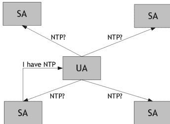

代理是一个用于处理 SLP 协议消息的软件实体。

SLP 代理有三种类型：

- 用户代理 (User Agent)
- 服务代理 (Service Agent)
- 目录代理 (Directory Agent)

这些代理通过不同类型的消息（Messages）进行相互通信。

为了理解这些消息是如何发送和接收的，你需要（了解）单播（Unicast）、组播（Multicast）和广播（Broadcast）协议之间的区别。

## 用户代理

SLP 用户代理 (UA) 是用于查找运行一个或多个指定服务的主机位置的软件。

它通常（至少部分）以库的形式实现，客户端应用程序链接到该库，为客户端应用程序提供了一个简单的接口来访问 SLP 注册的服务信息。

用户代理使用两种可能的方法来识别它们所需的服务：

- 如果网络上使用了目录代理，用户代理将向目录代理发送单播请求，以征求指定的服务。
- 如果网络上没有使用目录代理，服务代理将针对指定的服务发送组播请求。

## 服务代理

SLP 服务代理 (SA) 是用于发布一个或多个活动服务位置的软件。

SLP 广告设计旨在兼顾可扩展性和高效性，通过使用有针对性的组播消息和对查询的单播响应，最大限度地减少对网络带宽的使用。

服务代理使用两种可能的方法来发布它们已注册的服务：

- 如果网络上使用了目录代理，服务代理将服务注册发送给目录代理。
- 如果网络上没有使用目录代理，服务代理将回答与注册服务相匹配的服务请求。

一旦完成注册，服务请求就可以由目录代理来处理。

所有的服务请求和回复都将单播包。

服务代理将保持被动状态，直到服务终止或达到生存周期。只有那时，它才会再次联系目录代理。

## 目录代理

SLP 目录代理 (DA) 是作为服务位置信息集中存储的软件。

目录代理接收来自服务代理的注册请求，并使用服务信息回答来自用户代理的服务请求。

目录代理可以在大型环境中实现，以减少流量并将服务可用性划分到手动定义的范围之内。

服务代理和用户代理都会优先发现可用的目录代理，使用目录代理可以减少该协议在网络上发送的组播消息数量。

服务代理将自己注册到目录代理组播组，以便用户代理可以定位目录代理，并能够仅使用单播包定位网络上的活动服务。

## 消息

为了给服务定位提供一个框架，SLP 代理之间使用 11 种不同消息进行通信。

代理之间的对话通常仅限于非常简单的请求和回复消息交换：

- 服务请求 (SrvRqst)。用户代理发送给服务代理或目录代理的消息，用于请求服务的位置。
- 服务回复 (SrvRply)。服务代理或目录代理响应 SrvRqst 消息时发送的消息。SrvRply 包含所请求服务的 URL。
- 服务注册 (SrvReg)。服务代理发送给目录代理的消息，包含有关可用服务的信息。
- 服务注销 (SrvDeReg)。服务代理发送给目录代理的消息，通知其某服务不再可用。该服务通知服务代理在终止前立即注注销。
- 服务确认 (SrvAck)。目录代理响应 SrvReg 和 SrvDeReg 消息时发送给服务代理的通用确认。
- 属性请求 (AttrRqst)。用户代理发送的、用于请求服务属性的消息。


- 属性回复 (`AttrRply`)。服务代理或目录代理响应 `AttrRqst` 时发送的消息。`AttrRply` 包含所请求的属性列表。

- 服务类型请求 (`SrvTypeRqst`)。用户代理发送给服务代理或目录代理的消息，请求可用服务的类型。

- 服务类型回复 (`SrvTypeRply`)。服务代理或目录代理响应 `SrvTypeRqst` 时发送的消息。`SrvTypeRply` 包含所请求的服务类型列表。

- DA 广告 (`DAADvert`)。目录代理发送的消息，让服务代理和用户代理知道它们的位置。

- SA 广告 (`SAADvert`)。服务代理发送的消息，让用户代理知道它们的位置。

## 单播、组播和广播协议

SLP 是一种单播和组播协议。

这意味着上述消息可以发送到：

- 一次给一个代理（单播）

或者

- 同时发送给所有（正在监听的）代理（组播）

组播不是广播。

理论上，广播消息会被网络上的每个节点听到，但组播消息只会被网络上加入该组播组的节点听到。

网络路由器过滤所有的广播和组播流量。

这意味着在一个子网生成的广播和组播将不会转发或路由到连接到路由器的任何其他子网。（从路由器的角度来看，一个子网由连接到其一个端口的所有机器组成。）

默认情况下，路由器不转发广播和组播。

你可以更改路由器配置，或在每个网络中使用目录代理。

目录代理可以使用单播（可路由的）包共享它们的服务信息，这样所有服务信息在所有网络中都可用。

在本课程中，我们将仅关注用户代理/服务代理的通信。

## SLP 需要组播路由并使用已知端口

```
da51:~ # grep slp /etc/services
eicon-slp   1440/tcp # 图标服务定位协议
eicon-slp   1440/udp # 图标服务定位
slp           1605/udp # 问候协议 (Salutation Protocol)
slp           1605/udp # 问候协议
sslp          1750/tcp # 安全套接库主端口
sslp          1750/udp # 安全套接库主端口
slp-notify   1847/tcp # 通知
slp-notify   1847/udp # 通知
csvrr-sslproxy 3191/tcp # ConsR SSL 代理
csvrr-sslproxy 3191/udp # ConsR SSL 代理
epl-slp       3819/tcp # EPL 层协议
epl-slp       3819/udp # EPL 层协议
d-slp         4406/tcp # ASIGRA 存活服务
d-slp         4406/udp # ASIGRA 存活服务
da51:~        #
```

## 目标 3

## 配置 OpenSLP

在 SUSE Linux Enterprise 10 上，默认安装了以下包：

- `openslp-server`。此包包含 SLP 服务器（守护进程）、初始化脚本和文档。

  每个提供应被 SLP 客户端使用的服务的系统都必须运行此服务器。

- `openslp`。此包包含运行时库和 `slptool`；一个命令行界面。

为了确保 OpenSLP 在你的本地网络上提供服务信息，你需要了解：

- OpenSLP 守护进程 `slpd`

- OpenSLP 配置

- OpenSLP 注册文件

## OpenSLP 守护进程 slpd

OpenSLP 守护进程 `/usr/sbin/slpd` 提供

- 服务代理和目录代理功能。

- 与网络上其他 SLP 代理的位置保持一致的能力。

在 SUSE Linux Enterprise 10 上，该守护进程默认安装并激活。其初始化脚本为 `/etc/init.d/slpd`。

当 `slpd` 启动时，它会读取：

- 配置文件 `/etc/slp.conf`（参见“OpenSLP 配置”）。

- 应由 OpenSLP 维护的服务注册文件（参见“OpenSLP 注册文件”）。

如果对配置文件或注册文件进行了任何更改，需要重启守护进程才能生效。

要执行此操作，请以 root 身份输入：

```
/etc/init.d/slpd restart
```

或者

```
rcslpd restart
```

停止守护进程，请以 root 身份输入：

```
/etc/init.d/slpd stop
```

或者

```
rcslpd stop
```

启动守护进程，请以 root 身份输入：

```
/etc/init.d/slpd start
```

或者

```
rcslpd start
```

检查守护进程状态，请以 root 身份输入：

```
/etc/init.d/slpd status
```

或者

```
rcslpd status
```

OpenSLP 守护进程 `slpd` 必须最初以 root 运行以绑定 SLP 端口。但是，`slpd` 将 root 权限和 `suid(0)` 交给守护进程用户（如果存在）。

## OpenSLP 配置文件

OpenSLP 配置文件为 `/etc/slp.conf`。OpenSLP 守护进程 `slpd` 在启动或重启时会读取此文件。

该文件包含影响以下内容的配置信息：

- OpenSLP 守护进程 (`/usr/sbin/slpd`) 的操作

- 使用 OpenSLP 库的应用程序 (`/usr/lib/libslp.so`)

`slpd` 的默认设置可以满足常见需求。因此，你不需要修改此文件。

要理解此文件，你需要了解以下内容：

- `/etc/slp.conf` 的语法

- `/etc/slp.conf` 中的参数

## /etc/slp.conf 的语法

`slp.conf` 文件中的每个参数都位于单行中，格式如下：

`parameter=value`

例如：`net.slp.useScopes=DEFAULT`

注释行以 `#` 或 `;` 开头。

文件语法在 RFC 2614 中规定。参数将在下节中进行描述。

## /etc/slp.conf 中的参数

以下是 OpenSLP 支持的参数列表：

- `net.slp.interfaces`。此参数是一个由逗号分隔的接口列表（本地 IP 地址），目录代理（Directory Agent）或服务代理（Service Agent）应在这些接口上监听 OpenSLP 请求。该参数对于用户代理（User Agent）是可选的，但对于服务代理或目录代理正常运行是必须的。可以指定 IPv4 和 IPv6 地址。虽然允许站点本地和全局 IPv6 地址，但目录代理或服务代理只能在链路本地地址（link-local addresses）上接收 IPv6 组播。默认情况下，OpenSLP 使用所有接口。

- `net.slp.useScopes`。此参数是一个逗号分隔的字符串列表，指示用户代理或服务代理在进行请求或注册时被允许的唯一范围，或者目录代理必须支持的范围。默认值为 `DEFAULT`。这意味着所有服务都注册在该范围内。

- `net.slp.DAAddresses`。此参数允许你强制用户代理和服务代理使用特定的目录代理。如果不使用此设置，将使用动态目录代理发现来确定使用哪些目录代理。默认是使用动态目录代理发现。

- `net.slp.broadcastAddr`。此参数是一个字符串，指示在发送广播包时使用的广播地址。此参数仅在设置了其他广播配置变量时有效。默认值为 `255.255.255.255`。

- `net.slp.isBroadcastOnly`。此参数强制使用广播代替组播。此参数很少需要，因为 OpenSLP 会自动使用组播。

- `net.slp.passiveDetection`。此参数是一个布尔值，指示是否应该使用被动检测。默认值为 `false`。

- `net.slp.discoveryInterval`。这是一个正整数，给出主动查询之间的秒数。默认值为 `900`（15 分钟）。如果值为 `0`，则关闭主动发现。

- `net.slp.maxResults`。这是一个 32 位整数，给出返回的最大结果数。默认值为 `255`。

- `net.slp.TTL`。这是一个小于或等于 255 的正整数。

- `net.slp.multicastWait`。这是一个整数，给出组播请求的最大时间。默认值为 `15000`（15 秒）。

- `net.slp.unicastWait`。这是一个整数，给出单播请求的最大时间。默认值为 `15000`（15 秒）。

- `net.slp.MTU`。这是一个整数，给出任何数据包的最大尺寸。默认值为 `1400`。

- `net.slp.security`。此参数是一个布尔值，指示是否应对 URL、属性和广告启用安全。默认值为 `false`。

- `net.slp.locale`。它是消息的语言。默认值为英语。

- `net.slp.DAHeartBeat`。这是一个 32 位整数，给出目录代理心跳的秒数。默认值为 `10800`（3 小时）。如果 `isDA` 为 `false`，则忽略此属性。

- `net.slp.useIPv4`。此参数指定是否应该使用 IPv4。默认值为 `true`。

- `net.slp.useIPv6`。此参数指定是否应该使用 IPv6。默认值为 `true`。

OpenSLP 不支持 RFC 2614 中指定的所有设置。

以下选项均未被支持：

- `net.slp.serializedRegURL`

- `net.slp.multicastTimeouts`

- `net.slp.DADDiscoveryTimeouts`

- `net.slp.datagramTimeouts`

## OpenSLP 注册文件

在 SUSE Linux Enterprise Server 10 上，许多应用程序已经集成了对 OpenSLP 支持。

通过 SLP API（应用程序编程接口），开发者可以轻松地为其程序添加基于 OpenSLP 的功能。

主要的函数调用和更多信息可以在 RFC 2614 中找到。

服务在注册文件中配置，以便通过 OpenSLP 可用。

可以通过以下方式进行注册：

- 通过 `/etc/slp.reg.d/` 下的文件进行静态注册

- 通过 `/etc/slp.reg` 进行静态注册

- 使用 `slptool` 进行动态注册

## 通过 `/etc/slp.reg.d/` 下的文件进行注册

为 OpenSLP 注册服务的最佳方法是在 `/etc/slp.reg.d/` 目录下为每个服务创建一个注册文件。

OpenSLP 守护进程 `slpd` 在启动时读取注册文件，维护所有注册，并在每次接收到 `SIGHUP` 信号时重新读取文件。

为了在运行的服务代理（Service Agent）处注册，该服务需要正在运行并拥有有效的注册文件。然后，服务代理会注册该服务，并在寿命到期时检查服务的活动状态。

服务代理的注册信息存储在内存中，可以发送到目录代理（Directory Agents）。

要理解这些注册文件，你需要了解以下内容：

- OpenSLP 注册文件语法

- OpenSLP 服务 URL 语法

- OpenSLP 服务类型语法

## OpenSLP 注册文件语法

注册文件的格式易于理解。

每个注册项由以下几行组成，格式如下：

```
#comment
;comment
service-url,language-tag,lifetime,service-type
scopes=scope-list
attr=val1
attr=val1,val2,val3
```

## 选项含义

- `service-url`。（必填）此选项定义了服务 URL。语法见“OpenSLP 服务 URL 语法”。

- `language-tag`。（必填）此选项使用 RFC 1766 指定的（2 字符）语言标签（如 `en`、`fr` 和 `de`）。

- `lifetime`。（必填）此选项定义了注册的有效期，单位为秒。该值必须在 0 到 65535 之间。如果你希望注册信息在 `slpd` 运行期间一直维持，请使用 `65535`。

- `service-type`。（可选）此选项定义了所注册服务的类型。OpenSLP 会忽略此选项，因为 `service-url` 必须符合 SLP 服务 URL 格式。

- `scope-list`。（可选）此选项是一个逗号分隔的作用域列表，用于在这些范围内注册服务。如果省略，则服务将注册在 `slpd.conf` 文件指定的所有作用域中。默认情况下，这是 SLP 版本 2 系统上的默认（`DEFAULT`）作用域。

- `attrid`。（可选）此选项列出了与服务一同注册的属性。除了 `scopes` 或 `SCOPES` 之外，任何字符串都可以作为属性。

## OpenSLP 服务 URL 语法

服务 URL 的语法如下：

`service:service-type://addrspec`

选项含义为：

- `service-type`。此选项根据下段落的解释定义了服务类型。

- `addrspec`。此选项可以是任何符合 URL 语法（参见 RFC 2396）且可以被翻译为网络位置的任意字符串。

`service` 和 `://` 字符串是必须的。如果你想广泛使用服务 SLP，请阅读 RFC 2609。

## OpenSLP 服务类型语法

OpenSLP 服务类型语法为：

`abstract-type:naming-authority:concrete-type`

选项含义为：

- `abstract-type`。此选项描述服务的类型。它应该是一个简单且短的描述。

- `naming-authority`。此选项描述命名该服务的组织名称。它应该是一个唯一的名称。`naming-authority` 是可选的，但如果省略，则假设 IANA（互联网分配数字机构）为命名机构，而 IANA 要求服务类型必须注册（参见 RFC 2609）。

- `concrete-type`。`concrete-type` 是抽象类型的一种子类型。例如，“printer”是一个抽象类型（由 IANA 所有），而“printer:lpr”是一个具体类型（由 IANA 所有）。此选项也是可选的。

服务类型字符串的官方定义可以在 RFC 2609《服务模板和服务方案》中找到。如果你想与已知（IANA）服务类型一起工作，请阅读此 RFC。

RFC 2614 指定了 OpenSLP 守护进程读取的注册文件语法。

以下是 Samba 的注册文件（`/etc/slp.reg.d/samba.reg`）：

```
################################################################
# OpenSLP registration file
# 注册 Samba and SWAT
################################################################

# 注册 samba 服务器，如果它正在运行
service:smb://$HOSTNAME,en,65535
tcp-port=139
description=Samba file and print server

# 注册 samba 的 web 前端
service:Samba:http://$HOSTNAME:901,en,65535
tcp-port=901
description=Samba web front end
```

这些行的解释如下：

- `service:smb://$HOSTNAME,en,65535`：这行描述了服务 URL。`smb` 是服务类型。`$HOSTNAME` 是地址规范。`en` 是语言标签。`65535` 是寿命。`tcp-port=139` 是端口。`description` 是 Samba 文件和打印机服务器。

- `service:Samba:http://$HOSTNAME:901,en,65535`：这行描述了服务 URL。`Samba` 是服务类型。`http://$HOSTNAME:901` 是地址规范。`en` 是语言标签。`65535` 是寿命。`tcp-port=901` 是端口。`description` 是 Samba web 前端。


# OpenSLP 注册文件

## 示例：Samba 注册文件 (`/etc/slp.reg/samba.reg`)

```
################################################################
## OpenSLP 注册文件
# 注册 Samba and SWAT
################################################################

# 注册 samba 服务器，如果它正在运行
service:smb://$HOSTNAME,en,65535
tcp-port=139
description=Samba file and print server

# 注册 samba 的 web 前端
service:Samba:http://$HOSTNAME:901,en,65535
tcp-port=901
description=Samba web front end
```

**行解释：**

- `service:smb://$HOSTNAME,en,65535`：描述服务 URL。`smb` 是服务类型，`$HOSTNAME` 是地址规范，`en` 是语言标签，`65535` 是寿命。`tcp-port=139` 是端口，`description` 是 Samba 文件和打印机服务器。
- `service:Samba:http://$HOSTNAME:901,en,65535`：描述服务 URL。`Samba` 是服务类型，`http://$HOSTNAME:901` 是地址规范，`en` 是语言标签，`65535` 是寿命。`tcp-port=901` 是端口，`description` 是 Samba web 前端。

## 示例：SSH 注册文件 (`/etc/slp.reg/ssh.reg`)

```
################################################################
# OpenSLP registration file
# 注册 ssh
################################################################

# 注册 ssh
service:ssh://$HOSTNAME,en,65535
tcp-port=22
description=SSH daemon
```

**行解释：**

- `service:ssh://$HOSTNAME,en,65535`：描述服务 URL。`ssh` 是服务类型，`$HOSTNAME` 是地址规范，`en` 是语言标签，`65535` 是寿命。`tcp-port=22` 是端口，`description` 是 SSH 守护进程。
- `service:file://$HOSTNAME,en,65535`：描述服务 URL。`file` 是服务类型，`$HOSTNAME` 是地址规范，`en` 是语言标签，`65535` 是寿命。`tcp-port=22` 是端口，`description` 是文件传输。

## 通过 `/etc/slp.reg.d/` 下的文件进行静态注册

为 OpenSLP 注册服务的最佳方法是在 `/etc/slp.reg.d/` 目录下为每个服务创建一个注册文件。

OpenSLP 守护进程 `slpd` 在启动时读取注册文件，维护所有注册，并在每次接收到 `SIGHUP` 信号时重新读取文件。

为了在运行的服务代理（Service Agent）处注册，该服务需要正在运行并拥有有效的注册文件。然后，服务代理会注册该服务，并在寿命到期时检查服务的活动状态。

服务代理的注册信息存储在内存中，可以发送到目录代理（Directory Agents）。

要理解这些注册文件，你需要了解以下内容：

- OpenSLP 注册文件语法
- OpenSLP 服务 URL 语法
- OpenSLP 服务类型语法

## OpenSLP 注册文件语法

注册文件的格式易于理解。

每个注册项由以下几行组成，格式如下：

```
#comment
;comment
service-url,language-tag,lifetime,service-type
scopes=scope-list
attr=val1
attr=val1,val2,val3
```

### 选项含义

- **service-url**（必填）：定义服务 URL。语法见“OpenSLP 语法”章节。
- **language-tag**（必填）：使用 RFC 1766 指定的 2 字符语言标签（如 `en`、`fr`、`de`）。
- **lifetime**（必填）：定义注册的有效期，单位为秒。取值范围 0–65535。若希望注册信息在 `slpd` 运行期间一直维持，请使用 `65535`。
- **service-type**（可选）：定义所注册服务的类型。OpenSLP 会忽略此选项，因为 `service-url` 必须符合 SLP 服务 URL 格式。
- **scope-list**（可选）：逗号分隔的作用域列表，用于在这些范围内注册服务。若省略，则服务将注册在 `slpd.conf` 指定的所有作用域中（默认为 SLP v2 系统上的 `DEFAULT` 作用域）。
- **attrid**（可选）：列出与服务一同注册的属性。除 `scopes` 或 `SCOPES` 外，任意字符串均可作为属性。

## OpenSLP 服务 URL 语法

服务 URL 语法如下：

`service:service-type://addrspec`

- **service-type**：定义服务类型（详见下文）。
- **addrspec**：符合 URL 语法（RFC 2396）且可转换为网络位置的任意字符串。

`service` 和 `://` 为必须字符串。若需广泛使用服务 SLP，请参阅 RFC 2609。

## OpenSLP 服务类型语法

OpenSLP 服务类型语法为：

`abstract-type:naming-authority:concrete-type`

- **abstract-type**：描述服务类型，应简短明了。
- **naming-authority**：描述命名该服务的组织名称，应唯一。可选；若省略，则假定 IANA（互联网分配数字机构）为命名机构，且 IANA 要求服务类型必须注册（见 RFC 2609）。
- **concrete-type**：抽象类型的子类型。例如，“printer”是抽象类型（IANA 所有），而“printer:lpr”是具体类型（IANA 所有）。此项亦可选。

服务类型字符串的官方定义见 RFC 2609《服务模板和服务方案》。若需与已知（IANA）服务类型配合使用，请阅读该 RFC。

RFC 2614 指定了 OpenSLP 守护进程读取的注册文件语法。


- `service:Samba:http://$HOSTNAME:901,en,65535`：这行描述了服务 URL。`Samba` 是服务类型。`http://$HOSTNAME:901` 是地址规范。`en` 是语言标签。`65535` 是寿命。`tcp-port=901` 是端口。`description` 是 Samba web 前端。

以下是 Samba 的注册文件（`/etc/slp.reg/samba.reg`）：

```
################################################################
## OpenSLP 注册文件
# 注册 Samba and SWAT
################################################################

# 注册 samba 服务器，如果它正在运行
service:smb://$HOSTNAME,en,65535
tcp-port=139
description=Samba file and print server

# 注册 samba 的 web 前端
service:Samba:http://$HOSTNAME:901,en,65535
tcp-port=901
description=Samba web front end
```

以下是 SSH 的注册文件（`/etc/slp.reg/ssh.reg`）：

```
################################################################
# OpenSLP registration file
# 注册 ssh
################################################################

# 注册 ssh
service:ssh://$HOSTNAME,en,65535
tcp-port=22
description=SSH daemon
```

这些行的解释如下：

- `service:ssh://$HOSTNAME,en,65535`：这行描述了服务 URL。`ssh` 是服务类型。`$HOSTNAME` 是地址规范。`en` 是语言标签。`65535` 是寿命。`tcp-port=22` 是端口。`description` 是 SSH 守护进程。

- `service:file://$HOSTNAME,en,65535`：这行描述了服务 URL。`file` 是服务类型。`$HOSTNAME` 是地址规范。`en` 是语言标签。`65535` 是寿命。`tcp-port=22` 是端口。`description` 是文件传输。

以下是 SSH 的注册文件（`/etc/slp.reg/ssh.reg`）：

```
################################################################
# OpenSLP registration file
# 注册 ssh
################################################################

# 注册 ssh
service:ssh://$HOSTNAME,en,65535
tcp-port=22
description=SSH daemon
```

## 使用 slptool 进行动态注册

如果需要从专有脚本为 OpenSLP 注册服务，请使用 `slptool` 命令行前端。

slptool 提供了两个基本功能：

- 它可以用于仅在 `slpd` 运行期间动态注册服务。
- 它提供了用户代理（User Agent）功能来请求服务。

要列出 slptool 的可用选项和功能，请输入：

```
slptool -help
```

或

```
slptool
```

### 显示内容如下：

```
Usage: slptool [options] command-and-arguments
options 可能为:
-v (or --version) 显示 slptool 和 OpenSLP 的版本
-s (or --scope) 后接由逗号分隔的范围列表
-l (or --language) 后接语言标签
command-and-arguments 可能为:
  findsrv service-type [filter]
  findrsvusingiflist interface-list service-type [filter]
  unicastfindsrv ip-address service-type [filter]
  findattrs url [attrids]
  unicastfindattrs ip-address url [attrids]
  findattrsusingiflist interface-list url [attrids]
  findsrvtypes [authority]
  unicastfindsrvtypes [authority]
  findsrvtypesusingiflist interface-list [authority]
  findscopes
  register url [attrs]
  deregister url
  getproperty propertyname
Examples:
  slptool register service:myserv.x://myhost.com
  "(attr1=val, attr2=val)"
  slptool findsrv service:myserv.x
  slptool findsrv service:myserv.x "(attr1=val)"
  slptool findrsvusingiflist 10.77.13.240,192.168.250.240 service:myserv.x
  slptool findrsvusingiflist 10.77.13.243 service:myserv.x "  (attr1=val)"
  slptool unicastfindsrv 10.77.13.237 service:myserv.x
  slptool unicastfindsrv 10.77.13.237 service:myserv.x "(attr1=val)"
  slptool findattrs service:myserv.x://myhost.com
```

## 目标 4 使用 SLP 前端

slptool 是一个简单的命令行程序，可以用于：

- 将向服务代理（Service Agents）动态引入 SLP 服务（仅在运行期间有效）。
- 或者
- 在网络上发现 SLP 服务。

第一个功能已经讨论过了。

以下是使用第二个功能的示例：

要查找由哪些服务器提供 SSH 服务，请执行以下操作：

1. 在命令行中，输入

```
slptool findsrvtypes
```

将显示一个类似下面的服务列表：

```
service:ntp
service:kde.sld.suse
service:smtp
service:ssh
service:fish
service:remotedesktop.kde:vnc
service:remotedesktop.java:http
service:ldap
service:smb
service:install.suse:nfs
service:install.suse:ftp
service:install.suse:http
service:smdr.novell
service:bindery.novell
service:ndap.novell
service:wbem:https
```

2. 使用 `service:ssh` 获取提供 SSH 服务的服务器信息。为此，请输入

```
slptool findsrvsrv service:ssh
```

### 显示提供 SSH 服务的主机列表：

```
service:ssh://dal1.digitalairlines.com:22,65535
service:ssh://da3.digitalairlines.com:22,65535
service:ssh://da4.digitalairlines.com:22,65535
service:ssh://da10.digitalairlines.com:22,65535
service:ssh://da11.digitalairlines.com:22,65535
```

输入 `slptool --help` 获取所有可用选项和功能的列表。

如上述“使用 slptool 进行动态注册”节所描述，slptool 也可以从处理 SLP 信息的脚本中调用。

## 练习 5-1 为 OpenSLP 提供时间服务

在此练习中，你将学习如何在你的服务器上配置 SLP，这种简单的服务独立于全网 SLP 设计考虑。

你将在练习册中找到此练习。

（练习结束）

## 总结

### 目标

#### 总结

1. 了解什么是 OpenSLP。服务发现协议（SLP）提供了服务的动态发现。

在 SUSE Linux Enterprise Server 10 上，可以使用 OpenSLP。它是 SLP v2 的开源实现。

OpenSLP 在数据库中注册服务信息，并允许 SLP 客户端查询数据库以查找这些服务。

2. 了解 OpenSLP 使用的 SLP 代理（Agents）：OpenSLP 使用代理表示网络上的应用程序和服务：

- 用户代理（User Agent）
- 服务代理（Service Agent）
- 目录代理（Directory Agent）

这些代理之间的对话限于非常简单的请求和响应消息交换。

SLP 是一种单播和多播协议。消息可以发送到：

- 一时发送给一个代理（单播）
- 或者
- 同时发送给所有（正在监听的）代理（多播）

### 目标总结

3. 配置 SLP

OpenSLP 使用代理来表示网络上的应用程序和服务：

- 用户代理
- 服务代理
- 目录代理

这些代理之间的对话限于非常简单的请求和响应消息交换。

SLP 是一种单播和多播协议。消息可以发送到：

- 一时发送给一个代理（单播）
- 或者
- 同时发送给所有（正在监听的）代理（多播）

## 配置 SLP

要配置 SLP，你需要知道以下内容：

- OpenSLP 守护进程（daemon）OpenSLP 守护进程是 `/usr/sbin/slpd`。
- 在 SUSE Linux Enterprise Server 10 上，守护进程是默认可用的。它的脚本是 `/etc/init.d/slpd`。
- 停止守护进程，输入 `/etc/init.d/slpd stop`
- 启动守护进程，输入 `/etc/init.d/slpd start`
- 重启守护进程，输入 `/etc/init.d/slpd restart`
- 检查守护进程状态，输入 `/etc/init.d/slpd status`

### 配置 SLP（续）

- SLP 配置文件：SLP 配置文件是 `/etc/slpd.conf`。
- 守护进程在启动时读取该文件。
- SLP 配置文件包含 `parameter=value` 格式
- SLP 注册文件：SLP 注册文件位于 `/etc/slpd.reg`。
- 守护进程在启动时读取该文件。

可能的注册方式有：

- 静态注册通过 `/etc/slpd.reg`
- 动态注册通过 `/etc/slpd.reg`
- 使用 slptool 进行动态注册

4. 使用 SLP 前端

slptool 是一个简单的命令行程序，可以用于：

- 动态向服务代理引入 SLP 服务（仅在运行期间有效）。
- 或者
- 在网络上发现 SLP 服务。

# 6 监控流量

在部署你的服务器后，监控网络流量是非常关键的。在 SUSE Linux Enterprise Server 10 上，可以使用工具。这些工具提供了排查问题的能力。

## 目标

1. 使用 ntop 监控流量
2. 使用 Nagios 监控主机、服务和网络
3. 使用 Wireshark 和 tcpdump 排查网络

## 目标 1 使用 ntop 监控流量

ntop 是一种基于 Web 的流量监控工具，类似于 `top` 命令。它包含在 SUSE Linux Enterprise Server 10 中。

在此目标中，你将学习：

- 配置 ntop
- 使用 ntop

### 配置 ntop

要安装 ntop，在 YaST 的软件安装中选择 ntop 包。

ntop 的配置文件是 `/etc/sysconfig/ntop`。可用选项有：

- `NTOPD_IFACE`：指定 ntop 使用的网络接口。如果你输入多个接口，用逗号分隔。
- `NTOPD_PORT`：指定 ntop 使用的端口（默认：3000）。
- `NTOPD_SSL_PORT`：定义 SSL 端口。使用此选项运行时你需要生成证书。
- `NTOP_USER`：定义运行 ntop 的用户。这不应该是 root！
- `NTOPD_ARGS`：使用 `/etc/init.d/ntop` 启动 ntop 时的额外参数。

参见 `man 8 ntop` 获取所有命令行选项。

### 使用 ntop

在启动 ntop 之前，你必须设置管理员密码：

```
da51:~ # ntop -A u wwwrun
Tue May 24 04:32:57 2005 初始化 gdbm 数据库
Tue May 24 04:32:57 2005 现在以请求的用户 'wwwrun' (uid:8) 运行

请输入管理员密码：
再次输入密码：
Tue May 24 04:32:59 2005 管理密码已设置
da51:~ #
```

- `-A` 参数启动 ntop、设置管理员密码并退出 top。A 会提示用户输入密码。
- `-u` 参数指定 ntop 在初始化后应该运行的用户。

密码存储在 `/var/lib/ntop/ntop_pw.db` 文件中。

ntop 通常必须以 root 启动，以便有足够的权限以杂杂模式打开网络接口以接收原始帧。

启动 ntop 后，进程将以命令行指定的用户的 UID 运行。在 SUSE Linux Enterprise Server 10 上，通常使用 wwwrun 用户运行 ntop。

本节涵盖以下内容：

- 在 Web 模式下使用 ntop
- ntop 的命令行选项

#### 在 Web 模式下使用 ntop

进入 ntop 后，您可以在浏览器中输入以下 URL 访问 ntop 界面：

http://hostname:3000

### 图 6-1

欢迎使用 ntop | 关于 | 摘要 | IP 摘要 | 所有协议 | 本地 | FC | SCSI | 管理 | (C) 1998-2004 - L. Dari

摘要: 流量 | 主机 | 网络负载 | ASN 信息 | VLAN 信息 | NetFlow

| 全局流量统计 | |
| :--- | :--- |
| 网络接口 | 设备名称 | 类型 | 速率 | 采样率 | MTU | 地址 | IPv4 地址 |
| :--- | :--- | :--- | :--- | :--- | :--- | :--- | :--- |
| eth0 | eth0 | 以太网 | | 1 | 1014 | 19.0.0.1 | |
| | | | | | | digitalstatistics.com | |
| 本地域名 | | | | | | | 2023年5月27日 周六 15:05:23 |
| 采样存储 | 3 | | | | | | |
| 活跃端端节点 | | | | | | | |
| "eth0" [switch] 流量报告 | | |
| :--- | :--- | :--- |
| 丢弃（输入） | 0.0% | 0 |
| 丢弃（输出） | 0.0% | 0 |
| 总丢弃 (icmp) | | 0 |
| 总处理数据包 | 71.6% | 5 |
| 唯一 | 14.3% | 1 |
| 广播 | 14.2% | 1 |
| 组播 | | |

| | |
| :--- | :--- |
| 最短 | 60 字节 |
| 平均大小 | 120 字节 |
| 最长 | 440 字节 |
| < 64 字节 | 42.5% | 3 |
| < 128 字节 | 28.6% | 2 |
| < 256 字节 | 0.0% | 0 |
| < 512 字节 | 28.0% | 2 |
| < 1024 字节 | 0.0% | 0 |
| < 1518 字节 | 0.0% | 0 |
| > 1518 字节 | | |

### CNI 仅供使用- 允许质印

严禁复制本手册的全部或部分或分发此类副本。如发现疑似侵权行为，请拨打 1-800-PIRATES。

在顶行共有八部分：

- **关于 (About)**：此部分包含：
  - ntop 配置概述。
  - 帮助。

- **摘要 (Summary)**：此部分包含：
  - 网络流量的摘要。
  - 主机网络信息。
  - 网络负载信息。
  - 自治系统流量统计。
  - VLAN 流量统计。
  - 网络流。（流是匹配指定规则的捕获数据流。）

- **IP 摘要 (IP Summary)**：此部分包含：
  - 每个主机的网络流量信息。
  - 组播统计。
  - 所有域的统计。
  - IP 协议分布。
  - 本地和远程 IP 流量。

- **所有协议 (All Protocols)**：此部分包含：
  - 每个主机使用的协议。
  - 网络吞吐量。
  - 主机活动时间表。

- **本地 IP (Local IP)**：此部分包含：


- 本地子网路由器信息。
- 本地协议使用情况。
- 活跃的 TCP 会话。
- 本地主机的指纹。
- 本地主机提供的网络服务。
- IP 子网流量矩阵。

- **FC (光纤通道)。** 此部分包含：
    - 流量信息。
    - 吞吐量信息。
    - 活动信息。
    - 主机信息。
    - 端口流量。
    - 会话。
    - VSAN 流量。

- **SCSI。** 此部分包含：
    - 会话。
    - 延迟。
    - 状态信息。
    - 任务管理信息。

- **管理 (Admin)。** 此部分包含：
    - 插件。
    - 转储 (Dump)。
    - 日志文件。
    - 配置。

# ntop 的命令选项

如果你打开 ntop 的帮助页面 (`man 8 ntop`)，你可以看到许多选项。

最重要的选项是：

- `-r delay`。指定支持的生成的 HTML 页面之间自动屏幕更新的延迟（秒为单位）。
- `-f file`。默认情况下，ntop 从网卡 (NIC) 或 netFlow/sFlow 探针捕获流量。如果你指定了 `-f`，ntop 将不会从网卡捕获任何流量，而是读取文件内容。要捕获网络流量，请如本节所述使用 `tcpdump` 或 `Ethereal`。
- `-n`。此参数导致 ntop 跳过 DNS 解析，仅显示数字 IP 地址而不是符号名。
- `-p protocols`。此参数指定 ntop 将监控的 TCP/UDP 协议。
- `-i interface`。此参数指定 ntop 将监控的网络接口。
- `-w port`。此参数指定 ntop 监听的端口。
- `-d`。此参数使 ntop 以守护进程模式运行。
- `-m subnets`。此参数指定 ntop 将监控的子网。
- `-l file`。此参数指定 ntop 输出记录的日志文件。

## SUSE Linux Enterprise Server 10: 网络服务

- m. 每月轮（每月最后一天的午夜）
- 在此处禁用日志轮转可能有用。系统每天会检查 `/etc/logrotate.d/nagios` 文件以监控日志文件。如果日志文件增长超过 1024 KB，将进行轮转。
- `log_archive_path=/var/log/nagios/archives`。 如果启用了日志轮转，日志文件将移动到此目录。如果你设置了 `log_rotation_method=n`，则此指令将无效。
- `use_syslog=1`。 如果你希望同时通过 syslog 守护进程记录消息，请将此选项设置为 1。否则，将其设置为 0。

# 联系人与联系人组的配置

联系人定义用于识别在网络出现问题时需要联系的人员。这些联系人必须分配到一个联系人组（见下文），Nagios 会向该组通知某些问题。所有联系人都应该定义在一个特殊文件中，该文件通过以下语句包含：

```
cfg_file=/etc/nagios/contacts.cfg
```

此处显示了一个联系人定义的示例：

```
# contact definition for kibailey
define contact{
    contact_name kibailey
    alias Kate Bailey
    service_notification_period workhours
    host_notification_period workhours
    service_notification_options c,r
    host_notification_options d,r
    service_notification_commands notify-by-email
    host_notification_commands host-notify-by-email
    email kibailey@digital airlines.com
}
```

定义联系人的参数如下：

- `contact_name`。 用于定义识别联系人的短名称。它在联系人组定义中被引用（见下文）。
- `alias`。 用于为联系人定义更长的名称或描述。
- `service_notification_period`。 用于指定联系人可以接收有关服务问题或恢复通知的时间段的短名称。你可以将其视为服务通知的“值班”时间。
- `host_notification_period`。 用于指定联系人可以接收有关主机问题或恢复通知的时间段的短名称。你可以将其视为主机通知的“值班”时间。
- `service_notification_options`。 用于定义可以向此联系人发送通知的服务状态。有效选项是以下一个或多个选项的组合：
    - w. 在 WARNING（警告）服务状态下通知。
    - u. 在 UNKNOWN（未知）服务状态下通知。
    - c. 在 CRITICAL（严重）服务状态下通知。
    - r. 在服务恢复（OK状态）时通知。
    - 如果你指定 n（无）作为选项，联系人将不会接收任何类型的服务通知。
- `host_notification_options`。 用于定义可以向此联系人发送通知的主机状态。有效选项是以下一个或多个选项的组合：
    - d. 在 DOWN（宕机）主机状态下通知。
    - u. 在 UNREACHABLE（不可达）主机状态下通知。
    - r. 在主机恢复（UP状态）时通知。
    - 如果你指定 n（无）作为选项，联系人将不会接收任何类型的的主机通知。
- `host_notification_commands`。 用于定义用于通知联系人主机问题或恢复的命令短名称列表。多个通知命令之间应用逗号分隔。
- `email`。 用于为联系人定义一个电子邮箱地址。取决于你如何配置通知命令，它可以用于向联系人发送电子邮件警报。此电子邮件地址必须存在于系统中（`/etc/aliases`）。

所有联系人必须至少是一个联系人组的成员。联系人组的定义通过以下语句包含：

```
cfg_file=/etc/nagios/contactgroups.cfg
```

联系人组定义的示例如下：

```
# 'admins' contact group definition
define contactgroup(
    contactgroup_name      admins
    alias                 Administrators
    members               kibailey, jgoldman
)
```

定义联系人组的参数如下：

- `contactgroup_name`。 用于识别联系人组的短名称。
- `alias`。 用于识别联系人组的较长名称或描述。
- `members`。 应在该组中的联系人短名称列表。多个联系人名称之间应用逗号分隔。

# 配置主机和主机组

你想要用 Nagios 监控的主机定义在 `/etc/nagios/hosts.cfg` 文件。主机定义用于定义物理机器：服务器、工作站、网络设备（如路由器或交换机）等。主机定义列表通过以下语句包含：

```
cfg_file=/etc/nagios/hosts.cfg
```

开头是主机模板的定义：

```
# Generic host definition template
define host{
  name generic-host
  notifications_enabled 1
  event_handler_enabled 1
  flap_detection_enabled 1
  process_perf_data 1
  retain_status 1
  host_check_timeout 1
  register 0
}
```

此模板在其他定义中引用。我们不讨论细节；这只是一个模板。

此处显示了一个主机定义的示例：

```
# 'server' host definition
define host{
  name server
  alias Server
  address 10.0.0.1
  check_command check-host
  max_check_attempts 3
  notification_interval 60
  notification_period 24/7
  notification_options d,r
}
```

主机定义的参数如下：

- `host_name`。 用于定义识别主机的短名称。它在主机组和服务定义中被使用。
- `alias`。 用于定义主机的较长名称或描述。
- `address`。 用于定义主机的地址。通常这是一个 IP 地址，虽然可以使用 FQDN，但如果 DNS 服务不可用可能会导致问题。
- `check_command`。 用于指定用于检查主机正常或宕机的命令短名称。该命令必须返回 OK（0）状态，否则 Nagios 将认为主机宕机。如果你留空此参数，则将不检查主机——Nagios 将始终认为主机是正常的。这对于监控经常关闭的打印机或其他设备有用。命令运行的最时间由 `host_check_timeout` 控制。
- `max_check_attempts`。 用于定义当返回 OK 以外的状态时，Nagios 重试主机检查的次数。将此值设置为 1 将导致 Nagios 在不重试主机检查的情况下生成报警。注意：如果你不想检查主机状态，必须将其设置为最小值 1。要跳过主机检查，只需留空 `check_command`。
- `notification_interval`。 用于定义在重新通知仍处于宕机或不可达状态的联系人之前等待的单位。除非你更改 `interval_length` 指令默认值 60，否则此数字将表示分钟。如果你将此值设置为 0，Nagios 将不会对此主机的问题重新通知联系人——只会发送一次问题通知。
- `notification_period`。 用于指定向联系人发送事件通知的时间段的短名称。如果主机在时间段未覆盖范围内宕机、不可达或恢复，则不会发送任何通知。
- `notification_options`。 用于决定何时向主机发送主机通知。有效选项是以下一个或多个选项的组合：
    - d. 在 DOWN 状态下发送通知。
    - u. 在 UNREACHABLE 状态下发送通知。
    - r. 在恢复时（OK 状态）发送通知。
    - 如果你指定 n（无）作为选项，则将不会发送任何主机通知。
    - 示例：如果你在此字段中指定 `d,r`，则仅在主机变为 DOWN（宕机）状态以及从 DOWN 状态恢复时，会发送通知。

所有主机都必须至少是一个主机组的成员。主机组的定义通过以下语句包含：

```
cfg_file=/etc/nagios/hostgroups.cfg
```

主机组定义的示例如下：

```
# linux-boxes' 主机组的定义
define hostgroup{
    hostgroup_name      linux-boxes
    alias               Linux Servers
    contact_groups      admins
    members             da10,dall
}
```

定义主机组的参数如下：

- `hostgroup_name`。 用于定义一个标识主机组的短名称。
- `alias`。 用于定义一个标识主机组的较长名称或描述。提供该字段是为了方便你识别特定的主机组。
- `contact_groups`。 当此主机组中的任何主机出现问题（恢复）时，应通知的联系组短名称列表。多个联系组之间用逗号隔开。
- `members`。 应包含在该组中的主机短名称列表。多个主机名称之间用逗号隔开。

# CNI 内部使用-1 允许纸质副本

严禁复制本手册的全部或部分内容或分发副本。如怀疑有复制行为，请拨打 1-800-PIRATES。

6-18

版本 1

## 配置服务

要检查的服务定义在单独文件中。该文件通过以下语句包含：

```
cfg_file=/etc/nagios/services.cfg
```

你必须在该文件中将每个主机上的每个服务作为单独条目进行指定。

开头是服务模板的定义：

```
# 通用服务定义模板
define service{
  name generic-service
  active_checks_enabled 1
  passive_checks_enabled 1
  parallelize_check 1
  obsess_over_service 1
  check_freshness 0
  notifications_enabled 1
  event_handler_enabled 1
  flap_detection_enabled 1
  process_perf_data 1
  retain_status_information 1
  register 0
}
```

此模板在其他服务定义中引用，允许你使用已经指定的定义。

同样，我们不涉及该模板的细节。最后一行（`register 0`）表示这不是一个真实的服务，而是一个模板。

这里是网络服务的定义示例：

```
# 服务定义
define service{
  use generic-service
  host_name da10
  service_description SMTP
  is_volatile 0
  check_period 24x7
  max_check_attempts 3
  normal_check_interval 1
  retry_check_interval admins
  contact_groups
  notification_interval 120
  notification_period 24x7
  notification_options w,u,c,r
  check_command check_smtp
}
```

这里是本地主机服务的定义示例：

```
# 服务定义
define service{
  use generic-service
  host_name da10
  service_description Check local disk usage
  is_volatile 0
  check_period 24x7
  max_check_attempts 3
  normal_check_interval 5
  retry_check_interval 1
  contact_groups admins
  notification_interval 120
  notification_period 24x7
  notification_options c,r
  check_command check_local_disk!80%!90!/
}
```

所使用的参数如下：

- `use`。 要使用的服务模板名称。
- `host_name`。 引用 `/etc/nagios/hosts.cfg` 中的主机名。
- `service_description`。 要执行的检查的描述。
- `check_period`。 检查该服务的期间。此处提供的名称指向 `/etc/nagios/timeperiods.cfg` 中的定义。
- `max_check_attempts`。 应该执行的最大检查尝试次数。
- `normal_check_interval`。 检查服务的间隔长度。
- `retry_check_interval`。 如果检查无法成功执行，指定在多长时间后进行再次尝试。
- `contact_groups`。 应通知的联系组。
- `notification_interval`。 用于定义在重新通知联系人该服务器宕机或不可用之前等待的时间单位。除非你将 `interval_length` 指令从默认值 60 修改，否则此名称代表分钟。如果你将此值设置为 0，Nagios 将不会对该主机的问题重新通知联系人——只会发送一次问题通知。
- `notification_options`。 定义服务何时应发送通知：
    - 在 WARNING 服务状态下通知。
    - 在 UNKNOWN 服务状态下通知。
    - 在 CRITICAL 服务状态下通知。
    - 在恢复时（OK 状态）发送通知。
- `check_command`。 用于检查的命令。命令的结构在 `/etc/nagios/checkcommands.cfg` 中定义。以下是 `check_disk` 的定义：

```
# 'check_disk' 命令
define command{
    command_name    check_disk
    command_line    $USER1$/check_disk -w $ARG1 -c $ARG2 -p $ARG3
}
```

- `command_name`。 服务定义中使用的命令名称。
- `command_line`。 带参数启动的插件。在此示例中，需要三个参数：

```
check_local_disk!80%!90!/
```

这意味着当磁盘使用率超过 80% 时将创建警告消息，超过 90% 时将生成严重消息。要检查的文件系统为 `/`。

## 配置其他资源

使用两个配置文件定义额外的资源。定义时间段的文件通过语句包含：

```
cfg_file=/etc/nagios/timeperiods.cfg
```

时间段名称用于主机主机定义。

用于基础设置的配置文件通过语句包含：

```
resource_file=/etc/nagios/resource.cfg
```

该文件用于设置其他文件中使用的变量。默认情况下激活了一个指令：


# 设置 $USER1$ 为插件路径

`$USER1=$usr/lib/nagios/plugins`

变量 `$USER1$` 用于执行检查的命令文件。

## 配置 Nagios Web 服务器

要使用 Web 服务器必须进行某些配置。Web 服务器设计用于 Apache Web 服务器；在 SUSE Linux Enterprise Server 10 中，其版本为 2。默认情况下，仅允许本地主机访问 Web 服务器。配置文件为 `/etc/apache2/conf/nagios.conf`：

```
ScriptAlias /nagios/cgi-bin/ /usr/lib/nagios/cgi/
<Directory /usr/lib/nagios/cgi/>
Options ExecCGI
order deny,allow
deny from all
allow from 127.0.0.1
</Directory>
Alias /nagios/ /usr/share/nagios/
<Directory /usr/share/nagios/>
Options None
order deny,allow
deny from all
allow from 127.0.0.1
</Directory>
```

为了方便访问 CGI 脚本，建议在访问 Nagios Web 服务器时要求用户验证。如果由于安全原因需要将 Web 服务器的访问限制在特定的 IP 地址，也可以定义。

配置用户身份验证简单的方法是以以下方式修改 `/etc/apache2/conf.d/nagios.conf`：

```
ScriptAlias /nagios/cgi-bin/ /usr/lib/nagios/cgi/
<Directory /usr/lib/nagios/cgi/
    AllowOverride AuthConfig
    Options ExecCGI
    order deny,allow
    allow from all
</Directory>
Alias /nagios/ /usr/share/nagios/
<Directory /usr/share/nagios/
    AllowOverride AuthConfig
    Options None
    order deny,allow
    allow from all
</Directory>
```

`AllowOverride AuthConfig` 行允许 Nagios 使用受保护目录下的 `.htaccess` 文件。该文件的内容如下：

```
AuthName "Nagios Access"
AuthType Basic
UserFile /etc/apache2/nagios
require valid-user
```

只有在 `/etc/apache2/nagios` 文件中定义的有效用户才允许连接到 Nagios Web 服务器。你使用命令 `htpasswd2` 创建此文件：

```
da51:~ htpasswd2 -c /etc/apache2/nagios nagios
New password:
Re-type new password:
Adding password for user nagios
```

使用不带 `-c` 选项 `htpasswd2` 向文件中添加更多用户。

`/usr/lib/nagios/cgi/` 目录包含一组 CGI 脚本，用于访问 Nagios Web 服务器并显示 Nagios 监控的服务和主机状态。默认情况下，禁止所有人访问这些 CGI 脚本。你需要通过修改 `/etc/nagios/cgi.cfg` 文件来允许访问这些脚本。

如果你使用 `nagiosadmin` 用户名连接 Web 服务器，则不需要过多修改即可允许访问 CGI 脚本。

默认情况下，访问 CGI 脚本需要用户身份验证。

```
use_authentication=1
```

所有定义授权用户名的配置行都以 `authorized_for_` 开头。例如：

```
#authorized_for_system_information=nagiosadmin,theboss,jdoe
```

要激活该语句，只需删除第一列的注释字符（#）并修改允许的用户列表。该列表是用逗号分隔的用户名列表。默认情况下，它们都包含用户名 `nagiosadmin`。

## 使用 Nagios

使用命令启动 Nagios：

`nagios start`

如果发生配置错误，你将看到一条指向 `/var/log/nagios/config.err` 文件的消息，该文件包含错误描述。

要访问 Nagios Web 服务器，请将浏览器指向 `/nagios` 目录，例如：

http://da51.digital airlines.com/nagios/

也可以配置 https 来访问 Nagios，但此处未进行描述。

## 练习 6-2

### 使用 Nagios

在本次练习中，你将安装并配置 Nagios。

你将在工作手册中找到此练习。

（练习结束）

## 目标 3

### 使用 Ethereal 和 tcpdump 排除网络故障

- 使用 Ethereal
- 使用 tcpdump

## 使用 Ethereal

Ethereal（现更名为 Wireshark）是一种网络协议分析器。它允许你检查来自实时网络或磁盘上捕获文件的数据。

你可以交互式地浏览捕获的数据，查看每个包的摘要和详细信息。

Ethereal 拥有强大的显示过滤器语言以及查看 TCP 会话重构流的能力。

要安装 Ethereal，请在 YaST 软件安装模块中选择 `ethereal` 包；然后输入 `ethereal`。

使用程序的功能，你需要以 root 身份登录。

在本目标中将涵盖以下内容：

- 捕获流量
- Ethereal 前端
- 过滤显示

## 捕获流量

如果你启动 Ethereal，对话框顶部仅显示菜单栏和工具栏。要打开包含网络流量捕获的文件，请选择 **File > Open**。

要捕获实际的网络流量，请选择 **Capture > Options**。

出现以下对话框：

图 6-2

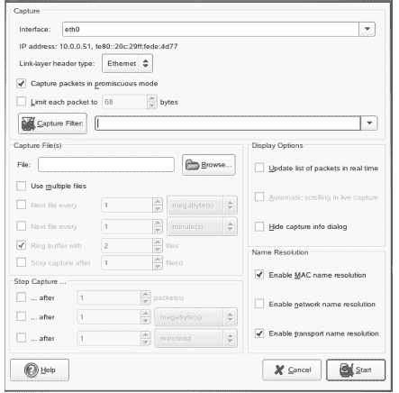

在 **Interface** 菜单中，你可以选择接口（你想捕获的流量）。

在 **Capture Filter** 中，你可以输入过滤规则。

过滤器规则的可能命令有：

- `[src|dst] host` 允许你过滤主机 IP 地址或名称。如果你添加了 `src` 或 `dst`，可以指定只对源地址或目的地址感兴趣。
- `ether [src|dst] host` 允许你过滤以太网主机地址。如果你添加了 `src` 或 `dst`，可以指定只对源地址或目的地址感兴趣。
- `gateway host` 允许过滤使用该主机作为网关的数据包（以太网源或目的为主机，但源或目的 IP 地址均不是主机）。
- `[src|dst] net net [<mask><mask>-len len]` 允许过滤网络号。如果你添加了 `src` 或 `dst`，可以指定只对源地址或目的地址感兴趣。此外，如果网络与你自己的不同，你可以指定网络掩码或 CIDR（无类域间路由）前缀。
- `[tcp|udp] [src|dst] port` 允许过滤 TCP 和 UDP 端口号。你可以选择带有关键字 `src`、`dst` 以及 `tcp` 或 `udp` 继续使用此参数。这些参数允许你指定只对源/目的端口以及 TCP 或 UDP 包感兴趣。关键字 `tcp` 或 `udp` 必须出现在 `src` 或 `dst` 之前。
- `less|greater length` 允许过滤长度小于或等于指定长度，或大于或等于指定长度的数据包。
- `ip proto protocol` 允许在以太网层或 IP 层过滤指定的协议。
- `etherip broadcastmulticast` 允许过滤以太网或 IP 广播/组播包。
- `expr relop expr` 允许创建复杂的过滤器表达式，选择数据包中的字节或字节范围。

你可以结合 `and`、`or`、`not` 使用这些命令。你也可以使用括号。

如果你想将捕获的信息写入文件，请使用 Capture File(s) 框中的选项。你可以将捕获的信息分成多个文件。

默认情况下，你必须通过点击鼠标停止捕获过程。在 Stop Capture 框中，你可以选择在捕获指定数量的包、达到内存使用水平或经过特定时间后停止捕获。

选择 Start 开始捕获。

在捕获过程中，以下对话框显示已捕获了多少包。

图 6-3

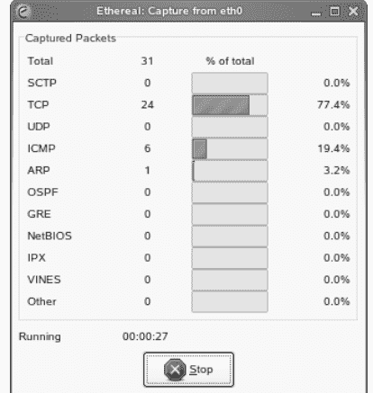

CNI 内部专用 - 允许打印一份纸质

如果你想实时查看捕获的数据包，请使用 Display Options 框中的选项。

名称解析选项（右下角）也用。你可以指定应该解析哪些名称。

选择 OK 后，捕获开始。

要停止捕获，选择 Stop。

## Ethereal 前端

在捕获包或打开包含捕获流量的文件后，Ethereal 对话框显示三个帧：

- packet list（顶部）。此帧包含一个信息表：
    - No. 包号。
    - Time. 接收包的时间。
    - Source. 发者。
    - Destination. 接收者。
    - Protocol. 使用的协议。
    - Info. 关于包内容的详情。
- packet bytes（底部）以十六进制和 ASCII 格式的包字节。

packet bytes 帧下方有一行用于配置视图过滤器。

图 6-4

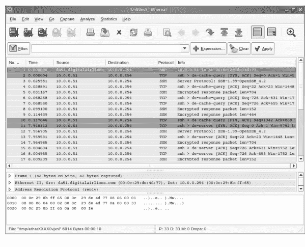

- Frame 1 (42 字节，捕获了 42 字节) (00:00:29:de:4d:77) (00:00:29:de:4d:77:65)
* Address Resolution Protocol

```
0000 00 dc 29 ff 05 ff 00 29 de 4d 77 08 06 00 01 ..- 1....
0010 00 dc 29 ff 05 ff 00 29 de 4d 77 08 06 00 03 ..- 3...
0020 00 dc 29 ff 65 ff 00 00
```

## 过滤显示

你可以过滤显示的包。你可以在 Filter 按钮旁的文本框中输入过滤表达式。

显示过滤器的表达式与捕获表达式不同。

可能的表达式有：

- `eth.addr=08.00.08.15.ca.fe` 显示所有流自以太网地址 08.00.08.15.ca.fe 的流量。
- `ip.addr=192.168.0.10` 显示所有流自 IP 地址 192.168.0.10 的流量。
- `tcp.port==80` 显示所有指向和自 TCP 端口 80 (HTTP) 的所有机器流量。
- `ip.addr==192.168.0.10 && tcp.port!==80` 显示所有指向 192.168.0.10 且不是 HTTP 的进出流量。

Ethereal 提供了一个强大的工具来构建显示过滤器。在过滤器行中选择表达式（Expressions）。

图 6-5

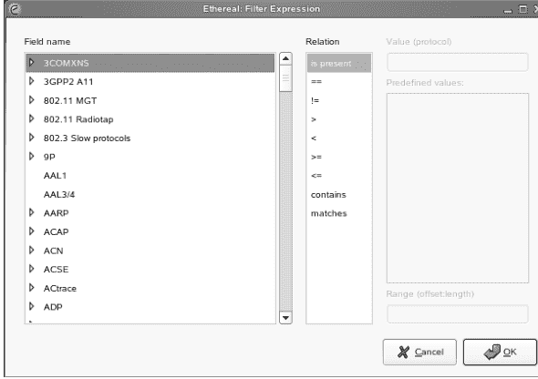

在左侧的框中（标记为 **Field name**，字段名），你可以看到可以过滤的选项列表。这些字段按协议或服务进行了分组。

在中间的框中，你可以指定关系。显示的关系取决于所选的字段。

根据所选的关系，你可以在右上角列的 **Value**（值）文本框中指定一个值。对话框会显示预期的值类型。

如果你选择 View > Coloring Rules（查看 > 着色规则），你可以创建一个显示过滤器，用特定颜色标记匹配的项。


当你想查看整个网络会话的流量（例如，整个 telnet 会话）时，从数据包列表中选择每个包是不方便的。相反，你可以选择会话一个 TCP 数据包并选择 Analyze > Follow TCP Stream（分析 > 跟踪 TCP 流）。

## 练习 6-3

### 使用 Ethereal

在此练习中，你将使用 Ethereal 捕获发送到 da2 的所有流量。

你将在工作手册中找到此练习。

（练习结束）

## 使用 tcpdump

此软件可以读取通过以太网传输的所有或某些数据包，tcpdump 通常用于将网络流量保存到文件中。

tcpdump 在 SUSE Linux Enterprise 10 的默认安装过程中安装。

使用 tcpdump 最简单的方法是直接输入 `tcpdump`。

要停止捕获，按 `Ctrl + C`。将显示一个简短的摘要。

```
da51:- # tcpdump
tcpdump: verbose output suppressed, use -v or -vv for full protocol decode
listening on eth0, link-type ENILB, capture size 96 bytes
16:52:50.488641 802.12 config 8000.00:80:20:2d:e2:9d:13013 root
8000.00:80:2d:e2:9d:13 pathocht 0 max 20 hello 2 fdelay 15
16:52:51.26790 (NOV-802.1) f4a3f8b.00:50:8b:d6:9b:b8.9001 >
000000.ff:ff:ff:ff.9001: ipx-#9001 43

2 packets captured
2 packets received by filter
0 packets dropped by kernel
da51:- #
```

tcpdump 最重要的选项是：

- `-c number` 在接收 **number of**（数据包数量）个数据包后退出。
- `F file` *File*（文件）作为过滤器表达式的输入。命令行上给出的额外表达式将被忽略。
- `i interface` 在 *interface*（接口）上监听。
- `-n` 不要将地址（如主机地址或端口号）转换为名称。
- `-N` 不打印主机名的域名限定限定。
- `-S` 打印绝对而非相对的 TCP 序列号。
- `-w file` 将原始数据包写入文件，而不是对其进行解析和打印。

你还可以指定过滤器表达式。最重要的过滤器表达式已经在 Ethereal 章节中描述。更多信息请参阅 man 手页 `man tcpdump`。


## 练习 6-4

### 使用 tcpdump

在此练习中，你将使用 tcpdump 捕获 ICMP 数据包。你将在工作手册中找到此练习。

（练习结束）

## 总结

| 目标 | 总结 |
| :--- | :--- |
| 1. 使用 ntop 监控网络流量 | ntop 是一个基于 Web 的流量监控器，显示网络使用情况，类似于 top 命令的功能。在启动 ntop 之前，你必须使用 `ntop -A -u` 设置管理员密码。进入 ntop 后，可以通过输入以下 URL 访问 Web 界面：http://IP-address:3000 |
| 2. 使用 Nagios 主机、服务和网络 | Nagios 是一个用于主机、服务和网络的监控程序。Nagios 的主配置文件是 `/etc/nagios/nagios.cfg`。其他配置文件在 `/etc/nagios/` 目录下。大多数文件都包含检查和通知的定义。主机在 `/etc/nagios/hosts.cfg` 中配置。服务在 `/etc/nagios/services.cfg` 中配置。联系人在 `/etc/nagios/contacts.cfg` 中配置。 |
| 3. 使用 Ethereal 和 tcpdump 排除网络故障 | Ethereal 是一个网络协议分析仪。Ethereal 的主界面显示三个框：数据包列表（顶部）。包含一个显示数量信息的表格。在中间的框中，你可以指定关系。显示的关系取决于所选的字段。根据所选的关系，你可以在右上角列的 **Value**（值）文本框中指定一个值。对话框会显示期望的值类型。如果你选择 View > Coloring Rules（查看 > 着色规则），你可以创建一个显示过滤器，用特定颜色标记匹配的项。当你想查看整个网络会话的流量（例如，整个 telnet 会话）时，从数据包列表中选择每个包是不方便的。相反，你可以选择会话一个 TCP 数据包并选择 Analyze > Follow TCP Stream（分析 > 跟踪 TCP 流）。 |

# 附录 A 准备 Novell 10 实操考试

在本部分，你将通过以下场景来准备 Novell 10 认证工程师考试：

1. 安装并配置 SUSE Linux
2. 配置 DNS 服务器
3. 配置 DHCP 服务器
4. 配置邮件服务器
5. 监控网络

你必须完成场景 1。你可以根据可用时间完成剩余的场景。

## 场景

Digital Airlines 计划部署 SUSE Linux 10。在第一阶段，SUSE Linux 10 将用于文件、Web 和网络基础设施系统。

- 内部网络 DNS 服务
- DHCP 服务器
- 邮件服务器

网络流量也应该被监控。你决定通过在测试计算机上安装和测试这些服务来开始。

## 目标 1

### 安装并配置 SUSE Linux Server 10

在安装服务（如 DNS）之前，需要执行以下任务：

- 从 SUSE Linux Enterprise 10 安装盘安装 SUSE Linux Server。
- 确保使用的分区方案符合需求。


- 仅安装支持 DNS 服务器、DHCP 服务器和邮件服务器的必要应用程序和进程。
- 选择 `root` 密码。
- 选择 LDAP 认证。
- 创建两个额外的普通用户。
- 安装后，使用 `DA1` 更新系统。
- 安全 GRUB 引导程序。
- 手动配置网络连接（使用或使用 `YaST`）。
- 将运行级别 3 设置为默认。
- 使用 NTP 同步系统时。

仔细阅读这些要求，然后配置服务器。

# 目标 2 配置 DNS 服务器

Digital Airlines 迁移 Linux 的一个里程碑是实施基于 Linux 的 DNS。作为第一步，你决定在实验室设置测试 DNS 服务器。

在实验室的 SUSE Linux 测试服务器上，执行以下操作：

- 为 5 个测试系统配置主 DNS 服务器。
- 测试你的设置（你可以使用 `dig` 命令）。
- 与另一位学习相同场景的同学一起配置配置服务器作为彼此的从 DNS 服务器。

# 目标 3 配置 DHCP 服务器

网络上的大多数工作站都有静态 IP 地址。但有一小部分笔记本电脑。这些笔记本应该通过 DHCP 获取 IP 地址。

在实验室的 SUSE Linux 测试服务器上，执行以下操作：

- 安装 DHCP 服务器。
- `10.0.0.180` 到 `10.0.0.200` 留给 DHCP。
- DNS 和网关信息应由 DHCP 交付。

# 目标 4 配置邮件服务器

你的 Digital Airlines 办公室运行着内部邮件服务器。该服务器也需要迁移到 SUSE Linux Enterprise Server 10。

在实验室的 SUSE Linux 测试服务器上，执行以下操作：

- 发送给 `digitalairirlines.com` 域名以外用户的邮件应转发到 IP 为 `135.195.220.3` 的提供商邮件服务器。
- 从邮件地址中删除主机前缀。
- 所有从 `194.95.93.10` 发送的邮件都应被拒绝。
- 发送到 `info@digitalairirlines.com` 地址的邮件应发送给用户 `PSmith`。
- 用户 `PSmith` 应该获得所有发送给用户 `root` 的系统通知的副本。
- 垃圾邮件的主主题中应标记为“***spam***”。
- 所有病毒邮件都应发送给用户“virusadmin”，而不是邮件邮件收件人。
- 所有用户都可以使用 POP 访问自己的邮箱。
- 发送给用户 `PSmith` 的邮件应自动分类到三个不同的邮箱中：
  - 发送到 `info@digitalairirlines.com` 的邮件应存储在邮箱“info.”中。
  - 发送到 `root` 的邮件应存储在邮箱“root.”中。
  - 发送到 `psmith@digitalairirlines.com` 的邮件应存储在邮箱“inbox.”中。

# 目标 5 监控网络

使用 Nagios 监控你的 SUSE Linux Enterprise Server 10 上的网络服务。

在实验室的 SUSE Linux 测试服务器上，执行以下操作：

- 定义主机组“linux-servers”。
- 你的测试服务器是“linux-servers”组的唯一成员。
- 应该监控以下服务：
  - DNS
  - DHCP
  - Mail
- 配置 Nagios Web 服务器。

# 附录 B 结合 Samba 和 OpenLDAP

Samba 经常与 OpenLDAP 结合，因为它允许你为 Windows 构建备份域控制器 (BDC)。因此，使用了 OpenLDAP 的复制机制。

本附录涵盖了以下主题：

- 准备 OpenLDAP 目录
- 理解 Samba 的 LDAP 选项

## 目标 1 准备 OpenLDAP 目录

如果你想从 Samba 访问 LDAP 目录服务，你必须修改 LDAP 安装的 `/etc/openldap/slapd.conf` 文件。执行以下操作：

1. 包含 Samba3 的架构文件。

| include | path |
| :--- | :--- |
| `/etc/openldap/schema/samba3.schema` | |

2. 在访问语句中允许 Samba 访问 LDAP。

它看起来像如下：

```
access to attrs=userpassword,sambaNTPassword,sambaLMPassword
by self write
by anonymous auth
by * none
```

在这个示例中，所有人都被允许使用不同类型的密码进行身份验证。这些密码只能由所有者更改。

所有人都可以读取所有属性。

3. 确保选项 `suffix`、`rootdn` 和 `rootpw` 设置正确。
4. 检查 `/etc/ldap.conf` 文件中的 `base` 选项。

## 5. 索引部分可能如下所示：

| index | operator | value |
| :--- | :--- | :--- |
| `index objectClass` | `eq` | |
| `index cn` | `pres,sub,eq` | |
| `index sn` | `pres,sub,eq` | |
| `index uid` | `pres,sub,eq` | |
| `index displayName` | `pres,sub,eq` | |
| `index uidnNumber` | `eq` | |
| `index gdnNumber` | `eq` | |
| `index memberUid` | `eq` | |
| `index sambaSId` | `eq` | |
| `index sambaPrimaryGroupSID` | `eq` | |
| `index sambaDomainName` | `eq` | |
| `index default` | `sub` | |

## 目标 2 理解 Samba 的 LDAP 选项

Samba 提供了一些配置选项来与 LDAP 通信。

最重要的是以下：

在这里，你可以输入以下内容之一：

- `smbpasswd`
- `tdbsam (smbpasswd plus NT SAM)`
- `ldapsam`

如果你的网络中有备份域控制器 (BDC)，在此处选择 `Ldapsam`。`mysqlam` 和 `xmlams` 也是可能的选项，但不适用于主域控制器 (PDCs)。

- `Ldap admin dn`。指定 Samba 用于检索用户信息的 LDAP 区分名称。
- `Ldap delete dn`。如果此选项设置为 `yes`，删除操作将删除整个 LDAP 条目。否则，只删除特定于 Samba 的属性。
- `Ldap group suffix`。当组被添加到 LDAP 目录时，Samba 使用此后缀来处理组。
- `Ldap idmap suffix`。指定在存储 imap 映射时使用的后缀。
- `Ldap machine suffix`。指定应将工作站添加到 LDAP 目录。
- `Ldap passwd sync`。如果此选项设置为 `yes`，Samba 尝试将 LDAP 密码与普通用户的 NT 和 LANManager 哈希进行同步。

如果此选项设置为 `no`，只更新 NT 和 LANManager 密码。如果此选项设置为 `only`，则只更改 LDAP 密码。

- `ldap server`。在此处输入 LDAP 服务器的 FQDN。

# 附录 C 使用 Fetchmail 获取邮件

你可以使用 Fetchmail 获取邮件。

必须安装 `fetchmail` 软件包并在 `~/.fetchrc` 中配置它。

Fetchmail 提供了广泛的定制，例如：

- 邮箱的处理
- 为多个用户获取邮件
- 过滤程序的集成
- 使用 SSL 进行加密传输

要启动 Fetchmail，请使用 `fetchmail` 命令。

此外，该程序有许多启动时可以提供的选项。

默认情况下，Fetchmail 可以由系统上的任何用户运行。这意味着每个用户都可以在其家目录中创建自己的配置。

`root` 用户使用 Fetchmail 定隔集中获取邮件并分发给个人用户。这种方法在 `/etc/fetchmail` 中设置。

系统级 Fetchmail 配置在文件中完成：

```
/etc/fetchmail
```

有关 Fetchmail 的更多信息，请查看程序的帮助页。

信息也可以在 `/usr/share/doc/packages/fetchmail/` 目录下获取。

## 目标 1 配置 Fetchmail

### 理解命令行选项

`~/.fetchmail` 文件中的行具有以下结构：

```
poll servername protocol username "name" password
"password"
```

或者，缩写形式：

```
poll servername proto protocol user "name" pass "password"
```

这种基本形式可以通过添加包含可以转发获取邮件的用户 "local_name" 来扩展。

在以下示例中，该用户是：

```
poll da51.digitalairlines.com proto pop3 user "geeko.chameleon" pass
"SECRET" 是 "geeko"
```

如果查询多个邮件服务器，相同的细节可以使用 `defaults` 指令定义一次，然后省略。

例如：

```
defaults proto pop3 user "geeko.chameleon"
poll da51.digitalairlines.com pass "SECRET"
poll pop3.suse.com pass "CONFIDENTIAL"
```

基本用户选项有：

- `proto[col].` 使用的协议类型（如 `auto`、`pop3` 和 `imap`）。
- `port.` 端口号。
- `timeout.` 在 fetchmail 关闭连接前等待服务器响应的秒数。

## 5. 索引部分如下所示：

| index | operator | value |
| :--- | :--- | :--- |
| `index objectClass` | `eq` | |
| `index cn` | `pres,sub,eq` | |
| `index sn` | `pres,sub,eq` | |
| `index uid` | `pres,sub,eq` | |
| `index displayName` | `pres,sub,eq` | |
| `index uidnNumber` | `eq` | |


## 目标 2 理解 Samba 的 LDAP 选项

Samba 提供了一些配置选项来与 LDAP 通信。

最重要的是以下：

在这里，你可以输入以下内容之一：

- `smbpasswd`
- `tdbsam` (smbpasswd plus NT SAM)
- `ldapsam`

如果你的网络中有备份域控制器 (BDC)，在此处选择 `ldapsam`。`mysqlam` 和 `xmlams` 也是可能的选项，但不适用于主域控制器 (PDCs)。

- `Ldap admin dn`。指定 Samba 用于检索用户信息的 LDAP 区分名称。
- `Ldap delete dn`。如果此选项设置为 yes，删除操作将删除整个 LDAP 条目。否则，只删除特定于 Samba 的属性。
- `Ldap group suffix`。当组被添加到 LDAP 目录时，Samba 使用此后缀来处理组。
- `Ldap idmap suffix`。指定在存储 imap 映射时使用的后缀。
- `Ldap machine suffix`。指定应将工作站添加到 LDAP 目录。
- `Ldap passwd sync`。如果此选项设置为 yes，Samba 尝试将 LDAP 密码与普通用户的 NT 和 LANManager 哈希进行同步。

如果此选项设置为 no，只更新 NT 和 LANManager 密码。如果此选项设置为 only，则只更改 LDAP 密码。

### Fetchmail 配置选项

- `user[name]`。服务器上的用户名。
- `is`。客户端上的用户名。
- `pass[word]`。服务器上用户的密码。
- `keep`。服务器上的消息不会被删除。
- `flush`。删除服务器上的旧消息。
- `fetchall`。从服务器获取所有新旧和旧邮件消息。
- `no keep`。从服务器上删除已读的邮件。
- `no fetchall`。仅从服务器检索新邮件（默认设置）。

除此之外，可以在 Fetchmail 配置文件的开头进行一些全局设置。

其中最重要的设置是：

- `set daemon seconds`。Fetchmail 以守护进程的形式在后台运行，并按照给定的间隔检查服务器上是否有新邮件。
- `set postmaster "username"`。设置负责错误消息的本地用户名。
- `set logfile path`。显示日志文件的路径。


> 因为 `~/.fetchmailrc` 包含明文的访问密码，所以应仅授予文件所有者读写权限：`chmod 600 .fetchmailrc`。如果权限过于宽松，Fetchmail 将终止并显示指示此类情况的消息。

`fetchmailconf` 软件包包含一个用于编辑 `.fetchmailrc` 文件的图形化工具。

### 程序通过使用 `fetchmailconf` 命令启动：

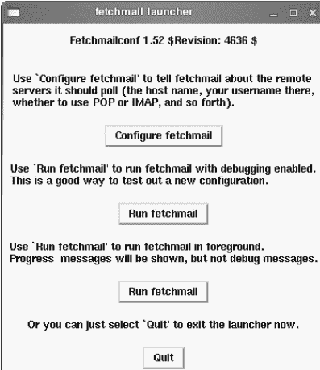

## 理解命令行选项

在命令行中传递给 Fetchmail 的选项将覆盖 `~/.fetchmailrc` 文件中具有相同含义的选项。

最重要的选项汇总在下表中：

| 选项 | 描述 |
| --- | --- |
| `-c`, `--check` | 检查是否有新邮件到达。这些邮件不会被检索。 |
| `-s`, `--silent` | 抑制所有状态和进度消息。 |
| `-v`, `--verbose` | 所有控制消息均显示在 stderr 上。 |
| `-a`, `--all` | 从服务器获取所有（新和旧的）邮件。 |
| `-k`, `--keep` | 检索到的邮件不会从服务器上删除。 |
| `-K`, `--nkeep` | 检索到的消息会在服务器上被删除。 |
| `-F`, `--flush` | 在检索新消息之前删除服务器上的旧消息。 |
| `-p protocol`, `--protocol protocol` | 与服务器通信的协议。`protocol` 的值可以是 `AUTO`, `POP2`, 或 `IMAP`。 |
| `-P number`, `--port number` | 连接的端口。 |
| `-t seconds`, `--timeout seconds` | 等待服务器欢迎消息的时间。 |
| `-u name`, `--username name` | 用户名。 |
| `- seconds`, `--daemon seconds` | Fetchmail 以守护进程形式启动，并按照指定的间隔与服务器建立连接。 |

由于只有拨号连接到互联网，因此在连接建立时从服务器检索邮件是很有用的。为了此目的，`/etc/ppp/poll.tcpip` 文件已经包含了预配置的条目。

你只需要在 `/etc/fetchmailrc` 中准备一个一个的 Fetchmail 配置。

如果 `/etc/fetchmailrc` 开头存在 `set syslog` 行，则邮件检索过程将记录在 `/var/log/mail` 中。

## 练习 C-1 使用 Fetchmail 获取邮件

在本次练习中，你必须配置 fetchmail 以从 POP 邮箱箱中获取用户 geeko 的邮件。

（练习结束）

## 总结

| 目标 | 总结 |
| --- | --- |
| 1. 配置 Fetchmail | 使用 Fetchmail 可以从服务器检索邮件。它在文件 `~/.fetchmailrc` 中配置。要启动 Fetchmail，输入 `fetchmail`。`fetchmailconf` 软件包包含一个用于编辑 `.fetchmailrc` 文件的图形化工具。 |
| 2. 理解命令行选项 | 在命令行中传递给 Fetchmail 的选项将覆盖 `~/.fetchmailrc` 文件中具有相同含义的选项。 |

## 目录 D 使用 SNMP 管理网络设备

简单管理协议 (SNMP) 是一种互联网标准，用于从互联网上的管理设备收集统计信息，主要是路由器，但也包括网卡和大多数联网设备。

关于服务器、路由器、工作站和打印机的信息存储在管理信息库 (MIB) 中。该数据库包含了静态信息和动态信息（如路由表和内存使用情况）。

在由 SNMP 守护进程管理的主机上实现的 MIB 变体称为代理（agent）。

使用 SNMP 工具访问 MIB 中存储信息的应用程序称为管理器（manager）。

管理器与代理共同工作。代理自动收集指定主机的信息。管理器向代理发送特殊的 SNMP 命令并等待代理的响应。通常使用 UDP 端口 161 进行查询（polling），SNMP 陷阱通过 UDP 端口 162 发送。最基本的 SNMP 命令是 `SNMPGET` 和 `SNMPSET`，分别用于读取或更改信息。`SNMPNEXT` 返回下一个 MIB 实体的内容。代理事件通知通过 SNMP 陷阱发送。MIB 世界中的另一个重要术语是社区（community）。社区是一组用户及其分配权限。你可以将社区视为包含访问 SNMP 的用户名和密码的字符串。默认社区名称为 `public`。`public` 用户仅允许读取数据库。名为 `private` 的社区可以读取所有信息，但也允许更改信息（如果已配置）。

SNMP 守护进程包含在 `net-snmp` 软件包中，该软件包最初基于 `cmu-snmp` 代码。`net-snmp` 包使用多种配置文件来配置其应用程序。这些文件位于 `/usr/share/snmp/`、`/etc/snmp.conf` 以及 `~/.snmp`。

通常你会在 `/usr/share/snmp` 和 `/etc/snmp.conf` 指定全局设置，而在 `~/.snmp` 中使用用户特定数据。请记住，这些文件包含隐私数据（密码和社区），因此将这些文件的读取权限限制为相应的用户。

在本节中，我们将涵盖以下主题：

* 理解 MIB 结构
* 配置 SNMP 守护进程
* 启动 SNMP 代理
* 测试 SNMP 配置

### 目标 1 理解 MIB 结构

每个 MIB 都可以可视化为一个没有根的树。树的叶节点表示管理对象和变量。每个变量都是唯一的，并通过其 OID（对象标识符）表示。上层由 ISO（国际标准组织）和 ITU（国际电信联盟）管理，而下层则委托给企业和其他组织（你可以大致将其比作 DNS，但没有特定的任务或查询）。层分隔符是点。`os.org.dod.internet.mgmt.mib-2` 和 `1.3.6.1.2.1` 指定相同的节点 MIB-II。

下图显示了一个 MIB 的示例。显示了某些系统信息的路径：

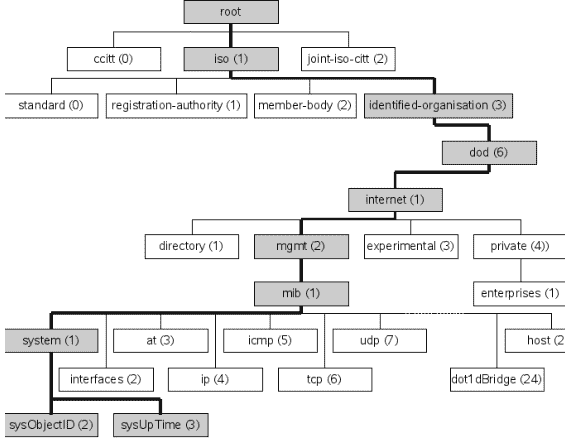

同一层级的节点可以编号。这些数字用于标识叶子节点。以下标识符对于系统的对象 ID 有效：

- `1.3.6.1.2.1.1.2`
- `1.3.6.1.2.1.1.sysObjectID`
- `iso.org.dod.internet.mgmt.mib-2.1.2`
- `iso.org.dod.internet.mgmt.mib-2.system.sysObjectID`
- `iso(1).org(3).dod(6).internet(1).mgmt(2).mib-2(1).system(1).sysObjectIDID(2)`

一组标准的通用结构和身份方案，引用 MIB 变量被称为——管理信息结构 (Structure of Management Information，SMI)。RFC 1155, 1212, 1215)

使用抽象语法表示法 (ASN.1) 来描述这种结构。在 ASN.1 中定义数据类型，使用以下语法：

`Name ::= Definition`

要定义一个受管理对象/变量，必须使用 SMI.1 宏 `OBJECT-TYPE`。语法如下：

| Label | OBJECT-TYPE |
| :--- | :--- |
| SYNTAX | 数据类型 |
| MAX-ACCESS | 权限 |
| STATUS | 重要性 |
| DESCRIPTION | 描述 |

该定义的各个部分为：

- **SYNTAX**。指定对象/变量的数据类型。
- **MAX-ACCESS**。指定对象/变量的访问权限。可能值有：
  - `read-only`（只读）。值不可写。
  - `read-write`（读写）。值可写。
  - `write-only`（只写）。值不可读但可写。
- **STATUS**。指定对象/变量的重要性。可能值有：
  - `Mandatory`（强制）。必须设置变量。
  - `Optional`（可选）。变量是可选的。
  - `Deprecated`（弃用）。变量被其他变量替换。
  - `Obsolete`（过时）。变量在 MIB 中不再使用。
- **DESCRIPTION**。对对象/变量的简要描述。

在目录 `/usr/share/snmp/mibs/` 中可以找到一些 MIB。

### 目标 2 配置 SNMP 守护进程

SNMP 守护进程在文件 `/etc/snmp/snmp.conf` 中配置。安装后，该文件包含注释和以下行：

```
...
sysLocation Server
sysContact admin@localhost
rocommunity public 127.0.0.1
...
```

更完整的示例文件可以在文档 (`/usr/share/doc/net-snmp/example.conf`) 中查看。最重要的选项描述如下：

- `rouser`。指定一个具有读取权限的用户。
- `rwuser`。指定具有写入权限的用户。
- `rocommunity`。指定具有读取权限的社区（community）。
- `rwcommunity`。指定具有写入权限的社区（community）。
- `trapsink`。将代理的警报作为 v1 通知发送。
- `trapsink`。将代理的警报作为 v2 通知发送。
- `informsink`。将代理的警报作为 v2 通知发送。
- `trapcommunity`。向此社区的代理发送警报。
- `authenable`。如果设置为 1，则在发生身份错误时发送陷获（trap）。
- `proc`。检查应该运行的指定进程。
- `disk`。检查挂载在指定路径的命名磁盘的可用磁盘空间。
- `load`。检查不合理的平均负载。
- `file`。检查指定文件的大小。
- `sysLocation`。物理位置。
- `sysContact`。管理员的联系信息。

此配置文件也可以通过 `snmpconf` 命令创建，该命令将引导您逐步设置配置。它会在实际目录下为 SNMP 守护进程创建一个配置文件。

```
~ # snmpconf
```

我可以为您创建以下类型的配置文件。请选择您想要创建的文件类型（在运行此程序时可以创建多个）：

1. snmpd.conf
2. snmp.conf
3. snmtrap.conf

其他选项：quit (退出)

选择文件：1

可以放入 `snmpd.conf` 的配置信息分为若干部分。选择一个您想要创建的 `snmpd.conf` 配置部分：

1. 访问控制设置 (Access Control Setup)
2. 陷获目标 (Trap Destinations)
3. 监控运行主机的各个方面 (Monitor Various Aspects of the Running Host)
4. 代理运行模式 (Agent Operating Mode)
5. 系统信息设置 (System Information Setup)
6. 扩展代理 (Extending the Agent)

其他选项：finished (完成)

选择部分：1

...

`snmpconf` 支持配置组。以下是使用 `-G` 选项可以获得的可用组：

```
/usr/share/doc/net-snmp # snmpconf -G
Known GROUPS of tokens:
  system_setup
  basic_setup
  monitoring_services
  access_control
  trapsinks
```

要配置一组配置项，输入 `snmpconf -g groupname`。对于基础 SNMP 设置，命令是 `snmpconf -g basic_setup`

### 目标 3 启动 SNMP 代理

`snmpd` 是一个 SNMP 代理，绑定到端口并等待 SNMP 管理软件的请求。接收请求后，它处理请求，收集请求的信息和/或执行请求的操作，并将信息返回给发送者。

`snmpd` 拥有许多选项。最重要的是：

- `-a`。记录传入请求的源地址。
- `-A`。追加内容到日志文件而不是截断它。
- `-c file`。读取文件作为配置文件。
- `-C`。不读取除 `-c` 选项指定的任何配置文件。
- `-d`。以十六进制转储发送和接收的 SNMP 包。
- `-D[token,...]`。仅对指定的 token 调试输出。未指定任何 token 时默认打印所有 token。

要获取编译模块的列表，请带有 `-Dmibinit -Hf` 运行。

- `-g GID`。打开套接字后切换组 ID。
- `-I[modules]`。指定代理启动时应该初始化哪些模块（不需要启动的逗号分隔列表）。
- `-L`。指定日志输出去向。可能选项有：
  - `e`。输出到标准错误流。
  - `f`。输出到指定的文件。
  - `o`。输出到标准输出流。
  - `s`。通过指定的 facility 使用 syslog 记录。
- `-M`。指定此应用程序的逗号分隔 MIB 模块列表。
- `-M DirList`。指定搜索 MIB 的逗号分隔目录列表。
- `-p file`。将守护进程的进程 ID 保存到指定文件中。
- `-q`。打印更便于自动解析的输出。
- `-r`。运行守护进程不需要访问权限。此选项防止 `snmpd` 在没有权限读取某些内容时退出。
- `-u UID`。打开套接字后切换到用户 ID。
- `-V`。符号化转储 SNMP 事务。
- `-x address`。在指定的地址监听 AgentX 连接。
- `-X`。作为 AgentX 子代理而非 SNMP 主代理运行。
- `--token="value"`。允许指定 `snmpd` 配置文件支持的任何 token 并将其值设置为 value。

`net-snmp` 软件包中包含许多实用工具。它们大多数是访问 MIB 的基础工具：

- `/usr/bin/snmpget`。从 MIB 获取信息。
- `/usr/bin/snmpset`。在 MIB 中设置信息。
- `/usr/bin/snmpnetstat`。使用 SNMP 显示网络状态（类似于 netstat）。
- `/usr/bin/snmptranslate`。将对象信息值转换为人类可读的术语。


- `/usr/bin/snmtrap`。向管理程序通知代理的陷获。守护进程版本 `/usr/sbin/snmptrapd` 接收并记录 SNMP 陷获消息。

- `/usr/bin/snmpwalk`。对 MIB（子）树进行增量请求。

## 目标 4

## 测试 SNMP 配置

在本目标的示例中，配置文件 `/etc/snmp/snmp.conf` 必须看起来如下所示：

```
syslocation My Desk
syscontact BOPH (root@localhost)
rocommunity public 127.0.0.1
#
rocommunity public 147.2.90.0/23
#
rocommunity mysecret 127.0.0.1
#
rocommunity mysecret 147.2.90.0/23
#
proc nmbd 1 1
#
trapcommunity mysecret
#
trapsink 147.2.90.112
defaultMonitors yes
```

```
# 系统位置
# 负责管理员
# 允许 public 只读团体
# 源自环回地址
# 允许 public 只读团体
# 源自 147.2.90.0/23 网络
# 允许读写团体
# 源自环回地址
# 允许读写团体
# 源自 147.2.90.0/23 网络
# 检查 ps 进程以确保
# 只有一个实例正在运行
# 指定用于
# SNMP 陷阱的团体
# 指定陷阱目标主机
# 为 SNMP 陷阱告警运行默认监控
```

如果你不记得允许的参数，可以运行命令 `snmpd -H` 来查看指令及其值的完整列表。

首先，确保 SNMP 守护进程正在运行：

```
da51:/etc/snmp # rcsnmp status

Checking for service snmpd:

da51:/etc/snmp #
```

如果它尚未启动，请使用 `rsnmp start` 启动它。

查看日志文件 `/var/log/net-snmpd.log`（可能会看到错误）。

## CNI 专用使用-1 允许纸质打印

## SUSE Linux Enterprise Server 10: 网络服务

现在你应该能够使用 `snmpget` 命令查询条目了：
da5:/etc/snmp # snmpget -v 1 -c public 127.0.0.1 system.sysContact.0\SNMPv2-MIB:sysContact.0 = STRING: BOPH (root@localhost)

使用的选项有：

- `-v version`。所用协议的版本号。
- `-c community`。团体的名称。

许多 SNMP 命令的选项概述可以在 `man 1 snmpcmd` 中找到。

你也可以使用 SNMP 工具监控你的系统。

让我们检查 eth0 设备的网络统计数据：

```
da51:/etc/snmp # snmpstat -v 2c -c public 10.0.0.51 -Can

Active Internet (tcp) Connections (including servers)

Proto Local Address Remote Address (state)

tcp *.111 *.* LISTEN

tcp *.631 *.* LISTEN

tcp *.5831 *.* LISTEN

tcp *.5901 *.* LISTEN

tcp 127.0.0.1.25 *.* LISTEN

tcp 127.0.0.1.199 *.* LISTEN

tcp 127.0.0.1.427 *.* LISTEN

tcp 127.0.0.1.2544 *.* LISTEN

tcp 147.2.90.112.427 *.* LISTEN

Active Internet (udp) Connections

Proto Local Address

udp *.111

udp *.161

udp *.631

udp *.32772

udp 147.2.90.112.427

udp 224.0.1.222

udp 239.255.255.253

udp 255.255.255.427
```

## CNI 专用使用-1 允许纸质打印

严禁复制本手册的全部或部分或分发副本。
如需报告复制行为，请拨打 1-800-PIRATES。

D-14 版本 1

你可以使用 `snmpdf` 命令来检查可用磁盘空间大小：

```
da51:/etc/snmp # snmpdf -v 1 -c mysecret localhost

Description size (KB) Used Available Used%

Memory Buffers 2076472 128400 1948072 6%

Real Memory 2076472 605540 1470932 29%

Swap Space 2097136 0 2097136 0%

/ 20641788 1748652 18893136 8%

/sys 0 0 0 0%

/sys/kernel/debug 0 0 0 0%

/boot 1035660 555926 980068 5%

/sys/kernel/security 0 0 0 0%

da51:/etc/snmp #
```

你可以在 `man 1 snmpdf` 中找到关于 `snmpdf` 的更多信息。

## 练习 D-1

## 使用 SNMP 管理网络设备

在练习中，你必须使用版本 1 设置一个 SNMP 守护进程。

你可以在练习册中找到这项练习。

（练习结束）

## 总结

| 目标 | 总结 |
| --- | --- |
| 1. 理解 MIB 结构 | 简单网络管理协议 (SNMP) 是一种用于从互联网上的设备（主要是路由器）收集统计数据并管理它们的互联网标准。<br><br>有关服务器、路由器、工作站和打印机的信息存储在管理信息库 (MIB) 中。<br><br>代理（agent）是主机上实现的 MIB 变体，由 SNMP 守护进程管理。<br><br>管理器（manager）使用 SNMP 工具访问 MIB 中存储信息的应用程序。<br><br>代理的事件通知通过 SNMP 陷阱（SNMP traps）发送给管理器。<br><br>团体（community）是一组数据库用户及其被分配的权限。<br><br>每个 MIB 都可以通过一个没有命名根节点的树进行视觉化。树的叶子代表被管理的对象和变量。每个变量都是唯一的，并由其 OID（对象标识符）表示。 |
| 2. 配置 SNMP 守护进程 | Net-SNMP 软件包使用各种配置文件来配置其应用程序。它们可以在 `/usr/share/snmp` 中找到（注：原文为 `/usr/snmp`，此处根据语境理解为路径），`/etc/snmp` 下。 |
| 3. 启动 SNMP 守护进程 | Net-SNMP 软件包使用各种配置文件来配置其应用程序。它们可以在 `/usr/share/snmp` 中找到（注：原文为 `/usr/snmp`，此处根据语境理解为路径），`/etc/snmp` 下。 |
| 4. 测试 SNMP 配置 | 如果你不记得允许的参数，可以运行命令 `snmpd -H` 来查看指令及其值的完整列表。 |
| 索引 | 总结 |
| --- | --- |
| A | |
| B | |
| C | |
| D | |
| E | |
| F | |

# Novell 客户中心介绍-7

# O
- 对象 3-6
- 选项 2-9, 6-12, 6-16, 20-20, 3-33

# P
- 参数 2-1
- 密码 C-3
- 路径 6-22
- 物理 6-15
- 池 2-18
- 端口 2-6, 4-30, 4-33–4-34, 4-57, 4-78–4-79, 4-129, 5-11, 5-23–25, 5-2, 6-6-6, 6-31, 6-35, 6-38, C-3, C-C6-9
- 端口号 4-34
- 打印机 5-22
- 协议 2-2, 2-29, 4-4, 4-65, 4-70, 4-80, 5-2, 5-8, 5-32, 6-5, 6-7, 6-35

# Q
- 查询 2-62

# R
- 读取 4-75
- 资源 4-27, 4-73, 4-78, 6-23
- 限制 4-41, 4-45, 4-48
- 根 4-92

# S
- SCSI 6-6
- 安全 Intro-1, Intro-3, Intro-5, 2-7, 2-27, 3-31, 4-20, 4-70–4-72, 5-15, 6-24
- 服务器 Intro-1–Intro-2, Intro-6, Intro-9–Intro-11, 2-1–2-13, 2-17–2-22, 2-24, 2-26–2-27, 2-29–2-32, 2-34–2-36, 2-38–2-39, 2-41–2-42, 2-44–2-46, 2-62–2-63, 2-65–2-71, 3-1, 3-8, 3-12. 3-31–3-33, 3-40, 3-43–4-44, 3-58, 4-1, 4-4–4-5, 4-16, 4-24, 4-26, 4-33, 4-37–4-40, 4-42–4-44, 4-56, 4-65, 4-67–4-73, 4-78–4-81, 4-130, 4-134, 5-2–5-3, 5-10, 5-15, 5-18, 5-23, 5-29, 5-31–5-33, 6-1, 6-7, 6-9–6-10, 6-15, 6-17, 6-21, 6-24, 6-38, A-2–A-7, C-1, C-3–C-4, C-6–C-7, C-9
- 服务 4-23, 6-19
- 服务位置协议 (Service Location Protocol) 5-2–5-3, 5-32
- 会话 6-36
- 设置 A-4
- 从机 A-4
- SLES Intro-2, Intro-6, Intro-11, 4-32, 4-129, 5-3, 5-6, 6-13, 6-14
- SLP 5-2–5-6, 5-8–5-20, 5-22, 5-24–5-26, 5-29–5-32, 5-34
- SMDR 5-29
- SMTP 4-24, 4-28, 4-30, 4-35, 4-37, 4-57–4-58, 4-78, 4-93, 5-29, 6-20
- SNMP 6-1
- 软件 3-1, 3-8, 3-12, 3-58, 4-33, 4-29, 4-123, 4-4–4-6, 6-22, 6-29, 6-38
- SSL 4-37, 6-2, C-1
- 开始 Intro-1,2, 2-3, 2-6, 2-9–2-10, 2-12–2-13, 2-19, 2-27, 2-65, 3-8, 3-32, 4-16, 4-26, 4-30, 4-70, 4-74, 4-80, 4-93, 4-127, 5-11, 5-33, 6-26–6-27, 6-41, 6-2, C-1
- 存储 4-4, 4-74
- 结构 3-41
- 子网网 2-2, 2-13, 2-18, 2-29, 2-32, 2-38, 2-44–2-45, 5-8, 6-5–6-6

# 仅供 CNI 使用-允许打印

严禁复制本手册的任何部分。
如发现盗版，请拨打 1-800-PIRATES。

版本 1

索引-3

# SUSE Linux 服务器 10: 网络服务

SUSE Intro-1-Intro-3, Intro-5-Intro-6, Intro-8, Intro-10, 2-9, 2-22, 2-27, 2-41, 4-1, 4-24, 4-26, 4-58, 4-79, 5-2-5-33, 5-10, 5-18, 5-29, 5-32-5-33, 6-1, 6-38, C-3

# V
- 值 3-4, 4-63, 4-70, 4-78
- 验证 (VERIFY) 4-28
- 查看 6-36
- SuSEConfig 4-25, 4-32-4-33, 4-35-4-38, 4-40, 4-129

# W
- 语法 5-21
- 系统 Intro-4, Intro-10, 2-9, 2-33, 4-15, 4-19, 4-22-4-27, 4-30, 4-33, 4-45, 4-47, 4-54, 4-57, 4-64, 4-66, 4-71-4-72, 4-79-4-80, 4-90, 4-126, 4-131, 4-134, 5-3, 5-10, 6-1, 6-22, 6-26, A-3, C-1
- Web 服务器 6-7, 6-9-6-10, 6-24

# Y
- YaST Intro-10, 2-21, 2-27, 2-31, 2-34, 2-45, 4-79, 6-22

# T
- 任务 4-19
- 时间 2-1, 2-3-2-4, 2-6, 2-8, 2-11-2-12, 2-14-2-15, 2-18-2-21, 2-23-2-24, 2-27, 3-2, 4-65, 4-70, 4-127, 5-4, 5-8, 5-14, 5-23-5-25, 5-32, 6-11, 6-13, 6-17, 6-21, 6-23, 6-32-6-33, 6-42-A-1, C-3
- 事务 4-79
- 传输 2-39, C-1
- 类型 2-39, 4-14, 4-28, 4-80

# U
- UA 5-5
- 单组播 5-8
- UNIX 4-28-4-96
- 更新 2-11, 2-41
- 用户 4-23, 4-80, 5-11, 6-3

# A
- 账户 A-3
- 代理 4-4, 5-5, 5-9, 5-13, 5-27

# Z
- 区域 2-29, 2-39-2-42, 2-70

索引-4 版本 1
