# SUSE Linux Enterprise Server 9 管理员手册


### 商标

本书中提及的所有已知商标或服务商标均已适当大写。Novell Press 不能保证此信息的准确性。本书中使用术语不应被视为影响任何商标或服务商标有效性。

Novell 是 Novell, Inc. 在美国和其他国家注册的商标，Novell Press 和 Novell Press 标志是 Novell, Inc. 在美国和其他国家的商标。SUSE 是 SUSE LINUX AG 的注册商标。Linux 是 Linus Torvalds 的注册商标。本书中使用的所有品牌名称和产品名称均为其各自所有者的商品名称、服务标记、商标或注册商标。

### 警告与免责声明

已尽一切努力使本书尽可能完整和准确，但不暗示任何保证或适用性。所提供的信息按“原样”提供。作者和出版者对因使用本书所含信息而对任何人或实体造成的任何损失或损害不承担任何责任或义务。

### 批量销售

Pearson 对批量采购或特殊销售时订购的本书提供优惠折扣。如需更多信息，请联系

**美国企业和政府销售**
1-800-382-3419
corpsales@pearsontechgroup.com

对于美国以外的销售，请联系

国际销售
international@pearsoned.com

- **收购编辑：** Jenny Watson
- **开发编辑：** Emmett Dulaney
- **主管编辑：** Charlie Clapp
- **项目编辑：** George E. Nedder
- **校对编辑：** Chuck Hutchinson
- **索引员：** Julie Bess
- **审校：** Juli Cook
- **技术编辑：** Timothy Boronczyk
- **出版协调员：** Vanessa Evans
- **书籍设计师：** Gary Adair


Novell Press 是 Novell, Inc. 授权的贸易计算机技术图书的独家出版商。Novell Press 的图书由世界领先的权威人士撰写和审阅。Novell 及相关技术由 Pearson Education 的 Que/Sams Publishing 集团编辑、制作和发行，Pearson Education 是综合教育和计算机技术出版的全球领导者。有关 Novell Press 和 Novell Press 图书的更多信息，请访问 www.novellpress.com。

- **副出版人：** Mark Taber
- **项目经理：** Novell, Inc.; Darrin Vandenbos
- **市场经理：** Doug Ingersoll


## 第 3 章：启动和关闭服务器 ................................ 65
- 引导加载程序 .......................................................... 65
  - LILO ................................................................ 67
  - Grub ................................................................ 68
- 内核启动 ............................................................. 71
- init 与理解运行级别 ...................................... 72
- 系统关机 .......................................................... 74
- 紧急启动和恢复 ............................................. 75
- 摘要 ................................................................ 77

## 第 II 部分：用户访问和安全管理

## 第 4 章：用户和组管理 .................................... 81
- 用户和组 ID .................................................... 81
- 用户和组数据文件 .............................................. 88
  - /etc/passwd 文件 .................................................. 89
  - /etc/shadow 文件 .................................................. 91
  - /etc/group 文件 ................................................... 93
- 用户账户和组管理应用程序 ........................ 95
  - 创建和编辑用户账户 .................................. 97
  - 设置默认用户账户属性 ............................ 105
  - 创建和编辑组 ........................................ 108
- 安全考虑 ................................................ 110
  - 使用强密码 .............................................. 111
  - 审计默认账户 .......................................... 119
- 根账户 ........................................ 120
- 用户加入的组太多？ ............................... 122
- 摘要 .................................................. 122

## 第 5 章：用户环境管理与安全 ................................ 125
- 账户审计 ...................................... 126
- 配置用户环境 ........................ 127
  - 默认 Shell ......................................... 127
  - 登录脚本和环境变量 ................ 130
- 用户资源管理 ................................ 133
  - 使用 PAM 进行身份验证 .............................. 133
  - PAM 模块配置 .............................. 136
  - 资源管理 ................................... 137
  - 访问时间管理 ................................ 139
  - 配额管理 ...................................... 141
- su 或 sudo .............................................. 148
- 摘要 .................................................. 152

## 第 6 章：文件系统安全 .................................................... 153
- 文件和目录权限概述 ............. 153
  - 更改权限 .................................. 159
  - 更改用户和组所有权 ..................... 163
  - 安全考虑 ............................... 163
- 默认访问权限 ............................... 166
- 特殊文件权限 ................................ 168
  - SUID/SGID 的安全影响 .................... 170
  - SGID 与文件共享 ................................ 172
  - SUID 示例程序 ................................ 174
  - 防范 SUID 程序 ........................ 176
- 粘滞位 ......................................... 177
- 扩展属性 ........................................ 178
- 数据和文件系统加密 ............................ 183
- 安全文件删除 ...................................... 188
- 日志文件系统 ..................................... 190
- 摘要 ................................................... 191

## 第 7 章：系统管理和监控 .......... 193
- 常用 Linux 命令 ..................................... 194
- 基本命令 ............................................ 194
- 其他工具 .......................................... 196
- 根文件系统 ....................................... 196
- 健康检查和系统监控 ...................... 198
- 机器运行时间 ............................................ 199
- 日志审查 ................................................ 200
- 主要资源消耗者 ............................................. 201
- 应用程序检查 ......................................... 203
- 系统资源检查 ..................................... 204
- 用户登录活动 ........................................ 206
- 系统调优 ............................................. 210
- 调优内核参数 ................................... 211
- 调优文件系统访问 .................................. 213
- 摘要 ................................................... 216

## 第 III 部分：安装和配置网络服务

## 第 8 章：网络服务 .......................... 219
- 天使与守护进程 ........................................ 220
- 配置 xinetd ........................................ 221
- /etc/xinetd.conf 文件 .................................. 228
- 应用访问控制 .................................... 232
- 安全考虑 .................................... 234
- 网络时间服务 ........................................ 234
  - 配置 NTP 客户端 .................................. 237
  - 配置 NTP 服务器 ................................... 243
  - 故障排除提示 ........................................ 246
- 电子邮件服务 ................................................ 249
- 文件传输服务 ........................................ 255
  - 使用 Pure-FTPd ............................................. 256
  - 使用 vsftpd ................................................ 262
  - 使用标准 TFTP 服务器 .............................. 266
- 网络文件共享服务 ................................ 267
  - 设置 NFS 服务器 ................................... 268
  - 设置 Samba 服务器 .................................. 272
- 远程管理服务 ................................... 280
  - Telnet ...................................................... 281
  - ssh ........................................................ 281
  - VNC 和 XDMCP .............................................. 283
  - 保护系统管理会话 .................... 284
  - 按 IP 地址限制连接 ....................... 286
  - 安全的系统管理环境 ...................... 287
- 网络名称服务 ......................................... 287
  - Samba ....................................................... 287
  - 服务定位协议 (SLP) ............................. 288
  - 域名服务 (DNS) .................................. 288
  - 动态主机配置协议 (DHCP) .................. 292
  - DNS 和 DHCP ................................................ 295
- Web 服务 .................................................. 296
- 身份验证服务 ....................................... 301
  - 网络信息服务 (NIS) .......................... 301
  - Samba 域 ............................................... 302
  - 轻型目录访问协议 (LDAP) ................ 302
  - Kerberos .................................................... 303
- 摘要 ....................................................... 304


## 第9章：打印服务 305
- 打印机配置 ........................................ 306
  - 本地打印机 ................................................ 306
  - 网络打印机 ............................................. 307
  - 添加本地打印机 ...................................... 307
  - 添加网络打印机 ................................... 310
- 打印作业生命周期 ............................................. 313
  - 作业排队 .................................................. 313
  - 应用过滤器 .............................................. 313
  - 打印信息 .................................... 314
- 队列管理 ............................................... 314
  - YaST 队列配置 .................................... 315
  - 命令行队列配置 ............................ 316
  - 打印机队列基础 ........................................ 318
  - CUPS Web 界面 ...................................... 319
- 摘要 .......................................................... 324

## 第10章：数据备份和灾难恢复 325
- 对备份策略的概述 ................................ 326
- 实施备份策略 ............................... 328
  - 祖父-父亲-儿子轮换方法 ...................... 330
  - 汉诺塔轮换方法 .............................. 332
  - 一些技巧和窍门 ........................................ 333
  - 数据库备份：冷备份还是热备份？ .............................. 336
- 备份和恢复工具 ...................................... 337
  - 创建 Tarballs .............................................. 339
  - 使用 cpio 归档数据 .................................... 343
  - 使用 dd 转换和复制数据 ........................ 345
  - 使用 dump 和 restore ....................................... 348
  - 使用 rsync 进行数据镜像 .................................. 358
  - YaST 的系统备份和恢复模块 ..................... 360
  - 了解 AMANDA ...................................... 364
- 调度备份 ........................................ 366
- 商用备份产品 ................................. 367
- SLES 启动和救援磁盘 ................................ 369
- 摘要 .................................................... 371

## 第四部分：保护您的 SUSE 服务器
### 第11章：网络安全概念 ................................ 375
- 企业安全策略 ................................ 376
- 物理安全 ............................................ 379
- 用户账户 ................................................ 382
- 强密码 ............................................. 384
- 远程访问 ................................................ 391
- 防火墙 .................................................... 392
- 可接受使用政策 ........................................ 396
- 信息保护 ....................................... 397
- 事件响应 ............................................. 399
- 摘要 ....................................................... 401

### 第12章：入侵检测 ....................................... 403
- 定义入侵 ......................................... 403
- 减小攻击面 ................................... 405
- 漏洞评估 .................................... 407
  - nmap ........................................................ 407
  - Nessus ...................................................... 410
- 检测基于网络的入侵 .......................... 418
  - 熟悉你的技术，调整你的防火墙 ........................ 418
  - 网络入侵检测系统 ....................... 419
- Snort .................................................. 420
- 入侵数据库分析控制台 ............. 422
- 检测主机入侵 ............................ 428
  - 日志文件 ............................................ 429
  - chkrootkit ........................................... 429
  - 高级入侵检测环境 (AIDE) ..... 431
- 附加工具 ...................................... 436
  - 扫描检测工具 ................................ 436
  - MRTG 和 Cacti ...................................... 437
  - Ethereal ............................................ 438
- 摘要 ................................................ 439

### 第13章：系统安全 ................................ 441
- 系统加固原则 .......................... 442
- 使用中央 syslog 服务器 .......................... 444
  - 加固中央 Syslog 主机 .................... 447
  - 隐蔽日志主机 ................................ 450
- 避免以 root 身份登录 ................................ 451
- 保护网络服务 .............................. 452
  - 加固远程服务 ............................ 453
  - 限制服务权限 .......................... 455
  - 使用 chroot Jail 和用户模式 Linux ................ 457
- 使用 iptables 进行数据包过滤 ........................ 460
- 加固您的物理网络基础设施 .......... 463
- 无线安全 ...................................... 466
- 系统加固包 .............................. 477
- 自动化 SLES 加固 ............................... 479
- 了解更多关于威胁的信息 ............................ 481
- 摘要 ................................................ 482

## 第五部分：附录
### 附录 A：安全认证 ........................................ 485
### 附录 B：资源 ............................................................ 493
- Linux 编辑器 ........................................................................ 493
- 网站资源 .................................................................. 498
  - 安全和 Linux 相关网站 ................................. 499
  - SUSE 特定新闻组和网站 ............................ 500
### 索引 ..................................................................................... 503

### 前言
Linux 起步于 1991 年 4 月 Linus Torvalds 的“业余项目”。他试图为运行在 Intel 386/486 AT 级机器上的 minix 操作系统创建一个替代品。Linux 自诞生以来已经走得很远。今天，超过十几种不同的 Linux 发行版，如 SUSE、Red Hat、Slackware 等，已可用并运行在各种硬件上，包括大型 IBM 机器（如 S/390 和 zSeries 系统）。

长时间以来，由于其成本（免费！），Linux 主要被家庭用户和教育机构使用。Linux 内核源代码的可用性使其成为计算机科学课程中非常有吸引力的操作系统，也进一步促进了其流行度。在过去几年（大约从 2002 年底或 2003 年初开始），Linux 开始进入企业领域，Linux 桌面也慢慢被用来取代 Windows 机器。SUSE 和 Red Hat 是 Linux 服务器领域的两大主要厂商。在 IBM 的财务支持下，Novell 于 2004 年 1 月收购了 SUSE。除了 NetWare 服务器操作系统外，Novell 现在还拥有 Novell SUSE LINUX Enterprise Server (SLES) 以及一些 Linux 桌面产品，如 Novell Linux Desktop。

与 NetWare 类似，SLES 提供广泛的网络服务，从 Web 服务器（Apache）到文件和打印（例如通过 Samba）再到目录服务（如 LDAP 或 NIS）。SLES 9 通过提供可扩展、高性能的基础设施来利用 Linux 和开源产品（如 Apache），以实现安全企业计算。专为可靠性而构建，它提供全面的功能来驱动当今的网络并满足用户需求。

无论您的目的为何，如果您在网络环境中部署 SLES，了解其工作原理以及如何设置必要服务非常重要。您应该知道如何配置服务器环境，使其易于用户使用，同时对入侵者保持安全。良好的网络管理员需要采取主动措施，防止问题一开始就出现。本书是您管理、配置和保护 SUSE LINUX Enterprise Server 的便捷参考。

尽管本书作为管理员手册编写，您会发现其中包含大量与安全相关的讨论和参考。本书涵盖的主题从管理用户和组的基础知识，到设置和配置必要的网络服务，再到保护服务器免受可能的黑客攻击。本书中提供的信息将帮助您维护和保护您的 SUSE LINUX Enterprise Server。


### 从阅读本书中你将学到什么

本书面向所有系统管理员、顾问以及实施和支持 SUSE LINUX Enterprise Server 的其他人员。如果您一直在管理 NetWare 服务器，并希望将 SLES 作为替代平台进行探索，或需要在 NetWare 系统旁并行部署 SLES，则尤其有用。

使用本书，您将学习设置安全服务器的基础到复杂概念和技术。无论您只是想了解如何为小型部门快速设置 SLES 系统，还是想了解如何防止未经授权用户访问服务器，本书都将成为您方便的参考资料。本书专门涵盖 SUSE LINUX Enterprise Server 9，这是撰写本文时可用的最新版本。

### 本书的组织结构

本书分为以下四个逻辑部分：

- **第一部分，“SUSE 服务器安装与配置”，** 包括 Linux 历史的简要概述。它为您提供足够的信息，以便在阅读后，您能够“立即上手”并轻松地安装和运行第一个 SLES 系统。它还涵盖了如何管理软件更改和硬件修改。
- **第二部分，“用户访问与安全管理”，** 详细描述了 Linux 中可用的各种安全功能以及系统监控和管理工具。
- **第三部分，“安装与配置网络服务”，** 为您提供快速入门方法来设置必要的网络和支持服务，例如打印和备份。
- **第四部分，“保护您的 SUSE 服务器”，** 涵盖了您需要了解的一般 Linux 安全的诸多方面，以便主动防止问题。主题包括制定企业安全策略、学习入侵检测工具，以及加固操作系统和网络基础设施以抵御不受欢迎的访客。通过主动管理网络安全，您可以防止许多问题；本节将向您展示如何操作。

附录 A，“安全认证” 包括安全认证的详细概述，从《橙皮书》和 TCSEC 认证到最新的 CAPP 合规标准。附录 B，“资源”，列出了互联网上可用的网站和邮件列表，提供有关通用 Linux 安全以及 SUSE 特定安全主题的信息。

本书中介绍的所有信息和技术均来自超过 20 年来与 Linux 和各种 Unix 版本以及网络工作的实践、真实世界经验。在本书中，我们与您分享最常遇到的一些问题以及确定和解决这些问题的步骤。

### 献词

> > 我将本书献给 Belle，一匹最美好的马，她  
> > 总是愿意在 Tasha  
> > 忙着挖雪隧道时借出她富有同情心的耳朵。  
> >
> > *Peter Kuo*  
> >
> > 献给我的父母，  
> > 他们仍在教我关于生活的道理，  
> > 以及  
> > Carol 和 Eric，  
> > 一个人能要求的最好的两个朋友。  
> >
> > *Jacques Béland*

### 致谢

编写一本关于服务器操作系统的书籍，特别是 SUSE LINUX Enterprise Server，不仅需要了解需要印刷的当前信息，还需要了解能够提供信息或引导我们找到正确信息的人。我们感谢 Novell 各支持团队给予的支持。

**Peter Kuo：** 我很感激 Kim Gromenauer（Novell 产品支持论坛首席蚱蜢牧羊人）和 John Cox（Novell 开发者支持论坛首席蚱蜢牧羊人）在我忙于赶本书进度时，容忍我数周之久地从论坛上消失。

我很荣幸能让 Jacques 成为这个图书项目的合著者。特别感谢他可爱的妻子 Carol，允许我一直纠缠 Jacques 直到他同意写书。我还要感谢我的父母，他们会定期把冷披萨片切开从办公室门下递进来让我继续写作。特别感谢 SAB 在得知又有一本 Novell Press 书籍在筹备时再次称我为“自找苦吃的人”。最后，一块多汁的 T 骨牛排献给 Tasha，我心爱的金毛猎犬，她在我需要安静思考时，陪我去 Bruce’s Mill 保护区在齐膝深的雪中长时间散步（为什么图书项目总是从冬天开始？！）时，并无休止地倾听我对书籍截止日期和 RPM 包依赖的所有抱怨。

**Jacques Béland：** 作为本书的合著者，我想对 Peter 表达感谢，感谢他邀请我进入技术写作的世界。多年来，Peter 一直是进入奇妙计算世界的导师和向导。能有机会与他合作完成这项工作是非常特别的。正如 Peter 上面所阐述的，我家人的支持非常棒。Carol 和我的儿子 Eric 在我囤积电脑和资源，反复测试应用程序时都非常有耐心。我还想借此机会感谢 Ted 的友谊和支持。作为我们大学时代臭名昭著的计算机房团队的第三名成员，Ted 一直作为倾诉对象、电脑资源提供者，并在写作变得非常困难时充当心理医生。对此，我深表感激。

参与此项目的 Pearson/Novell Press 团队在整个项目中提供了急需的指导。George Nedoff（我们的项目编辑）和 Emmett Dulaney（我们的开发编辑）以及 Timothy Boronczyk（我们的技术编辑）在提供急需的推动、塑造和书籍排版方面做得非常出色。如果不是我们的收购编辑 Jenny Watson 认识到它的需求，这本书永远不会启动。特别感谢我们的技术编辑 Timothy Boronczyk，他的有益评论和建议对本书所呈现材料的准确性具有不可估量的价值。

### 我们想听听您的意见！

作为本书的读者，您是我们最重要的批评者和评论者。
我们重视您的意见，想知道我们做得对的地方、可以改进的地方、您希望我们涵盖的主题，以及您愿意分享给我们的任何其他智慧之言。

您可以直接通过电子邮件或信件告诉我您喜欢或不喜欢本书的内容，以及我们可以如何改进我们的书籍。

*请注意，我无法帮助您解决与本书主题相关的技术问题，并且由于我收到的邮件数量很大，我可能无法回复每一条信息。*

写信时，请务必包含本书的标题和作者，以及您的姓名和电子邮件地址或电话号码。我会仔细审阅您的评论，并与本书的作者和编辑分享。

|  |  |
|---|---|
| 电子邮件: | feedback@novellpress.com |
| 邮件: | Mark Taber<br>副出版商<br>Novell Press/Pearson Education<br>800 East 96th Street<br>Indianapolis, IN 46240 USA |

### 读者服务

有关本书或 Novell Press 其他书籍的更多信息，请访问我们的网站 www.novellpress.com。在搜索字段中输入 ISBN 或书籍标题即可找到您要查找的页面。

## 第一部分
### SUSE 服务器安装与配置

- 1. 安装 SUSE LINUX Enterprise Server
- 2. 更新服务器
- 3. 启动和关闭服务器

### 安装 SUSE LINUX Enterprise Server

起初，Linux 操作系统主要被用作大学和家庭爱好者的教学工具。然而，多年来，Linux 已从“Unix 内核克隆/业余项目”演变为功能强大的全功能商业产品，每年向全球数百万用户销售。尽管如此，Linux 至今仍是一个开放系统：其源代码可自由获得，任何具备专业知识和精力的人都可以参与 Linux 开发。

从 2002 年左右开始，Linux 开始受到广泛关注，成为桌面和服务器级别上饱受安全问题困扰的 Microsoft Windows 操作系统的替代品。虽然 Linux 仅是一个操作系统，但它通常会捆绑各种应用程序和实用程序。这些捆绑包通常被称为 Linux 发行版。这些发行版在打包方式、安装程序的工作方式、包含的第三方软件、文档、支持的硬件以及厂商提供的技术支持等方面差异很大。

SUSE LINUX 由德国纽伦堡的 SUSE GmbH 于 1992 年创建。SUSE 是“Software-und System Entwicklung”的缩写，德语意思是“软件和系统开发”。“SUSE”官方发音为“Soo-Sah”，尽管许多人也发音为“Soozie”。SUSE 发行版是世界上最受欢迎的 Linux 发行版之一，以其可靠性、易于安装和易用性而闻名。Novell 于 2004 年 1 月收购了 SUSE，因此除了 NetWare

服务器操作系统，Novell 现在在其服务器操作系统家族中还包括 Novell SUSE Linux Enterprise Server（SLES）产品。

与 NetWare 类似，SLES 提供广泛的网络服务，范围从 Web 服务器（Apache）到文件和打印（例如通过 Samba）再到目录服务（如轻量级目录访问协议 [LDAP] 或网络信息服务 [NIS]）。SLES 通过提供可扩展、高性能的安全计算基础，让您能够利用 Linux 和开源产品，无论网络规模大小。SLES 9 于 2004 年 8 月发布（服务包 1 于 2005 年 1 月发布），截至本文撰写时为出货版本。

没有什么比动手学习更好的了。对于软件，包括操作系统，也是如此。因此，与其用宝贵的版面空间来介绍营销和产品功能信息，我们直接指导您安装 SLES，以便在您跟随本书其余主题时拥有一个可供实验的工作系统。您可以在 Novell 网站 www.novell.com/products/suse/linuxenterpriseserver/ 上找到有关 SLES 的最新产品数据表和相关信息。

### 安装方法与概述

SUSE 一直以提供优质文档而闻名，SLES 9 也不例外。手册分为安装和 administration 部分。安装部分对诸如远程安装（SLES 提供基于 VNC 的安装选项，可用于“无头”或刀片服务器的安装）以及简单主题，如硬盘分区，提供了清晰实用的建议。

安装本身可以采用类似于默认 Windows 方法的自动化方式处理，也可以在动手方式下进行，具有众多选项可用于在硬盘分区和软件包选择方面微调安装。我们对每种方法进行了一些简单的安装测试，发现虽然更自动化的安装很好地涵盖了几乎每一种情况，但它在软件包选择上采取了“厨房水槽”方法。表 1.1 说明了四种安装类型所需的磁盘空间，从没有任何图形也没有任何奇特软件包如 Apache 的精简基础安装，到几乎安装所有内容的完整安装。

#### 表 1.1
SLES 9 磁盘空间需求

| 安装类型 | 所需磁盘空间 |
|---|---|
| 无图形的基础系统 | 400–500MB |
| 无 KDE 的最小图形系统 | 600–700MB |
| 标准（默认） | 1.5GB |
| 完整 | 2.5GB |

较少自动化的安装路径给了我们近乎完全的灵活性，当机器有预定用途时，我们推荐这种方法：选择基础系统或最小图形系统，然后手动仅选择所需软件包进行安装。这会产生更精简、更经济的安装，具有更少的活动部件和更少的潜在额外运行服务及其带来的安全隐患。

#### 提示

Linux 老手会发现安装过程中的几乎每个选择都很熟悉（无论之前使用过什么发行版），而经验较少的管理员很可能会从安装程序提供的提示中获得所需的所有帮助。然而，Linux 新手在最初几次导航安装时，会发现安装手册是一个有用的工具。如果您没有印刷版手册，可以下载位于 www.novell.com/documentation/sles9/index.html 的 Adobe PDF 文档文件。

另一种安装选项是使用 AutoYaST，它允许将一次性配置记录在 XML 文件中并在多次安装中重复使用。以下各节提供了使用各种方法执行 SLES 9 安装的简要概述。

#### 注意

在手动安装选项中，您可以完全控制驱动程序和设置的选择。然而，我们发现 YaST 执行的自动硬件检测通常是可靠的。因此，这里不涵盖使用 Linuxrc 程序的手动安装过程。要了解有关 Linuxrc 的更多信息，请参阅 SLES 9 安装和 administration 指南的第 3 章（www.novell.com/documentation/sles9/pdfdocs/sles_9_admin_guide/sles_9_admin_guide.pdf）。

### 基于 CD-ROM 的安装

传统的安装方法是使用软件 CD-ROM 套装。SLES 9 由六张 CD-ROM 光盘组成。CD1 可启动，因此您只需将其插入 CD-ROM 驱动器并从中启动服务器即可。其余光盘包含软件包、文档和源代码。

> **提示**
> 
> CD2 使用 2.88MB 磁盘映像，而不是 CD1 上使用的可启动 ISO 映像。如果从 CD1 启动有问题，请尝试 CD2。

如果您的机器无法从 CD 启动，您可以创建三张启动软盘。必要的软盘映像和说明位于 CD1 的 boot 目录中。如果您已在 Linux 系统上，请参阅 README 文件；如果您在 DOS 或 Windows 系统上，请参阅 README.DOS。要在 DOS 或 Windows 系统上创建这些软盘，您需要 CD1 的 dosutils 下 rawrite 目录中的 rawrite 实用程序；Windows 版本位于 dosutils 下的 rawritewin。

> **提示**
> 
> 由于启动软盘的空间有限，额外的设备驱动程序被放置在五个单独的模块软盘映像中。因此，您可能希望在创建启动软盘的同时创建这五个模块软盘。安装脚本将在启动软盘上找不到驱动程序时提示适当的模块磁盘。

在基于 CD-ROM 的安装过程中，YaST 会在必要时提示您更换 CD（见图 1.1）。

### 基于 VNC 的安装

基于 VNC 的安装方法主要设计用于 IBM 的 POWER 处理器系统、zSeries 和 S/390 机器。这些 IBM 系统可以配置为运行 VNC 主机，因此您可以使用 VNC 客户端远程连接以执行安装。

> **注意**
> 
> 虚拟网络计算（VNC）是一种远程控制软件（见 www.realvnc.com）程序，它允许您使用另一台计算机上的简单客户端程序（“查看器”）查看和与一台计算机（“服务器”）交互，无论该计算机位于网络的任何位置甚至跨越互联网。VNC 的美妙之处在于两台计算机甚至不必是同一类型或运行相同的操作系统。例如，您可以使用 VNC 从家中的 Mac 查看办公室的 Linux 机器（见 sourceforge.net/projects/cotvnc）。VNC 可自由公开获得，并在工业和学术界被数百万人广泛积极使用；它在私人情况下也得到广泛使用。您也可以在 forge.novell.com/modules/xfmod/project/?vnc 找到 NetWare 的 VNC 服务器。

#### 图 1.1
YaST 在安装过程中提示下一个所需的 CD。

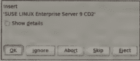

要执行 VNC 安装，您需要在内核启动前向内核传递某些参数。为此，您需要在启动 Linuxrc 程序之前将以下信息包含在 IBM 服务器的初始程序加载（IPL）配置中：

```
vnc=1 vncpasswd=password install=source
```

vnc=1 表示应在安装系统上启动 VNC 服务器。vncpasswd= 指定客户端在连接到主机时需要提供的密码。密码长度必须至少为六个字符；否则，VNC 主机启动时会生成错误，您将无法进行身份验证。安装源（install=）可以手动指定（通过指定相关目录的协议和 URL，例如 ftp://.../install_files 或 nfs://10.6.7.9/inst11_files），也可以是 install=slp。在后一种情况下，安装源由 SLP 查询自动确定。

#### 警告

如果未指定 install=，则使用服务器的本地 CD-ROM 驱动器，在进行远程安装时这可能不是您想要的。

在 IBM 服务器上设置 VNC 主机的具体步骤和语法因型号而异，因此您应参考系统特定文档以获取详细信息。


#### WARNING

SLES 9 安装和配置指南第 3.1.7 节“向 linuxrc 传递参数”中显示的参数关键字示例是为了清楚地反映在命令行输入时使用等号 (=) 来分隔关键字及其值，而不是冒号 (:)，如示例所示。

#### TIP

默认情况下，基于 VNC 的安装使用 DHCP 获取主机的 IP 信息。但是，您可以通过在 linuxrc 参数中包含 `hostip=x.x.x.x netmask=x.x.x.x` 来指定静态 IP 地址。必须与 hostip 一起指定 netmask；否则将使用 DHCP。

SLES 9 在 CD1 上的 `dosutils/tightvnc` 目录中包含 Windows 32 位 VNC 客户端（TightVNC）。您也可以从 www.tightvnc.com 获取最新的 TightVNC 客户端，或使用其他 VNC 客户端，例如来自 www.realvnc.com 的客户端。

VNC 服务器还内置了一个小型 HTTP 服务器。通过此功能，您可以使用启用 Java 的 Web 浏览器连接到 VNC 服务器。VNC 服务器在 5801 端口监听 HTTP 连接；例如，要使用的 URL 为 `http://server_name_or_ip_address:5801`。Java 小程序会提示您输入密码（见图 1.2），然后显示桌面。

### FIGURE 1.2

通过 HTTP 访问 VNC 服务器。


注意：VNC 默认情况下未加密，因此任何有权访问您与服务器之间网络路径并使用数据包嗅探器的人都可以捕获您的会话并提取密码、服务器设置或其他输入数据。因此，如果您正在执行远程安装，强烈建议您仅在受信任的网络或类似 VMWare 的环境中进行不安全的 VNC 安装。如果您必须在不安全的网络（例如 Internet）上执行 VNC 安装，我们建议您在通过 SSH 或类似的安全连接方法完成安装后立即更改 root 密码以及在不安全会话期间输入的任何其他密码。

### Network-Based Installation

网络安装

通常，将所有必要的安装文件放在中央服务器上并通过网络进行安装要方便得多。这通常比使用“光盘操作员”方法更快。此外，服务器上的文件可以轻松更新。拥有此类安装服务器的一个附带好处是以后安装软件包的便捷性；您可以简单地将 YaST 指向该服务器，而不必找到 CD 并希望服务器的 CD-ROM 驱动器没有被灰尘堵塞。有两种方法可以设置网络安装所需的目录结构。一种方法是将每个 CD 的内容复制到单独的目录中。这具有目录结构更清晰的优点，并且使更新特定 CD 更容易。缺点是当 YaST 需要访问不同 CD 上的内容时，您将被提示输入相应目录的名称，从而稍微减慢安装过程。另一种方法是将所有 CD 的内容复制到单个目录中。使用此设置，YaST 不会提示您“切换”CD。

与其设置临时中央安装服务器（例如在 NetWare 上运行的 FTP 服务器），SUSE LINUX 为 YaST 提供了安装服务器模块，支持通过 FTP、NFS 和 HTTP 连接进行安装。有关更多详细信息，请参阅 SLES 9 安装和配置指南第 4 章“中央软件安装和更新”。

Linuxrc 安装过程支持 FTP、NFS、Samba、HTTP、TFTP 和 SLP 协议进行网络安装。

### AutoYaST-Based Installation

基于 AutoYaST 的安装

如果您使用相似的硬件部署服务器，并且配置了相同的一组基本服务，则可以使用 AutoYaST。AutoYaST 依赖于 YaST 的硬件检测机制，通常使用默认设置，但也可以根据您的特定需求进行自定义。因此，安装主机不必完全相同。它们具有相似的硬件设置就足够了。您仍需考虑硬件本身的限制，AutoYaST 无法规避这些限制。

YaST 包含一个 AutoYaST 模块，可用于创建必要的配置。然后将此配置写入 XML 文件，因此也可以对其进行编辑甚至手动创建。当您对 XML 文件的内容满意时，将其复制到软盘，以便用于安装新系统。在下一台服务器上，在启动选项字段中传递以下内容

`autoyast=floppy:///filename.xml`

其中 filename.xml 是您的配置文件。

#### CAUTION

注意

请注意用于执行基于 AutoYaST 安装的“URL”中的三个斜杠。

有关 AutoYaST 的更多信息和大量文档包含在 autoyast2 包中。您可以在 www.suse.de/~nashif/autoinstall 找到在线文档，其中包含许多示例。

### Pre-Installation Planning

安装前规划

在实际安装软件之前，请花几分钟时间进行安装前规划。服务器配置的某些方面（例如硬盘分区方案和文件系统类型选择）在 SLES 9 安装后很难更改。因此，花几分钟时间规划可以为您节省以后数小时的重新配置工作。

您首先应确保服务器硬件满足表 1.2 中列出的 SLES 9 最低系统要求。

**TABLE 1.2**
**表 1.2**
SLES 9 System Requirements
SLES 9 系统要求

| REQUIREMENT | NOTES |
|---|---|
| 安装所需的最低系统内存要求 | 如果您执行本地安装，需要 256MB；基于 SSH 的网络图形安装需要 256MB；而通过 FTP 的基于 VNC 的网络安装需要 512MB。 |
| 运行所需的最低系统要求 | 具有 Pentium II 或 AMD K7 450 MHz 处理器和 384MB RAM 的服务器级计算机。根据软件包选择，需要 500MB 硬盘空间用于系统软件（精简、无图形界面、基础安装占用 400MB，而完整安装占用 2.5GB 磁盘空间），另需 500MB 硬盘空间用于用户数据。如果从 CD 介质安装，需要 4X CD-ROM 驱动器；如果 CD-ROM 驱动器不支持启动，则需要软盘驱动器。 |

**TABLE 1.2**
**表 1.2**
**SLES 9 System Requirements (continued)**
**SLES 9 系统要求（续）**

| REQUIREMENT | NOTES |
|---|---|
| 推荐的运行系统要求 | 具有 Pentium 4 或 AMD K8 或更高端（如 Intel Xeon EM64T）处理器和 512MB 至 3GB RAM 的服务器级计算机；您应每颗 CPU 至少配备 512MB RAM。分配 4GB 硬盘空间用于系统软件，10GB（或更多）用于用户数据。如果从 CD 介质安装，需要 48X CD-ROM 驱动器；如果 CD-ROM 驱动器不支持启动，则需要软盘驱动器。 |

SLES 9 支持 Intel x86、AMD、AMD64、Intel Xeon EM64T 和 Itanium 处理器系列。它还可在 IBM POWER 处理器（以前的 IBM iSeries 和 IBM pSeries 系统）、IBM zSeries 和 IBM S/390 系统上运行。有关更详细的系统要求，例如特定于 IBM zSeries 64 位系统的要求，请参阅位于 www.novell.com/documentation/sles9/index.html 的 SUSE LINUX Enterprise Server 9 文档。

#### NOTE

注意

Novell 的 Open Enterprise Server (OES) 软件同时包含 NetWare 内核和 Linux 内核（SLES 9）。因此，如果您计划稍后向服务器添加 OES 服务，请务必在初始配置服务器时考虑额外的 RAM 和磁盘空间要求。

如果您的系统是“服务器级”机器，它很可能与 SLES 9 兼容。如果系统被归类为“桌面系统”，它可能可以工作，但某些非标准设备（例如某些集成声卡和集成调制解调器）可能无法正常工作。如果您尝试在笔记本系统上安装 SLES 9，可能会出现兼容性问题。但是，如果您坚持使用 IBM 或 Dell 等知名品牌，它很可能可以工作。您可以在 Novell 的 YES CERTIFIED 公告搜索页面（developer.novell.com/yessearch/search.jsp）找到 SLES 9 的认证硬件列表。从搜索页面屏幕（见图 1.3）中，从下拉列表中选择 Network Server。在 Novell 产品列表框中，选择适用于相应平台的 SLES 9，例如适用于 x86 的 SUSE LINUX Enterprise Server 9；然后单击页面底部的 Search。

下一步是获取 SLES 9 软件。您可以从 Novell 合作伙伴之一（见 www.novell.com/products/linuxenterpriseserver/howtobuy.html）购买 SLES 9 盒装套件（包括 CD、印刷文档和一年支持），或从 Novell 下载评估版，网址为 www.novell.com/products/linuxenterpriseserver/eval.html。


下载可作为 ISO 映像文件提供，然后可用于创建自己的光盘。

### 图 1.3
搜索 SLES 9 认证的网络服务器。

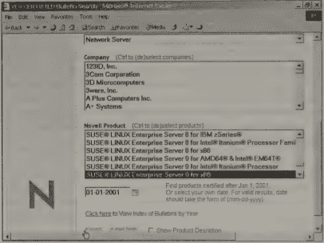

#### 注意
如果你下载评估版，HTML 页面大约向下滚动一半的位置，你会找到评估序列号。你需要它来激活免费的 30 天安装支持和升级保护，按照 www.novell.com/products/linuxenterpriseserver/eval.html 下“步骤 2—支持”中列出的流程进行。如果你从 Novell 合作伙伴处购买了 SLES 9，可以在产品包装盒内找到序列号。如果你在网上购买了产品，你会收到一封包含序列号和相关信息的电子邮件。

#### 提示
你不需要为全部六个 ISO 映像创建光盘，因为你可以通过 FTP 或 NFS 等多种其他方法安装 SLES 9。但你始终可以创建 CD1——启动盘。

当你手头有基本组件时，你需要做一些规划：在安装 SLES 9 之前，你应考虑以下主题：

- **系统的角色**—系统的角色决定了它可能需要的软件包（从而决定所需的 RAM 和磁盘空间量）。例如，如果服务器要作为专用的域名系统（DNS）服务器，则除非你预计有巨大的 DNS 数据库，否则无需在其中放置 120GB 硬盘。此外，专用的 DNS 服务器不需要 GUI 桌面，因为你通常可以使用基于文本的 YaST（又一个设置工具）或使用 vi 等更简单的文本编辑器执行所有必要的配置。你应该列出服务器将提供的网络服务，然后仅安装所需的软件包、其依赖项，不安装其他内容。

#### 提示
我们强烈建议不要在生产服务器上安装任何 GUI 桌面。额外的开销会占用重要网络服务所需的 CPU 周期和 RAM。

#### 注意
软件包在服务器运行后可以轻松添加和删除。然而，经验告诉我们，更多时候，一旦安装了软件包，很少会被移除，要么是由于懒惰，要么是缺乏时间。此外，任何已安装的软件都可能成为安全漏洞的来源。你将在本书后面了解到，保护系统的最佳方法之一是运行最少所需的服务，这意味着只安装你需要的东西，以免恶意服务在你不知情的情况下启动。

- **硬盘分区方案**—对于生产服务器，所有可用的硬盘空间都应用于 Linux。然而，你可能希望测试服务器与多种不同的操作系统双启动或多启动。即使所有硬盘空间都用于 Linux，你仍需要决定如何为各种文件系统“划分”磁盘空间，例如根（/）、/home 等。例如，标准的 SLES 9 安装占用约 1.5GB 磁盘空间。这意味着你应为根文件系统分配大约 2GB 以留出扩展空间。经验法则是，如果总磁盘空间为 4GB 或更少，创建一个交换分区（通常为物理 RAM 大小的两倍）和一个根分区。如果磁盘空间超过 4GB，创建一个交换分区、1GB 根分区、4GB /usr 分区、4GB /opt 分区、1GB /var 分区，并将剩余空间分配给 /home。

#### 提示
一些（主要是商业）软件包将其数据放在 /opt，而应用程序本身放在 /usr/bin；Mozilla 就是一个例子。因此，你可能希望为 /opt 创建单独的分区，或使根分区足够大。

- **硬盘配置**—SLES 9 支持行业标准的硬盘，如 IDE 和 SCSI（包括 iSCSI 设备）。通常，服务器使用 RAID 磁盘以实现容错，因此你应考虑想要使用的 RAID 级别。SLES 9 在 YaST 的帮助下提供将多个硬盘组合成一个“软 RAID”系统的选项，作为硬件 RAID 的替代方案。SLES 的软件 RAID 可配置为 RAID-0、RAID-1 或 RAID-5。请注意，带有 2.6 内核的 SUSE 产品目前不支持 SATA RAID。或者将 SATA 驱动器用作直连块设备或带 Linux 软件 RAID 的块设备。

#### 注意
块设备（如硬盘）每次读写都会发送数据块，而字符设备（如键盘）一次只能发送或接收一个字符。

- **文件系统类型选择**—SUSE LINUX 支持多种文件系统类型，从传统的 ext2 到 Reiser 或 JFS。如果你需要安全删除文件，请使用 ext2。如果需要性能和容错，Reiser 是一个不错的选择。请参阅表 1.3，以确保你选择的文件系统类型支持你的文件大小需求。你还应决定是否出于安全目的加密文件系统。有关更多信息，请参阅第 6 章“文件系统安全”。

- **引导加载程序选择**—大多数 Linux 发行版可用的两个行业标准引导加载程序是 LILO（Linux Loader）和 GRUB（GRand Unified Bootloader）。使用其中一个还是另一个大多是个人选择（与臭名昭著的 vi 与 emacs 或 KDE 与 GNOME 的口舌之争并无太大区别）。由于 LILO 比 GRUB 存在的时间长得多，许多经验丰富的 Linux 管理员更喜欢 LILO。然而，GRUB 比 LILO 更强大，因为你可以即时编辑其条目并在无需重新安装 GRUB 的情况下更新内核；对于 LILO，内核更改和 MBR 修改需要重新安装 LILO。SLES 9 默认使用 GRUB，除非根文件系统的分区安装在 RAID 系统上，即硬件 RAID 或软件 RAID 或逻辑卷管理器（LVM）。你可以在安装时或之后使用 YaST 更改引导加载程序类型。

#### 警告
虽然在技术上可行，但 Novell 不推荐将 GRUB 与 JFS 组合使用。

- **密码哈希算法**—Linux 支持多种不同的密码哈希算法来保护用户密码。你应根据服务器的角色、CPU 性能和所需的<|message|> 安全级别选择合适的哈希算法。例如，为了与旧的 Unix 系统兼容，你应使用默认的 DES 哈希算法选择。对于中等水平的密码安全，选择 MD5。你可以在系统运行后轻松更改密码哈希算法。有关更多信息，请参阅第 4 章“用户和组管理”以及第 11 章“网络安全概念”。
- **网络信息**—除非你安装的是未连接到网络的独立服务器，否则你应准备好以下信息：服务器的 IP 地址及其子网掩码、默认网关、服务器的 DNS 名称以及你的 DNS 服务器地址。
- **软件支持信息**—如果你想在安装期间下载最新的 SLES 9 软件更新，请确保你拥有使用 `www.novell.com/products/linuxenterpriseserver/eval.html` 中列出的流程获得的 YaST Online Update 激活信息，如前所述。或者，你可以在稍后执行此功能。

如使用 IBM POWER、zSeries 或 S/390 作为你的 SLES 9 服务器平台，则需要额外的规划和准备工作。有关更多信息，请参阅位于 `www.novell.com/documentation/sles9/index.html` 的 IBM 特定文档。

#### 表 1.3
**文件系统的最大尺寸**

| 文件系统 | 最大文件系统大小 | 最大文件大小 |
|---|---|---:|---:|
| ext2 或 ext3 (1KB 块大小) | 2TB | 16GB |
| ext2 或 ext3 (2KB 块大小) | 8TB | 256GB |
| ext2 或 ext3 (4KB 块大小) | 16TB | 2TB |
| ReiserFS 3.5.x | 16TB | 4GB |
| ReiserFS 3.6.x (在 Linux 内核 2.4.1 及更高版本下) | 16TB | 1 Exabyte (EB) |
| XFS | 8EB | 8EB |
| JFS (4 KB 块大小) | 4 Petabytes (PB) | 8EB |
| NFS v2 (客户端) | 8EB | 2GB |
| NFS v3 (客户端) | 8EB | 8EB |

### Linux 中的大文件支持 (LFS)
传统上，32 位系统（如 x86、PowerPC 和 MIPS）支持的最大文件大小取决于实现方式，为 2GB（2³¹ 字节）或 4GB（2³² 字节）。为了在 32 位系统上支持大于 4GB 的文件，Linux 在其内核和 C 库（又名 glibc）中添加了大文件支持（LFS）。LFS 将 32 位系统的最大文件大小限制提高到与 64 位系统相同：2⁶³ 字节或 8EB，除非受文件系统本身限制。另一方面，像 Alpha、IA64 和 x86-64 这样的 64 位系统没有大文件问题，但也支持新的 LFS 接口。在这种情况下，新的接口主要是对正常 API 接口的别名。

LFS API 支持高达 8EB 的文件，但 Linux 内核对其处理的文件和文件系统的大小有自己的限制：

- 在 32 位系统上，Linux 内核 2.4.x 将文件和块设备大小限制为 2TB（2⁴¹ 字节）。然而，使用逻辑卷管理器，你可以组合多个块设备以处理更大的文件。
- 在 64 位系统上，文件系统和文件可高达 8EB（2⁶³ 字节），但硬件驱动程序限制可能不支持如此大的大小。
- 在启用了 LFS 的 32 位系统上的 Linux 内核 2.6 或更高版本以及 64 位系统上，文件系统大小可高达 9.7 Zettabytes（ZB）。然而，这一限制对于当前可用的硬件来说仍然遥不可及。

SUSE LINUX 自 SUSE 7.0 起已支持 LFS。


无需互联网连接即可完成服务器安装。但是，如果您想在安装过程中下载 SLES 9 更新，则需要互联网连接。

### 安装 SLES 9 的十个简单步骤

SUSE LINUX 产品是最容易安装的 Linux 发行版之一。在完成了本章前面讨论的前期规划工作后，您可以使用以下各节中讨论的 10 个简单步骤，在不到一个小时的时间内完成第一台 SLES 9 服务器的实际安装（取决于硬件速度和所选的安装方法）。

> **注释**
>
> YaST 执行所有配置和安装工作。它通过收集您提供的所有必要信息并建立待办事项列表来工作，在您点击最后一个安装对话框中的“接受”之前不会实际触及系统中的任何内容。鉴于此，如果您在中途改变主意，可以轻松中止安装过程并重新开始。

#### 选择安装方法

当您使用 CD1 或启动软盘启动机器时，会显示欢迎启动画面。然后会显示启动菜单，如图 1.4 所示。

如果您在 20 秒内未选择选项，菜单中的第一项（从硬盘启动）将被自动选中，而这在安装期间并不是您想要的。请按一次 Tab 键取消倒计时。

在此屏幕上，使用 F2 键更改屏幕分辨率。通常 800x600 工作良好，但有些人更喜欢 1024x768；任何更高的分辨率都会使安装过程中显示的文本难以阅读。如果要执行基于网络的安装，请使用 F3 选择所需的网络协议，然后系统会提示您输入必要的信息，例如源服务器的 IP 地址/DNS 名称等。

> **提示**
>
> 如果图形屏幕显示不正确，请选择文本模式进行安装。这不会影响您稍后使用 GUI 桌面的情况。事实上，如果您在 VMware Workstation 4.x 或 5.x，或 VMware ESX Server 2.x（www.vmware.com）上安装 SLES 9，则必须使用文本模式。

#### 图 1.4
SLES 9 启动菜单。

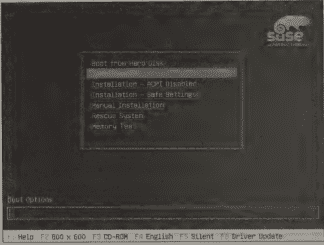

使用箭头键突出显示“安装”，然后按 Enter。您必须通过点击“我同意”接受 Novell 软件许可协议后才能继续。

#### 选择语言

接受许可协议后，图形化安装工具 YaST 将运行。从屏幕上出现的列表中选择您首选的语言，如图 1.5 所示，然后点击“接受”继续。

#### 选择安装设置

YaST 探测并分析您的系统硬件，做出一些自动安装决策，并在以下屏幕上显示（见图 1.6）。您可以通过点击“更改”按钮并选择要修改的项目来更改每个选项。例如，要更改软件选择，请点击“更改”并从菜单中选择“软件”。

从“软件选择”屏幕（见图 1.7）中，您可以更改决定要安装哪些软件包的系统类型。默认系统在许多情况下是合适的，但它往往也包含您不一定运行的软件。相反，选择“最小系统”或“最小图形系统”，然后点击“详细选择”以选择您希望在此服务器上运行的特定软件包。（您是否已按照前面“安装前规划”部分建议创建了软件包列表？）

#### 图 1.5
选择您的语言。

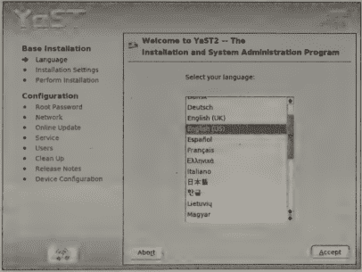

对于此步骤，通常需要更改或自定义以下设置：

- 软件选择
- 时区设置

有经验的用户通常希望更改硬盘分区方案以更好地满足其需求。他们还会更改文件系统类型的选择以及是否启用加密。

在完成所有所需更改后点击“接受”以继续下一步。

#### 图 1.6
安装设置屏幕。

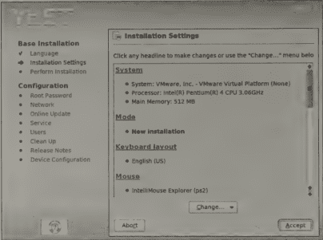

#### 警告

这是在系统被修改之前的设置过程中的最后一步。点击“接受”后，系统会要求您确认是否要使用收集到的数据继续安装。点击“是，安装”后，您的硬盘将被分区和格式化，这意味着无法回头。

#### 准备硬盘

点击“是，安装”后，YaST 对硬盘进行分区和格式化。随后，系统和软件包的安装开始。在安装过程中，会显示当前正在安装的软件包信息以及剩余时间估计（见图 1.8）。如有必要，系统会提示您更换光盘。

在安装完基本系统和应用程序软件包后，会安装引导加载程序（GRUB 或 LILO，具体取决于您在上一步中的选择），然后系统重新启动。

#### 图 1.7

软件选择屏幕。

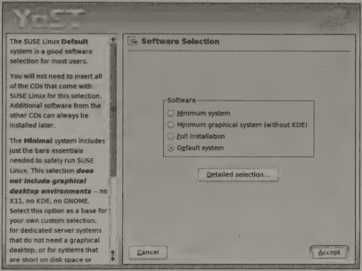

#### 图 1.8

软件包安装进度屏幕。

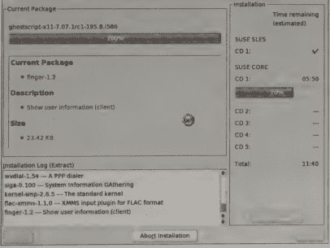

#### 配置系统

在基本系统安装完成并使用硬盘上安装的内核（而不是启动盘上的内核）重新启动后，您可以配置一些系统设置。您需要做的第一件事是为 root 用户设置密码，长度应至少为六个字符。

#### 注意

由于 root 用户可以完全访问服务器上的所有内容，其密码不得容易猜测。请遵循第 4 章中概述的强密码指南。

在点击“下一步”并继续配置网络设置之前，您可能希望更改此服务器上密码的哈希方式。为此，请点击“专家选项”并选择所需的哈希方法，如图 1.9 所示。（DES 是默认且最弱的方法，Blowfish 是最强的方法。）

#### 图 1.9

更改密码哈希算法。

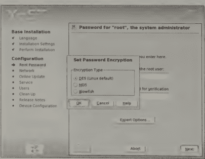

#### 指定网络设置

下一步是配置您的网络连接。YaST 将探测并自动检测网络卡、调制解调器、ISDN 卡和 DSL 设备（见图 1.10）。在大多数情况下，除非您使用 DHCP 为服务器分配网络信息，否则需要修改网络卡配置。

#### 图 1.10

网络配置屏幕。

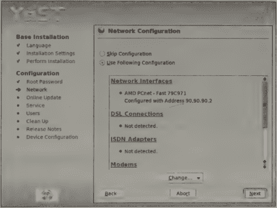

点击“更改”并选择“网络接口”。接下来，选择要修改的卡并点击其“更改”按钮。最后，突出显示网络卡并点击“编辑”。默认情况下，YaST 将网络卡设置为 DHCP，但您可能希望改用静态分配的值：

- 要使用静态 IP 地址，请更改设置方法并输入服务器的 IP 地址和子网掩码（见图 1.11）。
- 不使用 DHCP 时，您需要为服务器配置主机名和 DNS 服务器信息。点击“主机名和名称服务器”进行更改；默认主机名为 linux，其默认域名为 site。
- 点击“路由”并在“默认网关”字段中输入最近路由器的 IP 地址。

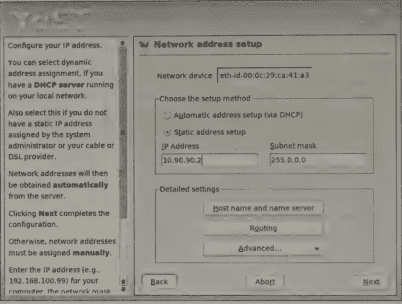

#### 图 1.11
网络地址设置屏幕。

在此步骤中，您还可以启用 VNC 远程管理选项。

#### 应用在线更新

如果您有互联网连接，可以测试前一步中进行的网络配置，并使用在线更新服务更新系统。互联网连接测试是通过尝试从 SUSE 下载 SLES 发布说明来执行的。互联网连接测试操作的成功提供了您网络卡配置正确的确认。

#### 配置服务

服务配置步骤允许您配置两个服务：证书颁发机构（CA）管理和 LDAP 服务（见图 1.12）。CA 管理可以创建默认 CA 和证书，后续可与 Apache 等服务一起使用，以在服务器与其客户端之间提供安全连接。LDAP 服务设置创建 LDAP 数据库，以便您在此服务器上支持 LDAP 启用的应用程序。如果您选择不包含 LDAP

在软件选择阶段之前已选择的服务器，其设置在此步骤中将不会执行。

#### 图 1.12
**配置 CA 管理和 LDAP。**
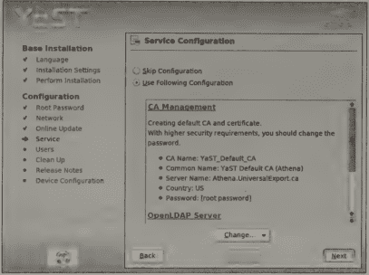

如果您此时选择不设置这些服务，可以稍后使用 YaST 轻松完成。您选择的任何其他服务（例如 MySQL）都需要稍后使用 YaST 或其特定的配置工具进行设置。

#### 配置用户信息
下一步允许您配置一些与用户相关的设置。首先，您需要选择对服务器进行用户身份验证的方式：通过 NIS 服务器、LDAP 服务器，或使用本地存储的 /etc/passwd 信息（参见图 1.13）。默认选择为 LDAP。如果您的网络上没有 NIS 或 LDAP 服务器，或者该服务器的用户需要本地管理，请选择 Local 作为身份验证方法；此设置稍后可以使用 YaST 轻松更改。

如果您选择 NIS 或 LDAP 作为用户身份验证方法，接下来会显示一个设置客户端的屏幕。图 1.14 显示了 LDAP 客户端配置屏幕。

#### 图 1.13
选择用户身份验证方法。
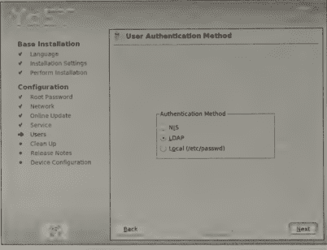

#### 图 1.14
LDAP 客户端配置。
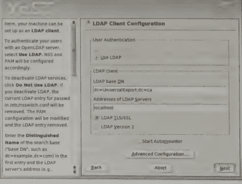

下一个屏幕（参见图 1.15）要求您创建一个新的本地用户（也就是说，信息将存储在 /etc/passwd 中，即使您已将 NIS 设置为用户身份验证方法）。如果您此时想要创建多个新用户，请改为单击用户管理。您可以简单地单击下一步，暂时不创建新用户，而稍后创建用户。

#### 图 1.15
添加新的本地用户。
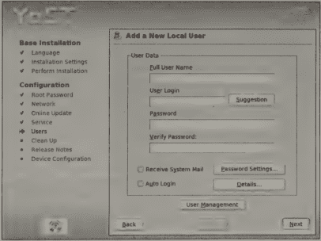

#### 提示
您应该始终为自己创建一个本地用户。这样，您就不必始终以 root 身份登录，而是可以以此非特权用户身份登录，并在必要时仅切换身份到 root（使用 su 或 sudo；参见第 5 章，“用户环境管理和安全”）。

YaST 然后更新一些配置文件，执行一些清理操作，并显示供您参考的发行说明。

#### 配置硬件
最后 YaST 对显卡、显示器、打印机、声音等进行硬件探测。您只需单击下一步即可接受此检查的结果。下一个屏幕（参见图 1.16）显示安装已完成，服务器可供使用。

#### 图 1.16
安装完成。
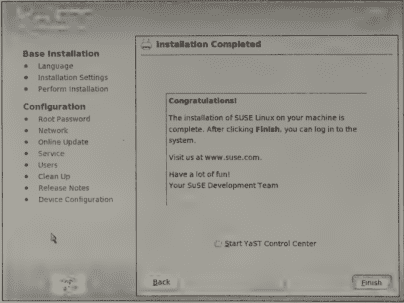

如果您有额外的硬件需要配置，或想立即开始配置某些服务，请在单击完成前选中启动 YaST 控制中心复选框。

#### 注意
如果您通过 VNC 执行安装，YaST 中的最后一个配置模块（硬件配置）不会探测显卡或显示器；因此，您将看不到 GUI 登录屏幕（如果您安装了 GUI 支持）。要解决此问题，请在服务器控制台以 root 身份登录，运行 `init 3`，运行 `sax2`，然后配置显示器。重新启动服务器，您现在将看到 GUI 登录屏幕。

### 故障排除
在大多数情况下，SLES 9 安装不会出现问题。但是，有时事情并不如您所预期。虽然可能有许多原因导致问题，但以下是一些最常见的问题以及可能的解决方法：
- 使用 CD-ROM 安装时，在将数据加载到 RAM 磁盘时大约在 10–15% 处挂起。问题似乎在使用高速（52X）CD-ROM 驱动器时出现；解决方法是切换到 DVD 驱动器或较慢的 CD-ROM 驱动器（例如 32X）。或者，尝试使用基于网络的安装。
- 视频屏幕无法阅读或有多重鬼影。YaST 似乎在正确确定某些显卡方面存在问题；解决方法是使用文本模式。
- 在内核加载或安装期间出现无法解释的错误。在这种情况下，问题可能是与 RAM 相关。确保内存速度得到主板支持并且其时序设置正确。使用安装启动菜单中找到的内存测试选项或 Linux Memtest86 软件包（`portal.suse.com/sdb/en/2001/05/thallma_mentest86.html`）对您的 RAM 执行长时间测试。
- 安装无法启动。确保已安装至少 256MB 的 RAM。也尝试使用安装—禁用 ACPI 或安装—安全设置选项。问题也可能是由损坏的媒体引起的。
- 安装过程突然停止。尝试使用安装—禁用 ACPI 或安装—安全设置选项。问题也可能是由损坏的媒体引起的。

如果您遇到的问题未被上述解决方法涵盖，有许多互联网资源可以咨询，以查看是否有人遇到相同问题并找到了解决方案。开始的好地方是 Google 搜索引擎（http://www.google.com）。附录 B，“资源，”中列出了一些您会觉得有用的 SUSE 特定互联网新闻组和网站。

### 摘要
本章介绍了安装首台 Novell SUSE LINUX Enterprise Server 9 所需的步骤，从预规划过程开始，然后概述了各种安装方法（例如基于 VNC 和基于网络的安装），然后概述了 10 个简单步骤的实际安装过程。最后，介绍了常见安装错误及其解决方法。

现在您已有一台新的服务器正在运行，下一章将指导您完成更新服务器硬件配置和修改软件包的过程。

### 更新服务器
很少有系统在其生命周期内保持静态。不可避免地，服务器将被分配不同的任务，从一个地点移动到另一个地点，或随着需要更多资源来执行当前任务而进行升级或更换。本章将指导您完成在系统整个生命周期内维护系统的各种技术。

本章的主要重点是介绍执行以下任务所需的技术：
- 浏览 YaST 配置工具可用的两种界面
- 向您的基本服务器安装添加和删除软件组件
- 通过添加额外硬件管理关键磁盘空间资源
- 维护网络接口

在我们探讨 YaST 的复杂性之前，有必要简要说明 SUSE 维护配置设置的方式。

### 维护系统配置
SUSE LINUX Enterprise Server（SLES）在目录 /etc/sysconfig 中维护有关系统配置的信息。此位置中存在的文件和目录决定了构成服务器的各种硬件和软件组件的行为。

## 第 2 章：更新服务器
当需要重新配置服务器时，/etc/sysconfig 中的文件必须更新以反映资源的变化。对所涉及机制的正确理解是必要的，以便您能够快速诊断出现任何困难。

### SuSEconfig
可以通过编辑位于 /etc/sysconfig 下的文件来手动维护系统，然后通过运行 SuSEconfig 来提醒系统的服务注意更改。但是，除非您对维护的服务及其配置文件语法有深入了解，否则不建议采用这种方法。

同一配置文件通常需要用于多个服务。相反，一个服务可能依赖于多个不同目录中的多个配置文件。对一个服务进行手动更改可能会对其他服务产生负面影响。如果您选择编辑配置文件，请务必先存储备份副本以防紧急情况。

对静态设置文件所做的更改在相关服务重新启动后才会影响系统的运行。SUSEconfig 实用程序被调用以实施更改。

#### 警告
由于某些高级配置功能无法使用 GUI 工具访问，因此需要手动编辑某些文件。因此，您可能会决定手动维护某些配置文件。

重要的是要为自己提供一种回滚更改的方法。制作要更改的文件的编辑前快照或备份副本至关重要。在出现意外行为的情况下，有问题的配置文件可以快速替换，而无需依赖前几天的备份。根据更改的重要性，以前的备份媒体可能无法访问。

偏执是系统管理不可或缺的一部分。拥有快速的恢复点将节省数小时的挫败感和停机时间。用一点磁盘空间换取安心在任何时候都是一个不错的投资。

SuSEconfig 位于 /sbin。此高级实用程序调用必要的辅助脚本以实施 /etc/sysconfig 中定义配置参数。这些脚本位于 /sbin/conf 目录中，命名为 SuSEconfig.subsystem-name。每个 SuSEconfig 脚本管理服务器上当前安装的一个子系统。


SuSEconfig 的一个缺点是它并不是 `/etc/SuSEconfig` 中所有配置文件的主管。SuSEconfig 并未处理若干配置文件，尤其是包含机器 IP 地址和卷信息的那些文件。

SuSEconfig 工具作用范围的局限性，加上为一次更改而在多个目录中修改多个文件的复杂性，使得服务器的手动重新配置成为一项艰巨的任务。尽管服务器已以这种方式维护了相当长一段时间，但 SLES 提供的更一致、更高效的自动化工具是 YaST。

### YaST（Yet another Setup Tool）

YaST 顾名思义，是用于配置 SUSE 系统的设置工具。该实用程序旨在为维护系统配置文件提供更直观的基于 GUI 的环境。YaST 还将来自不同目录中多个文件的信息组织成简单、一致的呈现方式。这使你能够专注于想要进行的更改，并消除了底层复杂性。在可能的情况下，YaST 利用 SuSEconfig 实用程序来管理子系统。

YaST 配置工具可通过两个独立的 GUI 接口访问。Qt 接口位于 X Windows System 下，而另一个使用 ncurses 并在终端环境中提供 GUI 接口。两种实现都允许你访问应用程序的全部功能。

### YAST INTERFACES

两个 YaST 接口均可从终端会话调用。在 X Windows System 终端会话中，你通过在命令行键入 yast2 来调用 Qt 版的 YaST。yast2 中的导航使用鼠标完成。在非 X 终端会话中，你只需键入 yast 即可调用 YaST。ncurses 版 YaST 使用方向键以及 Alt-字母组合进行导航，其中所需的字母会在每个菜单选项的关键字中突出显示。

你可能会想知道为什么要创建两个接口。简单答案是，对于许多服务器环境而言，X Windows System 接口根本不是必需的。请记住，务必仅运行支持服务器任务所需的应用程序。额外的应用程序可能会包含可能危及环境的漏洞。

此外，运行这些额外应用程序需要系统资源。如果不使用 X Windows System 接口，其自身及其相关例程所消耗的资源更适合分配给服务器的应用程序。

### CHAPTER 2: Updating the Server

在大多数服务器上，认为不安装 X Windows System 或不在运行级别 3 下运行服务器是明智的。在此类系统上，ncurses 版 YaST 允许你以最小的系统资源影响快速重新配置机器。

你可以在图 2.1 和 2.2 中看到两个接口的初始 YaST 菜单。YaST 工具的主菜单将维护细分为以下主要类别：

-   **软件**—此部分允许你控制系统上安装的模块、安装介质的位置，以及如何保持应用程序和服务为最新。从此选择中，你可以配置用户模式 Linux（UML）以及你的 YaST 在线更新服务器。
-   **硬件**—此部分允许你维护系统的不同硬件组件。此处找到的菜单选项涵盖服务器的视频、声音和磁盘控制器卡。你还可以使用此部分来定义打印机和操纵杆等外围设备。
-   **系统**—YaST 的此部分涵盖你的系统配置。它允许你通过启动、磁盘卷和电源管理来微调系统的行为。
-   **网络设备**—此部分定义服务器与外部世界的交互方式。此子菜单中包括服务器网络接口以及传真和答录机等服务/设备连接。
-   **网络服务**—在此部分中，你维护定义服务器任务的应用程序。你应该能找到允许你自定义机器提供的服务的配置选项。其中包括你在本列表中 Software 菜单选项中安装的模块。
-   **安全和用户**—此部分允许你定义密码策略、用户、组、服务器内部防火墙设置，以及服务器将如何管理其证书。
-   **杂项**—此抓取选项允许你在 GUI 环境中查看启动和系统日志。你还可以使用此部分将服务器定义为安装的源服务器。

YaST 工具为访问各种模块的配置选项提供了命令行快捷方式。例如，你可以通过启动 YaST，选择安全和用户菜单，然后选择防火墙选项来访问防火墙配置屏幕。或者，你可以通过使用“firewall”命令行参数调用 YaST，直接进入防火墙配置例程。yast2 的 man 手册讨论了 -list 选项，调用时它会显示不同子菜单选项的快捷方式列表。起初从主 YaST 屏幕导航会更舒适，但直接快速访问所需内容很快就会成为第二天性。

**图 2.1**
ncurses YaST 主菜单。

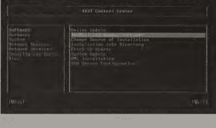

**图 2.2**
X Windows System 的 YaST 主菜单。

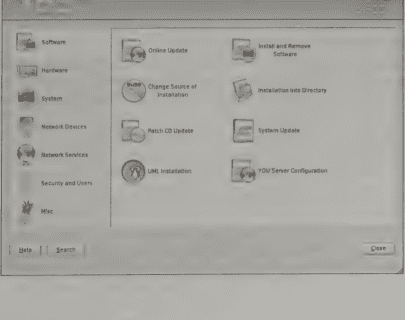

**注意**

你可以在 `yast2` man 手册下找到非 X 终端版 YaST 的 man 页面文档。

SuSEconfig 和 YaST 是随 SLES 捆绑的工具，可帮助你配置和维护服务器。两者共同提供一致的方法，并在需要进行多项更改时降低遗漏步骤的风险。现在你对 YaST 工具有了基本了解，是时候将此知识应用于日常系统管理了。

### Adding and Removing Packages

对系统上不同模块进行适当的维护有助于确保所提供服务的可靠性。服务器配置中的一个重要步骤是确保系统上仅安装所需的软件包。这具有双重好处：最大限度地减少资源消耗，同时减少对未使用且往往被遗忘因此维护不足的软件包中漏洞的潜在暴露。

你如何知道支持服务器主要任务所需的最小子组件是什么？作为第一次近似，这由 YaST 实用程序为你处理。YaST 和底层系统维护不同软件包之间的依赖关系列表。如果尝试安装或删除模块所需组件，则 YaST 会发出警告。

#### Installing a Package

使用 YaST 添加和删除软件包的过程相当简单。例如，以下内容演示了创建域名服务（DNS）服务器的过程。第一步是构建 SLES 服务器然后安装 DNS 软件。配置 DNS 服务稍微复杂一些，将在第 8 章“网络服务”中介绍。

继续坚持只运行绝对必要的应用程序的愿望，使用 SLES 安装服务器并选择安装最小系统。这将安装 SLES、YaST 以及使系统更易于管理的其他实用程序。要将此基础系统转换为 DNS 服务器，必须添加 DNS 服务器软件（Bind）。

由于新安装的系统运行的是 SLES 基础安装，因此 X Windows System 不可用。使用 root 帐户登录机器并在命令行键入 yast 启动 YaST。图 2.1 显示了 YaST 工具的 ncurses 主菜单。你使用 Tab 键和方向键在工具中导航，并且在可用时，高亮字符代表 Alt 键快捷方式。在图 2.1 中，已选择安装和删除软件选项。

在此阶段按下 Enter 会调出安装和删除子菜单。默认情况下，选择屏幕按 RPM 组进行过滤。由于图 2.3 中这些项目的最左侧列为空，你知道它们未安装在此系统上。如果服务器上已安装某个项目，则左侧会出现小写字母 i。

**图 2.3**
按 RPM 组过滤的 YaST 已安装软件。

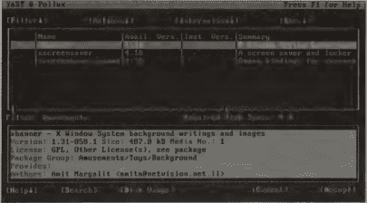

要查找此系统上已安装的软件包，请更改过滤选项。你可以通过按 Alt-F 并从下拉菜单中选择 Selections 来更改过滤器以按 Selection 组显示软件包，如图 2.4 所示。

选择 Selections 并按 Enter 后，会出现一个窗口显示当前安装的软件包组（见图 2.5）。正如图所示，此系统上仅安装了基础 SLES 系统和 YaST。

要安装所需的 DNS 组件，请使用方向键滚动到适当选项并按加号（+）或空格键选择软件包（见图 2.6）。然后你可以切换到 OK 按钮或按 Alt-O 继续。


#### **图 2.4**
将筛选器设置更改为通过选择选择来显示项目。

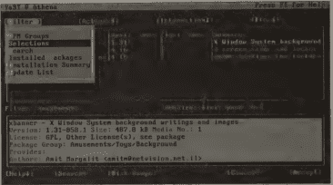

#### **图 2.5**
SLES 最小配置的已安装组件。

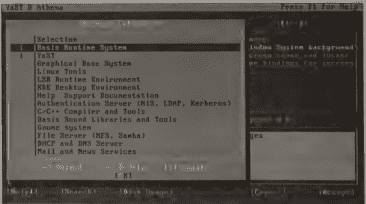

然后会显示该软件包包含的项目，如图 2.7 所示。如有需要，可以滚动浏览这些项目并删除不需要的项目。在当前示例中，只需接受整个软件包，选择接受（Alt-A），然后继续安装。

从此阶段开始，系统会提示您提供所选软件包所需的适当介质（见图 2.8）。如果介质不可用或您决定在此停止，可以通过按 Alt+R 中止安装。如果这样做，所请求的更改将不会提交到当前配置。

#### 图 2.6
已选择 DHCP 和 DNS 服务器选项进行安装。

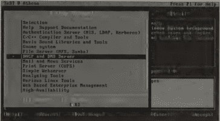

#### 图 2.7
YaST 安装软件包子组件列表。

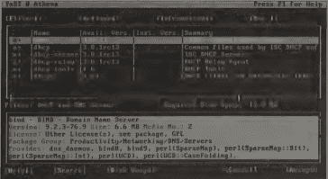

图 2.9 显示了安装的进度信息。随着每个子组件的安装，其大小、描述和文件都会显示出来。

在所有必需组件复制到服务器后，会对配置文件进行适当的更改。如前所述，YaST 将这些任务委托给 SuSEconfig 工具。随着每个子系统的受影响，YaST 会记录 SuSEconfig 的进度，如图 2.10 所示。

**图 2.8**
YaST 对适当安装介质的提示。

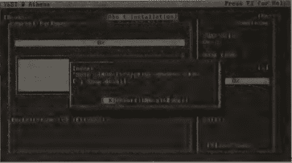

**图 2.9**
YaST 安装进度屏幕。

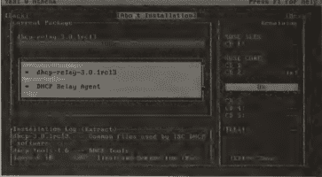

您现在已成功在服务器上安装了 DHCP 和 DNS 软件包。在这些服务可以使用之前，必须对其进行配置。这些任务将在第 8 章中进行说明。我们现在将研究如何删除不需要的应用程序。

**图 2.10**
YaST 将配置更改委托给 SuSEconfig。

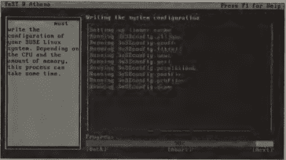

#### 删除软件包或子组件
删除服务器组件所需的步骤与安装它们时使用的步骤类似。在前面的示例中，您安装了创建 DNS 服务器所需的软件。在安装 DNS 软件的同时，您还安装了 DHCP 服务器环境。由于它们的可互操作性，将这些应用程序托管在同一服务器上并不罕见。然而，由于您希望将 DNS 服务器放置在可以从整个互联网访问的位置，因此将 DHCP 环境托管在同一服务器上是不明智的。

要删除 DHCP 组件，请启动 YaST 并导航到“安装和删除软件”子菜单。将筛选选项更改为选择（与安装阶段时相同）。除了图 2.5 中列出的软件外，您现在已安装 DHCP 和 DNS 服务器软件包，如左列字母 I 所示（见图 2.11）。

要删除 DHCP 组件，请将软件包标记为更新。突出显示 DHCP 和 DNS 菜单选项允许您输入大于号（>）或按空格键并选择更新功能（见图 2.12）。

从此屏幕选择“确定”会显示构成软件包的子组件列表。安装期间也显示了此相同屏幕（参见图 2.7）。不过，在这种情况下，您可以选择任何子组件进行删除。这可以通过在软件包旁边输入连字符（-）来完成。

哪个先删除的问题由 YaST 本身处理。随着组件被选中删除，YaST 会检查任何依赖关系，并在必要时发出适当的警告。在图 2.13 中，*DHCP 通用组件*首先被选中删除。在您选择它们后，YaST 会显示依赖组件的列表。如您所见，*dhcp-relay* 和 *dhcp-server* 需要组件软件包存在。通过取消此步骤并选择其他依赖软件包，您可以确保干净地卸载。

#### **图 2.11**
验证 DHCP 和 DNS 服务器软件包已安装。

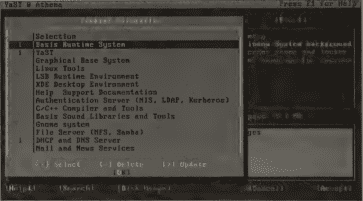

#### **图 2.12**
已为 DHCP 和 DNS 服务器软件包选择更新选项。

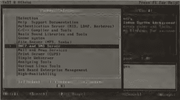

在所有适当的 DHCP 组件被标记为删除后（见图 2.14），您可以选择接受选项。然后 YaST 继续删除已识别的软件并调用 SuSEconfig 来管理系统配置中的更改。在此阶段，您现在应该拥有一个最小的系统配置，托管单个网络服务器进程：DNS。我们将在第 8 章讨论 DNS 的配置。

#### **图 2.13**
组件删除依赖性警告。

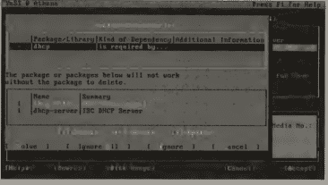

#### **图 2.14**
待删除组件的标识。

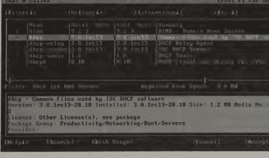

您已经看到 YaST 如何简化在系统上添加和删除应用程序软件包的过程。当系统环境为其任务正确配置时，很少会进行更改。

随着系统的成熟和用户社区对机器的使用增加，系统资源不足的情况并不少见。以下部分将探讨如何向系统添加设备以解决其中一些问题。

### 添加和删除硬件
新服务器的采购阶段应包括初步增长估算。容量规划是一个持续的过程，通常可以监控长期资源消耗。最终，无论是通过老化还是通过创建意外项目，服务器都会变得资源受限。

在可能的情况下，将购买具有更大容量的新服务器，并将功能转移到新机器上。然而，在许多情况下，预算或更常见的时间限制使这变得不可能。

最常见的资源问题是磁盘空间。随着用户习惯于系统或服务，他们倾向于使用得更多。他们将本地工作站文件复制到服务器上以进行适当的备份和灾难恢复。在某些情况下，个人或部门会通过新功能和改进功能显著增加其网站。无论哪种情况，作为系统管理员，您都将被要求增加系统的容量。

以下部分探讨如何向系统添加额外的磁盘空间并将其针对特定解决方案。众所周知，额外的磁盘空间将带来备份和灾难恢复方面的影响。这些主题将在第 10 章“数据备份和灾难恢复”中介绍。

### 准备工作
添加到系统中最常见的硬件是磁盘空间。您可能想要添加到系统中的其他设备通常附带针对 SLES 的厂商特定说明，此处不予涵盖。其中许多是外围设备，如扫描仪、网络摄像头和音频设备，通常不会集成到服务器中。

为了本节的目的，我们将讨论磁盘作为单个物理存储单元的概念。我们将忽略存储单元生成方式的底层复杂性。“磁盘”可能只是一个固定容量的单个 IDE 盘片，也可能是固件级别管理的更大 RAID 阵列的一个分区。在当前讨论中，我们将把它们视为在向操作系统呈现的方式上相同。

在 DNS 或小型 Web 服务器等较小的服务器中，有时使用 SLES 的许多默认安装选项会更简单。这种安装的一个影响是未使用逻辑卷管理器（LVM）软件来配置环境。LVM 允许动态添加磁盘容量并将新磁盘定位到实时系统上的特定卷集上。尽管非常强大，但此类配置可能会变得复杂，本节不予讨论。有关 LVM 的更多信息可以在 SUSE 网站上的系列白皮书中找到（http://www.suse.com/en/whitepapers/lvm/lvm1.html）。

在向系统添加磁盘设备之前，了解您将把设备定位到何处非常重要。在构建系统时，将目录结构的各个部分分离到不同的设备或分区上是良好的做法。如果在任何时候，您的 / 分区使用率达到 100%，系统将无法运行。

对 / 目录的主要分支进行隔离有助于减轻关键磁盘空间被意外消耗。通常，您的 SLES 服务器上的 / 级目录包含以下列表中的条目：

```
Athena:~ # ls /
.    bin   dev   home   lost+found   mnt   proc   sbin   sys   usr
..   boot  etc   lib   media       opt   root   srv   tmp   var
Athena:~ #
```

当您构建服务器时（见第 1 章“安装 SUSE LINUX Enterprise Server”），您有机会将这些目录分配到不同的位置。在简单的单磁盘设备系统上，默认安装将卷分为交换分区和 / 分区。更稳健的方法是将单个卷进一步分区为不同的区域以容纳更易变的目录结构。在允许终端用户内容的服务器上，将 /home（用户文件）和 /srv（Web 内容）目录放在自己的设备上将平衡多个卷上的磁盘消耗。如果没有单独的设备，将 /home 和 /srv 放在单独的分区上仍然是一个好主意。隔离将防止一个分区上的消耗影响另一个分区。尽管您可以通过配额管理将磁盘已满事件的风险降至最低，但使系统防故障只是明智的做法。

### 添加磁盘
在我们的示例中，将向 Web 服务器 Athena 添加一个磁盘。当前的 Web 服务器将被要求存储大量公司文档

instead of the original contact information pages it was originally designed for.
A suggested methodology could be as follows:

- 购买一块次要磁盘。
- 必须执行系统的有效完整备份。
- 磁盘必须物理添加到机器上。
- 必须在磁盘上创建有效的分区表。
- 分区必须格式化。
- 格式化的分区必须启用。
- 数据必须传输到新的磁盘空间。
- 执行重启和健全性检查。
- 恢复用户访问。

系统备份很重要，因为此过程中的许多步骤可能导致重大数据丢失或系统无法启动。磁盘硬件的物理安装取决于机器和接口，这里不予涵盖。在系统关闭之前，了解服务器当前使用的磁盘配置非常重要。你可以通过使用 df 命令或查看 /etc/fstab 文件来实现：

```
Athena:~ # df -h
Filesystem             Size  Used Avail Use% Mounted on
/dev/sda1              9.4G  2.2G  6.8G  25% /
tmpfs                   93M  8.0K   93M   3% /dev/shm
Athena:~ #
```

Or

```
Athena:~# cat /etc/fstab
/dev/sda1       /                 ext3    acl,user_xattr          1 1
/dev/sda2       swap              swap    pri=42                  0 0
devpts          /dev/pts           devpts  mode=0620,gid=5         0 0
proc            /proc              proc    defaults                0 0
usbfs           /proc/bus/usb      usbfs   noauto                  0 0
sysfs           /sys               sysfs   noauto                  0 0
/dev/dvd        /media/dvd         subfs   noauto                  0 0
fs=cd|ss.ro,procuid,nodev,nosuid,noexec,iocharset=utf8 0 0
/dev/fd0        /media/floppy      subfs   noauto                  0 0
fs=floppyfs,procuid,nodev,nosuid,sync 0 0
Athena:~#
```

### Fstab 格式

fstab 文件关联物理分区以及有关它们将如何添加到系统中的信息。fstab 中的每条记录分为六个不同的部分：

- 1. 第一个字段标识要挂载的块设备。这通常是你要挂载的分区的名称（例如，/dev/sda1）。
- 2. 第二个字段指示分区将关联到的挂载点的名称（例如，/home）。
- 3. 第三个字段标识分区的[content]
instead of the original contact information pages it was originally designed for.
A suggested methodology could be as follows:

- 购买一块次要磁盘。
- 必须执行系统的有效完整备份。
- 磁盘必须物理添加到机器上。
- 必须在磁盘上创建有效的分区表。
- 分区必须格式化。
- 格式化的分区必须启用。
- 数据必须传输到新的磁盘空间。
- 执行重启和健全性检查。
- 恢复用户访问。

系统备份很重要，因为此过程中的许多步骤可能导致重大数据丢失或系统无法启动。磁盘硬件的物理安装取决于机器和接口，这里不予涵盖。在系统关闭之前，了解服务器当前使用的磁盘配置非常重要。你可以通过使用 df 命令或查看 /etc/fstab 文件来实现：

```
Athena:~ # df -h
Filesystem             Size  Used Avail Use% Mounted on
/dev/sda1              9.4G  2.2G  6.8G  25% /
tmpfs                   93M  8.0K   93M   3% /dev/shm
Athena:~ #
```

Or

```
Athena:~# cat /etc/fstab
/dev/sda1       /                 ext3    acl,user_xattr          1 1
/dev/sda2       swap              swap    pri=42                  0 0
devpts          /dev/pts           devpts  mode=0620,gid=5         0 0
proc            /proc              proc    defaults                0 0
usbfs           /proc/bus/usb      usbfs   noauto                  0 0
sysfs           /sys               sysfs   noauto                  0 0
/dev/dvd        /media/dvd         subfs   noauto                  0 0
fs=cd|ss.ro,procuid,nodev,nosuid,noexec,iocharset=utf8 0 0
/dev/fd0        /media/floppy      subfs   noauto                  0 0
fs=floppyfs,procuid,nodev,nosuid,sync 0 0
Athena:~#
```

### Fstab 格式

fstab 文件关联物理分区以及有关它们将如何添加到系统中的信息。fstab 中的每条记录分为六个不同的部分：

- 1. 第一个字段标识要挂载的块设备。这通常是你要挂载的分区的名称（例如，/dev/sda1）。
- 2. 第二个字段指示分区将关联到的挂载点的名称（例如，/home）。
- 3. 第三个字段标识分区的[content]
instead of the original contact information pages it was originally designed for.
A suggested methodology could be as follows:

- 购买一块次要磁盘。
- 必须执行系统的有效完整备份。
- 磁盘必须物理添加到机器上。
- 必须在磁盘上创建有效的分区表。
- 分区必须格式化。
- 格式化的分区必须启用。
- 数据必须传输到新的磁盘空间。
- 执行重启和健全性检查。
- 恢复用户访问。

系统备份很重要，因为此过程中的许多步骤可能导致重大数据丢失或系统无法启动。磁盘硬件的物理安装取决于机器和接口，这里不予涵盖。在系统关闭之前，了解服务器当前使用的磁盘配置非常重要。你可以通过使用 df 命令或查看 /etc/fstab 文件来实现：

```
Athena:~ # df -h
Filesystem             Size  Used Avail Use% Mounted on
/dev/sda1              9.4G  2.2G  6.8G  25% /
tmpfs                   93M  8.0K   93M   3% /dev/shm
Athena:~ #
```

Or

```
Athena:~# cat /etc/fstab
/dev/sda1       /                 ext3    acl,user_xattr          1 1
/dev/sda2       swap              swap    pri=42                  0 0
devpts          /dev/pts           devpts  mode=0620,gid=5         0 0
proc            /proc              proc    defaults                0 0
usbfs           /proc/bus/usb      usbfs   noauto                  0 0
sysfs           /sys               sysfs   noauto                  0 0
/dev/dvd        /media/dvd         subfs   noauto                  0 0
fs=cd|ss.ro,procuid,nodev,nosuid,noexec,iocharset=utf8 0 0
/dev/fd0        /media/floppy      subfs   noauto                  0 0
fs=floppyfs,procuid,nodev,nosuid,sync 0 0
Athena:~#
```

### Fstab 格式

fstab 文件关联物理分区以及有关它们将如何添加到系统中的信息。fstab 中的每条记录分为六个不同的部分：

- 1. 第一个字段标识要挂载的块设备。这通常是你要挂载的分区的名称（例如，/dev/sda1）。
- 2. 第二个字段指示分区将关联到的挂载点的名称（例如，/home）。
- 3. 第三个字段标识分区的[content]
instead of the original contact information pages it was originally designed for.
A suggested methodology could be as follows:

- 购买一块次要磁盘。
- 必须执行系统的有效完整备份。
- 磁盘必须物理添加到机器上。
- 必须在磁盘上创建有效的分区表。
- 分区必须格式化。
- 格式化的分区必须启用。
- 数据必须传输到新的磁盘空间。
- 执行重启和健全性检查。
- 恢复用户访问。

系统备份很重要，因为此过程中的许多步骤可能导致重大数据丢失或系统无法启动。磁盘硬件的物理安装取决于机器和接口，这里不予涵盖。在系统关闭之前，了解服务器当前使用的磁盘配置非常重要。你可以通过使用 df 命令或查看 /etc/fstab 文件来实现：

```
Athena:~ # df -h
Filesystem             Size  Used Avail Use% Mounted on
/dev/sda1              9.4G  2.2G  6.8G  25% /
tmpfs                   93M  8.0K   93M   3% /dev/shm
Athena:~ #
```

Or

```
Athena:~# cat /etc/fstab
/dev/sda1       /                 ext3    acl,user_xattr          1 1
/dev/sda2       swap              swap    pri=42                  0 0
devpts          /dev/pts           devpts  mode=0620,gid=5         0 0
proc            /proc              proc    defaults                0 0
usbfs           /proc/bus/usb      usbfs   noauto                  0 0
sysfs           /sys               sysfs   noauto                  0 0
/dev/dvd        /media/dvd         subfs   noauto                  0 0
fs=cd|ss.ro,procuid,nodev,nosuid,noexec,iocharset=utf8 0 0
/dev/fd0        /media/floppy      subfs   noauto                  0 0
fs=floppyfs,procuid,nodev,nosuid,sync 0 0
Athena:~#
```

### Fstab 格式

fstab 文件关联物理分区以及有关它们将如何添加到系统中的信息。fstab 中的每条记录分为六个不同的部分：

- 1. 第一个字段标识要挂载的块设备。这通常是你要挂载的分区的名称（例如，/dev/sda1）。
- 2. 第二个字段指示分区将关联到的挂载点的名称（例如，/home）。
- 3. 第三个字段标识分区的[content]
instead of the original contact information pages it was originally designed for.
A suggested methodology could be as follows:

- 购买一块次要磁盘。
- 必须执行系统的有效完整备份。
- 磁盘必须物理添加到机器上。
- 必须在磁盘上创建有效的分区表。
- 分区必须格式化。
- 格式化的分区必须启用。
- 数据必须传输到新的磁盘空间。
- 执行重启和健全性检查。
- 恢复用户访问。

系统备份很重要，因为此过程中的许多步骤可能导致重大数据丢失或系统无法启动。磁盘硬件的物理安装取决于机器和接口，这里不予涵盖。在系统关闭之前，了解服务器当前使用的磁盘配置非常重要。你可以通过使用 df 命令或查看 /etc/fstab 文件来实现：

```
Athena:~ # df -h
Filesystem             Size  Used Avail Use% Mounted on
/dev/sda1              9.4G  2.2G  6.8G  25% /
tmpfs                   93M  8.0K   93M   3% /dev/shm
Athena:~ #
```

Or

```
Athena:~# cat /etc/fstab
/dev/sda1       /                 ext3    acl,user_xattr          1 1
/dev/sda2       swap              swap    pri=42                  0 0
devpts          /dev/pts           devpts  mode=0620,gid=5         0 0
proc            /proc              proc    defaults                0 0
usbfs           /proc/bus/usb      usbfs   noauto                  0 0
sysfs           /sys               sysfs   noauto                  0 0
/dev/dvd        /media/dvd         subfs   noauto                  0 0
fs=cd|ss.ro,procuid,nodev,nosuid,noexec,iocharset=utf8 0 0
/dev/fd0        /media/floppy      subfs   noauto                  0 0
fs=floppyfs,procuid,nodev,nosuid,sync 0 0
Athena:~#
```

### Fstab 格式

fstab 文件关联物理分区以及有关它们将如何添加到系统中的信息。fstab 中的每条记录分为六个不同的部分：

- 1. 第一个字段标识要挂载的块设备。这通常是你要挂载的分区的名称（例如，/dev/sda1）。
- 2. 第二个字段指示分区将关联到的挂载点的名称（例如，/home）。
- 3. 第三个字段标识分区的The user wants translation. The output must be within [content]...[/content]. The previous attempts got stuck. Need full translation. Let's produce complete translation in one go.

We need to ensure we translate everything, not miss lines. Let's do full translation carefully.

I'll rewrite entire content with translations.

Start:

instead of the original contact information pages it was originally designed for.
-> 与其最初设计用于的原始联系信息页面不同。

A suggested methodology could be as follows:
-> 建议的方法如下：

List items translated.

Then paragraph.

Then code blocks unchanged.

Then ## Fstab FORMAT -> ## Fstab 格式

Then paragraph.

Then list 1-6.

Let's translate each:

- 1. The first field identifies the block device to be mounted. This is usually the name of the partition you want to mount (for example, /dev/sda1).
-> - 1. 第一个字段标识要挂载的块设备。这通常是你想要挂载的分区的名称（例如，/dev/sda1）。

- 2. The second field indicates the name of the mount point the partition will be associated with (for example, /home).
-> - 2. 第二个字段指示分区将关联到的挂载点的名称（例如，/home）。

- 3. The third field identifies the file system format of the partition. SUSE can recognize a large number of filesystem types such as MS-DOS, ext2, ext3, reiserfs, the CD format iso9660, and many others.
-> - 3. 第三个字段标识分区的[content]
与其最初设计用于的原始联系信息页面不同。
建议的方法如下：

- 购买一块次要磁盘。
- 必须执行系统的有效完整备份。
- 磁盘必须物理添加到机器上。
- 必须在磁盘上创建有效的分区表。
- 分区必须格式化。
- 格式化的分区必须启用。
- 数据必须传输到新的磁盘空间。
- 执行重启和健全性检查。
- 恢复用户访问。

系统备份很重要，因为此过程中的许多步骤可能导致重大数据丢失或系统无法启动。磁盘硬件的物理安装取决于机器和接口，这里不予涵盖。在系统关闭之前，了解服务器当前使用的磁盘配置非常重要。你可以通过使用 df 命令或查看 /etc/fstab 文件来实现：

```
Athena:~ # df -h
Filesystem             Size  Used Avail Use% Mounted on
/dev/sda1              9.4G  2.2G  6.8G  25% /
tmpfs                   93M  8.0K   93M   3% /dev/shm
Athena:~ #
```

Or

```
Athena:~# cat /etc/fstab
/dev/sda1       /                 ext3    acl,user_xattr          1 1
/dev/sda2       swap              swap    pri=42                  0 0
devpts          /dev/pts           devpts  mode=0620,gid=5         0 0
proc            /proc              proc    defaults                0 0
usbfs           /proc/bus/usb      usbfs   noauto                  0 0
sysfs           /sys               sysfs   noauto                  0 0
/dev/dvd        /media/dvd         subfs   noauto                  0 0
fs=cd|ss.ro,procuid,nodev,nosuid,noexec,iocharset=utf8 0 0
/dev/fd0        /media/floppy      subfs   noauto                  0 0
fs=floppyfs,procuid,nodev,nosuid,sync 0 0
Athena:~#
```

### Fstab 格式

fstab 文件关联物理分区以及有关它们将如何添加到系统中的信息。fstab 中的每条记录分为六个不同的部分：

- 1. 第一个字段标识要挂载的块设备。这通常是你想要挂载的分区的名称（例如，/dev/sda1）。
- 2. 第二个字段指示分区将关联到的挂载点的名称（例如，/home）。
- 3. 第三个字段标识分区的The user request is to translate. The assistant keeps truncating. Possibly due to length? Might need to output full. Let's try to produce complete translation in one response, ensuring all lines.

We need to ensure we don't miss the rest. Let's continue from where we left.

We had:

- 3. 第三个字段标识分区的...

Continue:

文件系统格式。SUSE 可以识别大量文件系统类型，例如 MS-DOS、ext2、ext3、reiserfs、CD 格式 iso9660 等。

- 4. 第四列包含 mount 命令的选项。你可以指定分区以只读方式挂载（ro）、以读写方式挂载（rw）、接受访问控制列表（acl）以及支持基于用户的配额（usrquota）。还有许多其他选项可用——有些取决于文件系统。有关这些值的更多信息可在 mount 命令的手册页中找到。
- 5. 第五个字段代表传递给 dump 实用程序的数值。dump 命令用于备份分区上的数据。此处指定的值通常为 1，表示第 1 级增量备份。此值可使用实际的备份工具覆盖。
- 6. 第六个也是最后一个字段控制文件系统在启动时检查的方式。数字表示分区检查的顺序。/ 分区应首先检查，其值为 1。后续分区应具有大于 1 的值。由于检查的并行性质，同一设备上的分区会并发验证。

从这些列表中可以看出，系统中似乎只有一个 SCSI 磁盘（sda），并且它被分为两个分区——即 / 和一个交换分区。当添加新磁盘时，它会获得唯一的 SCSI ID，在本例中为 1，并将作为系统中的第二个 SCSI 磁盘出现，即 sdb。如果我们使用基于 IDE 的系统，磁盘将分别显示为 hda 和 hdb。

第一个步骤是决定磁盘的低级配置。分区表包含有关磁盘如何细分的的信息。创建分区表的最简单方法是使用 fdisk 实用程序。你通过在命令行中使用 fdisk 动词，后跟目标设备名称，如列表 2.1 所示，来调用此工具。必须确保将此实用程序指向正确的设备。否则可能会导致现有设备的分区表损坏。有关此实用程序的详细信息可在手册页中找到。一旦调用此动词，就可以在 fdisk 中使用菜单 m 命令列出内部命令集。此时的可能值如表 2.1 所示。

**表 2.1**
**fdisk 内部命令集**

| 命令 | 用途 |
|---|---|
| a | 切换可引导标志 |
| b | 编辑 bsd 磁盘标签 |
| c | 切换 DOS 兼容性标志 |
| d | 删除一个分区 |
| l | 列出已知分区类型 |
| m | 打印此菜单 |
| n | 添加一个新分区 |
| o | 创建一个新的空 DOS 分区表 |
| p | 打印分区表 |
| q | 不保存更改而退出 |
| s | 创建一个新的空 Sun 磁盘标签 |
| t | 更改分区的系统 ID |
| u | 更改显示/输入单位 |
| v | 验证分区表 |
| w | 将表写入磁盘并退出 |
| x | 提供额外功能（仅限专家） |

#### 警告

正确配置且完整的分区表是系统运行的强制性条件。在此阶段最好过于谨慎并三重检查你的操作。这里的一个错误可能会使你的服务器成为船锚并让你花费大量时间。确保在继续之前拥有适当的灾难恢复计划并拥有有效的备份。

以下将为新添加的磁盘创建适当的分区表：

##### 第 1 步：查看现有的分区表。

不期望新磁盘包含有效的分区表。如果有，这可能表明你将实用程序指向了错误的卷，或者你正在使用可能被意外销毁数据的磁盘。在控制台提示符下，键入 `fdisk` 后跟新卷的名称（sdb）：

#### 列表 2.1
一个 fdisk 工具会话示例

```
Athena:~ # fdisk /dev/sdb
Device contains neither a valid DOS partition table, nor Sun, SGI or OSF disklabel
Building a new DOS disklabel.
Changes will remain in memory only, until you decide to write them.
After that, of course, the previous content won't be recoverable.

The number of cylinders for this disk is set to 5221.
There is nothing wrong with that, but this is larger than 1024, and could in certain cases cause problems with:
1) software that runs at boot time (e.g., old versions of LILO)
2) booting and partitioning software from other OSs
   (e.g., DOS FDISK, OS/2 FDISK)
Warning: invalid flag 0x0000 of partition table 4 will be
corrected by w(rite)
Command (m for help):
```

打印出此磁盘当前分区表的副本：

```
Command (m for help): p

Disk /dev/sdb: 42.9 GB, 42949672960 bytes
255 heads, 63 sectors/track, 5221 cylinders
Units = cylinders of 16065 * 512 = 8225280 bytes
```

```
   Device Boot    Start       End    Blocks   Id  System

Command (m for help):
```

打印命令显示一个没有预先存在分区表的设备。你现在可以继续并对磁盘进行细分。在本例中，将创建一个分区来包含用户的 home 目录（/home），并创建另一个分区来保存 Web 内容文件夹的根目录（/srv）。为此目的，将磁盘大致均分为两半。

##### 第 2 步：创建 2 个分区

在 `fdisk` 中使用 `n` 动词创建新的主分区。必须在分区表中创建适当的具体 Linux 条目并定义分区类型。否则可能会产生磁盘认为...

We need finish last sentence: Failure to do so may generate a scenario in which the disk thinks a

Original ends with "in which the disk thinks a". Probably truncated. We'll translate as is: 否则可能会产生磁盘认为...的场景。

Let's complete.

Now produce final output within [content]...


分区是 vfat 但结构的格式化为 ext3。这将导致内核混淆并可能造成数据丢失。

#### 注记

分区表的原始规范允许单个设备包含多达四个分区。在某些情况下，例如限制对结构的访问，期望拥有超过四个分区。

扩展分区允许在现有分区内创建额外的分区。创建时，最后一个主分区可以细分为多个子单元。每个子分区随后可以向操作系统呈现并被识别为真实分区。

应避免增加额外的复杂层。大容量驱动器相对便宜。建议通过额外的设备提供额外的分区，而不是使用扩展分区。

软件指示磁盘的几何结构。在本例中，大致将其分为两半：

```
Command (m for help): n
Command action
   e   extended
   p   primary partition (1-4)
p
Partition number (1-4): 1
First cylinder (1-5221, default 1):
Last cylinder or +size or +sizeM or +sizeK (1-5221, default
+5221): 2600

Command (m for help): n
Command action
   e   extended
   p   primary partition (1-4)
p
Partition number (1-4): 2
First cylinder (2601-5221, default 2601):
Using default value 2601
Last cylinder or +size or +sizeM or +sizeK (2601-5221, default
+5221): Using default value 5221

Command (m for help):
```

##### 第 3 步：确认选择。

在将更改提交到物理设备之前，打印出分区表的当前内存版本：

```
Command (m for help): p

Disk /dev/sdb: 42.9 GB, 42949672960 bytes
255 heads, 63 sectors/track, 5221 cylinders
Units = cylinders of 16065 * 512 = 8225280 bytes

   Device Boot      Start         End      Blocks   Id  System
/dev/sdb1               1        2600    20884468+  83  Linux
/dev/sdb2            2601        5221    21053182+  83  Linux

Command (m for help):
```

现在磁盘的几何结构已如你所愿，你需要将信息写回磁盘。

##### 第 4 步：提交新的分区信息。

分区表的内存配置通过 w（写入）命令应用到物理设备：

```
Command (m for help): w
The partition table has been altered!

Calling ioctl() to re-read partition table.
Syncing disks.
Athena:~ #
```

在磁盘可上线用于内容之前，最后一个必需的步骤是为操作系统准备分区。为此，你必须配置分区以遵守管理文件结构以及文件访问和写入方式的某些规则。你通过在磁盘上创建文件系统来执行此任务。在 Windows 和 DOS 世界中，这被称为“格式化。”

##### 第 5 步：为 /home 目录结构创建文件系统。

对于此步骤，使用 mkfs 命令。SLES 可用多种不同的文件系统；它们可以在手册页中找到。选择适合你情况的正确文件系统取决于个人公司政策。为本示例起见，使用 ext3。

一个好的做法是在应用文件系统时为设备分区应用标签。这种方法有几个好处。在本例中，它可用于在恢复任何数据之前确认你已将适当的分区分配给目标。

你也可以为文件系统定义许多其他特性。一个重要的考虑因素是你期望分区包含的文件数量。磁盘上的每个物理文件都通过称为 inode 的结构引用。当创建文件系统时，创建的 inode 数量基于典型平均文件大小和分区大小。如果在你的情况下，你知道将会有大量非常小的文件，你可能需要强制指定 inode 计数。有关指定 inode 数量的更多信息，可在特定文件系统的手册页中找到。

```
Athena:~ # mkfs.ext3 -L HOME -v /dev/sdb1
mke2fs 1.34 (25-Jul-2003)
Filesystem label=HOME
OS type: Linux
Block size=4096 (log=2)
Fragment size=4096 (log=2)
2611200 inodes, 5221117 blocks
261055 blocks (5.00%) reserved for the super user
First data block=0
160 block groups
32768 blocks per group, 32768 fragments per group
16320 inodes per group
Superblock backups stored on blocks:
        32768, 98304, 163840, 229376, 294912, 819200, 884736,
    1605632, 2654208,
        4096000

Writing inode tables: done
Creating journal (8192 blocks): done
Writing superblocks and filesystem accounting information: done

This filesystem will be automatically checked every 39 mounts or
180 days, whichever comes first. Use tune2fs -c or -i to override.
Athena:~#
```

##### 第 6 步：为 /srv 目录结构创建文件系统。

```
Athena:~# mkfs.ext3 -L WEB -v /dev/sdb2
mke2fs 1.34 (25-Jul-2003)
Filesystem label=WEB
OS type: Linux
Block size=4096 (log=2)
Fragment size=4096 (log=2)
2632672 inodes, 5263295 blocks
263164 blocks (5.00%) reserved for the super user
First data block=0
161 block groups
32768 blocks per group, 32768 fragments per group
16352 inodes per group
Superblock backups stored on blocks:
        32768, 98304, 163840, 229376, 294912, 819200, 884736,
        1605632, 2654208,
        4096000

Writing inode tables: done
Creating journal (8192 blocks): done
Writing superblocks and filesystem accounting information: done

This filesystem will be automatically checked every 29 mounts or
180 days, whichever comes first. Use tune2fs -c or -i to override.
Athena:~#
```

将新设备和分区整合到服务器所需的最终流程需要大量关注细节。它们也需要大量计划停机时间。为了最大限度地减少服务中断，你可以在停用系统之前执行多个步骤。

首先，你可以为新分区创建临时挂载点。在系统处于单用户模式时，它们将被重命名为 /home 和 /srv。此外，你可以准备 fstab 的新版本以将新分区挂载到其正确的挂载点。这样，你可以在系统处于单用户模式时测试 fstab 文件，并在系统重新启动时不会有任何意外。

##### 第 7 步：创建临时挂载点并检查权限。

```
Athena:~#
Athena:~# cd /
```

## 第 2 章：更新服务器

```
Athena:/ # mkdir /new_home
Athena:/ #
Athena:/ # mkdir /new_srv
Athena:/ #
Athena:/ # ls -ld *home* *srv*
drwxr-xr-x 7 root root 4096 Jan 20 08:23 home
drwxr-xr-x 2 root root 4096 Jan 20 10:40 new_home
drwxr-xr-x 2 root root 4096 Jan 20 10:40 new_srv
drwxr-xr-x 4 root root 4096 Jan 5 04:42 srv
Athena:/ #
```

这里显示的权限对于文件系统根目录中的文件是正确的。用户需要对目录具有读取权限。写入权限将授予子目录及以下。对于 /home 结构，用户将对其 $HOME 目录具有写入权限。在 /srv 结构中，用户将根据其维护的网站获得访问权限。

### 第 8 步：克隆并向 /etc/fstab 添加适当的行。

使用 cp（复制）命令克隆 fstab 文件：

```
Athena:/ # cp /etc/fstab /etc/new_fstab
```

将新设备分区、其目标挂载点、其文件系统类型以及一些默认属性添加到 new_fstab 文件中。你可以在任何文本编辑器中执行此操作，例如 vi。

| 设备 | 挂载点 | 文件系统 | 属性 | 转储 | 校验 |
|---|---|---|---|---:|---:|
| /dev/sdb1 | /home | ext3 | acl,user_xattr | 1 | 2 |
| /dev/sdb2 | /srv | ext3 | acl,user_xattr | 1 | 2 |

### 第 9 步：切换到单用户模式。

下一步要求你删除用户对文件系统的所有访问。此步骤可防止在切换期间用户在服务器上主动更改内容时导致数据丢失。它还有额外的好处，即释放 /srv 结构中 Web 服务使用的文件。删除除控制台访问之外的所有访问的最简单方法是更改当前运行级别，将系统降至单用户模式。

运行级别将在下一章中更详细地介绍。在当前上下文中，多用户服务器通常处于运行级别 3，如果 X Windows 系统处于活动状态，则为运行级别 5。在单用户模式下，运行级别 1，系统将仅运行最少数量的服务，并且除控制台访问外没有其他交互式会话。


为维护目的，服务器需要切换到运行级别 1... 你可以通过使用 init 命令来实现：

```
Athena:/ # init 1
```

#### 注意

将机器切换到单用户模式会禁用服务器上的所有网络服务。你需要物理访问控制台环境才能继续后续操作。

你也可以通过使用 runlevel 命令查询服务器当前的运行级别。who -r 命令同样会显示当前的运行级别以及之前的状态。

作为额外的预防措施，请将服务器的网络电缆从网卡上拔下。如果机器有多块网卡，请确保在拔下之前它们已正确标记并与相应的网卡关联。当你准备将机器重新上线时，最好留出几分钟时间对已执行的工作进行合理性检查。

### 用户管理

你可以放心，用户社区，尤其是面向互联网的 Web 服务器的用户，会在停机窗口期内随时准备使用服务。重建过程中遇到的任何困难都会导致愤怒的用户打来干扰性的电话。在将服务器重新连接到真实世界之前，花额外几分钟先检查一切是个好主意。

### 第 10 步：切换目录。

此步骤必须以系统的方式完成，以确保不会丢失任何信息并且停机时间最少。当系统处于单用户模式时，你必须在控制台提示符下重新输入 root 密码。登录后，你可以执行以下操作：

- a. 将当前目录重命名为备份版本并将准备好的挂载点移动到适当名称：

```
Athena:/ # cd /
Athena:/ # mv /home /old_home
Athena:/ # mv /srv /old_srv
Athena:/ # mv /new_home /home
Athena:/ # mv /new_srv /srv
```

- b. 备份活动的 fstab 并将新文件移至位置：

```
Athena:/ # mv /etc/fstab /etc/old_fstab
Athena:/ # mv /etc/new_fstab /etc/fstab
```

- c. 挂载新的磁盘分区并将它们附加到挂载点。为此，你使用带 -a 参数的 mount 命令。这会强制挂载 /etc/fstab 中的所有分区。这模拟了干净重启后挂载点的状态。此处使用的 mount 命令应如下所示：

```
Athena:/ # mount -a
```

- d. 检查一切是否已正确挂载：

```
Athena:/ # df -h
```

| 文件系统 | 大小 | 已用 | 可用 | 使用% | 挂载点 |
|---|---|---|---|---|---|
| /dev/sda1 | 9.4G | 2.2G | 6.8G | 25% | / |
| tmpfs | 93M | 8.0K | 93M | 1% | /dev/shm |
| /dev/sdb1 | 20G | 33M | 19G | 1% | /home |
| /dev/sdb2 | 20G | 34M | 19G | 1% | /srv |

请注意 /home 和 /srv 条目的添加，它们作为独立实体存在，并且每个都代表 20GB 的磁盘空间。

### 第 11 步：移动数据。

将数据从 old_directories 移动到新的磁盘空间：

```
Athena:/ # cd /old_home
Athena:/old_home # tar cf - * | ( cd /home ; tar xfp -)

Athena:/ # cd /old_srv
Athena:/old_srv # tar cf - * | ( cd /srv ; tar xfp -)
```

你已完成将数据从目录结构迁移到与原始名称关联的独立挂载点的过程。现在你可以重新启动了。

### 第 12 步：重新启动并执行合理性检查。

此时所有工作已完成。你现在需要确认系统重启后的行为。此步骤验证你没有执行任何未反映在系统正常启动程序中的手动任务。它还提供干净的关机并将机器恢复到其操作运行级别。

在控制台提示符下，输入 reboot：

```
Athena:/ # reboot
```

系统重启后，请确保 /srv 和 /home 的新版本反映了新配置。由于它们现在是挂载点而不是 / 的传统子目录，df 命令应显示每个挂载点的可用磁盘空间值。额外的快速检查是测试依赖于已迁移内容的服务：

```
Athena:/ # df -h
```

| 文件系统 | 大小 | 已用 | 可用 | 使用% | 挂载点 |
|---|---|---|---|---|---|
| /dev/sda1 | 9.4G | 2.2G | 6.8G | 25% | / |
| tmpfs | 93M | 0.0K | 93M | 1% | /dev/shm |
| /dev/sdb1 | 20G | 34M | 19G | 1% | /home |
| /dev/sdb2 | 20G | 34M | 19G | 1% | /srv |

在之前的某个步骤中，你已将网络电缆从服务器上拔下。在某些情况下，如果没有活动网络电缆连接到每块网卡，网络环境将无法正常初始化。为了测试，你可能需要连接到测试网络或简单地使用交叉电缆连接到笔记本电脑。这应为网卡提供适当的信号以正确初始化。在继续测试之前，你可能需要重新启动网络服务。你可以通过重新启动服务器来实现，或者更温和地通过发出以下命令。

```
Athena:/ # /etc/init.d/network restart
```

如果 Athena 是一台 Web 服务器，检查默认服务器网页以及访问几个用户 public_html 目录就足够了。这将验证 Apache 服务是否找到了两个环境，并且相关位置的权限是否正确。次要检查应包括通过 FTP 或 Samba 共享测试用户对服务器的发布访问权限。此时，你可以将机器重新投入服务。用户应能够连接到其环境，并且所有服务应正在运行。

### 更改网络配置

有几个原因可能需要更改服务器的网络配置。你的公司更换了 ISP，并且服务器从内部网迁移到互联网都是可能的情况。

更常见的原因之一是你在防火墙后面的测试环境中构建了服务器。服务器通常是从原始发行版 CD 构建的，随着时间的推移会变得过时。这会导致机器的初始版本可能对网络构成若干关键漏洞的缺点。

在机器被入侵之前减轻风险至关重要。正如我们在第 12 章“入侵检测”中将看到的，检测服务器上的入侵需要拥有系统环境的完整未受损镜像。如果在快照拍摄前机器已被利用，你可能永远无法发现威胁。在偏执的 NAT 能力防火墙后面构建服务器可在系统易受攻击时提供额外的保护。

### 网络参数

通常，一台机器依赖于四项主要内容才能在网络上进行通信：TCP/IP 地址、子网掩码、路由地址和名称服务器信息。诸如网络域名和域名搜索顺序之类的附加信息有助于名称解析，但在服务器本地并非必需。

在工作站世界中，其中大部分信息由 DHCP 提供。服务器通常使用静态信息进行配置，以提供对其访问和行为的更多控制。在许多情况下，服务器在特定端口上接受连接，进行通信，然后关闭端口。服务器通常不会发起通信。

子网内的通信取决于机器的地址位于由 TCP/IP 子网映射和相关子网掩码定义的公共地址空间内。如果匹配的位模式兼容并且机器位于公共网络段上，则可以进行通信。例如，位于 NAT 防火墙后面的机器通常会被分配 192.168.x.0 的网络子网，网络掩码为 255.255.255.0，其中 NAT 设备通常为 192.168.x.1。设备后面的服务器和工作站能够使用裸 TCP/IP 地址相互通信，而无需定义网关地址或名称服务器。

默认网关或路由节点地址仅在相关机器需要访问当前网络子网之外的其他机器时才需要。这对于响应当前子网之外发起的通信也是如此。虽然数据包可以从路由节点的另一侧到达服务器，但如果出站目标 TCP/IP 地址不在服务器自己的子网空间内，则返回数据包需要一个返回地址。

域名、域名搜索顺序和 DNS 服务器定义都与机器如何将人类可读地址解析回网络地址有关。它们提供了管理出站通信的机会。


### 使用 YaST 管理网络配置

YaST 提供了一种图形化方法来修改网络设置。当进行更改时，YaST 会确保在整个系统中的适当文件得到必要的更新。您可以通过在菜单系统中点击 YaST 图标来调用 X Window System 版本，或从命令行调用 **yast2**。您也可以使用 LAN 快捷方式，通过 **yast** 或 **yast2** 直接进入网络设置菜单。

### 非军事区（DMZ）

DMZ 是一个四面都被防火墙包围的网络。这可以防止任何流量到达 DMZ 内的机器，除非被明确允许。

穿越防火墙的 TCP/IP 会话的权限称为 *防火墙规则*。这些规则要求为每个允许的会话指定源和目标 TCP/IP 地址、协议和端口。

通常，防火墙放置在敌对网络（通常是互联网）和面向互联网的机器（如邮件、DNS 和 Web 服务器）之间。DMZ 内的流量通过本地服务器防火墙配置进行控制。

DMZ 机器随后被视为敌对主机，并通过另一系列防火墙进一步与公司的网络隔离。此后端防火墙控制哪些协议（如果有）可以访问生产网络环境。Web 服务器通常需要访问生产数据库。此数据库服务器应位于单独的 DMZ 中，以进一步保护其内容。

简而言之，DMZ 是分层防御的实现。您拥有的经过正确配置的保护层越多，您受到的保护就越好。

在继续之前，您需要知道您正在更改的内容、更改的原因以及每个参数的新值。表 2.2 显示了一个典型的网络配置更改表单。

#### 表 2.2
*Athena 网络配置工作表*

| 设置 | 旧值 | 新值 | 注释 |
|---|---|---|---|
| 服务器名称 | Athena | N/C | 名称唯一且已在外部 DNS 服务器中注册 |
| TCP/IP 地址 | 192.168.1.242 | 10.1.2.13 | DMZ 地址保留给 Web 服务器 |
| 子网掩码 | 255.255.255.0 | 255.255.255.128 | DMZ 为 C 类 |
| 默认网关 | 192.168.1.1 | 10.1.2.1 | 出站防火墙的地址 |

#### 附加信息

| 设置 | 旧值 | 新值 | 注释 |
|---|---|---|---|
| 域名 | UniversalExport.ca | N/C | 无变化 |
| 域搜索 1 | universalexport.ca | UniversalExport.ca | 一致性更改 |
| 名称服务器 1 | 24.226.1.93 | 10.1.2.10 | DMZ 中的托管 DNS 集合 |
| 名称服务器 2 | 24.226.1.146 | N/A | 仅在 DMZ 中的 DNS 服务器上需要 |

当前服务器的配置屏幕如图 2.15 所示。窗口的上部显示没有未配置的网卡。下部显示先前配置并可供更改的网卡。

点击更改按钮会弹出一个中间窗口，显示机器内的网卡。对于只有一个 NIC 的服务器，所需的卡已被高亮显示，您可以选择编辑以继续重新配置。如果您的服务器有额外的接口，请选择要更改的接口，然后选择编辑按钮。

您将看到一个类似于图 2.16 所示的窗口。基本 TCP/IP 信息可供您编辑。在此阶段，您可以用服务器的新永久地址替换配置的 IP 地址。确保适当的子网掩码也已配置。

选择路由按钮会显示图 2.17 所示的窗口。在此阶段，不需要复杂的路由，您只需更新当前默认网关的唯一地址，并根据表 2.2 将其替换为 DMZ 防火墙地址。防火墙将过滤传出数据包，以确保它们在已知且允许的协议上属于适当的类型。选择确定以接受更改并返回网络配置窗口。

#### 图 2.15
YaST 中的初始 LAN 配置屏幕。

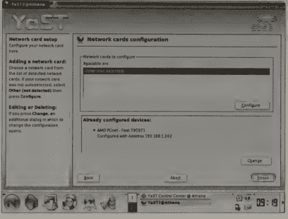

#### 图 2.16
YaST 网络配置窗口。

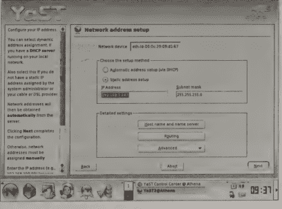

#### 图 2.17
YaST 默认网关配置屏幕。

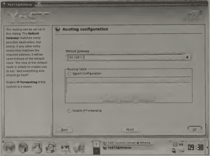

重新配置的最后一步是定义此机器可访问的域名服务。在某些配置中，允许服务器在互联网范围内解析名称是可以接受的。在大多数情况下，对名称解析进行严格控制可以帮助您快速识别不正确的配置、未识别的需求或更重要的是，可能表明服务器已被入侵的可疑流量。

通过将名称解析指向一个不为名称解析超出自身查找的单个 DNS 服务器，您可以更好地控制由此产生的会话。对于示例 Web 服务器，它通过防火墙外部请求发起的端口直接通过 IP 地址公开两个会话。DMZ 中的限制性 DNS 配置将防止任何意外的服务器生成会话解析主机并可能在外部泄露数据。您可以通过本地 hosts 文件并未指定 DNS 服务器来实现相同的效果。然而，当前方法允许 DMZ 内的保持一致性，并有一个单一位置用于更新。

您可以通过点击主机名按钮呈现的窗口进行适当的修改，从而将表 2.2 中确定的更改纳入其中。您可以在图 2.18 中看到配置窗口的示例。完成修改后，单击确定。

#### 图 2.18
主机名和名称服务器配置。

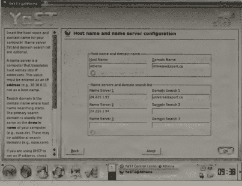

您可以通过在网络配置屏幕上选择下一步按钮，并在结果网络卡配置窗口上选择完成按钮，将组合更改应用到系统。

YaST 然后将更新应用到服务器中的适当文件。YaST 然后会自动重新启动您的网络服务以纳入更改。然后您应该能够测试从新网络访问服务器以及设计中包含的名称解析限制。

### 摘要

更新服务器可能是一项相当复杂的任务。然而，为了维护安全和稳健的环境，这是强制性的。本章涉及了许多更常见的配置任务。我们探讨了以下示例

- 导航 YaST 工具可用的两种界面
- 添加和删除软件模块
- 添加额外的存储资源
- 维护网络接口

## 第 2 章：更新服务器

SUSE LINUX 提供了 YaST 工具，可以利用它使服务器配置任务在整个企业中更容易且保持一致。YaST 实用程序以 X Windows System 和 ncurses 界面提供，允许在最精简的配置上使用此工具。在接下来的章节中，YaST 将是用于维护 SUSE 上各种服务的首选工具。

本章还探讨了向服务器添加额外存储容量的各种步骤。在此过程中，我们涵盖了从磁盘分区、文件系统、挂载点和权限等多个主题。在将数据从旧目录移动到新的挂载点时，我们本质上涵盖了备份数据以及保留目录结构和权限的方法。

本章介绍的最重要概念之一围绕服务器的网络连接。我们介绍了为服务器建立安全环境以防止在构建它们时被入侵的概念。我们触及了在维护系统时保持系统离线的 重要性。DMZ 的概念被引入为保护暴露于潜在敌对网络的环境的标准做法。


### 服务器的启动和关闭

本章探讨服务器在启动和关闭过程中所经历的各种状态。我们首先[content]
### 服务器的启动和关闭

本章探讨服务器在启动和关闭过程中所经历的各种状态。我们首先[content]
### 服务器的启动和关闭

本章探讨服务器在启动和关闭过程中所经历的各种状态。我们首先考察机器从通电到完全运行系统的路径，以及如何安全地关闭它。

我们还讨论了运行级别的概念以及它们如何用于控制服务器上可用的各种应用程序。然后我们探讨为便于系统恢复而需要进行的准备工作，以防服务器出现故障。

与其他事情一样，最好从开头开始：引导加载程序。

#### 引导加载程序

当向机器供电时，会触发一系列系统化的事件。通常，这被称为冷启动或简单地称为启动。当系统通电时，会启动一个称为上电自检（POST）的过程。此阶段验证系统内存在的硬件是否正常运行，并且系统内检测到的硬件的已保存配置与实际存在的情况相匹配。

在 POST 结束时，控制权会传递给基本输入输出系统（BIOS）。这是一组小型指令，用于加载服务器内存在的各种硬件的存储配置设置。这些设置包括日期、时间、硬盘驱动器几何结构以及各种设备的内存映射。

当此阶段成功完成时，BIOS 会加载并执行主引导记录（MBR）中发现的指令，该记录位于主引导设备上。MBR 相对较小，本质上是指向下一个要执行的例程位置的指针。

此时，SUSE LINUX 安装会将控制权传递给 MBR 中的一段软件，该软件允许加载系统内核。这类程序称为引导加载程序。

#### BIOS 启动设备

许多现代 BIOS 允许使用多种启动设备。在安装过程后，确保将 SUSE 服务器的启动卷识别为第一个启动设备非常重要。这可以防止驱动器软盘或 CD 在非计划重启事件中将服务器引导到未知状态。

第 1 章“安装概述”部分介绍了 SUSE Enterprise Server 默认安装中可用的两个不同的引导加载程序：LILO 和 Grub。这两个例程都允许将引导过程定位到特定的启动设备、内核和唯一的内核参数集合。

#### 密码和系统重启

密码可以在计算机内的多个级别应用。现代服务器大多允许在 BIOS 级别设置密码，以防止未经授权修改诸如启动设备序列之类的参数。如果您想防止具有物理访问权限的人从可移动介质引导替代操作系统，这非常好。缺点是您需要在灾难恢复密码文件中再跟踪一个密码（参见第 10 章“数据备份和灾难恢复”）。

SUSE LINUX 随附的两个引导加载程序都提供另一级密码保护。此级别会阻止在输入正确密码之前选择和执行引导过程。与 BIOS 密码结合使用时，此级别可提供对系统快速本地入侵的有吸引力的保护。

另一方面：此级别的密码保护无法阻止携带螺丝刀的本地攻击者重置 BIOS 并删除密码。如果实现这一点，从其他介质启动可能会导致磁盘子系统其余部分的密码绕过。此外，引导加载程序上的密码会使系统在非计划重启时无法重新启动。在凌晨 2 点，这可能是一个有吸引力的特性，也可能不是。

正如始终一样，物理安全是必须的。如果入侵者能够在较长时间内访问机器，那么密码安全在第一近似下就无关紧要了。

LILO 和 Grub 都是两阶段引导加载程序。第一阶段足够小，可以驻留在卷的主引导记录中。其唯一目的是正确加载第二阶段。虽然这两个引导加载程序的目标相同，但它们的功能存在显著差异。应使用 YaST 配置实用程序来配置两个引导加载程序的行为。

#### LILO

Linux Loader（LILO）比其对应产品 Grub 更静态的引导加载程序。LILO 应用程序会跟踪卷上内核的物理位置并将引用存储在文件中。在启动时，应用程序可以通过直接按引用加载内核来将控制权传递给内核。

LILO 在其配置文件中维护可能的引导目标列表。文件 `/etc/lilo.conf` 包含影响 LILO 行为的参数以及每个有效引导目标和内核选项的列表。

对于 SUSE 服务器，默认配置包括

- SUSE 内核以及充分利用检测到的硬件的适当参数
- 一个功能失效的 SUSE 内核，其中大多数高级功能（如 ACPI 和 SVGA）已关闭
- 用于选择用于启动机器的内核配置的 8 秒时钟

列表 3.1 显示了 SLES 安装中的 LILO 配置示例。在此示例中，标头信息显示了 8 秒（80 个十分之一秒）超时以及 Linux 的默认引导选项标签。您还可以看到在 Failsafe 选项中移除了 APM、ACPI 和其他设施。有关 lilo.conf 中可用选项的更多详细信息，请参阅 SLES 管理员手册以及以下网页：http://www.novell.com/documentation/oes/index.html?page=/documentation/oes/sles_admin/data/sec-lilo-overview.html。

#### 列表 3.1
示例 LILO 配置

```text
#### Modified by YaST2. Last modification on Thu Jan  6 11:40:50
#### 2005

message = /boot/message
timeout = 80
prompt

default = Linux
boot = /dev/sda

image = /boot/vmlinuz
    label = Linux
    initrd = /boot/initrd
    optional
    root = /dev/sda1
    append = "splash=silent resume=/dev/sda3
showopts elevator=cfq"

image = /boot/vmlinuz
    label = Failsafe
    initrd = /boot/initrd
    optional
    root = /dev/sda1
    vga = normal
    append = "showopts ide=nodma apm=off acpi=off noresume
selinux=0 barrier=0 resume=/off nopcmcia maxcpus=0"

image = /boot/memtest.bin
    label = Memory_Test
    optional
    append = ""
```

在启动时，引导加载程序依赖于设备上内核的物理位置。此位置由内核在磁盘上驻留的实际柱面、磁头和扇区（CHS）标识。当在 /etc/lilo.conf 文件中定义内核时，它不会立即通过 LILO 访问。要启用新内核，必须使用 -c 选项运行 LILO 例程。此选项将导致读取 lilo.conf 文件；已识别的内核将在设备上定位，并且其物理位置（CHS）将在 LILO 映射文件中更新。未能执行此额外步骤将导致新内核在启动时无法访问。

尽管将内核可访问性限制在启动时似乎是一个严重的限制，但它确实提供了所选内容是通过适当例程产生的保证。

#### Grub

Grand Unified Bootloader 更 commonly 称为 Grub。此引导加载程序程序比 LILO 动态得多。如列表 3.2 所示，两个引导加载程序配置文件中包含的格式和信息之间存在许多相似之处。

除了 LILO 可用的引导选项外，Grub 还增加了将引导重定向到软盘的能力。请记住，即使您在 BIOS 中删除了系统从软盘启动的能力，一旦从主引导设备加载，此引导加载程序仍会将软盘呈现为有效的替代引导设备。

#### 注

如果内核也存在于同一软盘上，则可以使用 LILO 从软盘引导系统。

LILO 需要一个映射文件来定位它希望从中引导的内核。由于内核位置不一定在软盘之间恒定，如果使用主硬盘上的引导加载程序，则存储在硬盘上的映射文件可能不会指向驱动器中插入错误软盘时的适当位置。

另一方面，GRUB 不需要映射文件。因此，将引导配置指向软盘上的已知良好内核是可能的。

尽管在技术上是可能的，但您可能会想知道这样做的有效性。从错误的内核启动系统可能会产生灾难性后果。仅在从最新的救援软盘启动的场景中才应认为这是可接受的。

#### 列表 3.2
Grub menu.lst

```text
#### Modified by YaST2. Last modification on Wed Jan 5 10:16:38 2005

color white/blue black/light-gray
default 0
timeout 8
gfxmenu (hd0,0)/boot/message

###Don't change this comment - YaST2 identifier: Original
#### name: Linux###
title Linux
    kernel (hd0,0)/boot/vmlinuz root=/dev/sda1 selinux=0
    -> splash=silent resume=/dev/sda2 elevator=cfq showopts
    initrd (hd0,0)/boot/initrd

###Don't change this comment - YaST2 identifier: Original
->name: floppy###
title Floppy
    root (fd0)
    chainloader +1
```


#### 列表 3.2

**Grub menu.lst（续）**

```
###Don't change this comment - YaST2 identifier: Original
  name: failsafe###
title Failsafe
    kernel (hd0,0)/boot/vmlinuz root=/dev/sda1 showopts
    ide=nodma acpi=off apm=off vga=normal noresume
    selinux=0 barrier=off nosmp noapic maxcpus=0 3
        initrd (hd0,0)/boot/initrd
```

Grub 与 LILO 不同之处在于，文件中的信息是在机器启动时动态解释的。这带来的好处是可以快速将新内核添加到系统中。Grub 的 menu.lst 文件可以用任何文本编辑器更新，而且与 LILO 不同，无需进一步步骤即可在启动时使该选项可用。有关 GRUB 的更多信息可在手册页或 GRUB 主页 http://www.gnu.org/software/grub/grub.html 找到。

通过 Grub 可用的额外功能是能够修改菜单条目。在图形 Grub 菜单出现时按下 Esc 会触发 Grub 提供 curses 版本的启动菜单。在此版本的菜单中，您可以编辑控制内核参数的单行。有关如何执行此操作的说明在启动选项屏幕底部提供，如图 3.1 所示。

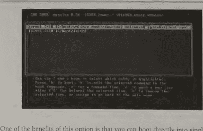

此选项的好处之一是您可以直接启动到单用户模式。如果机器因未知原因宕机，您可以通过动态编辑内核行并在行尾添加单词 single 来谨慎地将系统以单用户模式启动。在此点启动系统，您将拥有一个最小化启动的环境，在尝试启动整个系统之前可以在其中执行一些诊断。

当然，这种额外的灵活性也是一把双刃剑。具有系统访问权限的个人也可以在启动序列期间修改内核参数。应通过保护控制台来减轻这种风险。这可以通过配置 BIOS、GRUB 或两者在启动时要求密码来实现。这种方法必须在服务器的物理安全性和机器需要保持服务的要求之间取得平衡。如果在配置了这些选项的情况下发生断电或意外重启，服务器将无法启动，直到提供人工干预。

### 内核启动

启动过程中的下一阶段涉及加载 Linux 内核。启动加载器将内核以及 initrd 放置在内存中。随着内核开始执行，它会将 initrd 解压到运行时专门创建的部分内存中，使其充当物理磁盘驱动器。此新的“磁盘”随后被挂载为初始根分区。这是为了便于识别和加载内核访问实际系统 / 分区所需的模块。将所有厂商和架构磁盘设备驱动程序直接内置到内核中会使其变得不可接受地庞大且效率低下。使用 initrd 的这种初步预查步骤允许在启动时动态加载适当的模块。

当内核拥有适当的驱动程序时，initrd RAM 磁盘将被卸载，内存被收回，并且正确的 / 分区被挂载。在将控制权交给 init 例程之前，内核会执行一系列步骤来识别和加载它需要的额外模块。

要查看系统启动时内核生成的消息，您可以使用 dmesg 命令。这将列出服务器启动时数百行设备发现和状态信息。以下是对典型启动序列期间生成的内核消息的概要：

- 检查 BIOS 的内存配置
- 根据启动加载器参数打开 ACPI 和其他内核参数
- 启动 CPU 0 并查看其属性
- 将控制台初始化为 80x25 字符
- 检查各种总线以进行设备和 IRQ 分配
- 扫描 IRQ 上的设备（串口、软盘、音频等）

## 第 3 章：启动和关闭服务器

- 检测磁盘驱动器和网卡
- 为系统加载适当的模块
- 启动 init 进程

随着内核加载，它会为检测到的硬件动态加载适当的模块。对 dmesg 输出的仔细审查将识别出必须解决的任何严重错误。

内核完成加载所有适当模块后，然后将控制权交给 init 进程。在下一节中，我们将研究此新的启动过程如何加载 SLES 安装的剩余部分并使其准备就绪。

### init 与理解运行级别

在没有先了解其控制内容的情况下讨论 init 程序是困难的。init 进程由内核本身调用，并成为机器上所有其他进程的父进程。在启动时，/etc/inittab 文件由 init 解释并处理所有已识别的例程。系统的默认运行级别在 inittab 中维护。

您可以将 Linux 操作系统运行级别视为机器的“应用程序状态”。对于每个不同的状态，所选进程处于功能状态。表 3.1 显示了已知的运行级别列表及其对用户访问的影响。

**表 3.1**
**运行级别**

| 运行级别 | 脚本目录 | 定义 |
|---|---|---|
| 0 | rc0.d | 系统已停止 |
| S | rc1.d | 从启动提示符进入单用户模式 |
| 1 | rc1.d | 单用户模式 |
| 2 | rc2.d | 多用户模式但无网络可用 |
| 3 | rc3.d | 多用户模式，具备完整网络访问 |
| 4 | rc4.d | N/A，未使用的运行级别 |
| 5 | rc5.d | 多用户网络启用，包括 X Windows 系统 |
| 6 | rc6.d | 强制机器重启 |

您通过运行 init 例程后跟运行级别来在状态之间发起转换。每次转换反过来都会改变正在运行的进程。通过一系列脚本文件管理由运行级别更改触发的应用程序启动或关闭。目录 `/etc/init.d` 是多个目录的基础目录，每个目录代表一个不同的运行级别。在每个级别的目录中都有一组适当的脚本，用于特定运行级别所需的应用程序。

当系统进入特定状态时，它会通过执行对应目录中以字母 S（Start）开头的全部脚本文件来启动该状态的所有适当例程。

同样，当系统从源级别离开到另一个级别时，源目录中以字母 K（Kill）开头的脚本将被处理。这确保了仅应在特定级别运行的所有应用程序在系统进入下一个运行级别之前得到正确关闭。

唯一的例外是效率。如果在目标级别中存在特定应用程序的启动脚本，则源级别中的停止（Kill）脚本将被忽略。

例如，您可以检查 xdm 应用程序在运行级别 3 和运行级别 5 之间的状态更改。Xdm 是 X Windows 系统显示管理器。参考表 3.1，X 在运行级别 5 可用。列表 3.3 显示了 `/etc/init.d/rc5.d` 目录中与 xdm 关联的文件。

#### 列表 3.3

与运行级别 5 关联的 xdm 文件

```
Castor:/etc/init.d # ls -l rc5.d | grep -e xdm
lrwxrwxrwx 1 root root 6 Jan 5 04:53 K06xdm -> ../xdm
lrwxrwxrwx 1 root root 6 Jan 5 04:53 S16xdm -> ../xdm
Castor:/etc/init.d #
```

从列表 3.3 可以看出，随着系统进入或离开运行级别 5，xdm 既会被启动也会被停止。同样明显的是，启动和关闭脚本只是指向 `/etc/init.d` 中同一脚本的链接。这种链接最大限度地减少了脚本的重复，确保应用程序启动和关闭与目标运行级别无关的一致性。

因此，init 进程可以被定义为用于控制系统上哪些应用程序处于活动状态的工具。您可以通过查看所关注级别的子目录内容来识别运行级别内的活动应用程序。


### 系统关机

系统健康状况最重要的因素之一是确保其中包含的数据和配置免受损坏。因此，必须确保所有应用程序都已成功终止，并且它们各自的文件都已正确关闭。所有这些必须在系统卸载相关驱动器并关机之前完成。

大多数设备输入/输出在服务器上的处理方式相似。未正确关闭的文件将不包含预期的信息。这可能导致依赖于所述文件的应用程序功能异常。

在 Linux/Unix 系统上最常见的错误之一是在其被卸载（umount）之前手动弹出可移动介质。当这样做时，仍存储在设备驱动程序缓冲区中的数据无法写入设备。即使立即重新插入介质，也可能无法保持正确的机器状态，因此数据会丢失。更糟糕的是，在许多情况下，目录结构本身驻留在内存中。未将此结构正确写回设备可能会导致目录内容也受到损害。

如果系统被突然关闭，非可移动介质也会出现同样的现象。新的文件系统在防止此类损失方面已取得了长足进步。启动时的一致性检查也可以修复部分损坏。然而，最好的做法是始终执行有序关机。

可以使用两种方法正确关闭服务器。第一种方法是使用参数为零的 init 命令，如表 3.1 所示。尽管此方法会停止所有进程，但由于关机过程相当突然，因此应仅在极端情况下使用。

一种更优雅的方式来关闭系统是使用 shutdown 命令。此命令以更有序的方式关闭系统，向终端用户提供适当的关机通知，并预先警告其他正在运行的应用程序关闭打开的文件。一旦启动 shutdown，就不会再接受新的登录会话。shutdown 命令的简化格式为

```
shutdown [-h or -r] time [shutdown message]
```

在此示例中，-h 表示系统将在关机后停止，-r 表示您希望重新启动。命令中的 time 参数是必填字段，可以是关键字 now、以 hh:mm 格式指定的时间，或从现在开始的特定分钟数，以 + 格式表示。当在命令中指定延迟时，shutdown 会创建 /etc/nologin 文件。用户每次剩余运行时间减半时也会被提醒关机。例如，10 分钟的时间段会在交互式会话中以一分钟为间隔广播消息。如果在命令行上使用关键字 now，则除第一次警告外，不会发出其他警告。

最后一个参数是可选消息，将发送给所有当前已登录用户，告知他们关机。消息的内容由您自行决定。

列表 3.4 显示了 root 用户在控制台输入的注释以及所有已登录用户收到的通知。

```
LISTING 3.4
Comment Entered at the Console

Athena:/etc # shutdown -h +10 “Memory upgrade. Please log off”

Broadcast message from root (pts/1) (Mon Mar 21 10:38:58 2005):

Memory upgrade. Please log off
The system is going DOWN for system halt in 10 minutes!
```

正确关闭系统对于在重新启动时最大限度地减少困难是必要的。使用 init 0 关闭系统不会给其他正在运行的进程足够的时间来应用任何待处理的更改并正确关闭其文件。这可能导致文件损坏和数据丢失。首选方法是使用 shutdown 命令。

按键序列的解释取决于对服务器的物理访问以及正在运行的 Linux 版本。在 SUSE LINUX 中，可以使用 YaST 配置对 Ctrl+Alt+Del 序列的响应。这应被禁用，因为在几乎所有情况下，通过软件而不是硬件控制关机是首选。

### 紧急启动和恢复

协调一次适当的干净启动序列的事件众多。对服务器进行适当的日常维护可以防止许多潜在的陷阱。墨菲定律指出，如果有什么事情可能出错，它就会在最不恰当的时间发生，这肯定适用于计算环境。在此之前，您应该有一个计划。

备份和灾难恢复将在第 10 章中深入介绍。在恢复发生之前，您需要一个可启动的系统并访问设备。在大多数情况下，您需要在担心可能的恢复之前先访问系统以调查停机原因。

最简单的情况通常是自找的。例如，Grub 配置文件中输入了错误的内核名称（参见图 3.2）。由于您可以在启动时编辑此信息，因此可以更正信息、启动系统并编辑适当的文件以确保更正永久生效。尽管 GRUB 越来越受欢迎，但 LILO 不会受到这种类型的配置错误的影响。对于 LILO，必须可以访问内核文件才能将其添加到映射文件中。这消除了在启动时呈现无效内核的可能性。

#### 图 3.2
GRUB 配置文件中内核名称拼写错误。

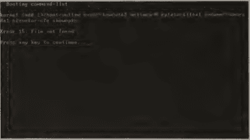

在更困难的情况下，发生了某些事情阻碍了正常的启动过程，服务器无法调用正常的启动加载器。更常见的是，启动过程未能成功完成。在这些情况下，需要一个单独的启动环境。YaST 配置工具可用于创建救援软盘、非标准驱动程序的模块软盘以及一套标准的 SUSE 启动软盘。

强烈建议一旦系统配置正确，就创建救援软盘。服务器的恢复过程将取决于它。每次对系统配置进行重大更改时，都应创建新的救援软盘。如果新配置证明有问题，最好保留原始版本。

同样，如果您的配置需要专用驱动程序或额外的模块才能正常运行，您也需要制作它们的软盘版本。

#### 注意

由于如果启动软盘出现故障，您可以直接从 DVD 或第一个安装 CD 启动系统，因此您仍然能够访问驱动器。

在这种情况下，您已绕过了正常的启动例程。诸如 TCP/IP 地址和启动时要启动的服务之类的配置设置将被忽略。

拥有另一套救援软盘将使您能够正确启动系统。

在灾难发生时，从发行版 DVD/CD 或 YaST 启动软盘启动应该是可能的。在启动过程中，会提示您选择要执行的安装类型。所提供的一个选项是救援系统。一旦启动，救援系统会提示输入救援磁盘以及所需的额外模块磁盘。

完成此阶段后，应可访问服务器的磁盘子系统。现在可以开始调查故障原因。在最简单的情况下，您可以进入适当的配置文件并修复错误。然而，在大多数情况下，事情往往没有那么简单。

静态稳定系统的启动失败是由硬件故障引起的。探讨系统停机的各种原因超出了本章的范围，甚至可能超出了本书的范围。第 10 章将更详细地探讨恢复过程。

### 摘要

在本章中，我们研究了启动 SLES 服务器所涉及的进程。主要步骤是 POST、BIOS、initrd、启动加载器、内核加载和 init 进程。对每个进程作用的正确理解将有助于在发生故障时进行诊断阶段。

当需要系统关机时，必须确保关机以受控方式执行，以避免文件损坏和数据丢失。停止系统有几种选择。首选方法是使用 shutdown 命令。此实用程序可为系统用户提供适当的关机通知。

我们还介绍了在启动过程中出现问题时提供对系统替代访问所需的步骤。第 10 章将讨论更多恢复技术。


## 第二部分

### 用户访问与安全管理

- 4. 用户和组管理
- 5. 用户环境管理与安全
- 6. 文件系统安全
- 7. 系统管理与监控

### 用户和组管理

作为多用户系统的系统管理员，您负责的任务之一就是管理并控制用户对系统资源的访问。由于 SLES 是一个多用户系统，本章将帮助您了解用户和组是如何标识的，如何使用这些信息来确定对数据和应用程序的访问权限，以及如何有效地管理用户和组信息。本章涵盖以下主题：

- 用户和组 ID
- 系统用户与普通用户
- `/etc/passwd`、`/etc/shadow` 和 `/etc/group` 文件
- 使用 YaST 和命令行工具创建和更新用户和组信息的方法
- 用户账户安全注意事项

#### 用户和组 ID

在 SLES 中，每个用户和组都被分配一个唯一的数值，因为操作系统处理数字比处理文本字符串更容易。与用户关联的数字称为用户 ID（UID），与组分配的数字称为组 ID（GID）。默认情况下，SUSE LINUX（所有版本）为普通（非系统）用户分配的 UID 从 1000 开始，GID 分配从 100 开始。

Linux 标准将 UID 范围 0 到 99 保留给系统本身，并将范围 100 到 499 保留给特殊系统用户（如服务和应用程序）。为了留出未来扩展的空间，SUSE LINUX 因此将普通用户 ID 值从 1000 开始（并结束于 60000；默认情况下，最大上限为 65535）。表 4.1 显示了 SLES 创建的系统用户、其 UID 和其主 GID。

> **注意**
>
> 每个 Linux（和 Unix）系统都有一个特殊的特权用户称为 **root**。root 用户始终具有 UID 为 0（零）。Linux 中没有特殊的或保留的组名。

> **警告**
>
> 因为操作系统通过 UID 识别用户，所以具有相同 UID 的不同用户名被视为同一用户。因此，您可以通过为这些用户分配 UID 0 来设置额外的 root 用户。同理，如果您（或恶意者）将某个用户的 UID 改为 0，您就授予了该人对系统的无限权限。作为预防措施，您应定期审计 `/etc/passwd`（如果您使用它们进行身份验证，则包括您的 LDAP/NIS 数据库），以确保只有 root 和指定用户具有 UID 和 GID 设置为 0。第 13 章“系统安全”中提到的 Bastille 可用于自动检测未经授权的重复 root 账户。
>
> 如果您需要设置多个管理员，最好将这些用户分配到一个特殊的组（如 root 组），该组已被授予必要的权限，或者最好使用 sudo（在第 5 章“用户环境管理与安全”中讨论）。

**表 4.1**
SLES 默认系统用户设置

| 用户名 | UID | 主 GID | 描述 |
|---|---|---:|---:|
| root | 0 | 0 | The root (super) user |
| bin | 1 | 1 | Used by system services, such as lpd |
| daemon | 2 | 2 | Background service |
| lp | 4 | 7 | Printing daemon |
| mail | 8 | 12 | Mailer daemon |
| news | 9 | 13 | News system |
| uucp | 10 | 14 | Unix-to-Unix CoPy system |

**表 4.1**
SLES 默认系统用户设置（续）

| 用户名 | UID | 主 GID | 描述 |
|---|---|---:|---:|
| games | 12 | 100 | Games account |
| man | 13 | 62 | Manual pages viewer |
| at | 25 | 25 | Batch jobs daemon |
| postgres | 26 | 26 | PostgreSQL Server |
| mdom | 28 | 28 | Mailing list agent (Majordomo) |
| wwwrun | 30 | 8 | WWW daemon apache |
| squid | 31 | 65534 | WWW-proxy squid |
| amanda | 37 | 6 | AMANDA (backup utility) admin |
| irc | 39 | 65534 | IRC (Internet Relay Chat) daemon |
| ftp | 40 | 49 | FTP account<br>FTP server daemon |
| named | 44 | 44 | Name server (DNS) daemon |
| gdm | 50 | 15 | Gnome Display Manager daemon |
| postfix | 51 | 51 | Postfix daemon |
| mysql | 60 | 2 | MySQL database admin |
| vscan | 65 | 102 | Vscan account used by samba-vscan |
| pop | 67 | 100 | POP admin |
| sshd | 71 | 65 | SSH daemon |
| Mailman | 72 | 67 | GNU mailing list manager |
| Snort | 73 | 68 | Snort network monitor |
| Ntp | 74 | 65534 | NTP (Network Time Protocol) daemon |
| ldap | 76 | 70 | User for OpenLDAP |
| Hacluster | 90 | 90 | High-Availability cluster heartbeat processes |
| Cyrus | 96 | 12 | User for cyrus-imapd |
| Stunnel | 100 | 65534 | Daemon user for stunnel (universal SSL tunnel) |
| quagga | 101 | 101 | Quagga routing daemon |
| dhcpd | 102 | 65534 | DHCP server daemon |
| radiusd | 103 | 103 | Radius daemon |
| nobody | 65534 | 65533 | Special user for assigning NFS permissions |

当您登录 Linux 时，您的活动或当前 GID 设置为用户数据库（如 `/etc/passwd`）中指定的主（或默认）GID，即使您可能是多个组的成员。操作系统根据当前 GID 计算用户对文件的访问权限。您可以使用 `newgrp` 命令将活动 GID 更改为新的 GID，如下所示：

```bash
newgrp groupname
```

> **注意**
>
> 尽管通常用于将您的 UID 切换为 root 用户，`su` 命令可用于将您的活动 UID 切换为另一个用户（`su username`）。如果您当前是 root，则不需要密码；否则，您需要提供该用户的密码。

如果未给出 `groupname`，则 GID 将切换回主 GID。成功切换到新组后——您必须是该组的成员，或是 root 才能这样做——从那时起您的所有操作都将具有该新组的权限。例如，如果您创建新的文件或目录，则新文件或目录的组将为“groupname”。

执行 `newgrp` 命令后，您仍保持登录状态，当前目录不变，并创建一个新的 shell。某些 `newgrp` 实现在命令以错误终止时（例如指定了未知组时）始终会用新 shell 替换当前 shell。请考虑可能产生的混淆：您是否在新 shell 中并需要使用 `exit` 命令返回到原始 shell，还是仍在原始 shell 中，而 `exit` 命令会终止当前会话？SUSE 的实现通过在命令失败时不创建新 shell 来避免此问题。

要返回到之前的 GID 和 shell，请使用 `exit` 命令而不是 `newgrp`；否则，您将启动另一个 shell。以下说明了 `newgrp` 命令的效果：

```text
Athena:/home/admin # #display my UID, GID, and groups I belong to
Athena:/home/admin # id
uid=0(root) gid=0(root) groups=0(root),64(pkcs11)
Athena:/home/admin # #show my currently running processes
Athena:/home/admin # ps
    PID TTY          TIME CMD
   7853 pts/1    00:00:00 bash
   7875 pts/1    00:00:00 ps
Athena:/home/admin # change group to wheel
Athena:/home/admin # newgrp wheel
Athena:/home/admin # check my current settings:
Athena:/home/admin # #wheel is now my current GID
Athena:/home/admin # id
uid=0(root) gid=10(wheel) groups=0(root),10(wheel),64(pkcs11)
Athena:/home/admin # #and I have one extra bash shell running!
Athena:/home/admin # ps
    PID TTY          TIME CMD
   7853 pts/1    00:00:00 bash
   7877 pts/1    00:00:00 bash
   7885 pts/1    00:00:00 ps
Athena:/home/admin # #return to previous setting
Athena:/home/admin # exit
exit
Athena:/home/admin # #and the extra bash shell is gone too
Athena:/home/admin # id
uid=0(root) gid=0(root) groups=0(root),64(pkcs11)
Athena:/home/admin # ps
    PID TTY          TIME CMD
   7853 pts/1    00:00:00 bash
   7886 pts/1    00:00:00 ps
```

当您返回到原始 shell 时，其先前的环境（如 shell 变量和工作目录）得以保留；您将返回到在启动新 shell 之前所处的确切状态。

> **注意**
>
> 如果组有密码并且用户未在 /etc/group 文件中列为该组的成员，则会提示用户输入密码。创建组密码的唯一方法是使用 passwd 实用程序，然后将密码从 /etc/shadow 剪切并粘贴到 /etc/group。组密码已过时且不常使用，但它们为未列为成员的用户提供了承担该组身份的手段。

Linux 将 GID 范围 0 到 10 保留给系统组。与 UID 类似，默认情况下，用户创建的组从 GID 1000 开始，GID 值最高可达 60000。表 4.2 显示了 SLES 创建的系统组及其 GID。


#### 表 4.2
SLES 默认系统组及其 GID

| 组名 | GID | 注释 |
|---|---|---:|
| Root | 0 | 这是被授予系统特殊权限的特权用户集合。默认情况下，root 是此组的唯一成员。在某些 Linux 发行版中，改用 wheel 组。 |
| Bin | 1 | 该组因历史原因而存在，某些程序（如 shutdown）没有它就无法运行。SUSE Linux 不使用此组。 |
| Daemon | 2 | 该组由各种服务和应用程序使用，例如 MySQL，这些服务和应用程序不以 root 权限运行。 |
| Sys | 3 | 该组因历史原因而存在，某些程序没有它就无法运行。 |
| Tty | 5 | 名称以 `/dev/tty` 开头的终端设备对 tty 组可访问。write 和 wall 等程序需要访问 `/dev/tty*`，它们将自己的组 ID（sgid）设置为 tty。 |
| Disk | 6 | 磁盘设备节点对 disk 组可访问。需要访问它们的程序将其 GID 设置为 disk。 |
| Lp | 7 | 与 lp（打印机）守护进程（lpd）关联的作业对 lp 组可访问，以便 lpd 在无需 root 身份的情况下访问它们。 |
| www | 8 | 该组通常用于分配包含 HTML 文档的文件夹的权限。 |
| Kmem | 9 | 该组主要由需要访问 `/proc/kmem`（内核内存）的程序使用。 |
| Wheel | 10 | 某些 Linux 发行版对具有系统权限的用户使用 wheel 组代替 root 组。 |
| Mail | 12 | 邮件 spool 目录对 mail 组可访问。需要访问它们的程序将其 GID 设置为 mail。 |
| News | 13 | Usenet 新闻 spool 目录对 news 组可访问。需要访问它们的程序将其 GID 设置为 news。 |
| Uucp | 14 | 组成员可以启动 uucp 作业。 |
| Shadow | 15 | 组成员对 shadow 密码文件 `/etc/shadow` 具有权限。 |
| Dialout | 16 | 组成员允许使用 ppp 或 ISDN 设备节点发起拨出连接。 |

#### 表 4.2
SLES 默认系统组及其 GID（续）

| 组名 | GID | 注释 |
|---|---|---:|
| Audio | 17 | 该组成员对声卡/设备具有权限。 |
| Floppy | 19 | 该组成员可以使用软盘驱动器（通常为 /dev/fd0，即第一个驱动器）。 |
| Cdrom | 20 | 该组可以使用 CD-ROM 驱动器。 |
| Console | 21 |  |
| Utmp | 22 | 该组成员可以访问用户登录和注销记录。 |
| At | 25 | 该组由系统任务调度程序使用。 |
| Postgres | 26 | 该组由 PostgreSQL 数据库守护进程使用。 |
| Mdom | 28 | 该组由 Majordomo 邮件列表守护进程使用。 |
| Public | 32 | 该组由 ProFTP 守护进程使用，用于在客户端以匿名身份登录时控制文件访问。 |
| Video | 33 | 该组成员对显卡/设备具有权限。 |
| Games | 40 | 该组由在 /var/lib/games 中存储用户无关的高分值的游戏使用。 |
| Xok | 41 | 该组成员可以运行 X Windows System 应用程序。 |
| Trusted | 42 | 该组成员可以执行 ncpfs 二进制文件。 |
| Modem | 43 | 该组可以使用调制解调器设备。 |
| Named | 44 | 该组由 DNS 守护进程使用。 |
| ftp | 49 | 该组由 FTP 守护进程使用。 |
| Postfix | 51 | 该组由 Postfix 邮件守护进程使用。 |
| Maildrop | 59 | 该组由 Maildrop 邮件守护进程使用。 |
| man | 62 | 该组由手册页设施使用。 |
| pkcs11 | 64 | 该组成员可以管理安全证书。root 用户是该组的默认成员。 |
| Sshd | 65 | 该组由 SSH 守护进程使用。 |
| Mailman | 67 | 该组由 GNU 邮件列表守护进程使用。 |
| Snort | 68 | 该组由 Snort 网络监控器使用。 |
| Ldap | 70 | 该组由 OpenLDAP 守护进程使用。 |
| Ntadmin | 71 | 该组由 Samba 守护进程使用。 |
| Haclient | 90 | 该组由高可用性集群守护进程使用。 |

#### 表 4.2
SLES 默认系统组及其 GID（续）

| 组名 | GID | 注释 |
|---|---|---:|
| Users | 100 | 这是所有用户被添加到其中的默认组（除非你在 `/etc/default/useradd` 中更改设置）。该组成员在系统管理员定义的范围内拥有基本权限。你将所有用户应有权访问的文件放在此组中。 |
| Quagga | 101 | 该组由 Quagga 路由守护进程使用。 |
| Vscan | 102 | 该组由 vscan 守护进程使用。 |
| Radiusd | 103 | 该组由 radius 守护进程使用。 |
| Nobody | 65533 | 该组由 NFS 使用。 |
| Nogroup | 65534 | 该组由 NFS 使用。 |

#### 用户和组数据文件

Linux 在 `/etc` 目录中的文本文件中存储本地用户和组信息。传统上，用户信息（包括密码）存储在 `/etc/passwd` 文件中，组信息在 `/etc/group` 文件中可以找到。然而，`/etc/passwd` 文件包含信息（如注释字段，通常包含用户的全名和用户的 UID），这些信息必须对任何人可读。同时，你不希望密码对全世界可读，因为这种能力会给想要破解的人提供一个很好的起点（例如，使用“本章后面讨论的‘Be a Cracker Jack’部分中讨论的密码破解工具）。因此，在 Linux 的较新实现（如 SLES）中，密码保存在 shadow 文件（`/etc/shadow`）中，该文件只能由 root 读取，并且每个人的密码都以“x”形式输入到 `/etc/passwd` 文件中。

#### 警告

你应该**不要直接编辑**任何 `/etc/passwd`、`/etc/group` 和 `/etc/shadow` 文件——尤其是 `/etc/shadow`。这些文件中的任何错误都可能导致受影响的用户，包括 root，无法再登录。相反，你应该使用提供的系统工具，例如 YaST 和本章后面讨论的 user* 实用程序（如 useradd）。

#### 注意

本节讨论的三个文件仅用于本地系统的用户和组。如果你使用 LDAP 或 NIS 身份验证方法，则在这些协议下创建的用户和组不会存储在这三个 /etc 文件中，而是存储在 LDAP 或 NIS 数据库中。

接下来，我们检查这三个数据文件中的每一个的记录结构。

#### /etc/passwd 文件

`/etc/passwd` 文件中的每一行对应一个人的条目，每行上的字段由冒号分隔。以下是一个示例记录：

```
eric:x:1000:100:Eric the Webmaster, Room 215a, 555-1212, N/A,
➥other info:/home/eric:/bin/bash
```

字段从左到右分别是登录名、哈希密码、用户 ID、主组 ID、注释字段（正式称为 GCOS 字段）、主目录和默认登录 shell。密码字段中出现“x”表示使用 shadow 密码文件；某些实现改用星号 (*)。

##### GCOS 字段是什么？

GCOS 字段没有定义的语法，通常用于有关用户的个人信息，例如全名、电话号码、房间号码等。经常，finger 实用程序使用存储在此字段中的信息。

以逗号分隔，finger 按如下方式解释 GCOS 字段中的信息：用户的全名、办公地点、办公电话号码、家庭电话号码。任何附加字段都被视为“其他信息”，此其他字段不会由 finger 显示。以下是用户 eric 的 finger 示例输出：

```
Athena:/home/adm # finger eric
Login: eric                         Name: Eric the Webmaster
Directory: /home/eric                Shell: /bin/bash
Office: Room 215a, 555-1212          Home Phone: N/A
Last login Mon Sep 20 23:10 (EDT) on :0
No Mail.
No Plan.
```

缩写 GCOS 来自 GECOS，即 General Electric Comprehensive Operating System，一种大型机操作系统。后来被更改为

通用综合操作系统（GCOS）在通用电气的大型系统部门出售给霍尼韦尔时；该名称主要与在 /etc/passwd 文件的注释字段中存储用于从 Unix 向 GCOS 机器提交打印作业或批处理作业的标识数据相关联。

作为安全措施，一些站点会在 GCOS 字段中填入用户的全名和电话号码，但会禁用 finger 守护进程（请参阅第 8 章“网络服务”，了解如何启用/禁用各种服务）。或者，在边界防火墙上阻止 TCP/UDP 端口 79，这样 GCOS 信息仅在内部可用，而外部查询无法获取。在大多数情况下，GCOS 字段中只列出用户的真实姓名。

#### 警告

为了与旧应用程序和 Linux/Unix 实现向后兼容，登录名应为八个或更少字符，即使 Linux 可以处理更长的名称。

/etc/passwd 文件可以包含以加号 (+) 开头的行（通常是文件中的最后一行），这意味着要合并来自网络信息服务（NIS）的条目。+ 条目有两种样式。单个 + 表示在此处插入整个 NIS passwd 文件的内容。

```
+:::::::
```

形如 +name 的行表示在此处插入该用户名的 NIS 条目（如果有）。如果 + 条目具有非空字段（例如默认 shell），则该字段中的数据会覆盖 NIS 中的内容。在以下示例中，用户 teds 的 UID、主 GID、GCOS 数据和主目录信息将来自 NIS，但他将被分配默认 shell 为 /bin/csh，而不考虑 NIS 中的设置：

```
+teds::::/bin/csh
```

#### 注意

+ 条目中的所有字段都可被覆盖，除了用户 ID。

/etc/passwd 文件也可以包含以减号 (-) 开头的行。这些条目用于禁止用户条目。- 条目只有一种样式；由 -name 组成的条目表示禁止后续的（如果有）name 条目。这些条目将禁止指定的用户登录到机器。例如，

```
-jacques:::::
```

不允许用户 jacques 登录到本地系统。

您还可以使用 +@netgroup 或 -@netgroup 来为 (NIS) 网络组 netgroup 的所有成员指定 /etc/passwd 中的条目。

#### 警告

/etc/passwd 文件中不得包含任何空行。空行可能导致使用该文件系统管理软件出现不可预测的行为。

有关 /etc/passwd 文件的更多信息，请使用 man 5 passwd 命令。

#### /etc/shadow 文件

类似于 /etc/passwd 文件，/etc/shadow 文件中的每一行都是一个人的条目，字段之间用冒号分隔。以下是示例记录：

```
eric:$1$wlbsw/N$4SUwLu2bRET6yYsB.CAep7R.:12794:0:90:5:30:12989:
```

该记录有以下九个字段：

- 登录名。
- 哈希密码。默认情况下，密码使用基于数据加密标准（DES）算法的 crypt 函数进行哈希处理。（有关 crypt 函数的更多信息，请使用 `man 3 crypt` 命令。）生成的 DES 哈希密码始终为 13 个字符。您可以更改加密方法以使用 MD5（消息摘要第 5 号）或 Blowfish；有关更多详细信息，请参阅第 11 章“网络安全概念”。
- 密码上次更改的日期。这以自纪元（1970 年 1 月 1 日）以来的天数给出。
- 密码必须存在的最少天数，然后才能更改。
- 密码的使用寿命。这是密码可保持不变的最大天数。如果此时间过去且用户未更改密码，则系统管理员必须为其更改。
- 密码过期前用户开始收到更改密码通知的天数。值为 -1 表示不会发出警告。
- 密码过期后账户被禁用且用户无法再登录的天数。值为 -1 表示即使密码已过期也允许访问。
- 账户被禁用的日期。这以自纪元以来的天数给出。此信息对于设置临时账户很有用。
- 一个保留标志字段，目前未使用。

## 第 4 章：用户和组管理

#### SUSE 密码：加密还是哈希？

加密是一种使用数学算法和密钥将数据混淆成乱码的方法。如果您知道密钥和使用的算法，则可以解密乱码以恢复原始信息。SUSE（事实上所有 Linux 和 Unix 发行版）通过一种称为密码学哈希的数学算法将（明文）密码转换为乱码字符串。 resulting string 与原始字符串形式非常不同，称为哈希或哈希值。这些哈希算法的工作方式是无法从哈希值恢复原始密码。由于 Linux/Unix 密码无法转换回原始文本，因此“加密的 Linux/Unix 密码”这一术语是不准确的。更正确的术语是哈希密码，本书中始终使用此术语。

上一个示例记录显示了用户 eric 的以下信息：

- 密码上次更改于 2005 年 1 月 11 日。
- 更改密码前不需要最少的时间。
- 密码必须每 90 天更改一次。
- 用户将在密码必须更改前 5 天收到警告。
- 如果未进行登录尝试，账户将在密码过期后 30 天被禁用。
- 账户将在 2005 年 7 月 25 日过期。

#### 提示

您可以使用 `chage -l username` 来检查用户的密码老化信息。eric 的输出如下所示：

```
Athena:/home/admin # chage -l eric
Minimum: 0
Maximum: 90
Warning: 5
Inactive: 30
Last Change:        Jan 11, 2005
Password Expires:   Apr 11, 2005
Password Inactive:  May 11, 2005
Account Expires:    Jul 25, 2005
```

出于安全原因，非 root 用户将被提示输入用户名密码，即使用户查询的是自己的密码老化数据。

#### 注意

您还可以使用 `passwd -S username` 显示用户的密码状态，或使用 `passwd -Sa` 显示所有用户的状态。用户 eric 的输出类似如下：

```
eric PS 01/11/2005 0 90 5 30
```

状态直接跟在用户名之后：PS 表示存在或已锁定的密码，NP 表示无密码，LK 表示账户已锁定。如您所见，该输出不如 `chage -l` 那样详细。此外，`passwd -S` 仅适用于本地用户；对于其他类型的用户（如 LDAP），它会返回 LK 状态，而不管实际状态如何。其余字段分别显示密码上次更改日期、最小密码天数、最大密码天数、发出警告前的天数以及密码过期后账户将被禁用的天数。

#### `/etc/group` 文件

`/etc/group` 文件包含有效组名及其成员的用户名。该文件归 root 所有且只有 root 可以修改它，但它是世界可读的。当新用户添加到 `/etc/passwd` 时，关于该用户所属组的信息必须在此处添加。`/etc/passwd` 文件中的组 ID（GID）映射到此文件中保存的组名。类似于 `/etc/passwd` 文件中的用户，组按行列出。例如，

```
audio:x:12:eric,tasha,carol
```

每个条目由冒号分隔的四个字段组成：

- **组名**—组的名称，由各种实用程序用于标识组。
- **组密码**—如果设置，则允许非组成员通过使用 newgroup 命令并输入此处存储的密码加入组。如果该字段中为小写“x”，则使用 shadow 组密码（存储在 `/etc/gshadow` 中）。然而，尽管 SUSE LINUX 的早期版本使用 `/etc/gshadow`，但 SLES 9 及更高版本不使用，任何组密码哈希都存储在 `/etc/group` 中。
- **组 ID（GID）**—组名的数值等价物。系统和应用程序在确定访问权限时使用它。
- **成员列表**—组中用户的以逗号分隔的列表。

#### 注意

一些 Linux 发行版使用 `/etc/groups` 来保存允许用户加入组的密码。SUSE 不使用此文件。

前面的 `/etc/group` 示例条目显示 audio 组使用 shadow 密码；GID 为 17；并且 eric、tasha 和 carol 是组成员。

#### 警告

`/etc/group` 中的组成员应由单个逗号分隔且没有空格。否则，空格之后列出的任何用户都不会被识别为成员。

类似于 `/etc/passwd`，`/etc/group` 文件可以包含以加号 (+) 开头的行（通常是文件中的最后一行），这意味着要合并来自 NIS 的组条目。单个 + 的行表示在此处插入 NIS 组文件的全部内容：

```
++:
```

+name 的行表示在此处插入来自 NIS 的 name 的组条目（如果有）。如果 + 条目具有非空字段（例如组成员身份），则该字段中的数据会覆盖 NIS 中的内容。


> **注意**
>
> `+` 条目中的所有字段都可被覆盖，除了用户 ID。
>
> `-name` 形式的条目表示该组被禁止。无论是在 NIS 组文件还是本地 `/etc/group` 文件中，该组名的所有后续条目都会被忽略。

> **警告**
>
> 与 `/etc/passwd` 一样，`/etc/group` 文件中不得包含任何空行。空行可能导致使用该文件系统管理软件出现不可预测的行为。
>
> 有关 `/etc/group` 的更多信息，请使用 `man 5 group` 命令。

### 用户账户和组管理应用程序

在 SUSE 系统上管理用户账户和组时，您可以使用两种基本类型的应用程序：

- 图形化系统助手应用程序 YaST
- 一套命令行工具

> **注意**
>
> 有关 YaST 的更多信息，请参阅第 2 章“更新服务器”。

YaST 和命令行实用程序执行本质上相同的任务，但命令行工具具有可脚本化的优势，因此更易于自动化。另一方面，YaST 提供了一个类似向导的图形界面，引导您完成必要的步骤。

表 4.3 描述了一些用于创建和管理用户的常见命令行工具。

**表 4.3**
**用户管理命令行工具**

| 应用程序 | 功能 |
|---|---|
| `/usr/sbin/useradd` | 使用来自 `/etc/default/useradd` 的默认值创建用户账户。此工具还用于指定用户的主组和次组隶属关系。 |
| `/usr/sbin/userdel` | 删除用户账户。 |
| `/usr/sbin/usermod` | 更新账户属性，包括与密码老化相关的一些功能，以及主组和次组隶属关系。如需更精细的控制，请使用 `passwd` 命令。`usermod` 可借助 `-D` 和 `-L` LDAP 选项对 LDAP 用户进行更改。 |
| `/usr/bin/passwd` | 设置密码。尽管主要用于更改用户密码，但它还控制密码老化的所有方面。它确实是“瑞士军刀”式的密码实用程序。 |
| `/usr/sbin/chpasswd` | 通过读取包含用户名和密码对的文件批量更改用户密码。 |
| `/usr/bin/chage` | 更改用户的密码老化策略。`passwd` 实用程序也可用于此目的。 |
| `/usr/bin/chfn` | 更改用户的 GECOS 信息。也可改用 `passwd -f`。 |
| `/usr/bin/chsh` | 更改用户的默认 shell。也可改用 `passwd -s`。 |
| `/usr/sbin/pwck` | 检查 `/etc/passwd` 和 `/etc/shadow` 文件的完整性。 |

表 4.4 列出了一些用于创建和管理组的常见命令行工具。

**表 4.4**
**组管理命令行工具**

| 应用程序 | 功能 |
|---|---|
| `/usr/sbin/groupadd` | 创建新组，但不将用户分配到这些组。然后应使用 `useradd` 和 `usermod` 程序将用户分配到指定组或从中移除。 |
| `/usr/sbin/groupdel` | 删除组。 |
| `/usr/sbin/groupmod` | 修改组名或 GID，但不更改组成员身份。应使用 useradd 和 usermod 程序分配用户并将其从指定组中移除。 |
| `/usr/bin/gpasswd` | 更改组密码（存储在 `/etc/group` 中），以允许知道组密码的非组成员加入该组。只有 root 可以更改组密码。（您也可以使用 `gpasswd -g` 来更改组密码。） |
| `/usr/sbin/grpck` | 检查 `/etc/group` 文件的完整性。（在较旧的 SUSE Linux 版本中，例如 SLES 8，grpck 还会检查 `/etc/gshadow` 文件；SLES 9 及更高版本不再使用组 shadow 文件。） |

要了解有关表 4.4 中实用程序的更多信息，请参阅每个的 man 手册页（例如，`man grpck`）。

> **注意**
>
> 表 4.3 和表 4.4 中列出的应用程序并不决定这些用户和组可以控制哪些资源。为此，您必须使用处理文件权限的应用程序，其中一些在第 6 章“文件系统安全”中进行了讨论。

### 创建和编辑用户账户

当您需要创建或修改单个用户账户或少量账户（例如少于五个）时，由于其 GUI 界面，使用 YaST 通常更方便。否则，您可能需要考虑使用本节后面讨论的命令行工具为此任务创建一些 shell 脚本。

> **提示**
>
> Internet 上有许多用户创建脚本。用于创建新用户（使用 useradd 命令）的示例骨架 bash 脚本可在 http://www.osix.net/modules/article/?id=577 找到。

使用以下步骤使用 YaST 创建新的用户账户：

1. 使用以下方法之一启动 YaST：
   - 从 KDE 桌面，单击 YaST 图标。如有提示，输入 root 密码。
   - 从 KDE 桌面，选择 应用程序、系统、YaST。如有提示，输入 root 密码。
   - 从终端窗口，首先运行 `sux` 成为 root（如果尚未是 root），然后运行 `yast2`（GUI 版本）。
   - 从终端窗口，首先运行 `su` 成为 root（如果尚未是 root），然后运行 `yast`（ncurses 版本）。

2. 从 YaST 控制中心，选择 安全和用户、编辑和创建用户 以启动用户和组管理模块。（如果配置了 NIS、LDAP、Samba 或 Kerberos 身份验证，您将被提示输入额外的密码。）

> **提示**
>
> 您可以使用参数 `users` 运行 `yast` 和 `yast2`（例如，`yast users`），这样 YaST 会自动启动用户和组管理模块，而不是显示控制中心菜单。

3. 从用户和组管理屏幕（见图 4.1），选择 设置筛选器 并选择您要管理的用户账户类型（例如本地用户、系统用户或 LDAP 用户）。将显示所选类型当前用户的列表。您可能只会在 设置筛选器 下拉列表下看到本地用户和系统用户作为选项。其他选项（例如 LDAP 用户）只有在您配置并启动服务器上的服务后才会可用。

> **提示**
>
> 您可以通过编辑 设置筛选器、自定义筛选器、自定义视图 中的选择，将多个用户类型（例如本地用户和 LDAP 用户）组合显示在自定义筛选器下。

4. 选择 添加 选项，将显示类似图 4.2 的屏幕。

#### 图 4.1
YaST 中的用户和组管理模块屏幕。

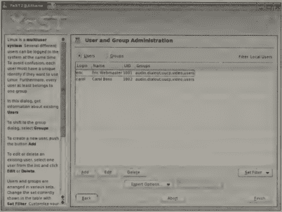

#### 图 4.2
添加新的本地用户。

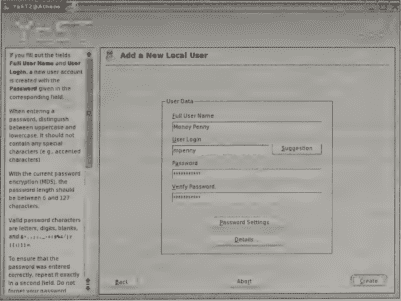

5. 填写用户的姓名、登录 ID 和密码。请记住，登录名和密码都区分大小写。有效密码可以由任何（7 位）ASCII 字符组成，包括数字以及大写和小写字母。然而，您应仅使用十进制值在 33 到 126 范围内的可打印 ASCII 字符。如果您拥有纯 Linux/Unix 环境，空格（十进制 32）可以使用，但可能在使用 Windows 客户端的 X 仿真器或 SSH 客户端连接时失败。因此，您应避免在密码中使用空格。此外，根据加密算法（例如 DES，即默认值），您可能仅限使用最多八个字母数字字符。（请参阅本章后面的“使用强密码哈希算法”。）

6. 如果您想将新用户的设置（例如密码过期日期）更改为默认值以外的设置，请单击 密码设置。在许多情况下，默认设置已足够，无需修改。

7. 如果您想更改诸如 UID、主目录位置、默认登录 shell 和组成员身份等设置，请单击 详细信息；此屏幕中的 附加用户信息 字段对应于 /etc/passwd 中的 GECOS 字段。（请记住，如果您计划运行 finger 守护进程，此字段中的信息必须采用 finger 所要求的特定格式；请参阅之前的“What Is the GECOS Field?”侧边栏。）UID 会根据先前使用值自动分配，默认设置从 /etc/default/useradd 读取。

> **提示**
>
> 登录 shell 下拉列表中显示的 shell 从 /etc/shells 文件读取。编辑此文件以删除您不想显示的任何条目。请记住，/etc/shells 中的条目并不一定意味着实际 shell 存在于服务器上。您应在将其包含在列表中之前检查程序是否存在。此文件也由 csh 引用。
>
> 您可能会注意到 /etc/shells 中有一个名为 /bin/bash1 的条目，但它未列在下拉列表中。/bin/bash1 是对 bash 版本 1 的旧引用，而 /bin/bash 是对当前 bash 版本（即版本 2）的通用引用。YaST 使用 /usr/share/YaST2/modules/Users.pm Perl 脚本过滤掉 /bin/bash1。

8. 在您对用户的设置满意时，单击 创建。

9. 重复步骤 4 至 8 以创建更多用户。完成后单击 完成。您必须单击 完成 才能更新数据库。否则，

— 如果你点击 Abort，任何已做的更改（包括新增的“用户”）都将被丢弃。

#### 提示
你可以选中“专家选项”，然后选择“立即写入更改”，以保存迄今为止所做的更改，而无需退出模块。

更新和删除用户的流程类似：选中目标用户后，改为选择“编辑”或“删除”，而不是“添加”。

#### 提示
如果更改用户的 UID，YaST 通常会更改用户主目录中所有文件的所有权。如果由于某种原因 YaST 无法自动执行此操作，你可以使用 `chown -R username /home/username` 命令来更改所有权。

#### 提示
使用 YaST 更改用户的 UID 时，仅会调整主目录中文件的所有权权限。系统其他位置可能存在的文件的权限更改不会被执行。

要在系统上查找由特定用户拥有的所有文件，可以使用 find 命令：

```
find / -uid id_number -print
```

find 是一个非常强大且有用的程序，可以通过 exec 开关对找到的文件执行特定功能。例如，以下命令会将属于 UID 1000 的所有文件更改为 UID 1002：

```
find / -uid 1000 -exec chown 1002 {} \;
```

熟悉它将为你的工具箱增添一个强大的工具。有关更多信息，请参阅 `man find`。

使用 YaST 时，你可以在单个应用程序中管理用户账户的大多数方面，但你不能使用 YaST 来启用或禁用用户账户——必须使用命令行工具来完成。此外，由于 YaST 是一个菜单驱动的实用程序，它不便于轻松批量创建或修改用户账户。因此，我们强调使用命令行工具时必需的多步骤用户创建过程。

以下步骤说明了当你执行命令 `/usr/sbin/useradd -m carol` 时会发生什么：

- 在 `/etc/passwd` 中为 carol 创建一个新条目。该行以用户名 carol 开头，密码字段中放置一个“x”，表示系统使用影子密码。创建一个至少为 1000 的 UID，并将主 GID 设置为 100（组 users）。可选的 GCOS 信息保持空白。主目录因 `-m` 开关而创建并设为 `/home/carol`，默认 shell 设置为 `/bin/bash`，如 `/etc/default/useradd` 所指定。

#### 注意
如果需要创建系统用户（即 UID 在 0 到 499 之间），请包含 `-r` 和 `-u` 开关。例如，

```
useradd -m -r -u 200 -c "db admin user" -g 0 db_admin
```

创建了一个名为 db_admin 的用户，其 UID 为 200，主 GID 为 0（即 root 组），设置 GCOS 字段，将默认 shell 设置为 `/bin/bash`，并创建 `/home/db_admin` 作为主目录。在某些情况下，你可能不希望包含 `-m` 开关来创建主目录，例如当账户由守护进程而不是真实用户使用时。

- 在 `/etc/shadow` 中为 carol 创建一个新条目。该行以用户名 carol 开头，密码字段中放置一个感叹号（`!`），从而锁定账户。相关的密码策略（如过期日期）根据 `/etc/default/useradd` 中的值设置。

- `/etc/group` 中的组成员身份会更新，以将 carol 包含在适当的组中，例如 dialout、uucp、video 和 audio。用户 carol 不会被添加到组 users，因为它是她的主组。

- 在 `/home` 目录中为 carol 创建一个目录。该目录的所有权设置为用户 carol 和组 users。carol 拥有完全权限（读、写和执行），而组和其他用户仅具有读和执行权限。

- `/etc/skel` 目录中的文件（包括子目录）（包含默认用户设置，例如 `.bashrc`）会被复制到新的 `/home/carol` 目录中。如果不使用 `-m` 选项使用 useradd，则不会创建主目录；因此，不会复制 `/etc/skel` 中的文件。你可以使用额外的命令行开关（如 `-g` 和 `-d`）覆盖 `/etc/default/useradd` 中的设置。有关更多信息，请参阅 `man useradd`。

#### 提示
你可以在使用 `useradd` 和 `userdel` 时定义要执行的额外操作。例如，在使用 `userdel` 删除用户之前，执行一个脚本——例如，`find / -uid id_number -exec rm {} \;` 以删除用户拥有的所有文件。有关更多信息，请参阅 `/etc/login.defs` 中的 `USERADD_CMD`、`USERDEL_PRECMD` 和 `USERDEL_POSTCMD` 指令。

此时，系统上存在一个名为 `carol` 的锁定账户。要激活它，你必须接下来使用 `passwd` 命令为账户分配密码，并可选择设置密码老化策略。

也可以配置账户，使其在首次登录时提示用户更改密码。要以这种方式配置用户账户，请按以下步骤操作：

- 1. 使用 `useradd` 命令创建用户账户。此时，账户已创建但处于锁定状态（分配了无效密码）。

- 2. 使用 `chage -d 0 username` 或 `passwd -e username` 强制立即过期密码。此步骤将密码上次更改日期的值设置为 Epoch。该值无论是否存在密码老化策略，都会强制立即过期密码。

- 3. 使用 `passwd` 设置有效密码来解锁账户。你可以分配一个将交给用户的初始密码，或分配一个空密码（用户只需在密码提示时按 Enter）：

  `passwd -d username`

#### 警告
你也可以使用 `usermod` 更改用户的密码。但是，使用 `usermod` 时，你需要在使用前先对密码进行哈希。与 `passwd` 不同，`usermod` 不会执行哈希。

在任何情况下，首次登录时都会提示用户输入新密码。

#### 警告
尽管使用空密码对你和用户都方便，但第三方先登录并访问系统的风险略有增加。为最大程度降低此威胁，你可以使用以下段落中讨论的流程锁定账户，并在用户准备登录前再解锁。

## 第4章：用户和组管理
在某些情况下，你可能需要暂时禁用一些账户，并在以后重新启用。你可以使用 passwd（但不能使用 YaST）同时禁用和重新启用账户。要禁用账户，请执行以下操作：

```
passwd -l carol
```

此命令在 carol 密码的开头插入一个 ! 字符，使其无法与任何哈希值匹配。然后，要使用原始密码启用账户，请执行以下操作：

```
passwd -u carol
```

之前插入的 ! 字符将被移除，因此 carol 可以再次使用分配的密码登录。

#### 提示
如果必须管理 LDAP 用户密码，最好使用 YaST 或某些基于 LDAP 的工具（如 ldapmodify），而不是 passwd。passwd 只能更改本地密码，即使可以使用 -D 选项指定绑定到 LDAP——它也无法对 LDAP 服务器进行身份验证。

#### 警告
你应该训练非管理员用户使用 passwd 或桌面密码实用程序（应用程序、系统、更改密码）来更改其密码，而不是使用 YaST。当非特权用户使用 YaST 进行更改时，即使是自己的账户，也会收到一些值无法更新的错误（例如，“目录 /home 不可写。”）。

一些 Linux 发行版，例如 Red Hat，使用所谓的 user private group（UPG）方案。UPG 方案并没有在标准 Linux/Unix 处理组的方式上增加或更改任何内容；它只是提供了一种新约定。在 UPG 下，每当你创建新用户时，默认会创建一个与用户名相同的唯一组，并将其分配为用户的主组。该组仅包含该特定用户，因此得名“私有组”。通常，该组与用户登录名同名，其 GID 与用户的 UID 相同；有时这会令人困惑。UPG 的目的是使文件权限管理稍微容易一些。你可以在第 6 章找到有关 UPG 优缺点的更多讨论。SUSE Linux 不使用 UPG；因此，在创建新用户时你不会看到同时创建的任何组。


### 设置默认用户账户属性

如前一节所述，用户账户的默认值存储在 `/etc/default/useradd` 中。useradd 和 YaST 都使用此文件。其他设置，例如密码老化策略，则存储在 `/etc/login.defs` 中。然而，这两个文件仅管理本地用户——即在 `/etc/passwd` 中定义的用户。当创建 LDAP 或其他非本地用户时，这些文件不起作用，因为这些用户的设置存储在其各自的数据库中。

> **注意**
> 
> 请参阅第 8 章，了解有关设置和配置 LDAP 和 NIS 等服务的信息。

在列表 4.1 中显示了默认的 `/etc/default/useradd` 文件。新建用户的默认设置如下：

- 用户的主 GID 为 100（组 users）。
- 用户将被设为 dialout、uucp、video 和 audio 组的成员。
- 用户的主目录将在 `/home` 下创建。
- 用户可以使用已过期的密码无限期登录。
- 没有预设的账户过期日期。
- 用户的默认 shell 为 `/bin/bash`。
- `/etc/skel` 中的文件和子目录将在主目录创建后复制到用户的主目录。

#### 列表 4.1
默认的 /etc/default/useradd 文件

```
GROUP=100
HOME=/home
INACTIVE=-1
EXPIRE=
SHELL=/bin/bash
SKEL=/etc/skel
GROUPS=dialout,uucp,video,audio
```

您可以根据特定需求自定义此文件。例如，如果需要新用户成为 video、audio、helpdesk 和 support 组的成员，请将 GROUPS= 行更改为：

```
GROUPS=video,audio,helpdesk,support
```

如果某些站点特定配置文件（例如包含 SQL 数据库服务器名称的配置文件）需要放置在用户主目录中，只需将它们放在 `/etc/skel` 中，它们将在主目录创建时被复制。

#### 提示

`/etc/default/useradd` 中的设置可以使用 YaST 编辑。从“用户和组管理”屏幕中，选择“专家选项”，“新用户的默认值”。

默认用户账户、组和密码老化策略设置，例如密码的生命周期，均可在 `/etc/login.defs` 文件中找到。该文件还包含登录过程中使用的设置（例如登录失败后允许再次尝试前的延迟时间）。列表 4.2 中显示了与用户账户和组相关的指令。

#### 列表 4.2
/etc/login.defs 中的用户和组相关指令

```
#
# Password aging controls (used by useradd):
#
# PASS_MAX_DAYS
# - Maximum number of days a password may be used.
# PASS_MIN_DAYS
# - Minimum number of days allowed between password changes.
# PASS_WARN_AGE
# - Number of days warning given before a password expires.
PASS_MAX_DAYS    99999
PASS_MIN_DAYS    0
PASS_WARN_AGE    7


#
# Min/max values for automatic uid selection in useradd
#
# SYSTEM_UID_MIN to SYSTEM_UID_MAX inclusive is the range for
# UIDs for dynamically allocated administrative and system
# accounts.
# UID_MIN to UID_MAX inclusive is the range of UIDs of
# dynamically allocated user accounts.
#
SYSTEM_UID_MIN        100
SYSTEM_UID_MAX        499
UID_MIN              1000
UID_MAX             60000
```

#### 列表 4.2
/etc/login.defs 中的用户和组相关指令（续）

```
#
# Min/max values for automatic gid selection in groupadd
#
# SYSTEM_GID_MIN to SYSTEM_GID_MAX inclusive is the range for
# GIDs for dynamically allocated administrative and system
# groups.
# GID_MIN to GID_MAX inclusive is the range of GIDs of
# dynamically allocated groups.
SYSTEM_GID_MIN        100
SYSTEM_GID_MAX        499
GID_MIN               1000
GID_MAX               60000

#
# User/group names must match the following regex expression.
# The default is [A-Za-z_][A-Za-z0-9_.$-]*[A-Za-z0-9_.$-]\?
#
CHARACTER_CLASS      [A-Za-z_][A-Za-z0-9_.$-]*[A-Za-z0-9_.$-]\?

#
# Umask which is used by useradd and newusers for creating
# new home directories.
UMASK                 022

#
# If defined, this command is run when adding a user.
# It should rebuild any NIS database etc. to add the
# new created account.
#
USERADD_CMD           /usr/sbin/useradd.local

#
# If defined, this command is run before removing a user.
# It should remove any at/cron/print jobs etc. owned by
# the user to be removed.
#
USERDEL_PRECMD        /usr/sbin/userdel-pre.local

#
# If defined, this command is run after removing a user.
# It should rebuild any NIS database etc. to remove the
# account from removed.
#
USERDEL_POSTCMD       /usr/sbin/userdel-post.local
```

#### 警告

最好不要更改 `SYSTEM_UID_*` 和 `SYSTEM_GID_*` 指令设置，因为这可能导致某些应用程序无法正常运行。

`/etc/login.defs` 中的 `UMASK` 指令由 useradd 和 YaST 用于设置主目录的正确文件权限。请参阅第 6 章，了解有关文件所有权和权限的信息。`USERDEL_PRECMD` 和 `USERDEL_POSTCMD` 指令指向两个可根据特定需求自定义的模板。例如，您可能希望在删除用户 ID 之前将用户主目录复制到其他位置。`USERDEL_PRECMD` 指令的默认脚本会删除用户拥有的任何 cron 作业，而默认的 `USERDEL_POSTCMD` 不执行任何操作。

#### 提示

`/etc/login.defs` 中的设置可以使用 YaST 编辑，从 YaST 控制中心选择“安全和用户”，“安全设置”。如果当前安全设置是 1 级至 3 级之一，请单击“详细信息”。如果选择的是“自定义设置”，请单击“下一步”。然后会显示一系列屏幕，每个屏幕处理 `/etc/login.defs` 中找到的不同指令集。

`/etc/login.defs` 与 `/etc/default/useradd` 之间存在冗余时，`/etc/login.defs` 中的设置优先。

### 创建和编辑组

管理组的过程与管理用户类似。为了避免重复列出许多相同的步骤，我们在此列出了主要差异：

- 从 YaST 控制中心，选择“安全和用户”，“编辑和创建组”以启动“用户和组管理”模块。如果您已在“用户和组管理”模块中，请单击屏幕顶部附近的“组”单选按钮；您可以使用“用户”和“组”单选按钮在管理用户和组之间切换。
- 从终端会话启动 YaST 时，您可以使用 `yast groups` 或 `yast2 groups` 跳过 YaST 控制中心，直接进入“用户和组管理”模块。
- 图 4.3 显示了添加新本地组的屏幕。您需要提供组名，并可选择一个或多个将成为该组成员的用户。

#### 图 4.3
添加新的本地组。

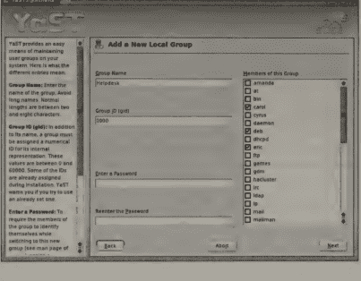

#### 注意

“添加新本地组”屏幕中可用的用户列表包括所有已知用户，其中包括本地、LDAP、NIS 等用户。然而，如果您添加的是例如新的 LDAP 组，则仅显示 LDAP 用户以供选择。

- GID 会自动分配，使用最低的未使用 GID。如果您愿意，可以将其更改为其他值。如果新指定的值已在使用中，YaST 会发出警告。
- 组密码是可选的。它们允许非组成员的用户使用 `newgrp` 将其活动 GID 切换到该组——如果他们知道组的密码。
- 编辑现有组时，您还会看到此组为其默认组的用户的列表。您无法在 YaST 中修改此列表。要从此列表中删除用户，您需要为该用户分配不同的主 GID。

有三个常用的命令行实用程序用于管理组：

- **groupadd**—此应用程序通过向 `/etc/group` 添加新条目来创建新组。常见用法 simply `groupadd groupname`，其中将分配下一个可用的 GID。如果您希望为新组使用特定的 GID，请包含 `-g gid_number` 开关；对于系统组（即 GID 在 `/etc/login.defs` 中定义的 SYSTEM_GID_MIN 和 SYSTEM_GID_MAX 范围内的组），请包含 `-r` 开关。您可以使用 `-p password` 开关分配组密码；或者您可以使用 `passwd -g groupname`、`gpasswd groupname` 或 `groupmod -p password groupname` 稍后添加。一般建议您使用 `passwd -g` 或 `gpasswd` 设置密码，因为这样密码不会出现在命令行中。
- **groupmod**—此实用程序允许您修改组的名称、GID、成员列表及其密码。请记住，如果您更改 GID，则需要使用 `chgrp` 手动更改旧 GID 拥有的任何文件上的组所有权；更改名称对组所有权没有影响。您可以使用“创建和编辑用户账户”中之前讨论过的 `find` 命令。
- **groupdel**—使用此实用程序从 `/etc/group` 中删除组：`groupdel groupname`。请注意，只有当没有用户将此组作为其主组时，才能删除组。

在 SLES 9 及更高版本系统上您找不到 `/etc/gshadow` 文件，因为它不再使用。

### 安全考虑

保护任何操作系统的第一步是保护用户和组账户。这包括但不限于以下内容：

- 强制执行强密码选择
- 将用户访问限制为绝对必要的那些文件、目录和 shell
- 保护系统账户（尤其是 root）
- 关闭任何潜在的后门，例如禁用未使用或休眠的账户

这些步骤将在以下各节中讨论。其他预防措施，例如保护用户的工作环境、处理文件系统安全、防止

检测入侵者以及系统加固将在本书后面的章节中讨论。

### 使用强密码

就像给房子装上良好且安全的锁一样，你希望用户选择难以猜测但又足够容易记住的密码，这样用户就不会把密码写下来让全世界找到。难以猜测的密码意味着它们不应与用户个人相关联，例如配偶的名字、子女、宠物或用户的地址。强密码也不应包含字典单词。许多密码破解程序使用词表来暴力破解密码。其中许多程序在互联网上可自由获取；其中两个最受欢迎的密码破解器是 Crack 和 John the Ripper。我们将在第 11 章讨论如何使用 John the Ripper 在你的系统上检测弱密码。

选择难以猜测密码的一种方法是使用随机选择的字符字符串，例如 `I2#yA9%3r`。这不是任何字典中的单词，也与用户完全无关。不幸的是，你的用户可能无法记住这样的密码。很可能的结果是用户会把它写在便签上并贴在键盘下方！

更好的选择强密码的方法是使用短语（通常称为 *passphrase*）例如 *我错过了冰球！*。另外，你也可以从长句子中派生密码，例如 *穿越第八维度的巴卡鲁·班扎伊历险记！* 一种派生方法是简单地取每个单词的首字母，除单词 Eighth 外，该单词被数字 8 替换，你得到 `TAoBBat8D`。或者你可以取每个单词的第二个字母，同样除外单词 Eighth，你得到 `hfad...`。正如你所见，你可以使用许多变体来想出难以猜测但相对容易记住的密码。

#### NOTE

随着计算能力的不断提升以及 John the Ripper 和数据包嗅探器（如 Ethereal）等实用工具的易得性，即使是最难以猜测的密码也变得越来越毫无价值。如果黑客获取了你的用户名和哈希密码列表，他可以对列表运行 Crack 或 John the Ripper 直到找到匹配项。如果用户通过网络登录，用户名和密码都会以明文发送（除非会话已加密，例如使用 SSH 而不是 Telnet 时）。这使得坏人更容易，因为他只需要一个嗅探器来捕获所有网络流量并在数据包中查找“Login:”和“Password:”。根本不需要 John the Ripper！本书中讨论的许多步骤可以帮助你最大程度地减少影响，甚至防止此类攻击一开始就发生。

选择强密码和强制执行密码安全的标准行业建议已在以下各节中总结。

#### PROTECT YOUR PASSWORDS

密码安全的第一条规则是你永远不要写下密码；要记住它。特别是，不要写下来并放在他人可以公开或容易获取的地方，也不要将其放在未加密的文件中！如果你记不住，你就没选一个好密码。如果你必须写下来，请始终随身携带！

如果你有权访问不同的系统，并且未使用集中式身份验证机制（如 NIS 或 LDAP），请在这些机器上使用不相关的密码。这也适用于你访问由不同组织控制的系统。你不知道他们如何保护系统，也不想帮助坏人利用从其他系统窃取的信息进入你的服务器。

不要透露或分享你的密码，特别是不要告诉声称来自计算机支持或供应商的人，尤其是在电话上！通常，黑客使用欺骗或误导来从毫无防备的用户——尤其是新用户——那里获取信息。黑客经常假装成有权威的人，例如来自 IT 安全部门或需要验证用户身份的供应商客户支持组人员。请考虑以下电话对话：

> > **Hacker:** 早上好！我是企业 IT 安全部门的 John。你是 Susan James 吗？  
> > **Susan:** 是的，就是我。  
> > **Hacker:** 我们正在为你设置大型机访问权限。为了让你更简单，我们会将你的大型机用户名和密码与你的局域网相同，这样你就不必记住多个登录信息。  
> > **Susan:** 太好了！  
> > **Hacker:** 你的局域网用户名是 SJames，对吗？  
> > **Susan:** 是的。  
> > **Hacker:** 我只需要你的密码才能输入到大型机中。  
> > **Susan:** 当然；是…

这种方法被称为社会工程学。黑客只需与受害者进行看似无害的社交对话，就能获得必要的信息，而无需花费数天时间破解单个 MD5 或 Blowfish 哈希密码！

#### CAUTION

近年来，这种社会工程学手段（称为 *网络钓鱼*）已在互联网上被使用。坏人向用户发送电子邮件，假装成知名合法企业，试图诱骗用户交出将被用于身份盗窃的私人信息。电子邮件指示用户访问一个网站，在那里他或她被要求更新个人信息，例如密码和信用卡、社会安全号以及银行账号，而合法组织本已拥有这些信息。然而，该网站是虚假的，仅用于窃取用户的信息。有关更多信息，请访问 http://www.ftc.gov/bcp/conline/pubs/alerts/phishing1/htm。

不要让任何人看着你输入密码，也不要将密码输入到你不信任的计算机中。如果密码仅需在有限时间内使用，请定期更改它。谈到保护密码时，金科玉律是 *坚持不懈和警惕*。

#### CHOOSE HARD-TO-GUESS PASSWORDS

强密码应该是字典（任何语言或行话）中找不到的东西。你不应该使用姓名（包括配偶、父母、子女、宠物等）或个人或登录名称的任何变体。不要使用关于你的公开可访问信息（如电话号码、汽车车牌或员工编号）或你的环境（如办公室地址）作为密码的一部分。不要使用生日或简单模式（如将用户名倒写、在名称后跟数字或在名称前加数字）。

一个好的、难以猜测的密码由大小写字母以及数字或标点符号混合组成。选择新密码时，确保它与任何以前的密码无关（如在旧密码上添加数字）。使用长密码（例如八个字符或以上）。你可以使用带插入标点的词对（如 grEAT:Book）、短语，或如前所述的长句中每个单词的选定字母。

#### BUTTON DOWN THE HATCHES!

你绝对不应该允许没有密码的账户。这样的账户是对某些坏人入侵你的系统发出公开邀请。锁定所有未使用的账户——对于长期离开的用户或已离开组织但需要保留其环境的用户——使用 `passwd -l` 命令。你还会发现许多系统账户被分配了无效密码（在 `/etc/shadow` 的密码字段中为单个 `*` 或 `!`）。这些账户存在是为了允许程序以该账户关联的 UID 运行；它们不是直接登录账户。如果你需要创建此类账户，请确保禁用其登录访问。

#### TIP

除了通过禁用密码来锁定休眠账户外，你还应删除（或重命名）其主目录中的所有 `.rhosts`、`.netrc` 和 `.forward` 文件，以防止通过 FTP 或任何 r 命令（如 rlogin 和 rexec）作为这些用户进行远程访问。

你还应将这些用户的 shell 更改为虚拟 shell，例如 `/dev/null`、`/bin/false` 或 `/sbin/nologin`。这样，即使有人能够以这些用户身份登录，也会立即退出。你可能不想使用 nologin，因为它会告知用户账户不可用——这会让黑客知道账户确实存在但已被禁用。

#### USE PASSWORD AGING

无论密码多难猜，如果它已被使用很长时间，总会有人猜出来。用户之间互相吹嘘密码有多安全或多巧妙的情况并不少见：“我用了我三个孩子中间名。怎么样，够难的吧？”“你知道我真的、真的讨厌什么颜色吗？”或“嘿，我用我妻子最喜欢的意大利菜作为密码。试试猜猜！”

经过足够的谈话，再加上一些运气，坏人可能就会猜出密码是什么。因此，最好强制用户定期更改密码。密码老化可以按系统范围或按用户实施。Linux 中的密码老化策略通过 shadow 密码文件控制，并在 SLES 安装期间自动配置。

#### BE A CRACKER JACK

自己使用密码破解器来审计弱密码。SUSE LINUX 默认实现可插拔身份验证模块（PAM）以提供灵活的用户身份验证。PAM 的一个附带好处是它能够帮助强制执行强密码（例如通过 `pam_pwcheck` 模块）。（你可以在第 5 章“用户环境管理和安全”中了解有关 PAM 的更多详细信息。）总是存在另一个系统

管理员可能在不知情的情况下分配了弱密码。要发现这一点，你应定期使用密码破解工具（如 John the Ripper）进行自我审计，查看是否有弱密码被报告。

#### CAUTION
当非 root 用户更改密码时，PAM 会确保选择“良好”的密码；否则密码不会被更改。然而，对于 root 用户，PAM 在检测到弱密码时会发出警告，但仍允许使用。

#### TIP
自 SuSE 6.3 起，包含了一组名为 seccheck 的 cron 脚本，并且默认已安装。Seccheck 会执行系统安全性的每日、每周和每月检查，并将其与上次运行的结果进行比较。结果会通过电子邮件发送到 root 账户。弱密码检查每周使用 John the Ripper 执行一次。有关更多信息，请参阅 `/usr/share/doc/packages/seccheck/README`。

### USE A STRONG PASSWORD-HASHING ALGORITHM
使用强密码哈希算法
之前的关于使用密码短语和长密码的建议是合理的，前提是你使用的密码哈希算法支持长字符串。默认情况下，SLES 9（以及许多其他 Linux 发行版）使用基于 DES 的算法，该算法支持最长八个字符的密码；任何超过八个字符的字符串都会被截断为八个字符大小。幸运的是，SUSE 提供了使用更强的 MD5 哈希算法或 Blowfish 对密码进行加密的选项。（有关 MD5 哈希算法的更多信息，请参阅 RFC 1321；有关 Blowfish 加密算法的更多信息，请参阅 http://www.schneier.com/blowfish.html。）尽管 MD5 和 Blowfish 密码并不能消除密码破解的威胁，但它们确实使破解你的密码变得困难得多。

#### NOTE
SLES 默认使用 DES 作为密码哈希方法。然而，你可以在安装期间将其更改为 MD5 或 Blowfish，如第 1 章“Installing SUSE LINUX Enterprise Server”中“Detailed Installation Steps”部分所述。或者，你也可以在服务器运行后随时更改它，如下所述。

如果你在安装期间没有将密码哈希算法从 DES 更改为 MD5 或 Blowfish，可以稍后轻松更改。这很容易通过 YaST 完成，因为它会为你更改所有相关的配置文件（例如 `/etc/security/pam_unix2.conf` 和 `/etc/security/pam_pwcheck.conf`）。你可以通过用户和组管理模块或本地安全配置模块进行更改，具体如下：

- 从 YaST 控制中心，选择 Security and Users，Edit and Create Users 以启动用户和组管理模块。单击 Expert Options，Password Encryption。从显示的 Set Password Encryption 对话框中（见图 4.4），选择所需的方法并单击 OK。单击 Finish 使更改生效。

#### FIGURE 4.4
更改密码哈希方法。

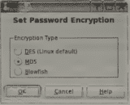

- 从 YaST 控制中心，选择 Security and Users，Security Settings 以启动本地安全配置模块。如果当前安全设置是 Level 1 到 Level 3 之一，请单击 Details。如果选择的是 Custom Settings，请单击 Next。第一个屏幕是 Password Settings（见图 4.5）。从 Password Encryption Method 下拉列表中选择所需的方法。如有需要可进行其他更改。单击 Next 直到显示 Miscellaneous Settings 屏幕。单击 Finish 使新的更改生效。（从终端会话中，你可以直接使用 `yast security` 或 `yast2 security` 启动本地安全配置模块。）

#### WARNING
用户和组管理模块在设置密码时似乎存在一个外观上的错误。无论你当前的密码哈希算法如何，当你尝试使用超过八个字符的密码时，YaST 总是会警告你密码太长并询问是否应将其截断。当你单击 Yes 时，使用 DES 时它会被截断。然而，使用 MD5 和 Blowfish 时，即使你在单击 Yes 后被误导认为它会被截断，密码也不会被截断；如果你单击 No，则会返回到重新输入密码的屏幕。

#### FIGURE 4.5
通过本地安全配置模块更改密码哈希方法。

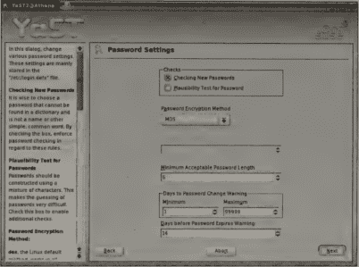

#### CAUTION
更改使用的密码哈希方法不会将现有密码哈希值更改为新值。例如，从默认的 DES 切换到 MD5 会使现有密码哈希保持为 DES。然而，新密码将使用 MD5 进行哈希。因此，如果你希望所有用户密码都使用新算法进行哈希，请更改方法然后使所有密码过期。这样，下次用户登录时，该用户将被提示更改其密码，并且它将使用新方法进行哈希。

你可以通过检查 `/etc/shadow` 来确定给定密码哈希使用了什么哈希算法——这也是该文件仅对 root 可访问的另一个原因，因为你不想给任何黑客提示你使用的是什么哈希算法：

- DES 哈希的密码始终为 13 个字符长，其中前两个字符是盐值。
- MD5 哈希的密码最多可达 34 个字符长，包括盐值。MD5 哈希的盐值以前缀 `$1$` 开头，盐值本身是一个最多八个字符的字符串，后跟一个美元符号以指示盐值的结束（例如 $1$abcdefgh$）。
- Blowfish 哈希的密码最多可达 60 个字符长，包括盐值。Blowfish 哈希的盐值以前缀 `$2a$` 开头，盐值本身只是一个两字符的字符串，后跟一个美元符号以指示盐值的结束。

### KEYS AND SALTS
密钥和盐值
在 Linux（和 Unix）系统上，不同的哈希算法通过 crypt(3) 库调用得到支持。Crypt 接受两个参数，密钥和盐值，并返回哈希值。盐值只是一个文本字符串（其长度取决于所讨论的算法），它与密钥（“密码”）结合以生成哈希值。用不同的盐值哈希相同的密码会产生不同的哈希值。

当 passwd（或其中一个密码更改实用程序）更改密码时，会使用随机的盐值。这样，即使两个用户具有相同的密码，他们也可能具有两个不同的盐值，从而产生两个不同的哈希值。这可以使用以下 Perl 片段轻松说明：

```
Athena:/home/admin # perl -e 'print crypt("password", "s1"),
"\n"'
=> "s1DAScvcc/W."

Athena:/home/admin # perl -e 'print crypt("password", "s2"),
"\n"'
=> "s2IGZtab0BHFc"
```

使用的算法取决于使用的盐值。前面示例显示了使用 DES 算法对相同的文本字符串（password）使用两个不同的盐值（s1 和 s2）进行哈希的结果。两个哈希值截然不同。请注意，盐值本身被前缀到生成的哈希中，这表明使用了什么哈希算法。这允许应用程序，例如 passwd，在以后验证密码时使用相同的盐值和算法。

DES、MD5 和 Blowfish 各有优缺点，在选择之前应仔细考虑。例如，Linux（和 Unix）对 DES 哈希方法的实现将密码限制为仅八个字符，但由于所有版本的 Linux/Unix 和大多数其他类 Unix 操作系统都支持它，因此它是跨平台兼容性的良好选择。另一方面，MD5 和 Blowfish 允许更长的密码（MD5 为 127 个字符，Blowfish 为 72 个字符），但这些算法计算密集。因此，如果你有一个性能不足的服务器需要每秒执行许多用户身份验证（例如 LDAP 身份验证服务器），性能会下降。还有一些

与密码长度超过八个字符兼容性不佳的网络协议。例如，由于底层 secure-RPC 协议使用 DES，NIS+ 密码中只有前八个字符是有意义的。

在为系统选择密码哈希算法时，请考虑以下建议：

- 使用 DES 时，将最小密码长度设置为至少六个字符；root 密码使用八个字符。
- 如果所有互连系统都支持 MD5，则使用 MD5 作为密码哈希算法，并将最小密码长度设置为至少六个字符。
- 考虑为所有需要密码的系统账户使用 Blowfish。（不过，这意味着你需要将密码哈希方法从当前设置切换到 Blowfish，修改密码，然后恢复设置。另一种方法是安装支持 Blowfish 的 Perl 版本——随 SLES 9 包含的版本仅支持 DES 和 MD5——这样你就可以使用一个简单的脚本先用 Perl 生成哈希值，然后使用 `usermod -p hashed_value` 设置密码。）

#### TIP

你可以在 http://rpmfind.net/linux/RPM/contrib/libc6/i386/perl-Crypt-Blowfish-2.09-1.i386.html 和 http://rpmfind.net/linux/RPM/suse/8.2/i386/suse/i586/perl-Crypt-Blowfish-2.09-188.i586.html 找到支持 Blowfish 的 Perl 版本的 RPM。Perl crypt 主页位于 http://www.cpan.org/modules/Crypt.

在大多数情况下，MD5 在性能和安全性之间提供了最佳平衡。

### Auditing Default Accounts

如前所述，存在一些系统账户用于允许程序以该账户关联的 UID 运行；它们不是直接登录账户。FTP、named（用于 DNS）、mail 和 news 就是此类系统账户的例子。请确保通过将它们的 shell 设置为 `/bin/false` 或类似设置来阻止此类账户通过终端登录。

如果这些账户的服务未使用，请卸载它们并删除账户——至少要禁用未使用的服务（有关更多信息，请参阅第 8 章）。定期检查 `/etc/passwd` 和 `/etc/shadow` 的内容，以确保已删除的系统账户没有“自发复活”，或在你不知情的情况下没有添加新的系统账户，并且非登录系统账户没有“突然”被分配有效的密码哈希和 shell。

### The Root Account

root 账户是整个服务器王国（如果该服务器作为中央认证服务器，则是整个网络）的关键。在 Linux/Unix 世界中，没有什么比 root 账户的密码更重要的了。因此，你不会希望 root 密码被除你之外的任何人知道。好吧，这通常说起来容易做起来难。

如你可能已经发现，许多管理任务，例如重置用户忘记的密码、更改系统配置等，都需要你以 root 身份操作。如果你是负责组织系统（们）的独行侠，保持 root 密码安全相对容易。遵循本章前面关于选择强密码的建议，经常更改密码，绝不写下来，等等。然而，在公司中，系统管理任务由两个人或更多人共享并不罕见。在这种情况下，你如何有效地保护 root 密码？知道密码的人越多，它泄露给不应该知道的人的可能性就越高！

#### TIP

> 如果你是组织的唯一系统管理员，将 root 密码记录在密封的信封中并保存在只有受信任的公司官员（如会计或 CTO）可以访问的安全地点可能是一个好主意；银行保险箱是一个不错的选择。这里的想法是，虽然你希望 root 密码对他人保密，但你需要提供一种“连续性”方式，以防你因疾病或其他原因无法使用。

有多种方法可以解决多管理员需求的要求，我们在这里讨论其中两种：

- **Setting up multiple root users**—与其向需要访问权限的人提供 root 密码，不如设置多个 root 账户。假设例如 Tasha 和 Carol 因工作需要都需要管理访问权限。跟踪他们 root 活动的一种方法是设置两个独立的账户，例如为 Tasha 设置 tasha-root，为 Carol 设置 carol-root，每个账户都有唯一的（强）密码，并且每个账户的 UID 均为 0。每当 Tasha 需要 root 权限时，她可以以 tasha-root 登录或 su 为 `tasha-root`。Carol 则以 `carol-root` 操作。这种方法的好处是为每个管理员提供以进程记账和系统日志形式存在的审计跟踪，而无需共享 root 密码。缺点是每个重复的 UID 0 账户都是另一个潜在漏洞。

由于添加另一个 UID 0 账户也是黑客常用的做法，你应经常检查 `/etc/passwd` 以查找非法的 UID 0 账户。你也可以使用 Bastille（参见第 13 章）自动检测未经授权的重复 root 账户。

#### CAUTION

你不应将 root 等效账户命名为“-root”，因为这会让黑客很容易锁定要攻击的账户。

- **Using sudo**—授予多个用户 root 访问权限的最佳方式是通过 sudo（superuser do）实用程序。sudo 允许你授予某些用户（或用户组）以 root 身份运行某些（或全部）命令的能力，同时记录所有使用的命令和参数，无论命令是否成功。所有 sudo 命令都记录在日志文件 `/var/log/messages` 中，这对于确定用户错误如何导致问题非常有帮助。所有 sudo 日志条目中都包含单词 sudo，因此你可以使用 grep 命令有选择地过滤输出，从而轻松获取使用的命令线程。sudo 按命令为单位操作，不是 shell 的替代品。

#### NOTE

有关 sudo 的进一步讨论可在第 5 章找到。

*一直*以 root 身份运行并不是一个很好的主意。因为它授予你对服务器及其文件的全能、无限制的访问权限，一个小错误可能使整个系统无法使用。例如，在执行 `rm -r`（甚至只是 `rm *`）之前，请务必确认你处于正确的目录！一般来说，在以 root 身份执行某些操作之前请三思。以下是有关使用 root 账户的一些提示：

- 只有在绝对必要时才成为 root。
- 仅通过 `su` 或 `sudo` 获取 root 访问权限。
- 限制 root 可以从哪些终端控制台登录。（请参阅 man security 并参考第 5 章中“Authentication Using PAM”部分了解更多信息。）
- 执行可能具有破坏性的命令（如以 root 身份执行 rm -f）时要格外小心。
- 调用命令时使用绝对路径名。这有助于消除执行可能已安装在由 PATH 环境变量指向的非系统目录之一中的特洛伊木马程序。

#### TIP

在设置 root 的环境时，不要将用户可写的目录放在 root 的 PATH 中。这降低了运行由用户（有意或无意）放置的特洛伊木马程序的风险。

- 每当你需要远程以 root 身份管理系统时，请使用 SSH（在第 13 章“Securing Network Services”部分讨论）和 sudo。

### User in Too Many Groups?

Linux 和大多数其他较新的 Unix 系统每个用户至少支持 32 个组。然而，由于 NFS 协议仅支持 16 个组，大多数系统（包括 SUSE）都对每个用户的组数施加了 16 个组的软限制。很少有情况需要超过 16 个组，但如果系统不会导出或使用 NFS 挂载的文件系统，通常可以使用更多组；NFS 在其底层的 RPC 协议中对组数有硬编码的 16 组限制。前 16 个组会传递给 NFS 服务器进行权限检查，而其他组将被忽略。换句话说，用户可能看起来属于某个组，但如果超过 16 组限制，用户可能没有该组的访问权限。

### Summary

本章提供了有关 Linux 中用户和组如何识别的信息，以及如何有效管理用户和组信息 using

YaST 和命令行工具。本章涵盖了以下主题：

- 用户和组 ID
- 系统用户与普通用户
- `/etc/passwd`、`/etc/shadow` 和 `/etc/group` 文件
- 使用 YaST 和命令行工具创建和更新用户及组信息的方法
- 用户账户安全注意事项

下一章将为您提供信息和建议，说明如何最好地保护用户的 working 环境。例如，您可以限制用户只能使用某些终端控制台登录，并应用磁盘配额以防止服务器磁盘空间耗尽，从而导致有时被称为“自我拒绝服务”（SDOS）的情况。

## 用户环境管理与安全

服务器上所有基于进程的活动都受运行该活动所使用的用户账户所分配的权利和特权管辖。前一章讨论了 Solaris 服务器如何为系统账户、特殊账户和标准用户账户指定用户 ID（UID）和组 ID（GID）范围。

在许多操作系统中，系统管理员通过分配权限来授予提升的系统访问权限。如果未有意授予特定权限，用户账户不会获得访问权限的提升。然而在 Linux 中，账户只需被放置在特定的 UID/GID 范围内即可获得固有权限。可以说，任何操作系统环境中都可能出现错误。注意细节并对账户管理进行适当的审计可以发现此类错误。在 Linux 世界中，UID 或 GID 字段中的一个数字应验证两个属性：唯一性和固有权限。

在本章中，我们将用户访问调查扩展到简单授予账户之外。这里涵盖的许多主题允许您作为系统管理员，将用户限制为允许的使用模式。一些用户可能会将其视为生产力的障碍。在大多数情况下，企业 IT 政策决定了每个限制的许多指导方针。以积极的方式实施这些选项将增强您提供稳健且安全环境的能力。

### 账户审计

保护服务器的第一步是确定其必须具有的存在级别。位于网络上的服务器可以通过多种方式访问。某些方法需要用户名和密码，而其他方法不需要任何形式的身份验证。

您可以运行使用简单查询-响应场景且不需要身份验证的网络服务。在这种环境中，查询发送到服务器，服务器解释信息，并在需要时将信息传回客户端。示例包括 DNS、DHCP、Web 服务器流量和 PING。此类访问通过在不同运行级别中管理服务（参见第 3 章“启动和关闭服务器”）、服务运行的本地账户以及防火墙管理（参见第 11 章“网络安全概念”）来控制。

大多数对终端用户感兴趣的服务需要身份验证。示例包括文件共享、远程登录和访问受保护的网站。可以使用多种方法对用户进行身份验证。本章我们集中讨论本地服务器上可用的身份验证过程。

对系统的本地访问由用户名和密码的使用控制，通常存储在 /etc/passwd 中。第 4 章“用户和组管理”介绍了 /etc/passwd 文件作为具有系统访问权限的所有用户账户存储库的概念。列表 5.1 包含第 2 章“更新服务器”中安装的 DNS 服务器的 /etc/passwd 文件的副本。如果您还记得，DHCP-DNS 软件组件是在最小 SLES 安装之上安装的。参考列表 5.1，您可能会观察到一个有趣的事实：在安装期间创建的许多账户对于 DHCP 的正常运行并不是必需的。

列表 5.1
DHCP 服务器 Pollux 的 /etc/passwd 文件

```text
root:x:0:0:root:/root:/bin/bash
bin:x:1:1:bin:/bin:/bin/bash
daemon:x:2:2:Daemon:/sbin:/bin/bash
lp:x:4:7:Printing daemon:/var/spool/lpd:/bin/bash
mail:x:8:12:Mailer daemon:/var/spool/mqueue:/bin/false
news:x:9:13:News system:/etc/news:/bin/bash
uucp:x:10:14:Unix-to-Unix Copy system:/etc/uucp:/bin/bash
games:x:12:100:Games account:/var/games:/bin/bash
man:x:13:62:Manual pages viewer:/var/cache/man:/bin/bash
at:x:25:25:Batch jobs daemon:/var/spool/atjobs:/bin/bash
wwwrun:x:30:8:WWW daemon apache:/var/lib/wwwrun:/bin/false
ftp:x:40:49:FTP account:/srv/ftp:/bin/bash
```

列表 5.1
DHCP 服务器 Pollux 的 `/etc/passwd` 文件（续）

```text
rootfix:x:51:51:PostFix Daemon:/var/spool/postfix:/bin/false
sshd:x:71:65:SSH daemon:/var/lib/sshd:/bin/false
nobody:x:65534:65533:nobody:/var/lib/nobody:/bin/bash
hart:x:1000:100:Hart:/home/hart:/bin/bash
named:x:44:44:Name server daemon:/var/lib/named:/bin/false
dhcpd:x:100:65534:DHCP server daemon:/var/lib/dhcp:/bin/false
```

呼应了系统应仅包含其任务所需最小应用程序集的政策，适当的账户政策应规定不允许在任何系统上保留未使用的账户。在生产服务器上，除非明确需要，否则不需要 games 等账户。此类账户，尤其是 UID 在保留的系统空间中的账户，应被删除。尽管可能性不大，但如果它们被攻破，可能会提供对系统的访问。由于它们是“标准”账户名称，对这些账户的默认设置修改可能未被检测到，从而允许对系统进行不当访问。如果账户不存在，漏洞利用的机会也不存在。

在典型的系统上，有三种类型的账户：具有提升访问权限的本地账户、用于运行各种服务的本地账户以及无特权用户账户。在本章的剩余部分，我们将研究如何进一步细化对账户的访问。

### 配置用户环境

组织通常有两种类型的服务器。一类具有相对静态的内容，例如 DHCP 或 DNS 服务器。第二类服务器包含用户文件。在这两种情况下，为终端用户提供一致的工作环境都是必须的。

服务器环境行为的统一性允许工具集和脚本跨平台使用。此外，用户无需记住多个命令语法即可实现相同目标。在以下各节中，我们将介绍如何在 SLES 中实现这一点，首先通过定义一致的命令解释器，然后通过选择用户可使用的标准变量集。

### 默认 Shell

之前，我们详细介绍了 /etc/passwd 文件的结构，并确定每个记录的最后一个字段标识默认或登录 shell。登录 shell 是命令解释器及其相关环境的美称。

简单来说，*shell* 是一个程序。shell 可以交互式运行作为子进程生成，或通过 cron 在后台运行。与任何其他程序一样，shell 预期命令和参数的预定语法。在 shell 进程的生命周期内，该程序允许与操作系统、其他进程和文件系统进行交互。

与某些操作系统不同，Linux 提供多种不同的 shell，例如 ksh、zsh、bash 等。SLES 支持的每个 shell 都包含自己的语法和命令集。通过为每个用户指定初始 shell，您可以定义用户与系统交互时所经历的环境类型。

应为每个组织设定标准，以确定所有账户的默认 shell。每个 shell 类型使用不同的配置文件。为了便于系统管理，将更改限制为单一配置集可减少错误发生的机会。选择标准 shell 允许一个人的脚本工作与其他用户共享。

选择要标准化的 shell 将引发不同阵营关于哪个最好的是非。对于本书的目的，我们将自己限制在描述 bash shell。

### 我不要 BASH！

bash 并不是唯一的游戏。SLES 捆绑了多种其他 shell。在某些情况下，所需的第三方实用程序使用其他 shell 的脚本功能。在其他情况下，来自其他系统有经验的用户拥有脚本工具集。

在 Linux 中，shell 脚本的第一行决定了脚本的解释器。如果您查看并使用 `/etc/init.d` 中的脚本，您会发现许多脚本的第一行显示

```
#!/bin/sh
```

同样，用 Perl 编程语言编写的脚本以类似的注释行开头

```
#!/usr/bin/perl
```

脚本启动时所使用的活动 shell 解释脚本的第一行，并将脚本内容传递给所标识的解释器。因此，需要运行特定 shell 来运行其脚本的用户只需将工具指向适当的解释器即可。


bash 是一种混合 shell，与原始的 Unix sh shell 兼容，但包含一些原本仅存在于 Korn 和 C shell 中的特性。以下是 bash 提供的功能的简要概述：

- **标准命令集**—bash 调用标准 Linux 命令，如 `ps`、`df`、`mount`、`man` 等。
- **脚本语言**—bash 实际上是一种完全可脚本化的语言，包括变量、复杂的循环结构和 if-then 构造。
- **命令行补全**—你可以使用 Tab 键触发 bash 检查当前命令行并将提供的输入扩展为适当的值。

### 自动补全

完全输入长名称或命令通常是不必要的。bash 知道你在输入什么，可以为你自动补全文件名。例如，在命令提示符下输入以下内容：

```
Hermes> cat /etc/serv[TAB]
```

bash 自动补全文件名，命令行变为

```
Hermes> cat /etc/services
```

你还可以使用 Tab 键遍历复杂的目录树。每次按下 Tab 键时，bash shell 都会解释它找到的内容，并为与当前文本模式匹配的第一个目标自动补全命令。如果 shell 检测到多个目标，光标将不会自动补全。再次按下 Tab 会列出可用目标。输入足够多的文本以使 bash 能够唯一识别路径，则 Tab 键可以继续遍历各种目标。

- **命令历史**—先前使用的命令可以使用方向键召回和编辑。

### 命令历史

bash 允许使用光标键进行命令行召回和命令编辑，因为 bash 会保留过去命令的历史记录。按下上或下箭头键可以滚动浏览过去的命令。按下左或右箭头键可以编辑当前提示符下的命令。

命令也可以通过搜索功能检索。如果输入命令的前几个字母并按 Ctrl+S，bash 将检索出第一个与模式匹配的先前使用过的命令。在某些 shell 客户端中，控制字符的处理方式不同且不会传递到服务器端。在这种情况下，Ctrl+S 序列可能无法访问。

- **输入和输出重定向**—可以使用小于号将命令的输入从文件重定向过来。也可以使用大于号将命令的输出重定向到文件。

### 重定向

在命令行级别的重定向允许用户重新定义 STDIN、STDOUT 和 STDERR 的来源。对于输入重定向，后跟文件名的单个小于号符号会告诉命令解释器从标识的文件而不是控制台键盘读取击键。

在输出方面，存在两个通道。STDOUT 是默认值，可以通过使用 > 后跟文件名表示，或作为简写形式使用单个大于号，因为数字 1 是可选的。这样做时，所有写入控制台 STDOUT 的非错误消息输出都会放在标识的文件中。双大于号会导致输出追加到目标文件。

错误消息 STDERR 通过第二个通道写入，可以使用 2> 后跟错误消息的目标文件进行重定向。

你还可以将标准重定向到文件（例如 > out.txt）与 2>&1 后缀结合使用。这会强制 STDOUT 和 STDERR 使用相同的文件名。该命令如下所示：

```
Command > alloutput.txt 2>&1
```

- **命令行管道**—使用管道 (`|`) 符号，你可以将一个命令的 STDOUT 直接传递给第二个命令的 STDIN，而无需担心临时文件来承载内容。

- **环境变量**—bash 维护一个预定义变量的列表，可在命令行或脚本中使用。该列表包括在 shell 之间传递的参数、本地主机信息、调用命令时搜索的路径以及交互式会话期间显示的提示。你也可以在脚本中定义自己的变量。

在整个企业中使用标准 shell 很重要。它提供了接口的一致性，并允许将脚本从服务器移植到服务器。在下一节中，我们将探讨一致默认 shell 的另一个好处：控制登录生成的信息。

### 登录脚本和环境变量

在前一节中，你看到 shell 只是一个程序或命令解释器的实例。这无论是控制交互式会话还是运行脚本都成立。登录 shell 是此类实例的特殊情况，它会触发许多额外事件。

登录 shell 在被调用时会执行多个附加脚本。这些附加脚本用于定制用户将体验到的环境。作为系统管理员，你可以自定义这些脚本以发挥优势。这些登录脚本可以修改指向自定义资源的搜索路径，或设置特定于第三方软件的环境变量。登录脚本的名称取决于默认登录 shell 的类型。如果系统上的所有用户共享相同的默认登录 shell，登录脚本的维护将大大简化。

对于 bash shell，登录时执行的全系统登录脚本存储为 `/etc/profile`。SUSE LINUX 建议你改在 `/etc/profile.local` 中维护登录脚本的自定义版本。这样做是为了防止在升级时覆盖任何自定义设置。登录时，将先运行 `/etc/profile` 脚本，然后运行 `/etc/profile.local`。使用受管理的登录脚本的好处之一是允许控制可用于其他脚本或应用程序的环境变量的设置。典型示例包括设置环境变量 `ORACLE_HOME` 指向 Oracle 安装的基础目录，或设置 `BACKUP_DIR` 变量指定备份的目标位置。

在 `/etc/profile` 脚本中，你还会发现对其他脚本的许多调用。其中一个脚本 `/etc/bash.bashrc` 创建了许多可作为其他命令快捷方式的别名。列表 5.2 显示了其中一些提供的别名。如果你想添加多个系统范围的别名，SLES 建议你将它们放在本地版本 `bash.bashrc.local` 中。该脚本将在 `bash.bashrc` 之后运行。

#### 列表 5.2
`/etc/bash.bashrc` 中生成的一些别名

```
alias += 'pushd .'
alias -= 'popd'
alias ..='cd ..'
alias ...='cd ../../'
alias dir='ls -l'
alias la='ls -la'
alias ll='ls -l'
```

`bash.bashrc` 中创建的默认别名允许用户输入加号 (+) 保存当前工作目录，并输入减号 (-) 返回该目录，而无需输入 `pushd` 和 `popd`。设置系统范围的环境变量和别名可以使系统对用户更友好。一个例子是列表 5.2 中的 `dir` 别名，它允许 DOS 类型命令在 Linux 中似乎可以工作。

为了允许基于用户的自定义，`bash` 还会解释用户目录中的脚本。登录时，`bash` 会运行它在用户目录中找到的以下文件中的第一个：`.bash_profile`、`.bash_login` 或 `.profile`。这些本地脚本可用于设置或覆盖变量以更好地满足最终用户的需求。`.bash_profile` 的典型片段将如下所示列表 5.3。在此片段中，你可以看到创建了两个环境变量 `BACKUP_DIR` 和 `WEB`，以及一个别名。别名 `stat`（status 的缩写）提供有关当前登录进程、磁盘配额使用情况以及用户主目录中磁盘空间摘要的信息。用户登录时，变量会在适当的位置包含当前会话的用户名，如列表 5.4 所示。需要注意的是，别名在登录时不会被求值；它在被调用时才求值。

#### 列表 5.3
典型 `.bash_profile` 的内容

```
BACKUP_DIR=/backup/$USER ; export BACKUP_DIR
WEB="/home/$USER/public_html" ; export WEB
alias stat='finger $USER ; quota $USER ; du --si -s $HOME'
```

#### 列表 5.4
登录后环境变量的验证

```
eric@Athena:~> env | grep -e BACKUP
BACKUP_DIR=/backup/eric
eric@Athena:~> env | grep -e WEB
WEB=/home/eric/public_html
eric@Athena:~> alias -p | grep -e st=
alias stat='finger $USER ; quota $USER ; du --si -s $HOME'
eric@Athena:~>
```

当 `$USER` 符号放置在列表 5.3 和 5.4 中的定义中时，`.bash_profile` 脚本在机器之间和用户之间更具可移植性。在一台机器上拥有特权账户（如 WEBMASTER）的用户，应在其他服务器上拥有普通账户（如 eric）。通过使用 bash 提供的标准变量，登录脚本变得与用户无关。

注销时，bash shell 会调用最后一个脚本：`.bash_logout`。如果在注销时该文件存在，它将被执行。用户可以设置例程来备份文件或强制清理临时文件。以下是示例 `.bash_logout` 的内容：

```bash
eric@Athena:~> cat ./.bash_logout
mv Documents.tar.gz old_Documents.tar.gz
tar -zxvf Documents.tar.gz ./Documents
eric@Athena:~>
```

该脚本复制当前归档文件，然后创建账户根目录中 Documents 子文件夹内容的备份。如果在交互式会话中需要，可以通过 `./.bash_logout` 调用此例程。

登录和注销时会有许多自动脚本进程运行。通过定义环境变量和别名，系统管理员可以为用户提供从服务器到服务器更一致的环境。

### 用户资源管理

在前一节中，我们了解了如何为本地用户进程定义默认 shell。在此过程中，我们还介绍了在登录和注销时会自动执行的脚本。这些脚本可用于自定义用户环境、提供通用环境变量并允许统一的系统范围配置。在以下各节中，我们将探讨如何进一步细化客户端对系统资源的访问。

### 使用 PAM 进行身份验证

历史上，应用程序开发人员负担着开发自己的用户身份验证方法的任务。这种逐个应用程序的方法导致了大量不同的身份验证方案，导致单个用户拥有多个账户和多个密码。

SUSE LINUX 使用一种名为可插拔身份验证模块（Pluggable Authentication Module，简称 PAM）的系统来标准化身份验证过程。有了 PAM，程序可以依赖一系列预定义例程来正确识别用户。这将身份验证的负担移出程序之外，从而为应用程序带来更便携和灵活的架构。

在 SLES 中，PAM 参与身份验证的各个方面。PAM 的主要应用程序特定配置文件位于 `/etc/pam.d`。这些文件中的每一个都包含 PAM 用于确定用户对特定应用程序的有效性的规则集。

PAM 规则是通过组合四种不同的模块类型或族来定义的：

- `authentication`—使用挑战-响应来验证用户。
- `account`—确定账户是否有效或已过期。
- **密码**—验证密码及其强度。
- **会话**—处理会话的设置或拆除。

每个模块族可以包含多个成员模块。每个成员模块可用于验证被调用应用程序所需的具体特征。例如，一组模块可以检查账户的组成员身份、账户所使用的终端以及一天中的时间。如果所有条件都满足，则控制权将传递给下一个模块族。如果不满足，则用户会话可能会被终止。

在最简单的情况下，一个规则族可以通过一次检查来满足。然而，在大多数情况下，应用程序在授予用户访问权限之前需要验证身份验证的多个方面。

可以通过传递修改其行为的参数来进一步调整每个模块。这些传递的值会覆盖预设的默认特征。存储默认行为的配置文件存储在 /etc/security。我们将在下一节更详细地检查它们。

对于每个族的每个成员，都可以定义规则必须满足的“合规级别”。在 PAM 中，此度量称为控制标志。目前已识别出四种不同的控制标志级别：

- **必需**—模块族的个人否决。除非此测试返回有效结果，否则该族将拒绝访问。
- **先决条件**—访问的立即否决。如果此测试失败，身份验证请求将被立即拒绝。
- **足够**—如果此测试通过，则无需执行其他步骤。此规则失败不会终止身份验证过程。规则评估将继续进行到该族的下一个成员。
- **可选**—此规则用于触发不直接影响身份验证过程的事件。它通常用于向客户端提供额外的状态信息。

模块类型（族）、控制标志（合规性）和可用单个模块的排列组合使 PAM 成为一种细粒度的身份验证方法。所提供的变化也使得理解 PAM 配置变得有些困难。为了更好地理解典型的 PAM 配置，让我们检查一个开箱即用的配置。位于 /etc/pam.d 目录中有一个用于登录过程的 PAM 配置文件。清单 5.5 显示了此文件的内容。

#### 清单 5.5
`/etc/pam.d/login` 的内容

```text
#%PAM-1.0
auth requisite pam_unix2.so nullok        #set_secproc
auth required  pam_security.so
auth required  pam_nologin.so
auth required  pam_homecheck.so
auth required  pam_env.so
auth required  pam_mail.so
account required pam_unix2.so
password required pam_pwcheck.so nullok
password required pam_unix2.so    nullok use_first_pass use_authtok
session required pam_unix2.so     none       # debug or trace
session required pam_limits.so
```

第一个模块族是身份验证模块组。在此族中，进行了不少于五项单独的测试来验证身份验证。auth 族调用以下模块：

- `pam_unix2.so` 验证这是否是 `/etc/passwd` 和 `/etc/shadow` 文件中的有效用户名。
- `pam_security.so` 验证用户 root 是否允许从当前终端访问系统。
- `pam_nologin.so` 验证 `/etc/nologin` 的存在。如果存在，则将文件内容显示给用户，并拒绝身份验证。
- `pam_homecheck.so` 检查用户默认登录树中是否存在危险的全局可写文件/目录并发出警告。（此选项在示例中被注释掉了。）
- `pam_env.so` 设置或强制特定环境变量为特定值。
- `pam_mail.so` 向用户提供“新邮件”通知。

第二个模块族是 account 类型。在此示例中，只存在一条规则，它引用了 auth 类型中之前使用过的模块。在这种情况下，`pam_unix2.so` 规则检查账户以验证账户是否有效：未锁定，未过期。

使用的第三种规则类型涉及 password 族。规则按如下方式应用：

- `pam_pwcheck.so` 提示输入用户密码并验证它。在密码过期的情况下，此规则会提示输入新密码并将其
与一系列规则进行检查，以确保其足够复杂。在示例中，NULL 密码是可以接受的。
- `pam_unix2.so` 使用前一条规则提供的密码更新会话身份验证令牌。

在登录期间检查的最后一组规则是管理会话的规则。它们主要用于在处理创建和删除时调用的设置和拆除例程。在示例中，我们有以下两条规则：

- `pam_unix2.so` 负责为客户端准备会话环境。
- `pam_limits.so` 根据预定限制验证所讨论账户的资源消耗。

前面的示例说明了像登录这样简单的事情看起来可能很复杂。然而，必须记住，这种复杂性已从应用程序级别中移除。这种方法的优点在于，可以在多个应用程序中应用通用且灵活的身份验证规则集。这样可以确保 login、rlogin 和 ssh 等应用程序在验证访问时遵循相同的方法。这消除了某个应用程序，例如 POP3，意外地向攻击者呈现较弱的身份验证机制的机会。

### PAM 模块配置

在清单 5.5 的示例中，有多个模块被传递了影响其行为的参数。可以预先配置某些模块，以便在未传递参数时规定其行为。这些配置文件存储在 `/etc/security` 中。

示例中使用的 `pam_unix2.so` 模块有一个对应的 `pam_unix2.conf` 文件。此文件包含每个调用它的规则族的默认值，从而具有特定的行为。在当前配置中，因为账户密码使用 MD5 哈希，所以 password 族在 `pam_unix2.conf` 中的默认参数值为 MD5。同样，`pam_pwcheck.so` 模块的配置文件定义了它应使用 cracklib 工具和 md5 来验证密码。

如果从 PAM 配置文件中向模块传递参数，则传递的值将覆盖配置中的值。


### 资源管理

PAM 方法的额外好处是，可以将许多额外的系统管理层直接与进程创建关联起来。在前面的示例中，会话组中最后的必需模块引用指向一个名为 `pam_limits.so` 的模块。

limits 模块允许系统管理员限制一个账户在系统上可以消耗的资源。在单台工作站上，资源竞争仅影响当前登录的用户。在大型服务器上，如果允许个人消耗所有可用资源，他们可能会对性能产生影响。

`pam_limits.so` 模块的配置存储在 `/etc/security/limits.conf` 中。列表 5.6 显示了此文件的示例。

#### 列表 5.6
一个典型的 PAM `limits.conf` 文件

```text
# /etc/security/limits.conf
#
#Each line describes a limit for a user in the form:
#
#<domain>       <type>  <item>  <value>
#
#Where:
#<domain> can be:
#       - a user name
#       - a group name, with @group syntax
#       - the wildcard *, for default entry
#       - the wildcard %, can be also used with %group syntax,
#               for maxlogin limit
#
#<type> can have the two values:
#       - "soft" for enforcing the soft limits
#       - "hard" for enforcing hard limits
#
#<item> can be one of the following:
#       - core - limits the core file size (KB)
#       - data - max data size (KB)
#       - fsize - maximum filesize (KB)
#       - memlock - max locked-in-memory address space (KB)
#       - nofile - max number of open files
#       - rss - max resident set size (KB)
#       - stack - max stack size (KB)
#       - cpu - max CPU time (MIN)
#       - nproc - max number of processes
#       - as - address space limit
#       - maxlogins - max number of logins for this user
#       - priority - the priority to run user processes with
#       - locks - max number of file locks the user can hold
#
#<domain>    <type>    <item>        <value>
#
#
eric    soft    nproc       12
eric    hard    nproc       20
eric    hard    maxlogins    2
hart    hard    maxlogins    1
# End of file
```

在此示例中，对 Eric 的账户设置了限制。尽管限制账户还有许多其他可能性，但 maxlogins 和 nproc 肯定会是最常用的。

在当前配置下，账户 eric 限制为两个并发登录会话。因为每个会话可以产生多个子会话，所以进程限制被设置得明显更高。请记住，包含多个管道的命令会创建大量并发子进程来处理信息。因此，nproc 值必须足够大，以满足将发生的进程嵌套。

资源耗尽时发生的情况取决于限制是如何达到的。在通过 Telnet 连接到主机的情况下，账户 eric 将收到简单的权限被拒绝消息，如下所示：

```text
Athena login: eric
Password:

Permission denied

Connection to host lost.
```

nproc 限制的体验则完全不同。如以下示例所示，如果登录会话数少于限制，用户能够登录。如果在登录过程中，进程数超过了允许的硬限制，系统无法为用户创建会话，并且连接将被中断。

```text
Athena login: eric
Password:
Last login: Tue Feb 15 07:03:56 from console


Connection to host lost.
```

在本节中，我们已经看到能够控制终端用户消耗的资源。只有在滥用的情况下才需要应用此类措施，但知道这确实可以实现是件好事。请记住，这些限制是按账户进行的，并不限于简单的登录。其他使用 PAM 的应用程序也可以使用 `pam_limits.so` 模块。

### 访问时间管理

在许多关键任务应用中，将应用程序和内容更改限制在特定的受控变更窗口中非常重要。实现这种环境的一种方法是使用 `pam_time.so` 模块。该模块允许您根据访问请求的来源、请求访问的账户以及请求的时间来控制对特定服务的访问。

由于您现在在登录过程中引入了时间限制，必须通知 PAM 需要此额外步骤。为此，您必须在 PAM 登录配置文件 `/etc/pam.d/login` 中添加一行。此文件的最新版本现在应如下所示 列表 5.7。

#### 列表 5.7
一个典型的 PAM `pam_time.so` 模块配置文件

```text
#%PAM-1.0
auth requisite  pam_unix2.so       nullok       #set_secproc
auth required   pam_secure.so
auth required   pam_nologin.so
auth    required   pam_homecheck.so
auth required   pam_env.so
auth required   pam_mail.so
account required   pam_time.so
account required   pam_unix2.so
password required pam_pwcheck.so  nullok
password required pam_unix2.so    nullok use_first_pass
# use_authok
session required   pam_unix2.so    none
session required   pam_limits.so
```

列表 5.8 显示了时间模块 `/etc/security/time.conf` 配置文件的一个片段。在此示例中，登录应用程序在晚上被拒绝给用户 eric 和 hart。

#### 列表 5.8
`time.conf` 的登录时间限制示例

```text
#service;ttys;users;times
login;*;eric | hart ; !wk1800-0700
```

使用 Telnet 连接到 Athena 会得到以下结果：

```text
Athena:~> telnet 192.168.1.242
Trying 192.168.1.242...
Connected to 192.168.1.242.
Escape character is '^]'.
Welcome to SCO LINUX Enterprise Server 9 (i586) - Kernel
-2.6.5-7.97-smp (2).
```

```text
Athena login: eric
Password:

Permission denied
Connection closed by foreign host.
```

这就是您所期望的结果。然而，问题在于它在时间窗口期间仍留下以下后门可用：

```text
Athena:~> ssh -l eric 192.168.1.242
Password:
Last login: Tue Feb 15 18:04:35 2005 from 192.168.1.247
eric@Athena:~> date
Tue Feb 15 18:06:48 EST 2005
eric@Athena:~>
eric@Athena:~>
```

重要的是要记住，Telnet 使用登录进程访问机器，而 ssh 使用 sshd 程序。两者为 PAM 使用不同的模块，并且各自拥有独立的配置模块。如果您还想使用 sshd 限制访问，`/etc/security/time.conf` 文件必须包含

```text
sshd;*;eric | hart ; !wk1800-0700
```

同样，`/etc/pam.d/sshd` PAM 模块配置文件也必须包含时间验证步骤。它现在将变成

```text
#%PAM-1.0
auth required    pam_unix2.so # set_secproc
auth required    pam_nologin.so
auth required    pam_env.so
account required    pam_unix2.so
account required    pam_nologin.so
account required    pam_time.so
```

```text
password required        pam_pwcheck.so
password required        pam_unix2.so    use_first_pass use_authtok
session required         pam_unix2.so    none        # trace or debug
session required         pam_limits.so
# Enable the following line to get resmgr support for
# ssh sessions (see /usr/share/doc/packages/resmgr/README.SuSE)
#session optional        pam_resmgr.so   fake_ttyname
```

这现在关闭了 sshd 访问方法，如下所示。如与登录和 ssh 一样，用户可以使用多种其他方法访问系统：ftp、vnc 等。它们都必须检查自己的 pam.d 配置以进行时间限制。

```text
Athena:~ # ssh -l eric 192.168.1.242
Password:
Password:
Password:
Permission denied (publickey,keyboard-interactive).
Athena:~ #
```

在本节中，我们已经看到可以在系统上定义资源消耗限制是可能的。作为第一项控制，PAM 时间模块允许您有选择地限制某些应用程序对特定用户或组的可用时间。此外，使用 PAM limits 模块，您可以控制某些用户可以消耗的资源。这些限制工具的应用必须针对使用 PAM 的每个应用程序进行考虑。未能做到这一点可能会允许通过替代方式访问系统。

### 配额管理

之前，我们介绍了管理易失性系统资源的概念，例如终端用户进程消耗的 RAM 和 CPU 利用率。通过限制交互式会话的数量和子进程的数量，您能够控制每个用户对资源的影响。在本节中，我们讨论了经常被个人用户滥用的另一种消耗资源：磁盘空间。

存储子系统变得越来越大。随着这一增长，用户社区对存储的需求变得无止境。在服务器环境中，至关重要的是将资源消耗保持在适合机器任务的水平。这是为了确保维护任务（如备份）能够及时完成，并且资源可用于新举措。然而，不可避免的是，服务器会受到“范围蔓延”的影响，有时还会被滥用。用户仅因其安全就将本地系统的备份存储在公司文件服务器上并不罕见。

SLES 能够监控和限制磁盘空间。然而，此功能在服务器上默认处于非活动状态。一定程度的开销是

involved, and in most cases, quotas are not necessary. In this section, we walk you through the necessary steps to invoke quotas on a server.

Quotas are administered on a per mount point basis. On a typical server, user content directories are segregated from the system partition by placing them on separate disk partitions. Dynamic environments such as /home and /srv are typically mount points for such partitions. These locations are prime candidates for quotas.

#### 注意
Quota support is a kernel-level function. By default, the SUSE kernel supports disk quotas. If you recompile your kernel to include or remove functionality, you will have to ensure that quota support is included if required.

#### 警告
Before you modify any disk or partition information, it is imperative to ensure that you have a valid recent backup of your system.

The disk configuration for Athena is shown in Figure 5.1. You can reach this YaST screen by starting YaST, selecting the System program group, and then selecting the partitioner icon. Here, you can see that the server has three main disk areas: /, /swap, and /home. To enable quotas on the /home partition, select the partition icon and click the Edit button.

After you click Edit, the edit screen shows up for the /home partition (see Figure 5.2). Then you engage the quota system by placing an additional option on the partition information within fstab. Select the Fstab Options button to assign the quota parameter.

Selecting the Fstab Options button activates a window similar to the one in Figure 5.3. At the bottom of the window is a text box labeled Arbitrary Option Value. In this field, type **usrquota**. This tells the kernel that this partition needs to keep track of disk usage whenever files are written or removed from the disk. You can activate the change by clicking OK and then Apply to return to the main partitioner window.

#### 注意
You also can enable quotas on a partition by manually editing /etc/fstab. It is prudent to make a backup copy of fstab just in case you make a mistake. Editing the file directly is quite safe and will yield the same result. Simply add the usrquota value to the name of the mount options for the partition in question. Of course, changing these options will require the partition in question to be remounted to acquire the new characteristics.

#### 图 5.1
The YaST Partitioner main menu.

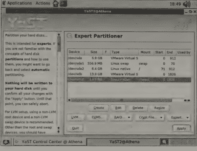

#### 图 5.2
Editing the /home partition fstab options.

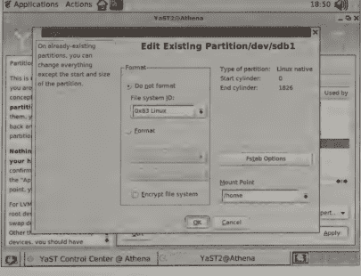

#### 图 5.3
Adding the usrquota option to the /home partition.

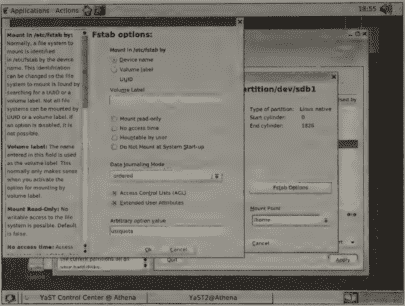

You can now create the initial files for the quota system by invoking the quotacheck command. This command looks at all partitions mounted on the system and creates, or verifies the consistency of, the files required for keeping track of disk usage and limits.

```
Athena:~ # quotacheck -augv
quotacheck: Scanning /dev/sdb1 [/home]
quotacheck: Cannot stat old user quota file: No such file or directory
quotacheck: Old group quota file not found. Usage will not be subtracted. done
quotacheck: Checked 92 directories and 220 files
quotacheck: Old file not found.
Athena:~ #
```

In this case, quotacheck recognized that on this system only the /home mount point had quotas turned on. It also noticed that there were no previous copies of the quota files and created new versions.

The next step is to activate the quota monitoring service. It is important to ensure that this service starts when the system itself restarts. Using the YaST Runlevel Editor, select the quota service to run on reboot.

At this point, it is prudent to reboot the system. Doing this remounts all the partitions with the appropriate parameters. When the system comes back up, you are ready to enable and set quotas.

You are now ready to assign quotas to individuals. The amount of disk space allowed for an individual will be left up to a corporate policy, a service-level agreement, or simply good judgment. The total amount of quota allocated to the users should not exceed the disk capacity. Doing so allows the disk to be filled even though a number of users are below quota. It also makes monitoring the quota more difficult. Disk space allocation in SUSE is done in 1KB blocks. Quota limits can therefore be directly related to the amount of disk space, in kilobytes. Similarly, there is a one-to-one relationship between inodes and files. Specifying an inode limit fixes the number of files a user can have independently of how large they become.

The command used to set a quota for a user is called setquota. This command takes the following syntax:

```
setquota -u user #blocks_soft #blocks_hard #inodes_soft #inodes_hard mount_point
```

In this command, the soft limits generate over-quota warnings, and the hard limits cause the system to prevent the consumption of additional resources. A policy should exist that users can receive a fixed quota. Starting the policy up front permits the users to police themselves and not lose important information when their quota is exhausted.

Current disk usage for a user can be determined using the du command:

```
Athena:~ # du -s /home/hart
116      /home/hart
Athena:~ # du -s /home/eric
548      /home/eric
```

In this example, you can see that the user hart has consumed only 116 blocks and eric has consumed 548. When this file system was created, each block was associated with a size of 1KB. The other parameter you need to understand is the inode value you want to use. An inode is a structure that keeps track of file information. In addition to size and access time stamps, an inode points to the string of blocks that make up the content of the file. The inode itself does not contain the data portion of the file. There is a one-to-one relationship between the number of inodes allocated and the number of files a user can generate. To find out how many inodes are available on the partition with quota, use the df command:

```
Athena:~ # df -i /home
Filesystem            Inodes    IUsed   IFree IUse% Mounted on
/dev/sdb1             1835008      322 1834686    1% /home
```

You have now collected enough information for setting quotas. Allow your users to consume 10 megabytes of disk space, which is the equivalent of 10,000 1K blocks, and create 20,000 files. Because you don't want users to hit the wall without any warning, place the soft limits at their target quotas and the fixed limits slightly above. First, check to see what quotas are in force for each user:

```
Athena:~ # quota eric
Disk quotas for user eric (uid 1001): none
Athena:~ # quota hart
Disk quotas for user hart (uid 1002): none
```

Now set limits:

```
Athena:~ # setquota -u eric 10000 11000 20000 21000 /home
Athena:~ # quota eric
Disk quotas for user eric (uid 1001):
     Filesystem     blocks   quota   limit   grace   files
     quota  limit   grace
     /dev/sdb1          548   10000   11000             130
     20000  21000
Athena:~ # setquota -u hart 10000 11000 20000 21000 /home

Athena:~ # quota hart
Disk quotas for user hart (uid 1002):
     Filesystem     blocks   quota   limit   grace   files
     quota  limit   grace
     /dev/sdb1          116   10000   11000              23
     20000  21000
Athena:~ #
```

The final step is to configure the system to send out warning messages when users are approaching their limits. The quota subsystem contains a procedure called warnquota. This routine checks all user quotas and dispatches messages to those who are over their quota. The configuration file containing the warnquota message is called /etc/warnquota.conf. A stripped-down version of this file is shown in Listing 5.9.

#### 清单 5.9
Disk Quota Warning Configuration File

```
/etc/warnquota.conf
# this is an example warnquota.conf
#
MAIL_CMD        = "/usr/bin/mail -t"
FROM            = "quota_op@localhost"
```

#### 清单 5.9.
磁盘配额警告配置文件（续）

```text
# but they don't have to be:
SUBJECT        = "Hey, user, clean up your account!"
CC_TO          = "root@localhost"
SUPPORT        = "HelpDesk@UniversalExport.ca"
PHONE          = "Ext. HELP or (4357)"
# Text in the beginning of the mail # This way text can be split to
more lines
# Line breaks are done by '|' character
MESSAGE        = "Hello, I've noticed you use too much space\
 on my disk|Delete your files on following filesystems:|
# Text in the end of the mail # is created)
SIGNATURE      = See you!|                         Your admin|
```

修改此文件以适应系统配置非常重要。默认情况下，MAIL_CMD 变量未指向有效的条目。

例如，用户 hart 一直在他的目录中收集文件。检查他的配额显示如下：

```text
Athena:/home/hart # quota hart
Disk quotas for user hart (uid 1002):
Filesystem blocks quota limit grace files
           quota limit grace
/dev/sdb1  10828* 10000 11000 6days 99
           20000 21000
```

运行 warnquota 会生成类似以下的电子邮件：

```text
From root@Athena.UniversalExport.ca Wed Feb 16 04:36:14 2005
Date: Wed, 16 Feb 2005 04:36:13 -0500
To: hart@Athena.UniversalExport.ca
Cc: root@localhost.UniversalExport.ca
Subject: Hey, user, clean up your account!
From: root@localhost.UniversalExport.ca (root)

Hello, I've noticed you use too much space on my disk
Delete your files on following filesystems:


/dev/sdb1

                         Block limits             File limits
Filesystem          used   soft   hard  grace   used  soft
/dev/sdb1      +-  10828  10000  11000  6days     99 20000
           -> 21000

See you!                           Your admin
```

作为系统管理员，您必须决定检查配额的频率。策略确定后，您可以将 `warnquota` 命令包含在 cron 条目中，以便按一致的计划运行。

用户 hart 然后可以选择减少使用量、申请更多磁盘空间或忽略警告。如果他选择后者，最终宽限期将到期，用户将无法创建额外文件。10 天后的一次示例登录会话将产生以下结果：

```text
hart@Athena:~>
hart@Athena:~>
hart@Athena:~> date
Sat Feb 26 08:45:48 EST 2005

hart@Athena:~>
hart@Athena:~> quota
Disk quotas for user hart (uid 1002):
     Filesystem  blocks  quota  limit  grace  files
quota  limit  grace
  /dev/sdb1  10828*  10000  11000  none  100
  20000  21000
hart@Athena:~>
hart@Athena:~>
hart@Athena:~> ls -la > files.txt
/bin/ls: write error: Disk quota exceeded
hart@Athena:~>
```

在本节中，我们看到在 SLES 下限制用户消耗的磁盘空间量是可能的。虽然目前配额管理不是 YaST 中的一个模块，但配置和监管起来相当简单。`warnquota` 实用程序应放置在 cron 作业中，在备份程序之前或之后每晚运行。这为用户提供了充分的违规警告。限制用户可用的磁盘空间量可确保资源在各方面都可用。监控资源消耗可让您更好地预测系统升级的需求。

### su 或 sudo

在 Unix 中，有两种类型的用户：root 和其他用户。root 账户，也称为超级用户，用于执行系统维护任务。如果用户需要在机器上拥有账户、机器需要关机进行维护，或应用程序需要直接访问以太网接口，则必须使用 root 账户。对 root 账户持有者的这种持续需求可能导致系统管理效率低下。

这个问题有两个解决方案。

- 共享 root 密码。
- 向他人授予特权访问权限。

第一个选项是不可接受的。从审计角度来看，通常不鼓励使用通用账户。基本上不可能追踪哪个具体个人访问了通用账户并执行了特定任务。尽管可能将谁在办公室并有权访问特定终端相关联，但这种做法通常是徒劳的。如果相关账户可以完全访问系统上的所有文件，共享该账户的密码会使系统上的所有信息面临风险。

健全的安全策略始终包括按需授予访问权限。当系统准备投入生产时，root 账户的大多数需求已经得到满足。在需要额外访问的情况下，应采用替代解决方案。这让我们回到第二个选项：授予额外权限。

su，substitute user，命令允许个人在另一个用户的账户上下文下启动 shell。这允许完全访问目标账户，包括文件、邮件和可用应用程序。转换可以针对简单命令或整个会话，具体取决于命令行参数。以下是 su 命令的几个变体及其生成环境：

```text
hart@Athena:~>
hart@Athena:~> pwd
/home/hart
hart@Athena:~> ls
bin        login.txt              photos       su
Documents  ls                     public_html  t2.html
exit       make_teams.good        pwd          test.html
key.txt    Monoalphabetic Crypto.txt  sheila.pdf  t,t
hart@Athena:~>
hart@Athena:~> su -l eric
Password:
eric@Athena:~> pwd
/home/eric
eric@Athena:~> ls
bin Desktop Documents exit ls public_html pwd su
eric@Athena:~> exit
logout
hart@Athena:~> pwd
/home/hart
hart@Athena:~>
```

在此示例中，创建了一个在 eric 账户下运行的 shell，就像调用了 Telnet 或 ssh 会话一样。

在此第二个示例中，`ls -l` 命令在 eric 账户的上下文中执行，并且控制权返回给属于 hart 的原始 shell：

```text
hart@Athena:~> su -l eric -c 'ls -l ; pwd'
Password:
total 16
drwxr-xr-x  2 eric users 4096 2005-02-15 06:48 bin
drwx------  3 eric users 4096 2005-02-15 07:04 Desktop
drwxr-xr-x  2 eric users 4096 2005-02-15 06:48 Documents
-rw-r--r--  1 eric users   12 2005-02-26 09:55 exit
-rw-r--r--  1 eric users  192 2005-02-26 09:55 ls
drwxr-xr-x  2 eric users 4096 2005-02-15 06:48 public_html
-rw-r--r--  1 eric users   16 2005-02-26 09:55 pwd
-rw-r--r--  1 eric users  517 2005-02-26 09:55 su
/home/eric
hart@Athena:~> pwd
/home/hart
hart@Athena:~>
```

su 命令为用户通过其他账户访问信息和资源提供了能力。然而，它确实要求个人共享密码。当这种情况发生时，密码不可避免地会被写下来或在最初预期接收者之外共享。在 root 账户的情况下，任何获得密码的人都可以使用 root 账户的所有功能。su 命令的所有活动都按预期记录在 `/var/log/messages` 中，提供了一定的审计措施。然而，在许多环境中，共享密码违反了企业 IT 政策。幸运的是，另一个实用程序解决了使用 su 命令遇到的许多问题：sudo。

sudo 实用程序提供与 su 等效的功能，但具有额外的粒度级别。sudo 的配置文件 `/etc/sudoers` 可用于限制哪些用户可以使用 sudo 以及他们被允许针对哪些账户。此外，sudo 可用于限制新 shell 可用的动词。

清单 5.10 显示了 `/etc/sudoers` 文件的可能配置。在此清单中，您可以看到各种可用别名类型的示例定义。User_Alias 可用于对相似用户进行分组。当前示例定义了 POWERUSER 和命令别名以定义命令组。

sudoers 文件的最后一部分包含向用户和用户别名授予权限。在当前示例中，eric 和 hart 能够执行通常与操作员类型职位相关的大多数功能。此外，eric 已被授予管理磁盘配额的权利。由于默认值

配置在 sudoers 文件中，eric 和 hart 必须知道 root 密码才能获得必要的权限。

与此相反，用户 belandja 可以直接访问 shutdown 命令，而无需知道 root 密码。这种功能在用户（如 Oracle DBA）在安装期间需要重启机器时通常很方便。因为此类用户在日常任务中不需要 root 密码，所以他们可以在无需额外支持人员的情况下自由重启服务器。

#### 清单 5.10
示例 /etc/sudoers 文件

```text
# sudoers file.
#
# This file MUST be edited with the 'visudo' command as root.
#
# Defaults specification
Defaults targetpw # ask for the password of the target user
#%users ALL=(ALL) ALL # WARNING! Only use this together
#with "Defaults targetpw"
#
# User privilege specification
# You should not use sudo as root in an SELinux environment
# If you use SELinux, remove the following line
root ALL=(ALL) ALL

User_Alias    POWERUSER = eric, hart

Cmnd_Alias    MNT = /bin/mount, /bin/umount
Cmnd_Alias    KILL = /bin/kill
Cmnd_Alias    USERMGMT = /usr/sbin/useradd, /usr/sbin/groupadd
Cmnd_Alias    PRINTING = /usr/sbin/lpc, /usr/sbin/lprm
Cmnd_Alias    SHUTDOWN = /bin/shutdown
Cmnd_Alias    REBOOT = /sbin/reboot

POWERUSER     ALL = (root) MNT, USERMGMT, KILL, PRINTING,
              SHUTDOWN, REBOOT
belandja ALL= NOPASSWD: /sbin/shutdown
eric     ALL= (root) /usr/sbin/setquota
```

在此配置生效的情况下，POWERUSER 组的成员可以执行他们需要执行的所有任务，但不会超出这些任务。对于用户 hart 来说，即使他可以 sudo 到 root，他也可以管理组但不能影响系统服务。这可以在以下在线会话摘录中看到：

```text
hart@Athena:~>
hart@Athena:~> sudo /usr/sbin/groupadd websales
Password:
hart@Athena:~> grep -we websales /etc/group
websales:x:1000:
hart@Athena:~>
hart@Athena:~> sudo /etc/init.d/xinetd stop
Sorry, user hart is not allowed to execute
"/etc/init.d/xinetd stop" as root on Athena.
hart@Athena:~>
```

在所有规则理清并向需要的人授予访问权限后，su 实用程序就可以退役了。最简单的方法是更改 /bin/su 的权限，不允许 Other 对程序具有执行访问权限。用 sudo 替换 su 命令——结合使用 PAM 将敏感账户限制在已知工作站上——大大降低了服务器的风险敞口。将 root 锁定到控制台可进一步保护账户免受外部访问。

### 摘要

在本章中，您看到可以做许多事情来使服务器环境更安全。与仅运行必要服务的概念相一致，即使在新安装的服务器上，也必须审计和维护账户。

在用户环境方面，本章研究了可插拔认证模块（PAM），并讨论了如何使用它来控制系统访问。PAM 是一种强大的工具，可用于控制系统访问、资源消耗以及标准的认证方法。关于可消耗资源，本章涉及了磁盘配额系统，并研究了如何使用它来防止磁盘空间耗尽。

为了进一步保护环境，您看到可以减少具有提升权限访问权限的用户数量。同时，您看到对于确实需要强大命令的个人，您可以授予他们根据其需求量身定制的命令集。

## 文件系统安全

Linux 系统（这对 Unix 也同样适用）的一个简单描述是“在 Linux 系统中，一切皆文件；如果某物不是文件，那就是一个进程”。有些实体不仅仅是文件（例如命名管道和套接字）；Linux 操作系统和 Linux 命令将它们视为文件。因此，为了简化讨论，可以公平地说一切皆文件。Linux 系统与 Unix 一样，不区分文件和目录，因为目录只是一个包含其他文件名称的文件。程序、服务、文本、图像等等都是文件。输入和输出设备，以及通常所有设备，根据系统都被视为文件。

Linux 系统支持多用户，为了让用户共享或保护其文件，实现了一个权限系统。这种保护机制有一些奇怪的转折。例如，要重命名或删除一个文件，您需要该文件所在目录的写权限。对权限工作原理的透彻理解可以让您使系统更安全、轻松地与其他用户共享数据并保护文件免受意外更改。本章回顾了 Linux 文件系统权限的基础知识——并揭示了一些黑暗角落——以及一些高级主题，例如访问控制列表（除了权限设置之外）和文件系统加密。

### 文件和目录权限回顾

在 Linux/Unix 世界中，对文件或目录的访问权限取决于您是否是文件或目录的所有者、分配的特定组的成员，或以上都不是。（另称为“other”或“world”）。换句话说，每个文件和目录都有三种可能的受托人分配（使用“NewWare”术语）。

#### 注意

目录只是一个包含文件和其他目录的特殊文件；因此，在下面的讨论中，除非另有说明，否则术语文件用于指代文件和目录。

命令 `ls -l` 显示了文件类型和文件权限设置等信息。图 6.1 显示了此类列表的示例并标识了权限适用性。如您所见，每个权限设置由三个字段（一个三元组）组成，并为三个受托人分别显示。每个字段可能的权限值列在表 6.1 中；权限始终按相同顺序排列：用户、组和其他（又名 world）的读、写和执行。

#### 图 6.1
文件类型和权限。

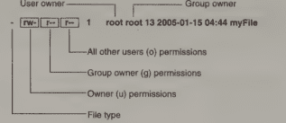

#### 表 6.1
符号权限值

| 权限 | 符号 | 描述 |
|---|---|---|
| 读取 | r | 在文件中，表示文件可读。在目录中，表示可以访问目录的内容。它位于三元组的第一位。 |
| 写入 | w | 在文件中，表示文件可被修改。在目录中，表示目录中的文件可以被创建、重命名或删除。它位于三元组的第二位。 |

#### 表 6.3
符号权限值（续）

| 权限 | 符号 | 描述 |
|---|---|---|
| 执行 | x | 在文件中，表示文件可执行。在目录中，表示可以遍历目录并搜索文件（如直接使用 `ls`）。它位于三元组的第三位。 |
| 粘滞 | t | 在目录上，粘滞位意味着除所有者或 root 之外的用户不能删除或重命名（但可以修改）此目录中的文件，即使他们对文件和目录具有写权限。此权限仅适用于“others”，位于三元组的第三位。在文件上，符号显示为 T 且无效果。小写 t 表示粘滞位和执行位均已设置；大写 T 表示粘滞位已设置，但执行位未设置。 |
| 设置 UID (SUID) 或设置 GID (SGID) | s | 仅适用于所有者或组权限三元组。当在文件的所有者三元组中发现时，表示执行时，该文件将以文件所有者的 UID 执行，而不是执行程序的用户 UID；如果设置在目录的所有者三元组上，则无效。如果设置在文件的组三元组中，执行的文件将假定为组所有者的 GID，而不是执行程序的用户的首要 GID。当设置在目录的组三元组上时，所有新文件和子目录将继承与目录本身相同的 GID——目录也将继承 SGID 位——而不是创建它们的用户的 GID；现有文件和子目录保持不变。小写 s 表示 SUID 或 SGID 位已打开，且对应的用户或组执行位也已打开；大写 S 表示 SUID 位已设置，但对应的执行位未设置。此设置显示在三元组的第三位。 |
| 无权限 | - | 如果此符号出现在权限三元组的任何位置，表示该位置未分配权限。 |

**注意**

粘滞位和 SUID/SGID 权限位将在本章后面“特殊文件权限”部分进一步讨论。


图 6.1 中的 `ls` 列表从左到右显示以下信息：

- 第一列的字符反映文件类型，可以是以下之一：
  - `-`，如示例所示，表示这是一个普通文件。
  - `b` 是一个块（缓冲）特殊文件（如磁带驱动器或软盘驱动器——例如 `/dev/fd0`）。
  - `c` 或 `u` 是面向字符（非缓冲）的特殊文件（如终端设备——例如 `/dev/ttyp0`）。
  - `d` 表示它是一个目录。
  - `l` 用于符号链接。
  - `p` 是一个特殊的 FIFO（先进先出）文件（如命名管道）。
  - `s` 是一个提供进程间网络的套接字文件。
- 第一个权限设置三元组 (`rw-`) 表示文件所有者可以读取和写入文件，但不能执行它（作为二进制程序或 shell 脚本）。
- 第二个三元组 (`r--`) 表示文件所属组成员只能读取文件。
- 第三个三元组 (`r--`) 表示其他所有人（通常称为 world，即“世界其他人”）只能读取文件。

#### 注意

如果在其他权限之后显示 `+`（例如 `r--+`），则表示文件已分配访问控制列表（ACL）。有关详细信息，请参阅本章后面的“扩展文件属性”部分。

- 文件的（硬）链接数；此示例中只有一个链接。
- 文件所有者是用户 root。
- 文件组所有者是 root 组。
- 文件大小（以字节为单位，本例中为 13 字节）。
- 修改时间。
- 文件名，`myFile`。

#### 注意

对于 shell 要执行包含 shell 脚本命令的文件，该文件必须设置正确的 `x` 权限位。例如，要使文件所有者和组所有者都能运行脚本文件，必须在相应的三元组上设置 `x` 权限。同样，如果二进制可执行文件（如 vi 编辑器）未设置 x 权限，则无法运行它。

另一方面，即使未设置执行位，你仍然可以通过输入 `sh filename` 对 shell 脚本、`perl filename` 对 Perl 脚本等方式执行脚本。区别在于运行的 shell 不会将脚本识别为可执行文件，但脚本解释器（如 `/usr/bin/perl`）会很高兴地解析脚本文件的内容并执行命令，即使 x 位未设置。

### 无所有者或组的文件

无所有者文件可能表明有人获得了对系统的访问权限——创建了一个后门用户，修改或创建了一些文件，然后删除了该后门用户而未完全掩盖其痕迹。有时这些文件可能只是包安装创建的文件。你应该定期使用 find 命令检查此类文件：

```
Athena:/home/admin # find / -nouser -o -nogroup
```

如果检测到任何无所有者文件，要么删除它们，要么如果知道它们是什么并且想保留它们，使用 chown 将它们分配给适当的用户和组。

请记住，find 命令运行可能需要一段时间，因为它需要检查系统上的每个文件。你可以考虑使用 -path 和 -prune 选项的组合来限制搜索范围。例如，以下 find 命令将跳过检查 /home/shared 目录及其以下的文件和目录：

```
Athena:/home/admin # find / -path '/home/shared' -prune -nouser -o -nogroup
```

rwx 权限对文件的含义相当直接。然而，将它们应用于目录时就不那么明显了。目录上的读 (r) 权限位允许你使用 ls 或类似工具访问其文件。原因在于目录是一种特殊类型的文件，其中包含存储在“目录中”的文件名称等内容。因此，能够读取目录让你可以访问存储在其中的文件。

同样，目录的写 (w) 权限让你可以修改目录的内容——例如更改存储在该目录中的文件的名称。要添加、删除或重命名文件，你需要对包含文件名称的目录具有写权限。如果目录受到写保护，则该目录中的条目列表无法更改——无论是意外还是故意。

目录上的执行 (x) 权限让你可以搜索该目录中的条目。即使你对目录具有读权限（这让你可以访问其中的文件），除非你同时具有执行权限，否则无法搜索其任何条目。这听起来可能有点令人困惑，但清单 6.1 中显示的示例简洁地演示了这一概念。

#### **清单 6.1**
目录上执行权限位的影响

```shell
# mkdir test
# *just to make sure only the owner has rights
# chmod go-wx test
# ls -ld test
drwx------ 2 peter users 48 2005-01-19 01:21 test
# *This is a permission test" > test/file.txt
# ls -l test
total 4
-rw-r--r-- 1 peter users 26 2005-01-19 01:21 file.txt
# * remove user’s execute bit
# chmod u-wx test
# ls -ld test
drw------ 2 peter users 72 2005-01-19 01:21 test
# *Hey, can’t see directory listing without ‘x’!
# ls -l test
/bin/ls: test/file.txt: Permission denied
total 0
# *does tell me filename but wouldn’t give file info!
# ls -l test/file.txt
/bin/ls: test/file.txt: Permission denied
# *can’t read file even I have ‘r’ to the file itself
# cat test/file.txt
cat: test/file.txt: Permission denied
# *put ‘x’ back on the directory
# chmod u+x test
# *can see the file now
# ls -l test/file.txt
-rw-r--r-- 1 peter users 26 2005-01-19 01:21 test/file.txt
# *What if no ‘r’ to directory, but have ‘x’?
# chmod u-r test
# ls -ld test
d-wx------ 2 peter users 72 2005-01-19 01:21 test
# *can’t do “wildcard” search without ‘r’
# ls test
/bin/ls: test: Permission denied
# *but okay if I know the exact filename!
# ls -l test/file.txt
```

#### 清单 6.1
目录上执行权限位的影响（续）

```text
-rw-r--r-- 1 peter users 26 2005-01-19 01:21 test/file.txt
# more test/file.txt
This is a permission test
```

如果目录上没有执行权限，你就无法访问其任何子目录。这意味着除非你对所有父目录（一直到根目录）都具有执行权限，否则无法访问一个目录！

#### 注意

root 用户不受任何 rwx 权限限制的影响。

一些图形应用程序可能无法很好地处理 Linux 权限。因为 Nautilus 等应用程序通常会显示包含目录中文件图标的对话框，因此它们必须能够“执行”目录。因此，在清单 6.1 显示的示例中，如果你尝试通过点击 test 来到达 test 下的子目录，你将无法做到。此外，由于 Nautilus 无法确定正确的文件类型，子目录（在大多数情况下）会使用文档图标显示。

### 更改权限

虽然使用图形界面（如 Nautilus（见图 6.2））更改权限设置要容易得多，但知道如何以“硬方式”执行任务会让你更好地理解 GUI 对话框中呈现的信息，但反之则不成立。因此，要成为一名有效的管理员或高级用户，你应该了解“幕后”发生了什么。

三个权限集中的每一个都存储为一个三位数字，每个位对应于读、写和执行权限之一。为了便于命令使用，访问权限和用户组都有代码，如表 6.2 和表 6.3 所示。

表 6.2

访问模式代码

| 文本权限符号 | 数值 | 描述 |
|---|---:|---|
| - | 0 | 无权限授予 |
| r | 4 | 读取访问 |
| w | 2 | 写入访问 |
| x | 1 | 执行访问 |

#### 图 6.2
使用 Nautilus 更改文件权限。

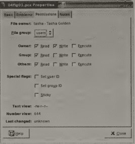

表 6.3

用户组代码

| 代码 | 描述 |
|---|---|
| u | 用户权限三元组 |
| g | 组权限三元组 |
| o | 其他用户或世界权限三元组 |
| a | 三个三元组的快捷方式 |

chmod 实用程序用于更改文件或目录的访问模式。你可以用数字代码或字母代码值使用它——以最适合你的方式为准。一般命令语法是

```
chmod access_mode_options target_file_or_directory
```

#### 注意

在 Linux/Unix 世界中，“chmod”一词已成为一个几乎可接受的英语动词，意为更改访问模式。


The access_mode_options uses the +, -, and = operators to add, remove, or assign permissions to a given group. Combinations separated by commas are allowed. The following example grants the owner of test full access while removing all access from the group owner and the world.

```
Athena: /home/admin/demo # chmod u=rwx,go-rwx test
```

#### 注意
If you specify more than one mode option, as is in the preceding example, ensure there are no spaces before or after the comma. For example, if you used chmod u=rwx, go-rwx test, chmod considers what comes after the space (go-rwx test) as filenames and results in a “No such file or directory” error when trying to access go-rwx.

如果指定多个模式选项，如前例所示，请确保逗号前后没有空格。例如，如果你使用 chmod u=rwx, go-rwx test，chmod 会将空格后的内容 (go-rwx test) 视为文件名，并在尝试访问 go-rwx 时导致 “No such file or directory” 错误。

If a file’s owner currently has the rw permission, for example, chmod u=rx will overwrite the current access rights with the new ones, while chmod u+rx will add the execute permission (because the read permission already has been granted).

如果文件的所有者当前具有 rw 权限，例如，chmod u=rx 将用新权限覆盖当前访问权限，而 chmod u+rx 将添加执行权限（因为读权限已经授予）。

When you use chmod with numeric arguments, the values for each granted access right have to be counted together per group. Thus, you get a three-digit number, which is the symbolic value for the settings chmod has to make. For example, for rw- permission, the corresponding numeric value (see Table 6.2) is (4=4) + (w=2) = 6. Therefore, the numeric value for rw-rw-rw- is 666. Table 6.4 lists the most commonly used numeric permission combinations to protect files and directories.

当使用 chmod 的数字参数时，每个授予的访问权限的值需要按组累加。因此，你会得到一个三位数，即 chmod 需要设置的符号值。例如，对于 rw- 权限，对应的数字值（见表 6.2）为 (4=4) + (w=2) = 6。因此，rw-rw-rw- 的数字值为 666。表 6.4 列出了保护文件和目录时最常用的数字权限组合。

#### 注意
There is actually a fourth digit, which precedes the first three and sets special access modes, namely the sticky bits and the SUID/SGID bits. These settings are further discussed in the “Special File Permissions” section later in this chapter. To simplify discussion here, you can consider that leading digit to be zero and can omit it when specifying values for chmod.

实际上还有第四位数字，它位于前三位之前，用于设置特殊访问模式，即粘滞位和 SUID/SGID 位。这些设置将在本章后面的“特殊文件权限”部分进一步讨论。为了简化此处的讨论，你可以将该前导数字视为零，并在为 chmod 指定值时省略它。

#### 表 6.4 常见的 chmod 设置

| COMMAND | TEXTUAL VALUE | MEANING |
|---|---|---|
| chmod 400 file | r-- --- --- | To protect a private file from being accidentally deleted or modified by the owner. |
| chmod 500 directory | r-x --- --- | To protect the owner from accidentally removing, renaming, or moving files from this private directory. |
| chmod 600 file | rw- --- --- | A file that can only be accessed and modified by the owner. A common setting for private files. |
| chmod 644 file | rw- r-- r-- | A publicly readable file that can only be modified by the owner. |
| chmod 660 file | rw- rw- --- | The owner and members of the group owner have access, but not the world. A common setting for shared files. |
| chmod 700 file | rwx --- --- | Only the owner has full access to the file, and the file can be executed (such as a shell script). A common setting for a private shell script or program. |
| chmod 701 directory | rwx --- --x | Generally set on the “outgoing” directory on an FTP server where users can download a file only if they know the exact filename. |
| chmod 703 directory | rwx --- -wx | Generally set on the “incoming” directory on an FTP server where users can upload to files but cannot browse or download existing files. |
| chmod 755 directory | rwx r-x r-x | For files in a directory that should be readable and executable by others, but only changeable by the owner. |
| chmod 775 file | rwx rwx r-x | Standard file-sharing setting for a group. |
| chmod 777 file | rwx rwx rwx | Everybody can do everything to this file. |

#### 警告
If you enter a number with fewer than four digits as an argument to chmod, omitted characters are replaced with zeros starting from the left. In other words, chmod 77 is the same as chmod 0077.

如果将少于四位数的数字作为 chmod 的参数输入，则省略的字符将从左侧开始用零填充。换句话说，chmod 77 与 chmod 0077 相同。

### 更改用户和组所有权

If the wrong user or group now owns a file or directory, the error can be repaired using the chown (change owner) and chgrp (change group) commands. Changing file ownership is a frequent system administrative task in environments where files need to be shared within a group.

如果错误的用户或组现在拥有文件或目录，可以使用 chown（更改所有者）和 chgrp（更改组）命令修复错误。在需要组内共享文件的环境中，更改文件所有权是频繁的系统管理任务。

The chown command can be applied to change both user and group ownership of a file/directory, while chgrp changes only the group ownership. Of course, the system will check if the user issuing one of these commands has sufficient permissions on the file(s) to be changed. The general syntax of chown is

chown 命令可用于更改文件/目录的用户和组所有权，而 chgrp 仅更改组所有权。当然，系统会检查发出其中一个命令的用户是否对要更改的文件具有足够的权限。chown 的一般语法是

```
chown [options] newuser[:newgroup] file
```

Instead of names, numeric UIDs/GIDs may be used instead.

可以使用数字 UID/GID 代替名称。

If a colon is used after the username and no group name is given, group ownership will be changed to the primary group of the (administrative) user issuing the command. If no username is provided but a :newgroup is specified, chown changes the group owner, performing the same function as chgrp, whose general syntax is

如果在用户名后使用冒号且未给出组名，则组所有权将更改为发出命令的（管理员）用户的初始组。如果未提供用户名但指定了 :newgroup，则 chown 会更改组所有者，执行与 chgrp 相同的功能，其一般语法是

```
chgrp [options] newgroup file
```

#### 注意
With SLES, instead of a colon in the chown/chgrp commands, you can use a period instead. However, it is a more standard convention to use a colon.

在 SLES 中，在 chown/chgrp 命令中使用冒号时，可以改用句点。然而，使用冒号是更标准的惯例。

Both chown and chgrp can be used to change ownership recursively, using the -R option. In that case, all underlying files and subdirectories of a given directory will belong to the given user and/or group.

chown 和 chgrp 都可以使用 -R 选项递归更改所有权。在这种情况下，给定目录下的所有底层文件和子目录都将属于指定的用户和/或组。

#### 提示
You can use the --from=user[:group] option with chown so that only those files and directories whose current owner and/or group match those specified will be assigned a new user and/or group owner. This capability is useful in reassigning ownership if the files and directories are scattered across a number of branches of a filesystem.

你可以使用 chown 的 --from=user[:group] 选项，以便只有当前所有者和/或组与指定项匹配的文件和目录才会被分配新的用户和/或组所有者。如果文件和目录分散在文件系统的多个分支中，此功能在重新分配所有权时很有用。

### 安全考虑

Incorrect file permissions may allow some users to read or modify files that they don’t supposedly have access to. The following are two incorrect file permission exploits a hacker will take advantage of: world-accessible (read and/or write) files and group-owned files.

不正确的[content]
The access_mode_options uses the +, -, and = operators to add, remove, or assign permissions to a given group. Combinations separated by commas are allowed. The following example grants the owner of test full access while removing all access from the group owner and the world.

```
Athena: /home/admin/demo # chmod u=rwx,go-rwx test
```

#### 注意
If you specify more than one mode option, as is in the preceding example, ensure there are no spaces before or after the comma. For example, if you used chmod u=rwx, go-rwx test, chmod considers what comes after the space (go-rwx test) as filenames and results in a “No such file or directory” error when trying to access go-rwx.

如果指定多个模式选项，如前例所示，请确保逗号前后没有空格。例如，如果你使用 chmod u=rwx, go-rwx test，chmod 会将空格后的内容 (go-rwx test) 视为文件名，并在尝试访问 go-rwx 时导致 “No such file or directory” 错误。

If a file’s owner currently has the rw permission, for example, chmod u=rx will overwrite the current access rights with the new ones, while chmod u+rx will add the execute permission (because the read permission already has been granted).

如果文件的所有者当前具有 rw 权限，例如，chmod u=rx 将用新权限覆盖当前访问权限，而 chmod u+rx 将添加执行权限（因为读权限已经授予）。

When you use chmod with numeric arguments, the values for each granted access right have to be counted together per group. Thus, you get a three-digit number, which is the symbolic value for the settings chmod has to make. For example, for rw- permission, the corresponding numeric value (see Table 6.2) is (4=4) + (w=2) = 6. Therefore, the numeric value for rw-rw-rw- is 666. Table 6.4 lists the most commonly used numeric permission combinations to protect files and directories.

当使用 chmod 的数字参数时，每个授予的访问权限的值需要按组累加。因此，你会得到一个三位数，即 chmod 需要设置的符号值。例如，对于 rw- 权限，对应的数字值（见表 6.2）为 (4=4) + (w=2) = 6。因此，rw-rw-rw- 的数字值为 666。表 6.4 列出了保护文件和目录时最常用的数字权限组合。

#### 注意
There is actually a fourth digit, which precedes the first three and sets special access modes, namely the sticky bits and the SUID/SGID bits. These settings are further discussed in the “Special File Permissions” section later in this chapter. To simplify discussion here, you can consider that leading digit to be zero and can omit it when specifying values for chmod.

实际上还有第四位数字，它位于前三位之前，用于设置特殊访问模式，即粘滞位和 SUID/SGID 位。这些设置将在本章后面的“特殊文件权限”部分进一步讨论。为了简化此处的讨论，你可以将该前导数字视为零，并在为 chmod 指定值时省略它。

#### 表 6.4 常见的 chmod 设置

| COMMAND | TEXTUAL VALUE | MEANING |
|---|---|---|
| chmod 400 file | r-- --- --- | To protect a private file from being accidentally deleted or modified by the owner. |
| chmod 500 directory | r-x --- --- | To protect the owner from accidentally removing, renaming, or moving files from this private directory. |
| chmod 600 file | rw- --- --- | A file that can only be accessed and modified by the owner. A common setting for private files. |
| chmod 644 file | rw- r-- r-- | A publicly readable file that can only be modified by the owner. |
| chmod 660 file | rw- rw- --- | The owner and members of the group owner have access, but not the world. A common setting for shared files. |
| chmod 700 file | rwx --- --- | Only the owner has full access to the file, and the file can be executed (such as a shell script). A common setting for a private shell script or program. |
| chmod 701 directory | rwx --- --x | Generally set on the “outgoing” directory on an FTP server where users can download a file only if they know the exact filename. |
| chmod 703 directory | rwx --- -wx | Generally set on the “incoming” directory on an FTP server where users can upload to files but cannot browse or download existing files. |
| chmod 755 directory | rwx r-x r-x | For files in a directory that should be readable and executable by others, but only changeable by the owner. |
| chmod 775 file | rwx rwx r-x | Standard file-sharing setting for a group. |
| chmod 777 file | rwx rwx rwx | Everybody can do everything to this file. |

#### 警告
If you enter a number with fewer than four digits as an argument to chmod, omitted characters are replaced with zeros starting from the left. In other words, chmod 77 is the same as chmod 0077.

如果将少于四位数的数字作为 chmod 的参数输入，则省略的字符将从左侧开始用零填充。换句话说，chmod 77 与 chmod 0077 相同。

### 更改用户和组所有权

If the wrong user or group now owns a file or directory, the error can be repaired using the chown (change owner) and chgrp (change group) commands. Changing file ownership is a frequent system administrative task in environments where files need to be shared within a group.

如果错误的用户或组现在拥有文件或目录，可以使用 chown（更改所有者）和 chgrp（更改组）命令修复错误。在需要组内共享文件的环境中，更改文件所有权是频繁的系统管理任务。

The chown command can be applied to change both user and group ownership of a file/directory, while chgrp changes only the group ownership. Of course, the system will check if the user issuing one of these commands has sufficient permissions on the file(s) to be changed. The general syntax of chown is

chown 命令可用于更改文件/目录的用户和组所有权，而 chgrp 仅更改组所有权。当然，系统会检查发出其中一个命令的用户是否对要更改的文件具有足够的权限。chown 的一般语法是

```
chown [options] newuser[:newgroup] file
```

Instead of names, numeric UIDs/GIDs may be used instead.

可以使用数字 UID/GID 代替名称。

If a colon is used after the username and no group name is given, group ownership will be changed to the primary group of the (administrative) user issuing the command. If no username is provided but a :newgroup is specified, chown changes the group owner, performing the same function as chgrp, whose general syntax is

如果在用户名后使用冒号且未给出组名，则组所有权将更改为发出命令的（管理员）用户的初始组。如果未提供用户名但指定了 :newgroup，则 chown 会更改组所有者，执行与 chgrp 相同的功能，其一般语法是

```
chgrp [options] newgroup file
```

#### 注意
With SLES, instead of a colon in the chown/chgrp commands, you can use a period instead. However, it is a more standard convention to use a colon.

在 SLES 中，在 chown/chgrp 命令中使用冒号时，可以改用句点。然而，使用冒号是更标准的惯例。

Both chown and chgrp can be used to change ownership recursively, using the -R option. In that case, all underlying files and subdirectories of a given directory will belong to the given user and/or group.

chown 和 chgrp 都可以使用 -R 选项递归更改所有权。在这种情况下，给定目录下的所有底层文件和子目录都将属于指定的用户和/或组。

#### 提示
You can use the --from=user[:group] option with chown so that only those files and directories whose current owner and/or group match those specified will be assigned a new user and/or group owner. This capability is useful in reassigning ownership if the files and directories are scattered across a number of branches of a filesystem.

你可以使用 chown 的 --from=user[:group] 选项，以便只有当前所有者和/或组与指定项匹配的文件和目录才会被分配新的用户和/或组所有者。如果文件和目录分散在文件系统的多个分支中，此功能在重新分配所有权时很有用。

### 安全考虑

Incorrect file permissions may allow some users to read or modify files that they don’t supposedly have access to. The following are two incorrect file permission exploits a hacker will take advantage of: world-accessible (read and/or write) files and group-owned files.

不正确的[content]
access_mode_options 使用 +、- 和 = 运算符来向给定组添加、移除或分配权限。允许使用逗号分隔的组合。以下示例授予 test 的所有者完全访问权限，同时移除组所有者和世界的所有访问权限。

```
Athena: /home/admin/demo # chmod u=rwx,go-rwx test
```

#### 注意
If you specify more than one mode option, as is in the preceding example, ensure there are no spaces before or after the comma. For example, if you used chmod u=rwx, go-rwx test, chmod considers what comes after the space (go-rwx test) as filenames and results in a “No such file or directory” error when trying to access go-rwx.

如果指定多个模式选项，如前例所示，请确保逗号前后没有空格。例如，如果你使用 chmod u=rwx, go-rwx test，chmod 会将空格后的内容 (go-rwx test) 视为文件名，并在尝试访问 go-rwx 时导致 “No such file or directory” 错误。

If a file’s owner currently has the rw permission, for example, chmod u=rx will overwrite the current access rights with the new ones, while chmod u+rx will add the execute permission (because the read permission already has been granted).

如果文件的所有者当前具有 rw 权限，例如，chmod u=rx 将用新权限覆盖当前访问权限，而 chmod u+rx 将添加执行权限（因为读权限已经授予）。

When you use chmod with numeric arguments, the values for each granted access right have to be counted together per group. Thus, you get a three-digit number, which is the symbolic value for the settings chmod has to make. For example, for rw- permission, the corresponding numeric value (see Table 6.2) is (4=4) + (w=2) = 6. Therefore, the numeric value for rw-rw-rw- is 666. Table 6.4 lists the most commonly used numeric permission combinations to protect files and directories.

当使用 chmod 的数字参数时，每个授予的访问权限的值需要按组累加。因此，你会得到一个三位数，即 chmod 需要设置的符号值。例如，对于 rw- 权限，对应的数字值（见表 6.2）为 (4=4) + (w=2) = 6。因此，rw-rw-rw- 的数字值为 666。表 6.4 列出了保护文件和目录时最常用的数字权限组合。

#### 注意
There is actually a fourth digit, which precedes the first three and sets special access modes, namely the sticky bits and the SUID/SGID bits. These settings are further discussed in the “Special File Permissions” section later in this chapter. To simplify discussion here, you can consider that leading digit to be zero and can omit it when specifying values for chmod.

实际上还有第四位数字，它位于前三位之前，用于设置特殊访问模式，即粘滞位和 SUID/SGID 位。这些设置将在本章后面的“特殊文件权限”部分进一步讨论。为了简化此处的讨论，你可以将该前导数字视为零，并在为 chmod 指定值时省略它。

#### 表 6.4 常见的 chmod 设置

| COMMAND | TEXTUAL VALUE | MEANING |
|---|---|---|
| chmod 400 file | r-- --- --- | 为了防止私有文件被所有者意外删除或修改。 |
| chmod 500 directory | r-x --- --- | 为了防止所有者意外删除、重命名或移动此私有目录中的文件。 |
| chmod 600 file | rw- --- --- | 只能由所有者访问和修改的文件。私有文件的常见设置。 |
| chmod 644 file | rw- r-- r-- | 公共可读文件，只能由所有者修改。 |
| chmod 660 file | rw- rw- --- | 所有者和组所有者的成员可以访问，但世界不能访问。共享文件的常见设置。 |
| chmod 700 file | rwx --- --- | 只有所有者对文件有完全访问权限，并且文件可以被执行（如 shell 脚本）。私有 shell 脚本或程序的常见设置。 |
| chmod 701 directory | rwx --- --x | 通常设置在 FTP 服务器的“输出”目录上，用户只有在知道确切文件名时才能下载文件。 |
| chmod 703 directory | rwx --- -wx | 通常设置在 FTP 服务器的“输入”目录上，用户可以上传文件但不能浏览或下载现有文件。 |
| chmod 755 directory | rwx r-x r-x | 目录中的文件应可被他人读取和执行，但只能由所有者更改。 |
| chmod 775 file | rwx rwx r-x | 组的标准文件共享设置。 |
| chmod 777 file | rwx rwx rwx | 每个人都可以对该文件执行任何操作。 |

#### 警告
If you enter a number with fewer than four digits as an argument to chmod, omitted characters are replaced with zeros starting from the left. In other words, chmod 77 is the same as chmod 0077.

如果将少于四位数的数字作为 chmod 的参数输入，则省略的字符将从左侧开始用零填充。换句话说，chmod 77 与 chmod 0077 相同。

### 更改用户和组所有权

If the wrong user or group now owns a file or directory, the error can be repaired using the chown (change owner) and chgrp (change group) commands. Changing file ownership is a frequent system administrative task in environments where files need to be shared within a group.

如果错误的用户或组现在拥有文件或目录，可以使用 chown（更改所有者）和 chgrp（更改组）命令修复错误。在需要组内共享文件的环境中，更改文件所有权是频繁的系统管理任务。

The chown command can be applied to change both user and group ownership of a file/directory, while chgrp changes only the group ownership. Of course, the system will check if the user issuing one of these commands has sufficient permissions on the file(s) to be changed. The general syntax of chown is

chown 命令可用于更改文件/目录的用户和组所有权，而 chgrp 仅更改组所有权。当然，系统会检查发出其中一个命令的用户是否对要更改的文件具有足够的权限。chown 的一般语法是

```
chown [options] newuser[:newgroup] file
```

Instead of names, numeric UIDs/GIDs may be used instead.

可以使用数字 UID/GID 代替名称。

If a colon is used after the username and no group name is given, group ownership will be changed to the primary group of the (administrative) user issuing the command. If no username is provided but a :newgroup is specified, chown changes the group owner, performing the same function as chgrp, whose general syntax is

如果在用户名后使用冒号且未给出组名，则组所有权将更改为发出命令的（管理员）用户的初始组。如果未提供用户名但指定了 :newgroup，则 chown 会更改组所有者，执行与 chgrp 相同的功能，其一般语法是

```
chgrp [options] newgroup file
```

#### 注意
With SLES, instead of a colon in the chown/chgrp commands, you can use a period instead. However, it is a more standard convention to use a colon.

在 SLES 中，在 chown/chgrp 命令中使用冒号时，可以改用句点。然而，使用冒号是更标准的惯例。

Both chown and chgrp can be used to change ownership recursively, using the -R option. In that case, all underlying files and subdirectories of a given directory will belong to the given user and/or group.

chown 和 chgrp 都可以使用 -R 选项递归更改所有权。在这种情况下，给定目录下的所有底层文件和子目录都将属于指定的用户和/或组。

#### 提示
You can use the --from=user[:group] option with chown so that only those files and directories whose current owner and/or group match those specified will be assigned a new user and/or group owner. This capability is useful in reassigning ownership if the files and directories are scattered across a number of branches of a filesystem.

你可以使用 chown 的 --from=user[:group] 选项，以便只有当前所有者和/或组与指定项匹配的文件和目录才会被分配新的用户和/或组所有者。如果文件和目录分散在文件系统的多个分支中，此功能在重新分配所有权时很有用。

### 安全考虑

Incorrect file permissions may allow some users to read or modify files that they don’t supposedly have access to. The following are two incorrect file permission exploits a hacker will take advantage of: world-accessible (read and/or write) files and group-owned files.

不正确的[content]
access_mode_options 使用 +、- 和 = 运算符来向给定组添加、移除或分配权限。允许使用逗号分隔的组合。以下示例授予 test 的所有者完全访问权限，同时移除组所有者和世界的所有访问权限。

```
Athena: /home/admin/demo # chmod u=rwx,go-rwx test
```

#### 注意
If you specify more than one mode option, as is in the preceding example, ensure there are no spaces before or after the comma. For example, if you used chmod u=rwx, go-rwx test, chmod considers what comes after the space (go-rwx test) as filenames and results in a “No such file or directory” error when trying to access go-rwx.

如果指定多个模式选项，如前例所示，请确保逗号前后没有空格。例如，如果你使用 chmod u=rwx, go-rwx test，chmod 会将空格后的内容 (go-rwx test) 视为文件名，并在尝试访问 go-rwx 时导致 “No such file or directory” 错误。

If a file’s owner currently has the rw permission, for example, chmod u=rx will overwrite the current access rights with the new ones, while chmod u+rx will add the execute permission (because the read permission already has been granted).

如果文件的所有者当前具有 rw 权限，例如，chmod u=rx 将用新权限覆盖当前访问权限，而 chmod u+rx 将添加执行权限（因为读权限已经授予）。

When you use chmod with numeric arguments, the values for each granted access right have to be counted together per group. Thus, you get a three-digit number, which is the symbolic value for the settings chmod has to make. For example, for rw- permission, the corresponding numeric value (see Table 6.2) is (4=4) + (w=2) = 6. Therefore, the numeric value for rw-rw-rw- is 666. Table 6.4 lists the most commonly used numeric permission combinations to protect files and directories.

当使用 chmod 的数字参数时，每个授予的访问权限的值需要按组累加。因此，你会得到一个三位数，即 chmod 需要设置的符号值。例如，对于 rw- 权限，对应的数字值（见表 6.2）为 (4=4) + (w=2) = 6。因此，rw-rw-rw- 的数字值为 666。表 6.4 列出了保护文件和目录时最常用的数字权限组合。

#### 注意
There is actually a fourth digit, which precedes the first three and sets special access modes, namely the sticky bits and the SUID/SGID bits. These settings are further discussed in the “Special File Permissions” section later in this chapter. To simplify discussion here, you can consider that leading digit to be zero and can omit it when specifying values for chmod.

实际上还有第四位数字，它位于前三位之前，用于设置特殊访问模式，即粘滞位和 SUID/SGID 位。这些设置将在本章后面的“特殊文件权限”部分进一步讨论。为了简化此处的讨论，你可以将该前导数字视为零，并在为 chmod 指定值时省略它。

#### 表 6.4 常见的 chmod 设置

| COMMAND | TEXTUAL VALUE | MEANING |
|---|---|---|
| chmod 400 file | r-- --- --- | 为了防止私有文件被所有者意外删除或修改。 |
| chmod 500 directory | r-x --- --- | 为了防止所有者意外删除、重命名或移动此私有目录中的文件。 |
| chmod 600 file | rw- --- --- | 只能由所有者访问和修改的文件。私有文件的常见设置。 |
| chmod 644 file | rw- r-- r-- | 公共可读文件，只能由所有者修改。 |
| chmod 660 file | rw- rw- --- | 所有者和组所有者的成员可以访问，但世界不能访问。共享文件的常见设置。 |
| chmod 700 file | rwx --- --- | 只有所有者对文件有完全访问权限，并且文件可以被执行（如 shell 脚本）。私有 shell 脚本或程序的常见设置。 |
| chmod 701 directory | rwx --- --x | 通常设置在 FTP 服务器的“输出”目录上，用户只有在知道确切文件名时才能下载文件。 |
| chmod 703 directory | rwx --- -wx | 通常设置在 FTP 服务器的“输入”目录上，用户可以上传文件但不能浏览或下载现有文件。 |
| chmod 755 directory | rwx r-x r-x | 目录中的文件应可被他人读取和执行，但只能由所有者更改。 |
| chmod 775 file | rwx rwx r-x | 组的标准文件共享设置。 |
| chmod 777 file | rwx rwx rwx | 每个人都可以对该文件执行任何操作。 |

#### 警告
If you enter a number with fewer than four digits as an argument to chmod, omitted characters are replaced with zeros starting from the left. In other words, chmod 77 is the same as chmod 0077.

如果将少于四位数的数字作为 chmod 的参数输入，则省略的字符将从左侧开始用零填充。换句话说，chmod 77 与 chmod 0077 相同。

### 更改用户和组所有权

If the wrong user or group now owns a file or directory, the error can be repaired using the chown (change owner) and chgrp (change group) commands. Changing file ownership is a frequent system administrative task in environments where files need to be shared within a group.

如果错误的用户或组现在拥有文件或目录，可以使用 chown（更改所有者）和 chgrp（更改组）命令修复错误。在需要组内共享文件的环境中，更改文件所有权是频繁的系统管理任务。

The chown command can be applied to change both user and group ownership of a file/directory, while chgrp changes only the group ownership. Of course, the system will check if the user issuing one of these commands has sufficient permissions on the file(s) to be changed. The general syntax of chown is

chown 命令可用于更改文件/目录的用户和组所有权，而 chgrp 仅更改组所有权。当然，系统会检查发出其中一个命令的用户是否对要更改的文件具有足够的权限。chown 的一般语法是

```
chown [options] newuser[:newgroup] file
```

Instead of names, numeric UIDs/GIDs may be used instead.

可以使用数字 UID/GID 代替名称。

If a colon is used after the username and no group name is given, group ownership will be changed to the primary group of the (administrative) user issuing the command. If no username is provided but a :newgroup is specified, chown changes the group owner, performing the same function as chgrp, whose general syntax is

如果在用户名后使用冒号且未给出组名，则组所有权将更改为发出命令的（管理员）用户的初始组。如果未提供用户名但指定了 :newgroup，则 chown 会更改组所有者，执行与 chgrp 相同的功能，其一般语法是

```
chgrp [options] newgroup file
```

#### 注意
With SLES, instead of a colon in the chown/chgrp commands, you can use a period instead. However, it is a more standard convention to use a colon.

在 SLES 中，在 chown/chgrp 命令中使用冒号时，可以改用句点。然而，使用冒号是更标准的惯例。

Both chown and chgrp can be used to change ownership recursively, using the -R option. In that case, all underlying files and subdirectories of a given directory will belong to the given user and/or group.

chown 和 chgrp 都可以使用 -R 选项递归更改所有权。在这种情况下，给定目录下的所有底层文件和子目录都将属于指定的用户和/或组。

#### 提示
You can use the --from=user[:group] option with chown so that only those files and directories whose current owner and/or group match those specified will be assigned a new user and/or group owner. This capability is useful in reassigning ownership if the files and directories are scattered across a number of branches of a filesystem.

你可以使用 chown 的 --from=user[:group] 选项，以便只有当前所有者和/或组与指定项匹配的文件和目录才会被分配新的用户和/或组所有者。如果文件和目录分散在文件系统的多个分支中，此功能在重新分配所有权时很有用。

### 安全考虑

Incorrect file permissions may allow some users to read or modify files that they don’t supposedly have access to. The following are two incorrect file permission exploits a hacker will take advantage of: world-accessible (read and/or write) files and group-owned files.

不正确的文件权限可能会允许某些用户读取或修改他们本不应该访问的文件。以下是不正确的两种文件权限利用方式，黑客会利用这些方式：世界可访问（读和/或写）文件和组拥有的文件。

Many system-related files are stored in /etc. Some are world-readable, such as the xinetd configuration files. However, some /etc files should not be world-readable. For example, the /etc/shadow file contains hashed user passwords that should be restricted from world access. Anyone with access to this file may brute-force crack passwords using tools such as John the Ripper. You can easily locate world-readable files using the following find command:

许多系统相关文件存储在 /etc 中。有些是世界可读的，例如 xinetd 配置文件。然而，一些 /etc 文件不应是世界可读的。例如，/etc/shadow 文件包含应限制世界访问的哈希用户密码。任何有权访问此文件的人都可能使用 John the Ripper 等工具暴力破解密码。你可以使用以下 find 命令轻松定位世界可读文件：

```
$ find / -type f -perm -4 -print 2> /dev/null
```

It is not uncommon for an administrator to make a backup copy of an important system file (perhaps /etc/shadow) before making modifications or testing a procedure. Perhaps due to an oversight on the umask setting (discussed in the “Default Access Permissions” section later in this chapter), the newly created backup file will be world-readable, even if the original file was not! And when that happens to something sensitive like the shadow password file, your system could be compromised.

管理员在修改或测试程序之前制作重要系统文件（也许是 /etc/shadow）的备份副本并不罕见。也许由于 umask 设置上的疏忽（将在本章后面的“默认访问权限”部分讨论），新创建的备份文件将是世界可读的，即使原始文件不是！当这种情况发生在 shadow 密码文件等敏感内容上时，你的系统可能会被入侵。

World-writable files or directories can result in Denial of Service (DoS) attacks or a Trojan horse installation. For instance, it is fairly easy to fill up a filesystem with data when a world-writable file or directory is found. Similarly, a world-writable binary can easily be turned into a Trojan horse; a world-writable xinetd/inetd configuration file can become the source of a backdoor. For example, if /etc/xinetd.d or one of its configuration files (such as vnc) is world-writable, someone could add or modify an existing service and launch an alternate binary. As is the case with world-readable files, you can easily locate world-writable files using the following find command:

世界可写文件或目录可能导致拒绝服务（DoS）攻击或特洛伊木马安装。例如，当发现世界可写文件或目录时，填充文件系统的数据相对容易。同样，世界可写的二进制文件很容易被改造成特洛伊木马；世界可写的 xinetd/inetd 配置文件可能成为后门的来源。例如，如果 /etc/xinetd.d 或其配置文件之一（如 vnc）是世界可写的，有人可以添加或修改现有服务并启动替代二进制文件。与世界可读文件一样，你可以使用以下 find 命令轻松定位世界可写文件：

```
$ find / -type f -perm -2 -print 2> /dev/null
```

### 服务后门
> Say your /etc/xinetd.d/telnet file is writable by someone other than root. Some malicious user or hacker may come across it and make two small modifications: change /usr/sbin/in.telnetd to /bin/bash and enable it to service if it is disabled. Now, when you connect via Telnet, it drops you into a “root shell” (because the service runs as root) instantly! No username prompt; no password prompt. The catch here is that you can’t run any interactive program, such as vi, and each command you send must be appended with a semicolon (;) or ampersand (&). (For each successful command executed, you will see a “command not found” message displayed by the shell.)

> 假设你的 /etc/xinetd.d/telnet 文件可被 root 以外的用户写入。某些恶意用户或黑客可能会发现它并进行两处小修改：将 /usr/sbin/in.telnetd 改为 /bin/bash 并在禁用时启用该服务。现在，当你通过 Telnet 连接时，它会立即将你放入“root shell”（因为服务以 root 运行）！没有用户名提示；没有密码提示。这里的陷阱是，你不能运行任何交互式程序，例如 vi，并且你发送的每个命令都必须附加分号（;）或与号（&）。（对于每次成功执行的命令，你会看到 shell 显示“command not found”消息。）


> 由于 Linux 是开源软件，其几乎所有组件都以源代码格式自由可用。黑客只需修改某些 SUID 程序，例如 ping 或 passwd，然后等待它在执行时生成一个隐藏的 root SUID shell。
>
> 作为管理员，您应经常检查是否有任何先前禁用的服务突然处于活动状态，并检查配置文件内容是否存在不熟悉的更改。热门目标是使用特权端口（低于 1024 的端口）的服务，因为它们通常以 root 身份运行。然而，任何以 root 身份运行的服务都可能成为目标。

通常，应用程序的配置文件设置为组可读且可写。同时，一些应用程序会在其配置文件中以明文形式存储密码。此外，人性表明，某人（例如系统管理员）为服务器登录和应用程序登录使用相同密码的概率很高。因此，如果黑客获得了名为 eric 的无特权账户的访问权限，就有机会在 Eric 有权访问的一个组拥有的文件中找到 root 密码。

首先，在黑客使用账户 eric 登录后，他可以通过使用 id 命令来查找 Eric 属于哪些组：

```text
$ id
uid=1001(eric) gid=100(users) groups=100(users),201(web)
```

在注意到 Eric 属于名为 web 的组后，黑客然后可以使用 find 命令来定位该组拥有的所有文件：

```text
$ find / -group web -print 2> /dev/null
/projects/web/README
/projects/web/password.txt
/projects/web/index.html
/projects/web/passwd.txt.backup
```

而这两个 passwd.* 文件可能很有趣！

从密码文件中的信息，黑客可能获得对其他账户的访问权限，这反过来可能导致更多密码。随着周期的进行，黑客最终可能获得 root 访问权限。因此，设计和执行良好的安全程序非常重要。（请参阅第 11 章“网络安全概念”中的“企业安全策略”部分了解更多信息。）

### 默认访问权限

当用户创建文件或目录时，一个称为 umask 设置的权限掩码控制最终分配的权限。umask 是一个内置的 shell 函数，它会删除（“屏蔽”）程序设置的某些权限位。文件或目录最终的权限位如下：当文件新创建时，内核将其分配为 666（rw-rw-rw-）的权限模式，而目录则为 777（rwxrwxrwx）。但在权限实际设置之前，会先应用 umask 值。umask 值的指定方式与 chmod 相同：首先是用户掩码，然后是组掩码；最后是其他人（目前跳过特殊模式掩码）。因此，如果 umask 值为 022，最终的文件权限设置是 644（rw-r--r--）。通常认为这是通过从默认权限设置中减去 umask 值得到的。虽然在此示例中的最终结果反映了这种说法——并且使过程更容易记住——但实际的机制并不完全如此。（例如，如果 umask 是 027 呢？）

实际上发生的情况是，所请求的权限设置（示例中为 666）会与 umask 值的一的补码（即位翻转）进行逻辑与运算。表 6.5 显示了逻辑与操作的“真值表”；例如，0 & 0 的结果为 0，1 & 1 的结果为 1，依此类推。

**表 6.5**

**逻辑与真值表**

| & | 0 | 1 |
|---|---|---|
| 0 | 0 | 0 |
| 1 | 0 | 1 |

当您处理逻辑与操作时，以二进制模式工作更容易。表 6.6 说明了默认权限值 666 如何被 umask 设置 022“屏蔽”。

**表 6.6**

**umask 值一的补码与默认权限的逻辑与**

|  | U | G | O |
|---|---:|---:|---:|
| umask 设置为 022 | 000 | 010 | 010 |
| umask 值的一的补码 | 111 | 101 | 101 |
| 666 的默认权限 | 110 | 110 | 110 |
| 应用逻辑与 |  |  |  |
| 结果 | 110 | 100 | 100 |
| 十进制值 | 6 | 4 | 4 |

如前所述，如果您的 umask 是 027 呢？减法概念现在不适用了，对吗？这里讨论的“正确机制”表明，结果的权限设置是 640，如表 6.7 所示。

**表 6.7**  
*使用 umask 为 027 的文件权限设置*

|  | U | G | O |
|---|---:|---:|---:|
| umask 设置为 027 | 000 | 010 | 111 |
| umask 值的一的补码 | 111 | 101 | 000 |
| 666 的默认权限 | 110 | 110 | 110 |
| 应用逻辑与 |  |  |  |
| 结果 | 110 | 100 | 000 |
| 十进制值 | 6 | 4 | 0 |

SLES 在 `/etc/profile` 中设置默认 umask 值（022）。因此，当用户启动 shell（例如通过登录到服务器）时，此值会自动设置。此外，新子进程会从其父进程获取 umask 值（和其他 shell 信息）。然而，在进程生成后，它可以自由更改其 shell 环境，例如 umask 设置——这些更改不会传播回其父进程或其他现有子进程。如果您想更改 umask，可以在主目录的 `.profile` 或 shell 使用的配置文件之一（例如 `.bashrc`）中包含命令 `umask mask_value`，以便在您登录或启动新 shell 时生效。

请记住，使用 umask 022 时，系统应用程序（例如 vi 和 mkdir）会创建具有 644（rw-r--r--）权限的文件和具有 755（rwx-r-xr-x）权限的目录。世界用户可以读取（从而复制）新创建的文件和目录。如果您也有来自公司外部的访客用户访问服务器，这可能不是一个好主意。更好的默认 umask 设置是 027。这样的 umask 将消除对任何新创建文件和目录的全局访问。您以后可以使用 chmod 选择性地使某些内容对所有人可用。

#### 警告

任何用户或进程都可以为其 shell 设置 umask。因此，即使您在 `/etc/profile` 中放置了更严格的 umask 027，任何用户都可以轻松地用更宽松的设置覆盖它。由于 umask 是内置的 shell 函数，您无法轻易限制其通用使用；您需要通过编译修改后的源代码来创建一个自定义 shell 才能做到这一点。最好教育用户，更严格的设置符合每个人的最大利益，不应更改。

SLES 包含许多工具来帮助您维护系统文件和目录权限的完整性。例如，seccheck（SUSE Security Checker）包可以报告组可写和/或世界可写的可执行文件。YaST 包含一个本地安全配置模块（控制中心、安全和用户、安全设置；或从终端会话运行 yast security），可将文件权限级别配置为简单、安全或偏执。您可以使用 SuSEConfig 根据 /etc/permissions* 的规范相应地设置或重置文件权限。

### 特殊文件权限

除了前面讨论的基本权限外，您还可以为文件和目录设置三个特殊权限位：

- **SUID 位**—通常称为 SUID 位，因为使用了 API 调用的名称，此位会在执行时更改用户 ID。当程序在设置了 SUID 位的情况下执行时，该进程将具有与正在执行的文件所有者相同的权限。

- **SGID 位**—通常称为 SGID 位，因为使用了 API 调用的名称，此位会在执行时更改组 ID。它与 SUID 位操作相同，但继承文件所有者组的权限。如果设置在目录上，则意味着在目录中创建新文件时，新文件的组所有者将与目录的组所有者相同。

> **注意**
>
> 由于 shell 脚本固有的安全性不紧密，Linux 已禁用了它们的 SUID/SGID 支持：您可以设置这些位，但它们没有效果。如果您需要 SUID/SGID 脚本，请改用 Perl。有关更多信息，请参阅 man perlsec。

- **粘滞位**—在旧的 Unix 内核中，此位用于在程序完成后使其“粘住”在内存中（这样下次执行应用程序时，它已在内存中）；现在随着虚拟内存的出现，这种用法已过时。当设置在目录上时，粘滞位可确保非 root 用户只能删除他们拥有该目录中的文件。粘滞位仅适用于目录的世界权限设置；应用于文件时无效。


#### 注记
经常，SUID 位被系统应用程序或脚本使用，以便进程可以作为 root 访问系统资源。另一方面，SGID 位并不经常被系统程序使用，但主要被系统管理员用来设置共享目录。

#### 警告
您应密切监控设置了 SUID 和/或 SGID 位的程序和脚本。黑客利用某些漏洞后留下 root SUID 程序作为后门的情况相当常见。关键在于使用 Tripwire（参见第 12 章，“入侵检测”）、Bastille 和 seccheck（参见第 13 章，“系统安全”）等应用程序并跟踪您的系统！

要设置这三种特殊权限位中的任何一种，chmod 需要第四位数字。此值指定为最显著的（最左边的）数字，其可能的值列于表 6.8 中。例如，chmod 1777 testDir 表示所有者、组和其他用户对 testDir 具有完全的读、写和执行权限，并且世界权限的粘滞位也被设置。ls 输出看起来像这样：

```
Athena:/home/admin # chmod 1777 testDir
Athena:/home/admin # ls -l testDir
drwxrwxrwt  2 root admin 48 2005-01-19 17:35 testDir
```

#### 表 6.8
##### 特殊权限模式代码

| 八进制数字 | 二进制值 | 描述 |
|---:|---:|---|
| 0 | 000 | SUID、SGID 和粘滞位均未设置 |
| 1 | 001 | 粘滞位已设置 |
| 2 | 010 | SGID 位已设置 |
| 3 | 011 | SGID 和粘滞位已设置 |
| 4 | 100 | SUID 位已设置 |
| 5 | 101 | SUID 和粘滞位已设置 |
| 6 | 110 | SUID 和 SGID 位已设置 |
| 7 | 111 | SUID、SGID 和粘滞位均已设置 |

使用文本值的相应 chmod 命令是 chmod a+rwx,o+t testDir。ls 显示的特殊模式符号反映了对应的执行位是否也被设置。例如，如果粘滞位已设置但世界的可执行位未设置，则显示符号 T 而不是 t。表 6.9 总结了根据执行位设置显示的特殊模式符号。

#### 表 6.9
##### 特殊权限文本表示

|  | 执行位未设置 | 执行位已设置 |
|---|---|---|
| SUID | `---S------` | `---s------` |
| SGID | `------S---` | `------s---` |
| Sticky | `---------T` | `---------t` |

> **注记**
> 
> 当您使用 chmod 中的文本值设置这些特殊权限模式时，请使用小写字符，例如 s 和 t，而不是大写字符。大小写区分由 ls 用于显示不同的权限组合。

### SUID/SGID 的安全影响
值得讨论 Linux/Unix 世界中 SUID 和 SGID 程序和脚本的需求，即使它们可能被黑客留下的特洛伊木马。 首先，考虑 /etc/passwd 文件。只有文件所有者（root）对其具有写访问权限（rw-r--r--）。然而，作为普通用户，您可以使用 passwd 和 chsh 命令以非常有限的方式修改此文件的内容。

对 /usr/bin/passwd 程序的权限位检查显示，文件所有者的 SUID 和执行位均已设置（rwsr-xr-x）。这表明 passwd 实用程序是一个 root SUID 程序。它之所以是 SUID 程序，是因为权限位中的 s 标志，而它之所以是 root SUID 程序，是因为 root 拥有该文件。因此，当任何人运行 passwd 程序时，用户暂时获得 root 用户的权限——但仅限于程序执行期间，并且仅限于该程序内部。没有这种机制，许多系统管理任务会因安全影响而变得不必要地复杂。例如，您如何有效地保护 /etc/shadow 文件，同时允许用户更新自己的密码？

另一方面，SUID API 调用可用于降低用户的权限而不是提高权限。例如，对于基于 IP 的服务要绑定到特权端口之一，它需要以 root 身份运行。然而，在端口绑定后，应用程序不再需要 root 权限；它可以使用 SUID 调用将进程的 UID 更改为非特权用户。或者一个程序可能以 root 身份运行，但出于安全原因，它可以生成以较低特权级别运行的进程。一个例子是 Apache Web 服务器；其 `suexec` 实用程序（参见 http://httpd.apache.org/docs-2.0/suexec.html）以用户 `wwwrun` 和组 `www`（SLES 9 上的默认设置）而不是作为主 Apache 进程的所有者执行 CGI 和 SSI 程序，主 Apache 进程通常以 root 运行。

#### 注记
对于应用程序成为 SUID 程序，它必须进行 SUID 或类似的 API 调用（SUID 调用有多种变体），并且文件权限位必须相应设置。仅仅在程序上设置 SUID 位并不会自动使其成为 SUID 程序。

组所有权有相同的机制。例如，如果您检查 `/usr/bin/uucp` 的权限，您会看到用户和组的 s 标志（`r-sr-sr-x`）。因此，当您运行 uucp（Unix-to-Unix CoPy）时，您暂时获得拥有用户（uucp）和拥有组（uucp）的权利。

SUID 脚本通常比 SUID 程序更危险。这在很大程度上是由于运行脚本首先会调用一个 shell。如果脚本是 SUID root，则调用的 shell 将以 root 权限运行。在 shell 被调用但脚本运行之前，可以中断内核并替换 shell 即将执行的文件。被替换的文件可能是任何可执行的 shell 脚本，包括另一个 shell（在这种情况下将是 root shell）。由于这些安全影响，Linux 系统早已禁用了 SUID/SGID shell 脚本的支持。如果您确实需要一个执行 SUID/SGID 的脚本，请使用启用了 taint 模式的 Perl 开发它。

#### 提示
当 Perl 脚本文件设置了其 SUID 和/或 SGID 位时，Perl 解释器会自动进入偏执模式并执行一系列特殊安全检查以检测可能受污染的数据，例如验证 PATH 变量中指定的目录是否不可被他人写入。您可以通过在脚本开头使用 `-T` 命令行标志显式启用此 taint 模式，即 `#!/usr/bin/perl -T`。该标志强烈建议用于服务器程序以及代表他人运行的任何程序，例如 CGI 脚本。当 taint 模式打开时，它将保持打开状态，直到脚本结束。

您可以使用 Tripwire、Bastille 和 seccheck 等应用程序自动搜索和报告可疑的 SUID/SGID 程序和脚本。

但如果您是一位刚到客户现场进行安全审计的顾问，以下命令可能很有用：

- 获取所有 SUID 或 SGID 文件（程序和脚本）的列表，请使用以下命令：

```
# find / -type f -perm +ug=s -exec ls -l {} \;
```

- 要查找所有 root SUID 文件，请使用此命令：

```
# find / -type f -owner root -perm +u=s -exec ls -l {} \;
```

- 仅通过查看文件中的前两个字节来检查 SUID 或 SGID 脚本，以查看它们是否为 #!（所谓的魔数），表明它是一个脚本文件：

```
# find / -type f -perm +ug=s -print0 2> /dev/null | \
perl -n0e 'chomp; open(FILE, $_); read(FILE,$magic,2); \
print "$_\n" if $magic eq "#!"; close(FILE);'
```

#### 提示
将系统上的 SUID 和 SGID 程序数量保持在最低限度。这里的主要关注点应放在 root SUID 程序上。非 root SUID 和 SGID 程序风险较小，但仍可能成为安全漏洞的来源。

#### 提示
如果您不确定程序或脚本是否应设置其 SUID/SGID 位，或您已确定一个或多个 SUID 文件或目录是不必要的，请使用 chmod u-s,g-s name 禁用它们。请确保记录您所做的修改，以便在需要时可以稍后恢复更改。

### SGID 和文件共享
使用 SLES，只要用户是拥有文件或目录组所有权的组的成员，他或她就可以根据组权限设置访问它；这并不重要该用户的首要组是否不同。例如，/usr/share/projectDestiny 目录的组所有者是 destiny，并且组已被授予读、写和执行权限。用户 carol 是 users、audio、video 和 destiny 组的成员，她的首要组是 users。只要 carol 是 destiny 组的成员，她将完全访问 projectDestiny 目录。其他用户也是如此。然而，这有一个管理上的不足和一个安全缺陷。


Although Destiny members have full rights to the directory, the files they create will bear group ownership corresponding to the primary group of the user. For instance, files created by Carol will bear a group owner of users because that is her primary group. If, at some point, you need to locate all her files relating to the Destiny project that were moved to a different directory (the `mv` command does not change the ownership information), it would be very difficult, administratively, unless there is some “marker” you can use. On the other hand, if files Carol created in the `/usr/share/projectDestiny` directory all have destiny as the group owner, you can easily use the `find` command to locate them should they be moved. For example, the following command locates all files with user owner carol and group owner destiny that are **not** located in the `/usr/share/projectDestiny` directory:

```
# find / -path '/usr/share/projectDestiny' -prune -o \
-user carol -group destiny -exec ls -ld {} \;
```

Now the potential exists for a security backdoor. The default SLES-installed umask is 022, which means world has read and execute permissions to directories; this means world users can see the filenames in there. Carol creates a file in `/usr/share/projectDestiny` with a permission of 644 (`rw-r--r--`). Because the file is in a shared directory and may need to be updated by other members of the destiny group, Carol dutifully changes the file permission to 664 (`rw-rw-r--`) or even to 660 (`rw-rw----`). However, the file’s group owner is users—Carol’s primary group. Along comes Eric, who is not with the Destiny project but is in the users group. As long as `/usr/share/projectDestiny` has the world execute permission bit set, Eric can modify Carol’s file because of the group ownership.

You can, of course, rectify this potential security hole by removing world access to the directory entirely. However, an easier solution is to use the SGID bit because it solves both the administrative difficulty and the group owner issue concurrently. When the SGID bit is set on a directory, every time a new file is created in the directory, the new file’s group owner is set to the same as the directory’s group owner. Therefore, files created by Carol, for instance, will automatically be assigned destiny as the group owner, and can only be modified by Carol or other members of the destiny group. And to keep the world users from snooping around the directory, you can revoke all the world permissions.

#### 注意

With ext2 and ext3 type filesystems, a mount option provides the same functionality as setting the SGID bit on directories. When mounted with the grpid (or bsdgroups) option specified, the Linux kernel treats all directories found on that ext2/ext3 filesystem as if the SGID bit were set.

#### 提示

A good group file-sharing scheme is one that uses a dedicated group as the group owner of the directory and the directory's permission mask set as 2770 (rwxrws---). Only users who need to have access to the folder are made members of the group. The user owner of the directory should be the group or project leader.

### 一个 SUID 示例程序

Here is a simple program to illustrate how easily you can write a root SUID program. It takes just five short lines of C code.

```c
#include <stdio.h>
main (void)
{
    setuid(0);
    setgid(0);
    system("/bin/bash");
}
```

Assuming you place the preceding lines in a file called become-root.c, you can follow these steps to compile and turn this code into a root SUID program:

- 1. From a terminal session, compile the preceding C code using the following command (assuming you have the gcc package installed):
  ```bash
  # gcc -o become-root become-root.c
  ```
- 2. Set the file's user and group owner to root:
  ```bash
  # chown root:root become-root
  ```
- 3. Set the necessary bits using chmod:
  ```bash
  # chmod u+s,g+s become-root
  ```

You need to perform the last two steps as root.

Now, whenever you run become-root, even as an unprivileged user, your current identity will be switched to root (both UID and GID), and you can verify that identity with the id command. Just type exit to return to the previous identity.

#### 警告

You can see from the preceding example how easy it is to create a root SUID program that executes “some command.” Some malicious person can easily substitute the “/bin/bash” command for something really nasty such as “/bin/rm -frv /”! Therefore, if you don’t know where a SUID/SGID (root or not) program comes from or what it will do exactly, do not run it!

#### 提示

If you find some file to be suspicious, do not execute it. You can dump all the strings in the file and look for some interesting stuff using the strings command like this:

```
Athena:/home/admin # strings become-root
/lib/ld-linux.so.2
SuSE
libc.so.6
__errno_location
setgid
_IO_stdlin_used
__libc_start_main
setuid
__gmon_start__
GLIBC_2.0
PTRhP
/bin/bash
```

As you can see from the output, strings showed references to setgid, setuid, system, and /bin/bash, suggesting this is a SUID program of some sort. When you use strings, it is relatively easy to figure out what files the binary wants to open, if there are any special messages (such as “Gotcha!” as Trojan horses tend to contain), and so on.

The system() command in the preceding example can also be used to execute a script, and not just commands. Therefore, if you decide that you need a SUID shell script and don’t want to use Perl, you can modify the example slightly and use it as a “wrapper” for your script. You may be tempted to pass the script’s path and name from the command line so you have a generic wrapper. However, this approach can be dangerous. If some disgruntled user stumbles upon it, he or she could use it to execute some nasty script or command that will ruin your day. It is, therefore, strongly recommended that you hard-code the script’s path and name in the program instead of passing it as a command-line option. Ensure the script’s permissions are set so that they cannot be modified by anyone else except you. Furthermore, keep all your custom SUID/SGID scripts and programs in a “safe” place, as discussed in the next section.

### 防止 SUID 程序

The primary way of interacting with a Linux system is through the filesystem; even hardware devices, such as the terminal console, are represented by a (special) file on the filesystem. Thus, when an intruder gains access to a system, it is desirable to limit what he or she can do with the files available to him or her. One way to accomplish this is to use restrictive filesystem mount options; for example, the nosuid option disallows the SUID and SGID bits from taking effect.

When a filesystem is mounted with the nosuid option, the Linux kernel will ignore any SUID and SGID bits that have been set on files and directories found on that filesystem. You can specify the nosuid option as part of the mount command when mounting a filesystem manually. For example,

```
Athena:/home/admin # mount -o nosuid /dev/hda4 /mnt
```

results in all files and directories found in /mnt having their SUID and SGID bits ignored. But you can use this command instead:

```
Athena:/home/admin # mount -o nosuid,grpid /dev/hda4 /mnt
```

This way, you can enforce implied SGID on all directories. The equivalent entry in /etc/fstab would look something like this:

/dev/hda4        /mnt    ext2    defaults,nosuid,grpid  1  2

By carefully considering your requirements and dividing up your storage into multiple filesystems, you can utilize these mount options to provide some level of security against rogue SUID programs and scripts. You can further enhance the security by using the nodev and noexec mount options.

In a typical multiuser system, it is unlikely that users will need to execute SUID binaries or create device files in their home directories. Therefore, a separate filesystem, mounted with the nodev and noexec options, could be created to house the users’ home directories. In addition, if you’ve determined that your users will not need to run programs stored in their home directories—a good policy to have because it cuts down on the installation of possible virus-infected or unlicensed programs—you can use the noexec mount option as

同样。对 `/tmp` 和 `/var` 也应给予类似的考虑。不太可能有任何进程合法地需要在这些目录中执行任何二进制文件或访问设备文件。

#### TIP
使用 `noexec`、`nosuid` 和 `nodev` 挂载选项锁定世界可写目录有助于防止入侵者在公共目录中留下特洛伊木马的可能性。恶意用户可能能够安装程序，但无论权限设置是否正确，它实际上都无法运行。

#### CAUTION
`nodev` 挂载选项可能会破坏在 chroot jail 中运行的服务。通常，服务需要访问诸如 `/dev/null` 和 `/dev/log` 之类的设备节点。如果 chroot 服务使用的文件系统以 `nodev` 挂载，则此类访问将被拒绝，服务可能无法完整运行。

作为警告，不要认为以 `noexec` 挂载的文件系统是绝对安全的。它会阻止普通用户从中运行可执行二进制文件或脚本。然而，有经验的用户仍可通过将其脚本传递给解释器（例如 `perl /script/on/noexec/filesystem`）来规避此限制。

在 2.6 之前的 Linux 内核中，您可以使用动态运行时库链接器 `/lib/ld-linux.so.*`（其中 `*` 是当前可用的 `ld-linux.so` 的版本号）来执行驻留在此类文件系统上的二进制文件。虽然在基于 SLES 9 的 2.6 Linux 内核及更高版本中这已不再是问题，但它绝不保证没有人可以从 `noexec` 挂载的文件系统运行可执行文件。

### Sticky Business
传统上，可执行二进制文件上的粘滞位告诉 Unix 内核，在相关应用程序执行完毕后，它应保留在交换空间中而不是被清除——因此得名 *sticky*。当磁盘访问速度缓慢且内存昂贵时，这在操作上是有意义的；将频繁使用的程序保持在这种状态可提供更短的程序启动时间。然而，随着越来越快的磁盘驱动器和内存访问技术的发展（例如分页代替交换），粘滞位不再需要。事实上，尽管仍通过 `chmod` 程序为向后兼容而支持其规范，但较新的 Unix 版本不再尊重该标志；Linux 从一开始就从未在文件上使用该标志。

另一方面，Linux/Unix 中对目录的粘滞位支持仍然存在。设置了该位的目录允许用户仅重命名或删除其拥有的文件（在其他目录权限允许的情况下）。它通常出现在用于存储临时文件（例如 `/tmp` 和 `/var/spool/cups/tmp`）的世界可写目录上，并防止用户篡改彼此的文件。您可以使用以下命令查找设置了粘滞位的文件或目录：

```
find / \( -type f -o -type d \) -perm -1000 -exec ls -ld {} \; 2>/dev/null
```

#### TIP
从安全角度来看，所有世界可写目录都应设置其粘滞位。如果某个世界可写目录未设置其粘滞位，您应考虑它是否真的需要世界可写，或者使用组或 ACL（参见下一节“扩展文件属性”）是否更适合您的情况。您可以使用以下命令生成未设置粘滞位的可写目录列表：

```
find / -type d -perm -o+w -not -perm -a+t \
-exec ls -ld {} \; 2>/dev/null
```

### Extended Attributes
大多数情况下，传统的 Linux/Unix 文件权限系统完全符合组织的安全需求。然而，在当今高度协作的环境中，多个用户需要访问文件时，该方案可能变得不充分或使用起来繁琐。较新的 Linux 内核引入了访问控制列表（ACL）作为传统文件权限概念的扩展。虽然 ACL 本身并不会为系统增加“更多安全性”，但它们有助于降低管理权限的复杂性。由 ext2、ext3、ReiserFS、JFS 和 XFS 文件系统支持，ACL 提供了在不创建不必要的组的情况下应用文件和目录权限的新方法。

您不能使用 `chmod` 来操作这些次要 ACL，因为它们与标准 Linux 权限分开存储。相反，您需要使用 setfacl 和 getfacl，如本节后面所述。此外，要使用 ACL，内核和使用的文件系统都必须支持它们。

#### ACL SUPPORT IN SAMBA
为了使 Samba 尽可能便携，其设计者决定不采用 ACL 的自定义实现。相反，每个 Samba 服务器都会将 Windows ACL 规范（通过 MS-RPC 发送）转换为 POSIX ACL，然后将该中性 ACL 转换为特定于平台的 ACL。

如果 Samba 服务器的底层文件系统支持 ACL，并且 POSIX ACL 可以转换为本地 ACL，则 Windows 用户可以使用常见的 Windows 工具操作 Samba 服务器上的服务器端 ACL。

Samba 2.2 及更高版本包含对 ACL 的支持，并且它会保留 NTFS ACL 而不是将 ACL 权限映射到灵活性较差的标准 Unix 权限。原生 ACL 支持结合 winbind，允许基于 Linux 的 Samba 系统（如 SLES 9）“同化” Windows NT 及更高版本的用户、组和 ACL 权限。

ACL 存储为文件系统元数据中的扩展属性（EAs）。顾名思义，它们允许您根据提供的条件定义授予或拒绝对给定文件访问的列表。ACL 并非取代而是与传统权限系统共存；它们可以为用户和组指定，仍然分为读、写和执行权限。此外，可以为任何不对应于用户或组 ACL 的用户或组定义 ACL，就像文件的“other”模式位一样。ACL 还具有所谓的 ACL 掩码，它充当专门提及用户或组的 ACL（所谓的命名用户或命名组 ACL）的权限掩码。此掩码类似于 umask，但并不完全相同。例如，如果将 ACL 掩码设置为 r--，则与特定用户或组相关的且权限“更宽松”（例如 rw-）的任何 ACL 都会被“屏蔽”，并有效地变为 r--。

ACL 掩码的工作方式类似于 NetWare 文件系统中使用继承权限掩码（IRM），其中每个命名 ACL 与 ACL 掩码进行逻辑 AND 操作以获得有效 ACL；命名 ACL 可以与 NetWare 用户或组受托人分配进行比较。这里的主要区别在于，在 Linux 中，命名 ACL 优先于命名组 ACL，而在 NetWare 中，两个分配会合并以获得整体权限。例如，Carol 属于组 users。如果存在用户名 carol 的命名用户 ACL 和组名 users 的命名组 ACL，则将分配给命名用户 ACL 的模式与 ACL 掩码进行比较以确定有效 ACL；在这种情况下，命名组 ACL 被忽略。

#### SECURING FILES USING EXTENDED ATTRIBUTES
在 ext2/ext3 文件系统中，有一个名为 'immutable' 的 EA 位。设置了此位的文件（使用 `chattr +i filename`）无法以任何方式修改；它不能被重命名或删除，不能为此文件创建链接，也不能向此文件添加数据。只有具有 `CAP_LINUX_IMMUTABLE` 权限的进程或 root 用户才能设置或清除此属性。如果设置了 u（不可删除）属性的文件被删除，其内容将被保存，因此可以恢复。有关其他 EA 属性，请参阅 `man chattr`。（在 ext3 文件系统上无法恢复文件；有关解释，请参阅 `http://e2fsprogs.sourceforge.net/`。）

使用 `lsattr` 列出 ext2/ext3 文件系统上的 EA。

目录还可能包含默认 ACL，指定在其内部创建的文件和子目录的初始 ACL。

要添加、修改或删除 ACL，您使用 setfacl 命令。要添加或修改 ACL，您使用 `-m` 标志，后跟一个或多个用逗号分隔的 ACL 规范和一个或多个文件名。要删除 ACL，则使用 `-x` 标志。通用命令语法是

```
setfacl option_flag acl_specification filename
```

ACL 有四种通用形式：一种用于用户，一种用于组，一种用于其他用户，一种用于 ACL 掩码，如表 6.10 所示。请注意，对于用户和组 ACL，ACL 适用的实际用户和组名是可选的。如果省略它们，ACL 将应用于基础 ACL，该 ACL 由文件的模式位派生。因此，如果您修改它们，模式位将被修改，反之亦然，如以下示例所示：

```
Athena:/home/testuser # touch testfile
Athena:/home/testuser # ls -l testfile
-rw-r--r-- 1 testuser users 0 2005-01-12 10:15 testfile
Athena:/home/testuser # setfacl -m g::,o:- testfile
-rw-------+ 1 testuser users 0 2005-01-12 10:15 testfile
```


#### 表 6.10
ACL 规范

| 类型 | 语法 |
|---|---|
| 用户 | `u[user]:[username]:mode` |
| 组 | `g[group]:[groupname]:mode` |
| 其他 | `o[other]:mode` |
| ACL 掩码 | `m[ask]:mode` |

考虑以下示例，其中用户 eric 被授予对名为 report 的文件的读和写访问权限：

```text
Athena:/home/testuser # ls -l report
-rw-rw---- 1 testuser users 0 2005-01-12 10:25 report
Athena:/home/testuser # setfacl -m u:eric:rw- report
Athena:/home/testuser # ls -l report
-rw-rw----+ 1 testuser users 0 2005-01-12 10:25 report
Athena:/home/testuser # getfacl report
# file: report
# owner: testuser
# group: users
user::rw-
user:eric:rw-
group::rw-
mask::rw-
other::r--
```

#### 提示

在 setfacl 命令之后的 ls 输出中，注意权限位后面的 +。该符号表示文件具有与其关联的扩展属性。

getfacl 命令显示 ACL 和其他文件信息。前三行显示文件的名称（report）、文件的拥有者（testuser）和组拥有者（users）。行 user::rw- 以及行 group::rw- 和 other::r-- 只是反映了传统的 文件模式权限位。user:eric:rw- 行是新的、命名的用户 ACL（其中为特定命名的用户分配了 ACL）。假设 Eric 不是组 users 的成员。此命名 ACL 已授予 Eric 对该文件的读和写访问权限。如果不使用 ACL，要么 Eric 仅具有读访问权限（由于世界权限位的结果），要么你必须将他添加到组 users 以授予他读/写访问权限。

现在，如果你将 ACL 掩码更改为 r--，Eric 的 ACL 也将有效地变为 r--：

```text
Athena:/home/testuser # setfacl -m m=r-- report
Athena:/home/testuser # getfacl report
# file: report
# owner: testuser
# group: users
user::rw-
user:eric:rw-        #effective:r--
group::rw-
mask::r--
other::r--
```

如前所述，目录可以具有默认 ACL，这些 ACL 将自动应用于其中创建的文件和子目录。你通过在要设置的 ACL 前加上 d: 来设置默认 ACL：

```text
Athena:/home/testuser # mkdir testdir
Athena:/home/testuser # setfacl -d -m u:eric:rw- testdir
Athena:/home/testuser # getfacl testdir
# file: testdir
# owner: testuser
# group: users
user::rwx
group::r-x
other::r-x
default:user::rwx
default:user:eric:rw-
default:group::r-x
default:mask::rwx
default:other::r-x
```

```text
Athena:/home/testuser # touch testdir/blah
Athena:/home/testuser # getfacl testdir/blah
# file: testdir/blah
# owner: testuser
# group: users
user::rw-
user:eric:rw-        #effective:r--
group::r-x           #effective:r--
mask::rw-
other::r--
```

正如你在这里看到的，Eric 的 ACL 已应用于 testdir 下新创建的文件。当设置默认 ACL 时，umask 不再影响新文件的权限。

简而言之，ACL 让你能够对文件进行细粒度的控制。有了 ACL，你可以避免过度授予特权的风险。

### 数据和文件系统加密

到目前为止，我们主要关注的是保护数据访问，而非数据本身。在基本层面上，Linux 内核强制执行的 文件权限和 ACL 可以保护你的文件免受系统上其他非 root 用户的窥探。但如果有人破解了你的登录密码或通过安全漏洞获得了 root 访问权限，或者只是窃取了备份磁带、硬盘甚至整个服务器会怎样？

为了防范这些可能性，你可以采用加密来混淆你的数据，以便需要秘密密码或密钥才能解密并使其可读。因此，仅获得读取文件的能力是不够的；入侵者还必须拥有你的秘密密码才能理解数据的内容。有两种方式可以保护你的数据：要么选择性地加密需要保护的文件，要么加密存储数据的整个文件系统。

大多数 Linux 发行版都包含一个出色的加密软件程序：Gnu Privacy Guard，也称为 GnuPG 或 GPG。如果你熟悉 Pretty Good Privacy（PGP），你会发现 GnuPG 非常相似但可配置性更强。GnuPG 包中的主要程序称为 gpg，拥有超过 100 种可能的命令行标志。

> **注意**
> 
> 如果你想在 SLES 服务器上安装 GnuPG，最简单的方法是使用 YaST 并搜索描述中包含 gpg 的软件包。访问 http://www.gnupg.org 获取最新版本和在线文档。

基于 OpenPGP（RFC 2440），GnuPG 支持两种类型的加密：对称（或密钥）加密和非对称（或公钥）加密。在对称加密中，相同的密钥或密码用于加密和解密数据。另一方面，公钥加密使用两个相关的密钥（密钥对）称为公钥和私钥（秘密密钥）。它们在数学上相关，即使用公钥加密的数据只能用私钥解密，但根据公钥推导出私钥在计算上不可行。因此，非对称加密的一般用法是，你将公钥提供给任何有兴趣向你发送安全信息的人，而将私钥自己保留。发送方使用你的公钥加密数据发送给你，你使用私钥解密。虽然其他人可能拥有你的公钥，但它不能用于解密消息。

#### 警告

在将敏感信息加密后发送给某人之前，请确保该密钥确实属于那个人。GnuPG 允许对密钥进行签名，表示签名者为该密钥担保。签名的工作方式与 Web 服务器发送给浏览器的 SSL 证书非常相似，其中受信任的根证书用于验证 SSL 证书的真实性。

你也可以通过密钥服务器（充当可信第三方）将你的公钥提供给他人。你可以将公钥提交到互联网上众多密钥服务器中的一个。两个这样的服务器是 www.keyserver.net 和 pgp.mit.edu。请记住，即使你可能已从知名密钥服务器检索到某人的公钥，在完全信任它之前，你也应与所有者核对密钥指纹。

对称加密使用起来更简单，因为你只需要使用相同的密钥进行加密和解密。公钥加密需要一些设置，至少要生成密钥对，但它更灵活。例如，它允许其他人在不必事先同意共享密钥的情况下向你发送加密数据。因此，对称加密通常用于保护通常不与他人共享的自己的数据，而非对称加密通常用于在不同各方之间传输敏感数据。

超出本章范围的是 GnuPG 的细节，例如密钥和信任管理以及密钥服务器。我们将你引向文档。以下示例说明了如何使用它来保护你的数据文件：

- 要使用 GnuPG 用（对称）密钥加密文件，请使用以下命令：
  ```
  Athena:/home/admin # gpg --c filename
  ```
  你将被提示输入密钥，加密后的文件将具有 .gpg 后缀——例如，filename.gpg。

- 要使用收件人的公钥加密文件，请使用此命令：
  ```
  Athena:/home/admin # gpg --e -r recipient_key_id filename
  ```
  请注意，你需要在使用它之前已将收件人的公钥添加到你的“密钥环”（密钥数据库）中。你可以通过在命令中包含额外的 -r key_id 开关为多个收件人加密文件。

#### 提示

你应在加密时通过指定自己的公钥将自己包含在收件人列表中（`~r your_key_id`）。否则，你将无法自行解密该文件。

- 要解密加密文件，请使用此命令：
  ```
  Athena:/home/admin # gpg filename.pgp
  ```
  如果文件是对称加密的，你将被提示输入密码；如果是非对称加密，则提示输入私钥。 resulting 解密文件将命名为 `filename`。如果你指定 `-d` 开关，输出将发送到 stdout，你可以将其重定向到文件或用作管道输入到另一个程序。

- 要使用 GnuPG 的非对称加密加密服务器上 Tasha 的所有会计相关文件，以便只有她和你可以解密它们，请使用以下命令：
  ```
  Athena:/home/admin # find /accounting -user tasha -type f \
  -exec gpg -e -r tasha_key_id -r your_key_id {} \;
  ```

由于可用的选项标志数量众多，你可以选择使用或支持 GnuPG 加密的各种程序，使使用 GnuPG 变得更容易。一些 GUI（例如 KDE 桌面的 KGpg 和 GNOME 的 Seahorse）将你的密钥管理任务简化为只需几次鼠标点击。还有许多邮件用户代理（MUA）可让你无缝地加密和签名电子邮件。你可以在 http://www.gnupg.org/(en)/related_software/frontends.html 找到这些和其他实用工具的综合列表。

如果你有许多文件需要加密或有文件需要在用户干预下透明加密，则设置加密文件系统可能更容易。如果你服务器上有任何可移动驱动器，例如热插拔硬盘或 USB 设备，它们上的文件系统应加密以防止被盗。SLES 9 开箱即用地包含加密文件系统的功能。

你可以在初始服务器安装期间或之后设置加密分区。你可以在服务器安装后随时创建加密虚拟文件系统，因为它很好地适合现有的分区布局。要加密整个分区，你需要在分区布局中专门为加密分配一个分区。YaST 建议的标准分区方案默认不包括加密分区。你需要在分区对话框中手动添加它。


### 虚拟文件系统

Linux 允许你取一个普通磁盘文件，将其格式化为 ext2、ext3 或 Reiser 文件系统；然后借助回环设备将其挂载，就像物理驱动器一样。（回环设备是一种特殊设备，允许你将普通文件作为物理设备挂载。）挂载后，你就可以像操作驻留在真实硬盘上的文件系统一样，读取和写入此新挂载的“设备”上的文件。因为它只是一个文件，你也可以将完整的文件系统复制到另一台计算机上并在那里使用。

在服务器安装阶段，YaST 分区专家对话框提供了创建加密分区所需的选项。按照创建典型分区的方式执行相同步骤，但在单击“下一步”之前确保选中“加密文件系统”复选框。你将被要求输入挂载文件系统所需的密码；操作系统将在服务器启动时提示你输入此密码。如果未提供密码或输入了错误的密码，加密文件系统将不会被挂载。如果加密文件系统仅在必要时挂载，请在 Fstab 选项对话框中选中“启动时不挂载”。

#### 警告

如果你忘记密码，就无法挂载文件系统并访问其数据。

如果你想将现有文件系统转换为加密文件系统，请按照刚才描述的相同流程操作，但选择所需分区并单击“编辑”而不是“创建”。请注意，此转换会销毁分区上的所有现有数据！

对于具有可用空闲磁盘空间的现有系统，与其将现有分区转换为加密分区，不如最好创建虚拟加密文件系统。你可以在同一个 YaST 磁盘分区对话框中完成此操作。不要选择“创建”或“编辑”，而是选择“加密文件”。在“创建新回环设备设置”对话框中（见图 6.3），输入要创建的文件的路径及其预期大小。根据需要修改格式和文件系统类型的建议设置。然后指定挂载点并决定加密文件系统是否应在启动时挂载。

如果你想要一个商业支持的替代方案，BestCrypt for Linux (http://www.jetico.com) 是一个选择。

#### 图 6.3
创建虚拟加密文件系统。

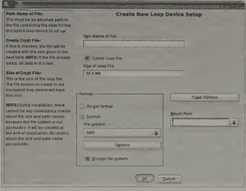

#### 注意

也有许多免费的加密文件系统实现可用：

- EncFS (Linux 加密文件系统模块； http://arg0.net/users/vgough/encfs.html)
- CFS (加密文件系统； http://www.crypto.com/software)
- TCFS (透明加密文件系统； http://www.tcfs.it)

请注意，并非所有这些实现都已在 SLES 9 使用的 2.6 Linux 内核上进行过测试。

在服务器上部署文件系统加密之前，你应考虑以下潜在缺点：

- 当加密文件系统被挂载时，你必须提供用于创建文件系统的密码短语。因此，如果你将任何加密文件系统设置为在启动时自动挂载，就必须有人在服务器控制台输入密码短语（这使得远程管理具有挑战性）。
- 你可以设置加密文件系统不在服务器启动时自动挂载，而是在稍后时间挂载。但是，这意味着用户在文件系统挂载之前无法访问它。
- 当加密文件系统被挂载时，任何具有适当权限的人都可以随时透明地读取和写入磁盘数据。只有在磁盘被卸载并“被盗”时，数据才会变得无用。
- 根据实现方式，磁带备份可能以未加密形式存在。
- 如果忘记密码短语，一切都将丢失或无法访问。

因此，在实施之前，请投入一些时间进行前期规划工作。

### 安全文件删除

许多用户经常忘记的一件事是，当你删除文件时，它实际上并未消失。即使你覆盖文件、重新格式化驱动器或以其他方式尝试销毁存储的信息，也很可能能够恢复。典型的数据恢复服务仅需几千美元，因此根据所涉及信息类型，攻击者花费时间和金钱进行恢复可能是值得的。诀窍是通过反复翻转磁盘上的磁性位（1 和 0）来扰乱已擦除的数据，这样完成后，原数据的痕迹就不会留下。

以下 Linux 工具可以执行安全文件删除：

- Wipe (http://wipe.sourceforge.net)
- ArticSoft 命令行脚本与 PGP 或 GnuPG 结合 (http://www.articsoft.com/open_pgp_command_line.htm)
- BCWipe for Unix (http://www.jetico.com)
- Shred (随 SLES 9 提供；作为核心系统的一部分安装)

以下显示使用 shred 安全删除文件时的详细输出：

```
Athena:/home/admin/test # shred -uzv myFile
shred: myFile: pass 1/26 (random)...
shred: myFile: pass 2/26 (aaaaaa)...
shred: myFile: pass 3/26 (db6db6)...
shred: myFile: pass 4/26 (000000)...
shred: myFile: pass 5/26 (bbbbbb)...
shred: myFile: pass 6/26 (555555)...
shred: myFile: pass 7/26 (838888)...
shred: myFile: pass 8/26 (492492)...
shred: myFile: pass 9/26 (6db6db)...
shred: myFile: pass 10/26 (cccccc)...
shred: myFile: pass 11/26 (222222)...
shred: myFile: pass 12/26 (999999)...
shred: myFile: pass 13/26 (random)...
shred: myFile: pass 14/26 (b6b6b6)...
shred: myFile: pass 15/26 (444444)...
shred: myFile: pass 16/26 (ffffff)...
shred: myFile: pass 17/26 (111111)...
shred: myFile: pass 18/26 (666666)...
shred: myFile: pass 19/26 (777777)...
shred: myFile: pass 20/26 (249249)...
shred: myFile: pass 21/26 (dddddd)...
shred: myFile: pass 22/26 (eeeeee)...
shred: myFile: pass 23/26 (924924)...
shred: myFile: pass 24/26 (333333)...
shred: myFile: pass 25/26 (random)...
shred: myFile: pass 26/26 (000000)...
shred: myFile: removing
shred: 000000: renamed to 000000
shred: 00000: renamed to 00000
shred: 0000: renamed to 0000
shred: 000: renamed to 000
shred: 00: renamed to 00
shred: 0: renamed to 0
shred: myFile: removed
```

请记住，其中一些安全删除应用程序仅在某些类型的文件系统上有效。例如，shred 在 ReiserFS 等日志文件系统上无效。此外，即使文件已从磁盘中粉碎，副本仍可能存在于（磁带）备份上。

#### 提示

如果你要将服务器的硬盘退役，无论是丢弃还是捐赠给学校或慈善机构，请确保首先完全且安全地擦除驱动器上的数据。你可以使用诸如 Darik's Boot and Nuke (DBAN; dban.sourceforge.net)、Acronis Drive Cleanser (www.acronis.com/enterprise/products/drivecleanser/) 或 Active@ KillDisk (www.killdisk.com/downloadfree.htm) 之类的工具用于此类目的。

### 日志文件系统

虽然它们与数据访问的实际“安全”方面没有直接关系，但文件系统的安全性和稳定性在数据安全中发挥着重要作用。你可以实施地球上最严格的安全措施，但如果你作为数据的合法所有者因文件系统故障而无法访问它，安全就是一个无关紧要的问题。

存储在 Linux/Unix 文件系统上的每个文件的数据必须与其关联的属性或元数据一致。元数据包括文件类型、权限、所有者、大小、时间戳以及分区中数据块指针等信息。此元数据存储在 inode 中。将有关文件的信息与文件实际内容分开维护的问题在于一致性。换句话说，在文件可以被访问之前，文件的元数据必须正确描述该文件。

系统内核总是先写入数据再写入元数据，因为否则它不知道数据将在磁盘上的何处存储。如果在数据写入后但在元数据记录之前发生意外系统崩溃，可能会导致数据丢失，因为在没有元数据信息的情况下，你不知道数据存储在磁盘上的何处。如果内核正在写入元数据区域，例如目录本身，则问题会变得更糟。现在，你不再只有一个损坏的文件，而是一个损坏的文件系统；换句话说，你可能会丢失整个目录或整个磁盘分区上的所有数据。在大型系统上，这可能意味着数十万个文件。即使你有备份，恢复如此大量的数据也可能需要很长时间。

#### 注意

每当 Linux 服务器非正常关闭时，系统都会执行 fsck 例程来检查磁盘错误，并在服务器重新启动时尝试纠正任何不一致。此过程可能非常耗时（类似于传统 NetWare 卷上的 VREPAIR），尤其是在当今大容量磁盘的情况下。此检查也会在每隔几次启动时强制执行，以确保一切正常工作。

日志文件系统通过维护元数据信息的日志来解决此问题。简而言之，日志是文件系统所做更改的重做日志。在系统崩溃时，当文件系统在更改序列完成之前关闭时，日志可以简单地“重放”以修复由此产生的不一致。因此，如果系统正常运行时间和性能很重要，你应使用日志文件系统。Linux 上有许多此类文件系统，包括 ext3（基本上是带日志的 ext2）、ReiserFS、XFS 和 JFS。SLES 9 使用的默认文件系统是 ReiserFS。


#### 注意

要了解更多关于各种文件系统的信息，请访问
www.tldp.org/HOWTO/Filesystems-HOWTO.html.

然而，使用日志文件系统（如 Reiser）时，有两点需要注意：

- **额外内存需求**—日志文件系统用于跟踪文件及其相应元数据的各种方法通常比传统的非日志文件系统（如 ext2）需要更多的内存开销。为了允许更大的单个文件（最高达 8TB），新文件系统使用 64 位文件访问和文件锁定系统调用，而不是 32 位。因此需要额外的内存。
- **安全影响**—由于日志会跟踪数据修改，它是关于您数据的信息的小宝库；日志文件中可能会找到“有趣”的信息。因此，像 shred 这样的安全删除实用程序将无效。因此，如果安全是优先事项，非日志文件系统（如 ext2）应该是您的选择。

SLES 9 支持多种不同的文件系统，您可以根据需要混合使用。例如，您用户的 home 目录可能位于 ReiserFS 文件系统上（SLES 9 的默认值），但用户的机密数据可以位于加密的 ext2 文件系统上。

### 摘要

本章回顾了传统 Linux 文件系统权限的基础知识（如 SUID 和粘滞位），以及诸如访问控制列表、优缺点以及 root SUID 程序的潜在危险和数据及文件系统加密等高级主题。在下一章中，您将了解如何监控 SLES 服务器性能并学习基本系统管理技术。

## 系统管理和监控

本章的主要重点是向您介绍应包含在服务器环境日常检查中的一系列流程。对特定系统的关注程度取决于所管理的系统。一些长期建立的静态系统可能需要很少的关注。其他更新或更动态的系统可能需要更密切地监控。只有时间才能告诉您需要做多少监控。请记住，然而，较旧的、更静态的系统也在运行在较旧的硬件上。监控其健康状况与监控较新的系统一样重要，如果不是更重要的话。

本章描述了以下主题：

- 常用 Linux 命令
- 根目录概述
- 健康检查和系统监控
- 系统调优机会

不可能完全消除环境中的所有硬件故障方面的问题。应用诸如磁盘子系统 RAID 和在可能的情况下集群等冗余将增强所提供服务的稳健性。在以下各节中，我们将介绍一些可用于监控系统健康状况的技术。适当的监控使您能够在日志指示资源消耗问题或有问题的硬件时采取更积极的措施。

### 常用 Linux 命令

在以下各节中，我们将介绍在服务器日常管理中使用的一些基本命令。您可以将这些命令结合使用，以快速访问有关进程或事件的详细信息。各种命令的输出可以通过诸如 grep 之类的工具进行管道传输，以进一步细化信息范围。

#### 基本命令

Linux 服务器在概念上可以细分为三个主要类别。尽管这种细分并不严格，但我们已将基本命令归类为以下几个不同的关注领域：系统控制、文件系统、内存和进程。

本书各处示例中已使用其中一些命令。表 7.1 提供了最常用的命令的快速概述，我们将在本章后面的各节中进一步扩展其中一些命令。您可以在 man 和 info 页面中找到每个命令的各种命令行参数的更详细解释。

**表 7.1**
**常用 Linux 命令**

**系统控制**

| 命令 | 用途 |
|---|---|
| `init` | 允许您快速更改系统的运行级别。不常用，因为它在第 3 章“启动和关闭服务器”中有更详细的介绍。 |
| `shutdown` | 以有序的方式关闭系统。它允许向所有用户显示消息，并提供关闭时的延迟时间以及重新启动的机会。 |
| `reboot` | 执行系统的快速重启。此命令实际上调用 shutdown，但不允许使用相同的参数。 |

**文件系统**

| 命令 | 用途 |
|---|---|
| `df` | 返回文件系统级别的当前磁盘使用信息。`-h` 标志以“人类”可读的千字节、兆字节或千兆字节单位返回结果。 |
| `du` | 返回文件或目录的磁盘使用情况。`-h` 标志以“人类”可读的千字节、兆字节或千兆字节单位返回结果。 |

**表 7.1**
**常用 Linux 命令（续）**

| 命令 | 用途 |
|---|---|
| **文件系统** | |
| `find` | 在目录结构中定位文件。 |
| `fuser` | 识别当前使用文件的用户和进程 ID。当您查找系统上已挂载卷的用户时，此命令特别有用。 |
| `ln` | 创建系统上其他文件的链接。这允许文件在同一时间在多个目录结构中可见。但是，所有指针都引用文件系统中的同一文件，从而允许维护单一版本。 |
| `lsof` | 列出系统上当前打开的所有文件。 |
| `ls` | 提供目标文件系统或目录中的文件列表。常见参数有 `-l` 用于包含文件大小的长格式；`-a` 也包含列表中的所有隐藏文件；以及 `-t` 按日期/时间排序输出。 |
| `mount` | 返回当前挂载点、其底层格式（ext3、reiserfs）以及其默认选项和权限的信息。 |
| `rm` | 删除（删除）文件。`rmdir` 命令用于删除空目录。 |
| `stat` | 返回有关文件的详细信息，包括创建日期、上次访问日期和上次修改日期。 |
| **内存管理** | |
| `free` | 显示当前内存使用情况和交换文件状态。 |
| `procinfo` | 报告内存使用情况，尽管它更像是一个进程信息工具。 |
| **进程信息** | |
| `ps` | 进程状态信息。可以传递多个参数以按多种格式提取信息。默认情况下，此命令仅列出当前用户的进程表。 |
| `pstree` | 以树格式提供进程列表，显示哪些进程是子进程，哪些是其父进程。 |
| `w` | 按用户列出所有进程。 |

#### 附加工具

您还可以使用以下工具：

- `|` — 管道符号允许您控制一个命令的输出并将其重定向到另一个命令的输入。这种极其强大的工具将在本书中与 `grep` 结合广泛使用。
- `awk` — 此工具可用于根据模式从文件或管道中提取特定的列信息。
- `cat` — 此工具将文件内容打印到显示器上。
- `cut` — 此工具仅打印文件每一行的选定部分。
- `grep` — 此工具在文件中搜索信息并返回所有匹配提供条件的行。
- `head` — 此工具显示文件的前 10 行。`-n` 参数可用于更改显示的行数。
- `tail` — 此工具将文件的最后 10 行打印到显示器上。您可以使用 `-n` 参数指定应列出文件底部多少行。此命令在查看大型日志文件时至关重要。
- `wc` — 默认情况下，此命令计算文档或管道中的单词数。参数 `-l` 将默认行为更改为计算行数。

上述内容 certainly does not provide an exhaustive list of the available commands. 随着您单独使用这些命令的经验积累，将管道工具与 `grep`、`awk` 或 `wc` 结合使用将变得自然而然。

#### 根文件系统

Linux 文件系统在逻辑上是一个大的目录结构。在 SLES 的默认安装中，除非另有说明，否则整个文件结构都放在单个磁盘分区上。因为 `/` 分区是文件系统所有其他部分的父级，所以它被称为根。在系统最初安装时，根仅填充目录。默认情况下存在以下目录：

Athena:~ #

```
Athena:~ # ls /
.    bin  dev  home  media  opt  root  srv  tmp  var
..   boot etc  lib   mnt    proc sbin  sys  usr
```


在 Linux 中，你可以为系统添加额外的磁盘容量。为此，你通过将新磁盘的内容映射到目录树中并提供一个可用于访问的唯一目录来挂载新磁盘。此目录称为 *挂载点*。添加磁盘容量与向系统添加可移动介质并将其临时关联到 `/mnt` 目录的做法相同。在永久挂载的情况下，磁盘信息与 `/etc/fstab` 中的挂载点相关联。

本质上，系统上的任何目录都可以临时或永久地关联到额外的存储空间。文件系统的根目录在安装时绑定到选定的目标磁盘。然而，根目录下的所有其他目录不仅被视为目录，也被视为可能的挂载点。在第 2 章“更新服务器”中，我们讨论了额外存储的添加以及如何将 `/home` 和 `/srv` 的内容从简单目录迁移并转换为单独的磁盘分区挂载点。表 7.2 列出了根目录中的目录并总结了其用途。

#### 表 7.2 默认挂载点

| 挂载点 | 用途 |
|---|---|
| `/bin`, `/sbin` | 这两个目录包含在输入 Linux 命令时执行的程序。 |
| `/boot` | 该目录结构包含启动加载程序处理的信息。 |
| `/etc` | 这是系统使用的主配置目录。它包含标准服务的绝大多数配置文件以及不同运行级别所需的信息。 |
| `/dev` | `/dev` 包含系统识别连接到系统的设备以及每种可用的不同访问方法所需的所有特殊文件。 |
| `/home` | 这是应创建用户账户的位置。它也是最动态的目录结构之一，因此是分离到单独物理设备的首选对象。 |
| `/lib` | 该目录是库和系统模块的主要存储库。 |
| `/media` | 这是可移动介质的默认挂载点目录。介质挂载在诸如 `dvd` 和 `floppy` 之类的子目录下。 |
| `/mnt` | 这是系统提供的默认通用挂载点。它可用于快速连接 CD-ROM 或 USB 设备，而无需创建挂载点目录。 |

#### 表 7.2 默认挂载点（续）

| 挂载点 | 用途 |
|---|---|
| `/opt` | 该目录存放额外的可选软件和第三方分层应用程序。 |
| `/proc` | 该目录跟踪所有进程和系统资源。此目录应保持原样；它不会变得很大，并且是系统正常运行所必需的。 |
| `/root` | 这是 root 账户的“主目录”。 |
| `/srv` | 该服务目录包含 FTP 和 HTTP 服务的默认目标位置。 |
| `/sys` | 该目录维护当前连接到系统的设备列表以及它们的访问方式。 |
| `/tmp` | 该目录存储进程在运行时创建的所有易失性临时文件。 |
| `/usr` | 类似于 bin 和 sbin，该目录主要存放最终用户可以访问的可执行文件。 |
| `/var` | 该目录保存具有动态性质的附加文件。系统在此处存储许多进程日志文件。由于这是一个如此动态的环境，因此将其移动到单独的大分区是理想的选择。 |

所有这些挂载点都可以转换为单独的物理设备。需要注意的是，如果根分区已满，系统将无法再记录活动或创建任何临时文件，并且将简单地停止运行，直到可以恢复这两个任务为止。因此，必须通过将更动态的目录结构，例如 `/srv`、`/var` 和 `/home`，分离到单独的物理分区上来防止这种情况发生。分离结构可以缓解根卷上的磁盘空间竞争。随着系统的成熟，各个挂载点的增长也将更容易监控。

### 健康检查和系统监控

在之前的章节中，我们描述了如何安装和配置系统及其软件组件。我们还介绍了将用户添加到系统的步骤。在以下各节中，我们监控两者如何相互作用。

对机器和设备的日常周期检查是提供可靠服务的重要方面。只有了解正在发生的事情，你才能感觉到可能需要关注的内容。这些检查的频率和深度取决于你对系统及其对组织重要性的熟悉程度。经验法则是，日常检查是一个良好的起点。以下是应检查的建议列表：

- 机器运行时间
- 日志审查
- 顶级消费者
- 应用程序检查
- 用户登录活动
- 系统资源检查

本章中给出的示例基于我们自己的个人偏好。它们旨在作为快速提取系统信息的指南。示例绝不是可用工具的详尽列表——只是我们的最爱。随着你对系统的了解加深，你几乎肯定会超越简单的命令，并转向脚本或第三方分层应用程序。然而，我们相信这些工具足以作为起点。

### 机器运行时间

尽管当前版本的 Linux 非常稳健，但检查系统运行了多长时间仍然很重要。系统重启可能是由硬件故障、软件故障或人为干预引起的。如果发生非计划重启，了解原因很重要。

`uptime` 命令提供了系统状态的快速快照，包括当前时间、系统运行时间以及用户负载：

```
Athena:~ # uptime
8:47am  up   3:18,  3 users,  load average: 0.30, 0.29, 0.21
Athena:~ #
```

正如这个示例所示，机器已运行了三个多小时。由于我们要求系统非常稳健，如此短的运行时间应导致某种调查。通常，这将是由于计划的硬件维护停机所致。如果不是这种情况，日志的审查可能会表明正在发生什么。

提供负载平均值是为了快速验证系统的状态。1、5 和 15 分钟数据之间的负载剧烈变化可能会提醒系统管理员潜在问题。增加可能表明存在失控进程，而活动下降可能表明客户端无法再访问服务器。

### 日志审查

当你审查系统的健康状况时，查看日志很重要。每个系统组件都会在其适当的日志文件中放置信息。这些信息可能简单到时间戳或进程里程碑标记，或者日志可能包含硬件组件即将发生故障的信息。

你可以通过两种方式找到系统启动信息。首先，你可以使用 `dmesg` 命令检查内核环形缓冲区的內容。该缓冲区包含内核生成的最新消息。在启动时，许多重要的硬件发现阶段都会在此处记录。对这些信息的审查会提供有关 BIOS、内存、磁盘和 IRQ 的详细硬件信息。启动信息在另一个次要位置可用，可提供更多详细信息。`/var/log/boot.msg` 文件包含系统启动期间从各种来源生成的所有消息。定期审查这些来源以确保预期硬件匹配并且没有可能影响系统性能的警告消息是个好主意。

Linux 维护应用程序特定的日志文件。日志文件的位置及其内容可以通过 `/etc/syslog.conf` 文件控制。在 SLES 的默认安装中，你可以在 `/var/log` 目录结构下找到所有应用程序特定的日志信息。

在此结构中，许多单独的服务，例如 YaST、Samba 和 Apache 维护各自的应用程序特定消息目录。定期审查这些服务日志文件很重要。它们不仅可以揭示系统内的本地配置错误，还会记录来自所有来源的连接信息。

为了识别攻击向量，例如受感染的机器和系统探测，你可以审查连接失败日志。此外，你应经常检查面向互联网的机器日志，以寻找有效连接请求不存在资源的情况，例如对默认账户名称的登录尝试或对无效网页的请求。

> > **NOTE**
> >
> > 要了解日志文件中包含的信息，只需查看面向互联网的机器的 Apache 失败日志即可。由对不存在页面的请求产生的错误数量可能令人震惊。大量


这些请求来自于发起针对 Apache 服务器的 IIS 特定攻击的脚本小子。一旦这些人发现你的网站，保持对这些日志的警惕观察是个好主意。

检查防火墙日志也很重要。默认情况下，它们合并到标准 /var/log/messages 文件中。我们多次强调只提供所需服务的重要性。定期审查防火墙日志会暴露连接失败。故障来源和所请求访问的性质可能会揭示配置错误的客户端机器以及可能的利用尝试。在许多情况下，受感染的桌面计算机能够产生大量流量和探测，因为蠕虫或病毒试图复制。对内部（受信任网络）事件的服务器端防火墙日志进行适当审查，与分析外部防火墙日志一样重要。本主题在第 12 章“入侵检测”中进一步探讨。

你最常引用的两个日志文件是 `/var/log` 中的 **warn** 和 **messages**。这些文件包含应用程序和用户生成的绝大多数常规错误消息。你可能想要扫描的一些重要消息可能是特权提升请求，例如：

```
Mar 13 11:26:23 Athena sudo: hart : 3 incorrect password
attempts ; TTY=pts/0
```

花一秒钟时间验证 hart 是否被允许访问 sudo，并且该用户只是遇到了困难的一天。另一方面，如果出现不同的用户名，则可能表明有人试图获得未经授权的访问。

本节强调了日志文件在跟踪系统活动中的重要性。需要注意的是，随着这些日志文件的增长，它们也需要进行维护。日志文件保留对于保证你拥有连续的系统活动日志至关重要。

在似乎表明系统被入侵的事件发生时，归档日志对于追踪入侵历史至关重要。通常，无法每天审查日志文件。使用 logrotate 等实用程序可以确保日志以可管理的格式存储在中央位置。

### 顶级消费者

日志文件对于追踪历史事件很重要。除非进程生成故障或信息消息，否则它可能在很长时间内未被察觉而存在。作为日常练习的一部分，了解服务器的负载是个好主意。这种类型的监控将帮助你了解典型一天的资源消耗，预测何时可能需要资源升级，并快速识别异常负载。

你可以使用 top 命令生成这些当前进程负载的动态列表。随着应用程序需要更多资源，它们会在列表中上升。列表 7.1 显示了 top 生成的输出示例。所呈现的信息是动态的；当然，这只是一个时间点的快照。

#### 列表 7.1
top 命令的典型输出

```
top - 15:57:05 up 11:27, 4 users, load average: 0.15, 0.03, 0.01
Tasks: 77 total, 1 running, 76 sleeping, 0 stopped, 0 zombie
Cpu(s): 3.9% us, 0.7% sy, 0.0% ni, 95.3% id, 0.0% wa, 0.0% hi, 0.0% si
Mem: 190012k total, 185668k used, 4344k free, 31608k buffers
Swap: 570268k total, 8k used, 570260k free, 30012k cached

PID USER PR NI VIRT RES SHR S %CPU %MEM TIME+ COMMAND
4514 root 15 0 33796 11m 24m S 0.3 6.5 0:34.42 X
5329 root 15 0 22696 13m 16m S 0.3 7.5 0:14.43 gnome-terminal
1 root 16 0 588 244 444 S 0.0 0.0 0:04.21 init
2 root RT 0 0 0 0 S 0.0 0.0 0:00.00 migration/0
3 root 34 19 0 0 0 S 0.0 0.0 0:00.00 ksoftirqd/0
4 root 5 -10 0 0 0 S 0.0 0.0 0:00.00 events/0
5 root 15 -10 0 0 0 S 0.0 0.0 0:00.00 kacpid
7 root 5 -10 0 0 0 S 0.0 0.0 0:00.00 kblockd/0
8 root 5 -10 0 0 0 S 0.0 0.0 0:00.01 khelper
9 root 15 0 0 0 0 S 0.0 0.0 0:01.04 pdflush
10 root 15 0 0 0 0 S 0.0 0.0 0:00.74 pdflush
12 root 15 -10 0 0 0 S 0.0 0.0 0:00.00 aio/0
11 root 15 0 0 0 0 S 0.0 0.0 0:02.14 kswapd0
160 root 25 0 0 0 0 S 0.0 0.0 0:00.00 kseriod
203 root 25 0 0 0 0 S 0.0 0.0 0:00.00 scsi_eh_0
382 root 5 -10 0 0 0 S 0.0 0.0 0:00.00 reiserfs/
561 root 6 -10 0 0 0 S 0.0 0.0 0:00.00 kcopyd
```

当机器似乎反应迟缓时，top 命令非常有用。快速浏览其输出可以揭示情况是否由于 CPU 消耗、过度交换或特定进程以异常优先级运行。

top 进程还列出了正在运行的可执行文件的名称。随着你熟悉最常见的名称，列表中可能会出现奇怪的用户编写的应用程序名称。通过匹配用户和应用程序列，你可以快速识别出恶意应用程序。

另一个非常有用的工具是 **w** 命令。该命令提供当前登录系统的用户以及他们正在运行的程序的快速摘要。在当前系统上，w 返回以下输出：

```
```text
Athena:~ # w
13:39:33 up 9:09, 6 users, load average: 0.00, 0.05, 0.02
USER     TTY      LOGIN@   IDLE   JCPU   PCPU WHAT
root     :0       04:31    ?xdm?  4.21   0.11s -:0
root     pts/0    04:32    3:08   4.83s  0.41s bash
belandja pts/1    04:43    0.00s  0.84s  0.10s login - belandja
belandja pts/2    05:24    1.00s  0.39s  0.07s wget http://cnn.com
root     pts/3    13:36    3:10   0.38s  0.15s vi index.html
hart     pts/4    13:38    1:06   0.53s  0.34s top
Athena:~ #
```
```

从中，你可以很好地了解谁当前正在系统上工作，他们在做什么，以及他们对系统造成的资源影响类型。

### 应用程序检查

当应用程序对终端用户无响应时，操作团队通常不会花很长时间才意识到这种情况。不过，在深入查阅适当的日志文件之前，快速查看正在运行的进程可能是合适的。

检查应用程序是否存在的一种方法是使用 ps 命令。进程状态命令（ps）生成系统中所有正在运行进程的列表。此外，你可以使用修饰符有选择地提取目标服务的信息。检查应用程序的一种方法是使用 ps 命令并通过 grep 过滤输出：

```
```text
Athena:~ # ps -ef | grep -e telnet
root  5408 5387 0 04:43 ?        00:00:01 in.telnetd: 192.168.1.100
root  5766 5387 0 05:23 ?        00:00:00 in.telnetd: 192.168.1.100
root  5957 5920 0 06:09 pts/1    00:00:00 grep -e telnet
```
```

在此示例中，-e（每个进程）和 -f（完整列表格式）修饰符用于限定 ps 动词。然后通过 grep 过滤 ps 动词的输出，以仅提取包含 Telnet 进程的记录。重要的是要记住，在这种情况下，Telnet 没有自己的守护进程。它是 xinetd 服务器提供的服务的一部分。因此，前述命令返回现有的 Telnet 连接，而不是实际服务器进程的存在。

检查服务是否存在的一种不同方法是验证其特征端口是否由服务器通告。因为每个协议，无论是 httpd、sshd 还是 telnetd，都向网络提供特定的端口，因此你可以快速检查端口上是否存在打开的监听进程。netstat 命令可以列出服务器网络环境的各种属性。你可以指定 -l 参数列出所有监听器，并指定 -p 参数识别提供服务的程序。输出看起来像以下内容：

```
Athena:~ # netstat -lp | grep -e http
 tcp        0     0 *:https        *:*        LISTEN  4601/httpd2-prefork
Athena:~ #
```

通过使用进程 ID，你可以找到所有相关进程并识别提供服务的例程：

```
Athena:~ # ps -ef | grep -e 4601
root      4601     1  0 04:31 ?        00:00:00 /usr/sbin/httpd2-prefork -f
→ /etc/apache2/httpd.conf
wwwrun    4602  4601  0 04:31 ?        00:00:00 /usr/sbin/httpd2-prefork -f
→ /etc/apache2/httpd.conf
wwwrun    4603  4601  0 04:31 ?        00:00:00 /usr/sbin/httpd2-prefork -f
→ /etc/apache2/httpd.conf
wwwrun    4604  4601  0 04:31 ?        00:00:00 /usr/sbin/httpd2-prefork -f
→ /etc/apache2/httpd.conf
wwwrun    4605  4601  0 04:31 ?        00:00:00 /usr/sbin/httpd2-prefork -f
→ /etc/apache2/httpd.conf
wwwrun    4606  4601  0 04:31 ?        00:00:00 /usr/sbin/httpd2-prefork -f
→ /etc/apache2/httpd.conf
root      6807  5920  0 13:28 pts/1    00:00:00 grep -e 4601
Athena:~ #
```

使用这种方法，你可以通过其进程名称或端口提供情况快速验证服务的存在。现在你可以验证特定于应用程序的日志文件是否存在可能的错误。如果没有错误，进程无响应可能是由于其他进程的资源限制。

### 系统资源检查

服务器可以被视为资源的容器。应用程序反过来消耗这些资源。行为良好的应用程序启动，分配部分可用内存，使用适量的 CPU，将受控量的信息写回适当的文件，然后终止。

应用程序使用的资源中，只有 CPU 资源可以被视为无限。尽管在任何时刻只有这么多处理能力可用，但行为良好的应用程序每次只消耗一点。CPU 越快，作业完成得越快。作业终止后，CPU 用于处理该应用程序的时间部分现在可供其他进程使用。


The same cannot be said for memory and disk resources. When their total complement is consumed, no further processing can take place until some of these resources are freed. In most cases, a well-behaved program releases all its allocated memory upon exit. When this does not happen properly, the application is said to have a memory leak. If the application is run a sufficient number of times, eventually the memory leak will consume all the available process memory on the machine.

Similarly, applications that create large output data files and log files often consume vast amounts of disk space. Though disk quotas mitigate against user applications from filling the disk, typical services are not constrained in regards to disk space consumption. In the event of a misbehaving client application or an attack, it is quite possible that the service log files consume all available disk space in a partition.

The preceding describes what could be considered the worst-case scenario. Diligence will ensure that these conditions are less likely to happen. The following commands are suggested additions to your daily server health checks.

You can address memory consumption using the top command discussed earlier in the chapter. You also can use a number of other commands to determine the current memory demands:

free lists the current amount of free memory on the system. The -m parameter lists the amounts in megabytes.

```
Athena:~ # free -m
             total     used     free    shared   buffers   cached
Mem:         185       173      11      0        4         40
-/+ buffers/cache: 128 57
Swap:        556       0        556
Athena:~ #
```

procinfo displays the system status information contained within the /proc filesystem. The following is a truncated version of the information returned:

```
Athena:~ # procinfo
Linux 2.6.5-7.97-smp(geek@bulldog) (gcc 3.3.3 ) #1 [CPU[Athena.]

Memory:          Total       Used       Free       Shared     Buffers
Mem:             190012     181224     8788       0          6000
Swap:            570268     8          570260

Bootup:Sun Mar 13 04:29:44 2005 Load average:0.06 0.09 0.04
  1/99 8152
```

Disk space consumption can be tracked using the following commands:

```
Athena:~ # du -hsc /var
215M     /var
215M     total
```

df displays disk usage by mounted filesystem:

```
Athena:~ # df -h
Filesystem          Size  Used Avail Use% Mounted on
/dev/sda2           6.5G  2.9G  3.6G  45% /
tmpfs                93M  8.0K   93M   1% /dev/shm
/dev/sdb1            14G   45M   14G   1% /home
```

mount, though typically used for adding resources, can be typed without parameters to display a list of what is currently mounted on the system. A systematic review of this information, coupled with the content of /etc/fstab, may identify missing partitions or mount points:

```
Athena:~ # mount
/dev/sda2 on / type reiserfs (rw,acl,user_xattr)
proc on /proc type proc (rw)
tmpfs on /dev/shm type tmpfs (rw)
devpts on /dev/pts type devpts (rw,mode=0620,gid=5)
/dev/hdc on /media/dvd type subfs (rw,nosuid,nodev,
  fs=cdfss,procuid,iocharset=utf8)
/dev/fd0 on /media/floppy type subfs (rw,nosuid,nodev,sync,
  fs=floppyfs,procuid)
/dev/sdb1 on /home type ext3 (rw,acl,user_xattr,usrquota)
usbfs on /proc/bus/usb type usbfs (rw)
Athena:
```

#### 用户登录活动

Several situations require auditing system access. Auditing is not done to invade anyone’s privacy but is a requirement for tracking both system performance and application access. Knowing system load, response times, and processes generating the load is important in order to provide satisfactory service. Another reason for tracking users is to facilitate the investigation of spurious and inappropriate activity that might indicate a compromise of the system. This topic will be explored further in Chapter 12. In this section, we examine a number of commands that can provide user access information.

The w or who commands display which accounts are currently logged in to the system. Here’s an example:

```
Athena:~ # w
14:33:32 up 2:10,  7 users,  load average: 0.07, 0.11, 0.06
```

| 用户 | 终端 | 登录时间 | 空闲 | JCPU | PCPU | 正在执行 |
|---|---|---|---|---|---|---|
| ted | tty5 | 14:29 | 3:14 | 2.0s | 0.04s | perl extract_P2_pulse.pl |
| root | pts/0 | 12:28 | ?xdm? | 1.53s | 0.11s | -bash |
| root | pts/1 | 12:28 | 3:06 | 2.33s | 0.25s | -bash |
| beata | pts/2 | 12:29 | 0.00s | 1.68s | 1.36s | ssh -l root 192.168.1.242 |
| root | pts/2 | 12:30 | 0.00s | 0.73s | 0.04s | w |
| pol | pts/3 | 14:25 | 3:40 | 0.40s | 0.16s | vi start_femtopulse.sch |
| mark | pts/4 | 14:31 | 14.00s | 0.62s | 0.38s | -bash |

If more information is required from the currently signed-on users, you need to access the information more directly. Each user on the running system creates a login session. This login session is the parent for additional child processes. Additional user information can be extracted by accessing the currently active process information. You can do this in a number of ways. Each of the following examples reports information with varying amounts of detail.

**pstree** displays a tree of processes:

```
Athena:~ # pstree -U pol
sshd???bash???vi
```

**ps** reports process status:

```
Athena:~ # ps -ef | grep -e pol
root  5786  3244  0 14:25 ?       00:00:00 sshd: pol [priv]
pol   5789  5786  0 14:25 ?       00:00:00 sshd: pol@pts/3
pol   5790  5789  0 14:25 pts/3   00:00:00 -bash
pol   5814  5790  0 14:26 pts/3   00:00:00 vi start_femtopulse.sch
root  6122  5383  0 14:33 pts/2   00:00:00 grep -e pol
```

**lsof** lists open files:

```
Athena:~ # lsof
COMMAND PID USER FD TYPE DEVICE SIZE NODE NAME
sshd 5789 pol cwd DIR 8,2 592 2 /
sshd 5789 pol rtd DIR 8,2 592 2 /
sshd 5789 pol txt REG 8,2 288184 83822 /usr/sbin/sshd
sshd 5789 pol mem REG 8,2 107122 19361 /lib/ld-2.3.3.so
sshd 5789 pol mem REG 8,2 36895 29038
→ /lib/libpam.so.0.7.6
sshd 5789 pol mem REG 8,2 33263 29436
→ /lib/libpam.so.0.7.7
sshd 5789 pol mem REG 8,2 13647 19370 /lib/libdl.so.2
.
.
.
sshd 5789 pol 2u CHR 1,3 42156 /dev/null
```

## 第7章：系统管理和监控

```
sshd  5789  pol  3u  unix  0xc31a8700  11642  socket
sshd  5789  pol  4u  IPv6 11623       TCP
-> Athena.UniversalXFC ca:ssh->192.168.1.240:1037 (ESTABLISHED)
sshd  5789  pol  5r  FIFO  0,7       11644  pipe
.
.
vi    5814  pol  1u  CHR   136,3     5      /dev/pts/3
vi    5814  pol  2u  CHR   136,3     5      /dev/pts/3
vi    5814  pol  3u  REG   8,33      12288  1048626
-> /research/home/pol/.start...femtopulse...sh.swp
```

The lsof command returns a great deal of information about the selected user. A majority of the files listed are standard system libraries and modules. Depending on the details required, this command may yield much information to be useful.

#### 注释

The lsof command will prove itself quite useful in Chapter 13, “System Security.” In that chapter, we will be required to enumerate all files used by a specific application. lsof can perform this task quite easily.

Other commands can be used to extract information indicating when users accessed the server in the past. This information may be important if you are trying to find out who was on the system at a specific point in time. The last command provides information on all logins, their source, as well as the period of time the session was active. A couple of examples of the last command are shown here:

```
Athena:~ # last hart
hart  pts/1  192.168.1.100  Sat Feb 26 10:08 - down       (13:48)
hart  pts/1  192.168.1.100  Sat Feb 26 09:53 - 09:54     (00:01)
hart  pts/1  192.168.1.100  Sat Feb 26 08:44 - 09:53     (01:08)
hart  pts/1  192.168.1.100  Wed Feb 16 04:38 - 04:39     (00:00)
hart  pts/1  Athena.Universal  Tue Feb 15 19:49 - 20:20  (00:31)
hart  pts/4  192.168.1.77   Tue Feb 15 06:57 - 07:34     (00:37)

wtmp begins Mon Feb 14 19:00:40 2005
Athena:~ #
```

Without specifying a username, it is possible to generate a login log for all users on the system:

```
Athena:~ # last
hart  pts/1  192.168.1.100  Sat Feb 26 10:08 - down  (13:48)
eric  pts/1  192.168.1.100  Sat Feb 26 10:04 - 10:08 (00:04)
eric  pts/1  192.168.1.100  Sat Feb 26 09:55 - 10:00 (00:04)
```

```text
eric       pts/1    192.168.1.100   Sat Feb 26 09:55 - 09:55  (00:00)
belandja   pts/4    192.168.1.100   Sat Feb 26 09:54 - down     (14:02)
hart       pts/1    192.168.1.100   Sat Feb 26 09:53 - 09:54  (00:01)
root       pts/3    :0.0             Sat Feb 26 09:46 - down     (14:11)
belandja   pts/2    192.168.1.100   Sat Feb 26 09:12 - 10:14  (01:01)
hart       pts/1    192.168.1.100   Sat Feb 26 08:44 - 09:53  (01:08)
root       pts/0    0                Sat Feb 26 08:44 - down     (15:12)

wtmp begins Mon Feb 14 19:00:40 2005
```

你可以使用单独的命令快速提取特定账户的最后登录时间。这可以快速检查未使用的账户或不应被使用的账户。以下是 lastlog 命令的示例：

```text
Athena:~ # lastlog
Username         Port     From               Latest
root             pts/2    athena.universal   Sun Feb 27 12:30:43 -0500 2005
bin                       **Never logged in**
daemon                    **Never logged in**
lp                        **Never logged in**
games                     **Never logged in**
man                       **Never logged in**
.                         **Never logged in**
.                         **Never logged in**
ldap                      **Never logged in**
dhcpd                     **Never logged in**
belandja  1      192.168.1.100   Sun Feb 27 12:29:40 -0500 2005
eric      2      192.168.1.100   Sun Feb 27 12:23:43 -0500 2005
hart      1      192.168.1.100   Sat Feb 26 10:08:46 -0500 2005
peter                     **Never logged in**
pol       pts/3  192.168.1.240   Sun Feb 27 14:25:20 -0500 2005
mark      pts/4  hermes.universal Sun Feb 27 14:31:03 -0500 2005
ted       tty5                   Sun Feb 27 14:29:25 -0500 2005
```

此命令提供系统中所有账户的列表，以及它们最后登录系统的时间和登录来源。由于系统账户数量众多，列表可能会变得相当庞大。你可能会想使用 grep 解析此命令的输出，以删除从未使用过的所有账户：

```text
Athena:~ # lastlog | grep -v -e "**Never"

Username   Port      From              Latest
root       pts/2     athena.universal  Sun Feb 27 12:30:43 -0500 2005
belandja   1         192.168.1.100     Sun Feb 27 12:29:40 -0500 2005
eric       2         192.168.1.100     Sun Feb 27 12:23:43 -0500 2005
hart     1        192.168.1.100   Sat Feb 26 10:08:46 -0500 2005
pol      pts/3    192.168.1.240   Sun Feb 27 14:25:20 -0500 2005
mark     pts/4    hermes.universal Sun Feb 27 14:31:03 -0500 2005
ted      tty5                      Sun Feb 27 14:29:25 -0500 2005
```

这种方式解析输出是可以接受的，如果你正在查找已知活跃的单个账户。然而，原生的 lastlog 命令确实提供了有关系统进程账户的额外信息。验证它们是否未用于交互式登录可能会非常有用。

知道某个特定账户被不当使用是一回事。能够识别使用该账户的个人则困难得多。验证账户的登录失败次数是一个重要步骤。过多的登录失败可能是密码破解攻击的迹象——可能已成功。faillog 命令允许你检查每次登录尝试对每个账户失败的次数：

```text
Athena:~ # faillog
Username   Failures  Maximum  Latest
root       3         0        Wed Feb 16 03:49:05 -0500 2005 on 0
belandja   0         0        Mon Feb 14 19:02:11 -0500 2005 on 1
eric       0         0        Tue Feb 15 18:06:28 -0500 2005 on 2
hart       0         0        Tue Feb 15 06:57:10 -0500 2005 on 4
```

账户上出现大量登录失败的迹象可能表明该账户的密码已被破解。也可能是个诡计。制定健全的账户密码策略并包含 PAM 模块 pam_tally 在达到一定次数的失败尝试后锁定账户，是你可以采取的重要步骤。这样，你可以减轻密码收集攻击带来的部分风险。这也有助于确保最后登录到特定账户的人知道密码。

在本节中，你看到了提取用户登录信息的众多方法。你可以使用这些信息来帮助调查资源问题。这些信息也可以作为调查系统可疑行为的起点。

### 系统调优

服务器的初始性能基于操作系统供应商设置的一系列参数。在 SLES 的情况下，这些参数被选定以满足广泛的服务器类型。每个服务可能需要不同的资源。有些服务是内存或带宽密集型的，而
其他则是 CPU 密集型的。这些各种因素默认情况下被平衡，以提供响应迅速的服务器，无论其初始任务如何。

然而，无法预料的是所提供硬件的可用资源。SUSE 规定了一系列最低要求以提供稳定的环境。在大多数情况下，满足这些最低要求不是问题。随着资源限制开始导致性能问题，可以向服务器添加内存或磁盘空间。

在某些情况下，服务器的任务超出了设计的常规。在这些情况下，你必须考虑对原始配置中的基本假设进行更改。

在基于 Linux 和 Unix 的系统中，操作系统的核心程序称为内核。内核就像任何其他程序一样构建。它在其结构中包含了配置团队的原始假设。这些假设决定了哪些设备类型可用，例如 IDE 或 SCSI 磁盘，内存如何管理，以及是否可以动态加载额外模块。在内核配置中添加和移除功能可以提高灵活性和性能。

当出现这种情况时，你通常需要修改实际的 Linux 内核本身。这可以通过几种不同的方式完成。一个选项是重新编译内核以包含额外功能。当可用时，首选方法是利用默认内核的灵活性，简单地调整其部分运行时参数。

#### 调优内核参数

有许多应用程序已移植到 Linux。其中一些，例如数据库应用程序，其资源需求与典型的 Linux 服务显著不同。为了满足这些需求，你必须通过调整特定于应用程序的参数来改变内核的运行方式。

在旧版本的 Unix 中，这些更改需要重新构建内核本身。虽然不是不可逾越的壮举，但对于从未做过的人来说，重建内核无疑是一项艰巨的任务。幸运的是，Linux 内核具有灵活性和动态性。可以在实时中对 Linux 内核进行更改，而无需重新启动。

例如，让我们看看 Linux 内核需要进行哪些更改才能运行 Oracle 10g。这些更改在安装时运行的脚本中提供；就论证而言，假设你想手动进行这些更改。Oracle 10g 的需求如表 7.3 所示。

#### 表 7.3

Oracle 10g SUSE LINUX 内核需求

| 内核参数 | 所需最小值（单位取决于参数） | 描述 |
|---|---|---|
| `kernel.shmall` | `2097152` | 共享内存可用内存，以 4KB 块为单位 |
| `kernel.shmmax` | `2147483648` | 共享内存段的最大大小 |
| `kernel.shmni` | `4096` | 共享段的最大数量 |
| `kernel.sem` | `250 32000 100 128` | 信号量 |
| `fs.file-max` | `65536` | 内核分配的文件句柄最大数量 |
| `net.ipv4.ip_local_port_range` | `1024 65000` | 所需可用端口 |

#### 注

调优内核是一项应谨慎进行的任务。所做的更改可能会产生无法运行的环境。互联网上有许多站点讨论 Linux 内核及其参数。访问以下其中一个以获取更多信息：

- http://www.suse.de/~agruen/kernel-doc/
- http://www.kernelnewbies.org/
- http://www.bb-zone.com/SLGFG/chapter4.html

你可以使用 sysctl 命令查询正在运行的内核当前使用的值。指定 -a 开关会列出所有参数。可以使用类似以下语法的命令检查每个单独参数：

```text
Athena:~ # sysctl kernel.shmmax
kernel.shmmax = 33554432
```

如你所见，此参数值远低于 Oracle 所需的最低值。要设置该值，请使用以下语法：

```text
Athena:~ # sysctl -w kernel.shmmax=2147483648
kernel.shmmax = 2147483648
```

此语法为内核参数设置新值并确认新值。


大多数 SLES 的典型安装都带有配置良好的内核参数。除非服务器运行的是非典型配置，否则无需更改这些值。在大多数情况下，例如 Oracle，您会获得必要的最小值，并且很可能还会提供一个用于更改的脚本。如果没有，按照本文所示的流程，您可以检查是否符合最低推荐值并按推荐设置参数。

### 调整文件系统访问

先前，我们讨论了 Linux 文件系统被视为一个大型逻辑树。表 7.2 标识了标准安装下在 root 下创建的目录。然而，有时默认安装并不能满足您的需求。

在第 2 章中，我们介绍了如何将 root 中的两个标准目录迁移到不同的磁盘资源。此过程通常在这些分支的磁盘消耗预计会影响整体系统时执行。当这些目录与 root 属于同一物理分区时，如果它们填满所有可用空间，系统将变得无响应。调整不同目录可用性的过程称为调整文件系统。

当设计生产服务器的磁盘构成时，具有动态内容的目录（如 /usr、/home 和 /var）通常放置在单独的物理磁盘分区上。尽可能时，它们也会放置在不同的物理设备上以分发 I/O 操作。尽管现代磁盘子系统非常快，但尽可能提取所有性能是一种良好的做法。将它们放置在单独的物理设备上的另一个好处是，在磁盘子系统故障的情况下，可能需要恢复的分区更少。

文件系统调整的另一个方面是授予对目录树部分区域的访问权限。挂载点的初始所有者和组成员都是 root。权限掩码允许非 root 用户访问挂载点下的目录内容。当挂载点包含标准树的一部分时，这是必要的条件。

先前，我们将自己限制在文件系统 root 中的默认目录结构。因为这只是一个简单的目录，所以在 root 中创建额外的目录或挂载点没有固定的限制。此外，并没有规定所有挂载点必须位于 root 中的限制。保持 root 尽可能干净是重要的系统管理实践，但这并不意味着它必须一尘不染。以下两个示例探讨了为服务器添加额外存储并限制对新资源访问的方法。

如果一组研究用户正在协作项目上工作，他们可能需要被隔离到单独的存储中，以减少他们对其他用户的影响。作为流程的一部分，他们的主目录应放置在那里。此外，由于研究的性质，只有组成员才能访问挂载点。

可以通过在 root 中指定新的挂载点 `/research` 来实现这一点。一些文件系统允许将挂载分区的访问限制为特定的 UID 和 GID。Mount 不支持 ext3 或 Reiser 分区的这些功能。因此，必须以其他方式限制对特定个人或组的访问。以下步骤可作为为研究组创建特定目录结构的指南：

- 1. 为项目创建一个名为 `research` 的组。
- 2. 使用 `fdisk` 和 `mkfs` 准备新分区。
- 3. 创建一个名为 `/research` 的标准目录用于挂载新资源。
- 4. 修改 `/etc/fstab` 以允许在启动时挂载分区。
- 5. 执行 `mount -a` 命令以验证分区是否正确挂载。
- 6. 使用 `chgrp research /research` 更改挂载点目录的组归属。
- 7. 使用 `chmod 6770 /research` 更改挂载点目录的访问权限。
- 8. 使用 `mkdir /research/home` 和 `mkdir /research/project` 为用户的主目录和项目数据创建容器。
- 9. 使用 `chmod 6770 /research/home` 和 `chmod 6770 /research/project` 调整这些目录的权限。

> **NOTE**
> 
> > 在前述步骤中，root 目录的所有权保留为 root。这可能看起来违反直觉，因为您可能希望它属于组成员。
> >
> > 让组成员拥有该目录会产生另一个问题。如果所选个人离职，其账户将被删除且 UID 成为孤立。任何意外获得相同 UID 的新账户都会自动获得访问权限。

您可以创建一个占位账户，设置使其无法登录，并使其成为组的成员。由于此服务账户从未使用且无法登录，与之关联的 UID 将保持服务。如果账户被更改，无论是有意还是无意，访问信息将被授予而无法追踪访问。

在这种情况下，最好将所有权保留为 root。个人将通过组权限访问目录结构。

在此阶段，您可以通过更新其账户信息并移动其目录的内容，将现有用户重新定位到其主目录的新位置。现有用户还必须添加到 research 组。新用户可以直接创建到新结构中并添加到 research 组。结果目录将如下所示：

```text
Athena:~ # ls -Td /research
drwxrws---  4 root research 4096 Feb 27 06:55 /research

Athena:~ # ls -l /research
total 25
drwxr-xr-x 24 root root      568 Feb 27 2005 ..
drwxrws---  4 root research 4096 Feb 27 06:55 .
drwxrws---  4 root research 4096 Feb 27 06:59 home
drwx------  2 root root    16384 Feb 27 06:14 lost+found

Athena:~ # ls -l /research/home
total 16
drwxrws---  4 root research 4096 Feb 27 06:59 .
drwxrws---  4 root research 4096 Feb 27 06:55 ..
drwxrws---  7 mark research 4096 Feb 27 06:59 mark
drwxr-sr-x 12 pol  research 4096 Feb 27 07:06 pol
Athena:~ #
```

这些目录的保护允许 root 和 research 组成员完全访问。同时，系统上所有其他用户均被拒绝访问。必须调整备份实用程序以允许访问结构的内容。

#### NOTE

mount 的 man 手册更详细地介绍了各种文件系统类型可用的各种选项。一些文件系统类型允许通过 UID/GID 指定挂载卷的所有权。这 certainly 使限制访问变得更容易。在某些情况下，所有文件的所有权都被强制为与挂载选项中指定的用户或组相同。此外，Reiserfs 和 ext3 的健壮性会丢失。我们 certainly 鼓励选择更健壮的文件系统。

另一个典型请求是让大型数据集对系统上的每个人可用。问题是数据集必须以只读格式可用。您可以通过在 root 下创建挂载点——例如 `/gisdata`——并指定分区使用 fstab 中的 ro 选项挂载来实现。它看起来像这样：

```text
/dev/sdc1 /gisdata ext3 ro 1 2
```

结果目录将对所有用户可读。如果需要向结构中添加额外信息，可以卸载分区，在具有写权限的不同挂载点上重新挂载并更新。mount 还可以使用 user 选项指定允许挂载/卸载挂载点的个人。结合 sudo 授予 mount/umount，数据集的维护可以委托给负责数据的用户组中的个人。

本节研究了将典型的 root 目录结构拆分到多个磁盘分区中。这通常是为了将动态目录结构与更静态的目录结构隔离开来。多个设备还允许分发 I/O 操作，从而提高性能。文件系统管理的另一个方面是限制对目录某些区域的访问。此限制可以全局应用或应用于特定组。这种能力提供的灵活性使您作为系统管理员能够更精细地向客户交付存储。

### 摘要

在本章中，我们涵盖了系统管理的许多方面。系统备份和用户账户管理等主题在单独的章节中介绍。这里，我们专注于维护服务器的日常方面。

我们回顾了用于从系统提取资源信息的常用命令。还检查了 root 目录的基础目录结构并解释了目录的内容。此外，我们建议了一系列步骤，帮助您进行服务器的日常监控检查。在资源消耗方面，我们还建议了一些补救措施。


## 第三部分

## 数据备份与灾难恢复

- 8. 网络服务
- 9. 打印服务
- 10. 数据备份与恢复

### 网络服务

Linux 的一大主要优势在于提供种类丰富的网络服务。SLES 9 随附了大量此类服务，范围从网络时间服务到文件共享再到网页服务。由于篇幅限制，本章中讨论的每个主题都无法进行详细讨论；许多主题（如域名服务 DNS 和 Samba）都有整本书专门论述。因此，本章的目的是为您提供最基本的信息，以便将特定网络服务配置并以基本配置运行。

我们选择此处涵盖的主题是因为它们为本地私有网络上的用户提供服务，而不一定是互联网上的服务。这就是为什么某些主题，例如 Squid 代理服务器和 SuSEfirewall2，在此处未讨论的原因。然而，以下主题在本章中有所讨论：

- xinetd 超级服务器
- 网络时间协议（NTP）服务
- 使用 Postfix 的电子邮件服务
- FTP 服务
- 使用 NFS 和 Samba 的文件共享
- 使用 VNC、XDMCP 和 Telnet/ssh 的远程管理
- 使用 DNS、DHCP、SLP 和 Samba 的网络名称服务
- 使用 Apache 的网页服务
- 使用 Kerberos、LDAP、NIS 和 Samba 的身份验证服务

除了 SLES 中提供的服务之外，还有其他服务。Novell 的 Open Enterprise Server（www.novell.com/products/openenterprise）提供了许多额外服务（如 NetStorage 和 iFolder），有助于使 Novell 和 SLES 世界更接近。然而，这些额外服务超出了本章的范围。

### 天使与守护进程

由于 SLES 支持多任务，始终有一些程序在后台运行，负责系统相关任务，例如执行 cron 和 at 作业以及监视和处理网络请求。这些后台进程被称为守护进程。

#### 词 DAEMON 的起源

有些资料指出 daemon（发音为 dee-man 或 day-man）是 Disk And Execution Monitor 的缩写。然而，该词实际上最早由 Fernando J. Corbato 教授及其 Project MAC（http://en.wikipedia.org/wiki/MIT_Laboratory_for_Computer_Science）团队于 1963 年使用，用来指代 IBM 7094 大型机上的后台进程。该引用灵感来源于十九世纪著名苏格兰物理学家 James Clerk Maxwell（以电动力学 Maxwell 方程著名）进行的关于热力学的“思想实验”之一。在这个实验中，Maxwell 提出存在一个想象中的代理（一个 daemon），它帮助对不同速度的分子进行分类，并在后台不知疲倦地工作——这与多任务计算机操作系统内部的各种维护任务非常相似。（访问 http://ei.cs.vt.edu/~history/Daemon.html 获取更多信息。）

Unix 社区采用了该词 daemon，其在希腊神话中是指存在于神与人之间的超自然存在，用来描述各种后台服务器进程，这些进程代表内核（神）为用户（人）服务。因此，大多数服务器应用程序（如 FTP 服务器）在其文件名后加上 d——例如 ftpd；这有助于将其与客户端应用程序（如 FTP 客户端的 ftp）区分开。

而不是在系统初始化时启动各种服务器服务（如 FTP）（这会减慢服务器启动过程）并在连接请求到达前处于休眠状态（占用不必要的资源），会启动一个特殊的守护进程，并在其配置文件中列出的服务的所有服务端口上监听。当请求到达配置文件中列有“活动”服务器的端口时，该监控守护进程会启动相应的服务器。此外，如果服务本身未提供安全保护，该监控守护进程可以提供额外的安全性。由于该服务器的工作方式，它通常被称为超级服务器。在超级服务器下运行经常访问的服务的缺点是，每次需要该服务时，超级服务器启动服务会造成轻微延迟。

该超级服务器有两个实现：inetd（Internet services daemon；发音为 eye-net-d）和 xinetd（Extended Internet services daemon；发音为 zye-net-d）。inetd 自 Unix 早期以来已被广泛使用。然而，近年来，由于其扩展功能（如访问日志记录、增强的访问控制和 IPv6 支持），xinetd 变得更加流行。例如，虽然 inetd 允许使用 Wietse Venema 的 TCP_Wrappers 软件（tcpd，其包含在您的 SuSE Linux 介质中）控制 TCP 连接，但您无法控制 UDP 连接。虽然您可以使用 inetd 控制连接速率，但无法控制最大实例数。这可能导致进程表溢出攻击——例如有效的拒绝服务（DoS）。xinetd 不存在这些缺陷。默认情况下，SuSE 9 使用 xinetd 而不是 inetd，因此我们在此讨论 xinetd。

**TIP**

如果您一直使用 inetd 并希望转换到 xinetd，请使用 itox 实用程序或 xconv.pl Perl 脚本（两者均随 xinetd 提供，但通常更推荐 xconv.pl 而非 itox）将 inetd.conf 风格的配置文件转换为 xinetd.conf。有关更多信息，请参阅 man itox 和 man xconv.pl。

#### 配置 xinetd

启动时，xinetd 读取位于 /etc 中的多个文件。主要配置文件为 /etc/xinetd.conf 以及 /etc/xinetd.d 中的所有文件。其他文件指定应为哪个服务启动哪个守护进程。它读取的其他文件与其它守护进程和系统服务共享，并包含有关 Internet 服务的更一般信息：

- **/etc/services**—该文件将端口号映射到服务名称。1024 以下的大多数端口号分配给特殊（所谓的众所周知）服务（参见 http://www.iana.org/assignments/port-numbers），并列在此文件中。每次您按名称（而不是端口号）引用服务时，名称会在 /etc/services 中查找，并使用分配的端口号来处理请求。
- **/etc/protocols**—该文件将协议映射到内核用于区分不同 TCP/IP 协议的编号。该列表基于 http://www.iana.org/assignments/protocol-numbers。
- **/etc/rpc**—类似于 /etc/services，该文件将远程过程调用（RPC）服务映射到其 ID 号和常用名称。

通常，您无需触碰上述列表中的任何文件。如果需要更改，最可能的候选文件是 `/etc/services`，您将在其中添加某些未列入文件中的自定义守护进程使用的端口，或如果由于某种原因需要特定服务在除其默认接受端口之外的端口上运行。

您可以通过两种方式配置 `xinetd` 支持的服务：使用 YaST 或直接操作配置文件。虽然 YaST 提供了友好的用户界面，但只能通过直接编辑配置文件来修改某些选项。因此，我们在此涵盖这两种操作。

要在 YaST 中访问 `xinetd` 配置模块（参见图 8.1），请选择控制中心、网络服务、网络服务（inetd）。或者，您也可以通过使用 `yast2 inetd` 或 `yast inetd` 直接访问此模块。请注意，尽管您使用的是 `xinetd`，但某些菜单文本仍显示 `inetd`。

**FIGURE 8.1**

xinetd 配置屏幕。

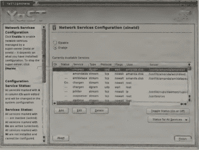

屏幕顶部显示超级服务器是否正在运行（已启用）或未运行（已禁用）。屏幕上的列表框显示已定义的服务及其当前运行状态。特别值得关注的是标记为 Ch、Status 和 Server 的列。


#### 提示

你可以通过使用命令 `/etc/init.d/xinetd status` 或以下方式来检查 `xinetd` 是否正在运行：

```
Athena:/home/admin # ps ax | grep xinetd
32369 ?        Ss     0:01 /usr/sbin/xinetd
20857 pts/8    R+     0:00 grep xinetd
```

第一行显示 `xinetd` 当前作为一个分离的系统进程运行（即没有终端附加），其进程 ID（PID）为 32369。同样，你可以使用相同的命令通过将 `xinetd` 替换为守护进程的名称，例如 in.telnetd，来确定你的任何服务守护进程是否正在运行。

Status 列显示守护进程是否正在运行（On）或未运行（—）；NT 表示 YaST 知道该软件包，但软件包未安装，因此无法配置。如果你切换守护进程的状态（从 On 到 Off），则会在 Ch 列中放置一个 X 以指示该守护进程的状态已被更改；如果 Ch 列为空，则服务的状态未被更改。记得点击 Finish 以使新的状态设置生效。

#### 提示

与其一次启用或禁用一个服务，你可以点击 Status for All Services，然后通过一次点击选择启用或禁用所有服务。

Server 列显示守护进程的名称及其运行的路径。一些网络服务在此列下没有列出服务器，因为 `xinetd` 通过使用内置例程在内部提供几种简单的服务。这些服务是

- **ECHO**—此服务主要用作调试工具，用于将 TCP 或 UDP 端口 7 上从源接收到的任何数据报发回该源。此服务存在的风险是有人可以通过 ECHO 服务使服务器过载，造成 DoS 攻击。RFC 862 (http://www.ietf.org/rfc/rfc862.txt) 描述了 ECHO 服务。
- **DISCARD**—此服务也称为 SINK 或 NULL。它只是一个数据黑洞，因为它会丢弃在端口 9 上接收到的任何数据报（TCP 或 UDP）。RFC 863 (http://www.ietf.org/rfc/rfc863.txt) 描述了 DISCARD 服务。
- **SYSTAT**—在 TCP/UDP 端口 11 上监听，SYSTAT（更广为人知为 ACTIVE USERS 或仅 USERS）服务仅发送当前活动用户——主机上当前已登录的用户——的列表。所有输入均被忽略。RFC 866 (http://www.ietf.org/rfc/rfc866.txt) 描述了 USERS 服务。
- **DAYTIME**（人类可读时间）—在 UDP 中，在守护进程在端口 13 上接收到数据报（可以包含任何数据）后，它会以 ASCII 格式返回当前日期和时间。在 TCP 模式下，在接收到数据报并建立连接后，服务会以 ASCII 格式发送日期和时间并关闭连接：

```
Athena:/home/admin # telnet localhost 13
Trying 127.0.0.1...
Connected to localhost.
Escape character is '^]'.
15 JAN 2005 07:08:42 EST
Connection closed by foreign host.
```

RFC 867 (http://www.ietf.org/rfc/rfc867.txt) 描述了 DAYTIME 服务。
- **NETSTAT**—也称为 Who Is Up 协议，NETSTAT 在（TCP 和 UDP）端口 15 上监听并返回有关服务器网络信息的信息，例如路由表和连接数据。此服务揭示了有关系统结构的丰富信息，可用于日后入侵系统。因此，在今天大多数可用的 Linux/Unix 发行版中，此守护进程不再列在 `/etc/services` 文件中，并且该协议已过时。
- **QOTD**—在端口 17 上监听，Quote of the Day 服务（也称为 QUOTE 协议）会通过 TCP 或 UDP 将简短消息发回客户端，而无需输入。RFC 865 (http://www.ietf.org/rfc/rfc865.txt) 描述了 Quote of the Day 服务。
- **CHARGEN**（字符生成器）—在 UDP 模式下，CHARGEN（也称为 TTyst 或 Source 协议）在一个 UDP 数据包中生成随机字符，该数据包包含随机数量（介于 0 和 512 之间）的字符。在 TCP 模式下，在端口 19 上建立连接后，守护进程会发送连续的 TCP 数据包流，直到会话关闭为止。接收到的任何数据（TCP 或 UDP 模式）都会被丢弃。潜在的 DoS 攻击是伪造 IP 地址并导致两个设备相互发送随机流量。RFC 864 (http://www.ietf.org/rfc/rfc864.txt) 描述了 CHARGEN 服务。
- **TIME**（也称为 Unix 时间；机器可读时间，以自 1900 年 1 月 1 日午夜以来的秒数为形式——纪元）—此服务的工作方式与 DAYTIME 协议类似，但它不是以 ASCII 形式返回信息，而是以 32 位二进制数字形式发送时间。它还可以从另一台主机接收时间数据；在 Network Time Protocol（NTP）出现之前，这是为 Unix 网络设置时间服务器的标准方式。使用端口 37。RFC 868 (http://www.ietf.org/rfc/rfc868.txt) 描述了 TIME 服务。
- **FINGER**—也称为 NAME 协议，FINGER 守护进程在端口 79 上监听，并返回有关当前系统状态或有关某个人 的状态报告。近年来，此服务大多通过其自己的守护进程（fingerd）提供，而不是 inetd/xinetd 中的内置支持。RFC 1288 (http://www.ietf.org/rfc/rfc1288.txt) 描述了 FINGER 服务。

当 `inetd` 首次安装时，所有定义的服务默认情况下均被禁用。仅启用你绝对需要的服务，以便最大限度地减少由给定服务可能暴露的任何安全弱点。

大多数网络守护进程都提供将它们设置为作为独立应用程序运行或根据需要由 `xinetd` 调用的选项。虽然使用 `xinetd` 的设置在服务未使用时节省了资源，但它会为客户端创建延迟。服务的守护进程必须加载并且可能必须初始化自身，然后才能准备好提供请求。你应该仔细考虑哪些服务要作为独立应用程序运行，哪些服务要由 `xinetd` 调用。

例如，你可能希望将诸如 Apache 之类的 Web 服务器作为独立服务运行，而不是在客户端在端口 80 上发出请求时由 `xinetd` 调用它。Apache 需要相对较长的加载时间，你不希望客户端在 Web 服务器加载时等待太久。Apache 针对独立模式进行了高度优化，因此你可能不希望它由 `xinetd` 生成。另一方面，像 Telnet（其守护进程为 in.telnetd）这样允许从其他机器登录的服务不需要太多加载时间。这使得 Telnet 成为由 `xinetd` 调用的良好候选者。

使用以下步骤将新服务添加到由 `xinetd` 管理：

1. 在 Network Services Configuration 对话框中，点击 Add。
2. 在 Add a New Service Entry 对话框中（参见图 8.2），填写服务名称以及可选的 RPC 版本（如果守护进程是 RPC 应用程序）。然后选择所需的套接字类型、协议、标志以及服务将运行的用户和组。输入守护进程位置的完整路径并指定守护进程的任何可选命令行参数。可选地，输入有关此新服务的标识注释。
3. 如果新服务器要立即启用，请确保选中 Service Is Active 框。
4. 点击 Accept 以保存条目。
5. 点击 Finish 以保存更改并通知 `xinetd` 使用新的配置。
6. 如果新服务使用非标准端口或 `/etc/services` 中尚未列出的端口，你需要更新该文件以包含新的服务名称、其端口号和传输类型。

#### **图 8.2**
添加新的 xinetd 管理服务。

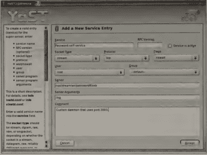

#### **警告**

不要在服务名称中使用任何嵌入式空白字符（例如 Password self service），因为 YaST 会在第一个空白字符处停止解析名称。

### RPC 是什么？

RPC（Remote Procedure Call；有时称为 Open Network Computing，或 ONC）是一种用于构建分布式客户端/服务器应用程序的技术，最初由 Sun Microsystems 为其 Network File System（NFS）开发。它基于扩展常规或本地过程调用的概念，以便被调用的过程不必存在于调用过程的同一地址空间中。两个进程可能在同一系统上，也可能在通过网络连接的不同系统上。通过使用 RPC，分布式应用程序的程序员避免了与网络接口的细节。RPC 的传输独立性将应用程序与数据通信机制的物理和逻辑元素隔离开来，并允许应用程序使用多种传输方式。

RFC 1831 (http://www.ietf.org/rfc/rfc1831.txt) 描述了 Remote Procedure Call Protocol Specification Version 2。

Wait 和 Nowait 标志选择指示服务是单线程还是多线程，以及连接是由 `xinetd` 接受还是由守护进程接受。Wait 表示服务是单线程的，`xinetd` 将启动服务器，然后在服务接管连接接受时停止处理服务器的请求。服务结束后，`xinetd` 将再次代表服务器监听请求。Nowait 标志表示服务是多线程的，`xinetd` 将继续处理新的服务请求并接受连接。

#### 注意

通常，UDP/数据报服务使用 Wait 标志，因为 UDP 不是面向连接的。另一方面，TCP/流服务使用 Nowait 标志。

通常 `xinetd` 以 root 身份运行。这意味着它生成的任何进程也以 root 身份运行。然而，从安全角度来看，这通常是不期望的，因为如果进程被攻破，它可能会造成严重损害。User 和 Group 设置允许你指定守护进程将以较低权限的用户身份运行。你也可以使用用户/组名称或其各自的 UID/GID；但是，使用名称是推荐的。如果未指定组名或 GID，则使用用户的主组。

#### **警告**

`xinetd` 必须以 root 身份运行，User 和 Group 设置才有效。否则，它将没有足够的权限将服务的 UID/GID 切换到非特权帐户/组。


在“网络服务配置”对话框中的“用户”列下，你会看到例如某些服务的 `name.name`，而其他服务只有 `name`。在显示 `name.name` 的地方，第一个是实际用户名，第二个是组名。例如，amanda 服务的“用户”列显示为 `amanda.disk`。这意味着该服务以用户 amanda 和组 disk 运行。同样，打印机服务的“用户”列仅为 `root`。因此该服务将以 root 运行，其主组在 `/etc/passwd` 中指定（YaST 将组显示为 `--default--;`；参见图 8.2）。

#### `/etc/xinetd.conf` 文件

xinetd 的主配置文件是 `/etc/xinetd.conf`。如列表 8.1 所示的 xinetd.conf 文件，仅包含默认的服务设置以及对 `/etc/xinetd.d` 目录的引用，其中存储着其他服务配置文件。

##### 列表 8.1
默认的 `/etc/xinetd.conf` 文件

```conf
#
# xinetd.conf
#
# Copyright (c) 1998-2001 SuSE GmbH Nuernberg, Germany.
# Copyright (c) 2002 SuSE LINUX AG, Nuernberg, Germany.
#

defaults
{
        log_type        = FILE /var/log/xinetd.log
        log_on_success  = HOST EXIT DURATION
        log_on_failure  = HOST ATTEMPT
#       only_from       = localhost
        instances       = 30
        cps              = 50 10

#
# The specification of an interface is interesting,
# if we are on a firewall. For example, if you only want
# to provide services from an internal network interface,
# you may specify your internal interfaces IP-Address.
#
#       interface       = 127.0.0.1

}
includedir /etc/xinetd.d
```

与其在 `xinetd.conf` 中堆砌各种服务的条目，该文件只需使用 `xinetd.d` 指令引用一个包含目录，其中该目录中的每个文件都对应一个已定义的服务。然而，与其使用额外的文件，你也可以将服务定义放在 `xinetd.conf` 中。

通常，`/etc/xinetd.d` 中的文件名称与服务名称相匹配。这使得它们更容易识别。然而，名称匹配并不是必须的。以打印机服务为例：`/etc/xinetd.d` 中并没有名为 `printer` 的文件。相反，该服务定义在名为 `cups-lpd` 的文件中。因此，如果你通过手动创建文件向 xinetd 添加服务，可以随意命名——但让文件名与服务名称匹配是有帮助的。

#### 注意

当你使用 YaST 的“网络服务配置”对话框创建一个新服务时，YaST 会在 `/etc/xinetd.d` 中创建与服务名称对应的文件。这也是另一个原因，即你不应在服务名称中使用嵌入的空白字符，因为这会使访问文件变得稍微麻烦；由于嵌入的空白，你需要对名称加上引号（单引号或双引号）。

每个服务描述的格式如下：

```text
#comment for the service
#more comment lines
service servicename
{
    directive = value
    directive += value
    directive += value
}
```

使用 `=`，右侧的值被赋给左侧的指令。`+=` 将值追加到已定义的指令。没有它（即使用 `=`），之前的指令将被覆盖。该符号也可以用于跨多行展开访问列表，例如。 `-=` 从指令中移除现有值。

以下是服务所需的基本最小指令集：

```text
service servicename
{
    disable      =
    socket_type  =
    protocol     =
}
```

```text
wait          =
user          =
* group       =
#### server      =
server_args   =
}
```

disable 指令表示服务是否处于活动状态（disable = no）或不活动（disable = yes）。如果未指定 disable，其值默认为 no，意味着服务处于活动状态。group 指令允许你指定服务将运行的组（从而 GID）。如果未指定，服务将使用该服务运行的 UID 的默认组运行。虽然 server_args 指令不是 xinetd 所必需的，但大多数守护进程至少需要一个命令行开关来控制行为。

> > **NOTE**
> >
> > 由于“网络服务配置”对话框设计为同时处理 xinetd 和 inetd，其界面不提供编辑除此处列为最小集之外的指令值的任何手段。因此，如果你想包含额外的指令（如下一节讨论的访问控制），你需要编辑包含服务定义的文件以手动添加所需的指令。

每个服务都会继承 xinetd.conf 中 defaults 部分定义的指令，除非在该服务的定义中明确修改。现在让我们考虑以下示例服务定义：

```text
#Example service
service foobar
{
    disable       = yes
    socket_type   = stream
    protocol      = tcp
    wait          = no
    user          = dummy
    group         = dummy
    server        = /var/sbin/foobard
    server_args   = -log
    log_type      = SYSLOG mail notice
    log_on_success = USERID
    log_on_failure = USERID
    instances     = 15
}
```

当考虑到 defaults 部分中的指令（参见列表 8.1）时，foobar 服务的有效指令值如下：

```
disable        = yes
socket_type    = stream
protocol       = tcp
wait           = no
user           = dummy
group          = dummy
server         = /var/sbin/foobar
server_args    = -log
log_type       = SYSLOG mail notice
log_on_success = HOST EXIT USERID
log_on_failure = HOST ATTEMPT USERID
instances      = 15
cps            = 50 10
```

这里，log_type 和 instances 的值被新值取代，并且 USERID 被添加到 log_on_success 和 log_on_failure。由于 cps（每秒连接数）在 defaults 中指定，而 foobar 的定义中没有，因此使用 defaults 的 cps 值。

有时，直接从命令行启动或停止服务比使用 YAST 更方便。你只需执行以下操作：

- 1. 使用编辑器打开 `/etc/xinetd.d` 中包含服务定义的文件，并添加指令 `disable = yes` 以停止它。要启用服务，请注释掉 `disable = yes` 行或将其更改为 `disable = no`。
- 2. 使用 `ps ax | grep xinetd` 确定 xinetd 的进程 ID。
- 3. 使用 `kill` 命令向 xinetd 进程发送 SIGHUP 信号：`kill -SIGHUP pid`。（你也可以改用 `killproc -SIGHUP /usr/sbin/xinetd`。）

SIGHUP（挂断）信号会为 xinetd 触发硬重新配置，这意味着 xinetd 会重新读取配置文件，启动任何新服务，并终止不再可用的服务的守护进程。或者，你也可以使用 `/etc/init.d/xinetd reload`（或 `/etc/init.d/xinetd force-reload`）代替 `kill` 命令。你也可以使用 `/etc/init.d/xinetd` 来启动和停止 xinetd——例如，`/etc/init.d/xinetd start` 或 `/etc/init.d/xinetd stop`。

YaST 不允许你在服务配置文件中设置高级设置，例如 log_type 或 instances。因此，你需要求助于文本编辑器。修改配置文件后，你需要通过发送 SIGHUP 信号重新启动 xinetd，以便新设置生效。如果使用 YaST 进行了更改，YaST 在你单击“完成”后会自动重新启动 xinetd。

#### 提示

与其使用 `/etc/init.d/xinetd`，你可以使用 `/usr/sbin/rcxinetd`，因为它只是指向 `/etc/init.d/xinetd` 的符号链接，这是一个 shell 脚本。事实上，你会在文档中经常看到 rcxinetd 的引用；使用它可能更方便，因为 `/usr/sbin` 在 root 的 PATH 设置中，而 `/etc/init.d` 不在。

### 应用访问控制

你需要意识到 xinetd 控制的是连接，而不是数据包。因此，虽然它会阻止被禁止连接服务的来自主机的 TCP connect() 尝试，但它不会，也不能阻止“隐蔽”扫描，例如 FIN 扫描。因此，不要依赖 xinetd 作为防火墙来防止端口扫描。一个有资源的黑客将能够利用此信息收集你各种服务的访问控制列表。如果你看到日志文件显示对活动服务进行顺序的、持续时间非常短（为零或仅几秒）的连接，很可能有人正在对你的服务器进行 connect() 类型的端口扫描。

#### 注意

> 在 FIN 扫描中，像 nmap 这样的扫描软件利用 FIN 标志设置了的 TCP 数据包来扫描主机上的开放端口。nmap 和其他安全评估和入侵检测工具在第 12 章“入侵检测”中讨论。

访问控制相当简单易于实现。你可以使用这三个指令：

- `only_from` 列出服务将接受连接的网络或主机（每个条目之间用空格分隔）。你可以使用网络号，例如 `10.0.0.0` 或 `10`，或网络名称（如果在 `/etc/networks` 中定义），包括使用该指令时的 `*.UniversalExport.ca` 或 `.UniversalExport.ca`。主机名和主机 IP 地址也可以在此使用。（请参阅 `man xinetd.conf` 以获取支持的寻址方案列表，包括子网规范。）


#### 警告
如果指定了 only_from 但未提供任何值，则所有访问将被拒绝。

-   `access_times` 指定服务可用的时间间隔（每个条目之间用空格分隔）。间隔的格式为 `hour:min-hour:min`。连接将在列出的时间窗口内被接受。如果未指定 `access_times`，则没有时间限制。时间使用 24 小时制格式指定。

#### 提示
除非您可以使用主机的安全功能锁定其 IP 地址，或使用 DHCP 为特定主机分配静态地址，否则在设置 `only_from` 和 `no_access` 指令时，指定网络和子网比指定单个主机地址更安全。而且如果您要限制来自网络外部的访问，尽可能使用域名，因为许多 ISP 使用可能会不时更改的子网范围。

默认情况下（在 xinetd.conf 的 defaults 部分中指定），成功的和失败的连接尝试都会记录到 /var/log/xinetd.log 文件中。该文件应定期检查，以查找来自禁止或未知主机和网络的失败尝试，以及来自未知站点的成功连接。以下是 /var/log/xinetd.log 的摘录，显示了多个服务的成功和失败尝试：

```
05/1/14@09:17:18: START: telnet from=10.4.4.4
05/1/14@09:17:31: EXIT: telnet status=1 duration=13(sec)
05/1/14@09:21:09: START: telnet from=10.4.4.4
05/1/14@12:15:16: EXIT: telnet status=1 duration=3955(sec)
05/1/14@16:28:05: FAIL: echo-stream address from=10.4.4.4
05/1/14@16:28:05: START: echo-stream from=10.4.4.4
05/1/14@16:28:05: EXIT: echo-stream status=0 duration=0(sec)
05/1/14@16:28:26: START: echo-stream from=10.3.3.4
05/1/14@16:28:43: EXIT: echo-stream status=0 duration=17(sec)
05/1/14@16:29:49: FAIL: echo-stream address from=10.4.4.4
05/1/14@16:29:49: START: echo-stream from=10.4.4.4
05/1/14@16:29:49: EXIT: echo-stream status=0 duration=0(sec)
05/1/14@17:06:18: START: chargen-stream from=10.4.4.4
05/1/14@17:06:23: EXIT: chargen-stream status=0 duration=5(sec)
05/1/14@17:15:08: START: telnet from=127.0.0.1
05/1/14@17:15:08: EXIT: telnet status=1 duration=0(sec)
05/1/15@04:43:46: FAIL: echo-stream address from=10.4.4.4
05/1/15@04:43:46: START: echo-stream from=10.4.4.4
05/1/15@04:43:46: EXIT: echo-stream status=0 duration=0(sec)
```

#### 提示
如果您只对失败的尝试感兴趣，可以通过使用 grep 轻松显示所有相关条目：

```
Athena:/home/admin # grep -i fail /var/log/xinetd.log
05/1/14@16:28:05: FAIL: echo-stream address from=10.4.4.4
05/1/14@16:29:49: FAIL: echo-stream address from=10.4.4.4
05/1/15@04:43:46: FAIL: echo-stream address from=10.4.4.4
```

### 安全注意事项
在设置 xinetd 之前，您应确保确实需要它。主要作为工作站的客户端机器无需运行 xinetd，因为客户端机器并不意味着为网络提供任何服务。同样，如果您的 SLES 服务器运行专用服务，例如 DNS，也没有真正需要运行 xinetd 的必要。是否使用它基本上是一个安全问题。在您确实不需要的机器上使用 xinetd 可能会暴露入侵者的可能入口点。启用 xinetd 的服务（例如 telnet 和 rlogin）可用于利用您的机器。这并不意味着这些服务通常不安全，但它们可能是潜在黑客试图进入您系统时的第一个信息来源。

当您使用 xinetd 时，仅启用绝对必需的服务。典型的诊断服务（如 echo 和 chargen）可能成为 DoS 攻击的目标，因为它们的使用会将 CPU 资源从其他进程转移，从而导致该服务器所依赖的连接网络和 Internet 服务出现问题。

### 网络时间服务
准确的计时在任何多线程计算机操作系统中都起着重要作用。系统内核调度进程，然后基于时间处理事件。系统时间还用于为日志条目、应用程序交易记录、电子邮件、安全性证书管理等添加时间戳。但是，除非您的服务器内置了原子钟，否则为了保持正确的时间，系统时钟必须定期校正漂移。您可以手动执行校正，也可以让系统时钟通过网络上的某种时间协议自动更新。SLES 9 包含网络时间协议（NTP）软件（xntp v4 软件包），可帮助您从 Internet 获取准确的时间，并为内部网络上的其他服务器和客户端提供相同正确的时间。在本节中，我们将讨论如何设置您的 NTP 客户端并介绍为内部网络设置 NTP 服务器。让我们先看一些背景信息。

#### 备注
对于内部网络，通常会设置一台时间服务器为本地系统提供时间，并让该时间服务器从众所周知的 Internet 时间源（例如美国海军天文台）获取其时间设置。

#### 注意
我们无法过度强调在服务器上保持正确时间的重要性。即使您只有一台运行 Apache 的服务器（请参阅本章后面的“Web 服务器”），拥有正确的时间对于安全的 HTTP 连接至关重要。用于 HTTPS 连接（或其他使用证书的应用程序）的安全证书通常同时包含“不在此之前有效”和“不在此之后有效”日期。如果您的服务器时间不准确，可能会阻止证书安装或使用。而且如果您的服务器还提供电子商务功能，例如购物车，交易记录的准确时间戳至关重要。

您可以通过多种方式根据外部 NTP 时间源调整服务器时间。NTP 软件套件包含两个通过 NTP 设置系统时间的应用程序：`ntpdate` 和 `ntpd`。乍一看，`ntpdate` 似乎是首选，因为它设置和使用简单。最简单的形式，语法是

```
ntpdate timeserver_1 timeserver_2 timeserver_3
```

其中 `timeserver_x` 是 NTP 时间服务器的 DNS 名称或 IP 地址。`ntpdate` 必须在本地主机上以 root 身份运行。它查询每个列出的服务器（取多个样本以获得平均时间），确定自身与每个时间服务器之间的时间差，并将它们分组。具有相同时间（在一定限制内）的时间服务器的最大组被认为拥有“正确时间”，并且 `ntpdate` 将本地时间设置为该组中第一个服务器的时间。这里的缺点是 `ntpdate` 应用新时间的方式。

`ntpdate` 以两种方式之一进行时间调整。如果时间差为 ±128 ms 或更大，`ntpdate` 将简单地“步进”本地时间以匹配 NTP 服务器的时间。如果时间差小于 ±128 ms，`ntpdate` 将通过进行小的增量调整来“平滑”时间，直到时间匹配。正如您所见，`ntpdate` 可能导致突然的时间变化，从而扰乱某些应用程序（如 cron）的正常运行。尽管设置起来需要多做一些工作，但更好的替代方案是使用 ntpd 代替；ntpdate 即将从 NTP 发行版中退役，因为其所有功能都可在 ntpd 中使用。

#### 注意
您可以使用 `-B` 开关强制 ntpdate 在大时间偏移时始终平滑时间而不是步进它。但是，如果时间差远大于 ±128 ms，将时钟平滑到正确时间可能需要数小时。此外，如果当前日期与系统日期之间的差异过大，ntpdate 可能会因算术溢出而将年份设置为 1933。

#### 备注
如果您熟悉 NetWare TimeSync 协议，ntpdate 的步进操作正是二级时间服务器（从主时间服务器或参考时间服务器获取时间）和时间客户端的行为方式：时间一次调整 100%，而不是每次调整一部分。平滑操作反映了主时间服务器调整时间的方式：每次时间按差值的 50% 调整，直到同步。

ntpd 通过在指定的轮询间隔与一个或多个配置的时间服务器交换消息来运行。为了防止网络流量突发，ntpd 对每个时间服务器的初始轮询间隔会延迟几秒的随机间隔。默认初始轮询间隔为 64 秒，因此在本地时钟被设置之前可能需要数分钟。（您可以使用服务器配置命令中的 `iburst` 关键字来减少设置时钟的初始延迟。）通过测量网络往返抖动和本地时钟频率漂移，ntpd 会将轮询间隔从 64 秒缓慢增加到 1,024 秒（略高于 17 分钟）。此外，如果目标时间服务器在一段时间内无法访问，轮询间隔也会逐步增加到 1,024 秒。这有助于减少网络流量。

#### 备注
SUSE 的大部分文档，甚至在一定程度上 Novell 的培训材料，都提到了 ntpd。然而，当前的 NTP 发行版文档使用 ntpd，因为它反映了 NTPv4，而 xntpd 用于 NTPv3。事实上，您会在 SLES 服务器上发现 `/usr/sbin/xntpd` 实际上是 `/usr/sbin/ntpd` 的符号链接。因此，我们在这里使用 ntpd。


在正常情况下，ntpd 以小增量调整时钟（即对其进行平滑处理），使得时间尺度在有效范围内连续且无不连续性。在极端网络拥塞的情况下，ntpd 可能会最终跳步时间；然而这种情况极其罕见，因为 ntpd 采用了多种算法先尝试减慢时钟，只有在所有恢复尝试都失败后才会跳步。

**注意**

ntpd 具有内置的安全保护：如果其本地时间与时间服务器的时间相差 1,000 秒（16.67 分钟）或更多，ntpd 将立即退出并向系统日志记录一条恐慌消息，指出一个“insane”时间源。

安装后，ntpd 设置为在服务器启动时自动运行。如果由于某种原因它未运行，您可以使用 insserv 命令如下：

`Athena:/home/admin # /sbin/insserv /etc/init.d/ntpd`

**注意**

除了 insserv，您还可以使用 YaST 中的运行级编辑器来启用该服务。要访问此编辑器，请选择 控制中心、系统、运行级编辑器 或使用 `yast runlevel`。

请记住，因为 ntpd 和 ntpdate 都使用端口 123，所以它们不能在同一主机上并发运行。

### 配置 NTP 客户端

通常，ntpd 在启动时读取 /etc/ntp.conf 以确定同步源和操作模式。虽然这种方法因繁琐而不推荐，但您可以在命令行上完全指定一个可工作但有限的配置，从而无需配置文件。这种方法在本地主机需要配置为广播/多播客户端时特别有用，所有对等体均在运行时通过监听广播确定。

**警告**

NTP 守护进程（ntpd）的配置文件名为 ntp.conf，而不是您可能期望的 ntpd.conf。

配置文件格式与其它 Linux/Unix 配置文件类似。注释以 # 字符开头并延伸至行尾；空行将被忽略。配置命令由初始关键字后跟一系列参数组成，部分参数可能为可选，以空白字符分隔。命令不得跨多行继续。在 SLES 9 中随 xntp 包提供的默认 `/etc/ntp.conf` 文件如列表 8.2 所示。

#### 列表 8.2
##### 默认的 /etc/ntp.conf 文件

```
########################################################
# /etc/ntp.conf
#
## Sample NTP configuration file.
## See package `xntp-doc' for documentation, Mini-HOWTO
## and FAQ.
## Copyright (c) 1998 Su.S.E. GmbH Fuerth, Germany.
##
## Author: Michael Andres, <ma@suse.de>
########################################################
##
## Radio and modem clocks by convention have addresses in the
## form 127.127.t.u, where t is the clock type and u is a unit
## number in the range 0-3.
##
## Most of these clocks require support in the form of a
## serial port or special bus peripheral. The particular
## device is normally specified by adding a soft link
## /dev/device-u to the particular hardware device involved,
## where u correspond to the unit number above.
##
## Generic DCF77 clock on serial port (Conrad DCF77)
## Address: 127.127.8.u
## Serial Port: /dev/refclock-u
##
## (create soft link /dev/refclock-0 to the particular ttyS?)
##
# server 127.127.8.0 mode 5 prefer
##
## Undisciplined Local Clock. This is a fake driver
## intended for backup and when no outside source of
## synchronized time is available.
```

#### 列表 8.2
##### 默认的 `/etc/ntp.conf` 文件（续）

```
##
server 127.127.1.0  # local clock (LCL)
fudge 127.127.1.0  stratum 10  # LCL is unsynchronized

##
#### Outside source of synchronized time
##
## server xx.xx.xx.xx      # IP address of server

##
## Miscellaneous stuff
##

driftfile /var/lib/ntp/drift/ntp.drift  #path for drift file

logfile /var/log/ntp       # alternate log file
# logconfig=syncstatus + sysevents
# logconfig=all

# statsdir /tmp/        # directory for statistics files
# filegen peerstats  file peerstats type day enable
# filegen loopstats  file loopstats type day enable
# filegen clockstats file clockstats type day enable

#
# Authentication stuff
#
# keys /etc/ntp.keys              # path for keys file
# trustedkey 1 2 3 4 5 6 14 15  # define trusted keys
# requestkey 15                  # key (15) for accessing server variables
# controlkey 15                  # key (6) for accessing server variables
```

您可以建立一个简单的客户端配置，通过添加您希望 `ntpd` 联系的 NTP 时间服务器列表：

```
##
#### Outside source of synchronized time
##
server 10.1.1.1 prefer          # IP of local time server
server time.nrc.ca              # DNS name of Ottawa server
server dense.utcc.utoronto.ca   # University of Toronto
#server ntp-1.nrc.ca            # Pennsylvania state
#server timeb.cs.columbia.edu   # New York state
#server tick.ijr.us             # New Jersey state
```

**注意**

server 命令中的 prefer 选项表示如果所有条件都相等（例如时间抖动），则应使用该服务器的时间进行同步，来自所指定的时间源集合中。

为了冗余，建议您使用位于不同网络上的三到五个 NTP 源。使用 Internet NTP 时间服务器时，选择地理位置靠近您但不在同一位置的服务器。上述示例条目显示，除了本地时间服务器外，ntpd 还联系了位于附近城市的另外两个服务器。

**提示**

要获取公共 NTP 时间服务器列表，请访问 http://ntp.isc.org/bin/view/Servers/WebHome。在选择时间源之前，请务必阅读“Rules of Engagement”（http://ntp.isc.org/bin/view/Servers/RulesOfEngagement）。

**警告**

您应确保 /etc/ntp.conf 中的以下两行未被注释或修改：

```
server 127.127.1.0  # local clock (LCL)
fudge 127.127.1.0  stratum 10 # LCL is unsynchronized
```

如果您列出的 NTP 源不可用，例如由于 ISP 服务中断，它们提供了使用本地系统时钟作为伪时间源的后备方案。最低限度，stratum 设置不应设置为小于 5 的值。关于 stratum 的讨论可在本章后面的“配置 NTP 服务器”部分找到。

如果您的 NTP 时间源可通过广播或多播到达，您无需使用服务器名称。相反，在配置文件中输入 broadcastclient 或 multicastclient 命令即可。为了防止网络中的 rogue 时间服务器更改您的服务器时间，请配置 /etc/ntp.conf 中 Authentication stuff 部分下列出的身份验证机制；有关详细信息，请参阅 /usr/share/doc/packages/xntp-doc/html/authout.html。

**注意**

NTP 发行版没有 man 手册。然而，您会找到包含 HTML 文档的 xntp-doc 包。安装该包后，HTML 文件以及相关的常见问题解答和 README 文件将被安装到 /usr/share/doc/packages/xntp-doc。

ntpd 使用一个文件（其名称由配置文件中的 driftfile 关键字定义）来记录其计算的“drift”（或频率误差）值。如果该文件在启动时存在，则会读取它并使用该值初始化 ntpd 内部的频率误差值。然后该文件每小时更新一次，通过用包含当前频率误差值的新文件替换旧文件。注意，该文件是通过先将当前 drift 值写入临时文件，然后使用 rename 函数替换旧版本来更新的。这意味着 ntpd 必须对存放 drift 文件的目录具有写权限，并且在指定 driftfile 关键字的值时应避免使用文件系统链接，无论是符号链接还是其它链接。

ntpd 在启动时读取 /etc/ntp.conf，然后每小时读取一次以查找更改。如果 ntpd 已在运行并且您更改了 /etc/ntp.conf 但不希望等待，可以使用命令 /etc/init.d/xntpd restart（或 /etc/init.d/xntpd force-restart）使 ntpd 重新读取配置文件。

**提示**

您可以使用 /usr/sbin/rcxntpd 代替 /etc/init.d/xntpd，因为它只是指向 /etc/init.d/xntpd 的符号链接，即一个 shell 脚本。事实上，您会在文档中经常看到 rcxntpd 的引用，使用它可能更方便，因为 /usr/sbin 在 root 的 PATH 设置中，而 /etc/init.d 不在。

如果 ntpd 未运行并且您想手动启动它，请使用命令 /etc/init.d/xntpd start；要停止它，请使用 /etc/init.d/xntpd stop。

由于配置中可选关键字数量众多，您会发现手动编辑 /etc/ntp.conf 比使用 YaST 更容易。但如果您坚持使用，确实有一个 YaST 模块可用于配置 NTP 客户端，您会发现已安装了名为 yast2-ntp-client 的包。要从控制中心访问 NTP 客户端配置对话框（见图 8.3），请选择 网络服务、NTP 客户端。或者您也可以直接使用 yast2 ntp-client 或 yast ntp-client 打开此对话框。


#### 图 8.3
NTP 客户端配置屏幕。

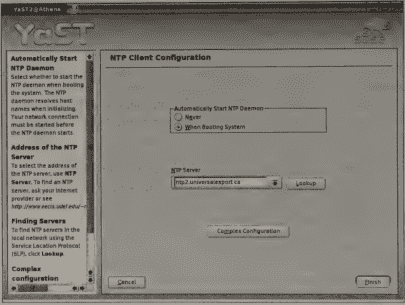

默认对话框允许您指定单个主机作为时间源。要使用多个源，请单击“复杂配置”，然后使用“添加”按钮为每个所需的时间服务器创建条目。如果您已定义至少一个时间源（除本地时钟外），则“复杂配置”屏幕会自动显示。

#### 注释

Complex NTP 客户端配置对话框中的一个选项称为“在 Chroot Jail 中运行 NTP 守护进程”。chroot jail（或 Change root jail）是一种限制守护进程可以看到的文件系统部分的方法；这类似于在 NetWare 中使用 MAP ROOT。默认情况下，ntpd 以 chroot jail 模式运行。如果由于某种原因您不希望 ntpd 在 chroot jail 中，请编辑 `/etc/init.d/xntpd` 或 `/etc/sysconfig/xntp`，并将 `XNTPD_RUN_CHROOTED` 设置从 yes 改为 no。

请参阅第 13 章“系统安全”，以进一步讨论 chroot jails。

#### 注意

即使您以 chroot jail 运行 `ntpd`，要编辑的 `ntp.conf` 副本仍是 `/etc` 中的副本，而不是 jail 的 `/etc` 目录中的副本（默认情况下为 `/var/lib/ntp/etc`）。该副本由 `ntpd` 的启动脚本自动更新。

使用 YaST 设置 NTP 客户端配置时，它还会更新 `/etc/sysconfig/ntp` 中 `XNTPD_INITIAL_NTPDATE` 变量（`ntpd` 在系统启动时用于获取当前日期和时间信息）的设置。但是，如果您在 YaST 之外手动编辑了 `/etc/ntp.conf`，则 `XNTPD_INITIAL_NTPDATE` 设置可能包含过时的主机数据，直到下一次使用 YaST 更新 NTP 设置为止。以下示例说明了当您从终端会话手动启动或重新启动 `ntpd` 时出现此情况的明显迹象：

```
Athena:/home/admin # rcxntpd start
Try to get initial date and time via NTP from ticker failed
Starting network time protocol daemon (NTPD)        done
```

Ticker 是一个已从网络中移除的时间源，其服务器命令条目已手动从 `/etc/ntp.conf` 中移除，未使用 YaST。因此，`/etc/sysconfig/ntp` 包含过时的信息（`XNTPD_INITIAL_NTPDATE = ticker`），导致失败消息。

### 配置 NTP 服务器

`ntpd` 可以作为 NTP 客户端或 NTP 服务器运行，或同时两者兼具。这允许网络中的单个服务器运行 `ntpd` 从权威时间源（互联网上的 NTP 服务器或本地连接的参考时钟）获取时间；然后将其内部重新分发给其他服务器（以 ntpd 仅客户端模式运行）。这减少了对外部时间源的流量，并确保所有 NTP 客户端使用共同的时间源。

NTP 客户端定位 NTP 服务器有两种方法。第一种方法是在客户端的 `/etc/ntp.conf` 文件中静态配置 NTP 源的 IP 地址或 DNS 名称。第二种方法是将 NTP 时间服务器设置为在网络上广播或多播其时间，并配置客户端侦听广播/多播的时间信息。

要使用广播或多播运行 `ntpd`，请在配置文件中添加 `broadcast address` 命令。在广播模式下，地址应为一个（或多个）本地网络的广播地址，例如 192.168.1.255。要启用多播模式，地址应为 224.0.1.1（IPv4）或 ff05::101（站点本地，IPv6）——分配给 NTP 的地址。可以指定多个广播命令以支持多个本地网络接口或多个多播组。

在允许 **ntpd** 作为时间源之前，您必须确保服务器具有正确的时间。在大多数情况下，您可以通过从一个或多个标准互联网 NTP 服务器获取时间来实现。这也可以使用参考时钟完成。NTP 发行版包括超过 40 种无线电和卫星时钟以及可作为参考时钟使用的调制解调器服务的硬件驱动程序。支持的驱动程序列表可在 `/usr/share/doc/packages/ntp-doc/html/refclock.html` 中找到。也可以使用“未受控”的本地时钟作为主要或备份时间源。以下讨论介绍了如何设置参考时钟，以本地时钟为例。

#### 注释

许多无线电参考时钟可以设置为显示根据时区和夏令时模式调整的本地时间。在与 NTP 一起使用时，时钟必须仅设置为协调世界时（UTC）。操作系统内核执行到本地时间的转换，因此时钟运行在 UTC 上这一事实对用户是透明的。

时钟在 `/etc/ntp.conf` 中指定，就好像它们是使用 server 关键字在网络上的实时服务器一样。为此，它们被分配了形式为 127.127.t.u 的特殊 IP 地址。在地址中，t 指定时钟类型，u 是范围为 0–3 的单元编号，用于区分同一类型的多个时钟实例。例如，服务器的硬件时钟将具有伪 IP 地址 127.127.1.0。

#### 注释

您可以在 `/usr/share/doc/packages/ntp-doc/html/refclock.html` 中找到支持的时钟类型值（t）列表。

通常，各个驱动程序都有描述其配置细节的特殊参数。前述注释中提到的 refclock.html 文件提供了指向描述这些参数的驱动程序页面的链接。例如，TimeBrick DCF77 接收器模块使用 Type 8 通用参考驱动程序（PARSE）。但由于此 Type 8 驱动程序支持多种不同的接收器模块，您需要包含附加参数以告诉驱动程序您使用的是哪个特定接收器模块。TimeBrick DCF77 接收器模块的完整 server 命令为

```
server 127.127.8.0 mode 6
```

除本地时钟外，大多数无线电参考时钟都需要以串行端口或特殊总线外设的形式提供支持。您需要通过手动在它们之间创建符号链接，将时钟驱动程序关联到特定硬件设备。例如，如果您有一个 TimeBrick DCF77 接收器连接到服务器的串行终端端口 1 (/dev/ttyS1)，请按如下方式将 TimeBrick 的时钟设备 (/dev/refclock-u，其中 u 为第一个 TimeBrick 设备的 0) 链接到串行端口：

```
ln -s /dev/ttyS1 /dev/refclock-0
```

#### 注释

时钟设备名称列在其各自的驱动程序页面上，每个页面顶部 Synopsis 标题下。

本地时钟驱动程序也是一个特例。配置了此驱动程序的服务器可以在没有其他外部同步源可用时作为主服务器来同步其他客户端。如果服务器直接或间接连接到互联网，就存在可能对其操作产生不利影响的风险。对于这种情况，您会将此驱动程序配置为比任何其他可能的时间源更高的 stratum（例如 3 或 4），以防止在合法源仍可用时服务器接管。

默认情况下，此驱动程序的 stratum 设置为 5，但可以通过 fudge 配置命令和/或 ntpdc 实用程序更改。事实上，默认的 /etc/ntp.conf 将其 stratum 设置为 10。

#### 警告

您永远不应配置可能“退化”为使用其本地时钟的 NTP 时间服务器来使用多播模式或广播模式。

以下内容总结了设置 NTP 时间源所需的步骤：

- 1. 如果使用硬件参考时钟，请按照制造商说明配置并将设备连接到服务器。
- 2. 使用适当的 server 127.127.t.u 命令更新 /etc/ntp.conf 以支持已安装的时钟。
- 3. 在时钟设备名称和硬件设备驱动程序之间创建符号链接。
- 4. 使用 insserv 或 YaST 中的运行级别编辑器配置启动脚本以在服务器启动时运行 ntpd。
- 5. 启动或重新启动 ntpd 以使更新的 ntp.conf 生效。

### 故障排除提示

大多数情况下，ntpd 是一个“配置后即忘”的实用程序，尤其是在以时间消费者（又称客户端）模式运行时。使用公共 NTP 时间源时最常见的疏忽是由于防火墙设置：NTP 需要在两个方向上打开 UDP 端口 123。与 Telnet 等其他客户端/服务器类型协议不同，客户端使用高编号端口（1024 或更高），NTP 客户端和服务器都使用端口 123。

有时问题可能是 ntpd.conf 条目配置错误导致 ntpd 从错误的服务器获取时间，或者时间源本身出现问题。NTP 发行版包含几个有助于验证以时间服务器模式运行的 ntpd 正确操作的实用程序：ntpq（NTP 查询）和 ntpdc（特殊 NTP 查询程序实用程序）。ntpq 程序实现了 NTP 规范中定义的 Mode 6 控制消息格式（http://www.ietf.org/rfc/rfc1305.txt）。另一方面，ntpdc 程序实现了 NTP 标准中未提供的附加功能。两个程序都可用于检查规范中定义的状态变量，以及在 ntpdc 的情况下，用于严重调试的附加变量。此外，ntpdc 可用于在 ntpd 运行期间动态重新配置并启用或禁用某些功能。

ntpq 和 ntpdc 都可以在交互模式下运行，也可以使用命令行参数控制。对于快速故障排除，使用 -p 开关运行它们最简单；以下显示了 ntpq 的示例输出：

```
Athena:/home/admin # ntpq -p

     remote           refid st t when poll reach delay offset jitter
==============================================================================
 LOCAL(0)        .LOCL.  10 l   7   64   1  0.000  0.000  0.002
 dense.utcc.utor .INIT.  16 u   -   64   0  0.000  0.000 4000.00
```

#### 注释

您可以在服务器本身或网络中其他机器上运行 ntpq 或 ntpdc（通过在命令行中指定主机地址；默认为 localhost）。


输出的第一列（紧邻远程主机名称之前）包含“tally code”字符，该字符表示关联主机的状态，该状态是时钟选择过程的结果。* 表示服务器是当前时间源，系统时间与其进行比较；+ 表示主机是时钟合并算法的候选；- 表示主机被聚类算法丢弃。您可以在 ntpq 文档（/usr/share/doc/packages/xntp-doc/html/ntpq.html）中了解有关不同 tally codes 的更多信息。

#### NOTE
为了提供容错能力，时间服务器通常与多个远程服务器一起运行。NTP 使用一组算法分别细化每个对等体的數據，并从多个来源选择和合并数据。首先，使用时钟选择过程创建“short list”时间源，该过程检查其合理性并为每个源计算置信度。通常，该集合的成员原则上可以提供正确的时间；然而，由于各种误差贡献，并非所有都能提供最准确和稳定的时间。此时调用的聚类算法的工作是选择幸存者中最好的子集，使其在组合系综平均值中的方差最小，与子集中每个成员单独的方差相比。您可以在 RFC 1305（http://www.ietf.org/rfc/rfc1305.txt）中找到有关 NTP 使用的各种算法的详细讨论，例如时钟选择、聚类确定和时钟合并程序。

以下内容总结了其余列的含义：

- **remote** 显示远程机器的主机名或 IP。（如果使用 `-n` 开关运行 `ntpq`，则会显示 IP 地址而不是 DNS 名称。）
- **refid** 标识远程机器同步到的时间源。如果显示 IP 地址或主机名，则该服务器正在与另一台 NTP 服务器同步。在前面的示例中，它显示 `tick.nrc.ca` 正在与 GPS 时钟同步。

#### NOTE
在远程主机的层级（stratum）被识别之前（即不是 16），refid 列会显示一个称为 kiss code 的四字符字符串，以便帮助调试情况。一些常见的 kiss codes 是 INIT（即主机尚未首次同步）、AUTH（服务器身份验证失败并等待重试）和 DENY（远程主机拒绝访问）。您可以在 /usr/share/doc/packages/xntp-doc/html/debug.html 中找到 kiss codes 的详细列表。

- `st` 显示远程机器的层级。层级为 16 表示“未同步”，或无法确定状态。层级值为 0 最佳，但您永远不会在 `ntpq` 中看到它显示。

#### NOTE
在 NTP 世界中，stratum 级别定义了与参考时钟的距离。stratum-0 时间源具有参考时钟，例如无线电时钟或其自身的铯钟。stratum-0 服务器不能在网络上使用。相反，它们直接连接到计算机，然后这些计算机作为 stratum-1 服务器运行。stratum-1 时间服务器的基本定义是它直接链接（不是通过网络路径）到可靠的 UTC 时间源（stratum-0 服务器）。反过来，stratum-1 时间服务器充当主要网络时间标准。

本质上，时间服务器距离 stratum-1 服务器越远，分配给该时间服务器的 stratum 级别越高。随着您通过不同层级进展，会涉及网络成本（传输延迟），这会降低 NTP 服务器相对于 UTC 的准确性。stratum-1 时间服务器通常与 UTC 相差不到一毫秒。在互联网上，由于网络延迟，stratum-2 时间服务器可能与 UTC 相差 10–100 ms，每个后续时间服务器将增加额外的 10–100 ms 的不准确性。对于大多数应用程序，从 stratum-2 服务器获取时间已经足够。

- `t` 显示使用的通信方法类型：`u` = unicast，`m` = multicast，`l` = local，`-` = unknown。
- `when` 显示自上次轮询远程机器以来经过的秒数。
- `poll` 给出轮询间隔（以秒为单位）。
- `reach` 显示八进制的“reachability register”，位从最低有效位（最右侧）开始进入。如果该寄存器中至少有一位设置为 1，则认为对等体可达。
- `delay` 显示与远程通信的时间延迟（以毫秒为单位）。
- `offset` 显示本地时间与远程时间之间的偏移量（以毫秒为单位）。

这是一个“rotating”寄存器，意味着它跟踪最后八次轮询请求。例如，十进制值 276（二进制模式 10110110）表示在最后八次轮询中，有两次（包括最近一次轮询尝试）未收到远程机器的响应。

- jitter 给出系统时钟与远程之间的观察到的时间误差（以毫秒为单位），作为 RMS（root mean square）时间差的平均值。（在 pre-NTPv4 中，此列称为 dispersion。）

NTP 发行版中包含的另一个方便的故障排除工具是 ntptrace。它确定给定的 NTP 服务器从何处获取时间，并跟随 NTP 服务器链一直追溯到其主时间源。如果不带参数运行 ntptrace，它将从 localhost 开始。以下是 ntptrace 输出的示例：

```
Athena:/home/admin # ntptrace
localhost: stratum 16, offset 0.000000, synch distance 0.000000
time.nrc.ca: stratum 2, offset 0.002815, synch distance 0.03061
toc.nrc.ca: stratum 1, offset 0.002153, synch distance 0.00156,
~refid 'PPS'
```

每行输出中的字段（从左到右）为：

- Host name
- Host stratum
- Time offset between that host and the local host as measured by ntptrace—this is why it is not always zero for localhost
- Host synchronization distance and (only for stratum-1 servers) the reference clock ID

所有时间均以秒为单位。

有关其他故障排除和调试提示，例如为 ntpd 启用调试和详细输出，请参阅 NTP 发行版的 HTML 文档，尤其是 /usr/share/doc/packages/xntp-doc/html/debug.html。

### Email Services
如果您熟悉 SunOS 或 BSD 等任何一种 Unix 发行版，您就会知道 Sendmail（http://www.sendmail.org/），多年来它是 Unix 平台的事实上的电子邮件应用程序。Sendmail 已移植到许多非 Unix 操作系统，包括 OpenVMS、Windows 和 Macintosh OS X。然而，这并不意味着 Sendmail 是理想的软件，因为它相当复杂，正确实现和配置都很困难。它依赖于在文本配置文件中调用的晦涩语法，这些文件通过宏处理器运行。它还与 Unix 惯例和标准紧密相连，需要在两者方面拥有大量的知识基础。

#### TIP
如果您计划处理 Sendmail，您需要确保您有一个用于安装和配置服务器的良好资源。O'Reilly & Associates 出版的 sendmail 书籍（ISBN 1-56592-222-0），由 Sendmail 开发者 Eric Allman 合著，被认为是该主题的权威指南。

SLES 9 附带了多个邮件服务器，其中包括 Sendmail 和 Postfix。由 IBM Thomas J. Watson 研究中心（纽约州约克敦高地）的 Dr. Wietse Venema 开发，Postfix 试图成为 Sendmail 的快速、易于管理和安全的替代品。SLES 9 默认安装 Postfix，即使对于基本系统配置也是如此。因此，本节的讨论是关于 Postfix 的。

#### NOTE
Linux/Unix 社区中另外两个备受喜爱的电子邮件服务器软件包（通常称为 Message Transfer Agents 或 MTAs）是 Qmail（http://www.qmail.org）和 Exim（http://www.exim.org）。然而，它们不随 SLES 提供。

#### WARNING
Postfix 软件包与 Sendmail 和 Exim 的软件包冲突。因此，如果已安装 Postfix，则必须先卸载它，然后才能安装 Sendmail 或 Exim。（如果您例如通过 YaST 安装 Sendmail，依赖项检查会警告您冲突并允许您指定解决操作。）

Postfix 的一大优点是它可以快速轻松地设置，而不会牺牲安全性。以下步骤引导您进行 Postfix 快速入门：

- 1. 如果尚未安装，请安装 Postfix 软件包（使用 YaST 或 rpm）。您可以在 SLES CD1 上找到它，或从 http://www.postfix.org 下载最新版本。

#### NOTE
如果您从源代码 tarball 安装 Postfix，您应该注意 INSTALL 文件和许多 readme 文件（在 README 文件目录中）使用退格字符来模拟粗体文本。根据您的终端设置，您可能会看到类似 Postfix 的文本，等等。如果您在文本

编辑器，例如 vi。相反，您可以将浏览器指向 html 目录以查看相同文件的 HTML 版本。

- 2. 使用文本编辑器打开 `/etc/postfix/main.cf` 并将参数 `myhostname` 设置为完全限定域名（FQDN），在 DNS 术语中，即服务器的主机名加上主机域名（FQDN），示例如下：
  
      `myhostname = Athena.UniversalExport.CA`

#### 注意

`main.cf` 文件提供了相当多的文档，通常只需阅读描述即可了解配置参数。但如果需要更多信息，完整的文档集位于 `/usr/share/doc/packages/postfix`。

添加或修改参数时，首先滚动到文件末尾查看该参数是否已在那里定义。安装程序将许多默认设置放在那里，而不是分散在文件中。

- 3. 将参数 `myorigin` 设置为您的域名，因为它指定了本地投递邮件似乎来自的域名。请逐字输入以下行：
  
      `myorigin = $mydomain`
  
      其中 `$mydomain` 包含 `myhostname` 去掉第一个组件后的值，在我们的示例中为 `UniversalExport.ca`。如果未定义，则改用 `myhostname`。

- 4. 按如下方式设置参数 `mydestination`（请逐字输入此行）：
  
      `mydestination = $myhostname, localhost.$mydomain, $mydomain`
  
      此行指定了服务器认为自己是最终目的地的域名列表；也就是说，它不会将这些域的邮件地址中继到其他地方。

- 5. 除非您的邮件服务器是具有 Internet 访问权限的顶级服务器，否则您需要将 `relayhost` 参数设置为指向适当的邮件中继。中继通常是通往 Internet 的链路中的下一个节点。您可以使用 IP 地址或 DNS 名称，但在 DNS 故障的情况下使用 IP 地址更安全。典型格式如下所示：
  
      `relayhost = 10.0.0.1`
  
      此参数没有默认值。

#### 警告

在使用任何 MTA 的中继功能之前，您应进行仔细规划。例如，为了减少电子邮件垃圾邮件，大多数 MTA 对其将为谁中继邮件有限制。

- 6. 保存并关闭 `main.cf`。
- 7. 使用文本编辑器编辑或创建 `/etc/aliases` 并添加以下行：

```
root: peter
postmaster: root
mailer-daemon: postmaster
```

最后两项将发往 mailer-daemon 和 postmaster 的邮件重定向并转发给 root。您可以选择将 root 的邮件重定向到一个非特权账户。

#### 提示

RFC 2142 指定了一[content]
编辑器，例如 vi。相反，您可以将浏览器指向 html 目录以查看相同文件的 HTML 版本。

- 2. 使用文本编辑器打开 `/etc/postfix/main.cf` 并将参数 `myhostname` 设置为完全限定域名（FQDN），在 DNS 术语中，即服务器的主机名加上主机域名（FQDN），示例如下：
  
      `myhostname = Athena.UniversalExport.CA`

#### 注意

`main.cf` 文件提供了相当多的文档，通常只需阅读描述即可了解配置参数。但如果需要更多信息，完整的文档集位于 `/usr/share/doc/packages/postfix`。

添加或修改参数时，首先滚动到文件末尾查看该参数是否已在那里定义。安装程序将许多默认设置放在那里，而不是分散在文件中。

- 3. 将参数 `myorigin` 设置为您的域名，因为它指定了本地投递邮件似乎来自的域名。请逐字输入以下行：
  
      `myorigin = $mydomain`
  
      其中 `$mydomain` 包含 `myhostname` 去掉第一个组件后的值，在我们的示例中为 `UniversalExport.ca`。如果未定义，则改用 `myhostname`。

- 4. 按如下方式设置参数 `mydestination`（请逐字输入此行）：
  
      `mydestination = $myhostname, localhost.$mydomain, $mydomain`
  
      此行指定了服务器认为自己是最终目的地的域名列表；也就是说，它不会将这些域的邮件地址中继到其他地方。

- 5. 除非您的邮件服务器是具有 Internet 访问权限的顶级服务器，否则您需要将 `relayhost` 参数设置为指向适当的邮件中继。中继通常是通往 Internet 的链路中的下一个节点。您可以使用 IP 地址或 DNS 名称，但在 DNS 故障的情况下使用 IP 地址更安全。典型格式如下所示：
  
      `relayhost = 10.0.0.1`
  
      此参数没有默认值。

#### 警告

在使用任何 MTA 的中继功能之前，您应进行仔细规划。例如，为了减少电子邮件垃圾邮件，大多数 MTA 对其将为谁中继邮件有限制。

- 6. 保存并关闭 `main.cf`。
- 7. 使用文本编辑器编辑或创建 `/etc/aliases` 并添加以下行：

```
root: peter
postmaster: root
mailer-daemon: postmaster
```

最后两项将发往 mailer-daemon 和 postmaster 的邮件重定向并转发给 root。您可以选择将 root 的邮件重定向到一个非特权账户。

#### 提示

RFC 2142 指定了一[content]
编辑器，例如 vi。相反，您可以将浏览器指向 html 目录以查看相同文件的 HTML 版本。

- 2. 使用文本编辑器打开 `/etc/postfix/main.cf` 并将参数 `myhostname` 设置为完全限定域名（FQDN），在 DNS 术语中，即服务器的主机名加上主机域名（FQDN），示例如下：
  
      `myhostname = Athena.UniversalExport.CA`

#### 注意

`main.cf` 文件提供了相当多的文档，通常只需阅读描述即可了解配置参数。但如果需要更多信息，完整的文档集位于 `/usr/share/doc/packages/postfix`。

添加或修改参数时，首先滚动到文件末尾查看该参数是否已在那里定义。安装程序将许多默认设置放在那里，而不是分散在文件中。

- 3. 将参数 `myorigin` 设置为您的域名，因为它指定了本地投递邮件似乎来自的域名。请逐字输入以下行：
  
      `myorigin = $mydomain`
  
      其中 `$mydomain` 包含 `myhostname` 去掉第一个组件后的值，在我们的示例中为 `UniversalExport.ca`。如果未定义，则改用 `myhostname`。

- 4. 按如下方式设置参数 `mydestination`（请逐字输入此行）：
  
      `mydestination = $myhostname, localhost.$mydomain, $mydomain`
  
      此行指定了服务器认为自己是最终目的地的域名列表；也就是说，它不会将这些域的邮件地址中继到其他地方。

- 5. 除非您的邮件服务器是具有 Internet 访问权限的顶级服务器，否则您需要将 `relayhost` 参数设置为指向适当的邮件中继。中继通常是通往 Internet 的链路中的下一个节点。您可以使用 IP 地址或 DNS 名称，但在 DNS 故障的情况下使用 IP 地址更安全。典型格式如下所示：
  
      `relayhost = 10.0.0.1`
  
      此参数没有默认值。

#### 警告

在使用任何 MTA 的中继功能之前，您应进行仔细规划。例如，为了减少电子邮件垃圾邮件，大多数 MTA 对其将为谁中继邮件有限制。

- 6. 保存并关闭 `main.cf`。
- 7. 使用文本编辑器编辑或创建 `/etc/aliases` 并添加以下行：

```
root: peter
postmaster: root
mailer-daemon: postmaster
```

最后两项将发往 mailer-daemon 和 postmaster 的邮件重定向并转发给 root。您可以选择将 root 的邮件重定向到一个非特权账户。

#### 提示

RFC 2142 指定了一[content]
编辑器，例如 vi。相反，您可以将浏览器指向 html 目录以查看相同文件的 HTML 版本。

- 2. 使用文本编辑器打开 `/etc/postfix/main.cf` 并将参数 `myhostname` 设置为完全限定域名（FQDN），在 DNS 术语中，即服务器的主机名加上主机域名（FQDN），示例如下：
  
      `myhostname = Athena.UniversalExport.CA`

#### 注意

`main.cf` 文件提供了相当多的文档，通常只需阅读描述即可了解配置参数。但如果需要更多信息，完整的文档集位于 `/usr/share/doc/packages/postfix`。

添加或修改参数时，首先滚动到文件末尾查看该参数是否已在那里定义。安装程序将许多默认设置放在那里，而不是分散在文件中。

- 3. 将参数 `myorigin` 设置为您的域名，因为它指定了本地投递邮件似乎来自的域名。请逐字输入以下行：
  
      `myorigin = $mydomain`
  
      其中 `$mydomain` 包含 `myhostname` 去掉第一个组件后的值，在我们的示例中为 `UniversalExport.ca`。如果未定义，则改用 `myhostname`。

- 4. 按如下方式设置参数 `mydestination`（请逐字输入此行）：
  
      `mydestination = $myhostname, localhost.$mydomain, $mydomain`
  
      此行指定了服务器认为自己是最终目的地的域名列表；也就是说，它不会将这些域的邮件地址中继到其他地方。

- 5. 除非您的邮件服务器是具有 Internet 访问权限的顶级服务器，否则您需要将 `relayhost` 参数设置为指向适当的邮件中继。中继通常是通往 Internet 的链路中的下一个节点。您可以使用 IP 地址或 DNS 名称，但在 DNS 故障的情况下使用 IP 地址更安全。典型格式如下所示：
  
      `relayhost = 10.0.0.1`
  
      此参数没有默认值。

#### 警告

在使用任何 MTA 的中继功能之前，您应进行仔细规划。例如，为了减少电子邮件垃圾邮件，大多数 MTA 对其将为谁中继邮件有限制。

- 6. 保存并关闭 `main.cf`。
- 7. 使用文本编辑器编辑或创建 `/etc/aliases` 并添加以下行：

```
root: peter
postmaster: root
mailer-daemon: postmaster
```

最后两项将发往 mailer-daemon 和 postmaster 的邮件重定向并转发给 root。您可以选择将 root 的邮件重定向到一个非特权账户。

#### 提示

RFC 2142 指定了一[content]
编辑器，例如 vi。相反，您可以将浏览器指向 html 目录以查看相同文件的 HTML 版本。

- 2. 使用文本编辑器打开 `/etc/postfix/main.cf` 并将参数 `myhostname` 设置为完全限定域名（FQDN），在 DNS 术语中，即服务器的主机名加上主机域名（FQDN），示例如下：
  
      `myhostname = Athena.UniversalExport.CA`

#### 注意

`main.cf` 文件提供了相当多的文档，通常只需阅读描述即可了解配置参数。但如果需要更多信息，完整的文档集位于 `/usr/share/doc/packages/postfix`。

添加或修改参数时，首先滚动到文件末尾查看该参数是否已在那里定义。安装程序将许多默认设置放在那里，而不是分散在文件中。

- 3. 将参数 `myorigin` 设置为您的域名，因为它指定了本地投递邮件似乎来自的域名。请逐字输入以下行：
  
      `myorigin = $mydomain`
  
      其中 `$mydomain` 包含 `myhostname` 去掉第一个组件后的值，在我们的示例中为 `UniversalExport.ca`。如果未定义，则改用 `myhostname`。

- 4. 按如下方式设置参数 `mydestination`（请逐字输入此行）：
  
      `mydestination = $myhostname, localhost.$mydomain, $mydomain`
  
      此行指定了服务器认为自己是最终目的地的域名列表；也就是说，它不会将这些域的邮件地址中继到其他地方。

- 5. 除非您的邮件服务器是具有 Internet 访问权限的顶级服务器，否则您需要将 `relayhost` 参数设置为指向适当的邮件中继。中继通常是通往 Internet 的链路中的下一个节点。您可以使用 IP 地址或 DNS 名称，但在 DNS 故障的情况下使用 IP 地址更安全。典型格式如下所示：
  
      `relayhost = 10.0.0.1`
  
      此参数没有默认值。

#### 警告

在使用任何 MTA 的中继功能之前，您应进行仔细规划。例如，为了减少电子邮件垃圾邮件，大多数 MTA 对其将为谁中继邮件有限制。

- 6. 保存并关闭 `main.cf`。
- 7. 使用文本编辑器编辑或创建 `/etc/aliases` 并添加以下行：

```
root: peter
postmaster: root
mailer-daemon: postmaster
```

最后两项将发往 mailer-daemon 和 postmaster 的邮件重定向并转发给 root。您可以选择将 root 的邮件重定向到一个非特权账户。

#### 提示

RFC 2142 指定了一[content]
编辑器，例如 vi。相反，您可以将浏览器指向 html 目录以查看相同文件的 HTML 版本。

- 2. 用文本编辑器打开 `/etc/postfix/main.cf`，将参数 `myhostname` 设为完全限定域名（FQDN），即服务器主机名加主机域名，如下例：
  
      `myhostname = Athena.UniversalExport.CA`

#### 注意

`main.cf` 提供了大量文档，通常读描述即可理解参数。如需更多信息，完整文档在 `/usr/share/doc/packages/postfix`。

添加或修改参数时，先滚动到文件末尾查看是否已定义。安装程序把许多默认设置放在末尾。

- 3. 将参数 `myorigin` 设为域名，它指定本地投递邮件的来源域。逐字输入：
  
      `myorigin = $mydomain`
  
      `$mydomain` 为 `myhostname` 去掉首个组件的值，本例为 `UniversalExport.ca`。未定义时使用 `myhostname`。

- 4. 按如下设置 `mydestination`，逐字输入：
  
      `mydestination = $myhostname, localhost.$mydomain, $mydomain`
  
      此行列出服务器视为最终目的地的域名，不会将这些域的邮件中继 elsewhere。

- 5. 除非邮件服务器是可上网的顶级服务器，否则应设置 `relayhost` 指向合适的邮件中继。中继通常是通往 Internet 的下一跳。可使用 IP 或 DNS 名称，IP 在 DNS 故障时更安全。典型格式：
  
      `relayhost = 10.0.0.1`
  
      该参数无默认值。

#### 警告

使用任何 MTA 的中继功能前需仔细规划。例如为减少垃圾邮件，大多数 MTA 对可中继对象有限制。

- 6. 保存并关闭 `main.cf`。
- 7. 用文本编辑器编辑或创建 `/etc/aliases`，添加：

```
root: peter
postmaster: root
mailer-daemon: postmaster
```

后两项将发往 mailer-daemon 和 postmaster 的邮件转发给 root。可选择将 root 邮件重定向到非特权账户。

#### 提示

RFC 2142 指定了一[content]
编辑器，例如 vi。相反，您可以将浏览器指向 html 目录以查看相同文件的 HTML 版本。

- 2. 使用文本编辑器打开 `/etc/postfix/main.cf` 并将参数 `myhostname` 设置为完全限定域名（FQDN），即服务器主机名加上域名，示例如下：
  
      `myhostname = Athena.UniversalExport.CA`

#### 注意

`main.cf` 文件包含大量文档，通常阅读描述即可理解参数。如需更多信息，完整文档位于 `/usr/share/doc/packages/postfix`。

添加或修改参数时，先滚动到文件末尾查看是否已定义。安装程序把默认设置集中放在末尾。

- 3. 将参数 `myorigin` 设为域名，它决定本地投递邮件的来源域。逐字输入：
  
      `myorigin = $mydomain`
  
      `$mydomain` 为 `myhostname` 去掉首个组件后的值，本例为 `UniversalExport.ca`。未定义时使用 `myhostname`。

- 4. 按如下设置 `mydestination`，逐字输入：
  
      `mydestination = $myhostname, localhost.$mydomain, $mydomain`
  
      此行列出服务器认为自己是最终目的地的域名，不会将这些域的邮件中继到别处。

- 5. 除非邮件服务器可直接访问 Internet，否则应设置 `relayhost` 指向合适的邮件中继。中继通常是通往 Internet 的下一跳。可使用 IP 或 DNS 名称，IP 在 DNS 故障时更安全。典型格式：
  
      `relayhost = 10.0.0.1`
  
      该参数无默认值。

#### 警告

使用任何 MTA 的中继功能前需仔细规划。例如为减少垃圾邮件，大多数 MTA 对可中继对象有限制。

- 6. 保存并关闭 `main.cf`。
- 7. 用文本编辑器编辑或创建 `/etc/aliases`，添加：

```
root: peter
postmaster: root
mailer-daemon: postmaster
```

后两项将发往 mailer-daemon 和 postmaster 的邮件转发给 root。可选择将 root 邮件重定向到非特权账户。

#### 提示

RFC 2142 规定了应实现的标准电子邮件地址列表，其中包括 abuse、hostmaster 和 security。应将这些地址加入 `/etc/aliases` 并重定向到相应负责人。此外，`/etc/passwd` 中的系统账户邮件应出于安全原因重定向到 root。

- 8. 更新别名文件后，执行 `/usr/sbin/postalias hash:/etc/aliases` 更新 Postfix 别名数据库。
- 9. 使用 `/etc/init.d/postfix start` 或 `/sbin/rcpostfix start` 启动 Postfix 守护进程。

#### 注意

rc 版的 `/etc/init.d/postfix` 位于 `/sbin` 而非 `/usr/sbin`。

经过九个简单步骤，您已为 SLES 服务器及其本地域名安装、配置并启动了 Postfix SMTP 服务。用户可用于本地及 Internet 邮件发送。对于入站 SMTP 邮件，需配置 DNS 服务器将域的 MX 记录指向此服务器。建议为邮件服务器配置有效的 MX 记录，以便用户接收退回或无法投递的邮件。

#### 警告

上述步骤足以使 Postfix 运行，但不足以完全加固，尤其在连接 Internet 时。因此应花时间阅读 Postfix 文档，了解邮件中继访问控制、内容检查和“灰名单”垃圾邮件和病毒检测、TLS 加密和认证、地址验证等功能。

#### 提示

SpamAssassin (http://spamassassin.apache.org) 是最流行的反垃圾邮件软件之一。可在 http://advosys.ca/papers/postfix-filtering.html 找到将 Postfix 与 SpamAssassin 和 Anomy Sanitizer 病毒阻断系统结合的逐步说明。

要使 Postfix 在服务器启动时自动运行，使用 insserv：

```
Athena:/home/admin # /sbin/insserv /etc/init.d/postfix
```

#### 注意

使用 YaST 配置 Postfix 时，确保已安装 yast2-mail、yast2-mail-aliases 和 yast2-mail-server 包。还需先在 YaST DNS 服务器模块中启用 LDAP Support Active 选项。

#### 提示

可用 KMail 或终端 mail 等自带邮件客户端测试 Postfix 配置。对 KMail，在网络配置中创建传出账户，传输类型选 SMTP，主机名用 localhost。mail 无需特殊配置，使用 `mail username` 发送即可。

Telnet 常用于测试邮件服务器等服务。以下示例演示如何用 Telnet 发送邮件：

```
# telnet athena 25
Trying 127.0.0.1...
Connected to localhost.
Escape character is '^]'.
220 Athena.UniversalExport.ca ESMTP Postfix
```

```
EHLO ws1.UniversalExport.ca
250-Athena.UniversalExport.ca
250-PIPELINING
250-SIZE 10240000
250-VRFY
250-ETRN
250-8BITMIME
MAIL FROM: root
250 Ok
RCPT TO: root
250 Ok
DATA
354 End data with <CR><LF>.<CR><LF>
TO: root, tasha
FROM: root, tasha
SUBJECT: Test mail via telnet

This is a test mail sent via telnet.

.
250 Ok: queued as 9C71D25D72
quit
221 Bye
Connection closed by foreign host.
```

使用 mail 程序查看结果如下：

```
From root@Athena.UniversalExport.ca  Mon Mar 14 06:28:52 2005
Return-Path: <root@Athena.UniversalExport.ca>
X-Original-To: root
Delivered-To: root@Athena.UniversalExport.ca
Received: from ws1.UniversalExport.ca (localhost [10.20.4.1])
    by Athena.UniversalExport.ca (Postfix) with ESMTP id 9C71D25D72
    for <root>; Mon, 14 Mar 2005 06:28:19 -0500 (EST)
To: root@Athena.UniversalExport.ca
    tasha@Athena.UniversalExport.ca
From: root@Athena.UniversalExport.ca
    tasha@Athena.UniversalExport.ca
SUBJECT: Test mail via telnet
Message-Id: <20050314112819.9C71D25D72@Athena.
    UniversalExport.ca>
Date: Mon, 14 Mar 2005 06:28:19 -0500 (EST)
Status: RO

This is a test mail sent via telnet.
```

电子邮件是软件病毒传播最常见的途径之一。SLES 9 随带 AMaViS（A Mail Virus Scanner，http://amavis.sourceforge.net）和 AMaViGate（http://www.nbedv.com）以帮助保护系统。SLES 介质上的包名分别为 amavisd-new 和 amavigate，安装 Postfix 时自动安装。注意 AMaViS 要求已安装病毒扫描程序，详情见 /usr/share/doc/packages/amavisd-new。

以下为可能满足需求的商业反病毒解决方案示例：

- BitDefender for Postfix (http://www.bitdefender.com)
- Sophos Anti-Virus for Linux (http://www.sophos.com)
- Kaspersky Anti-Virus Business Optimal (http://www.kaspersky.com)
- F-Prot Antivirus for Linux (http://www.f-prot.com)

### 文件传输服务

文件传输协议（FTP）是 Internet 上在服务器间复制文件最常见的方式。大多数基于 Web 的下载站点使用浏览器的内置 FTP 功能，因此大多数服务器操作系统通常将 FTP 服务器应用作为软件套件的一部分。Linux 也不例外。有大量商业和免费的 Linux/Unix FTP 服务器可供选择，例如：

- NcFTP Server (http://www.ncftp.com/ncftpd)；商业
- ProFTPD (http://www.proftpd.org)；免费，GPL 许可
- Pure-FTPd (http://www.pureftpd.org)；免费，BSD 许可
- glFTPd (http://www.glftpd.com)；免费
- vsftpd (http://vsftpd.beasts.org)；免费，GPL 许可
- wu-ftpd (http://www.wu-ftpd.org)；免费

Trivial File Transfer Protocol（TFTP）也常用于在网络上提供启动映像以实现无盘工作站的远程启动。TFTP 服务器还用于为网络设备（如路由器和交换机）提供固件更新映像。您也可以将设备配置数据保存到 TFTP 服务器。与 FTP 服务器类似，有许多 TFTP

服务器，例如 Jean-Pierre Lefebvre 编写的 **atftp** (`ftp://ftp.mamalinux.com/pub/atftp`) 和 **tftp-hpa** (`http://www.kernel.org/pub/software/network/tftp`)，可用于各种 Linux/Unix 发行版。

本节介绍如何使用 SLES 9 中包含的 Very Secure FTP Daemon (**vsftpd**) 和 Pure-FTPd (**pure-ftpd**) 软件包设置 FTP 服务器。此外，我们还介绍如何使用随 SLES 9 提供的标准 TFTP 服务器 **in.tftpd** 设置 TFTP 服务器；**atftp** 也包含在 SLES 9 中，但本文不讨论。

### 使用 Pure-FTPd

Pure-FTPd 基本上是一个命令行驱动的应用程序。所有选项都需要在命令行中指定。你可以从其 man 手册 (man **pure-ftpd**) 获取完整列表，或在终端提示符下输入以下命令：

```
pure-ftpd --help
```

你会发现 Pure-FTPd 使用全部 26 个字母（大小写均可）以及一些数字作为开关。以下列表简要解释了一些常用的选项：

- `-A` 将对除 root 之外的所有用户进行 chroot。
- `-b` 指示 pure-ftpd 忽略一些标准以处理 Internet Explorer 等有问题的客户端。
- `-B` 在后台启动独立服务器（即“守护进程化”模式），这等同于运行 `./pure-ftpd &`。
- `-c #` 将最大客户端数量限制为 #；默认值为 50。
- `-C #` 将同一 IP 地址的并发连接数限制为 #；默认值为 50（或最大客户端数）。
- `-e` 仅允许匿名用户。此选项与 `-E` 互斥。
- `-E` 仅允许已认证用户（即禁用匿名 FTP 访问）。
- `-H` 阻止将客户端 IP 地址解析为 DNS 名称（因此会记录 10.58.2.5 而不是 `ws2.UniversalExports.ca`）。这可以显著加快连接速度，并有助于减少繁忙服务器（尤其是在公共 FTP 服务器上）的（反向 DNS）带宽使用。
- `-j` 如果不存在则创建用户的主目录。这允许按需创建主目录。此选项在使用 Unix 以外的认证方式（如 LDAP（见下文 -l 选项））时尤其有用。只需在数据库中插入新条目，账户即可使用。无需为该用户创建任何目录：它将在用户首次登录时自动创建。
- `-l authentication_method: filename` 启用新的认证方法并指定包含认证数据的[content]
服务器，例如 Jean-Pierre Lefebvre 编写的 **atftp** (`ftp://ftp.mamalinux.com/pub/atftp`) 和 **tftp-hpa** (`http://www.kernel.org/pub/software/network/tftp`)，可用于各种 Linux/Unix 发行版。

本节介绍如何使用 SLES 9 中包含的 Very Secure FTP Daemon (**vsftpd**) 和 Pure-FTPd (**pure-ftpd**) 软件包设置 FTP 服务器。此外，我们还介绍如何使用随 SLES 9 提供的标准 TFTP 服务器 **in.tftpd** 设置 TFTP 服务器；**atftp** 也包含在 SLES 9 中，但本文不讨论。

### 使用 Pure-FTPd

Pure-FTPd 基本上是一个命令行驱动的应用程序。所有选项都需要在命令行中指定。你可以从其 man 手册 (man **pure-ftpd**) 获取完整列表，或在终端提示符下输入以下命令：

```
pure-ftpd --help
```

你会发现 Pure-FTPd 使用全部 26 个字母（大小写均可）以及一些数字作为开关。以下列表简要解释了一些常用的选项：

- `-A` 将对除 root 之外的所有用户进行 chroot。
- `-b` 指示 pure-ftpd 忽略一些标准以处理 Internet Explorer 等有问题的客户端。
- `-B` 在后台启动独立服务器（即“守护进程化”模式），这等同于运行 `./pure-ftpd &`。
- `-c #` 将最大客户端数量限制为 #；默认值为 50。
- `-C #` 将同一 IP 地址的并发连接数限制为 #；默认值为 50（或最大客户端数）。
- `-e` 仅允许匿名用户。此选项与 `-E` 互斥。
- `-E` 仅允许已认证用户（即禁用匿名 FTP 访问）。
- `-H` 阻止将客户端 IP 地址解析为 DNS 名称（因此会记录 10.58.2.5 而不是 `ws2.UniversalExports.ca`）。这可以显著加快连接速度，并有助于减少繁忙服务器（尤其是在公共 FTP 服务器上）的（反向 DNS）带宽使用。
- `-j` 如果不存在则创建用户的主目录。这允许按需创建主目录。此选项在使用 Unix 以外的认证方式（如 LDAP（见下文 -l 选项））时尤其有用。只需在数据库中插入新条目，账户即可使用。无需为该用户创建任何目录：它将在用户首次登录时自动创建。
- `-l authentication_method: filename` 启用新的认证方法并指定包含认证数据的文件。方法可以是以下之一：
  - `unix` 用于标准 (`/etc/passwd`) 认证
  - `pam` 用于 PAM 认证
  - `ldap:LDAP_config_file` 用于 LDAP 目录
  - `mysql:MySQL_config_file` 用于 MySQL 数据库
  - `pgsql:Postgres_config_file` 用于 Postgres 数据库
  - `puredb:PureDB_database_file` 用于 PureDB 虚拟用户数据库
  - `extauth:path` 到 pure-authd socket 用于外部认证处理器

如果服务器编译时包含 PAM 支持，则默认假设为 PAM，否则默认假设为 Unix。SUSE 版本已包含 PAM 支持。

可以同时指定多个认证方法。例如，你可以使用 `-l puredb:/etc/pwd.pdb -l mysql:/etc/my.cf -l unix` 运行服务器。用户将首先从 PureDB 数据库进行认证。如果此方法失败，将查询 MySQL 服务器。如果仍未找到账户，将扫描标准 Linux 账户。认证方法按你提供 `-l` 选项的顺序尝试。有关内置 LDAP 和 SQL 目录支持的信息，请参阅 `/usr/share/doc/packages/pure-ftpd` 中的 README.LDAP 和 README.MySQL 文件，或访问 `http://www.pureftpd.org/documentation.shtml`。

- `-R` 禁止使用 chmod 命令。这是一个不错的安全功能，因为用户无法更改他人上传的文件或可下载文件的权限。
- `-S host,port` 指定将接受传入连接的 IP 地址和端口。如果服务器有多个 NIC 且你希望将 FTP 流量限制到其中一个，此选项很有用。此选项只能在独立模式下使用。
- `-u #` 不允许 UID 低于 `#`。如果你指定 `-u 1`，root 用户将被拒绝访问，这可能是一个好主意。
- `-U umask` 用于文件；`umask` 用于目录更改创建新文件或目录时使用的掩码。默认值是文件为 133（对其他用户可读但不可写）和目录为 022（与文件相同但执行位打开）。例如，如果新文件应仅由上传该文件的用户可读，请使用 `077:077`。
- `-x` 禁止用户访问名称以句点 (`.`) 开头的文件和目录，例如 `.hosts`。

正如你所想象的，所有这些可能的命令行开关组合成一个很长、难以记住的命令行字符串。因此，最好的设置方式是使用“配置文件” `/etc/pure-ftpd/pure-ftpd.conf`。

pure-ftpd.conf 文件并非以传统意义上的配置文件使用。也就是说，pure-ftpd 在启动时不会读取此文件。相反，你在文件中指定所需选项，使用关键字代替命令行开关及其设置。然后运行 Perl 脚本 `/usr/sbin/pure-config.pl`，它读取配置文件，将选项转换为等效的开关，然后使用这些参数启动 pure-ftpd。或者，你可以使用 `/etc/init.d/pure-ftpd start` 运行 pure-ftpd，它改用 `/usr/sbin/pure-config-args` 解析配置文件。

除了关键字比命令行开关更容易理解之外，使用 pure-ftpd.conf 还提供了一定的安全性。`ps aux` 命令会显示用于启动应用程序的命令行开关，因此使用配置文件可以隐藏 pure-ftpd 使用的设置不被用户看到。

#### 注意

`/usr/sbin/pure-config.pl` 和 `/usr/sbin/pure-config-args` 都是 Perl 脚本。两者之间的唯一区别是文件末尾的指令。`/usr/sbin/pure-config.pl` 使用 exec 命令启动 pure-ftpd，而 `/usr/sbin/pure-config-args` 仅返回解析后的开关；pure-ftpd 的启动则由 `/etc/init.d/pure-ftpd` 中的 startproc 命令完成。

#### 提示

你可以使用 `/usr/sbin/rcpure-ftpd` 代替 `/etc/init.d/pure-ftpd`，因为它只是指向 `/etc/init.d/pure-ftpd` 的符号链接。这样使用可能更方便，因为 `/usr/sbin` 在 root 的 PATH 设置中，而 `/etc/init.d` 不在。

在确定要使用哪些开关后，你需要决定如何运行 pure-ftpd：你希望从 xinetd 启动它，还是让它在服务器启动时独立于超级服务器自动运行？在轻量级、多用途系统上，如果你不预期有大量并发 FTP 用户，你可能希望从 xinetd 运行 pure-ftpd；这样，只有当 FTP 用户尝试连接时守护进程才会被启动。这意味着 pure-ftpd 在使用时不会消耗任何系统资源。此外，每当你修改 `/etc/pure-ftpd/pure-ftpd.conf` 时，更改将在下一次用户连接时自动应用，无需执行额外的管理任务，因为守护进程在被 xinetd 调用时会使用新设置运行。另一个优点是，你可以使用 xinetd 的访问控制和日志功能提供额外的安全性。

#### 提示

你的具体需求可能有所不同，但 pure-ftpd 的一个不错的命令行开关组合是

```
-A -B -b -C -c 25 -E -H -R -u 1 -X
```

在此使用超级服务器有两个缺点。首要且最主要的缺点是性能下降。对于繁忙的 FTP 服务器，在短时间内重复启动 pure-ftpd 并每次解析配置文件是非常低效的。用户在尝试连接时会注意到延迟。另一个缺点是 pure-ftpd 的某些功能，例如 -S，只能在独立模式下使用。因此，在专用 FTP 服务器或频繁或大量 FTP 连接的服务器上，独立模式效果最佳。

要在 xinetd 下运行 pure-ftpd，请确保在 `/etc/xinetd.d` 中为其提供配置文件。安装期间应该已放置一个名为 pure-ftpd 的文件，因此你可以简单地编辑它以反映你的需求。如果没有，请手动在编辑器中或通过 YaST 创建一个包含以下信息的文件：

```
service ftp
{
    socket_type  = stream
    server        = /usr/sbin/pure-ftpd
    server_args   = /usr/bin/pure-config-args /etc/pure-ftpd/pure-ftpd.conf
    protocol  = tcp
    user      = root
    wait      = no
    disable   = no
}
```


```
# access control if needed
#
#    only_from    ""
#    no_access    ""
#
#    access_times =
```

#### 注意

根据在 SLES 服务器安装期间进行的软件包选择情况，您可能安装了多个 FTP 服务器软件包。如果是这种情况，您会在 YaST 中的 inetd/xinetd 配置屏幕中看到列出了多个 FTP 服务。请确保通过先查看 Server 列并记下正在使用的二进制文件的名称来启用正确的服务。如果卸载其他未使用的 FTP 服务，系统会更安全、更整洁。

如果不使用配置文件，您可以指定必要的开关，例如 `server_args = -A -s -f`。如果省略或注释掉 `server_args` 关键字，pure-ftpd 将使用其默认设置运行，监听所有接口、所有 IP 地址的传入连接，使用标准的 FTP 控制端口（21）。

#### 注意

Pure-FTPd 的在线文档指出信号 SIGUSR2 用于对 xinetd 进行硬重新配置。然而，自 2.3.9 版本（2002 年 10 月发布）以来，xinetd 的情况已非如此。由于 SLES 9 随附的是 xinetd-2.3.13-39.4，因此您应为 xinetd 使用 SIGHUP。

要设置 pure-ftpd 使其在 SLES 启动时自动以独立模式运行，请按如下方式使用 insserv：

```
Athena:/home/admin # /sbin/insserv /etc/init.d/pure-ftpd
```

在此模式下，您需要使用 /etc/pure-ftpd/pure-ftpd.conf 文件。

### 设置匿名 FTP

如果 /etc/passwd 中存在名为 ftp 的用户（在 SLES 9 上默认存在）并且其主目录可访问，Pure-FTPd 将接受匿名登录，即 ftp 或 anonymous。文件必须位于主 FTP 目录中。主目录中不需要 bin、lib、etc 和 dev 目录，也不需要外部程序，例如 ls（Pure-FTPd 不执行任何外部程序，并内置了 ls 工具）。请注意，您不需要将公共文件 chown 到 ftp，但对于可写目录（例如 incoming）应这样做。

Pure-FTPd 的一个功能是为未在 /etc/passwd 中定义的用户提供支持。这些用户称为虚拟用户，只能通过 FTP 访问服务器。如果您不允许匿名 FTP 访问并且不希望这些仅 FTP 用户能够通过非 FTP 方式登录到 SLES 服务器，这是一个不错的功能。Pure-FTPd 虚拟用户信息存储在 PureDB 数据库中，并使用 pure-pw 实用程序进行管理。有关详细信息，请参阅 /usr/share/doc/packages/pure-ftpd/README.Virtual-Users 或 http://www.pure-ftpd.org/README.Virtual-Users。

最后，如果您厌倦了使用命令行开关来管理 Pure-FTPd，有几个软件包提供了不错的 GUI 界面。对于 KDE 用户，有 KcmPureFTPd（http://lkr.sourceforge.net/kcmpureftpd）；图 8.4 显示了用户配置对话框。对于 GNOME 爱好者，可以查看 PureAdmin（http://purify.sourceforge.net）；图 8.5 显示了其用户管理器对话框的示例。

#### 图 8.4

KcmPureFTPd 的用户配置选项卡。

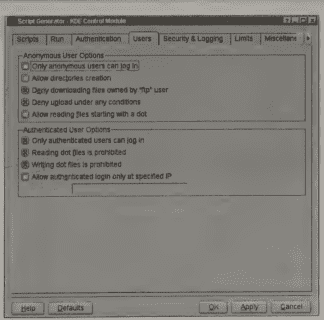

#### 图 8.5

PureAdmin 的虚拟用户管理器。


还有一个基于浏览器的虚拟用户管理工具，称为 User Manager for PureFTPd（见图 8.6）。该工具由 Machiel Mastenbroek 使用 PHP 脚本开发，可让您从任何类型的客户端工作站轻松创建、修改或删除虚拟 Pure-FTPd 用户。要下载软件或了解有关此免费软件的更多信息，请访问 http://machiel.generaal.net/index.php?subject=user_manager_pureftpd。

#### 注意

截至本文撰写时，Pure-FTPd 版本 1.0.16 已添加使用 SSL/TLS 安全机制加密控制通道的实验性支持。启用该选项后，用户名和密码不会以明文发送；客户端发送的其他命令以及服务器的回复也不会以明文发送。但是，数据通道不会被 SSL/TLS 加密。有关详细信息，请参阅 /usr/share/doc/packages/pure-ftpd/README.TLS 或 http://www.pureftpd.org/README.TLS。

### 使用 vsftpd

vsftpd（Very Secure FTP Daemon）是一个安全且极快的 FTP 服务器。它具有丰富的特性集，与 Pure-FTPd 可用的特性集相似。例如，它提供以下功能：

- 虚拟 IP 配置
- 虚拟用户支持
- 能够独立运行或在超级服务器下运行
- 强大的按用户可配置性
- 带宽限制
- 按源 IP 可配置性
- 按源 IP 限制
- IPv6 支持

#### 图 8.6

User Manager for PureFTPd。


从 v2.0.1 开始（v2.0.0 未发布），vsftpd 包含 SSL/TLS 集成。与 Pure-FTPd 中仅为控制通道（端口 21）提供的实验性 SSL/TLS 支持不同，vsftpd 对控制通道和数据通道都提供完整支持。因此，如果您需要提供安全的 FTP 服务器解决方案，vsftpd 应该是您考虑的首选。由于其高性能和严格的安全性，vsftpd 被大量互联网站点使用，例如 `ftp.suse.com`、`ftp.redhat.com`、`ftp.gnu.org` 和 `rpmfind.net`。
您可以在 http://vsftpd.beasts.org/#Performance 和 http://vsftpd.beasts.org/#security 上了解更多信息。

#### 注意

SLES 9 媒体中包含的 vsftpd 版本为 1.2.1，而要获得 SSL/TLS 支持，您至少需要版本 2.0.1（2004 年 7 月发布）。您可以从 http://vsftpd.beasts.org/#download 下载最新版本，或在 http://rpmseek.com 上找到 SUSE 的最新 RPM。

您需要安装 OpenSSL 才能使用 SSL/TLS 选项。如果服务器上尚未安装 OpenSSL——您应该安装，因为它是基础运行时软件包的一部分——或想要使用最新版本，您可以从 http://www.openssl.org/source 下载最新的 tarball。

与许多其他 FTP 守护进程不同（尤其是与 Pure-FTPd 相比），vsftpd 的所有行为都由其配置文件 `/etc/vsftpd.conf` 决定。其唯一的命令行选项是指定不同的配置文件。

vsftpd 在启动时读取 vsftpd.conf 的内容，因此每次编辑文件后都必须重新启动 vsftpd 才能使更改生效。快速试用只需编辑 `/etc/vsftpd.conf`，删除 `listen=YES` 前的注释符号（#），然后执行 `/usr/sbin/vsftpd`。这将以独立模式启动守护进程，准备立即进行客户端连接。除 `listen=YES` 外，未做其他修改时，该文件使用以下您应了解的默认设置：

- `vsftpd` 以匿名 FTP 服务器运行。配置文件中的 `anonymous_enable` 指令可设置为 `NO` 以禁用此功能。您还必须同时启用本地用户登录，方法是取消注释 `local_enable` 指令并将其值设置为 `YES`。
- 该文件仅允许匿名 FTP 下载，而不允许上传。要允许上传，请取消注释 `anon_upload_enable` 指令并确保其设置为 `YES`。
- 该文件不允许匿名用户在您的 FTP 服务器上创建目录。您可以通过修改 `anon_mkdir_write_enable` 指令来更改此设置。
- 该文件将 FTP 访问记录到 `/var/log/vsftpd.log`。要更改为不同的文件或位置，请修改 `xferlog_file` 指令。
- `vsftpd` 希望匿名 FTP 的文件放置在 `/var/ftp` 目录中。您可以通过修改 `anon_root` 指令来更改此设置。

#### 注意

使用匿名 FTP 时，始终存在用户发现写入匿名 FTP 目录的方法的风险。其结果是，如果使用默认设置，您可能会填满 /var 文件系统。最好让匿名 FTP 目录位于其自己的专用文件系统中。

/etc/vsftpd.conf 中列出的指令远非详尽。例如，以下性能调优设置未包含在内：

- `max_clients` 限制并发客户端连接的最大数量。
- `max_per_ip` 限制来自同一源 IP 地址的并发连接数。
- `anon_max_rate` 确定每个匿名登录的数据传输最大速率。
- `local_max_rate` 规定每个非匿名登录的数据传输最大速率。

您可以使用 man vsftpd.conf 或在线访问 http://vsftpd.beasts.org/vsftpd.conf.html 查找所有支持指令的详细描述及其默认值。

#### 警告

vsftpd 对其命令语法非常严格。在选项关键字、= 符号和值之间放置任何空白都是错误。例如，anonymous_enable=YES 有效，而 anonymous_enable = YES 则无效。

与前面讨论的 Pure-FTPd 一样，您必须决定 vsftpd 应在服务器启动时以独立模式启动还是通过 xinetd 启动。如果您选择使用 xinetd，则默认配置文件已安装在 /etc/xinetd.d/vsftpd，其内容如下：

```
service ftp
{
    socket_type     = stream
    protocol        = tcp
    wait            = no
    user            = root
    server          = /usr/sbin/vsftpd
#   server_args     =
```


```
#    log_on_success += DURATION USERID
#    log_on_failure += USERID
#    nice           += 10
     disable         = yes
}
```

要为 xinetd 启用 vsftpd，请将 `disable = yes` 条目更改为 `disable = no` 或注释掉该条目。此外，请确保 `/etc/vsftpd.conf` 中的 `listen=YES` 指令已被注释掉。另一方面，要以独立方式运行 vsftpd，请确保已设置 `listen=YES` 和 `background=YES`，然后将 `/usr/sbin/vsftpd` 添加到服务器启动脚本中。

#### 注释

不存在 `/etc/init.d/vsftpd` 或 `/usr/sbin/rcvsftpd` shell 脚本。要手动启动 vsftpd，只需运行 `/usr/sbin/vsftpd`。要停止它，可以使用 `kill 1` 或 `killproc` 命令。您可以使用 `/etc/init.d/skeleton` 作为模板为 vsftpd 创建自定义 init 脚本。将此文件保存为新名称的副本，并根据需要编辑相关的程序和文件名、路径以及其他详细信息。完成此操作后，使用 `insserv` 安装新脚本。

### 使用标准 TFTP 服务器

设置使用 `in.tftpd` 的 TFTP 服务器相当容易且直接。请使用以下步骤配置和保护您的 TFTP 服务器设置：

- 1. 如果 TFTP 包尚未安装，请使用 YaST 或 RPM 安装它。

- 2. 创建一个目录，用于存放 TFTP 文件（如启动映像）。按如下方式设置目录的所有权和权限：

```
Athena:/home/admin # mkdir /tftpimages
Athena:/home/admin # chown nobody:nobody /tftpimages
Athena:/home/admin # chmod 777 /tftpimages
```

如果网络设备不应上传到 `/tftpimages` 目录的映像，请将目录权限更改为 744。

- 3. 编辑或创建 `/etc/xinetd.d/tftp`，使文件看起来与以下内容类似：

```
service tftp
{
        socket_type = dgram
        protocol    = udp
        wait        = yes
        user        = nobody
        server       = /usr/sbin/in.tftpd
        server_args  = -c -s /tftpimages
        disable      = no
        per_source   = 10
        cps          = 100 5
}
```

您还应在前述文件中包含访问控制指令，例如 only_from 和 access_times，以帮助加强安全性。

#### 提示

由于 TFTP 没有内置安全性（如身份验证），您应包含 xinetd 访问控制指令，例如 access_from 和 no_access，以限制哪些系统可以访问您的 TFTP 服务器。为了进一步提高安全性，您可能希望在运行 TFTP 服务器的服务器上配置 ipchains 规则，以控制对 UDP 端口 69 的访问。有关 ipchains 的更多信息，请参阅第 13 章。

- 4. 使用 `/etc/init.d/xinetd start` 或 `/etc/init.d/xinetd restart` 启动或重新启动 xinetd，以便读取 TFTP 服务器配置。

TFTP 服务器活动记录在 `/var/log/messages` 中，您可以使用 `grep` 精确定位与 `in.tftpd` 相关的条目：

```
Athena:/home/admin # grep -i tftpd /var/log/messages
```

### 网络文件共享服务

除了让本地登录的用户可以使用文件外，通常还需要将文件和目录透明地提供给其他服务器或远程工作站使用。这些其他服务器和工作站可能运行 Linux，也可能不运行 Linux。为了实现文件共享，SLES 同时支持网络文件系统（NFS）和 Samba 网络文件共享协议。

NFS 是一种协议，最初由 Sun Microsystems 于 1984 年开发，并在 RFC 3530 中定义，它是一种基于 Unix 的文件系统，允许计算机通过 IP 网络访问文件，就像它们位于本地磁盘上一样。NFS 可用于运行不同操作系统的各种计算机硬件，以共享文件和磁盘存储。几乎在同一时间，服务器消息块（SMB）协议由 IBM 公司的 Barry Feigenbaum 博士创建。后来它被 IBM、3Com、Intel 和 Microsoft 扩展并使用，作为 DOS、Windows 和 OS/2 操作系统之间网络文件共享的通信协议。如今，Microsoft Windows 使用 SMB，更为人所知的是 *通用互联网文件系统*（CIFS），它利用 NetBEUI（NetBIOS 增强用户界面） over TCP 作为标准网络文件共享机制。与 NFS 一样，多种 CIFS 实现可用于包括 NetWare 在内的各种操作系统。Samba 是在 Unix/Linux 平台上运行的 CIFS 的开源实现，但能像原生一样与 Windows 客户端通信。它允许 Unix/Linux 系统进入 Windows “Network Neighborhood” 而不会引起骚动。Windows 用户可以愉快地访问文件和打印服务，而无需知道或关心提供这些服务的是一台 Unix/Linux 主机而不是 Windows 服务器。简而言之，NFS 和 Samba 是两种可通过网络将服务器磁盘存储与其他系统共享的不同方法。选择使用哪个软件包取决于您的网络环境。如果您拥有 Windows 工作站和服务器，Samba 将是一个不错的选择。或者如果您主要使用基于 Unix/Linux 的系统，NFS 将是一个不错的选择。

如本章开头所述，由于 NFS 和 Samba 的复杂性，我们不深入细节，而是仅提供您快速设置简单 NFS 服务器和 Samba 服务器所需的最低限度内容。您可以通过其他出版物了解有关这些协议的更多信息，例如

- RFC 3530: Network File System (NFS) version 4 Protocol
- RFC 2624: NFS Version 4 Design Considerations
- RFC 2224: NFS URL Scheme
- *NFS Illustrated* (ISBN 0201325705)
- *The Definitive Guide to Samba 3* (ISBN 1590592778)
- *The Official Samba-3 HOWTO and Reference Guide* (ISBN 0131453556)

### 设置 NFS 服务器

计算机既可以是 NFS 服务器也可以是 NFS 客户端。在这里，我们专注于 NFS 服务器方面，即您的 SLES 服务器将通过网络（通过端口 2049）向 NFS 客户端提供（导出）其文件和目录。

NFS 守护进程集成在 SLES 内核中，因此无需安装；您只需进行配置然后激活即可。主要功能由 *nfsd.o* 内核模块处理，而 */usr/sbin/rpc.nfsd* 是被视为“filesystem”的用户空间应用程序，可启动 NFS 服务器进程；*/usr/sbin/rpc.mountd* 应用程序用于 NFS 客户端操作。

#### 提示

检查 NFS 服务器是否处于活动状态有两种快速方法。首先，您可以使用 ps 命令：

```
Athena:/home/Admin # ps aux |grep nfsd
root    7680  0.0  0.0     0    0 ?    S  10:48  0:00 [nfsd]
root    7681  0.0  0.0     0    0 ?    S  10:48  0:00 [nfsd]
root    7682  0.0  0.0     0    0 ?    S  10:48  0:00 [nfsd]
root    7683  0.0  0.0     0    0 ?    S  10:48  0:00 [nfsd]
root    7684  0.0  0.0     0    0 ?    S  10:48  0:00 [nfsd]
root    7706  0.1  2588  692 pts/3  R+  10:49  0:00 grep nfs
```

如果 NFS 服务器正在运行，您将看到多个 [nfsd] 进程。另一种方法是使用 lsmod 命令，它以用户友好的格式显示当前加载的内核模块：

```
Athena:/home/Admin # lsmod | grep nfsd
nfsd                 106184  5
exportfs              10368  1 nfsd
```

第一列显示模块的名称，其后是模块的大小（以字节为单位），其后是一个数字，表示当前活动的该模块实例数；如果该数字为零，则表示服务未处于活动状态。

#### 注释

在 NFS 协议下，一次只有一个用户可以对文件进行写访问，此访问由 NFS 文件锁定守护进程 (/usr/sbin/rpc.lockd) 控制。

所有 NFS 服务器配置信息都存储在 /etc/exports 中。此文件包含您打算与 NFS 客户端机器共享的每个目录的条目。每个条目定义了目录的共享方式。

exports 条目的一般形式为

```
directory_name [host_1[(option_list)]] [host_2[(option_list)]] ...
```

其中 directory_name 是您想要导出的目录，host_x 表示可以使用 IP 地址、DNS 名称或网络名称（如 *.UniversalExport.ca）挂载导出目录的机器，而 option_list 是可选关键字的以逗号分隔的列表。


#### 警告

如果未指定任何选项，则默认导出对所有主机都是读写权限。如果未提供主机名，则意味着任何机器都可以挂载此导出的目录。因此，您绝不应在 *option_list* 中未指定至少一个选项的情况下导出目录。

以下是 `/etc/exports` 文件的示例：

```
# A sample /etc/exports file
/          hermes(ro,root_squash) castor(ro,root_squash)
/home      *(UniversalExport.ca)(rw,no_root_squash)
/var/ftp   *(ro,all_squash)
#End of /etc/exports
```

在此示例中，第一项将整个文件系统导出到 Hermes 和 Castor 服务器，其中为只读，并且 Hermes 和 Castor 上的 root 用户在此导出文件系统上没有 root 权限。第二行将 `/home` 导出到 UniversalExport.ca 域中的所有主机，用户对其主目录具有读写访问权限，并且这些主机上的 root 用户在此导出路径上具有 root 权限。最后一项将 `/var/ftp`（vsftpd 使用的默认匿名 FTP 目录）以只读方式导出到全世界，并以 nobody 账户执行所有请求。

修改 `/etc/exports` 文件后，您可以使用 `/etc/init.d/nfsserver` start 或 `/etc/init.d/nfsserver` restart 命令启动或重启 NFS 服务器。您也可以使用 `/usr/sbin/rcnfsserver` 代替 `/etc/init.d/nfsserver`。要配置 NFS 服务器在服务器启动时自动启动，您需要启用两个系统初始化脚本才能使其工作：

```
Athena:/home/admin # /sbin/insserv /etc/init.d/nfsserver
Athena:/home/admin # /sbin/insserv /etc/init.d/portmap
```

portmapper 使用 TCP/UDP 端口 111，是远程过程调用（RPC）服务的重要组件，而 NFS 使用 RPC。这就是为什么您需要在服务器启动时确保 portmapper 进程也启动的原因。然而，您无需为 `/etc/init.d/nfslock`（NFS 文件锁定守护进程）创建链接，因为它由 nfsserver 自动启动。

#### 注意

nfsserver 启动脚本会在 `/etc/sysconfig/nfs` 中查找名为 `USE_KERNEL_NFS_NUMBER` 的变量，该变量用于确定应为 rpc.nfsd 启动多少个服务器线程。默认值为 4。

您也可以使用 YaST 配置 NFS 服务器。从 YaST 控制中心，选择 Network Services, NFS Server；或从终端提示符，使用 `yast2 nfs-server`（或 `yast nfs-server`）。使用 YaST 时，您无需使用 `insserv` 来设置启动脚本。您只需从 NFS 服务器配置对话框中选择 Start NFS Server，并使用 Directories to Export to the Others 对话框（见图 8.7）来设置 `/etc/exports` 文件。

#### 图 8.7
设置目录导出。


#### 提示

有时您可能需要临时导出一个目录。您可以使用 `/usr/sbin/exportfs` 轻松完成此操作，而无需修改 `/etc/exports`。`exportfs` 的语法是

```
exportfs -o option_list host:/directory_name
```

其中 `option_list` 是导出选项列表，`host` 是远程系统。两者指定方式与 `/etc/exports` 相同。要恢复原始导出状态，请使用 `exportfs -r`。有关更多详细信息，请参阅 `man exportfs`。

您可以使用 `rpcinfo -p` 命令轻松检查 `rpc.nfsd` 及其相关模块是否正在运行。NFS 服务器在 portmapper 中注册为 `nfs`，而 NFS 客户端显示为 `mountd`；可能存在多个 `nfs` 条目，对应于 NFS 服务器线程的数量。此外，您还可以使用 `showmount -a` 命令检查哪些 NFS 客户端系统已挂载了您的导出目录。

### 设置 Samba 服务器

Samba 是一个软件包，允许主机与 Microsoft Windows 客户端或服务器交互，就好像它是一个 Windows 文件和打印服务器一样。Samba 包可在多种操作系统上运行——例如 Linux/Unix、IBM System 390 和 OpenVMS。Samba 实现了 Microsoft 的服务器消息块（SMB），现称为通用 Internet 文件系统（CIFS）网络协议。SMB/CIFS 提供的功能之一是网络文件共享，与前面讨论的 NFS 类似，通过 SMB 共享实现，这里将介绍。其他 Samba 功能例如 Samba 身份验证服务将在本章后面讨论；有关 Samba 打印服务的讨论可在第 9 章“Printing Services”中找到。

> **注意**
> 
> 在撰写本文时，Samba 4 仍处于开发阶段，尚未发布初始版本。
> 
> SLES 9 附带 Samba 3，即当前稳定版本。
> 
> Samba 2.2 已于 2004 年 10 月 1 日起宣布停止维护。
> 
> 您可以在 http://www.samba.org/samba/download 找到 Samba 的最新版本。

Samba 服务器使用 SMB 协议通过 TCP/UDP 端口 137 至 139（含）与客户端共享其文件和目录。导出的目录称为共享，并由共享名称标识，Samba 客户端使用此名称访问资源。共享名称不必与目录名称相同；这允许您为导出的目录使用更具描述性的名称，从而使用户更容易找到它们。要从 Samba 客户端访问共享，只需使用通用命名约定（UNC）表示法：`//server_name/share_name`。

要设置基本 Samba 文件服务器，请确保 samba 和 yast2-samba-server 包已安装在您的服务器上。您只有当想通过 YaST 管理 Samba 服务器时才需要安装 yast2-samba-server。然而，您应安装 samba-doc 以获取在线文档。其他 Samba 相关包，例如 samba-client 和 libsmbclient，可以使用，但运行 Samba 服务器不需要它们。

Samba 服务器由三个守护进程组成：`nmbd`，处理所有 NetBIOS 相关任务；`smbd`，提供文件和打印服务；以及 `winbindd`，解析来自 NT/ADS 域的用户和组信息。Samba 的所有配置数据都存储在 `/etc/samba/smb.conf` 文件中。您可以自行编辑此文件，也可以使用 YaST 或许多可用的图形工具之一，例如随 Samba 提供的基于 Web 的界面 Samba（Samba Web Administration Tool）。

`smb.conf` 文件使用与 Windows `.INI` 文件相同的语法。此文件由节组成，节以新行上括号内的节名称（`[]`）开头。每个节包含零个或多个由等号（`=`）分隔的键/值对。

尽管 `smb.conf` 中的每个节代表 Samba 服务器上的用户定义共享，但您应注意三个预定义的特殊节：

- `[global]`—此节包含适用于整个 Samba 服务器而非特定共享的设置。
- `[homes]`—如果此可选节包含在配置文件中，服务器可以即时创建将客户端连接到其主目录的服务。
- `[printers]`—此节的工作方式与 `[homes]` 类似，但用于打印机。如果配置文件中存在 `[printers]` 节，用户能够连接到本地主机 `printcap` 文件中指定的任何打印机。

列表 8.3 中显示了一个最小的 `smb.conf` 示例。

#### 列表 8.3
一个最小的示例 smb.conf 文件

```ini
[global]
workgroup = TUX-NET
netbios name = MySambaServer
;The following is the default security setting
#security = user

[junk]
path = /tmp

[docs]
path = /usr/share/doc
#read only defaults to yes so no real need to set it
read only = yes
comment = on-line documentation
```

## 第 8 章：网络服务

在列表 8.3 中，`[global]` 中的默认安全设置告诉 Samba 在验证用户密码时使用 `/etc/passwd` 和 `/etc/samba/smbpasswd`。如果您设置了 Windows 域控制器或 Windows Active Directory 域，您可以通过设置 `security = domain` 或 `security = ads` 改用它们来验证用户名和密码。如果您设置 `security = share`，客户端最初连接到 Samba 服务器时不需要密码；但是，客户端尝试访问共享时可能需要密码。

#### /ETC/SAMBA/SMBPASSWD 文件

`/etc/samba/smbpasswd` 是 Samba 密码文件。它包含用户名、Unix/Linux 用户 ID 以及用户的哈希密码，以及账户标志信息和密码上次更改的时间。

Samba 2.2 和 3 使用的 smbpasswd 文件格式与 `/etc/passwd` 文件类似。它是一个 ASCII 文件，为每个用户包含一行。每行中的每个字段由冒号分隔。以 `#` 开头的任何条目将被忽略。以下是 smbpasswd 记录的示例：

```
testuser:6002:XXXXXXXXXXXXXXXXXXXXXXXXXXXXXXXX:
➜XXXXXXXXXXXXXXXXXXXXXXXXXXXXXXXX:
➜[DU]:LCT-00000000:
```

第一个字段包含用户名；此名称必须已存在于 `/etc/passwd` 文件中。第二个字段保存用户的 UID，该 UID 必须与 `/etc/passwd` 中同一用户条目的 UID 匹配。第三个字段是用户密码的 LAN 管理器（LANMAN）哈希，以 32 位十六进制数字编码。这是 Windows 9x 系统使用的相同密码。如果该字段的值等于 32 个 X 字符，则用户的账户被视为已禁用，将无法登录到 Samba 服务器。第四个字段也是密码字段。它包含用户密码的 Windows NT/2000/XP 哈希。与 LANMAN 密码哈希类似，如果 NT 值等于 32 个 X 字符，则用户的账户被视为已禁用，将无法登录到 Samba 服务器。

倒数第二个字段包含账户信息。该字段由 `[ ]` 字符括起来，长度始终为 13 个字符，包括打开和关闭括号字符。该字段的内容可以是以下字符中的一个或多个：

- `U` 表示这是一个“用户”账户，即普通用户。smbpasswd 文件目前仅支持用户和工作站信任账户。
- `N` 表示账户没有密码（LAN-MAN 密码哈希和 NT 密码哈希字段中的密码将被忽略）。请注意，这仅在 `smb.conf` 文件中设置 `null passwords = yes` 时才允许用户无密码登录。


-   **D** 表示该账户已被禁用，此用户将不允许进行 SMB/CIFS 登录。
-   **W** 表示该账户是“Workstation Trust”账户。此类账户允许 Windows 工作站和服务器加入由 Samba PDC 主持的域。

最后字段保存账户最后修改的时间。它由字符 LCT=（Last Change Time）组成，后跟自纪元（1970）以来最后更改所做的 Unix 时间（以秒为单位）的数字编码。此 LCT 字段之后出现的任何附加冒号分隔字段都会被忽略。

#### NOTE
所有以美元符号 ($) 结尾的共享名称都是隐藏的；当用户显示服务器资源时（例如从 Windows 工作站使用 NET VIEW \\SambaServername 命令），它们通常不会出现。这也适用于托管在 SLES Samba 服务器上的此类共享。

可以为每个 [share] 部分指定多个选项。最常用的选项如下：

-   `read only = yes/no` 指定客户端是否可以创建、删除或修改共享上的任何文件。默认值为 `read only = yes`。 （您可以使用 `writable = yes` 代替 `read only = no`。）
-   `guest ok = yes/no` 指示访问此共享是否需要密码。默认值为 `guest ok = no`，这意味着需要密码。 `guest ok = yes` 表示不需要密码。 （您也可以使用 `public = yes`，这是 `guest ok = yes` 的一种较旧且更模糊的形式，以及与 `guest ok = no` 同义的 `public = no`。）
-   `guest account = username` 是将用于访问指定为 `guest ok = yes` 的服务的用户名。用户必须存在于密码文件（或用于验证用户的任何服务）中。默认值为 nobody。
-   `comment = description` 提供共享性质的描述，有助于用户选择正确的资源进行访问。
-   `hosts allow = host1, host2, ...` 指定允许访问共享的一个或多个机器。默认情况下，所有主机均被授予访问权限。
-   `hosts deny = host1, host2, ...` 指定不允许访问共享的一个或多个机器。本地主机 (127.0.0.1) 始终被授予访问权限，但您可以使用 `hosts deny = localhost` 来阻止它。

有关所有支持的选项列表以及配置文件中宏的使用，请参阅 `man smb.conf` 或位于 `/usr/share/doc/packages/samba` 中的文档。

### 一个匿名只读服务器配置
您可以使用 Samba 非常轻松、快速地设置文档服务器，以便组织内的任何人都可以访问共享信息。以下配置文件说明了所需的最小设置：

```ini
[global]
workgroup = TUX-NET
netbios name = DocumentServer
security = share

[docs]
path = /usr/share/doc
read only = yes
guest ok = yes
# limit access to your internal network
hosts allow = *.universalexport.ca, 10.0.0.0
comment = on-line documentation
```

如果将安全级别设置为 share 并允许访客访问 docs 共享，则您的用户无需使用密码即可访问此共享。例如，从 Windows 2000 工作站，所有用户需要做的就是输入以下内容：

```text
net use i: \\documentserver\docs
```

在创建配置文件但在启动 Samba 守护进程之前，运行 `/usr/bin/testparm` 以验证 `smb.conf` 文件的内容。如果 `testparm` 运行正确，它将列出已加载的服务。如果不正常，它将给出错误消息。请确保它运行正确，并且服务看起来合理，然后再继续。命令语法是

```text
/usr/bin/testparm config_file
```

#### TIP
如果省略配置文件的名称，则默认为 `/etc/samba/smb.conf`。因此，您可以复制当前的 `smb.conf` 文件，对其进行修改，对编辑后的文件运行 `testparm`，并且仅在修改后的版本中没有 `testparm` 报告的错误时才覆盖当前文件。

testparm 解析您的配置文件并报告任何未知参数或语法错误。以下是检查第 8.3 节中显示的最小 smb.conf 文件的 **testparm** 输出：

```
Athena:/home/admin # /usr/bin/testparm smb.conf.new
Load smb config files from smb.conf.new
Processing section "[junk]"
Processing section "[docs]"
Loaded services file OK.
Server role: ROLE_STANDALONE
Press enter to see a dump of your service definitions
```

```
#### Global parameters
[global]
        workgroup = TUX-NET
        netbios name = MYSAMBASERVER

[junk]
        path = /tmp

[docs]
        comment = on-line documentation
        path = /usr/share/doc
```

请注意，对于 [docs]，testparm 未显示指令 **read only = yes**，即使它在 smb.conf.new 文件中指定了。原因是它是默认设置，因此不显示。任何注释行（以 # 或 ; 开头的行）也不会显示。

#### TIP
smb.conf 文件修改后始终运行 testparm。

在验证 smb.conf 不包含错误后，您可以使用以下命令启动 SMB 服务器：

```
Athena:/home/admin # /etc/init.d/nmb start
Athena:/home/admin # /etc/init.d/smb start
Athena:/home/admin # /etc/init.d/winbind start
```

您也可以改用 /usr/sbin/rcnmb、/usr/sbin/rcsmb 和 /usr/sbin/rcwinbind。

#### NOTE
nmbd 守护进程应作为 Samba 启动过程的一部分首先启动，其次是 smbd。请注意，运行 Samba 服务器不需要 winbind。仅在使用 NT/ADS 域进行用户身份验证时才需要启动 winbind。在没有 winbindd 的情况下，smbd 将仅使用 /etc/passwd 和 /etc/group 来解析用户信息。

要在服务器启动时自动启动 Samba 服务器，请使用 insserv 创建必要的启动脚本，如下所示：

```
Athena:/home/admin # /sbin/insserv /etc/init.d/nmb
Athena:/home/admin # /sbin/insserv /etc/init.d/smb
Athena:/home/admin # /sbin/insserv /etc/init.d/winbind
```

如果您已安装 yast2-samba-server 软件包，则可以使用 YaST 管理 Samba 服务器配置。从 YaST 控制中心，选择 Network Services，Samba Server；或从终端会话中使用 yast samba-server 或 yast2 samba-server。第一次配置 Samba 服务器时，系统会要求您选择服务器所属的工作组或域以及服务器在此域/工作组中的角色（即它是主域控制器）。

初始化后，YaST 将 Samba 配置对话框的 Shares 选项卡显示为默认值。图 8.8 显示了使用示例最小配置文件时的 Shares 对话框。从此屏幕，您可以添加、删除或修改共享。使用 Toggle Status 按钮，您可以在配置中保留其定义的同时使共享无法访问，以便以后可以轻松重新启用它。

在 Start Up 选项卡上，您可以指示 Samba 服务器是否应处于活动状态。如果您安装了 SuSEfirewall2，此屏幕还提供打开 Samba 所需端口的选项：启用防火墙中打开端口复选框，然后单击防火墙详细信息以在所有外部和内部接口上打开 TCP/UDP 端口 137 至 139（含），以及如果您有 Windows 服务器，则打开 TCP/UDP 端口 445。Identity 选项卡允许您选择域/工作组以及 Samba 服务器在此域/工作组中的角色。在 Trusted Domains 选项卡上，您可以设置 NT 风格的信任，以便您的服务器可以提供对所列域的访问。

#### FIGURE 8.8
Samba 配置对话框的 Shares 选项卡。


Samba 服务器运行后，您可以使用 smbclient 实用程序验证所有共享是否可用。您应该会看到与以下类似的已定义共享列表：

```
Athena:/home/admin # /usr/bin/smbclient -NL localhost
Anonymous login successful
Domain=[TUX-NET] OS=[Unix] Server=[Samba 3.0.4-SUSE]
```

| 共享名 | 类型 | 注释 |
|-----------|------|---------|
| junk | Disk |  |
| docs | Disk | 在线文档 |
| IPC$ | IPC | IPC 服务 (Samba 3.0.4-SUSE) |
| ADMIN$ | IPC | IPC 服务 (Samba 3.0.4-SUSE) |

Anonymous login successful
Domain=[TUX-NET] OS=[Unix] Server=[Samba 3.0.4-SUSE]

| 服务器 | 注释 |
|--------|---------|
| MYSAMBASERVER | Samba 3.0.4-SUSE |


```text
workgroup        Master
---------        ------
TUX-NET
```

已定义的共享首先列出，其后还有两个额外的共享，称为 IPC$ 和 ADMIN$。IPC$（进程间通信）共享由 Windows NT 及之后的系统使用，为其他联网用户提供一系列远程系统管理服务。ADMIN$ 共享提供远程管理功能。

> **WARNING**
> 
> 在 Windows 环境中，IPC$ 共享是 NetBIOS 基于的黑客攻击的常见目标。为了保护您的 SLES Samba 服务器免受此类攻击，您至少应使用 hosts allow 和 host deny 指令来限制哪些机器可以访问您的共享。您可以将它们放在 [global] 部分，使设置适用于所有共享。如果这样做不可行，您可以在 smb.conf 中创建 [IPC$] 部分并在其中放置限制。

最后，提供文件服务的任何服务器都应运行防病毒软件，以防止其文件被篡改。在撰写本文时，SLES 9 包含 samba-vscan，这是一个用于 Samba 的概念验证模块，它使用 Samba 2.2.x/3.0 的虚拟文件系统（VFS）功能提供基于访问的 Samba 反病毒解决方案。有关更多信息，请访问 http://www.openantivirus.org/projects.php。如果您正在寻找商业解决方案，除了本章前面提到的那些之外，BitDefender for Samba (http://www.bitdefender.com) 还提供对 Samba 共享文件夹的基于访问的病毒检查。

### 远程管理服务

访问服务器或配置其分层应用程序的最常见方法是通过控制台 GUI。这主要是在安装时完成，当机器首次配置时。在服务器移至生产环境用于除切换备份媒体之外的目的后，通常不允许对机器进行物理访问。为了解决这个问题，需要一种提供对服务器外部访问的方法。以下各节回顾了允许远程访问系统的多种替代方案。

#### Telnet

过去，访问计算机系统是通过将终端设备硬连接到服务器来授予的。这些设备通常称为哑终端，可提供 rudimentary 字符访问。随着系统的发展和网络变得更加普遍，这种终端访问模式被移植到网络感知应用程序。结果被称为终端仿真器，其使用的协议在很大程度上是 Telnet。

Telnet 协议使用 TCP 端口 23 进行用户系统与目标服务器之间的对话。当它被调用并建立对话时，用户会看到用户名和登录提示。在用户通过身份验证后，会根据信息 contained in /etc/passwd 为用户创建登录 shell。

Telnet 服务是 xinetd 的一部分。您可以通过编辑 /etc/xinetd.d/telnet 并将 disabled 标志更改为 no 来启用该服务。这是在实时环境中 Telnet 文件应有的样子：

```text
service telnet
{
        socket_type = stream
        protocol    = tcp
        wait        = no
        user        = root
        server      = /usr/sbin/in.telnetd
        disable     = no
}
```

Telnet 协议的缺点在于数据包发送到目标服务器的方式。在 Telnet 中，没有为保护数据包在网络上传输时包含的信息提供保护。随着信息在终端会话中输入，它会以明文形式在网络上传播。这包括原始身份验证步骤，允许网络窃听者拦截流量并收集在对话期间传递的用户名、密码和其他敏感信息。因此，Telnet 协议被认为不适合使用。

#### ssh

访问服务器的替代方法可以在名为 Secure Shell (ssh) 的应用程序中找到。该协议通过 TCP 端口 22 进行通信。该应用程序在主机和目标计算机之间建立链接，交换一系列加密密钥，并在两台机器之间建立加密通道。然后该通道用于为用户创建登录 shell。由于通道是加密的，因此用户的数据，例如用户名、密码等，免受网络嗅探的保护。用户然后可以继续进行系统维护任务，例如重置密码和编辑系统配置文件，同时知道交换的任何信息都是安全的。

您通过 `/etc/init.d` 以独立应用程序的方式启动 sshd，并通过文件 contained within `/etc/ssh` 对其进行配置。您可以使用 YaST 运行级别编辑器（系统，运行级别编辑器）在启动时启动 sshd 服务。图 8.9 显示了该服务在启动时已启用。

#### 图 8.9

在启动时添加 sshd。


您可以使用此处所示的语法通过 ssh 连接到主机：

```
Athena> ssh -l eric Hermes.UniversalExport.ca
```

在此示例中，-l 选项用于指定远程端的登录帐户。没有此选项，ssh 将使用与当前会话关联的帐户名进行连接。一旦连接，您将在主机之间建立加密会话。在交换加密信息后，您将被要求输入远程帐户的密码。一旦密码得到验证，您将拥有加密的终端连接。本章后面，您将学习如何将 ssh 连接转变为隧道以在主机之间加密不安全协议。

#### VNC and XDMCP

通常，希望运行配置工具的 GUI 版本。在运行 X Windows System 环境的系统上，有两种方法可提供远程 GUI 访问：VNC 和 XDMCP。

Virtual Network Computing（VNC）应用程序提供对现有 GUI 桌面的远程访问。SLES 的默认安装禁用远程管理。要允许外部用户通过 VNC 连接到服务器，您必须执行以下配置步骤：

- 1. 启动 YaST/YaST2。
- 2. 选择网络服务。
- 3. 选择远程管理。
- 4. 选择允许远程管理。
- 5. 重新启动显示管理器。
- 6. 适当修改防火墙设置。

> **WARNING**
> 
> 谨防意外的运行级别切换。
> 
> 当选择允许远程管理时，您将被提示发出 rcxdm restart 命令。这样做会导致机器切换到运行级别 3。重新启动显示管理器的更温和的方法是从 GUI 控制台注销并重新登录，或发出 reboot 命令。

最后一步涉及修改防火墙。默认情况下，VNC 客户端包通过端口 5901 与服务器通信。如果客户端将从 VNC 客户端连接，则必须在防火墙上打开此端口。随 SLES 捆绑的 VNC 服务器版本还为客户端 Web 浏览器提供 HTTP/Java 连接。默认情况下，VNC 通过端口 5801 提供 HTTP 访问。在防火墙上启用此端口允许访问基于 Java 的浏览器 VNC 客户端。VNC 客户端的 URL 将为 http://target machine:5801。在我们的例子中，这将是 http://Hermes.UniversalExport.ca:5801

VNC 客户端和 HTTP VNC 客户端都是桌面的表示。可以修改屏幕几何形状以满足您的需求。默认情况下，几何形状设置为 1024x768 的分辨率。您可以通过修改 /etc/xinetd.d/vnc 配置文件来更改此设置。VNC 还能够在不同的 TCP 端口上提供不同的默认屏幕分辨率。这些分辨率的示例可以通过在配置文件中将 disabled 标志从 yes 更改为 no 来打开或关闭。还需要适当的防火墙更改。

XDMCP 是 X 显示管理器控制协议。VNC 代表虚拟桌面，而 XDMCP 允许在远程机器上运行完全功能的桌面。这通常用于需要基于 X 的终端会话的环境。Linux 终端服务项目使用 XDMCP 为低端 PC 提供基于 X 的资源。此外，其他不原生支持 X Windows System 的平台可以运行第三方软件并允许它们在其平台上运行 X Windows 桌面。例如，远程管理，XDMCP 与 VNC 一起启用。与 VNC 不同，XDMCP 正常运行所需的防火墙配置更改要复杂得多。XDMCP 要求手动更改防火墙设置以允许 UDP 流量通过——这是 YaST 防火墙配置实用程序不原生允许的。

> > **NOTE**
> >
> > 有关 VNC 的更多信息，您可以访问项目主页 at  
> > http://www.uk.research.att.com/archive/vnc/index.html
> >
> > 其他讨论 VNC 配置的站点包括  
> > http://www.softpanorama.org/Xwindows/vnc.shtml  
> > http://www.uk.research.att.com/archive/vnc/sshvnc.html  
> > http://gentoo-wiki.com/HOWTO_Xvnc_terminal_server

#### 保护系统管理对话

保护用于修改服务器的通信通道非常重要。如果不这样做，网络上的某个人可能会拦截流量并读取传输的数据包。这种窃听形式可能会泄露密码以及可能被利用的许多系统配置参数。

我们已经看到，使用 ssh 等协议比未加密的 Telnet 协议更明智。GUI 系统管理小程序打开的 VNC 和 XDMCP 都以明文形式传输其信息。这意味着耐心足够的人能够拦截对话并重建会话，以至于能够提取在 Telnet 下同样脆弱的信息。因此，如果可能的话，保护此链接至关重要。


为了确保链接安全，您可以查看 ssh 程序提供的额外功能。ssh 能够建立到主机的加密终端会话，也能创建到主机的加密隧道。通过此加密隧道，可以安全地运行非安全协议。您可以通过使用 ssh 命令的 `-L` 选项来实现这一点。这会在本地机器上的端口通过安全隧道映射到目标机器上的端口。例如，Athena 上的用户可以通过输入以下命令为 VNC 创建到 Hermes 的加密隧道

```
Athena> ssh -L 5902:localhost:5901 Hermes.University.ca
```

该命令会将对本地主机——在此例中为 Athena——的 5902 端口的任何连接通过加密隧道映射到 Hermes 上的 5901 端口。执行该命令时，会使用当前活动的用户名创建到远程主机 Hermes 的 ssh 会话。如果远程用户名不同，则必须使用 `-l` 开关提供适当的用户名。然后系统会提示用户输入远程节点账户的密码。连接成功后，远程机器上会创建一个 shell。该 shell 必须保持，因为它支持隧道会话。

#### NOTE

您还可以配置系统以支持称为 X 转发的特性。您可以通过在 ssh 命令中包含 -X 开关，然后跟上您想在远程系统上运行的 X Windows System 应用程序来实现这一点。

为了从 Athena 运行到 Hermes 的加密 VNC 连接，用户随后执行指向代表隧道本地端的本地机器端口的 VNC 会话——在此例中为端口 5902——如下所示：

```
Athena> vncviewer -encodings "copyrect hextile" localhost:5902
```

本地主机将识别该本地端口为隧道的一端，并将所有后续数据包通过隧道转发到远程端的端口 5901，从而建立安全的 VNC 会话。编码参数用于改变 VNC 会话，以调整客户端与服务器之间信息流，从而提高性能。

此方法的一个直接好处是减少防火墙上暴露的端口数量。因为与远程主机的所有通信都通过加密隧道进行，所以唯一需要的端口是 22。VNC 所需的其他端口都可以在目标主机上关闭，从而完全隐藏 VNC 的可用性。明显的优势是 VNC 仅对已通过身份验证的客户端可用，因为他们必须首先建立隧道。唯一的缺点是用户必须先进行身份验证以创建隧道，然后再次进行 VNC 登录屏幕的身份验证。

#### NOTE

ssh 隧道是保护到那些设计上不支持加密链接的机器和应用程序连接的绝佳方式。

如果考虑 IMAP 或 POP，大多数服务器都通过其 SSL 等效方式支持这些服务。在大多数情况下，数据库流量并未加密。使用此方法，您可以将 MySQL 流量从应用程序服务器隧道到数据库服务器，流量将在线路上透明地加密。

### Restricting Connections by IP Address

按定义，服务器为用户提供应用程序。在某些情况下，这些应用程序通过已建立的端口在网络上远程访问。为了减少这些服务遭受攻击的暴露，如果能够限制允许建立连接的主体将是有益的。交换身份验证凭据不是完整的解决方案，因为它依赖于预先存在的连接。因此，需要一种方法来防止除特定客户端之外的所有连接。

xinetd 超级服务器允许控制允许使用 xinetd 资源源地址。在默认情况下，它接受来自任何源 IP 地址的连接。xinetd 配置文件 /etc/xinetd.conf 包含描述连接有效源的一行。默认情况下，它是一条注释行。如果取消注释 /etc/xinetd.conf 文件中的 only_from 行，您可以为有效客户端机器提供 IP 地址列表。在服务器环境中，这种方法是可行的，因为服务器地址通常是静态的。将 DHCP 池中的唯一地址放在此部分可能会导致服务暴露给非预期客户端。

以下是 xinetd.conf 文件的摘录。

```
defaults
{
        log_type        = FILE /var/log/xinetd.log
        log_on_success  = HOST ATTEMPT
        log_on_failure  = HOST ATTEMPT
#       only_from       = localhost
        instances       = 30
        cps             = 50 10

#       interface       = 127.0.0.1
}
```

将 only_from 行更改为删除注释符号（#）并用特定地址列表替换 localhost 将限制 xinetd 的所有流量仅限于这些地址。可以实现更细粒度的控制，通过在 `/etc/xinetd.d` 目录中的应用程序特定配置文件中放置 `only_from` 行。使用这种方法，您可以允许 ssh 流量到一组主机，同时允许 VNC 流量来自另一组列表。

xinetd 对 IP 的限制进一步减少了对 sftp、echo 和 telnet 等其他实用程序的版本收集暴露。因为某些版本的应用程序已知存在漏洞，限制连接——从而显示任何横幅信息——减少了不受欢迎的机器挖掘服务获取信息的机会。

在 VNC 的情况下，您可以在防火墙上重新打开端口 5801。有了 xinetd，您就可以为选定机器的唯一静态 IP 地址授予访问权限。然后您就可以向这些特定客户端提供通过 HTTP 的 VNC。

#### A Secure System Management Environment

在前面的章节中，您看到了几种用于访问服务器执行系统管理任务的不同方法。由于系统管理中通常使用的信息的敏感性，加密通道是强制性的。

ssh 命令用于创建安全通道，通过该通道通常不安全的 VNC 可以使用。这允许系统管理员在不损害会话安全性的情况下利用 GUI 界面的好处。我们还研究了如何将 xinetd 系列服务的访问限制到特定 IP 地址。在一个正确交换的环境中，此类限制可用于允许特定工作站访问 VNC 和 XDMCP。

此处讨论的安全访问方法可用于促进系统管理并减少需要物理访问服务器本身的人员数量。

### Network Name Services

网络名称服务是一种机制，通过该机制请求客户端机器可以查询有关网络可用机器或服务的信息。在以下章节中，我们将检查 SLES 下可用的服务。

### Samba

通常，Samba 软件被视为文件和打印机共享应用程序。然而，要执行此任务，必须具备若干因素。仅仅将机器放置在网络上不足以使其所有可共享资源自动对所有人可用。

Samba 提供了一个称为域的环境，机器可以在其中注册。域是一个网络实体，是所有用户和机器信息的主要存储库。当客户端机器从目标服务器请求服务时，它必须首先查询用户。使用 NetBIOS/NetBEUI 协议，客户端可以找到服务提供者的名称并收集打开连接所需的信息。找到目标计算机后，可以对相关资源发出连接请求。如果资源存在，则会检查请求者的权利和特权，并授予或拒绝访问。用户的凭据和对共享资源的访问权限存储在 Samba 域中。

### Service Location Protocol (SLP)

服务定位协议（SLP）允许客户端生成网络查询并广播对网络上特定资源的请求。提供服务的主机可以回答查询并提供其位置信息。您可以将 SLP 视为一个去中心化的网络服务名称服务器。然而，与解析简单机器名称不同，它在请求的服务类型与提供该服务的可用系统之间提供桥梁。

YaST 中的 Misc 选项有一个名为 Installation Server 的选项。选择此功能允许您为 SUSE 安装介质创建 SLP 分发服务。您可以选择介质将可用的协议（HTTP、FTP 或 NFS）。系统接受您的安装介质后，后续安装可以指向此资源而不是本地 CD-ROM 驱动器。您的安装将运行得更顺畅且无需不断更换光盘。

SLP 不限于软件包分发。它还能够提供文件和打印服务器以及邮件服务器的网络范围知识。SLES 提供的许多应用程序都感知 SLP。运行 SLP 浏览器（您可以通过选择 YaST、Network Services 访问）允许您查找网络上可用的服务。

### Domain Name Service (DNS)

域名服务（DNS）是一个基于 TCP/IP 的环境，允许将基于文本的机器名称转换为其目标 TCP/IP 地址。


一个典型的完全限定域名（FQDN）引用包含一台唯一机器的机器名以及其所属的 DNS 区域。示例可以是

**Hermes.UniversalExport.ca**

DNS 本质上是一个多层级查找系统，与一系列电话簿类似，可用于将名称转换为数字。

电话号码从左到右阅读：国家代码、区号、本地电话号码。要查找个人的号码，你可以在电话簿中查找他的姓氏，滚动到包含他名字的一行，然后找到他的号码。当然，这是理想情况。在许多情况下，许多城镇都由同一本电话簿覆盖。你也可能遇到多个同名的人。

在互联网上查找唯一机器并定位其地址的情况类似。电话簿换成了 DNS 服务器。对前述机器的搜索在本地名称服务器上执行；如果它识别该机器，DNS 服务器将返回请求的信息。

如果机器未被识别，会发生两种情况。就像 Lennoxville、魁北克的电话簿是当地电话号码的权威指南一样，DNS 服务器可以被声明为某个域的权威指南。如果目标 DNS 服务器是 UniversalExport.ca 区域的主服务器，则会向用户返回一条消息，大致表示“没有此类主机”。

如果另一方面 DNS 服务器不是所讨论域的主服务器，它会将信息请求传递给被称为“升级”服务器的 *forwarders*。这些新的目标 DNS 服务器也有转发服务器，查询会被传递下去。很快，具有回答查询权限的 DNS 服务器会提供答案。

在外部机器查询类似 Athena.UniversalExport.ca 的机器名称的情况下，名称解析会很快发生。如果只有 Pollux 是 UniversalExport.ca 区域的权威 DNS 服务器，则请求机器的本地 DNS 无法回答查询。它的 DNS 服务器会询问其转发服务器是否可以解析 UniversalExport.ca。如果那样不起作用，则会发出对 .ca 的查询。因为这是根域，其 DNS 服务器默认知道 UniversalExport.ca 的 DNS 服务器地址。Pollux 将成为下一次查询的目标，并返回正确的面向互联网的地址。

## 第8章：网络服务

在设置 DNS 服务器之前，你需要知道以下信息：

-   你的本地名称服务器的名称和地址（你正在构建的那台）。
-   你通过 ISP/注册商获得的区域名称。在我们的示例中，这将是 UniversalExport.ca。
-   你服务提供商的名称服务器地址，或你希望未解析查询发送到的名称服务器的 IP 地址。
-   你希望名称服务器识别的各个区域的名称。当然，它们必须是你可以有权解析的名称。因为我们拥有 UniversalExport.ca，我们可能会将其细分为 Marketing.UniversalExport.ca、Engineering.UniversalExport.ca 等等。
-   如果你将处理邮件，则你的面向互联网邮件主机的 IP 地址和名称。

收集完这些信息后，你就可以配置 DNS 服务器了。配置 DNS 服务器最简单的方法是使用 YaST 工具。在网络服务下，选择 DNS 服务器。然后会显示一个向导，你必须完成以下三个步骤：

-   配置转发器。
-   设置 DNS 区域。
-   调整服务器的启动行为并决定是否要进入专家配置菜单。

转发器和启动步骤相当直接。启动选项仅定义系统启动时是否启动 DNS。转发器是名称服务器，用于在本地 DNS 服务器无法回答查询时进一步处理 DNS 请求。通常，它们是与你的 ISP 关联的外部 DNS 服务器。

确定哪些查询传递给转发器是通过定义区域来完成的。区域是对本地名称服务器负责的计算机域的定义。

主区域将当前 DNS 服务器标识为所标识域信息的权威来源。对该域的查询要么在本地解析，要么将失败发送回客户端。

#### 网络名称服务

从属区域告诉本地 DNS 服务器组织中哪些其他 DNS 服务器负责所请求域的名称解析。对此类域的请求会转发到所标识的 DNS 服务器。

未被本地区域信息解析的对 DNS 的查询会传递给所标识的转发器进行处理。通过指定 DNS 服务器的层次结构，你可以控制哪些域可供你的查询使用，哪些不可用。

然而，区域编辑阶段可能需要一些时间才能正确配置。区域编辑器中有五个主要选项卡，每个选项卡代表一种特定类型的记录：Basics、NS Record、MX Record、SOA 和 Records。

Basics 选项卡描述了允许从区域中提取批量信息的主体。这些批量查询称为区域传输，通常不允许。通过转储区域的内容，攻击者可以了解到有关你网络架构的大量信息。如果在组织内部的受损机器上工作，攻击者只需浏览 DNS 条目即可快速了解网络中驻留的机器。最好将此设置保留为 None 以禁止所有类型的区域传输。

NS Record 选项卡表示负责解析对此区域查询的名称服务器。虽然通常一个记录就足够了，但这里也可以列出第二个冗余服务器。

MX Record 选项卡标识该区域的邮件服务器。将邮件转发到你的域的 SMTP 邮件服务器会查询 MX 记录，以了解应将邮件投递到哪些主机。通常，被指向的服务器并不是组织的实际邮件服务器。暴露在互联网上的 MX 记录通常是用于接收邮件、扫描病毒和垃圾邮件，然后将可接受的邮件转发到内部服务器的边界主机。

SOA 记录被称为区域的“Start of Authority”记录。在 SOA 选项卡上，权威服务器可以对服务器名称设置陈旧数据范围、维护更新的序列号并为记录设置过期信息。提供的数值是常见使用的标准值。这允许传递给查询的名称在请求者的缓存中保留固定时间。如果服务器移动到不同的 IP 地址，请求者客户端上的陈旧日期将强制在所述期间内重新发现新的正确地址。这是为了确保远程信息保持相对最新。

在最后一个选项卡 Records 上，你可以定义网络上实际服务器的名称和地址。除了 MX 和 NS 类型记录外，YaST 工具还允许你定义 A 和 CNAME 条目。A 类型记录将机器的名称与其数字 IP 等价物关联起来。CNAME 类型记录允许你为机器定义别名。正如你将在 HTTP 服务器部分后面看到的，机器别名记录可用于让单个主机为多个 Web 环境提供服务。

#### 注意

YaST 工具中列出的 DNS 记录类型远不止这些。要获取这些记录类型的完整列表，请参阅 RFC 1035。有关所有 RFC 的具体信息可在 http://www.faqs.org/rfcs/ 找到。

配置完区域后，你可以启动 DNS 服务并测试你的成果。以下是你可以尝试的几个测试：

```
Castor:~ # host -l UniversalExport.ca
UniversalExport.ca name server Athena.UniversalExport.ca.
Castor.UniversalExport.ca has address 192.168.1.245
Pollux.UniversalExport.ca has address 192.168.1.244
Hermes.UniversalExport.ca has address 192.168.1.243
```

```
Castor:~ # host Hermes.UniversalExport.ca
Hermes.UniversalExport.ca has address 192.168.1.243
```

-l 选项请求转储所请求域的所有已知 DNS 条目。控制哪些机器可以请求你的域的区域传输非常重要。只有环境中的其他名称服务器才应能够执行此操作。允许无限制访问区域传输会使攻击者获得你所有机器的完整列表。它还使你发布的所有机器暴露于侦察扫描之下。如果你将机器的用途嵌入机器名称中（例如，web1.universalexport.ca），攻击者可以集中针对特定服务器的适当攻击。

此时，你应该能够将整个服务器环境添加到你的 DNS 中。网络内的机器可以指向你的 DNS 服务器 IP 地址进行名称解析。对于你的服务器无法解析的所有区域，你的 DNS 将转发请求并透明地检索答案。如何快速设置所有工作站指向你的 DNS 是下一节的主题。

#### 动态主机配置协议（DHCP）

在大多数组织中，桌面工作站的数量远远超过服务器群的规模。在严格控制的生产环境中，你为机器分配 IP 地址的能力受多种因素制约：它们是否面向互联网、位于特定实验室或 DMZ 中，或可能只能从组织内部访问的服务器。在你已经

选择 IP 地址后；你可以创建 DNS 条目以允许客户端通过名称连接到该机器。相同的流程适用于所有向其他机器提供服务的机器。

在独立式桌面的情况下，几乎没有理由让它们直接相互通信。因此，通常不明智的做法是将每台机器都注册到 DNS 中。此外，随着组织的增长，维护哪台机器具有哪个地址的列表是一项极其繁琐的任务。

动态主机配置协议（DHCP）缓解了这里讨论的许多问题。你可以使用 DHCP 为请求的工作站提供它们在网络上正常运行所需的所有 TCP/IP 信息。

在下面的讨论中，我们考察了一种情况，即所有内部地址空间都位于能够进行网络地址转换（NAT）的防火墙后面。我们将内部子网的大小、你选择的 B 类或 C 类，以及它的划分方式留给你决定。如果你的环境不同，并且你拥有有效真实世界 IP 地址的注册范围，相同的概念仍然适用。

#### 注释

私有子网在 RFC 1918 和 RFC 1466 中有进一步说明。你可以在 http://www.faqs.org/rfc/cs/ 找到这些 RFC 的副本。

许多公司在其小型企业或家庭路由器防火墙上预配置了 192.168.x.0/24 子网。此类设备最多可寻址 254 台机器。机器数量更多的公司可能会选择使用 A 类或 B 类地址空间。

选择内部私有子网的数量很重要，因为它将决定你的网络有多“扁平”。选择多个较小的子网可能有利于隔离流量并识别异常流量的来源。

一台机器在网络上本地通信所需的最低限度 TCP/IP 信息是 IP 地址，以及可争论的子网掩码。有了这些信息，当前网络和同一子网中的所有机器都可以通过 IP 地址访问。

要让一台机器与当前子网之外的机器通信，它需要一个网关的地址。网关像一座桥梁一样工作，并包含将传出数据包路由到适当目的地的必要路由信息。有了这额外的信息，PC 现在可以与其它子网通信，但只能使用目标的 IP 地址。

允许客户端工作站通过名称与机器通信的最后一部分称为域名服务器（DNS），之前已讨论过。当你定义 DNS 服务器的 IP 地址时，本地机器可以将完全限定域名翻译为唯一的 IP。通信现在可以通过名称进行。

总之，为了让 PC 在网络上正常运行，需要以下信息：

- IP 地址和子网掩码
- 网关地址
- DNS 服务器的 IP 地址

在你定义了这些信息后，就可以准备配置你的 DHCP 服务器了。你可以通过启动 YaST 并选择网络服务然后 DHCP 服务器来启动 DHCP 配置实用程序。

在初始配置中，会询问哪个网卡将提供 DHCP 服务。

第二步要求你输入默认网关和名称服务器 IP 地址。你还会被提示输入以下信息：

- **域名**—这是你的注册域名。它将在配置时附加到工作站的名称上。它也将是 DNS 查询附加到请求的默认区域。通过这种方式，客户端可以按名称指定服务器，而不需要完全限定域名（例如，你可以使用 Athena 而不是 `Athena.UniversalExport.ca`）。
- **时间服务器**—此信息允许客户端指向企业时间服务器。识别时间服务器对于许多协议都很重要，也是一种良好的实践。它使追踪网络事件变得更容易，并减少了因时钟不同步而导致的支持电话数量，以及邮件在 PC 时钟达到发送时间之前就到达 PC 的情况。
- **打印服务器**—如果你有企业打印服务器，可以在此标识它。
- **WINS 服务器**—此信息允许你的机器自动注册到 Windows Internet Naming Service（WINS）。使用此服务，机器-用户和 IP 信息会被收集到中央位置，以帮助减少网络查询。WINS 使用 NetBIOS 命名服务，可在 Samba/Windows 下使用。

初始设置的第三步也是最后一步是指定可供分配的 TCP/IP 地址范围。你在此选择的范围可以基于许多因素。单子网站点可能会为服务器保留前 30 个地址，为打印机保留接下来的 15 个地址，其余用于动态分配。其他选项包括将服务器放在一个子网中，打印机和网络设备放在另一个子网中，工作站放在第三个子网中。在做出此决定后，你需要输入一个下限和上限 IP 地址来定义 DHCP 范围。

配置完成后，你将能够启动 DHCP 服务器。将客户端配置更改为允许 DHCP 并重新启动网络服务应该就是所需的一切。你的客户端现在应该在适当的地址池中获得一个有效地址。

DHCP 允许快速配置工作站。它还减轻了跟踪机器-IP 配对的繁琐任务。如果仍需要这些配对，DHCP 提供了附加功能，即可以注册网卡的 MAC 地址并将其与唯一的 IP 匹配。虽然这仍然是一项繁琐的任务，但数据保存在 DHCP 服务器本身中。因此不可能分配两次相同的地址——这正是电子表格或纸质系统所知名的。

MAC 地址保留方案对于隔离目的也很有用。网络上发现的可疑机器可以将其 MAC 地址保留指向隔离子网。此类子网可以配置为不与其他子网交互，从而导致最终用户联系帮助台。然后帮助台人员可以处理受感染的机器，而无需从一个隔间检查到另一个隔间。

### DNS 与 DHCP

你可以执行额外的配置步骤，以更紧密地将 DNS 和 DHCP 结合在一起。这两个应用程序都感知 LDAP。如果存在企业 LDAP 目录，这些应用程序可以将它们的信息存储在提供的结构中。

这里尚未讨论的一个附加功能是将 DHCP 收集的信息与 DNS 的功能联系起来。你可能希望用 DHCP 的名称和 IP 地址填充 DNS 数据库。SLES 允许你使用 DynamicDNS 来执行此操作。此选项允许 DHCP 服务器向 DNS 服务器传递信息。机器名称和域的自动注册在 DNS 环境中执行。这允许主机具有动态 IP 地址，同时在需要时仍可通过名称访问。

### Web 服务

Apache2 Web 服务器是你的 SLES 服务器的一个可用配置选项。Apache2 服务器是一个功能齐全且非常通用的环境。在默认配置中，Apache2 使用端口 80 上的 HTTP 协议提供网页。如果需要，可以集成证书以使用端口 443 上的 HTTPS 提供安全网页。Apache2 下可用的选项如下：

- 访问控制
- 服务器端包含
- CGI 脚本
- 每用户网站
- 虚拟服务器（按名称或按 IP 地址）

你可以通过在 YaST 中选择网络服务、HTTP 服务器选项来访问 Apache2 配置菜单。在典型的环境中，Web 服务器提供的内容存放在一个单一的目录结构中。

默认情况下，SLES 上的 Apache2 将 /srv/www/htdocs 指向作为所有集中式 Web 信息的存储库（见图 8.10）。网页请求被指向该目录以便解析。可以在该目录内添加子目录以进一步隔离内容。目录名称然后成为请求 URL 的一个组成部分。网站在此之外的结构由负责该站点的网站管理员决定。

对于更动态的内容，你可以在 /srv/www/cgi-bin 找到系统范围的 CGI 环境。Web 服务器配置文件定义了放置在目录中的文档的处理方式。此特定位置配置为通过适当的脚本引擎预处理请求项。然后将脚本的输出作为标准 HTML 返回给请求客户端。这允许相关网站生成通过原始 HTML 无法访问的动态内容。

SLES 和 Apache2 也允许用户发布自己的 Web 内容。当向系统添加用户时，他们会自动在其主目录中获得一个 public_html 目录。这些目录中的网页可以通过在默认 Web 服务器路径中添加 ~username 来访问。

HTTP 服务器环境的开箱即用安装提供了典型网站所需的大部分内容。然而，Apache2 可以提供更多功能。已安装的 Apache2 版本支持 *虚拟服务器*，它有两种形式：基于 IP 和基于名称。


#### 图 8.10
默认 HTTP 服务器配置。


因为可以为服务器的网络接口卡绑定额外的地址，所以可以配置 Apache2 服务器识别这些地址。每个地址都不同，因此可以与不同的文档结构关联，提供隔离的 Web 环境。

你可以通过简单地用不同的名称标识 Web 服务器来获得等效的网站分离。可以创建额外的 DNS 条目，将多个名称指向同一个服务器 IP 地址。当 Apache2 被要求启动一个 Web 会话时，它会查看请求中的 HTTP 头部。然后根据调用的 URL 调整返回文档的内部服务器路径。

图 8.11 显示了人力资源部门虚拟 Web 服务器的配置。

Both Castor.UniversalExport.ca 和 hr.UniversalExport.ca 都可以放在 DNS 中，解析到同一个 TCP/IP 地址。当 Web 服务器接收到请求时，它会解析 HTTP 请求中的头部，并透明地将请求传递到适当的文档树。对于默认网站（Castor）而言，文档可以从其 Web 根目录 /srv/www/castor 处理。对于人力资源页面，文档将从 /srv/www/hr 查看。图 8.12 显示了主 HTTP 服务器设置屏幕中更新的虚拟服务器信息。

当网站向大量受众提供通用信息时，加密传输通常是不必要的。通常，这类网站提供可通过其他出版格式轻松访问的信息的在线访问。

#### 图 8.11
人力资源虚拟服务器配置。


#### 图 8.12
显示可用服务器的主 HTTP 服务器配置页面。


有时，网站上的应用程序会生成敏感信息。SLES 发行版中包含的 Apache2 服务器能够支持称为 HTTPS 的加密 HTTP 流量。要使你的 HTTP 服务器生成 HTTPS 流量，需要证书。证书是一种机制，通过它客户端可以获得一定程度的保证，即你的服务器确实是可信的。此类证书通常由负责建立你真实性的第三方服务生成。当这个被信任的第三方，即证书颁发机构或 CA，确信满足了身份识别要求时，就可以为你的服务器颁发证书。

如果你的站点要求仅用于内部用途且没有那么严格，自签名证书可能就足够了。与来自受信任机构的证书不同，自签名证书会在客户端生成警告消息，指示证书的来源和类型。然后客户端需要决定是否接受自签名证书。

自签名证书可以通过以下两种方式生成：
- 使用 `/usr/bin/gen sslcert` 并传递适当的参数
- 使用“安全和用户”下的 YaST CA 管理选项
- OpenSSL

后一种方法提供更用户友好的界面。使用 YaST CA 管理选项生成证书会利用服务器配置人员在构建时提供的 CA 信息。假设你的服务器未被重命名，默认 CA 中预先存在的信息应该是有效的。

选择“输入 CA”选项会打开一个信息屏幕，其中包含现有信息以及一个允许你查看、创建和导出证书的按钮。在此阶段，重要的是验证证书上的服务器名称和电子邮件信息是否正确。完成此操作后，你可以突出显示证书并选择“导出”选项。

导出时，你需要同时生成证书和密钥信息。你可以选择“导出到文件”选项，并以未加密的 PEM 格式导出证书和密钥。使用此导出功能会将证书和密钥信息放在同一个文件中。Apache2 希望在两个单独的文件中找到此信息：`/etc/apache2/ssl.crt/server.crt` 和 `/etc/apache2/ssl.key/server.key`。此时，你可以手动将文件拆分为两个，证书和密钥，并将每个部分复制到适当的 Apache2 文件中。

#### 注
gen sslcert 命令会自动将生成的证书拆分为适当的 Apache2 文件。诀窍在于在命令行上提供生成有效证书所需的所有必要信息。

你可以通过输入以下命令找到命令行选项

```bash
/usr/bin/gen sslcert -help
```

请特别注意电子邮件地址字段和完全限定主机名。如果它们与 Apache2 中为安全站点配置的内容不完全匹配，证书将无法工作。

在 SLES 下的 Apache2 服务器上创建安全虚拟网站需要以下更改。尽管 YaST 接口为 HTTP 站点提供了方便的配置环境，但手动配置 HTTPS 似乎效果更好：
- 1. 确保 Web 服务未运行。你可以通过在 YaST 中管理 HTTP 服务或发出以下命令来做到这一点：

```
/etc/rc.d/apache2 stop
```
- 2. 为 SSL 站点创建虚拟服务器环境。Apache2 的配置文件位于 /etc/apache2。在此目录中，你会找到一个名为 vhosts.d 的子目录，其中包含虚拟主机的配置。将虚拟 SSL 站点的模板复制到配置文件中：

```
cp vhost-ssl.template vhost-ssl.conf
```

编辑此新配置文件，并确保 **ServerName** 变量与提供给证书的完全限定服务器名称匹配。同时，确保 **ServerAdmin** 变量与证书的默认电子邮件地址匹配。
- 3. 修正 Apache2 的系统配置文件。Apache2 的系统配置文件 /etc/sysconfig/apache2 在添加 SSL 组件时不会由 YaST 直接更新。因此，你需要验证是否进行了以下更改：
  - APACHE_MODULE 列表包含 SSL 的条目。
  - APACHE_SERVER_FLAGS 设置为 -D SSL。
  - APACHE_START_TIMEOUT 设置为 5。
- 4. 调整防火墙。由于 HTTPS 使用的端口与 HTTP 不同，你需要修改服务器的防火墙以接受端口 443 上的连接。如果服务器将在不同的虚拟主机中运行未加密的网页，则可能还需要端口 80。

此时，应可在服务器上通过 HTTPS 访问安全站点。如果以后需要或从暂存环境迁移到生产环境，可以将来自受信任第三方供应商的证书插入到正在运行的配置中。这将防止客户端处理自签名证书生成的警告。

#### 注
设置网站使用证书存在许多陷阱。如果使用第三方证书颁发机构，它应该有一系列参考文章来帮助你完成配置。在许多情况下，支持人员会引导你完成各个步骤。

如果你使用自签名证书，可能需要一些外部资源。大多数错误源于用于生成证书的各种名称拼写不一致。如果仍遇到困难，你可能想访问

http://venuserver.rcc.ryerson.ca/index.php?option=com_content&task=view&id=26&Itemid=40

http://www.securityfocus.com/infocus/1818

http://www.securityfocus.com/infocus/1820

使用 YaST 工具配置 Apache2 服务器的大多数方面都很简单。服务器软件允许将多个站点作为单独的虚拟服务器进行管理。Apache2 服务器也可以快速适应以支持 HTTPS。

### 身份验证服务
在第 5 章“用户环境管理和安全”中，我们研究了用户身份验证所涉及的过程。我们介绍了 PAM 模块系统，并探讨了 pam_unix2 模块与 /etc/passwd 和 /etc/shadow 文件之间的关系。在这里，我们在此主题上进行了扩展，并查看了将允许对用户进行网络范围身份验证的替代源。随着环境中机器数量的增加，用户在多个平台上跟踪密码将变得越来越困难。集中式网络身份验证机制将有助于减轻保持密码最新和安全方面的困难。

### 网络信息服务 (NIS)
网络信息服务 (NIS)，正式名称为 Yellow Pages，提供了一个以 Unix 为中心的客户端/服务器环境，用于控制用户名、组、密码以及机器和目录信息。在此环境中，创建一个主服务器并配置为接受一组客户端机器的连接。

在客户端，不会在本地 /etc/passwd 文件中存储任何信息。当用户启动会话时进行身份验证请求时，信息会传递给主服务器。然后主服务器要么拒绝

进行身份验证或返回用户的默认目录以及用户所属的组列表。

在这种环境中，用户的主目录通常驻留在单个服务器上，并作为导出的 NFS 共享在网络上提供。

就 PAM 而言，标准的 `pam_unix2` 模块理解并与 NIS 环境交互。

### Samba 域
Samba 是一组提供跨平台文件和打印服务的应用程序的实现。它是服务器消息块（SMB）和通用互联网文件系统（CIFS）的开源实现。这两种协议最初均由 Microsoft 定义。与 Microsoft 对 SMB 以及后来的 CIFS 的实现不同，Samba 可在多种平台和原生操作系统上使用。

Samba 架构中包含域的概念，用户和服务器驻留在其中。CIFS 可以配置为主域控制器（PDC）、次要（或备份）域控制器（BDC）或仅作为成员服务器。在任何这些配置中，成员 SLES 服务器的身份验证过程都可以指向域账户的中央存储库。

与 NIS 不同，Samba 允许在不兼容的操作系统（如 OpenVMS、Unix 和 Windows）之间桥接身份验证环境。

### 轻量级目录访问协议（LDAP）
轻量级目录访问协议（LDAP）是 X.500 目录协议的缩小范围实现。LDAP 允许一台或一组服务器共享一个公共信息存储库。LDAP 的典型用途是作为地址簿。此类存储库可以包含大量需要以多种方式快速高效访问的数据。此外，LDAP 不要求所有条目包含相同的属性集合。

作为信息中心存储，LDAP 服务器可以被众多系统同时访问。由于它基于开放标准，不同的应用程序和平台可以通过一致的数据模型交换信息。这些属性使 LDAP 成为共享账户信息的理想候选者。

在 SLES 中，集中的 LDAP 服务器不仅可以包含用户名、密码和默认目录等账户信息，还可以包含与 DNS 和 DHCP 相关的信息。

### Kerberos
Kerberos 是一种完全不同的身份验证方法。在之前的示例中以及使用 `/etc/passwd` 文件的情况下，用户会被提示输入用户名和密码。然后两者都会发送到 PAM 中的身份验证机制，该机制检查这些信息并确认其正确性。当需要访问其他不同的资源时，挑战响应机制会被一再调用。

Kerberos 基于完全不同的方法。Kerberos 模型要求专门设置一台服务器用于身份验证。该服务器必须是整个基础设施可以信任的系统，因此必须与其它服务器物理隔离、管理员数量最少且没有本地用户。Kerberos 还要求网络环境保持时间同步。Kerberos 环境中使用的一个参数是时间戳，它可以防止在某一时刻收集的信息稍后在网络上被重新广播。由于信息带有时间戳，重新广播的数据将被视为已污染。

Kerberos 身份验证过程始于新用户请求访问资源时。发生这种情况时，会触发以下事件：

- 1. 该用户会被提示输入其用户名。
- 2. 客户端将客户端名称发送给 Kerberos 服务器，并请求票据。
- 3. 身份验证服务器收集时间信息和 IP 地址，生成一个随机会话密钥，并将其加密为只有它自己和票据授予服务器才知道的密钥。然后它将此加密数据、时间戳和一些额外信息用客户端自己的私钥（即其密码）重新加密。此新数据包发送回客户端。
- 4. 然后本地工作站会要求用户输入其密码。密码随后用于生成数据包的解密密钥。由于用户的密码从未在网络上传输，因此被截获的可能性为零。
- 5. 如果解密成功，客户端现在拥有一个只能由票据授予服务器解密的捆绑包副本。
- 6. 客户端现在可以将此数据包发送给票据授予服务器，以获取具有固定有效期的身份验证票据。

因此 Kerberos 非常安全。客户端与服务器之间的所有对话都是加密的。用户的密码从未在网络上传输，而是用作对话的加密/解密密钥。此外，返回给客户端的数据的一部分由 Kerberos 服务器本身使用私钥加密。由于只有 Kerberos 服务器和票据授予服务器知道此密钥，因此不存在客户端可以生成虚假票据的机制。

当客户端请求访问服务时，票据信息、时间戳和客户端 IP 地址会被捆绑并用会话密钥加密后发送到目标服务器。目标服务器随后可以解密信息、验证票据的有效性并授予访问权限。

### 摘要
本章介绍了 SLES 中可用的服务，并提供了足够的信息让您启动并运行这些服务。此时，您应该了解通过 xinetd 可用的服务以及通过 /etc/xinetd.d 管理的服务。其他涵盖的主题包括对客户端影响最大的服务：邮件、FTP、Web 和文件共享。我们还研究了访问服务器进行远程管理的不同方式。

这里介绍的许多概念都相当复杂，可能需要大量时间才能完全理解。YaST 配置工具是快速浏览配置的一种方式。对于 Samba、DNS 和 HTTP 等许多服务，可能需要在 YaST 范围之外进行额外的更改。

在本章过程中，我们介绍了许多与工具没有直接关联的概念。必须考虑可用配置选项的安全影响。认识到一个选项相对于另一个选项的好处是很重要的。我们希望这里涵盖的额外主题能帮助您理解这一点。

## 打印服务
在本章中，我们研究 SLES 如何提供打印服务。历史上，各种 Unix 版本的打印机支持不一致。制造商为其打印机创建驱动程序，但通常仅针对少数操作系统。这意味着某些打印机仅在特定平台上受支持。

行式打印机守护进程（LPD）用于控制特定队列上的打印请求。运行此应用程序会将本地服务器定义为打印服务器。然后本地队列可以提供给其他系统。客户端随后可以使用 LPR 应用程序将打印作业提交到目标打印服务器和队列。

通用 UNIX 打印系统（CUPS）旨在取代这些旧系统上存在的 LPD 和 LPR 环境。在 SUSE Linux Enterprise Edition 9 及更高版本中，这些旧的打印机环境已被弃用。因此，本章仅关注通过 CUPS 可用的功能。

生成打印输出的各个方面紧密相关。为本章目的，我们将打印过程细分为以下几个部分：

- 打印机配置
- 作业生命周期
- 队列管理

这些类别中的每一个都将使用 YaST、命令行工具和 CUPS Web 界面进行检查。


### 打印机配置

在信息可以打印之前，系统必须知道可用于产生所需输出的设备。当系统知道有效输出设备的存在时，它可以将该设备提供给应用程序。打印机可以根据其向系统提供的方式分为两大类：本地和网络。以下两个部分分别介绍它们。

#### 本地打印机

本地打印机依赖于服务器内部存在的物理硬件。典型的硬件特定接口包括并行、串行、红外（IrDA）和 USB。

每个接口类型在 /dev 目录中都有一个对应的设备文件，通过该文件进行访问。表 9.1 列出了不同的接口类型及其对应的设备文件。

**表 9.1**  
打印机接口类型及其设备文件

| 接口类型 | 设备 |
|---|---|
| 并行 | `/dev/lp0` |
| 串行 | `/dev/ttyS0, /dev/ttyS1` |
| IrDA | `/dev/irlpt0 through /dev/irlpt3` |
| USB | `/dev/usb/lp0 through /dev/usb/lp15` |

由于接口硬件驻留在服务器内部，可以连接到单个服务器的本地设备数量有限。平均服务器预配置有两个串行端口、一个并行端口和分布在四个端口上的两个 USB 总线。超出此范围的扩展需要购买额外的硬件。

所有这些技术都限制了打印设备的位置。各种协议支持的物理电缆长度迫使打印设备位于服务器几码范围内。虽然在串行协议的情况下可以以波特率为代价换取距离，但这种权衡会带来严重的性能影响。如果新型高速打印机位于长、低波特率电缆的末端，则无法足够快地接收数据以保持其打印速度。

将打印机与服务器共置的另一个缺点是访问。在正常的数据中心环境中，用户无法访问托管服务器的房间。因此无法访问短距离协议打印机。

解决这些缺点中的许多问题的方法是将打印机接口硬件推到数据中心之外。这将本文讨论的短距离打印机技术转换为网络感知解决方案。

#### 网络打印机

网络打印机顾名思义，只能通过网络访问。此类打印机通过各种机制连接到远程打印服务器。CUPS 支持多种用于访问此类打印机的网络协议。

CUPS 服务器可以配置为客户端或服务器角色。作为服务器，它可以将多个本地打印队列提供给网络供各种客户端访问。配置为客户端时，CUPS 会监听网络上的服务广播并获取有效的打印机目标列表。

运行 CUPS 的 Linux 服务器还理解 LPD、SMB 和 IPX 网络协议。在这种情况下，可以使用适当的网络传输协议使本地打印机定义指向网络服务器的打印机。LPD 可用于访问非 CUPS 兼容的 Unix 系统上的队列以及一些商用打印服务器设备。SMB 协议用于访问 Samba 或 Windows 服务器环境，而 IPX 则由较旧的 Novell 网络使用。在 SMB 和 IPX 打印的情况下，本地配置可能需要用户名和密码来访问远程队列。

#### 添加本地打印机

您可以使用命令行工具或 YaST 将打印机添加到服务器。以下示例展示了如何使用 YaST 将本地并行打印机添加到服务器。在 YaST 中，打印机配置图标可以在“硬件”菜单选项下找到。选择该图标后，将显示图 9.1 所示的窗口。

在图 9.1 中，您可以看到服务器上目前未定义任何打印机。要创建新的打印机定义，请确保“其他（未检测到）”选项处于突出显示状态，然后单击“配置”按钮。这会带您进入下一个窗口，如图 9.2 所示，您可以在其中选择要配置的打印机类型。在当前示例中，将 Canon Bubble Jet 200 作为标签打印机添加到配置中。该设备需要与主机进行并行端口连接。本地接口显示在列表顶部，而网络感知协议则分组在下部。

由于您正在配置并行打印机，请选择图 9.2 中显示的适当选项，然后单击“下一步”按钮。在下一个窗口中，您可以选择打印机连接到的并行端口。由于典型服务器只有一个并行端口，/dev/lp0，请突出显示该选项并单击“下一步”。对于串行、IrDA 或 USB 打印机，您必须选择适当的设备。

图 9.1
YaST 打印机配置屏幕。


图 9.2
打印机类型定义。


图 9.3 显示了接下来出现的屏幕示例。在此屏幕上，您定义用户将选择以访问队列的名称。采用良好的命名标准可以防止许多丢失或误导的打印作业。当某些打印机与特殊表单（如运单标签或多联表单）一起使用时，这一点尤其重要。

图 9.3
定义打印队列名称和描述。


在定义打印机的可见特性后，您必须向服务器标识所选端口上存在何种类型的打印机。图 9.4 显示了此窗口的示例。每台打印机都有特定的功能和限制。选择适当的打印机型号可确保 CUPS 能正确将用户文档转换为打印机可以渲染的格式。

在图 9.4 中，左侧列显示了大量制造商列表。选择适当的制造商后，右侧列会显示该制造商支持的型号列表。当您选择打印机时，您是在告知 CUPS 打印机功能。利用这些信息，CUPS 可以将各种类型的文档转换为与打印机兼容的格式。

图 9.4
定义打印机型号。


在您选择适当的打印机型号后，将显示配置摘要页面，如图 9.5 所示。此时，单击“确定”按钮会将定义的配置保存到 CUPS 使用的各个文件中。配置保存后，打印机将对系统的所有用户可用。我们将在本章后面探讨队列限制的微调。不过，首先让我们看看定义基于网络的打印机有何不同。

#### 添加网络打印机

在 YaST 中，在本地服务器上为网络打印机添加队列定义几乎与设置本地打印机相同。在图 9.2 中选择基于网络的打印机时遇到的主要区别是，本地接口选择选项被网络配置屏幕取代。对于 SMB 队列，您将看到与图 9.6 所示类似的窗口。

> **注意**
>
> 工作组是在 Windows/Samba 环境中机器的集合。当系统配置时，它可以放置在特定的工作组中。当您在网络中搜索计算机时，只有同一工作组中的系统才会被发现。这允许基于功能对机器进行隔离。

这种分类的缺点是，与域不同，用户名和密码是特定于机器的。需要访问多台机器的用户必须在每台机器上分别维护其密码。

图 9.5
YaST 编辑打印机配置窗口。


在此配置屏幕中，必须定义目标队列的环境和访问权限。如有需要，还必须包含用户名和密码。由于您不希望在特定员工离职时队列访问终止，因此应在目标环境中配置适当加固的服务帐户，以允许特定主机仅进行打印机访问。

配置远程网络打印时必须考虑的另一个因素是通过防火墙访问适当端口。

网络连接打印机的其余配置与本地打印机相同。


#### 图 9.6

SMB 打印机的配置选项。


#### 注意

此处讨论的每种打印机协议都需要一个不同的 TCP/IP 端口。如果要使用该协议，则必须在服务器防火墙配置中做出相应允许。Telnet 和 HTTP 协议通常用于授予对本地打印机配置设置的访问权限。下表列出了用于打印机配置目的的更常见端口。

| 协议 | 端口 |
|---|---:|
| Telnet | 23 |
| HTTP | 80 |
| SMB | 137, 138, 139 |
| LPD | 515 |
| CUPS/IPP | 631 |
| JetDirect | 9100 |

### 打印作业生命周期

从用户请求打印文档到将其发送到物理设备输出之间会发生一系列事件。简而言之，打印请求可以分解为三个主要阶段：

- 为后续处理（spooling）而将所有打印信息本地保存
- 将信息转换为打印机兼容的格式（filtering）
- 将解析后的输出提供给相应的目标设备（printing）

所有这些打印作业阶段都是在请求输出的用户不知情的情况下执行的。然而，每个步骤都必须成功，才能使操作产生有效的输出。

#### 作业排队

对文档打印副本的每个请求都标记有请求编号。该编号使系统能够唯一跟踪文档数据、目标打印队列和过滤器，以及作业会计信息。

spooler 会在 /var/spool/cups 下的目录中放置所请求文档的快照副本。文档及其在过滤过程中的各种实例会保留在该目录中，直到作业成功打印为止。在处理大量打印作业的服务器上，未完成的打印请求会消耗大量的磁盘空间。

spooler 负责根据用户请求提供作业状态信息，以及将数据通过打印过程的各个阶段进行路由。

作业状态可以通过打印服务器上的 CUPS Web 界面（这将在图 9.10 中稍后显示）或通过使用终端界面的 lpstat 命令进行验证。

#### 应用过滤器

使用 LPR/LPD 环境的打印实现由于缺乏各种打印机的跨平台驱动程序支持而存在不足。在 CUPS 中，许多驱动程序问题通过将作业要求从硬件抽象出来得以解决。这是通过一系列转换来实现的，这些转换将打印请求中包含的各种数据格式整理成单一的标准格式。

数据转换为标准格式后，打印过程就简化为从标准格式到单个打印机所理解的格式的简单转换。

在 CUPS 中，标准格式是 PostScript。CUPS 使用的过滤器存储在 `/usr/lib/cups/filter` 中。数据流转换为 PostScript 后，即可将其转换为特定打印机所需的格式。因此，对特定打印机或打印机系列的支持就简化为提供单个 PostScript 感知的驱动程序。如果打印机支持 PostScript，则文件会转发到下一步。如果它不感知 PostScript，如示例 Canon BJ200 的情况，则文件会转换为与打印机兼容的光栅格式。

#### 打印信息

数据整理成适当格式后，即可准备打印。过程中的最后阶段涉及所谓的后端进程。该进程负责将最终的文档版本移动到打印机本身。

对于本地打印机，后端进程会将打印作业的进度、成功或失败报告回 spooler 进程。

网络打印作业的处理方式与本地打印作业略有不同。对于此类作业，后端进程仅限于将文档移交给远程端的 spooler 服务。完成此操作后，spooler 会收到通知，本地打印作业被标记为已完成。但是，在移交发生后，本地后端进程将无法再报告 spooler 作业的状态。远程服务器也有一种方法来跟踪现在“本地”的打印请求。客户端端的进一步跟踪是不可能的，但诊断信息可在端点服务器上获得。

### 队列管理

CUPS 提供了非常强大的打印环境。到目前为止，我们已经研究了如何创建本地和远程打印机的队列。在本节中，我们将集中讨论如何管理这些资源。

在深入研究单个队列特征的管理之前，我们需要探索通过 CUPS 可用的一些额外功能。

CUPS 环境在处理打印机时允许额外的灵活性。CUPS 内置了打印机类的概念。CUPS 中的类是一组类似的打印机。当作业提交到打印机类而不是特定目标时，该类中第一个可用的打印机将处理输出。在有许多类似打印机的工作区域中，将作业提交给类可以防止小型作业排在缓慢打印作业之后。作为示例，可以将电子邮件打印到一个类中，以避免被困在大型的双面月末报告之后。

#### 注意

截至本书撰写之日，CUPS 不提供有关类中哪个打印机满足打印请求的任何指示。因此，必须将类似的打印机物理上放置得靠近彼此，以减少在寻找输出时在打印机之间来回走动所花费的时间。这也意味着不应将敏感文档发送到打印机类进行打印。预计 CUPS 版本 1.2 将支持此类通知。

CUPS 将类结构扩展为所谓的隐式类。当一组服务器使用相同的名称指向同一台网络打印机时，就会生成隐式类。这也假定打印机实际上是独立的网络打印机，而不是易受攻击的服务器上的本地打印机。在这种环境中，单个打印服务器的故障不会导致客户端无法访问相关打印机。CUPS 进一步将这一概念扩展到实际的打印机类。如果作业提交到一个类，任何为该类提供服务的服务器都可以响应请求。

CUPS 直接支持的另一个功能是定义多个打印机队列指向同一台物理打印机的可能性。在许多情况下，像 Web 浏览器这样的软件可以强制打印格式。在某些情况下，例如命令行，访问双面打印或两页打印需要记住打印命令的许多开关和参数。可以定义不同的队列，其配置中嵌入了所需的格式选项。这消除了在单个打印请求中指定选项定义的要求。

### YaST 队列配置

图 9.5 在选项列表末尾显示了三个在“当前值”列中没有条目的项目。这些选项实际上是额外的队列配置选项的占位符。

第一个选项称为 Printing Filter Settings。选择此选项允许您配置输出的格式、输出将打印在何种介质上、纸张尺寸、方向等。可用选项因打印机而异。对于简单的标签打印机，可用选项很少。高端激光打印机提供最多的选择选项。

当您配置多个队列指向同一台打印机时，Printing Filter Settings 选项允许您在队列级别定义默认打印选项。然后，您可以向用户提供多个队列，每个队列具有自己的特征。

“编辑配置”窗口上的第二个选项是 Restriction Settings。默认情况下，系统上创建的队列对所有经过身份验证的用户可用。您可以使用此选项限制对特定用户的访问，或者相反，拒绝除特定用户之外的所有用户访问队列。

图 9.5 中的最后一个选项是 State and Banners Settings。通过此选项，您可以控制打印机是否可用于接受新的打印作业。此外，如果打印作业之间需要分隔页，则可以配置作业前和作业后横幅页。对于大批量打印或打印敏感信息的情况，可以使用横幅来分隔作业并便于操作人员处理。

> **注意**
>
> 应用程序如 Web 浏览器或编辑器通常会将其自己的默认打印机配置参数传递给目标队列。这些选项会覆盖队列上设置的配置参数。提交的作业应按软件包的预期打印，即使输出的方向和大小与队列规范不匹配。

### 命令行队列配置

通过 YaST 界面可用的所有配置选项也可以从命令行获得。与 YaST 界面不同，命令行配置选项分为两个不同的动词。

第一个打印机配置命令是 `lpadmin`。此命令配置打印机和打印机类对象。您可以使用单个命令授予对特定打印机的访问权限，例如

```
Athena:~ # lpadmin -p Laserjet -u allow:hart,eric
Athena:~ # lpadmin -p Laserjet -u deny:ted,pol
```

在此示例中，Eric 和 Hart 被授予对 LaserJet 打印机的显式访问权限，而 Ted 和 Pol 则被明确拒绝使用该打印机。

表 9.2 总结了可以传递给 `lpadmin` 的参数：

#### 表 9.2

**lpadmin 参数**

| 类修饰符 |  |  |
|---|---|---|
| **参数** | **参数值** | **用途** |
| `-c` | `class` | 使打印机成为类的成员。如有必要则创建该类。 |
| `-r` | `class` | 从类中移除指定的打印机。如果类变为空则删除该类。 |

| 配置修饰符 |  |  |
|---|---|---|
| **参数** | **参数值** | **用途** |
| `-m` | `model` | 从模型目录设置标准的 System V 接口脚本或 PPD 文件。 |
| `-o` | `name=value` | 为打印机设置 PPD 选项（例如，Duplex=None）。 |
| `-o` | `job-k-limit=value` | 固定打印作业的最大大小（以千字节为单位）。 |
| `-o` | `job-page-limit=value` | 固定打印的最大页数。 |
| `-o` | `job-quota-period=value` | 定义配额周期长度（以秒为单位）。 |
| `-u` | `allow:user,user,@group deny:user,user,@group allow:all deny:none` | 通过已认证的用户名控制对打印机的访问。 |
| `-v` | `device-uri` | 定义打印机接口（例如，parallel:/dev/lp0）。 |
| `-D` | `Info` | 提供打印机的文本描述。 |
| `-E` |  | 将打印机设置为启用状态。 |
| `-L` | `Location` | 提供打印机物理位置的文本字符串。 |
| `-P` | `ppd-file` | 定义此打印机使用的过滤器文件。 |

配置打印机后，您可以使用 **lpoptions** 命令来微调配置。与 **lpadmin** 命令不同，**lpoptions** 命令也可以由无特权用户使用，以将自定义队列配置参数保存到个人配置文件中。

您可以通过在命令上使用 `-l` 选项来显示特定打印机的配置选项，如下例所示：

```
Athena:~# lpoptions -d Computer_Room_bj200 -l
PageSize/Page Size: "A4 Letter 11x17 A3 A5 B5 Env10 EnvC5
➜EnvDL EnvISOB EnvMonarch Executive Legal
PageRegion/PageRegion: A4 Letter 11x17 A3 A5 B5 Env10 EnvC5
➜EnvDL EnvISOB EnvMonarch Executive Legal
Resolution/Resolution: 180x180dpi 180x360dpi 360x180dpi
➜360x360dpi
Athena:~#
```

当然，打印机越先进，可配置选项越多。例如，要将默认页面大小设置为信纸格式，可以使用以下命令：

```
Athena:~# lpoptions -d Computer_Room_bj200 -o PageSize=Letter
```

`lpoptions` 命令为本地用户设置默认队列特性。如果该命令由 root 账户执行，则更改将在系统范围内生效。

### 打印机队列基础

超出队列配置动词之外，还有用于启动、监控和停止队列的简单命令。尽管 CUPS 提供了许多用于控制队列的 GUI 工具，但了解命令行版本通常可以节省时间和挫折。本节提供一些基础知识的快速概述。

要提交文件进行打印，您可以使用 `lp` 或 `lpr` 命令。两者都接受参数 `-d` 来指定目标队列名称（如果不是默认值）。还有其他参数可用，并在手册页中有说明。这些默认值会覆盖队列上定义的设置。示例打印作业可能如下所示：

```
Athena:~# lp -d Laserjet -o landscape x-ray.log
request id is Laserjet-9 (1 file(s))
Athena:~#
```

在打印机发生故障时，您通常需要重新启动打印机电源。如果操作不正确，或者打印机包含自己的打印服务器硬件，作业可能会意外丢失。为了防止这种丢失，通常需要停止队列处理进一步的作业。为此，您可以使用 `disable` 命令，该命令记录在手册页中。使用

建议使用 -r 选项为用户提供打印机不可用的原因的简短文本说明。示例如下所示：

```
Athena:~ # disable -r "stuck label" Computer_Room_bj200
```

要检查打印机的状态，可以使用 lpstat 命令。如果指定 -t 选项，将打印打印机环境的所有可用状态信息：

```
Athena:~ # lpstat -t
scheduler is running
system default destination: Computer_Room_bj200
device for Computer_Room_bj200: parallel:/dev/lp0
Computer_Room_bj200 accepting requests since Jan 01 00:00
printer Computer_Room_bj200 disabled since Jan 01 00:00 -
    stuck label)
printer LaserJet is idle.  enabled since Jan 01 00:00
Computer_Room_bj200-4  root 1024  Sun Feb 27 06:14:41 2005
Computer_Room_bj200-5  root 1024  Sun Feb 27 06:15:20 2005
Computer_Room_bj200-6  root 1024  Sun Feb 27 06:15:44 2005
Athena:~#
```

要允许打印恢复，可以使用 enable 命令。您需要使用完全限定的路径调用 enable 命令，以避免与内置的 enable 命令混淆：

```
Athena:~ # /usr/bin/enable Computer_Room_bj200
```

执行上述命令后，该设备的打印将恢复。

> > **注意**
> >
> > 为避免不同 enable 命令之间的混淆，建议为打印机 enable 功能创建一个别名。这可以使用以下语法完成：
>
```
Athena:~ # alias penable=/usr/bin/enable
```

这允许您使用别名 penable 而不是每次都指定 enable 命令的完整路径。此外，您可以将其放在登录 shell 中以使其始终可用。如果您希望对所有用户可用，可以将别名定义添加到 /etc/bash.bashrc。

### CUPS Web 界面

我们已经看到 SLES 提供了命令行工具和 YaST 来管理打印机、队列和作业。CUPS 内置了从简单 Web 浏览器管理打印环境的能力。通过此 Web 界面，可以解决打印环境的所有方面。使用标准浏览器，可以通过 http://localhost:631 访问 CUPS。

默认情况下，Web 界面提供对服务器上类、队列和作业信息的只读访问。在执行管理任务之前，必须在 CUPS 环境中创建用户名/密码对。没有主机系统管理权限的人员也可以轻松成为 CUPS 管理员。您可以使用命令行动词 lppasswd 来执行此操作，如以下示例所示：

```
Athena:/etc/cups # lppasswd -g sys -a hart
Enter password:
Enter password again:
Athena:/etc/cups #
```

在此示例中，为管理 CUPS 环境创建了用户名/密码对。这允许名为 Hart 的用户创建新打印机和类并管理打印作业，但仅限于本地服务器节点。这意味着 Hart 需要在服务器上拥有本地账户和 X Windows System 访问权限。要将 CUPS Web 界面的管理功能扩展到本地机器之外，您必须更改 /etc/cups/cupsd.conf 配置文件。

cupsd.conf 文件使用与 Apache2 服务器配置类似的语法。管理访问基于为 CUPS 网站的 /admin 部分定义的访问控制。在 cupsd.conf 中，默认配置如下所示：

```
<Location /admin>
#
    AuthType BasicDigest
    AuthClass Group
    AuthGroupName sys

### Restrict access to local domain
    Order Deny,Allow
    Deny From All
    Allow From 127.0.0.1

#Encryption Required
</Location>
```

可以通过插入额外的 Allow From 子句来授予单个工作站或子网额外的访问权限。访问便利性必须与 CUPS 环境的暴露程度取得平衡。要添加整个子网，可以简单地将第四个八位组设置为 *，如下所示：

```
Allow From 192.168.1.*
```

当用户通过 Web 界面访问 CUPS 时，他或她将看到类似图 9.7 所示的浏览器窗口。

#### 图 9.7

CUPS Web 界面的主页面。


在图 9.7 中，主菜单将管理任务分解为以下主要部分：

- Administration，面向授权用户
- Classes
- Jobs
- Printers
- Help
- Software — 访问 CUPS 网站

Administration 菜单选项显示类似图 9.8 所示的窗口。如果需要定义新打印机或打印机类，则必须选择此菜单选项。Add 功能不在其他各种 CUPS 菜单上找到。再次说明，管理页面仅对能够使用通过 lppasswd 命令建立的凭据进行身份验证的用户可用。


#### 图 9.8
CUPS Web 界面的管理菜单。


类页面显示在图 9.9 中。与后续的管理页面一样，显示了“删除”和“修改”选项。访问这些选项需要适当的身份验证。未经授权的用户只会收到授权失败提示（HTTP 403 错误）。

#### 图 9.9
CUPS 类页面。


图 9.10 和 9.11 完成了 CUPS Web 界面下可用菜单选项的系列。在图 9.10 所示的作业页面中，您可以看到有关待打印作业的信息。同样，图 9.11 所示的打印机页面提供了每个打印机的配置信息、状态信息以及一系列管理选项。

#### 图 9.10
CUPS 作业管理页面。


#### 图 9.11
CUPS 打印机管理页面。


CUPS Web 界面对打印机配置管理的集成是简化分布式打印环境支持的重要一步。CUPS 环境包含其自身的管理模型。这允许将管理权限授予主机服务器身份验证方案之外的个人。因此，不拥有主机服务器任何权限的用户可以直接在 CUPS 中获得管理权限。在实施账户管理策略时，这增加了额外的管理负担。然而，它确实允许将队列管理委托给帮助台工作人员等个人，而无需在服务器上拥有提升的用户权限。

### 摘要

本章中，我们检查了打印的各个方面。SLES 提供了多种创建和维护队列的方法。

使用 YaST，我们创建了本地和网络打印队列。我们使用命令行工具来微调这些队列的特性并提交作业。

在本章中，我们看到了 CUPS 打印环境如何使队列管理变得更简单。此外，我们研究了如何使用 CUPS Web 界面远程管理打印环境，而无需本地访问打印服务器本身。

## 数据备份与灾难恢复

无论服务器硬件有多么容错，或者您是否实施了最佳的安全措施，都不能保证数据永远不会丢失。有时原因完全超出您的控制——例如由燃气泄漏引起的火灾，甚至大自然（还记得洛杉矶地震吗？）。此外，人皆会犯错；即使是最有经验的用户和系统管理员也会犯错误。删除错误的文件或在文件中输入错误信息（例如 `/etc/passwd`）可能会导致不必要的头痛，并为需要访问数据的您或同事带来额外的工作，在最坏的情况下，删除会导致整个系统无法使用。此外，心怀不满的用户或恶意的黑客可能会故意删除或损坏基本数据或系统文件；事实上，大多数攻击来自公司内部而不是外部。在所有情况下，拥有最新的备份都是救命稻草。

从黑客入侵中恢复可能是一项繁琐的工作。问题在于，一旦系统被入侵，就几乎不可能确定发生了一切，特别是如果系统的 root 账户已被入侵。日志文件和审计跟踪有所帮助，但如果黑客很好地掩盖了自己的痕迹，就找不到任何迹象。因此，快速从任何入侵中恢复的最佳方法是使用一个干净的备份。

为了能够使用此类备份，至关重要的是您已开发并实施了可靠的数据备份和灾难恢复策略。本章中，您将学习如何制定备份计划以及如何何时使用标准 Linux 备份工具，如 tar 和 cpio。您还将了解如何使用 YaST 创建和使用 SLES 救援软盘。

#### 提示

如果您的 lilo 启动加载程序已损坏，请使用救援磁盘启动系统，然后使用 /sbin/lilo -M 命令在硬盘的 MBR 上重新安装 lilo。

### 对备份策略的审视

执行备份的目的是能够恢复单个文件或完整的文件系统。备份的频率、应备份哪些数据以及如何轮换备份介质都是令人困惑的问题。

您应该多久备份哪些文件完全取决于您的系统硬件配置和特定需求。标准是，“如果系统崩溃，您愿意损失多少工作，您能承受损失多少数据？”请记住，在任何计算环境中，最有价值的组件是数据，可能以数据库或源代码的形式存在。理想情况下，您希望每隔几分钟备份所有文件系统上的所有文件，这样您永远不会丢失超过几分钟的工作量。然而，这种方法不切实际，并且有其他方法可以在不进行备份的情况下实现这种接近实时的冗余。

#### 提示

一种实现（接近）实时冗余的选项，而无需安装特殊硬件，是使用 rsync 定期将服务器上的数据镜像到备份服务器，rsync 是包含在 SLES 中的文件同步实用程序。本章后面将讨论 rsync。

从另一个角度来看这个问题，您可能会问这个问题：“我应该多久备份一次文件？”系统上的用户越多，您就应该越频繁地备份文件系统。常见的计划是每周进行一次或两次完全备份，并进行每日部分备份。在完全备份中，每个文件系统上的每个文件都会被备份，而不管其创建或修改时间。部分或增量备份仅备份自上次完全备份以来创建或修改的文件。

您的备份策略应基于轮换方案，该方案可在合理的时间内保证灾难情况下的完全恢复。以下讨论基于磁带轮换，因为今天最常用的备份介质是磁带；然而，相同的原则也适用于其他存储介质，例如可重写 DVD。

轮换系统将新旧信息分布在多个磁带上，以降低因介质故障而丢失的风险。您选择的备份和存储介质类型以及介质轮换方法应考虑以下因素：

- **备份时间窗口**—服务器上的文件未被更新时您有多少时间窗口？除非您的备份软件能够备份打开的文件，否则您需要将作业安排在没有文件被访问的时间段，或者您必须有意识地决定跳过已打开的文件。

- **数据量和备份介质吞吐量**—待备份的数据量以及该数据写入备份介质的速度都会影响您对备份方法的选择。例如，如果您每天有 20GB 的数据需要备份，而您的备份设备每小时只能存储 1GB，则完全备份至少需要 20 小时。在这种情况下，每天进行完全备份可能不是一个好选择，而每日增量备份更为合适。

- **介质可靠性与容量**—磁带的使用寿命有限，同一磁带的持续使用会缩短其寿命。磁带在典型环境中的保质期只有几年，具体取决于其存储的环境。另一方面，磁带具有比大多数其他存储介质（如 CD（800MB）和 DVD（4–8GB））高得多的存储容量（数百 GB）。一些安装使用磁带进行短期存储，当某些数据需要长期保留时，这些数据会转移到 DVD。在某些情况下，由于审计要求，数据直接备份到 CD 或 DVD，以便随后无法修改。

- **文件恢复决策**—在完全系统故障的情况下，您需要多少磁带（即需要多少时间）来恢复信息？（始终为最坏情况做好计划，但希望最好。）此外，将文件系统恢复到已知状态（例如昨晚）的过程应尽可能简单；您不应为此任务而浏览 20 个磁带。

- **存储设施**—通常的做法是将备份归档发送到异地存储设施以便安全保存。然而，这在所有情况下都可能不可行，尤其是在小型公司中。在这种情况下，您需要考虑这个问题“您在现场能够安全可靠地存储多少磁带？”例如，您的备份磁带应锁在防火保险箱中（专门为磁带和磁性存储介质设计，而不是为文件设计）。That

这样一来，如果发生意外的小火，保险箱可以让磁带在数小时内不至于熔化，同时也能防止被盗。然而，典型的办公室保险箱（22x18x18 英寸）由于墙壁厚实，可用存储空间很小（也许只有几立方英尺）。替代方案包括使用银行保险箱、分公司地点，甚至定期将备份带回家给公司所有者。

您可以为备份需求选择多种常用的媒体轮换方案。其中两种，即祖父-父亲-儿子（有时也称为 GFS）和汉诺塔方法，将在下一节中讨论。由于这两种轮换系统基于传统的增量和差异备份方法论，因此首先讨论增量和差异备份背后的概念。

### 实现备份策略

如前所述，理想的备份策略是频繁地对所有文件系统进行完全备份。这样，如果您需要恢复单个文件或整个系统，只需访问最新的备份磁带集即可。遗憾的是，只有在系统使用时间较低（备份“窗口”）足够创建完整备份的小型系统上，才有可能进行每日完全备份。继续购买新磁带也会变得昂贵（因为在归档保留期间，现有磁带中的任何一张都无法重复使用）。对于大多数系统来说，完全备份和增量备份相结合，并配合磁带轮换方案（其中一组磁带可重复使用），是最佳选择。

#### 注意

> *始终安排系统备份在用户活动很少或没有的时段进行——有两个原因。* 首先，备份程序会占用系统资源，如 CPU 周期，并对硬盘访问造成高需求。这可能会降低系统性能，在某些极端情况下，备份过程会消耗大量资源，导致暂时性服务拒绝。其次，当用户在使用系统时，总会有打开的文件，这些文件不会被备份（除非您的备份软件具有处理它们的“打开文件代理”）。因此，在备份作业运行期间，为了尽可能备份更多已更改的文件，您应关闭任何不断保持文件打开的应用程序，例如库存数据库程序，并应限制用户对文件的访问。（另请参阅本章后面“数据库备份：冷备份还是热备份？”部分。）

增量备份的主要缺点在需要执行完整系统恢复时显现。您需要先恢复最近的完全备份，然后再应用从该点开始的所有增量备份。因此，您在备份过程中节省了一些时间，但恢复阶段会花费稍长时间。在部分恢复的情况下，您可以轻松地从增量备份中完成，但您必须扫描多个介质以找到存储所需数据的介质。

增量备份有两种类型：备份自上次完整备份以来更改的文件（通常称为差异备份），或备份自上次增量备份以来更改的文件。假设您已按表 10.1 所列设置了备份计划。

**表 10.1**  
**示例差异备份计划**

| 星期 | 备份类型 |
|---|---|
| 星期日 | FB, 完全备份 |
| 星期一 | 自星期日完全备份以来更改文件的差异备份 |
| 星期二 | 自星期日完全备份以来更改文件的差异备份 |
| 星期三 | 自星期日完全备份以来更改文件的差异备份 |
| 星期四 | 自星期日完全备份以来更改文件的差异备份 |
| 星期五 | 自星期日完全备份以来更改文件的差异备份 |
| 星期六 | 无备份（假设周末无人使用系统） |

如果您需要在星期四恢复丢失的文件，您只需访问一个磁带：星期三创建的差异磁带（如果文件在本周内更改过）或星期日创建的完全备份磁带（如果文件在本周内未更改）。要完全恢复系统，您只需要两盘磁带：完全备份磁带和最新的差异磁带。在此计划下，随着一周的进展，备份时间会越来越长，因为需要备份的文件越来越多。然而，它使文件恢复变得简单。此示例是祖父-父亲-儿子轮换方法的简化。

#### 注意

差异备份的主要缺点是，随着一周的进展，您需要备份的更改文件越来越多，因为您备份的是自上次完全备份以来更改的文件。因此，到星期五时，您的备份时间很可能比星期一时长两倍。

表 10.2 显示了不同的备份计划。该计划在月初进行完全备份，星期一进行每周增量备份，其余时间进行每日增量备份。

**表 10.2**  
**另一个备份计划示例**

| 日期 | 备份类型 |
|---|---|
| 月初 | FB, 完全备份 |
| 每周一 | 自上次完全备份以来更改文件的差异备份 |
| 星期二 | 自星期一以来更改文件的增量备份 |
| 星期三 | 自星期二以来更改文件的增量备份 |
| 星期四 | 自星期三以来更改文件的增量备份 |
| 星期五 | 自星期四以来更改文件的增量备份 |
| 星期六 | 无备份（假设周末无人使用系统） |
| 星期日 | 无备份（假设周末无人使用系统） |

使用此计划，恢复文件比前一个示例稍复杂。例如，要恢复丢失的文件，您需要执行以下操作：

- 1. 如果文件在当月未更改，使用完全备份磁带。
- 2. 如果文件在上周更改但本周未更改，使用最新的差异磁带。
- 3. 如果文件本周更改，使用当前周的相应增量磁带。

此示例计划的优点是每日备份所需时间更少，因为它只备份自上一工作日以来更改的文件。缺点是恢复文件需要多做一些工作。

前两个示例未考虑需要回溯到上周或上月数据的多套磁带。相比之下，以下各节中描述的祖父-父亲-儿子和汉诺塔轮换系统则使用多套磁带。这两种轮换方法是最常被备份软件使用的。

### 祖父-父亲-儿子轮换方法

*祖父-父亲-儿子轮换方案*（简称 GFS）使用三“代”磁带（因此得名），如表 10.3 所示。它总共使用
21 盘磁带。其中 21 盘磁带中有 4 盘是每日磁带集，分别标记为星期一、星期二、星期三和星期四。另有 4 盘磁带是每周磁带集，分别标记为 Friday1、Friday2、Friday3 和 Friday4；对于有五个星期五的月份，会使用第五个每周磁带集，标记为 Friday5。此外，还有 12 盘磁带标记为一月、二月，直至十二月，作为月度磁带。

# 表 10.3  
GFS 磁带轮换方案

|  | 第1周 | 第2周 | 第3周 | 第4周 |
|---|---|---|---|---|
| 每日 | 星期一 | 星期一 | 星期一 | 星期一 |
| 每日 | 星期二 | 星期二 | 星期二 | 星期二 |
| 每日 | 星期三 | 星期三 | 星期三 | 星期三 |
| 每日 | 星期四 | 星期四 | 星期四 | 星期四 |
| 每周 | Friday1 | Friday2 | Friday3 | Friday4 |
| 每月 |  |  |  | 一月 |

|  | 第5周 | 第6周 | 第7周 | 第8周 |
|---|---|---|---|---|
| 每日 | 星期一 | 星期一 | 星期一 | 星期一 |
| 每日 | 星期二 | 星期二 | 星期二 | 星期二 |
| 每日 | 星期三 | 星期三 | 星期三 | 星期三 |
| 每日 | 星期四 | 星期四 | 星期四 | 星期四 |
| 每周 | Friday1 | Friday2 | Friday3 | Friday4 |
| 每月 |  |  |  | 二月 |

此轮换方案在下周回收每日磁带（“儿子”，因为它们寿命最短），五周后回收每周备份磁带（“父亲”），次年回收月度磁带（“祖父”）。

#### 注意

月度磁带是完全备份，而每日和每周磁带是增量备份。至于使用哪种类型的增量备份（每周或每日），由您自行决定。然而，您应根据以下因素做出决定：您拥有的备份窗口大小、需要备份的数据量以及备份设备的吞吐量。


**注意**

日常使用的磁带使用频率最高；因此，它们最容易出现故障。在使用前应定期并经常检查这些磁带的磨损情况。

### 汉诺塔轮换方法

汉诺塔轮换方案以同名古老数学游戏命名。该轮换方案有时被称为 ABCABA 轮换方法，基于磁带轮换的频率。此实现需要五盘或更多磁带。为了简化讨论，使用了标记为 A、B、C、D 和 E 的五盘磁带。

**注意**

法国数学家 Edouard Lucas 于 1883 年发明了汉诺塔游戏，有时也被称为梵塔或世界末日谜题。

基本思想是五盘磁带的使用轮换间隔不同。例如，磁带 A 每隔一天使用一次；磁带 B 每四天使用一次；磁带 C 每八天使用一次；磁带 D 和 E 为十六天。通常，磁带 A、B 和 C 为增量备份，磁带 D 和 E 为完全备份。表 10.4 显示了轮换模式。

**表 10.4**
**汉诺塔磁带轮换方案**

| 第 1 周 | 第 2 周 | 第 3 周 | 第 4 周 |
|---|---|---|---|
| M,T,W,Th,F | M,T,W,Th,F | M,T,W,Th,F | M,T,W,Th,F |
| A,B,A,C,A | B,A,D,A,B | A,C,A,B,A | E,A,B,A,C |

| 第 5 周 | 第 6 周 | 第 7 周 | 第 8 周 |
|---|---|---|---|
| M,T,W,Th,F | M,T,W,Th,F | M,T,W,Th,F | M,T,W,Th,F |
| A,B,A,D,A | B,A,C,A,B | A,E,A,B,A | C,A,B,A,D |

| 第 9 周 | 第 10 周 | 第 11 周 | 第 12 周 |
|---|---|---|---|
| M,T,W,Th,F | M,T,W,Th,F | M,T,W,Th,F | M,T,W,Th,F |
| A,B,A,C,A | B,A,D,A,B | A,C,A,B,A | E,A,B,A,C |

请注意，该模式每 31 天（一个月）循环一次，在循环之间使用磁带 D 或 E。如果使用少于五盘磁带，循环每 15 天重复一次，这与每月备份的要求“映射”得不太好。在使用五盘磁带的情况下（如本文示例所示），磁带 D 和 E 在循环中交替使用，因此每 16 天使用一次。表 10.4 中用粗体显示了这一差异。

#### 一些技巧和窍门

选择了备份介质轮换方案并不意味着你现在拥有可行的备份策略。你还需要决定备份什么、备份频率以及如何最好地跟踪和保护备份磁带。以下几点值得考虑：

- **自动化你的备份。** 大多数备份软件允许你设置计划，以便该过程定期自行启动而无需人工干预。这很重要，因为如果你需要每天手动启动备份程序，必然会出现某一天你忘记了，因为你没时间，或者发生了什么事情阻止你执行。而且，正如墨菲定律所说，那正是你需要备份的那一天！

  如果你使用 Linux 实用程序（如 `tar`）进行备份，你始终可以使用其他 Linux 工具（如 `at` 或 `cron`）来自动化它。它们将在本章后面讨论。

> **提示**
> 
> 你可能想要一个可以容纳多盘磁带（或其他介质）的备份设备——大约是备份作业所需容量的两倍——这样你就有选择在一天内不更换磁带的选项。

- **备份每个文件。** 不要仅将备份限制在文档或某些文件上；你最终不可避免地会需要一个未被备份的文件。此外，拥有每个文件的备份，特别是系统文件，可以让你在需要时快速重建整个服务器。拥有系统实用程序的原始副本可以让你判断入侵者是否在你的系统上安装了任何 rootkit。当然，如果你的旧备份中已包含受损文件，通过比较现有文件与备份上的文件，你不一定能知道。（有关 rootkit 的更多信息，请参阅第 12 章“入侵检测”。）

  你可以选择在每日增量备份中备份经常更改的文档和文件（如 `/home`、`/etc`，以及可能的 `/usr/local` 中的文件），并在完全备份中包含系统文件。通常，你可以安全地排除 `/tmp`、`/var/tmp` 和 `/usr/tmp` 不进行备份，因为它们通常包含临时文件。

如果你认真对待入侵检测，你还应备份你的 `/var/log` 目录。日志文件对于入侵情况和一般故障排除非常有用。然而，日志文件往往很大，因此在备份前最好先压缩它们——例如使用 gzip。或者，你可以使用中央日志服务器（参见第 13 章“系统安全”），这样如果备份介质容量成为问题，备份就可以排除 `/var/log`。

**警告**

你应将 `/proc` 从备份中排除，因为它不是真正的磁盘文件系统。相反，`/proc` 实际上只是内核向你提供有关操作系统和系统内存信息的一种方式。例如，`/proc/kcore` 是一个伪文件，包含你整个物理内存的内容；备份它相当浪费时间和备份介质存储空间！（有关 `/proc` 的更多信息，可在第 7 章“系统管理和监控”中找到。）

你可能还想避免备份 `/mnt` 文件系统，除非你需要备份来自 CD-ROM 设备、软盘驱动器、网络文件共享或其他已挂载设备的 fiy.

- **制作备份的副本。** 存储介质会失效，尤其是磁带，在长时间反复使用后会失效。即使是较旧的副本，拥有多个副本（或“世代”）的备份也不会有害。需要时，旧副本总比没有副本好。一些备份软件包含磁带到磁带的复制功能，你可以使用它来复制备份，而无需实际执行另一次备份。

- **保留异地副本。** 你永远不知道火灾、洪水、盗窃或某些自然灾害何时会使你的办公室在数天或数周内无法进入，而你的异地副本是你唯一 readily 可访问的副本。一个选择是将当前每周备份保留在现场（例如防火保险箱中），并将上周的备份发送到安全的异地位置。

**提示**

有些公司专门为文档和备份介质提供安全且恒温恒湿的存储。他们通常提供快递服务，取走你的新磁带组并送回旧磁带组以供重复使用。查阅当地的黄页。紧急情况下，银行保险箱可以是一个不错的替代方案。

- **验证你的备份。** 你需要知道是否可以从备份中恢复。大多数备份软件都有验证功能；尽管它会增加备份时间，但尽可能使用它。此外，定期随机恢复几个文件并验证它们。

- **标记所有介质。** 确保标记并注明所有用于备份的介质的日期——磁带、DVD 等。如果必须使用多个项目，请确保它们按顺序编号。如果你将备份发送到异地，请记录它们，以便你知道哪盘磁带在哪里。

- **跟踪你的文件位置。** 正如汉诺塔讨论所示，跟踪何时使用哪盘磁带可能很复杂。标记所有介质无疑是一个起点。幸运的是，许多备份程序会逻辑地标记介质，以便它们可以检测是否插入了正确的介质。同时，备份软件使用自己的数据库跟踪哪些文件已备份到哪盘磁带。确保该数据库也已备份。

- **在进行重大更改前备份你的系统。** 当你升级系统或进行任何配置更改时，你应该 definitely 备份至少 `/`（根）、`/usr` 和 `/home` 文件系统（如果它们不在同一个磁盘分区上），如果不是完全备份。尽管此类故障不常发生，但关键库或软件包升级不当导致系统瘫痪是可能的。

**注意**

根文件系统通常包含支持功能性 Linux 系统所需的一切，例如以下内容：

- 最小目录集，例如 `/dev`、`/proc`、`/bin`、`/sbin`、`/etc`、`/lib`、`/tmp`
- 基本实用程序集，例如 `sh`、`ls`、`cp`、`mv` 等
- 最小配置文件集，例如 `rc`、`inittab`、`fstab` 等
- 设备文件，例如 `/dev/hd*`、`/dev/tty*`、`/dev/fd0` 等
- 运行时库，提供实用程序使用的基本功能

在讨论实际备份工具之前，作为备份策略的一部分，还有一个需要考虑的话题：如何最好地备份数据库应用程序，例如 Oracle 或 MySQL。


### 数据库备份：冷备份还是热备份？

当您备份属于数据库应用程序的文件时，例如 Oracle 或 MySQL，或某些文件会一直保持打开状态的应用程序，例如 Lotus Notes，与备份典型的文档（例如 OpenOffice 文件）相比，您需要做额外的考虑。执行数据库备份有两种方法：冷备份和热备份。在 **冷备份** 中，应用程序会被下线，这意味着用户无法访问数据，然后数据会被备份；这通常是备份的常规做法。而在 **热备份** 中，应用程序则保持在线，用户在备份执行期间仍可保留访问权限。

冷备份通常是那些可以容忍数小时停机时间以执行备份的应用程序的最佳解决方案。一些过去采用冷备份的应用程序现在已变得如此庞大，以至于备份无法在分配的时间窗口内完成。如果仍希望进行冷备份，一种方法是拍摄数据的即时“快照”，并且在几分钟内（取决于所涉及的数据文件大小），应用程序会被重新上线。然后可以将快照重新挂载到应用程序服务器上，或直接挂载到备份服务器上进行备份。在这种情况下，应用程序的停机总时间就是停止应用程序、执行快照然后重新启动应用程序所需的时间。

> **NOTE**
>
> 要对应用程序的数据库进行快照，要么需要提供此功能的应用程序，要么需要获取额外的软件和/或硬件。

> **TIP**
>
> 可以创建一个 *快照设备*，它是一个现有逻辑卷（LV）的别名。快照设备可以只读访问，包含 LV 的即时映像；换句话说，虽然应用程序继续更改 LV 上的数据，但该逻辑设备包含在快照创建时 LV 的不变映像。这使得您可以在不关闭任何内容或使用任何特殊软件的情况下进行一致的备份。此方法与任何软件无关，因为它发生在 LV 管理器抽象层中。SUSE 自 SUSE LINUX 6.3 起就包含了一个逻辑卷管理器。有关使用 LVM 快照执行备份的详细信息，请参阅 http://www.tldp.org/HOWTO/LVM-HOWTO/index.html。

如果您想对具有始终打开的文件的应用程序执行热备份，则该应用程序必须具有热备份功能，并且备份软件需要对特定应用程序提供热备份支持。一般来说，在热备份模式下，应用程序不会写入实时数据，而是将更新排队到一个特殊文件中，以便备份软件可以获得数据库的完整备份。接下来备份该特殊文件。完成此操作后，应用程序将被允许将排队的更改应用到数据库中，从而使一切保持最新。

因此，要决定是否对数据库应用程序文件执行冷备份或热备份，您需要考虑以下因素：

- 应用程序数据文件是否可以进行冷备份而不违反其完整性？如果不能，该应用程序是否有热备份功能？
- 您的备份软件是否支持该特定应用程序的热备份选项？
- 您备份此应用程序数据文件有多少停机时间窗口？也许窗口足够宽，可以进行冷备份，这会让生活变得容易得多。

如果您有较小的停机时间窗口但有足够的磁盘空间，也许使用逻辑卷快照功能是一个选择。

### 备份和恢复工具

使用 SLES 执行备份有多种方法。它们包括随每个 Linux 发行版一起提供的通用命令行工具，例如 tar、dd、dump 和 cpio。较新的 Linux 发行版，例如 SLES 9，包含一些基于文本的实用程序，例如 AMANDA（Advanced Maryland Automatic Network Disk Archiver）和 taper。这些实用程序旨在为备份和恢复过程添加更用户友好的界面。基于 GUI 的实用程序也可用，例如 YaST 中的系统备份和恢复模块。最后，还有许多商业备份实用程序可用，例如 BRU、CTAR、ARCserve、Legato NetWorker 和 System Backup Administrator。这些备份解决方案中的任何一个都可以为您的宝贵数据提供保护。

> **CAUTION**
>
> 在选择备份实用程序时，请确保它支持您正在使用的文件系统类型。例如，Legato NetWorker 7.2 for Linux 支持 ext2/ext3、ReiserFS 和 JFS（日志文件系统），但不支持 XFS。

## 第 10 章：数据备份和灾难恢复

在决定备份解决方案时，您需要考虑以下因素：

- **Portability**—备份可移植性（即能够从系统服务器备份数据并将其恢复到运行不同 Linux 发行版或 Unix 实现的另一台服务器）对您重要吗？例如，您可以将备份从 SLES 9 移植到 HP/UX 吗？如果是这样，您可能希望选择标准命令行工具之一，例如 `tar`、`dd` 或 `cpio`，因为您可以合理地确信此类工具将在任何 Linux/Unix 系统上可用。
- **Unattended backups**—能够自动化备份以便在无需人工干预的情况下定期执行对您重要吗？如果是这样，您需要选择同时支持此类备份方案的工具和备份介质。
- **Ease of use**—用户友好的界面对您重要吗？如果是这样，您可能希望选择提供基于文本或 GUI 界面的工具。商业产品可能提供最简单的界面以及额外的技术支持。
- **Remote backups**—您是否需要能够从远程机器启动备份和恢复？如果是这样，您可能希望选择命令行工具或基于文本的实用程序，而不是基于 GUI 的实用程序（除非您有相当快的网络连接并且能够运行远程 X 会话）。
- **Network backups**—对网络主机执行备份和恢复对您重要吗？如果是这样，您可能希望使用支持对备份设备进行网络访问的几个命令行实用程序之一（例如 `tar`），或专门的实用程序，例如 Amanda 或商业产品之一。
- **Media type support**—备份可以存储在多种介质上，例如磁带、额外的硬盘、ZIP 驱动器或可重写 DVD。考虑成本与可靠性、存储容量和传输速度，并选择支持您所选设备类型的备份应用程序。

> **TIP**
>
> 通常，即使您选择的工具没有内置调度程序来自动化和无人值守地运行备份，您也可以通过使用 cron 设施来自动化此类备份。

在以下各节中，我们讨论使用以下工具执行备份和恢复的方法：

- tar
- dump and restore
- cpio
- dd
- rsync
- AMANDA
- YaST’s System Backup and Restore modules

#### 制作 Tarball

tar（磁带归档）实用程序可能是 Linux/Unix 系统上最常用的数据备份应用程序。为什么？因为，就像 vi 一样，您可以保证任何 Linux/Unix 系统都会有 tar。此外，该工具已被移植到各种硬件平台和操作系统。因此，如果您需要备份在不同版本的 SUSE、其他 Linux 发行版、Unix 平台（例如 HP/UX 或 AIX）、其他操作系统（例如 Windows）甚至大型机之间可移植，tar 将是一个极佳的选择。

tar 的设计目的是创建磁带归档（一个包含或“归档”其他文件的大文件）。除了文件内容外，归档还包括其内部每个文件的头信息。当从归档中提取文件时，可以使用此头数据来恢复有关文件的信息，例如文件权限、所有权和修改日期。归档文件可以保存到磁盘（稍后复制到磁带或传输到其他存储介质）、直接写入磁带，或在创建时通过网络传输。

> **NOTE**
>
> tar 归档文件正式称为 tarfile。然而，它通常（亲切地）被称为 tarball。Linux/Unix 相关应用程序的源代码经常以 tarball 的形式在互联网上提供。
>
> 按照惯例，tarfile 使用 `.tar` 作为文件名扩展名。您还会遇到 `.tar.gz` 或 `.tgz` 扩展名，它们标识使用 gzip 压缩的 tar 归档。

尽管 tar 有许多命令行选项可用，但表 10.5 显示了最常用的选项开关列表。


#### 表 10.5

#### tar 的常用选项

| 选项 | 描述 |
|---|---|
| `-c` | 创建新的归档。此选项隐含 `-r` 选项。 |
| `--exclude file` | 排除指定的文件不进行备份或恢复。 |
| `-f devicename` | 指定 tar 文件的输出设备。如果名称为 `-`，tar 会写入 stdout 或从 stdin 读取，具体取决于情况。因此，tar 可用作命令管道的头部或尾部。如果省略 `-f`，tar 使用 `/dev/rmt0`。如果不存在 `/dev/rmt0`，它还会检查 TAPE 环境变量的设置情况。 |
| `-j` | 通过 bzip2 程序过滤归档，该程序在压缩文本方面比 gzip 好得多，但速度慢得多。 |
| `-p` | 提取所有权限信息。 |
| `-r` | 将文件追加到 tar 包中。 |
| `-t` | 列出归档的内容。可以添加 `-v` 选项以获取文件的额外信息。列表格式与 `ls -l` 命令生成的格式类似。 |
| `-u` | 更新归档。如果命名文件尚未存在于 tar 文件中或自上次写入该 tar 文件以来已被修改，则会将它们添加到 tar 文件中。此选项隐含 `-r` 选项。 |
| `-v` | 打开详细模式。通常，tar 静默工作。此选项会使 tar 显示处理过的每个文件（包括路径）的名称。 |
| `-V label` | 为归档添加（逻辑）卷标以便标识。 |
| `-W` | 写入后验证归档。 |
| `-x file` | 从归档中提取或恢复。命名文件从 tar 包中提取并写入当前目录。如果命名文件匹配已写入 tar 包的目录的内容，则该目录将被（递归地）提取。所有者、修改时间戳和模式将被恢复（如有可能）。如果未给出文件名，则提取归档的全部内容。适当时使用文件或目录的相对路径名；否则，tar 将找不到匹配项。 |
| `-z` | 通过 gzip 程序过滤归档。 |
| `-Z` | 通过 compress 程序过滤归档。 |

#### 警告

`-r` 和 `-u` 选项由于这些驱动器的限制（如缺少倒带或追加功能）不能与许多磁带驱动器一起使用。

#### 注释

tar 的一些开关具有助记符等价形式，因此开关更直观。例如，除了 `-x` 之外，还可以使用 `--extract` 或 `--get`。请参阅 tar 手册页以获取更多详细信息。

tar 命令的一般语法如下：

```
tar [options] filename
```

以下是 tar 在备份和恢复文件时使用的一些示例：

- 将 `/home` 及以下的所有文件复制到当前目录中名为 `home-directory-backup.tar` 的归档文件；详细模式已打开：
  ```
  tar -cvf ./home-directory-backup.tar /home
  ```
- 将 `/usr/lib` 及以下的所有文件复制到磁带驱动器上的 tar 包；详细模式已打开：
  ```
  tar -cvf /dev/st0 /usr/lib
  ```
- 从磁带驱动器 `/dev/st0` 读取目录表：
  ```
  tar -tvf /dev/st0
  ```
- 提取位于磁带驱动器上的 tar 包中的所有文件：
  ```
  tar -xvf /dev/st0
  ```
- 提取位于磁带驱动器上的 tar 包中的所有文件并将它们放置在 `/home/temp` 中：
  ```
  tar -xvf /dev/st0 -C /home/temp
  ```
- 仅提取名为 `chapter.10` 的文件（位于磁带驱动器上归档的 SLES 目录中（请注意使用了相对路径）：
  ```
  tar -xvf /dev/st0 SLES/chapter.10
  ```
- 将目录 `/home/peter` 的内容复制到当前工作目录；文件权限和所有权得以保留：
  ```
  cd /home/peter; tar -cpf - * | tar -xf -
  ```

命令中的括号指示 shell 先执行括号内的命令，然后再将输出通过管道传递给第二个 tar 命令。

#### 提示

你可以在脚本中使用以下方便的 tar 命令（并由 cron 作业执行），将整个系统备份到磁带驱动器（/dev/st0）上。/tmp 目录、/proc 伪文件系统、/mnt 中任何已挂载的文件系统，以及 Squid 代理服务器的缓存文件和 tar 作业的日志文件均被排除在备份之外；为要排除备份的其他目录插入额外的 --exclude 参数：

```bash
tar -cvpf /dev/st0 \
-V "full system backup on `date`" \
--directory / --exclude=mnt --exclude=proc \
--exclude=var/spool/squid \
--exclude=home/root/tar.logfile . > /home/root/tar.logfile
```

tar 包中包含一个逻辑卷标，其中包含执行 tar 命令的日期和时间，以帮助识别。（如果要排除的文件很多，可以将它们放在文本文件中，每行一个名称，并使用 -X file 开关。）

tar 具有内置的增量备份选项。它使用 ASCII 文件来跟踪已备份的文件和目录。要使用此功能，请执行以下操作：

- 1. 使用 -g 选项创建所需目录或目录的完整备份。例如，
  ```bash
  tar -czpf /backup/home_full_backup.tgz \
  -g /backup/home_tracking_file /home
  ```
- 2. 使用以下命令创建每日增量备份：
  ```bash
  tar -czpf /backup/home_monday_backup.tgz \
  -g /backup/home_tracking_file /home
  tar -czpf /backup/home_tuesday_backup.tgz \
  -g /backup/home_tracking_file /home
  ```

由于你使用的是同一个“跟踪”文件，tar 能够知道哪些文件以前已被备份以及何时备份。后续的 tar 包将仅包含自上次备份以来被修改或创建的文件（如跟踪文件中所记录）。

#### 警告

tar 手册页描述了 -P（或 --absolute-paths）开关，你可以使用它来不从路径名中去掉开头的 /。你不应使用此选项，因为默认模式（使用相对路径）是为了保护你在恢复操作中不小心覆盖关键文件。如果使用它，文件将不会进入当前工作目录，而是写入原始位置！

### 使用 `cpio` 归档数据

cpio（copy in-out）程序与 tar 类似，都是用于复制文件归档的通用实用程序。然而，它可以使用多种不同格式的归档文件，包括 tar 包。cpio 归档可以跨多个磁带或磁盘，这种功能对于处理大型文件和文件系统非常有利。

cpio 以三种模式之一运行：

- **复制输出模式**—`cpio -o` 从 stdin 读取以获取文件名列表，并将这些文件连同路径名和状态信息一起复制到 stdout。输出默认填充到 512 字节边界，或填充到用户指定的块大小，或根据需要填充到某些设备相关的块大小（如某些类型的磁带）。

生成复制输出模式的文件名列表的典型方法是使用 ls 或 find 命令。

- **复制输入模式**—`cpio -i` 从归档或标准输入（stdin）中提取文件，后者被假定为先前 `cpio -o` 操作的产物。仅选择名称与模式匹配的文件。提取的文件根据指定的命令行开关有条件地创建并复制到当前目录树中。文件的权限来自先前的 `cpio -o` 命令。所有者和组与当前用户相同，除非当前用户是 root。如果是这种情况，所有者和组与先前的 `cpio -o` 命令的结果相同。请注意，如果 `cpio -i` 尝试创建已存在的文件，并且现有文件与之同龄或更新，cpio 会显示警告消息并且不会覆盖该文件。（可以使用 -u 选项强制覆盖现有文件。）


**复制传递模式—** `cpio -p` 从 stdin 读取文件名列表并将这些文件从一个目录树复制到另一个目录树，本质上将复制输出和复制输入步骤合并，而无需实际使用归档。

与 `tar` 类似，`cpio` 使用许多命令行开关。表 10.6 显示了最常用的选项列表。

**表 10.6**
**cpio 常用选项**

| 选项 | 描述 |
|---|---|
| `-A` | 追加到现有归档。归档必须使用 `-F` 或 `-O` 指定，仅在复制输出模式下有效。 |
| `-B` | 将 I/O 块大小设置为 5,120 字节而不是默认的 512 字节。`-B` 仅在数据定向到或来自字符块设备（如 `/dev/st0`）时才有意义；因此，在复制传递模式下毫无意义。它不能与 `-C` 结合使用。 |
| `-C bufsize` | 将 I/O 块大小设置为 `bufsize` 而不是默认的 512 字节。与 `-B` 类似，`-C` 仅在使用诸如 `/dev/st0` 的设备时才有意义。它不能与 `-B` 结合使用。 |
| `-f` | 仅复制与给定模式都不匹配的文件。 |
| `-F file` | 使用 `file` 作为归档而不是 stdin 或 stdout。 |
| `-i` | （复制输入模式）从 stdin 提取文件。 |
| `-I file` | 从指定文件而不是 stdio 读取归档。此选项仅在复制输入模式下有效。 |
| `-o` | （复制输出模式）从 stdin 读取文件名并将这些文件复制到 stdout。此选项主要用于复制目录树。 |
| `-O file` | 将输出定向到 `file` 而不是 stdout。此选项仅在复制输出模式下有效。 |
| `-p` | （复制传递模式）从 stdin 读取文件名并将这些文件复制到 stdout。此选项主要用于复制目录树。 |
| `-t` | 打印输入的目录表。不创建任何文件（与 `-V` 互斥）。 |
| `-u` | 无条件替换所有文件，而不询问是否用较旧的文件替换现有更新的文件。 |
| `-v` | 打开详细模式。列出处理的文件。当此选项与 `-t` 选项一起使用时，目录表看起来像 `ls -l` 命令的输出。 |
| `-V` | 打开特殊详细模式。对每个处理的文件打印一个点。此选项有助于向用户保证 cpio 正在工作，而无需打印出所有文件名。 |

cpio 命令的一般语法如下：

```
cpio [options] [filename]
```

以下是 cpio 在备份和恢复文件中的一些使用示例：

- 将当前目录中的文件复制到名为 `newfile` 的 cpio 归档文件：
  ```
  $ cpio -oVo newfile
  ```
- 打印归档文件的目录表：
  ```
  cpio -tvF newfile
  ```
  或者
  ```
  cpio -itvI newfile
  ```
- 将归档文件中的所有文件提取到当前目录，覆盖任何现有文件：
  ```
  cpio -ivul newfile
  ```
- 使用复制传递模式（`-p` 开关），复制或链接（`-l` 选项）`/home/carol` 中的所有文件和目录到当前路径中的 `newdir` 目录：
  ```
  find /home/carol -depth -print | cpio -pdlmv newdir 2>cpio.log
  ```

`-d` 开关告诉 cpio 根据需要创建目录，`-m` 表示保留修改时间，`-v` 打开详细模式。cpio 的所有日志消息都被重定向到当前目录中的 cpio.log 文件。请注意，将 stderr 重定向为 stdout 是一个有效的输出路径，因此 cpio 将消息记录到 stderr 而不是。Newdir 必须存在；否则，cpio 命令将失败。

在备份中使用 cpio 还是 tar largely 取决于个人喜好。然而，由于命令语法更简单并且在其他操作系统上广泛可用，tar 似乎是更受欢迎的选择。

### 使用 dd 转换和复制数据

dd 程序是另一个老而弥新的工具，用于数据转换和传输。它最初设计用于将大型机数据导入 Unix 系统。在大型机上，数据使用 EBCDIC 字符编码方案传输到磁带上。为了在大多数 Unix 机器上使用此类数据，dd 用于读取磁带并将编码更改为 ASCII。然而，随着大型机上 TCP/IP 的可用性，dd 不再需要，因为 FTP 和其他基于 IP 的协议可以通过网络完成相同的工作（并消除对磁带的需求）。

dd 可以剥离文件头、提取二进制文件的一部分并写入软盘中间；它甚至被 Linux 内核 makefile 用于创建启动映像。它可用于复制和转换磁带格式、在 ASCII 和 EBCDIC 之间转换、交换字节以及强制大小写转换。

> **警告**
> 
> 因为 dd 处理卷头、引导记录和类似的系统数据区域，其误用可能会破坏你的硬盘和文件系统。因此，有些人将 dd 称为“Destroy Disk”或“Delete Data”，因为如果误用，无论是意外还是其他原因，磁盘分区或输出文件都可能被迅速破坏。

今天 dd 的一个常见用途是创建文件系统的磁盘映像，或将 CD 或 DVD 内容复制到 ISO 映像，然后你可以通过挂载映像在以后访问（无需再次使用 CD 或 DVD）。

与大多数使用命令行开关的 Linux/Unix 命令不同，dd 使用 keyword=value 格式作为其参数。据称这是以 IBM System/360 JCL（作业控制语言）为模型，后者对 I/O 设备有复杂的 DD（数据集定义）规范。

大多数情况下，你只需要使用两个关键字：`if=infile` 和 `of=outfile`。如果未指定这两个关键字，输入默认为 stdin，输出默认为 stdout。例如，要将一个文件复制到另一个文件，请使用以下命令：

```
Athena:/home/admin # dd if=/etc/passwd of=passwd.backup
4+1 records in
4+1 records out
```

默认情况下，dd 以 512 字节记录复制文件。前面输出的 (4+1 records) 表示读取并写入了四个完整的 512 字节记录加一个部分的 512 字节记录。（在这种情况下，/etc/passwd 的大小为 2,185 字节。）你可以在此示例中修改使用的缓冲区大小：

```
Athena:/home/admin # dd if=/etc/passwd of=passwd.backup bs=3000
0+1 records in
0+1 records out
```

以下是 dd 命令的一些额外示例用法：

- 创建 1.44MB 软盘的磁盘映像（bs= 指定 1.44MB 格式软盘的标准几何结构：18 个 512 字节扇区、2 个磁头和 80 个磁柱，总计 1,474,560 字节；这导致对 /dev/fd0 的单次 1,474,560 字节读取请求和对 /tmp/floppy.image 的单次 1,474,560 字节写入请求）：
  ```
  dd bs=2x80x18b if=/dev/fd0 of=/tmp/floppy.image
  1+0 records in
  1+0 records out
  ```
- 将相同的磁盘映像写回软盘：
  ```
  dd bs=2x80x18b if=/tmp/floppy.image of=/dev/fd0
  1+0 records in
  1+0 records out
  ```
- 制作分区的完整副本：
  ```
  dd if=/dev/sda1 of=/backup/boot.partition.image
  ```
- 制作主引导记录（MBR）的备份副本，MBR 是磁盘上的第一个块：
  ```
  dd if=/dev/sda of=/backup/mbr_backup count=1
  ```
- 制作 DVD 磁盘的 ISO 映像（假设 DVD 驱动器为 /dev/hdc）：
  ```
  dd if=/dev/hdc of=/backup/dvd.image
  ```

要挂载使用 dd 创建的 ISO 映像以供访问，请使用 mount -o loop /path/image.name /mountpoint，例如，

```
mount -o loop /backup/dvd.image /mnt
```

请参阅 man mount 获取更多信息。

#### 提示

根据所涉及的文件大小，使用更大的缓冲区大小可能是有利的，因为这样可以减少系统调用次数，性能提升可能显著。如果输入和输出设备不同（例如从文件到磁带），你可以使用 ibs= 和 obs= 分别为读取和写入设置不同的缓冲区大小；bs= 为读取和写入设置相同的大小。


你可以通过使用 `dump --help` 命令获得所有可用关键字的完整列表。

### 使用 dump 和 restore

dump 程序执行增量文件系统保存操作。它可以备份所有指定的文件（通常是整个文件系统，或文件系统内在特定日期之后或自上次 dump 操作以来发生变化的文件）。输出（称为 dump 映像或归档）可以是磁带、软盘或磁盘文件。输出设备可以是本地或远程的。restore 程序检查 dump 以恢复单个文件或整个文件系统。

#### 注

在某些版本的 Unix 中，dump 被称为 fsdump，而 restore 可能被称为 restore 或 fsrestore。在 HP/UX 上，fbackup 执行与 dump 类似的功能。

#### 警告

dump 仅适用于 ext2/ext3 类型的文件系统。

### dump：好的一面、坏的一面和丑陋的一面

一种简单而原始的工具，dump 设计为在 inode 级别工作，但它确实具有增量归档的出色功能。它会识别上次备份后新建或修改的文件，并非常高效地将其快速存储到 dump 映像中。

#### 注

每个 Linux/Unix 文件都有一个 inode。Inode 是保存有关文件描述性信息的数据结构，例如文件类型、权限、所有者、时间戳、大小以及指向磁盘上数据块的指针。（它们的作用类似于 NetWare 中找到的目录项表（DET）条目，或 Windows 中找到的文件分配表（FAT）条目。）

例如，假设一个名为 foobar 的文件在上次归档期间被备份，随后被删除。在下一次增量归档时，dump 会将记录放入归档中，内容为“Hey, there used to be a file foobar at inode xxx, but it was removed.”在完整文件系统恢复过程中，已删除的文件不会被复活。如果你例如使用 tar 进行常规增量备份任务，并在某天尝试完整恢复，你可能会因为尝试恢复大量先前已删除的文件而耗尽磁盘空间。使用 dump 时，你永远不会遇到此类问题，因为它处理增量备份的方式。

dump 的增量备份是通过为特定备份分配 dump 级别来控制的。有 10 个 dump 级别，范围从 0 到 9。当执行某个级别 N 的 dump 时，所有自上次级别 N−1 或更低级别的 dump 以来发生变化的文件都会被备份。例如，如果周一进行了级别 2 的 dump，周二随后进行了级别 4 的 dump，那么周三进行的后续级别 3 的 dump 将包含自级别 2（周一）备份以来修改或添加的所有文件。

#### 注

级别 0 的 dump 会备份整个文件系统。

dump 的主要优点是它可以简化你的备份策略，因为它直接查看文件系统而不是从用户空间（像 tar 或 cpio）查看。例如，你不必费劲编写脚本来尝试弄清自上次备份以来发生了什么变化；因此，实现增量备份解决方案要容易得多。另一个好处是，你不必担心文件权限或所有权在备份和恢复过程中丢失，更不用说文件的创建时间或最后修改时间，因为 dump 扫描文件系统时会包含这些信息。restore 程序在你尝试完全恢复文件系统或只是取出同事删除的重要 OpenOffice 文档文件时也很容易使用。

然而，有一些因素可能会使 dump 成为你环境中备份工具的糟糕选择。在决定为你的设置部署 dump 之前，你应该牢记这些因素：

- **仅限 Ext2/ext3 文件系统类型**——由于 dump 与文件系统紧密相关，它仅设计用于 ext2fs 和 ext3fs 文件系统。不幸的是，SUSE 使用的默认文件系统类型是 ReiserFS。因此，除非你在创建文件系统时更改了文件系统类型，否则 dump 无法帮助你。此外，dump 仅适用于本地文件系统。
- **版本依赖性**——dump 是一个非常依赖版本的程序。有时 dump 与自身不向后兼容，这意味着如果你想恢复用 dump-0.4b35 创建的 dump 映像，你需要有该相同版本的 restore 二进制文件的副本。在你可能经常升级操作系统（例如应用安全补丁）或其可用软件版本的环境中，dump 可能不是理想的解决方案。解决此问题的一种方法是保留备份实用程序的备份副本，放在 CD-ROM 上或供应商/操作系统中立的磁带归档中（如 tar 或 cpio）。
- **备份期间文件系统应处于非活动状态**——在 dump 执行备份时，文件系统应处于非活动状态；否则，dump 输出可能不一致（因为文件可能在备份期间被更改），并且 restore 在从活动文件系统制作的 dump 磁带进行增量恢复时可能会混淆。强烈建议在文件系统非活动时进行级别 0（也许甚至级别 1）的 dump，而其他级别可以在多用户模式下进行系统时制作。如果你决定在单用户模式下执行 dump，你必须在便利性和数据完整性之间做出选择。

#### 注

当文件系统未挂载或系统处于单用户模式或运行级别 1 时，文件系统被视为非活动状态。（请参阅第 3 章了解有关运行级别的详细信息。）当然，如果文件系统未挂载，你可以访问它进行备份。此外，你无法卸载根文件系统；否则，你将没有运行的系统！如果需要使用 dump 备份根文件系统，请使用救援磁盘启动系统并从那里运行 dump。

- **难以从 dump 中排除文件和目录**——由于 dump 直接与文件系统一起工作，因此要排除某些文件和目录不被 dump 备份是劳动密集型的。

#### 提示

你可以通过三种方式从 dump 中排除文件或目录。首先，你可以使用 -e 开关指定要排除的文件或目录的 inode 号码列表（使用 stat filename 获取）。其次，你可以将 inode 号码放在一个文件中，并使用 -E 开关将其传递给 dump。第三，你可以使用 chattr 手动用 d 属性标记要排除的文件和目录。

- **了解 mt 命令**——dump 没有像商业备份软件实用程序那样操作磁带存储介质的内置功能。这意味着如果你要备份到磁带，你需要熟悉 mt（磁带）命令，如果你有磁带更换器，还需要熟悉 mtx 命令。

#### 注

mt 实用程序使你能够操作磁带驱动器。使用 mt，你可以倒带、快进和定位磁带，以及检查驱动器状态。如果你想使用 dump 和 restore 与磁带驱动器一起使用，这是必备工具。如果可能，准备一条用于培训目的的磁带并练习使用它是个好主意。mt 的某些命令取决于驱动器，因此你应仔细检查磁带驱动器的手册以了解哪些命令适用于你的驱动器。

现在你知道了 dump 的优点和缺点，我们将简要讨论如何使用 dump 和 restore。

### 使用 dump 备份

dump 的主页面包含多个命令行开关。表 10.7 显示了使用 dump 时应熟悉的重要选项的简要摘要。

#### 表 10.7
**值得注意的 dump 命令行选项**

| 选项 | 描述 |
|---|---|
| `-[0-9]` | 告诉 dump 执行什么级别的备份。完整文件系统 dumps 默认级别为 0，你可以指定另外九个级别（1 到 9）来确定要备份哪些文件。每当进行 dump 时，它只会备份自上次最低级别 dump 以来发生变化的文件。默认是 -9。 |
| `-a` | 告诉 dump 尝试自动调整 dump 映像的大小。它绕过所有磁带长度计算并一直写入直到设备返回“end-of-media”信号。通常，你会使用此选项当你有磁带更换器并且希望你的 dump 跨越多个磁带时，你希望将 dump 追加到磁带上已有的 dump 中，或你将 dump 输出到 stdout（以便你可以将其通过管道传输到另一个命令行实用程序）。此选项在磁带驱动器具有硬件压缩时也很有用。 |
| `-A file` | 将目录表归档到 file，以便 restore 可以使用它来确定要恢复的文件是否在 dump 映像中。 |


#### 表 10.7
**值得注意的 dump 命令行选项（续）**

| 选项 | 描述 |
|---|---|
| `-f file` | 告诉 dump 备份映像的去向。默认情况下为 `/dev/tape`，如果不存在 `/dev/tape`，它还会检查 TAPE 环境变量的设置。此选项在您希望将备份发送到远程设备（`/dev/rmt/?`）、本地文件系统上的文件（或 NFS 挂载）或将结果通过管道返回到标准输入时很有用。输出到 stdout，请指定文件名 `-`。 |
| `-L label` | 为备份映像指定标签。不幸的是，这里只有 16 个字符可用，因此您需要小心使用。一种建议是使用设备名称（例如标签为 `/dev/sda6`）。 |
| `-q` | 如果 dump 遇到通常需要用户输入的情况，则会立即中止。此选项对于脚本化自动备份很有用，因为 dump 的输入直接从 tty 读取而不是从 stdin 读取，这会阻止您在脚本中使用诸如 `yes no | dump -0au /dev/hda1` 之类的命令。此选项直到 dump 版本 0.4b24 才出现。 |
| `-u` | 如果您计划对文件系统进行增量备份，则此选项非常重要。此选项告诉 dump 更新 `/etc/dumpdates` 文件，该文件本质上记录了您运行 dump 的日期和时间以及 dump 设置为运行的级别。如果忘记此操作，您将持续进行完整级别（级别 0）备份。 |
| `-z[compression_level]` | 使用 zlib 库压缩要写入磁带的每个块。此选项仅在转储到文件或管道时有效，或在输出到磁带驱动器时磁带驱动器能够写入可变长度块时有效。可选参数指定 zlib 将使用的压缩级别。默认压缩级别为 2。如果指定可选参数，则选项字母与参数之间不得有空格——例如 `-z3`。您需要至少使用 0.4b22 版本的 restore 才能提取压缩的磁带。使用压缩写入的磁带与 BSD 磁带格式不兼容。 |

#### 注
dump 将其所有输出通过 stderr 发送，因此以下命令是有效的：

```
dump -0af /tmp/backup /home 2>/tmp/backup.log
```

此示例将备份映像发送到 /tmp/backup 并导致 dump 的 stderr 输出进入 /tmp/backup.log。

运行 dump 可能看起来很复杂，但实际上相当简单。典型的命令如下所示：

```
Athena:~ # dump -0a -L “/dev/hda1: /boot” -f /dev/st0 /boot
```

当 dump 正常调用时，备份会进行并在控制台上打印一些消息，如列表 10.1 所示。在您确信一切正常之前，最好将此会话保留在前台而不是发送到后台。如果 dump 到达磁带末尾或发生某些错误，您将在交互式会话中被要求做出一些选择。

#### 列表 10.1
示例 dump 日志消息

```
DUMP: Date of this level 0 dump: Sat Jan 29 17:03:55 2005
DUMP: Dumping /dev/hda1 (/boot) to /dev/st0
DUMP: Added inode 21 to exclude list (Journal inode)
DUMP: Label: /dev/hda1: /boot
DUMP: mapping (Pass I) [regular files]
DUMP: mapping (Pass II) [directories]
DUMP: estimated 11000 tape blocks.
DUMP: Volume 1 started with block 1 at:
Sat Jan 29 17:03:55 2005
DUMP: dumping (Pass II) [directories]
DUMP: dumping (Pass IV) [regular files]
DUMP: Closing /dev/st0
DUMP: Volume 1 completed at: Sat Jan 29 17:03:56 2005
DUMP: Volume 1 10940 tape blocks (10.68MB)
DUMP: Volume 1 took 00:00:01
DUMP: Volume 1 transfer rate: 10940 KB/s
DUMP: 10940 tape blocks (10.68MB) on 1 volume(s)
DUMP: finished in 1 seconds, throughput 10940 KBytes/sec
DUMP: Date of this level 0 dump: Sat Jan 29 17:03:55 2005
DUMP: Date this dump completed: Sat Jan 29 17:03:56 2005
DUMP: Average transfer rate: 10940 kB/s
DUMP: DUMP IS DONE
```

日志消息在列表 10.1 中还指示是否有任何文件（inode）被跳过。在示例中，日志显示 inode 21 被排除在备份之外。原因是 inode 21  turns out to be the journal for the ext3 filesystem；因此，它不需要被备份，可以从未来的备份中排除。

当 dump 会话正确结束时，如果磁带容量足够，您可以转储另一个文件系统。

#### 提示
最好在进行 dump 之前先检查文件系统的完整性，尤其是在进行完整转储时。为此，在进入单用户模式后，逐一卸载文件系统并使用 e2fsck 检查它们：

```
Athena: # umount /usr/home; e2fsck -afv /dev/sdd1
```

检查所有要备份的文件系统，最好在卸载它们之后进行。因为您无法卸载根文件系统，您可能希望将其重新挂载为只读以防止其数据（因此是 inode）被修改并使用 e2fsck 检查它：

```
Athena: # mount -n -o remount / ; e2fsck -afv /dev/hda1
```

完成所有检查后，再次以读写方式重新挂载它，以便 dump 可以记录备份信息：

```
Athena: # mount -w -n -o remount /
```

一个简单的增量备份策略显示在表 10.8 中。

#### 表 10.8
*使用 dump 的简单增量备份策略*

| 天 | 备份级别 |
|---|---|
| 第 1 天 | 级别 0 |
| 第 2 天 | 级别 1 |
| 第 3 天 | 级别 2 |
| 第 4 天 | 级别 3 |
| 第 5 天 | 级别 4 |
| 第 6 天 | 级别 5 |
| 第 7 天 | 级别 6 |
| 第 8 天 | 级别 7 |
| 第 9 天 | 级别 8 |
| 第 10 天 | 级别 9 |
| 第 11 天 | 级别 0（序列重复） |

在第 2 天之后，dump 仅备份已更新的文件。而在第 11 天，您再次进行完整备份，序列重复。

有些人使用更复杂的方法，使用汉诺塔序列来安排 dump 级别。此方法可能采用以下示例序列：

```
Rotation 1: 0, 3, 2, 5, 4, 7, 6, 9, 8
Rotation 2: 1, 3, 2, 5, 4, 7, 6, 9, 8
Rotation 3: 1, 3, 2, 5, 4, 7, 6, 9, 8
```

在这种情况下，您从级别 0 转储开始，然后根据序列进行每日增量备份。模式在 27 天后重复。

请注意，在此方案下，每个级别 0 转储都应制作在新的磁带上并存放在安全的地方。对于级别 1 备份，使用两盘不同的磁带（或与旋转次数一样多）。对于其他转储级别，每个级别一盘磁带就足够了，并且可以从一次旋转重复使用到另一次旋转。

#### 警告
> 如果您考虑为 dump 级别计划使用汉诺塔序列，请注意本章后面“关于转储级别的几句谨慎的话”部分。

### 使用 restore 恢复数据
从 dump 归档中恢复文件主要有两种方法：交互式（指定 -i 开关时）或通过完整恢复。您将 restore 指向 dump 映像，所选文件将被提取到当前目录。表 10.9 显示了一些重要的 restore 命令行开关。

#### 提示
> dump 和 restore 的管道组合可以复制一个文件系统的内容到另一个文件系统。

#### 表 10.9
**值得注意的 restore 命令行选项**

| 选项 | 描述 |
|---|---|
| `-C` | 将归档的内容与当前文件系统进行比较，且不进行恢复。您可以使用此选项检查自上次备份以来发生了什么变化。 |
| `-f file` | 指定归档文件。与 dump 一样，它也默认为 `/dev/tape`，如果失败则会检查 TAPE 环境变量。 |
| `-h directory` | 指定时仅提取目录，而不是其内容。 |
| `-i` | 执行指定文件的交互式恢复。此选项还允许您浏览 dump 映像并标记稍后要提取的文件或目录。 |
| `-r` | 允许您从 dump 映像重建文件系统。如果您需要从磁带进行裸机恢复，请使用此选项。它期望一个干净的文件系统（即期望您刚刚运行了 `mke2fs`）。此操作不是交互式的，除非您打算实际恢复文件系统本身而不是仅提取几个文件，否则不应执行此操作。 |
| `-R` | 恢复中断的完整恢复。 |
| `-s fileno` | 指定磁带上归档的位置。此功能在同一介质上有多个 dump 映像时很有用。 |
| `-t file` | 列出备份归档上的文件名但不恢复它们。 |
| `-T` | 指定临时目录。 |
| `-v` | 生成详细输出。 |
| `-x file`<br>`-X fileset` | 仅从归档中提取命名的文件。大写的 `-X` 替代读取要从平面 ASCII 文本文件恢复的文件列表。 |
| `-y` | 出错时不查询。 |

restore 实用程序并不太难使用，但在处理同一介质上的多个 dump 映像时可能相当棘手。因此，在真正需要使用它之前，您应该熟悉它。以下是两个示例 restore 命令：

- 从磁带介质上的归档中检索所有文件并将它们写入当前目录下：
  ```
  restore -rf /dev/st0
  ```
- 从磁带介质上的第三个 dump 映像执行交互式恢复：
  ```
  restore -is 3 -f /dev/st0
  ```


#### 提示

当您交互式执行部分恢复时，建议您**不**直接将文件恢复到目标目录。相反，您应该先将文件恢复到一个空的临时目录，然后再将其移动到最终位置。这样，您就不会冒意外覆盖现有文件的风险。

对于完整的文件系统恢复，您应先挂载一个已格式化的磁盘，移动到该挂载点，然后再调用恢复命令。

#### 警告

应注意要恢复的归档的顺序。使用 -r 开关从归档中恢复完整文件系统时，必须从 level 0 归档开始。

### 关于转储级别的几点警告

如果您的 dump 备份采用了交错的增量转储级别进行制作，您可以在 *完整文件系统恢复* 期间节省一些麻烦。dump 的在线手册页建议以下方法来交错增量转储以最大限度地减少磁带数量。

首先，您从 level 0 备份开始，然后使用改进的汉诺塔算法对活动文件系统进行每日转储。建议的每日转储级别序列如下：

3  2  5  4  7  6  9  8  9  9 . . .

关于转储级别逻辑，您需要认识到的一点是，如果在之后进行了更小的级别转储，则具有某个级别的归档会变得无效。例如，在前面的序列中，当进行下一个 level 2 转储时，level 3 归档变得“无效”，因为 level 2 转储包含 level 3 下备份的所有文件。同样，在下一个 level 4 转储之后，现有的 level 5 归档也无效。在极端情况下，新的 level 0 转储会使 level 1 至 9 的所有现有归档失效。

因此，在完整恢复时，您应跳过这些无效的归档。当从前面示例中介绍的序列制作的转储中恢复时，您应选择以下恢复序列以获得文件系统的最新状态：

0  2  4  6  8

如果您忽略此规则并尝试按照汉诺塔序列（即 0、3、2、5、4 等）恢复归档，您将在恢复 level 2 归档时遇到增量磁带过高的错误，之后会出现增量磁带过低的错误。在遇到其中一个错误后，您无法以任何方式完成完整恢复，并且必须从第一步重新开始该恢复。

#### 注释

无效归档的产生丝毫不减损汉诺塔序列的实用性。它仍然是一种以更少的备份介质在较长时间内保存文件系统许多快照的极佳方法。

### 使用 rsync 进行数据镜像

rsync（远程同步）实用程序是 rcp（远程复制）的替代品，后者具有更多功能。rsync 旨在通过网络在不同系统之间创建完整目录树的副本，但也可以在同一台机器内本地工作；它使用一种特殊算法（巧妙地称为“rsync 算法”），提供了一种快速使远程文件同步的方法。它通过仅在网络链路上传送文件的差异来实现这一点，而无需事先在链路的任一端同时存在两组文件。

rsync 的功能包括以下内容：

- 可以更新整个目录树和文件系统
- 可选择保留符号链接、硬链接、文件所有权、权限、设备以及创建/修改时间
- 安装不需要特殊权限
- 使用内部流水线减少多个文件的延迟
- 可使用 rsh、ssh 或直接套接字作为传输方式
- 支持“匿名 rsync”，非常适合公共数据镜像（例如向提供开源程序的 FTP 镜像站点分发文件更改）

rsync 支持大量命令行开关，但表 10.10 中列出的开关使用最频繁。

#### 表 10.10
**最常用的 rsync 开关**

| 选项 | 描述 |
|---|---|
| `-a` | 将 rsync 置于归档模式。这相当于指定以下所有选项：`-r`（递归复制）、`-l`（复制符号链接）、`-p`（保留权限）、`-t`（保留时间）、`-g`（保留组）、`-o`（保留所有者）和 `-D`（保留设备）。 |
| `-c` | 对数据执行校验和。 |
| `--delete` | 删除发送方不存在的文件。 |
| `--delete-exclude` | 删除接收端上被排除的文件。 |
| `-e command` | 指定用于本地和远程 rsync 副本之间通信的远程 shell 程序（例如 ssh）。 |
| `--exclude=pattern` | 排除匹配 pattern 的文件。 |
| `--exclude-from=file` | 排除 file 中列出的模式。 |
| `-n` | 执行“试运行”——显示本应传输的内容，但不会实际传输。 |
| `--progress` | 在数据传输期间显示进度。 |
| `--stats` | 提供一些文件传输统计信息。 |
| `-v` | 打开详细模式。 |
| `-z` | 在传输期间压缩数据。 |

以下是一些 rsync 命令用法的示例：

- 将所有主目录镜像到备份文件系统：
  ```bash
  rsync -acv --stats /home /backup
  ```
  请注意，在前面的命令中，`/home` 后面没有尾部斜杠。如果您指定源路径时带有尾部斜杠（如 `/home/`），例如
  ```bash
  rsync -acv --stats /home/ /backup
  ```
  `/home` 目录中的所有数据将被镜像到 `/backup`，但目录本身不会。

- 使用 ssh 作为传输，将 root 的主目录（`/home/admin`）镜像到远程系统 Pollux：
  ```bash
  rsync -azcve ssh /home/admin/ root@pollux:/backup/home/admin
  ```
  `root@pollux` 指定要登录的用户名（root）和主机（Pollux），而 `/backup/home/admin` 是 rsync 将镜像文件的远程目录的路径。

- 从远程系统复制回 root 的主目录数据：
  `rsync -azcve ssh root@pollux:/backup/home/admin/ /home/admin`

列表 10.2 中的示例脚本，位于 http://rsync.samba.org/examples.html，将多个重要文件系统备份到备用磁盘；该额外磁盘的容量足以容纳主磁盘的所有内容。第一部分在备用磁盘上执行备份，第二部分将关键部分备份到每日目录。

#### 列表 10.2
**使用 rsync 的示例备份 Shell 脚本**

```bash
#!/bin/sh
export PATH=/usr/local/bin:/usr/bin:/bin
LIST="rootfs usr data data2"

for d in $LIST; do
    mount /backup/$d
    rsync -ax --exclude fstab --delete /$d/ /backup/$d/
    umount /backup/$d
done

DAY=`date "+%A"`
rsync -a --delete /usr/local/apache /data2/backups/$DAY
rsync -a --delete /data/solid /data2/backups/$DAY
```

有关更多详细信息，请参阅 rsync 手册页，以及位于 http://rsync.samba.org 的详细文档，即 rsync 的主页。

#### 提示

您可以在 http://www.mikerubel.org/computers/rsync_snapshots 上找到一篇题为“Easy Automated Snapshot-Style Backups with Linux and Rsync”的优秀文章。

#### 提示

rsync 也可用于不同的操作系统，包括 NetWare (http://forge.novell.com/modules/xfmod/project/?rsync) 和 Windows (http://www.cygwin.com)。

### YaST 的系统备份和恢复模块

YaST Backup 模块允许您创建数据文件的备份。模块创建的备份并不包括整个系统，而只是保存有关已更改软件包的信息以及关键存储区域（如 MBR）、配置文件（如 /etc 下找到的）和用户文件（如 /home）的副本。此外，它不提供任何增量备份功能。Backup 模块基本上为您提供了一个 tar 的 GUI 前端。

要访问 Backup 模块，从 YaST 控制中心选择 System、System Backup；或从终端会话中使用 yast2 backup 或 yast backup。在 YaST 系统备份屏幕上，您可以选择 Profile Management、Add 来创建存储不同备份设置的备份配置文件。例如，您可以创建一个名为 MBR Backup 的配置文件，专门用于备份主引导记录，以及另一个名为 User Home Directories 的配置文件，将备份所有用户文件。

图 10.1 显示了归档设置屏幕，您可以在其中指定 tarfile 的名称和归档类型（如使用 gzip 压缩的 tarball）。单击 Next 会进入文件选择对话框。在此处，选择所需选项并单击 Next。（如果您想备份 MBR，请单击 Expert 按钮以获取其他设置。）最后一个屏幕指定搜索约束。在此处，您选择要从备份中排除的目录和文件系统。单击 Finish 以保存配置文件设置。

**图 10.1**
归档设置对话框。


#### 注记
如果您的屏幕分辨率为 800×600，在显示任务面板时，文件名编辑框可能会部分隐藏。

如果您需要进行一次性备份，可以选择“手动备份”按钮并按照前几段所述的相同设置屏幕进行操作，但不将设置保存到配置文件中。

要执行备份，只需选择其中一个现有配置文件然后单击“开始备份”。YaST 需要几分钟时间在系统中搜索与您选择匹配的文件，然后创建 resulting archive（参见图 10.2）。YaST 创建的 tarball 具有以下“结构”：

```
Athena:/home/admin # tar -tvf backup.tar
-rw------- root/root   143 2005-01-14 06:07:42 info/files
-rw------- root/root   136 2005-01-14 06:07:42 info/packages
-rw------- root/root     6 2005-01-14 06:07:35 info/hostname
-rw------- root/root    17 2005-01-14 06:07:35 info/date
-rw------- root/root     0 2005-01-14 06:07:35 info/comment
-rw------- root/root   127 2005-01-14 06:07:35 info/complete_backup
-rw------- root/root 18754 2005-01-14 06:07:42 info/installed_packages
-rw------- root/root  1679 2005-01-14 06:07:42 NOPACKAGE-20050114-0.tar.gz
```

备份文件并非保存在 tar 文件中，而是实际放置在归档文件内的另一个 tarball 中，并添加了额外的识别信息。因此，除非您将文件打包成相同的结构，否则 YaST 系统恢复模块不接受由 tar 创建的“标准” tarball。

系统恢复模块可从备份归档中恢复系统。要访问恢复模块，请从 YaST 控制中心选择“系统”，“系统恢复”；然后会显示“归档选择”对话框（参见图 10.3）。（从终端会话中，您可以使用 yast2 restore 或 yast restore。）首先，指定归档文件的位置（可移动介质、本地硬盘或网络文件系统）。然后会显示各个归档文件的描述和内容，让您决定从归档中恢复什么。有两个对话框用于卸载自上次备份以来添加的软件包以及重新安装自上次备份以来删除的软件包。这两个步骤可让您恢复到上次备份时的确切系统状态。

#### 图 10.2
备份摘要屏幕。


#### 图 10.3
归档选择对话框。


由于不支持增量或差异备份，YaST 系统备份模块的用途有限。然而，它对于快速临时备份或小型测试服务器来说是足够的。此外，它还内置了调度程序（您可以通过选择“配置文件管理”，“自动备份”访问），因此您可以让其在预定时间在后台运行定期备份。

#### 警告
如果您的屏幕分辨率为 800x600，在显示任务面板时，“自动开始备份”复选框会被隐藏。这会使“自动备份选项”对话框上的所有选择都无法访问（变灰）。您需要隐藏任务面板才能访问该复选框。

### 认识 AMANDA
AMANDA，即高级马里兰自动网络磁盘归档器，最初由 James da Silva 于 1997 年在马里兰大学帕克分校撰写。该备份系统允许网络管理员设置单个主备份服务器，并将多个主机备份到单个大容量磁带驱动器。AMANDA 使用本地 dump 和/或 GNU tar 功能，可以备份运行多个 Linux/Unix 版本的大量工作站。最近的版本还可以使用 Samba 备份 Microsoft Windows 主机；截至本文撰写时，不支持 Macintosh 系统。

#### 注记
AMANDA 的当前主网站是 http://sourceforge.net/projects/amanda，您可以在此找到最新版本及其源代码。

AMANDA 在 TCP 和 UDP 之上提供自己的网络协议，而不是使用标准的 rsh、rcmd 或 rmt 协议。每个客户端代理写入 stdout，AMANDA 会收集并传输到磁带服务器主机。这使 AMANDA 能够插入压缩和加密，并收集映像的目录以便恢复。通常多个客户端会并行备份到一个或多个暂存磁盘区域的文件中作为缓存缓冲区。单独的磁带写入进程使磁带驱动器以最大可能的吞吐量持续写入。AMANDA 也可以不使用暂存磁盘直接写入磁带，但性能会降低。

客户端或磁带服务器都可以进行软件压缩，也可以使用硬件压缩。客户端启用时，软件压缩可减少网络流量。服务器端启用时，可减少客户端 CPU 负载。软件压缩可以按映像逐个选择。如果可用 Kerberos，客户端可以使用它进行身份验证，并且 dump 映像可以加密。代替 Kerberos，可以使用 .amandahosts 身份验证文件（类似于 .rhosts），或者可以将 AMANDA 配置为使用 `.rhosts`（即使 `r`-utilities，例如 `rlogin`，本身并未使用）。AMANDA 与诸如 TCP Wrappers (ftp://info.cert.org/pub/network_tools) 和防火墙之类的安全工具兼容。

AMANDA 使用标准软件生成 dump 映像和软件压缩。因此，如果您有 AMANDA 创建的磁带，但 AMANDA 不易获得，您仍可以使用正常的 Linux/Unix 工具，如 `mt`、`dd` 和 `gzip`/`uncompress` 从磁带中恢复 dump 映像。当 AMANDA 软件可用时，使用目录，它可以定位需要哪些磁带并在磁带上找到映像。管理员有一个类似 FTP 的恢复实用程序，以便在恢复单个文件时更轻松地搜索在线 dump 目录。

AMANDA 没有图形界面；它完全基于命令行。事实上，AMANDA 由一组命令行实用程序组成。因此，您可以轻松设置 cron 作业以自动运行备份。

AMANDA 具有控制备份操作几乎所有方面的配置选项，并提供多种调度方法。典型的配置会定期进行完整转储，中间进行部分转储。还支持以下功能：
- 定期归档备份，例如进行完整转储以便您可以将其发送到异地存储。
- 仅增量备份，其中完整转储在 AMANDA 外部进行，例如必须离线的非常活跃的区域，或对于可以从厂商介质轻松恢复的区域完全不进行完整转储。
- 始终进行完整转储，例如数据库在每次运行之间可能完全更改，或关键文件在紧急情况下如果为单次恢复操作则更容易处理。

完整转储的调度通常由 AMANDA 决定。它们分散在转储周期中，以平衡每次运行备份的数据量。由于没有人工干预来确定完整转储何时进行，AMANDA 会记录每个文件系统的备份映像位置。例如，周五的磁带并不总是有 Athena 的 `/home` 的完整转储。因此，系统生成的日志至关重要。部分备份级别的调度也由 AMANDA 决定。保留先前级别的历史信息，并且当实现足够的转储大小节省时，备份级别会自动增加。

AMANDA 采用简单但高效的磁带管理系统。它可防止覆盖仍具有有效 dump 映像的磁带，并防止在未分配给配置的磁带上写入。当客户端长时间停机或分配的磁带不足时，映像可能会被覆盖，但只有在 AMANDA 发出多次警告后才会发生。AMANDA 也可以被告知不要重用特定磁带。

如您所见，AMANDA 中的许多功能可与许多商业备份产品相媲美，而且它是免费的！如果您需要备份多个系统，请查看 AMANDA。它是 SLES 9 软件的一部分。

#### 提示
您可以在 W. Curtis Preston 的书籍 *Unix Backup & Recovery*（ISBN 1-56592-642-0）的第 4 章中找到有关配置和使用 AMANDA 的优秀参考资料。

### 调度备份
如前所述，备份应定期进行，以便在事故或其他紧急情况下发挥作用。大多数，如果不是全部，商业备份产品都内置了调度程序。然而，如果您选择使用 Linux 提供的工具之一，它们不带调度程序。在这种情况下，您可以使用 cron 在预设时间执行备份命令。

#### 注记
虽然每个 cron 都执行相同的任务，但存在许多变体。SLES 9 中包含的 cron 版本是 Vixie cron，它是基于 AT&T System V 的 cron 的功能相当齐全的 cron 实现。每个用户都有自己的 crontab 文件（放在 /var/spool/cron/tabs 中），并且可以在该 crontab 中指定环境变量（如 PATH、SHELL、HOME 等）。对 cron 服务的实际访问由 /var/spool/cron/allow 和 /var/spool/cron/deny 文件控制。与其他 cron 变体不同，此版本还提供对 SELinux 安全模块（http://www.nsa.gov/selinux/policy/docs/）和 PAM 的支持。它支持的架构比 Dcron（Dillon's cron）少，但比 Fcron 多。

系统作业通过 /etc/crontab 中的内容和位于 /etc/cron.d 的文件来控制。对于备份作业，最好将必要的命令放在 /etc/crontab 中。以下是一个示例 crontab 条目，使用 tar 每天凌晨 3:00 备份 /home/project：

```
#### mm dd ww  command
00 03  *  *  *  (tar -czpvf /backup/project.tgz /home/project
➜ /home/project/tar.log)
```

请参考 man 5 crontab 了解 cron 命令格式的详细信息。


有时你可能需要仅运行一次（备份）命令，但要在稍后的时间。为此，你可以使用 at 命令而不是 cron。

at 命令需要一个参数（时间），并接受多个选项。命令语法如下：

```
at [-q queue] [-t b-dmrv] [-f file] time [date | +increment]
```

文件（通过 -f file 指定）中的命令输出会通过电子邮件发送给提交作业的用户；at 使用 /bin/sh 执行命令文件。以下是一个示例 at 命令，将使 backup1 脚本在提交后 10 分钟运行：

```
Athena:/home/admin # at -f backup1 now+10 minutes
warning: commands will be executed using /bin/sh
job 5 at 2005-1-19 14:24
```

以下示例将在三天后的下午 3 点执行备份脚本：

```
Athena:/home/admin # at -f backup1 3pm + 3days
warning: commands will be executed using /bin/sh
job 6 at 2005-1-22 15:00
```

与 cron 类似，at 使用 allow (/etc/at.allow) 和 deny (/etc/at.deny) 文件来控制哪些非 root 用户可以提交 at 命令。

> **NOTE**
> 
> at 服务（atd）默认不会启动。你可以使用命令 `ps aux | grep atd` 检查它是否正在运行，并查找 atd 进程。如果未运行，可以手动使用 `/usr/sbin/atd` 启动它。同样，你可以使用 `ps aux | grep cron` 确保 cron 服务正在运行。如果未运行，可以使用 `/usr/sbin/cron` 启动它。

有关 at 命令的更多信息，特别是其时间语法，请参阅其手册页。

### 商业备份产品

除 SLES 中包含的工具和免费实用程序外，还有许多商业备份产品可供使用。以下是一些值得注意的产品：

- **CTAR**—压缩磁带归档器是一种无人值守备份/预配置命令调度程序。它基于非专有的行业标准 tar 格式。CTAR 自 1989 年以来一直存在，支持广泛的 Linux 和 Unix 系统。访问 UniTreeS Software (http://www.unitrends.com) 了解更多信息。

- **BRU**—Backup and Restore Utility 产品系列在很大程度上基于 tar，但增加了许多功能，包括命令行和 GUI 界面。它运行一个管理备份计划的守护进程。BRU 支持完全、增量和差异备份，以及目录，并可以将归档保存到文件以及各种存储设备。与 CTAR 一样，BRU 已存在很长时间（自 1985 年起），因此具有经证实的记录。访问 TOLIS Group 了解更多信息，网址为 http://www.tolis-group.com。

- **BrightSTOR ARCserve Backup for Linux**—ARCserve 是一款易于使用、高性能、功能全面的企业网络数据管理工具。利用基于浏览器的 Java GUI，ARCserve 使管理大型服务器和异构网络的备份变得简单。内置的 AutoPilot 功能使数据管理过程（包括磁带轮换）的完全自动化变得简单。提供多种附加代理和模块来支持数据库（如 MySQL）和应用程序（如 Apache Web Server）的热备份。访问 Computer Associates 了解更多信息，网址为 http://www.ca.com。

- **Legato NetWorker for Linux**—NetWorker 利用集中式控制台配置和管理所有备份和恢复，从而减少系统各处的培训需求。基于向导的配置工具有助于简化文件系统和设备配置等任务。你可以轻松实现灵活的、自动化的、基于日历的调度，并在客户端或定义的备份级别设计单独的浏览和保留策略，以在管理数据时提供更多灵活性。用户控制台允许用户执行临时备份，甚至浏览和恢复自己的文件，消除了管理员干预的需要。NetWorker 还通过寻呼机、电子邮件或可选的 SNMP 模块提供自动事件通知。对于大量脚本化环境或希望与其他应用程序集成的用户，NetWorker 提供广泛的命令行功能。还提供多种模块，例如 NetWorker Module for Oracle，可让你执行在线数据库备份。访问 EMC Legato 了解更多信息，网址为 http://www.legato.com。

- **System Backup Administrator**—System Backup Administrator (SBA) 为各种类型备份的管理提供图形界面。SBA 丰富的特性集允许你使用单一备份产品进行每日增量备份、原始分区备份和全系统备份，以及必要的启动介质。SBA 还具有其他类似产品中找不到的一些独特系统恢复功能。例如，当你使用新硬件重新安装系统时，配置会根据你的新硬件配置进行调整。此外，你可以在系统安装过程中完全重新定制系统，通过更改文件系统类型、添加软件 RAID 设备、转换为 LVM 分区等等。访问 Storix, Inc. 了解更多信息，网址为 http://www.storix.com。

- **Arkeia Server and Network Backup**—Arkeia 提供两种 Linux 备份解决方案：Arkeia Server Backup (ASB) 和 Arkeia Network Backup (ANB)。ASB 专为依赖单台磁带驱动器进行本地备份的企业和企业部门设计，而 ANB 则设计用于保护异构网络，可选择备份到磁盘和/或磁带库。Arkeia 用户可以利用完全集成的向导轻松设置基本操作，GUI 界面提供对各种功能和特性的便捷访问，包括调度和电子邮件通知。提供插件以执行广泛使用的数据库应用程序（如 Lotus Notes 和 MySQL）的在线热备份。访问 Arkeia Corporation 了解更多信息，网址为 http://www.arkeia.org。

### SLES 启动和救援磁盘

在不幸的情况下，如果你的 SLES 9 系统磁盘损坏且无法启动，你仍然（很可能）可以通过使用救援磁盘启动来访问文件系统上的数据。如果有 SLES CD 或 DVD 可用，只需使用 DVD 或 CD1 启动。在启动屏幕上，选择 Rescue System 并按 Enter。从语言选择对话框中，突出显示所需语言并按 Enter。救援系统启动后，以 root 身份登录。

#### NOTE

你可以在第 3 章中找到有关紧急启动和恢复的详细信息。

如果你的 CD-ROM 驱动器不支持可启动 CD 或你手边没有介质怎么办？如果有先见之明，你可以使用 YaST 创建一套启动或救援软盘，以备此类紧急情况。

如果系统的启动配置损坏，这些软盘会很有帮助。救援磁盘在根分区的文件系统损坏时尤其必要。在这种情况下，你可能还需要带有各种驱动程序的模块磁盘才能访问系统（例如访问 RAID 系统）。

要从 YaST 控制中心访问创建启动或救援软盘模块，请选择 System，Create a Boot, Rescue or Module Floppy。 （从终端会话中，你可以使用 yast2 bootfloppy 或 yast bootfloppy。）将显示类似于图 10.4 的对话框。

#### FIGURE 10.4
创建启动和救援软盘。


使用此 YaST 模块，你可以创建以下类型的软盘：

- **Standard Boot Floppy 1, 2, or 3**—使用这些选项创建标准启动磁盘，以便你可以启动已安装的系统。你还需要这些磁盘来启动救援系统。
- **Rescue Floppy**—此磁盘包含一个特殊环境，允许你在已安装的系统上执行维护任务，例如检查和修复文件系统以及更新引导加载程序。
- **Module Floppies**—模块磁盘包含可能需要支持硬件访问的附加系统驱动程序。标准内核仅支持 IDE 驱动器。如果你的系统具有 SCSI 控制器，例如，你需要从模块磁盘加载所需的驱动程序才能访问它们。如果你选择此选项并单击 Next，将带你进入创建各种模块磁盘的对话框。
- **Custom Floppy**—使用此选项将硬盘上任何现有的软盘映像写入软盘。
- **Download Floppy Image**—使用此选项指定 URL 和身份验证数据以从 Internet 下载软盘映像。


创建其中一个软盘时，选择屏幕上的相应选项，然后单击 **下一步**。提示时插入一张空白软盘。再次单击 **下一步** 以创建软盘。创建所需软盘后，为其贴上标签并存放在安全位置。

### 摘要

本章提供了有关如何制定备份计划以及如何以及何时使用各种标准 Linux 备份工具（如 tar 和 cpio）来实现灵活而可靠的数据备份和恢复策略的信息。

## 第四部分

### 保护您的 SUSE 服务器

- 11 网络安全概念
- 12 入侵检测
- 13 系统安全

### 网络安全概念

今天，信息有多种形式，因此保护方法也各不相同。威胁分析及其保护不应基于内容对信息进行分类，而应基于处理和存储方法。这些方法可分为三大类：

- **物理**—传统上，信息以物理形式记录（例如以墨水和纸张的形式或以电子形式以位和字节的形式）并存储在某处（例如在盒子、保险箱、软盘或硬盘中）。因此，传统安全通常侧重于物理保护，例如对建筑物、服务器机房、配线间等的访问控制。
- **社会/个人**—许多组织了解员工的价值，尤其是他们脑海中掌握的知识以及利用这些知识为企业带来优势的能力。
- **网络**—由于纸质记录笨重、查找特定数据更困难且寿命有限，许多公司将大部分信息存储在计算机上并通过网络访问。文档存储在“网络上的某个地方”，用户通过 URL 或某些特定应用程序（如数据库）访问它们。

无论是哪种类型的安全，都涉及预防、检测、应对事件以及监控和审查措施，以将感知风险降至可接受水平。就信息安全而言，这些措施需要统一应用；它们涵盖各个领域，例如社会/个人（即员工）、工作站/笔记本电脑和网络以及物理访问。

#### 没有绝对的安全

实现完全安全几乎是不可能的。如果您希望某物完全安全，就不要允许任何人访问它。任何安全实施中最薄弱的环节都是用户。您的网络可能完全与外界隔离，但用户可以通过保存副本或打印出纸质副本轻松制作文件的未经授权副本。在电影 *招募* 中，绝密数据被复制到使用笔记本电脑的 USB 闪存驱动器中，然后该闪存驱动器藏在咖啡保温瓶中，被偷运出 CIA 设施。这个场景听起来可能像好莱坞幻想，但电影中使用的所有技术都存在！您可以用不到 50 美元的价格购买一枚硬币大小的 128MB USB 闪存驱动器。除非您的安全程序包括对进出场所人员进行身体搜查，否则机密数据可能会被泄露。

即使数据访问不是电子的，您也无法阻止某人凭借良好的或摄影般的记忆阅读机密文件、离开大楼并稍后重新创建它！

因此，您在安全措施上花费的精力应正确反映您所保护的数据的价值。如果您试图保护的信息价值仅为 5,000 美元，那么实施价值 50,000 美元的安全解决方案毫无意义。同样，如果数据对竞争对手价值数百万美元，花费数十万美元用于安全措施可能是完全合理的。

由于这是一本关于服务器的书籍，我们不涉及“人员”的安全方面，在某种程度上，公司的人力资源（HR）部门应负责员工管理。相反，本章涵盖您应实施的策略（“规则”），以保护您的网络并限制对相关设备的物理访问。这些规则的实际实施将在本书的剩余章节中讨论。

#### 企业安全策略

即使 SLES 9 已通过认证达到国际认可的通用准则评估保证等级 4+（EAL4+）安全评级，这并不意味着您的 SLES 9 服务器在安装后自动获得 EAL4+ 评级。您需要启用各种安全选项和功能。根据您的具体需求，启用全部 EAL4+ 设置可能过于严格。此外，这些 EAL4+ 设置仅适用于服务器的安全性，对整体企业安全毫无作用。您需要一套企业安全策略。

#### 注意

有关通用准则安全评级的更多信息，请参阅附录 A，“安全认证”。

随着计算机技术对持续业务活动的依赖日益增加，公司必须制定计划来保护其计算资源及其包含的数据。该计划通常是安全策略的一部分。安全策略是一份文件，规定了公司的资产（如计算机）和数据应如何配置、维护和使用。它还确定了公司资产和数据的相对价值。安全策略应在组织业务需求、活动和资产发生变化时进行审查和更新。即使一切保持相对稳定，安全策略仍应定期审查，也许每年一次，以提醒您和您的员工应如何操作。

#### 安全与萨班斯-奥克斯利法案

几年前，美国的医疗保健组织被立法要求遵守《健康保险可移植性和责任法案》（HIPAA），该法案保护患者隐私和记录。自 2005 年 4 月 15 日起，所有美国公司也必须遵守《萨班斯-奥克斯利法案》。

《萨班斯-奥克斯利法案》，更常被称为萨班斯-奥克斯利，以两位提案议员的名字命名。表面上看，它似乎与 IT 安全关系不大。该法律通过要求上市公司首席执行官亲自验证财务报表和其他信息来恢复公众对公司治理的信心。乔治·W·布什总统于 2002 年 7 月 30 日签署该法案成为法律。所有公司必须在 2005 年 4 月 15 日前遵守。

该法律主要涉及许多公司治理问题，包括高管薪酬、账外交易、独立董事的使用等。IT 安全未被直接提及。然而，法律中有一项规定要求公司高管证明其公司拥有适当的“内部控制”。正如您所同意的那样，如果维护数据的系统不安全，很难签署数据的有效性。

萨班斯-奥克斯利并未强制要求特定的内部控制，例如强身份验证或加密的使用；但如果有人因为您使用弱密码而很容易进入您的系统，这就是不合规的迹象。因此，高层管理人员及其安全人员需要确保适当的、可审计的安全措施已到位并得到执行。本章讨论的全面企业安全策略将有助于萨班斯-奥克斯利合规。即使您没有要求遵守萨班斯-奥克斯利或 HIPAA（因为您不在美国），确保您的数据免受窥探仍然是良好的商业做法。

#### 注意

对安全策略开发或其先决条件要求（如风险分析）的深入研究超出了本章和本书的范围。您可以在 www.sans.org/resources/policies 找到优秀的安全策略模板和相关信息集合，可帮助您启动安全策略开发。

程序与策略同等重要。通常，策略定义了要保护的内容和基本规则。程序概述了如何保护资源或如何执行策略。例如，*密码策略* 将概述密码构造规则、如何保护密码的规则以及更改频率。*密码管理程序* 将概述创建新密码和分发它们的流程，以及确保关键设备上密码已更改的流程。策略和程序之间并不总是存在一对一的关系。本章其余部分提供了一些特定安全策略主题的高层次概述，这些主题与计算机网络有关。在此背景下，您还将找到一些经验法则程序，可将其纳入您自己的安全策略中。以下主题将在后续章节中介绍：

- 物理安全
- 用户账户
- 强密码
- 远程访问
- 防火墙


- 可接受使用政策
- 信息保护
- 事件响应

以下是一些你也应考虑的其他政策主题。虽然本文未涵盖这些内容，但其中一些已在本书其他章节中讨论过：

- 电子邮件使用以及将邮件转发到场外地址的政策
- 数据备份、保留和异地存储（参见第10章，“数据备份和灾难恢复”）
- 笔记本电脑使用和安全
- 无线安全（参见第13章，“系统安全”）
- 变更管理流程

你可能已经制定了一些常见做法但未成文的政策。如果有人进来要求“出示你的政策”，你无法拿出一份文件说“在这里”。因此，有些人会说你根本没有政策。为避免互相指责，请记录所有政策。

#### 物理安全

安全的第一方面，无论是否与计算机网络相关，都是物理安全。如果您试图保护的东西在物理上不安全，那么无论其他安全措施多么严格，未经授权的访问都是可能的。

物理安全大多是常识，但有些项目经常被视为理所当然，因而被忽视。以下列表描述了在为网络实施物理安全时应考虑的一些项目：

- 服务器和关键网络组件，如路由器和交换机，应存放在上锁的地方。对存放这些设备的区域的授权访问应限制在少数人员名单内。
- 在服务器上存储极机密数据的情况下，应仅通过磁卡访问进入机房，每个授权个人拥有单独的访问卡。这样可以维护按时间顺序记录谁在何时进入的记录。
- 集线器和交换机上的未使用端口不应连接到布线配线面板。这可防止例如从空置办公室对网络进行未授权的嗅探器连接。
- 服务器机箱应使用内置锁锁住以防止硬盘被盗。虽然这种类型的锁很容易被撬开（无需使用特殊工具），但有人被发现“摆弄”锁会引起注意。
- 服务器上可以使用 BIOS 启动密码。这种做法有争议，因为大多数（如果不是全部）管理员发现密码很容易被禁用，并且会使服务器自动重启变得不切实际。一些公司实际上制定政策不使用 BIOS 密码。

#### 注意

不要将 *bootup* 密码与 *configuration* 密码混淆。许多网络设备，如路由器，要求您提供密码以进行配置更改。应使用此类密码。事实上，您的密码管理政策应规定在将此类设备投入生产前必须更改其默认密码。

- 如果您使用无线接入点，请确保它们不会为办公室空间以外的区域提供服务，例如相邻的办公楼。可能需要单独的无线安全政策。（有关无线安全的更多信息，请参见第13章。）

以下几项我们认为是物理安全的一部分，但有些人会将其归类为“环境安全”主题：

- 服务器和关键网络组件应连接到不间断电源（UPS）单元，以确保它们不会受到突然的电力浪涌影响，并在长时间停电后借助软件如 PowerChute（www.apc.com/products/management/pcp_linux.cfm）正确且自动关闭。至少应使用电源浪涌保护装置。（应制定政策和程序以定期测试已连接 UPS 单元的有效性。）
- 将 UPS 单元放在布线间可能是不必要的，但让集线器/交换机连接到电源浪涌保护器是个好主意。
- 如果您在现场有分布式布线间，应在它们与中央布线集线器/交换机（通常位于计算机房）之间布设冗余链路，如图 11.1 所示。

#### 图 11.1.
从布线间返回计算机房的冗余链路。


- 当电线在楼层之间布设（如在 12 楼和 5 楼的计算机房之间）时，应放置在管道内。根据当地建筑安全规范和使用的布线类型，管道可能需要密封并用氮气加压。

#### 提示

如果您当地的安全规范不要求您在楼层之间布线时使用管道，仍然最好这样做。这将使在位于共享储藏室区域的电线被管道保护时，未经授权对网络进行窃听变得更加困难。

- 服务器和网络设备应放置在地面以上。如果您有专用计算机房，很可能您有架空地板。否则，您应购买服务器机架以放置服务器和网络组件。至少，将它们放在桌子上。我们曾多次看到服务器或计算设备（如布线间中的交换机）因管道破裂或意外溢出而被水损坏。
- 计算机房不应使用水喷淋灭火。事实上，许多城市的建筑安全规范规定此类安装应使用何种非水基灭火措施。
- 布线间应通风良好，并配备温度传感器，以便在温度超过某一阈值时发出警告。

物理安全政策的一部分与资产管理政策重叠。您需要制定政策和程序，规定何时以及如何将网络硬件安装或从现场移除。例如，在将服务器硬盘移至场外处置之前，您应完成以下步骤：

- 清除驱动器上的所有数据（稍后参见“信息保护”部分）。
- 更新库存跟踪数据库。
- 通知相关部门的人员（如发货或前台），以便他们知道该特定硬盘已获授权离开公司财产。

如果待处置的硬盘包含敏感信息，您可能想更谨慎，在清除所有数据后将其物理销毁。最好从执行该任务的人员或公司获得书面确认，证明硬盘确实已被销毁。

### 用户账户

用户账户和密码的组合是您“数据王国”的钥匙。因此，必须制定明确的政策和程序来控制其创建和重新配置。员工通常有两种方式获得访问公司计算资源的账户：

- 员工的经理或主管向 IT 支持提交请求，指定共享文件夹和数据库的列表以及用户账户所需的访问类型（如只读或读写）。
- 账户通过“用户账户配置”创建。用户账户或身份配置是为任何终端用户创建和启用对所有所需应用程序和服务的访问的自动化过程。

这两种方法各有利弊。当新员工加入公司时，他或她通常需要访问各种账户和服务才能有效开展工作。如今员工拥有三个或四个不同 ID 用于服务（如存储在网络服务器上的组文件夹、电子邮件、企业门户、各种数据库等）并不罕见。随着企业利用多样化的企业应用程序、系统和目录扩展其 IT 基础设施，管理和保护这些资源变得呈指数级复杂。手动为用户提供他们需要的众多分散系统访问权限不仅会花费 IT 部门大量时间（从而花费金钱），而且会为可能导致企业网络安全漏洞的人为错误打开大门。另一方面，因为账户不是自动分配而是需要申请，因此对其创建和分配有更好的控制。

正如你所想象的，对于中型到大型组织而言，管理用户对应用程序和服务的访问是一个非常劳动密集且耗时的过程。新员工可能需要等待长达一周才能获得所有必需的访问权限。为了简化流程，这些公司通常实施一种称为身份配置的过程。基于预定义角色（如初级市场销售职位），身份配置可自动执行创建和维护用户账户以及与各种资源相关的访问权限的基本任务。这为许多公司提供了巨大的时间和成本节约，以及用户身份、应用程序和服务的快速部署。这种自动化过程的主要缺点之一是难以处理规则的例外情况，通常需要手动处理。

#### 注意

有关 Novell 的 Nsure Identity Manager 的信息，请访问 www.novell.com/products/nsureidentitymanager。

无论您使用手动方式还是身份配置方法，都需要制定账户终止的政策和程序。这是用户账户安全政策和程序中非常重要的一部分。超过 50% 的系统入侵可归因于其所有者已不在公司但账户未被禁用或删除的用户账户。

除非员工的解雇是突发事件，否则人力资源部（HR）通常会提前得知。因此，您的公司应制定政策/程序，当 HR 被告知即将发生的解雇行动时，IT 部门也应被告知，以便用户的访问

用户公司信息可在发出终止通知时同时删除。当使用身份配置时，所有用户账户应在人力资源部门在该人员记录中设置雇佣终止标志时自动禁用。

最后，我们想补充几句关于系统账户的内容，这些账户不是由人类使用，而是由应用程序使用。如第 4 章“用户和组管理”以及第 8 章“网络服务”中所述，尽可能应以非特权账户而非 root 运行系统服务。某些软件包安装会创建供该软件包使用的用户账户。在所有情况下，您都应确保这些应用程序账户没有可用的 shell，以防止入侵者利用它们访问您的系统。我们建议将这些账户的 shell 设置为 `/bin/false`。

#### TIP

您可能希望将 `/bin/false` 添加到 `/etc/shells` 中的可用 shell 列表中。这样，当使用 YaST 创建用户时，您为应用程序账户创建账户的流程可以指定从下拉列表中选择 `/bin/false` shell。

无论用户账户是手动创建还是通过配置创建，都应确保存在明确规定的要求，说明必须在用户账户记录中记录的最低用户信息量。例如，包括主目录位置、用户所属的组、GECOS 数据（是否包含电话号码等）等等。

### 强密码

强密码和安全密码是有效安全策略的基石。密码可确保只有授权人员才能访问系统资源。不幸的是，这并不总是如此。利用这些资源的人员选择了大多数密码，因此密码中使用的单词、符号或日期通常对用户具有某种个人意义，以便更容易记住。问题就在于此。由于人性，方便往往优先于安全。因此，用户选择相对简单的密码。虽然这有助于他们记住密码，但也使密码更容易被黑客破解。因此，安全防御的第一道防线反而成为最薄弱的一环。

#### NOTE

黑客会探测网络寻找可以进入的薄弱环节，而最臭名昭著且最容易利用的就是弱密码。

作为系统管理员，您的一部分职责是确保用户意识到维护可行安全密码的必要性。这意味着用户必须了解强密码的重要性以及实现方法，并且您需要实施措施以确保他们的密码足够强。您可以使用与黑客相同的工具来实现这两个目标：密码破解器。

### 密码破解器：双刃剑

有些人认为密码破解软件只能由黑客用于犯罪目的。这远非事实。系统管理员也可以使用密码破解器来确保用户实施强密码。您可以使用密码破解工具测试用户密码的强度，然后通知那些密码被发现较弱的用户。

选择弱密码以求方便并非只有用户有罪；许多系统管理员也有同样的过错。由于他们需要记住多个密码，系统管理员经常为许多应用程序选择相同的简单密码。即使使用 PAM 启用的工具，具有 root 权限的用户也可以绕过强密码执行。再加上管理员可以修改或删除密码以更改自己的密码这一事实，您就有了严重的问题。最后，系统管理员在安装软件或设备时可能会经常走捷径，导致应用程序保留其默认密码。这种情况如此常见，以至于互联网上的存储库列出了所有这些默认密码（参见第 13 章中的“默认密码和 SNMP 社区名称”）。这显然在安全链中造成了严重的弱点。

接下来讨论的两个小演示通常足以说服用户和系统管理员，弱密码很容易被破解。首先，为用户提供一些简单统计数据。粗略估计，假设暴力密码破解软件每秒可以测试 500 万个（明文）密码（任意长度）。这意味着一个基于大小写字母和 0 到 9 数字组合的四字符密码（总共 62^4 或约 1400 万种可能组合），将在不超过 3 秒内被破解。然而，随着密码字符数的增加，对应的破解时间呈指数增长，如表 11.1 所示。

#### 表 11.1

基于每秒五百万次猜测的密码破解时间

| 长度 | 可能的密码组合数 | 破解时间 |
|---:|---:|---:|
| 1 | 62 | 12 microseconds |
| 2 | 3,844 | 770 microseconds |
| 3 | 238,328 (quarter of a million) | 50 milliseconds |
| 4 | 14,776,336 (14 million) | 3 seconds |
| 5 | 916,132,832 (almost one billion) | 3 minutes |
| 6 | 56,800,235,584 (56 billion; 56×10⁹) | 3 hours |
| 7 | 3,521,614,606,208 (3.5 trillion; 3.5×10¹²) | 8 days |
| 8 | 218,340,105,584,896 (200 trillion; 200×10¹²) | 1.4 years |
| 9 | 13,537,086,546,263,552 (13 quadrillion; 13×10¹⁵) | 85.85 years |
| 10 | 839,299,365,868,340,224 (840 quadrillion; 840×10¹⁵) | 53 centuries |
| 11 | 52,036,560,683,837,093,888 (52 quintillion; 52×10¹⁸) | 330 centuries |
| 12 | 3,226,266,762,397,899,821,056 (3 sextillion; 3×10²¹) | 20.5 million years |

请记住，表 11.1 中列出的时间是用于破解无需计算的明文密码。破解涉及复杂算法的密码哈希将需要更长的时间。

#### NOTE

值得记住的是，某些密码哈希算法限制了密码中的字符数。例如，DES 哈希密码的大小限制为八个字符。此外，根据用于计算哈希的算法和“盐”，有很小的几率两个或多个不同的密码会产生相同的哈希值，从而使密码更容易被“破解”。

鉴于计算机速度不断提高以及更好的软件算法不断开发，这些变化证实了标准建议，即密码应至少为六到八个字符长。此外，密码应由键盘上可用的可打印字符（包括符号如 $ 和 :）组成。

大多数看到表 11.1 中包含的信息的人立即理解了需要较长的密码。然而，如果密码足够长，他们并不总是确信自己的“最爱”密码是脆弱的。在这种时候，演示密码破解器（如 Crack 或 John the Ripper）是必要的。眼见为实，没有什么比让用户亲眼看到他们的“秘密”密码被多快揭示出来更能快速有效地传达教训。

最流行的 Linux/Unix 密码破解实用程序可能是 Alex Muffett 的 Crack（www.openwall.com/crypt/）。Crack 可以配置为定期运行并自动向密码较弱的用户发送警告邮件，也可以手动运行。Crack 还可以配置为跨多个系统运行，并使用用户定义的规则进行单词操作和变异，以最大化字典效果。对于新手管理员来说，这可能是一个过于复杂的程序。另一个受欢迎的选择是 John the Ripper，它基于流行的基于 DOS 的 Jack the Ripper。Jack 有许多易于使用的功能，Solar Designer（www.openwall.com）采用了 Jack 的界面并开发了 John。作为对 Jack 的改进，John 具有类似 Crack 的规则，并且软件可在 DOS、Windows 和 Linux/Unix 系统上运行。您可以使用 Crack、John the Ripper 或任何其他可用的密码破解器进行演示。关键点是说服用户他们的密码可以被破解，而您的密码策略有助于使他们的密码更难以破解；从而有助于保护他们有价值的数据。

#### TIP

包含在 SLES 9 中的安全脚本（如 seccheck）提到了 John the Ripper，但该软件实际上并未包含在 SLES 9 CD 中。相反，John the Ripper 包含在 SUSE Professional 中，或者您可以从 ftp.suse.com/pub/suse/i386/9.2/suse/i586/john-1.6.37-21.i586.rpm 或 ftp.suse.com/pub/people/lrupp/john 下载。

### 使用 John the Ripper 的快速入门步骤

在下载并安装 John the Ripper RPM 包后，您可以在 `/var/lib/john` 中找到所有必要的文件。从 ftp.suse.com/pub/people/lrupp/john 下载词表文件；其他语言的附加词表可以在 www.openwall.com/wordlists、ftp.ox.ac.uk/pub/wordlists 和 ftp.cerias.purdue.edu/pub/dict/wordlists 找到。将您想要的词表连接成一个单一文件并将其附加到 `/var/lib/john/password.lst`。


John 通过 /etc/passwd 文件工作。然而，由于 SLES 使用影子密码文件，你（作为 root）需要在对它使用 John 之前先“unshadow”它：

```bash
$ cd /var/lib/john
$ unshadow /etc/passwd /etc/shadow > passwords.dat
$ chmod 600 passwords.dat
$ john passwords.dat
```

chmod 命令确保重新组合的密码文件（passwords.dat）仅对所有者（root）可访问，其他人无法访问；你不希望用户偶然发现该文件并复制它以便自行破解。

John 静默运行，不显示任何指示其进度的信息。这允许你将其作为后台任务运行；你可能希望使用 nice 命令，以免进程占用过多 CPU。在终端会话的前台运行时，按任意键可获取一行状态信息，显示运行时长和一些统计数据，或按 Ctrl+C 中止会话。你可以使用 john --restore 命令恢复已中止的会话。

破解的密码写入文件 john.pot 中，已破解的用户名/密码对可通过 --show 开关显示：

```bash
$ john --show passwords.dat
```

你可以使用 --users: 和 --groups: 开关指示 John 仅破解特定用户或组的密码。例如，仅为 root 以及 Admin 和 Helpdesk 组成员破解密码，请输入以下内容：

```bash
$ john --users:root --groups:admin,helpdesk passwords.dat
```

不带任何选项运行 John 会打印使用信息。你可以在 /usr/share/doc/packages/john 中找到更多文档；文件 EXAMPLES 包含有关如何使用 John 功能的提示。

密码提供的[content]
John 通过 /etc/passwd 文件工作。然而，由于 SLES 使用影子密码文件，你（作为 root）需要在对它使用 John 之前先“unshadow”它：

```bash
$ cd /var/lib/john
$ unshadow /etc/passwd /etc/shadow > passwords.dat
$ chmod 600 passwords.dat
$ john passwords.dat
```

chmod 命令确保重新组合的密码文件（passwords.dat）仅对所有者（root）可访问，其他人无法访问；你不希望用户偶然发现该文件并复制它以便自行破解。

John 静默运行，不显示任何指示其进度的信息。这允许你将其作为后台任务运行；你可能希望使用 nice 命令，以免进程占用过多 CPU。在终端会话的前台运行时，按任意键可获取一行状态信息，显示运行时长和一些统计数据，或按 Ctrl+C 中止会话。你可以使用 john --restore 命令恢复已中止的会话。

破解的密码写入文件 john.pot 中，已破解的用户名/密码对可通过 --show 开关显示：

```bash
$ john --show passwords.dat
```

你可以使用 --users: 和 --groups: 开关指示 John 仅破解特定用户或组的密码。例如，仅为 root 以及 Admin 和 Helpdesk 组成员破解密码，请输入以下内容：

```bash
$ john --users:root --groups:admin,helpdesk passwords.dat
```

不带任何选项运行 John 会打印使用信息。你可以在 /usr/share/doc/packages/john 中找到更多文档；文件 EXAMPLES 包含有关如何使用 John 功能的提示。

密码提供的[content]
John 通过 /etc/passwd 文件工作。然而，由于 SLES 使用影子密码文件，你（作为 root）需要在对它使用 John 之前先“unshadow”它：

```bash
$ cd /var/lib/john
$ unshadow /etc/passwd /etc/shadow > passwords.dat
$ chmod 600 passwords.dat
$ john passwords.dat
```

chmod 命令确保重新组合的密码文件（passwords.dat）仅对所有者（root）可访问，其他人无法访问；你不希望用户偶然发现该文件并复制它以便自行破解。

John 静默运行，不显示任何指示其进度的信息。这允许你将其作为后台任务运行；你可能希望使用 nice 命令，以免进程占用过多 CPU。在终端会话的前台运行时，按任意键可获取一行状态信息，显示运行时长和一些统计数据，或按 Ctrl+C 中止会话。你可以使用 john --restore 命令恢复已中止的会话。

破解的密码写入文件 john.pot 中，已破解的用户名/密码对可通过 --show 开关显示：

```bash
$ john --show passwords.dat
```

你可以使用 --users: 和 --groups: 开关指示 John 仅破解特定用户或组的密码。例如，仅为 root 以及 Admin 和 Helpdesk 组成员破解密码，请输入以下内容：

```bash
$ john --users:root --groups:admin,helpdesk passwords.dat
```

不带任何选项运行 John 会打印使用信息。你可以在 /usr/share/doc/packages/john 中找到更多文档；文件 EXAMPLES 包含有关如何使用 John 功能的提示。

密码提供的[content]
John 通过 /etc/passwd 文件工作。然而，由于 SLES 使用影子密码文件，你（作为 root）需要在对它使用 John 之前先“unshadow”它：

```bash
$ cd /var/lib/john
$ unshadow /etc/passwd /etc/shadow > passwords.dat
$ chmod 600 passwords.dat
$ john passwords.dat
```

chmod 命令确保重新组合的密码文件（passwords.dat）仅对所有者（root）可访问，其他人无法访问；你不希望用户偶然发现该文件并复制它以便自行破解。

John 静默运行，不显示任何指示其进度的信息。这允许你将其作为后台任务运行；你可能希望使用 nice 命令，以免进程占用过多 CPU。在终端会话的前台运行时，按任意键可获取一行状态信息，显示运行时长和一些统计数据，或按 Ctrl+C 中止会话。你可以使用 john --restore 命令恢复已中止的会话。

破解的密码写入文件 john.pot 中，已破解的用户名/密码对可通过 --show 开关显示：

```bash
$ john --show passwords.dat
```

你可以使用 --users: 和 --groups: 开关指示 John 仅破解特定用户或组的密码。例如，仅为 root 以及 Admin 和 Helpdesk 组成员破解密码，请输入以下内容：

```bash
$ john --users:root --groups:admin,helpdesk passwords.dat
```

不带任何选项运行 John 会打印使用信息。你可以在 /usr/share/doc/packages/john 中找到更多文档；文件 EXAMPLES 包含有关如何使用 John 功能的提示。

密码提供的安全级别类似于密码锁：如果字符是真正随机选择的，可以有数百万或数万亿种可能的组合。此外，打开这个密码锁所需的方法越复杂，破解它所需的时间就越长。如第 4 章“使用强密码哈希算法”一节所述，MD5 和 Blowfish 算法比用于哈希 SLES 密码的默认 DES 算法消耗更多的 CPU。这意味着对于相同的六个字符密码，密码破解器破解 Blowfish 哈希密码所需的时间远长于 DES 哈希密码。

因此，你的密码策略应指定使用强哈希算法（例如 MD5，因为它在速度和复杂性之间提供了良好的平衡）来用于你的系统。

以下是一些简单的准则和建议，你应考虑将其纳入密码安全策略中：

- 不要使用默认的 DES 密码哈希算法；改用 MD5 或 Blowfish（你可以在服务器安装期间执行此操作（详见第 1 章“安装 SUSE Linux Enterprise Server”中的“系统配置”部分），或稍后按第 4 章“使用强密码哈希算法”一节所述进行更改）。
- 确保用户密码最少为 6 个字符长；系统管理员密码应最少为 10 个字符长。
- 不要仅使用标点符号、仅使用数字或仅使用字母字符作为密码；密码应包含标点符号、数字和字母的组合。
- 在密码中使用大小写混合字母。
- 选择一个短语或单词组合以使密码更容易记住。
- 不要使用可在任何词典中找到的单词（包括外语词典）。
- 不要使用键盘模式，如 *qwertyui* 或 *oeuidhtn*（参考 Dvorak 键盘）。
- 不要在一行中重复任何字符超过一次，如 *zzzzzzzz*。
- 不要使用可轻易确定的信息作为密码，如电话号码；车牌号码；朋友、亲戚或宠物名称；或任何日期。
- 切勿将账户名用作其密码。
- 为不同系统使用不同的密码，除非使用中央身份验证服务器（如 LDAP）。
- 强制执行密码老化，以便定期更改密码；系统管理员的密码老化频率应高于用户。
- 不要重复使用密码，或通过在旧密码前或后添加数字或标点符号来尝试重复使用。
- 不要写下密码；当必须写下时，确保随身携带，不要随意放置（如贴在显示器上或键盘下）。

#### TIP

关于不写下密码的一个例外可能是 root 密码。因为它是服务器最重要的密码，它需要“强”。这意味着 root 密码需要很长（10 个字符或以上）且难以记住。一些组织会将 root 密码的纸质副本保存在安全位置，如公司保险箱或银行保险箱中，以便在系统管理员无法使用时仍有进入系统的方法。

- 通过设置无效的密码哈希来禁用未使用或 nologin 的应用程序账户。
- 不要为任何应用程序使用默认密码。某些应用程序的安装程序会自动分配密码；安装后立即更改它。
- 不要为任何网络设备（如路由器）使用默认密码或 SNMP 社区名称。
- 通过定期使用密码破解器检查弱密码来强制使用强密码。

关于密码破解的几点警告：在实际实施检查弱密码的程序之前，你应考虑如何最好地进行密码破解。例如，值得考虑离线进行任何密码破解，以避免密码破解会话被未经授权的各方嗅探的风险。更重要的是，密码破解不应在没有高级管理层的适当授权下进行（也许还应通知用户——这需要咨询你的人力资源部门）。除非给予适当的通知并获得管理层的必要授权，否则可能会对进行密码破解的人员的信誉和信任提出质疑。此外，同事可能会将密码破解视为对其隐私的侵犯。这显然可能在工作场所引起严重问题。

#### WARNING

你应检查确保密码破解行为不违反任何当地法律。特别是，如果你是一名顾问，被要求审计服务器的弱密码，请确保在甚至获取密码文件副本之前，以书面形式获得公司高级管理层的适当许可。在某些司法管辖区，持有你不管理的服务器的 /etc/passwd 文件被视为盗窃。因此，在进行任何密码破解之前，先把授权弄清楚。

未发现的弱密码可能使每个人的数据都容易受到损害。因此，密码保证的所有方面都必须纳入组织的密码安全策略。策略应强调强安全密码的绝对重要性以及所有个人用户在维护其自身密码的强度和安全性方面的作用。策略还应概述系统管理员为确保通过密码使用系统安全而应遵循的步骤（如使用强密码哈希和实施密码老化）。

### Remote Access

随着高速网络连接的广泛可用性，用户和管理员经常使用互联网从客户现场或家庭访问企业计算资源，并从办公室上传或下载文件和电子邮件。正如你在第 12 章“入侵检测”中阅读的那样，有人可以轻松地在不被检测的情况下窃听网络流量，因为网络嗅探是被动的。为了确保数据包在穿越你无法控制的网络（如你的互联网服务提供商网络或其他中间连接）时不被第三方窃取，你需要制定远程访问安全策略。

在远程访问安全策略中，你应指定用户如何从远程位置访问公司网络资源。例如，策略应明确指出所有远程访问都应通过虚拟专用网络（VPN）连接进行。然而，这可能并不适用于所有情况，因为某些 ISP 认为 VPN 是业务用途，要求用户支付更高成本的连接。因此，在没有 VPN 的情况下，如果某些远程访问工具如 Telnet 和 FTP 不被允许，你的策略应有一个后备方案，列出其可接受的替代品（如 ssh 和 sFTP，或安全 FTP）。你可以在第 13 章阅读有关如何保护各种远程访问协议的更多信息。

即使你不从互联网访问网络资源，你仍应考虑在使用无线网络时，在办公室管理服务器和各种网络设备时使用安全的远程访问协议。第 13 章还讨论了无线网络可以从远处轻松监控的便利性。因此，如果你通过无线连接管理网络，有人可能会嗅探你的密码并稍后用它入侵你的网络。因此，你的远程访问安全策略应涵盖所有远程访问方法方面，从互联网访问到无线连接甚至调制解调器使用。


### 防火墙

任何连接到外部世界的网络，包括远程办公地点，都应设置防火墙将内部网络与外部网络隔开，如图 11.2 所示。有两种基本的防火墙类型：包过滤防火墙和应用级防火墙。

#### 图 11.2

使用防火墙保护对内部网络的访问。


包过滤防火墙通过基于 IP 数据包报头中数据（源地址、目标地址、源端口、目标端口和标志）的规则，对流经它们的 IP 数据报进行操作。因为包过滤防火墙使用网络层信息（见图 11.3），它们也被称为包过滤路由器或筛选路由器。你使用规则允许或阻止某些类型的数据包通过路由器（因此得名包过滤）。例如，如果你不希望外部网络中的任何人访问内部的 Apache 服务器，你可以为筛选路由器指定一条规则，阻止所有发往 UDP 端口 80 的入站数据包。另一个例子是，如果你不希望你的用户访问任何外部 FTP 服务器，只需在路由器上阻止所有发出的 TCP 端口 21 数据包即可。

应用级防火墙（有时称为应用级网关、ALG 或代理服务器）比筛选路由器“更智能”。ALG 处理数据包中的所有数据，从 IP 数据包报头信息一直到数据包中包含的实际应用数据（见图 11.4）。典型的应用级网关可以为 Telnet、FTP、HTTP 和 SMTP 等应用程序和协议提供代理服务。（请注意，每个应用级服务必须安装单独的代理。）使用代理时，安全策略可以比使用筛选路由器时强大和灵活得多，因为数据包中的所有信息都可用于编写确定网关如何处理数据包的规则。网关上发生的几乎所有事情都很容易审计。你还可以剥离计算机名称以隐藏内部系统，并评估数据包的内容是否合适和安全；例如，HTTP 代理可以根据客户端请求的 URL 授予或拒绝访问特定网站。

#### 图 11.3

包过滤路由器根据数据包报头数据做出路由决策。


#### 提示

防火墙也可以用来保护部门的敏感、隔离数据，防止同一公司其他部门访问。例如，人力资源服务器可以与其用户一起放置在自己的网络段中，并在防火墙后面，该防火墙将 HR 网络与公司其余部分隔开。

如果你提供公开可访问的服务，例如 Web 和 FTP 服务器，最好不要将这些服务器放在内部网络上。如果这样做，你需要在防火墙上打开端口以处理其流量。始终存在一种可能，由于防火墙规则中的疏忽或防火墙软件中的漏洞，入侵者可能会找到一种方法进入你的内部网络。相反，最好将此类服务器放在通常称为 *非军事区 (DMZ)* 的缓冲区中。

#### 图 11.4

应用级网关根据与应用程序相关的数据处理数据。


你可以通过两种方式设置 DMZ，如图 11.5 所示。配置 A 是设置 DMZ 的传统方式：单个防火墙控制并调节对三个网络的访问。此设置有一个缺点，与将公共服务器放在内部网络上类似，即防火墙是单一的脆弱点。在服务器向公共网络提供服务后，它就会变得容易受到潜在攻击者的攻击。因此，如果攻击者渗透你的（单个）防火墙，他也将可以自由访问你的内部网络。

#### 图 11.5

两种不同的 DMZ 配置。


在大型组织中，DMZ 通常由两个防火墙组成，如图 11.5 中的配置 B 所示。在此设置中，如果攻击者能够破坏第一个防火墙，他将被第二个防火墙阻止，后者通常具有比第一个防火墙严格得多的规则集，因为第二个防火墙不需要处理发往公共服务的流量。在任何 DMZ 配置中，与内部网络中的服务器相比，DMZ 中的服务器都需要增加的管理工作。

#### 提示

当你在 DMZ 中使用多层防火墙时，请考虑使用不同厂商的防火墙。例如，对外防火墙可能是 Check Point FireWall-1，而第二层则是 Cisco Secure PIX Firewall。这样，入侵者就无法使用使他们能够渗透一个防火墙的相同漏洞来攻击第二个防火墙。

考虑将以下要点纳入你的防火墙或边界安全策略中：

- 一般描述边界安全如何以及维护什么内容；例如，列出用户被允许访问的外部服务以及将被拒绝的服务。
- 指出负责检查和维护安全的人员。
- 描述对边界安全设备（例如固件升级）的硬件和软件更改如何管理，以及更改如何请求和批准。
- 列出请求防火墙设备配置更改的程序以及请求如何获得批准。
- 指出谁可以授予对边界安全系统的特权访问，以及如何以及谁可以获得特权访问。
- 指出谁被允许获取有关边界配置和访问列表的信息，以及如何获取。
- 指定边界设备系统配置的审查周期。
- 如果你允许用户远程访问你的网络，你应要求这些远程系统（例如家庭计算机和笔记本电脑）安装基于主机的个人防火墙（例如 ZoneAlarm）。

#### 注意

你可能希望将无线接入点安全作为边界安全策略的一部分。

除了安全和网络支持人员之外，很少有成员需要访问防火墙配置信息是合理的。在大型组织中，通常由一个独立于服务器和网络支持人员的专用网络安全组负责边界安全（包括 VPN 配置）。边界设备配置信息绝不应存储在或传输到一般可用的系统上，并且几乎不应以纸质形式打印。

### 可接受使用政策

*可接受使用政策*（AUP）是由许多服务提供商（例如你的 ISP）应用的一套规则，限制网络的使用方式以及可以连接到网络的设备类型。例如，你的电话服务提供商和 ISP 会将其 AUP 包含在其服务条款的关键条款之一中。你可以在 **www.earthlink.net/about/policies/use** 找到 ISP AUP 的示例。

可接受使用政策是网络安全政策不可或缺的一部分。通常的做法是要求组织的新成员在获得其信息系统访问权限之前阅读并签署 AUP。因此，AUP 必须简洁明了，同时涵盖用户可以使用组织计算资源以及不允许使用的最重要的要点。它应在相关时将用户引向更全面的安全政策。它还应、并且非常显著地定义如果用户违反 AUP 将适用什么制裁。对此政策的遵守应像往常一样通过定期审计来衡量。

#### 注意

尽管 IT 部门通常确定 AUP 中的应做和不应做事项，但与违反不应做事项相关的处罚应在与管理层和人力资源部门协商后做出，也许还应与法务部门协商。

以下是除明显事项（例如使用公司资源访问与业务无关的网站）之外，你应作为 AUP 一部分包含的一些主题：

- 用户应如何保护其系统密码和其他访问令牌（例如磁性访问卡），这些令牌会授予他们访问网络资源的权限
- 处理数据保密的方式。


- 关于软件的政策——例如，用户未经明确许可不得在其公司提供的工作站上复制、安装或移除任何应用程序。
- 关于更改桌面配置和设置的政策。
- 用户可以使用公司电子邮件系统的方式——例如，允许哪些类型的文件附件，以及电子邮件和数据在发送前是否应加密。
- 可以带离现场的公司数据类别（如笔记本电脑或 PDA 上）以及如何带离（例如，是否需要先加密）。
- 使用无线设备的规则。
- 关于公司设备如何使用的明确政策，如果用户被提供此类设备，例如笔记本电脑。
- 如果允许用户在家访问您的网络，对可以交换的数据类型和交换方式的限制。
- 使用数据包嗅探器、网络扫描仪和密码破解器的规则。

您还应为可能访问您网络的承包商和供应商制定一份 AUP，其内容与终端用户版本略有不同。特别是，该版本的 AUP 必须涵盖数据保密和不披露的规则。

### 信息保护

网络安全就是保护数据免遭非法访问或在网络上传输时被篡改或受损。信息保护政策的某些主题可被视为属于 AUP，另一些则属于边界安全主题。然而，贵公司的信息保护政策需要涵盖所有方面。

制定信息或数据保护政策时，需要考虑以下一些问题和主题。该政策应做到以下几点：

- 定义谁可以访问敏感信息。
- 设有数据类别（或敏感级别），以便可根据需知原则、特殊情况、保密协议等授予用户访问权限。
- 定义敏感信息应如何存储和传输，例如数据是否需要加密以及应使用何种类型的加密算法，或是否应存储在服务器上的加密文件系统上。制定跨国界传输加密数据的政策时需要考虑出口法律，因为某些加密技术在全球范围内并非都能使用。
- 确定敏感信息可在哪些系统上存储，以及是否应使用不允许恢复删除的文件系统（如 Reiser）进行存储。
- 讨论在物理上不安全的打印机上可以打印的敏感信息级别。
- 规定敏感信息如何从系统和存储设备中删除，例如对存储介质（如备份磁带）进行消磁、对硬盘进行擦除（如第 6 章“文件系统安全”中所述），以及对纸质输出和 CD/DVD 进行碎片化。
- 讨论系统范围配置文件中定义的任何默认文件和目录权限。
- 提供实施和使用防病毒软件的基线要求。
- 提供报告和遏制病毒感染的指导方针和程序。
- 讨论扫描电子邮件附件（包括入站和出站）的要求。
- 详细说明下载和安装软件的具体政策。
- 详细说明使用拇指/闪存设备和 CD/DVD 烧录器的具体政策。
- 讨论新软件和软件补丁的测试和实施程序。

您应对获取、测试和安装操作系统软件补丁给予额外考虑。YaST 模块提供了一个名为 YaST Online Update (YOU) 的功能，可自动定期检查并应用系统软件补丁（见图 11.6）。

然而，良好的变更管理实践和常识表明，您绝不应在未彻底测试补丁之前将更改应用于生产服务器。因此，信息保护政策的一部分应确定服务器操作系统软件应如何测试和应用。回滚计划和程序应成为政策的一部分。

#### 图 11.6
配置 YaST Online Update 的自动更新模式。


### 事件响应

政策和程序无法完全消除对网络的威胁和漏洞；不过，它们确实有助于在攻击发生时最大限度地减少影响。我们不想听起来像悲观主义者，但您需要制定事件处理的政策和程序。

#### 注意

根据您所在的特定业务领域，可能存在要求所有系统入侵事件必须记录并报告给相关部门的法律，尤其是在 2005 年 4 月 15 日生效的《萨班斯-奥克斯利法案》背景下。因此，拥有适当的事件响应政策至关重要。

例如，在发生基于电子邮件的病毒攻击时，您应采取必要措施将对公司的影响降至最低。首先，您应阻止外发电子邮件，直到系统无病毒为止。同时，如果您知道带病毒电子邮件的来源，可以阻止来源 SMTP 服务器并与该服务器的管理员合作解决问题。如果无法识别来源，最明智的做法可能是关闭进出电子邮件，以便至少有机会对系统进行消毒，并避免向其他网络发送带病毒附件的电子邮件。

#### 注意

作为一名负责任的网络管理员和一名优秀的“网络公民”的一部分，不仅要保护自己的网络，还要通过不传播病毒、安全漏洞、附带垃圾邮件等来保护其他网络。

如果您制定了在发生入侵或攻击时遵循的计划，情况将比没有计划时处理得更有效。虽然每个情况都不同，但计划应尽可能详尽，以解决任何问题。计划中应包含的一项良好内容是政策，规定处理事件的人员应详细记录将网络恢复正常的逐步操作过程。所学经验可作为灾难恢复计划下一次迭代的输入。

这样制定计划的优势在于，它是解决问题的积极主动方法。根据风险和损害评估的结果，您将能够评估选项并有更多时间提前规划。这里有一个需要注意的点：永远不要认为您想出的任何解决方案都能解决所有问题。因此，您需要为最坏情况做好准备。

您的事件响应政策应包括以下行动项目：

- 定义如何处理异常调查和入侵者攻击。
- 明确响应团队成员的责任范围。
- 确定应记录和跟踪哪些信息以及如何进行。
- 指定通知人员的名单、顺序和时间。
- 定义谁可以发布信息（例如，班次主管）以及发布信息和向谁发布的程序。此人还可作为与外部机构（如警察或 FBI）和组织（如媒体和公司的业务合作伙伴）的联络人。
- 定义后续分析应如何进行以及谁将参与。

事件处理程序是所有组织必备的。无法为所有事件概述响应措施，但您应涵盖可能发生的重大事件类型。一些示例类型包括网络端口扫描、拒绝服务攻击、受损主机、受损账户和不当使用。

### 摘要

网络安全政策是一项提供计算环境管理程序的计划。特别是，它为系统管理员提供环境的运营指导，例如用户账户管理规则、系统安装程序、软件更新流程、安全工具的使用、处理未经授权访问的程序等。正确使用安全政策的效果是提供一致且可预测的环境，同时还能更容易检测异常情况，例如未经授权的访问或入侵。


## 入侵检测

入侵检测是系统管理的一个方面，就像许多其他方面一样，它介于科学和艺术形式之间。本章的主要重点是列举一些生成信息的工具。这些信息涉及贵公司 IT 基础设施的过去和当前状态。解读信息并理解其含义是该过程最困难的部分。

在本章中，我们重温了本书其他部分中关于系统加固所表达的观点。由于服务器是为了提供服务而创建的，因此它们会暴露于各种风险之下。各种入侵检测工具的任务是监控，并希望维护这些主机的完整性。

入侵检测主题分为以下几个部分：

-   降低主机的风险
-   网络入侵检测
-   主机入侵检测
-   额外的专业工具

到本章结束时，您应对入侵监控的各个方面有良好的把握。在大多数情况下，经验是最好的老师。这对于您使用工具的能力以及在使用它们时所持的心态都是如此。

### 定义入侵

为本章目的，我们对入侵检测这一术语的标准定义进行了扩展。通常，入侵检测被理解为能够识别在某个时间点获得了对资源的意外访问的能力。在大多数情况下，假设有人工在驱动利用行为。更一般的定义还应包括恶意软件。虽然不属于纯粹的入侵，但恶意软件可能给系统和服务带来重大问题。

### 恶意软件

恶意软件被定义为一类软件，其设计目的是试图对系统造成伤害或损害。此类程序包括病毒和特洛伊木马。

恶意软件家族的其他重要成员包括间谍软件、键盘记录器和密码窃取程序。

在入侵的上下文中，恶意软件通常不是通过其存在来检测，而是通过其产生的网络流量来检测。

最常见的入侵形式是通过应用程序中已知漏洞获得的。较少被宣传的是攻击者通过无意中超出预期范围暴露的应用程序获得的访问权限。

只要存在黑客和机器共享信息的需求，就会出现入侵事件。因此，重要的是能够检测此类非法入侵并相应调整防御措施以防止再次发生。评估渗透的深度以及泄露信息敏感性的程度超出了本章范围。然而，其重要性不容夸大。有关此主题的额外阅读可以在互联网上的多个地方找到。您可以在 http://www.nsa.gov/snac/support/WOM?PAPER.pdf 找到一篇略偏向 Windows 的好文章。

只有先发现目标应用程序可用，才能成功利用漏洞。这意味着在大多数情况下，攻击者需要进行一定程度的准备工作，即侦察。预防入侵的主动方法应包括监视侦察扫描。除非当然来自意外的来源，否则通常不可能在日常流量中发现一次扫描请求。在监控活动中的勤勉往往会产生入侵尝试的第一个迹象。

入侵检测工作通常分为两个阵营；这两个类别是互补的，必须在适当的检测解决方案中得到解决。管理这两种方法的工具将在后面的章节中进一步介绍。

第一类称为网络入侵检测系统（NIDS）。这种方法需要在网络各处的战略位置部署传感器或设备。传感器被动监控网络流量中的异常，并在发生意外事件时触发警报。

同样，基于主机的入侵检测系统（HIDS）会监视单个主机上的变化。与 NIDS 不同，HIDS 解决方案在很大程度上不是实时运行的。因此，机器内容的更改可能在一段时间内未被检测到。

完整的 HIDS 和 NIDS 方法允许一种技术的弱点被另一种技术所弥补。在许多情况下，被利用的系统会在非典型端口上开始通信，因此会被 NIDS 捕获。如果利用仅使用已知、允许的端口，HIDS 系统将捕获对系统内容的未经授权更改。

在深入研究 HIDS 和 NIDS 可用的各种工具之前，我们需要检查减少系统暴露的可能方法。

### 减小目标范围

在系统层面，成功的入侵需要访问易受攻击的目标。本节的目的是提出一些应该针对网络上每个系统提出的问题。这样做将有助于您降低整体的利用风险。

在本书中，我们多次讨论过运行尽可能少数量进程的必要性。如果系统上没有提供服务，则无法被利用。从概念上讲，您可以将系统上运行的所有服务视为目标。提供网络端口的服务是更大的目标，因为它们的暴露面更大。仅在本地运行的服务理论上受系统身份验证机制保护，代表较小的目标。如果将所有服务、服务运行的权限以及其暴露面加在一起，您就可以衡量系统的总暴露面。

保护系统的第一种方法是在启动时查看运行的进程数量。在所有版本的 SUSE 默认安装中，已非常谨慎地确保提供功能齐全的环境。尽管这提供了最大灵活性，但如果并非所有组件都配置正确，可能会导致系统无意中暴露。在系统被分配特定用途后，应进行进程审查。与服务器特定任务无关的应用程序应被移除。这种推理不仅仅适用于服务器环境。工作站同样容易受到攻击，因此也应进行加固。

减少暴露的第二步是确保软件保持最新。补丁和错误修复不断出现。尽快替换已知有缺陷的软件至关重要。然而，有时对一个应用程序的特定修复会触发相关组件的意外不兼容。许多修复的开发、测试和生产部署的负担和成本往往使其实施延迟到您作为系统管理员认为合理的时间之外。因此还应实施其他途径。

#### 注意

YaST 防火墙配置工具为特定端口和协议的允许/拒绝规则提供了一种快速方法。它不允许对允许的流量进行更细粒度的定义。这些定义必须直接使用 iptables 命令实现。使用此类命令，可以将服务端口的可用性限制为特定机器，从而进一步降低服务的暴露面。

保护系统的下一步是正确配置本地防火墙。在许多情况下，网络功能服务是本地应用程序正常运行所必需的。例如，本地数据库服务器可能需要一个监听进程。如果保持默认配置，监听器可能会无意中监听网络连接以及回环地址上的本地连接。配置良好的防火墙会在监听应用程序受到影响之前拒绝传入连接。防火墙不应成为配置不当应用程序的借口。它是一个额外的保护层。许多其他应用程序也是如此。所有能够运行本地防火墙的系统都应这样做。配置良好的防火墙不会与业务需求冲突。它们是配置良好的环境的一部分。

执行这些步骤后，需要对其进行审查。与安全的所有方面一样，一切都是持续改进的过程。检查配置是否存在弱点与原始安全检查清单一样重要，甚至更重要。防御中的漏洞对所有关心的人都是可见的。将此处描述的工作与 Bastille 等加固工具（见第 13 章，“系统安全”）进行核对会非常有启发性。


### 漏洞评估

配置好系统并认为它已准备好投入使用后，你需要对其进行测试。应执行两大类测试。

第一种是测量机器呈现的目标概况。这意味着探测服务器向世界展示的每一个端口。在此处的示例中，我们使用从 www.insecure.org 获取的 nmap 工具。

第二组测试涉及验证服务器所提供的服务中已公布的漏洞。有多种工具可用于执行此任务。在本章中，我们重点介绍 Nessus 工具（www.nessus.org）。

这两种工具都存在于你的 SLES 发行版介质上。你应验证已安装的版本是否为最新版本。使用过时的工具扫描漏洞会让你产生虚假的安全感。请通过此处所示的网站验证你是否拥有最新的软件版本和漏洞签名。

两系列测试都应在防火墙开启和关闭的情况下运行。虽然认为本地防火墙软件永远不会失效令人安心，但谨慎总无坏处。只有通过全面测试监听应用程序，你才能了解自己的暴露程度。如果有的话，在测试系统时始终偏向谨慎。

#### 测试与黑客攻击！

此处介绍的工具是出色的专业级应用程序。它们可用于探测网络的弱点和漏洞。

大多数公司明确禁止在生产网络上运行此类工具。即使此类政策未成文，任何类型的漏洞扫描都被视为攻击。

使用这些工具，你必须获得进行测试的书面许可。同样关键的是，给予你扫描许可的人必须是公司认可的代理人，并有权授予此类许可。此外，确保严格遵守与扫描事件相关的严格时间表。

#### nmap

nmap 工具是一个网络映射工具。nmap 设计用于扫描整个网络，可以返回单个机器上所有可用端口的列表。它也可以用于探测单台机器的网络可访问端口。虽然它可以在隐身模式下使用，但此处介绍的测试无需穿越防火墙，我们也不担心此扫描活动被记录。本节中使用的 nmap 选项如表 12.1 所示。

**表 12.1**
**Nmap 命令行开关**

| 选项 | 含义 |
|---|---|
| `-sS` | 指定 SYN 扫描。此选项建立 TCP/IP 用于建立连接的标准握手的一半。它稍微隐蔽一些，不会产生太多日志条目。 |
| `-sT` | 打开 TCP connect() 扫描。此选项与远程端口建立完整连接。如果可达，每个连接都会出现在相应的应用程序日志中。 |
| `-sV` | 打开版本检测。此选项触发额外的探测，用于获取托管开放端口的各个应用程序的版本信息。 |
| `-P0` | 关闭扫描时的主机 ping。因为 ICMP 通常会被防火墙过滤，所以它不是确定主机是否存在于指定 IP 地址的有效衡量标准。 |
| `-O` | 打开操作系统指纹识别。由于各种 TCP/IP 堆栈的各种特殊性，通常可以猜测目标上的操作系统版本。 |
| `-v` | 打开详细模式。 |
| `-oN <logfile>` | 将 nmap 输出以文本格式记录到 logfile。 |
| `-oX <logfile>` | 生成 XML 日志文件。 |
| `-p <port ranges>` | 指定要扫描的以逗号分隔的端口列表。可使用连字符标识端口范围（例如，Oracle 监听器：1521-1526）。 |
| `-F` | 指定快速模式。此选项仅扫描 nmap 所知的端口。 |

以下两个示例代表对同一服务器的 nmap 扫描。第一个实例中，防火墙已关闭，你可以看到多个服务正在接受连接：

```
Athena:~ # nmap -O -n -sT 192.168.1.243

Starting nmap 3.50 ( http://www.insecure.org/nmap/ ) at
->2005-03-01 08:31 EST
Interesting ports on 192.168.1.243:
(The 1654 ports scanned but not shown below are in state:
->closed)
PORT     STATE  SERVICE
22/tcp   open   ssh
111/tcp  open   rpcbind
427/tcp  open   svrloc
5801/tcp open   vnc-http-1
5901/tcp open   vnc-1
Device type: general purpose
Running: Linux 2.4.X|2.5.X
OS details: Linux Kernel 2.4.0 - 2.5.20, Linux Kernel 2.4.18
           - 2.5.70 (X86)

Nmap run completed -- 1 IP address (1 host up) scanned in
~5.644 seconds
Athena:~ #
```

在第二个实例中，我们已启动防火墙。如你所见，除了 ssh 端口外，其他端口均已按预期从访问中移除。端口 113 可访问但已关闭，因为它被某些邮件服务用于身份验证：

```
Athena:~ # nmap -O -sT 192.168.1.243

Starting nmap 3.50 ( http://www.insecure.org/nmap/ ) at
->2005-03-01 08:40 EST
Interesting ports on 192.168.1.243:
(The 1657 ports scanned but not shown below are in state:
->filtered)
PORT     STATE   SERVICE
22/tcp   open    ssh
113/tcp  closed  auth
Device type: general purpose
Running: Linux 2.4.X|2.5.X|2.6.X
OS details: Linux Kernel 2.4.0 - 2.5.20, Linux Kernel 2.4.20
(Uptime: 0.003 days (since Tue Mar 2 14:57:34 2005)

Nmap run completed -- 1 IP address (1 host up) scanned in
~77.250 seconds
Athena:~ #
```

第二个示例中缺少的是端口 5801 和 5901。参考回无防火墙示例，你可以看到这些端口已启用以允许远程 VNC 连接到服务器。如果不需要此服务，应禁用相应的应用程序。然而，如果你想允许 VNC 连接到服务器，可以在防火墙上打开这些端口。更安全的做法是如第 8 章“网络服务”中所述通过 ssh 对 VNC 进行隧道传输。此类隧道传输仅要求本地机器上的监听器用于本地连接。

在两个示例中，nmap 都能猜测操作系统是 Linux 变种。由于第二个示例中可用端口减少，nmap 花费了更长时间来推测远程操作系统。

本节表明，使用 nmap 可以从系统中探测大量信息。通过在防火墙关闭的情况下测试服务器，你可以盘点服务器提供的端口并确保防火墙已适当调优。请记住，nmap 工具也供他人使用。

### Nessus

Nessus 工具是一个开源漏洞扫描器，由服务器和客户端组件组成。这允许单个客户端工作站使用多个不同的服务器执行测试。所有与目标机器的实际通信都由服务器驱动。

Nessus 工具可用于探测目标机器向网络公开的服务。对于它找到的每个端口，它都会执行多项测试。每项测试旨在尝试发现开放端口的用途以及支持的协议。测试还允许检测托管该端口的应用程序版本。

扫描结果会与已知应用程序版本漏洞列表进行交叉引用。完成此操作后，Nessus 会以多种不同格式报告其发现。

安装 SLES 时，可以将 Nessus 包含为组件之一。然而，在使用它之前，你必须执行几个设置步骤。

由于 Nessus 工具的目的是报告机器漏洞，服务器和客户端之间传递的信息被视为敏感信息，应防止被拦截。为此目的，Nessus 对客户端/服务器通信进行加密。`nessus-mkcert` 命令用于生成适当的证书。调用它时，会要求你回答以下问题：

- CA 证书在天数内的有效期
- 服务器证书在天数内的有效期
- 你的国家（两位字母代码）
- 你的州或省名称
- 你的位置（例如，城市或城镇）
- 你的组织


Nessus 然后在 /var/lib/nessus/CA 中创建适当的文件。完成此操作后，您即可向应用程序授予终端用户访问权限。

下面展示了 nessus-mkcert 的运行情况：

### Nessus SSL 证书的创建

```
This script will now ask you the relevant information to create
the SSL certificate of Nessus. Note that this information will
*not* be sent to anybody (excepting staying local), but anyone
with the ability to connect to your Nessus daemon will be able
to retrieve this information.
```

```
CA certificate life time in days [1460]:
Server certificate life time in days [365]:
Your country (two letter code) [FR]: CA
Your state or province name [None]: Ontario
Your location (e.g. town) [Paris]: Peterborough
Your organization [Nessus Users United]: UniversalExport.ca
```

### Nessus SSL 证书的创建

恭喜。您的服务器证书已正确创建。

```
/usr/local/etc/nessus/nessusd.conf updated
```

以下文件被创建：

- 证书颁发机构：
  - 证书 = /usr/local/com/nessus/CA/cacert.pem
  - 私钥 = /usr/local/var/nessus/CA/cakey.pem
- Nessus 服务器：
  - 证书 = /usr/local/com/nessus/CA/servercert.pem
  - 私钥 = /usr/local/var/nessus/CA/serverkey.pem

```
Press [ENTER] to exit
```

在使用 Nessus 之前，必须在其中创建名为“logins”的个人账户。使用这些账户，用户将能够探测机器是否存在漏洞。由于这些探测的性质，部分探测可能会对某些服务造成致命影响，因此在选择目标和授予 Nessus 访问权限时应格外谨慎。

要授予对 Nessus 的访问权限，您使用 `nessus-adduser`。执行时，您将被提示输入：

- 登录
- 身份验证（密码/证书）
- 密码
- 用户规则

登录提示要求输入用于建立新客户端会话的用户名。身份验证可以通过密码或证书进行。您需要为环境选择合适的选项。在选择登录密码时，请确保其足够复杂。用户规则部分可以限制个人访问特定的 IP 范围。在大多数情况下，被允许运行这些扫描的少数个人会被授予对整个 Nessus 的访问权限。

以下是 `nessus-adduser` 会话的记录。在此示例中，用户 Carol 被授予使用 Nessus 工具扫描其分支机构中所有机器的权限（子网 10.0.17.0/25，即 10.0.17.0 网掩码 255.255.255.0 的简写）。对任何其他子网的扫描对此用户明确禁止。

```
Athena:~ # nessus-adduser
Using /var/tmp as a temporary file holder

Add a new nessusd user
----------------------

Login : carol
Authentication (pass/cert) [pass] : pass
Login password :
Login password (again) :

User rules

nessusd has a rules system which allows you to restrict the
hosts that carol has the right to test. For instance, you may
want him to be able to scan his own host only.

Please see the nessus-adduser(8) man page for the rules syntax

Enter the rules for this user, and hit ctrl-D once you are
done : (the user can have an empty rules set)
accept 10.0.17.0/25
default deny
```

```
Login          : carol
Password       : ***********
DN             :
Rules          :
accept 10.0.17.0/25
default deny

Is that ok ? (Y/n) [y] y
user added.
Athena:~ #
```

在调用 Nessus 服务器端之前，您应执行一个重要步骤。漏洞正在定期被发现。从原始安装光盘中获得的已知弱点列表，到您安装 Nessus 时肯定已经过时。因此，在启动 Nessus 之前以及定期进行时，更新已知漏洞列表非常重要。这可确保扫描结果的有效性。Nessus 使用插件进行扫描。这些插件通过 nessus-update-plugins 命令保持最新。撰写本文时，Nessus 插件已超过 7,200 个。

运行更新命令后，您可以通过发出以下命令启动 Nessus 服务器守护进程：

```
Athena:~ # nessusd -D
Loading the plugins... 1224 (out of 7297)
```

服务器加载完所有插件后，系统提示符将返回。客户端现在可以按如下方式调用：

```
Athena:~ # nessus &
```

启动时，客户端需要用于对服务器端 Nessus 扫描器进行身份验证的凭据。此外，如果设置了防火墙，则必须为客户端/服务器通信允许 1241 端口。默认登录屏幕如图 12.1 所示。

Nessus 客户端界面由多个选项卡组成。每个选项卡代表一组选项，允许您自定义扫描。主要选项卡有

- **Plugins**—此选项卡允许您定义将在所选目标上执行的测试系列。
- **Credentials**—此选项卡允许您定义有效的应用程序账户（SMB 和 ssh），用于探测经过身份验证的用户可用的已知漏洞。
- **Scan Options—**在此选项卡上，您可以选择同时运行的主机数和测试数。此选项卡还允许您选择用于目标端口发现的选项。
- **Target—**您可以在此选项卡上为目标系统指定名称或地址。软件还支持定义多个目标并从磁盘文件检索目标列表。
- **User—**可以使用此选择包含用户自定义规则。
- **Prefs.—**此选项卡允许对端口扫描选项的各个方面进行微调。这里也是可以更改扫描所用 SNMP 社区字符串从 public 到更合适值的地方。使用此选项卡，您还可以定义用于不安全服务（如 FTP、POP 和 HTTP）的账户。

**图 12.1**  
Nessus 客户端登录屏幕。


登录成功后，您将看到 Plugins 选项卡以及警告消息（见图 12.2）。一些已知漏洞利用是拒绝服务漏洞利用（DoS），会导致服务失败。为了正确衡量系统的暴露程度，您必须使用与攻击相同的方法测试漏洞。如果系统存在漏洞，服务将失败，导致中断。默认情况下，Nessus 会禁用这些测试。

更详细的 Plugins 选项卡如图 12.3 所示。选项卡的上部列出了不同测试族的列表。如果您想减少网络负载和不必要的警报，最好根据主机类型自定义插件选择。当您测试 SUSE 服务器时，查找操作系统特定的漏洞，例如 Solaris 或 Windows 的漏洞，是浪费的。

#### 图 12.2

*Nessus Plugins 选项卡和警告消息。*


Plugins 选项卡的下部显示了 SUSE 服务器可用的测试。请注意，这些是本地安全检查。这意味着如果提供适当的凭据，Nessus 可以创建到您服务器的有效客户端会话并测试所列的 SUSE 漏洞。

选择合适的扫描选项需要一定程度的微调。一旦您选择了适当的值，您可以继续到 Target 选项卡。选择适当的目标后，您可以单击窗口底部的“开始扫描”按钮。

为本节目的，我们已在服务器 Athena 上启动了一些额外服务。我们还选择在不使用本地服务器端防火墙的情况下运行测试。如果服务存在且未受保护，最好知道是否存在任何漏洞。

Nessus 将继续扫描目标的开放端口，并对每个端口运行一系列测试。典型的报告如图 12.4 所示。当报告窗口打开时，您会看到多个空白窗格。在左上窗格中选择适当的子网会在左下窗格中显示有效扫描主机的列表。选择适当的主机将填充窗口的报告部分。


#### 图 12.3
Nessus SUSE 本地安全检查选项。


#### 图 12.4
Athena 的 Nessus 报告。


图 12.4 展示了在服务器上发现开放的 Telnet 服务所获得的信息。在本书中，我们讨论过使用 ssh 而非 Telnet。在此示例中，严重性窗格中的安全警告选项重申了使用 Telnet 的危险。严重性窗格的“安全说明”部分提供了如果 Telnet 可访问时黑客可能收集到的信息。仅凭 Telnet 横幅，黑客就能确定不仅操作系统的类型，还能确定其运行的内核版本。

为了减少这种暴露以及流量被截获的风险，我们多次建议用 ssh 替换 Telnet。如果随后查看 ssh 的 Nessus 结果，你会看到图 12.5 中呈现的信息。尽管 ssh 是更安全的协议，但该协议的某些实现 over time 被发现存在弱点。目前，版本高于 2 的 ssh 版本并不被认为完全安全。在这种情况下，Nessus 揭示了仅仅启用 ssh 可能会产生虚假的安全感。Nessus 还提供了确保解决方案安全的适当配置更改。

#### 图 12.5
Athena 上 ssh 服务的 Nessus 报告。


本讨论说明了如何使用 Nessus 探测服务器上的漏洞。选择合适的扫描选项可以实现对基础设施的高效、定制化扫描。需要记住的是，一些扫描选项已知会导致服务崩溃。应谨慎限制此类选项的使用。

在大多数情况下，合法的企业 IT 政策会禁止在生产网络上未经安排使用 Nessus 等扫描工具。很难想象漏洞扫描器不受控制地导致生产环境崩溃会造成怎样的混乱。下一节描述了如何跟踪此类扫描。在可能的情况下，应存在一个预生产环境，可在其中在暂存服务器上执行这些测试。这确保了即将推出的更改是安全的。如果没有，测试将在开发部分而不是生产环境中产生停机时间。

### 检测基于网络的入侵
攻击者利用应用程序漏洞获得对系统的未经授权访问。我们在前一节看到了 Nessus 等工具如何帮助识别易受攻击的服务，并在可能的情况下推荐补救方法。在攻击者能够利用易受攻击的系统之前，他们必须知道该系统的存在。

以下各节探讨了可用于保护网络环境的多种不同方法。我们还将研究可用于检测不需要访客存在的技术。

#### 了解您的流量，调整防火墙
应用程序和用户需要一种传输机制来相互通信。在标准网络环境中，这通过使用 TCP/IP、ICMP 和 UDP 等多种网络协议来处理。对于这些协议中的每一个，应用程序都需要预定义的端口来进行通信。

文件 /etc/services 包含许多众所周知的、预定义的协议-端口对以及它们支持的应用程序。如果您知道环境中正在运行的应用程序，您应该能够生成所需端口的列表。/etc/services 是一个用于引用端口和应用程序的静态 ASCII 文件。它并不能阻止服务绑定到任何特定端口。将网络流量限制在这些选定端口上将降低您的整体风险。此外，对需求的适当审查可能会发现某些服务可以限制为特定客户端。可以对网络流量施加进一步的限制，只允许这些通信。

作为复杂性的额外层面，一些应用程序仅在特定端口上发起对话。在执行适当的握手后，通信交换会转移到不同的、有时是随机的端口。

完成应用程序-端口映射练习后，您将拥有一份支持应用程序所需的有效客户端/服务器/端口关系列表。在业务端口列表之上是更透明的层。DHCP、DNS 和 NNTP 等协议在应用程序列表中经常被遗忘。如果在流程的此步骤中未包含它们，多个关键应用程序可能会失败。网络上这些关系的可用性可以通过将相关服务置于适当配置的防火墙后面来控制。

知道网络上使用哪些端口可以更轻松地识别未经授权的流量。键盘记录器和窃取密码的特洛伊木马通常使用 IRC 频道向远程服务器报告其发现。如果您的网络不允许该流量，您将能够快速识别使用此机制的潜在受感染机器。

配置良好的防火墙不仅应监控传入流量，还应能够监控和控制进出数据包的端口和内容。如果能实现这一点，减轻成功攻击的第一步就已迈出。

#### 网络入侵检测系统
前一节解释了配置良好的防火墙如何允许客户端仅访问特定的目标服务器。使用此类防火墙，结合状态包检测，您可以相当确信到达服务器的数据包包含对目标服务有效的数据。

#### 状态包检测
一些防火墙仅根据对话中使用的端口来过滤流量。然而，一些利用是在通过允许的端口向服务器发送畸形数据包时发生的。

状态包检测是一种用于检查客户端和主机之间传递信息的工具。当启用此工具时，防火墙在接收到所有数据包后会将构成单个传输的所有数据包组装起来，并检查原始消息的一致性和所有适当标头的正确性。当数据包被认为安全时，它会被传递到目标服务器。

状态包检测还监控两个主机之间对话的当前状态。如果数据包试图穿过防火墙并声称是特定对话的一部分，它将被与已知当前连接列表进行检查。如果对话处于活动状态且数据包是预期的，则允许其通过。

此过程不应与应用层数据包过滤混淆。这种过滤实际上检查数据包数据部分的内容，查找已知的应用层利用。

现在的问题是确定发送到服务器的流量是否是一个有效请求，而不是试图利用服务的已知漏洞。当向服务发送专门制作的数据流导致其以可预测的方式出现故障时，就会发生利用。在出现故障时，它们无意中让攻击者访问资源，进而可能导致系统被入侵。

网络入侵检测系统（NIDS）是一种服务，用于监控网络流量，查找已知的利用尝试。在某些情况下，NIDS 以设备形式实现；在其他情况下，则是一段软件。无论哪种情况，由于 NIDS 需要访问所有网络对话，因此必须将其放置在可以拦截所有流量的网络中。在大多数情况下，因此需要对交换机进行编程以允许一个端口监听所有流量。

NIDS 检查每个数据包并将其内容与一组已知利用进行比较。如果发现匹配项，则会生成警报并记录数据包。调整 NIDS 环境的主要困难之一是确定哪些警报是真实的，哪些是误报。在定义利用尝试的参数和实现 100% 匹配所需的资源之间存在微妙的平衡。由于 NIDS 必须实时运行，因此无法对所有数据包内容进行深度检查的处理负载。因此，用于识别特定利用的数据包规则可能容易错误地将无害数据包识别为攻击。然而，当它们针对现有环境进行调整时，可以将错误率降低到可接受的水平。必须谨慎找到太多警报与保护不足之间的适当平衡。

#### Snort
随 SLES 捆绑的是一个名为 Snort 的 NIDS。最初设计为轻量级 NIDS，Snort 已成为检测入侵最广泛使用的系统之一。Snort 规则不断由 Snort 社区开发并通过其网站共享。除了使用社区规则外，您还可以创建自己的规则。

在查看 Snort 实际运行结果之前，让我们先研究如何将其配置以适应您的环境。Snort 软件可以在 `/etc/snort` 中找到。表 12.2 列出了此目录中的文件。

#### 表 12.2
#### /etc/snort 中的 Snort 配置文件

| 文件名 | 描述 |
|---|---|
| `snort.conf` | 主 Snort 配置文件。用于定义网络配置以及运行时加载哪些规则。 |


**表 12.2.2**  
**/etc/snort 目录中的 Snort 配置文件（续）**

| 文件名 | 描述 |
|---|---|
| `threshold.conf` | 用于控制频繁触发的规则的日志记录。用于减少此类规则的告警数量，同时不丢失触发信息。 |
| `reference.config` | 用于提供重要资源的 URL。 |
| `classification.config` | 不同告警类别的定义。 |
| `gen-msg.map` | 不同告警 ID 的文本描述。 |
| `sid-msg.map` | 不同 SID 的文本定义。 |
| `*.rules` | 规则定义文件。 |

虽然 snort 目录中有许多文件，但 Snort 的大部分配置都是通过 snort.conf 完成的。该文件分为四个主要部分：

- **网络定义**—本节允许您定义一组变量，用以描述 Snort 传感器所处的网络环境。这些变量在规则文件加载时会被应用到规则文件中。本节中的定义包括对特定类型流量（如 SMTP、HTTP、DNS 等）的有效服务器的识别。
- **预处理器**—本节允许您定义相关数据包是否以及如何被处理。它还允许配置数据包内容检查的方式。
- **日志选项**—本节允许您定义 Snort 告警的放置位置。默认情况下，告警会发送到系统日志服务。您可以在此处更改行为，将日志记录到 `/var/log/snort` 和/或数据库。
- **规则**—本节允许您控制系统激活哪些规则。每组规则都保存在单独的文件中。第一部分中定义的变量会被解释并插入到规则中。

您可以运行 /etc/init.d 中的脚本来激活 Snort。要使 Snort 在启动时初始化，您需要使用 YaST 并配置运行级编辑器选项。默认情况下，SUSE 实现的 Snort 只能看到发往本地主机服务器的网络流量。您可以通过修改 /etc/init.d 中的 Snort 启动脚本并定义名为 SNORT_PROMISC 的变量并将其值设为 yes 来更改此设置。完成此操作后，Snort 将把网卡模式更改为混杂模式。在此模式下，Snort 可以监控网卡看到的所有流量，而不仅仅是发往其主机系统的流量。

当数据包到达 Snort 正在监听的接口卡时，Snort 会拦截它进行分析。当发现数据包满足其中一条规则的要求时，就会发出告警。listing 12.1 显示了此类告警的示例。

```
LISTING 12.1
A Snort Alert Found in /var/log/snort/alert
[**] [1:1256:7] WEB-IIS CodeRed v2 root.exe access [**]
[Classification: Web Application Attack] [Priority: 1]
04/16-19:32:41.639229 10.0.131.168:4105 -> 192.168.240:80
TCP TTL:113 TOS:0x0 ID:40087 IpLen:20 DgmLen:112 DF
***A*** Seq: 0x8721649F Ack: 0x95199331 Win: 0x4470
** TcpLen: 20
[Xref => http://www.cert.org/advisories/CA-2001-19.html]
```

在此列表中，您可以看到 Code Red 攻击在互联网上仍在发生。正如本示例所示，Snort 在本地日志文件中记录了大量信息。手动扫描日志文件可能是一项繁琐的任务，并且容易遗漏重要信息。

### 入侵数据库分析控制台

需要一个更灵活的工具来快速查看 Snort 触发的事件。有许多工具可用于审查 Snort 日志。在本节中，我们实现了一个名为入侵数据库分析控制台（ACID）的工具。该工具可用于审查已记录的事件并在网页上呈现汇总结果。通过 Web 环境，可以使用多种不同途径向下钻取以获取特定事件信息。

正如其名称所示，ACID 依赖于将 Snort 事件收集到数据库中。以下内容将帮助您为 Snort 日志设置 MySQL 仓库并实现 ACID 工具。

要让 ACID 在您的系统上运行，您需要安装以下软件包：

- **Snort**—一种 NIDS 工具
- **MySQL**—一种日志数据库
- **PHP**—一种 Web 界面脚本语言
- **ADODB**—一种数据库访问接口
- **JPGRAPH**—一种为网站创建图表的工具
- **PCRE**—PERL 兼容正则表达式库
- **ACID**—一种分析工具

Snort 和 MySQL 都包含在 SLES 服务器的原始发行介质中。如果它们未包含在原始安装中，您可以使用 YaST 软件选项将它们添加到系统。软件的新版本可从各自的网站获得。

如前所述，配置 Snort 需要对 `/etc/snort/snort.conf` 进行更改。默认安装提供的此文件版本足以用于原始安装。但是，您可能希望如前所述修改 `/etc/init.d/snort` 启动脚本以监控超出本地服务器的事件。

一旦 snort 已配置并将告警记录到 `/var/log/snort/alert`，您就可以继续配置 MySQL。与 Snort 类似，安装 MySQL 数据库不会在机器启动时启用数据库的启动。要启用此功能以及相关的干净关闭，您必须使用 YaST 运行级编辑器。

默认情况下，MySQL 不会设置本地管理员密码。要设置密码以保护数据库，请使用以下命令：

```
Athena:~ # mysqladmin -u root password newpassword
```

Snort 扫描的结果应存储在 Snort 专用的数据库中。要在 MySQL 中创建此类数据库，请使用刚刚定义的 root 帐户登录 MySQL 并使用类似以下命令：

```
use mysql;
create database snort;
use snort;
grant ALL on snort.* to snort@Athena.UniversalExport.ca
  identified by 'mspiggy';
grant ALL on snort.* to snort@localhost identified
  by 'mspiggy';
exit
```

这些命令为 Snort 告警创建一个空数据库。在使 Snort 指向 MySQL 之前，您需要创建它期望的表。在 Snort 的原始安装中，提供了一个脚本来创建所有必需的结构。包含脚本的文件是 `/usr/share/doc/packages/snort/create_mysql`。这次使用 Snort 帐户进入 MySQL 并执行前述脚本：

```
Athena:~ # mysql -u snort -p
Enter password:
Welcome to the MySQL monitor.
Commands end with ; or \g.
```

```
    Your MySQL connection id is 14 to server version: 4.0.18
    Type 'help;' or '\\h' for help. Type '\\c' to clear the buffer.
```

```
    mysql> use snort;
    Database changed
    mysql> \. /usr/share/doc/packages/snort/create_mysql
```

该脚本创建了一个 MySQL 数据库来包含 Snort 告警。现在您可以继续配置 Snort 以启用对 MySQL 的日志记录。在 snort.conf 文件中，您需要找到包含以 output database 开头的多行内容的段落。在此段落中，您可以创建如下新条目：

```
    output database: log, mysql, user=snort password=mspiggy
    dbname=snort host=localhost
```

这允许 Snort 同时记录到 /var/log/snort/alert 以及 MySQL Snort 实例。进行此更改后，现在可以重新启动 Snort 以激活新的日志功能：

```
    Athena:~ # /etc/init.d/snort restart
```

下一步是验证您是否正在将事件记录到 MySQL。您可以通过进入 MySQL Snort 数据库并查找 Snort 实例表中条目来验证这一点。

其他组件的配置可以很容易完成。PHP 安装通过 YaST 完成，并且必须包含 Apache 和 MySQL 的 PHP 模块。ACID 工具可以在以下 URL 找到：

http://www.andrew.cmu.edu/user/rdanyliw/snort/snortacid.html.

### ACID 要求

ACID 工具是 Snort 的一个很好的补充。与视觉扫描日志页面相比，以图形方式检测模式更容易。ACID 中告警的图形表示，结合通过数据向下钻取到特定事件的能力，使管理员能够快速确定威胁的来源。

然而，缺点是配置 ACID 的所有组件可能相当具有挑战性。ACID 的发行版确定了许多依赖项。ACID 用 PHP 编写，但特定的应用程序钩子必须编译到可执行文件中。如果您想升级 PHP 版本，则需要验证 gd 和 MySQL 等依赖项是否在编译时得到满足。

尽管设置起来有点棘手，但 Snort 和 ACID 是您 NIDS 策略中的必备工具。


在继续进行之前，您需要确保 MySQL 数据库的安全。按设计，数据库服务器具有网络感知能力。在 MySQL 中，会创建一个监听器，监听端口 3306 上的网络连接。如果您的 Snort 传感器与 MySQL 服务器部署在同一台服务器上，则无需将端口 3306 对网络开放。您可以通过在防火墙级别确保其被阻止来保护此端口。Snort 可以使用 localhost 网络将事件记录到数据库中。

如果您在网络中部署了多个 Snort 传感器，则必须在防火墙上开放端口 3306。在理想情况下，只有特定的静态 IP 地址才允许通过防火墙连接。此外，在授予 Snort 数据库权限时，MySQL 允许您指定允许的客户端主机名。

ACID 的安装包中包含访问其他所需组件的必要文档。ACID、ADODB 和 JPGRAPH 只需解压并移至默认 Web 根目录 /srv/www/htdocs 即可。明智的做法是删除所有不利于应用程序正常运行的示例和文档文件夹。另一方面，PCRE 需要编译环境，必须通过 .configure 和 make 阶段进行构建。所有这些内容在每个软件包内部都有详细记录。

安装完所有这些软件包后，您应该能找到 acid、adodb 和 jpgraph-1.16 目录。

ACID 工具依赖于位于 /srv/www/htdocs/acid 中的名为 acid_conf.php 的配置文件。您必须编辑此文件并根据环境进行自定义。以下变量必须定义以匹配您的安装：

```text
$DBlib_path = "/srv/www/htdocs/adodb";

$DBtype = "mysql";

$alert_dbname   = "snort";
$alert_host     = "localhost";
$alert_port     = "";
$alert_user     = "snort";
$alert_password = "mspiggy";

$ChartLib_path = "/srv/www/htdocs/jpgraph-1.16";
```

保存 ACID 配置的修改后，您应该能够通过 Web 查看 Snort 警报。您可以通过 http://localhost/acid/acid_main.php 访问网页。图 12.6 显示了此页面的示例。

#### 注意
在部署基于 Web 的工具时，可见性是一个需要牢记的重要因素。在部署 ACID 网站时，请问自己谁可以访问它。默认情况下，任何找到它的人都可以访问网站。

向全世界展示哪些事件触发了您的 Snort 传感器是可以接受的吗？如果攻击者也能监控您对网络活动的监控，他是否会改变方法变得更加隐蔽？

您可能想要采取以下几个步骤来保护您的网站：

- 您可以在防火墙上设置规则，仅接受来自特定 TCP/IP 地址的连接。
- 您还可以设置 robots.txt 文件。这可以防止蜘蛛将您的网站添加到 Google 等搜索引擎中。然而，它并不能阻止不遵守 robots.txt 文件的蜘蛛。
- 您可以在站点上启用 SSL 并配置 Web 浏览器以支持 .htaccess 文件。这会加密您的 HTTP 通信，并为站点内容添加简单级别的挑战-响应保护。

请记住，除非得到保护，否则您部署的工具可能会被用来对付您。

**图 12.6**
ACID 主菜单。


在此页面上，您可以立即获得大量在普通日志文件中不易察觉的信息。您可以快速查看各种协议（TCP、UDP 或 ICMP）上的警报分布。ACID 还按类别、警报类型、端口、源、目标和链接对警报进行汇总。

图 12.7 按类别分解了警报。您可以看到五种不同的警报类型，以及警报数量、源/目标数量以及警报生成的时段。

#### 图 12.7
ACID 按类别的警报菜单。


如果您想进一步深入，您可以在列表 12.1 中找到之前使用的警报。如果您选择 web-application-attack 类别中的 36 个成员，则可以将 Snort 数据库的视图进一步细化到事件级别。完成此操作后，您可以以更易读的方式检查警报的详细信息，如图 12.8 所示。

ACID 工具提供了日志文件本身不可用的许多附加功能。由于 ACID 使用的所有数据都存储在 MySQL 中，因此可以从搜索菜单直接在数据库上启动多个查询。此外，还可以配置归档数据库以将特定事件保存以供将来参考。

在本节中，我们讨论了了解网络中流量的重要性。了解应用程序生成的流量的特征非常重要。这有助于实现适当的防火墙。超出这些规范的流量应被拒绝。如果存在对这种新格式流量的有效业务需求，则必须在防火墙级别进行适当的更改。测量异常流量有助于识别潜在受损系统：

**图 12.8**
Code Red 示例的 ACID 版本


对于符合允许的流量模式的流量，保持警惕仍然很重要。应用程序漏洞利用在攻击服务时会使用应用程序的默认端口设置。监控流量的内容可以帮助确定其是否具有恶意性。

还需要注意的是，就像 Nessus 工具的情况一样，许多企业政策可能禁止应用实际捕获数据包的网络监控工具。

### 检测主机入侵
在前一节中，我们通过控制网络来保护系统。如果攻击者无法访问系统，理论上他们就无法入侵它。然而，网络上的所有服务器都存在是为了提供服务。如果服务所依赖的代码存在漏洞，攻击者可能会利用它来访问服务器。

Snort 和 ACID 等工具可用于在网络数据包中查找利用尝试。如果攻击者使用这些工具尚未知的技术，入侵可能在网络级别未被检测到。在这种情况下，必须采用其他技术来尝试查找可能的漏洞利用。

### 日志文件
寻找入侵痕迹的一种方法是查看日志文件中的线索。根据服务器的活动水平，这可能是一项艰巨的任务。如果攻击者是新手并留下了其存在的痕迹，可能只有数千条日志中的一条能反映这一事实。如果攻击成功，故意修改日志文件可能会隐藏任何入侵迹象。

将日志文件放在远程 syslog 服务器上可以减轻这种清理尝试。logsurfer 等工具可以帮助筛选众多条目以查找已知模式。问题是，并非所有模式都是已知的，而且在许多情况下，日志文件会被修改以擦除痕迹。

日志文件作为检测入侵的宝贵工具的价值不应被忽视。在某些情况下，它们可以提供攻击正在准备的早期警告。仔细审查日志可以揭示来自意外来源的异常登录失败或其他系统的端口扫描。此类信息不应被忽视。特定服务的重复失败可能表明对代码漏洞的了解。应快速检查更新的、已修补的版本。

### chkrootkit
一旦系统被入侵，攻击者安装通常称为 rootkit 的东西并不罕见。Rootkit 本质上是一个后门环境，允许攻击者继续访问受损系统。通常这是通过用修改版本替换已知可执行文件来完成的。这允许攻击者通过更舒适的界面连接到系统。

检测 rootkit 可能非常困难。知道哪个可执行文件被黑客版本替换几乎是不可能的。

chkrootkit 程序正是为此任务而提供的，可从 www.chkrootkit.org 下载。随着新 rootkit 的发现，该实用程序会被修改以使其能够检测已知可执行文件被黑客修改版本的细微差别。

编译到您的系统后，chkrootkit 程序可以使用 -h 标志运行以接收可用选项列表。无标志运行时，它将扫描

它所知道的所有可执行文件并生成一份冗长的发现报告。以下是该报告的部分内容。

```
Athena: ~ # ./chkrootkit
ROOTDIR is '/'
Checking `amd'... not found
Checking `basename'... not infected
Checking `biff'... not found
Checking `chfn'... not infected
Checking `chsh'... not infected
Checking `cron'... not infected
Checking `date'... not infected
Checking `du'... not infected
Checking `dirname'... not infected
Checking `echo'... not infected
.
.
.
Searching for Hidrootkit's default dir... nothing found
Searching for t0rn's default files and dirs... nothing found
Searching for t0rn's v8 defaults... nothing found
Searching for Lion worm default files and dirs... nothing found
Searching for RSHA's default files and dirs... nothing found
Searching for RH-Sharpe's default files... nothing found
.
.
.
Searching for LPD Worm files and dirs... nothing found
Searching for Ramen worm files and dirs... nothing found
Searching for Maniac files and dirs... nothing found
Searching for RK17 files and dirs... nothing found
Searching for Ducrootkit... nothing found
Searching for Adore Worm... nothing found
.
.
.
Checking `lkm'... chkproc: nothing detected
Checking `rexecd'... not infected
Checking `sniffer'... eth0: PF_PACKET(/usr/bin/snort)
Checking `w55808'... not infected
Checking `wted'... chkwtmp: nothing deleted
Checking `scalper'... not infected
Checking `slapper'... not infected
Checking `z2'... chklastlog: nothing deleted
Checking `chkutmp'... chkutmp: nothing deleted
```

在 Athena 上生成的报告中，产生了超过 100 行输出。正如从此列表中可以看到的那样，机器是干净的。正如预期的那样，嗅探器检查发现 eth0 处于混杂模式，并且负责的二进制文件是 `/usr/bin/snort`。由于我们知道 Snort 正在运行，因此这不是问题。如果我们发现了意外的东西，这可能表明发生了入侵。

chkrootkit 实用程序在检测许多已知后门方面非常有用。它还可以查找本节中所示嗅探器示例等后门的已知行为。然而，它无法保证超出其设计范围的其他修改的保护。

### 高级入侵检测环境（AIDE）

诸如 chkrootkit 之类的工具在检测它们被设计为检查的应用程序中的更改方面非常出色。然而，由于新的后门技术不断被开发，这类对策永远在追赶。

检测系统未经授权更改的一种方法是定期对其内容进行快照。随着时间的推移比较这些快照可以提供更改的时间推移重建。诸如高级入侵检测环境（AIDE）之类的应用程序采用了这种方法。

### Tripwire

Linux 上可用的第一个 HIDS 产品之一称为 Tripwire。有免费和商业版本可用。此工具的免费版本包含在 SLES 发行版中。

该产品基本上提供了与 AIDE 相同的功能。然而，它是跨平台的。根据您站点的架构，您可能会决定想要一个适用于所有平台的通用工具。在这种情况下，Tripwire 将是一个理想的候选者。有关 Tripwire 工具的更多信息可从网站 `http://www.tripwire.org` 获得。

AIDE 实用程序是一个文件完整性检查器。它不知道不同的攻击算法或后门如何植入系统。然而，它确实知道如何跟踪文件并注意到是否进行了更改。

诸如 AIDE 之类的工具的主要优势在于它们检测模式变化的能力。当系统从已知、可信的媒体构建时，可以认为它是安全且未被利用的。一旦机器连接到网络，它就可能容易受到利用。在公开系统之前，您必须记录文件的选定特征。因此，您将知道它们在 pristine 状态下是什么样子的。定期，您可以将实时系统的相同特征与时间零快照进行比较。属性的变化可能反映了机器被入侵。

这基本上就是 AIDE 允许您执行的操作。AIDE 的行为通过其配置文件 aide.conf 控制，其中包含三种不同类型的指令。

第一种行类型可用于设置多个配置选项。通过这些选项，您可以设置 database、database_new 和 report_url 的路径值。将这些值定义在配置文件中意味着它们不必在命令行上定义。

宏行允许您指定简写形式，以定义将为每个文件记录哪些特征。诸如权限、inode、所有权、时间戳和文件哈希值等属性可以注册到 AIDE 数据库中。

最后一种行类型包含有关哪些目录结构部分将存在于 AIDE 数据库中的指令。目录使用正则表达式包含在列表中。这些表达式可以允许忽略目录的部分甚至特定文件。

以下是随 SLES 提供的位于 /etc 目录中的默认 aide.conf 文件的一部分：

```text
#
#  AIDE _Example_ Configuration
#
# Configuration parameters
#
database=file:/var/lib/aide/aide.db
database_out=file:/var/lib/aide/aide.db.new
verbose=1
report_url=stdout
warn_dead_symlinks=yes

#
# Custom rules
#
Binlib        = p+i+n+u+g+s+b+m+c+md5+sha1
ConfFiles     = p+i+n+u+g+s+b+m+c+md5+sha1
```

```text
#
# Directories and files
#
# Kernel, system map, etc.
/boot                              Binlib

# watch config files, but exclude, what changes at boot time,
#... /etc/mtab
/etc/vm*                           ConfFiles

# Binaries
/bin                               Binlib
/sbin                              Binlib

# Libraries
/lib                               Binlib

# Complete /usr and /opt
/usr                               Binlib
/opt                               Binlib
```

在此示例中，您可以清楚地看到预定义了许多命令行参数的位置。此外，还创建了 Binlib 宏以标识我们希望 AIDE 跟踪的文件属性。AIDE 能够跟踪的属性列表显示在表 12.3 中。

**表 12.3**  
跟踪 AIDE 属性

| 属性 | 描述 |
|---|---|
| P | 权限 |
| I | 索引节点 |
| N | 链接数 |
| U | 用户 |
| G | 组 |
| S | 大小 |
| B | 块计数 |
| M | 修改时间（mtime） |
| A | 访问时间戳 |
| C | 创建时间（Ctime） |

**表 12.3**  
**跟踪 AIDE 属性（续）**

| 属性 | 描述 |
|---|---|
| `md5` | 为文件创建 MD5 校验和 |
| `sha1` | 为文件创建 sha1 校验和 |
| `rmd160` | 为文件创建 rmd160 校验和 |
| `tiger` | 为文件创建 tiger 校验和 |
| `R` | p+i+n+u+g+s+t+m+c+md5 组合的简写形式 |
| `r` | p+i+n+u+g 组合的简写形式 |
| `E` | 检查空组 |
| `>` | p+u+g+i+n+s 组合的简写形式 |
| `crc32` | 创建 crc32 校验和（如果启用了 mhash） |
| `haval` | 创建 haval 校验和（如果启用了 mhash） |
| `gost` | 创建 gost 校验和（如果启用了 mhash） |

AIDE 可以以四种不同的模式调用，如表 12.4 所列。

**表 12.4**  
**AIDE 运行时模式**

| 模式 | 描述 |
|---|---|
| `--check` | 对 AIDE 数据库执行完整性检查 |
| `--init` | 基于 aide.conf 配置创建初始数据库 |
| `--update` | 允许将对系统内容的批准更改接受到数据库中 |
| `--compare` | 检查由配置文件中 database_new 和 database 参数指向的数据库之间的差异 |

`--init` 版本的 AIDE 只需运行一次。它创建初始数据库。随后对 AIDE 的调用应使用 `--check` 选项。例如，在配置 AIDE 并初始化数据库后，我们手动更改了系统中的一个文件。当我们运行检查阶段时，AIDE 生成了以下内容：

```
Athena:/var/lib/aide # aide -C
AIDE found differences between database and filesystem!!
```


**Summary:**  
文件总数=3679，已添加文件=1，已删除文件=0，  
已更改文件=4  
Athena:/var/lib/aide #

检查生成的日志显示了以下更改：

```
File: /etc/php.ini
Size : 38307                 ; 38330
Mtime:2005-04-14 03:24:41    ; 2005-03-11 18:42:10
Ctime:2005-04-14 03:24:41    ; 2005-03-11 18:42:10
Inode:182187                 ; 181494
MD5 : EgKat0UITWvIAoBiXt0kg== ; 1tmORx8hz6pAD1ySN8fP9pw==
SHA1:HY0YB3q6MXMephQJ+JpP46TKBk= ; LF/6gYohtIPCj3fZqh8bQpuXfc=
```

虽然这是一个简单的示例，但它在很大程度上让人放心，AIDE 能够发现更改。

AIDE 工具是为了提供一个灵活的系统来提供一种一致且可靠的方法来跟踪服务器的更改。需要记住的是，按当前配置，AIDE 工具会将所有结果存储在文件系统中。给攻击者足够的时间，他们可能会意识到 AIDE 已被安装。这将为他们提供充足的机会来维护 AIDE 数据库，在行动过程中掩盖自己的痕迹。

必须将配置文件和数据库的副本保存在离线存储设备上。如果数据库保存在只读挂载点上，具有 root 权限的攻击者只需重新挂载卷、进行更改，然后再切回即可。将信息放在 CD 上是个好主意，除非 CD 留在光驱中。多会话 CD 可用于覆盖数据库的先前版本。此外，将 CD 留在驱动器中也可能允许攻击者查看配置文件。一旦攻击者获得该信息，他将确切知道在哪里放置漏洞利用代码以使其对你的扫描不可见。

虽然其中很多听起来可能很偏执，但存储在受损系统上或可被其访问的任何信息都必须被视为已受污染。通过将 AIDE 文件置于运行系统的触及范围之外，你将获得更可靠的快照。

还需要注意的是，每次向系统应用新应用程序时，都必须维护 AIDE 数据库。这包括对操作系统及其底层服务的补丁。

### Additional Tools

若干其他工具可用于检测可能的入侵。尽管与 HIDS 或 NIDS 并无直接关系，其中许多工具能够提醒你异常事件。

#### Scan Detection Tools

PortSentry 和 Scanlogd 是可在本地主机上运行以监控连接尝试的应用程序示例。

Scanlogd 随你的 SLES 发行版提供。该工具作为守护进程运行，以便随时监控活动。由于程序必须能够监控接口上的所有可能端口，包括未激活的端口，因此 Scanlogd 必须使用 root 权限启动。一旦激活并获得接口访问权限，Scanlogd 就会切换到使用名为 scanlogd 的本地无特权账户。

Scanlogd 是一种被动工具，仅监听连接尝试。如果远程主机在短时间内尝试连接多个端口，Scanlogd 会记录该尝试。然后 Scanlogd 会在短时间内忽略来自该主机的连接尝试，以防止日志文件被暴力破解攻击填满。

有关 Scanlogd 的更多信息可在本地手册页中找到。你应通过检查项目网站 `http://www.openwall.com/scanlogd` 来验证你的版本是否为最新。

以下是在主机被 nmap 等工具扫描时可在系统日志中找到的典型 Scanlogd 条目：

```
Mar 12 03:33:59 Athena scanlogd: 192.168.1.243:63218 to
->192.168.1.242 ports 5303, 514, 179, 877, 5999,
->5301, 2112, 1384, ..., fsrpauxy, TOS 00 @03:33:59
```

在这条日志文件条目中，你可以确定扫描的来源以及入侵者感兴趣的端口。使用 logsurfer 等工具，管理员可以收到警报并采取适当措施。

一种更高级的网络扫描监控工具称为 PortSentry。该工具未包含在你的 SLES 发行版中，但可在 `http://sourceforge.net/projects/sentrytools/` 获取。

PortSentry 也作为守护进程运行，监听传入的网络连接尝试。该工具可以针对特定端口列表监听访问尝试，或监听除预定端口列表之外的所有连接。PortSentry 的附加功能是它可以放置在潜在攻击者和目标主机之间。在此模式下，PortSentry 可以过滤数据包和

数据包响应。如果你打算使用 PortSentry，请阅读随工具提供的文档并确保你运行的是最新版本。

### MRTG and Cacti

检测意外网络流量的一种不同方法可能包括监控各个接口的数据包量。MRTG (http://people.ee.ethz.ch/~oetiker/webtools/mrtg/) 以及最近的 Cacti (http://www.cacti.net/) 都是可用于快速显示重要网络特征的工具。

可以配置各种设备的 SNMP 以报告流量统计信息。相关设备可能是路由器、交换机或网络接口卡。这两种工具都依赖于多个进程从各种设备收集数据。然后 MRTG 或 Cacti 对数据进行处理并以图形格式呈现。

### SNMP

SNMP 是监控设备的一项优秀技术。然而，它确实具有一些令人担忧的特性。SNMP 是用于传输状态信息的明文协议。

请记住，如果这些数据包有被截获的可能，你将泄露大量有关网络架构的信息。监听者很容易判断哪个数据包属于路由器，哪个属于服务器。

SNMP 中也发现了许多严重漏洞。你应确保在各个平台上运行可用的最新版本。

如果你决定运行 SNMP，请确保环境配置方式能够确保信息数据包不会泄漏到本地网络之外。

图表通过网络呈现。可以比较当前流量负载、趋势和历史数据。当图表显示流量超出预期常态时，可以启动调查。

正确配置的软件安装可以对设备进行分组并模拟实际网络拓扑。因此，通过图表和统计数据深入查找导致瓶颈的单个机器相对简单。

### Ethereal

监控网络活动时有用的额外工具是 Ethereal。该工具是一种高级数据包捕获工具，能够捕获网络上传输的所有对话。一旦对话被捕获，这些数据包的流可以重新组装，并且可以查看网络对话的双方。因此，可以完整重建 Telnet 和 FTP 会话。这包括明文用户名和密码的传输。也可以重建网页和二进制传输。在没有适当授权的情况下运行 Ethereal 可能会被视为窃听。因此，它可能与大量 IT 政策冲突。在适当的人手中，在负责方的批准和知情下使用，它可以有效地追踪异常流量。

与 MRTG 和 Cacti 等工具结合使用时，Ethereal 可用于进一步识别流量的来源。例如，假设一个已知的非 SNMP 兼容交换机托管了一台导致网络拥塞的机器。由于 SNMP 不可用以生成基于端口的统计信息，很难判断哪个主机正在产生流量。将 Ethereal 嗅探器放置在交换机下游将迅速识别出最活跃的设备。

### ETHERAPE

未随 SLES 捆绑的额外工具可能非常有趣：该工具名为 EtherApe，可从项目主页 http://etherape.sourceforge.net/ 下载。

该应用程序监控网络流量并跟踪主机之间的对话。它以图形模式呈现所有信息，在对话进行时追踪不同主机之间的实际连线。主机之间传输的流量越多，连线绘制得越强烈。

EtherApe 还能够监控特定类型的流量。从显示的信息和所见协议中，很容易推断出多个主机的任务。

再次强调，此类网络监控只能在网络所有者书面同意的情况下进行。

此外，由于 Ethereal 可以捕获完整的对话，因此可用于重建网络事件。可以想象，网络承载的流量是巨大的。Ethereal 允许检查特定对话的数据包并过滤特定类型的流量。然后可以重建整个会话并检查单个数据包内容。


### 以太分析器主页

您的 SLES 安装附带了 Ethereal 的一个版本。有关如何运行它的信息可在本地 man 手册中找到。

您可能希望访问 Ethereal 主页以获取产品的最新版本。随着新版本的推出，保持所提供的文档为最新将非常重要。您可以在 http://www.ethereal.com 找到 Ethereal 主页。

请记住，在此工具在任何网络上使用之前，应获得有权授予此类许可的个人提供的书面授权。

在数据隐私方面，Ethereal 可能具有相当大的侵入性。包含明文数据的包很容易被重建，从而泄露敏感信息。这就是为什么大多数企业 IT 安全策略都明确指出此类应用程序是被禁止的。在合适的人手中并在正确的情况下，Ethereal 可以帮助您解决无数网络问题。

### 摘要

阅读本章后，您应对基于主机和基于网络的入侵检测系统的概念有良好的掌握程度。这里介绍的工具都是 SLES 环境的一部分。部署这些解决方案可以大大提高您检测不受欢迎访客的机会。

这里介绍的工具是适当的 HIDS 和 NIDS 环境的重要组成部分。在主机入侵方面，您看到了能够确定文件系统内容是否被更改的工具。您还看到了可用于监控系统端口扫描的其他工具。

在网络方面，您查看了 Snort 和 ACID 等工具，以及如何在检测到可疑流量时使用它们发出警报。您可以使用 MRTG 和 Cacti 等工具监视异常网络负载。此类流量可以提醒您网络威胁可能已被入侵，或者至少行为异常。

所有这些工具共同参与保护您的环境，并有助于构建坚固的分层防御体系以抵御攻击。

入侵检测最困难的部分是对各种解决方案进行微调。调校不当的环境会产生大量误报。这可能导致有效结果被遗漏的情况。相反，过度调校的解决方案可能会对整类攻击机制视而不见。

耐心、警惕以及对网络基础设施上应存在内容的良好了解是成功实施的关键因素。

## 系统安全

安全始终是在便利性和功能与保护性以及消除不必要风险之间进行权衡。正如俗话所说，安全性与便利性和可访问性成反比。换句话说，“绝对安全”的系统是与任何东西都不连接的系统（既不连接终端，更不用说网络），任何人都不得使用它，并且永远不会开机！

#### 提示

您是否知道系统是否已被入侵？请阅读 Jay Beale 在 2003 年 2 月的 *信息安全杂志* 期刊中发表的题为“检测服务器入侵”的文章（http://www.infosecuritymag.com/2003/feb/linuxguru.shtml）。

从大多数当前发行版的“正常”模式安装来看，Linux 倾向于功能丰富但非常“不安全”的操作系统。例如，一些发行版默认安装了活动的 Web 服务器。虽然这非常方便——系统几乎可以立即开始提供文件，并且基于 Web 的管理工具可以立即工作——但它也会使系统暴露于各种安全威胁之中。如果您追求非常安全的系统，则需要采取额外的步骤来加固它。

#### 注意

使系统高度安全的过程被称为 *加固*。

#### 注意

实际上，系统应在安装后且仍处于干净状态时立即进行加固。在大多数情况下这不可行，您可能是在系统出现被入侵迹象后才想到加固系统。如果是这种情况，您至少应在开始加固过程之前检查并用已知良好的副本替换所有可疑的系统实用程序（如 ls 和 ps）以及附加应用程序（如 Apache）。

本章从硬件和软件两个角度为您介绍与整体系统安全相关的思想和理论，首先概述系统加固背后的原则。

### 系统加固原则

系统加固的原则可以用一条格言概括：“除非明确允许，否则严格禁止访问。”换句话说，任何系统服务或资源的访问默认应为无，除非您明确允许。这样，您就知道打开了什么以及原因。反过来操作要困难得多，因为总有很小的几率会遗漏重要内容，而后来才发现是代价高昂的疏忽。因此，一般思路是只安装系统实际需要的软件包，并只开放这些服务所需的防火墙端口。这样，潜在的入侵者就无法利用系统中不存在或未运行的软件。然而，由于依赖关系等原因，删除软件包并不总是可行或实际的。因此，至少应禁用不需要的服务。

与保护操作系统及其服务相关的一般任务如下：

- 禁用或删除所有不需要的服务。对于必需的服务，请确保您运行的是最新版本。
- 在可能的情况下始终使用服务的加密版本。例如，对于 FTP 服务，使用 vsftpd 而不是不支持 SSL 的版本。
- 禁用或删除所有未使用的用户账户。
- 保持软件更新与时俱进，包括操作系统和应用程序，至少在安全补丁方面。对于 SLES 服务器，您可以使用 YaST 在线更新（YOU）功能轻松保持更新。（有关更多详细信息，请参阅第 2 章“Updating the Server”（更新服务器）。）
- 使用 grsecurity 内核补丁（http://www.grsecurity.net）加固 Linux 内核，以防止使用缓冲区溢出等攻击。SANS Institute（http://www.sans.org/rr/whitepapers/linux/1294.php）提供的“Linux Kernel Hardening”（Linux 内核加固）文章是一个良好的入门参考。
- 为所有服务指定日志记录和访问控制，仅允许必要的最小访问权限。定期保护并审查这些日志。（有关保护系统日志的信息，请参阅本章后面的“Using a Central syslog Server”（使用集中式 syslog 服务器）。）
- 在可能的情况下，使用 chroot jail 在受限目录中运行服务。
- 如果可能，创建专用用户来运行服务器进程。例如，以用户 named 运行 named。这些账户不应具有 shell 访问权限；例如，应将其默认 shell 设置为 /bin/false。
- 将 cron 等特殊系统服务的访问权限限制为系统管理员。
- 限制对 root 的访问。尽可能使用 sudo 执行管理任务。
- 检查并删除不必要的 SUID 和 SGID 应用程序，例如 CD 烧录程序。
- 检查并确保关键系统文件未分配弱文件权限。
- 删除不必要的文件系统权限（如 world-write）。同时检查 world-writeable 目录是否缺少粘滞位。

#### 提示

您可以使用以下 find 命令列出所有未设置粘滞位的 world-writeable 目录：

```
find / -type d -perm +o+w not -perm +o+t -print
```

- 从服务器上删除所有编译器（如 gcc 和 g++）。入侵者进入系统后，通常会复制 rootkit 的源代码，以便为您的服务器构建并安装特定版本。如果您需要编译器，例如用于软件开发工作，请将其安装限制在工作站上。
- 使用 xinetd 中的 instances 指令限制守护进程或进程的数量。设置限制有助于防止某些拒绝服务（DoS）攻击。


- 在每台服务器上运行防火墙，确保没有开放端口，且只有明确允许的端口可达。堡垒主机应在其防火墙之外（而不是代替）拥有自己的数据包过滤和访问控制。
- 对服务器运行系统加固脚本或工具，以确保万无一失。其中一种工具 Bastille 将在本章后面讨论。

#### 提示

在你满意地加固主机后，确保记录其配置，以便可作为类似系统的基线。此外，审查文档可能会指出你第一次遗漏的弱点。另外，如果系统被入侵或发生故障后需要重建服务器，这份文档可以让你迅速恢复运行。

你应定期使用第 12 章“入侵检测”中讨论的安全扫描器来验证服务器是否安全，尤其是在应用任何升级或补丁之后；有时补丁可能会无意中打开之前关闭的安全漏洞。

系统加固不仅仅局限于保护服务器操作系统及其服务。“系统”不仅仅由服务器硬件和在其上运行的各种软件包组成。系统还包括提供对服务器访问的所有相关网络硬件，例如交换机和集线器。因此，你也需要加固你的物理网络基础设施。

#### 注意

> 在许多情况下，最薄弱的环节是用户及其工作站。因此，适当的培训和教育是必须的。请注意，本章讨论的许多系统加固概念也适用于客户端工作站。

### 使用集中式 syslog 服务器

维护网络安全的重要方面之一是保留和检查各种系统和应用程序日志文件。除了有助于确定和调试网络问题外，日志文件还可以作为即将发生的攻击的早期预警指标：通常在实际渗透尝试发生前数天甚至数周，你会看到“探测”。

#### 注意

你可以在第 12 章找到关于日志文件维护、日志解析自动化和警报的讨论。

发生事件后，良好的日志可以帮助你确定攻击是如何发起的以及哪些系统可能已被入侵。此外，日志甚至可能指示入侵的来源（或“据称的”来源）。由于黑客知道这些日志文件的重要性，他们经常会清除或篡改日志，并安装特洛伊木马日志守护进程以掩盖痕迹。为了抵御对系统的这种破坏，集中式日志记录可以挽救局面。毕竟，如果一台机器被入侵但日志证据并未保存在该机器上，入侵者要掩盖其踪迹就会困难得多。此外，当所有日志都集中在一个地方时，监控整个网络的日志也变得容易得多。

#### 提示

默认情况下，syslog 消息存储在 /var/log 中的各种文件中。但是，你可以通过修改 /etc/syslog.conf 来更改文件名和位置。

syslog 是 Unix 日志实用程序中久经考验的 workhorse，因此它也被用于 Linux 并不令人惊讶。syslog 接受来自内核（通过 klogd）、来自所有本地进程的数据，甚至来自远程系统上的进程的数据。作为 SLES 基础系统安装的一部分，syslogd 预先配置为使用本地主机作为接收方。

要设置中央 syslog 服务器，只需使用 -r 开关启动 syslogd，即可使其在 UDP 端口 514 上监听来自远程机器的消息。在 SLES 9 服务器上，syslogd 设置为在系统启动时自动启动，使用脚本 /etc/init.d/syslog。启动过程引用 /etc/sysconfig/syslog 进行一些变量设置，包括 SYSLOGD_PARAMS。因此，你应修改 /etc/sysconfig/syslog 并在 SYSLOGD_PARAMS 行中添加 -r，如下所示：

```
SYSLOGD_PARAMS="-r"
```

然后使用 /etc/init.d/syslog restart 或 /sbin/rcsyslog restart 命令重启 syslogd。

#### 提示

你在 /var/log/messages 中是否每隔约 20 分钟看到类似这样的几行？

```
Jan  8 00:19:35 Athena -- MARK --
Jan  8 00:39:36 Athena -- MARK --
Jan  8 00:59:35 Athena -- MARK --
Jan  8 01:19:36 Athena -- MARK --
Jan  8 01:39:35 Athena -- MARK --
Jan  8 01:59:36 Athena -- MARK --
```

这些行由 syslog 的“mark”功能（或子系统）生成，用作与系统“保持联系”的方式，以便你（理论上）可以判断 syslog 是否意外死亡并停止记录。大多数情况下，此功能只会占用你的磁盘空间。除非你在使用 syslog 时遇到问题，否则你可能不希望此功能处于活动状态。要关闭 mark 功能，请在 /etc/sysconfig/syslog 中的 SYSLOGD_PARAMS 设置中添加 -m 0，然后重启 syslogd。（当未指定 -m 时，默认值是 20 分钟。）

下一步是指示客户端将 syslog 流量转发到中央日志主机。你只需在每个客户端的 /etc/syslog.conf 文件中添加一行即可完成此操作：

```
*.*    @loghostname
```

如果这是配置文件中唯一的条目，所有消息都将发送到远程主机 loghostname。否则，日志消息将根据配置文件其余部分的设置同时保存在本地和远程以便安全保存。如果你这样做，很容易开发一个使用 grep 或类似工具从远程副本中提取特定行并与本地副本进行比较的脚本。任何数据不匹配都可能表明存在篡改。

或者，你可以安排将选定的消息类别（在 syslog 术语中称为 facilities）发送到远程服务器，同时保留其他消息类型在本地。考虑以下两个条目：

```
auth,authpriv.warning        @loghostname
auth,authpriv.warning        /var/log/messages
```

第一行指示 syslog 将任何 auth（主要是安全事件）和 authpriv（与访问控制相关的事件）优先级为 warning 或更高的消息发送到远程日志主机 loghostname。第二行告诉 syslog 将其余的 auth 和 authpriv 消息本地存储在 /var/log/messages 中。

### 加固中央 syslog 主机

远程日志记录的一个缺点是，标准的 syslogd 不提供任何身份验证或访问控制手段来确定接收 syslog 服务器应接受日志的远程主机：攻击者可以相对轻松地确定你是否拥有中央 syslog 服务器。例如，攻击者可以读取其已入侵系统上的 `/etc/syslog.conf` 文件，或简单地嗅探使用端口 514 的 UDP 流量。攻击者在获知该信息后，也可能选择入侵你的中央 syslog 服务器以修改日志文件并掩盖其踪迹。或者，他可能只是用虚假的 syslog 消息淹没它，直到磁盘空间耗尽并停止记录。

#### 提示

你可能考虑运行一个专用 syslog 服务器，该服务器上没有其他活动服务，只有 syslog 守护进程在运行。此外，你可以在面向互联网的防火墙上阻止 UDP 端口 514，以便主机不易从外部被淹没；当然，如果入侵者在利用你的一台服务器后在你的网络内部进行此操作，这就无济于事了。

#### 提示

更偏执的设置是禁用对中央日志主机的所有登录，只保留控制台。这样，要访问存储在此服务器上的日志，人员就需要物理访问。

作为预防措施，至少你应考虑通过 `xinetd` 运行 syslog。这样，你就可以使用 `xinetd` 的访问控制功能（例如 `only_from` 列表），使 `syslogd` 仅记录来自受信任主机的消息。或者，你也可以使用 `iptables` 设置一些本地防火墙过滤规则。

理想情况下，你希望使用使用 TCP 而非 UDP 通信的 syslog 守护进程，以便数据传输可靠，不会丢失日志信息。此外，使用 TCP 流量时，你可以使用诸如 `ssh` 或 `stunnel` (http://www.stunnel.org) 之类的工具来保护 syslog 守护进程之间的流量。你可以使用名为 syslog-ng（syslog new generation）的替代 syslog 守护进程来实现这一点。


#### 注意

syslog-ng v1.6 已包含在您的 SLES 9 介质中。默认情况下，安装的是传统的 syslog 而不是 syslog-ng，但您可以通过 YaST 轻松安装 syslog-ng。您可以从 http://www.balabit.com/downloads/syslog-ng 下载最新版本。

#### 注意

SLES 9 中还包含一个名为 evlog（Enterprise Event Logging，企业事件日志）的软件包。evlog 实现了一个与 syslog 兼容的日志服务，符合草案 POSIX 标准 1003.25，“System API—Services for Reliable, Available, and Serviceable Systems。”请访问 http://evlog.sourceforge.net 了解更多信息。

syslog-ng 使用 /etc/syslog-ng/syslog-ng.conf 进行配置信息。该文件的结构与 syslog 使用的结构截然不同。您可能会发现配置 syslog-ng 比配置 syslog 需要多做一点工作，但这反映了它的灵活性。配置文件由五个部分组成：options{}、source{}、destination{}、filter{} 和 log{}。从语法上讲，syslog-ng.conf 与 C 及其他结构化编程语言非常相似。分号终止语句；空白被忽略，因此可用于增强可读性。以下是 syslog-ng.conf 的示例：

```
options {use_dns(yes); chain_hostnames(yes);};
source s_location {internal();};
destination d_log {tcp("myloghost" port(514));};
destination d_local {file("/var/log/messages");};
filter f_auth_messages {facility(auth, authpriv)
    and level(warning - emerg);};
log {source(s_location); destination(d_local);};
log {
    source(s_location);
    filter(f_auth_messages);
    destination(d_log);
};
```

该文件指示 syslog-ng 执行以下任务并设置以下信息：

- 该文件通过 DNS 将发送者的 IP 地址解析为主机名，并显示处理过日志消息的所有主机名称。
- 日志的来源在服务器内部（即来自 syslog-ng 本身）。
- 已定义了两个目标：一个是远程日志主机，**myloghost**，另一个是本地文件。
- 设置了一个过滤器，仅记录 **auth** 和 **authpriv** 消息，其优先级为 **warning** 或更高。
- 所有消息（任何类型或优先级）都存储在本地的 **/var/log/messages** 文件中。
- 类型为 **auth** 和 **authpriv** 且优先级等级为 **warning** 或更高（由于名为 **f_auth_messages** 的过滤器）的消息会被发送到远程日志主机。

当您理解各种关键字后，您会发现由于语法更易读，配置 **syslog-ng** 实际上比配置 **syslog** 更容易、更简单。

#### 提示

您可以使用 logger 命令行工具来测试您的 syslog/syslog-ng 配置。logger 的语法很简单：

```
logger -p facility.priority "message"
```

您可以使用以下 shell 脚本来向内核设施发送每个八个优先级的测试消息：

```
#!/bin/sh
for i in {debug,info,notice,warning,err,crit,alert,emerg}
do
    logger -p kern.$i "Test kernel message, prio $i"

done
```

以下消息记录到 /var/log/messages：

```
Mar  5 16:07:33 Athena logger: Test kernel message, prio debug
Mar  5 16:07:33 Athena logger: Test kernel message, prio info
Mar  5 16:07:33 Athena logger: Test kernel message, prio notice
Mar  5 16:07:33 Athena logger: Test kernel message, prio warning
Mar  5 16:07:33 Athena logger: Test kernel message, prio err
Mar  5 16:07:33 Athena logger: Test kernel message, prio crit
Mar  5 16:07:33 Athena logger: Test kernel message, prio alert
Mar  5 16:07:33 Athena logger: Test kernel message, prio emerg
```

除了作为诊断工具之外，logger 对于向 shell 脚本添加日志功能特别有用。

尽管 syslog-ng 比 syslog 更安全，入侵者仍可因配置文件而发现存在单独的日志服务器，并使用某种形式的 DoS 攻击将其停用，或许还可以通过伪造地址劫持或转移日志流量。Honeynet 项目的 Lance Spitzner（http://www.honeynet.org）提出了一种有趣的——不是防黑客的，但概念上非常有趣的——隐蔽日志方法。使用此方法，您可以通过使用没有网络协议（如 TCP/IP）绑定到其网卡的主机来隐藏真正的日志目标。

### 隐蔽日志主机

隐蔽日志主机的运行理论基于这样一个事实：syslogd 被动接收消息，因为 syslog 消息使用无连接（单向）UDP 协议发送；发送主机在发送 syslog 消息时不需要 syslogd 的确认或任何形式的回复。因此，您配置发送主机上的 syslog.conf 文件以使用虚假但有效的 IP 地址作为远程日志主机。也就是说，IP 地址必须对您使用的网络编号方案有效，但不应被网络上的任何主机使用。对于充当中央日志主机的主机，您设置网络嗅探器，例如 Snort，以被动捕获流经线路上目标为 UDP 端口 514（syslog 协议端口）的数据包。

> **注意**
> 
> 您不能使用 tcpdump 进行隐蔽日志记录，因为它基于数据包头而不是数据有效负载来过滤数据包。

Mick Bauer 在 2002 年 9 月的《Linux Journal》上撰写了一篇题为“Stealthful Sniffing, Intrusion Detection and Logging”的优秀文章，详细介绍了如何使用处于隐蔽模式的 Snort 来充当 syslogd。您可以在 http://www.linuxjournal.com/article/6222 找到在线版本。正如您在文章末尾的评论中所看到的，隐蔽日志记录不是防黑客的解决方案，但它确实引入了一些可能性。

如果您对隐蔽 syslog 主机的想法感兴趣，但不想费心设置 Snort 或数据包嗅探器，您可能想试试 passlogd。passlogd 是一个专为在没有开放端口的主机上运行而设计的 syslog 消息嗅探器。您可以在 http://www.morphine.com/void/src.html 找到最新版本。

> **注意**
> 
> 隐蔽日志记录技术适用于 syslog 和 syslog-ng。然而，如果您使用 ssh 或 stunnel 等方式保护 syslog 消息端点，则该方法不适用于 syslog-ng，因为数据包嗅探器捕获的流量将被加密。passlogd 不适用于 syslog-ng，如果 syslog-ng 配置为使用 TCP 而不是 UDP；但是，您可以轻松设置 Snort 以查找 TCP 端口 514 而不是 UDP 端口 514。

无论您是否使用隐蔽日志记录，如果您使用中央日志服务器，您应该设置监控系统，以便在日志服务器因任何原因宕机时立即收到警报，因为这可能是入侵的前兆。

### 避免以 root 身份登录

根据设计，root 用户可以访问系统上的所有内容。它是主力账户，必须用于执行系统上更复杂和危险的任务。您可能会被诱惑一直使用 root 账户，因为它允许无限制地访问维护系统所需的所有命令。缺点是，长期使用它也会消除系统在发生危险操作时产生的警告标志。

在正常情况下，系统会警告普通用户他或她没有执行特定功能的必要权限。警告有两个目的：限制对系统部分（或特定功能）的访问，并识别请求的命令可能产生重大后果。如果使用 root 账户，其中许多警告会被抑制，可能的后果也不会被标记。一个简单的按键就可能将一个简单的命令变成灾难。

因此，良好的系统管理实践是尽可能少使用 root 账户。也很重要的一点是，将 root 账户限制在最少数量的个人，并将其锁定到控制台。对 root 等通用账户的使用进行审计是困难的，如果不是不可能的话。没有多少业务理由需要大量个人完全访问系统上的所有目录和文件。在关键任务系统中，分配给 root 的只有一个人并不罕见。

在第 5 章，“User Environment Management and Security，”中，我们探讨了使用 su 和 sudo 命令作为 root 账户的适当替代方案。在适当的情况下，可以使用 su 命令获得对系统的 root 访问权限。可以限制对 su 命令的访问，并且需要知道 root 密码。然而，一旦获得授权，此级别的访问权限等同于 root 用户，因此应严格控制。授予提升权限的更精细方法是使用 sudo

环境。在 sudo 中，可以授予对单个命令的权限，使用户能够执行所需的任务，同时限制其不必要的访问。

要了解如何用 sudo 访问替换 root 访问，请查看以下示例。在许多情况下，用户需要批量上传信息到服务器。在这些情况下，您可能需要授予对服务器的物理访问权限并提供挂载卷的机制。

如果有操作员且有时间，他或她可以为用户挂载卷，将数据从 CD 移动到适当的目标目录，然后重置文件的权限。

更常见的是，用户负责移动数据。默认情况下，SLES 不允许用户挂载可移动媒体。解决此情况有两种方法。第一种是更改 /etc/fstab 中 /dev/cdrom 挂载点的定义，以允许添加 user 选项。加上此标志后，非特权用户可以随意挂载和卸载 CD。此解决方案的问题在于它授予系统上所有用户对 CD 驱动器的访问权限。这可能是一个令人满意的解决方案，也可能不是。

更精细的方法是通过 sudo 授予使用 mount 命令的权限。这样，您就可以有选择地为特定用户授予对特定设备的适当权限，而无需授予所有用户访问权限。

尽管在某些情况下必须使用 root 账户，但许多其他情况都可以通过使用 sudo 来满足。限制访问权限增强了服务器的健壮性。如果业务实践要求用户具有增强的访问权限，除了共享 root 账户外，还有其他机制可以满足需求。

### 保护网络服务

除了加固 Linux 内核本身之外，您还必须保护任何将服务器暴露给外部世界的网络服务。在计算的早期，系统通过硬连线（哑）终端或远程作业输入设备（如穿孔卡阅读器）访问。但随着局域网的出现和各种基于 TCP/IP 的应用程序的发展，如今计算机主要通过智能工作站和高速网络（本地或远程）访问，这意味着客户端工作站和服务器以协作方式交互。因此，服务器端应用程序（通常称为服务）必须具有鲁棒性，能够容忍客户端提供的任何错误或错误数据。同时，由于客户端和服务器之间的通信路径可能会经过公共可访问设备（如互联网上的路由器），因此也有必要保护数据不被“嗅探”。

一些概念及其应用已在前几章中介绍过，但在本文中将在保护网络服务的背景下进行回顾。本节讨论以下主题：

- 通过使用安全协议加固远程服务，当公共网络分隔客户端和服务器之间的通信路径时。
- 防止服务进程访问不需要的数据。这也可以通过使用 UML 或 chroot jail 实现，如本章后面的章节所述。
- 仅授予系统进程使其正确运行所需的绝对最少权限。这可确保应用程序及其配置文件仅可由适当的 UID/GID 访问。
- 通过阻止不需要的数据包到达服务来降低 DoS 攻击的风险。不合适的包应在路由器和防火墙级别丢弃，防止其到达服务器。这样本地机器防火墙就无需处理它们，从而降低服务器的 CPU 负载及其网段的网络负载。
- 加固您的网络基础设施。
- 解决无线安全问题。

#### 加固远程服务

如第 12 章所示，设置并将数据嗅探器（如 Ethereal）连接到网络并被动捕获两个设备之间的传输（如用户登录名和密码）非常容易。这里最令人担忧的问题不是嗅探器用于窥探您的数据的便捷性，而是它可以在您不知情的情况下完成。

当用户从远程位置通过公共网络（如互联网或通过无线网络）与您的服务器通信时，存在许多（太多）可以放置嗅探器的节点。有人专门针对您进行数据嗅探的可能性很小。然而，在 ISP 网络的数据中心中，流量被监控以便识别瓶颈并动态重新路由流量并不罕见。您无法知道这些捕获的数据将如何使用，也无法知道他们使用何种类型的安全措施来防止未经授权的访问。同样，即使是您组织内部的网络也并非完全免受窥探。

例如，外部供应商可能会进来排查其产品的故障并连接嗅探器，或者您的暑期实习生可能会觉得“有趣”去看看线路上传输的内容。或者如果您在内部有无线网络，它们可能容易受到攻击（请参阅本章后面的“无线安全”部分）。因此，当您从网络（远程或其他）访问服务器时，保持一定的偏执是有益的。

#### 意外数据嗅探

数年前，作为年度网络健康检查的一部分，我们在获得网络管理员和高级管理层的许可后，将 Token Ring 嗅探器连接到一家金融机构的网络。主要目的是检查令牌轮转时间、清除帧数量、错误帧等。然而，其中一个团队正在实施新的数据库服务器并遇到一些性能问题，我们被要求协助调查。

手持嗅探器，我们查看了客户端软件如何查询数据库服务器，发现由于 API 中的一个错误，客户端软件按行而不是按列执行某些表搜索。在审查最终报告的捕获跟踪时，我们发现软件中还有一个错误：它在将用户密码发送到服务器进行身份验证之前未对其进行加密！

因为数据嗅探，无论是“意外”还是其他，都可能导致敏感数据被非自愿披露，您应将其写入公司安全政策并告知所有用户（包括供应商），任何未经授权使用嗅探器的行为都将产生严重后果。

如果您对数据在内部网络中传输或跨公共网络传输时的保密性有所担忧，您应考虑至少保护以下远程访问服务：

- **Telnet 和 r*-实用程序（如 rlogin）**——这些服务应被禁用，而应改用 ssh。有关设置 ssh 的详细信息，请参阅第 8 章“网络服务”。
- **远程控制应用程序（如 VNC）**——如果您必须使用此类应用程序，如果它可以通过 ssh 运行（如 VNC 可以），请这样做。如果不能，至少应通过 VPN 链接设置访问。有关设置 VNC 的详细信息，请参阅第 8 章。
- **FTP**——传统的 FTP 登录和数据传输未加密。因为大多数时候您使用 SLES 用户名和密码从服务器进行 FTP 下载，以明文发送用户名和密码并不是一个好主意：相反，您应使用类似 vsftpd 的 FTP 守护进程（请参阅第 8 章），启用 SSL 支持，并使用安全的 FTP 客户端，如 sftp 或 PSFTP (http://www.chiark.greenend.org.uk/~sgtatham/putty/download.html)。
- **Email**——问题是双重的。首先，虽然 SMTP 服务有身份验证扩展（RFC 2554），但并未广泛使用。因此，SMTP 服务器之间的数据传输大多以明文进行。因此，任何嗅探 SMTP 流量的行为都可能发现您、您的通信对象和您公司的机密信息。其次，当您使用 POP3 或类似协议将电子邮件从邮件服务器下载到工作站时，它也是明文的。为了保护您的电子邮件不被嗅探，您应使用支持加密的电子邮件客户端（例如，参见 http://www.gnupg.org/en/related_software/frontends.html#mua）。至少，在发送之前应使用类似 GnuPG 的工具手动加密您的消息和文件附件。

尽管您可以使用 VPN 链接安全地访问上述所有服务，但这并不总是可行的，因为您需要在工作站上安装 VPN 客户端。会有一些情况，您需要从没有兼容 VPN 客户端的工作站远程访问工作中的服务器。因此，最好保护远程服务，而当您也可以使用 VPN 时，您将获得双重安全。

#### 限制服务的权限

系统上的每个进程都在账户的上下文中执行。如果您登录到服务器并启动文本编辑器，理论上，文本编辑器的可执行实例可以访问您通常可以访问的所有文件和目录。这听起来并不不合理，事实上，为了您在编辑会话后能够保存文件，这是必需的。

如果将这种情况推广到典型的多用户系统，情况就会变得相当复杂。除了用户的所有交互会话及其各自的 cron 作业外，系统还运行许多服务。这些任务中的每一个都可以访问系统的部分内容。

作为系统管理员，您需要了解这些进程带来的风险。对于简单的文本编辑器，除了用户的文件外，几乎没有暴露的风险。然而，如果用户恰好是 root，则默认进程权限在人为错误发生时可能产生严重影响。


这种情况适用于所有进程。默认情况下，用户进程被相当好地隔离。它们对系统的访问仅限于其自身账户的环境。如果用户使用自己的凭据运行程序，则例程内部的编码缺陷造成的任何损害都将限制在该用户账户的访问权限范围内。对于无特权用户，损害受账户限制的约束。

问题是，在特权账户的情况下会发生什么？操作系统根本没有机制来区分由失误触发的事件和有意发起的事件。如果应用程序中的编码错误触发了目录中文件的删除，几乎没有什么可以阻止该事件。运行有缺陷应用程序的账户特权越高，潜在损害就越大。因此，必须确保服务器上运行的每个进程都以尽可能最小的权限执行。

将服务器放置在网络上会带来额外的复杂性。到目前为止，我们讨论了系统上本地运行的程序中的缺陷及其可能的影响。服务器接入网络后，其提供的服务会暴露在本地系统之外。这大大增加了任何服务中的编码缺陷可能被机器外部来源利用的可能性。此外，服务暴露在网络中，可能在无需本地凭据的情况下被利用。

当今此类利用十分常见。在某些情况下，修复后的代码会很快提供。然而在大多数情况下，漏洞被发现与补丁发布之间存在显著的时间差。重要的是要认识到漏洞是“被发现”的，这意味着它们在一段较长时间内一直存在且处于休眠状态。在发现之前的那段时间内系统发生了什么，是未知的。很有可能在某些情况下，漏洞在被“发现”之前已被外部来源利用了相当长的时间。同样，系统管理员可能需要思考在意识到可能存在问题与补丁可用之间可以做什么。

减少漏洞暴露程度的最重要因素之一是将服务限制在具有最小权限的账户中。在较新的 Linux 版本中，这已默认配置。

SLES 默认就是这样安装的。查看 /etc/passwd 中的账户会发现为运行大多数服务而设立的独立账户。例如 sshd 账户，仅用于向服务器提供 ssh 服务。它是机器上的本地账户，由于没有真正的登录目录，因此无法用于本地登录。这与通过 `xinetd` 提供的 Telnet 服务形成鲜明对比。尽管在 `/etc/xinetd.d/telnetd` 中默认被禁用，但只需更改相应的标志即可启用。在 `xinetd` 启动时启动，结果服务默认将在 root 账户下运行。如果 Telnet 中的漏洞被发现并被利用，攻击者获得的访问权限将等同于 root。

另一组应检查的进程是那些在 cron 下运行的进程。在大多数情况下，个人在 cron 下运行维护任务。这些任务在其用户上下文中运行，涉及的系统范围问题很少。您应仔细审查在具有提升权限的账户下运行的 cron 作业。例如，考虑用于备份特殊应用程序的脚本。在某些情况下，客户端组可能需要执行备份前和备份后的步骤。您可能会被要求在备份前运行自定义脚本：`/home/accounting/close_day.sh`，备份完成后运行 `/home/accounting/open_day.sh`。尽管这一点可能显而易见，但在将这些脚本纳入夜间备份流程之前，必须将它们移至用户不可修改的位置并对其内容进行审计。如果它们只是由夜间 cron 作业调用，它们将在与备份进程相同的上下文中执行。如果它们被留在可以更改的位置，几乎没有什么可以阻止引入脚本错误导致夜间备份失败。在最坏的情况下，脚本可能被某人利用以获得系统备份级别的特权访问。

系统上运行的所有进程都可能直接影响服务器的整体健康状况。应用程序的错误和漏洞是对服务器提供的信息和资源构成的直接威胁。由于这些漏洞存在于应用程序本身，本地防火墙策略无法应用于缓解此威胁。因此，必须审查进程运行的账户，以评估服务器来自内部和外部来源的暴露程度。

### 使用 chroot Jail 和用户模式 Linux

在前一节中，我们研究了最大限度减少未知漏洞对服务器影响的重要性。这是通过为每个进程选择适当的账户来限制对系统资源的访问来实现的。

在本节中，我们将研究进一步限制系统暴露的另外两种方法。chroot jail 和 User Mode Linux（UML）都是隔离技术。这些方法提供了一个封闭的环境，在其中运行应用程序，将其与系统的其余部分隔离开来。chroot 和 UML 都提供此类环境，但它们的方法截然不同。

#### chroot

chroot jail 基于将进程从原始系统环境移动并在单独的并行环境中隔离的概念。在进程启动时，会为其提供一个替代环境以供运行。该环境由一个完整的目录结构组成，模仿标准文件系统。

在将应用程序移植到 jail 之前，您需要知道应用程序运行所需的资源。对于静态链接的可执行文件，所需额外文件列表可能非常短。然而，如果要运行的应用程序需要访问多个库，情况可能会变得相当复杂。对于 chroot 的 Web 服务，可能需要在目标树中放置 Perl 或 PHP 等附加应用程序。要创建 chroot 文件结构，您必须执行以下操作：

- 1. 在主服务器上的卷上创建一个隔离目录，该目录位于需要权限访问的任何路径之外。
- 2. 创建多个标准目录，如 `/usr`、`/dev`、`/lib` 和 `/etc`。
- 3. 用适当的文件填充目录。对于 `/lib` 目录，必须复制应用程序所需的所有库，否则应用程序在运行时将失败。
- 4. 确保 chroot jail 中的 `/etc/passwd` 文件包含应用程序所需的账户，而不是实时系统密码文件的副本。
- 5. 对所有内容应用适当的拥有权和权限。

为任何应用程序创建完整的 chroot 环境是一项复杂任务。最困难的步骤是收集应用程序所需的所有必要库例程。

复制树结构后，您可以使用以下命令启动应用程序

```
Athena> chroot /newtree command
```

其中 `/newtree` 是之前创建的目录结构的目录规范。这现在将用作应用程序实例的 `/` 目录。`command` 参数只是您希望在 `chroot` 环境中运行的应用程序。

#### 用户模式 Linux（UML）

创建隔离环境的第二种方法是使用 User Mode Linux。UML 对隔离环境的方法是创建一个虚拟机，在其中运行新的应用程序。


这个新的虚拟机在各方面都是一个独立的 Linux 安装。尽管 YaST 提供了安装初始阶段的支持，但完成配置仍需要若干额外步骤。作为一台独立的机器，它需要安装所需的软件。与可以复制目录的 chroot 安装不同，UML 机器实例需要实际安装。同样，所有实际的管理功能和系统加固也需要在新系统上执行。

当 UML 启动时，它会在用于启动服务的账户上下文中加载自己的 Linux 内核副本。这为应用程序提供了一个完整的 Linux 系统。该系统在功能上独立于原始系统，实际上充当一台独立的机器。分配给虚拟机的磁盘实际上是父机文件系统中的大型文件。它们可以在父机上作为普通磁盘挂载和修改，直到包含应用程序所需的内容。一旦配置完成，UML 就会启动，新机器接管服务的交付。虚拟机在网络上作为一个独立实体出现，具有自己的 TCP/IP 地址、账户和服务。

提供隔离应用程序环境的这两种技术都不是微不足道的。它们确实提供了对所提供服务的显著隔离，因此有助于保护系统的其余部分。这两种技术中更复杂的是 chroot 路径。尽管互联网上有许多资源可以帮助配置此类环境，但找到应用程序所需的所有细节可能相当繁琐。完成后，chroot 确实提供了一个最小的环境，供应用程序运行。如果发现漏洞并被利用，所提供的最小环境不会提供攻击者可能利用的额外实用程序。

UML 方法确实提供了完整的系统环境，因此需要更仔细地删除默认安装的应用程序。然而，其隔离程度几乎是完全的，不允许访问原始系统的资源。UML 方法最显著的优势之一是能够在每个虚拟机中运行不同的操作系统。这使得需要较旧、更脆弱的操作系统版本的老旧系统能够被隔离。此外，不再受支持的第三方软件或需要特定运行时环境的软件可以在虚拟中托管，直到可以被替换。

#### NOTE
创建 UML 环境的概念是将托管的应用程序分离到单独的虚拟机中。这是一件好事。然而，这也意味着每个 UML 环境都需要单独的系统管理。加固、调优和账户管理必须在每个环境中进行，就像它们是物理上独立的机器一样。

### Packet Filtering Using iptables
历史上，服务器被放置在内部网络中，很少担心漏洞。因为公司对互联网的直接访问最少或没有，因此被入侵的机会很少。随着时间的推移，越来越多的公司可以访问互联网。今天，大多数公司允许互联网访问一直延伸到桌面设备。

访问的增加源于业务需求，既包括内部资源需要访问信息，也包括出于营销目的的对外展示。为了保护面向互联网的机器，公司采用了防火墙。防火墙是一种可用于限制网络流量的设备。可以对涉及的源、目标或流量类型设置限制。在许多情况下，防火墙设备用于将公司与互联网隔离开来。这些设备通常包含专有的操作系统和命令集。其他设备使用诸如 Linux 之类的操作系统的嵌入式版本。这类防火墙称为边缘设备。虽然 SLES 可以配置为运行为边缘防火墙，但我们更侧重于单个服务器端实现。

SLES 可用于实现本地系统级防火墙。防火墙配置可以通过 YaST 控制。尽管 YaST 仅触及 SLES 防火墙潜力的表面，但对于大多数服务器端需求来说已经足够。

YaST 用作修改称为 iptables 规则的工具。iptables 是用于控制防火墙配置的管理员工具。在最简单的形式中，iptables 识别以下内容：
- 网络接口
- 受信任和不受信任的网络
- 诸如 TCP、ICMP 和 UDP 等网络协议
- 网络端口
- 数据包源和目标：INPUT、OUTPUT 和 FORWARDING
- 数据包处置：ACCEPT、DROP、QUEUE 和 RETURN

结合这些属性的不同排列组合会生成规则列表。这些规则决定了目标服务器的目的地网络数据包会发生什么。当规则应用于数据包时，该过程被称为 *packet filtering*。

在 YaST 下，选择“用户和安全”会显示配置防火墙的选项。YaST 理解在 SLES 服务器上运行的大多数典型业务应用程序：
- HTTP 和 HTTPS
- SMTP、IMAP (SSL)、POP3 (SSL)

#### NOTE
在正确保护的环境中，应将明文协议的数量保持在最低限度。对超出公司环境的 SMTP 流量进行加密几乎无法做到。将 IMAP 和 POP3 等协议使用其 SSL 等价物进行保护将防止用户名和密码通过嗅探被捕获。它还将保护内容不被在工作站和服务器之间被拦截时看到。
- ssh、Telnet
- rsync

YaST 还通过允许为较少使用的应用程序打开单个端口来提供更细粒度的控制。在前面的标准列表中，缺少诸如 DNS（端口 53）、Kerberos（端口 88）和 LDAP（端口 389）等协议。如果在服务器上启用了防火墙并且需要这些协议，则必须进行手动调整。在防火墙配置的“附加服务”部分中，您可以满足这些要求。

此外，安装在服务器上的第三方软件也可以通过防火墙提供。一个简单的端口规则示例可以允许端口 3306（MySQL）通过防火墙。iptables 中的 resulting entry 会如下所示：
```
ACCEPT tcp -- anywhere anywhere state NEW,RELATED,
ESTABLISHED tcp dpt:mysql
```
该示例使用 YaST 工具生成，指定在“附加服务”中端口 3306 可供外部机器访问。此条目允许 MySQL 流量到达本地主机。在数据包的 INPUT 流中，该规则的解释如表 13.1 所示。

#### TABLE 13.1
**Interpreting the INPUT Stream of Packets**

| 数据包 | 含义 |
|---|---|
| ACCEPT | 指示防火墙允许匹配以下内容的包通过。 |
| Tcp | 定义数据包的类型。 |
| -- | 指定要过滤的 TCP 选项。TCP 选项是数据包头部的特定部分。本例中未指定任何选项；因此所有数据包都应被接受。 |
| *任意位置* *任意位置* | 指示防火墙允许从所有可用接口 NIC 接收的数据包（第一个 *任意位置*）流向任何目标接口 NIC（第二个 *任意位置*）。 |
| State | **NEW:** 发起新会话的数据包<br>**RELATED:** 现有会话的延续数据包<br>**ESTABLISHED:** 构成对现有会话回复的数据包 |
| dpt:mysql | 定义会话将在哪个 tcp 端口上存在。请记住，我们要求打开端口 3306；防火墙已自行将已知的应用程序名称替换为端口号。<br><br>**Warning:** 这并不意味着流量实际上是 MySQL 流量。它仅意味着该端口通常与 MySQL 相关联。 |

尽管规则的语法和顺序可能变得相当复杂，但 YaST 提供了简单、更直观的界面。

在边缘防火墙之上在本地服务器上放置防火墙似乎是资源浪费。许多拒绝服务攻击，然而来自内部来源，蠕虫等通过已知漏洞从一台机器传播到另一台机器。尽管通常是工作站问题，这些害虫经常影响服务器的性能。借助正确调优的防火墙，未经授权客户端的服务请求可以在防火墙级别被排除在考虑之外。这减轻了应用程序级别的处理负担。例如，考虑以下两种情况：
- 一些工作站感染了蠕虫，该蠕虫尝试对服务器上的账户进行密码破解。该蠕虫很聪明，假设只有 ssh 流量被允许进入服务器场。很简单，它拥有本地 `/etc/passwd` 文件，收集账户名称，然后扫描相关子网以查找在端口 22 上响应的机器。如果防火墙配置正确，它将只允许来自

数据中心内的特定机器。公司其余部分中的受感染机器将无法建立任何连接；因此，密码丢失的风险降低。这也防止了本地 sshd 处理大量虚假密码尝试。

- 面向互联网的 Web 服务器需要通过应用服务器访问 MySQL。如果每台机器的防火墙配置得当，则只有应用服务器才被允许通过端口 3306 与 MySQL 服务器通信。应用服务器仅会接受来自 Web 服务器通过受限自定义端口的其他通信。在这种情况下，即使面向互联网的 Web 服务器遭到入侵，攻击者也无法直接访问数据库。这种设置可能无法阻止攻击，但网络规则肯定会减缓攻击的进展——希望足够长的时间以便被识别。

在服务器环境中，至关重要的是仅允许应可用的服务流量，并且再次，仅允许需要访问的客户端访问。限制可能与服务器共存的其他网络感知应用程序的访问将进一步降低机器的目标面。应用过滤规则的额外好处是，未经授权来源的杂散流量永远不会到达目标服务。这可以保护暴露的应用程序免受可能的入侵，同时减少因未经请求的连接尝试而浪费的处理时间。

### 加固您的物理网络基础设施

适当的系统加固实践应包括保护网络硬件免受攻击或被劫持用于其他用途。例如，如果某些入侵者劫持了您的路由器并更改了其配置，您的远程用户将无法通过 WAN 链路访问它，那么您的服务器就毫无用处。同样，如果访问基础设施不安全且流量容易被窃听，您公司的机密数据很容易被窃取或泄露。

大多数网络管理员熟悉使用防火墙来阻止进出网络的非期望网络流量的概念。然而，许多人并未过多考虑保护网络的物理方面，即底层硬件。以下各节涵盖与加固您的物理网络环境相关的一些主题。

#### 物理安全

保护网络环境的首要考虑因素可能是保护对设备（如布线机架、集线器和交换机以及路由器）的物理访问。大多数情况下，这些类型的设备位于战略性地位于封闭且上锁的门后面的布线间。与电影中不同，通过布线集线器和交换机上的可用端口接入网络的黑客很少见。实际上，使用空办公室、会议区或会议室中发现的可用网络插头要容易得多。或者，如果您安装了无线接入点，攻击甚至可能从您所在场所之外发起！（请参阅本章后面“无线安全”部分。）

#### 注释

有关各种常见网络设备（如交换机和路由器）的入门介绍，可在 http://www.practicallynetworked.com/networking/bridge_types.htm 找到。

在为网络基础设施实施物理安全时，以下是一些值得思考的想法：

- 布线机架、集线器、交换机、路由器和服务器应处于锁控之下。
- 考虑为服务器的 BIOS 以及引导加载程序设置密码。
- 鉴于集线器和交换机之间的成本差异可以忽略不计，使用交换机更安全，因为它们使数据包嗅探更困难（但并非不可能，正如您可能认为的那样；请参阅本章后面“嗅探交换机”部分）。同时，交换机比集线器提供更好的网络带宽管理。
- 网络设备应连接到电源浪涌保护器，更好的是不间断电源（UPS），以防止电力波动和短暂的停电。我们见过损坏的集线器和交换机导致网络部分瘫痪，花费数小时才诊断出来。
- 未使用的端口应在集线器或交换机上禁用，或不连接跳线。如果使用可管理集线器或交换机，您应使用管理软件定期检查未使用的端口是否在未经您事先知晓的情况下突然被使用。

#### 默认密码和 SNMP 社区名称

许多可管理设备，如路由器、交换机和集线器，均出厂时带有默认密码设置，有些甚至根本没有密码。如果您未能更改这些密码，攻击者可以轻松地通过网络远程访问您的设备并造成破坏。例如，Cisco 路由器很受欢迎，许多公司都使用它们连接到互联网。攻击者可以轻松使用类似 Cisco Scanner（http://www.securityfocus.com/tools?op=...&offset=130）的工具查找尚未更改默认密码为 cisco 的任何 Cisco 路由器。找到此类路由器后，黑客可以将其作为攻击您网络或其他网络的跳板（而指责指向您的路由器作为来源）。

> **TIP**
> 
> 您可以在以下位置找到许多厂商产品的默认用户 ID 和密码
> `http://www.cirt.net/cgi-bin/passwd.pl`。

可管理设备通常可以通过多种方式访问——例如，通过控制台端口、Telnet、简单网络管理协议（SNMP）或甚至 Web 界面。这些访问途径要么分配了默认密码，要么根本没有。因此，您需要更改所有这些密码以保护您的设备。如果您不更改它们，黑客可以通过其中一种未受保护的方法进入并重置密码。

考虑以下场景：您的路由器可以通过 Telnet 会话或 SNMP 设置命令远程配置。为了能够从办公室或家中远程管理路由器，您勤勉地更改了默认 Telnet 访问密码。然而，由于您很少处理 SNMP，您就放任不管了。黑客偶然发现了您的路由器，查明了其型号并查找了默认用户名和密码。他尝试通过 Telnet 获取访问权限，但发现默认密码不起作用。但由于他知道路由器也可以通过 SNMP 配置，并且知道默认读写社区名称为 private，攻击者就可以更改路由器的配置，将 Telnet 密码重置为他想要的任何内容，同时将您锁定在外，所有这些都只需使用简单的 SNMP 管理实用程序即可完成。

在将任何网络设备投入生产之前，首先更改其所有默认密码，遵循良好的实践标准设置强密码（请参阅第 4 章“用户和组管理”以及第 11 章“网络安全概念”）。此外，如果可能，您还应禁用任何未使用的远程访问方法。

#### 嗅探交换机

交换机以点对点的方式处理数据帧。也就是说，从节点 A 到节点 B 的帧仅通过交换机中完成节点 A 与节点 B 之间（虚拟）连接所必需的电路传输，而连接到同一交换机的其他节点看不到该流量。因此，一般认为在交换环境中进行数据嗅探只能通过交换机上的“监视端口”（所有内部流量均通过该端口）进行，如果它有的话。然而，研究表明，有几种方法可以嗅探交换网络。以下是其中两种方法：

- **MAC 地址泛洪——**交换机通过从一个数据端口到另一个数据端口建立虚拟电路来工作。为了跟踪连接了哪些设备（以便数据帧能够正确路由），交换机必须维护一个转换表（称为内容可寻址存储器，或 CAM），该表跟踪哪些 MAC 地址位于哪个物理端口。（每个网卡都由制造商分配的唯一的媒体访问控制，或 MAC，地址标识。）该转换表的内存量是有限的。正是因为这一事实，交换机才会被利用于嗅探目的。在某些交换机上，可以用虚假的 MAC 地址数据轰炸交换机（例如，使用 dsniff 套件中的 `macof`，http://monkey.org/~dugsong/dsniff/dsniff-2.3.tar.gz）并溢出转换表。交换机不知道如何处理这种情况，“以失败开放”。也就是说，它恢复为集线器功能并向所有端口广播所有数据帧。此时，可以使用更通用的网络嗅探器来捕获流量。

- **MAC 地址重复——**网络上的所有数据帧都是基于关联的 MAC 地址进行路由或桥接的。因此，冒充另一台主机的 MAC 地址的能力可能会被利用。这正是 MAC 地址重复攻击所做的：重新配置您的系统，使其具有与您试图嗅探流量的机器相同的 MAC 地址。这在许多操作系统上很容易完成。例如，在 Linux 机器上，可以使用 `ifconfig eth0 12:34:56:78:90:AB` 命令，其中 `12:34:56:78:90:AB` 是期望的 MAC 地址。在 MAC 地址重复攻击中，交换机被欺骗认为两个端口具有相同的 MAC 地址，并将数据转发到两个端口。

还有更多方法（例如通过地址解析协议（ARP）欺骗的中间人方法）可以嗅探交换网络。这里讨论的两种方法只是作为介绍，并提供一个警示说明：交换环境并不免疫于数据包嗅探。

### 无线安全

在过去几年中，无线网络（IEEE 802.11x 标准；http://grouper.ieee.org/groups/802/11/）已在企业和家庭用户中变得流行。今天可用的许多笔记本电脑都内置了无线网卡。设置无线客户端非常简单。几乎不需要费力

无需太多布线即可搭建并运行无线网络——无需在办公桌后、墙内或其他狭窄空间穿线。而且不需要集线器或交换机。幸运的是，这种便利性伴随着安全问题——许多人并不轻易意识到——这些问题将在下文讨论。

#### 注
无线局域网（WLAN）可以以两种模式之一设置。在基础设施模式（也称为基本服务集，或 BSS）中，每个客户端都连接到一个无线接入点（也经常简称为接入点，或 AP）。AP 是一种自包含的硬件设备，可将多个无线客户端连接到现有的局域网。在自组织模式（或独立基本服务集，或 IBSS）中，所有客户端彼此为对等体，无需 AP。无论 WLAN 以何种模式运行，这里讨论的相同安全问题都适用。

#### 注
802.11x 指的是一组正在开发的 WLAN 标准，作为 IEEE 802.11 系列规范的组成部分，但尚未正式批准或部署。802.11x 有时也被用作 802.11 系列中任何现有或拟议标准的通用术语。所有 802.11x 规范的免费下载可在以下位置找到

`http://standards.ieee.org/getieee802/802.11.html`.

### 锁定访问
无线网络使用无线电波（在 GHz 频率范围）广播其数据，除非你有一个屏蔽建筑（像好莱坞电影中描绘的那样），否则你无法物理限制谁可以访问你的 WLAN。可使用区域取决于办公空间的特性。厚墙在一定程度上会降低信号，但根据 AP 的位置及其天线的类型和范围，其信号可能在建筑物外部被接收，可能远至一两个街区之外。

#### 警告
随着家庭无线网络的普及，采取措施保护你的 AP 至关重要，以免陌生人轻易滥用你的互联网连接。鉴于 AP 的典型范围，有人可能坐在你家旁的人行道上，未经你的许可使用你的 AP 上网，甚至更糟，实施网络犯罪——而你的互联网连接是“源头”——所有这些都在你不知情的情况下进行！

任何配备嗅探软件的无线启用计算机，只要在你的 AP 范围内，就可以看到发送给其他无线客户端的所有数据包，并可以访问可能存在的一切。如果 AP 以桥接模式运行，有人甚至可能能够嗅探局域网本身上两台有线机器之间的流量。

### 偷跑与涂鸦标记
安全专业人员（所谓的“白帽”）和准黑客（所谓的“黑帽”） alike 用来确定 WLAN 范围的一种技术称为偷跑。由 Peter Shipley (http://www.ds.org/shipley) 在 1999–2000 年期间首次实现自动化，偷跑是通过使用运行探测工具的计算机监听周期性 AP 广播来收集 WLAN 信息（例如 AP 的位置及其服务集 ID，或 SSID）的过程。

当你进行偷跑时，你开车在路上行驶，同时在配备无线网卡的笔记本电脑甚至 PDA 上运行探测工具，并记录附近 AP 的信标。大多数探测软件能够在其日志文件中添加 GPS 位置信息，以便可以将探测到的 AP 的确切地理位置绘制到电子地图上。最流行且最知名的探测工具是名为 Network Stumbler（通常简称为 NetStumbler；http://www.netstumbler.com）的 Windows 程序。NetStumbler 可以嗅探活动无线信道并记录任何开放网络。类似的工具 Kismet（http://www.kismetwireless.net）可用于多种操作系统，包括 Linux 和 Mac OS X。

涂鸦标记概念由一群人在 2002 年 6 月提出，他们在墙壁和人行道上绘制粉笔符号，以标示 AP 的存在及其详细信息（如 SSID），以便他人可以轻松找到。虽然这个想法很有趣，但并未大规模流行，最可能的原因有三个因素。首先，粉笔画很容易被移除或修改，因此它们提供的信息可能不准确。其次，随着公共 WLAN（所谓的 Wi-Fi 热点）的普及，例如在机场、学校校园、酒店甚至一些社区中，依靠粉笔符号来定位公共 AP 的需求不大；你可以在网上轻松查找——例如，http://www.wi-fi-hotspotlist.com。最后，在大多数城市，用粉笔标记 AP 很可能会因违反反涂鸦法规而招致当地当局的愤怒。

术语 war，用在偷跑、涂鸦标记等中，源自旧的黑客行为 wardialing。Wardialing 是拨打电话网络的每个分机，直到找到与调制解调器关联的号码并记录下来。今天，随着 WLAN 的引入，这种做法已被偷跑取代。

关闭 WLAN 不允许未授权系统访问的一种简单方法是配置你的 AP 仅允许特定无线网卡连接。与标准网卡一样，每张无线网卡都有唯一的 MAC 地址。某些 AP 允许你指定一个授权 MAC 地址列表。如果一台机器尝试使用列表中的 MAC 地址加入网络，它可以连接；否则，该请求会被静默忽略。这种方法有时被称为 MAC 地址过滤。

#### 警告
厂商为每张网卡硬编码 MAC 地址（其中一部分包含厂商代码），从而保证其唯一性。然而，根据操作系统不同，无线网卡的 MAC 地址可以很容易地使用类似 ifconfig 命令的方式更改：

```
sniffer # ifconfig wlan0 12:34:56:78:90:AB
```

如果入侵者决心访问你的 WLAN，他只需被动嗅探无线电波并记录所有正在使用的 MAC 地址。当其中一个地址停止传输一段时间（ presumably 已从 WLAN 断开）时，入侵者就可以冒充该 MAC 地址的身份，而 AP 将无法分辨差异。

今天可用的大多数 AP 都允许使用名为 *共享密钥认证* 的可选 802.11 功能。此功能有助于防止 rogue 无线网卡访问网络。认证过程如图 13.1 所示。当客户端想要连接到 AP 时，它首先发送一个认证数据包。AP 用长度为 128 字节的挑战文本字符串回复。客户端必须使用其共享密钥加密挑战文本并将加密版本发送回 AP。AP 使用相同的共享密钥解密加密的挑战文本。如果解码后的挑战文本与最初发送的内容匹配，则向客户端返回成功的认证并授予访问权限；否则，发送负认证消息并拒绝访问。

#### 注
除共享密钥认证外，802.11 还提供 *开放系统认证*。开放系统认证是空认证（意味着根本不进行认证）。客户端工作站可以与任何接入点关联并监听所有以明文发送的数据。这种认证类型通常在易用性是主要安全问题时实现。

#### 图 13.1
IEEE 802.11 共享密钥认证。


AP 与客户端之间的此共享密钥与下一节讨论的有线等效隐私（WEP）加密所使用的密钥相同。

#### 注
你也可以采用 IEEE 802.1x 可扩展认证协议（EAP），使用特定的认证方法如 EAP-TLS 来提供相互认证机制。然而，这种实现需要一个认证服务器，例如远程认证拨入用户服务（RADIUS），这对于家庭、小型和中型企业来说并不实用。一种替代方案是使用适用于基础设施模式无线网络的 Wi-Fi 保护访问（WPA）中可用的预共享密钥认证方法。WPA 预共享密钥的工作方式与前面讨论的 WEP 共享密钥方法类似。然而，由于 WPA 的工作方式（将在下一节讨论），WPA 预共享密钥不会因收集大量加密数据而被确定。

### 加密数据流量
IEEE 802.11 标准的一部分定义了使用 RC4（一种可变密钥大小的流密码）来加密 AP 与其客户端之间所有传输的有线等效隐私（WEP）算法。要使用此功能，你必须

配置 AP 以使用 WEP 并创建或随机生成一个加密密钥，有时也称为网络密码或密钥。

密钥通常以字符字符串或十六进制数字表示，其长度取决于硬件支持的位数。截至本文撰写时，AP 支持的加密密钥大小范围从 64 位到 256 位。然而，制造商采用的 WEP 加密方法并非通用，可能各不相同。例如，对于 64 位加密密钥，大多数厂商使用 24 位随机生成的内部密钥（称为初始化向量，简称 IV）来触发加密（因此您实际只有 40 位密钥），而其他厂商可能使用全部 64 位进行加密。

#### 注意

802.11b 规范定义了 40 位用户指定密钥。结合 24 位 IV，可得到 WEP 的 64 位加密密钥。同样，128 位 WEP 使用 104 位密钥，而 256 位 WEP 使用 232 位密钥。这就是为什么用户定义的 ASCII 密钥在 64 位 WEP 中仅为 5 字节大小，在 128 位 WEP 中为 13 字节，在 256 位 WEP 中为 29 字节。

WEP 通过将加密密钥作为 RC4 密码的输入来工作。RC4 生成无限的伪随机字节流。端点（AP 或客户端）通过对数据包执行按位 XOR（逻辑异或）运算——一种简单且快速的可逆哈希两种数字的方法——与 RC4 伪随机流的最新部分进行运算，然后发送。由于 AP 和客户端使用相同的加密密钥，接收设备知道它们在 RC4 流中的位置，并再次应用 XOR 运算来检索原始数据。

如果截获的数据包全部使用相同的字节加密，这就为恢复用于生成 RC4 流的密钥提供了已知的密码学起点。这就是为什么会向用户提供的密钥添加 24 位随机密钥（IV），以确保不会对多个数据包使用相同的密钥，从而使恢复密钥变得更加困难（但并非不可能）。但是，由于 IV 只有 24 位，最终必须重复使用之前的值。通过截获足够的数据包，攻击者可以根据“看到”重复的 RC4 数据字节来破解所使用的加密密钥。一般经验法则是，根据密钥大小，大约 500 万到 1000 万个加密数据包就能提供足够的信息来恢复密钥。在典型的企业网络中，这个数量的数据包可以在不到一个工作日内被捕获。如果运气好——好坏取决于你的观点——捕获了许多重复的 IV，密钥可能在一小时内被破解。

有一些工具可以恢复 WEP 密钥：WEPcrack (http://wepcrack.sourceforge.net) 是第一个公开可用的 WEP 破解工具。AirSnort (http://airsnort.shmoo.com) 是另一款此类工具。虽然两者都有 Linux 版本，但你会发现 AirSnort 更易于使用，因为最新版本现在是 GTK+ GUI 应用程序（见图 13.2）。

#### 图 13.2
AirSnort 破解 WEP 密钥。


可以采取一些预防措施来防止 WEP 破解，例如：

- 选择一个完全随机的 WEP 密钥，而不是可以在词典中找到的某个单词（就像选择一个好的登录密码一样，如第 4 章所述）。虽然这样做并不能最终防止你的密钥被破解，但至少会迫使攻击者等待直到他捕获足够多的流量来利用 WEP 弱点，而不是仅仅尝试对你的密钥进行字典攻击。一些厂商会根据你提供的密码短语为你生成 WEP 密钥。
- 使用硬件上可用的最强密钥。如果你的所有 AP 和无线网卡都支持 256 位 WEP 密钥，请务必使用它。虽然它无法抵御 WEP 的缺陷，但更长的密钥有助于阻止业余攻击者。

#### 注意

经常情况下，你无法使用硬件支持的最强密钥，因为少数客户端使用的是仅支持 64 位 WEP 密钥的老式无线网卡。在这种情况下，你必须接受（被削弱的）64 位密钥，因为它是最低公分母，或者你可以考虑将这些客户端升级到更新的网卡。鉴于当今无线网卡的低成本以及网络被入侵的潜在成本，你完全可以证明升级是合理的。

- 为不同的 AP 使用不同的 WEP 密钥。这样做可能会限制合法用户在建筑物内的移动性。另一方面，一些公司安装 WLAN 是为了不必布线。在这种情况下，变化的 WEP 密钥不应成为障碍。
- 虽然在管理上可能很繁琐，但定期更改 WEP 密钥可以起到阻止 WEP 密钥破解的作用。根据你更改密钥的频率，除非攻击者立即使用破解的密钥，否则当他再次返回时，认为他已从之前的访问中获得了对你的 AP 的访问权限，他可能不得不重新开始。根据客户端工作站的配置，你可能能够自动且透明地推送新的 WEP 密钥。

认识到 WEP 的不足，IEEE 802.11i 是一个新标准，规定了无线局域网安全性的改进。802.11i 标准解决了原始 802.11 标准中的许多安全问题。截至本文撰写时，新的 IEEE 802.11 标准仍在审议中，无线厂商已就一个可互操作的临时标准达成一致，即 Wi-Fi 保护访问（WPA）。

在 WPA 中，加密使用临时密钥完整性协议（TKIP，原名 WEP2）进行，它用更强的加密算法取代 WEP（但仍使用 RC4 密码）。与 WEP 不同，TKIP 通过使用 128 位 IV（而不是 WEP 使用的快速重复的 24 位 IV）创建临时密钥来避免密钥重用，并且密钥每 10,000 个数据包更改一次。它还加入了客户端的 MAC 地址，使得不同设备永远不会用相同的密钥为 RC4 播种。由于 TKIP 密钥是自动确定的，因此无需为 WPA 配置加密密钥。

如果你的 WLAN 设备除了支持 WEP 外还支持 WPA，请务必使用 WPA。

### 保护 SSID

服务集标识（SSID）代表特定 WLAN 的名称。由于 WLAN 使用广播方式传输的无线电波，两个或多个 WLAN 的信号可能会重叠。SSID 用于区分彼此范围内不同的 WLAN。

> **注意**
> 
> SSID 包含最多 32 个字母数字字符，且区分大小写。

要连接到特定的 WLAN，你需要知道其 SSID。许多 AP 默认广播 SSID（称为信标），以便客户端更容易找到正确的 WLAN。一些无线客户端（如 Windows XP）检测到这些信标并自动配置工作站的无线配置，以便透明访问最近的 WLAN。然而，这种便利是双刃剑，因为这些信标也使嗅探者更容易确定你的 WLAN 的 SSID。

阻止未经授权用户访问你的 WLAN 的步骤之一是保护你的 SSID。在设置 WLAN 时，不要使用厂商提供的默认 SSID。例如，Cisco Aironet AP 使用 autoinstall 作为默认 SSID，一些厂商使用 default 作为默认 SSID，而其他厂商则简单地使用其公司名称作为默认 SSID，例如 proxim。你可以在 http://www.cirt.net/cgi-bin/ssids.pl 找到许多无线厂商的默认 SSID 和其他默认设置。

SSID 应该是与你的姓名或公司无关的东西，就像你的登录密码一样，SSID 应该是难以猜测的东西。理想情况下，它应该是一些随机的、无意义的字符串。

> **警告**
> 
> 虽然使用默认 SSID 很方便，但如果你隔壁的公司或邻居使用同一厂商的接入点设置无线局域网并且也使用默认 SSID，就会造成问题。如果你们双方都没有实施某种形式的安全措施，这在家庭和小型公司中经常发生（有时甚至在大型组织中，无线技术对他们来说也是新的），并且你们彼此在范围内，你的无线客户端可能会错误地与邻居的接入点关联，反之亦然。


#### 注意

许多 AP 允许使用任意 SSID 的客户端连接到其 AP，但此功能通常可以禁用。您应尽早这样做。

除非您正在运行公共 AP（例如社区 Wi-Fi 热点），其中需要开放连接，否则如果您的 AP 具有此功能，通常最好禁用 SSID 广播，即使它并不能完全防止您的 SSID 被嗅探。禁用 SSID 广播（也称为 *SSID blinding*）仅能防止 AP 通过 Beacon 和 Probe Request 数据包广播 SSID。但作为对 Probe Request 的响应，AP 的 Probe Response 帧中包含 SSID。此外，客户端会在其关联和重新关联帧中广播 SSID。因此，像 SSID Sniff (http://www.bastard.net/~kos/wifi) 或 Wellenreiter（见图 13.3；http://www.wellenreiter.net）这样的工具可用于发现 WLAN 的 SSID。正因如此，SSID 绝不应被视为有效的<|message|>安全“工具”。然而，它可以作为对偶然窥探者和“脚本小子”的一个小障碍。

**FIGURE 13.3**  
Wellenreiter 的主窗口。


### 什么是脚本小子？

根据维基百科，脚本小子是“一个人，通常是技术上不精通的人，随意在互联网上寻找特定弱点以获取对系统的 root 访问权限，而并不真正理解他/她所利用的是什么，因为该弱点是由其他人发现的。脚本小子并不是要针对特定信息或特定公司，而是利用对漏洞的了解扫描整个互联网，寻找具有该漏洞的受害者。”

针对 SSID 嗅探，您可以部署的一种可能的对策是：Fake AP (http://www.blackalchemyo.to/project/fakeap)。俗话说，“最好的藏身之处就是众目睽睽之下。”Fake AP 可以生成数千个伪造的 Beacon 帧（带有不同的 SSID），本质上将您的实际网络隐藏在假网络的云中。再次强调，这不是真正的解决方案，但它肯定会阻止业余人员，并需要经验丰富的黑客花费异常大量的时间在虚假信标中摸索以猜测真实网络。

#### 注意

使用 Fake AP 时必须非常小心，因为您可能会无意中干扰邻近的第三方 WLAN，这可能导致可能的法律后果。此外，Fake AP 生成的额外流量可能会降低您网络的可用带宽。

### 其他无线局域网安全提示

除已讨论的步骤外，您还可以采取一些额外的步骤来保护您的 WLAN。以下列表总结了您应采用的基本预防措施以保护您的 WLAN：

- 更改 AP 上的默认管理密码（这包括基于 Web 的管理界面的密码）。
- 更改默认 SSID。
- 如果可能，禁用 SSID 广播。
- 启用 MAC 地址过滤。
- 关闭 AP 的自动 DHCP IP 地址分配。这将迫使攻击者做额外的工作才能获得有效的 IP 地址。如果关闭此分配不可行（尤其是当您有相当数量的用户时），则仅将 DHCP 租约限制为您的无线客户端的 MAC 地址。
- 使用硬件支持的最高（通用）级别的 WEP/WPA；如果可能，将旧硬件升级以支持 256 位密钥。
- 将 AP 置于企业防火墙之外。这有助于限制入侵者访问您的内部网络资源。您可以配置防火墙以根据 MAC 地址允许合法用户访问。
- 使用交换机而不是集线器将 AP 连接到有线网络段。这有助于减少所有流量被嗅探的可能性。
- 除了使用 WEP/WPA 外，使用 VPN 对无线流量进行加密；尽可能对应用程序使用加密协议（TLS/HTTPS、ssh 等）。
- 如果 WLAN 侧的客户端需要访问互联网，请使用具有对传出请求访问控制的代理服务器（例如 Squid、Novell Security Manager 或 Novell BorderManager）。
- 将无线电波传播最小化到非用户区域。例如，如果可能，调整 AP 天线的方向或降低传输功率，以避免覆盖设施物理控制边界之外的区域。通过避开停车场、接待区和相邻办公室等公共区域，您显著降低了入侵者参与您 WLAN 的能力。这也最大限度地减少了有人使用干扰或 DoS 技术破坏您 WLAN 的影响。

> **TIP**
> 
> 您可以在 http://www.zone-h.org/en/download/category=18 上找到许多无线入侵检测系统（IDS）。

与消防演习一样，您应定期使用前面讨论的 wardriving 工具测试您 WLAN 的安全性。自己发现弱点（并修复它们）总比从入侵者那里间接得知要好！

### 系统加固包

以下是在 SLES 9 中包含的一些安全相关包：

- **AIDE**—高级入侵检测环境是一个检查文件完整性的工具。
- **Arpwatch**—此工具通过监控 ARP 流量来跟踪 MAC-IP 地址配对；它可以通过 syslog 和电子邮件报告检测到的更改。
- **Bastille**—此安全加固工具在交互式和自动模式下运行；它取代了之前包含在 SLES 8 中的 `harden_suse` 脚本。
- **EtherAreal**—这是一个出色的数据包嗅探器和解码器。
- **IPTraf**—此工具是基于控制台的网络统计报告实用程序。
- **John the Ripper**—此工具检测弱密码。
- **ippl**—此 IP 协议记录器跟踪传入的 ICMP 消息、TCP 连接和 UDP 数据报。
- **Logsurfer**—此工具允许监控日志文件，并在遇到预定义事件时触发操作（例如电子邮件警报）。
- **mon**—此工具监控网络服务的可用性。
- **Nagios**—与 mon 类似，此工具定期检查主机和服务的可用性；有关更多信息，请访问 http://www.nagios.org。
- **Nessus**—此出色的安全扫描程序可以测试并报告超过 900 个已知弱点。
- **nmap**—此工具扫描主机并报告开放端口。
- **SAINT**—安全管理员集成网络工具是网络安全漏洞扫描程序 SATAN（安全管理员网络分析工具）的增强版本。
- **scanlogd**—此守护进程可以检测并记录针对其主机的端口扫描。
- **seccheck**—此安全检查脚本可通过 cron 定期执行并通过电子邮件报告结果。
- **Snort**—此出色的数据包嗅探器也可作为轻量级网络入侵检测系统使用。
- **tcpd**—此工具提供 `tcp_wrapper` 软件，`inetd/xinetd` 可用它来保护其管理的网络服务（如 telnet 和 finger）。
- **Tripwire**—此应用程序可以监控文件系统并报告检测到的更改。

在列出的所有包中，只有 `tcpd`（因此是 `tcp_wrapper`）作为基本运行系统的一部分默认安装。大多数其他包将在您使用 YaST 选择并安装 Productivity/Security 包组时安装。一些包，例如 EtherAreal，则列在 Network/Security 下。

## 第13章：系统安全

### 自动化 SLES 加固

当您手动保护操作系统时，您有机会确定和记录具体加固了哪些功能。然而，如果您有大量服务器需要保护或需要定期执行此操作（例如作为客户服务），使用一组脚本执行任务会容易得多。这样，您可以执行它们并让流程自动完成。这种方法有两个额外的优点。首先，每次应用的修改都是一致的。其次，脚本充当文档；通过扫描脚本，您就知道操作系统的哪些功能被加固了。SLES 9 包含许多加固和监控脚本和应用程序来帮助您的工作。其中包括 YaST 中的安全设置选项和 Bastille Linux 包。

在 YaST 控制中心的安全和用户选项中，有一个名为 Security Settings 的安全设置控制工具。此小程序允许您（作为 root）定义一组本地安全配置，包括密码设置、用户创建设置、控制台行为和文件权限。在安全设置中，默认文件系统权限设置为 Easy。这意味着大多数系统文件可由 root 读取，但其他用户不可读取。更严格的 Secure 设置限制了 root 可以查看的文件。而 Paranoid 设置要求运行应用程序的用户必须预先定义。系统文件列表、其所有权和文件权限预先定义在 `/etc/permissions.easy`、`/etc/permissions.secure` 和 `/etc/permissions.paranoid` 中。您可以通过向 `/etc/permissions.local` 添加用户来自定义文件权限设置。YaST Security Setting 工具执行与 Bastille 相同的许多功能，并使用交互式图形菜单。在大多数情况下，Easy 或 Secure 设置就足够了；只有在您确定需要它或您是偏执狂时才选择 Paranoid。

Bastille Linux（通常简称为 Bastille）是一个应用程序（外加一些配置脚本），专门设计用于帮助您加固 Linux/Unix 系统。与许多其他基于脚本的包不同，Bastille 专注于让您、系统管理员完全选择如何加固操作系统。它以交互式或批处理模式运行。在交互式模式下，它会向您提问（见图 13.4），解释这些问题的主题，并根据您的回答构建策略。然后将策略应用于系统。您可以复制保存的配置文件并将其应用于其他系统。

Bastille 的最佳功能之一是它实际上会教育您有关安全性的知识（通过提问并告诉您为什么要提问），并帮助您做出平衡和明智的选择。许多用户有

发现 Bastille 的教育功能与其实用功能一样有用。
由于 Bastille 允许你在不应用所选更改的情况下运行整个交互部分，一些组织实际上会让新系统管理员在培训中进行一次交互式 Bastille 会话。

#### 图 13.4
Bastille 在 GUI 模式下运行。


#### 提示
Bastille Linux 内置了相当不错的撤销功能。实质上，使用 -r 开关运行 Bastille 会将所有配置文件和其他操作系统状态设置恢复到应用 Bastille 策略之前的确切状态。请记住，如果你只是昨天安装了 Bastille 且没有做太多更改，撤销功能会完美运行。然而，如果你在系统上安装 Bastille 已经六个月了，并且对系统配置做了无数次手动更改（Bastille 不知道这些更改），撤销功能可能就不会那么有效。大多数情况下，Bastille 会在这种情况下发出警告，但你不应将其视为理所当然。

在 SLES 上，Bastille 的相关文件（如操作系统特定的问题和脚本文件）安装在 /usr/share/Bastille 中，二进制可执行文件 bastille 位于 /usr/sbin 中。未安装手册页，但你可以在 `/usr/share/doc/packages/bastille` 中找到一些 readme 文件。Bastille 创建的配置文件存储在 `/etc/Bastille` 中。Bastille 可以在文本模式下运行（使用 ncurses）或在 X 下的图形模式下运行（使用 Tk 图形工具包）。如果不带任何开关启动 bastille，它会先尝试 GUI 模式，然后以文本模式作为后备。或者，你可以使用 `bastille -x` 强制 GUI 模式或使用 `bastille -c` 强制文本模式。

Bastille 首先显示一个介绍性的免责声明屏幕，以确保你理解使用 Bastille 可以帮助优化系统的安全性，但不能保证。你需要输入 **agree** 然后按回车键才能跳过它；下次运行 Bastille 时它不会再显示。（你可以通过删除 `/usr/share/Bastille/.nodisclaimer` 来重新激活免责声明屏幕。）然后你将被引导进行一系列讨论（预定义在 `/usr/share/Bastille/Questions.txt` 中），你应该在回答并进入下一屏幕之前彻底阅读并理解这些讨论。根据服务器当前配置，你可能看不到所有问题。

应为将来参考和文档目的写下你提供给 Bastille 的答案。

#### 注意
如果你需要一些关于 Bastille 问题的指导或建议，请参阅“HOW-TO: Bastille Linux 2.1.2”，网址为 http://www.unofficial-support.com/article/how-to/bastille_linux。

#### 注意
Bastille Linux 项目（http://www.bastille-linux.org）由 Jon Lasser（主要协调员）和 Jay Beale（主要开发人员）负责。Bastille 的 SUSE 移植版由位于德克萨斯州奥斯汀的 IBM Linux 技术中心的 Niki Rahimi 完成。

### 了解更多关于威胁的信息
本章中介绍的各种加固建议并不足以完全保护你的系统免受入侵。这里介绍的步骤和上周你读到的安全预防措施就像流感疫苗：它们可以防止已知问题，但不能保证对下周可能发现的新威胁有效。你需要及时了解新威胁及其对策。

脚本小子和业余入侵者追求“容易得手的目标”：他们寻找并利用已被广泛公布的安全弱点。因此，除了本章前面讨论的保护系统的步骤外，你还应确保你的系统和网络不会受到这些漏洞的攻击。

有一些备受尊敬的安全信息来源，例如计算机应急响应团队（通常简称为 CERT），http://www.cert.org，可了解常见漏洞。邮件列表 BugTraq（存档于 http://www.securityfocus.com）是不同操作系统（包括 Linux）可用漏洞的最佳来源之一。本书附录中，你会找到一份网站和邮件列表清单，可提供有关网络安全总体信息，以及针对 Linux，特别是 SUSE LINUX 系统的具体漏洞和对策。例如，Novell 维护了多个 SUSE 特定邮件列表，如 suse-security、suse-security-announce 和 suse-sles-e。你可以在 http://www.suse.com/suse/private/support/online_help/mailinglists/index.html 注册其中任何一个或全部。

### 摘要
在本章中，我们研究了可以实施的多种方法来保护服务器环境。从“如果某物未被使用，就丢弃它”的前提出发，我们通过实施防火墙来限制网络流量，进一步完善了我们的方法。

服务器加固技术可以通过使用 chroot 和 UML 等工具将暴露的应用程序放入容器中而得到进一步增强。这些服务的最终妥协将暴露限制在容器对象中。

计算环境的威胁数量相当可观。实施简单物理安全措施（如使用交换机代替集线器）是不够的。网络架构应涵盖组织中使用的物理布线、节点以及网络（有线和无线）。利用网络子网和过滤规则可以帮助隔离组织内部已知的允许流量模式。因此，偏离模式的事件将变得更加明显，并且希望能导致更快的调查。应部署具有自动日志文件解析和报告功能入侵检测工具，以提供早期预警系统。

保持服务器环境的攻击面最小是一个持续的过程。新应用程序带来新功能和新漏洞。旧的、受信任的应用程序经常被发现存在长期隐藏的缺陷。警惕是正确防御环境的關鍵。知道在哪里查找最新的威胁向量同样重要。本章中列出了多个威胁信息来源；更多来源列在附录 B“资源”中。

## 附录
- A. 安全认证
- B. 资源

### 安全认证
虽然通常不是必需的，但选择获得安全评级的网络操作系统是有利的。例如，如果你的公司有一位注重安全的首席技术官，那么拥有国际公认安全评级的网络操作系统比没有的更容易推广。此外，你合作的一些公司可能要求它。

包括美国政府在内的多个不同组织已定义了一套安全要求，操作系统必须满足这些要求才能在这些组织中使用。至少，这些分类可以帮助人们（主要是美国政府及其承包商）在采购决策中做出参考。因此，如果你的公司与美国政府或其承包商做生意，或只是需要相同级别的网络安全，那么让你的公司部署符合这些安全评级最低要求的网络操作系统是明智的。

1983 年，国家计算机安全中心（NCSC）根据美国国防部可信计算机系统评估标准（TCSEC）分配了一系列安全评级，如表 A.1 所示。这些评级通常因文件封面颜色而被称为《橙皮书》，衡量操作系统、网络组件和应用程序提供的保护程度。

**注意**
当某个软件产品（如数据库）获得安全评级时，它通常被称为可信应用程序。


## 附录 A：安全认证

#### 表 A.1
**《橙皮书》安全评级**

| 评级代码 | 评级名称 |
|---|---|
| A1 | 已验证设计 |
| B3 | 安全域 |
| B2 | 结构化保护 |
| B1 | 标记安全保护 |
| C2 | 受控访问保护 |
| C1 | 自主访问保护（该评级已废弃） |
| D | 最小保护 |

TCSEC 标准由信任评级等级组成，其中更高级别的安全性建立在较低级别之上，增加更严格的保护要求。尽管少数网络组件（如 Boeing MILS LAN 版本 2.1）已通过 A1 评估，但没有任何操作系统获得 A1 评级。许多操作系统，如惠普的 HP/UX、Digital 的 Ultrix 和 Silicon Graphics 的 IRIX，已获得 B1、B2 和 B3 评级。许多通用网络操作系统，如 Windows NT4 和 NetWare 4.11，已获得 C2 评级。

#### 注

你可以找到 NCSC 使用《橙皮书》标准评估的产品的完整列表，网址为 www.radium.ncsc.mil/tpep/epi/historical.html。

类似的欧洲安全标准《信息技术安全评估标准》（ITSEC）于 1990 年代中期制定。为认识到需要一个国际公认的标准以便所有国家都能使用统一的评估体系，美国、英国、德国、法国、加拿大和荷兰于 1996 年 1 月发布了为多国市场联合开发的评估标准。该标准被称为《信息技术安全评估通用标准》（CCITSE），通常简称为通用标准（CC）。

CCITSE 的结构更接近 ITSEC 而非 TCSEC，并包括 *保护配置文件* 以将需求收集为易于指定和比较的集合，以及一个 *安全目标*。

保护配置文件（PP）是由一组用户（例如消费者团体或大型组织）创建的文档，用于识别产品的期望安全属性。基本上，PP 是用户安全需求的列表，以 CC 定义的非常具体的方式描述。安全目标（ST）是识别产品（称为评估对象，或 TOE）实际执行的内容或其安全相关的子集的文档；它是各方就 TOE 提供的保护达成一致的基础。

#### 注

有关计算机安全评估中使用的术语的更多定义和解释，请访问 www.radium.ncsc.mil/tpep/process/faq.html。

通常很难确定一套合理的保证要求。通用标准提供了一组预定义的保证要求，称为评估保证等级（EAL）。EAL 提供了一个均匀递增的等级，在获得的保证水平与获取该保证程度的成本和可行性之间取得平衡。如表 A.2 所示，共有七个等级有序的 EAL。更高级别建立在较低级别之上，因此 EAL 评级越高，保证程度越大。

#### 注

有关《信息技术安全评估通用标准》（CCITSE）的更多信息，请访问 csrc.nist.gov/cc。

#### 表 A.2
*通用标准中的评估保证等级*

| 评估保证等级 | 注释 |
|---|---|
| EAL1（功能性测试） | EAL1 评级表示 TOE 已通过独立测试以验证其安全功能，TOE 的功能与其文档一致，并且 TOE 对已识别的威胁提供有用的保护。EAL1 评级产品最适合需要对正确操作有一定信心，但安全威胁不被视为严重的情况。 |
| EAL2（结构性测试） | 除 EAL1 评级外，EAL2 评级要求开发人员测试的证据和选择性结果得到独立确认。开发人员必须进行漏洞分析并提供证据，证明安全功能确实在某些强度级别运行并达到或超过这些级别。例如，如果 TOE 支持 128 位加密，开发人员必须提供证据来证实该功能。因此，EAL2 适用于在完整开发记录不易获得的情况下，需要低至中等水平独立保证安全的情况。 |
| EAL3（方法性测试和检查） | 除 EAL2 评级外，EAL3 评级要求开发人员记录在开发期间用于保护 TOE 的安全控制和程序（包括变更管理）——例如，源代码如何防止篡改。此外，TOE 的文档将被审查，以确保没有冲突或误导性信息，它能识别所有可能的运行模式，并列出有关运行环境的所有假设以及外部安全措施的要求。EAL3 适用于需要中等水平独立保证安全并要求对 TOE 及其开发记录进行彻底调查的情况。 |
| EAL4（方法性设计、测试和评审） | 除 EAL3 评级外，EAL4 评级要求验证 TOE 对“低渗透潜力”的漏洞攻击具有抵抗力。除部分自动化变更管理和问题跟踪实践的证据以及根据严格设计文档实现 TOE 外，开发人员还必须提供有关生命周期支持的文档。因此，EAL4 适用于在“现成”TOE 中需要中等到高水平独立保证安全的情况。 |
| EAL5（半正式设计和测试） | 除 EAL4 评级外，EAL5 评级要求验证 TOE 对“中等渗透潜力”的漏洞攻击具有抵抗力。开发人员必须提供 TOE 安全功能的架构描述，证明其采用模块化设计且模块之间交互最少（以便一个安全功能模块的故障不会对其他模块的性能产生不利影响）。因此，EAL5 适用于在计划开发中需要高水平独立保证安全并要求严格开发方法的情况。EAL5 评级的 TOE 通常在旨在实现 EAL5 保证的意图下设计和开发，无需对安全模块进行改造（如果需要改造，组件可能无法很好地集成）。 |
| EAL6（半正式验证设计和测试） | 除 EAL5 评级外，EAL6 评级要求验证 TOE 对“高渗透潜力”的漏洞攻击具有抵抗力。除变更管理过程完全自动化的证据外，开发人员必须提供 TOE 安全功能的架构描述，证明其采用分层和模块化设计。对文档进行分析，以确保其包含足够的信息供用户检测不安全 TOE。因此，EAL6 适用于在高风险情况下使用的 TOE，其中受保护资产的价值证明了额外成本的合理性。 |
| EAL7（正式验证设计和测试） | 除 EAL6 评级外，EAL7 评级要求评估人员重复并验证开发人员执行的所有测试，并且有程序保证 TOE 在从开发人员运送到用户途中不会被篡改。EAL7 适用于开发用于极高风险情况的安全 TOE 和/或资产价值很高从而证明更高成本合理的情况。 |


今天，通用准则标准已取代 TCSEC 和 ITSEC，所有当前网络操作系统产品的评估均在这些新的 EAL 级别进行，而非旧的级别（如 C2 等）。2005 年 2 月，运行在 IBM eServers 上的 SLES 9 获得了 EAL4+ 评级，由 astec information security（www.astec.com）授予，该实验室是全球少数几个正式获得认可并获许可根据通用准则标准执行评估的实验室之一。在撰写本文时，使用一系列 IBM 和 HP 硬件平台的额外评估正在进行中。

> **NOTE**
> 
> 文档标题为“SUSE LINUX Enterprise Server (SLES) V9 Security Target for CAPP Compliance”，位于 www.ibm.com/developerworks/opensource/library/os-ltc-security，其中包含经 EAL4+ 评级评估的 SLES 9 的安全特性规范。

> **NOTE**
> 
> 虽然 EALx 只是 EALx 所定义的一组保证需求的标准简写，但产品可以进行额外的保证措施评估。例如，某产品（如 SLES）可能选择在 EAL4 的基础上进行部分额外保证措施评估，但不足以达到 EAL5。这样的组合称为 EAL4+。

你需要意识到安全评级与安全认证是不同的。操作系统、硬件和应用程序可以获得评级，但单个安装必须经过认证。这一区别很重要。它的意思是，你可能运行的是 EAL4 评级的操作系统，但你的站点并不自动获得 EAL4 认证。你需要使用与评估中相同的操作系统版本、补丁和设置，以及相同或等效的硬件来安装和配置系统。然后你的系统必须由认可的第三方进行检查并授予该认证。此外，对已认证安装所做的任何更改，无论多么微小，都需要对整个配置重新进行评估以保留认证。

你会在第 13 章“System Security”中看到的系统加固信息与用于 SLES 9 EAL4+ 评估的配置程序相辅相成。以下摘要描述了你应如何将计算机安全认证应用于网络的安全需求：

- 如果你需要运行安全网络，请选择具有 EAL 评级的网络操作系统。你还应考虑运行 EAL 评级的 workstation 操作系统。
- 使用 EAL 评级的操作系统并不会自动为你提供所有必要的保护。你需要根据其安全指南应用推荐的设置。例如，要将你的 SLES 服务器配置为与其 EAL4+ 设置相匹配，请遵循“Common Criteria EAL4+ Evaluated Configuration Guide for SUSE LINUX Enterprise Server (SLES) on IBM Hardware”中概述的程序，该指南位于 www.ibm.com/developerworks/opensource/library/os-ltc-security。该指南解释了评估配置是如何设置的，并为管理员和用户提供信息以确保系统的安全运行。
- EAL4+ 设置可能远超你的环境所需。如果是这种情况，配置指南的推荐设置可作为定制你自身安全需求的起点。
- 除了使用评级操作系统外，你可能还想部署其他网络组件（如防火墙），这些组件也是 EAL 评级的。你可以在 niap.nist.gov/cc-scheme/vpl/vpl_type.html 找到详细列表。

你可以在 http://portal.suse.com/psdb/22e06ee39e67b7064ea5c31de972460c.html 找到一个 RPM 包，其中包含设置在 IBM 硬件上通过认证的通用准则 EAL4+ 系统配置所需的配置脚本和数据。你需要有效的 SUSE 维护合同才能访问此页面。即使你没有使用 IBM 硬件，该脚本也能为你提供有关应应用于服务器的必要设置的见解。

### Resources

由于本书篇幅有限，某些主题（如 Snort）仅作了简要介绍，而非我们希望的深入讨论。同样，与基本 Linux/Unix 使用知识相关的某些主题也完全未涉及。在基本工具中，文本编辑器可能是 Linux/Unix 系统管理员使用最多的工具。因此，本附录首先简要回顾了随 SLES 9 提供的 Linux 文本编辑器，并对 vi 作了简短入门。此外，本附录还提供了网站和 Internet 新闻组的列表，你可以在那里找到有关 SUSE LINUX 和 Linux 相关安全问题的更多信息。

#### Linux Editors

在阅读本书时（尤其是第 8 章“Network Services”），你一定已经得出结论，Linux 中的所有内容都是使用一个或多个文本文件进行配置的。这些基于文本的配置文件控制系统如何启动、运行哪些服务，甚至 Apache 如何工作。你可以使用图形化的 YaST 界面修改其中许多设置，但并非全部。如果服务器上未安装 GUI，或者你需要远程管理系统而图形界面不可行怎么办？

回顾本书第一章“Installing SUSE LINUX Enterprise Server”，对于旧版本的服务器高效运行，不应安装 GUI 桌面，因为图形开销会给系统带来不必要的负载。因此，有效的 Linux 系统管理员应熟悉文本编辑器的操作。SLES 9 随附以下文本编辑器：

- **ed**—原始的 Unix 行编辑器。在脚本中非常有用。
- **sed**—一种流式（即非交互式）行编辑器。你必须在命令行或脚本中插入要在数据上执行的命令以供处理；因此，它在传统文字处理器的意义上并不是文本编辑器。sed 工具通过顺序读取文件，逐行进行，并对该行执行所有指定的操作。然后修改后的行会发送到终端（即 stdout，可重定向），并完成请求的更改。该过程重复进行，直到整个文件处理完毕。因此，sed 非常适合执行手动操作会花费大量时间的重复性编辑。
- **Vim (Vi IMproved) and gVim**—经典 Unix 屏幕编辑器 vi 的增强版本。Vim 在每个终端中均以文本模式工作，但它还具有图形用户界面（gVim），提供菜单和鼠标支持。你可以在 http://www.vim.org 找到 Vim 的最新版本。
- **gedit**—GNOME 桌面环境的官方文本编辑器。利用 GTK+ 和 GNOME 库，gedit 支持大多数标准编辑功能，并具有强大的插件系统以支持动态功能扩展。访问 http://www.gnome.org/projects/gedit 获取更多信息和最新版本。
- **Emacs (Editor MACroS)**—基于 Lisp 编程语言的一种方言，Emacs 是一款 GNU 编辑器，具有完全集成的用户环境，可在文本模式或 GUI 模式下调用。访问 http://www.gnu.org/software/emacs 获取最新版本和更多信息。
- **Kate (KDE Advanced Text Editor)**—原生 KDE 应用程序，能够同时处理多个文档，但只需一个 Kate 实例即可。访问 http://kate.kde.org 获取更多信息。
- **joe (Joe's Own Editor)**—由 Joseph Allen 创建，此全屏文本编辑器具有曾名噪一时的 Micro-Pro WordStar PC 编辑器的外观和感觉（其中大多数命令基于 Ctrl-K 键和第三个键组合，例如 Ctrl-K D 保存文档）。访问 http://sourceforge.net/projects/joe-editor 获取更多信息。

你应记住，这里提到的某些编辑器，如 gedit 和 Kate，如果服务器没有 GUI，将对你帮助不大

桌面已安装。并且如第 1 章“Installing SUSE LINUX Enterprise Server”中所讨论的，并非所有服务器都会安装 GUI 桌面，因为服务器上的 GUI 会不必要地消耗系统资源。

也许我们是老派的，但我们非常偏爱 vi 编辑器（读作 vee eye）。许多经验丰富的 Linux/Unix 系统管理员和程序员也表达了同样的偏好，因为当你熟悉 vi somewhat 独特的命令语法时，你会发现它是最通用的文本编辑器之一——尽管不一定是最功能齐全的。vi 之所以在硬核 Linux/Unix 用户中备受青睐的另一个原因是其通用可用性。除了你可以为大多数操作系统找到 vi 的实现之外，它可能是唯一一种你可以在今天所有 Linux 和 Unix 发行版中指望“始终存在”的屏幕导向文本编辑器。能够使用 vi 可确保无论你使用什么版本的 Linux/Unix 或什么发行版，你始终拥有可用的编辑器。

#### 注意

许多现代 Linux 发行版同时包含 Vim 或替代 vi。SLES 9 随附 Vim 而非 vi。由于 Vim 属于“vi-clone”类别，因此了解 vi 将有助于你管理 SLES 系统。

vi（因此 Vim）有三种不同的“modes”操作模式：

- **视觉命令模式**—此模式用于发出简短命令（一个字符，有时几个字符），以多种方式操作文本或编辑器环境。你通过输入表 B.1 中所示的文本输入命令之一来进入它，以控制文本的输入方式和位置。
- **数据输入或输入模式**—此模式用于在通过在其中一个命令模式中发起的保存操作将内容提交到磁盘之前，将文本输入编辑器的工作缓冲区。
- **状态行命令模式**—此模式也称为“Colon command mode”冒号命令模式，因为你可以通过在视觉命令模式下输入冒号进入此模式。此模式用于向编辑器发出更长、更复杂的命令，例如保存文件、退出编辑器、设置环境变量以及执行更多全局编辑器任务。命令会在编辑器的状态行中回显给用户（由屏幕底部的 : 标记）并在按下 Enter 时执行。

#### 注意

要从输入模式切换到视觉命令模式，只需按 Esc 键即可。从输入模式进入状态行命令模式是一个两步过程：首先按 Esc 键进入视觉命令模式，然后输入冒号 (:)。

vi 并不会提供太多关于其当前处于哪种模式的反馈。例如，你可能没有意识到 vi 当前处于视觉命令模式，而你输入了 dd。文件不会添加两个 d，而是你意外删除了当前文本行。（幸运的是，你可以使用 u 命令撤消更改；请参阅表 B.1。）如果你不确定 vi 运行在何种模式下，请多次按 Esc 键将 vi 置于视觉模式。即使你已经处于视觉模式，最坏的情况也只是在终端上发出错误蜂鸣声。

#### 提示

经常新用户难以知道自己处于哪种模式，因为 vi 实际上并没有提供太多反馈。在最坏的情况下，多按几次 Esc 并知道你将处于视觉模式。即使你已经处于视觉模式，最坏的结果也只是发出错误蜂鸣声。

#### 表 B.1
##### vi 单字符命令

| 命令 | 描述 |
|---|---|
| `a` | 在当前光标位置后开始追加文本。 |
| `A` | 在当前行末尾追加文本。 |
| `i` | 在当前光标位置左侧开始插入文本。 |
| `I` | 在当前行开头插入文本。 |
| `o` | 在当前行下方插入新行。 |
| `O` | 在当前行上方插入新行。 |
| `r` | 替换当前位置的单个字符。 |
| `R` | 从当前位置开始替换文本（换句话说，开始覆盖该行的剩余部分）。 |
| `u` | 撤消上一次更改。 |
| `U` | 撤消当前行的所有更改。 |

#### 警告

vi 命令区分大小写。

vi 中有一套相当丰富的编辑命令。其中许多是双字符组合，通常第一个字符表示操作（如删除），第二个字符表示要操作的文本对象类型（如单词或句子）。表 B.2 显示了一些常用的 vi 编辑命令。

#### 表 B.2
##### vi 编辑命令

| 命令 | 描述 |
|---|---|
| `cw` | 在当前光标位置更改单词。 |
| `D` | 从当前位置删除到行尾。 |
| `dd` | 删除当前行。 |
| `dw` | 删除当前光标位置的单词。 |
| `x` | 删除当前光标位置的一个字符。 |
| `.` | 重复上一次编辑命令。 |
| `yy` | 将当前行复制到内存缓冲区（称为“yank”）。 |
| `yw` | 提取光标下的单词。 |
| `p` | 在当前光标位置粘贴内存缓冲区中的文本（“yanked”文本）。 |
| `P` | 在当前光标位置之前粘贴提取的文本。 |
| `ZZ` | 保存更改到磁盘并退出（即。你可以使用 `:w` 将迄今为止所做的修改写入磁盘而不退出编辑器。） |

#### 提示

你可以在编辑命令前加上一个数字来表示该命令应重复该次数。例如，而不是输入五次 dd 来删除五行，你可以使用 5dd 代替。

vi 是一种屏幕导向编辑器，使用 curses 库进行屏幕操作。这意味着它适用于所有受支持的终端类型，并且你可以使用标准箭头键在屏幕上移动光标。你可以通过分别按 Ctrl-B 和 Ctrl-F 一次移动一整屏上下；或者，要上下滚动半屏，可以分别按 Ctrl-D 和 Ctrl-U。由于 vi 基于文本且不依赖鼠标，因此最适合远程管理任务，例如通过 Telnet 或 SSH 链接执行文件编辑。

有关使用 vi 的更多信息，你可以在编辑器内输入 `:help`。
其他资源包括名为 "The Vi Lovers Home page" 的网站
(http://thomer.com/vi/vi.html) 和书籍 *学习 Vi 编辑器*
(ISBN 1-56592-426-6)。

#### 提示

你可以在 *只读* 模式下启动 vi（`vi -R filename`）。这对于在不担心意外更改的情况下查看长配置文件很有用。vi 还有一个恢复模式（`vi -r filename`），可在崩溃后恢复最近的编辑。
vi 会自动检测到这种情况并显示类似以下的消息：

```
E325: ATTENTION
Found a swap file by the name ".test.txt.swp"
          owned by: tasha   dated: Sun Mar 13 13:20:37 2005
         file name: ~tasha/test.txt
          modified: no
         user name: tasha   host name: Athena
        process ID: 3250
While opening file "test.txt"
             dated: Sun Mar 13 13:20:32 2005

(1) Another program may be editing the same file.
    If this is the case, be careful not to end up with
    Two different instances of the same file when making
    changes.
    Quit, or continue with caution.

(2) An edit session for this file crashed.
    If this is the case, use ":recover" or
    "vim -r test.txt" to recover the changes (see
    :help recovery).
    If you did this already, delete the swap file
    ".test.txt.swp" to avoid this message.

Swap file ".test.txt.swp" already exists!
[O]pen Read-Only, (E)dit anyway, (R)ecover, (Q)uit,
(D)elete it:
```

### 网站资源

互联网是一个庞大的信息库。即使有 Google 等搜索引擎的帮助，筛选各种网站以获取相关信息仍然是一项艰巨的任务。管理...

一个 SLES 系统（或任何服务器而言）保持良好的安全性。以下章节列出了一些网站和邮件列表，它们提供与本书中所述内容之外的安全相关信息。

### 安全和 Linux 相关网站

以下是包含 Linux 相关和/或 Linux 安全相关信息和观察的网站 URL 列表：

- **入侵检测系统（LIDS），www.lids.org**
  将内核更改纳入其中，确保所有对系统功能的访问都由 ACL 控制。这确保了更改被锁定，并要求进程-文件关系必须明确描述。

- **John the Ripper，www.openwall.com/john/**
  密码审计工具。使用此工具，您可以测试用户密码与 IT 政策文档的符合程度。

- **Snort，www.snort.org**
  被动入侵检测系统。Snort 监听网络流量，将数据包内容与已知的一组利用模式进行验证，并可触发多个独立警报。

- **Nmap，www.insecure.org**
  主动、隐蔽的端口扫描工具。Nmap 验证网络或系统上哪些端口可见。通过响应指纹，它可以确定目标主机的操作系统。

- **Ethereal，www.ethereal.com**
  网络数据包捕获工具或嗅探器。Ethereal 可用于完全重建网络对话。它可用于检测不适当的协议和攻击对话。

- **Tripwire，www.tripwire.org**
  基于主机的入侵检测系统。Tripwire 为文件创建哈希值，可与离线存储的基线值进行比较。该比较用于查找未经授权的更改。

- **Bastille Linux，www.bastille-linux.org**
  操作系统级加固工具。Bastille Linux 可用于加固系统，或仅报告进一步增强主机安全的建议。

- **CERT（计算机应急响应团队），www.cert.org**
  卡内基梅隆大学托管的关于事件和已知软件漏洞信息的协调中心。

- Internet Security Systems，www.iss.net
  一家提供网络威胁各个方面解决方案和协助的安全服务公司。

- tcpdump and libpcap, www.tcpdump.org
  这些工具结合使用以允许捕获网络流量进行分析。libpcap 允许 root 将网络接口置于混杂模式，而 tcpdump 捕获并格式化选定的数据包。

- Linux kernel source, www.kernel.org
  Linux 内核及其相关模块的源代码存储库。

- National Institute of Standards and Technology (NIST) Computer Security Resource Center (CSRC), csrc.nist.gov
  该网站托管了与计算机安全、指南和最佳实践文档相关的信息集合。

- System Administration, Networking, and Security (SANS), www.sans.org, and The Internet Storm Center, isc.sans.org
  该网站对整个互联网保持持续的实时监控。报告被收集并评估实时威胁和攻击以及正在发展的事件。这是一个协作的厂商无关项目；鼓励参与事件报告。

- Security Focus's BugTraq, www.securityfocus.com/archive/1
  该网站维护一个与平台或软件类型无关的所有报告漏洞的列表。

### SUSE 特定新闻组和网站

以下是 Novell 和第三方托管的 SUSE 相关新闻组和网站的 URL 列表：

- SUSE Support Database (SDB), portal1.suse.com/sdb/en/index.html
- SLES Knowledgebase, support.novell.com/search/kb_index.jsp
- SUSE FTP server (packages and sources), ftp.suse.com/pub
- SUSE product support web forums, support.novell.com/forums/2su.html
- Product support communities where you can find tips, tricks, Q&A, and free tools for various Novell products, including the various SUSE LINUX offerings, support.novell.com/products
- SUSE LINUX software development community, forge.novell.com/modules/xfmod/community/?susecomm
- Various SUSE mailing lists, www.suse.com/en/private/support/online_help/mailinglists
- Novell-Linux, a third-party website pertaining to Novell Linux Desktop and SLES users, www.novell-linux.com
- FAQ for the alt.os.linux.suse newsgroup, www.project54.com/linux/ng/alt-os-linux-suse-FAQ
- Unofficial SUSE FAQs, how-tos, and guides, susefaq.sourceforge.net/index.html
- SUSE security home page, www.novell.com/linux/security/securitysupport.html
- Reporting or tracking a bug, bugzilla.novell.com

### 索引

#### 数字

- [0-9] option, dump program, 351

#### A

- -A file option, dump program, 351
- -A option, cpio utility, 344
- -a option, dump program, 351, 359
- acceptable use policy (AUP), 396-397
- access
  - controlling, 232-234
  - modes, chmod command, 160
  - remote, 280
  - IP address restrictions, 286-287
  - secure environment, 287
  - secure system communications, 284-286
  - ssh (Secure Shell), 281-282
  - Telnet, 281
  - VNC (Virtual Network Computing), 283-284
  - XDMCP (X Display Manager Control Protocol), 283-284
  - time, PAM (Pluggable Authentication Module), 139-141
- access control lists (ACLs), 178-183
- accounts, management, 95-97
  - creating groups, 108-110
  - creating users, 97-104
  - default properties, 105-108
- ACCEPT packets, 462
- ACID (Analysis Console for Intrusion Databases), 422-428
- ACLs (access control lists), 178-183
- Acronis Drive Cleanser, 189
- Active@ KillDisk, 189
- ad hoc mode, 467
- Advanced Intrusion Detection Environment (AIDE), 431, 477
- Advanced Maryland Automatic Network Disk Archiver (AMANDA), 364
- AIDE (Advanced Intrusion Detection Environment), 431-435, 477
- aide.conf file, 432
- AirSnort website, 472
- Allen, Joseph, JOE text editor, 494
- Allman, Eric, sendmail, 250
- AMANDA (Advanced Maryland Automatic Network Disk Archiver), 364
- amanda users, default UID, 83
- AmaViS (A Mail Virus Scanner), 255
- Analysis Console for Intrusion Databases (ACID), 422-428
- ANB (Arkeia Network Backup), 369
- anonymous FTP, 260
- anywhere anywhere packets, 462
- Apache2 web server, 296-301
- APCC website, 380
- application-level firewalls, 392
- applications
  - managing user accounts, 95-97
  - creating accounts, 97-104
  - creating groups, 108-110
  - default properties, 105-108
  - remote security, 454
  - system monitoring, 203-204
- Archive Settings dialog box, 361
- archives
  - AMANDA, 364-366
  - cpio backup utility, 343-345
  - dd backup utility, 345-348
  - tar backup utility, 339-343
  - YaST Backup module, 360-364
- ARCserve, 368
- Arkeia Network Backup (ANB), 369
- Arkeia Server Backup (ASB), 369
- Arpwatch, 477
- Artisoft website, 188
- ASB (Arkeia Server Backup), 369
- asymmetric encryption, GnuPG, 183
- At groups, defaults GID, 87
- at users, default UID, 83
- attributes, AIDE detection, 433-434
- Audio group, defaults GID, 87
- audits
  - default accounts, 119-120
  - root user UID, 82
  - user account authentication, 126-127
- AUP (acceptable use policy), 396-397
- authentication. See also passwords
  - method configuration, 26
  - network services, 301
  - Kerberos, 303-304
  - LDAP (Lightweight Directory Access Protocol), 302-303
  - NIS (Network Information Services), 301-302
  - Samba domains, 302
- open system, 469
shared key, 469
users
  accounts, 126-127
  PAM (Pluggable Authentication Module), 133-141
- autocompletion, bash shell, 129
- automation
  - backups, 333, 338
  - hardening, 479-481
- AutoYaST, SLES installation, 9-10
- AVMailGate, 255

## B

- -B option, cpio utility, 344
- back-end processes, print job lifecycle, 314
- Backup and Restore Utility (BRU), 368
- backups
  - boot rescue disks, 369-371
  - implementation, 328-330
  - consideration points, 333-335
  - databases, 336-337
  - GFS rotation scheme, 330-332
  - Tower of Hanoi rotation scheme, 332-333
  - strategies, 326-328
  - tools, 337-339
    - AMANDA, 364-366
    - commercial products, 367-369
    - cpio utility, 343-345
    - dd utility, 345-348
    - dump program, 348-358
    - restore program, 348, 355-358
    - rsync utility, 358-360
    - scheduling, 366-367
    - tar utility, 339-343
    - YaST Backup module, 360-364
- Balabit website, 448
- bash scripts, creating new users, 97
- bash shell
  - autocompletion, 129
  - user configuration, 128-130
- Basic Input Output System (BIOS), 65-66
- basic service sets (BSS), 467
- Bastille, 478
- Bastille Linux
  - automating hardening, 479-481
  - website, 499
- Bauer, Mick, 450
- BCWipe, 188
- Beale, Jay, 441
- Bin groups, defaults GID, 86
- /bin mount point, 197
- bin users, default UID, 82
- /bin/false shell, 384
- BIOS (Basic Input Output System), 65-66
- BitDefender, 255
- Blowfish, user password security, 115-119
- boot devices, BIOS, 66
- boot loaders, 65-67
  - GRUB (Grand Unified Bootloader), 68-71
  - LILO (Linux Loader), 67-68
- /boot mount point, 197
- booting
  - rescue disks, 369-371
  - servers
    - boot loaders, 65-71
    - emergency recovery, 75-77
    - init program, 72-73
    - kernel boot, 71-72
- bootloaders, selection, 14


## B
- 启动密码与配置密码，380
- BrightStor ARCserve Backup，368
- BRU（备份和恢复实用程序），368
- BSS（基本服务集），467
- Bugzilla 网站，501

## C
- -C bufsize 选项，cpio 实用程序，344
- -C 选项，restore 程序，356
- -c 选项
  - rsync 实用程序，359
  - tar 实用程序，340
- CA（证书颁发机构），24-25
- Cacti 工具，437
- 容量，服务器硬件，44
  - 添加磁盘，45-57
  - 准备，44-45
- CCITSE（信息技术安全评估通用准则），486
- CD-ROM，SLES 安装，6
- Cdrom 组，默认 GID，87
- 中央服务器，syslog，444-446
  - 加固中央主机，447-450
  - 隐蔽日志主机，450-451
- CERT（计算机应急响应团队）网站，499
- 证书颁发机构（CA），24-25
- 认证，操作系统，485-491
- CFS 网站，187
- CHARGEN，xinetd，224
- chgrp 命令，文件所有权更改，163
- chiark 网站，455
- chkrootkit，429-431
- chmod 命令
  - 访问模式更改，160
  - 常见设置，161-162
- chown 命令
  - 文件分配，157
  - 文件所有权更改，163
- chroot jail，242，458
- CIFS（通用互联网文件系统），268，272
- 冷备份，数据库，336-337
- 冷启动服务器
  - 引导加载程序，65-71
  - 内核启动，71-72
- 命令行
  - 补全，bash shell，129
  - 管道，bash shell，130
  - 打印队列配置，316-318
  - 工具，管理用户账户，95-97
  - 创建账户，97-104
  - 创建组，108-110
  - 默认属性，105-108
- 命令
  - bash shell 标准，129
  - 历史记录，bash shell，129
  - 系统管理，194-195
  - vi 文本编辑器，496-497
- 信息技术安全评估通用准则（CCITSE），486
- 通用互联网文件系统（CIFS），268，272
- 通用 UNIX 打印系统。参见 CUPS
- 完整安全性，376
- 压缩磁带归档器（CTAR），367
- Computer Associates 网站，368
- 计算机应急响应团队（CERT）网站，499
- 管道，在楼层之间运行，381
- 配置
  - 硬件，28
  - LILO，67-68
  - 手工编辑，32
  - 网络，更改，57-63
  - NTP
    - 客户端，237-243
    - 服务器，243-246
  - PAM（可插拔认证模块），136
  - 密码与启动密码，380
  - 打印，306
    - 添加本地打印机，307-310
    - 添加网络打印机，310-312
    - 本地打印机，306-307
    - 网络打印机，307
  - 服务，24-25
  - SLES 安装，22
  - 系统，31-32
  - SuSEconfig，32-33
  - YaST，33-36
  - 用户，25-27，127
    - 默认 shell，127-130
    - 环境变量，130-133
    - 登录脚本，130-133
- Console 组，默认 GID，87
- 控制标志，134
- 复制输入输出实用程序（cpio 实用程序），343
- 复制输入模式（cpio -i 模式），343
- 复制输出模式（cpio -o 模式），343
- 复制传递模式（cpio -p 模式），344
- Corbato，Fernando J.，220
- CPAN 网站，119
- cpio -i 模式（复制输入模式），343
- cpio -o 模式（复制输出模式），343
- cpio -p 模式（复制传递模式），344
- cpio 实用程序，备份，343-345
- Crack，111，387
- crypt 库调用，哈希算法，118
- Crypticide 网站，387
- 密码学，92
- CSRC 网站，500
- CTAR（压缩磁带归档器），367
- CUPS（通用 UNIX 打印系统），305
  - 队列管理，314-315
  - 命令行配置，316-318
  - 打印机基础，318-319
  - Web 界面，319-324
  - YaST 配置，315-316
- CUPS/IPP 协议，312
- 自定义软盘，370
- Cyrus 用户，默认 UID，83

## D
- Daemon 组，默认 GID，86
- 守护进程
  - 网络服务，220-221
  - /etc/xinetd.conf 文件，228-232
  - 访问控制，232-234
  - 安全，234
  - xinetd 配置，221-228
- 用户，默认 UID，82
- Darik's Boot and Nuke（DBAN），189
- 数据
  - 备份
    - 启动救援磁盘，369-371
    - 实现，328-337
    - 政策，379
    - 策略，326-328
    - 工具，337-369
  - 加密，183-188
  - 安全，企业政策，376-401
  - 嗅探，未经授权的嗅探器，454
- 数据输入模式，vi 文本编辑器，495
- 数据库
  - 备份，336-337
  - 受信任的应用程序，485
- DAYTIME，xinetd，224
- DBAN（Darik's Boot and Nuke），189
- dd 实用程序，备份，345-348
- 默认值
  - 文件访问权限，166-168
  - 系统组设置，86-88
  - 系统用户设置，82-83
- 《Samba 3 权威指南》，268
- --delete 选项，rsync 实用程序，359
- --delete-exclude 选项，rsync 实用程序，359
- 军事化隔离区（DMZ），393
- 部署网站，426
- 基于 DES 的算法，用户密码安全，115-119
- /dev 挂载点，197
- 设备，网络 YaST 维护，34
- df 命令，194
- DHCP（动态主机配置协议），292
  - DNS 链接，295
  - 网络名称服务，292-295
- dhcpd 用户，默认 UID，83
- 对话框，Archive Settings，361
- Dialout 组，默认 GID，86
- 增量备份，329
- 目录，权限，153-159
  - 更改，159-162
  - 黑客利用，163-165
    - 所有权更改，163
- 灾难恢复，紧急启动，75-77
- DISCARD，xinetd，223
- 磁盘和执行监控。参见 daemons
- Disk 组，默认 GID，86
- 磁盘空间，用户管理，141-148
- 软盘，创建启动磁盘，6
- 磁盘
  - 添加到服务器，45-57
  - 安装要求，5
  - 准备，44-45
- 发行版，3
- DMZ（军事化隔离区），393
- DNS（域名服务），219
  - DHCP 链接，295
  - 网络名称服务，288-292
- 文档，文件系统元数据，190-191
- 域名服务。参见 DNS
- 下载软盘映像，370
- 下载，安装手册，5
- dptmysqld 数据包，462
- du 命令，194
- 哑终端，281

## E
- dump 映像，348
- dump 程序，348
  - 基础，348-351
  - 命令行选项，351-355
  - 分阶段增量转储，357-358
- 动态主机配置协议。参见 DHCP
- -e 命令选项，rsync 实用程序，359
- EALs（评估保证级别），487-491
- EAP（可扩展认证协议），470
- ECHO，xinetd，223
- ed 文本编辑器，494
- 编辑器，资源，493-498
- 电子邮件
  - 网络服务，249-255
  - 政策，379
  - 远程安全，455
- enable 命令，319
- EncFS 网站，187
- 加密
  - 文件系统，183-188
  - Linux/Unix 密码，92
  - 无线网络数据，470-473
- 企业事件日志（evlog），448
- 环境，变量
  - bash shell，130
  - 用户配置，130-133
- /etc 目录，用户信息数据，88-89
- /etc/group 文件，93-95
- /etc/passwd 文件，89-91
- /etc/shadow 文件，91-93
- /etc 挂载点，197
- /etc/default/useradd 文件，105-106
- /etc/group 文件，85
  - 编辑，88
  - 用户信息数据，93-95
- /etc/login.defs 文件，106-108
- /etc/passwd 文件，82
  - 编辑，88
  - 用户信息数据，89-91
- /etc/samba/smbpasswd 文件，274-275
- /etc/shadow 文件，85
  - 编辑，88
  - 用户信息数据，91-93
- /etc/shells 文件，100
- /etc/sysconfig，31-32
  - SuSEconfig，32-33
  - YaST，33-36
- /etc/xinetd.conf 文件，228-232
- EtherApe，438
- EtherApe，438-439，478
  - 数据包嗅探器，111
  - 网站，499
- 评估保证级别（EALs），487-491
- 评估，软件安装规划，11
- evlog（企业事件日志），448
- --exclude file 选项，tar 实用程序，340
- --exclude-from=file 选项，rsync 实用程序，359
- --exclude=pattern 选项，rsync 实用程序，359

## F
- 执行权限，值，155
- exit 命令，84
- 扩展互联网服务守护进程（xinetd），221
- 可扩展认证协议（EAP），470
- -f devicename 选项，tar 实用程序，340
- -F file 选项，cpio 实用程序，344
- -f file 选项
  - dump 程序，352
  - restore 程序，356
- F-Prot，255
- 设施，446
- Fake ARP，476
- fdisk
  - 命令集，48
  - 工具会话，49
- Federal Trade Commission（FTC）网站，113
- Feigenbaum，Dr. Barry，267
- 文件传输协议。参见 FTP
- 文件
  - 手工配置，32
  - 共享网络服务，267-280
- 文件系统
  - 访问调优，213-216
  - 基本命令，194-195
  - 最大大小，16
  - 权限，153-159
    - ACL（访问控制列表），178-183
    - 更改，159-162
  - 数据加密，183-188
  - 默认访问，166-168
  - 黑客利用，163-165
  - 元数据，190-191
  - 所有权更改，163
  - 安全文件删除，188-189
  - 特殊权限位，168-178
  - 根，196-198
  - 类型选择，14
- 过滤器，打印作业生命周期，313-314
- find 命令，195
  - 定位用户文件，101
  - 无主文件，157
- FINGER，xinetd，225
- finger 实用程序，/etc/passwd 文件的 GCOS 字段，89
- 防火墙
  - ACID（入侵数据库分析控制台），422-428
  - 入侵检测，418-419
  - iptables 数据包过滤，460-463
  - 多层，395
  - NIDS（网络入侵检测系统），419-420
  - 安全政策，392-396
  - Snort，420-422
- 软盘，启动救援磁盘，370
- Floppy 组，默认 GID，87
- 转发器，289
- free 命令，195
- fs.file-max 参数，212
- fstab 文件，47


## G
- FTC（联邦贸易委员会）网站，113
- FTP（文件传输协议），255-256
- 匿名，260
- Pure-FTPd，256-262
- 安全，454
- TFTP 服务器，266-267
- vsftpd（非常安全的 FTP 守护进程），262-266
- ftp 组，默认 GID，87
- ftp 用户，默认 UID，83
- 完全备份，326
- fuser 命令，195
- Games 组，默认 GID，87
- games 用户，默认 UID，83
- GCOS（通用综合操作系统），89-90
- gdm 用户，默认 UID，83
- gedit 文本编辑器，494
- 通用综合操作系统（GCOS），89-90
- GFS 轮转方案（祖父-父亲-儿子轮转方案），330-332
- GID（组 ID），81-88
- 信息数据，88-89
- /etc/group 文件，93-95
- /etc/passwd 文件，89-91
- /etc/shadow 文件，91-93
- glFTPd 网站，255
- Gnome 网站，494
- GNU 隐私保护（GnuPG），183-188
- GNU 网站，494
- GnuPG（GNU 隐私保护），183-188
- gnupg.org 网站，455
- 大统一引导加载程序（GRUB），68-71
- 祖父-父亲-儿子轮转方案（GFS 轮转方案），330-332
- 组 ID。参见 GID
- 组拥有的文件，黑客利用，163-165
- groupadd 命令，110
- groupdel 命令，110
- groupmod 命令，110
- 组
- GID（组 ID），81-88
- 信息数据，88-89
- /etc/group 文件，93-95
- /etc/passwd 文件，89-91
- /etc/shadow 文件，91-93
- 管理账户，95-97
- 创建，108-110
- 创建用户账户，97-104
- 默认属性，105-108
- 安全，110-111
- 审计默认账户，119-120
- 文件所有权更改，163
- 用户的多个组，122
- root 账户，120-122
- 强密码，111-119
- grsecurity 内核补丁，443
- GRUB（大统一引导加载程序），68-71
- gVim 文本编辑器，494

## H
- -h 目录选项，恢复程序，356
- 黑客，强密码策略，384-391
- 黑客攻击与测试，407
- Haclient 组，默认 GID，87
- Hacluster 用户，默认 UID，83
- 硬盘
- 配置，14
- 安装准备，20
- 分区方案，13
- 加固，441-442
- 自动化，479-481
- 硬件，463
- 更改默认密码，464-465
- 物理访问，463-464
- 嗅探交换机，465-466
- 原则，442-444
- SLES 9 软件包，477-478
- syslog 主机服务器，447-450
- 硬件
- 配置，28
- 加固，463
- 更改默认密码，464-465
- 物理访问，463-464
- 嗅探交换机，465-466
- 服务器，44
- 添加磁盘，45-57
- 准备，44-45
- 系统要求，10-11
- YaST 维护，34
- 哈希密码，92
- 哈希算法，用户密码安全，115-119
- HIDS（基于主机的入侵检测系统），405
- /home 挂载点，197
- 家用无线网络，限制访问，467
- Honeynet Project 网站，450
- 基于主机的入侵检测系统（HIDS），405
- 主机
- 入侵检测，428-429
- AIDE（高级入侵检测环境），431-435
- chkrootkit，429-431
- 日志文件，429
- 隐蔽日志记录，450-451
- 热备份，数据库，336-337
- HTTP 协议，312

## I
- -i 文件选项，cpio 工具，344
- -i 选项
- cpio 工具，344
- 恢复程序，356
- IBM 网站，490
- IBSS（独立基本服务集），467
- 身份配置，383
- ifconfig 命令，469
- 实现，备份，328-330
- 考虑点，333-335
- 数据库，336-337
- GFS 轮转方案，330-332
- 汉诺塔轮转方案，332-333
- 隐式类，315
- 事件响应，安全策略，399-401
- 增量备份，326，329-331
- 独立基本服务集（IBSS），467
- inetd（Internet 服务守护进程），221
- Info Security 网站，441
- 信息安全，企业策略，376-401
- 信息技术安全评估标准（ITSEC），安全评级，486
- 基础设施模式，WLAN，467
- init 命令，194
- init 程序，运行级别，72-73
- 初始化向量，471
- 输入
- 模式，vi 文本编辑器，495
- 重定向，bash shell，130
- Insecure.org 网站，499
- 安装
- 手动下载，5
- 软件包，36
- SLES，4-5
- AutoYaST，9-10
- CD-ROM，6
- 配置，22
- 硬盘，20
- 硬件配置，28
- 语言偏好，18
- 方法选择，17-18
- 网络连接，23-24
- 网络，9
- 在线更新，24
- 安装前规划，10-17
- 服务配置，24-25
- 设置，18-20
- 故障排除，29
- 用户设置，25-27
- 基于 VNC 的方法，6-9
- 接口
- 打印机类型，306
- YaST，33
- Internet Security Systems 网站，500
- Internet 服务守护进程（inetd），221
- Internet Storm Center 网站，500
- 入侵检测
- 评估漏洞，407
- Nessus 工具，410-418
- nmap 工具，407-410
- 定义，403-405
- 主机入侵，428-429
- AIDE（高级入侵检测环境），431-435
- chkrootkit，429-431
- 日志文件，429
- 基于网络的入侵，418
- ACID（入侵数据库分析控制台），422-428
- NIDS（网络入侵检测系统），419-420
- Snort，420-422
- 流量限制，418-419
- 减少暴露，405-406
- 工具
- Cacti，437
- Ethereal，438-439
- MRTG，437
- 扫描，436-437
- Intrusion Detection Systems（LIDS）网站，499
- IP 地址，远程访问，286-287
- ippl，478
- iptables，数据包过滤，460-463
- IPTraf，478

## J - K - L
- irc 用户，默认 UID，83
- IrDA 接口类型，306
- itox 工具，221
- ITSEC（信息技术安全评估标准），安全评级，486
- IV（初始化向量），471
- -j 选项，tar 工具，340
- JetDirect 协议，312
- Jetico 网站，186
- JOE 文本编辑器，494
- John the Ripper，387，478
- 下载网站，387
- 密码破解器，111
- 快速入门步骤，387-388
- John the Ripper 网站，499
- 日志记录，文件系统元数据，190-191
- Kaspersky，255
- Kate 文本编辑器网站，494
- Kerberos，网络服务身份验证，303-304
- 内核，系统管理，210-211
- 文件系统访问，213-216
- 参数调优，211-213
- 内核启动，71-72
- kernel.sem 参数，212
- kernel.shmall 参数，212
- kernel.shmmax 参数，212
- kernel.shmmin 参数，212
- 密钥对，183
- Key Server 网站，184
- KillDisk 网站，189
- KMail，253
- Kmem 组，默认 GID，86
- -L 标签选项，dump 程序，352
- 笔记本电脑，策略，379
- 大文件支持（LFS），16
- LDAP（轻量级目录访问协议），302
- 客户端配置，26
- 配置，24-25
- 网络服务身份验证，302-303
- Ldap 组，默认 GID，87
- Ldap 用户，默认 UID，83
- LDP 协议，312
- Learning the vi Editor，498
- Lefebvre, Jean-Pierre，256
- Legato NetWorker，368
- 立法，萨班斯-奥克斯利法案，377
- LFS（大文件支持），16
- /lib 挂载点，197
- LIDS（入侵检测系统）网站，499
- 轻量级目录访问协议。参见 LDAP
- LILO（Linux Loader）配置，67-68
- lilo 引导加载程序，损坏，326
- limits 模块，PAM（可插拔身份验证模块），137-139
- Line Printer Daemon（LPD），305
- Linux 发行版，3
- Linux Journal 网站，450
- Linux Kernel 网站，500
- Linux Loader（LILO），67-68
- Linuxrc，5
- 列表
- 使用 rsync 工具的备份 Shell 脚本，360
- /bash_profile 内容，132
- 在控制台输入的注释，75
- /etc/pam.d/login 内容，135
- 默认 /etc/ntp.conf 文件，238
- 默认 /etc/xinetd.conf 文件，228
- DHCP 服务器 Pollux /etc/passwd 文件，126
- 磁盘配额警告配置文件，146
- 环境变量验证，132
- /etc/bash.bashrc 生成的别名，131
- 目录上的执行权限位，158-159
- fdisk 工具会话，49
- GRUB menu.lst，69-70
- LILO 配置，67-68
- time.conf 的登录时间限制示例，140
- 最小示例 smb.conf 文件，273
- PAM limits.conf 文件，137-138
- pam_time.so 模块配置文件，139
- 运行级别 5 xdm 文件，73
- 示例 /etc/sudoers 文件，151
- 示例 dump 日志消息，353
- Snort 警报，422
- top 命令的典型输出，202
- ln 命令，195
- 本地组，添加，109

## M
- 本地打印机
- 添加到服务器，307-310
- 配置，306-307
- 本地用户，添加，27
- 日志文件
- 主机入侵检测，429
- syslog 服务器，444-446
- 加固中央主机，447-450
- 隐蔽日志记录主机，450-451
- 系统管理，200-201
- logger 命令行工具，449
- 逻辑卷管理器（LVM），45，336
- 登录
- 限制 root 登录，451-452
- shell，127，130-133
- 用户，系统监控，206-210
- Logsurfer，478
- Lp 组，默认 GID，86
- lp 用户，默认 UID，82
- lpdadmin 参数，317
- LPD（行式打印机守护进程），305
- ls -l 命令，文件权限设置，154
- ls 命令，195
- lsof 命令，195，207
- Lucas, Edouard，汉诺塔游戏，332
- LVM（逻辑卷管理器），45，336
- MAC 地址
- 过滤，469
- 嗅探交换网络，466
- Mail 组，默认 GID，86
- mail 用户，默认 UID，82
- 邮件用户代理（MUAs），185


## M
Maildrop 组，默认 GID，87
mailing lists，SUSE，501
Mailman 组，默认 GID，87
Mailman 用户，默认 UID，83
恶意软件，404
man 组，默认 GID，87
man 用户，默认 UID，83
管理系统
基本命令，194-195
监控，198-210
根文件系统，196-198
服务器调优，210-216
工具，196
用户
账户认证，126-127
环境配置，127-133
su 和 sudo 命令，148-152
系统资源，133-148
手册下载，5
手动编辑，配置文件，32
标记功能，syslog，446
主引导记录 (MBR)，65
Maxwell，James Clerk，220
MBR (主引导记录)，65
MDS 哈希算法，用户密码安全，115-119
Mdom 组，默认 GID，87
mdom 用户，默认 UID，83
媒体备份，解决方案选择，338
/media 挂载点，197
内存
基本命令，195
SLES 安装要求，10
系统监控，204-206
内存泄漏，205
menu.lst，GRUB，69-70
元数据，文件系统，190-191
数据镜像，实时冗余，326
MIT 公钥服务器网站，184
/mnt 挂载点，197
Modem 组，默认 GID，87
模块软盘，370
mon 工具，478
监控，系统管理，198-199
应用程序，203-204
日志文件，200-201
登录活动，206-210
内存消耗，204-206
服务器负载，201-203
uptime 命令，199-200
Morphine 网站，450
mount 命令，195
MRTG 工具，437
MUAs (邮件用户代理)，185
Muffet，Alex，Crack，387
多用户
创建组，108-110
信息数据，88-89
/etc/group 文件，93-95
/etc/passwd 文件，89-91
/etc/shadow 文件，91-93
管理账户，95-97
创建账户，97-104
默认属性，105-108
安全，110-111
审计默认账户，119-120
用户的多个组，122

## N
- root 账户，120-122
- 强密码，111-119
- UID (用户 ID)，81-88
- mysql 用户，默认 UID，83
- -n 选项，rsync 实用程序，359
- Nagios，478
- Named 组，默认 GID，87
- named 用户，默认 UID，83
- 国家计算机安全中心 (NCSC)，安全评级，485
- Nautilus，更改文件权限，160
- NcFTP Server 网站，255
- NCSC (国家计算机安全中心)
  - 安全评级，485
  - 网站，486
- Nessus 工具，410-418，478
  - 客户端界面，413-414
  - 网站，407
- nessus-aduser 命令，412
- nessus-mkcert 命令，411
- net.ipv4.ip_local_port_range 参数，212
- NetBEUI (NetBIOS 增强用户界面)，268
- NetBIOS 增强用户界面 (NetBEUI)，268
- NETSTAT，xinetd，224
- NetWare TimeSync 协议，236
- 网络地址设置屏幕，24
- 网络配置屏幕，23
- 网络文件系统。参见 NFS
- 网络信息服务 (NIS)，301-302
- 网络入侵检测系统 (NIDS)，405，419-420
- 网络名称服务
  - DHCP (动态主机配置协议)，292-295
  - DNS，288-292
  - 链接 DNS 和 DHCP，295
  - Samba，287-288
  - SLP (服务定位协议)，288
- 网络服务配置对话框，230
- Network Stumbler，468
- 网络时间协议。参见 NTP
- 网络时间协议服务 (NTP 服务)，219
- NetWorker，368
- 网络
  - 备份，解决方案选择，338
  - 配置更改，57-63
  - 连接性配置，23-24
  - 设备，YaST 维护，34
  - 信息，15
  - 入侵检测，418
  - ACID (入侵数据库分析控制台)，422-428
  - NIDS (网络入侵检测系统)，419-420
  - Snort，420-422
  - 流量限制，418-419
  - 操作系统，评级，485-491
  - 打印机配置，307，310-312
  - 保护服务，452-453
  - chroot jail，458
  - 加固硬件，463-466
  - 加固远程服务，453-455
  - iptables 数据包过滤，460-463
  - 权限限制，455-457
  - UML (用户模式 Linux)，458-460
  - 无线网络，466-477
  - 安全策略，376-401
  - 服务
    - 认证，301-304
    - 守护进程，220-234
    - 电子邮件，249-255
    - 文件共享，267-280
    - FTP (文件传输协议)，255-267
    - 网络名称服务，287-295
    - 远程访问，280-287
    - 计时，234-249
    - Web，296-301
    - YaST 维护，34
    - SLES 安装，9
- newgrp 命令，84-85
- News 组，默认 GID，86
- news 用户，默认 UID，82
- 新闻组，网站，500-501
- NFS (网络文件系统)，267-268
  - Samba 服务器，272-280
  - 服务器设置，268-272
- NFS 图示，268
- NIDS (网络入侵检测系统)，405，419-420
- NIS (网络信息服务)，301-302
- NIST 网站，500
- nmap 工具，407-410，478
- 无权限，值，155
- Nobody 组，默认 GID，88
- nobody 用户，默认 UID，83
- Nogroup 组，默认 GID，88
- Novell
  - SUSE 支持，500
  - 网站，4，383，501
- Novell-Linux 网站，501
- Ntdmin 组，默认 GID，87
- NTP (网络时间协议)，234-237
  - 配置客户端，237-243
  - 服务器配置，243-246
  - 故障排除，246-249
- NTP 服务 (网络时间协议服务)，219
- Ntp 用户，默认 UID，83

## O
- -O 文件选项，cpio 实用程序，344
- -o 选项，cpio 实用程序，344
- OES (开放企业服务器)，11
- 官方 Samba-3 HOWTO 和参考指南，268
- 异地存储，策略，379
- ONC (开放网络计算)，227
- 开放企业服务器 (OES)，11
- 开放网络计算 (ONC)，227
- 开放系统认证，469
- Open Wall 网站，387，499
- 操作系统
  - 内核，210-211
  - 文件系统访问，213-216
  - 参数调优，211-213
  - 评级，485-491
  - SLES 安装，4-5
    - AutoYaST，9-10
    - CD-ROM，6
    - 配置，22
    - 硬盘，20
    - 硬件配置，28
    - 语言偏好，18
    - 方法选择，17-18
    - 网络连接，23-24
    - 网络，9
    - 在线更新，24
    - 安装前规划，10-17
    - 服务配置，24-25
    - 设置，18-20
    - 故障排除，29
    - 用户设置，25，27
    - 基于 VNC 的方法，6-9
- 操作，SLES 安装要求，10
- /opt 挂载点，198
- Oracle，Linux 内核要求，212
- 橙皮书，485-486
- OSIX 网站，97
- 输出重定向，bash shell，130
- 所有权文件，更改，163

## P
- -p 选项
  - cpio 实用程序，344
  - tar 实用程序，340
- 软件包，服务器，36
  - 安装，36
  - 移除组件，41-44
- 数据包过滤器
  - 防火墙，392
  - iptables，460-463
  - 路由器，393
- 数据包嗅探器，攻击预防，111
- 数据包，462
- PAM (可插拔认证模块)，114-115，133
  - 用户认证，133-136
  - 访问时间，139-141
  - 配置，136
  - limits 模块，137-139
  - pam_pwcheck 模块，114
- 并行接口类型，306
- 参数，更改网络配置，58
- 部分备份，326
- 分区，表，48
- 密码短语，111
- passwd 命令，分配用户密码，103
- passwd 实用程序，组，85
- 密码破解器，385-386
- 密码
  - 老化信息，93
  - 启动与配置，380
  - 配置用户账户，103
  - 显示状态，93
  - 加密，92
  - /etc/passwd 文件，89-91
  - 组，85
  - 加固网络硬件，464-465
  - 哈希算法，15，386
  - 管理程序，378
  - 策略，378，384-391
  - 系统重启，66
  - 用户安全，111-112
  - 老化，114
  - 使用密码破解器审计，114-115
  - 难以猜测的密码，113
  - 哈希算法，115-119
  - 保护，112-113
  - 有效密码分配，113-114
- 权限，文件系统，153-159
  - ACLs (访问控制列表)，178-183
  - 更改，159-162
  - 数据加密，183-188
  - 默认访问，166-168
  - 黑客利用，163-165
  - 元数据，190-191
  - 所有权更改，163
  - 安全文件删除，188-189
  - 特殊权限位，168-178
- 钓鱼，113
- 物理安全，策略，379-382
- 管道，bash shell，130
- pkcs11 组，默认 GID，87
- 规划，SLES 安装，10-17
- 可插拔认证模块。参见 PAM
- 策略，安全，376-379
  - AUP (可接受使用策略)，396-397
  - 防火墙，392-396
  - 事件响应，399-401
  - 信息保护，397-398
  - 密码，384-391
  - 物理，379-382
  - 远程访问，391
  - 用户账户，382-384
- pop 用户，默认 UID，83
- 可移植性，备份解决方案选择，338
- PortSentry 工具，436-437
- POST (加电自检)，65
- Postfix，249-255
  - 组，GID 默认，87
  - 用户，UID 默认，83
  - 网站，250
- Postgres 组，默认 GID，87
- postgres 用户，默认 UID，83
- 电源
  - 服务器关机，74-75
  - 服务器启动
    - 启动加载器，65-71
    - 紧急恢复，75-77
    - init 程序，72-73
    - 内核启动，71-72
- 加电自检 (POST)，65
- PowerChute，380
- PP (保护配置文件)，487
- Practically Networked 网站，464
- 安装前规划，10-17
- Preston，Curtis，Unix Backup & Recovery，366
- 打印
  - 配置，306
  - 添加本地打印机，307-310
  - 添加网络打印机，310-312
  - 本地打印机，306-307
  - 网络打印机，307
  - 作业生命周期，313
  - 过滤器，313-314
  - 信息打印，314
  - 排队，313


## Q - R
队列管理，314-315
命令行配置，316-318
CUPS Web 界面，319-324
打印机基础，318-319
YaST 配置，315-316
/proc 挂载点，198
流程，安全策略，378
处理器，SLES 安装规划，11
procinfo 命令，195
ProFTPD 网站，255
--progress 选项，rsync 工具，359
Project MAC，220
属性，用户账户，105-108
Protection Profile (PP)，486-487
ps 命令，195，207
pstore 命令，195，207
Public 组，默认 GID，87
公钥加密，183
Pure-FTPd，255-262

-q 选项，dump 程序，352
Qmail，250
QOTD，xinetd，224
Quagga 组，默认 GID，88
quagga 用户，默认 UID，83
队列，打印，314-315
命令行配置，316-318
CUPS Web 界面，319-324
打印机基础，318-319
YaST 配置，315-316
配额，管理，141-148

-r 选项
恢复程序，356
tar 工具，340
r* 工具，安全，454
RADIUS (Remote Authentication Dial-In User Service)，470
Radiusd 组，默认 GID，88
radiusd 用户，默认 UID，83
读取权限，值，154
只读服务器配置，276
Real VNC 网站，6
实时冗余，数据镜像，326
reboot 命令，194
恢复，紧急启动，75-77
重定向，命令行，130
冗余链路，381
远程访问，280
IP地址限制，286-287
安全环境，287
安全系统通信，284-286
安全策略，391
ssh (Secure Shell)，281-282
Telnet，281
VNC (Virtual Network Computing)，283-284
XDMCP (X Display Manager Control Protocol)，283-284
Remote Authentication Dial-In User Service (RADIUS)，470
远程备份，解决方案选择，338
Remote Procedure Call (RPC)，227
远程服务，加固，453-455
远程同步工具 (rsync 工具)，358
救援磁盘，启动，369-371

Rescue Floppies，370
资源
安全，481-482，498-499
新闻组，500-501
网站，499-500
文本编辑器，493-498
用户管理
磁盘空间，141-148
PAM (Pluggable Authentication Module)，133-141
重启，密码，66
恢复，备份，327
恢复
程序，348
命令行选项，355-357
分级增量转储，357-358
YaST Backup 模块，360-364
rlogin 命令，安全，454
rmdir 命令，195
root 文件系统，管理，196-198，335
Root 组，默认 GID，86
/root 挂载点，198
root 密码，纸质副本，390
root 用户，82，148
默认 UID，82
限制登录，451-452
安全，120-122
UID 审计，82
rootkits，333，429-431
轮换，备份
考虑点，333-335
数据库，336-337
GFS 方案，330-332

系统，327-328
Tower of Hanoi 轮换方案，332-333
RPC (Remote Procedure Call)，227
Rpmfind.Net 网站，119
rsync 命令，镜像数据，326
rsync 工具，358-360
运行 NTP Daemon，242
运行级别，init 程序，72-73
## S
-s 文件选项，restore 程序，356
SAINT (Security Administrator's Integrated Network Tool)，478
Samba
域，302
Network Name Service，287-288
服务器设置，272-280
SANS Institute 网站，378，443
Sans 网站，500
Sarbanes-Oxley Act，377，378
SBA (System Backup Administrator)，368
/sbin 挂载点，197
/sbin/lilo -M 命令，326
Scanlogd 工具，436-437，478
计划，备份，330，366-367
考虑点，333-335
数据库，336-337
GFS 轮换方案，330-332
Tower of Hanoi 轮换方案，332-333
Schneier，Bruce，网站，115
脚本
kiddie，476
语言，bash shell，129
登录 shell，130-133

- sec 检查，115，478
- secret keys
  - encryption，183
  - wireless network data，470-473
- secure file deletion，188-189
- Secure Shell (ssh)，281-282
- security
  - automating hardening，479-481
  - backups
    - boot rescue disks，369-371
    - implementation，328-337
    - strategies，326-328
    - tools，337-369
    - complete，376
  - daemons，234
  - filesystem permissions，153-159
    - ACLs (access control lists)，178-183
    - changing，159-162
    - data encryption，183-188
    - default access，166-168
    - hacker exploits，163-165
    - metadata，190-191
    - ownership changes，163
    - secure file deletion，188-189
    - special permission bits，168-178
  - hardening system，442-444
  - intrusion detection
    - assessing vulnerabilities，407-418
    - defining，403-404
    - host intrusions，428-435
    - network-based intrusions，418-428
    - reducing exposure，405-406
    - tools，436-439

- network services，452-453
- chroot jails，458
- hardening hardware，463-466
- hardening remote services，453-455
- iptables packet filtering，460-463
- rights limitations，455-457
- UML (User Mode Linux)，458-460
- wireless networks，466-477
- operating system ratings，485-491
- policies，376-379
- AUP (acceptable user policy)，396-397
- firewalls，392-396
- incident response，399-401
- information protection，397-398
- passwords，384-391
- physical security，379-382
- remote access，391
- user account，382-384
- resources，481-482，498-499
- newsgroups，500-501
- websites，499-500
- restricting root login，451-452
- Sarbanes-Oxley Act，377
- SLES 9 hardening packages，477-478
- SUID/SGID permission bits，170-172
- syslog server，444-446
- hardening central host，447-450
- stealth logging host，450-451
- users，110-111
- account authentication，126-127
- auditing default accounts，119-120
- environment configuration，127-133

multiple groups per user，122
resource management，133-148
root account，120-122
strong passwords，111-119
su and sudo command，148-152
YaST maintenance，34
Security Administrator's Integrated Network Tool (SAINT)，478
Security Focus 网站，500
Security Settings，479
Security Target，486
sed 文本编辑器，494
Sendmail，249-255
sendmail，250
串行接口类型，306
Server Message Block (SMB)，267，272，312
服务器端应用程序，安全，452-453
chroot jails，458
hardening hardware，463-466
hardening remote services，453-455
iptables packet filtering，460-463
rights limitations，455-457
UML (User Mode Linux)，458-460
wireless networks，466-477
服务器
启动
boot loaders，65-71
紧急恢复，75-77
init 程序，72-73
硬件，44
添加磁盘，45-57
准备，44-45
内核启动，71-72

负载管理，201-203
网络
配置，更改，57-63
安全，策略，376-401
软件包，36
安装，36
移除组件，41-44
关闭，74-75
syslog，444-446
hardening central host，447-450
stealth logging host，450-451
系统配置，31-32
SuSEconfig，32-33
YaST，33-36
系统管理，210-211
文件系统访问，213-216
内核参数，211-213
Service Location Protocol (SLP)，288
Service Set ID (SSID)，474-476
服务
配置，24-25
网络
authentication，301-304
daemons，220-234
email，249-255
file-sharing，267-280
FTP (File Transfer Protocol)，255-267
Network Name Service，287-295
remote access，280-287
timing，234-249
Web，296-301
软件包，36
安装，36
移除组件，41-44

security，networks，452-453
chroot jails，458
hardening hardware，463-466
hardening remote services，453-455
iptables packet filtering，460-463
rights limitations，455-457
UML (User Mode Linux)，458-460
wireless networks，466-477
YaST maintenance，34
Set GID. 参见 SGID
Set UID. 参见 SUID
Settings screen，安装，20
SGID (Set GID)，156
permission value，155
special permission bit，168-170
file sharing，172-174
security implications，170-172
Shadow 组，默认 GID，86
共享名称，272
共享密钥认证，469
共享文件，267-268
NFS 服务器设置，268-272
Samba 服务器，272-280
shells
登录脚本，130-133
脚本，文件权限，156
用户配置，127-130
Shipley，Peter，468
Shred，188
shutdown 命令，194
关闭，服务器，74-75
Silva，James da，AMANDA，364

skeleton bash 脚本，创建新用户，97
SLES (SUSE LINUX Enterprise Server)，4
安装，4-5
AutoYaST，9-10
CD-ROM，6
配置，22
硬盘，20
硬件配置，28
语言偏好，18
方法选择，17-18
网络连接，23-24
网络，9
在线更新，24
安装前规划，10-17
服务配置，24-25
设置，18-20
故障排除，29
用户设置，25-27
基于 VNC 的方法，6-9
SLP (Service Location Protocol)，288
SMB (Server Message Block)，267，272，312
快照设备，336
嗅探器
数据嗅探，454
交换机，465-466
SNMP，设备监控，437
Snort，420-422，478
组，默认 GID，87
用户，默认 UID，83
网站，499
snort.conf 文件，421


- 社会工程学，112
- 软件
  - 包安装，13
  - SLES 安装规划，11
  - 支持信息，13
  - YaST 维护，34
- 软件选择屏幕，21
- Solar Designer，387
- Sophos，255
- SourceForge 网站，364
- SourceForge.Net 网站，494
- SpamAssassin 网站，253
- 特殊权限位，168-170，177-178
- SUID 程序的安全防护，176-177
- SGID 文件共享，172-174
- SUID 程序，174-176
- SUID/SGID 安全，170-172
- Spitzer, Lance，450
- 排队，打印作业生命周期，313
- squid 用户，默认 UID，83
- /srv 挂载点，198
- ssh (安全外壳)，281-282
- Sshd 组，默认 GID，87
- sshd 用户，默认 UID，83
- SSID (服务集标识)，474-476
- 标准启动软盘，370
- 启动，服务器
  - 启动加载器，65-71
  - 紧急恢复，75-77
  - init 程序，72-73
  - 内核启动，71-72
  - stat 命令，195
- 状态数据包，462
- --stats 选项，rsync 工具，359
- 状态行命令模式，vi 文本编辑器，495
- 隐蔽日志主机，450-451
- sticky bit，特殊文件权限，168-170，177-178
- sticky 权限，值，155
- 存储
  - 备份，327
  - 磁盘空间，用户管理，141-148
  - 媒体，备份，327-328
  - 异地策略，379
- stumbling utilities，468
- Stunnel 用户，默认 UID，83
- su 命令，84，148-152
- sudo 命令，148-152，451-452
- SUID (Set UID)，156
  - 权限值，155
  - 特殊权限位，168-170
  - 示例程序，174-176
  - 程序安全防护，176-177
  - 安全影响，170-172
- 超级用户，148
- 超级服务器，220
- SUSE
  - FTP 服务器，500
  - 邮件列表，501
  - 网站，45
- SUSE GmbH，3
- SUSE LINUX Enterprise Server。参见 SLES
- SuSEconfig，32-33
- 交换机，嗅探，465-466
- 对称加密，GnuPG，183
- Sys 组，默认 GID，86
- /sys 挂载点，198
- syslog 服务器，444-446
  - 加固中央主机，447-450
  - 消息位置，445
  - 隐蔽日志主机，450-451
  - syslog-ng，448
- SYSTAT，xinetd，223
- 系统备份管理员 (SBA)，368
- 系统
  - 配置维护，31-36
  - 管理
    - 基础命令，194-195
    - 监控，198-210
    - 根文件系统，196-198
  - 服务器调优，210-216
  - 工具，196
  - 要求，SLES 安装规划，10-11
  - 资源，用户管理
    - 磁盘空间，141-148
    - PAM (可插拔认证模块)，133-141

## T
- -t 文件选项，restore 程序，356
- -T 选项，restore 程序，356
- -t 选项
  - cpio 工具，344
  - tar 工具，340
- 磁带归档 (tar 工具)，339
- tar 工具，备份，339-343
- tarballs，339
- tarfiles，339
- TCFS 网站，187
- Tcp 数据包，462
- TCP/IP 端口，312
- tcpd，478
- TCPDump 网站，500
- TCSEC (可信计算机系统评估准则)，485
- Telnet，312
- 远程访问，281
- 安全，454
- 临时密钥完整性协议 (TKIP)，473
- 终端仿真器，281
- 终端会话，调用 YaST，33
- 测试与黑客攻击，407
- 文本编辑器，资源，493-498
- TFTP (简单文件传输协议)，255，266-267
- TightVNC 网站，8
- TIME，xinetd，224
- 计时服务，234-237
  - 配置 NTP 客户端，237-243
  - NTP 服务器配置，243-246
  - 故障排除 NTP，246-249
- TKIP (临时密钥完整性协议)，473
- /tmp 挂载点，198
- 工具
  - 备份，337-339，364-366
  - 商用产品，367-369
  - cpio 工具，343-345
  - dd 工具，345-348
  - dump 程序，348-358
  - restore 程序，348，355-358
  - rsync 工具，358-360
  - 调度，366-367
  - tar 工具，339-343
  - YaST 备份模块，360-364

## tools
- 入侵检测
  - Cacti，437
  - Ethereal，438-439
  - MRTG，437
  - 扫描，436-437
  - 系统管理，196
  - top 命令，201-203
  - 汉诺塔轮换方案，332-333
  - 三元组，154
  - Tripwire，431，478，499
  - 简单文件传输协议 (TFTP)，255，266-267
  - 故障排除
    - NTP 246-249
    - SLES 安装，29
  - 受信任的应用，485
  - 可信计算机系统评估准则 (TCSEC)，485
  - Trusted 组，默认 GID，87
  - 受托人分配，文件权限，153-159
    - 更改，159-162
  - 黑客利用，163-165
  - 所有权更改，163
  - Tty 组，默认 GID，86
  - 调整文件系统，213-216

## U
- -u 选项
  - cpio 工具，344
  - dump 程序，352
  - tar 工具，340
- UID (用户 ID)，81-88
- 信息数据，88-89
- /etc/group 文件，93-95
- /etc/passwd 文件，89-91
- /etc/shadow 文件，91-93
- umask 设置，文件默认权限，166-168
- UML (用户模式 Linux)，458-460
- UNC (统一命名约定)，272
- 统一命名约定 (UNC)，272
- UniTrends Software 网站，367
- Unix Backup & Recovery (斜体)，366
- 更新，SLES 安装，24
- UPG (用户私有组)，104
- uptime 命令，199-200
- USB 接口类型，306
- 用户和组管理模块，YaST，98
- 用户 ID。参见 UID
- 用户模式 Linux (UML)，458-460
- 用户私有组 (UPG)，104
- usermod 命令，更改用户密码，103
- 用户
  - 账户策略，382-384
  - 配置，25-27
  - 信息数据，88-89
  - /etc/group 文件，93-95
  - /etc/passwd 文件，89-91
  - /etc/shadow 文件，91-93
  - 登录，系统监控，206-210
  - 管理
    - 账户认证，126-127
    - 环境配置，127-133
    - su 和 sudo 命令，148-152
    - 系统资源，133-148
  - 管理账户，95-97
  - 创建账户，97-104
  - 创建组，108-110
  - 默认属性，105-108
  - 安全，110-111
  - 审计默认账户，119-120
  - 文件所有权更改，163
  - 每个用户多个组，122
  - root 账户，120-122
  - 强密码，111-119
  - YaST 维护，34
- UID (用户 ID)，81-88
- Users 组，默认 GID，88
- /usr 挂载点，198
- /usr/bin/chage 应用，用户管理，96
- /usr/bin/chfn 应用，用户管理，96
- /usr/bin/chsh 应用，用户管理，96
- /usr/bin/gpasswd 应用，组管理，97
- /usr/bin/passwd 应用，用户管理，96
- /usr/sbin/chpasswd 应用，用户管理，96
- /usr/sbin/groupadd 应用，组管理，96
- /usr/sbin/groupdel 应用，组管理，96
- /usr/sbin/groupmod 应用，组管理，97
- /usr/sbin/grpck 应用，组管理，97
- /usr/sbin/pwck 应用，用户管理，96
- /usr/sbin/useradd 应用，用户管理，96
- /usr/sbin/userdel 应用，用户管理，96
- /usr/sbin/usermod 应用，用户管理，96
- 工具，备份，337-339，364-366
- 商用产品，367-369
- cpio，343-345
- dd，345-348
- dump 程序，348-358
- restore 程序，348，355-358
- rsync，358-360
- 调度，366-367
- tar，339-343
- YaST 备份模块，360-364
- Utmp 组，默认 GID，87
- Uucp 组，默认 GID，86
- uucp 用户，默认 UID，82，262-266

## V
- -v 选项
  - cpio 工具，344
  - restore 程序，356
  - rsync 工具，359
  - tar 工具，340
- /var 挂载点，198
- 变量，环境
  - bash shell，130
  - 用户配置，130-133
- Venema, Dr. Wietse, Postfix
- 验证，备份，335
- 非常安全的 FTP 守护进程 (vsftpd)，255，262-266
- Vi Lovers 主页，498
- vi 文本编辑器
  - 编辑命令，497
  - 操作模式，495
  - 单字符命令，496
- Video 组，默认 GID，87
- Vim 文本编辑器，494
- 虚拟网络计算。参见 VNC
- 可视命令模式，vi 文本编辑器，495
- VMware 网站，18
- VNC (虚拟网络计算)，6，283-284
  - 安全，454
  - SLES 安装，6-9
- Vscan 组，默认 GID，88
- vscan 用户，默认 UID，83
- vsftpd (非常安全的 FTP 守护进程)，255

## W
- w 命令，195
- -W 选项，tar 工具，340
- warchalking，468
- wardriving，468
- Web 服务，296-301
- 网站
  - AirSnort，472
  - APCC，380
  - Artisoft，188
  - Balabit，448
  - BitDefender，255
  - Cacti，437
  - CFS，187
  - chiark，455
  - Computer Associates，368
  - CPAN，119
  - Crypticide，387
  - 部署，426
  - EncFS，187
  - Ethereal，439
  - F-Prot，255
  - FTC (联邦贸易委员会)，113
  - glFTPD，255
  - Gnome，494
  - GNU，494
  - GnuPG，183
  - grub.org，455
  - Honeynet Project，450


IBM, 490
Info Security 杂志, 441
Jetico, 186
Kaspersky, 255
Kate, 494
密钥服务器, 184
KillDisk, 189
Linux Journal, 450
MIT 公钥服务器, 184
Morphine, 450
MRTG, 437
NcFTP Server, 255
NCSC（国家计算机安全中心）, 486
Nessus 工具, 407
新闻组, 500-501
Novell, 4, 383
Open Wall, 387
OSIX, 97
Postfix, 250
Practically Networked, 464
ProFTPD, 255
Pure-FTPd, 255
Real VNC, 6
Rpmfind.Net, 119
SANS Institute, 378, 443
Schneier, Bruce, 115
安全资源, 499-500
Sophos, 255
SourceForge.Net, 364, 494
SpamAssassin, 253
SUSE, 45

TCFS, 187
TightVNC, 8
Tripwire, 431
UniTrends Software, 367
Vi Lovers 主页, 498
Vim, 494
VMWare, 18
vsftpd, 255
Wellenreiter, 475
WEPCrack, 472
Wipe, 188
wu-ftpd, 255
Wellenreiter 网站, 475
WEP（有线等效保密）, 470
Wheel 组，默认 GID, 86
wheels spaces, 226
Wi-Fi 热点, 468
Wi-Fi 受保护访问（WPA）, 473
Wipe 网站, 188
有线等效保密（WEP）, 470
无线访问，安全策略, 391
无线局域网。参见 WLANs
布线，在楼层之间铺设, 381
WLANs（无线局域网）, 466-467
基本预防措施, 476-477
加密数据流量, 470-473
限制访问, 467-470
安全, 466-467
基本预防措施, 476-477
加密数据流量, 470-473
策略, 379

## X - Y - Z

限制访问, 467-470
SSID 保护, 474-476
工作组, 310
世界可访问文件，黑客利用, 163-165
WPA（Wi-Fi 受保护访问）, 473
写权限，值, 154
wu-ftpd 网站, 255
www 组，默认 GID, 86
wwwrun 用户，默认 UID, 83

-x 文件选项，tar 工具, 340
X 显示管理器控制协议（XDMCP）, 283-284
-X 文件集选项，restore 程序, 356
xconv.pl 脚本, 221
XDMCP（X 显示管理器控制协议）, 283-284
xinetd（扩展 Internet 服务守护进程）, 221-228
Xok 组，默认 GID, 87

-y 选项，restore 程序, 356
YaST（又一个设置工具）, 33
防火墙配置工具, 406
从终端会话调用, 33
维护系统配置, 33-36
管理用户账户, 95-97
创建账户, 97-104

创建组, 108-110
默认属性, 103-108
网络配置，管理, 59-63
打印队列配置, 315-316
SLES 安装, 17
YaST Backup 模块, 360-364
YaST Online Update（YOU）, 398
YES CERTIFIED 公告搜索页面, 11
又一个设置工具。参见 YaST
YOU（YaST Online Update）, 398

## -z option

dump 程序, 352
rsync 工具, 359
tar 工具, 340

## 布鲁内尔大学服务有限公司

尤克斯布里奇校区图书馆

续借 01895 266141

http://library.brunel.ac.uk:8080/uhtbin/webcat/

## 长期借阅

在所示最后日期之前归还 - 可能被召回

UX

46815 0860405

布鲁内尔大学图书馆
Bannerman 中心，
Uxbridge, Middlesex, UB8 3PH

续借
Web: www.brunel.ac.uk/renew
Tel: 01895 266141


## Novell Open Enterprise Server 管理员手册，SUSE LINUX 版

Jeffrey Harris
ISBN: 0-672-32749-X
$49.99 US


## Novell Certified Linux Professional (CLP) 学习指南

Emmett Dulaney
ISBN: 0-672-32719-8
$49.99 US

## Linux 内核开发，第二版

Robert Love
ISBN: 0-672-32720-1

## Novell Certified Linux Engineer (CLE) 学习指南

Robb H. Tracy
ISBN: 0-7897-3203-3

## Expanding Choice

Jason Williams, Peter Clegg, and Emmett Dulaney
ISBN: 0-672-32722-8

## Novell Open Enterprise Server 管理员手册，NetWare 版

Jeffrey Harris
ISBN: 0-672-32748-1

## SUSE LINUX Enterprise Server 9 管理员手册

使用 SUSE LINUX Enterprise Server 9 实现更多成果

Novell's SUSE LINUX Enterprise Server 提供广泛的网络服务，并允许各种规模的组织通过提供可扩展、可靠、高性能的安全企业计算基础来利用 Linux 和开源技术。

这本官方 Novell Press 书籍是管理、配置和保护 SUSE LINUX Enterprise Server 和网络的权威指南。 本书面向所有系统管理员、顾问以及实施和支持 SUSE LINUX Enterprise Server 的其他人员编写，对于需要将 SUSE LINUX 作为替代平台进行探索或希望将 SUSE LINUX 与 NetWare 系统并行实施的经验丰富的 NetWare 管理员尤其有用。

本书涵盖的主题从管理用户和组的基础知识到设置和配置必要的网络服务，再到保护服务器免受可能的黑客攻击。

无论您需要为小型部门快速设置 SUSE LINUX 系统，还是需要锁定服务器以防止不受欢迎的用户，SUSE LINUX Enterprise Server 9 Administrator's Handbook 都是您完整、权威的解决方案。

## 您将找到所需的内容...

- 安装、配置和更新 SUSE LINUX Enterprise Server
- 安装和配置网络和打印服务
- 利用 Linux 中可用的安全功能以及系统监控和管理工具
- 管理软件更改和硬件修改
- 建立企业安全策略
- 监控入侵检测
- 加强操作系统和网络基础设施以抵御不受欢迎的访问者

Peter Kuo 是 Novell Master CNI、Master CNE、NCIP、CNS 以及首批 CDE 之一。 他是 Novell《NDS 故障排除指南》的合著者，并撰写或合著了多部 NetWare 和网络方面的著作。

Jacques Bélanger 自 1990 年代初以来一直担任 VMS、UNIX 和 Windows 的系统管理员。 他自 1994 年首次安装 Yggdrasil 以来一直使用 Linux，并在 1980 年代末安装了他的第一台 Novell 2.11 服务器。

与 Novell, Inc. 的授权和合作出版。

