# CD-ROM SUSE Linux 安装和配置手册

- 打印机 652
- 扫描仪 653
- 业余无线电 654
- 串口终端 654
- 操纵杆 655
- 视频采集板/帧 grabber/电视调谐器 655
- UPS 656
- SuSE YaST：简介 658
- 开屏 658
- 安装调整 659
- 选择语言 660
- 选择键盘映射 660
- 选择安装介质 660
- 配置硬盘分区 663
- 设置目标分区/文件系统 664
- 安装到目录 664
- 选择/安装软件包 664
- 更改/创建配置 666
- 安装软件包 667
- 删除软件包 667
- 系统管理 668
- 将硬件集成到系统 669
- 内核和启动配置 672
- 选择启动内核 672
- LILO 配置 673
- 网络配置 673
- 网络基础配置 674
- 配置 YP 客户端 674
- 配置 `sendmail` 674
- 配置 ISDN 参数 675
- 配置 PPP 网络 675
- 管理远程打印机 675
- D 调整你的 Linux 机的技巧 681
- 通过 Samba 连接到打印机 676
- 通过 Novell 网络连接到打印机 677
- 系统管理：继续 677
- 登录配置 677
- suswm 设置 678
- 用户管理 678
- 组管理 678
- 创建备份 679
- 故障排除 679
- 调整你的 SuSE Linux 682
- 文件系统技巧 682
- 加快你的硬盘 682
- 检测更改的文件 683
- 保护你的文件 683
- 获取更多硬盘空间 684
- 释放更多空间 684
- 定位大文件 684
- 无法卸载设备？ 684
- 分散你的 IDE 驱动器 685
- 监禁程序 685
- 安全传输 685
- 识别文件类型 685
- 使用系统的技巧 686
- 读取二进制文件 686
- 查看所有正在运行的进程 686
- 递归 `grep` 686
- 轻松下载 686
- 使用手册页 687
- 更改进程的优先级 687
- 分段查看文件 687
- 终止进程 688
- X Window 系统技巧 688
- 加快你的 X Window 系统 688
- 为你的 X Window 系统提供更多加速 689
- 使用 Geometry 选项 689
- Starting More Than One X Session 690
- Getting the Most Out of a Netscape Crash 690
- Menus in X Terminals 690
- Networking Tips 690
- Listing All Open Connections 690
- Speeding Up Your TCP/IP 691
- Disabling Ping Responses 691
- Changing Your MAC Address 691
- E Various Utilities 693
- Your Toolbox 694
- Compression and Data Archiving Tools 694
- `compress` 694
- `gzip` 695
- `bzip2` 696
- `tar` 696
- `zip` 698
- Editors 698
- `pico` 698
- `Emacs` 699
- `vi` 701
- Other Tools 702
- `grep` 702
- `find` 702
- Pagers 703
- Index 705

## About the Authors

**Nazeeb Amin El-Dirgham** graduated with a degree in computer science from the American University in Cairo, where he installed and configured multiple Linux servers throughout the Computer Science Department. He has written a series of Arabic articles about Linux, which were the first ever to provide an in-depth introduction of Linux to the Arab world. He currently works as a software developer at ITWorx, developing software for Corel Linux.

**Youssef A. Abu Kwaik** graduated from the American University in Cairo, majoring in economics and minoring in computer science. He has installed SuSE Linux for the weather forecasting ministry in Egypt and written a series of Arabic articles about Linux for the prominent Arabic magazine *Computer Publishing*. He started using SuSE Linux when version 4.3 was released and has enjoyed the art of scripting that SuSE Linux offers ever since. He currently is a software developer at ITWorx, where he develops software for Corel Linux.

## Dedication

*I would like to dedicate this book to my family. My father for getting me hooked on computers very early in my life, and for being such a great dad! My mother for being the light of my life; everything that I am is because of her. My little brother for being so understanding and nice to me, even though he would never admit it!*

Nazeeh Amin El-Dirgham

*To my father for spending his life making me what I am. To my mother for enlightening my life. To my brother and sisters for being who they are.*

Youssef A. Abu Kwaik

## Acknowledgments

The authors would like to thank the following people and entities for making this book happen.

We would like to thank God for making all this happen, and for giving us the knowledge and the ability to project it to others.

We would like to thank our parents, brothers, and sisters for being there for us throughout our lives. Youssef especially would like to thank his mother for going through the trouble of waking him up at night to work on the book. Nazeeh would like to thank his parents for enduring having to live without seeing him for days because he was busy working on the book.

We would like to thank the SuSE team for creating such an amazing distribution. We had a lot of fun using and studying it. Again, thanks SuSE, we owe you a lot!


进入`/path/to/xxx`目录，找到`xxx.json`。

在表达式`cvar = avar + bvar`中，加法运算符（`+`）将`avar`与`bvar`相加，得到它们的和`cvar`

在`List.of(arg0, arg1, arg2)`中，`List`接口的工厂方法`of()`接受一系列的元素，返回包含它们的只读列表。

之后我们这样调用`cmd`命令：`cmd arg0 arg1 arg2`。

```
if (condVar > someVal) {console.log("xxx")}
```
[/content]

Wait that's example. Need actual text.

Let's produce correct output.

[content]
We would like to thank the whole Macmillan team for making this book possible—Gretchen Ganser for contacting and pushing us to get this book out on time; Maureen McDaniel for her amazing development abilities that taught us so much; Brian Schau for his excellent technical remarks (there was always something to learn from them); Megan Wade for her superb editing—she will probably fix this sentence for us; and Susan Moore for being so nice about late chapters.

We would like to thank all our friends for still wanting to know us even though we haven't gone out with them for months. We also would like to thank all the people at ITWorx, you guys are great!

Nazeeb would like to thank the following people:
- Nenad Andjelic (did I spell it right, Ned?) for introducing me to Linux. Thanks a lot, Ned!
- Hazem Nassef for teaching me so much about Linux and UNIX in general. I owe you a lot of what I know.
- Dr. Mohy Mahmood for teaching me so much about computer science.
- Dr. Amr El-Kadi for increasing my interest in Linux even further.
- Youssef for believing me when I told you about Linux—we make the best team ever!
- Metallica, Megadeth, WASP, Blind Guardian, Amorphis, and Yngwie J. Malmsteen for making such excellent music!

Youssef would like to thank the following people:
- Sally El-Oguei for standing by me and supporting me every minute of the day.
- Dr. Mohy Mahmood for standing by me when I needed help. Thanks, Doctor!
- Dr. Amr Goneid for pushing me to challenge myself.
- Peter Norton for being my idol in programming.
- Nazeeb for introducing me to Linux and for making the best partner ever!
- Manowar and Meat Loaf for making such good music!

We would also like to thank Linus Torvalds for creating Linux, and the whole GNU/Linux community for teaching us the art of sharing. We owe so much to everyone who ever wrote a piece of documentation for Linux—thank you. We also would like to thank the StarOffice team—this whole book was written on it.

Thank you Blizzard for creating StarCraft; we never enjoyed a game so much!

Finally, we would like to thank Microsoft for making Windows the way it is. If it weren't for that, we never would have looked at Linux.

## Tell Us What You Think!

As the reader of this book, you are our most important critic and commentator. We value your opinion and want to know what we're doing right, what we could do better, what areas you'd like to see us publish in, and any other words of wisdom you're willing to pass our way.

As a Publisher for Que, I welcome your comments. You can fax, email, or write me directly to let me know what you did or didn't like about this book—as well as what we can do to make our books stronger.

*Please note that I cannot help you with technical problems related to the topic of this book, and that due to the high volume of mail I receive, I might not be able to reply to every message.*

When you write, please be sure to include this book's title and author as well as your name and phone or fax number. I will carefully review your comments and share them with the author and editors who worked on the book.

Fax: 317.581.4666

Email: quetechnical@macmillanusa.com

Mail: Tracy Dunkelberger

Associate Publisher

Que Corporation

201 West 103rd Street

Indianapolis, IN 46290 USA

## INTRODUCTION

### What Is Linux?

You can't open a magazine or go to a large computer exhibition these days without seeing or hearing something about Linux. It seems to be the buzzword these days—Linux this, Linux that, and so on. A lot of people still do not know what exactly Linux is. Is it just another power application? Is it a new paradigm of software applications? Is it a new and cool game?


# Linux 操作系统概述

Linux is an operating system that runs on a variety of hardware architectures ranging from the Intel x86 to PowerPCs. An operating system is the software responsible for controlling your hardware resources and organizing how your applications will use them. Without an operating system, your machine would just sit there doing nothing. You would have invested in the most expensive and technically advanced paperweight ever.

The operating system brings life to your machine by controlling every aspect of your hardware. The operating system controls how your CPU, RAM, hard drive, sound card, video card, modem, networking card, and so on are used. The operating system also gives application developers the required interfaces they need to access their hardware. This eliminates having to worry about what hardware you have and having to communicate with it using its rather complex protocols. The operating system completely shields users from this by giving them a unified interface to all the different types of hardware and performing the task of talking to the hardware directly.

Several types of operating systems exist in today's market, such as the tried and trusted UNIX system, along with its variants; the popular MS Windows, along with all its various versions; the MacOS for Macintosh computers; the IBM OS/2; and so on. Because Linux was developed in the image of UNIX, it greatly resembles it in every aspect.

## UNIX 与 Linux 的关系

UNIX is one of the most popular operating systems worldwide. It was originally developed at AT&T as a multitasking system for minicomputers and mainframes in the 1970s, but has since grown to become one of the most widely-used operating systems anywhere despite its sometimes confusing interface and lack of central standardization. In the almost 30 years that it has been around, UNIX has thoroughly been tested and proven to be a very stable system. Currently, UNIX machines run the foundation of the Internet, which is a huge but stable network. This is attributed to the well-designed and highly stable UNIX systems that control it.

Linux was developed using the same design standards as UNIX. Therefore, Linux has inherited the rock-solid nature of its parent, UNIX. However, Linux is a modern UNIX; it has support for new technologies that have not existed on UNIX flavors before. Bringing these technologies to the world of UNIX is just one way Linux has paid back UNIX for its stable nature.

One characteristic that Linux hasn't inherited from UNIX, though, is its price. UNIX has always been quite expensive. Linux, on the other hand, is absolutely free of charge. You do not have to pay a dime for it; it is freely available on the Internet for you to download. To understand why this is the case, let's look at Linux's history.

## Linux 的历史

Linux 最初是年轻的林纳斯·托瓦兹的业余项目。托瓦兹的灵感来自安德鲁·塔嫩鲍姆开发的一个非常小的类 UNIX 操作系统 Minix。托瓦兹希望 Minix 能提供更多功能，于是他开始思考开发自己的类 UNIX 操作系统。

就在这个时候，英特尔发布了一系列新的处理器，386。这些处理器具有专门用于任务切换和多任务处理的新特性。托瓦兹通过尝试 386 处理器提供的这个新接口开始了他的项目。他用汇编代码编写了一个简单的任务交换器。不久之后，他开始用 C 语言编写代码，这让事情变得容易得多，加快了开发速度。

1991 年 8 月下旬左右，托瓦兹拥有了一个非常基础的操作系统。它有一个非常有问题的软盘驱动程序，可以在他的机器上运行，还有一个小型文件系统。托瓦兹将他的代码以 0.01 版本发布给公众。该版本甚至无法执行，并且需要一个正在运行的 Minix 系统来进行实验。此时，托瓦兹已经完全致力于改进 Minix。

1991 年 10 月 5 日，托瓦兹发布了他操作系统的 0.02 版本，并通过 Usenet 进行了正式公告。到那时，他的操作系统能够运行 Bash shell 和 GNU C 编译器 gcc。他的公告如下：

> 你是否怀念 Minix-1.1 的美好日子，当时人们还是男人，自己编写设备驱动程序？你是否没有一个不错的项目，急于在可以为自己的需求修改的操作系统上磨练技能？你是否觉得 Minix 上一切都正常运行令人沮丧？不再需要通宵达旦才能让一个不错的程序运行？那么这篇文章可能就是为你准备的。
> 
> 正如我一个月前提到的，我正在为 AT-386 电脑开发一个免费的类 Minix 系统。它终于达到了可用的阶段，尽管取决于你的需求可能不可用，我愿意将其源代码公开发布。它只是 0.02 版本……但我已经成功在它下面运行了 bash、gcc、gnu-make、gnu-sed、compress 等。

几位黑客对这一公告做出了回应，并开始通过在操作系统的不同部分工作来帮助托瓦兹。版本号变为 0.03，然后跳到 0.10。到 1992 年 3 月，托瓦兹将版本号设为 0.95，这表示系统几乎准备好进行正式的首次发布。

目前，Linux 是 PC 上最强大的操作系统之一，并且正在给商业操作系统带来真正的竞争。当前版本是 2.2.14，预计 2.4 版本很快就会发布（到你阅读本文时应该已经发布）。Linux 被认为是有史以来最成功的自由软件项目。目前，它完全免费，由林纳斯·托瓦兹以及互联网上的数百名其他开发者共同维护。

## 使用 Linux 的优点

Linux 目前是 PC 上最稳定的操作系统之一。操作系统有很多优点；让我们来看一下其中的一些。


# Linux

## Linux 的优点

Linux 是一个真正的 32 位操作系统，一直到其内部。因此，它以最大效率使用你的处理器，因为今天所有的处理器都是 32 位导向的。相比之下，一些商业操作系统仍然使用 16 位代码。

与 UNIX 一样，Linux 是一个完整的多任务、多用户操作系统。这使得许多用户可以同时登录同一台机器并运行程序。毕竟，Linux 最初是在 386 处理器上作为任务交换器开始的。

Linux 完全兼容 UNIX 标准，这意味着它继承了其设计和哲学。一些黑客认为 UNIX 是真正的产品——唯一真正的操作系统。Linux 在大多数方面都是一个 UNIX 操作系统，但 Linux 也增加了一些自己的功能。这种与 UNIX 的兼容性使得开发人员能够非常轻松地将 UNIX 软件移植到 Linux 平台上。

Linux 内核能够为没有数学协处理器的系统模拟 387-FPU 指令。这使其能够运行需要浮点数学功能程序。

Linux 支持各种文件系统。它支持微软文件系统，如 FAT、VFAT、FAT32 和 NTFS；CD-ROM 文件系统；Amiga 文件系统；苹果 Macintosh 文件系统；等等。它还很好地支持网络文件系统，如 NFS 和 CIFS/SMB。你不太可能遇到 Linux 不支持的文件系统。

Linux 作为类 UNIX 操作系统，具有完善的网络支持。它支持互联网上使用的几乎所有网络协议。它对 TCP/IP 提供了完整支持以及其完整的软件范围。它支持以太网、PPP、SLIP、CSLIP、IPX、AppleTalk 等。此外，最常用的网络适配器的设备驱动程序也可用。

Linux 拥有 UNIX 上所有流行的网络应用程序的版本。它拥有流行的 Apache Web 服务器、`sendmail` 电子邮件服务器、ftp 服务器、新闻服务器、代理服务器、为 MS Windows 机器提供文件和打印共享的服务器等等。

为了实现最大内存使用和效率，Linux 内核使用虚拟内存和分页。这使得系统能够运行比物理 RAM 容纳的更多程序。这是通过将当前未运行的进程保存到磁盘上，为需要运行的其他进程腾出空间来实现的。

Linux 文件系统使用文件和目录权限来限制用户访问，使 Linux 在多用户环境中成为一个安全系统。操作系统的完整源代码可用，使得任何人都可以轻松定位和修复安全漏洞。

Linux 下几乎所有常见的 UNIX 实用程序和命令都可用。任何 UNIX 用户都会在 Linux 上感到宾至如归。这些实用程序包括所有流行的编辑器，如 `vi`、`Emacs`、`pico` 等。

Linux 还使用 GNU 版本的 UNIX 实用程序和命令。这些通常比旧的 UNIX 命令更先进，但与它们完全兼容。

Linux 也有多种可供使用的 shell，包括 `bash`、`tcsh`、`ksh`、`zsh` 等。每个 shell 都支持强大的 shell 脚本和命令。

Linux 还有一个非常强大、网络透明的图形窗口系统。这个系统称为 X Window System，多年来一直存在于 UNIX 系统上，结构设计非常完善。X Window 系统的免费移植版本默认安装在 Linux 上。Linux 上已经存在图形桌面，其中 KDE 和 GNOME 是最大和最复杂的。

尽管普遍认为 Linux 没有办公程序，但它实际上有几个。你可以使用功能强大且结构良好的 LaTeX 系统。或者，如果你更喜欢基于图形的程序，你可以使用 Sun 的 StarOffice——一套可免费获得的完整办公套件。Corel 已向 Linux 社区发布了其 WordPerfect 文字处理器的免费副本，很快将推出 Corel WordPerfect Office 2000 版本。其他项目也在开发自己的集成办公套件，如 KDE 的 Koffice 和 GNOME 的 GNOME Office。

Linux 附带一套完整且功能强大的开发工具。这些工具包括多种编程语言的完整编译器范围，如调试器、分析工具、团队开发的代码版本控制系统、脚本工具、GUI 库、线程库和网络库。如果你计划移植 MS Windows 应用程序，你可以使用 WINE 库，它为 Linux 提供 Windows API 兼容性。

## 使用 Linux 的缺点

尽管 Linux 有很多优点，但它仍然有一些缺点。首先，它不如其他商业操作系统用户友好。Linux 是由程序员为程序员开发的。整个 Linux 运动高度集中于使操作系统尽可能稳定，因此没有太多关注使其用户友好。需要一段时间才能习惯 Linux，但一旦习惯，就不会有任何问题。在实现使 Linux 稳定的目标后，开发者已将注意力转向构建用户友好的桌面。

Linux 的软件数量不如其他商业操作系统，尤其是在游戏领域。但这种情况正在改变，因为越来越多的公司有兴趣将其游戏移植到 Linux 平台。

Linux 也并不像商业操作系统那样支持大量的硬件。这是因为大多数硬件设备所需的设备驱动程序都是由互联网上的个人编写的。而对于商业操作系统而言，硬件设备的制造商会提供设备驱动程序。然而，随着越来越多的硬件制造商为其产品提供 Linux 平台的设备驱动程序，这一情况也在发生变化。

Linux 的另一个缺点是，非 UNIX 用户初次使用时可能会觉得有点难以理解。其主要原因是 Linux 使用的操作系统与这些用户习惯的不同。然而，随着用户对系统越来越熟悉，这种困难往往会随着时间推移而消失。

文件系统权限系统在开始时也往往会让新用户感到困惑，因为他们习惯于没有此类限制的单用户操作系统。但在用户熟悉多用户系统的概念后，她就不会有任何问题了。

Linux 的最后一个缺点是，其大部分配置都需要用户懂得如何使用命令行。这对于习惯图形化配置的新用户来说，往往会感到有些不舒服。

## 为什么选择 SuSE Linux？

Linux 在网上可以免费获得；你可以随时下载。但如果你想自己组装整个系统会非常困难。这需要你自行构建文件系统、安装内核，并从头编译构建系统的其余部分。这显然是任何人都不会想做的工作，这也是发行版诞生的原因。

发行版是一个功能完整且结构化的 Linux 套件，带有安装程序来帮助你安装它。因此，你所需要做的就是从互联网上获取一个发行版并使用安装程序进行安装。瞧！你无需任何努力就拥有了一个运行中的 Linux 系统。

SuSE Linux 是由 S.U.S.E. 制作的发行版，也是市场上和互联网上最好的发行版之一。让我们来看看 SuSE Linux 的一些特性。得益于其基于图形的 `YaST2` 安装程序，SuSE Linux 去除了安装 Linux 的困难。SuSE Linux 使用图形安装程序在任何系统上安装，它会向你提出几个问题。然后，根据你的回答，它会自动安装和配置系统。Linux 一直以来都被认为难以配置。诸如晦涩的文本文件之类的词语被用来描述这一过程。SuSE Linux 的 `YaST` 使你无需直接处理配置文件就能非常轻松地配置和维护你的 Linux 系统。相反，一切都通过 `YaST` 的用户友好对话框进行配置。

Linux 的大部分功能都是通过脚本实现的。SuSE 团队在脚本方面是专业的。运行系统的脚本是 shell 脚本编写的杰作。它们以顶级状态和最高效率运行系统。

SuSE Linux 有两个版本，一个小型快照版本和一个售卖的全套六张 CD 版本。两个版本都可以在互联网上下载，而完整版本捆绑了大量应用程序和实用工具。完整安装超过 6GB 的硬盘空间，但你最终将拥有 Linux 可用的几乎每一个程序。快照版本适用于较小的安装。它没有零售版那么多软件包，但仍然具有 `YaST` 的优势。

SuSE 团队已完整记录了系统上的大部分配置文件，使得任何人都可以轻松理解配置文件的结构。示例配置也可用以简化安装过程。

SuSE 安装了 Linux 上最著名且易于使用的两个桌面环境：KDE 和 GNOME。两者都已完全配置，开箱即用。此外，数百个针对每个桌面环境的应用程序都捆绑在 SuSE Linux 中。

SuSE Linux 的另一个优势是，它的结构使其既可作为桌面也可作为服务器操作系统使用。你可以设置系统的安全级别以匹配所在的网络。

SuSE Linux 捆绑了 StarOffice 5.1，这被认为是今天最好的办公套件之一。还有一系列其他商业软件可供你尝试，包括 Applixware 办公套件的演示版、多个游戏和一些开发工具。

SuSE 捆绑了多个可用于运行非 Linux 原生程序的模拟器。这些模拟器包括运行 MS DOS 应用程序的 DOS 模拟器和 WINE，后者仍处于 alpha 阶段但可运行一些 MS Windows 应用程序。

SuSE Linux 已通过 Oracle 认证，可运行其 Linux 版 Oracle 数据库。这使得用户能够在 SuSE Linux 上安装 Oracle 数据库并以最少的努力使其运行。

SuSE 团队始终为其发行版提供最新的内核。该内核通常由 SuSE 团队修改以包含他们认为重要的额外功能。如果 SuSE 实现了此新功能，它将被反馈给 Linux 社区以整合到官方 Linux 内核中。例如，SuSE 与 Siemens 合作开发了内核补丁，使其能够使用多达 4GB 的 RAM。

此外，SuSE 团队还开发了一些 X 服务器，支持 XFree86 项目不支持的显卡。同样，所有 X 服务器都会提供给 XFree86 组织以整合到其官方分支中。


总而言之，SuSE Linux 不仅仅是一个专业的发行版，它是完整的 Linux 满足感。

# 谁应该购买本书

当一个人拿起一本书时，可能会想到的第一个问题是“这本书适合我吗？”那么，你现在手中的这本书适合你吗？是的，适合！本书是为各种水平的用户编写的。如果你从未使用过 Linux 并想尝试一下，你会发现本书非常易读易懂。如果你已经是 Linux 用户并想了解更多关于 SuSE Linux 或 Linux 的一般知识，你一定会在本书中找到有用的信息。

总体而言，Linux 对于大多数新用户来说配置并不容易。当我们开始使用它时，我们遇到了相当多的问题，就像几乎所有人一样。本书是我们经验、我们遇到的难题以及我们想出的解决方案的成果。主题被相当透彻地解释，因为我们真诚地认为用户了解自己在做什么比仅仅遵循步骤更重要。要真正对 Linux 感到自在，你应该理解它，而不是死记硬背。配置 Linux 的同一部分有多种方法，所以如果你不了解自己在配置什么，你可能会卡住而不知道该怎么做。说到问题，每一章结尾都有一个故障排除部分，涵盖了大多数常见的配置问题和陷阱。

本书并非全是理论；它对主题采用了实践方法。每章都试图向读者解释她即将配置的内容以及为什么应该配置它。然后，读者将逐步引导完成配置过程。这使读者不仅能理解自己在配置什么，还能在学习的同时实际进行配置。我们已谨慎使用相当通用的示例，以便读者能够以很少的修改将其应用于不同的情况。

# 本书涵盖内容

本书涵盖了安装和配置 SuSE Linux 发行版的整个过程。它带你从安装系统到配置功能完善的网络服务器或桌面工作站。本书中的信息涵盖了 SuSE Linux 的最新版本（6.3），但也适用于较旧的版本。

第 1 章“预安装 SuSE Linux”以逐步指南开始，指导你为 SuSE Linux 安装准备系统。这包括从在不破坏当前已安装操作系统的情况下分区硬盘到安装 SuSE Linux 的一切内容。第 2 章“安装 SuSE Linux”彻底解释了两种安装模式，即新的基于图形的 `YaST2` 和旧的基于文本的 `YaST1`。你将学习如何启动安装以及如何从本地媒体和通过 FTP 或 NFS 的网络安装 SuSE Linux。

为了完成安装，第 3 章“安装 X Window 系统”解释了如何以最少的努力安装和配置 X Window 系统。这将使你在安装的早期阶段就能拥有图形桌面。

第4章“管理用户和组”教你如何有效地控制用户并对其施加限制。第5章“管理文件系统”中全面介绍了文件系统配额、进程限制和内存限制等主题。系统维护和配置主题在第6章“备份系统”和第7章“系统升级”中进行了讨论。

配置 Linux 内核是用户必须学习的最重要事项之一。第8章“安装新内核”讨论了如何配置和重新编译你的内核。你将了解可以设置的所有选项以及如何维护你的内核。完成本章后，你以后再也不会遇到配置和编译内核的问题。

第10章“声卡配置”、第11章“打印”和第12章“配置外设”教你如何安装和配置大部分硬件。涵盖的主题包括安装打印机、声卡、CD-Writer、DVD、传真、扫描仪和电视采集卡。

即使你不想将 SuSE Linux 用作网络服务器，你也可能需要知道如何在网络环境中进行配置。第三部分“网络配置”涵盖了多个与网络相关的主题，并提供详尽的信息和指南。你将学习如何有效地将你的 SuSE Linux 机器与不同类型的网络集成。例如，你将学习如何使用著名的 Samba 包与 MS Windows 机器通信，使用 NFS 与 UNIX 变种通信，使用 AppleTalk 与 Apple 机器通信，以及与 Novell NetWare 网络通信。你的 SuSE Linux 将能够使用其自己的原生语言与网络上的任何机器进行通信。

第三部分还涵盖了设置 SuSE Linux 服务器。讨论了设置电子邮件服务器、Web 服务器和 FTP 服务器等主题。你将学习如何设置这些服务并了解它们的工作原理。

如果你计划在 ISP 中使用 SuSE Linux，你也会在第三部分找到所需的信息。涵盖的主题包括拨入服务器和 DNS，以及其他网络主题。

桌面用户也会发现这本书非常有帮助。第24章“配置桌面”全面解释了如何安装和配置 Linux 当今最著名的两个桌面环境 KDE 和 GNOME。对于你的所有办公需求，你可以阅读第25章“安装和配置 StarOffice”和第26章“安装和配置 WordPerfect”。第28章“安装和配置 Netscape Communicator”将让你在短时间内即可上网冲浪。

Linux 两个最著名的数据库引擎在第29章“配置 MySQL”和第30章“安装和配置 Oracle”中有所介绍。这两章将教你如何通过易于遵循的步骤安装和配置这两个数据库。

要有效地使用 Linux，你必须知道如何使用 `shell`。第31章“使用 Shell”教你如何高效地使用它。著名的 Midnight Commander 也得到了全面解释，涵盖了你在控制台中的所有文件管理器需求。

第五部分“附录”包含大量有用信息。附录 A“获取更多信息”解释了在哪里可以找到本书中讨论的所有软件的正确文档。附录 B“硬件兼容性列表”提供了所有可用受支持硬件的列表。附录 C“`YaST`”解释了已成为 SuSE Linux 关键配置工具的工具。附录 D“调整你的 Linux 机的技巧和窍门”提供了有关如何调整系统的额外信息。附录 E“各种实用程序”讨论了可与 SuSE Linux 一起使用的工具，以增加功能。

总体而言，你会发现这本书非常有用且易于阅读。安装和配置 SuSE Linux 不仅简单，而且还有趣（非常有趣）。

# 安装

1. 预安装 SuSE Linux 13
2. 安装 SuSE Linux 27
3. 安装 X Window 系统 63

## 预安装 SuSE Linux

### 本章内容

- 安装前的准备 14
- 从 DOS 进行磁盘分区 17
- 使用 `FIPS` 分割分区 19
- 获取和使用分区调整器（`PRESIZER`） 21
- 任务：磁盘空间 23
- 其他商业软件 24
- 故障排除 24

### 安装前的准备

在开始安装 SuSE Linux 之前，你应该采取一些预防措施。在开始实际安装过程并达到不可回头的点之前，有许多事情你必须牢记在心。你必须牢记的最重要事实是，你的数据是最宝贵的。备份你拥有的任何重要数据。其次，在你阅读并理解了将看到的内容之前，不要开始安装。我们强烈建议你在实际开始安装之前先阅读本章以及下一章。

### 为自己做好准备

你需要的第一件事是耐心。安装一个你从未见过的全新操作系统并不容易。SuSE Linux 团队已尽最大努力使安装过程尽可能简单。然而，安装新操作系统意味着你的 PC 将说一种新的语言，你可能无法理解。理解术语和 Linux 词汇及哲学后，SuSE Linux 就很容易安装。理解需要耐心。

### 硬件要求

与一些需要超高规格硬件的操作系统不同，SuSE Linux 可以安装并运行在你以前认为已是废品的系统配置上。当然，硬件配置越好，性能越好。尽管如此，SuSE Linux 仍可安装在具有 8MB RAM 的 386 系统上。如果你想检查 SuSE Linux 是否支持你的硬件，请阅读附录 B“硬件兼容性列表”。本书末尾的支持硬件列表适用于 SuSE Linux 6.3 及更高版本。也可能支持更新的硬件。我们强烈建议你访问以下网站以检查你的硬件是否受支持：`http://cdb.suse.de/cdb_english.html`。

> 注意 附录 B 中的硬件列表包含本书编写时可用的信息。最新支持硬件列表可在 `http://cdb.suse.de/cdb_english.html` 获取。

Linux 开发人员一直在为新硬件添加支持。硬件公司已开始为 Linux 发布驱动程序。因此，未来在硬件支持方面不应有任何问题。

### 安装的硬件要求

SuSE Linux 可以通过多种方式安装。SuSE Linux 可以从安装 DVD 或 CD 安装。也可以通过 NFS 或 FTP 安装。另一种安装方式是将 CD 内容复制到现有目录并开始安装。

影响安装硬件要求的因素是安装 SuSE Linux 的方法和你拥有的显示卡。

要使用安装 DVD 光盘或安装 CD 安装 SuSE Linux，你应该拥有能够读取此类光盘的相应驱动器。如果你计划通过网络安装或使用你已复制到目录的 CD 内容安装 SuSE Linux，你将不需要任何其他驱动器来安装 SuSE Linux。

对于 SuSE Linux 6.3，安装过程可以使用 `YaST2` 执行。`YaST2` 具有完全图形化的安装，被认为简单至极。为了使 `YaST2` 正常工作，你需要支持 Vesa 2.0 的显示卡。如果你没有，你始终可以使用普通文本模式 `YaST` 来安装 SuSE Linux。本书附带的 CD 使用 `YaST` 安装 SuSE Linux，可在所有系统上运行。

### 是的，你可以同时拥有 Linux 和 Windows


你立刻会想到一个问题：“我可以在同一系统上同时拥有 SuSE Linux 和 Windows 9x 或 NT 吗？”可以的。如果告诉它，SuSE Linux 将检测你现有的 Windows 分区，并能够读取和写入它们。在安装过程中，如果你使用 YaST2，将安装引导管理器并自动设置。然而，如果你使用 YaST，你将必须通过易于使用的界面手动设置它。引导管理器是在系统启动时运行的程序，会询问你当前会话要启动哪个操作系统。

注意 SuSE Linux 可以与 Windows 9x 和 Windows NT 共存。如果你正确安装 SuSE Linux，你不会丢失任何一个。虽然你可以从 SuSE Linux 访问 Windows 9x 和 NT 分区，但你将无法从 Windows 访问 Linux 分区。

## 空间要求

在开始讨论 SuSE Linux 安装的硬盘空间要求之前，我们应该注意 SuSE Linux 可以分为分区。因此，当我们谈论 SuSE Linux 安装所需的空间时，我们指的是完整分区的大小。本章讨论如何将大分区拆分为两个分区以帮助你释放磁盘空间。此外，有许多商业软件包可用于调整硬盘分区大小，以便为 SuSE Linux 安装腾出空间。我们预计分区调整器模块将在即将发布的 SuSE Linux 版本中集成到 YaST2 中。

SuSE Linux 可以以多种方式安装。表 1.1 显示了使用 YaST2 启动安装时所需的空间。请注意，YaST2 的设计是为了让新手的安装过程变得简单。因此，定制不是按包进行的，而是按类别进行的。

### 表 1.1 使用 YaST2 安装 SuSE Linux 所需的硬盘空间

| 安装方法 | 所需空间 |
|---|---|
| 最小 | 150MB + swap |
| 默认 | 500MB + swap |
| 几乎全部 | 超过 6GB + swap |

建议使用双倍于 RAM 大小或更大的 swap 分区。swap 分区的大小取决于 SuSE Linux 的使用方式。

拥有 swap 分区会提高系统的可用性。Linux 使用 swap 分区通过将 swap 分区作为虚拟内存来扩展内存。

如果您使用最小或默认安装方法，您将安装 SuSE Linux 系统及其基础应用程序。如果您决定安装表 1.2 中列出的任何软件包，您将需要更多空间。

### 表 1.2 额外软件包和环境

| 软件包 | 所需空间 |
|---|---|
| KDE | 180MB |
| GNOME | 100MB |
| Netscape | 35MB |
| StarOffice | 150MB |
| Applixware | 400MB |
| Oracle8 | 600MB |
| 开发工具 | 200MB |

另一方面，如果您选择使用 YaST 安装 SuSE Linux，您将拥有更多自定义选项。这确实会让您更好地控制安装所需的空间。对于适合普通家庭用户的良好配置，您可能可以设置一个需要 500MB-1.2GB 范围的系统。本书附带的 CD 可以保证为几乎所有用户设置一个高度先进的操作系统，如果您安装所有软件包，则不会超过 1.5GB。我们强烈建议如果您计划大量使用 SuSE Linux 或将由多个用户使用，请至少分配 2.0GB。如果系统将作为打印或文件服务器运行，我们建议使用多块硬盘来平衡系统负载并获得更好的性能。对任何机器的最终负载是运行数据库服务器。在这种情况下，您应该拥有大容量硬盘，并且上面有足够的磁盘空间。请参阅数据库手册，了解有关为获得最佳性能而定制系统的更多信息。

### 从 DOS 进行磁盘分区

有几个因素决定安装是否顺利。其中一个因素是您分配给 SuSE Linux 的磁盘空间是否为空闲空间（换句话说，未分区）。如果是，YaST 和 YaST2 将检测到此未分区空间的存在，并在您指示的情况下尝试使用它。例如，假设您有一个 4GB 硬盘，分成两个分区——C: 和 D:。如果您决定想给 SuSE Linux 2GB 而不是 D:，您将执行以下步骤：

> **CAUTION**

> 以下步骤仅用于说明。它们可能不适用于所有情况。请勿在未阅读本节其余部分的情况下尝试执行这些步骤，否则您可能会丢失分区。

1. 将 `D:` 上所需的所有数据复制到 `C:`。

2. 退出 Windows 并以 DOS 模式启动计算机。

3. 启动 `fdisk` 实用程序。`Fdisk` 通常随 DOS 6.2 及以下版本一起提供，位于 `C:\DOS` 目录中。并且它通常随 Windows 9x 一起提供，位于 `C:\Windows\command` 目录中。

4. 按 3 删除分区或逻辑磁盘驱动器。

5. 再次按 3 删除扩展分区中的逻辑 DOS 驱动器。

6. 系统会提示您输入要删除的驱动器号。输入 `D:`。

7. 为了确保您没有删除错误的分区，`fdisk` 会要求您输入此分区的标签以删除它。在您输入正确的标签后，分区将被删除，并且有 2GB 的磁盘空间可供 SuSE Linux 使用。

> **NOTE** 当为 SuSE Linux 安装清空空间时，您必须确保空间是放在一起的一块。如果您找不到两个相邻的分区来容纳 SuSE Linux 所需的空间，您可以删除不相邻的分区并使用 presizer 移动分区并创建一个大块的空闲空间。

### 主分区、扩展分区和逻辑分区

硬盘最多可以有四个主分区。这一限制导致了扩展分区的使用。您可以将扩展分区视为用于在其内部容纳分区的容器。扩展分区内包含的分区称为逻辑分区。图 1.1 显示了一个硬盘，其中有一个主分区、一个扩展分区和扩展分区中的四个逻辑分区。

### 图 1.1

虚线区域代表整个硬盘。虚线框代表扩展分区。虚线框内的每个框代表逻辑分区及其在 DOS 下对应的驱动器号。


请注意，扩展分区在 DOS 和 Windows 下没有驱动器号。

**CAUTION**

虽然您可以在一个硬盘上拥有多个主分区，但某些操作系统——包括 Windows 9x——很难理解这一事实。如果您希望 Windows 正常运行并显示所有分区表，您必须只有一个分区表，并且在大多数情况下只有一个扩展分区。在扩展表中，您可以根据需要拥有任意数量的逻辑分区。Linux 没有这个缺点，并且会理解您可能拥有的任何分区配置。

现在您了解了三种分区表之间的区别，请返回到上一节中的示例并再次阅读。如果您想删除其中一个分区，您现在知道要删除哪个分区。

**CAUTION**

使用 `fdisk` 时务必非常小心。如果您删除了错误的分区，您可能会丢失重要数据。请仔细检查您要删除的驱动器号。仔细查看不止一次，并确保如果您有多个硬盘，您正在从正确的硬盘中删除分区。您已被警告！

**CAUTION**

对于硬盘大于 8GB 的用户，请确保您清空的空间在 8GB 范围内。BIOS 限制使得无法启动超出此边界的分区。正在通过软件解决此问题，但 SuSE Linux 6.3 将无法启动如果它超出此边界。如果您无法在此边界之前获得足够的空闲空间来安装 SuSE Linux，请确保您在此边界内至少清空 100MB 仅用于启动。此外，您还应该清空足够的磁盘空间来在此边界之后安装 SuSE Linux。您将在第 2 章“安装 SuSE Linux”中学习如何使用单独的分区来启动 SuSE Linux。

### 使用 FIPS 分割分区

随 SuSE Linux 提供并在 DOS 下运行的一个非常重要的实用程序是 FIPS。FIPS 可以将分区分成两部分。如果您有一个大分区并且想用其中一部分来安装 SuSE Linux，您会欣赏这个重要功能。SuSE Linux 需要自己的分区，因此您必须分割大分区并使用其中一个新分区来安装 SuSE Linux。

### FIPS 的作用

为了从 FIPS 获得最佳结果，您需要了解它是如何工作的。FIPS 会检查分区末尾剩余多少空间。这是您可以告诉它用作新分区的最大空间。如果您在分区末尾有文件，即使分区有足够的磁盘空间，您也无法分割分区。图 1.2 解释了这种困境。

FIGURE 1.2

如果您尝试使用 FIPS 分割 `D:` 驱动器，您最多只能获得 500MB。即使它有 1GB 的可用空间，您也无法分割 `E:` 驱动器。这是因为数据位于分区的末尾。

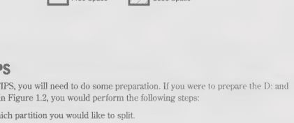

### 为 FIPS 做准备

在使用 FIPS 之前，您需要做一些准备。如果您要准备图 1.2 中显示的 `D:` 和 `E:` 驱动器，您将执行以下步骤：

1. 选择您想要分割的分区。

2. 考虑您将从此分区切除的空间量。

3. 在此分区上运行磁盘检查实用程序。Microsoft Windows 附带一个 ScanDisk 实用程序来完成这项工作。单击开始，附件，系统工具，ScanDisk 启动 ScanDisk 实用程序。


## 4. 在此分区上运行磁盘优化实用程序

在此分区上运行磁盘优化实用程序。磁盘优化实用程序的优点是将所有已使用的磁盘空间移动到分区的开头。Microsoft Windows 附带 `Disk Defragmenter`。单击 `开始`，`附件`，`系统工具`，`磁盘碎片整理程序` 启动磁盘碎片整理程序实用程序。单击 `设置` 按钮并选中 `重新排列程序文件以使我的程序启动更快` 复选框。

现在分区应该看起来像图 1.3。

FIGURE 1.3

在对分区进行碎片整理后，你可以使用 `FIPS` 对它们上剩余的整个空间进行分割。

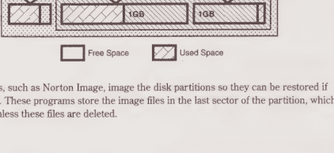

某些程序，例如 `Norton Image`，会对磁盘分区进行映像，以便在损坏时可以恢复。这些程序将映像文件存储在分区的最后一个扇区中，除非删除这些文件，否则无法分割该扇区。

## FIPS in Action

`FIPS` 位于第一张 SuSE Linux CD 中，目录名为 `dosutils\fips`。要开始使用 `FIPS`，请按照以下步骤操作：

- 1. 制作一张可启动磁盘。
- 2. 将 `FIPS` 程序解压到磁盘上。
- 3. 使用磁盘启动。
- 4. 启动 `FIPS` 并分割你的分区。

`FIPS` 附带非常好的文档，解释了它如何处理特殊情况，例如使用双空格和其他实用程序。

> CAUTION
>
> 不要尝试在 Windows 内运行 `FIPS`。`FIPS` 会告诉你不应在 Windows 内运行它并提示你退出 `FIPS`。
>
> 不要在使用 `smartdrv` 或任何磁盘缓存实用程序时使用 `FIPS`。如果这样做，你可能会丢失整个分区表。

当你首次启动 `FIPS` 时，它会询问你想要分区哪个驱动器。选择你想要分割分区的驱动器号。

> TIP
>
> 你可以在 `FIPS` 开始分割分区之前随时使用 `Ctrl+C` 组合键退出 `FIPS`。

接下来，`FIPS` 会询问你想要分割哪个分区。请注意，`FIPS` 只会列出分区号而不是驱动器号。你可以自行映射分区号或运行 `FDISK` 来检查每个驱动器上存在的驱动器号。`FIPS` 会建议可以分割的分区号——例如，`Which Partition Do You Want To Split (1/2)?`（见图 1.4）。

TIP 你可以使用 `FDISK` 来检查每个物理驱动器上存在的驱动器号。运行 `FDISK` 并在键盘上按下 `5` 以选择驱动器号。选择驱动器号后，按键盘上的 `4` 查看物理驱动器上的驱动器号。

FIGURE 1.4

`FIPS` 使你能够选择想要分割的分区号。你只需关心分区号及其上的空间即可。不要注意此屏幕中你不理解的列。

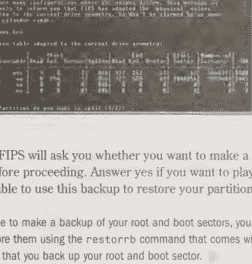

出于安全原因，在继续之前 `FIPS` 会询问你是否想要备份根扇区和引导扇区。如果想要稳妥起见，请回答 `yes`。如果出现任何问题，你将能够使用此备份来恢复你的分区。

NOTE 如果你决定备份根扇区和引导扇区，你将有机会使用随 `FIPS` zip 文件提供的 `restorcb` 命令来恢复它们。强烈建议你备份根扇区和引导扇区。

在 `FIPS` 制作备份副本后，它会让你使用光标键来更改新分区的大小。使用上、下箭头键以较大单位调整大小（10 个柱面），使用左、右箭头键以较小单位调整大小（1 个柱面）。

## Getting and Using Partition Resizer (PRESIZER)

`Partition Resizer` 比 `FIPS` 更先进，因为它可以调整分区大小并移动分区。`Partition Resizer` 还可以更改扩展分区的大小。你可以在随书附带的 CD 上找到 `partition resizer`，也可直接从作者的网站 `http://members.xoom.com/zeleps/` 获取。`Partition Resizer` 提供分区的图形视图，但控制仍在键盘上。

`Partition Resizer` 具有与 `FIPS` 相同的限制。请阅读上一节“Preparing for FIPS”以了解这些限制的更多详细信息。你不能在有已用空间后缩小分区。

要运行 `Partition Resizer`，请制作一张可启动磁盘，将 `presizer` zip 文件的内容解压到磁盘上，然后从磁盘启动。启动后，运行 `presizer`。

当 `Partition Resizer` 启动时，它会扫描你拥有的可用硬盘并检查每个磁盘上的分区。然后它会为你提供以下选项：

- - 1: Resize/Move a partition
- - 2: Change a FAT16 partition's cluster size (Destructive)
- - 3: Partition information
- - 4: Exit

按 `1` 后，你将获得所有磁盘上所有可用分区的列表。列表格式如下：

- - **(No.)**—输入的号码以选择调整此分区大小或移动此分区。
- - **Flags**—设置给此分区的标志。标志列表写在同一屏幕上。
- - **System Type**—分区所格式化的文件系统。`Partition Resizer` 只能调整 FAT16 和 FAT32 分区的大小。
- - **Letter**—对应分区的驱动器号。
- - **Serial Number**—分区的序列号。
- - **Size**—分区的当前大小。

如果你输入想要移动或调整大小的分区号码并按 Enter，你将进入 `Partition Resizer` 调整大小/移动屏幕。

**TIP** 要在 `Partition Resizer` 的任何屏幕中返回到上一屏幕，你可以使用 `ESC` 按钮。

## Partition Resizer Controls

在调整大小/移动模式下，你可以调整或移动在上一步中选择的分区。以下是你可以对该分区进行的控制：

- - **Tab key**—`Tab` 键在调整大小模式和移动模式之间切换。`Partition Resizer` 以调整大小模式启动。
- - **Arrow keys**—在调整大小模式下，箭头键用于更改分区的大小。或者，在移动模式下，箭头键用于移动分区。左/右箭头键将以小增量调整大小/移动，而上/下键将以大增量调整大小/移动。
- - **Spacebar**—空格键用于显示/隐藏扩展分区边界。如果你正在调整/移动逻辑分区，则不能超出扩展分区边界。

使用上述控制来更改所选分区的大小。完成后，按 Enter 使更改生效。如果你希望 `Partition Resizer` 执行表面检查，可以在它提示时按 `Y`。表面检查会导致 `Partition Resizer` 在分区上发现任何坏扇区时退出。

### CAUTION

`Partition Resizer` 没有在损坏情况下恢复分区表的实用程序。你必须使用外部应用程序来执行此操作。我们建议你运行 `FIPS` 为你制作备份，然后在它对分区表应用更改之前退出。这样，你将拥有一个可以使用 `restorrb` 命令恢复的分区表备份。尽量让操作尽可能简单。换句话说，将调整大小操作作为一步，将移动操作作为另一步。然后在每次操作后执行备份。这样，你就可以始终确保任何损坏都会降到最低。

## Mission: Disk Space

穿上你的军装并开始策划获取 SuSE Linux 所需磁盘空间的最佳计划。你的主要工具将是 `FDISK`、`FIPS` 和 `PRESIZER`。`FDISK` 主要用于删除和创建 FAT 和 FAT32 分区，而 `FIPS` 将用于将分区分割为两部分。新建的分区将为空，这意味着它可以安全地删除并由 SuSE Linux 使用。`PRESIZER` 可以移动和调整分区大小，因此我们可以将将由 SuSE Linux 使用的未分区空间堆叠在一起。然而，`PRESIZER` 不能调整 NTFS 大小。因此，如果你有 NTFS 分区，你只能将它作为原样使用。你能对 NTFS 分区做的唯一事情就是将其从一个位置移动到另一个位置。强烈建议你备份 NTFS 分区上的所有重要数据，特别是如果它是 NT 启动的分区。如果 NT 从特定分区启动，我们建议你不要触及位于其之前的分区或该特定分区。现在，拿出一张纸和一支笔，开始逐步列出你将要执行的操作。

例如，假设你有一个包含三个分区 `C:`、`D:` 和 `E:` 的硬盘。你不想触及 `C:`，因为所有重要数据都在上面并且它启动 Windows。`D:` 有 1GB 的可用空间，`E:` 也有 1GB。你希望为 SuSE Linux 提供 1.5 GB。（参见图 1.3。）

你将按照以下步骤操作：

- 1. 将驱动器 `E:` 上的所有数据复制到驱动器 `D:` 上
- 2. 使用 `FDISK` 删除 `E:` 并重新启动。
- 3. 使用 `FIPS` 分割 `D:` 的 500MB 并生成一个 500MB 的新驱动器 `E:`。重新启动。
- 4. 删除新的 `E:` 驱动器并重新启动。

完成此方案后，你将不再有驱动器号 `E:`，并且该驱动器上的所有数据都将被复制到 `D:` 驱动器上。

另外，你也可以使用以下步骤：

- 1. 使用 `FIPS` 将 `D:` 分成 600MB 并生成一个 600MB 的新驱动器 `E:`。你的旧 `E:` 变为 `F:`。重启。
- 2. 使用 `FDISK` 删除 `E:`。现在你的驱动器字母恢复原状，你的旧 `E:` 驱动器恢复其名称。重启。


3. 使用 `PRESIZER` 将 `E:` 移过 600MB 的未分区空间。重启。
4. 使用 `FIPS` 将 `E:` 分成 900MB 并生成一个 900MB 的新驱动器 `F:`。重启。
5. 使用 `FDISK` 删除 `F:`。重启。

事实上，你可以使用本书附带的 `PRESIZER` 来执行所有步骤。如果你不想使用 `FIPS` 而想改用 `PRESIZER`，你可以执行以下步骤，让 `PRESIZER` 完成所有工作：

1. 使用 `PRESIZER` 调整 `D:` 的大小，预留 600MB。
2. 将 `E:` 移过未分区空间并将其堆叠在 `D:` 旁边。
3. 调整 `E:` 的大小并预留 900MB。

本章下一节讨论可用于调整和移动分区的其他软件。现在你可以设计你的计划然后实施它。

# 其他商业软件

一些商业软件包可以在不出现 `FIPS` 和分区调整器中可能遇到的任何问题或限制的情况下调整和移动分区。其中最著名和最强大的软件包之一是 Partition Quick Magic。该软件包的功能包括识别、移动和调整大量文件系统的能力。它甚至包含可用于调整和移动 Linux 分区的 Linux 文件系统支持。该软件包使用完全图形化界面，具有鼠标交互功能，可在 DOS、Windows 9x 和 Windows NT 下运行。你可以从 http://www.powerquest.com 购买该软件包。

# 故障排除

## 我无法从我的 Windows 操作系统启动本章所述的程序。

你不应从 Windows 内部启动本章提到的任何程序。这只会导致你的硬盘数据丢失。

## `Partition Resizer` 没有显示我的分区表的图形表示。它显示的是垃圾信息。

尝试使用 `/text` 模式启动 `Partition Resizer`。

## `Partition Resizer` 不允许我调整分区大小，而 `FIPS` 不允许我分割分区。

检查你想要分割或调整大小的分区上是否有足够的空闲空间。如果有空间，请检查是否有文件位于分区的最后一个扇区上。某些程序例如 Norton Image 会在分区末尾创建一个小文件。删除此文件。

## 我应该在哪里查找有关 `Partition Resizer` 和 `FIPS` 的更多信息？我有一个本章未列出的问题。

`FIPS` 和 `Partition Resizer` 都附带了维护良好的故障排除文档文件。我们鼓励你在开始修改分区表之前阅读这些文件以及随附的文档。

# 安装 SuSE Linux

## 本章内容

- Installation Basics 28
- What You Need 28
- Preparing Your System 29
- Preparing Yourself 32
- `YaST` Versus `YaST2` 33
- Quick Installation Using `YaST2` 33
- SuSE Linux Installation Using `YaST` 40

## 安装基础

当你安装 SuSE Linux 时，你还必须安装一个新的操作系统。无损破坏或丢失现有数据的完美安装应该是你的主要目标。对于新手用户来说，有三个主要担忧：我遗漏了什么？我安装了我需要的东西吗？我安装的是否比我需要的更多？

如第 1 章“预安装 SuSE Linux”所述，如果你理解 SuSE Linux 使用的术语和词汇，SuSE Linux 就很容易安装。在本章讨论的安装过程中，你将学习 SuSE Linux 中设备命名所使用的术语。在本章结束时，我们将指导你完成大部分惯例和 SuSE Linux 哲学，为你进入精彩的 SuSE Linux 世界做好准备。

## 你需要什么

SuSE Linux 有两种形式：

- SuSE Linux - Snapshot—此版本可放入一张 CD 中并免费分发。你可以从 SuSE FTP 站点下载 ISO 映像以制作自己的副本。本书附带 SuSE Linux 6.3 快照。
- SuSE Linux - 完整版—此版本是功能齐全的精致版本，包含 1,500 个应用程序和 60 天安装支持。它有两种形式：
  - 六张 CD
  - 一张 DVD 光盘

SuSE Linux 可以安装在 Windows 分区上的目录、FTP 或网络上。安装 SuSE Linux 的最简单方法是使用 SuSE Linux 安装 CD 或 DVD 光盘。我们强烈建议你获取完整版的 SuSE Linux，如果它将被广泛用于多种用途。

## 从 SuSE Linux 安装介质安装

如果你打算使用 SuSE CD 或 DVD 光盘安装 SuSE Linux，你只需要以下其中之一：

- 如果你的计算机可以从 CD-ROM/DVD 驱动器启动，你不需要任何东西。
- 如果你正在运行 Windows 9x 或 DOS，并且能够从其中之一访问你的 CD-ROM，你可以使用 `setup.exe` 程序设置你的 SuSE Linux。
- 如果你的计算机无法从 CD-ROM/DVD 驱动器启动，你需要两张空白软盘。确保软盘上没有坏扇区。你将在下一节学习如何准备这些磁盘。

## 从目录安装

如果你打算从目录安装 SuSE Linux，你需要做的就是将安装介质内容复制到该目录。为此，你需要以下其中之一可启动磁盘：

- 一张 DOS 可启动软盘—使用此磁盘，你可以启动 `setup.exe` 安装程序。
- 一张 Linux 可启动磁盘—使用此磁盘，你可以启动将启动 SuSE 到你的系统的安装程序。你将在本章后面“准备磁盘”部分学习如何创建此磁盘。

## 通过 NFS 或 FTP 安装

使用 NFS 或 FTP 是安装 SuSE Linux 的最重要方法之一。事实上，这种方法使你即使没有安装介质在手也能安装 SuSE Linux。你只需要一个包含你想要安装的 SuSE Linux 安装文件的共享 NFS 目录。如果你将通过 FTP 安装，你只需要一个通过以太网卡工作的 FTP 连接。

你还需要两张空白软盘来启动安装过程。准备磁盘在下一节中讨论。

## 准备你的系统

每种安装程序都需要一些特殊准备才能启动 SuSE Linux 安装。在本节中，你将学习如何为每种安装方法做准备。

### CD-ROM/DVD

如果你打算使用安装介质安装 SuSE Linux，并且你的系统可以从 CD-ROM/DVD 驱动器启动，你应该设置你的 BIOS 从 CD-ROM/DVD 加载操作系统。图 2.1 说明了一个 phoenix BIOS，如果在系统启动时 CD-ROM 驱动器中插入了 CD，它将从 CD-ROM 启动。

### 准备磁盘

如果你打算在以下任一情况下安装 SuSE Linux，你必须准备一个启动磁盘和内核模块磁盘：

- 你想在无法从 CD-ROM 启动的系统上使用安装介质安装 SuSE Linux。
- 你打算从目录安装 SuSE Linux。
- 你打算通过 NFS 安装 SuSE Linux。
- 你打算通过 FTP 安装 SuSE Linux。

#### 图 2.1

设置 SuSE Linux 的最简单方法是设置你的 BIOS 从 CD-ROM 启动。将 SuSE Linux CD/DVD 插入 CD-ROM/DVD 驱动器并重新启动系统。要设置你的 BIOS 从 CD-ROM 启动，如果它支持，在启动系统时按 F2 或 DEL。

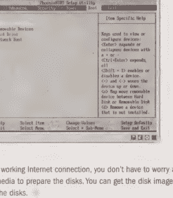

NOTE 如果你有可用的 Internet 连接，你不必担心拥有 SuSE 安装介质来准备磁盘。你可以从 SuSE FTP 站点获取磁盘映像并开始准备磁盘。

### `RaWrite` 实用程序

要创建 SuSE Linux 安装所需的磁盘，你使用一个名为 `RaWrite` 的实用程序。`RaWrite` 与 SuSE Linux 一起提供，位于 `CDROM:\dosutils\rawrite`。如果你想通过 FTP 获取此实用程序，你可以从 ftp://ftp.suse.com 上的 SuSE FTP 站点获取它。`RaWrite` 实用程序在 DOS 下运行。运行 `RaWrite` 的示例说明如下（粗体文本表示你输入的文本）：

```
D:\>CD \DOSUTILS\RAWRITE
D:\DOSUTILS\RAWRITE
RaWrite 1.2 - Write disk image to raw floppy diskette
Enter source file name: IMAGEDISK
Enter destination drive: A
Please insert a formatted 1.44M diskette into drive B: and press -ENTER- :
Writing image to drive A:
```

在前面的示例中，你从名为 `IMAGEDISK` 的磁盘映像文件创建了一张磁盘。映像被写入 `A:` 驱动器中的软盘。

### 使用 `RaWrite` 实用程序创建磁盘

现在你已经了解了 `RaWrite` 的工作原理，是时候付诸实践了。你需要创建的磁盘的映像位于 `CDROM:\disks` 目录中。该目录中的磁盘映像如下：


- `bootdisk`—标准启动盘。你需要此启动盘来使用 YaST 进行安装。如果你想使用 YaST2 安装 SuSE Linux，则无需创建此映像。

- `eide`—带特殊 EIDE 适配器支持的启动盘。你仅在第一个盘片对你的硬盘控制器不起作用时才需要此磁盘映像。

- `laptop`—如果你计划通过 USB 端口上的软盘在笔记本上安装 SuSE Linux，则必须拥有此磁盘映像。

- `yast2`—如果你想使用 YaST2 安装 SuSE Linux，则必须创建此启动盘的映像。

- `rescue`—此盘包含一个救援盘，可用于修复现有 SuSE Linux 安装或启动问题。

- `modules`—安装过程中可能需要的特殊内核模块。你仅在计划通过 NFS 或 FTP 安装 SuSE Linux，或你的系统在安装期间检测硬件需要特殊内核模块时才需要此盘。

以下示例说明如何为 YaST2 和内核模块创建两个软盘。在此示例中，我们假设 `D:` 是你的光盘驱动器，并且第一张 SuSE CD 已插入 CD-ROM 驱动器。

将一张空的已格式化磁盘插入你的 `A:` 软盘驱动器并执行以下命令：

```
D:\>cd \disks

D:\DOSUTILS>RAWRITE
RaWrite 1.2 - Write disk file to raw floppy diskette
Enter source file name: yast2
Enter destination drive: A
Please insert a formatted 1.44M diskette into drive B: and press <ENTER> :
Writing image to drive A:
```

现在，用另一张空的已格式化磁盘替换磁盘并执行以下命令来创建内核模块盘。

```
D:\DOSUTILS>RAWRITE
RaWrite 1.2 - Write disk file to raw floppy diskette
Enter source file name: modules
Enter destination drive: A
Please insert a formatted 1.44M diskette into drive B: and press <ENTER> :
Writing image to drive A:
```

恭喜，你现在可以继续下一节，了解 SuSE Linux 安装过程中你应期望的内容。

## 为安装做准备

在本节中，你将了解安装过程中可能遇到的一些约定。请记住，YaST2 为你提供了自动安装选项，在该选项中你无需忍受探索新领域的痛苦。然而，如果你通过 YaST2 安装时使用引导安装选项安装 SuSE Linux，或者如果你计划使用 YaST，你将必须学习本节中的一些约定。

## 多用户环境

SuSE Linux 是一个多用户环境。在多用户环境中，系统可被许多用户使用和共享，同时保留每个用户为自己配置的设置。如果安装 SuSE Linux 的机器位于网络上，用户可以通过 SuSE Linux 提供的许多网络设施连接到 SuSE Linux 机器。每个 SuSE Linux 用户提供的空间位于 `/home/username` 目录中。没有普通用户可以控制系统设置或更改系统配置，除非得到系统的最高级用户 `root` 的允许。`root` 用户是系统的默认用户，可以控制和设置系统。由于你将安装 SuSE Linux，因此在安装过程中你将是 `root`。在安装后，你不应以 `root` 身份使用系统。你应仅在修改系统设置时以 `root` 用户身份登录。

SuSE Linux 系统上的每个用户都有用户名和密码。在安装过程中，你将被要求输入 `root` 密码。你应输入一个不易猜测且不会忘记的密码。你还将被提示为系统创建一个新用户。你应创建此用户，以便你能以普通用户而非 `root` 身份登录到你的系统。

## SuSE Linux 中的磁盘分区

SuSE Linux 中的磁盘分区命名与 MS-DOS 或 MS Windows 的约定完全不同。磁盘上没有所谓的 `C:` 或 `D:`。相反，有挂载点和文件系统。文件系统由物理设备组成，例如硬盘分区、软盘、CD、zip 驱动器磁盘等。或者，挂载点是你挂载这些文件系统的目录。挂载点在你和物理设备之间建立连接。

此外，你仍然可以将文件安排在目录中。请注意，你唯一的限制是你的所有目录都将位于 `/home/<username>` 中。系统上的其他用户将无法看到你的文件，除非你允许他查看。

在安装期间，你将被要求选择安装 SuSE Linux 的位置。表 2.1 详细说明了你可以用来理解 YaST 或 YaST2 将询问你的文件系统的映射。

### 表 2.1 Linux 分区映射

| Disk/Partition | Convention Used in Linux |
|---|---|
| First partition on first IDE | `/dev/hda1` |
| Second partition on first IDE | `/dev/hda2` |
| Extended partition on first IDE | `/dev/hda5` |
| First logical partition of first IDE | `/dev/hda6` |
| Second logical partition of first IDE | `/dev/hda7` |
| First partition of first SCSI (follows the same conventions as in the IDE examples) | `/dev/sda1` |
| First partition on second IDE (follows the same conventions as in the IDE examples to access other partitions) | `/dev/hdb1` |
| First partition on third IDE | `/dev/hdc1` |
| First partition on second SCSI (follows the same conventions as in the IDE examples to access more SCSI drives and partitions) | `/dev/sdb1` |

## YaST 与 YaST2

YaST2 的发布使 SuSE Linux 用户能够使用 SuSE 团队为他们准备的新图形化（且易于使用）的安装方法。YaST2 不像其前身 YaST 那样询问太多问题。但在 YaST2 中，软件包定制不如 YaST 中强大。此外，在 YaST2 中，你无法执行 YaST 中可以执行的大多数分区管理操作。

如果你是第一次安装 SuSE Linux 且对 SuSE Linux 或 Linux 没有经验，你应使用 YaST2。如果你将使用 YaST 提供的分区系统，你应使用 YaST 安装你的 SuSE Linux。此外，如果你熟悉 SuSE Linux 或 Linux，你应使用 YaST，因为它能让你对安装过程有更多控制。

使用 NFS 或 FTP 安装 SuSE Linux 的用户别无选择，只能使用 YaST 安装 SuSE Linux。

## 使用 YaST2 快速安装

YaST2 提供了一种以最少的问题安装 SuSE Linux 的简便方法。对 SuSE Linux 初学者来说简直是福音！

> NOTE 在 SuSE Linux 6.3 中，你只能在拥有安装介质的情况下使用 YaST2 安装 SuSE Linux。你不能使用 YaST2 通过目录、FTP 或 NFS 安装 SuSE Linux

## 开始安装过程

你应该能够使用安装介质本身或在上一节“准备你的系统”中准备的启动盘启动系统。当你使用其中一种方法启动时，你看到的第一件事是来自 SuSE 团队的欢迎信息。然后它开始引导 Linux 内核并启动一个 X Window 会话，YaST2 将在其中运行。

欢迎屏幕之后，YaST2 开始运行，你将看到 YaST2 安装的第一屏。

## 基本配置

使用 YaST2 进行安装过程的第一屏是如图 2.2 所示的基本配置屏幕。在此屏幕中，YaST2 会询问你关于语言、键盘布局和时区的选择。你应根据自己的偏好进行选择。请注意，如果你更改语言，YaST2 将自动更改界面语言，这意味着其余安装过程将更改为你的语言，并且你的 SuSE Linux 默认语言将更改为所选语言。

FIGURE 2.2

第一个 YaST2 窗口使你能够更改语言、键盘布局和时区的设置。由于这是第一屏，此处所做的任何更改都将在安装期间应用。

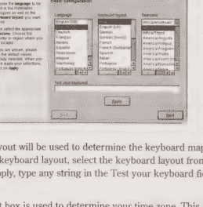

你的键盘布局将用于确定 SuSE Linux 将使用的键盘映射。要测试你的键盘布局，请从列表中选择键盘布局并单击 Apply。单击 Apply 后，在 Test your keyboard 字段中输入任何字符串。如果不起作用，请尝试另一种映射。


时区列表框用于确定你的时区。这会将你的 SuSE Linux 时间设置为正确的时区。在列表中搜索你的时区并选择它。

NOTE 如果在此对话框中鼠标不起作用也不必担心。你可以使用 `Tab` 键在对话框中的列表之间移动。上下箭头移动选择高亮，并在你位于按钮上时按空格键可单击该按钮。

## 鼠标配置

鼠标配置对话框允许您从大量鼠标列表中指定鼠标类型（见图 2.3）。突出显示适用于您鼠标的鼠标类型，并在完成时按下下一步按钮。YaST2 将激活您所做的鼠标设置，然后继续。您不应在未选择正确鼠标类型的情况下退出列表。如果您选择了错误的鼠标类型，应使用键盘返回并更正鼠标类型；否则，您将无法在安装过程的其余部分使用鼠标。

FIGURE 2.3

通过从可用列表中选择鼠标类型，您将能够在安装过程中使用鼠标。安装完成后，它也将应用于 SuSE Linux。

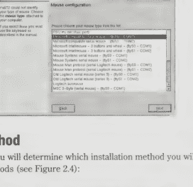

## 安装方法

在此对话框中，您将确定要使用哪种安装方法。对话框列出了两种安装方法（见图 2.4）：

FIGURE 2.4

YaST2 会询问您在安装过程中将使用哪种安装方法。选择自动安装以进行最少的提问轻松安装，或选择引导安装以进行更多控制的轻松安装。

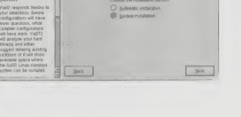

**自动安装—** 在此安装方法中，YaST2 会尽可能少地询问您问题。YaST2 做出任何决定时都将使用默认设置。您只需提供可能更改系统设置或您必须输入的关键信息。

此安装方法的输出如下：

+   - 在您的 `MBR` 上安装 `LILO`
+   - 标准软件包安装
+   - SuSE Linux 的三个分区：`/boot`、交换分区和根分区

**引导安装—** 在此安装方法中，YaST2 在执行任何操作时将更具交互性。不会提出难题；您可以仅自定义您的系统。初级用户可以使用此方法毫无困难地安装 SuSE Linux。

## 安装目标

如果您有多个驱动器，YaST2 将提示您选择要安装 SuSE Linux 的驱动器（见图 2.5）。如果您只有一个驱动器，它将提示您选择要安装 SuSE Linux 的分区。YaST2 将识别并使用您所选硬盘上的空闲空间。如果您选择其他分区，该分区将被 YaST2 格式化以供 SuSE Linux 使用。请在选择 SuSE Linux 将使用的分区时谨慎（见图 2.6）。

> **CAUTION**
> 
> YaST2 格式化分区后，如果您没有该分区内容的完整备份，则无法恢复其内容。在选择希望 SuSE Linux 使用的分区时请务必谨慎。

**FIGURE 2.5**

如果您有多个驱动器，YaST2 将提示您选择目标硬盘。


### FIGURE 2.6

您可以通过勾选适用于每个分区的复选框来选择目标硬盘上要使用的分区。

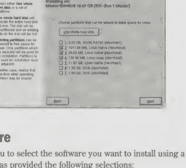

## 选择软件

YaST2 允许您使用默认打包系统选择要安装的软件。

SuSE 团队提供了以下选择：

+   - **Minimal**—这将把您的 SuSE Linux 安装为完全功能的基于控制台的 SuSE Linux 系统。此选项最多使用 150MB。
+   - **Default**—此选择将把 SuSE Linux 安装为完全功能的基于 X Window 的 SuSE Linux 系统。此选项要求您至少有 500MB。
+   - **Almost Everything**—您仅在确定将使用 SuSE Linux 随附的大量软件时才需要安装此选项。此选项最多将使用 6GB。

您还可以选择安装 SuSE Linux 随附的其他软件包，这些软件包列在复选框列表中。要进行选择，只需勾选适用于您选择的复选框即可。

图 2.7 说明了软件选择对话框。

### FIGURE 2.7

YaST2 提供了一种易于使用的软件包选择方法，适用于各种口味。选择您偏好的基本系统，然后勾选对应于您将使用的软件的复选框。

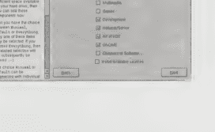

## LILO 安装

`LILO`（Linux Loader）是引导 SuSE Linux 的引导管理器，当它安装在系统上时。在 `LILO` 安装对话框中，您可以配置 `LILO` 应放置的位置（见图 2.8）。在 `MBR` 上安装 `LILO` 不会损坏您当前安装的操作系统。例如，如果您在 `MBR` 上安装 `LILO`，它不会损坏 Windows 95、98 或 NT。如果您想使用另一个引导管理器并让它调用 `LILO`，您可以将 `LILO` 安装在 `/boot` 分区上并配置您的引导管理器以使用它。您也可以将 `LILO` 安装在可用于引导 SuSE Linux 的磁盘上。有关 SuSE Linux 引导操作的更多信息，请参阅第 9 章“配置系统启动序列”。

FIGURE 2.8

您可以在 YaST2 中设置 `LILO`，这使您能够在添加引导 SuSE Linux 的功能的同时保持旧操作系统可引导。

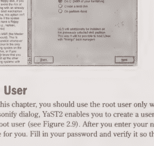

## 创建系统用户

如本章前面所述，您应仅在修改系统设置时使用 `root` 用户。在 Personify 对话框中，YaST2 允许您创建一个用户，该用户将在 `root` 用户之后成为第一个系统用户（见图 2.9）。在输入姓名后，您可以让 YaST 为您建议用户名。填写您的密码并验证它，以便您可以继续下一步。

## 使用 root 密码保护您的 SuSE Linux

安全的 SuSE Linux 系统必须具有难以猜测且仅 `root` 用户知道的密码。`root` 用户在 SuSE Linux 系统中具有许多功能。有关 SuSE Linux 中用户管理的更多信息，请参阅第 4 章“管理用户和组”。现在，请确保您在 Root 密码对话框中输入一个独一无二且不易猜测的密码（见图 2.10）。

### FIGURE 2.9

YaST2 允许您个性化 SuSE Linux 上的第一个用户帐户，以便在 SuSE Linux 首次启动时拥有非 `root` 登录。


> CAUTION
> 
> 不要选择真实单词作为密码，例如 secret、password、pass、magic 或 root。不要选择与您的登录名相同或为某人姓名的密码。这些类型的密码最容易被破解，因为它们存储在字典中，而某些程序会使用字典破解系统。

### FIGURE 2.10

在此对话框中输入并验证 `root` 密码。您应选择一个难以猜测的密码。

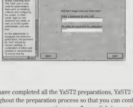

## 确认

现在您已完成所有 YaST2 准备工作，YaST2 将确认您在整个准备过程中所做的选择，以便您可以确认您的设置（见图 2.11）。您可以将设置保存到软盘以供将来使用。如果您想对配置进行任何修改，请按返回按钮。

要开始实际的安装过程，请按下一步按钮，YaST2 将开始安装。

FIGURE 2.11 如果您确认此对话框中的设置，该对话框列出了您在之前的 YaST2 对话框中所做的所有选择，安装将立即开始。

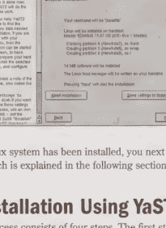

SuSE Linux 系统安装完成后，您接下来必须完成系统配置过程，其说明在以下部分中。

## 使用 YaST 进行 SuSE Linux 安装

安装过程包括四个步骤。第一步是选择和准备安装介质。第二步是决定如何引导实际的安装程序。第三步是 `linuxrc`，这是一个在安装前准备系统的程序。最后一步是 YaST，在系统由 `linuxrc` 准备好后处理安装。让我们来看一下所需步骤。

## 第 1 步：选择和准备安装介质

安装介质是您将从中安装 SuSE Linux 的介质。SuSE Linux 在安装介质方面非常灵活。您可以从 `CD`、`DVD`、硬盘、网络上的另一台计算机和 `FTP` 安装。每个都需要以某种方式进行准备。

基本思路是，你希望将 SuSE Linux `CD` 的内容复制到硬盘上。请注意，你需要相当多的硬盘空间来完成此操作。要将硬盘准备为安装介质，请按照以下步骤操作：

- 1. 在你的硬盘上创建一个目录，并随意命名，例如 `suseinst`。在该目录内，创建一个必须命名为 `suse` 的另一个目录。你最终应该得到类似 `/suseinst/suse` 的目录名。
- 2. 你需要在 `/suseinst/suse/` 下创建以下三个目录：
  - `a1`
  - `images`
  - `setup`
- 3. 现在，你应该开始从 `CD` 将文件复制到这些目录。将 `CD` 上 `/suse/a1` 的所有内容复制到你硬盘上的 `/suseinst/suse/a1`。


### 4. 复制内核
从 `/suse/images/` 复制一个合适的内核到 `/suseinst/suse/images/`。如果你不确定该选择哪一个，我们建议你阅读同一目录下找到的 `readme.dos` 文件。你必须在此处复制一个内核映像。如果你有足够的硬盘空间，将 `/suse/images/` 中的所有文件复制到本地硬盘。

### 5. 复制 initdisk
接下来，将 `/suse/images/initdisk.gz` 复制到 `/suseinst/suse/images/`。

### 6. 复制 setup 文件
将 `/suse/setup/` 中的文件复制到 `/suseinst/suse/setup/`。

### 7. 完整复制
到目前为止，你只能安装一个非常基础的系统。如果你想安装更多软件，你应该将 `/suse/` 的所有内容复制到 `/suseinst/suse/`。这是 CD 的全部内容，约占用 650MB 空间。但是，它会提供更完整的安装。如果你硬盘空间不足，你现在不必这样做。你可以先安装基础系统，然后稍后再添加。

## 从 NFS 安装

如果你的 PC 没有 CD-ROM 但有网卡并且是网络的一部分，你可以使用另一台机器上的 CD-ROM 进行安装。这是通过使用网络文件系统 NFS 来完成的。这是一个高级主题，我们强烈建议你在身边有一位精通 Linux/UNIX 的人士来帮助你。你需要以下信息：

- 你的 IP 地址
- 你的子网掩码
- 你的网关
- NFS 服务器的 IP
- SuSE 安装文件所在的目录或服务器

基本思路是，你希望在该机器上挂载 SuSE CD 并确保它已导出给其他人。你需要的信息既是充当 NFS 服务器的机器的 IP，也是 CD-ROM 的挂载点。

## 从 FTP 安装

如果你没有 SuSE Linux 的 CD 或硬盘，仍然想安装它，你可以通过 Internet 安装来完成。这要求你拥有网卡并连接到一个正在运行的网络。你需要的信息如下：

- 你的 IP 地址
- 你的子网掩码
- 你的网关
- 你的名称服务器的 IP
- 你的 FTP 代理的 IP，如果你有的话
- 要连接的 FTP 服务器的地址（通常为 `ftp.suse.com`）

你可以从你的系统管理员那里获得这些信息。

## 第 2 步：引导安装程序

在这一步中，你必须决定如何引导安装。你有三个选择：你可以从 MS DOS 引导，可以从引导盘引导，或直接从 CD-ROM 引导。

### 从 MS-DOS 引导

要从 MS-DOS 引导，你的 CD-ROM 驱动器必须在 DOS 下初始化并运行。你不能使用 Windows 95 来完成此操作——你必须在 MS-DOS 下运行，而不是在 Windows 95 内的 DOS 窗口中。要引导，请按照以下步骤操作：

1. 切换到你的 CD-ROM 驱动器盘符并运行 `setup.exe` 程序。
2. 程序会要求你选择要使用的语言。选择你最熟悉的语言并按 Enter。
3. 现在要求你输入 CD-ROM 的驱动器盘符。程序会尝试为你猜测。按 Enter 继续。
4. 程序显示欢迎屏幕；按 Enter 继续。
5. 你可以选择使用 `loadlin` 或软盘。选择 `loadlin` 并按 Enter。
6. 程序会询问你有多少 RAM。它会尝试为你猜测该值并将其设为默认值。如果不正确，请将其更改为正确的值并按 Enter。
7. 程序会询问你是否要使用 CD 或硬盘。选择 CD 并按 Enter。
8. 你必须选择一个用于引导的内核。突出显示一个内核会显示其支持的简短说明。选择一个对你的硬件支持良好的内核并按 Enter。
9. 如果你想为内核输入任何额外选项，你可以在此屏幕中输入。你可能不需要，除非你对 SuSE Linux 有丰富的经验。按 Enter 继续。
10. 程序会询问它是否应将 `loadlin` 安装到你的硬盘。回答 No 并按 Enter。
11. 系统会提示你保存当前设置。你其实不需要，但如果你愿意也可以。
12. 最后，你已准备好引导安装。按 Load Linux now 开始。

### 从引导盘引导

你可以使用 Linux 引导盘引导安装程序。此磁盘可使用第 2 步中的 `setup.exe` 程序轻松准备。不要选择 `loadlin`，选择软盘并按 Enter。程序会提示你将磁盘插入驱动器；插入一张空白磁盘并按 Enter。程序会格式化磁盘并在上面创建引导盘。这就是你可以用来自引导安装程序的磁盘。

此磁盘也可以使用 `RaWrite` 创建，如上一节“准备你的系统”中所述。

### 从 CD-ROM 引导

如果你的 PC 支持，你可以直接从 CD-ROM 引导。要了解如何设置系统以从 CD-ROM 引导，请参阅上一节“准备你的系统”。在 SuSE 6.3 中，你将从第二张 CD 引导，而不是第一张。第一张 CD 引导到 YaST2，而第二张引导到 YaST。

## 第 3 步：Linuxrc

现在你已准备好开始安装。你已准备好安装介质和引导方法，现在可以开始引导安装程序。当你的系统启动时，出现的第一个屏幕是 SuSE 团队的欢迎信息。按 Enter 继续。这将加载过程的第一部分，该过程由一个名为 `linuxrc` 的程序控制。`Linuxrc` 对你的系统进行一些初步准备，为 YaST 启动铺平道路。

`linuxrc` 的第一个屏幕是语言选择（见图 2.12）。这是 YaST 在整个安装过程中用来与你交流的语言。你应在此处谨慎，因为你在此处选择的语言将一直用于你的 SuSE Linux 使用，直到你再次从 YaST 中更改它。你通过使用箭头键突出显示它并按 Enter 来选择语言。

### 图 2.12

选择你想要用于安装的语言。


> 注意 在整个安装过程中的导航非常简单。使用箭头键突出显示你想要的列表项并按 Enter 选择它。你可以按 Tab 键在屏幕上的不同字段和按钮之间移动。

第二个屏幕询问你是否有彩色或单色显示器。做出选择并按 Enter 继续。在下一个屏幕中，`linuxrc` 要求你选择键盘映射。这是 YaST 将如何解释来自你键盘的按键的方式。请确保选择正确的布局，否则 YaST，以及随后完全安装后的整个 Linux 系统，将会误解大部分按键。`Linuxrc` 显示了与大多数键盘匹配的详尽预配置键盘布局列表。找到与你的键盘匹配的布局并按 Enter 继续。

现在你被带到 `linuxrc` 主菜单（见图 2.13）。菜单中的第一个选项是设置。这使你能够访问你刚刚经过的所有屏幕，以防你需要更改其中配置的任何设置。第二个选项是系统信息，它显示有关你的系统以及 Linux 内核成功检测到的任何硬件的信息。第三个选项是内核模块；你只有在拥有与 Adaptec 2940 不兼容的 SCSI 硬件时，或如果你计划某种需要网卡运行的网络安装时才需要使用这些。第四个选项是开始安装 / 系统，它 simply 退出 `linuxrc` 并启动 YaST。最后，最后一个选项是结束 / 重启，它使你能够退出安装过程。

### 图 2.13

`linuxrc` 的主菜单。

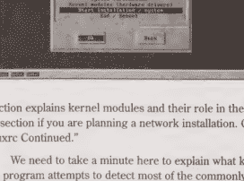

以下部分解释了内核模块及其在安装过程中的作用。如果你计划进行网络安装，你应该阅读本节。否则，跳到“第 3 步：Linuxrc 继续”部分。

## 内核模块

我们需要在这里花一点时间解释什么是内核模块。SuSE 安装程序尝试在引导时检测大多数常用的硬件 up. 如果你的系统使用的是 Adaptec 2940 以外的 SCSI 适配器，或者你计划通过 NFS 或 FTP 安装系统，你需要为你的 SCSI 控制器和网卡加载适当的驱动程序。这些驱动程序也称为模块。要加载这些模块，请在 `linuxrc` 菜单中突出显示第三个选项 Kernel Modules，然后按 Enter。

`Linuxrc` 加载 Kernel Modules 菜单（见图 2.14）。该菜单中有七个选项。前四个与加载 SCSI、CD-ROM、网卡和 PCMCIA 模块相关。第五个选项显示当前已加载的所有模块。第六个选项用于卸载模块，最后一个选项会使 `linuxrc` 尝试自动检测设备。

FIGURE 2.14

Use this menu to load special drivers for your hardware.

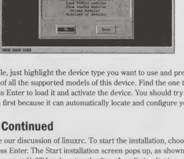

要加载模块，只需突出显示你想要使用的设备类型并按 Enter。`Linuxrc` 会显示该设备支持的所有型号。找到与你的设备匹配的型号并按 Enter 以加载它并激活设备。你应该先尝试 Autoload of Modules 选项，因为它可以自动定位并为你配置设备。

## Step 3: Linuxrc Continued

我们现在继续讨论 `linuxrc`。要开始安装，请选择 Start Installation / System 并按 Enter。Start installation 屏幕弹出，如图 2.15 所示。此时你可以通过选择 Start Installation 列表项来启动 YaST。


其余选项与安装关系不大，更像是应急工具。例如，你可以使用 `Boot Installed System` 选项启动已安装的系统。此外，你可以使用 `Start Rescue System` 选项启动一个救援系统，该系统可以帮助你排查和修复已安装但损坏的系统。最后，你可以使用 `Start Live CD` 选项启动 Live CD。

要启动 YaST，它将引导你完成剩余的安装过程，请突出显示 `Start Installation` 列表项并按 `Enter`。

### FIGURE 2.15

The Start Installation menu.

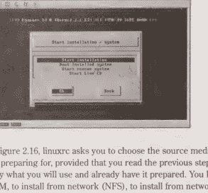

正如你在图 2.16 中看到的，`linuxrc` 要求你选择源介质。这正是我们一直在为之做准备的，前提是你阅读了之前的步骤。此时，你应该确切知道将使用什么，并且已经准备好。你有四个选择：从 CD-ROM 安装、从网络安装（NFS）、从网络安装（FTP）以及从硬盘安装。

### FIGURE 2.16

Pick the installation medium you want to use.

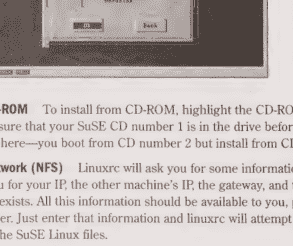

## Installing from CD-ROM

要从 CD-ROM 安装，请突出显示 `CD-ROM` 列表项并按 `Enter`。在按 `Enter` 之前，请确保你的 SuSE CD number 1 已在驱动器中。不要在这里混淆——你从 CD number 2 启动，但从 CD number 1 安装。

## Installing from Network (NFS)

`linuxrc` 会要求你提供有关网络的一些信息。它会要求你输入你的 IP、另一台机器的 IP、网关以及 SuSE Linux 所在的挂载点。所有这些信息都应该为你所知，前提是你之前已做好准备。只需输入这些信息，`linuxrc` 就会尝试联系另一台机器并读取 SuSE Linux 文件。

要通过 NFS 从网络安装，请确保你的网卡已被检测到并正在运行。如果尚未完成，请使用 `Tab` 键突出显示 `Back` 按钮并从 `Kernel modules` 菜单加载该卡的模块。网卡准备就绪后，突出显示 `Network (NFS)` 列表项并按 `Enter` 开始安装。

`linuxrc` 会询问你是否将使用 `bootp` 来配置网络。如果会，请回答 `Yes`；否则回答 `No`。如果回答 `No`，`linuxrc` 随后会要求你输入你的 IP。输入它并按 `Enter`。接下来，`linuxrc` 会要求输入 netmask，通常为 `255.255.255.0`。如果需要网关来访问 NFS 服务器，请在下一个屏幕中输入；如果不需要，只需再次输入你的 IP。`linuxrc` 现在会要求你输入 NFS 服务器的 IP 以及 SuSE Linux 文件所在的目录。当你输入这些信息后，`linuxrc` 会尝试连接到服务器并挂载远程目录。

## Installing from Network (FTP)

如果你没有 SuSE Linux 的 CD 或硬盘，你仍然可以通过 FTP 安装。要通过 FTP 安装，请确保你的网卡已被检测到并正在运行。如果尚未完成，请使用 `Tab` 键突出显示 `Back` 按钮并从 `Kernel modules` 菜单加载该卡的模块。网卡准备就绪后，突出显示 `Network (FTP)` 列表项并按 `Enter` 开始安装。

`linuxrc` 会询问你是否将使用 `bootp` 来配置网络。如果会，请回答 `Yes`；否则回答 `No`。如果回答 `No`，`linuxrc` 随后会要求你输入你的 IP。输入它并按 `Enter`。接下来，`linuxrc` 会要求输入 netmask，通常为 `255.255.255.0`。如果需要网关来访问 NFS 服务器，请在下一个屏幕中输入；如果不需要，只需再次输入你的 IP。

`linuxrc` 会询问你是否要使用名称服务器（DNS）；如果需要，请输入其 IP 并按 `Enter`。如果你要从一个站点安装，并且只知道其名称而不知道其 IP，你可能需要名称服务器。`linuxrc` 会要求你输入用于安装的 FTP 服务器地址；输入它并按 `Enter`。在下一个屏幕中，`linuxrc` 会询问你是否要使用用户名和密码登录 FTP 站点而不是使用匿名登录。如果你有 FTP 站点的用户名和密码，请回答 `Yes` 并输入它们。否则，回答 `No` 以使用匿名登录。`linuxrc` 会询问你是否要使用 FTP 代理；如果要，请回答 `Yes` 并输入其 IP 地址。`linuxrc` 现在将尝试连接到 FTP 站点进行安装。

## Installing from Hard Drive

如果你已准备好硬盘以包含 SuSE Linux 安装文件副本，那么一切就绪。如果没有，你应该参考上一节“Step 1: Selecting the Installation Medium。”

要从硬盘安装，请突出显示 `Harddisk` 列表项并按 `Enter`。`linuxrc` 会要求你输入包含文件的硬盘分区；输入它并按 `Enter`。`linuxrc` 然后会要求你输入文件所在的目录名称。如果你像我们一样准备了副本，它应该是 `/suseinst`。

## Step 4: YaST

现在你已启动安装程序，使用 `linuxrc` 配置了系统，并选择了源介质，你已准备好安装实际系统。这时 YaST 接管自 `linuxrc`，引导你完成安装过程。你从 YaST 看到的第一个屏幕是 Type of Installation 屏幕（见图 2.17）。YaST 为你提供以下四个选项：

- **Install Linux from scratch**—这会在你的机器上执行 SuSE Linux 的全新完整安装。这是大多数新用户最推荐的选项，因为它会自动处理大部分内部过程。
- **Update existing Linux system**—如果你是从旧版本的 SuSE Linux 升级，你应该使用此选项。通常，重新安装 SuSE Linux 比更新旧安装更可取。只需备份你的文件，删除旧的 Linux，然后从头安装 Linux。如果你是真正的专家，可以更新系统并修复可能出现的问题。
- **Installation using Expert mode**—这种安装模式为专家级 Linux 用户所偏爱。我们不建议你如果从未安装过 Linux 就尝试此模式。此步骤高度假设用户以前安装过 Linux 并且非常熟悉该过程。
- **Abort - no installation**—如果你突然决定现在不想安装，可以从这里安全地退出过程。

### FIGURE 2.17

The available installation modes in YaST.

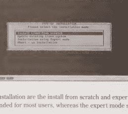

安装模式有两种：从头安装和专家模式。从头安装推荐给大多数用户，而专家模式应仅由专家尝试。

## Installing Linux from Scratch

从头安装 Linux 的模式相对简单易行。第一个屏幕询问你关于分区硬盘的问题。（我们是假设你已阅读并应用了第 1 章中的步骤，并且硬盘上有未分配的空闲空间。）使用 `Tab` 键突出显示 `Partitioning` 按钮并按 `Enter`。

如果你的 PC 有多个硬盘，YaST 会要求你选择要安装 SuSE 的硬盘。如果该硬盘上有未分配的空闲空间，YaST 会自动检测到并建议使用该硬盘进行安装（见图 2.18）。这是首选方案，因为 YaST 会为你处理所有分区。

### FIGURE 2.18

YaST 检测到硬盘上有空闲空间。

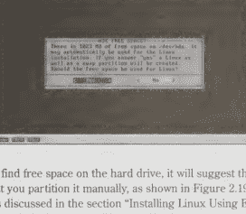

如果 YaST 在硬盘上找不到空闲空间，它会建议要么使用整个硬盘，要么手动分区，如图 2.19 所示。手动分区硬盘在本章后面“使用专家模式安装 Linux”一节中讨论。使用整个驱动器意味着 YaST 将清除硬盘上可能存在的任何现有数据和操作系统，并在整个硬盘上安装 SuSE Linux。如果这确实是你想要做的，请选择 `Whole Hard Disk` 并按 `Enter`。

### FIGURE 2.19

YaST 询问你是否要手动分区或让 YaST 使用整个硬盘。


> CAUTION
>
> 在上一步中选择 `Whole Hard Disk` 将完全擦除你的硬盘。你硬盘上的任何其他操作系统和数据都将永远消失。请确保这确实是你想要做的。否则，你的硬盘上将只剩下 SuSE Linux 而已。

YaST 现在对硬盘进行分区并为 SuSE Linux 做准备。此过程可能需要一些时间，具体取决于 YaST 可用的空间大小。YaST 将在你的硬盘上创建以下三个分区：

- `/boot` 分区—此分区用于存放你的启动文件。此分区通常非常小。
- `/` 分区—这是根分区，所有系统都将安装在此分区。此分区占用硬盘最多的空间。


- Swap 分区—此分区由 Linux 用作虚拟内存。Linux 使用 swap 分区而不是文件作为其虚拟内存。此分区通常是你的 RAM 量的两倍，最大尺寸为 128MB。

当 YaST 完成对硬盘的准备后，它会带你进入软件包选择屏幕（见图 2.20）。在这里，你将选择 SuSE Linux 要安装哪些软件包。此时，你有两个选择：你可以选择一个或多个预设的软件包配置（推荐），或手动选择要安装的软件包（如果你是第一次进行安装过程，则不推荐）。

### FIGURE 2.20

YaST 的软件包选择/配置菜单。

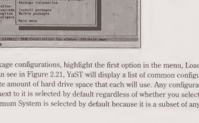

要选择其中一个软件包配置，请突出显示菜单中的第一个选项 Load Configuration。如图 2.21 所示，YaST 将显示常见配置的列表以及每个配置大约使用的硬盘空间。任何在其旁边带有星号 (*) 的配置都将被默认选中，无论你是否选择它。例如，SuSE Minimum System 默认被选中，因为它是你可以选择的任何其他配置的子集。要选择一个配置，请突出显示它并使用空格键标记它。如果配置旁边有 [X]，则表示已选中。

### FIGURE 2.21

SuSE 已准备好各种系统配置，你可以使用它们而不是手动选择软件包。

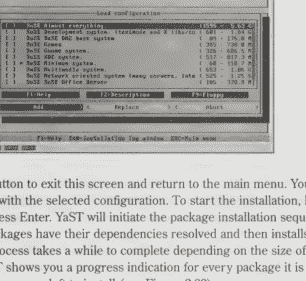

按 Enter 按钮退出此屏幕并返回主菜单。现在你已准备好使用所选配置安装系统。要开始安装，请突出显示 Start Installation 并按 Enter。YaST 将启动软件包安装序列，首先检查所有软件包的依赖关系是否已解决，然后安装所有软件包。安装过程需要一段时间才能完成，具体取决于你选择的配置大小。YaST 会为其正在安装的每个软件包显示进度指示，以及剩余要安装的软件包数量（见图 2.22）。

### FIGURE 2.22

YaST 显示有关安装过程的详细信息。

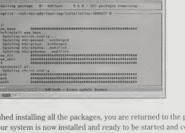

当 YaST 完成安装所有软件包后，你将被返回到之前的屏幕，即主菜单。你的系统现已安装完成，可以启动并进行首次配置。要首次启动系统，请突出显示 Main menu 列表项并按 Enter。YaST 现在开始配置你的系统。

### Booting and Configuring SuSE Linux

现在你的系统已由 YaST 成功安装，它将对其进行配置。配置系列中的第一个屏幕是内核选择屏幕。内核是操作系统的核心，负责运行和管理你的硬件和系统资源。YaST 允许你从一组内核中选择，以便为你的系统选择最佳内核。YaST 为你提供以下五个内核供选择：

- **支持各种 EIDE 控制器的内核**—如果你的系统基于 IDE 设备，则此内核是不错的选择。
- **为 i386 处理器构建的内核（也用于 486）**—如果你的机器是 386 或 486，则应使用此内核，因为它针对这些处理器进行了更好的优化。
- **支持 APM 的内核**—此内核支持高级电源管理（APM）。如果你在笔记本电脑上安装，此内核很好，因为它将激活并使用笔记本的电源管理功能。
- **标准内核（Pentium 优化）**—如果你的机器运行在 Pentium 处理器或 AMD K6/K3 上，则此内核适合你，因为它使用了某些 Pentium 处理器优化。
- **支持 SMP 的内核**—此内核应用于具有多个处理器的系统。

使用方向键突出显示你想要使用的内核，然后按 Enter 让 YaST 为你安装它。

下一步是配置 LILO，LILO 是将安装在你的硬盘上以启动 SuSE Linux 的程序。它也可以配置为启动系统上的任何其他操作系统。我们强烈建议你在系统上安装 LILO。YaST 会询问你是否要安装它；使用 Tab 键突出显示按钮并按 Enter 回答 Yes。

YaST 将显示 LILO 配置屏幕（见图 2.23）。填写此表单的说明在第 9 章“Linux Loader”一节中详细解释。

### FIGURE 2.23

Linux Loader 配置屏幕。

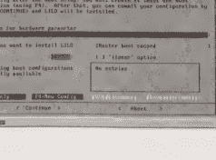

下一个屏幕是时区配置屏幕。如图 2.24 所示，YaST 为你提供了世界各地所有时区的列表。找到你的时区并按 Enter 继续。YaST 然后会询问你是否要根据 GMT 或本地时间设置时间。使用 Tab 键突出显示你想要的按钮并按 Enter 继续。在大多数情况下，你可能希望使用本地时间而不是 GMT，因为本地时间将系统时钟设置为你的时区，而 GMT 则将其设置为格林威治标准时间。

### FIGURE 2.24

选择时区。

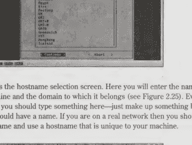

下一个屏幕是主机名选择屏幕。在这里你将输入要赋予机器的名称以及它所属的域（见图 2.25）。即使你不在网络上，你也应该在这里输入一些内容——随便编一个，因为你的机器确实应该有一个名字。如果你在一个真正的网络上，则应输入正确的域名并使用对你的机器唯一的 hostname。

### FIGURE 2.25

设置你的主机名和域名。

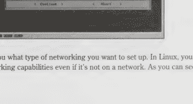

YaST 然后会询问你想要设置什么类型的网络。在 Linux 中，即使你的系统不在网络上，也应具有一定的网络功能。如图 2.26 所示，YaST 给你两个选项，Loopback Only 和 Real Network。如果您未连接到网络，应选择 Loopback Only；否则，选择 Real Network。

### FIGURE 2.26

您可以将系统配置为在真实网络上运行，或为独立机器使用环回。

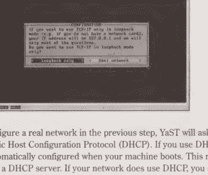

如果您在上一步中选择配置真实网络，YaST 会询问您是否要使用动态主机配置协议（DHCP）。如果您使用 DHCP，您的网络设置将在机器启动时自动配置。这要求您的网络正在运行 DHCP 服务器。如果您的网络确实使用 DHCP，您应回答 Yes。否则，回答 No 以手动配置网络。如果您不确定网络是否支持 DHCP，请咨询您的网络管理员。

如果您的网络不使用 DHCP，YaST 将在您的帮助下配置您的网络。YaST 要求您输入网络所需的信息（见图 2.27）。您需要知道机器的 IP；子网掩码，通常为 255.255.255.0；以及网络默认网关的 IP。如果您不知道这些信息，应向网络管理员索取。填写信息并按 Continue 继续。

### FIGURE 2.27

手动设置网络。


YaST 现在询问您是否希望允许其他人通过 `telnet`、`finger` 和 `FTP` 连接到您的机器。如果您计划运行一个非常安全的系统，现在应回答 No，然后在方便时再打开它们。如果您不太担心安全问题，可以通过回答 Yes 来启用它们。

> TIP

> `Telnet` 使人们能够远程使用您的机器，就像他们 physically 坐在机器前一样。`FTP` 使远程文件传输到和从您的机器成为可能。`Finger` 使人们能够远程探测哪些用户当前已登录以及哪些用户未登录您的机器。

接下来，YaST 询问您是否要启用 `portmap`。如果您计划将机器用作 NFS 服务器或用于 NIS 服务，应回答 Yes。如果您不明白上一句话的意思，您不需要 `portmap`，因此回答 No。

如果您选择启动 `portmap`，YaST 会询问您是否要将机器用作 NFS 服务器。如果是，回答 Yes；否则，回答 No。

> TIP

> NFS（网络文件系统）使人们能够在他们的机器上远程访问您本地文件系统的部分内容。不建议您启用它，除非您有相关经验。管理不当的 NFS 服务器可能成为系统的一个大安全漏洞。

YaST 现在提示您输入将在新闻系统“from”字段中使用的文本。如果您计划在机器上运行 Usenet 新闻服务器，这很有用。YaST 会输入一个默认字符串，通常是正确的。按 Continue 接受它并继续。这即使您不计划运行新闻服务器也不会影响您的系统。

接下来，YaST 询问您是否要访问名称服务器。名称服务器是必要的，如果您在连接到 Internet 的网络上。域名服务器（DNS）是必需的，用于将完全限定域名解析为 IP 地址。如果您的网络连接到 Internet，回答 Yes。

接下来，名称服务器配置屏幕弹出（见图 2.28）。输入您要访问的名称服务器的 IP。如果您使用多个，可以用空格分隔输入其他 IP。在域名列表中输入您的域名。如果您不确定在此表单中输入什么，请咨询您的网络管理员。

在下一个屏幕中，您配置网络设备（见图 2.29）。YaST 会询问您关于网络设备并向您显示受支持的网卡列表。从列表中选择您的网卡并按 Enter 让 YaST 配置它。


YaST 现在尝试配置您的邮件系统。SuSE Linux 将 sendmail 安装为默认邮件系统。如图 2.30 所示，YaST 为您提供了以下五种常见的 sendmail 配置供您选择：

### FIGURE 2.28

配置您的名称服务器（DNS）。

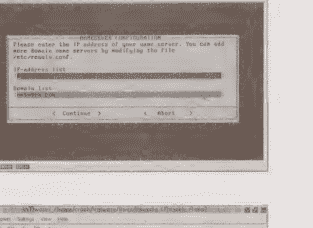

### FIGURE 2.29

选择您的网卡。

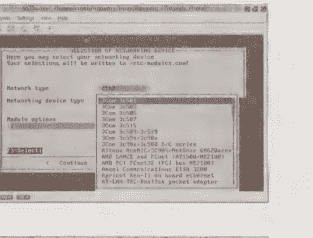

### FIGURE 2.30

sendmail 配置选项。

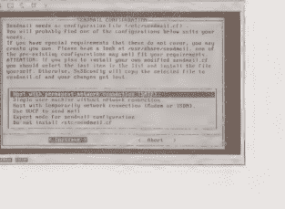

- **Host with permanent network connection (SMTP)**—如果您的系统具有永久的 Internet 连接，您可以使用此选项。
- **Single user machine without network connection**—如果您的机器没有网络连接，请使用此选项。您可能会想知道，如果没有网络连接，为什么还要设置邮件系统。您的许多应用程序会向您发送内部邮件消息以报告进度和错误。请记住，即使 Linux 未连接到网络，其内部也存在网络。
- **Host with temporarily network connection (Modem or ISDN)**—如果您有拨号连接，请使用此配置。这使您可以将机器用作邮件服务器，并在连接时发送电子邮件。
- **Use UUCP to send mail**—如果您将连接到网络，请选择此配置以便发送电子邮件。
- **Expert mode for sendmail configuration**—选择此配置时请谨慎；它仅应由专家使用。

使用箭头键突出显示您想要使用的配置并按 `Enter` 继续。

`YaST` 现在完全接管并开始根据您对之前问题的回答配置您的系统。`YaST` 启动 `SuSEConfig`，后者为您配置系统（见图 2.31）。

### FIGURE 2.31

`YaST` 启动 `SuSEConfig` 以配置您的系统。

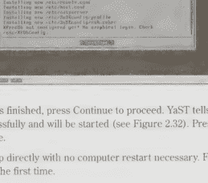

`SuSEConfig` 完成后，按 `Continue` 继续。`YaST` 告诉您系统现已成功安装并将被启动（见图 2.32）。按 `Enter` 首次启动您的系统。

系统直接启动，无需重新启动计算机。图 2.33 显示了系统首次启动的情况。

### FIGURE 2.32

`YaST` 宣布您的系统已成功安装。

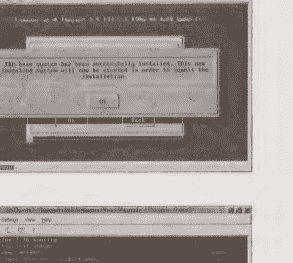

### FIGURE 2.33

SuSE Linux 首次启动。

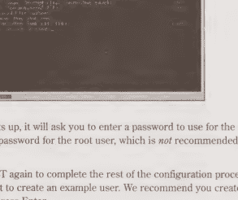

系统启动时，它会要求您输入 `root` 用户的密码。如果您不想为 `root` 用户设置密码，这不建议，只需按 `Enter`。

SuSE Linux 再次启动 `YaST` 以完成剩余的配置过程。`YaST` 首先询问您是否要创建示例用户。我们建议您为自己创建一个用户。回答 `Yes` 并按 `Enter`。

如您在图 2.34 所见，创建用户非常简单。您只需指定用户名和密码。完成后按 `Continue`。

接下来，`YaST` 询问您是否要设置调制解调器。如果您已安装调制解调器，回答 `Yes`。如果您有调制解调器，`YaST` 会提示您从列表中选择调制解调器的 `COM` 端口。突出显示正确的端口并按 `Enter` 继续。

### FIGURE 2.34

首次创建示例用户。

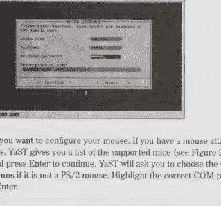

`YaST` 询问您是否要配置鼠标。如果您的机器上连接了鼠标，回答 `Yes`。`YaST` 会为您提供受支持鼠标的列表（见图 2.35）。突出显示您的鼠标类型并按 `Enter` 继续。如果鼠标不是 `PS/2` 鼠标，`YaST` 会要求您选择鼠标运行的 `COM` 端口。突出显示正确的 `COM` 端口，通常为 `COM 1`，然后按 `Enter`。

### FIGURE 2.35

`YaST` 中的鼠标配置

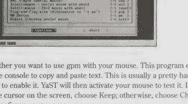

`YaST` 现在询问您是否要使用 `gpm` 与鼠标一起使用。此程序使您能够在控制台中使用鼠标复制和粘贴文本。这通常是一个非常方便的功能，因此回答 `Yes` 以启用它。`YaST` 然后会激活鼠标以测试它。如果您可以在屏幕上看到并移动鼠标光标，请选择 `Keep`；否则，选择 `Change Configuration` 重新配置鼠标。

`SuSEConfig` 再次启动以继续配置您的系统。一些脚本将被启动以首次配置您的系统。这可能需要一些时间，具体取决于系统的速度。按 `Enter` 启动它们；它们将在后台运行，同时系统继续启动。

如你在图 2.36 所见，你新安装的 SuSE 系统现已启动并运行，正在等待你登录。恭喜，你已成功安装 SuSE Linux！

FIGURE 2.36

SuSE Linux 等待你登录。

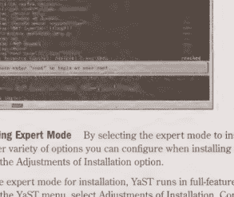

## 使用专家模式安装 Linux

通过选择专家模式安装 SuSE Linux，你在安装 SuSE Linux 时可以配置更多种类的选项。我们将集中讨论安装调整选项。

当你选择专家模式进行安装时，`YaST` 以全功能模式运行（见图 2.37）。从 `YaST` 菜单中，选择安装调整，配置硬盘分区，以在 `YaST` 内手动分区你的硬盘。

FIGURE 2.37

专家模式安装。

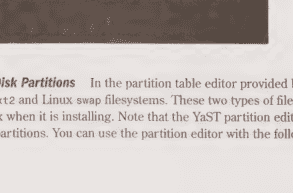

## 配置硬盘分区

在 `YaST` 提供的分区表编辑器中，你可以创建和删除 `ext2` 和 Linux 交换文件系统。这两种类型的文件系统可在 SuSE Linux 安装时使用。注意，`YaST` 分区编辑器也可以删除外来文件系统分区。你可以使用分区编辑器并遵循以下指南：

**删除—**要删除一个分区，请使用方向键突出显示要删除的分区，然后按 `F4`。系统提示删除分区时，选择是。

**创建—**要创建分区，请按 `F5`。你将被询问此新分区是主分区还是扩展分区。有关主分区和扩展分区的更多信息，请参阅第 1 章。选择你想要创建的分区类型并按 `Enter`。在每种情况下，你将被提示选择分区号和大小。`YaST` 将使用设备上可用的全部空间为你猜测起始和结束磁柱。如果你想指定分配给此分区的空间（除全部空间外），你应手动输入此空间。创建的分区类型默认设置为 Linux 原生。

提示

你不必使用磁柱测量来指定磁盘空间。只需输入加号 (`+`) 后跟你想要分配给此分区的兆字节数即可。例如，以下代码显示了如何允许分区拥有 2GB 磁盘空间：

```
+2000M.
```

**更改—**要创建交换分区，你必须创建一个 Linux 原生分区并按 `F3` 将其类型更改为 Linux 交换。当你将分区类型更改为 Linux 交换时，系统会提示你格式化此分区。如果你是第一次将此分区类型更改为交换分区，应选择是。

## 设置目标文件系统

要完成 SuSE Linux 安装的专家配置分支，你应设置目标文件系统配置。这是通过 `YaST` 菜单完成的。选择安装调整，设置目标文件系统。

在此对话框中，你可以准备应为使用分区编辑器创建的每个分区设置的挂载点。此外，你可以为系统上所有可用的文件系统创建挂载点，以便从 SuSE Linux 访问它们（见图 2.38）。

FIGURE 2.38

分区布局示例。


你应至少创建一个挂载点，即根文件系统挂载点 : `/`。要创建挂载点，请选择你想要挂载的分区并按 `F4`。这将弹出默认挂载点列表。选择要将分区设置为的默认挂载点，或指定新的挂载点名称。你可以通过选择其他条目项来创建新的挂载点。如果分区已有挂载点且你不想为此分区分配挂载点，请选择无条目选项。

在为文件系统分配挂载点后，如果分区之前未格式化，你可以格式化分区。注意，在继续之前应检查每个分区旁边的格式标志。你可能会格式化系统分区，如果你将此标志设置到错误的分区或所有分区。

如果你要安装 SuSE Linux 的系统上已有之前的 SuSE Linux 或任何其他原本已分区的 Linux 发行版安装，你可以通过按 `F7` 使用之前的分区方案。这会导致 `YaST` 读取之前的文件系统设置并将其应用到列表中。

> **CAUTION**
>
> 在确保格式标志仅设置到你想要格式化的分区之前，不要按继续按钮。如果格式标志设置到你不想格式化的分区，请在分区被选中时按 `F6` 来更改它。要警惕检查格式标志，因为如果设置到错误的分区，你可能会丢失宝贵数据。

## 选择软件包


在对文件系统进行更改后，你可以选择要安装到 SuSE Linux 的软件包。从 YaST 菜单中，选择选择/安装软件包，这将打开软件包安装对话框。选择更改/创建配置以单独选择软件包。

YaST 向你显示 SuSE 发行版上找到的所有系列的列表。软件包按系列排序——例如，Apache Web 服务器软件包位于系列 N（网络）下。要选择软件包，请突出显示其所属的系列并按 Enter 进入该系列。找到你想要操作的软件包。软件包可能有以下两种状态之一：

- [ ] —表示它未被选中安装到你的系统上。
- [X]—表示软件包现已被选中安装到系统上。

你可以通过按空格键在两种状态之间循环来更改软件包的状态。

要退出系列，请按 F10；如果你想退出整个模块也适用。接下来，你应通过从主菜单中选择开始安装选项并按 Enter 来安装软件包。

其余的安装过程与上一节“从头安装 Linux”相同。只需按照该节中的步骤完成安装过程。

## 安装 X Window 系统

## 本章内容

- 历史 64
- 安装 X Window 系统 64
- 配置 X Window 系统 66
- 设置 XDM/KDM 79
- 设置帧缓冲设备 X 服务器 80
- X 显示提示 81
- X Window 系统故障排除 82

## 历史

X Window 系统是适用于基于 UNIX 的系统的先进图形窗口系统。X Window 系统使你能够拥有使用图标、窗口、菜单等的图形桌面。如果你曾使用过 Macintosh 操作系统或 Microsoft Windows，你已经熟悉窗口系统是什么。

X Window 系统，在此简称为 X，最初是在麻省理工学院计算机科学实验室开发的。它是麻省理工学院与 DEC 之间合作努力的一部分——一个名为 Athena 的项目。X Window 系统于 1984 年首次发布，其起源在很大程度上基于 Paul Asente 在斯坦福大学开发的“W”窗口包。

1987 年 9 月，X 的第一个版本，即 X11，由麻省理工学院发布。此版本就是我们今天所知和使用 X。到了 X 的第二个版本 X11R2，X 不再由麻省理工学院维护。控制权移交给了 X 联盟，该联盟成立于 1988 年 1 月。

X 的起源可追溯到 1970 年代，当时第一个窗口系统思想诞生。这些思想是施乐公司帕洛阿尔托研究中心（PARC）开展的研究成果。在 1970 年代后期，他们正在研究 Parc 和 Star 计算机。这些计算机从未真正进入市场，而是成为研究材料。施乐用它们演示了一个为运行 Smalltalk 80 而构建的窗口系统。窗口系统的想法让人们大吃一惊，并改变了他们使用计算机的看法。施乐引入的 WIMP（窗口、图标、菜单、指针）界面在计算世界掀起了一场革命。

X 的主要开发目前由 X 联盟进行。宽松的许可证允许其他实体开发自己的 X 版本，例如 XFree86 努力。这是一组为 Intel x86 平台设计的 X 服务器的集合。这是随 SuSE Linux 捆绑的版本。

## 安装 X Window 系统

SuSE Linux 打包了 XFree86 项目发布的 X Window 系统的最新副本。在你急于安装 X 之前，你首先应知道你拥有什么类型的视频显卡以及是否受支持。要了解你拥有什么卡，请参阅卡的手册以获取确切规格。你应查明卡使用的芯片组——例如，它是否基于 3Dfx Voodoo 芯片或 NVidia TNT 系列芯片。XFree86 对大多数视频显卡有良好的支持。你可以检查附录 B“硬件兼容性列表”中的卡列表，以了解你的卡是否受支持。以下是最低要求的软件包。

### 软件包需求：

#### Series x:

- `ifneuro`
- `oldlib5`
- `oldlib6`
- `xaw3d`
- `xdevel`
- `xf86`
- `xfnt100`
- `xfntsbig`
- `xfntscl`
- `xfsetup`
- `xpm`
- `xshared`

#### Series xsrv:（你应该从以下列表中选择与你的显卡相匹配的服务器。）

- `x8514`—用于基于 8514 的显卡的服务器。
- `xagx`—用于 agx 显卡的服务器。
- `xfdev`—用于 vesa 帧缓冲设备的 X 服务器。
- `xglint`—用于 GLINT/PERMEDIA 显卡的加速服务器。
- `xi128`—用于 Number Nine Imagine 128 显卡的服务器。
- `xi810`—用于基于 i810 的显卡的服务器。
- `xmach32`—用于基于 Mach32 的显卡的服务器。
- `xmach64`—用于基于 Mach64 的显卡的服务器。
- `xmach8`—用于基于 Mach8 的显卡的服务器。
- `xmono`—X 单色服务器。
- `xp9k`—用于基于 P9000 的显卡的加速服务器。
- `xrush`—用于 3Dfx 显卡的硬件加速 3D X 服务器。
- `xs3`—用于基于 S3 的显卡的服务器。
- `xs3v`—用于 S3 ViRGE 显卡的服务器。
- `xsis`—用于 SiS 530 和 620 显卡的 Alpha 质量服务器。
- `xsvga`—用于 svga 显卡的服务器。
- `xvga16`—用于 vga 显卡（16 色）的服务器。你必须连同你的显卡服务器一起安装此服务器。
- `xw32`—用于 W32 显卡的服务器。

当你完成 X Window System 的安装后，你就可以开始配置它了。

## 配置 X Window System

配置你的 X Window System 是安装之后下一步要做的事情。配置过程以相当困难和复杂而闻名。很久以前，要让 X 运行起来需要你阅读大量资料并进行大量试错。但现在情况已不再如此；XFree86 团队开发了两个有助于配置 X 的程序。第一个是基于文本的配置工具 `xf86config`；第二个是基于图形的工具 `XF86Setup`。这两个工具都能很好地完成工作，但最终的配置工具是由 SuSE 团队开发的——`SaX`。

`SaX` 是一个图形配置工具，同时非常用户友好且智能。`SaX` 会尝试为你检测大部分配置，将你的角色缩小到仅仅监督而不是完全配置。我们将解释如何使用全部三个工具来配置 X，以便你可以选择最舒适的那个。

### SaX

`SaX` 是一款智能软件。它会尝试最大程度地减少使用其他 X 配置程序配置 X 所花费的时间。它拥有一个包含市场上大多数显卡信息的庞大数据库。它还拥有一个庞大的显示器数据库，这使得新手用户可以轻松选择显示器类型，而无需了解有关其显示器的详细信息。

你可以通过两种方式运行 `SaX`。第一种启动 `SaX` 的方式是在命令行中输入 `SaX`。第二种方式是使用 YaST 来配置你的 X 服务器。如果你尝试在普通用户模式下启动 `SaX`，它会要求输入 root 密码。输入 root 密码后 `SaX` 将启动。

要使用 YaST 启动 `SaX`，请选择 System Administration，Configure XFree86。在确认对话框中，选择 `SaX`。

当 `SaX` 启动时，它会尝试探测你的系统以找到正确的显示卡。如果检测失败，它会尝试使用 VGA 模式以 16 色模式启动。如果 `SaX` 因 VGA 卡检测错误而无法启动，你可能需要使用特殊参数 `-s` 启动它。使用 `-s` 参数，你可以指定 `SaX` 使用哪个 X 服务器。X 服务器是在 SuSE Linux 操作系统上用于描述你的显示驱动程序的一种约定。如果 `SaX` 因找不到你的显卡而无法启动，请尝试使用以下命令启动它。该命令指定 `SaX` 应以 VGA 16 色模式启动，该模式应可在所有图形板上运行：

```
bash#sax -s /usr/X11/bin/XF86_VGA16
```

### 使用 SaX 进行鼠标配置

启动 `SaX` 后出现的第一个对话框是鼠标配置对话框。鼠标配置对话框非常直观（参见图 3.1）。你只有在想要修改适用于你的鼠标的某些设置时才需要进入高级选项卡。以下步骤将配置你的鼠标。

### FIGURE 3.1

当 `SaX` 第一次启动时，它需要了解有关你的鼠标的一些信息。这将有助于你在 `SaX` 配置过程中使用鼠标。

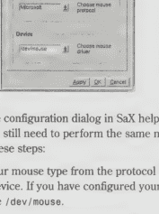

`SaX` 中的第一个鼠标配置对话框可帮助你配置鼠标以在 `SaX` 中使用。你仍需再次为 X 服务器执行相同的鼠标配置。为此，请执行以下步骤：

- 1. 从 `protocol` 框中选择你的鼠标类型。从 Device 组中选择鼠标设备。如果你之前使用 YaST 配置过鼠标，鼠标设备应为 `/dev/mouse`。
- 2. 单击 Apply 以测试你配置的鼠标设置。如果鼠标工作正常，请单击 OK。
- 3. 如果在单击 Apply 后鼠标仍无法工作，请使用 Tab 键选择组合框。选中后，使用上下箭头更改组合框中的设置以匹配正确的鼠标设置。单击 Apply 并重试。如果鼠标工作正常，请单击 OK 进入下一步。


现在你已准备好使用 SaX 的鼠标，你必须配置鼠标以在 X 服务器中使用（参见图 3.2）。从 `Vendor` 列表中选择你的鼠标厂商，并从 `Name` 列表中选择你的鼠标类型。你还应选择 SaX 以 DOS 风格端口显示的鼠标端口，例如 `COM1`、`COM2` 等等。最后一步是选择你的鼠标按钮数量。如果你的鼠标有三个按钮，请在 `Buttons` 组中选中 `3 Buttons` 单选按钮。

### FIGURE 3.2

SaX 提供了一个易于使用的鼠标配置对话框。在单击 `Next` 按钮之前，请记住通过单击 `Apply` 测试你的设置。如果你配置鼠标时出现任何问题，仍可以使用键盘。

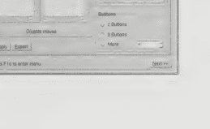

NOTE 你的鼠标可能只有两个按钮。然而，由于 X Window System 对许多操作，尤其是粘贴操作，使用第三个鼠标按钮，你应该激活第三按钮仿真。要做到这一点，请单击 `Expert`，选择 `Options` 选项卡，并选中 `Emulate 3 Buttons` 复选框。这使你可以通过同时单击左右鼠标按钮来生成第三次按钮点击。

当你填写完有关鼠标的信息后，`Next` 按钮将被激活，使你能够继续进行 X Window System 的下一步配置。单击 `Next` 继续。

## 使用 SaX 进行键盘配置

SaX 配置过程中的下一步是配置你的键盘（参见图 3.3）。SaX 不会自动检测你的键盘，因此你必须自己完成。SaX 在 `Model` 列表中预先选择了标准键盘。如果你有不同的键盘型号，请滚动列表以选择你的键盘。选择型号后，你可以通过从 `Language` 列表中突出显示你偏好的语言来选择键盘语言。

如果你对设置满意，请单击 `Apply` 并通过在行编辑字段中输入任何内容来测试你的键盘。如果键盘工作正常，请单击 `Next` 进入下一步。如果键盘设置与你的预期不符，请尝试其他型号和语言的配置。

### FIGURE 3.3

你可以在 SaX 中的键盘配置选项卡中选择键盘型号和语言。在进入下一步之前，请单击 `Apply` 并在测试字段中测试设置。


## 使用 SaX 进行卡配置

配置完键盘后，你应该配置你的显示卡。SaX 会向你显示两个列表，`Vendor` 列表和 `Name` 列表（参见图 3.4）。SaX 使用以下三种方法来配置卡：

- `Autodetection`—在这种方法中，SaX 将尝试找出卡及其设置。
- `Per card setting`—在这种方法中，你必须通过从 `Vendor` 列表中选择厂商名称，然后从 `Name` 列表中选择卡名称来在列表中找到你的卡。
- `By X server`—在这种方法中，你通过从 `Vendor` 列表中选择 `Generic`，然后从 `Name` 列表中选择你想要的 X 服务器来选择 SaX 要使用的 X 服务器。

### FIGURE 3.4

SaX 通过自动检测选项为你配置显示卡提供了最简便的方式。

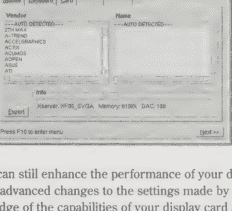

在所有情况下，你仍然可以通过点击 `Expert` 按钮并对 SaX 所做的设置应用高级更改来提升显示性能。请注意，在尝试这样做之前，你应具备对显示卡功能和 X Window System 的充分了解。

> **NOTE** 如果 SaX 无法检测到你的显示卡内存，你应点击 `Expert` 按钮并从 `Server-Settings` 选项卡手动更改。在某些显卡中，如果在 X 中使用时光标形状缺失，你可能需要打开软件光标。要启用软件光标，请点击 `Expert` 按钮并打开 `Options` 选项卡。选择 `sw_cursor` 选项并点击 `Run test` 按钮以确保它在你的系统上有效（见图 3.5）。请注意，你应仅在 X 中鼠标光标形状不正确时才使用此选项。

### FIGURE 3.5

通过选择 `sw_cursor` 选项，你强制 X Window System 使用软件选项绘制光标，从而覆盖任何硬件错误。


## Monitor Configuration Using SaX

你可以选择显示器从一个广泛的显示器厂商和型号数据库中选择。如果不知道显示器型号或厂商，可以从 `VESA` 列表中选择显示器，在该列表中你必须提供显示器信息（见图 3.6）。

### CAUTION

除非你知道自己在做什么，否则不要尝试更改显示器设置中的 Expert 模式设置。如果你输入了错误的值，可能会损坏你的显示器。

### FIGURE 3.6

如果你不知道显示器型号或显示器未列出，可以从 `VESA` 列表中选择显示器支持的分辨率和正确的刷新率。

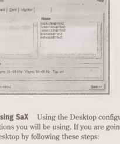

## Desktop Configuration Using SaX

使用 Desktop 配置选项卡，你可以设置将要使用的 X Window System 分辨率。如果只打算使用一种分辨率，可以按照以下步骤配置桌面：

- 1. 从 `Colors` 组合框中选择你想要使用的颜色深度（见图 3.7）。
- 2. 从 `Resolution` 组合框中选择你想要使用的分辨率。
- 3. 点击 `Configure this mode` 开始 SaX 分辨率配置程序。

### FIGURE 3.7

你可以在 SaX 中的 Desktop 选项卡中快速设置 X 会话中想要使用的颜色深度和分辨率。

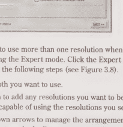

另外，如果你想在使用 X Window System 时使用多个分辨率，必须使用 Expert 模式进行配置。点击 `Expert` 按钮打开 Expert 模式对话框并执行以下步骤（见图 3.8）。

- 1. 选择你想要使用的颜色深度。
- 2. 点击 `b>>` 按钮添加你想要能够使用的任何分辨率。请记住，你的显示器应能够使用你选择的分辨率。
- 3. 点击上、下箭头来管理分辨率的排列。X 将从列表中的第一个开始。
- 4. 对设置满意后点击 `OK`。在主窗口中点击 `Next` 开始配置你选择的分辨率。

### FIGURE 3.8

在使用 X Window System 时，你可以使用 `Ctrl+Alt` 和 `+` 或 `-`（在数字键盘上）的组合来更改屏幕分辨率，但前提是你配置 X 时设置了多个分辨率。


## Resolution Configuration Using SaX

在配置分辨率模式时，你有能力将桌面调整到最佳设置，而无需担心进行任何屏幕调整。使用箭头按钮将屏幕就位。请注意，屏幕边缘用方块标记，除了左上角包含屏幕标题外。这些方块确保你可以看到整个屏幕宽度和高度。确保三个方块和屏幕标题可见。使用拉伸按钮拉伸屏幕，并在对屏幕位置满意后保存设置。如果你选择使用多个分辨率，请点击 `Configure next mode` 按钮，直到配置完你选择的所有分辨率。完成整个过程后，点击 `Save and Exit` 保存你的 X 配置文件。

> NOTE 如果你的屏幕没有任何显示或变黑，你应使用 `Ctrl+Alt+Backspace` 键组合停止 X 服务器的测试。测试停止后，你将返回 SaX。修复任何配置问题，然后再次测试你的配置。问题可能是以下之一：
> - 分辨率不受显示器支持。
> - 颜色深度不受显示器支持。
> 此外，任何卡设置问题都会导致测试自动退出到 SaX。

## XF86Setup

X Window System 配备了一个强大的工具，可帮助你在无需编辑配置文件的情况下配置 X Window System。你可以在以 root 身份运行时从命令行启动 `XF86Setup`，或从 YaST 启动。要从 bash 启动 `XF86Setup`，输入以下命令：

```
bash#XF86Setup
```

或者，要使用 YaST 启动 `XF86Setup`，选择 `System Administration`，`Configure XF86`。在确认对话框中选择 `XF86Setup`。

当 `XF86Setup` 启动时，它会显示来自 XFree86 组的欢迎信息（见图 3.9）。

### FIGURE 3.9

随 X Window System 提供的 `XF86Setup` 程序使你能够配置你的 X。虽然它不会执行任何卡的检测，但随 X 提供的其他实用程序会为你完成此操作。

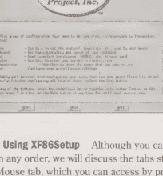

## Mouse Configuration Using XF86Setup

虽然你可以按任意顺序访问 `XF86Setup` 程序中的所有选项卡，但我们将从左到右讨论这些选项卡。最左边的第一个选项卡是 `Mouse` 选项卡，你可以通过按键盘上的 `Alt+M` 或点击 `Mouse` 选项卡来访问。`Mouse` 选项卡如图 3.10 所示。


### FIGURE 3.10

使用`XF86Setup`，你可以轻松地从 X 支持的各种鼠标中选择你的鼠标。


你可以通过选择鼠标协议和鼠标按钮数量来更改鼠标设置。如果你的鼠标只有两个按钮，你应点击 Emulate three buttons 按钮或按 e。如果你的鼠标无法工作，你可以使用箭头键在鼠标协议之间移动以选择适用于你的鼠标的协议。在选择正确的鼠标协议后，按键盘上的 a 应用设置。或者，如果你的鼠标正在工作，你也可以点击 Apply 按钮。

在确保鼠标正常工作后，点击 Keyboard 选项卡并进入下一节学习如何配置键盘。

## Keyboard Configuration Using `XF86Setup`

使用`XF86Setup`进行键盘配置就像选择两个组合框的配置一样简单。从 Model 组合框中选择键盘型号，从 Layout (language) 组合框中选择键盘语言（见图 3.11）。点击 Apply 应用你的设置。大多数人不需要设置屏幕右侧的高级功能，因为这些功能用于为特殊键盘映射键。

### FIGURE 3.11

使用`XF86Setup`进行键盘配置。

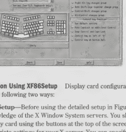

## Card Configuration Using `XF86Setup`

使用`XF86Setup`进行显示卡配置可以通过以下两种方式进行：

- **Detailed Setup**—在使用图 3.12 中的详细设置之前，你应具备一些关于 X Window System 服务器的知识。你应使用屏幕顶部的按钮为你的显示卡选择 X 服务器。你还应为你的 X 服务器配置适当的设置。你可以使用 Options 组合框为 X 服务器指定选项，该组合框支持多选。你可以点击 Card List 按钮从大量卡列表中选择你的卡，这比猜测哪些设置适用于你的显示卡要快得多。

- **Card List**—在 Card List 模式下，你要做的就是在卡列表中搜索你的显示卡（见图 3.13）。选择卡后，你可以继续下一步，也可以按 Detailed Setup 按钮为选择卡时应用的设置添加选项。

> **NOTE** 我们建议你手动指定内存，而不是让 X 服务器探测内存。使用 Detailed Setup 指定显卡上的内存。在某些显卡中，如果在 X 中使用时光标形状缺失，你可能需要打开软件光标。要启用软件光标，请点击 Options 组合框并选择`sw_cursor`。你应仅在 X 中鼠标光标形状不正确时才使用此选项。

### FIGURE 3.12

使用 Detailed Setup 配置显卡可让你为显卡设置选项。

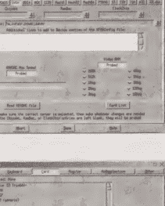

### FIGURE 3.13

使用 Card List 模式，你可以从卡片列表中选择你的卡片，而无需进行任何手动配置。

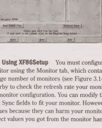

## Monitor Configuration Using `XF86Setup`

你必须使用包含大量显示器预配置设置的 Monitor 选项卡来配置 X Window System 以正确使用你的显示器（见图 3.14）。我们建议你将显示器手册放在附近，以检查显示器支持的刷新率，从而确保选择正确的显示器配置。你可以通过编辑 Horizontal 和 Vertical Sync 字段来修改设置以适应你的显示器。然而这很危险——不要输入错误的值，因为它们会损坏你的显示器。确保你输入的值是正确的值，你从显示器手册中获得的值。

## Mode Configuration Using `XF86Setup`

模式配置在配置 X 会话期间要使用的颜色深度和分辨率时很重要。在 Modeselection 选项卡中，你会找到可以选择的颜色深度和模式列表（见图 3.15）。通过单击颜色深度按钮选择你想要使用的颜色深度，然后通过单击它们选择你想要使用的模式。

### FIGURE 3.14

在`XF86Setup`中进行显示器配置可让你为显示器选择正确的刷新率。

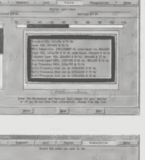

### FIGURE 3.15

你可以使用 Modeselection 选项卡在 X 中选择想要使用的分辨率模式和颜色深度。

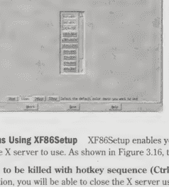

## Other Configurations Using `XF86Setup`

`XF86Setup`可让你配置 X 服务器想要使用的高级选项。如图 3.16 所示，设置如下：

- **Allow server to be killed with hotkey sequence (Ctrl+Alt+Backspace)**—如果勾选此选项，你将能够使用此组合关闭 X 服务器。最好打开此选项。

- **Allow video mode switching**—此选项使你能够使用 Alt+Ctrl+(+) 和 Alt+Ctrl+(-) 键组合在视频模式之间切换。

- **Don't Trap Signals**—如果已勾选，请取消勾选此选项。

- **Allow video mode changes from other hosts**—如果已勾选，请取消勾选此选项。

- **Allow changes to keyboard and mouse settings from other hosts**—如果已勾选，请取消勾选此选项。

### FIGURE 3.16

在 Other 选项卡上，你可以设置服务器特定的操作。

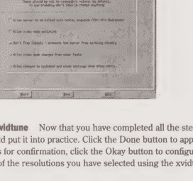

## Mode Tuning Using `xvidtune`

现在你已经完成了`XF86Setup`的所有配置步骤，你应该将其付诸实践。单击 Done 按钮以应用更改。然后，当`XF86Setup`要求确认时，单击 Okay 按钮以使用`xvidtune`程序配置你在所选分辨率中的每个分辨率的屏幕位置。

> **NOTE** 如果你的屏幕没有任何显示或变黑，你应该使用 Ctrl+Alt+Backspace 组合停止 X 服务器。在杀死 X 服务器后，重新启动`XF86Setup`并再次进行整个配置。这次，尝试选择不同的显示器配置。

## `xf86config`

你用来配置 X Window System 的最后一个工具是`xf86config`。此工具基于文本且相当老旧，但它在配置 X 方面非常出色。很少会有此工具在配置 X 时失败；即使其他工具都失败了，你仍然可以指望它成功。当然，前提是你的卡受 X 支持；如果不受支持，就无能为力了。

要使用`xf86config`配置 X，请按照以下步骤操作：

- 1. 以 root 身份登录。

- 2. 通过在命令行上输入以下内容运行`xf86config`：

  `#xf86config`

- 3. 屏幕会滚动显示有关`xf86config`的介绍性文字。当你读完介绍后，按 Enter 继续并开始实际的配置过程。如果你想在程序的任何阶段退出，只需按 Ctrl+C。

- 4. 程序会警告你有一个名为`/usr/X386/bin`的目录，这意味着你安装了旧版本的 X。不要担心此警告——你没有旧版本的 X，此目录仅出于兼容性原因而存在。按 Enter 继续。

- 5. 你看到的第一个菜单是鼠标类型菜单，可让你选择鼠标的类型。如果你有一个双按钮鼠标，你应该选择第一个选项，Microsoft-compatible (2-button protocol)。输入与你的鼠标相对应的数字或与其兼容的数字，然后按 Enter。

- 6. 程序会询问你是否要启用`ChordMiddle`。如果你的鼠标是三按钮鼠标，你应该在此处回答 yes 以启用第三个鼠标按钮。否则，回答 no。输入 y 表示 yes 或 n 表示 no，然后按 Enter 继续。

- 7. 下一个问题询问你是否要启用`Emulate3Buttons`。如果你的鼠标没有三个按钮，你可以通过同时按下两个鼠标按钮来模拟第三个按钮。要启用此功能，请对此选项回答 yes。输入 y 表示 yes 或 n 表示 no，然后按 Enter 继续。

- 8. 现在，程序询问你关于鼠标设备，即`/dev/`下鼠标的设备文件。这应该是`/dev/mouse`，这是此问题的默认答案。按 Enter 接受此默认值并继续。

- 9. 接下来是键盘类型配置。程序询问你是否要使用`XKB`。`XKeyboard`是添加到 X 的新扩展，用于管理键盘布局。强烈建议你使用`XKB`，因此在此处回答 yes。输入 y 表示 yes 或 n 表示 no，然后按 Enter 继续。

- 10. 将显示介绍性消息。它告诉你现在将向你展示预配置的键盘布局列表。按 Enter 继续。


- 11. 程序随后会给你一个可用的键盘列表。找到与你的键盘匹配的键盘并输入其编号。你可能选择第二个，因为现在这是标准。输入与你的键盘匹配的键盘的编号，然后按 Enter 继续。

- 12. 下一节涉及你的显示器。程序显示有关该主题的一些介绍性文字。按 Enter 继续。

- 13. 你将看到 XFree86 支持的显示器设置列表。在尝试选择其中任何一个之前，你应该尝试在显示器的手册中找到显示器的技术规格。然后，选择最接近你的那个。第六个设置适用于大多数显示器，因为它使用保守的设置。如果你找不到手册，你可能想选择此设置。如果你知道显示器的确切数字，你可以通过选择第十一个选项来输入它们。

- 14. 如果你选择的设置不是第十一个，则跳过此步骤。第十一个选项是手动输入显示器设置的地方。程序会要求你输入水平同步范围。按手册中的写法输入。按 Enter 继续。

- 15. 程序现在会要求你输入显示器的垂直同步范围。你应该从显示器的手册中获取此信息。如果你找不到手册，你应该选择一个保守的选择——第三个适用于大多数显示器。如果你知道显示器的确切数字，请选择第五个选项手动输入。

- 16. 如果你选择的设置不是第五个，则跳过此步骤。程序现在会要求你输入显示器的垂直同步范围。按手册中的写法输入，然后按 Enter 继续。

- 17. 程序要求你为显示器输入一些描述性名称。这些名称根本不会以任何方式影响你的配置。它们将仅用于在配置文件中正确命名各节。这些字符串如下，按程序请求的顺序：显示器的标识符、显示器的厂商名称和显示器的型号名称。你可以为每一个都按 Enter 以接受默认值。

- 18. 程序现在进入视频卡配置部分，在此你将选择你的视频卡。程序显示一些介绍性文字；在文字底部它询问你是否要查看卡数据库，你应该回答 yes。输入 y 表示 yes，然后按 Enter 继续。

- 19. 程序会给你当前版本的 XFree86 支持的所有卡的列表。要滚动浏览列表，请按 Enter。找到你的卡后，输入列表中的编号，然后按 Enter 继续。

- 20. 程序将显示你选择的选项以确认它。按 Enter 继续并接受它。

- 21. 程序现在会要求你为此卡选择要使用的服务器。你有五个选项：`XF86_Mono`，即单色服务器；`XF86_VGA16`，仅支持 16 种颜色；`XF86_SVGA`，支持 256 种颜色，但在某些卡上加速并且可以支持高颜色；加速服务器；以及从你的卡定义中选择服务器。第五个选项是推荐的，因为它根据你在上一步中选择的卡选择服务器。输入 5 然后按 Enter 继续。

- 22. 程序现在会询问它是否应创建指向 X 服务器的符号链接。通过输入 y 并按 Enter 回答 yes。

- 23. 程序随后询问是否应在`/var/X11R6/bin`中创建该符号链接。通过输入 y 并按 Enter 回答 yes。

- 24. 程序需要知道你的卡上有多少内存。你会得到一个可供选择的列表。如果你的卡有超过 4MB 的内存，请选择第六个选项以手动输入 RAM 数量。值应以 KB 为单位，因此如果你的卡有 8MB，你将输入 8192，即 8x1024K。

- 25. 程序要求你为视频卡输入一些描述性名称。这些名称根本不会以任何方式影响你的配置。它们将仅用于在配置文件中正确命名各节。这些字符串如下，按程序请求的顺序：视频卡的标识符、视频卡的厂商名称和视频卡的型号名称。你可以为每一个都按 Enter 以接受默认值。

- 26. 程序随后会要求你输入 Clockchip 设置。这使 XFree86 能够为你的显卡编程时钟。大多数显卡不支持此功能，但如果你的显卡支持，你应该从列表中选择它。否则，按 Enter 键禁用 Clockchip。

- 27. 接下来，程序会询问是否尝试探测你的显卡时钟设置。程序会询问“Do you want me to run `X -probeonly` now?” 回答此问题的依据是屏幕上在此问题上方出现的行。在大多数情况下，该行是“The card definition says to NOT probe clocks.” 如果是这种情况，你应该回答否；否则，回答是。输入 y 表示是或 n 表示否，然后按 Enter 继续。

- 28. 现在，是时候设置你想要使用的分辨率了。程序使你能够为每种颜色深度配置想要使用的分辨率。你可以更改 256 色模式、32k/64k 色模式、24 位色和打包像素模式以及 24 位色模式的分辨率。程序会在屏幕顶部为你显示每种颜色模式的当前设置——例如，“640×480”“800×600”“1024×768”对应 8bpp。这行意味着 X 服务器在 8bpp（256 色）模式下运行时，将以 640×480 启动。按下 Ctrl+Alt+PlusKey(+) 将切换分辨率到 800×600 然后到 1024×768。如果你喜欢当前设置，选择第五个选项然后按 Enter。

- 29. 如果你在上一步中选择了第五个选项，请跳过此步骤。选择除第五个选项之外的任何其他选项意味着你想要手动配置此颜色模式。程序将显示它可以支持的所有分辨率的列表。输入你想要为此颜色模式使用的所有分辨率的编号。例如，输入 42 意味着 X 服务器将初始以 1024×768 启动，并且当你按下 Ctrl+Alt+PlusKey(+) 时，将切换到 800×600。程序随后会询问你是否想要设置一个大于桌面显示的虚拟屏幕。按 y 表示是或 n 表示否，然后按 Enter 继续。

- 30. 最后，程序会询问你是否想要保存配置。按 y 表示是或 n 表示否，然后按 Enter 继续。

- 31. 就这样。你已完成 XFree86 的配置。

你现在可以通过运行`X`来测试你的配置：

```
$ startx
```

如果你正确配置了 X，它应该没有任何问题地启动。

## 设置 XDM/KDM

如果你讨厌以控制台模式启动 SuSE Linux，而希望 SuSE Linux 使用图形登录启动，你可以通过配置 XDM 来实现此操作。如果你安装了 KDE，你也可以使用 KDM，它提供强大的图形登录。

要设置 XDM 或 KDM，启动 YaST 并按照以下步骤操作：

- 1. 选择 System Administration，Login Configuration。Configure Login GUI 对话框将会弹出（参见图 3.17）。

- 2. 在 Configure Login GUI 对话框中，选择 Login GUI 以进行图形登录，而不是 ASCII。

- 3. 如果你安装了 KDE，你将能够在 Display manager 字段中选择 KDM；否则，它将被禁用，你只能使用 XDM。选择 KDM，如果可用。你可以在第 24 章“Configuring the Desktop”中了解更多关于配置 KDM 的信息。

- 4. 选择 Shutdown Behaviour of KDM for all。这将允许任何人通过点击关机并确认关机来关闭系统。你可以在第 24 章中了解更多关于此选项的信息。

**FIGURE 3.17**

你可以使用 YaST 配置系统以在 GUI 登录模式下启动。

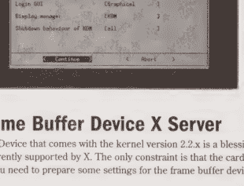

## 设置 Frame Buffer Device X Server

随内核版本 2.2.x 提供的 Frame Buffer Device 对于那些显卡目前不被 X 支持的用户来说是福音。唯一的限制是显卡应支持 VESA 版本 2。你需要为 frame buffer device X server 正常工作准备一些设置：

**Kernel Preparation**—除非你之前重新编译过内核，否则你不必重新编译内核来为 frame buffer device X server 做好准备。随 SuSE Linux 预编译的内核已配备 frame buffer 支持。如果你想自己重新编译内核，你应该在内核中包含以下三个选项：

- Console drivers

- Video mode selection support

- Support for frame buffer devices

你可能还想为在 frame buffer devices 下的 Kernel support 列表中找到的显卡包含支持。如果你找不到你的显卡，请使用 VESA VGA graphics console 选项。

**LILO Preparation**—要以 frame buffer 模式启动系统，你必须使用 LILO 在系统启动时向内核传递一些参数。你可以通过传递参数`VGA=mode`来实现。你可以将模式设置为`VGA=ask`，如果你希望每次启动系统时都被询问想要使用的模式。VESA frame buffer 的模式列在表 3.1 中。

你可以使用 YaST 设置 LILO。按如下方式使用`--mask lilo`参数启动 YaST：

```
bash#yast --mask lilo
```

在 Append line for hardware parameter 中，添加以下文本以在 32k 颜色深度和 1024×768 分辨率下启动系统：

```
vga=0x116
```


## Table 3.1 VESA Mode Numbers

| Colors | 640×480 | 800×600 | 1024×768 | 1280×1024 |
|---|---|---|---|---|
| 256 | 0x301 | 0x303 | 0x305 | 0x307 |
| 32k | 0x310 | 0x313 | 0x316 | 0x319 |
| 64k | 0x311 | 0x314 | 0x317 | 0x31A |
| 16M | 0x312 | 0x315 | 0x318 | 0x31B |

`frame buffer device X server`可以使用`SaX`轻松配置。按照上一节“SaX”中描述的相同程序，直到到达`Card configuration`。在`Card configuration`选项卡中，选择`Vendor Generic Server Selection`。从`Name`列表中，选择`Framebuffer server`。继续设置你的`X`服务器的步骤。

## X Display 提示

本节涉及一些面向初学者的`X Window System`提示。

### Tip #1: Adding Hosts to the Access Control List

假设你在`X`会话中，并且想要以`root`身份启动一个`X`程序。你收到的消息将类似于以下内容：

```
Error: Can't open display
```

这是因为`X`所做的限制只允许启动`X`的用户启动基于`X`的应用程序。在这种情况下，你应该使用命令`xhost`启用将启动应用程序的主机。要启用主机在服务器上启动`X`应用程序，请使用以下命令：

```
bash$xhost + hostname
```

前面的命令添加了允许连接到`X`服务器的主机的主机名。要允许从`localhost`连接的用户，请使用以下命令：

```
bash$xhost + localhost
```

从`localhost`连接的用户将能够启动`X`程序，如果他们导出了正确的`DISPLAY`环境变量。

### Tip #2: Exporting the DISPLAY Environment Variable

在将`localhost`添加到控制访问列表之后，`root`用户必须导出正确的`DISPLAY`环境变量以连接到`X`服务器。这可以按如下方式完成：

```
bash#export DISPLAY=:0
```

### Tip #3: Starting X Programs on Other Servers and Exporting the DISPLAY Variable to Your X Server

假设你想要访问另一台机器上的一些`X`程序并希望它们显示在你的`X`服务器上。如果你的`IP`是`192.186.186.5`，而你想要启动程序的机器是`192.186.186.6`，你可以执行以下操作：

- 1. 使用`telnet`登录到`192.186.186.6`服务器。
- 2. 在你的机器上，通过在另一个`xterm`中发出命令`xhost + 192.186.186.6`允许`192.186.186.6`连接到你的`X`服务器。
- 3. 在`telnet`窗口中，发出命令`export DISPLAY= 192.186.186.5:0`。
- 4. 启动程序，它将显示在你的`X Window System`上。

## Troubleshooting the X Window System

*My card is not supported by X, what should I do?*

如果你显卡支持`VESA`版本`2`，你可以使用`Frame Buffer Device X Server`，或者你可以购买另一块受支持的显卡。

*Whenever I try to configure the X Window System, I get a server not found in SaX and XF86Setup.*

你没有安装包含你的`X`服务器的软件包。检查本章“Installing the X Window System”部分中系统要求的列表。

*The X Window System starts in a different mode than the one I want, what should I do?*

如果你使用`SaX`配置了`X Window System`，请确保你已安排好想要的分辨率。最上面的模式将首先使用。如果你使用`XF86Setup`，请确保你在`/etc/XF86Config`的`Screen`部分中添加了以下行：

```
DefaultColorDepth
```

*When I set up XDM/KDM, the system keeps flashing and I can't access the system.*

如果在未先执行完整的工作`X`系统测试的情况下开始使用`XDM/KDM`，就会发生这种情况。尝试通过按住`Ctrl+Alt+Del`组合键直到它捕获重启信号来重启系统，或通过`telnet`到系统并重启它。在`lilo`提示符下，输入`linux 2`。当系统以控制台模式启动时，重新配置`X Window System`并确保它能工作。如果它不能工作，使用`YaST`将你的系统启动为`ASCII`登录。

## PART II

## 系统管理

- 4 管理用户和组 87
- 5 管理文件系统 107
- 6 备份系统 121
- 7 系统升级 131
- 8 安装新内核 157
- 9 配置系统启动序列 185
- 10 声音卡配置 201
- 11 打印 225
- 12 配置外设 241

## 管理用户和组

## 本章内容

- Linux：多用户操作系统 88
- 什么是账户？ 88
- 管理用户 89
- 管理组 92
- 管理主目录 95
- 控制你的用户 96
- 故障排除 104

## Linux：多用户操作系统

`Linux`是一种多用户操作系统，这意味着它可以同时为多个用户提供服务。这种能够充分利用系统为尽可能多的用户提供服务的能力，是多用户操作系统的优势之一。大多数多用户操作系统通过使用用户账户的概念来实现这一点。

常见的多用户操作系统采用用户账户来允许多个人同时使用系统。不同的用户被归入不同的组。这使得系统管理员能够轻松控制系统的使用方式并实现最佳利用。

## 什么是账户？

要拥有多用户操作系统，你需要有用户账户。账户是你系统上的一个逻辑分区。每个将使用你系统的用户都将拥有这样一个逻辑分区或账户。账户可以充当该用户的隔间。用户拥有自己的空间，并且可以共享附近可用的工具——并非所有工具他都可以使用。用户在未经其他用户许可的情况下无法查看其他用户在其空间中的内容。资源由更高级别的用户即管理员或`root`来在用户之间进行控制。

现在你知道了账户背后的逻辑，你需要知道账户在物理上是什么。账户首先通过为用户提供用户名和密码来创建，从而使他们能够登录系统。用户必须登录才能使用系统。用户名和密码有助于控制谁应该使用系统，谁不应该使用。当用户登录系统时，他会被定位到所谓的其主目录中。在典型的`Linux/Unix`系统中，你会有一个名为`/home`的目录。在该目录内部，你会找到若干以系统中的用户命名的其他目录。每个用户都有自己的`/home/username`目录。例如，一个名为`John`的用户，其主目录在`/home/john`，如果还有另一个名为`Mary`的用户，她的主目录将是`/home/mary`。

为每个用户提供自己的目录的想法非常有帮助。每个用户在其目录内存储文件。用户通常除了自己的主目录和`/tmp`目录外，不被允许在整个系统中的其他地方写入。

当你拥有用户时，你需要一种控制他们的方式。这就是`root`账户的作用。每个`Linux`系统都有一个默认且关键的账户，称为`root`账户。`root`账户属于将管理和控制整个系统的人。

拥有`root`账户的目的是维护和升级系统。例如，要安装一个将由所有用户共享的应用程序，你必须以`root`身份登录。要能够彻底破坏系统，你必须以`root`身份登录。这就是成为`root`非常危险的原因——一个错误，你就可能轻易抹掉整个系统。虽然成为`root`感觉很不错，但在真实的多用户系统中，这是最糟糕的工作之一。你有很大的责任。

## 管理用户

管理你的用户是一个非常简单的过程，并且由于`SuSE YaST`而变得更加简单。`YaST`提供了非常简单的用户管理界面。你可以在一个地方添加、修改和删除用户。

### 添加新用户

要向系统添加用户，你使用`YaST`。记住，因为你维护系统，你必须以`root`身份登录。例如，要添加一个名为`John Gear`、用户名为`john`的用户，请按照以下步骤操作：

- 1. 要运行`YaST`的用户管理模块，你可以通过选择`系统管理`，`用户管理`来导航到它；或直接运行`YaST`以加载用户模块：
- 2. 用户管理模块加载（见图 4.1）。

```
### yast --mask user
```


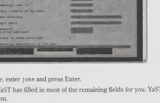

图 4.1

YaST 使用非常友好且易于使用的界面来管理用户。

3. 在 用户名 中输入 `john` 并按 Enter。

注意 YaST 已为你填写了大部分剩余字段。YaST 对它们使用默认值。

4. 下一个字段是 数值用户 ID，这是一个分配给每个用户的唯一数字。这是一个重要的数字，因为系统从不真正处理用户名；它改用数值 ID 来识别用户。保持此字段不变。

5. 下一个选项是该用户将成为其成员的组。默认是 `users`；接受它。稍后将讨论有关组的更多内容。

6. 下一个字段，主目录，是用户主目录的路径。用户登录后将被定位到此处。常见做法是在主目录名称中包含用户名。在本例中，它将是 `/home/john`。

7. 在下一个字段，你看到 登录 Shell。Shell 是从用户读取并执行命令的命令解释器。在 Linux 中，你有多种命令解释器，或 Shell。按 F3 查看可用 Shell 的列表。最常用且推荐使用的 Shell 是 `bash`（Bourne Again Shell）。

8. 接下来，你必须为该用户输入 密码。这很重要。无论你的系统多么安全，它的安全性仅取决于你使用的密码强度。好的密码是由与该用户无关的字符和数字混合组成的。

> **警告**
>
> Linux 密码仅为八个字符长；超过八个字符的部分将被丢弃。密码区分大小写，这意味着 *password* 与 PaSsWoRd 不同。一个常见的错误是鲁莽地输入密码，忽略大小写，然后因记不清输入方式而无法登录。

9. 在 重新输入密码 字段中再次输入密码以确认。

10. 下一个选择是是否希望该用户能够访问你的调制解调器。这是 SuSE 6.2 中引入的新参数。如果用户需要使用调制解调器，则选中该选项；否则，保留未选中状态。

11. 最后一个字段是你输入用户 简要描述 的地方。在本例中，输入 John Gear。

12. 就是这样。现在查看你输入的所有值，如果满意，请按 F4 创建该用户。

13. 在 SuSE 6.3 中，你可以通过按 F6 为密码设置一些额外参数。如图 4.2 所示，将弹出一个新对话框。你使用此对话框进一步调整该账户的限制。例如，你可以设置密码到期前的天数、同一密码的最大天数等。请注意，默认值相当宽松，因此如果你喜欢严格，可以更改它们。完成后，点击 继续 返回上一个对话框。

14. 要退出用户管理掩码，按 F10 或 Esc。

图 4.2

你可以使用此对话框为密码设置额外参数。

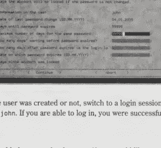

要测试用户是否已创建，请切换到登录会话并尝试使用用户名 `john` 登录。如果能够登录，则表示成功。

### 修改用户

现在你已添加了一个用户，如果你想修改该用户的设置会怎样？很简单，你使用与添加用户时相同的掩码：

- 1. 再次运行 YaST：
  
  ```
  # yast --mask user
  ```
- 2. YaST 用户管理启动时显示空白表单。要加载你要修改的用户的數據，你只需在 用户名 字段中按 F3。你将获得系统中当前注册的所有用户的列表。使用箭头键定位你要修改的用户并按 Enter 确认。
- 3. 现在表单中包含该用户的所有数据。使用箭头键或 Tab 从一个字段移动到另一个字段，更改你想要的任何值。
- 4. 对更改满意后，按 F4 应用这些更改。
- 5. 按 F10 退出用户管理掩码。

### 删除用户

要删除用户，你需要再次使用 YaST：

- 1. 以用户管理模式运行 YaST：
  
  ```
  # yast --mask user
  ```
- 2. YaST 用户管理启动时显示空白表单。在 用户名 字段中按 F3 以加载你要删除的用户的數據。使用箭头键定位你要删除的用户并按 Enter 确认。
- 3. 现在表单中包含该用户的所有数据。要删除该用户，只需按 F5 键。YaST 会询问你是否真的要删除该用户。如果要，请回答 是。
- 4. 该用户已被从系统允许登录的用户列表中删除。但她的家目录和文件仍然保留。这就是为什么 YaST 会询问你是否要删除用户家目录中的文件和子目录。如果你想彻底从系统中删除该用户，则回答“是”。

> **警告**
>
> 当你删除一个用户账户时，已删除的文件无法恢复——用户将永远消失——因此你可能希望备份她的家目录，以防该用户将来会回来。

## 禁用用户账户

你已经了解如何删除用户，但如果只是想暂时禁用该用户账户怎么办？删除他的账户然后在需要他能够登录时重新建立账户会有些过激。禁用账户有更简单的方法。

要禁用账户，可以使用 `passwd` 命令。要锁定账户，输入以下命令：

```
### passwd -l john
```

要解锁它，输入以下命令：

```
### passwd -u john
```

账户只会被禁用，而不会被删除。唯一发生的事情是 John 在你决定解锁账户之前将无法登录系统。

## 管理组

在 Linux 中，用户可以被分配到不同的组。组是为了更好地组织和控制而逻辑上划分用户而创建的。在一个常见的系统中，你会找到 root 组和用户组；还有其他组用于组织文件。但为什么要费心创建其他组呢？

- 管理人员可能需要使用系统来运行管理程序。
- 计算机科学人员可能需要使用它来进行编程。

如果没有办法组织不同类别的用户，就很难跟踪所有这些不同的需求。这时组就派上用场了。通过为每类用户创建一组，你可以轻松地组织和控制他们。例如，你可以创建以下组：

- `students`（所有学生）
- `faculty`（教职员工）
- `admin`（行政人员）
- `cs`（计算机科学用户）

现在你可以开始将用户添加到相关组中。借助组的帮助，你的用户被整齐地组织起来。但组还能做更多！由于学生只想使用电子邮件，就没有理由允许他们使用系统上的其他任何软件。因此，使用权限，你可以禁止学生执行除电子邮件之外的任何软件。

同样的概念可以应用于其他组。例如，教职员工可以是唯一被允许访问系统上 `/exams` 目录的组。`cs` 可以是唯一有权访问系统上编译器和开发工具的组。

组可以帮助你组织用户，也能控制他们。这样可以确保系统具有更好的安全性和更高的效率。

## 创建组

要创建新组，请按以下步骤操作：

- 1. 以组管理模式运行 YaST，可以通过运行 YaST 然后导航到它（系统管理，组管理）或输入以下命令：
  
  ```
  # yast --mask group
  ```
  
  当模块加载时，你会看到一个空表单。这与添加用户过程类似。
- 2. 第一个字段是组名字段，在此输入你想要创建的组名——例如 `students`。按 Enter 移动到下一个字段。
- 3. 下一个字段是数字组 ID。这与用户数字 ID 的概念类似。就 Linux 而言，组只不过是一个数字 ID。YaST 已为你输入了默认的数字 ID。按 Enter 继续。
- 4. 下一个字段是访问该组的密码。拥有组密码非常重要。如果你不对组设置密码，任何人都可以简单地运行命令 `newgrp groupname` 并成为该组的成员。这是一个安全问题，绝不能忽视！

```
### yast --mask group
```

组密码是为那些不会成为该组成员的人准备的。假设 John 是 `users` 组的成员，而 Rob 是 `faculty` 组的成员。Rob 恰好与 John 同坐，需要通过 John's 账户访问属于 `faculty` 的一些文件。如果 Rob 尝试这样做，而文件只能由 `faculty` 查看，他会收到权限被拒绝的错误。他可以通过使用自己的账户登录来查看文件，但这并不方便。相反，Rob 可以使用命令 `newgrp` 暂时将 John's 组切换为 `faculty`：

```
$ newgrp faculty
```

系统会要求输入密码，即在创建时用于保护该组的密码。现在 Rob 可以使用 John's 账户访问 `faculty` 组下的任何文件。当 Rob 完成后，他输入 `logout`，这会撤销对 John's 账户的影响并恢复正常。借助此命令，Rob 不必使用自己的账户登录浪费时间；他只是暂时打开了通往该组的大门。
- 5. 重新输入密码以确认。按 Enter 移动到最后一个字段。
- 6. 此字段用于指定哪些用户被允许访问你的组。这很方便，因为你可以将不同组的人添加到你的组的访问列表中。例如，你正在创建一个名为 `faculty` 的组，而 John 来自 `users` 组。如果你在此字段中添加 John's 名字，他将能够访问 `faculty` 组以及他自己的组 `users`。这样用户就可以成为多个组的成员。
- 7. 要添加用户，你可以输入以逗号分隔的用户名，或按 F3 并从系统上可用用户列表中逐一选择用户。
- 8. 完成后，检查表单中的值并按 F4 创建该组。
- 9. 最后，按 F10 退出组管理掩码。

## 修改组

你已创建组并想修改它——该怎么做？使用 YaST 中的完全相同的掩码即可：

- 1. 运行 YaST：
- 2. YaST 启动时为组管理模块。要选择要修改的组，请在组名字段中按 F3。
- 3. 使用方向键找到组的名称并按 Enter 选择它。表单将显示该组的所有值。


使用方向键在各个字段之间移动并更改你想要的值。

```
yast --mask group
```

对更改感到满意后，只需按 `F4` 应用更改。

最后按 `F10` 退出组管理掩码。

## 删除组

如果你想删除一个组，操作如下：

1. 运行 YaST：

2. YaST 启动时为组管理模块。在组名字段中按 `F3` 以选择要删除的组。

3. 使用方向键找到组的名称并按 `Enter` 选择它。表单应包含该组的所有值。

4. 要删除该组，按 `F5`。

5. YaST 将确认你删除组的请求；如果确定，选择“是”。

6. 按 `F10` 退出组管理掩码。

```
yast --mask group
```

## 管理家目录

家目录是系统最重要的部分之一。如果处理不当，你可能要面对一群愤怒的用户。这就是为什么你必须非常小心地处理这些目录。正如我们之前所说，家目录是系统中所有用户保存文件的地方。所有应用程序设置和偏好都存储在那里，电子邮件也保存在家目录内的文件夹中。

考虑到这一点，我们可以理解如果家目录出现问题，用户会非常不满意。

## 为用户设置全局偏好

一个良好的做法是为大多数应用程序创建良好的配置并将其应用于所有用户。这样可以为用户节省配置应用程序的时间。但如何传播此类更改呢？这是在开始向系统添加用户之前应执行的一步。

为了充分理解其工作原理，让我们看看创建用户时会发生什么。在创建用户时，系统会自动执行以下几件事：

1. 系统用户数据库会更新为新用户的姓名和密码。

2. 创建一个 `/home/username` 目录。

3. 将 `/etc/skel` 的所有内容复制到 `/home/username`。

4. 将 `/home/username` 的所有权更改为新用户。

There it is! Our key to global configuration—the third step. We observe that the system copies the contents of the directory `/etc/skel` to the newly created home directory. `/etc/skel` is simply a home skeleton, which contains all the files and subdirectories that a new home directory will have.

Now that you know this, you can easily customize that directory. All that you have to do is create a test user. Run all the applications you want to customize and save the preferences. Create any subdirectories you might need and tweak anything you want. When you are done and you have the perfect account (in your opinion), simply switch to root and replace the contents of `/etc/skel` with the contents of your test account. Then change the ownership of all the files to user root and group root:

```
chown root.root /etc/skel -R
```

> **CAUTION**
>
> You should be careful when you perform global configuration. Some programs tend to save their preferences, including the user's name. If this happens, when you copy that program's preferences to all users, it won't work correctly because it has been saved for a specific user. Check your programs for that before attempting to include their preferences.

That's it! Start creating your users, and with each user created, the new `/etc/skel` will be copied to that user's home directory. Global configuration has been accomplished.

## Protecting Home Directories

Protecting home directories is an important step. You have to protect them from being lost. System crashes in Linux are not likely to happen, but that is not an excuse to not protect your system. Hardware crashes might destroy files and directories, including the home directories.

Performing regular backups of the `/home` directory is a very good practice. Scheduling a weekly or monthly full backup of this directory can save you from a lot of complaints in case something happens. If your system is a very busy one, back up daily. Better safe than sorry!

## Controlling Your Users

When you have a system with more than one user, you will eventually find the need to control how they use, or maybe abuse, your system. There are a lot of different aspects that you can control for your users. These range from the amount of memory users are allowed to use to the amount of hard disk space they are allowed to have.

But before you learn how you can control those aspects, you should learn about a few concepts. When a user logs in to the system, some environment variables are automatically set for her. Among these are the user ID and group ID. The user ID is declared in a variable called `$UID` and the group ID is declared in `GROUPS`. Another important concept you need to know is that upon log in, the contents of the script `/etc/profile` are executed automatically by the shell. This information might sound irrelevant now, but it will be of great help in a while.

## Controlling the System Resources Available to Users

To control the system resources available to users, you use a command in bash called `ulimit`. To learn more about this command, read the man page for bash (`man bash`).

The following are the various parameters you can set using `ulimit`:


- The maximum size of core files created (`ulimit -c`)
- The maximum size of a process's data segment (`ulimit -d`)
- The maximum size of files created by the shell (`ulimit -f`)
- The maximum size that might be locked into memory (`ulimit -l`)
- The maximum resident set size (`ulimit -m`)
- The maximum number of open file descriptors (`ulimit -n`)
- The pipe size in 512-byte blocks (`ulimit -p`)
- The maximum stack size (`ulimit -s`)
- The maximum amount of cpu time in seconds (`ulimit -t`)
- The maximum number of processes available to a single user (`ulimit -u`)
- The maximum amount of virtual memory available to the shell (`ulimit -v`)

Let's see how you can set these limits for your users. The file you want to edit is `/etc/profile`. Open the file using your favorite editor. You have to be root to write to this file. The first section of the file has the following:

```
### /etc/profile

PROFILERead=true

umask 022

### adjust some limits (see bash(1))
#ulimit -c 20000        # only core files less than 20 MB are written
#ulimit -d 15000        # max data size of a program is 15 MB
#ulimit -s 15000        # max stack size of a program is 15 MB
#ulimit -m 30000        # max resident set size is 30 MB

ulimit -Sc 0            # don't create core files
ulimit -d unlimited
```


Because `/etc/profile` is executed upon every log in, anything you type here will be set for the user. You can even decide whether you want users to be able to set any of the limits. This is done by setting both a soft limit and hard limit for the parameter you are setting. A hard limit cannot be exceeded by users, whereas a soft limit can be exceeded by users up to the hard limit. For example, say you do not want users to be able to run more than 50 processes, but you know that some of them might need to run up to 70 processes. To set a hard limit, just put an `H` before the option you want to set, and to set a soft limit, put an `S` before the option. If you do not put either one, the value you assign will be both the hard and soft limit. For example:

```
ulimit -Hu 70    # set the hard limit to be max 70 processes.
ulimit -Su 50    # set the soft limit to be 50.
```

This will give users 50 processes to run. If they need more, they can use the `ulimit` command to increase that limit to the maximum 70 processes, as in the following example:

```
$ ulimit -u 60    this will work
$ ulimit -u 80    this will fail since it exceeds the allowed amount.
```

Now that you know how to set user limits, what if you need a little more flexibility? What happens if you want to assign different groups of users different settings? The method used in the preceding example sets the same limits on all the users regardless of their group. You might want the cs group to be able to run more processes than the students group, for example. To do this, you have to resort to some logic, which happens to be pretty easy to do.

As mentioned before, upon login, the shell declares two important variables for you. These variables are `$UID` (user ID) and `$GROUPS` (group ID). The logic here is for you to check those variables and, based on their values, assign different settings. Let's see how you can do that.

Say that you have two groups, one called students and the other called users. You want to set different settings for each group. The first thing you will need to do is get the group ID for each one. Follow these steps:

- 1. Run YaST in the Group Administration mode:

- `# yast -mask group`

- 2. Press F3 in the Name of Group field.

- 3. Use the arrow keys to navigate through the list of group names until you find the group users, and then press Enter.

- 4. Now the form fills up with all the data relevant to the group users. You are only interested in the group ID, which in this case is 100.

- 5. Do the same for the group students, which has a group ID of 104.

- 6. Take note of those numbers.


You need to write a small piece of scripting code that checks the value of the `$GROUPS` variable and sets the correct settings for each of the two groups. You want the `students` group to be able to run no more than 10 processes and the `users` no more than 50. Let's see how you can do this. Insert the following somewhere in the beginning of `/etc/profile`:

```bash
### first we check if that user belongs to the users group
if test "$GROUPS" = "100" ; then
    #ok.. he is.. start setting the limits!
    ulimit -u
fi

### Now we check if that user belongs to the students group
if test "$GROUPS" = "104" ; then
    #ok.. he is.. start setting the limits!
    ulimit -u
fi
```

Using this simple logic, you can set different settings for each group, thus achieving the optimal system usage. No group has more than it should need. Of course, the same thing can be applied to the user level. In case you want one of the users to have a little more capability than others, just replace the `$GROUPS` with `$UID`, check for the user's numerical ID, and set the limits for that user.

## Controlling How Much Hard Disk Space Your Users Are Allowed to Have (Quota)

One of the most frustrating aspects of administering a multiuser system is having users realize that they are not the only ones on the system. Users have a tendency to forget that, and they hardly take it into account when they use the system resources. So far you have learned how to control how users are going to use the system's processing and memory resources, but what about storage space? Any administrator will tell you that hard disks, unfortunately, do not grow on trees.

Users tend to fill their accounts with lots of files and programs without regard to how much hard disk space is available. Thus, one user can take up enough space to accommodate two users. This is not fair, and certainly some control is required here. This is where hard disk quota comes in handy.

`Quota` is a means of controlling how much hard disk space is available for a user. Using quota you can, for example, limit users to only 10 MB of hard disk space. If they attempt to exceed that, the system will not allow them to. This way you can be sure that no one is abusing the system resources. Quota is not new technology at all—it has existed since the day Unix surfaced—and it is an important tool for user control.

## Preparing to Use Quota Support

Before you use quota, you need to prepare your SuSE Linux system. Quota support is composed of two parts: a kernel and a set of software tools. You need to have both of them to use quota.

## 重新配置你的内核

要在 Linux 上使用配额，你的内核必须配置为包含配额支持。这通常需要重新编译内核。我们说通常是因为如果你没有更改 SuSE Linux 安装的内核，它已经内置了配额支持。在这种情况下，你可以简单地跳过本节并继续。但如果你以任何方式更改了内核，你可能已关闭了配额支持。在这种情况下，你需要在配置为包含配额支持后重新编译内核。有关如何构建内核的详细说明，请参阅第 8 章“安装新内核”。要重新编译内核以包含配额支持，只需按照以下快速步骤操作：

1. 首先，以 `root` 身份登录。

2. 将当前路径更改为 `/usr/src/linux`：

   `# cd /usr/src/linux`

3. 要配置内核，请通过输入以下命令运行内核的配置模块：

   `# make menuconfig`

4. 会弹出一个菜单驱动的对话框。使用箭头键导航到 `Filesystems` 并按 `Enter`。

5. 会弹出一个新的对话框。该对话框中的第一个选项就是 `Quota Support`。如果该选项旁边没有星号，请按空格键将其标记为包含在内核中。星号表示此功能将被内置到内核中。如果你发现它已经被标记，则你的内核已经支持配额，你不需要做所有这些。在这种情况下，使用 `Esc` 退出内核配置对话框，然后跳到下一节。

6. 现在你已将配额标记为包含在内核中，使用 `Esc` 键退出内核配置模块。它会提示你保存新的设置；选择 `Yes`。

7. 你已配置了内核；现在需要编译它。要编译内核，请按此顺序输入以下命令：

   `# make dep`

   `# make clean`

   `# make bzImage`

8. 每个步骤完成执行需要一些时间。你会看到大量文本滚动，这很正常。所有步骤完成后，你需要重新启动以使更改生效。

就这样。你的内核现在应该已支持配额。如果你对之前的步骤遇到任何问题，请阅读第 8 章，了解有关编译新内核的完整详细信息。

## 安装软件

现在你需要确保你拥有使用配额所需的软件。要安装软件，请使用 YaST 安装来自系列 `AP1` 的名为 `quota` 的软件包。要安装它，请按照以下步骤操作：

1. 以 `root` 身份登录。

2. 确保你的 SuSE 安装 CD 已插入 CD-ROM 驱动器中。

3. 运行 `YaST` 并选择 `Install`。

4. 加载一个新的菜单。选择 `Change/Create Configuration`。

5. 选择系列 `AP`。

6. 查找名为 `quota` 的软件包。

7. 如果它旁边有一个 `i`，则说明没问题。如果没有，则按空格键将软件包标记为安装。

8. 按 `F10` 退出。

9. 按 `Start Installation`。

10. `YaST` 将开始为你安装软件包。

11. 完成后，只需退出 `YaST` 即可。

## 修改系统以运行配额支持

下一步是告诉 SuSE Linux 要监控哪些文件系统以使用配额。配额仅适用于第二扩展文件系统 `ext2`。这是 Linux 默认使用的文件系统。要将文件系统标记为由配额监控，你需要编辑 `/etc/fstab`。


/etc/fstab 是包含有关文件系统信息的文件。用任何编辑器打开该文件。它应该看起来像这样：

```
/dev/hda7   swap        swap        defaults    0
/dev/hda6   /           ext2        defaults    1
/dev/hda5   /boot       ext2        defaults    1
/dev/hdc    /cdrom      iso9660     ro,noauto,user 0
/dev/fd0    /floppy     auto        noauto,user 0
none        /proc       proc        defaults    0
### End of YaST-generated fstab lines
```

你的系统可能显示的内容与此不同，这没关系。你可以在这里看到你有两个 `ext2` 文件系统——根目录 `/` 和 `/boot`。你更感兴趣的是根目录 `/`，因为它包含 `/home` 目录。你想要控制包含用户主目录的文件系统。要在文件系统上启用配额支持，将选项 `usrquota` 添加到第四个字段，要启用组配额，将选项 `grpquota` 添加。例如：

```
/dev/hda7   swap        swap        defaults    0
/dev/hda6   /           ext2        defaults,usrquota,grpquota 1
/dev/hda5   /boot       ext2        defaults    1
/dev/hdc    /cdrom      iso9660     ro,noauto,user 0
/dev/fd0    /floppy     auto        noauto,user 0
none        /proc       proc        defaults    0
### End of YaST-generated fstab lines
```

你现在已在 `/` 文件系统上同时启用了用户和组配额。

## 创建记录文件

对于每个你要使用配额支持的文件系统，你需要在其根目录上创建记录文件。

使用前面的示例，你需要在 `/` 上创建这些文件。你需要创建一个名为 `quota.user` 的文件（用于用户配额）和另一个名为 `quota.group` 的文件（用于组配额）。要创建这些文件，使用 `touch` 命令：

```
### touch /quota.user
### touch /quota.group
```

你必须使这些文件仅对用户 `root` 可读/写：

```
### chmod 600 /quota.user
### chmod 600 /quota.group
```

如果你的 `/home` 是独立的分区，并且你想对其设置配额，你将在 `/home` 下创建这些文件。现在是时候重新启动以使所有这些更改生效了。

## 为用户分配配额

要开始为用户分配配额，使用 `edquota` 命令。在开始使用此命令之前，你可能希望将 `$EDITOR` 变量设置为你选择的编辑器，例如 `pico`。这是个好主意，因为默认编辑器是 `vi`，对大多数人来说很难使用。输入以下内容：

```
### export EDITOR=pico
```

假设你想为用户 `John` 设置配额。你这样运行 `edquota`：

```
### edquota -u john
```

这将打开编辑器并显示有关 `John` 配额的信息：

```
Quotas for user john:
/dev/hda6: blocks in use: 1325, limits (soft = 5000, hard = 6500)
inodes in use: 156, limits (soft = 1000, hard = 1500)
```

使用配额你可以限制用户使用的空间，即 `blocks`，以及用户可以拥有的文件数，即 `inodes`。此特定用户已使用 1325 KB 空间，允许的软限制为 5000 KB，硬限制为 5000 KB。至于文件数，他有 156 个文件，软限制为 1,000，硬限制为 1,500。

设置用户的配额时，你可以同时设置硬限制和软限制。如果用户超过软限制，系统会警告她，如果她尝试超过硬限制，系统将不允许她。

要为 `John` 设置配额，只需按需编辑数字，保存并退出。就这样，完成了。

## 为多个用户分配配额

你已学会如何为一个用户设置配额，但你会为系统上的每个用户都这样做吗？这并不实用。你可以通过使用脚本来自动化此操作。你所要做的就是为一个用户设置配额，然后让系统将设置复制到所有其他用户。要做到这一点，输入以下命令：

```
### edquota -p john `awk -F: '$3 > 499 {print $1}' /etc/passwd`
```

此命令将用户 `John` 的设置复制到系统中 ID 大于 99 的所有用户。在大多数系统上，组用户 ID 从 500 开始，但请检查你的系统。`awk` 命令从密码文件 `/etc/passwd` 读取这些用户名。就这样，你已为所有用户设置了配额。

## 为组分配配额

要为组设置配额，你使用与单个用户相同的程序。如果你想为组 `students` 设置配额，请将 `$EDITOR` 设置为你喜欢的编辑器（如果你尚未设置）：

```
### export EDITOR=pico
### edquota -g students
```

`pico` 将打开并显示有关组 `students` 的相关信息：

```
Quotas for group games:
/dev/hda6: blocks in use: 6325, limits (soft = 10000, hard = 30000)
inodes in use: 2114, limits (soft = 5000, hard = 7000)
```

编辑限制值，保存并退出。

## 设置宽限期

你已看到你可以拥有两个限制，软限制和硬限制。我们说当用户超过软限制时，系统会警告他。但如果用户持续超过限制会怎样？这就是宽限期。在这里你设置系统允许用户超过软限制的时间，然后再强制执行。这可以以秒、分钟、小时或天为单位设置。

要设置宽限期，使用 `edquota` 命令：

```
### edquota -t
```

```
Time units may be: days, hours, minutes, or seconds
Grace period before enforcing soft limits for users:
/dev/hda6: block grace period: 7 days, file grace period: 7 days
```

在此示例中，我们已将宽限期设置为文件和块软限制均为七天。你可以将其设置为你想要的任何值。

## 更新你的设置

现在你已更改了许多配额设置，你需要更新配额系统。只需运行命令 `quotacheck -a`。

此命令在启动时会自动运行。但是，如果你不想重新启动系统以使更改生效，只需手动运行此命令，或使用 `cron` 设置为每周定期运行。


## 查看配额状态

要检查系统配额的当前状态，可以运行 `repquota` 命令。该命令会打印出系统中所有用户的信息以及他们如何使用其存储限制。你可以运行该命令来报告单个文件系统或所有具有配额支持的文件系统。

以下命令仅报告 `/` 文件系统：

```bash
### repquota -u /
This is for user quota.
### repquota -g /
This is for group quota.
```

以下命令将报告所有具有配额支持的文件系统：

```bash
### repquota -ua
This is for user quota.
### repquota -ga
This is for group quota.
```

如需了解更多信息，可以查看这些命令的手册页。

## 开启和关闭配额

如果要关闭或开启配额支持，运行 `/etc/rc.d` 中的 `quota` 脚本。这非常简单。

要停止配额支持，输入以下内容：

```bash
### cd /etc/rc.d
### ./quota stop
```

要启动配额支持，输入以下内容：

```bash
### cd /etc/rc.d
### ./quota start
```

## 故障排除

*我添加了一个用户，但似乎无法使用该用户账户登录，但在重启后却可以——为什么？*

这发生在 SuSE 6.2 的评估版本中。`YaST` 在添加用户后不会重启 `nscd` 程序。你只需手动重启它即可：

```bash
### cd /etc/rc.d
### ./nscd restart
```

这将解决问题，你无需重启。更新你的 `YaST` 到已修复的版本。

*我添加了一个新组，但系统在重启前无法使用它。*

同样，这与前一个问题完全相同。相同的解决方案在这里也适用。


## 配额无法工作！

嗯，你确定你的内核是否编译了配额支持？检查一下并在必要时重新编译。你是否拥有所有配额工具？如果没有，从 SuSE CD 上的 AP 系列安装 `quota` RPM。你是否创建了 `quota.user` 和 `quota.group` 文件？这些文件是否仅对 `root` 可读可写？你是否标记了你想要使用配额的文件系统？配额支持是否已开启？如果没有，请检查前面关于启动和停止配额支持的部分。

## 管理文件系统

+ 本章内容
+ - 理解文件系统 108
- 挂载和卸载文件系统 109
- 创建和格式化文件系统 113
- 理解网络文件系统 116
- 故障排除 118

## 理解文件系统

文件系统是操作系统最重要的组件之一。文件系统处理你如何使用存储介质。整天你都在打开文件、保存文件、删除文件等等，而你从未真正思考过这是如何发生的。你对文件执行的每一次操作都通过文件系统进行。
文件系统是你与存储数据的硬件之间的逻辑组织层。以硬盘为例——当你第一次购买它时，如果不以某种方式格式化它，对你来说是完全无用的。在你可以使用该硬盘之前，你的操作系统必须在其上构建文件系统。文件系统组织了你的数据将如何放置在驱动器上。它使你能够使用文件名来命名文件并使用目录来组织它们。试想一下，如果你不能使用目录；所有文件都将放在一个地方，完全没有任何组织。没有文件系统，使用计算机几乎是不可能的。
文件系统是操作系统的一部分。应用程序和用户访问文件的请求都使用操作系统的文件系统部分。尝试直接访问实际介质会证明是一个相当复杂的过程。
目前存在许多不同的文件系统。每个操作系统往往都有自己的文件系统。微软使用基于 FAT（文件分配表）技术的以及 NTFS 的文件系统，后者被 Windows NT/2000 使用。Amiga 使用 FFS（快速文件系统）；OS/2 使用 HPFS（高性能文件系统）；Linux 使用 ext2（第二扩展文件系统）；等等。而这些是操作系统特定的文件系统，媒体特定的文件系统也存在。CD-ROM 就是媒体特定文件系统的一个例子。它们使用一种称为 ISO9660 的文件系统。
文件系统可以完成存储文件的相同基本工作，但在其他特性上有所不同。一些文件系统如 MS FAT 非常简单——它们存储文件和目录。FAT 的早期版本无法存储超过 11 个字符的文件名。其他文件系统具有更强大的功能，例如长文件名和用于安全的文件权限。一些文件系统在系统崩溃时处理得非常好，而其他文件系统则倾向于损坏。
不同的操作系统无法读取彼此的文件系统。这是 CD-ROM 使用自己的文件系统的原因之一；这样你就可以在不同的操作系统上读取它们。Linux 在文件系统方面非常灵活，因为它可以读取所有之前的文件系统以及更多。
Linux 最初使用 Minix（一个小型 Unix 克隆操作系统）使用的相同文件系统。但 Linux 很快需要一个更强大的文件系统，因此扩展文件系统（ext）诞生了。随后不久它被升级为第二扩展文件系统（ext2），预计很快将被更新版本取代。

## 挂载和卸载文件系统

在 Linux 和 Unix 中，通常文件系统是所有组件之母。操作系统的整体哲学围绕文件系统构建。在 Linux 中几乎所有东西都是文件。所有设备都是文件系统上的文件，所有驱动器都是文件系统上的目录。你甚至可以在文件系统上创建网络套接字。
当你使用 Microsoft 操作系统时，你会注意到你的驱动器被标记为 A:、B:、C: 等等。在 Linux 中情况完全不同。你的驱动器在使用时成为文件系统的一部分。例如，要在 A: 驱动器中使用软盘，你指示操作系统使该磁盘的内容在 `/floppy` 下可用。这样磁盘就表现为系统上的另一个目录。相同的概念适用于同一硬盘上的其他分区或完全不同的驱动器上的分区。在你完成使用这些驱动器后，你必须指示操作系统将它们从文件系统中释放。
为了访问不同驱动器或分区上的文件，你必须发出 `mount` 命令。该命令具有基本结构：
```
mount device mount-point -t filesystem
```
你必须指定至少两个参数——你想要使用的设备和挂载点。挂载点是你希望该设备的内容出现的目录。这可以是你创建的任何目录。常见做法是使用 `/mnt/drive`（例如，`/mnt/floppy` 用于软盘）。对你想要使用的目录没有限制，只要它是空的即可，由你决定。
设备选项很容易确定。系统上所有可用的设备在 `/dev` 目录下都有对应的文件名。以下是其中最常见的：

| 物理驱动器 | Linux /dev 文件 |
|---|---|
| 软盘驱动器 A: | `/dev/fd0` |
| 软盘驱动器 B: | `/dev/fd1` |
| IDE 1 连接器 0 上的驱动器（通常为 C: 驱动器） | `/dev/hda` |
| IDE 1 连接器 1 上的驱动器（通常为 D: 驱动器） | `/dev/hdb` |
| IDE 2 连接器 0 上的驱动器（通常为 E: 驱动器） | `/dev/hdc` |
| IDE 2 连接器 1 上的驱动器（通常为 F: 驱动器） | `/dev/hdd` |
| SCSI 驱动器 1 | `/dev/sda` |
| SCSI 驱动器 2 | `/dev/sdb` |

最后一个参数，即文件系统参数，可能对大多数人来说有点令人困惑。如前所述，Linux 可以读取很多文件系统。当 Linux 即将挂载磁盘时，你应该告诉它该磁盘上存在什么文件系统，以便它可以将其转换为自己的文件系统（ext2）。这样磁盘上的所有文件都会被当作本地文件系统的真正一部分来处理。你可能并不总是需要给出 `mount` 参数的名称，因为它会尝试正确猜测它，但如果它猜不到，你应该提供它。
正如你所见，这非常简单且有条理。作为示例，要在 A 驱动器中挂载软盘，输入以下命令：
```
# mount /dev/fd0 /mnt/floppy -t vfat
```
这指示操作系统将驱动器 a 中的磁盘（`/dev/fd0`）挂载到 `/mnt/floppy` 目录下，使用 Windows VFAT 作为文件系统（使用 Virtual FAT 以确保长文件名正确显示）。要查看磁盘的内容，请进入 `/mnt/floppy`。
如果你要挂载 CD-ROM，其过程与挂载软盘相同。你只需要知道 CD-ROM 在你的 IDE 上连接在哪里。你可以通过物理查看硬件或观察内核的启动信息来做到这一点。当内核启动时，它会显示找到的硬件及其对应的 `/dev/` 文件。如果你错过了内核启动时的信息，输入 `dmesg` 即可再次查看。你要找的行看起来会像这样：
```
hda: WDC AC2400B, ATA DISK drive
hdb: Maxtor 9136BD6, ATA DISK drive
hdc: TOSHIBA DVD-ROM SD-M1212, ATAPI CDROM drive
hdd: ZIPCD 4x650, ATAPI CDROM drive
```
该系统有两个 CD-ROM 驱动器——Toshiba DVD-ROM，即 `/dev/hdc`，以及位于 `/dev/hdd` 的 ZIPCD 4x650。要挂载其中任意一个，使用其设备名：
```
# mount /dev/hdd /mnt/
```
这会将 ZIPCD 驱动器中的 CD 挂载到 `/mnt/` 下。注意你没有使用 `-t` 选项。这是因为 `mount` 会正确猜测文件系统是 iso9660。
当你想要挂载其他分区或硬盘时，你必须指定要挂载的分区号。例如，如果你的硬盘上有 MS Windows 分区，你在挂载时必须指定其位置。要指定要挂载的分区，将其编号插入设备名之后。例如，第一个驱动器的第一个分区为 `/dev/hda1`，第二个为 `/dev/hda2`，以此类推。如果你不确定 MS Windows 安装在哪个分区上，你始终可以使用 `fdisk` 命令查看分区表。按以下步骤操作：
- 1. 以 `root` 身份运行 `fdisk`，并指定要查看的驱动器：
- # `fdisk /dev/hda`
- 2. `fdisk` 启动并显示命令提示符。输入 `p` 以显示分区表：
- Command (m for help): `p`
- 3. `fdisk` 将显示该驱动器上找到的所有分区：
- Disk `/dev/hda`: 255 heads, 63 sectors, 784 cylinders
- Units = cylinders of 16065 * 512 bytes

| Device | Boot | Start | End | Blocks | Id | System |
|---|---|---|---|---|---|---|
| `/dev/hda1` | * | 1 | 530 | 4257193 | 83 | Linux native |
| `/dev/hda2` |  | 531 | 547 | 136552 | 82 | Linux swap |
| `/dev/hda3` | * | 548 | 775 | 1831410 | c | Win95 FAT32 |

- 4. 查找系统字段中具有 Win95 的分区。
- 5. `/dev/hda3` 的系统字段为 Win95 FAT32。
- 6. 输入 `q` 退出 `fdisk`。


现在你知道 `MS Windows` 安装在 `/dev/hda3` 上。要挂载它，输入以下内容：

```
# mount /dev/hda3 /mnt/ -t vfat
```

再次，所有该分区的内容都将显示在 `/mnt` 下。

现在你知道如何挂载另一个文件系统，但如何卸载它呢？很简单；你使用 `umount` 命令如下：

```
# umount /mnt
```

`umount` 命令接受设备名或挂载点作为参数。在尝试从已挂载驱动器中取出介质之前，你必须发出此命令。在大多数情况下，除非你先卸载它，否则你甚至无法取出介质（`CD-ROM` 就是一个例子）。`umount` 命令可确保已将对已挂载介质上文件所做的所有更改保存。

## 理解 `/etc/fstab`

挂载和卸载文件系统可能会变得相当繁琐，尤其是在经常使用的驱动器或分区上。`Linux` 有一个特殊配置文件用于挂载文件系统，即 `/etc/fstab`。`fstab` 代表 `Filesystem Table`，即维护系统上最常见挂载配置的文件。为了进一步理解此文件，让我们看一个示例 `/etc/fstab` 文件：

```
/dev/hda1   /boot   ext2    defaults 1
/dev/hda2   swap    swap    defaults 0
/dev/hda3   /       ext2    defaults 1
proc        /proc   proc    defaults 0
```

此文件被系统上需要了解各种文件系统挂载点的多个程序读取。当系统启动时，它会从此文件识别系统的根分区，在本例中为 `/dev/hda3`。让我们来看一下此文件的格式。

此文件以单行定义每个分区或驱动器。字段使用空白分隔。第一个字段是设备字段，你在此处放置要挂载的设备名。例如，对于 `CD-ROM`，第一个字段将为 `/dev/cdrom`。

第二个字段是该设备的挂载点。这是你希望设备在本地文件系统上挂载的位置。因此对于 `CD-ROM`，第二个字段将为 `/cdrom`。

第三个字段是你希望挂载此设备的 文件系统类型。你可以使用 `mount` 命令提供的任何类型：`minix`、`ext`、`ext2`、`xiafs`、`msdos`、`vfat`、`hpfs`、`iso9660`、`nfs`、`swap` 和 `auto`。使用 `auto` 会告诉 `mount` 尝试自动确定文件系统类型。对于 `CD-ROM`，第三个字段将为 `iso9660`。`Auto` 也可用，但当我们已知其类型时，无需让 `mount` 去猜测。

第四个字段是你希望传递给 `mount` 命令的选项。同样，你可以使用 `mount` 接受的任何选项。有关这些选项的详细列表，请查看 `man mount`。以下是最常见的选项：

- `defaults` — 默认选项为：`rw`、`suid`、`dev`、`exec`、`auto`、`nouser` 和 `async`。
- `auto` — 在系统启动时自动挂载此文件系统。
- `noauto` — 在启动时不要自动挂载此文件系统。
- `noexec` — 不允许执行二进制文件。
- `exec` — 允许从此文件系统执行二进制文件。
- `user` — 允许普通用户随意挂载此文件系统。
- `nouser` — 不允许用户挂载此文件系统。
- `ro` — 以只读方式挂载文件系统。
- `rw` — 以读写方式挂载文件系统。

对于 `CD-ROM`，你可能希望普通用户能够挂载它并从中执行二进制文件。因此，选项为 `user`、`exec` 和 `noauto`。请注意，如果你不希望系统在启动时尝试挂载 `CD-ROM` 驱动器，应使用 `noauto` 选项。

第五个字段特定于 `dump` 命令。此命令备份第二扩展文件系统。如果你想使用此命令，应在此字段输入 `1`；否则输入 `0`。请注意，`dump` 仅适用于 `ext2` 类型的文件系统。对于 `CD-ROM`，你将输入 `0`。

第六个也是最后一个字段由 `fsck` 命令读取。此命令检查文件系统的完整性。如果你在此字段输入 `1`，`fsck` 理解为在必要时应检查此文件系统是否有错误；如果你输入 `0`，则不会。对于 `ext2` 文件系统，尤其是根文件系统，输入 `1`。对于 `CD-ROM`，输入 `0`。

因此，现在你了解了 `/etc/fstab` 的格式。你也学会了如何为 `CD-ROM` 添加新条目。其最终形式如下：

```
/dev/cdrom /cdrom iso9660 user,noauto,exec 0
```

现在任何用户都可以通过输入以下任一命令轻松挂载 `CD-ROM`：

```
$ mount /dev/cdrom
$ mount /cdrom
```

`mount` 命令将读取 `fstab` 文件并自动理解该做什么。非常方便，不是吗？

> **CAUTION**
>
> 请注意，`/etc/fstab` 被系统上的多个程序使用。这意味着其格式必须正确。你应确保不更改此文件的权限。此文件应可被系统上所有人读取，但只有 `root` 可写。`YaST` 最终会在文件权限不正确时警告你。

## 创建和格式化文件系统

不可避免的是，在某个时候你需要创建或格式化文件系统。这可能是因为你获得了一个新硬盘或由于空间有限而释放了另一个分区。为了能够使用该新空间，你必须对其进行格式化。你应将此新空间格式化为使用第二扩展文件系统，因为这是 `Linux` 使用的默认文件系统。

你需要遵循的格式化新分区或驱动器的方法取决于该空间之前有什么内容。在大多数情况下，这将是一个空白的新硬盘。在其他情况下，它可能是安装了另一个操作系统的硬盘或分区。在第一种情况下，你需要对新驱动器进行分区。在第二种情况下，你需要修改驱动器的分区。让我们看看如何做到两者。

### 格式化新驱动器或分区

假设你计划通过添加一个额外的硬盘或分区来为你的 `SuSE Linux` 系统增加更多空间。如果是新硬盘，你首先要做的是在其上创建新的分区表。

要为新硬盘创建新的分区表，你将使用 `YaST`。这是一个相当安全的程序，因为 `YaST` 在你确认之前不会应用任何更改。要创建新的分区表，请按以下步骤操作：

1. 运行 `YaST`。
2. 导航到 `Adjustment of Installation`，`Configure Hard Disk Partitions`。按 `Enter`。
3. `YaST` 会要求你选择要分区的硬盘。选择你的新硬盘。
4. 选择 `Partitioning` 并按 `Enter`。
5. `YaST` 显示你的新硬盘。它应显示 `No Partitions Available`，因为这是一个新硬盘。
6. 你要在该驱动器上创建一个或多个分区，因此按 `F5`。
7. `YaST` 询问你是否要创建主分区或扩展分区。选择 `Primary Partition`。
8. 现在 `YaST` 会显示驱动器上所有可能的主分区名称。选择你想要的——我们建议你选择第一个。它应该类似于 `/dev/hdb1`。
9. 现在是时候告诉 `YaST` 这个分区应该占用多少空间了。默认情况下，`YaST` 会占用驱动器上所有可用空间。你可以接受这个设置，也可以自行指定大小，写入“分区结束”字段。要指定大小，请在其前面输入一个 `+`。例如，`400 MB` 应输入为 `+400M`。完成后按 `Continue`。
10. `YaST` 会显示你的新分区表，其中包含新添加的分区。
11. 确保新分区的类型为 `Linux Native`。你可以通过按 `F3` 来更改它。
12. 你可以重复相同的过程来添加更多分区。
13. 完成后，按 `Continue` 使更改生效。如果按 `Abort`，你将丢失所有更改。

以上就是创建全新分区表的步骤。如果你只是要添加一个已为另一操作系统存在的分区，可以使用几乎相同的流程。你所要做的就是按照相同的步骤操作，当 `YaST` 显示你的分区表时，找到你想要使用的分区并将其类型更改为 `Linux Native`，或者如果有空闲未分配空间，则创建新分区。

现在分区已准备就绪，你需要对其进行格式化。这部分很简单。你将使用 `mkfs`（`make filesystem`）命令。要在新分区上创建第二扩展文件系统——例如 `/dev/hdb1`——运行以下命令：

```
# mkfs -t ext2 /dev/hdb1
```

`mkfs` 接受两个参数，文件系统类型和要格式化的分区。这需要一段时间，完成后，你的新分区即可使用。你现在可以更新你的 `/etc/fstab` 文件，并在其中为此分区添加新条目。

## 创建新的 Swap 分区

要创建新的 `swap` 分区，使用与前面完全相同的流程。如果你系统需要更多虚拟内存，可能需要创建新的 `swap` 分区。为此，只需重复之前的步骤并选择 `Linux Swap` 作为分区类型。格式化新分区时，使用以下命令：

```
# mkswap /dev/hda2
```

在你的 `/etc/fstab` 中为新的 `swap` 分区添加新条目，如下所示：

```
/dev/hda2  swap  swap  defaults 0
```

确保你在条目中放置正确的设备。要立即激活 `swap` 分区，使用此命令：

```
# swapon /dev/hda2
```

就这样。`swap` 分区将在每次启动时自动激活。

## 检查你的文件系统


为了保持文件系统处于最佳性能，你应定期检查其是否存在错误。幸运的是，系统会在固定次数的重启后以及系统异常关闭时为你检查。但你可能需要手动检查文件系统。你如何操作取决于你要检查的文件系统。请注意，你只能检查 `ext2` 类型分区。其他类型应使用各自的操作系统进行检查。

要检查一个分区，首先应将其卸载。如果此分区不是你的根分区，这会很简单。只需按照以下步骤操作：

- 1. 使用 `umount` 命令卸载分区。
- 2. 运行 `fsck` 命令：
  ```
  # fsck /dev/device
  ```
- 3. 该命令将检查此设备上的文件系统并报告发现的任何错误。你可以选择让它修复它们或不修复。
- 4. 完成后，只需再次挂载分区即可。

要检查根分区，你需要做更多操作。请按照以下步骤操作：

- 1. 切换到单用户模式：
  ```
  # telinit S
  ```
- 2. 将根文件系统重新挂载为只读：
  ```
  # mount -n -o remount,ro /
  ```
- 3. 使用 `fsck` 命令检查文件系统：
  ```
  # fsck /
  ```
- 4. 完成后，将文件系统重新挂载为读写：
  ```
  # mount -n -o remount,rw /
  ```
- 5. 将系统切换到正常模式：
  ```
  # telinit 3
  ```
- 6. 完成！

检查分区时，确保不要检查已以读写方式挂载的文件系统。如果无法卸载它，则将其重新挂载为读写，然后再检查它。如果你的系统被很多人使用，在检查文件系统前将其切换到单用户模式会是个好主意。

## 了解网络文件系统

到目前为止，你已经学会了如何挂载连接到你的机器的驱动器。但是挂载可以做更多的事情。你甚至可以挂载存在于远程机器上的驱动器。这是通过网络文件系统（`NFS`）实现的。`NFS` 使你能够授予他人在网络上将其文件系统挂载到其机器上的权限。

你在安装 SuSE Linux 时可能已经使用过 `NFS`。当你安装 SuSE 时，你可以选择通过 `NFS` 安装。这使你能够从网络上另一台具有 CD-ROM 的机器向没有 CD-ROM 的机器安装。整个过程使用 `NFS` 将另一台机器的 CD-ROM 挂载到你的本地文件系统并将其视为你机器的一部分。所有这些对你来说都是透明的。你所做的事情与你本地机器上有 CD-ROM 时所做的事情没有任何不同。

你的机器可以设置为 `NFS` 客户端、`NFS` 服务器或两者兼有。如果你只计划挂载远程文件系统，那么你只对成为 `NFS` 客户端感兴趣。如果你想允许人们远程挂载你的文件系统，你需要将你的机器设置为 `NFS` 服务器。

## 准备使用 NFS

在你开始使用 `NFS` 之前，你必须为 `NFS` 配置 SuSE Linux。你需要配置两件事，内核和 YaST。

你首先要配置的是内核。你需要在内核中打开 `NFS` 支持。如果你没有修改 SuSE 安装的内核，你完全不必担心此步骤——跳到下一步。

现在你将为 `NFS` 配置内核。如果你不确定如何操作，请阅读第 8 章“安装新内核”，以获取更多相关信息。你要在内核中启用的参数位于 `Filesystems, Network File Systems, NFS Filesystem Support`。你可以将其内置或作为模块安装。如果你不会大量使用 `NFS`，我们建议将其作为模块安装；否则，将其内置。

现在你的系统已配置为 `NFS` 客户端。这意味着你可以挂载远程文件系统。如果你计划将自己的系统用作 `NFS` 服务器，你需要使用 YaST 对其进行配置。请按照以下步骤操作：

- 1. 以 root 身份运行 YaST。
- 2. 导航到 `System Administration, Network Configuration, Configure Network Services`。
- 3. YaST 会问你一系列问题。第一个问题是是否要在启动时启动 `inetd`。选择 Yes 或 No。如果你希望人们能够通过 `telnet` 或 `FTP` 连接到你的机器，请选择 Yes。（这个问题与你现在要做的事情无关，所以不用担心。）
- 4. 第二个问题是你想要实现的部分。是否应在启动时启动 `portmap`？在这里选择 Yes，因为 `NFS` 服务器需要它才能正常运行。
- 5. 第三个问题是你的计算机是否应作为 `NFS` 服务器启动？这里的明显答案是 Yes。这将允许人们远程挂载你的文件系统。
- 6. 最后一个问题询问你希望在新系统的 `from` 行中发布什么。你的主机名在这里足够好。同样，这与 `NFS` 无关，所以不用担心。
- 7. 就这样。你现在已准备好使用 `NFS`。

现在你知道了如何将机器设置为 `NFS` 客户端和服务器，是时候看看如何实际使用 `NFS` 了。

## 使用 NFS（客户端端）

作为客户端使用 `NFS` 很简单。它与挂载本地驱动器的想法完全相同。为了挂载远程文件系统，你需要知道 `NFS` 服务器的名称或 IP 以及你想要挂载的目录名称。

机器的 IP 可以用其在网络上的名称代替。如果你不知道，可以向网络管理员询问该信息。你还应知道你要挂载的目录名称。但如果你不知道，可以使用 `showmount` 命令获取服务器上可用目录的列表。为此，使用服务器的名称或 IP 作为参数运行 `showmount`：
```
# showmount -e hostname
```
这将为你提供此服务器上所有可用于远程挂载的目录列表。

要在本地机器上实际挂载远程目录，你需要发出 `mount` 命令。例如，如果你尝试将 IP 为 `192.168.0.25` 的机器上的 `/files` 目录挂载到本地的 `/mnt` 下，命令将如下所示：
```
# mount 192.168.0.25:/files /mnt
```

> TIP
>
> 一个很好的挂载选项是 `hard,intr` 选项。这有助于 `NFS` 服务器崩溃的情况。假设你正在挂载一个远程目录，并且某个程序正在使用该目录中的文件。突然，远程机器上的 `NFS` 服务器崩溃，这将导致你的程序失败。但是，如果你提供 `mount` 选项 `hard,intr`，程序将挂起一段时间，直到 `NFS` 服务器恢复运行，然后它将继续执行它正在做的事情。因此，`mount` 命令将如下所示：
>
> ```
> # mount 192.168.0.25:/files /mnt -o hard,intr
> ```

就这样。相当简单，不是吗？当然，要卸载它，只需发出 `umount` 命令：
```
# umount /mnt
```

## 使用 NFS（服务器端）

使用自己的机器作为 `NFS` 服务器非常简单。首先，你必须确保已将其设置为这样做。如果没有，请参阅“准备使用 NFS”部分，了解如何操作的说明。

在 `NFS` 启动并运行后，你需要做的就是编辑一个名为 `/etc/exports` 的文件，以便允许人们远程挂载你机器上的目录。该文件在 `NFS` 服务器启动时被读取，并告诉服务器将哪些目录导出给远程用户。

该文件的格式非常简单。例如，如果你想让人们能够远程挂载一个名为 `/files` 的目录，你将在 `/etc/exports` 中输入以下行：
```
/files (ro)
```
就这样。`(ro)` 表示他们只能以只读方式挂载它。如果你想让他们能够写入，可以将其替换为读写 `((rw))`：
```
/files (rw)
```
正如你所见，这基本上是一种开放策略。任何人都可以简单地挂载该目录。但如果想稍微限制一下怎么办？如果只想让来自名为 `friends.network.org` 的机器的人能够挂载该目录怎么办？没问题，只需在命令中指定即可：
```
/files friends.network.org (ro)
```
这样，任何不是来自 `friends.network.org` 的人将不被允许挂载此目录。你也可以用机器的 IP 地址替换名称。你甚至可以使用通配符或问号 `?` 来允许一组机器挂载目录的权限。例如，要允许 `network.org` 的所有人访问该目录，请使用此命令：
```
/files *.network.org (ro)
```
对于你想要导出给其他人的每个目录，在 `/etc/exports` 中为其插入类似的行。但是，在更改该文件后，你必须告诉 `NFS` 服务器你已更改。为此，输入以下命令：
```
# /sbin/init.d/nfserver reload
```
此命令将指示正在运行的 `NFS` 服务器重新读取 `/etc/exports` 文件。

## 故障排除

*我尝试挂载设备但挂载失败并显示错误消息。*

嗯，你确定指定了要挂载的分区吗？如果你尝试挂载驱动器 `/dev/hda`，你不能只说 `mount /dev/hda ...` 因为这在硬盘上不起作用。你必须指定要挂载的分区。因此，命令应类似于 `mount /dev/hda2 ....` 你可以运行 `fdisk /dev/hda` 来查看此驱动器上存在的分区。

*我按照你对上一个问题的解决方案操作，但仍然收到错误消息。*

这取决于消息内容；如果它说无法找到超级块，则设备未正确格式化。如果它抱怨文件系统类型，你输入的类型错误。如果不确定设备上的文件系统类型，请尝试使用 `-t auto` 作为选项。最后，设备可能已被挂载，或者挂载点可能已被另一个设备挂载。

*我无法卸载设备。*


如果有任何程序正在使用它，`mount`不会卸载设备。因此，如果你为任何其他程序打开了一个 shell，而该程序正在挂载点内工作，请关闭它。然后尝试卸载它，应该可以工作。你可以使用`lsof`命令找出正在使用文件系统的进程的 PID。例如：

```bash
# lsof /home
```

该命令将向你显示当前使用`/home`的所有进程的列表。然后你可以关闭它们或使用`kill`命令终止它们。要终止进程，输入以下内容：

```bash
# kill process_pid
```

`process_pid`是进程的 PID 号码；你可以从`lsof`列表中获取。

**我的 CD-ROM 无法弹出。发生了什么？**

你的 CD-ROM 没有问题。Linux 在挂载它时锁定 CD-ROM 驱动器。除非你卸载 CD-ROM，否则弹出按钮完全没用。

**我无法挂载网络文件系统。**

确保你已正确配置系统，并且你的机器被允许挂载远程网络文件系统。检查另一台机器的`/etc/exports`文件。

**人们无法挂载我的网络共享。**

再次检查你的配置。确保你在 YaST 中打开了 NFS 支持。并检查你的`/etc/exports`文件。如果更改了它，请确保使用`exportfs`脚本通知 NFS 守护进程。

## 备份系统

本章内容

- Backup, Backup, Backup 122
- Software Requirements 122
- What You Should Back Up 122
- Back Up Using YaST 124
- Using cpio to Back Up Your Files 128
- Other Backup Software 128

## Backup, Backup, Backup

本章基于著名的说法“宁可安全也不后悔！” 备份是系统管理员和用户将执行的最重要的操作之一。如果 SuSE Linux 用作服务器，系统管理员负责确保其用户不会因系统故障而丢失数据。在此上下文中，数据定义为 SuSE Linux 服务器提供的任何服务。这包括 FTP 上的文件、用户主目录中的文档、用户的特殊设置以及电子邮件。如果 SuSE Linux 作为服务器运行，备份操作应自动化，以在特定时期执行，以确保备份始终是最新的。

如果你将 SuSE Linux 作为桌面运行，你也应考虑执行备份，因为拥有系统设置的备份总是一个好主意。在大多数情况下，良好的备份可以在系统故障发生时将系统恢复到原来的状态。

## Software Requirements

本章讨论了作为备份工具广泛使用的三个重要软件包。

Package Requirements:

Series a:

- `tar`
- `cpio`
- YaST

## What You Should Back Up

在开始实际备份过程之前，你必须知道需要备份什么。要知道应该备份什么，你首先必须考虑 SuSE Linux 用途。SuSE Linux 设计用于满足桌面和服务器环境。在这两种情况下，你都应备份系统配置文件，以便轻松恢复系统。系统最重要的配置文件位于`/etc`目录中。

> TIP
>
> 即使你没有在关键任务环境中运行 SuSE Linux，你也应始终备份`/etc`目录。该目录包含你对系统所做的关键配置。你可以通过备份此目录来避免重新配置系统范围的设置。

表 6.1 包含 SuSE Linux 上默认配置目录及其使用此配置的对应软件包。

### Table 6.1 Important System Directories

| Directory | Description |
|---|---|
| `/etc/` | 系统范围的配置目录。它包含所有重要设置。备份时必须包含此目录。 |
| `/opt/kde/share/config` | KDE 的默认配置。每个用户的`.kde`目录比这更重要。 |
| `~/.kde` | 每个用户的`.kde`配置目录。如果你使用 KDE 作为主要桌面环境，你应备份此目录以保存你的设置。 |
| `~/.gnome` | 每个用户的 GNOME 配置目录。如果你的主要桌面环境是 GNOME，你应备份此目录。 |
| `/opt/www` | 如果你的 SuSE Linux 是 Web 服务器，你应备份此目录。 |
| `/usr/src/linux/.config` | 此文件包含你的 SuSE Linux 内核配置。你只有在对内核应用了特殊设置并重新编译后才应备份此文件。它将为你节省大量阅读内核选项帮助的时间。 |
| `/usr/share/` | 许多软件包的配置文件位于此目录中。这是你查找需要备份设置的软件包的位置。 |
| `/usr/X11/share` | 一些 X 相关软件包将其配置文件保存在此目录中。 |
| `/usr/X11/lib/X11/app-defaults` | 许多 X 应用程序的默认界面设置保存在此目录中。 |
| `/usr/local/etc` | 尽管默认的 SuSE Linux 安装不使用此目录来保存配置设置，但特定于此服务器的程序可能安装在`/usr/local`中，因此其配置文件保存在`/usr/local/etc`中。 |

## Planning a Backup Strategy

在规划备份策略时，你必须考虑你的数据或用户的数据对你有多重要。事实上，备份的效率可以用两个因素来衡量：

- 系统可用性——重要的是你能尽快将系统恢复到原来的状态。良好的系统配置备份几乎可以在瞬间完成此操作。

- 系统的可靠性——可靠性意味着你也可以恢复丢失的数据。在关键任务服务器中，你应该有一个镜像系统，将重要的数据文件镜像到另一块硬盘上。你可能需要根据服务器所提供数据的关键程度进行每日或每周备份。

作为普通家庭用户，你应该备份任何独属于你的重要数据。在大多数情况下，备份你的主目录就足够了，除非你已在主目录外安装了文件。

## 备份画板

在你拥有一个良好的系统配置后，你应该备份`/etc`和`/usr/local/etc`目录。即使你已使用 YaST 对配置进行了更改，备份`/etc`和`/usr/local/etc`也能为你节省 YaST 准备软件包并更新 SuSE 参考数据库文件所花费的时间。

如果你的系统作为服务器运行，你应该备份用户访问的文件。在大多数情况下，仅备份`/home`目录就足够了。

> **提示** 即使你是一个幸运的人，你也应该对多用户系统进行不止一次备份。不要用新备份覆盖旧备份，除非你有备份的另一份副本。想象一下，在你执行备份时发生了系统故障。你可能会最终丢失备份和系统。宁可安全也不要后悔！

## 使用 YaST 备份

YaST 对于那些希望在几乎不使用命令行情况下恢复完整系统的人来说是一个绝佳选择。YaST 提供了一个可靠性极佳的完整备份系统，可以为你完成以下操作：

- 检查系统上有哪些软件包。如果你对任何软件包进行了更改，更改将被保存。
- 检查你对系统所做的更改。只有你更改过的文件才会被备份。默认设置将从原始设置中恢复。
- 检查你是否向系统添加了新软件。新软件将被添加到备份中。
- 可选地，它可以检查你是否对系统进行了修改或添加了任何文件。那些文件也将被添加到备份中。
- 它提供将你想要添加到备份中的目录包含进来，或将你不想要添加到备份中的目录排除在外的功能。
- 搜索操作完成后，你可以通过 YaST 准备的已检查并发现被修改或添加的文件列表，选择不备份某些文件。

## 调用 YaST 备份模块

要启动 YaST 备份模块，你必须以`root`身份登录并启动 YaST。选择 **系统管理**，**创建备份**。或者，你也可以使用备份掩码运行 YaST，这将立即以备份模式启动 YaST。使用以下命令以备份模式启动 YaST：

```bash
bash# yast --mask backup
```

## 选择目录

在主备份屏幕上，YaST 允许你选择 YaST 在创建最佳备份时要检查哪些目录（参见图 6.1）。

### 图 6.1

你可以通过在屏幕右侧选择 YaST 应查找的目录，来优化 YaST 执行的备份操作。你也可以指定 YaST 不检查屏幕左侧列出的类型的已挂载设备。


在某些情况下，你可能有指向其他文件系统的挂载点的目录。例如，假设你正在挂载 CD-ROM 或 Windows 共享。如果你不希望 YaST 备份此挂载点的内容，你将勾选对应于你不希望 YaST 检查或包含在备份中的文件系统的复选框。

屏幕右侧的目录列表包含 YaST 将检查修改的目录。你可以通过按加号 (`+`) 键添加目录。你将被提示输入你希望 YaST 包含在修改扫描操作中的目录的路径。要从列表中删除目录，请通过移动光标将其高亮显示，然后按减号 (`-`) 键。

> 注意 如果你不对 YaST 将扫描更改的目录列表进行优化，查找更改所需的时间将大幅增加。确保 YaST 将查找的路径确实是你想要备份的内容。

没有必要备份以下目录：`/tmp`、`/dev`和`/proc`。除非你知道自己在做什么，否则不要备份它们。

完成备份准备后，按 F10 开始搜索。


YaST 将开始收集系统上已安装软件包的信息。如果你安装了大量软件包，此操作可能需要几分钟时间。在整个软件包搜索操作期间，如果你选择备份已修改的文件，YaST 将通知你已更改的文件数量以及更改的总大小。

YaST 搜索完默认软件包更改后，它会询问你是否要检查系统上添加的新文件（参见图 6.2）。如果你想检查，请回答 是；否则，如果你只想备份系统更改，请回答 否。

### 图 6.2

YaST 完成对你对默认软件包所做的更改的搜索后，它会询问你是否要搜索你添加到系统中的新文件。如果你只想备份你所做的系统设置，请回答 否；否则，请回答 是。


根据你对上一个问题的回答，YaST 将要么在系统中搜索额外文件并进入文件选择窗口，要么直接进入文件选择屏幕。

在文件选择屏幕中，你可以让 YaST 备份标记为 X 的文件并忽略未勾选的文件（参见图 6.3）。选择你想要备份的文件并按 `F10` 进入下一步。

### 图 6.3

通过在此列表中勾选文件旁边的 X，你告诉 YaST 备份此文件。如果你不希望 YaST 备份该文件，请清除复选框。默认情况下所有文件均已勾选。


在备份过程的最后一步，你应该指定归档名称。如果你愿意，你也可以指定归档的选项和文件列表文件路径（参见图 6.4）。以下是归档的选项：

### 图 6.4

你可以通过填写此屏幕所需的信息来指定归档特定信息。你提供给 YaST 的此对话框中的信息将被传递给 `tar` 命令以生成归档。


- **归档名称**—这是将在绝对路径中创建的归档的名称。归档名称通常以 `.tar` 扩展名结尾，如果你选择压缩归档选项，则为 `.tar.gz`。你可以通过传递 `/dev/tape/archivename.tar` 来指定归档保存在磁带上，这告诉 YaST 在磁带上创建归档。
- **压缩归档**—此选项告诉 YaST 压缩归档。你可以通过此选项减少归档所需的空间。
- **内容列表**—选中时，YaST 在将文件添加到归档时将提供详细输出。
- **内容列表**—选中时，你应在 `in file` 字段中输入文件名。YaST 将把归档的文件名列表保存到此文件。

填写完值后，YaST 将开始将文件备份到你选择的归档名称。

## 恢复文件

要从 tarball 备份文件恢复文件，你应该使用 `tar` 命令。在以下示例中，我们假设归档位于 `/dev/tape` 上。以下命令将从磁带中恢复所有文件到其原始位置：

```
bash#tar xvf /dev/tape -C /
```

如果存储的归档是压缩归档，你应改用以下命令：

```
bash#tar xzvf /dev/tape -C /
```

如果发生系统故障，你必须重新安装整个系统，以上方法效果最佳。如果你想在从归档中恢复时有选择性地选择文件，你可以在附录 E“各种实用程序”中了解有关 `tar` 的更多信息。

## 使用 cpio 备份文件

YaST 并不是执行上一节“使用 YaST 备份”中所述备份操作唯一可用的工具。SuSE Linux 提供了另一个具有很大可扩展性的重要工具：`cpio`。

`cpio` 以其易用性和归档能力而闻名。它支持归档和提取大量归档格式。`cpio` 是 Copy In/Out 的缩写，这描述了程序的行为。事实上，`cpio` 可用于复制传递数据，这通常与从一个路径镜像目录树到另一个路径相同。

### 输出模式

当你备份数据时，需要使用 `cpio` 的输出模式。将 `cpio` 想象成一个管道，你用它来管道传输数据，使其在另一侧作为归档输出。考虑以下示例：

```
bash# ls | cpio -ov > backup.cpio
```

在此示例中，你将目录列表管道传输到 `cpio`，`cpio` 读取文件、生成归档，并将输出重定向到 `backup.cpio` 文件。`-o` 选项告诉 `cpio` 生成发送给它的列表的归档。`-v` 选项告诉 `cpio` 在添加文件时显示详细输出。

文件传递给 `cpio` 的方式可能看起来很奇怪，但使用一段时间后，你会意识到它赋予你的强大功能。事实上，有一些 shell 脚本的知识，你就可以使用 `cpio` 创建选择性归档。考虑以下命令：

```
bash# cd /home; find . -print -depth | cpio -ov > home.cpio
```

此命令将把 `/home` 目录备份到 `home.cpio` 中。

### 输入模式

要恢复使用 `cpio` 备份的数据，你应该使用 `cpio` 的输入模式。`-i` 选项告诉 `cpio` 从归档中恢复数据并放置在指定的位置。例如，要恢复 `home.cpio` 文件，输入以下命令：

```
bash# cpio -idvu < home.cpio
```

`-d` 选项告诉 `cpio` 在需要时创建子目录。`-u` 选项告诉 `cpio` 如果目录中存在同名文件则覆盖文件。你应谨慎使用此选项。

### 其他备份软件

如果 SuSE Linux 运行基于 Oracle 或 Informix 数据库等高级产品的重要数据库，你可能希望通过使用高级备份包来提高备份的安全性。

SuSE 推荐在关键任务系统中使用的最著名包之一是 Quadratec 的 Time Navigator (http://www.quadratec-software.com)。Time Navigator 是一个高级包，可用于在 SuSE Linux 上集成和备份庞大的数据库。访问其网站了解有关该包可用性的更多信息。●

## 系统升级

## 本章内容

- Upgrading Your Linux 132
- Precautions Prior to Package Installations 132
- Upgrading SuSE Linux 133
- Upgrading Your X Window System 136
- Upgrading Your KDE 140
- Upgrading GNOME 145
- Upgrading an Existing Library 152
- Upgrading Your GCC 154
- Troubleshooting 155

## 升级你的 Linux

SuSE Linux 随带了如此多的软件包和应用程序，以至于一个人可能永远不需要寻找别处。这里的问题是，你是否需要升级其组件？好吧，这取决于你如何使用 SuSE Linux。如果你将其用作小型网络或少数用户的服务器，在它运行起来后你可能永远不需要触碰它。如果你将其用作大型网络的服务器，你可能需要升级一些软件包以修复安全或性能错误，或获得新功能。如果你将其用于桌面计算机，那么随着新版本的发布，你可能希望升级许多应用程序。关键是仅在需要时升级。

## 软件包安装前的注意事项

如果你运行 SuSE Linux 作为处理用户的服务器，那么在升级软件包时必须非常小心——既在升级的决定上，也在升级的实际过程中。在决定升级软件包之前，你必须阅读此新版本将带来的所有更改，并确保它不会破坏任何现有数据文件。例如，如果你正在升级邮件阅读器，而新版本与旧版本的配置文件不兼容，那么当用户发现他们必须重新配置软件时，他们会非常不满。但是，如果你必须出于安全原因等升级到此版本，那么至少事先通知用户即将发生的更改。

另一个考虑因素是实际的升级过程。你不希望在有用户连接时升级应用程序软件包。用户现在可能正在使用该应用程序，这可能会与你的升级过程冲突。一些应用程序可以在用户登录时升级，例如仅由 root 使用的应用程序。

那么，你如何确保在升级软件包时没有用户登录？拔掉网线是一种方法；但有更少物理的方法可以达到同样的目标。你可以将 Linux 切换到单用户模式或 simply 关闭网络。

关闭网络将阻止任何用户登录机器。要做到这一点，只需进入 `/sbin/init.d/` 并执行以下命令：

```
# cd /sbin/init.d/
# ./network stop
```

现在网络已关闭。只需确保事先通知用户服务器将停机一段时间。完成升级后，你可以重新启动网络：

```
# ./network start
```

现在网络已恢复，用户可以重新登录系统。对于主要系统升级，你可能希望将 Linux 切换到单用户模式。要做到这一点，运行以下命令：

```
# telinit 5
```

此命令将把 Linux 切换到单用户模式。要返回具有网络的多用户系统，输入以下命令：

```
# telinit 2
```

或者如果你想返回具有网络和 xdm/kdm 的多用户模式，输入此命令：

```
# telinit 3
```

有关 `telinit` 的更多信息可在第 9 章“配置系统启动序列”中找到。

## 升级 SuSE Linux


SuSE 会随着新版本的发布不断升级其软件包。新软件包可能包含重要的错误和安全修复。SuSE 将这些新版本准备为 RPM 软件包，可在你的系统上完美安装。它们还提供源 RPM，如果你想自行编译软件包。源 RPM 很好，因为 SuSE 对其进行了微调，使其在他们的发行版上表现最佳。

那么，你如何知道系统是否有新的更新软件包集？好吧，你可以通过许多方式找到。你可以先检查 SuSE 网站 `http://www.suse.com`。按照以下步骤操作：

- 1. 在此地址启动浏览器。
- 2. 点击 `Updates`。你将被带到一个按发行版版本组织可用更新的页面。
- 3. 点击你的版本。你将被带到另一个页面，列出你发行版的所有可用新更新以及每个更新的相当详细的描述。软件包按系列列出。

## 从硬盘安装新软件包

现在你知道有新的更新软件包，可以立即开始安装。很简单；只需按照以下步骤操作：

- 1. 点击软件包名称（如果你使用的是 Netscape Navigator，请按住 Shift 键）开始将它们下载到你的硬盘。
- 2. 当你硬盘上有了想要的所有软件包时，你可以使用两种方法之一安装它们——YaST 或手动。两者都很容易执行。让我们从手动方法开始。

### 手动安装软件包

要手动安装软件包，你只需发出 `rpm` 命令即可。例如，假设你将所有软件包下载到名为 `/tmp/updates` 的目录。按照以下步骤操作：

- 1. 以 root 身份登录。
- 2. 如果你不想在执行升级时有用户登录，请关闭网络。
- 3. 将当前路径更改为包含要安装的 RPM 的目录：
- 4. 然后，使用以下 `rpm` 命令一次性安装它们全部：

```
# cd /tmp/updates
```

```
# rpm -Uvh *
```

如果 `rpm` 找到其中一个软件包的旧版本，它将升级它；如果没有，它将安装新软件包。`rpm` 将遍历所有新软件包并安装它们。

### 使用 YaST 安装软件包

如果你不想使用手动方法，你始终可以使用 YaST 安装新软件包。按照以下步骤操作：

- 1. 运行 YaST，选择 Choose/Install Packages。
- 2. 现在你进入安装菜单，选择 Install packages，如图 7.1 所示。

FIGURE 7.1

YaST installation menu.


3. 告诉 SuSE 从哪里获取你的软件包。在 Source: (None) 字段，按 Enter 获取 YaST 可用的安装源列表，如图 7.2 所示。

FIGURE 7.2

Installation sources YaST can use.


+   4. 选择目录，并输入包含新 RPM 的目录的路径，在本例中为 `/tmp/updates`。YaST 将加载该目录中找到的所有 RPM 的名称。
+   5. 要安装 RPM，只需使用空格键在其名称旁标记一个 X 即可。
+   6. 按 F10 开始安装 RPM。

## 使用 Internet 更新 SuSE

在前两种方法中，你将 RPM 下载到硬盘，然后使用 RPM 或 YaST 开始安装它们。如果你拥有快速的 Internet 连接，可以轻松使用 YaST 一次性下载并安装 RPM。思路是让 YaST 连接到 SuSE FTP 站点并从那里下载和安装 RPM。请按照以下步骤操作：

+   1. 运行 YaST 并选择 选择/安装软件包。
+   2. 在 源 字段中，按 Enter。选择 FTP——注意 YaST 已在地址字段中填入 FTP 站点的正确 URL。你当然可以更改，但在本例中，这样就可以了。按 Enter。
+   3. YaST 尝试连接到 FTP 站点，如果成功，它将列出可用的目录（见图 7.3）。列表按系列组织，就像 SuSE 安装 CD 一样。

FIGURE 7.3

使用 YaST 从 FTP 安装：


+   4. 按 Enter 查看每个系列的内容。
+   5. 使用空格键标记你想要安装的软件包，如图 7.4 所示。

FIGURE 7.4

通过在文件上标记 X 来选择要安装的文件。


6. 按 F10 安装软件包。

请注意，如果你退出一个系列去查看另一个系列，YaST 不会记住你的选择。你必须按 F10 并在当前系列中安装所有想要的软件包，然后才能切换到另一个系列。

## 升级你的 X Window System

X Window System，正如我们所知，是负责为 Linux 提供图形界面的主要应用程序。X Windows 是与你的图形硬件交互的层，使 GUI 应用程序能够使用它。

升级你的 X Windows 是一个重要问题。有多个原因需要升级它。如果你将系统作为服务器运行，安全性就成为首要关注点，例如 X Windows 的新版本可能包含安全漏洞修复。

另一个原因可能是你安装了新的显卡，而你当前版本的 X Windows 不支持它，但较新版本支持。最后，你可能只是为了获得更好的性能而升级。

你如何得知是否有新版本可用于 X Windows？首先要查看的地方是 X Windows 的主页，`http://www.xfree86.org`。每当有新版本的 X Windows 可用时，你一定会在该网站上找到公告和下载链接。

另一个你可能有的问题是如何知道是否需要升级？或者如何知道新版本是否支持我的新卡？这些问题的答案都在随每个新版本发布的发行说明中。公告本身通常包含新版本的主要亮点。例如，X Windows 的当前版本 3.3.5 是这样宣布的：

```
XFree86-3.3.5
[August 1999]
XFree86-3.3.5 is now available!
This is a full release, that completes the missing pieces from the somewhat less optimal 3.3.4 release in July 1999. If you are having problems with a prior release, please try XFree86-3.3.5 first before asking for help.
Highlights of the new release include
DC/ux iX86 support was added
QNX support was added
Linux/x86-only S3 Savage4 driver was added (provided from S3)
Fixes for SIS 530/620 (provided from SIS)
Fix Mach64 server to support Rage LT and LT Pro
PAM support
Misc bug fixes for several drivers
Misc fixes for security problems and other bugs
```

你很容易就能看到此版本中的新功能和新增内容，但你可能想阅读发行说明以获取完整信息。

### 从 SuSE 获取 X Windows 的最新版本

升级 X Windows 的最简单方法是直接从 SuSE 获取最新的 RPM。你应该能找到几乎无需费力即可在系统上运行的二进制文件。要检查 SuSE 是否有新的 RPM，请按照以下步骤操作：

+   1. 访问 `http://www.suse.com` 并点击 更新。
+   2. 当 更新 页面加载后，找到你的发行版版本并点击它。
+   3. 检查他们是否发布了 X Windows 新版本的 RPM。如果发布了，那么你就可以轻松使用 YaST 下载并安装它们。

你可以使用上一节中的完全相同程序来更新你的 X Windows。使用 SuSE 的 FTP 站点更新 X Windows 是更新 SuSE 的一部分。

### 获取 X Windows 并安装它

偶尔 SuSE 可能需要一些时间才能在其 FTP 站点上提供 X Windows 新版本的 RPM。在这种情况下，你需要直接从 XFree86 站点下载。

你所要做的就是下载适当的二进制文件并将其解包到正确的位置。就这么简单就能升级你的 X Windows。关键是选择要获取的正确软件包。这取决于你希望通过升级 X Windows 获得什么。如果你是为了获得新卡的支持而升级，你只需下载适用于该卡的服务器即可。如果你是为了修复错误而升级，那么你应该获取全部内容。在大多数情况下，最好获取整个版本以确保一切正常工作。

在开始下载 X Windows 的最新版本之前，你需要知道要获取哪些文件。发行说明中有一个关于安装 XFree86 的部分，其中包含有关升级 X Windows 所需文件的说明。这些文件如下：


| File | Description |
|------|-------------|
| `preinst.sh` | Pre-installation script |
| `postinst.sh` | Post-installation script |
| `extract` | XFree86 extraction utility |
| `Xbin.tgz` | Clients, runtime libs, and app-defaults files |
| `Xdoc.tgz` | Documentation |
| `Xlib.tgz` | Data files required at runtime |
| `Xman.tgz` | Manual pages |
| `Xset.tgz` | XF86Setup utility |
| `Xjset.tgz` | XF86Setup utility (if you prefer the Japanese version) |
| `XVG16.tgz` | 16-color VGA server (XF86Setup needs this server) |
| `X****` | The server for your card |

好了，现在你知道需要获取哪些文件了。使用 FTP 程序下载这些文件。URL 为 `ftp://ftp.xfree86.org/pub/XFree86/3.3.5/binaries/Linux-i486-glibc`。开始将上述文件下载到硬盘上的某个目录。当完成后，从 `Servers` 目录下载适用于你的卡的正确服务器。

现在你已经拥有了所有文件，你需要安装新的 X Windows。这是一个简单的步骤。下载完 `/update/X` 中的所有文件后，请按照以下步骤操作：

1. 使文件 `/update/X/extract` 可执行。输入以下命令：

```
# chmod +x /update/X/extract
# chmod +x /update/X/preinst.sh
# chmod +x /update/X/postinst.sh
```

2. 使用以下命令将你的路径更改为 `/usr/X11`：

```
# cd /usr/X11
```

3. 在实际解包文件之前，你必须运行名为 `preinst.sh` 的脚本：

```
# sh /update/X/preinst.sh
```

该脚本需要执行一些任务来为新版本 X Windows 的安装做准备。

4. 将所有软件包解包到正确的位置，即 `/usr/bin/X11`。文件都是 `*.tgz`。你可能想使用 `gzip` 和 `tar` 来解包它们，但 XFree86 强烈建议使用他们提供的 `extract` 实用程序来解包文件。

解包只需一个命令：

```
# /update/X/extract /update/X/*
```

5. `extract` 将开始解包所有软件包，将文件内容放置在正确的位置。这可能需要一些时间，具体取决于系统的速度。

解包完成后，你需要运行 `postinst.sh` 脚本：

```
# sh /update/X/postinst.sh
```

6. 脚本会问你几个问题；接受默认答案即可。当脚本完成后，你就可以使用新版本的 X Windows 了。如果你升级是为了安装新的显卡，请从这里继续阅读第 3 章“安装 X Windows 系统”，以了解如何设置你的显卡。

## 从源代码安装 X Windows

这是一个相当复杂的过程。你可能永远不需要这样做，但如果你想对 X Windows 进行精细调整以适应源代码，你将不得不自己编译它。你需要做的第一件事是获取 XFree86 的源代码包；这些可以在 `ftp://ftp.xfree86.org/pub/XFree86/3.3.5/source` 中找到。在本节中，你将只编译 X 服务器、X 库和工具包。为此，你只需要获取文件 `x335src-1.tgz`。其余文件是字体和贡献软件——你不需要重新编译它们。所以，下载文件 `x335src-1.tgz`（注意它大约有 17MB）。

获得文件后，泡一杯咖啡或类似的东西吧。这需要一些时间：

1. 创建一个用于此过程的目录，确保你有足够的磁盘空间。解压后的文件占用 70+MB，编译时可能还需要多 100MB。对于本示例，创建一个名为 `/compile` 的目录。

2. 使用以下命令解压文件：

```
# tar xvfz X335src-1.tgz -C /compile
```

完成后，你应该在 `/compile` 下有一个名为 `xc` 的目录。这里存放着所有文件。现在你可以开始该过程了。

3. 关于如何操作所需了解的一切都写在名为 `INSTALL.TXT` 的文件中——请阅读此文件！该文件包含了如何编译 X Windows 的完整说明。详细解释如何编译 X Windows 超出了本书的范围。我们将解释一种快速的方法。我们假设如果你要编译 X Windows 来微调它，你有足够的知识来理解 `INSTALL.TXT` 文件。

4. 在阅读 `INSTALL.TXT` 文件并配置 X Windows 后，你就可以开始编译它了。为此，在 `/compile/X/xc` 中运行 `make` 命令：

```
# make World >& world.log
```

这将启动编译过程，并将 `make` 的所有消息保存到 `world.log` 文件中。

> **CAUTION**
>
> 与大多数编译不同，如果遇到错误，`make` 不会停止编译。你必须在 `make` 完成后检查 `world.log` 文件，以确保你确实编译了所有内容。要检查，只需在文件中查找任何错误消息；如果找不到，则说明一切正常。现在你需要安装 X Windows。这里有一个注意事项——在安装编译版本后，它将替换你当前 X Windows 的许多配置文件，因此你可能希望先备份它们。为了安全起见，你真的应该备份你的 `/usr/X11R6` 目录。只需将所有内容复制到另一个临时目录。这样，如果事情对你不起作用，你可以将其复制回来。

5. 要安装 X Windows，在 `/compile/X/xc` 中运行 `make install`，使用以下命令：

```
# make install
```

6. 使用以下命令安装 man 手册页：

```
# make install.man
```

就这样——你完成了。你已经编译了你的 X Window 系统。

## Upgrading Your KDE

K Desktop Environment（KDE）是 SuSE Linux 的主要图形桌面环境。它使用大量应用程序和实用程序提供了一个非常强大且集成的桌面。KDE 目前的版本为 1.1.2（代号 Kolor）。KDE 的新版本每隔几个月发布一次，具体取决于其稳定性。即将推出的版本是 KDE 2.0，它承诺将非常强大且完整，并提供全新的组件和应用程序集合。升级你的 KDE 在你知道需要做什么之后是一个简单的过程。

### Checking Your KDE Version

在开始检查 KDE 的新版本之前，你可能需要先检查当前已安装的版本。如果你使用的是 SuSE 6.2，那么你拥有的是 KDE 1.1.1。你可以通过运行 KDE 控制中心来检查版本号。只需启动一个 `xterm` 并输入 `kcontrol`。出现的第一个窗口应包含你当前的 KDE 版本。图 7.5 显示了 KDE 控制中心的启动屏幕和当前的 KDE 版本。

FIGURE 7.5

KDE Control Center start screen.


### Checking for a New Version of KDE

现在你知道了自己拥有的版本，应该检查是否有更新的版本。一种方法是检查前面描述的 SuSE 更新页面。SuSE 建立了一个很棒的网站，提供为你的 SuSE 编译的 KDE 和 KDE 应用程序的最新 RPM。这是你查找任何新 KDE 软件包的第一个地方，网址为 `http://www.suse.de/en/support/download/LinuxKS/index.html`。图 7.6 显示了该网站。你可以下载适合你的发行版版本的软件包，并以与上一节中更新 SuSE Linux 相同的方式安装它们。

### FIGURE 7.6

SuSE KDE packages Web site.


有时 KDE 的发布如此之新，以至于 SuSE 无法同步。在这种情况下，你需要检查 KDE 本身的主页以获取最新发布。在 `http://www.kde.org` 启动你的浏览器——新版本的 KDE 会在首页上公布，如图 7.7 所示。在这里你可以看到最新版本是 KDE 1.1.2。如果你发现有更新的 KDE 版本可用，但尚未由 SuSE 打包，你有两个选择。你可以从 KDE 获取它，也可以等待 SuSE 打包它并发布在其网站上。如果你决定等待，我们必须说这不会等太久，下载最新的 RPM 并使用上一节“Upgrading Your Linux”中描述的相同方法安装它们。如果你决定你等不及了，请继续阅读，了解如何自己获取最新版本。

### CAUTION

你必须记住，SuSE 并不是开箱即用地编译 KDE。在大多数情况下，SuSE 团队在编译之前会添加或修改 KDE 源代码。在某些情况下，修改后的代码无法与一些当前的 KDE 应用程序一起使用。在这种情况下，你可能希望获取原始的 KDE 代码并自行编译。

### FIGURE 7.7

The KDE Web site's announcement section.


### Getting the Latest KDE from kde.org

KDE 的主要 FTP 站点是 `ftp://ftp.kde.org`。当发布新版本时，该站点通常流量很大，可能不容易访问。在这种情况下，你需要使用镜像站点。所有镜像站点的列表位于 `http://www.kde.org/mirrors.html`。选择地理位置最接近你的镜像站点以获得最大传输速度。在我们的例子中，我们将选择 `ftp.kde.org`。请按照以下步骤操作：

- 1. 使用你喜欢的 ftp 程序，连接到 `ftp.kde.org`。KDE 软件包通常位于名为 `/kde/stable/latest/distribution` 的目录中。
- 2. 在该目录中你会看到四个目录，`deb`（用于 Debian Linux）、`pkg`（用于 Solaris Unix）、`RPM`（用于 Red Hat 和 SuSE）以及 `tar`（通用格式）。你首先要检查的是 RPM 目录，以防你能找到 SuSE 的 RPM。截至本文撰写时，SuSE 的 RPM 已经构建完成并位于 RPM 目录中。你所要做的就是使用 YaST 或直接使用 RPM 下载并安装它们。

但如果找不到 SuSE 的 RPM 会怎样？在这种情况下你可能需要从源代码构建 KDE。这是一个简单的过程，但确实需要一些时间。KDE 的源代码位于 `/pub/kde/stable/1.1.2/distribution/tar/generic/source/bz2`。该目录包含很多文件，其中一些你可能并不真正需要。下表列出了所有这些文件，并告诉你是否真的需要该软件包。

| Package Name | Package Description | Required/Optional |
|---|---|---|
| `kdeadmin-1.1.2.tar.bz2` | System Administration programs | Optional |
| `kdebase-1.1.2.tar.bz2` | Part of the KDE core | Required |
| `kdegames-1.1.2.tar.bz2` | Games for KDE | Optional |
| `kdegraphics-1.1.2.tar.bz2` | Graphics programs for KDE | Optional |
| `kdelibs-1.1.2.tar.bz2` | KDE libraries, part of KDE core | Required |
| `kdemultimedia-1.1.2.tar.bz2` | KDE multimedia applications | Optional |
| `kdenetwork-1.1.2.tar.bz2` | KDE network applications (mail, news readers, and so on) | Optional |
| `kdesupport-1.1.2.tar.bz2` | Libraries required to compile and run KDE | Required |
| `kdetoys-1.1.2.tar.bz2` | KDE toy applications | Optional |
| `kdeutils-1.1.2.tar.bz2` | KDE utility applications | Optional |
| `korganizer-1.1.2.tar.bz2` | Organizer/scheduler for KDE | Optional |
| `qt-1.44.tar.bz2` | GUI toolkit used to build KDE | Required |

正如你从上表中看到的那样，只有四个软件包是升级你的 KDE 所必需的。如果你只是升级，你可以下载 `kdebase`、`kdelibs`、`kdesupport` 和 `qt`。这些文件包含了大部分更新；其余的应用程序并没有大幅变化。在你的情况下，你将编译所有软件包。

## 编译 KDE

将软件包下载到一个目录，例如 `/install`。获取所有文件后，开始解包。如果有大量的可用磁盘空间，可以一次性全部解包。如果没有，只需解包你要编译的软件包，编译完成后删除其文件。编译软件包的顺序很重要；以下为正确的顺序：

- 1. `qt`
- 2. `kdesupport`
- 3. `kdelibs`
- 4. `kdebase`

从这里开始，你可以按任意顺序编译其余的软件包；顺序无关紧要。

编译软件包时，最好阅读随软件包提供的 README 文件。对于 `qt`，如果你安装 SuSE 时已安装 KDE，则实际上不需要编译它。你应该确保已安装 `xdev` 系列中的 `qt-devel` 软件包。如果你尚未安装该 RPM，请花点时间现在安装。

编译软件包是一个非常简单的过程。它是一系列步骤：

- 1. 将你的路径更改为下载文件的目录。输入以下命令：

```
# cd /install
```

- 2. 使用以下命令解包你要编译的软件包：

```
# tar xvfj package.tar.bz2
```

这将创建一个以软件包名称命名的目录。例如，如果你正在解包 `kdesupport-1.1.2.tar.bz2`，将会创建一个名为 `kdesupport-1.1.2` 的目录。
- 3. 将你的路径更改为新创建的目录：

```
# cd kdesupport-1.1.2
```

- 4. 使用以下命令运行自动配置脚本：

```
# ./configure
```

KDE 源代码包并未硬编码到任何平台；它们旨在在多个不同平台上编译。当你运行 `configure` 脚本时，它会检查当前运行的平台并开始收集有关该平台的重要信息。这些信息用于创建使编译成功的适当文件。

通过输入以下内容开始编译过程：

```
# make
```

这将花费相当长的时间，具体取决于你的机器速度和 RAM 数量。你应该会看到滚动的行，这些是正在编译为构建 KDE 的源文件。行停止滚动并且你回到提示符，且没有报告错误消息后，你就可以开始安装软件包。

使用以下命令安装软件包：

```
# make install
```

这将花费一些时间，但不会像上一步那么多。这次你会看到行非常快速地滚动。你的软件包正在安装到 KDE 的默认位置，即 `/opt/kde`。这是可以的，因为 SuSE 默认将 KDE 放在那里。编译后运行命令 `ldconfig` 是一个良好的做法，以确保任何新库都已在 Linux 中注册：

```
# ldconfig
```

就这样！软件包已编译并安装。你现在可以删除源目录并开始下一个软件包。当你完成所有软件包后，你的新 KDE 就准备好运行了。从那时起，当你启动 KDE 时，它会告诉你已安装新版本，并且它将同步其文件。

## 升级 GNOME

GNU Network Object Model Environment（GNOME）是另一种功能强大的桌面环境，与 KDE 类似。GNOME 为用户提供了一个充满视觉效果的漂亮桌面。SuSE 6.2 完整版附带 GNOME，但评估版不附带。SuSE 通过其网站为希望安装它的用户提供 GNOME 的 RPM。

### 检查你的 GNOME 版本

与 KDE 一样，你需要做的第一件事是检查你当前运行的 GNOME 版本。为此，只需在 GNOME 菜单中单击 About。会出现一个窗口，其中包含有关当前安装的 GNOME 版本的信息。


SuSE 为 GNOME 提供软件包。如果有任何更新的软件包，你应该能够通过遵循本章开头“升级 SuSE Linux”部分中的说明找到它们。要检查 GNOME 的绝对最新版本，你可能需要检查其网站 `http://www.gnome.org`。GNOME 网站组织得非常好，因此很容易找到你想要的内容。如果有新版本的 GNOME，你可以通过打开页面来了解，如图 7.8 所示。

FIGURE 7.8

The GNOME start page.


### 获取最新版本的 GNOME

要获取最新版本的 GNOME，你只需将浏览器设置为 `http://www.gnome.org` 并单击 Getting GNOME。你应该能找到针对不同发行版的链接。

在你的情况下，单击第四个链接，即 SuSE 软件包。这会带你到可以下载软件包的页面。GNOME 由比 KDE 多得多的软件包组成，因此下载可能需要一段时间。但是，在开始下载所有软件包之前，你应该决定自己真正需要哪些软件包。建议如果你有带宽下载所有软件包，则全部安装。GNOME 对其组件非常敏感。因此，最好获取一个发行版的所有文件并安装它们，以确保它能正常工作。软件包如下：

| Package Name | Package Description | Required/Optional |
|---|---|---|
| `audiofil-0.1.9-1.1386.rpm` | Package used for sound file processing | Required |
| `chkfontpath-1.5-1.1386.rpm` | Package used by the fonts subsystem of GNOME | Required |
| Package Name | Package Description | Required/Optional |
|---|---|---|
| `ee-0.3.11-2.i386.rpm` | Image viewer | Optional |
| `esound-0.2.15-1.i386.rpm` | Sound daemon used by GNOME | Optional |
| `gdm-2.0beta4-2.i386.rpm` | GNOME login manager | Optional |
| `glib-1.2.6-1.i386.rpm` | Library of useful functions, such as trees and linked lists | Required |
| `gmc-4.5.40-1.i386.rpm` | GNOME Midnight Commander (file manager) | Required |
| `gnaudio-1.0.0-1.noarch.rpm` | Audio files used by GNOME | Optional |
| `gncontr-1.0.51-1.i386.rpm` | GNOME Control Center | Required |
| `gncore-1.0.53-2.i386.rpm` | GNOME core | Required |
| `gnames-1.0.51-1.i386.rpm` | GNOME games | Optional |
| `gnlibs-1.0.53-1.i386.rpm` | GNOME libraries | Required |
| `gnmedia-1.0.51-1.i386.rpm` | GNOME multimedia applications | Optional |
| `gnpim-1.0.50-1.i386.rpm` | Personal information manager for GNOME | Optional |
| `gnpimd-1.0.50-1.i386.rpm` | Used by gnpim | Optional unless you installed gnpim |
| `gnprint-0.9-1.i386.rpm` | Printing support for GNOME | Optional |
| `gnumeric-0.38-1.i386.rpm` | Spreadsheet for GNOME | Optional |
| `gnutils-1.0.50-1.i386.rpm` | Utilities for GNOME | Optional |
| `gtk-1.2.6-1.i386.rpm` | GIMP Tool Kit (GUI toolkit) | Required |
| `gtkeng-0.8-1.i386.rpm` | GTK Themes Engines | Optional |
| `gtkmm-1.0.3-1.i386.rpm` | C++ wrapper library for GTK | Optional |
| `gtop-1.0.5-1.i386.rpm` | Processes viewing program | Optional |
| `icepref-0.11-1.noarch.rpm` | Configuration panel for ICE window manager | Required (unless you are not using ICE WM) |
| Package Name | Package Description | Required/Optional |
|---|---|---|
| `icewm-0.9.48-10.i386.rpm` | ICE Window Manager | Required (unless you are using another WM) |
| `imlib-1.9.7-1.i386.rpm` | Image manipulation library | Required |
| `imlibconf-1.9.7-1.i386.rpm` | Imlib configuration panel | Required |
| `libglade-0.7.1-1.i386.rpm` | Library for loading GUIs at runtime | Optional |
| `libgtop-1.0.5-1.i386.rpm` | Library for monitoring various system properties | Required |
| `libxml-1.7.3-1.i386.rpm` | XML support library | Optional |
| `mc-4.5.40-1.i386.rpm` | Midnight Commander for the console | Required |
| `mcserv-4.5.40-1.i386.rpm` | Server for the Midnight Commander network file management system | Required |
| `orbit-0.5.0-1.i386.rpm` | ORB support for GNOME | Required |
| `urw-fonts-1.1.8-noarch.rpm` | Fonts | Optional |
| `xchat-1.2.1-1.i386.rpm` | IRC chatting program | Optional |
| GNOME development package downloads | All the following packages are required if you want to compile your own GNOME applications | Required for compiling GNOME apps; not required for RPMs |
| `glibdev-1.2.6-1.i386.rpm` | Development for GTK/Glb |  |
| `gnomecontrd-1.0.51-1.i386.rpm` | Development for the GNOME Control Center |  |
| `gncored-1.0.53-2.i386.rpm` | Development for the GNOME core |  |
| `gngamesd-1.0.51-1.i386.rpm` | Development for the GNOME games |  |
| `gnlibsd-1.0.53-1.i386.rpm` | Development for GNOME libraries |  |
| 包名 | 包名描述 | 必需/可选 |
|---|---|---|
| `gnprintd-0.9.1-1.i386.rpm` | 打印支持的开发包 |  |
| `gtkdev-1.2.6-1.i386.rpm` | GTK 的开发包 |  |
| `gtkmmdev-1.0.3-1.i386.rpm` | GTK 的开发包 - |  |


| `imlibdev-1.9.7-1.i386.rpm` | imlib 的开发包 |  |
| `libgladed-0.7-1.i386.rpm` | Glade 的开发包 |  |
| `libgtopd-1.0.5-1.i386.rpm` | libgtop 的开发包 |  |
| `libxml-1.7.3-1.i386.rpm` | XML 的开发包 |  |
| `orbitdev-0.5.0-1.i386.rpm` | ORBit 的开发包 |  |
| `pygnome-1.0.50-1.i386.rpm` | 使用 Python 的 GNOME 开发包 |  |
| `pygtk-0.6.3-1.i386.rpm` | 使用 Python 的 GTK 开发包 |  |
| `pygtk-libglade-0.6.3-1.i386.rpm` | 使用 Python 的 Glade 开发包 |  |

要安装这些包，请将它们下载到一个目录中，然后使用 YaST 或 RPM 来安装它们。例如，我们将它们下载到名为 `/tmp/gnome` 的目录中，并使用 `rpm` 安装它们，命令如下：

```
# cd /tmp/gnome
# rpm -Uvh --nodeps *
```

`rpm` 执行完毕后，你的 GNOME 已升级到最新版本。简单吧？

> **警告**
>
> 如果你没有下载所有包，就不要使用 `--nodeps` 开关。如果你只下载了其中一些，先不使用 `--nodeps` 开关安装，以查看系统是否缺少必要的包。如果 `RPM` 报告缺少某个包，你需要先下载该包并安装它。如果你下载了所有包，可以使用 `--nodeps` 开关快速安装。

## 从源码升级 GNOME

此过程与使用 KDE 的过程类似，只是存在一些细微差异。不同之处之一是你需要编译的包更多。当你尝试从源码编译 GNOME 时，建议先移除通过 RPM 安装的当前 GNOME 版本。因此，第一步你需要使用 YaST 从系统中卸载 GNOME 的所有包。

从源码安装 GNOME 比 KDE 更复杂一些。如果你没有使用所有库的正确版本，GNOME 可能无法编译或行为异常。这就是为什么如果你是第一次这样做，建议下载所有必需的包并编译它们。然后，下次再做时，你会知道系统上有什么，可以决定是否再次编译。

你可以在其网站 `http://www.gnome.org` 上获取 GNOME 的源码包。点击 Getting GNOME，然后点击 Installing From Tarballs。以下是绝对最少必需的文件：

- `audiofile`
- `esound`
- `glib`
- `gtk+`
- `imlib`
- `gtk-engines`
- `ORBit`
- `gnome-libs`
- `libgtop`
- `control-center`
- `gnome-core`
- `mc`

这些是你编译出可运行的 GNOME 系统所需的绝对最少包。随着你尝试编译更多组件，你需要更多包。如果你系统上通过 RPM 安装了旧版 GNOME，请在编译前移除上述文件的任何 RPM 文件，以避免冲突。你编译 GNOME 的顺序非常重要。你必须按照前述列表中显示的相同顺序编译文件。

编译 GNOME 与编译 KDE 没有区别。务必阅读每个包的 `README` 文件以获取安装说明。你使用完全相同的流程——按以下步骤操作：

1. 使用以下命令解包：
   ```
   # tar xvfz package.tar.gz
   ```
2. 更改到新创建的目录路径。输入此命令：
   ```
   # cd package_name/
   ```
3. 为你的平台配置源码：
   ```
   # ./configure
   ```
4. 输入以下命令编译代码：
   ```
   # make
   ```
5. 使用此命令安装包：
   ```
   # make install
   ```
6. 最后，运行 `ldconfig`：
   ```
   # ldconfig
   ```

对所有包重复这些步骤。这需要很长时间，请耐心。确保在继续下一个包之前注意编译中的错误。当你成功编译完所有包后，你就可以运行新版本的 GNOME 了。

## 安装新库

Linux 应用程序往往使用大量库。Linux 中的库就像 Windows 中的动态链接库 DLL 一样。这意味着在某个时间点，你可能需要为某个新应用程序运行而安装新库。这通常是一个相当简单的任务。

安装新库的原因通常是为了运行需要它的新应用程序。最常见的情况是，你下载了一个想要运行的应用程序，它告诉你需要特定库才能运行。你需要检查是否已拥有该库。最简单的方法是运行 `ldconfig -v`。例如，如果你的应用程序说它需要名为 `gtk` 的库，那么你需要这样运行 `ldconfig` 来检查：

```
# ldconfig -v | grep gtk
```

此命令将列出系统上所有名称包含 `gtk` 的库。如果有该库，就没问题；如果没有，你就需要获取并安装它。

要获取你没有的库，请前往你下载应用程序的网站。它很可能有一个可用于获取所需库的链接。如果你找到链接，请从中下载库——这是最安全的方法。如果网站未提供链接，你可以在互联网上使用 `http://www.freshmeat.net` 或 `http://www.filewatcher.org` 搜索该库。这两个网站都是搜索的良好起点。找到库后，确保它是你需要的正确版本（更高版本也可以，但更低版本不行）。

当你最终找到需要的 `rpm` 库时，尝试找到它的 RPM 版本。如果找到，请下载并使用 `rpm` 安装，输入以下命令：

```
# rpm -Uvh library.rpm
```

如果因任何原因安装失败，RPM 会告诉你原因。你可能需要安装更多包才能使该库正常工作。在这种情况下，你需要找到并安装它们。如果 RPM 未失败，则应通过运行应用程序来测试库。如果它能工作，你就大功告成了。如果不能工作，则你可能需要另一个版本——卸载该库并重新开始。

如果你没有找到任何 RPM，你肯定能找到源码包。下载它并阅读 `README` 文件，确保没有遗漏任何东西。我们在此解释的流程并不适用于所有包，但适用于大多数：

1. 开始编译库时，首先需要使用以下命令解包它：
   ```
   # tar xvfz library.tar.gz
   ```
2. 这将在其自己的目录中解包。切换到该目录并通过运行自动配置脚本开始为你的系统配置源码：
   ```
   # ./configure
   ```
3. 如果 `configure` 脚本成功执行，那么你就可以开始编译库了。输入以下命令：
   ```
   # make
   ```
4. 这可能需要一些时间。成功完成后，你需要使用以下命令安装库：
   ```
   # make install
   ```
5. 运行 `ldconfig` 将其注册到 Linux：
   ```
   # ldconfig
   ```

就这样。你已完成库的安装。通过运行应用程序进行测试。

## 升级现有库

要升级现有库，你可以获取它的 RPM 或从源码编译。这几乎与上一节的流程完全相同。主要区别在于，如果你要通过编译新版本来升级使用 RPM 安装的库，你应该先移除旧库。这样可以避免两个版本在系统上安装在不同位置时发生冲突。除此之外，流程与上一节相同。

## 升级你的 glibc

GNU C Library（`glibc`）是整个 Linux 所依赖的主要库。这是系统的核心。如果此库损坏或被删除，一切都将无法工作——我们是说一切。你的整个系统将只是停在那里。这就是为什么这是一个有风险的过程，如果可以避免，就应该避免。

关于 `glibc` 版本的另一个警告。在决定将 `glibc` 升级到新版本之前，你需要问自己几个问题：

- 我为什么要这样做？
- 我需要这次升级吗？
- 升级是否关键？（例如，这是否会修复安全问题？）
- 最重要的问题：这次升级会破坏我的某些应用程序吗？

最后一个问题非常重要。例如，从 `glibc 2.0` 升级到 `glibc 2.1` 可能会破坏某些应用程序和库，导致你必须重新编译它们才能再次工作。升级 `glibc` 可能是一个非常简单的过程，也可能变成数天的工作。确保你知道自己想要什么。

那么，如何回答这些问题呢？首先，你需要查看新版 `glibc` 附带的所有文档。它们应该告诉你可能遇到的任何问题。`glibc` 新版本的公告通常会提供这些信息。另一件事你应该做的是联系 SuSE 技术支持，以确保升级是安全的。

好了，警告就到此为止，让我们开始吧。实际过程相当简单。首先，你需要获取新版 `glibc` 的源文件。这些文件位于 `ftp://ftp.gnu.org/gnu/glibc`。你需要获取四个文件：

- `glibc`
- `glibc-linuxthreads`
- `glibc-localedata`
- `glibc-crypt`

将所有这些文件下载到一个目录，例如 `/tmp/sources`。接下来，解包它们。按以下步骤操作：

1. 你必须在 `glibc` 目录内解包 `linuxthreads`、`crypt` 和 `localedata`。
   输入以下内容：
   ```
   # tar xvfz glibc.tar.gz
   # cd glibc
   # tar xvfz ../glibc-linuxthreads
   # tar xvfz ../glibc-crypt
   # tar xvfz ../glibc-localedata
   ```


2. 现在你必须为编译做好准备。你应该在 `glibc` 目录内创建一个名为 `compile` 的目录，使用以下命令：

    ```
    # mkdir compile
    ```

3. 使用以下命令继续配置源代码：

    ```
    # cd compile
    # ../configure --enable-add-ons=linuxthreads,crypt,localedata
    ```

4. 这将开始检查你系统的配置。完成后，运行 `make`：

    ```
    # make
    ```

5. 这需要一些时间。完成后，你就可以安装它了。这就是真相的时刻，不可回头的节点。输入以下命令：

    ```
    # make install
    ```

6. 运行 `ldconfig` 将其注册到 Linux：

    ```
    # ldconfig
    ```

好的，尝试运行任何东西，例如 `ls`。如果它能工作，你就没问题了。开始测试你的系统，看看升级后感觉如何。如果它不能正常工作，请从你的 SuSE CD 重新安装 A 系列来纠正这种情况。

## 升级你的 GCC

GNU C 编译器（GCC）是你的编译器包。随 SuSE 6.2 提供的编译器非常好且很新。你可能永远不需要升级编译器。目前，GCC 的最新版本是 2.95。请注意，如果你要编译内核，这个版本并不是一个好的选择。

最好通过 SuSE 升级你的编译器。当新版本的编译器发布时，SuSE 会为你打包它们。这是做此操作最安全的方式。要从 SuSE FTP 站点上的 D 系列下载最新编译器，请按照本章开头“升级 SuSE Linux”部分中的说明进行操作。

然而，如果你需要从源代码编译，你必须从 GNU 下载 GCC 的最新版本。最新的编译器位于 `ftp://ftp.gnu.org/gnu/gcc`。你会在那里找到多个文件。你可以下载整个包或仅下载你需要的组件（C++ 或 C 编译器）。在这种情况下，下载整个东西（`gcc-2.95.1.tar.gz`，大约 17MB）。要编译它，请按照以下步骤操作：

1. 使用以下命令解压包以开始编译：

    ```
    # tar xvfz gcc-2.95.1.tar.gz
    ```

2. 这将创建一个包含 gcc 包所有源文件的目录。编译过程与 glibc 的编译过程非常相似。请阅读 `install` 目录中的文件以获取有关编译 gcc 的详细信息。

3. 接下来，通过输入以下命令创建 `compile` 目录：

    ```
    # mkdir compile
    ```

4. 使用以下命令配置源文件：

    ```
    # ./configure
    ```

5. 编译包：

    ```
    # make bootstrap
    ```

6. 或者，如果你的磁盘空间不足，输入以下命令：

    ```
    make bootstrap-lean
    ```

这需要一段时间才能完成，尤其是如果你执行了 `make bootstrap-lean`。完成后，你就可以安装新的编译器了。在这样做之前，如果你的旧编译器是通过 RPM 安装的，请确保在安装新编译器之前使用 `YaST` 将其删除，以避免冲突。

要安装编译器，输入以下命令：

```
# make install
```

就这样，GCC 已安装。要检查，输入此命令：

```
# gcc --version
```

这将输出当前编译器的版本号，应该为新版本。如果你遇到任何问题并且想恢复到旧编译器而不是卸载新编译器，输入以下命令：

```
# make uninstall
```

然后，再次从 SuSE CD 系列 D 安装编译器。

## 故障排除

- *编译时出现错误中断。*

  检查错误是什么；它可能是由于系统上找不到库或未正确安装。检查你的库。

- *KDE 无法编译。*

  你是否按正确的顺序编译了包？这样做。

- *GNOME 无法编译。*

  这在很大程度上是由不兼容的库引起的。为安全起见，下载与当前 GNOME 发行版一起提供的库。在安装新库之前删除旧库。拥有多个库副本可能会严重破坏 GNOME。

- *我升级 GNOME 后它现在表现得很奇怪。*

  通过删除主目录中的 `.GNOME` 目录来删除你的本地设置。重试。

- *配置脚本失败，我不确定为什么。*

  检查它失败的消息，如果你仍然不知道为什么，请阅读文件 `config.log` 的内容。配置脚本所做的一切都记录在该文件中。

- *好的，我修复了配置脚本的问题，但它仍然失败。*

  删除文件 `config.cache` 并重试。

- *升级某个库后，一些应用程序不再运行。*

  阅读随库提供的 `README` 文件，看看它是否提到有损坏的应用程序。重新编译无法运行的应用程序。

- *升级 GCC 后内核无法编译。*

  好吧，如果你升级到 GCC 2.95，这是预期的。恢复到旧版本或在另一台机器上编译内核。

## 安装新内核

### 本章内容

- 定义内核 158
- 为什么我应该安装新内核？ 158
- 安装预编译内核与自行编译 158
- 安装预编译内核 159
- 从源代码安装内核 162
- 内核编译清单 164
- 下载和解压新内核 164
- 配置你的内核 167
- 了解各种重要配置参数 175
- 背后原理 181
- 故障排除 182

### 定义内核

一些 Linux 专业用户喜欢认为，除非你重新编译了自己的内核，否则你就不是 Linux 用户。虽然这对他们来说可能非常正确，但这并不是事实。你可能永远不需要重新编译内核；一切都取决于系统的要求。SuSE Linux 特别尝试为多种系统配置提供即用型内核，因此你可以简单地安装其中一个并开始工作，而无需重新编译自己的内核。但是，当然，有时你需要重新编译。原因可能是你将内核升级到提供更好性能或修复你遇到的错误的新版本，或者你添加了需要特殊驱动程序或参数内置到内核中的新硬件。

内核是操作系统的心脏或核心。内核是分隔硬件层和应用程序层的层。需要访问硬件的应用程序通过调用内核服务来完成此操作。然后内核与硬件进行通信或“对话”，并将结果和消息返回给应用程序。这样，应用程序就不必担心直接以其原生且复杂的协议与硬件对话；内核为应用程序简化了所有这些。内核管理所有系统资源，例如内存和 CPU 时间。内核的另一个非常重要的作用是控制程序（或进程）的执行并以高效的方式调度它们以实现多任务处理。

### 为什么我应该安装新内核？

你可能想要安装新内核的最常见情况是为系统安装新的驱动程序或组件。例如，如果你刚刚购买了一块新的 SCSI 硬盘，而你的系统之前从未有过 SCSI 设备，你将需要安装设备驱动程序，以便 SCSI 接口可以使用你的硬盘。这是通过配置内核以包含适用于你的硬盘的正确 SCSI 接口并重新编译内核以激活该驱动程序来完成的。

安装新内核的另一个原因是内核的新版本发布了，并且具有更好的性能或修复了你遇到的错误。在这种情况下，你将下载该新内核并将其安装在你的系统上。最后但并非最不重要的一点是，我们中的一些人只是为了编译新内核而安装新内核！

### 安装预编译内核与自行编译

在尝试安装新内核之前，你必须做出一个重要决定。我必须编译我的内核吗？还是可以用预编译的内核？这是一个重要的决定，因为你的选择将决定你必须经历的过程才能达到目标。为了做出这样的决定，你需要有足够的背景信息。

安装新内核有两种方法。你可以获取一个符合你需求的预编译内核，或者如果你找不到合适的，就需要自行配置并编译自己的内核。第一种选择所需的时间远少于第二种，因为预编译内核只需安装并重启系统即可。如果你选择自行编译内核，你将需要花费一些时间进行配置和编译。

这个问题答案取决于你安装新内核的原因。如果你希望支持当前内核不支持的设备或服务，可以先寻找具有该支持的预编译内核。如果你没有找到满足需求的预编译内核，或者你想升级到更新的内核版本，你可能需要自行编译。做出这个决定时请慢慢来，本章将讨论这两种方法。让我们先从安装预编译内核开始。

### 安装预编译内核

安装新内核最快的方法是使用预编译内核。预编译内核是由 SuSE 为用户方便安装而配置、编译并打包的内核。SuSE 尝试为大多数常见硬件和服务配置提供预编译内核。如果你需要对常见硬件和服务的支持，很可能你会找到一个足够好的预编译内核。你想要的配置越不常见，你的机会就越少。

你可以通过两种方式从 SuSE 获取预编译内核：SuSE 光盘和其在互联网上的站点。SuSE 光盘上有相同内核的不同配置。另一方面，互联网站点只有一个配置，但内核版本比你当前运行的更新。所以如果你只是想升级到内核的新版本，你可能想从互联网站点获取。你可以稍后自行配置并重新编译以精细调整到你的确切需求。

#### 从 SuSE 光盘安装

SuSE 光盘上有大量支持各种不同设备和服务的预编译内核。这些内核易于安装。你所需要做的就是挑选一个符合你需求的内核，安装它，然后重启机器。当机器再次启动时，它将启动新的内核。

你使用 `YaST` 来浏览预编译内核列表并安装其中任何一个。按照以下步骤操作：

1. 运行 `YaST` 并选择 System Administration, Kernel and Boot Configuration, Select Boot Kernel.


## YaST 显示可用内核列表

进入 YaST 后，系统会显示可立即安装的可用内核列表（见图 8.1）。

FIGURE 8.1

This menu presents all the available kernels that you can install right away.


查看内核列表，看看其中是否有任何一个支持你所寻找的硬件和服务。使用`F1`让 YaST 显示当前选中内核的更详细描述。

当你找到一个满足你需求的内核时，按`Enter`安装它。YaST 然后开始安装新内核并询问你是否要替换已存在的`.config`文件。该文件保存当前运行内核的配置；选择`Yes`用你即将安装的新内核的配置覆盖它。

接下来，YaST 会问你是否希望 YaST 在你的系统上运行 LILO。选择`Yes`让 LILO（Linux Loader）启动你的新内核。

就这样，重启后你的新内核将会启动。

## 从互联网下载预编译内核

SuSE 定期通过在其 FTP 站点上放置新的 RPM 来更新其发行版。你可以使用 YaST 下载和安装这些文件。你始终可以检查 FTP 站点，看看是否有为你的 SuSE 版本打包好并准备运行的新内核版本。按照以下步骤操作：

1. 运行 YaST 并选择`Choose/Install packages`。安装菜单出现。

2. 选择`Install packages`（见图 8.2）。

FIGURE 8.2

YaST is ready for you to tell it the source of the packages it will install.


3. 接下来，你告诉 SuSE 在哪里找到软件包。你可以通过两种方式做到这一点。如果你已连接到互联网并且有快速连接，你可以让 YaST 直接从 FTP 站点下载并安装 Kernel RPM。如果你连接缓慢或没有连接，你可能想手动从 SuSE FTP 站点下载内核并将其放在硬盘上的某个位置，然后让 YaST 从那里安装它。对于本示例，使用互联网方法。

4. 在`Source`字段，按`Enter`。

5. 选择`FTP`。请注意 YaST 已在地址字段中填入了 FTP 站点的正确 URL（见图 8.3）。你可以更改它，但在这种情况下，这就足够了。按`Enter`。

FIGURE 8.3

YaST automatically inserts the correct URL for the SuSE updates FTP site.


6. YaST 尝试连接到 FTP 站点，如果成功，它将列出可用的目录。

7. 你想要一个新内核，所以查看`d1`（见图 8.4）。在本书撰写时，SuSE 还没有可用的新版本。如果有，它将被命名为`1x_suse_2.2.x.1386.rpm`。如果你有类似的文件，只需在其旁边按空格键以用`X`标记它。

FIGURE 8.4

Updates are organized in series just like the SuSE CDs.


8. 现在按`F10`开始下载和安装 RPM。完成后，你将安装了新内核。你可能需要配置它并再次重新安装以进一步满足你的需求。

9. 重启机器以启动新内核。

继续阅读以了解如何下载、配置和安装你自己的内核。

## 从源代码安装内核

从源代码安装内核是一个相对容易的过程；它只需要时间和耐心。有很多原因可以这样做：

- 你尝试寻找满足你需求的预编译内核但没有找到。

- 你希望为最大性能精细调整你的内核。

- 你需要的设备或服务在你当前版本的内核中不可用，但在新版本中是可用的。

- 内核的新版本修复了你遇到的错误，尤其是与安全相关的错误。

- 内核的新版本比你现在运行的性能更好。

- 你只是想试试！

为了能够执行这个有趣的过程，你需要具备相关的知识和工具。你首先需要理解的是如何阅读内核版本。

## 阅读内核版本

内核分为两个分支，即稳定分支和开发分支。稳定分支系列是为用户安装的；它们足够稳定可以信赖。开发分支更面向开发者，而不是用户。开发内核可能不稳定，因为它们不断被开发，新的代码和功能通常会添加到其中。当开发内核稳定时，它会成为下一个稳定分支，取代当前的一个。

但你如何知道哪个是哪个呢？内核有一个版本号，由三个用点分隔的数字表示，例如`2.2.10`。第一个数字是内核主版本号，它标识内核的世代。第二个数字表示该内核来自稳定分支还是开发分支。偶数表示属于稳定分支，奇数表示属于开发分支。第三个也是最后一个数字是补丁级别或次要版本号。所以，目前稳定分支是`2.2.x`，开发分支是`2.3.x`。

> **CAUTION**

> 建议你远离开发内核，尤其是如果你需要一个可靠的系统。然而，在某些情况下你可能会发现需要使用它们——例如，如果它们有驱动程序用于一个如此新的设备，以至于该驱动程序尚未包含在稳定内核中。即使在这种情况下，我们也建议你等待该驱动程序集成到稳定内核中，而不是冒损坏系统的风险。

# 检查内核版本

现在你已经知道如何正确读取内核版本了，如何找出你现在运行的内核版本呢？如果你想知道是否有比你使用的更新的内核版本，这条信息可能会很有用。最明显的方法是从 Linux 机器的登录提示符上读取。如果你的 Linux 配置为控制台模式启动，你会在登录提示符正上方看到内核版本。另一种方法你可以使用如下命令运行`uname`：

```
$ uname -r
2.2.13
```

`uname`实用程序在带`-a`开关运行时，会输出有关系统当前运行的内核版本的信息。在这里你可以看到我的系统名为`mymachine`，并且运行着内核`2.2.13`。凭借你新获得的知识，你可以快速判断这是一个稳定内核。

## 检查内核的最新版本

你现在已经知道如何读取内核版本，并且知道如何检查你正在运行的内核版本。接下来，你应该知道如何检查你是否拥有内核的最新版本，或者是否有更新版本。有很多方法可以找到此信息；主要 Linux 网站会在新内核发布后立即宣布。这些网站甚至会列出新版本中包含的新功能和驱动程序。Freshmeat (`http://www.freshmeat.net`) 和 Linux Today (`http://www.linuxtoday.com`) 只是众多宣布新内核发布的网站中的两个。

另一种可以立即检查内核最新版本的方法是使用`finger`命令，如下所示：

```
$ finger @ftp.kernel.org
[linux.kernel.org]
```

```
The latest stable version of the Linux kernel is:      2.2.13
The latest beta version of the Linux kernel is:      2.3.23
The latest prepatch (alpha) version *appears* to be: none
```

从这些信息以及`uname`命令的输出中，你可以判断你并未运行内核的最新版本。

> **TIP**

> 大多数用户在发现新内核发布后，会急忙去安装它。请始终记住这条黄金法则：如果它运行良好，就保持原样。换句话说，如果你不需要升级，就不要升级。

## 内核编译清单

要编译内核，你需要一些东西。你需要以下内容：

- 内核源代码（系列 D，包`1x_suse`）

- C 编译器—GCC 2.7.2.3 或更高版本（系列 D，包`gcc`）

- C 库—Glibc 2.x—随 SuSE 提供（A 系列的一部分）

- 如果你要修补内核，则需要补丁程序（系列 D，包`patch`）

- 约 80MB 的可用硬盘空间

- 耐心

## 下载和解包新内核

你现在已经准备好开始配置和编译自己的内核了。在此之前还有最后一步——下载内核源代码。只有当你升级到更新版本的内核时才需要这一步。如果你要编译系统上当前使用的内核，可以直接跳到“配置你的内核”部分，否则请继续阅读。

获取内核的实际代码是一个简单的下载过程（取决于你的连接速度，可能有点耗时）。内核通常大小超过 10MB。获取内核的官方位置是`ftp.kernel.org`。但请使用地理位置靠近你的镜像。要做到这一点，请从`ftp.xx.kernel.org`下载，其中`xx`是你的国家代码。例如，要从美国的镜像下载，请从`ftp.us.kernel.org`下载。使用常见的 FTP 命令匿名登录到`ftp.us.kernel.org`：


```
nazeem@linux:~ > ftp ftp.us.kernel.org
Connected to ftp.us.kernel.org.
220 elijah.nodomainname.net FTP server (Version wu-2.5.0(1) Wed Aug 25 14:13:56 EDT 1999) ready.
Name (ftp.us.kernel.org:nazeem): ftp
331 Guest login ok, send your complete e-mail address as password.
Password:
230-Welcome to the FTP site of NoDomainName Networks! Look in /pub for
230-all available downloads, including mirrors of RedHat, the Linux
230-Kernel archives, Internet RFCs, the Interactive Fiction archive, and
230-the GNU Project, as well as software from NoDomainName Networks.
230-
230-You are user 19 out of 100.
230-
230 Guest login ok, access restrictions apply.
Remote system type is UNIX.
Using binary mode to transfer files.
```

内核位于`/pub/linux/kernel/`下。对于你想要的内核，你将进入`/pub/linux/kernel/v2.2`，这就是可以找到 2.2.x 系列的地方。现在你面临两个选择，你可以下载整个内核源代码，或仅下载一个补丁来将你的内核升级到新版本。这取决于你拥有的内核版本。例如，如果你有内核版本 2.2.10 并想升级到 2.2.11，那么安全的做法是仅下载`patch-2.2.10-2.2.11.gz`文件，这是一个对你内核的补丁。如果你想从 2.2.1 升级到 2.2.13，更有意义的是获取整个内核而不是补丁。原因在于你将不得不从 2.2.2 下载所有补丁一直到 2.2.13，因为你不能将 2.2.13 补丁直接应用到 2.2.1 内核上；它只能应用于 2.2.12。

> TIP
>
> 你会在下载内核的 FTP 目录中找到每个文件的两个副本：一个以`bz2`结尾，另一个以`gz`结尾。这两种不同的程序用于压缩内核源代码以使其下载大小更小。在大多数情况下，建议你获取`bz2`（`bzip2`）副本，因为它比`gz`（`gzip`）副本的尺寸更小。

## 解包内核源代码

下载内核后，你需要解包它并开始编译它。为此你需要知道解包的位置。在此我们需要指出，你必须以`root`身份登录才能执行以下操作。内核通常位于`/usr/src/`下的一个名为`linux`的目录中。`linux`目录是符号链接，指向实际包含内核的目录，该目录通常命名为`linux-x.x.x`以表示版本。你需要替换该内核。你必须先删除符号链接。然后在该目录中解包内核，并创建一个新的符号链接指向你的内核目录。因此，你执行以下操作：

1. 进入编译目录`/usr/src/`。然后使用以下命令删除符号链接：

2. 解包内核（`gz`版本）：

3. 解包内核（`bz2`版本）：

4. 内核解包到名为`linux`的目录下，所以你需要将其重命名为更易理解的名称：

```
# rm linux
```

```
# tar xvfz /path/where/you/downloaded/the/kernel/linux-2.2.13.tar.gz
```

```
# tar xvjf /path/where/you/downloaded/the/kernel/linux-2.2.13.tar.bz2
```

```
# mv linux linux-2.2.13
```

5. 接下来你用一个名为`linux`的符号链接指向它：

```
# ln -s linux-2.2.13 Linux
```

6. 最后，如果你是从旧内核升级，将之前的内核配置导入到新内核中很有用。内核的配置保存在一个名为`.config`的隐藏文件中。

要导入旧内核的配置，只需将该文件从旧内核目录复制到新内核目录即可。例如，如果你的旧内核是 2.2.10 而你升级到 2.2.13，你将拥有以下两个目录：

`/usr/src/linux-2.2.10`

`/usr/src/linux-2.2.13`

7. 要复制配置，你发出以下复制命令：

```
# cp /usr/src/linux-2.2.10/.config /usr/src/linux-2.2.13
```

## 使用补丁升级内核

有时使用补丁升级内核更容易。补丁是一个包含两个内核版本之间差异的文件。当你将补丁应用到内核时，该补丁会用新内核中的差异编辑你的内核文件，从而升级它。补丁通常比下载整个内核快得多。

要应用补丁，请使用名为`patch`的实用程序。补丁通常被`gzip`（`*.gz`）或`bzip2`（`*.bz2`）压缩。请按照以下步骤操作：

1. 你需要做的第一件事是将补丁移动到`/usr/src`目录并解包它：

   `linux:/usr/src # cp /path/to/patch/patch-2.2.x.gz /usr/src/`

   `linux:/usr/src # gzip -d patch-2.2.x.gz`

2. 解包补丁后，你应该应用它。使用以下命令很容易：

   `linux:/usr/src # patch -p0 < patch-2.2.x`

程序将把补丁应用到内核，并且状态信息会快速滚动。最好给`patch`加上`-s`选项，这样它只报告错误而不是所有内容。完成后，内核已升级到下一个版本。当然，所有这些都可以一步完成——或者正如 UNIX 大师所说的，一行命令：

```
linux:/usr/src # gzip -c /path/to/patch/patch-2.2.x.gz | patch -p0 -s
```

该命令解压缩补丁并即时将其通过管道传递给`patch`程序。

如果想要反向应用一个补丁？这使用的是同一个补丁程序。要反转补丁的效果并恢复原始文件，请使用`-R`选项运行`patch`：`patch -R < patch-2.2.x`这将撤销已应用补丁的效果。就这样！你已在正确的位置解压了内核并导入了旧的配置。现在你已准备好开始配置和编译你的内核。

## SuSE 特定更改

如果你从 SuSE 以外的来源下载了内核，你需要对其中一个内核文件——`makefile`——做一个小的修改。请按照以下步骤操作：

- 1. 使用你喜欢的编辑器打开文件`/usr/src/linux/Makefile`。

- 2. 找到一行写着`INSTALL_PATH=/boot`的行。该行前面会有井号（`#`）。

- 3. 删除该井号并确保该行写着`INSTALL_PATH=/boot`。

- 4. 保存文件并退出。现在内核已准备好在 SuSE 上安装。

现在是时候做正事了，配置内核。

## 配置你的内核

这是整个过程中最重要的步骤，即内核配置步骤。它并不困难；只是需要集中注意力。现在你已解压内核并将其放置在正确的位置，是时候配置它了。为此你运行内核配置实用程序。

内核附带三种不同版本的配置实用程序，其中两种基于文本，一种是图形（GUI）。其中最用户友好的是图形版，其次是基于菜单的文本版，然后是完全基于文本的版本。三种都有完全相同的内核配置选项集；只是每个的显示方式不同。

在我们继续解释如何运行和使用这三种不同的实用程序之前，我们将提供配置/编译整个过程的快速概述。

### 内核配置/编译快速入门

配置和编译内核的步骤如下：

- 1. 以`root`身份登录。

- 2. 决定是否使用图形或基于文本的实用程序。如果你选择图形版本，则运行 X Windows。如果你想使用基于文本的版本，则不必运行 X Windows。但如果你运行也没关系，因为你可以在 X 终端中运行基于文本的实用程序。

3. 进入包含内核源代码的以下目录：

`# cd /usr/src/linux`

4. 使用以下其中一个运行配置实用程序：

- `# make xconfig`用于图形实用程序

- `# make menuconfig`用于基于菜单的实用程序

- `# make config`用于完全基于文本、无菜单的实用程序

5. 配置各种内核参数。

6. 保存配置然后退出实用程序。

7. 开始编译内核，通过按顺序执行以下命令或在一行中用分号分隔：

`# make dep`

`# make clean`

`# make bzImage`

`# make modules`

`# make modules_install`

8. 重新启动系统以加载新内核。

就完成了。现在是详细版本....

## 运行图形内核配置实用程序


SuSE Linux 附带一个出色的实用程序，可让你以最少的努力配置、编译和安装内核。该实用程序称为 `susemif`。请注意，该实用程序不再由 SuSE 6.3 支持。使用该实用程序编译内核你有两个选择。如果你正在运行 KDE，你可以从 KDE 菜单中访问它，该菜单在 SuSE 中位于 Everything、System Tools、Compile Kernel。如果你没有运行 KDE，你仍然可以从命令终端通过自己调用 `susemif` 来执行它，输入以下内容：

```
$ susemif kernel
```

执行命令后，将打开一个红色的终端窗口，提示用户输入 root 密码（见图 8.5）。

FIGURE 8.5

在此输入你的 root 密码。


在你输入 root 密码后，`susemif` 将启动内核的图形配置实用程序（见图 8.6）。配置完内核选项后，点击 Save and Exit，这会提示你已完成配置过程，应继续编译过程。

# FIGURE 8.6

内核的图形配置实用程序非常用户友好。


在你点击 OK 确认消息后，会出现一个新窗口。这是 Options for Kernel Compiling 窗口（见图 8.7）。它显示的选项如下：

- **Build Kernel (`make bzImage`), recommended**—此选项指示程序实际编译内核，因此请保持选中。
- **Build Modules (`make modules`), recommended**—如果你将内核的某些组件标记为模块，你需要选中此选项，以便程序编译这些模块。
- **Install Modules (`make modules_install`), recommended**—如果你在内核中有模块，你会希望选中此选项以让程序为你安装它们。
- **Setup LILO (`make zlilo`)**—此选项有点敏感，因为它会将新内核安装为你的默认启动内核。如果你确定自己知道在做什么，则选中它。如果你怀疑你构建的配置可能无法正确启动，你不应选中此选项，而应继续阅读以了解如何安装内核进行测试而不是作为默认内核。
- **Check Dependencies (`make dep`), recommended**—此选项指示程序检查你是否拥有成功编译内核所需的所有文件。选中它。
- **Remove Object Files Before Compiling (`make clean`), recommended**—此选项删除上一次编译生成的全部文件。选中它会使编译时间变长，但可确保你获得全新的内核，而不是使用先前编译的组件。
- **Clean Everything, Even Configuration Data (`make mrproper`), not recommended**—此选项很少使用，因为它会将内核完全恢复为默认值，从而删除你个人配置的所有痕迹。如果你以某种方式错误配置了内核并希望从头开始，你可能想要使用它。

FIGURE 8.7

编译过程的最终选项。


好吧，你几乎完成了！要开始编译内核，请按下 Quit and Compile 按钮，拿杯咖啡，坐下来放松，等待内核编译。这可能需要从七分钟到一个多小时不等，具体取决于你的处理器速度。编译完成后，如果你选择了 Setup LILO 选项，你需要重新启动以加载新内核。否则，继续阅读以了解如何测试你新编译的内核，然后再将其作为默认内核安装。

## 运行基于文本菜单的内核配置实用程序

现在你知道了如何运行图形配置实用程序，让我们看看如何运行基于文本菜单的实用程序。如果你机器上没有 X Windows 可用（即使你可以通过 X 终端在 X Windows 中运行它），你可能需要使用它。请按照以下步骤操作：

- 1. 你需要做的第一件事是确保你以 root 身份运行。你可以通过以 root 身份登录或，如果你已作为普通用户登录，则通过运行命令 `su` 并输入 root 密码切换到 root，如以下示例所示：

```
crash@linux:~ > su
```

- 2. 现在在以下提示符下输入你的密码：

```
root@linux:/home/crash >
```

- 3. 现在你已是 root，你被允许运行配置实用程序，你可以通过将当前路径更改为内核目录来执行此操作：

```
root@linux:/home/crash > cd /usr/src/linux
root@linux:/usr/src/linux >
```

- 4. 输入运行该实用程序的命令：

```
root@linux:/usr/src/linux > make menuconfig
```

- 5. 程序运行自己的几个命令来准备基于菜单的配置实用程序，然后显示它（见图 8.8）。

## FIGURE 8.8

内核的基于菜单的配置实用程序组织得非常好。


这个程序非常容易使用。你使用方向键在菜单中导航，按 Enter 键进入子菜单，并使用高亮的字母作为导航快捷方式。例如，你可以通过按 L 键然后按 Enter 来进入可加载模块支持页面。要退出菜单并返回上一级，按两次 Esc 键。

在选择组件时，按 Y 包含该组件，N 排除它，M 将其作为模块包含。你也可以使用空格键在这些选项之间循环，而不是使用相应的字母。带有 <> 的组件可以制作为模块。[*] 或 <*> 表示该组件将内置于内核中，<M> 表示该组件将作为模块构建，而 [ ] 表示该组件将不被构建。

当你通过此程序完成内核配置后，从主菜单中选择 Exit。程序会询问“Do you wish to save your new kernel configuration?”；选择 Yes。现在你就可以编译内核了。为此，你需要在正确的顺序中执行几个命令。你可以一个一个输入，也可以将它们全部放在一行中用分号 (`;`) 分隔，然后等待完成。正确的顺序命令如下：

- `make dep`—此命令检查你是否拥有编译内核所需的所有文件。
- `make clean`—此命令删除之前编译的所有痕迹。它会减慢编译过程，但能确保基于 solely 你的配置的干净内核。
- `make bzImage`—此命令编译实际的内核。
- `make bzlilo`—此命令将内核安装为默认内核。请谨慎使用！如果你不确定是否要安装此内核，不要运行它。继续阅读以了解如何为测试目的安装新内核。
- `make modules`—如果你有一些组件是模块，则需要运行此命令来编译它们。
- `make modules_install`—如果你有模块，运行此命令来安装它们。

或者作为一行命令，输入以下内容：

```
root@linux:/usr/src/linux > make dep; make clean; make bzImage; make bzlilo;
make modules; make modules_install
```

现在可能是你去倒杯咖啡的好时机，因为这是一个漫长的过程。根据你的硬件配置，可能需要七分钟到一个多小时。当它完成时，如果你已执行 `make bzImage` 命令，则需要重新启动才能加载新内核。否则，继续阅读以了解如何在将其作为默认安装之前测试新内核。

## Running the Text-Based Kernel Configuration Utility

最后但并非最不重要的一点是，你学习如何使用古老的内核配置方法，即基于文本的实用程序。按照以下步骤操作：

- 1. 你需要做的第一件事是确保你以 root 身份运行。你可以通过以 root 身份登录，或者如果你已作为普通用户登录，则通过运行命令 `su` 并输入 root 密码来切换到 root，如以下示例所示：

```
crash@linux:~ > su
```

- 2. 在以下提示符下输入你的密码：

```
root@linux:/home/crash >
```

- 3. 现在你已是 root，有权限运行配置实用程序。为此，使用以下命令将当前路径更改为内核目录：

```
root@linux:/home/crash > cd /usr/src/linux
root@linux:/usr/src/linux >
```

- 4. 输入运行该实用程序的命令：

```
root@linux:/usr/src/linux > make config
```

- 5. 此过程耗时较长。你会被以问答形式呈现内核的每个选项，可用选项在括号中。例如：


```
* Code maturity level options
  * Prompt for development and/or incomplete code/drivers (CONFIG_EXPERIMENTAL)
[Y/n/?]
```

在此示例中，询问你是否希望被提示开发和/或不完整的代码/驱动程序。你有以下选项：`Y` 表示是，现在的默认值；`n` 表示否；`?` 表示该选项的帮助。

### 6. 通过回答问题继续配置内核

完成后，通过按正确顺序执行几个命令继续编译内核。你可以一个一个输入，也可以将它们全部放在一行中用分号 (`;`) 分隔，然后等待完成。正确的顺序命令如下：

- `make dep`—此命令检查你是否拥有编译内核所需的所有文件。
- `make clean`—此命令删除之前编译的所有痕迹，这会减慢编译过程，但能确保基于 solely 你的配置的干净内核。
- `make bzImage`—此命令编译实际的内核。
- `make bzlilo`—此命令将内核安装为默认内核。请谨慎使用！如果你不确定是否要安装此内核，不要运行它。继续阅读以了解如何为测试目的安装新内核。
- `make modules`—如果你有一些组件是模块，则需要运行此命令来编译它们。
- `make modules_install`—如果你有模块，运行此命令来安装它们。

或者作为一行命令，输入以下命令：

```
root@linux:/usr/src/linux > make dep; make clean; make bzImage; make bzlilo;
make modules; make modules_install
```

现在可能是你去倒杯咖啡的好时机，因为这是一个漫长的过程。根据你的硬件配置，可能需要七分钟到一个多小时。当它完成时，如果你已执行 `make bzlilo` 命令，则需要重新启动才能加载新内核。否则，继续阅读以了解如何在将其作为默认安装之前测试新内核。

## Testing a Kernel Before Installing It

这是一个重要问题，因为如果你不确定新内核是否能正确启动，就没有必要在未先测试的情况下将其安装为默认内核！这实际上是一个简单的过程。不要执行 `make bzlilo` 步骤，而是将其替换为 `make bzdisk` 并确保你的 A: 驱动器中有软盘。

这将把内核安装到磁盘上以便你可以测试它。重新启动计算机，它将从该磁盘启动。如果一切顺利且内核运行正常，你可以通过运行 `make bzlilo` 来安装它。如果出现问题，取出磁盘并重新启动计算机以启动旧内核。

但如果没有磁盘驱动器怎么办？没问题——你可以配置 `LILO` 以启动多个内核。跳过 `make bzlilo` 步骤并使用 `YaST` 设置 `LILO` 以具有加载测试内核的选项。以 root 身份运行 `YaST`：

```
root@linux:/ > yast
```

接下来，从菜单中选择 `System Administration`, `Kernel and Boot Configuration`, `LILO Configuration`。或者，要直接进入 `LILO` 配置，可以这样运行 `YaST`：

```
root@linux:~> yast --mask lilo
```

现在你准备好配置 `LILO` 了（见 Figure 8.9）。按照以下步骤操作：

FIGURE 8.9

使用 `YaST` 配置 `LILO` 非常容易。


- 1. 你需要做的第一件事是为测试内核创建新的配置。按 `F4`。
- 2. 对于配置名称，输入 `test` 并按 `Tab` 移动到下一个字段。
- 3. 选择 `Boot Linux` 作为 `Which Operating System` 选项。`YaST` 然后应自动在 `(Root) Partition to Boot` 选项中填入正确的分区；只需检查以确保。
- 4. 对于 `Kernel to be Booted by LILO Option`，按 `F3` 以获取文件选择框。
- 5. 浏览到 `/usr/src/linux/arch/i386/boot/` 并选择 `bzImage`（见 Figure 8.10）。

FIGURE 8.10

选择要启动的内核。


- 6. 保存并退出。
- 7. 你现在应该有一个名为 `test` 的新条目。按 `Enter` 保存 `LILO` 配置并退出。

现在你可以测试你的新内核了。重新启动计算机，并在 `LILO` 提示符下输入单词 `test`。这将加载你的新内核。如果一切正常，运行 `make bzImage` 命令将新内核安装为默认内核。否则，重新启动并像往常一样加载 Linux 以恢复到之前的内核。

## 了解各种重要的配置参数

现在你已经知道如何编译内核，让我们来看看可用的配置参数。熟悉最常见的参数将会非常有帮助。

### 代码成熟度级别选项

内核的某些部分仍在开发中；因此，它们还不够稳定供所有人使用。这甚至在稳定内核中也会发生。开发人员喜欢鼓励测试，所以如果你想查看仍在开发中因此不完全稳定的那些选项和驱动程序，你应该对该选项说 yes。说 no 会使它们不可见。大多数人这里选择 no，但如果你真的想要一个仍处于实验阶段的特定驱动程序，那么说 yes 以便能够选择它。但要小心，它可能无法按预期工作——这就是为什么它被称为实验性的。

### 处理器类型和特性

这里是你为处理器选择参数的地方：

| Option | Description |
|---|---|
| Processor Family: | 这里你会看到支持的各种处理器家族列表，例如 386、486/Cx486、Pentium 等等。如果你拥有 Pentium II 或更高版本，你应该选择 Ppro/6x86MX 选项。 |
| Maximum Physical Memory: | 此选项使你能够设置系统的最大内存大小。你可以将其设置为 1GB 或 2GB 的 RAM。 |
| Math Emulation | 如果你的处理器没有数学协处理器，你可以让内核为你模拟一个。所有 486 DX 及以上的处理器都有数学协处理器，因此你可能不需要内核模拟。 |
| MTRR (Memory Type Range Register) Support | 此功能仅适用于 P-II 和 AMD-K6-2 Stepping 8 及以上。这些是特殊的寄存器，可能用于控制处理器对内存范围的访问。如果你拥有 PCI/AGP VGA 卡，这非常有用。通过启用此选项并配置 X-Windows 使用它，你可以将图形速度提高 2.5 倍。如果你处理器支持此功能，请启用它。 |
| Symmetric Multi-processing Support | 如果你的机器中有多个 CPU，启用此选项以使内核使用所有可用处理器。 |

### 可加载模块支持

可加载模块是内核的一部分，但不是内置在内核中；它作为单独的对象构建，并在需要时加载。模块在效率方面非常出色，因为它们使内核的大小变小。模块使设备驱动程序能够在加载时动态配置，而无需重新编译整个内核来重新配置其中一个设备驱动程序。

这里是你选择模块支持的地方：

| Option | Description |
|---|---|
| Enable Loadable Modules Support | 要启用模块的使用，请说 Y。此选项是推荐的。 |
| Set Version Information on All Symbols for Modules | 如果你在这里说 Yes，模块将随内核版本一起构建。这样模块必须与内核版本匹配才能被加载。说 No 会放宽此限制，但在模块为特定内核版本设计的情况下可能不太安全。这里说 No 是安全的。 |
| Kernel Modules Loader | 启用此功能将按需自动加载模块。禁用此功能将导致模块手动加载。这里选择 Yes 是个不错的选择。 |

### 通用设置

本节包括适用于大多数机器的常见选项。让我们来看一些重要选项：

| Option | Description |
|---|---|
| Networking Support | 即使你没有网络，也应该在这里说 Yes。一些程序即使在独立机器上运行也需要使用网络服务。只有在你真的知道自己在做什么时才说 No。 |
| PCI Support | 如果你有 PCI 总线，请说 Yes。 |
| System V IPC | IPC 代表进程间通信。此选项非常重要，因为许多程序都使用 System V IPC 进行通信。请说 Yes。 |
| Kernel Support for a.out Binaries | a.out 是可执行文件的旧格式。它已被新的 ELF 格式取代。你最好将 a.out 的支持作为模块构建，因为你不太可能在日常使用中需要它。 |
| Kernel Support for ELF Binaries | 在这里说 Yes。这非常重要，因为所有程序现在都是 ELF 格式。 |


| Parallel Port Support | 如果你想在 Linux 中使用并行端口，请在这里说 Yes。也可以作为模块。 |

PC-Style Hardware 在这里说 Yes 以获得 PC 风格的并行端口。

Advanced Power Management BIOS Support 如果你的主板支持电源管理，请在这里说 Yes。这将启用诸如关机时自动断电等功能。从此选项之后列出的列表中选择你需要的电源管理功能。

## 即插即用支持

Linux 仍然缺乏真正意义上的即插即用支持。内核中目前存在的即插即用支持仅适用于并行设备。

## 块设备

本节是定义块设备的地方。块设备是软盘驱动器、IDE 设备支持等等。让我们来看这里最重要的选项：

Normal PC Floppy Disk Support 如果你有软盘驱动器，请在这里说 Yes。

Enhanced IDE/MFM/RLL disk/ cdrom/ Tape/Floppy Support 如果你有 IDE 设备，请说 Yes 以启用它们。

Include IDE/ATA-2 Disk Support 如果你的系统基于 IDE，请确保内置支持不是模块。如果你的主硬盘是 SCSI，你可以将其作为模块。关键点是确保你为启动 Linux 的硬盘构建了内置支持。

Use DMA by Default When Available 当前的大多数硬盘都支持 Ultra DMA 技术。这会加快硬盘的性能。在这里说 Yes 将使 Linux 自动打开此功能。但要当心，一些硬盘在此选项开启时会失败。

## 网络选项

本节是设置网络选项的地方。大多数系统管理员都需要设置此项。以下是一些重要选项：

TCP/IP Networking 你可能希望拥有此功能。今天大多数网络都使用此协议进行通信。即使你未连接到网络，一些程序也使用此协议进行通信。

其余选项取决于你的网络设置，并在后续章节中讨论。

## SCSI 支持

如果你有任何 SCSI 设备，这里是配置它们的地方：

- **SCSI Support** 在这里说 Yes 以启用 SCSI。
- **SCSI Disk Support** 如果你有 SCSI 硬盘，请说 Yes。
- **SCSI CD-ROM Support** 如果你有 SCSI CD-ROM，请说 Yes。

接下来，你需要从 SCSI 低级驱动程序部分选择适当的设备驱动程序。

## 网络设备支持

这里是你指定系统上存在的网络设备的地方：

- **Network Device Support** 在这里说 Yes 以启用网络设备支持。
- **Dummy Net Driver Support** 这最常被 PPP 和 SLIP 连接使用。将它作为模块包含并不是坏主意。
- **PPP Support** 如果你需要 PPP 支持，例如如果你需要连接到 ISP，请在这里说 Yes。你可能希望将其设为模块。
- **SLIP Support** 如果你需要 SLIP 支持，例如如果你需要连接到 ISP，请在这里说 Yes。你可能希望将其设为模块。

## 业余无线电支持

如果你想将 Linux 连接到业余无线电，你需要启用此选项。

## IrDA 子系统支持

如果你有一台使用红外无线通信设备的笔记本电脑，你需要启用此选项才能使用这些设备。

## ISDN 子系统

如果你的机器有 ISDN 调制解调器，则需要启用此选项。

## 旧 CD-ROM 驱动程序（非 SCSI，非 IDE）

如果你有一台不使用 SCSI 或 IDE 的旧 CD-ROM，这里是你需要查找其驱动程序的地方。

# 字符设备

字符设备包括你的终端、鼠标、打印机等等。让我们看看这里你有哪些选项：

| 选项 | 描述 |
|---|---|
| 虚拟终端 | 这就是系统启动时你看到的终端。它之所以称为虚拟，是因为你可以同时运行多个。选择 是。 |
| 虚拟终端上的控制台支持 | 这与虚拟终端配合使用；在此处选择 是。 |
| 并行打印机支持 | 如果你想在 Linux 上使用打印机，请在此处选择 是。 |
| 鼠标支持（非串行鼠标） | 如果你有 PS/2 或非串行鼠标，你必须启用此选项。 |

## Video for Linux

如果你在系统上安装了任何视频设备，例如 QuickCam，就应该去这里。

## 操纵杆支持

如果你有操纵杆或游戏手柄，这里就是配置它的地方。

## 文件系统

这是内核配置中最重要的子系统之一。这里定义你希望 Linux 支持哪些文件系统。你可能希望将其中大部分作为模块包含，因为内核并非一直使用它们：

| 选项 | 描述 |
|---|---|
| 配额支持 | 如果你想对用户执行磁盘空间配额限制，需要启用此选项。 |
| 内核自动挂载支持 | 如果你是大型分布式网络的一部分，你将希望启用此功能。它允许你按需自动挂载远程文件系统。如果你网络工作量小或没有网络，选择 否。 |
| DOS FAT fs 支持 | 如果你想处理 Microsoft FAT 文件系统（DOS、Windows），你需要启用此选项。如果你安装了 Windows，选择 是。 |
| VFAT（Windows 95）fs 支持 | 选择 是以启用 Linux 读取 Windows 9x 的长文件名。 |

## ISO 9660 CDROM 文件系统支持

CD-ROM 使用名为 ISO 9660 的文件系统，因此要能够读取数据 CD，你需要启用此选项。

## Microsoft Joliet CDROM 扩展

这是 Microsoft 添加到 ISO 9660 的扩展，以使其能够使用长文件名。现在大多数 CD 都使用此扩展，因此你可能希望启用此选项。

## Minix fs 支持

这是 Linux 最初使用的文件系统。你可能永远不需要使用它，但将其作为模块也不会有坏处。

## NTFS 文件系统支持（只读）

NTFS 是 MS Windows NT 和 Windows 2000 使用的文件系统。如果你有一个安装了这两个操作系统之一的分区，启用此选项以便读取这些分区。你只能读取不能写入。这主要是出于安全原因。

## OS/2 HPFS 文件系统支持（只读）

HPFS 是 OS/2 使用的文件系统。如果你安装了 OS/2，你应该启用此选项以便读取 OS/2 分区。同样是只读的。

## /proc 文件系统支持

这是一个重要的文件系统。启用它会创建一个名为 `/proc` 的目录，它在物理上并不存在。该目录充当内核的控制和信息中心。你可以通过该目录在运行时读取/更改内核参数。启用它。

## UFS 文件系统支持

这是 SunOS 和 FreeBSD 使用的文件系统。如果你安装了其中之一，启用它以便读取这些分区。

## 网络文件系统

这里是你配置网络文件系统的区域。网络文件系统使你能够在网络上透明地共享文件：

### Coda 文件系统支持

Coda 是一个非常先进的网络文件系统。它使你能够在网络上共享文件，就像它们在本地机器上一样。它像 NFS 一样工作但更优秀。它支持笔记本电脑和断开连接的机器。

### NFS 文件系统支持

NFS 允许你通过将那些终端挂载到本地目录，在网络上与其他 UNIX 机器共享文件。如果你有其他 UNIX 机器，启用它。

### SMB 文件系统支持

SMB 是 Windows 机器用于在网络上通信和共享文件及打印的协议。如果你需要与 Windows 机器共享文件，启用它。

## 声音

如果你有声卡并且想在 Linux 上使用它，这里就是需要配置它的地方：

**声卡支持** 在大多数情况下你需要将其作为模块启用。这样你就可以尝试向模块传递的参数以使你的卡工作。如果你的声卡是即插即用，你必须将其设为模块。如果你的声卡不是 PnP，那么你可以将其设为 Y 并将其配置为内置。

**OSS 声音模块** OSS 声音模块是最常见的声音模块。它们支持大多数声卡，例如 Creative Labs Sound Blaster。如果你有 PnP 卡，将其设为模块并使用 isapnptools 配置你的声卡。

## 内核黑客

如果你对内核开发感兴趣，你将希望启用此选项。此选项使你在系统崩溃时仍能控制系统。有关更多信息，请参阅内核目录 `/usr/src/linux` 中的 `documentation/sysrq.txt` 文件。

## 背后场景

所以，现在你几乎知道有关配置、编译、测试和安装内核的一切。但，你有没有想过在配置内核时到底发生了什么？配置保存在哪里？

你使用的内核配置实用程序将内核的配置保存在一个名为 `.config` 的文件中。是的，就是你从旧内核复制到新内核以保留旧配置的文件。这是一个格式简单的文本文件。你配置的每个选项都在该文件中采用以下格式：

```
CONFIG_OPTION = y,m
```

`OPTION` 是你正在配置的选项，`y` 和 `m` 分别代表 是 和 模块。如果一行前面有井号（`#`），则该选项未包含或为 否。

让我们看看一个常见的 `.config` 文件在现实中是什么样的：


```
#
# Automatically generated by make menuconfig: don't edit
#
#
# Language for Kernel Configuration
#
```

```
CONFIG_CONFIGLANG_ENGLISH=y
# CONFIG_CONFIGLANG_GERMAN is not set
#
# Code maturity level options
#
# CONFIG_EXPERIMENTAL is not set
#
# Processor type and features
#
# CONFIG_M386 is not set
# CONFIG_M486 is not set
CONFIG_M586=y
# CONFIG_M586TSC is not set
# CONFIG_M686 is not set
CONFIG_X86_WP_WORKS_OK=y
CONFIG_X86_INVLPG=y
CONFIG_X86_BSWAP=y
CONFIG_X86_POPAD_OK=y
CONFIG_MATH_EMULATION=y
CONFIG_MTRR=y
# CONFIG_SMP is not set
```

正如你所见，该文件非常简单易懂。虽然文件开头说不要尝试编辑它，但如果你知道自己在做什么，你可以自行编辑该文件。自己编辑它几乎没有必要，但有时如果你只想打开或关闭一个选项，直接手动编辑该文件可能比加载其中一个配置实用程序更快。但以防万一，在手动篡改之前备份该文件——谨慎为上。

## 故障排除

编译内核时可能会出现一些常见问题。以下是其中简短列表，以及建议的解决方法：

*当我运行 `make bzImage` 时，它说图像太大之类的东西。*

这是一个相当常见的错误，特别是在 2.2.x 系列内核中。这通常是由于有很多选项被内置到内核中而不是作为模块。内置选项会增加内核的大小；因此最好将大多数选项作为模块，这样可以保持内核小巧。因此请查看你的内核配置，看看哪些选项可以设为模块——越多越好。

*内核行为异常（崩溃、出现 I/O 问题）。*

这通常是由于忘记运行 `make clean` 和 `make dep` 命令。运行它们并重新编译通常可以解决问题。另一个原因可能是你用来编译内核的编译器版本。SuSE 附带了合适的编译内核的编译器。如果你将编译器升级到 GCC 2.95，你可能会遇到内核问题。Linux 使用 GCC 2.7.2.3，而 SuSE 使用 EGCS 1.1.x，这工作正常。GCC 2.95 对内核并不友好，因此请避免将其用于内核编译。

## 我的内核编译花了很长时间！而我有一台快速的机器。

这是由于内核设置中选项太多造成的。你在内核中设置的任何选项都会占用编译时间。而且，如果你编译的是由 SuSE 配置的内核，你会发现设置了很多对你的系统不必要的选项。SuSE 内核试图包含尽可能多的设备驱动程序和选项，以便在尽可能多的配置上运行。其中许多设备驱动程序和选项可能不适用于你的系统，因此编译它们毫无意义。再次仔细检查内核配置并删除不适用于你的系统的任何内容。

## 内核运行缓慢。

同样，这也是内核过大引起的问题。尝试使用更多模块，并删除不需要的选项。

## 内核编译失败。

这种情况不应该发生。内核很少编译失败，但如果你对内核应用了补丁，就可能发生这种情况。有时补丁无法正确升级内核。在这种情况下，下载完整的内核源代码，这应该能解决问题。在极不可能的情况下，如果一个稳定的内核版本无法编译，请确保在你发现这个问题时它会被修复。开发内核可能并不总是能够编译，这就是它们处于开发中的原因。另一个原因可能是你的 GCC 版本。确保你使用的是正确的版本。随 SuSE 提供的版本保证可以正确编译内核。如果你尝试升级编译器，请检查你的升级。不正确的包含文件或路径可能会导致编译失败。一个快速的补救措施是重新安装随 SuSE 提供的编译器 rpm。

## 编译在关于内部编译器错误的某些消息处中止。

这是一个棘手的问题。此错误通常与硬件问题相关。这些硬件问题通常是内存故障或处理器过热。对于内存，你可以通过清除内存内容以加载 GCC 的新副本，从而替换可能已损坏的内存映像来检查这一点。为此，使用 `dd` 命令：

```
dd if=/dev/zero of=/dev/null bs=1024k count=64
```

此命令将把 64MB 的垃圾传输到 `/dev/null`，这基本上是无处。替换 `count` 之后的数量以匹配你拥有的内存量。这将为你清除内存。现在再次尝试编译内核，如果相同的问题仍然存在，那么可能是内存故障或 CPU 过热。

对于 CPU 过热，请确保散热片牢固地附着在 CPU 上，并且你的 PC 通风良好。如果 CPU 过热，它开始表现异常，最常见的是在编译时出现。关闭 PC 电源约 30 分钟来冷却 CPU。如果之后它能编译内核，那么你就有 CPU 过热的问题。尽快处理它。有关此问题的更多信息，请查看网站 http://www.bitwizard.nl/sig11。

*我编译了内核，但在重新启动系统后，我仍然运行旧内核。*

你运行 `make bzImage` 了吗？如果没有，请执行该操作。另一个解决方案是检查你的 LILO 配置以确保它是正确的。最后，重新运行 LILO。

*我在安装新内核后似乎无法编译任何东西。*

这里最常见的错误是，在编译内核后，你决定源文件占用了太多空间，于是删除了它们。内核源文件包含对几乎所有编译都至关重要的头文件，如果它们不存在，很多东西都无法编译。为了解决这个问题，重新解压内核源文件并运行一次快速的 `make config`，以确保所有必需的链接都已创建。

## 配置系统启动序列

## 本章内容

- Understanding the Boot Up Process 186
- The Linux Loader 186
- Configuring LILO 186
- Uninstalling and Reinstalling LILO 193
- LILO Error Interpretation 194
- init and Runlevels 195
- Booting to a Different Runlevel Using LILO 198
- Modifying the Runlevels 198
- Troubleshooting 200

## 理解启动过程

了解 Linux 如何启动很重要。当你想要进一步自定义系统时，这会有所帮助。Linux 启动过程可以分为两个主要步骤，Linux Loader（LILO）和运行级脚本。了解这些部分各自的工作原理可以帮助你控制 SuSE Linux 的启动方式。

## Linux Loader

要了解 Linux Loader（LILO）是什么，你需要知道当你的计算机打开时会发生什么。当你打开 PC 时，基本输入/输出系统（BIOS）会执行所谓的加电自检（POST）。此测试会计算你拥有的内存量并对系统进行各种测试以确保其正常运行。当此测试完成后，BIOS 会读取硬盘的第一个扇区并将其内容加载到内存中。然后，BIOS 将 CPU 控制权转移到内存中的该区域以执行代码。此代码加载你的操作系统。

从这些信息中，你知道你希望将操作系统加载器放在硬盘的第一个扇区——这正是 LILO 的位置。BIOS 将 LILO 加载到内存中并将控制权传递给它。然后 LILO 开始以其配置的方式执行，将操作系统加载到内存中并将控制权传递给它。因此，系统启动。

> TIP 以下是启动场景：
>
> 你打开 PC，BIOS 加载并执行 POST，然后它从硬盘的第一个扇区加载 LILO。LILO 加载 Linux 内核并将控制权传递给它。

## 配置 LILO

LILO 的工作如此简单，你可能会想知道有什么需要配置的。实际上，LILO 是一个高度可配置且灵活的多操作系统加载器。尽管它被称为 Linux Loader，但 LILO 可以加载除 Linux 之外的多种不同的操作系统。这就是为什么你可以在同一台机器上轻松双启动 Linux 和另一个操作系统。你可以配置 LILO 在启动时为你提供选择要加载哪个操作系统的选项。（你可能已在初始安装过程中执行了此操作。）

YaST 可用于配置 LILO 的大多数常用选项。其他不太常见的选项需要你手动自行配置 LILO，这是一个非常简单的任务。

## 使用 YaST 配置 LILO

YaST 提供了一个非常简单易用的界面来配置 LILO。为了充分利用该界面，你必须熟悉其各种选项。运行 YaST，导航到 System Administration，Kernel and Boot Configuration，LILO configuration。你也可以通过输入以下内容让 YaST 直接加载到 LILO 配置屏幕：

```
# yast --mask lilo
```

图 9.1 显示了 YaST 加载时出现的 LILO 安装屏幕。让我们逐步介绍此屏幕上的选项以了解它们；使用 Tab 键在它们之间循环。

FIGURE 9.1

LILO setup using YaST.


## LILO 安装选项

第一个选项称为 Append-Line for Hardware Parameter（请向前看图 9.2）。当内核加载时，它会尝试自动检测大多数硬件使用的配置系统资源。这可以是以太网卡、声卡等。如果内核无法自动检测这些设备使用的资源，你可以告诉内核这些资源是什么。为此，你将它们放在这里，当 LILO 启动内核时，它会将它们传递给内核。你在这里放置的参数取决于你要配置的设备。

下一个选项是 Where Do You Want to Install LILO。你在这里有以下四个选项：

- Master Boot Record — 这将使 LILO 在 BIOS 之后执行的第一个内容。这对于大多数配置是推荐的，因为你可以配置 LILO 为你提供选择要启动哪个操作系统的选项。

- Boot Sector of the Root Partition — 这将把 LILO 放在你的根分区的引导扇区。这样 LILO 应该由另一个引导管理器调用。你可能希望在你使用另一个引导管理器（例如 NT Loader）来启动 Linux 时使用此选项。请记住，你始终需要使用 LILO 来加载 Linux。

- Boot Sector of the `/boot` Partition — 这将与上一个选项做完全相同的事情，但会将 LILO 安装在你为 `/boot` 目录创建的分区上。

- On Floppy Disk — 这将把 LILO 安装在软盘上。此磁盘对于紧急情况很有用，因为你可以用它来启动你的 PC。

### 注意

在某些旧系统上，BIOS 无法识别硬盘柱面号 1024 之外的区域。由于 LILO 使用 BIOS 来加载操作系统，如果操作系统放置在柱面号 1024 之后，LILO 将无法启动它。因此，你可能需要在柱面号 1024 之前创建一个单独的分区用于 `/boot`。`/boot` 目录包含启动 Linux 所需的所有文件。因此，将其放置在 1024 柱面之前，你应该不会遇到启动 Linux 的问题。Linux 启动后，你就不再需要担心那个 BIOS 问题了。请注意，这个问题存在于旧硬件中，如果你拥有 Pentium 级别的 PC 及更高级别的机器，很可能你没有该限制。然而，如果你需要使用任何 BIOS 扩展软件，你很可能会遇到此问题。在这种情况下，你需要联系硬盘制造商以获取这些 BIOS 扩展。另一个解决方案当然是尝试将安装位置放置在 1024 柱面之前。

下一个选项，Boot Delay，是 LILO 在执行第一个启动配置之前等待的秒数。你可以让 LILO 等待你选择要加载的操作系统，然后当它超时时，它将加载列表中的第一个操作系统。

Linear 选项是针对 BIOS 无法优雅处理磁盘几何结构的问题的修复。设置 Linear 为开启可以避免由 BIOS 引起的问题。

最后一个选项列出了当前可用的所有启动配置。列表中的第一个是默认项。

## 向 LILO 添加新的启动配置

要让 LILO 启动一个操作系统，你需要将其添加到启动配置列表中。一旦你拥有所需的所有信息，这很容易做到。这些信息取决于你尝试构建的启动配置。你可以使用 LILO 来启动 SuSE Linux 系统的不同内核，或完全加载另一个操作系统。

你可能希望让 LILO 启动你已安装 Linux 系统的不同内核用于测试目的。例如，假设你安装了一个新内核，并且在将其作为默认使用之前想要测试它。在这种情况下，你可以使用 LILO 按需加载它。你只需要知道新内核的完整路径。

如果你想使用 LILO 加载不同的操作系统，你需要知道该操作系统位于哪个分区。例如，如果你的机器上同时安装了 Windows 98 和 Linux，你需要知道 Windows 安装在哪里。这很容易通过 `fdisk` 来完成——按照以下步骤操作：

1. 以 root 身份登录。

2. 如果你正在使用 X Window System，打开一个 X 终端。

3. 启动 `fdisk`，将你的硬盘作为参数传递：

   ```
   # fdisk /dev/hda
   ```

4. 输入 `p` 让 `fdisk` 显示你硬盘上的所有分区。

5. 要找到 Windows 安装位置，你应该使用类似这样的行：

   - `/dev/hda2 256 1997 13992615 f Win95 Ext'd (LBA)`

   从该行末尾的文件系统类型，你可以判断这是一个 Windows 9x 分区。

6. 现在你知道了想要的分区是 `/dev/hda2`，输入 `q` 退出 `fdisk`。

你可以使用 LILO 启动此分区。

> **TIP**
>
> 你可以使用 LILO 启动另一个 Linux 安装。是的，你可以在另一个分区上安装 SuSE Linux 并让 LILO 启动它。在这种情况下，你需要知道这个第二个 SuSE Linux 安装所在的分区名称。为什么要这样做？如果你想测试某些东西，并且担心可能会损坏你的主 SuSE Linux 安装，你可以拥有另一个用于测试。

现在你已经拥有所需的信息，你可以为 LILO 创建一个新的启动配置：

1. 在 LILO 配置模式下运行 YaST：

   `# yast --mask lilo`

2. 按 F4 添加一个新的 LILO 加载配置。

3. 在 Configuration Name 选项中，输入你想要用来加载此配置的名称。例如，如果此配置将加载 Windows 98，一个好的名称可能是 `win`。

4. 按 Tab 键移动到 Which Operating System 选项。这里你有三个选择：

   - **Boot Linux** — 如果想要为系统启动另一个内核，请选择此选项。
   - **Boot DOS/Win** — 如果想要启动基于 Windows 或 DOS 的分区，请选择此选项。如果想要启动任何其他操作系统，包括另一个 Linux 分区，应使用此选项。
   - **Boot OS/2** — 如果想要启动 OS/2，请选择此选项。

5. 下一个选项是 (Root) Partition to Boot。这里你指定要 LILO 启动的分区。YaST 会尝试根据你为操作系统所做的选择来猜测正确的启动分区。如果错误，请更正它。 （要查看符合你操作系统选择的分区列表，请按 F3。）

6. Kernel Optional 选项在你选择 Boot Linux 时激活。如果你在测试新内核，此选项很有用。当你勾选此选项时，如果找不到测试内核，LILO 不会抱怨。

7. Kernel Optional 选项再次仅在你选择 Boot Linux 时激活。这里你告诉 LILO 它应该启动的内核的确切路径。按 F3 可打开一个窗口，其中列出硬盘上的所有目录。导航到内核所在位置并按 Enter 选择它。如果使用 SuSE 预编译内核，默认内核位置是 `/boot` 目录，而如果你下载并编译了新内核，则为 `/` 目录。

8. 按 Tab 高亮 Continue 按钮并按 Enter 保存你的启动配置。

9. YaST 返回到 LILO 安装窗口——注意你的启动配置已添加到列表中。图 9.2 显示了 YaST 设置的启动配置。

### FIGURE 9.2

New boot configuration added to LILO setup in YaST.


10. 按 Tab 高亮 Continue 按钮并按 Enter 将此配置保存到 LILO。

11. YaST 运行 LILO 以应用更改。操作结果显示在小窗口中。图 9.3 显示了成功的 LILO 安装消息。

### FIGURE 9.3

YaST runs LILO to install a new MBR. The result is either a success or failure. In all cases, YaST will tell you the result.


12. 按 Enter 退出。

> **TIP**
>
> 当你下载 Linux 内核并重新编译它时，内核默认安装在根目录 (`/`) 中。然而，你可能希望它安装在 `/boot` 目录中。为此，你只需编辑内核的 `makefile` 并将写着的行：
>
> `INSTALL_PATH=/`
>
> 改为
>
> `INSTALL_PATH=/boot`
>
> 这样，当你编译并安装新内核时，它将被安装在 `/boot` 目录中。

## 编辑和删除启动配置

如果你想编辑当前可用的启动配置之一，你可以使用 YaST 来完成。按照以下步骤操作：

1. 运行 YaST，输入以下命令：

   `# yast --mask lilo`

2. 使用 Tab 键移动到可用启动配置列表。

3. 选择你想要编辑的配置。

4. 按 F5 编辑它或按 F6 删除它。

5. 编辑完成后，按 Continue 退出。

6. 按 Continue 保存并退出。

## 高级 LILO


YaST 在你想要快速配置 LILO 的最常见选项时非常完美。但 LILO 的选项比 YaST 显示的更多，设置这些选项的唯一方法是直接操作 LILO 的配置文件——`/etc/lilo.conf`。一个常见的 LILO 配置文件由两个部分组成。

第一部分是 Global 部分，在这里放置 LILO 的所有选项，以及适用于所有启动配置的选项。

第二部分是 Boot Configurations 部分，在这里放置所有启动配置的设置。你可以为每个配置提供自己的仅适用于它的选项集。

一个基本的`lilo.conf`文件看起来像这样：

```
# Start LILO global Section
boot=/dev/hda
#compact    # faster, but won't work on all systems.
vga=normal
read-only
prompt
timeout=100
# End LILO global Section
other = /dev/hda1
```

```
label = win
table = /dev/hda

image = /boot/vmlinuz
root = /dev/hda6
label = linux
other = /dev/hda1
label = win2
table = /dev/hda
```

第一个选项是启动选项，它告诉 LILO 将自身安装到哪里。在本例中，它是`/dev/hda`，这告诉 LILO 将自身安装到硬盘的主引导记录上。如果你使用`/dev/hda1`，LILO 将把自身安装到该分区的引导扇区上。

第二个选项`compact`使 LILO 加载更快。（但这并非在所有系统上都有效。）当 LILO 安装在软盘上时这很有用，但如果你安装在硬盘上，速度差异并不显著。

`vga`选项告诉 LILO 以何种屏幕模式启动。你可以使用此选项在文本模式下设置屏幕分辨率。将其设置为`normal`是推荐的做法，因为它在所有系统上都有效。若要让 LILO 在启动时列出可用的模式，请输入`vga=ask`。

`read-only`选项是内核特定的。它告诉内核以只读方式挂载根文件系统。之后，随着系统启动，它将被挂载为可读写。

`prompt`选项告诉 LILO 等待你做出选择。此选项可与`timeout`选项一起使用。如果你有`prompt`而没有`timeout`的值，那么它将无限期等待。这不推荐，因为你将无法远程重启系统，因为它会在 LILO 提示符处停止等待输入。

`timeout`选项是 LILO 在任何键盘输入操作，包括`prompt`操作上超时前应等待的十分之一秒数。

下一节定义 LILO 将处理的启动配置。每个配置都必须以`image`或`other`开头。如果要启动另一个操作系统或另一个 Linux 安装，请使用`other`。如果要启动另一个内核，请使用`image`。`other`将要启动的分区作为参数，而`image`将要启动的内核路径作为参数。

`label`选项接收配置名称作为参数。这就是你要输入以启动此配置的名称。

`table`选项与`other`选项一起使用。它告诉 LILO 该分区位于哪个设备上。例如，如果分区是`/dev/hda1`，则设备为`/dev/hda`。

`root`选项与`image`选项一起使用。它将要启动的分区作为参数。这通常是你的 SuSE Linux 安装所在的分区。

总之，如果你想为在`/dev/hda1`上启动 Windows 98 创建一个启动配置，并且想将其命名为`win98`，那么在`lilo.conf`中它看起来像这样：

```
other = /dev/hda1
label = win98
table = /dev/hda
```

现在你所要做的就是保存`lilo.conf`并运行`/sbin/lilo`以应用更改。当你使用 YaST 时，它会为你运行`/sbin/lilo`——这就是为什么当你手动操作`lilo.conf`时，你必须自己运行`/sbin/lilo`。

另一个你可能想要包含的有趣选项是`password`选项。这在安全方面是一个特别有用的选项。你可以将其用于整个 LILO 或仅用于某个启动配置。这样你就可以阻止未经授权的人访问你的整个 PC 或仅阻止他们启动特定的操作系统。

要为整个 LILO 设置密码，只需在全局部分中像这样放置该选项：

```
password=mypc
```

这将把单词 mypc 设置为整个 LILO 的密码。如果你想为特定启动配置设置密码，只需将其与该配置的参数一起放置——例如：

```
other = /dev/hda1
label = win98
table = /dev/hda
password=runwin
```

现在，每当你运行`win98`启动配置时，你将被提示输入密码。不过，你需要注意一件事。如果你要使用`password`选项，你必须将`lilo.conf`设置为仅 root 可读。这是为了安全，因为密码是以明文形式存在的。

另一个属于全局部分的有趣选项是`message`选项。`message`选项接收文件路径作为参数。LILO 将在启动时显示此文件的内容，因此你可以在其中放置任何你想要的消息，它将在 LILO 加载时显示出来。此文件的最大大小为 64 KB。你需要运行`/sbin/lilo`来应用该更改。

LILO 还有许多其他选项可以使用。你可以通过阅读`lilo.conf`的手册页来了解它们。

## 卸载和重新安装 LILO

如果 LILO 已安装在你的主引导记录（MBR）上，可能会出现需要将其删除甚至重新安装的情况。

如果你安装或重新安装 Windows 9x，它会覆盖你的 MBR，从而删除你当前的 LILO 安装。唯一的修复方法是使用你的 SuSE 安装光盘或启动盘从已安装的 Linux 系统启动，重新配置你的 LILO，然后重新安装它。如果你不需要重新配置 LILO 来启动新安装的 MS Windows 9x，例如，那么你只需运行`/sbin/lilo`即可在 MBR 上重新安装 LILO。

如果你需要删除 LILO，你需要覆盖你的 MBR。这可以使用 Microsoft 的`fdisk`实用程序完成。创建一个 MS-DOS 启动盘并将`fdisk.exe`复制到其上，或者启动到 Windows 9x 并从中运行`fdisk`。删除 LILO 的命令如下：

```
C:\> fdisk /mbr
```

这将用基于 DOS 的 MBR 替换你的 MBR，LILO 将被删除。

## LILO 错误解释

本节介绍如何解释 LILO 生成的错误。LILO 不会以消息的形式生成错误，因为空间有限。错误消息需要空间，而 LILO 仅限于引导扇区。因此，LILO 生成的错误消息体现在单词 LILO 本身。当你启动 PC 并看到单词 LILO 时，你可能会认为 LILO 一次性写出它。实际上，LILO 是在每个引导阶段完成后逐字母写入的。以下是 LILO 以各种方式给出错误消息的情况：

- **启动系统时没有任何显示**——LILO 未安装在系统上或未写入引导扇区。你可能需要重新安装它。

- **出现字母 L**——LILO 已安装，但无法继续运行。可能是媒体故障或配置文件中指定的几何结构不正确。

- **出现字母 LI**——要么与前者相同，要么文件`/boot/boot.b`不存在。如果你的 BIOS 很旧且引导目录超过 1024 柱面边界，也可能出现此错误消息。然而，如今这种情况非常不可能。

- **出现字母 LIL**——可能是几何结构不匹配或媒体故障。

- **出现字母 LIL?**——很可能与 LI 出现时相同的问题。

- **出现字母 LIL-**——这是几何结构不匹配或文件`/boot/map`不存在的情况。

- **出现字母 LILO**——你没有遇到启动 LILO 的问题。它应该正在启动。

重新配置 LILO 可解决所有这些问题。如果你遇到这些问题中的任何一个，你所要做的就是重新配置 LILO 以使用正确的设置。

你可能遇到的另一个问题是，当你输入要加载的操作系统时它没有加载。如果 LILO 抱怨操作系统不存在或此类问题，你应该再次设置 LILO，因为这表明你没有指定正确的分区。

## init 和运行级别

回想一下你学到的引导过程有两个主要部分——第一个是 LILO 加载内核？现在你将发现启动过程的第二阶段——`init`和运行级别。

当 Linux 启动时，控制权转移到内核。内核启动，初始化系统，为你拥有的各种硬件安装设备驱动程序，等等。当内核完成时，它会执行`init`。`init`是一个负责创建操作环境的程序。操作环境是什么意思？让我们解释一下。当内核加载时，它通过管理各种资源为程序运行做好机器准备。

`init`启动一系列其他程序，这些程序共同构成了用户的工作环境。这些程序包括文件系统检查实用程序、网络初始化、登录提示等等。

### init 脚本

但`init`如何知道要运行什么？`init`使用称为 init 脚本的脚本初始化你的整个系统。这些脚本由`init`逐一执行；每个脚本负责准备系统的一部分。例如，网络脚本处理为系统初始化网络。

`init`脚本位于`/sbin/init.d/`下。此目录保存初始化系统的所有脚本。以下是最常见的脚本：

| 脚本 | 描述 |


| 脚本 | 描述 |
|---|---|
| `boot` | 这是 `init` 执行的第一个脚本。它检查文件系统是否有错误，清理系统，等等。 |
| `boot.local` | 此脚本在 `boot` 内部被调用。默认情况下它什么也没有。如果你想在 `boot` 运行期间执行某些操作，请将其放在这里。 |
| `apache` | 此脚本启动 Apache Web 服务器。 |
| `cron` | 此脚本启动 `cron` 调度守护进程。 |
| `dhclient` | 此脚本使用 DHCP 初始化你的网络。 |
| `firewall` | 此脚本启动你的防火墙。 |
| `gpm` | 此脚本在控制台中设置鼠标控制。 |
| `halt` | 此脚本在你停止系统时被调用。 |

| 脚本 | 描述 |
|---|---|
| `halt.local` | 在此放置您希望在系统关机前执行的任何内容。 |
| `hylafax` | 此脚本为 Linux 设置 HylaFax。 |
| `i4l` | 此脚本用于 Linux 的 ISDN。 |
| `inetd` | 此脚本运行 `inet` 守护进程，该守护进程负责设置诸如 `ftp` 和 `telnet` 之类的网络服务。 |
| `network` | 此脚本启动您的网络功能。 |
| `nfs/nfserver` | 这些脚本用于 NFS。 |
| `nscd` | 此脚本负责名称切换守护进程，该守护进程处理系统登录。 |
| `pcmcia` | 此脚本初始化您的 PCMCIA 设备。 |
| `powerfail` | 如果您的 UPS 告诉 Linux 发生了断电，此脚本将被调用。 |
| `route/routed` | 这两个脚本处理内核的路由表。 |
| `rpc` | 此脚本用于 Linux 下的远程过程调用（RPC）。 |
| `sendmail` | 此脚本处理 `sendmail`。 |
| `serial` | 此脚本初始化您的串行端口。 |
| `single` | 此脚本将系统切换到单用户模式。 |
| `smb` | 此脚本为与 MS-Windows 的连接初始化 Samba。 |
| `xdm` | 此脚本启动图形登录管理器。 |
| `skeleton` | 您可以使用此脚本作为创建自己的 `init` 脚本的起点。只需填入您想要运行的命令即可。 |

正如您所见，每个脚本都有一个明确定义的用途。通过使用这些脚本，您可以在无需重新启动的情况下启动和停止任何这些服务。每个脚本都接受四个可能的命令行参数——`start`、`stop`、`restart` 和 `status`。要启动服务，只需键入其名称后跟单词 `start`。例如，要启动网络，请输入以下内容：

```
# /sbin/init.d/network start
```

要停止网络，请输入以下内容：

```
# /sbin/init.d/network stop
```

很简单，不是吗？这适用于所有脚本。

## 运行级别

`init` 使用的另一个参数是运行级别编号。运行级别由 `init` 用于将系统带到不同的操作状态。通过告诉 `init` 从一个运行级别切换到另一个运行级别，您就是将系统从一种配置切换到另一种配置。SuSE Linux 包含六个运行级别：

- 运行级别 0 为 `halt`。
- 运行级别 5 为 single-user。
- 运行级别 1 为无网络的多用户。
- 运行级别 2 为带网络的多用户。
- 运行级别 3 为带网络和 `xdm` 的多用户。
- 运行级别 6 为 `reboot`。

运行级别 4 和 5 留空，以便您可以自行编辑。现在整个画面应该更清晰了。如果您想将系统从运行级别 3（带网络和 `xdm` 的多用户）切换到运行级别 S（单用户），只需告诉 `init` 执行即可。这只需运行以下命令即可完成：

```
# telinit runlevel
```

要切换到单用户，请输入以下内容：

```
# telinit S
```

运行级别是包含将系统带到运行级别指定的配置所需的脚本的目录。每个运行级别都有自己的目录，其中包含指向 `/sbin/init.d` 中相应链接的符号链接。运行级别目录位于 `/sbin/init.d/`。每个运行级别都有自己的目录名为 `rcX.d`，其中 X 为运行级别的编号。因此运行级别 3 为 `rc3.d`。

大多数情况下，您调用脚本的顺序很重要，这就是为什么您可以为 `init` 编号的原因。如果查看任何运行级别目录，您会看到一半的链接以 `SXXname` 开头，另一半以 `KXXname` 开头。`S` 表示在启动运行级别时要运行的脚本，`K` 表示在终止运行级别时运行的脚本。`XX` 是一个数字，表示该脚本的顺序，从 01 开始。例如，`S06firewall` 链接到 `/sbin/init.d/firewall`，表示此脚本应作为第六个脚本运行。

当 `init` 启动一个运行级别时，它会调用所有以 `S` 开头的链接，并将 `start` 作为命令行参数。这会启动正确的脚本以将系统以特定配置启动起来。当 `init` 切换运行级别时，它首先在当前运行级别中调用所有以 `K` 开头的脚本，并将 `stop` 作为命令行参数。然后 `init` 调用新运行级别的脚本并使用 `start`；请记住，就 Linux 而言，`reboot` 和 `halt` 也是运行级别。

切换运行级别使用 `telinit` 命令完成。使用您想要切换到的运行级别的编号作为命令行参数运行 `telinit`。例如，要切换到运行级别 2，您将输入以下内容：

```
# /sbin/telinit
```

这将告诉 `init` 开始执行当前运行级别中的所有 `K` 脚本，然后执行运行级别 2 中的所有 `S` 脚本。无需重新启动。

## 使用 LILO 启动到不同的运行级别

`init` 默认从 `/etc/inittab` 读取要启动的运行级别编号。该行的内容如下：

```
# default runlevel
id:3:initdefault:
```

默认启动的运行级别为 3。如果您希望 `init` 另行操作，您可以将其替换为您想要的运行级别，或者让 LILO 告诉 `init` 要启动哪个运行级别。

LILO 可以告诉 `init` 要启动哪个运行级别。如果您在启动 Linux 时遇到问题，并且无法将 `inittab` 中的默认值更改为可用的其他值，这会很有帮助。您可以让 LILO 暂时告诉 `init` 执行哪个运行级别，直到您以后可以更改它或修复问题为止。要让 LILO 执行此操作，请在加载映像的名称之后向 LILO 传递运行级别编号，如以下示例所示：

```
LILO BOOT: Linux
```

这将导致 Linux 以运行级别 2 启动。很简单，不是吗？但请记住，这只是临时的；下次重新启动时，它将启动 `inittab` 中的默认运行级别。

## 修改运行级别

您可以使用 YaST 来关闭这些脚本执行的服务，从而修改每个运行级别要执行的脚本。YaST 然后会为您修改脚本以反映该更改。

另一种方法是直接编辑 YaST 生成的脚本配置文件。该文件位于 `/etc/rc.config`。您将在该文件中找到由脚本表示的所有服务的名称。名称前面的 `yes` 允许执行该脚本，`no` 则不执行它。

## 向 init 脚本添加自己的脚本

向 `init` 脚本添加自己的脚本并不难。但在决定创建自己的脚本之前，您可能会发现编辑 `boot.local` 更容易。要创建自己的脚本，请执行以下操作：

1. 将 `/sbin/init.d/skeleton` 复制到一个以您想要创建的脚本命名的新文件：`#cp skeleton myscript`

2. 使用您喜欢的文本编辑器打开 `myscript`。

3. 找到文本 `start)`。

4. 在此处放置您希望脚本启动的命令。

5. 在 `stop)` 文本之后放置您希望在调用脚本时使用 `stop` 执行的命令。

6. 如果您觉得有用，对 `restart)` 和 `status)` 也做同样的操作。您不必使用它们。

7. 保存脚本。

8. 使脚本可执行：`#chmod +x myscript`

9. 现在您需要将该新脚本添加到您的运行级别。您使用 `rc tab` 命令来执行此操作：

```
#ln -s Smyscript ../myscript
#ln -s Kmyscript ../myscript
```

10. 运行以下命令：

```
#export EDITOR=pico
#rc tab -e
```

11. 该命令将启动 `pico` 编辑器，并打开一个看起来非常像这样的文件：

```
#
# Generated by rc tab: Thu Jan 6 20:39:41 PST 2000
#
# Special scripts
#
# halt -- only for runlevel 0
# reboot -- only for runlevel 6
# single -- only for single user mode
#
# Remaining services
# apache apmd argus arkeia at atalk autofs boot.setup cron dhcpclient dhcp
```


# dhcrelay dummy gpm halt.local hylafax ial i4l i4l_hardware identd idled ijb

# inetd inn ipcmdrd ircd kbd kernel ldap lpd mysql named nazeen network nfs

# nfserver nisplus nscd ntpd nwe pcmcia pc nfsd quota quotad radiusd random

# rinetd route routed rpc rwhod scanlogd sendmail serial smb smbfs snifflc

# smmp squid svgatext syslog usb webgw wwoffle xdm ntpd ypclient yp passwd

# ypserv ypxfrd

#

Runlevel:1  Runlevel:2  Runlevel:3  Runlevel:4  Runlevel:5

kerneld   kerneld   kerneld

serial    serial    serial

pcmcia    p1a_hardware  p1a1_hardware

dummy     pcmcia    pcmcia

syslog    dummy     dummy

boot.setup dhclient  dhclient

random    l41       l41

svgatext  network   network

apmd      route     route

gpm       rpc       rpc

kbd       argus     argus

-         nfs       nfs

-         scanlogd  scanlogd

-         syslog    syslog

-         boot.setup boot.setup

-         nisplus   nisplus

-         routed    routed

-         named     named

-         quota     quota

-         quotad    quotad

-         random    random

-         yppasswdd yppasswdd

-         ypserv    ypserv

-         ypxfrd    ypxfrd

-         ypclient  ypclient

-         autofs    autofs

+ 12. 你的文件可能看起来有点不同，但应该具有相同的格式。要将你的新服务添加到运行级别，只需在它下面写下其名称。例如，要将脚本添加到运行级别 3，请在标题为 Runlevel 3 的列下添加其名称。

+ 13. 完成后，只需退出编辑器。`rc.tab` 将处理你的更改并相应地更新运行级别。

就这样。只要确保你的脚本包含所有正确的命令且没有多余的内容。如果需要帮助，你可以随时查看其他脚本的工作方式。你可以从阅读其他脚本中获得很多想法。

## 故障排除

*我向运行级别添加了一个新服务，但它不起作用。*

你确定它具有可执行权限吗？如果没有，运行 `chmod +x script` 命令来修复它。

## 声卡配置

## 本章内容

+ Linux 与声音：简史 202

+ SuSE Linux 提供的内容 202

+ 软件需求 203

+ 硬件设置 204

+ OSS/Lite 配置 210

+ OSS/Lite 故障排除 214

+ OSS 配置 215

+ OSS 故障排除 218

+ ALSA 配置 218

+ ALSA 故障排除 222

+ Enlightenment Sound Daemon (ESD) 222

## Linux 与声音：简史

正如我们所知，在 Linux 开发的早期阶段，大多数用户都是程序员。这些用户并不像内存管理和进程调度那样关心多媒体。因此，Linux 很长一段时间都存在而没有声音或声音应用程序的支持。直到一家专门从事 UNIX 多媒体实现的公司决定这个操作系统需要一些声音方面的帮助。该公司的名字是 4Front，项目是 Linux 的 Open Sound System。Open Sound System (`OSS`) 被认为是第一个在所有 UNIX 架构上统一 UNIX 声音系统标准的项目。

Linux 对 `OSS` 的支持对 Linux 和 `OSS` 来说都很重要。Linux 找到了一个存在已久、可靠且包含使用 `OSS` 的声音应用程序的标准声音系统。`OSS` 也因支持 Linux 而获得了很大好处。凭借大量 Linux 开发者和他们使用 `OSS` API 编写的众多应用程序，`OSS` 确保了其作为 UNIX 声音系统标准的存在，并将声卡支持扩展到了标准 PC 声卡。

`OSS` 有两个版本：

+ 支持大量声卡的完整商业版

+ 支持少量标准卡的 lite GPL 版

直到最近，一组 Linux 程序员才决定开始一个新的声音驱动项目：Advanced Linux Sound Architecture (`ALSA`)。该项目旨在建立一个新标准和完整的支持声卡列表，同时保持与 `OSS` 标准的向后兼容。这一举措将确保目前完全依赖 `OSS` 的现有声音程序能够运行，同时也提供了一个具有新 API 的新标准。

只有几个月前，制造商才开始意识到 Linux 已成为操作系统市场的一股力量，并开始为 Linux 编写驱动程序。4Front 提供了一个可完全运行的 `OSS` 版本试用期为七天；本章中将此称为 `OSS demo`。完整的注册版 `OSS` 将被称为 `OSS`，而随内核提供的 GPL 版将被称为 `OSS/lite`。

## SuSE Linux 提供的内容

SuSE Linux 是一个非常有帮助的发行版。如果你拥有完整版的 SuSE Linux，你也拥有完整的 `OSS` 版本（3.8.1）和 `OSS` 的演示版（最新版本在 4Front FTP 上）。这两个版本之间的区别在于商业版不包括对某些 ISA 声卡的支持。另一方面，演示版支持一些 PCI 卡。SuSE 假设你不会重新分发注册的 `OSS` 版本。你应该阅读位于 `/usr/lib/oss` 的许可协议文件。该软件包位于 series pay/oss。

许多声卡都由三个声卡驱动程序支持——`OSS/lite`、`OSS`（商业版）和 `ALSA`。在这种情况下，我们建议使用 `ALSA` 驱动程序。这是因为 `ALSA` 保持与 `OSS` API 的向后兼容性，从而使你能够运行需要 `OSS` 的应用程序，同时也能运行使用 `ALSA` 的应用程序。

## 软件需求

本章的软件需求在风格上是独特的。以下是声音运行所需的一般软件需求。如果你要使用 `OSS/Lite`、`OSS` 或 `ALSA`，你将必须使用以下列表中的软件以及你将要使用的驱动程序部分中指定的软件：

### 软件包需求：

#### 系列 a：

+ `isapnp`（用于即插即用卡）

+ `pciutils`（用于即插即用卡的自动配置）

#### 系列 snd：

> TIP 从这里列出的软件包中，你可以挑选你喜欢的。它们对于配置声卡并非必不可少，但我们推荐以下内容。

+ `audiofil`

+ `esound`

+ `sox`

+ `xmix`

#### 系列 pay：

> TIP 只有当你计划使用 `OSS` 时才应仅选择以下其中一个。这些软件包不包含在 SuSE Linux 的快照版本中。

### 内核需求：

#### 声音：

+ 声音核心支持（作为模块）

## 硬件设置

这个过程相当漫长，所以请耐心。在此过程中，你将检查你的声卡是通过 DIP 开关/跳线配置还是通过 PnP 配置。大多数新声卡都是 PnP，因此，如果你有一块新声卡，它很可能是 PnP。Linux 对 PnP 设备的支持不由内核（2.2.x 系列）执行。这并不意味着你将无法使用你的声卡。得益于 `isapnptools` 软件包，你可以配置你的 PnP 设备并毫无问题地使用它们。

### 搜索适当的资源

在所有情况下，你都必须为声卡搜索适当的资源。在这部分，你将查找可用的 IRQ、DMA 和端口。要列出可用的资源，你应该使用 proc 文件系统中的 `/proc/interrupts`、`/proc/dma` 和 `/proc/ioports` 虚拟文件的信息。

发出以下命令以列出可用的空闲中断：


```text
bash#cat /proc/interrupts
CPU0
0: 9780712      XT-PIC  timer
1: 61964        XT-PIC  keyboard
2: 0            XT-PIC  cascade
4: 710344       XT-PIC  serial
6: 562          XT-PIC  floppy
7: 0            XT-PIC  fdc
10: 9682        XT-PIC  eth0
13: 1           XT-PIC  fpu
14: 6119932      XT-PIC  ide0
15: 74241        XT-PIC  ide1
NMI:
```

正如命令输出所示，以下 IRQ 可用：3、5、7、10、11 和 12。你可以使用其中任何一个用于声卡。请注意 IRQ 9 和 IRQ 2 是相同的中断，不是声卡的合适 IRQ。你不应使用命令输出中列出的任何 IRQ；它们已经被占用。你应该首先尝试 5、7 和 10 中断。这并不意味着其他 IRQ 不能使用。但通常首选声卡使用这些中断。

> CAUTION
>
> 一些 IRQ 不应使用，因为它们属于主板资源。如果你使用其中任何一个，你将减慢 Linux 机的性能或使其死锁。这些中断是 1、6、8、13 和 14。IRQ 共享是好的，但不要与这些中断共享。

DMA 列表的输出显示了哪些 DMA 被占用：

```text
bash#cat /proc/dma
2: floppy
4: cascade
```

你不应分配已被占用的 DMA。DMA 0、1 和 3 可用作低 DMA，而 5、6 和 7 可分配给高 DMA。你只关心使用其中两个，它们将代表声卡使用的低 DMA 和高 DMA：

```text
bash#cat /proc/ioports
0020-002f : pic1
0040-005f : timer
0060-006f : keyboard
0070-007f : rtc
0080-008f : dma page reg
00a0-00bf : pic2
00f0-00ff : fpu
0170-0177 : ide1
01f0-01f7 : ide0
02e8-02ef : serial(set)
02f8-02ff : serial(auto)
0376-0376 : ide1
03b0-03df : vga+
03f0-03f5 : floppy
03f6-03f6 : ide0
03f7-03f7 : floppy DIR
df40-df5f : eth0
```

前面的列表指示了可用的 I/O 端口。为了使声卡正确工作，你需要为卡分配一个未使用的 I/O 端口。

## 配置你的卡以使用适当的资源

声卡要么是 PnP，要么是非 PnP。这意味着如果你有一张 PnP 卡，你将不得不使用 `isapnp` 工具来设置你的卡，或者你将不得不使用跳线/DIP 开关来设置它。在极少数情况下，你的声卡没有跳线/DIP 开关并且不是 PnP 卡的情况下（如早期的 Sound Blaster 16 版本），你将不得不使用随卡提供的实用程序来配置它。

## 一个基于跳线/DIP 开关的声卡

你必须获取你的声卡手册并设置卡以使用你在系统上发现未使用的资源。手册应描述如何设置卡以使用适当的 IRQ、DMA 和 I/O 端口。如果你有另一台运行的声卡可用的操作系统，你可以跳过这部分。

## 一个基于 PnP 的声卡

如果你计划使用 OSS 的商业版本，请跳过这部分。如果你运行它时遇到任何问题，请回来阅读本节或检查你的声卡是否受 OSS 支持。如果你计划使用 OSS lite 或 ALSA，你应该阅读这部分。

## 了解 PnP 系统及其在 Linux 中的使用

PnP 系统是为了让用户生活更轻松而制定的，通过将资源的分配动态分配给设备。这意味着 PnP 设备除非系统将资源分配给设备，否则没有特定的资源。每个 PnP 设备都有一个非易失性内存，其中保存了其可以设置的可能配置。在 PnP 方向的操作系统中，操作系统会在启动时探测设备并管理资源的分配。不幸的是，Linux 尚未做到这一点。可用的是一个名为 `isapnptools` 的软件包。你使用该软件包的一部分称为 `pnpdump`，它是一个扫描系统以查找 PnP 设备并转储 PnP 设备上存储的可能配置的程序。你编辑 `pnpdump` 的输出以适应你的系统并执行软件包中的第二个程序 `isapnp`。该程序 `isapnp` 读取由 `pnpdump` 生成的配置文件并配置 PnP 设备。

## 设置 PnP 声卡

一旦你理解了正在发生的事情，过程就很简单。首先，我们将查看你需要了解的有关 `isapnptools` 的一些信息。`isapnptools` 的配置文件位于 `/etc/isapnp.conf`。如果找到此文件，`isapnp` 将在系统启动时使用它来配置 PnP 设备。如果文件不存在，则不会运行 `isapnp`。另一条信息是 `pnpdump` 可以猜测并在无需用户进一步帮助的情况下为 PnP 设备编写正确的 PnP 设置。坏消息是它在此操作中可能会使你的系统锁定。

第一步是备份你的 `isapnp.conf` 文件（如果存在）：

```text
bash#cp /etc/isapnp.conf /etc/isapnp.conf.bak
```

如果你认为设置 `isapnp` 会很麻烦并且你的系统上安装了另一个 PnP 操作系统，你可以执行以下操作：

1. 启动你的计算机，进入 BIOS，并指定你没有 PnP 操作系统。
2. 在另一个 PnP 操作系统中启动你的计算机。
3. 设置声卡 PnP 设置并确保它正在工作。
4. 使用 `loadlin` 在 Linux 中启动你的计算机。
5. 以 root 身份登录。
6. 发出命令 `pnpdump -c > /etc/isapnp.conf`。
7. 发出命令 `isapnp /etc/isapnp.conf`。

如果出现任何问题，请阅读有关排除 `isapnp` 故障的以下部分。

如果你系统上没有安装另一个操作系统，你将不得不手动设置声卡。步骤非常简单：

1. 以 root 身份登录。
2. 发出命令 `pnpdump -c > /etc/isapnp.conf`。该命令将搜索你的系统中的任何 PnP 设备并使用每个设备的当前设置生成配置文件。
3. 发出命令 `isapnp /etc/isapnp.conf`。该命令将尝试使用指定的参数配置配置文件中指定的 PnP 设备。

### CAUTION

应用 `isapnptools` 时，你可能会遇到以下情况之一：

- 使用 `pnpdump -c` 时系统锁定。

  你将不得不不带 `-c` 参数生成文件并自行编辑 `isapnp.conf` 文件。

- `isapnp` 上系统锁定。

  你将不得不重新启动。如果你在启动系统时系统锁定，请使用 SuSE 应急系统，挂载你的 Linux 分区并编辑 `isapnp.conf` 文件。

- `isapnp` 输出致命错误。

  `isapnp.conf` 文件中列出的资源已被使用。在大多数情况下，它们已被你想要分配资源的设备使用。重新启动，如果你在系统启动时收到相同的错误，你将不得不手动编辑 `isapnp.conf` 文件。

## TIP

你可以在任何时候使用 SuSE 应急系统来挂载启动有问题的系统。在 SuSE 6.3 中，你应该使用第二个 CD（基于文本）启动。

从 Linux 安装介质启动或使用 `setup.exe` 开始安装过程。启动 SuSE 应急系统。它应该启动到登录提示。以 root 身份登录并输入以下内容：

```text
bash#mount /dev/(Your Linux Partition) /mnt
bash#cd /mnt/etc
bash#vi isapnp.conf or bash#mv isapnp.conf isapnp.bak
```

## 编辑 `isapnp.conf` 文件

在本书中，你会找到许多关于编辑 `isapnp.conf` 文件的部分。在我们提到 `isapnp.conf` 的每一章中，我们只对设置该章节讨论的设备感兴趣。因此，如果你在 `isapnp.conf` 文件中找到未配置的设备，请查看你刚备份的文件（`isapnp.conf.bak`）或在相应章节中查找该设备的配置程序。

以下是 `isapnp.conf` 文件中的一个示例部分：


```
1 # [ Start of the configuration of the 1. logical device on the 1. ISA PnP card ]
2 # Multiple choice time, choose one only !
3 # [ Now you are offered different configuration possibilities for LD 0 ]
4 # [ Each possibility is separated from the following by a blank line ]
5 # [ You should only select one possibility for each logical
6 # [ Start of the configuration of the 1. logical device on the
1. ISAPnP card)
7 (CONFIGURE CTL0@0/66776 (LD
ANSI string -->Audio
8
9 # [ 1. Configuration possibility for the 1. logical device]
10 # [ of the 1. ISAPnP card ]
11 # Start dependences functions: priority preferred IRQ 5.
12 # High true, edge sensitive interrupt (by default)
13 (INT 0 (IRQ 5 (MODE +E)))
14 # First DMA channel 1.
15 # 8 bit DMA only
16 # Logical device is not a bus master
17 # DMA may execute in count by byte mode
18 # DMA may not execute in count by word mode
19 # DMA channel speed in compatible mode
20 (DMA 0 (CHANNEL 1))
21 # Next DMA channel 5.
22 # 16 bit DMA only
23 # Logical device is not a bus master
24 # DMA may not execute in count by byte mode
25 # DMA may execute in count by word mode
26 # DMA channel speed in compatible mode
27 (DMA 1 (CHANNEL 5))
28 # Logical device decodes 16 bit IO address lines
29 # Minimum IO base address 0x0220
30 # Maximum IO base address 0x0220
31 # IO base alignment 1 bytes
32 # Number of IO addresses required:
33 (IO 0 (BASE 0x0220))
34 # Logical device decodes 16 bit IO address lines
35 # Minimum IO base address 0x0330
36 # Maximum IO base address 0x0330
37 # IO base alignment 1 bytes
38 # Number of IO addresses required:
39 (IO 1 (BASE 0x0330))
40 # Logical device decodes 16 bit IO address lines
41 # Minimum IO base address 0x0388
42 # Maximum IO base address 0x0388
43 # IO base alignment 1 bytes
44 # Number of IO addresses required:
45 (IO 2 (BASE 0x0388))
46 (ACT Y)
```

此示例显示了使用以下信息配置 AWE32 声卡：

- `IRQ= 5` as in line

- Low DMA (8bit)=1 as in line

- High DMA (16 bit)= 5 as in line

- I/O 端口 = 220 如行中所示

- I/O 端口 midi= 330 如行中所示

- I/O MPU 端口= 388 如行中所示

**提示** 你可以在文件 `/etc/isapnp.conf` 中找到声卡可用的所有配置组合。你可以注释掉所有配置，然后选择一个具有不同资源的不同配置，并取消注释指定你希望卡被设置成的正确配置的行。

完成后，再次发出 `isapnp` 命令并检查输出信息。尝试不同的配置，直到没有错误信息为止。如果仍然收到警告信息，请使用以下命令检查冲突：

- 要检查 IRQ 冲突，请输入以下内容：

  `bash#cat /proc/interrupts`

- 要检查 DMA 冲突，请输入以下内容：

  `bash#cat /proc/dma`

- 要检查 I/O 端口冲突，请输入以下内容：

  `bash#cat /proc/ioports`

请注意，当尝试将中断分配给其所有者时，如果其所有者已拥有该中断，`isapnp` 可能会生成错误。换句话说，假设卡已设置好使用 IRQ 5。如果再次运行 `isapnp`，它将生成错误，因为 IRQ 5 已被占用。重新启动并在系统启动时检查 `isapnp` 输出；如果一切顺利，你的系统就没问题了。如果出现任何致命错误冲突，你应该执行以下操作之一：

- 如果你绝对确定提到的错误不是致命的，那么编辑 `isapnp.conf` 文件并将冲突行从

  `(CONFLICT (IO FATAL) (IRQ FATAL) (DMA FATAL) (MEM FATAL))`

  改为

  `(CONFLICT (IRQ WARNING) (DMA WARNING) (MEM WARNING))`

  在此示例中，你强制 `isapnp` 生成警告信息而不是致命错误信息。你还强制它不对 I/O 冲突提出任何抱怨。

- 如果有你想消除的冲突，那么编辑 `isapnp.conf` 文件并选择不同的配置。

## OSS/Lite 的配置

随内核提供的 OSS/lite 版本配置并不困难。此版本的 main 配置文件为 `/etc/modules.conf`，其中包含在加载时应分配给模块的参数。与将其作为内置使用相比，将声音设置为模块有更多优势。有关模块的更多信息，请参阅第 8 章“安装新内核”。如果你使用的是默认的 SuSE 内核，即从 SuSE 预编译的内核，请确保安装模块包。以下是在你不想重新编译内核的情况下所需的软件包：

Series a：

- `modules`

- `kernmod`（只有在你不想重新编译内核时才需要）

另一方面，如果你喜欢编译自己的内核，你应该安装以下软件包：

Series d：

- `linclude`

- `linux`

或

Series d：

- `lx_suse`

## 内核配置和声卡

在讨论这一部分之前，如果你不想重新编译内核并且当前使用的是随 SuSE 提供的版本，你可以跳过这一部分，直接转到修改模块配置文件。如果你使用的是自己安装的不同内核，建议你阅读这一部分。

### 我的声卡需要什么内核配置？

这是你应该问自己的最重要问题。找到正确答案的最佳方法是查看 `/usr/src/linux/Documentation/sound` 目录。在此目录中，搜索与你的声卡同名的文件并阅读相关信息。接下来，启动你喜欢的任何内核配置实用程序（请参阅第 8 章）。在运行 X 时，打开一个 xterm 并发出以下命令：

```
bash$xhost +localhost
bash$su -l
bash$cd /usr/src/linux/
bash$export DISPLAY=:0
bash$make xconfig
```

假设你有一张 SB16 卡想要设置。首先单击声音按钮并查看你有哪些选项：

- Sound card support

- OSS sound modules（大量声卡由 OSS/lite 支持）

- 100% Sound Blaster compatibles（SB16/32/64, ESS, and Jazz 16）support

- FM synthesizer（YM3812/OPL-3）support

这些都是为你的 SB16 卡设置所需的所有选项（参见图 10.1）。对于前一条列表中第三个项目符号列出的卡，即（SB16/32/64, ESS, and Jazz 16），它们将相同。

FIGURE 10.1

为 Sound Blaster 16 设置内核选项。你可以随时单击 help 以获取有关驱动程序支持的卡的更多信息。


挑选正确的模块并不困难。你可以阅读你选择的每个选项的帮助内容。此外，如果你添加了声卡实际上不需要的模块，唯一的有害结果将是编译时间的增加。这在快速机器上不是严重问题，尽管这不是一个好习惯

## 编辑模块配置文件

模块配置文件的名称已从 `/etc/conf.modules` 更改为 `/etc/modules.conf`。SuSE 已为你准备好了一切。SuSE 团队为你提供了一个可直接编辑的 `modules.conf` 文件，这将使你的生活更轻松。首先，你必须了解这个文件的作用。`modules.conf` 包含模块启动时应使用的选项。因为声音被编译为模块，所以在加载时，它使用存储在 `modules.conf` 文件中的配置来调整到此配置。SuSE 的 `modules.conf` 文件为大多数声卡预先设置好了，只需取消注释并设置即可直接使用。对于你刚刚制作的 SB16，现在你将为其内核配置设置 `modules.conf` 文件。

## 激活声音字符设备

在 `modules.conf` 文件中，声音模块默认处于关闭状态。你需要注释掉以下行：

```
alias char-major-14 off
alias sound off
alias midi off
```

从而将其更改为

```
#alias char-major-14 off
#alias sound off
#alias midi off
```

在随 SuSE 提供的原始 `modules.conf` 文件中，这些行应位于第 44 行左右。

> **警告**
>
> SuSE Linux 随附声音字符设备处于关闭状态。你必须在你可以使用声音之前将其打开。即使你正确设置了声卡，如果你将声音字符设备保持关闭状态，你的声卡也将无法工作。

## 设置声卡参数

如果你查看可用的声卡，你会找到以下部分：

```
1 # ***************************************************************
2 # module : sb.o               Soundblaster 16, SB Pro + Clones
3 #                            Also needed for AWE32/64
4 #
5 # Documentation available in
6 /usr/src/linux/Documentation/sound/Soundblaster
7 # and in /usr/src/linux/drivers/sound/sb.c .
8 #
9 # Possible configuration :
10 # alias char-major-14 sb
11 # post-install sb /sbin/modprobe "-k" "adlib_card"
12 # options sb io=0x220 irq=7 dma=1 dma16=5 mpu_io=0x330
13 # options adlib_card io=0x388
14 # ***************************************************************
15 #
```

如果设置正确，此部分将是 SB16 卡的配置。假设声卡使用 `IRQ=5`，`IO=0x220`，`DMA=1`——8 位 DMA，`DMA16=5`——16 位 DMA，`MPU_IO=0x330`，以及 `ADLIB_CARD_IO=0x388`。这些值可以从 `isapnp.conf` 文件中获得，也可以从你对卡进行的跳线设置中获得。

因此，行应如下所示：

```
10 alias char-major-14 sb
11 post-install sb /sbin/modprobe -k "adlib_card"
12 options sb io=0x220 irq=5 dma=1 dma16=5 mpu_io=0x300
13 options adlib_card io=0x388
```

请注意，你移除了 # 符号，这意味着该行不是注释。还请注意，行号未包含在内，但在此仅为说明目的而写出。

## 安装模块

这是所有过程中最简单的步骤。在此步骤中，你将加载声音模块。加载新配置后，你将能够收听音乐。请按照以下步骤操作：

- 1. 在另一个控制台中，运行命令 `#tail -f /var/log/messages`。

- 2. 接下来你需要加载声音模块。发出以下命令以探测声音模块：

  ```
  bash#modprobe sb
  ```

`sb` 是我们给模块的名称。在 `/etc/modules.conf` 文件（第 10 行）中，我们将声音字符设备称为 `sb`。

## 测试声音配置

你可以通过发出以下命令来测试适当的声卡配置是否存在：

```
bash#cat /dev/sndstat
OSS/Free:3.8z++-971130
Load type: Driver loaded as a module
Kernel: Linux coffin 2.2.13 #12 Sun Oct 24 07:10:02 EET 1999 1586
Config options:

Installed drivers:

Card config:

Audio devices:
0: Sound Blaster 16 (4.13) (DUPLEX)

Synth devices:
0: Yamaha OPL3

Midi devices:
0: Sound Blaster

Timers:
0: System clock

Mixers:
0: Sound Blaster
```

这展示了 Sound Blaster 16 的正确安装。要测试声音是否播放，请执行以下命令：

```
bash#cat file.au >/dev/audio
```

在此命令中，`file.au` 是一个已存在的 au 格式声音文件。如果你想听听你的内核声音，可以尝试以下操作：

```
bash#cat /boot/vmlinuz >/dev/audio
```

## OSS/Lite 故障排除

- 我在执行 `modprobe` 之后执行 `cat /dev/sndstat`，却找不到任何声音设备。

  解决方案：检查 `modules.conf` 文件中的配置。检查内核模块支持。也许你在内核配置中没有包含你的声卡。

- 声音似乎播放并冻结，然后再次播放并再次冻结。

  解决方案：这是一个 IRQ 分配问题。确保在 `conf.modules` 文件中正确设置了 IRQ。确保没有其他设备使用相同的 IRQ。使用 `cat /proc/interrupts` 检查是否有其他设备在使用你为声卡保留的 IRQ。

- 我收到无法访问设备的错误。

  解决方案：尝试通过使用以下命令更改声音设备的权限：

  ```
  bash#chmod 666 /dev/dsp /dev/mixer /dev/audio
  ```

## OSS 配置

OSS 配置是最简单的配置。它带有一个非常整洁的界面，使安装和配置变得非常容易。

## 软件需求

如前所述，SuSE 为您提供 OSS 的完整版本。如果您的声卡受 OSS 版本 3.8 支持，您应该安装以下软件包。该软件包已经注册，您无需向 4Front 支付额外费用。

- 系列付费：
  - `opso`（用于单处理器系统）
  - `opso_smp`（用于支持多处理器内核的系统）

如果您的声卡不受 SuSE 提供的完整注册版 OSS 支持，您可能想尝试 OSS 的演示版。在这种情况下，请尝试安装以下软件包。请注意，此版本仅可使用七天。如果您喜欢该软件包，可以从 4Front 购买。

- 系列付费：
  - `opsod_up`（用于单处理器系统——OSS 的较新演示版）
  - `opsodsmp`（用于支持多处理器内核的系统——OSS 的较新演示版）

## 安装 OSS

您所要做的就是以 root 身份登录（OSS 建议您登录而不是使用 `su`，可能是为了使用默认环境变量）。然后更改到目录 `/tmp/opso-xxx` 并运行文件 `oss-install`，方法如下：

```
bash#cd /tmp/opso-xxx
bash#./oss-install
```

> **注意**
>
> `opso-xxx` 中的 `xxx` 指的是您在前一节中安装的软件包名称和版本。它会根据 uni/smp 处理器 OSS 以及您安装的 OSS 版本而有所不同。

## 图 10.2

当您启动安装程序时，OSS 会询问应安装到的目录。推荐的选择是 `/opt/oss`。


按 Enter 后，OSS 安装程序会尝试编译 `sndshled` 程序。它会询问您是否自动检测 PnP 声卡。此过程完全安全。之后它会询问是否自动检测非 PnP 声卡。如果您的系统包含使用标准声卡资源（见图 10.3）的设备，这可能会有点不安全。最好选择取消并手动执行。如果您有多个声卡，您应该使用手动配置。

## 图 10.3

OSS 可以自动检测您的非 PnP 声卡。不过建议您手动配置非 PnP 声卡的设置。


OSS 完成检测系统声卡后，会打开 OSS Config 主菜单（见图 10.4）。从此菜单中，您可以查看和控制系统上的声卡。

如果您想为系统上的特定声音设备指定特殊配置，请从 Config 主菜单中选择 Manual Configuration。Manual Configuration 菜单使您能够手动指定声卡设置，如图 10.5 所示。

**图 10.4**

从 Config 主菜单您可以配置系统上的所有声音设备。


**图 10.5**

如果您想手动指定声卡配置，您必须使用 Manual Configuration 菜单。


## 模块配置问题

OSS 配置将保存到您的 `/etc/conf.modules` 文件，而不是 `/etc/modules.conf`。如果您运行的是低于 6.3 的 SuSE 版本，就不会有任何问题。但是，SuSE Linux 6.3 用户必须将 OSS 安装程序对 `conf.modules` 所做的更改复制到 `modules.conf` 文件中。请按照以下步骤操作：

1.  在您喜欢的文本编辑器中打开 `/etc/conf.modules` 文件。
2.  检查由 OSS 制作的部分。应该有一条注释来显示 OSS 安装程序所做的修改的开始和结束。
3.  将这些更改附加到 `/etc/modules.conf` 文件。
4.  删除或重命名 `/etc/conf.modules` 文件。

## 启动时激活 OSS

在声卡设置过程完成后，编辑您的 `/sbin/init.rd/boot.local` 并添加以下行，以便在系统启动时启动声音：

```
/usr/lib/oss/soundon
```

## OSS 故障排除

配置 OSS 时可能会出现许多问题。以下是一些需要注意的问题：

- 您已在内核中内置了声音。如果是这样，OSS 将无法正确安装。如果您在内存中加载了 OSS 模块或 OSS/lite 模块，OSS 将卸载它们并继续安装。您应该停止任何正在使用的声音应用程序。

- 如果您在内存中加载了 ALSA 模块，您可能必须自己通过发出以下命令将其删除：`bash#/sbin/init.rd/alsasound stop`

- 如果您收到文件不存在的错误，请从 SuSE 源媒体重新安装软件包并重复步骤。

## ALSA 配置

ALSA 不像 OSS 那样容易安装，但配置起来非常简单。这对我们大多数人来说听起来很奇怪，但安装确实与配置不同。从源代码安装 ALSA 与将 ALSA 配置为在系统上工作是不同的过程。

### 安装 ALSA 需要什么？

您需要源代码或二进制 RPM。ALSA 由一组软件包组成。ALSA 驱动程序、库、实用程序和可选的配置脚本分别命名为 1- `alsa-driverxxx`、2- `alsa-libxxx`、3- `alsa-utilxxx` 和 4- `alsaconfxyz`，其中 `xxx` 和 `xyz` 为版本号。软件包应按列出的顺序安装，因为它们相互依赖。如果您获得二进制 RPM（可在 SuSE 完整包上获得），您必须使用 YaST 安装它们。有关更多信息，请参阅附录 C，“YaST”。如果您获得源代码，请参考以下安装程序。

### 使用源代码安装 ALSA

首先，假设您已从 Internet 或 SuSE 安装媒体（完整版）下载了所有软件包。首先，您将使用以下命令解压源代码：

```
#tar xzvf alsa-driverxxx.tar.gz -C /tmp
#cd /tmp/alsa-driverxxx
#./configure --with-isapnp=yes (声卡为 PnP。必须安装 isapnptools)
#./configure (如果您没有 PnP 声卡)
#make;make install
#./snddevices (在 /dev 目录中创建声音设备)
#depmod -a (处理模块依赖)
#cp /tmp/alsa-driverxxx/utils/alsasound /sbin/init.d/
```

现在您已完成声音驱动程序的安装。接下来，您必须使用以下命令安装 ALSA 库：

```
#tar xzvf alsa-libxxx.tar.gz -C /tmp
#cd /tmp/alsa-libxxx
#./configure
#make;make install
#ldconfig
```

现在 ALSA 库已安装，您需要构建实用程序。输入以下内容：

```
#tar xzvf alsa-utilxxx.tar.gz -C /tmp
#cd /tmp/alsa-utilxxx
#./configure
#make;make install
```

安装完三个软件包后，您应该删除 `/tmp` 目录中创建的三个目录以节省空间。

### 使用 `alsaconf` 配置 ALSA

`alsaconf` 是一个自动化声卡配置的 shell 脚本。此 shell 脚本使用在安装过程中构建或安装的模块（`snd-detect`）。此脚本应自动检测系统上声卡的存在。同样，如果您有二进制 RPM，您只需通过发出以下命令运行 `alsaconf`：

```
#alsaconf
```

如果您有源代码发行版，您必须将其解压然后执行：

```
#tar xzvf alsaconf-xyz.tar.gz -C /tmp
#cd /tmp/alsaconf-xyz
#./alsaconf
```

- **卡标识符**—指您正在配置的声卡的卡 ID。通常，第一块声卡称为 `CARD_0`，第二块声卡称为 `CARD_1`，以此类推。

- **IO Port**—与你在 `/etc/isapnp.conf` 中设置的相同 I/O 端口。检查 `isapnp.conf` 中表示 `(IO 0 (BASE 0x0220))` 的行，其指示值为 220。

- **MPU IO Port**—声卡的 MPU IO 端口。你可以通过检查 `isapnp.conf` 中表示 `(IO 1 (BASE 0x0330))` 的行来获取，其指示值为 330。如果你的声卡不支持 MPU，使用 -1。

- **IRQ**—声卡的 IRQ。检查 `isapnp.conf` 中表示 `(INT 0 (IRQ 5 (MODE +E)))` 的行，其指示值为 5。

- **8-Bit DMA**—在 DOS 和 Windows 中称为 *low DMA*。检查 `isapnp.conf` 中表示 `(DMA 0 (CHANNEL 1))` 的行，其指示值为 1。

- **Max 8-Bit DMA size in KB**—如果你没有 PnP 声卡，应从声卡手册中获取此信息。如果你有 PnP 声卡，检查你的 `/etc/isapnp.conf` 文件。如果在手册或 `/etc/isapnp.conf` 中找不到此信息，尝试在给定的范围内选择一个值并使用试错法。

- **16-Bit DMA**—在 DOS 和 Windows 中称为 *high DMA*。检查 `isapnp.conf` 中表示 `(DMA 1 (CHANNEL 5))` 的行，其指示值为 5。

- **Max 16-Bit DMA**—使用与 Max 8-Bit DMA Size in KB 相同的步骤。

- **Mic Auto Gain Control**—如果想要麦克风增益控制，请启用此项。

按下 Enter 会返回主屏幕（参见图 10.6）。如果你已完成设置系统中所有声卡，选择 no more sound cards。你将被询问是否要修改你的 `/etc/modules.conf`。回答 Yes。配置已保存，第一步完成。最后，通过发出以下命令启动 ALSA 驱动程序：

```
#/sbin/init.d/alsasound start
```

**FIGURE 10.6**

你可以直接从 alsaconf 脚本菜单设置更多声卡和非 PnP 声卡。


### Checking if ALSA Works

ALSA 使用 proc 文件系统与用户通信。你可以检查哪些声卡已初始化以及它们当前的状态。ALSA 在你配置它时创建了 `/proc/asound/card#` 接口。

以下命令将打印你的 pcm 设备的状态：

```
#cat /proc/asound/0/pcm0
```

以下命令将打印你的 Sound Blaster 16 的状态：

```
#cat /proc/asound/0/sb16
```

### Configuring ALSA to Start on System Boot Up


此过程将使 ALSA 在系统启动时启动。将符号链接添加到运行级别 2 和 3，以便系统在启动时运行 `alsasound` init 脚本并显示启动消息。它在关闭时也会再次运行并显示停止（kill）消息：

```
#cd /sbin/init.d/rc2.d
#ln -s ../../alsasound S70alsasound
#ln -s ../alsasound K70alsasound
#cd ../../rc3.d
#ln -s ../alsasound S70alsasound
#ln -s ../alsasound K70alsasound
```

## Some Useful ALSA Utilities

ALSA 包附带了一些有用的实用程序。它们主要用于高级功能和声音混音功能。以下实用程序随 `alsautil` 包提供：

- `alsactl`（一个混音器电平控制实用程序）
- `alsamixer`（一个 ncurses—基于控制台的—混音器）
- `amixer`（一个命令行混音器）
- `aplay`（一个命令行播放器和录音机）
- `gmix`（一个基于 GTK 的混音器）
- `xamixer2`（另一个高级基于 GTK 的混音器）

请注意，`alsactl` 用于存储声卡音量电平的当前配置然后再恢复它。每次关闭系统时，`alsasound` init 脚本都会使用 `store` 选项执行 `alsactl`，将当前混音器设置存储到 `/etc/asound.conf`。当你启动系统时，脚本会使用 `restore` 选项调用 `alsactl`，将混音器设置恢复到保存在 `/etc/asound.conf` 中的设置。这确保了当你返回系统时，你会发现相同的声音设置。

## Troubleshooting ALSA

ALSA 易于故障排除。要正确故障排除 ALSA，你应使用源代码包并使用 `./configure --with-debug=detect` 编译它。安装驱动程序并在终端或另一个控制台中发出以下命令：

```
#tail -s /var/log/messages
```

继续安装过程并观察 `tail` 窗口/控制台。检查你得到的错误类型并尝试修复它们。

如果声卡支持已内置在内核中，ALSA 将无法工作。如果无法加载 ALSA 模块，请检查你的内核配置。

如果 `OSS` 已加载，ALSA 也无法工作。同一张卡一次只能加载其中一个。

## Enlightenment Sound Daemon (ESD)

Enlightenment Sound Daemon (`ESD`) 本身并不是声卡驱动程序。正如名称所示，`ESD` 是一个普通守护进程。为什么需要 `ESD` 是另一个故事。正如你可能注意到的，声卡一次只能支持一个 wav 文件。Windows 游戏的一个令人惊叹的事情是能够同时听到多个声音。这实际上是 DirectX 赋予 Windows 的功能。Linux 程序员不喜欢错过这样的优秀功能。所以，他们想出了 `ESD`。`ESD` 位于声卡驱动程序之上并控制输入的内容。因此，对于使用 `ESD` API 的程序，两个程序可以同时输出声音（wav）。

不涉及技术细节，`ESD` 等待需要声音输出的程序。它处理发送给它的流并设法将它们混合成一个流并输出到声卡。用非常简单的话来说，这就是 `ESD` 的工作原理。

请记住，你只能通过编写为支持 `ESD` 的程序播放声音。其他为 `OSS` 和 `ALSA` 编写的程序，在 `ESD` 终止之前将无法工作。当 `ESD` 运行时，只有 `ESD` 程序会播放。

如果不运行 `ESD`，Enlightenment 中的声音将无法工作。`ESD` 对 Enlightenment 至关重要，如果你想听到声音。

以下是一些使用 `ESD` 的程序：

- Enlightenment
- X Multimedia System (`xmms`)，它有一个 `ESD` 插件
- `mpg123`
- E-music
- ALSA player

要运行 `ESD`，你只需要能够使用 `OSS` 或 `ALSA` 访问你的声卡。`ESD` 不是低级驱动程序，也不是为此设计的。它将使用你正在使用的现有声卡驱动程序并实现额外的功能。

## Installing ESD

安装 `ESD` 的过程很简单。你只需按照本章所述设置你的声卡，然后安装包（`esd`, `esound`）。

安装包完成后，只需以普通用户身份运行 `ESD`：

```
$esd
```

`ESD` 将自动获取系统上的声音设备。你会听到类似太空的声音，表示 `ESD` 已启动。你完成了！打开 `XMMS` 或任何其他使用 `ESD` 的应用程序并播放声音。

## Other Programs to Control ESD

`ESD` 包配备了一些额外的程序来帮助用户控制 `ESD`。如果你的系统有多个用户，你可能希望在你使用声卡时阻止他们使用。否则，他们会与你共享。记住，由于它能够同时播放两个声音，当你在播放声音时，其他用户也可以播放。输出都会到你的扬声器。可以控制此功能的实用程序称为 `esdctl`。以下示例显示了此强大实用程序的使用方法：

- `$esd`（启动 `ESD`）
- `$esdctl lock`（只有启动 `esd` 的用户才能播放声音）
- `$esdctl unlock`（每个人都可以播放声音）
- `$esdctl standby`（不播放，守护进程释放音频设备。需要 `OSS` 或 `ALSA` 驱动程序的程序可以在不杀死 `esd` 的情况下工作）
- `$esdctl resume`（在待机后，音频重新接管声卡设备并准备播放）

> **CAUTION**
>
> `ESD` 不仅赋予你一次播放多个声音文件的能力；它还赋予所有可以访问系统的用户这种能力。如果你不想让其他人在你使用时使用 `ESD`，只需锁定它。

## 可与 ESD 一起使用的环境变量

可与 `ESD` 一起使用的重要环境变量之一是 `ESPEAKER`。该环境变量由 `ESD` 用来确定它应该连接到哪个主机。使用 bash 时，尝试导出 `ESPEAKER=localhost` 然后运行 `ESD`。这与不设置此变量使用 `ESD` 应该没有区别。唯一可能产生影响的情况是当你尝试通过网络导出此变量时。当你播放声音时，它可能会通过另一台机器的声卡播放。

## 打印

## 本章内容

- 选择 Linux 的打印机 226
- 从 Linux 打印 226
- 打印到远程 UNIX 打印机 230
- 打印到远程 Microsoft Windows 打印机 232
- 通过 Novell 网络打印到远程打印机 233
- 允许他人共享你的本地打印机 234
- Linux 打印命令使用速成课程 236
- 故障排除 238

## 选择 Linux 的打印机

打印是计算最重要的方面之一。你会定期需要某些文档的纸质副本。即使互联网已经使得完全摆脱纸张作为信息交换媒介成为可能，有时老式的方式仍然是必要的。从显示器上阅读东西与从纸上阅读相比相形见绌。

在 Linux 中打印设置起来很容易，前提是你有一台受支持的打印机。Linux 支持的打印机数量可能不如其他商业操作系统那么多，但应该足够了。

如果你计划购买一台与 Linux 一起使用的打印机，你最好的选择是 PostScript 打印机。这些打印机与 Linux 配合良好，并且不需要大量的配置工作。PostScript 打印机质量很高，因此价格相当昂贵，所以购买可能不是每个人的选择。如果是这种情况，有许多其他打印机可与 Linux 一起使用。你最好的选择是与 HP 打印机兼容的打印机，因为 HP 打印机在 Linux 中得到很好的支持。

然而，有一种打印机永远无法与 Linux 一起使用。这些打印机标有“适用于 Microsoft Windows”或“GDI 打印机”。这些打印机需要只能在 Microsoft Windows 操作系统上使用的特殊设备驱动程序。因此，如果你计划购买新打印机，请确保它不是其中之一并且可以在 MS-DOS 中打印。如果它满足这两个要求，它应该能很好地与 Linux 一起使用。

## 从 Linux 打印

在 Linux 中打印需要一些准备工作。这种准备工作将取决于你希望 Linux 如何打印。一般来说，打印可以通过各种方法完成——例如，你可以打印到连接到你的机器的打印机或远程打印机。我们将讨论如何同时实现这两种方式。

### 打印到连接到你的机器的打印机

要打印到连接到你的机器的打印机，你需要做三件事。首先，你需要配置你的内核，然后安装所需的软件包，最后使用 YaST 配置你的打印机。让我们开始让打印机工作吧！

### 配置你的内核

第一步是配置你的内核。如果你自安装 SuSE Linux 以来没有对内核做任何更改，就不需要这样做。SuSE 安装的内核已经配置为提供打印机支持。如果你不确定你的内核是否配置为支持打印机，请按照以下步骤操作：

1. 以 root 身份登录。
2. 更改目录到 `/usr/src/linux`。
3. 通过键入以下内容运行内核的配置菜单程序：
   ```
   # make menuconfig
   ```
4. Linux 内核配置程序将会弹出。
5. 导航到 General setup 并按 Enter。


## 内核配置步骤

6. 导航到 `Parallel port support` 并按空格键在你的内核中启用它。建议将其设为内置而不是模块。重复按空格键，直到该功能旁边标记有星号 (`*`) 表示它将被内置到内核中。

7. 导航到下一个选项 `PC-style hardware`，并确保它旁边有 `*`。如果没有，使用空格键启用它。

8. 按 `Esc` 键退出到上一级菜单。

9. 导航到 `Character Devices` 并按 `Enter`。

10. 导航到 `Parallel Printer Support` 并使用空格键将其标记为内置或模块。如果你打算将并行端口用于除打印机之外的设备（例如 Iomega zip 驱动器），请确保将其设为模块而不是内置。要将其标记为模块，按字母 `M`。否则，你可以将其设为内置。

11. 按 `Esc` 键退出到上一级菜单，再按一次退出内核配置菜单。

12. 程序会询问你是否要保存新的内核配置；选择 `yes` 并按 `Enter`。

13. 程序将退出，你将再次返回到命令行。现在你需要执行实际的内核编译。

14. 按出现的完全相同的顺序键入以下命令。每个命令完成需要一段时间；完成后，输入下一个命令。命令如下：

```
#make dep
#make clean
#make bzImage
#make modules
#make modules_install
```

15. 就是这样，你的内核现在已经编译并安装好了。你应该重新启动系统以加载新内核。

当你的系统重新启动时，内核启动时你应该会看到类似以下的行：

`parport0: PC-style at 0x378 [SPP,PS2]`

这意味着并行端口已被成功检测并初始化。你的安装成功了。

## 安装所需的软件

要在 SuSE Linux 中使用你的打印机，你需要从 SuSE CD 安装几个软件包。第一个是处理和管理所有打印作业的 BSD 排队系统。第二个是 `aps` 过滤器，它处理在文件打印前需要对文件执行的任何文件格式转换。最后，如果你的打印机不是 PostScript 打印机，你需要安装 Ghostscript 程序。

软件包要求：

Series n:
- `lprld`

Series ap:
- `aps`
- `gs_both`
- `gs_fonts`
- `gs_lib`

现在你已经安装了所需的软件，你需要启用 SuSE Linux 中的打印支持。这很容易通过 YaST 完成；只需按照以下步骤操作：

1. 以 `root` 身份登录。

2. 运行 YaST。

3. 导航到 `System Administration`，`Change Configuration File` 并按 `Enter`。

4. 弹出一个对话框；这是你可以设置所有系统变量以启用/禁用系统上所有服务的地方。

5. 按 `F4` 搜索你想要更改的变量。弹出一个小对话框；键入 `LPD` 并按 `Enter`。

6. YaST 将为你找到正确的系统变量 `START_LPD`。按 `Enter` 将其值更改为 `yes`（见图 11.1）。

7. 按 `F10` 退出并保存。

8. 退出 YaST。

就是这样；你现在可以使用 YaST 配置你的打印机了。

FIGURE 11.1

使用 YaST 启用打印机支持。


## 使用 YaST 配置你的打印机

如果你已成功完成前两个步骤，现在你就可以使用 YaST 开始配置你的打印机了。按照以下步骤操作：

1. 以 `root` 身份登录。

2. 运行 YaST。

3. 导航到 `System Administering`，`Integrate Hardware Into System`，`Configure Printers` 并按 `Enter`。

4. YaST 运行打印机配置模块（见图 11.2）。

FIGURE 11.2

YaST 拥有易于使用的打印机配置模块。


5. 第一个选项 `Color Printer` 询问你是否有一台彩色打印机。如果你有彩色打印机，请通过按空格键选中此选项。按 `Tab` 键继续到下一个选项。

6. 在 `Printer Type` 选项中，你将看到三个选择：`PostScript Printer`、`HP Deskjet` 和 `Other Printer`。根据你拥有的打印机类型做出选择。按 `Enter` 选择其中一个。你将被自动移动到下一个选项。

7. 下一个选项是 `Printer Name`。根据你在上一个选项中的选择，你将看到与你选择的类别兼容的打印机列表。找到你的打印机型号或与之兼容的型号并按 `Enter`。

8. `Paper Format` 选项设置你将使用的纸张尺寸和格式。大多数人使用 A4 纸，所以你可能想要选择那个。

9. 下一个选项是 `Connected to Port`；选择 `Parallel Port`。

10. `Device Name` 选项是打印机连接到的设备文件的名称。这类似于 MS Windows 中的 LPT1。如果你运行的是 `kernel 2.2.x`（SuSE 6.2 及更高版本的默认版本），请选择 `/dev/lp1`；如果你运行的是 `2.0.x` 内核，请选择 `/dev/lp0`。

11. 最后，你必须设置 `Resolution in DPI` 选项。这是每英寸点数的打印分辨率。通常，你可以从打印机手册中获取该值，因为它因打印机而异。如果不确定要在此处输入什么，默认的 `300×300` 是一个安全的选择。

12. 选择 `Install` 并按 `Enter` 安装你的打印机。YaST 将弹出一个显示配置状态的窗口（见图 11.3）。

FIGURE 11.3

YaST displays the status of the configuration.


现在你已成功安装了打印机。不过你还必须做最后一件事——确保打印服务正在运行。要做到这一点，以 `root` 身份登录并运行以下命令：

```
# /etc/rc.d/lpd restart
```

你无需再次执行此操作；它将在每次系统启动时自动为你完成。

打印机已安装，名称为 `lp`。我们相信你迫不及待想试用它！最简单的方法是从命令行尝试打印文件。要做到这一点，你可以使用 `lpr` 命令，如下所示：

```
$ lpr file.txt
```

`file.txt` 的内容应打印到你的打印机上。如果你想尝试比文本文件更复杂一点的东西，可以从 Netscape Navigator 打印。

你的打印机现在称为 `lp`，因此你需要告诉应用程序打印到该名称。

## Printing to a Remote UNIX Printer

如果你的机器是网络的一部分，那么很可能在网络的某个地方存在一台你可以使用打印机。这台打印机被视为网络打印机，可以由多台机器共享。这比为每台机器购买一台打印机要好得多。

你可以轻松地设置你的 SuSE Linux 机器以打印到网络上的另一台打印机。YaST 使此操作变得简单。要让 SuSE Linux 打印到远程 UNIX 打印机，请按照以下步骤操作：

- 1. Log in as `root`.

- 2. Run YaST.

- 3. Navigate to `System Administration`, `Network Configuration`, `Administer Remote Printers` and press `Enter`.

- 4. A dialog window pops up—this is where you will define the remote printer (see Figure 11.4).

### FIGURE 11.4

Configuring remote printers with YaST.


5. The first field is the Name of Printer field. You have two choices here, you can either change one of your existing printer configurations to a remote configuration, eliminating the need to adjust the rest of the system to the new configuration. Or you can create a totally new printer configuration for the remote printer. To choose an existing configuration, press F3. A window will pop up showing you a list of the entire current printer configuration on your system; select the one you want to change and press Enter. If you are going to define a new configuration, just enter its name here—for example, `remotprinter`.

6. Press Enter or Tab to move to the next field—the Spool Directory field. As you can see, YaST already has entered a default choice there for you. This is the directory that SuSE Linux will use to hold the files that are to be printed until the remote printer is able to process them. We recommend leaving the default value as it is. Press Enter to move to the next field.

7. The next option is where you enter the Server Name. That can be a fully qualified domain name—`printer.company.com` for example—or the IP of the server to which the remote printer is connected. You can ask your system administrator for this information if you don't know it.

8. Finally, the last field is the Name of Printer on Server option. This is the name of the printer as it is configured on the remote server. The default is usually `lp`, but you should make sure by asking your system administrator or the person who configured that machine.

9. Press F4 to apply your new configuration. YaST will attempt to verify that the server name you entered does exist. If it can't reach it, it will warn you. You can, of course, force your configuration even if YaST complains about not finding the server.

Now you are finished with the remote printer configuration. If you have created a new printer name, you will have to tell your applications about it when you want to use it. If you have changed an already existing configuration to be a remote one, you won't need to change anything else. You should note, however, that you must inform the administrator of the remote printing machine that you want to use his printer. This way he will add the name of your machine to his `/etc/hosts.lpd` file to allow your machine to pass print jobs to his print spooler.

## Printing to a Remote Microsoft Windows Printer

上一节假设网络打印机连接到 UNIX 机器，但如果网络基于 Microsoft Windows 呢？这意味着打印机很可能连接到基于 Windows 的 PC。打印到此类打印机很容易。所有打印作业都将通过 Samba 发送到 Windows 打印系统。所有这些都可以使用 YaST 进行配置。

不过，你应该有一个可工作的 Samba 配置才能成功打印到 Windows 机器。请参阅第 15 章，“通过 Samba 与 Windows 的连接”，以了解如何正确设置 Samba。

要使用 Samba 配置你的 SuSE Linux 机器以打印到远程 Windows 打印机，请按照以下步骤操作：

1. Log in as `root`.

2. Run YaST.

3. Navigate to System Administration, Network Configuration, Connect to Printer Via Samba and press Enter.

4. The configuration module pops up. If you have an existing printer configuration, YaST will ask you whether you want to overwrite it or append to it (see Figure 11.5). If you are not planning to use your old settings, just overwrite them. If you want to keep your old settings and append the Samba printer configuration to them, choose Append.

### FIGURE 11.5

YaST has detected that you already have a printer configuration. Should you overwrite it or append to it?


5. The first option, Color Printer, asks whether you have a color printer or not. Check this option by pressing the space bar if you do have a color printer. Press Tab to proceed to the next option.

6. In the Printer Type option, you will be presented with three choices: PostScript Printer, HP Deskjet, and Other Printer. Make your choice according to the type of printer you have. Press Enter to select one. You will be automatically moved to the next option.


### 7. Printer Name
Depending on what you chose in the previous option, you will be presented with a list of printers compatible to the category you selected. Find your printer model or one that is compatible with yours and press Enter.

### 8. Paper Format
The Paper Format option sets the size and format of the paper you are going to be using. Most people use A4 paper, so you might want to select that one.

### 9. Server Name
The Server Name field is where you will enter the name of the Windows machine to which the printer is connected. This is its name as defined on the Windows network.

### 10. Name of the Printer Service
The Name of the Printer Service option is the name of the printer on that machine. This can easily be found out by browsing the Windows machine from the Network Neighborhood. The printer name is the name under the printer icon. According to Figure 11.6, this would be `GOGEIIite`.

#### FIGURE 11.6
You can get the name of the printer to which you want to connect from the Network Neighborhood on Windows.


### 11. User Name
If the printer requires a User Name, enter it here.

### 12. Password
Finally, if the printer requires a Password, enter it here.

### 13. Install
Choose Install and press Enter to install your remote printer configuration.

That's it; you are all set to print to the remote Windows printer thanks to Samba and YaST. All your printing jobs will be sent to the Windows print system over the network.

## Printing to a Remote Printer Over a Novell Network

如果你的 SuSE Linux 机器是 Novell 网络的一部分，你仍然可以使用远程打印机。配置过程与上一节中使用的过程相似。YaST 让生活变得非常容易，尤其是在打印方面。

要将你的 SuSE Linux 机器配置为通过 Novell 网络打印到远程打印机，只需按照以下步骤操作：

### 1. 以 root 身份登录。

### 2. 运行 YaST。

### 3. 导航到 System Administration, Network Configuration, Connect to Printer Via Novell Network 并按 Enter。

### 4. 配置模块弹出
如果已有打印机配置，YaST 会询问你是否要覆盖它或追加到它。如果你不打算使用旧设置，只需覆盖它们。如果你想保留旧设置并将新的远程打印机配置追加到它们，选择 Append。

### 5. Color Printer
第一个选项 Color Printer，询问你是否有彩色打印机。如果你有彩色打印机，通过按空格键选中此选项。按 Tab 键继续到下一个选项。

### 6. Printer Type
在 Printer Type 选项中，你会看到三个选择：PostScript Printer、`HP Deskjet` 和 Other Printer。根据你拥有的打印机类型做出选择。按 Enter 选择其中一个。你将被自动移动到下一个选项。

### 7. Printer Name
下一个选项是 Printer Name。根据你在上一个选项中的选择，你会看到与你选择的类别兼容的打印机列表。找到你的打印机型号或与之兼容的型号并按 Enter。

### 8. Paper Format
Paper Format 选项设置你将使用的纸张尺寸和格式。大多数人使用 A4 纸，所以你可能想要选择那个。

### 9. Server Name
Server Name 选项是你将输入打印机所连接的机器名称的地方。这是 Novell 网络上定义的其名称。

### 10. User Name
如果打印机需要 User Name，在此处输入。

### 11. Password
如果打印机需要 Password，在此处输入。

### 12. Printer Queue
最后，指定远程机器上 Printer Queue 的名称。

### 13. Install
选择 Install 并按 Enter 安装你的远程打印机配置。

你的 SuSE Linux 系统现在已准备好通过 Novell 网络打印远程打印机。得益于 YaST，配置过程相当轻松。

## 允许他人共享你的本地打印机

到目前为止，你已经学会了如何共享网络上的其他打印机。现在你将学习如何共享你的本地打印机供他人使用。你可以共享你的打印机供其他 Linux/UNIX 机器使用，也可以让 Microsoft Windows 机器打印到它。让我们先从 Linux/UNIX 机器开始。

### 允许其他 UNIX/Linux 机器使用你的打印机

得益于 Linux 上打印系统的网络化架构，这是一个相当简单的过程。任何机器只要有正确的权限就可以打印到你的打印机。

要配置你的系统以允许他人通过网络打印到它，你需要手动编辑系统文件。好消息是你只需要编辑一个文件，`/etc/hosts.lpd`。该文件包含允许打印到你的打印机的主机列表。

该文件的格式很简单；只需为你想要允许打印到你的打印机的每个主机添加一个条目。例如，如果你想让 `accounting.company.com` 打印到你的打印机，只需将此行添加到 `/etc/hosts.lpd`：

```
accounting.company.com
```

就这样，简单吧？对你想要打印到你的打印机的所有机器都做同样的操作。

### 允许其他 Microsoft Windows 机器使用你的打印机

如果你想让 Microsoft Windows 机器打印到你的打印机，你需要在 Samba 中配置它。有关设置 Samba 服务器的详细信息，请参阅第 15 章。

要通过 Samba 允许他人打印到你的打印机，你需要在 `/etc/smb.conf` 文件中定义一个 `[printers]` 部分。Samba 中的 `[printers]` 部分是一个特殊部分，用于定义要导出给网络中其他 Microsoft Windows 机器的共享打印机。一个典型的 `[printers]` 部分如下所示：

```
[printers]
comment = All Printers
browseable = no
printable = yes
guest ok = no
read only = yes
create mode = 0700
directory = /tmp
```

此部分定义了机器上的共享打印机。但，它将需要用户名和密码才能启用打印作业发送到它。这是因为 `guest ok = no` 选项。要允许任何人在无需用户名和密码的情况下使用打印机，请使用 `guest ok = yes`。你的打印机共享现在将对网络上的所有其他 Windows 机器可见。

## Linux 打印命令使用速成课程

现在你知道了如何在 SuSE Linux 中配置打印，你需要了解一些关于打印命令的知识。这些是与 Linux 中的打印子系统通信的命令，即 `lpd` 或 Line Printer Daemon。这是处理所有打印作业的主要打印服务器。你执行的所有配置都写入 `lpd` 的配置文件 `/etc/printcap`。`lpd` 读取此文件以了解它将如何打印你的作业。

你需要知道的第一个命令是 `lpr` 命令。这是告诉 `lpd` 打印某物的命令。此命令最常见的用法类似于以下内容：

```
$ lpr filename(s)
```

这会将你指定的文件发送给 `lpd` 进行打印。如果你系统上配置了多个打印机——例如本地打印机和网络打印机——你可以使用 `-P` 选项告诉 `lpr` 打印到其中哪一个。例如，如果你的网络打印机称为 `NETPRINT`，你将使用以下命令打印到它：

```
$ lpr -PNETPRINT filename
```


注意你在 `-P` 选项后不要输入空格。

要告诉 `lpr` 在打印作业完成后向你发送电子邮件，这对于通过网络打印大型作业很有用，请使用 `-m` 选项：

```
$ lpr -m filename
```

`lpr` 默认将要打印的文件复制到 spooler 目录。你可以使用 `-s` 选项改用符号链接。这通常会使事情变得更快一些，因为没有复制操作：

```
$ lpr -s filename
```

要打印文件的多份副本，请使用 `-#` 选项：

```
$ lpr -#10 file1 file2
```

这将打印 `file1` 的 10 份副本，然后打印 `file2` 的 10 份副本。

下一个命令是 `lpq` 命令。此命令可用于显示打印机队列的状态。你可以看到排队等待打印的所有作业以及它们的所有者。命令的基本形式是

```
$ lpq
```

这将显示默认打印机的所有打印队列。要指定要查看的队列，请使用 `-P` 选项：

```
$ lpq -PNETPRINT
```

这将显示 `NETPRINT` 打印机的打印队列。要让 `lpq` 显示尽可能多的信息，请使用 `-l` 选项：

```
$ lpq -l
```

要从打印队列中删除作业，请使用 `lprm` 命令。此命令将作业号作为参数（你可以在 `lpq` 的输出中获取）并将其从队列中删除。以下是此命令的基本格式：

```
$ lprm job#
```

`job#` 是你想要删除的作业的编号。要删除你所有的打印作业，输入以下内容：

```
$ lprm .
```

这将删除你所有的作业。如果你以 root 身份运行此命令，整个队列将被清空。要指定要从中删除作业的队列，请使用 `-P` 选项：

```
$ lprm -PNETPRINT .
```

这将删除 `NETPRINT` 队列中你所有的打印作业。

以下命令允许 root 用户运行 `lpc` 命令。此命令以交互模式运行以控制你的打印机守护进程。以下是 `lpc` 支持的命令简要列表：

- `enable`—此命令接受 `all`（用于所有队列）或打印机队列名称作为参数。此命令将启用之前禁用的队列。
- `disable`—此命令接受 `all`（用于所有队列）或打印机队列名称作为参数。此命令将禁用活动队列，使其不再接收任何新的打印作业。
- `up`—此命令接受 `all`（用于所有队列）或打印机队列名称作为参数。此命令会逆转 `down` 命令的效果。
- `down`—此命令接受 `all`（用于所有队列）或打印机队列名称作为参数。此命令将使打印机队列停止。你可以在（命令参数之后）输入一条消息，当用户尝试打印到此队列时由 `lpr` 显示——例如，`down all printers are down for maintenance`。
- `restart`—此命令接受 `all`（用于所有队列）或打印机队列名称作为参数。如果队列因某些意外原因而停止，此命令会很有用。你可以使用此命令重新启动队列。
- `start`—此命令接受 `all`（用于所有队列）或打印机队列名称作为参数。此命令用于启动打印机队列。
- `stop`—此命令接受 `all`（用于所有队列）或打印机队列名称作为参数。此命令将在当前作业完成后停止打印队列。
- `status`—此命令接受全部（表示所有队列）或打印机队列名称作为参数。此命令将向您报告指定队列的状态。
- `topq`—此命令用于重新排序打印作业。它以新顺序作为参数。顺序可以是作业编号或用户名。
- `abort`—此命令接受全部（表示所有队列）或打印机队列名称作为参数。该命令将终止活动队列并禁止进一步打印到该队列。效果是立即的。
- `clean`—此命令接受全部（表示所有队列）或打印机队列名称作为参数。此命令将删除由打印守护进程创建的任何临时文件、数据文件或控制文件。
- `exit or quit`—这两个命令中的任何一个都将退出 `lpc`。

这就是使用打印机命令的速成课程。为什么你需要知道所有这些？所有应用程序最终都会使用这些命令来打印，因此如果你需要充分利用打印机，就应该知道如何使用它们。最后，所有这些命令都将在默认打印机上运行。你可以使用 `-P` 选项覆盖该设置。要指定要使用的打印机名称，只需将其紧跟在 `-P` 选项之后即可。例如，要指定 `NETPRINT` 作为要操作的打印机，请输入以下内容：

```
$lpr -P NETPRINT ......
```

或者，你可以将名为 `PRINTER` 的环境变量设置为你想要操作的打印机名称。然后，所有之前的命令将默认使用该打印机——例如，

```
$ export PRINTER=NETPRINT
```

## Troubleshooting

### `lpd` does not want to start.

这很可能是因为你没有正确配置它。你可能将 `/dev/lp0` 用作 2.2.x 内核的打印机设备文件。记住，2.2.x 内核使用 `/dev/lp1` 而不是 `/dev/lp0`，而后者由 2.0.x 内核使用。

### `lpq` starts, but I can't print to it.

### I can't seem to print to a remote UNIX printer.

确保你的机器名称包含在远程打印机的允许列表中。如果没有，远程打印机将不会授权你打印到它。还有一件事你应该检查的是，你是否使用了正确的打印机名称——请与机器所有者或系统管理员核实。

### I can't print to a Windows machine.

确保你有正确的 Samba 配置。你应该能够浏览你尝试打印到的机器。然后，确保你向 YaST 指定了正确的打印机名称。如果远程打印机需要用户名和密码，请确保提供正确的用户名和密码。

### Printing stopped suddenly, what should I do?

你的打印机守护进程可能因某些意外原因而停止；使用 `lpc` 命令重新启动它。

## Configuring Peripherals

### In this chapter

- CD-ROM, CR-R, CD-RW, and DVD 242
- Zip/Jaz Drives 250
- Joysticks and Gamepads 255
- Fax 256
- Scanners 261
- TV Cards 263
- Troubleshooting 264

## CD-ROM, CR-R, CD-RW, and DVD

光盘是目前最有效便携式存储介质之一。将 650MB 数据存储在薄薄的塑料光盘上并随身携带极其方便。数据以光盘表面的微观凹坑形式存储，然后由扫描光盘旋转的激光束读取。第一代 CD-ROM 驱动器的传输速率相当慢，为 150 k/s。随后出现了速度提高两倍、然后四倍的驱动器，等等。现在我们有可读取高达 50 倍该速度的驱动器，使 CD 的速度几乎与硬盘一样快。

光盘技术涵盖了几种不同的系列。`CD-ROM` 是普通的只读驱动器；`CD-R` 是可记录驱动器，可将数据写入 CD 一次；`CD-RW` 是可重写驱动器，可多次写入 CD；`DVD` 是一种容量非常大的光盘。Linux 对所有这些驱动器类型都有相当好的支持。

要使用你的 CD 驱动器，你首先必须配置系统。让我们看看配置这些驱动器需要做什么。

### CD-ROM Drives

`CD-ROM` 驱动器是最容易配置的，因为它们存在时间最长。

`CD-ROM` 驱动器使用 ATAPI 增强型 IDE 接口、小型计算机系统接口（SCSI）或某种厂商特定的接口。Linux 对大多数 `CD-ROM` 驱动器都有可靠的支持，因此你可以确信你的驱动器会正常工作。让我们从配置最常见的 `CD-ROM` 类型，即 ATAPI 增强型 IDE `CD-ROM` 开始。

### ATAPI-Enhanced IDE CD-ROM

要配置 ATAPI 增强型 IDE `CD-ROM`，你需要配置内核。在大多数情况下，你的内核已经内置了此类支持，特别是如果你没有更改 SuSE 为你安装的默认内核。如果不确定是否已具备该支持，请继续按照以下步骤操作。（我们假设你已安装了实际的 `CD-ROM` 驱动器硬件。）

1. 以 root 身份登录。
2. 将目录更改为 Linux 内核源代码目录：

   ```
   # cd /usr/src/linux
   ```
3. 通过输入以下命令启动内核配置模块：

   ```
   # make menuconfig
   ```
4. 内核配置模块将启动；导航到 Block Devices 并按 Enter。
5. 使用方向键突出显示 Include IDE/ATAPI CDROM Support 选项并按 Y 将其包含在内核中。
6. 按两次 Esc 键退出此菜单。
7. 现在，你还需要添加对 CD-ROM 文件系统的支持。导航到 Filesystems 并按 Enter。
8. 突出显示 ISO 9660 CDROM Filesystem Support 并按 Y 将其包含在内核中，或按 M 将其作为仅在需要时加载的模块包含。


## 内核配置与编译

- 9. 突出显示 `Microsoft Joliet CDROM Extensions` 选项并按 `Y` 将其包含。 这是微软添加到 CD-ROM ISO 9660 文件系统的扩展集。许多 CD 都使用这些扩展，因此你应该启用它。

- 10. 按两次 `Esc` 退出此菜单。

- 11. 再按两次 `Esc` 退出内核配置模块。它会询问你是否要保存新的内核配置；选择 `Yes`。

- 12. 现在你需要重新编译内核以使这些更改生效。为此，依次输入以下命令：

```
#make dep
#make clean
#make bzImage
#make modules
#make modules_install
```

- 13. 这些命令中的每一个执行都需要一些时间，并且会滚动大量文本——不用担心，这是正常的。当所有命令执行完毕后，重新启动系统以加载新内核。

系统启动后，你应该会看到它检测到了你的 CD-ROM 驱动器。请密切注意分配给你的 CD-ROM 驱动器的设备文件。这应该是一个 `/dev/hd?` 设备文件，因为这是一个 IDE CD-ROM 驱动器。

## SCSI CD-ROM

SCSI CD-ROM 的性能优于 ATAPI 增强型 IDE 驱动器。这是因为 SCSI 接口比 ATAPI 增强型 IDE 更快；但它也更昂贵。安装 SCSI CD-ROM 与安装 ATAPI IDE 非常相似。你需要重新编译内核。只需按照以下步骤操作：

- 1. 以 root 身份登录。

- 2. 将目录更改为 Linux 内核源代码目录：

```
#cd /usr/src/linux
```

- 3. 通过输入以下命令启动内核配置模块：

```
#make menuconfig
```

- 4. 内核配置模块将启动；导航到 `SCSI Support` 并按 `Enter`。

- 5. 使用方向键突出显示 `SCSI support` 选项并按 `Y` 将其包含在内核中。

- 6. 突出显示 `SCSI CD-ROM Support` 并按 `Y` 将其包含在内核中。

- 7. 滚动到菜单底部，突出显示 `SCSI Low-Level Drivers` 并按 `Enter`。

- 8. SCSI 低级驱动程序菜单弹出；从列表中找到你的 SCSI 适配器并按 `Y` 将其包含。这很重要，因为除非执行此步骤，否则你的 SCSI CD-ROM 将无法工作。

- 9. 按两次 `Esc` 键退出此菜单，然后再按两次 `Esc` 退出 SCSI 支持菜单。

- 10. 现在你还需要为 CD-ROM 文件系统添加支持。导航到 `Filesystems` 并按 `Enter`。

- 11. 突出显示 `ISO 9660 CDROM Filesystem Support` 并按 `Y` 将其包含在内核中，或按 `M` 将其作为仅在需要时加载的模块包含。

- 12. 突出显示 `Microsoft Joliet CDROM Extensions` 选项并按 `Y` 将其包含在内。这是一组微软添加到 CD-ROM ISO 9660 文件系统的扩展。很多 CD 都使用这些扩展，所以你应该启用它。

- 13. 按两次 `Esc` 退出此菜单。

- 14. 再按两次 `Esc` 退出内核配置模块。它会询问你是否要保存新的内核配置；选择 `Yes`。

- 15. 现在你需要重新编译内核以使这些更改生效。为此，依次输入以下命令：

- 16. 执行每个命令都需要一些时间，并且会有大量文本滚动显示——不用担心，这是正常的。当所有命令执行完毕后，重新启动系统以加载新的内核。

```
#make dep
#make clean
#make bzImage
#make modules
#make modules_install
```

系统启动后，你应该会看到它检测到了你的 CD-ROM 驱动器。请密切注意分配给你的 CD-ROM 驱动器的设备文件。这应该是一个 `/dev/scd?` 设备文件，因为这是一个 SCSI CD-ROM 驱动器。

## 使用 YaST 配置你的 CD-ROM

现在你已经安装了 CD-ROM 的所需驱动程序，你应该使用 YaST 来配置其余系统以正确使用该 CD-ROM。为此，只需按照以下步骤操作：

- 1. 以 root 身份登录。

- 2. 运行 YaST。

- 3. 导航到 `System Administration`, `Integrate Hardware Into System`, `CD-ROM Configuration` 并按 `Enter`。

- 4. CD-ROM 设置对话框弹出（见图 12.1）。选择你的 CD-ROM 类型——例如 `ATAPI EIDE CD-ROM`——然后按 `Enter`。

- 5. YaST 给你一个设备文件名的选择列表（见图 12.2）。选择正确的那个并按 `Enter`。

- 6. 退出 YaST 以使更改生效。

现在，YaST 已经配置了你的 CD-ROM 驱动器。它创建了一个名为 `/dev/cdrom` 的设备，该设备指向你的 CD-ROM 驱动器。

FIGURE 12.1

YaST can be used to configure your CD-ROM.


FIGURE 12.2

Choose the correct device file for your CD-ROM.


## CD-Rs and CD-RW

CD-Rs 和 CD-RW 使你能够制作自己的 CD。CD-R 只能写入一次，而 CD-RW 可以在特殊的可重写介质上多次写入。这些驱动器有 ATAPI EIDE 或 SCSI 两种。SCSI 型号的安装程序与 SCSI CD-ROM 驱动器完全相同。只需按照前面为 SCSI CD-ROM 列出的步骤操作即可。如果驱动器是 ATAPI EIDE 型号，你需要在 Linux 下使其运行需要做更多的工作。

如果你计划不在 Linux 下使用你的 ATAPI EIDE CD-R/RW 来刻录 CD，你可以将其作为普通的 ATAPI EIDE CD-ROM 驱动器安装。如果你想在 Linux 下用它刻录 CD，你需要做一些额外的工作。这是因为 Linux 没有叫做 ATAPI EIDE CD-R/RW Support 的东西。相反，它使用叫做 SCSI Emulation 的东西来使你的 CD-R/RW 看起来像是一个 SCSI 型号。为什么要这样做呢？好吧，Linux 上的所有 CD 刻录软件都是基于 SCSI 的，要使用它与你的 CD-R/RW，你必须将驱动器置于 SCSI 仿真模式。

这实际上并没有听起来那么难；实际配置非常容易。配置的第一部分是内核选项，在这里你将移除 ATAPI EIDE CD-ROM 的内置支持并启用 SCSI 仿真和支持：

- 1. 以 root 身份登录。

- 2. 将目录更改为 Linux 内核源代码目录：

```
#cd /usr/src/linux
```

- 3. 通过输入以下命令启动内核的配置模块：

```
#make menuconfig
```

- 4. 内核配置模块将启动；导航到 `Block Devices` 并按 `Enter`。

- 5. 突出显示 `Include IDE/ATAPI CDROM Support` 并按 `M` 使其成为模块。

- 6. 突出显示 `SCSI Emulation Support` 并按 `M` 使其成为模块。

- 7. 按两次 `Esc` 退出此模块。

- 8. 导航到 `SCSI Support` 并按 `Enter`。

- 9. 使用箭头键突出显示 `SCSI Support` 选项并按 `Y` 将其包含在内核中。

- 10. 突出显示 `SCSI CD-ROM Support` 并按 `Y` 将其包含在内核中。

- 11. 突出显示 `SCSI CD-ROM Generic Support` 并按 `Y` 将其包含在内核中。

- 12. 按两次 `Esc` 键退出 SCSI 支持菜单。

- 13. 现在你还需要为 CD-ROM 文件系统添加支持。导航到 `Filesystems` 并按 `Enter`。

- 14. 突出显示 `ISO 9660 CDROM Filesystem Support` 并按 `Y` 将其包含在内核中，或按 `M` 将其作为仅在需要时加载的模块包含。

- 15. 突出显示 `Microsoft Joliet CDROM Extensions` 选项并按 `y` 将其包含在内。这是一组微软添加到 CD-ROM ISO 9660 文件系统的扩展。很多 CD 都使用这些扩展，所以你应该启用它。

- 16. 按两次 `Esc` 退出此菜单。

- 17. 再按两次 `Esc` 退出内核配置模块。它会询问你是否要保存新的内核配置；选择 `Yes`。

- 18. 现在你需要重新编译内核以使这些更改生效。为此，依次输入以下命令：

```
#make dep
#make clean
#make bzImage
```


`#make modules`

`#make modules_install`

19. 执行每个命令都需要一些时间，并且会有大量文本滚动显示——不用担心，这是正常的。当所有命令执行完毕后，不要立即重新启动系统。

好了，这就完成了配置的第一步。现在，你必须告诉内核让你的 ATAPI EIDE CD-ROM 表现得像一个 SCSI CD-ROM。这是通过在内核启动时传递一个参数来完成的，这意味着你必须告诉 LILO（Linux Loader）在启动内核时将其传递给内核。要配置 LILO 执行此操作，请按照以下步骤操作：

1. 以 root 身份登录。
2. 运行 YaST。
3. 导航到 System Administration, Kernel and Boot Configuration, LILO Configuration 并按 Enter。
4. LILO 安装对话框弹出。
5. 在 Append-line for Hardware Parameter 字段中，输入 `hdd=ide-scsi`。用你的 CD-ROM 的正确设备名替换 `hdd`（见图 12.3）。

### FIGURE 12.3

The final setup for LILO.


6. 按 Continue 退出并保存 LILO 配置。
7. YaST 将应用新设置并显示状态窗口。按 Continue 退出。
8. 退出 YaST。

现在，LILO 将在启动内核时向内核传递参数 `hdd=ide-scsi`。这将告诉参数 IDE 设备 `hdd` 应该为 SCSI 仿真做好准备。你现在应该重新启动系统以使这些新设置生效。

当系统重新启动后，在你可以使用 CD-R/RW 之前还有最后一步要执行。你必须加载 SCSI 仿真模块，通过输入以下命令完成：

```
#modprobe ide-scsi
```

运行该命令时不会有任何明显的变化。但，如果你查看文件 `/var/log/messages`，你会看到该命令的输出。它应该看起来像这样：

```
scsi0 : SCSI host adapter emulation for IDE ATAPI devices
Feb 4 03:29:21 Shadow kernel: scsi : 1 host.
Vendor: IOMEGA Model: ZIPCD 4x50 Rev: 1.04
Type: CD-ROM ANSI SCSI revision: 02
Detected scsi CD-ROM sr0 at scsi0, id 0, lun 0
sr0: scsi3-mmc drive: 24x/24x writer cd/rw xa/form2 cdda tray
```

好了，ATAPI EIDE CD-R/RW 已被系统识别为名为 `/dev/sr0` 的 SCSI 设备。你现在可以使用在 Linux 下运行的所有 CD 刻录实用程序。它们都会认为它们正在控制一个 SCSI 设备。

再说一点——你可能不想每次重启系统时都手动输入 `modprobe` 命令。最好将其作为系统启动的一部分，例如放在文件 `/etc/rc.d/boot.local` 中。只需用你喜欢的编辑器打开此文件并添加命令 `modprobe ide-scsi`。然后保存并退出。

这种设置有一个问题，不过，当你拥有超过两台 CD-ROM 时就会出现。你可以同时拥有一台 CD-R/RW 和一台普通 CD-ROM，两者都是 ATAPI EIDE。这会导致两者都被模拟为 SCSI。你可以通过只让 CD-R/RW 被模拟为 SCSI 而另一台 CD-ROM 保持为 ATAPI EIDE 设备来控制这种行为。要做到这一点，你必须执行两个步骤。

第一步是再次编辑 `/etc/rc.d/boot.local` 并在 `modprobe ide-scsi` 命令之前添加命令 `modprobe ide-cd`。它应该看起来像这样：

```
modprobe ide-cd
modprobe ide-scsi
```

第二步是修改文件 `/etc/modules.conf`（SuSE 6.3）或 `/etc/conf.modules`（SuSE 6.2 及更早版本）。用你喜欢的编辑器打开此文件并添加以下行到其中：

```
options ide-cd ignore=hdd
```

你应该用你的 CD-R/RW 的设备名替换上一行中的 `hdd`。然后保存并退出。这会告诉 ATAPI EIDE CD-ROM 模块在加载时忽略你的 CD-R/RW。模块将配置系统上除此之外的所有其他 CD-ROM。这就完成了你的 CD-R/RW 设置。

## CD 刻录工具速成课程

现在你已经将 CD-R/RW 配置为与 Linux 配合使用，你可能想知道如何刻录光盘。你必须先安装所需的工具。

### 软件包需求：

### 软件：

- `cdrecord`
- `mkisofs`

在 Linux 中刻录 CD 并不是很难。它是一个两步过程，你必须先创建所谓的 ISO 映像，然后将其写入光盘。ISO 映像是一个包含你想要写入光盘的所有文件（格式正确）的文件。

第一步，即创建 ISO 文件，相当简单。收集你想要复制到光盘的所有文件到同一个目录。接下来，创建你想要使用的任何子目录并将文件移动到这些子目录中，直到达到你想要的最终设置。然后运行 `mkisofs` 命令：

```
# mkisofs -r -o /tmp/cdimage.iso /myfiles
```

之前的命令将在 `/tmp` 中创建一个名为 `cdimage.iso` 的映像，取自你创建的目录（我们称之为 `/myfiles`）。`-r` 选项将所有文件的权限设置为可在光盘上读取，而 `-o` 选项指定映像文件的名称。这需要一些时间，具体取决于 `/myfiles` 的大小。

完成后，你将在 `/tmp` 中找到一个名为 `cdimage.iso` 的文件。这就是你要写入光盘的文件。要检查 ISO 映像是否正确，你可以使用以下命令挂载它：

```
#mount /tmp/cdimage.iso /mnt -o loop -t iso9660
```

这将把映像挂载在 `/mnt` 目录下。你可以检查它以确保映像的内容正确。完成后，通过输入以下命令卸载映像：

```
#umount /mnt
```

现在，你已准备好将映像写入光盘。但在这样做之前，你应该通过运行以下命令获取有关你的 CD-R/RW 的一些信息：

```
#cdrecord -scanbus
```

之前命令的输出应类似于这样：

```
Cdrecord release 1.8a3@ Copyright (C) 1995-1999 Jörg Schilling
Using libscg version 'schily-0.1'
scsibus0:
0,0,0 0) * IOMEGA * ZIP 100 4x50 * 1.04* Removable CD-ROM
```

正如你所见，我们显示了我们的 CD-R/RW。你感兴趣的部分是 `0,0,0`，这就是 CD-R/RW 的 SCSI ID。你不需要再次运行此命令，因为此 ID 不会改变。现在，你可以通过输入以下命令开始将映像写入 CD-R/RW：

```
# cdrecord -v speed=4 dev=0,0,0 -data /tmp/cdimage.iso
```

`-v` 选项告诉 `cdrecord` 在写入时显示详细信息；`speed` 选项设置写入速度，应为你的 CD 刻录机支持的速度，不能更高。例如，如果你的 CD 刻录机可以以四倍速（4x）写入，你就使用 `speed=4`。`dev` 选项采用你从上一步获得的 SCSI ID；`-data` 选项告诉 `cdrecord` 这是一个数据文件而不是音频文件，并且是你要写入的文件。这将开始写入过程。完成后你可以删除 ISO 映像文件。

这种技术可能有点原始，但它有效。有大量图形化的 CD 刻录应用程序可用于 Linux，因此你不必使用命令行界面。其中一个应用程序是 `xcdroast`，它随 SuSE Linux 提供——试试看；它相当不错。如果你需要更多关于 CD 刻录的信息，请阅读文件 `/usr/doc/howto/en/CD-Writing-HOWTO.gz`，输入以下命令：

```
$ less /usr/doc/howto/en/CD-Writing-HOWTO.gz
```

它包含大量关于该主题的信息。

## DVD

DVD 是 CD 演进的最新发展，带来了巨大的存储容量。一张完整的 DVD 可以存储多达 15GB 的数据——大约是 CD 的 25 倍！这就是为什么 DVD 目前被用来存储全长、高质量电影的原因。你可以在一张 DVD 光盘上容纳一部完整的电影，包括不同语言、字幕、不同摄像角度等等。

不过，Linux 中的 DVD 支持相当原始。你不需要任何特殊设置来使用你的 DVD 驱动器；你可以像对待 ATAPI EIDE CD-ROM 一样对待它。你可以挂载它，从中读取文件等等。


在 Linux 中播放 DVD 电影则是另一回事了。目前 Linux 还没有可用的 DVD 播放器。因此，你目前还无法在你的 Linux 机器上播放 DVD 电影。一些个人已经做出了制作 Linux DVD 播放器的努力。而且，由于所有这些努力都基于对其他平台上现有播放器的逆向工程，大多数产生的代码都被法院命令从互联网上删除。但你可以确信 DVD 支持很快就会进入 Linux；这只是时间问题。

## Zip/Jaz 驱动器

现在大多数人都拥有至少 2.5GB 大小的硬盘。这是因为软件现在体积更大，需要大量的硬盘空间来运行。旧的 3.5 英寸软盘已经不再适用。这些磁盘只能容纳 1.44MB 的数据。大多数用户现在发现自己需要传输远超过这个量的数据，因此需要多张磁盘。有些人改用使用 CD-R/RW 驱动器制作的 CD，但这些驱动器相对昂贵。

这导致了 Zip 和 Jaz 驱动器的创新。这些驱动器使用的磁盘在物理尺寸上非常接近 3.5 英寸磁盘，只是容量大得多。典型的 Zip 磁盘可以容纳多达 100MB 的数据，而新版本可容纳多达 250MB。Jaz 磁盘才是真正的杀手；它可以在一个小型的可移动磁盘上容纳多达 2GB 的数据。

这两种驱动器在 Linux 上都得到支持，并且配置并不困难。让我们从 Zip 驱动器开始。

## Zip 驱动器

Zip 驱动器有不同版本：SCSI、IDE-ATAPI 和并口。让我们从这些驱动器中最常见的并口型号开始。

### 并口 Zip 驱动器

这种 Zip 驱动器型号非常流行，因为它价格便宜且非常便携。你可以随身携带整个驱动器到任何地方使用。这种型号在 Linux 下得到很好的支持且易于配置。它确实需要重新编译内核。不过，好消息是，如果你没有更改随 SuSE Linux 安装的默认内核，你已经可以立即使用该驱动器了！

这种型号存在两个版本，普通版和 plus 版本。你可以通过查看电缆来判断你拥有的版本；如果插头上写着 Autodetect，那么你的就是 plus 版本。否则，它是旧版本。如果你最近购买了驱动器，你很可能拥有 plus 版本。

要为 Zip 驱动器配置内核，只需按照以下步骤操作：

- 1. 以 root 身份登录。
- 2. 将目录更改为 Linux 内核源代码目录：`#cd /usr/src/linux`
- 3. 通过输入以下命令启动内核配置模块：`#make menuconfig`
- 4. 内核配置模块将启动；导航到 General Setup 并按 Enter。
- 5. 突出显示 Parallel Port Support 并按 Y 将其包含在内核中。
- 6. 突出显示 PC-Style Hardware 并按 Y 将其包含在内核中。
- 7. 按两次 Esc 退出此模块。
- 8. 导航到 SCSI Support 并按 Enter。
- 9. 使用箭头键突出显示 SCSI Support 选项并按 Y 将其包含在内核中。
- 10. 突出显示 SCSI Disk Support 并按 M 将其作为模块包含在内核中。
- 11. 导航到 SCSI Low-Level Drivers 并按 Enter。
- 12. 突出显示 IOMEGA Parallel Port (PPA - Older Drives) 并按 M 使其成为模块。如果你使用的是旧 Zip 驱动器请选择此项。如果你仍然不确定，让它成为模块也不会有坏处。
- 13. 突出显示 IOMEGA Parallel Port (IMM - Newer Drives) 并按 M 使其成为模块。如果你使用的是新 Zip 驱动器请选择此项。如果你仍然不确定，让它成为模块也不会有坏处。
- 14. 接下来的两个选项是 PPA/IMM Option - Use Slow (But Safe) EPP-16 和 PPA/IMM Option - Assume Slow Parport Control Register。阅读这些两个选项的帮助来决定你是否需要它们（按 ? 阅读每个选项的帮助）。我们确实建议你为 PPA/IMM Option - Use Slow (But Safe) EPP-16 按 Y，因为这是一个安全的选项。
- 15. 按两次 Esc 键退出 SCSI 低级驱动程序菜单。
- 16. 按两次 Esc 键退出 SCSI 支持菜单。
- 17. 导航到 Character Devices 并按 Enter。
- 18. 突出显示 Parallel Printer Support 并按 M 使其成为模块。
- 19. 按两次 Esc 退出 Character Devices 菜单。
- 20. 再按两次 Esc 退出内核配置模块。它会询问你是否要保存新的内核配置；选择 Yes。

### 21.

现在你需要重新编译内核以使这些更改生效。为此，依次输入以下命令：

```
#make dep
#make clean
#make bzImage
#make modules
#make modules_install
```

执行这些命令中的每一个都需要一些时间，并且会有大量文本滚动而过——不用担心，这是正常的。当所有命令都执行完毕后，重新启动系统。

重新启动系统以使更改生效。你可以通过输入以下第一个命令（适用于 Plus 版本）或下一个命令（适用于旧版本）来测试你的 Zip 驱动器：

```
#modprobe imm
#modprobe ppa
```

在执行此操作之前，请确保你的驱动器已连接到并行端口，已打开电源，并且其中已放入磁盘。如果命令成功，你的 Zip 驱动器的活动灯应短暂亮起。如果你查看 `/var/log/messages` 文件的末尾，你应该会看到类似以下内容（适用于 imm 模块）：

```
scsi1 : Iomega VP12 (imm) interface
scsi : 2 hosts.
Vendor: IOMEGA   Model: ZIP 100          Rev: J.67
Type:   Direct-Access                     ANSI SCSI revision: 02
```

你的 Zip 驱动器被分配为 SCSI 设备 `/dev/sda4`。你可以通过输入以下命令将其挂载：

```
# mount /dev/sda4 /mnt/ -t vfat
```

请注意你将其挂载为 `/dev/sda4`，这是因为磁盘默认就是这样分区。你可以通过以下方式运行 `fdisk` 命令来更改此行为：

```
#fdisk /dev/sda
```

只需按你想要的任何方式对其进行分区即可。你现在可以在 `/mnt` 上挂载所有常见的文件和目录命令。Zip 驱动器在驱动器挂载时锁定弹出按钮。要解锁它，请按如下方式卸载驱动器：

```
#umount /mnt
```

这将解锁弹出按钮。

## ATAPI/IDE Zip Drives

这种型号的 Zip 驱动器是内部的；它适合你的 3.5 或 5.25 英寸驱动器槽，并通过电缆连接到 IDE 控制器。这些型号比并行端口快得多。这些驱动器的两种型号是旧的基于 IDE 的型号和更新的基于 ATAPI EIDE 的型号。每种型号的配置方式略有不同。

旧的 IDE 型号只需要你在内核中内置 IDE 支持。Linux 然后会像对待普通硬盘一样对待此驱动器，无需额外配置。ATAPI EIDE 驱动器要求你的内核中支持 ATAPI 软盘驱动器。要配置其中任何一种驱动器，只需按照以下步骤操作：

- 1. 以 root 身份登录。
- 2. 将目录更改为 Linux 内核源代码目录：`#cd /usr/src/linux`
- 3. 通过输入以下命令启动内核的配置模块：`#make menuconfig`
- 4. 内核配置模块将启动；导航到 Block Devices 并按 Enter。
- 5. 突出显示 Include IDE/ATA-2 DISK Support 并按 Y 将其包含在内核中。这是对基于 IDE 的型号，而不是 ATAPI。如果你有 IDE 硬盘，你可能已经设置了此项。
- 6. 突出显示 Include IDE/ATAPI FLOPPY Support 并按 Y 将其包含在内核中。这是对基于 ATAPI 的 Zip 驱动器。
- 7. 按两次 Esc 退出此模块。
- 8. 再按两次 Esc 退出内核配置模块。它会询问你是否要保存新的内核配置；选择 Yes。
- 9. 现在你需要重新编译内核以使这些更改生效。为此，依次输入以下命令：`#make dep` `#make clean` `#make bzImage` `#make modules` `#make modules_install`
- 10. 执行这些命令中的每一个都需要一些时间，并且会有大量文本滚动而过——不用担心，这是正常的。当所有命令都执行完毕后，重新启动系统。

重新启动系统以使更改生效。请密切注意内核启动时显示的消息。你应该能看到你的 Zip 驱动器作为 IDE 设备被初始化。它将被分配一个形式为 `/dev/hd?` 的设备文件。


# SCSI Zip and Jaz Drives

这些型号是内部的（Zip 和 Jaz）和外部的（Jaz），适合你的 3.5 或 5.25 英寸驱动器槽。它们通过电缆连接到 SCSI 控制器。Linux 会像对待普通硬盘一样对待这些驱动器。你必须配置内核以支持 SCSI 磁盘和你的驱动器所连接的 SCSI 控制器。为此，只需按照以下步骤操作：

1. 以 `root` 身份登录。

2. 将目录更改为 Linux 内核源代码目录：

   `#cd /usr/src/linux`

3. 通过输入以下命令启动内核的配置模块：

   `#make menuconfig`

4. 内核配置模块将启动；导航到 SCSI Support 并按 Enter。

5. 突出显示 SCSI Support 并按 Y 将其包含在你的内核中。

6. 突出显示 SCSI Disk Support 并按 Y 将其包含在你的内核中。

7. 导航到 SCSI Low-Level Drivers 并按 Enter。

8. 在列表中，找到你系统中的 SCSI 控制器类型并按 Y 将其包含在你的内核中。如果你有 Zip Zoom，请选择 `AHA152x` 驱动程序。

9. 按两次 Esc 退出 SCSI Low-Level Drivers 菜单。

10. 按两次 Esc 退出 SCSI Support 菜单。

11. 按两次 Esc 退出内核配置模块。它会询问你是否要保存新的内核配置；选择 Yes。

12. 现在你需要重新编译内核以使这些更改生效。为此，依次输入以下命令：

    ```
    #make dep
    #make clean
    #make bzImage
    #make modules
    #make modules_install
    ```

13. 执行这些命令中的每一个都需要一些时间，并且会有大量文本滚动而过——不用担心，这是正常的。当所有命令都执行完毕后，重新启动系统。

重新启动系统以使更改生效。请密切注意内核启动时显示的消息。你应该能看到你的 Zip/Jaz 驱动器作为 SCSI 设备被初始化。它将被分配一个形式为 `/dev/sd?` 的设备文件。请注意，你应该阅读位于 `/usr/doc/howto` 下的 SCSI How-to 文件中有关你的 SCSI 适配器的文档。它将包含特定于你的适配器的额外信息。

# Crash Course in Zip/Jaz Tools

Linux 附带了一套可用于控制你的 Zip 和 Jaz 驱动器的实用程序。这些实用程序使你能够通过软件对磁盘进行写保护和取消写保护。

## Package requirements

### Series ap:

- `ziptool`

此软件包安装了两个命令行程序，`ziptool` 和 `jaztool`。两个命令的格式完全相同：

```
usage: ziptool -e <dev> eject disk
ziptool -s <dev> report protection status
ziptool -ro <dev> make disk read only
ziptool -rp <dev> make disk read only with password
ziptool -rw <dev> make disk full accessible
```

让我们看一些示例。要通过软件弹出磁盘，请输入以下内容：

```
#ziptool -e /dev/sda
```

要使磁盘只读，请输入以下内容：

```
#ziptool -ro /dev/sda
```

要使用密码使磁盘只读，请输入以下命令：

```
#ziptool -rp /dev/sda
```

程序会提示你输入用于写保护磁盘的密码。小心！如果你忘记了它，唯一能写入磁盘的方法就是格式化它。

要报告磁盘的保护状态，请输入以下内容：

```
#ziptool -s /dev/sda
```

最后，要移除写保护，请输入此命令：

```
#ziptool -rw /dev/sda
```

如果磁盘受密码保护，你将被提示输入密码。

所有这些命令都可以用 Jaz 驱动器使用，只需将 `ziptool` 替换为 `jaztool` 即可。

# Joysticks and Gamepads

尽管 Linux 不像其他平台那样拥有大量游戏，但对游戏杆的支持并未被忽视。Linux 支持大多数常用的游戏杆和游戏手柄。不过你必须重新编译内核才能使用它们。

要在 Linux 下配置你的游戏杆/游戏手柄，只需按照以下步骤操作。（请注意，如果你的游戏杆连接到你的声卡，这是通常的情况，你应该先让声卡正常工作。有关此主题的更多帮助，请参阅第 10 章“Sound Card Configuration”。）现在从以下步骤开始：

1. 以 `root` 身份登录。

2. 更改目录到 Linux 内核源代码目录：

   `#cd /usr/src/linux`

3. 通过输入以下命令启动内核的配置模块：

   `#make menuconfig`

4. 内核配置模块将启动；导航到 Character Devices，Joysticks 并按 Enter。

5. 突出显示 Joystick Support 并按 Y 将其包含在你的内核中。

6. 从列表中突出显示你的操纵杆类型并按 Y 将其包含在你的内核中。

7. 按两次 Esc 退出 Joysticks 菜单。

8. 按两次 Esc 退出 Character Devices 菜单。

9. 再按两次 Esc 退出内核配置模块。它会询问你是否要保存新的内核配置；选择 Yes。

10. 现在你需要重新编译内核以使这些更改生效。为此，依次输入以下命令：

    ```
    #make dep
    #make clean
    #make bzImage
    #make modules
    #make modules_install
    ```

11. 这些命令中的每个命令执行都需要一些时间，并且会有大量文本滚动——不用担心，这是正常的。当所有命令都执行完毕后，重新启动你的系统。

系统重启后，你的操纵杆应被检测为 `/dev/js0`。指示你拥有的任何游戏使用此设备文件来访问你的操纵杆。

# Fax

即使电子邮件已被证明是交换消息和文档更快、更便宜的方法，人们仍然使用传真机。如果你安装了传真调制解调器，你就可以使用你的 SuSE Linux 机器发送和接收传真。SuSE Linux 有一个名为 HylaFax 的传真包。这是一个功能强大的传真服务器，可将你的 Linux 机器变成网络上的传真服务器。

配置 HylaFax 可能相当复杂。然而，为个人使用配置它并不难。首先，你需要安装软件包。

## Package requirements

### Series d:

- `javarunt`

### Series n:

- `hylafax`
- `susefax`

安装这些软件包以使用 HylaFax。当你完成这些软件包的安装后，你就可以配置 HylaFax 了。

## Configuring HylaFax

配置 HylaFax 是通过程序 `faxsetup` 完成的。此程序将处理你需要的大多数配置项目。要运行它，请按照以下步骤操作：

1. 以 `root` 身份登录。

2. 通过输入以下命令运行程序：

   `#faxsetup`

3. 程序会问你几个问题以收集有关你的系统的数据。这些问题相当直接。按 Enter 接受问题的默认答案。

4. 第一个问题询问国家代码；在此输入你的国家代码并按 Enter。

5. 现在输入你的区号并按 Enter。

6. 输入你的长途拨号前缀并按 Enter。

7. 输入你的国际拨号前缀并按 Enter。

8. 下一个问题询问字符串规则文件；通过按 Enter 接受 `etc/dialrules` 的默认值。

9. 下一个问题是关于正常服务器操作期间的跟踪；按 Enter 接受默认值。

10. 通过按 Enter 接受发送和接收会话期间跟踪的默认值。

11. 输入 `/etc/cover.templ` 作为续页封面并按 Enter。

12. 通过按 Enter 接受将 PostScript 文档转换为默认超时。

13. 通过按 Enter 接受每个目的地的并发作业最大数量的默认值。

14. 输入 `any` 定义一组调制解调器并按 Enter。

15. 通过按 Enter 接受传出作业的每日时间限制的默认值。

16. 通过按 Enter 接受相对于 `/var/spool/fax` 的目标控制文件路径名的默认值。

17. 通过按 Enter 接受在秒数后清除陈旧的 UUCP 锁文件的超时的默认值。

18. 通过按 Enter 接受传出作业允许的最大页数的默认值。

19. 最后，通过按 Enter 接受 `ServerTracing` 消息的 Syslog 设施名称的默认值。

20. `faxsetup` 现在会要求你确认你的选择；如果正确请按 Enter，否则输入 No。


## HylaFax 服务器设置

- 21. Faxsetup 现在将使用新配置重新启动你的 HylaFax 服务器。按 Enter 允许它这样做。
- 22. Faxsetup 现在询问你是否要配置调制解调器。回复 Yes 并按 Enter。
- 23. Faxsetup 会询问你关于你的调制解调器；输入你的调制解调器的设备文件并按 Enter。例如，如果你的调制解调器是 `/dev/modem`，请输入 `modem`。
- 24. 其余问题非常直接；你可以接受所有默认值。
- 25. 这就完成了你的服务器设置。

现在服务器部分完成了，你需要配置 HylaFax 客户端。

## Configuring SuseFax

SuSE 创建了一个名为 `SuseFax` 的 Java 客户端用于 HylaFax。你将使用此客户端从 HylaFax 发送和接收传真。你想要发送的所有文档都必须采用 postscript 格式。因此，当你保存要作为传真发送的文档时，将其保存为 postscript。

要配置 `SuseFax`，请按照以下步骤操作：

- 1. 在 X Window 系统中通过在 X 终端中输入此命令来运行程序：

  ```
  $susefax
  ```
- 2. 程序首次启动。你可以看到，用户界面是德语。如果你会说这种语言就没问题；否则，你可能希望将其切换为英语。点击第二个菜单，称为 Extras，并点击最后一个条目，English（见图 12.4）。现在，你必须通过点击第一个菜单，Program，然后点击 End 来退出程序。
- 3. 重新启动程序。
- 4. 现在它以英语运行。
- 5. 点击 Main Settings 图标来配置程序。
- 6. SuSE Fax Settings 对话框弹出（见图 12.5）。
- 7. 第一个字段是 Username。输入你的用户名，它将在你创建传真封面时使用。

### FIGURE 12.4

SuseFax 默认以德语运行。


### FIGURE 12.5

SuseFax 的全局设置。


- 8. 第二个字段是 Email；在此输入你的电子邮件地址。传真服务器发送的所有消息都将发送到此电子邮件地址。
- 9. 在 User Account 字段中输入你的 Linux 用户名。
- 10. 在 Hostname of Faxserver 中输入 `localhost`。
- 11. 下一个选项是 Automatic Faxing。此功能使你能够在将文档打印到文件后自动传真该文档。它类似于打印到传真。
- 12. Path to Spool File 与前一个选项有关。如果你将 Automatic Faxing 设置为开启，你应该在此输入服务器将不断检查以传真的文件的路径。一个不错的选择可能是 `/tmp/fax.ps`。这样，每当你想打印要传真的文档时，你只需将其保存为 `/tmp/fax.ps`，它就会被传真。
- 13. 下一个字段是 Path to Faxcover。这是将用作你发送的传真封面的 postscript 文件的路径。
- 14. 最后，剩下的两个选项与你的时区和区域设置有关。正确设置它们。
- 15. 当你完成配置后，对话框应类似于图 12.6。点击 OK 保存你的配置。

### FIGURE 12.6

SuseFax 的示例配置。


现在你应该配置你的作业。传真被视为作业，作业具有配置参数。要配置你的作业，请按照以下步骤操作：

- 1. 点击 Job Settings 图标。
- 2. Job Settings 对话框弹出（见图 12.7）。

### FIGURE 12.7

配置传真作业。


- 3. 第一个参数是 Notification Scheme，它告诉传真服务器何时向你发送电子邮件消息。你可以将其设置为 Never（仅在错误时）、After sending、After a Re-queue，或 After Re-queue and Sending。默认值是可以的。
- 4. 下一个选项是 Resolution，即传真的分辨率。你可以将其设置为高或低。它以每英寸行数（lpi）为单位测量。
- 5. 下一个选项是作业的 Priority。默认值是可以的。
- 6. Max. Tries to Send 参数告诉服务器如果第一次发送失败，将尝试发送传真的次数。
- 7. Max. Tries to Dial 参数告诉服务器如果号码忙，将重拨的次数。
- 8. 最后，最后一个参数是 Paperformat。这是传真将发送的纸张格式。你有三个选择，A4、A3 或 North American Letter。
- 9. 点击 OK 保存你的设置。

就这样，你现在可以发送传真和接收传真了。你可以通过点击 Get Status 按钮来测试服务器是否正在运行。它应该在标记为 HylaFax Server State 的文本框中向你显示 HylaFax 服务器的状态。此程序的其余部分易于使用；你可以自定义电话簿、发送传真等等。

## Scanners

扫描仪已被证明是非常方便的硬件，尤其是它们变得功能强大且价格实惠之后。你可以使用扫描仪扫描文档并通过传真或电子邮件发送，扫描图像用于你的个人电子相册，扫描图像以进行电子润饰和编辑等等——用途似乎无穷无尽。

扫描仪有多种型号，例如 SCSI、并行端口和 USB 扫描仪。Linux 对 SCSI 扫描仪有良好的支持，但这些扫描仪通常是最昂贵的，因为它们具有非常高的性能。并行端口扫描仪提供良好的性能且相对便宜，但 Linux 对它们的支持并不好。USB 扫描仪仍然不受支持，因为 Linux 本身不支持 USB。

这意味着你的最佳选择是 SCSI 扫描仪。一些并行端口扫描仪在 Linux 上运行良好，因为它们内部基于 SCSI，但其他扫描仪则不行，因为它们使用专有协议。要在 Linux 上使用扫描仪，你必须安装名为 `sane`（Scanner Access Now Easy）的软件包。

Package requirements:

Series gra:

- ■ `sane`

`sane` 是一组驱动程序集合，你可以用它来访问你的扫描仪。这些驱动程序以及使用它们的应用程序构成了完整的扫描仪软件包。

要配置你的 SCSI 扫描仪，你的内核中需要支持通用 SCSI 设备。要做到这一点，请按照以下步骤操作：

- 1. 以 root 身份登录。
- 2. 将目录更改为 Linux 内核源代码目录：

  ```
  #cd /usr/src/linux
  ```
- 3. 通过输入以下命令启动内核的配置模块：

  ```
  #make menuconfig
  ```
- 4. 内核配置模块将启动；导航到 SCSI Support 并按 Enter。
- 5. 突出显示 SCSI Support 并按 Y 将其包含在你的内核中。
- 6. 突出显示 SCSI Generic Support 并按 Y 将其包含在你的内核中。
- 7. 按两次 Esc 退出 SCSI Support 菜单。
- 8. 再按两次 Esc 退出内核配置模块。它会询问你是否要保存新的内核配置；选择 Yes。
- 9. 现在你需要重新编译内核以使这些更改生效。为此，依次输入以下命令：

  ```
  #make dep
  ```
  ```
  #make clean
  ```
  ```
  #make bzImage
  ```
  ```
  #make modules
  ```
  ```
  #make modules_install
  ```
- 10. 每条命令执行都需要一些时间，并且会有大量文本滚动而过——不用担心，这是正常的。当所有命令都执行完毕后，重新启动你的系统。

现在你需要使用 `sgcheck` 命令检查你的扫描仪。像这样运行命令：

```
# sgcheck
```

该命令会列出系统上所有的 SCSI 设备。你的扫描仪应该有一项条目，其中包含 Processor 或 Scanner 字样。例如，

```
Assignment of generic SCSI devices,
device host/channel/ID/LUN type(numeric type) vendor model:
/dev/sg0 0/0/0/0 CD-ROM IOMEGA ZIPCD 4x650
/dev/sg1 0/0/5/0 Processor(3) HP C2500A
```

正如你所见，这里扫描仪是 `/dev/sg1`。你现在可以继续使用 YaST 来配置该扫描仪。要做到这一点，请按照以下步骤操作：

- 1. 以 root 身份登录。
- 2. 运行 YaST。
- 3. 导航到 System Administration，Integrate Hardware Into System，Configure Your Scanner 并按 Enter。


4. 扫描仪配置模块将加载。第一个选项是 SCSI 设备列表。YaST 会显示系统上所有通用 SCSI 设备的列表。选择 `/dev/sg1` 并按 Enter。
5. 接下来，YaST 会显示所有受支持的扫描仪的列表；从列表中选择你的扫描仪并按 Enter。
6. 按 Continue 保存你的配置。
7. YaST 然后会运行 `SuSEConfig` 以完成配置。

设置扫描仪所需做的就是这些。你现在可以使用`xscanimage`从扫描仪扫描图像并将它们保存为图像文件。从 X Window System 中运行`xscanimage`，从如下的 X 终端启动并开始扫描：

```
$xscanimage
```

## TV Cards

最近，市场上出现了大量 TV 卡。这些相对便宜的卡使你能够在计算机上观看电视。Linux 支持其中相当多的卡。这种支持由 `bttv` 内核模块和包提供。

SuSE 已为 TV 卡非常好地准备了其发行版。你应该做的第一件事是确保你的内核中有 `bttv` 的支持。如果你没有更改 SuSE 安装的内核，则不需要这样做。要配置你的内核，请按照以下步骤操作：

1. 以 root 身份登录。
2. 将目录更改为 Linux 内核源代码目录：`#cd /usr/src/linux`
3. 通过输入以下命令启动内核的配置模块：`#make menuconfig`
4. 内核配置模块将启动；导航到 Character Devices，Video For Linux 并按 Enter。
5. 突出显示 Video For Linux 并按 M 将其作为模块包含在你的内核中。
6. 对列表中其余所有选项也做同样的操作，使它们全部成为模块。
7. 按两次 Esc 退出 Video For Linux 菜单。
8. 按两次 Esc 退出 Character Devices 菜单。
9. 再按两次 Esc 退出内核配置模块。它会询问你是否要保存新的内核配置；选择 Yes。
10. 现在你需要重新编译内核以使这些更改生效。为此，依次输入以下命令：

    ```
    #make dep
    #make clean
    #make bzImage
    #make modules
    #make modules_install
    ```

11. 每条命令执行都需要一些时间，并且会有大量文本滚动而过——不用担心，这是正常的。当所有命令都执行完毕后，重新启动你的系统。

现在，你应该从你的 SuSE Linux CD 安装 `bttv` 包。

**Package requirements:**

**Series gra:**

- `bttv`

安装完包后，运行位于 `/usr/doc/packages/bttv/tools` 的配置工具：

```
# cd /usr/doc/packages/bttv/tools
# ./update
```

该命令将检测你的 TV 卡并配置系统以使用它。完成后，你可以通过运行 `xtvscreen` 程序观看电视。从 X Window System 中运行它，从 X 终端，如下所示：

```
$xtvscreen
```

就这样！你现在可以享受你的电视了。

## Troubleshooting

*我运行 `cdrecord -scanbus`，但看不到我的 CD-R/RW。*

这可能是因为你没有正确配置你的驱动器。如果它是 SCSI CD-R/RW，请确保你在 SCSI 低级驱动程序中启用了 SCSI CD-ROM 支持和你的 SCSI 控制器支持。如果它是 IDE 驱动器，请确保 ATAPI/IDE CD-ROM 支持是模块，而不是内置的。

### 我无法挂载我的 Zip 驱动器。

确保你已通过运行以下其中一条命令加载模块：

```
#modprobe imm
```

```
#modprobe ppa
```

另外，确保你的驱动器已打开并且里面有磁盘。

### 我的操纵杆/游戏手柄未被检测到！

确保你的声卡也已配置。此外，确保你在内核中配置了正确的操纵杆/游戏手柄。

## Network Configuration

- 13 Configuring a TCP/IP Network 269
- 14 Configuring Domain Name Service 285
- 15 Connectivity with Windows Through Samba 301
- 16 Connectivity with Other Operating Systems 321
- 17 Configuring a Usenet News Service 337
- 18 Setting Up the Apache Web Server 345
- 19 Configuring the FTP Server 359
- 20 Configuring the Mail Server 371
- 21 Configuring the Dial-In Server 377
- 22 Setting Up SuSE Linux as a Proxy Server 391
- 23 Connectivity to the Internet 405

### Configuring a TCP/IP Network

#### In this chapter

- Networking in SuSE Linux 270
- Understanding TCP/IP Networking 270
- What You Need to Know to Get Connected 271
- Using YaST to Configure Your Network 272
- Upgrading or Changing Your Network Card 277
- Network-Related Configuration Files 278
- Securing Your Network Using a Firewall 278
- Troubleshooting 284

#### Networking in SuSE Linux

Connected 似乎是当今的流行词。你上次看到一台完全与任何网络断开的 PC 是什么时候？即使只是短暂地连接到网络，现在也是常态。如果你没有连接到局域网，你很可能连接到互联网，或两者兼有。Linux 在互联网的帮助下构建而成。加上它源自 UNIX 的事实，使其成为网络的完美平台。Linux 支持几乎所有广泛使用的网络协议和设备。在 Linux 上联网感觉非常熟悉。即使 Linux 在独立机器上，其许多应用程序也使用网络架构——例如 X Window System。

使用 SuSE Linux 连接到网络很容易。本章解释如何配置 SuSE Linux 以使用 TCP/IP 和以太网卡连接到局域网。你应该花一分钟时间了解 TCP/IP 的工作原理；这将在你配置系统时有所帮助。

#### Understanding TCP/IP Networking

1969 年，TCP/IP 由美国国防部高级研究计划局 DARPA 开发。该协议是为一个名为 ARPAnet 的实验网络开发的。TCP/IP 被采纳为使用的标准协议，而 ARPAnet 最终成为互联网。

TCP/IP 网络的结构并不复杂。连接到网络的每台机器都必须有一个称为 IP 地址的东西。IP 地址是一个格式为 xxx.xxx.xxx.xxx 的数字——例如 192.168.12.19——在网络上唯一标识一台机器。

IP 地址可以——但不总是——映射到称为主机名的内容。主机名有助于为你的机器提供一个易于记忆的文本名称。

你可以给你的机器起任何你想要的名字，只要它在你连接的网络中是唯一的。例如，你可以把你的机器称为 `suselinux`，只要你的网络中没有其他机器称为 `suselinux`。请注意，你可以有一台没有主机名的机器；这不是必需的。

当你想访问网络外的计算机时，你必须向网关发出该请求。网关是连接不同网络的计算机或路由器，在它们之间传递数据包。

所有机器之间的通信都是通过它们的 IP 地址使用 TCP 或 UDP 等常见协议进行的。

很难记住你想要连接的每台机器的 IP 地址。这就是我们首先要有主机名和域名的原因。这也是你拥有 DNS 服务器的原因，它处理 FQDN 到 IP 地址的转换。如果你想使用 FQDN 通过网络与其他机器通信，那么拥有 DNS 服务器是一台很重要的机器。

这是 TCP/IP 网络中使用的术语的非常简短的解释，这将帮助你更好地理解配置过程。要了解更多关于这个主题的信息，请参阅第 14 章“配置域名服务”，以获取更详细的讨论。

#### 你需要知道的内容才能连接

在 SuSE Linux 中配置网络层之前，你需要知道一些事情。你首先需要知道的是你的以太网卡的品牌。Linux 支持多种以太网卡，所以你的很可能得到支持。

你需要知道你的机器的主机名，你将为你的机器指定这个名称。如果你连接到局域网，这个名称应唯一于你的机器。

此外，你需要知道你将成为其一部分的网络的域名。域是一种组织和结构化大型网络的方式。域名的一个例子是 `infoseek.com`。不要随意挑选一个域名，请向你的系统管理员询问正确的域名。


你需要知道你的网络是否使用动态主机配置协议（DHCP）、BOOTP 或两者都不使用。此信息很重要，因为它会影响你配置网络的方式。

如果你不使用 DHCP 或 BOOTP，你应该知道你将在机器上使用的 IP 地址。你应该向你的系统管理员索取此信息，因为随意选择一个 IP 地址可能会与使用该 IP 的另一台机器发生冲突。

你还需要知道要使用哪个网络掩码。网络掩码是一个类似 IP 的数字，它能清楚地表明你的机器属于哪个网络。你的系统管理员会给你这个号码。

如果你网络有 Internet 访问权限，你需要知道你的网关的 IP。你可以向你的系统管理员索取此信息。同样，如果你使用 DHCP 或 BOOTP，你就不需要知道这个。

你还需要知道名称服务器（DNS）的 IP。这在你打算通过 FQDN 而不是 IP 地址寻址机器时很重要。

你现在可以配置你的网络了。

## 使用 YaST 配置你的网络

配置你的网络很容易，多亏了 SuSE YaST。只要确保在继续之前收集了所有所需的信息即可。要配置你的网络，你首先应该配置你的网络设备。你首先需要安装内核模块包。

**软件包要求：**

**系列 a：**

```
kernmod
```

当你完成此软件包的安装后，你可以使用 YaST 配置你的以太网卡。为此，请按照以下步骤操作：

- 1. 以 `root` 身份登录。
- 2. 运行 `YaST`。
- 3. 导航到 系统管理，集成硬件到系统，配置网络设备 菜单并按 Enter。
- 4. 弹出网络设备选择模块（见图 13.1）。

### FIGURE 13.1

在 YaST 中配置你的以太网卡。


- 5. 按 Tab 键移动到网络设备类型字段。YaST 会向你显示受支持的网络卡列表（见图 13.2）。从列表中选择你的卡并按 Enter。
- 6. 如果你的卡需要任何额外的模块选项，请在模块选项字段中输入它们。此信息通常特定于你的卡，因此请阅读其文档。
- 7. 按继续保存并退出。

### FIGURE 13.2

从列表中选择你的以太网卡。


好了，你已经配置了你的网络设备。现在是配置实际网络的时候了。请按照以下步骤操作：

- 1. 以 `root` 身份登录。
- 2. 运行 `YaST`。
- 3. 导航到 系统管理，网络配置，网络基本配置 菜单并按 Enter。
- 4. 出现网络选择对话框，如图 13.3 所示。

### FIGURE 13.3

在 YaST 中进行网络配置。


- 5. 如你所见，你有一个列出网络配置条目的表格。目前，其中大多数如果不是全部都将为空，显示为 `<No device>`。使用箭头键突出显示第一个空闲条目——如果你之前从未配置过网络，这将是编号 0 的条目——然后按 F5 选择设备。
- 6. 如图 13.4 所示，YaST 会向你显示可用的受支持网络设备列表。突出显示以太网并按 Enter。YaST 返回到上一个对话框。

### FIGURE 13.4

从网络设备列表中选择以太网。


- 7. 如果你的网络使用 DHCP 或 BOOTP，请按 F3 配置 DHCP
- 8. YaST 会弹出一个对话框询问你是否使用 DHCP、BOOTP 或无自动 IP。选择 DHCP 或 BOOTP，具体取决于你的网络使用情况（见图 13.5）。剩余的步骤对于你的配置不是必需的；你可以通过按 F10 保存并退出此模块。

### FIGURE 13.5

SuSE Linux 支持 DHCP 和 BOOTP 协议。


- 9. 如果你不使用任何自动 IP 协议（DHCP 或 BOOTP），请按 Enter 使用此设备配置你的网络。
- 10. YaST 显示网络地址对话框（见图 13.6）。你将在此处配置你的地址。
- 11. 第一个感兴趣的字段是你的机器的 IP 地址。你应该输入你要分配给你的机器的 IP 地址。请记住，这必须对你所连接的网络是唯一的。
- 12. 下一个字段是网络掩码；在此输入你的网络掩码。这通常是 255.255.255.0，除非你的管理员另有说明。
- 13. 如果你有网关，请输入默认网关地址的 IP。

### FIGURE 13.6

在 YaST 中配置网络地址。


- 14. 按继续保存并退出此对话框。
- 15. 按 F4 激活此配置。
- 16. 按 F10 保存你的配置并退出。
- 17. SuSEConfig 将运行以更新你的系统。
- 18. 在网络配置菜单中，突出显示更改主机名并按 Enter。
- 19. YaST 要求你输入主机名和域名，如图 13.7 所示。输入它们并按继续保存并退出。

### FIGURE 13.7

在 YaST 中配置你的主机名和域。


- 20. 最后，你需要配置你的名称服务器（DNS）。在网络配置菜单中，突出显示配置名称服务器并按 Enter。
- 21. YaST 会询问你是否要访问名称服务器；回复是。
- 22. YaST 显示名称服务器配置对话框（见图 13.8）。
- 23. 第一个字段是你的名称服务器的 IP 地址列表。你可能有不止一个，在这种情况下使用空格分隔它们。

### FIGURE 13.8

在 YaST 中配置你的 DNS 服务器。


- 24. 下一个字段是域列表，在此处输入你的域名。
- 25. 按继续保存并退出。

要启动你的网络，你可以重新启动系统或运行以下命令：

```
# /sbin/init.d/network start
```

你的网络现在应该已启动并运行。你可以使用 `ifconfig` 命令查看你的网络是否已配置。只需在命令提示符下输入 `ifconfig`：

```
#ifconfig
```

你应该会得到类似以下的条目：

```
eth0      Link encap:Ethernet  HWaddr 00:00:1C:05:6A:34
          inet addr:192.168.17.17  Bcast:192.168.17.255  Mask:255.255.255.0
          UP BROADCAST RUNNING MULTICAST  MTU:1500  Metric:1
          RX packets:372 errors:0 dropped:0 overruns:0 frame:0
          TX packets:328 errors:0 dropped:0 overruns:0 carrier:0
          collisions:0 txqueuelen:100
          Interrupt:10 Base address:0xec00
```

这表明网络已启动并运行。你可以通过尝试使用 `ping` 命令访问网络上的另一台机器来进一步测试它——例如：

```
#ping www.suse.com
```

## 升级或更换网络卡

如果当前内核不支持你的网络卡，你可能需要获取最新版本的内核（如果你的不是最新版）。在这种情况下，你需要编译该内核以支持你的网络卡。某些网络卡在作为内核内置时工作得更好，而不是作为模块。如果是这种情况，你需要重新编译内核使其内置。要做到这一点，请按照以下步骤操作：

- 1. 以 `root` 身份登录。
- 2. 将目录更改为 Linux 内核源代码目录：

  ```
  #cd /usr/src/linux
  ```
- 3. 通过输入以下命令启动内核配置模块：

  ```
  #make menuconfig
  ```
- 4. 内核配置模块将启动；导航到 Network Device Support 菜单并按 Enter。
- 5. 在 Network device support 选项处按 Y。这会给你一个新的列表。
- 6. 使用方向键突出显示 Ethernet (10 or 100Mb) 选项并按 Enter。
- 7. 突出显示 Ethernet (10 or 100Mb) 并按 Y 以将其包含在内核中。
- 8. 在列表中找到你的网卡并按 Y 以将其作为内置包含，或按 M 使其成为模块。
- 9. 按两次 Esc 退出此菜单。
- 10. 按两次 Esc 键退出 Network Device Support 菜单。


- 11. 再按两次 Esc 退出内核配置模块。它会询问你是否要保存新的内核配置；选择 Yes。

- 12. 现在你需要重新编译内核以使这些更改生效。为此，你必须依次输入以下命令：

```
#make dep
#make clean
#make bzImage
#make modules
#make modules_install
```

- 13. 这些命令中的每一个执行起来都需要一些时间，并且会有大量文本滚动而过——不用担心，这是正常的。当所有命令都执行完毕后，重新启动系统以加载新内核。

好了，现在一切就绪。只需再次进行网络配置。如果你的以太网卡已内置在内核中，你应该跳过配置网络设备步骤。

## 网络相关配置文件

你应该了解一些网络相关的配置文件。通常，SuSE YaST 会自动修改这些文件，但你可以手动修改它们以进一步满足你的需求。

你可能感兴趣的第一个文件是 `/etc/hosts`。该文件由系统用来将 FQDN 映射到 IP 地址。文件的格式很简单。每个条目由一个 IP 和解析到它的 FQDN 组成。例如：

```
127.0.0.1    suselinux.company.com suselinux
```

这样，如果你访问 suselinux，它将解析为 127.0.0.1。

另一个感兴趣的文件是 `/etc/networks`。该文件与 `/etc/hosts` 类似，因为它用于将网络名称翻译为网络地址。它的格式几乎与 `/etc/hosts` 相同，只是字段互换了。例如，以下可以是该文件中的一个条目：

```
company.com    192.186.166.0
```

`/etc/host.conf` 由系统在解析主机名时使用。该文件控制解析过程将如何进行。例如，要让系统在解析主机名时首先检查 `/etc/hosts` 文件然后再检查 DNS 服务器，你可以使用以下内容：

```
order hosts bind
```

SuSE Linux 使用 Name Service Switch，它是 C 库的一部分。C 库中的某些函数会在系统上查找数据库。此文件定义了这些函数如何访问这些数据库以及访问顺序。你可以从其手册页（`man 5 nsswitch.conf`）获取有关此文件的更多信息。

文件 `/etc/resolv.conf` 是定义你的 DNS 服务器的位置。该文件格式简单。SuSE 建议你不要手动编辑此文件；你应该使用 YaST 中的 Configure Nameserver 模块进行编辑。

文件 `/etc/HOSTNAME` 是存储你的机器完整名称的位置。该文件在系统启动时读取以识别你的主机名。

你可以在第 14 章“配置域名服务”中获取有关这些文件及其配置方法的更多信息。

## 使用防火墙保护你的网络

现在你的网络已经运行，你应该开始考虑安全问题——尤其是如果你已连接到 Internet。最强的安全措施之一是使用防火墙。

防火墙用于控制进出系统的的数据包流。你可以使用防火墙来阻止来自某些源并流向某些目的地的特定数据包。使用防火墙，你可以阻止系统上最常见的一些攻击，同时以有序的方式调节你的流量。防火墙是内核的一部分，你可以使用 `ipchains` 包来控制它。要安装 `ipchains`，你需要以下包：

### 包要求：

### 系列 sec：

- - `ipchains`

### 安装防火墙

要使用防火墙，你必须同时支持网络防火墙和 IP: Firewalling 选项。你可能已经在内核中有了该支持。一种检查是否拥有它的方法是查看文件 `/proc/net/ip_fwchains` 是否存在于你的系统上。如果它不存在，那么你必须重新编译内核以获得防火墙支持。为此，请按照以下步骤操作：

- 1. 以 root 身份登录。

- 2. 将目录更改为 Linux 内核源代码目录：

```
#cd /usr/src/linux
```

- 3. 通过输入以下命令启动内核配置模块：

```
#make menuconfig
```

- 4. 内核配置模块将启动；导航到 Networking Options 并按 Enter。

- 5. 使用方向键突出显示 Network Firewalls 选项并按 Y 以将其包含在内核中。

- 6. 突出显示 IP: Firewalling 并按 Y 以将其包含在内核中。

- 7. 按两次 Esc 退出 Networking Options 菜单。

- 8. 再按两次 Esc 退出 Kernel Configuration 模块。它会询问你是否要保存新的内核配置；选择 Yes。

- 9. 现在你需要重新编译内核以使这些更改生效。为此，你必须依次输入以下命令：

```
#make dep
#make clean
#make bzImage
#make modules
#make modules_install
```

10. 这些命令中的每一个执行起来都需要一些时间，并且会有大量文本滚动而过——不用担心，这是正常的。当所有命令都执行完毕后，重新启动系统以加载新内核。

系统重新启动后，你可以通过检查文件 `/proc/net/ip_fwchains` 是否存在来确保它已生效；你现在应该能找到它。

### 配置防火墙

防火墙使用 `ipchains` 命令进行配置。配置非常简单；你只需要知道你想要做什么即可。使用防火墙，你可以控制对某些 IP 地址、端口和协议的访问。你可以阻止其访问或允许访问，取决于你的意愿。

防火墙拦截流经你的机器的每个数据包。防火墙然后读取数据包的头部，其中包含此数据包来自何处以及要去何处的 信息。然后，使用一些规则，防火墙决定对该数据包做什么。这些规则是你将配置的，通过这样做，你将能够告诉防火墙诸如“所有来自 www.badsite.com 的数据包都不应被允许通过”，或“不要回答任何 ping 请求，忽略它们”之类的内容。

防火墙有三个主要规则族：`input`、`forward` 和 `output`。`input` 规则在数据包被检查时首先被处理；如果任何规则匹配该数据包，就会采取行动。否则，数据包会进入 `forward` 规则族，如果它匹配其中任何规则，就会采取行动。最后，如果数据包通过了 `forward` 规则族的检查，它将被 `output` 规则族检查。如果所有规则都无法匹配，则会执行默认操作。在配置良好的防火墙上，此默认操作通常是拒绝数据包，以确保安全。

让我们看一些配置防火墙的示例。你使用 `ipchains` 命令来向防火墙下达规则。让我们以阻止 ping 请求为例。ping 请求使用一种称为 ICMP 的协议——当有人 ping 你的机器时，他们会发送给你一种特定类型的 ICMP 数据包。你的机器收到数据包后，会回复另一种类型的 ICMP 数据包。Ping 用于确定远程机器是否存活。你可以使用以下命令阻止此类 ping 数据包到达你的机器：

```
# ipchains -A input -p icmp -j DENY
```

这个命令看起来很神秘，不是吗？不用担心；启示即将到来。命令的第一个参数 `-A input` 告诉 `ipchains` 将规则添加到 `input` 规则族（`-A` 表示添加）。第二个参数是 `-p icmp`，它告诉 `ipchains` 使用的是 ICMP 协议（`-p` 表示协议）。最后，`-j DENY` 将拒绝包设为要采取的操作（`-j` 表示跳转）。换句话说，这个命令的意思是“这里有一个要添加到 `input` 规则族的规则：如果您看到任何使用 ICMP 协议的数据包，就把它丢弃”。

以下是设置此规则之前 ping 命令的输出：

```
# ping localhost
PING localhost (127.0.0.1): 56 data bytes
64 bytes from 127.0.0.1: icmp_seq=0 ttl=255 time=0.149 ms
64 bytes from 127.0.0.1: icmp_seq=1 ttl=255 time=0.124 ms
-- localhost ping statistics --
2 packets transmitted, 2 packets received, 0% packet loss
round-trip min/avg/max = 0.124/0.136/0.149 ms
```

以下是应用规则后的输出：

```
PING localhost (127.0.0.1): 56 data bytes
-- localhost ping statistics --
2 packets transmitted, 0 packets received, 100% packet loss
```

正如你所见，这导致了 100% 的丢包。以下是防火墙内部发生的情况。防火墙正在检查你机器上的数据包。它拾取一个数据包，查看其头部，并尝试将其与已有的规则进行匹配。你 ping 该机器，导致 ICMP 数据包发送到你的机器。防火墙拾取这些数据包，读取其头部，并发现这些是 ICMP 协议数据包。防火墙随后检查输入规则族并找到处理这些数据包的规则。该规则告诉防火墙将其丢弃，因此防火墙简单地丢弃这些数据包，不允许它们通过到你的网络。因此，ping 永远收不到它发送的数据包的回复，因为你的机器根本就没有收到它们，多亏了防火墙。


要删除此规则，只需将`-A`替换为`-D`（删除）：

```
# ipchains -D input -p icmp -j DENY
```

现在如果你 ping 自己，你的机器将正常回复。

让我们看看如何增强此规则。假设你的朋友不断用大包 ping 你的机器。这将减慢你的网络连接，因为你的机器会一直回复 ping 请求。你可以阻止仅来自他 IP 的所有传入 ICMP 数据包。以下是在假设其 IP 为 111.222.111.222 的情况下的命令：

```
#ipchains -A input -s 111.222.111.222 -p icmp -j DENY
```

`-s 111.222.111.222`参数告诉`ipchains`从此源 IP 地址阻止。其他参数与之前的命令相同。该规则的意思是“如果你收到来自 IP 地址 111.222.111.222 的任何 ICMP 协议数据包，就将其丢弃。”如果其他人 ping 你，她会得到回复，但你的朋友会浪费他的网络带宽试图 ping 你，而你永远不会理会他。

你也可以控制数据包的目的地。例如，如果你的机器上有大量用户，你可能不希望他们能够与某台特定机器通信。你可以用以下命令做到这一点，假设该机器名为`badmachine.domain.com`：

```
#ipchains -A input -d badmachine.domain.com -j DENY
```

对该机器的所有连接都将被禁止，因为你刚刚告诉防火墙“不要接受任何目的地为 (`-d`) `badmachine.domain.com` 的数据包。”

`-s`和`-d`选项可以接受 IP 地址范围以及单个 IP 地址。

你可以使用 IP 地址/网络掩码组合来定义整个网络。例如，

```
-s 123.123.123.0/255.255.255.0
```

表示所有以 123.123.123 开头的 IP 地址——`0/0` 表示全部，或所有 IP 地址。

你也可以指定端口和端口范围。例如，要为 IP 地址 123.123.123.123 定义 1000 到 6000 的所有端口，格式如下：

```
-s 123.123.123.123 1000:6000 -p TCP
```

要指定最高 1000 的所有端口，你可以使用`:1000`，要指定从 1000 开始及以上的端口，你可以使用`1000:`。

你可以使用 `!`（非）来反转匹配。例如，`-s ! 123.123.123.123` 表示除 123.123.123 之外的所有 IP 地址。你可以在所有选项中使用 `!`——例如：

```
-d 123.123.123.123 ! 8080 -p TCP
```

这指定 IP 地址 123.123.123 和除端口号 8080 之外的所有端口。另一方面，以下 `-d ! 123.123.123.123 8080 -p TCP` 表示除 IP 地址 123.123.123.123 之外的所有 IP 地址在端口 8080。

你必须使用`-p`选项指定想要的协议。正如你所见，之前的示例都处理 TCP 协议。

你甚至可以使用`-i`选项指定规则将作用的接口。例如，要阻止通过拨号连接到达你的 ping 请求，你使用以下命令：

```
# ipchains -A input -i ppp0 -p ICMP -j DENY
```

该规则将作用于名为`ppp0`的 PPP 接口。如果你有多个以相同名称开头的接口——例如`eth0`和`eth1`——你可以使用加号 (`+`) 对它们进行分组：

```
# ipchains -A input -i eth+ -p ICMP -j DENY
```

该规则将应用于所有以 `eth` 开头的接口。

`-j`选项可以接受`DENY`、`ACCEPT`、`REJECT`、`MASQ`、`REDIRECT`和`RETURN`作为选项。你可以从`ipchains`手册页（`man ipchains`）获取有关其中每个选项的更多信息。

## 保存你的防火墙规则

你设置的所有规则在重启后都会丢失。你可能希望保存它们，并在系统启动时恢复它们。这很容易；你可以使用`ipchains-save`和`ipchains-restore`脚本。要保存防火墙设置，将此行添加到你的

```
/sbin/init.d/halt.local:
```

```
ipchains-save > /etc/firewall.rules
```

要使其在启动时恢复，将此行添加到`/sbin/init.d/boot.local`：

```
ipchains-restore < /etc/firewall.rules
```

就这样。你的防火墙设置将在启动时保存并恢复。

## ipchains 命令行参数速成课程

`ipchains`命令有几个命令行参数可以使用。以下是其中最常用的简要列表及其含义：

- `-A`—此参数后跟链的名称。它用于向链追加新规则。
- `-D`—此参数后跟链的名称。它用于从链中删除规则。
- `-R`—此命令用于替换链中某个位置的规则。位置是你想要在该链中替换的规则的编号。例如，`ipchains -R input 2 ...` 将用你要定义的规则替换`input`链中的第 2 条规则。
- `-L`—此命令可以接受链的名称并列出该链中定义的所有规则。如果未给出参数，它将列出所有链，无论是否为空。
- `-N`—此命令用于创建新链。这是除默认`INPUT`、`OUTPUT`等之外的用户定义链。你可以创建自己的规则链并使用`-A`向该链追加规则。然后你可以使用该链作为`-j`参数的目标。
- `-X`—这将删除用户定义的链。链必须为空。删除你在其中设置的所有规则。
- `-F`—此命令以链名作为参数。然后它删除该链中的所有规则。
- `-j`—此参数接受链的操作名称。如果数据包匹配该规则，控制权将传递给该链的操作。你可以例如输入用户定义链的名称。在这种情况下，如果数据包匹配规则，控制权将传递给你的链。
- `-P`—此命令以链名作为参数。然后它将操作设置为该链的默认操作（唯一操作）。例如，`ipchains -P input ACCEPT` 将允许所有内容通过。

这些是`ipchains`最常用的命令行选项。你可以从手册页（`man ipchains`）获取更详细的信息。

## 故障排除

*我配置了网络但无法访问任何其他机器。*

首先检查物理方面。你确定网络电缆已正确连接吗？如果你安装了另一个操作系统，它是否有网络访问？你确定你的网卡已正确检测并运行吗？你可以从 `ifconfig` 命令的输出中找到。你是否显示 `eth0` 设备？如果没有，重新启动网络并运行命令 `/sbin/init.d/network restart`。如果你使用 DHCP 或 BOOTP，请检查其各自的服务器是否已启动并运行。最后，你的路由表配置正确吗？如果你要访问的主机在另一个网络上，你必须有通往该网络的网关。

*我的网卡似乎不受支持。我在卡列表中找不到它。*

你可能在列表中找不到卡的确切名称，因此请查找兼容的卡。你应该检查卡的芯片组并尝试找到适用于它的条目。你可以尝试 NE2000 系列的卡，因为大多数卡都与其兼容。如果都不行，你可以检查是否有新版本的内核；如果有，安装它并重试。

*现在我的网络已启动，人们无法使用我的主机名访问我。*

你必须将主机名注册到网络的 DNS 服务器。请让你的系统管理员为你做这件事。主机名不像 MS Windows 中的机器名——你必须将其注册到 DNS 机器。

*人们无法 telnet 或 FTP 到我的机器。*

确保你已从 YaST 打开这些服务。在 YaST 中运行网络服务配置模块即可做到这一点。你可以在菜单选项 系统管理，网络配置，配置网络服务 中找到它。

# 配置域名服务

## 本章内容

- 关于域名服务的简要介绍 286
- 配置解析器 288
- 设置域名服务器 291
- 软件需求 291
- BIND 配置 291
- 设置仅缓存名称服务器 295
- 简单的域配置 297
- BIND 故障排除 299

## 关于域名服务的简要介绍

大多数人很难记住数字。如果你不相信，试着记住你现在钱包里有多少钱，或者你的车牌号码是什么。现在，想象一个更困难的事情——想象每次你想访问一个互联网站点时，都必须使用其 IP 地址而不是名称来访问。因此，与其输入地址为 `http://www.yahoo.com`，你必须输入一个 IP。你能记住多少个 IP？记住配偶的生日、牙医的预约，以及（最重要的是）在读完这本书后与精神科医生的预约就已经够难了！不可能记住所有这些加上你喜欢的互联网站点的 IP 地址。因此，命名机器和网络的想法。命名仅仅意味着给网络一个描述该机构的名称，并给机器和主机起名称以描述该机构的子部分。这与你在任何地方都能看到的根/子层级结构相同的想法。在本章中，我们将讨论域名服务（DNS）的重要性以及如何在你的 SuSE Linux 上配置它。但首先我们将回顾互联网和 DNS 系统的起源。

### 互联网历史


# 互联网与 DNS 概述

在其存在的早期（1960 年代末），互联网是美国国防部高级研究项目局（ARPA）的一个项目，因此被称为 `ARPANET`。在 1980 年代初期，`TCP/IP` 协议被开发并成为互联网标准。直到此时，`ARPANET` 一直是互联网的主干。但在 1988 年，国防部放弃了该项目。国家科学基金会（`NSFNET`）接管并用其 `NSFNET` 取代了 `ARPANET`，而 `NSFNET` 是今天互联网的主干。

## DNS 历史

`DNS` 的历史是互联网历史的一部分，因为两者是共同成长的。在 1970 年代，`ARPANET` 上的主机数量很少。因此，一个名为 `HOSTS.TXT` 的单个文件足以代表任何人需要了解的有关网络上所有主机的所有信息。`ARPANET` 的所有成员主机都会将任何更改发送给网络信息中心（`NIC`）管理员以应用于 `HOSTS.TXT`。定期地，主机将获取 `HOSTS.TXT` 文件并将其应用于 `/etc/hosts` 文件。随着 1990 年代 `ARPANET` 上主机数量的急剧增加，`HOSTS.TXT` 文件的尺寸增大，名称冲突开始发生，一致性成为一个问题。必须实施 `DNS` 数据库以消除旧 `HOSTS.TXT` 文件的问题。

## DNS 数据库

直到 Paul Mockapetris 在 1984 年提出 `DNS` 系统的第一个草案，`NIC` 才意识到新系统将帮助他们管理他们必须维护的庞大数量的主机。`DNS` 是一个分布式数据库，这意味着其主要部分位于 `NIC` 的服务器上，而扩展部分位于互联网上的其他 `DNS` 服务器上。

`DNS` 基于管理控制属于区域主机的事实，这反过来引入了权威概念。随着 `DNS` 数据库的引入，`NIC` 不再负责互联网上的所有地址。`NIC` 现在的角色是控制顶级名称并维护稳定且完整的 `DNS` 数据库。此外，所有权威域名服务器都有 `DNS` 数据库的完整副本，这减少了 `NIC` 服务器的负载并确保所有主机的更快名称查找。

## 区域与域

许多人将区域与域混淆。区域是某个域的子集，其中该区域的名称服务器对该域的子集具有权威。例如，假设有六个名称服务器：A、B、C、D、E 和 F。A 是顶级名称服务器；B 和 C 在下一级；D 和 E 是 C 的子域；F 是 E 的子域（见图 14.1）。

### 图 14.1

在区域 C 中，C 管理员管理整个 C 分支，而 C 域涵盖 C 分支中的所有主机。


如果 C 域管理员管理 C 域的分支，则 C 可以被视为一个区域。换句话说，区域是根植于更高级别域的主机，其中它们共享管理权限。

## DNS 客户端

`DNS` 在你日常的互联网生活中发挥着重要作用。例如，如果你想访问 Yahoo，你在浏览器地址栏中输入 `http://www.yahoo.com`，浏览器就会打开该站点。这看起来很简单，但为了实现这一点，必须发生很多事情。当你输入地址并按 Enter 时，浏览器首先尝试解析你输入的地址。此过程称为主机名解析，并通过你的 `SuSE Linux` 自带的标准 C 库执行。C 库中的一个特殊例程联系了你的名称服务器并发生了以下场景：

浏览器使用 `gethostname()` C 函数并查询 `http://www.yahoo.com` 的 IP 地址。解析器扫描配置文件 `/etc/resolv.conf` 以了解它将在何处找到 IP。如果 `resolv.conf` 文件指定了一个要查找的名称服务器，解析器将查询该名称服务器。名称服务器随后将查询传递给 `yahoo.com` 区域的权威名称服务器以查找 `www` 主机。`www` 主机的 IP 将传回名称服务器，名称服务器将其传递给最初查询它的解析器。现在你的解析器已经解析了 IP，它可以访问 `http://www.yahoo.com` 网站。

## DNS 服务器

`DNS` 服务器并不都相同。一般规则说所有名称服务器都是缓存服务器，但存在多种类型：

- 主服务器或主服务器 — 某个区域的权威服务器。它们负责查找其区域内所有主机的信息。
- 从服务器或辅助服务器 — 主服务器之后的下一级服务器。它们知道其域内的一些信息，但不是权威的。
- 仅缓存服务器 — 为自己缓存信息的服务器，以便它们不会询问太多。它们通过发送给它们的查询构建其缓存。当此查询重复时，它们已将地址缓存。

## 配置解析器

如果你想通过名称访问任何主机，就需要配置解析器。

你必须执行本节中的配置才能使你的应用程序使用名称而不是 IP。尽管大多数人认为，解析器并不是一个独立的程序或守护进程；相反，它是 C 系统库的一部分。这意味着需要通过名称访问主机的程序只需调用 C 函数即可返回 IP。

执行解析器配置的最简单示例是在 `/etc/hosts` 文件中添加主机。此文件的格式如下：

```
IP [host address] [nick]
```

在 `/etc/hosts` 文件中输入的主机可以使用主机地址或昵称进行解析。如果你的 `SuSE Linux` 机器位于具有少量机器的局域网中，此配置效果很好。事实上，如果你对 `/etc/hosts` 文件有良好的配置，你可以充当 `DNS`。以下是 `/etc/hosts` 文件的示例：

```
192.168.186.126 badrlinux.itworx.com badrlinux
192.168.186.1 mail.itworx.com mail
192.168.186.4 badrnt.itworx.com badr
208.159.7.2 mail.aucegypt.edu aucmail
208.160.129.97 huss2000.aucegypt.edu huss
```

对于更复杂的依赖于 `DNS` 存在的配置，你应该继续阅读本章的下一节。

## 配置文件是什么

至少，你需要配置以下文件才能使解析器生效：

- `/etc/host.conf`
- `/etc/resolv.conf`

这些文件可以通过手动修改或通过 YaST 进行修改。在下一节中，我们将讨论如何使用 YaST 配置这些文件，以及通过手动编辑文件可以获得的高级功能。

## 使用 YaST

如果你不想手动编辑文件，YaST 提供了快速高效的结果。只有当你想检查欺骗或执行主机名修剪时，才应手动编辑文件。换句话说，除非你在运行局域网并且想要一个调整过的配置，否则你不必编辑文件。单机家庭用户不需要手动编辑文件，除非他们想学习如何手动操作。

使用 YaST，打开系统管理、网络配置、配置名称服务器。你会被问到是否要访问名称服务器。回答是，然后名称服务器配置窗口将会出现（参见图 14.2）。在 IP 地址列表中，输入主名称服务器和次名称服务器的 IP，用空格分隔。在域名列表字段中，输入名称服务器的名称。

FIGURE 14.2


通过 YaST 配置解析器，你不必编辑任何文件。IP 地址列表指定要联系的域，而域字段代表 `/etc/resolv.conf` 文件中的搜索列表。`/etc/host.conf` 文件会根据你在此处插入的值自动生成。

## /etc/host.conf 文件

该文件涉及控制解析器行为的选项。它告诉解析器做什么以及如何做。该文件的可用选项很少且简单：

`order [hosts|bind|nis]` — 此选项指示解析器应按什么顺序尝试解析主机名。`order` 选项可用的参数如下：

- `hosts` 告诉解析器首先在 `/etc/hosts` 文件中查找。
- `bind` 告诉解析器查询名称服务器。
- `nis` 告诉解析器使用 `NIS` 查找。

以下是此行可能的外观示例：

```
order hosts bind
```

此示例指示解析器在 `/etc/hosts` 文件中查找。如果失败，则应改用名称服务器。

`multi [on|off]` — 打开时，此选项使你可以在 `/etc/resolv.conf` 文件中拥有多个 IP 地址。最好将其打开。

`nospoof [on|off]` — 此选项使解析器能够检查欺骗。欺骗是名称服务器试图为指定的 IP 地址提供虚假主机名的尝试。当此选项打开并且检测到欺骗时，解析器会返回错误。

`alert [on|off]` — 此选项也是为欺骗而设。如果检测到欺骗并且此选项打开，解析器会将该情况记录到你的系统日志中。

`trim [domain]` — 当你向此选项提供域名时，域名将在查找前从主机名中删除。使用此选项与 `/etc/hosts` 条目时，它使你能够拥有没有本地域的主机名。

以下环境变量可以覆盖 `/etc/host.conf` 条目：

- `RESOLV_HOST_CONF [file path]` — 此环境变量指定要代替 `/etc/host.conf` 文件使用的文件。
- `RESOLV_SERV_ORDER [hosts|bind|nis]` — 此环境变量覆盖 `/etc/host.conf` 文件中的 `order` 选项。
- `RESOLV_MULTI [on|off]` — 此环境变量覆盖 `/etc/host.conf` 文件中的 `multi` 选项。
- `RESOLV_SPOOF_CHECK [on|off]` — 此环境变量覆盖 `/etc/host.conf` 文件中的 `nospoof` 选项。


- `RESOLV_OVERRIDE_TRIM_DOMAINS [domains]`—此环境变量覆盖`/etc/host.conf`文件中`trim`选项指定的域列表。

- `RESOLV_ADD_TRIM_DOMAINS [domains]`—此环境变量将指定的域添加到`trim`域列表中。

以下是使用环境变量`RESOLV_MULTI`覆盖`/etc/host.conf`中使用的变量的示例：

```
bash#export RESOLV_MULTI=off
```

## /etc/resolv.conf 文件

`/etc/resolv.conf`文件具有以下选项：

- `nameserver [IP]`—此选项指定你想要联系的名称服务器的 IP。如果未指定此选项，解析器假定名称服务器是本地主机。

- `domain [domain]`—此选项使你能够定义快捷本地域名。如果你添加此选项，此域将被附加到你想要本地访问的主机名。

  例如，如果你在`/etc/resolv.conf`文件中添加语句`domain aucegypt.edu`，你可以通过`#telnet auc`访问`auc.aucegypt.edu`。

- `search [domain]`—此选项的作用与`domain`选项完全相同。此选项可用于定义要附加到主机名的域列表。请注意，此选项应谨慎使用，因为它可能导致解析名称时产生混淆。

## 设置域名服务器

在了解了有关 DNS 的所有理论信息后，是时候设置它了。我们将讨论在你的域上插入一些主机以及注册你的域名以通过 Internet 访问。

## 软件需求

本章仅解释 BIND 版本 8.x 的使用。如果你运行的是 BIND 4.x，我们建议你升级到 8.x，因为 4.x 版本有几个安全漏洞。

Series n:

- BIND

## BIND 配置

即使没有其他主机连接到你的 SuSE Linux 机器，你也应该设置一个仅缓存服务器。这将减少你对名称服务器的查询，而你主要访问名称服务器是为了获取你最常访问的服务器的 IP。在你在机器上完成仅缓存名称服务器的设置后，在一段时间内，你的 SuSE Linux 将记住你访问过的 IP，并且不会为它们查询你的 ISP 名称服务器。如果你的机器是网络上其他机器的网关，它也可以轻松地作为这些机器的名称服务器。

## 配置文件

BIND 8.x 的主要配置文件位于`/etc/named.conf`。你应该主要使用此文件来获取本章讨论的任何名称服务器类型。如前所述，本书仅涉及 BIND 版本 8.x 而非版本 4.x。配置文件名不同，其格式也有差异。

> **CAUTION**

> 本章不讨论 BIND 版本 4.x 的设置。BIND 版本 8.x 被认为是 SuSE Linux 的默认版本，从 6.2 版开始。如果你从 SuSE 6.1 升级到 SuSE 6.2 或 6.3，你必须手动安装 BIND 版本 8.x 或使用 YaST 安装。选择更新现有系统时不会默认升级。你应该考虑升级此软件包，因为 BIND 4.x 有许多安全问题。

## named.conf 语句

`named.conf`文件具有易于理解的独特语法。该文件由注释、语句和子语句组成（子语句是主语句的语句块）：

Comments—`named.conf`文件中的注释样式可以是以下任何一种：

- C 风格—`/* 这是 C 风格注释*/`

- C++ 风格—`//这是 C++ 一行风格注释`

- Shell 风格—`#这是 shell 一行风格注释`

> **CAUTION**

> 分号（;）不被视为注释。分号用于终止语句。注意分号引起的错误。

Main Statements—每个语句都应以分号（;）结尾。BIND 支持以下语句：

- `acl`—此语句必须用于创建名称地址匹配列表。在使用此语句之前，你必须定义一个匹配列表名称，以便`acl`使用它。

- `include`—在此语句出现的位置包含另一个配置文件。如果将配置文件分成多块以控制它们，则被认为是一种良好的风格。

- `key`—要使用服务器定义，你必须使用`key`语句为其创建一个键 ID。`key`语句创建一个特殊密钥，该密钥存储用于指定名称服务器的身份验证方法的关联信息。

- `logging`—此语句在`named.conf`及包含文件中应仅出现一次。它控制日志级别和日志文件路径。

- `options`—在此部分配置全局 named 服务器选项。请注意，此部分在`named.conf`及包含文件中应仅出现一次。

- `server`—此语句定义特定名称服务器的信息和行为。

- `zone`—此语句定义一个区域以及该区域的特定行为和信息。

子语句—如前所述，子语句是在主语句内使用的块。在本章中，我们将只定义本章中会用到的子语句。要获取所有子语句的完整参考，请启动您喜欢的 Web 浏览器并打开文件：`file:/usr/doc/packages/bind/html/config.html`，如果您安装了 BIND 8.x，该文件会本地存储在您的 Linux 分区上。

## The named.conf Syntax

请看以下示例，该示例使用了`options`语句和`directory`子语句：

```
// An example of using the options statement

options {

    directory "/var/named";

};
```

在此示例中，大括号 {} 用于创建`options`语句块。在此块内，`directory`子语句被定义，它指示 BIND 使用`/var/named`作为其输出文件的默认目录。以下是使用`zone`语句的示例。在此语句中，从`/var/named/root.hints`文件定义的根级区域：

```
zone "." IN{

    type hint;

    file "root.hints";

};
```

前一节指出，当名称服务器启动时，它应缓存在`root.hints`文件中找到的名称服务器。此文件应位于`options`部分指定的路径中，在本示例中为`/var/named/root.hints`。`root.hints`文件应如下所示：

```
G.ROOT-SERVERS.NET.    5w6d16h IN A    192.112.36.4

J.ROOT-SERVERS.NET.    5w6d16h IN A    198.41.0.10

K.ROOT-SERVERS.NET.    5w6d16h IN A    193.0.14.129

L.ROOT-SERVERS.NET.    5w6d16h IN A    198.32.64.12

M.ROOT-SERVERS.NET.    5w6d16h IN A    202.12.27.33

A.ROOT-SERVERS.NET.    5w6d16h IN A    198.41.0.4

H.ROOT-SERVERS.NET.    5w6d16h IN A    128.63.2.53

B.ROOT-SERVERS.NET.    5w6d16h IN A    128.9.0.107

C.ROOT-SERVERS.NET.    5w6d16h IN A    192.33.4.12

D.ROOT-SERVERS.NET.    5w6d16h IN A    128.8.10.90
```

```
E. ROOT-SERVERS.NET. 5w6d16h IN A 192.203.230.10

I. ROOT-SERVERS.NET. 5w6d16h IN A 192.36.148.17

F. ROOT-SERVERS.NET. 5w6d16h IN A 192.5.5.241
```

您始终可以从 NIC 获取这些服务器的列表，通过连接到 Internet 并发出以下命令：

```
bash#dig @rs.internic.net . ns >root.hints.new 2>&1
```

此命令将获取根级主服务器的列表并将其放置在名为`root.hints.new`的文件中。

现在，`/etc/named.conf`中的第二个区域条目如下：

```
zone "0.0.127.in-addr.arpa" IN{

    type master;

    file "127.0.0.zone";

};
```

在此示例中，`0.0.127.in-addr.arpa`定义了一个新的区域，即您的本地主机。您本地主机的地址应以相反顺序放置。请注意，在定义区域时，最左边的数字未包含在内。同样，描述行为的配置文件是名为`/var/named/127.0.0.zone`的文件。此文件应如下所示：

```
1- $ORIGIN 0.0.127.in-addr.arpa.

2- @ 1D IN SOA localhost. root.localhost. (

3-           42          ; serial

4-           3H          ; refresh every 3 hours

5-           15M         ; retry every 15 minutes
```


```
6-           1W          ; expiry of cache is 1 week
7-           1D )        ; minimum time is one day
8-           1D IN NS    localhost.
9- 1               1D IN PTR localhost.
```

尽管乍一看很可怕，但此文件的格式很简单。此文件应以 `$ORIGIN` 开头，每个域名应以点结尾。如果未输入点，BIND 将附加 origin 地址，即 `localhost`。在文件中 `= localhost` 作为 BIND 解释它，但文件中 `localhost = 127.0.0.localhost` 作为 BIND 解释它。以下是此文件格式的分解：

- Line 1—`$ORIGIN` 语句定义 DNS 所属的层次结构。
- Line 2—`@` 是一个特殊符号，表示 origin。此文件的 origin 域为 `0.0.127.in-addr.arpa`，因为它是从 `named.conf` 文件调用的。该行翻译如下：

```
0.0.127.in-addr.arpa. IN SOA localhost. root.localhost.
```

- Lines 3—序列号，也称为版本号，用于二级服务器检查区域更改时。如果您对该文件控制的区域进行任何更改，您必须增加此数字以反映区域信息的更新。
- Lines 4–7—这些行定义 BIND 对缓存地址的行为。
- Line 8—使用 `NS` 资源记录，该记录定义 origin 的域名，此行将名称定义为本地主机。
- Line 9—行开头的数字 1 将附加到 origin 的 IP 地址。整个新的 IP 地址将被设置为名称本地主机。

**NOTE** 区域文件可以包含的最重要的三个资源记录 `RR` 是 `SOA`、`NS` 和 `PTR`。第一个是起始授权资源记录 `SOA`。此记录定义主机或域分支的 origin。第二个资源记录是名称服务 `NS`。`NS` 告诉 DNS origin 的域名。第三个是指针资源记录 `PTR`，它从 origin 定义子网和主机。

## Setting Up a Caching Only Name Server

现在您已经建立了知识库，是时候使用它了。设置一个仅缓存的名称服务器是减少名称查找时间的好方法。如果您的机器位于局域网 LAN 上，如果您告诉局域网上的其他人也将其用作域名服务器，它将减轻现有名称服务器的负载。

## Setting Up the Server

您应首先设置主配置文件 `/etc/named.conf`。在您喜欢的编辑器中打开该文件并输入以下配置：

```
1 options {
2   directory "/var/named";
3   check-names master warn;
4   pid-file "/var/run/named.pid";
5   datasize default;
6   stacksize default;
7   coresize default;
8   files unlimited;
9   recursion yes;
10  multiple-cnames no;
11  // forwarders {    //This section would enhance the performance
12  //   xxx.xxx.xxx.xxx; //uncomment those and add your primary DNS
13  //   xxx.xxx.xxx.xxx; //and secondary DNS
14  // };
15 }
```

第 11-14 行仅对微调很重要。它们减轻了您机器的负载。如果您有另一台机器作为名称服务器运行，请在转发列表中包含其 IP。如果您没有，请添加您的主 DNS 和辅助 DNS。如果您使用调制解调器连接到 Internet，您应在转发列表中输入 ISP 的 DNS 地址。

```
16 zone "." IN {
17 type hint;
18 file "root.hint";
19 };
20 zone "0.0.127.in-addr" IN {
21 type master;
22 file "127.0.0.zone";
23 check-names fail;
24 };
```

要配置的第二个文件是 `/var/named/root.hints`。幸运的是，此文件随 SuSE Linux 预先准备好。但是，您应定期更新此文件。在连接到 Internet 时，发出以下命令以获取根名称服务器的新副本：

```
bash#dig @rs.internic.net . ns >root.hints.new 2>&1
```

此命令将获取最新根名称服务器的副本并将其保存到名为 `root.hints.new` 的文件中。获取此文件后，您可以覆盖原始 `root.hints` 文件，从而确保您始终拥有最新版本的根名称服务器。每周执行一次此操作是个好主意。

要配置的第三个文件是 `/var/named/127.0.0.zone`。此文件应仅负责本地主机机器。此文件随 SuSE Linux 预先配置，应包含以下内容：

```
$ORIGIN 0.0.127.in-addr.arpa.

@       1D IN SOA     localhost. root.localhost. (
                        42      ; serial
                        3H      ; refresh
                        15M     ; retry
                        1W      ; expiry
                        1D )    ; minimum

1       1D IN NS      localhost.    ;127.0.0 is a name server
        1D IN PTR     localhost.   ;localhost = 127.0.0.1
```

现在，您应该已完成仅缓存名称服务器的配置。通过发出以下命令重新启动 `named` 以便它可以使用新配置：

```
bash#/sbin/init.d/named restart
```

## Using the Caching Only Name Server

要使用新配置的服务器，您应告诉解析器使用您的本地主机作为主名称服务器。使用 YaST，打开系统管理，网络配置，配置名称服务器。在名称服务器字段中，输入 `127.0.0.1`。如果您想为解析器添加任何高级功能，请参考本章的第一部分，了解如何操作。

## 一个简单的域名配置

本节的目的是配置一个域名服务器。您可以先从创建一个仅缓存的名称服务器开始，就像您在上一节中学到的那样。然后，您将配置一个简单的域名配置。

首先，您应该为名称服务器选择一个名称。选择一个不会与您的 ISP 主机名称服务器或任何其他域名冲突的名称。在下面的示例中，您将使用 `sampledomain.com` 作为您的域名。

关于配置文件，您应该首先在 `/etc/named.conf` 文件中为区域添加一个条目。该条目应如下所示：

```
zone "sampledomain.com" IN {
    type master;
    file "sampledomain.com";
    notify no;    //When you make sure everything is fine, turn this to on..
};
```

下一步是编辑 `/var/named/sampledomain.com` 文件。此文件应包含有关该域上所有主机的信息。尽管这是一个简单的配置示例，但它看起来可能有点大。以下是 `/var/named/sampledomain.com` 文件的列表：

```
1 $ORIGIN sampledomain.com.
2 @    IN    SOA   ns.sampledomain.com. root.sampledomain.com. (
3                43      ; serial
4                8H      ; refresh
5                2H      ; retry
6                1W      ; expire
7                1D )    ; minimum
8 ;
9         TXT     "Sample Domain Configuration"
10        NS      ns    ; Inet Address of name server
11        NS      ns.otherdomain.com.
12        MX      10 mail ; Primary Mail Exchanger
```


```
13        MX      20 mail.otherdomain.com. ; Secondary Mail Exchanger

14 gw     A       192.168.0.1

15        HINFO   "Cisco" "IOS"

16        TXT     "The router"

17 ns     A       192.168.0.2

18        MX      10 mail

19        MX      20 mail.otherdomain.com.

20        HINFO   "K6-3" "SuSE Linux 6.3 - Kernel 2.4"

21 www    CNAME   ns

22 printer A      192.168.0.3

23      MX      10 mail

24      MX      20 mail.otherdomain.com.

25      HINFO   "P6" "SuSE Linux 6.2 - Kernel 2.2"

26      TXT     "The print server"

27 mail  A       192.168.0.4

28      MX      10 mail

29      MX      20 mail.otherdomain.com.

30      HINFO   "P5/133" "NT/4"

31 ftp   A       192.168.0.5

32      MX      10 mail

33      MX      20 mail.otherdomain.com.

34      HINFO   "P6" "Corel Linux 2.0 - Kernel 2.4"
```

此文件中有一些新的资源记录，将在下一节中逐一讨论：

- `A`— A 记录直接将指定的 IP 分配给主机名。在此上下文中，`A`是`address`的缩写。
- `CNAME`— 规范命名是一种为每台机器提供多个名称的方法。在此示例中，`www`是`ns`的别名。您不应让`MX`、`CNAME`或`SOA`记录引用`CNAME`记录。`CNAME`记录始终应仅引用`A`记录。许多系统管理员建议根本不要使用`CNAME`。
- `HINFO`— 此资源记录用于主机机器信息。其第一部分是 CPU 类型，第二部分是机器正在运行的操作系统。
- `MX`— 邮件交换器告诉邮件系统将发往`user@sampledomain.com`的邮件发送到何处。编号最低的`RR`具有第一优先级。在此示例中，第 10 行表示`mail.sampledomain.com`是主邮件服务器。如果失败，则使用次要邮件服务器。
- `TXT`— 这是您想要添加到对主机进行评论的注释。

正如您可能已经注意到的，该文件管理`sampledomain.com`上的所有其他主机。但是，如果您有主机名但没有 IP，就会遇到问题。在这种情况下，您需要一个反向文件来将主机映射到 IP 地址：

```
$ORIGIN 0.168.192.in-addr.arpa.

@       IN      SOA     sampledomain.com. root.sampledomain.com. (
                        43      ; serial
                        8H      ; refresh
                        2H      ; retry
                        1W      ; expire
                        1D )    ; minimum
                        NS      sampledomain.com.

1       PTR     gw.sampledomain.com.
2       PTR     sampledoman.com.
2       PTR     www.sampledomain.com.
3       PTR     printer.sampledomain.com.
4       PTR     mail.sampledomain.com.
5       PTR     ftp.sampledomain.com.
```

最后，您必须在 `/etc/named.conf` 文件中为此反向文件添加一个条目：

```
zone "0.168.192.in-addr.arpa" {
    type master;
    file "192.168.0";
};
```


编辑完文件后，重新启动`named`以使配置生效。

## 您的角色

作为 DNS 的管理员，您的角色是跟踪网络上发生的更改。您应该检查主机的完整性，并确保没有两个主机具有相同的名称。您可能希望自己命名主机并检查网络上发生的更新。

## 从 NIC 注册域名

如果您想要一个顶级域名，您必须从 NIC 注册。它很容易注册一个域名，只要它尚未被占用。您所要做的就是访问 `http://www.internic.com` 并按照网站上的步骤操作。您应该注意的一个重要事实是，这是一项付费服务。如果您忘记支付账单，就不会有人能够通过您的站点名称联系到您。

> 注意 发生过一个有趣的情况，微软忘记为 `hotmail` 域名支付账单。数百万人无法访问他们的电子邮件。来自田纳西州安提阿的程序员和 Linux 爱好者 Michael Chaney 为微软支付了账单，以便他可以检查自己的邮件！

## 域名黑市

当您尝试注册一个您认为独特的域名，却发现它已被占用时，可能会感到惊讶。您可能会尝试联系域名所有者，发现她愿意出售它——以非常高的价格。有些人通过出售他们的域名赚取了巨额利润，因为新进入互联网的大公司和机构愿意支付高价来注册他们的商业名称。如果您将来在业务中使用互联网，请考虑尽早注册您的域名。

## BIND 故障排除

*BIND 似乎长时间停滞。有时它会无缘无故地关闭。发生了什么？*

据报道，BIND 8.0 在与具有活动目录的 Windows 2000 操作系统通信时存在一些问题。您必须至少更新到 BIND 8.2。您可以从 SuSE FTP 或从 BIND 主页 `http://www.isc.org/products/BIND/` 下载最新的 BIND。

*我想从 BIND 4.xx 升级到 BIND 8.xx，但我有很大的配置文件，不想重新配置所有这些。*

SuSE Linux 附带的一个名为`named-bootconf`的实用程序可以帮助您。此脚本将自动将您的设置更改为新设置。

*我想知道有关 BIND 的所有信息。我可以在哪里找到更多关于 BIND 的信息？*

`http://www.isc.org/services/training/` 网站为希望了解更多关于 BIND 的系统管理员提供培训。您也可以查看随 SuSE Linux 提供的文档以获取更多信息。

## 通过 Samba 与 Windows 的连接

## 本章内容

- 如何连接到 Windows 机器 302
- 安装 Samba 302
- 配置 Samba 303
- 高级 Samba 311
- 使用 Samba 打印到 Windows 机器 317
- 使用 Swat 配置 Samba 318
- 故障排除 320

## 如何连接到 Windows 机器

用户经常发现自己在包含 Microsoft Windows PC 的网络上安装 SuSE Linux。会出现用户希望与这些 PC 交换文件和打印服务的情况。用户始终可以使用 FTP 在 Linux 机器和 Windows 机器之间交换文件，但这并不方便。Windows 机器使用一种特殊的网络协议，使它们能够相互共享文件和打印机。这种协议以前称为 Server Message Block (SMB)，现在称为 Common Internet File System (CIFS)。如果您曾经在网络上使用过 Windows 机器，您就熟悉网络邻居。网络邻居使您能够看到网络上的所有基于 Windows 的 PC，连接到它们并交换文件和服务。

Microsoft Windows PC 使用 SMB 协议相互通信。Andrew Tridgell 于 1991 年启动了一个项目，目前称为 Samba。Samba 是 Andrew 等人通过逆向工程 SMB 协议的结果。Samba 在 UNIX 机器上运行，使其能够与网络上的 Microsoft Windows PC 共享文件和打印机。

Samba 被认为是开源社区生产的最杰出的项目之一。它实现了 Microsoft Windows PC 与 UNIX 世界其他部分以及反之的集成。Samba 提供了两个世界之间的缺失环节，并且做得很好。

即使 SMB 已更名为 CIFS，其余的 UNIX 世界仍然将其称为 SMB。因此，为了兼顾两个世界，我们将称其为 SMB/CIFS。

**提示** 如果您想知道 Samba 这个名字到底是怎么来的，您可能会被答案惊讶。Andrew Tridgell 最初称其为 SMB server，但已有产品使用该名称。因此，他运行了一个命令，搜索字典中包含字母 S.M.B. 的所有单词。列出了一个单词列表，他选择了 Samba。

## 安装 Samba

安装 Samba 应该不会太困难，因为它已经随 SuSE Linux 预打包。很有可能它已经安装在您的系统上。运行 Samba 的软件包要求如下：

- **软件包要求：**
- **系列 n：**
  - Samba
- **内核要求：**
  - 文件系统、网络文件系统、SMB 文件系统支持（仅当您计划访问 Windows 共享时）

提示：如果你希望从 Linux 机器连接到 Windows 共享，就必须修改内核以加入 SMB 文件系统支持。如果你只需要让 Windows 机器访问 Linux 机器上的共享，就不必在内核中加入 SMB 文件系统支持。但我们建议你还是加上为好。

既然你已经在系统上安装了 Samba，现在就该配置它了。为基本功能配置 Samba 是一个相当简单的过程。

## 配置 Samba

Samba 通过文本文件 `/etc/smb.conf` 进行配置。对于那些编辑过 Windows 下 `win.ini` 的人来说，`/etc/smb.conf` 在格式上与那个文件非常相似。

Samba 的配置文件由两种类型的节组成——全局节和共享节。全局节包含适用于 Samba 行为的配置参数。共享节则定义实际向网络中其他 PC 提供的共享。

Samba 的 `smb.conf` 可能变得相当复杂，所以我们先从一个简单的情景开始，然后逐步添加内容。

假设你想把 Linux 机器集成到一个名为 HOME 的 Windows 工作组网络中。你需要告诉 Samba 的第一件事就是你想让它加入的工作组名称。为此，请按照以下步骤操作：

1. 以 root 身份登录。
2. SuSE Linux 自带一个示例 `smb.conf` 文件。暂时将它重命名为 `smb.conf.suse`。从头开始创建一个新文件，以便你学习该文件的格式。要重命名文件，请键入以下内容：
   `# mv /etc/smb.conf /etc/smb.conf.suse`
3. 现在，你需要使用你喜欢的编辑器创建一个新的 `smb.conf` 文件。
4. 你需要输入的第一行是 `[global]` 标识符。所以，键入 `[global]`，然后按 Enter 键换行。
5. 你要设置工作组的名称，所以键入 `workgroup = HOME`。当然，你应该将 HOME 替换为你网络上实际使用的工作组名称。
6. 现在，使用 server string 参数为你的机器提供一个描述。键入以下内容：
   `server string = Linux Box - Samba`
7. 现在，你需要在 Linux 机器上定义一个可供其他人查看的共享。新建一个以该共享命名的节。例如，通过键入 `[temp]` 并按 Enter 键来定义一个名为 temp 的共享。
8. 你需要向 Samba 提供更多关于该共享的信息。第一个参数是该共享在你本地磁盘上的位置。使用 path 参数告诉 Samba 共享的位置，如下所示：`path = /tmp`
9. 接下来，你需要告诉 Samba 在此共享上设置权限。键入 `read only = no`。这告诉 Samba 允许用户写入此共享。下一个参数是 `guest ok = yes`。此参数告诉 Samba 允许任何人打开此共享。
10. 最后，为该共享提供一个字符串作为注释来描述它：`comment = My first share`
11. 就这样！你已经成功创建了第一个 `smb.conf` 文件。你的下一个任务是测试它。

你的最终 `smb.conf` 文件应该如下所示：

```
[global]

workgroup = HOME

server string = Linux Box - Samba

[temp]

path = /tmp

read only = no

guest ok = yes

comment = My first share
```


要测试你的配置，你必须启动 Samba。使用 YaST 将其打开，然后按照以下步骤操作：

- 1. 以 root 身份登录。
- 2. 运行 YaST。
- 3. 导航到“系统管理”（System Administration），选择“更改配置文件”（Change Configuration File）。
- 4. YaST 会打开一个列出系统参数的对话框。将 `START_SMB` 设置为 `Yes`，如图 15.1 所示。

### 图 15.1

使用此对话框，你可以控制所有各种系统变量，例如 Samba 启动标志。


- 5. 按 `F10` 退出。
- 6. 退出 YaST。

现在，要启动 Samba，请将目录更改为 `/sbin/init.d` 并运行以下命令：

```
# ./smb start
```

> 提示
> 如果 Samba 已经在运行，你可能需要先运行 `smb stop`，然后再运行 `smb start`。这样你才能确保它会读取新的配置。这假设你以前从未配置过 Samba，因此不会中断任何现有连接。

就这样。如果你切换到一台 Windows 机器，你应该会看到你的机器现在出现在“网络邻居”中。该机器将以它的主机名命名。如图 15.2 所示，这台 SuSE Linux 机器名为 Shadow，这就是它的主机名。现在，如果你双击该机器，Windows 会提示你输入密码。什么密码？！不要惊慌，这只是因为你没有告诉 Samba 使用什么安全级别——在这种情况下，它会默认为 `user` 安全级别。该级别要求输入密码才能让你浏览 Samba 共享。暂时，让我们通过在 `smb.conf` 的全局节中添加 `security = share` 来放宽安全性。该文件现在应该如下所示：

```
[global]

workgroup = HOME

server string = Linux Box - Samba

security = share

[temp]

path = /tmp

read only = no

guest ok = yes

comment = My first share
```

### 图 15.2
Shadow 是一台 SuSE Linux 机器，在“网络邻居”中看起来就像一台 Windows 机器。


> **提示** 当你完成 `smb.conf` 文件的设置后，最好运行名为 `testparm` 的实用程序。这个小实用程序会检查你的 `smb.conf` 文件，并报告你可能犯下的任何错误。此外，它还会为你转储此 `smb.conf` 文件将要设置的所有选项以及将要声明的所有共享。`testparm` 是在用新配置文件更新 Samba 之前发现错误的好方法。

你现在需要告诉 Samba 你已更改了配置文件。为此，只需运行以下命令：

```
#/sbin/init.d/smb reload
```


每当你更改 `smb.conf` 时，运行此命令以使用新的更改更新 Samba 软件。现在就运行它，将更改传播到 Samba。完成后，检查 Windows 机器，看看你是否可以浏览 Linux 机器。如果一切操作正确，你将看到你的 SuSE Linux 机器出现在 Windows 网络上（见图 15.3）。

### 图 15.3
将安全选项设置为 share 后，你可以查看 SuSE Linux 机器提供的共享。


> **警告** 请注意，当前的 Samba 配置极其不安全。你绝不应在包含你不信任用户的实际网络中使用此配置。此配置纯粹是实验性的，目的是帮助你理解 `smb.conf` 的基础知识。请继续阅读以了解如何使事情更加安全。

回顾一下，你现在已经知道如何编写基本的 `smb.conf` 文件、添加简单的共享，以及告诉 Samba 你已更改了配置。让我们进一步了解 `smb.conf`。

文件 `smb.conf` 有一些特殊的节：

- `global`
- `homes`
- `printers`

## global 节

如前所述，此节包含适用于 Samba 的所有基本配置参数。你已经看到了其中的三个——`workgroup`、`server string` 和 `security`。让我们看看你可以使用的其他一些参数。

## netbios name 参数

正如你所见，Samba 默认使用你的机器的主机名作为其网络名称。你可以通过使用 `netbios name` 参数轻松更改此行为。例如，要将你的机器命名为 SuSELinux，你可以在 `smb.conf` 文件的全局节中添加 `netbios name = SuSELinux`。稍后你会看到，此选项可以用于其他更高级的方式。

## keep alive 参数

当客户端机器连接到 Samba 服务器时，会建立一个打开的连接，这会消耗资源。如果客户端机器崩溃，这个连接会保持打开状态。Samba 可能需要相当长的时间才能发现这个打开的连接实际上并未被使用，这会浪费更多资源。为了强制 Samba 检查其客户端，请设置 `keep alive = 30`。

## security 参数

此选项定义 Samba 使用的安全性。如你之前所见，当未设置此选项时，Samba 默认为 `user` 安全级别，这会强制连接的客户端输入密码才能使用服务器。将此选项设置为 `share` 则允许任何人浏览该机器。稍后将讨论，你可以同时使用两者——既需要密码又不需要密码。

## interfaces 参数

此参数告诉 Samba 使用哪个网络接口。默认情况下，Samba 使用机器上所有可用的接口。如果你只有一个接口，例如以太网卡，你实际上不需要此选项。但是，如果你有多个接口，并且不希望 Samba 在所有接口上监听，你可以强制它只监听你指定的那些接口。要使用此参数，你需要为其提供要使用的接口的 IP 和子网掩码。在不同接口之间使用空格作为分隔符。该参数的最终形式为 `interfaces = xxx.xxx.xxx.xxx/xxx.xxx.xxx.xxx xxx.xxx.xxx.xxx/xxx.xxx`。以下是一个示例：

`interfaces = 192.168.17.17/255.255.255.0`

## hosts allow 和 hosts deny 参数

你可以使用这些选项来控制哪些机器可以连接到你的 Samba 服务器。例如，要允许所有机器连接到你的服务器，但来自子网 192.168.121 的机器除外，你可以输入 `hosts allow = ALL EXCEPT 192.168.121..` 这将拒绝来自该子网的任何机器的访问。

specific subnet. The parameter `hosts deny` is the opposite of `hosts allow`. Parameters are separated by a space. The following is the supported identification format:

- Hostnames of the machines—For example, `ftp.sales.com`
- Domain names—For example, `.yahoo.com`
- IP of subnet ending with a dot—For example, `192.168.121.`
- Full IP—For example, `192.168.121.17`
- Netgroups (for NIS/NIS+)—For example, `@netgroup`
- The `ALL` and `EXCEPT` keywords—For example, `ALL EXCEPT .yahoo.com`

> **CAUTION**
> It's good practice to make sure that localhost is in the allow list. If it is not, certain programs, for example `smbpasswd`, will have to communicate with the Samba server in order to work. And, if localhost is not in the allow list, Samba will not answer these programs. Samba version 2.0.5 and up have localhost in the `hosts allow` list by default. If you are not sure which version you have, just add localhost to the `hosts allow` list.

## The guest account Parameter

When a guest logs on to a Samba controlled server, Samba needs to map that user to a user that it already has. On SuSE Linux, this is the user `nobody`. So, when a guest accesses the machine, anything she does on the system is regarded to be under the ownership of the user `nobody`. This is relatively secure because this user has no privileges or home directory. To tell Samba to use nobody as the user, enter `guest account = nobody` in the global section of `smb.conf`.

## The homes Section

The `homes` section is a special section because it represents the homes of the users as a share. To further understand this, you need to understand a bit about how Samba treats users.

Users in Samba belong to one of two groups, users or guests. Guests are those who do not have an account on the machine. Users, on the other hand, are those who have actual accounts on the machine. This means that a guest would not have a `/home/` directory, but a user would. For example, if John is a user on the system, he has a directory `/home/john`. And, if Andrew is just browsing the Linux box as a guest, he doesn't have a `/home/andrew` on the physical machine because he isn't a user on it.

The `homes` section tells Samba what to do with the homes of the users. You can tell Samba to show the home of the user connecting to the server as a share. This way, when the user browses the machine, he gets to view the contents of his home directory. This does require the user to enter his password, even if the `security = share`.

The format of the `homes` section is very simple; it starts with the `[homes]` tag. The next tag you should enter is the `comment` tag. This is a text comment that can be used to describe the share. So far it should look like this:

```
[homes]
comment = Home Directories
```


## [homes]

`comment = User homes`

This setting will work fine, but it won't look very good when you browse the machine. When you browse the machine, you will find a share called `homes`, and if you are a user, you will also find your home directory as a share. For example, a user named John will find two shares, one called `homes` and another called `john`. Whereas, a guest user will see only a share called `homes`. For a user, both shares will point to the same directory—his home directory. If you enter the parameter `browseable = no` in the `homes` section, Samba will not show a share called `homes`. If a user is browsing the machine, he will see a new share that is his home. Guest users will see nothing.

Another decision you need to make is whether you want the users to be able to write to their homes or not. This is accomplished using the `read only` parameter. Setting this parameter to `yes`, which is its default, will prevent users from writing in their home directory through Samba. Setting it to `no` allows them to write to it.

Another useful parameter is `case sensitive`. Setting this to `yes` forces Samba to treat file-names as being case-sensitive. This is useful because Windows is not case-sensitive, and if Samba treats the filenames as case-sensitive, conflicts will arise. Setting this parameter to `no` will prevent such conflicts.

To hide the share `homes`, allow users to write to their home directories, and ignore case sensitivity, the code section would look like the following:

```
[homes]

comment = User homes

browseable = no

case sensitive = no

read only = no
```

## The printers Section

This section tells Samba about your printers. You can have Samba put your printer on the network to be shared by others.

This section starts with `[printers]`, followed by a comment that describes it. The next parameter, which is the most important one, is `printable`. This parameter tells Samba that this share is not a disk share but a printer share. Even though section `printers` is a special section, you still have to enter `printable = yes` in it.

If you want guests to be able to print from this printer, you should include `guest ok = yes` in this section. Another parameter of interest is `directory`. When Samba receives a print request, it needs to put the file to be printed somewhere so it puts it in the directory defined by `directory`. Note that this directory has to be writeable to all. `/tmp` is usually a good choice for this directory.

A typical `printers` section looks like the following:

```
[printers]

comment = All Printers

browseable = no

printable = yes

public = no

guest ok = yes

read only = yes

create mode = 0700

directory = /tmp
```

Your printers should appear in Windows, as shown in Figure 15.4.

FIGURE 15.4
With the modifications you made to Samba, your printers are now shared to the rest of the network.


## Defining Disk Shares

Now that you are familiar with the special shares, it's time to learn more about disk shares. Defining disk shares in Samba is simple. Say you want to define a new disk share called `pictures` so you can share your image files with the other users on the network. To do this, you would need to enter the following in your `smb.conf` file:

```
[pictures]

path = /pictures/jpg

comment = My Image files

browseable = yes

read only = yes

guest ok = yes
```

The first part of this is the name of the share, `pictures`. The next parameter is the `path` for that share, which is the directory that you want to share. In this example, we assumed that your image files are under the directory `/picture/jpg`.

Because you want people to be able to see that share, you set the `browseable` parameter to `yes`. You want people to have only read only access, so you set that parameter to `yes`. Finally, you want to enable everyone on your network to see it, so you set `guest ok = yes`. Now you just need to update Samba:

```
#/sbin/init.d/smb reload
```


### What if you want only a specific user to be able to view this share?

Say you have a user called Sarah on your network, and you want her to be the only one who can view this share. You can do this by using the `valid users` parameter:

```
[pictures]

path = /pictures/jpg

comment = My image files

browseable = yes

read only = yes

valid users = sarah
```

As you can see, the `guest ok` was replaced with `valid users = sarah`. Update Samba to reflect the new changes by running the following command:

```
#/sbin/init.d/smb reload
```

Now only Sarah will be able to view this share. You can add even more users to this parameter by separating each with a space.

Finally, what if you want to define more than one disk share? You will have to create a list of parameters for each one, just as you did for the `pictures` share. However, another way you can do this is by creating a template of parameters and then telling Samba to copy the template to the new share—for example:

```
[template]

writable = yes

browseable = yes

valid users = andy, dave, peter

[backup]

path = /usr/backups

copy = template
```

The share called `template` will contain your common parameters. Whenever you create a new share, just include the `path` parameter and enter the line `copy = template`.

## Advanced Samba

So far, you have learned the basics of getting Samba up and running. But several other options exist that you can use.

## 加密密码

在 Windows 98 和 Windows NT Service Pack 3 之前，密码在网络上传输时没有任何加密。微软改变了这种行为，而最初这破坏了 Samba，因为用户无法连接到 Samba 控制的服务器。为了解决这个问题，存在两种解决方案——要么强制 Windows 机器向 Samba 发送明文密码，要么启用 Samba 处理加密密码。

更改 Windows 机器的行为可能相当繁琐，这取决于你的网络规模。例如，如果你的网络上只有三台 Windows 机器，你可以轻松地更改它们的默认行为。但是，如果你有一个庞大的 Windows 机器网络，将它们的行为更改以适应你的需求就会相当困难。要在 Windows 机器上禁用加密密码，你必须更改其注册表中的一个值。

如果你查看 `/usr/doc/packages/samba`，你会找到以下文件：

- `NT4_PlainPassword.reg`
- `Win95_PlainPassword.reg`
- `Win2000_PlainPassword.reg`
- `Win98_PlainPassword.reg`

将适合你的系统的文件复制到软盘上并从 Windows 中双击它。这将编辑你的注册表并更新以禁用加密密码。你还应该在 `smb.conf` 的 `global` 部分添加参数 `encrypt passwords = no`。Samba 现在应该可以正常工作了。

第二个解决方案是强制 Samba 使用加密密码。你需要做的第一件事是在 `smb.conf` 的 `global` 部分设置 `encrypt passwords = yes`。然后，对于你希望连接到非访客共享的每个用户，使用 `smbpasswd` 命令将其添加到 Samba 中。例如，要将用户 John 添加到允许的用户中，输入以下内容：

```
# smbpasswd john
```


该命令会要求你为该用户输入两次密码。就这样，John 可以使用此密码连接到 Samba，该密码将被加密发送。请记住，你应该为系统上的所有用户执行此操作。

> TIP 你可以使用 `smbpasswd` 命令将更多用户添加到你的 Samba。添加的用户不必是系统的一部分；你可以将新用户添加到 Samba 而不添加到你的 SuSE Linux 系统。因此，新用户将不像真正的用户那样拥有主目录。

## OS 级别、本地主控和首选主控

为了理解这些选项，你需要学习几个概念。在 SMB/CIFS 网络中，每台机器都有一个 NetBIOS 名称，用于定义它对其他机器。例如，我们的机器称为 Shadow。当一台机器想要知道当前在线的所有其他机器的名称时，它通常会向担任本地主控角色的机器发送请求。本地主控是一台保存当前在线所有机器名称列表的机器。该列表会发送给需要此信息的任何机器。本地主控维护该列表并不断根据网络上的任何更改对其进行更新。

你可以让你的 Samba 服务器充当本地主控。但是，为了使一台机器成为本地主控，它必须赢得选举。当这台机器加入网络时，它必须挑战当前本地主控进行选举，赢得选举的机器将成为本地主控。网络上的任何机器都可以随时要求选举。当一台机器要求选举时，它需要广播有关自己的一些信息：

- 它使用的选举协议的版本
- 机器上的操作系统版本
- 机器是否设置了首选主控位
- 机器在线的时间长度
- 机器的主机名

当一台机器要求选举时，只有在以下情况为真时它才会获胜：

- 该机器使用最高版本的选举协议。这现在不是那么重要，因为 Windows 机器使用协议版本 1。因此，这将是平局，并将进行到下一个选项。
- 该机器具有最高的 OS 版本。如果平局，则进行到下一个选项。
- 该机器的首选主控位已打开。如果平局，则进行到下一个选项。
- 该机器的在线时间比挑战者更长。如果平局，则进行到下一个选项。
- 该机器的主机名在字母顺序上排在前面。

现在你知道了选举是如何进行的，让我们看看如何准备你的 Linux 机器以赢得或输掉选举。第一个选项，如你所见，不会有所帮助，因为所有机器在协议版本上都会平局。下一个选项是 OS 版本。OS 版本有特殊代码，如表 15.1 所示。

### 表 15.1 不同类型 Windows 操作系统宣布的 OS 版本

| Operating System | OS Version |
|---|---|
| Microsoft Windows NT 4.0 | 33 |
| Microsoft Windows NT 3.51 | 32 |
| Microsoft Windows NT Workstation 4.0 | 17 |
| Microsoft Windows NT Workstation 3.51 | 16 |
| Microsoft Windows 98 | 2 |
| Microsoft Windows 95 | 1 |
| Microsoft Windows 3.1 for Workgroups | 1 |

要参加选举，你应该告诉 Samba 成为本地主控。这是通过在 `smb.conf` 的 `global` 部分添加 `local master = yes` 来完成的。现在，如果你希望 Samba 总是赢得选举，在 `smb.conf` 的 `global` 部分输入 `os level = 34`。这样，Samba 永不会输，因为它将具有最高的 OS 版本。如果你希望 Samba 在 Windows NT 机器在线时不充当本地主控，设置 `os level = 31`。这样，Samba 将击败所有机器，除了运行 Windows NT 的机器。如果你希望 Samba 大多数时候都输掉，设置 `os level = 1`。

最后，如果你想与 Windows NT 正面竞争，可以设置 `os level = 33` 和 `preferred master = yes`。这样，如果 Windows NT 机器不是首选主控，Samba 肯定会获胜。

## 为同一台机器创建多个 NetBIOS 别名

Samba 允许你在 Windows 网络上创建多台机器。这在你需要出于组织目的创建单独的机器时很有用。例如，你可以除了主机器之外再创建一个名为 Backup 的机器。需要备份文件的用户可以使用 Backup，而其他需要访问你在机器上的主目录的用户可以使用原始机器。

例如，假设你的机器称为 Shadow，并且你想要创建另外两台名为 Machine1 和 Machine2 的机器。你需要做的第一件事是为每个新机器创建一个单独的 `smb.conf` 文件。这些文件将是 `smb.conf.machine1` 和 `smb.conf.machine2`。在你的主 `smb.conf` 文件中，修改你的 `global` 部分：

```
[global]

workgroup = HOME

netbios aliases = machine1 machine2

include = /etc/smb.conf.%L

... Rest of smb.conf file unmodified ...
```

你告诉 Samba 的第一件事是你希望它使用的 NetBIOS 别名。下一个条目告诉 Samba 将额外的 `smb.conf` 文件包含到你的配置中。文件的名称将取决于访问了哪个 NetBIOS 别名。`%l` 将被别名替换。因此，如果用户访问 Machine1，`include` 行将解析为 `include = /etc/smb.conf.machine1`。这就是你为该别名之前创建的文件。

你现在需要重新启动你的 Samba 守护进程：

```
# /sbin/init.d/smb reload
```

就这样了。如你在图 15.5 中所见，当你使用 Windows 机器浏览网络时，你应该看到三台机器，Shadow、Machine1 和 Machine2。它们各自具有单独的配置，但它们都在同一台物理机器上。

FIGURE 15.5
多亏了 NetBIOS 别名，你能够在网络上创建多台机器。这些被称为虚拟机器。


## 处理旧版 Windows 客户端

旧的 Windows 客户端，例如 Windows for Workgroups (WFWG)，与新版本大不相同。一个主要区别是文件名存储的方式。在 WFWG 中，文件名长八个字符，后跟一个点和三个字符表示文件扩展名，例如 `command.com`。如果你使用 Samba 与这些机器一起使用，你可能会遇到一些问题。最基本的问题是 Linux 使用长文件名，这会让 WFWG 客户端感到困惑。然而，这个问题可以很容易地修复。

首先，你应该创建一个名为 `smb.conf.WFWG` 的新 `smb.conf` 文件（请注意 WFWG 的大小写）。在此文件中，输入以下内容：

```
[global]

case sensitive = no

mangle case = yes

mangled names = yes

default case = upper

preserve case = no

short preserve case = no
```

然后，在你的主 `smb.conf` 文件中，在 `global` 部分的开头添加这一行：

```
[global]

include = /etc/smb.conf.%m
```

重启你的 Samba 守护进程以使这些更改生效：

```
# /sbin/init.d/smb restart
```


就这样！Windows for Workgroups 不会再因文件名而出现问题，因为你告诉 Samba 每当一台 WFWG 机器连接时，它应该加载 `smb.conf.WFWG` 文件。这是通过行 `include = /etc/smb.conf.%m` 实现的。`%m` 会被 Samba 替换为表示当前连接客户端类型的字符串。WFWG 由 Samba 报告为 `WFWg`。

新的 `smb.conf.WFWG` 文件添加了新的参数，称为 mangling 参数。第一个参数告诉 Samba 忽略大小写敏感性。

参数 `mangle case` 告诉 Samba 将混合大小写的文件名更改为全大写或全小写。这是默认的 case 选项。如果 `default case = upper`，则混合大小写的文件名将被改写为大写。

`preserve case` 参数告诉 Samba 是否更改客户端提供的文件名的大小写。在这种情况下，它应设置为 `no` 以允许 `mangle case` 更改文件名的大小写。

`short preserve case` 参数与前一个相同，但作用于 8.3 字符文件名。同样，将参数设为 `no`。

## 调优 Samba 以获得更快的性能

在你的 Samba 服务器平稳运行并具备你想要的所有功能后，你应该对其进行调优。调优 Samba 有助于提高其性能，使其更快、更响应。你可以对 Samba 进行多种调整来提高其性能。我们将讨论最常见的方法。

全局参数 `socket options` 也许是最广为人知的性能参数。你使用此选项来定义可提高性能的套接字选项。其中第一个选项是 `TCP_NODELAY` 选项。此选项会导致 Samba 发送尽可能多的包以减少延迟。仅此一项选项就能将性能提高 30-50%。`IPTOS_LOWDELAY` 是你应与 `TCP_NODELAY` 选项一起使用的选项。

另一个可用的选项是 `SO_SNDBUF`。此选项告诉 Samba 在 Samba 发送回确认包之前包应有多大（以字节为单位）。这个数字越大，性能越好，因为不会浪费时间等待小包的确认。将此数字设置为 16384 及以上将带来相当大的性能提升。你应该尝试此选项以获得最佳大小。不要只输入一个巨大的数字就期望情况改善——在某一点上，数字越高，情况反而会变得越糟。

最后，要加快 Samba 的速度，在你的 `global` 部分中输入以下内容：

```
[global]

    ...

    socket options = TCP_NODELAY IPTOS_LOWDELAY SO_SNDBUF=16384

    ...
```

重启你的 Samba 守护进程以使此更改生效。

## 使用 Samba 打印到 Windows 机器

正如你可以让用户打印到你的打印机一样，你也可以使用 Samba 打印到 Windows 机器上的共享打印机。这是一个相对简单的步骤，多亏了 YaST。要配置 SuSE Linux 打印到共享打印机，请按照以下步骤操作：

- 1. 以 root 身份登录。
- 2. 运行 YaST。
- 3. 导航到 System Administration, Network Configuration, Connect to Printer via Samba。
- 4. YaST 弹出设置对话框（见图 15.6）。

### FIGURE 15.6

你使用 YaST 配置你的 Linux 系统通过网络使用 Samba 打印到共享打印机。


- 5. 第一个选项是 Color Printer；如果你要打印的打印机是彩色打印机，请选中此选项。否则，保留未选中状态。
- 6. 按 Tab 键继续。下一个选项是 Printer Type，在这里你可以在 Postscript Printer、HP Deskjet 或 Other Printer 之间进行选择。做出你的选择。
- 7. 下一个选项是 Printer Name。选择你的打印机名称。如果找不到，请选择与你的打印机兼容的打印机名称。
- 8. 现在 YaST 询问你关于 Paper Format。选择你使用的纸张格式。
- 9. 在 Resolution in DPI 字段中输入你希望打印机使用的 dpi 分辨率。你可以按 Enter 接受默认值。
- 10. 在 Server Name 字段中输入拥有打印机的服务器名称。这是网络上的机器名称。
- 11. 在 Name of the Printer Service 字段中，输入打印机在你要连接的机器上显示的名称。
- 12. 接下来，在各自的字段中输入用于连接打印机的用户名和密码。如果打印机不需要密码，请将这些字段留空。
- 13. 单击 Install 安装打印机。
- 14. YaST 将弹出一个窗口，显示已创建的配置（见图 15.7）。你的新打印机可以作为 lp1 访问。检查窗口中的信息以找到确切的名称。

### FIGURE 15.7
YaST 已成功创建你的网络打印机链接。你现在可以打印到 Windows 机器上的共享打印机。


就这样，你现在可以从任何应用程序使用新的共享打印机。

## 使用 Swat 配置 Samba

现在你知道了如何配置 Samba，你一定在想是否有更简单的方法来完成所有这些。答案是肯定的！Samba 团队提供了一个非常强大且用户友好的基于 Web 的设置工具，称为 Swat。现在你了解了底层系统，你将能够有效地使用 Swat。

Swat 已随 Samba 一起安装，因此你只需要激活它。你可以通过编辑文件 `/etc/inetd.conf` 轻松完成此操作。按照以下步骤操作：

- 1. 以 root 身份登录。
- 2. 使用你喜欢的编辑器打开文件 `/etc/inetd.conf`。
- 3. 在文件中搜索 Swat。你应该能找到类似以下的行：
- `# swat stream tcp nowait.400 root /usr/sbin/swat swat`
- 4. 删除该行开头的井号（#），保存文件并退出。
- 5. 现在你应该告诉 inetd 重新读取其配置文件并激活更改。
  输入以下命令：
  ```
  # /sbin/init.d/inetd reload
  ```
- 6. 好的，你现在一切就绪了。

要使用 Swat，只需运行你的 Web 浏览器并指向 `http://localhost:901`，即可连接到端口 901 上的你的机器。会弹出一个小窗口要求你输入用户名和密码。输入 root 作为用户名，输入 root 密码作为密码；单击 OK。如图 15.8 所示，你的浏览器将加载 Swat。你可以使用它来配置和控制 Samba。而且你甚至不必坐在 Samba 运行的机器上。这是一个令人惊叹的工具，尤其是在你现在了解如何配置 Samba 之后。

### FIGURE 15.8

Swat 在你的浏览器中运行，使你能够完全配置和控制你的 Samba 设置。


## 故障排除

### *我似乎找不到你提到的任何文件。*

你确定安装了 Samba 吗？如果没有，请检查前面列出的 Samba 包要求。安装 Samba 后，你应该能够找到我们谈论的所有文件。

### *我打开了 Samba，但我在网络上看不到我的机器。*

检查你是否与你要查找的工作组在同一工作组中。如果你告诉 Samba 属于 workgroup WORK，而你在 workgroup STAFF 中搜索，你将看不到你的机器。此外，检查你是否已打开 Samba 并且它正常工作。要检查 Samba 是否正在工作，请输入以下命令：

```
# /sbin/init.d/smb status

Checking for service smb: OK OK
```


如果命令没有像前面的代码那样返回 OK OK，则 Samba 未运行。使用 `testparm` 检查你的 `smb.conf` 文件。修复报告的任何错误并重启 Samba。

### 人们无法连接到我的 SuSE Linux 盒子。

检查你的安全级别。此外，检查连接的用户是否在机器上拥有有效密码。

### 我永远不是网络上的本地主控，应该怎么办？

确保在 `smb.conf` 中有 `os level = 34`。

### 我需要更多帮助；应该去哪里找？

寻找更多信息的首要地点是 Samba 网站 http://www.samba.org。你可以提交问题并搜索存档以寻找你遇到问题的解决方案。

# 与其他操作系统的连接

## 本章内容

- 简介 322
- 集成 Apple Macintosh 网络 322
- 故障排除 Macintosh 网络 330
- 集成 NetWare 网络 330
- 故障排除 NetWare 网络 335

## 简介

Linux 主要因其强大的网络功能而被使用。这种强大功能使得 Linux 可以集成到两个著名的网络领域：Apple 网络和 Novell NetWare 网络。本章讨论如何设置和配置 SuSE Linux 以集成这两个网络。

本章还告诉你如何配置 Apple 文件和打印服务器，以及如何从你的 SuSE Linux 机器上打印到 Apple 共享打印机。尽管挂载 Apple 卷仍处于 pre-alpha 阶段，但本章包含了挂载 Apple 卷的描述。本章教你如何挂载 Apple HFS 磁盘和 CD-ROM。

在 Novell NetWare 领域，你将学习如何配置 SuSE Linux 以充当 NetWare 文件和打印服务器。此外，你还将学习如何挂载 NetWare 卷并打印到 NetWare 共享打印机。

## 集成 Apple Macintosh 网络

SuSE Linux 通过 netatalk 包与 Apple 网络通信。netatalk 是 AppleTalk 协议套件的实现。它包括路由 AppleTalk、通过 AFP（AppleShare）提供 UNIX 和 AFS 文件系统、提供 UNIX 打印机以及通过 PAP 访问 AppleTalk 打印机的支持。

### 软件需求

要将 SuSE Linux 与 Apple 网络集成，你需要以下软件包：

**系列 n：**

- netatalk

你还需要以下内核需求：

**网络选项：**

- `Appletalk DDP`

**文件系统，网络文件系统：**

- Apple Macintosh 文件系统支持（实验性）

如果你不想重新编译内核，可以安全地使用随 SuSE Linux 提供的预编译内核，只要你已按前述说明安装了所有软件包即可。

你只需要 HFS 支持（文件系统支持）即可访问 Apple 共享和设备。请注意，该内核模块仍处于 alpha 阶段，因此不安全使用它。

然而，本章讨论了该模块的使用，适用于确实需要它的人，并希望该代码很快能完成。

在配置 netatalk 之前，你必须先建立 TCP/IP 网络。

> **NOTE** Netatalk 是用于使基于 Apple 的网络能够通过你的机器看到的软件包。你不能在没有工作 TCP/IP 网络的情况下设置 netatalk。有关如何设置 TCP/IP 网络的更多详细信息，请参阅第 13 章“配置 TCP/IP 网络”。

### 充当服务器

SuSE Linux 已满足 netatalk 的大部分先决条件。你所需要做的只是进行一些配置并了解 Apple 环境的一些知识。

#### 设置 afpd

Apple Filing Protocol 在 SuSE Linux 下由一个名为 `afpd` 的守护进程支持。`afpd` 的配置文件位于 `/etc/atalk/afpd.conf`，这是用于建立服务器的主要配置文件。

`afpd.conf` 文件是在 `atalkd` 启动时读取的第一个文件。你应该定义要使用的服务器。要定义服务器，只需包含其名称即可。如果你想建立一个与主机名同名的服务器，请在新行第一项使用减号，如以下示例所示：

```
-
```

服务器名称可以包含空格。如果你希望服务器名称包含空格，请在服务器名称周围加上引号。以下是一个示例：

```
"Linux Server"
```

你可以有多个服务器条目，这使得 SuSE Linux 可以充当多个服务器。这是有益的，因为它使你对连接有更多控制。

让我们看以下示例：

```
- -loginmsg "Welcome to my server"
"Guest Volume" -nocleartext -loginmsg "Welcome guest!"
"User Volume" -noguest -uservolfirst -port 12000
"Controlled Volumes" -noguest -noservol
"special" -notcp -ddp -defaultvol <path> -systemvol <path>
```

此示例建立了三个服务器。以下是用户连接到每个服务器时可用的选项讨论：

此服务器的名称与主机名相同。用户连接到你的系统时，会在登录时看到语句 Welcome to my server。

`"Guest Volume"`——由于使用了 `-nocleartext` 选项，此服务器不会提示用户输入密码。用户在登录时将看到语句 Welcome guest!。

`"User Volume"`——由于 `-noguest` 选项，没有访客应登录到此服务器。`-uservolfirst` 表示在读取系统范围的 `/etc/atalk/AppleVolume.default` 之前，应先读取用户主目录中的 `.AppleVolume` 或 `AppleVolume`。此服务器仅接受来自端口 12000 的连接。

**NOTE** 卷是通过存储在 `/etc/atalk/AppleVolumes.system` 和 `/etc/atalk/AppleVolumes.default` 中的默认文件控制的。如果用户在其主目录中有 `.AppleVolume` 或 `AppleVolume` 文件，则该文件中的设置默认会覆盖系统范围的设置。章节“在 SuSE Linux 上添加 Apple 卷”详细解释了这些文件的格式。

`"Controlled Volumes"`——此服务器不接受访客，并允许用户仅查看系统范围的卷。如果用户在其主目录中有 `.AppleVolume` 或 `AppleVolume`，所有这些文件中的条目将被忽略。

`"special"`——此服务器不允许 TCP 连接（`-notcp` 选项）；相反，它只允许 Apple DDP 连接（`-ddp` 选项）。你可以通过使用 `-tcp -noddp` 选项来反转此设置。`-defaultvol` 选项后跟文件路径会导致 `afpd` 读取特定文件作为 `AppleVolume.default`；而 `-systemvol` 选项会导致 `afpd` 读取特定文件而不是 `AppleVolumes.system`。此选项对于限制用户登录和管理从 Apple 客户端连接的用户的安全性非常重要。

#### SuSE 已完成的工作

SuSE 团队已执行了一些配置，以便你的 `afpd` 开箱即用。SuSE 团队已将以下条目添加到你的 `/etc/services` 文件中：

```
rtmp 1/ddp      # Routing Table Maintenance Protocol
nbp 2/ddp       # Name Binding Protocol
echo 4/ddp      # AppleTalk Echo Protocol
zip 6/ddp       # Zone Information Protocol
```

这些行很重要，因为它们确保 `afpd` 使用的服务在启动时启动。SuSE 团队已将以下行添加到你的 `/etc/atalk/atalkd.conf` 中：

```
eth0
```


你应将此行修改为连接到 Apple 网络的网卡的名称。在运行 `atalkd` 服务并完成 `netatalk` 包的配置后，`atalkd` 守护进程将向此文件添加更多行。

# 在 SuSE Linux 上添加 Apple 卷

在设置 `atalkd.conf` 和 `afpd.conf` 文件（网络配置文件）之后，你必须管理在 Apple 网络上作为 Apple 卷出现的 Linux 共享。三个主要的卷配置文件如下：

- `/etc/atalk/AppleVolumes.system`—此文件用于设置用户登录和系统用户可以看到的卷。此文件还包含访客账户的设置。
- `/etc/atalk/AppleVolumes.default`—此文件用于设置用户访问和系统用户可以看到的卷。
- `AppleVolumes` 或 `.AppleVolumes` 在用户的主目录中—如果任何用户在其主目录中有这两个文件中的任何一个，则该文件中的设置将覆盖 `AppleVolume.defaut` 文件中的设置。

# 管理用户的卷

当 `afpd` 启动时，它将读取 `/etc/atalk/AppleVolumes.system` 中的系统范围设置。然后它将读取 `/etc/atalk/AppleVolumes.default` 文件以获取用户登录信息。如果用户在其主目录中有 `AppleVolumes` 或 `.AppleVolumes` 文件，则将读取该文件而不是默认文件。

随 SuSE Linux 提供的 `AppleVolumes.default` 文件仅包含 `~` 路径。换句话说，它在登录时仅显示用户的主目录。

> NOTE 有关管理用户卷时的系统安全性的更多信息，请参阅章节“设置 `afpd`”。大多数安全调整都是通过管理 `/etc/atalk/afpd.conf` 完成的。此外，用户必须为每个用户组拥有 `AppleVolumes.default` 和 `AppleVolumes.system` 文件，并在 `/etc/atalk/afpd.conf` 中为每个用户组提供一个条目。

`AppleVolumes.default` 语法格式如下：

```
path [name] [casefold=x] [codepage=y] [options=z,l,j]

path [name] [access=a,@b,c,d] [dbpath=path] [password=p]
```

要为卷设置条目，你必须在单独的行上输入每个条目。

- `path`—这是 SuSE Linux 盒子上卷的路径。它可以是用户通过其用户权限可以访问的任何路径。
- `casefold`—此选项用于设置文件和目录的字母大小写。`casefold` 选项可以接受以下值：
  - `tolower`—在客户端和服务器两侧都将名称小写。
  - `toupper`—在客户端和服务器两侧都将名称大写。
  - `xlatelower`—在客户端侧小写，在服务器侧大写。
  - `xlateupper`—在客户端侧大写，在服务器侧小写。
- `access`—此选项用于将卷访问限制为列出的用户和组。列表使用逗号分隔用户名和组名。用户和组按其 Linux 用户名列出。在组名前加上 at 符号（`@`）。此选项的示例是 `user1,@group,user2`。

`options`—这些是你可能想要设置的其它选项

+   `-prodos`—此选项使卷与 AppleII 客户端兼容。
+   `-crlf`—此选项为文本文件启用 crlf 翻译。

`noadouble`—如果不想浪费时间清理，这个选项很重要。`afpd` 会创建两个名为 `.AppleDesktop` 和 `Network Trash Folder` 的目录。你访问的每个目录都会在其下创建一个 `.AppleDouble`，以便存储资源分支。你需要此选项来告诉 `afpd` 不要创建 `.AppleDouble`，除非需要创建资源分支。

`codepage`—此选项从目录加载 nls 代码页文件名。在此选项中，你只需输入文件名的路径。

`dbpath`—此选项告诉 `afpd` 在何处存储卷数据库文件。你必须指定一个路径。

`password`—如果你想用密码保护卷，可以通过创建用户在访问卷之前必须输入的密码来实现。

以下是 `/etc/AppleVolumes.default` 文件中三个用户卷的简单示例：

```
#The following entry specifies that a user
#can see his home directory.
~ "HOME"

#The following entry specifies that a user can see
#the mp3 directory on the server
#On the Apple side, the volume name will be
# MUSIC DIRECTORY
/usr/local/share/mp3 "MUSIC DIRECTORY"

#The following entry specifies that a user can see
#the downloads directory on the server if he belongs
#to the root group
/usr/local/share/downloads "DOWNLOADS" @root
```

> CAUTION
> 如果用户编辑其 `.AppleVolume` 或 `AppleVolume` 文件以至于看不到其主目录，她将无法再次访问这些文件，因此也无法修复此问题或应用任何设置。请告诉你的用户在编辑这些文件时要小心，并始终将主目录作为条目记住。

## File Types and Systemwide Settings

Apple 文件名与 Linux 文件名的风格不同。Mac 文件名或目录条目由两个部分组成，数据分支和资源分支。Linux 上的文件名和目录条目仅由一个部分组成。这会导致 Linux 文件名在用户查看 Linux 上共享的卷时显示为未知文档。为了解决这个问题，你必须编辑 `/etc/atalk/AppleVolumes.system` 文件中的条目，在其中你可以将程序注册到 Apple 以获得官方的创建者映射。以下示例将扩展名为 `.moov`（`*.moov` 文件）的文件映射到 Apple 客户端上的 Moov 文件。它还将此文件类型与 `mMPG` 播放器关联，因此它具有程序图标并显示为电影文件。

```
.moov  Moov  mMPG
```

SuSE Linux 附带了一个很大的 `/etc/atalk/AppleVolumes.system` 文件，其中已映射了多个文件类型。你可以根据 Apple 客户端侧的现有程序添加或修改这些文件类型。

默认的 cr-lf 转换发生在文本文件类型上。所有文本文件类型在从 Apple 客户端打开时都会被修改，以便修复 cr-lf 差异。但是，`/etc/atalk/AppleVolumes.system` 文件上的一个选项告诉 `afpd` 如何处理未知文件类型。不要将此选项设置为将未知文件类型视为文本，否则如果你打开并再次保存它们，你的文件可能会被破坏。你的 `/etc/atalk/AppleVolumes.system` 文件中应有以下行：

```
.  BINA  UNIX
```

此行告诉 `afpd` 将未知文件类型视为不应经过任何转换的二进制文件。

## Managing Guest Volumes

如果你了解如何管理用户的卷，管理访客卷就很容易。适用于 `/etc/atalk/AppleVolumes.default` 文件的相同选项也适用于 `/etc/atalk/AppleVolumes.system` 文件。在 `/etc/atalk/AppleVolumes.system` 中，你可以添加访客用户可以使用且通过与 `AppleVolumes.default` 相同的条件传递的卷——除了与用户名和组相关的条件之外。

## Exporting a Printer to the Apple Network

默认情况下，你的 SuSE Linux 上所有可用的打印机都会被导出，以便 Apple 客户端可以看到它们。但，只有被允许在你的 SuSE Linux 上打印的用户才能在此处打印。访客用户默认情况下不能打印。

要将打印机导出到 Apple 网络，首先必须确保你的 SuSE Linux 可以打印。按照第 11 章“Printing”中的说明在你的 SuSE Linux 上设置打印。

在配置并启动打印服务后，只要他们被允许使用你的 SuSE Linux 打印，从任何 Apple 客户端连接的 Linux 用户就可以使用打印机。有关打印权限的更多信息，请参阅第 11 章。

你可以在 Apple 客户端中关闭后台打印选项，因为 SuSE Linux 仍会进行 spooling。

如果 Apple 客户端尝试打印时打印设施不能开箱即用使用，可能需要一些配置。你需要的配置文件位于 `/etc/atalk/papd.conf`。此文件是你的 SuSE Linux 盒子的主要配置文件，并使其充当 Apple 打印服务器。该文件的格式如下：

```
Name

pd: Pathname to ppd file.

pr: LPD printer name.
```


`op`: Operator name, needed for spooling.

你不必使用所有之前的语句。最重要的语句是`Name`和`pr`。其他设置通常在你按照第 11 章所述配置打印机时进行。以下是将名为`lp`的打印机（在`/etc/printcap`文件中出现）与你的当前 Apple 区域共享的示例：

```
HP Deskjet 610c:

:pr=lp:
```

在此示例中，LPD 打印机名称为`lp`，但从你的区域连接的 Apple 客户端将看到此打印机的名称为 HP Deskjet 610c。

如果你希望从其他区域连接的 Apple 客户端看到你的打印机，该文件会略有不同。如果你希望从 ZONE2 连接的 Apple 客户端看到你的打印机，配置文件将如下例所示：

```
Deskjet@ZONE2:

:pr=lp:
```

现在，从 ZONE2 连接的客户端可以使用你的 SuSE Linux 盒子上的打印机。

## Playing the Client Role

Apple 客户端能够访问你的 SuSE Linux 卷和打印机很重要，但你的 SuSE Linux 能够看到 Apple 卷和打印机也很重要。在以下各节中，你将学习如何在你的 SuSE Linux 上挂载 Apple 设备和卷。你还将学习如何使用 Apple 共享打印机。

## Mounting Apple Devices

在内核中拥有 Apple 文件系统支持后，你可以挂载任何使用 Apple HFS 格式格式化的存储介质。例如，你可以通过发出以下命令挂载在 Apple 机器上格式化的软盘：

```
bash#mount /dev/fd0 -t hfs /floppy
```

之前的命令列出了网络上的所有区域。你也可以使用其他区域的资源，只要你有权限即可。你可以通过在资源名称后附加`@other_zone_name`来使用其他区域的资源。

## Mounting Apple Volumes

SuSE Linux 不支持挂载 Apple 卷，因为该软件包仍处于开发的早期阶段，目前还不安全使用。强烈建议你不要使用此软件包。如果你必须挂载 Apple 卷，请注意要使该软件包工作，你需要将其的一部分作为内核模块安装。由于该模块仍处于早期阶段，它可能会崩溃。如果内核模块崩溃，你的整个系统将崩溃，你将丢失数据。如果你仍必须使用它，请确保你已备份所有重要数据。另请确保在从 Apple 卷获取所需内容后卸载该模块。一般来说，切勿尝试在必须始终保持运行的 SuSE Linux 服务器上运行不稳定的内核模块。

该软件包可从 http://www.panix.com/~dfoster/afpfs/ 获取。搜索软件包源并下载它。下载软件包后，使用以下命令解压并编译它：

```
bash#tar xzvf <package_name.tar.gz>

bash#cd <package_name>

bash#make
```

你必须先配置`netatalk`，然后才能实际挂载 Apple 卷。

你还需要加载`afpfs`模块，你可以使用以下命令完成：

```
bash#/sbin/insmod ./afpfs.o
```

加载模块后，你可以使用`afpmount`命令挂载 Apple 卷。该命令接受以下参数：

```
afpmount -u <username> -p <password> mount-point servername[@zone] volume-name
```

以下是将名为 Joe（属于 ZONE1 区域）的 Apple 机器上的名为 Shared 的卷挂载到挂载点`/mnt/mac`的示例：

```
afpmount -u joeadlib -p mypass /mnt/mac 'Joe@ZONE1' 'Shared'
```

你也可以通过使用普通的`mount`命令来挂载 Apple 共享。

## Printing to an Apple Shared Printer

首先，你应该查找共享打印机的名称。你可以通过发出此命令搜索你的区域中可用的打印机：

```
bash#nbplkup
```

这将返回该区域中所有可用资源列表。假设例如，你发现输出包含以下行：

```
Shared Printer:LaserWriter 12398.73:191
```

Shared Printer 是你想要使用的打印机名称。接下来，你需要在你的`/etc/printcap`文件中为此打印机添加一个条目。目前，新条目应如下所示：

```
lp|Printer LaserWriter|Shared Printer:\n:sd=/var/spool/lpd/Printer:\n:lp=/dev/null:\n:if=/var/spool/lpd/Printer/log:\n:if=/usr/lib/atalk/filters/ifpap:\n:of=/usr/lib/atalk/filters/ofpap:
```

请注意，在你实际打印到 Apple 共享打印机之前，必须先配置`netatalk`。

## Troubleshooting Macintosh Networks

*我已经尝试了一切，但无法编译 afpfs。*

`afpfs`仍处于初期阶段，可能无法在所有系统上编译。你可能需要联系一些 Linux 开发者来协助你编译它。我们希望它能成为一个稳定的软件包并很快加入内核源代码树。

*当我打印到 Apple 共享打印机时，打印质量非常差或输出空白纸。*

将`printcap`文件中写着`:if=/usr/lib/atalk/filters/ifpap:\`的行更改为你特定打印机过滤器的路径。你可以从 Adobe 网站 http://www.adobe.com 下载你的打印机过滤器。

*我可以为 netatalk 使用的 nls 文件在哪里？*

它们位于`/usr/lib/atalk/nls`。

*我的 HD 上的卷都包含 AppleDouble 文件。我该怎么办？*

这些文件必须创建才能使 Apple Filing System 正常工作。然而，你可以在`AppleVolumes.default`文件的每个条目中包含`noappledouble`选项，这样这些文件只会在需要时创建。

## Integrating with NetWare Networks

你的 SuSE Linux 可以通过使用 IPX 协议轻松地与 NetWare 网络集成。本章介绍的最重要的集成方面是挂载 Novell 共享和打印到 Novell 服务器。

## Software Requirements

要将 SuSE Linux 与 NetWare 网络集成，你需要以下软件包：

### Series a:
- `kernmod`（如果你不想重新编译内核）

### Series n:
- `ncpfs`

你还需要以下内核要求：

### Networking options:
- IPX 协议
- IPX：完整的内部 IPX 网络
- IPX：SPX 网络（实验性）

### Filesystems, network filesystem:
- NCP 文件系统支持（用于挂载 NetWare 卷）

如果你不想重新编译内核，就不必重新编译；如果你已按前面指定的方式安装了所有软件包，可以安全地使用随 SuSE Linux 提供的预编译内核。

## Introduction to IPX

与基于 IP 的网络不同，IPX 协议使用网络号而不是 IP 接口。在特定的局域网中，主机使用相同的帧类型连接。如果此局域网上有使用不同帧类型的主机，它们将被视为位于不同的网络上。每个网络都有一个唯一的编号，通常由 NetWare 服务器分配。IPX 客户端在启动时获取此编号。通过指定想要使用的帧类型，客户端会自动获得网络号。

每个客户端至少需要一个主 IPX 接口，该接口通常在 IPX 初始化时获得。

## Configuring the IPX Interface

配置 IPX 接口有两种方法。你可以手动配置 IPX 接口，也可以使用`ipx_configure`命令自动配置它。执行以下命令以自动配置你的 IPX 接口：

```
bash#ipx_configure --auto_interface=on --auto_primary=on

bash#iplist
```

最后一条命令`iplist`列出你在 IPX 网络上的 Novell 文件服务器。

唉，`ipx_configure`仅在 Microsoft Windows 9x 纯净网络中工作。我们所说的纯净是指不应有运行 Microsoft Windows 95/98 的客户端。如果有，你将必须使用`ipx_interface`命令手动配置 IPX 接口。`ipx_interface`命令可按如下方式使用：

```
bash#ipx_interface add -p eth0 802.2 0x39ab0222
```


前面的命令为你的（`eth0`）以太网卡添加一个接口，并带有一个主 IPX 接口（`-p`）。`802.2` 是接口将使用的帧类型，而 `0x39ab0222` 是 IPX 网络地址。

`ipx_interface` 命令可通过使用以下命令添加、删除和检查接口：`add`、`del`、`delall` 和 `check`。有关更多信息，请查看 `ipx_interface` 命令的手册页。

如果你尚未按第 13 章所述配置 TCP/IP 网络，请执行以下命令以激活以太网接口：

```bash
#ifconfig eth0 up
```

## Working as a NetWare Client

在本节中，你将学习如何挂载 NetWare 网络卷和使用 NetWare 网络打印机。

### Mounting NetWare Volumes

使用 `ncp mount` 命令，你可以将 NetWare 卷挂载到你的 SuSE Linux 挂载点。以下是此命令的命令行参数：

- `-S SERVERNAME`——`-S` 参数用于指定你想要挂载的服务器名称。
- `/MOUNTPOINT`——挂载点是你希望在 SuSE Linux 机器上挂载 NetWare 卷的位置。此参数的示例是 `/mnt` 目录。
- `-U USERNAME`——使用此参数，你可以向 NetWare 服务器指定用于登录服务器的用户名。
- `-P PASSWORD`——此指令后跟你的密码，用于向 NetWare 服务器指定你的密码。
- `-n`——如果你想以访客身份登录到 NetWare 服务器，你必须使用此参数连同访客用户的用户名。

如果你没有为 `ncp mount` 命令指定 `-P` 参数，在登录到 NetWare 服务器时将被提示输入密码。

以下是 `ncp mount` 命令的示例：

```bash
#ncp mount -S AUC_CS /mnt -U joe -P mypass
```

注意 挂载 NetWare 卷时，`ncp mount` 不会在挂载的卷中的文件上设置 `gid` 或 `uid`。这些文件的权限与挂载点的权限相同——在我们的示例中挂载点是 `/mnt` 目录。此外，NetWare 服务器会应用更多的受托人限制。你必须在允许用户使用此挂载点或通过 NFS 导出此挂载点之前管理权限。

### Printing Through a Novell Server

要通过 Novell 服务器打印，你首先必须运行 `YaST`。然后，选择 `System administration`，`Network configuration`，`Connect to a remote printer via Novell network`。`YaST` 中的打印机设置模块启动并查询打印机信息。填写打印机信息和 Novell 服务器信息的字段。有关设置打印的更多详细信息，请参阅第 11 章。

## Working as a NetWare Server

要作为 NetWare 服务器工作，你必须安装以下软件包：

### Series n:
- `marsnwe`（用于创建 NetWare 服务器）

此软件包使你能够将系统作为 NetWare 服务器启动。此软件包的配置文件位于 `/etc/nwserv.conf`。

### Mars NetWare Emulator Configuration

文件 `marsnwe` 是一个非常有趣的软件包。它让你的 SuSE Linux 充当 NetWare 服务器。你可以使用此软件包设置 NetWare 用户、共享和打印机。客户端可以通过 IPX 协议访问你的 SuSE Linux，并与你通信，就好像你正在运行 NetWare 服务器一样。`marsnwe` 的主要配置文件位于 `/etc/nwserv.conf`。使用此文件，你可以设置 NetWare 用户、共享和打印机。在本章中，你将找到设置一个带有少量调整的基本服务器所需的信息。

### Understanding the Configuration File Format

Mars NetWare Emulator 配置文件是格式简洁的极致示例。它基于以数字开头的段。换句话说，除非是注释，否则配置文件中的每一行都必须以数字开头。此文件中的注释采用 shell 风格注释。`#` 符号用于表示其后为注释。文件中任何十六进制值均以 C 风格十六进制格式编写，即前面加上两位数字 `0x`。下面显示了 Mars NetWare Emulator 配置文件中的一行示例：

```
4 0x22 eth0 ethernet_ii 1 #Starting here, this is a comment
```

### Mars Configuration

文件中的必需段必须存在，以确保模拟器具有运行所需的基本功能。段在以下列表中描述。必需段必须配置，以便 Mars 可以运行。推荐的段是用于重要调整的段；

**Required Section #1: Volumes**—This section identifies the share name as seen by the client, the share on the Linux machine, the share options, the directory create mask, and the file create mask. You can define more than one section of this type using the same section number. Here is how the format of this line should look like:

```
1 VOLUMENAME DIRECTORY [OPTIONS] [UMASKDIR UMASKFILE]
```

The options are used to define the behavior against the shares on your Linux box. A list of the available options appears in the configuration file itself. The following is an example of creating a share called `joe` of the `/usr/local/share/joe` with lower filenames (`k` option) and trustee rights (`t` option). The directory create mask is `711` and the file create mask is `600`

```
1 joe /usr/local/share/joe kt 711 600
```

**Recommended Section #2: Server Name**—This section is used to give your server a name. The following example names the machine `Sue`:

```
2 Sue
```

**Required Section #3: Internal Network Number**—This number should be set to your SuSE Linux IP number. To do so, simply set this section to `auto`, as in the following example:

```
3 auto
```

**Recommended Section #4: IPX Devices**—Although this section is not required, it is strongly recommended that you configure it. This section takes the net number, device, frame, and ticks of data transfer. If the net number is set to `0x0`, it will try to scan all network numbers available. The following example shows a net number of `0x22` on the first Ethernet interface using the `ethernet_ii` protocol, with ticks set to `1`. Using the `ethernet_ii` protocol is better than using the `802.2` protocol if your network is running TCP/IP as well as IPX:

```
4 0x22 eth0 ethernet_ii 1
```


## Section #5: Special Device Flags

This section indicates how Mars should handle routing. Set this section to `0x0` unless you're testing your configuration.

## Recommended Section #6: Version Spoofing

Use this section to lie to the clients and tell them that you are running a certain version of NetWare. Use existing NetWare version numbers or some clients will not believe you! A list of the correct values is found in the configuration file that comes with SuSE Linux. The following configuration tells the clients that you are running NetWare version 3.11:

```
6 1 0x0
```

## Required Section #7: Password Handling

This section describes the password encryption method that Mars should use. The default and recommended value is `0`.

## Required Section #12: Supervisor Login

The format of this section is as follows:

```
12 NW_LOGIN LINUX_LOGIN [PASSWORD]
```

In this format, `NW_LOGIN` is the NetWare server login name and `LINUX_LOGIN` is the Linux NetWare administrator's username. `[PASSWORD]` is the password you want to set to the NetWare server.

This section is used only once. Use this section to set up your root NetWare account and start the server. After the server has started, remove the password of this section.

## Recommended Section #13: User Logins

For users to have files, you must designate those users as normal SuSE Linux users. If you don't want those users to use their accounts, but do want them to use the Mars server, you can do so by making an account for each of them as described in Chapter 4, “Managing Users and Groups,” and then disabling the account. The syntax for users is as follows:

```
13  NW_LOGIN  [LINUX_LOGIN]  [PASSWORD]  [FLAGS]
```

The only flag currently available is `0x1`, which disables the user's ability to change his password. Here is an example of using this section:

```
13  JOE  joe  0x1  #joe has no password...
```

## Recommended Section #21: Print Queues

This section should contain all the printers you want to make available to the clients. For more information regarding printing on SuSE Linux, refer to Chapter 11. The format for this section is as follows:

```
21  QUEUE_NAME  [QUEUE_DIR]  [PRINT_COMMAND]
```

In the previous line, `QUEUE_NAME` is the name the clients will see as the printer name, `QUEUE_DIR` is the printer spooling directory, and `PRINT_COMMAND` is the command that should be used with this printer. Use the minus sign (`-`) to replace a default spooling directory. The following is an example of sharing a printer:

```
21  HPDJ610C  .  lpr
```

The other sections of the file are intended for tweaking. You can modify their values to better suit your network or improve performance. In most cases, the default values specified in the file will provide the best results.

## Troubleshooting NetWare Networks

### `ipx_configure` doesn't seem to work. What's the problem?

You probably have Microsoft Windows 95/98 running IPX on the network. You should use the `ipx_interface` command instead of `ipx_configure` in this case. For example, use the following:

```
ipx_interface add -p <device> <frame>
```


# Configuring a Usenet News Service

## In this chapter

- Understanding Usenet 338
- Configuring a Local News Server 338
- Reading News 342
- Troubleshooting 343

## Understanding Usenet

The Internet was created as a medium of exchange. Computers use it to connect to each other and exchange data and information. The transfer of information across the Internet takes different forms. Information can be exchanged via the HTTP protocol to your browser, via email messages, and so on. One of the earliest forms of communication over the Internet was news.

News is a form of communication in which people can post and read articles and messages in one common place. A special program, called a *news client*, is used to connect to that common place—known as a *news server*—and browse all the articles and messages on it. Articles and messages are sorted into categories, which span almost all aspects of discussion. These categories include programming, cooking, guitar playing, music, books, art, and others that are too numerous to mention.

*Newsgroups*, formally known as *Usenet*, are one of the most efficient forms of communication on the Internet. Many projects have been designed and built by groups of people who communicated using newsgroups. Linux itself was built this way, as was most of the software that runs on it.

To read news, you must have a news client and access to a news server. Access to a news server is obtained from your ISP. You can set up your own local news server for offline reading. A local news server can automatically fetch all the articles on the news groups in which you are interested and store them locally on your hard drive. You then can browse them at your own convenience instead of staying online to read them.

Configuring a local news server for offline browsing is not difficult with SuSE Linux. This server can be used as a small news server for a small network, as well.

## Configuring a Local News Server

To set up your machine as a small news server for offline browsing, you must install the news server, which is called `leafnode`. Please note that you will need a large amount of empty hard disk space to run a news server because hundreds of articles will be stored on your hard drive. The amount of space you need depends on how many newsgroups you will be reading.

### Installing `leafnode`

The package requirements for `leafnode` are as follows.

**Package requirements:**

- Series n:
  - leafnode

After you have installed the required package, you will use YaST to set up the first part of the news server. Just follow these steps:

1. Log in as root.
2. Run YaST.
3. Navigate to System Administration, Change Configuration File and press Enter.
4. A dialog pops up in which you can set up all the system variables required to enable/disable the system's services.
5. Press F4 to search for the variable you want to change. A small dialog pops up; type `NNTP SERVER` and press Enter.
6. YaST will locate the correct system variable for you, which is `NNTP SERVER`. Press Enter to change its value—you should enter localhost if you have a standalone machine. If you are in a networked environment, you must enter your real hostname here. Your setup should look similar to Figure 17.1.

FIGURE 17.1  
Setting up the news server with YaST.


7. Press F10 to exit and save.
8. Exit YaST.

Next, you should configure `leafnode`.

### Configuring `leafnode`

You now need to set up `leafnode` itself. `leafnode` uses a text configuration file, `/etc/leafnode/config`. Open the file using your favorite editor. You will need to configure some common parameters for `leafnode`.

The first parameter is the most important one—the server parameter. This is the news server from which `leafnode` will read the news. If you connect to the Internet via a dial-up connection, you should ask your ISP about their news server. If you are on a local network, check with your administrator about a news server that you can use.

另一个参数 `expire` 告诉 `leafnode` 在删除未读讨论线程前应等待的天数。该参数的默认值为 20 天。此参数必须存在。

某些新闻服务器要求您使用用户名和密码登录。如果您的新闻服务器需要此操作，您可以使用 `username` 和 `password` 参数像这样指定用户名和密码：

## Troubleshooting

*I cannot log in to the NetWare version 4.x server as was described in this chapter. The `ncp_mount` command always fails. What's wrong?*

Try passing the `-b` argument to the `ncp_mount` command.


`username = mike`

`password = secret`

标准新闻服务器使用端口 `119` 来接收请求进行通信。如果您连接的新闻服务器使用其他端口，您可以使用 `port` 参数告诉 leafnode——例如，`port = 9020`。

您可以使用 `supplement` 参数为 leafnode 定义另一个与第一个一起使用的新闻服务器。此参数最常见的用途是当一个新闻服务器托管了另一个服务器上找不到的新闻组时。在此参数后跟随 `username` 和 `password` 参数，如果您的补充服务器需要它们。您可以通过为每个服务器定义一个 `supplement`、`username` 和 `password` 块来输入多个补充服务器。

如果某个补充服务器的连接很慢，您可以在 `supplement` 参数后立即使用 `timeout` 参数告诉 leafnode 给它更多时间。`timeout` 参数的值为等待的秒数。

您可以使用 `groupexpire` 参数定义新闻组过期时间——例如，如果某个特定新闻组非常有趣，您希望比其他组更长时间地保留其文章。此参数采用新闻组名称，后跟保留文章在您机器上的天数作为值。以下是一个示例：

```
groupexpire comp.os.linux =
```

您可以使用 `maxfetch` 参数控制 leafnode 从一个新闻组获取多少篇文章。这很有用，因为某些新闻组有数百篇文章。该参数的值为一次运行要获取的文章数。在此处输入低于 `1,000` 的数字是不推荐的。

当您订阅一个新闻组时，您可以告诉 leafnode 第一次只获取几篇文章。这将让您了解该组的大致内容，以便您决定是否获取所有文章。为此，请使用 `initialfetch` 参数，并以要获取的初始文章数作为值。

通常，您不会阅读 leafnode 为您获取的所有文章。因此，您可以通过告诉 leafnode 只下载文章头来节省带宽。然后，当您想要一篇文章时，leafnode 将为您获取正文。这是通过将 `delaybody` 参数设置为 `1` 来完成的。

您可以使用 `maxage` 参数告诉 leafnode 不要获取旧文章。如果您以天数为单位给出一个值，则任何比该天数更旧的文章都不会被获取。

这些是 leafnode 最常见和有趣的参数。然而，您必须配置的唯一参数是 `server` 和 `expire` 参数。其余的都可以保留为默认值。

## 运行 leafnode

最后一步是运行 leafnode。首先必须做的是告诉您的 SuSE Linux 在新闻客户端连接到您的机器时始终运行 leafnode。您需要手动编辑 `/etc/inetd.conf`。

使用您喜欢的编辑器打开 `/etc/inetd.conf`。请注意，您必须以 root 身份登录才能编辑该文件。找到以下行：

```
# nntp stream tcp nowait news /usr/sbin/tcpd /usr/sbin/leafnode
```

要启用 leafnode，请删除该行开头的井号（`#`）：

```
nntp stream tcp nowait news /usr/sbin/tcpd /usr/sbin/leafnode
```

保存文件并退出。要告诉 inetd 守护进程重新读取其配置文件，请以 root 身份运行以下命令：

```
# rcinetd restart
```

要测试您的配置，请在端口 `119` 上执行 telnet，如下所示：

```
$ telnet localhost 119
Trying 0.0.0.0...
Connected to 0.
Escape character is '^]'.
200 Leafnode NNTP Daemon, version 1.9.4 running at Shadow.nazeeh.com
```

好了！您的安装成功了；leafnode 回答了您的连接请求。只需输入 `quit` 即可退出此测试。

为了真正完成您的安装，您应该编辑文件 `/etc/crontab`，以确保文章过期程序将被安排由您的系统定期运行。

使用您喜欢的编辑器打开 `/etc/crontab`。同样，您必须以 root 身份才能编辑此文件。找到以下行：

```
#5 22 * * * root test -x /usr/sbin/texpire && /usr/sbin/texpire
```

删除前导井号（`#`）以启用您的系统调度程序处理此条目：

```
5 22 * * * root test -x /usr/sbin/texpire && /usr/sbin/texpire
```

现在您已经完全配置并安装了 leafnode，是时候运行它了。每次您希望 leafnode 从您的新闻服务器获取最新文章并将其保存在您的机器本地时，都必须以 root 身份运行命令 `fetchnews`。

此命令必须在您第一次运行 leafnode 时运行。如果您使用拨号连接，请连接到 Internet 并以 root 身份运行 `fetchnews`：

```
# fetchnews
```


第一次运行它时，`fetchnews` 将为您获取远程新闻服务器上所有可用的新闻组列表。`fetchnews` 命令应在您每次想要更新文章时运行。如果您使用拨号连接，您应该在每次连接到 ISP 时运行 `fetchnews`。如果您在网络上，您应该让您的调度程序定期运行它以更新您的文章。

> TIP
> 在 SuSE Linux 6.2 及更早版本中，命令 `fetch` 称为 `fetch`。它在 SuSE 6.3 中被重命名为 `fetchnews`。

现在，您需要一个新闻客户端来阅读您的新闻。让我们配置一个。

## 阅读新闻

您可以使用 Netscape Communicator 作为新闻客户端。您需要告诉它您的新闻服务器在哪里，这可以通过以下步骤轻松完成：

- 1. 运行 Netscape。
- 2. 导航菜单到 编辑，首选项。
- 3. Netscape 的首选项菜单弹出；导航到 邮件和新闻组，新闻组服务器。
- 4. 点击 添加（见图 17.2）。

FIGURE 17.2
Netscape Communicator
首选项对话框。


5. 一个小对话框会弹出，要求您输入要添加的新闻服务器的名称（见图 17.3）。输入 `localhost`；或者，如果您从另一台机器设置 Netscape，请输入您安装了 `leafnode` 的机器的主机名。

FIGURE 17.3
在此输入新闻服务器的名称。


- 6. 如果您设置了多个新闻服务器，请突出显示您要用作默认的服务器并点击 设置为默认 按钮。
- 7. 点击 确定 以退出首选项对话框并保存您的设置。
- 8. 现在您可以使用 Netscape Communicator 阅读新闻了。

只需使用 Netscape Communicator 的 新闻组阅读器 组件订阅您感兴趣的新闻组即可。

**CAUTION**
第一次订阅新闻组时，您必须打开它。它将完全为空，除了 `leafnode` 本身的一条消息——这是正常的。现在您已经打开了它，`leafnode` 已注册它将在下次运行 `fetchnews` 时收集此新闻组的文章。这就是为什么您应该打开您订阅的新闻组，以便告诉 `leafnode` 获取其文章。这仅在您第一次订阅新闻组时需要。

您现在可以使用任何平台上的任何新闻客户端访问您的新闻服务器。当然也允许多个连接。

## 故障排除

*当我尝试使用 `telnet` 或新闻客户端连接到我的新闻服务器时，连接失败。*

请确保您已从 SuSE CD 安装了 `leafnode`，并且已在 `/etc/inetd.conf` 中启用它。

*我使用新闻客户端连接到新闻服务器，但完全看不到任何新闻组。*

您必须在任何客户端首次连接到 `leafnode` 之前运行 `fetchnews`。此命令从远程新闻服务器获取新闻组列表。在此命令运行之前连接到 `leafnode` 的任何客户端都不会看到任何新闻组。

*我订阅了一些新闻组，但它们都是空的，除了来自 `leafnode` 的一条消息。*

你需要运行 `fetchnews`，这样 `leafnode` 才会为你抓取文章。

*我每天都要运行 `fetchnews` 吗？*

`fetchnews` 是负责更新你本地新闻文章副本的程序。因此，你运行 `fetchnews` 的频率取决于你希望该存储库多久更新一次。一般来说，如果你使用拨号连接，每次连接时都应运行 `fetchnews`；如果使用网络连接，则至少每天运行一次。

## 设置 Apache Web 服务器

### 本章内容

- Apache Web 服务器 346
- 安装 Apache 347
- 配置 Apache Web 服务器 347
- 高级功能 350
- 调优 Apache 354
- 故障排除 358

### Apache Web 服务器

Web 服务器可能是互联网所依赖的最重要的软件之一。Web 服务器是一个程序，使用户能够通过 Web 客户端连接到它并从中接收信息。如果你曾经使用过 Web 浏览器，那么你就已经使用过 Web 服务器。Web 浏览器是连接到 Web 服务器并从中获取信息的客户端。这些信息通常以文本和图形的形式存在，通常称为网页。

Web 服务器负责在请求时向用户提供网页。Web 服务器的工作理论上非常简单。Web 服务器只是坐在那里等待 Web 浏览器连接到它。连接建立后，Web 浏览器会要求 Web 服务器发送某个网页或文件。Web 服务器找到该页面或文件并将其发送给 Web 浏览器。Web 浏览器随后将页面的内容显示给用户。这就是基本思路，当然实际情况会更复杂。

Apache 是随 SuSE Linux 捆绑的 Web 服务器。它是由互联网上的一群志愿程序员开发和维护的自由软件。Apache 的开发方式与 Linux 以及大多数其他自由软件项目非常相似。就像 Linux 和其他软件一样，Apache 是因为存在需求而被开发出来的。

在 Apache 出现之前，最常用的 Web 服务器称为 NCSA 的 `httpd`。该服务器存在一些问题，尤其是在安全领域。很快，一群程序员在互联网上聚集在一起，开始对 NCSA 服务器的代码进行修改以修复错误。这些添加很快就包括了对服务器本身的改进。这些添加包括对 NCSA 代码的补丁，使其工作得更好、更安全。随着时间的推移，NCSA 代码被如此大幅度地修改，以至于它开始与原始未修补的代码毫无相似之处。Apache 由新的代码库诞生；事实上，它的名字就来源于此。新的服务器只是一个补丁服务器，因此得名 Apache（补丁服务器）。

Apache 很快就超越了 NCSA 的性能，并在 UNIX 社区中变得流行。它完全免费，这也是项目的初衷之一。这使得 UNIX 社区始终拥有一个免费且强大的 Web 服务器。Apache 的性能远超市场上所有其他服务器，很快获得了最大的市场份额。这在很大程度上得益于 Apache 的高度可移植性，可以在几乎所有基于 UNIX 的系统上运行。OS/2 和 Windows NT 的移植版本也可用。

截至本文撰写时，Apache 仍然拥有 Web 服务器中最大的市场份额。它功能强大、可靠、可扩展、可伸缩且可定制。安装和配置 Apache Web 服务器是一项相对简单的任务，不需要很高的 UNIX 理解水平。你只需要一个文本编辑器和一些耐心。

### 安装 Apache

Apache 已随 SuSE Linux 打包提供。以下是安装 Apache 的软件包要求：

**软件包要求：**

Series n：

- `apache`

安装完 Apache 后，你需要知道如何配置它。

### 配置 Apache Web 服务器

Apache 与 Linux 上的大多数软件一样，通过文本配置文件进行配置。这些文件位于 Apache 配置目录 `/etc/httpd` 中。Apache 通过编辑三个文件进行配置：`access.conf`、`httpd.conf` 和 `srm.conf`。这使得 Apache 能够与 NCSA 服务器向后兼容，因为它使用相同的配置文件。SuSE Linux 已在 `/etc/httpd` 中提供了这些文件，其中包含一个可用于快速入门的基本示例配置。

配置文件由多个配置指令组成。配置指令是以标签开头并跟随一系列选项的行。标签告诉 Apache 该行配置什么选项，后面的选项是设置的参数。例如：

```
ServerAdmin webmaster@mysite.com
```

这是一个常见的指令示例。它以 `ServerAdmin` 标签开头，告诉 Apache 该行配置服务器管理员选项。电子邮件地址是为该标签设置的值。

指令可以分组在看起来很像 HTML 代码的区块中。区块以尖括号 (<>) 之间的区块名称开头，并以带正斜杠的标签结尾。指令输入在第一个标签和结束标签之间。以下是一个区块示例：

```
<Directory />

    Options FollowSymLinks

    AllowOverride None

</Directory>
```


此区块配置目录 `/` 的选项。正如你所见，它以 `<Directory />` 开头，以带正斜杠的标签 `</Directory>` 结束。在两个标签之间，有两个指令定义了此整个区块的选项。

现在你对指令和区块的工作原理有了基本了解，让我们配置一个基本的 Apache 服务器。

## 基本服务器

我们现在将配置一个基本服务器。你将学习如何启动和停止 Apache 服务器，并在 Web 浏览器上实际看到一些内容。你需要编辑的文件是 `/etc/httpd/httpd.conf`。另外两个文件 `access.conf` 和 `srm.conf` 留空。SuSE 团队建议你保持它们原样，只处理 `httpd.conf`。

使用你喜欢的编辑器打开 `/etc/httpd/httpd.conf`。该文件已充满文本。任何以井号 (`#`) 开头的行都是注释，Apache 会忽略它。SuSE 团队已为你预先配置了此文件。你只需检查标签是否已为你的系统正确配置。

你想要编辑的第一个指令是 `ServerAdmin`。这是 Apache 报告错误时在 Web 浏览器上显示的电子邮件地址。找到此选项并将其设置为你的电子邮件地址。它应如下所示：

```
ServerAdmin naze...h@shadow.com
```

接下来你想要配置的选项是 `User` 和 `Group`。它们是 Apache 运行时的用户和组。当 Apache 运行后，它会为传入请求创建子进程。主 Apache 进程始终以 root 权限运行，但子进程会设置为使用此处设置的 `User` 和 `Group` 选项运行。这可以防止任何编写不佳的 CGI 脚本损害系统，因为它们不是以 root 权限运行。设置这些选项对于良好的系统安全至关重要。

`User` 选项接受有效用户名或用户 ID（以 `#uid` 输入）作为参数。`Group` 选项接受有效组名或组 ID（以 `#gid` 输入）作为参数。SuSE 团队已将此选项设置为用户 `wwwrun` 和组 `nogroup`。这个选择是安全的，应保持不变。只需确保你的系统上设置与此相同。它应如下所示：

```
User wwwrun
Group nogroup
```

`ServerName` 标签负责为你的服务器提供正确的名称。该标签接受主机名作为参数。此名称必须是有效的主机名；你不能随意编造。使用的名称必须有有效的 DNS 条目，因此请咨询你的网络管理员。如果你没有 DNS 条目，可以输入你的 IP 地址。如果你决定根本不设置此选项，请在其前面加上 `#` 或完全不将其包含在文件中。如果你不设置此选项，Apache 会尝试自行推断。对于测试目的，你可以将其设置为 `localhost`。以下是此标签配置的示例：

```
ServerName localhost
```

下一个选项是 `ServerRoot`。它告诉 Apache 在哪里找到其配置、错误和日志文件。SuSE 团队已将此选项设置为正确的路径 `/usr/local/httpd`。你应确保你的配置如下所示：

```
ServerRoot "/usr/local/httpd"
```

请注意，你输入的路径*不得*以斜杠结尾。

在本文件中，你将配置的最后一个选项是 DocumentRoot。它告诉 Apache 在何处查找构成你的网站的 HTML 页面。同样，这个选项已由 SuSE 团队正确设置为默认目录 `/usr/local/httpd/htdocs`。请检查你的配置文件中是否包含以下行：

```
DocumentRoot "/usr/local/httpd/htdocs"
```

好了，现在你需要的就这些；让我们看看它是否真的能工作。

## 启动 Apache 服务器

现在你已经配置了 Apache 服务器，你可能想试试看。作为 root 在命令行输入以下命令来启动 Apache 服务器：

```
# rcapache start
```

如果你使用的是 SuSE 6.2 或更早版本，则应改运行以下命令：

```
# /sbin/init.d/apache start
```

你的系统将启动 Apache 服务器。要尝试它，请将你的 Web 浏览器指向 `http://localhost`。你应该会看到 SuSE Linux 的默认网页（见图 18.1）。

FIGURE 18.1
Apache 服务器上的默认页面。


要确保 Apache 在每次启动时运行，你必须修改系统文件。这很容易使用 YaST 完成；只需按照以下步骤操作：

- 1. 运行 YaST。
- 2. 导航到 System Administration，Change Configuration File 并按 Enter。
- 3. 使用此对话框配置系统参数。你需要找到 httpd 参数。按 F4。会出现一个小对话框；输入 HTTPD 并按 Enter 以让 YaST 在系统变量中搜索 httpd。
- 4. YaST 已找到 httpd 变量，它名为 START_HTTPD。按 Enter 将其值更改为 yes。
- 5. 按 F10 保存你的更改。

现在 Apache 将在系统启动时自动运行。

你现在可以开始使用你的 Web 服务器了。只需确保如果你使用 `ServerName` 指令，它使用的是有效的域名或 IP。如果不确定域名或 IP，不要使用该指令，让 Apache 自己判断。所有你的 HTTP 页面都应存储在 `DocumentRoot` 指令声明的目录下。你可以在该目录下创建子目录。

## 高级功能

你在上一节中配置的 Web 服务器是一个相当基础但高效的服务器。然而，你的需求可能超过了该服务器所能提供的功能。在本节中，你将了解有关 Apache 高级功能的更多信息。

### 使用 CGI

许多人使用 Web 服务器来托管页面供他人查看。通常在简单的网站中，互联网上的人只能查看页面。这是一种单向的通信方式，用户想要查看站点，服务器将其发送到用户的浏览器。页面的内容对所有用户都完全相同——不会因用户而改变。因此，这些站点被称为具有静态内容，因为内容不会改变，除非站点创建者更改它。

另一种方法使你能够提供动态页面内容。动态内容并不对每个用户都完全相同；它取决于用户与服务器之间的某种交互。这种交互可以是用户提交给服务器的搜索查询。然后，基于该查询，服务器返回不同的内容。如果你曾经在网上使用过搜索引擎，你至少使用过一次。填写网页上的表单然后在网站上看到你的信息显示出来是动态 Web 内容的另一个例子。Web 服务器与你处于通信通道中，根据你的输入向你发送内容。

动态内容之所以成为可能，多亏了通用网关接口 Common Gateway Interface (`CGI`)。`CGI` 使你的服务器能够运行一个程序并以 HTML 形式将输出显示给用户，这就是动态网页的工作方式。当你使用它们时，你实际上是在使用一个程序，而不是静态内容。程序由 Apache 服务器执行，程序然后输出一些 HTML 格式的文本，服务器将其取回并发送给你。接下来，你通过选择选项、输入文本、按下按钮、点击链接来响应页面。最后，Apache 接收你的输入，将其馈送给程序，并将输出发回给你。

`CGI` 程序可以用任何语言编写，脚本或编译，如 C/C++、Perl、shell 脚本等。这些程序由服务器启动，并可能传递一些参数。你的程序应以与普通程序完全相同的方式响应，唯一的例外是它们将输出格式化为 HTML，以便浏览器可以渲染它。

SuSE Linux 上的 Apache 已配置为运行 CGI 程序和脚本，甚至还包含一些示例 CGI 以供你了解其原理。CGI 都放在目录 `/usr/local/httpd/cgi-bin/` 中。对 CGI 脚本的调用是 URL 的一部分；例如，`http://www.myserver.com/cgi-bin/test-cgi` 将在你的 CGI 目录中执行名为 `test-cgi` 的程序。

如果你想使用它们，Apache 应配置为启用 CGI 执行。要启用 CGI 执行，你必须在 Apache 配置文件 `httpd.conf` 中取消注释一行：

```
ScriptAlias /cgi-bin/ /usr/local/httpd/cgi-bin/
```

该指令告诉 Apache 目录 `/usr/local/httpd/cgi-bin` 包含可执行脚本。很可能该指令已在你的机器上启用，因为 SuSE Linux 使用 CGI 用于系统在线手册和帮助数据库。通过输入以下命令重启 Apache 服务器以使更改生效：

```
# rcapache restart
```

如果你使用 SuSE 6.2 或更早版本，则应改运行以下命令：

```
# /sbin/init.d/apache restart
```


要测试你的 CGI 配置，请将浏览器指向 `http://localhost/cgi-bin/test-cgi`。该脚本位于你的 CGI 目录中，用于测试目的。如果你的 CGI 配置成功，你应该会得到与图 18.2 所示类似的输出

> **CAUTION**
>
> 使用 CGI 脚本时应小心。这些毕竟是在互联网上的人请求下在你的机器上运行的程序。尽管 Apache 本身是一个相当安全的服务器，但它无法控制 CGI 程序和脚本的安全性。在将任何脚本和程序用于你的服务器之前，请仔细检查它们，确保它们不会以任何方式被利用。设计或实现不佳的 CGI 可能是你系统中的一个非常严重的漏洞。

# FIGURE 18.2
在 Apache 上运行 test-cgi CGI。


## 允许用户拥有个人网页

到目前为止，你想要添加到服务器网站的任何网页都必须放在 DocumentRoot 中，在 SuSE Linux 中为 `/usr/local/httpd/htdocs/`。如果你的用户想要拥有自己的网页，他们必须请你发布。你可以通过为每个用户在 `/usr/local/httpd/htdocs` 下创建一个子目录并将他们的 Web 内容放在其中来做到这一点。如果用户很多并且他们经常更新网页，这非常耗时。

Apache 通过允许用户将网页放在其主目录中来解决这个问题。这使他们能够控制内容并在无需你的帮助下进行更新，从而减轻系统管理员的负担。SuSE 团队已为此配置了 Apache，因此你只需在 `/etc/httpd/httpd.conf` 中取消注释几行即可。行如下：

```
UserDir public_html

<Directory /home/*/public_html>

    AllowOverride FileInfo AuthConfig Limit

    Options MultiViews Indexes SymLinksIfOwnerMatch IncludesNoExec

    <Limit GET POST OPTIONS PROPFIND>

        Order allow,deny

        Allow from all

```
```
</Limit>

<Limit PUT DELETE PATCH PROPPATCH MKCOL COPY MOVE LOCK UNLOCK>

    Order deny,allow

    Deny from all

</Limit>

</Directory>
```

如果你在文件中没有上述行，只需添加它们。保存文件并退出。通过输入以下命令重启你的 Apache 服务器：

```
# rcapache restart
```

如果你使用 SuSE 6.2 或更早版本，则应改运行以下命令：

```
# /sbin/init.d/apache restart
```

你的用户现在可以在其主目录中构建网页，Apache 将显示它们。其工作原理非常简单。第一个指令是 `UserDir`，它告诉 Apache 在用户主目录中查找 HTML 内容的目录名称。在 SuSE Linux 中，这是 `public_html`。如果用户想在其主目录中托管网站，他必须在其主目录中创建一个名为 `public_html` 的目录。例如，如果名为 John 的用户想在其主目录中托管网站，他将创建 `/home/john/public_html`。所有 HTML 页面和 Web 内容都应存储在该目录中。此外，用户的主目录和 `public_html` 目录必须对所有人具有读取权限。这可以通过运行以下命令来实现：

```
$ chmod a+rx /home/john

$ chmod a+rx /home/john/public_html
```

要访问用户的个人主页，请将 Web 浏览器指向 `http://www.site.com/~username`。例如，如果 John 想查看他的页面，他将加载 `http://www.site.com/~john`。用户现在可以使用 FTP 上传文件到其主目录以频繁更新其网站。

## 虚拟服务器

到目前为止，你已经知道如何配置 Apache 为一个用户以及多个用户提供服务。对于多个用户，你使用的是一个服务器名称的想法，每个用户都有一个指向其网站的 URL，即服务器名称加上其用户名。例如，你机器上用户 Mary 的网站将是 `http://www.server.com/~mary`。如果你为一家公司托管网站，你会使用同样的想法。公司的网站将是 `http://www.server.com/~company`。

如果托管你网站的公司要求你为其提供一个 `www.company.com` 名称怎么办？你可能会设置另一台装有 Apache 服务器的机器，将其名称注册为 `www.company.com`，并在其上托管站点。但是，如果另一家公司也想做同样的事情呢？你会再次跑去设置另一台机器吗？这无论在工作量还是成本上都不是一个很方便的解决方案。你现在有不止一台机器需要管理，这本身就是一个头痛的问题。与此同时，三台机器的负载

sites 的负载如此之低，以至于一台机器就足以服务所有站点。然而，你有三台机器正闲置在那里浪费你付费的 CPU 周期。

解决你这个困境的办法是虚拟服务器。利用虚拟服务器，Apache 能够在一台运行相同服务器的机器上托管多个站点。你所需要做的就是将同一台机器的 IP 地址注册到你需要的所有域名上。这会导致你托管的所有域名都解析到你的机器 IP。Apache 然后检查浏览器发送给它的 URL 并决定返回哪些页面。

这使你能够在一台机器上托管两个网站——一个使用地址 `http://www.company.com`，另一个使用 `http://www.school.com`。Apache 会知道连接到它的浏览器请求的是哪一个，并提供正确的页面。这将硬件需求减少了一半，管理工作量也随之减少。

要在 Apache 上构建虚拟主机，你为每个网站构造一个 `<VirtualHost>` 部分。让我们构建一个响应 `http://www.company.com` 的虚拟主机。只需在你的 `httpd.conf` 文件中输入以下几行：

```
<VirtualHost www.company.com>

DocumentRoot /usr/local/company/

</VirtualHost>
```


就这样。虽然，你必须确保 `www.company.com` 解析到你的机器 IP，否则此方法无法工作。Apache 会通过从其文档根目录 `/usr/local/company` 读取来响应对 `www.company.com` 的任何请求。你可以在虚拟服务器部分内放置任何有效的指令；这些指令将覆盖外部的指令。这使得服务器的管理变得非常容易，因为它们都共享指令，除非在内部被覆盖。

## 调优 Apache

在你成功安装 Web 服务器并且它运行了一段时间后，你可能想要对其进行调优。从硬件和组织方面以及 Apache 本身这两个方面入手，可以充分发挥 Web 服务器的性能。你可以同时调优两者，从而获得更好的吞吐量。

### 硬件方面

由于 Apache 运行在你的 PC 上，它使用你的资源。要提高服务器的性能，请提高其运行的硬件性能。

CPU 是大多数人想到的一个方面。提高 CPU 的速度并不总是最佳答案。Web 服务器消耗的 CPU 并没有你想象的那么多。提供静态页面而非 CGI 的 Web 服务器在 CPU 使用上非常保守。提高 CPU 速度会提高 CGI 的性能，但这又取决于你的服务器使用多少 CPU。

Web 服务器喜欢 RAM；越多越好。增加机器上的 RAM 数量肯定会提高服务器的性能。通过拥有更多 RAM，你减少了管理虚拟内存所需硬盘交换的数量。这将提升你的 Web 服务器性能。32MB 的 RAM 对于有限的流量来说已足够。如果预计流量很大，则应从 128MB RAM 或更多开始。如果买不起更多 RAM，至少减少与 Web 服务器共享机器的服务数量。关闭任何未使用的服务，例如 SMTP、FTP、NNTP 等。尽可能多地为 Apache 分配内存。

你的硬盘是最大的性能瓶颈之一。无论你的硬盘多快，它的访问时间仍比 RAM 慢数年。Apache 频繁使用硬盘，因为所有网页都存储在那里。对于流量大的站点，你应尝试使用 SCSI 硬盘，因为它们通常比 IDE 驱动器更快。为了获得最佳性能，你应考虑使用 RAID 系统。

你的网卡可能成为瓶颈，这取决于其速度。如果你在网络上运行的网卡速度慢于网络可能的带宽，它会拖慢速度。使用至少与网络带宽一样快的网卡。

### 网络

如果你运行的是流量非常大的站点，你可以考虑运行分布式 Web 服务器。分布式服务器背后的想法其实非常简单。两台服务器能做得比一台多，三台能做得更多。不要只用一台机器作为 Web 服务器，你可以使用多台。所有机器都运行 Apache 的副本提供相同内容。所有传入请求都在机器之间分配，从而提高性能。

实现分布式服务器的想法并不困难——只需要了解 DNS。你需要配置你的 DNS，以便当客户端连接请求服务器的 IP 时，它会返回一个轮换的 IP 列表。这使得两个连接的客户端可以接收两个不同的 IP，每个 IP 对应不同的服务器。

IP 不同，但完全限定域名相同。像 `www.yahoo.com` 这样的大型站点就使用这种方法。名称 `www.yahoo.com` 解析为多个 IP，每个 IP 上都运行着 Web 服务器。传入连接在多个服务器之间分配，从而大幅提高性能。

另一个重要的性能因素是网络速度。一般来说，你到互联网的连接越快，你的服务器性能就越快。当然，这仅在你的服务器以最佳速度运行时才适用。

### 软件调优

你如何配置 Apache 服务器可能是调优过程中最重要的方面。无论硬件或网络如何，配置不当的 Apache 服务器都会表现不佳。SuSE Linux 上设置的默认配置已经相当不错且调优良好。你可能不需要大量调整它，但应牢记以下提示以实现 HTTP 服务器的最大性能。

Apache 使用日志文件记录其活动，这可能成为瓶颈。不要让 Apache 记录对你没有直接用处的内容；这只会浪费性能，因为记录需要时间和资源。你可以使用 `httpd.conf` 配置文件中的以下指令配置 Apache 记录什么以及不记录什么：

- `LogLevel`—这是服务器将使用的日志级别。你可以将其设置为 debug、info、notice、warn、error、crit、alert 和 emerg。一个好的设置是 warn，这恰好是 SuSE Linux 的默认值。
- `HostnameLookups`—如果此指令设置为 on，Apache 将查找连接客户端的主机名。这是一个昂贵的操作，因此如果你不需要它，请将其设置为 off。记住，只记录你需要的内容。

关于日志的最后一点：尝试在不同的硬盘上记录。不要尝试在同一分区或同一硬盘的另一个分区上记录，而应在另一个 IDE 控制器上的单独硬盘上记录，如果你使用的是 IDE 系统的话。这将使服务器能够同时记录和处理请求。

Apache 为每个收到的请求派生一个新进程。为了提高性能，完成其请求的进程不会立即死亡。Apache 会保留它以便为另一个请求服务。你可以控制 Apache 在杀死进程并派生新进程之前让进程存活多长时间。这在进程因错误等原因开始消耗过多内存时是必要的。杀死子进程有助于保持服务器健康运行，因为它刷新了进程。为了提高性能，增加这些进程的生命周期。这有帮助，因为派生是一个非常昂贵的操作，如果服务器负载很重则成本更高。用于控制进程生命周期的指令是 `MaxRequestsPerChild`，它接受一个数字作为参数。这是子进程在被杀死前允许服务的请求数。将其设置为 0 可使子进程永久存活。

如果 Apache 服务器收到显示服务器上目录的请求，它首先会查找名为 `index.html` 的文件。如果找到该文件，它会向用户显示其内容。如果找不到，它会创建一个包含目录中所有文件列表的索引文件。这种索引生成是一个相当昂贵的操作。通过提供 `index.html` 文件来避免让 Apache 执行它。

CGI 对系统尤其沉重，因此只有在必须时才使用。如果不需要 CGI，就不要使用；它们只会减慢服务器速度。如果你确实使用它们，尽量使用编译后的程序而不是脚本。编译后的程序比脚本运行得更快。你可以测试某个程序与执行相同功能的脚本版本相比快多少。要测试某个程序或脚本花费多少时间，请使用 `time` 命令：

```
$ time program
```

The previous command executes the program and when it is done, shows you how much time it takes to process.

Another thing you might want to do is to use a distributed server solution in which you have servers that are used only for CGI execution.

In normal server operation, the Web server opens a connection for every request it receives. After the request is satisfied, the connection is closed again. This is not very efficient if your client is requesting more than one item from the server because the server will initiate a connection for every request. Another method uses something called keepalive. This enables a browser to request a prolonged open connection with the server so it can retrieve more than one item from it. This increases the server's responsiveness because it doesn't open a new connection for every item. To enable this, set the `KeepAlive` directive to on:

```
KeepAlive On
```

Other related directives can control the properties of keepalive mode. `MaxKeepAliveRequests` controls how many keepalive connections are allowed. For example:

```
MaxKeepAliveRequests 100
```

will allow only 100 keepalive connections. `KeepAliveTimeout` controls how long the server waits before terminating an idle open connection. For example:

```
KeepAliveTimeout 15
```


```
will timeout an idle connection after 15 seconds.
```

Apache uses preforked processes to increase performance. This means it forks a few processes in preparation for incoming requests. Therefore, when a request arrives, it won't have to waste time forking a process, it just passes it to one of the free processes in the pool. This enables Apache to adapt to the load on it by controlling the size of that pool automatically.

You can control this behavior using the `MinSpareServers` and `MaxSpareServers` directives. If there are fewer than `MinSpareServers`, Apache will create a new spare. If there are more than `MaxSpareServers`, Apache kills some of the spares. The default values for SuSE Linux are as follows:

```
MinSpareServers 5
```

```
MaxSpareServers 10
```

These defaults will probably be sufficient, but experimentation and experience will decide this for sure.

Apache enables you to configure the maximum number of clients that can connect to it. After the number of clients exceeds this value, all incoming request are refused until current requests go below that number. The directive that controls this behavior is `MaxClients`. For example:

```
MaxClients 150
```

will allow a maximum of 150 clients to connect at one time.

## Troubleshooting

*I can't connect to the server on my machine.*

Are you using the correct URL? Try connecting to `http://localhost` and see what happens.
You should have an entry like the following in your `/etc/hosts` file:

```
127.0.0.1    localhost
```

If this does not work, make sure that the server is already installed and is running. Restart the server by typing the following command:

```
# rcapache restart
```

If you use SuSE 6.2 or earlier, you should run this command instead:

```
# /sbin/init.d/apache restart
```


If the server startup fails, check your configuration file for any typos or mistakes.

*The server runs fine, but I want to change the default page.*

Apache reads the HTML pages from the directory pointed to by the `DocumentRoot` directive in `/etc/httpd/httpd.conf`. This directory is `/usr/local/httpd/htdocs` by default on SuSE Linux. Place the HTML for your Web site in this directory.

*I can't run CGI. What am I doing wrong?*

Make sure that the `ScriptAlias` directive is uncommented in the configuration file and points to the correct CGI directory, which is `/usr/local/httpd/cgi-bin` in SuSE Linux.

*I enabled user-owned Web pages, but users keep getting Access Forbidden messages when they try to load their pages.*

This is a common permissions problem. Your users' home directories must be readable by everyone for this to work. You should run the command `chmod a+rx` on their home and the `public_html` directory inside them to make them readable by all. Another thing you can do is to create all the Web users as part of the `nogroup` group, which is the same group as Apache. Apache will then be able to see the files. To learn how to create groups and assign users to them, refer to Chapter 4, "Managing Users and Groups."

*The server is running, but I don't like the performance.*

Read the previous section "Tuning Apache" and try some of the tuning tips; they should help increase the performance of your server.

## Configuring the FTP Server

### In this chapter

+   - File Transfer and FTP Servers 360
+   - Installing proftpd 360
+   - Configuring proftpd 361
+   - Troubleshooting 370

## File Transfer and FTP Servers

The Internet has enabled us to connect our machines together regardless of our geographical location. As a result, we can transfer all types of data from one machine to another. The Internet has defined several protocols for data transfer, one of the most famous of which is the File Transfer Protocol. File Transfer Protocol, commonly known as FTP, is a protocol that enables people to send and receive all types of files across the Internet. And because the Internet is the transfer medium, ftp is not operating system-specific. All you need to have to transfer files using FTP is an FTP client.

FTP uses what is known as client/server architecture. This means that for an FTP session to exist, two entities must be involved—an FTP server and an FTP client. The FTP server is a program that waits for a client to connect to it. After a client connects, and is authorized, the FTP server executes any file transfer commands issued to it by the client. These commands can make the server send and receive files to and from the client.

So, if you want FTP clients to perform file transfers on your machine, you will need to install an ftp daemon program that can communicate with them. Having an FTP server can be useful. Users on your system can use it to transfer files from and to their home accounts and from any operating system. You can use the FTP server to host any files or programs available for download on the Internet. SuSE, for example, uses an FTP server to enable anyone to download its distribution for free. Almost all the programs available for Linux can be downloaded from FTP sites.

You're probably wondering whether or not you can have an FTP server on your machine—the good news is, of course you can! SuSE Linux has a good FTP server packaged with it called `proftpd`. `proftpd`, which stands for Professional ftp daemon, is one of the best FTP servers available. Let's see how you can install and configure `proftpd` on your SuSE Linux.

## Installing proftpd

Installing `proftpd` is very straightforward. The package requirements are as follows.

+   **Package requirements:**
+   
+   **Series n:**
+   - `proftpd`
+   - `ftpdirectory`
+   
+   **Kernel requirements:**
+   - none

When you're finished installing it from the SuSE CDs, you must tell your system to load it when it's needed. To do this, you will have to edit the file `/etc/inetd.conf`. This is the

configuration file for `inetd`, which is the program responsible for starting all the network services when they are in demand. So, when an ftp client connects to your machine, `inetd` will run `proftpd` to handle it. To tell `inetd` about `proftpd`, follow these steps:

+   1. Log in as root.
+   2. Open the file `/etc/inetd.conf` with your favorite editor.
+   3. You should find an entry for `proftpd`, which will look similar to the following:
+      `ftp stream tcp nowait root /usr/sbin/tcpd proftpd`
+   4. If you find an entry similar to the previous example, activate it by removing the hash mark (`#`) at the beginning.
+   5. Make sure that this is the only entry in the whole file that starts with `ftp`. If you find others, be sure that they start with a `#`, and are therefore deactivated.
+   6. If you did not find the `proftpd` entry, add it to the file, again making sure that it is the only activated FTP entry in the whole file.
+   7. Save and exit.
+   8. Force `inetd` to reread its configuration file by typing the following command:
+      `# rcinetd reload`
+   9. That's it, you're all set now.

To quickly test your setup, type the following command:


# ftp localhost

```
You should get an output similar to the following:
```

Connected to localhost.

220 ProFTPD 1.2.0pre9 Server (powered by SuSE Linux) [Shadow.nazeeh.com]

Name (localhost:nazeeh):
```

Now, your FTP server is all ready for you to use. Although the default configuration is simple, you can configure `proftpd` to further meet your demands and style.

## Configuring proftpd

`proftpd` reads its configuration from the file `/etc/proftpd.conf`, which is, as usual, a text file you must edit. SuSE Linux comes with a sample `proftpd` configuration file that you can look at to get a general idea of how to configure `proftpd`. Let's create your own `proftpd.conf` file, for a basic server configuration.

### Basic Configuration

The configuration language used by `proftpd` consists of option tags that take the following form:

```
Option    value or list of values
```

备份现有的 `/etc/proftpd.conf` 文件，因为你即将创建自己的版本。打开你喜欢的编辑器，继续阅读以了解如何创建自己的 `proftpd` 配置文件。

让我们定义一些描述服务器的选项。将以下内容写入你的配置文件中：

```
ServerName    "powered by SuSE Linux"

ServerType    inetd

ServerAdmin   ftpadmin@localhost

AllowOverwrite on
```

第一个标签 `ServerName`，是显示给连接 FTP 客户端的字符串。`ServerType` 告诉 `proftpd` 它是如何启动的。该选项接受两个值之一——`inetd` 或 `standalone`。在你的情况下，它使用 `inetd`，因为你使用 `inetd` 运行 `proftpd` 服务器。如果你打算通过直接执行它来手动运行 `proftpd`，你将把 `standalone` 作为 `ServerType` 的值输入。

下一个选项是 `ServerAdmin`，它是该服务器管理员的电子邮件地址——也就是你自己。你为电子邮件地址输入什么并不重要，因为它不会影响服务器的运行。

最后，选项 `AllowOverwrite`，当设置为 `on` 时，告诉 `proftpd` 允许覆盖文件。这使你的用户能够覆盖他们之前上传的文件。此选项的默认行为是 `off`，因此如果你希望它为 `on`，你应该明确指定。一般来说，建议你将其设为 `on`。

现在你可以保存此文件并尝试连接到你的服务器。你会发现服务器运行得相当不错，即使配置文件非常小。这是因为 `proftpd` 对所有其他选项使用默认值。

让我们更进一步。再次使用你喜欢的编辑器打开配置文件。假设你希望你的服务器在有人连接到它时显示一条消息，也许用一些关于你的服务器的文本。使用 `DisplayConnect` 标签并为其提供一个文件作为值：

```
DisplayConnect /etc/myftpmessage
```

每次客户端连接到你的服务器时，你指定的文件的内容都会显示给用户。确保你确实创建了此文件并在其中放入一些文本。现在你需要定义一些超时。使用 `TimeoutIdle` 标签告诉 `proftpd` 在断开空闲连接之前等待多长时间。空闲连接可能是已连接但未执行任何操作的 FTP 客户端，或是连接后崩溃而未先断开的客户端。无论哪种情况，你的服务器都会为该无用的连接占用系统资源。如果你将 `TimeoutIdle` 设置为秒为单位的某个值，空闲连接将在时间用完时被终止。此标签的默认值为 600 秒，但如果你输入 0 秒，就会关闭此功能。最好还是保留它，因此将其添加到你的配置文件中：

```
TimeoutIdle  500
```

另一个超时标签是 `TimeoutLogin`，即 `proftpd` 等待客户端输入用户名和密码的秒数。此选项的默认值为 300 秒，因此将其添加到文件中：

```
TimeoutLogin  300
```

FTP 服务器的唯一目的是传输数据。因此，如果客户端连接但不执行任何数据传输，它就会浪费你的资源。使用 `TimeoutNoTransfer` 来断开连接到你的服务器但未发出任何命令以启动数据传输的客户端。此选项的默认值为 600 秒：

```
TimeoutNoTransfer  600
```

现在你的配置文件应该看起来像这样：

```
ServerName    "powered by SuSE Linux"

ServerType    inetd

ServerAdmin   ftpadm@localhost

AllowOverwrite on

DisplayConnect /etc/myftpmessage

TimeoutLogin  300

TimeoutNoTransfer 600
```

这是一个用于基本 FTP 服务器的良好配置文件。它将允许你的所有用户使用 `ftp` 在其账户之间传输文件。此外，此配置仅允许你的用户登录。要了解如何允许非用户或匿名人员访问你的机器，请继续阅读下一节。

## Anonymous FTP

如果你熟悉 FTP，你可能已经注意到当前配置不允许匿名用户。FTP 服务器允许在你的系统上拥有账户的用户登录，但不允许其他人。然而，你可能希望允许其他非系统用户或匿名用户访问你的 FTP 服务器。拥有匿名用户使你能够向公众公开某些文件以供下载——例如，SuSE Linux FTP 站点使用匿名登录允许任何人下载 SuSE Linux。

要使 `proftpd` 允许匿名用户登录，你必须编辑其配置文件。将以下内容添加到配置文件中：

```
<Anonymous /usr/local/ftp>

    User          ftp

    Group         public

    UserAlias     anonymous ftp

    MaxClients

    DisplayLogin  msgs/welcome.msg
```

```
DisplayFirstChdir  .message

<Directory *>

  <Limit WRITE>

    DenyAll

  </Limit>

</Directory>

</Anonymous>
```

匿名用户有一个特殊的分组标签 `<Anonymous>`，它将所有特定于匿名用户的选项分组在一起。第一个选项是匿名用户登录后将被放置的目录的位置。对于 SuSE Linux，这配置为 `/usr/local/ftp`，使标签变为 `<Anonymous /usr/local/ftp>`。

SuSE 已准备好目录 `/usr/local/ftp` 用于匿名连接。如果你查看该目录的内容，你会看到它使用标准布局：

```
drwxr-xr-x 10 root root 4096 Jan 26 02:44 .

drwxr-xr-x 20 root root 4096 Jan 21 11:57 ..

drwxr-xr-x 2 root root 4096 Dec 12 10:03 bin

drwxr-xr-x 2 root root 4096 Dec 12 10:03 dev

drwxr-xr-x 2 root root 4096 Dec 12 10:03 etc

drwxr-xr-x 2 root root 4096 Nov 9 09:29 lib

drwxr-xr-x 2 root root 4096 Dec 12 10:03 msgs

drwxr-xr-x 2 root root 4096 Nov 9 09:29 pub

drwxr-xr-x 3 root root 4096 Dec 12 10:03 usr
```


接下来的两个标签`user`和`group`告诉`proftpd`当匿名用户登录时使用哪个用户或组运行。这提供了安全性，因为`proftpd`将以用户`FTP`、组`public`的权限运行，SuSE Linux 已将其配置为在系统中几乎没有权限。

`UserAlias`标签告诉`proftpd`，`anonymous`和`ftp`是同一个用户。这使人们可以使用用户名`anonymous`或`ftp`登录——两者最终都将被视为匿名。

`MaxClients`标签是一个重要的标签。你不希望你的系统资源被数百个登录到你的服务器的匿名用户完全消耗。设置此标签为某个数字将限制允许的匿名连接数量。在你的情况下，只允许 10 个匿名连接。

`DisplayLogin`定义了一个文件，其内容`proftpd`将在匿名用户连接时显示给他们。如你所见，我们指定的文件是`msgs/welcome.msg`，它位于`/usr/local/ftp/msgs`。你可以使用任何你想要的文件，如果它在`/usr/local/ftp`内部，你可以使用相对路径名。

`DisplayFirstChdir`以`.message`作为参数。因此，用户第一次将目录更改为包含该文件的目录时，其内容会显示给用户。此文件可用于保存描述用户将在该目录中找到的内容的文本。

接下来的选项块以`<Directory>`标签开始。此标签为特定目录设置选项。你为目录`*`设置选项，这里是`/usr/local/ftp`中的所有目录。为了控制连接用户对这些目录的操作，使用`<Limit>`标签。要了解其工作原理，让我们查看`<Directory>`块以及其中如何使用`<Limit>`。

`<Directory>`块指示`proftpd`你即将为目录`*`设置特定选项。在此特定配置中，使用以下内容：

```
<Limit WRITE>
DenyAll
</Limit>
```

这拒绝所有（`DenyAll`）客户端写入这些目录。客户端可以读取，因为你没有提及`READ`，但他们不能写入任何内容。这是一个用于匿名用户的良好配置，因为它防止他们将文件转储到你的硬盘上。如果你仍然不确定`<Limit>`标签的工作原理，不用担心；我们很快会更多地讨论它。只要确保你理解它在此特定配置中的作用即可。

最后，`</Anonymous>`标签结束匿名部分。

## Setting Up User Ratios

FTP 服务器可以为各种目的设置。你可以设置 FTP 服务器以使你的用户能够在其主账户之间传输文件，从而使他们的生活更轻松。你可以设置服务器以使用户能够从你的机器下载数据，使其成为数据存储库。有时，你可能希望控制人们如何从你的服务器传输文件。考虑以下场景。

假设你创建了一个托管艺术图像的 FTP 服务器，并且你希望人们使用你的服务器作为交换场所来交换他们的艺术。感兴趣艺术的人可以登录到你的服务器下载其他艺术家上传的图像。过了一段时间，你注意到很多人只是登录、下载图像，然后从不上传任何内容。你的服务器已经失去了其基本目的——促进艺术交流。你如何迫使用户停止滥用你的服务器并开始上传一些图像。你可以使用`DisplayConnect`标签在连接时显示一条消息，但这可能不够有力。这就是比率发挥作用的地方。

比率使你能够设置人们如何下载和上传文件到你的服务器的规则。例如，你可以设置一条规则，强制用户每下载一个文件就上传一个文件。这应该能保持你在服务器上的艺术交流。比率非常灵活，并且在帮助控制滥用方面非常有用。

要设置比率，你必须在`proftpd`中启用该功能。为此，在你的配置文件中将标签`Ratios`设置为`on`：

```
Ratios on
```


存在四种不同类型的比率：`UserRatio`（用于为用户或所有用户设置比率）、`HostRatio`（用于为特定主机设置比率）、`GroupRatio`（用于为组设置比率）和`AnonRatio`（用于为匿名用户设置比率）。每种比率都采用以下形式的五个参数：

```
RatioType String FileRatio FileCredit ByteRatio ByteCredit
```

`String`对于`UserRatio`可以是用户，对于主机可以是主机名（包括通配符），对于`GroupRatio`可以是组名，或对于`AnonRatio`可以是要匹配的电子邮件地址。

其余四个参数都是整数。`FileRatio`是用户为了下载一个文件而必须上传的文件数。`FileCredit`是用户在连接时获得的初始文件积分数。`ByteRatio`是上传/下载的字节比率。最后，`ByteCredit`是用户作为积分获得的初始字节数。

要理解比率，请看以下示例：

```
Ratios on
UserRatio art 1 1 1
```

这告诉`proftpd`打开`Ratios`并设置以下规则。用户每上传一个文件就可以下载一个文件，并且他在登录时获得一个初始的文件积分。因此，当用户名为`art`的某人登录时，他可以在无需上传的情况下下载一个文件，但任何进一步的下载都需要他以 1:1 的比率上传文件。

字节限制遵循与文件比率相同的规则。用户每上传一个字节就获得一个字节。设置字节比率作为辅助控制机制是有用的。

让我们再看一个示例：

```
HostRatio *.xyz.com 5 1 0
```

此规则表示“对于从 xyz.com 域连接的任何人，设置文件比率为五比一（5:1），初始文件积分为一个文件，并且不为他们设置字节比率。” 将值输入为零将禁用对其的检查。

要告诉`proftpd`为属于组`staff`的所有用户设置三比一（3:1）的字节比率，初始积分为 50,000 字节且没有文件比率，请使用以下命令：

```
GroupRatio staff 0 0 3 50000
```

多亏了比率，您现在能够控制 FTP 服务器上发生的所有文件传输。如果用户试图违反这些规则中的任何一条，服务器将不允许它。

## 使用 `<Limit>` 标签

`<Limit>`标签是`proftpd`中最重要的标签之一。它使您能够对目录设置限制。这在控制用户如何与正在配置的目录交互时很有帮助。

`<Limit>`标签可用于控制以下操作：

- 更改当前工作目录（`CWD`）的能力
- 创建新目录（`MKD`）的能力
- 重命名文件（`RNFR`）的能力
- 删除文件（`DELE`）的能力
- 删除目录（`RMD`）的能力
- 从服务器检索文件（`RETR`）的能力
- 向服务器传输文件（`STOR`）的能力
- 执行任何读取命令组（如 `RETR` 和 `STAT`）的能力（`READ`）
- 执行任何写入命令组（如 `MKD` 和 `RMD`）的能力（`WRITE`）
- 执行任何目录列表命令组（如 `LIST`）的能力（`DIRS`）
- 执行任何 ftp 命令（`ALL`）的能力

正如您从前面的列表中看到的那样，您可以对单个命令或一次对它们中的一组设置限制。`<Limit>`通常在`<Directory>`上下文中使用，但也可以在其他上下文中使用。

要完全理解此标签的工作原理，让我们看一个示例。假设您不希望用户能够通过 FTP 看到系统中的任何部分，除了他们的主目录。您应该首先禁止他们查看整个系统中的任何目录：

```
<Directory />
  <Limit DIRS>
    DenyAll
  </Limit>
</Directory>
```

然后，您应该允许他们查看自己的主目录：

```
<Directory ~>
  <Limit DIRS>
    AllowAll
  </Limit>
</Directory>
```

现在您的用户将只能列出他们自己主目录的内容。如果他们尝试将当前工作目录更改为除其主目录之外的任何内容，他们将收到权限被拒绝的消息。

不过，此设置有一个缺陷。如果用户想从除其主目录之外的其他目录传输文件，只要她知道确切的路径，她就可以这样做。例如，如果用户知道`/usr/local/data`中有一个名为`passwords.txt`的文件，她将能够通过显式使用文件的完整路径来下载它。为修复此缺陷，您应该在第一个限制中添加`READ WRITE`：

```
<Directory />
<Limit DIRS READ WRITE>
    DenyAll
</Limit>
</Directory>
```

并将其添加到第二个中：

```
<Directory ~>
<Limit DIRS READ WRITE>
    AllowAll
</Limit>
</Directory>
```


好了，现在更安全了。

您应该注意规则的顺序。如果您交换前两个 `<Directory>` 块的位置，其效果将是您的用户无法在他们的主目录中查看、读取或写入任何内容。思路是先阻止全局访问，然后允许某些路径。

> TIP
> 使用我们刚刚解释的方法禁止用户浏览其主目录之外的内容，可以通过一个标签来完成。使用 `DefaultRoot` 标签，您可以将用户监禁在其主目录的边界内。例如，在配置文件中输入 `DefaultRoot ~ users` 将导致 `users` 组中的任何用户的根目录变为该用户的主目录。当该用户登录时，他将无法移出其主目录。应该注意的是，此方法并非 100% 安全——用户有办法从此监狱中逃脱。这就是我们之前解释的方法更安全的原因。

到目前为止，您已使用 `AllowAll` 和 `DenyAll` 标签来告诉 `<Limit>` 该做什么。您也可以使用 `AllowUser`、`AllowGroup`、`DenyUser` 和 `DenyGroup` 来更灵活地操作。每个标签都接受用户、组或它们的列表作为参数。例如，以下允许用户 `john` 和用户 `mary`：

```
<Limit READ>

    AllowUser john, mary

</Limit>
```

相比之下，以下代码允许用户 `john` 但不允许用户 `mary`。`!` 是逻辑非：

```
<Limit READ>

    AllowUser john, !mary

</Limit>
```

## 杂项选项

以下是一些常用的标签，可用于进一步定义 `proftpd` 的工作方式：

- `AllowRetrieveRestart`—此选项设置为 `on`（默认）时，允许客户端恢复中断的文件检索。建议您将此选项设置为 `on`。
- `AllowStoreRestart`—此选项设置为 `on` 时，允许客户端恢复向服务器中断的文件上传。我们不建议您将其设置为 `on`，因为这将允许各种用户损坏现有文件。其默认设置是 `off`。
- `CDPath`—这与 shell 的 `CDPATH` 环境变量完全相同。它接受一个路径作为参数，允许用户通过仅指定其名称直接将工作目录更改为该路径内的任何目录。例如，假设您有一个名为 `/usr/local` 的目录，在其中您有 `/usr/local/files`。将 `CDPath` 设置为 `/usr/local/`，如下所示：

```
CDPath /usr/local/
```

将允许任何用户通过仅键入以下内容来更改其工作目录到 `/usr/local/files`，而不管该用户当前在文件系统中的位置如何：

```
cd files
```

- `DefaultTransferMode`—`ftp` 使用两种传输模式之一——`ASCII` 用于文本文件，二进制用于其他文件。通常，`ftp` 客户端会根据正在传输的文件类型告诉服务器使用哪一种。您可以在必要时告诉 `proftpd` 默认使用哪一种。以下是一个示例：

```
DefaultTransferMode binary
```


- `HiddenStore`—将此选项设置为 on 将导致 `proftpd` 将传入文件存储为隐藏文件，直到传输完成。当文件完全传输后，`proftpd` 将取消隐藏它。如果您想确保没有人尝试下载仍在上传到服务器的文件，这很有用。
- `HideNoAccess`—在配置文件中输入此选项将告诉 `proftpd` 隐藏当前登录用户无权查看的任何目录。这里所说的权限是指 Linux 文件系统权限。因为用户无论如何都无法访问这些目录，所以您不妨使用此选项告诉 `proftpd` 隐藏它们。此选项适用于 `<Directory>` 和 `<Anonymous>` 部分。
- `MaxLoginAttempts`—这是 `proftpd` 在断开用户连接之前允许用户错误登录的次数。
- `ShowDotFiles`—将此选项设置为 on 将导致 `proftpd` 显示隐藏的点文件。

## 故障排除

### 我无法连接到 FTP 服务器。

这可能是由于各种原因造成的。你确定已在 `/etc/inetd.conf` 中启用了 `ftp` 吗？如果没有，现在就启用。检查你是否连接到正确的机器 IP 和端口——FTP 使用端口 21。

### 我已连接但无法登录。

要登录，你必须是该机器上的有效用户。使用你的有效用户名和密码。如果没有，请让你的系统管理员为你创建一个账户。

### 不允许匿名登录。

你需要在配置文件中允许匿名登录。参考前面的章节“匿名 FTP”以了解如何操作。

### 我看不到我的主目录内容。

如果你尝试了我们之前使用的 `<Limit>` 示例，请确保你按示例中完全相同的顺序输入了命令。如果你交换了 `<Directory>` 标签，最终效果将是对所有内容执行 `DenyAll`。否则，检查所有你的 `<Directory>` 和 `<Limit>` 标签，尤其是它们的顺序。

### 我看不到任何点文件。

请确保在配置文件中 `ShowDotfiles` 标签设置为 on。

### 当我使用 FTP 时某些目录被隐藏了，但当我 telnet 到机器时我可以看到它们。

这是因为你将 `HideNoAccess` 标签设置为 on。`proftpd` 随后会隐藏你没有权限查看的任何目录。

## 配置邮件服务器

本章内容

- `sendmail`: 邮件服务器 372
- 故障排除 376

## `sendmail`: 邮件服务器

电子邮件一直是并且仍然是互联网的主要功能之一。电子邮件，即电子邮件，使你能够从你的计算机向互联网上的任何人发送邮件消息。邮件会在几分钟内到达收件人，这意味着它是高速通信。

发送电子邮件需要你拥有邮件程序和邮件服务器。与大多数人认为的不同，你实际上不需要拥有电子邮件账户或甚至电子邮件地址来发送电子邮件。你需要这些来接收邮件，但要发送电子邮件，你只需要邮件服务器和邮件程序。当你写一封电子邮件并指示你的邮件程序发送它时，邮件程序将联系邮件服务器。邮件服务器将从你的邮件程序接收消息，并使用消息中包含的电子邮件地址或地址，将其发送给收件人。

要成为邮件服务器，你的机器必须运行 Mail Transport Agent (MTA)，即在邮件服务器上运行并被邮件程序联系的程序。MTA 然后负责将你的消息传递给正确的收件人，或者如果无法传递则将其退回给你。它就像现实生活中的邮递员一样运作。

最常用的 MTA 是 `sendmail`，由伯克利大学编写。它已经存在相当一段时间，并且已被证明非常可靠和稳定。`sendmail` 随 SuSE Linux 一起提供，并附带 `YaST` 中的配置模块。

### 安装 `sendmail`

`sendmail` 是 SuSE Linux 的一部分，通常默认安装。但以防万一没有安装，这里是软件包要求。

### 软件包要求：

系列 n：

- `sendmail`

安装完成后，你应该开始按下一节所述配置它。

### 配置 `sendmail`

`sendmail` 通过其配置文件 `/etc/sendmail.cf` 进行配置。如果你查看该文件，你可能会意识到你不理解其中很多内容。该文件的格式非常复杂，这通常使配置 `sendmail` 成为一项不适合胆小者的任务。理解如何配置此文件需要时间、耐心和大量的阅读。更糟糕的是，`sendmail` 的权威参考书长达 792 页。

那么，你必须处理这个混乱吗？你会很高兴知道答案是否定的。SuSE Linux 已经为你处理了所有这些——多亏了 `YaST` 中的 `sendmail` 配置模块。使用该模块，你可以配置 `sendmail`，而无需了解 `/etc/sendmail.cf` 的任何内容。SuSE 准备了一些常见的配置，应该能很好地满足你的需求。要使用 `YaST` 配置你的邮件服务器，请按照以下步骤操作：

1. 以 `root` 身份登录。
2. 运行 `YaST`。
3. 导航到 System administration, Network configuration, Configure `sendmail` 并按 Enter。
4. 如图 20.1 所示，`sendmail` 配置模块出现。

### 图 20.1
`YaST` 中的 `sendmail` 配置模块。


5. 你可以从四个预设中选择，也可以选择 Expert mode 手动输入 `sendmail` 的值。
6. 第一个预设是 Host With Permanent Network Connection。如果你系统具有永久的互联网连接，可以使用此选项。
7. 如果你的机器没有网络连接，请使用预设 Single User Machine Without Network Connection。你可能会想知道为什么在这种情况下要设置 MTA。好吧，你的许多应用程序会向你发送内部邮件消息以报告进度和错误。记住，即使 Linux 未连接到网络，其内部也存在一个网络。
8. 如果你有拨号连接，请使用预设 Host With Temporary Network Connection (Modem or ISDN)。这使你可以使用机器作为邮件服务器；并且当你连接时，你的电子邮件将被发送。
9. 如果你使用 UUCP 连接到网络，请选择 Use UUCP To Send Email。
10. 最后，当你遇到 Expert Mode For `sendmail` Configuration 时，请谨慎操作。确保你知道自己在做什么。如果没有任何预设适合你，可以尝试此选项。
11. 如果你想要完全手动配置 `sendmail`，请选择 Do Not Install `/etc/sendmail.cf`。这将防止 `YaST` 干预你的配置。
12. 按 Continue 保存并应用你的更改。
13. 将为你创建 `/etc/sendmail.cf` 文件。输入以下命令启动 `sendmail`：

```
#/sbin/init.d/sendmail start
```


sendmail 现在应该已全部配置并运行。你必须尝试手动配置 sendmail 才能感受到使用 YaST 避免了多少痛苦！只需使用任何邮件程序并让它使用你的机器作为邮件服务器即可。

### Expert Mode for Configuring sendmail

那么，你尝试了预设，但现在想要更多。这就是专家模式派上用场的地方。你将被要求输入将用于为你配置 sendmail 的参数。要使用专家模式，请按照以下步骤操作：

1. 以 root 身份登录。
2. 运行 YaST。
3. 导航到 System administration, Network configuration, Configure sendmail 并按 Enter。
4. sendmail 配置模块弹出（参考图 20.1）。
5. 突出显示 expert mode 并按 Enter。
6. sendmail Expert Mask 出现（见图 20.2）。

### 图 20.2
使用 YaST 配置 sendmail 的专家模式


7. 第一个字段是 Domain names for local delivery。sendmail 需要知道哪些电子邮件应本地发送，因此应本地存储。输入所有被视为本地的域列表。这通常是 localhost 和你的主机名。

8. 下一个字段是 Host for all outward Email。如果你处于慢速连接上，可以让你的外发电子邮件交付给另一台处理发送的邮件服务器。这可能是你 ISP 的邮件服务器。只需在此处输入该服务器的地址。你还应定义要使用的协议。例如，如果你 ISP 的邮件服务器是 SMTP 且名为 mail.isp.com，则条目应为 `smtp:mail.isp.com`。

9. 下一个字段是 Host for all Email。这与上一个选项完全相同，只是它将处理你所有的电子邮件，即使是本地的。

10. Only place mail in queue 在你没有永久连接时使用。此选项使你发送的任何电子邮件仅在你运行命令 `sendmail -q` 发送它之前排队。

11. sendmail 总是会尝试在发送前将消息中收件人的地址解析为完全限定域名。如果未设置 DNS 服务器，则此操作无法工作。在这种情况下，你应勾选 No canonify of the host names 选项以关闭此解析机制。

12. 下一个选项应被选中以将 sendmail 启动为 smtp 守护进程。推荐这样做。

13. 你可以在 Command Line Parameters for sendmail 字段中输入启动 sendmail 时要使用的任何命令行参数。

14. 按 Continue 保存并应用你的更改。

15. 将为你创建 `/etc/sendmail.cf`。输入以下命令启动 sendmail：
`#/sbin/init.d/sendmail start`

你现在可以通过尝试使用你的新服务器作为邮件服务器发送电子邮件来测试你的配置。

### Manual Configuration of sendmail

如果你仍想要对配置文件有更多控制，你将需要自行生成 `/etc/sendmail.cf`。这将是一个完全手动的过程，并且不会容易。首先你应确保 YaST 不会干预你的配置过程。为此，请按照以下步骤操作：

1. 以 root 身份登录。
2. 运行 YaST。
3. 导航到 System administration, Network configuration, Configure sendmail 并按 Enter。
4. sendmail 配置模块出现（参考图 20.1）。
5. 突出显示 Do Not Install `/etc/sendmail.cf` 并按 Enter。
6. `SuSEConfig` 将启动并更新你的系统。从现在开始 YaST 不会干预你的 sendmail 配置。

要生成你自己的 `/etc/sendmail.cf` 文件，你可以使用 `/etc/mail/linux.mc` 作为模板开始。此文件使用 `m4` 宏来配置 sendmail。当你完成配置此文件后，只需运行此命令即可为你生成 `/etc/sendmail.cf`：
`# m4 /etc/mail/linux.mc > /etc/sendmail.cf`

`m4` 宏预处理器会使用 `/etc/mail/linux.mc` 为你生成 sendmail 的配置文件。直接配置 `/etc/sendmail.cf` 还是不如这样方便。

## 故障排除

*我无法发送任何邮件，服务器没有响应。*

请确保 sendmail 正在运行。你可以通过运行以下命令来检查：

```
#rcsendmail status
```

如果它没有运行，通过输入以下命令启动它：

```
#rcsendmail start
```

*我使用拨号连接，排队的邮件在我连接时没有被发送。*

你必须在连接时运行命令 `sendmail -q`，以便你的排队邮件能够发送。你可以在拨号连接脚本中或在 Kppp 中输入此命令。

## 配置拨入服务器

## 本章内容

- A Briefing on Dial-In Servers 378
- Hardware Requirements 378
- Software Requirements 378
- Configuration Basics 379
- A Dial-In Server Example 384
- Setting Up PAP 387
- Setting Up CHAP 388
- Limiting Services 388
- Troubleshooting 389

## A Briefing on Dial-In Servers

Linux 最重要的功能之一是它能够充当功能齐全的 ISP。在过去两年中，Linux 已成为最便宜的功能齐全的 ISP 服务器之一。欧洲的许多 ISP 已用 Linux 替换了旧服务器，以以更低的成本为客户提供更好的可访问性。此外，大多数新 ISP 都使用 Linux 作为其主要拨入服务器。在本章中，你将学习如何在 SuSE Linux 上设置拨入。你还将学习如何设置完整的 ISP，如果你计划将 SuSE Linux 用作功能齐全的 ISP，使用该 ISP 的用户可以完全访问互联网，而其他用户则仅限于更少的服务，例如仅电子邮件或仅 FTP。

## Why Would I Set Up Dial-In on My SuSE Linux?

当你将 SuSE Linux 设置为拨入服务器时，你可以从任何地方访问它的优势。例如，你可以从笔记本电脑拨入 SuSE Linux 并访问它提供的所有设施。不仅可以访问系统上的文件，而且还可以运行 SuSE Linux 上的程序。此外，你可以运行 X Windows 并将显示导出到你拨入的机器上。换句话说，你将能够像坐在它前面一样访问你的 SuSE Linux。

## Why Would I Use SuSE Linux in My ISP?

在 ISP 中使用 SuSE Linux 可以降低建立 ISP 所需的成本。SuSE Linux 可以配置为为拨入服务器提供最佳性能。你可以调整适用于每个组的配置，甚至提高用户级别。例如，你可以有一个只能访问电子邮件的用户组，另一个只能访问 FTP 的组，以及另一个可以完全访问互联网的组。

## Hardware Requirements

对于想要访问其 SuSE Linux 的家庭用户来说，硬件要求很简单。你只需要将调制解调器连接到计算机并使用电话或 ISDN 线路即可。你可以使用拨出时使用的同一调制解调器。

## Software Requirements

软件包要求：

Series n：

`mgetty`


## Kernel requirements

- Network Device Support
- PPP (point-to-point) support
- SLIP (serial line) support

## Configuration Basics

在开始为拨入设置系统之前，你必须配置并设置硬件。要设置调制解调器或 ISDN 设备，请参阅第 23 章“连接到互联网”。在设置调制解调器并确保它可以拨出后，你可以开始为 SuSE Linux 配置拨入。

配置 SuSE Linux 以进行拨入的三个步骤如下：

1. 设置 `mgetty`。
2. 设置身份验证方法。
3. 设置 `pppd`。

实际上，这些是配置简单拨入服务器或完整 ISP 拨入服务器所需的唯一步骤。确实存在一个区别——如果你配置完整的 ISP，则必须注意的特权和安全问题。

## getty and mgetty+sendfax

`getty` 是一个由 `init` 调用的特殊程序，用于启用用户登录。它打开一个 tty 线路并设置其模式。tty 线路的一个例子是你的控制台。然后它打印登录提示，读取用户名，并为用户启动登录进程。

另一方面，`mgetty` 是一种带有 hayes 兼容数据和数据/传真调制解调器的 `getty` 替代品。利用这些功能，`mgetty` 能够通过 ttys 进行系统登录，从而使用户能够通过串行连接登录。`mgetty` 还可以设置接收传真和语音。在本章中，我们将只介绍导致你的计算机充当拨入服务器的功能。

## mgetty Configuration Files

旧版本的 `mgetty` 要求你通过源代码定义来配置它。幸运的是，这已经改变了，`mgetty` 的所有配置都可以通过位于 `/etc/mgetty+sendfax` 的配置文件完成。该目录包含各种配置文件：

- `dialin.config`—如果你安装了来电显示服务，你可以通过配置此文件中的条目来告诉 `mgetty`（或不）应答某些电话号码。
- `login.config`—此文件描述了 `mgetty` 在拨入用户成功登录后应如何表现。
- `mgetty.config`—在此文件中，你应指定 `mgetty` 应监听哪些调制解调器/端口。每个调制解调器或端口都可以有自己的配置，供 `mgetty` 使用。
- `voice.conf`—此文件用于将 SuSE Linux 配置为语音应答机。

在本章中，我们将讨论前三个文件。此外，还有一个你应该编辑的配置文件。你应该在 `/etc/inittab` 文件中添加一个条目，以使 `mgetty` 在系统启动时启动。

> **NOTE** `mgetty` 不是一个手动运行的普通程序。为了使 `mgetty` 正常运行，它必须由 `init` 调用。这要求 `mgetty` 在 `/etc/inittab` 文件中有一个条目。

## Preparing inittab

以 `root` 身份，使用你喜欢的编辑器打开 `/etc/inittab`。SuSE Linux 已在 SuSE Linux 6.3 中大约第 85 行准备了 `mgetty` 的默认条目。默认条目已被注释掉；删除注释哈希并保存文件。如果你丢失了该条目，它应如下所示：

```
mo:23:respawn:/usr/sbin/mgetty -s 38400 modem
```

前一行中的 `modem` 代表系统上的调制解调器端口。如果你已按照第 23 章中所述使用 YaST 设置调制解调器，你将有一个指向模式端口的 `/dev/modem` 符号链接。你可以通过将 `modem` 更改为调制解调器使用的端口来指定其他端口来使用。`-s` 选项将此调制解调器的速度设置为 38400。实际上，在 `inittab` 中为调制解调器设置选项是不推荐的；你应该使用 `/etc/mgetty+sendfax/mgetty.config` 来设置选项。

在编辑了 `/etc/inittab` 中的条目后，你应该通过以 `root` 身份发出以下命令来激活此条目：

```
bash#kill -1 1
```

## Preparing mgetty.config

`mgetty.config` 配置文件组织为一个全局部分，后跟每个端口的配置部分，全局配置部分排在前面。简单的 `mgetty.config` 文件应如下所示：

```
speed 38400 #set the speed to 38400 for all modems

rings 3 #answer after the third ring

port modem #modem on port /dev/modem
```

在此配置中，`mgetty` 将在第三次振铃后在端口 `modem` 上应答来电。`modem` 应该是你使用 YaST 设置调制解调器时指向调制解调器的符号链接。它将把调制解调器的速度设置为 38400bps。

`mgetty.config` 可用于配置多个端口。以下示例显示了更复杂的设置：

```
speed 38400 #set the speed to 38400 for all modems

port_owner uucp

port_group uucp

port_mode 0664

rings 3 #answer after the third ring

port modem #modem on port /dev/modem

port ttyS1 #another modem at /dev/ttyS1

rings 1 #this modem answers after one ring
```

在此示例中，调制解调器由 `uucp` 用户拥有，该用户属于 `uucp` 组。端口模式设置为 0664。请记住，SuSE Linux 上的设备被视为可写入和读取数据的普通文件。通过将模式设置为 0664，你允许属于 `uucp` 组的用户使用调制解调器。系统有两个调制解调器，一个是符号链接 `modem`，另一个位于 `/dev/ttyS1`。`modem` 上的调制解调器将在三次振铃后应答来电，而 `ttyS1` 上的调制解调器将在一次振铃后应答。

## More on mgetty.config

`mgetty` 可以配置和调整以适应大量调制解调器和传真。它还可以使用聊天脚本来设置调制解调器配置以适应 Linux 上工作的所有调制解调器。随 SuSE Linux 提供的默认 `mgetty.config` 文件包含如何为调制解调器制作多个配置的示例。如果你使用特定的初始化字符串来初始化调制解调器，你应该配置 `mgetty` 以使用它。

## Preparing login.config

使用 `login.config` 文件，你可以确定 `mgetty` 在成功登录后应做什么。事实上，如果你遵循了前面示例中讨论的方法，你已经创建了所谓的 SLIP 帐户。你可以从另一台计算机拨入你的计算机并登录到终端。

这是因为 `login.config` 文件包含两行预配置的 SuSE Linux 行且未被注释掉：

```
/AutoPPP/ . a_ppp /usr/sbin/pppd auth

* /bin/login @
```

如果文件丢失或为空，则默认执行第二行。第一行自动化了从 Windows 9x 盒子进行的连接。如果你从 Windows 9x 盒子连接，你不必使其在拨号后显示终端。相反，你可以在主连接对话框中填写用户名和密码字段。如果文件丢失，你需要在拨号后显示终端，以便登录到你的 SuSE Linux。

The format of this file is as follows:

```
username userid utmp_entry login_program [arguments]
```


The following are the format options:

- `username`—This is the login name first sent by the dialing users. You can use an asterisk (`*`) to specify a default behavior. If the user first sends `/AutoPPP/`, you can redirect the login program to the `pppd` program and have it perform the authentication.
- `userid`—This is a valid SuSE Linux username. You must use a hyphen (`-`) to not set a login user id and keep the `uid/euid` root for `/bin/login`.
- `utmp_entry`—This will appear when a user executes the `who` command to list users currently logged in. Use `-` to not set a `utmp_entry`. You should not set a `utmp_entry` if you are executing `/bin/login`. Use the at sign (`@`) to set it to the username. The `utmp_entry` should not exceed eight characters.
- `login_program [arguments]`—The program that will be executed, with the arguments passed in [arguments]. You have to use `@` to send the username entered to the login program.

For example, the following line makes `mgetty` wait for a connection from a Windows 9x box, which will eventually send an AutoPPP request:

```
/AutoPPP/ - a_ppp /usr/sbin/pppd auth
```

When a connection is established, mgetty will keep the root `uid/euid` and write a `utmp_entry` of `a_ppp`. The authentication is performed entirely through the `pppd`. This is why mgetty did not send a `@`.

## Preparing dialin.config

If you have installed a caller ID, you can filter the calls `mgetty` should answer and those it should not answer. For example, say you have a mobile phone and notebook and, to increase security, you want to restrict the calls your SuSE Linux should answer to only calls you make through your mobile phone. To do this, you use the `dialin.config`, which has a very simple format. The grammar of this file is as follows:

- `number` or `prefix`—This is the number or prefix to allow.
- `!number` or `!prefix`—This is the number or prefix that will not be answered.
- `none`—These are the callers whose numbers could not be identified.
- `all`—This designates all numbers.
- `OUT_OF_AREA`—These are numbers that are out of the area.

The following example allows only numbers we know and disallows answering for out-of-area numbers:

```
#disallow all numbers
!all
#disallow calls whose numbers couldn't be identified
!none
#disallows out of area
!OUT_OF_AREA
#allow the following numbers
4186813
2436371
#allow this prefix
456
```

> **NOTE** To restart `mgetty`, issue the following command:
>
> ```
> bash#kill -9 `ps aux|grep mgetty`
> ```

In actuality, this command kills `mgetty`, and then whenever `init` finds that `mgetty` is down, it spawns it again.

## Preparing PPP

Initiating a PPP connection between your SuSE Linux and a client is one of the most important factors for establishing an ISP As you have learned in the previous sections, you can have `pppd` handle the authentication. This is important for two authentication protocols: PAP and CHAP In this section and the following ISP example, we will set up `pppd` without pap and CHAP The next sections will set up PAP and CHAP.

> **NOTE** For people with ISDN connections, the same rules that apply on `pppd` should apply on `ipppd`. Whenever the `options file` is mentioned, the `ioptions file` should be used instead.

### The `/etc/ppp/options` File

If you use your modem to dial out and want to use it to dial in as well, you must ensure that the `/etc/ppp/options` file works for both. The options to prepare this file to dial out are discussed in Chapter 23. In general, you need to have only the following lines:

```
modem
-detach
proxyarp
lock
```


For this example, assume that your SuSE Linux has only one modem to which you're dialing in using terminal login.

### The `/etc/ppp/options` ttySxx Files

Each serial port on your SuSE Linux can have its own configuration file. For example, you can have a `/etc/ppp/options.modem` in which `modem` is a symbolic link to your modem serial port. If you have a multi-port board—a board that has more than one serial board designed for ISPs—each serial port can have its own options file, too. This configuration is integral to assigning IPs to users dialing in to this serial port.

The following is an example of a `/etc/ppp/options.modem` that will assign the caller an IP of `192.168.1.2` while assigning SuSE Linux an IP of `192.168.1.1`:

```
# server  : client
192.168.1.1:192.168.1.2
```

If you have more than one modem or a multi-port board, you can assign IPs to callers by modifying the files. You can accomplish this using the following example, which assumes you are on a class C network with IPs starting from `208.159.7.0` to `208.159.7.255`:

```
/etc/options/ttyC0
# server  : client
208.159.7.100:208.159.7.101
```

```
/etc/options/ttyC1
# server  : client
208.159.7.100:208.159.7.102
```

```
/etc/options/ttyC2
# server  : client
208.159.7.100:208.159.7.103
```

```
/etc/options/ttyC3
# server  : client
208.159.7.100:208.159.7.104
```

## A Dial-In Server Example

In this example, you will learn how to apply the configurations discussed in the previous sections. The following are assumed:

- The SuSE Linux server is connected over a LAN—SuSE Linux has the IP `192.168.1.24` over this LAN. The DNS servers of the LAN are `192.168.1.1` and `192.168.1.2`.
- The SuSE Linux server has only one modem, which has a symbolic link `/dev/modem` that points to the correct serial port.—You use this modem to dial to the Internet, and now you want to use it to dial in. The phone line to which SuSE Linux is connected supports caller ID, as does the modem.
- You will be connecting to SuSE Linux using Windows 9x—Throughout this example, the machine dialing in and its OS will be called the client. You will be dialing in to this server from the following number: `4186813`. All other numbers will be disallowed.

Your goal is to contact the SuSE Linux server, log in to it, and view shares of the LAN on your Windows 9x Network Neighborhood.

The following steps are required to perform such an operation:

1. Set up Samba on your SuSE Linux server. This is important if you want to enable your clients to see the Windows shares on the LAN. Check whether your SuSE Linux server can see the shares.
2. Set up the workgroup in your Windows 9x to be the same workgroup as in your LAN. This step and the previous one are discussed in more detail in Chapter 15, "Connectivity with Windows Through Samba."

After you have set up these prerequisites, you can move on to configuring the dial-in facility.

## The Configuration for the Simple Dial-In Server

All the settings in the following section must be performed as root.

Add the following entry in the `/etc/inittab`:

```
mo:23:respawn:/usr/sbin/mgetty -s 38400 modem
```

After you have added the entry, issue the following command:

```
bash#kill -1 1
```

Then, add the following lines to the `/etc/mgetty+sendfax/mgetty.config` file:

```
speed 38400    #set the speed to 38400 for all modems
rings 3        #answer after the third ring
port modem     #modem on port /dev/modem
```

Check whether your `/etc/mgetty+sendfax/login.config` file has the following entry. Because it is a default, it's not important that the file has this entry; however, you should make sure that it is not overridden:

```
*       -       /bin/login @
```

Add the following lines to your `/etc/mgetty+sendfax/dialin.config`:

```
#disallow all numbers
!all
#allow the following numbers
4186813
```

Next, add the following lines to the `/etc/ppp/options` file:

```
ms-dns 192.168.1.1
ms-dns 192.168.1.2
modem
proxyarp
-detach
lock
```


Then, add the following lines to the `/etc/ppp/options.modem` file:

```
# server : client

192.168.1.24: 192.168.1.xxx
```

In the previous code, `xxx` replaces the IP number you want to assign to your client when she logs in. You should not assign an IP that is used by another client on the network.

## Setting Up the Windows 9x Client

To set up the Windows 9x side of the connection, follow these steps:

1. Double-click `My Computer` to open it.
2. Double-click `Dial-Up Networking`.
3. Double-click `Make New Connection`.
4. In the `Make New Connection` dialog, enter a name for the new connection. In this example, call it `SuSE Linux`. Now, you need to configure your modem to show a terminal window from which you can log in to your `SuSE Linux`. Click `Configure` to open the `Modem Properties` dialog. Click the `Options` tab and check the `Bring up Terminal Window after Dialing` checkbox. Click `OK` to accept the changes. In the `Make New Connection` dialog, click `Next` to begin setting up the phone number.
5. Enter the phone number to which your `SuSE Linux` is connected. When you have completed filling in the information, click `Finish`.

After you have made the new connection, double-click it to make a new connection to your `SuSE Linux`. When you connect to your `SuSE Linux`, a terminal window should pop up asking for your username and password. Enter your username and password to log in to your `SuSE Linux`.

When you see the `bash` prompt, enter `pppd`. This will start `pppd` with the configuration you previously set up. Click the `Continue` button in your terminal window to start the `PPP` connection.

## What You Can Do

Using this simple configuration, you should be able to view all the Windows shares on the LAN from your `Network Neighborhood`. Click the `Network Neighborhood` on your desktop to access them. You also can download your `SuSE Linux` local mail. As you can see, you have access to all the facilities `SuSE Linux` provides as if you were sitting right there in front of it.

To run `SuSE Linux` commands, you must `telnet` to it and run those commands. Click `Start`, `Run` and enter `telnet 192.168.1.24` in the `Run` dialog box.

`SuSE Linux` comes with freeware and shareware X servers for Windows 9x. You can install these packages if you want to run X programs on your Windows 9x. The X server for Windows 9x is on the first CD in the path `cdrom:/dosutils/mix`. You must `telnet` to your `SuSE Linux` and export the display to your IP. While running the X server for Windows 9x, issue the following command to the `bash` prompt in the `telnet` session:

```
bash#export DISPLAY=192.168.1.xxx:0
```

在之前的命令中，`xxx` 是客户端 IP 的最后三位数字。现在，你可以启动 X-Windows 程序，这些程序将在你的 Windows 9x 上运行。输入以下命令：

```
bash#xmessage "Hello from SuSE Linux Dial-In Server"
```

## 设置 PAP

*Password Authentication Protocol (PAP)* 的工作方式几乎与正常的登录过程相同。客户端发送用户名和密码给服务器，在某些情况下密码可能会被加密。服务器检查用户名和密码并据此对客户端进行身份验证。

`PAP` 身份验证是通过 `pppd` 执行的。事实上，使 `PAP` 成为一种广泛使用的协议的原因在于，它不需要用户登录的终端窗口。此外，在密码以加密形式发送的情况下，客户端可以确保其密码始终安全。

要设置 `PAP`，请确保执行以下操作：

- 在 `/etc/ppp/options` 中包含 `PAP` 的条目。
- 在 `/etc/ppp/pap-secrets` 中设置用户。

`/etc/ppp/options` 中的条目应如下所示：

```
require-pap
```

在 `/etc/ppp/options` 中添加以下条目，以使你的 `SuSE Linux` 用户能够使用其 `SuSE Linux` 用户名和密码进行 `PAP` 身份验证：

```
login
```

你应该记住，`pap-secrets` 同时适用于入站和出站连接。`SuSE Linux` 附带一个 `pap-secrets` 文件，其中包含德国大多数 ISP 的预配置。

要为入站连接配置 `pap-secrets` 文件，请按如下方式添加条目：

```
# User          Server         Secret         Address
```

此文件中的字段在以下列表中进行了说明：

- `User`—连接客户端应使用的用户名。
- `Server`—服务器名称，主要是你的主机名。
- `Secret`—引号中的一个秘密词或句子。
- `Address`—呼叫者的 IP 地址或主机地址。

在 `SuSE Linux` 中，`pap-secrets` 文件用于决定阻止哪些用户使用 `pppd`。因此，你可以决定阻止哪些用户使用 `pppd`，并以以下格式将它们添加到列表中：

```
username hostname "* *"
```


在之前的代码中，`username` 是你想阻止使用 `pppd` 的 SuSE Linux 用户名，而 `hostname` 是你的 SuSE Linux IP 地址或主机名。

## 设置 CHAP

Challenge Handshake Authentication Protocol (`CHAP`) 确保了更好的安全性，因为密码始终会被加密。`CHAP` 比 `PAP` 更强大，因为它在连接期间向客户端发送请求，要求其解决发送给它的挑战。服务器将主机名和一个随机字符串一起发送给客户端。客户端查找主机名并检查与主机名关联的密钥。客户端找到密钥后，将其与发送的字符串组合并对两者进行加密。然后客户端将其发送回服务器，服务器测试结果是否正确。服务器会不时继续检查客户端，以查看客户端是否已更改。

设置 `CHAP` 与设置 `PAP` 一样简单。`CHAP` 的密钥文件位于 `/etc/ppp/chap-secrets`，其规则与 `PAP` 密钥文件相同。请阅读上一节“设置 PAP”，以获取有关如何设置此文件的更多信息：

```
require-chap
login
```

你还必须按照前述描述设置 `/etc/ppp/chap-secrets` 文件。

## 限制服务

要使用 SuSE Linux 建立 ISP，你必须设置上述配置之一。我们建议你对 PPP 用户使用 `CHAP` 而不是 `PAP`。ISP 通常提供的不仅仅是 PPP 服务；一些用户可能还希望拥有电子邮件帐户。这需要为每种类型的用户进行不同级别的配置。

要将连接到 SuSE Linux 的用户限制为仅使用电子邮件或 FTP，请确保你的 `/etc/options` 文件不包含以下选项：

```
defaultroute
proxyarp
```

相反，请确保其中包含以下行：

```
nodefaultroute
noproxyarp
```

消除 `defaultroute` 和 `proxyarp` 选项可确保用户只能访问 SuSE Linux 服务器——也就是说，他们只能获取电子邮件或通过 FTP 访问 SuSE Linux 服务器。

对于你希望能够通过 SuSE Linux 访问 Internet 的用户，将以下行添加到其主目录中 `.ppprc`：

```
defaultroute
proxyarp
```

## 故障排除

*我无法拨号到我的 SuSE Linux。它没有响应。为什么？*

这可能是由于多种原因造成的：

- `mgetty` 未运行或是由手工运行。请确保 `mgetty` 在 `/etc/inittab` 文件中有条目，如本章所述。
- `mgetty` 未配置在正确的调制解调器端口上。检查你的配置并确保 `mgetty` 正在监听正确的端口。
- 请确保你拨入的号码不是被禁止的号码，如果你安装了来电显示。

*我正尝试通过终端建立连接。启动 `pppd` 时连接中断。*

这是 `/etc/options` 配置错误。有些人需要在此文件中添加 `-detach` 选项。

*我看不到服务器之外的任何机器。为什么？*

`/etc/options` 文件需要包含以下行，以便为客户端创建路由条目：

```
defaultroute
proxyarp
```


# 设置 SuSE Linux 作为代理服务器

## 本章内容

- What Is a Proxy Server? 392
- Installing the Squid Proxy Server 393
- Running Squid for the First Time 394
- Access Control in Squid 396
- Controlling How Squid Will Use Your System Resources 400
- Creating a Cache Hierarchy 401
- Troubleshooting 403

## 什么是代理服务器？

互联网日复一日地增长，变得比以往任何时候都更成为我们生活必需品。速度是当今的流行词——我们都想要更快的互联网连接。目前有多种技术可满足这一需求。其中一种技术就是代理服务器。

代理服务器是一个程序，你可以使用它来加快从互联网上检索经常访问的材料的速度。为了理解代理服务器是什么，让我们来看一个常见场景。假设你的系统配置为使用代理服务器。当你尝试访问 SuSE 的网页 `http://www.suse.com` 时，你的浏览器会将请求发送给正在运行的代理服务器。然后代理服务器将连接到 SuSE 的网站并检索页面。服务器会向你的浏览器发送该页面的副本，并在硬盘上保存另一个副本。下次你想查看 SuSE 网站时，代理服务器只需向你的浏览器发送它硬盘上已有的页面副本即可。对你来说，互联网连接会感觉更快，因为在你发送请求时页面几乎会立即弹出。

这种在硬盘上保存你访问的页面的副本的过程称为缓存。代理服务器会在硬盘上缓存请求的页面，以防再次请求。代理服务器处理互联网上使用的大多数常见协议，其中最重要的有 HTTP 和 FTP。

代理服务器不仅用于加快互联网连接速度，还可执行许多其他功能。你可以使用代理服务器允许没有互联网连接的机器通过使用安装在一台有互联网访问权限的机器上的代理服务器来浏览网页。例如，假设你在家中有两台 PC，它们通过网络电缆连接。其中一台有调制解调器，但另一台没有。你可以连接到互联网并运行代理服务器，然后配置另一台机器使用该服务器。通过这种配置，两台机器都可以使用一个互联网连接来浏览网页。

配置良好的代理服务器可作为控制用户的一种机制。大公司可能有兴趣设置一个代理服务器，阻止员工访问某些与工作无关的网站。这可确保工作时间不会浪费在浏览无关的互联网网站上。

代理服务器的用途范围很广，仅受你的想象力的限制。SuSE Linux 附带了其中最好的代理服务器之一——`squid`。`Squid` 是一个开源代理服务器，提供非常好的性能，并支持多种代理服务器用途。

## 安装 `Squid` 代理服务器

要安装 `squid`，你将使用 YaST。`squid` 的软件包需求如下：

### 软件包需求：

#### 系列 n：

- `squid2`

#### 内核需求：

- none

安装完 `squid` 后，你需要修改系统以在启动时运行 `squid`。同样，使用 YaST 来执行此操作：

1. 运行 YaST。
2. 导航到 System Administration，Change Configuration File 并按 Enter。
3. 你使用此对话框来配置系统参数。你需要找到 `squid` 参数。按 F4 会弹出一个小对话框。输入 `squid` 并按 Enter 让 YaST 在系统变量中搜索 `squid`。确保在 SuSE 6.2 及以下版本中输入 `SQUID`，因为这些版本不像 SuSE 6.3 那样不区分大小写。
4. 如图 22.1 所示，YaST 已找到名为 `START_SQUID` 的 `squid` 变量。按 Enter 将其值更改为 Yes。

   **FIGURE 22.1** Using this dialog, you can control the various system variables, such as the `squid` start flag.

   

5. 按 F10 保存更改。
6. 退出 YaST。

现在 `squid` 将在系统启动时自动运行。它现在并未运行，因此你必须手动启动它或重新启动系统。在尝试启动它之前，你应该先对其进行配置。

## 首次运行 `Squid`

现在你已成功安装 `squid`，你会想要测试它。仅仅运行它并尝试使用 Web 浏览器连接它是不行的。这是因为 `squid` 的默认配置不允许客户端连接到代理服务器。

### 基本配置

`Squid` 通过配置文件 `/etc/squid.conf` 进行配置。与大多数配置文件一样，这是一个需要你编辑的文本文件。由于其中包含大量文档，此文件实际上可以被视为手册。每个选项前都附有详细的说明，说明其用途以及如何配置它。

你可能非常渴望测试你的代理服务器，因此我们将从最小配置开始。默认配置不允许客户端连接到代理服务器。这很好，因为如果你不小心打开了代理服务器，没有人会滥用它并与你共享连接。

让我们学习如何配置代理服务器以允许客户端使用它，以及如何配置浏览器以使用它。以 root 身份登录并使用你喜欢的编辑器打开 `/etc/squid.conf`。

文件中所有的文档都以注释的形式出现。注释以井号 (`#`) 开头。文件的第一部分称为 NETWORK OPTIONS。这里的第一个选项是 `http_port`，即 `squid` 用于接收连接的端口。默认情况下为 3128。如果你想将其更改为另一个端口，只需取消注释行 `#http_port 3128` 并更改端口号。不要使用小于 1024 的端口号，因为这些端口是系统保留使用的。

> **TIP**
>
> 在 Unix 中，所有 1024 以下的端口都无法被 root 以外的任何人访问。因此，任何尝试使用这些端口之一来接收连接的用户程序都将失败。唯一的方法是该程序由 root 运行。你可以通过使用 `chmod +s program` 命令更改程序的权限，使其无论谁运行都始终以 root 所有者身份运行。你必须以 root 身份运行此命令，并且程序必须由 root 用户拥有。但不建议这样做，因为它会导致安全问题和漏洞。在将程序权限更改为 `setuid root` 之前，请查阅程序的手册。

接下来要做的是让 `squid` 允许所有客户端连接它。将文件向下滚动，直到找到名为 `http_access` 的标签。你应该在大约第 1029 行找到它。该标签内容为：

```
http_access deny all
```

你应将其更改为以下内容：

```
http_access allow localhost
```

保存文件并退出。现在是测试代理服务器的时候了。首先，启动它。为此，请按以下步骤操作：

1. 以 root 身份登录。
2. 将目录更改为 `/sbin/init.d`。
3. 通过运行以下命令启动 `squid`：

   ```
   # ./squid start
   ```

4. 就这样，`squid` 现在已启动。

接下来是配置浏览器以使用代理服务器。你可以轻松地通过以下步骤完成此操作：

1. 运行你的 Netscape 浏览器。
2. 单击 Edit 菜单，然后单击菜单底部的 Preferences。
3. 出现 Preferences 对话框。单击 Advanced，Proxies。
4. 单击 Manual Proxy Configuration。
5. 单击 View 按钮。View Manual Proxy Configuration 对话框出现。
6. 在 HTTP Proxy 字段中输入 `127.0.0.1`。
7. 在 Port 字段中输入 3128（见图 22.2）。如果你在 `squid` 的配置文件中更改了默认端口号，请改为输入新的端口号。

   **FIGURE 22.2** Setting up Netscape to use the proxy server.

   

8. 对 FTP Proxy 字段重复上一步。
9. 关闭所有对话框。

你的浏览器现在已准备好使用代理服务器。通过输入任何 URL 来测试它。浏览器将联系代理服务器，要求它获取该 URL。服务器随后会获取它，保存本地副本，然后返回给浏览器。随着时间的推移，你对代理服务器的使用增加，页面加载会更快。这是因为 `squid` 已将其缓存到你的本地磁盘驱动器以便快速访问。

如果一切正常，你可能希望让其余应用程序也使用代理服务器。某些应用程序如 GNU `wget` 如果声明了某些系统变量就会使用代理。其他应用程序也使用相同的行为。变量为 `http_proxy` 和 `ftp_proxy`。要设置它们，请在 `/etc/profile` 中输入以下声明：

```
export http_proxy=http://localhost:3128

export ftp_proxy=http://localhost:3128
```


现在所有使用这些变量的应用程序都将使用代理服务器。

## Squid 中的访问控制

你刚刚完成的配置很简单，但足以用于家庭使用。你告诉 `squid` 允许所有从 `localhost` 连接的客户端。`Localhost` 是你的机器，这意味着如果网络上的另一台机器尝试使用你的代理服务器，`squid` 不会允许它这样做。`Squid` 使用访问控制列表 (`ACL`) 来定义有权访问其服务的实体。`ACL` 是一个重要概念，如果你想正确配置 `squid`，就必须理解它。

实际上，你已经在不知情的情况下使用了 `ACL`——当你修改 `/etc/squid.conf` 以包含行 `http_access allow localhost` 时。你怎么认为 `squid` 知道 `localhost` 是什么？来自之前的 `ACL`。如果你查看你修改的标签之前的部分，你会看到以下行：

```
acl localhost src 127.0.0.1/255.255.255.255
```

`ACL` 语句以标签 `acl` 开头，后跟你要定义的访问列表的名称。在本例中为 `localhost`。`src` 标签定义了访问列表的来源，在 `localhost` 的情况下为 `127.0.0.1/255.255.255.255`。因此，此语句的意思是“将 `localhost` 定义为来自 `127.0.0.1/255.255.255.255` 的机器。”

另一个重要的 `ACL` 是 `all ACL`。它定义如下：

```
acl all src 0.0.0.0/0.0.0.0
```

正如你现在所知，此 `ACL` 将 `all` 定义为与 IP `0.0.0.0` 且子网掩码为 `0.0.0.0` 匹配的任何机器，即任何机器。因此，当你说 `http_access deny all` 时，你是在告诉 `squid` 拒绝所有机器。

`Squid` 使用 `ACL` 语句来决定对连接客户端的处理。`ACL` 语句的格式如下：

```
acl_name acl_type string
```

你可以定义许多行为不同的 `ACL`。以下是最常见的源定义类型：

- `src`—这些 `ACL` 用于通过 IP 定义客户端来源。例如，你可以为一个 IP/子网掩码定义一个 `ACL` 语句，如下所示：

```
acl someone src 192.168.168.17/255.255.255.255
```

This defines `someone` as the client with IP `192.168.168.17`. You specify a whole subnet like this:

```
acl mynetwork src 192.168.168.0/255.255.255.0
```

This `ACL` defines `mynetwork` to be all machines with IP `192.168.168.x`. If you wanted to create an `ACL` for just a few of these machines, the `ACL` would be as follows:

```
acl friends src 192.168.168.5-192.168.168.56/255.255.255.0
```

Now `friends` is defined as all machines from IP `192.168.168.5` to `192.168.168.56`.

`srcdomain`—This `ACL` type uses domains rather than IPs to define clients. For example, to define an `ACL` for all clients coming from `mycompany.com` domain, you would use the following:

```
acl mycompany srcdomain mycompany.com
```

`srcdom_regex`—This `ACL` type defines source `ACLs` using patterns. You can enter a regular expression to define a pattern. The following defines a source `ACL` for any machine with the word `friend` as part of its domain name:

```
acl friends srcdom_regex friend
```

This `ACL` is case sensitive, however. To make it case insensitive, use the `-i` option:

```
acl friends srcdom_regex -i friend
```

These were the source definition types; you also can define destination types, such as the following:

`dst`—To define an `ACL` for requests to a specific IP, enter the following:

```
acl companyserver dst 192.168.168.17/255.255.255.255
```

This `ACL` defines `companyserver` as a destination `ACL` with IP `192.168.168.17`.

`dstdomain`—This is used to define domains. The following creates an `ACL` for the `infosek.com` domain:

```
acl searchingengine dstdomain infosek.com
```

`dstdom_regex`—Destinations also can be patterns. This is particularly useful if you want to block access to a certain genre of sites. You use the `dstdom_regex` type to use patterns. To create an `ACL` for destinations that contain the word "music" in them, type the following:

```
acl musicsites dstdom_regex music
```

And just like the `srcdom_regex` type, you can use `-i` to make the pattern case insensitive:

```
acl musicsites dstdom_regex -i music
```

`url_regex`—The previous `ACL` type blocks domains, but what if you want to block URLs with a specific word in them? You use `url_regex`. To block the "music" from any URL, enter the following:

```
acl music url_regex music
```

### time
This can be used to define time `ACLs`. You can use this to control when the server is to be used. The format of the time `ACL` is as follows:

```
acl workhours time [day] [time-range]
```

`day` can be `S` (Sunday), `M` (Monday), `T` (Tuesday), `W` (Wednesday), `H` (Thursday), `F` (Friday), or `A` (Saturday). Time range is in the format `start_hour:start_minute-end_hour:end_minute`. The following is an example:

```
acl timeslot time s,a 00:00-08:00
```

This `ACL` defines `timeslot` to be on Saturday and Sunday from midnight to 8 a.m.

### port
This can be used to define connections that specify the port. For example, use the following to create an `ACL` for the common Internet ports such as HTTP and FTP:


`acl commonports port 80`

You also can specify a range of ports:

`acl portrange port 360-1024`

### proto
This is used to define protocols. To define an ACL for common Internet protocols, type the following:

```
acl commonprotocols proto HTTP FTP
```

The `commonprotocols` ACL corresponds to HTTP and FTP.

> **TIP** In all the ACL statements, you can replace the defining statement with a path to a file that has the pattern you want. This is useful if you want to maintain a list of domains without having to edit `/etc/squid.conf` every time you add a new domain. The format of the ACL is as follows:
> `/etc/squid.conf`
> `acl domains destdomain "/etc/domainlist.txt"`
> `/etc/domainlist.txt` is a file containing a list of domains, with each on a separate line.

These are the most common ACL types. Now that you know them, how can you use them? ACLs are made to define how squid reacts to a connection request. When a client attempts to connect to a squid proxy server, squid checks its access list to see whether this client is allowed to connect or not. This access list is a set of ACLs that define the different entities, but this list alone does not do anything. ACLs are used by another tag called `http_access`. The `http_access` tag is responsible for telling squid what to do with connecting clients and their requests.

So, when a client connects, squid goes through the `http_access` tags to see whether this client is allowed to connect or not. If the client is allowed access, squid checks whether the request the client has made is allowed or not, again by checking the `http_access` tags. This might sound a bit confusing at first, but a good example will clear up all that confusion.

Say that you have the following section in your `/etc/squid.conf` file:

```
acl localnetwork src 192.168.168.0/255.255.255.0
acl protocols proto HTTP FTP
```

```
acl localhost src 127.0.0.1/255.255.255.255
acl all src 0.0.0/0.0.0.0
http_access allow localnetwork
http_access deny !protocols
http_access deny all
```


The section starts off by defining a few ACLs. It defines `localnetwork` as the subnet `192.168.168.x`, `protocols` as HTTP and FTP, `localhost` as the IP of the machine, and `all` as all IPs.

Then it starts to define access rules using `http_access`. It tells `squid` to allow all clients from `localnetwork` to connect to the server, to deny any protocols other than `protocols` (the `!` means NOT, so the `http_access` statement says to deny all protocols that are not HTTP and FTP), and finally to deny all IPs.

You might be confused by the last `http_access` statement, but hold on; enlightenment is on the way. When `squid` checks for access rules, it goes through the list of rules and tries to match the request with a rule. If it fails with a rule, it checks the next one. So, if a client from `localnetwork` connects, `squid` will find a match for it in the first access rule and allow it. When that client requests a Web page, `squid` will match the protocol with the second access rule and allow it. If `squid` fails to match to any of the access rules, it will do the opposite of the last rule in the list. Therefore, if the last rule happens to be an allow, it will become a deny and vice versa. This is why it's good practice to enter `http_access deny all` as your last line. This way, if a matching rule is not found, the last rule will always match and prevent `squid` from reversing the last rule—whatever it may be—and do something wrong.

> CAUTION
> Don't ever enter `http_access deny all` as the first rule. If you do, no one will be able to connect to your proxy because all checks will match to this rule and `squid` won't proceed to check the rest of the rules. It will simply deny the connection. The same applies for `http_access allow all`; if you enter it as the first rule, everyone will be allowed to connect regardless of any other rules you have later in the section.

You can get really creative with ACLs and `http_access` rules. You are limited only by your imagination. You can put ACLs together on the same `http_access` rule to come up with more complicated rules. For example, to allow friends to use your proxy on Sundays only:

```
acl timeslot time s 00:00:23:59

acl friends src 192.168.168.0/255.255.255.0

acl all src 0.0.0/0.0.0.0

http_access allow friends timeslot

http_access deny all
```

Clients connecting from the subnet `192.168.168.0` will have access to the proxy server only on Sundays.

You can get more information about ACLs and `http_access` rules by reading `/etc/squid.conf`. It has a lot of documentation and examples.

## Controlling How Squid Will Use Your System Resources

As is the case with very active programs, you should have a way of controlling the amount of resources that they will attempt to devour. `Squid` is quite an active program, and it will take whatever amount of resources you give it. Fortunately, you can tell `squid` how much of your valuable resources to use.

The first parameter that you will want to adjust is the `cache_mem`. This is how much memory `squid` is going to use for its operations, not how much memory `squid` is going to use overall. The amount of memory that you specify in this parameter will be exceeded if the need arises. This might happen if the requests to the server are more than the designated memory can handle. `Squid` will free the extra blocks as soon as the load decreases, however. The following is the format of this parameter:

```
cache_mem  8 MB
```

Of course, you would replace the `8` with the amount of RAM you want `squid` to use. A good estimate is `5 MB` for every `1 GB` of cache.

The `maximum_object_size` is used to tell `squid` the maximum size of an object to save on disk. Any objects larger than the value you set here will not be saved on disk. The following is the format of this parameter:

```
maximum_object_size  4096 KB
```


This is set to 4MB, which is `squid`'s default value for this parameter. This is a reasonable size, but it really depends on your network and surfing habits.

The `cache_dir` parameter tells `squid` where your cache is and how big it should be. `Squid` usually has built it values for this, but you can override them with this parameter. The following is the format of this parameter:

```
cache_dir  /var/squid/cache  100  16  256
```

megabytes of the cache. A reasonable value for starters is 100 MB, but again, this depends on your network and amount of users who will be using the cache. The third option is the number of directories that `squid` will create under `/var/squid/cache` to store the caches object in. `Squid` creates a hierarchy of directories in its cache directory; using the default value of 16 is good enough. The last option is the number of directories that `squid` will create in each of the 16 directories it creates. You can think of it as a level 1 and level 2 of directories. Using 256 means that in each of the 16 directories, `squid` will create 256 directories inside it. Again, the defaults are good enough.

## Creating a Cache Hierarchy

A cache hierarchy is a process in which you have more than one proxy server running with a line of communication between them. Cache hierarchies enable you to connect a network of proxies together to achieve the fastest response possible.

A typical scenario for cache hierarchies is when a user requests a URL from your proxy. If your proxy does not have the page on local disk, it will go ahead and download it from the origin server. If your server is part of a cache hierarchy, it will proceed to ask the other proxies whether they have that URL cached or not. If they do, it downloads it from them and gives it to you; otherwise, it gets it from the origin server.

Caches in cache hierarchies are one of two types—a parent or a sibling. When a proxy fails to find a page in its local cache, it will first ask the sibling caches whether they have it or not. If none of the siblings have it, the server doesn't get the page itself; it asks the parent to get it. If the parent has it cached, it passes it down to your server; if not, it proceeds to ask other servers on its level for it or gets it itself. The whole process is very much like a tree—parents are siblings to each other but parents to their children and so on.

### Creating a Cache Hierarchy of Siblings

To have two or more proxies communicate together in a sibling fashion is quite easy. It just requires a few modifications to their configuration files.

Let's say that you have two proxy servers on your network and you want them to communicate together as siblings. The first server is called `server1` and the second one is called `server2`. Here's what you would enter in each of the servers' configuration files:

- In `server1`:
```
cache_host server2.company.com sibling 3128 3130 proxy-only
```
- In `server2`:
```
cache_host server1.company.com sibling 3128 3130 proxy-only
```


That's it; now both servers will communicate together if they can't find a request in their caches. The `cache_host` parameter takes the name of the other server as the first option, followed by the `sibling` keyword. The third option is the HTTP port of the other proxy server followed by the ICP port. The ICP port is the port that the server uses to communicate with other servers. Finally, the last option, the `proxy_only`, tells `squid` not to keep a copy of the requested page so it doesn't have a duplicate on all the servers. This option virtually doubles the size of your cache because you never have more than one copy of a page in all the caches.

This setup is useful if you have a large network and need a big proxy but don't have the resources to invest in huge machines. You can just use more than one machine to create a virtually big cache server.

### Creating a Parent Cache

In big networks, you might have a big proxy server on a fast link, and other smaller ones that are used to take the load off that big server. The big server is a parent to the others. The smaller servers can be siblings to each other, and when they can't find a page in their cache, they can consult the big server for it.

Configuring the small servers to use a parent cache is not much different from the sibling configuration. The only difference is that you don't perform any configuration to the parent server.

Say you have one big parent server called `parent`, and you want your server to use it when it fails to find a request. The configuration file of your server would include this entry:

```
cache_host parent.company.com parent 3128 3130
```

There, now your server will query the parent server for the request. But before it does that, it will first send packets to that server to check whether it's online or not. If you are sure that the parent always will be online, you can have `squid` skip that step:

```
cache_host parent.company.com parent 3128 3130 no-query default
```

The `no-query` option tells `squid` not to query for the server, to just use it. As for the `default` tag, that's another story.

You can have more than one parent server. Your server would ask each one whether it had the page or not. If none of the parents had the page, your server would ask the default server to get the page for it. Usually the default server is the one that your server will ask to get the page. You usually would choose the fastest server as the default server.

## Troubleshooting

*When I attempt to connect to the proxy server, I get an access denied message.*

The most common reason behind such a message is that the access rules are denying your access to the server or to the request that you made. Check your ACLs and `http_access` rules.

*I am having problems connecting to Hotmail from the proxy server; I get the error Intrusion Logged, Access Denied.*

This is because Hotmail requires that all connections be made from the same IP. To fix that, add the line

```
hierarchy_stoplist hotmail.com
```

to your `squid.conf` file.

*I get an error message saying Too many files open.*

This probably means that you are running out of file descriptors. To open a file, you need a file descriptor, and if you run out of them, you can't open new files. You can fix this by increasing the number of file descriptors on your system by typing the following command:

```
# echo 4024 > /proc/sys/fs/file-max
```


*I want to ban a long list of sites, but putting them all on the same ACL statement is a pain. Any ideas?*

Yes, just put them all in a file, with each on a line of its own. Then pass the name of the file to the ACL.

## Connectivity to the Internet

### In this chapter
- A Briefing on Connectivity to the Internet 406
- Connectivity Using Modems 406
- Serial Ports and Linux 408
- Setting Up a New Modem 408
- Modem Connection Software Requirements 408
- Configuring the Modem 409
- Configuring the Serial Port 414
- Telling YaST Where the Modem Is 416
- Establishing Your Connection 417
- Testing an Existing Connection 428
- General Modem Connection Troubleshooting 429
- Connectivity Using ISDN 431
- ISDN and Linux 432
- ISDN Connection Software Requirements 433
- Configuring the ISDN Card 434
- Configuring ISDN Hardware via YaST 434
- Other ISDN Configurations 436
- Configuring the ISDN Network Interface via YaST 437
- Setting Up a Nameserver via YaST 440
- General ISDN Troubleshooting 440
- MSN Format 441

## A Briefing on Connectivity to the Internet

When we talk about connectivity to the Internet, we actually talk about a whole generation. For in the previous 10 years, the Internet has become a way of life, a must-know technology, a profession, and much more. Connectivity to the Internet can be achieved through many methods. Using a modem or ISDN stand are the most common ones. Linux supports both. In this chapter we are going to discuss how to connect to the Internet using these dial-up services.

## Connectivity Using Modems

The modem has long since been known as the main device to connect computers to the Internet. Despite the proliferation of other connectivity devices, modems are still widely used in most countries. One reason for this is that many countries lack ISDN support. Even if the phone company supports ISDN, many ISPs do not support it.

## Using a Modem to Connect to the Internet

What do you need in order to set up Internet connectivity using modems on Linux?
- A modem, of course
- An Internet account
- A serial port
- PPP/SLIP support
- YaST setup
- PPP daemon

## What Is a Modem?

Modems are devices that can be used to transfer digital signals over phone lines that do not support digital signals. What you actually do when dialing up your ISP is dial to an existing modem at the ISP that is waiting for your call. Your modem converts the digital signal to an analog signal and sends it through the phone line to the other modem. The other modem converts the signal back to digital and feeds it to the server to which you're connecting. When the other modem sends you data, the roles swap. Therefore, a modem is a device that is used to transport digital data over an analog phone line by first converting it to analog and then restoring it back to digital.

## Types of Modems

Modems come in two basic types—internal and external. The significant difference between the two is that internal modems are built into either the motherboard or normal ISA/PCI

cards，而外部调制解调器是位于机器外部的设备，例如打印机或扫描仪。外部调制解调器通过串行电缆连接到串行端口。所有外部调制解调器在 Linux 上都能工作，无论它们是 PnP 还是非 PnP。

## 什么是 Win-Modems？

Win-modems 并不是传统意义上的调制解调器，因为它们不具备普通调制解调器原本拥有的某些芯片；相反，win-modems 利用软件功能来实现这些芯片的功能。这种技术的一个优点是 win-modems 易于升级，因为它们以软件为导向。然而，一个缺点是，用软件替代硬件功能会给你的处理器带来更大的开销。

## Linux 支持 Win-Modems 吗？

截至本书撰写时，我们只听说过两种得到支持的 win-modems（Alpha 阶段）。这意味着 Linux 可以运行这些调制解调器。程序员面临的唯一问题是，制造商既不发布这些调制解调器驱动的源代码，也不发布全面的设计资料。因此，如果你问任何 Linux 用户，他都会告诉你避免使用 win-modems。有关 win-modem 支持水平达到何种程度的更多信息，请查看以下网站：http://www.linmodems.org。

## Linux 支持 PCI 调制解调器吗？

在撰写本文时，Linux 内核 2.2.x 系列不支持 PCI 设备上的串行端口。换句话说，2.2.x 系列不支持 PCI 调制解调器。然而，2.3.x 系列部分支持 PCI 设备上的串行接口。这意味着下一个稳定的 2.4.x 系列将很好地支持 PCI 调制解调器。虽然，在本书出版后，我们可能会在 2.2.x 中获得对 PCI 串行端口的部分支持。总的来说，目前最好坚持使用外部和 ISA 调制解调器。

## 即插即用调制解调器

Linux 本身并不支持 PnP 设备；而是通过一个名为 `isapnptools` 的特殊软件包来实现的。PnP 设备普遍存在的唯一问题是，你必须经历设置与设备相关的所有内容的流程。`isapnp` 程序非常全面且易于使用，因此你不应在设置系统上的所有 PnP 设备时遇到任何问题。

## 调制解调器如何与计算机通信

调制解调器通过串行端口与计算机通信。内部调制解调器具有内置串行端口，而外部调制解调器通过串行电缆使用机器上已有的串行端口。尽管如此，像系统上的任何普通设备一样，调制解调器也有 I/O 端口和 IRQ。你不应将串行端口与 I/O 端口混淆——它们是两个不同的东西。

TIP 要与计算机通信，调制解调器需要一个串行端口、一个 I/O 端口和一个 IRQ。

## 串行端口和 Linux

作为一个 POSIX 兼容的操作系统，Linux 中的所有设备都位于 `/dev` 目录中。因此，你会在此目录中找到所有串行端口。Linux 从 `ttyS0` 开始映射串行端口。表 23.1 显示了使用 DOS/Win9x/WinNT 和 Linux 时串行端口的映射。

表 23.1 DOS/Win9x/WinNT 和 Linux 端口映射

| DOS/Win | Linux |
|---|---|
| com 1 | `/dev/ttyS0` |
| com 2 | `/dev/ttyS1` |
| com 3 | `/dev/ttyS2` |
| com 4 | `/dev/ttyS3` |

如前一节所述，内部调制解调器具有内置串行端口。此内置串行端口可以通过传统卡上的跳线/DIP 开关设置或通过 PnP 卡上的软件进行更改。外部调制解调器将使用现有的串行端口，就像鼠标一样。

## 设置新调制解调器

设置新调制解调器的过程涉及以下步骤：
- 1. 设置软件需求
- 2. 配置调制解调器
- 3. 配置串行端口
- 4. 告诉 YaST 调制解调器所在位置
- 5. 测试和故障排除

## 调制解调器连接软件需求

软件包需求：
Series a：
- `modules`
- `net_tool`
- `netcfg`
- `kernmod`（仅当你不想重新编译内核时）
- `isapnp`（用于 PnP 调制解调器）
- `pciutils`（用于 PnP 卡的自动配置）
- `nkita`（软件包 `nkita` 和 `nkitb` 在 SuSE 6.2 之前的全部版本中存在安全漏洞。你可能需要从 SuSE FTP 站点升级它们。新的安全版本可在随附的 CD 上获得。）
- `nkitb`

Series n：
- `ppp`
- `wvdial`（仅适用于 SuSE 6.1 及更早版本；6.2 用户使用 YaST）
- `minicom`
- `inetcfg`

内核需求：
- Character devices, standard/generic (dumb) serial support
- Network device support, dummy net driver support
- Network device support, PPP if you use a PPP connection
- Network device support, SLIP if you use a SLIP connection

你可以将这些内核需求作为内置或作为模块安装，如果你不知道 ISP 连接的类型。对于 SLIP 类型连接，你可以包含用于 SLIP 压缩的 CSLIP。对于慢速 SLIP 连接的另一个选项是 Keep Alive 和 Linefill。此选项可确保你的连接不会意外终止。

## 配置调制解调器

设置调制解调器是一项简单的任务，但你必须考虑当前使用的是哪种类型的调制解调器。内部和外部调制解调器通常使用以下方法之一进行设置：
- 传统跳线/DIP 开关设置
- PnP 设置

## 设置调制解调器

此时，你希望将调制解调器引导至使用计算机上的可用资源。你希望调制解调器选择一个空闲的串行端口、IRQ 和正确的端口。在这里你将了解两种类型的内部调制解调器——传统的跳线/DIP 开关设置和 PnP 调制解调器。

要了解机器上可用资源的位置，你必须使用保存计算机所有信息的 proc 文件系统。

要选择一个空闲的 IRQ，请执行以下操作：

```
```


`bash#cat /proc/interrupts`

之前的命令将列出系统上已使用的 IRQ，因此你可以选择一个空闲的 IRQ。

以下示例说明如何找到未使用的 IRQ：

```bash
#cat /proc/interrupts
```

```
CPU0

0:       167388          XT-PIC  timer

1:         5185          XT-PIC  keyboard

2:            0          XT-PIC  cascade

5:            0          XT-PIC  soundblaster

6:            2          XT-PIC  rtc

11:       12237          XT-PIC  eth0

13:            1          XT-PIC  fpu

14:      335341          XT-PIC  ide0

15:            6          XT-PIC  ide1
```

在此示例中，注意中断 4 是空闲的。告诉串行端口使用此空闲中断。

> **NOTE** 请注意，PCI 系统允许中断共享；例如，两个串行端口可以使用相同的 IRQ 但使用不同的 I/O 端口。这意味着即使 IRQ 4 已被另一个串行端口占用，仍然可以与调制解调器串行端口共享。

> **CAUTION**
> 以下 IRQ 不应使用，因为它们属于主板资源。如果你使用其中任何一个，你将减慢 Linux 机器的性能或使其死锁。那些中断是 1、2、6、8、9、13 和 14。

## 设置调制解调器的跳线/DIP 开关设置

在某些情况下，此过程可能需要调制解调器的手册。如果你有内部调制解调器，那么你将需要更改一些跳线/DIP 开关的位置。如果你有外部调制解调器，更可能的是更改将通过按钮或 DIP 开关进行。你将必须通过跳线/DIP 开关将串行端口更改为合适的空闲端口。此外，在大多数情况下，你将能够更改 IRQ 和 I/O 端口。

## 设置 PnP 调制解调器

一旦你知道自己在做什么，这就是一个简单的过程。首先，你必须知道 Linux 本身并不支持 PnP 自动设备配置。你必须手动执行此操作，这意味着你不会获得 PnP 设备的全部优势。你只会获得通过软件控制 PnP 设备的能力。这可能是一种诅咒而不是祝福。PnP 设备不会保存你对它们所做的设置。因此，当你关闭系统并再次启动时，设置可能会改变。这在实施了一个非常重要的软件包 `isapnp tools` 之前一直困扰着 Linux 用户。

`package`，配置正确时，每次启动 Linux 时都会将 PnP 设备设置为配置文件中指定的设置。

`isapnptools` 的配置文件位于 `/etc/isapnp.conf`。你需要了解其工作原理以及如何使用这个包。该包主要包含两个命令：`isapnp` 和 `pnpdump`。`isapnp` 命令配置 `/etc/isapnp.conf` 文件中提供的设置；换句话说，它在配置文件中查找并将其中指定的设置分配给 PnP 设备。`pnpdump` 命令会在系统中搜索所有可用的 PnP 设备，并输出适用于该设备的所有组合。有一个特殊的开关 `-c`，可使 `pnpdump` 自己做出决定——即检查设备的当前配置并保存它。如果你认为设置 `isapnp` 太麻烦，并且系统上安装了另一个 PnP 操作系统，你可以执行以下操作：

- 1. 启动计算机，进入 BIOS，并指定你没有 PnP 操作系统。
- 2. 在另一个 PnP 操作系统中启动计算机。
- 3. 设置调制解调器 PnP 设置并确保调制解调器正常工作。
- 4. 使用 `loadlin` 在 Linux 中启动计算机。
- 5. 以 root 身份登录。
- 6. 执行以下命令：
  ```bash
  #pnpdump -c > /etc/isapnp.conf
  ```
- 7. 执行以下命令：
  ```bash
  isapnp /etc/isapnp.conf
  ```

如果出现任何问题，请查看本章后面“Troubleshooting isapnp Output”部分。

如果你系统上没有安装其他操作系统，你将不得不手动设置调制解调器。步骤如下：

- 1. 以 root 身份登录。
- 2. 执行以下命令：
  ```bash
  pnpdump -c > /etc/isapnp.conf
  ```
  这将搜索系统中任何 PnP 设备并生成包含每个设备当前设置的配置文件。
- 3. 执行此命令：
  ```bash
  isapnp /etc/isapnp.conf
  ```
  这将使用指定的参数配置配置文件中指定的设备。

## 编辑 isapnp.conf 文件

一旦你熟悉了它的层次结构，`isapnp.conf` 文件就很容易理解。它首先是一个通用配置部分。此部分实际上是 `isapnp` 专用的；它控制 `isapnp` 的行为。只有在你没有冲突且 `isapnp` 给出致命错误时，你才需要关心这一部分。在这种情况下，你会搜索包含以下内容的行：

```
(CONFLICT (IO FATAL) (IRQ FATAL) (DMA FATAL) (MEM FATAL))
```

事实上，这一行强制 `isapnp` 在发现前一代码中指定的资源有任何冲突时停止并生成致命错误。你可以删除生成致命错误的部分。假设致命错误是由于 I/O 冲突。要使 `isapnp` 生成警告，但同时设置资源，该行应如下所示：

```
(CONFLICT (IRQ FATAL) (DMA FATAL) (MEM FATAL))
```

现在你已完成通用配置部分，让我们继续进行设备配置。此部分包括系统上找到的每个 PnP 设备以及可分配给每个设备的可用配置。下面是一个调制解调器配置的示例。请注意，这里使用的行号只是为了方便你阅读配置文件，并未包含在 `isapnp.conf` 原始文件中：

```
1 (CONFIGURE CTL3013/4206 (LD
2 # ANSI string -->Modem--
3
4 # Multiple choice time, choose one only !
5
6 # Start dependent functions: priority preferred
7 # IRQ 3, 4, 5, 7, 9, 10, 11 or 15.
8 # High true, edge sensitive interrupt (by default)
9 (INT 0 (IRQ 3 (MODE +E))))
10 #
11 # Logical device decodes 16 bit I/O address lines
12 # Minimum I/O base address 0x3e8
13 # Maximum I/O base address 0x3e8
14 # I/O base alignment 1 bytes
15 # Number of I/O addresses required:
(IO 0 (SIZE 8) (BASE 0x3e8) (CHECK))
```

此示例显示调制解调器将占用 IRQ 3-（`IRQ 3 (MODE +E)`）-（第 9 行），I/O 3e8-（`BASE 0x3e8`）-（第 15 行）。假设此 IRQ 实际上被另一个设备占用，而你想改用 IRQ 4。在这种情况下，你必须将第 9 行从以下内容修改：

```
(INT 0 (IRQ 3 (MODE +E)))
```

修改为以下内容：

```
(INT 0 (IRQ 4 (MODE +E)))
```

## 提示

你可以在此文件中找到调制解调器可以采用的所有可能的配置组合。你可以注释掉此配置，然后选择一个具有 IRQ 4 的不同配置，并取消注释指定你希望卡片设置的正确配置的行。

完成后，再次执行 `isapnp` 命令并检查输出信息。尝试不同的配置，直到不再出现错误消息。如果仍有警告消息，可以安全地忽略它们。

## Troubleshooting isapnp Output

考虑 `isapnp` 可能生成的以下输出：

- - 所有板已启用，无警告或致命错误——你真是个幸运的人！
- - 警告——某些资源冲突；在大多数情况下，这些消息可以忽略。要检查是否可以忽略，请查看哪些资源冲突。

以下消息显示冲突发生在端口为 2E8 的位置：

```
/etc/isapnp.conf:11 -- Warning - resource conflict
  allocating 8 bytes of IO at 2E8 (see /proc/ioports)
```

执行以下命令：

```bash
#cat /proc/ioports | grep 2e8
02e8-02ef : serial(set)
```

输出显示资源被串行端口占用。事实上，这就是你稍后要做的事情。调制解调器实际上被分配到此端口，因此没有问题。对于 IRQ 冲突也是如此，只是执行的命令会改为以下内容：

```bash
#cat /proc/interrupts
```


另外，请记住，如果你使用的是 PCI 导向系统，则适用 IRQ 共享。两个不同的串行端口可以同时使用相同的 IRQ。

- - I/O 端口或 IRQ 致命错误——如果出现致命错误，最有可能的是当前设置错误，或者 `isapnp` 将一个小问题放大成大问题。首先，按“Editing the isapnp.conf File”部分所述检查冲突。如果一切看起来正常（如果没有其他设备试图使用与串行设备之外的相同 I/O 端口或 IRQ），那么 `isapnp` 就是在夸大一个小问题。但是，如果有设备占用任何 IRQ 或 I/O 端口，你将不得不编辑配置文件。事实上，在这两种情况下你都必须编辑配置文件。

## 配置 `/dev/ttyS0` 串行端口

此过程涉及通知串行端口驱动程序其连接设备的新的设置。你通常通过 `setserial` 命令设置它，但 SuSE 团队提供了一个名为 `serial` 的脚本，可替代使用。此脚本位于 `/etc/rc.d/serial`，并在系统启动时配置所有串行端口。默认情况下，此脚本被编写为不执行任何操作。脚本必须被修改以设置正确的对应值来设置串行端口。你可以从 `isapnp.conf` 中获取这些值，如果你有 PnP 调制解调器，或者从你为传统调制解调器设置的跳线/DIP 开关设置中获取。

## 修改 `/etc/rc.d/serial` 脚本

修改 `serial` 脚本有两种方法。你可以让脚本尝试猜测串行端口配置，也可以强制它使用特定配置。我们将前者称为自动方法，后者称为手动方法。

### 自动方法

脚本主要使用 `setserial` 命令来配置串行端口。脚本的第一部分旨在自动配置串行端口，而第二部分旨在启用手动配置。要启用自动配置，你必须取消注释以下行：

```
run_setserial /dev/ttyS0 ${AUTO_IRQ} skip_test autoconfig

run_setserial /dev/ttyS1 ${AUTO_IRQ} skip_test autoconfig

run_setserial /dev/ttyS2 ${AUTO_IRQ} skip_test autoconfig

run_setserial /dev/ttyS3 ${AUTO_IRQ} autoconfig
```

你可能只想取消注释调制解调器获取的正确串行端口的注释。现在你可以保存文件并运行脚本以使更改生效：

```
bash#/etc/rc.d/serial stop

bash#/etc/rc.d/serial start
```

或者，简单地输入以下内容：

```
bash#/etc/rc.d/serial restart
```

在大多数情况下，这会立即生效。请注意，这在某些情况下可能会导致系统锁定——请阅读下面的 Caution。阅读 `serial` 脚本的输出；如果值对相应的串行端口正确，你就完成了！如果不正确，你将不得不注释掉刚刚取消注释的行并继续进行手动配置。下面我们解释如何阅读 `serial` 脚本输出：

```
bash# /etc/rc.d/serial stop

bash# /etc/rc.d/serial start

Configuring serial ports

ttyS0 at 0x03f8 (irq = 4) is a 16550A

ttyS1 at 0x0278 (irq = 3) is a 16550A

ttyS2 at 0x02e8 (irq = 3) is a 16550A (spd_vhi) done
```

### 警告

如果你使用的是 IBM 8514 或兼容的适配器，最好手动配置你的调制解调器，并且使用 `ttyS3` 以外的串行端口。如果因为串行端口用完而必须使用 `ttyS3`，在使用时应格外小心，并且只能使用表 23.2 中指定的默认串行端口设置。切勿尝试在串行脚本中进行自动配置部分；它会立即使你的系统死锁。因为这是一个启动脚本，下次启动计算机时，它也会死锁。请使用下一节“手动方法”中描述的手动方法。

**表 23.2 串行脚本输出说明**

| Serial Port | Device | IRQ | IO | Speed |
|---|---|---|---|---|
| ttyS0=com1 | Mouse | 4 | 0x03f8 | 16550A |
| ttyS1=com2 | None | 3 | 0x02f8 | 16550A |
| ttyS2=com3 | Modem | 3 | 0x02e8 | 16550A |

如果调制解调器是 `ttyS3` 的所有者，你可以通过检查 `isapnp.conf` 文件中设置的设置或调制解调器跳线/DIP 开关的设置来验证分配给它的资源是否正确。如果你的调制解调器没有用于设置 I/O 端口的跳线/DIP 开关，你应该使用串行端口的默认 I/O 端口。表 23.3 显示了对应串行端口的默认 IRQ 和 I/O 端口。

**表 23.3 默认串行端口资源**

| Serial Port | Default IRQ | Default I/O |
|---|---|---|
| ttyS0 | 4 | 0x3f8 |
| ttyS1 | 3 | 0x2f8 |
| ttyS2 | 4 | 0x3e8 |
| ttyS3 | 3 | 0x2e8 |

## 手动方法

在编辑串行脚本时，你可能会注意到该文件主要是有组织的 `setserial` 命令组合。考虑串行脚本手动配置部分中存在的以下行：

```
bash#run_setserial /dev/ttyS2 uart 16550A port 0x2E8 irq 3 spd_vhi
```


上一行指示串行端口 `ttyS2` 使用 IRQ 3 和 I/O `0x2E8`。通过修改值，你可以配置串行端口使用其他 IRQ 和其他 I/O。参考前面的表格或你的 `isapnp.conf` 文件以获取正确的值。在行中添加 `spd_vhi` 将为 33.6bps 及更高速度的调制解调器提供更好的性能。

## 告诉 YaST 调制解调器在哪里

以 root 身份发出命令 `yast` 启动 YaST。从 YaST 菜单中，选择 System Administration，Integrate Hardware Into the System，Modem Configuration。YaST 的调制解调器配置窗口打开（见图 23.1）。

FIGURE 23.1  
YaST's Modem Configuration Window.


在调制解调器配置窗口中，你会找到可以分配给调制解调器的串行端口。选择你为调制解调器设置的适用端口。

现在你已经告诉 YaST 调制解调器在哪里，YaST 将记住调制解调器位于特定的串行端口上，并在 `/dev` 目录中创建一个符号链接。符号链接将是 `/dev/modem`，其中 modem 指向调制解调器的串行端口。从现在开始，你可以使用 `/dev/modem` 而不必担心记住串行端口。

> **CAUTION**
> 给调制解调器一个符号链接有一个缺点。两个用户可能同时尝试使用调制解调器。其中一个可以使用 `/dev/modem`，而另一个使用 `/dev/ttyS3`。这会导致一个问题，通常通过一次锁定设备给一个用户来解决。但是，这无法做到，因为用户用两个不同的名称调用同一个设备。因此，当 `ttyS3` 被锁定而另一个用户尝试使用调制解调器符号链接时，他会发现它未被锁定。
> 
> 如果你是机器的唯一用户，你应该尝试始终使用调制解调器符号链接或原始设备名称。如果系统有许多用户可以访问调制解调器，你可能考虑删除符号链接并告诉用户直接使用调制解调器串行端口。

## 建立你的连接

要建立到 Internet 的 PPP/SLIP 连接，你需要拨号、登录，然后将控制权交给 PPP 守护进程。我们将讨论三种不同的方法。使用 `WvDial`，该软件包随 SuSE Linux 提供，被认为是 SuSE 标准。然而，使用 `minicom` 对于测试和故障排除至关重要。第三种方法 `kppp`，如果你是 KDE 用户，则被认为是一个高级且易于使用的应用程序。但是，在使用这些程序之前，你必须在 YaST 中设置 nameserver 部分（DNS）。

## 设置 YaST（域名服务器）

连接到 Internet 后，你需要访问一个 nameserver。这很重要，如果你不想仅通过 IP 访问服务器。例如，如果你启动 Netscape 并输入 `http://www.suse.com`，Netscape 将生成错误，即使你已连接到 Internet。域名服务器（DNS）是一种特殊的服务器程序，驻留在你的 ISP

当你输入 URL 地址时，DNS 将其解析为相应的 IP。要设置 DNS，你需要执行以下步骤：

1. 以 root 身份发出命令 `yast` 启动 YaST。
2. 从菜单中选择 System Administration，Network Configuration，Configuration Nameserver。Nameserver 配置对话框出现（见图 23.2）。

FIGURE 23.2 YaST Domain Name Server configuration.


在 IP 地址列表中，输入主 DNS 后跟次要 DNS。在域名列表中，输入 ISP 域名。

如果你没有这些信息，请致电你的 ISP 获取，因为拥有这些信息很重要。如果你在这台机器上使用其他操作系统，你可能考虑使用其他操作系统检查值。例如，在 Windows 中你可以使用 `nslookup` 命令。

which prints the DNS server when it starts. 以下示例说明了在 Windows NT 平台上运行时 `nslookup` 的启动情况：

```
C:\>nslookup

Default server: dns.wayout.net

Address: 163.121.142.2
```


此示例中使用的 ISP 的主 DNS 为 `163.121.142.2`。

## 修改 `pppd` 选项

`pppd` 是 PPP 守护进程，负责在 TCP/IP 网络上协商 PPP 协议。在你拨号到 ISP 并登录后，你必须将控制权交给 `pppd`。这是通过发出命令 `pppd` 完成的。当 `pppd` 启动时，它会查找 `/etc/ppp/options` 目录，即 `pppd` 配置文件。为了节省时间，以下情况你不必编辑此文件：

- 你计划使用 `wvdial`，因为它会输出正确的 `/etc/ppp/options` 文件。
- 你计划使用 `kppp`。

如果你需要编辑此文件，本节将告诉你 `pppd` 的最重要的选项以及如何在文件中包含它们。SuSE 附带的 `/etc/ppp/options` 文件记录详尽且易于理解。

主要选项列在表 23.4 中。

Table 23.4 Main Options In the `pppd` Configuration File

| Option | Meaning |
|---|---|
| `Noipdefault` | Your ISP allocates IPs dynamically |
| `Lock` | Only the `pppd` should use the modem while connected |
| `Modem` | Usage of modem control lines |
| `115200` | The connection speed. (230400/115200/57600/38400/19200/9600) |

## 使用 WvDial

WvDial 是一个智能应用程序。它之所以智能，是因为它具有特殊的自动配置，会搜索调制解调器技术，并内置了登录字符串数据库。这使得 `wvdial` 的配置非常简单直接。该软件包包含以下程序：

- `wvdialconf`—负责搜索调制解调器并为 WvDial 创建配置文件。默认配置文件存储在 `/etc/wvdial.conf` 中。
- `wvdial.tel`—负责修改配置文件以插入你的账户特定信息（你的账户名、ISP 电话号码等）。
- `wvdial`—负责使用前面列出的程序创建的配置文件连接到 Internet。

幸运的是，SuSE Linux 包含一个用于配置 WvDial 的 YaST 模块。下一节将说明如何手动配置 WvDial 以及使用 YaST 模块进行配置。

## 使用 YaST 配置 WvDial

你可以使用 YaST 配置调制解调器连接，而无需费力地编辑文件和配置设备。YaST 使用交互式菜单从头开始设置连接。要使用 YaST 设置连接，请按照以下步骤操作：

1. 启动 YaST。
2. 打开系统管理，网络配置，配置一个 PPP 网络。这将调出 SuSE WvDial 配置窗口（见图 23.3）。

### FIGURE 23.3
SuSE WvDial 配置窗口。


### SuSE WvDial 配置

WvDial 配置的第一步是配置它以检测你的调制解调器。为此，突出显示“自动检测调制解调器”选项并按 Enter。WvDial 将尝试扫描你的串行端口以寻找调制解调器。找到后，WvDial 将尝试与调制解调器通信并找到与调制解调器一起使用的最佳初始化和拨号字符串。向下滚动输出窗口以检查 `wvdialconf` 程序的输出。

接下来，你必须通过突出显示“配置当前配置文件”选项并按 Enter 来编辑连接配置文件。进入“配置当前配置文件”菜单后，填写以下值（见图 23.4）：

- 电话号码—你的 ISP 电话号码。
- 区号—你的 ISP 的区号。如果你从同一地区拨号，可以将此字段留空。
- 账户名—你用于连接到此 ISP 的用户名。
- 密码—你的密码。

### FIGURE 23.4

你可以使用当前配置文件窗口配置新的连接。


自动 DNS—如果你的 DNS 在你连接时为你提供 DNS，请选中此框。

拨号方法—从“拨号音”或“脉冲拨号”中选择拨号方法。

调制解调器在 PBX 上（无拨号音）—如果你的调制解调器在 PBX 上或你收到错误提示没有拨号音，请选中此框。注意，如果你选中此框，你的调制解调器在电话线未连接时不会发出投诉。

身份验证模式—选择你的 ISP 使用的身份验证模式。WvDial 识别许多 ISP 使用的大多数身份验证模式。你有以下选项：

- `PAP/CHAP`
- `Compuserve`
- `Germany:T-Online`
- 非标准登录

专家菜单—使用此菜单，你可以更改正在使用的调制解调器的类型（见图 23.5）。你还可以更改在初始化调制解调器时发送到调制解调器的初始化字符串。

### FIGURE 23.5

使用专家菜单，你可以设置调制解调器类型和调制解调器高级设置。


- 初始化字符串 2—当 WvDial 收到第一个初始化字符串的 OK 回复时，此字符串将被发送到调制解调器。
- 串行端口—如果 WvDial 未能正确检测到你的调制解调器端口，你可以使用此字段手动指定它。
- 波特率—你可以在此字段中编辑要使用的默认波特率。

如果你的 ISP 没有自动为你分配 DNS，你应该通过突出显示“使用 YaST 配置 DNS（仅在非自动 DNS 时）”选项并按 Enter 来配置 DNS。这将调出 YaST DNS 配置，该配置已在“设置 YaST（域名服务器）”部分中讨论过。

完成 WvDial 配置后，通过突出显示“运行 WvDial”选项并按 Enter 来测试你的新连接。如果你的连接完美无缺，按 Esc。你将被提示保存设置。保存设置并退出。

以后，当你想要建立连接时，输入以下命令：

```
bash$ wvdial
```

你的调制解调器将开始拨号你的 ISP 并建立连接。

## 手动配置 WvDial

要配置 `wvdial`，你必须登录到 X 会话（通过 `xdm` 或 `startx`）。进入 X 后，启动一个 `xterm` 并按照以下步骤操作：

1. 通过在 `xterm` 中发出以下命令，使 `localhost` 能够连接到 X 服务器：
   ```
   xhost +localhost
   ```
2. 切换到超级用户，例如以下：
   ```
   su -l
   ```
3. 发出以下命令：

```
wvdialconf /etc/wvdial.conf
```

你应该得到如下输出：

```
bash# wvdialconf /etc/wvdial.conf

Scanning your serial ports for a modem.

Port Scan<*1>: Ignoring ttyS0 because /dev/mouse is a link to it.

ttyS1<*1>: AT -- AT -- AT -- nothing.

ttyS2<*1>: AT -- OK

ttyS2<*1>: ATZ -- OK

ttyS2<*1>: ATQ0 -- OK

ttyS2<*1>: ATQ0 V1 -- OK

ttyS2<*1>: ATQ0 V1 E1 S0=0 -- OK

ttyS2<*1>: ATQ0 V1 E1 S0=0 &C1 -- OK

ttyS2<*1>: ATQ0 V1 E1 S0=0 &C1 &D2 S11=55 -- OK

ttyS2<*1>: ATQ0 V1 E1 S0=0 &C1 &D2 S11=55 +FCLASS=0 -- OK

ttyS2<*1>: Modem Identifier: ATI -- 33600

ttyS2<*1>: Speed 2400: AT -- OK

ttyS2<*1>: Speed 4800: AT -- OK

ttyS2<*1>: Speed 9600: AT -- OK

ttyS2<*1>: Speed 19200: AT -- -- OK

ttyS2<*1>: Speed 38400: AT -- OK

ttyS2<*1>: Speed 57600: AT -- -- OK

ttyS2<*1>: Speed 115200: AT -- OK

ttyS2<*1>: Speed 230400: AT -- OK

ttyS2<*1>: Max speed is 230400; using 115200 to be safe.

ttyS2<*1>: ATQ0 V1 E1 S0=0 &C1 &D2 S11=55 +FCLASS=0 -- OK

Found a modem on /dev/ttyS2.

ttyS2<Info>: Speed 115200; init "ATQ0 V1 E1 S0=0 &C1 &D2 S11=55 +FCLASS=0"

+FCLASS=0"
```


通过此操作，`wvdialconf` 已找到你的调制解调器，猜测了拨号字符串，猜测了速度，并编写了相应的配置文件。

4. 将超级用户的 `DISPLAY` 导出为等于当前 X 会话，例如：
   `export DISPLAY=:0`
5. 启动 `wdial.tcl` 并填写配置对话框中的信息（见图 23.6）。
6. 按 **保存** 以保存当前配置文件。你也可以点击 **拨号** 来测试连接。如果它说你已建立连接，请跳到“测试现有连接”部分。

下次你尝试连接时，你必须打开一个终端或一个普通控制台并启动 `wvdial`。要断开连接，激活窗口/控制台并按 Ctrl+C。

### FIGURE 23.6
`wdial.tcl` 脚本。使用此脚本可以轻松修改 `wvdial` 配置文件。


## 使用 `minicom`

`minicom` 被认为是测试和排除调制解调器故障的主要程序之一。事实上，你可能会发现自己在调制解调器卡住且无法挂断时使用 `minicom`，或者你可能会将其用作主要拨号程序。当你第一次启动 `minicom` 时，你应该以 root 身份使用 `-s` 参数启动它（见图 23.7）。此参数会调出 `minicom` 的设置菜单，在其中你应该指定用于调制解调器的串行端口。

### FIGURE 23.7
使用 `-s` 命令行参数启动 `minicom` 会调出 `minicom` 的配置屏幕。


如前所述，调制解调器的串行端口已变为 `/dev/modem`。你可能想要更改 **调制解调器和拨号** 设置以适应你的调制解调器配置，在这种情况下，你将参考你的调制解调器手册。完成 `minicom` 的设置后，你应该保存设置。通过保存设置，`minicom` 将更改为终端屏幕，在该屏幕上你可以直接向调制解调器发送命令或调出 `minicom` 设施。

你可以在表 23.5 中查找 mini 调制解调器命令。`minicom` 帮助对话框可以通过 Alt+Z 调出，其中显示了可用命令的菜单。

要使用 `minicom` 建立连接，请使用以下步骤：

1. 按 Alt+D 调出拨号目录。
2. 按 **添加**，通过使用左右箭头移动光标。
3. 使用上下箭头选择新条目（见图 23.8）

### FIGURE 23.8
在 `minicom` 拨号目录中添加新条目。


4. 按 **编辑**。
5. 按如下方式更改适用的条目（见图 23.9）：
    - A—连接名称
    - B—电话号码
    - C—拨号脚本编号

### FIGURE 23.9
编辑新连接中的正确条目。


6. 按 Esc 返回拨号目录。
7. 按 **Dial**。`minicom` 将拨号到你的 ISP 并显示登录终端。
8. 登录到你的账户。
9. 登录后，按 Alt+Q 退出 `minicom` 而不重置调制解调器。
10. 在 shell 中，使用以下命令启动 `pppd` 以将控制权交给他：
    `bash#pppd`

要结束连接，重新启动 `minicom` 并发出命令 `ATZ`，这将重置调制解调器。`pppd` 将退出，连接将被终止。你也可以以 root 身份使用 `killall pppd`。

## 使用 `kppp`

如果你喜欢 KDE 并且经常使用它，你会想要使用 `kppp`。`kppp` 是一个 K 应用程序，具有许多功能（见图 23.10）。其中包括多个账户、停靠在面板中、调制解调器指示灯、无需设置 `/etc/ppp/options`、记账以及在线图形活动。`kppp` 的配置是通过按下 **setup** 时弹出的对话框进行的。我们将讨论 `kppp` 中的主要对话框和连接程序。

### FIGURE 23.10
`kppp` 的屏幕截图。


## `kppp` 配置对话框

`kppp` 配置对话框是设置连接的层次结构开始的主要配置对话框（见图 23.11）。**Accounts** 选项卡使你能够配置你可能拥有的任意多个账户，以及它们的不同的 ISP、登录脚本和记账样式。**Device** 选项卡主要处理串行端口及其设置。**Modem** 选项卡使你能够设置调制解调器特定的命令（`AT` 命令）并通过调制解调器终端排查调制解调器。**Graph** 选项卡使你能够激活在线图形。最后，**About** 选项卡提供有关 `kppp` 作者的信息。

### FIGURE 23.11
`kppp` 的主配置窗口。


## Accounts 选项卡

设置账户非常简单。点击 **New** 创建一个新账户，然后输入连接名称和电话号码（见图 23.12）。如果你想输入多个电话号码，请用冒号（`:`）分隔号码。选择你的 ISP 使用的身份验证类型（用于测试，使用基于终端的）。你可以通过点击 **Arguments** 按钮来编辑 `pppd`（PPP 守护进程）参数。有关 `pppd` 参数的更多信息，请参阅本章前面“修改 `pppd` 选项”部分。

### FIGURE 23.12
在 `kppp` 中设置你的账户特定配置。


在 **IP** 选项卡中，指定你使用的是动态 IP 还是静态 IP。在 **DNS** 中，指定域名服务器和你 ISP 的域名服务器的 IP。如果没有这些信息，请参阅本章前面“设置 YaST（域名服务器）”部分。在 **Gateway** 选项卡中，点击 **assign default gateway to this gateway** 并编辑任何网关首选项。登录脚本使你能够在你知道特定程序后自动登录到你的 ISP。先使用终端测试登录程序，然后创建登录脚本以自动化该程序。**Accounting** 选项卡让你可以为你的在线时间启用记账。

## Device 选项卡

**Device** 选项卡使你能够指定串行端口设置的设置。调制解调器设备应为 `/dev/modem`。其他设置是调制解调器和串行端口特定的。以下是推荐的设置：

- **Flow Control**—`(CRTSCTS)`
- **Line Termination**—`CR/LF`
- **Connection Speed**—115200 for most 33.6K and 56K modems
- **Use Lock File**—Unchecked
- **Modem Timeout**—Depends on your ISP, values higher than 50 are recommended

## Modem 选项卡

你在 **Modem** 选项卡中设置调制解调器特定的设置（见图 23.13）。你可以使用滑块调整调制解调器音量。你也可以通过按下 **Modem Commands** 按钮来编辑你的调制解调器字符串。如果你要修改 **pre-init** 和 **post-init** 字段，请确保将延迟时间设置得足够高，以便你的调制解调器有时间响应（50 毫秒是好的）。如果你在调制解调器正确连接到电话线路时收到 `NO DIAL TONE` 错误，你可能想要将拨号字符串编辑为 `ATX3DT`。你始终可以通过点击 **Query Modem** 来查询你的调制解调器以测试它。此外，你可以通过点击 **Terminal** 按钮来测试你的调制解调器，这使你能够直接与调制解调器对话。如果你想这样做，你必须是一个调制解调器专家。你可能想要查看本章后面出现的表 23.5 中的一些调制解调器命令。

### FIGURE 23.13
**Modem** 配置可用于设置调制解调器特定的命令。


## PPP 选项卡

**PPP** 选项卡包含控制 `kppp` 对 PPP 连接行为的功能：

- **pppd timeout in seconds**—输入在未建立连接时 `pppd` 应退出的超时秒数。
- **Dock Into Panel on Connect**—启用时，连接建立时 `kppp` 将停靠在 KDE 面板中。
- **Automatic Redial on Disconnect**—选中时，如果你因除点击断开连接以外的原因断开连接，`kppp` 将尝试重新拨号连接。
- **Show Clock on Caption**—这将在 `kppp` 的标题中显示连接时间。
- **Disconnect on X-Server Shutdown**—如果你想在关闭 X 会话时保持连接，请取消选中此选项。
- **Quit on Disconnect**—选中此选项，如果你想在断开连接时让 `kppp` 退出。
- **Minimize Window on Connect**—选中此选项以在连接建立时最小化 `kppp`。

## Graph 选项卡

`kppp` 可以绘制你在每次连接中花费的连接时间。你可以通过点击此选项卡中的相应按钮来更改图形的颜色。

我们建议你通过点击 `kppp` 主对话框上的 **Help** 按钮阅读 `kppp` 帮助对话框。`kppp` 具有非常全面的帮助文档，提供故障排除和脚本编写技术。

## 测试现有连接

现在你已经拨号、登录并启动了 `pppd`，你终于连接上了。所以，让我们测试连接。要测试连接，你有三个主要实用程序可以显示一切是否正常工作——`ifconfig`、`route` 和 `ping`。

## 使用 `ifconfig`

发出不带参数的 `ifconfig` 命令，你会得到系统上配置的网络接口列表。以下是 `ifconfig` 输出的示例：


```bash
#ifconfig

dummy0      Link encap:Ethernet  HWaddr 00:00:00:00:00:00

          inet addr:192.168.0.1  Bcast:192.168.0.255  Mask:255.255.255.255

          UP BROADCAST RUNNING NOARP  MTU:1500  Metric:1

          RX packets:0 errors:0 dropped:0 overruns:0 frame:0

          TX packets:165 errors:0 dropped:0 overruns:0 carrier:0

          collisions:0 txqueuelen:0

lo        Link encap:Local Loopback

          inet addr:127.0.0.1  Mask:255.0.0.0

          UP LOOPBACK RUNNING  MTU:3924  Metric:1

          RX packets:1440 errors:0 dropped:0 overruns:0 frame:0

          TX packets:1440 errors:0 dropped:0 overruns:0 carrier:0

          collisions:0 txqueuelen:0

ppp0      Link encap:Point-to-Point Protocol

          inet addr:208.169.244.18  P-t-P:208.169.244.70  Mask:255.255.255.255

          UP POINTOPOINT RUNNING NOARP MULTICAST  MTU:1524  Metric:1

          RX packets:11 errors:0 dropped:0 overruns:0 frame:0

          TX packets:10 errors:0 dropped:0 overruns:0 carrier:0

          collisions:0 txqueuelen:10
```

你感兴趣的是 `ppp0` 接口，它代表你刚刚建立的连接。如果它没有出现，就有问题。在这种情况下，尝试启动 `pppd` 或检查内核中是否包含 PPP 支持。通过阅读此示例的输出，你会发现本地 IP 为 `208.169.244.18`，网关的 IP 为 `208.169.244.70`。

## 使用 route

`route` 是一个特殊命令，因为它通常用于向路由表传递参数。发出不带参数的 `route` 命令会列出路由表和默认网关：

```
bash#route

Kernel IP routing table

Destination     Gateway         Genmask         Flags Metric Ref    Use Iface

coffin.aucegypt *               255.255.255.255 UH    1     0         0 dummy0

208.169.244.70  *               255.255.255.255 UH    0     0         0 ppp0

loopback        *               255.0.0.0       U     0     0         0 lo

default         208.169.244.70  0.0.0.0         UG    0     0         0 ppp0
```

默认网关是 `208.169.244.79`，对应于 `ppp0` 接口。现在你可以安全地使用互联网。

## 使用 ping

你可以使用 `ping` 来检查你的计算机是否可以到达某个网络。Ping 网络上某台机器的 IP 地址或完整主机名，以确保你可以到达该网络。例如，在你连接到互联网后，使用以下命令来确保你可以到达 freshmeat 网络：

```bash
bash$ ping www.freshmeat.net

PING freshmeat.net (209.207.224.211): 56 data bytes

64 bytes from 209.207.224.211: icmp_seq=0 ttl=243 time=1060.2 ms

64 bytes from 209.207.224.211: icmp_seq=1 ttl=243 time=1147.5 ms

64 bytes from 209.207.224.211: icmp_seq=2 ttl=243 time=927.5 ms

^C

--- freshmeat.net ping statistics ---

4 packets transmitted, 3 packets received, 25% packet loss

round-trip min/avg/max = 927.5/1045.0/1147.5 ms
```

在你发出 `ping` 命令后，它会一直运行直到你按下 `Ctrl+C` 组合键。`Ctrl+C` 组合键会终止 `ping` 命令并写入 `ping` 统计信息。

你想要 `ping` 的第一个 IP 是你的 ISP IP。如果你可以 `ping` 到你的 ISP，就说明你可以到达 ISP 网络。其次，尝试 `ping` `www.cnn.com`、`www.freshmeat.net` 等地址。如果出现错误，尝试 `ping` 你知道的 IP，因为问题可能是名称解析而不是无法到达网络。结果可能是以下几种情况之一：

- 你可以使用 IP 地址和主机名访问网络 — 你拥有完全配置且正常工作的连接。
- 你可以使用 IP 地址访问网络，但不能使用主机名 — 你在设置 DNS 时存在问题。检查你所做的 DNS 设置。
- 你可以使用 IP 地址或主机名访问网络但可以 `ping` 到你的 ISP — 你存在路由问题。请参考上一节“使用 route”。

## 通用调制解调器连接故障排除

*我没有 `ttySx` 的读写权限。*

这是一个常见错误。SuSE 通过将用户的组更改为 `dialout` 或 `uucp` 来解决此错误。使用 YaST 将你的用户名添加到允许使用调制解调器的用户中。有关更多信息，请参阅第 4 章“管理用户和组”。

或者，你可以给用户对特定 `ttySx` 的读写权限 — 例如：

```bash
chmod +rw /dev/ttySx
```

### CAUTION

如果系统有多个用户，这可能会导致安全漏洞。将用户的组更改为 `dialout` 或 `uucp` 是更明智的解决方案。

*我没有执行 `pppd` 的权限。*

同样，这也是一个常见问题。如同前一个问题一样，将用户的组更改为 `dialout` 或 `uucp`。使用 YaST 将你的用户名添加到允许使用调制解调器的用户中。有关更多信息，请参阅第 4 章。

或者，同样地，你可以给用户 `pppd` 的读/执行权限：

```bash
chmod +rs /usr/sbin/pppd
```


### CAUTION

同样，如果系统有多个用户，这可能会导致安全漏洞。将用户的组更改为 `dialout` 或 `uucp` 是更明智的解决方案。

*连接很慢。*

你在串行文件中为 UART 指定的速度可能太低。尝试将其提高。

此外，问题可能是 IRQ 设置不正确；请阅读本章前面“配置串行端口”部分。

另一个问题可能是你的最大接收单元 `MRU` 和最大传输单元 `MTU` 设置不正确。较慢的速度需要较低的 `MRU`/`MTU`；较高的速度需要较高的 `MRU`/`MTU`。指定通过链路传输的数据包。慢速或嘈杂的链路应具有较小的 `MRU`/`MTU`，这在数据包传输时发生错误的情况下成本较低。在噪声不是问题且错误很少的高速链路上，你应使用较高的 `MRU`/`MTU` 值。

*我在运行串行脚本时系统锁定。*

你可能正在使用 IBM 8514 视频适配器或兼容设备。你应阅读本章前面“自动方法”部分以获取更多信息。如果下次启动系统时系统锁定，你应从 SuSE CD 启动并启动紧急系统。然后，你应挂载 Linux 分区并编辑串行脚本。

*当我开始访问调制解调器时，系统变得非常慢或锁定。*

你可能已将主板资源 IRQ 分配给串行端口。你不应将以下任何 IRQ 分配给串行端口：1、6、8、13 和 14。

你可以使用以下迷你参考来了解调制解调器 AT 命令。表 23.5 中的命令被大多数调制解调器所理解。

**Table 23.5 Modem AT Command Mini-Reference**

| Command | Meaning |
|---|---|
| ATZ | Reset modem |
| ATD# | Dial the number |
| ATDT# | Dial the number using tone dial |
| ATDP# | Dial the number using pulse dial |
| ATX3 | Don't wait for dial tone |
| ATM0 | Speaker off |
| ATL1-ATL3 | Speaker volume level 1-3 |
| ATDL | Re-dial last number |
| ATD,# | Dial number but pause seconds |
| ATH | Hang up modem |
| ATA | Answer mode |
| AT/ | Repeat last command |

完整的参考集通常随调制解调器手册一起提供。

## 使用 ISDN 进行连接

ISDN（综合业务数字网）在我们当前时代被认为是一项突破。它比普通模拟电话线具有很大的优势。使用普通电话线的相同线路，你可以升级到 ISDN。我们不会深入 ISDN 的技术细节，但我们将列出 ISDN 的优缺点。

### ISDN 的优点

使用 ISDN 的优点如下：

- 基本 ISDN（BRI）一次支持多达两个操作。例如，你可以通过同一线路同时连接到互联网、使用电话并发送传真。高级线路（PRI）一次支持多达 23 个操作。
- 由于每个 B 通道可以达到 64Kbps 的速度，当使用基本 BRI 设置时捆绑两个 B 通道，你可以达到最高 128Kbps。当使用 PRI 时，你可以达到最高 23×64 Kbps。
- 拨号速度非常快 — 2 秒，而普通电话线为 40 到 60 秒。这给了你按需拨号的选项，这将在本章后面的“按需拨号”部分讨论。

### ISDN 的缺点

使用 ISDN 的缺点如下：

- 你的电话公司和 ISP 必须支持它。
- 它比普通电话线更昂贵。
- 如果你的电话线路很旧，你可能需要更换电话线路的布线。

## 按需拨号

按需拨号是 ISDN 的一个有趣功能。此功能利用了 ISDN 的快速拨号速度。考虑以下场景：

1. 你启动 Netscape，它会自动打开你的起始页面。
2. 自动建立到 Netscape 服务器的连接。
3. 在指定时间后，如果没有应用程序需要连接，它将被终止。

正如你可能注意到的，这种方法将节省你大量的在线时间。这意味着你只有在需要连接时才在线；否则，你实际上是离线的。此功能不能应用于使用普通调制解调器时，因为拨号和登录所需的最小时间至少为 50 秒，而在 ISDN 中为 2-3 秒。

## ISDN 控制器/卡

ISDN 卡有两种类型：主动式和被动式。

主动卡自行处理 ISDN 连接协议，而被动卡则依赖软件功能来完成此操作。

## ISDN 与法律问题

必须了解，对于任何 ISDN 连接要合法建立，必须有硬件-软件认证。硬件必须运行制造商提供的认证软件。大多数主动卡使用随内核提供的 HiSax 驱动程序，该驱动程序已获得大多数制造商的认证。这意味着如果你运行使用 HiSax 驱动程序的主动卡，你是安全的。在编译内核时，你应下载完整的内核源代码。如果你修补内核，你的 HiSax 驱动程序将失去认证。

## ISDN 与 Linux

随 Linux 提供的 ISDN 包是在德国开发的。因此，该包的大部分文档是用德语编写的，并且该包中德国国家 ISDN 支持较为先进。需要注意的是，只有传统的德国 ISDN 和 Euro-ISDN 得到 Linux 支持。

> **注意** 尽管 SuSE 手册说 ISDN 只支持 Euro-ISDN，但北美的一些厂商为其卡片编写了在 NI-1 协议下为 Linux 工作的驱动程序。如果您是北美用户，请查看 http://www.spellcast.com 获取更多信息。

## 支持的 ISDN 卡

Linux 支持大量有源和无源 ISDN 卡。附录 B，“硬件兼容性列表”，包含受支持的 ISDN 卡列表。对于无源卡使其工作，您需要将其连接到您的电话分支交换机 PBX，这可能会使其工作。

## ISDN 连接软件需求

软件包需求：

Series a:
- `modules`
- `net_tool`
- `netcfg`
- `kernmod` (only if you don't want to recompile your kernel)
- `isapnp` (for PnP controllers)
- `pciutils` (for automatic configuration of PnP controllers)
- `nkita` (Packages `nkita` and `nk1tb` have security holes in all SuSE versions up to 6.2; you might want to upgrade them from the SuSE FTP site. The new secure version is available on the accompanying CD.)
- `nk1tb`

Series n:
- `ppp`
- `inetcfg`
- `i4l`

内核需求：
- Character devices, standard/generic (dumb) serial support
- Network device support, dummy net driver support
- Network device support, PPP or SLIP

## 配置 ISDN 卡

像任何普通设备一样，ISDN 可能是 PnP 或非 PnP。本节讨论如何配置这两种类型的卡。

### 非 PnP 控制器

大多数非 PnP 控制器都附带其配置实用程序，您应该使用它们来设置控制器。您需要知道以下信息：
- IRQ
- Memory base address
- IO port

这些控制器会被 Linux 驱动程序识别，设置后无需进一步更改。请记住，您可以使用 `dosemu` 使用控制器的 DOS 软件通过 `dosemu` 配置您的控制器。

### PnP 控制器

PnP 卡需要特别注意，因为它们不会自动配置。请参阅本章前面“设置 PnP 调制解调器”部分。操作应类似，只是某些值会有所不同，并且需要设置两个额外的变量 `ISAC` 和 `HSCX`。如果满足以下条件，您必须将 `HiSax` 编译为模块以使用 PnP 控制器：
- 您没有 PnP BIOS。
- 同一系统上还有另一个操作系统。

如您所知，内核是加载并开始执行的第一个东西。如果 `HiSax` 内置在内核中，它将在启动时尝试探测其配置文件中的资源。对于 PnP 卡，设置可能会发生变化。因此，`HiSax` 将失败。请记住，`isapnp` 要等到内核启动后才会开始。

> **注意** 有些 ISDN 卡不能使用 IRQ 12 或 15，因此请避免使用这些中断。
> 
> 您不应允许 ISDN 控制器共享 IRQ。这会导致连接不正常或速度下降。

## 通过 YaST 配置 ISDN 硬件

SuSE Linux 使用 YaST 使 ISDN 启动变得容易。如果您有有源非 PnP 卡，YaST 将为您完成大部分工作。即使您没有，也很有可能 YaST 仍会为您完成工作。请按照以下步骤操作：
- 1. 以 `root` 身份登录并启动 YaST。
- 2. 为确保配置过程中每一步都能顺利进行，您应该监视系统消息日志。有一个名为 `tail` 的特殊命令被设计用来监视添加到文件中的行。在另一个终端或控制台中，输入以下命令来监视系统消息日志文件更改：

```
```


`bash#tail -f /var/log/messages`

```
```

- 3. 从菜单中选择 System Administration, Integrate Hardware into the System, Configure ISDN Hardware。YaST ISDN 设置窗口出现（见图 23.14）。

FIGURE 23.14
YaST ISDN hardware setup menu.


- 4. 从此对话框中，您需要输入以下详细信息：
  - Start I4L—如果您想激活 ISDN，请勾选此框，您确实需要这样做。
  - ISDN Protocol—此框指示您的电话公司使用哪种 ISDN。Euro-ISDN (EDSS1) 对大多数用户来说是合适的，但 1TR6 可能是许多德国用户的选择。如果您不知道电话公司使用哪一种，您应该联系他们或进行一些试错检查。
  - Type of ISDN Card—从此列表中选择您的 ISDN 控制器。如果您在列表中找不到您的 ISDN 控制器，请选择 Generic ISDN Controller。
  - Controller identification—保持此框不变。
  - Interrupt—从您之前获得的设置中填写此值。如果您有 PnP 卡，您应该从 `/etc/isapnp.conf` 文件中获取此值以及 ISAC 和 HSCX。
  - Memory Base Address—从您之前获得的设置中填写此值。如果您有 PnP 卡，您应该从 `/etc/isapnp.conf` 文件中获取此值以及 ISAC 和 HSCX。
  - IO Port—从您之前获得的设置中填写此值。
  - Values of IO0 and IO1—如果您有 PnP ISDN 控制器，您将在 `/etc/isapnp.conf` 文件中找到这些值。
  - ISDN Module Options—此框在大多数情况下应保持为空。

填写完值后，按 Start。如果一切顺利，按 Save。如果出现问题，请通过查看之前打开的终端来检查内核消息。您可以考虑以下事项：
- **模块可能已在内存中加载**—如果您已在内存中加载了 HiSax 模块，您应该先卸载它，然后使用您刚刚设置的新设置启动它。为此，您必须输入以下内容：

```
bash# rmmod hisax.
```

然后再次按 Start。
- **IRQ 设置不正确**—不要使用 IRQ 12 或 15。不要允许您的 ISDN 控制器与 IRQ 共享。

## 其他 ISDN 配置

ISDN 可以做一些 YaST 尚未配置的事情。一个 YaST 未配置的重要功能是日志记录。另一个重要功能是检查来电显示。结合起来，它们对于拨入和故障排除很重要。

### 设置日志记录

`isdnlog` 的配置文件是 `/etc/isdn/isdnlog.conf`。此文件必须根据您的电话公司进行配置。GLOBAL 部分的主要输入如下：
- `COUNTRYPREFIX`—输入此值是可选的：您可以保持原样。国家前缀的默认值是 = +。
  `COUNTRYPREFIX = +`
- `COUNTRYCODE`—此值也是可选的。
- `AREACODE`—这是本节中最重要的。此值等于去掉前导零后的区号。这意味着如果您的区号是 0111，您应该输入 111。

`isdnlog` 选项位于 `/etc/isdn/isdnlog/isdnctrlx.options`。您可以通过设置此文件中的选项来设置记录 ISDN 活动的灵敏度。通常，这是不必要的。

### 设置来电显示

来电显示的配置文件是 `/etc/isdn/callerid.conf`。此文件的格式非常简单：

```
[MSN]

Number=      #Number of the caller

Alias=       #Name of the caller

Zone=        #Zone of the caller
```


## 通过 YaST 配置 ISDN 网络接口

配置完硬件部分后，您必须为 ISDN 接口配置网络层。`YaST` 使其变得容易。您只需要决定将使用哪种协议。这取决于您的 ISP。以下是三种主要的 ISDN 协议：
- `syncPPP`
- `rawIP HDLC`
- Terminal login (`x.75`)

设置前两种协议的步骤几乎相同。只有最后部分不同。

### ISDN syncPPP 协议

按照以下步骤设置 `syncPPP` 协议：
- 1. 以 `root` 身份启动 `YaST`。
- 2. 从菜单中选择 `System Administration`, `Network Configuration`, `Network Base Configuration`。`Selection of Network` 对话框出现（见图 23.15）。

FIGURE 23.15
ISDN network configuration via YaST.


- 3. 选择一个空号码并按 `F5`。这将使您能够为网络接口选择合适的设备。
- 4. 选择 `ISDN syncPPP` 协议。这是使用 ISDN 连接时使用的协议之一。
- 5. 输入您的 IP 和您的 PtP IP（对方 IP）。如果您不知道这些 IP 或您使用 `syncIP` 的动态 IP，请使用任意值（`192.168.0.100` 和 `192.168.0.101` 就很好）。
- 6. 测试连接后，发出 `ifconfig` 命令并通过其输出获取您 ISP 的 IP。

7. 返回 `YaST` 中的设置并将 ISP 的 IP 改为正确的值。

8. 按 `F4` 激活网络设备。

9. 按 `F8` 进入你的连接以及以下 ISDN 信息（参见图 23.16）：
- `Your Telephone Number (MSN)`—本章末尾提供了 MSN 格式的列表。
- `Number to be Called`—这是主机 ISP 的号码。
- `Only Given Numbers are Allowed`—不允许用户拨打未提供的号码。这提高了安全性。
- `Dial Mode`—此选项定义连接应如何启动。你可以选择拨号模式为 Auto、Manual 或 Off。
- `Idle Time`—网络在未检测到活动时应保持开启的时间。
- `Name of PPP Login`—在此输入你的用户名。
- `Password of PPP Login`—在此输入你的密码。

## FIGURE 23.16 ISDN account information via YaST


### CAUTION

对于使用 `syncPPP` 的用户，为了实现正确的 ISDN 连接，你应该在内核中关闭 BSD 压缩。

设置好账户后，点击 `Start` 测试配置。如果对配置满意，点击 `Save` 保存设置。

## The ISDN rawip Protocol

按照以下步骤设置 `rawip` 协议：
1. 以 `root` 身份启动 `YaST`。
2. 从菜单中选择 `System Administration`, `Network Configuration`, `Network Base Configuration`。会出现 `Selection of Network` 对话框（参见图 23.15）。
3. 选择一个空号并按 `F5`。这将使你能够为网络接口选择合适的设备。
4. 选择 `ISDN rawip` 协议。这是使用 ISDN 连接时可用的协议之一。
5. 输入你的 IP 和你的 PtP IP（对方 IP）。如果你不知道这些 IP 或你使用 `syncIP` 的动态 IP，请使用任意值（`192.168.0.100` 和 `192.168.0.101` 即可）。
6. 测试连接后，执行 `ifconfig` 命令并通过其输出获取 ISP 的 IP。
7. 返回 `YaST` 中的设置并将 ISP 的 IP 改为正确的值。
8. 按 `F4` 激活网络设备。
9. 按 `F8` 进入你的连接以及以下 ISDN 信息（参见图 23.16）：
- `Your Telephone Number (MSN)`—本章末尾提供了 MSN 格式的列表。
- `Number to be Called`—这是主机 ISP 的号码。
- `Only Given Numbers are Allowed`—不允许用户拨打未提供的号码。这提高了安全性。
- `Dial Mode`—选择 Auto、Manual 或 Off。
- `Idle Time`—网络在未检测到活动时应保持开启的时间。
- `Maximum Number of Tries`—这是拨号的尝试次数。
- `Name of PPP Login`—在此输入你的用户名。
- `Password of PPP Login`—在此输入你的密码。

填写完数据后，按 `Start` 测试新设置。如果没有问题，保存设置。如果出现错误，跳至“General ISDN Troubleshooting”部分。

保存设置后，启动 `Netscape` 并打开 `http://www.suse.com`。2-3 秒后你应该能看到 SuSE 网页。如果看不到，请阅读“General ISDN Troubleshooting”部分。

NOTE 为了在连接终止后正确设置默认路由，你必须编辑 `/etc/ppp/ip-down`。执行以下命令进行操作：
```
bash#/sbin/init.d/route restart
```

这将把路由表恢复到原始状态。

## The Terminal Login (X.75) Protocol

使用 `x.75` 协议设置终端登录是一个简单的过程。假设你的 ISDN 设备是 `/dev/tty0`。你可以使用 `minicom` 并将其配置为使用此设备，就像使用调制解调器一样。你会收到一条错误消息。安全地忽略它并执行以下命令：

```
ATZ

ATS14=0&Exxx  where xxx is your MSN number
```


现在拨打 ISP 号码，其中包括区号和电话号码。你应该会看到 ISP 登录提示。

## Setting Up a Nameserver via YaST

要通过其名称（如 `www.cnn.com`）而不是输入其 IP 来访问主机，你必须设置 SuSE Linux 使用 DNS。这是通过 YaST、System administration、Network configurations、Configuration Nameserver 完成的。配置步骤在前面的“Setting Up YaST (Domain Name Server)”部分有详细说明。

## General ISDN Troubleshooting

我的 ISDN 卡在设置 YaST 时测试不工作：
你的卡是否受 Linux 支持？（参见附录 B。）所需软件包是否已安装？检查 `kernmod` 软件包是否已安装。模块是否已加载？检查消息以查看你尝试加载的模块的反应。你是否从内核设置中安装了正确的驱动程序（仅适用于自行编译内核的用户）？

如何结束 ISDN 连接？
以 root 身份执行以下命令以强制结束 ISDN 连接：
```
#/sbin/init.d/i41 stop;/sbin/init.d/i41_hardware stop
```

当我离线时，我的默认路由不正确。应如何修复？
以 root 身份执行以下命令：
```
#/sbin/init.d/route restart
```

*我启动接口以测试新连接但收到错误。*

检查你刚刚编辑的值。检查下一节“MSN Format”中的 MSN 列表。

*我已按照本章所述的步骤配置了 ISDN 连接。现在我应该在线了，如何测试连接？*

请参阅本章前面的“Testing an Existing Connection”部分，了解如何使用 `ifconfig`、`route` 和 `ping` 测试连接的信息。

## MSN Format

应与相应国家/地区一起使用的格式如下。表 23.6 不完整，但代表了某些情况下 MSN 的示例。如果你的国家没有 MSN，你可能想尝试看看它是否能按表中表示的方式工作。一些 PBX 仍需要前导零。

**Table 23.6 MSN Formats In Some European Countries**

| Country | Area Code | Phone Number | MSN |
|---|---|---|---|
| Italy | 099 | 12345678 | 9912345678 |
| Netherlands | 099 | 12345678 | 9912345678 |
| Austria | Xx | Xx | 0 or none |
| Switzerland | Xx | 123456 | Rightmost digit=6 |
| Portugal | Xx | Xx | 0 or none |

## PART IV

## Software

- 24 Configuring the Desktop 445
- 25 Installing and Configuring StarOffice 501
- 26 Installing and Configuring WordPerfect 521
- 27 Installing GIMP 537
- 28 Installing and Configuring Netscape Communicator 547
- 29 Configuring MySQL 559
- 30 Installing and Configuring Oracle 573
- 31 Using the Shell 587

## Configuring the Desktop

## In this chapter

- The K Desktop Environment 446
- Understanding KDE 446
- Starting KDE 448
- KDE Basics 448
- KDE Configuration 453
- KDE Applications 473
- Troubleshooting KDE 475
- GNOME 475
- Installing GNOME 478
- Running GNOME 478
- Configuring GNOME 478
- GNOME Applications 495
- GNOME Tips 498
- Troubleshooting GNOME 499

## The K Desktop Environment

> “UNIX 人气增长得益于免费的变种，主要是 Linux。但仍然缺少一个一致、美观的免费桌面环境。有许多漂亮的免费或低价应用程序可用，因此如果我们能提供一个真正的 GUI，Linux/X11 几乎可以满足每个人的需求。”

上一段是 Matthias Ettrich 于 1996 年发布的帖子的第一段。在他的帖子中，他指出了 Linux 桌面的许多重要问题。当时，根本没有小部件集的一致性。你必须逐个应用程序练习以检查你的 Backspace 键的响应，它在一种应用程序中有效而在另一种中无效。你的鼠标键在某些应用程序中的行为方式与在其他应用程序中完全不同。Ettrich 意识到这种不一致会使新用户难以切换到 Linux 和 UNIX。1998 年，K Desktop Environment（KDE）1.0 版发布。当时，KDE FTP 不仅包含 KDE 基础应用程序，还包含大量基于 KDE 的应用程序。1999 年 1 月，KDE 1.1 版发布。该版本相比 1.0 版有了许多改进。KDE 当时是，也仍然是，快速发展的。应用程序数量每天都在增加。1999 年底，KDE 发布了 Krash，这是一个仅用于测试的 KDE 2.0 开发版本。KDE 2.0 被认为是在任何规模上 Linux 桌面的突破。

SuSE Linux 6.3 配备了 KDE 1.1.2，这是 KDE 的最新稳定版本。KDE 是 SuSE Linux Snapshot 的主要桌面环境，该快照包含在本書附带的 CD 上。在本章中，你将学习 KDE 的理念，如何配置 KDE，如何调整它，以及如何获得最佳性能。

## Understanding KDE

在开始配置 KDE 之前，你应该注意一些重要点。如果你习惯于 Linux 环境，你可能已经知道这些。如果你在从 Windows 9x/NT 环境移植到 SuSE Linux，你 definitely 需要知道这些点。

KDE 不是你的操作系统，也不负责配置你的系统；它只是你的桌面环境。在 Windows 9x/NT 环境中，操作系统与桌面环境相连，但在 SuSE Linux 中并非如此。目前，KDE 中存在一些系统配置工具。然而，要在 SuSE Linux 中正确配置系统，你必须使用 YaST。在 YaST 无法配置特定服务的情况下，你可能必须手动编辑配置文件。

另一方面，KDE 团队的许多项目包含旨在配置系统服务的软件包。希望我们未来能找到编辑服务配置文件的替代方案。

## 安装 KDE

在 SuSE Linux 的完整版本中，KDE 分为两部分。第一部分是 `KDE 系列`，它是 KDE 应用的稳定分支。另一部分是 `KPA`，它是 KDE 的不稳定分支。如前所述，不稳定的 KDE 应用仍然可以使用。

## KDE 集成框架

起初，KDE 的设计目的是为现有的 Linux 程序提供一个集成的替代方案。KDE 程序之间可以相互进行拖放操作。它们相互通信并且外观和感觉相同。换句话说，如果你学会了使用一个 KDE 应用，你就学会了如何使用其他 KDE 应用。

KDE 提供窗口管理器、面板和文件管理器。这些是 KDE 最重要的部分，构成了其界面大部分。此外，KDE 还提供众多其他应用。这些应用几乎涵盖了普通用户所需的一切。

## KDE 库

所有基于 KDE 的应用看起来和感觉都相同，因为它们使用的是所谓的 `KDE 库`。`KDE 库` 免费提供，提供了构建应用的基本工具。它们基于另一个著名的库 `Qt`。`Qt` 是 Troll Technologies 编写的一个 C++ 库。你可以在 QPL 限制下使用 Qt 库，即 Qt 许可证。如果你要创建使用 Qt 工具包的程序，你应该阅读 Qt 许可证。如果你计划在 GPL 许可证下发布你创建的程序，你可以自由使用 Qt。

> **警告**
> 
> 尽管 Troll Qt 公共许可证使人们能够自由地编写使用 Qt 工具包的应用，但使用 Qt 构建商业软件需要你购买 Qt 工具包。有关更多信息和许可证的完整列表，请参阅 http://www.troll.no 上的 Qt 网站。

## KDE 应用

`KDE 应用` 是使用 KDE 库的应用。因此，它们都具有相同的外观和感觉。它们还共享 KDE 库提供的强大 API。KDE 库提供各种强大的功能，使编写高级程序变得容易。由于 Linux 世界中几乎所有应用都在 GPL 许可证下发布，因此其中大量应用已被移植到 KDE，从而以简单的 GUI 形式为用户提供最强大的 Linux 和 GNU 工具，用户只需指向并单击即可。

## 启动 KDE

在 SuSE Linux 上启动 KDE 非常容易。SuSE Linux 6.3 默认将你的系统配置为使用 `KDM` 进行图形登录。如果你使用 `KDM` 登录，输入用户名和密码，选择 KDE 作为你的窗口管理器，然后单击登录按钮。你应该立即登录到 KDE。

如果你使用普通控制台登录登录系统，输入以下内容：
```


```
bash$startx
```


如果你已安装 KDE，KDE 应该会立即启动，因为它是默认的桌面环境，如果系统上找到它。对于如何使用 KDM 设置图形登录的更多信息，请参阅第 3 章“安装 X Window 系统”。

## KDE 基础

KDE 的第一步是了解其各个部分。你的 KDE 界面由以下基本项目组成：

- **KWM**—`KWM` 是 KDE 窗口管理器。窗口管理器的重要性在于 X 服务器不提供任何窗口装饰。`KWM` 提供的远不止装饰。`KWM` 的功能将在下一节中详细讨论。
- **KPanel**—`KPanel` 是包含 K 按钮的栏，该按钮通常用于启动 KDE 应用。它还显示当前正在运行的程序，以便轻松在它们之间切换。
- **KFM**—当前的 KDE 文件管理器。`KFM` 用作文件管理器、mime 类型处理程序、Web 浏览器和 FTP 客户端。KDE 2.0 中的 Konquerer 将取代 `KFM`。

事实上，虽然这些是你看到的部分，但在幕后还有许多其他 KDE 部分在为你服务。然而，你应该先从学习你能看到的内容开始。

## KWM

KDE 可以使用任何符合 KDE 的窗口管理器。然而，随 KDE 提供的默认窗口管理器 `KWM` 与其配合最好。`KWM` 负责以下工作：

- **窗口装饰**—`KWM` 绘制窗口装饰。窗口装饰包括窗口的标题栏、窗口框架和窗口形状。`KWM` 是可主题化的，这意味着你可以将主题应用到你的窗口，而不是默认的 KDE 主题。SuSE Linux 附带了大量 `KWM` 主题，可以完全改变你的 KDE 外观。

## 窗口操作

`KWM` 负责移动和调整窗口大小。你可以通过按住鼠标左键在窗口上并移动鼠标来移动窗口，也可以通过按住鼠标左键在窗口框架上并移动鼠标来调整窗口大小。`KWM` 通过提供以下功能扩展了其功能：

- **最小化窗口**—你可以通过单击最小化按钮来最小化窗口。最小化按钮是默认 KDE 主题中的圆点按钮。
- **最大化窗口**—你可以通过单击最大化按钮来最大化窗口。最大化按钮是默认 KDE 主题中的方框按钮。
- **关闭窗口**—你可以通过单击关闭按钮来关闭窗口。关闭按钮是默认 KDE 主题中的 X 按钮。
- **遮蔽窗口**—你可以通过双击窗口标题栏来遮蔽窗口。
- **使窗口粘滞**—你可以通过单击图钉按钮来选择使窗口粘滞。这会使窗口在所有桌面上可用。

## 多个桌面

KDE 提供最多八个虚拟桌面的功能。虚拟桌面对于处理许多打开的窗口来说是真正的福音。你可以在一个桌面上运行一些应用，而在另一个桌面上打开其他应用。在你习惯了虚拟桌面环境后，你将能够高效地使用它。你可以使窗口粘滞，这会使其在所有桌面上可用。它会在你切换到其他桌面时移动到其他桌面。

## KPanel

`KPanel` 由两部分组成：任务栏和面板。与 Windows 9x/NT 面板不同，任务栏未嵌入 `KPanel` 中。任务栏可用于在应用之间切换，而面板用于启动应用、在桌面之间移动以及停靠应用。

## 任务栏

任务栏的默认位置在面板上方，两者都放置在桌面下部区域。任务栏显示你的应用名称，并在其旁边显示可点击的按钮。你可以单击一个最小化的应用来最大化它，反之亦然。为了显示应用正在另一个虚拟桌面上运行，任务栏会在窗口按钮之间放置一个空白（见图 24.1）。任务栏支持以下操作：

FIGURE 24.1
While Display Settings and KDE Help are running on a virtual desktop, Konsole is running on another. You can identify this by the little space left between the KDE Help and Konsole buttons on the taskbar.


**左键单击**—打开一个图标化的窗口或将一个打开的窗口图标化。如果需要，它会移动到窗口所在的桌面。如果你正在处理两个打开的窗口，它只会在两者之间切换焦点。

**右键单击**—打开一个弹出窗口，让你控制窗口。你可以最大化窗口、最小化它、使其粘滞、将其带到当前桌面、图标化其他窗口并关闭当前窗口（见图 24.2）。

# FIGURE 24.2

A right mouse click on the taskbar buttons open up the menu for performing operations on an application.


**中键单击**—打开一个图标化的窗口或将一个打开的窗口图标化。它不会移动到窗口所在的桌面。如果你正在处理两个打开的窗口，它会将你单击的窗口图标化。它仅在打开图标化窗口时切换焦点。

## 面板

KDE 面板在风格上独一无二。它为 KDE 用户提供了许多功能。面板由七个重要部分组成：

**显示/隐藏按钮**—当你想要更多桌面空间时，你可以隐藏面板。如果你单击面板角落的任何箭头按钮，面板将滑动消失（见图 24.3）。在这种情况下，一个小的 K 按钮、一个 WindowList 按钮和一个 KDiskNavigator 将出现在任务栏中。通过单击隐藏面板后出现的箭头按钮，它将滑回，并且任务栏中的三个按钮将消失。

# FIGURE 24.3

Using the show/hide buttons, you can make more desktop space available to your applications.


**K 按钮**—带有齿轮背景的 K 按钮是默认的应用启动按钮（见图 24.4）。KDE 应用在 K 菜单中添加快捷方式，以便之后可以轻松启动。SuSE Linux 添加了一个包含许多 X 应用的菜单。

**快速启动按钮和文件夹**—通过创建快速启动按钮或文件夹，你可以快速访问你最常用的应用。你可以将文件或文件夹从桌面拖到面板上以将它们添加到你的面板。

## 图 24.4

使用 K 按钮在运行 SuSE Linux 时启动你的应用程序。


虚拟桌面——你可以通过点击虚拟桌面编号或名称在虚拟桌面之间切换（参见图 24.5）。你可以通过双击来更改虚拟桌面的名称。

## 图 24.5

虚拟桌面有助于你在使用 KDE 时更高效地管理桌面。


注销和锁定屏幕按钮——两个小按钮与虚拟桌面按钮相连（参考图 24.5）。X 形按钮用于注销 KDE，这会关闭所有正在运行的程序。注销 KDE 时请小心。如果正在运行的程序之一不是 KDE 感知的，你可能会丢失未手动保存的任何工作，因为该程序不会通知你正在关闭它或提供保存工作的选项。KDE 面板上的另一个按钮带有锁图标。它会锁定你的屏幕并要求你输入密码以继续你的 KDE 会话。在你离开电脑时使用它。

Dock——Dock 是面板的特殊部分，支持停靠的 KDE 应用程序可以在此放置图标以便快速访问（参见图 24.6）。例如，你可以配置 kppp 在连接到 Internet 时停靠。它旨在让不需要桌面空间的应用程序生活在这个 Dock 中，使用户能够快速访问它们。尝试单击、双击和右击停靠的应用程序以查看其行为。

时钟——面板使用数字时钟显示时间（参见图 24.7）。你可以将其配置为以不同格式显示时钟。它还可以显示 Internet 节拍而不是正常时间。

## 图 24.6

许多 KDE 应用程序使用 Dock 在运行的同时节省你的面板空间。


## 图 24.7

如果你想知道现在几点了，看看时钟就知道了。


## KFM

虽然大多数文件管理器仅提供管理本地文件，`KFM` 可以处理 HTTP 和 FTP 协议。你可以使用 `KFM` 作为 Web 浏览器或浏览 FTP 站点。`KFM` 提供以下功能：

- **多任务**——`KFM` 在复制或移动文件时不会阻塞。它是一个完全多任务的文件管理器。
- **拖放支持**——你可以将文件从一个 `KFM` 窗口拖到另一个 `KFM` 窗口。使用拖放，你可以移动、复制并创建符号链接。
- **模板**——`KFM` 使你能够通过使用模板创建新文件。你可以将自己的模板添加到模板目录，这将使它们出现在新建菜单中。
- **目录自定义**——你可以通过编辑 `.kde.html` 或 `index.html` 文件并将其放置在此目录中来自定义特定目录的外观。`KFM` 将读取这些文件而不是目录内容。
- **Mime 类型**——`KFM` 使用 mime 类型将每个文件扩展名分配给用于打开它的程序。例如，如果你点击 jpeg 图像，`KView` 将启动并打开图像。
- **系统设备**——`KFM` 使你能够通过简单的鼠标点击挂载系统设备。在你按照第 5 章“管理文件系统”中所述设置 `/etc/fstab` 之后，你可以为你的 CD-ROM 创建一个图标，以便通过鼠标点击挂载和卸载它。
- **书签**——你可以为你的 `KFM` 添加书签，这些书签可以位于 Internet 上或本地机器上。
- **自动启动**——桌面上的 Autostart 文件夹是你放置希望在登录时启动的程序的地方。

## KDE 配置

本章前面我们强调了 KDE 不是你的操作系统这一事实。你应该注意，系统范围的配置主要通过 SuSE Linux 中的 YaST 执行。然而，KDE 也提供用于系统配置的程序。

KDE 的集中配置通过 KDE 控制中心完成。KDE 控制中心提供一个分层的配置树，依赖于类别以便用户快速访问想要配置的内容。

KDE 控制中心默认是 KDE 面板上的一个图标之一。你也可以通过点击 K，KDE 控制中心来访问它。

## KDE 控制中心

当 KDE 控制中心启动时，它会显示一个包含以下内容的窗口（参见图 24.8）：

- KDE 版本，以便你知道当前运行的是哪个 KDE 版本
- 你的用户名和主机名
- 你的系统类型和内核信息

它还以树状层次结构显示系统上安装的可用 KDE 控制中心模块。以下各节包括对树分支的逐节点解释。

## 图 24.8

你可以通过 KDE 控制中心获取有关 KDE 版本、内核版本和主机名的信息。


## 配置应用程序

在应用程序分支中，你可以控制多个 KDE 应用程序。

**KDE su** `KDE su` 应用程序用于将 root 密码传递给某个应用程序，以便你可以在特定时间内或在执行特定操作时以 root 身份运行。

**登录管理器—KDM 配置** 如果你使用 `KDM` 在 SuSE Linux 上进行图形登录，你可以使用此分支配置 `KDM`。要修改 `KDM` 选项，你必须以 root 身份登录到 KDE。这使你能够通过以下选项卡配置 `KDM`（参见图 24.9）：

图 24.9 你可以通过在 KDE 控制中心的应用程序分支中更改登录管理器配置来配置 KDM。


**外观**——你可以通过编辑问候语字符串来更改登录系统时出现在 KDE 顶部欢迎消息。你还可以通过在 `KDM` logo 字段中输入路径或点击 `KDM` 图标并浏览选择想要的 Logo 来更改 `KDM` Logo。此外，你可以选择 `KDM` 应使用的窗口样式，可以是 Windows 或 Motif 样式。最后一个字段是语言字段，你可以在其中选择 `KDM` 使用的语言。

**字体**——字体选项卡使你能够为 `KDM` 设置字体。`KDM` 使用三种字体。第一种是问候字体，它用于书写欢迎消息。要更改欢迎消息字体，请从组合框中选择 Greeting 并点击更改以更改字体的属性。第二种字体 `KDM` 使用的是标准字体，它用于书写用户名和默认标签。要更改此字体，请从组合框中选择 Standard 并点击更改以更改其属性。最后一种字体是失败字体，`KDM` 在登录失败时用它来书写登录失败。从组合框中选择 Fail 并点击更改以更改失败字体的属性。

**背景**——你可以通过选择以下选项之一来更改 `KDM` 背景：

- 纯色——选中纯色复选框并点击颜色按钮来更改颜色。确保没有选择背景壁纸。
- 水平或垂直渐变——选中相应的复选框并点击颜色按钮来更改颜色渐变。
- 壁纸——通过点击组合框选择壁纸以获取随 KDE 默认提供的壁纸列表。如果你想使用其他壁纸，可以点击浏览按钮浏览到你想要设置为壁纸的图像。壁纸组合框下的复选框控制壁纸方向。你可以选择平铺壁纸或将其缩放以填满屏幕。如果你的壁纸没有填满整个屏幕，所选颜色将填满屏幕的其余部分。
- 花哨——选中此复选框以获得花哨的、移动的 KDE Logo。
- 用户——用户选项卡使你能够控制 `KDM` 显示或隐藏的用户（参见图 24.10）。此选项卡中出现三个列表框。你可以通过点击列表旁边的箭头按钮在列表之间移动用户。列表如下：

## 图 24.10

你可以使用 KDM 用户管理中的用户界面管理 KDM 如何显示或隐藏用户。


- 所有用户——此列表显示系统上的所有用户。事实上，它显示未包含在另外两个列表框中的用户。
- 所选用户——此列表显示你选择的

**不显示用户**—此列表中的用户在 `KDM` 登录管理器中不会以图标显示。如果您勾选“显示所有用户但不显示不显示用户”框，则“所有用户”列表中的用户将以图标显示。此列表中的用户在 `KDM` 中不会显示为图标。

您可以取消选中“显示用户”复选框以隐藏所有用户，并仅通过输入用户名和密码进行登录。此外，如果您勾选“排序用户”复选框，用户图标将按用户名排序。通过从任何组中选择一个用户并单击其图标，您可以更改属于该用户的图标。默认的 `KDM` 用户图标路径为 `/opt/kde/share/apps/kdm/pics/users`。如果您向此路径添加更多图标，您就可以为可以访问系统的每个用户设置图标。为每个用户设置其图标很方便，这样她就无需阅读用户名或输入用户名。使用不同的图标可快速访问系统。

**会话**—`KDM` 使您能够通过“会话”选项卡控制系统关机行为和会话类型。此选项卡中的组如下：

- **允许关机**—您可以使用此组合框中的选项选择允许哪些人使用 `KDM` 关机。选项包括：全部：所有用户都允许关机系统；仅限 root：用户点击关机后，必须输入 root 密码才能关机系统；仅限控制台：用户可以使用控制台关机系统；以及 无：没有用户允许使用 `KDM` 关机系统。
- **关机命令**—在此字段中，您必须输入 `KDM` 用于关机系统的命令。如果您的系统支持关闭系统——大多数 ATX 主板都支持——您可以选择使用命令 `/sbin/poweroff`。KDE 默认自带命令 `/sbin/halt`。后者命令仅关闭操作系统，而不关闭计算机。
- **重启命令**—此字段应包含重启命令。SuSE Linux 上的重启命令是 `/sbin/reboot`。在此字段中几乎没有什么可以更改的。
- **会话类型**—此列表包含登录时出现在 `KDM` 会话类型组合框中的会话。您可以通过选择会话并单击删除来从 `KDM` 列表中删除一个会话。如果您想添加一个会话，请输入会话名称——窗口管理器的可执行名称——然后单击添加。您可以通过选择要移动的会话并使用会话列表旁边的上下箭头来上下移动会话。

## 文件管理器

“应用程序”分支中的“文件管理器”节点用于配置 `KFM` 在用作文件管理器时的外观和行为（参见图 24.11）。文件管理器配置具有以下选项卡：

字体—您可以通过勾选相应的框将文件管理器的默认字体大小设置为小、中或大。字体选项卡还具有以下选项：

- **标准字体**—您可以通过从此组合框中选择一种比例字体来更改 `KFM` 的比例字体。
- **固定字体**—您可以通过从此列表中选择一种字体来为 `KFM` 选择一种非比例字体。
- **默认字符集**—您可以通过从此组合框中选择一种字符集来选择在 `KFM` 中显示文本时使用的默认字符集。如果将其设置为使用语言字符集，它将自动设置为您使用的语言。

图 24.11
您可以更改 `KFM` 字体以满足您的喜好。


颜色—从此选项卡，您可以控制 `KFM` 的颜色和配置。您可以通过单击它们旁边的颜色按钮来更改背景颜色、普通文本颜色和链接颜色。您还可以选择执行以下操作：

- **使光标形状在链接上改变**—您可以通过勾选“更改链接上光标”复选框来实现。这是一个很好的选项。
- **使链接显示为下划线**—您可以通过勾选“下划线链接”复选框来实现。这是在屏幕上打开时很好的选项，但请记住在打印时关闭此选项。
- **使 KFM 使用您指定的颜色**—您可以通过勾选“始终使用我的颜色”复选框并在此对话框中输入您想要的颜色来实现。您指定的颜色将覆盖文档中的任何设置。

## Konquerer，网络浏览器

`KFM` 也可以用作网络浏览器。就像任何其他强大的网络浏览器一样，`KFM` 使您能够设置代理设置、HTTP 设置、浏览器识别设置和 cookie 设置。事实上，名为 Konquerer 的 `KFM` 网络浏览器将成为未来版本的 KDE 文件管理器名称。以下选项卡包含 Konquerer 的设置：

代理—如果您启用“代理”复选框，您将能够编辑 `KFM` 网络浏览器的代理设置。输入您的代理设置值，`KFM` 将立即开始使用它们。您可以在“不使用代理”字段中输入您不想使用的 IP 地址。

HTTP—在此选项卡中，您可以输入 Konquerer 在使用 HTTP 协议接收文档时应使用的设置。设置包括以下内容：

- **接受语言**—某些网站可以发送许多种语言的同一 HTML 页面。您可以通过在此处输入来指定您希望 `KFM` 接受哪些语言。语言使用缩写，例如“en”代表英语，“fr”代表法语，等等。您可以将其设置为 * 以接受所有语言。
- **接受字符集**—您可以设置 Konquerer 接受或拒绝特定字符集。使用 * 将接受任何字符集。
- **假设 HTML**—某些站点发送 HTML 数据而不发送指定文档为 HTML 文档的正确信息。此选项将假设接收到的文档是 HTML 文档，除非网站另有说明。

用户代理—在许多情况下，网站会在向浏览器发送数据之前要求浏览器识别自身及其版本。在“用户代理”选项卡中，您可以告诉 Konquerer 使用其他知名浏览器和浏览器版本来识别自身，以便网站确信它能够查看页面。在“服务器上”字段中输入您希望 Konquerer 将自身识别为其他浏览器的网站。然后在“登录”字段中输入您希望 Konquerer 如何识别自身。输入正确信息后，单击添加将其添加到用户代理列表。

最著名的网络浏览器是

- **Mozilla**—Netscape Navigator 用来识别自身的。附加版本 3 以确保您可以看到框架。
- **Internet Explorer**—Microsoft Internet Explorer 用来识别自身的。附加版本 3 以确保您可以看到框架。

请注意，Konquerer 与 Mozilla 或 Internet Explorer 的兼容性不是 100%。如果您使用 Netscape Navigator 查看，例如，页面可能看起来不一样。

Cookies—某些网站使用 cookie 存储有关您的信息，这样您每次进入该网站时就不必每次都输入此信息。Cookie 存储在您的硬盘上本地，不需要大量磁盘空间。您可以控制 `KFM` 对 cookie 的行为。您可以选择禁用 cookie 或让 Konquerer 在接收 cookie 之前询问您。您也可以通过从列表中选择 cookie 并单击删除来删除 cookie。您也可以通过输入网站地址并单击拒绝来选择不接受来自某个网站的 cookie。

## 面板

“面板”节点包括任务栏和面板设置。在此节点中，您可以配置面板的外观、行为、虚拟桌面设置和磁盘导航器设置。设置通过以下选项卡配置：

面板—“面板”选项卡使您能够设置面板和任务栏的外观。您可以通过选择对应于每个位置的复选框来设置它们的位置。例如，您可以通过在“任务栏”组框中选择“顶部”复选框将任务栏设置在顶部。或者，您可以通过从“位置”组框中选择“右侧”将面板移动到屏幕右侧（参见图 24.12）。

图 24.12
在 KDE 中更改面板位置就像勾选一些单选按钮一样简单。您也可以通过右键单击面板并选择配置来访问此对话框。


此外，您可以通过在“样式”组中选择适当的复选框将面板的图标大小设置为“微小”、“正常”或“大”。如果您在高分辨率下运行 KDE，将此选项配置为显示大图标是个好主意。在低分辨率下运行 KDE 的人可能更喜欢使用微小图标。

选项—您可以通过为其设置选项在一定程度上自定义面板。选项，如图 24.13 所示，包括以下内容：

- 显示菜单工具提示—通过显示菜单工具提示，当您打开 K 菜单时，菜单中每个应用程序都会出现一个工具提示。这对于首次使用 KDE 的人来说是一个不错的选择。例如，如果您打开 K、Internet 并将鼠标移到 kppp 上，工具提示会告诉您这是一个 Internet 拨号工具。

你可以通过使用延迟滑块来自定义工具提示出现的时间延迟。较小的延迟会在鼠标指针放置在应用程序上方后不久使工具提示出现，而较大的延迟则会在鼠标指针放置在应用程序上方后较长时间才使工具提示出现。

## FIGURE 24.13

你始终可以通过使用面板选项来改变面板的感觉。


- **Visuals**—你可以通过勾选自动隐藏面板或自动隐藏任务栏复选框，来配置面板、任务栏或两者在鼠标指针未悬停其上时消失。例如，如果你选择自动隐藏任务栏，任务栏会滚动消失，只在屏幕角落留下它消失时的一条细线。当鼠标指针触碰到这条线时，任务栏会立即重新出现。此选项很有帮助，因为它可以节省桌面空间。

你可以通过使用与面板和任务栏关联的滑块来配置自动隐藏选项的属性。例如，如果你将延迟设置为较短，任务栏会在指针移出其区域后自行隐藏。如果将延迟设置为较长，任务栏会在消失前等待一段时间。速度滑块对应于任务栏开始消失时隐藏自身的速度。换句话说，它是任务栏滑动的速度。

Visuals 组中的最后一个复选框是动画显示/隐藏。正如你在本章前一节中回忆的那样，你可以点击面板上的箭头按钮来隐藏面板。如果你想在隐藏面板时对其进行动画处理，可以勾选此选项。你也可以通过移动滑块来设置动画的速度。

Desktops—如果你想增加或减少面板上显示的虚拟桌面数量，可以通过移动可见滑块来实现，它会增加或减少可用桌面的数量。另一方面，你可以通过使用宽度滑块增加或减少宽度来增加面板上虚拟桌面按钮的宽度。当你为虚拟桌面名称设置文本大于 KDE 默认提供的空间时，此选项很有用，因此会被截断。

Disk Navigator—KDE 最有趣的功能之一是它在 K 菜单中添加了磁盘导航器。磁盘导航器使你能够通过 K 菜单浏览系统并挂载设备。磁盘导航器设置包括编辑在 K 菜单的磁盘导航器分支中出现的个人和共享菜单。它可以通过 Max recent files 和 Max recent folders 字段配置为存储最近的文件和目录。你也可以通过取消勾选相应的复选框来选择不显示某些字段。

## Desktop

KDE 最初是为了为 UNIX 和 Linux 用户提供强大的桌面而创建的。这就是为什么你会看到许多专门创建的应用程序和设置来将 Linux 的强大功能带到桌面。在 K 控制中心的工作区分支中，你可以自定义 KWM 和 KFM 设置以用于桌面、默认语言、字体、高级电源管理设置等。本节帮助你了解桌面分支中每个节点的作用：

Background—此节点设置你的桌面背景。其设置包括为每个虚拟桌面设置不同的背景，或为所有虚拟桌面设置一个共同的背景。背景可以是颜色或壁纸。Background 节点具有以下选项：

- Color—点击颜色按钮更改背景颜色。你可以通过选择两个颜色复选框来使两种颜色混合或平铺。要设置你喜欢的混合或平铺，请点击设置并选择你喜欢的混合或平铺方向。
- Wallpaper—你可以通过从壁纸组合框中选择来选择随 SuSE Linux 提供的壁纸之一。SuSE Linux 附带了大量平铺。如果你想制作自己的背景壁纸，可以通过点击浏览并浏览到你的图像来选择它。如果你勾选随机复选框，KDE 将从你通过点击设置创建的列表中随机更改你的壁纸。

当你点击设置来设置随机壁纸列表时，会出现一个带有空列表的随机模式设置对话框。你可以通过勾选从目录选取文件复选框并点击浏览来选择目录，从而从文件中填充对话框。你也可以通过点击添加按钮一次添加一个图像到列表中，在这种情况下你将能够选择图像而不是目录。在时间延迟（秒）字段中输入图像更改之间的时间延迟。图像将随机更改，除非你勾选按顺序复选框，这会导致图像按照它们在列表中出现的顺序更改。

背景属性包括一个使桌面属性对话框在面板中停靠图标的选项。这使得用户更容易快速访问桌面设置。缓存大小是屏幕调整所需的内存量。此值根据你的桌面背景壁纸或颜色以及显示器的大小而变化。缓存量越大，桌面更改和加载越高。

## Borders

Borders 节点使你能够设置窗口和桌面边框的行为。如果你启用活动桌面边框，当你将鼠标移动到桌面边缘时，你会立即切换到另一个桌面。此选项不推荐给不习惯它的人使用，因为桌面切换可能会让用户在虚拟桌面之间迷失。一个有趣的关联功能是切换后将指针移向屏幕中心。你可以通过使用桌面切换延迟滑块来设置此活动桌面功能的灵敏度。

## Colors

Display 节点用于配置 KDE 配色方案。你可以选择预配置的配色方案或创建自己的配色方案。如果你将鼠标移动到点击迷你显示屏幕中显示的桌面和打开的应用程序中的其中一个对象，你可以修改所选对象的颜色。你可以通过使用对比度滑块来设置方案的对比度。

> NOTE 建议使用高颜色对比度。高对比度使你的应用程序更具焦点，也更易于眼睛。

## Fonts

SuSE Linux 中的字体设置高度可配置。你可以更改以下字体类别的字体设置：

- **General font**—通用字体是在普通窗口中使用的字体。这是你在 KDE 应用程序中看到的最常用的字体。
- **Fixed font**—在大多数应用程序中使用的非比例字体。
- **Window title font**—窗口标题使用此字体设置。
- **Panel clock font**—面板上时钟使用的字体。

要更改这些字体中的任何一种，你必须先选择它，然后更改字体族、字符集和大小。

## Desktop icons

在此分支中，你可以自定义桌面图标的外观（见图 24.14）。使用水平根网格间距和垂直根网格间距字段来自定义桌面和文件夹图标的间距。

你可以通过勾选桌面图标透明文本复选框使桌面图标的背景文本透明。使用彩色按钮选择图标前景色和背景文本颜色。这会更改图标的文本和背景颜色。如果你勾选桌面上显示隐藏文件框，以点开头的文件将出现在桌面上；否则，它们不会出现。

## FIGURE 24.14

使用桌面图标设置来调整桌面的外观。


DPMS—此节点用于配置 PC 的高级电源管理。勾选 DPMS 已启用复选框以激活此功能。DPMS 节点包含以下选项：

- **Standby Time**—使用此滑块设置如果系统未使用，显示器进入待机模式前的延迟。
- **Suspend Time**—使用此滑块设置如果系统未使用，显示器进入挂起模式前的延迟。
- **Off Time**—使用此滑块设置如果系统未使用，显示器进入关闭模式前的延迟。

## Hint

你可以将 DPMS 配置为你的 `KDM`，以便如果长时间无人登录系统，你的显示器可以使用待机、挂起和关闭模式。为此，打开你的 `/etc/XF86Config` 文件并向其中添加以下行。

在设备部分，添加以下行：

```


`Option` `"power_saver"`

在 `Screen` 部分，添加以下行：

```
BlankTime 5
SuspendTime 10
OffTime 15
```


BlankTime 是 X Window System 在空闲多少分钟后将屏幕变空白的时间。SuspendTime 是在空闲多少分钟后将显示器置于挂起模式的时间。最后，OffTime 是在空闲多少分钟后将显示器关闭的时间。

`/etc/XF86Config` 文件通常包含不止一个 screen 部分。如果你不确定应该将行添加到哪一个，就将它们全部添加进去。如果你使用 SaX 来设置你的 X Window，你会发现只有两个 screen 部分。

### Theme Manager
要完全改变你的 KDE 外观，你可以使用主题。KDE 主题可以改变窗口边框、颜色等等。SuSE Linux 附带了相当数量的 KDE 主题，当你点击桌面分支中的 Theme 节点时，这些主题会出现在主题列表中（见图 24.15）。如果你点击一个主题，主题的预览会出现在预览窗口中，并在其下方显示简短描述。你可以使用 Contents 选项卡来自定义要应用于所选主题的主题内容。在你选择了主题和要应用的内容之后，点击 Apply 来测试你的设置，或点击 OK 来在不测试的情况下使用该主题。你可以通过从主题列表中选择 Default 并在 Contents 选项卡上选择所有内容来恢复默认 KDE 主题。

FIGURE 24.15
你可以使用 KDE Theme Manager 轻松更改你的 KDE 主题。


### Languages
KDE 支持多种语言，KDE 程序员来自许多国家。这就是为什么 KDE 程序有许多翻译的原因。在某些情况下，程序可能只提供少数语言的翻译。你可以通过选择第一种语言作为首选语言来设置你的语言偏好。如果程序不支持你的默认语言，KDE 将尝试为你的第二种首选语言找到翻译。第三种首选语言也是如此。你可以通过从三个组合框中选择它们或将它们保持在默认设置（即英语）来自定义你的语言偏好。

## Screensaver
Screensaver 节点用于配置屏幕保护程序的设置。你可以从 Screensavers 列表中选择要使用的屏幕保护程序。在你选择屏幕保护程序后，屏幕保护程序的预览会出现在预览监视器中。你可以通过点击 Screensaver 列表下方的 Setup 按钮来配置所选屏幕保护程序的设置（见图 24.16）。或者，你可以通过点击 Test 来测试你的屏幕保护程序设置。

FIGURE 24.16
你可以通过点击预览监视器的角落来配置你的屏幕保护程序使其处于活动状态。


屏幕保护程序的常规设置如下：

- **Wait for—** 此字段设置屏幕保护程序启动前的延迟。
- **Require password—** 如果你勾选此复选框，屏幕保护程序启动后你必须输入密码。
- **Show password as stars—** 如果你必须输入密码，因为你的屏幕保护程序需要密码或你已锁定屏幕，如果启用此复选框，密码将以星号显示。
- **Priority—** 此滑块用于指示屏幕保护程序对系统的优先级。屏幕保护程序在高优先级下看起来会很好，但其他进程通常更重要。我们建议你将其设置为最小值。

Screensavers 节点中的预览监视器不仅用于预览所选屏幕保护程序，你还可以使用它来设置屏幕的角落，以便在该角落调用屏幕保护程序或立即锁定屏幕。如果你使用鼠标左键点击其中一个角落，会出现一个弹出菜单，其中包含以下值：

- **Ignore**— 如果你将鼠标指针移动到此角落，什么也不会发生。
- **Save screen**— 如果你将鼠标指针移动到此角落，屏幕保护程序将启动。
- **Lock screen**— 如果你将鼠标指针移动到此角落，屏幕将被锁定。
- **Style**— 此节点使你能够配置小部件的外观、非 KDE 应用程序的样式以及面板图标样式。
- **Draw widgets of the style of Window 95**— Qt 小部件可以使用 Windows 95 样式或 Motif 样式。将此复选框设置为你偏好的小部件集。KDE 1.1.x 使用 Qt 1.42+ 库，仅支持 Motif 和 Windows 95 的外观和感觉。然而，KDE 2.0 使用 Qt 2.0 库，使你能够将主题应用于小部件。KDE 2.0 将完全可主题化。
- **Menubar on top of the screen in the style of MacOS**— 此选项在屏幕顶部放置一个菜单。如果你习惯了 MacOS，你会觉得这个选项很熟悉。
- **Apply fonts and colors to non-KDE applications**— KDE 将尝试使非 KDE 应用程序尽可能与 KDE 应用程序相似。

图标样式使你能够更改在 Panel、KFM 和 Other 中使用的图标大小。通过选择相应的复选框将大小更改为你喜欢的设置。

## Information
在此分支中，你可以获取有关系统中已安装和正在工作的设备的的信息。此分支中的大部分信息都从 `/proc` 文件系统读取。使用此分支查询有关你的设备、系统内存、Samba 状态等的信息。

## Input Devices
KDE 使你能够控制系统输入设备的行为。此分支中的输入设备包括 International Keyboard、Joystick、Keyboard 和 Mouse。未来肯定会添加更多设备，但目前只有这些。每个节点的说明如下：

International Keyboard— 此节点使你能够将语言更改为你的母语（见图 24.17）。点击 Add 会出现可用语言的列表。选择你想要添加的语言，然后点击 OK。你可以通过点击 Up 和 Down 按钮来排列列表中的语言。

在 StartUp 选项卡中，将 International Keyboard 设置为 Autostart，以确保下次启动 KDE 时它会自动启动。你可以使其作为 dock 图标图标化，以便快速访问它。

FIGURE 24.17
要本地化你的 KDE，请使用 International Keyboard 快速从一种语言更改为另一种语言的设置。这也将适用于你的 KDE 应用程序的语言。


- **Joystick**— 此节点使你能够校准你的 Joystick 轴。如果存在，它将加载 Joystick 驱动程序。
- **Keyboard**— 此节点使你能够设置你的键盘自动重复和按键点击音量。
- **Mouse**— 在此节点中，你可以配置鼠标设置。你可以使用滑块设置鼠标加速和鼠标阈值。在你设置鼠标速度设置后，你可以通过勾选 Right Handed 或 Left Handed 复选框来按你的喜好交换鼠标按钮。

## Keys
你可以使用此分支将 KDE 附带的键组合默认值更改为你的偏好。你还可以定义新的组合来执行某些 KDE 特定操作、启动程序或向正在运行的程序发送信号：

- **Global keys**— 这些是 KDE 桌面管理特定的键绑定（见图 24.18）。你可以根据自己的喜好修改它们。例如，如果你有一个 Microsoft Natural Keyboard 或兼容键盘，你可能希望将 Windows 键分配为打开 K 菜单而不是 `Alt+F1`。为此，请执行以下步骤：
  1. 从 Action 列表中选择 Pop-up System Menu。
  2. 点击 Custom Key 单选按钮。
  3. 取消选中 Shift、Ctrl 和 Alt 复选框。
  4. 点击键形按钮以激活它并按下键盘上的 Windows 键。键文本将根据你按下的 Windows 键更改为 Super_L 或 Super_R。

FIGURE 24.18
KDE 全局键用于创建将在 Windows 管理中使用的键组合。


KHotKeys— 此节点使你能够配置 KHotKeys 程序设置（见图 24.19）。你可以使用 KHotKeys 运行程序或向正在运行的程序发送信号。点击 Add Action 创建新条目并编辑按下热键时要执行的操作的设置。

FIGURE 24.19
使用 KHotKeys，你可以创建启动你喜欢的程序的快捷方式。


Standard Keys—Use this node to configure standard key bindings that are not specific to KDE management but are applied on all KDE applications. They follow the same methodology used to configure the Global Keys.

## Laptop

This branch is specific to laptop machines, as you might have realized. You can configure KDE to warn you of a low or critical battery if you are running KDE on a laptop. You also can check your PCMCIA by using the PCMCIA node. If you want to enable auto suspend/standby, you must use the Power Control node, which requires that you have a running `apmd`.

## Network

The Network branch is used to control the networking facilities on the system. Most of the configuration performed in this branch requires root privileges and that you run KDE Control Center as root. Using the Network branch, you can do the following:

- Configure BIND.
- Configure DHCP.
- Configure kISDN, a KDE application used to automate ISDN connections.
- Configure Talk.
- Configure PGP settings.

## Sound

KDE enables you to associate actions with events. The Bell node is used to configure the system speaker settings, whereas the System Sounds node enables you to configure the sounds you hear along with a KWM event.

To configure System Sounds, check the Enable System Sounds check box, select the event for which you want to set a sound, and select the sound from the Sounds list, as shown in Figure 24.20.

## FIGURE 24.20

Using KDE system sounds, you can associate KWM events with sounds.


## Windows

The Windows branch enables you to configure KWM. The customization enables you to tweak KWM to your optimal preferences. The nodes in this branch are as follows:

**Advanced**—The Advanced tab contains two main groups (see Figure 24.21):

- **Keyboard and Mouse**—This group enables you to configure KWM's response to keyboard and mouse events.

You can configure the `Ctrl+Tab` binding to switch desktops by enabling the `Ctrl+Tab Walks Through Desktops` check box. If you enable the check box `Alt+Tab Is Limited to Current Desktop`, when you press `Alt+Tab`, it will show only the applications on the current desktop. Otherwise, it will show all the applications on all the desktops. The `Alt+Tab` mode can be set to either KDE or CDE mode. The KDE mode pops up a graphical, borderless dialog that shows the application names and icons before you can switch to one of them. The CDE mode switches between open windows directly. The last option in the Keyboard and Mouse group is a check box in which you indicate whether or not you want to make the right mouse button available to KWM. Some applications do grab this mouse button—for example, GIMP. Uncheck this option if you've had any trouble with the right mouse button in any application.

- **Filters**—Using this option, you can start an application in a special decoration mode. For example, if you want Kicq to start as a sticky application, follow these steps:
  
  1. Select Start as Sticky from the Windows Will combo box.
  2. Enter kicq in the Classes field; the + button will be enabled.
  3. Click the + button.

The next time you start Kicq, it will be started as a sticky application.

## FIGURE 24.21
Advanced KDE configurations for Alt+Tab behavior and filters for windows.


Buttons—KWM enables you to control which buttons you want in the windows title. You also can choose where those buttons should be placed. For example, if you select the Off radio button in front of Sticky, the sticky button will not appear in the window's title bar.

Mouse—This option enables you to control the behavior of all mouse actions. KDE default settings are compatible with Windows 9x/NT mouse click settings. You can change the settings by selecting the behavior you want from the corresponding combo box.

Properties—From this node, you can configure the properties of windows and the placement of new windows (see Figure 24.22). The settings are separated into three groups:

- **Windows**—In this group, you can configure the behavior of your windows when you maximize, move, or resize windows. Uncheck the Vertical Maximization Only by Default box to make your windows fill the whole area of the desktop when you click the Maximize button. If your system is not fast, it is recommended that you uncheck the Display Content in Moving Windows and Display Content in Resizing Windows check boxes. The Resize Animation slider controls the speed of the maximization or minimization action of a window.

- Placement policy—You can select where the newly opened windows will appear. Select one of the methods in the combo box. The KDE team recommends the Smart policy.
  
- Focus policy—The Focus policy combo box determines which window gets activated. Microsoft Windows' focus policy is Click to Focus, in which a user must click the application to activate the window. Focus Follows Mouse activates the window in which the mouse pointer is located. The focus changes only when the mouse pointer enters another window. Classic Focus Follows Mouse is similar to Focus Follows Mouse, but it allows the `Alt+Tab` combination to switch focus. If the mouse pointer is not over a window, no window is in focus. The last option is the Classic Sloppy Focus, which is similar to Classic Focus Follows Mouse, except that the Alt+Key combination doesn't switch focus.

FIGURE 24.22
Using Windows properties, you can control Window movement and resize, placement, and focus policies.


Titlebar—The Titlebar node gives you control over the titlebar's look and feel. You can choose the placement of the titlebar text and appearance by selecting one of the Title Alignment radio buttons. You also can choose a title or image for the titlebar in its active or inactive states from the Appearance group. The Mouse Action group determines what KDM does when you double-click the titlebar; KDE's default is to shade the window. If you want to change the action to Microsoft's default, which is maximizing/minimizing the window, select (Un)Maximize from the Left Button Double Click Does combo box. KDE text title animates if the window title width is not wide enough to display the whole text. You can set the animation speed by using the Title Animation slider.

## KDE Applications

KDE is most famous for its large number of applications. It is not possible to list them all because there is an application released everyday! However, this section will mention the most important KDE applications.

## KOffice

*KOffice* is a fully integrated office suite based on the KDE Libraries. Unfortunately, it does not come with SuSE Linux 6.3 because the latest versions of KOffice require KDE 2.0 Libraries. It is worth mentioning that KOffice will be released with SuSE Linux at the same time that KDE 2.0 is distributed with it.

KOffice is made up of 10 components:

- **KWord**—A professional word processor.
- **KSpread**—A powerful spreadsheet program.
- **KPresenter**—An advanced presentation program.
- **KIllustrator**—A vector drawing program for KDE.
- **KImageShop**—A professional bitmap image editor.
- **KDatabase**—A desktop database application that supports forms, reports, and scripting.
- **KFormula**—A formula editor for the KOffice project.
- **KChart**—The KOffice chart drawing application.
- **KImage**—The KOffice image viewer.
- **Filters**—This makes the other parts of KOffice support as many file formats as possible.

## Others

In this section, we will discuss a few more KDE applications. If you have installed the full version of SuSE Linux 6.3 and have chosen to install the whole KDE branch and KDE alpha branch, your K list will be full of applications. Take your time to experiment and see what those applications can do. You will definitely find most of them useful. The following are applications that most people use:

- **KMail**—A very powerful email client. KMail comes with SuSE Linux 6.3. To start KMail, click K, Internet, KMail. KMail integrates with KAb, which is an address book application for KDE. You will be able to manage your email as well as your contacts by using a combination of these two applications.
- **kppp**—The Internet dial-up utility for KDE. Kppp makes connectivity to the Internet using SuSE Linux very easy. Refer to Chapter 23, “Connectivity to the Internet,” for information about how to set up kppp to connect to the Internet.

- **KWrite**—KDE 的文本编辑器。KWrite 在用作开发环境时可以高亮语法。它集成在 KDevelop 应用程序中，后者主要用于 C/C++ 应用程序开发。
- **KNotes**—一个小型停靠应用程序，用于在停靠栏中存储便签。
- **Konsole**—你的 KDE 终端应用程序。Konsole 与大多数终端仿真程序相比高度可配置。它支持广泛的终端仿真协议并管理可快速使用的会话。你可以在同一个窗口中打开多个终端仿真会话，这样就不会用控制台填满你的桌面。
- **KBiff**—一个小型停靠应用程序，可停靠在你的 KPanel 中并检查你是否有新邮件。
- **KIcq**—KDE 的 ICQ 客户端。它具有与 AOL 为 Windows 提供的 ICQ 客户端相同的绝大多数功能。
- **KPM**—一个进程管理程序，可让你向正在运行的进程发送信号。使用此程序可终止已停止且无法关闭的应用程序。
- **KDevelop and the upcoming Kstudio**—用于软件开发（参见图 24.23）。它们为开发环境提供完整的项目管理。这两个应用程序，尤其是 KDevelop，在加快其他 K 应用程序的创建速度方面发挥了很大作用。

FIGURE 24.23
预计得益于 KDevelop 以及为让 KDE 程序员的生活更轻松而创建的其他 KDE 开发程序，新的 KDE 应用程序的开发速度将加快。


## Troubleshooting KDE

*I just installed a KDE application but it won't show up in my K menu.*

右键单击面板并单击 Restart 以更新更改。

*KDM keeps flashing and I can't use the system.*

尝试通过按 `Alt+Ctrl+Del` 直到系统捕获重启信号来重启系统。在 LILO 提示符下，输入 `Linux 2` 以进入控制台模式启动系统。重新配置你的 X Window System 并确保你可以使用 `startx` 命令启动它。

## GNOME

*GNOME* (GNU Network Open Model Environment) 是同名项目的结果，该项目旨在为 UNIX 的各种发行版创建用户友好的桌面环境。随着 Linux 开始在新用户中获得认可，对用户友好桌面的需求变得不可否认。这一需求是 GNOME 诞生的灵感，GNOME 是一个完全免费的桌面环境。KDE 是为完全相同的目的而创建的；然而，它并不完全免费，因为它使用了 QT 用户界面库，而该库不在 GPL 许可之下。另一方面，GNOME 完全由 GPL 模块和库组成，因此有时比 KDE 更受青睐。

要理解 GNOME 实现了什么，你需要理解 Linux 的图形世界。Linux 使用 X Window System 来显示图形。X Window System 本身并不太好用；其唯一目的是为应用程序提供显示图形的能力。窗口管理器运行在 X Window System 之上，使用户能够与正在运行的应用程序交互。这种交互包括移动、调整大小、最小化和最大化应用程序窗口。X Window System 并不会为你处理这些，窗口管理器会处理。

很长一段时间里，Linux 只有窗口管理器。其中一些窗口管理器具有额外的功能，例如可用于为应用程序创建图标并在不使用命令行情况下启动它们的应用程序启动面板。其他则使用在你单击桌面时弹出的菜单，并提供对系统上最常用应用程序的快捷方式。运行应用程序很少涉及应用程序之间的任何交互。你几乎无法将文件从一个应用程序拖放到另一个应用程序中。每个应用程序都与其它应用程序分离，除非它被明确编程为与其他应用程序通信。

GNOME 为用户提供的是桌面 *环境*，而不是窗口管理器。桌面 *环境* 与窗口管理器不同之处在于它提供了正在运行的应用程序之间的集成。应用程序可以使用拖放交换数据。GNOME 为用户带来了应用程序的集成和协作。

GNOME 团队通过构建开发者可用于创建其应用程序的框架来实现这一点，而该框架是 GNOME 的核心。这使得应用程序能够使用 GNOME 所提供的一切用户友好功能。这包括会话管理，可在你上次注销时将桌面恢复到你离开时的相同外观。由于应用程序都是使用 GNOME 框架开发的，并且该框架使用拖放，因此应用程序之间现在可以拖放。

GNOME 用户界面是使用 GNOME 核心框架构建的，使所有 GNOME 组件能够很好地协同工作。GNOME 是一个高度可配置的桌面环境；你可以控制它外观和感觉的几乎每个方面。你并不局限于仅更改背景和配色方案的简单主题；你可以控制一切。你可以更改部件集（按钮、滚动条、复选框等）的外观，使其看起来完全不同。GNOME 不仅高效且用户友好，而且使用起来也很有趣。

GNOME 由几个核心组件组成——Panel、File Manager 和 Control Center。图 24.24 显示了 GNOME 的全新安装。你可以在图中看到窗口管理器、文件管理器、控制中心和面板。

# FIGURE 24.24

GNOME 的全新安装（首次运行）。


Panel 是屏幕底部的栏。面板的关于对话框将其定义为“...负责启动其他应用程序、在自身内部嵌入小型小程序、世界和平以及随机 X 崩溃。”面板可能并不真正负责世界和平，但它确实会启动其他应用程序并在其内部嵌入小型小程序。面板用于容纳 GNOME 菜单，其中包含指向系统上应用程序的快捷方式。GNOME 菜单在功能上与 Microsoft Windows 操作系统中的“开始”菜单非常相似。你也可以在面板中嵌入小型小程序，这些小程序可以是时钟到 CD 播放器等任何东西。这些小程序通常非常小，如果你经常使用它们会非常方便。

File Manager 建立在著名的基于文本的文件管理器 Midnight Commander 之上。Midnight Commander 以其在 shell 上是最好的文件管理器之一而闻名。GNOME 文件管理器源自与 Midnight Commander 相同的源代码库，因此在功能上与之非常相似。你可以使用它来复制、移动、删除和重命名文件。双击应用程序将启动它，而双击文件将以正确的应用程序打开它。文件管理器还负责桌面上放置的任何图标。

Control Center 是你配置 GNOME 大部分行为的地方。你可以更改部件主题、背景、屏幕保护程序、对话框行为、声音、事件、键盘和鼠标设置等等。

重要的是要理解 GNOME 本身并不是一个操作系统。它只是一个在 X Window System 上运行的外壳，使桌面易于使用。得益于其非常强大的框架，开发者可以快速轻松地构建复杂且用户友好的应用程序。

不过，GNOME 仍然需要一个窗口管理器在运行。GNOME 本身并不管理窗口，它本身就是由窗口组成的。你仍然需要运行一个窗口管理器，以便能够控制应用程序在桌面上的位置。GNOME 可与任何窗口管理器配合使用，但与 GNOME 兼容的窗口管理器配合使用效果最佳，这些窗口管理器可以与 GNOME 及其应用程序通信。这使 GNOME 能够更好地控制其窗口和组件在屏幕上的位置。目前，使用 GNOME 最佳的窗口管理器是 Enlightenment。

Enlightenment 是一个 100% GNOME 兼容的窗口管理器。Enlightenment 被认为是最强大的 Linux 窗口管理器之一，并且可配置性极高，你可以赋予它任何你想要的外观和感觉。它使用主题，可完全改变其外观和行为。看到 Enlightenment 在两个不同主题下的样子可能会让你误以为它们是两个完全不同的窗口管理器。

GNOME、GNOME 兼容应用程序和 GNOME 兼容窗口管理器共同创建了一个非常用户友好且功能强大的桌面环境。即使 GNOME 应用程序在 GNOME 内运行效果最佳，但在 KDE 或其他环境中运行它们也完全没有问题。它们可能会失去一些 GNOME 特定功能，但仅此而已。此外，非 GNOME 兼容应用程序在与 GNOME 一起运行时也不会受到影响。GNOME 是集成的，但它并不限制。目前正在进行的工作是

使基于 GNOME 和 KDE 的应用程序相互通信，这将把两者的优点结合在一起，在一个桌面环境下实现。

GNOME 已随 SuSE Linux 完整发行版预先打包，但评估快照中没有。SuSE 6.3 随附最新版本的 GNOME，称为 October GNOME。这被认为是目前最稳定的 GNOME 版本。GNOME 团队正在努力打造 GNOME 2.0，预计将拥有更多强大的功能以及自己的办公套件 GNOME Office。

## 安装 GNOME

得益于 SuSE 团队，安装 GNOME 非常简单。SuSE 已为方便起见将 GNOME 及其大多数应用程序打包。要安装 GNOME，您需要安装以下软件包。请确保使用 YaST，因为这些软件包依赖于大量其他软件包。YaST 也会为您自动解决这些依赖关系并安装所需的软件包。

软件包要求：

系列 gnm：

- 完整 GNOME 安装所需的所有软件包
- 或用于最小安装的这些软件包：

- `gnc`
- `gncon...`
- `gncontrd`
- `gncore`
- `gncored`
- `gnlibs`
- `gnlibsd`

再次建议您使用 YaST 安装这些软件包，以便解决可能出现的软件包依赖关系。GNOME 是一个相当大的环境，使用大量必须安装的库和程序才能正常工作。

## 运行 GNOME

现在您已安装了 GNOME，您将希望运行它。您可以使用两种方法中的一种运行它，通过 KDM（图形登录管理器）或通过 shell。

通过 KDM 运行 GNOME 非常简单。您只需输入用户名和密码并从系统上可用的环境列表中选择 GNOME；默认通常是 KDE。

如果您要从 shell 运行 GNOME，您需要设置一个名为 `WINDOWMANAGER` 的环境变量为 `gnome`。要执行此操作，请输入以下命令：

```


```
$ export WINDOWMANAGER=gnome

$ startx
```


X Window System 将启动并启动 GNOME。它将首先加载 Enlightenment 窗口管理器并显示进度条。下一屏将分为两半滑动，一半向上滑动，另一半向下滑动。这是 Enlightenment 宣布已加载并显示 GNOME 桌面的方式。

## 配置 GNOME

现在您已安装了 GNOME，是时候学习如何配置它了。GNOME 由多个核心组件组成，每个组件都有自己的配置。以下各节将解释如何配置这些组件，然后如何使用 GNOME 控制中心来配置 GNOME 的整体行为。

## 配置 GNOME 面板

GNOME 面板可能是 GNOME 中使用最频繁的组件。您可以使用它来启动应用程序、浏览 GNOME 菜单，并在其中嵌入小型小程序。

面板的默认位置在屏幕底部。您可以通过使用鼠标中键将其拖动到屏幕的四个边之一来轻松更改该位置。

默认面板设置上有五个按钮。第一个按钮是 GNOME 菜单按钮，其图标为一只脚。该按钮打开 GNOME 菜单。其他四个按钮是应用程序启动器。第一个启动 GNOME 帮助浏览器，第二个启动 GNOME 控制中心，第三个启动 Netscape Web 浏览器，最后一个启动终端。最右边的时钟是嵌入式小程序的一个很好的例子。

> TIP 您可以在任何时候通过使用鼠标中键拖动它们来移动面板上的启动器和小程序。

### 向面板添加启动器

面板可通过创建启动图标用作应用程序启动器。启动图标始终位于面板上，单击时将启动其配置为运行的应用程序。GNOME 面板已配置了三个默认应用程序启动器；不过，您可以非常轻松地创建自己的启动器。

假设您想在面板上为 StarOffice 创建一个启动器。要创建启动器，请按照以下步骤操作：

- 1. 右键单击面板以调出面板菜单。
- 2. 单击添加新启动器。
- 3. 创建启动器小程序将弹出。

**图 24.25** 创建启动器小程序用于定义启动器的属性。


- 4. 在名称字段中，输入要分配给此启动器的名称。对于此示例，输入 `StarOffice`。
- 5. 在注释字段中，输入启动 StarOffice。
- 6. 在命令字段中，输入 StarOffice 二进制文件的路径。对于此示例，它是 `/home/nazeem/Office51/bin/soffice`。
- 7. 最后，您可以通过单击图标按钮为启动器选择一个图标。它会弹出一个可用的图标窗口；选择您想要的图标并单击确定以使用它。
- 8. 图 24.26 显示了我们示例中启动器属性对话框的最终外观；您的应该与之类似。单击确定以创建启动器。

**图 24.26** 启动器属性小程序的最终外观。


启动器将在面板上创建。单击它以运行 StarOffice。您可以使用之前的方法创建更多启动器。

在面板上创建启动器的另一种方法是拖动 GNOME 菜单中的应用程序快捷方式到面板上。要执行此操作，只需打开 GNOME 菜单，找到您想要作为启动器添加到面板的应用程序，然后右键单击它并单击将此启动器添加到面板或将其拖到面板上。这两种方法都将在面板上创建启动器。

您可以通过单击面板菜单中的添加注销按钮在面板上添加注销按钮。单击此按钮时将注销 GNOME。

### 向面板添加抽屉

正如您现在可能已经注意到的，启动器的大小相当大。您无法在面板上放置太多启动器，因为迟早您会用完空间。这就是抽屉派上用场的地方。

抽屉是面板上的一种特殊启动器。抽屉可用于容纳任意数量的启动器，通过先单击抽屉然后单击所需的启动器来访问。当您单击抽屉时，它会向面板外延伸以显示其中的所有启动器。见图 24.27。这使您可以拥有一个包含所有 Internet 相关启动器的抽屉，另一个包含音乐应用程序启动器的抽屉，等等。

**图 24.27** 扩展抽屉的示例。


要在面板上创建抽屉，只需右键单击面板以调出面板菜单。接下来，单击添加抽屉以创建新抽屉。新抽屉将占据面板上的位置并默认初始打开。将启动器添加到抽屉的方式与将启动器添加到面板完全相同。您可以将面板或 GNOME 菜单中的任何启动器拖到抽屉的扩展部分以将其添加进去。单击抽屉可在打开和关闭状态之间切换。

抽屉非常有用，建议您使用它们来组织您的启动器。

### 添加嵌入式小程序

面板支持在其内部嵌入小型应用程序——称为小程序。这些可以是几乎任何东西，从系统监视器到时钟到 CD 播放器等等。面板最右边时钟就是这样一个小程序的良好示例，它是一个显示时间的微型应用程序。面板仅接受符合 GNOME 标准的小程序。GNOME 附带了一组可嵌入面板的小程序。

要在面板上添加小程序，请按照以下步骤操作：

- 1. 右键单击面板以调出面板菜单。
- 2. 导航到添加小程序。
- 3. 添加小程序子菜单将从面板菜单中分支出来。见图 24.28。

**图 24.28** 您可以在面板上嵌入多种小程序。


- 4. 小程序分为以下六个类别：
  - `Amusements`—这些是用于娱乐的小程序；它们实际上并不能做任何真正有用的事情，但很有趣。
  - `Clocks`—这些是以某种方式显示时间的小程序。
  - `Monitors`—这些是非常有用的小程序。它们为您提供系统当前状态的视觉报告。这可以是 CPU 和内存使用情况、磁盘使用情况等。
  - `Multimedia`—这些是与多媒体相关的小程序。例如，您会在这里找到 CD 播放器小程序。
  - `Network`—这些是与网络相关的小程序，例如网络状态监视器和拨号器。
  - `Utility`—这些是执行某些实用任务的小程序。
- 5. 选择你想要使用的小程序并点击它将其添加到面板中。
- 6. 重复这些步骤以添加其他小程序。

### 添加另一个面板

你的屏幕上可以有不止一个面板。如果需要更多的面板空间并且不喜欢打开抽屉来查找想要的启动器，这很有用。GNOME 中的面板有两种类型，要么是边缘面板，要么是角落面板。边缘面板是从屏幕一端延伸到另一端的面板——例如默认的 GNOME 面板。角落面板是随着你在其上添加启动器和小程序而调整大小的面板。因此，它可能不会像边缘面板那样从屏幕的一端延伸到另一端。

当你添加一个新面板时，你可能希望它是一个角落面板，因为拥有多个边缘面板往往会占用大量屏幕空间。要创建新面板，请按照以下步骤操作：

- 1. 右键单击面板以调出面板菜单。
- 2. 点击创建新面板子菜单。
- 3. 点击边缘面板或角落面板以创建新面板。

如果你选择边缘面板，它将被创建在屏幕的上部。如果选择角落面板，它将被创建在屏幕右上角，显示为两个彼此相对的箭头。一个新的角落面板看起来像一个普通面板但为空，因此边缘箭头靠得很近。

你可以通过创建它们或从原始面板拖动它们来开始向新面板添加启动器和小程序。当你从一个面板拖动启动器或小程序到另一个面板时，你应该使用中键拖动，而不是左键。

你可以在任何时候将任何边缘面板转换为角落面板，反之亦然。这是通过右键单击面板调出面板菜单并选择将边缘面板转换为角落面板或将角落面板转换为边缘面板来完成的。更改会立即生效，并且可以使用相同的程序逆转。

### 面板属性

你可以独立配置每个面板。这使得每个面板的行为与其他面板不同。要配置面板，请按照以下步骤操作：

- 1. 右键单击面板以调出面板菜单。
- 2. 点击此面板属性。
- 3. 属性对话框弹出。见图 24.29。
- 4. 对话框的第一页有两个选项组可配置，位置和最小化选项。
- 5. 位置是此面板应在屏幕上的位置。你有四个选择：左、右、上或下。

**图 24.29** 面板的属性对话框。


- 6. 最小化选项配置面板的隐藏。你可以选择自动隐藏以在鼠标指针不在其上方时隐藏面板。你可以通过切换启用隐藏按钮选项来启用或禁用面板边缘的隐藏按钮。最后，你可以通过启用隐藏按钮箭头选项来切换隐藏按钮上是否有箭头。
- 7. 配置中的第二个标签是背景标签。见图 24.30。这是面板的背景。你在这里有三个选项：面板可以使用标准背景、位图或颜色。如果你选择位图，你必须指定要用于面板背景的位图的路径。如果你选择颜色，你可以从标签底部的背景颜色按钮中选择想要使用的颜色。

**图 24.30** 面板的背景设置。


- 8. 点击确定以应用并保存对当前面板的设置。

### 全局属性

到目前为止，你已独立配置每个面板。全局属性配置适用于你拥有的所有面板。要配置所有面板的全局属性，请按照以下步骤操作：

- 1. 右键单击面板以调出面板菜单。
- 2. 点击全局属性。
- 3. 全局面板配置对话框弹出。见图 24.31。

**图 24.31** 全局面板配置对话框用于配置所有面板。


- 4. 第一个标签是动画标签。这里配置适用于面板动画序列的参数。你可以启用/禁用动画、设置自动隐藏动画速度、设置显式隐藏动画速度、设置抽屉动画速度、设置自动隐藏最小化延迟、设置自动隐藏最小化大小。
- 5. 接下来的四个标签与面板上的图标有关。它们配置启动器图标、抽屉图标、菜单图标和注销图标。每个标签配置以下选项：平铺已启用、图像文件、边框宽度、深度。
- 6. 最后一个标签是杂项标签。它具有面板行为的以下选项：工具提示已启用、菜单、移动、杂项、小程序填充。
- 7. 点击确定以应用并保存更改。

### GNOME 菜单编辑器

要配置 GNOME 菜单，有一个特殊程序可供你使用。这就是 GNOME 菜单编辑器，它位于 GNOME 菜单中，用于按你的喜好组织 GNOME 菜单。要使用菜单编辑器配置 GNOME 菜单，请按照以下步骤操作：

- 1. 在 GNOME 菜单中导航到设置，菜单编辑器。
- 2. 菜单编辑器弹出。见图 24.32。

**图 24.32** GNOME 菜单编辑器用于编辑面板的菜单。


- 3. 程序的左侧以树形形式显示当前菜单。右侧显示菜单上当前选中项的属性。
- 4. 你不能在系统菜单部分更改太多，因为你没有权限这样做，除非当然你以 root 身份运行 GNOME。
- 5. 要开始向菜单添加条目，请将它们添加到用户菜单部分。
- 6. 要向菜单添加新项目，请从编辑器顶部的工具栏点击新建项目。在程序右侧填写你要添加的项目的属性。完成后，只需点击保存即可将新项目保存到菜单中。
- 7. 你可以通过从编辑器顶部的工具栏点击新建子菜单来创建子菜单。在编辑器右侧填写新子菜单的属性。同样，点击保存以保存新子菜单。
- 8. 你可以从菜单树的某一部分拖动图标到另一部分以移动内容。
- 9. 完成后，你可以通过点击工具栏上的排序子菜单按钮来对子菜单进行排序。
- 10. 最后，你可以通过从文件菜单点击退出来退出编辑器。

GNOME 菜单现在将反映你使用菜单编辑器所做的所有更改。

## 配置 GNOME 文件管理器

GNOME 文件管理器是 GNOME 的一个组成部分。除了是一个功能强大的文件管理器外，它还处理你可以在桌面上放置的所有图标。因为它基于 Midnight Commander 构建，所以 GNOME 文件管理器在文件操作方面非常出色。你可以使用它来复制、移动、重命名、删除以及更改系统上文件和目录的权限。

GNOME 文件管理器由两个部分组成。见图 24.33。左侧包含硬盘上目录的树。右侧显示当前选中目录的内容。

**图 24.33** GNOME 文件管理器。


GNOME 文件管理器在首选项对话框中进行配置。要调出此对话框，请从菜单中点击设置，首选项。首选项对话框弹出。见图 24.34。

**图 24.34** GNOME 文件管理器首选项对话框。


第一个标签页是文件显示。此处配置文件管理器将显示哪些文件。您可以启用或禁用以下选项：

- **显示备份文件**—这些是由某些程序在修改文件前创建的备份文件。这些文件通常以波浪号 `~` 结尾。
- **显示隐藏文件**—这些是以点开头的文件。
- **混合文件和目录**—这将在显示中混合文件和目录，而不是先列出目录再列出文件。
- **使用 shell 模式而不是正则表达式**

确认标签页具有以下选项：

- **删除文件时确认**
- **覆盖文件时确认**
- **执行文件时确认**
- **操作执行时显示进度**

VFS 标签页配置 GNOME 文件管理器中发现的虚拟文件系统功能。此功能继承自 Midnight Commander，使您能够透明地将文件管理器用作 FTP 客户端。VFS 标签页具有以下选项：

- **VFS 超时（秒）**
- **匿名 FTP 密码**
- **始终使用 FTP 代理**

下一个标签页是缓存标签页，它配置文件管理器缓存数据以便快速检索的方式。它具有以下选项：

- **快速目录重载**
- **复制文件前计算总计**
- **FTP 目录缓存超时**

桌面标签页配置桌面图标的行为。第一个选项是图标位置。这是一张小图片，显示桌面上图标的位置。您可以通过单击图片的角落来移动图标的位置。其余选项如下：

- **自动图标放置**
- **将图标吸附到网格**
- **使用形状图标**
- **使用形状文字**

最后，最后一个标签页是自定义视图。在此您可以定义在从工具栏将文件管理器切换为使用自定义视图时，文件和目录应显示哪些字段。此标签页有两个列表，右侧是一个所有可能列的列表，左侧列出所有显示列。要将其中一个可能列添加到显示列中，请突出显示它并单击添加按钮。

单击确定以将您的首选项保存到文件管理器。

## GNOME 控制中心

GNOME 控制中心是您配置 GNOME 及其应用程序行为的地方。它是 GNOME 的中央配置模块。GNOME 控制中心由小程序组成。小程序代表控制小程序，即迷你应用程序。控制中心启动时会加载所有可用的小程序。通过使用小程序，控制中心可以通过简单地向其添加新的小程序来扩展以配置其他内容。

要启动控制中心，请导航到 GNOME 菜单中的设置，GNOME 控制中心。控制中心弹出。见图 24.35。

**图 24.35** GNOME 控制中心是您配置 GNOME 及其应用程序整体行为的地方。


树中的第一个配置是默认编辑器小程序，它配置当您尝试从 GNOME 文件管理器编辑文件时将使用的编辑器。提供了可供选择的编辑器列表。

接下来是小程序的桌面部分，它配置桌面。其中第一个是背景小程序。见图 24.36。此小程序配置桌面背景。您可以从小程序的颜色部分为背景选择纯色或渐变色。如果您更愿意使用图像作为背景，您可以浏览并在壁纸部分进行配置。

**图 24.36** 桌面配置小程序。


屏幕保护程序小程序配置 GNOME 的屏幕保护程序。见图 24.37。您可以从屏幕保护程序列表中选择要使用的屏幕保护程序；在屏幕保护程序演示方块中会显示一个小预览。

**图 24.37** 屏幕保护程序配置小程序。


主题选择器绝对是控制中心中最有趣的小程序。见图 24.38。在此您可以选择用户界面的主题。从可用主题列表中选择要使用的主题，您将看到使用此主题时按钮和控件的外观预览。

**图 24.38** 主题配置小程序。


窗口管理器小程序定义 GNOME 将使用的窗口管理器。见图 24.39。此标签包含窗口管理器列表；只需突出显示您想与 GNOME 一起使用的窗口管理器，然后单击确定，当前窗口管理器将被新窗口管理器替换。

**图 24.39** 窗口管理器配置小程序。


MIME 类型小程序用于配置用于打开不同类型文件的应用程序。见图 24.40。此标签上显示所有支持的文件类型列表。双击要编辑的扩展名进行配置。

**图 24.40** MIME 类型配置小程序。


**图 24.41** 将文件类型与程序关联。


下一节是多媒体小程序集。其中第一个是键盘铃声小程序，用于配置键盘铃声的声音。你可以控制蜂鸣声的音量、音调和持续时间。

声音小程序配置 GNOME 中的声音。要在 GNOME 中获得声音支持，必须启用启动时启用声音服务器选项和事件声音。此小程序中的第二个标签页是声音事件。见图 24.42。

**图 24.42** 声音配置小程序。


下一节小程序是外设部分。这里的第一个小程序是键盘小程序。你可以使用此小程序配置键盘在自动重复和键盘点击音量方面的行为。

鼠标小程序配置 GNOME 中的鼠标。你可以将鼠标切换为左手或右手。你还可以根据加速度和阈值设置鼠标移动。

启动程序小程序不属于任何类别。它配置你希望 GNOME 在启动时运行哪些程序。要添加一个在 GNOME 启动时启动的程序，请单击添加按钮。会出现一个小对话框，你可以在其中输入要运行的命令以及运行的优先级。

URL 处理程序小程序配置 GNOME 如何处理打开 URL 的调用。例如，如果你双击 HTML 文件，GNOME 将知道它应该使用 Netscape 打开它。

用户界面部分配置使用 GNOME 框架构建的应用程序的行为。其中第一个小程序是应用程序小程序。见图 24.43。

**图 24.43** 你可以使用此小程序配置符合 GNOME 的应用程序的行为。


下一个小程序是对话框小程序。见图 24.44。这是你配置 GNOME 应用程序中对话框行为的地方。

**图 24.44** 你可以使用此小程序配置符合 GNOME 的应用程序中对话框的行为。


最后一个小程序是 MDI 小程序。MDI 代表多文档界面，它配置应用程序以标签形式在其内部显示窗口。见图 24.45。

**图 24.45** 配置符合 GNOME 的应用程序的 MDI 行为。


## GNOME 应用程序

GNOME 附带了多种使用 GNOME 框架设计和构建的应用程序。本节将提及其中一些应用程序并解释它们的作用。我们在此假设你已完整安装了 GNOME。

### 应用程序子菜单

应用程序子菜单包含以下符合 GNOME 的应用程序：

- **gEdit**—这是一个强大的文本编辑器，可用于编辑文本文件。
- **gnotepad**—这是一个 HTML 编辑器，可用于编写网页。
- **日历**—这是一个组织器，可帮助你为生活带来秩序。
- **地址簿**—你可以使用此应用程序组织你的地址。
- **Gnumeric 电子表格**—这是即将推出的 GNOME 办公套件的一部分。
- **GHex**—这是 GNOME 的十六进制编辑器。
- **时间跟踪工具**—这是一个简单的应用程序，可用于跟踪你需要完成的任务。
- **Pharmacy**—这是并发版本系统 CVS 的图形前端。

### 游戏子菜单

此子菜单包含可在 GNOME 中玩的多个游戏。它们范围从纸牌游戏到拼图和其他有趣的游戏。

### 图像子菜单

图像子菜单包含以下与图形相关的应用程序：

- **The GIMP**—此应用程序并非真正使用 GNOME 框架构建。
- **Electric Eyes**—这是一个图像查看器。
- **PostScript 文件查看器**—此程序显示 PostScript 文件。

### Internet

此子菜单包含所有 Internet 专用的应用程序：

- **XSitecopy**—你可以用此程序将你的网站发布到远程服务器。
- **Balsa**—这是 GNOME 邮件客户端。
- **PPP 拨号实用程序**—这是 GNOME 拨号连接拨号器。
- **Talk**—这是 GNOME 版本的著名控制台 talk 命令。

### Multimedia Submenu

此子菜单包含所有多媒体专用应用程序，具体如下：

- **Audio Mixer**—你可以用此应用程序控制你拥有的各种多媒体设备的音量。
- **CD Player**—你可以用此应用程序在 GNOME 中播放你的音频 CD。
- **ESD Volume Meter**—你可以用它查看 ESD、声音守护进程的频谱分析仪。

### System Submenu

此子菜单包含所有以下系统专用应用程序：

- **GnoRPM**—这是 GNOME 对 RPM 命令的前端。
- **Shut Down or Reboot**—这将关闭或重新启动机器。你必须以 root 身份使用此命令。

### Settings Submenu

此子菜单包含你在 GNOME 控制中心中的所有首选项小程序的快捷方式。你可以直接从这里启动它们，而无需使用控制中心。

### Utilities Submenu

此子菜单包含以下实用程序应用程序：

- **Eterm**—这是一个功能强大的 X 终端变体。
- **GNOME Terminal**—这是 X 终端的 GNOME 版本。
- **System log monitor**—此程序只有在你以 root 身份运行它时才有用。
- **Simple calculator**—这是 GNOME 计算器。
- **Color Browser**—这个小应用程序显示你当前 X 显示屏支持的所有颜色。
- **GNOME DiskFree**—此应用程序显示仪表，显示你在所有硬盘上拥有的可用空间量。
- **Font Selector**—你可以用此应用程序浏览当前已安装的字体。
- **GNOME Search Tool**—你可以用此应用程序在硬盘上搜索文件。
- **System Info**—此应用程序显示有关你当前系统的信息。

## GNOME Tips

使用 GNOME 是使用 SuSE Linux 可以做的最有趣的事情之一。整个桌面环境设计为使用起来很有趣。随着你使用 GNOME 越多，你会发现它可以多么强大。为了让你的体验更好，我们将给你一些 GNOME 技巧。

GNOME 大量使用拖放技术。例如，如果你从任何应用程序打开了颜色选择器，你可以将颜色从中拖到面板上以更改面板的颜色。

当你使用背景小程序设置背景时，你仍然可以使用拖放。例如，你可以打开 GNOME 文件管理器并将图像文件拖到背景小程序上以将其用作背景。

大多数符合 GNOME 的应用程序都接受拖放。你可以将文件从文件管理器拖到任何 GNOME 应用程序上以使其打开它。

你甚至可以在两个正在运行的 GNOME 文件管理器实例之间使用拖放。只需将文件或文件夹从一个拖到另一个即可执行复制操作。

你也可以拖放目录。你可以将目录从 GNOME 文件管理器拖出并放在面板上。这将创建一个新菜单，让你轻松访问该目录中的文件。

如果你使用 X 多媒体系统 `xmms`，你可以将文件和目录从文件管理器拖到它上面以将它们添加到播放列表中。

你应该更频繁地使用 GNOME 终端，因为它非常强大。如果终端中有任何文本包含 URL，当你将鼠标指针移到其上时，它们将被下划线标出。如果你按下键盘上的 Ctrl 按钮并单击 URL，Netscape 将被启动以打开此 URL。

如果你的 GNOME 会话无法正常启动，只需在登录 GNOME 时按下 `Ctrl+Shift`。GNOME 然后会询问你是否要使用默认程序启动或删除所有用户设置。

## Troubleshooting GNOME

### I can't find my panel.

确保它没有被隐藏。寻找屏幕边缘的小箭头。如果你找到任何，点击一个以恢复面板。如果你找不到任何，那么面板可能已崩溃；只需打开一个终端并输入以下命令：

```
```


`$ nohup panel&`


这将再次启动面板并使其在你关闭终端后仍保持运行。

### I can't change the GNOME menu using the menu editor.

可以，你只是不能更改默认菜单，因为你没有权限这样做。你可以添加到用户菜单部分，而不是系统菜单。要添加到系统菜单，你必须以 root 身份运行 GNOME。更改将反映在所有用户上。

### How can I stop GNOME from reloading my session?

如果你的 GNOME 会话无法正常启动，只需在登录 GNOME 时按下 `Ctrl+Shift`。GNOME 然后会询问你是否要使用默认程序启动或删除所有用户设置。使用默认程序启动将以干净的会话启动你，但仍保留你的设置。如果你选择删除所有用户设置，GNOME 将恢复为默认状态，你将丢失所有配置。

## Installing and Configuring StarOffice

### In this chapter

- StarDivision and Sun Microsystems—History and License 502
- StarOffice Features 502
- Installing StarOffice 505
- Installing New Printers 508
- Installing New Fonts 510
- Setting Up StarOffice as a Web Browser 511
- Setting Up StarOffice as an Email Client 516
- Setting Up StarOffice as a News Reader 517
- StarOffice General Configuration 518
- Troubleshooting 519

## StarDivision and Sun Microsystems--History and License

StarOffice 是一个功能齐全的办公套件应用程序。它包括常见的办公应用程序，如文字处理器、电子表格、演示制作器、图形设计实用程序、数据库、电子邮件客户端、新闻客户端和调度程序。StarOffice 最令人印象深刻的事情之一是它有多个平台的版本。你可以找到适用于 MS Windows、IBM OS/2、Solaris、Linux 和 Java 的版本。StarOffice 由一家名为 StarDivision 的德国公司开发。该公司为个人使用免费提供 StarOffice；如果套件用于商业用途，则必须购买商业许可证。

最近 Sun Microsystems 收购了 StarDivision 并免费赠送 StarOffice 给所有平台和所有类型的用途，商业或个人。你可以直接从 Sun 下载它，也可以让他们以少量费用通过 CD 连同手册一起寄给你。SuSE Linux 6.3（完整版）附带最新版本的 StarOffice，版本 5.1a。StarOffice 真的是一款很棒的软件，而且它包含在 SuSE 中使其物超所值。

在收购 StarOffice 后不久，Sun Microsystems 启动了 StarOffice NOW 计划。这是一个面向合作伙伴和其他有兴趣向其订阅者、客户或学生提供 StarOffice 的第三方计划。你可以从 Sun Microsystems 网页 `http://www.sun.com/products/staroffice/staroffice now/` 访问此计划。

## StarOffice Features

StarOffice 不仅作为办公套件，而且作为集成桌面环境。通过使用 StarOffice，你可以完成日常业务工作，而无需使用任何其他应用程序或文件管理器。这是因为 StarOffice 本身就可以作为文件管理器，同时它具有满足大多数家庭和商业用户需求的能力。

通过使用 StarOffice，你可以轻松编辑和管理你的文档。随 SuSE Linux 提供的完整套件包含 StarOffice 的所有模块。模块是文件管理器、文字处理器、电子表格编辑器、演示设计器等等。

### StarOffice Modules

StarOffice 是一个非常完整的办公套件。它建立在“在一个地方完成所有事情”的理念之上。其背后的想法是，与其为文字处理有一个单独的应用程序，为电子表格编辑有另一个应用程序，你可以将它们全部放在一个环境下，即 StarOffice。

## StarDesktop 和 StarExplorer

你可以使用 StarExplorer 管理文件。当你打开 StarOffice 时，首先看到的是 StarDesktop。StarOffice 的这个有趣功能使你能够快速在文件夹中管理文档，并直接访问 SuSE Linux 可以访问的所有文件。请查阅第 15 章“通过 Samba 与 Windows 的连接”，了解与 Windows 的连接，第 16 章“与其他操作系统的连接”，了解与其他操作系统的连接，以及第 5 章“管理文件系统”，了解文件系统的管理。你也可以通过 StarDesktop 访问 StarOffice 的所有模块（见图 25.1）。使用 StarExplorer，你可以获得 StarOffice 所有模块的树形视图以及 StarOffice 的功能。使用 StarExplorer 可以快速访问你的文档和文件夹。

FIGURE 25.1
StarDesktop 使你能够快速访问所有 StarOffice 组件以及你的文件夹和文档。


## StarWriter（文字处理器）

StarWriter 提供了非常强大的文字处理功能。你可以在 StarWriter 中找到文字处理器所需的一切。作为一个集成环境，使用 StarOffice 的其他模块创建的所有对象都可以嵌入到 StarWriter 文档中。你可以使用 StarWriter 保存可发布到互联网的 HTML 文件。StarWriter 支持大量文档格式，包括 Microsoft Word 文档、富文本格式、WordPerfect 等。

## StarImpress（演示）

得益于可用的向导和模板，StarImpress 可以在短时间内为你创建优雅的演示文稿。你可以使用现有模板快速创建演示文稿，也可以创建自己的主题。StarImpress 为你的演示文稿提供高级控制；你可以嵌入由其他 StarOffice 模块制作的文档。你可以打开和保存 Microsoft PowerPoint 演示文稿。你还可以将演示文稿导出为多种图像格式。最重要的导出功能是能够将演示文稿导出为 HTML 格式，这使你能够轻松地将制作的任何演示文稿直接发布到互联网。

## StarDraw（图像编辑器）

StarDraw 为 StarOffice 的其他模块服务。StarDraw 具有易于编辑的绘图功能，服务于商务用户。你可以轻松地向绘图添加文本框、连接线、树形图等。StarDraw 制作的任何绘图都可直接用于 StarOffice 的其他模块。你可以将 StarDraw 制作的绘图导出为 HTML 或多种图像格式。

## StarCalc（电子表格）

StarCalc 提供了强大的电子表格程序功能。它包括商务使用所需的所有功能，包括财务和统计函数、StarCalc 数据库函数等等。像 StarOffice 的所有其他模块一样，你可以嵌入 StarChart 图表、StarDraw 绘图或 StarWriter 文档。得益于自动驾驶仪和向导功能，你现在可以轻松创建功能强大且专业的电子表格。StarCalc 可以加载和保存大量电子表格格式，包括 Microsoft Excel。你还可以将电子表格保存为 HTML 格式以直接发布到互联网。

## StarBase（数据库）

使用 StarBase，你可以轻松创建功能齐全的数据库。你不需要是 SQL 专家即可使用 StarBase；相反，你可以使用自动驾驶仪功能制作复杂而完整的数据库。使用 StarBase，你可以管理你的工作、你的收藏、你的预算或你想要管理的任何内容。使用 StarBase 的一个例子是随 StarOffice 提供的地址簿。查询和报告可以通过自动驾驶仪轻松创建。

## StarScheduler（日程安排）

StarScheduler 在管理你的任务和事件方面非常有帮助。这里应该放置你的提醒和约会。你可以对你的提醒或约会进行分类。StarScheduler 可以管理你的生活。你可以将 StarScheduler 以 vCalendar 格式导出，以便从支持此格式的其他程序导入。

## StarOffice 互联网功能：浏览、电子邮件和新闻

StarOffice 最强大的功能是其互联网功能。StarOffice 设计为与互联网集成。所有 StarOffice 模块都可以导出 HTML 格式的文档。
另一方面，StarOffice 可作为网络浏览器、电子邮件客户端和新闻客户端使用。StarOffice 可以使用系统 Java 库以便查看 Java 小程序。使用 StarOffice 作为电子邮件客户端，你可以访问你的 POP3 和 IMAP 帐户。

## 其他有趣的 StarOffice 模块

StarOffice 配备了其他强大的模块。StarBeamer 可作为快速访问你的多媒体文件，以便你能快速将它们包含在你的文档中。帮助代理使你能够获取 StarOffice 支持的功能的帮助。导航器使你能够导航文档模块，而样式器使你能够快速将通用或自定义样式应用于你的文档。

## 安装 StarOffice

StarOffice 随 SuSE Linux 6.3 提供，这使得安装非常容易。如果你拥有 SuSE 6.3 的评估版本——本书附带了 SuSE Linux 6.3 的评估版本——你可以从 Sun Microsystems 网站下载 StarOffice 或订购一份 StarOffice CD，其价格非常便宜。StarOffice 可以免费从 `http://www.sun.com/staroffice` 下载。我们建议你从 Sun Microsystems 网站订购 StarOffice CD，因为他们的 CD 包含适用于每个受支持平台的 StarOffice 副本。如果你拥有完整版 SuSE Linux 6.3，请确保安装以下软件包：

Series：

- `so_en`

## 开始安装过程

StarOffice 的安装过程开始取决于你拥有的 SuSE Linux 版本。本书仅讨论为 SuSE Linux 6.x 安装 StarOffice 5.x。按照你想要从中安装 StarOffice 的源媒体选择以下方法之一：

- SuSE Linux 完整版上的软件包——在这种情况下，你将在 KDE 或 GNOME 桌面上找到 StarOffice 图标。单击此图标并继续下一部分。
- 下载的 StarOffice tar 文件——在这种情况下，你所要做的就是将文件解压到临时目录并开始安装。要解压文件，请执行以下步骤：

```


```
bash$ tar xzvf <staroffice.tar.gz> -C /tmp/staroffice
```

现在安装二进制文件已解压到`/tmp/staroffice/`目录。你可以通过将当前目录更改为你解压 StarOffice 的路径并执行安装脚本来开始安装。你可以通过在 X Windows 中在 xterm 中发出以下命令来完成此操作：

```
bash$ cd <staroffice path>; ./setup
```

从 Sun Microsystems 订购的 CD——在这种情况下，你所要做的就是挂载 CD-ROM 并将工作目录更改为 StarOffice 的 Linux 版本并运行安装脚本。在 X Windows 中，在 xterm 中发出以下命令：

```
bash$ mount /cdrom

bash$ cd </linux version of StarOffice path>

bash$ ./setup
```


## 安装设置过程

设置 StarOffice 从 A 到 Z 都是图形化的，因此无需惊慌；你已经完成了困难的部分。

当欢迎对话框出现时，单击“下一步”按钮进入下一步（见图 25.2）。在整个安装过程中，你可以使用“下一步”按钮进入下一步，同时可以使用“后退”按钮返回一步以修复你想要更改的某些设置。

FIGURE 25.2
StarOffice 安装过程通常是完全图形化的安装。你可以在完成此安装后轻松地在系统或用户帐户上准备 StarOffice。


欢迎对话框之后是重要信息对话框。本章处理了你关心的最重要的信息；你可以安全地单击“下一步”进入许可对话框。仔细阅读许可协议，并在同意许可后单击“下一步”。

“输入用户数据”对话框是一个重要的对话框（见图 25.3）。请确保你完整填写你的信息。StarOffice 最需要的信息是你的姓名和你的电子邮件地址。虽然你可以将所有字段留空，但强烈建议你填写适用于你的所有字段。这将在你以后需要设置 StarOffice 提供的某些服务时为你节省时间。

FIGURE 25.3
StarOffice 需要了解有关你的一些信息，以便稍后为你设置一些服务。你至少需要输入你的姓名和电子邮件地址。如果你没有电子邮件地址，可以安全地将该字段留空。


根据你开始安装 StarOffice 的媒体，安装路径这次会分为两个分支：

- 如果你从 SuSE 6.3 完整版安装 StarOffice，你将被问及是否想要标准工作站安装或标准本地安装。标准工作站安装是最佳选择，因为它将为你节省大量磁盘空间。请注意，在这种情况下，只有 root 用户才能向 StarOffice 添加打印机和字体。强烈建议你使用标准工作站安装。
- 如果你从下载的 tarball 文件或 StarOffice CD 安装 StarOffice，你可以通过从 StarOffice 软件包中选择要安装的模块来自定义安装。请注意，默认情况下会安装一些你可能不需要的功能。检查模块树并决定要安装哪些模块以及不安装哪些模块。

下一步是选择要安装 StarOffice 的路径。StarOffice 提供的默认目录是您主目录下的 `office51`。如果该目录不存在，系统会提示您创建它。完成此步骤后，按 Complete 开始安装过程。

## Java 自动检测

当 StarOffice 安装开始时，StarOffice 会尝试检测系统上现有的 Java 库，以便将其用于基于 Java 的脚本、应用程序和小程序（见图 25.4）。如果您已安装 Java 运行时库或 Java 开发工具包，您将在列表中找到它们，以便选择 StarOffice 应使用哪一个。StarOffice 支持 1.1.5 和 1.1.7 版本的 Java。您可以通过单击 `No support for Java or JavaScript in StarOffice` 单选按钮来禁用 StarOffice 中 Java 的使用。

### FIGURE 25.4

如果您不打算将 StarOffice 用作浏览器，您可能希望禁用 StarOffice 中 Java 的使用。但是，如果您在没有 Java 支持的情况下将 StarOffice 用作浏览器，您将错过许多有趣的 Internet 功能。如果您在此对话框中未设置它，您可以稍后轻松地指示 StarOffice 使用 Java。


这是 StarOffice 安装的最后一步。请记住注册，以便您在向 Sun Microsystems 查询 StarOffice 时可以获得特别优惠和关注。当 StarOffice 第一次启动时，如果您已连接到 Internet，可以通过电子方式注册。

## 安装新打印机

打印文档是我们考虑办公套件时非常重要的一个问题。办公套件能够轻松访问打印功能非常重要。事实上，如果您的打印机得到 Linux 支持，在 StarOffice 上设置打印是简单的。

## 先决条件

安装新打印机要求您已在系统上设置好打印。要在系统上启用打印，请参阅第 11 章“Printing”，在那里您将学习如何在 SuSE Linux 机器上设置打印。总结一下，您需要的是指向本地或网络打印机的可用打印机端口（`lpr`）。

## StarOffice 上的打印机设置

在确保其他应用程序可以正常打印后，您就可以开始在 StarOffice 上设置打印机了。要开始打印机设置过程，请双击 StarDesktop 上的 Printer Setup 图标。这将启动 Printer Setup 程序，该程序将帮助您设置打印机（见图 25.5）。如果您的 StarDesktop 上没有名为 Printer Setup 的图标，请打开一个 xterm 窗口并运行命令 `/opt/Office51/bin/spadmin`。

### FIGURE 25.5
通过使用 Printer Installation 程序，您可以确保 StarOffice 使用您的打印机设置。这使 StarOffice 能够控制打印速度和质量。


## 打印机驱动程序

Printer Installation 程序使您能够从打印机驱动程序列表中选择特定于打印机的驱动程序。如果您在列表中找不到打印机的名称，可以询问打印机制造商是否已发布驱动程序。如果您无法访问特定于打印机的驱动程序，您始终可以使用 Generic Printer。请注意，使用特定于打印机的驱动程序可以使打印更快，并在打印对话框中为您提供更多选项。如果您有打印机驱动程序的访问权限，请单击 `Install new driver` 按钮并浏览到您保存驱动程序的路径。驱动程序通常是 `*.PS` 或 `*.PCL` 文件。安装驱动程序后，单击 `Add new printer` 按钮将其移至 Installed printers 列表。

## 连接您的打印机

下一步是选择要分配给驱动程序的打印机。如果您仔细遵循了第 11 章中设置打印机的步骤，您现在可能有不止一个打印机设置。单击 `Connect` 按钮将打印机驱动程序连接到正确的打印机队列。从出现的队列列表中，选择您希望打印机驱动程序使用的打印机队列。选择相应的队列后，单击 OK 并进入下一步。

## 配置打印机

此步骤涉及将打印机配置为其默认设置。这包括默认纸张尺寸、纸张方向等。单击 `Configure` 打开 Configure 对话框。从 Configure 对话框中，按 `Default values` 按钮应用驱动程序信息中建议的打印机应使用的默认值。如果您使用的是相应的打印机驱动程序，这些值很可能最适合您的打印机。如果您使用的是 Generic Printer 驱动程序，您可能希望稍微更改这些值以最好地适应您的打印机。您可以从打印机手册或打印机制造商处获得这些值的最佳设置。检查 Configure 对话框中的值后，按 OK 保存设置。

## 测试您的设置

真理的时刻到来了；打开您的打印机。从 Printer Installation 主对话框中，按 `Test Page` 按钮尝试您的打印机设置。Test Page 的结果是什么？

- 没有任何东西从打印机出来——您可能将打印机连接到错误的队列。通过单击 `Connect` 更改队列并重试。
- 打印非常慢——如果其他应用程序可以比此速度更快地打印，您可能希望获取特定于打印机的驱动程序。
- 页面被截断或某些文本被剪切——您必须通过单击 `Configure` 按钮更改页面的设置。
- 完整的测试页且无错误——恭喜，您现在可以从此使用 StarOffice 进行打印。

## 设为默认

现在您已完成打印机设置，您可能希望将其设为 StarOffice 的默认打印机，以便您可以单击打印机图标进行打印。如果您安装了不止一台打印机，请选择您要设为默认的打印机——或从 Installed printers 列表中选择您的打印机——然后单击 `Default printer` 按钮。

## 安装新字体

尽管 Printer Installation 程序也提供安装 StarOffice 可用的新字体的功能，但我们强烈建议您不要使用此选项，而是将字体安装到 X 服务器全局字体目录。请参阅第 3 章“Installing the X Window System”，了解有关将字体安装到 X 服务器全局字体目录的更多信息。在将字体安装到 X 服务器全局字体目录后，请按照以下说明操作：

- 1. 按照打印机安装部分所述运行 Printer Installation 程序。即使您没有打印机，这也是向 StarOffice 添加新字体的位置。
- 2. 按 `Initialize font path` 按钮。
- 3. 按 OK，以便系统将搜索新字体。某些字体不能与 StarOffice 一起使用；当找到这些文件时，系统会提示您。请注意，TrueType 字体不能直接与 X Windows 或 StarOffice 一起使用。您需要做一些额外的工作才能使其正常运行。本书不讨论如何让 StarOffice 使用 TrueType 字体，但第 3 章讨论了如何让 TrueType 字体在 X Windows 下工作。
- 4. 当要安装的字体被扫描并找到时，系统会提示您。您可以通过选择字体、编辑属性并完成后单击 Apply 来修改这些字体的属性。
- 5. 通过单击 `Convert All Metric Files` 按钮为所有字体生成字体度量。
- 6. 单击 Close 以将更改应用到 StarOffice。

## 将 StarOffice 设置为 Web 浏览器

StarOffice 可作为增强型 Web 浏览器使用。您只需在地址栏中输入 URL 并单击 Enter，即可使用 StarOffice 浏览 Web。使 StarOffice 表现得像 Web 浏览器的设置是通过打开 `Tool, Options` 菜单，然后从 Options 对话框中选择 Browser 分支来访问的。

## 设置缓存

缓存文档对于访问 Internet 时的速度很重要。您可以通过从 Browser 分支中选择 Cache 来配置 StarOffice 如何处理缓存（见图 25.6）。

### FIGURE 25.6
StarOffice 使您能够控制驱动器上缓存文档的大小。缓存对于导航速度很重要，但会占用磁盘空间。


StarOffice 的缓存选项包括以下内容：

- **Memory Cache**——此选项指示 StarOffice 应在内存中缓存多少个文档——网页——。在内存中缓存文档会极大地提高 Internet 导航速度。您可以通过单击其旁边的 Clear 按钮来清除内存缓存。
- **Disk Cache**——您可以决定 StarOffice 应为缓存文档使用多少兆字节。需要注意的是，如果您的系统管理员设置了配额，您不应允许 StarOffice 使用大量硬盘空间，否则您可能比想象中更早用完磁盘空间。

- **验证文档**—此选项指示 StarOffice 对缓存中的文档应采取的行为。如果将其设置为每次会话，StarOffice 在每次运行 StarOffice 并尝试访问该站点时都会检查网站上的文档是否与缓存中的文档匹配。如果设置为从不，StarOffice 永远不会检查并始终加载缓存中存储的页面。如果将此选项设置为始终，StarOffice 会始终将缓存中的文档与网站上的文档进行比较。
- **缓存中保存过期文档**—缓存有一个过期时间。当文档变得“陈旧”时，StarOffice 会尝试自动删除它们。如果设置此选项，StarOffice 将不会删除过期的文档。
- **不缓存**—互联网上某些站点更新非常频繁。你可能希望关闭这些站点的缓存，因为缓存这些页面不会为你节省速度。在此编辑框中，输入你不希望 StarOffice 缓存其页面的站点。例如，你可以输入 `www.freshmeat.net` 或 `www.linuxtoday.com`。

## 文件类型

StarOffice 使你能够通过将 MIME 类型定义为文件扩展名并将其与 StarOffice 模块、插件或外部应用程序关联，来控制在点击网页上的文件链接时采取的操作。你可以从浏览，文件类型菜单访问此选项。图 25.7 显示了出现的选项文件类型对话框。

FIGURE 25.7
通过设置文件类型，你可以将特定文件类型的链接点击绑定到 StarOffice 采取的操作。


要配置 MIME 类型，请从文件类型列表中选择要修改的文件类型。选择文件类型后，你可以修改其设置。可以分配给文件类型的设置包括以下内容：

- **剪贴板 ID**—使用此选项，你可以为文件类型指定一个剪贴板 ID，以便你的 SuSE Linux 在你决定文件应通过外部应用程序处理时处理该文件。
- **扩展名**—在此处你可以更改文件类型所识别的扩展名。一种文件类型可以有多个扩展名。你可以在此字段中使用通配符。用分号分隔扩展名。
- **打开方式**—文件类型通过“打开方式”组合框关联一个操作。如果选择 StarOffice 模块来处理文件，你还必须选择应应用于该模块的过滤器。例如，如果你指定文件类型应通过 StarCalc 打开，你还应指定 StarCalc 应使用的过滤器——StarCalc 文档版本、MS Excel 文档版本或其他。如果选择使用插件打开文件，你还必须指定插件应使用的过滤器。StarOffice 仅自带一个插件，即 StarDownload 插件。如果选择使用其他插件打开文件，你必须指定其他插件应处理的过滤器。这些包括将文件视为 Java 小程序、作为可执行文件等。如果决定此文件类型应通过外部应用程序处理，你可以浏览并在代替过滤器组合框出现的行编辑框中输入外部应用程序的完整路径。

修改文件类型后，你可以选择将其添加到列表中或覆盖你修改的原始文件类型。

## 脚本

你可以通过浏览器，脚本菜单调整 StarOffice 对脚本的行为。在此对话框中你可以启用或禁用运行 Java 脚本。StarOffice 支持 StarBasic，这是一种高级脚本语言，与 Visual Basic 脚本非常相似。请注意某些 StarBasic 脚本可能设计为对系统造成损害。你可以通过选择始终执行或从不执行来打开和关闭来自互联网的 StarBasic 脚本。如果信任某个站点没有会损害系统的脚本，你可以将其添加到执行 StarBasic 脚本表单站点列表中。完成后，你可以选择从列表中启用 StarOffice 仅从这些站点执行 StarBasic 脚本。

## Cookies

互联网上许多站点使用 cookies 来设置关于你的某些偏好或信息。你可以通过浏览器，Cookies 菜单设置 StarOffice 对 cookies 的行为。你可以选择始终接受 cookies、从不接受它们，或在收到 cookie 时让 StarOffice 警告你。你可以通过点击确认按钮管理你的 cookies。点击确认按钮后，你可以选择列表中可用的 cookies（见图 25.8）。

FIGURE 25.8 StarOffice 为你提供对 cookies 的绝对控制。你可以控制从特定服务器接收的 cookies 被完全忽略或始终接受。你还可以管理硬盘上现有的 cookies。


选择 cookie 后，你可以通过点击忽略来选择忽略该域发送的所有 cookies，包括所选 cookie。你也可以点击接受来接受该域发送的所有 cookies。

## HTML

在 HTML 设置对话框中，你可以配置 StarOffice 如何处理所有 HTML 文件。你可以通过选择浏览器，HTML 来到达 HTML 选项对话框（见图 25.9）。

FIGURE 25.9
StarOffice 最重要的功能是它可用于互联网。StarOffice 中的 HTML 导入和导出非常先进。即使 StarOffice 不理解 HTML 文件中的某些内容，它在保存文件时仍会保持原样。


此对话框中的选项如下：

- **字体大小**—大小字段是定义字体大小的特殊 HTML 标签。你可以通过更改这些字段中的大小来更改 HTML 文档的字体大小。
- **导入**—此组框中的字段用于定义 StarOffice 导入 HTML 文档时应如何处理。你可以选择将未知 HTML 标签导入为字段，这使你能够使用最初加载时使用的相同标签保存文档，如果 StarOffice 不识别这些标签。忽略字体设置选项在你想使用页面样式默认值保存 HTML 文档时很有用。
- **导出**—在此组框中包含所有你可能想要在将 StarOffice 文档导出为 HTML 格式时使用的选项。选项包括导出支持特定浏览器优化的 HTML 文档，可从浏览器组合框中选择。你还可以为导出选择以下选项之一。
  - **StarBasic**—如果希望 HTML 文档包含 StarBasic 脚本，请选中此框。请注意，除非查看者使用 StarOffice 作为网页浏览器，否则这些脚本将不会运行。
  - **显示警告**—选中此框以在导出 HTML 文档时 StarBasic 脚本将被删除时发出警告。
- **打印版式**—选中此框以使导出的 HTML 页面具有打印版式。
- **将本地图形复制到互联网**—选中此选项以在将文档保存为 HTML 时将文档包含的任何图形复制到所选的互联网服务器。

## 其他

浏览器树的其他分支是你可以在其中配置 Java 应用程序和小程序的行为、插件、起始页和浏览器识别的地方。以下是其他对话框的选项：

**Java—**此组涉及启用 Java 应用程序使用 StarOffice 运行。你必须在系统上安装 Java 才能运行 Java。你可以通过浏览到系统上的类路径位置来指定 Java 库位置。Java 通常安装在 `/usr/lib/jre1.1.7/lib/i486/green_threads`。你必须确保在启用 Java 之前已安装 `jre` 包。建议你选中启用安全检查选项并将网络访问设置为主机（见图 25.10）。你可以通过选中相应的复选框启用 StarOffice 加载和运行 Java 小程序和插件。

FIGURE 25.10
为了增强安全性，你可以打开和关闭 Java 支持。你还可以通过使用此对话框中的选项来控制使用 Java 时的安全级别。


**主页—**将 URL 字段设置为你的起始主页，以便你可以通过点击功能栏上的主页图标直接访问它。

**浏览器识别—**某些 Web 服务器会询问 Web 浏览器其识别信息，以便为其提供浏览器特定的网页。换句话说，如果你的浏览器被识别为 Netscape 3.0，服务器将发送针对 Netscape 3.0 优化的页面；如果你的浏览器被识别为 Internet Explorer 4.0，服务器将提供同一页面但针对 Internet Explorer 4.0 优化。通过点击默认按钮，StarOffice 将自己描述为 Netscape 浏览器。你应通过保持默认设置获得最佳结果。

## 代理设置

如果您使用代理服务器，可以从 Internet、Proxy 分支告诉 StarOffice 使用代理服务器。 将代理服务器从 None 改为手动，并填写您的代理服务器设置。

如果您不想对特定服务器使用代理，可以通过在 No proxy For 编辑框中列出这些服务器来避免这种情况。 每个服务器应由分号与下一个服务器分隔。

## 将 StarOffice 设置为电子邮件客户端

即使您有多个电子邮件帐户，StarOffice 也能有效地管理您的电子邮件。

将 StarOffice 设置为电子邮件客户端需要您先进行身份识别；然后您可以设置电子邮件帐户。

## 准备发件邮件设置

如果您在 StarOffice 设置期间尚未配置此项，可以通过 Tools、Options 菜单并选择 General、User Data 来设置您的个人信息。 填写您的信息以便能够发送电子邮件。 您应填写电子邮件地址字段，否则在尝试发送电子邮件时会出现错误消息。

接下来，您必须设置发件邮件服务器。 发件邮件服务器是您用来发送电子邮件的服务器。 您可以通过 Internet、Mail/News 分支进行设置。 填写发件邮件。

完成这些设置后，您只需单击 StarOffice 桌面上的 New Mail 图标即可使用 StarOffice 发送电子邮件。

## 管理电子邮件属性

您可以通过 Internet、Mail/News 分支访问电子邮件设置。 在此对话框中，输入您的电子邮件设置——您的收件邮件服务器、您的用户名和您的密码。 此对话框使您可以控制消息格式。 您可以将其设置为 HTML 格式、富格式或 StarOffice 格式。 最常见的电子邮件格式是纯文本和 HTML 格式。

Extra 组定义了您单击传入消息时 StarOffice 的行为。 当您单击传入消息时，StarOffice 会自动在预览窗口中打开它。 如果您想在预览窗口中阅读电子邮件，可以设置 StarOffice 在指定时间后将消息标记为已读。 您可以启用此选项并从此组框设置 StarOffice 应将消息视为已读的时间。 如果您选择禁用此选项，您将必须手动标记您已读的消息。

## 管理电子邮件帐户

StarOffice 可以与最常用的电子邮件协议通信。 您可以通过右键单击 StarDesktop 并选择 New 来创建新的电子邮件帐户。 从弹出菜单中，选择您的电子邮件提供商使用的电子邮件帐户协议。 在出现的电子邮件属性对话框中，填写所有所需信息。 在单击 OK 保存您所做的设置后，您将在 StarDesktop 上找到一个以您在设置电子邮件帐户时指定的名称命名的新项目。 您可以使用相同的方法创建任意数量的电子邮件帐户。

## 将 StarOffice 设置为新闻阅读器

要将 StarOffice 用作新闻客户端，您必须填写您的识别信息。 请参阅上一节有关准备发件邮件设置的内容。

## 新闻设置

事实上，新闻设置与电子邮件设置没有区别，只是帐户设置除外。 打开 Tools、Options 菜单并选择 Internet、Mail/News 分支。 在服务器字段中填写您的新闻服务器地址。

选中文本格式组中您想要能够使用的消息格式旁边的复选框。 这将使您能够使用这些文本格式发送消息。 请注意，如果接收者没有 StarOffice，他们将无法阅读您的消息。 在大多数情况下，人们使用纯文本和 HTML 兼容的新闻客户端。

消息组描述了如果您查看/预览传入消息，StarOffice 应该如何处理您的传入消息。 有关详细信息，请参阅上一节“管理电子邮件属性”。

## 管理新闻帐户

您只需右键单击 StarDesktop 并选择 New 即可创建新闻帐户。 从弹出菜单中，选择 News。 填写准备新闻帐户所需的信息。 选择 Subscribe 选项卡并搜索您想要订阅的新闻组。 完成后，单击 OK 保存新闻帐户。 带有您为新闻帐户选择的名称的图标应出现在您的 StarDesktop 上。 下次您想要检查新闻消息时，只需双击此图标即可。 您可以使用前面描述的相同程序拥有任意数量的新闻帐户。

## StarOffice 通用配置

由于在一章中讨论 StarOffice 配置几乎是不可能的，本章仅涉及最重要的功能。 StarOffice 具有高度的可配置性和可定制性。 配置 StarOffice 的关键是使用 Tools、Options 菜单。 Options 对话框使用户能够通过具有类别/子类别配置的树层次结构轻松修改其 StarOffice 组件设置。 此树层次结构使用户能够快速访问其配置。 大多数习惯于其他办公套件的用户会发现这种方法比拥有多个子菜单或选项卡对话框更好。

您通过首先设置选项来自定义 StarOffice；然后自定义菜单、键盘快捷键、状态栏等。 您可以通过 Tools、Configure 菜单访问这些自定义设置。 您可以通过出现的 Customization 对话框根据您的偏好自定义 StarOffice（见图 25.11）。

图 25.11 从配置对话框配置 StarOffice 以适合您喜欢的快捷方式。 添加您的风格！


## StarOffice 外观和感觉

StarOffice 的标准外观和感觉接近 Microsoft Windows。 然而，您可以通过选择 Tools、Options 菜单、General、View 分支来更改它。 从此对话框中，您可以设置 StarOffice 的外观和感觉。 您可以通过更改 StarOffice 外观和感觉来体验其他操作系统的感觉。 StarOffice 外观和感觉可以设置为 Standard、Macintosh、X Windows（motifish）或 OS/2。

有关 StarOffice 外观的其他设置也可以从同一对话框中设置。 您可以设置按钮大小、新对话框的鼠标交互等。

## 您的文件路径

StarOffice 标准文件夹可以从 Tools、Options 菜单、General、Paths 分支更改。 如果您想更改标准 StarOffice 工作文件夹的路径，请从列表中选择它并单击 Browse。 浏览到您想要设为工作文件夹的路径并单击 OK。 您可以将标准工作文件夹视为 Microsoft Windows 环境中的 My Documents 文件夹。

## 自动保存

文字处理器必须具备的最重要功能之一是自动保存功能。 尽管 StarOffice 可以在崩溃的情况下恢复最新的打开对话框，但强烈建议您启用此选项，以免丢失文档。 恢复一分钟前的文档总比完全丢失要好。 您可以通过 Tools、Options 菜单 General、Save 分支设置此选项。

## 与帮助代理自行探索

您可以浏览 Options 对话框，看看是否有任何您想要应用于 StarOffice 的调整。 您可以通过单击 Help 在任何时候打开 Help Agent。 Help Agent 将始终在任何时候向您解释可用的选项。 Help Agent 会跟随您在任何按钮、编辑框等上的鼠标单击或键盘焦点，并告知其用途。 您可以依靠 Help Agent 获取有关 StarOffice 配置的良好信息。

## 故障排除

*我打印文档时遇到一些问题。*

打印机已打开吗？ 如果是，请检查以下解决方案：

- 打印机是否打印乱码？ 在这种情况下，您需要回顾第 11 章。
- 打印机根本不打印？ 同样，您需要回顾第 11 章。
- 打印纸上的文字或图形被截断。 在这种情况下，您必须获取打印机驱动程序并安装它，或者您必须使用打印机手册设置纸张大小。

*每当我尝试设置打印机或安装新字体时，我都会收到关于我对某些文件权限的访问被拒绝的错误。*

如果您使用 Workstation 选项安装了 StarOffice，这总是会发生。 只有 root 才能访问设置打印机和添加新字体。

*我的机器运行非常缓慢，StarOffice 加载需要很长时间。*

如果您从 tarball 下载文件或 StarOffice CD 安装了 StarOffice，您可以自定义安装以仅包含您将使用的模块。 这大大减少了加载时间。 需要注意的是，只有 StarOffice 启动需要时间。 加载后，它很快。

*我的语法很差。 StarOffice 能修复我的文档吗？*

StarOffice 只能检查拼写错误。 如果您的文档包含语法错误，您必须自行修复。 它们甚至不会被下划线标出。

## 安装和配置 WordPerfect

## 本章内容

- Corel WordPerfect 8.0 功能 522
- 获取 WordPerfect 8.0 523
- 安装 WordPerfect 8.0 523
- 运行和配置 WordPerfect 8.0 526

## Corel WordPerfect 8.0 功能

Corel WordPerfect 是市场上领先的、功能丰富的文字处理软件之一。WordPerfect 运行于多个平台，即所有 Microsoft Windows 版本、Unix 和 Linux。很长一段时间里，WordPerfect 可用于 Linux，但它不是免费的。随着 8.0 版本的推出，Corel 决定将其获奖的文字处理软件赠送给 Linux 社区。这是一项备受赞赏和欢迎的举措。现在任何人都可以免费下载完整功能的 WordPerfect 8.0 for Linux 供个人使用。豪华版也可供购买。此版本包含比下载版更多的功能，例如完整的手册、剪贴画、照片、字体等等。

WordPerfect 8.0 拥有大量功能，使其成为出色的文字处理软件：

- 能够打开大多数常用的文件格式（40 种格式），包括 Microsoft Word 97 文件。
- 它集成了 Shadow Cursor 技术，使你能够在文档中的任何位置指向并单击后开始输入。此功能在文档中不寻常位置插入文本时非常出色。要在没有此工具的情况下在同一位置插入文本，通常需要使用大量空格和换行甚至表格。借助 Shadow Cursor，只需指向、单击并输入即可！这可以使填写表单变得非常容易。
- 它与所有以前版本的 WordPerfect 完全兼容。这样，你就不会丢失以前拥有的任何文档；这包括自版本 1 以来的所有 WordPerfect 版本。WordPerfect 在各平台上使用相同的

## 安装和配置 WordPerfect

## 本章内容

- Corel WordPerfect 8.0 功能 522
- 获取 WordPerfect 8.0 523
- 安装 WordPerfect 8.0 523
- 运行和配置 WordPerfect 8.0 526

## Corel WordPerfect 8.0 功能

Corel WordPerfect 是市场上领先的、功能丰富的文字处理软件之一。WordPerfect 运行于多个平台，即所有 Microsoft Windows 版本、Unix 和 Linux。很长一段时间里，WordPerfect 可用于 Linux，但它不是免费的。随着 8.0 版本的推出，Corel 决定将其获奖的文字处理软件赠送给 Linux 社区。这是一项备受赞赏和欢迎的举措。现在任何人都可以免费下载完整功能的 WordPerfect 8.0 for Linux 供个人使用。豪华版也可供购买。此版本包含比下载版更多的功能，例如完整的手册、剪贴画、照片、字体等等。

WordPerfect 8.0 拥有大量功能，使其成为出色的文字处理软件：

- 能够打开大多数常用的文件格式（40 种格式），包括 Microsoft Word 97 文件。
- 它集成了 Shadow Cursor 技术，使你能够在文档中的任何位置指向并单击后开始输入。此功能在文档中不寻常位置插入文本时非常出色。要在没有此工具的情况下在同一位置插入文本，通常需要使用大量空格和换行甚至表格。借助 Shadow Cursor，只需指向、单击并输入即可！这可以使填写表单变得非常容易。
- 它与所有以前版本的 WordPerfect 完全兼容。这样，你就不会丢失以前拥有的任何文档；这包括自版本 1 以来的所有 WordPerfect 版本。WordPerfect 在各平台上使用相同的

21. 现在你需要将所选的每个打印机驱动程序分配给一个打印目标。只需从列表中突出显示打印机驱动程序，然后单击 Assign。会弹出一个小窗口，显示系统中存在的所有打印机配置。选择你想要使用的配置，然后单击 OK。完成将所选打印机全部分配到打印目标后，单击 OK。有关设置系统以使用打印机 的更多信息，请参阅第 11 章“Printing。”

22. 下一个屏幕会给你安装额外的 CDE（Common Desktop Environment）特定功能的选项。由于 SuSE Linux 不随带 CDE，因此你不需要此功能。单击 OK。

23. 下一个屏幕，如图 26.2 所示，显示了迄今为止发生情况的摘要；这是一个 Review List。你可以通过突出显示它并单击 OK 来返回任何安装步骤。当你准备好开始安装时，单击 OK。

FIGURE 26.2
如果在开始安装前想要修改任何内容，这里有一个可跳转到安装步骤中的任何位置的入口。


24. WordPerfect 开始使用你设置好的选项进行实际安装。这可能需要一些时间，请耐心等待。

25. 完成后，会弹出 README Review 屏幕。你可以通过突出显示它并单击 View 来查看其中任何一个列出的文档。完成后，单击 Done 退出安装程序。

就这样；WordPerfect 已成功安装。你可以删除安装目录；你不再需要它。执行以下命令：

```
```


## Running and Configuring WordPerfect 8.0

现在你已经安装了 WordPerfect 8.0，毫无疑问你迫不及待想要运行它并试用它。要运行它，请从 X 终端执行以下命令：

```
$ /opt/wp8/wpbin/xwp
```

你当然应该使用安装时使用的正确路径。你可以在 KDE 或 GNOME 桌面上为 WordPerfect 创建一个图标，这样你就不需要每次启动 WordPerfect 时都输入此命令。

WordPerfect 第一次启动时如

21. 现在你需要将所选的每个打印机驱动程序分配给一个打印目标。只需从列表中突出显示打印机驱动程序，然后单击 `Assign`。会弹出一个小窗口，显示系统中存在的所有打印机配置。选择你想要使用的配置，然后单击 `OK`。完成将所选打印机全部分配到打印目标后，单击 `OK`。有关设置系统以使用打印机 的更多信息，请参阅第 11 章“Printing。”

22. 下一个屏幕会给你安装额外的 CDE（Common Desktop Environment）特定功能的选项。由于 SuSE Linux 不随带 CDE，因此你不需要此功能。单击 `OK`。

23. 下一个屏幕，如图 26.2 所示，显示了迄今为止发生情况的摘要；这是一个 Review List。你可以通过突出显示它并单击 `OK` 来返回任何安装步骤。当你准备好开始安装时，单击 `OK`。

FIGURE 26.2
如果在开始安装前想要修改任何内容，这里有一个可跳转到安装步骤中的任何位置的入口。


24. WordPerfect 开始使用你设置好的选项进行实际安装。这可能需要一些时间，请耐心等待。

25. 完成后，会弹出 README Review 屏幕。你可以通过突出显示它并单击 `View` 来查看其中任何一个列出的文档。完成后，单击 `Done` 退出安装程序。

就这样；WordPerfect 已成功安装。你可以删除安装目录；你不再需要它。执行以下命令：

```
# rm -rf /tmp/corel
```

## Running and Configuring WordPerfect 8.0

现在你已经安装了 WordPerfect 8.0，毫无疑问你迫不及待想要运行它并试用它。要运行它，请从 X 终端执行以下命令：

```
$ /opt/wp8/wpbin/xwp
```


你当然应该使用安装时使用的正确路径。你可以在 KDE 或 GNOME 桌面上为 WordPerfect 创建一个图标，这样你就不需要每次启动 WordPerfect 时都输入此命令。

WordPerfect 第一次启动时如 Figure 26.3 所示。如你所见，它要求你输入注册号码。这没关系；不要惊慌。你现在不必输入它；单击 Enter 键稍后再说。只需确保你访问 `http://linux.corel.com` 并注册你的 WordPerfect 副本。这不会花费你任何费用，但你确实需要该网站提供的注册密钥。每次运行 WordPerfect 时，它都会要求你输入此密钥；当你最终输入后，它就不会再询问了。如果你 90 天内不输入此密钥，你将无法使用 WordPerfect，直到你输入它为止。

FIGURE 26.3
你第一次运行 WordPerfect 时会看到此界面。


## The Configuration Module

如果你经常使用文字处理器，你会发现 WordPerfect 让你感觉宾至如归。你期望在优质文字处理器中看到的所有工具都在这里，还有一些额外功能。WordPerfect 的主要配置模块可以从 Preferences 菜单调用（见 Figure 26.4）。单击该菜单时会出现 Preferences 配置对话框（见 Figure 26.5）。配置模块是你可以调整的大多数有趣参数所在的地方。

FIGURE 26.4
单击 Preferences 以获取 Preferences 对话框。


FIGURE 26.5
WordPerfect Preferences 对话框。


## The Display Preferences

配置模块上的第一个按钮是 Display。这里是你配置显示参数的地方。单击 Display 时会弹出 Display Preferences 对话框，如 Figure 26.6 所示。对话框的顶部一行包含一组单选按钮；单击其中任何一个时，对话框的其余部分会显示该选项的配置。

FIGURE 26.6
Display Preferences 对话框。


第一个单选按钮是 Document 按钮。此时对话框会显示所有文档特定选项。从左上到右下，它们分别是 Show、Scroll Bars、Shadow Cursor 和 Measurement。以下是这些选项的大致描述：

Show 块包含在文档窗口中显示内容的选项。切换 Show Table Gridlines；这会在你关闭表格线的情况下将表格显示为网格。这样，你仍然可以看到表格，但打印时线条不会显示。Graphics 选项切换图像和其他图形的显示。Blinking Cursor 按钮切换闪烁光标的显示。Hidden Text 按钮切换特殊隐藏文本的显示。最后，Comments 按钮切换文本中嵌入注释的显示。

Scroll Bars 块定义了文档窗口中滚动条的行为。单击 Vertical 和 Horizontal 以启用或禁用垂直和水平滚动条的要求。这些控制滚动条何时出现。你可以始终显示它们（Show Always）或在文本超出显示范围时显示（When Required）。

Shadow Cursor 块按钮设置 WordPerfect Shadow Cursor 功能的选项。此功能使你能够通过鼠标单击指向文档中的任何位置并在那里开始输入。要更改光标颜色，单击 Color 按钮。你会得到一个调色板供你选择颜色。单击 Shape 按钮可为你的阴影光标选择形状。你可以让阴影光标从 Snap to 块中吸附到 Margins、Tabs、Indent 或 Spaces。最后，你可以从 Active in 块中选择让阴影光标在 Text、White space 或两者中都处于活动状态。

Display Preferences 中的最后一个块是 Measurement 块。这里有两个选项可供配置。Units of Measure 允许你选择你最习惯的测量单位系统。Application Bar/Ruler Display 设置用于应用程序栏和文档顶部标尺的测量单位。

View/Zoom 单选按钮显示查看和默认缩放选项。你可以在 Default View 块中将文档的默认视图设置为 Draft 或 Page。Default Zoom 块设置文档默认视图的缩放值。你可以从任何预设中选择，也可以输入自己的值。

Ruler Bar 按钮显示标尺的配置。你可以切换是否要在新文档和当前文档中显示标尺。Ruler Bar Options 按钮设置是否希望制表符吸附到标尺网格（Tabs Snap to Ruler Bar Grid）以及是否希望显示标尺网格（Show Ruler Bar Guides）。

Show ¶ 单选按钮显示隐藏格式文本的配置。你可以切换是否希望看到此文本。即使你显示它，它也不会在打印中出现。Symbols to Display 块为你提供了要显示的隐藏符号的选项。

Reveal Codes 单选按钮显示 revealed codes 的配置。你可以切换是否希望显示代码。Font Face 允许你选择用于 revealed codes 的字体和字号。最后，Options 允许你设置 revealed codes 的行为，例如是否在行尾换行、是否将空格显示为项目符号等。

Merge 单选按钮显示合并代码配置选项。你可以将合并代码设置为以文本形式显示（Display Merge Codes）、以标记形式显示（Display Merge Coded As Markers）或完全隐藏它们（Hide Merge Codes）。

这就是 Display Preferences 的全部内容。单击 OK 保存设置并退出。

## The Environment Preferences

单击 Environment 按钮时，会出现 Environment Preferences 对话框（见 Figure 26.7）。

### FIGURE 26.7
Environment Preferences。


这里是你配置影响环境选项的地方：

- User Info for Comments/Summary 块涉及你的姓名和姓名缩写。该信息用于注释和文档摘要。
- Beep On 块定义何时应发出可听见的蜂鸣声。WordPerfect 可以在 Error、Hyphenation 和 Find Failure 时发出蜂鸣声。
- Formatting 块处理格式问题。你可以将 Hyphenation Prompt 控制为 When Required、Always 或 Never。你会发现最好将其保留为 When Required，这样就不会一直打扰你。该块中剩下的两个选项是处理确认的切换选项。
- Menu 块配置菜单的行为。单击 Display Last Open Filenames 以让菜单显示最近打开的文件列表。单击 Display Shortcut Keys 以让菜单显示每个选项对应的快捷键。最后，你可以设置 WordPerfect 在显示选项的快速提示之前等待的时间（以秒为单位），Show Quick Tips。
- Save Workspace 选项定义工作区应保存的时间。这可以是 Always、Never 或 Prompt on Exit。
- Save 块显示文档保存选项。第一个是 Set QuickMark on Save；如果启用此功能，WordPerfect 会在文本中插入一个可见标记，指示你在上次保存时所在的位置。Reformat Documents for Default Printer on Open 选项如果启用，会在打开任何文档时将其重新格式化以最好地适应你的打印机配置。
- 如果你希望文档的任何超链接处于活动状态，请单击 Activate Hyperlinks on Open。Hyperlinks 链接是指向其他文档的链接，无论是本地存在还是在 Web 上。
- 如果你希望在启动 WordPerfect 时看到启动画面，请单击 Graphical Banner and Startup Screen。
- 如果你希望文本选择按单词而不是按字符进行，请单击 Select Whole Words Instead of Characters。

That's it for the Environment Preferences. Click OK to save your settings and exit.

## The Files Preferences

When you click the Files button, the Files Preferences dialog box pops up, as in Figure 26.8. This is where you set the paths to the important files WordPerfect uses. This dialog box is very similar to the Display Preferences dialog box because it has radio buttons at the top, each with its own configuration options.

### FIGURE 26.8

The Files Preferences dialog box.


The following are the options for the Files Preferences dialog box:

- The Documents/Backup button configures where your documents are usually kept and where to back them up. You just need to fill in the paths for these values.
- The Hyphenation button configures the path where you want to keep the hyphenation files.
- The Styles button configures the path where you want to keep your personal style files.
- The Spreadsheet button configures the path where you want to keep your personal spreadsheet files.
- The Graphics button configures the path where you want to keep your personal graphics files.
- The Graphics Fonts button configures the path where you want to keep your graphics fonts data files.
- The Printers/Labels button configures the path where you want to keep your printers and labels files. You can set the Default Labels to Display to Laser, Tractor-Fed, or Both.
- The Macros/Toolbar/Keyboard button configures the path where you want to keep your macros, toolbar, and keyboard settings files.
- The ExpressDocs button configures the path of the ExpressDocs. These are template documents that aid you in creating standard documents quickly.

As you might have seen, some of the paths are grayed out. These mainly define paths to be shared by everyone. You should configure WordPerfect as root if you want to change any of these paths.

- You can click the View All button any time to view all the paths that have been set. Please note that for any paths that you set in this dialog you must have write permissions on. A good place to do this is anywhere inside your home directory.

That's it for the Files Preferences. Click OK to save your settings and exit.

## The Document Summary Preferences

When you click the Summary button, the Document Summary Preferences dialog box appears (see Figure 26.9).

### FIGURE 26.9
The Document Summary Preferences dialog box.


This is where you specify the options for the document summary:

- The first option is Default Subject Text. This is the text that is put before the subject in the summary. The default value is RE., which is fine in most cases.
- Default Descriptive Type defines the descriptive type that you want to use.
- Click Use Descriptive Names to show descriptive file names in the file manager and file dialogs.
- Click Create Summary on Save/Exit to have WordPerfect create a summary when you save and when you exit.

That's it for the Document Summary Preferences. Click OK to save your settings and exit.

### FIGURE 26.10
The Application Bar Preferences dialog box.

## The Application Bar Preferences

When you click the Application Bar button, the Application Bar Preferences dialog box appears, as shown in Figure 26.10. Here you can customize the application bar by using drag and drop.


First, select what items you want to appear on the application bar at the bottom of the document from the list of available items. Each item has a corresponding icon that appears on the document bar. You can move those icons around by dragging them with the mouse pointer. To remove an icon, just drag it off the application bar.

That's it for the Application Bar Preferences. Click OK to save your settings and exit.

## The Keyboard Preferences

When you click the Keyboard button, the Keyboard Preferences dialog box appears (see Figure 26.11). This where you can edit and create the keyboard's behavior. You already have presets, such as EquationEditor, which sets the keyboard in the Equation Editor mode.

### FIGURE 26.11
The Keyboard Preferences dialog box.


Click Create to create your own keyboard behavior. Click Edit to edit an existing keyboard behavior. Click Delete to delete a keyboard behavior. Finally, click Copy to make a copy of the currently selected keyboard behavior. This is useful if you want to fine tune one of the existing keyboards.

That's it for the Keyboard Preferences. Click OK to save your settings and exit.

## The Font Preferences

When you click the Font button, the Font Preferences dialog box appears (see Figure 26.12). This dialog box has two option blocks—the Redline and the Size Attribute Ratios:

### FIGURE 26.12
The Font Preferences dialog box.


The Redline block sets the options for the redline. You can set it to any of the following modes:

- Printer Dependent, which usually is a shaded background
- Mark Left Margin, which marks redline text with a vertical bar in the left margin
- Mark Alternating Margins, which marks redline text with a vertical bar in the left for even numbered pages and on the right for odd numbered pages
- Mark Right Margin, which marks redline text with a vertical bar in the right margin.

The Redline Character is activated if you click any of the margin settings. Specify the character that you want to use as a marker.

The Size Attribute Ratios section defines the size of certain text in relation to your text. The value is a percentage of the size of your font. Set the ratios you want for Fine, Small, Large, Very Large, Extra Large, and Super/Subscript text in your document.

That's it for the Font Preferences. Click OK to save your settings and exit.

## The Convert Preferences

When you click the Convert button, the Convert Preferences dialog box pops up, as in Figure 26.13. This dialog box configures how WordPerfect converts files to its format. You have two option blocks—Delimiters, which defines the delimiter character to use when reading other formats and the Character block of options, which specifies encapsulated characters and such. This is a bit of an advanced topic. You can get more information about it from WordPerfect's user manual.

### FIGURE 26.13
The Convert Preferences dialog box.


That's it for the Convert Preferences. Click OK to save your settings and exit.

## The Color Preferences

When you click the Colors button, the Color Preferences dialog box appears (see Figure 26.14). By using this dialog box, you can customize all the colors WordPerfect uses. This is a very simple dialog box to use. You can choose a preset color from the Color Scheme List if you don't want to create your own.

### FIGURE 26.14
The Color Preferences dialog box.


Creating your own scheme is very simple; just choose the item for which you want to change its color from the Feature Color Setting block and pick a color for it.

You will have to restart WordPerfect for your changes to take effect.

That's it for the Color Preferences. Click OK to save your settings and exit.

## The Print Preferences

When you click the Print button, the Print Preferences dialog box appears (see Figure 26.15).

### FIGURE 26.15
The Print Preferences dialog box.


This dialog box has all the options for your printing:

- The Copies block of options tells WordPerfect how many copies of every document to print. Put the number of copies you want in the Number of Copies text box. You can decide what will generate the copies in the Generated By list. You can have WordPerfect, the spooler, or the printer deal with multiple copies.
- The Document Settings block of options configures the printing quality and color. You can set the Print Quality to High, Medium, or Draft. To disable color printing, set the Print Color to black. The last option is Do Not Print Graphics; enable it if you don't want any graphics to be printed.
- The WPApp Destination Options sets the printing priority for you.
- The Spool Command Settings block configures any options that you want to send to the underlying printing system, usually LPR. For more information regarding this option, see Chapter 11. The Secure Print Files option should be enabled; it prevents security problems with printing.

That's it for the Print Preferences. Click OK to save your settings and exit.

## 安装 GIMP

## 本章内容
- 什么是 GIMP？ 538
- 安装 GIMP 540
- 获取和安装插件 545
- 获取和安装 Script-Fu 脚本 545
- 故障排除 546

## 什么是 GIMP？

GIMP（GNU Image Manipulation Program）是一个用于以多种方式处理图像的程序。对于那些使用过 Adobe Photoshop 等应用程序的人来说，使用 GIMP 你会感到宾至如归。GIMP 是一个免费的开源应用程序。这意味着你无需支付任何费用即可获得它，并且你还能获得源代码。

GIMP 最初由加州大学伯克利分校的两名学生 Spencer Kimball 和 Peter Mattis 开发。它最初是 Lisp 编译器课程的一个项目。由于大量的崩溃和对项目的厌恶，它开始朝完全不同的方向发展，于是 GIMP 诞生了。Kimball 和 Mattis 决定用 C 语言编写一个图像处理程序。他们对如何做到这一点知之甚少，但这并没有阻止他们。这个小项目不断成长，最终成为一个功能齐全且极其强大的应用程序。

最初，GIMP 使用 Motif 作为其 GUI。很快，这两位学生对 Motif 感到不舒服，于是决定制作自己的 GUI 工具包。GTK+（The GIMP Toolkit）诞生了。GTK+ 主要为 GIMP 开发，但现在已成为 Linux 的事实标准 GUI 工具包。

GIMP 是一个真正的杰作。它以著名的 Macintosh 和 Windows 版 Adobe Photoshop 为蓝本构建。GIMP 具有 Adobe Photoshop 中的许多功能，还有一些额外功能。以下是 GIMP 的一些主要功能：

- GIMP 包含所有基本绘图工具，如画笔、铅笔、喷枪、克隆工具等。你甚至可以创建自己的画笔。
- GIMP 融合了分层和通道的著名理念，以便更好地控制你的项目。使用图层，你可以轻松控制独立图像的不同方面，然后将它们合并到最终图像中。
- GIMP 能够处理非常大的图像。这是因为它管理内存的方法。GIMP 使用基于瓦片的内存管理算法，使你能够创建仅受可用磁盘空间限制大小的图像。因此，你拥有的可用空间越多，你能处理的图像就越大。
- 所有绘画工具都使用亚像素采样进行抗锯齿处理。这消除了所有僵硬的边缘，使其变得平滑自然。你可以轻松创建自然逼真的图像。
- 使用其自己的基于 Lisp 的脚本语言 script-fu，使 GIMP 具有极其先进的脚本功能。GIMP 具有用于从外部程序调用内部 GIMP 函数的过程数据库。这与 script-fu 结合，创建了一个出色的快速图形生成引擎。例如，你可以用它在几秒钟内创建徽标等。
- 当你从事艺术等创意工作时，你不可避免地会经常改变主意并在过程中犯错。因此，GIMP 具有强大的撤销/重做算法。你拥有无限的撤销/重做命令，并且仅受可用磁盘空间的限制。
- 在处理图像时，你可能需要同时打开多个图像窗口。GIMP 开发人员理解这一点，因此你打开的图像窗口数量没有限制。
- 大多数艺术家广泛使用渐变。他们用它来实现自然效果。GIMP 拥有强大的渐变编辑器，并附带多个预建渐变可供立即使用。如果你需要构建自己的渐变，可以使用此编辑器非常轻松地完成。你的渐变可以使用任何可用颜色以及透明度——你仅受自己想象力的限制。
- GIMP 最初是为 Web 图形开发的。这在用于该任务的工具数量上显而易见。使用 GIMP 创建动画图形非常轻松。只需绘制多个帧并告诉 GIMP 对其进行动画处理即可。
- GIMP 提供了所有必需的变换工具。你可以使用 GUI 在几秒钟内拉伸、剪切、翻转和旋转任何图像。每个变换都有一组参数，可用于根据你的喜好对其进行微调。
- GIMP 可以无问题地集成到任何项目中。它支持几乎所有图形文件格式。你可以使用 gif、jpg、png、xpm、tiff、tga、mpeg、ps、pdf、pcx、bmp 等。你甚至可以使用 Adobe Photoshop 的文件格式（psd）。随着需求的出现，不断添加新的文件格式。由于 GIMP 支持所有这些不同的文件格式，你可以在短时间内轻松地将图像从一种格式转换为另一种格式。
- GIMP 提供了一套良好的选择工具，用于选择图像区域。你可以使用常用的矩形或椭圆形选择工具。或者，如果你需要选择不规则区域，可以使用自由、模糊或贝塞尔工具。智能剪刀选择工具也可用。
- Adobe Photoshop 使用插件来扩展其功能。GIMP 使用完全相同的理念，采用良好的插件架构。GIMP 拥有超过 100 个不同的插件，范围从简单的绘图功能到复杂的镜头和灯光效果。GIMP 的插件正在迅速开发中。

GIMP 的功能比这里列出的更多。但这些是大多数人感兴趣的功能。GIMP 是最好的图像处理程序之一。它被用于专业图形和网站图形，以及作为自动化图形生成的后端引擎。你能想到的，它都被用于其中。

## 安装 GIMP

现在你已经了解了有关 GIMP 的所有信息，你可能想试用一下。SuSE 附带了最新版本的 GIMP 副本。要在你的机器上安装 GIMP，你需要使用 YaST 安装 gra 系列中的 gimp 包。

这是安装 GIMP 的最简单、最快的方法。要运行它，只需在 X Window System 中在 xterm 中输入以下命令：

```


第一次启动 GIMP 时，它需要安装一些重要的用户特定文件。图 27.1 说明了用户第一次运行 GIMP 的情况。只需单击安装按钮，GIMP 在完成后就会加载。

FIGURE 27.1
用户第一次运行 GIMP 时，它会在她的 home 目录中安装一些特定文件。


你如何知道自己是否拥有 GIMP 的最新版本？这很容易——当 GIMP 加载时，你可以在启动画面中看到版本号。如果你错过了，你可以从菜单中的 `File, About` 选项中得知。会出现一个 About 对话框，对制作 GIMP 的人员表示感谢，并显示一个漂亮的标志和版本号（见图 27.2）。GIMP 使用的版本系统与内核使用的类似。

FIGURE 27.2
About 对话框显示当前 GIMP 版本。


版本号为三位数字，如 `x.x.x`。你有两个开发分支——稳定分支和开发分支。GIMP 的稳定版本第二个数字始终为偶数（例如，`1.0.4`）；而不稳定的开发版本第二个数字为奇数（例如，`1.1.3`）。如果你打算经常使用 GIMP，最好使用稳定版本。开发版本具有更多功能，在某些部分可能更快，但总体上比稳定版本不稳定可靠。

要检查两个分支的最新版本，你可以访问 GIMP 网站 `http://www.gimp.org`。使用浏览器加载页面，然后单击 Download。当下载页面加载时，你将看到两个分支可用的最新版本（见图 27.3）。在本书撰写时，最新稳定版本为 `1.0.4`，最新开发版本为 `1.1.11`。

# FIGURE 27.3

GIMP 下载站点。


在你发现有新版本可用后，你必须记住升级的黄金法则。如果它运行良好，并且你不需要更多，就不要升级。你可以查看包文件中的 ChangeLog 来查看发生了什么变化。如果你真的不需要它，那么你就不必升级。

在尝试下载最新包之前，你可能想检查 SuSE 是否提供新版本 RPM。有关升级 SuSE 系统的更多信息，请参阅第 7 章“系统升级”。如果 SuSE 没有最新版本的 RPM，你将不得不自己获取，这根本不是问题。

## GIMP 系统需求

你需要安装 X Window System 才能运行 GIMP！如果你还没有安装 X Windows，请参阅第 3 章“安装 X Window System”，了解如何操作。要舒适地使用 GIMP，你最好在相对较快的机器上运行它。它在 Pentium 100Mhz 机器上运行良好，但你要求越高，就应该使用越快的硬件。如果你计划处理大尺寸图像，你需要有大量的 RAM 和磁盘空间。

要编译和运行 GIMP，你需要安装 GTK+ 和 Glib 库——同样，这些随 SuSE 提供。因此，如果你安装了 SuSE 并且正在升级你的 GIMP，你只需要获取 GIMP，其他什么都不需要。如果你需要升级你的 GTK+ 和 Glib 库，可以从 `http://www.gtk.org` 获取。要编译和安装它们，请参阅第 7 章中的“安装新库”部分。

要使用 GIMP，你应该至少有 256 色显示设备。当然，颜色越多、分辨率越高，GIMP 的体验就越好。对于使用 GIMP 进行严肃的工作，你应该至少有 16,000 种颜色和 1024×768 分辨率。更低的话你会受苦。

## 获取和编译 GIMP

要编译 GIMP，你需要下载其源代码。你可以从 `ftp://ftp.gimp.org/pub/gimp/` 获取。在这里你有两个选择——你可以下载稳定版或开发版。稳定版位于以版本号命名的目录下。在你的情况下，这是 `v1.0`，这使得最新稳定版本的 URL 为 `/pub/gimp/v1.0/latest`。

至于最新的开发版本，你会在名为 `/unstable/latest` 的目录下找到它们，这使得它的 URL 为 `/pub/gimp/unstable/latest`。

由你决定想要哪个版本——稳定版还是开发版。编译过程对两者都相同。在我们的例子中，我们将获取最新的开发版本，因为它据说相当稳定。在本书撰写时，它是 `v1.1.11`。

你需要下载两个文件——GIMP 源代码和 `gimp-data` 文件。后者包含 GIMP 使用的画笔和图案所需的所有文件；如果你正在升级 GIMP，就不需要该包。第一个文件是实际程序。我们选择获取大约 6 MB 的 bzip2 压缩包。文件名是 `gimp-1.1.11.tar.bz2`。

在开始编译程序之前，如果你已经使用 RPM 安装了旧版本的 GIMP，请先将其删除。要开始编译程序，请按照以下步骤操作：

- 1. 将其解包到某个位置，例如 `/tmp/sources`。
- 2. 输入以下命令创建一个临时目录以提取源代码。这主要是为了整洁：
  
```
# mkdir /tmp/sources
```
- 3. 输入以下命令在新创建的目录中提取源代码：
  `# tar xvfJ gimp-1.1.11.tar.bz2 -C /tmp/sources`
- 4. 将创建新目录 `/tmp/sources/gimp-1.1.11`。接下来，配置源代码。
- 5. 输入以下命令更改目录到提取的源代码：
  `# cd /tmp/sources/gimp-1.1.11`
- 6. 输入以下命令开始为编译配置源代码：
  `# ./configure`
- 7. 配置源代码需要一些时间；GIMP 倾向于检查很多东西。如果脚本因任何原因失败，请检查错误消息，看看是否告诉你需要安装另一个包。当脚本成功执行完毕后，继续编译程序。
- 8. 输入以下命令开始编译源代码：
  `# make`
- 9. 完成后，通过输入以下命令安装它：
  `# make install`
- 10. 输入以下命令更新系统以便 GIMP 可能安装的任何新库：
    `# ldconfig`

就这样。GIMP 现在已安装。在运行它之前，请确保删除主目录中的旧 GIMP 设置，特别是如果你的旧版本来自不同的分支（例如稳定分支）。你可能希望通知所有用户，他们应该从其主目录中删除旧的 GIMP 设置文件。这是一个相当简单的操作。在你的主目录根目录运行以下命令——例如，`/home/john`：
`$ rm .gimprc`

运行 GIMP，它会要求为你安装新设置；让它这样做。你现在应该有一个新版本的 GIMP 在运行。下次以相同方式升级它时，你不需要删除当前版本来安装新版本，因为文件将被 `make install` 命令替换。

## 获取 CVS 版本

如果你计划对 GIMP 进行一些开发工作，或者你只是喜欢走在技术前沿的人，你会想要获取 Concurrent Versions System（CVS）版本。CVS 是保存 GIMP 代码库最新版本的存储库。开发版本是最近的，但没有 CVS 版本那么新。因此，如果你想要获取最新代码，这里就是获取的地方。但你必须知道，这段代码根本不打算发布，甚至可能无法编译。开发版本基本上是 CVS 的工作快照，其中的代码经常变化。

要获取 CVS 版本，首先需要在你的机器上安装 CVS 程序。这随 SuSE 提供，但你可能没有安装它。你需要使用 YaST 安装 `cvs`，它位于你的 SuSE CD 上的系列 D 中。

安装 `cvs` rpm 后，你就可以访问 GIMP CVS。你不必是 root 才能执行此操作。请按照以下步骤操作：

- 1. 创建一个目录来存储文件：
  `$ mkdir /tmp/cvs`
- 2. 输入以下命令：
  `$ cd /tmp/cvs`
- 3. 准备建立 CVS 连接：
  `$ export CVSROOT=':pserver:anonymous@anoncvs.gimp.org:/cvs/gnome'`
- 4. 使用以下命令登录 CVS：
  `$ cvs login`
- 5. 获取 GIMP 的代码：
  `$ cvs get gimp`

这将开始在 `/tmp/cvs` 中的子目录中下载 GIMP 的最新源代码库。这需要一些时间，具体取决于你的连接速度。

完成后，你可以尝试编译刚刚收到的代码。请确保在开始之前阅读有关安装和编译此代码的任何文档。它甚至可能无法编译；所以如果发生了，不要感到惊讶。这个版本是最新的最新版本，显然尚未完成。你也可以获取其他模块，例如以下可用的与 GIMP 相关的模块：

- - `gimp`
- - `gimp2`（这里没有代码，只是想法存放处）
- - `gimp-data-extras`
- - `gimp-plugins-unstable`
- - `glib`
- - `gtk+`

你可以通过输入以下代码以相同的方式获取其中任何一个：

```
$ cvs get gtk+
```


## 获取和安装插件

GIMP 使用插件架构来扩展其功能。这与 Adobe Photoshop 使用插件的方式类似。有很多插件可用，其中相当一部分随 GIMP 预装。要获取 GIMP 的最新插件，请查看 `http://registry.gimp.org/`。这是 GIMP 插件的主要站点。

要为 GIMP 安装新插件，你有两个选择：

- 如果插件打包为 RPM，你可能想先尝试一下。
- 如果它不起作用，你将想要找到源代码包。当你下载源代码包时，你所要做的就是编译。这通常不会花费很多时间，因为插件通常体积很小。

例如，我们选择下载适用于 GIMP 1.1 系列的 Nova 插件的新版本。插件打包在名为 `nova.tgz` 的文件中。使用以下命令解包它：

```
# cd /tmp/sources
# tar xvfz nova.tgz
```

你有两种方法可以进行——插件要么有 `configure` 脚本，要么没有。如果它有 `configure` 脚本，运行它：

```
# ./configure
```

如果它没有 `configure` 脚本，它可能已准备好在无需进一步调整的情况下编译，因此运行 `make`：

```
# make
```

然后输入以下命令：

```
# make install
```

这就是安装新插件所需做的全部。重新启动 GIMP 并检查该插件是否已安装。

## 获取和安装 Script-Fu 脚本

Script-fu 是 GIMP 用于自动化的脚本语言。它是一种基于 Lisp 的语言，使你能够调用内部 GIMP 函数。GIMP 附带了许多 script-fu 脚本，可执行各种不同的操作，例如投影阴影、创建标志等等。

你可以从互联网下载额外的 script-fu 脚本并将其添加到你的 GIMP。你可以在 `http://www.gimp.org/links.html` 找到指向脚本页面的链接。脚本以文本文件形式提供，安装它们只是将其放置在正确位置的问题。

当你下载一个新的脚本时，你可以将其安装为全系统可用，也可以将其安装到你的主目录中进行本地使用。要将脚本安装为全局使用，你需要将脚本文件复制到 `/usr/share/gimp/scripts`（如果你是从 RPM 安装的 GIMP）。如果你使用默认设置编译了 GIMP，那么要复制文件的目录是 `/usr/local/share/gimp/scripts`。复制脚本文件到那里，使用以下命令：

```
# cp script /usr/share/gimp/scripts
```

要将其安装到你的主目录中本地使用，你需要将其放置在 `.gimp-1.1/scripts`（请注意 `.gimp-1.1` 前面的点）。因此，如果你的用户名是 `john`，你应将其放置在 `/home/john/.gimp-1.1/scripts/` 中，如下所示：

```
$ cp script ~/.gimp-1.1/scripts
```

`~/` 被 `/home/john` 替换。脚本现已安装——重新启动 GIMP 并检查它。

## 故障排除

### 我无法编译 GIMP

你确定已安装所有必需的库吗？确保已安装 GTK+ 开发库。

### 我升级后 GIMP 运行不正确。

你是否删除了主目录中的 `.gimprc`？如果没有，请使用前面描述的程序将其删除。你应该这样做的原因是 GIMP 会尝试读取当前配置文件，而该文件是由另一个版本创建的。

### 我无法打开一些常见的图像格式，为什么？

只要找到相应的图像库，GIMP 就支持所有图像格式。例如，要使 GIMP 支持 JPEG 图像，你应安装 `libjpeg`。确保你已安装要打开的图像所需的库。

### 我刚安装了一个新的插件/script-fu 但它不起作用。

你是否重新启动了 GIMP？对于 script-fu，你确定已将脚本放置在正确的位置吗？先将其放入你的主目录，以确保它能正常工作。

### Script-fu 运行不正确，并显示错误消息。这在徽标上尤其常见。

如果你使用的是 GIMP 1.0 系列，并且 script-fu 失败并显示错误消息，这通常意味着你尝试使用的字体无法找到。更改字体名称。否则，确保你运行的脚本与你的 GIMP 版本兼容。

## 安装和配置 Netscape Communicator

### 本章内容

- A Briefing on Netscape 548
- Netscape and Linux 548
- Software Requirements 548
- Obtaining the Latest Netscape Version 549
- Installing the Latest Netscape Version 550
- Configuring Netscape's Appearance (Netscape Navigator) 550
- Configuring Netscape Browser (Netscape Navigator) 551
- Configuring Netscape Messenger (Email Client and News Reader) 553
- Configuring Composer (HTML Editor) 555
- Configuring Netscape's Advanced Options 556
- Netscape Tips and Tricks 557
- Troubleshooting Netscape Communicator 558

## 关于 Netscape 的简要介绍

Netscape 成立于 1994 年后不久，发布了后来成为最著名的互联网图形浏览器——Netscape Navigator。Navigator 于 1995 年首次发布时，其易用性和强大功能使其成为信息时代的重大突破之一。没过多久，后续的 Netscape 产品发布就开始整合新的 HTML 技术。

## Netscape 与 Linux

没过多久，Netscape 就被移植到 Linux。事实上，当 Netscape 被移植到 Linux 时，它不仅仅用于互联网导航。其中一些用途是打印！一些用户会用 HTML 编写文档，使用 Netscape Navigator 查看它们，然后打印出来！当然这已是过去。得益于 StarOffice、WordPerfect 和一些其他文字处理套件，我们现在不再需要 Netscape Navigator 来实现此目的。Netscape 不断为 Linux 社区提供 Netscape Communicator 的新版本，从而通过交互式菜单、清晰的界面和有用的工具使互联网导航尽可能简单。Netscape 的浏览器有两种类型：独立的 Navigator 和 Netscape Communicator。两者大小差异不大，但功能各不相同。

## 软件需求

Package Requirements:

- Series xap:
  - Netscape
  - plugger
- Series snd:
  - xMP
  - sidplay
- Series gra:
  - xanim
- Series pay:
  - acroread
  - MpegTv

## 获取最新版本的 Netscape

获取最新 Netscape 版本最简单的方法是通过 Netscape FTP 获取软件包。但在获取最新版本的 Netscape 之前，你必须决定想要哪种类型。

### 选择要获取的 Netscape 软件包

如前所述，Netscape 有 Navigator 独立版和 Communicator 软件包。通过获取 Navigator 独立版，你只能获得网页浏览器。Communicator 软件包除了 Netscape Navigator 外，还包含 Netscape Messenger 和 Netscape Composer。

### 连接到 Netscape FTP 站点

由于 Netscape FTP 站点的负载，Netscape 制作了一些镜像，用户可以从中获取免费的 Netscape 产品。镜像从 `ftp.netscape.com` 到 `ftp20.netscape.com`。你可以用以下命令开始下载过程：

```
bash#ftp
ftp>open ftp20.netscape.com
```

系统会要求你输入用户名和密码。使用 `anonymous` 作为用户名，使用你的电子邮件地址作为密码。如果你没有电子邮件地址，输入任意字符串即可。连接后，你可以进入想要的软件包。本章中，你应获取 Communicator 软件包。因此，执行以下命令：

```
ftp>cd /pub/communicator/
```

在此目录中，你会找到多种语言的 Communicator 软件包。在此示例中，你将使用以下命令获取 Communicator 的英文版本：

```
ftp>cd english
```

现在是时候查看 Netscape 的最新版本了。列出 FTP 上的可用目录：

```
ftp> ls
200 PORT command successful.
```


`150 Opening ASCII mode data connection for /bin/ls`

```
total
drwxr-xr-x 4 888 999 34 Sep 28 14:14 .
drwxr-xr-x 14 888 999 4096 Jun 15 16:26 ..
drwxr-xr-x 5 888 999 50 Jun 14 16:01 4.61
drwxr-xr-x 5 888 999 50 Sep 28 17:31 4.7
226 Transfer complete.
```

列表显示 `4.7` 是最新版本。很容易判断，因为 `4.7` 大于 `4.61`。输入以下命令获取版本 `4.7`：

```
ftp>cd 4.7
```

然后，要获取 Netscape 的 Linux 版本，请更改到以下目录，其中包含 Netscape 的 Linux 二进制文件：

```
ftp>cd unix/unsupported/linux22/
```

此目录列出了 `complete_install` 和 `navigator_standalone`。Netscape Communicator 位于 `complete_install` 目录中，而 Navigator 位于 `navigator_standalone` 目录中。要进入 `complete_install` 目录，输入以下命令：

```
ftp>cd complete_install/
ftp>cd /tmp
ftp>bin
ftp>get communicator-v47-export.x86-unknown-linux2.2.tar.gz
```

上述 `ftp` 命令将 Netscape Communicator 下载到 `/tmp` 目录。下载完成后（12+ MB），继续安装过程。

## 安装最新版本的 Netscape

现在你已从其 FTP 站点下载了最新版本的 Netscape，可以开始安装了。安装过程首先删除旧版本的 Netscape，然后安装新版本。

以下命令将卸载随 SuSE 提供的 Netscape 软件包：

```
bash#rpm -e netscape
```

然后你开始解包刚刚下载的 Netscape 版本并启动安装程序：

```
bash#cd /tmp
bash#tar xzvf communicator-v47-export.x86-unknown-linux2.2.tar.gz
bash#cd communicator-v47-export.x86-unknown-linux2.2
bash#./ns-install
```


安装程序启动并询问你安装位置。默认位置为`/opt/netscape`。按`Enter`接受默认值，或输入新的路径以安装 Netscape 文件。最后一步是删除先前安装的旧文件（如果存在）。

## 配置 Netscape 的外观
(Netscape Navigator)

由于 Netscape 可通过菜单驱动命令进行自定义，因此在 Netscape 中进行自定义并不奇怪。打开`Edit`菜单并选择`Preferences`。`Preferences`窗口出现，你可以开始配置 Netscape 的外观。Netscape 建立了可设置的首选项层次树。通过单击部分名称旁边的箭头，你可以展开或折叠树。在`Appearance`部分，你可以选择启动 Netscape 时应首先启动的模块以及按钮界面。图 28.1 显示了选择外观设置时 Netscape 首选项树。

FIGURE 28.1
设置 Netscape 的外观。


## Fonts

Netscape 可以使用你默认的 X 字体。在`Fonts`部分你可以设置 Netscape 应使用的默认字体及其默认大小。你可以通过向你的 X 中添加更多字体来在菜单中添加更多字体。

## Colors

你可以通过从`Colors`部分选择合适的颜色来更改 Netscape 的颜色。默认颜色（黑色和灰色）可以在此处更改。你可以选择是否要下划线链接。此外，你可以用你选择的颜色覆盖文档颜色。

## Configuring Netscape Browser (Netscape Navigator)

按照上一节提到的相同步骤打开 Netscape 的`Preferences`窗口（即选择`Edit`，`Preferences`）。点击`Navigator`箭头以展开如 Figure 28.2 所示的`Navigator`配置树。`Navigator`选项包括起始页设置，即启动`Navigator`时自动打开的页面，以及历史记录过期时间。

## Languages

Internet 文档或网页通常使用不同的语言编写。在`Languages`部分，你可以选择在查看网页时偏好使用的语言解码。

## Applications

设置`Applications`部分非常重要，以充分利用 Web。网页不仅包括文本和图像。还有包含动画、电影和声音的页面。

尽管 Netscape 本身无法查看或播放这些扩展，但它可以使用系统上可用的能够播放这些扩展的程序。但，你必须设置这些！插件将自动使用系统上可用的软件，使你能够以完整功能开始使用 Netscape。

## FIGURE 28.2

设置 Netscape Navigator。


## Plug-Ins

`Plug-ins`是 Netscape 浏览器可以用来播放浏览器本身无法播放的扩展的程序。例如由 Macromedia 提供的 Flash 插件。此插件可以在系统设置好后播放具有动画和视频的特殊格式。你可以通过从 Macromedia 网站`http://www.macromedia.com`下载来获取 Flash 插件。你可以在`http://www.geggus.net/sven/netscape-plugins.html`找到更多适用于 Netscape 的插件。

## Plugger

`Plugger`是一个特殊的插件。它之所以特殊，是因为它本身不做任何事情，却利用你已有的东西并使其可供 Netscape 使用。`Plugger`要工作，你还必须安装以下软件。

- `MpegTv`—用于播放 DAT 和 MPEG 视频文件。
- `Xanim`—用于播放各种视频和动画扩展。
- `TiMidify+++`—用于播放 midi 文件。
- `mpg123`—用于播放 MPEG 音频文件（mp3 文件）。
- `XMP`—用于播放 mod 文件。
- `Sidplay`—用于播放 Commodore 音频文件。

## Smart Browsing

`Smart browsing`是 Netscape Navigator 的一个有趣功能。启用后，它会在地址栏旁边显示一个小按钮。点击此按钮时，它会加载与当前正在查看的站点相关的站点列表。此功能选项包括以下内容：

- 启用或禁用此功能。
- `Automatically Load What's Related`选项设置此功能的行为。如果你的 Internet 连接很快，你可能希望将其设为 Always；否则，After First Use 可能是一个不错的选择。
- 你不想在搜索时看到的域名应包含在编辑框中。你可以使用此框限制智能浏览功能。使用智能浏览功能时你可能想要丢弃的域名示例有`www.microsoft.com`、`www.hotmail.com`和`home.microsoft.com`。当你点击`What's Related`按钮时，它不会列出这些站点上的任何 URL。
- 如果你希望在`What's Related`列表中看到名称而不是 URL，请勾选`Enable Internet Keywords`。

## Configuring Netscape Messenger (Email Client and News Reader)

Netscape Messenger 被认为是一个非常强大的邮件和新闻客户端。点击`Edit`菜单，选择`Preferences`，并选择`Mail and News Groups`，如 Figure 28.3 所示。主部分标识了 Messenger 的行为。

FIGURE 28.3
设置 Netscape Messenger。


## Identity

`Identity`部分不言自明。你需要在本节列出的框中填写你的信息。如果你喜欢将你的 v.card 附加到你的外发邮件中，你可以通过点击`Edit Card`按钮进行设置。V.cards 使接收者能够轻松地将你添加到他的/她的地址簿中。

## Mail Servers

如果你想将 Netscape 用作邮件客户端，编辑`Mail Servers`选项是必不可少的。你必须添加获取邮件的服务器。你只能有一个 POP 邮件服务器，而你可以有多个 IMAP 服务器。点击`Edit`以编辑邮件服务器的属性。你必须输入一个外发邮件服务器才能发送消息。

## News Groups Servers

在`News Groups Servers`部分，你必须输入正在使用的新闻组服务器。你可以列出任意数量的新闻服务器。

## Addressing

`Addressing`部分主要用于你的地址簿设置。你可以配置本地地址簿设置并启用联系目录服务器以查找人员。Messenger 地址栏中姓名的显示方式也可以通过本节进行配置。

## Messages

通过`Messages`部分你可以设置消息的处理方式。你可以配置转发消息的处理方式以及超出窗口边界的纯文本消息的处理方式。

## Copies and Folders

在`Copies and Folders`部分你可以设置消息的管理方式。你可以在发送后将消息本地存储。也，你可以将此消息发送给自己以及接收者。你可以通过点击相应的按钮来配置草稿和模板文件夹。

## Formatting

顾名思义，`Formatting`部分使你能够配置新消息的格式。它指定是否使用 HTML 以及外发 HTML 消息应如何格式化。

## Return Receipts

设置收据在`Return Receipts`部分完成。你可以设置接收收据的偏好、存储位置以及 Messenger 如何处理请求的收据。

## Disk Space

从`Disk Space`部分你可以设置消息的磁盘使用情况。你可以选择是否保留大消息或自动压缩文件夹。你也可以配置新闻组消息在本地存储时的处理方式。

## Configuring Composer (HTML Editor)

使用 Netscape Composer，你可以编辑和发布 HTML 文件。`Composer`是一个功能强大的 HTML 编辑器。它是一个 WYSIWYG（所见即所得）应用程序。`Composer`的配置可通过`Edit`，`Preferences`，`Composer`调用（见 Figure 28.4）。在这里，你会找到以下字段：

FIGURE 28.4
设置 Netscape Composer。


- `Author Name`—用默认编辑器名称，即你的名字，填写此字段。
- `Automatically Save Page Every xx Minutes`—为防止丢失工作，请勾选此字段并输入一个合理的周期。两到五分钟被认为是一个合理的周期。另一方面，你可能会做出一些你不喜欢的更改并丢失原始工作。这是一把双刃剑。
- `Template`—这是用作模板的默认页面。
- `External Editors`—这些是用于编辑 HTML 源代码和图像编辑器的编辑器。对这些字段使用你偏好的编辑器。你可以考虑诸如`nedit`用于 HTML 源代码和`GIMP`用于图像的编辑器。

## New Page Colors

在`New Page Colors`部分，你设置`Composer`中新页面应使用的默认值。这些设置在你点击`Composer`中的`File`，`New`时应用。

## 发布

Netscape Composer 的一个选项是将你的网页发布到服务器。其他选项包括以下内容，可在发布部分找到：

- `维护链接`—此选项会使链接与文档的位置相关，而不是绝对链接。此选项非常重要。例如，图像位置将是`../images/image1.gif`而不是`/home/joe/web_page/images/image1.gif`。
- `随文档保留图像`—此选项会在当前文档位置创建图像的副本。如果你有特殊的网页层次结构，请禁用此选项。
- `默认发布位置`—这些框指示你将上传网页的服务器。

## 配置 Netscape 的高级选项

Netscape 允许你配置可以打开或关闭的高级选项。这些选项通过 编辑、首选项、高级 调用，如图 28.5 所示。在此部分，你可以配置以下内容：

FIGURE 28.5
设置 Netscape 的高级选项。


- `自动加载图像`—如果启用，Netscape 将加载文档中的所有图像。如果禁用，Netscape 将不会加载图像，除非你按下浏览器中的加载图像按钮。
- `启用 Java/Java 脚本`—你可以通过此选项启用 Netscape 的 Java 小程序/Java 脚本功能。
- `样式表`—大多数 HTML 页面都有样式表来控制页面的外观和感觉。你可以打开和关闭 Netscape 的样式表功能。
- `匿名密码设为电子邮件`—当你以匿名身份登录 FTP 时，Netscape 将使用你的电子邮件地址作为密码。你可以关闭此功能，强制 Netscape 不使用你的电子邮件地址作为密码。
- `Cookies`—互联网上的许多站点使用 cookies 来设置一些关于你的偏好或信息。Cookies 存储在你的主目录中的文件中。

## 缓存

使用缓存部分，你可以设置 Netscape 使用的缓存量。缓存很重要，因为它减轻了网络负载。换句话说，如果你想访问之前访问过的页面，Netscape 会先在缓存中查找该页面的缓存版本，并尝试获取缓存页面而不是再次从互联网获取。此选项在慢速连接上效果很好。通过考虑你的硬盘空间和机器上可用的内存量来决定缓存的大小。

## 代理

如果你通过代理服务器连接到互联网，你必须配置 Netscape 使用代理设置。在代理部分，你可以选择你具有直接连接到互联网的连接或通过代理的连接。代理可以使用 ISP 提供的特殊 URL 进行配置，或通过网络管理员提供的手动设置进行配置。

## Netscape 技巧和窍门

大多数 Netscape 用户只知道前端界面，并未使用 Netscape 的高级功能。以下是 Netscape 提供的一些高级功能：

- 出现在位置栏旁边的“相关内容”按钮很少使用，也许是因为大多数用户已经习惯了旧的搜索方式。此按钮是一个强大的工具。它搜索当前文档具有的关键字，并在互联网上搜索具有相同关键字的文档。不要惊讶，如果你发现它比手动搜索效果更好。
- 有时你输入 URL，按下 Enter，然后很长时间什么也没有发生。你可以单击位置栏并再次按下 Enter 以使过程更快。建议你使用此方法而不是单击重新加载按钮，因为此方法会导致 Netscape 恢复而不是重新启动。
- 如果你愿意学习框架网站中页面的绝对地址，请尝试使用鼠标中键单击页面链接或右键单击并选择在新浏览器中打开链接。
- 如果你使用的是慢速链接，请将起始页设置为空白页。
- 使用 文件 书签 而不是 添加书签 来排列你的书签。将书签排列在文件夹中可以为你节省大量时间。
- 如果你丢失了最近访问的站点，请使用 Communicator、工具、历史记录 来查看你访问了哪些页面。
- 如果 Netscape 停止运行，请使用`kill`命令发送信号 12 来终止它。这应该可以保存你对它的更新。不要担心书签更新——它们会立即进行。
  要向 netscape 发送信号 12，请使用：

```
kill -12 netscape_pid
```

- 如果你不想在打印文档时得到带下划线的链接，你可以选择不下划线链接，选择 编辑、首选项、外观、颜色 并取消选中 下划线链接。
- 当你需要磁盘空间时，你可以清理 Netscape 缓存。如果每天使用互联网，10MB 的缓存听起来是合理的。使用菜单 编辑、首选项、高级选项、缓存 并单击 清除磁盘缓存 按钮来清除 Netscape 缓存。


```
bash$ killall -12 netscape
```

# 故障排除 Netscape Communicator

*Netscape 每次启动包含 Java 小程序的页面时都会冻结。*

在某些系统上，启用 Java 会导致一些问题。你可以禁用浏览器上的 Java 或查找最新的 Netscape 版本。

*我收到一条消息说：服务器没有 DNS 条目或 Netscape 无法定位服务器。*

在大多数情况下，通过单击重新加载或单击位置栏并按下 Enter 即可解决问题。如果你继续收到此错误，请联系你的网络管理员解决 TCP/IP 问题（也许你的 ISP 的互联网链接已关闭）。如果问题仍然存在，请检查你的 `pppd` 选项。（有关更多信息，请参阅第 23 章“连接到互联网”。）

*Netscape 根本无法启动。我收到段错误消息。*

也许你安装了错误的 Netscape 版本（glibc/libc）。从 6.0 版本开始，SuSE Linux 基于 glibc。

*Netscape 无法启动。我没有收到错误消息或缺少链接库的问题。*

发出命令 `ldd /opt/netscape/netscape`。它将列出 Netscape 所需的库。如果其中任何一个不存在或你有其他版本，请先尝试创建指向较新版本的符号链接。如果仍然不起作用，请尝试链接到较旧的版本。一个例子如下：

```
bash# ln -s libstdc++.so.2.8 /usr/lib/libstdc++.so.2.8
```

# 配置 MySQL

## 本章内容

- MySQL 简介 560
- 软件需求 560
- 使用 MySQL Shell 560
- 你会错过的东西 565
- 管理 MySQL 566
- 备份数据库 570

## MySQL 简介

MySQL 是一个数据库包，旨在成为快速而强大的 SQL 服务器。该软件包具有代表服务器部分的守护进程、具有强大功能的 shell，以及一些额外的命令行程序，使你能够轻松控制和管理数据库。MySQL 具有多线程、C、C++、Java、Perl、Python 和 TCL API 接口，这使得开发与数据库交互的程序成为可能。它还支持与 Windows 9x 的 ODBC 接口。

MySQL 非常稳定，这意味着它可以处理庞大且重要的数据库，而且确实如此。MySQL 符合 Y2K 标准，在新千年不应出现任何问题。MySQL 的一个重要特性是它可以在 Web 上使用。许多重要站点一直在使用 MySQL 而没有任何问题。一个例子是 `http://www.filewatcher.com`，它已收到超过 1,000,000 次对 MySQL 文件数据库的请求。

你应该考虑使用 MySQL 的主要原因之一是其许可证。只要你的开发和使用是内部的，你就可以免费使用 MySQL。只有当你的使用带来货币利润时，你才需要为 MySQL 付费。请阅读 MySQL FREE PUBLIC LICENSE 以获取最新更新和更改。我们鼓励你在决定将 MySQL 作为主要数据库引擎时购买许可证。

## 软件需求

软件包需求

系列付费：

- `mysql`
- `mysqbnch`
- `mysqlint`
- `mysqldev`

## 使用 MySQL Shell

MySQL shell 非常强大。它具有自动完成、别名、命令历史记录和许多其他功能。你主要会关心一些 MySQL 独有的重要命令。

### 创建新数据库

创建新数据库在 MySQL 中很简单。用户可以通过两种方式创建新数据库：

使用系统 shell—以 root 身份登录并在命令行输入以下内容：

```
$mysqladmin create university
```

使用 MySQL shell—要登录到 MySQL shell，请在 shell 中发出 `mysql` 命令，它会立即启动。有关登录的更多信息，请参阅本章后面的“管理 MySQL”部分。

当你运行 MySQL shell 时，你的提示符将是 `mysql>`。在此提示符下，你可以输入 SQL 命令和 MySQL 特定命令。当你运行 MySQL shell 时，你会得到欢迎信息以及诸如连接 ID 和 MySQL 版本等信息。在 MySQL 提示符下，输入 `create database` 后跟数据库名称以创建数据库。以下示例展示了如何创建一个名为 `university` 的数据库：

```
bash$ mysql

Welcome to the MySQL monitor.  Commands end with ; or \g.

Your MySQL connection id is 18 to server version: 3.22.21

Type 'help' for help.

mysql>create database university;
```

### 创建表

创建表是通过使用普通的 SQL 命令来完成的。在创建表之前，你必须已连接到数据库。假设你创建了一个名为 `university` 的数据库：

```
mysql>connect university;

mysql>create table student (ID char (30) NOT NULL ,Name char (30) NOT NULL);

mysql>create table course (Number char (30) NOT NULL ,SID char (30) NOT NULL);
```

你创建了两个表。第一个表称为 `student`，包含学生的姓名和 ID。第二个表称为 `course`，包含课程编号和注册该课程的学生 ID。

### `show` 命令

`show` 命令是 MySQL 中的一个重要命令。你可以使用 `show` 命令检查哪些数据库存在、哪些表存在、数据库状态是什么以及其他重要信息。例如，发出以下命令：

```
mysql>show tables;
```

| Tables in university |
|---|
| course |
| student |

2 rows in set (0.01 sec)

使用此命令，你可以查看数据库空间中存在的表。在大多数情况下，这是不够的。有时你会想知道特定表中的字段是什么。要获取该信息，你可以再次使用 `show` 命令：

```
mysql> show columns from course;
```

| Field | Type | Null | Key | Default | Extra |
|---|---|---|---|---|---|
| Number | char(30) |  |  |  |  |
| SID | char(30) |  |  |  |  |

2 rows in set (0.03 sec)

如你所见，`show` 命令整齐地列出了 `course` 表中可用的字段。在此示例中，`columns` 的同义词是 `fields`。两者都可用于获取表中的字段。换句话说，你本可以使用命令

```
mysql> show fields from course;
```

代替使用

```
mysql> show columns from course;
```

`show` 命令的另一个重要用途是显示 MySQL 的当前变量。MySQL 变量是专门设置的，可以更改以微调 MySQL 服务器。通过在 `mysql` shell 中输入 `show variables`，你可以查看当前的 MySQL 配置：

```
mysql> show variables;
```


| Variable_name | Value |
|---|---|
| back_log | 5 |
| connect_timeout | 5 |
| basedir | /usr/ |
| datadir | /var/mysql/ |
| delayed_insert_limit | 100 |
| delayed_insert_timeout | 300 |
| delayed_queue_size | 1000 |
| join_buffer | 131072 |
| flush_time | 0 |
| key_buffer | 8388600 |
| language | /usr/share/mysql/english/ |
| log | OFF |
| log_update | OFF |
| long_query_time | 10 |
| low_priority_updates | OFF |
| max_allowed_packet | 1048576 |
| max_connections | 100 |
| max_connect_errors | 10 |
| max_delayed_insert_threads | 20 |
| max_join_size | 4294967295 |
| max_sort_length | 1024 |
| net_buffer_length | 16384 |
| port | 3306 |
| protocol-version | 10 |
| record_buffer | 131072 |
| skip_locking | ON |
| socket | /tmp/mysql.sock |
| sort_buffer | 2097144 |
| table_cache | 64 |
| thread_stack | 65536 |
| tmp_table_size | 1048576 |
| tmpdir | /tmp/ |
| version | 3.22.21 |
| wait_timeout | 28800 |

34 rows in set (0.00 sec)

## 表优化

在执行大量更新或删除大量记录后，优化表很重要。只有当表包含具有可变大小字段的列时才需要优化，例如`varchar`、`blob`或`text`。优化将维护删除操作产生的未使用空间。假设`course`表包含一个名为`name`的列，其类型为`varchar`。如果删除了大量行，优化表以节省磁盘空间会很好。以下示例展示了如何优化`course`表：

```
mysql>optimize table course;
```

## 表锁定

尽管 MySQL 中的所有操作都是原子的，但你可能希望对某些操作进行锁定以按顺序执行。MySQL 不是事务环境，因此当你的更新相互依赖时应小心。你可以通过输入以下命令对表施加读锁或写锁：

```
mysql> lock tables student read, course write;
```

对表执行你想要的操作，然后使用以下命令解锁表：

```
mysql> unlock tables;
```

## 调用编辑器

有时当你想编写一个很长的 SQL 脚本时，你不想使用 MySQL 解释器。在这种情况下，你可以调用编辑器。编辑器可以用以下命令调用：

```
mysql>edit;
```

默认编辑器是系统 shell 中`$EDITOR`变量定义的编辑器。你可以通过输入以下内容使用 bash 将此变量重新定义为 pico：

```
bash$export EDITOR=pico
```

## 杀死线程

杀死线程意味着将用户从数据库服务器断开。每个连接都使用一个线程，因此，当你杀死特定线程时，你实际上是在关闭连接，如下所示：

```
mysql>kill thread_id
```

你可以通过列出当前使用 MySQL 的进程来获取`thread_id`。这是通过`show processlist`命令完成的：

```
mysql> show processlist;
```

| Id | User | Host | db | Command | Time | State | Info |
|---|---|---|---|---|---|---|---|
| 9 | root | localhost | mysql | Sleep | 18857 | NULL | NULL |
| 17 | joeadlib | localhost | trial | Query | 0 | NULL | show processlist |

2 rows in set (0.00 sec)

## MySQL 中的注释

MySQL 中的注释与大多数数据库 shell 中的注释不同，使用起来很容易。MySQL 支持两种类型的注释：
- 井号 (`#`)
- C 风格注释 (`/* */`)

以下是它们用法的示例：

```
mysql> select * from student;  #select all students in table

mysql>select * '/we are going to select all/'

  from student; /*the students in the table */
```

如你所见，你可以在查询语句的主体中插入 C 风格注释 (`/* */`)。

> 注意 MySQL 不支持大多数数据库使用的`--`注释。这种注释风格无法与 MySQL 配合使用，因为它无法被 MySQL 轻松解释。由于可能引起的问题，没有计划支持它。如果你有一个包含此类型注释的 SQL 文件，你可以使用 MySQL 附带的`replace`命令轻松将其更改为 MySQL 注释风格：

```
bash$replace ".." "#" -- file.sql
```

## 解析 MySQL 文件

你可以将所有想要的查询写在一个文本文件中并解析它，以便一次性由 MySQL 执行。这是通过先编辑文件并保存它，然后执行以下命令来完成的：

```
bash$mysql < mysql_file.sql
```

## 你会错过的东西

不幸的是，MySQL 缺少一些尚未实现的重要功能。其中大多数都在 MySQL 的待办事项列表上，但直到它们实现之前，你将不得不绕过它们：
- 子查询—你不能使用以下任何类型的内容：
- `select ..from .. where .. in (select .. from .. where ..)`

在大多数情况下，你可以通过使用`join`或逻辑`and`来解决这个问题。以下是使用`join`执行子查询的示例：

以下查询

```
select * from course where sid in (select id from student);
```

可以写成

```
select course.* from course left join student

on course.sid=student.id where student.id is not null;
```

- 选择到表—你不能使用以下任何类型的内容：
- `select ..from .. into table ..`

MySQL 不支持此格式。但是，这可以通过使用以下方法来完成：

```
insert into table select .. from ..
```


- 事务和回滚—这些不被支持。事务的变通方法是每当你需要更新表而不受其他用户更新干扰时手动锁定表。MySQL 即将支持原子事务，这意味着你不必自己执行锁定。似乎回滚不在他们的未来计划中。

- 外键—与其它数据库不同，MySQL 中的外键不是用于连接表，而是用于检查引用的完整性。这种情况下的变通方法是使用完整的 `select` 语句而不依赖外键。

- 过程和触发器—MySQL 中均不支持，但过程在待办事项列表上。没有计划很快实现触发器，它们也不在待办事项列表上，因为它们会减慢数据库速度。（MySQL 开发团队的主要目标是速度。）

Views—此优越的功能目前尚未被 MySQL 支持。然而，它已在待办清单中优先级非常高，很快就可能实现。视图在权限和管理问题中非常重要，因此没有它们是一个很大的劣势。

## 管理 MySQL

管理 MySQL 的过程并没有想象中那么困难——它只是编辑 MySQL 权限值的事项。请注意，在本例中我们不会以最完整的意义考虑管理（即数据库管理系统）。相反，我们将专注于身份验证和权限。

MySQL 提供了一个易于使用但非标准化的身份验证系统。乍一看这可能看起来很糟糕，但在你看到系统有多简单之后，你会习惯它，甚至可能更喜欢使用它。MySQL 的身份验证系统会检查用户连接的主机。然后检查用户拥有哪些权限。MySQL 支持匿名用户，它们也可以拥有权限。你可以使用主机名为任何用户，包括匿名用户设置权限，并根据主机名支持不同的权限。

## 登录

MySQL 使用用户名和密码连接到数据库。这些与用户的 Linux 用户名或密码完全不同。事实上，如果你不使用用户名连接到数据库，你的 Linux 用户名将默认使用。

在下面的示例中，我们假设你的 Linux 用户名是 `john`，并且 MySQL 数据库允许用户 `john` 和 `joe` 连接。我们还假设你已以 `john` 的身份登录到你的 Linux 机器。

如果你直接像以下示例那样运行 MySQL shell，MySQL 将尝试使用用户名 `john` 登录：

```
bash$mysql

mysql>connect university;
```

否则，如果你的 Linux 用户名是 `john` 但你的 MySQL 用户名是 `joe`，你应该添加 `-u` 参数，告诉 MySQL shell 你希望它使用不同的用户名运行：

```
bash$mysql -u joe

mysql>connect university;
```

要包含密码，你将使用以下命令：

```
bash$mysql -u joe -p

Enter password:
```

你可以在命令行中包含密码，但这不是良好的做法。毕竟，任何人都可以向上滚动文本并获取你的密码。

你可以使用 MySQL shell 连接到其他主机。这非常简单。考虑以下命令：

```
bash$ mysql -h some.host.com -u joe -p
```

在此示例中，你将连接到运行 `mysqld` 并等待你连接的 `some.host.com`。

你可以通过使用 `.my.cnf` 文件来自动化登录。只需在你的主目录中创建 `.my.cnf` 文件并编辑以下内容：

```
[client]

host=hostname

user=username

password=password
```

保存文件并执行命令 `chmod 400 .my.cnf` 以保护你的密码。此步骤很重要，以确保文件权限不会被你的组读取。

## 更改用户的密码，即 `root` 密码

MySQL 不附带用户密码设置，这让大多数数据库管理员非常不安。任何管理员应该做的第一件事就是设置一个安全的密码。接下来，你必须为你的用户设置安全的密码，并确保他们不会与任何人共享密码。这两个步骤将有助于确保你不会收到用户关于数据库安全级别薄弱的投诉（并且你能保住工作）。

设置密码的一种方法是输入以下内容：

```
bash$ mysql -u root mysql

mysql> update user set Password=password('new_password') where user='root';

mysql> flush privileges;
```

另一种方法是

```
bash$ mysqladmin -u root password new_password
```

然而，以下方法更受推荐，应推荐给你的用户：

```
bash$ mysql -u root mysql

mysql> set password for root=password('new_password');
```

> **CAUTION**
> 当 MySQL 首次安装时，`root` 没有密码。确保你做的第一件事就是设置 `root` 密码。

## MySQL 中的权限系统

要使用 MySQL 中的权限系统，你的控制面板必须是 MySQL 数据库。MySQL 数据库包含三个表：`host`、`user` 和 `db`。从这三个表你可以控制哪个用户可以登录，她可以从哪个主机登录，以及她可以拥有哪些权限。让我们从基础开始。

首先，每个数据库都有一个 `root`。换句话说，用户 `root` 是数据库管理员。如果你要更改权限，你应该以 `root` 身份登录 MySQL。输入以下内容：

```
bash$ mysql -u root -p
```

不是很方便吗？你应该做的最重要的一件事是确保 `root` 有密码。MySQL 的默认 `root` 密码未设置——务必设置它。

在你登录到 MySQL shell 后，是时候连接到数据库了。你将连接到名为 MySQL 的数据库。

在以下示例中，你首先连接到 MySQL 数据库并显示此数据库中存在的表：

```
mysql>connect mysql;show tables;

Reading table information for completion of table and column names.

You can turn off this feature to get a quicker startup with -A

Connection id: 12

Current database: mysql

| Tables in mysql |
| columns_priv |
| db |
| func |
| host |
| tables_priv |
| user |

6 rows in set (0.01 sec)
```

```
mysql>show columns from host;

| Field | Type | Null | Key | Default | Extra |
| Host | char(60) |  | PRI |  |  |
| User | char(16) |  | PRI |  |  |
| Password | char(16) |  |  |  |  |
| Select_priv | enum('N','Y') |  |  | N |  |
| Insert_priv | enum('N','Y') |  |  | N |  |
| Update_priv | enum('N','Y') |  |  | N |  |
| Delete_priv | enum('N','Y') |  |  | N |  |
| Create_priv | enum('N','Y') |  |  | N |  |
| Drop_priv | enum('N','Y') |  |  | N |  |
| Reload_priv | enum('N','Y') |  |  | N |  |
| Shutdown_priv | enum('N','Y') |  |  | N |  |
| Process_priv | enum('N','Y') |  |  | N |  |
| File_priv | enum('N','Y') |  |  | N |  |
| Grant_priv | enum('N','Y') |  |  | N |  |
| References_priv | enum('N','Y') |  |  | N |  |
| Index_priv | enum('N','Y') |  |  | N |  |
| Alter_priv | enum('N','Y') |  |  | N |  |

17 rows in set (0.00 sec)
```

正如你所见，`host` 表包含用户可以连接的主机、用户（即用户名）以及属于用户的权限。让我们创建一个可以从 `host.somewhere.com` 连接且用户名为 `john` 的用户。输入以下命令：

```
mysql>insert into user values('host.somewhere.com','john',

password('secret_word'),'Y','Y','Y','Y','Y','Y','Y',

'Y','Y','Y','Y','Y','Y')
```


刚刚创建的用户只能从`host.somewhere.com`连接，并且在表上拥有所有权限。该用户还具有密码`secret_word`。重要的是你使用`password()`函数，因为这是将密码加密到用户表的指令。如果你不使用它，用户将收到访问被拒绝错误，因为`MySQL`在身份验证过程中使用加密。

如果你还有另一个名为`john`的用户，他将从`host.somewhere.com`以外的任何地方登录，并且你想为他创建另一个账户，你将使用以下命令：

```
mysql>insert into user values('%','john',password('secret_word'),
'Y','Y','Y','Y','Y','Y','Y','Y','Y','Y','Y','Y')
```

`%`表示任何地方。它是一个通配符，表示接受任何值。如果它用于用户名，它也意味着匿名或任何人。最后一个示例中的`john`与第一个示例中的不同。它们是两个不同的实体。

你也可以使用著名的`grant`命令来创建新用户。考虑以下示例：

```
mysql> grant all privileges on *.* to john@localhost identified
by 'secret_word' with grant option;
```

此示例创建一个新用户`john`，他在所有操作上拥有所有权限。此用户与数据库管理员一样强大。要设置一个没有任何权限的用户，请使用`usage`关键字代替`all privileges`，如以下示例所示：

```
mysql> grant usage on *.* to john@localhost identified by 'secret_word';
```


此示例创建一个可以从 `localhost` 连接的用户 `john`，实际上除了此之外什么也做不了。所有权限都设置为 `N`。

The `db` and `host` tables are used together to allow or deny a user's access to a specific database and are split to allow one user to work on multiple databases. They are checked when a user tries to connect to a specific database and check her privileges on the tables inside this database. They easily can be used with some basic SQL commands, just like the `user` table. Note that when creating a new user, you don't have to touch those tables unless you need to set some privileges or restrictions on a specific database.

For an intensive reference on the MySQL privilege system, please consult your manual, which will be located in the file `/usr/doc/packages/mysql/html/manual1.html` if you have installed the MySQL.

## When the Server Gets the News

`mysqld` reads the privileges only once. This one time is done on startup, so your changes will never take place if you don't do something. In fact, you can flush the changes that you made in two ways:

- Through the MySQL shell:
- `mysql>flush privileges;`
- Through the normal bash shell (as the user who started `mysqld`):
- `bash$mysqldadmin flush-privileges`

Notice that you don't have to be root to start `mysqld`. It is actually better that you don't start it as root.

## Backing Up a Database

A good administrator always keeps a backup. Rule number one in computers says that anything that can go wrong, will go wrong! So, if a hard disk crash can occur, it eventually will. It is very likely that your database will be the first victim of a hard disk crash, cracker attack, or any other variable that is likely to affect your system. Therefore, because your database is so essential, the keyword is backup. You should back up as often as possible. If your database is updated weekly, a weekly backup is a good idea. If your database is updated daily, a daily backup is needed. If it is updated hourly or continually, backing up somewhere between every 6-12 hours will do. It all depends on the size and the type of the database you're running and the data you're using. Check the importance of the data your database holds and how easy it is to restore it. From this information, you can decide how often you need to back up your database.

## How Can I Back Up a Database?

The steps involved in backing up a database are very simple. The first step in the process is locking the database tables so no one can update right at the moment you are performing your backup—this ensures consistency. Then, you back up the database files. And finally, you unlock the tables and replicate the updates in the log files.

### Step 1: Locking the Tables

As stated earlier, the first step you should perform when backing up a database is locking the database. Locking the database will temporarily stop the ability of your users to update the database fields. It’s a good practice to back up when the database is not heavily used. If the database is running in a company, a good time to back up is after office hours, during lunch breaks, and so on. This way, locking the database won’t have an effect on the users who are currently logged on. Finding a time to perform the backup shouldn’t be too difficult because backups don’t take much time (depending on the size of your database).

If `university` is the database name that you want to lock, you can lock it by issuing this command:

```
bash$mysqldump --lock-tables --quick university
```

or

```
bash$mysqldump -l -q university
```


where `university` is the name of your database.

### Step 2: Backing Up the Database Files

The second step involves copying the database files to the backup media. The default path for MySQL database files is `/var/mysql/db_name`. In fact, to keep a consistent backup of the database, you have to back up all `*.frm`, `*.ISD`, and `*.ISM` files. You can perform a copy operation or make a tarball file of all those files. If you are not sure which MySQL data files are in the default directory, issue the following command:

```
bash> mysqladmin variables|grep datadir

| datadir

| /var/mysql/
```

The output of this command shows that the `datadir` of MySQL is `/var/mysql/`, which is the default directory.

### Step 3: Unlocking the Database and Replicating Changes

After you’re finished copying the files to the backup media, you need to unlock the database and replicate the changes that occurred during the locking period. This operation is very simple and straightforward.

In the following example, the commands stop the MySQL daemon, replicate the changes to the database, and then start the server again:

```
bash$/sbin/init.d/mysql stop

bash$mysql -log-update

bash$/sbin/init.d/mysql start
```

## How Can I Restore a Database?

Say you need to restore a corrupted database. Your first step is to not panic. It is important that you do not panic because this might impair your ability to fix your database, putting your job at risk. Database administrators are the backbone of the database and if anything goes wrong, they are the target at which all fingers point. Managers are not concerned with hardware or software crashes; they are concerned only with outcomes. So, keep in mind that you need to perform this task correctly or you could end up in trouble.

First, shut down the `mysqld` if it is still running. Some users still might be connected and trying to update, but the database is already at an inconsistent state so there’s no need to make matters worse. Second, shut down all network activities. Sometimes the problem can be that someone has cracked into the system. Third, back up the state at which the database is at right where you are. Of course, do not use the same media on which you have the last consistent backup—that’s a treasure that might now equal your job!

### Step 1: Fixing a Corrupt Database

If the database becomes inconsistent or database files become corrupt, before you try to restore the backup copy, you should try fixing the database. Several utilities exist that will help you do this. One such command is `isamchk`, which checks and repairs ISAM tables. As MySQL documentation states, this command works 99.9 percent of the time. Remember to shut down `mysqld` first and then issue the following command:

```
bash$ cd /var/mysql/university

bash$ isamchk -r *.ISM
```

This command should fix all the problems associated with your database files, as long as they exist in the first place. In other words, this command cannot fix files that have been lost because of a disk crash, for example.

### Step 2: Restoring a Database from Backup

This step requires that you already have made a backup. You should restore a database only after you have tried the first step unsuccessfully. Follow these steps:

- 1. Copy the files of your backup to their original place. This step restores the last consistent state of the database that you have. In other words, it will restore your database to the state it was in when you performed the backup.
- 2. If you didn’t lose the log files of your database that are called `hostname.n`, where `hostname` refers to the hostname from which the connection was made and `n` refers to the number of logins, you can restore the database to the last state before which it was corrupted. The following command will replicate the changes that were lost:

```
bash> ls -l -t -r hostname.[0-9]* | xargs cat | mysql
```


## Installing and Configuring Oracle

### In this chapter

- A Briefing on Oracle 574
- Hardware Requirements 574
- Software Requirements 575
- Pre-Installing Oracle 8.1.5 EE|STD on SuSE Linux 6.3/6.2 576
- Installing Oracle 8.1.5 EE|STD on SuSE Linux 6.3/6.2 578
- Post-Installing Oracle 8.1.5 EE|STD on SuSE Linux 6.3/6.2 582
- Configuration of SQL*Plus 583
- Basics of Oracle on Linux 583
- Troubleshooting Oracle 584

## A Briefing on Oracle

Founded in 1978, Oracle has been widely known for its Database Management System, also called Oracle. Oracle, the DBMS, was first offered for UNIX in 1984 and has been the most widely used DBMS in critical databases ever since. Oracle did not originate in UNIX, but when it integrated with it, Oracle took advantage of the system and went to higher advances in security and stability. When it was first manufactured, Oracle developers had compatibility in mind. Oracle was compatible with IBM DB2, making the portability of the applications that used DB2 to Oracle quite an easy task. It wasn't long before Oracle realized a need in the Linux world for a full, powerful DBMS. When Oracle for Linux was first released, everyone favored the power of SQL at full gear. With its intense facilities provided in the various software packages that come with the full distribution of Oracle, we can proudly say that Linux now can serve large and critical company database systems. In this chapter, we will discuss the installation of Oracle 8.1.5 Standard Edition and Enterprise Edition on SuSE Linux 6.3 and 6.2. Keep in mind that the installation process will differ if you have another version of Oracle or SuSE.

One important point about installing Oracle on SuSE Linux 6.3 is that most of the steps discussed in this chapter are already done; that is, the SuSE Linux team has prepared them for you. However, if you are a SuSE Linux 6.2 user, you will have to follow the steps discussed in this chapter. Even if you are using SuSE Linux 6.3, you should still read what the SuSE team has done so that you can follow the flow of the installation and understand what is going on. To avoid any confusion, we will mention what method of installation applies to each SuSE Linux version.

## Hardware Requirements

Hardware requirements for Oracle are not strict. In fact, Oracle can install even if all the hardware requirements aren't present, except for the required disk space, of course. The hardware requirements for Oracle simply ensure that the system will be able to run Oracle at an optimal speed. With the required hardware, you'll get good performance, and with better hardware than what is required, you'll even better performance. The Oracle documentation suggests the following minimum hardware requirements (shown in Table 30.1), though they're not very strict.

Table 30.1 Oracle Minimum Hardware Requirements

| Device | Requirements |
|---|---|
| Memory | 128MB required, 256MB recommended |
| Swap Space | Double the size of your memory |
| CD-ROM | Only if your installation media is a CD |

下一个硬件需求是安装 Oracle 所需的磁盘空间。所需的磁盘空间根据所使用的安装类型而有所不同。表 30.2 显示了不同安装类型的所需磁盘空间。

## 表 30.2 Oracle 最小磁盘空间需求

| 安装类型 | 最小所需空间 |
|---|---|
| 最小 | 660MB |
| 典型 | 811MB |
|  | + Oracle8i Client= 306MB |
|  | + Programmer/2000= 276 MB |
| 自定义 | 660MB 至少 |

## 软件需求

就 Oracle 而言，本节与本书中的大多数章节不同。事实上，软件需求根据将要安装的 Oracle 版本以及您运行的 SuSE 版本而有所不同。本章中的 Oracle 安装说明在 SuSE Linux 6.3 或 6.2 上安装 Oracle 8.1.5 EE[STD]。如果您使用的是其他版本的 Oracle 或 SuSE Linux，您可能希望查看 http://www.suse.de/en/support/oracle/，这是一个由 SuSE 开发的网页，旨在让您更轻松地进行 Oracle 安装过程。

用于安装 Oracle 的软件包未随 SuSE Linux 6.3 CD 分发。它们可在以下 ftp 站点获得：`ftp://ftp.suse.com/pub/SuSE-Linux/suse_update/Oracle/`。

此外，这些文件也包含在本书记述光盘的 `/suse_update/Oracle/oracle815-suse62.tar.gz` 中。

这些文件包括以下内容：

- `Oracle8i-EE.patch.tar.gz`—对 Oracle 企业版的补丁，以使安装更容易且无差错（SuSE 版本 6.3 和 6.2）。
- `Oracle8i-STD.patch.tar.gz`—对 Oracle 标准版的补丁，以使安装更容易且无差错（SuSE 版本 6.3 和 6.2）。
- `orarun.rpm`—在系统启动时启动 Oracle 服务器的 init 脚本（SuSE 版本 6.3 和 6.2）。
- `tcl75lib.rpm`—仅在需要 Oracle Intelligent Agent 时需要（SuSE 版本 6.3 和 6.2）。
- `javarunt.rpm`—Java 运行库。您应该用随原始 SuSE 安装一起提供的软件包替换此软件包（SuSE 版本 6.3 和 6.2）。

## 在 SuSE Linux 6.3/6.2 上预安装 Oracle 8.1.5 EE|STD

如果您不知道发生了什么，安装 Oracle 可能是一项困难的任务。强烈建议您在安装 Oracle 时手边有本章以及 Oracle 手册。

### 提取和安装 SuSE 提供的软件（版本 6.3 和 6.2）

您需要提取从 SuSE ftp 站点下载的文件。事实上，此文件包含在安装 Oracle 之前应应用的软件包和补丁。作为 root 用户，执行以下命令以安装 SuSE 提供的软件：

```
```


```
bash#cp oracle815-suse62.tar.gz /tmp
bash#cd /tmp
bash#tar xvfz oracle815-suse62.tar.gz
bash#cd oracle815-suse62
bash#rpm -Uvh orarun.rpm
bash#rpm -Uvh tcl75lib.rpm
bash#rpm -Uvh javarunt.rpm
bash#ln -s /usr/local/jre /usr/lib/jre
```

### 应用补丁（版本 6.3 和 6.2）

如果您拥有安装 CD，此步骤是必要的，尽管令人恼火。您将不得不将 CD 的内容复制到您的硬盘上。之所以此步骤是必须的，是因为您考虑了 SuSE 对 Oracle 所做的补丁。应应用此补丁，以便安装顺利执行。请勿绕过此步骤；Oracle 安装包含错误，这些错误将由此补丁修复：

```
bash#mount /dev/cdrom /cdrom
bash#cp /cdrom /tmp/oracle -R
bash#cd /tmp/oracle
```

对于企业版：

```
bash#tar xzf ../oracle815-suse62/Oracle8i-EE-patch.tar.gz -C /tmp/oracle
bash#cd Oracle8i-EE-patch
bash#./INSTALL.sh
```

对于标准版：

```
bash#tar xzf ../oracle815-suse62/Oracle8i-STD-patch.tar.gz -C /tmp/oracle
bash#cd Oracle8i-STD-patch
bash#./INSTALL.sh
```

## 创建挂载点（版本 6.3 和 6.2）

您必须创建挂载点以供 Oracle 使用。挂载点用于确保不会发生 I/O 瓶颈，并且是 Oracle 安装的重要组成部分。作为 root 用户，创建以下目录以用作 Oracle 的挂载点：

```
bash#mkdir /u02    (Database mount point)
bash#mkdir /u03    (Another Database mount point)
bash#mkdir /u04    (Yet another Database mount point)
```

## 创建组（版本 6.2）

此步骤涉及创建能够管理、操作或使用 Oracle 的相应组。请记住，这些组对于安装过程和使用过程都很重要。

> 注意 数据库管理员以其在 DBA 组中的成员身份而闻名。必须创建此组才能安装或管理 Oracle。

使用 YaST 创建组 dba 和 oinstall。有关创建组的更多信息，请参阅第 4 章“管理用户和组”。

## 创建用户（版本 6.2）

在本部分，我们将讨论默认的 Oracle 用户，该用户能够启动安装过程并为首次使用做好准备。此过程的默认用户名为 oracle。此用户应使用第 4 章中提到的 YaST 创建。在创建此用户后，您应确保她属于组 oinstall，以便此用户可以启动安装过程。不仅此用户将执行安装过程，而且在安装过程完全结束后，她还将拥有 Oracle 软件。

## 设置环境变量（版本 6.2 和 6.3）

在本节中，您将设置在安装期间使用以及只要在系统上使用 Oracle 就会使用的环境变量。本节中应设置的变量从 Oracle 目录到所使用的语言各不相同。应设置以下变量：

- `ORACLE_BASE`—此变量包含 Oracle 软件安装的根目录。并非必须指定此目录，但强烈建议这样做。
- `ORACLE_HOME`—此变量包含 Oracle 软件的目录。此变量是必需的。
- `NLS_LANG`—此变量保存所使用语言的信息。它包含要使用的字符集。默认值是 US7ASCII。您应在安装过程中使用默认值。
- `ORA_NLS33`—此变量包含存储字符信息。只有在您使用除 US7ASCII 之外的存储字符时才重要，US7ASCII 是默认值。

## 表 30.3 默认变量值

| 变量 | 默认值 |
|---|---|
| `ORACLE_BASE` | `/u01/app/oracle` (Oracle Standard) `/opt/oracle` (SuSE Standard) |
| `ORACLE_HOME` | `/u01/app/oracle/product/8.1.5` (Oracle Standard) `/opt/oracle/product/8.1.5` (SuSE Standard) |
| `NLS_LANG` | US7ASCII |
| `ORA_NLS33` | `$ORACLE_HOME/ocommon/nls/admin/data` |

作为 root 用户，编辑您的 `/etc/profile` 文件并将以下行附加到其中：

```
export ORACLE_BASE=/opt/oracle
export ORACLE_HOME=/opt/oracle/product/8.1.5
export NLS_LANG=US7ASCII
export ORA_NLS33=$ORACLE_HOME/ocommon/nls/admin/data
```

编辑文件后，保存它并执行以下命令使更改生效：

```
bash$ source /etc/profile
```

## 在 SuSE Linux 6.3/6.2 上安装 Oracle 8.1.5 EE|STD

现在，组已就位，安装用户已就位，环境已设置——所有先决条件均已完成。现在，您需要开始安装。输入以下代码片段之一：

如果您使用的是企业版，请输入以下内容：

```
bash$ cd /tmp/Oracle8i-EE-patch
bash$ ./runInstaller
```

或者，如果您使用的是标准版，请输入以下内容：

```
bash$ cd /tmp/Oracle8i-STD-patch
bash$ ./runInstaller
```

Oracle Universal Installer（OUI）启动，显示欢迎消息并提示您按 Next（见图 30.1）。

## 图 30.1

Oracle Universal Installer 的首次启动基于 Java AWT，是图形化安装，而非旧的基于文本的安装。


## 文件位置

下一个窗口——文件位置窗口——要求安装和清单文件的默认位置（见图 30.2）。这只是源路径和目标路径。如果您已按照本章前面所述设置环境变量，则默认情况下它们将被正确的值填入。

## 图 30.2

OUI 将通过其启动的路径使用源位置。目标文件位置是从您之前导出的环境变量中读取的。


## UNIX 组

接下来，OUI 会询问可以访问安装和安装更新的 UNIX 用户组。输入组名 oinstall。OUI 将提示您必须使用 root 权限执行某些操作。打开另一个终端，例如 `xterm` 或 `rxvt`，然后输入以下命令：

```
bash$su -l
Password:
bash#cd /tmp/OraInstall
bash#./orainstRoot.sh
```

此脚本的输出应如下所示：

```
Creating Oracle Inventory pointer file (/etc/orainst.loc)
Changing groupname of /opt/oracle/orainventory to oinstall.
```


换句话说，该脚本已在 `/etc` 目录中创建了一个文件，其中包含 Oracle Inventory 的路径。它还授予 `oinstall` 组对 `/opt/oracle/orainventory` 目录中 Oracle Inventory 的控制权限。运行脚本后，返回 OUI 并按 Retry。

## Oracle Products

接下来出现的 Available Products 对话框询问您要安装哪个 Oracle 产品（见图 30.3）。Oracle CD 包含三种产品：

- Oracle Enterprise Edition
- Oracle Client
- Oracle Programmer

FIGURE 30.3
您可以通过单击相应的单选按钮然后单击 Next 来选择要安装的产品。


本章主要讨论安装 Oracle Enterprise Edition。您仍可通过选择产品并单击 Next 来安装 CD 上的其他产品。在我们的例子中，我们选择了 Oracle Enterprise Edition 并单击了 Next。

## Installation Types

下一步是选择安装类型。您必须选择是要进行 Typical、Minimal 还是 Custom 安装。每个安装类型的简短说明显示在其下方，如图 30.4 所示。

> NOTE Oracle 建议您选择 Custom 安装，因为 Typical 和 Minimal 安装类型中存在一些错误。

### FIGURE 30.4

OUI 为 Oracle Enterprise Edition 提供三种安装类型。您必须选择希望使用哪种方法安装产品。


## Creating a Database

选择 Custom 安装后，OUI 建议您创建一个新数据库。单击 Yes 以创建新数据库并填写随后的 Database Identification 对话框。您可以保留 Database Identification 的默认值，也可以根据自己的喜好更改它们（见图 30.5）。下一个问题是数据库文件的位置。您可以使用 browse 选择一个目录来存储数据库文件。Oracle 标准建议您使用其他磁盘上的目录以获得最佳性能。使用您之前在 `/u02`、`/u03` 和 `/u04` 上创建的挂载点作为存储数据库文件的位置。

### FIGURE 30.5

OUI 提供创建数据库的功能。您可以使用 Database Identification 对话框更改此数据库的属性。


## Creating a Database During the Installation

OUI 使您能够在安装期间创建数据库。在此过程中，您将填写此数据库的标识以及数据库文件的位置。数据库文件的位置是数据库的挂载点。Oracle 建议的标准挂载点为 `/u02`、`/u03` 等。Oracle 建议您将数据库文件保存在系统硬盘以外的硬盘上。

## Network Protocols

现在，您需要选择在使用 Oracle 服务器时要使用的网络协议。您可以在 OUI 提供的列表中选择在使用 Oracle 服务器时要使用的网络接口。如果不存在任何接口，您可能需要购买完整的 Oracle 发行版或检查 Oracle 更新。

## Installation Summary

下一步是安装摘要。这是您最后一次返回并进行任何修改的机会。单击 Next 按钮并等待安装完成。安装可能需要相当长的时间，具体取决于您选择的选项以及机器的配置和负载。在 PI 300、128 RAM 上的中等安装可能需要长达 50 分钟。换句话说，除了观看进度条之外，您还可以做很多其他事情！

> NOTE Oracle 安装过程在安装期间重新链接多个二进制文件；这会导致 CPU 在相当长一段时间内使用率非常高。如果您计划在不久后进行一些实际工作，请考虑稍后再开始安装。

## Post-Installing Oracle 8.1.5 EE|STD on SuSE Linux 6.3/6.2

即使您已完成 Oracle 的安装，仍有一些其他事情需要完成。当安装过程完成后，OUI 会生成一个名为 `root.sh` 的文件，该文件为您安装的所有文件设置正确的权限。在开始使用 Oracle 之前应执行此文件。以 root 身份登录并执行以下命令：

```
#cd $ORACLE_HOME

#./root.sh
```


## Automating Database Startup and Shutdown (Version 6.2 and 6.3)

这是本章最简单的一部分。您只需按照以下步骤操作：

- 1. 编辑 `/etc/rc.config`。
- 2. 搜索 `START_ORACLE="no"` 并将其更改为 `"yes"`。
- 3. 搜索 `ORA_HOME=""` 并将其更改为 `$ORACLE_HOME` 的正确值。
- 4. 保存您的文件。

第二个需要编辑的文件是 `/etc/oratab`。编辑此文件并将 `ORACLE_SID:ORACLE_HOME:N` 的值更改为 `ORACLE_SID:ORACLE_HOME:Y`。

现在，下次启动系统时，Oracle 将在运行级别 2 - console - 和 3 - xdm 或 kdm 时自动启动。

## Configuration of SQL*Plus

数据库管理员必须掌握 `SQL*Plus`。`SQL*Plus` 提供数据定义、数据操作和数据库管理命令。虽然它可以用作基本的数据库接口，但其主要用途应该是设置数据库和数据库用户的权限。要掌握 `SQL*Plus`，您必须掌握 `SQL` 语言。

## SQL*Plus Configuration Files

`SQL*Plus` 的配置文件位于 `$ORACLE_HOME/sqlplus/admin/glogin.sql` 和用户的主目录 (`$HOME/login.sql`)。前者被称为全局 `SQL*Plus` 配置文件，是 `SQL*Plus` 启动时首先读取的文件，而后者其次读取。这两个文件包含 `SQL*Plus` 的设置。

### CAUTION

用户配置文件 (`login.sql`) 应保存在用户的主目录中。在两种情况下会出现问题：

- 如果当前目录中存在名为 `login.sql` 的文件，它将被用于代替主目录中的文件。
- 如果环境变量 `SQLPATH` 具有一个路径，其中主目录排在最后，并且存在一个其中包含文件的目录，它将被用于代替主目录中的文件。

## Basics of Oracle on Linux

数据库管理员的负担相当重。管理员负责管理用户、数据库、安全性和系统负载。这主要通过 `SQL` 和一些众所周知的参数来完成。管理大型 Oracle 数据库可以被视为一门艺术和一门科学。我们不会深入讨论管理 Oracle 数据库的细节，因为这超出了本书的范围。但是，您可能希望查看随完整商业 Oracle 包提供的参考资料。本节将讨论一些新手管理员的重要注意事项。

## Who Is Who?

许多新 Oracle 管理员的一个大问题是“我们刚刚创建的那些用户是谁？”创建的 Oracle 数据库的主要用户属于 `DBA` 组。这些用户对数据库具有管理控制权。任何普通 Linux 用户都可以属于 `DBA` 组。因此，一个用户可以是普通系统用户，同时也是数据库管理员。请注意！

> ### CAUTION
> 您必须小心谁属于 `DBA` 组。用户可以是普通系统用户，但通过成为 `DBA` 组的成员，她也可以成为数据库管理员。

## Database Users

在大多数情况下，用户应使用您首先创建的 `oracle` 用户登录。通过使用应用程序或 `SQL*Plus` 连接到数据库，用户将识别其 Oracle 用户名和密码。

## Troubleshooting Oracle

我无法以用户 `oracle` 登录到 Linux（SuSE 6.3）。

在 SuSE 6.3 中，用户 `oracle` 已存在并属于正确的组。此用户的密码默认情况下是禁用的。您可以按照以下步骤将其更改为您想要的任何值：

- 1. 以 `root` 登录。
- 2. 发出命令 `passwd oracle`。
- 3. 将密码更改为您想要的值。在安装期间不要将其留空——这可能会在以后威胁到您的数据库安全。

我由于某种原因无法启动安装。

此问题可能由许多原因引起，例如以下：

- 您是否完全按照本章中所述的程序进行操作？
- 检查系统库的依赖关系。
- 检查系统上的 Java 安装。`OUI` 基于 Java，因此您可能必须卸载系统上已安装的 Java。然后，您将必须安装随附 CD 上提供的 Java 或 SuSE ftp 站点上的 Java。

- 补丁过程是否执行 `flawlessly`？如果没有，请重新为 Oracle 打补丁。
- 您使用的是本章所述的版本吗？其他版本需要不同的流程。请检查网页 `http://www.suse.de/en/support/oracle/` 以及 Oracle 文档。

## 安装过程中出现错误。

磁盘空间足够吗？您是否已按本章所述设置环境变量？您对要存放数据库的目录——挂载点——是否有写权限？

如果您机器上的 CPU 负载很高，您可能需要关闭网络。您也可以关闭所有需要大量 CPU 使用的程序。Oracle 安装需要非常高的 CPU 使用率。

## 安装已完成，但出现关于缺少共享库的错误。

这是因为随 Oracle 提供的共享库未列在 `/etc/ld.so.conf` 文件中。要将它们添加到共享库路径，请按以下步骤操作：

- 1. 以 `root` 身份登录。
- 2. 编辑文件 `/etc/ld.so.conf`。
- 3. 在文件中添加行 `/opt/oracle/product/8.1.5/lib`，其中 `/opt/oracle/product/8.1.5/` 是您系统上的 `ORACLE_HOME`。
- 4. 运行 `ldconfig` 以更新库数据库。

## 尝试运行 sqlplus 时出现以下错误：

`Message file sp1<lang>.msb not found`
`Error 6 initializing SQL*Plus`

环境变量未正确导出。请检查本章所述的预安装流程。导出正确的环境变量应能解决此错误以及任何关于缺少语言文件的错误。

## 使用 Shell

## 本章内容

- `The Command-Line Interface` 588
- `Using the Shell` 588
- `The Bash Shell` 594
- `TCSH Specifics` 600
- `A Briefing on Midnight Commander` 604
- `Midnight Commander Software Requirements` 604
- `Configuring Midnight Commander` 604

## 命令行界面

尽管 SuSE Linux 为您提供了图形用户界面，但您仍必须学会如何使用命令行。Linux 基于 UNIX 构建，继承了 UNIX 命令行可用的所有强大功能。要充分利用 Linux，您应该知道如何使用命令行。您越熟悉它，就能从 Linux 中获得越多的强大功能。

Linux 中的命令行界面非常强大且灵活，比其他命令行如 MS-DOS 更为强大。掌握它需要一些时间，但一旦掌握，您与 Linux 的整个体验将变得轻松高效。Linux 中大多数强大的功能只能通过命令行访问。因此，如果您通过 X Window 系统与 Linux 交互，您将错过很多东西。

## 使用 Shell

SuSE Linux 附带多种 shell。Linux 中的 shell 是您用来向操作系统发出命令的命令行解释器。当您键入 `ls` 命令时，您是在 shell 中键入它，然后 shell 通过与操作系统交互来执行该命令。

如前所述，SuSE Linux 随附不止一种类型的 shell。所有 shell 工作方式相似，但某些 shell 存在细微差异。然而，这些差异仅对经验丰富的用户明显。最常用的 shell 是 `bash`（Bourne Again Shell）和 `csh`（C Shell）。

在本章中，您将学习 shell 独立命令、`bash` 和 `csh` shell，以及如何编写小型 shell 脚本来自动化任务。但首先，您将学习最常见的 shell 操作。

## 导航目录

用户执行的最基本操作之一就是在文件系统中导航。导航意味着从一个目录移动到另一个目录、创建目录、删除目录、列出文件等等。

要使用 shell 从一个目录移动到另一个目录，您使用 `cd` 命令。该命令代表 Change Directory。要将当前工作目录更改为另一个目录，只需键入以下内容：

```
$ cd new directory
```

例如，如果您在 `/home/john` 且想将目录更改为 `/home/john/doc`，您可以键入以下命令：

```
$ cd /home/john/doc
```

或者，如果您更改为当前目录的子目录，您可以只键入

```
$ cd doc
```

然后 shell 会假设 `doc` 是您当前所在目录内的一个目录。要更改为父目录，您将键入此命令：

```
$ cd ..
```

在前一个命令中，两个点 (`..`) 指向您当前所在目录的父目录。因此，如果您在 `/home/john/doc` 并运行前一个命令，您将再次回到 `/home/john`。再键入一次命令，您将移动到 `/home`，依此类推。

要创建新目录，您使用 `mkdir` 命令，代表 Make Directory。例如，要在 `/home/john` 中创建名为 `files` 的目录，您可以键入

```
$ mkdir /home/john/files
```


同样，如果您当前在`/home/john`，您可以只键入以下命令：

```
$ mkdir files
```

前一个命令会使 shell 假设您想在此处创建该目录。如果您想一步创建一整组目录，可以使用 `-p` 选项。例如，如果您想创建目录 `/home/john/files/pics`，命令

```
$ mkdir -p /home/john/files/pics
```

会创建目录 `pics` 以及其所有父目录（如果它们尚不存在）。这比先创建 `/home/john/files` 然后创建 `/home/john/files/pics` 更容易。

要删除目录，您可以使用 `rmdir` 命令，代表 Remove Directory。例如，要删除名为 `pics` 的目录，您可以键入以下内容：

```
$ rmdir /home/john/files/pics
```

不过目录必须为空。因此，您应先使用 `rm` 命令删除其中的所有文件：

```
$ rm -r /home/john/files/pics
```

它会显示目录中所有文件的长列表。长列表会显示每个文件的大小、上次修改日期等。

以下命令包含目录列表中的所有隐藏文件：

```
$ ls -a
```

## 复制、移动和重命名文件

操作文件和目录是大多数用户经常执行的任务。您肯定会发现自己需要在这里复制一个文件，在那里移动一个文件，重命名一个文件等等。大多数这些操作都可以从 KDE 或 GNOME 等图形桌面环境中轻松访问。但，知道如何使用 shell 执行它们绝对有益，因为您无需切换到图形桌面环境即可复制一些文件。

要使用 shell 复制文件，您使用 `cp` 命令。以最简单的形式，如果您想将文件从一个位置复制到另一个位置，您键入以下内容：

```
$ cp filename destination
```

例如，要将文件 `mail.txt` 复制到 `/tmp`，您使用以下命令：

```
$ cp mail.txt /tmp
```

您也可以使用通配符；例如，

```
$ cp *.doc /tmp
```

会将所有以扩展名 `.doc` 结尾的文件复制到 `/tmp`。您可以使用 `-R` 选项复制整个目录：

```
$ cp -R /usr/ /mnt/backup
```

前一个命令会递归地将 `/usr` 的所有内容复制到 `/mnt/backup`。

要将文件从一个位置移动到另一个位置，您使用 `mv` 命令。该命令与 `cp` 命令非常相似。例如，要将文件从一个位置移动到另一个位置，您将使用此命令：

```
$ mv mail.txt /tmp
```

这会将名为 `mail.txt` 的文件移动到 `/tmp`。原始文件在其原位置将不再存在；它将被移动到 `/tmp`。您可以将其视为复制操作，然后在文件原始位置执行删除操作。

您可以使用 `mv` 命令移动整个目录，例如：

```
$ mv documents/ /tmp/backup/
```

这会将名为 `documents/` 的目录移动到 `/tmp/backup`。请注意，您不能跨文件系统移动目录。`mv` 命令也用于重命名文件。例如，要将名为 `mail.txt` 的文件重命名为 `oldmail.txt`，您将键入以下内容：

```
$ mv mail.txt oldmail.txt
```

同样适用于目录。以下命令将名为 `documents/` 的目录重命名为 `olddocuments/`：

```
$ mv document/ olddocuments/
```

## 使用符号链接

符号链接是 Linux 文件系统中最有用的功能之一。符号链接是到另一个文件或目录的快捷方式。你使用 `ln` 命令创建符号链接。为了理解符号链接是什么，让我们看一个例子。

假设你有一个名为 `MyEverSoLongDocument.txt` 的文件。你可以通过输入以下命令创建名为 `longdoc.txt` 的快捷方式：

```
$ ln -s MyEverSoLongDocument.txt longdoc.txt
```

之前的命令创建了一个指向名为 `MyEverSoLongDocument.txt` 的文件的符号链接。此链接称为 `longdoc.txt`。你现在可以使用任一名称访问该文件，因为它们都指向磁盘上的同一个文件。

你可以在目录中创建指向多个文件的符号链接。例如

```
$ ln -s /home/john/* /tmp/links
```

在 `/tmp/links` 中创建指向 `/home/john` 中的所有文件和目录的符号链接。

符号链接对于目录非常有用。假设你有一个经常使用的目录，它不在你的主目录中。你可以在主目录中创建指向该目录的链接，以便直接访问它。例如，如果你的系统有一个名为 `/usr/local/src` 的目录，其中包含你经常访问的文件，你可以在主目录中创建指向该目录的符号链接。要执行此操作，输入以下内容：

```
$ ln -s /usr/local/src sources
```

接下来，你可以输入以下命令：

```
$ cd sources
```

你将被带到 `/usr/local/src`。你的系统将把 `sources` 视为一个独立的目录，但你知道它只是指向 `/usr/local/src` 的指针。

到目前为止，你一直创建符号链接，也称为软链接。这些链接不会影响它们指向的实际文件。如果你删除指向文件的符号链接，该文件本身不会被删除。但这对于指向目录的符号链接来说并非如此。如果你运行命令

```
$ rm -r sources
```

你将删除 `/usr/local/src` 中的所有文件，前提是你有权限写入该目录。硬链接是另一种类型的链接。硬链接与软链接有点不同，因为文件及其硬链接成为一个整体。如果你对文件创建硬链接并删除原始文件，链接仍然会包含该文件中的信息。例如：

```
$ ln test.txt oldtest.txt
```

创建指向 `test.txt` 的名为 `oldtest.txt` 的硬链接。如果你删除 `test.txt`，该文件仍然可以作为 `oldtest.txt` 访问。基本上，硬链接只是文件的另一个名称，而不是指向它的指针。你可以对目录进行硬链接，但你必须以 `root` 身份执行此操作。

## 文件所有权和权限

在 Linux 中，你可以使用文件所有权和访问权限让用户拥有自己的文件并设置他们想要的访问权限。访问权限还用于告诉系统哪些用户可以或不可以读取和写入文件。

要控制文件的权限，你必须拥有它。只有 `root` 用户被允许更改文件的所有权。文件和目录有两个所有权字段，用户和组。你可以使用 `chown` 命令更改文件的所有权。例如，要将名为 `secrets.txt` 的文件的所有权更改为属于用户 `john` 的组 `users`，你需要输入以下内容：

```
# chown john.users secrets.txt
```

现在，属于组 `users` 的用户 `john` 拥有该文件。他可以更改其权限并读取、写入和删除该文件。你可以使用 `-R` 选项递归更改目录的所有权给另一个用户。例如，

```
# chown -R john.users /usr/local/src
```

将目录 `/usr/local/src` 以及其中所有文件和目录的所有权更改为用户 `john`，他是组 `users` 的成员。

文件权限使用 `chmod` 命令控制。要理解如何使用此命令，你需要知道权限的工作原理。系统上的每个文件和目录都有三组权限：所有者、组和其他。你为这些实体中的每一个设置读、写和执行权限。这意味着你可以将文件的权限设置为由所有者读/写、由组读取、其他人无访问权限。因此，文件的所有者将能够同时读取和写入文件，任何属于与你相同组的人将能够读取文件，而其他组的人将无法读取或写入文件。

权限由 `ls` 命令这样表示：

```
rwxrwxrwx filename
```

正如你在之前的命令中看到的，有三组 `rwx`。`r` 代表读，`w` 代表写，`x` 代表执行。第一组是所有者的权限，第二组是组的权限，最后是其他人的权限。例如：

```
rw-r---- test.txt
```

给文件所有者读/写权限（`rw-`），组读权限（`r--`），其他人无访问权限（`...`）。当设置在文件上时，执行权限使其可执行，意味着它们是可以运行的程序——前提是文件确实是一个程序。当设置在目录上时，你可以进入该目录。因此，具有（`rw-`）权限的目录是你无法进入的，因为它不可执行。

使用 `chmod` 命令更改权限非常简单。让我们看一个例子。假设你希望允许自己对名为 `manual1.txt` 的文件具有读/写权限，组具有读取权限，其他人无访问权限。命令如下：

```
$ chmod u+rw,g+r,o-rwx manual1.txt
```


之前的命令表示允许所有者（`u`）具有读/写访问权限（`+rw`），组（`g`）具有读访问权限（`+r`），其他人（`o`）对文件无访问权限（`-rwx`）。加号（`+`）启用权限，减号（`-`）禁用权限。此外，你必须在字段之间输入逗号。`u` 表示文件的所有者，`g` 表示组，`o` 表示其他人。

## 使用管道和重定向

Linux 继承了 UNIX 的工具和哲学。这种哲学是每个工具都应执行特定功能，并且应执行得很好。然后，你可以将这些工具组合起来做更复杂的事情。你通过将一个工具的输出作为另一个工具的输入等方式将它们组合起来——它像事件链一样工作。这就是管道发挥作用的地方；你使用管道将一个程序的输出重定向到另一个程序的输入。

最简单的例子是将 `ls` 命令的输出通过管道传输到 `less` 等分页工具。如果你列出大型目录的内容，你可以有分页查看所有文件的便利。为此，你输入以下内容：

```
$ ls | less
```

在之前的命令中，两个命令之间的竖线（`|`）称为管道。当 shell 看到它时，它会将一个命令的输出定向到另一个命令的输入。此行的效果是 `ls` 的输出将被送入 `less` 以分页显示。以下是另一个例子：

```
$ ls -l | sort +4n | less
```

此命令将 `ls` 的输出通过管道传输到 `sort` 实用程序，后者对其进行排序。然后，其输出通过管道传输到 `less` 命令以分页显示。

另一种重定向方法是文件重定向。你可以使用它将命令的输出重定向到文件。例如：

```
$ ls > listing.txt
```

将 `ls` 命令的输出存储在名为 `listing.txt` 的文件中。在此命令中，大于号（`>`）表示将命令的输出重定向到此文件。如果你使用 `>>`，shell 将把输出追加到你指定的文件。如果你想重定向发送到标准错误的消息，输入以下内容：

```
$ command 2> file.txt
```

在之前的命令中，`2>` 将标准错误重定向到你指定的文件。你可以在同一命令中同时使用管道和重定向：

```
$ ls -l | sort +4n > sortedlist.txt
```

之前的内容将管道命令的输出存储在名为 `sortedlist.txt` 的文件中。

## Bash Shell

`Bash` 是 Linux 可用的最佳 shell 之一，是 SuSE Linux 的默认 shell。`Bash` 提供了其他 shell 中可用的多个功能，以及一些特定于 `Bash` 的功能。`Bash` 的功能受到了 Korn shell、C shell 和 Bourne shell 等其他 shell 的启发。这使得 bash 成为一个非常强大的 shell，因为它吸收了所有 shell 的优点并在此基础上进行了扩展。

## 初始化文件

`bash` shell 在开始配置自身时读取特殊配置文件：`/etc/profile`、`.bash_profile` 和 `.bashrc`。读取哪些文件取决于你如何运行 `bash`。

这些文件中的第一个是 `/etc/profile`，它在前几章中讨论过。此文件是系统范围的配置文件，在用户启动 shell 时由所有用户读取。此文件只能由 `root` 写入，`root` 使用它来声明系统变量和脚本，`root` 希望将其应用于系统中的所有用户。每当你以登录或交互式 shell 运行 `bash` 时，`Bash` 都会读取并执行 `/etc/profile` 中找到的所有命令。交互式 shell 是你用来输入命令的 shell。

第二个配置文件是 `.bash_profile`，它位于你的主目录中。此文件在你以登录或交互式方式运行 `bash` 时被读取。你可以在此文件中为 shell 设置任何配置。在 SuSE Linux 中，此文件名为 `.profile`。尽管名称不同，但它与 `.bash_profile` 完全相同。

你希望在退出 shell 时执行的命令，例如清理命令或告别信息。

SuSE 团队对这些初始化文件做得非常专业。他们为你准备了一个非常详细且强大的 `/etc/profile`。你只需阅读该文件就能学到很多，因为它使用了结构良好且命令。 此外，他们已将所有配置放在 `.bashrc` 文件中，该文件可通过 `.profile` 使用以下命令调用：

```
if test -f ~/.bashrc; then

    ~/.bashrc

fi
```

这个小构造会检查你的主目录中是否存在 `.bashrc` 文件；如果存在，则执行它。这确保了两个文件之间不会出现配置重复。 `.bashrc` 文件包含 shell 的所有 shell 配置参数。

## 环境变量

现在你知道了 shell 读取哪些文件来配置它，你需要知道如何配置 shell。 `Bash` 是通过使用系统变量来配置的。系统变量是你定义为具有特定值的单词。你可以通过询问该单词来获取该值。例如，你可以定义一个名为 `NAME` 的变量来保存值 `MARY`；然后，每当你询问 `NAME` 时，系统都会返回 `MARY`。要在 `bash` 中设置变量，你使用 `export` 命令：

```
$ export NAME=MARY
```

之前的命令会创建一个名为 `NAME` 的变量（如果它尚不存在），并赋予它值 `MARY`。要访问变量的值，你必须在其名称前输入美元符号（`$`）。以下是一个示例：

```
$ echo $NAME
MARY
```

要删除变量，你在 `bash` 中使用 `unset` 命令：

```
$ unset NAME
```

这会删除名为 `NAME` 的变量及其值。现在尝试访问该变量将不会成功，因为它会返回一个空值。

一些变量是由系统为你声明的，而另一些则可以由你声明。以下是系统声明的变量列表：

- `HOME`—这是你的主目录的路径，例如，`/home/john`。
- `LOGNAME`—这是你用于登录的名称，或你的登录名。
- `USER`—这是当前登录用户的名称。

以下是配置 Bash 或由系统上的某些程序使用的变量：

- `PATH`—这是一个由冒号分隔的路径列表，shell 将在其中搜索可执行文件。这可能已经由 `/etc/profile` 为你定义。如果要添加自己的路径，应按以下方式添加，以便不丢失当前值：
  `$ export PATH=$PATH:/home/john/mybin`

- `PS1`—这是 shell 给你的提示符。你可以在这里声明你想要的任何内容。例如，如果将其设置为 `yes?`，shell 提示符将如下所示：
  `yes? cd /usr`
  `yes? ls`

- `PS2`—这是二级 shell 提示符。

- `MAILCHECK`—这是检查邮件的间隔。它被一些邮件程序使用，但并非全部。

- `TERM`—这是你的终端类型的名称。它被一些程序用来确定它们应该如何显示自己。

- `CDPATH`—这可能是你可以设置的 shell 变量中最有用的一个。这是一个由冒号分隔的路径列表，`cd` 命令将在其中搜索目录。例如，如果你有一个名为 `/usr/local/src` 的目录并将 `CDPATH` 设置为 `/usr/local`，从系统上的任何位置输入 `cd src` 都将直接带你到 `/usr/local/src`。建议你也将当前目录输入 `CDPATH`。这是通过像这样声明它来实现的（点表示当前目录）：
  `$ export CDPATH=.:/usr/local`

- `PWD`—此变量的值将始终保存当前工作目录的路径。你可以在程序或脚本中使用它来了解你在文件系统上的位置。

- `OLDPWD`—此变量保存你在更改到另一个目录之前所在的目录的路径。

- `UID`—这是当前登录用户的 ID。

- `BASH`—这是 `bash` 的完整路径。

- `BASHVERSION`—这是你当前运行的 `bash` 的版本。

- `HOSTTYPE`—这是一个描述 `bash` 运行的机器类型的字符串。

- `OSTYPE`—这是一个保存 `bash` 运行的操作系统名称的字符串。

- `TMOUT`—此变量采用数字作为值，该值是不活动 shell 在终止之前等待的秒数。

## Bash 脚本编写

脚本是一个包含 `bash` 要执行的命令的文本文件。它类似于编写程序，但处于更高级别。 `Bash` 脚本类似于 MS-DOS 中的批处理文件，例如。

要编写 shell 脚本，你必须在文本文件中编写要执行的命令并运行该文件。让我们看一个最简单的 shell 脚本的示例，看看它是如何构造的。使用你喜欢的编辑器，在一个新文本文件中输入以下内容：

```
#!/bin/bash

ls
```

将文件保存为 `myls` 并退出。现在，你可以通过两种方式运行此 shell 脚本——要么将其提供给 `bash`，要么使其可执行。以下是第一种方法的一个示例：

```
$ bash myls
```

之前的命令启动了一个新的 `bash`，它将读取你的脚本并执行它。但是，你可以使脚本可执行，以便像普通程序一样运行它。为此，你必须更改文件的权限使其可执行：

```
$ chmod u+x myls

$ myls
```

现在，shell 脚本将像普通程序一样运行。当你运行它时，文件中的第一行 `#!/bin/bash` 表示该文件是 `bash` shell 脚本。这就是为什么你应该确保此行是脚本中的第一行。实际脚本非常简单，它只是运行 `ls` 命令。

你可以向 shell 脚本添加内容使其更复杂，例如：


# Shell 脚本基础

```bash
#!/bin/bash

clear

ls
```

你可以在 shell 脚本中使用环境变量来读取用户输入。例如，像这样修改脚本：

```bash
#!/bin/bash

clear

echo "Which directory do you want to view?"

read DIR

ls $DIR | less
```

此脚本使用 bash 中的 `read` 命令。它从用户读取输入并将其分配给名为 `DIR` 的环境变量。`ls` 命令将其参数作为 `DIR` 中的值。

脚本使用控制结构，这使你能够根据某物的值执行 shell 的某些部分。例如，让我们扩展我们的简单脚本以提供一个漂亮的菜单：

```bash
#!/bin/bash

clear

echo "Simple Script"

echo "1. Normal ls"

echo "2. Paged ls"

echo "3. Exit"

echo "Please make your choice"

read CHOICE

case $CHOICE in

1) ls $1
;;
2) ls $1 | less
;;
3) exit
;;
*) echo "Unknown choice...Aborting"
exit
;;
esac
```

之前的脚本会弹出一个包含三个选项的菜单。它使用 `read` 命令读取用户的输入，然后使用 `case` 构造根据该选择确定执行哪一部分。`case` 构造的格式如下：

```bash
case variable in

value1) commands
value2) commands
*) default command
esac
```

之前的脚本将目录作为参数。然后它在该目录中的所有文件上循环并对每个条目执行 `file` 命令。此脚本将向你显示该目录中每个文件的信息。如果你输入 `/usr` 作为参数，`$1/*` 将由 shell 扩展为 `/usr/*`，从而表示该目录中的所有文件。`for` 循环的主要执行体位于 `do` 和 `done` 关键字之间。你可以在它们之间输入任意多的命令。

正如你所见，此脚本将对所有内容运行 `file` 命令，甚至包括目录。如果只想对文件运行它怎么办？你可以让脚本检查该条目是否为文件。

修改后的脚本如下：

```bash
#!/bin/bash

for i in $1/*
do
    if [ -f "$i" ]
    then
        file $i
    fi
done
```

此脚本将首先检查该条目是否为文件，如果是，则在该文件上运行 `file` 命令。测试是由 `[ -f "$i" ]` 构造引起的，如果 `$i` 是文件，则返回 `true`。在此构造中，`-f` 表示询问这是否是文件。你必须保持括号之间的空格，否则包含的条件 `[ -f "$i" ]` 将无法工作。然后你可以使用 `if...then...fi` 块检查此构造的返回值。如果括号之间的表达式为真，这意味着它是一个文件，则 `file` 命令运行。如果你现在运行新脚本，你会注意到它只检查文件，而不是目录。

以下是可替代 `-f` 使用的所有选项的列表：

| 选项 | 含义 |
| --- | --- |
| -b | 文件存在且为块特殊文件。 |
| -c | 文件存在且为字符特殊文件。 |
| -d | 文件存在且为目录。 |
| -e | 文件存在。 |
| -f | 文件存在且为普通文件。 |
| -g | 文件存在且设置了组 ID。 |
| -k | 文件存在且其粘滞位已设置。 |
| -l | 文件存在且为符号链接。 |
| -p | 文件存在且为命名管道。 |
| -r | 文件存在且可读。 |
| -s | 文件存在且大于零字节。 |

| 选项 | 含义 |
| --- | --- |
| -S | 文件存在且为套接字。 |
| -t | 文件存在且在终端上打开。 |
| -u | 文件存在且设置了 set uid 位。 |
| -w | 文件存在且可写。 |
| -x | 文件存在且可执行。 |
| -O | 文件存在且由当前用户拥有。 |
| -G | 文件存在且由当前组拥有。 |
| -z | 文件存在且长度为零字节。 |
| -n | 文件存在且长度不为零字节。 |

这是一次关于 shell 脚本编写的简短速成课程。Shell 脚本是 Linux 最强大的方面之一。如何完全掌握它们超出了本书的范围，但这是你绝对应该追求的。通过 shell 脚本可以完成很多事情，你会感到惊讶。获取更多信息的良好起点是 SuSE Linux 中可用的脚本。阅读 `/etc/profile` 并查看 `/sbin/init.d` 中的 init 脚本以获取更多脚本——这些都是艺术品！

## TCSH 特性

`TCSH` 是你可以在 SuSE Linux 中使用的另一个 shell。它在许多方面与 `bash` 相似，因为 `bash` 继承了 `TCSH` 的一部分。`TCSH` 是对旧的 C shell 的改进，并且对程序员特别有吸引力，因为它使用与 C 语言相似的语法。你不必是程序员就会知道如何使用 shell，但如果你是，你会更喜欢它。作为交互式 shell，`TCSH` 几乎与 `bash` 完全相同，但在脚本方面，两者差异很大。

## 初始化文件

`TCSH` 有三个配置文件，`.login`、`.tcshrc` 和 `.logout`。这些文件在 `TCSH` 中的工作方式与在 `bash` shell 中相同。

`.login` 文件在每次以登录 shell 运行 `TCSH` 时执行。此文件对应于 `bash` shell 使用的 `.profile` 文件。`.login` 文件应包含你希望在登录时声明的任何环境变量。SuSE 团队没有为你提供 `.login` 文件，因为 `bash` 是 SuSE Linux 的默认 shell。因此，你不必像使用 `bash` 的 `.profile` 那样从此文件开始。

`.tcshrc` 文件在每次运行 shell 时执行，无论它是登录 shell 还是子 shell。此文件与 `bash` 中的 `.bashrc` 文件相同。在此文件中输入你希望在所有 `TCSH` 实例中使用的所有环境变量。如果你想遵循 SuSE 的方法，你可以在 `.tcshrc` 文件中输入你想要的所有环境变量，然后从 `.login` 文件调用此文件。

最后一个配置文件是 `.logout`。这与 `bash` 中的 `.bash_logout` 文件类似。在此文件中输入你希望在退出 shell 时执行的任何命令。

## 环境变量

`TCSH` 使用环境变量进行配置，就像 `bash` 一样。但，与 `bash` 中使用 `export` 命令不同，你在 `TCSH` 中使用 `set` 命令来配置变量。要取消一个变量，你使用 `unset` 命令。以下段落讨论了你可以为 `TCSH` 配置的选项。

如果你希望 `TCSH` 在执行命令之前回显你输入的命令，你可以设置 `echo` 变量。要这样做，你输入以下命令：

```bash
> set echo
```

`TCSH` 的默认行为是允许用户通过按 `Ctrl+D` 键组合退出 shell。要禁用此功能，你输入以下内容：

```bash
> set ignoreeof
```

如果你希望 `TCSH` 在重定向命令输出时避免覆盖文件，你输入此命令：

```bash
> set noclobber
```

前一个命令会导致 shell 检查你要重定向输出到的文件是否已存在。如果存在，它会给出错误而不是覆盖它。

如果你希望 shell 在后台作业终止时通知你，设置 `notify` 变量：

```bash
> set notify
```

以下是重要的 `TCSH` 环境变量列表：

- `home`—这是由 shell 声明的，其值为你的主目录的路径。
- `user`—这是由 shell 声明的，其值为当前用户的名称。
- `cwd`—这是由 shell 声明的，其值为当前工作目录。
- `path`—这是 shell 将搜索二进制文件的目录列表。
- `shell`—这是当前 shell 二进制文件的路径。
- `prompt`—这是主 shell 提示符。
- `cdpath`—这是 `cd` 命令将搜索目录的路径列表。

## TCSH 中的脚本编写

脚本是一个包含 `TCSH` 要执行的命令的文本文件。它类似于编写程序。`TCSH` 脚本的功能与 MS-DOS 中的批处理文件相同，例如。

要编写 shell 脚本，你必须在文本文件中编写要执行的命令，然后运行该文件。让我们看一个简单 shell 脚本的示例，看看它是如何构建的。使用你喜欢的编辑器，在一个新文本文件中输入以下内容：

```bash
#
ls
```

将文件保存为 `myls` 并退出。你有两种选择来运行此 shell 脚本，要么将其提供给 `TCSH`，要么使其可执行。以下是第一种方法的示例：

```bash
>tcsh myls
```

前一个命令启动一个新的 `TCSH`，它将读取你的脚本并执行它。你也可以使脚本可执行，以便像普通程序一样运行它。要做到这一点，你必须更改文件的权限使其可执行：

```bash
> chmod u+x myls
> myls
```


shell 脚本现在将像普通程序一样运行。当你运行它时，文件中的第一个字符`#`表示此文件是 TCSH shell 脚本。因此，你应该将此字符作为脚本中的第一个字符输入。实际脚本非常简单；它只是运行`ls`命令。

你可以添加内容使 shell 脚本更复杂，如下所示：

```
#
clear
ls
```

现在，脚本首先清除屏幕，然后执行`ls`命令。你也可以添加更多命令并使用管道和重定向运算符，如果你愿意。你甚至可以使 shell 脚本从命令行读取参数。以下是一个示例：

```
#
clear
ls $1 | less
```

前一个脚本以目录路径作为其参数。然后，它列出该目录的内容并将其通过管道传输到`less`命令以分页显示。在命令`myls /usr/`中，`$1`被替换为你提供的第一个命令行参数。命令行参数从`$0`开始，`$0`是实际 shell 脚本的名称。在我们的示例中，`myls`是 shell 脚本的名称，`$1`是第一个参数，`$2`是第二个参数，以此类推。

你可以在 shell 脚本中使用环境变量来读取用户输入。例如，修改脚本如下：

```
#
clear
echo "Which directory do you want to view?"
set DIR = $<
ls $DIR | less
```

与`bash`不同，TCSH 没有`read`命令，而是使用`$<`特殊字符将标准输入重定向到变量。它从用户读取输入并将其分配给名为`DIR`的环境变量。`ls`命令以`DIR`中的值为参数。

脚本使用控制结构使你能够根据某个值的不同执行 shell 的某些部分。例如，让我们扩展我们的简单脚本以提供一个漂亮的菜单：

```
#
clear
echo "Simple Script"
echo "1- Normal ls"
echo "2- Paged ls"
echo "3- Exit"
echo "Please make your choice"
set CHOICE = $<
switch ($CHOICE)
case 1:
    ls $1
    breaksw
case 2:
    ls $1 | less
    breaksw
case 3:
    exit
    breaksw
default:
    echo "Unknown choice...Aborting"
    exit
endsw
```


此脚本将显示一个包含三个选项的菜单。它使用标准输入重定向来读取用户的输入，然后使用 `switch` 构造根据该选择确定执行哪一部分。正如你所见，它与在 C 语言中编程非常相似。

在 `TCSH` 中编写脚本是一项相当高级的任务，甚至比在 `bash` shell 中编写脚本更高级，因为它使用编程语言语法和结构。对于程序员来说，这不应该是个问题。

## 关于 Midnight Commander 的简要介绍

*Midnight Commander* 是一个适用于类 UNIX 操作系统的高级可视化文件管理器。事实上，Midnight Commander 可以替代新手和经验丰富的用户的 shell。你可以使用 Midnight Commander 浏览目录、管理文件、浏览 FTP 和网络目录、浏览压缩文件等等。Midnight Commander 最有趣的特性是你不必输入命令。虽然它提供了一个迷你命令行输入，在其中你仍然可以输入 shell 命令，但你可以使用它提供的文件视图来在它支持的文件系统中导航。Midnight Commander 使用你的鼠标，使你能够快速访问其中的几乎所有内容，包括你的文件。

Midnight Commander 附带了一些额外的程序，例如用于文本文件的内部查看器。它还可以使用系统上已有的程序来更好地格式化要查看的文件。例如，如果你选择查看一个 HTML 文件，Midnight Commander 查看器（`mcview`）将使用 `lynx` 在 `mcview` 中查看该文件。Midnight Commander 还附带了一个名为 `mcedit` 的优秀文本编辑器。`mcedit` 是一个功能强大的编辑器，支持语法高亮、剪切和粘贴功能以及许多其他选项。如果你熟悉在 Windows 9x/NT 操作系统下使用的 Norton Commander 程序，你可能会发现 Midnight Commander 很容易使用。

## Midnight Commander 软件需求

Midnight Commander 在 SuSE Linux 中随以下软件包提供：

### 软件包需求

#### 系列 ap

- `mc`

## 配置 Midnight Commander

Midnight Commander 可以通过菜单和对话框轻松配置。Midnight Commander 的易配置性使其成为那些没有时间学习 shell 和 shell 命令的用户的理想选择。

## 左/右菜单

你可以通过在左/右菜单中更改以下选项来自定义每个面板的外观：
- 列出模式—列出模式指定每个面板应包含的内容。你可以将面板设置为列出模式框中列出的预定义配置（见图 31.1）。你也可以通过在面板中输入你想要出现的字段来自定义面板的配置。可以添加到面板的可能性如下：

### 图 31.1

通过自定义列出模式，你可以更改面板查看的字段，以便在管理文件时获得最佳效果。


- **Full/Half**—应为该行的第一个选项。它指定面板的大小。
- **name**—显示文件名。
- **size/bsize/bf**—显示文件大小。尝试每一种，看看你喜欢哪一种。
- **type**—显示文件类型。
- **mtime**—显示文件的最后修改时间。
- **atime**—显示文件的最后访问时间。
- **ctime**—显示文件的创建时间。
- **perm**—显示文件的权限。

以上是查看文件最常用的选项。其他模式也可以在此字段中使用。有关这些模式的更多信息，请阅读 Midnight Commander 手册页。

你可以设置 Midnight Commander 显示一个迷你状态字段，解释当前突出显示文件的属性。为此，你需要勾选用户 Mini Status 复选框并输入迷你状态的设置。以下是可以设置的选项：
- **排序顺序**—你可以从排序顺序对话框中设置 Midnight Commander 以你想要的任何顺序排序文件。你可以从左/右、排序顺序访问此对话框。
- **网络链接**—你可以使用 Midnight Commander 通过选择左/右、网络链接在 NFS 上复制文件。在出现的对话框中，输入你要连接到的机器的名称或 IP 地址。你可以以以下形式为机器输入用户名：`joe@192.187.186.1`。连接后，Midnight Commander 会提示你输入密码。如果输入正确的密码，Midnight Commander 就可以用来从服务器复制文件。
- **FTP 链接**—或者，你可以将 Midnight Commander 用作 FTP 客户端。选择左/右、FTP 链接以调出 FTP 对话框。在出现的对话框中，输入你要连接到的机器的名称或 IP 地址。如果你不想以匿名用户身份连接，你可以输入用户名和密码以以下格式连接到 FTP：`joe@192.187.186.1`。连接后，Midnight Commander 会提示你输入密码。如果输入正确的密码，Midnight Commander 就可以用来从服务器复制文件。

## Midnight Commander 选项

Midnight Commander 选项是可控制 Midnight Commander 文件管理器外观和感觉的设置。使用选项菜单，你可以配置面板设置、文件列表视图设置、布局设置、确认设置和虚拟文件系统设置。以下部分是对 Midnight Commander 选项菜单中每个选项的分步指南。

## 配置对话框

使用配置对话框，你可以设置 Midnight Commander 对其可以执行的主要操作的反应。你可以通过选择选项、配置菜单打开此对话框。以下是在此对话框中可以配置的项目（见图 31.2）。

### 图 31.2

你可以使用 Midnight Commander 配置对话框设置 Midnight Commander 中几乎所有可用的配置设置。


面板选项—此组框包含面板文件视图的选项。要激活此对话框中的选项，请突出显示该选项并按空格键。如果你使用鼠标，只需单击复选框即可选中该选项。面板选项组中可用的选项如下：
- 显示备份文件—如果你选择显示备份文件，Midnight Commander 将在面板中显示备份文件；否则，Midnight Commander 将不会显示它们。如果你从事需要大量备份文件的项目，这些文件通常由编辑器生成，你可能希望选中此选项以快速访问你的备份文件。如果你不需要定期查看备份文件，请禁用此选项。备份文件在 SuSE Linux 上通常以波浪号（~）结尾。
- **显示隐藏文件**—通过选中此框，你强制 Midnight Commander 显示以点开头的文件。如果未选中此复选框，则不会显示以点开头的文件。请注意，在 SuSE Linux 上，以点开头的文件通常是配置文件。
- **maRk 移至下方**—此选项将导致用于选择文件的突出显示栏在你按 Insert 标记文件为已选时向下移动到下一个文件或目录。
- **下拉菜单**—如果你不经常使用它，Midnight Commander 可以隐藏顶部菜单。你可以通过取消选中此选项来节省显示空间。你仍然可以通过按 F9 快捷键或左键单击屏幕上部来访问菜单。
- **miX 所有文件**—当此选项未选中时，Midnight Commander 将先显示目录，然后按名称排列文件。如果你选中此选项，Midnight Commander 将使用名称对文件和目录进行排序，而忽略其类型，因此它们将被合并在一起，仅按名称排序。
- **快速目录重载**—如果你选中此选项，Midnight Commander 将不会尝试重新加载目录列表，除非创建或删除文件。请注意，在大多数情况下不建议启用此选项。如果你对目录中的文件进行了更改并希望在 Midnight Commander 面板中更新更改，请使用 CTRL+R 重新读取目录列表。

运行后暂停—如果你使用 Midnight Commander 运行程序，你可以在程序终止后使其暂停，以便阅读程序的输出。你可以通过选择列出的单选按钮选项之一来设置运行后暂停设置。

其他选项—Midnight Commander 显示了可用于根据你的偏好配置 Midnight Commander 的长选项列表。该列表包括以下内容：
- **详细操作**—此选项指示文件操作是否详细。选中时，文件操作的进度对话框会弹出。如果你使用的是慢速终端，你可能希望禁用详细操作。如果你的终端速度低于 9600bps，此选项会自动关闭。
- **shell Patterns**—选中此选项可使用 shell 模式和通配符轻松选择和取消选择文件。
- **Auto save setup**—如果设置此选项，Midnight Commander 在退出时会保存当前设置。然后，下次启动 Midnight Commander 时，它将使用您上次离开时的设置。
- **auto menus**—如果设置，则启动 Midnight Commander 时用户菜单会立即弹出。
- **use internal edit**—此选项控制在文件上按下 F4 键时调用的默认编辑器。如果您不希望 Midnight Commander 使用其内部编辑器，请取消选中此选项并将 `EDITOR` 环境变量导出到您首选的编辑器。例如，默认编辑器可以设置为 `nedit`：`export EDITOR=nedit`。
- **use internal view**—如果您想设置 Midnight Commander 使用其内部查看器，可以通过选中此选项来完成。如果您想声明由 Midnight Commander 使用的外部查看器，可以取消选中此选项并将 `PAGER` 环境变量导出到您期望的查看器。
- **Complete: show all**—此选项对于使用 Midnight Commander 提供的迷你命令行 的用户非常重要。设置后，如果您按下 Alt+Tab 键，Midnight Commander 将显示搜索可能的所有可用补全模式。
- **rotating dash**—启用后，Midnight Commander 在运行命令时会显示屏幕角落的旋转破折号以表示活动。
- **FynX-like motion**—此选项通过启用左右箭头键进入和退出目录，使目录导航更轻松。
- **advanced chown**—启用时，如果您使用 `chown` 或 `chmod` 命令，将调用高级 `chown` 对话框。
- **cd follows links**—如果启用此选项，Midnight Commander 会遵循目录的逻辑链。如果您取消选中此选项，Midnight Commander 会遵循真实的目录结构。建议您设置此选项，以便在进入链接时返回到原始目录；否则，您将被带到链接的父目录，而不是包含链接的目录。
- **safe delete**—如果启用，删除确认对话框将要求您在删除操作上输入确认。这与布局选项中设置的 Yes/No 对话框不同。

## The Layout Dialog

您可以使用布局对话框更改 Midnight Commander 的布局（参见图 31.3）。您可以通过 Options，Layout 访问此对话框。

在布局对话框中，您可以在 Panel split 组中指定文件视图应如何拆分。您可以通过在选项框中选择其中一个单选按钮来指定拆分是垂直还是水平。您还可以设置每个面板的宽度和高度。如果您决定它们应平均拆分，可以选择 Equal split 复选框。

在 Highlight 部分，您可以选择突出显示文件权限或文件类型。建议您同时选中这两个框。

在 Other options 组框中，您可以指定其他布局选项，例如以下内容：

- **menubar visible**—使用此选项，您可以将 Midnight Commander 顶部的菜单栏设置为始终可见。
- **show mini status**—如果选中此框，当您将选择栏移至文件上时，您在右/左菜单中选择显示的文件信息将在名为 mini status 的栏中显示。
- **command prompt**—如果选中此复选框，Midnight Commander 将显示一个单行迷你命令提示符，您可以使用它输入 shell 命令。要查看此命令的输出，请按 Ctrl+O 组合键。
- **Keybar visible**—此选项在屏幕底部显示一列按钮，其中包含重要的快捷命令。按钮为 Norton Commander 风格的按钮。如果您打算使用鼠标与 Midnight Commander 一起使用，建议使用此选项。对于初学者 Midnight Commander 用户也建议使用。
- **hintbar visible**—Midnight Commander 在文件列表视图下方显示随机提示。如果您想禁用此提示栏以获得更多显示空间，可以禁用此选项。
- **Xterm hintbar**—如果您使用 X Windows 中的终端仿真器打开 Midnight Commander，窗口标题栏将显示 Midnight Commander 提示。此选项非常适合同时节省显示空间并显示 Midnight Commander 提示。

### FIGURE 31.3

使用布局菜单，您可以控制 Midnight Commander 的外观和感觉。


## The Confirmation Dialog

Midnight Commander 可以配置为验证特定命令。假设您不小心按下了 F8，这会删除文件。遵循宁可安全勿冒险的理念，Midnight Commander 允许您确认此类关键命令。您可以通过 Options，Confirmation 到达确认对话框。以下是其选项：

- Confirm delete—选中此框以确保您不会不小心删除目录或文件。
- Confirm overwrite—选中此框以确保您不会不小心覆盖文件。
- Confirm execute—如果您希望 Midnight Commander 在运行可执行文件前进行确认，请选中此框。
- Confirm exit—如果选中，Midnight Commander 在您按下 F10 时会请求确认。如果您在命令行上发出 `exit` 命令，则不会请求确认。

## Display Bits

Midnight Commander 运行于各种 UNIX 兼容操作系统上。这些系统上的显示位各不相同。SuSE Linux 能够使用完整的 8 位输出。您应同时选中此框以及完整的 8 位输入。此选项非常重要，如果您打算使用 Midnight Commander 与 `acon` 等程序一起使用，该程序可用于在 Midnight Commander 内编辑和查看阿拉伯语文本。

## Learn Keys

在许多系统上，终端键无法正常工作。幸运的是，使用 SuSE Linux，您不必担心终端键损坏。另一方面，X Windows 下的一些终端仿真程序可能已损坏。为确保您更正这些终端仿真程序的设置，请从 Options，Learn Keys 菜单启动 Learn Keys 对话框并输入您的键盘映射。

## Virtual Filesystem Settings

Midnight Commander 使用自己的虚拟文件系统来存储其需要的信息，以使用户本地和远程目录的导航更快。您可以使用 Options，Virtual File System Setting 菜单调整 Midnight Commander 虚拟文件系统的设置（参见图 31.4）。该对话框包含以下选项：

### FIGURE 31.4

使用虚拟文件系统设置菜单，您可以设置确定 Midnight Commander 应如何处理缓存的首选项。


Timeout for freeing VFSs—这是 Midnight Commander 忘记其关于本地目录列表或压缩文件内容的缓存信息后的超时时间，以秒为单位。

FTP anonymous password—以匿名用户身份登录 FTP 时，您可以将密码更改为您在此字段中输入的任何内容。您应确保此字段中的条目是有效的电子邮件地址。一些 FTP 站点要求密码采用有效电子邮件地址格式，即使电子邮件地址不存在也是如此。

ftpfs directory cache timeout—这是 Midnight Commander 忘记其关于 FTP 上远程目录列表的缓存信息后的超时时间，以秒为单位。

Always use FTP proxy—如果选中此框，您必须在网关字段中输入代理服务器的网关。Midnight Commander 在请求远程文件时会使用代理服务器设置。

## Saving the Settings

在您设置 Midnight Commander 的布局配置后，您应通过选择 Options，Save Setup 菜单项保存设置。如果您不保存设置，下次启动 Midnight Commander 时将不得不重新配置它。

## 附录

- A 获取更多信息 615
- B 硬件兼容性列表 625
- C YaST 657
- D 调优 Linux 系统的技巧 681
- E 各种实用工具 693

## 获取更多信息

本章内容

- SuSE 帮助系统 616
- 软件需求 616
- 章节逐章导读 618

### SuSE 帮助系统

SuSE Linux 附带了由 SuSE 团队创建的帮助系统。SuSE Linux 的帮助系统是一个程序，由一个大型在线数据库和一个额外的支持数据库组成。

SuSE 帮助系统可在任何 Web 浏览器上运行。如果您刚刚安装了 Linux，可以通过发出以下命令启动 SuSE 帮助系统：


`bash$hilfe`

您也可以通过将 SuSE 帮助系统索引页面的正确地址传递给浏览器来轻松启动它。以下是一个示例：

- 在 X Windows 中，运行以下其中一个应用程序：
  - Netscape—通过输入 `bash$netscape` 运行它。
  - Arena—通过输入 `bash$arena` 运行它。
  - KFM—要在 KDE 中运行它，请打开任何文件管理器窗口。

在地址栏中输入 `http://localhost` 并按 Enter。

在 SuSE Linux 控制台中，只需发出 `hilfe` 命令即可。虽然，您可以指定 `-nox` 参数以强制其使用 `lynx` 作为浏览器：

```
bash$hilfe -nox
```


SuSE 帮助系统是一个支持关键词搜索的页面。从类别中选择您想要了解更多信息的文档，或输入查询以搜索随 SuSE 提供的整个文档中的关键词。

### 软件需求

附录需要特殊软件包似乎有点奇怪。然而，您需要安装某些软件包和应用程序才能获取更多信息和功能。例如，SuSE 帮助系统必须通过 Web 服务器运行才能与任何 Web 浏览器兼容。此外，要访问任何应用程序的文档，您首先必须安装该应用程序。您也可以通过安装文档和 HOWTO 软件包来获取更多信息。以下是在 SuSE Linux CD 上可用的文档。

软件包需求：

Series doc：

- `a11man`—所有软件包的所有手册页。
- `books`—一些书籍。
- `dns_faq`—域名系统常见问题解答（及答案）。
- `elispint`—Emacs Lisp 编程。
- `elispman`—GNU Emacs Lisp 参考手册。
- `fhs`—文件系统层次结构标准。
- `gawkdoc`—`gawk` 的文档。您仅在要开发 shell 脚本时才需要此文档。
- `gccinfo`—`gcc` 的 GNU info 页面。您仅在要开发 Linux 应用程序时才需要此文档。
- `ge_info`—GNU Emacs 的 Info 文件。您仅在要将 Emacs 用作编辑器时才需要此文档。
- `gppinfo`—`libg++` 的文档。您仅在要开发 Linux 应用程序时才需要此文档。
- `howto series`—随 SuSE Linux 提供的 howto 系列有多种格式和多种语言。阅读 HOWTO 时选择您想要使用的语言和格式。请注意，使用 SuSE 帮助系统时使用 HTML。
- `inf2htm`—`info2html`，可将 info 页面转换为 HTML 页面。此软件包使 SuSE 帮助系统能够从 info 页面生成 HTML 文件。
- `javadox`—Java JDK1.1.3 文档和演示。您仅在要开发 Java 应用程序时才需要此文档。
- `ldp`—Linux 文档项目 HTML 归档。
- `ldpman series`—来自 Linux 文档项目的手册页。同样，此软件包有多种语言。请选择您想要的 `ldpman` 系列中的语言。
- `libcinfo`—GNU C 库和 GDBM 库的 Info 文件。您仅在要开发 Linux 应用程序时才需要此文档。
- `lx_docu`—内核文档。您仅在要修改内核时才需要此文档。祝好运！
- `man9`—来自第 9 节的一些手册页。
- `manyfaqs`—常见问题解答集。
- `odshtm1`—来自 Offenes Deutsches Schulnetz 的 HTML 页面。
- `perlref`—Perl 5 参考指南。您仅在要开发 Perl 脚本时才需要此文档。
- `ppp_nt`—Linux 连接到 Windows NT。
- `pyth_doc`—Python 文档（HTML）。
- `rfc`—RFC（评论请求）。
- `sdb`—SuSE 支持数据库。您必须与以下其中一个软件包一起安装此软件包才能运行 SuSE 支持数据库，其中包含大量关于如何在 SuSE Linux 上配置和排除故障的信息：
- `sdb_xx`—`sdb` 的语言。您必须安装至少一种语言才能使 SuSE 支持数据库正常运行。
- `susehelp`—SuSE 帮助系统（基础）。
- `suse1xen`—SuSE Linux 手册（英文）。这是随 SuSE Linux 完整发行版提供的 SuSE Linux 手册。它也有其他语言版本。
- `susepakxx`—SuSE 帮助系统。您必须以其中一种可用语言安装此软件包才能运行您的 SuSE 帮助系统。帮助系统有英文、德文和法文版本。
- `uucpdoc`—Taylor UUCP 文档。
- `xe_info`—X Emacs 的 Info 文件。您仅在要将 X Emacs 用作编辑器时才需要此文档。
- `xf86html`—来自 XFree86 的 HTML 页面。

Series n：

- `Apache`—Apache Web 服务器。SuSE 支持数据库系统要求您运行一个 Web 服务器以在支持数据库中搜索关键词。

### 章节逐章导读

本节按章节指导您如何找到本书各章中讨论的软件的正确文档。本节提到的大部分文档随 SuSE Linux 提供。

以下各节中列出的每个软件包都有自己的文档位于 `/usr/doc/packages/<package name>` 目录中。您可以在此目录中阅读文件，以及章节逐章列表中每个条目旁边的列表。

#### 第 1 章，“预安装 SuSE Linux”

- `FIPS`—文档位于第一个 SuSE Linux CD 上的 FIPS 软件包中，位于 `CDROM:/dosutils/fips`
- 分区调整器—`PResizer` 的文档位于随本书提供的 CD 上，位于 `CDROM:/extra/presizer`
- Power Quest Partition Magic—http://www.powerquest.com

#### 第 2 章，“安装 SuSE Linux”

- SuSE Linux 手册

#### 第 3 章，“安装 X Window 系统”

- `XFree86-HOWTO`
- `XFree86-Video-Timings-HOWTO`
- `XWindow-User-HOWTO`
- XFree86 网站 http://www.xfree86.org
- X 协会网站 http://www.x.org

#### 第 4 章，“管理用户和组”

- `User-Group-HOWTO`
- 本章中使用的命令的手册页（`bash`、`passwd` 等）
- YaST 文档和帮助页面

#### 第 5 章，“管理文件系统”

- `mkfs`、`mkswap` 和 `fstab` 的各种手册页
- `NFS-HOWTO`

#### 第 6 章，“备份系统”

- YaST—YaST 手册页。您也可以阅读附录 C，“YaST”
- `tar`—`tar` info 页面
- `cpio`—`cpio` 手册和 info 页面
- Time Navigator—http://www.quadratic-software.com

#### 第 7 章，“系统升级”

- KDE 网站 http://www.kde.org
- GNOME 网站 http://www.gnome.org
- 软件包中的各种 README 和 INSTALL 文件

#### 第 8 章，“安装新内核”

- `Kernel-HOWTO`
- 内核文档位于 `/usr/src/linux/Documentation`
- 内核配置模块中的内核帮助

#### 第 9 章，“配置系统启动序列”

- Linux 文档项目 http://www.linuxdoc.org
- LILO 文档

#### 第 10 章，“声卡配置”

`Sound-HOWTO.gz` 和 `Sound-Playing-HOWTO.gz` HOWTO 是很好的信息来源：

- `isapnp` 工具—`isapnp` 和 `pupdump` 手册页。
- `pciutils`—`pciutils` 主页 http://atrey.karlin.mff.cuni.cz/~mj/pciutils.html
- `OSS`—OSS 文档。您还应查看 4Front 网站 http://www.4front.com 获取更多信息
- `OSS/Lite`—内核文档
- `ALSA`—http://www.alsa-project.org
- `ESD`—enlightenment 网站 http://www.enlightenment.org

#### 第 11 章，“打印”

- `Printing-HOWTO`
- `Printing-Usage-HOWTO`

#### 第 12 章，“配置外设”

- 内核文档位于 `/usr/src/linux/Documentation`
- `CD-Writing-HOWTO`
- `Hardware-HOWTO`
- `PCI-HOWTO`
- `Fax-Server-HOWTO`
- `ZIP-Drive-HOWTO`

#### 第 13 章，“配置 TCP/IP 网络”

- `Firewall-HOWTO`
- `NET-3-HOWTO`
- `NET3-4-HOWTO`
- `Networking-Overview-HOWTO`

## 第14章，“配置域名服务”

- `Firewall-Piercing-HOWTO`
- `IP-Masquerade-HOWTO`
- `IP-Subnetworking-HOWTO`
- `UNIX-Internet-Fundamentals-HOWTO`
- `The DNS-HOWTO.gz`
- BIND 制作者的网站 http://www.isc.org
- http://www.intac.com/~cdp/cptd-faq/ 网站上有一个大型 FAQ

## 第15章，“通过 Samba 连接 Windows”

- `SMB-HOWTO`

## 第16章，“与其他操作系统连接”

- `netatalk`—你应该阅读 `NET-3-HOWTO.gz` 中的 AppleTalk 部分
- `ncpsfs`—你应该阅读 `IPX-HOWTO.gz`
- `marsnwe`—该软件包的完整文档位于 `/usr/doc/packages/marsnwe`

## 第17章，“配置 Usenet 新闻服务”

- `News-Leafsite-HOWTO`

## 第18章，“设置 Apache Web 服务器”

- Apache 网站 http://www.apache.org

## 第19章，“配置 FTP 服务器”

- `proftpd` 的完整文档位于 `/usr/doc/packages/proftpd` 目录
- ProFTPD 网站 http://www.proftpd.net

## 第20章，“配置邮件服务器”

- `sendmail` 网站 http://www.sendmail.org
- `/usr/doc/packages/sendmail` 中的 `sendmail` 文档

## 第21章，“配置拨入服务器”

- `mgetty`—http://alpha.greenie.net/mgetty/
- `pppd`—`pppd` 手册页

## 第22章，“将 SuSE Linux 设置为代理服务器”

- `Squid2` 的完整文档位于 `/usr/doc/packages/squid2` 目录
- Squid 网站 http://squid.nlanr.net/Squid

## 第23章，“连接到 Internet”

`ISP-Hookup-HOWTO.gz`、`Modem-HOWTO.gz` 和 `PPP-HOWTO.gz` HOWTO 对感兴趣的读者非常重要：

- `isapnptools`—`isapnp` 和 `pnppdump` 手册页。你还应该阅读 `Plug-and-Play-HOWTO.gz`
- `pppd`—`pppd` 手册页
- `pciutils`—`pciutils` 主页 http://atrey.karlin.mff.cuni.cz/~mj/pciutils.html
- `minicom`—Minicom 的完整信息位于 `/usr/doc/packages/minicom`
- `wvdial`—`wvdial` 已集成在 YaST 中，因此你应该使用 YaST 帮助来使用 `wvdial`。查看 `/usr/doc/packages/wvdial`，其中包含多种语言的 `wvdial` 完整信息

## 第24章，“配置桌面”

- KDE—KDE 帮助、KDE 快速入门指南 和 KDE 用户指南
- GNOME—GNOME 帮助、GNOME 快速入门指南 和 GNOME 用户指南

## 第25章，“安装和配置 StarOffice”

- StarOffice—StarOffice 帮助 和 StarOffice Sun Microsystems 网页 http://www.sun.com/products/staroffice
- StarOffice 中的打印—参见第 11 章

## 第26章，“安装和配置 WordPerfect”

- Corel WordPerfect 帮助
- Corel WordPerfect 网站 http://linux.corel.com

## 第27章，“安装 GIMP”

- GIMP 网站 http://www.gimp.org

## 第28章，“安装和配置 Netscape Communicator”

- Netscape 帮助—Netscape 帮助 和 Netscape 在线帮助
- Netscape 网站 http://www.netscape.com

## 第29章，“配置 MySQL”

- 本地系统上存储的 MySQL 文档 `/usr/doc/packages/mysql/html/index.html`
- MySQL 网站 http://www.mysql.com

## 第30章，“安装和配置 Oracle”

- Oracle 文档
- SuSE 在线 Oracle 安装

## 第31章，“使用 Shell”

- `bash`—`bash` 手册 和 info 页面
- `csh`—`csh` 手册 和 info 页面
- Midnight Commander

## 附录 B，“硬件兼容性列表”

- SuSE 硬件在线列表数据库。

## 附录 C，“YaST”

- SuSE 硬件在线列表数据库

## 附录 D，“调整 Linux 系统的技巧”

- `/usr/doc/howto/en/Tips-HOWTO.gz` 处的 tricks HOWTO
- Linux 调优网站 http://tune.linux.com

## 附录 E，“各种实用程序”

- `tar`—`tar` info 页面

## 硬件兼容性列表

本附录中

- 支持的主板、CPU 和内存 626
- 支持的视频显卡 626
- 硬盘控制器 640
- 硬盘 642
- 磁带驱动器 642
- CD-ROM 643
- CD 刻录机 644
- 可移动驱动器 644
- 鼠标 645
- 控制器（I/O） 645
- 控制器（多端口） 645
- 网络适配器 646
- ISDN 648
- 口袋和便携适配器 648
- 声音卡 650
- 调制解调器 651
- 打印机 652
- 扫描仪 653
- 业余无线电 654
- 串口终端 654
- 操纵杆 655
- 视频采集板/帧 grabber/TV 调谐器 655
- UPS 656

本附录尝试列出 SuSE Linux 支持的大多数硬件。如果你的硬件未在此列表中出现，请查看 SuSE 网站 http://cdb.suse.de/cdb_english.html 上的最新更新。你会找到一个具有搜索功能的大型硬件数据库，该数据库更新非常频繁。

### 支持的主板、CPU 和内存

Linux 支持今天存在的几乎所有主板。几乎不可能找到与 Linux 有问题的的板。ISA、VLB、EISA 和 PCI 总线均受支持。PS/2 和 Microchannel（MCA）也在标准中受支持。2.2.x 内核及更高版本中也存在对 MCA 的支持，但该代码仍有点 buggy。

Linux 支持多种 x86 处理器。支持 Intel/AMD/Cyrix 386SX/DX/SL/DXL/SLC 和 486SX/DX/SL/SX2/DX2/DX4。此外，支持 Intel Pentium、Pentium Pro 和 Pentium II。AMD K5 和 K6 工作良好，尽管应避免使用较旧版本的 K6，因为它们 buggy。但是，将 BIOS 设置中的内部缓存设置为禁用可以作为此问题的解决方法。IDT Winchip C6/PSME2066A 处理器也在 Linux 下受支持。此外，如果你没有数学协处理器，Linux 具有内置的 FPU 仿真。

Linux 支持使用多个处理器的系统，也称为 SMP 系统。Linux 自内核 2.0.x 分支以来就支持这些系统。2.2.x 分支在此领域提供更好的支持，而即将推出的 2.4.x 分支有望提供更好的支持。

Linux 支持所有存在的内存类型。所有内存，如 DRAM、EDO 和 SDRAM 都可与 Linux 一起使用。在某些系统上，如果你有超过 64MB 内存，可能需要告诉内核你有多少内存。这对于内核 2.0.x 分支也是必要的。要告诉内核你有多少内存，只需将以下行添加到你的 `/etc/lilo.conf` 文件中：


`append="mem=96M"`


然后，运行 `lilo`。确保你输入了内存的正确大小。不要输入超过你实际拥有的值，因为它会导致内核崩溃。

### 支持的视频显卡

Linux 对今天可用的大多数视频显卡都有良好的支持。尽管如此，这种支持并非来自 Linux，而是来自为 Linux 提供著名 X Window 系统端口的 XFree86。

XFree86 支持以下卡：

- 2 the Max MAXColor S3 Trio64V+
- 3DLabs Oxygen GMX
- 928Movie
- AGX（通用）
- ALG-5434(E)
- 3Dexplorer
- ATI Mach64 GT（264GT），又名 3D RAGE，Int. RAMDAC
- ATI Mach64 VT（264VT），内部 RAMDAC
- ATI Mach64 with AT&T 20C408 RAMDAC
- ATI Mach64 with ATI68860 RAMDAC
- ATI Mach64 with ATI68860B RAMDAC
- ATI Mach64 with ATI68860C RAMDAC
- ATI Mach64 with ATI68875 RAMDAC
- ATI Mach64 with CH8398 RAMDAC
- ATI Mach64 with IBM RGB514 RAMDAC
- ATI Mach64 with Internal RAMDAC
- ATI Mach64 with STG1702 RAMDAC
- ATI Mach64 with STG1703 RAMDAC
- ATI Mach64 with TLC34075 RAMDAC
- ATI Pro Turbo+PC2TV，3D Rage II+DVD
- ATI Ultra Plus
- ATI Video Xpression
- ATI Video Xpression+
- ATI WinBoost
- ATI WinBoost with AT&T 20C408 RAMDAC
- ATI WinBoost with ATI68860 RAMDAC
- ATI WinBoost with ATI68860B RAMDAC
- ATI WinBoost with ATI68860C RAMDAC
- ATI WinBoost with ATI68875 RAMDAC
- ATI WinBoost with CH8398 RAMDAC
- ATI WinBoost with Mach64 CT（264CT）
- ATI WinBoost with STG1702 RAMDAC
- ATI WinBoost with STG1703 RAMDAC
- ATI WinBoost 搭配 TLC34075 RAMDAC
- ATI WinCharger
- ATI WinCharger 搭配 AT&T 20C408 RAMDAC
- ATI WinCharger 搭配 ATI68860 RAMDAC
- ATI WinCharger 搭配 ATI68860B RAMDAC
- ATI WinCharger 搭配 ATI68860C RAMDAC
- ATI WinCharger 搭配 ATI68875 RAMDAC
- ATI WinCharger 搭配 CH8398 RAMDAC
- ATI WinCharger 搭配 Mach64 CT (264CT)
- ATI WinCharger 搭配 STG1702 RAMDAC
- ATI WinCharger 搭配 STG1703 RAMDAC
- ATI WinCharger 搭配 TLC34075 RAMDAC
- ATI WinTurbo
- ATI WinTurbo 搭配 AT&T 20C408 RAMDAC
- ATI WinTurbo 搭配 ATI68860 RAMDAC
- ATI WinTurbo 搭配 ATI68860B RAMDAC
- ATI WinTurbo 搭配 ATI68860C RAMDAC
- ATI WinTurbo 搭配 ATI68875 RAMDAC
- ATI WinTurbo 搭配 CH8398 RAMDAC
- ATI WinTurbo 搭配 Mach64 CT (264CT)
- ATI WinTurbo 搭配 STG1702 RAMDAC
- ATI WinTurbo 搭配 STG1703 RAMDAC
- ATI WinTurbo 搭配 TLC34075 RAMDAC
- ATI Wonder SVGA
- ATI Xpert
- ATI Xpert XL
- ATI Xpert@Play PCI 和 AGP；3D Rage Pro
- ATI Xpert@Play
- ATI Xpert@Work，3D Rage Pro
- ATI 集成于 Intel Maui MU440EX 主板
- ATrend ATC-2165A
- AccelStar Permedia II AGP
- Actix GE32+ 2MB
- Actix GE32i
- Actix GE64
- Actix ProStar
- Actix ProStar
- Actix Ultra
- Acumos AVGA3
- Alliance ProMotion 6422
- Ark Logic ARK1000PV (通用)
- Ark Logic ARK1000VL (通用)
- Ark Logic ARK2000MT (通用)
- Ark Logic ARK2000PV (通用)
- Avance Logic 2101
- Avance Logic 2228
- Avance Logic 2301
- Avance Logic 2302
- Avance Logic 2308
- Avance Logic 2401
- Binar Graphics AnyView
- Boca Vortex (Sierra RAMDAC)
- COMPAQ Armada 7380DMT
- COMPAQ Armada 7730MT
- California Graphics SunTracer 6000
- Canopus Co. Power Window 3DV
- Canopus Total-3D
- Cardex Challenger (Pro)
- Cardex Cobra
- Cardex Trio64
- Cardex Trio64Pro
- Chips & Technologies CT64200
- Chips & Technologies CT64300
- Chips & Technologies CT65520
- Chips & Technologies CT65525
- Chips & Technologies CT65530
- Chips & Technologies CT65535
- Chips & Technologies CT65540
- Chips & Technologies CT65545
- Chips & Technologies CT65546
- Chips & Technologies CT65548
- Chips & Technologies CT65550
- Chips & Technologies CT65554
- Chips & Technologies CT65555
- Chips & Technologies CT68554
- Chips & Technologies CT69000
- Cirrus Logic GD542x
- Cirrus Logic GD543x
- Cirrus Logic GD5446 (无名卡) 1MB 升级至 2MB
- Cirrus Logic GD544x
- Cirrus Logic GD5462
- Cirrus Logic GD5464
- Cirrus Logic GD5465
- Cirrus Logic GD5480
- Cirrus Logic GD62xx (笔记本)
- Cirrus Logic GD64xx (笔记本)
- Cirrus Logic GD75xx (笔记本)
- Colorraphic Dual Lightning
- Creative Blaster Exxtreme
- Creative Labs 3D Blaster PCI (Verite 1000)
- Creative Labs Graphics Blaster 3D
- Creative Labs Graphics Blaster Eclipse (OEM 型号 CT6510)
- Creative Labs Graphics Blaster MA201
- Creative Labs Graphics Blaster MA202
- Creative Labs Graphics Blaster MA302
- Creative Labs Graphics Blaster MA334
- DFI-WG1000
- DFI-WG5000
- DFI-WG6000
- DSV3325
- DSV3326
- DataExpert DSV3325
- DataExpert DSV3365
- Dell S3 805
- Dell 板载 ET4000
- Diamond Edge 3D
- Diamond Fire GL 1000
- Diamond Fire GL 1000 PRO
- Diamond Fire GL 3000
- Diamond Multimedia Stealth 3D 2000
- Diamond Multimedia Stealth 3D 2000 PRO
- Diamond SpeedStar (Plus)
- Diamond SpeedStar
- Diamond SpeedStar 24X (未完全支持)
- Diamond SpeedStar
- Diamond SpeedStar A50
- Diamond SpeedStar HiColor
- Diamond SpeedStar Pro (非 SE)
- Diamond SpeedStar Pro 1100
- Diamond SpeedStar Pro SE (CL-GD5430/5434)
- Diamond SpeedStar64 Graphics 2000/2200
- Diamond Stealth
- Diamond Stealth
- Diamond Stealth 3D 2000
- Diamond Stealth 3D 2000 PRO
- Diamond Stealth 3D 3000
- Diamond Stealth 3D 4000
- Diamond Stealth 64 DRAM SE
- Diamond Stealth 64 DRAM 搭配 S3 SDAC
- Diamond Stealth 64 DRAM 搭配 S3 Trio64
- Diamond Stealth 64 VRAM
- Diamond Stealth 64 Video VRAM (TI RAMDAC)
- Diamond Stealth II S220
- Diamond Stealth Pro
- Diamond Stealth VRAM
- Diamond Stealth Video 2500
- Diamond Stealth Video DRAM
- Diamond Stealth64 Graphics 2001 系列
- Diamond Stealth64 Graphics 2xx0 系列 (864 + SDAC)
- Diamond Stealth64 Graphics 2xx0 系列 (Trio64)
- Diamond Stealth64 Video 2001 系列 (2121/2201)
- Diamond Stealth64 Video 2120/2200
- Diamond Stealth64 Video 3200
- Diamond Stealth64 Video 3240/3400 (IBM RAMDAC)
- Diamond Stealth64 Video 3240/3400 (TI RAMDAC)
- Diamond Viper 330
- Diamond Viper 550
- Diamond Viper PCI 2Mb
- Diamond Viper Pro Video
- Diamond Viper VLB 2Mb
- Digital 24-plane TGA (ZLXp-E2)
- Digital 24-plane+3D TGA (ZLXp-E3)
- Digital 8-plane TGA (UDB/Multia)
- Digital 8-plane TGA (ZLXp-E1)
- EIZO (VRAM) AGX
- ELSA ERAZOR II SVGA
- ELSA Gloria Synergy 3DLabs
- ELSA Gloria-L 3DLabs
- ELSA Gloria-L/MX 3DLabs
- ELSA Gloria-S 3DLabs
- ELSA Gloria-XL 3DLabs
- ELSA Gloria-4 S3
- ELSA Gloria-8 S3
- ELSA VICTORY ERAZOR SVGA
- ELSA Victory 3D SVGA
- ELSA Victory 3DX SVGA
- ELSA Winner 1000/T2D S3
- ELSA Winner 1000 R3D SVGA
- ELSA Winner 1000AVI (AT&T 20C409 版本) S3
- ELSA Winner 1000AVI (SDAC 版本) S3
- ELSA Winner 1000ISA S3
- ELSA Winner 1000PRO 搭配 S3 SDAC S3
- ELSA Winner 1000PRO 搭配 STG1700 或 AT&T RAMDAC S3
- ELSA Winner 1000PRO/X S3
- ELSA Winner 1000TRIO S3
- ELSA Winner 1000TRIO/V S3
- ELSA Winner 1000TwinBus S3
- ELSA Winner 1000VL S3
- ELSA Winner 2000 S3
- ELSA Winner 2000/Office 3DLabs
- ELSA Winner 2000AVI S3
- ELSA Winner 2000AVI/3D SVGA
- ELSA Winner 2000PRO-2 S3
- ELSA Winner 2000PRO-4 S3
- ELSA Winner 2000PRO/X-2 S3
- ELSA Winner 2000PRO/X-4 S3
- ELSA Winner 2000PRO/X-8 S3
- ELSA Winner 3000 SVGA
- ELSA Winner 3000-L42 SVGA
- ELSA Winner 3000-M-22 SVGA
- ELSA Winner 3000-S SVGA
- EPSON CardPC (板载) SVGA
- ET3000 (通用) SVGA
- ET4000 (通用) SVGA
- ET4000 W32i, W32p (通用) SVGA
- ET4000/W32 (通用) SVGA
- ET6000 (通用) SVGA
- ET6100 (通用) SVGA
- ExpertColor DSV3325 SVGA
- ExpertColor DSV3365 S3
- Generic VGA-compatible VGA16
- Genoa 5400 SVGA
- Genoa 8500VL(28) SVGA
- Genoa 8900 Phantom 32i SVGA
- Genoa Phantom 64i 搭配 S3 SDAC S3
- Genoa VideoBlitz III AV S3
- Hercules Dynamite SVGA
- Hercules Dynamite 128/Video SVGA
- Hercules Dynamite Power SVGA
- Hercules Dynamite Pro SVGA
- Hercules Graphite HG210 AGX
- Hercules Graphite Power AGX
- Hercules Graphite Pro AGX
- Hercules Graphite Terminator 64 S3
- Hercules Graphite Terminator 64/DRAM S3
- Hercules Graphite Terminator Pro 64 S3
- Hercules Stingray SVGA
- Hercules Stingray 128 3D SVGA
- Hercules Stingray 64/V 搭配 ICS5342 SVGA
- Hercules Stingray 64/V 搭配 ZoomDAC SVGA
- Hercules Stingray Pro SVGA
- Hercules Stingray Pro/V SVGA
- Hercules Terminator 3D/DX SVGA
- Hercules Terminator 64/3D SVGA
- Hercules Terminator 64/Video S3
- Hercules Thriller3D SVGA
- Integral FlashPoint SVGA
- Intel 5430 SVGA
- Interay PMC Viper SVGA
- JAX 8241 S3
- Jaton Video-58P SVGA
- Jaton Video-70P SVGA
- Jazz Multimedia G-Force 128 SVGA
- LeadTek WinFast 3D S600 SVGA
- LeadTek WinFast 3D S680 SVGA
- LeadTek WinFast S200 SVGA
- LeadTek WinFast S430 S3
- LeadTek WinFast S510 S3
- Leadtek WinFast 2300 3DLabs
- MELCO WGP-VG45 SVGA
- MELCO WGP-VX8 SVGA
- MSI MS-4417 SVGA
- Matrox Comet SVGA Matrox Marvel II SVGA
- Matrox Millennium 2/4/8MB SVGA
- Matrox Millennium (MGA) SVGA
- Matrox Millennium G200 4/8/16MB SVGA
- Matrox Millennium G200 SD 4/8/16MB SVGA
- Matrox Millennium II 4/8/16MB SVGA
- Matrox Millennium II AGP SVGA
- Matrox Mystique SVGA
- Matrox Mystique G200 4/8/16MB SVGA
- Matrox Productiva G100 4/8MB SVGA
- MediaGX SVGA
- MediaVision Proaxel 128 SVGA
- Mirage Z-128 SVGA
- Miro Crystal 10SD with GenDAC S3
- Miro Crystal 12SD S3
- Miro Crystal 16S S3
- Miro Crystal 20SD PCI with S3 SDAC S3
- Miro Crystal 20SD VLB with S3 SDAC (BIOS 3xx) S3
- Miro Crystal 20SD with ICD2061A (BIOS 2xx) S3
- Miro Crystal 20SV with ICS2494 (BIOS 1xx) S3
- Miro Crystal 20SV S3
- Miro Crystal 22SD S3
- Miro Crystal 40SV S3
- Miro Crystal 80SV S3
- Miro Crystal 8S S3
- Miro Crystal DVD SVGA
- Miro miroCRYSTAL VRX SVGA
- Miro miroMedia 3D SVGA
- Miro MiroVideo 20TD SVGA
- Miro Video 20SV S3
- Neomagic SVGA
- Number Nine FX Motion 331 S3
- Number Nine FX Motion 332 SVGA
- Number Nine FX Motion 531 S3
- Number Nine FX Motion 771 S3
- Number Nine FX Vision 330 S3
- Number Nine GXE Level 10/11/12 S3
- Number Nine GXE Level 14/16 S3
- Number Nine GXE64 S3
- Number Nine GXE64 Pro S3
- Number Nine GXE64 with S3 Trio64 S3
- Number Nine Imagine I-128 (2-8MB) I128
- Number Nine Imagine I-128 Series 2 (2-4MB) I128
- Number Nine Imagine-128-T2R I128
- Number Nine Revolution 3D AGP (48MB SGRAM) I128 S3 86C260 (generic) SVGA
- S3 86C280 (generic) SVGA
- S3 86C325 (generic) SVGA
- S3 86C357 (generic) SVGA
- S3 86C365 (Trio3D) VGA16
- S3 86C375 (generic) SVGA
- S3 86C385 (generic) SVGA
- S3 86C391 (Savage3D) VGA16
- S3 86C764 (generic) S3
- S3 86C765 (generic) S3
- S3 86C775 (generic) S3
- S3 86C785 (generic) S3
- S3 86C801 (generic) S3
- S3 86C805 (generic) S3
- S3 86C864 (generic) S3
- S3 86C868 (generic) S3
- S3 86C911 (generic) S3
- S3 86C924 (generic) S3
- S3 86C928 (generic) S3
- S3 86C964 (generic) S3
- S3 86C968 (generic) S3
- S3 86C988 (generic) SVGA
- S3 86CM65 S3
- S3 911/924 (generic) S3
- S3 924 with SC1148 DAC S3
- S3 928 (generic) S3
- S3 964 (generic) S3
- S3 968 (generic) S3
- S3 Aurora64+ (generic) S3
- S3 Savage3D VGA16
- S3 Trio32 (generic) S3
- S3 Trio3D VGA16
- S3 Trio64 (generic) S3
- S3 Trio64V+ (generic) S3
- S3 Trio64V2 (generic) S3
- S3 Trio64V2/DX (generic) S3
- S3 Trio64V2/GX (generic) S3
- S3 ViRGE (generic) SVGA
- S3 ViRGE (old S3V server) SVGA
- S3 ViRGE/DX (generic) SVGA
- S3 ViRGE/GX (generic) SVGA
- S3 ViRGE/GX2 (generic) SVGA
- S3 ViRGE/MX (generic) SVGA
- S3 ViRGE/MX+ (generic) SVGA
- S3 ViRGE/VX (generic) SVGA S3 Vision864 (generic) S3
- S3 Vision868 (generic) S3
- S3 Vision964 (generic) S3
- S3 Vision968 (generic) S3
- SHARP 9080 S3
- SHARP 9090 S3
- SNI PCSH W32 SVGA
- SNI Scenic W32 SVGA
- SPEA Mercury 64 S3
- SPEA Mirage S3
- SPEA/V7 Mercury S3
- SPEA/V7 Mirage P64 S3
- SPEA/V7 Mirage P64 with S3 Trio64 S3
- SPEA/V7 Mirage VEGA Plus SVGA
- SPEA/V7 ShowTime Plus SVGA
- STB Horizon SVGA
- STB Horizon Video SVGA
- STB LightSpeed SVGA
- STB LightSpeed 128 SVGA
- STB MVP-2 SVGA
- STB MVP-2 PCI SVGA
- STB MVP-2X SVGA
- STB MVP-4 PCI SVGA
- STB MVP-4X SVGA
- STB Nitro (64) SVGA
- STB Nitro 3D SVGA
- STB Nitro 64 Video SVGA
- STB Pegasus S3
- STB Powergraph 64 S3
- STB Powergraph 64 Video S3
- STB Powergraph X-24 S3
- STB Systems Powergraph 3D SVGA
- STB Systems Velocity 3D SVGA
- STB Velocity 128 SVGA
- STB Velocity 64 Video S3
- STB nvidia 128 SVGA
- SiS 3D PRO AGP SVGA
- SiS 5597 SVGA
- SiS 5598 SVGA
- SiS 6326 SVGA
- SiS SG86C201 SVGA
- SiS SG86C205 SVGA
- SiS SG86C215 SVGA
- SiS SG86C225 SVGA
- Sierra Screaming 3D SVGA Sigma Concorde SVGA
- Sigma Legend SVGA
- Spider Black Widow AGX
- Spider Black Widow Plus AGX
- Spider Tarantula 64 S3
- Spider VLB Plus SVGA
- TechWorks Thunderbolt SVGA
- TechWorks Ultimate 3D SVGA
- Toshiba Tecra 540CDT SVGA
- Toshiba Tecra 550CDT SVGA
- Toshiba Tecra 750CDT SVGA
- Toshiba Tecra 750DVD SVGA
- Trident 3DImage975 (generic) SVGA
- Trident 3DImage975 AGP (generic) SVGA
- Trident 3DImage985 (generic) SVGA
- Trident 8900/9000 (generic) SVGA
- Trident 8900D (generic) SVGA
- Trident Cyber 9382 (generic) SVGA
- Trident Cyber 9385 (generic) SVGA
- Trident Cyber 9388 (generic) SVGA
- Trident Cyber 9397 (generic) SVGA
- Trident TGUI9400CXI (generic) SVGA
- Trident TGUI9420DGi (generic) SVGA
- Trident TGUI9430DGi (generic) SVGA
- Trident TGUI9440 (generic) SVGA
- Trident TGUI9460 (generic) SVGA
- Trident TGUI9680 (generic) SVGA
- Trident TGUI9682 (generic) SVGA
- Trident TGUI9685 (generic) SVGA
- Trident TVGA 8800BR VGA16
- Trident TVGA 8800CS VGA16
- Trident TVGA9200CXr (generic) SVGA
- Unsupported VGA-compatible VGA16
- VI720 SVGA
- VL-41 S3
- VidTech FastMax P20 S3
- VideoLogic GrafixStar 300 S3
- VideoLogic GrafixStar 400 S3
- VideoLogic GrafixStar 500 S3
- VideoLogic GrafixStar 550 SVGA
- VideoLogic GrafixStar 560 (PCI/AGP) SVGA
- VideoLogic GrafixStar 600 SVGA
- VideoLogic GrafixStar 700 S3
- ViewTop PCI SVGA
- WD 90C24 (laptop) SVGA WD 90C24A or 90C24A2 (laptop) SVGA
- Weitek P9100 (generic) SVGA
- WinFast 3D S600 SVGA
- WinFast S200 SVGA
- WinFast S430 S3
- WinFast S510 S3
- XGA-1 (ISA bus) AGX
- XGA-2 (ISA bus) AGX

## 硬盘控制器

Linux 支持目前可用的大多数硬盘控制器。Linux 可与标准 IDE、MFM 和 RLL 控制器配合使用。增强型 IDE (EIDE) 接口也得到支持，最多可使用两个 IDE 接口和最多四个硬盘和 CD-ROM 驱动器。Linux 成功检测并使用以下控制器：

- CMD-640
- DTC 2278D
- FGI/Holtek HT-6560B
- RZ1000
- Triton I (82371FB) (with busmaster DMA)
- Triton II (82371SB) (with busmaster DMA)
- Tekram D690CD IDE PCI Cache Controller (with RAID level 1 mirroring and caching)

至于 SCSI 设备控制器，Linux 对其有非常好的支持。以下卡得到支持：

- AMI Fast Disk VLB/EISA (BusLogic-compatible)
- Adaptec AVA-1502E (ISA/VLB) (AIC-6360) (Use the AHA-152x driver)
- Adaptec AVA-1505/1515 (ISA) (Adaptec AHA-152x-compatible)
- Adaptec AHA-1510/152x (ISA/VLB) (AIC-6260/6360)
- Adaptec AHA-154x (ISA) (all models)
- Adaptec AHA-174x (EISA) (in enhanced mode)
- Adaptec AHA-274x (EISA) (AIC-7771)
- Adaptec AHA-284x (VLB) (AIC-7770)
- Adaptec AHA-2920 (PCI) (Use the Future Domain driver. LILO parameters are needed when used for hard disks.)
- Adaptec AHA-2940AU (PCI) (AIC-7861)
- Adaptec AHA-294x/U/W/UW/D/WD (AIC-7871, AIC-7844, AIC-7881, AIC-7884)
- Adaptec AHA-3940/U/W (PCI) (AIC-7872, AIC-7882) (since 1.3.6)
- Adaptec AHA-398x/U/W (PCI) (AIC-7873, AIC-7883)
- Adaptec PCI controllers with AIC-7850, AIC-7855, AIC-7860
- Adaptec on board controllers with AIC-777x (EISA), AIC-785x, AIC-787x (PCI), AIC-788x (PCI)
- Advansys 5140 (ISA)
- Always IN2000
- BusLogic (ISA/EISA/VLB/PCD) (all models)
- DPT PM2001, PM2012A (EATA-PIO)
- DPT Smartcache/SmartRAID Plus, III, IV families (ISA/EISA/PCI)
- DTC 329x (EISA) (Adaptec 154x-compatible)
- Future Domain TMC-16x0, TMC-3260 (PCI)
- Future Domain TMC-8xx, TMC-950
- Future Domain chips TMC-1800, TMC-18C50, TMC-18C30, TMC-36C70
- ICP-Vortex PCI-SCSI Disk Array Controllers (many RAID levels supported)
- ICP-Vortex EISA/SCSI Controllers (many RAID levels supported)
- Media Vision Pro Audio Spectrum 16 SCSI (ISA)
- NCR 5380 generic cards
- NCR 53C400 (Trantor T130B) (use generic NCR 5380 SCSI support)
- NCR 53C406a (Acculogic ISAport / Media Vision Premium 3D SCSI)
- NCR chips 53C7x0
- NCR chips 53C810, 53C815, 53C820, 53C825, 53C860, 53C86C, 53C875, 53C895
- Qlogic / Control Concepts SCSI/IDE (FAS408) (ISA/VLB)
- Quantum ISA-2005, ISA-250MG
- Seagate ST-01/ST-02 (ISA)
- SoundBlaster 16 SCSI-2 (Adaptec 152x-compatible) (ISA)
- Tekram DC-390, DC-390W/U/F
- Trantor T128/T128F/T228 (ISA)
- UltraStor 14F (ISA), 24F (EISA), 34F (VLB)
- Western Digital WD7000 SCSI
- AMD AM53C974, AM79C974 (PCI) (Compaq, HP, Zeos onboard SCSI)
- Adaptec ACB-40xx SCSI-MFM/Rll bridgeboard
- Always Technologies AL-500
- BusLogic (ISA/EISA/VLB/PCI) (new beta driver)
- Iomega PC2/2B
- Qlogic (ISP1020) (PCI)
- Ricoh GSI-8

以下是不受支持的：

- Parallel port SCSI adapters
- Non-Adaptec-compatible DTC boards (327x, 328x)

## 硬盘

Linux 支持所有硬盘，只要其控制器受支持即可。所有具有 256、512 或 1024 字节块大小的直接访问 SCSI 设备都应能工作。其他块大小将无法工作。较新的内核下大容量 IDE（EIDE）驱动器工作正常，但由于 PC BIOS 限制，引导分区必须位于前 1024 个柱面内。

某些 Conner CEP1060S 驱动器可能与 Linux 和 ext2fs 存在问题。症状是在 e2fsck 期间出现 inode 错误以及文件系统损坏。Conner 已发布固件升级来修复此问题。

## 磁带驱动器

Linux 支持多种磁带驱动器。以下是受支持驱动器的列表：

- SCSI tape drives
- Seagate Sidewinder 50 AIT (on ICP 6527 RAID-controller)
- QIC-02 drives
- Iomega DITTO internal (ftape 3.04c and newer)
- QIC-117, QIC-40/80, QIC-3010/3020 (QIC-WIDE) drives

除之前列出的驱动器外，大多数使用软盘控制器的磁带驱动器都应能与 Linux 一起工作。

## ATAPI 磁带驱动器

## CD-ROM

Linux 支持多种 CD-ROM，包括以下：

- SCSI CD-ROM drives
- EIDE (ATAPI) CD-ROM drives (IDECD)
- Mitsumi FX400
- Nec-260
- Sony 55E
- Aztech CDA268-01A, Orchid CDS-3110, Okano/Wearnes CDD-110, Conrad TXC, CyCDROM CR520ie/CR540ie/CR940ie (AZTCD)
- Creative Labs CD-200(F) (SBPCD)
- Funai E2550UA/MK4015 (SBPCD)
- GoldStar R420 (GSCD)
- IBM External ISA (SBPCD)
- Kotobuki (SBPCD)
- Lasermate CR328A (OPTCD)
- LMS Philips CM 206 (CM206)
- Longshine LCS-7260 (SBPCD)
- Matsushita/Panasonic CR-521/522/523/562/563 (SBPCD)
- MicroSolutions Backpack parallel port drive (BPCD)
- Mitsumi CR DC LU005 (MCD/MCDX)
- Mitsumi FX001D/F (MCD/MCDX)
- Optics Storage Dolphin 8000AT (OPTCD)
- Sanyo CDR-H94A (SJCD)
- Sony CDU31A/CDU33A (CDU31A)
- Sony CDU-510/CDU-515 (SONYCD535)
- Sony CDU-535/CDU-531 (SONYCD535)
- TEAC CD-55A SuperQuad (SBPCD)
- LMS/Philips CM 205/225/202
- NEC CDR-35D (old)
- Sony SCSI multisession CD-XA
- Parallel Port Driver

## CD 刻录机

以下是 Linux 中受支持的所有 CD 刻录机的列表：

- Grundig CDR 100 IPW
- HP CD-Writer+ 7100 and 8100
- HP SureStore 4020i
- HP SureStore 6020es/i
- JVC XR-W2010
- Mitsubishi CDRW-225
- Mitsumi CR-2600TE
- Olympus CDS 620E
- Philips CDD-522/2000/2600/3610
- Pinnacle Micro RCD-5020/5040
- Plextor CDR PX-24CS
- Ricoh MP 1420C
- Ricoh MP 6200S/6201S
- Sanyo CRD-R24S
- Smart and Friendly Internal 2006 Plus 2.05
- Sony CDU 920S/924/926S
- Taiyo Yuden EW-50
- TEAC CD-R50S
- WPI(Wearnes) CDR-632P
- WPI(Wearnes) CDRW-622
- Yamaha CDR-100
- Yamaha CDR-200/200t/200tx
- Yamaha CDR-400t/400tx

## 可移动驱动器

只要控制器受支持，Linux 就支持所有 SCSI 驱动器，包括光学（MO）、WORM、floptical、Bernoulli、Zip、Jaz、SyQuest、PD 等。以下是受支持的列表：

- Panasonic MO (combines a CD-ROM drive and an optical removable disk)
- Parallel port Zip drives
- Parallel port Avatar Shark-250
- Fujitsu magneto-optical disk drives M2513
- LS-120 floptical
- PD-CD

## 鼠标

Linux 支持以下鼠标：

- Microsoft serial mouse
- Mouse Systems serial mouse
- Logitech Mouseman serial mouse
- Logitech serial mouse
- ATI XL Inport busmouse
- C&T 82C710 (QuickPort) (Toshiba, TI Travelmate)
- Microsoft busmouse
- Logitech busmouse
- PS/2 (auxiliary device) mouse

## 控制器（I/O）

Linux 将支持任何标准串行/并行/操纵杆/组合卡。Linux 支持 8250、16450、16550 和 16550A UART。此外，还可以使用支持非标准 IRQ（IRQ > 9）的卡。

## 控制器（多端口）

Linux 支持两种多端口控制器，非智能和智能。受支持的非智能卡如下：

- AST FourPort and clones (4 port)
- Accent Async-4 (4 port)
- Arnet Multiport-8 (8 port)
- Bell Technologies HUB6 (6 port)
- Boca BB-1004, 1008 (4, 8 port) (no DTR, DSR, and CD)
- Boca BB-2016 (16 port)
- Boca IO/AT66 (6 port)
- Boca IO 2by4 (4 serial / 2 parallel, uses 5 IRQs)
- Computone ValuePort (4, 6, 8 port) (AST FourPort-compatible)
- DigiBoard PC/X, PC/Xem, PCI/Xem, EISA/Xem, PCI/Xr (4, 8, 16 port)
- Comtrol Hostess 550 (4, 8 port)
- PC-COMM 4-port (4 port)
- SIIG I/O Expander 4S (4 port, uses 4 IRQs)
- STB 4-COM (4 port)
- Twincom ACI/550
- UseNet Serial Board II (4 port)

以下智能卡受支持：

- Computone IntelliPort II (4/8/16 port)
- Cyclades Cyclom-8Y/16Y (8, 16 port) (ISA/PCI)
- DigiBoard PC/Xe (ISA), PC/Xi (EISA), and PC/Xeve
- Equinox SST Intelligent serial I/O cards
- Hayes ESP 1, 2, and 8 port versions
- Stallion EasyIO (ISA) / EasyConnection 8/32 (ISA/MCA) / EasyConnection 8/64 (PCI)
- Stallion EasyConnection 8/64 (ISA/EISA) / ONboard (ISA/EISA/MCA) / Brumby (ISA)
- Control RocketPort (8/16/32 port)
- DigiBoard COM/Xi
- Moxa C102, C104, C168, C218 (8 port), C320 (8/16/24/32 expandable), and C320T
- RISCom/8
- Specialix SIO/XIO (modular, 4 to 32 ports)
- Specialix IOX+

## 网络适配器

Linux 对大多数网卡有良好的支持。这里的基本规则是卡越新，性能越好。Linux 支持以下卡：

- 3Com 3C501 (avoid this one like the plague)
- 3Com 3C503, 3C505, 3C507, 3C509/3C509B (ISA) / 3C579 (EISA)
- 3Com Etherlink III Vortex Ethercards (3C590, 3C592, 3C595, 3c597) (PCI), 3Com Etherlink XL Boomerang Ethercards (3c900, 3c905) (PCI), and 3Com Fast Etherlink Ethercard (3c515) (ISA)
- AMD LANCE (79C960) / PCnet-ISA/PCI (AT1500, HP J2405A, NE1500/NE2100)
- AT&T GIS WaveLAN
- Allied Telesis AT1700
- Allied Telesis LA100PCI-T
- Ansel Communications AC3200 EISA
- Apricot Xen-II / 82596
- Cabletron E21xx
- Cogent EM110
- Crystal Lan CS8920, Cs8900
- Danpex EN-9400
- DEC DE425 (EISA) / DE434/DE435 (PCI) / DE450/DE500 (DE4x5 driver)
- DEC DE450/DE500-XA (tulip driver)
- DEC DEPCA and EtherWORKS
- DEC EtherWORKS
- DEC QSiilver's (Tulip driver)
- Fujitsu FMV-181/182/183/184
- HP PCLAN (27245 and 27xxx series)
- HP PCLAN PLUS (27247B and 27252A)
- HP 10/100VG PCLAN (J2577, J2573, 27248B, J2585) (ISA/EISA/PCI)
- ICL EtherTeam 16i / 32 EISA
- Intel EtherExpress
- Intel EtherExpress Pro
- KTI ET16/P-D2, ET16/P-DC ISA (work jumperless and with hardware-configuration options)
- NE2000/NE1000 (be careful with clones)
- Netgear FA-310TX (tulip chip)
- New Media Ethernet
- PureData PDUC8028, PD18023
- SEEQ 8005
- SMC Ultra / EtherEZ (ISA)
- SMC 9000 series
- SMC PCI EtherPower 10/100 (Tulip driver)
- SMC EtherPower II (epic100.c driver)
- Schneider & Koch G16
- Western Digital WD80x3
- Zenith Z-Note / IBM ThinkPad 300 built-in adapter
- Znyx 312 etherarray (Tulip driver)

## ISDN

Linux 支持许多流行的 ISDN 卡。以下是 Linux 支持的所有卡的列表：

- 3Com Sonix Arpeggio
- ASUSCOM Network, Inc. ISDNLink 128K PC adapter (HiSax)
- AVM A1 (HiSax)
- Combinet EVERYWARE 1000 ISDN
- Compaq ISDN S0 (ISA) (HiSax)
- Creatix PnP S0 (HiSax)
- Dr. Neuhaus Niccy PnP/PCI (HiSax)
- Dynalink IS64PH (HiSax)
- Eicon.Diehl Diva 2.0 ISA and PCI (S0 and U interface, no PRO version) (HiSax)
- Eicon.Diehl Diva Piccola (HiSax)
- Elsa Microlink PCC-16, PCF, PCP-Pro, PCC-8 (HiSax)
- ELSA QuickStep 1000/1000PCI/3000 (HiSax)
- HFC-2BS0-based cards (HiSax)
- IBM Active 2000 (ISA) (act2000)
- ICN ISDN cards (icn)
- Ilh Kommunikationstechnik GmbH MIC 16 (ISA) (HiSax)
- ITK ix1-micro Rev.2 (HiSax)
- Octal PCBIT (pcbit)
- Sedlbauer Speed Card (HiSax)
- Teles 8.0/16.0/16.3 and compatible ones (HiSax)
- Teles 16.3c (HiSax)
- Teles S0 (HiSax)
- Traverse Technologies NETjet PCI S0 (HiSax)
- USR Sportster internal TA (HiSax)

## 口袋和便携适配器

以下是 Linux 中受支持的所有口袋和便携适配器的列表：

- Accton parallel port ethernet adapter
- AT-Lan-Tec/RealTek parallel port adapter
- D-Link DE600/DE620 parallel port adapter

## 无槽

以下是在 Linux 中受支持的所有无槽端口的列表：

- SLIP/CSLIP/PPP（串行端口）
- EQL（串行 IP 负载均衡）
- PLIP（并行端口）（使用 LapLink 电缆或双向电缆）

## ARCnet

SuSE Linux 可与所有 ARCnet 卡配合使用。

## Token Ring

Linux 支持以下令牌环卡：

- 任何不使用 DMA 的 IBM 令牌环卡
- IBM Tropic 芯片组卡
- Madge TokenRing OCI 16/4 Mk2

## FDDI

Linux 支持以下 FDDI 卡：

- DEFEA（EISA）/ DEFPA（PCI）（内核 2.0.24 及更高版本）

## 业余无线电（AX.25）

Linux 支持以下业余无线电卡：

- Gracilis PackeTwin
- Ottawa PI/PI2
- 大多数基于 8530 的 HDLC 板

## 以太网

Linux 支持以下以太网卡：

- Racal-Interlan NI5210（82586 以太网芯片）（避免使用此卡。它不能与当前驱动程序正常工作。）
- Racal-Interlan NI6510（am7990 lance 芯片）（从内核 1.3.66 开始，支持超过 16MB RAM。）
- Racal-Interlan PCI 卡（AMD PC net 芯片 97c970）

## ISDN

Linux 支持以下 ISDN 卡：

- SpellCaster's Datacommu te/BRI, Telecommute/BRI（ISA）（sc）

## ATM

Linux 支持以下 ATM 适配器：

- Efficient Networks ENI155P-MF 155 Mbps ATM 适配器（PCI）

## 帧中继

Linux 支持以下帧中继卡：

- Sangoma S502 56K 帧中继卡

## 无线

Linux 支持以下无线技术：

- Proxim RangeLan2 7100（ISA）/ 630x（OEM mini-ISA）

## 声音卡

Linux 对大多数声卡有良好的支持。以下是受支持声卡的列表：

- 6850 UART MIDI
- Adlib（OPL2）
- Audio Excell DSP16
- Aztech Sound Galaxy NX Pro
- 基于 Crystal CS4232/CS4236（PnP）的卡
- ECHO-PSS 卡（Orchid SoundWave32, Cardinal DSP16）
- Ensoniq SoundScape
- Gravis Ultrasound
- Gravis Ultrasound 16 位采样子板
- Gravis Ultrasound MAX
- Gravis Ultrasound ACE（无 MIDI 端口和音频录制）
- Gravis Ultrasound PnP（带 RAM）
- Logitech SoundMan Games（SBPro，44KHz 立体声支持）
- Logitech SoundMan Wave（Jazz16/OPL4）
- Logitech SoundMan 16（PAS-16 兼容）
- MediaTriX AudioTriX Pro
- Media Vision Premium 3D（Jazz16）
- Media Vision Pro Sonic 16（Jazz）
- Media Vision Pro Audio Spectrum
- Media Vision Pro Audio Studio
- Microsoft Sound System（AD1848）
- OAK OTI-601D 卡（Mozart）
- OPTi 82C924/82C925 卡（使用 MSS 驱动程序和 isapnp 工具）
- OPTi 82C928/82C929 卡（MAD16/MAD16 Pro/ISP16/Mozart）
- OPTi 82C931 卡
- Sound Blaster
- Sound Blaster Pro
- Sound Blaster
- Sound Blaster 32/64/AWE（像 Sound Blaster 16 一样配置）
- Sound Blaster AWE63/Gold 和 16/32/AWE（PnP 卡需要使用 isapnptools 激活）
- Turtle Beach Wavefront 卡（Maui, Tropez）
- Wave Blaster（和其他子板）
- 基于 ESS Technologies AudioDrive 芯片的卡（688, 1688）
- AWE32/64 支持从内核系列 2.1.x 开始（请查阅 Marcus Brinkmann 的 SoundBlaster AWE mini-HOWTO 获取安装详情）
- MPU-401 MIDI
- Sound Blaster Live!
- MPU-401 MIDI（智能模式）
- PC 扬声器 / 并行端口 DAC
- Turtle Beach MultiSound/Tahiti/Monterey

## 调制解调器

Linux 支持所有内置调制解调器和连接到串行端口的外置调制解调器。唉，一些制造商创建了仅限 Windows 95 的调制解调器。少量调制解调器附带在运行时下载控制程序的 DOS 软件。在 DOS 下加载程序并执行热启动通常可以启用这些调制解调器的使用。不过最好还是避免使用此类调制解调器，因为以后你将无法在非 PC 硬件上使用它们。

所有 PCMCIA 调制解调器都应与 PCMCIA 驱动程序配合使用。

## 打印机

Linux 支持各种打印机。然而，一类打印机专为 MS Windows 设计，不能与 Linux 配合使用。以下是受支持打印机的列表：

- Apple Imagewriter
- C. Itoh M8510
- Canon BubbleJet BJI0e（bji0e）
- Canon BubbleJet BJC200, BJC-210（仅黑白）, BJC-240（仅黑白）（bj200）
- Canon BubbleJet BJC-600, BJC-610, BJC-4000, BJC-4100, BJC-450, MultiPASS C2500, BJC-240, BJ-70（bjc600）
- Canon BubbleJet BJC-800（bjc800）
- Canon LBP-8II, LIPS III
- DEC LA50/70/75/75plus
- DEC LN03, LJ250
- Epson 9 针, 24 针, LQ 系列, AP3250
- Epson Stylus Color/Color II/500/800（stcolor）
- HP 2563B
- HP DesignJet 650C
- HP DeskJet, DeskJet Plus（deskjet）
- HP DeskJet 500, DeskJet Portable（djet500）
- HP DeskJet 400/500C/540C/690C/693C（cdj500）
- HP DeskJet 550C/560C/600/660C/682C/683C/693C/850/870Cse（cdj550）
- HP DeskJet 850/870Cse/870Cxi/680（cdj850）
- HP DeskJet 500C/510/520/5540C/693C 仅打印黑色（cdjmono）
- HP DeskJet 600（lj4dith）
- HP DeskJet 600/870Cse, LaserJet 5/5L（ljet4）
- HP DeskJet 500/500C/510/520/540/550C/560C/850C/855C
- HP DeskJet 720, 820 和 1000 系列
- HP PaintJet XL300, DeskJet 600/1200C/1600C（pjxl300）
- HP LaserJet/Plus/II/III/4
- HP PaintJet/XL
- IBM Jetprinter 彩色
- IBM Proprinter
- Imagen ImPress
- Mitsubishi CP50 彩色
- NEC P6/P6+/P60
- Oki OL410ex LED（jet4）
- Okidata MicroLine 182
- Ricoh 4081/6000（r4081）
- SPARCprinter
- StarJet 48 喷墨打印机
- Tektronix 4693d 彩色 2/4/8 位
- Tektronix 4695/4696 喷墨绘图仪
- Xerox XES 打印机（2700, 3700, 4045 等）
- Canon BJC600/800 彩色打印机

## 扫描仪

Linux 使用 SANE 软件包支持扫描仪。该软件包支持以下扫描仪：

- A4 Tech AC 4096 / AS 8000P
- Adara Image Star I
- Conrad Personal Scanner 64, P105 手持扫描仪
- Epson GT6000
- Fujitsu SCSI-2 扫描仪（联系 Dr. G.W. Wettstein）
- Genius ColorPage-SP2
- Genius GS-B105G 手持扫描仪
- Genius GeniScan GS4500, GS4500A 手持扫描仪
- HighScreen Greyscan 256 手持扫描仪
- HP ScanJet II 系列 SCSI
- HP ScanJet IIc, IIcx, IIp, 3c, 4c, 4p, 5p, 5pse, plus
- Logitech Scanman+, Scanman 32, Scanman 256 手持扫描仪
- Microtek ScanMaker E3, E6, II, IIXE, III 和 35t 型号
- Mustek M105 手持扫描仪
- Mustek HT800 Turbo, Matador 105 和 Matador 256 手持扫描仪
- Mustek Paragon 6000CX
- Nikon Coolscan SCSI 35mm 胶片扫描仪
- Pearl 256 手持扫描仪
- UMAX SCSI 扫描仪
- Genius GS-4000, ScanMate/32, ScanMate/GS 手持扫描仪
- Mustek HT105, M800 手持扫描仪
- Voelker Personal Scanner 64 手持扫描仪

以下扫描仪不受支持：

- Acer 扫描仪（Acer 未发布任何编程信息。）
- Escom 256（Primax Lector Premier 256）手持扫描仪
- Genius ScanMate/256, EasyScan 手持扫描仪
- Mustek CG8000 手持扫描仪
- Trust AmiScan 手持扫描仪

## 业余无线电

Linux 支持以下卡：

- 基于 KISS 的终端节点控制器
- Ottawa Pi 卡
- Gracilis PacketTwin 卡
- 其他 Z8530 SCC 基于卡
- 并行和串行端口 Baycom 调制解调器
- Sound Blaster 卡
- 基于 Crystal 芯片组的声卡

## 串行端口上的终端

旧终端可以通过将其连接到系统的串行端口在 Linux 下轻松使用。以下终端受支持：

- VT52
- VT100
- VT220
- VT320
- VT420

## 操纵杆

操纵杆支持存在于最新的 XFree86 发行版（3.3.x）以及内核版本 2.2.xx 及以上版本中。

## 视频采集板/帧 grabber/电视调谐器

Linux 对以下视频采集卡提供支持：

- CMOS 视频会议套件（视频采集卡具有 BT849 芯片组。它附带 CCD 相机。）
- Data Translation DT2803
- Data Translation DT2851 帧 grabber
- Data Translation DT3155
- Diamond DTV2000（基于 BT848）
- Dipix XPG1000/FPG/PPMAPA（基于 TI C40 DSP）
- Epix SVM
- Epix Silicon Video MUX 系列视频帧抓取板
- FAST Screen Machine II
- Hauppage Wincast TV PCI（基于 BT848）
- Imaging Technology ITI/IC-PCI
- ImageNation Cortex I
- ImageNation CX100
- ImageNation PX500（正在进行中）（请询问当前状态。）
- Imaging Technology, Inc. IC-PCI 帧 grabber 板
- Matrox Meteor
- Matrox PIP-1024
- MaxiTV/PCI（基于 ZR36120）
- Miro PCTV（基于 BT848）
- MuTech MV1000 PCI
- MuTech MV200
- Philips PCA10TV（不再生产）
- Pro Movie Studio
- Quanta WinVision B&W 视频采集卡
- Quickcam
- Sensus 700
- Smart Video Recorder III (based on BT848)
- STB TV PCI Television Tuner (based on BT848)
- Tekram C210 (based on ZR36120)
- Video Blaster, Rombo Media Pro+
- VT1500 TV cards

## UPS

Linux 支持以下 UPS 型号：

- APC SmartUPS
- APC-BackUPS 400/600, APC-SmartUPS SU700/1400RM
- UPSs with RS-232 monitoring port (genpower package)
- MGE UPSs

## YaST

### In this appendix

- SuSE YaST: An Introduction 658
- The Opening Screen 658
- Adjustments of Installation 659
- Choose/Install Packages 664
- System Administration 668
- Kernel and Bootconfiguration 672
- Network Configuration 673
- System Administration: Continued 677
- Troubleshooting 679

## SuSE YaST: An Introduction

SuSE Linux 在大多数其他发行版中之所以脱颖而出，主要是因为其设置工具 YaST。YaST，即 Yet Another Setup Tool，是 SuSE Linux 的核心。你已经通过安装过程了解了 YaST。你也可能用它来配置系统的各个部分。YaST 是 SuSE Linux 的控制中心；可用于控制和配置系统的各个部分。

YaST 由一组模块组成，每个模块都有特定的任务。例如，有一个模块用于管理系统上的用户和组，一个模块用于配置网络，另一个用于配置硬件，等等。YaST 是一个菜单驱动的界面，用于访问这些模块。

要高效使用 SuSE Linux，你应该了解 YaST 能做什么和不能做什么。本附录将带你了解 YaST 的各个部分，简要解释每个模块的作用以及如何使用它。

要使用 YaST，以 root 身份输入以下命令：

```
yast
```


# YaST


YaST 将以其开屏画面启动（见图 C.1）。

### FIGURE C.1
YaST's main screen.


## The Opening Screen

当你首次运行 YaST 时，会看到其开屏画面。如图 C.1 所示，YaST 使用完全菜单驱动的界面。你使用方向键在菜单中导航并按 Enter 选择项目。某些菜单项会分支出子菜单，以便按类别组织模块。按 Esc 键可返回到上一个状态。以下是主菜单中的项目列表，并附带说明其各自的作用：

- General help for installation—This menu item displays text that contains general help information on the installation process.
- Adjustments of installation—This menu item will pop up a submenu that contains all the modules used to configure YaST for an installation. You can define things such as the language to be used, the keyboard mapping, and so on.
- Choose/Install packages—This menu item loads up the package manager module in YaST, in which you can install and uninstall packages from your system.
- Update System—This menu item loads up the SuSE update module. You use it to update your system to a new version of SuSE Linux.
- System administration—This menu item pops up a submenu that contains all the modules used to configure and administer your SuSE Linux system. This is probably one of the most important and frequently used sections of YaST.
- Show `README` for installation media—This menu item displays the `README` file found on your installation medium.
- Copyright—This menu item displays copyright information.
- Exit YaST—This menu item exits YaST.

## Adjustments of Installation

Adjustments of Installation 菜单用于为安装会话准备 YaST。你可以配置以下内容（见图 C.2）：

### FIGURE C.2
The Adjustments of Installation menu.


- **Select language**—This is where you will select the language YaST will use.
- **Select keymap**—This is where you can select the keyboard key mapping that matches your keyboard.
- **Select installation medium**—This is where you tell YaST what to use as your installation medium. This can be your CD-ROM, hard drive, network via NFS, or FTP.
- **Set target partitions/filesystems**—This is where you can create, delete, and configure your partitions. You can change their type, mount point, and so on.
- **Configure the Logical Volume Manager**—This is where you can configure all the options and settings of your logical volume manager, if you use one. This is an advanced section that should not be tampered with unless you know what you are doing.
- **Installation to a directory**—This is probably one of the coolest features of YaST. You can tell it to install a whole Linux system on the directory of your choice using this module. So, you can install another copy of SuSE Linux on another partition or hard drive while your system is up and running normally.

让我们更熟悉这些模块。

## Select Language

在 Select Language 菜单中，你选择 YaST 在安装过程中使用的语言。这很有帮助，因为让 YaST 说你的母语可以消除任何误解或误读。使用方向键突出显示你想要用于安装的语言并按 Enter 激活它（见图 C.3）。

### FIGURE C.3
Selecting the language.


## Select Keymap

此模块配置 YaST 用于解释按键的键盘映射。这非常重要，因为如果你为键盘使用了错误的映射，你输入的字符将被 YaST 错误解释。使用方向键突出显示你想要用于安装的 keymap 并按 Enter 激活它（见图 C.4）。

## Select Installation Medium

此模块配置 YaST 从特定介质安装。如图 C.5 所示，你可以从 CD-ROM、NFS、可达目录、硬盘和 FTP 站点安装。

### FIGURE C.4
Selecting the keyboard mapping.


### FIGURE C.5
Selecting the installation medium.


如果你选择从 CD-ROM 安装，YaST 将弹出一个对话框要求你定义你的 CD-ROM（见图 C.6）。在列表中找到你的 CD-ROM 并按 Enter 选择它作为安装介质。

### FIGURE C.6
Selecting your CD-ROM.


如果你选择通过 NFS 安装，YaST 将弹出一个对话框要求你输入拥有 SuSE Linux 软件包的机器的 IP 以及它们所在的目录（见图 C.7）。输入所需信息并按 Enter 使用它。

### FIGURE C.7
NFS installation settings.


如果你选择从可达目录安装，YaST 将弹出一个对话框要求你输入该目录的路径（见图 C.8）。输入所需信息并按 Enter 使用它。

### FIGURE C.8
Settings for installing from a reachable directory.


如果你选择从硬盘安装，YaST 将弹出一个对话框要求你选择包含安装文件的分区（见图 C.9）。选择分区后，YaST 会提示你输入包含安装文件和软件包的目录名称。输入所需信息并按 Enter 使用它。

### FIGURE C.9
Settings for installing from a hard drive.


如果你选择通过 FTP 安装，YaST 将弹出一个对话框要求你输入要使用的 FTP 站点的地址。如图 C.10 所示，YaST 已为你填写了大部分信息。当然，你可以更改任何想要的信息。按 F10 接受当前配置。

### FIGURE C.10
Settings for installing from FTP.


## Configure Hard Disk Partitions

此模块用于配置硬盘上的分区。你可以随意创建、删除和修改分区。如果你机器上有多个硬盘，YaST 会询问你想要配置哪一个。选择你想要操作的硬盘并按 Enter。

如你所见图 C.11，YaST 将显示硬盘上找到的所有分区。你可以以任何方式操作你的分区。在你点击 Continue 之前，硬盘上不会有任何物理更改。在点击 Continue 之前，花点时间检查你所做的更改。错误配置分区可能会损坏它，而损坏的分区并不是一件很愉快的事情——相信我们！

### FIGURE C.11
Viewing and modifying your partitions from YaST.


## 设置目标分区/文件系统

本模块用于配置安装的目标分区。您可以使用它来告诉 YaST 将软件包安装到硬盘上的位置。您还可以使用它来配置系统上各个分区的挂载点。本模块自解释且非常易于使用（参见图 C.12）。

### 图 C.12 使用 YaST 设置目标分区和挂载点。


## 安装到目录

本模块使您可以设置一个由 YaST 用作安装目标的目录。您可以在系统仍在运行的情况下将 SuSE Linux 安装到另一个分区或硬盘上。只需输入您想要安装到的目录路径即可（参见图 C.13）。

### 图 C.13 安装到目录。


## 选择/安装软件包

选择/安装软件包部分是 YaST 中最重要的部分之一；它是软件包管理中心。您经常会来到这里安装新软件包、删除不需要的软件包等。该模块是菜单驱动的，如图 C.14 所示。

以下列出了此菜单中的项目：

- 加载配置—此菜单项使您可以加载预设的软件包配置以快速安装，从而跳过手动选择软件包的过程。
- 保存配置—如果您手动选择了一些软件包，您可以保存此配置，以便以后使用加载配置选项加载它。
- 更改/创建配置—在这里您可以浏览 SuSE Linux 附带的所有软件包，以选择要安装的软件包以及要从系统中移除的软件包。
- 检查软件包依赖关系—SuSE Linux 中的某些软件包为了正常运行依赖于其他软件包的存在。此菜单项将显示您是否有任何软件包缺少依赖项。您可以让它通过安装所需的软件包来为您解决这些依赖关系。
- 如果—您可以使用此菜单项让 YaST 告诉您如果使用当前配置继续安装会发生什么。这使您可以了解系统中将发生哪些变化，以便您可以防止任何不需要的删除或添加。
- 开始安装—在完成软件包配置后，您可以使用此选项安装它们。YaST 然后开始将软件包安装到您的硬盘上。
- 所有系列和软件包的索引—此选项显示所有软件包及其所属系列的索引。
- 软件包信息—您可以使用此模块使用模式搜索所有软件包，从而在不知道其实际名称时定位软件包。
- 安装软件包—此菜单项启动一个通用的软件包安装模块。您可以使用它从各种不同的源安装软件包，而不仅仅是 SuSE Linux CD。这非常有用，如果您下载了一些软件包并希望安装它们。

### 图 C.14 软件包配置和安装菜单。


- 删除软件包—此菜单项启动一个通用的软件包管理模块。您可以使用它删除系统上来自任何来源的任何软件包。
- 主菜单—此菜单项将您带回主菜单。

让我们更仔细地查看重要的模块。

## 更改/创建配置

您将在 SuSE Linux 中经常使用此模块。在本书的大多数章节中，您必须从 SuSE 发行版安装某些软件包。这是您用来安装这些软件包的模块。

YaST 会显示您 SuSE 发行版上找到的所有系列的列表（参见图 C.15）。软件包按系列排序；例如，Apache Web 服务器软件包位于系列 n（网络）下。要选择一个软件包，请突出显示它所属的系列并按 Enter。软件包可以有以下五种状态之一：

- `[ ]`—软件包未安装在您的系统上。
- `[i]`—软件包已安装在您的系统上。
- `[X]`—软件包现已选定用于安装到系统上。
- `[R]`—软件包已安装但将被重新安装。
- `[d]`—软件包被选定用于移除。

### 图 C.15 更改软件包配置。


您可以通过按空格键在所有五种状态之间循环来更改软件包的状态。

要退出一个系列，请按 F10（如果您想退出整个模块也适用）。接下来，您必须通过从主菜单中选择开始安装选项并按 Enter 来安装软件包。

## 安装软件包

安装软件包模块是一个通用的软件包安装程序。您可以使用它从各种不同的源安装软件包，包括您的源介质。首先必须做的是告诉模块您要安装的软件包位于何处，通过从源字段中选择正确的源（参见图 C.16）。

### 图 C.16 通用软件包安装。


当您选择软件包的源时，该源可以是目录、源介质、FTP 或软盘，您将看到所有可用软件包的列表。这是一个常见场景，即您以 RPM 格式下载了一些软件包并希望安装它们。假设您将它们下载到名为 `/tmp/downloads` 的目录中。您将告诉 YaST 您的源是一个目录，然后输入该目录的路径 `/tmp/downloads`。YaST 然后会扫描该目录并列出其中的所有软件包。软件包可以有以下四种状态之一：

- `[ ]`—软件包未安装在您的系统上。
- `[I]`—软件包已安装在您的系统上。
- `[X]`—软件包现已选定用于安装到系统上。
- `[o]`—系统上已安装该软件包的另一个版本。

当您完成选择要安装的软件包后，按 F10 将它们安装到您的系统上。

## 删除软件包

此菜单项启动一个通用的软件包管理模块。您可以使用它删除系统上来自任何来源的任何软件包。此模块将显示您系统上所有已安装软件包的冗长列表（参见图 C.17）。要删除一个软件包，请通过按空格键用 `X` 标记它。按 F10 删除所选软件包。

### 图 C.17 通用软件包删除。


## 系统管理

系统管理菜单项分支到另一个子菜单。此子菜单包含管理 SuSE Linux 系统相关的所有模块。以下是这些项目的简要列表（参见图 C.18）：

- 将硬件集成到系统中—此项分支到另一个子菜单，您可以在其中向系统添加硬件并从系统中移除硬件。
- 内核和启动配置—此项分支到另一个子菜单，您可以在其中向系统安装新内核以及所有系统启动相关配置。
- 网络配置—此项分支到另一个子菜单，您可以在其中配置您的网络。
- 配置 Live 系统—此项分支到另一个子菜单，您可以在其中配置 SuSE Linux live 系统。live 系统是一个完整的 Linux 系统，以安装形式提供在 CD 上。
- 登录配置—在这里您可以配置 SuSE Linux 如何处理登录。您可以将 SuSE Linux 设置为启动图形登录管理器或基于控制台的登录管理器。

### 图 C.18 系统管理菜单。


- susem 的设置—此模块使您可以配置系统上可用的各种窗口管理器。您可以使用它来设置系统的默认窗口管理器。
- 用户管理—此模块用于管理系统上的所有用户。您可以在此处添加、删除和修改用户。
- 组管理—此模块用于管理系统上的所有组。您可以在此处添加、删除和修改组。
- 创建备份—此模块可用于备份您的系统。
- 安全设置—此项分支到另一个包含系统安全设置的子菜单。
- 设置控制台字体—您可以在此模块中设置控制台的字体。
- 设置时区—您可以使用此模块设置时区。
- 配置 `XFree86`—此模块启动其中三个配置程序之一，可用于配置您的 X Window 系统。
- 配置 `GPM`—此模块配置您在控制台中使用鼠标。
- 更改配置文件—您可以使用此模块更改许多系统变量。

让我们更仔细地查看子菜单和其余的菜单项。

## 将硬件集成到系统中

每当您想要配置硬件时，您都会使用此菜单。YaST 不能配置您的所有硬件，但它对常见类型做得很好。此菜单具有以下模块：

- 鼠标配置—此模块配置您的鼠标（参见图 C.19）。YaST 会询问您的鼠标类型。使用箭头键定位您的鼠标类型并按 Enter 让 SuSE 配置它。如果您的鼠标是串行鼠标，YaST 将提示您输入其使用的 COM 端口。

### 图 C.19 配置您的鼠标。


- Modem configuration—This module configures your modem. YaST asks you about the COM port your modem uses (see Figure C.20). Highlight it using the arrow keys and press Enter for YaST to configure it.

### FIGURE C.20
Configuring your modem.


- CD-ROM configuration—This module configures your CD-ROM. YaST asks you about your CD-ROM's model (see Figure C.21). Highlight it using the arrow keys and press Enter for YaST to configure it.

### FIGURE C.21
Configuring your CD-ROM.


- Configure printers—This module configures your printer. YaST asks you for information about your printer (see Figure C.22). Enter that information and click Continue for YaST to configure your printer.

- Configure ISDN hardware—This module configures your ISDN. YaST asks you for information about your ISDN hardware (see Figure C.23). Enter that information and press Enter for YaST to configure it.

- Configure your scanner—This module configures your scanner. YaST asks you for information about your scanner (see Figure C.24). Enter that information and press Enter for YaST to configure it.

### FIGURE C.22
Configuring your printer.


### FIGURE C.23
Configuring your ISDN.


### FIGURE C.24
Configuring your scanner.


- Configure networking device—This module configures your networking device. YaST asks you for information about your networking device (see Figure C.25). Enter that information and press Enter for YaST to configure it.

### FIGURE C.25
Configuring your networking device.


## Kernel and Bootconfiguration

This menu contains all the modules related to your kernel and system boot up. It contains the following three modules:

- Select boot kernel—This module can be used to install another one of the preinstalled kernels packaged with SuSE Linux.
- Create rescue disk—You can use this module to create a rescue disk for your system.
- `LILO` configuration—This module configures the Linux loader (`LILO`).

Let's take a closer look at these important modules.

## Select Boot Kernel

You can use this module to install one of the precompiled kernels packaged with SuSE Linux. To install any of these kernels, highlight the one you want with the arrow keys and press Enter to install it (see Figure C.26).

### FIGURE C.26
Selecting the boot kernel.


## `LILO` Configuration

You can use this module to configure your Linux loader (see Figure C.27). You must fill in the information required for `LILO` and press Enter to install it.

### FIGURE C.27
Configuring the Linux loader (LILO).


## Network Configuration

This menu contains all the modules that configure different aspects of networking in SuSE Linux. The following lists these modules:

- Network base configuration—This module configures your basic networking in SuSE Linux.
- Change host name—You can use this module to change the hostname of the machine.
- Configure network services—This module helps you configure which networking services are to be started on system boot up.
- Configuration nameserver—This module is used to configure the name servers your SuSE Linux will use to resolve domain names.
- Configure YP client—This module configures your system to be integrated in an NIS+ network.
- Configure `sendmail`—This module configures your sendmail.
- Configure ISDN parameters—This module configures your ISDN interface.
- Configure a PPP network—You can configure your PPP network using this module.
- Administer remote printers—You can configure your system to print to remote printers using this module.
- Connect to a printer via Samba—You can configure your system to print to a remote MS Windows printer using this module.
- Connect to a printer via a Novell network—You can configure your system to print to a remote Novell printer using this module.

The following sections examine these modules more closely.

## Network Base Configuration

This module is used to configure your network in SuSE Linux. It is used to configure all the networking devices on your system and has a user-friendly interface (see Figure C.28).

### FIGURE C.28
Basic network configuration.


## Configure YP Client

If your machine is part of an NIS+ network, you can integrate into it using this module. YaST will ask you to enter the YP domain and IP of the YP server to which you will connect (see Figure C.29). Click Continue for YaST to configure your system.

### FIGURE C.29
NIS client configuration.


## Configure `sendmail`

This module configures your mail system in SuSE Linux. `sendmail` is known for its difficult configuration process, but that's not a problem in SuSE Linux thanks to this module. As you can see in Figure C.30, the module asks for simple information and YaST takes care of the rest.

### FIGURE C.30
Configuring sendmail.


## Configure ISDN Parameters

This module configures your ISDN system in SuSE Linux. To get your ISDN up and running, you just have to fill in the information that YaST requests in the module (see Figure C.31). When you are finished, click Continue and YaST takes care of the rest.

### FIGURE C.31
Configuring ISDN.


## Configure a PPP Network

This module configures your PPP networking in SuSE Linux. To get your PPP network up and running, you must fill in the information that YaST requests in the module (see Figure C.32). When you are finished, click Continue and YaST takes care of the rest.

## Administer Remote Printers

If you want to print to a remote UNIX/Linux printer, this module is for you. It configures your system to print to a remote printer by asking you for some simple information, such as the address of the print server (see Figure C.33).

### FIGURE C.32
Configuring PPP.


### FIGURE C.33
Configuring a remote UNIX/Linux printer.


## Connect to a Printer via Samba

This module enables you to print to a remote MS Windows printer. It configures your system to print to a remote printer by asking you for some simple information, such as the address of the print server (see Figure C.34).

### FIGURE C.34
Configuring a remote MS Windows printer using Samba.


## Connect to a Printer via Novell Network

You can use this module to print to a remote Novell network printer. It configures your system to print to a remote printer by asking you for some simple information, such as the address of the print server (see Figure C.35).

### FIGURE C.35
Configuring a remote Novell network printer.


## System Administration: Continued

Now that you are finished with all the submenus, let's take a look at the rest of the modules in the System Administration menu.

## Login Configuration

This module is used to configure whether you want SuSE Linux to start the login manager as graphical or text-based. All the settings are easily configured (see Figure C.36).

### FIGURE C.36
Configuring the login manager.


## Settings of suswm

This module is used to configure the default window manager that will be initiated when you run the X Window System. Several window manager-specific configurations are available in this module (see Figure C.37).

### FIGURE C.37
Configuring your window manager's settings.


## User Administration

This module is your control center for managing your users and their attributes. As you can see in Figure C.38, the module is very easy and self-explanatory.

### FIGURE C.38
User administration using YaST.


## Group Administration

This module is your control center for managing your groups and their attributes. This module is also very easy and self-explanatory (see Figure C.39).

### 图 C.39 使用 YaST 进行组管理。


## 创建备份

YaST 还可以用作系统备份工具。这是通过使用该模块实现的。您可以排除文件系统不被备份，可以添加和删除目录等等。我们无法强调备份的重要性；这是一种强烈推荐的做法。

## 故障排除

当我运行 YaST 时，它告诉我屏幕不够大。

这通常发生在你在 X 终端中运行 YaST 时。要解决此问题，请调整 X 终端的大小使其更大。再次运行 YaST，它应该能正常工作。

# 附录 D 调优 Linux 系统的技巧和窍门

## 本附录内容

- Tuning Your SuSE Linux 682
- Filesystem Tips 682
- Tips for Using Your System 686
- X Window System Tips 688
- Networking Tips 690

## 调优你的 SuSE Linux

安装和配置你的 SuSE Linux是一回事，调优它又是另一回事。Linux 非常灵活，同一任务可以用多种方式完成——有些高效，有些则不然。不同的人喜欢以不同的方式解决问题。

本附录收录了在 Linux 网站（http://www.linux.com）上找到的最佳技巧和窍门。这些技巧和窍门由 Linux 社区发布，供大家共享。它们是个人经验和经过测试方法的成果。其中一些技巧用于调优目的，而另一些则有助于让你的 Linux 体验更轻松、更有趣！

## 文件系统技巧

以下是一组特定于文件系统的技巧。这些技巧应有助于加快任何文件操作。

### 加快你的硬盘速度

大多数新的 IDE 硬盘使用 Ultra DMA 技术。这种技术使你能够让 CPU 从处理硬盘上的任何大文件传输中解脱出来。通常，使用硬盘时 CPU 必须参与其中，但使用 Ultra DMA 技术时，CPU 只需发出命令，硬件就会处理。这使得系统更具响应性，文件传输更快。

Ultra DMA 通常默认未启用，因为某些硬盘在 Ultra DMA 打开时会失败。要检查它是否已启用，请以 `root` 身份使用 `hdparm` 命令：


# hdparm /dev/hda

`/dev/hda`:

```
multcount    =  0 (off)

I/O support  =  0 (16-bit)

unmaskirq    =  0 (off)

using_dma    =  0 (off)

keepsettings =  0 (off)

nowerr       =  0 (off)

readonly     =  0 (off)

readahead    =  8 (on)

geometry     = 784/255/63, sectors = 12594960, start =
```

正如你所见，该命令列出了硬盘的所有硬件特定属性。在前面的示例中，Ultra DMA 未启用，这一点可由 `using_dma = 0 (off)` 行证明。要打开它，请发出以下命令：

```
# hdparm -d 1 /dev/hda
```

现在，Ultra DMA 已打开。你现在应该能看到差异，尤其是在执行巨大的文件传输时。如果你运行某种数据库，你应该使用此选项。

另一个不错的选项是 I/O 支持。在我们的示例中，它设置为 16 位。大多数新机器的硬件都能够进行 32 位 I/O 支持，这提供了更好的性能。要将你的硬盘设置为使用 32 位 I/O，请使用以下命令：

```
# hdparm -c 1 /dev/hda
```

你应该将这两个命令输入到 `/sbin/init.d/boot.local` 中，这样它们每次重启时都会运行。最后一点需要注意的是，这仅适用于 IDE 驱动器，不适用于 SCSI 驱动器。

# 检测已更改的文件

你是否曾经想知道某个程序更改了哪些文件？当然，你可以获取该程序的源代码并自行查看。但让我们现实一点，没有人真的会这样做。相反，有一种非常简单的方法可以做到这一点。

假设你想查看你在家目录中即将运行的程序修改了哪些文件。通过运行以下命令创建你家目录中所有文件的列表：

```
$ ls -Rl /home/john > before.txt
```

这会生成一个名为 `before.txt` 的长文件。该文件列出了你家目录中的所有文件（假设它称为 `/home/john`）。现在，运行你的程序并重复上一步，但使用不同的文件：

```
$ ls -Rl /home/john > after.txt
```

现在使用 `diff` 查看两个文件之间的差异：

```
$ diff before.txt after.txt
```

`diff` 实用程序会显示所有被修改的文件的名称以及对文件所做的修改。

# 保护你的文件

如果你有一些文件或目录不想被任何更改，你可以使用 `chattr` 命令。不过，此命令必须由 `root` 运行。如果你运行命令

```
# chattr +i myfile
```

那么任何人，甚至 `root`，都无法删除、重命名、移动或修改该文件。该命令也适用于目录。要恢复其效果，输入以下内容：

```
# chattr -i myfile
```

请在使用此命令时小心。受其影响的文件将完全免疫于任何更改，在排除问题时这可能会让你发疯。确保不要将其应用于任何方式会被更改的文件或目录。

# 获取更多硬盘空间

用完硬盘空间通常不是愉快的体验。Linux 的 `ext2` 文件系统使通过向系统添加新硬盘来扩展空间变得相当容易。你可以通过向系统添加新的硬盘或分区来扩展硬盘空间。

在新分区准备好并格式化后，你必须将驱动器上 heavily populated 的部分复制到它。`/usr` 目录是一个不错的选择。挂载新分区并复制 `/usr` 的内容到它：

```
cp -a /usr/ /mnt/new
```

现在删除 `/usr`：

```
# rm -rf /usr
```

然后，创建一个名为 `/usr/` 的链接指向新分区：

```
# ln -s /mnt/new /usr/
```

你现在在原始驱动器上有了更多空间。只需确保将新分区添加到你的 `/etc/fstab` 文件中，以便在启动时自动挂载。

# 释放更多空间

你需要更多空间但买不起新的硬盘或分区？这种情况很常见！不过，我们有一个技巧可以让你获得更多空间。大多数 Linux 程序都是编译时启用调试符号的，以便可以非常轻松地进行调试。符号往往会显著增加二进制文件的大小。你可以使用 `strip` 命令将其删除。例如，

```
# strip /usr/bin/program
```

会从你指定的程序中删除调试符号。你可以对大多数二进制文件运行此操作以减小其大小。

# 定位大文件

跟踪你的空间去向可能变得相当困难。你可能在系统上的某个地方有一个无用的文件，它占用空间却没有任何理由。要按大小降序列出系统上的所有文件，请以 `root` 身份运行此命令：

```
# ls -AI / | sort +4n > files.txt
```

你可以检查 `files.txt` 的内容以查看此命令的结果，这将帮助你找到硬盘上的真正大文件。

# 无法卸载设备？

我们都会遇到这种情况：你尝试卸载一个设备，它却给出设备繁忙的消息。找到正在使用该设备的程序可能需要相当长的时间。不过，你可以使用 `lsof` 实用程序来获得一些帮助。例如，如果你无法卸载挂载在 `/mnt/cdrom` 上的 CD-ROM，请输入以下命令：

```
# lsof /mnt/cdrom
```

前面的命令会显示哪些进程正在使用你的 CD-ROM。然后你可以选择终止它们或优雅地关闭它们。

# 分散你的 IDE 驱动器

IDE 架构不允许连接到同一 IDE 控制器上的两个设备同时处于活动状态。因此，如果你有一个硬盘和一个 CD-ROM 都连接到同一 IDE 控制器，则一次只能有一个处于活动状态。出于这个原因，你应避免将驱动器放在同一 IDE 控制器上。如果你有超过两个驱动器，你至少应避免将 CD-ROM 与另一个硬盘放在同一 IDE 上，因为它会在你使用时减慢速度。

# 监禁程序

如果你担心某个程序会损坏你的文件，你可以将其监禁。监禁它意味着限制它对硬盘的视图，这反过来限制了其造成的损害。使用 `chroot` 命令来监禁程序。例如，要将名为 `funny` 的程序监禁，使其只能看到 `/tmp` 和底层目录和文件结构，请使用以下命令：

```
# chroot funny /tmp
```

当你发出前面的命令时，该程序将无法看到 `/tmp` 以外的任何内容。只需确保它需要的任何文件都在该监狱内可用，否则它将无法工作。

# 安全传输

如果你想验证刚传输到你的机器上的文件是否与原始文件相同，你可以使用 `md5sum` 实用程序。在原始文件上运行该实用程序以使其为该文件生成校验和。然后，当你传输它时，在新副本上运行该命令并比较校验和以确保文件内容未更改。你可以将文件的 `md5sum` 发布给人们，以便他们确信他们得到的是你最初发布的内容。

# 识别文件类型

你可以使用 `file` 命令识别文件的类型。此命令扫描文件并尝试识别其类型。以下是一个示例：

```
$ file test.ps

test.ps: PostScript document text conforming at level 3.0
```

## 使用系统的技巧

以下是一系列技巧，可帮助您更轻松高效地使用 Linux 的日常体验。

### 读取二进制文件

如果您有一个想要读取的二进制文件，可以使用 `strings` 命令。此命令会显示二进制文件中所有字符串的列表。此命令对开发人员非常有用。您可以使用它来查看二进制文件或库中的所有字符串。其通用格式如下：

```
$ strings filename
```

### 查看所有正在运行的进程

要查看当前所有正在运行的进程，可以使用 `ps` 命令。此命令默认只列出您自己的进程，但要使其列出所有进程，请输入以下内容：

```
$ ps aux
```

如果列表似乎超出了屏幕边缘，请使用 `w` 选项使行换行：

```
$ ps auxw
```

### 递归 grep

您可以使用 `grep` 命令在文件组中搜索文本。例如，

```
$ grep linux *.txt
```

搜索所有扩展名为 `.txt` 的文件中单词 `linux`。这不会搜索子目录。然而。如果您想递归搜索，则应使用 `rgrep`。

### 轻松下载

SuSE Linux 包含一个被认为是最好的 Linux 下载器之一的实用程序 `wget`。您可以使用 `wget` 获取整个网站或单个文件。要获取整个网站，请使用以下命令：

```
$ wget -r http://www.suse.com/
```

要获取单个文件，请输入以下内容：

```
$ wget ftp://ftp.somewhere.com/file.tar.gz
```

试用 `wget`；您一定会发现它非常方便实用。

### 使用手册页

Linux 有一组手册页，解释了大多数命令和可用的编程 API。您可以使用 `man` 命令访问此手册。例如，要查找 `ls` 命令的手册页，请输入以下内容：

```
$ man ls
```


手册页分为章节。以下是可用章节：

- Section 1: User Commands
- Section 2: System Calls
- Section 3: Subroutines
- Section 4: Devices
- Section 5: File Formats
- Section 6: Games
- Section 7: Miscellaneous
- Section 8: System Administration
- Section n: Tcl/Tk

要访问某个章节，只需在`man`命令后输入其编号。例如，以下内容在第 1 节中搜索您在 1 之后输入的命令：

```
$ man 1 command
```

如果您想让`man`在所有章节中搜索您想要的命令，可以使用`-k`选项。

## 更改进程的优先级

Linux 中的进程根据其优先级获得 CPU 时间。优先级越高，进程获得的 CPU 时间越多。要更改进程的优先级，请使用`nice`命令。优先级是一个数值范围为 -20-19，默认值为 0。最低优先级为 19，而最高优先级为 -20。

要更改进程的优先级，请输入以下内容：

```
$ nice 10 pid of process
```

您应该注意，普通用户不能将进程的优先级更改为低于 0 的数字，只有 root 可以这样做。您只能更改您拥有的进程的优先级。

## 分段查看文件

您可以使用`head`命令查看文件的顶部 10 行。您可以使用`tail`命令做相反的操作，它会显示文件中的最后 10 行。您可以在`tail`中使用`-f`选项，使其持续列出文件增长时最后 10 行。

当跟踪日志文件时，这非常有用。例如，输入以下内容以持续查看最新的日志消息：

```
$ tail -f /var/log/messages
```

## 杀死进程

要杀死一个进程，请使用`kill`命令。您必须知道要杀死的进程的 ID；您可以使用`ps`来获取它。或者，您可以使用`killall`命令，它接受要杀死的进程的名称而不是其 ID。例如，以下内容杀死您拥有的所有 Netscape 进程：

```
$ killall netscape
```

当您以 root 身份运行时，请非常小心使用此命令。您很容易不小心杀死其他用户的进程！

## X Window 系统技巧

如果您将 SuSE Linux 用作桌面操作系统，您将经常使用 X Window 系统。我们将在以下各节中讨论几个技巧来增强您的 X Window 体验。

### 加快您的 X Window 系统

2.2.x 内核使用 Pentium Pro 及更高版本处理器中存在的称为 Memory Type Range Registers 的功能。您必须在内核配置中启用它们，在 Processor Type and Features 部分。

使用 MTRR，您可以告诉内核在内存块上启用写合并，这会增加数据传输速度。如果您有 PCI 或 AGP 显示卡，这很有用。您可以启用卡内存上的写合并，从而加快图形速度。这反过来会大大加快您的 X Window 系统。

要使用 MTRR，您需要知道卡内存地址空间的开始位置。您可以通过查看`/proc/pci`文件找到此信息：

```
# cat /proc/pci
```

前面的命令会列出系统上所有 PCI 设备。您只对与显卡有关的部分感兴趣。以下是此类部分的示例：

```
Bus 1, device 0, function 0:
VGA compatible controller: NVidia Unknown device (rev 21).
Vendor id=10de. Device id=2d.
Medium devsel. Fast back-to-back capable.
-IRQ 11. Master Capable. Latency=64. Min Gnt=5.Max Lat=1.
Non-prefetchable 32 bit memory at 0xf5000000 [0xf5000000].
Prefetchable 32 bit memory at 0xfc000000 [0xfc000000].
```

您感兴趣的部分是行 Prefetchable 32 bit memory at 0xfc00000 [0xfc00000]。在此示例中，这告诉您我们的卡内存从 0xfc00000 开始。

要告诉内核在此内存上启用写合并，请以 root 身份输入以下内容：

```
# echo "base=0xfc00000 size=0x2000000 type=write-combining" >> /proc/mtrr
```

size 字段采用卡上 RAM 的大小（十六进制）。在前面的示例中，它是 0x2000000，即 32MB。您可以在任何计算器上计算它。

就是这样，重新启动您的 X Window 系统以查看差异。您应该会注意到整体速度的提高，尤其是如果您使用 GNOME 并应用了大量主题。

如果您希望在重新启动时生效，请将前一行输入到`/sbin/init.d/boot.local`中。

### 为您的 X Window 系统提供更多加速

如果您的显卡和 X Server 支持加速，您可以使用`Accel`选项将其打开。只需编辑`/etc/XF86Config`并在设备部分添加以下选项：

```
Option "accel"
```

最终的节应如下所示：

```
Section "Screen"
    Driver "svga"
    Device "RIVA TNT2"
    Monitor "DELL"
    Option "accel"
```

您会看到该节的其余部分，但它未包含在内，因为与此处无关。重新启动您的 X Window 系统以使更改生效。请注意，这仅在服务器和卡都支持加速时才有效。

### 使用 Geometry 选项

您可以使用`-geometry`选项使应用程序在屏幕上的特定位置启动，该选项告诉应用程序在屏幕上的位置。其形式为`-geometry WxH+X,Y`，其中 W 为宽度，H 为高度，X 和 Y 为坐标。例如，以下内容使`xclock`位于屏幕左上角：

```
$ xclock -geometry 100x100+0+0
```

它将具有 100 像素的高度和 100 像素的宽度。

如果您在 X,Y 坐标中将加号 (+) 替换为连字符 (-)，它将从屏幕右侧开始 X，从底部开始 Y。例如，以下内容将`xclock`放置在屏幕右上角：

```
$ xclock -geometry 100x100-0+0
```

这是因为 X 坐标 -0 表示距屏幕右侧 0 像素。

### 启动多个 X 会话

同一台机器上可以运行多个 X Window 系统实例。要执行此操作，请输入以下内容：

```
$ startx -- :1
```

新的 X Window 会话将与当前正在运行的会话一起启动。第一个可以通过按 Ctrl+Alt+F7 访问，新的可以通过按 Ctrl+Alt+F8 访问。例如，您可以在一个中使用 KDE，在另一个中使用 GNOME。

### 从 Netscape 崩溃中获得最大收益

如果您的 Netscape 挂起，通常的解决方案是使用`killall`命令将其杀死：

```
$ killall -9 netscape
```

然而，这不会保存您的会话（书签、首选项、历史记录等）。为了让 Netscape 保存会话，请使用以下命令：

```
$ killall -12 netscape
```

前面的命令可防止您丢失任何新书签。

### X 终端中的菜单

您可以使用 Ctrl 键和鼠标按钮调出配置 X 终端的菜单。鼠标上的三个按钮中的每一个都会调出不同的菜单。只需按 Ctrl+鼠标按钮 1 即可查看其中一个。

## 网络技巧

以下各节讨论一些网络特定技巧。

### 列出所有打开的连接

如果您想知道谁连接到您的机器，请不要再担心了。您可以使用`netstat`命令列出到和从您的机器的所有打开连接。例如，以下内容显示到和从您的机器的所有打开连接的详细列表：

```
$ netstat -na
```

前面的命令对于出于效率和安全原因监控您的网络非常有用。

### 加速你的 TCP/IP

以下内容并不会真正加速你的 TCP/IP，但它会使其能够处理更多的连接。只需运行这些命令，它们会为 TCP/IP 设置一些参数：

```
echo 30 > /proc/sys/net/ipv4/tcp_fin_timeout
echo 1800 > /proc/sys/net/ipv4/tcp_keepalive_time
echo 0 > /proc/sys/net/ipv4/tcp_window_scaling
echo 0 > /proc/sys/net/ipv4/tcp_sack
echo 0 > /proc/sys/net/ipv4/tcp_timestamps
```


你可能想将之前的命令写入 `/sbin/init.d/boot.local`，以便每次重启时都生效。

## 禁用 Ping 响应

如果你不想让你的机器响应任何 ping 请求，输入以下命令：

```
echo 1 > /proc/sys/net/ipv4/icmp_echo_ignore_all
```

现在你的机器将不会响应任何 ping 数据包。这比为同一目的建立防火墙要简单。

## 更改你的 MAC 地址

以太网卡 each 都有一个唯一的机器地址（MAC）来在网络上标识它们。这就是数据包找到你的机器的方式。在硬件层面上，IP 会映射到该 MAC 地址，以便硬件能够相互通信。

你可以使用 `ifconfig` 命令更改卡的 MAC 地址：

```
# ifconfig eth0 hw ether ddaabaaf1001
```

现在你的卡将响应 MAC 地址 `ddaabaaf1001` 而不是原来的地址。软件用于更改地址，这就是为什么它比使用硬件 MAC 地址慢的原因。你应该对此谨慎，因为你可能会与同一网络上的人冲突

## 各种实用工具

### 在本附录中

- Your Toolbox 694
- Compression and Data Archiving Tools 694
- Editors 698
- Other Tools 702

### 你的工具箱

Linux 继承了 UNIX 上几乎所有的工具。这些工具是小型程序，每个程序都专门用于特定任务。你可以使用这些程序单独使用或组合使用以实现更大、更具体的任务。你可以把它们想象成工具箱里的工具。每个工具执行特定的工作，并且做得很好。你可以一起使用所有工具来构建一些大的东西。

要舒适地使用 Linux，你必须熟悉最常用的工具。你通常可以用 GUI 等价物代替，但这些永远没有命令行版本那么强大或完整。在整本书中，你已经使用过相当多的这些工具；现在是时候更好地了解它们了。

### 压缩和数据归档工具

Linux 有各种各样的程序来压缩和解压缩文件。这在减小文件大小以节省磁盘空间或带宽时非常有帮助，如果你要通过网络传输这些文件的话。其中一些程序作用于单个文件，其他程序作用于多个文件。

#### compress

`compress` 是现存最古老的压缩工具之一。它作用于单个文件，使用自适应 Lempel-Ziv 编码进行压缩。要压缩一个文件，只需输入以下内容：

```
$ compress filename
```

这将压缩文件并在文件末尾添加 `.Z` 扩展名。所以，如果文件名为 `funds.sdw`，压缩后它将被称为 `funds.sdw.Z`。

要解压缩文件，你使用 `uncompress` 命令。此命令将压缩文件名作为输入，如下所示：

```
$ uncompress filename.Z
```

你可以使用 `-v` 选项使 `compress` 打印出当前文件所达到的压缩比。此比率取决于文件类型——有些文件压缩效果比其他文件更好。

`compress` 使用魔数来决定是否压缩文件。魔数是不同类型文件中的头，它们声明了文件的类型。例如，jpeg 图像文件中的某些头标识这些为 jpeg 文件。jpeg 等图像文件已经压缩，尝试进一步压缩它们不会减小其大小。`compress` 在这方面试图做到智能；它检查文件的魔数，并且仅在会减小其大小时才压缩它。

你可以使用 `zcat` 实用程序查看压缩文件的内容。这显然在压缩文件是文本文件时很有用。然后，你可以在无需先解压缩的情况下查看其内容。例如，以下内容将在不解压缩的情况下将 `notes.txt.Z` 的内容转储到你的显示器上：

```
$ zcat notes.txt.Z
```

#### gzip

最好的压缩程序之一是 GNU zip，即 `gzip`。`gzip` 是一个较旧的程序，但它享有很高的声誉。`gzip` 强大之处在于它可以压缩和解压缩自己的文件以及其他文件。你可以用它来解压缩由 `gzip`、`compress` 和 `pack` 创建的文件。

`gzip` 的工作方式几乎与 `compress` 相同。它将文件名作为参数并生成一个扩展名为 `.gz` 的压缩版本。要压缩文件，输入此命令：

```
$ gzip filename
```

这将生成一个名为 `filename.gz` 的文件。要解压缩此文件，输入以下内容：

```
$ gzip -d filename.gz
```

在之前的代码中，`-d` 表示解压缩文件。或者，你可以使用 `gunzip` 命令获得与 `gzip -d` 相同的结果。

`gzip` 根据扩展名识别要解压缩的文件。它可以识别 `*.gz`、`*.tar.gz`、`*.tgz` 和 `*.Z`。如果你的压缩文件未使用上述任何扩展名，`gzip` 将不会解压缩它。

你可以用 `gzip` 以与在 `compress` 程序中使用相同的方式使用 `zcat` 实用程序。它将在不解压缩的情况下将压缩文件的内容转储到你的显示器上。

你可以使用 `-l` 选项使 `gzip` 转储有关你查询的文件的信息，例如压缩大小、未压缩大小、压缩比等。

要使 `gzip` 递归运行，使用 `-r` 选项，这会导致它深入子目录，压缩其中的所有文件。

`-t` 选项用于测试压缩文件的完整性，确保它未被损坏。如果你想确保即将传输的文件未被损坏，这会很有用，尤其是如果它是一个传输需要一些时间的大文件。

`-v` 选项使 `gzip` 显示详细信息，例如它正在处理每个文件的名称和百分比减少量。

`-#` 选项设置 `gzip` 的执行速度。你用 1–9 之间的数字替换 `#`，其中 1 是最快且压缩比最低，9 是最慢且压缩比最高。`-6` 在大多数情况下是一个不错的选择。

#### bzip2

`bzip2` 是压缩程序领域的新来者。然而，此程序具有非常高的压缩比。它几乎总是比 `gzip` 和 `compress` 压缩文件更多，但速度比它们慢。你使用 `bzip2` 压缩的文件越大，其大小与 `gzip` 压缩的文件之间的差异就越大。例如，一些 `bzip2` 压缩文件为 10MB，而其 `gzip` 等价物为 12MB。

`bzip2` 的工作方式与 `gzip` 完全相同。它接受完全相同的参数和选项，这使得用 `bzip2` 替换 `gzip` 而无需修改使用方式变得非常容易。`bzip2` 为其压缩文件提供 `.bz2` 扩展名。

你可以用 `bzcat` 实用程序以与在 `compress` 和 `gzip` 中使用 `zcat` 实用程序相同的方式使用它。它将在不解压缩的情况下将压缩文件的内容转储到你的显示器上。

`bzip2` 有一个有用的实用程序称为 `bzip2recover`，它尝试从损坏的压缩文件中尽可能多地恢复数据。它不会修复损坏的文件，但会尽力尽可能多地从中提取数据。

#### tar

`tar`，即 tape archive，是 Linux 中最常用的归档程序之一。到目前为止，本章讨论的所有程序都作用于单个文件。它们单独压缩它们。另一方面，`tar` 将文件组合到一个单一文件或归档中。这使你能够通过将它们打包到单个文件中来移动多个文件。`tar` 不会压缩文件；它只归档它们。

The previous command will create an archive called `presentation.tar` that includes the files `funds.sdw`, `logo.jpg`, and `graph.jpg`. The following will create an archive called `backup.tar` that includes all the files that end with the extension `*.sdw` or `*.jpg`:

```
$ tar cf backup.tar *.sdw *.jpg
```

The following will create an archive called `backup.tar` that includes all the files from the directory called `documents`:

```
$ tar cf backup.tar documents/
```

This will be recursive; `tar` will dive into all the subdirectories inside `documents`.

You can unpack archives by using `tar`, as well. To do this, use the `x` (for extract) option. For example, the following will extract the contents of `backup.tar` into the current directory, building any internal directory structures in the archive:

```
$ tar xf backup.tar
```

The following will extract the contents of `backup.tar` to the directory specified after the `-C` option:

```
$ tar xf backup.tar -C /tmp
```


## tar
`tar` is a very useful tool when it comes to making backups. Its only drawback is that it doesn't compress the files. But, no one said you can't compress them. You can easily compress tar archives using `compress`, `gzip`, or `bzip2`. For example, if you create an archive called `backup.tar` and compress it using `bzip2`, you end up with `backup.tar.bz2`. To do this, just run the following command on the archive:

```
$bzip2 backup.tar
```

And, when you want to unpack the archive, reverse the operation by first decompressing the archive with the following command:

```
$bzip2 -d backup.tar
```

And then run the `tar` command to extract it:

```
$tar xf backup.tar
```

The good news is you don't even need to do this in two separate steps. You can use the `z` option for `gzip` and the `j` option for `bzip2`. For example, the following will first tar them and then compress the archive using `bzip2` automatically:

```
$ tar cfj backup.tar.bz2 [list of files]
```

The reverse is also true—the following will decompress the archive and unpack it all in one command:

```
$tar xfj backup.tar.bz2
```

## zip
`zip` is the compression program most users, especially MS Windows users, are familiar with. It uses the same compression algorithm as WinZip and PKZip; therefore, it can handle files compressed by these utilities.

The `zip` command is very convenient in the sense that it both archives and compresses files all in one step using one program. It does not rely on `gzip` or `bzip2` to function like `tar` does.

To create a zip archive of some files, use the following command:

```
$ zip backup.zip file1 file2 file3 ...
```

This will create an archive called `backup.zip`, which contains compressed copies of the list of files you specified. You can specify a directory and use wildcards.

If you want to password protect your archive, use the `-e` option:

```
$zip -e backup.zip file1 file2 file3
```

The program will then prompt you to enter the password twice. Make sure you don't forget that password or you won't be able to unpack the archive.

To unpack an archive, you use the `unzip` command like this:

```
$unzip backup.zip
```

This will unpack the contents of the archive in the current directory. If you want to specify a different directory, use the `-d` option:

```
$unzip backup.zip -d /tmp
```

The previous command unpacks the contents of the archive in `/tmp`.

## Editors
Throughout this book, we have been asking you to use your favorite editor to edit this and edit that. Which editor are you going to make your favorite? SuSE Linux bundles several editors—more than you can imagine. The three main editors you will find on most if not all Linux distributions are `pico`, `Emacs`, and the infamous `vi`.

### pico
The `pico` editor is part of the `pine` email client package. It is a good editor and is quite easy to use. `pico` is a visual editor that runs in the console. To run the program, just type `pico` on the command line:

```
$pico
```


This starts pico, and as you can see, it lists all its commands in the bottom part of the window. All the commands contain a carat (`^`) followed by a letter. Commands in pico all follow the form `Ctrl+letter`, which means you press the Ctrl key on your keyboard along with a letter to execute a command.

The first command you’ll want to try is the Read File command. This command’s shortcut is `Ctrl+R`, or `^R` in pico notation. Pressing `Ctrl+R` will cause pico to ask you to enter the name of the file you want to open. If you want pico to bring up a directory listing for you to navigate to find the file, use `Ctrl+T`. Just find the file you want to open and then press Enter to open it.

Editing in pico is very easy because you can use the cursor keys to move around the document. Any text you type will be inserted wherever the cursor is. You can display the position of the cursor by using the `Ctrl+C` command. You will get detailed information about where the cursor is in the text relative to line numbers and characters.

To cut a line of text, use the `Ctrl+K` shortcut. The line will be removed from the text and copied to the clipboard. You then can paste it anywhere in the document by using `Ctrl+U`.

Searching within the text is easily done by using the `Ctrl+W` shortcut. pico will ask you for the word for which you want to search; type it in and press Enter. pico then will show you the first occurrence of that word in your document. To search again, just press `Ctrl+W` and then Enter. pico will remember the last word for which you were searching and will search for it again.

To save the contents of the document, use the `Ctrl+O` shortcut. pico will ask you to enter the name of the file you want to save this document as. Just press Enter to use the original name of the document. You can press `Ctrl+T` if you want pico to bring up a file listing so that you can select a file. You also can use the Tab key to complete a name of a file just like on the shell.

Finally, to exit pico use `Ctrl+X`. If the document you have open is still modified, you will be prompted to save it first. At any point in time, you can call pico’s help by pressing `Ctrl+G`.

### Emacs

`Emacs` is one of the most powerful editors in existence. `Emacs` is not only an editor; it also can be used as a mail reader, news reader, Web browser, organizer, code compiler, code debugger, and so on. Some people use nothing but `Emacs` everyday to do everything for them. Because of `Emacs`’s extensibility, you can make it do anything you want by using a lisp-like configuration language. Users usually either totally love `Emacs` or totally hate it.

Discussing how you can get the most out of `Emacs` is beyond the scope of this book, but we will explain how it can be used as your favorite editor.

`Emacs` works both in the XWindow System and console. To run `Emacs`, just type the following:

```
$ emacs
```


Depending on whether you are running the X Window System or not, either the X version of Emacs will run or the text version will. The X version of Emacs is a bit more user-friendly because it uses menus and such for its interface. The text version is a bit less user-friendly. However, both use the exact same shortcuts, which brings us to the subject of shortcuts in Emacs—if you want to call them "short." Emacs uses not-so-short shortcuts, which have been a subject of holy war among Emacs lovers and haters. A typical Emacs shortcut is `Ctrl+X Ctrl+F`, which means you press `Ctrl+X` followed by `Ctrl+F`. Emacs shortcuts really aren't that bad once you get used to them.

The Emacs window has three main sections, the menu bar at the top, the document section below it, and the minibuffer at the bottom of the window. The minibuffer is where all messages and prompts from Emacs are shown.

To open a file for editing in Emacs, use the `Ctrl+X Ctrl+F` shortcut. Emacs will prompt you for the name of the file you want to open in the minibuffer at the bottom of the window. You can press the `Tab` key to complete a partial name or press it twice to have Emacs show you a directory listing.

Emacs will open your file in the document editing section. You can use the arrow keys to move around the document. Typed text will be inserted wherever the cursor is.

You can split Emacs' window into sections so you can view more than one file at the same time. To split the current section into two horizontal halves, use `Ctrl+X 2`. To split it vertically, use `Ctrl+X 3`. To move from one partition to the other, either use your mouse or the shortcut `Ctrl+X o`. To delete a section, use `Ctrl+X 0`. To delete all partitions except the one you are currently in, use `Ctrl+X 1`. Every command you execute will apply to the partition you are currently in.

To search within your text, use `Ctrl+S` to search forward and `Ctrl+R` to search backward. Emacs will prompt you in the minibuffer for the word for which you want to look. Emacs will interactively search the text as you type each letter. To repeat the search, just press `Ctrl+S` again.

To search and replace, you use the `M-%` shortcut. The `M` key is the meta key; on PCs you can use the `Esc` key instead. Emacs will prompt you for the name of the word you want to replace and for the word with which you want to replace it. Emacs will stop at every occurrence of the word and ask you whether you want to replace it or not; type `Y` to replace it. To undo a change, use the `Ctrl+X U` shortcut.

To save a file in Emacs, use the `Ctrl+X Ctrl+S` shortcut and to save all open files, use `Ctrl+X S`. To save a file by another name, use `Ctrl+X Ctrl+W`; you will be prompted to enter the name of the file in the minibuffer.

To exit Emacs, use `Ctrl+X Ctrl+C`. At any point in time, you can cancel a partially typed command in the minibuffer by using the `Ctrl+G` shortcut.

There is a lot more to Emacs than what we have explained here. You can do so much more with it, but it takes a while to get used to it. After you get used to it, however, you will find it hard to use anything else.

## vi

`vi` 是 UNIX/Linux 社区中最受欢迎的编辑器之一。你不会发现很多新手在使用它，但老手们用它就够了！

`vi` 最初看起来像是一个非常原始的编辑器。它使用与其他编辑器不同的概念，很难上手和熟练使用。尽管如此，学习它却是必须的，因为无论你去哪里，在任何版本的 UNIX/Linux 上，你肯定都能找到 `vi`。你可能找不到 Emacs 或 pico，但你一定能找到 `vi`。在某些情况下，你的系统可能已经严重损坏和受损，唯一能工作的编辑器就是 `vi`。如果你不会使用它，你就会被困在编辑文件的问题上。

`vi` 使用两种操作模式——命令模式和插入模式。命令模式用于向 `vi` 发出命令，插入模式用于输入和编辑实际文本。要启动 `vi`，只需在命令行上输入 `vi`，后跟你要编辑或创建的文件名：

```
$ vi file.txt
```

`vi` 将以 `file.txt` 的内容打开编辑字段。要创建新文件，输入以下内容：

```
$ vi
```


`vi` 将以空白屏幕启动。你会在屏幕右侧看到一竖排波浪号（~）。每个 ~ 表示一个空行。`vi` 现在正在运行命令模式；要切换到插入模式，输入 `i`。

`vi` 现在处于插入模式；开始正常输入你的文本。要发出命令，只需按 `Esc` 键返回命令模式。要保存文件，输入 `:w`，这将把文件写入磁盘。要退出，输入 `:q`；如果你想同时保存并退出，输入 `:wq`。如果你想不保存就退出，输入 `:q!`。

正如你所见，使用 `vi` 的全部思想就是知道何时使用命令模式，何时使用插入模式。命令模式用于对文本和 `vi` 本身执行命令。以下是 `vi` 中最常用的命令列表：

- `a`—这意味着追加；用它在光标后开始写入。（光标会在你开始输入前向右移动一个字符。）
- `i`—这意味着插入；用它在光标当前位置开始写入。
- `x`—按下此键会删除光标下的字符。
- `r`—这会用你输入的另一个字符替换当前字符。
- `dd`—这会将当前行剪切到剪贴板。
- `yy`—这会将当前行复制到剪贴板。
- `p`—这会从剪贴板粘贴文本。
- `u`—这会撤销最近的更改。
- `U`—这会撤销当前行中的所有更改。

- `/`—这会在文本中搜索字符串。例如，`/model s` 将在文本中搜索单词 `models`。
- `:q`—这会退出 `vi`。
- `:w`—这会保存文件。
- `:wq`—这会保存并退出。
- `:q!`—这会不保存就退出。
- `ZZ`—这相当于 `:wq`。

这些是 `vi` 中最常用的命令。大多数这些命令可以通过在它们前面输入数字来执行多次。例如，要删除四个字符，你可以输入 `4x`，这会连续执行四次 `x` 命令。剪切/复制命令也可以这样做。例如，要复制五行，你会输入 `5yy`，这会将五行复制到剪贴板。然后你输入 `p` 将剪贴板的内容粘贴到当前位置。

这些命令足以让你安全地完成一次 `vi` 会话，尽管 `vi` 支持更多命令和扩展。`vi` 在你学会所有快捷键和命令后是一个非常强大的编辑器。它不必是你的最爱编辑器，但你应该学会很好地使用它，因为它在需要时是一个很好的工具。

## 其他工具

本节涉及所有不是编辑器或实现者的工具。这些是随手可用的小型程序。

### grep

`grep` 是 Linux 中最有用的实用程序之一。它使你能够在文件或一组文件中搜索字符串。假设你在找一个文件，但找不到。但你知道它包含单词 `Alfred`。你可以很容易地使用 `grep` 找到该文件。你只需输入以下内容：

```
$ grep Alfred *.doc
```

`grep` 将遍历所有以 `.doc` 结尾的文件，在每个文件中搜索字符串 `Alfred`。如果找到，它将显示包含搜索词的完整行以及文件名。

### find

`find` 命令用于查找文件。它会递归地搜索给定路径以查找你要查找的文件名。例如，要查找名为 `inetsd.conf` 的文件，输入以下命令：

```
$ find / -name "inetsd.conf"
```

上一行将从根目录（`/`）开始搜索名为 `inetsd.conf` 的文件。你可以使用通配符搜索模式或扩展名。例如，

```
$ find / -name "*.doc"
```

会找到所有以 `.doc` 结尾的文件。而命令

```
$ find / -name "*net*"
```

会找到所有文件名中包含字符串 `net` 的文件。

`find` 可以对找到的文件执行命令。例如，要将驱动器上所有文档文件复制到一个目录中，使用以下命令：

```
$ find / -name "*.doc" -exec cp {} /tmp/docs/ \;
```

上一行将所有找到的文件复制到名为 `/tmp/docs` 的目录中。这是通过 `-exec` 参数实现的；你在此之后输入要在文件上运行的命令。`{}` 被找到文件的完整路径替换。`\;` 是命令的终止符。如果你想对每个找到的文件进行确认，请将 `-exec` 替换为 `-ok`。

## 分页器

你可以使用分页器快速查看文件。分页器在你只想查看文件内容时很有帮助。你可以使用 `more` 命令或 `less` 命令。两者都执行查看文件的基本相同工作；不过 `less` 比 `more` 更强大。

这些命令的基本用法如下：

```
$ more filename
```

```
$ less filename
```

你最好使用 `less`，因为它比 `more` 具有更多功能。你可以使用 `less` 命令查看文本文件、`gzipped` 文件、`tarred` 文件等等。

你可以将命令的输出通过管道传递给这两个命令中的任何一个。例如，以下命令会分页显示 `ls` 命令的输出：

```
$ ls -l | less
```


## 索引

### 符号

`#` (comments), 348, 564
`—` comments, 564
`|` (pipes), redirecting output, 593
`/* */` comments, 564

4Front
OSS, 202
configuring, 215-218
configuring OSS//Lite, 210-213
installing, 215-216
modules configuration files, 217
OSS/Lite, 214
package requirements, 215
starting at bootup, 218
SuSE Linux, 202
testing OSS/Lite configurations, 213-214
troubleshooting, 218
versions, 202
Web site, 620
32-bit I/O (hard drives), 683

access
groups, Oracle installation (SuSE Linux 6.2/6.3), 579-580
http ports, 394
limiting user access (dial-in servers), 388-389
modems, 90
remote
dial-in servers, 378
X Window system, 82
user accounts, trouble-shooting, 104
users, `<Limit>` tag (proftpd), 366-368

Access Control Lists. See ACLs
accessing KDE Control Center, 453

accounts
email (StarOffice), 517
newsgroup (StarOffice), 517
root, 88-89
user, 88
adding, 89-91
deleting, 91-92
directories, 88
disabling, 92
global configuration, 95-96
troubleshooting, 104

Accounts tab (kppp configuration dialog box), 425-426

`acl` statement, 292
ACLs (Access Control Lists), 396
all, 396
dst, 397
dstdomain, 397
dstdom_regex, 397
port, 398
proto, 398
proxy servers, 396-400, 403
src, 396
srcdomain, 397
srcdom_regex, 397
statements, 396-398
time, 398
url_regex, 397

active cards (ISDN), 432-433

adding
Apple volumes, 324
applets, Panel (GNOME), 481-483
drawers, Panel (GNOME), 481
groups
setting group membership, 94
troubleshooting, 104
YaST, 93-94
hard disks, 684
launch icons
drawers, 481
Panel (GNOME), 479-480

## A

A resource record, 298
acceleration, graphic (X Window system), 689

LILO boot configurations, 188-191
panels, Panel (GNOME), 483
partitions, 114, 684
scripts to init scripts, 198-200
user accounts
global configuration, 95-96
YaST, 89-91
users
installation, 32
Samba, 312
X Window system, 81-82
YaST SuSE Linux configuration, 58
YaST2 SuSE Linux installation, 38
addresses
Address Book (GNOME), 496
IP, 270
MAC, changing, 691
URLs (GNOME), 499
Addressing section (Netscape Messenger), 554
adjustments of installation menu (YaST), 659-660
Administrator remote printers module (YaST), 675
administration. See system administration
Adobe Web site, 330
Advanced Linux Sound Architecture. See ALSA
Advanced Power Management (APM), 177
Advanced Research Projects Agency (ARPA), 286
`afp`
configuring, 323-324
preinstalled configurations, 324
`afpfs`
downloading, 329
troubleshooting, 330
`afmount` command, 329
aliases (NetBIOS), 314-315
all ACL, 396
AllowOverwrite tag (proftpd), 362
AllowRetrieveRestart tag (proftpd), 369
AllowStoreRestart tag (proftpd), 369
ALSA (Advanced Linux Sound Architecture), 202
`alsaconf` script, configuring ALSA, 219-220
`alsactl` utility, 221
`alsamixer` utility, 221
`alsauilc` package, 221
configuring, 218-220
installing, 218-219
sound card drivers, 203
starting at bootup, 221
testing, 221
troubleshooting, 222
Web site, 620
Amateur Radio cards (HCL), 649, 654
`amixer` utility, 221
AnonRatio tag (proftpd), 366
anonymous FTP, 363-365
`<Anonymous>` tag (proftpd), 364
a.out files, kernel support, 176
Apache
CGI, 350-351
enabling CGI execution, 351
performance issues, 356-357
scripts, 351
security issues, 351
testing, 351
troubleshooting, 358
comments, 348
configuring, 347-349
configuration directives, 347
configuration files, 347
importance, 355
index.html files, 356
keepalives, 357
killing processes, 356
log files, 356
maximum client numbers, 357
personal Web page support, 352-353, 358
preforked processes, 357
server configuration example, 348-349
CPU performance issues, 354
default pages, 358
distributed Web servers, 355
DocumentRoot tag, 349
dynamic content, 350-351
Group tag, 348
hard disk performance issues, 355
history, 346
installing, 347
network card performance issues, 355
network speed issues, 355
package requirements, 347
RAM performance issues, 355
ServerAdmin tag, 348
ServerName tag, 348
ServerRoot tag, 348
starting, 349-350
static content, 350
troubleshooting, 358
User tag, 348
virtual servers, 353-354
Web site, 621
`apache` script, 195
`aplay` utility, 221
APM (Advanced Power Management), 177
Apple Filing Protocol, 323-324
Apple networking
adding Apple volumes, 324
`afp`, 323-324
checking Apple zone names, 328
exporting printers, 327-328
file compatibility issues, 326-327
listing Apple zone names, 328

管理 Apple 卷，324-327
挂载 Apple 设备，328
挂载 Apple 卷，329
netatalk，322-323，330
安全，323-325
共享打印机，329-330
软件需求，322-323
故障排除，330
AppleDouble 文件，330
applets，Panel（GNOME），481-483。另见 capplets
Application Bar 首选项（WordPerfect），532-533
Application Bar Preferences 对话框（WordPerfect），532
应用程序。另见 packages；software
配置代理服务器，396
GNOME，495
地址簿，496
音频混音器，497
Balsa，497
日历，496
CD 播放器，497
颜色浏览器，498
兼容性，477
Electric Eyes，497
ESD 音量表，497
Eterm，498
字体选择器，498
游戏，496
gEdit，496
GHex，496
GIMP，496
GNOME DiskFree，498
GNOME 搜索工具，498
GNOME Terminal，498
GnoRPM，497
gnote+，496
Gnumeric 电子表格，496
Pharmacy，496
PostScript 文件查看器，497
PPP 拨号实用程序，497
reboot 命令，497
shut down 命令，497
简单计算器，498
系统信息，498
系统日志监视器，498
Talk，497
时间跟踪工具，496
XSitecopy，497
jailing，685
KDE，473-474
集成框架，447
KBIff，474
KDE Libraries，447
KDevelop，474
Klcq，474
KMail，473
KNotes，474
KOffice，473
Konsole，474
Kpm，474
Kppp，473
Kstudio，474
KWrite，474
su，454
故障排除，475
kppp，425-427
LaTeX，5
Midnight Commander 功能，604
Configuration 对话框，606-608
配置，604-611
Confirmation 对话框，610
显示位，610
Layout 对话框，608-609
Learn Keys 对话框，610
Left/Right 菜单，604-606
软件包需求，604
虚拟文件系统，610-611
minicom，423
配置，423
断开连接，425
建立连接，424-425
帮助，423
启动，423
办公，5
StarOffice。另见 StarOffice starting，geometry 选项（X Window 系统），689
切换，taskbar（KPanel），449
WordPerfect，5
WvDial，418
配置（手动），421-422
配置（YaST），419-421
软件包，418
测试（YaST），421
wvdial，419
wvdial.tci，418
wvdialconf，418
xcdroast，刻录 CD，249
xsaneimage，263
applications 分支（KDE Control Center），454-461
Applications c applet（GNOME Control Center），493-494
Applications 部分（Netscape Navigator），551
应用补丁，Oracle（SuSE Linux 6.2/6.3），576
约会（StarScheduler），504
archive 名称（YaST），选择，127
归档。另见 backups
归档文件
tar 命令，696-697
zip 命令，698
ARCnet 卡（HCL），649
参数（ipchains 命令），283-284
ARPA（高级研究项目署），286
ARPANET，286
AT 命令（调制解调器），431

# ATAPI EIDE（ATAPI 增强型 IDE），242

CD-R 驱动器
正常配置，245
SCSI 仿真，245-248
CD-ROM 驱动器
配置，242-243
SCSI 比较，243
CD-RW 驱动器
正常配置，245
SCSI 仿真，245-248
Zip 驱动器
配置，252-253
内核配置，253
ATM 适配器（HCL），650
Audio Mixer（GNOME），497
身份验证（MySQL），566
Auto Save（StarOffice），519
自动安装，
YaST2 SuSE Linux
安装，36
自动登录 MySQL，567

# B

Background capplet
（GNOME Control Center），490
背景（KDE），454-455，461-462
备份。另见 restores
配置文件，122-124
cpio，128
Create backups 模块
（YaST），679
目录，122-124
dev，125
etc，122-123
proc，125
tmp，125
YaST，125-127
FIPS，备份分区
root/boot 扇区，21
主目录，96
重要性，122
isapnptools 配置
文件，206

MySQL 数据库，570-572
软件包需求，122
分区映像，20
Partition Resizer，23
分区，格式化，36
规划，123-124
Time Navigator，129
X Windows 升级，139
YaST
archive 名称，127
功能，124
选择目录，
125-127
启动 YaST 备份
模块，125
Balsa（GNOME），497
Bash（Bourne Again Shell），588
配置，594-595
.bash_logout 文件，594
.bash_profile 文件，594
.bashrc 文件，594
etc/profile 文件，594
变量，595-596
export 命令，595
脚本，597-600
unset 命令，595
BASH 变量，596
BASHVERSION 变量，596
二进制文件（strings
命令），686
BIND 4.x
DNS，292
升级，300
BIND 8.x
BIND 4.x 升级，300
DNS，291
文档，300
etc/named.conf 文件，
292-299
Internet Software
Consortium 网站，299
named.conf 文件注释，
292
named.conf 文件语句，
292-293
named.conf 文件子
语句，292-293

named.conf 文件语法，
294-295
培训，300
故障排除，299
BIOS
APM，177
POST，186
位，显示（Midnight
Commander），610
BitWizard B.V. 网站，
184
块设备（内核配置），177
书签（Netscape），558
/boot 目录，188，191
启动软盘，29，43-44
启动管理器，双启动，
15
启动分区，50
启动脚本，195
启动。另见 starting
ALSA，221
启动软盘，29，43-44
双启动，15，189
init
init 脚本，195-200
运行级别，196-198
内核和启动
配置菜单
（YaST），672
LILO，186
添加启动
配置，188-191
Boot Delay，188
配置文件，
191-193
配置，52，186-188
删除，194
编辑启动
配置，191
错误，194-195
LILO 安装，38
MBR 安装，193
消息，193
旧系统，188
密码，193
运行级别，196

LILO 配置模块（YaST），673
OSS，218
分区，18
POST，186
reboot 命令（GNOME），497
Select boot kernel 模块（YaST），672
自动启动 Apache 服务器，350
YaST SuSE Linux 启动，57
YaST SuSE Linux 安装，42
boot.local 脚本，195
边框（KDE），设置，462
分支（内核），162
浏览器，346
配置（代理服务器），395
Konqueror（KDE），458
Netscape Navigator，548
Applications 部分，551
颜色，551
配置，550-553
字体，551
killall 命令，690
语言，551
插件，552
Plugger，552
智能浏览，552-553
StarOffice，505
缓存选项，511-512
cookie 选项，513-514
HTML 设置，514-515
识别，515
Java 启用，515
MIME 类型，512-513
代理服务器，516
脚本选项，513
设置主页，515
bttv 软件包，263-264
错误（内核），158
构建虚拟服务器（Apache），354
刻录 CD。另见 写入 CD
总线，PCI，176
按钮
Clear Disk cache，558
K 按钮（KPanel），450
lock screen（KPanel），451
logout（KPanel），451
What's Related（Netscape），557
购买域名，299
bucat 实用程序，读取压缩文件，696
bzip2 实用程序，696-697
bzip2recover 实用程序，696
C
C 语言，600
C++，447
缓存
Cache 部分（Netscape），557
Clear Disk Cache 按钮（Netscape），558
代理服务器，392，401-402
StarOffice 浏览器，设置，511-512
cache_dir 参数（squid），400
cache 层次结构，401-402
cache_mem 参数（squid），400
缓存专用服务器
DNS，288
设置，295-296
使用，296
计算器，Simple calculator（GNOME），498
Calendar（GNOME），496
日历（StarScheduler），504
来电显示（ISDN 配置），436
applets，Control Center（GNOME），489，497
Applications，493-494
Background，490
Default Editor，490
Dialogs，495
Keyboard，493
Keyboard Bell，492
MDI，495
Mine Types，491
Mouse，493
Screensaver，490
Sound，493
Startup Programs，493
Theme Selector，491
URL Handlers，493
Window Manager，491
case sensitive 参数（Samba 配置文件），309
大小写敏感（密码），90
cd 命令，588-589
CD Player（GNOME），497
CD-R 驱动器，242。另见 写入 CD
ATAPI EIDE
正常配置，245
SCSI 仿真，245-248
配置，264
HCL，644
SCSI，245
CD-Recordable 驱动器。另见 CD-R 驱动器
CD-Rewritable 驱动器。另见 CD-RW 驱动器
CD-ROM 驱动器，242
ATAPI EIDE
配置，242-243
SCSI 比较，243
CD-ROM 配置模块（YaST），670
驱动程序，内核支持，178
HCL，643
SCSI，242
ATAPI EIDE 比较，243
配置，243-244
YaST，244
CD-ROM 设置对话框（YaST），244
CD-ROMs。另见 CDs
CD-RW 驱动器，242。另见 写入 CD
ATAPI EIDE
正常配置，245
SCSI 仿真，245-248

配置，264
HCL，644
SCSI，245
CDPath 标签（proftpd），369
CDPATH 变量（Bash），596
cdpath 变量（TCSH），601
cdrecord 命令，写入
CDs，242
启动 YaST SuSE Linux
安装，43
弹出，119
文件系统，32
安装 SuSE Linux，28-29，40，46
ISO 9660，180
挂载文件系统，110
写入，248-249
中央处理器。另见 CPUs
CGI（通用网关接口），351
Apache 服务器，350-351
性能问题，356-357
测试 CGI
配置，351
故障排除，358
脚本，351
安全问题，351
Change/create 配置模块（YaST），666
更改
文件所有权，592
网络卡
内核更新，277
MAC 地址，691
所有权，592
密码（MySQL），567
权限，592-593
优先级，687
特权（MySQL），570
CHAP（挑战握手身份验证协议），388
图表，KChart（KOffice），473
聊天，Talk（GNOME），497
chattr 命令，683
检查
Apple 区域名称（Apple 网络），328
驱动器号（磁盘），21
文件系统，115
防火墙支持，279
GIMP 版本，540-541
GNOME 版本，145
KDE 升级，140-141
KDE 版本，140
内核版本，163
库，151
OS 分区，188-189
声卡，210-211
拼写（StarOffice），519
X Window 系统升级（SuSE 网站），137
视频卡支持，64
chmod 命令，592-593
chown 命令，592
chroot 命令，685
CIFS（通用 Internet 文件系统），302-303
Clear Disk Cache 按钮，558
客户端/服务器架构（FTP），360
客户端
Apache 服务器，设置最大客户端数，357
FTP，360
新闻，338
Netscape Communicator，342-343
故障排除，343
NFS，116-117
susefax（HylaFax）
配置，258-261
Windows 9x，386
时钟（KPanel），451
CNAME 资源记录，298
CNET Download.com 网站，523
Coda（内核支持），180
颜色
背景（KDE），461
Color Browser（GNOME），498
颜色方案（KDE），462
文件管理器（KDE），457
Netscape Composer，555
Netscape Navigator，551
颜色深度，配置
SaX，70-71
x86config，79
XF86Setup，74
Color 首选项（WordPerfect），534-535
Color Preferences 对话框（WordPerfect），534
COM 端口。另见 串行端口
命令行，588。另见 shells
启动 SaX，66
启动 XF86Setup，71
命令行参数（pchains 命令），283-284
命令。另见 programs；utilities
afp_mount，329
AT（调制解调器），431
cd，588-589
cdrecord，249
chattr，683
chmod，592-593
chown，592
chroot，685
compress，694-695
cp，590
dd，183
dump，112
Edit 菜单（Netscape）。Preferences，Advanced，556
edquota，102-103
export，595
fsetup，257-258
fdisk
检查驱动器号，21
检查 OS 分区，188-189
删除 LILO，194
分区，删除，17-18
fetch，342
fetchnews，341-344
file, 685
find, 702-703
finger, 163
fsch, 112
grant, 569
grep, 686, 702
hdparm, 682
head, 687
iconfig
changing MAC addresses (network cards), 691
ping connections, 429
route connections, 428
testing connections, 428
testing networking, 276
ipchains, 280-282
command-line arguments, 283-284
saving firewall rules, 283
setting firewall rules, 280-282
ipx, configure, 331, 335
ipx, interface, 332, 335
isamchk, 572
isapnp, 206, 411
jazztool, 254-255
kill
killing processes, 688
quitting Netscape, 558
killall
killing Netscape, 690
killing processes, 688-690
ldconfig, 151
Left/Right menus (Midnight Commander)
FTP Link, 806
Network Link, 605
Sort Order, 605
less, 703
Linux, 5
ln, 591-592
lpc, 237-238
lpq, 236-238
lpr, 236
lprm, 237
ls, 589-592
make bzImage, 171-173
make bzilo, 171-173, 182
make clean, 171-173, 182
make dep, 171-173, 182
make modules, 171-173
make modules_install, 171-173
mkdir, 589
mkis, 114
mkisofs, 248
more, 703
mount, 109
Apple volumes, 329
/etc/fstab, 112
NFS clients, 117
troubleshooting, 118-119
mv, 590-591
ncpmp, 332-335
netstat, 690
Options menu (Midnight Commander)
Configuration, 606
Confirmation, 610
Layout, 608
Learn Keys, 610
Save Setup, 611
Virtual File System
Setting, 610
passwd, 92
patch, 166
pico editor, 699
ping
quitting, 429
testing networking, 276
ppdump, 206, 411
pppd, 418
ps, 686
quotacheck -a, 103
rctab, 199-200
reboot (GNOME), 497
replace (MySQL), 564
repquota, 104
restorrb, 21
rgrep, 686
rmdir, 589
rpm, 134
set, 601
setserial, 414
sgcheck, 262
show (MySQL), 561-563
show processlist (MySQL), 564
showmount, 117
shut down (GNOME), 497
smbpasswd, 312
specifying printers, 238
starting Apache servers, 349
starting YaST, 658
strings, 686
strip, 684
susewmif
kernel configuration, 168-170
Options for Kernel
Compiling window, 169
tail, 435, 687
tar
archiving files, 696-697
compression options, 697
restores, 127
unpacking archives, 697
telinit, 197
testparm, 306
ulimit, 97-99
umount, 111
NFS clients, 117
troubleshooting, 119
uname, 163
uncompress, 694
unset, 595, 601
unzip, 698
vi editor, 701-702
xhost, 82
zip, 698
zip tool, 254-255
comments
Apache, 348
MySQL, 564
named.conf files, 292
Common Gateway Interface.
See CGI
Common Internet File System (CIFS), 302-303
Communicator (Netscape), 548, 558
compact discs. See CDs
compatibility
files, Apple networking, 326-327
filesystems, 108
GNOME, 477

hardware, 6, 14
HCL
Amateur Radio cards, 649, 654
ARCnet cards, 649
ATM adapters, 650
CD-R drives, 644
CD-ROM drives, 643
CD-RW drives, 644
CPUs, 626
Ethernet cards, 649
FDDI cards, 649
frame relay cards, 650
hard disk controllers, 640-642
hard disks, 642
I/O controllers, 645
ISDN cards, 648, 650
joysticks, 655
memory, 626
modems, 651
motherboards, 626
mouse, 645
multipoint controllers, 645-646
network cards, 646-647
old terminals, 654
pocket adapters, 648
portable adapters, 648
printers, 652-653
scanners, 653-654
SCSI drives, 644-645
slotless ports, 649
sound cards, 650-651
SuSE Web site, 626
tape drives, 642
token ring cards, 649
UPSs, 656
video cards, 626-640
wireless technology, 650
package upgrades, 132
Samba/old Windows clients, 315-316
video capture boards, 655-656
compilers (GCC), 154-156
compiling. See also installing
GCC upgrades, 154-155
GIMP, 542-543
glibc upgrades, 153-154
GNOME source code upgrades, 150-151
KDE upgrades, 141, 144-145
compilation order, 144
compilation process, 144
kernels, 100
/boot directories, 191
compilation checklist, 164
errors, 183-184
firewall support, 279-280
procedure, 168
speed, 183
troubleshooting, 182-183
libraries, 152
troubleshooting, 155
X Windows upgrades, 138-139
components (kernels), 158
Composer (Netscape), 555-556
compress command, 694-695
compressing files
archiving, 697
bzip2 utility, 696
compress command, 694-695
gzip utility, 695-696
reading compressed files, 694-696
zip command, 698
kernels
patches, 166-167
source code, 165-166
Concurrent Versions System. See CVS
.config files (kernel configuration), 181-182
Configuration command (Options menu), Midnight Commander, 606
Configuration dialog box
Midnight Commander, 606-608
StarOffice, 518
configuration directives (Apache), 347
configuration files
Apache, 347
Apple volumes, 324
automated MySQL logins, 567
backups, 122-124
.bash_logout, 594
.bash_profile, 594
.bashrc files, 594
/etc/atalkd/papd.conf, 327
/etc/atalkd/afpd.conf, 323-324
/etc/fstab, 111-113
/etc/host.conf
environment variable overrides, 290-291
options, 290
resolver configuration (DNS), 278, 289-291
/etc/HOSTNAME, 278
/etc/hosts, 278, 288
/etc/hosts.lpd, 235
/etc/inetd.conf, 361
/etc/iscsi/callerid.conf, 436
/etc/iscsi/isdnlog.conf, 436
/etc/leafnode/config, 339-340
/etc/named.conf, 292-299
/etc/networks files, 278
/etc/nwserv.conf, 333-335
/etc/ppp/options, 418
/etc/profile (Bash), 594
/etc/proftpd.conf
AllowRetrieveRestart tag, 369
AllowStoreRestart tag, 369
anonymous FTP, 363-365
CDPath tag, 369
DefaultRoot tag, 368
DefaultTransferMode tag, 369
FTP servers, 361-363
HiddenStor tag, 369
HideNoAccess tag, 369
Limit tag, 366-368
MaxLoginAttempts tag, 369
ratios, 365-366
ShowDotFiles tag, 369
troubleshooting, 370

etc/resolv.conf, 278, 289-291
etc/sendmail.cf, 372-373
expert mode
configuration, 374-375
manual configuration, 375-376
etc/smb.conf, 235
etc/squid.conf, 394
etc/XF86Config, 463-464
isapnp.conf, 412-413
isapnptools package
backups, 206
editing, 207-209
example, 207-208
login files (TCSH), 600
logout files (TCSH), 601
mgetty
dialin config files, 379, 382-383
login config files, 380-382
mgetty.config files, 380-381
voice.conf files, 380
Samba
defining disk shares, 310-311
example, 304, 307
global section, 303, 307-308
guest account parameter, 308
homes section, 308-309
hosts allow parameter, 307-308
hosts deny parameter, 307-308
interfaces parameter, 307
keep alive parameter, 307
mangling parameters, 316
netbios name parameter, 307
printers section, 309-310
sahres section, 303
security parameter, 307
testparm command, 306
updating, 306
serial port (pppd), 383-384
sound modules
editing, 211-213
errors, 214
OSS configuration, 217
SQL*Plus, 583
.tchsrc files (TCSH), 600
Configure a PPP network module (YaST), 675
Configure hard disk partitions module (YaST), 663
Configure ISDN parameters module (YaST), 675
configure scripts, troubleshooting, 156
Configure sendmail module (YaST), 664
Configure YP client module (YaST), 674
configuring. See also setting
afp, 323-324
ALSA, 218
alsaconf script, 219-220
boot start, 221
Apache
configuration directives, 347
configuration files, 347
DocumentRoot tag, 349
Group tag, 348
importance, 355
index.html files, 356
keepalives, 357
killing processes, 356
log files, 356
maximum client numbers, 357
personal Web pages support, 352-353, 358
preforked processes, 357
server configuration example, 348-349
ServerAdmin tag, 348
ServerName tag, 348
ServerRoot tag, 348
User tag, 348
applications (proxy servers), 396
Bash, 594-596
browser (proxy servers), 395
CD-R drives
normal configuration, 245
SCSI, 245
SCSI emulation, 245-248
troubleshooting, 264
CD-ROM drives
ATAPI EIDE, 242-243
CD-ROM configuration module (YaST), 670
SCSI, 243-244
YaST, 244
CD-RW drives
normal configuration, 245
SCSI, 245
SCSI emulation, 245-248
troubleshooting, 264
color depth
SaX, 70-71
x86config, 79
XF86Setup, 74
Control Center (GNOME)
Applications capplet, 493-494
Background capplet, 490
capplets, 489, 497
Default Editor capplet, 490
Dialogs capplet, 495
Keyboard Bell capplet, 492
Keyboard capplet, 493
MDI capplet, 495
Mime Types capplet, 491
Mouse capplet, 493
Screensaver capplet, 490
Sound capplet, 493
Startup Programs capplet, 493
Theme Selector capplet, 491
URL Handlers capplet, 493
Window Manager capplet, 491
dial-in servers
example, 384-386
getty, 379

hardware configuration, 379
mgtty, 379-383
setting up Windows 9x clients, 386
DNS
domain configuration, 297-299
etc/named.conf files, 292-299
named.conf file comments, 292
named.conf file statements, 292-293
named.conf file substatements, 292-293
named.conf file syntax, 294-295
YaST, 417-418, 440
DVD drives, 250
File Manager (GNOME), 487-489
firewalls, 280-284
kernel support, 279-280
saving rules, 283
setting rules, 280-282
FTP servers, 361-363
anonymous FTP, 363-365
ratios, 365-366
gamepads, 255-256
HylaFax
server configuration, 256-258
susefax client configuration, 258-260
susefax fax job configuration, 260-261
IPX interfaces, 331-332
ISDN
caller ID, 436
card configuration
Configure ISDN hardware module (YaST), 670
interface configuration (YaST), 437-440
logging, 436
non-PnP cards, 434
PnP cards, 434
rawip protocol, 439-440
syncPPP protocol, 437-438
terminal login (X.75 protocol), 440
Jaz drives, 253-254
joysticks, 255-256
KDE. See KDE
KDM Login Manager, 454-456
kernels
amateur radio support, 178
a.out file support, 176
APM support, 177
block device definition, 177
CD-ROM drivers, 178
code maturity level options, 175
.config files, 181-182
ELF file support, 176
filesystem support, 179-180
infrared support, 178
ISDN support, 178
joystick/gamepad support, 179
kernel hacking option, 181
local printing, 226-227
menu-based utility, 170-172
module support, 176
mouse support, 179
network card support, 277
network device support, 178
network filesystem support, 180
networking support, 176-177
NFS configuration, 116
parallel port support, 176
PCI support, 176
PnP support, 177
printer support, 179
procedure, 167-168
processor parameters, 175
quota support, 100
SCSI support, 178
sound support, 181
susewmf command, 168-170
System V IPC support, 176
text-based utility, 172-173
video device support, 179
virtual terminal support, 179
keyboards
linuxrc (YaST SuSE Linux installation), 44
SaX, 68
xf86config, 77
XF86Setup, 73
KFM, 456-457
Konquerer (KDE), 458
KPanel (KDE), 459-461
kppp, 425-427
LILO, 186
adding boot configurations, 188-191
Append-Line for Hardware Parameter, 187
Boot Delay, 188
configuration files, 191-193
deleting boot configurations, 191
editing boot configurations, 191
installation location, 187
Linear option, 188
old systems, 188
YaST, 187-188
marsnwe package, 333-335
Midnight Commander
Configuration dialog box, 606-608
Confirmation dialog box, 610
Layout dialog box, 608-609
Learn Keys 对话框，610
Left/Right 菜单，604-606
保存配置，611
minicoms，423
调制解调器
自动编辑串行脚本，414-415
手动编辑串行脚本，415
isapnp.conf 文件，412-413
跳线/DIP 开关设置，410
内核要求，409
调制解调器配置模块（YaST），670
软件包要求，408-409
即插即用，410-413
选择 IRQs，409-410
串行端口，414-415
步骤，408
故障排除，413
YaST，416
显示器
SaX，69
xf86config，77-78
XF86Setup，74
鼠标
鼠标配置模块（YaST），669
SaX，66-68
xf86config，77
XF86Setup，72-73
Netscape，556-557
Netscape Composer，555-556
Netscape Messenger，553-555
Netscape Navigator，550-553
网卡
故障排除，284
YaST，272
网络
配置网络设备模块（YaST），671
/etc/host 文件，278
/etc/host.conf 文件，278

/etc/HOSTNAME 文件，278
/etc/networks 文件，278
/etc/resolv.conf 文件，278
if config 命令，276
内核模块安装，272
规划网络配置，271
测试配置，276
故障排除，284
YaST，272-276
新闻客户端，342-343
新闻服务器，339-341
OSS，215-216
启动，218
OSS/Lite，210-213
面板（GNOME）
添加面板，483
小程序，481-483
角面板，483
默认设置，479
抽屉，481
边缘面板，483
全局属性，484-486
GNOME 菜单编辑器，486-487，499
启动图标，479-480
面板属性，483-484
打印机
配置打印机模块（YaST），670
本地打印，229-230
StarOffice，510
代理服务器
ACLs，396-400，403
分配系统资源，400-401
/etc/squid.conf，394
http_access 标签，398-399
配额支持（硬盘），101-103
远程打印
Novell Network 打印机，233-234
故障排除，239
UNIX 打印机，230-232
Windows 打印机，232-233

分辨率
SaX，70-71
xf86config，79
XF86Setup，74
解析器配置（DNS）
/etc/host.conf 文件，278，289-291
/etc/hosts 文件，278，288
/etc/resolv.conf 文件，278，289-291
YaST，289
Samba，303-307
打印到 Windows 机器打印机，317-318
安全，305
Swat，318-319
扫描仪，261-262
配置扫描仪模块（YaST），670
内核 SCSI 支持，262
YaST，262-263
sendmail，372-374
专家模式配置，374-375
手动配置，375-376
服务器（NFS），116-117
声卡
DMAs，205
I/O 端口，205
IRQs，204
isapnptools 软件包，205-209
列出资源，204-205
手动设置，205
故障排除，209
SQL*Plus，583
StarOffice，518-519
TCSH，600-601
TV 卡，263-264
用户账户，全局配置，95-96
显卡
SaX，68-69
xf86config，78-79
XF86Setup，73

WordPerfect
应用程序栏首选项，532-533
颜色首选项，534-535
转换首选项，534
显示首选项，528-529
文档摘要首选项，532
环境首选项，529-531
文件首选项，531-532
字体首选项，533-534
键盘首选项，533
首选项对话框，527-528
打印首选项，535
手动 WvDial，421-422
YaST，419-421
X Window 系统帧缓冲设备 X 服务器，80-81
SaX，66-71
XDM，79-80，83
xf86config，76-79
XF86Setup，71-75
xvidtune，76
YaST 管理选项
创建备份模块，679
组管理模块，678
将硬件集成到系统菜单，669-671
登录配置模块，677
susewm 模块设置，678
系统管理菜单，668-669
用户管理模块，678
YaST 安装选项
安装菜单调整，659-660
配置硬盘分区模块，663
安装到目录模块，664
选择安装介质模块，660，663
选择键盘映射模块，660
选择语言模块，660
设置目标分区/文件系统模块，664
YaST 内核/启动配置选项，672-673
YaST 网络选项
管理员远程打印机模块，675
配置 PPP 网络模块，675
配置 ISDN 参数模块，675
配置 sendmail 模块，674
配置 YP 客户端模块，674
通过 Novell Network 连接打印机模块，677
通过 Samba 连接打印机模块，676
网络基础配置模块，674
网络配置菜单，673
YaST 软件包选项
更改/创建配置模块，666
删除软件包模块，667
安装软件包模块，667
软件包配置和安装菜单，664-666
YaST SuSE Linux 配置
添加用户，58
DHCP，54
DNS，55
电子邮件，55，57
finger，55
FTP，55
主机名，53
内核选择，52
LILO 配置，52
调制解调器，58
鼠标，59
网络，53-55
NFS 服务器，55
SuSE Linux 启动，57
SuSEConfig，57，60
telnet，55
时区，53
YaST SuSE Linux 安装（linuxrc），43-47
YaST SuSE Linux 安装，34-35
Zip 驱动器
ATAPI EIDE，252-253
IDE，252-253
内核配置，251-254
并行端口，250-252
SCSI，253-254
确认（YaST2 SuSE Linux 安装），39-40
确认命令（选项菜单），Midnight Commander，610
确认对话框（Midnight Commander），610
通过 Novell Network 连接打印机模块（YaST），677
通过 Samba 连接打印机模块（YaST），676

连接
打印机（StarOffice），509
连接到 Windows 机器。参见 Samba
连接，406。另见 logins；调制解调器
拨入服务器
CHAP，388
连接能力，386-387
限制用户访问，388-389
PAP，387-388
故障排除，389
建立，417
FTP，安装 SuSE Linux，29，42，47
ISDN，431
活动卡，432-433
优点，431
主叫号码显示，436
卡配置（YaST），434-436
配置 ISDN 硬件模块（YaST），670
配置 ISDN 参数模块（YaST），675
按需拨号，432
缺点，432
文档，432
接口配置（YaST），437-440
内核要求，433
合法性，432
Linux 支持，432-433
日志，436
非即插即用卡，434
软件包要求，433
被动卡，432-433
即插即用卡，434
rawip 协议，439-440
设置 ipppd，383
SpellCaster 网站，433
syncPPP 协议，437-438
终端登录（X.75 协议），440
故障排除，440-441
keepalives，357
kppp，425-427
列出（netstat 命令），690
minicom，423-425
MRU/MTU，430
MSN 格式，441
PPP，设置，383-384
pppd，383-384
编辑选项，418
/etc/ppp/options 文件，418
故障排除，430
配置文件，编辑，419-421
代理，557
所需连接组件，406
TCP/IP，优化，691
测试，428-429
故障排除，428-431
Windows 9x，拨入服务器，386
WvDial，418
配置（手动），421-422
配置（YaST），419-421
测试（YaST），421
wvdial.conf，419
wvdial.tcl，418
wvdialconf，418
控制中心（GNOME），477
应用程序小程序，493-494
背景小程序，490
小程序，489，497
默认编辑器小程序，490
对话框小程序，495
键盘提示音小程序，492
键盘小程序，493
MDI 小程序，495
Mime 类型小程序，491
鼠标小程序，493
屏幕保护程序小程序，490
声音小程序，493
启动，489
启动程序小程序，493
主题选择器小程序，491
URL 处理程序小程序，493
窗口管理器小程序，491
控制中心（KDE），453
访问，453
应用程序分支，454-461
桌面分支，461-466
信息分支，466
输入设备分支，466-467
键分支，467-469
笔记本分支，469
布局，453
网络分支，469
声音分支，469
窗口分支，470-472
控制结构，脚本，598-599，603
控制器
硬盘（HCL），640-642
I/O（HCL），645
IDE 限制，685
ISDN。参见 ISDN
多点（HCL），645-646
控制 ESD，223
转换首选项（WordPerfect），534
转换首选项对话框（WordPerfect），534
转换文件，Apple 网络文件兼容性，326-327
控制中心（GNOME），477
应用程序小程序，493-494
背景小程序，490
小程序，489，497
默认编辑器小程序，490
对话框小程序，495
键盘提示音小程序，492
键盘小程序，493
MDI 小程序，495
Mime 类型小程序，491
鼠标小程序，493
屏幕保护程序小程序，490
声音小程序，493
启动，489
启动程序小程序，493
主题选择器小程序，491
URL 处理程序小程序，493
窗口管理器小程序，491
控制中心（KDE），453
访问，453
应用程序分支，454-461
桌面分支，461-466
信息分支，466
输入设备分支，466-467
键分支，467-469
笔记本分支，469
布局，453
网络分支，469
声音分支，469
窗口分支，470-472
控制结构，脚本，598-599，603
控制器
硬盘（HCL），640-642
I/O（HCL），645
IDE 限制，685
ISDN。参见 ISDN
多点（HCL），645-646
控制 ESD，223
转换首选项（WordPerfect），534
转换首选项对话框（WordPerfect），534
转换文件，Apple 网络文件兼容性，326-327
