# Suse Linux 高级指南


- 作者：Jörg Bartsch, Marcel Hilzinger, Takashi Iwai, Stephan Kulow, Johannes Meixner, Matthias Nagornny, Siegfried Olschner, Marcus Schäfer, Jens Daniel Schmidt, Arvin Schnell, Adrian Schröder, Luis Villa
- 编辑：Jörg Arndt, Antje Faber, Berthold Gunreben, Roland Haidl, Jana Jaeger, Edith Parzella, Inés Pozo, Thomas Rözl, Thomas Schraitile, Rebecca Walter
- 布局：Manuela Piotrowski, Thomas Schraitile
- 排版：DocBook-XML, LaTeX


# 欢迎

编写《SUSE LINUX 用户指南》旨在向 Linux 初学者介绍 Linux 操作系统及其丰富的应用程序。了解您的 Linux 桌面选择，并学习如何配置和控制它。尽管目标群体是新手，但它仍然为经验丰富的用户提供了各种有用信息。

《SUSE LINUX 用户指南》由六大部分组成，涵盖了您的 SUSE LINUX 系统的各个方面：

简介：从 Linux 开始。学习如何管理您的桌面以及如何执行基本的管理任务。一份对比 Windows 和 Linux 应用程序的完整列表将帮助您找到喜欢的 Windows 应用程序的对应程序。在桌面方面，从 GNOME 或 KDE 两种方案中进行选择，并进一步了解它们的优势和亮点。最后，了解如何为您的 Linux 系统获取更多信息和帮助。

OpenOffice 是您在 Windows 或 Mac OS 下使用过的任何 Office 的强大替代品。学习如何使用它以及如何迁移数据。Linux 还提供了两个完整的个人信息管理套件：Evolution 和 Kontakt。两者都提供电子邮件、日历、地址管理等许多其他功能。

Linux Internet 两个极大的浏览器替代方案：Firefox 和 Conqueror。了解如何使用并享受许多小型插件功能。关于 KDE 加密工具 KGpg 的章节将向您展示如何保护互联网通信。

多媒体 Linux 提供了许多用于视频和音频媒体的播放器。您还可以使用 Linux 软件创建和编辑电影或音乐录制。如果数字图像处理是您的领域，请尝试 GIMP，它可以媲美 Adobe Photoshop。还提供了易于使用的扫描应用程序和用于数字照片收藏的相册软件。

探索：类似于 DOS 终端，Linux 系统提供了一个强大的 shell 环境，可直接与操作系统交互。了解该功能背后的基本原理，并通过使用本节介绍的最重要 shell 命令获得一些实践经验。

附录：SUSE LINUX FAQ 包含了一些关于 SUSE LINUX 的最常见问题。欢迎随时贡献并向我们发送您的建议。

如果您正在寻找有关 SUSE LINUX 安装过程或系统管理的深度信息，请参阅《SUSE LINUX 管理指南》。它介绍了如何使用 YaST 进行安装和配置，并为运行您的 Linux 机器上的许多服务和应用程序提供了背景知识。


# 致谢

由于许多人的投入，SUSE 得以存在。我们对团队表示衷心的谢意。


- 5.7 Usenet ... 106


- 11.7 更多信息 164


- 13.2.1 amaroK 182
- 13.2.2 XMMS 186
- 13.3 CD：播放与刻录 187
- 13.3.2 GNOME CD 播放器组件 188
- 13.4 使用 Audacity 进行硬盘录音 192
- 13.4.2 编辑音频文件 193
- 13.5 WAV 文件的直接录制与播放 195
- 14.6.2 捕照 ... 206
- 14.6.3 命令行 ... 206
## 15 K3b—KDE 刻录应用程序 ... 209
- 15.1 创建数据光盘 ... 210

- 17.5 光学字符识别 ... 232


## V 进阶 ... 243
- 19.1.6 Less 和 More ... 252

# 第一部分：Linux 简介

## 初接触

本章将引导你首次接触新安装的系统。了解你环境中的所有不同组件。通过这门快速课程后，你应该能够胜任并享用你的 SUSE LINUX 系统。


本章侧重于已安装的系统。它不涉及 SUSE LINUX 下安装或硬件配置程序的问题。这些程序在《管理指南》中有深入介绍，一些最常见的问题将在本书末尾的 SUSE LINUX 常见问题解答中处理。

## 1.1 登录与注销

如果你的计算机没有运行在网络环境中，且你是唯一使用者，系统会自动启动到桌面环境。一旦你启动了计算机，就不需要进行身份验证。然而，这种被称为“自动登录”的功能仅由 KDM 显示管理器提供。你可以使用《管理指南》中描述的 YaST 用户管理随时禁用它。

如果你的计算机上配置了多个用户账户，则任何用户必须进行身份验证。在 SUSE LINUX 系统启动后，将提示你输入用户名和密码。

根据安装的桌面环境不同，管理登录过程和会话的程序可能是 GNOME 桌面的 GDM 或 KDE 桌面的 KDM。GDM 和 KDM 在功能上略有不同，因此它们被分开讨论。有关桌面环境的详情请参阅第 7 页的 1.3 节，或参考独立的 GNOME 或 KDE 章（第 47 页第三章或第 69 页第四章）。

### 1.1.1 GDM 简介

GDM 登录界面由两个部分组成：用户名和密码的输入字段以及菜单。见对面的图 1.1。

菜单包含三个项目：

- 语言 选择后续 GNOME 会话中使用的语言。你可以临时更改仅用于下次会话，或将该选择永久设置为你的默认值。
- 会话 Determine会话类型（GNOME, KDE 等）。只有当你想要使用系统默认值以外的内容时，才更改此设置。未来的会话将始终与初始类型相同，除非你


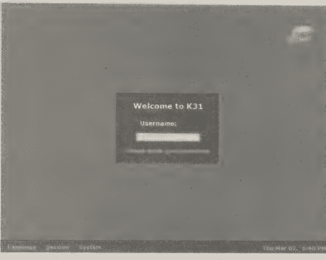

图 1.1：GDM 登录界面

手动更改会话类型。如果您手动更改会话类型，系统将询问您是否将更改应用于后续会话，或者将其设置为所有未来会话的默认设置。

**操作** 选择某些系统相关的操作，例如关闭系统、重启系统或配置登录管理器。

要终止会话，请从“系统”菜单中选择“注销”。然后确定您是想保存当前会话状态、结束会话并让系统运行，还是在注销时重启或关机。如果您希望在下次启动会话时使用与离开时完全相同的设置，请选择保存会话。

### 1.1.2 介绍 KDM

KDM 登录界面由两个主要元素组成。如下一页图 1.2 所示，它包含用户名和密码的输入字段以及一个菜单。该菜单提供以下选项：

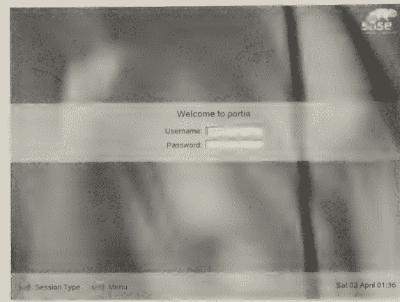

图 1.2：KDM 登录界面

**会话类型** 确定会话类型。只有当你想使用默认（KDE）以外的会话类型时才进行更改。除非手动更改会话类型，否则未来的会话将是相同的会话类型。

**菜单** “远程登录”允许您在远程机器上登录。“关机”可以关闭计算机或重启系统。

要终止会话，请从主菜单中选择“注销”。然后确定您是想结束会话并让系统运行，还是在注销时重启或关机。如果您的系统提供电源管理，系统将提供挂起计算机的选项，使下次系统启动比完全启动快得多。

## 1.2 Linux 的用户概念

Linux 区分了“普通”用户和超级用户。超级用户被称为 root，负责所有的管理任务并可以访问系统的所有部分。普通用户缺乏这些权限。

包括管理员在内的所有用户都有自己的主目录，其中存储了所有私数据，如文档、书签或电子邮件。对这些主目录的访问严格限制在各自的所有者范围内。主目录中存放敏感数据的文件夹也可以受到其他用户读取的保护。存放中心配置文件或可执行文件的系统目录只能由超级用户修改。有关 Linux 权限和用户概念的更多信息，请参阅第 255 页的第 19.2 节。

虽然这个概念最初看起来并不吸引人，但它增加了安全性。没有 root 权限的用户无法损坏整个系统。任何损坏都严格限制在用户自身的帐户和数据上。使用 root 权限执行的任何操作可能会损害整个系统。任何想要破坏运行中的 Linux 系统的人都必须先获得 root 权限。这就是为什么为 Linux 系统创建病毒要困难得多。他们必须先克服 root 障碍。

除了为管理员和普通用户提供用户标识外，Linux 还支持多个用户同时在机器上工作。这些用户可以通过不同的终端或网络连接连接到系统。

## 1.3 桌面

SUSE LINUX 为您的桌面提供了多种选择。GNOME 和 KDE 是最常用的桌面，提供的特性和功能与 Microsoft Windows 或 Mac OS 中使用的桌面相似。本节将介绍其最重要的功能，并帮助您适应新的桌面环境。

### 1.3.1 桌面术语

以下列表包含了在桌面背景下常用的某些术语，无论基础系统如何。然而，某些术语在桌面环境中具有不同的含义，甚至仅限于某个环境。

- **桌面 (desktop)** 桌面是您的主要工作环境。它填充整个屏幕，但不仅仅是背景。将您最常用的应用程序或对象的图标放在桌面上，以便于访问。

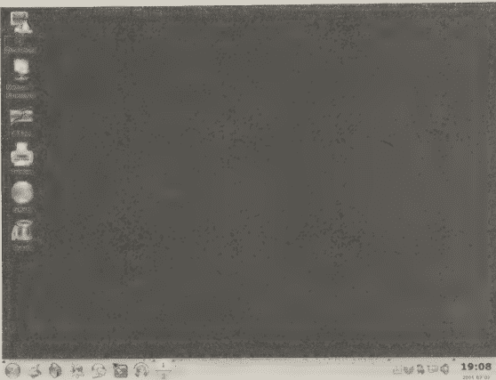
# 图 1.3：示例桌面

- **面板 (panel)** 面板是一个条，通常位于屏幕顶部或底部，容载菜单、快速启动区域、通知区域或系统托盘、一些小型辅助应用程序，在大多数情况下，还有任务栏（在 gnome 中称为窗口列表）。它的设计初衷是提供运行应用程序或系统所需的所有关键信息，并方便方便访问某些重要功能。gnome 和 KDE 都允许您根据需要调整面板方向（水平与垂直）。在 KDE 环境中，您可能还会看到“Kicker”作为面板的另一个称呼。

- **菜单按钮 (menu button)** 类似于 MS Windows 桌面上的“开始按钮”，Linux 桌面通常在面板左端包含一个菜单按钮，用于打开主菜单。该菜单是一个结构良好的结构，用于访问主应用程序或功能，例如“搜索”、“注销和锁定会话。

- **任务栏或窗口列表 (taskbar or window list)** 任务栏（在 gnome 中称为窗口列表）用于在打开的窗口之间切换。在 Linux 中，它还提供了所有可用虚拟桌面的概述，并提供了在它们切换的方法。任务栏是面板的一部分。

- **快速启动器 (The quick launcher)** 是面板的一部分。它持有最重要功能或应用程序的图标，让您无需通过应用程序菜单即可启动它们。

- **通知区域或系统托盘 (notification area or system tray)** 面板的最右部分持有系统时钟、量控制和若干辅助应用程序。

- **小组件 (applet)** 小组件是集成在面板中的小型应用程序。

- **桌面图标 (desktop icons)** 桌面图标位于桌面上。它们代表文件、目录或功能，以及移动介质（如 CD 或 DVD）。

- **虚拟桌面或工作空间 (virtual desktops or workspaces)** 虚拟桌面（GNOME 中的工作空间）的概念就像拥有几张桌子。虚拟桌面允许您同时打开多个窗口，但只在其中一个上工作。面板中提供了工作空间切换器。

- **终端 (terminal)** 允许您向操作系统发送命令。有“真实的”（物理）终端，由显示器屏幕和连接到计算机的键盘组成。然后是终端，运行在您桌面的窗口中。

- **会话 (session)** 一旦您登录桌面，它就会为您启动一个会话。该会话一直有效直到您注销。会话包含了登录和注销时某些程序的启动和关机。这些设置可以为用户帐户单独配置。

### 1.3.2 配置桌面组件

几乎所有的桌面组件都可以单独配置。右键点击相应元素可打开其右键菜单。为了说明该过程，我们提供了一些示例。

> 提示
> **控制桌面配置**
> GNOME 和 KDE 都具有控制中心，提供对桌面环境所有配置选项的访问。详情请参阅第 47 页的第 3 章或第 69 页的第 4 章。

### 配置 GNOME 桌面组件

步骤 1.1：向快速启动区域添加新应用程序

1. 右键点击您想添加新应用程序的面板空白区域。
2. 从弹出菜单中选择“添加到面板”。
3. 从“添加到面板”菜单中选择“应用程序启动器”。
4. 从“应用程序”菜单中选择应用程序并退出配置。

步骤 1.2：更改桌面背景

1. 右键点击桌面。
2. 从弹出菜单中选择“更改桌面背景”。
3. 弹出对话框，提供关于桌面的多种选项。可以使用鼠标光标选择现有的壁纸之一，或者点击“添加”打开文件对话框，您可以在其中添加自己的图像。使用“样式”来确定如何渲染图像以适应显示器的尺寸。使用“删除”从菜单中移除选定的背景。如果您完全不想要背景图像，请设置桌面颜色。
4. 您的更改将自动应用。通过“关闭”离开对话框。


## 过程 1.3：创建新的桌面图标

+ 1. 添加新的应用程序或服务图标（在 GNOME 中称为“启动器” Launcher）：
   (a) 右键点击桌面打开上下文菜单。
   (b) 选择“创建启动器”(Create Launcher)打开相应的对话框。
   (c) 输入“名称”(Name)、“通用名称”(Generic Name)以及可选的“注释”(Comment)以及要执行的“命令”(Command)。确定应用程序是否应在终端中运行，并检查“类型”(Type)是否设置为正确的值（对于命令而言为“应用程序”Application）。
   (d) 应用设置并点击“确定”(OK)退出对话框。
2. 添加新文件夹或文档：
   (a) 右键点击桌面打开上下文菜单。
   (b) 选择“创建文件夹”(Create Folder)或“创建文档”(Create Document)将新项目添加到桌面。
   (c) 右键点击新的桌面图标并选择“属性”(Properties)。
   (d) 在“基本”(Basic)选项卡中输入新对象的名称。通过“徽章”(Emblems)选项卡选择合适的图标。最后，使用“权限”(Permissions)选项卡确定分配给该对象的文件系统权限。更多关于文件系统权限的信息请参见第255页第19.2节。
   (e) 关闭“属性”对话框应用更改。

## 配置 KDE 桌面组件

### 过程 1.4：向快速启动区域添加新应用程序

+ 1. 在想要添加新应用程序的面板空白区域右键点击。
2. 从出现的菜单中选择“添加”(Add) ▶ “应用程序按钮”(Application Button)。
3. 从子菜单的某个类别中选择该应用程序。

### 过程 1.5：更改桌面背景

+ 1. 右键点击桌面。
2. 选择“配置桌面”(Configure Desktop)。打开一个对话框，允许修改桌面设置：“背景”(Background)、“行为”(Behavior)、“多桌面”(Multiple Desktops)、“屏幕保护程序”(Screen Saver)和“显示”(Display)。
3. 选择“背景”，并确定设置是应用于特定桌面还是所有桌面。选择背景图像、禁用背景图像或启动幻灯片。“选项”(Options)为背景图像的定位、背景颜色以及彩色背景的混合提供了多种设置。
4. 应用更改并点击“确定”(OK)退出对话框。

### 过程 1.6：创建新的桌面图标

+ 1. 添加新文件夹图标：
   - 右键点击桌面打开上下文菜单。
   - 选择“新建”(Create New) → “文件夹”(Folder)。
   - 在提示提示时输入新文件夹的名称。
   - 右键点击新图标，在出现的上下文菜单中选择“属性”(Properties)。
   - “属性”对话框包含四个选项卡：“常规”(General)、“权限”(Permissions)、“元信息”(Meta Info)和“共享”(Share)。文件夹的名称和图标通过“常规”选项卡设置。权限通过“权限”修改，“元信息”列出了新文件夹的大小和数量。“共享”可用于通过 NFS 或 Samba 配置文件共享。关于这两个协议的更多信息，请参阅《管理指南》。
   - 应用更改并点击“确定”(OK)退出对话框。
+ 2. 添加新文件图标：
   - 右键点击桌面显示上下文菜单。
   - 选择“新建”(Create New)。
   - 从“HTML 文件”(HTML File)、“应用程序链接”(Link to Application)、“位置链接”(Link to Location)或“文本文件”(Text File)中选择合适的文件类型。
   - 在提示时输入新文件的名称。
   - 右键点击新图标，在出现的上下文菜单中选择“属性”(Properties)。
   (f) “属性”对话框包含三个选项卡：“常规”(General)、“权限”(Permissions)和“元信息”(Meta Info)。在“常规”选项卡中设置文件的名称和图标。在“权限”中更改权限，“元信息”列出了新文件的行数、字数、字符数和格式。
   (g) 应用更改并点击“确定”(OK)退出对话框。
+ 添加新设备图标：
   (a) 右键点击桌面打开上下文菜单。
   (b) 选择“新建”(Create New) → “设备链接”(Link to Device)。
   (c) 选择合适的设备类型打开“属性”对话框。
   (d) “属性”对话框包含四个选项卡：“常规”(General)、“权限”(Permissions)、“设备”(Device)和“元信息”(Meta Info)。在“常规”选项卡中设置设备的名称和图标。在“权限”中修改权限。“设备”用于设置设备路径，例如用于 DVD 驱动器的 /media/dvd 以及其他几个选项。
   (e) 应用更改并点击“确定”(OK)退出对话框。

## 1.3.3 小得手

GNOME 和 KDE 都带有许多可以包含在面板中的小型得手应用程序。如果你想添加新的助手或删除现有的助手，请按照第10页第1.3.2节所述的操作。GNOME 和 KDE 中著名的特性是 SUSEWatcher 和 SUSE 硬件工具。

SUSEWatcher 是一个集成在面板系统托中的程序。它会检查新的软件更新。为了发现任何新更新，它需要连接网络。SUSEWatcher 的状态通过面板中不同颜色的图标显示出来。

当你点击面板中的图标时，会打开一个窗口，告知你在线更新的状态以及任何新更新的可用性。你也可以通过点击“检查更新”(Check for updates)手动启动检查。选择“开始在线更新”(Start online update)并输入 root 密码启动在线更新。

（注：原文中存在大量重复内容，已根据要求进行清理。）

## 1.4.1 Linux 文件系统背后的概念

与 Windows 操作系统不同，Linux 不使用驱动器号。在 Windows 中，你会将软盘标记为 A:，Windows 系统数据为 C:，以此类推。在 Linux 中，所有文件和目录都位于树形结构中。顶层目录称为文件系统根目录 /。从这里可以访问所有其他目录。

以下是 Linux 文件系统树的简短指南，介绍了最主要的目录：

- /home/<username>：home 存储系统中拥有帐户的每个用户的私有数据。此处的的文件只能由所有者或系统管理员修改。例如。
- /media：media 通常存放任何类型的驱动器，系统的硬盘。一旦连接了 USB 闪盘，它就会出现在 /media 下，数字相机（如果断开 USB）或 DVD/CD 驱动器也是如此。一旦发现数据源（如闪盘或相机），media 下相应的目录也会被移除。
- /usr/share/doc：在 /usr/share/doc 下查找 Linux 系统和安装软件包的任何文档。manual 子目录包含本手册的数字副本，以及《管理指南》和已安装 SUSE 版本的发行说明。packages 目录包含了软件包中的文档。


欲了解更多关于 Linux 系统概念，请参阅第246页第 19.1.2 节获取更全面的目录列表。

## 1.4.2 文件管理器的不同类型

除了组织所有数据和预览几乎任何类型的类型外，您的文件管理器还可以作为个人数据、系统信息网络服务的服务的快速查找器”。这些模块是您标准桌面的一部分。

**主目录** 使用 GNOME 中的“主”桌面图标或 KDE 面板中的图标启动您的文件管理器（GNOME 中的 Nautilus，KDE 中的 Konqueror），它将显示您主目录的所有内容。此选项允许您快速检索位于主目录中的任何个人数据。

**您的系统** 如果您需要知道系统连接了哪些硬盘或可移动介质，请点击桌面图标“计算机”（GNOME）或“我的电脑”（KDE）。文件管理器提供了连接到系统的所有驱动器的概览，包括硬盘。当您点击列出的驱动器之一时，文件管理器将打开位于该驱动器上的文件和目录。此选项允许您定位连接到系统的任何可移动设备上的数据。数码相机将以 USB 闪盘或硬盘的形式出现在此列表中。

**您的网络** 使用 GNOME 顶端面板中的“位置”菜单访问网络文件夹。在 KDE 中，点击“网络浏览”桌面图标以收集网络中提供的所有服务。使用此功能访问可用的网络共享、Windows 网络、FTP 服务器或您的网络注册的任何其他服务类型。

## 1.4.3 搜索文件

如果您需要在整个系统中搜索某些文件，请使用桌面环境提供的图形化搜索应用程序。在 GNOME 中，选择“位置”→“搜索文件”来启动搜索工具。第一个对话框提示您输入文件名或至少是文件名。指定搜索文件的目录。如果您确定文件应该位于主目录，请接受自动选择的 `/home/<username>` 路径。若要在整个文件系统上搜索，请通过输入 `/` 选择文件系统根。通过添加更多搜索标准来精炼搜索。点击“显示更多选项”并选择提供的任何标准。可以使用正则表达式或通配符。一旦您输入了所有数据，按下“查找”即可启动搜索并在窗口底部查看结果。根据搜索范围的大小，整个过程可能需要大量时间。

KDE 包含应用程序 KFind，它从主菜单的“查找文件”启动。搜索窗口分为“名称/位置”、“内容”、“属性”三个标签卡。在“名称/位置”标签卡中，使用星号或问号等通配符输入文件名。输入搜索路径并确定搜索是否包含子文件夹或对大小写敏感。“内容”标签卡用于在文件中搜索某些表达式的内容。如果安装了 KRegExpExpEditor（包 kdeutils3-extra），则此类搜索仅支持有限的文件类型表达式。要通过提供文件所有者、文件大小或修改日期等属性来限制搜索范围，请使用“属性”标签卡。

- 提示：关于搜索模式以及通配符或正则表达式使用的更多信息，请参阅第246页第 19.1 节。

## 1.5 应用程序

SUSE LINUX 附带丰富的应用程序。对于几乎任何用途都有 Linux 选择。通常情况下，您甚至会为某个用途找到多个合适的应用程序。第31页的第 2 章提供了您在从 MS Windows 转换时可能寻找的应用程序全面列表。在那里，可以轻松找到 MS Windows 应用程序的 Linux 对应。

在 Linux 中启动应用程序有三种方法。最简单且显著的方法是桌面环境的主菜单。点击面板的最左边缘展开菜单。选择相应的类别以展开包含实际应用程序名称和图标的子菜单。

某些应用程序即使已安装也不会显示在主菜单中。要启动其中之一，请打开主菜单，然后选择“运行应用程序”（GNOME）或“运行命令”（KDE），并用小字母输入应用程序名称。或者，使用 (Alt-F2) 启动此对话框。启动应用程序的第三方法是打开 shell 并在 shell 提示符处输入命令，也称为命令行。

> 提示：**缺失应用程序** 如果无法从菜单或命令行启动应用程序，您需要从您的 SUSE LINUX CD 或 DVD 安装它。详情请参见第22页第 1.7.1 节。

## 1.6 打印

打印机可以通过本地或网络连接到您的系统。任何类型的配置最初都使用 YaST 进行。有关打印配置的深度介绍，请参考管理指南中的打印章节。一旦建立连接，即可使用打印机。两个桌面都提供了应用程序，允许您监控和编辑在选定打印机上队列的任务。

### 1.6.1 在 GNOME 中管理打印任务

从命令行使用 `gnome-cups-manager` 或从主菜单启动 Cups Manager。打开一个窗口，显示连接到系统的任何打印机。双击代表打印机队列的图标以监控打开的打印机。窗口的菜单栏允许您暂停、恢复或删除任何选定的任务。“打印机”菜单允许您设置测试...页面。请参见下一页的 1.4。

### 1.6.2 在 KDE 中管理打印任务

要在 KDE 中控制打印任务，请使用两个不同的应用程序。从命令行启动 KPrinter。打开一个窗口，显示连接到系统的任何打印机。双击代表打印机队列的图标以监控打开的打印机。窗口的菜单栏允许您暂停、恢复或删除任何选定的任务。

| 名称 | 任务编号 | 所有者 | 状态 |
| :--- | :--- | :--- | :--- |
| 测试页 | 86 | | 打印中 |


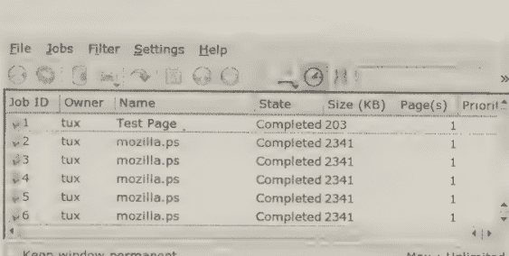

图 1.6：使用 KJobViewer 管理打印作业

过滤文档。

“过滤”允许您在不同的打印机之间切换、切换已完成的任务，并通过选择“仅显示用户任务”将视图限制为您自己的打印任务。当前用户将在右上角的字段中显示。

“设置” → “配置 KJobViewer”将打开一个配置对话框。在这里，可以确定显示的任务的最大数量。在字段中输入数字或使用右侧的滑块来确定值。按“确定”保存设置，或按“取消”在不保存的情况下退出对话框。

工具栏上的图标与您可以通过菜单访问的功能相对应。当您的鼠标指针悬停在其中一个图标上时，将显示该功能的帮助文本。

任务列表由八列组成。任务 ID 由打印系统自动分配，以识别不同的任务。下一列包含发送任务的用户登录名，随后是文档的文件名。状态列指示任务仍在队列中、正在打印还是已完成。接下来，将千字节（KB）和页数显示文档大小。如有必要，可以增加或减少默认优先级 50。计费信息可以是成本中心或其他公司特定信息。如果您在列表中右键点击任务，“任务”菜单将在鼠标指针下打开，允许选择操作。对于已完成的任务，仅有少数功能可用。如果您激活了“保持窗口永久”，KJobViewer 将在您下次登录时自动打开。

SUSE LINUX 21

## 1.7 基础管理任务

在 SUSE LINUX 中，YaST 处理系统的安装和配置。以下章节将介绍该工具的一些常用功能。请参阅《管理指南》获取有关 YaST 的详细说明以及关于系统管理的背景信息。

### 1.7.1 安装新应用程序

要安装新应用程序，请从主菜单启动 YaST。在提示时提供 root 密码。在“更改安装源”模块中检查安装源是否有效。如果您打算从原始 SUSE LINUX CD 或 DVD 安装，激活的安装路径应以 `cd://` 或 `dvd=` 开头。如果您打算从网络安装路径安装，请向系统管理员索完整数据，选择“添加”和网络源类型，并输入完整路径。点击“完成”退出对话框。

启动 YaST “安装和删除软件”模块。在“搜索”栏中输入所需应用程序的名称并按“搜索”。任何符合您的搜索标准的补丁都会列在窗口的右侧。如果您想安装其中一个包，请选择软件包名称旁复选框并点击“接受”。YaST 会自动解决所有包依赖关系——如果运行应用程序需要额外的软件组件，YaST 将自动安装缺失的包。完成后，YaST 将运行一些脚本来更新系统配置。退出 YaST，您新安装的应用程序已准备就绪运行。有关 YaST 软件模块的详细说明，请参阅《管理指南》。

### 1.7.2 获取并应用软件更新

通过不断运行 SUSEWatcher 确保您的系统是最新的并包含安全修复。如果配置正确，它会自动通知您任何软件更新的可用性（见第 13 页第 1.3.3 节）。启动 YaST “在线更新”并提供 root 密码。选择合适的安装源并点击“下一步”。打开一个与当前页面第 1.7.1 节类似的对话框，显示所有可更新的补丁。SUSE 补丁可能属于以下三类之一：安全（为了维护系统安全而应始终安装的安全敏感补丁）、推荐（对已安装包的改进）以及其他（可更新的但与您任何已安装包不相关的其他补丁）。安全更新用红色标记，并与蓝色的推荐补丁一起被预选。接受此建议以保持您的系统一致性。点击“接受”应用更新。有关 YaST 在线更新的更多信息，请参阅《管理指南》。

## 1.8 安全

如果从 Windows 系统转换为 Linux 系统，您可能经历过许多通过电子邮件在网上传播的各种病毒和蠕虫带来的麻烦。现在您已经切换到 Linux，您至少可以把这种恐惧抛诸脑后，因为这些不会像 Windows 那样损害 Linux 系统。

正如第 6 页第 1.2 节所述，Linux 知道两种不同的用户：超级用户 root 拥有所有系统资源的权限并允许更改系统配置的所有方面。为了管理任务从普通用户账户切换到 root 并在普通工作时切换回来，听起来很乏味且可能没有必要，因为 root 对系统拥有终权力。尽管如此，在完成管理任务后切换回普通用户可以增加安全性，因为作为 root 犯的任何错误都可能导致严重后果。整个系统可能会受到影响，而不只是普通用户账户。因此，通过明确区分不同角色（“普通用户”和“超级用户”）来维护系统的完整性。

始终应用 SUSE 提供的软件更新（见前页第 1.7.2 节）以保持系统更新，增加了您系统的安全性。这些更新修复了应用程序代码中可能的漏洞。

通过运行防火墙保护您的系统或网络免受外部“访问者”。预配置的防火墙在安装时启动，为您的网络提供最大的安全保障。如果您需要配置防火墙，请参阅防火墙章节。

## 1.9 网络与移动性

GNOME 和 KDE 提供了几个用于移动环境应用程序。

### 1.9.1 网络

网络连接（即使是无线连接）也可以轻松地配置和监控。GNOME 和 KDE 中的无线网络可以状态。

> **重要：网络配置**
> 任何网络的初始配置通过 YaST 完成。请参阅《管理指南》。

### 连接互联网

配置好网络设备后，使用 Kinder 控制互联网。启动时，KDE 加载 Kinder。程序检查是否可以建立互联网连接。如果可能，应用程序图标（插头）将出现在面板右侧。根据网络连接的状态，面板图标变为：

- 当前没有连接互联网。
- 连接正在建立或终止。
- 连接已建立。
- 正在从互联网传输数据。
- 发生错误。如果已通过 YaST 配置了连接，使用“查看日志”识别错误原因。右键点击 Kinder 图标访问菜单。
- 连接尚未激活，将在请求时建立。

右键点击 Kinder 面板图标访问其配置。可以通过“设置” → “配置 KJobViewer”启动 YaST 配置。输入 root 密码后，启动 YaST。根据访问类型，启动调制调器、ISDN、网络或 DSL 配置。

如果您使用 ISDN 连接且在 YaST 中选择了“通道绑定”，可以通过“添加链接”为现有连接添加第二个 ISDN 通道。这将使传输速率（但价格更高）。如果您需要下载大文件，请启用通道绑定。激活的通道绑定可以通过图标左上角的红色符号识别。

如果您的计算机有多个网络设备且您已通过 YaST 配置了所有设备，您可以使用 Kinder 的“接口”选项在这些接口之间切换。您必须在相应的 YaST 网络对话框中选择“用户控制”设备激活才能进行操作。如果您有多个供应商，也可以使用 Kinder 的“提供商”开关进行选择。供应商也在 YaST 中设置。

想要自动建立互联网的用户可以使用拨号随用 (Dod)。如果选择了此模式，一旦提交请求，Kinder 将自动连接到您的互联网服务提供商 (ISP)。在超时后，连接将终止。DoD 连接可以通过图标右下角的蓝色 D 识别。


# 警告

# 成本控制

请注意，只有在拥有固定费率流量计数的情况下，DoD 才有意义。如果情况并非如此，频繁地连接和断开可能会变得昂贵。

# 警告

如果您打算使用无线网卡作为 Internet 连接，请按照《管理指南》中的说明使用 YaST 进行配置，并确保 YaST 中的设备激活被设置为“用户控制”（User Controlled）。一旦接口配置完成，您就可以像使用普通网络接口一样使用 KInternet 来控制无线网络连接。

要访问 KInternet 的 WLAN 功能，请右键点击图标打开菜单。选择“无线连接”（Wireless Connection），将打开一个带有两个标签的窗口。首先，扫描可以连接的适当无线网络。选择本页图 1.7 显示的“无线网络扫描”（Scan for Wireless Networks）标签。

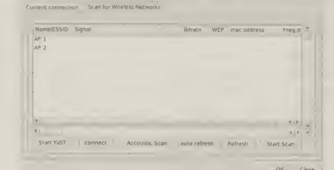

图 1.7：KInternet：扫描无线网络

点击“开始扫描”（Start Scan）开始扫描。为了让 KInternet 持续扫描网络环境，请也选择“自动刷新”（Auto Refresh）。可以通过“声学扫描”（Acoustic Scan）激活每个找到的连接的学反馈。找到的任何连接都会显示在列表窗口中。选择一个并点击“连接”（Connect）到所选网络。如果连接所选网络需要额外的配置，

点击“YaST”启动用于无线网络设备的 YaST 网络模块。

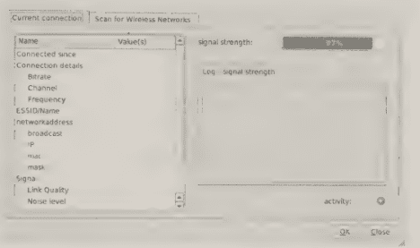

图 1.8：KInter：无线链路状态

“当前连接”（Current Connection）标签允许您监控当前无线连接的状态。该标签的左侧视图提供了所有关于网络地址和 ESSID、信号质量、信号噪声水平、通道频率和速度（如加密类型和密钥长度）的连接参数的摘要。在树状结构中选择这些参数任一，并检查窗口右侧显示的详细信息。

# 监控无线连接

将网络监器（Network Monitor）添加到 GNOME 面板中，以获取无线连接质量的视觉反馈。如果机器上连接了多个无线设备，请右键点击面板图标并选择“首选项”（Preferences）将监器设置为正确的设备。

将无线网络信息添加到 KDE 面板中，以监控无线连接状态，包括网络名称 (ESSID)、链路质量、信号强度、噪声水平、比特率和加密方法。如果您有多个无线设备，请使用右上角的下拉菜单在它们之间切换。如果您用鼠标光标触摸面板图标，将打开显示设备名称、链路质量和当前比特率的提示。

## 1.9.2 移动计算

在移动计算机上工作需要极大的活性来适应变化的网络和系统环境。SUSE LINUX 提供了一些小工具，如 GNOME 电池充电监器、KPowersave 和配置选择（Profile Chooser），帮助您调整计算机的电源管理方案和系统配置。

- - 关于移动计算更多信息

参考《管理指南》了解更多关于 SUSE LINUX 下的移动计算。介绍涉及的软件组件并学习如何配置移动设备以获得最大的灵活性。

## 电源管理

成功使用电池电源需要操作系统对系统资源进行非常复杂的处理。移动硬件经过优化，允许 CPU 和其他组件非常灵活地管理电源使用。根据系统运行的环境，可以在 SUSE LINUX 中使用 GNOME 电池充电监器或 KDE PowerManagement 轻松调整电源管理。

电池充电监器允许您的机器进入休眠状态（“挂起计算机”），在关机之前会将整个系统状态写入磁盘。一旦激活，通过“电源管理设置”（Power Management Settings）配置电源管理设置。YaST 电源管理模块允许您集中配置所有电源管理设置。

使用 KPowersave，您可以启动 YaST 电源管理模块并选择挂起到磁盘或内存（如果已在 YaST 中相应配置）。您可以更改 CPU 频率策略，这意味着您的系统要么在空闲时允许 CPU 频率下降并在需要更多 CPU 功率时动态调整（将 CPU 频率策略设置为“动态”），要么永久保持低 CPU 频率以节电（选择“节电”），或者永久保持高 CPU 频率以获得最大的 CPU 性能（选择“性能”）。如果您更改活动电源管理方案（“设置活动方案”），系统的所有组件都将成为节能工作的一部分。电源管理方案包括 CPU 频率缩放、节流、硬盘控制以及系统散热的设置。在 GNOME kpowersave 中通过“运行应用程序”终端启动此程序。

## 配置文件管理

您的系统需要适应用于移动计算的不断变化的环境。许多服务依赖于环境，且底层客户端必须重新配置。使用系统配置方案管理（SCPM）框架为您的机器使用的所有环境创建不同的配置方案。使用配置选择（Profile Chooser）更改活动配置。要修改 SCPM 设置，请选择“YaST 配置管理器模块”（YaST Profile Manager Module）并在提示时输入 root 密码。在 KDE 中通过主菜单启动配置选择。在 GNOME 中，在“运行应用程序”终端输入 `profile_chooser`。

## 1.10 使用 Shell

Linux 中的大多数任务可以通过图形用户界面方便地处理。某些任务（主要是系统管理员的任务）可以在终端或 shell 中通过命令行更有效地处理。这需要对 shell 如何工作有基本的了解，并掌握一些基本的命令行工具。请参阅第 245 页的第 19 章。

# Linux Linux 软件

Linux 自丰富的应用程序，通常为您的特定问题提供多种解决方案。困难在于找到一个与您目前使用的 Windows 或 Mac 应用程序一样易用的程序。本章指出了重要的 Linux 应用程序，让您顺滑地过渡到新环境。

- 2.1 办公
- 2.2 网络
- 2.3 多媒体
- 2.4 图形
- 2.5 系统和文件管理
- 2.6 软件开发

接下来的几节将介绍常用 Windows 软件的一些强大的 Linux 替代品。每个节致力于特定的应用领域，并列出任务、Windows 应用程序和 Linux 等品。将详细讨论这些应用程序并提供更多信息的链接。此列表不完整，因为软件开发是一个演进过程，分钟都有新的应用程序产生。

## 2.1 办公

下节介绍了最流行的 Linux 办公和业务软件解决方案。这些包括办公套件、数据库、会计软件和项目管理软件。

表 2.1：Windows 和 Linux 办公软件

| 任务 | Windows 应用程序 | Linux  |
|---|---|---|
| 办公套件 | MS Office, StarOffice, OpenOffice.org | OpenOffice.org, StarOffice |
| 文字处理器 | MS Word, StarOffice/OpenOffice.org Writer, WordPerfect | OpenOffice.org/StarOffice Writer |
| 电子表格 | MS Excel, StarOffice/OpenOffice.org Calc | OpenOffice.org/StarOffice Calc |
| 演示文片 | MS PowerPoint, StarOffice/OpenOffice.org | OpenOffice.org Impress, StarOffice Presentation |
| 数据绘图 | MS Excel, MicroCall Origin | OpenOffice.org Calc, Gnuplot |
| 本地数据库 | MS Excel, OpenOffice.org + MySQL | OpenOffice.org + MySQL, Rekall, knoda, PostgreSQL |
| 财务会计 | MS Money, Quicken, moneyplex | GnuCash, moneyplex |
| 项目管理 | MS Project | Planner, Taskjuggler |


## 思脑图工具 MindManager, Free Mind VYM (View Your Mind)

OpenOffice.org 是 MS Office 的开源解决方案。它是一个强大的办公套件，包含一个文字处理器（Write）、电子表格和数据库管理器（Calc）、演示文稿（Impress）以及绘图程序（Draw）。熟悉 MS Office 系列应用程序的用户会发现非常相似的应用界面以及他们习惯的功能。由于 OpenOffice.org 能够从 MS Office 应用程序导入数据，因此这两个套件之间的切换非常轻松。OpenOffice.org 甚至存在 Windows 版本，允许 Windows 用户在继续使用 Windows 的同时切换到开源替代方案。可以在 http://www.openoffice.org/ 查找更多关于 OpenOffice.org 的信息，并阅读第 109 页的第 6 章了解 OpenOffice.org 的介绍以及从一个办公软件迁移数据的简短指南。

StarOffice StarOffice 是由 Sun Micros 分发的 OpenOffice.org 专有版本。它适用于 Windows 和 Solaris 在内的多个平台。它包含了免费版（OpenOffice）不具备某些功能。可以在 http://www.sun.com/software/star/staroffice/ 查找更多关于 StarOffice 的信息。

Gnuplot Gnuplot 是一款非常强大且可移植的命令行控制绘图软件。它也适用于 MacOS 和 Windows 平台。Gnuplot 创建的图表可以导出多种格式，如 PostScript、PDF、SVG 等，允许您轻松地处理这些图表。可以在 http://www.gnuplot.info/index.html 查找更多关于 Gnuplot 的信息。

Recall Recall 是一个操作数据库的工具。支持的数据库包括 MySQL、PostgreSQL、带有 XBase 的 IBM DB2 以及 ODBC。使用 Recall 生成各种报告和表单、设计数据库查询，或将数据导入导出到各种格式。可以在 http://www.thecompany.com/products/recall/ 查找更多关于 Recall 的信息。

knoda knoda 是一个针对不同类型数据库的前端。它支持与 MySQL、PostgreSQL、SQLite 和 ODBC 数据库服务器连接。knoda 可用于操作表数据、创建和存储查询以及导入和导出 CSV 格式的数据。可以在 http://www.knoda.org/ 查找更多关于 knoda 的信息。


SUSE LINUX 33

PostgreSQL 是一个对象关系数据库管理系统，支持 SQL 标准的扩展子，包括事务、外键、子查询、触发器以及用户定义类型和函数。可以在 http://www.postgresql.org/ 查找更多关于 PostgreSQL 的信息。

GnuCash GnuCash 是一款用于控制个人和业务财务的软件工具。使用这一套软件跟踪收支，并管理您的银行账户和股票组合。可以在 http://www.gnucash.org 了解更多关于 GnuCash 的信息。

moneyplex moneyplex 是一个控制您财务状况的工具。从管理入资源和支出、监控投资组合到通过 HCIBC 标准进行在线交易，所有任务都由 moneyplex 处理。使用各种分析选项随时间跟踪您的财务交易。该工具也适用于 Windows，用户可以非常容易地迁移，而无需学习新的应用程序界面。可以在 http://www.matrica.de 找到更多关于 moneyplex 的信息。

Planner Planner 是一个项目管理工具，旨在为 Windows 下使用的项目管理工具提供功能。其各种功能包括甘特图表功能、任务和资源的各种视图等。可以在 http://www.imendo.com/projects/ 查找更多关于 Planner 的信息。

Taskjler Taskjler 是一款精简但非常强大的项目管理软件。通过甘特图功能生成各种报告（XML、HTML 或 CSV 格式）来控制和跟踪您的项目。不习惯通过命令行控制应用程序的用户可以使用 Taskjler 的图形前端。可以在 http://www.taskjler.org 查找更多关于 Taskjler 的信息。

VYM (Your Mind) VYM 是一款通过创建和操作思维导图来视觉化想法的软件。大多数操作不需要一次鼠标点击。可以非常方便地插入、删除和重新排序分支。VYM 提供了一系列标记，允许您标记思维导图的某些部分（重要、时间紧等）。还可以添加链接、注释和图片。VYM 思维导图使用 XML 格式，允许将您的导图导出为 HTML 文件。可以在 http://www.insilil.de/vym 查找更多关于 VYM 的信息。

## 2.2 网络

本节介绍了用于网络目的各种 Linux 应用程序。了解流行的 Linux 浏览器、电子邮件和聊天客户端。

表 2.2：适用于 Windows 和 Linux 的网络软件

| 任务 | Windows 应用程序 | Linux 应用程序 |
| --- | --- | --- |
| Web 浏览器 | Internet Explorer, Firefox, Opera | Konqueror, Firefox, Opera |
| 电子邮件客户端/个人信息 | MS Outlook, Lotus Notes | Evolution, Contact |
| 管理即时消息/IRC 客户端 | MSN, AIM, Yahoo Messenger, XChat, Gaim | Kopete, Gaim, XChat |
| 会议（视频和音频） | NetMeeting | GnomeMeeting |
|  { IP (VoIP) | X-Lite | kphone, Skype |
| FTP 客户端 | leechftp, wsftp | gftp, kbear |

Konqueror Konqueror 是由 KDE 开发人员的一种多功能应用程序。它充当管理器和文档查看器，也是一个非常强大且高度自定义的 Web 浏览器。它支持 CSS、Java applets、JavaScript、Netscape 插件、DOM 和 SSL 等 Web 标准。它提供搜索和标签页浏览。书签从 Internet Explorer、Mozilla 和 Opera 导入。可以在 http://www.konqueror.org/ 查找更多关于 Konqueror 的信息，并在第 151 页的第 10 章阅读关于 Konqueror 的介绍。

Firefox 是 Mozilla 家族中最年轻的成员。它适用于 Linux、macOS 和 Windows 等多个平台。其主要功能包括可自定义搜索、拦截、RSS 订阅、密码管理、标签页浏览以及一些隐私选项。可以从 Firefox 网页（https://addons.mozilla.org/?application=firefox）下载精彩插件和扩展。可以在 http://www.mozilla.org/products/firefox/ 查找更多关于 Firefox 的信息，并在第 157 页的第 11 章阅读关于使用 Firefox 的介绍。

Opera 是一款强大的 Web 浏览器，带有可选的邮件客户端和聊天模块等精彩插件。Opera 提供拦截、RSS 订阅、内置和自定义搜索、密码管理器以及标签页浏览。主要功能可以通过相应的面板轻松访问。由于该工具也适用于 Windows，它允许习惯 Windows 的用户更轻松地迁移到 Linux。可以在 http://www.opera.com/ 

Evolution 是用于 GNOME 桌面的个人信息管理软件，结合了邮件、日历和地址簿。它提供了高级邮件过滤和搜索选项，提供了 Palm 设备同步功能，并允许作为 Exchange 或 GroupWise 客户端运行 Evolution，以便更好地集成到异构环境中。可以在 http://www.gnome.org/projects/evolution/ 查找更多关于 Evolution 的信息，并在第 117 页的第 7 章阅读使用 Evolution 的介绍。

Contact 是 KDE 个人信息管理套件。它包含了电子邮件、日历、地址簿和 Palm 同步功能。与 Evolution 类似，它可以作为 Exchange 或 GroupWise 客户端。Contact结合了几独立的 KDE 应用（KMail、Kaddressbook、Organizer 和 KPilot），形成提供所需的所有 KIM 功能的实体。可以在 http://www.contact.org/ 查找更多关于 Contact 的信息，并在第 129 页的第 8 章阅读使用 Contact 的介绍。

Kopete 是一款非常直观且易用的即时消息软件，支持包括 IRC、ICQ、AIM、GroupWise Messenger、Yahoo!、MSN 和 Jabber 在内的协议。可以在 http://kopete.kde.org/ 查找更多关于 Kopete 的信息，并在第 91 页的第 4.8 节阅读关于它的介绍。

Gaim 是一款智能即时消息程序，支持多种协议，如 AIM 和 ICQ (Oscar 协议)、MSN Messenger、Yahoo!、IRC、Jabber、SILC 和 GroupWise Messenger。它可以登录不同的 ac


可以同时连接不同的 IM 网络并在不同的通道上聊天。Gaim 也有 Windows 版本。关于 Gaim 的更多信息，请访问 http://gaim.sourceforge.net/about.php。

XChat XChat 是一个 IRC 客户端，它可以在大多数 Linux 和 UNIX 平台上运行，也支持 Windows 和 MacOS X。关于 XChat 的更多信息请访问 http://www.xchat.org/。

GnomeMeeting GnomeMeeting 是微软 NetMeeting 的开源替代品。它支持通过 LDAP 和 ILS 进行地址查找，并与 Evolution 集成以共享地址数据存储。GnomeMeeting 支持电脑到电话的通话，让你只需通过电脑、声卡和麦克风即可拨打对方，无需任何额外硬件。关于 GnomeMeeting 的更多信息请访问 http://www.gnomemeeting.org/。

KPhone KPhone 是一个跨越网络发起 VoIP（网络电话）连接的程序。更多信息请访问 http://www.wirlab.net/kphone。

gftpp 是一个使用 Gtk 工具包的 FTP 客户端。它的功能包括同时下载、恢复中断的文件传输、文件传输队列、下载整个目录、支持 FTP 代理、远程目录缓存、被动和非被动文件传输以及拖放支持。更多信息请访问 http://gftp.seul.org。

kbear 是一个 KDE FTP 客户端，具有与多个主机建立并发连接的能力、三种独立的视图模式、支持多种协议（如 ftp、sftp 等）、站点管理器插件、防火墙支持、日志功能等许多特性。更多信息请访问 http://kbear.sourceforge.net。

## 2.3 多媒体

本节介绍了 Linux 下最流行的多媒体应用程序。了解媒体播放器、音频编辑解决方案和视频编辑工具。

## 表 2.3：Windows 和 Linux 多媒体软件

| 任务 | Windows 应用程序 | Linux 应用程序 |
| :--- | :--- | :--- |
| Audio CD 播放器 | CD Player, Winamp, Windows Media Player | KsCD, Grip |
| CD 刻录 | Nero, Roxio Easy CD Creator | K3b |
| CD 读取器 | WMPlayer | Grip, kaudiocreator |
| 音频播放器 | Winamp, Windows Media Player | amaroK, XMMS |
| 视频播放器 | Winamp, Windows Media Player | Kleine, MPlayer, Xine, XMMS |
| 音频编辑器 | SoundForge, Cooledit, Audacity | Audacity |
| 混音器 | sndvolum32 | alsamixer, Kamix |
| 音乐记谱 | Finale, SmartScore, Sibelius | Noteedit, LilyPond, Rosegarden |
| 视频创建器和编辑器 | Windows Movie Maker, Adobe Premiere, Media Studio Pro, MainActor | MainActor, Kino |
| 电视查看器 | AVerTV, PowerVR 3.0, CinePlayer DVR | xawtw (analog), motv (analog), xawtw4, vtime, kdetv, zapping |

**KsCD** KsCD 是一个为 KDE 桌面设计的精巧 CD 播放器应用程序。它的用户界面非常普通硬件 CD 播放器，保证了易用性。KsCD 支持 CDDB，允许你从互联网或本地文件系统获取任何曲目和专辑信息。更多信息请访问 http://docs.kde.org/en/3.3/kdemultimedia/kscd/。

**Grip** Grip 为 GNOME 桌面提供 CD 播放和抓取功能。它支持针对曲目和专辑数据的 CDDB 查询。可以使用内置的 cdparanoia 功能或外部抓取器进行抓取。更多信息请访问 http://www.nostatic.org/grip/。

**K3b** K3b 是一个多才的媒体制作工具。可以通过拖放创建数据、音频或视频 CD 和 DVD 项目。关于 K3b 的更多信息请访问 http://www.k3b.org/ 或参考第 209 页的第 15 章。

**Kaffine** Kaffine 是一款功能强大的多媒体应用程序，支持广泛音频视频格式，包括 Ogg Vorbis、WMV、MOV 和 AVI。导入各种类型的编辑播放列表、创建截图并将媒体保存到本地硬盘。关于 Kaffine 的更多信息请访问 http://kaffine.sourceforge.net/。

**amarok** amarok 媒体播放器处理各种音频格式，并播放互联网电台的流媒体音频广播。该程序处理作为后端 amaroks 或 GStreamer 的服务器支持的所有文件类型。关于 amarok 的更多信息请访问 http://amarok.kde.org/ 或参考第 182 页的第 13.2.1 节。

**XMMS** XMMS 是多媒体播放的传统选择。它专注于音乐播放，支持 CD 播放和 Ogg Vorbis 文件。Winamp 用户会因为其相似性而喜欢使用 XMMS。关于 XMMS 的更多信息请访问 http://www.xmms.org/ 或参考第 266 页的第 13.2.2 节。

**Audacity** Audacity 是一款强大的免费音频编辑工具。录制、编辑和播放任何 Ogg Vorbis 或 WAV 文件。随心混合轨道并对其应用效果，并将结果导出为 WAV 或 Ogg Vorbis。关于 Audacity 的更多信息请访问 http://audacity.sourceforge.net/ 或参考第 192 页的第 13.4 节。

**Noteedit** Noteedit 是 Linux 下一个强大的乐谱编辑器。使用它来创建乐谱并从许多格式（如 MIDI、MusicXML 和 LilyPond）导入乐谱。关于 Noteedit 的更多信息请访问 http://developer.berlio.de/projects/noteedit/。

**LilyPond** LilyPond 是一个强大的音乐刻字系统。它使用基于文本的语言创建乐谱。关于 LilyPond 的更多信息请访问 http://lilypond.org/。

**Rosegarden** Rosegarden 是 Linux 的音乐记谱程序。它允许你使用图形界面编写和编辑音乐。关于 Rosegarden 的更多信息请访问 http://www.rosegarden.org/。


POV-Ray The Persistence of Vision（视觉持续光线追踪器）使用光线追踪渲染技术创建三维照片级逼图像。由于 POV-Ray 有 Windows 版本，Windows 用户切换到该程序的 Linux 版本并不困难。可以在 http://www.povray.org/ 查找更多关于 POV-Ray 的信息。

Blender 是一款强大的渲染和动画工具，可在 Windows、macOS 和 Linux 在内的许多平台上运行。可以在 http://www.blender3d.com/ 查找更多关于 Blender 的信息。

Digikam 是一个为 KDE 桌面设计的智能数字照片管理工具。导入和组织数字图像只需点击几次。创建相册、为图像添加标签以避免在不同的子目录之间复制图像，并最终将图像导出到您的网站。可以在 http://digikam.sourceforge.net/digikam-SPIP/ 查找更多关于 Digikam 的信息，或参考第 215 页的第 16 章。

gThumb 是适用于 GNOME 桌面的图像查看器、浏览器和管理器。它支持通过 gphoto2 导入数字图像，允许您进行基础转换和修改，并让您能够创建匹配特定类别的相册。可以在 http://gthumb.sourceforge.net/ 查找更多关于 gThumb 的信息。

Kooka 是适用于 KDE 桌面的扫描和 OCR 套件。它允许您配置主扫描参数，从各种导出格式中进行选择并识别扫描数据。Kooka提供的 OCR 模块添加了一些基本的文本识别功能。可以在 http://www.kde.org/apps/kooka/ 查找更多关于 Kooka 的信息，或参考第 227 页的第 17 章。

Gwenview 是 KDE 的简单图像查看器。它具有文件夹树窗口和文件列表窗口，可以方便地浏览文件层次结构。可以在 http://gwenview.sourceforge.net/home/ 查找更多信息。

## 2.5 系统与文件管理

本节提供了 Linux 系统和文件管理工具的概述。了解文本和源码编辑器、备份解决方案以及存档工具。

## 表 2.5：Windows 和 Linux 的系统与文件管理软件

| 任务 | Windows 应用程序 | Linux 应用程序 |
|---|---|---|
| 文本编辑器 | Notepad, Word, (X)Emacs | kate, gedit, (X)Emacs, vim |
| PDF 创建器 | Acrobat Distiller | Scribus |
| PDF 查看器 | AcrobatReader | AcrobatReader, xpdf, kpdf |
| 文本识别 | Recognita, FineReader | GOCR |
| 命令行包压缩程序 | zip, rar, arj, lha, 等. | zip, tar, gzip, bzip2, 等. |
| 硬盘分区器 | PowerQuest, Acronis, Partition Commander | YaST, GNU Parted |
| 备份软件 | ntimesbackup, Veritas | dar, taper, dump |

kate 是 KDE 软件包套的一部分。它能够同时本地或远程打开多个文件。具有语法高亮、项目文件创建和外部脚本执行等功能，是程序员的完美工具。可以在 http://kate.kde.org/ 查找更多信息。

gedit 是 GNOME 桌面的官方文本编辑器。它提供了与 Kate 类似的功能。可以在 http://www.gnome.org/projects/gedit/ 查找更多信息。

(X)Emacs GEdit 和 Emacs 是非常专业的编辑器。Emacs 基于 GNU Emacs。引用《GNU Emacs 手册》的话：“Emacs 是一个可扩展、可定制、自文档的实时显示编辑器。”两者提供了近乎相同的功能，仅有细微差别。它们被经验开发者使用，通过 Emacs Lisp 语言具有高度扩展性。它们支持许多语言，如俄语、希腊语、日语、中文和韩语。可以在 http://www.emacs.org/ 和 http://www.gnome.org/software/emacs/emacs.html 查找更多信息。

vim (vi improved) 是一个类似于文本编辑器 vi 的程序。用户可能需要时间调整 vim，因为它区分命令模式和插入模式。基本功能与所有文本编辑器相同。vim 提供了一些独特的选项，如宏录制、文件格式检测与转换、屏幕中的多个缓冲区等。可以在 http://www.vim.org/ 或我们的《管理指南》中查找更多信息。

GOCR GOCR 是一种 OCR（光学字符识别）工具。它将文本图像转换为文本文件。它也是 KDE 扫描工具 Kooka 的一部分。可以在 http://jocr.sourceforge.net/ 以及第 227 页的第 17 章查找更多信息。

gzip, tar, bzip2 有许多打包程序可以减少磁盘占用。通常情况下，它们仅区别于打包算法。Linux 也可以处理 Windows 上使用的打包格式。可以在第 261 页的“文件管理”章节查找更多关于 gzip 和 tar 的信息。bzip2 比 gzip 效率稍高，但取决于打包算法需要更多时间。

GNU Parted GNU Parted 是用于创建、调整大小、检查和复制分区及其上方文件系统的命令行工具。如果您需要为新操作系统创建空间，请使用此工具调整磁盘使用情况并在不同硬盘之间复制数据。可以在 http://www.gnu.org/software/parted 查找更多信息。

Dar 用于磁盘存档，是一种硬件无关的备份解决方案。Dar 使用目录文件（与 tar 不同），因此可以在不读取整个存档的情况下提取单个文件，并且创建增量备份。还提供一个适用于 KDE 的 GUI 版本，地址为 http://k.sourceforge.net。可以在 http://dar.linux.free.fr 查找更多关于 dar 的信息。

taper 是一一个备份和恢复程序，提供友好的用户界面，允许在磁带驱动器之间进行备份和恢复。或者可以将文件备份到存档文件中。它支持递归选择的目录。可以在 http://taper.sourceforge.net/ 查找更多信息。

dump 软件包包含 dump 和 restore。dump 检查文件系统中的文件，确定哪些文件需要备份，并将文件复制到指定的磁盘、磁带或其他存储介质。restore 命令执行 dump 的反功能；它可以恢复文件系统的完整备份。可以在 http://dump.sourceforge.net/ 查找更多信息。

## 2.6 软件开发

本节介绍了用于专业软件开发的 Linux IDE、工具包和版本控制系统。

## 表 2.6：Windows 和 Linux 的开发软件 |

| 任务 | Windows 应用程序 | Linux 应用程序 |
| --- | --- | --- |
| 集成开发环境工具包 | Borland C++, Delphi, VisualStudio, .NET | KDevelop, Eclipse, Mono |
| 版本控制系统 | MFC, Qt, GTK Clearcase, Perforce, Source-Safe | Qt, GTK CVS, Subversion |

KDevelop 允许您为不同的语言（C/C++, Python, Perl 等）编写程序。它包含一个文档浏览器、具有语法高亮的源码编辑器、编译器的 GUI 界面等许多功能。可以在 http://www.kdevelop.org 查找更多信息。

Eclipse 平台旨在构建可以通自定义插件进行扩展的集成开发环境。基础发行版还包含一个功能全 Java 开发环境。可以在 http://www.eclipse.org 查找更多信息。

Qt 是一个用于开发图形界面应用程序的程序库。它允许您快速开发专业程序。Qt 库不仅适用于 Linux，还适用于许多 Unix 系统，甚至适用于 Windows 和 Macintosh。因此，可以编写可以轻松移植到这些平台的程序。可以在 http://www.ttech.com 查找更多信息。

GTK 是一个用于创建图形界面的多平台工具包。它被所有 GNOME 应用程序、GIMP 以及其他几个程序使用。GTK 的设计支持多种语言，而不只是 C/C++。它最初是 GIMP 编写的，因此名为“GIMP Toolkit”。可以在 http://www.gtk.org 查找更多信息。

CVS CVS（并发版本系统）是开源领域最重要的版本控制系统之一。它是标准 Linux 发行版中包含的修订控制系统（RCS）的前端。可以在我们的《管理指南》中阅读关于 CVS 的内容。可以在 http://www.cvshome.org/ 查找更多信息。

Subversion Subversion 的功能与 CVS 相同，但有重大改进，如移动、重命名以及为文件和目录附加元数据。可以在我们的《管理指南》中阅读关于 Subversion 的内容，或访问主页 http://subversion.tigris.org/

Mono Mono 项目是一个开放开发计划，旨在开发 .NET 开发平台的开源 Unix 版本。其目标是让 Unix 开发者能够构建和部署跨平台的 .NET 应用程序。项目实现了已提交给 ECMA 标准化的各种技术。更多信息请参阅 http://www.mono-project.com/about/index.html。


# 3
## GNOME 桌面

GNOME 桌面

本章介绍了 GNOME（GNU 网络对象模型环境）桌面。它将简要概述你桌面中最重要的元素和功能，包括对文件管理器 Nautilus 的深入描述。最后，你将了解一些智能且实用的应用程序，它们可以帮助你在新的桌面环境中感到如家。

- 3.1 桌面 . . . . . . . . . . . . . . . . . . . . . . . . . . . . 48
- 3.2 设置 . . . . . . . . . . . . . . . . . . . . . 52
- 3.3 使用 Nautilus 进行文件管理 . . . . . . . . . . . . . . . . . . . . . 57
- 3.4 重要实用程序 . . . . . . . . . . . . . . . . . . . . 61
- 3.5 辅助技术支持 . . . . . . . . . . . . . . . . . . . . . . 65

GNOME 的外观和感受非常直观。然而，从微软 Windows 桌面迁移到 Linux 的用户可能需要习惯一些事情。从 Macintosh 迁移过来的用户可能会发现 GNOME 感觉就像家一样，因为它的目标是为 Linux 桌面提供 Mac 风格的外观和感受。

有两个问题非常重要：

- 双击（double-click）：像 Mac 桌面一样，GNOME 桌面完全由双击来主宰。例如，若要通过点击 GNOME 图标来触发事件（如打开你的主文件夹），你需要双击它。要在文件管理器中打开子目录，请双击父文件夹。
- 即时应用：从 GNOME 应用程序打开或作为 GNOME 桌面配置的一部分打开的任何配置对话框都遵循“即时应用”原则。一旦你输入了偏好，只需点击“关闭”按钮即可保存并离开对话框。在此类对话框中，你找不到任何“应用”、“确定”或“取消”按钮。

## 3.1 桌面

GNOME 桌面上最重要的元素是桌面上的图标、屏幕顶部和底部边缘的面板以及面板菜单。鼠标是你最重要的工具，尽管 GNOME 内置了对辅助技术的支持，例如盲文、语音合成器和用于支持残障用户的屏幕键盘。有关这些技术的详情，请参阅第 65 页的第 3.5 节。

### 3.1.1 图标

默认的 GNOME 桌面至少包含以下桌面图标——提供了系统的基本导航和功能：

- 垃圾箱（Trash）：你任何想要删除的内容都可以拖到“垃圾箱”桌面图标上。只要你不清空垃圾桶，这些项目就不会被永久删除，并且仍然恢复。
- 主目录（Home）：“主目录”桌面图标提供了访问你私人数据的便利。
- “计算机”桌面图标可以快速访问连接到你计算机的任何设备。这包括硬盘、分区、数字相机和 USB 闪盘。

右键点击图标会显示一个提供文件操作（如复制或重命名）的菜单。从菜单中选择“属性”将显示配置对话框。图标标题和图标本身可以通过“自定义图标”进行更改。使用“权限”选项卡查看并修改针对用户、组或其他人的该文件的访问、读取和写入权限设置。“备注”选项卡管理内容。垃圾桶菜单还额外带有“清空垃圾桶”选项，这会删除其内容。

要从桌面移除图标，只需将其移入垃圾箱。但是，请小心如果你将文件夹图标或文件丢入垃圾箱，实际数据会被删除。如果图标代表指向文件或目录的链接，则只有链接会被删除。

要在桌面上创建一个指向文件夹或文件的链接，请在 Nautilus 中访问该对象。右键点击该对象并选择“创建链接”。将链接从 Nautilus 窗口拖出并释放到桌面上。

### 3.1.2 桌面右键菜单

在桌面的空白处点击右键会显示一个包含各种选项的菜单。选择“新建文件夹”来创建一个新文件夹。使用“新建启动器”为应用程序创建一个启动器图标。提供应用程序名称和启动命令，然后选择一个图标来代表它。桌面图标的顺序和对齐通过“按名称清理”和“保持对齐”来控制。你还可以更改桌面背景或将其重置为默认设置。如果你需要命令行环境，请点击“打开终端”。

### 3.1.3 面板

在首次登录时，GNOME 桌面会启动两个位于屏幕顶部和底部的面板。顶部面板包含三个面板菜单（“应用程序”、“位置”和“桌面”）、一个提供最重要程序应用程序按钮的快速启动区域、一个存放应用图标的系统托，以及一个带有系统时钟和音量控制的通知区域。

底部面板的任务栏包含所有已应用程序的窗口图标。如果你点击任务栏中的窗口名称，它将移动到前景。如果程序已经在前景中，点击鼠标会将其最小化。点击最小化的应用程序将重新打开相应的窗口。

在任务栏旁边，“工作区切换器”提供了访问额外工作区域的。这些虚拟桌面提供了额外的空间来安排已打开的应用程序和窗口。例如，将编辑器放在一个工作区，将一些外壳放在另一个工作区，以及你的电子邮件应用程序等。

## 3.2 设置

使用 GNOME 控制中心来定制你的桌面。通过“桌面” → “偏好”访问它。GNOME 中心最重要且突出的模块将在后续章节中介绍。在各个模块中，可以通过“帮助”访问相关选项的帮助。系统会立即采用在模块中做的任何更改。

### 3.2.1 键盘

“键盘”模块由四个选项卡组成。“键盘”选项卡决定按键重复和光标闪烁。键盘布局可以在第二个选项卡中配置，指定键盘型号和本地化键盘布局。“布局选项”可用于激活特殊键盘功能。打字中断可以在第四个选项卡（打字中断）中配置。通过此功能，屏幕将在一段时间后关闭，让你休息屏幕工作。通过“关闭”退出键盘模块或通过“辅助功能”进入辅助模块。该模块的功能见第 54 页的第 3.2.8 节。

### 3.2.2 鼠标配置

鼠标配置包含三个选项卡：“按钮”、“光标”和“移动”。“按钮”选项卡的配置选项涉及“鼠标方向”。左手用户激活“左手鼠标”以交换左右鼠标键。使用滑动块确定系统解释为双击的两次点击之间的最大延迟（秒）。

可以在“光标”选项卡下更改光标的外观和大小。设置设置更改在下次登录时才会生效。在“定位光标”下，激活一个在你按下 Ctrl 时使光标高亮的选项，使其更容易找到。在“移动”下，设置屏幕光标的加速度和灵敏度，以及拖放阈值。

### 3.2.3 菜单和工具栏

此模块中的设置将影响所有兼容 GNOME 的应用程序的菜单和工具栏。选择工具栏图标显示为“仅文本”，


“仅限图标”、“文本带图标”或“图标下方带文本”。设置为“图标下方带文本”。

激活“可拆卸工具栏”可允许工具栏从所有其他窗口元素中分离，并允许在桌面上自由定位。这会在工具栏的左侧出现一个抓取区域。点击并按住此区域即可移动工具栏。

任何应用程序菜单中的每个菜单条目都可以用相应的图标显示。激活“在菜单中显示图标”将使用提供的示例菜单测试设置效果。

### 3.2.4 Windows

此模块控制应用程序窗口的行为。确定窗口在与鼠标指针接触或双击标题栏时应如何反应，并定义移动应用程序窗口时需要按住的按键。

当有多个应用程序窗口填满桌面时，默认情况下，激活的窗口是最后被点击的那个。通过激活“鼠标悬停在窗口时选择窗口”可以更改此行为。如果需要，激活“间隔后置顶选定窗口”并使用滑块调整延迟时间。这只有当光标在窗口内停留的时间超过设定的延迟时，窗口才会被激活。

通过双击标题栏可以将应用程序窗口折叠，仅保留标题栏可见。这节省了桌面空间，并且是默认行为。也可以设置在双击标题栏时将窗口最大化。

使用单选按钮选择移动窗口时要按的修饰键。可能的选择有 `Ctrl`、`Alt` 和 `Windows` 键。

### 3.2.5 背景

为桌面确定一个背景。默认情况下，此处所的更改将应用到所有虚拟桌面。如果您不需要任何背景图片，请点击“无壁纸”并定义背景样式。下拉菜单提供水平渐变、垂直渐变或无渐变。使用“桌面颜色”在颜色编辑器中定义所需的颜色。

要使用图像文件作为背景图片，请从文件管理器将其拖入并放到“桌面壁纸”窗口中。或者，点击“添加壁纸”打开一个对话框在其中选择所需的图像。

“样式”决定了应该对所选图像应用哪些处理步骤，以以最佳方式适应当前屏幕分辨率。选项有“居中”、“满屏”、“缩放”和“平铺”。

### 3.2.6 字体

此模块确定桌面上使用的字体。在第二步中，启用可选效果以提高字体质量。对话框的上部显示了为“应用程序字体”、“桌面字体”、“窗口标题字体”和“终端字体”选择的字体。点击其中一个按钮将选择一个对话框在其中设置字体族、样式和大小。“字体渲染”的选项以及通过“详细信息”访问的附加配置选项默认设置为最优值。

### 3.2.7 主题

桌面上所有控制元素以及 GNOME 应用程序的样式在此处设置。从各种预装的主题中进行选择。在列表概览中选择样式将自动应用它。“主题详情”将打开另一个对话框，在其中自定义单个桌面元素的样式，如窗口控制、窗口边框和图标。进行更改并点击“关闭”退出对话框会将主题切换到“自定义主题”。点击“保存主题”将您修改后的主题保存到自定义名称下。互联网和其他来源提供了许多以 .tar.gz 文件格式提供的用于 GNOME 的额外主题题。使用“安装主题”安装这些主题。新主题可以拖放到“主题偏好”窗口中。

### 3.2.8 辅助功能

此模块的设置方便有运动障碍的用户使用键盘。该模块由“基础”、“过滤”和“鼠标键”三个选项卡组成。在修改设置之前，激活“启用键盘辅助功能”。

功能：键盘辅助功能可以在一定时间后自动禁用。使用滑块设置一个以秒为单位的适当时间限制。系统还可以在键盘辅助功能激活和禁用时提供音频反馈。

启用粘滞键：某些键盘快捷键要求在输入快捷键其余部分时持续按住一个键（这适用于 (Alt)、(Ctrl)、(Shift)）。当使用“粘滞”键时，系统会将这些键在按下一次后视为已按下状态。对于每次按下修饰键 (Ctrl) 或 (Alt) 时产生的听觉反馈，请激活“按下修饰键时蜂响”。如果选择了“当两个键同时按下时禁用”，则当两个键同时按下时，按键将不会粘滞。系统随后认为快捷键已完全输入。

启用重复键：激活“重复键”以使用滑块进行“延迟”和“速度”设置。这决定了按键必须按住多久才能激活自动键盘重复功能，以及随后以什么速度输入字符。

在对话框窗口底部的字段中测试设置效果。选择参数以反映您的正常打字习惯。

启用慢键：为了防止意外打字，设置按键在被系统识别为有效输入之前必须按下并保持的最小时间限制。还确定是否应对按键事件、接受的按键和拒绝的按键提供听觉反馈。

启用去抖键：为了防止双击，为接受两个连续的同一键的按键事件作为两个独立字符的输入设置最小时间限制。如果需要，在拒绝按键事件时激活听觉反馈。

切换键：当按下键帽修饰键时，可以请求系统提供听觉反馈。

鼠标：激活键盘鼠标——使用数字小键盘上的方向键控制鼠标指针。使用滑块设置鼠标指针的最大速度、达到最大速度之前的加速时间以及按下按键之间的延迟。

### 3.2.9 键盘快捷键

使用此模块管理全局组合。可以确定文本输入期间以及桌面对象上使用的键盘组合。

列表概览窗口显示了所有可用操作及其快捷键。通过点击相应的条目来禁用或更改快捷键。然后输入新快捷键或使用退格键删除当前的。所有更改立即生效。点击该条目并点击“关闭”退出对话框恢复快捷键。

### 3.2.10 辅助技术

使用此模块为禁用用户激活并配置支持。首先，通过“启用辅助技术”全局启用。由于这影响整个桌面的各种设置，如鼠标和键盘行为或字体大小，这些更改直到下次登录才会生效。选择所需的支持类型。从“阅读器”、“放大器”和“屏幕键盘”中选择。有关此主题的更多信息请参见第 65 页第 3.5 节。

### 3.2.11 声音（系统警告）

此模块允许将某些系统事件和应用程序警报与特征音频关联。对话框由三个选项卡组成（“常规”、“声音事件”和“系统铃”）。必须激活“常规”选项卡中的两个复选框在使用音频信号。

在“声音事件”中，确定哪些事件和应用程序警报应与哪些声音关联。所有为应用程序定义的声音关联都列在其中。通过先选择事件列中的通知然后点击“播放”来测试声音。通过点击“事件”然后“浏览”更改声音。出现的对话框提供了一个供选择的文件列表。

在“系统铃”选项卡中，确定是否应对各种系统事件激活听觉铃，以及是否也具有视觉反馈。视觉反馈可以是窗口标题栏闪烁或整个屏幕闪烁。

### 3.2.12 默认应用程序

为了提高您的 GNOME 桌面的互操作性，配置默认 Web 浏览器、邮件读取器和终端应用程序，当其他 GNOME 应用程序需要这些功能时启动它们。选择应用程序名称并在必要时对其命令进行自定义。例如，如果您设置


将您的浏览器更改为“Firefox”，此应用程序在您点击电子邮件中的链接时启动。然而，这些设置仅适用于 GNOME 应用程序。

### 3.2.13 会话 (Sessions)

“会话”对话框允许您从登录界面就直接控制桌面的行为。在“会话选项”选项卡中，可以决定在登录后桌面加载期间，是否要显示 GNOME 启动屏幕。如果勾选了“注销时提示”，在会话结束时会弹出确认对话框，询问您是否确认注销操作。如果您希望在下次登录时恢复会话的精确状态，请勾选“自动保存会话更改”。通过“启动程序”，可以配置任何登录时应启动的额外程序（例如某些小部件或终端）。“当前会话”选项卡列出了会话开始后当前启动的所有程序。根据需要删除应用程序或更改它们的启动顺序。

## 3.3 使用 Nautilus 管理文件

Nautilus 是 GNOME 的文件管理器和查看器。本节概述了 Nautilus 的基本功能，并提供了一些关于配置的提示。更多信息可以在 Nautilus 的帮助页面中找到。

### 3.3.1 在 Nautilus 中导航

Nautilus 的标准窗口如下一页的图 3.2 所示。文件夹内容的默认视图是图标视图，每个文件显示一个图标和一个文件名。如果进行了相应的配置，可以像第 60 页第 3.3.4 节所示提供文件内容预览。当双击文件夹图标时，将打开一个新的 Nautilus 窗口并显示文件夹内容。

如果您更倾向于类似浏览器的文件导航，请切换到 Nautilus 浏览器界面。右键点击文件夹进行浏览并选择“浏览文件夹”。将打开一个新的 Nautilus 窗口，提供正常的功能，但具有浏览器的视觉效果和体验。要导航文件夹和文件，您现在可以像在网络浏览器中使用那样使用返回”、“前进”和“向上”按钮。下方描述的功能和配置选项（下一页的第 3.3.2 节和第 60 页的第 3.3.4 节）也适用于文件浏览器界面。

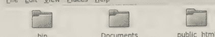

### 图 3.2：Nautilus 标准窗口

要在文件夹之间导航，请使用 Nautilus 窗口左下边缘的下拉菜单。在这里，可以找到从当前目录到文件系统根目录的所有父文件夹。选择所需的文件夹，它将在新的 Nautilus 窗口中打开在旧窗口之上。或者，通过选择“文件” ⊒ “打开父级”来仅打开当前文件夹的直接父级。如果您想关闭这些父文件夹，请选择“文件” ⊒ “关闭父文件夹”。

### 3.3.2 文件管理

Nautilus 支持通过拖放进行文件管理。桌面上的任何文件都可以简单地拖到打开的 Nautilus 窗口中并释放到最终位置。若要在目录之间移动文件，请打开包含该文件的源目录。选择“文件” ⊒ “打开位置”，输入目标目录的路径，将文件拖动到持有目标目录的 Nautilus 窗口。文件和文件夹可以在打开的 Nautilus 窗口与桌面之间进行移动。

如果您需要创建文件的多个副本，请使用“编辑” ⊒ “重复”。对于文件的简单剪切、复制和粘贴，请使用“编辑”菜单，或右键点击文件图标，然后在出现的右键菜单中选择相应的项目。要重命名文件，右键点击它并选择“重命名”。

Nautilus 支持跨网络浏览文件。要连接到远程服务器（FTP, SSH, HTTP, Samba 等），点击“文件” ⊒ “连接服务器”。系统会提示您要连接的服务器类型以及一些额外信息，如要访问的文件夹名称、端口号和使用的用户名。当您点击“连接”离开此对话框时，远程文件夹将作为“位置”面板菜单的一部分显示，并作为桌面图标出现。对于任何后续连接，从“位置”菜单中选择相应的项目并提供必要的身份验证以登录这些网络文件夹。要关闭这些连接，右键点击桌面图标并选择“卸载卷”。

Nautilus 提供了基本的 CD 刻录功能。如果您创建了一个包含您想要备份的数据目录并想将其刻录到 CD，请点击“位置” → “CD 制作器”，并将存放相关数据的文件夹拖到“CD/DVD 制作器”窗口中。选择“文件” → “写入光盘”将数据复制到 CD 或 DVD。

## 3.3 编辑 MIME 类型

MIME 类型决定了在 Web 浏览器或文件浏览器中点击时应由哪个应用程序打开文件。文件的实际类型和文件的 MIME 类型彼此密切相关。HTML 文件的类型为 html，并将被注册为 MIME 类型 text/html。Nautilus 内置支持大多数常见的 MIME 类型，并提议您选择合适的应用程序来打开文件。在这种情况下，它会建议使用 Web 浏览器。

然而，如果您对 Nautilus 建议的默认应用程序不满意，可能希望更改某些文件的 MIME 类型。更改分配给特定 MIME 类型的默认应用程序非常简单。见下一页的图 3.3。

步骤 3.1：编辑 MIME 类型

1. 在 Nautilus 窗口中右键相应 MIME 类型的文件。
2. 从“属性”对话框中选择“属性” → “打开方式”选项卡。
3. 选择对话框。
4. 点击“添加”并“浏览”查找合适的应用程序。
5. 点击“关闭”对话框。

如果尚未正确注册 MIME 类型，操作与上述相同。这些修改将全局生效，这意味着该类型的任何文件都由定义的应用程序打开。

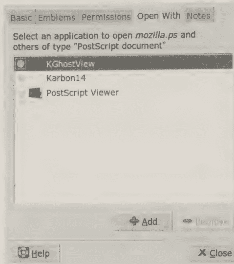

### 3.3.4 配置 Nautilus

Nautilus 从桌面检索默认字体和其他偏好。要设置 Nautilus 特定偏好，请在任何 Nautilus 窗口中选择“编辑”。偏好”。对话框提供了五个选项卡：“视图”、“行为”、“显示”、“列”和“预览”。

“视图”允许在“图标视图”和“列表视图”之间切换“默认视图”。可以设置这些排序顺序。

在“行为”中，选择单击和双击响应，并设置可执行文件的处理方式。此处设置垃圾桶的操作模式。根据需要启用删除确认对话框。还可以设置跳过垃圾桶的删除命令。如果启用此选项，文件将被立即删除。

“显示”具有三个显示信息的选项。此外，也可以设置数据。“列”决定在列表视图中显示信息。在“预览”中，选择是否为文件类型启用缩略图。

## 3.4 重要工具

GNOME 有许多小部件和应用程序。它们设计用于与桌面以及彼此进行交互。本节介绍了其中一些。学习如何在桌面上管理小笔记、使用 GNOME 词典、通过 Gaim 聊天以及享受各种多媒体应用程序。

### 3.4.1 使用 Tomboy 笔记

Tomboy 是一个面板小部件，为 GNOME 桌面提供笔记应用程序。左击面板图标打开 Tomboy 菜单并选择“新建笔记”。输入笔记文本。可以通过“链接”将笔记相互关联。这些链接在重命名和重新组织后依然有效。Tomboy 面菜单中的“搜索笔记”功能允许您搜索笔记。网页链接和电子邮件地址也可以拖到 Tomboy。

### 3.4.2 词典

字典（命令 gnome-dictionary）是一个检查单词拼写和含义的实用小部件。需要连接网络，因为此小部件访问在线词典。

在“单词”中输入要查找的术语。“词典”菜单提供“查找单词”和“检查拼写”的选择。默认情况下，查询将发送到 dict.org 服务器。要使用不同的服务器，选择“编辑” -> “偏好”。参见下一页图 3.4 中的示例条目。


### 3.4.3 使用 Gaim 消息

Gaim（命令为 gaim）是一个功能强大的即时消息客户端。它支持多种协议，如 AIM、ICQ、GroupWise、IRC、Jabber、MSN 等。它最受欢迎的功能包括同时登录多个即时消息网络上的多个账户、自动文本替换和拼写检查。Gaim 具有“bouncy pounces”功能（在 AOL Messenger 中被称为“buddy alerts”），这意味着你可以配置 Gaim，每当你的某个好友进入你当前连接的频道时，它都会通知你。Gaim 可以向你发送消息宣布此情况、播放声音或执行命令。

在首次启动时，在“账户”（Accounts）窗口中点击“添加”（Add）以打开相应的对话框，从而创建你的即时消息网络账户列表。选择协议，然后输入你的屏幕名称、密码和别名。如果你希望 Gaim 在启动时自动登录，请勾选“记住密码”（Remember password）和“自动登录”（Auto-Login）。在使用 Gaim 时跟踪电子邮件，请勾选“新邮件通知”（New mail notifications）。要为你的账户选择好友图标，请打开文件对话框并选择一个。其他选项（如代理设置和服务器地址）可以通过“显示更多选项”（Show more options）进行配置。完成账户设置后，点击“保存”（Save）退出此对话框。

一旦完成账户数据的输入，它就会显示在登录窗口中。要登录，从“账户”（Account）菜单中选择你的账户，输入密码，点击“登录”（Sign on）并开始聊天。

## 3.4 重要实用程序


# 3

GNOME 桌面


账户：
jana (GroupWise)

密码：
*******

| 账户 | 选项 | 登录 |
| --- | --- | --- |

图 3.5：Gaim

### 3.4.4 使用 Totem 看电影

Totem 是一个基于 Xine 的 GNOME 桌面多媒体播放器。它支持 DVD、VCD 和音频 CD 的播放。通过“电影”（Movie） → “播放 VCD”（Play VCD）或“电影” → “播放 DVD”（Play DVD）开始播放 VCD 或 DVD。Totem 在“转到”（Go）下为 DVD 提供菜单支持。可以通过网络获取电影流——只需在“电影” → “打开位置”（Open Location）输入 URL 即可。使用“编辑”（Edit） → “截图”（Take-shot）进行截图。

### 3.4.5 使用 File Roller 管理存档

在 GNOME 中，使用 File Roller 管理文件存档。该应用程序能够处理以下类型的存档：.tar, .tar.gz, .tgz, .tar.bz, .tar.bz2, .tar.z, .zip, .lha, .rar, .lzh, .ear, .jar 和 .war。你可以轻松通过 File Roller 从其他应用程序查看存档内容，而无需解压缩。File Roller 支持拖放，允许你从桌面或文件管理器（Nautilus）将文件图标拖动到 File Roller 窗口并释放。

要创建一个新存档，选择“存档”（Archive） → “新建”（New）。在下一个对话框中，在左侧窗口指定创建新存档的目录。在文件扩展之前的输入字段中输入新存档的文件。通过名称字段上方的下拉菜单确定存档类型。点击“确定”（OK）退出对话框并返回 File Roller 的主视图。现在，通过从桌面或文件管理器拖放或选择，并插入“编辑”（Edit） → “添加文件”（Add Files）将文件添加到存档中。在随后的对话框中，选择一个或多个文件（按住 Ctrl 键可选择多个文件）或目录。如有必要，为存档设置以下高级选项：

- **仅在较新时添加 (Add only if newer)**：如果存档中已包含同名文件，只有当该文件比存档中现有的较新时才会进行添加。
- **包含子文件夹 (Include subfolders)**：要压缩整个目录，请激活此选项以包含子目录。
- **排除备份文件 (*) (Exclude backup files)**：在创建存档时禁用包含备份副本，以避免不必要的数据。
- **排除隐藏文件 (*) (Exclude hidden files)**：通常隐藏文件不包含任何与用户相关的数据。默认情况下，它们不会包含在存档中，以减少数据量。
- **排除文件 (Exclude files)**：显式地从存档中排除某些文件。如果你想压缩整个目录但排除某些特定文件，此选项非常有用。除了文件名，你还可以指定搜索模式。
- **忽略大小写 (Ignore case)**：File Roller 会忽略文件名和扩展名的大小写差异，例如 JPEG 或 jpeg。

完成选择和配置后，退出对话框。存档将在所需的处可用供进一步处理。要解压缩存档，请将其加载到 File Roller，点击“编辑”（Edit） → “提取到”（Extract to），并指定目标目录。

## 3.5 辅助技术支持

GNOME 提供了许多应用程序来支持有残障的用户。这些应用程序包括屏幕软键盘（GOK）、一个具有放大、语音和盲文支持的强大屏幕阅读器（Gnopernicus），以及一个文本输入界面（Dasher）。可以通过选择“桌面”（Desktop）+“偏好”（Preferences）访问 GNOME 控制中心来激活任何辅助技术支持。

### 3.5.1 GNOME 屏幕键盘

Gnome 屏幕键盘（GOK）为无法使用标准键盘的人提供虚拟键盘。配合适当的硬件，你可以使用摇杆或鼠标控制电脑。


图 3.6：使用 GOK

以下通过 GOK 使用编辑器的示例说明了 GOK 的工作原理

步骤 3.2：通过 GOK 编辑文本
1. 点击主菜单中的“启动器”（Launcher）。
2. 选择“文本编辑器”（Text editor）启动窗口，点击“返回”回到主菜单。
3. 按“组合”（Compose）启动屏幕键盘并输入文本。
4. 要保存已写的文本，点击“返回”回到主窗口，然后选择“菜单”（Menus）打开任何菜单。
5. 选择“文件”（File） → “保存”（Save）打开文件对话框。
6. 通过虚拟键盘按“组合”输入文件名并回车。
7. 要终止文本编辑器，返回主菜单并选择“菜单” → “文件” → “退出”（Quit）。

要配置 GOK 的行为，点击主窗口中的“GOK” → “偏好设置”（Preferences），并调整“外观”（Appearance）、“操作”（Actions）、“反馈”（Feedback）、“访问方法”（Access Methods）和“预测”（Prediction）设置。

有关 GOK 的更多信息可以访问 http://www.gok.ca，那里还有该工具的全面在线帮助。

## 3.5.2 Gnopernicus

Gnopernicus 是一个为视障人士提供的强大工具集合。它提供了以下功能：

- **语音 (Speech)**：使用语音合成软件将屏幕上的操作转换为语音。如果你的电脑有声卡，你可以配置 Gnopernicus 对屏幕上发生的任何进行注释。
- **盲文和盲文显示器 (Braille and Braille monitor)**：如果系统连接了盲文设备，Gnopernicus 可以屏幕直接翻译到该设备。如果你也激活了“盲文显示器”（Braille Monitor），屏幕将显示盲文输出。此选项可能对演示有用。
- **放大镜 (Magnifier)**：该模块通过自定义缩放比例来帮助视障用户。

一旦启动 Gnopernicus，它的主菜单将出现在屏幕左上角，如下一页图 3.7 所示。通过打开“启动模式”（Startup Mode）对话框来确定桌面启动时应提供哪些功能。每个激活的模块都可以通过“偏好”（Preferences）对话框进行配置。

获取 Gnopernicus 项目的更多信息请访问 http://www.baum.ro/gnopernicus.html。


# 3
GNOME 桌面

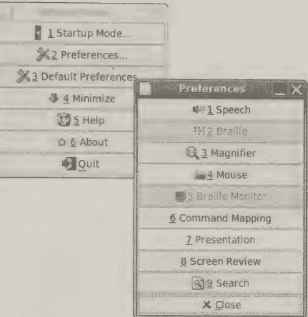

图 3.7：配置 GNpericus

### 3.5.3 Dasher

Dasher 是一个小型应用程序，允许你无需使用键盘即可创建文本。你可以将其用于任何没有键盘的计算机设备（手持式或可穿戴计算机），或者用于使用摇杆、触摸板、头鼠标或眼动追踪器而非键盘和鼠标控制的普通电脑。

Dasher 由连续的指针手势驱动。从一个字符开始，然后将指针拖到下一个字符，直到完成文本输入。Dasher 开箱即支持多种语言（英语和欧洲语言、日语以及某些非洲语言），并可以轻松进行训练以支持其他语言。可以在 http://www.inference.phy.cam.ac.uk/dasher/ 找到有关 Dasher 项目的更多信息。

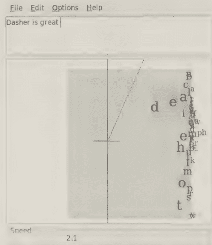

图 3.8：使用 Dasher 写作

# KDE 桌面

KDE 桌面提供了直观的图形界面。接下来的章节将向你展示如何高效利用 KDE 的功能，以及如何自定义桌面以满足你的个人需求。随后是对文件管理器 Konqueror 的介绍以及对一些小型而实用的工具的简要描述。

- 4.1 桌面组件 . . . . . . . . . . . . . . . . . . . . . . 70
- 4.2 设置 . . . . . . . . . . . . . . . . . . . . . . . . . . . . . . . . 73
- 4.3 作为文件管理器的 Konqueror . . . . . . . . . . . . . . . . . . . 78
- 4.4 重要工具 . . . . . . . . . . . . . . . . . . . . . . . . . . . 83

## 4.1 桌面组件

主要组件是桌面上的图标和屏幕底部的面板。鼠标是你最重要的工具。单击一次符号或图标即可启动关联程序或文件管理器 Konqueror。如果你右键点击图标，将根据程序出现不同的菜单。除了图标外，还有两个桌面菜单。

### 4.1.1 桌面菜单

如果你中键点击桌面（如果你的鼠标只有两个按钮，请同时按下这两个按钮），将显示一个窗口和桌面管理菜单。该菜单列出了各种桌面以及在其中打开的窗口。它还提供以下项目：

- ‘整齐窗口’ (Unclutter Windows)：如果你在桌面上有多个窗口，它们将并排排列并与左上角对齐。
- ‘层叠窗口’ (Cascade Windows)：从左上角开始，桌面上的窗口将层叠在一起，使得只看到下方窗口的顶部和左侧边界。
- ‘桌面 x’ (Desktop x)：桌面 1 是你的默认桌面。菜单的这部分列出了当前打开的所有窗口。你可以通过点击相应项目之一将它们带到前台。
- ‘更多桌面’ (Additional Desktops)：你可以使用提供的（虚拟）桌面，并通过菜单或面板切换到它们。所有功能在所有桌面上都可用。这限制了需要在在一个桌面上安排的程序和关联窗口的数量。这些虚拟桌面类似于你办公室里额外的桌子。

如果你右键点击桌面，将显示一个更复杂的菜单，允许你自定义桌面。

- ‘新建’ (Create New)：使用此菜单项在桌面上创建新目录、文件或设备。在子书签中提供了可能的元素列表供选择。
- ‘书签’ (Bookmarks)：书签编辑器允许你创建、分组、更改或删除书签。浏览器和文件管理器 Konqueror 使用书签。书签编辑器还可以从其他浏览器导入书签，如 Mozilla、Netscape、Opera 和 Internet Explorer。
- ‘运行命令’ (Run Command)：此菜单打开一个窗口，可以在其中手动输入命令。按 `Enter` 执行命令。
- ‘撤销’ (Undo)：使用此项目撤销上一个操作。例如，如果你刚刚在桌面创建了一个新目录，点击此项将撤销目录的创建。
- ‘粘贴’ (Paste)：为了在桌面上方便使用文件夹或文档，你可以通过右键点击文件管理器中的图标并选择“复制”，将鼠标移动到桌面上的所需位置。再次右键点击并选择“粘贴”。该图标现在已出现在你的桌面上，可以通过按住左鼠标键拖动移动。
- ‘图标’ (Icons)：这允许你重新排列桌面上的图标。你也可以更改图标的顺序。
- ‘窗口’ (Windows)：这安排桌面上的窗口，可以是从左上角开始层叠，也可以并排排列。
- ‘刷新桌面’ (Refresh Desktop)：如果桌面出现某种显示乱码，使用此菜单重绘它。
- ‘配置桌面’ (Configure Desktop)：此菜单项启动一个配置对话框，用于配置桌面的外观和行为。关于桌面配置的详情见第 73 页第 4.2 节。
- ‘启动新会话’ (Start New Session)：此菜单打开一个对话框，要求你启动一个新的用户环境。点击“启动新会话”后，当前会话进入后台，系统切换到新会话。
- ‘锁定会话’ (Lock Session)：如果桌面出现某种显示乱码，使用此菜单重绘它。
- ‘配置桌面’ (Configure Desktop)：此菜单项启动一个配置对话框，用于配置桌面的外观和行为。关于桌面配置的详情见第 73 页第 4.2 节。
- ‘启动新会话’ (Start New Session)：此菜单打开一个对话框，要求你启动一个新的用户环境。点击“启动新会话”后，当前会话进入后台，系统切换到新会话。
- ‘锁定会话’ (Lock Session)：如果桌面出现某种显示乱码，使用此菜单重绘它。


### 4.1.2 主菜单

如果你中键点击桌面（如果你的鼠标只有两个按钮，请同时按下这两个按钮），将显示一个窗口和桌面管理菜单。该菜单列出了各种桌面以及在其中打开的窗口。它还提供以下项目：

- ‘整齐窗口’ (Unclutter Windows)：如果你在桌面上有多个窗口，它们将并排排列并与左上角对齐。
- ‘层叠窗口’ (Cascade Windows)：从左上角开始，桌面上的窗口将层叠在一起，使得只看到下方窗口的顶部和左侧边界。
- ‘桌面 x’ (Desktop x)：桌面 1 是你的默认桌面。菜单的这部分列出了当前打开的所有窗口。你可以通过点击相应项目之一将它们带到前台。
- ‘更多桌面’ (Additional Desktops)：你可以使用提供的（虚拟）桌面，并通过菜单或面板切换到它们。所有功能在所有桌面上都可用。这限制了需要在在一个桌面上安排的程序和关联窗口的数量。这些虚拟桌面类似于你办公室里额外的桌子。

如果你右键点击桌面，将显示一个更复杂的菜单，允许你自定义桌面。

- ‘新建’ (Create New)：使用此菜单项在桌面上创建新目录、文件或设备。在子书签中提供了可能的元素列表供选择。
- ‘书签’ (Bookmarks)：书签编辑器允许你创建、分组、更改或删除书签。浏览器和文件管理器 Konqueror 使用书签。书签编辑器还可以从其他浏览器导入书签，如 Mozilla、Netscape、Opera 和 Internet Explorer。
- ‘运行命令’ (Run Command)：此菜单打开一个窗口，可以在其中手动输入命令。按 `Enter` 执行命令。
- ‘撤销’ (Undo)：使用此项目撤销上一个操作。例如，如果你刚刚在桌面创建了一个新目录，点击此项将撤销目录的创建。
- ‘粘贴’ (Paste)：为了在桌面上方便使用文件夹或文档，你可以通过右键点击文件管理器中的图标并选择“复制”，将鼠标移动到桌面上的所需位置。再次右键点击并选择“粘贴”。该图标现在已出现在你的桌面上，可以通过按住左鼠标键拖动移动。
- ‘图标’ (Icons)：这允许你重新排列桌面上的图标。你也可以更改图标的顺序。
- ‘窗口’ (Windows)：这安排桌面上的窗口，可以是从左上角开始层叠，也可以并排排列。
- ‘刷新桌面’ (Refresh Desktop)：如果桌面出现某种显示乱码，使用此菜单重绘它。
- ‘配置桌面’ (Configure Desktop)：此菜单项启动一个配置对话框，用于配置桌面的外观和行为。关于桌面配置的详情见第 73 页第 4.2 节。
- ‘启动新会话’ (Start New Session)：此菜单打开一个对话框，要求你启动一个新的用户环境。点击“启动新会话”后，当前会话进入后台，系统切换到新会话。
- ‘锁定会话’ (Lock Session)：如果桌面出现某种显示乱码，使用此菜单重绘它。

### 4.1.2 主菜单

如果你中键点击桌面（如果你的鼠标只有两个按钮，请同时按下这两个按钮），将显示一个窗口和桌面管理菜单。该菜单列出了各种桌面以及在其中打开的窗口。它还提供以下项目：

- ‘整齐窗口’ (Unclutter Windows)：如果你在桌面上有多个窗口，它们将并排排列并与左上角对齐。
- ‘层叠窗口’ (Cascade Windows)：从左上角开始，桌面上的窗口将层叠在一起，使得只看到下方窗口的顶部和左侧边界。
- ‘桌面 x’ (Desktop x)：桌面 1 是你的默认桌面。菜单的这部分列出了当前打开的所有窗口。你可以通过点击相应项目之一将它们带到前台。
- ‘更多桌面’ (Additional Desktops)：你可以使用提供的（虚拟）桌面，并通过菜单或面板切换到它们。所有功能在所有桌面上都可用。这限制了需要在在一个桌面上安排的程序和关联窗口的数量。这些虚拟桌面类似于你办公室里额外的桌子。

如果你右键点击桌面，将显示一个更复杂的菜单，允许你自定义桌面。

- ‘新建’ (Create New)：使用此菜单项在桌面上创建新目录、文件或设备。在子书签中提供了可能的元素列表供选择。
- ‘书签’ (Bookmarks)：书签编辑器允许你创建、分组、更改或删除书签。浏览器和文件管理器 Konqueror 使用书签。书签编辑器还可以从其他浏览器导入书签，如 Mozilla、Netscape、Opera 和 Internet Explorer。
- ‘运行命令’ (Run Command)：此菜单打开一个窗口，可以在其中手动输入命令。按 `Enter` 执行命令。
- ‘撤销’ (Undo)：使用此项目撤销上一个操作。例如，如果你刚刚在桌面创建了一个新目录，点击此项将撤销目录的创建。
- ‘粘贴’ (Paste)：为了在桌面上方便使用文件夹或文档，你可以通过右键点击文件管理器中的图标并选择“复制”，将鼠标移动到桌面上的所需位置。再次右键点击并选择“粘贴”。该图标现在已出现在你的桌面上，可以通过按住左鼠标键拖动移动。
- ‘图标’ (Icons)：这允许你重新排列桌面上的图标。你也可以更改图标的顺序。
- ‘窗口’ (Windows)：这安排桌面上的窗口，可以是从左上角开始层叠，也可以并排排列。
- ‘刷新桌面’ (Refresh Desktop)：如果桌面出现某种显示乱码，使用此菜单重绘它。
- ‘配置桌面’ (Configure Desktop)：此菜单项启动一个配置对话框，用于配置桌面的外观和行为。关于桌面配置的详情见第 73 页第 4.2 节。
- ‘启动新会话’ (Start New Session)：此菜单打开一个对话框，要求你启动一个新的用户环境。点击“启动新会话”后，当前会话进入后台，系统切换到新会话。
- ‘锁定会话’ (Lock Session)：如果桌面出现某种显示乱码，使用此菜单重绘它。

## 4.2 设置

KDE 桌面提供了直观的图形界面。接下来的章节将向你展示如何高效利用 KDE 的功能，以及如何自定义桌面以满足你的个人需求。随后是对文件管理器 Konqueror 的介绍以及对一些小型而实用的工具的简要描述。

## 4.1 桌面组件

主要组件是桌面上的图标和屏幕底部的面板。鼠标是你最重要的工具。单击一次符号或图标即可启动关联程序或文件管理器 Konqueror。如果你右键点击图标，将根据程序出现不同的菜单。除了图标外，还有两个桌面菜单。

### 4.1.1 桌面菜单

如果你中键点击桌面（如果你的鼠标只有两个按钮，请同时按下这两个按钮），将显示一个窗口和桌面管理菜单。该菜单列出了各种桌面以及在其中打开的窗口。它还提供以下项目：

- ‘整齐窗口’ (Unclutter Windows)：如果你在桌面上有多个窗口，它们将并排排列并与左上角对齐。
- ‘层叠窗口’ (Cascade Windows)：从左上角开始，桌面上的窗口将层叠在一起，使得只看到下方窗口的顶部和左侧边界。
- ‘桌面 x’ (Desktop x)：桌面 1 是你的默认桌面。菜单的这部分列出了当前打开的所有窗口。你可以通过点击相应项目之一将它们带到前台。
- ‘更多桌面’ (Additional Desktops)：你可以使用提供的（虚拟）桌面，并通过菜单或面板切换到它们。所有功能在所有桌面上都可用。这限制了需要在在一个桌面上安排的程序和关联窗口的数量。这些虚拟桌面类似于你办公室里额外的桌子。

如果你右键点击桌面，将显示一个更复杂的菜单，允许你自定义桌面。

- ‘新建’ (Create New)：使用此菜单项在桌面上创建新目录、文件或设备。在子书签中提供了可能的元素列表供选择。
- ‘书签’ (Bookmarks)：书签编辑器允许你创建、分组、更改或删除书签。浏览器和文件管理器 Konqueror 使用书签。书签编辑器还可以从其他浏览器导入书签，如 Mozilla、Netscape、Opera 和 Internet Explorer。
- ‘运行命令’ (Run Command)：此菜单打开一个窗口，可以在其中手动输入命令。按 `Enter` 执行命令。
- ‘撤销’ (Undo)：使用此项目撤销上一个操作。例如，如果你刚刚在桌面创建了一个新目录，点击此项将撤销目录的创建。
- ‘粘贴’ (Paste)：为了在桌面上方便使用文件夹或文档，你可以通过右键点击文件管理器中的图标并选择“复制”，将鼠标移动到桌面上的所需位置。再次右键点击并选择“粘贴”。该图标现在已出现在你的桌面上，可以通过按住左鼠标键拖动移动。
- ‘图标’ (Icons)：这允许你重新排列桌面上的图标。你也可以更改图标的顺序。
- ‘窗口’ (Windows)：这安排桌面上的窗口，可以是从左上角开始层叠，也可以并排排列。
- ‘刷新桌面’ (Refresh Desktop)：如果桌面出现某种显示乱码，使用此菜单重绘它。
- ‘配置桌面’ (Configure Desktop)：此菜单项启动一个配置对话框，用于配置桌面的外观和行为。关于桌面配置的详情见第 73 页第 4.2 节。
- ‘启动新会话’ (Start New Session)：此菜单打开一个对话框，要求你启动一个新的用户环境。点击“启动新会话”后，当前会话进入后台，系统切换到新会话。
- ‘锁定会话’ (Lock Session)：如果桌面出现某种显示乱码，使用此菜单重绘它。


“图标”控制整个桌面的图标样式。你可以选择 KDE Classic 样式、Crystal SVG 样式或其他。通过“高级”选项可以微调“图标”的外观。

“启动反馈”为你的鼠标光标提供视觉反馈。当应用程序启动时，KDE 会显示（例如）忙碌光标。选择一种样式，如闪烁或跳动。你也可以尝试使用被动光标或完全禁用此效果。

如果你在一段时间内没有使用电脑，屏幕保护程序会自动出现。在“屏幕保护程序”模块中，配置所有必要的设置。从许多类型中进行选择，如横幅、分形和幻象。要调整特定屏幕保护程序的设置，请点击“设置”。还可以在“高级选项”中找到更多选项。

当 KDE 启动时，它会显示一小幅图像。此图像可以通过“启动界面”进行定义。点击“测试”显示启动界面。

通过“样式”修改用户界面元素（GUI）的视觉外观。选择一种样式并在下方示例中预览。“效果”和“杂项”可以启用某些 GUI 效果和透明度。

一些用户创建了配置集并将其上传到网页。“主题管理器”让你为 KDE 桌面选择并安装不同的主题。“窗口装饰”是另一种样式设置。如果你更改了设置，下方的示例将会改变。

### 4.2.3 桌面

“行为”允许你更改关于桌面的一些通用问题。你可以激活某些特定文件的预览，或启用设备图标。

用户定义资源的中心位置是“KDE 资源”。选择一种资源，如日历、联系人或笔记。然后点击“添加”。根据你的选择，它会显示一个窗口来选择新资源的类型。下一步将打开一个带有该类型特定设置的新窗口。如果你点击“确定”确认，该资源可以在其他 KDE 应用程序中使用，例如 KOrganizer。

“多重桌面”允许你选择最多 20 个具有独立名称的虚拟桌面。移动滑块更改数值。使用文本字段为你的桌面命名。

通过“面板”模块设置面板的位置。你可以将任何面板放置在屏幕的左侧、右侧、顶部或底部。其他选项卡包含隐藏面板或添加特殊菜单的设置。还可以修改背景或启用透明度。

“任务栏”模块配置任务栏，任务栏在面板中提供窗口列表。任务栏如何分组窗口在“合并类似任务”中确定。你可以定义按下鼠标左键、中键或右键时要执行的操作。

通过“窗口行为”自定义默认的 KDE 窗口管理器 (KWin)。这控制窗口在移动、清除或调整大时发生什么。

“特定窗口设置”允许你自定义仅适用于某些窗口的设置。只有当你使用 KWin 作为窗口管理器时，它才会生效。

### 4.2.4 互联网与网络

“配对蓝牙设备”和“蓝牙服务”模块处理如何管理蓝牙设备和服务。KDE 允许你在“连接偏好”中更改不同连接的时间值。

如果你想邀请他人进入你的桌面，“桌面共享”非常有用。只让信任的用户参与你的会话。

“文件共享”只有在你是管理员时才能更改。如果你是 root，可以添加、更改或删除旨在与他人共享的文件夹。

如果你想浏览本地网络，请使用“本地网络浏览”。它类似于“网络邻域”。注意你需要额外的软件，特别是 LiDAR 守护进程（包 kdenetwork3-lisa）。

在“代理”中，自定义代理和 SOCKS 服务器。通常情况下，如果你的管理员没有让你使用它，那么它对你可能没有用。

“Samba”子模块应仅通过 YaST 配置中心进行自定义。

对于 Konquer，可以尝试“网络浏览器”子模块。你可以自定义字体、检查 Cookie 并确定 Web 行为。

### 4.2.5 KDE 组件

“组件切换器”模块处理基础任务。目前，你可以更改电子邮件客户端、文本编辑器、即时消息、终端和 Web 浏览器。每当 KDE 应用程序需要启动这些类型的应用程序时，它都会调用同一个组件。

KDE 使用“文件关联”来识别文件类型并启动相应的应用程序。通过此模块，可以自定义图标、文件名模式、描述和应用程序的顺序。

Konqueror 也可以像文件管理器一样运行。“文件管理器”模块配置使用的字体和字体大小、使用什么主 URL、是否允许预览，以及是否允许快速复制和更多操作。

所有 KDE 守护进程的概览在“服务管理器”中显示。该模块显示两种不同类型：启动时调用的服务和按需调的服务。通常不要更改此模块的设置，因为它对 KDE 至关重要。

通过“拼写检查器”，KDE 提供对两种常用拼写检查工具 ASpell 和 iSpell 的支持。此模块设置了一个可以与其他应用程序共享的默认配置。

### 4.2.6 外围设备

此设置打开鼠标、键盘和打印机管理的配置对话框。

### 4.2.7 电源控制

这仅对笔记本电脑有用。“笔记本电池”监控你的电池。必须安装电源管理软件。

### 4.2.8 区域与辅助功能

“辅助功能”配置帮助运动功能或视觉有困难的人的功能。

在“国家/地区与语言”中，设置你的本地设置。你可以添加一种一种语言。数字、货币、时间和日期可以在相应的选项中进行自定义。

“键盘布局”允许对不同语言使用多种布局。例如，你可以激活法语和德语布局。通过“启用布局”启用它们，并在它们之间切换。在“Xkb ”选项卡中进行微调。

“快捷键”处理键绑定。键绑定是操作（例如删除）与按键之间的关联。

### 4.2.9 安全隐私

为了让 KDE 更安全，“加密”允许你配置 SSL（安全套字层）。这用于大多数 KDE 应用程序以及其他。还有管理证书的可能性。

KDE 密码管理器可以在“KDE 钱包”模块中自定义。除了一些通用设置，你可以创建一个新钱包。这让你拥有不同的钱包，例如针对不同的操作。

要更改个人设置，请进入“密码与用户账户”。在这里设置新的名称、组织、电子邮件地址、SMTP 服务器或密码。

“隐私”模块管理浏览数据。例如，使用它可以清除缓存、删除访问历史或删除不需要的 Cookie。

### 4.2.10 声音与多媒体

在这里执行音频 CD 播放和声音系统的所有设置。在“系统铃”下，将系统通知切换为系统铃，并指定音量、音调和时长。

默认情况下使用系统通知。使用此模块确定在发生问题、任务完成或发生你需要立即注意的事件时系统如何通知你。在对话框的上部，选择配置系统通知的应用程序。一旦你选择了一个程序，该程序发送给用户的所有事件都会在下方窗口列出。在“操作”对话框中确定每个通知的类型。

系统通知对话框的默认视图仅为声音通知提供“播放声音”。点击“更多选项”访问其他操作模式。你可以将通知记录到文件中、执行程序或在弹出窗口中显示消息。在对话框下方的“快速控制”中，可以全局地激活或禁用所有程序的操作。

### 4.2.11 系统管理

如果你想安装新字体，“字体安装器”是正确的工具。此模块显示你的个人字体列表。点击字体将显示一个句子在


相应的界面。通过“添加字体”可以轻松添加新字体。要更改系统字体，请点击“管理员模式”。

“Linux 内核”模块仅在你安装了内核源代码时才会生效。只有当你是一个正在编译新内核并想要自定义某些选项的开发者时，它才是有用的。

通过“登录管理器”，可以更改登录界面的外观、使用的字体、显示的背景、关机行为、显示的用户以及登录界面的的一些便利性设置。

要更改 KDE 的默认路径，请进入“路径”。你可以自定义三个不同的路径：桌面、自启动和文档。

## 4.3 作为文件管理器的 Konqueror

Konqueror 是一个统一的 Web 浏览器、文件管理器、文档查看器和图像查看器。本节介绍了如何使用 Konqueror 进行文件管理。如果你对将 Konqueror 作为 Web 浏览器感兴趣，请参阅第 151 页的第 10 章。

点击面板中的房屋图标或按下 `Alt+F2` 并输入 `konqueror HOME` 即可启动 Konqueror。随后将显示你的主目录内容。文件管理器窗口包含顶部的菜单栏、工具栏和位置栏。窗口的下半部分垂直分为导航面板和主窗口，主窗口显示内容。

### 4.3.1 文件预览

Konqueror 可以让你查看某些文件的预览。通常情况下，在浏览目录时此功能是开启的。它只有在激活了图标视图时（查看“查看” → “视图模式”）才有效。预览功能可以简化你的日常工作。在大型目录中，它可以提供文件内部内容的粗略概述。有时这并不可用，例如对于压缩文件。但如果你将鼠标悬在相应的文件上，Konqueror 会弹出一个包含额外信息的工具提示，如名称、所有者和大小。

你可以更改哪些文件具有预览。进入“设置” → “配置 Konqueror”，打开“预览与元数据”部分。Konqueror 区分互联网协议和本地协议。每个协议都可以被激活。点击“确定”确认。

## 4
KDE 桌面

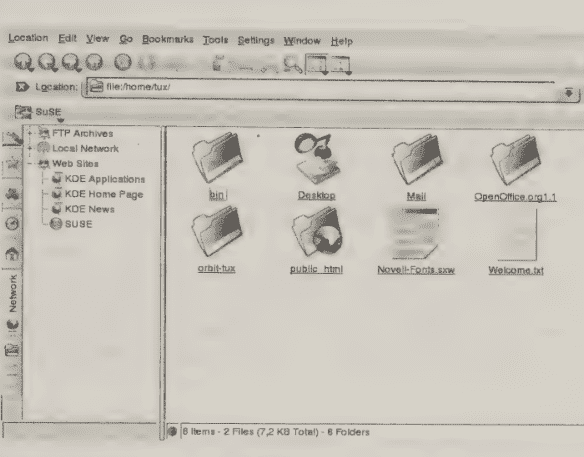

图 4.1：文件管理器 Konqueror

### 4.3.2 文件关联

现代桌面系统应该知道如何处理其文件类型。通过 Konqueror，可以决定使用哪个应用程序来处理文件。进入“设置” → “配置 Konqueror”并打开“文件关联”部分。如果你正在搜索扩展名，请使用“查找文件名模式”。只有带有匹配文件模式的文件类型会出现在列表中。

例如，要修改 MP3 文件的应用程序，输入 mp3 就会看到一个 x-mp3 条目。用左键点击后，右侧会打开该文件类型的设置对话框。你可以更改图标、文件模式、描述以及应用程序的顺序。如果你的工具未在列表中，按“添加”并输入其命令。有时列表项的顺序并不恰当。要更改顺序，点击该程序，并通过“向上移动”或“向下移动”来赋予其更高或更低的优先级。当你点击该类型的文件时，默认将使用列在列表顶部的应用程序。

有时你需要一个不在列表中的文件类型。通过“添加”，可以打开一个对话框，在其中选择一个组并输入类型名称。组决定了主类型，例如音频、图像、文本或视频。通常你的文件类型可以被分配给其中之一。在“类型名称”中，为你的文件类型命名。点击“确定”后，确定文件名的扩展名。在文本字段中输入描述并决定使用哪个应用程序。点击“确定”确认。

SUSE LINUX 79

### 4.3.3 Konqueror 菜单

“位置”使用“位置”打开额外的 Konqueror 窗口。如果你点击“新窗口”，将在新窗口中显示主目录。你可以通过“复制窗口”生成具有相同内容的第二个窗口。如果你点击这些菜单项之一，可以通过粘贴（使用浏览器功能）发送文件或链接，此时会打开 KMail 编写器。指定收件人并编写。根据所选项目，文件将作为附件，或者链接将显示在电子邮件正文中。你也可以从这里直接打印。

“编辑”“编辑”下的大多数项目只有在主窗口中选择对象时才会变为激活。除了标准的编辑功能（如剪切、复制、粘贴、重命名、移动到回收箱和删除）外，还有“新建”项，用于创建目录、文件和设备。“编辑”菜单中的另一个项目允许你查看和更改文件和目录的属性及其权限。通过它，可以为所有者、组或所有用户授予或拒绝读、写和执行权限。在主窗口中，通过将鼠标指针悬停并在保持鼠标按下或使用“选择” → “选择”来选择一个或多个文件。

“查看”使用“查看”菜单更改视图。如果目录中包含许多对象，文本视图或树视图可能更高效。要查看 HTML 页面，激活“使用 index.html”。如果目录中包含此名称的文件，Konqueror 将加载并显示它。

要影响主窗口显示目录内容的方式，请使用“图标大小”、“显示隐藏文件”、“排序”和“预览”。此外，使用“配置背景”设置主窗口的

“前往”“前往”菜单包含导航功能“上级”、“后退”、“前进”和“主页”。然而，相同的功能可以通过工具栏快速访问。你也可以从此菜单调用应用程序并打开在桌面上有图标的文件夹。（等等，让我重新对齐 OCR 流：“此外，相同的功能可以通过工具栏快速访问”）

## 4
KDE 桌面

100

“书签”通过“书签”为互联网地址（URL）或特定文件或目录创建书签。如果你选择“添加书签”，位置栏的内容将被保存为书签。要访问此位置，只需点击此书签。为了方便，请将书签整理到文件夹中。SUSE 文件夹已存在。对于网页，“编辑书签”将打开书签编辑器，在其中执行删除书签、重命名书签和移动任务的任务。

“工具”此菜单包含各种项，例如“运行命令”、“打开终端窗口”和“查找文件”。你可以使用“视图过滤”限制视图，目录可能具有不同格式的图形，但如果你只想查看 PNG 格式，可以使用此子菜单隐藏所有非 PNG 格式的文件。

选择“创建库”会导致 Konqueror 搜索目录中的任何图像文件。程序随后创建这些图片并将它们合并为 HTML 页。对话框提示你设置 HTML 页面的选项，如字体和每行的缩略图数量。

“设置”你使用“设置”菜单配置 Konqueror 的外观。如果你不想“隐藏菜单栏”，按 Ctrl+(M) 重新显示它。“工具栏”子菜单允许你隐藏或显示管理器的其他元素。

视图配置文件可以根据预定义的模式更改视图。要在可用的配置之间切换，请选择“加载视图配置”。其中之一是 Web 浏览器配置，当你点击面板中的 Konqueror 图标时会自动使用。通过“配置视图配置”添加自己的。此外，你可以通过“配置快捷键”指定单独快捷键，通过“配置工具栏”自定义工具栏，并通过“配置 Konqueror”配置管理器的全局设置。

“窗口”“窗口”菜单允许你水平或垂直分割主窗口。它还允许你管理主窗口内的标签页，打开或关闭标签、复制现有标签或将标签分离到独立窗口。

“帮助”在“帮助”菜单下，访问 Konqueror 手册或“关于”功能。通常此功能也可以通过问号访问。

SUSE LINUX 81


位于标题栏右上角的问号符号。此时鼠标指针将显示为一个问号。如果你点击图标，如果有，将显示简短的帮助文本。“ 帮助”菜单还提供了对 Konqueror 的简要介绍，以及向开发人员报告错误或其他问题的可能。“关于 Konqueror”和“关于 KDE”提供了有关该项目版本、许可协议、作者和翻译者的信息。

### 4.3.4 工具栏

工具栏提供了对经常使用功能的快速访问，这些功能也可以通过菜单访问。如果你将鼠标指针悬停在图标上方，将提供短描述。在工具栏的空白处点击右键可以打开一个菜单，通过它可以更改工具栏的位置、将图标切换为文本、更改图标大小以及显示或隐藏各个栏。通过“配置工具栏”启动配置对话框。在右侧，工具栏具有 Konqueror 图标，在加载目录或网页时，该图标会显示动画。

### 4.3.5 位置栏

位置栏前面是一个带有白色 X 的的黑色符号。如果你点击该图标，该行内容将被删除，允许输入新位置。有效的位置可以是路径规范（例如显示主目录时出现的路径），也可以是网页 URL。输入地址后，按下或点击输入行右侧的“前往”。通过位置栏右侧的黑色箭头访问最近访问过的目录或网页。如果你需要反复访问某些内容，此功能可以节省一些打字时间。如果你需要反复查看某些位置，为它们创建书签会更方便。

### 4.3.6 主窗口

主窗口显示所选目录的内容。如果你点击图标，相应的文件将在 Konqueror 中显示，或者加载到相应的应用程序中进行进一步处理。点击 RPM 软件包列表将列出文件内容。选择“使用 YaST 安装软件包”会提示输入 root 密码，之后将安装该包。

如果你对图标点击右键，，显示的菜单类型取决于文件类型，并提供常用操作，如“剪切”、“复制”、“粘贴”和“删除”。使用“打开方式”从合适的程序列表中选择打开文件的应用程序。

执行许多操作的最快方法是拖放法。例如，只需按住鼠标按钮并将文件拖过去，即可轻松将文件从一个 Konquer 窗口移动到另一个窗口。随后，会提示你是移动还是复制这些对象。

## 4.4 重要实用程序

接几页介绍了了一些旨在协助日常工作的小 KDE 实用程序。这些应用程序执行各种任务，例如管理用于加密和签名文件及电子邮件信息的密钥、管理剪贴板、格式化软磁盘、压缩和解压缩各种类型的文件存档，以及与其他用户共享桌面。

### 4.4.1 创建图片库

如果你在目录中有一大量图片，可能会发现很难管理。Konquer 可以通过创建一个带有缩略图的 HTML 文件来帮助你。在 Konquer 中打开相应的目录，并选择“工具” → “创建图片库”。将打开一个对话框，在其中指定标题页、每行的缩略图数量、背景和前景颜色以及其他细节。完成后，选择“创建”开始该操作。默认情况下，Konquer 会创建一个名为 images.html 的文件。可以使用 Konquer 打开它，它提供了你的图片集排列良好的缩略图索引。要全尺寸查看图片，只需点击缩略图即可。

### 4.4.2 使用 KWallet Manager 管理密码

记住所有需要登录的保护资源的密码可能会是个问题。KWallet 会为你记住它们。它会收集所有密码并将它们存储在加密文件中。只需一个密码，即可打开你的钱包以查看、搜索、删除或创建新条目。通常情况下你不需要手动插入条目。KDE 会识别资源是否需要身份验证，KWallet 会自动启动。

# 重要：保护你的 KWallet 密码

如果你忘记了 KWallet 密码，它将无法恢复。此外，任何知道你密码的人都可以获取钱包中包含的所有信息。

# 配置 KWallet

当你第一次启动 KWallet 时，会出现一个带有欢迎屏幕的对话框。在“基本设置”和“高级设置”之间进行选择。建议选择“基本设置”。如果你选择它，在下一个屏幕中选择你想要存储个人信息。某些 KDE 应用程序（如 Konqueror 或 KMail）可以让钱包系统存储 Web 数据和 Cookie。选择“是，我希望为此目的使用 KDE 钱包来存储我的个人信息”，并点击“完成”。

如果你选择“高级设置”，将有一个额外的安全级别屏幕。默认设置对大多数用户来说是可以接受的，但其他人可能希望更改它们。“自动关闭空闲钱包”会在闲置一段时间后关闭钱包。为了区分网络密码和本地密码，激活“将网络密码和本地密码存储在单独的钱包文件中”。点击“完成”。

完成后，KWallet 会出现在面板中。如果你想修改配置，右键点击 KWallet 图标并选择“配置 KWallet”。打开一个对话框。配置不同的设置，例如 KWallet 如何关闭钱包（默认自动选中），以及关于钱包管理器本身的两个选项。

# KWallet Manager 窗口

要在钱包中存储数据或查看其内容，通过右键点击 KWallet 图标打开管理器窗口。将打开一个对话框。配置不同的设置，例如 KWallet 如何关闭钱包（默认自动选中），以及关于钱包管理器本身的两个选项。


在完成所有传输所需的设置后，通过取消激活“选项（Options）”→“离线模式（Offline Mode)”将 KGet 回在线模式。传输将在指定时间开始。

## 设置

在“设置（Settings）”→“配置 KGet（Configure KGet)”中，设置连接偏好、为特定文件扩展名确定目录并指定其他设置。

### 4.4.4 剪贴板管理器 Klipper

KDE 程序 Klipper 作为所选文本的剪贴板，通常通过按住左鼠标键来标记。通过将鼠标指针移动到目标位置然后点击中间键（对于双键鼠标，同时按下两个按键），可以将此文本传输到另一个应用程序。文本将从剪贴板复制到所选位置。

默认情况下，Klipper 在 KDE 加载时启动并以剪贴板图标的形式出现在面板中。点击此图标查看剪贴板内容。将显示 Klipper 右键菜单和最后七条记录（也称为历史记录）。请参见本页的图 4.3。如果复制了大量文本到 Klipper，则仅显示文本的第一行作为活动状态，并带有黑色复选标记。要从 Klipper 复制旧文本片段到应用程序，点击它进行选择，将鼠标指针移动到目标应用程序，点击中间键。


图 4.3：剪贴板管理器 Klipper

除了剪贴板内容外，上下文菜单还包含以下菜单项：

- 启用操作（Enable Actions）：如果你点击此项，前面将显示一个黑色复选标记。例如，当启用操作时用鼠标标记一个 URL，将打开一个窗口，允许你选择浏览器显示此 URL。点击“启用操作”可禁用此功能。
- 清空剪贴板（Clear Clipboard）：删除剪贴板中的所有记录。
- 配置 Klipper（Configure Klipper）：这将打开 Klipper 配置对话框。使用键盘快捷键控制程序或使用正则表达式。详情请查阅内核手册。老用户可能会喜欢“常规（General）”选项卡下激活剪切和粘贴快捷键 (Ctrl+C) 和 (Ctrl+V) 的选项。要使用此功能，请在“剪贴板/选择行为（Clipboard/Selection Behavior）”中激活“同步剪贴板和选择内容的内容”项。随后，使用你熟悉的鼠标或键盘快捷键。
- 帮助（Help）：此项打开一个子菜单，从中打开 Klipper 手册、向开发者发送错误报告并查看有关 Klipper 和 KDE 的信息。
- 退出（Quit）：如果你点击“退出”，将显示一个对话框，询问下次登录时是否自动启动 Klipper。如果你点击“否”，则下次需要使用时从主菜单启动程序。如果你点击“取消”，程序不会终止。

### 4.4.5 Ark：显示、解压缩和创建归包

为了节省硬盘空间，请使用将文件和目录压缩到其原始大小一小部分的压缩程序。可以使用 Ark 程序来管理此类归包。它支持常见格式，如 zip、tar.gz、tar.bz2、lha 和 rar。

从主菜单或通过命令行使用 `Ark` 启动 Ark。如果你已经有一些压缩文件，可以将这些文件从打开的 Konqueror 窗口移动到 Ark 窗口以查看归包内容。要在 Konqueror 中查看归包的集成视图，请在 Konqueror 中右键点击归包并选择“在归档器中预览（Preview in Archiver）”。或者，在 Ark 中选择“文件（File）”→“打开（Open）”直接打开文件。请参见下一页的图 4.4。

一旦打开归包，即可执行各种操作。“操作（Action）”提供了“添加文件”、“添加文件夹”、“删除”、“提取”、“查看”、“用...编辑”和“用...打开”等选项。

## 4 KDE 桌面

| 文件名 | 权限 | 所有者 | 组 | 大小 | 时间戳 |  |
| --- | --- | --- | --- | --- | --- | --- |
| mytest.html | -rw-r--r-- | lux | users | 148 | 2005-02-24 10:36 | |
| test | -rw-r--r-- | lux | users | 2 | 2005-02-24 10:35 | |

图 4.4：Ark：文件归包预览

要创建一个新归包，选择“文件（File）”->“新建（New）”。在打开的对话框中输入新归包的并使用“过滤器（Filter）”选择格式。在确认“保存（Save）”或按回车键后，Ark 会打开一个空窗口。你可以从文件管理器将文件和目录拖放到此窗口。最后一步，Ark 将所有内容压缩为之前选择的归包格式。有关 Ark 的更多信息，请选择“帮助（Help）”->“Ark 手册（Ark Handbook）”。

### 4.4.6 使用 KSnapshot 截图

使用 KSnapshot 创建屏幕或单个应用程序窗口的快照。从主菜单或通过相应的命令行启动程序。Snapshot 对话框见下页图 4.5，由两部分组成。区域包含当前屏幕的预览以及三个创建和保存截图的按钮。在窗口的底部，设置某些选项来决定如何创建截图。

要截屏，使用“快照延迟（Snapshot delay）”确定在点击“新快照（New Snapshot）”到实际创建截图之间的等待秒数。如果“仅捕捉包含指针的窗口（Only grab the window containing the pointer）”处于激活状态，则只对指针下方的窗口进行拍照。要将截图保存为文件，选择“另存为（Save as）”并在打开的对话框中设置文件名。要立即打印截图，选择“打印（Print）”。

SUSE LINUX 89

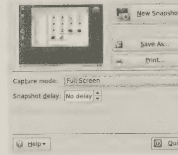

图 4.5：Snapshot

### 4.4.7 使用 KPDF 查看 PDF 文件

PDF 是最重要的格式之一。KPDF 是一个可以查看和打印它们的 KDE 程序。

按 Alt+F2 并输入命令 `kpdf` 启动 KPDF。通过“文件（File）”→“打开（Open）”加载 PDF 文件。KPDF 在其主窗口中显示它。左侧是带有缩略图和内容的侧边栏。缩略图提供了页面概述。内容包含书签。有时它是空的，这意味着不支持书签。

要在主窗口中查看双页，选择“视图（View）”→“双页（Two Pages）”。视图取决于你在“视图”菜单中激活了哪些选项。另一个很棒的选择是使用工具栏上的选择工具选择你感兴趣的区域。画一个矩形并在弹出菜单中选择你需要将该区域作为文本还是图形。它将被复制到剪贴板。

### 4.4.8 与朋友聊天：Kopete

Kopete 是一款在线消息应用程序，允许连接到互联网的多个伙伴相互聊天。Kopete 目前支持所有消息协议，如 ICQ、MSN、Yahoo、SMS、Jabber 和 IRC。

# 配置 Kopete

通过输入个人用户数据配置 Kopete。点击“设置（Settings）”→“配置 Kopete（Configure Kopete）”。连接（Connections）”显示所有当前可用协议。勾选所需的连接以激活它。

在“账户（Accounts）”中输入你的用户数据。在使用此类服务之前必须向提供即时消息的服务注册。点击“新建（New）”打开配置向导，它可以协助你完成用户配置。

下一步列出了可用的消息服务。选择你已注册的服务并点击“继续”。然后输入注册消息服务时获得的用户数据。这通常包括昵称或电子邮件和密码。点击“完成（Finish）”完成消息账户的配置。


相应的提供者，或根据个人喜好调整字体颜色创建自定义主题。

# 添加联系人

添加联系人以与其聊天。如果你已经在另一台电脑上创建了账户，这些数据将被导入并自动添加到你的联系人列表中。要手动创建联系人条目，点击“文件” → “添加联系人”。将出现一个新的助手来帮助创建。但是，你必须保持在线状态才能将联系人添加到列表中。

# 添加分组

通过‘文件’ →‘创建新分组’访问此功能。为群组命名并点击‘确定’确认。联系人列表中会出现一个新分组，可用于存储所需的联系人。将联系人拖入目标文件夹中。对联系人进行分组可以获得更好的概览。

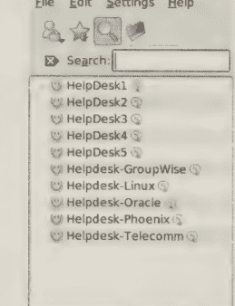

图 4.7：Kopete 主窗口

# 使用 Kopete

必须建立 Internet 连接才能与其他参与者聊天。完成后，点击‘文件’ →‘连接’ →‘连接所有’即可在 Kopete 与所选的消息服务之间建立连接。

主应用程序窗口显示联系人列表。当你右键点击标记为在线的联系人时，会打开一个包含各种选项的菜单。向该人员发送消息或开始聊天。聊天允许邀请额外的参与者进行实时讨论。当聊天会话创建者关闭时，与所有参与者的连接也会关闭。

通过右键点击用户名来传输文件。在打开的菜单可以找到许多选项，如‘删除联系人’‘显示用户信息’‘锁定用户’和‘发送文件’。点击‘发送文件’将打开选择所需文件的对话框。点击‘确定’将向接收者发送对话框，询问其是否接受该文件。如果接受，将开始传输。

### 4.4.9 KDE 辅助工具

KDE 为日常计算机工作提供了残障支持。KDE 中有许多选项，特别是 KDE 控制中心中的‘区域与辅助功能’→‘辅助功能’。一些额外的程序有助于满足特定需求。

# KMag–放大你的桌面

视力低的人士在提高桌面可见性方面的选择有限。可以增大字体大小，但这并不总是好的解决方案。KMag 工具解决了这个问题。它是一个放大桌面的工具。从运行命令 kmag 开始，即可在 KMag 窗口中看到部分屏幕。

使用工具栏选择一些重要选项，如缩放、刷新率以及 KMag 的行为方式。你可以放大鼠标光标周围区域、显示选择放大区域的窗口，或放大整个屏幕。使用 ⊘ 停止进程。再次按下它即可重启。

# KTTS—KDE 文本转语音管理器

KTTS 是从文本生成语音系统的实现。这使得其他应用程序能够一致地使用此子系统。KTTS 的功能包括读取文本文件内容、KDE 通知事件以及 Konqueror 中网页的全部或部分文本。在配置 KTTS 之前，请确保已安装了 festival 和 KDE 辅助功能包。

SUSE LINUX

93


# 注意事项

其他语言
由于许可证不兼容，我们的发行版中仅包含英语。有关 festival 的更多信息，请参阅：http://festvox.org/。

要启动 KTTS，按下 Alt+F2 并输入 kttsmgr。如果你尚未配置 KTTS，将出现一个带有空列表的语音器屏幕。点击‘添加’向列表中添加一个语音器。这会打开一个新的对话框。按名称或语言选择语音合成器插件。选好合成器后，合成器框和语言框将更新。例如，勾选合成器框并选择‘Festival Interactive’。如果你点击‘确定’退出，合成器会自动对其进行配置。

在此示例中，‘Festival Interactive’语音器已添加到列表中。要对其进行配置，选择它并进入‘编辑’。页面上会显示一个与当前页面图 4.8 类似的对话框。在其中，选择语音（如果有多个可用语音），设置音量、速度和音调，并进行测试。点击‘确定’确认。

| Festival Interactive 配置 | |
| :--- | :--- |
| 可执行文件: /usr/bin/festival | |
| 语音: American Male (kal_diphone) | |
| 音量: 100 % | |
| 速度: 100 % | |
| 音调: 100 % | |
| 字符编码: ISO 8859-1 | |
| 启动 KTTS 时加载此语音 | 测试 |

图 4.8：配置语音器

KTTS 还有一些额外的标签。通过‘常规’，可以启用或禁用文本转语音服务。通知是从应用程序路由到 KDE 通知系统的消息。你可以通过‘语音通知 (KNotify)’对其进行配置。要将 KTTS 嵌入系统托盘中，请勾选相应选项。

94 4.4 重要实用工具

‘语音器’标签在上方已说明。在‘音频’中，可以在 ALSA 和 GStreamer 两个声音系统之间进行选择。‘任务’提供了你当前语音任务的概览。你可以暂停、恢复、重启、删除或更改任务的顺序。

# KMouth—使用 KDE 语音

KMouth 是一个设计用于发的程序。当你首次启动 KMouth 时，会出现一个向导。这允许你配置合成器。要查看系统字体，点击‘语音’标签页。

主窗口显示可用字体。要添加自己的字体，请从工具栏选择‘添加字体’。标记的字体将被安装到你的个人字体文件夹。

### 4.4.10 使用 Fontint 进行字体管理

默认情况下，SUSE LINUX 提供了各种格式的字体。这些被称为系统字体。用户还可以从各种集合安装自己的字体。要要作为用户安装字体，请遵循以下步骤：

- 启动控制中心并通过‘系统管理’→‘字体安装器’访问相应模块。
- 从工具栏或右键点击列表时出现的菜单中选择‘添加字体’。
- 在打开的对话框中选择一个或多个字体进行安装。
- 标记的字体将被安装到你的个人字体文件夹。

要更新系统字体，首先选择‘管理员模式’并输入 root 密码。然后按照上述安装用户字体的方法进行操作。


# 帮助与文档

SUSE LINUX 提供了多种信息源和文档。SUSE 帮助中心以可搜索的形式，提供了集中访问系统上最重要的文档资源。这些资源包括已安装应用程序的在线帮助、手册页（man pages）、info 页（info pages）、硬件和软件主题的数据库，以及随产品交付的所有手册。

- 5.1 使用 SUSE 帮助中心 . . . . . . . . . . . . . . . 100
- 5.2 手册页 (Man Pages) . . . . . . . . . . . . . . . . . . . . . . . . . . . 102
- 5.3 Info 页 (Info Pages) . . . . . . . . . . . . . . . . . . . . . . . . . . . 103
- 5.4 Linux 文档项目 . . . . . . . . . . . . . . . 104
- 5.5 维基百科：自由在线百科书 . . . . . . . . . . 105
- 5.6 指南与书籍 . . . . . . . . . . . . . . . . . . . . . . . . 105
- 5.7 Usenet . . . . . . . . . . . . . . . . . . . . . . . . . . . . 106

## 5.1 使用 SUSE 帮助中心

当你从主菜单（“SuSE help-center”）或在 shell 中通过 `susehelp` 命令首次启动 SUSE 帮助中心时，将显示对面图 5.1 所示视图。对话窗口由三个主要区域组成：

## 菜单栏和工具栏

菜单栏提供了主要的编辑、导航和配置选项。“文件”包含打印当前内容的选项。在“编辑”下可以访问搜索功能。“转”包含“目录”（帮助中心首页）、“后退”、“前进”和“上次搜索结果”。通过“设置”->“生成搜索索引”，为所有选定的信息源生成搜索索引。工具栏包含三个导航图标（前进、后退、首页）和一个用于打印内容的打印机图标。

## 带有标签页的导航区域

窗口左部分的导航区域提供了一个输入字段，用于在选定的信息源中进行快速搜索。有关搜索以及“搜索”标签页中搜索功能的配置细节见下一页的第 5.1.2 节。“内容”标签页显示所有可用和当前安装的信息源的树形视图。点击书籍图标打开并浏览各个类别。

视图窗口视图窗口始终显示当前选的内容，例如在线手册、搜索结果或 Web 页面。

### 5.1.1 内容

SUSE 帮助中心提供了从各种来源获取有用信息。它包含了 SUSE LINUX 的特殊文档（用户指南和管理指南）、你工作站环境的所有可用信息源、已安装程序的在线帮助以及其他程序的帮助文本。此外，SUSE 帮助中心提供了访问 SUSE 在线数据库的权限，这些数据库涵盖了 SUSE LINUX 的特殊硬件软件问题。一旦生成搜索索引，就可以方便地搜索所有来源。

### 5.1.2 搜索功能

要搜索 SUSE LINUX 的所有安装信息源，需要生成搜索索引并设置若干搜索参数。执行此操作，请打开“搜索”标签页。见下一页的图 5.2。

如果没有生成搜索索引，当你在点击“搜索”标签页或输入搜索字符串并点击“搜索”时，系统会自动提示你生成。在生成搜索索引的对话框中（见第 104 页的图 5.3），使用复选框确定要索引的信息源。通过“生成索引”退出对话框时，将生成索引。

为了尽可能精确地限制搜索范围和命中列表，请使用三个下拉菜单来确定显示的命中数量和搜索源的选择区域。有以下可选选项用于确定选择区域：

- **默认**：搜索预定义的源选择。
- **全部**：搜索所有源。
- **无**：未选择任何源进行搜索。

图 5.1：SUSE 帮助中心主窗口

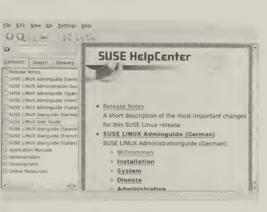

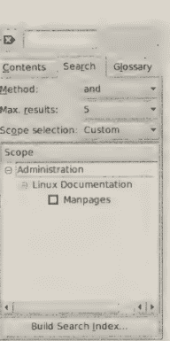

图 5.2：配置搜索功能

**自定义**：通过激活概述中相应的复选框来确定要搜索的源。

当你完成搜索配置后，点击“搜索”。相关项目将显示在视图窗口中，并可以通过鼠标点击轻松导航。

## 5.2 手册页 (Man Pages)

手册页是任何 Linux 系统不可或缺的一部分。它们解释了命令用法以及所有可用选项和参数。手册页按类别排序，如本页表 5.1 所示（取自 man 命令的手册）。

表 5.1：手册页——类别与描述

| 编号 | 描述 |
| --- | --- |
| 1 | 可执行程序或 shell 命令 |
| 2 | 系统调用（内核提供的函数） |
| 3 | 库调用 |
| 4 | 特殊文件 |
| 5 | 文件格式 |
| 6 | 游戏 |
| 7 | 其他 |
| 8 | 系统例程 |
| 9 | 内核 |

## 5.3 Info 页

Info 页是另一个信息源。它们比手册页更详细详尽。例如，输入 grep。

## 5.4 Linux 文档项目

Linux 文档项目 (TLDP) 由一个志愿者团队运行，他们编写 Linux 相关的文档（参见 http://www.tldp.org）。该文档集包含面向初者的教程，但主要面向经验丰富的用户。TLDP 在免费许可下发布 HOWTOs、FAQs 和指南。

### 5.4.1 HOWTOs

HOWTO 通常是简短、非正式的步步式指南，用于完成某特定任务。它们由专家为非专家编写。例如，如何配置 DHCP 服务器。

### 5.4.2 常见问题

FAQs（frequently asked questions）是一系列问题和解答。它们源于 Usenet 新闻组，其目的是减少持续重复发布相同的基础问题。

## 5.5 维基百科：自由在线百科书

维基百科是一个“旨在供任何人阅读和编辑的多语言语言百科全书”（参见 http://en.wikipedia.org）。维基百科的内容由其用户创建，并根据免费许可（GDFL）发布。任何访问者都可以编辑文章，这带来了破坏的风险，但并不会阻碍访问者。拥有数十万篇文章，可以为几乎每个主题找到答案。

## 5.6 指南与书籍

Linux 提供了广泛的指南和书籍。

### 5.6.1 SUSE 书籍

SUSE 提供了详细且丰富的书籍——用户指南和管理指南。我们提供多种语言的书籍 HTML 和 PDF 版本。

### 5.6.2 其他手册

SUSE 帮助中心提供了针对各种主题或程序的额外手册和指南。更多可以在 http://www.tldp.org/guides.html 找到。


它们的范围从《初学者 Bash 指南》到《Linux 文件系统层次结构管理员安全指南》。通常情况下，指南比 HOWTO 或 FAQ 更详尽、全面。它们通常由专家为专家编写。其中一些书籍虽然老旧但仍然有效。使用 YaST 安装书籍和指南。

## 5.7 Usenet

Usenet 创建于 1979 年（互联网出现之前），是最老的计算机网络之一，目前仍在在使用。Usenet 文章的格式和传输方式与电子邮件非常相似，但它是为了多对通信而开发的。

Usenet 分为七类典型类别：comp.* 用于计算机相关讨论，misc.* 用于杂项，news.* 用于新闻组相关事务，rec.* 用于休闲和娱乐，sci.* 用于科学相关讨论，soc.* 用于社交讨论，以及 talk.* 用于各种有争议的话题。顶层被划分为子组。例如，comp.os.linux.hardware 是一个专门用于 Linux 硬件问题的新闻组。

在发布文章之前，请让您的客户端连接到新闻服务器并订阅特定的新闻组。新闻客户端包括 Knode 或 Evolution。每个新闻服务器都与其他新闻服务器通信并与之交换文章。并非所有的新闻组在您的新闻服务器上都可用。

对 Linux 用户感兴趣的新闻组是 comp.os.linux.apps

# 第二部分

## 办公

## OpenOffice.org 办公套件

OpenOffice.org 是一个强大的办公套件，为所有类型的办公任务提供工具，例如编写文本、处理电子表格或创建图形和演示文稿。通过 OpenOffice.org，可以在不同的计算平台之间使用相同的数据。如果需要，您还可以打开并编辑 Microsoft Office 格式的文件，将其保存回该格式。本章仅涵盖入门 OpenOffice.org 所需的基础技能。从 SUSE 菜单或使用命令 ooffice 启动应用程序。

- 6.1 与其他办公应用程序的兼容性 . . . . . . . . 110
- 6.2 使用 Writer 进行文字处理 . . . . . . . . . . . . 111
- 6.3 介绍 Calc . . . . . . . . . . . . . . . . . 115
- 6.4 介绍 Impress . . . . . . . . . . . . . . . . . 115
- 6.5 介绍 Base . . . . . . . . . . . . . . . . . . 115
- 6.6 更多信息 . . . . . . . . . . . . . . . . 115

OpenOffice.org 由几个应用程序模块（子程序）组成，这些模块旨在相互交互。它们列在当前页的表 6.1 中。本章的重点是 Writer。每个模块的完整描述可以在在线帮助中找到，见 115 页第 6.6 节。

### 表格 6.1：OpenOffice.org 应用程序模块

| 模块 | 描述 |
|--- | |
| Writer | 强大的文字处理应用程序 |
| Calc | 包含图表工具的电子表格应用程序 |
| Draw | 用于创建矢量图形的绘应用程序 |
| Math | 生成数学公式的应用程序 |
| Impress | 创建演示文稿的应用程序 |
| Base | 数据库应用程序 |

应用程序的外取决于使用的桌面或窗口管理器。此外，还会使用您桌面的打开和保存对话框格式。无论外观如何，基本的布局和功能都是相同的。

## 6.1 与其他办公应用程序的兼容性

OpenOffice.org 可以处理 Microsoft Office 文档、电子表格、演示文稿和数据库。它们可以像其他文件一样无缝打开并保存回该格式。由于 Microsoft 格式是封闭的，其他应用程序无法获取特定细节，偶尔会出现格式问题。如果您的文档出现问题，请考虑在原始应用程序中打开它们并重新保存为开放格式，例如文本文档的 RTF 或电子表格的 CSV。

要转换大量文档（例如在切换应用程序时），选择‘文件’ →‘向导’ →‘文档转换器’。选择要转换的文件格式。有多种 StarOffice 和 Microsoft Office 格式可用。选择格式后，点击‘下一步’，然后指定 OpenOffice.org 在何处查找模板和待转换文档，以及转换后的文件应放在哪个目录。在继续之前，确保所有其他设置均当。点击‘下一步’查看要执行的操作摘要，这提供了另一个检查所有设置是否正确的机会。最后，点击‘转换’开始转换。

## 重要

### 查找 Windows 文件

来自 Windows 分区的文档通常位于 /windows 的子目录下。

## 重要

在与他人共享文档时，您有几种选择。如果接收者只需要读取文档，请通过‘文件’ →‘导出为 PDF’将其导出为 PDF 文件。PDF 文件可以使用 Adobe Acrobat Reader 等查看器在任何平台上阅读。若要共享用于编辑的文档，请使用一种常规文档格式。默认格式符合 OASIS 标准 XML 格式，使其兼容许多应用程序。TXT 和 RTF 格式虽然格式限制有限，但可能是文本文档的好选择。CSV 对于电子表格很有用。OpenOffice.org 可能还会提供接收者偏好的格式，特别是 Microsoft 格式。

OpenOffice.org 支持多种操作系统。这使得当一组用户经常需要共享文件且电脑没有使用相同系统时，它是一个极佳的工具。

## 6.2 使用 Writer 进行文字处理

创建新文档有两种方法。要从头创建文档，使用‘文件’ →‘新建’ →‘文本’。要使用标准格式，请尝试向导。向导是让您做出决策并生成制作文档的小型工具。例如，要创建信函，选择‘文件’ →‘向导’ →‘信’。使用向导的对话框，利用模板轻松创建基础文档。示例对话框见 113 页的图 6.2。

在窗口中输入文本。使用‘格式’工具栏或‘格式’菜单调整文档外观。使用‘文件’菜单或工具栏上的相关按钮打印并保存文档。通过‘插入’下的选项向文档添加额外项目，如表格、图片或图表。

### 6.2.1 选择文本

要选择文本，点击选择范围的起点，按住鼠标按钮移动到范围末端（可以是字符、行或整个段落）。选中所有文本后释放按钮。选中的文本将以反色显示。通过右键点击打开右键菜单。使用右键菜单更改字体、字体样式和其他文本属性。

选中文本可以剪切或复制到剪贴板。剪切或复制的文本可以粘贴到文档的其他位置。使用右键菜单、“编辑”或相关的工具栏图标访问这些功能。

### 6.2.2 在大型文档中导航

导航器显示文档的内容。它还允许快速跳转到不同的元素。例如，使用导航器快速概述所有章节，或查看文档包含的图像列表。选择‘编辑’ →‘导航器’打开它。导航器中的元素随加载到 Writer 中的文档而异。

### 6.2.3 使用样式进行格式化

通过‘格式’ →‘样式和格式’打开的对话框可以帮助以多种方式格式化文本。如果您将此对话框底部的列表设置为‘自动’，OpenOffice.org 会尝试提供适应当前任务的样式选择。如果您选择‘所有样式’，将提供当前活动组中的所有样式。使用顶部的按钮选择组。


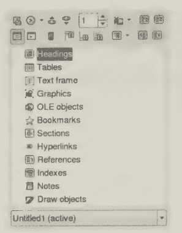

通过这种被称为“软格式化”的方法对文本进行格式化，文本不会被直接格式化，而是对其应用一种样式。可以轻松修改样式，从而自动导致所有分配了该样式的发生格式更改。

要为段落分配样式，选择该样式，然后点击“样式和格式”（Styles and Formatting）中的油桶图标。点击要分配样式的段落。按 Esc 键或再次点击油桶图标即可停止分配样式。

通过“格式”（Format）菜单或工具栏对段落或字符进行所需的格式化，可以轻松创建自己的样式。选择要复制样式的格式项目。然后点击并按住“样式和格式”（Styles and Formatting）中桶右侧的按钮，从打开的菜单中选择“从选择新建样式”（New Style from Selection）。为样式输入名称并点击“确定”。可以将此样式应用于其他文本。

通过在列表中选择样式、右键点击它并从菜单中选择“修改”（Modify）来更改样式的细节。这将打开一个对话框，其中提供了所有可能的格式属性以供修改。

图 6.3：Writer 中的导航器

## 6.3 介绍 Calc

Calc 是 OpenOffice.org 的电子表格应用程序。通过“文件” → “新建” → “电子表格”创建新电子表格，或通过“文件” → “打开”打开现有。Calc 可以读取和保存 Microsoft Excel 格式。

在电子表格单元格中输入固定数据或公式。公式可以处理其他单元格的数据，以为插入的单元格生成值。您还可以根据单元格值创建图表。

## 6.4 介绍 Impress

Impress 用于创建用于显示或打印的演示文（如幻灯片）。通过“文件” → “新建” → “演示文”从头创建演示文。要借助向导创建，请使用“向导” → “演示文”。通过“文件” → “打开”打开现有的演示文。Impress 可以打开并保存 Microsoft PowerPoint 演示文。

## 6.5 介绍 Base

OpenOffice 2.0 引入了新的数据库模块。通过“文件” → “新建” → “数据库”创建数据库。将打开一个向导协助创建数据库。Base 也可以与 Microsoft Access 数据库配合。

表、表单、查询和报告可以手动创建或使用方便的向导。例如，表格向导包含许多业务和个人常用的字段。在 Base 中创建的数据库可以作为数据源，例如在编写信函时。

## 6.6 更多信息

OpenOffice.org 包含多个提供不同级别信息的选项。要彻底熟悉某个主题，请选择“帮助” → “OpenOffice.org 帮助”。帮助系统提供了有关 OpenOffice.org 每个模块（Writer、Calc、Impress 等）的深入信息。

文件 编辑 视图 插入 窗口 帮助

| | 描述 |
| :--- | :--- |
| | 在设计视图中创建表... | 从一组业务和个人表格样本中选择，并对其进行自定义以创建表格。 |
| | 使用向导创建表... | |
| | 创建视图... | |

查询

表单

无

报告

嵌入式数据库 HSQL 数据库引擎

# 图 6.4：Base—OpenOffice.org 中的数据库

当应用程序首次启动时，它会提供“提示”（Tips，鼠标悬停在按钮上时的简要信息）和“帮助助手”（Help Agent，基于所执行操作的信息）。要通过“提示”获取有关按钮的更多信息，请使用“帮助” → “这是什么”（What’s This），然后悬停在所需的按钮上。点击即可结束“这是什么”。如果您经常需要此功能，请考虑在“工具” → “选项” → “OpenOffice.org” → “常规”中启用“扩展提示”（Extended Tips）。在此处也可以启用和禁用“帮助助手”和“提示”。OpenOffice.org 网站为 http://www.openoffice.org。在该网站上可以找到邮件列表、文章和错误信息。该网站提供了各种操作系统的版本下载。

116 6.6. 更多信息

# Evolution：一个电子邮件和日历程序

Evolution 是一组工作软件套件，提供常规电子邮件功能以及扩展功能，如任务列表和日历。该应用程序还提供完整的地址簿，包括以 vCard 格式向他人发送联系信息的能力。

- 7.1 从其他邮件程序导入电子邮件 . . . . . . . 118
- 7.2 Evolution 概述 . . . . . . . . . . . . . . . . . . . . 118
- 7.3 邮件 . . . . . . . . . . . . . . . . . . . . . . . . . . . 120
- 7.4 联系人 . . . . . . . . . . . . . . . . . . . . . . . . . . . . 123
- 7.5 日历 . . . . . . . . . . . . . . . . . . . . . . . . . . . . 125
- 7.6 与手持设备同步数据 . . . . . . . . . . . . . . . . . . . 126
- 7.7 更多信息 . . . . . . . . . . . . . . . . . . . . . . . . . . . . . 127

从主菜单启动 Evolution。首次启动时，Evolution 会出现一个助手。其用法在第 7.1 节中描述。

**重要**
使用 Evolution
在撰写消息时，可以选择用于发送电子邮件的账户。

## 7.1 从其他邮件程序导入电子邮件

Evolution 可以从其他程序导入电子邮件，例如。使用“文件” → “新建” → “导入”。对于 mbox 格式，选择工具栏。

## 7.2 Evolution 概述

初始显示一个视图。还有周、月、日视图。

## 7.3 邮件

Evolution 组件可以与多个账户配合。它提供了实用功能，如用于搜索和过滤垃圾邮件的虚拟文件夹。

### 7.3.1 配置账户

Evolution 能够从多个账户获取电子邮件。在撰写消息时，可以选择用于发送电子邮件的账户。

## 7.2 联系人

此视图显示所有地址。使用搜索栏在相应字段查找查找电子邮件。

## 7.3 日历

日历显示预约列表。

## 7.24 任务

“任务”提供了任务列表。所选任务的细节显示在下部分。


默认情况下，使用电子邮件地址作为标识账户的名称。如果需要，请输入另一个名称。点击“转发”（Forward）。点击“应用”（Apply）保存您的账户配置。

要将某个账户设置为发送电子邮件的默认账户，选择所需的账户然后按“默认”（Default）。要禁用从某个账户获取电子邮件，选择该账户并点击“禁用”（Disable）。被禁用的账户仍可用作发送地址，但该账户将不会检查入站邮件。如有必要，可以使用“启用”（Enable）对其进行激活。

## 7.3.2 创建消息

要撰写新消息，点击“新建”（New）→“邮件消息”（Mail Message）。回复或转发消息将打开消息编辑器。在“发件人”（From）旁边，选择要从哪个账户发送消息。在收件人字段中，输入电子邮件地址或地址簿中的姓名或地址部分。如果 Evolution 能将您输入的内容与地址簿中的内容相匹配，将显示选择列表。点击所需的联系人或如果是姓名，则完成输入。如需直接从地址簿中选择，点击“收件”（To）或“抄送”（CC）。

Evolution 可以以纯文本或 HTML 格式发送电子邮件。要格式化 HTML 邮件，请选择工具栏中的“格式”（Format）。在附件中，选择“附件”（Attach）或“插入”（Insert）→“附件”（Attachment）。

发送消息时点击“发送”（Send）。如果不准备立即发送，可以在“文件”（File）下进行其他选择。例如，将消息保存为草稿或稍后发送。

## 7.3.3 加密邮件与签名

Evolution 支持使用 PGP 进行电子邮件加密。它可以对电子邮件进行签名并检查邮件内容。要使用这些功能，请使用外部应用程序（如 gpg 或 KGPG）生成并管理密钥。

在发送之前对邮件消息签名，点击“安全”（Security）→“PGP 签名”（PGP sign）。当您点击“发送”时，对话框会提示私钥密码。输入密码并点击“确定”（OK）以发送签名邮件。为了在此会话期间发送其他邮件而无需反复“解锁”私钥，请激活“在此会话期间记住此密码”（Remember this password for the remainder of this session）。

当您收到来自其他用户的邮件时，消息末尾会出现一个小锁图标。如果您点击此符号，Evolution 将启动外部程序 (gpg) 来检查签名。如果签名有效，锁图标旁边会出现绿色勾钩。如果签名无效，则会出现破损的锁图标。

邮件的加密和解密同样简单。撰写邮件消息后，前往“安全”（Security）→ PGP 加密（PGP encrypt）并发送邮件。当您收到加密消息时，会打开一个对话框询问您的私钥密码。输入密码以解密邮件消息。

## 7.3.4 文件夹

将邮件消息分类到各种文件夹通常非常方便。您的文件夹树显示在左侧框架中。如果访问 IMAP 邮件，IMAP 文件夹也会显示在此文件夹栏中。对于 POP 和大多数格式，您的文件夹存储在本地，并分类在“本地文件夹”（Local Folders）下。

默认包含几个文件夹。“件箱”（Inbox）是从服务器获取的新邮件初始存放的地方。“发送”（Sent）用于保存邮件消息的副本。“发件箱”（Outbox）是尚未发送邮件的临时存储。它对于保存离线邮件或邮件服务器临时无法访问的情况有用。“草稿”（Drafts）用于保存未完成的邮件消息。“垃圾箱”（Trash）旨在临时存储删除的项目。“垃圾邮件”（Junk）用于 Evolution 的垃圾分类功能。

可以在“本机电脑”（On This Computer）下或现有文件夹的子文件夹创建新文件夹。可以根据需要创建复杂的文件夹层次结构。要创建新文件夹，选择“文件”（File）→“新建”（New）→“邮件文件夹”（Mail Folder）。在随后的对话框中为新文件夹命名。使用鼠标确定放置新文件夹的父文件夹。点击“确定”（OK）退出对话框。

要将消息移动到文件夹，选择要移动的消息。右键打开上下文菜单。选择“移动到文件夹”（Move to Folder），并在打开的对话框中选择目标文件夹。点击“确定”（OK）移动消息。原文件夹中的消息头将显示删除线，意味着在该文件夹中已标记为删除。消息存储在新文件夹中。可以以类似的方式复制消息。

手动将许多消息移动到不同的文件夹可能耗时。可以使用过滤器来自动化此过程。

## 7.3.5 过滤器

Evolution 为过滤电子邮件提供了多种选项。过滤器可用于将消息移动到特定文件夹或删除消息。也可以通过过滤器将消息直接移动到垃圾箱。创建新过滤器有两种选项：从头开始创建过滤器或基于消息创建过滤器。过滤器对于过滤发送到邮件列表的消息非常有用。

### 设置过滤器

选择“工具”（Tools）→“过滤器”（Filters）。此对话框列出了您的过滤器，可以对其进行编辑或删除。点击“添加”（Add）创建新过滤器。要基于消息创建过滤器，请先选择消息，然后选择“工具”（Tools）→“从消息创建过滤器”（Create Filter from Message）。

在“规则名称”（Rule Name）中为新过滤器输入名称。选择用于过滤器的标准。选项包括发件者、收件人、源账户、主题、日期和状态。显示“包含”（Contains）的下拉框提供了多种选项，如“包含”和“不包含”。输入要搜索的文本。点击“添加”（Add）添加更多过滤标准。使用“执行操作”（Execute actions）确定必须满足全部或部分标准。在窗口下部，确定满足过滤器时要执行的操作。例如，可以将消息移动或复制到文件夹。在移动或复制时，选择目标文件夹。在出现的文件夹列表中选择该文件夹。使用“新建”（New）创建新过滤器。完成后点击“确定”（OK）。

### 应用过滤器

过滤器按照通过“工具”（Tools）→“过滤器”（Filters）访问时列出的顺序应用。通过高亮过滤器并点击“向上”（Up）或“向下”（Down）更改顺序。点击“确定”（OK）关闭过滤器。

## 7.4 联系人

Evolution 可以使用多个地址簿。可用的地址簿列在左侧框架中。使用搜索栏搜索特定联系人。使用“文件”（File）→“导入”（Import）以多种格式向 Evolution 地址簿添加联系人。右键点击联系人打开菜单，从中可以选择各种选项，例如转发联系人或将其保存为 vCard。双击联系人进行编辑。

| 文件 (File) | 编辑 (Edit) | 查看 (View) | 查看 (View) | 操作 (Actions) | 工具 (Tools) | 帮助 (Help) |
|---|---|---|---|---|---|---|
| 新建 (New) | 发送/接收 (Send / Receive) | 打印 (Print) | | | | |
| 个人 (Personal) | 姓名开头 (Name begins with) | | | | | |
| 本机电脑 (On This Computer) | Linux, Tur | 收件人 (To) | 全名: Geekard (Full Name: Geekard) | | | |
| LDAP 服务器上 (On LDAP Servers) | 全名: tur (Full Name: tur) | 昵称: Geeko (Nickname: Geeko) | | | |
| | tur@example.com | 邮件1: geeko@example.com (Email 1: geeko@example.com) | | | | |
| | 邮件1: tushome@example.com | 邮件2: geekozone@example.com (Email 2: geekozone@example.com) | | | | |
| | 邮件2: 业务名称: (Business Name:) | | | | | |

* 邮件 (Mail): geeko@example.com
* 联系人 (Contacts): geekozone@example.com
* 日历 (Calendars): 工作 (work)
* 任务 (Tasks): 电话 (Phone): 777-777-777
* Exchange (Exchange): 个人 (personal) 电话 (Phone): 777-777-778 123 Next Drive
 Linux Town
7482 Antarctica

图 7.2：Evolution 地址簿

### 7.4.1 添加联系人

除了姓名和电子邮件地址外，Evolution 还可以存储关于人的其他地址和联系信息。可以通过右键点击消息预览中标记的地址来快速添加发送者的电子邮件地址。要输入全新的联系人，请点击“联系人”视图中的“新建联系人”（New Contact）。两种方法都会打开一个输入联系信息的对话框。

在“联系人”（Contacts）选项卡中，输入联系人的姓名、电子邮件地址、电话号码和即时消息身份。“个人信息”（Personal Information）用于 Web 地址和其他详细信息。在“邮件地址”（Mailing Address）中输入联系人的其他地址信息。输入所有所需详情后，点击“确定”（OK）将其添加到地址簿。


## 7.4.2 创建列表

如果您经常向一组人员发送电子邮件，可以通过创建列表来使操作更简单。点击‘文件’ →‘新建’ →‘联系人列表’。将打开联系人列表编辑器。为列表输入一个名称。通过在框中输入地址并点击‘添加’，或从‘联系人’视图中拖动联系人并将其到框中来添加地址。切换‘隐藏地址’以选择收件者是否能看到其他人也收了邮件。完成后点击‘确定’。现在该列表是您的联系人之一，并在输入前几个字母后出现在撰写窗口中。

### 7.4.3 添加通讯录

在账户的账户配置中配置额外的 GroupWise 和 Exchange 通讯录。要添加额外的本地或 LDAP 通讯录，选择‘文件’ →‘新建’ →‘通讯录’。在打开的对话框中选择类型并输入所需信息。

## 7.5 日历

Evolution 可以与多个日历协同工作。通过‘文件’ →‘导入’导入 iCalendar 格式的日历。使用日历输入预约并与他人安排会议。如果需要，可以提醒您的计划。

### 7.5.1 添加预约

要向日历添加新预约，请点击‘文件’ →‘新建’ →‘预约’。在‘预约’选项卡下输入预约详细信息。选择一个类别，如果需要，启用搜索和排序列表。可选地，在‘闹钟’下设置让 Evolution 在预约之前提供提醒。如果预约定期发生，请在‘重复性’下进行设置。完成所有设置后点击‘确定’。新预约将显示在您的日历中。

### 7.5.2 安排会议

要与他人安排会议，选择‘文件’ →‘新建’ →‘会议’。按照预约的方式输入信息。在‘邀请’中添加参与者，或

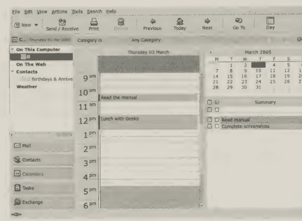

图 7.3：Evolution 日历

‘安排’。要从您的通讯录输入参与者，请使用‘联系人’打开对话框并在其中选择他们。‘安排’也可用于安排适合所有参与者的时间。在配置参与者后按‘自动选择’以查找时间。

### 7.5.3 添加日历

GroupWise 和 Exchange 日历应在账户配置中配置。要添加额外的本地或 Web 日历，选择‘文件’ →‘新建’ →‘日历’。选择所需的类型并输入所需信息。

## 7.6 与手持设备同步数据

Evolution 的设计使其数据可以与手持设备（如 Palm）同步。同步使用 GNOME Pilot。选择‘工具’ →‘Pilot 设置’打开配置向导。更多信息请参考帮助文档。

## 7.7 更多信息

Evolution 提供了丰富的内部帮助页面。使用‘帮助’菜单访问这些信息。有关关于 Evolution 的更多信息，请参考项目网站 http://www.gnome.org/projects/evolution/。

# Kontakt：电子邮件与日历程序

Kontakt 将多个 KDE 应用程序的功能整合到一个方便的单一界面中，用于个人信息管理。这些应用程序包括用于电子邮件的 KMail、用于日历的 KOrganizer、用于联系人的 KAddressbook 以及用于笔记的 KNotes。还可以与外部设备（如手持设备）同步数据。Kontakt 与 KDE 桌面的其他部分轻松集成，并连接到各种群组服务器。它包含额外功能，如垃圾邮件和病毒过滤以及 RSS 阅读器。

- 8.1 从其他邮件程序导入电子邮件 . . . . . . . . 130
- 8.2 Kontakt 概览 . . . . . . . . . . . . . . . . . . . . 130
- 8.3 邮件 . . . . . . . . . . . . . . . . . . . . . . . . . . 132
- 8.4 联系人 . . . . . . . . . . . . . . . . . . . . . . . . . . 136
- 8.5 日历 . . . . . . . . . . . . . . . . . . . . . . . . . . 138
- 8.6 与手持设备同步数据 . . . . . . . . . . . . . . . . . . . . 140
- 8.7 更多信息 . . . . . . . . . . . . . . . . . . . . . . . . . 140

通过主菜单的‘办公室’ →‘个人信息管理器’启动 Contact。或者，在命令行中输入联系人。对于仅部分功能，可以打开单个组件而不是组合应用程序。

## 8.1 从其他邮件程序导入电子邮件

要从其他应用程序导入电子邮件，请在 Contact 的邮件视图中选择‘工具’ →‘导入消息’。它目前功能具有针对 Outlook Express、bbox 格式、电子邮件文本格式、Pegasus Mail 和 Evolution 的导入过滤器。也可以通过命令 `kmailcvt` 启动导入工具。

选择相应的应用程序并点击‘继续’确认。根据所选类型，必须提供文件或文件夹。然后 Kontakt 将完成过程。

## 8.2 Kontakt 概览

显示“摘要”的默认窗口视图在下一页的图 8.1 中。使用左侧部分的按钮访问‘摘要’可以提供有关即将发生事项和待办事项的状态信息。‘摘要’在左侧框架中提供消息列表。

. . . . . . . . . . . . . . . . . . . . . . . . . . . . . . . . . . . . . . . . . . . . . . . . . . . . . . . . . . . . . . . . . . . . . . . . . . . . . . . . . . . . . . . . . . . . . . . . . . . . . 

对于仅部分功能，可以打开单个组件而不是组合应用程序。

[content.

. 8.  .. . . . . . . . . . . . . . . . . . . . . . . . . . . . . . . . . . . . . . . . . . . . . . . . . . . . . . . . . . . . . . . . . . . . . . . . . . . . . . . . . . . . . . . . . . . . . . . . . . . . . . . . . . . . . . . . . . . . . . . . . . . . . . . . . . . . . . . . . . .. ........   ... 。

### 8.2.1 邮件

左侧区域包含文件夹列表。点击文件夹选择它。右侧显示消息内容。附件显示为消息末尾的图标。消息可以使用不同的标记。通过‘消息’→‘标记消息’更改状态。可以使用此功能突出显示您不想忘记的消息。使用搜索栏中的‘状态’显示特定状态的消息。

### 8.2.2 联系人

| 摘要 | |
| :--- | :--- |
| 今天 | 周一 |
| 邮件 | 周二 |
| 联系人 | 周三 |
| 日历 | 周四 |
| 待办事项 | 周五 |
| 笔记 | 周六 |
| 馈源 | 周日 |
| 同步 | |

图 8.1：显示摘要的 Kontakt 窗口

组件的上部框架显示所有激活的通讯录。下部框架列出您的通讯录。右框架显示当前选定的联系人。使用顶部搜索栏查找特定联系人。

### 8.2.3 待办事项

‘待办事项’显示您的任务列表。点击顶部的字段添加新项目。在现有项目的列中点击击右键以更改该列的值。一个项目可以拆分为多个子项目。右键点击并选择‘新建待办事项’创建一个子项目。

### 8.2.4 笔记

使用此组件记录个人笔记。如果您使用 KDE，请使用面板中的 KNote 图标让它们在桌面上可见。

## 8.3 邮件

Kontakt 使用 KMail 作为其电子邮件组件。要配置它，打开邮件组件然后选择‘设置’→‘配置 KMail’。这是一个功能齐全的电子邮件客户端，支持多种协议。‘工具’包含许多有用工具。使用‘查找’对消息进行详细搜索。“反垃圾邮件向导’可以帮助管理不需要的商业电子邮件。“反病毒向导”可以帮助管理病毒邮件。这两个向导与外部垃圾邮件和病毒软件配合。如果选项被禁用，请安装附加包。

### 8.3.1 配置账户

Kontakt 可以管理多个电子邮件地址，例如您的私人电子邮件地址和业务地址。在撰写电子邮件时，通过‘视图’→‘身份’选择之前定义的身份之一。要创建一个新身份


# 8
Kontakt：一个电子邮件和日历程序

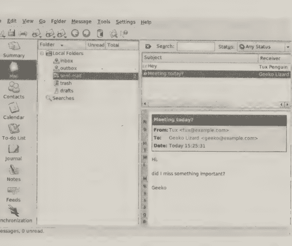

图 8.2：Contact 邮件组件

选择“设置”（Settings）->“配置 KMail”（Configure KMail）然后“身份”（Identities）->“新建”。在打开的对话框中，获取新的身份名称，例如“私人”或“办公”。点击“确定”（OK）进入一个输入额外信息的对话框。

在“通用”（General）选项卡下，输入您的姓名、组织和电子邮件地址。在“加密”（Cryptography）选项卡下，选择您的密钥以发送数字签名或加密的邮件。要使加密功能生效，请先使用 KGPG 创建密钥，详见第 165 页的第 12 章。

在“高级”（Advanced）选项卡下，您可以输入回复地址和密抄地址，选择字典，选择用于草稿和已发送邮件的文件夹，并定义邮件的发送方式。在“签名”（Signature）选项卡下，决定是否以及如何用每条邮件的末尾添加额外的文本进行签名。要激活“启用签名”（Enable Signature），请决定签名应来自文件、输入字段还是命令的输出。完成所有身份设置后，点击“确定”（OK）确认。

“网络”（Network）下的设置决定了 Contact 如何接收和发送电子邮件。这里有两个选项卡，一个用于发送邮件，一个用于接收邮件。

设置取决于您的邮件服务器所在的系统和网络。如果您不确定设置设置或要选择的项目，请咨询您的互联网服务提供商（ISP）或系统管理员。

在“发送”（Sending）选项卡下点击“添加”（Add）创建发送邮件箱。在 SMTP 和 sendmail 服务器类型之间选择。在大多数情况下，SMTP 是正确的选择。选择后，会弹出一个窗口在其中输入 SMTP 服务器数据。提供名称并输入服务器地址（由您的 ISP 提供）。如果服务器要求您进行身份验证，请在“安全”（Security）选项卡下启用“服务器身份验证”。安全设置在此处指定您首选的加密方法。

在“接收”（Receiving）选项卡下进行接收电子邮件的设置。使用“添加”（Add）创建新账户。在不同的获取邮件方法之间选择，例如本地（Mbox 或 Maildir 格式）、POP3 或 IMAP。根据您的服务器进行相应的设置。

## 8.3.2 创建消息

要撰写新消息，选择“消息”（Message）->“新消息”（New Message）或工具栏上相应的图标。要从不同的电子邮件账户发送消息，请按照第 132 页第 8.3.1 节的描述选择一个身份。在收件人字段中，输入电子邮件地址或地址簿中的部分姓名。如果 Contact 能够将您输入的内容与地址簿中的项匹配，将打开一个选择列表。点击所需的联系人，或者在无匹配项时完成您的输入。直接从地址簿中选择，请点击“...”。

要向消息中添加文件，点击回形针图标并选择要添加的文件。或者，从桌面或其他文件夹将文件拖到“新消息”窗口，或选择“添加”（Attach）菜单中的任一选项。通常情况下，文件格式可以被正确识别。如果不是如此，右键点击该图标。在出现的菜单中，选择“属性”（Properties）。这将打开一个设置文件格式、名称并添加描述的对话框。此外，还要决定附件文件是否应被签名或加密。

完成撰写消息后，通过“消息”（Message）->“发送”（Send）立即发送，或通过“消息”（Message）->“队列”（Queue）将其移动到邮箱。如果您选择前者，消息在成功发送后将复制到已发送。如果您选择后者，它将被移动到邮箱。邮箱箱中的消息仍然可以编辑或删除。

## 8.3.3 加密电子邮件和签名

要加密您的电子邮件，请先按照第 165 页第 12 章所述生成密钥对。要配置加密程序的细节，选择“设置”->“配置 KMail”->“身份”，以指定加密和签名消息的身份。然后按“修改”（Modify）。在点击“确定”（OK）确认后，密钥应显示在相应的字段中。点击“确定”（OK）关闭配置对话框。

### 8.3.4 文件夹

消息文件夹有助于组织您的消息。默认情况下，它们位于目录 ~/KMail。当首次启动 KMail 时，程序会创建几个文件夹。inbox 是从服务器获取的新邮件最初存放的地方。outbox 用于临时存储等待发送的消息。sent-mail 用于存储已发送消息的副本。trash 包含通过“删除”或“编辑”->“删除”删除的所有电子邮件副本。使用草稿（drafts）保存未完成的消息。如果您使用 IMAP，IMAP 文件夹将列在本地文件夹下方。

如果您需要额外的文件夹来组织消息，可以通过选择“文件夹”（Folder）->“新建文件夹”（New Folder）来创建。这将打开一个窗口，在其中指定新创建文件夹的名称和格式。

右键点击文件夹将弹出上下文菜单，提供多种文件夹操作。点击“过期”（Expiry）为已读和未读邮件指定过期日期，以及过期后如何处理它们。如果您打算使用该文件夹存储邮件列表的消息，请在“文件夹”->“邮件列表管理”（Mailing List Management）下设置必要选项。

要将一个或多个消息从一个文件夹移动到另一个文件夹，请亮消息并按“选择”（Select）->“移动到”（Move to）。

### 8.3.5 过滤器

过滤器是自动处理传入邮件的方便方法。它们利用发送者或大小特征将邮件移动到某些文件夹、删除不需要的邮件或执行其他操作。

### 设置过滤器

要从头创建过滤器，选择“设置”->“配置过滤器”。要根据现有消息创建过滤器，选择“工具”->“创建过滤器”。在“过滤器操作”（Filter Actions）中设置过滤器应的操作。高级选项提供了对何时过滤器的控制。

### 应用过滤器

过滤器按照“设置->配置过滤器”中列出的顺序应用。要对现有消息应用过滤器，目标消息“应用过滤器”。如果您的过滤器未按预期运行，通过“工具”->“过滤器查看器”（Filter Viewer）进行监控。当在此对话框中启用日志时，它将显示如何处理消息。

## 8.4 Contacts

联系组件使用 AddressBook。通过“设置”->“配置联系”进行配置。要搜索特定联系人，使用搜索栏。通过“过滤器”，选择显示特定类别的联系人。右键点击联系人打开包含多种选项的菜单。

### 8.4.1 添加联系人

要从电子邮件中添加姓名和电子邮件地址的联系人，右键点击主组件中的地址并选择“在地址簿中打开”。要添加全新的联系人，请在联系组件中选择“文件”->“新建联系人”。这两种方法都会打开一个输入联系人信息的对话框。


## 8.4.2 创建列表

如果你经常向一组人员发送电子邮件，可以通过创建列表来简化这一操作。首先，点击“设置”→“显示扩展栏”→“分发列表编辑器”。在出现的新区域中，点击“新建列表”。为列表输入一个名称，然后点击“确定”。通过从地址列表中拖动并将其释放到分发列表窗口，将联系人添加到列表中。在创建邮件时，像使用普通联系人一样使用此列表。

### 8.4.3 添加通讯录

> 重要提示：群件软件通讯录

添加群件软件资源的最佳方法是使用独立工具。要使用它，请关闭 Contact，然后在命令行中运行 `groupwarewizard`。从提供的列表中选择服务器类型（如 SLOX、Groupwise 或 Exchange），然后输入地址和身份验证数据。向程序会将可用资源添加到 Contact。

> 重要：Contact 可以访问多个通讯录，例如通过 Novell GroupWise 共享的通讯录或 LDAP 服务器上的通讯录。选择“设置”→“显示扩展栏”→“通讯录”查看当前通讯录。按“添加”添加一个，然后选择类型并输入所需信息。

通讯录前面的复选框显示每个通讯录的激活状态。若要在不删除的情况下停止显示，请取消勾选。“删除”将从列表中删除选定的通讯录。

## 8.5 日历

Contact 使用 KOrganizer 作为其日历组件。要配置它，请使用“设置”→“配置 KOrganizer”。通过日历输入预约并与他人安排会议。如果需要，可以接收即将发生的活动的提醒。你还可以通过“文件”中的选项导入、导出和存档日历。

# 8

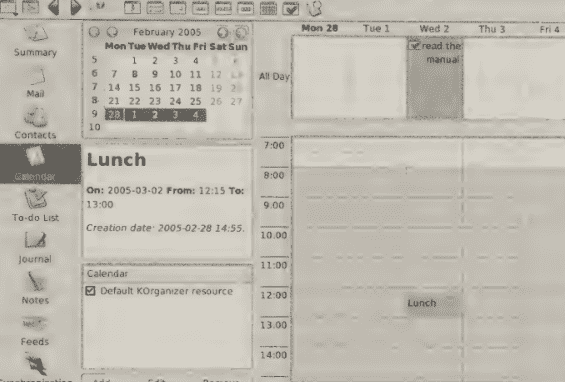

图 8.4：Contact 日历

## 8.5.1 安排事件

通过“操作”→“新建事件”添加新事件或会议。输入所需的细节。在“提醒”下，指定参与者收到事件提醒的具体时间（提前几分钟、小时或天）。如果事件循环发生，请指定间隔。在日历的特定点创建事件的另一种方法是双击程序日历视图中的一个相应字段。这将打开与菜单中相同的对话框。

通过在对话框中手动输入数据或从通讯录插入数据来指定事件的参与者。要手动输入此类数据，选择“新建”。要从通讯录导入数据，点击“选择收件人”，然后在对话框中选择相应的条目。根据参与者的可用性安排事件，进入“空闲/忙碌”并点击“选择日期”。

使用“重复”选项卡配置定期发生的事件。“附件”可以方便与其他与其他与事件关联，例如会议议程。

SUSE LINUX 139

## 8.5.2 添加日历

> 重要提示：

群件软件日历
添加群件软件资源的最佳方法是使用独立工具。要使用它，请关闭 Contact，然后在命令行中运行 `groupwarewizard`。从提供的列表中选择服务器类型（如 SLOX、Groupwise 或 Exchange），然后输入地址和身份验证数据。向程序会将可用资源添加到 Contact。

日历模块可以同时连接到多个日历。这很有用，例如可以将个人日历与组织日历合并。要添加新日历，点击“添加”然后选择日历类型。完成必要的字段。

日历前面的复选框显示每个日历的激活状态。若要在不删除的情况下停止显示，请取消勾选。“删除”将从列表中删除选定的日历。

## 8.6 与手持设备同步数据

Contact 设计使其数据可以与手持设备（如 Palm）同步。在摘要中查看 KPilot 状态的信息。有关配置和使用 KPilot 的信息请参见下一页的第 9 章。

## 8.7 更多信息

Contact 包含了自身及其各种组件的帮助。通过“帮助”→“Contact 手册”访问。项目网页 http://www.kontakt.org 也提供信息。

使用 KPilot 同步手持电脑

手持电脑在需要随身携带日程表、待办事项和笔记的用户中被广泛使用。用户通常希望相同的数据在桌面和便携设备上均可用。这正是 KPilot 发挥作用的地方——它是一个用于同步手持设备数据的工具，供 KDE 应用 KAddressBook、KOrganizer 和 KNotes 使用，这些程序都是 Contact 的一部分。

- 9.1 KPilot 使用的通道 . . . . . . . . . . . . . . 142
- 9.2 配置手持连接 . . . . . . . . . . . . . . 143
- 9.3 配置 KAddressBook 通道 . . . . . . . . . . . . . . . 144
- 9.4 管理待办事项和事件 . . . . . . . . . . . . . . . 145
- 9.5 使用 KPilot . . . . . . . . . . . . . . . . . . . . . . 146

KPilot 的主要目的是允许手持电脑应用程序与其 KDE 对应程序之间共享数据。KPilot 的主要目的是允许手持电脑应用程序与其 KDE 对应程序之间共享数据。KPilot 的主要目的是允许手持电脑应用程序与其 KDE 对应程序之间共享数据。KPilot 的主要目的是允许手持电脑应用程序与其 KDE 对应程序之间共享数据。KPilot 的主要目的是允许手持电脑应用程序与其 KDE 对应程序之间共享数据。KPilot 的主要目的是允许手持电脑应用程序与其 KDE 对应程序之间共享数据。

- 通讯录：此通道处理与手持设备通讯录的数据交换。管理这些联系人的 KDE 对应程序是 KAddressbook。（重复）
- KNotes/备忘录：此通道允许将 KNotes 创建的笔记传输到手持设备的备忘录应用程序。启动 KDE 应用。
- 日历 (KOrganizer)：此通道负责同步预约（事件）。KDE 对应程序是 KOrganizer。
- 待办事项 (KOrganizer)：此通道负责同步待办事项。KDE 对应程序是 KOrganizer。
- 时间同步：此通道将手持设备钟调整为桌面时间。只有当桌面时间本身频繁按间隔进行修正时，才有效。

当开始同步时，通道会逐一激活以执行数据传输。有两种不同的同步方法：HotSync 操作仅同步已启用通道的数据，而备份操作会对手持设备上的所有数据进行完整备份。

某些通道在同步期间打开文件，这意味着相应的程序不应运行。具体而言，在同步期间 KOrganizer 不应运行。

## 9.2 配置手持连接

为了使用 KPilot，首先与手持电脑建立连接。配置取决于与手持设备使用的底座（扩展坞单元）类型。这些有两种类型：USB 底座或电缆，或串口底座或电缆。

## 9.2.1 在 KPilot 中配置连接

设置连接的最简单方法是使用向导。选择“设置”→“配置向导”启动向导。在第一个

步骤，输入您的用户名和手持设备连接的名称。如果您选择“自动检测手持设备与用户名”（Autodetect Handheld & Username），助手将尝试检测。如果自动检测失败，请参考本页的第 9.2.2 节。

确认“下一步”（Next）后，助手会提示您指定用于同步的应用程序。您可以从 KDE 应用程序套（默认）、Evolution 和无中选择。选择后，点击“完成”（Finish）关闭窗口。

### 9.2.2 创建 /dev/pilot 链接

串口手持设备底座的连接与 USB 底座不同。根据所使用的底座，您可能需要也可能不需要创建符号链接 `/dev/pilot`。

USB：通常情况下，USB 底座会自动检测，不需要创建上述符号链接。

串口：使用串口底座，您需要知道它实际上连接到了哪个串口。串口设备被命名为 `/dev/ttyS?`，从第一个端口 `/dev/ttyS0` 开始。要设置连接到第一个串口的底座，请输入命令：

```
ln -s /dev/ttyS0 /dev/pilot
```

## 9.3 配置 KAddressBook 通道

最初，在不更改任何默认设置的情况下启用 KAddressBook 通道即可。在完成首次同步后，再配置详细信息：发生冲突时如何处理、备份数据库的保存方式以及如何将手持设备上存储的某些字段分配给 KAddressBook 预期的字段。

## 9.4 管理待办事项和事件

KDE 桌面、待办事项（任务）和事件（预约）由 KOrganizer 管理。可以通过主菜单启动应用程序、使用命令 `korganizer` 或作为 Contact 的一部分启动它。在启用 KPilot 的日历和待办事项通道后，在使用它们之前先设置一些配置选项。

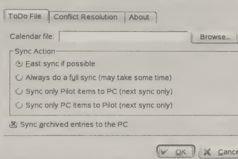

图 9.2：KPilot 配置

KOrganizer 将文件存储在目录 `~/.kde/share/apps/korganizer` 中。然而，由于 `.kde` 目录以点开头，文件选择对话框可能不会显示它。在这种情况下，请手动输入完整路径，或在文件选择对话框中显式切换显示隐藏文件（点文件）。此的默认快捷键是 Ctrl。

打开目录 `~/.kde/share/apps/korganizer` 后，选择一个可以被 KOrganizer 用日历的文件。在本例中，该文件是 `palm.ics`。对于名为 `tux` 的用户，完整路径和文件名为 `/home/tux/.kde/share/apps/korganizer/palm.ics`，如下一页图 9.3 所示。

与手持设备交换数据时，KOrganizer 不应运行。否则 KPilot 将无法执行同步操作。

## 9.5 使用 KPilot

将 KDE 应用程序的数据与手持电脑的数据同步非常简单。只需启动 KPilot，然后按下底座或电缆上的 HotSync 按钮启动同步操作。

### 9.5.1 备份手持设备数据

要进行全备份，选择“文件”（File）->“备份”（Backup）。备份将在下次同步操作期间执行。之后，通过选择菜单中的“文件”->“热同步”（HotSync）切换回来。否则，耗时的全备份将在下次同步时再次执行。

全备份完成后，手持设备程序和数据库的所有副本都位于 `~/.kde/share/apps/kpilot/DBBackup/USERNAME` 中，其中 (USERNAME) 是手持设备上注册的用户名。

两个内置的 KPilot 查看器可以注册用于快速查找地址或备录，但它们并非设计用于实际管理这些数据。上述的 KDE 应用程序更适合这些任务。

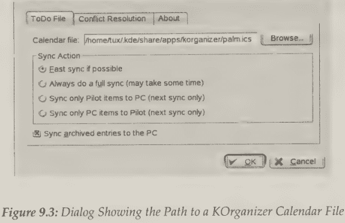

## 使用 KPilot 同步手持电脑

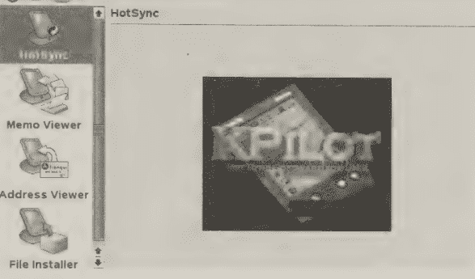

图 9.4：KPilot 主窗口

### 9.5.2 在手持设备上安装程序

“文件安装程序”（File Installer）模块是一个安装手持设备程序的有趣且实用的工具。这些程序通常具有 `.prc` 扩展名，并在上传到手持设备后即可立即启动。在使用此类插件程序之前，请阅读它们的许可以及包含的说明。

### 9.5.3 同步您的地址录和日历

要同步您的日历和地址，请使用 KDE 工具 MultiSync。使用命令 `multisync` 启动该工具。在同步数据之前创建一个连接对（Connector pair）。进入“文件”（File）->“新建”（New）并选择您的 Knectors。点击“确定”（Ok）。

名称列在主窗口中。要与您的手持电脑同步，进入“文件”（File）->“同步”（Sync）。

# 第三部分

## 互联网

## 浏览器

Konqueror 不仅仅是一个管理器。它还是一个现代浏览器。作为浏览器，Konqueror 提供了标签浏览、网页保存、互联网、书签和 JavaScript 支持。

- 10.1 标签页浏览 ................................................... 152
- 10.2 保存网页 ................................................ 153
- 10.3 互联网 ................................................... 153
- 10.4 书签 ................................................................. 154
- 10.5 Java 和 JavaScript ....................................... 155
- 10.6 更多 ................................................................ 155

从主菜单启动 Konqueror。要加载网页，在位置栏中输入地址，例如 `http://www.suse.com`。Konqueror 现在会自动完成地址。对于 FTP 地址，始终在开头输入 `ftp://`。

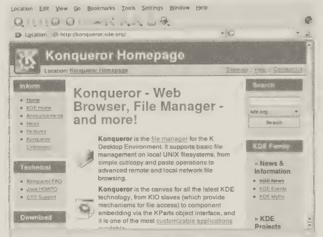

### 10.1 标签页浏览

如果您经常使用多个网页，标签浏览可以让切换变得容易。在一个窗口内通过标签页加载网站。此处是您可以保持对桌面的控制。

要打开新标签页，选择“窗口”（Window）->“新标签”（New Tab）或按下 Ctrl-Shift-N。要更改标签行为，进入“设置”（Settings）->“配置 Konqueror”。在打开的对话框中，选择“Web 行为”->“标签页浏览”。在新窗口中打开链接。您也可以在只有一个标签页时隐藏标签栏。要查看更多选项，点击“高级选项”。

您可以将标签、URL 以及窗口位置保存到配置文件中。这与上述会话管理有所不同。通过配置文件，您无需大量的启动时间即可使用保存的标签。

在 Konqueror 中，进入“设置”（Settings）->“配置视图”（Configure View Profiles）并为您的配置文件命名。您也可以通过相应的选项将窗口大小保存到配置文件中。确保勾选了“在配置文件中保存 URL”。点击“保存”（Save）。下次需要您的标签集合时，进入“设置”（Settings）->“加载视图”（Load View Profile）并查看列表名称。选择名称后，Konqueror 将恢复您的标签。

## 10.2 保存网页和图形

与其他浏览器一样，您可以保存网页。执行此操作，选择“位置”（Location）->“保存”（Save）并为 HTML 文件命名。然而，图像不会被保存。要存档包含图像的整个网页，选择“工具”（Tools）->“存档网页”（Archive Web Page）。Konqueror 会建议一个您通常接受的文件。文件名以 `.war` 结尾，这是 Web 存档的扩展名。以后查看保存的 Web 存档时，只需点击相应文件即可在 Konqueror 中显示网页。

### 10.3 互联网关键词

使用 Konqueror 搜索网络非常简单。Konqueror 为您定义了超过 70 个搜索过滤器，每个都有特定的快捷键。要在互联网上搜索特定主题，输入快捷键和由冒号分隔的关键词。随后将显示搜索结果的相关页面。


对于已定义的快捷键，请前往“设置”（Settings）→“配置 Konqueror”（Configure Conqueror）。在弹出的对话框中，选择“网络快捷键”（Web Shortcuts）。现在你可以看到提供者的名称和快捷键。Konqueror 定义了许多搜索过滤器：“经典”搜索引擎，如 Google、Yahoo 和 Lycos，以及许多用于较少用途的过滤器，例如缩写数据库、互联网数据库或 KDE 搜索。

如果你在这里没有找到你偏好的搜索引擎，可以轻松地定义一个新的。例如，若要在我们的支持数据库中搜索某些有趣的文章，通常需要访问 http://portal.suse.com/，找到搜索页面并输入查询内容。这可以通过使用快捷键来简化。在上述对话框中，选择“新建”（New）并在“搜索提供者名称”（Search provider name）中为你的快捷键命名。在“URI 快捷键”（URI shortcuts）中输入你的缩写。可以有多个，用逗号分隔。重要的文本字段是“搜索 URI”（Search URI）。按下 (Shift+F) 并点击该字段会打开一个小型帮助。搜索查询指定为 {}。在正确的位置插入即可。在这种情况下，SUSE 支持数据库的设置看起来如下：“搜索提供者名称”为 SUSE Support Database，“搜索 URI”（单行）https://portal.suse.com/PM/page/search.pm?q=\=@&t=optionSdbKeywords&m=25&en=x=true，“URI 快捷键”为 sdb_en。

在点击“确定”（Ok）确认后，在 Konqueror 的位置栏中输入你的查询，例如 sdb_en:kernel。结果将显示在当前窗口中。

## 10.4 书签

与其记住并重新输入访问过的网站地址，不如你可以使用“书签”（Bookmark）菜单书签这些 URL。除了网页地址外，你还可以在此处书签本地磁盘的任何目录。

在 Konqueror 中创建新书签，点击“书签”（Bookmarks）→“添加书签”（Add Bookmark）。之前添加的任何书签都会作为项目包含在菜单中。按主题层次结构整理书签集合是一个好主，这样你就不会丢失不同的项目。使用“新建书签文件夹”（New Bookmark Folder）为你的书签创建一个新的子组。选择“书签”（Bookmarks）→“编辑书签”（Edit Bookmarks）将打开书签编辑器。使用此程序组织、重新排列和添加书签。

如果你使用 Netscape、Mozilla、Firefox 作为其他浏览器，则没有必要创建书签。书签编辑器中的“文件”（File）→“导入 Netscape 书签”（Import Netscape Bookmarks）允许将你的 Netscape 和 Mozilla 书签集成到你最新的集中。通过“导出为 Netscape 书签”（Export as Netscape Bookmarks）也可以相反。

右键点击项目以更改你的书签。弹出的菜单，可以在其中选择所需的操作（剪切、复制、删除等）。当你对工作满意时，使用“文件”（File）→“保存”（Save）保存你的书签。如果你只想更改名称或链接，只需单击书签工具栏中的项并选择“属性”（Properties）。更改名称和位置并点击“更新”（Update）确认。

为了保存你的书签列表并即时访问，让你的书签在 Konqueror 中可见。选择“设置”（Settings）→“工具栏”（Toolbars）→“书签工具栏 (Konqueror)”（Bookmark Toolbar (Konqueror)）。书签面板将自动显示在当前 Konqueror 窗口中。

## 10.5 Java 和 JavaScript

不要混淆这两种语言。Java 是一种来自 Sun Microsystems 的面向对象、平台无关的编程语言。它经常用于小型程序（Applets），这些程序通过互联网执行用于在线银行、聊天和购物。JavaScript 是一种解释型脚本语言，主要用于网页的动态结构化，例如菜单和其他效果。

Konqueror 允许启用或禁用这两种语言。甚至可以以特定的方式进行，这意味着你可以允许访问某些主机并阻止访问其他主机。出于考虑，Java 和 JavaScript 通常会被禁用。遗憾的是，某些网页需要 JavaScript 才能正确显示。

## 10.6 更多信息

在使用 Konqueror 时遇到任何问题或故障，请参考应用程序的手册，可以在“帮助”（Help）菜单中找到。Konqueror 还有一个网页，位于 http://www.konqueror.org。

# Firefox

你的 SUSE LINUX 附带了 Mozilla Firefox 浏览器。具有标签页、弹出窗口拦截以及下载和图像管理等功能，Firefox 了最新的 Web 技术。在单个窗口中查看多个网页。抑制令人讨厌的广告并禁用只会减慢速度的图像。它访问不同搜索引擎的便利性帮助你找到需要的信息。从主菜单或通过输入命令 firefox 启动程序。主程序功能将在以下章节描述。

- 11.1 浏览网站 . . . . . . . . . . . . . . . . . . . 158
- 11.2 查找信息 . . . . . . . . . . . . . . . . . . . 159
- 11.3 管理书签 . . . . . . . . . . . . . . . . . . . 160
- 11.4 使用下载管理器 . . . . . . . . . . . . . . . . . . . 160
- 11.5 定制 Firefox . . . . . . . . . . . . . . . . . . . 161
- 11.6 定制 Firefox . . . . . . . . . . . . . . . . . . . 164
- 11.7 更多信息 . . . . . . . . . . . . . . . . . . . 164

## 11.1 浏览网站

你的 SUSE LINUX 附带了 Mozilla Firefox 浏览器。具有标签页、弹出窗口拦截以及下载和图像管理等功能，Firefox 了最新的 Web 技术。在单个窗口中查看多个网页。抑制令人讨厌的广告并禁用只会减慢速度的图像。它访问不同搜索引擎的便利性帮助你找到需要的信息。从主菜单或通过输入命令 firefox 启动程序。主程序功能将在以下章节描述。

## 11.2 查找信息

有两种方式可以查找信息：搜索栏和查找栏。

### 11.1

你的 SUSE LINUX 附带了 Mozilla Firefox 浏览器。具有标签页、弹出窗口拦截以及下载和图像管理等功能，Firefox 了最新的 Web 技术。在单个窗口中查看多个网页。抑制令人讨厌的广告并禁用只会减慢速度的图像。它访问不同搜索引擎的便利性帮助你找到需要的信息。从主菜单或通过输入命令 firefox 启动程序。主程序功能将在以下章节描述。

### 11.2.1

你的 SUSE LINUX 附带了 Mozilla Firefox 浏览器。具有标签页、弹出窗口拦截以及下载和图像管理等功能，Firefox 了最新的 Web 技术。在单个窗口中查看多个网页。抑制令人讨厌的广告并禁用只会减慢速度的图像。它访问不同搜索引擎的便利性帮助你找到需要的信息。从主菜单或通过输入命令 firefox 启动程序。主程序功能将在以下章节描述。

### 11.2.2

要在页面内搜索，点击“编辑”（Edit）→“在页中查找”（Find in Page）或按下 Ctrl-F。Firefox 会高亮所有出现的位置。通过“高亮”（Highlight），可以启用和禁用高亮。


# 11


图 11.2：使用 Firefox 书签管理器

打开一个显示下载内容的窗口。在下载文件时，可以看到进度条和当前文件。如有必要可以暂停下载稍后恢复。要打开已下载的文件，点击“打开”。使用“删除”将其从介质中清除。如果需要有关文件的信息，右键点击文件名并选择“属性”。

如果你需要对下载管理器进行更多控制，请从“编辑”➔“选项”打开配置窗口并进入“下载”选项卡。在这里，你可以确定下载文件夹、管理器的行为以及某些文件类型的配置。

## 11.5 定制 Firefox

由于具有安装扩展、更改主题以及为在线搜索添加智能关键词的能力，Firefox 可以进行广泛的定制。

### 11.5.1 扩展

Mozilla Firefox 是一个多功能应用程序，这意味着你可以下载并安装名为扩展的插件。例如，添加新的下载管理器和鼠标手势插件。这样做的好处是 Firefox 本身保持轻量且不臃肿。

要添加扩展，点击“工具”➔“扩展”。在右下角，点击“获取更多扩展”启动 Mozilla 扩展更新网页，你可以在许多可用扩展中进行选择。点击该扩展进行安装，然后点击安装链接进行下载和安装。重启 Firefox 后，新扩展即可生效。你也可以在 http://update.mozilla.org/ 查看各种扩展。

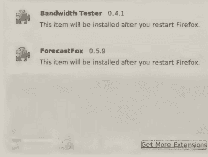

> 图 11.3：安装 Firefox 扩展

### 11.5.2 更改主题

如果你不喜欢 Firefox 的标准外观和感受，可以安装一个新主题。主题不会改变功能，只改变器的外观。在安装主题时，Firefox 会要求确认。允许安装或取消。安装成功后，你可以启用该主题。

- 1. 点击“工具”➔“主题”。
- 2. 弹出一个对话框。点击“获取更多主题”。如果你已经安装了主题，可以在此页如图 11.4 所示的列表中找到它。

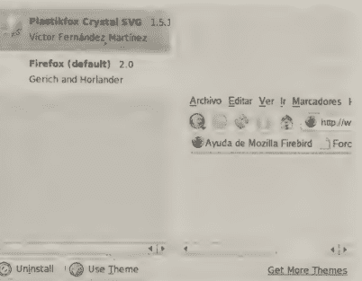

图 11.4：安装 Firefox 主题

- 3. 出现带有 https://update.mozilla.org 的新窗口。
- 4. 选择一个主题并点击“立即安装”。
- 5. 确认下载和安装。
- 6. 下载完成后，会出现对话框并提示主题列表。通过“使用主题”激活。
- 7. 关闭窗口并重启 Firefox。

如果已安装主题，你可以点击“工具”➔“主题”然后“使用主题”随时切换到不同的主题。如果你不再使用某个主题，可以在同一个对话框中通过“卸载”将其删除。1.5.3 为自己的搜索添加智能关键词

搜索互联网是浏览器可以执行的任务之一。Firefox 允许你定义智能关键词作为搜索网页的“命令”。例如，如果你经常使用 Wikipedia，可以使用智能关键词来简化此任务：

- 1. 转到 http://en.wikipedia.org。
- 2. Firefox 显示网页后，查看搜索字段。右键点击它，从打开的菜单中选择“为此搜索添加关键词”。
- 3. 出现“添加书签”对话框。在“名称”中为此网页命名，例如“Wikipedia (en)”。
- 4. 为“关键词”输入此网页的缩写，例如“wiki”。
- 5. 通过“创建在”选择书签的位置。你可以将其放入“快速搜索”，任何其他位置也行。
- 6. 点击“添加”完成。

你已成功生成了一个关键词。每当你需要查看 Wikipedia 时，无需使用整个 URL。只需输入 wiki 即可。

## 11.6 从 Firefox 打印

使用“页面设置”对话框配置 Firefox 输出内容的方式。点击“文件”➔“页面设置”，进入“格式和选项”选项卡选择打印任务的方向。你可以缩放或使其自动调整。要打印背景，选择“打印背景（颜色和图像）”。点击“边距和页眉/页脚”选项卡来调整边距并选择页眉和页脚包含的内容。

配置好设置后，通过“文件”➔“打印”打印网页。选择打印机或保存输出的文件。在“属性”中设置纸张大小、指定打印命令、选择灰彩色并确定边距。对设置满意后，点击“打印”。

## 11.7 更多信息

从官方首页 https://www.mozilla.org/products/firefox/ 获取更多关于 Firefox 的信息。参考集成帮助了解更多选项或功能。

## 使用 KGpg 加密

KGpg 是系统中加密基础设施的重要组件。通过此程序的帮助，可以生成并管理所有密钥，使用其编辑器功能快速创建和加密文件，或使用面板中的小部件通过拖放进行加密或解密。其他程序（如你的邮件程序 Kontact 或 Evolution）访问密钥数据以处理签名或加密内容。本章涵盖了处理加密文件的基本功能。

- 12.1 生成新密钥对 . . . . . . . . . . . . . . . 166
- 12.2 导出公钥 . . . . . . . . . . . . . . . 166
- 12.3 导入密钥 . . . . . . . . . . . . . . . . . . 168
- 12.4 密钥服务器对话框 . . . . . . . . . . . . . . . 170
- 12.5 文本和文件加密 . . . . . . . . . . . . . . . 171
- 12.6 更多信息 . . . . . . . . . . . . . . . 173

### 12.1 生成新密钥对

要与其他用户交换加密消息，首先要生成你自己的密钥对。其一部分——公钥，被分发给你的通信伙伴，他们可以使用它来加密发送的消息。密钥对的另一部分——私钥，用于解密加密内容。

#### 私钥与公钥
公钥面向公众，并应该分发给所有通信伙伴。然而，只有你应该拥有对私钥的访问权限。

## 12.2 导出公钥

生成密钥对后，将公钥提供给所有其他用户。这使他们能够加密或签名发送给你的消息或文件。要让其他人可以使用公钥，选择“密钥”›“导出公钥”。打开的对话框提供四种选项：

- '电子邮件' 你的公钥通过电子邮件发送给你选择的接收者。如果你激活此选项并点击“确定”，将弹出创建新邮件消息的对话框。输入接收者并点击“发送”。接收者收到密钥后即可向你发送加密内容。
- '剪贴板' 在继续处理之前，可以将公钥放在这里。
- '默认密钥服务器' 要让广大观众可以使用公钥，将其导出到互联网上的服务器之一。更多信息请参见第 170 页的第 12.4 节。
- '文件' 如果你倾向于将密钥作为文件存储在数据介质而不是

#### 从主菜单启动 KGpg
通过选择“工具”➔“KGpg”或命令行命令行 kgpg。首次启动程序时，会出现一个助手引导你完成配置。按照指示操作到提示创建密钥为止。输入名称、电子邮件地址以及可选的注释。如果你不喜欢提供的默认设置，还可以设置密钥的加密时间、密钥大小以及使用的加密算法。见下一页的图 12.1。

点击“确定”确认设置。下一个对话框提示你输入两次密码。程序随后生成密钥对并显示摘要。立即保存或打印撤销证书是一个好主意。如果你忘记了私钥密码需要撤销它，则就需要该证书。点击“确定”后，KGpg 显示其主窗口。见第 168 页的图 12.2。

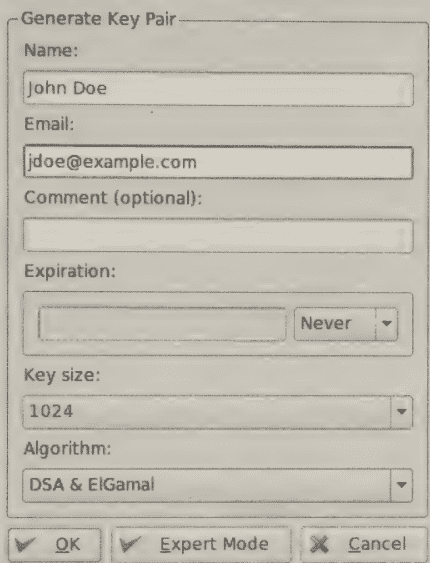

图 12.1：KGpg：创建密钥


| 姓名 | 邮箱 | 信任度 | 过期 | 大小 | 创建时间 | ID |
|---|---|---|---|---|---|---|
| John Doe | jdoe@example.com | 无限制 | 1024 | 2005-02-28 | 0x59847CF5 |
| EkGumar subway | | 无限制 | 1024 | 2005-02-28 | 0x76FED000 |
| John Doe | jdoe@example.com | 无限制 | | 2005-02-28 | 0x59847CF5 |

图 12.2：密钥管理器

通过电子邮件发送，点击此选项，确认或更改文件路径和名称，然后点击“确定”。

## 12.3 导入密钥

如果你在文件中收到了密钥（例如作为邮件附件），请通过“导入密钥”将其集成到你的密钥环，并使用它与发送者进行加密通信。该步骤与之前描述的导出密钥过程相似。

### 12.3.1 签名密钥

密钥可以像其他文件一样被签名，以确保其真实性和完整性。如果你完全确定导入的密钥属于指定的所有者，可以通过对其进行签名来表达你对该密钥真实性的信任。

## 重要

### 建立信任网

加密通信的安全性取决于你是否能明确地将流通的公钥与指定的用户建立起联系。通过对这些密钥进行交叉检查和签名，你为信任网的建立做出了贡献。

## 重要

在密钥列表中选择要签名的密钥。选择“密钥” → “签名密钥”。在接出的对话框中，指定用于签名的私钥。警报会提醒你在签名之前检查此密钥的真实性。如果你已经执行了此检查，请点击“继续”，并在下一步输入所选私钥的密码。现在，其他人就可以通过你的公钥检查签名了。

### 12.3.2 信任密钥

通常，相应的程序会询问你是否信任该密钥（即你是否假设其授权所有是可靠的）。这发生在需要解密消息或必须检查签名时。为了避免这种情况，可以编辑新导入密钥的信任级别。

右键点击新导入的密钥以访问密钥管理的小型上下文菜单。从中选择“在终端中编辑密钥”。Gnupg 将打开一个文本控制台，你可以在其中通过几个命令设置信任级别。

在文本控制台的提示符（Command）处输入 `trust`。在 1（不确定）到 5（完全信任）的范围内，估计你对导入密钥签名者检查该密钥所有者真实身份的信任程度。在提示符处输入所选的值（Your decision?）。如果你确定签名者的可信度，请输入 5。输入 y 回答后续问题。最后，输入 quit 退出控制台并返回密钥列表。该密钥的信任级别现在变为顶级（Ultimate）。

密钥环中密钥的信任级别由密钥名称旁边的颜色条指示。信任级别意味着：你对密钥签名者检查已签名密钥之真实身份的信任程度越低。你可能完全确定签名者的身份，但他他在签名他人的密钥之前可能懒于检查他人的身份。因此，你可以信任他和他自己的密钥，但为他签名的其他密钥分配较低的信任级别。信任级别的目的仅在于提醒作用，它不会触发 Gnupg 的任何自动操作。


## 12.4 密钥服务器对话框

若干基于互联网的密钥服务器提供了许多用户的公钥。要与大量用户进行加密通信，请使用这些服务器分发你的公钥。为此，请将你的公钥导出到这些服务器之一。同样，Gnupg 允许你搜索某些人的密钥之一，并从服务器导入他们的公钥。通过“文件” -> “密钥服务器对话框”打开密钥服务器对话框。

### 12.4.1 从密钥服务器导入密钥

通过密钥服务器对话框中的“导入”选项卡，从基于互联网的密钥服务器导入公钥。使用下拉菜单选择一个预配置的密钥服务器，并输入搜索字符串（通信伙伴的电子邮件地址）或要查找的密钥 ID。当你点击“搜索”时，你的系统将连接到互联网并在指定的密钥服务器上搜索符合你规格的密钥。请参考本页的图 12.3。

图 12.3：导入密钥的搜索界面

如果你在密钥服务器上的搜索成功，新窗口中将显示所有检索到的服务器条目列表。选择要包含在密钥环中的密钥并点击“导入”。见下一页的图 12.4。用“确定”确认以下消息，然后通过“关闭”退出密钥服务器对话框。导入的密钥将出现在密钥管理器的主概述中并准备好使用。

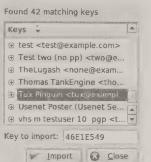

图 12.4：命中结果与导入

### 12.4.2 将密钥导出到密钥服务器

要将你的密钥导出到互联网上自由访问的密钥服务器之一，请在密钥对话框中选择“导出”选项卡。指定目标服务器和导出密钥。

## 12.5 文本加密

Gnupg 还提供了通过图标对文本或剪贴板进行加密的功能。

### 12.5.1 剪贴板加密

复制到剪贴板的文件可以轻松加密。打开面板，选择“加密”并指定使用的密钥。桌面会显示关于加密的消息。现在可以从剪贴板处理加密内容。解密剪贴板同样简单。打开面板，选择“解密”并输入与密钥相关的密码。

### 12.5.2 拖放加密解密

要加密或解密文件，点击桌面或文件管理器上的图标，将它们拖到面板并放开。如果文件未加密，Gnupg 会要求使用密钥。一旦你选择了密钥，文件就会被加密。在文件管理器中，加密文件被标记为 .asc 并带有锁图标。这些文件可以通过点击文件、拖到面板并放开来解密。然后选择是否在编辑器中解密文件。

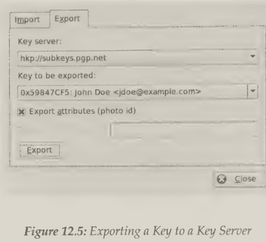

### 12.5.3 KGpg 编辑器

与其在外部编辑器创建加密内容然后使用上述方法之一加密文件，可以使用 KGpg 的集成编辑器来创建文件。打开编辑器（从上下文菜单选择“打开编辑器”），输入所需的文本，并点击“加密”。然后指定使用的密钥并完成加密过程。解密文件时，使用“解密”并输入与密钥相关的密码。

直接从编辑器生成和检查签名与加密一样简单。进入“签名” -> “生成签名”，从密码提示处选择要签名的文件。Gnupg 会通知你签名生成成功。文件也可以通过简单点击从编辑器进行签名。要检查已签名文件，进入“签名” ▷ “验证签名”，并在后续对话框中选择要检查的密钥。在你确认选择后，Gnupg 将检查签名并报告操作结果。另一种方法是将已签名文件加载到编辑器中点击“签名/验证”。

## 12.6 更多信息

有关加密方法的理论背景信息，请参阅 GnuPG 项目页面上的简明介绍介绍：http://www.gnupg.org/documentation/howtos.html。本文还提供了更多信息源的列表。


# 第四部分
## 多媒体

## Linux 中的音频

Linux 包含了广泛的音频和多媒体应用程序。其中某些应用程序是主流桌面环境的一部分。通过这里描述的应用程序，你可以控制播放的音量和平衡，播放 CD 和音乐文件，并录制和压缩自己的音频数据。

- 13.1 混音器 . . . . . . . . . . . . . . . . . . . . . . . . . . . 178
- 13.2 多媒体播放器 . . . . . . . . . . . . . . . . . . . . . . . 182
- 13.3 CD: 播放与刻录 . . . . . . . . . . . . . . . . . . . 187
- 13.4 使用 Audacity 进行硬盘录制 . . . . . . . . . . . . . . . . . . . . 192
- 13.5 WAV 文件的直接录制与播放 . . . . . . . . . . . . . . . . 195

## 13.1 混音器

混音器提供了一种控制计算机音频输入输出音量和平衡的方便方法。不同混音器之间的主要区别在于用户界面的外观。然而，许多混音器是为特定硬件设计的。例如 envy24control，一个用于 Envy 24 音芯片的混音器。另一个是 hdspmixer，用于 RME Hammerfall 声卡。从可用的混音器中，选择最适合你需求的一个。

通常，建议在打开其他应用程序之前打开混音器程序。使用混音器测试并调整声卡输入输出的控制设置。

### 13.1.1 KMix

KMix 是 KDE 的混音器应用程序。它集成在 KDE 面板中，作为位于系统托的一个小型面板应用。点击面板图标可以使用控制滑块控制扬声器的音量。如果右键点击图标，会弹出 KMix 的右键菜单。选择“静音”（Mute）关闭音频输出。面板图标的外观随之变化。再次点击“静音”即可恢复音量。要微调音频设置，请选择“显示混音器窗口”（Show Mixer Window）并配置“输出”（Output）、“输入”（Input）和“开关”（Switches）。那里列出的每个设备都有自己的文本菜单，通过右键点击设备图标打开。你可以分别静音或隐藏其中的每一个设备。

### 13.1.2 GNOME 混音器小部件

GMix 是 GNOME 桌面的音量控制小部件，集成在 GNOME 面板中。点击面板图标可以使用简单的控制滑块控制扬声器的音量。要关闭音频输出，右键点击图标并选择“静音”（Mute）。音量控制图标的外观随之变化。要恢复音频输出，再次右键点击图标并从菜单中选择“静音”（Mute）。选择“打开音量控制”（Open Volume Control）以访问更高级的混音器功能，见第 180 页的图 13.2。每个声学设备都有自己的混音器标签页。

## 13
Linux 中的音频

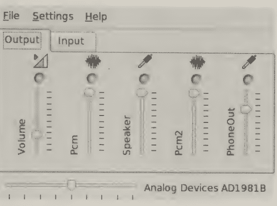

图 13.1: 混音器 KMix

### 13.1.3 alsamixer

alsamixer 可以在没有 X 环境的命令行运行，因此它是完全包含的。alsamixer 窗口始终由以下元素组成：顶行显示卡和芯片类型的基本信息、所选视图类型，以及信息区域的混音器项目条。如果控制项无法在一个屏幕内显示，使用 ← 和 → 向左或向右滚动。控制名称出现在控件下方，当前选中的控制项显示为红色。在任何混音器控制的静音和取消静音状态之间切换。静音控制名称上写有“MM”。任何具有捕获（录制）能力的控制项都有红色的捕获标记。

alsamixer 有三种不同的视图模式：“播放”（Playback）、“录制”（Capture）和“全部”（All）。默认情况下，alsamixer 在“播放”模式下启动，仅显示与播放相关的混音器控制（主音量、PCM、CD 等）。“录制”仅显示用于录制的控制项。“全部”显示所有可用控制项。使用 F3 和 F5 切换视图模式。

使用 ← 和 → 或 N 和 P 选择通道。使用 + 和 - 或 + 增加和减少音量。立体声道可以使用 [Q]、[W] 和 [E] 独立增加音量，使用 [Y]、[X] 和 [C] 减少音量。[0] 到 [9] 之间的数字键可快速更改绝对音量。这些对应于全音量的零到百分之九。

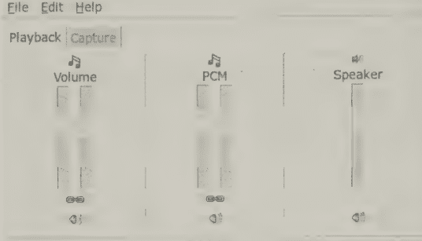

图 13.2: GNOME 混音器小部件

### 13.1.4 混音器应用程序的外观

混音器应用程序外观取决于使用的声卡类型。某些驱动程序（如 SB Live!）具有许多可控（可调）的混合元素，而专业声卡的驱动程序可能具有名称完全不同的元素。

#### 板载音频芯片

大多数 PCI 板载音频芯片基于 AC'97 编解码器。“主”（Master）控制前扬声器的主音量。“环绕”（Surround）、“中心”（Center）和“LFE”控制后置、中心和低音增强扬声器。它们每一个都有自己的静音开关。此外，某些板带有独立的“耳机”（Headphone）和“主”（Master）音量。PCM 控制了内置扬声器的音量。

PCM 是脉冲调制的缩写，是数字信号的格式。该控制项具有静音开关。

其他值如 CD、“线路”（Line）、“麦克风”（Mic）和“辅助”（Aux）控制环路音量。它们不影响录制，只影响播放。对于录制，打开“捕获”（Capture）开关。“捕获”音量是录制增益。默认情况下，该开关设置为零。选择如“线路”或“麦克风”的录制源。“混合”（Mix）是独占源，你无法同时选择它们。

根据 AC97 编解码器，可以使用 3D 音效等特殊效果。

#### SoundBlaster Live! 和 Augigy 系列

SoundBlaster Live! 和 Augigy1 对其 AC97 编解码器有许多混合控制项。除了已描述的控制项外，它们还有波形（Wave）、音乐（Music）和 AC97 音量来控制内部信号。将音量保持在 100% 以听到所有内容。SB Live 的录制类似于板载芯片。Augigy2（取决于型号）的控制项比 SB Live 少，但仍然具有。

#### USB 音频设备

USB 音频设备通常只有少量控制项。有时完全没有。

### 13.1.5 Envy24 音芯片的混音器

envy24control 是用于 Envy24 (ice1712) 芯片声卡的混音器应用程序。Envy24 芯片的活性会导致不同声卡的功能不同。关于此芯片的最新细节可参考 /usr/share/doc/packages/alsa-tools/envy24control。

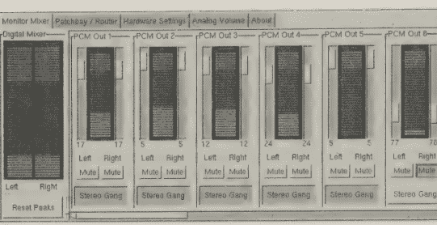

envy24control 的“监控”显示声卡内部数字混合的信号电平。标记为“PCM 输出”（PCM Out）的信号是由向声卡发送 PCM数据的应用程序生成的。模拟输入信号显示在“硬件输入”（H/W In）下。“S/PDIF”输入显示在右侧。在“模拟音量”（Analog Volume）下设置模拟通道的输入输出电平。

使用“监控”滑块进行数字混合。相应的电平显示在“数字混音器”中。对于每个输出通道，“交叉矩阵”（Patchbay）包含一组单选按钮，用于选择所需的通道源。

在“模拟音量”（Analog Volume）下调整模拟数字转换和数字模拟转换器的增益。使用 DAC 滑块控制输出通道，使用 ADC 滑块控制输入通道。

 13.2 多媒体播放器

### 13.2.1 amaroK

amaroK 媒体播放器处理各种音频格式，并播放网络电台的流媒体广播。该程序处理所有


作为后端音频服务器支持的文件类型——目前为 aRts 或 Gstreamer。

在首次启动时，amaroK 会启动“首次运行向导”来设置 amaroK。在第一步中，配置您喜欢的 amaroK 外观和感受。选择将播放器和播放列表显示在独立的窗口中（参见当前页图 13.4），或将它们的功能合并到一个窗口中。在第二步中，确定 amaroK 应该在何处查找音乐收藏。默认情况下，amaroK 配置为递归扫描所选文件夹（包含其中所有的子目录），监控所选目录的变化，并导入加载在那里的任何播放列表。向导中的所有设置以后都可以通过“工具” → “首次运行向导”再次启动向导进行修改。

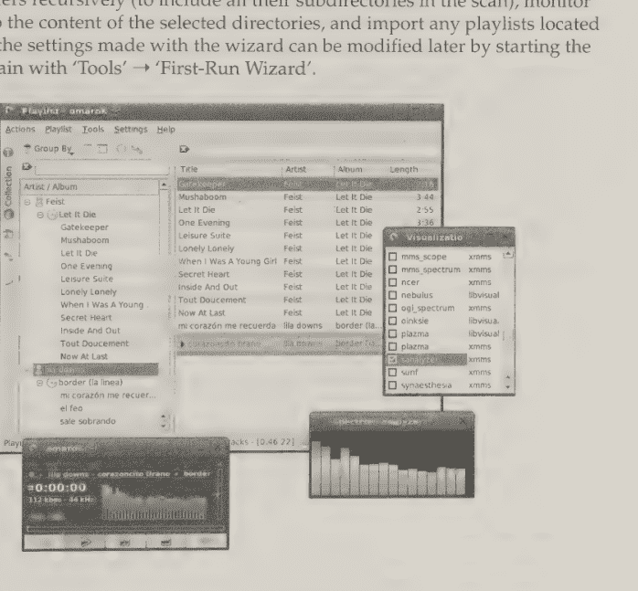

图 13.4：amaroK 媒体播放器

## 管理播放列表

启动时，amaroK 会根据向导中的设置扫描文件系统中的多媒体文件。播放列表窗口的右部分列出了找到的任何播放列表。列出的歌曲标题按您选择的顺序排列。如果没有找到播放列表，则创建一个。实现此操作的最佳方法是使用窗口左侧的侧边栏。在最左侧有几个标签，用于打开不同的视图。从这些视图中的每一个，将单个标题或整个目录拖动到播放列表中，将其包含在列表中。以下是每个标签的功能描述。

上下文（Context）：使用此标签查看有关您的收藏和当前艺术家的信息。例如，该视图会告知您您最喜爱的歌曲、新添加到收藏的最新歌曲以及其他详情。“主页”视图提供了您的收听习惯的统计数据，包括您最喜欢、最新和播放次数最少的歌曲。“当前曲目”提供与当前播放的曲目相关的数据，如专辑封面（参见对页的“封面管理器”章节）、此曲目相关的收听统计数据等。如果您对歌曲歌词感兴趣，可以使用“歌词”标签显示它们。

收藏集浏览器（Collection Browser）：使用此视图管理并显示您的个人歌曲收藏。收藏视图可能包含来自不同位置的文件。工具栏上的扳手图标允许您决定应该扫描哪些位置的音乐文件。一旦选择了目录，扫描将自动开始。结果将以树结构的形式显示。使用“主”和“次”，根据“专辑”、“艺术家”、“流派”和“年份”标准组织树的两个顶层分支。一旦树准备就绪，只需在输入框中输入名称即可轻松找到歌曲。当您输入时，视图会自动跳转到第一个匹配的条目。要更新您的收藏数据，请使用“工具” → “重新扫描收藏”对文件系统进行重新扫描。

播放列表浏览器（Playlist Browser）：播放列表浏览器分为两个部分。上半部分列出了您所有的自定义播放列表，这些是通过将歌曲拖入播放列表窗口并点击“另存播放列表”创建的。通过点击播放列表名称旁边的“+”查看其内容。使用拖放操作修改这些播放列表。要加载其中一个，双击播放列表。

## 13 与其他播放器共享播放列表

将播放列表以 m3u 或 pls 格式保存，这样您就可以与使用这些格式的任何其他播放器共享它们。

amarOK 可以动态编译播放列表（“智能播放列表”）。使用播放列表器的下部分选择一个智能播放列表，或点击“创建智能播放列表”来定义自定义智能播放列表。输入名称、搜索标准、顺序和可选的歌曲限制。

文件浏览器（File Browser）：此标签打开文件浏览器。它对应于标准的 KDE 文件选择对话框，具有用于导航文件系统的常用控件。直接在文本输入框中输入 URL 或目录。从显示的内容中，将元素拖动到播放列表中以包含它们。您也可以对给定目录中的文件进行递归搜索。要这样做，请输入标题的字符串和开始搜索的位置。选择“搜索”并等待结果在窗口下部分出现。

## 封面管理器

amarOK 具有封面管理器，让您能够在所播放的专辑上保持匹配的音乐和图像数据。通过“工具” → “封面管理器”启动“封面管理器”。窗口左部分的树形视图列出了您收藏中的所有专辑。从 Amazon 获取的封面显示在窗口的右部分。通过“视图”，选择封面列表视图中显示的内容。“所有专辑”列出收藏中的所有专辑，无论是否有封面图像。“带封面的专辑”仅列出有封面的专辑，“无封面的专辑”列出缺少封面的专辑。要检索封面数据，选择“从 Amazon 获取缺失封面”。amarOK 然后将尝试获取您收藏中所有专辑的封面。

## 效果

在播放器窗口中选择“FX”按钮或使用 amarOK 菜单打开对话框，在其中启用并配置多种音效，例如均衡器、立体声平衡和厅堂效果。选择所需的效果并为每个效果调整设置（如果可用）。

SUSE LINUX 185

## 可视化

amaroK 带有许多可视化效果，为播放的音乐显示图形效果。原生 amaroK 可视化显示在播放器窗口。通过点击动画循环不同的可用显示模式。

除了上述之外，amarOK 还支持 XMMS 媒体播放器的可视化插件。要使用这些插件，首先安装 `xmms-plugins` 包，然后从 amaroK 菜单中选择“可视化”。这会打开一个列出可用插件的窗口。XMMS 插件始终显示在额外的窗口中。在某些情况下，有全屏模式显示的选项。对于某些插件，除非您使用 3D 加速显卡，否则您可能无法获得流畅的视觉效果。

## XMMS

XMMS 是另一个具有强大音频支持的全功能媒体播放器，在播放期间弹出或崩溃的情况非常罕见。该应用程序易于使用。显示菜单的按钮位于程序窗口左上角。对于那些喜欢类 GNOME 外观感受的人，有一个 GTK 2 版本的 XMMS，即 Beep Media Player。只需安装 `bmp` 包即可。然而，此版本的 XMMS 不支持所有的 XMMS 插件。

使用“选项” → “设置” → “音频 I/O 插件”选择输出插件模块。如果安装了 `xmms-kde` 包，可以配置 aRT 音频服务器。

> 重要
> 使用磁盘写入插件
> 如果 XMMS 无法找到配置好的声卡，它将将其输出重定向到“磁盘写入插件”。在这种情况下，文件将以 WAV 格式写入硬盘。通过声卡输出时，运行得更快。

通过“选项” → “设置” → “可视化插件”启动各种可视化插件。如果您具有 3D 加速显卡，请选择 OpenGL 插件。如果安装了 `xmms-plugins` 包，尝试 Infinity 插件。

## 13 Linux 中的声音


在菜单按钮左侧有五个带有不同字母的按钮。这些按钮允许快速访问菜单、对话框和配置。使用“PL”打开播放列表，使用“EQ”打开均衡器。

## 13.3 CD：播放与刻录

有许多方法可以听您喜爱的歌曲。无论是播放 CD 或播放它们的数字化版本。以下章节介绍了一些 CD 播放器以及一些用于音频 CD 刻录和编码的应用程序。

## 重要 CDDA 和模拟播放

有两种不同的音频 CD 播放方法。CD 和 DVD 读取音频数据并发送到输出设备。通过 PMCIA、FireWire 或 USB 连接的外部设备需要使用 CDDA（紧凑磁盘数字音频）先提取音频数据然后以数字 PCM 播放。以下部分的播放器不支持 CDDA。如果您需要 CDDA 支持，请使用 XMMS。

### 13.3.1 KsCD—音频 CD 播放器

KsCD 是一款易用的音频 CD 播放器。它集成到 KDE 任务栏中，并可以配置为插入 CD 后自动播放。通过“额外” → “配置 KsCD”访问配置菜单。从互联网上的 CDDB 服务器获取专辑和曲目信息。您还可以上传 CDDB 信息与他人共享。使用“CDDB”对话框进行信息检索和上传。

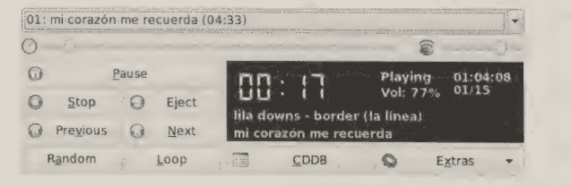

图 13.6：KsCD 用户界面

### 13.3.2 GNOME CD 播放器小组件

这是一个集成到 GNOME 面板的简单小组件。使用工具图标配置其行为并选择主题。使用按钮控制播放
位于播放器窗口底部，或通过右键点击面板图标或播放器窗口打开的菜单。

## 13.3.3 压缩音频数据

音频压缩可以通过多种工具处理。以下章节将介绍用于编码和播放音频数据的命令行方法，以及一些能够音频压缩的图形应用程序。

## 音频数据编码与播放的命令行工具

Ogg Vorbis（属于 `vorbis-tools` 包）是一种免费的音频压缩格式，现在大多数音频播放器都支持它。该项目的网页为 http://www.xiph.org/ogg/vorbis。

SUSE 自带了几个支持 Ogg Vorbis 的工具。`oggenc` 是一个用于将 WAV 文件编码为 Ogg 的命令行工具。只需运行 `oggenc myfile.wav` 即可将 .wav 文件转换为 Ogg Vorbis。使用 `-h` 参数显示其他参数的概览。Ogg 支持使用变比特率编码。通过这种方式，可以实现更高的压缩率。与其指定比特率，不如使用参数 `-q` 指定所需的质量，并使用 `-M` 指定最小和最大比特率。

`ogg123` 是一个命令行 Ogg 播放器。使用类似 `ogg123 mysong.ogg` 的命令启动它。

## 使用 Grip 压缩音频数据

`rip` 是一个 GNOME CD 播放器和刻录器（见下一页图 13.7）。CD 播放器功能完全由窗口底部的按钮控制。使用窗口顶部的标签控制刻录和编码功能。要查看和编辑轨道及专辑信息，或选择要刻制的轨道，请打开“Tracks”标签页。点击轨道标题旁边的复选框选择轨道。要编辑轨道信息，点击“Toggle disc editor”并提交您的修改。“Rip”标签页选择首选的刻录模式并控制刻录过程。在“Config”标签页下访问整个 Grip 配置。使用“Status”检查应用程序的状态。

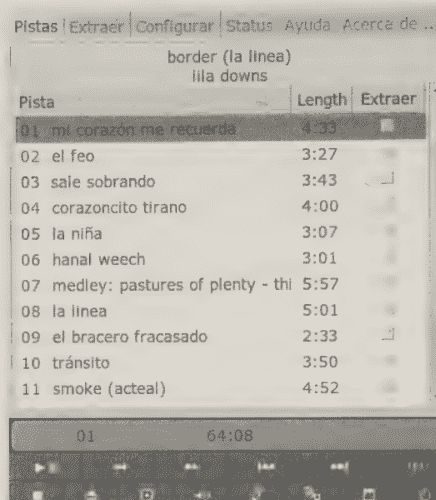

## 使用 KAudioCreator 压缩音频数据

KAudioCreator 是一个轻量级的 CD 刻录程序（见对页图 13.8）。一旦启动，它会在“CD Tracks”标签页中列出您 CD 的所有轨道。选择要刻录和编码的轨道。要编辑轨道信息，使用“Album Editor” → “File” → “Edit Album”。否则，只需通过“File” → “Rip Selection”开始刻录和编码。使用“Jobs”标签页查看这些任务的进度。KAudioCreator 还可以您的选择生成播放列表文件，这些文件可以使用 amaroK 或 XMMS 等播放器。

## 使用 Konqueror 压缩音频 CD

在使用 Konqueror 开始刻录过程之前，在 KDE 控制中心中配置音频 CD 和 Ogg Vorbis 编码器的处理。选择“Sound & Multimedia” →“Audio CDs”。配置模块分为

图 13.7：使用 Grip 刻录音频 CD

# 13

## Linux 中的音频

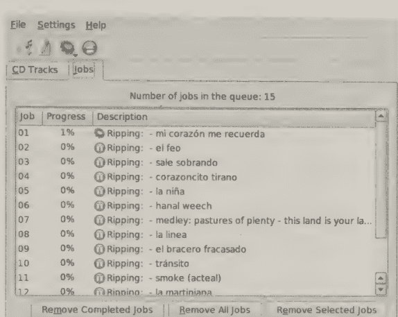

图 13.14：使用 KAudioCreator 刻录音频 CD

三个标签页：“General”、“Names”和“Ogg Vorbis Encoder”。通常情况下，会自动检测到合适的 CD 设备。除非试听失败且需要手动设置 CD 设备，否则不要更改此默认设置。此处还可以设置错误纠正和编码器优先级。“Ogg Vorbis Encoder”标签页决定编码质量。要为您的刻录音频数据配置专辑、轨道和艺术家信息的在线查找，请选择“Add Track Information”。

通过将 CD 插入 CD-ROM 驱动器并在“Location”栏输入 `audio:` 来开始刻录过程。Konqueror 列出了 CD 的轨道和一些文件夹（见下一页图 13.9）。

若要将未压缩的音频数据保留在磁盘上，只需选择 .wav 文件并将其拖入另一个 Konqueror 窗口以将其复制到最终位置。要启动 Ogg Vorbis 编码，将 OggVorbis 文件夹拖入另一个 Konqueror 窗口。一旦您将 Ogg Vorbis 文件夹释放到目标位置，编码就会开始。

SUSE LINUX 191

## 13.4 使用 Audacity 进行硬盘录制

使用 audacity（属于 `audacity` 包）录制和编辑音频文件。这被称为硬盘录制。当您第一次启动程序时，请选择语言。在其他时候，可以在“File” → “Preferences” → “Interface”下更改语言设置。更改将在下次启动程序时生效。

### 13.4.1 录制 WAV 文件和导入文件

点击红色录制按钮创建一个空的立体声轨道并开始录制。要更改标准参数，请在“File” → “Preferences”下进行所需的设置。“Audio I/O”和“Quality”对录制非常重要。即使轨道已经存在，按下录制按钮也会创建新轨道。起初，这可能会令人混乱，因为这些轨道在标准大小的程序窗口中不可见。

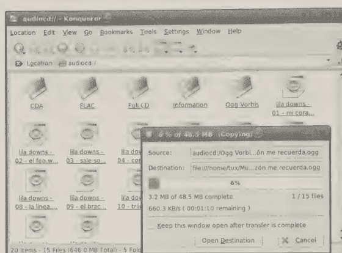

图 13.9：使用 Konqueror 刻录音频数据

# 13

Linux 中的音频

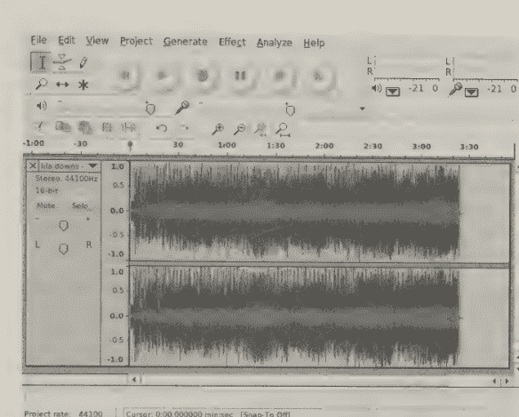

图 13.10：音频数据的频谱视图

要导入音频文件，选择“Project” → “Import Audio”。程序支持 WAV 格式和 Ogg Vorbis 格式。有关此格式的更多信息，请参见第 189 页的第 13.3.3 节。

### 13.4.2 编辑音频

打开轨道左侧的“Audio”菜单。该菜单提供了各种视图和基本编辑操作。要重命名轨道，选择“Name”并输入新名称。Audacity 提供的不同视图包括波形(dB)和频谱。如果您想单独编辑立体声轨道的通道，请选择“Split Track”。每个通道都可以作为单独的轨道处理。为录制设置“Sample Format”（位）和“Sample Rate”（频率）。在使用“Edit”中的大多数工具之前，首先选择片段。在过滤处理过程中，可能需要使用“Amplify”调整信号幅度。此外，使用“Amplify”检查幅度。默认情况下，

# 13.4 使用 Audacity 进行硬盘录制

峰值（Peak）设置为 0.0 dB。此值代表音频格式中的最高幅度。“Amplification”显示放大片段所需的。负值表示过度放大。

### 13.4.3 保存和导出

要保存整个项目，选择“File” → “Save Project”或“Save Project As”。这将生成一个扩展名为 .aup 的 XML 文件，用于描述项目。实际音频数据保存在以项目命名并附加 _data 的目录中。

整个项目或当前选择片段也可以导出为立体声 WAV 文件。要以 Ogg Vorbis 格式导出项目，请参考第 189 页的第 13.3.3 节的信息。


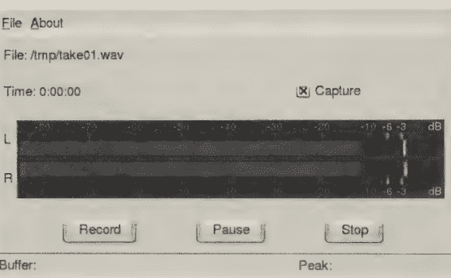

图 13.12：QARecord——一个简单的硬盘记录应用程序

196          13.5. WAV 文件的直接录制与播放

# 电视、视频、广播和摄像头

本章介绍了一些基础的 Linux 视频、广播和摄像头应用程序。学习如何配置和使用 motv 来观看模拟电视、使用摄像头以及浏览视频文字。使用 xawtv4 查看数字电视节目。可以使用 gqcam 运行摄像头。可以使用 nxtvepg 或 xawtv4 获取 EPG（电子节目指南）信息。

- 14.1 使用 motv 观看电视 ........................................................ 198
- 14.2 视频文字支持 ................................................................ 200
- 14.3 摄像头与 motv ................................................................... 201
- 14.4 nxtvepg——你 PC 的电视杂志 ............................................... 201
- 14.5 使用 xawtv4 观看数字电视节目 ....................... 203
- 14.6 使用 gqcam 操作摄像头 ................................................ 205

## 14.1 使用 motv 观看电视

motv 是 xawtv 的改进继任者。它将所有基本功能整合到用户界面中。通过“Multimedia”（多媒体）→“Video”（视频）→“motv”启动应用程序。也可以在命令行中使用 `motv` 启动。应用程序启动后，最初只会出现一个电视窗口。通过右键点击打开菜单窗口。

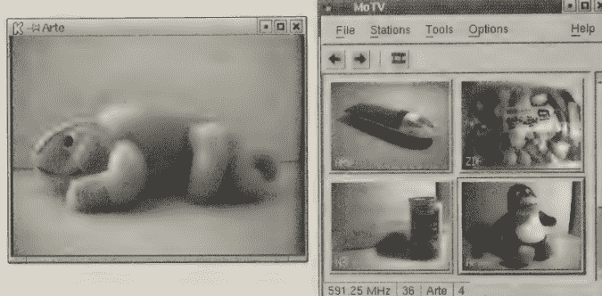

图 14.1：电视应用程序 motv

### 14.1.1 视频源和网络搜索

在“Settings”（设置）→“Input”（输入）中，选择视频源。如果你选择了“Television”（电视），请在启动应用程序之前设置广播网络。这可以通过网络搜索自动完成，网络搜索也在“Settings”菜单下。如果你点击“Save settings”（保存设置），找到的网络将输入到主目录下的 .xawtv 文件中，并在下次启动应用程序时可用。

#### 提示
选择频道：
如果你不想浏览所有可用频道，可以使用 `Ctr↑` 找到下一个频道。如有需要，随后可以使用 `← →` 调整广播频率。

### 14.1.2 获取音频数据

电视卡的音频输出连接到声卡的线路输入、扬声器或放大器。某些电视卡可以更改音频输出的音量。可以通过可以通过选择“Settings”→“Slider”（滑块）后出现的滑块来设置音量。该窗口还提供了亮度、对比度和颜色的滑块。

要使用声卡进行音频播放，请使用第 178 页第 13.1 节介绍的 `gamix` 检查混合器设置。对于符合 AC97 的声卡，将“Input-MUX”设置为“Line”。然后可以使用“Master”（主音）和“Line”（线路）滑块调整音量。

### 14.1.3 屏幕比例和全屏模式

大多数电视的高宽比为 4:3。这些比例可以通过“Tools”（工具）→“Screen Dimensions”（屏幕尺寸）进行设置。如果在这里选择了“4:3”（这是默认设置），即使显示尺寸发生变化，屏幕尺寸也会自动保留。

使用 `F` 或“Tools”→“Fullscreen”（全屏）切换到全屏模式。如果全屏模式下的电视图像没有缩放到整个显示器大小，则需要进行一些微调。许多显卡可以在不更改图形模式的情况下将全屏电视图像缩放到整个显示器大小。如果你的显卡不支持此功能，则必须将图形模式切换到 640x480。在“Settings”→“Configuration”（配置）中创建相关配置。重启 motv 后，如果你切换到了全屏模式，显示器模式也会随更改。

#### 提示
将配置存储在 .xawtv 中

.xawtv 文件通过点击 'Settings' > 'Save settings' 自动创建并更新。在这里，广播源将与配置一起保存。关于配置文件的更多信息可以在 `xawtvrc` 的 man 页面中找到。

### 14.1.4 启动菜单

使用启动菜单启动其他与 motv 配合使用的应用程序。例如，可以使用键盘快捷键启动音频混合器 `gamix` 和视频文字应用程序 `alev`。从 motv 启动的应用程序必须输入 .xawtv 文件。条目格式如下：

```
[launch] Gamix = Ctrl+G, gamix aLev = Ctrl+A, alev
```

快捷键以及用于启动应用程序的命令应位于应用程序名称之后。通过“Tool”菜单启动在 [launch] 下输入的应用程序。

## 14.2 视频文字支持

使用 `alev` 浏览视频文字页面。通过 "Multimedia" -> "Video" -> "alev" 或在命令行中使用 `alev` 启动应用程序。该应用程序会保存用 motv 激活的选台的所有页面。通过输入所需的页码或点击页码来浏览页面。点击位于底部边缘的“«”或“»”向前或向后移动页面。

## 14.3 摄像头与 motv

（注：此处原文存在大量重复和OCR错误，已根据逻辑整合并翻译核心内容）

可以使用 `gqcam` 运行摄像头。可以使用 `nxtvepg` 或 `xawtv4` 获取 EPG 信息。通过输入所需的页码或点击页码来浏览页面。点击位于底部边缘的“«”或“»”向前或向后移动页面。


通道扫描器和浏览器窗口已打开。选择一个波束以准备扫描。如果你已经知道波束的调谐参数，可以通过“命令（Commands）→ 手动调谐（Tune manually）”手动完成，也可以通过 xatv4 的内置数据库请求，“数据库（Database）→国家（country）→通道号（channel number）”（将 _country_and_channel_number_ 替换所在地的实际值）。

一旦扫描器调谐，第一条数据将显示在窗口中。通过“命令（Command）→ 全扫描（Full Scan）”对所有可用电台进行全扫描。在扫描器运行时，你可以通过将喜爱的电台拖入控制窗口将其添加到电台列表。离开通道扫描器并选择一个通道开始观看广播。

> 提示
> 编辑电台列表

使用键盘快捷键通过键盘控制通道选择。要为列表中的任何电台设置快捷键，请选择该电台，点击“编辑（Edit）→ 编辑电台（Edit Station）”。将打开一个名为 TV 属性的对话框。输入快捷键并点击“确定（OK）”退出对话框。此对话框还允许你定义包含电台组的子菜单（如“新闻”或“私人”）。

xatv4 软件包还包含几个其他有用的独立多媒体应用程序：

- pia4 一个命令行控制的电影播放器，可播放由 xatv4 录制的任何电影流。
- mtt4 一个视频文本浏览器（见对面页的图 14.4）。
- explore 一个独立的 DVB 通道扫描器程序。其功能集成在 xatv4 中。
- dvradio 一个 DVB 广播播放器。在完成初始电台扫描后使用它收听 DVB-S 广播流（见第 206 页图 14.5）。
- dvbrowse 一个 EPG 浏览器应用程序。在完成初始电台扫描后使用它获取 EPG 信息。

## 14.6 使用 gcam 操作摄像头

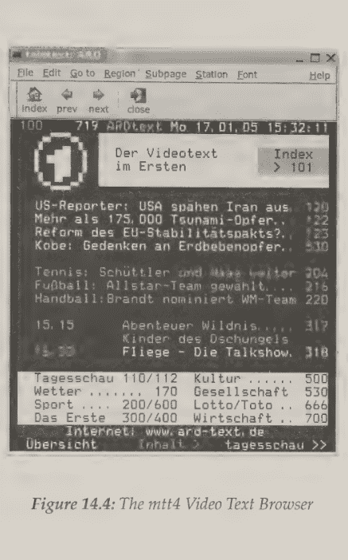

gcam 是一款摄像头应用程序，帮助使用摄像头拍摄快照或自动照片。要使用 gcam，你的摄像头必须受 Video4Linux 支持。许多 USB 摄像头（如罗技 Quickcam Express）可以被自动识别。可以使用灰度摄像头和彩色摄像头。支持 Video4Linux 的电视卡也可以作为图像源。支持的 USB 设备概览维护在 http://www.linux-usb.org。图形用户界面并非强制性，因为 gcam 也可以从命令行运行。

图 14.4：mtt4 视频文本浏览器

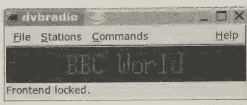

图 14.5：DVB 广播

### 14.6.1 操作

在启动 gqcam 之前将摄像头连接到电脑的 USB 端口。然后运行 gqcam。摄像头的当前图像会自动显示在应用程序窗口的顶部。底部带有滑块，可根据需要调整亮度、白平衡、对比度、色调和饱和度。亮度会自动预设。此功能可以在“常规（General）→ 文件（File）→ 选项（Preferences）”中设置。“过滤器（Filters）”功能具有伪色校正功能，因为某些摄像头在传输中会交换红色蓝色通道。

如果你操作多个摄像头，请使用“文件（File）→ 打开新摄像头（Open New Camera）”切换到另一个摄像头。从打开的对话框中选择新设备。第一个摄像头连接到设备 /dev/video0，第二个连接到 /dev/video1，依此类推。

### 14.6.2 快照

要使用摄像头拍摄快照，点击“拍摄照片（Snap Picture）”。在打开的对话框中选择文件名和格式。通过“摄像头（Camera）→ 设置定时器（Set Timer）”创建系列图像。在“设置图像信息（Set image information）”中沿图像属性设置秒或分钟为单位的捕捉频率。可以使用“拍摄后运行命令（Run command after snap）”选择每次拍摄后运行的可选脚本。这可以用于将捕到的图像上传到 FTP 服务器。

### 14.6.3 命令行

gqcam 也可以在没有图形用户界面的情况下运行。这可能很有趣，例如用于 cron 任务控制的自动监控。这要求将所有设置作为参数传递给应用程序。运行 `gqcam -t JPEG -s -d webcam.jpg` 将将摄像头捕获的当前图像保存为文件名 webcam.jpg。选项 -t 定义文件格式。可能的值有 JPEG、PNG 和 PPM。命令行开关 -s 激活颜色校正。保存文件名通过选项 -d 传递。如果操作了多个摄像头，则必须传递设备名称。如果没有给出设备，则使用默认设备 /dev/video0。要从第二个摄像头捕捉图像，必须添加选项 `-v /dev/video1`。运行 `gqcam --help` 列出所有选项。

## 14
IV. 视频、广播和摄像头

## K3b—KDE 刻录应用程序

K3b 是一个用于刻录数据、音频 CD 和 DVD 的综合程序。从主菜单或输入命令 k3b 启动程序。以下章节将简要介绍如何开始基本的刻录过程以获取你的第一个 Linux。

- 15.1 创建数据 CD . . . . . . . . . . . . . . . 210
- 15.2 创建音频 CD . . . . . . . . . . . . . . . 212
- 15.3 复制 CD . . . . . . . . . . . . . . . . . 213
- 15.4 写入镜像 . . . . . . . . . . . . . . . . . 213
- 15.5 更多信息 . . . . . . . . . . . . . . . . . 213

### 15.1 创建数据 CD

要创建数据项目，转到“文件（File）→ 新项目（New Project）”。将所需的文件拖入项目文件夹，如下所示：

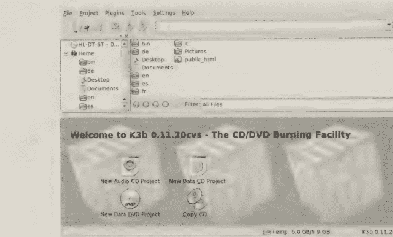

图 15.1：创建数据 CD

对话框带有选项：

**写入模式（Writing Mode）** 这决定了如何写入 CD。“速度（Speed）”选项卡提供各种选项。在磁盘一次写入（DAO）模式下，支持刻录。见下一页。

### 15.2 自定义刻录过程

“写入（Writing）”选项卡提供各种选项。在轨道一次写入（TA）模式下，不支持刻录 CD。

- 仅创建镜像（Only create image）此选项创建一个镜像文件。在“临时文件（Temporary File）”下设置该文件的路径。该镜像文件可以在以后写入 CD。要这样做，使用“工具（Tools）→ CD → 写入镜像（Burn Image）”。如果使用此选项，此部分的所有其他选项将禁用。
- 删除镜像（Remove image）完成后从磁盘删除临时镜像文件。
- 验证写入数据（Verify written data）通过比较原始数据和写入数据的 MD5 来检查写入数据的完整性。

“设置（Settings）”选项卡具有创建多数据或音频轨道 CD 所需的选项。在“卷（Volume Disc）”选项卡中，输入用于识别此特定数据项目的发布者和准备者，以及创建此项目使用的应用程序和操作系统。在“文件系统（File system）”下，指定 CD 文件系统的设置（RockRidge, Joliet, UDF）。还决定如何处理符号链接、权限和空白。在“高级（Advanced）”选项卡中，经验用户可以额外设置。

根据需要调整所有设置后，使用“刻录（Burn）”开始实际刻录过程。或者，使用“保存（Save）”保存这些设置以便以后使用和调整。

### 15.2 创建音频 CD

基本上创建音频 CD 和创建数据 CD 之间没有显著差异。选择“文件（File）→ 新音频项目（New Audio Project）”。将单个音频轨道拖入项目文件夹。音频数据必须是 WAV 或 Ogg Vorbis 格式。通过在项目文件夹中移动轨道来确定顺序。


# 提示保持数据完整性
在刻录音频 CD 时，请选择较低的刻录速度以减少刻录错误的风险。

## 15.3 复制 CD

选择“工具”→“CD”→“复制 CD”或使用工具栏上的“复制 CD”按钮。在打开的对话框中，按照下页图 15.3 所示设置读取和写入设备的设置。此处同样可以使用之前讨论的写入选项。此外，还有一个额外功能可以创建该 CD 的多个副本。

勾选“即时刻录（On the fly）”以便在读取后立即刻录 CD，或选择“仅创建镜像”在“临时目录”→“写入镜像文件到”指定的路径创建镜像，并在稍后刻录镜像。

## 15.4 写入 ISO 镜像

如果你已经有一个 ISO 镜像，转到“工具”→“CD”→“写入镜像”。在打开的对话框中，按照图所示设置写入设备的设置。此处同样可以使用之前讨论的写入选项。一个额外的功能可以创建该 CD 的多个副本。（注：原文此处重复逻辑错误）

## 15.5 更多信息
除了上述功能外，K3b 还提供了其他功能，例如创建 CD 的多个副本、以 WAV 格式读取音频以及重写镜像。关于所有可用功能的详细信息请参阅 http://www.example.org。

 图 15.3：复制 CD

# 16 数字相机与
在 Linux 下管理相机是件很有趣的事，只要你拥有正确的工具。本章涵盖了 gphoto2、Konqueror 和 Digikam。

- 16.1 连接相机 . . . . . . . . . . . . .
- 16.2 访问相机 . . . . . . . . . . . . .
- 16.3 安装程序 . . . . . . . . . . . . .
- 16.4 使用 Konqueror . . . . . . . . . . . . .
- 16.5 使用 gtKam . . . . . . . . . . . . .
- 16.6 使用 Digikam . . . . . . . . . . . . .
- 16.7 更多信息 . . . . . . . . . . . . .

关于支持相机的完整列表请访问 http://www.example.org。如果安装了 gphoto2，可以通过 `gphoto2 --help` 获取信息。

> **提示**：不支持的相机
> 如果你在 gphoto 列表中找不到你的相机，请不要担心。它可能支持 USB 存储设备。更多信息请参见第 16.2 节。

## 16.1 连接相机
将相机连接到计算机最快且方便的方法是通过 USB，前提是内核支持。还需要合适的线缆。只需将相机连接到 USB 端口并开启。你可能需要将相机切换到数据传输模式。有关此操作，请参阅相机说明。

## 16.2 访问相机
访问相机上的照片有三种可能，取决于相机及其支持的协议。通常是 USB 存储（由热插拔系统处理）、PTP（图像传输协议）以及由 gphoto2 处理的私有协议。

如果你的相机支持 USB 存储，这是最简单的方法。如果不确定是否可行，请阅读相机文档。有些相机支持两种协议，如 PTP 和 USB 存储。遗憾的是，有些使用的是私有协议，这会使任务变得复杂。如果你的相机不支持 USB 存储或 PTP，请尝试以下命令：`gphoto2 --list-cameras`。

如果你的相机可以切换到 USB 存储设备，请选择此选项。通过 USB 端口连接并开启后，热插拔系统会自动处理，因此可以访问。挂载成功后，KDE 桌面会显示相机图标。

## 16.3 安装程序
使用 YaST 安装ikam 以及其他所需的软件包。

## 16.4 使用 Konqueror
KDE 用户可以通过界面轻松访问相机。有关 Konqueror 的更多信息请参阅第 10 章第 15 页。

## 16.5 使用 gtKam
gtKam 是从数字相机下载和删除图片的图形化界面。要调整或编辑图片，请按照第 18 节所述使用 GIMP。


## 1.6 使用 Digikam

Digikam 是 Renchi Raju 开发的一款 KDE 程序，用于从数码相机下载照片。首次运行时，Digikam 会询问你存储相册的位置。如果你输入的目录已经包含了一组照片，Digikam 将会将该文件夹的每个子文件夹视为一个“专辑”。

启动时，Digikam 会显示一个包含两个部分的窗口：左侧显示你的专辑，右侧显示相应的照片。参见本页的图 16.1。


图 16.1：Digikam 主窗口

### 1.6.1 配置你的相机

要在 Digikam 中设置相机，选择“相机 (Camera)”→“添加相机 (Add Camera)”。首先，尝试使用“自动检测 (Auto-Detect)”自动检测相机。如果失败，通过“添加 (Add)”在列表中查找你的型号。如果你的相机型号不在列表中，尝试旧旧型号，或使用“USB 大容量存储 (USB Mass Storage)”或“USB PTP 类相机 (USB PTP Class Camera)”。通常情况下这可以工作。点击“确定 (Ok)”确认。

### 16.6.2 从相机下载照片

相机正确配置好后，通过“相机 (Camera)”菜单以及你在上一页第 16.6.1 节对话框中提供的名称连接到相机。Digikam 打开一个窗口并开始下载缩略图，并如本页图 16.2 所示显示。右键点击图像可弹出菜单，提供“查看 (View)”、显示某些“属性 (Properties)”和“EXIF 信息”、“下载 (Download)”或“删除 (Delete)”图像的选项。通过“高级 (Advanced)”可以选择重命名选项以及处理相机提供的信息 (EXIF)。


图 16.2：从相机下载照片

如果你的相机没有赋予有意义的文件名，重命名选项将非常方便。你可以让 Digikam 自动重命名照片。给出一个唯一的前缀，并可选地提供日期、时间或序列号。其余由 Digikam 完成。

通过按下左鼠标键或按住 (Ctrl) 点击单张照片来选择要从相机下载的所有照片。选中的照片将以反色显示。点击“下载 (Download)”。从列表或通过“新专辑 (New Album)”创建一个新专辑来选择目标。这会自动建议一个带有当前日期文件名。点击“确定 (Ok)”开始下载过程。

### 16.6.3 获取信息

获取照片信息并不困难。当你将鼠标光标悬在缩略图上时，会显示简短摘要作为工具提示。需要更多信息，右键点击照片并在菜单中选择“属性 (Properties)”。打开一个带有三个标签的对话框：“通用 (General)”、“EXIF”和“直方图 (Histogram)”。“通用”列出了名称、类型、所有者以及其他基本信息。最有趣的部分是“EXIF”标签。相机为每张照片存储了某些元数据。Digikam 读取这些属性并在列表中显示它们，例如曝光时间、像素尺寸等。要获取所选列表条目的更多信息，按下 Shift-F1。这将显示一个小工具提示。最后一个标签“直方图”显示了一些统计信息。

### 16.6.4 管理专辑

Digikam 默认插入一个“我的专辑 (My Albums)”文件夹，收集你所有的照片。你稍后可以将这些存储在子文件夹中。专辑可以根据目录布局、专辑属性中设置的集合名称或专辑首次创建的日期进行排序（此日期也可以在每个专辑的属性中更改）。

创建一个新专辑，你有几种可能：

-   从相机上传新照片
-   点击工具栏上的“新专辑 (New Album)”按钮创建新专辑
-   从硬盘导入现有的照片文件夹（选择“专辑 (Album)”→“导入 (Import)”→“导入文件夹 (Import Folders)”）
-   右键点击“我的专辑 (My Albums)”并选择“新专辑 (New Albums)”

在选择了你喜欢的方式创建专辑后，会弹出一个对话框。给它一个标题。可选地选择一个集合，插入一些注释，并选择专辑日期。集合是一种通过通用标签组织专辑的方法。当你选择“查看 (View)”→“排序专辑 (Sort Albums)”→“按集合 (By Collection)”时，会使用该标签。注释显示在主窗口顶部的横幅中。专辑日期在你选择“查看 (View)”→“专辑 (Albums)”→“按日期 (By Date)”时使用。

Digikam 使用专辑中的第一张照片作为“我的专辑”列表中的预览图标。要选择另一一张，右键点击相应的照片并从上下文菜单中选择“设置为专辑缩略图 (Set as Album Thumbnail)”。

### 16.6.5 管理标签

管理具有不同专辑的许多不同照片有时会复杂。为了组织单张照片，Digikam 提供了“我的标签 (My Tag)”系统。

例如，你曾在不同时间拍摄了朋友 John，你想收集所有图像，无论它们属于哪个专辑。这让你能够很容易地找到所有照片。首先，点击“我的标签 (My Tags)”→“人物 (People)”创建一个新标签。从右键菜单中选择“新标签 (New Tag)”。在出现的对话框中，输入“John”作为标题并可选地选择一个图标。点击“确定 (OK)”确认。

创建标签后，将其分配给所需的目标。到每个专辑并选择所需的目标。到每个专辑并选择所需的目标。（注：此处 OCR 文本似乎重复或存在杂讯，保持原意）。

### 16.6.6 有用工具

Digikam 提供了一些工具来简化某些任务。可以在“工具 (Tools)”菜单中找到它们。以下是可用工具的精选。

### 创建日历

如果你想取悦某人，自定义日历是一份很棒的礼物。进入“工具 (Tools)”→“创建日历 (Create Calendar)”，打开一个类似于对面页图 16.3 显示的向导对话框。

自定义设置（纸张尺寸、图像位置、字体等）并点击“下一步 (Next)”。现在输入输入并选择图像。再次点击“下一步”，查看摘要。最后的“下一步”打开 KDE 打印机对话框。在这里，决定你想查看预览、保存为 PDF 还是直接打印。

# 创建日历模板


# 查找重复照片

有时你会反复拍摄相似的场景，并只想保留最好的照片。这是“查找重复 (Find Duplicate)”插件的完美任务。

进入“工具 (Tools)”→“查找重复图像 (Find Duplicate Images)”，打开一个类似于下一页图 16.4 的窗口。选择要处理的专辑或标签。在“方法与缓存 (Method & Cache)”下选择搜索方法：更准确的方法或更快的方法。在你确认“确定 (Ok)”后，Digikam 开始调查。

如果它发现了一些重复项，将在第 225 页的图 16.5 中显示结果。通过激活所需的复选框来决定删除哪些图像，然后点击“删除 (Delete)”。通过“关闭 (Close)”退出窗口。

# 批量处理

Digikam 还提供了一些对文件列表执行特定任务的批量处理。这可以是重命名、转换、调整大小等。可以在“工具 (Tools)”→“批量处理”下找到它们。

## 16.7 更多信息

关于在 Linux 上使用数码相机的更多信息，请参考以下网站：

- http://digikam.sourceforge.net 关于 Digikam
- http://gphoto.sourceforge.net 关于 gPhoto、gPhoto2 以及兼容 gPhoto2 的 GUI


# 16 数字数码相机与 Linux

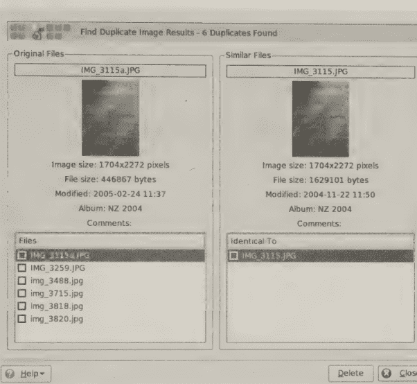

图 16.5：Find 的结果

- http://www.thekomany.com/projects/gphoto/ 关于 Kamera 的信息，一个用于 gPhoto2 的 KDE 前端

SUSE LINUX 225

## Kooka——扫描应用程序

Kooka 是一个用于扫描的 KDE 应用程序。本章将介绍该应用程序的用户界面和功能。除了从打印介质（如照片或杂志）创建图像文件外，Kooka 还具有字符识别能力。这意味着它可以帮助将手写文本转换为可以编辑的文本文件。

- 17.1 预览 . . . . . . . . . . . . . . . . . . . . . . . . . . . 229
- 17.2 最终扫描 . . . . . . . . . . . . . . . . . . . . . . . . . . . 229
- 17.3 菜单 . . . . . . . . . . . . . . . . . . . . . . . . . . . . 231
- 17.4 画廊 . . . . . . . . . . . . . . . . . . . . . . . . . . . . 231
- 17.5 光学字符识别 . . . . . . . . . . . . . . . . . . . . . . . . 232

从菜单中启动 Kooka 或输入命令 `kooka` 启动。启动后，Kooka 会打开一个带有三个框架的窗口，左上角有一个菜单栏，正下方是工具栏。所有窗口都可以用鼠标自由地调整或重新排列。还可以将单个框架完全从 Kooka 窗口中分离，以便有目的地放置在桌面桌面上。点击并拖动框架上方的双线。除了主窗口外，任何框架都可以放置在任何与左、右、顶部、底部或居中对齐的其他框架内。居中的窗口大小相同，堆叠在一起，可以通过标签将它们带到顶层。

“图像查看器”和“扫描预览”框架默认共享一个窗口。标签允许在它们之间切换。左侧框架提供画廊。这是一个用于访问扫描图像的小型文件浏览器。右下方的框架由 OCR（光学字符识别）和缩略图共享，点击鼠标即可加载到图像查看器中。参见本页的图 17.1。

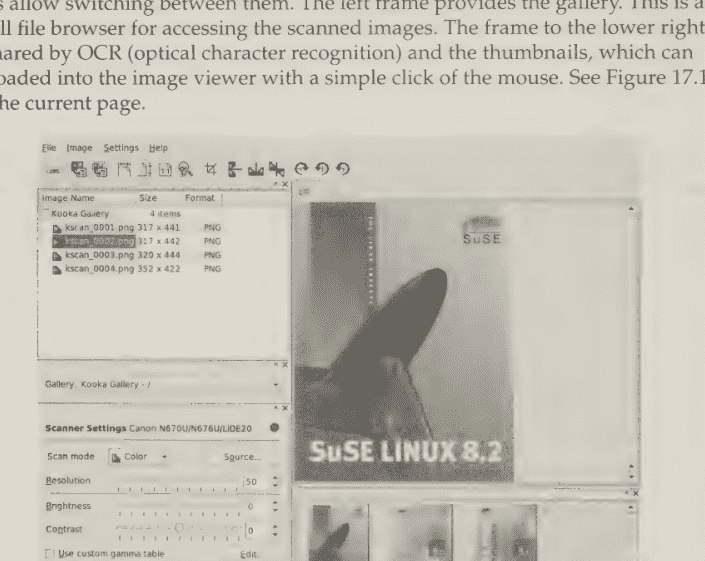

| 图像名称 | 大小 | 格式 |
| --- | --- | --- |
| Kooka 画廊 | | |
| kscan_0001.png | 317 x 441 | PNG |
| kscan_0002.png | 317 x 442 | PNG |
| kscan_0003.png | 320 x 432 | PNG |
| kscan_0004.png | 352 x 432 | PNG |

图 17.1：Kooka 主窗口

### 17.1 预览

当待扫描对象小于总扫描区域时，应始终创建预览。在预览框架的左侧设置几个参数。通过“自定义”或其中一个标准格式选择扫描大小。参见本页的图 17.2。“自定义”设置最为灵活，因为它允许用鼠标选择所需的区域。设置好后，点击“扫描参数”中的“预览扫描”来请求待扫描图像的预览。

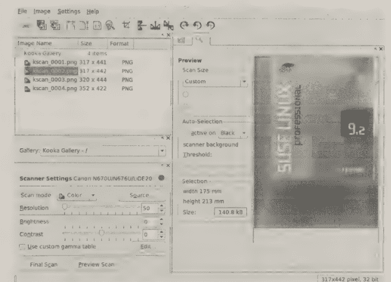

图 17.2：Kooka 预览窗口

### 17.2 最终扫描

如果您在扫描大小处选择了“自定义”，请使用鼠标选择要扫描的矩形区域。所选区域由虚线边框定义。

在彩色扫描和黑白扫描之间进行选择，并使用滑块设置分辨率。参见本页的图 17.3。分辨率越高，扫描图像的质量越好。但这也会导致文件相应增大，且在高分辨率下扫描过程可能会花费很长时间。激活“使用自定义伽马表”并点击“编辑”来更改亮度、对比度和伽马设置。

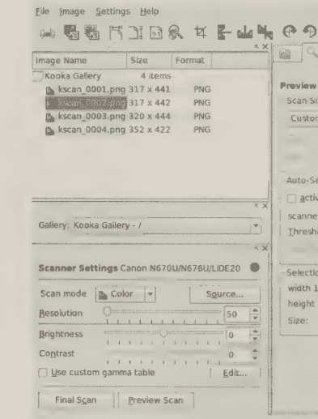

图 17.3：Kooka 扫描参数

完成所有设置后，点击“最终扫描”扫描图像。扫描后的图像将在图像查看器和缩略图中显示。提示时，选择保存图像的格式。要以后以相同格式保存所有图像，请勾选相应的复框。点击“确定”确认。

### 17.3 菜单

工具栏的某些功能在“文件”和“图像”菜单中可用。在“设置”中修改 Kooka 的偏好设置。

- **文件**：使用此菜单启动打印助手、为您的图像创建新文件夹并保存图像。
- **图像**：“图像”菜单允许对图像进行缩放、旋转和翻转。
- **设置**：“设置”调整 Kooka 的外观。通过此菜单可以更改亮度、对比度和伽马设置。
- **帮助**：“帮助”菜单提供帮助。

### 17.4 画廊

画廊显示 Kooka 的所有文件。在画廊中可以看到一个示例。参见本页的图 17.4。只需通过鼠标拖放即可移动到画廊。

| 图像名称 | 大小 | 格式 |
| --- | --- | --- |
| Kooka 画廊 | | |
| kscan_0001.png | 317 x 441 | PNG |
| kscan_0002.png | 317 x 442 | PNG |
| kscan_0003.png | 320 x 432 | PNG |
| kscan_0004.png | 352 x 432 | PNG |

图 17.4：Kooka 画廊

### 17.5 光学字符识别

如果安装了字符识别模块，可以以“行”模式扫描。配置对话框告知原始文本是打印类型还是手写类型。参见下一页的图 17.5。到 OCR 窗口并检查文本，文本可能需要校对。通过“文件”保存。文本可以使用 OpenOffice 进行处理。


与许多其他 Linux 程序一样，GIMP 是由全球开发者共同开发的，他们自愿投入时间和代码到该项目。该程序处于不断开发中，因此，您的 SUSE LINUX 中包含的版本可能与此处讨论的版本略有不同。特别是各个窗口和窗口区域的布局可能会有所变化。

GIMP 是一个极其复杂的程序。本章仅讨论了少部分功能、工具和菜单项。有关如何查找该程序的更多信息，请参阅第 241 页的第 18.6 节。

## 18.1 图像格式

图形有两种主要格式：像素和矢量。GIMP 处理像素图形，这是照片和扫描图像的常用格式。像素图形由许多小的色块组成，这些色块共同形成了整个图像。由于由于原因，文件很容易变得非常大。此外，在不损失质量的情况下无法增大像素图像尺寸。

与像素图形不同，矢量图形不存储所有单个像素的信息。相反，它们存储关于图像点、线或区域如何组合在一起的信息。矢量图像也可以非常容易地缩放。例如，OpenOffice.org 的绘图应用程序使用的这种格式。

## 18.2 启动 GIMP

从主菜单启动 GIMP。或者，在命令行输入 `gimp`。

### 18.2.1 初始配置

首次启动 GIMP 时，会打开一个配置向导进行准备配置。默认设置适用于大多数用途。除非你熟悉设置并倾向于其他设置，否则请在每个对话框中按“继续”。

### 18.2.2 默认窗口

默认情况下会出现三个窗口。它们可以在屏幕上排列，除工具箱外，在不再需要时可以关闭。关闭工具箱将关闭应用程序。在默认配置中，GIMP 在你退出时会保存窗口布局。开启的对话框在启动程序时会重新出现。

## 工具箱

GIMP 的主窗口如本页图 18.1 所示，包含了应用程序的主要控件。关闭它将退出应用程序。在最上方，菜单栏提供了文件功能、扩展和帮助。下方下方是各种工具的图标。将鼠标悬停在图标上即可显示该工具的信息。

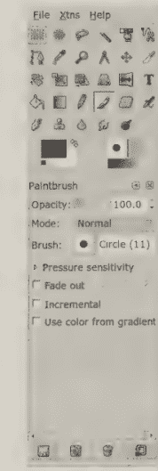

图 18.1：主窗口

当前的前景色和背景色显示在两个叠加的框中。默认颜色前景为黑色，背景为白色。点击框可以打开颜色选择对话框。使用色框右上角的弯曲箭头符号交换前景色和背景色。使用左下角的黑白符号将颜色重置为默认。

在右侧显示当前的笔刷、图案和渐变。点击显示的项以访问选择对话框。窗口的下半部分包含当前工具的各种选项。

## 图层、通道、路径、撤销

在第一部分，使用下拉框选择标签所指的图像。通过点击“自动”，控制是否自动选择活动图像。默认情况下，“自动”已启用。

“图层”显示当前图像中的不同层，并可用于操作图层。“通道”显示并可以操作图像的颜色通道。

路径是选择图像部分的高级方法。它们也可以用于绘图，“路径”显示图像可用的路径并提供对路径函数的访问。“撤销”显示对当前图像修改的有限历史。

窗口的底部包含三个标签。通过它们，可以选择当前的笔刷、渐变和图案。

## 18.3 在 GIMP 中入门

尽管 GIMP 对新用户来说可能有些无从从，但大多数人在掌握了一些基础知识后很快就会发现很容易用。关键的基础功能是创建、打开和保存图像。

### 18.3.1 创建新图像

要创建新图像，选择“文件” → “新建”或按 Ctrl-N。这会打开一个对话框，为新图像进行设置。如果需要，使用“模板”选择一个模板作为新图像的模板。GIMP 包含许多模板，从 A4 纸到 CD 封面不等，可供选择。

要创建自定义模板，选择“文件” → “对话框” → “模板”，并使用打开窗口所示提供的控件。

在“图像大小”部分，设置要创建的图像尺寸，单位为像素或其他单位。点击单位可以从可用单位列表中选择另一个单位。像素与单位之间的比例在“分辨率”中设置，该选项在“高级”部分打开时出现。每英寸 72 像素的分辨率对应屏幕显示，对于网页图形足够。用于打印的图像应使用更高的分辨率。对于大多数打印机，每英寸 300 像素的分辨率可以获得可以接受的质量。

在“色彩空间”中，选择图像应该是彩色（“RGB”）还是“灰度模式”。为新图像选择“填充类型”。“前景色”和“背景色”使用工具箱中选择的颜色。“白色”在图像中使用白色背景。“透明”创建一个清晰的图像。“透明度”用灰色棋盘纹样表示。在“注释”中为新图像输入注释。

当设置满足你的需求时，按“确定”。

### 18.3.2 打开现有图像

要打开现有图像，选择“文件” → “打开”或按 Ctrl-O。在打开的对话框中，选择所需的文件。点击“确定”打开图像。“取消”中止打开。

### 18.3.3 图像窗口

新创建或打开的图像将出现在自己的窗口中。顶部的菜单栏提供了访问所有功能的途径。通过“文件”，你可以保存、打印或退出。“关闭”关闭当前窗口。“退出”关闭整个应用程序。

## 18.4 保存图像

没有哪个图像功能像“文件” → “保存”那样重要。频繁保存比稀少保存好。使用“文件” → “另存为”用新文件名保存图像。用不同的名称保存图像阶段或制作备份是一个好主意，这样你就可以轻松恢复到之前的状态。

第一次保存或使用“另存为”时，会打开一个对话框来标识文件名和类型。在顶部的字段中输入文件名。对于“保存到文件夹”，从常用目录列表中选择保存文件的目录。要使用不同的目录或创建新目录，按“浏览其他文件夹”。建议将“选择文件类型”设置为“按扩展名”。这样，GIMP 将根据扩展名确定文件类型。以下文件类型最常用：

- XCF：应用程序的本地格式。它保存所有层信息以及图像本身。即使你需要其他格式的图像，保存一个 XCF 副本也是一个好主意，方便未来的修改。
- PAT：用于 GIMP 图案的格式。保存为此格式允许将图像作为填充图案。
- JPG 或 JPEG：照片和无透明度网页的常用格式。它的压缩方法允许缩小文件大小，但在压缩时会丢失信息。在调整压缩级别时，使用预览选项可能是好主意。85% 到 75% 的水平通常可以获得可以接受的图像和合理的压缩。也建议以无损格式（如 XCF）保存备份。编辑图像时，仅将完成的图像保存为 JPG。


PNG 因其支持透明度、无损压缩、免费可用以及日益增加的浏览器支持，正在取代 GIF 成为透明 Web 图形的首选格式。另一个优势是 PNG 提供部分透明度，而 GIF 则不提供。这使得彩色区域到透明区域的过渡更加平滑（抗锯齿）。

要按所选格式保存图像，请按“保存”。要取消，请按“取消”。如果图像具有无法以所选格式保存的特征，将出现对话框并提供解决状况的选项。如果提供“导出”，选择它通常可以得到预期结果。随后会打开一个带有格式选项的窗口，并提供合理的默认值。

## 18.5 打印图像

要打印图像，请从图像菜单中选择“文件”→“打印”。如果你的打印机在 SUSE 中配置过，它应该出现在列表中。在某些情况下，可能需要通过“设置打印机”选择合适的驱动程序。在“介质大小”中选择合适的尺寸并在“介质类型”中选择类型。其他设置可以在“图像/输出设置”选项卡可用。

在窗口底部调整图像大小。按“使用原始图像大小”从图像本身获取这些设置。如果你已经在图像中设置了合适的打印尺寸和分辨率，则建议使用此。通过“位置”中的字段或通过在“预览”中拖动图像来调整图像在页面上的位置。

对设置满意后，按“打印”。要保存设置供以后使用，请使用“打印并保存设置”。取消”将中止打印。

## 18.6 更多信息

以下是一些对 GIMP 用户可能有用的资源。遗憾的是，许多资源适用于旧版本。

- * “帮助”提供了访问内部帮助系统。该文档在 http://docs.gimp.org 也提供 HTML 和 PDF 格式。
- * GIMP 用户组在 http://gug.sunsite.dk 提供了一个信息量丰富且有趣的网站。

### 打印机设置

### 图像/输出设置

| 字段 | 值 |
| :--- | :--- |
| 打印机名称 | 顶部 |
| 打印机型号 | PostScript Level 2 |
| 设置打印机 | 新打印机... |
| 介质大小 | 纸张 (Letter) |
| 尺寸 | 宽度: 0.00 高度: 0.00 |
| 介质类型 | 标准 |
| 介质源 | 标准 |
| 油墨类型 | 标准 |
| 分辨率 | 标准 |


| 字段 | 值 |
| :--- | :--- |
| 方向 | 自动 |
| 左侧 | 0.50 顶部: 1.04 |
| 右侧 | 0.75 底部: 0.33 |
| 右边框 | 2.25 垂直 底部边框: 2.17 水平 |

| 位置 | 尺寸 |
| :--- | :--- |
| 缩放: | % 百比 宽度: 8.25 单位: % 英寸 使用原始图像大小 |
| | % PPI 高度: 5.29 % 厘米 |

| 关于保存设置 | 打印并保存设置 | 取消 | 打印 |

图 18.2：打印对话框

- * http://www.gimp.org 是 GIMP 的官方首页。
- * Carey Bunks 编写的《Groking the GIMP》是一本基于旧版 GIMP 的优秀书籍。虽然程序的某些方面发生了变化，但它为图像处理提供了极佳的指导。在线版本可以在 http://gimp-savvy.com/BOOK/ 获取。
- * http://gimp-print.sourceforge.net 是 GIMP 打印插件的网页。该网站提供的用户手册提供了有关配置和使用该程序的详细信息。

## 第五部分

## 离游

## 使用 Shell

图形用户界面对于 Linux 来说变得越来越重要，但使用鼠标并不总是执行日常任务的最佳方法。命令行提供了高度的灵活性和效率。本章的第一部分介绍了 Bash Shell。随后是对 Linux 中用户权限概念的解释以及最重要命令的列表。本章以对 vi 编辑器的描述结束。

- 19.1 Bash 简介 . . . . . . . . . . . . . . . . . . . . . . . 246
- 19.2 用户与访问权限 . . . . . . . . . . . . . . . . . . . . . . 255
- 19.3 重要 Linux 命令 . . . . . . . . . . . . . . . . . . . . . . 260
- 19.4 vi 编辑器 . . . . . . . . . . . . . . . . . . . . . . . . . . . . 268

基于文本应用程序对于控制那些没有资源运行复杂的显示系统的旧 Linux 计算机特别为重要。在这种情况下使用了虚拟控制台。文本模式提供六个控制台。按 (Alt)-(F1) 到 (Alt)-(F6)。第七个控制台留给 X 使用。

## 19.1 Bash 简介

在 KDE 任务栏中有一个绘有贝壳的显示器图标。当你点击它时，会打开一个控制台窗口以输入命令。控制台通常运行 Bash (Bourne again shell)，这是一个作为 GNU 项目一部分开发的程序。当你打开 shell 后，第一行会出现提示符。提示符通常由用户名、主机名和当前路径组成，但。

### 19.1.1 命令

一个命令由几个元素组成。第一个元素是实际的，后面跟着。

### 19.1.2 文件和目录

为了高效地使用 shell，对文件和目录结构了解一些知识非常有帮助。


## 19.1.3 Bash 函数

Shell 有两个重要的函数，可以让你的工作变得简单得多：

历史记录（History）：要重复以前输入过的命令，按 `↑` 直到上一个命令出现在提示符处。通过按 `⇩` 在之前输入过的命令列表中向前移动。要编辑命令行，只需使用方向键将光标移动到所需位置并开始输入。使用 `Ctrl-R` 在历史记录中进行搜索。

扩展（Expansion）：在输入文件的第一个几个字母后，将其扩展为完整长度，直到它可以被唯一识别。要执行此操作，输入前几个字母然后按 `Tab` 键。如果有多个以相同字母开头的文件，双击 `Tab` 键即可获取它们的列表。

## 第一个示例：管理文件

现在你已经了解了命令的格式、SUSE LINUX 中存在哪些目录，以及在使用 Bash 时如何加快速度，请通过这个练习来将这些知识付诸实践。

- 1. 点击 KDE 桌面上的 shell 图标打开控制台。
- 2. 输入 `ls` 命令查看你的家目录内容。
- 3. 使用 `mkdir` 命令（意为 make directory）通过输入 `mkdir test` 创建一个名为 test 的新子目录。
- 4. 现在按 `Alt-F2` 启动 Kate 编辑器，并在输入框中输入 `kate`。在编辑器中输入几个字母，然后将文件保存为家目录下的 `Testfile`。Linux 区分大小写。在本示例中，请使用大写的 `T`。
- 5. 再次查看家目录的内容。无需再次输入 `ls`，只需按两次 `↑`，`ls` 命令就会重新出现在提示符处。按回车执行命令。新创建的目录 `test` 应该显示为蓝色，`Testfile` 显示为黑色。这就是在控制台中区分目录和文件的方式。
- 6. 使用 `mv` 命令将 `Testfile` 移动到子目录 `test` 中。为了加快速度，可以使用扩展函数：只需输入 `mv` 然后按 `[Tab]`。只要目录下没有其他以此字母开头的文件，shell 就会扩展文件名并添加字符串 `Testfile`。否则，手动添加一两个字母，并每次测试 `[Tab]` 以查看 shell 是否能扩展名称。最后，在扩展后的文件名后输入一个空格，然后按 `[Enter]` 执行命令。
- 7. 此时，`Testfile` 不再位于目录中。再次输入 `ls` 进行检查。
- 8. 要查看文件是否已成功移动，使用 `cd test` 命令进入目录。现在再次输入 `ls`。你应该能在列表中看到 `Testfile`。在任何时候只需输入 `cd` 即可返回家目录。
- 9. 要复制文件，请使用 `cp`。例如，输入 `cp Testfile Testbackup` 将 `Testfile` 复制为 `Testbackup`。再次可以使用 `ls` 命令查看两个文件是否都在目录中。

## 19.4 指定路径

在处理文件或目录时，指定从根目录到相应文件的正确（绝对）路径是非常重要的。你可以从当前目录开始。使用 `~` 直接指定你的家目录。这意味着有两种方法可以列出目录中的 `Testfile` 文件：通过 `ls` 输入相对路径，或者通过 `ls ~` 指定绝对路径。

要列出其他用户的家目录内容，输入 `ls ~username`。在上述目录树中，其中一个示例是 `users`。在这种情况下，`ls ~ux` 将列出 `tux` 家目录的内容。

使用点 `.` 当前目录。树中的下一层用两个点 `..` 表示。输入 `ls ..` 查看当前目录父目录的内容。`ls ..` 命令显示层级中高两层的目录内容。

## 第二个示例：使用路径

这里有另一个示例，说明如何在 SUSE LINUX 系统的目录之间移动。

使用 `cd` 命令进入你的家目录。然后通过输入 `mkdir test2` 在其中创建一个名为 `test2` 的目录。

使用 `cd test2` 进入新目录，并在其中创建一个名为 `subdirectory` 的子目录。要进入该目录，请使用扩展函数：输入 `cd` 然后按 `Tab`。shell 会扩展目录名的剩余部分。

现在，尝试在不再次切换目录的情况下，将之前创建的文件 `Testbackup` 移动到当前目录（subdirectory）。要实现这一点，请指定文件的相对路径：`mv ../test/Testbackup .`。此命令末尾的点是必须的，它告诉 shell 当前目录是移动文件的目标地。在本例中，`..` 指向你的家目录。

## 19.1.5 通配符

shell 提供的另一个便利是通配符。Bash 中有四种不同类型的通配符：

- `?` 匹配任意一个字符
- `*` 匹配任意数量的字符
- `[set]` 匹配方括号内指定字符组中的一个，这里用字符串 `set` 表示
- `[!set]` 匹配除 `set` 指定字符以外的字符

假设你的测试目录包含文件 `Testfile`、`Testfile1`、`Testfile2` 和 `datafile`，命令 `ls Testfile?` 会列出 `Testfile1` 和 `Testfile2`。使用 `ls *`，列表也包含 `Testfile`。`ls *` 显示所有示例文件。最后，你可以使用通配符处理末一位为数字的所有示例文件：`ls Testfile[1-9]`。

在四种通配符中，包含性最的是星号 `*`。它可以用于将一个目录包含的所有文件复制到另一个目录，或通过一个命令删除所有文件。例如，命令 `rm *fil*` 将删除当前目录下所有名称中包含字符串 `fil` 的文件。

## 19.1.6 Less 和 More

Linux 包含了两个用于在 shell 直接查看文本的小程序。与其启动编辑器读取如 `Readme.txt` 的文件，只需输入 `less Readme.txt` 即可在控制台窗口显示文本。使用（Space）向下翻页。使用（Page Up）和（Page Down）向前后移动。要退出 less，按 `Q`。

除了 less，你还可以使用较旧的程序 `more`。然而，它不够方便，因为它不支持向上滚动。

less 程序的名称源于“少即是多”，它也可以方便地查看命令输出。要了解其如何工作，请阅读第 19.1.7 节。

## 19.1.7 管道

通常，shell 的标准输出是屏幕或控制台窗口，标准输入是键盘。要将命令的输出传递给 less 等应用程序，请使用管道。

要查看 test 目录的文件，输入命令 `ls test | less`。然后通过 less 显示 test 目录的内容。当 `ls` 的正常输出过长时，这样做才有意义。例如，如果你通过 `ls /dev` 查看 dev 目录的内容，你只能在窗口看到一小部分。使用 `ls /dev | less` 查看完整列表。

还可以将命令的输出保存到文件中。例如，`ls test > Content` 生成一个名为 `Content` 的新文件，其中包含 test 中的文件和目录列表。使用 `less Content` 查看文件。

你还可以将文件作为命令的输入。例如，对 Testfile 中的文本行排序：`sort < Testfile`。sort 命令的输出发送到屏幕。文本按字母字母排序。

如果你需要一个包含排序列表的新文件，将 sort 命令的输出管道到文件。要测试这一点，在编辑器中创建一个未排序的列表并将其保存为 test 目录下的 `list`。然后进入 test 并输入命令 `sort unsortedlist > sortedlist`。最后，查看排序后的列表。

与标准输出一样，标准错误输出也会发送到控制台。然而，要将标准错误输出重定向到名为 `errors` 的文件，请在相应命令后添加 `2> errors`。两者标准输出


如果你使用 `>& alloutput`，则标准错误将被保存到名为 `alloutput` 的文件中。最后，为了将命令的输出追加到已存在的文件，必须使用 `>>` 而不是单个 `>`。

## 19.1.8 归档与数据压缩

现在你已经创建了许多文件和目录，让我们考虑归档和数据压缩主题。假设你想将整个 `test` 目录打包在一个文件中，以便将其保存到软磁盘上作为备份或通过电子邮件发送。要实现这一点，请使用 `tar` 命令（磁带存档工具）。通过 `tar --help` 可以 `tar` 命令的所有选项。这里解释了这些选项中最重要的：

- c (for create) 创建新的归档。
- t (for table) 显示归档内容。
- x (for extract) 解包归档。
- v (for verbose) 在创建归档时在屏幕上显示所有文件。
- f (for file) 指定归档文件的文件名。在创建归档时，此选项必须作为最后一个给出。

使用选项 `-c` 和 `-f` 将 `test` 目录及其所有文件和子目录打包并命名为 `testarchive.tar`。为了测试目的，还可以添加 `-v` 来跟踪归档进度，尽管此选项不是强制性的。在使用 `cd` 到 `test` 目录所在的家目录后，输入 `tar -cvf testarchive.tar test`。之后，使用 `tar -tf testarchive.tar` 查看归档文件的内容。`test` 目录及其所有文件和目录在你的硬盘上保持不变。要解包归档，输入 `tar -xvf testarchive.tar`，但先不要尝试这样做。

对于压缩，Linux 上明显的选择是流行的 `gzip` 程序。只需输入 `gzip testarchive.tar`。通过 `ls` 现在可以发现 `testarchive.tar` 文件已不存在，而是被创建了文件 `testarchive.tar.gz`。这个文件小得多，因此更适合通过电子邮件传输或存储在软磁盘上。

现在，在之前创建的 `test2` 目录解包此文件。输入 `cp testarchive.tar.gz test2` 将文件复制到该目录。

使用 `cd test.2` 进入目录。带有 `.tar.gz` 的压缩归档可以使用 `gunzip` 命令解压。输入 `gunzip testarchive.tar.gz`，这将生成文件 `testarchive.tar`，然后需要用 `tar -xvf testarchive.tar` 进行提取或取消归档。你也可以通过添加 `-z` 选项一步到位地解压并提取压缩归档。完整命令是 `tar -xzvf testarchive.tar.gz`。通过 `ls`，你可以看到创建了一个新的 `test` 目录，其内容与你家目录中的 `test` 目录相同。

## 19.1.9 mtools

mtools 是一组用于处理 MS-DOS 文件系统的命令。mtools 中包含的命令允许你像在 MS-DOS 下一样将软磁盘驱动器指定为 `a:`，这些命令与 MS-DOS 命令类似，但它们都带有 `m` 前缀。

- mdir a: 显示驱动器 `a:` 中软磁盘的内容。
- mcopy Testfile a: 将文件 `Testfile` 复制到软磁盘。
- mdel a:Testfile: 删除 `a:` 中的 `Testfile`。
- mformat a: 以 MS-DOS 格式格式化软磁盘（使用 `fdformat` 命令）。
- mcd a: 将 `a:` 设置为当前目录。
- mmd a:test: 在软磁盘上创建子目录 `test`。
- mrd a:test: 从软磁盘上删除子目录 `test`。

## 19.1.10 清理

在这一系列快速课程之后，你应该熟悉 Linux shell 或命令行行的基础知识。你可能想通过 `rm` 和 `rmdir` 命令删除各种测试文件和目录来清理你的家目录。在本章末尾，你可以找到最重要的命令列表及其功能的简要描述。

## 19.2 用户与访问权限

自 20 世纪 90 年代初创立以来，Linux 开发作为一个多用户系统。任意数量的用户都可以同时在其上工作。用户在工作站启动会话之前需要登录系统。每个用户都有一个用户名和相应的密码。这种用户的区分确保了未经授权的用户无法查看他们没有权限的文件。对系统的更改（如安装新程序）对于普通用户通常也是不可能或受限的。只有 `root`（或超级用户）具有更改系统的无限制能力，并对所有文件具有无限访问权限。明智地使用这一概念（仅在需要时以全 root 权限登录）的人可以减少数据意外丢失的风险。因为在正常情况下，只有 `root` 可以删除系统文件或格式化硬盘，因此来自木马效应或意外输入破坏性命令的威胁可以被显著降低。

### 19.2.1 文件系统权限

基本上，Linux 文件系统中的每个文件都属于一个用户和一个组。这两个私有组以及所有其他组都可以被授权写入、读取或执行文件。

在这种情况下，一个组可以定义为一组具有某些集体权利的连接用户。例如，将负责某个特定项目的组命名为 `project3`。Linux 系统中的每个用户都是至少一个私有组（普通用户）的成员。系统中的组可以根据需要任意，但只有 `root` 能够添加组。每个用户都可以通过 `groups` 命令查看自己属于哪些组。

文件系统中的权限组织在文件和目录之间有所不同。文件权限信息可以使用 `-ls` 命令显示。输出可能如示例 19.1 所示。

示例 19.1：显示文件权限的输出
```
-rw-r----- 1 tux project3 1417 Jun 21 15:03 Roadmap
```

如第三列所示，此文件属于用户 `tux`。分配给组 `project3`。要发现 `Roadmap` 的权限，必须仔细检查第一列。该列由一个领先字符和三组字符组成。第一个字母代表文件系统的类型。连字符 `-` 显示这是一个文件。目录 (`d`)、链接 (`l`)、块设备 (`b`) 或字符设备也可以被指示。接下来的三个块遵循标准模式。前三个字符引用文件是否可读 (`r`) 或不可写 (`w`）。中间部分的 `w` 表示该对象可以编辑，而连字符 (`-`) 则无法写入。第三位置的 `x` 注明该对象可以执行。在在此示例中，作为 `Roadmap` 的所有者拥有读取 (`r`) 和写入 (`w`) 权限，但不能执行 (`x`)。由于此示例中的文件是文本文件而非可执行文件，因此该特定文件不需要执行权限。在此示例中，`tux` 作为 `Roadmap` 的所有者读取 (`r`) 和写入 (`w`) 权限，但无法执行 (`x`)。组 `project3` 的成员可以读取该文件，但无法修改或执行它。其他人对该文件没有任何权限。可以通过 ACL（访问控制列表）分配其他权限。详情请参阅第 259 页的第 19.2.6 节，并参考《管理指南》中的章节获取更多背景信息。

目录权限的类型为 `d`。对于目录，单独权限的含义略有不同。与前页的文件权限相比，读取权限 (`r`) 意味着可以目录目录。写入权限 (`w`) 意味着可以创建新文件。执行权限 (`x`) 意味着用户可以进入目录。在上面的示例中，这意味着用户 `tux` 以及 `project3` 组的成员可以

示例 19.2：显示目录权限的输出
```
drwxrxr-x 1 tux project3 35 Jun 21 15:15 ProjectData
```

在本页的 19.2 中，`ProjectData` 目录的所有者 (`tux`) 和所属组 (`project3`) 很容易识别。


进入 ProjectData 目录 (x)，查看内容 (r)，以及添加或删除文件 (w)。相比之下，其他用户获得的权限较少。他们可以进入目录 (x) 并浏览它 (r)，但不能插入任何新文件 (w)。

## 19.2.2 修改文件权限

更改访问权限。文件或目录的访问权限可以由所有者，当然也可以 root 通过 `chmod` 命令加上更改权限的参数以及一个或多个文件名来更改。参数分为不同的类别：

- u (user)—文件的所有者
- g (group)—所有该文件的组
- o (others)—其他用户（如果没有给出参数，则更改将适用于所有类别）

- 2. 一个用于删除 (-)、设置 (=) 或插入 (+) 的字符

- 3. 缩写

- r—读
- w—写
- x—执行（执行）

- 4. 用空格分隔的单文件名或多个文件名

例如，如果示例 19.2 中的用户 tux 也想授予其他用户对 ProjectData 目录的写 (w) 权限，他可以使用命令 `chmod o-w ProjectData` 实现。

然而，如果我们想拒绝除自己以外的所有用户的写权限，他可以通过输入命令 `chmod go-w ProjectData` 来。为了禁止所有用户向 ProjectData 文件夹添加新文件，输入 `chmod -w ProjectData`。现在，即使是所有者，如果不重新建立权限也无法写入文件。

更改所有权权限。控制文件系统组件所有权权限的其他重要命令是 `chown` (更改所有者) 和 `chgrp` (更改组)。`change` 命令可将文件的所有权转移给另一个用户。然而，只有 root 被允许执行此更改。

假设第 256 页示例 19.2 中的文件 `Roadmap` 不再属于 tux，而是属于用户 geeko。那么 root 应该输入 `chown geeko Roadmap`。
`chgrp` 更改文件的组所有权。然而，文件的所有者必须是该新组的成员。这样，第 255 页示例 19.1 中的用户 tux 就可以通过 `chgrp project4 ProjectData` 将文件 ProjectData 的组所有权切换到 project4，只要他是该新组的成员。

## 19.2.3 setuid 位

在某些情况下，访问权限可能过于严格。因此，Linux 提供了额外的设置，允许为特定操作临时更改当前的用户和组身份。例如，`passwd` 程序通常需要 root 权限来访问 `/etc/passwd`。此文件包含一些重要信息，如用户的家目录和组 ID。因此，普通用户将无法更改 `passwd`，因为授予所有用户直接访问此文件太危险了。解决此问题的可能方案是机制。setuid (设置用户 ID) 是一种特殊文件属性，它指示系统在特定用户下执行相应标记的程序。考虑 `passwd` 命令：

```
-srws-xr-x 1 root shadow 80036 2004-10-02 11:08 /usr/bin/passwd
```

你可以看到用户权限设置了 s 位。通过 setuid 位，所有启动 `passwd` 命令的用户都以 root 身份执行它。

## 19.2.4 setgid 位

setuid 属性适用于用户。然而，setgid 属性也有等效属性。设置了此属性的程序将在其保存时的组 ID 下运行，无论由哪个用户启动它。因此，在带有 setgid 位的目录中，所有新创建的文件和子目录都被分配给目录所属的组。考虑示例目录：

```
drwxr-xr-x 2 tux archive 48 Nov 19 17:12 backup
```

你可以看到组权限设置了 s 位。目录的所有者和 archive 组员可以访问此目录。不是该组的用户将被“映射”到相应的组。所有写入文件的有效组 ID 将是 archive。例如，一个以 archive 组运行的备份程序即使没有 root 权限也能访问此目录。

## 19.2.5 粘性位 (Sticky Bit)

粘粘性位。属于程序还是目录是有区别的。如果属于程序，这样标记的文件将被加载到 RAM 中，以避免每次使用时都从硬盘获取。此属性很少使用，因为现代硬盘已经足够快了。如果此属性分配给目录，它可以防止用户删除其他的文件。典型示例包括 `/tmp` 和 `/var` 目录：

```
drwxrwxr-wt 2 root root 1160 2002-11-19 17:15 /tmp
```

## 19.2.6 访问控制列表 (ACL)

Linux 文件系统对象（如文件或目录）的传统权限可以通过 ACL（访问控制列表）进行扩展。它们允许为文件对象原始所有者或所有组之外的单个用户或组分配权限。

带有扩展访问权限的文件或目录可以通过 `ls -l +` 命令检测：

```
-rw-r--r-- 1 tux project3 14197 Jun 21 15:03 Roadmap
```

`ls` 的输出与普通 `ls` 相比没有太大变化。


ln [option(s) ] source target 创建从源（source）到目标（target）的内部链接。通常，此类链接直接指向同一文件系统上的源。然而，如果执行 `ln` 时使用了 `-s` 选项，它会创建一个符号链接，该链接仅指向源所在的目录，从而实现跨文件系统的链接。

-s 创建符号链接

cd [options(s) ] [directory] 更改当前目录。不带任何参数的 `cd` 将将切换到用户的家目录。

mkdir [option(s) ] dirname 创建新目录。

rmdir [option(s) ] dirname 删除指定的目录，如果该目录已为空。

chown [option(s) ] username [[:group]] file(s) 将文件的所有权转移给指定用户名的用户。

-R 更改所有子目录中的文件和目录

chgrp [option(s) ] groupname file(s) 将给定文件的组所有权转移给指定组名称的组。文件所有者只有在同时属于当前组和新组的成员时，才能更改组所有权。

chmod [options(s) ] mode file(s) 修改访问权限。模式参数有三部分：组、访问和访问类型。group 接受以下字符：

+   u 用户
g 组
o 其他用户

对于访问权限，使用 `+` 授予权限，使用 `-` 拒绝权限。
访问类型由以下选项控制：

+   r 读取
w 写入
x 执行—执行文件或切换到目录

设置 uid 位—应用程序或程序启动时就像是由文件所有者启动的一样

作为替代方案，可以使用数字代码。该代码的四个数字由值 4、2 和 1 之和组成——即二进制掩码的十进制结果。第一位设置用户 ID (SUID) (4)、设置的组 ID (2) 和粘滞位 (1)。第二位定义所有者的权限。第三位定义组内员的权限，最后一位设置所有其他用户的权限。读取权限用 4 设置，写入权限用 2 设置，执行文件的权限用 1 设置。文件的所有者在处理可执行文件时通常会得到 6 或 7。

gzip [parameters] file(s) 此程序使用复杂的数学算法压缩文件内容。通过这种方式压缩的文件被赋予 `.gz` 扩展名，在使用前需要进行解压缩。要压缩多个文件甚至整个目录，请使用 `tar`。

+   -d 解压缩打包的 gzip 文件，使其恢复原始大小并可以正常处理（类似于 `gunzip` 命令）

tar options archive file(s) tar 将一个或多个文件放入归档中。压缩是可选的。tar 是一个非常复杂的命令，有许多选项。最常用的选项有：

+   -f 将输出写入文件而不是像通常那样输出到屏幕
-c 创建一个新的 tar 归档
-r 将文件添加到现有归档中
-t 输出归档的内容
-u 添加文件，但仅当它们比归档中已包含的文件新时
-x 从归档中解包文件（提取）
-z 使用 gzip 压缩生成的归档
-j 使用 bzip2 压缩生成的归档
-v 列出已处理的文件

tar 创建的归档文件以 .tar 结尾。如果 tar 归档使用 gzip 压缩，结尾为 `.tar.gz`。如果使用 bzip2 压缩，结尾为 `.tar.bz2`。应用示例可参见第 253 页的第 19.1.8 节。

locate pattern (s) 此命令仅在你安装了 findutils 后才可用。locate 命令可以找到指定文件所在的目录。如果需要，可以使用通配符指定文件名。该程序运行非常快，因为它使用专门为该程序创建的数据库（而不是搜索整个文件系统）。然而，这一事实也导致了一个缺点：locate 无法找到数据库上次更新后创建的任何文件。可以通过 root 使用 `updatedb` 生成数据库。

updatedb (s) 此命令对 locate 使用的数据库执行更新。为了包含所有现有目录的文件，请以 root 身份运行该程序。使用符号 `&` 将其放在后台也是有意义的，这样你可以立即继续在同一命令行上工作`updatedb &`）。此命令通常作为每日 cron 任务（cron daily）运行。

find [option(s)] 使用 find 在给定目录中搜索文件。第一个参数指定开始搜索的目录。选项名后必须跟一个搜索字符串，该字符串可能也包含通配符。与使用数据库的 locate 不同，find 会扫描实际目录。

# 访问文件内容的命令

cat [option(s)] file(s) cat 命令显示文件内容，将整个内容不中断地打印到屏幕上。

+   -n 在左页边输出编号

less [option(s)] file(s) 此命令可浏览指定文件的内容。使用 (PgUp) 和 (PgDn) 向上或向下滚动半屏，或使用 (Space) 向下滚动全屏。跳转到文件的开头 (Home) 和结尾 (Find)。按 Q 退出程序。

grep [option(s)] searchstring filenames grep 命令在指定的文件中查找特定的搜索字符串。如果找到了该搜索字符串，命令将显示发现该字符串的行以及文件名。

-i 忽略大小写
-H 只显示名称
-n 显示行号
-l 只列出匹配的文件

diff [options(s)] file1 file2 diff 比较两个文件的内容。在不带选项的情况下运行时，其输出会显示不同的行。

-h 使输出更易读
-u 产生统一格式差异
-q 报告是否存在差异

# 文件系统

mount [option(s)] [device] mountpoint mount 命令用于将任何数据介质（如硬盘、CD-ROM 等驱动）挂载到目录。

+   -r 只读
-t 指定文件系统（ext2、nfs 等）

对于 /etcstab 文件未定义的硬盘，必须指定设备类型。在这种情况下，只有 root 可以挂载它。要允许其他用户挂载，请编辑 /etcstab。

umount [option(s)] mountpoint umount 命令从文件系统卸载驱动。为了防止数据丢失，在移除移动介质之前运行此命令。通常，只有 root 运行 mount 和 unmount 命令。要允许其他用户运行这些命令，请编辑 /etcstab。

# 19.3.2 系统命令

下节列出了获取系统信息和控制进程的一些命令。

# 系统信息

df [option(s)] [directory] df（磁盘剩余）命令在不带任何选项运行时，显示总磁盘空间、已用空间以及所有挂载驱动器的可用空间。如果指定了目录，信息将限于该目录所在的驱动。

+   -h 以易读的格式显示 GB、MB 或 KB 的占用块数
-T 文件系统类型（ext2、nfs 等）

du [option(s)] [path] 此命令在不带任何参数执行时，显示当前目录下文件和子目录占用的总磁盘空间。

+   -a 显示每个单独文件的大小
-h 以易读的格式输出
-s 仅显示计算出的总量

free [option(s)] free 命令显示 RAM 和交换空间的使用信息，显示这两个类别的总量和已用量。

+   -b 以字节输出
-k 以 KB 输出
-m 以 MB 输出

date [option(s)] 这个简单的程序显示当前的系统时间。以 root 身份运行时，它也可以被用于更改系统时间。关于程序的详细信息请参 date(1)。

# 进程

top [options(s)] top 提供当前运行进程的快速概述。按 (H) 可以访问一个简要说明自定义程序主要选项的页面。

ps [option(s)] [process ID] 如果不带任何选项运行，此命令将显示你启动的所有程序或进程的表格。该命令的选项不以连字符开头。


aux 显示所有进程的详细列表，不受所有者限制

kill [option(s)] 进程 ID
遗憾的是，有时无法通过正常终止程序。在大多数情况下，您应该可以通过执行 kill 命令并指定相应的进程 ID（参见 top 和 ps）来停止失控的程序。kill 发送一个 TERM 信号，指示程序自检。如果这不起作用，可以使用以下参数：

- -9 发送 KILL 信号而不是 TERM 信号，在所有情况下都会终止指定的进程

killall [option(s)] 进程名

## 网络

ping [option(s)] 主机名|IP 地址
ping 命令是测试 TCP/IP 网络基本功能的标准工具。它向目标主机发送一个很小的数据包，并请求立即回复。如果操作成功，ping 将显示相应的消息，这表明网络链接基本正常工作。

- -c number 确定要发送的数据包总数，并在发送后结束（默认情况下未设置限制）
- -f flood ping 尽可能地发送数据包；这是一种流行的方法，保留给 root 用户，用于测试网络
- -i value 指定两个数据包之间的时间的时间（秒）（默认：一秒）

nslookup 域名系统将域名解析为 IP 地址。通过此工具可以向信息服务器（DNS 服务器）发送查询。

telnet [option(s)] 主机名或 IP 地址 [端口]
Telnet 实际上是一种 Internet 协议，允许您跨网络在远程主机上工作。telnet 也是一个 Linux 程序的名称，它使用该协议对远程计算机进行操作。

# 警告

不要在第三方可以窃听的网络上使用 telnet。特别是在互联网上，请使用加密传输方法（如 ssh），以避免密码被恶意滥用的风险（参见 ssh 的 man 页）。

# 警告

## 杂杂

passwd [option(s)] [用户名]
用户可以使用此命令随时更改自己的密码。管理员 root 可以此命令更改系统上任何用户的密码。

su [option(s)] [用户名]
su 命令允许在运行的会话中以不同的用户名登录。指定一个用户名和相应的密码以使用相应用户的环境。root 不需要密码，因为 root 有权假设任何用户的身份。当在不指定用户名的情况下使用命令时，系统会提示输入 root 密码并切换到超级用户(root)。

halt [option(s)]
为了避免数据丢失，您应该始终使用此程序关闭系统。

reboot [option(s)]
与 halt 相同，但系统会执行立即重启。

clear
此命令清理控制台的可视区域。它没有选项。

## 19.4 vi 编辑器

操作 vi 编辑器需要一些练习。对于许多人来说，它是首选编辑器，部分原因是它在任何 Unix 类操作系统上可用，并包含在默认 Linux 安装中。此外，如果其他方法都不起作用，vi 也可以。以下短指令将让您能够使用 vi 编辑各种配置文件和其他类型的文件。

vi 提供三种操作模式。在命令模式下，键被解释为命令元素。插入模式将所有按键解释为文本输入。末行模式用于更复杂的命令，这些命令在最后一行输入。

### 表 19.2：vi 编辑器的简单命令

| 命令 | 说明 |
| :--- | :--- |
| ESC | 切换到末行模式。 |
| i | 切换到插入模式（字符出现在当前光标位置）。 |
| a | 切换到插入模式（字符出现在当前光标位置之后）。 |
| A | 切换到插入模式（字符在行末尾添加）。 |
| R | 切换到命令模式（覆盖旧文本）。 |
| r | 切换到插入模式并覆盖每个字符。 |
| s | 切换到插入模式（光标所在处的字符被您输入的下一个字符替换）。 |
| C | 切换到插入模式（行的其余部分被新文本替换）。 |
| o | 切换到插入模式（在当前行之后插入新行）。 |
| O | 切换到插入模式（在当前行之前插入新行）。 |
| x | 删除当前字符。 |
| dd | 删除当前行。 |
| dw | 切换到插入模式（当前单词的剩余部分将被您输入的后续内容覆盖）。 |
| u | 撤销上一个命令。 |
| J | 将下一行与当前行合并。 |
| | | 重复上一个命令。 |
| : | 切换到末行模式。 |

命令模式下最重要的命令显示在本页的表 19.2 中。每个命令前都可以跟一个数字，指定后续命令应在多少对象上操作。通过输入 3dw 一次删除三个单词。命令 10x 删除光标位置后的十个字符，20dd 删除二十行。

末行模式下最重要的命令显示在本页的表 19.3 中。

### 表 19.3：vi 编辑器的复杂命令

| 命令 | 说明 |
| :--- | :--- |
| q! | 不保存任何更改并退出 vi |
| w <filename> | 存为 <filename> |
| x | 保存修改后的文件并退出编辑器 |
| :e <filename> | 编辑（加载）<filename> |
| :u | 撤销上一个编辑命令 |

## SUSE LINUX FAQ

## 附加信息

我可以在哪里找到关于 SUSE LINUX 的通用和最新信息？

除了此 FAQ，SUSE 还提供了一个全面的 FAQ 网站 http://www.novell.com/

SUSE 手册也以 PDF 或 HTML 格式提供吗？我们的手册包含在 CD 中，并可以通过帮助中心获取。HTML 版本位于 /usr/share/doc/manual/。PDF 版本可以在 /usr/share/doc/manual/ 找到。

我在哪里可以获得更多关于 SUSE LINUX 的信息？

关于 SUSE LINUX 安装和特性的信息可以在手册中找到。应用程序文档位于 /usr/share/doc/packages，而教程 位于 /usr/share/doc/howto/en。使用 less 命令读取这些文件。按 Q 退出命令。

## 硬件

我的硬件支持吗？最好参考组件数据库 http://cdb.suse.de/。less /usr/share/doc/howto/en/Hardware-HOWTO.gz 提供一些信息。还可以查看 SUSE LINUX FAQ 中的硬件部分。

## 安装

我可以在哪里找到安装 SUSE LINUX 的当前系统要求？

请参考 http://www.novell.com/products/linux/sysreqs.html 获取最新 SUSE LINUX 系统的要求。

Linux 需要多少磁盘空间？

这取决于你想安装多少以及哪些包。标准安装办公应用程序大约需要 2 GB。如果你想为自己的数据留空间。安装几乎所有内容需要 3–6 GB，取决于版本。

什么是分区？

分区是将硬盘划分为较小的部分。对于默认配置，SUSE LINUX 至少需要两个分区（一个用于 Linux 本身，一个用于虚拟内存的交换分区）。

你推荐哪种文件系统？

最适合你的文件系统高度取决于系统运行的场景。ReiserFS 适用于家庭用户，但如果你打算运行高性能服务器，你可能想使用其他文件系统。参考管理指南中的《Linux 文件系统》获取更多关于 SUSE LINUX 支持的文件系统的信息。

我如何可以获得关于 SUSE LINUX 包含的所有软件包的简要信息？

SUSE 维护了一份当前版本中包含的所有软件包列表，位于 http://www.novell.com/products/linuxpackages/professional/index.html。输入一个包名或使用以下


可用的排序方法。然后查看与你在 YaST 中看到的类似的软件包简短描述。

我想删除 Linux。该如何操作？

使用 `fdisk` 可以删除 Linux 分区。你可能需要在 Linux 中运行 `fdisk`。之后，从 MS-DOS 磁盘启动并在 DOS 或 Windows 中运行 `fdisk /MBR`。

## 系统配置与管理

### 我需要担心 Linux 中的病毒吗？

在 Linux 中，尚未发现过严重的病毒。此外，如果病毒没有被 root 激活，它们就不会造成任何严重破坏。Linux 中可用的病毒扫描器会搜索邮件中的 Windows 病毒（如果 Linux 被用作路由器或服务器）。尽管如此，你仍然应该备份重要数据和配置。

我找不到任何 .exe 文件。应用程序都在哪里？

在 Linux 中，可执行文件通常没有扩展名。大多数程序位于 `/usr/bin` 和 `/usr/X11R6/bin`。

我该如何识别可执行文件？

命令 `ls -l` 会将 `/usr/bin` 目录下的所有可执行文件显示为绿色。通过第一列中的 `x` 来识别它们。

```
-rwx-xr-x 1 root root 64412 Jul 23 15:23 /usr/bin/ftp
```

我如何在启动时启动服务或应用程序？

要在启动时启动某些服务，请使用 YaST 模块“系统服务（运行级别）”。在《管理指南》中找到该模块的详细描述，以及关于 Linux 启动和运行级别概念的背景信息。

要配置 GNOME 在启动时自动启动任何应用程序，请打开 GNOME 控制中心并选择“系统”→“会话”。打开名为“启动程序”的选项卡，并输入你启动的应用程序。

在 KDE 中，启动 Konqueror 并打开家目录下的 `.kde/Autostart` 文件夹。从主菜单将应用程序图标拖入 Konqueror 窗口，并选择“在此处链接”。该应用程序将在下次登录 KDE 时启动。

我手里只有一个源码形式的应用程序。我该如何安装它？

在尝试自己编译应用程序之前，请检查它是否已经以安装版 RPM 的存在。访问 http://packman.links2linux.org/ 或 http://rpmfind.net 等网站。

使用 `tar vzf name.tar.gz` 解压存档，读取 `INSTALL` 或 `README` 文件并按照说明操作。如果自行编译，请注意，编译过程或生成的应用程序都不受安装支持。

## 我需要编译内核吗？

不需要，通常对于没有经验的用户来说，重新编译内核是不被建议的。这样做风险风险自担。在自定义编译内核的情况下，SUSE 无法提供任何安装支持。

## 我如何对硬盘进行碎片整理？

Linux 文件系统可以防止碎片。然而，请确保每个分区的使用率不要超过 80%。硬盘越满，即使在 Linux 下，产生的“碎片”也越多。使用 `df -h` 查看已用和可用的硬盘空间。

## Linux 需要更多空间。我该如何添加另一个硬盘？

为了提供更多空间，可以随时将新硬盘或其部分（分区）集成到你的 Linux 系统。例如，如果发现 `/opt` 需要更多空间，可以将额外的硬盘分区挂载到此目录。按照以下步骤操作：

- 1. 按照制造商启动 Linux 的说明安装你的新硬盘。
- 2. 以 root 用户身份登录。
- 3. 使用 `fdisk` 对新硬盘进行分区。有关更多信息，请参考 `man fdisk` 的帮助手册页。
- 4. 使用 `mke2fs /dev/hdb1` 格式化分区。

```
cd /opt
mkdir /opt2
mount /dev/hdb1 /opt2
cp -avx . /opt2
```

彻底检查所有数据是否已复制。之后，移动旧目录并添加一个新目录——一个空挂载点：

mv /opt /opt.old
mdir /opt

使用编辑器在 `/etc/fstab` 中添加新分区。这可能类似于本页面上的行。

示例 A.1：/etc/fstab 中附加分区的示例行
dev/hdb1 /opt ext2 defaults 1 2

现在，关闭电脑并重启。

- 6. 重启后，使用 `mount` 命令检查 `/dev/hdb1` 是否已实际挂载到 `/opt`。如果一切运行如预期，请从 `/opt.old` 中删除旧数据：

```
cd /
rm -fr /opt.old
```

我如何查看 Linux 中剩余可用空间？
使用 `df -hT` 将字节转换为人类可读的尺寸格式（如 1K、234M 或 2G），`-T` 则打印文件系统类型。

## 应用程序

我如何安装应用程序？SUSE LINUX 光盘中包含的应用程序最好通过 YaST 安装。

我该如何在 GNOME 或 KDE 中输入命令？

在 KDE 中，点击面板上带有 shell 图标的屏幕来启动 Bash shell。可以通过主菜单启动备用终端。在 GNOME 中，从主菜单选择终端。要在 KDE 或 GNOME 中运行单条命令，按下 `Alt-F2` 然后回车命令。

我在 GNOME 或 KDE 中找不到很多程序。

你可以通过终端窗口输入程序名并按回车键来启动所有程序。

我如何查看 Linux 中剩余可用空间？
使用 `df -hT` 将字节转换为人类可读的尺寸格式（如 1K、234M 或 2G），`-T` 则打印文件系统类型。


数据库位于 http://portal.suse.com/sdb/en/index.html。
输入关键字或通过“历史记录”（History）链接向前向后查找。如果这确实是一个错误，请通过 http://www.suse.com/feedback 发送描述，并阅读 http://portal.suse.com/sdb/en/2001/10/bugreport.html 上的。

## 什么是镜像？为什么我不应该从 ftp.suse.com 获取这些内容？

因为有许多用户需要同时从服务器获取内容，其容量限制很快就会达到。出于这个原因，还有许多 FTP 服务器，它们包含了您所在地区（同一国家）的镜像副本供您下载。镜像列表可以在 http://www.novell.com/products/linuxprofessional/downloads/ftp/int_mirrors.html 找到。

SUSE 服务器。这些服务器被称为镜像。选择一个您所在附近的镜像可以加快下载速度。

我可能有一个这里没有提到的问题或疑问。是否有办法提交这些信息以便让其他人从中受益？

请通过电子邮件至 mailto:documentation@suse.de?subject=FAQ 联系本书的作者来提交您的问题。此 FAQ 的未来版本将受益于您的反馈。请注意，编辑不会在回复邮件时提供任何形式的支持。如果需要帮助，请咨询支持团队。

## 索引

| A | |
| :--- | :--- |
| 访问权限 access permissions see permissions | 38, 209 |
| 可访问性 accessibility | 39 |
| - GNOME | 65–67 |
| - KDE | 40 |
| alevt | 93–96 |
| alamsixer | 200 |
| amaroK | 179 |
| 应用程序 applications | 182 |
| - 开发 | 31–46 |
| - CVS | 45 |
| - Eclipse | 45 |
| - GTK | 45 |
| KDevelop | 46 |
| Mono | 46 |
| - Qt | 45 |
| - Subversion | 46 |
| 图形 graphics | 40 |
| Blender | 42 |
| - Dia | 42 |
| Digikam | 42, 219 |
| GIMP | 41, 235 |
| gthumb | 42 |
| Gsview | 42 |
| Inkscape | 41 |
| Kooka | 42, 227 |
| - POV-Ray | 41 |
| 安装 installing | 275 |
| 多媒体 multimedia | 37 |
| - amaroK | 39, 182 |
| - Audacity | 39 |
| audacity | 192 |
| Grip | 38, 189 |
| K3b | 38, 209 |
| Kaffeine | 39 |
| kdetv | 40 |
| KMix | 178 |
| KsCD | 38, 188 |
| LilyPond | 39 |
| MainActor | 40 |
| motv | 40 |
| Notedit | 39 |
| Rosengarden | 63 |
| Totem | 37 |
| vtime | 40 |
| xawty4 | 40 |
| XMMS | 39, 186 |
| zapping | 40 |
| 网络 network | 35–37 |
| Evolution | 36, 117 |
| Firefox | 35, 157 |
| Gaim | 36, 62 |
| gftp | 37 |
| GnomeMeeting | 37 |
| kbear | 37 |
| Konqueror | 35, 151 |
| Kontakt | 36, 129 |
| Kopete | 36, 91 |
| KPhone | 37 |
| Opera | 36 |
| XChat | 37 |
| 办公 office | 32–34 |
| Evolution | 36, 117 |
| GnuCash | 34 |
| Gnuplot | 33 |
| knoda | 33 |
| - Kontact 36, 129 |
| - moneyplex 34 |
| - OpenOffice.org 33, 109 |
| - Planner 34 |
| - PostgreSQL 34 |
| - Recall 33 |
| - StarOffice 33 |
| - Taskjugg 34 |
| - VYM 34 |
| - starting 17, 50 |
| - arecord 195 |
| - Audacity 39 |
| - audacity 192 |

## B
| - Bash 246–254 |
| - commands 246 |
| - functions 249 |
| -  pipes 251 |
| - 通配符 wild cards 277 |
| - 浏览器 browsers web browsers |
| - 错误 bugs |

## C
| - 日历 calendars |
| - Evolution 119, 125 |
| - Kontakt 132, 138 |
| - cat 264 |
| - CDs 262 |
| - 复制 213 |
| - 创建 209–213 |
| - 音频 audio 212 |
| - 数据 data 59, 210 |
| - ISO  213 |
| - 播放器 players 187–191 |
| - 播放 187–191 |
| - 刻录 257, 262 |
| - chrgp 257, 262 |
| - chmod 268 |
| - chown 266–268 |
| - 命令 |
| - bzip2 44 |
| - cat 264 |
| - cd 262 |
| - chrgp 257, 262 |
| - chmod 257, 262 |
| - clear 268 |
| - cp 261 |
| - dar 44 |
| - date 266 |
| - df 266 |
| - diff 265 |
| - du 44 |
| - dump |
| - find 266 |
| - free |
| - grep 44, 253, 263 |
| - gzip 226 |
| - halt 246 |
| - help 267 |
| - kill 264 |
| - less 262 |
| - locate 261 |
| - ls 260 |
| - man 267 |
| - mkdir 266 |
| - mount 264 |
| - nslookup 268 |
| - passwd 267 |
| - ping 266 |
| - ps 262 |
| - reboot 268 |
| - rm 265 |
| - rmdir 44, 253, 263 |
| - su 68 |
| - taper |
| - telnet 266 |
| - top |
| - umount |
| - updatedb 264 |
| - /etc/fstab 265, 275 |
| - /etc/sysconfig/sysctl 271 |
| - cp |
| - crashes 277 |
| - date 266 |
| - 桌面 10–13 |
| - 配置 GNOME 10 |
| - KDE 11 |
| - 切换用户 14 |

## D
| - 术语 terminology 7 |
| - 文件夹 folders 122 |
| df 266 |
| diff 265 |
| Digikam 42, 219–224 |
| 数字相机 digital cameras 215–225 |
| drives |

## E
| 电子邮件应用程序 e-mail applications |
| 编辑器 editors |
| 加密 encryption 165–173 |
| Evolution 36, 117–127 |
| Firefox 35, 157–164 |
| SUSE LINUX

## GNOME
| - 可访问性 accessibility 47–67 |
| - Dasher 56-67 |
| - Gophernic 67 |
| - GOK 65 |
| - 插件 applets 51 |
| - 应用程序 182 |
| - 播放器 188 |
| - 命令 275 |
| - 配置 48-57 |
| - 可访问性 54, 56 |
| - 背景 53 |
| - 字体 54 |
| - 键盘 52 |
| - 快捷键 52 |
| - 菜单 52 |
| - 鼠标 52 |
| - 系统通知 56 |
| - 主题 54 |
| - 工具 52 |
| - 窗口 52 |
| - 桌面菜单 49 |
| - 字典 dictionary 61 |
| - File Roller 63 |
| - 图标 icons 57-61 |
| - Nautilus 61 |
| - 笔记 notes 49 |
| - 面板 panels 18 |
| - 打印 57 |
| - 会话 sessions 57 |
| - 音频 sound 178 |

## Internet
| - 聊天 62, 91 |
| - 连接 24-27 |
| - 无线 wireless 26 |

## G
| - 相册 albums 221 |
| - 数字相机 digital cameras 215 |
| - 编辑 editing 235-242 |
| - 文件格式 file formats 240 |
| - 画廊 galleries 81, 231 |
| - 像素 pixel 23 |
| - 安装 96 |
| - free 266 |

## GIMP
| - 配置 41, 235 |
| - 创建图像 236 |
| - 打开图像 238 |
| - 打印 239 |
| - 保存图像 240 |
| - 启动 240 |
| - 模板 templates 236 |
| - 视图 views 239 |

## FAQ
| 文件管理器 file managers 16 |
| 目录 directories 262 |
| 文件 files 250 |
| 下载管理器 download managers |
| 驱动器 drives |
| 查找 finding |
| 查找邮件 finding-mail 129-140 |
| 格式 formats |
| 电子邮件应用程序 e-mail applications |
| 编辑器 editors |
| 加密 encryption 165–173 |

## E
| - GIF 240 |
| - Evolution 117–127 |
| - JPG 240 |
| - Contact 129–140 |
| - PAT 240 |
| - PNG 241 |
| - XCF 15 |
| - 管理 15 |
| - Emacs 43 |
| - 移动 261 |
| - GEdit 43 |
| - Kate 43 |
| - 路径 paths 250 |
| - 搜索 16, 264 |
| - vi 268 |
| - 壳 shell 249 |
| - vim 43 |
| - 解压缩 254 |
| - XEmacs 43 |
| - 查看 252, 264 |
| - Windows 111 |

## K
| K3b 38, 209-213

282 索引 Index


- 音频 CD ............................................................ 212
- 配置 ....................................................... 210
- 复制 CD .......................................................... 213
- 数据 CD ................................................................ 210
- Kaddressbook ................................................. 参见 Kontakt
- KAudioCreator....................................................... 190
- KDE ................................................................ 70-83, 93-96
- 辅助功能 ..................................................... 93-96
- KMag ................................................................. 93
- Kout ................................................................ 95
- KTTS ................................................................ 93
- Ark ................................................................. 88
- 剪贴板 ............................................................ 87
- 命令 ........................................................ 275
- 配置 ....................................................... 73-78
- 外观 ....................................................... 75
- 应用程序，默认 ................................................... 75
- 控制中心 ...................................................... 73
- 桌面 ............................................................ 74
- 键盘 ............................................................ 76
- 网络 ............................................................ 75
- 安全 ............................................................ 77
- 声音 ................................................................ 77
- 主题 ............................................................... 96
- 字体 ................................................................ 66
- Klipper ............................................................ 87
- Kopete ............................................................... 91
- KPDF ................................................................ 90
- KSnapshot ........................................................ 89
- KWallet ............................................................ 83
- 菜单 ............................................................. 70, 72
- 打印 ............................................................ 18
- Shell ................................................................ 246
- 工具 . ........................................................ 83-90
- killall ............................................................ 267
- 互联网 ............................................................ 24-27
- KMail ................................................. 参见 Kontakt
- KMix ............................................................... 178
- KNotes ................................................. 参见 Kontakt
- Conqueror ................................................ 35, 152-155
- 书签 ........................................................ 81, 154
- 数字相机 ................................................... 217
- 文件关联 ................................................. 79
- 文件管理器 ...................................................... 78-83
- 图片库 ................................................. 81, 83
- Java ................................................................ 155
- JavaScript ....................................................... 155
- 关键词 ............................................................ 153
- 预览文件 ................................................... 78
- 文件 ............................................................ 153
- 保存 Web 页面 ............................................... 153
- 开始 ........................................................ 78, 152
- 标签 ................................................................ 152
- Contact ........................................................ 36, 129-140
- 通讯录 ................................................... 136
- 附件 ...................................................... 134
- 日历 ........................................................ 132, 138
- 联系人 ....................................................... 131, 136
- 创建消息 ............................................. 134
- 加密 ...................................................... 135
- Exchange ...................................................... 138, 140
- 折叠 ............................................................ 135
- Groupwise ...................................................... 138, 140
- 身份 ....................................................... 132
- 导入邮件 ................................................................ 130
- 笔记 ............................................................ 130
- PDAs 和 ........................................................ 140
- 签名 ........................................................ 135
- 开始 ........................................................ 130
- 总结 ........................................................ 132
- KGpg ................................................... 165-173
- 剪贴板加密 ........................................ 172
- 创建密钥 ................................................... 166
- 编辑器 ............................................................ 173
- 导出公钥 ........................................ 166
- 文件加密 ................................................... 171
- 导入密钥 ................................................ 168
- 密钥服务 ..................................................... 170
- 导出密钥 .............................................. 171
- 导入密钥 ................................................ 170
- 签名密钥 ................................................... 168
- 开始 ........................................................ 166
- 文字加密 ............................................ 171
- 信任密钥 ................................................... 169
- Kooks ............................................................ 42, 227-232
- 字符识别 ................................... 232
- 配置 ................................................... 231
- 画廊 ........................................................ 231
- 预览 ...................................................... 229
- 扫描 ...................................................... 229-230
- 开始 ........................................................ 228
- KOrganizer ................................. 参见 Kontakt
- KPilot ........................................................ 141-147
- /dev/pilot ................................................... 143
- 备份 ........................................................ 146
- 配置 ................................................... 142
- kill ............................................................ 267
- Linux ............................................................ 83
- SUSE LINUX ................................................... 303
- Base ............................................................ 44
- 计算 ............................................................ 15
- 模块 ................................................................ 10
- 地址 .................................................... 44
- 数据库 ................................................................ 25
- 文档格式 ................................................. 18
- Evolution ....................................................... 26
- Firefox ...................................................... 64
- 过滤器 ...................................................... 202
- GIMP ............................................................ 47
- GNOME ................................................................ 18
- GNU .................................................... 44
- KDE ................................................................ 18
- 目录 .................................................... 57
- 数字相机 ................................................... 17
- 文件关联 ................................................. 79
- 文件管理器 ................................................. 78-83
- 文件系统 ................................................. 254-255
- 图片库 ................................................. 81, 83
- 导入 ................................................. 19
- 导入密钥 ................................................ 170
- 尝试 ................................................. 15
- 互联网 ............................................................ 24-27
- Java ................................................................ 155
- JavaScript ....................................................... 155
- 关键词 ............................................................ 153
- killall ............................................................ 267
- KMail ................................................. 参见 Kontakt
- KMix ............................................................... 178
- Klipper ............................................................ 87
- Kopete ............................................................... 91
- KPDF ................................................................ 90
- KSnapshot ........................................................ 89
- KWallet ............................................................ 83
- KOrganizer ................................. 参见 Kontakt
- KPilot ........................................................ 141-147
- Plot ............................................................ 90
- Kooks ............................................................ 42, 227-232
- KNotes ............................................................ 130
- Kout ................................................................ 95
- KTTS ................................................................ 93
- less ............................................................ 252
- login ............................................................ 6
- location ............................................................ 64
- 菜单 ............................................................. 70, 72
- man pages ............................................................ 260
- 镜像 ............................................................ 278
- mkdir ............................................................ 249
- more ............................................................ 252
- mount ............................................................ 265
- Mozilla-DS ...................................................... 141-147
- Navigator ...................................................... 12
- 网络 ............................................................ 75
- 网络 ............................................................ 24-27
- nslookup ............................................................ 267
- nxtve ............................................................ 201
- Nautilus ............................................................ 57-61
- OpenOffice.org ................................................. 109
- Ogg Vorbis ............................................................ 189
- partition ............................................................ 272
- passwd ............................................................ 268
- passwords ............................................................ 268
- paths ............................................................ 268
- permissions ............................................................ 255-259
- PDF viewers ............................................................
- PDAs ............................................................ 140
- ping ............................................................ 267
- processes ............................................................ 266
- power management ................................................. 28-29, 76
- 打印 ............................................................ 18-21
- 预览文件 ................................................... 78
- 预览 ...................................................... 229
- 比例 ............................................................ 198
- relative ............................................................ 250
- removing ............................................................ 273
- sessions ............................................................ 4,6
- 安全 ............................................................ 77
- Shell ................................................................ 246
- 开始 ........................................................ 78, 152
- 开始 ........................................................ 130
- 开始 ........................................................ 228
- 开始 ........................................................ 166
- 签名 ........................................................ 135
- 签名密钥 ................................................... 168
- 声音 ................................................................ 77
- 总结 ........................................................ 132
- 同步 ............................................................ 46
- 主题 ............................................................... 96
- 标签 ................................................................ 152
- 文字加密 ............................................ 171
- 信任密钥 ................................................... 169
- 工具 ........................................................ 83-90
- 视频源 ............................................................ 198
- 查看 ............................................................ 256
- 工作与 ............................................................ 250
-  wizards ............................................................ 11
- 无线 ............................................................ 26,27


配置管理 ... 29

程序 ... 参见应用程序，参见命令

ps . . . 266

PTP 协议 . . . 216

qaRecord ... 195

reboot ... 268

rm ... 261

rmdir ... 262

扫描 ... 232

- 字符识别 ... 44
- GOCR ... 227-232

截图 ... 89
- KSnapshot ... 23, 273

安全性 ... 245
- Bash ... 246
- 命令 ... 260-268
- 路径 ... 250
- 管道 ... 252
- 通配符 ... 251

声音 ... 181
- 芯片 ... 181
- Audigy ... 180
- envy24 ... 181
- 板载 ... 198
- 数据压缩 ... 190
- Grip ... 190
- KAudioCreator ... 189
- Konqueror ... 189
- Ogg Vorbis ... 178
- oggenc ... 193
- 编辑文件 ... 179
- 混器 ... 181
- alsamaker ... 188
- envy24control ... 188
- GNOME ... 186
- KMix ... 182-189
- 播放器 ... 182
- amanakK ...
- GNOME ...
- KCD ...
- XMMS ...
- 录音 ... 195
- arecord ... 192
- audacity ... 195
- qaRecord ... 277

ssh ... 268

su ... 13
SuSEWatcher ... 276

系统 ... 268
- 消息 ... 272
- 重启 ... 273
- 要求 ... 268
- 安全性 ... 22
- 机 ... 22

系统管理 ... 253
- 安装应用程序 ... 267
- 更新 ... 104

tar ... 266

telnet ... 200

TLDP ... 201

top ... 198-200

电视 ... 201
- alevt ... 203
- EPG ... 265
- motv ... 264
- nxtvepg ... 216
- 字幕电视 ...
- xawtv4 ...

umount ... 6
updatedb ... 7
- 数码相机 ... 14

用户 ...
- 概念 ...
- root ...
- 超用户 ...
- 切换 ...

vi ... 268

虚拟终端 ... 246
- 导航 ...

W ... 35, 157-164
Web 浏览器 ...
- Firefox ...
- Konqueror ................................... 35, 152–155
- Opera ................................. . . . . . . . . . . . . . . . . 36
- 网页
- 归档 ................................. . . . . . . . . . . . . . 153
- 摄像头
- gqcam ................................................. . . . . . . . . . . . . . . 205
- motv ................................................. . . . . . . . . . . . . . . . . 201

通配符 ................................................. . . . . . . . . . . . . . . 264

X
XMMS ................................................. . . . . . . . . . . . . . . . 186

诺威尔总部
404 Wyman, Suite 500
Wailhaam, Massachusetts 02451
USA

SUSE LINUX Products GmbH
Maxfeldstr. 5
90409 Nürnberg
Germany

www.novell.com

# Novell

P9-EKM-742

100-0050
