# Tars 微服务框架

## 章节概述

在本章中，我们将首先开始讨论单体架构与微服务架构之间的差异。接下来，我们将介绍 TARS 项目，并深入探讨 TARS 的微服务生态系统。我们还将将 TARS 与其他微服务框架进行比较，并讨论 TARS 的优势。最后，我们将解释使用 TARS 构建的平台包含哪些部分，以及服务交互流是怎样的。

## 学习目标

- 在本章结束时，你应该能够：
- 良好理解单体架构与微服务架构之间的区别。
- 讨论 TARS 是什么以及它的目标是什么。
- 描述 TARS 项目微服务生态系统。
- 比较不同的微服务框架。
- 解释使用 TARS 构建的平台包含的内容。
- 描述服务交互流。

## 单体 vs 微服务

在过去，开发者通常使用单体架构，这是一种构建应用程序的简单且方便的方法。单体应用被作为一个单元构建，一个例子是服务端应用程序。虽然单体架构具有许多优势（例如：简单的开发、部署或调试），但它也有显著的缺点。随着每天部署到云端的请求和应用程序数量不断增加，单体架构在很大程度上变得不再切实际。首先，对代码的任何更改都会影响整个系统（系统正在增长并变得复杂），需要对其进行彻底审查并延长开发周期。另一个问题涉及可扩展性。扩展适用于整个应用程序而非其部分部分，这要求更高的资源利用率。

2005 年，Peter Rodgers 在 Web Services Edge 会议的演讲中提出了“微 Web 服务”（Micro-Web-Services）这一术语，但直到 2014 年，Martin Fowler 和 James Lewis 提出了**微服务**的概念。他们将微服务定义为由单个应用程序组成的小型服务，通过 HTTP API 与其他服务通信进行部署。这些服务使用最小规模的中心化管理能力（如 Docker），并可以使用不同的编程语言、数据库以及其他组件进行实现。

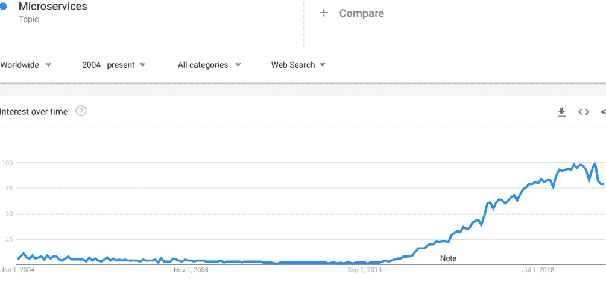

自 2000 年中期以来，人们对微服务的兴趣显著增长，Google 的搜索趋势所示。

根据 microservices.io 的描述：

“微服务 - 也称为微服务架构 - 是一种架构风格，它将应用程序结构化为一组服务，这些服务具有：

- 高可维护性和可测试性
- 低耦合
- 可独立部署
- 围绕业务能力组织
- 由小型团队所有。

微服务架构能够快速、频繁且可靠地交付大型、复杂的应用程序。它还让组织能够演进其技术栈。

让我们讨论一下这些特征意味着什么，以及它们如何为用户带来价值。

- 高可维护性和可测试性：快速且频繁地进行应用程序开发和部署。
- 低耦合：应用程序中的组件是独立的，并且对变化保持韧性。
- 可独立部署：部署不需要与其他团队/团队成员进行协调。
- 围绕业务能力组织：关注客户的满意度和体验，而不是产品的技术能力。
- 由小型团队所有：更易沟通且生产力更高。

### 单体

### 微服务

由于现有架构无法满足大型企业的需求和日益增长的数据流量，微服务开始流行。为了帮助企业构建其微服务平台而开发的框架之一就是 TARS。

## 什么是 TARS？

TARS 是创建于 2008 年的新一代分布式微服务应用程序框架。它为开发者和企业提供了一套解决方案，用于构建、发布、部署和维护大规模运行的稳定可靠应用程序。

2018 年 6 月，TARS 加入了 Linux 基金会并成为其项目之一。2020 年 3 月 10 日，宣布 TARS 项目将转换为 TARS 基金会，

> 一个开源微服务项目的中立家园，使任何行业都能快速将想法转化为大规模应用程序”。

TARS 基金会的目标是解决与微服务应用程序相关的最常见问题，包括解决多语言互操作性、缓解传输问题、维护数据存储的一致性，并在支持不断增长的请求的同时确保高性能。

TARS 框架已成功应用于金融科技、电竞、边缘计算、在线流、电子商务和教育等多个行业的公司。

查看此视频以获取更多关于 TARS 应用的信息。

### TARS 项目微服务生态系统

下面的图展示了 TARS 的架构概述：

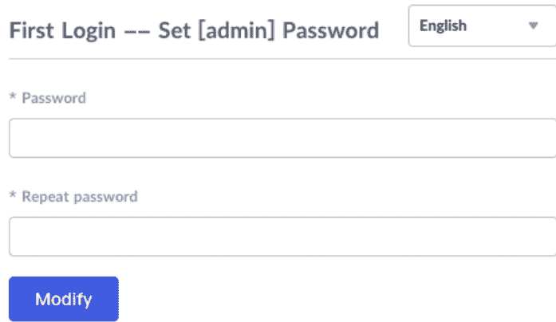

获取自 https://www.linuxfoundation.org/blog/2020/03/the-tars-foundation-the-formation-of-a-microservices-ecosystem/（图像已于 2020 年 6 月更新以反映 TARS 格的变化）

让我们详细讨论一下这些生态系统的每一个组件。

# 生态系统组件：基础设施

TARS 运行在 PaaS 上。它可以运行在物理机、虚拟机和容器上，包括 Docker 和 Kubernetes。

### 生态系统组件：存储

TARS 服务数据可以根据你的状态存储在缓存、数据库或文件系统中。

- 对于缓存，你可以使用 Redis 或 DCache（一种基于 TARS 框架的分布式内存 NoSQL 系统，等）。
- 对于数据库，你可以使用 MySQL、MariaDB 等。
- 对于文件系统，你可以使用 Ceph、HDFS 等。

### 生态系统组件：开发框架

#### 协议

TARS 框架支持 Tars 协议、TUP、SSL、HTTP 1/2、protocol buffers 以及其他自定义协议。

此外，Tars 协议是基于 IDL（接口定义语言）、二进制的、可扩展且跨平台的。这些特性允许使用不同语言的服务器通过 RPC（远程过程调用）相互通信。

#### RPC

RPC 支持同步、异步和单向通信。在同步场景下，客户端发出请求并等待服务器响应或发生超时。在异步通信中，客户端发送带有回调的请求但不等待响应。当客户端收到响应时，会执行回调。在单向通信的情况下，客户端发出请求但不等待或期望回调。

### 生态系统组件：使用 TARS 构建的平台

使用 TARS 构建的平台可以分为两部分：应用节点和框架节点。

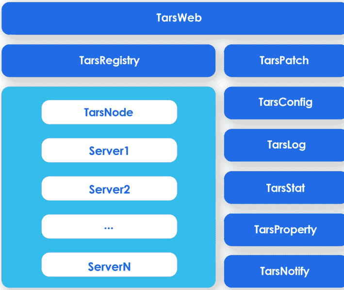

#### 应用程序节点

#### 框架节点

使用 TARS 构建的平台可以分为两部分：应用节点和框架节点。在我们详细讨论它们之前，让我们先回顾一些常用术语：

- **服务器 (Server)**
服务器是一个计算机程序或设备，为其他程序或设备（称为“客户端”）提供功能。

- **TarsNode**
一个通过启动、停止、发布和监控服务器来管理服务器的进程。

- **发布 (Publish)**
开发者将程序上传到指定设备并使其运行的过程。

- **心跳 (Heartbeat)**
它是由硬件或软件生成的周期性信号，用于指示正常运行或同步计算机系统的其他部分。

- **客户端 (Client)**
客户端是访问由服务器提供的服务的计算机硬件或软件。它也可以是 TARS 中的另一个服务器。

### 生态系统组件：使用 TARS 构建的平台（续）

应用节点是运行服务器的操作系统实例。它可以是物理机、虚拟机或容器。在构建使用 TARS 构建的平台中，应用节点的数量可以达到数千个。在每个应用节点上，都有一个 TarsNode，这是一个通过启动、停止、发布和监控服务器来管理服务器的进程。此外，它还接收来自每个服务器的心跳消息（当服务器运行时），并将其报告给 TarsRegistry 作为服务发现的数据源。客户端将在 TarsRegistry 回复后调用这些活跃服务器。

框架节点是为维护良好的微服务治理而创建的一系列服务器。请注意，框架节点的数量不是固定的。平台运营人员需要在多台机器的多个地点上部署它们，以实现容错和灾备恢复。此外，框架节点的数量取决于应用节点的规模。例如，如果服务器打印了大量的日志数据，应该增加日志服务器的数量。

框架节点可以分为几类：

- **TarsWeb**
  TarsWeb 是一个 Web 管理系统，用于监控服务器的运行状态，以及启动、停止、部署和发布服务器。
- **TarsRegistry**
  TarsRegistry 是微服务集群内部的控制/管理服务器，负责服务的注册与发现。TarsWeb 使用 TarsRegistry 来启动、停止和发布服务器。TarsRegistry 还提供命名服务并接收来自服务器的心跳包消息。一个服务器可以通过 TarsRegistry 查询服务器的地址（IP/端口）。
- **TarsPatch**
  TarsPatch 提供发布管理服务，并可以使用它发布特定版本的服务器。
- **TarsConfig**
  TarsConfig 作为配置中心工作。它管理所有服务器的服务配置文件。
- **TarsLog**
  TarsLog 提供远程日志服务。服务器日志被发送到 TarsLog 并存储以备用。
- **TarsStat**
  TarsStat 提供来自服务器的数据，如负载、响应时间、超时率等。监控服务使用这些数据来发现异常服务器并提供报警。
- **TarsProperty**
  除了 TarsStat 的统计数据外，用户还可以为服务器定义业务相关的属性，如内存使用、队列大小和缓存命中率。监控服务使用这些统计数据来发现异常服务器并提供报警。
- **TarsNotify**
  TarsNotify 提供带有服务器异常信息的统计数据（如数据库故障），用以发现异常服务器并提供报警。

TarsRegistry、应用节点和框架节点之间的成功协作使得 TARS 能够执行其服务治理任务。

### 生态系统组件：服务治理（服务注册与发现）

#### 服务注册与发现

TarsRegistry 提供了一种命名服务（命名服务可以将名称转换为网络上的物理地址，世界上无处不在的命名服务是 DNS）。服务器注册到 TarsRegistry 中，客户端从服务器名称获取实际地址。当 TarsNode 因故障无法报告心跳时，命名服务将不再向客户端返回故障应用节点的地址，客户端将根据异常情况自动做出决定并屏蔽故障。当平台运行时，服务器之间相互协作。服务器可以与框架节点交互，也可以彼此之间交互。让我们讨论这两种情况。

#### 服务器与框架节点之间的交互

发布服务器的流程：
当通过 TarsWeb 成功上传要补丁的新包时，开发者发布一个请求将该包发布到指定的应用节点。然后，TarsRegistry 通知 TarsNode 将包传输到该节点。TarsNode 关闭旧服务器并启动新服务器。该流程如图中深蓝实线所示。

管理命令：
开发者可以通过 TarsWeb 向指定的服务器发送管理命令。TarsWeb 通过 TarsRegistry 将命令发送给 TarsNode。然后，TarsNode 将命令发送给服务器。该流程如图中绿实线所示。

心跳：
当服务器运行时，它会定期向 TarsNode 发送心跳消息。然后，TarsNode 将消息转发给 TarsRegistry。该流程如图中黑线所示。

信息上：
当服务器运行时，它会定期向 TarsStat 发送统计信息。它还会向 TarsLog 打印日志，向 TarsProperty 发送属性信息并向 TarsNotify 发送异常信息。该流程如图中浅蓝线所示。

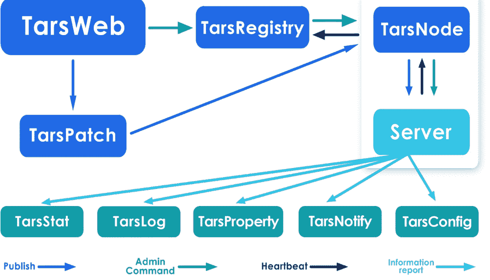

#### 服务器之间的交互

服务器预先将这些信息注册到 TarsRegistry。客户端从 TarsRegistry 查询这些信息并访问服务器。

当客户端（可以是 TARS 中的另一个服务器）尝试访问服务器时，它需要连接到服务器并通过指定 servant、服务器 IP 和端口调用远程函数。

Servant（服务者）是一个服务提供者，为客户端提供多个特定的接口进行调用。它始终显示为对象名称（例如 HelloServer.HelloObj）。它将在后面的章节中详细描述。

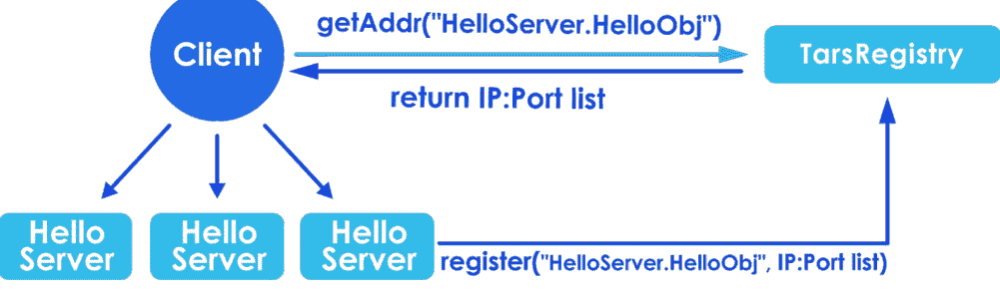

### 生态系统组件：服务

#### 治理（负载均衡）

##### 负载均衡

客户端通过 TarsRegistry 获取服务器 IP:Port 列表后，将使用指定的负载均衡策略来调用服务器。支持的负载均衡策略包括轮询、哈希和加权策略。

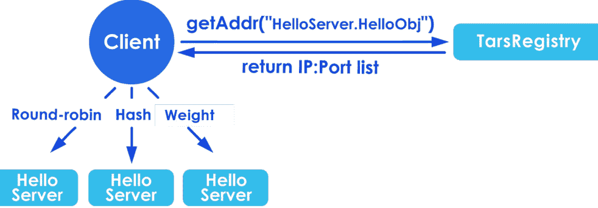

轮询（round robin）是一种按照某种合理顺序等选择组中所有元素的安排，通常是从列表的顶部到底，然后重新从顶部开始，以此此类推。轮询的一种简单思考方式是关于“轮流”。

在计算机科学中，一致性哈希是一种特殊的哈希算法，当哈希表调整大小时，平均只需要重新映射 n/m 个键，其中 n 是键的数量，m 是槽的数量。

权重函数（weight function）是在执行求和、积分或平均值时使用的数学工具，赋予某些元素对结果比同一集合中其他元素更大的“权重”或影响。

### 生态系统组件：服务

#### 治理（服务配置）

##### 服务配置

TARS 通过一行代码和可视化使得使用配置变得简单。

服务配置由 TarsWeb 管理。开发者可以检查特定配置的更改历史，并在需要时回滚到之前的版本。

配置文件分为以下几类：

- **APP 配置**：位于顶层，是整个应用的通用配置。
- **SET 配置**：是 SET 组的通用配置。它包含了应用配置。
- **Service 配置**：用于特定的服务器。
- **Node 配置**：用于后端。服务和节点配置协同工作。

### 生态系统组件：服务治理（监控）

#### 监控

TARS 支持通过数据报告来监控服务器的运行状态。

##### 指标监控

报告状态变化。我们可以检查服务器是否发布、重启或崩溃。它通过 TarsNotify 显示。

##### 首次登录 -- 设置

- 密码
- 重复
- 修改

它还报告服务器之间的统计数据，控制流量、延迟和异常。它通过 TarsStat 显示。

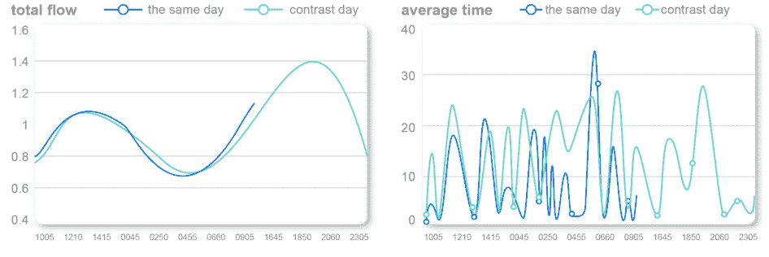

向 TarsProperty 报告属性。自定义属性包括内存大小、队列长度、缓存命中率等。

| 时间 | 主机名称 | 主机 IP | 属性 | 特征值 | 特征值 |
|---|---|---|---|---|---|
| 1005 | tars.registry | % | tars.registry.mem size | % | 1084 | 1072 |
| 1010 | tars.registry | % | tars.registry.mem size | % | 1080 | 1068 |
| 1015 | tars.registry | % | tars.registry.mem size | % | 1080 | 1064 |
| 1020 | tars.registry | % | tars.registry.mem size | % | 1080 | 1052 |
| 1025 | tars.registry | % | tars.registry.mem size | % | 1076 | 1052 |
| 1030 | tars.registry | % | tars.registry.mem size | % | 1076 | 1048 |
| 1035 | tars.registry | % | tars.registry.mem size | % | 1068 | 1044 |
| 1040 | tars.registry | % | tars.registry.mem size | % | 1060 | 1044 |

### 生态系统组件：服务

#### 治理（过载保护）

##### 过载保护

有时，海量请求或机器故障会导致系统溢出。为了提高系统吞吐量，服务器使用请求队列异步处理请求。服务器监控队列长度，如果长度超过阈值，服务器将拒绝新请求。如果请求在队列中长时间过久，服务器将丢弃该请求。

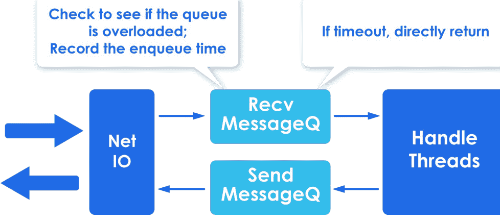

### 生态组件：服务治理（熔断）

## 熔断 (Fusing)

熔断可以通过两种方式实现：

- 由命名服务排除。
- 由客户端阻塞。

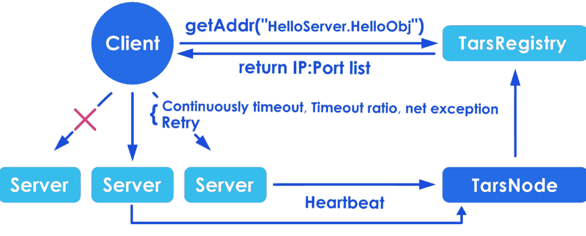

### 由命名服务排除
服务器通过 TarsNode 向 TarsRegistry 发送心跳。如果任何服务器未能发送心跳，TarsRegistry 将将其从服务器 IP:Port 列表中移除。这大约需要一分钟来实现。

### 由客户端阻塞
为了立即排除故障服务器，客户端会根据服务器的响应来阻塞该服务器。具体而言，当客户端调用服务器且请求持续超时时，客户端会将该服务器从活跃服务器 IP:Port 列表中移除。然后，客户端会尝试重新连接到该故障服务器，如果服务器恢复，客户端将将其添加到活跃服务器 IP:Port 列表中并向其发送请求。

### 生态组件：服务治理（SET 模块）

## SET 模块

为了方便服务管理，TARS 将服务器分为不同的 SET。每个 SET 都是相同的，并且易于扩展。客户端只能向同一 SET 内的服务器发送请求。因此，不同 SET 之间的服务器可以相互隔离。

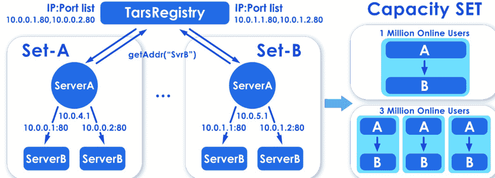

在图中，我们假设一个 SET 的容量可以支持 100 万在线用户。当在线用户达到 300 万时，TARS 将扩展到 3 个 SET，而不会影响原来的那个。

SET 模块的优势：

- 标准化
- 防止故障扩散
- 大规模服务的高效运行。

### 生态组件：服务治理（分布式链路）

### 分布式链路 (Distributed Tracing)

TARS 支持对特定的特定请求进行追踪。被追踪的请求会被标记并转发到调用链中的服务器。服务器将追踪请求的日志报告到日志服务器。然后我们就可以分析这些日志并进行调试。

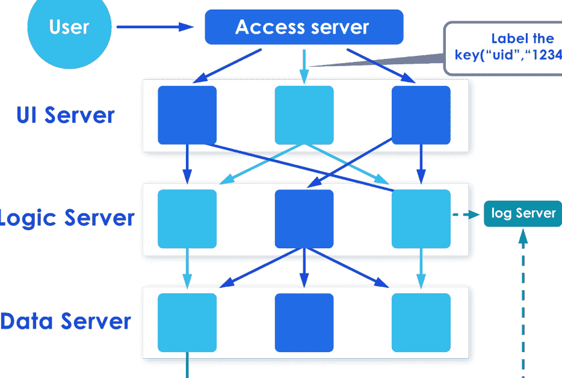

上面的图片展示了我们想要追踪包含键 ("uid","123456") 的请求的情况。为了实现这一点，我们可以标记该键，所有包含该键的请求将由 TARS 框架自动标记。此外，所有带有标记请求的日志将被收集到日志服务器以便进一步分析。

### 生态组件：服务治理（区域感知）

## 区域感知 (Area Perception)

自动区域感知是处理跨 IDC 调用大延迟的关键。请看下面的图。客户端的 IP 为 10.0.0.1。客户端向 TarsRegistry 请求日志服务器的地址。根据客户端的 IP，TarsRegistry 知道客户端位于 Area-X，且日志服务器的 IP 为 10.0.0.2:80 和 10.0.0.3:80。但它会排除 IP 为 11.0.0.1:80 的日志服务器，因为它位于 Area-Y。

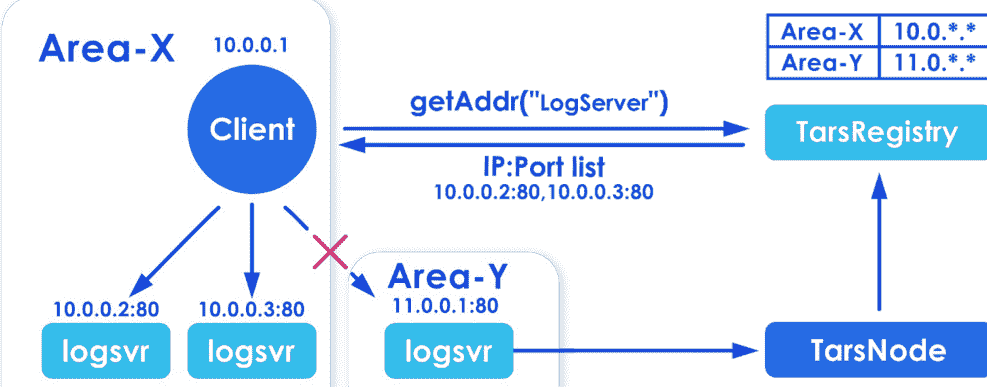

优势：

- 操作简单
- 降低延迟
- 降低带宽成本
- 更强的容灾能力

### 生态组件：服务治理（日志）

## 日志 (Log)

日志是由服务器自动创建并维护的文件（或多个文件），由其执行的活动列表组成。TARS 提供了一个函数让服务器将日志打印到远程日志服务器。

## 集成 DevOps 工具：代码管理

代码管理通常意味着对源代码更改的管理。更改通常通过数字或字母代码来标识。TARS 可以与其他代码管理工具集成，以控制源码的版本。

## 集成 DevOps 工具：持续集成、持续交付、持续部署

持续集成 (CI) 和持续部署或持续交付 (CD) 通常被称为 CI/CD。持续集成使用自动化工具，赋能开发团队在每次合并后尽可能无缝地构建和测试代码。持续交付专注于保持代码在任何时候都处于就绪部署状态，是 CI 的自然衔接。持续部署是一种对代码的每项更改进行持续和自动化生产部署的想法。TARS 可以与其它 CI/CD 工具集成来实现这一点。

## 语言

TARS 支持许多编程语言，包括 C++、Java、Node.js、PHP、Go 和 Python。这使得用不同语言编写或在不同平台上提供的程序能够高效地相互通信。

## TARS 上的应用

无论行业如何，大多数应用程序都可以部署在 TARS 上。这些应用包括 AI、深度学习、边缘计算等。让我们考虑几个不同的用例。

### TARS 上的应用：电竞

随着电竞的发展，在线游戏数量不断增加。在这种情况下，游戏架构必须变得更具扩展性和伸缩性；然而，并非所有的应用都能不影响现有用户的情况下处理这种情况。成功管理数量日益增长的服务器已成为电竞行业最常见的问题之一。

这就是 TARS SET 分组功能大显身手的地方。正如我们之前提到的，TARS 中的服务器是隔离的，当服务器扩展时，它对现有进程不会产生影响。

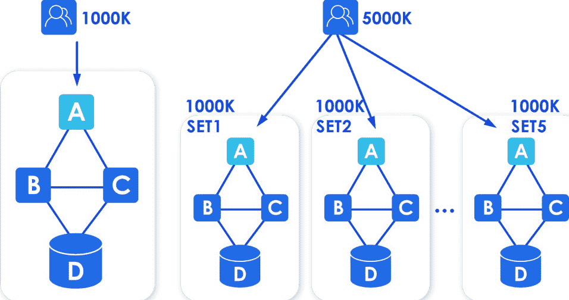

例如，我们假设一个 SET 的容量是支持 100 万在线用户。当在线用户达到 500 万时，TARS 将扩展到 5 个 SET，而不会影响原来的那个。

### TARS 上的应用：在线直播

随着在线直播的发展，直播的案例中一个常见问题是请求数量的激增。

例如，在 NBA 赛季期间（特别是决赛），在线电视平台观察到的流量可能是非赛日的十倍。

### 2019 年 NBA 直播期间流量

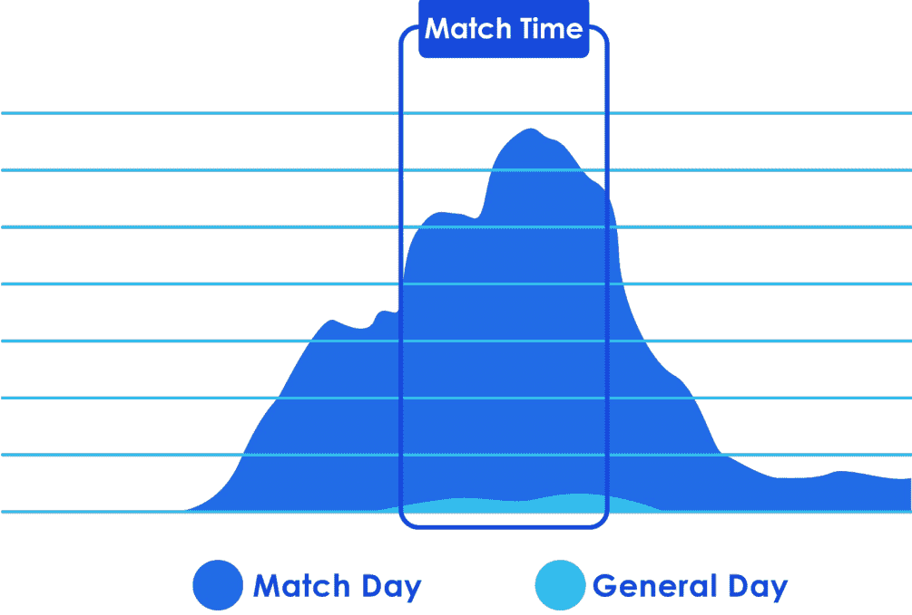

为了解决这个问题，许多直播平台选择 TARS，是因为其支持自动调度的负载均衡。如果请求接近阈值，它将扩展；如果负载低于值，它将收缩。这种解决方案有助于减少资源浪费。

### TARS 上的应用：金融科技

近年来，包括银行、保险、证券在内的金融行业已将其微服务应用于许多业务，包括移动银行和网上银行。金融科技公司认可 TARS 的优点包括但不限于：

- 降低成本
- 根据需要伸缩系统
- 高性能
- 数据一致性

### TARS 上的应用：边缘计算

时间敏感型应用不允许长距离传输引起的长延迟。对于终端与传统数据中心之间的海量数据长距离传输也是不必要且低效的，应该减少延迟。

TARS 提供了 PaaS 层和高性能 RPC 调用。它在大规模扩展场景中高效部署微服务，并提供易于理解的服务监控功能支持复杂的逻辑。在 MEC（多接入边缘计算）上构建应用可以是解决云游戏或车联网技术相关问题的关键。

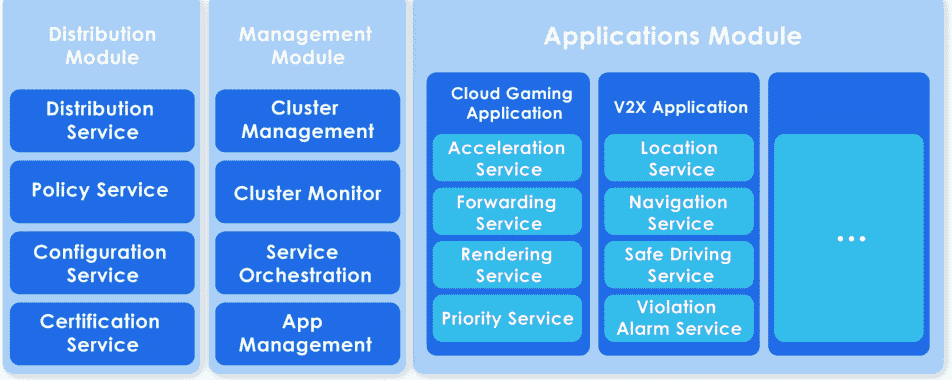

### TARS 上的应用：电信

5G 网络基于面向服务的架构 (SOA)、微服务和虚拟化技术概念。

它将基于点对点紧耦合的 4G 网络架构转变为基于服务注册、服务发现和服务接口的新型松耦合架构。所有这些都由 TarsWeb 管理，对运营商来说非常方便。

TARS 框架的灵活性有助于适应 5G 可能使用的其他协议。TARS 还可以以插件方式添加通信协议，以实现 5G 协议快速、敏捷的开发迭代。

## TARS 上的应用：AI

机器学习需要大量的计算资源。如果无法及时分配或回收这些资源，将影响计算效率或导致资源浪费。因此，智能调度在 AI 领域起着至关重要的作用。

TARS 可以动态、自动地将计算资源分配给机器学习任务。此外，样本将通过 P2P 服务器进行传输，结果则存储在 Ceph 或 HDFS 中。这样一来，开发者只需要关注样本、参数等内容。

## AI 计算集群

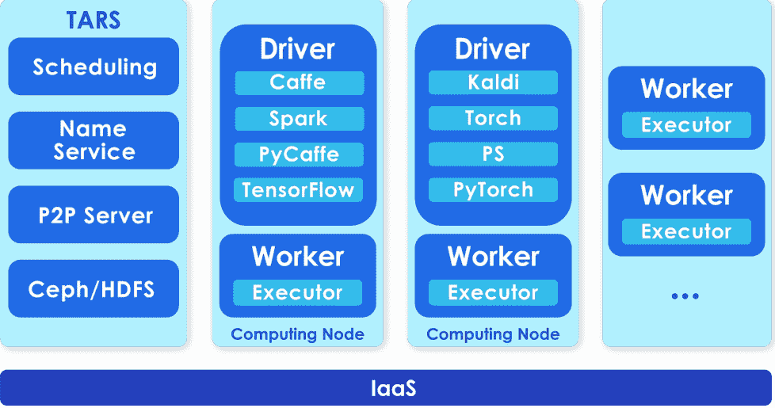

## 微服务框架对比

在考虑选择微服务框架时，通常会考虑以下特性：服务治理和编程语言支持。让我们来看几种不同的选项：

- 无服务治理，支持 RPC 调用
虽然此类类别中的许多框架支持多种编程语言，但它们不提供围绕服务治理问题的支持。此类框架的示例包括 gRPC 和 Thrift。

- 可服务治理，仅支持一种编程语言
在这种情况下，用户需要集成不同的开源项目来确保服务需求。Spring Cloud 是该类别的代表，因为它只支持 Java。

- 可服务治理，通过 sidecar 模式（Service Mesh）支持多种编程语言
在这里，为了解决通信问题，建议封装通信组件。该方案的缺点是增加了架构的复杂性和维护成本。示例包括 Istio 和 Envoy。

- 可服务治理，支持多种编程语言
此类类别不言自明。TARS 是一个微服务框架，不仅解决了服务治理问题，还提供了对多种编程语言的支持。这两个特性决定了 TARS 的优势。与容器编排且运行在 IaaS 上的 Kubernetes 不同，TARS 运行在 PaaS 层。不过，TARS 也可以运行在 Kubernetes 上（我们将在下一章详细讨论）。

