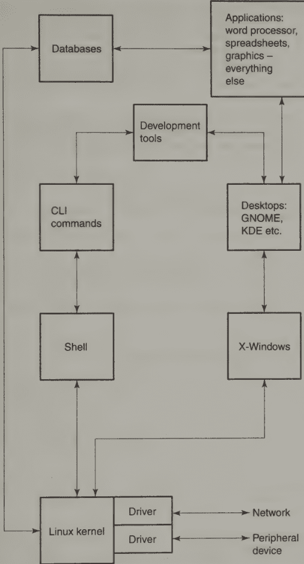
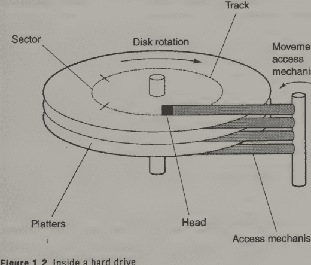
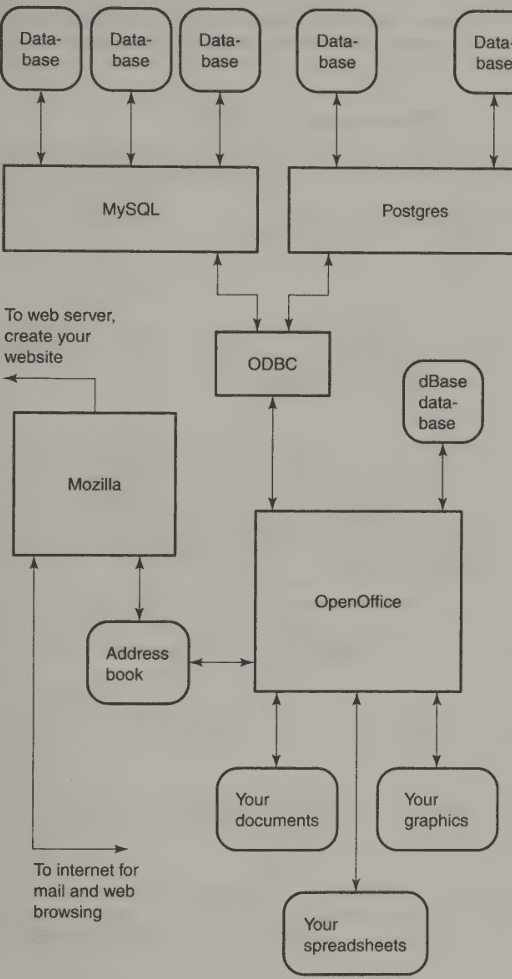
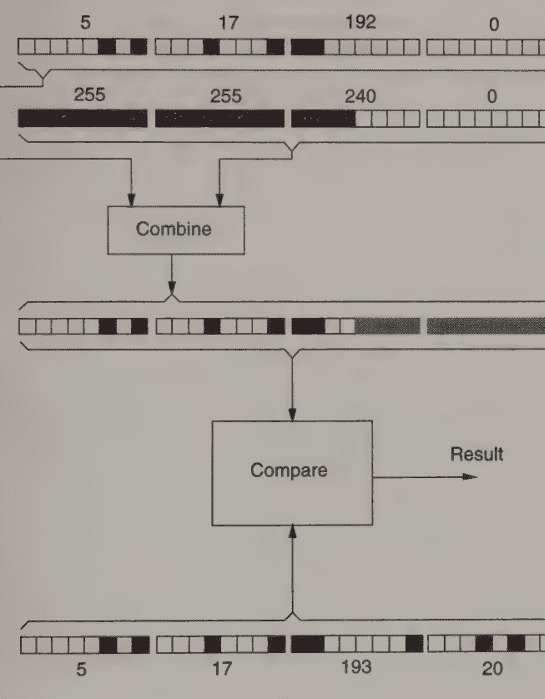
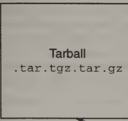
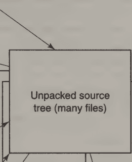
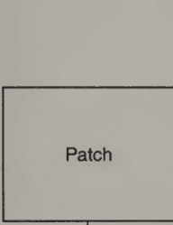
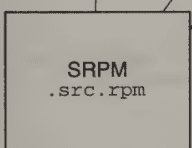
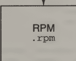

# Linux 入门指南（自学习系列）

通过自学，达到你想去的高度


robert billing

在过去的六多年里，有超过 4000 万人通过“自学”的方式学习了 750 多门学科，并取得了令人瞩目的成果。

通过自学，达到你想去的高度

长期以来被誉为自导学习的权威来源——“自学”系列在全球销量已超过 4000 万册，涵盖了语言、手工艺、爱好、商业、计算和教育等领域的 300 多本书。

| 7.5 缓存 | 140 |

理想情况下，你还需要一个互联网连接。在编写时，某些内置调制解调器无法在 Linux 下工作。使用外部调制解调器，或者通过局域网（LAN）连接互联网几乎可以第一次尝试就成功。

## 1.2 背景

操作系统（如 Linux）是一系列在计算机上执行常规任务的程序。它还提供了一种安全的方式，使得应用程序（如游戏和文字处理器）能够访问屏幕、键盘、鼠标、打印机和磁盘。

操作系统最大的部分，也是所有其他部分所依赖的部分，被称为**内核**（kernel）。内核在计算机开机或重置时启动。

外设设备（如硬盘）对非常简单的命令做出响应。坐在屏幕前的人所看到的应用程序（如文字处理器）期望执行复杂的任务。内核必须在它们之间进行调解。

用鼠标点击文字处理器的文件菜单并选择一个文件打开。文字处理器将向内核发送该文件的请求。内核随后确定该文件在硬盘上的位置。它向硬盘发出指令，使其在正确的位置查找并读取正确数量的字符。这些字符随后由内核返回给文字处理器，文件便显示在屏幕上。

由于内核可以看到每一个磁盘访问请求，它可以否决任何可能破坏系统的请求。Linux 在系统自有的文件和用户拥有的文件之间有着严格的区分。同样，它可以禁止用户程序直接向磁盘驱动器等外设发出命令。

例如，如果使用文字处理器的人试图将文档保存到 `/etc`（这是 Linux 预留给自身文件的区域），内核将直接用错误消息拒绝该请求。

这种系统使用者可以做的事情与系统本身允许做的事情之间的**严格区分**，构成了 Linux 防御攻击的大部分。普通用户运行的恶意程序根本无法对操作系统进行任何更改。对 Linux 机器的攻击仍然存在，但它们需要高水平的编程技巧，通常破坏很小，而且非常容易反制。

`user`（用户）和 `root` 术语用于描述普通用户和操作系统本身居住的环境。`root` 和 `root` 登录还指的是对特定计算机具有管理权限的人。当这个人登录时，他们可以执行普通用户被禁止的操作。

Linux 内核的第一个版本是由 Linus Torvalds 在 20 世纪 90 年代作为一个爱好项目编写的，当时他在赫尔辛基的一间公寓里独自工作。当它与 Richard Stallman 的支持程序以及 Bob Scheifer 的 X-Windows 图形界面相结合时，它变成了一个完整的系统。正因如此，有人认为 Linux 这个词实际上仅适用于内核本身，尽管它通常被用于整个整个系统。

Linux 的名字是 Linus 和 UNIX 的结合体，UNIX 是贝尔实验室在 20 世纪 60 年代末和 70 年代初开发的较旧操作系统。Linux 的许多功能都基于较老的 UNIX 系统。

Linux 拥有版权。它的组件由其不同的作者所有。它们根据通用公共许可证（GPL）的条款发布，该条款源自自由软件基金会（FSF）的文档。该许可赋予任何人使用、复制、修改软件的权利。正因如此，购买一张包含 Linux 的 CD 副本，然后使用原版在几台机器上安装 Linux 是完全合法的。同时，你也可以这张 CD 副本卖给其他人，然后由他们安装在自己的几台机器上。

“Linux”一词是 Linus Torvalds 的注册商标，使用时应当予以承认——正如本书的开头所做的那样。

为 Linux 开发的一些软件技术已申请了专利。然而，GPL 有效确保了专利技术对所有用户免费可用。

图 1.1 是 Linux 系统的路线图。作为一张地图，它远不完整——一张纸无法希望展示你可以在 Linux 上运行的数百个相互锁定的子系统。底部是 Linux 内核本身，内置了模块化驱动程序。

入门指南 01



**图 1.1** Linux 路线图（CLI 是命令行解释器的缩写，在第 3.4 节中解释）

底部是 Linux 内核本身，内置了模块化驱动程序，一个用于网络，另一个用于其他外设（可能是磁盘）。

内核之上是一个 shell（壳），在 shell 之上有大量的命令。可以通过在键盘上输入命令来驱动系统。

X-Windows 系统也位于内核之上。它提供了处理显示的基本机制。然后你可以选择桌面和窗口管理器，它们为系统提供了特定的“外观和感受”。

应用程序随后运行在桌面之上，并利用数据库和网络等服务。

## 练习

- 1.1 访问网站 `http://www.linux.org` 并点击一些链接。

- 1.2 在 `http://www.fsf.org` 阅读 GPL，并将其与传统商业软件产品的许可进行比较。

- 1.3 如果你认识任何使用 Linux 的人，问问他们的经验。

## 1.3 Linux 发行版

一个运行中的 Linux 系统由数百个、有时是数千个文件组成。一个包含所有文件以及一些将它们复制到硬盘正确位置的程序的套件被称为“发行版”（distribution）。发行版还可以包括打印的说明书。

发行版通常由商业或志愿组织制造。由于发行版中的软件是根据 GPL 发布的，因此总是可以免费获得一个。

如果你想在安装之前尝试使用 Linux，可以使用 Knoppix 发行版从 CD-ROM 启动 Linux，而不更改硬盘上的任何内容。

最常用的发行版之一是 RedHat Linux，由位于美国北罗来纳州罗利的 Red Hat Inc. 创建。为了简便起见，这些示例将基于该发行版的 9.0 版本。然而，书中的几乎所有内容也适用于 SuSE、Debian、Yellow Dog 以及许多其他发行版。随着时间的推移，你将在许多可选的发行版中选择一个或多个符合你需求的。

## 练习

1.4 访问至少三个发行版的网站。大多数网站可以通过 `http://www.linux.org` 的链接找到。比较它们的产品，并记录每个发行版的最新版本号。

## 1.4 如何以及在哪里获取发行版

所有主要的发行版都可以从互联网免费下载。作为一个初学者，你可能会觉得这个过程望而生畏。我的建议是先购买一个 CD-ROM 版的发行版，只有在你对使用 Linux 有了经验后才尝试下载发行版。

你可以通过两种方式购买发行版。发行版制造商提供“盒装”（boxed sets），包含 CD-ROM 上的软件、打印手册和注册卡，并装在纸箱里。或者，许多供应商提供“廉价磁盘”（cheap disks），这些实际上是主流发行版磁盘的低价克隆。

由于 GPL 的规定明确禁止对复制 Linux 的任何限制，廉价磁盘版本是完全合法的。然而，为了保护某些发行版制造商为产品投入的巨大投资，我们看到了一些奇策略，旨在引导用户购买事实上的商业盒装。这些策略包括商标、计算机启动时显示的受版权保护的图像以及磁盘中包含的非 GPL 软件。

通常情况下，盒装是初学者获取发行版最简单的方法。软件包可能还包括电话和电子邮件支持，这在最初可能非常有用。廉价磁盘版本包含相同的软件，但没有这些帮助的安装指南或支持。它们是一个好的

为了升级运行中的机器而购买发行版的后续修订版本。

街头电脑商店通常备有装盒版，偶尔也会有廉价版本。然而，在购买之前检查版本号是值得的，因为周转缓慢意味着所售的可能是已经过时一年以上的版本。这些发行版可以使用，但没有软件最新的修订版本。

更具专业性的商店，特别是如果员工本身就是 Linux 用户，会提供更好的服务。

发行版还可以通过邮件、电话或安全的网上订购来购买。我对来自 The Linux Emporium of Wallingford（`http://www.linuxemporium.co.uk/`）的服务服务非常满意。我必须补充一下，除了客户身份外，我与该业务没有任何联系。

如果你在英国经营业务并使用 Linux，可以退还 Linux 发行版软件部分的进口增值税（VAT）。打印的手册不包含增值税。由于这一点，仔细检查你的收据非常重要，因为软件和手册订单的增值税部分可能不是发票总额的预期比例。

- 1.5 回顾上一个练习的结果。选择一个你想要使用的发行版并获取一个副本。

## 1.5 安装 Linux

安装过程在不同发行版之间以及同一发行版的不同版本之间差异很大。因此，无法提供一种适用于所有情况的逐步指南。然而，所有安装都必须完成相同的工作，在本节中，我将用通用术语解释安装过程是如何工作的以及每个步骤的作用。

在开始安装之前，准确找出你拥有什么硬件以及它是如何配置非常有帮助。如果你使用的电脑已经安装了另一个操作系统，请记下从设置页面中获取的任何关于硬件的信息。特别要记下显卡的类型、内存大小和设置，以及声卡的类型和设置。

安装过程的第一步是加载并运行 Linux 内核。对于许多现代机器，你只需要将 Linux 发行的第一个 CD 插入 CD-ROM 驱动器并启动计算机。对于不能使用 CD-ROM 作为启动设备的旧机器，你必须先将内核拷贝到软磁盘，并使用它启动安装过程。

你会在几乎所有的发行版中找到 `rawwrite` 程序。该程序从 CD 中将足够的 Linux 内容拷贝到软磁盘上，以启动安装。它之所以被称为 `rawwrite`，是因为它写入原始磁盘，忽略其磁盘上已有的任何文件结构。随你的发行版附带的安装说明将详细解释如何使用 `rawwrite`。通常这涉及将镜像文件（一个包含与软磁盘数据完全相同、格式相同的文件）从 CD 拷贝到软磁盘。记住，这将擦除软磁盘上的所有内容。

如果你想将 Linux 安装到没有 CD-ROM 驱动器但有网络连接的电脑上，最简单的方法是使用 `rawwrite` 制作一个网络启动盘，然后使用它启动安装过程。你还需要将发行版的安装 CD 拷贝到另一台机器的硬盘上；这可能需要多达 2 GB 的磁盘空间。这个拷贝的 CD 随后被共享到网络，并替代 CD-ROM 使用。再次，如果你使用的发行版允许你这样做，只需按照说明操作即可。在既没有 CD-ROM 也没有网络端口的机器上安装 Linux 是可能的。这涉及通过打印机端口或串口连接加载软件。在此之前，你应该阅读后续章节中关于网络的章节，理想情况下先获得一些对更传统系统的经验。

下一步是划分硬盘分区。将不同类型的信息存储在磁盘的不同部分（称为分区）是非常方便的。Linux 安装通常使用两个或三个分区。这些是根分区（root partition），它包含了几乎所有的普通文件；可选的启动分区（boot partition），计算机启动时从中加载内核；以及交换分区（swap partition），Linux 将其作为当前未运行任务的临时存储。只有当你拥有一台旧电脑且必须从硬盘的第一部分加载内核时，你才需要启动分区。

大多数发行版提供的安装程序将自动为硬盘划分分区以进行简易安装，并为你提供保留已安装操作系统的不受影响的选项。如果安装程序无法自动创建分区，或者如果你想尝试更复杂的分区方案，你可以选择手动划分磁盘。我用来写这本书的电脑硬盘被划分为 15 个分区，并安装了四个操作系统。

一旦硬盘划分了分区，安装程序将在分区内创建文件系统。这大致相当于于取一张白纸并在上面画线，将其变成一个表格，使其准备好在上面填写信息。

安装程序会在此阶段的某个地方暂停并询问你想要安装什么软件。当你第一次执行安装时，最好接受安装程序的建议，并选择它认为的正常或默认系统。

安装中最耗长的部分是接下来的。安装程序将所有包含 Linux 系统的文件拷贝到硬盘上。取决于要安装的软件数量和硬件速度，这可能花费十分钟到几小时不等。

一旦软件就位，安装程序将尝试找出你的电脑上安装了什么类型的显卡以及你使用的是什么类型的显示器。对于现代硬件，这个过程通常是完全自动的。对于旧机器，有时需要告诉安装程序你拥有什么硬件。

显示器很容易识别——它们通常在某处（底部或背面）印有制造商型号。显卡可能更麻烦。识别显卡的最佳方法是查找卡附带的原始手册。如果你在获取卡时电脑已经在运行另一个操作系统，你可能在该系统的设置内找到卡的详细信息。有时也可以通过查看 `/proc` 文件系统来识别显卡，这将在第3章中描述。如果所有其他方法都失败，唯一的解决方案是将卡从机器上取出并查看制造商型号。

一旦确定了显卡和显示器，安装程序将尝试它认为该组合可能的最大显示分辨率。

如果产生了满意的显示，你就可以安全地继续安装的下一步。如果不是，你可能需要对设置进行实验。

设置程序可能会给你图形登录或文本登录的选择。只有在你完全满意上一步正确设置了显卡和显示器之后。

最后，安装程序将询问你如何设置启动。这是一个在计算机重置时将 Linux 内核加载到内存并启动的小程序。默认设置——将引导程序安装在硬盘开头——通常是正确的。

如果安装提供创建应急启动盘（也称为恢复盘）的机会，请接受它。为此磁盘标记并将将其放在安全的地方。如果引导程序损坏，它将允许你重启机器。

在某个点，安装程序将要求你设置 root 密码。在系统运行时，必须正确输入密码才能登录 root。选择一个不明显的词或短语。你的名字、亲友的名字、宠物和汽车品牌太容易被猜到。随机打开书指向一个单词，随机选择两个单词和一个数字，给出如 `working52expire` 这样的密码要安全得多。

在此阶段你可能还有机会添加一个或多个用户。包括所有将使用该系统的人，为他们设置通过上述方法选择的独立密码。用户登录将在第3章中解释。

## 1.6 安装双引导系统

双引导系统是在计算机启动时提供操作系统选择的系统。如果你已经在使用另一个操作系统，并想保留它，同时在同一台机器上安装 Linux，你有四种选择：

- 1. 让现有系统为你留出一些磁盘空间。如果它有多个硬盘分区，你可能放弃其中一个并使用该空间来添加 Linux。

- 2. 添加第二块硬盘。

- 3. 使用如 Partition Magic 之类的工具缩小现有分区，释放一些磁盘空间。

- 4. 重新安装现有系统，但安装在较小的分区中，为 Linux 留出足够的磁盘空间。

在尝试任何安装之前，请记住对所有数据进行备份。

Linux 的安装过程相当“受教良好”——它会尊重你在硬盘上发现的其它存在的权利。遗憾的是，某些其他系统的安装程序会直接掠夺整个硬盘来获取空间。

解决此问题的方法是先安装另一个系统。让它将你的硬盘分为两个分区，第二个分区要足够大以便安装 Linux。当你安装 Linux 时，使用它的磁盘分区工具删除第二个分区并在空闲空间设置 Linux。

Linux 安装的最后阶段将会注意到另一个系统的存在，并设置加载器以加载其中一个。

现在，当你启动计算机时，它会询问你想使用哪种操作系统，并加载你选择的任何系统。

## 1.7 安装失败该怎么办（可选）

本节解释了安装失败的一些原因以及如何从中恢复。如果你有安装问题并想自己解决它，就应该阅读本节。如果你对硬盘如何工作、如何设置显卡或计算机如何初始启动感兴趣，也应该阅读本节。

如果你的硬件设置不当、你有特殊的硬件，或者你正尝试划分磁盘以为另一个操作系统留出空间，就会出现磁盘分区问题。

在安装的分区步骤，你可以通过输入各个分区要放置的柱面号来手动对磁盘进行分区。

硬盘通过在一个或多个磁片上的磁性模式存储信息。这些是安装在轴上并高速旋转的金属盘。在每个磁片的每个表面相对（但并不完全接触）的是一个磁头，这是一种可以在磁盘旋转时读取和写入磁性模式的设备，见图 1.2。磁头安装在一个访问机构上，该机构驱动它们跨越磁片表面移动。当访问机构静止时，每个磁头都留在旋转磁盘上的一个信息环上方。这被称为**轨道**（track）。一条轨道被划分为若干**扇区**（sectors）。由于每个磁头都位于不同磁片相应的轨道上，因此在不移动访问机构的情况下，可以读取和写入所有这些轨道上的所有信息。这些轨道合称为一个**柱面**（cylinder）。访问机构可以将磁头移动到另一个位置，使它们位于另一个柱面的轨道上。柱面从 1 开始编号，1 号通常是离轴最近的柱面。



硬盘的几何结构通常以三个数字的形式给出。这些是柱面数、磁头数和每道的扇区数。这三个数字相乘得到磁盘上的总扇区数。扇区数乘以字节数（大致等于字符数），每个扇区可以存储的内容，得到了磁盘的容量——它能容纳的信息量。特定信息的存储位置由三个坐标描述——柱面号、磁头号和扇区号。

当你到达安装的分区步骤时，你可以选择手动对磁盘分区。安装程序将为你提供工具选择，如 Disk Druid 或 `fdisk` 程序，后者更强大但更难使用。

如果你有一台旧机器，你应该创建一个启动分区。理想情况下，它的大小至少应为 10 兆字节，并尽可能靠近 1 号柱面创建。如果你想为升级留出空间，请将此分区设为约 100 兆字节。此分区将包含启动 Linux 内核的文件。

通常，你需要创建一个交换分区（swap partition），其大小应该是你计算机内存的四倍。例如，如果你有 64 兆字节的内存，交换分区的合适大小是 256 兆字节。

你还需要创建一个根分区（root partition）来包含普通文件。启动分区和根分区的挂点分别是 `/boot` 和 `/`。如果你手动对磁盘进行分区，可能需要输入这些值，它们将在后面的章节中解释。

对于特殊的显卡，安装程序可能无法显示任何内容。解决此问题的方法是在安装过程开始时选择文本。等基础系统安装完成后，你再添加图形。

如果安装过程运行完成，结果可能是一个通过了启动序列但在开始显示图形时失败的系统。在这种情况下，首先要做的事情是运行安装程序，但选择文本而不是图形登录。

在此阶段，你可能拥有一个以文本显示启动但没有图形的系统。下一步是以 root 身份登录。在登录提示符处输入 `root` 并按回车。现在输入你在安装期间设置的 root 密码。如果一切正常，你现在应该看到一个以字符 `#` 结尾的提示符。（此处省略了后续重复的描述，对应原文逻辑错误）

## 1.8 获取支持

有一个广泛且热情的 Linux 用户社区，可以通过互联网和本地用户组（LUG）的会议与他们联系。英国的用户组可以在 `http://www.lug.org.uk/` 找到。


用户组成员以及 Linux 讨论组上的定期帖者通常乐意帮助新用户。如果你首先联系的人无法解决你的特定问题，他们几乎能够找到可以的人。

互联网上还有邮件列表，通常与特定的软件包相关。这些提供了较慢的，但更具针对性的支持。你通常可以通过从其支持的产品网站上的链接找到它们。

某些 Linux 用户小组（LUG）还会举办安装节华（installfests）。这些公开会议邀请新用户带着自己的电脑来。专家会在现场解答安装问题，而且每个新用户在离开时都拥有一台完全运行良好的机器，这是非常常见的。

## 练习

- 1.7 在互联网上搜索你最近的 LUG。

## 1.9 笔记本电脑上的 Linux

在笔记本电脑上安装 Linux 与在台式机上安装没有太大区别。

在笔记本电脑上运行 Linux 有两个陷阱。

首先，要找出制造商使用了哪些芯片比较困难——笔记本电脑的设计并不是为了方便拆卸显卡进行检查的。有时需要启动一个救援系统并检查 `/proc` 文件系统以找出存在哪些硬件。这在第 3 章中会有解释。

其次，需要考虑到电池电量的反复变化。笔记本电脑有多种节能模式和挂起操作的方法，其中某些模式可能会与 Linux 产生不利的交互。考虑安装如 `apmd` 这样的包也是值得的，它会在电池电量接近耗同时将所有未保存的信息写入磁盘。

关于在笔记本电脑上安装 Linux 的大量有用信息请访问 http://www.linux-laptop.net/

## 02

## 替代方案

在本章中，你将学习：

* 如何使用 Debian 和 SuSE 发行版
* 如何运行 Knoppix
* 如何在非 Intel 处理器上运行 Linux

选择 Linux 发行版就像找一个新房子。你可以选择在任何地方居住，而且每个发行版都有自己的优势。花点时间仔细挑选，查看几个，这样你就可以避免以后搬家的麻烦。

## 2.1 Debian

Debian 是一个不寻常的发行版。你可以在 http://www.debian.org/ 了解更多信息。它由 Ian Murdock 在 1993 年创建，并以他的妻子和他自己命名为 Deb–Ian。

Debian 项目由志愿者运行，每个人维护系统的一部分。Debian 不提供华丽的手册或盒装版。Debian 用户从互联网或从录制的（而非压刻的）CD 加载软件。

Debian 用户通常能从 Linux 中获得更多收获，因为他们投入了更多。由于不受营销的限制，在更商业化的发行版强调图形界面的背景下，Debian 发行版变得非常强大。

Debian 有它自己的软件包管理系统，不同于红帽的软件包管理器（RPM）。它要强大得多，如果你想添加一个新的软件包，它将从互联网或 CD-ROM 自动检索任何依赖项——即你需要先加载的其他软件。

Debian 还包含了与其它发行版相同的网络、声音支持和图形用户界面（GUI）。它提供了 GNOME 和 KDE 桌面的选择。

Debian 项目的志愿者们视如珍宝守护他们软件的状态——在 Debian 旗下分发的所有内容都是真正的“自由软件”，可以自由地重新分发、复制和修改。这种意义上的“自由”更多是指言论自由，而不是免费的午餐。

Debian 也存在于多个不同的处理器族。

### 2.1.1 与 Debian 技术差异（可选）

Debian 的文件系统布局几乎与其他发行版的布局相同。你会发现的唯一显著区别是 System V (SysV) 初始化脚本位于 `/etc/init.d` 而不是 `/etc/rc.init.d`。奇怪的是，某些其他发行版现在向 `/etc` 添加符号链接（symlinks）来隐藏这种差异。

Debian 为可移动媒体创建的挂载点名称类似于 `/floppy` 而不是 `/mnt/floppy`。

当你安装 Debian 软件包时——它们是以 `.deb` 结尾的文件——你使用 `apt-get` 命令。例如，运行 `apt-get install less` 会安装 `less` 软件包。当我在当前的 Debian 版本上运行此命令时，它从文件 `less_374-4_i386.deb` 安装，该文件的文件名中包含了版本号和平台。

在 Debian 上安装软件包会对其进行配置，通常是询问用户设置软件包的选项。

你可以通过 `apt-get remove packageName` 移除软件包，并通过输入 `dpkg-reconfigure packageName` 来更改其配置。

你必须以 root 身份登录才能执行这两个命令中的任何一个。

## 2.2 SuSE

SuSE 有自己的安装工具，称为 Yet Another Setup Tool (YAST)。YAST 显示了极其清晰的菜单——你只需要看一眼，大约在大两分钟内就能学会使用它。

SuSE 的安装程序对于简单安装来说很容易用，但在设置复杂的多启动系统时可能会有点笨拙。它会决定自己要做什么并告诉你，而不是询问你想要什么。如果你在进行任何不寻常的操作，那么值得检查安装程序所选择的所有内容，并覆盖任何你不同意的的决定。

SuSE 正在迅速成为全欧洲办公室和政府的标准。它清晰、不落俗套的桌面和快速、整洁的安装让它在该领域具有明显的优势。

United Linux 倡议是一个旨在标准化 Linux 的项目，由 SuSE 推广。

## 2.3 Gentoo

该发行版从单张 CD 启动，然后创建一个为你的硬件专门定制的 Linux 构建版本。

## 2.4 Knoppix

这是 Debian 的一个版本，可以在*不触碰电脑硬盘*的情况下从 CD 运行。你可以下载或购买 Knoppix CD，将其放入 CD-ROM 驱动器，重启机器，立即开始尝试 Linux。如果你需要，也可以稍后从 Knoppix CD 安装到你的硬盘。

## 2.5 非 Intel 平台

仔细观察任何当前的芯片，你可能会发现有人制作了或至少开发了运行在其上的 Linux 版本。

Alpha 系列处理器（原属于数字设备公司）用于高性能工作站和服务器。三个主要的发行版——RedHat、Debian 和 SuSE。如果你想要一台非常强大的计算机，应该考虑在 Alpha 上运行 Linux。

PowerPC 处理器族由 IBM 和摩托拉联合开发，用于服务器以及其他设备的嵌入式处理器。关于 PowerPC 上 Linux 的主要来源是 http://www.penguinppc.org/。

几种电脑型号（包括大多数 Apple Mac 和一些 IBM 便携电脑）包含该族的处理器。还有使用 PowerPC 芯片的处理器板。

如果你拥有这些机器之一，可以获取 Debian、Mandrake、SuSE 和 Yellow Dog 等 Linux发行版。Yellow Dog 是一个针对 PowerPC 的发行版，详见 http://www.yellowdoglinux.com/。

摩托拉 68000 系列处理器（通常被称为 68k 族）也可以运行 Debian Linux。这些处理器出现在某些嵌入式卡和一些旧的 Apple 电脑中。你可以在 http://www.debian.org/ports/m68k/ 找到关于该版本 Linux 信息。

唯一的问题是某些 68k 处理器没有内存管理单元（MMU）。这些处理器——通常在类型数字后面带有 EC——无法运行 Linux。如果你对这类硬件有一定的经验，你可能从主板上拔下处理器芯片并替换为带有 MMU 版本。

## 03

在本章中，你将学习：

* 你将在文件中发现哪些类型的数据
* 如何登录文本界面和图形会话
* 文件树是如何工作的
* 如何使用命令行解释器
* 如何使用不同类型的文件和文件系统
* 如何设置和使用 X-Windows

## 3.1 数据类型

本节解释了你在 Linux 系统文件中会找到各种数据类型。如果你以前用过计算机，可能已经熟悉其中至少一些了。

计算机由大量的电子开关组成，这些开关可以处于开启或关闭状态。在内部，它们使用一种称为二进制的数字系统，该系统只使用两个数字：0 和 1。每个开关（关闭或开启）的位置代表 0 或 1。二进制位通常被称为 bit（位）。

十进制数——我们每天使用的数字——使用 2 到 9 的数字，每个数字的权重是其右侧数字的十倍。这被称为十进制运算。二进制数在运算上与十进制相同，但它们使用的是二进制制。每个数字的权重是其右侧数字的二倍。

二进制数 1011 是“八加二加一”，或者换句话说，在十进制中是十一。

用二进制书写数字可以清楚地看出哪些开关是开启的或关闭的，这在处理计算机硬件时通常非常有用。遗憾的是，它们占据的空间很大。数字 50,000 的二进制是 110000101010000 —— 十六位数字。因此，通常的做法是将某些数字写成十六进制。十六进制（通常缩写为 hex）使用符号 0–9 和 A–F 来表示 16 个数字。

| 十进制 | 二进制 | 十六进制 | 十进制 | 二进制 | 十六进制 |
|---|---|---|---|---|---|
| 0 | 0000 | 0 | 10 | 1010 | A |
| 1 | 0001 | 1 | 11 | 1011 | B |
| 2 | 0010 | 2 | 12 | 1100 | C |
| 3 | 0011 | 3 | 13 | 1101 | D |
| 4 | 0100 | 4 | 14 | 1110 | E |
| 5 | 0101 | 5 | 15 | 1111 | F |
| 6 | 0110 | 6 | | | |
| 7 | 0111 | 7 | | | |
| 8 | 1000 | 8 | | | |
| 9 | 1001 | 9 | | | |

由于数字 16 是 2x2x2x2，因此每个数字恰好代表四个二进制位。通过使用上面的表格，肉眼就可以将十进制数转换为二进制并反之。数字 50,000 在十六进制中是 C350。通过查看表格，你可以将其转换为二进制：

```
1100 0011 0101 0000
```

我在数字块之间留了空格，以便使其更清晰。

文件中的数据组织为字节（bytes），即具有 8 位数字的二进制数。因为每个二进制位可以是 0 也可以是 1，所以可能的字节数量等于 8 个 2 相乘的结果—— 256。一个字节通常用于表示 0–255 范围内的数字。

某些文件包含人类可读的文本，其中一个或多个字节代表每个字符。排列它们有两种常见方法。Unicode 正在缓慢获得认可，因为它可以同时处理许多语言的字母表。然而，较老的美国信息交换标准代码（ASCII）使用得广泛得多。它可以表示十个数字、罗马字母表中的字母和一些标点符号，每个字节存储一个字符。它使用字节值 0–31 来表示如制表符或换行符之类的控制字符，32 是空格，33–126 是可打印字符。值 127 是删除（delete）。

更多目录可以分支到任意层级的子目录。`/home` 是包含所有用户文件的目录。它可以包含 `/home/kathy`，这是属于用户 kathy 的文件——注意，`/home/kathy` 和 `/home/Kathy` 是两个不同的目录。然后，她的目录可能包含 `/home/kathy/dogpic.jpg`，这很可能是一张 JPEG 格式的狗的照片。它还可能包含 `/home/kathy/recipes`，在里面她可能会存放 `/home/kathy/recipes/chocolatesau`、`/home/kathy/recipes/onionsoup` 和 `/home/kathy/recipes/cake`。

为了避免每次引用文件时都保存完整路径的名称，有一个标记可以指向文件树中的某一个目录并显示“你在此处”。这个标记所指向的地方被称为“工作目录”。

在上面的示例中，如果将工作目录设置为 `/home/kathy/recipes`，那么文件 `/home/kathy/recipes/cake` 只需要通过它的名称 `cake` 即可引用。

波浪字符 `~` 是“属于”的简写。如果 Kathy 输入 `~/`，这与 `/home/kathy` 相同；如果 Bob 输入 `~/`，则意味着 `/home/bob`。输入 `~kathy/` 始终意味着“kathy 存放文件的地方”，在这种情况下是 `/home/kathy`。因此，`~kathy/recipes/cake` 与 `/home/kathy/recipes/cake` 相同。

路径 `./` 指向工作目录，因此在这种情况下 `./` 意味着 `/home/kathy/recipes` 并可以作为该目录的简写。

相对路径是指相对于当前目录指定的路径。路径 `..` 意味着“向根目录返回一步”。所以在这种情况下它意味着 `/home/kathy`，而 `../` 意味着 `/home`。这种方式可以扩展，`../../bob` 将会是 `/home/bob`——即 Bob 存放文件的目录。

“绝对路径”一词用于区分从根目录开始的路径（例如 `/home/kathy/recipes`）与相对路径。

以点开头的文件被称为“隐藏文件”。它们通常用于存储用户偏好设置，只有在通过 `ls` 命令的 `-a` 选项显式请求时才会出现在目录列表中。

3.5 如果工作目录是 `/home`，那么 `/etc/passwd` 的相对路径是什么？

3.6 如果工作目录是 `/home/kathy`，那么文件 `../bob/kittens.jpg` 的绝对路径是什么？

## 3.4 命令行语言解释器（可选）

命令行语言解释器（CLI）是一种通过在键盘上输入命令或从文件中读取命令来控制系统的机制。在目前的 Linux 发行版中，几乎所有的设置和文件操作都可以通过 GUI 完成。

在 UNIX 早期，CLI 是与计算机通信的唯一方式。当时鼠标和图形显示尚未被发明，用户坐在每秒打印十个字符的电打字（Teletype）终端前。由于由于，命令语言被设计得极其简洁，以至于难以理解。这种简洁性有一部分被 Linux 继承了。

Linux 系统能做的几乎每件事都有与其对应的命令，因此几乎所有事情都可以通过 CLI 完成。一些晦涩的系统函数只能通过 CLI 访问。

CLI 命令可以由其他程序运行。许多图形工具仅仅是 CLI 命令的图形化界面。点击按钮，图形工具运行命令的方式就像由操作员手动输入的一样。

CLI 本身可以做出决策。它可以执行简单的测试并自动化重复操作。还有一个名为 `cron` 的程序，可以设置在特定日的特定时间运行命令。

一个命令由一个用于选择要运行程序或脚本的单词，以及一个告诉程序该做什么的参数列表组成。

例如，命令

`ls /etc`

告诉 CLI 运行名为 `ls` 的程序，它会列出目录并接收参数 `/etc` 告诉它列出该目录。


# Linux 命令行基础

## CLI 的核心优势

Linux 系统能做的几乎每件事都有与其对应的命令，因此几乎所有事情都可以通过 CLI 完成。一些晦涩的系统函数只能通过 CLI 访问。

CLI 命令可以由其他程序运行。许多图形工具仅仅是 CLI 命令的图形化界面。点击按钮，图形工具运行命令的方式就像由操作员手动输入的一样。

CLI 本身可以做出决策。它可以执行简单的测试并自动化重复操作。还有一个名为 `cron` 的程序，可以设置在特定日的特定时间运行命令。

## 命令结构

一个命令由一个用于选择要运行程序或脚本的单词，以及一个告诉程序该做什么的参数列表组成。

例如，命令

```
ls /etc
```

告诉 CLI 运行名为 `ls` 的程序，它会列出目录并接收参数 `/etc` 告诉它列出该目录。

## 路径系统

路径 `./` 指向工作目录，因此在这种情况下 `./` 意味着 `/home/kathy/recipes` 并可以作为该目录的简写。

相对路径是相对于当前目录指定的路径。`..` 意味着“向根目录返回一步”。在这种情况下它意味着 `/home/kathy`，而 `../` 意味着 `/home`。这种方式可以扩展，`../../bob` 将是 `/home/bob`——Bob 存放文件的目录。

“绝对路径”一词用于区分从根目录开始的路径（如 `/home/kathy/recipes`）与相对路径。

以点开头的文件被称为隐藏文件。它们通常用于存储用户偏好设置，只有在通过 `ls` 命令的 `-a` 选项显式请求时才会出现在目录列表中。

## 练习

3.5 如果工作目录是 `/home`，那么 `/etc/passwd` 的相对路径是什么？

3.6 如果工作目录是 `/home/kathy`，那么文件 `../bob/kittens.jpg` 的绝对路径是什么？

## 3.4 命令行语言解释器（可选）

命令行语言解释器（CLI）是一种通过在键盘上输入命令或从文件中读取命令来控制系统的机制。在目前的 Linux 发行版中，几乎所有的设置和文件操作都可以通过 GUI 完成。

在 UNIX 早期，CLI 是与计算机通信的唯一方式。当时鼠标和图形显示尚未被发明，用户坐在每秒打印十个字符的电打字终端前。由于由于，命令语言被设计得极其简洁，以至于难以理解。这种简洁性有一部分被 Linux 继承了。


# 3.4 命令行语言解释器（可选）

命令行语言解释器（CLI）是一种通过在键盘上输入命令或从文件中读取命令来控制系统的机制。在目前的 Linux 发行版中，几乎所有的设置和文件操作都可以通过 GUI 完成。

在 UNIX 早期，CLI 是与计算机通信的唯一方式。当时鼠标和图形显示尚未被发明，用户坐在每秒打印十个字符的电打字终端前。由于由于，命令语言被设计得极其简洁，以至于难以理解。这种简洁性有一部分被 Linux 继承了。

Linux 系统能做的几乎每件事都有与其对应的命令，因此几乎所有事情都可以通过 CLI 完成。一些晦涩的系统函数只能通过 CLI 访问。

CLI 命令可以由其他程序运行。许多图形工具仅仅是 CLI 命令的图形化界面。点击按钮，图形工具运行命令的方式就像由操作员手动输入的一样。

CLI 本身可以做出决策。它可以执行简单的测试并自动化重复操作。还有一个名为 `cron` 的程序，可以设置在特定日的特定时间运行命令。

一个命令由一个用于选择要运行程序或脚本的单词，以及一个告诉程序该做什么的参数列表组成。

例如，命令 `ls /etc` 告诉 CLI 运行名为 `ls` 的程序，它会列出目录并接收参数 `/etc` 告诉它列出该目录。

路径 `./` 指向工作目录，因此在这种情况下 `./` 意味着 `/home/kathy/recipes` 并可以作为该目录的简写。

相对路径是相对于当前目录指定的路径。`..` 意味着“向根目录返回一步”。在这种情况下它意味着 `/home/kathy`，而 `../` 意味着 `/home`。这种方式可以扩展，`../../bob` 将是 `/home/bob`——Bob 存放文件的目录。

“绝对路径”一词用于区分从根目录开始的路径（如 `/home/kathy/recipes`）与相对路径。

以点开头的文件被称为隐藏文件。它们通常用于存储用户偏好设置，只有在通过 `ls` 命令的 `-a` 选项显式请求时才会出现在目录列表中。

## 练习

3.5 如果工作目录是 `/home`，那么 `/etc/passwd` 的相对路径是什么？

3.6 如果工作目录是 `/home/kathy`，那么文件 `../bob/kittens.jpg` 的绝对路径是什么？


## 3.4 命令行语言解释器（可选）

命令行语言解释器（CLI）是一种通过在键盘上输入命令或从文件中读取命令来控制系统的机制。在目前的 Linux 发行版中，几乎所有的设置和文件操作都可以通过 GUI 完成。

在 UNIX 早期，CLI 是与计算机通信的唯一方式。当时鼠标和图形显示尚未被发明，用户坐在每秒打印十个字符的电打字终端前。由于由于，命令语言被设计得极其简洁，以至于难以理解。这种简洁性有一部分被 Linux 继承了。

Linux 系统能做的几乎每件事都有与其对应的命令，因此几乎所有事情都可以通过 CLI 完成。一些晦涩的系统函数只能通过 CLI 访问。

CLI 命令可以由其他程序运行。许多图形工具仅仅是 CLI 命令的图形化界面。点击按钮，图形工具运行命令的方式就像由操作员手动输入的一样。

CLI 本身可以做出决策。它可以执行简单的测试并自动化重复操作。还有一个名为 `cron` 的程序，可以设置在特定日的特定时间运行命令。

一个命令由一个用于选择要运行程序或脚本的单词，以及一个告诉程序该做什么的参数列表组成。

例如，命令 `ls /etc` 告诉 CLI 运行名为 `ls` 的程序，它会列出目录并接收参数 `/etc` 告诉它列出该目录。

路径 `./` 指向工作目录，因此在这种情况下 `./` 意味着 `/home/kathy/recipes` 并可以作为该目录的简写。

相对路径是相对于当前目录指定的路径。`..` 意味着“向根目录返回一步”。在这种情况下它意味着 `/home/kathy`，而 `../` 意味着 `/home`。这种方式可以扩展，`../../bob` 将是 `/home/bob`——Bob 存放文件的目录。

“绝对路径”一词用于区分从根目录开始的路径（如 `/home/kathy/recipes`）与相对路径。

以点开头的文件被称为隐藏文件。它们通常用于存储用户偏好设置，只有在通过 `ls` 命令的 `-a` 选项显式请求时才会出现在目录列表中。

## 练习

3.5 如果工作目录是 `/home`，那么 `/etc/passwd` 的相对路径是什么？

3.6 如果工作目录是 `/home/kathy`，那么文件 `../bob/kittens.jpg` 的绝对路径是什么？


# 路径与命令行基础

路径 `./` 指向工作目录，因此在这种情况下 `./` 意味着 `/home/kathy/recipes` 并可以作为该目录的简写。

相对路径是相对于当前目录指定的路径。`..` 意味着“向根目录返回一步”。在这种情况下它意味着 `/home/kathy`，而 `../` 意味着 `/home`。这种方式可以扩展，`../../bob` 将是 `/home/bob`——Bob 存放文件的目录。

“绝对路径”一词用于区分从根目录开始的路径（如 `/home/kathy/recipes`）与相对路径。

以点开头的文件被称为隐藏文件。它们通常用于存储用户偏好设置，只有在通过 `ls` 命令的 `-a` 选项显式请求时才会出现在目录列表中。

## 练习

3.5 如果工作目录是 `/home`，那么 `/etc/passwd` 的相对路径是什么？

3.6 如果工作目录是 `/home/kathy`，那么文件 `../bob/kittens.jpg` 的绝对路径是什么？

## 3.4 命令行语言解释器（可选）

命令行语言解释器（CLI）是一种通过在键盘上输入命令或从文件中读取命令来控制系统的机制。在目前的 Linux 发行版中，几乎所有的设置和文件操作都可以通过 GUI 完成。

在 UNIX 早期，CLI 是与计算机通信的唯一方式。当时鼠标和图形显示尚未被发明，用户坐在每秒打印十个字符的电打字终端前。由于由于，命令语言被设计得极其简洁，以至于难以理解。这种简洁性有一部分被 Linux 继承了。

Linux 系统能做的几乎每件事都有与其对应的命令，因此几乎所有事情都可以通过 CLI 完成。一些晦涩的系统函数只能通过 CLI 访问。

CLI 命令可以由其他程序运行。许多图形工具仅仅是 CLI 命令的图形化界面。点击按钮，图形工具运行命令的方式就像由操作员手动输入的一样。

CLI 本身可以做出决策。它可以执行简单的测试并自动化重复操作。还有一个名为 `cron` 的程序，可以设置在特定日的特定时间运行命令。

一个命令由一个用于选择要运行程序或脚本的单词，以及一个告诉程序该做什么的参数列表组成。

例如，命令

```
ls /etc
```

告诉 CLI 运行名为 `ls` 的程序，它会列出目录并接收参数 `/etc` 告诉它列出该目录。

## 进程控制与作业管理

CLI 也可以一个接一个地运行程序。尝试这个命令：

```
ls /etc ; ls /
```

输出是两个 `ls` 命令的输出，一个接一个。

然而，如果你输入

`ls /etc & ls`

shell 将同时运行两个 `ls` 命令，两者的输出将混杂在一起。

在行末尾使用单个 `&` 符号是启动程序（例如编辑器）的一种好方法，它将打开一个独立的窗口并让它保持运行。

下一个示例使用了 emacs 编辑器。并不是所有的发行版都默认安装了此程序。如果这个示例第一次尝试没有运行，你应该跳过它。在第 8 章中，我将解释如何安装额外的软件包，包括这一个。

尝试这个：

```
emacs &
```

你会看到 shell 显示两个数字。方括号中的数字是作业号，shell 通过它来跟踪正在运行的任务。另一个是进程 ID（PID），系统通过它你启动的进程（在本例中是编辑器 emacs）来标识它。注意，提示符会立即显示，你可以在 emacs 在后台运行时输入另一个命令。

几秒钟后另一个窗口将会打开。这就是 emacs 编辑器本身。如何使用 emacs 将在第 10 章解释——目前你只需点击关闭框（右上角的小叉）即可退出。

现在回到你之前输入命令的那个窗口。按回车键。屏幕将显示一条消息，告诉你 emacs 已退出。

如果你在输入此命令时不加 `&`，emacs 将会在前台运行，在 emacs 完成之前，shell 不会再次给你提示符。你可以通过按下 `Ctrl-Z` 来绕过这一点。shell 会暂停 emacs 并让你输入另一个命令。如果你输入 `bg emacs`，emacs 将移动到后台，就像你输入了 `&` 一样。

另外两个实用的组合键是 `Ctrl-C`（杀死在前台运行的命令）和 `Ctrl-D`（文件结束标记）。如果你运行一个要求你输入几行内容的程序，可以使用 `Ctrl-D` 告诉它你已经完成了。

## Tab 补全与帮助系统

如果你必须输入很长的文件名或命令，可以使用 Tab 补全。输入前几个字符并按 `Tab` 键。shell 将尽可能输入它能输入的字符，直到达到需要在几种可能性之间进行选择的点。例如，输入 `showco` 并按 `Tab`，shell 将补全命令 `showconsolefont`。

`man` 和 `info` 命令是查找存在哪些命令及其作用的非常有用的方法。例如，尝试：

```
man date
```

这会显示 `date` 命令的说明。`man` 命令显示单页信息，称为“man page”（帮助页），你可以通过它进行滚动查看。`info` 命令要复杂得多。它显示的许多页面都是菜单。将光标移动到菜单项上，按回车键，info 将显示另一页信息。

你可以通过添加 `-t` 选项将 man 帮助页转换为可打印的文件。例如：

```
man -t mv | lpr
```

这将打印 `mv` 命令的帮助页。

从 CLI 可以执行的命令有极多，而且每个添加到系统中的软件包都会提供更多命令。根据最后统计，我用来写这本书的机器上有超过 1700 条可用命令。

## 常用命令速查

以下列表包含了你最常用的命令，以及对每个命令作用的简要描述和示例。在每个情况下，命令中始终相同的部分用小写显示，而替换你自己的文件名的地方用大写显示。

### `cp SOURCE DESTINATION`

将文件从路径 `SOURCE` 复制到路径 `DESTINATION`。原始文件保持不变，目标文件是它的精确副本。

示例：`cp old.text new.text`

这会为 `old.text` 文件创建一个副本，并将该副本放在名为 `new.text` 的新文件中。

### `ln -s SOURCE DESTINATION`

该命令不是复制文件，而是创建一个从目标到源的符号链接。当你使用 `ls -l` 命令查看目标目录时，你会看到一个指针符号和该链接指向的文件名。你可以像使用它所引用的文件一样使用这个符号链接（通常缩写为 symlink）。

### `mv SOURCE DESTINATION`

将路径 `SOURCE` 的文件移动到路径 `DESTINATION`。原始文件消失。它可以将文件移动到不同的目录，或在目录内重命名文件。

示例：`mv this.data that.data`

将当前目录下的文件 `this.data` 重命名为 `that.data`。

示例：`mv ./raw/fish.pic ./cooked/lunch.pic`

将文件 `fish.pic` 从子目录 `raw` 移动到子目录 `cooked`，同时将其重命名为 `lunch.pic`。

### `rm PATH`

移除，换句话说，永久删除文件 `PATH`。可以给出多个路径，用空格分隔，所有路径将被删除。注意，在大多数情况下，在此操作后文件中的数据无法恢复。`-r` 选项将使 `rm` 删除目录及其内容和子目录——应该极其谨慎地使用。

示例：`rm file_of_old_stuff file_not_wanted`

此命令将从当前目录删除 `file_of_old_stuff` 和 `file_not_wanted`。

### `mkdir DIRECTORY`

这创建一个路径为 `DIRECTORY` 的新目录。

示例：`mkdir toybox`

在当前目录下创建一个名为 `toybox` 的新目录。

### `rmdir DIRECTORY`

移除目录——换句话说，永久删除它。目录必须是空的。检查目录是否为空使用：

```
ls -a DIRECTORY
```

你会看到该目录（单个点）和其父目录（两个点）。

示例：`rmdir toybox`

删除名为 `toybox` 的目录。

### `cat FILES`

此命令接受多个由空格分隔的路径，读取所有文件并将其发送到标准输出。它读取的文件不会更改。

示例：`cat fred jim wombat`

将 fred、jim 和 wombat 的内容发送到屏幕。

示例：`cat fred jim >joinedup`

创建一个名为 joinedup 的文件并将 fred 和 jim 的内容其中。

### `pwd`

此命令将当前工作目录的路径“打印”到屏幕。在这种情况下，“打印”一词是旧系统的终端遗留——它并没有实际上发送到打印机。

### `cd PATH`

此命令将目录切换到 `PATH`。

示例：`cd toybox`

将目录切换到 toybox。

示例：`cd ..`


将工作目录切换到父目录。如果工作目录是 `/home/bob/toybox/thing`，此命令将其切换到 `/home/bob/toybox`。

## 练习

- 3.7 创建一个名为 `testfiles` 的目录。
- 3.8 使用 `date` 命令查看当前日期和时间。
- 3.9 再次运行 `date` 命令，但将其输出重定向到 `/testfiles/date1` —— 使用 `>` 重定向符。
- 3.10 进入 `testfiles` 目录。
- 3.11 再次运行 `date` 命令，将其输出发送到工作目录下名为 `date2` 的文件。
- 3.12 使用 `less` 检查 `date1` 和 `date2` 的内容。如果你这样做 `less date1 date2`，给 `less` 两个文件名会发生什么？
- 3.13 创建一个包含 `date1` 和 `date2` 内容的文件。通过重定向 `cat` 命令的输出来实现。

## 3.5 文件系统

Linux 可以访问各种的文件系统。它有自己的格式，但也可以理解 FAT、Macintosh HFS、ISO 9660（CD-ROM）、OS/2 HPFS 等。

为了让 Linux 访问设备上的文件，必须使用 `mount` 命令挂载设备。内核挂载设备时，它会读取有关如何访问该设备文件的信息并将其保存在内存中。访问设备后必须卸载。

拥有正式的挂载和卸载机制具有巨大的优势。主要的优点是它使得“懒惰写入”成为可能，从而提高了安全性。当应用程序想要将文件写入磁盘时，该文件通常足够小，可以先留在计算机的主内存中。稍后，当计算机不那么忙时再将其写入磁盘。

如果在文件写入之前将磁盘从驱动器中取出，该文件将永远无法到达磁盘。`umount` 命令用于卸载磁盘，它会强制 Linux 将所有未写入的数据写入磁盘。对于可拆卸磁盘（软盘除外），在操作完成之前，它不会解锁弹出机制。如果有任何任务正在使用你尝试卸载的磁盘，则 `umount` 将无法工作。你可以使用以下命令：

```bash
fuser -m /filesystem
```

或者

```bash
lsof /filesystem
```

找出哪些任务占用了你想要卸载的文件系统。`lsof` 产生的输出更易于理解。

Linux 系统中已知的所有文件都显示在文件树中。当设备被挂载时，设备上的目录和文件会被“嫁接”到文件树的某一点，该点称为挂载点。挂载点是文件树中已经存在的目录。例如，如果你有一张包含 `wom.bat` 和 `fruit.bat` 文件的软盘，以及名为 `bats` 的目录，并将此软盘挂载到挂载点 `/mnt/floppy`，那么文件将显示为 `/mnt/floppy/wom.bat` 和 `/mnt/floppy/fruit.bat`，软盘上的目录将是 `/mnt/floppy/bats`。

作为挂载点的目录应该是空的。一旦文件系统挂载在其上，挂载点目录中的任何现有文件都会消失，直到挂载在其上的文件系统被再次卸载。

大多数 GUI 包含用于挂载和卸载文件系统的工具。你可以使用这些工具并忽略 CLI 命令。

在终端窗口中，输入：

```bash
cat /etc/fstab
```

查看包含文件系统列表的文件。此表用于简化常用系统的挂载和卸载。

它包含了系统启动时挂载的文件系统项，以及可以由运行系统挂载和卸载的文件系统项。

信息分为六列排列，见图 3.1。第一列是待挂载的文件系统的位置。这可以用多种方式写入：

- 一个描述要挂载的磁盘或磁盘分区的特殊文件。第一个 IDE 磁盘是 `/dev/hda`，第二个是 `/dev/hdb`，以此类推。SCSI 磁盘是 `/dev/sda`、`/dev/sdb`，USB 设备也是如此——Linux 将 USB 视为特殊类型的 SCSI。当磁盘被分区时，会在特殊文件名末尾添加一个数字来选择分区号。因此，在图 3.1 中，`/dev/hda8` 是第一个 IDE 硬盘上的分区项。请注意，这台计算机（笔记本电脑）上的软盘是一个外部 USB 设备，它显示为 `/dev/sda`。如果是传统的软盘，它将是 `/dev/fd0`。
- 标签。当文件系统首次在磁盘分区上创建时，此标签会被写入该分区。Linux 将搜索所有可用分区以寻找匹配的标签。
- 单词 `none`。这用于某些不存储在真实设备上、而是用于访问内核部分的文件系统。
- 关于如何在网络上找到文件系统的描述。字符串 `falstaff:/home` 描述网络上名为 `falstaff` 的机器上的 `/home` 文件系统。

下一列列出了文件系统挂载的挂载点。根文件系统挂载在 `/`，挂载点始终存在。所有其他挂载点必须是该系统内的目录，或者是其他挂载文件系统上的目录。

第三列指示文件系统的类型。Linux 有自己的文件系统，称为 `ext2` 和 `ext3` —— 第二和第三扩展文件系统。原始扩展文件系统已经过时。`ext2` 和 `ext3` 的区别在于 `ext3` 具有日志，系统在磁盘的一个区域记录磁盘上的变化。由于这台计算机使用了 `ext3`，它可以在断电后几秒钟内恢复磁盘，而恢复 `ext2` 需要几分钟。访问内核的文件系统（如 `proc`）有自己的类型。通过网络访问的文件系统具有：

```text
ext3 defaults
ext3 defaults
devpts gid=5,mode=620
vfat defaults,umask=0
proc defaults
tmpfs defaults
swap defaults
iso9660 noauto,owner,kudzu,ro 0 0
nfs noauto,user 0 0
fs noauto,owner,kudzu 0 0
auto
```

图 3.1 文件 `/etc/fstab`

## 3.6 /proc 文件系统

`/proc` 文件系统是一个虚拟文件系统，它提供了访问内核数据结构的接口。其中的文件不是真实的磁盘文件，而是内核状态的快照。

例如，`/proc/cpuinfo` 显示 CPU 信息，`/proc/meminfo` 显示内存信息。这些文件的内容是动态生成的，读取时反映当前系统状态。

在 `/proc` 下还有按进程 ID 命名的目录，如 `/proc/1234`，包含该进程的详细信息。`/proc/sys` 目录允许修改内核参数（需 root 权限）。

## 3.7 特殊文件

目录项可以指向文件以外的内容。它们可以是先进先出（FIFO）字符队列，用于将数据从一个应用程序传输到另一个。

你可以通过读写特殊文件来连接到设备驱动程序，驱动程序是用于在硬件设备之间传输数据的小型程序。这些文件通常位于 `/dev` 目录，通过 `mknod` 命令创建。它们包含两个数字：主号将特殊文件与该驱动程序处理的特定设备类型关联，而次号则与特定设备单元关联。

例如，`/dev/tty0` 和 `/dev/tty1` 共享主号 4 —— 它们都由串口驱动程序处理。它们有不同的次号，在这种情况下分别为 0 和 1，因为它们指向不同的硬件——你计算机上的两个串口。

设备 `/dev/null` 由系统创建。你向其写入的任何内容都会永久丢失，任何从中读取的操作都会返回一个长度为零的文件。还有几个类似的内部设备，例如 `/dev/zero` 返回零，而 `/dev/random` 提供随机数。

## 3.8 X-Windows

### 3.8.1 客户端-服务器窗口系统

X-Windows 系统是 Linux 上所有 GUI 的基础。X-Windows 的组件包括服务器、一个或多个客户端、窗口管理器以及可选的显示管理器。

服务器是运行显示硬件的程序。它负责你的鼠标和键盘，并告诉显卡显示什么内容。

显示管理器是可选的。它是显示登录界面的程序，并进行安排，以便在用户登录时将显示的所有权（因此是完全控制权）交给该用户。如果系统设置为使用文本登录而非登录界面，则显示管理器可能完全不存在。

客户端是应用程序，例如终端模拟器、游戏和文字处理器。

客户端通过连接服务器并向其发送消息来显示自己的窗口。这些消息告诉服务器绘制如线条、矩形和文本等对象。更复杂的对象（如按钮和文本输入框）被称为部件，由库软件创建，这些软件将简单对象组合成复杂的对象。常见的部件库包括 Qt、Motif、OpenLook 和 Athena。

由于客户端和服务器之间的连接是普通的 socket 连接——与通过网络建立的任何连接相同——因此客户端和服务器不必在同一台计算机上。

你可以在一台计算机上运行程序，并让显示出现在另一台计算机上。这允许你通过在网络中其他负载较低的机器上运行程序来借用处理器速度。

客户端只提供窗口的“内部”部分。边界、标题栏和系统菜单由窗口管理器添加。因此，应用程序从一台机器移动到另一台机器时可能会改变其外观和感觉。

### 3.8.2 高级 X-Windows（可选）

本节涵盖了连接服务器的机制以及窗口管理器与客户端交互的方式。如果你打算对 X-Windows 执行最简单操作之外的任务，或者打算在网络上使用 X-Windows，就应该阅读此部分。

使用 X-Windows 的应用程序使用名为 `xlib` 的库来访问一个或多个服务器。Xlib 管理发送到服务器和从服务器接收的消息。

当使用 xlib 的程序启动时，xlib 会在几个标准位置查找应该使用哪种显示器。它会查看 `DISPLAY` 环境变量，通常查看 `-display` 命令行选项。其中任何一个都可以以这种方式描述显示器：

```
falstaff:0.0
```

其中 `falstaff` 例如表示连接到计算机显示器所连接的网络。空白名称 `:0` 意味着你正在使用的计算机上的显示器。某些计算机拥有多个显示器、键盘和鼠标。冒号后的第一个数字是显示器的编号，从零开始计数。一个显示器可以划分到两个或多个屏幕上。点之后的数字是所要使用的屏幕编号，同样从零开始计数。在很多情况下，点和第二个数字是不需要的。

在单机上使用 X-Windows 时，`DISPLAY` 变量会自动设置。如果你想登录到远程机器并运行使用你正在查看的显示器的程序，确保将其设置为指向你正在查看的显示器。通过 `telnet` 或 `ssh` 连接到远程机器可以正确设置该变量。如果没有，你可以使用此命令设置 `DISPLAY` 变量：

```bash
export DISPLAY=host:0.0
```


## 04
### 在 Linux 上运行的软件

在本章中，你将学习：

- 如何使用办公应用程序
- 如何设置、连接和使用数据库
- 关于不同的图形工具
- 关于不同类型的应用程序
- 如何在 Linux 上玩游戏
- 如何从 Linux 访问互联网

Linux 继承了很多许多 UNIX 应用程序，例如 `Tex` 排版系统以及 `vi` 和 `emacs` 编辑器。这些旧软件很有用，但并不是现代办公室或家庭环境所需要的。

在过去的几年里，几家软件供应商为 Linux 生产了高质量的应用程序。这是一个代表性的但并非完整的选择。

## 4.1 办公应用程序

办公应用程序包括创建和处理文档、图形以及组织信息的工具。

Linux 上的办公应用程序并不缺少。作为一个新用户，你更有可能遇到在众多替代方案中选择的困难，而不是找不到完成你所需的软件包。

Linux 非常适合无缝集成。图 4.1 显示了你如何将标准组件组合成一个集成办公系统。实现此所需的所有软件包含在大多数发行版中，并可以在网上下载。

你可以建立一个或多个数据库来跟踪朋友、宠物、假期、财务和运动。你可以使用结构化查询语言 (`SQL`) 来访问数据。这是连接数据库的标准方法。我将在后面的章节解释 `SQL`。

`SQL` 数据库可以在网络上轻松共享。你可以在一台机器上设置 `SQL` 服务器，并让几台机器的用户访问它，如果你想在办公室分配数据，这是非常有用的。

另一种是使用 `dBase` 数据库——该名称源于早期使用这种数据库格式的程序。这些简单得多，不在机器间共享，并且无法处理复杂的查询。它们的设置简单得多——`dBase` 数据库只是计算机上的几个文件——对于家庭使用来说完全足够。

`OpenOffice` 可能会成为默认办公套件，因为它开始包含在发行版中。



**图 4.1** 办公、互联网和数据库集成

`Mozilla` 浏览器由于同样的原因正成为一种标准。你也可以从 `http://www.opera.com/` 下载 `Opera` 浏览器。

### 4.1.1 StarOffice 和 OpenOffice

这些软件最初源于同一个软件包，目前仍有许多共同功能。`StarOffice` 现在由 `Sun Microsystems` 公司（`http://www.sun.com`）进行商业销售。`OpenOffice` 可以从 `http://www.openoffice.org` 免费下载。

这两个软件包都包含：

- `Writer` – 文字处理器。
- `Calc` – 电子表格程序。
- `Draw` – 矢量图形工具。
- `Impress` – 幻灯片软件包。
- `Math` – 公式编辑器。

这些软件包都支持导入和导出 `Microsoft` 专有格式的文字处理文档和电子表格。

它们的原生文件格式使用了压缩技术——一个以 `OpenOffice` 格式保存的文件可以使用 `unzip` 命令解压，从而分离出文档文本、格式信息和嵌入图形。

`OpenOffice` 可以将来自多种来源（例如 `Mozilla` 地址簿、电子表格和 `dBase` 数据库）的数据合并到文字处理文档中。它还可以连接到多种类型的共享数据库。

`OpenOffice` 自带有一个完整的帮助系统。它的大多数窗口（包括弹出窗口）都有“帮助”选项，可以带你进入相关的文档。

`OpenOffice` 的大部分功能都非常易用，且文档详尽，学习它最简单的方法是打开一个文字处理文档、绘图或电子表格，并尝试菜单选项。

名为 `Impress` 的幻灯片程序与图形程序 `Draw` 共享许多功能。学习这两者最简单的方法是先处理图形程序，当你熟悉它后，再转向幻灯片程序。

图形程序左下角的三个允许你为绘图添加层并创建一个出现在所有页面上的“主母图”的按钮，在与幻灯片配合使用时具有特殊意义。你可以利用层随着幻灯片的进行，一点一点地构建一张图画。“主母”选择允许你将演示标题和你的公司 `Logo` 等内容添加到每张幻灯片上。

`OpenOffice` 利用了“注册数据源”，这是一种让你正在使用的任何应用程序都能访问不同类型数据库的简便方法。

数据库是一个一个或多个表的集合。表是记录列表。表中的每个记录都有一个或多个字段——存储数据的地方。表中每条记录的字段布局是相同的。

当你显示数据库时，每条记录都显示为一行单元格，每个单元格包含该记录的一个字段。每条记录的每个字段都与上方记录和下方记录中的对应字段对齐。

这就是为什么记录有时被称为*行*（`row`），而每条记录中相同字段的数据被称为*列*（`column`）。

这是一个非常简单的表格示例，一个包含六颗最明亮恒星的不完整目录。它有几行分别显示了这六颗命名恒星的记录。每条记录有三个字段——恒星的名字、它的等值（注意：数值越小表示*恒星越亮*）和它的光谱类型。字段以三列的形式显示。

| 名称 | 等值 | 类型 |
| :--- | :--- | :--- |
| 参宿座阿尔 | 0.8 | M2 |
| 参户座 | 0.11 | B8 |
| 织女星 | 0.04 | A0 |
| 兜宾座 | 1.25 | A2 |
| 天狼星 | –1.45 | A1 |
| 古宿星 | –0.06 | K2 |

在 `Writer` 或 `Calc` 中，你选择

- 工具 → 数据源...

来弹出一个对话框，允许你连接到各种数据源。

这些是你可以使用以下数据源类型：

- `Adabas`。这是由德国达姆施塔特的 `Software AG` 公司生产的商业数据库。详情请参阅 `http://www.softwareag.com/`。如果你已经有一个 `Adabas` 数据库，请选择此项。
- `JDBC`。这是 `Java` 数据库连接。如果你的系统或网络上已安装了 `JDBC`，请选择此项。
- `ODBC`。开放数据库连接是位于应用程序（如 `OpenOffice`）与一个或多个数据库之间的额外软件层。它旨在消除不同 `SQL` 实现之间的差异，但需要一些设置。如果你想使用现有的 `SQL` 数据库，或者如果你想向你的系统添加共享数据库，请安装 `ODBC`。
- `dBase`。这是最简单的数据库形式。你可以使用 `Writer` 或 `Calc` 中的数据源工具创建一个 `dBase` 数据库。
  1. 点击“新建数据源”按钮。
  2. 为你的数据库输入名称。
  3. 将“数据库类型”设置为 `dBase`。
  4. 在 `URL` 框中输入完整路径，例如 `/home/yourname/yourdatabase`。这将被创建一个目录，数据库中的每个表都将是该目录下的一个文件。
  5. 点击“表格”选项卡。如果你设置正确，目录将会被创建，并出现一个空的表格列表。
  6. 点击“新建表设计”——带有小黄色星号的图标。
  7. 设计你的数据库。在第一列中为每个字段命名，在第二列中选择存入的数据类型，并使用第三列输入说明该字段用途的可选注释。
  8. 点击软磁盘图标保存数据库。你将被要求提供表名，输入合适的内容。
  9. 关闭数据库设计窗口。
- 文本。某些数据库软件包可以将表格导出为纯文本，单个值之间用逗号或制表符分隔。如果你使用此项，`OpenOffice` 可以导入此类表格。
- 电子表格。你可以使用电子表格。

### 4.1.2 Applux office suite

我个人可以推荐这个软件包，因为我正在用它写这本书。在我使用 `Applux` 的五多年里，我创作了超过三十万字的文档，它从未让我失望过。在写作时它仍然可用，但不再维护。

### 4.1.3 SQL 数据库（可选）

结构化查询语言（`SQL`）是一种访问数据库的方法，本应该是标准的。然而，不同的服务器——管理数据库的程序之间存在某些差异。为了解决这个问题并提供标准的编程接口，`ODBC` 软件包包含了大多数常见数据库服务器的驱动程序。当你运行使用 `ODBC` 的程序时，无论它连接到哪个数据库，行为都是相同的。

不同数据库之间的基础 `SQL` 语法略有不同。最令人困惑的差异之一是 `mysql` 监控器有 `SHOW DATABASES` 和 `SHOW TABLES` 命令，而 `PostgreSQL` 使用的 `psql` 监控器则没有。`PostgreSQL` 创建了名为 `pg_databases` 和 `pg_tables` 的数据库表，这些表包含相同的信息并可以使用 `SELECT` 命令进行检查。

`http://www.sql-ledger.org/` 的 `SQL-Ledger` 软件包是一个使用 `SQL` 数据库的完整小型企业会计套件。

## 1.4.3.1 设置 PostgreSQL 数据库

你可以通过安装基础数据库软件和服务器本身来设置 `PostgreSQL` 数据库。这些通常是两个独立的包。

当启动 `PostgreSQL` 服务器时，它会在 `UNIX` 域套接字上监听客户端程序的接入，并访问其数据库。如果你想从另一台机器跨网络访问服务器，或者从不使用 `UNIX` 域套接字的包进行访问，可以通过编辑 `/var/lib/postgresql/data/postgresql.conf` 来添加 `TCP/IP` 地址域。取消这些行的注释——请注意它们在不同版本的服务器之间可能会略不同：

```
# 示例配置行
# listen_addresses = 'localhost'
# port = 5432
```


# 配置参数

```text
tcpip_socket = true
port = 5432
hostname_lookup = false
show_source_port = false
```

通过桌面上的“服务器设置”选项或在 shell 中输入 `service postgresql start` 来启动服务器——你必须以 root 身份登录才能执行此操作。

PostgreSQL 服务器不以 root 身份运行。安装时，它会创建一个名为 postgres 的伪用户。要控制服务器，你可以以 postgres 身份登录，或者从另一个登录通过 `su` 切换到 postgres。然后你可以使用这些命令来控制服务器：

- `createuser` – 在允许访问数据库的用户列表中创建一个新条目。
- `dropuser` – 从列表中删除用户。
- `createdb` – 创建一个数据库。
- `dropdb` – 删除一个数据库。

一旦你设置好一个用户和一个数据库，就可以使用 `psql` 程序通过输入 SQL 命令来测试数据库。SQL 本身的细节超出了本书的范围，但命令 `select * from pg_databases ;` 将显示数据库列表的内容并证明系统正在正常工作。

对 postgres 服务器的访问由文件 `/var/lib/postgresql/data/pg_hba.conf` 控制。该文件指定了哪些机器可以连接到服务器，以及如何检查登录人员的身份。该文件包含许多有用的注释。

PostgreSQL 的完整文档可以在 <http://www.postgresql.com/> 以各种格式可用，其中包含一个非常出色的 SQL 教程。

## 4.1.3.2 设置 MySQL 数据库

安装 `mysql`、`mysql-server` 和 `mysql-devel` 包或等效包，并启动 mysql 服务器。

MySQL 附带了巨大的 HTML 文件形式的详尽文档。其中包含一个非常实用的 SQL 教程。你可以在一个桌面的浏览器中打开它，同时在另一个桌面的窗口中进行 SQL 实验。

使用不带参数的 `mysql` 命令打开 mysql 监控器。MySQL 启动时已经创建了两个数据库：

- `mysql` – 这是用户及其访问权限的数据库。使用 `GRANT` 和 `REVOKE` 命令对其进行修改。
- `test` – 这是一个区域，你可以在这里自由尝试 SQL 命令而不会损坏任何真实数据。

## 4.1.3.3 设置 ODBC

安装 `unixODBC` 和 `unixODBC-devel` 包。添加驱动程序（`MyODBC` 或 `PostgreSQL-odbc`）。

ODBC 给数据库命名的名称、驱动程序与 ODBC 连接到的服务器之间的关系由两个文件设置，即 `/etc/odbc.ini` 和 `/etc/odbcinst.ini`。第二个文件包含一些库的名称；检查这些名称是否指向了 `/usr/lib` 中的最新版本。

请注意，`odbc.ini` 文件可能包含密码——这是一个潜在的安全风险。在你的家目录中使用私有的 `.odbc.ini` 可以减少这种危险。

这些文件通常在提供时已经已经预编码了适用于 MySQL 和 PostgreSQL 的正确设置。你可以手动编辑这些文件，也可以安装 `unixODBC-kde` 包，该包包含 `ODBCConfig`，一个用于设置文件的图形编辑器。该包包含了 `DataManager` 命令，它可以生成所有 ODBC 可以访问的数据源、表和字段的树形结构显示。

## 4.1.3.4 将 ODBC 连接到 OpenOffice

在 OpenOffice 文字处理器或电子表格中，选择 工具 → 数据源...，然后点击“新建数据源”并为你的数据源命名。将数据库类型设置为 ODBC。现在点击三个点，将显示数据源列表，你可以选择其中一个。如果缺少驱动程序，OpenOffice 将崩溃。如果发生这种情况，请返回并检查 ODBC 是否已正确设置。现在点击 ODBC 选项卡。点击下一个“表”。选择希望让文字处理器和电子表格使用的表。你可以使用“查询”选项卡来构建 SQL 查询——这些是告诉数据库排序记录并将其组织成分的命令。如果你想学习 SQL，最简单的方法是完成 PostgreSQL 或 MySQL 中的教程。设置好连接后点击“确定”按钮，按 `F4` 开始使用数据库。某些数据库看起来是只读的——这通常是因为 OpenOffice 需要一个隐藏字段来跟踪它是如何排序记录的。

## 4.1.4 进化

这是一个新包，结合了日历、任务列表、地址录和可以访问远程目录访问协议 (LDAP) 服务器的电子邮件客户端。

## 4.1.5 GnuCash

另一个新产品 GnuCash 是一个双记会计系统。在编写时它是完全的，尽管某些领域仍不完整。GnuCash 可以导入 Quicken (QIF) 格式的账户，跟踪带有几十账本的账户并打印一些报告。它还可以生成支票和发票。

## 4.1.6 MrProject

一个简单的项目管理工具 MrProject 用于跟踪资源、任务和。它可以生成甘特图和报告。

## 4.1.7 Office 应用程序兼容性

在 Microsoft Word 文档和 Excel 电子表格之间交换是可能的。OpenOffice 可以导入和导出这些格式。

使用 dBASE 格式的文件可以与其他系统交换。我年前在 OS/2 机器上的 dBASE 格式地址录现在是可以读取的。大多数数据库软件都可以导出逗号分隔值 (CSV) 或制表符值 (TSV)。某些 TSV 文件中间包含换行符，这会阻止导入过程。可以使用 `emacs` 等编辑器修正这些记录。

## 练习

- 4.2 使用 PostgreSQL 或 MySQL 创建数据库。
- 4.3 通过 ODBC 连接此数据库。
- 4.4 在该数据库中创建一个列出你朋友汽车的表。包括品牌、型号、颜色和者姓名。
- 4.5 打印标签，每个汽车一个，适用于照片。

## 4.2 图形工具

图形工具分为两种：操作图像的和处理向量的。

图像在你的计算机中存储为在屏幕上显示或在纸上打印的颜色列表。位图（bitmap）和光栅（raster）这两个词用于此类图形。这对于用扫描仪或相机拍摄的真实照片效果良好。用绘画程序绘制的图像具有更锐利的边缘，不需要放大或缩小——它们会变成锯齿边缘和断线。图 4.2 显示了这种情况。

矢量图形以不同的方式保存。矢量图形包含指令，如“到纸张顶部 2 英寸、左侧 1 英寸处。在这里画一个直径 1 英寸的圆。”你可以通过增加命令中的所有数字来将这种图形放大一倍，软件在显示或打印时将画更大的圆。由于软件是从头开始绘制图形，而不是操作已经绘制好的图像，因此矢量图形可以缩放和旋转而不会损失质量。

诸如 `Imagemagick` 的软件可以将矢量图形转换为图像。这样做会导致无法检索的信息，这就是为什么没有程序可以可靠地将图像转换为向量。

### 4.2.1 Gimp

这是 GNU 图像处理程序——用于绘制或修复图像的工具。它是一个免费程序，可以从 <http://www.gimp.org/> 下载。它也包含在许多主流发行版中。

除了绘画，Gimp 还有一系列效果。它可以模糊、锐化、增强和扭曲图像。有些滤镜可以创建马赛克瓷和模糊玻璃效果。

更改图像的大小可能会使其变得非常锯齿。

更改矢量图形的大小不会降低其质量。

图 4.2 位图与矢量图形

Gimp 并不真的适合绘制图表，它的强项是作为图形艺术家的工具。

### 4.2.2 矢量绘图工具

Applix 和 OpenOffice 软件包都带有矢量绘图工具。这些工具都非常好用——书中的图表就是用 Applix 图形绘制的。

这两个软件包的功能相同——你可以使用其中任何一个来绘制线条、曲线、方框、圆形和椭圆。Applix 图形还与 Applix 文字处理器集成——你可以将绘图嵌入到文字处理文档中。OpenOffice 包含类似的机制，可以将图形对象拖入并释放到文字处理文档中。

### 4.2.3 Imagemagick

该软件包是一系列处理图像的独立程序。

`display` 程序的功能不仅仅是简单地在屏幕上显示图像。它还有一个通往该软件包中许多其他程序的菜单界面。

该软件包包含一个名为 `convert` 的程序。除了将图像从一种格式转换为另一种格式外，它还可以将 PostScript 格式的矢量图形转换为位图，插入线条画或文本说明，从 X-Windows 捕获图像并放大或缩小图像。

`convert` 还可以应用过滤器。这些程序可以使图像变得更柔和或更锐利，并实现各种特效。

Imagemagick 的主要优势之一是它是可脚本的——我将在稍后的章节中详细解释这一点。如果你需要将数千张图像从一种格式转换为另一种格式，可以编写一个脚本来自动化转换，并让它运行一晚。

许多发行版都包含了 Imagemagick，或者你可以从 <http://www.imagemagick.org/> 下载它。

### 4.2.4 扫描仪和数码相机

Linux 下的扫描仪由一个名为 Scanner Access Now Easy (Sane) 的软件包处理。这不仅适用于 Linux，也适用于其他操作系统。Sane 由两组程序组成：

- 后端——这些是针对特定型号扫描仪的处理器。
- 前端——这些是操作员用于访问扫描仪的程序。

任何后端程序都可以与任何前端配合。

最简单的前端程序是 `xscanimage`。它有一个方便的图形界面，并可以在低分辨率“预览”模式下运行扫描仪——这有助于确保你已将正确的原作放入机器中。

`scanimage` 是另一种纯文本的前端程序，可以从脚本运行。你可以用它将扫描功能构建到任何其他程序中。我有一个简单的脚本，可以像复印机一样工作：扫描文档，将 `scanimage` 的输出转换为 PostScript 并发送打印机。

你可以在 <http://www.mostang.com/sane/> 了解更多关于 Sane 的信息。

gPhoto 软件包在 Linux 下运行，并提供访问数码相机的权限。你可以在 <http://gphoto.sourceforge.net> 了解它或下载它。再次，它包含在大多数发行版中。

gPhoto 软件包包含两个部分——图形前端和相机驱动库。该驱动库支持 300 多种型号相机，并可用于 gPhoto 前端以外的程序。

gPhoto 有一个可脚本化的的前端。你可以用它来触发相机在特定时间拍照，或者响应诸如门被打开之类的事件。

## 4.3 其他有趣的应用程序

寻找 Linux 应用程序就像在一家好书店里逛街——总会有引人入胜且意外的发现出现。例如，Linux 被用于药物分子建模（见 <http://www.tripos.com/>）以及进行数学实验（见 <http://www.wolfram.com/>）。

这里是一些非常有用的应用程序精选。

### 4.3.1 天文学

<http://www.clearskyinstitute.com/> 的 Clear Sky Institute 分发 Elwood Downey 的 `XPhem` 程序，这是一份星图和历书（一种计算行星运动的程序）。

你可以下载该程序的免费版本，或者在 CD-ROM 上购买带有 7000 万颗星星目录的完整版。

一旦你输入了你在地球表面的位置——有一个方便的城市表格可以提供帮助——`XPhem` 将完成剩余工作，并赋予你探索夜空的自由。它可以显示月球和火星的视图，并跟踪木星和土星的卫星。

即使你对天学只有兴趣，这个程序也会完全让人着迷。

## 练习

4.6 下载 `XPhem` 的免费版本，将其安装在你有的笔记本电脑上。在下一个晴朗的夜晚，显示你所在地的天空视图，并尝试找到至少三个与屏幕上看到的内容匹配的真实星座。

### 4.3.2 刻录 CD

CD 上的文件系统与普通磁盘上的不同，因为它在磁盘的整个生命周期内不需要修改。

CD 有三种主要类型：

- 音乐 CD。它们拥有一系列轨道，每条轨道都包含未压缩的音频数据。
- 数据 CD。它们通常包含一个带有 ISO 9660 文件系统的单一数据轨道，也称为 CD-ROM。
- HFS CD。这些是为 Apple Macintosh 设计的，具有一个包含分层文件系统（Hierarchical File System）的单一轨道。可以通过将文件系统类型设置为 HFS 将其挂载到 Linux 系统。某些 Linux 发行版通过 HFS CD 提供。

“轨道”（track）一词应用于 CD 时，含义与硬盘上的轨道并不相同。CD 轨道是任意长度的数据集合。CD 有一个目录表（TOC），列出了轨道的位置和大小。

ISO 9660 标准在创建 CD-ROM 时规定了 CD 上的文件名具有 字符。Rock Ridge 和 Joliet 扩展允许长文件名，并能处理权限和所有权信息。在 Linux 上创建 CD 时应使用 Rock Ridge 扩展。Joliet 扩展仅在 Windows 上使用。

`mkisofs` 将文件系统树转换为单个文件，包含写入 CD 的精确镜像。`cdrecord` 将 `mkisofs` 创建的文件传输到 CD 刻录机——制作 CD。你可以通过以下管道将 `mkisofs` 的输出直接发送给 `cdrecord`：

```bash
mkisofs /home/user/lots_of_files | cdrecord
```

这节省了磁盘空间（CD 约为 700 兆）。只有这样你才找不到磁盘空间。gPhoto 软件包包含两个部分——图形前端和 record。

你有多个图形界面可以简化 CD 刻录，例如 `xcd` 和 `gnometaster`。查看 `mkisofs` 的手册页获取更多信息。

## 练习

- 使用 `mkisofs` 将树转换为 CD。如果你放入镜像会什么？查看 `mount` 的手册页了解如何操作。如果你有 CD 写入机，从文件制作 CD。这是一种有用的备份吗？

### 4.3.3 音乐与音频

出厂时，大多数 Linux 发行版都带有播放和录制声音的简单音频驱动程序。

你计算机中包含声音的文件有几种格式：

- 未压缩音频。这提供了最好的录音质量，等同于 CD，代价是使用最大的文件。
- 压缩音频，如 `OggVorbis` 和 `MP3`。这会损失一些质量但文件小得多。
- 序列器信息，例如 `MIDI`。这不是严格的录制格式，而是播放哪些音的列表。播放 `MIDI` 文件的程序必须提供声音。

要处理更多音频可以添加多个软件包。

高级 Linux 架构（ALSA）项目 <http://www.alsa-project.org/> 正在为 Linux 开发改进的音频驱动程序。这些程序预计取代当前的开放系统（OSS）驱动。

乐器数字接口（MIDI）标准最初是作为连接乐器与其他计算机的方式开发的。你在电子键盘背面看到的 MIDI 接口是高速串行接口，用于告诉乐器播放哪些音符、何时以及持续多久。Linux 通过串口或 USB 端口与 MIDI 接口。

MIDI 文件存储发送给乐器的命令，并可以包含节奏、乐器音色甚至歌词的信息。MIDI 制造商协会网站 <http://www.midi.org/> 有许多关于 MIDI 的信息。

许多音乐软件是实时运行的，因为它们必须决定下一毫秒执行什么。运行这些软件需要安装一个经过特殊修改的内核，以便在任务需要执行时能够快速做出响应。CCRMA 提供了可下载的修改内核。请注意，CCRMA 安装程序与 Debian 的 `apt-get` 命令几乎相同。它会尝试修复与音乐无关的包的依赖问题，因此你可能会发现，在安装 Linux 后将 Rosegarden 作为第一个软件包安装是最简单的。

Lilypond 软件包（位于 <http://lilypond.org/stable/>）用于生成排版好的打印的乐谱。你可以将 Rosegarden 的位置导出到 Lilypond 进行打印。

Linux 还包含一些实用的音频软件包，可以从命令行运行：

- `Sox` – 这是一个简单的音频文件格式转换器，还可以添加效果。
- `Timidity` – 这是一个 `MIDI` 文件的播放器，它使用预录的音符采样。它可以将结果写入 `.wav` 音频文件，或直接通过声卡播放。
- `Playwave` – 一个用于播放音频文件的简单程序，该命令在某些旧版本的发行版中命名为‘play’。

每个 Linux 发行版——有时是每个版本——都带有一个或多个可以播放或编辑音频文件的软件包。这些软件包更新频繁，因此我没有在这里尝试记录它们。

你可以在具有基础音频接口（即没有内置合成器）的计算机上运行 Rosegarden。这涉及到从源码编译。下载源码包，使用 `tar` 解压它们（见第 8 章）并按照说明操作。安装 ALSA 驱动程序，使用以下选项构建 Timidity：

```bash
--enable-audio=alsa --enable-alsaseq
```


然后在配置时构建 Rosegarden，并设置选项 `--without-arts --without-ladsp --without-jack`。

现在，你可以使用 `-LA` 选项运行 `Timidity`，它将伪装成一个连接到 ALSA 驱动器的 MIDI 乐器。

## 练习

4.8 设置你的桌面，在常见事件（如打开和关闭窗口）时播放某些声音。包含声音的文件存储在哪里？如果你在 shell 中用 `playwave` 命令播放它们会发生什么？

4.9 使用 `sox` 程序为 `.wav` 文件添加混响。尝试一些其他效果。

## 4.4 游戏

Linux 拥有丰富的纸牌游戏、棋盘游戏、益智游戏和文明模拟游戏。这些在 X-Windows 上运行良好，而 X-Windows 最初的设计初衷是工作而非游戏——特别是快速动作类游戏。

任何发行版都会带有十左右这类游戏。搞清楚你具体拥有哪些游戏以及如何赢得所有游戏，是浪费一周时间或播放大量非常恼人的背景音乐的好方法。

快速动作游戏正变得可用。它们依赖于 X-Windows 的一个名为 `OpenGL` 的扩展，该扩展将带有硬件加速器的显卡与程序（包括游戏）连接起来，这些程序可以产生高速运动图像输出。

该扩展最优秀的演示之一是 `Tux Racer`，可以在 <http://www.tuxracer.com/> 获取。这个游戏涉及引导一只小企鹅滑下雪道，抓取冰樱桃并试图保持航线。

关于 `OpenGL` 的更多信息请访问 <http://www.opengl.org/>，包括与 `OpenGL` 兼容的显卡信息。

网站 <http://www.linuxgames.com/> 是下载游戏和新发布新闻的丰富来源。

## 4.5 网页、邮件和新闻

在 Linux 上运行浏览器（或任何使用互联网的应用程序）非常简单。底层内核处理互联网连接，让浏览器处理它最擅长的事情。

全球维网（World Wide Web）已经偏离了它的初衷——即任何页面都应该被任何浏览器查看。你会经常遇到无法在某些浏览器上运行的网站。这没有任何借口——这纯粹是设计疏忽。“任何浏览器可见”运动（<http://www.anybrowser.org/campaign/>）正致力于解决特定浏览器网站的问题。在他们的网站上，你可以找到一份设计指南和一些可以发送给那些问题网站管理员的示例礼貌邮件。

### 4.5.1 Mozilla Netscape

`Mozilla` 是一个开源浏览器项目，网站位于 <http://www.mozilla.org/>。`Netscape` 是位于 <http://www.netscape.com/> 的一家商业组织。由于 `Mozilla` 是一个免费的开源项目，任何编写其他浏览器的人都可以在他们的程序中使用 `Mozilla` 组件。某些版本的 `Netscape` 使用了 `Mozilla` 组件，这导致了这两个浏览器之间产生了一些困惑。

这两个浏览器都具有相同的功能：网页浏览器、电子邮件程序、地址簿和 HTML 编辑器。

### 4.5.2 Opera

此浏览器是一个商业产品。你可以在 <http://opera.com/> 下载免费版本，它会不时弹出奇怪的广告，然后稍后可以在网上购买完整版（无广告）。`Opera` 加载网页的速度明显快于其他浏览器。

### 4.5.3 Lynx

这是一个可以安装在 Linux 上的纯文本浏览器。它不能显示图形，尽管它会提议下载图形。要运行它，在 shell 中输入 `lynx` 命令。

由于 `lynx` 是一个纯文本浏览器，因此它可以被脚本化（我将在后面的章节解释这一点），并可以作为更大程序的一部分来归档或索引网站。我最近使用它归档并交叉引用了一个作者的讨论网站，该网站包含 1.3 GB 的数据，涵盖了 68,000 条帖子。

## 练习

- 4.10 选择一个包含 HTML 编辑器的浏览器。你可能会发现可以用它来创建你自己的网页。
- 4.11 设置你的邮件客户端并交换电子邮件。

## 4.5.4 POP 和 SMTP

用于传输电子邮件的两种协议是邮局协议（`POP`）和简单传输协议（`SMTP`）。在使用 `SMTP` 时，如果可用，通常最好使用中继服务器，或者直接将发送的邮件发送给 ISP。如果你使用的是拨号连接，通常最好使用中继服务器。

互联网消息访问（`IMAP`）是 `POP` 的替代方案。大多数 ISP 都提供此服务。如果你想使用此功能，设置你的防火墙接受 `SMTP` 端口的连接——这至关重要，只允许来自你 ISP 邮件服务器的 IP 地址连接。`Sendmail` 通常被设置为拒绝中继——除非邮件是发给你机器的用户的。你可以更改此设置。

## 4.5.5 Sendmail

这是一个庞大且复杂的程序，它不仅投递电子邮件，还可以在不兼容系统之间重定向邮件。配置 `Sendmail` 是一项专门的任务。通常使用发行版提供的配置是最。使用中继服务器（通常在你的 ISP）可以消除 `Sendmail` 进行所有查找的需求。如果接收方的邮件服务器宕机或无法访问，中继服务器还将承担重试交付的责任。如果你这样做，请务必小心，因为存在创建开放中继的风险，开放中继会转发呈现给它的任何邮件。这对垃圾邮件发送者来说是一个邀请。他们会通过端口扫描发现你的机器，然后用它发送看起来都来自你的垃圾邮件。

我将在第 7 章解释如何测试和修复开放中继。

## 4.5.6 POP 和 IMAP 服务器

`Sendmail` 收集收到的邮件并将其放在用户的邮箱文件 `/var/spool/mail` 中。某些客户端程序可以直接从该目录收集邮件。

如果你想使用只能通过 `POP` 或 `IMAP` 协议收集邮件的邮件软件，或者你想设置一个局域网内所有人都可以使用的收邮件服务器，你可以安装 `imap` 软件包。

该软件包包含了 `POP` 和 `IMAP` 服务器。它们的访问由 `xinetd` 守护进程控制。

守护进程是一个始终存在中的程序，但在需要之前几乎不消耗资源。`Xinetd`（eXtended InTerNet services Daemon）就像一个酒店门童，坐在静静地在视线外观察门口。当客人到达时，它会出现并他们提供帮助；但如果有不受欢迎的人试图进入，它会将将其拒绝。同样，`xinetd` 会监听传入的网络连接，将合法连接附加到服务器并拒绝入侵尝试。这使得 `xinetd` 既是合法请求的路由器，也是二级防火墙。

## 4.5.7 Usenet 和 NNTP 协议

网络新闻传输协议 (`NNTP`) 用于操作 usenet 新闻组。新闻组是讨论区——开放或限制的——以帖子列表的形式组织，其通用格式与电子邮件消息相同。

将 usenet 新闻组想象成一个巨大的公告板，标题描述了那里应该讨论的主题。例如，`uk.comp.os.linux` 新闻组旨在讨论英国的 Linux。然后，有人过来拿起一张便条，写着“有人能为 Linux 推荐好的卡牌游戏吗？”其他人看到便条后，回复了纸牌（patience）和扑克游戏的详情。

如果你想参与 usenet 讨论，你有多个客户端程序可以选择。`Mozilla` 浏览器内置的一个适用于新用户。你可以直接连接到 ISP（互联网服务提供商）的 `NNTP` 服务器——只需从你的 ISP 获取服务器名称并在浏览器偏好中设置它。或者你可以按照第 7.3.5 节所述设置自己的服务器。

新闻组是获取 Linux 信息的良好来源。你会发现许多乐于助人的专业人士参与讨论并回答新用户的问题。在加入讨论之前，先“潜水”（lurk）——即只读不发帖——几天是个好主意。新闻组也可能退化为毫无意义的坏脾争论，在这种情况下，唯一做的就是静静地离开。

## 5 更强大的功能

在本章中，你将学习：

- 如何使用脚本使复杂操作自动化
- 如何在预设时间自动执行任务
- 如何在 Linux 中使用打印机
- 如何在 Linux 上运行 Windows 软件

## 5.1 脚本（可选）

如果你想知道如何自动化简单任务，或者打算阅读任何关于编程的章节，你应该阅读这一节。

shell 程序（如 `bash`）可以从脚本文件接收命令，也可以从键盘接收命令。

这些脚本文件不应与其他操作系统中存在的批处理文件混淆。批处理文件是 20 世纪 60 年代和 70 年代做法的遗留，当时将命令、程序和数据放在打孔卡上，将它们堆成批，然后让计算机一个接一个处理这一批作业。

脚本文件的功能多得多。它们可以是简单的命令列表，也可以是独立的小程序。脚本可以做出决策并自动执行重复操作。

本节中的示例是文本文件，你可以使用文本编辑器创建和编辑它们。GNOME 和 KDE 桌面环境都内置了编辑器。不要尝试用文字处理器编辑脚本文件，大多数情况下它是不起作用的。

`emacs` 编辑器更复杂，但从长期来看，我发现它有更多实用的功能。如果你打算自定义系统或学习编程，花时间学习使用 `emacs` 是非常值得的。

`Emacs` 有大量的命令，但最初你只需要学会三个，剩下的可以边学边选。

由于键盘术语可能略显陌生，`Ctrl` 和 `Shift` 键是从机械打印机终端时代继承到 PC 键盘的，它们在 `emacs` 中的名称相同。`Alt` 键在早期功能完全不同，经常被称为 `meta`，这源于一个意思是“改变”的希腊语，因为它改变了按键的含义。

你需要知道的三个命令是：

- `Ctrl-X Ctrl-S` 保存你正在编辑的文件。
- `Ctrl-X Ctrl-C` 退出 `emacs`。
- `Ctrl-H` 显示帮助。

要输入 `Ctrl-X Ctrl-S`，按住 `Ctrl` 键并按下 `X S`，同时保持按住 `Ctrl`。

使用 `emacs` 最简单的方法是打开终端窗口，然后输入类似这样的命令：
`emacs myscript &`

这将启动 `emacs`，它会打开一个新窗口。文件 `myscript` 将出现在窗口中。该文件最初是空的，因为创建文件时没有包含内容。由于这让 `emacs` 在后台运行，你可以继续使用终端窗口来测试你的脚本。

脚本通常以此行开始：
`#!/bin/sh`

字符 `#` 告诉 Linux 这是一个脚本，行的其余部分是到知道如何解释它的程序的路径。路径 `/bin/sh` 始终指向你的普通 shell 程序（通常是 `bash`）的符号链接。这些字符必须放在文件的正开头。左侧不能有空格，上方不能有空行。

脚本的其余部分将由所选程序读取并解释。

你可以尝试这样一个简单的脚本：

- 使用命令启动 `emacs` 编辑器：
  `emacs myscript &`
- 输入此简单脚本：

```
#!/bin/sh
# 这是我的第一个脚本
ls -lrth
```

- 输入 `Ctrl-S Ctrl-X` 将脚本保存到磁盘
- 输入此命令
  `chmod u+x myscript`
  这将为你的脚本设置“用户可执行”标记。shell 只会运行具有以下标记的脚本和程序：

- 输入运行脚本：
  `./myscript`

目录不存在。尝试创建它：
`mkdir bin`

- 将你的脚本复制到该目录：
  `cp myscript bin`

这将创建一个 `bin` 目录并复制你的脚本。现在你可以输入
`bin/myscript`

你的脚本将运行。

shell 可以执行扩展，将脚本文件的部分内容替换为其他内容。例如，shell 会将字符串 `$PATH` 替换为环境变量的值。

当你输入 shell 命令时，可以添加参数，shell 会理解这些参数并将它们传递给运行的脚本。使用我们之前的方法，创建一个名为 `mydemo` 的文件，包含这些命令。注意不要漏掉任何步骤。

```
#!/bin/sh

# 参数演示

echo First parameter: $1

echo Second parameter: $2
```

现在通过输入运行此脚本：

`./mydemo fred jim`

在每种情况下，shell 都扩展了字符串 `$1` 或 `$2`，将其替换为参数。如果缺少参数，shell 将其替换为空字符串——即什么都没有。

你可以使用脚本对目录中的每个文件重复操作。这个脚本：

```bash
#!/bin/sh

# 目录列表

for f in *; do
  echo $f
done
```

将生成一个简单的目录列表。

内置命令 `for` 让 shell 执行 `do` 和 `done` 标记之间的所有命令，对象是它在 `in` 标记和下一个分号之间找到的所有内容。因为这些标记之间的内容是一个星号 `*`，所以它会被扩展——替换为所有匹配项的文件名列表。

每当执行 `do` 和 `done` 标记之间的命令时，`bash` 会将变量 `f` 设置为列表上的一个名称，按顺序处理它们。

在标记内扩展 `$f` 会产生文件名，每次执行命令都是如此。

现在添加行
`cksum $f`

在以 `echo` 开头的行之后。这将显示每个文件的校验和。

这对于文件可以正常工作，但 `cksum` 程序会对任何子目录显示错误信息。你可以通过这样编辑脚本来改进它：

```bash
#!/bin/sh

# 带校验和的目录列表

for f in * ; do
  echo $f
  if [ -f $f ]; then
    cksum $f
  fi
done
```

内置命令 `if` 会查看脚本的后续部分（直到分号为止），并尝试将其解释为含义“是”或“否”。在这种情况下，它是一个内置命令，可以写成 `test` 或者更简单地使用方括号。`test` 命令查看它的第一个参数 `-f`，它的意思是“测试”下一个内容是否为普通文件。如果是普通文件，`if` 命令将允许执行到 `fi`（`if` 的反向拼写）为止的所有内容。如果不是，则到 `fi` 之前的所有命令都将被跳过。

`bash` 解释器是一个大型且复杂的程序。在这一节中，我向你展示了 `bash` 可以做哪些事情。还有许多更多功能，你可以在 `bash` 的 `man` 页和 `info` 页中查询。

## 5.2 使用 cron

`Cron` 是一个在 Linux 运行期间一直在后台执行的程序。它用于在程序设时间运行程序和脚本，即使没有用户登录。`Cron` 每分钟唤醒一次，并检查一个或多个 `crontab` 文件以查看是否有任务要执行。当运行完所有需要的程序后，它会回到睡眠状态，以便在另一分钟内停止消耗资源。

`crontab` 文件有两种类型。系统 `crontab` 归系统所有，用于运行 Linux 本身或已安装软件包的各种日常维护操作。用户 `crontab` 位于 `/var/spool/cron` 目录。普通用户允许使用 `crontab` 命令创建和编辑这些文件。

两种 `crontab` 文件的格式相似。这是一个典型的系统 `crontab`：

```bash
SHELL=/bin/bash
PATH=/sbin:/bin:/usr/bin
MAILTO=root
HOME=/
```

```bash
# run-parts * * * root run-parts /etc/cron.hourly
02 4 * * * root run-parts /etc/cron.daily
22 4 * * 0 root run-parts /etc/cron.weekly
42 4 1 * root run-parts /etc/cron.monthly
```

文件的第一部分设置了一系列变量，为运行的命令提供环境。注意，该文件包含以井号 `#` 开头的注释行。

文件的第二部分包含要运行的命令列表。每行的开头有五个字段，每个字段可以是数字或星号。这些字段按顺序对应于：

- 分钟
- 小时
- 日期
- 月份
- 星期。0 或 7 是星期日，1 是星期一，依此类推。

当 `cron` 运行时，它会检查每个 `crontab` 文件中每行的字段。包含数字的字段必须匹配时钟时间，包含星号的字段会被忽略。

你可以使用列表代替数字。例如，在分钟字段中放入 `0,15,30,45` 将在每小时的刻点运行命令。你可以使用的完整格式范围列在 `crontab` 的手册页上。输入

`man 5 crontab`

即可查看。

在示例表中，模式

```
01 * * * *
```

在分钟字段中有一个数字一（忽略前导零），其他地方都是星号。这将匹配每小时过一分时的时钟时间。与此关联的命令将在每小时的一的一点一分运行一次。

同样地，开头的行

`42 4 1 * *` 意在每月 1 号上午 04:42 运行。

星期字段之后的字段是用户名，`cron` 将以该用户名执行命令。行的其余部分是命令及其参数。当执行命令的时间到达时，`cron` 实际上会以该用户名登录会话，并将行的其余部分提供给它，就像这些是在键盘上输入过的一样。

`crontab` 文件中不存在用户名字段。相反，用户名是从文件所有者获取的，命令紧接星期字段之后开始。

你可以使用 `crontab` 命令创建自己的 `crontab` 文件。在编辑或创建 `crontab` 之前，首先选择你想使用的编辑器，例如 `emacs`，并输入

```bash
export EDITOR=emacs
```

然后带有此选项运行 crontab
`crontab -e`

将会有一个短暂延迟，你选择的编辑器将启动。如果你有一个 `crontab`，它将出现在编辑器中；如果没有，命令将创建一个空的 `crontab`。

你可以通过输入

`crontab -l`

查看你的 `crontab`。

忽略文件开头出现的控制信息。

可以使用 `crontab -r` 删除你的 `crontab`。

这不会给你改变主意的机会，请谨慎使用。

如果你的电脑在 `cron` 应执行每日、每周或每月命令的时间没有运行，`anacron` 程序会在电脑下次启动时注意到错掉了一个操作，并立即运行该命令。

如果命令打印了任何消息，`cron` 将其通过电子邮件发送 `crontab` 的所有者。

## 5.3 打印

大多数发行版现在使用通用 Unix 系统 (`CUPS`)。从用户的角度来看，`lpd` 和 `CUPS` 是兼容的。要了解更多关于 `CUPS` 的信息，只需使用浏览器访问 URL <http://localhost:631>。该页面由 `CUPS` 内部生成。从该页面你可以浏览手册，或者以 root 身份登录并更改设置。

`lp` 命令用于打印文件。它要么接收一个或多个要打印的文件名，可以将要打印的数据发送到它的输入。

例如，命令

`lpr fred.txt`

将打印文件 `fred.txt`，而

`ls -1 | lpr`

将打印 `ls -1` 的输出

Adobe 发布了相关手册和教程。`PostScript` 是一种纯文本格式，可以使用普通的文本编辑器进行编辑。图 5.1 显示了 `PostScript` 的示例。


# PostScript 与打印

PostScript 是一种矢量格式。如果一个 PostScript 文件包含（例如）一个直径为一英寸、距离页面顶部二英寸、距离左边距三英寸的圆，那么 PostScript 文件将通过列出这些测量值来描述它。

图形 PCL 位图格式的某些变体（但并非全部）。该圆将通过一组待打印的点列表来描述。

矢量格式的优点是它们非常容易缩放和旋转。`mpage` 命令可以接收 PostScript 格式的文件并对其进行编辑，例如，将原始文档的几页打印在一张纸上。

许多 Linux 系统使用 PostScript 或纯文本作为打印机输出的标准格式。所有向打印机发送输出的程序都使用这两种格式之一。

当您打印一个文件时，Linux 会将其通过一个过滤器。最简单的过滤器类型通过查看文件的前几个字符来识别纯文本或 PostScript，然后进行任何必要的处理以使该打印机该文件做好准备。包括 CUPS 在内的某些系统拥有“魔法过滤器”（magic filter）。这允许您向打印机发送它所已知的任何一种格式的文件。过滤器将自动识别文件格式并正确打印。

您可以通过网络将打印作业发送到其他计算机上的打印机。带有打印机的计算机被称为打印机服务器，打印机被称为远程打印机或网络打印机，相对于连接到您正在工作的机器的本地打印机。Linux 允许您使用此类服务器：

- 另一台 Linux 或 UNIX 机器。
- 运行 Microsoft Windows 的计算机。
- Novell 服务器。
- 带有内置 JetDirect 服务器的打印机。

一旦设置好远程打印机，任何程序都可以以使用直接连接到计算机的打印机的方式使用它。

远程打印机在本地机器上有一个打印队列。当程序向远程打印机发送作业时，作业首先被放入本地队列。然后 `lpd` 或 CUPS 程序将作业通过网络发送到打印机服务器。打印机服务器可能有自己的队列，您的作业可能需要一些时间才能进入打印机。您可以使用 `lpq` 命令查看作业在服务器队列中的状态。

当您设置远程打印机时，您应该将服务器上的打印机类型设置为打印机的实际类型。在使用打印机的机器上，将类型设置为“PostScript printer”或“Raw print queue”。这样，作业就会以 PostScript 格式跨网络发送，这是一个可靠的标准，而且对打印机设置的任何更改只需要在服务器一处进行。

CUPS 优选使用互联网打印协议 (IPP)，但兼容较旧的 lpd 协议。目前某些发行版存在一个问题，它们在设置 lpd 协议时没有配置过滤器，因此远程系统只能打印纯文本。此问题的修复记录在 `cups-lpd` 的帮助页中。要从运行 CUPS 的机器打印 lpd 服务器，请在客户端上设置一个“Raw print queue”。

当您在实验产生打印机输出的程序设置时，在屏幕上查看将打印的内容而不实际打印是有用的。这不仅节省了纸张，而且也快得多。

几乎所有将 PostScript 转换为操作特定打印机所需命令的过滤器内部都使用名为 `ghostscript` 的程序。该程序将 PostScript 转换为要打印的页面图像，然后以各种格式输出这些图像。

可以通过在 shell 中输入 `gs` 命令直接运行 Ghostscript。Ghostscript 命令并不容易理解或使用。最好使用包装器，如 `gv` 或 `ggv`，它们为 ghostscript 提供了一个简单的点点点击界面。将应用程序设置为打印到文件，然后用 ghostscript 查看该文件。

打印的一个可能问题是打印文档的纸张尺寸与设置打印机时选择的纸张尺寸匹配。如果发生这种情况，打印内容在页面上将向上或向下移动。便携文档格式 (PDF) 标准与 PostScript 类似。该标准的创建者 Adobe 还提供了一个名为 Acrobat Reader 的程序供下载。

## 图 5.1 PostScript

```
%! Body
newpath
144 144 72 0 360 arc
stroke
```

```
%! Head
newpath
144 252 36 0 360 arc
stroke
```

```
%! Beak
newpath
124 236 moveto
144 216 lineto
164 236 lineto
stroke
```

```
%! Eyes
newpath
124 260 10 0 360 arc
stroke
```

```
newpath
164 260 10 0 360 arc
stroke
```

```
%! Feet
newpath
100 110 moveto
120 70 lineto
140 110 lineto
closepath
```

```
148 110 moveto
168 70 lineto
188 110 lineto
closepath
```

```
stroke
```

```
showpage
```

`ps2pdf` 命令将 PostScript 转换为 PDF。较新版本的过滤器尝试纠正这个问题。

# 模拟其他环境（可选）

有两种类型的模拟器。第一种类型模拟虚拟机系统。矢量格式的优点是它们非常容易缩放和旋转。`mpage` 命令可以接收 PostScript 格式的文件并对其进行编辑，例如，将原始文档的几页打印在一张纸上。第一种类型不需要虚拟机系统。相反，它尝试复制应用程序程序与操作系统之间的数千个连接点。这些统称为应用程序接口 (API)。开源模拟器 Wine (http://www.winehq.org/) 是以这种方式工作的。有一个 Linux 发行版叫做 Lindows。开源模拟器 Freedos (http://www.freedos.org/) 是基于 Wine 构建的。该发行版提供了熟悉的桌面，并可以运行 Word、Excel 和 Outlook 等常用程序。

第二种模拟器需要虚拟机系统。商业模拟器 VMware (http://www.vmware.com/) 模拟大多数版本的 Windows。它有一个重做日志，允许您倒回时间，将虚拟机硬盘恢复到崩溃前的状态。

## 5.4.1 使用 Dosemu

从 Dosemu 网站下载包含模拟器和 Freedos副本的两个 tar 包以及 README 文件。这些位于“稳定发布”页面下的“二进制文件”部分。确切的安装顺序可能随版本变化，因此检查当前版本的 README 文件是有用的。

Dosemu 可以在自己的窗口中运行——输入 `/dosemu` 启动它——也可以通过输入 `./dosemu` 使用普通的终端窗口。在 KDE 和 GNOME 桌面上，您还可以创建一个点击即可启动 Dosemu 的对象。

`~/dosemu/conf/dosemu.conf` 文件包含一组可以使用文本编辑器更改的选项。

如果您在带有外部 软卡的笔记本电脑上安装 Dosemu，可以修改读取以下内容的行

```
$floppy_a = 'threeinch'
```

改为：

```
$floppy_a = 'threeinch:/dev/sda'
```

这将第一个 USB 磁盘作为软盘。如果您有其他的 USB 或 SCSI 磁盘，您的软盘名称可能会不同。SCSI 和 USB 磁盘的名称为 `/dev/sda`、`/dev/sdb`、`/dev/sdc` 等。

## 5.4.2 使用 VMware

该程序可以从 http://www.vmware.com 下载。您需要获得许可来使用它。通常免费提供短期评估许可。

或者可以在线购买永久许可证。该程序也有 CD-ROM 版本可用。

## 5.4.3 使用 Wine 模拟器

在编写此模拟器时，该模拟器仍在开发中，尚未完全稳定。

它的运行程度已足够实用，并可以运行一系列令人深刻的应用程序。

Wine 可以通过 .rpm 包或 tar 归包安装。它会创建一个替代 C:\ 盘的目录，并为其填充适当的子目录。配置文件可以是通用的，也可以每个用户在其家目录下的 `.wine` 目录下拥有自己的副本。它告诉 Wine 在何处查找其所有文件和目录、它可以访问哪些设备以及设置哪些选项。

用作 C:\ 的目录通常是对所有用户通用的。由于如此，它也是只读的。你可以在自己的家目录中创建该目录的私有副本，如果你想要一个可以写入的 C:\，就可以修改你那份配置副本。

# 06 Linux 与网络

在本章中，你将学习：

* 理解 TCP/IP 概念和技术
* 如何将 Linux 机器连接互联网
* 如何解决网络问题
* 如何与其他机器共享文件

Linux 与其他 UNIX 类系统一样，网络功能内置在内核中。它还有一系列网络测试和分析工具，这些工具非常全面，我曾经常使用它们来解决使用其他操作系统的网络上的问题。

## 6.1 TCP/IP 基础

当计算机跨网络进行通信时，它们使用一种协议，即一组关于消息如何结构的规则，或者更常见的是堆叠在其他协议内部的多个协议。Linux 可以使用多种协议通信，其中使用最广泛的是“传输控制协议——网协议”，几乎一直被称为 TCP/IP。

TCP/IP 协议及其后代由一份详尽的标准列表描述。这些标准描述在一组被称为“意见请求”（Requests for Comments，简称 RFC）的文档中。标题某种程度上是一个误称。当一份文档成为已发表的 RFC 时，它已经被采纳为标准。除了少数几个显著的例外，RFC 定义了所有主要协议的官方且正确的形式。RFC 在网上列出：

```
http://www.faqs.org
```

在许多其他网站上也有重复的镜像副本。

连接到网络的计算机通过某种形式的信号进行通信，例如通过电缆传输的电脉冲。以太网和串行链路是此类网络的示例。或者，计算机可以通过沿光纤发送的光闪冲建立联系，或者使用新的蓝牙标准通过无线电进行通信。已经使用了许多其他形式的通信。有一个臭名昭著的玩笑 RFC（1149），日期为 1990 年 4 月 1 日，它描述了通过信鸽路由 TCP/IP 所涉及的问题。

TCP/IP 组件如何相互连接由开放系统互连模型（OSI）标准描述。该标准简洁到了难以晦懂的程度。

由于 TCP/IP 可以在任何类型的网络上运行，因此被设计为向使用它的程序隐藏硬件细节。

你计算机中连接到网络的硬件可能在制造期间永久固化了地址。例如，以太网卡的地址是六个 8 位二进制数。计算机的地址是 00:60:88:3F:91。它用于连接外部世界的接口由不同类型的硬件组成，完全没有地址。

为了让所有接口以相同的方式工作，TCP/IP 为每个接口分配一个 IP 地址。IP 代表互联网协议（Internet Protocol）。它以不同的形式编写，称为点分十进制。点分十进制编写的地址看起来像这样：192.168.0.2，数字范围从 0 到 255。在安装接口时会分配 IP 地址，且其格式始终相同。如果计算机从网络上的一个地方移动到另一个地方，它可能会更改。硬件地址（如果存在）永远不会改变。地址的格式取决于所使用的硬件类型。互联网协议地址之所以如此，是因为除了某些特殊的地址范围外，发送到该地址的消息即使必须环绕半个地球经过几十台中间机器，也能递送到正确的计算机。你计算机中处理消息的软件以及转发消息的软件处理的是数据报（datagrams），即从一个地方到另一个地方的信息块。它在数据报中放入头部，这个过程类似于将信件放入信封并写地址，以便它们能被正确投递。

数据报的长度可达 65,535 个字符——大约是一个普通故事的大小，尽管很少使用非常长的数据报。为了避免移动大块数据时涉及的实际问题，数据报通常会被分片，碎片作为单独的数据包跨网络发送。程序如果选择，可以通过直接发送和接收这些消息来进行通信，即使用用户数据报协议（UDP）。这种协议速度很快，但不包含错误检查。如果数据报到达顺序错误或某些在传输中丢失，接收机器并不知道发生了错误。

互联网上的大部分流量由 TCP（传输控制协议）处理。TCP 使用类似的数据包进行通信，但增加了错误检查和纠正。一旦两台计算机之间建立了 TCP 连接，它要么正常工作，要么宣布连接失败了。使用 TCP 的程序不需要担心接收到的数据中的错误。

剩余的大多数协议，如电子邮件和超文本传输协议（HTTP）都是使用 TCP 构建的。这些协议只需列出发送了什么类型的数据以及它是如何布局的，将传输机制留给 TCP。

当你通过互联网与另一台计算机通信时（例如当你查看网站时），使用远程机器的名字比使用其 IP 地址方便得多。你的计算机可以通过两种方式将名称转换为地址，反之亦然。

首先是 `/etc/hosts`。它包含一个 IP 地址列表，以及与之对应的计算机名称或多个名称——一台机器可能有多个别名。这是我其中一台计算机上 `/etc/hosts` 的部分：

```
127.0.0.1       localhost.localdomain
192.168.0.2      falstaff
192.168.0.3      oberon
192.168.0.4      puck
192.168.0.7      titania
192.168.0.10     portia
```

注意第一条目是回环地址的。发送到此地址的数据报将直接弹回其来源计算机。回环地址是同同一台计算机上的两个程序通过 TCP/IP 形式进行通信的一种方式。其他地址是局域网（LAN）上的计算机。这些地址处于预留给私有网络的范围内。局域网之外的计算机不会出现在此文件中。

转换名称和地址的第二种方法是使用域名服务器（DNS）。DNS 是一个程序，提供有关其所在网络区域内计算机的信息，查询其他服务器并回答来自应用程序的查询。

你可以建立自己的 DNS，也可以使用另一台机器上的 DNS。

建立自己的 DNS 非常简单。如果你安装了名为 `bind` 的名称服务器包，以及一组被称为“缓存名称服务器”的标准配置文件，你的 DNS 就会自动配置。

DNS 的工作原理是查询一个或多个“根”名称服务器，这些是监督 DNS 查找机制的少数计算机。从它们那里，它学会对于所有其他可能的请求查询哪些名称服务器。

DNS 必须找到根名称服务器才能开始工作，但它必须在工作之前才能找到任何东西——起初它就像一个不知道该给谁打电话查询查询号码的人。它使用一个提示文件（它是 DNS 软件包的一部分），其中包含了根名称服务器的 IP 地址。这些地址极少更改，因此如果你运行自己的 DNS，只需要每隔几周或几个月更新一次此文件。`/etc/named.conf` 文件会告诉你在你机器的何处查找此文件。

由一条电缆连接的小网络被称为“段”（segment）。所有连接到段的计算机都可以直接相互通信。较大的网络可能由许多段组成，多到构成互联网本身的数百万段。这些段通过路由器的机器连接，路由器处理数据报的方式就像邮局处理信件一样。

如果 Linux 机器具有两个或多个网络接口，它就可以变成路由器。你可以通过开启转发、设置路由表并可选地使用 `iptables` 命令创建规则来使机器作为路由器工作。

通过此命令开启转发：

```
echo 1 >/proc/sys/net/ipv4/ip_forward
```

这向 `/proc` 文件系统的相应部分写入了数字 1。

路由表告诉 Linux 为特定目标从哪个接口发送数据报。你可以通过 root 登录并输入 `route` 命令来查看路由表。你也可以使用 `route` 命令更改表。在大多数当前的发行版中，都有图形界面工具来操作路由，这些工具要容易得多。

典型的示例如图 6.1 所示。每个数据包按顺序对每个规则进行测试，直到找到匹配项为止。

前两条路由将数据报发送到单台计算机。接下来的数据报通过 `vmnet1` 接口发送到从 192.168.37.0 开始的子网。`Genmask` 字段表示此规则适用于一个地址范围。接着是另一个地址范围更大的子网的规则。以 `127.0.0.0` 开头的规则将数据报发送到回环设备。此范围内的地址仅与同一台计算机上的另一个程序通信。最后一条规则涵盖了所有可能的地址并捕获所有剩余的数据包。此路由通往“互联网的其余部分”，并通过我的服务提供商 Demon Internet 的网关（下文介绍）。

掩码（Masks）用于告诉 Linux 路由适用于地址范围还是单台机器。掩码的工作原理如图 6.2 所示。

你可以使用十法编写子网地址。示例使用了 `5.17.192.0`。该地址的二进制表示在数字下方。掩码的写法相同；在示例中，掩码为 `255.255.192.0`。页面底部有一个可能在或不在所需范围内的地址。将子网地址和掩码放在一起得到一个模式，其中二进制位被标记为“必须为 1”、“必须为 0”或“忽略（Don’t Care）”。掩码中值为 1 的二进制位标记子网地址中相关的二进制位，掩码中的 0 表示不相关的数字。使用该模式对未知地址进行测试，如果除标记为“忽略”的位外，所有二进制位都匹配，则该地址属于子网的一部分——在示例中如此。该子网的地址范围从 `5.17.192.0` 到 `5.17.207.255`——此范围内的所有地址都是子网地址和掩码描述的子网的一部分。

某些规则引用网关，即另一台将包转发到子网或整个互联网的计算机。Linux 内核将安排发往该目的包通过网关，然后由网关进行转发。

当你使用如以太网等使用硬件地址的网络时，由一个接口发出的每个包都必须标记目标机器或机器机器的硬件地址。硬件地址有三种：单播地址（Unicast）发往特定的机器；带有广播地址（broadcast）的包由网段上的每台机器接收；多播地址（multicast）用于仅将包发送给特定列表上的机器。

## 图 6.1 路由表

| Flags | Genmask | Metric | Ref | Iface |
| --- | --- | --- | --- | --- |
| UH | 255.255.255.0 | 0 | 0 | ppp0 |
| UH | 255.255.255.0 | 0 | 0 | eth0 |
| U | 255.255.0.0 | 0 | 0 | vmnet1 |
| U | 255.0.0.0 | 0 | 0 | eth0 |
| U | 255.0.0.0 | 0 | 0 | lo |
| UG | 0.0.0.0 | 0 | 0 | ppp0 |

| 内核 IP 路由表 | 目的地 | 网关 |
| --- | --- | --- |
| demon-du.demon. | * | |
| falstaff. | 192.168.37.0 | * |
| | 192.168.0.0 | * |
| | 127.0.0.0 | |
| default | | demon-du.demon. |




**图 6.2** 网络掩码的工作原理

发送机必须能够将包的 IP 地址与目的地的硬件地址关联。为了做到这一点，它使用地址解析协议（ARP）。发送者首先发出广播说：“谁有这个 IP 地址？告诉我的 IP 地址，就是这个。”拥有该地址的机器回复说：“这是我的 IP 地址，我在这个硬件地址。”这次事务将 IP 到硬件的翻译存入源者的 ARP 缓存中。该缓存项会继续存在大约一分钟，之后会被自动删除。在存在期间，发送机不需要再次使用 ARP 协议查找该机器。

ARP 协议的一个潜在问题是，如果机器的 IP 地址发生变化，任何以前未与它接触过的机器都将立即连接。而已经接触过的机器，缓存中将会有旧的、错误的翻译。在缓存再次正确之前，它们将完全无法通信，之后一切就会突然开始正常工作。这种延迟大约足够你打电话寻求建议，结果却发现问题在对方接听电话时就消失了。

如果你网络上有在启动时不知道自己 IP 地址的机器，你可以通过反向地址解析协议（RARP）使用反向翻译。例如无盘工作站，即那些没有自己的驱动器但使用 DHCP 的计算机。动态主机配置协议（DHCP）正在迅速取代 RARP。DHCP 对于启动时不知道自己 IP 地址的机器非常有用。（注：此处原文存在大量重复文本，翻译已按要求去重）。

按下回车键。如果你的调制解调器正常，它将自动重置并回复 `OK` 或 `0`。

接下来输入 `atat` 后跟你的 ISP 接入号码并按回车键。你的调制解调器将拨号，并出现 `CONNECT` 字样。

如果随后出现的是可读的提示符，例如 `Login:`：

你需要脚本身份验证。如果你看到一行包含大量大括号的随机字符，请选择 PPP 身份验证。

## 练习

- 6.2 在你的机器上建立互联网连接。

## 6.3 TCP/IP 故障排除

Linux 附带了一系列工具用于诊断网络问题的工具。要使用这些工具，你需要理解 TCP/IP 的工作原理，正如在前节中解释的那样。

### 6.3.1 Ping

Ping 是最简单的网络诊断工具。它向远程机器发送数据包并显示回复。这是检查两台机器是否能够通信的一种非常快速且有效的方法。

你可以为 ping 指定多个选项。泛洪选项 `-f` 会以尽可能快的速度发送数据包。这是对网络分段进行全测试的好方法。但应谨慎使用，且绝不要在公网上使用。尽管结果很有趣，但你的 ISP 不会因为你在他们的机器（已经负载沉重）上进行全测试而感谢你。

你可以通过 ping 诊断的一个常见问题是设置不当的最大传输单元（MTU）——即接口在一个数据包中发送的数据量。这种问题的症状是：连接在 ping 时正常，但在传输大量数据时会失败。

以 root 身份登录并使用 `ifconfig` 命令找到出现错误的接口的当前 MTU。使用 ping 测试连接，但设置 `-s` 选项使数据包大小大约变为 MTU 的两倍。如果 ping 现在报告错误，你可以使用 `ifconfig` 减小 MTU ——同一分段上的其他机器可能设置了正确的值。一旦建立了正常的连接，你就可以使用 GUI 工具更改网络设置来使其永久生效。

## 练习

- 6.3 选择一个距离足够远的机器——例如另一个国家的 Web 服务器。ping 它，并记录下往返时间。

### 6.3.2 Traceroute 和 xmtr

Traceroute（你可以以 root 身份运行）可以找出数据包是如何到达远端计算机的。它通过发送与 ping 类似的数据包来工作，但它将报头中的生存时间（TTL）字段设置为一个小值，初始为 1。每个转发数据包的路由器都会将 TTL 减 1。当 TTL 达到 0 时，路由器会向发送者发送“超时”（time exceeded）错误数据包。

“超时”机制最初是为了处理互联网上的循环路由问题。这些路由本应该存在——它们路由表损坏的症状——但即使在管理最好的网络中，它们仍偶尔发生。进入循环路由的数据包将在三个或多个路由器之间无休止地循环。因为数据包每次被转发时都会牺牲一个单位的 TTL，这些数据包最终会被从网络中移除。

Traceroute 发送一个 TTL 为 1 的数据包并等待响应。它发送三个数据包，然后将 TTL 增加到 2 并再次尝试。它继续增加 TTL，直到找到目标或达到某个最大值（通常为 30）。

对于每个 TTL 值，它都会显示响应计算机的身份，以及每个数据包完成一次往返所花费的毫秒时间。

Traceroute 很有用，但并非完全可靠，因为并不是所有的操作系统都会返回正确的错误数据包。traceroute 的官方文档中实际上包含了“只有天知道发生了什么”这句话，用来说描述某台机器的行为。

traceroute 的典型输出如图 6.3 所示。这显示了我在英国的计算机与香港 Web 服务器之间的路由。这种长距离路由取决于：


```
[root]@falastaff# traceroute www.conferencehongkong.com 38 byte packets
traceoute -q 24 www.conferencehongkong.com (212.67.208.138) 30 hops max, 79.650 ms
anchor-core-11-24.router.net (212.67.21.71) 75.800 ms 69.731 ms
anchor-core-11-24.router.net (195.173.57.251) 79.547 ms 73.329 ms
anchor-core-11-24.router.net (194.195.187.118) 79.774 ms 75.503 ms
anchor-core-11-24.router.net (194.195.187.118) 79.577 ms 69.650 ms
anchor-border-1-02.router.net (194.195.187.111) 79.774 ms 69.746 ms
ge23-0-gw-549.router.net (195.66.224.116) 69.630 ms 84.308 ms
srp4-0-bri1.lindf.gb.uk.net (158.43.194.233) 79.749 ms 79.529 ms
pos-0-bri1.lindf.gb.uk.net (158.43.194.233) 79.749 ms 79.529 ms
...
```

Typical output from `traceroute` is shown in Figure 6.3. This shows the route between my computer in England and a web server in Hong Kong. Long-distance routes like this vary from

Figure 6.3 Traceroute output on the next page.

（前面的）输出。要实现这一点，它必须能够连接到至少一个名称服务器——如果设置错误，它将无法连接。但要查明路由中的错误之处，你需要使用 `route` 命令。

解决此问题的方法是使用 `-n` 选项，这会让命令以数字形式显示而不是尝试进行翻译。如果你在不带参数的情况下输入 `route` 命令，它出现冻结且屏幕上只显示部分输出，请尝试使用 `Ctrl-C` 杀死它并输入

`route -n`

如果这有效，说明你的机器无法到达名称服务器，或者它本身就是一个名称服务器但它无法与外部世界通信。

一旦你可以看到 `route` 的输出，下一步是确保你已经拥有：

- 一条环回路由（loopback route）。
- 通往本地局域网每个子网的路由。
- 如果你的局域网连接到外部世界，一个指向合适位置的默认路由，例如防火墙机器或连接互联网的连接。

现在通过输入 IP 地址（而不是名称）检查你是否可以 `ping` 至少另一台机器。使用 `tcpdump` 或 `ethereal` 查看电脑发送了哪些数据包。

### 6.3.5 ARP

你可以通过 `arp` 命令来调查地址解析问题。

你的电脑在缓存中维护了同一子域网内其他计算机的硬件地址与其 IP 地址之间的翻译列表。输入不带参数的 `arp` 可以查看缓存当前内容。地址解析机制出错有三种常见方式：

- 在机器更改地址或被替换后，缓存中可能留下了旧条目。
- 硬件地址重复非常罕，因为网卡制造商会唯一分配地址。错误仍可能发生，特别是如果制造后有任何更改网卡地址的方法。
- 缺失条目——网络上未出现在缓存中的机器。

地址解析问题的症状通常是一个或多台完全无法访问的机器。连接断开——机器之间失去联系——比想象中更罕见。

你可以通过列出子网上的机器及其 IP 地址和硬件地址来解决此类问题。`ifconfig` 命令——登录 root 或输入 `/sbin/ifconfig`——将向你显示。此输出看起来像这样：


Link encap:Ethernet HWaddr 00:00:E2:45:91:3B

inet addr:192.168.0.7 Bcast:192.168.255.255

Mask:255.255.0.0

UP BROADCAST RUNNING MULTICAST MTU:1500 Metric:1

RX packets:26277 errors:0 dropped:0 overflows:0

frame:0

TX packets:36322 errors:0 dropped:0 overflows:0

carrier:0

collisions:2222 txqueuelen:100

RX bytes:2459697 (2.3 Mb) TX bytes:30228324 (28.8 Mb)

Interrupt:11 Base address:0x3000 Memory:f4100000-f410038

```

每个接口都应该有一个唯一的 IP 地址（`inet addr`）和硬件地址（`HWaddr`）——不与任何其他机器共享。同一子网上所有机器的 `Mask` 和 `BROADCAST` 值必须相同。

如果在确保这些设置正确无后，网络仍然无法工作，下一步是使用 `route` 命令确保发往故障机器的数据包被路由到正确的接口，并在相关情况下通过正确的网关机器发送。

在此阶段，你可以使用 `tcpdump` 或 `ethereal` 查看网络上实际上发生了什么。

在此之后，你应该开始怀疑硬件问题——这就是网卡背面和集线器上的微小 LED（发光二极管）变得非常有用的地方。如果从故障机器发出的 `ping` 没有导致灯光产生响应，但软件认为数据包已发送，那么你可能发生了故障。

## 6.4 文件共享

网络文件系统 (NFS) 经常用于在 Linux 机器之间共享文件。NFS 使用远程过程调用 (RPC) 协议在任何网络上进行通信。由 Sun Microsystems 开发的 RPC 协议位于 TCP/IP 的 IP 层之上，并允许一台计算机上的程序调用另一台计算机上的库例程。

RPC 有效地连接了两台计算机之间硬件的差异。NFS 层利用此使得一台计算机上的文件系统出现在另一台计算机上。系统之间的差异被 NFS 和 RPC 层吸收，在某些限制下，挂载在本地驱动器上的文件系统与通过 NFS 挂载的文件系统之间几乎没有区别。

每个接口都应该有一个唯一的 IP 地址（`inet addr`）和硬件地址（`HWaddr`）——不与任何其他机器共享。同一子网上所有机器的 `Mask` 和 `BROADCAST` 值必须相同。

如果在确保这些设置正确无后，网络仍然无法工作，下一步是使用 `route` 命令确保发往故障机器的数据包被路由到正确的接口，并在相关情况下通过正确的网关机器发送。

在此阶段，你可以使用 `tcpdump` 或 `ethereal` 查看网络上实际上发生了什么。

在此之后，你应该开始怀疑硬件问题——这就是网卡背面和集线器上的微小 LED（发光二极管）变得非常有用的地方。如果从故障机器发出的 `ping` 没有导致灯光产生响应，但软件认为数据包已发送，那么你可能发生了故障。

（注：原文后续存在大量重复段落，译文已按要求去重处理）

## 6.5 使用 automount

automount 软件包跳过了手动挂载和卸载某些文件系统的需要。它监视一组挂载点，当用户程序尝试访问其中一个时，它会挂载文件系统。当用户程序停止访问该文件系统时，automount 会等待预设的时间并再次卸载它。

这对于如 CD-ROM 和软盘等可移动磁盘，以及 NFS 文件系统来说特别有用。

你可以通过以 root 身份登录并在 `/etc` 中创建映射文件来设置 automount。你可以在 `auto.master` 中创建一个映射列表，其格式如下：

```
# 此文件的格式：
# mountpoint map options
# 有关格式的详细信息请参 autofs(8)。
/oberon /etc/auto.oberon --timeout 120
/puck /etc/auto.puck --timeout 120
```

该文件的每一行都将一个挂载点与映射文件关联。映射文件包含了可以挂载为该挂载点子目录的文件系统列表。以下是 `/etc/auto.oberon` 的内容：

```
root            -ro,soft  oberon:
maint           -ro,soft  oberon:/maint
cdrom           -ro,soft  oberon:/cdrom
dos             -ro,soft  oberon:/dos
backup          -rw,soft  oberon:/backup
external        -rw,soft  oberon:/external
```

名为 oberon 的计算机导出了文件系统 `/`、`/maint`、`/cdrom`、`/dos`、`/backup` 和 `/external`。注意，通常不建议导出根文件系统 `/`，尽管在这种情况下有特殊原因。

一旦 automount 运行，它就会接管 `/oberon` 挂载点的控制，挂载列表中会出现类似的内容——输入不带参数的 `mount` 命令即可查看：

```
automount (pid424) on /oberon type autofs
(rw,fd=5,pgrp=424,minproto=2,maxproto=3)
```

当你运行引用 `/oberon/dos` 的程序时，automount 将查找映射文件并将 `oberon:/dos` 通过网络挂载到 `/oberon/dos`。如果在 120 秒内（`auto.master` 中的超时值）没有对该文件系统的访问，automount 将再次将其卸载。

Automount 几乎是不可见的，应用程序通常不知道它的存在。然而，如果你在没有任何挂载时查看 `/oberon`，该目录将是空的。

如果 automount 没有正常关闭，某些版本的 automount 会出现问题。它可能会留下某些挂载点处于挂载状态，即使在计算机重启后仍认为它们已挂载。解决此问题的快速方法是使用 `mount` 丢失的挂载点，并使用 `umount` 显式卸载它们。

## 6.6 与 Microsoft 系统的协作

使用 Microsoft Windows 及相关操作系统（如 IBM 的 OS/2）的小型办公室网络通过名为 Server Message Block (SMB) 的网络协议共享文件和打印机。该协议并不完全标准，存在多个略有不同的版本。

SMB 可以通过 TCP/IP 传输，也可以在不使用 TCP/IP 头部的情况下通过名为 BIOS Extended User Interface (NETBEUI) 的协议通过以太网传输。NETBEUI 不兼容 IP 路由——为了从你的网络获得最佳性能，你可能希望将其替换为 TCP/IP。

在 Microsoft 系统上运行 NFS 共享既有客户端也有服务器程序。在编写本文时，其中很少程序是真正免费的——几乎都是昂贵的商业软件包。

如果你想从使用 Microsoft Windows 的计算机运行图形化 Linux 程序，可以使用 Cygwin 软件包，可以从 http://www.cygwin.com/ 或其一个镜像站点下载。该软件包在 Windows 上创建一个类 Unix 环境——你可以用它通过局域网连接到 Linux 机器并运行 X 。要安装它，只需直接从网站启动设置程序，选择 base 和 XFree86 软件包并让其运行。如果你需要在多台计算机上安装此软件包，或者你的互联网连接不够完美，你可能会发现使用 Linux 机器上的 `nctftp` 或类似的程序下载软件包，然后从硬盘目录安装 Cygwin 会更方便。

用于 Linux 的 Samba 程序包允许你在运行 Linux 的计算机和 Microsoft 系统之间共享共享文件。

Samba 服务器本身向网络共享文件和打印机。它由 `samba.conf` 文件控制，该文件列出了所有共享项以及安全和设置信息。如果你正在设置一个某些用户想要运行 Microsoft Windows 但所有用户都需要共享文件的网络，你可以安装一台 Linux 机器作为文件和打印服务器——如果网络需要连接到互联网，还可以作为防火墙。通过这样，你可以利用 Linux 的低成本和高可靠性，同时让网络上的每个人都能使用他们选择的任何应用程序。

设置和维护 Samba 服务器可以通过使用 `emacs` 等文本编辑器编辑 `samba.conf` 文件来实现。你会发现使用 Samba Web 管理工具 (SWAT) 要容易得多。该软件包将 `samba.conf` 文件呈现为一系列网页。这些页面包含简单的表单，你可以在其中填写用户、文件和打印机共享的详细信息以及安全信息。然后 SWAT 会自动编辑 `samba.conf`。

SWAT 是一个 Web 服务器——它为浏览器提供页面。它可以与同一台机器上的传统服务器并排运行，因为它使用了非标准端口号。例如，如果你的服务器名为 `ourserver`，且它同时运行传统 Web 服务器和 SWAT，那么传统服务器索引页的 URL 将是：

```
http://ourserver
```
而 SWAT 将位于：
```
http://ourserver:901
```
这可以像通常一样被加书签或链接。

如果你无法在此地址看到 SWAT 服务器，则有三点需要检查。首先，检查文件 `/sys2/xinetd.d/swat` 是否设置正确。确保 `only_from` 字段设置为显示你用于访问 SWAT 的计算机，并且 `disable` 字段设置为 `no`。

Samba 软件包包含两个用于访问 SMB 服务器共享文件的程序。`smclient` 命令将连接到服务器，然后发送和接收文件。它使用文本命令，类似于 `ftp` 程序使用的命令。`smclient` 还可以向其他机器发送弹出消息。

或者，你可以在 Linux 机器上挂载由另一个系统导出的文件系统。

以 root 身份登录并创建一个挂载点，除非该点点已存在。

例如：

```
mkdir -p /smb/ourserver
```

然后你可以使用这样的命令挂载 SMB 文件系统：

```
smbmount //ourserver/docs /smb/ourserver -o username=bob,password=hush
```

如果你现在查看 `/smb/ourserver`，你将发现共享项中的文件。挂载点是 `/smb/ourserver`。如果你现在查看 `/smb/ourserver`，你将发现文件。

允许长文件名和 Linux/UNIX 文件类型的扩展程序并不相同，但你可以创建一个 CD-ROM，其中同时包含微软系统使用的 Joliet 元数据和用于 Linux 和 UNIX 机器的使用共享协议（SUSP）记录。你可以在任一系统上读取这种方式创建的 CD-ROM。

## 6.7 与经典 UNIX 的互操作

Linux 与经典 UNIX 和类 UNIX 系统的交互几乎是完美的。太阳微系统公司的 Solaris、惠尔尔-惠普公司的 HP-UX 以及类似的桌面系统可以充当 NFS 和 X-Windows 服务器和客户端。我的个人经验是，只要解决前面章节中描述的集成 NIS 和非 NIS 网络的问题，这种互操作需要的非常少量的设置——只需插上网线并开始共享即可。

有许多由 Radius（原 Microwave）提供的类 UNIX 操作系统，例如 OS/9，它们都使用 X-Windows 和 NFS。这些系统通常用于特殊应用程序，作为极度关键的实时系统。

NFS 将文件共享给单个计算机、一组 IP 地址范围或整个网络。它假设网络上的其他计算机对其自身身份的陈述是真实的——它无法阻止他人向网络中添加新计算机并将其配置为伪装成合法客户端。

如果网络上的所有计算机都受系统管理员控制，且个人用户无法以 root 登录，这个问题就不重要。

纯文本文件在所有版本的 Linux、UNIX 和类系统中都是兼容的——在 Linux 机器上编辑的文本文件在太阳系统上看起来完全一样。脚本文件（如 bash 脚本）通常在所有系统之间都是兼容的。

程序的可执行二进制文件始终适用于特定类型的处理器，通常特定于某个版本的操作系统。如 tar、zip 和 tgz 等格式的归档文件几乎总是兼容的。当你解包归文件以提取其中的文件时，你会自动恢复每个文件的完整名称、所有者和权限。你可以创建一个归文件并将其复制到磁盘上的某种格式——例如 MS-DOS 使用的格式——该格式没有长文件名、所有者或权限。即使你随后将其传输到另一台机器，你会发现它是能够正确解包的。

以 Ext2 或 Ext3 格式格式化的可移动磁盘在所有版本的 Linux 中都是兼容的。它们通常与 UNIX 系统不兼容。

用 tar 程序（后文将描述）创建的归文件包含了创建特定程序或程序集所需的所有文件，通常被称为 tarball。你经常会发现以 tarball 形式提供的下载的新程序。当你下载一个时，可以将其解包，并在里面发现一些脚本文件，这些脚本会将程序转换为你机器的二进制文件。这些脚本非常智能。它们可以判断你拥有什么种计算机以及运行着什么操作系统，然后调整它们正在创建的程序以适应它。

## 6.8 与其他常用系统的互操作

还有许多其他类型的计算机系统在使用。Linux 有两种方式与它们通信。如果另一个系统也能执行相同的操作，它一直可以使用 NFS、X-Windows 和 SMB 等标准协议。

或者，某些为特定系统开发的其他协议也可以与 Linux 使用。以下是几个例子：

- Netatalk 包允许你使用 Apple 的 AppleTalk 协议与 Macintosh 计算机通信。
- Mars 是一个与 Novell NetWare 客户端通信的包。
- 由数字设备公司（现为 Compaq 部分）开发的 DecNet 协议现在已内置在内核中。

## 6.9 Telnet, rsh 和 ssh

如果你想跨网络向另一台机器输入 CLI 命令，可以使用这三个协议之一。

Telnet 是一种非常简单的协议，它通过网络将一台机器的键盘和显示器连接到另一台机器上运行的 shell。要使用它，请输入

```
telnet hostname
```

你将看到远程机器的登录提示符或一条错误消息。

Telnet 是极度不安全的——它在网络上以完全不加密的方式发送密码。这就是为什么大多数 Linux 系统被配置为拒绝所有的 telnet 连接尝试。如果你有非常有理由要这样做，可以通过编辑旧系统上的 `/etc/xinetd.telnet` 或 `/etc/inetd.conf` 文件来启用 telnet。

尽管不安全，但 telnet 在无法从外部访问的较小、安全的网络上非常有用，因为对于无法通过其他任何方便方式访问的机器，发送几个命令是一种非常方便的方法。我的经验是，在嵌入式处理器（埋在设备内部的）上设置 telnet 守护进程通常是设置和解决任何问题的非常快速且简单的方法。

远程 Shell（Remote Shell）或 rsh 命令在远程机器上运行命令，并通过网络连接标准输入、输出和错误流。你可以重定向 rsh 的输入、输出或错误流，它们的行为将完全就像远程机器上的命令在本地上执行一样。在使用 rsh 之前，必须像使用 telnet 一样启用它，并且远程机器上的 `/etc/hosts.equiv` 文件必须包含本地机器的。

命令

```
rsh remotehost -ls
```

将登录到主机 remotehost 并列出目录列表，该列表将显示在你的屏幕上。

rsh 的真正威力在于它可以跨网络传递任何可以放入流中的各种数据。例如，你可以使用 rsh 在另一台机器上运行 `scanimage` 命令。这将操作远程机器的扫描仪并将扫描后的图像发送到标准输出。Rsh 将标准输出通过网络重定向到本地机器，你可以在那里对其进行重定向。

如果你有一台带有扫描仪的远程机器

```
rsh othermachine scanimage | display -
```


将扫描 `othermachine` 的文档，然后将其重定向到 `display` 并显示在本地机器上。

`ssh` 是一个比 `telnet` 和 `rsh` 安全得多的替代品。应该尽可能使用它。它使用加密通信和公钥身份验证，这使其能够防御大多数入侵尝试。

## 07 网络管理与服务器-在本章中你将学习：

- 关于不同的网络协议
- 如何使用服务器和客户端
- 如何使网络安全
- 什么是防火墙以及如何创建一个
- 如何处理各种攻击
- 何时你需要缓存

## 7.1 PPP

点对点协议（PPP）用于携带 TCP/IP 线路——例如你的调制调器连接。PPP 取代了早期的串口协议（已失效）。

你可以使用点对点协议守护进程 `pppd` 来设置和控制 PPP 线路。配置、启动和停止 PPP 连接的各种 GUI 工具要么向 `pppd` 发送命令，要么编辑它使用的配置文件。

PPP 连接是一个带有两个接口的网络段——每个端都有 IP 地址。`pppd` 守护进程可以通过命令行参数告诉它要使用的地址，也可以通过查询另一端的守护进程来学习。

`pppd` 是一个非常多功能的程序。你可以用它拨入远程机器的连接，管理两台机器之间的连接，或接受接入电话。

当你使用 `pppd` 拨入另一个系统（例如你的 ISP）时，它首先调用 `chat` 命令向调制调器发出命令。这些命令应用你选择的任何设置，然后执行拨号。当远端的调制调器响应时，`chat` 可以发送你的用户名和密码。

或者远程系统可能立即开始使用 PPP。`pppd` 然后可以通过发送 PPP 协议部分的“密钥”（用户名和密码）来验证身份。密码认证协议（PAP）是这种做法更常见但不安全的方法。挑战握手认证协议（CHAP）更安全，因为它使用相当强力的加密来隐藏密码。

当你使用 `pppd` 连接到 ISP 时，它可以向 ISP 请求前两个 DNS 机器的 IP 地址。

由于 `pppd` 如此强大，并且可以接受大量选项，它几乎总是从脚本运行，而不是从键盘。操作它的脚本位于 `/etc/sysconfig/network-scripts` 目录。对于你设置的每个 ppp 接口都有名为 `ifcfg-pppn` 的文件（n 是接口编号，第一个从 `ppp0` 开始）。如果接口使用 `chat` 拨号，还会有一个 `chat-pppn` 文件。你通常会使用 GUI 工具来编辑这些文件。

由于 `pppd` 有许多选项，你通常会找到一个可以输入任何选项的区域——查看 `pppd` 的 man page 以了解有哪些可用选项。

一个非常有用的选项是 `demand`。这使得 `pppd` 只在有数据要发送时拨号，并在连接未被使用时再次断开。`idle` 和 `holdoff` 选项允许你精确调整它何时挂断。

`debug` 选项会让 `pppd` 向系统日志发送大量关于其与远程机器协商所需的信息。你可以在 `/var/log/messages` 中读取这些信息，或者编辑 `/etc/syslog.conf` 将其重定向到文件或系统控制台。`xconsole` 程序允许你在图形界面上读取控制台消息，或者你也可以直接在第一个文本屏幕上读取——按下 `Ctrl-Alt-F1` 即可查看。

## 7.2 PLIP

并行线网络协议 (PLIP) 是一种通过并行打印端口将两台计算机连接在一起的方法。这通常比使用串口更快。PLIP 驱动程序通常是一个内核模块，在用 `ifconfig` 设置接口时自动加载。

旧版本的驱动只有在开启了并行端口中断时才能工作。使用此命令：

```
echo 7 >/proc/parport/0/irq
```

如果你的并行端口的 irq 不是 7，请替换不同的值。

命令

```
ifconfig plip0 192.168.100.0
```

将配置该接口。如果更方便，你可以替换另一个 IP 地址。

PLIP 的工作原理是将一台计算机的五个数据输出引脚连接到另一台计算机的五个状态输入，反之亦然。你可以自己制作电缆来实现这一点——说明在驱动程序的源代码注释中——或者你可以购买一个 laplink 线缆。

你可以写几行脚本来直接设置接口，也可以使用编辑器创建一个 `ifcfg-plip0` 文件。PLIP 接口几乎可以完全被同于以太网端口。通过设置其 IP 地址来配置它就足够开始运行了。接下来创建一个指向远程机器 IP 地址（或通过路由到达的子网）的路由，并将网关设备设置为 `plip0`。

PLIP 并不常用——在大多数情况下，添加一个以太网接口比设置 PLIP 更简单。它的优点是可以在不安装额外硬件的情况下工作，因此它有时是将 Linux 安装到困难机器上的良好方法，这些机器既没有 CD-ROM，也没有可以供安装过程使用的网络接口。

## 7.3 Linux 服务器和客户端

本节将向你介绍其他各种协议的服务器和客户端程序。你可能不需要使用所有程序——某些是用于特殊目的。

### 7.3.1 文件传输协议 (FTP)

FTP 比 HTTP 更老，是一种标准的（或者说是笨拙的）从一台机器移动文件的方法。你可以建立 FTP 服务器向本地网络上的其他机器分发文件，或从其他机器收集文件。

FTP 传输需要两个程序——客户端和一个服务器。这两个程序由 Linux 发行版提供。华盛顿大学 FTP 守护进程 (wu-ftpd) 通常用作服务器。

当你建立到 FTP 服务器的连接时，你的客户端程序通过提供用户名和密码进行身份验证。FTP 服务器会根据用户列表检查客户端提供的用户名和密码，这与你在该机器键盘上或通过 `telnet` 登录时的检查方式完全相同。登录后，你对相同文件的访问权限与普通登录完全相同。

如果你想让网络上的任何访问者都能从你的 FTP 服务器获取文件，你可以添加匿名 FTP 来实现。当客户端连接提供 `anonymous` 或 `ftp` 作为用户名时，FTP 服务器将在 `/etc/passwd` 中查找名为 `ftp` 的用户。如果设置了该用户和相应的家目录，则允许用户使用任何密码登录——他们输入的内容可以记录在系统日志中。日志条目如下所示：

```
ANONYMOUS FTP LOGIN FROM titania [127.0.0.1], fruitbat@
```

一个来自 titania 的用户（实际上这是同一台机器，记录的是环回 IP 地址）使用不完整的邮箱地址 `fruitbat@` 作为密码登录。

登录成功后，匿名客户端将获得目录树的访问权限，通常是 `/home/ftp` 或 `/var/ftp`，你可以在其中填充任何想要分发的文件。确保这些文件是只读的，至少对匿名用户是如此。

大多数浏览器都内置了 FTP 客户端。当你点击以 `ftp://` 开头的链接时，浏览器将自动进行匿名登录，使用你可以在浏览器选项中设置的密码。

`wu-ftpd` 服务器可以在发送文件之前对其归档和压缩。某些客户端（如 `ncftp`）可以利用这一点非常快速地传输整个目录。

基础 ftp 客户端简单地称为 `ftp`。要启动它，输入此命令：

```
ftp hostname
```

它将连接到远程主机。然后它会向你询问用户名和密码。你可以输入真实的用户名、`ftp` 或 `anonymous`。

然后它会给你一个如下所示提示符：

```
ftp>
```

你可以输入命令。你最常需要的命令是：

- `get filename` 从远程机器获取一个文件。
- `mget pattern` 获取所有匹配模式的文件。
- `put filename` 向远程机器发送一个文件。
- `cd` 切换到不同的目录。
- `quit` 退出会话。

### 7.3.2 简单文件传输协议 (TFTP)

TFTP 是 FTP 的一个极度简化版本。它使用 UDP 而不是 TCP，并且没有任何身份验证。巨大的优势在于它非常简单，可以很容易地构建到机器的引导程序中。该协议本身完全不安全，除非你拥有防火墙或 `xinetd`，或者设置了你的 `/etc/hosts.allow` 和 `/etc/hosts.deny` 文件来拒绝局域网以外的访问，否则你不应该在可以通过公共互联网访问的机器上使用它。

你可以将 TFTP 安装为两个独立的程序——名为 `tftp` 的客户端和名为 `tftpd` 的服务器。出于安全考虑，默认提供的守护进程是关闭的。要启用它，你可以编辑 `/etc/xinetd.d/tftp`。将 `disable` 改为 `no`，并为 `server_args`（见下文）选择值以确保守护进程的安全。在示例中，我使用 `adduser` 命令创建了一个名为 `tftp` 的用户，并使用 `-u` 选项将此名称赋予守护进程。我还使用了 `-s` 选项，将服务器的 `/tftpboot` 设置为根目录。这是 `/etc/xinetd.d/tftp` 的相关部分。

```
socket_type = dgram
protocol    = udp
wait        = yes
user        = root
server      = /usr/sbin/in.tftpd
server_args = -s /tftpboot -u tftp
disable     = no
per_source  = 11
cps         = 100 2
```

一旦编辑并保存了此文件，使用 `killall` 命令向 `xinetd` 发送信号。输入此命令：

```
killall -HUP xinetd
```

这会向 `xinetd` 发送 `SIGHUP` 信号，提示它检查其配置文件。

`tftpd` 的一个问题是，当你更改了一个或多个配置文件并执行 `killall` 后，什么都没有发生变化。这是因为 `tftpd` 服务器是持久的——在运行后，它会在内存中停留大约十五分钟等待另一个请求。如果它用于在周一早上为几台电脑进行引导，这样做是有意义的，因为它节省了每个请求加载新服务器副本的开销。遗憾的是，在它被卸载并重新加载之前，它不会注意到其选项已经发生了变化。使用命令 `killall in.tftpd` 来卸载守护进程。这样当接收到下一个请求时，它将使用新选项重新加载。

你可以使用 `tftp` 命令来测试服务器——输入 `tftp localhost` 连接到守护进程并双向传输文件。

### 7.3.3 超文本传输协议 (HTTP)

HTTP 是将页面从 Web 服务器传输到浏览器的协议。

Linux 有多种可用的 HTTP 服务器。最常见的是 Apache。该包的使用在过去几年中增长非常迅速，据估计现在运行在网络上超过一半服务器上。你可以从 Apache 基金会了解更多关于 Apache 的信息；他们的网站是 http://www.apache.org/。

Apache 非常容易设置。从发行版安装后，它会设置一个简单的空网站，其中包含一个页面祝贺你拥有了自己的 Web 服务器。要启动服务器，你可以以 root 身份使用命令：

```
/etc/rc.d/init.d/httpd start
```

一旦设置好服务器，你可以调整 init 文件（这在第 9 章中解释）以便在系统启动时自动启动服务器。

现在你可以开始添加内容了。查看 `/etc/httpd/conf/httpd.conf` 文件中的 `DocumentRoot` 行。这会告诉 Apache 在哪里查找组成网站的文件。例如，它可能是 `/var/www/html`。查看此目录的上一级目录。你会发现这些目录：

- `cgi-bin` – 此目录包含“动态内容”，即每当浏览器请求该页面时，由程序生成的页面。通用网关接口 (CGI) 是编写和使用这些程序的标准方法。
- `error` – 这里存放的是服务器在发生错误时发出的页面，例如浏览器请求一个不存在的页面。
- `html` – 这是你的网站。确保这里有一个 `index.html` 页面，可以作为你的主页发布。
- `icons` – 这里有许多图标，你可以在页面中使用它们。
- `manual` – 此目录包含 Apache 的说明，从一个 `index.html` 文件开始。

使用任何 HTML 编辑器编辑一个简单的页面——或者如果你懂 HTML，可以手动操作——并将其以 `index.html` 为文件名放在 `html` 目录中。然后启动如 Mozilla 等浏览器并输入 `localhost`。你应该看到该页面。

动态内容由程序生成，这些程序通常保存在 `cgi-bin` 目录中，它们在运行时会生成页面的整个内容，包括头部信息。

头部信息可以简化为一行：

`Content-type: text/html`

这警告浏览器将有 HTML 内容。后面必须跟一个空行来标记头部的结束。

程序输出的其余部分是页面的内容。

> 这是一个简单的 bash 脚本，用于生成非常简单的动态内容——一个包含日期和时间的页面：

```
#!/bin/bash

# CGI 兼容的实时钟

echo "Content-type: text/html"

echo

echo "<HTML>"

echo "<head>"

echo "<title>CGI Clock</title>"

echo "</head>"

echo "<body>"

echo "<Time now:<br>"

date

echo "</body>"

echo "</HTML>"
```

当你运行此脚本时，它会生成一个包含日期和时间的页面。将此脚本放入：

```
chmod +x /var/www/cgi-bin/clock
```

并使用这个 `/var/www/cgi-bin/clock`

*(注：由于提供的原始文本存在大量重复和 OCR 错误，此处已根据文档逻辑进行了清理和合并处理翻译)*

来自 http://www.digitalansyers.org/yaddas 的 (DNS Database Awk Script) 软件包。它可以将一台机器上的 `/etc/hosts` 文件转换为 DNS 所需的配置文件。在当前的发行版中，你还会找到用于设置 DNS 的 GUI 工具。

配置文件的格式有些令人困惑，这主要是由于历史原因，与早期的高级研究计划局（ARPA，互联网的前身）网络处理地址的方式有关。在很一段时间内，DNS 系统必须同时处理 ARPA 和互联网地址方案，它现在仍然留有杂乱文件格式这种“历史包袱”。

## 7.3.5 网络新闻传输协议 (NNTP)

这是用于组织 usenet 讨论组的协议。发布到 usenet 的消息格式与电子邮件相同。许多邮件客户端（例如内置在 Mozilla 和 Evolution 中的客户端）也可以用来读取 usenet 新闻消息。

这里有 50,000 多个新闻组，其中一些每天都会吸引数十条新消息。

如果你正在建立一个 ISP（互联网服务供应商），你可能想要构建一个包含所有新闻组的 NNTP 服务器。这是一项巨大的任务，需要高性能计算机集群。

或者，你可能想为局域网（LAN）设置一个用于少量的服务器。

设置受限服务器有两种方法：

- 使用普通的新闻服务器包（如 `inn`），但仅设置有限数量的小组。
- 使用“轻量级”服务器，例如 `Leafnode`。

这两种类型的服务器都需要一些设置。`inn` 附带了一个 `/usr/share/doc/inn-2.3.3/INSTALL` 文件，详细说明了安装过程中的所有步骤。通常情况下，`inn` 连接到一个或多个其他系统作为新闻对等节点。它与其对等节点交换消息，对方再与其对等节点交换直到文章传播到整个 usenet。只要你仔细阅读所有步骤，设置 `inn` 并不困难。设置有两种类型：一种用于大型系统（在这些系统中对等节点知道你正在设置的系统），另一种用于较小规模的系统。

## 7.4 网络安全

### 7.4.1 加固 NNTP 和 SMTP

拥有自己的 NNTP 或 SMTP 服务器会带来潜在的安全风险。如果你的防火墙或 `hosts.allow` 和 `hosts.deny` 文件设置不正确，任何人都可以从公共互联网连接，并向 usenet 或邮件系统注入文章，声称它们来自你的站点。

那些生活在网络空间底部潮湿石头下的生物——色情制作者和垃圾邮件发送者，通常使用端口扫描器。这些程序会在 IP 地址块中寻找不安全的 NNTP 和 SMTP 端口，然后利用这些端口匿名发布他们的廉价作品。从互联网上其他地方的机器测试这些端口是一个好主意——以确保它们拒绝来自外部的连接。测试非常简单——从另一个站点（通过不同的互联网连接）使用 `telnet` 客户端程序并尝试使用命令连接：

```
telnet yourhost nntp
telnet yourhost smtp
```


在每种情况下，确保你收到了“connection refused”（拒绝连接）的消息或完全没有响应。

你可以同时使用 `nmap` 在你自己的机器上进行端口扫描。不要在未经通知的情况下对他人的机器这样做——这看起来像是你在正在尝试入侵。

Nmap 和其他安全工具可以在 http://www.insecure.org/ 下载。

### 7.4.2 防火墙简介

Linux 内核内部有一些用于数据包过滤的代码——它可以查看传入的 TCP/IP 数据包，并决定是接受它们、将其丢入垃圾桶，还是发送回原始计算机并附上说明其为何被拒绝的注释。

当前版本被称为 `iptables`，它取代了早期的数据包过滤系统 `iptchains`，后者并不灵活也不易于编程。

`iptables` 的工作原理是在内存中保留一个或多个规则表，并使用它们测试消息包。每个表包含一个或多个链——即按特定顺序排列规则列表。

规则由两部分组成：准则（criteria）和目标（target）。

内核将根据链中的每个规则对每个包进行测试，查看其是否匹配准则。如果匹配，内核将执行目标中所描述的操作。

`iptables` 命令添加、删除和修改规则及链。

当你编写防火墙时，你实际上是在编写一系列给 `iptables` 程序的命令，告诉它如何按照你的要求设置规则。

编写防火墙有两种方法。你可以写一个直接向 `iptables` 发出命令的脚本。当你运行脚本时，它会删除任何旧规则并创建新规则。在 http://www.linuxhelp.net 有一个这种方式编写的 Linux 防火墙良好示例。

或者，某些发行版利用 `iptables-save` 和 `iptables-restore` 命令。这些命令将完整的防火墙转换为文件并反向转换。文件中的文本与 `iptables` 命令非常相似。

红帽公司的 `lokkit` 程序会创建一个这种格式的名为 `/etc/sysconfig/iptables`，然后将其作为防火墙加载。你可以手动创建自己的防火墙并用它代替该文件。

#### 下面我写的是一个简单的防火墙，用于说明如何为你的机器创建一个合适的防火墙。

#### 手动防火墙配置。RB 8/5/03。

```
*filter

:INPUT DROP [0:0]

:FORWARD ACCEPT [0:0]

:OUTPUT ACCEPT [0:0]

```

- 拒绝任何不是建立会话部分的外部连接
  `-A INPUT -i eth0 -m state --state ESTABLISHED -j ACCEPT`

- 允许回环接口上的所有流量
  `-A INPUT -i lo -j ACCEPT`

- 允许来自本地网络的所有流量
  `-A INPUT -i eth0 -s 192.168.0.0/24 -j ACCEPT`

- 允许用于诊断的 ICMP 流量
  `-A INPUT -p icmp --icmp-type 3 -j ACCEPT`
  `-A INPUT -p icmp --icmp-type 11 -j ACCEPT`
  `-A INPUT -p icmp --icmp-type 8 -j ACCEPT`
  `-A INPUT -p icmp --icmp-type 0 -j ACCEPT`

- 记录被拒绝的尝试
  `-A INPUT -j LOG --log-prefix`

- 拒绝所有其他入流量
  `-A INPUT -j DROP`

- 允许属于建立会话的转发流量
  `-A FORWARD -m state --state ESTABLISHED,RELATED -j ACCEPT`

- 允许来自本地网络的转发
  `-A FORWARD -i eth0 -s 192.168.0.0/24 -j ACCEPT`

- 允许回环接口上的转发
  `-A FORWARD -i lo -j ACCEPT`

- 拒绝所有其他转发流量
  `-A FORWARD -j DROP`

- 允许所有出站流量
  `-A OUTPUT -j ACCEPT`

```
*nat

-A POSTROUTING -o ppp0 -j SNAT --to 158.132.30

COMMIT

```

防火墙不仅能阻止入侵尝试，还能防止受保护机器或局域网之外的任何人连接到内部任何内容。它也可以用于控制出站连接：

你可以创建规则，例如，防止局域网（LAN）上的某些机器访问特定的网站。

Censor 软件包 http://www.censornet.com/ 利用了这一点来阻止具有攻击性的网页内容。

防火墙无法过滤电子邮件病毒。在下一节中，我将解释病毒的工作原理以及可以针对它们采取的措施。

### 7.4.3 病毒

病毒是一种由毫无防备的用户运行的恶意程序。它试图复制自己并破坏它所感染的系统。Linux 从本质上对这种攻击具有抵抗力。

病毒问题的存在是因为某些软件包（没有一个运行在 Linux 上）会在收到的电子邮件或导入的文字处理器文档中使用可执行代码，并立即执行它。在一个没有像 Linux 那样对普通用户和 root（超级用户）进行严格区分的系统上，用户一打开邮件就会立即运行的恶意程序可能会造成巨大的破坏。

在 Linux 上，这种情况不会发生。除非用户选择运行，否则传入的可执行代码不会被执行。即使用户——我们都会犯错——运行了，恶意程序也只能执行用户被允许的操作。如果用户无法破坏系统，病毒也无法发挥。

### 7.4.4 蠕虫与利用

蠕虫是一种不需要人类协助即可自我复制的恶意程序。蠕虫比病毒稀得多，而且相对容易杀死。

蠕虫只有在能够利用漏洞（通常在邮件传输软件中）让它执行本不该执行的操作时才能生存。

利用系统软件中的漏洞来获取未经授权的访问被称为“利用”（exploit）。通常，这意味着做一些出人意料且极端的事情，例如发送包含行长达一万字符的电子邮件。这将导致系统的部分发生故障，且这种故障可以通过非常细微的编程来操纵。

杀死蠕虫很简单——修复它利用的漏洞，然后检查它接触过的每台机器，确保它没有进行任何恶意更改。

主要的发行版厂商正联合 http://cve.mitre.org/ 的常见漏洞与暴露项目（Common Vulnerabilities and Exposures Project），正在逐步审查所有漏洞代码，以便在被利用之前清除这类漏洞，结果是这些漏洞现在正在灭绝。所有主要的发行版都有通过网络提供的定期安全更新支持，这些更新修复了此类漏洞。

检查机器的损坏相对简单。`rpm` 程序的 `verify` 选项可以执行基础检查。`tripwire` 软件包执行的更好的测试，还能检测对 `rpm` 系统本身的攻击。你也可以使用 `tar` 将你的系统与已知的良好备份进行对比。

### 7.4.5 入侵

通过网络（如 NFS、telnet 或 ftp 等服务）对计算机进行未经授权的访问被称为入侵（intrusion）。它并不总是恶意的，但它可能具有很强的破坏性。你可以通过几个简单的步骤检测并防止入侵尝试。

- 设置你的防火墙以拒绝除你预期之外的任何连接尝试。如果你没有使用防火墙，请确保 `/etc/hosts.allow` 和 `/etc/hosts.deny` 为你的所有端口创建屏障，只允许你选择的少数访问。
- 使用 `ssh` 代替 `rsh`、`telnet` 和 `login`，通过编辑 `/etc/xinetd.d` 中的文件来禁用其他协议。
- 定期检查 `/var/log/messages` 中的被拒绝的连接和身份验证失败。调查任何你不理解的记录。通过要求解释让自己变得“不受欢迎”。
- 确保你的 `/etc/exports` 文件尽可能具有限制性。如果可以，以只读和带有 `root squash`（根用户压缩）的方式导出文件系统。只导出到有合法访问理由的 IP 地址。导出临时区域（scratch area）通常比导出整个或部分 `/home` 更安全。

### 7.4.6 安全风险的心理提示

你通常可以通过注意到这些常见情况之一来预判安全违规——这些情况我都见过。

- “你被解雇了！”但他还有 root 密码。确保你一次性更改所有关键密码。
- “我想知道如果我尝试……会发生什么。噢天哪。”创建任何重要的东西都需要妥善的保护。为任何想要尝试的人创建一个安全的地方。记住，员工的奇思妙想往往可以为你节省资金。想要实验的人意在开发技能，这些技能将成为你的资产。
- “他从哪里来钱？”他正在向你的竞争对手出售数据。
- “这不会发生在我们这里。”它可能现在正在发生。

### 7.5 网络缓存

如果你在一台或多台机器上有多个用户共享互联网连接，他们会习惯经常访问相同的页面。他们将都使用昂贵的带宽下载相同的背景图片，然后在磁盘缓存中填入大量相同的文件。

- 你可以通过添加 Web 代理缓存（如 Squid）来限制这个问题。它包含在许多发行版中，也可以从 http://www.squid-cache.org/ 下载。Squid 接收来自用户浏览器的页面请求，并将其转发给真实的 Web 服务器。它在磁盘上保留最近访问页面的缓存。如果请求的页面或图像已经在缓存中，它将向浏览器提供其缓存的副本，而无需从远程服务器请求。

- Squid 的设置非常简单。一旦安装了软件包，你就可以编辑 `/etc/squid/squid.conf` 来设置 Squid 的选项。大多数默认设置都足够——你只需要检查访问控制列表（ACL）对于你的系统是正确的。`/usr/share/doc/squid-(version)/QUICKSTART` 文件——将你运行的 Squid 副本的版本号替换为 (version)——告诉你如何让 Squid 快速运行。

- 确保你的缓存是安全的非常重要的，意义在于它不会接受来自局域网以外的请求。如果你设置了一个外部可访问的缓存，早晚会有人发现并利用它来节省时间，或者更糟糕，分发不良材料。

在设置并保护你的缓存后，你现在可以进入浏览器的设置，对于你想要缓存的每个协议（通常是 HTTP、FTP 和 Gopher），设置缓存机器的地址和监听端口。这通常是端口 3128。Gopher 协议变得很少，已被 World Wide Web 部分取代。

一旦你有了工作的缓存，就可以减少用户浏览器使用的磁盘缓存，甚至可能完全消除。这将节省磁盘空间和备份时间。

如果你想用一台计算机作为整个局域网的缓存，你必须选择一台足够快处理相关的网络和磁盘流量的机器。这对于旧慢机器不是一个好的应用。

Squid 将日志文件保存在 `/var/log` 中。如果你需要追踪 Squid 问题（罕见事件）的原因，或者需要识别缓存被滥用的原因，可以查看这些文件。

当你连接到使用加密协议传输敏感数据的安全服务器时（例如你使用网上银行），Squid 无法缓存甚至无法理解浏览器与服务器之间的流量。当建立安全连接时，每端计算机都会向对方发送公钥。公钥足以加密发送给对方的消息，但相应的私钥（由发送者秘密）所需的再次解密。从私钥创建公钥只需要几毫秒，而反转该操作则需要多年的计算。每台计算机接收对方的公钥并可以向对方发送秘密消息，但任何监听连接的人无法发现私钥——因此无法读取消息。

Squid 仅仅是隧道化安全连接——完全不修改地通过。在几乎所有情况下，这正是你希望发生的。

# 08 维护系统

在本章中，你将学习：

* 如何安装、配置和删除软件
* 如何以及何时进行备份
* 如何从灾难中恢复
* 如何处理常见问题

在本章中，我将解释一些你可以执行的操作，用以为你的系统添加新功能，使其免受硬件故障的影响，并修复一些可能出现的问题。如果情况发生严重偏离，Linux 系统几乎总是可以修复的——无论在任何情况下，这都是极其罕见的事件。除非硬件发生了物理自毁，否则数据完全丢失几乎是不可能发生的。

硬件故障（特别是磁盘驱动器问题）在计算机上经常发生，无论它们运行的是什么操作系统。Linux 的主要优势之一在于，它让你能够快速轻松地处理这些问题。

自从我首次进入计算机行业以三十年来，磁盘驱动器的可靠性已经大大提高，尽管它们的功能完全依赖于一种近乎“不可能”的物理机制。在第 1 章中，我简要提到了硬盘是如何工作的——磁头如何面对盘片而不与之接触。事实上，磁头、空气与盘片之间存在一个微小的空气间隙。这个间隙非常小，这种程度堪比让一架战斗机在被认为是割草机所需的最小的高度跨越音障。

这并非总是奏效。被称为“磁头撞击”（head crash）的现象是指磁头实际上接触了盘片，导致两者产生毁灭性的结果，这种现象虽然罕见但发生得非常突然。当这种情况发生时，驱动器上的大部分数据都会化为乌有。

意识到这一点并为此制定计划，是你学习 Linux 机器时可以学到的基本系统管理技能之一。

## 8.1 安装、配置和删除包

许多 Linux 系统使用 Redhat 包管理器（RPM），它最初由 Red Hat 公司开发，用于安装和维护可选软件。

RPM 与“包”（packages）一起工作，包是带有某些额外控制信息的归文件。存档部分采用名为 `cpio` 的格式，而 `rpm2cpio` 程序可以移除控制信息，只留下归文件。

RPM 维护一个已安装在系统上的包的数据库，通常位于 `/var/lib/rpm`。对于每个包，它都存储了该包包含的文件列表、其所有权、权限和校验和。

通过该数据库，RPM 可以追踪系统中任何本应属于某个包的文件，无论它位于系统的何处。它可以检查文件是否被修改过，因此可以检测到几乎所有对系统的意外或恶意破坏。

RPM 可以删除组成一个包的所有文件。在大多数情况下，这意味着它作为一个完全干净的“卸载”程序工作——它可以将系统恢复到安装包之前的精确状态。

RPM 还可以用于创建包，我即将在第 12 章中描述这一过程。

RPM 还可以安装和创建源 rpm 文件，这些文件是创建包所需的源码和脚本文件的压缩归档。

RPM 的日常用例如下：

- 安装包。以 root 身份输入 `rpm -i package`。`package` 参数是包含你想要安装的包的文件路径（相对路径或绝对路径）。它应该以 `.rpm` 结尾。
- 升级包。此命令用较新版本替换已安装的包。当你使用的发行版厂商发布了某个包的改进版本时，你可以下载新的 `.rpm` 文件。然后以 root 身份输入 `rpm -U package`。注意是大大写的 `U`，以避免与过时的 `-u` 选项混淆。
- 删除（卸载）包。这会删除与包相关的所有文件。输入 `rpm -e name`，其中 `name` 是包名，而不是文件名。
- 验证包。此命令 `rpm -V name` 将检查与数据库相关的所有文件并报告任何问题。

当 RPM 安装包时，会在数据库中创建一个条目。该条目以包名和版本命名。你可以使用命令

```
rpm -qa
```

来查找你系统上安装的所有包的名称。例如，如果这些名称之一是 `gnome-utils-1.0.50-4`，你可以使用包名 `gnome-utils` 在 `-e` 和 `-V` 命令中引用该已安装的包。在你的系统上下载并安装包会让你暴露在特定类型的威胁之下——即一个以某种方式被修改以破坏安全性的包。如果具有一定的编程技能，可以构造出一个看起来像合法的升级，但实际上违背了你安全性的包。为了防止这种情况，发行版厂商在包中添加了公钥签名，可以在安装包之前对其进行检查。使用命令

```
rpm --checksig package
```


## 8.2 备份

备份的目的是确保当计算机发生灾难性故障时，你可以尽快让它重新工作，并确保你只丢失极少的数据。

硬盘会故障。当它们故障时，数据就会丢失。通往安全的道路在于制作大量的副本。

### 8.2.1 备份工具

有几种工具可以让你来进行备份：

- **Zip**。此程序将文件系统树的一部分转换为 zip 文件，通常文件类型为 `.zip`，它包含要压缩树中的所有文件，且是以压缩形式存在的。它的主要优势是它兼容大量的操作系统。它还能理解文本文件，并在系列系统使用的格式之间进行转换。它的缺点是无法完全理解 Linux 和 UNIX 文件系统，因此使用 zip 的备份不能保证完美恢复。特别是，它不理解特殊文件——你无法用它备份 `/dev`。如果你需要制作在运行 Linux 以外操作系统上可读取的备份，且你只需要备份普通文件，请使用 zip。
- **Tar** 是“Tape Archiver”的缩写。Tar 可以为 Linux 和 UNIX 系统制作完美的备份。它将任何复杂程度的文件树转换为字节流，反之亦然。需要 Tar 可以调用程序对流进行压缩。Tar 可以直接操作磁带驱动器——但不限于使用磁带作为备份介质。它同样可以备份到移动磁盘，或者通过单独程序控制录制过程备份到刻录光盘。Tar 存档可以在任何计算机上读取，但只能在另一台 Linux 或 UNIX 机器上完全恢复（包括所有权限）。
- **Dump**。此程序及其伙伴 restore 在定期备份方面有一些有用功能。Dump 使用“备份级别”（Dump Levels）。级别 0 dump 将包含系统中的所有文件，级别 1 是自上一次级别 0 以来更改的文件。级别 2 是自上一次级别以来更改的文件，以此类推直到级别 9。

dump 和 tar 最初都是为 60 年代电影制片人喜爱的大卷带驱动器设计的。一排驱动器的回绕或搜索为整个十年的计算机提供了一个即时的、虽然难以理解的主旋律。

该时磁带驱动器通常在七条或九条轨道上记录数据，每条轨道的密度约为每英寸800比特。一卷2400英字的磁带容量约为 20 兆字节——比现代的一盒软盘多一点。这在当时比很多硬盘都要。

dump 和 tar 的磁带处理命令仍然以相同的方式工作，尽管它们现在使用的介质容量增加了千倍。

Tar 能够通过压缩或解压缩程序对归包进行管道处理。这使得归包更小——典型的压缩率约为三比一——但是以减慢备份过程为代价的。提供的压缩程序以及选择它们的选项如下：

- `-Z` Compress 使用 Lempel-Ziv 压缩算法，以开发该算法的两位数学家的名字命名。它在很大程度上被 gzip 取代了。
- `-z` gzip 同样使用 Lempel-Ziv 算法。在它的另一种形式 gunzip（相应的解压缩程序）中，它与 compress 兼容。
- `-j` Bzip2 使用 Burrows-Wheeler 压缩，比 Lempel-Ziv 稍微有效一些。

Gzip（通过 `-z` 选项选择）是最常用的，其次是 Bzip2。

未压缩的 tar 归包通常具有文件类型 `.tar`，用 gzip 压缩的为 `.tgz` 或 `.tar.gz`，使用 Bzip2 的为 `.tbz` 或 `.tar.bz`。

tar 和 dump 都会将输出分成易管理的区域，但它们都不方便备份到 CD-ROM 和类似的介质上。在 http://www.linux.org 上有许多第三方工具可以处理这个问题，并通管理备份。我也写了一个程序供自己自用，名为 `tsplit`。它在 GPL 协议下发布。关于 tsplit 的更多信息请见第 12 章。

KDE 和 GNOME 都支持 tar 归包。你可以点击桌面上的归包文件并查看它包含的文件。

### 8.2.2 定期备份

为了让你的数据尽可能安全，你应该为备份制定一个计划。系统中某些变化不频繁的部分只需要每周备份一次，或者在你知道自己做了更改时备份。你正在工作的区域需要更频繁的备份。

一旦你的系统运行得让你满意，你可以添加一个备份程序，或者编写几行脚本，从命令行或通过点击桌面来进行备份。

如果你正在处理快速变化的内容，你可能想要进行非常频繁的备份。实现此的一种方法是运行一个 cron 任务，将你正在修改的文件复制另一个磁盘驱动器。注意，必须是不同的驱动器，而不是同一个驱动器上的另一个区域，这样如果一个驱动器故障，另一个上的数据可能会幸存。该脚本通过 cron 每 15 分钟运行一次（为了适应页面，我拆分了以‘tar’开头的行：那一行和下一行应该是同一条长行）：

```sh
#!/bin/sh

# 定期备份我正在工作的内容

tar -czf /seagoon/unbleob/$(date +%a%H%M).tgz $(find Desktop -ctime -1 -type f) axhome/backup

find /seagoon/unbleob/ -ctime +7 -exec rm {} \;
```

`$(find Desktop -ctime -1 -type f)` 调用 `find` 程序，列出桌面或桌面文件夹中过去一天内更改的所有文件列表。这些文件以及 `axhome/backup` 中的文件（文字处理器保留了我正在处理的文件的副本）会被备份到 `/seagoon/unbleob`，它位于另一个驱动器上。最后一行会查找并删除超过一周的备份。到那时，更改应该已经进入了它们的常规备份中。你可以通过查看 `find` 和 `date` 的手册页来了解其工作原理。

## 练习

8.1 本节的自动备份对于包含空格的文件名会失败。该如何修复呢？

### 8.2.3 备份双启动系统

如果你有一个双启动系统，且另一个操作系统使用 Linux 无法写入的文件系统，你仍然可以使用 Linux 备份该操作系统。

为了让其良好运行，请在安装操作系统之前准备好硬盘。启动一个不需要硬盘的 Linux 版本——你发行版的救援模式通常是这样工作的——并使用此命令：

```sh
dd if=/dev/zero of=/dev/hda
```

在开始之前，向整个硬盘写入零。这将擦除你硬盘上的所有数据。如果你的硬盘不是第一个 IDE 磁盘——例如，如果它是 SCSI 驱动器，则它可能是 `/dev/sda`——请用它的名称替换 `/dev/hda`。

然后安装你的操作系统，最后安装 Linux。例如，你可能将 Linux 安装在 `/dev/hda5`，将另一个操作系统安装在 `/dev/hda1`。

仔细记录分区表，如果你必须恢复备份，将会需要它。

当 Linux 运行时，你可以使用类似 `gzip < /dev/hda1 > othersys.gz` 的命令来备份另一个系统。

这会将整个另一个系统视为一个大文件并将其压缩为 `othersys.gz`。因为你用零填充了磁盘，另一个系统的空空间——其分区中从未使用过的区域——仍然将只包含零，gzip 压缩程序会将它们减少到几乎为零。

此备份可以使用命令 `gunzip < othersys.gz > /dev/sda1` 进行恢复，这只是简单地反转了过程。这并不是一种真正令人满意的备份方法。这些文件可以恢复到几何结构完全相同的分区。无法保证这种备份一定能恢复到磁头数或扇区数不同的驱动器上。

这种方法的真正优点是它允许你使用 Linux 系统创建另一个系统的快照，并快速恢复它。当你正准备进行某些不可逆的操作时。

### 8.2.4 备份介质

有几种介质：

- 磁带。
- 移动磁盘。
- 可刻录的 CD 和 DVD。

磁带很贵。移动磁盘类似于硬盘。可刻录的 CD 和 DVD 正在过时。

### 8.2.5 Iomega 的具体细节

多年年来我买过三个这种设备，发现它们运行良好。Zip 带的容量在 100 到 750 兆字节之间。

`-l` (local) 选项告诉 tar 忽略其正在备份的树结构中发现的任何挂载点。如果你想对运行中的系统的根文件系统进行备份，应该使用此选项，否则 tar 将尝试备份所有挂载的文件系统，包括可能非常巨大的 `/proc` 以及通过网络挂载的文件系统。

我经常发现，随身带一个带有独立系统的光盘（CD-ROM）对于备份很有用；或者在磁盘空间足够的情况下，安装两次 Linux 也是很有用的。主安装包含了我正常工作所需的所有内容。第二个“维护”安装是纯文本界面的，包含极少量的软件包。可以启动它来对主系统进行完全干净的备份——在备份过程中，任何内容都不会更改主系统的文件。

在制作备份时，考虑你将如何从备份中恢复系统是一个好主意。特别是，如果你将备份制作在 CD-ROM 上，你需要某种方法从光驱驱动器启动系统，*然后使用同一个驱动器恢复你的备份。*我将在稍后的章节中解释实现这种操作的一些方法。

如果你使用 CD-ROM 作为备份介质，可以制作单张磁盘来恢复你的维护分区。以 root 身份登录，然后使用 `cp` 命令的 `-a` 选项将发行版的第一张磁盘拷贝到硬盘上的一个新目录。接下来，删除包含软件包的目录内容——RedHat 系统上为 `RedHat/RPM/`。现在用 tar 对你的维护分区进行备份，并将其放在新目录中。你可能发现将 `fstab` 和分区列表（见下节）放入此目录也会很有用。

按照第 4 节描述的方法，从该目录刻录一张可启动的 CD。你现在可以使用它来启动救援系统，并恢复整台机器。

### 8.2.7 备份计划

为数据备份制定计划是很有用的。一旦安装好 Linux，尽快对整个安装进行*全备*是一个好主意。

同时，记录分区在磁盘上的位置及其挂载点也是值得的。列出分区的简单方法是使用命令：

```sh
fdisk -l > partitionlist
```

注意，该系统会测试系统上的每个驱动器可能会产生副作用。避免在刻录 CD 或执行其他无法容忍运行几秒钟的操作。将 `partitionlist` 和 `/etc/fstab` 与你的全备一起保存，以备以后需要重新创建分区表。

从那时起，你只需要备份你实际正在工作的文件。你可以手动完成——简单地将它们拖放到备份磁盘上，使用 shell 命令拷贝它们，或手动运行归档程序。`tar -N` 选项——仅备份晚于给定日期的文件——对此很有用。一旦你有了一些 shell 脚本的经验，你可能希望让这些增量备份自动化。

例如，你可以编写一个执行全备的脚本，类似于如下所示：

```sh
tar -clzf /mnt/removable/fullbackup.tgz / date +%F &R:%S > lastfull
```

这会执行备份，然后将时间和日期写入 `last-full`。稍后你可以使用以下命令备份自该日期以来更改的文件：

```sh
tar -N $(cat lastfull) -clzf /mnt/removable/inc.gz /
```

第二个脚本使用名为 `lastfull` 的文件内容（该文件在执行全备时自动写入）来为 `-N` 选项提供参数。时间戳晚于此的文件将被备份。

注意，所有这些脚本必须以 root 身份运行，以便它们能够备份系统上的每个文件。

### 8.2.8 异地副本、检查点和介质循环

备份只有在可以恢复它们时才有用。我记得一个特别恐怖的记忆，某金融机构在 20 世纪 70 年代对他们的客户数据库做了三个副本，将它们都放在同一个架子上，然后去过圣诞节假关闭了。当他们回来时，发现架子上面的水管破裂了，毁了每一个副本。幸运的是，之前使用过的擦盘（scratch disks）包含相同的数据，并且位于房间的另一侧。

当你规划如何组织备份时，设计某种制作异地副本的方法是值得的。这些理想情况下应该是全备。如果你使用上一节中的那种脚本，请不要让异地副本更改保存的最后备份日期，否则你的增量备份可能不包含应包含的内容。

将你的异地副本放在现场。多年来，我一直困扰我的亲友，请求他们帮忙看管小磁盘盒。有一次当事故毁了本地副本时，我非常庆幸自己这样做。物理隔离才是关键。如果两个数据副本之间有二十英里，任何事故都不可能同时破坏它们。

如果你使用如 Zip 磁盘等介质进行备份，由于磁盘成本的原因，你可以选择重复使用它们。这通常是一个好计划。例如，准备三组磁盘，并循环用于每日备份，另外三组用于每周备份。图 8.1 显示了此类备份方案的典型序列。在每个情况下，特定周期内最旧的备份磁盘会被新信息覆盖。每日备份磁盘每周覆盖两次，每周备份每三周覆盖一次。

然而，如果你在编辑文件时犯错，三周后该错误就会循环到每个备份中，你丢失了原始的、未编辑的版本。为了避免这种情况，考虑增加频率以制作检查点（checkpoint）。

| 天 | 周一 | 周二 | 周三 | 周四 | 周五 | 周六 | 周日 |
| :--- | :--- | :--- | :--- | :--- | :--- | :--- | :--- |
| 第 1 周 | 每日 | 每日 | 每日 | 每日 | 每日 | 每周 | |
| 第 2 周 | 每周 | 每日 | 每日 | 每日 | 每日 | 每日 | 每周 |
| 第 3 周 | 每周 | 每日 | 每日 | 每日 | 每日 | 每日 | 每周 |
| 第 4 周 | 每周 | 每周 | 每周 | 每周 | 每周 | 每周 | 检查点 |

图 8.1 典型备份序列

## 8.3 从灾难中恢复

计算机灾难有两种：由软件引起但保持硬件完好的，以及同样破坏了硬件的。纯软件灾难在 Linux 机器上非常罕见，几乎可以追溯到硬件问题或 root 用户的严重失误。软件灾难后，总是可以通过备份恢复，而且通常可以恢复到发生前几分钟的内容。

在本节中，我将介绍将完全崩溃的计算机恢复正常的操作步骤。

### 8.3.1 首先要做的事情

首先尝试启动机器。如果你能进入引导加载程序——LILO 或 GRUB——并且你安装了多个系统，请尝试每个操作系统。启动 Linux以外的系统对恢复没有帮助，但它能让你确信硬件运行正常。

如果你能启动任何版本的 Linux，你就可以用它来修复系统。这就是维护分区非常有用的地方，因为它通常能生存大多数灾难。

如果系统启动后崩溃，你可能不需要从备份恢复。下一节为恢复无法运行的系统提供了一些建议。

如果系统完全无法启动，下一步是引入救援系统。对于 RedHat Linux，你可以通过将第一张安装光盘放入驱动器并启动机器，输入：

```sh
linux rescue
```

Knoppix CD 也可以作为救援系统。

问题的原因很有可能是引导加载程序已损坏，可能是由于使用了损坏了硬盘第一个区块的安装或磁盘分区程序。

如果是这种情况，你可以从救援系统恢复引导加载程序。

### 8.3.2 恢复 GRUB 引导加载分区

从救援系统中尝试以只读模式挂载你的根分区。Red-Hat 救援系统将提供一个自动执行此操作的选项。如果你无法手动进行此挂载，请将 `hdxax` 替换为根分区的实际标识。

```sh
mkdir /mnt/sysimage
mount /dev/hdxax /mnt/sysimage
```

现在你可以通过输入 `/mnt/sysimage/sbin/grub` 来运行 GRUB 程序。
GRUB 描述磁盘驱动器和分区的方法与运行系统使用的方法不同。GRUB 需要找到“stage1”程序存储在磁盘上的位置，并将此信息构建到它安装在硬盘开头的初始加载器中。这个过程有三个步骤。

1. 找到 stage1 程序。如果你知道它在哪里，可以跳过这一步。如果不知道，你可以使用 GRUB 来找到它。该程序在运行系统中位于路径为 `/boot/grub/stage1` 的文件中。如果你有一个单独挂载为 `/boot` 的独立分区，则该文件位于该分区内的 `/grub/stage1`。如果你没有独立的 boot 分区，则 `/boot` 是你根分区内的一个目录，文件路径为 `/boot/grub/stage1`。
2. 如果你有独立的 boot 分区，查找引导加载器：
   `find /grub/stage1`
3. 如果你只有一个大分区：
   `find /boot/grub/stage1`
4. 如果你不知道，请尝试都尝试。

当 GRUB 找到加载器时，它将显示类似 `(hd0, 4)` 的内容，这意味着“硬盘 0 上的分区 4”。如果你安装了多个版本的 Linux，请选择你想要启动的某一个——GRUB 显示的分区编号可能与 fdisk 显示的分区不同，但它们的顺序是相同的。

告诉 GRUB 使用哪个程序。输入此命令：
`root (hdx,y)`
将 `x` 和 `y` 替换为 `find` 命令给你的值。

将初始加载器写入磁盘。输入
`setup (hd0)`
将加载器写入第一个硬盘的第一个块。
你可以使用不同的驱动器名称代替 `hd0` 以将加载器写入另一个位置，但对于绝大多数计算机来说， `hd0` 是正确的。

现在你可以通过 `quit` 命令退出 GRUB，并输入 `exit` 重启电脑。

### 8.3.3 恢复 LILO 引导加载器

LILO 引导加载器的工作方式不同。安装过程会定位磁盘上 LILO 可以加载的所有内容，并将位置构建到加载器中。

恢复 LILO 涉及设置系统，使它引用的分区以它们正确的关系相互挂载。

例如，如果你在 `/dev/hda7` 有 `/`（根）分区，在 `/dev/sda5` 有 `/boot` 分区，救援系统不会将它们挂载到这些挂载点。如果你让救援系统将它们挂载为 `/mnt/sysimage` 和 `/mnt/sysimage/boot`——或者手动相同的操作——你可以通过此命令重新安装 LILO：

```sh
/mnt/sysimage/sbin/lilo -r /mnt/sysimage
```


其工作原理是 `-r` 告诉 LILO 将根目录更改为 `/mnt/sysimage`。LILO 将 `/mnt/sysimage` 视为根文件系统——对于 LILO 而言，这涉及到 `/mnt/sysimage/boot` 就是 `/boot`。然后对于 LILO 而言，这便是 `/`。随后 LILO 读取其配置文件（该文件引用了 `/boot` 目录中的文件），在正确的位置找到它们并重新安装自己。

同样的原理适用于 `/etc/lilo.conf` 中提到的任何其他文件系统。只要它们相对于根文件系统挂载在正确的位置，LILO 就会找到它们并安装它们的引导选项。

## 8.3.4 分区可以恢复吗？

ext2 或 ext3 文件系统即使在极端的挑衅下，解体到无法恢复任何数据的程度也是非常罕见的。在写操作期间关闭电脑电源通常会让 ext2 处于可恢复状态，且对 ext3 几乎没有影响。内存的大规模损坏（例如内存模块从插槽中损坏时）可能会导致随机数据写入驱动器，但这很少是致命的。

如果分区似乎损坏了，首要工作是在尝试任何修复之前，尝试以只读模式挂载它。你可以在救援系统中通过如 `mount /dev/hdx /mnt/sysimage -o ro` 的命令来实现，再次将 `x` 替换为相应的分区编号。

如果你能以此方式挂载损坏的分区，你应该认为其中的数据只是获得了一个“缓期执行”而非“赦免”，并立即将自上次备份以来任何未更改的内容移动到安全的地方。

下一步是挂载受影响的分区并使用 `fsck` 命令进行检查。再次在救援系统中输入 `fsck -f /dev/hdax`。

`-f` 选项强制 `fsck` 执行检查，即使分区被标记为不需要检查。

这可能会报告错误并请求你的许可以纠正它们。你可以接受或拒绝 `fsck` 提供的每个更改，或者简单地带有 `-p` 和 `-f` 选项重新启动它以接受所有建议。这几乎会让文件系统重新组合起来。即使它找到了一些丢失的文件并将它们移动到 `lost+found` 目录。遗憾的是，它无法恢复文件名，你可能需要使用 `grep` 在 `lost+found` 目录搜索丢失的文件。

### 8.3.5 使用 fdisk 程序

你可以使用 fdisk 程序对磁盘进行重新分区，它接受几个非常简单的命令。

`fdisk` 是一个非常强大的工具，粗心使用可能会破坏硬盘上的信息。仅在你确定需要检查或编辑分区表时才使用 `fdisk`。

要检查分区表，输入

```
fdisk -l /dev/hda /dev/hdb（针对第二个 IDE 磁盘），`/dev/sda`（针对第一个 SCSI 或 USB 磁盘）依此类推。
```

在执行任何其他操作之前执行此操作并打印结果或从屏幕复制结果是一个好主意，以防你以后想撤销更改。

要编辑分区表，进入

```
fdisk /dev/hda
```

且不带任何选项。你可以编辑已挂载了文件系统的磁盘的分区表，但这样做是不安全的。

| Device | Boot | Start | End | System |
| :--- | :--- | :--- | :--- | :--- |
| /dev/hda1 | | 1 | 616 | |
| /dev/hda2 | | 617 | 2431 | Extended |
| /dev/hda5 | | 630 | 756 | |
| /dev/hda6 | | 757 | 1039 | |
| /dev/hda7 | | 1040 | 2425 | |
| /dev/hda8 | | 2426 | 2431 | |

*(注：原文后续包含大量重复的 OCR 错误文本和混乱描述，此处已按要求过滤，保留核心内容)*

如果你输入 root 密码，系统将有效地以 root 身份登录。现在，你可以执行任何在系统启动并以 root 身份登录后可以执行的操作，或者在可以使用恢复系统时可以执行的操作。

在这个 shell 中，你可以使用 `fsck` 来修复损坏的文件系统，进行备份或恢复它们，或者简单地使用 `mkfs` 擦除损坏的分区。你还可以编辑 `/etc/fstab`，通过在行开头添加哈希字符（#）来注释掉有问题的文件系统。

## 8.3.7 “你不存在”消息

除非你正在使用 NIS，否则此消息非常罕见。如果包含用户列表的 `/etc/passwd` 文件损坏或丢失，系统会提示信息：“你不存在。请离开此地（You don’t exist. Go away）”。如果你知道发生这种情况的原因，你可能从备份中恢复 `/etc/passwd`。

如果此消息在没有任何解释的情况下出现，你应该怀疑系统遭受了严重损坏，可能是由于恶意入侵尝试。请复制所有最近更改的数据，并考虑从备份中重新构建整个系统。

在运行 NIS 的系统上，此消息可能仅指向 NIS 服务器的问题，或者是你在本地机器上配置 NIS 的方式。

## 8.3.8 恢复备份

如果你确实丢失了分区的内容，你可能需要从备份中恢复它。图 8.2 是你可以采取的路径路线图。

如果你恢复的是根分区以外的分区——例如，如果你的 `/home` 在不同的分区或不同的驱动器上，那么在恢复缺失分区之前，你可能无法完全启动系统。你可以通过在运行级别 1 下启动系统来绕过这个问题——具体操作请见下一章。你可能会收到“进入 shell（Dropping you into a shell）”的消息，在这种情况下，你可以输入 root 密码并使用该 shell，或者系统启动（取决于分区状态）。无论如何，你都能进入 root shell。一旦进入 root shell，你可以使用以下命令：

- `fdisk` – 此命令用于对硬盘进行分区。如果你正在更换硬盘或添加新硬盘，可以使用它来设置分区表。

### 从这里开始

你正在尝试恢复 / (根) 分区吗？
- 否
- 是
- 在级别 1 启动系统并从备份恢复
- 否
- 你有一个可用的维护分区吗？
- 是
- 你能从备份恢复维护分区吗？
- 是
- 恢复它
- 否
- 你可以运行救援系统并仍然读取备份吗——例如使用两个 CD 驱动器？
- 启动维护系统并使用它恢复根分区
- 否
- 是
- 使用救援系统进行恢复
- 从发行版中安装维护或临时系统，并使用它恢复备份

图 8.2 恢复备份的可能路径

- `mkfs` - `mkfs` 在分区内创建一个空文件系统。默认情况下，它创建一个 `ext2` 文件系统，但你可以通过 `-t` 选项对其进行更改。一旦你在分区上创建了文件系统，它就可以被挂载和使用。由于 `mkfs` 创建空文件系统时不参考磁盘上已有的内容，因此它也可以用于在重新使用损坏分区之前擦除其中的所有内容。
- `tune2fs` – 你可以使用此命令调整文件系统的各种参数。`-j` 选项将添加日志，将 `ext2` 文件系统转换为 `ext3`。
- `tar` — 使用此工具恢复 `.tar` 或 `.tgz` 格式的备份。

请务必检查恢复的文件实际去向何处。如果你对挂载为 `/home` 的文件系统进行了备份，请确保当前目录下已将适当的分区挂载为 `home`。

当 `tar` 创建归档时，它会移除归档文件中路径开头的斜杠（如果有的话）。如果你备份包含 `/home/bob`、`/home/kathy` 和 `/home/stan` 的 `/home`，它们在归档中将显示为 `home/bob`、`home/kathy` 和 `home/stan`。如果你以 root 身份登录，并且你的工作目录（你可以通过 `pwd` 检查）... [文本根据上下文继续]

目录条目（如权限）最后一次修改的时间。“最后访问”时间或 atime 记录了文件最后被访问的时间，即使只是被读取。

mtime 是 `ls` 命令的 `-l` 选项通常显示的的时间戳。你可以通过 `-lu` 选项查看 atime，通过 `-lc` 查看 ctime。

读取文件只会更改 atime。写入文件则会同时更改 mtime。使用 `chmod` 更改权限会更改 ctime，但不会更改 mtime 或 atime。

当文件被备份并恢复时，tar 的 mtime 会被保留，但 atime 和 ctime 会被设置为恢复时间。`N --newer` 选项会同时检查 mtime 和 ctime，如果其中任何一个晚于指定时间，则接受该文件进行备份。

如果你从全量备份中恢复系统，所有所有文件的 ctime 都将更改为恢复时间。这将晚于你上一次全量备份的时间。使用 `-N` 选项进行的增量备份会发现系统中的每个文件都晚于指定时间，导致增量备份将变为全量备份。

在编写时，这个问题还没有方便的解决方法。Linux 广泛地遵循 POSIX 标准，该标准定义了运行程序可以做什么和不能做什么。遗憾的是，它将从备份恢复 ctime 归为“不能做”的一类。

这个问题有两种解决办法。你可以使用
`--newer-mtime="YYYY-MM-DD HH:MM:SS"`

这种形式的选项会在你进行增量备份时忽略 ctime。这可以运行，但偶尔的更改不会被备份。如果你必须再次恢复，丢失的更改不会导致你丢失任何数据，但你可能在恢复后需要更改某些文件的权限。或者，你可以创建一个新的全量备份。

不要尝试通过更改上一次全量备份的保存时间来解决这个问题，除非你会永久保留每一个备份，否则你可能会发现某些确实发生过更改的文件从备份中丢弃了。

## 8.3.10 更换硬盘

在电脑上安装新硬盘后，你可以按照如下方式对其进行设置：

1. 使用 `fdisk` 命令对磁盘进行分区。
2. 使用 `mkfs` 在分区上创建文件系统。
3. 如果有需要，使用 `tune2fs` 调整文件系统设置。
4. 将数据拷贝或恢复到分区中。

你可以以 root 身份使用此命令将整个文件系统拷贝到另一个文件系统：
`cp -a /old/system /new/system`
将 `/old/system` 和 `/new/system` 替换为你文件系统的路径。与 `tar` 一样，这不会保留最后修改时间 (ctime)。

## 8.4 常见问题

本节收集了过去几年中我遇到的系统管理问题及其解决方案。如果你的系统可以启动但无法持续运行，你可能会在这里找到解决方案。

## 8.4.1 硬盘空间不足

这可能以多种方式表现出来。你可能会看到类似“No space on device”（设备空间不足）的消息。此外，系统较耗费的一个部分（例如 GUI）也可能停止工作。

使用 `df` 命令查看任何分区是否已满。如果你可以使用：

```
du -sh /path/*
```

其中 `/path/` 可以是任何目录的路径。此命令将告诉你 `/path/` 下每个子目录占用了多少磁盘空间。从 `/` 开始向下查找——通常问题出现在 `/home` 或 `/tmp` 中。

当所有磁盘空间都被耗尽时，一个常见的罪魁祸首是浏览器缓存。某些网络浏览器可以将大量数据拉入缓存，直到磁盘空间用尽为止。

## 8.4.2 /tmp 目录问题

`/tmp` 目录用于存储临时文件，这些文件在使用它们的程序退出时会被丢弃。许多发行版都有清理进程，会删除 `/tmp` 中任何超过几周的文件。

只要你停止了后台进程——如第 9 章所述切换到运行级别 1——你就可以以 root 身份使用命令安全地删除 `/tmp` 中的每个文件：

```
cd /tmp
rm -r *
```

注意 `rm` 前面的反斜杠（`\` 字符），它会在不会询问你操作是否正确的情况下删除每个文件。请小心按照所示精确输入此命令。在输入 `rm` 之前检查你是否处于 `/tmp` 目录。

`/tmp` 目录必须对每个用户可写。如果不是，某些程序（特别是 X-Windows 字体服务器）可能会失败。

使用以下命令检查此处：

```
ls -ld /tmp
```

该命令的输出应该看起来所示（忽略日期）：

```
drwxrwxrwt 19 root root 4096 Apr 4 14:38 /tmp/
```

你可以使用 `chmod` 命令设置权限——这是该区域问题的常见原因。

### 8.4.3 硬件问题

Linux 本身极其可靠。大多数故障都可以追溯到硬件故障。当硬件设备接近损坏时，驱动程序通常会在故障发生前检测到大量错误。出现问题的驱动程序会向你的系统日志发送消息。`/etc/syslog.conf` 文件——有一个手册页解释其格式——控制这些消息的去向。

## 8.4.4 NFS 服务器问题

一旦 NFS 服务器启动并运行，通常就不会有进一步的问题。NFS 的困难通常由于以下原因之一引起：

- 在缺少 `/etc/exports` 文件的情况下尝试启动服务器。
- 时钟偏移。通过 NFS 创建的文件会被服务器赋予时间戳。
- 地址解析。服务器通常通过 `/etc/hosts` 文件或使用 DNS 查找地址。
- 如果客户端很慢，内核可能看起来具有未来的时间戳。
- RPC：程序未注册指示了服务器。

# 09. Linux 内部

在本章中，你将学习：

- Linux 如何启动和关闭
- 什么是初始化脚本以及如何使用它们
- 什么是内核模块以及如何使用它们

本章介绍了内核的一些内部机制，以及与其紧密工作的程序和脚本。这远非完整——仅内核的说明就需要比本书大几倍——但涵盖了你最可能需要的区域。

## 9.1 启动和关闭序列

本节解释了 Linux 如何启动和关闭，以及你如何安排在电脑启动时激活额外的（如后台程序）。

### 9.1.1 内核如何启动

有几种加载程序可以启动 Linux。LILO 和 GRUB 通常用于硬盘。Syslinux 可以从 MS-DOS 磁盘加载 Linux 并通常用于软盘。

所有的加载程序都相同。它们将两个文件（内核和初始内存磁盘）的内容读入内存并启动内核。这些文件可以在 `/boot` 目录中看到。它们名为 `vmlinuz` 和 `initrd`，后跟着版本号。在本电脑上，它们是 `vmlinuz-2.4.18-27.8.0` 和 `initrd-2.4.18-27.8.0.img`。

`vmlinuz` 文件是内核的压缩版本——未压缩版本是 `vmlinux`。压缩内核有巨大的优势——在时间和空间上——因为它必须由 BIOS 加载到内存，通常从软盘读取。

一旦内核进入内存，加载程序就会启动它。然后它使用内置程序进行自我解压。

加载程序可以向内核传递命令行。你可以使用此行设置内核参数，告知内核非标准硬件、设置运行级别或告知内核根文件系统。

使用 LILO 或 syslinux 时，你可以在加载系统名称后输入参数，如下：

```
linux 3
```

将参数 3 传递给内核。你可以这样输入多个参数：

```bash
linux lp=3 lreset
```


这会在启动期间重置打印机端口。

SuSE 加载器有一个单独的窗口用于输入内核参数。

如果你正在使用 GRUB 加载器，可以在 GRUB 界面出现时通过输入 `a` 来编辑内核参数。GRUB 将内核参数称为“内核参数（kernel arguments）”。

你也可以通过编辑 `/etc/lilo.conf` 或 `/boot/grub/grub.conf` 对内核参数进行永久更改。

随后，内核会在内存中找到压缩的初始内存磁盘（initial ramdisk），将其解压并挂载为根文件系统。

在初始内存磁盘内部，有一个名为 `linuxrc` 的文件。内核将其作为脚本运行。该脚本会加载你需要的任何模块——从内存磁盘本身加载——挂载根文件系统并退出。由于这种机制，根文件系统是通过一个作为模块加载的驱动程序访问的。随后，内核尝试加载并启动第一个任务。它会按顺序尝试运行 `/sbin/init`、`/etc/init` 和 `/bin/sh`，一旦找到可以运行的就会停止。实际上，这意味着它会在三个地方查找 init 进程，然后运行 shell。

### 9.1.2 init 程序

Init 是所有其他任务的父进程，并且始终以进程 ID (PID) 1 运行。`/etc/inittab` 文件告诉系统如何设置系统。它首先运行初始化脚本，通常是 `/etc/rc.sysinit`，该脚本管理大部分系统启动工作。该脚本检查并挂载文件系统、加载驱动程序、设置时间时钟并执行许多类似的操作。

当 `sysinit` 脚本完成后，init 会为系统选择一个运行级别（runlevel）。这是一个 0 到 6 之间的数字，用于控制将启动的系统类型。运行级别的的含义分配在不同发行版之间有所不同。RedHat 和 SuSE 都使用这些值：

- 1 单用户系统，适用于故障排除。
- 2 纯文本系统。
- 3 完整系统。

Debian 使用运行级别 1 作为单用户模式，使用 2–5 作为多用户模式。你可以通过两种方式设置初始运行级别：

- 编辑 `/etc/inittab` 文件。行 `5:init:default:` 设置运行级别 5。你可以将 5 更改为其他值。
- 告诉引导加载器通过内核参数告诉内核你想要的运行级别。

接下来发生的情况由 System V（通常缩短为 SysV）init 脚本控制。

### 9.1.3 SysV init 脚本

这些位于 `/etc/rc.d/` 目录下的脚本文件。它们启动和停止服务，即你的计算机在后台作为守护进程（daemon）运行的程序。这些脚本可以带有以下之一的参数运行：

- start 启动后台。
- stop 停止后台。
- status 显示后台状态。
- restart 停止并重启后台。
- reload 告诉后台重新加载。

你可以直接运行这些脚本，通过 `service` 命令间接运行，或者在 GNOME 中选择系统 → 服务，并输入 root 密码。当 init 进入某个运行级别时，它会运行 `/etc/rc` 脚本。它会根据运行级别在 `/etc/rc0.d` 到 `/etc/rc6.d` 目录之一中查找。这些目录包含指向 `/etc/rc.d/init.d/` 中脚本的符号链接。以下是一些典型的链接：

| 链接 | 目标 |
| :--- | :--- |
| K74ntpd | ntpd |
| K95firstboot | firstboot |
| S05kzu | kudzu |
| S08iptables | iptables |
| S09isdn | isdn |
| S10network | network |

链接 `K74ntpd` 是一个“杀死（kill）”链接。当 init 通过 rc 脚本运行时，该链接将运行其指向的脚本，传递给脚本的参数将是 `stop`。同样，链接 `S09isdn` 是一个“启动（start）”链接，并将带有参数 `start` 运行 isdn 脚本。

这种机制有点复杂，但其实际目的非常简单。在特定的运行级别，每个 K 链接都会杀死一个服务，每个 S 链接都会启动一个。由于链接是通过 S 或 K 与服务名称之间的两个数字命名的，因此在列出目录时它们会自动顺序排序，结果它们会按数字顺序执行。

通过仅设置符号链接——不作其他操作——你就可以控制当系统进入特定运行级别时启动和停止哪些服务以及启动顺序。使用 `chkconfig` 命令来操作符号链接。

脚本 `/etc/rc.d/rc.local` 在运行级别 2、3、4 和 5 中从一个“启动”链接开始运行。你可以编辑此脚本以启动私有的后台进程，或在系统启动时对硬件设置进行最终调整。此链接的编号为 99，因此始终最后运行。在我其中一台计算机上，此脚本启动了一个发送传真的后台进程、一段告诉我计算机已准备好工作的音频剪辑，并通过启动一个处理 SETI 数据的低优先级后台任务来寻找地外生命，详见 http://seti.berkeley.edu/（SETI 意为“寻找地外文明”）。

如果你的计算机有任何旧的、非标准的串口端口，你可能需要为这些设备设置端口地址。你可以通过在 `/etc/rc.serial` 文件（在某些发行版中为 `/etc/rc.serial`）放入命令来实现，该文件会在 init 启动服务之前执行。这是一个 rc.serial 的示例：

### 9.1.4 关机序列

当你的计算机有任何旧的、非标准的串口端口时，你可能需要为这些设备设置端口地址。你可以通过在 `/etc/rc.serial` 文件（在某些发行版中为 `/etc/rc.serial`）放入命令来实现，该文件会在 init 启动服务之前执行。这是一个 rc.serial 的示例：

```bash
# 注意 22 setdev/modem irq 5
```

当你选择关机计算机或使用 `shutdown` 命令时，会触发切换到运行级别 0。选择 reboot 同样会切换到运行级别 6。

在 `/etc/rc0.d` 和 `/etc/rc6.d` 中，为所有服务都有“杀死”链接。

这两个运行级别都会调用 `/etc/rc.d/halt`。该脚本会卸载所有挂载的文件系统，杀死所有任务并在关闭前设置硬件。如果 `/sbin/halt` 脚本存在，它是关闭前的最后一个动作。

### 9.1.5 启动和停止 NFS

如果你使用 NFS，系统在进入运行级别时通常会挂载文件系统。但如果服务器不可，你就无法挂载文件系统。为了解决这个问题，Linux 假装有一个名为 netfs 的服务。该服务通过通常的脚本启动和停止，但它并不是真正的服务。NFS 协议的设计旨在处理严重的网络中断。它通过阻塞客户端任务直到问题解决。

你可以采取以下措施处理：

- 对 NFS 文件系统使用自动挂载。这可以减少在服务器故障时挂载的概率。
- 如果你知道服务器已故障，以 root 登录并卸载手动挂载的文件系统。使用 `-f` 选项可以强制卸载即使服务器没有响应。这需要一些时间，因为 Linux 会等待服务器的响应，然后执行卸载。你可能需要使用 `fuser` 命令找到哪些任务仍在使用故障的服务器并先杀死它们。
- 保持机器原样，直到服务器重启。

一台没有磁盘，但通过网络挂载其根文件系统的计算机，使其能够在 SysV init 脚本正确启动之前访问 NFS。它通过在启动过程中作为一部分启动一个网络接口来实现这一点。这在第 12 章中会有解释。

### 9.1.6 断电

Linux 在磁盘操作上使用了一种“懒性写入”（lazy write）机制。当一个任务要写入磁盘上的文件时，Linux 可以将要写入的信息放在 RAM 一侧，并先处理另一个任务读取不同文件的请求。执行写入的任务并不关心它的信息是立即写入磁盘，还是在几秒后写入。而读取的任务会被阻塞——在获取所需信息之前，它无法进行任何操作。Linux 稍后会返回写入请求并完成它。

如果在写入请求和实际写入发生之间计算机断电，可能会丢失数据。在这种情况非常重要的少数情况下，你可以使用 `sync` 命令强制 Linux 一次性完成所有悬挂的写入操作。

当你执行 `sync` 命令时——它不需要选项——它会调度所有未完成的写入，但命令可能在写入进行时就已经完成。频繁使用此命令会减慢整个系统。

当你的电脑启动时，Linux 会检查每个 ext2 或 ext3 文件系统，以查看其上次使用时是否正确挂载。如果没有（这通常意味着断电了），Linux 将尝试将受影响的文件系统恢复到无错误、可用的状态。对于 ext2，它会运行 `fsck` 程序，该程序会对文件系统进行广泛的一致性检查。对于大磁盘，这可能需要几分钟。

Ext3 使用一个“日志”（journal），这是一个不可见的文件，它在其中记录任何可能导致文件系统处于不一致状态的操作。Linux 通过扫一眼日志并清理磁盘上受影响的部分来恢复 ext3 文件系统。

## 练习

**9.1 警告。** 本练习需要一个通过“热插拔”总线（如 USB 或 FireWire）连接的外部磁盘驱动器。

**不要**在内部驱动器或通过 SCSI 或 IDE 连接的驱动器上尝试此操作——可能会导致严重的数据丢失。

完成此练习你需要一个外部磁盘驱动器（例如 USB 连接的 romega Zip 100）以及一个可以擦除的卡带。或者，你可以使用可以通过热插拔总线连接的硬盘。你所使用的磁盘上的所有数据都将被擦除。

连接外部磁盘驱动器并使用 `fdisk` 在其上创建一个主分区。这应该是 4 号分区。将分区类型设置为 83 (Linux)。

假设你的磁盘是 `/dev/sda`——如果不同请替换为真实名称——使用此命令在上面创建一个 ext2 文件系统：

```bash
mkfs /dev/sda4
```

如果你还没有挂载点，请使用此命令为它创建一个挂载点：

```bash
mkdir /mnt/zip
```

现在使用命令挂载磁盘：

```bash
mount /dev/sda4 /mnt/zip
```

下一步是导致一次灾难性的卸载——即那种在断电时会发生的情况。请非常小心地拔掉 USB 或 FireWire 线缆。

如果你使用命令卸载磁盘：

```bash
umount /mnt/zip
```

你将导致一个错误。该错误会被写入日志，并且如果你通过编辑 `/etc/syslog.conf` 启用了系统日志，它将显示在控制台上。错误看起来如下：

```text
titania kernel: Device 08:14 not ready.
titania kernel: I/O error: dev 08:14, sector 10
```

你可以安全地忽略它。现在重新插入线缆并再次尝试挂载磁盘。你会成功，但会报告此错误——或类似的错误：

```text
EXT2-fs warning: mounting unchecked fs, running e2fsck is recommended
```

现在卸载磁盘并输入此命令：

```bash
fsck /dev/sda4
```

`fsck` 程序将恢复磁盘上的文件系统，并向你展示每一步正在的操作。再次输入相同的命令，并注意这次 `fsck` 发现无事可做。

命令

```bash
tune2fs -j /dev/sdb4
```

将为文件系统添加一个日志，从而将 ext2 转换为 ext3。使用相同的命令挂载 `/dev/sda4 /mnt/zip`：

```bash
mount /dev/sda4 /mnt/zip
```

再次拔掉线缆并卸载驱动器。现在重新插入驱动器并挂载——再次使用相同的命令。这次 ext3 恢复接管，你会在日志中看到类似的内容：

```text
EXT FS 2.4-0.9.18, 14 May 2002 on sd(8,20),
internal journal
EXT3-fs: recovery complete.
EXT3-fs: mounted filesystem with ordered data mode.
```


比较 `fsck` 恢复 ext2 磁盘所需的时间与 ext3 磁盘从日志恢复所需的时间。

## 9.2 模块与驱动程序

Linux 内核在运行时可以通过加载内核模块来进行扩展。这些模块扩展了内核的功能。例如，你可以加载一个模块来操作数字相机，或者加载一个添加网络协议的模块。

使用模块进行这些增强的优势是，它们可以在系统运行时加载和卸载。任何时候只加载需要的模块，并在它们不再被使用时可以被卸载。

由于模块变成了内核的一部分……

设备，而且它根本不知道设备 122 是什么。因此，它将该设备标记为 `char-major-122` 并向 `modprobe` 寻求帮助。

`modprobe` 在 `/etc/modules.conf` 中查找，并发现了 `alias char-major-122 xilinx` 这一行。

这告诉它寻找一个名为 `xilinx` 的模块。随后，`modprobe` 在标准位置（即 `/lib/modules`）中查找，在子目录中找到该模块并加载它。

块设备的情况也是类似的，只是内核请求的是 `block-major-n`。

当模块被加载时，它会与内核融合，成为运行系统的一部分。它可以使用内核内部的软件，而内核也可以使用它。为了让这能够正常工作，模块必须针对与其匹配的版本进行编译——这就像钥匙必须切成特定的形状才能契合特定版本的锁一样。由于大多数驱动程序的源代码（这将在下一章中解释）都是免费提供的，所以这并不是一个问题，你可以在几秒钟内重新编译任何驱动模块。

某些硬件制造商不想发布其设备驱动程序的源代码，原因是因为代码包含了他们发明的技巧，或者因为这会泄露他们硬件改进的工作原理。解决这一问题的方法之一是创建一个分部分的驱动程序：一个模块与内核交互并以源代码的形式发布；另一个部分——以二进制模块的形式发布——操作硬件并仅与第一个模块交互。

# 10 为初学者编程（可选）

在本章中，你将学习：

- Linux 包含了哪些开发工具以及如何使用它们
- 如何编写使用图形用户界面（GUI）的程序
- 如何使用 TCL、TK 和 Tix 进行编程
- 如何使用 Perl

所有的 Linux 发行版都附带有各种编程工具。要使用 Linux 不需要了解任何编程知识，但学习一些编程将使你能够利用该系统做更多事情。

## 10.1 基础开发工具

编程语言用于向计算机提供指令。处理器芯片执行的实际指令是复杂的、往往是晦涩的二进制数字模式。你可以直接用二进制编写指令，也可以使用一种特殊的编程语言——汇编代码来间接编写。汇编程序——Linux 的 `gcc` 包中包含了一个——会将你编写的指令名称列表翻译成处理器可以理解的二进制代码。使用汇编代码编程是一项专业且高技能的工作，而且极少需要。

对于普通编程，你可以使用编译型语言或解释型语言编写程序。编译型语言由一个名为编译器的程序翻译成处理器芯片可以理解的指令。这些指令然后被放在一个单独的可执行二进制文件中，当你运行程序时，该文件会被读取到内存并交给处理器。你编写的原始文件（源代码）运行程序时不需要。

要对编译后的程序进行修改，你需要修改源码并重新编译。在编译后修改二进制文件非常困难。

大多数商业软件以可执行二进制文件的形式分发。根据 GPL 协议分发的 Linux 则带有源代码。这就是“开源”一词的含义。它的价值在于你可以更改 Linux 的任何部分，因为你发现并修复了一个漏洞，或者你想让它执行不同的功能。

解释型语言由一个名为解释器的程序理解。它读取程序（是一次一点还是一次性读取），然后逐行处理，遵循在每行上找到的指令。某些解释器通过先部分编译程序来工作。无论哪种方式，解释器都作用于源代码——没有二进制文件。

Linux 通常至少带有 C、C++ 和 FORTRAN 的编译器，以及 TCL、Guile 和 Perl 的解释器。`bash` shell 也充当其自身脚本语言的解释器。

如果你想学习编译型语言，你的首选应该是 C。它很容易掌握，而且应用如此广泛，几乎已成为标准。

你可以通过两种方式开发程序。经典方法是从命令行运行各种开发工具。这更受老一辈程序员（包括作者）的青睐，他们操作命令行界面（CLI）比任何涉及鼠标的操作都更快、更可靠。

你可以从命令行使用的工具包括：

- 文本编辑器，如 `emacs`。
- 版本控制包，如 `CVS`。
- 编译器，如 `gcc` 及其相关程序。
- 负责监督编译器的 `Make`。

`CVS` 跟踪构建哪些项目需要哪些源文件、什么时候更改了什么以及是谁做了这些更改。它维护了一个文件“仓库”——不仅有源代码，还有更改列表。你可以“检出”（`checkout`）任何你想处理的文件，进行修改，并将新版本“提交”（`commit`）到仓库中。

如果两个程序员检出了同一个文件并进行了修改，`CVS` 在协调这两个版本方面非常聪明。

你还可以使用 `CVS` 对源代码的特定版本进行“标记”（`tag`），例如，你可以使用 `CVS` 修复构建你给他人的二进制文件的源码。这样你就可以始终使用标签找回构建该二进制文件的精确源码——这是一个非常有用的操作。

Linux 维护着一个内部串口列表。你可以使用 `setserial` 命令来操作此列表——至少对于内核已知的硬件是如此。对于大多数标准硬件，不需要这样做，但如果你有额外的串口端口，你可以通过 `setserial` 告诉内核如何访问它们。你可以使用第 9 章介绍的 `/etc/rc.serial` 文件来实现此操作。

如果你使用旧式的单口和双口卡，向计算机中添加的串口端口数量是有限的——这主要是因为有效地址和中断行会用尽。如果你需要四个或更多额外的端口，可以使用多端口卡。这些卡通常有四个或几十个端口，并包含一个小型、快速的处理器，负责处理与卡相关的所有管理任务。如果内核知道你的多端口卡，系统在启动时会自动加载相应的驱动程序；如果不知道，你可能需要从卡制造商的网站添加驱动程序，在这种情况下，它会附带安装说明。

从旧式的简单端口到最复杂的多端口卡，每个串口都具有相同的编程接口。它们都支持使用 `read()` 和 `write()` 调用来传输数据，使用 `select()` 测试端口是否准备好传输数据，以及使用 `ioctl()` 设置波特率、字符格式和流控制……使得一种类型的串口的工作方式与另一种保持一致。

## 10.10.4 TCL, TK 和 tix

工具命令语言 (TCL) 免费分发，并包含在大多数发行版中。你可以在 http://www.scriptics.com 了解更多信息。它是一种脚本语言，具有许多有用功能，特别是在处理文本字符串方面。

TK 是 TCL 的扩展，允许你编写使用 GUI 的脚本。你可以显示窗口、弹出对话框、添加菜单并创建可以用鼠标拖动的对象。Tix 通过添加许多额外的小部件扩展了 TK，其中包含非常有用的目录和文件选择工具。

TCL 解释器设计用于与其他程序结合，为它们提供一个现成的命令语言。或者，还有三个 shell 程序作为解释器的简单接口。

- `tcl` 程序是一个基础的、纯文本的 shell，用于运行简单的 TCL 脚本。它是尝试简单脚本的好方法。
- 窗口化 shell —— `wish` 与 `tcl` 类似，但内置了 TK 组件。你可以用它来创建图形化应用程序。
- `tixwish` shell 是 `wish` 的增强形式，包含了 tix 扩展。如果你需要更复杂的小部件、目录列表框或 tix 扩展中的任何内容，请使用它。

开始使用 TCL 的简单方法是使用 `tcl` 尝试几个命令。

输入 `tclsh` 启动 shell。它将显示百分号 (`%`) 提示你输入命令。

要尝试的第一个命令是 `set`，它将变量设置为一个值。它会“返回”变量的新值。对于以下操作：

```bash
[unclebob@titania unclebob]$ tclsh

% set Jim 3

3

% set Fred 7

7
```

这已经将变量 `Jim` 设置为 3，将 `Fred` 设置为 7。现在我们可以对这些变量进行一些操作了。

```
% puts $Jim

3
```

`puts` 命令打印它的参数。`$Jim` 之前的美元符号 (`$`) 告诉 TCL 解释器“在此处替换 Jim 的值”。

```
% puts [ expr $Fred + $Jim ]

10
```

这是一个稍微复杂一点的例子。解释器将 `$Fred` 和 `$Jim` 替换为它们的值之后，`expr` 命令计算出表达式的值。在这种情况下，它计算出 `7 + 3 = 10`，这是 `expr` 命令的返回值。因为命令位于方括号中，解释器将其替换为返回值，并最终开始执行 `puts` 命令——在经过所有替换后，它被转换成了：

```
puts 10
```

正如你预期的那样，它打印了数字 10。

TCL 有一些访问文件的内置命令。`glob` 命令执行全局目录搜索并返回匹配的文件名。我在包含一个小型网站所有文件的目录中执行了此操作：

```
% glob *.html

SF.html index.html rfts.html ctts.html romance.html

sk.html 80footer.html darkness.html
```

`glob` 命令的返回值是一个 TCL 列表，包含所有匹配的文件名，在本例中是 HTML 文件。列表是 TCL 最有用的功能之一。它们可以按顺序存储任何类型的数据——甚至是其他列表——并且非常容易操作。

对于任何比上一个例子更复杂的内容，将你的命令放在脚本文件中是值得的。此示例中的文件是 `~/bin/cat.tcl` —— 记住 `~/bin` 在你的路径中，因此具有正确权限的文件可以用作命令。

```bash
#!/usr/bin/tclsh

set N 1

foreach File [ glob *.html ] {

    puts $N $File

    incr N

}
```

通过输入 `chmod u+x ~/bin/cat.tcl` 使文件变为可执行。

然后输入 `./cat.tcl` 来运行你的脚本。它将列出匹配 `glob` 参数的文件，并对它们进行计数。输出看起来像这样：

```
1. SF.html
2. index.html
3. rfts.html
```

当你运行此脚本时，`glob` 被求值，并返回一个文件名列表。`foreach` 命令接着执行大括号 `{` 和 `}` 之间的所有内容，列表中的每个项执行一次，将 `File` 轮流设置为列表中的每个项的值。

大括号内部有两个命令。一个打印计数和文件名，第二个增加计数。

作为 TCL 的扩展，TK 是快速编写使用 GUI 程序的可能的最简单方法之一。要看它有多快，通过输入 `wish`（不带任何选项）来启动窗口化 shell。

shell 将显示 `%` 作为提示符，并打开一个窗口。这个窗口简要命名为 `.`，只有一个点，是构建整个 TK 程序的根窗口。

现在在窗口中放一些东西。向 shell 输入：

```
label .fred -text "Hello World"
```

注意 shell 打印了返回值 `'.fred'`。这创建了一个对象——在例子中，这是一个名为 `.fred` 的文本标签。下一步是将其放置在窗口的某个地方。

输入

```
pack .fred
```

`pack` 布局管理器将它放在第一个可用空间，并围绕它重新调整窗口大小。

对第二个标签再次执行此操作：

```
label .jim -text "Goodbye World!"

pack .jim
```

窗口将再次围绕两个标签调整大小。

尝试添加一些用户交互。输入

```
button .eric -text "Please do not press this button"

.eric configure -command {puts "Oh, no. Not again!"}

pack .eric
```

窗口中会出现一个按钮。`button` 命令创建了名为 `.eric` 的按钮，但它也创建一个名为 `.eric` 的命令，让你能对按钮进行操作。

`configure` 选项更改任何你可以使用创建按钮的命令进行设置的内容。

按钮现在有两个参数：它显示的文本，以及当按钮被按下时执行的命令。注意该命令包含一个带引号的字符串，因此内部引号使用反斜杠 (`\`) 进行转义，告诉解释器它们属于外部引号内部。

点击按钮。TK 将执行你关联按钮的命令，你会看到消息出现在 shell 中。

`wish` 可以运行脚本。将此脚本输入名为 `~/bin/colour.tcl` 的文件，并使用 `chmod u+x ~/bin/colour.tcl` 使其变为可执行。

```bash
#!/usr/bin/wish

# Simple wish demo

label .whatis -text "Watch the colours"

frame .things -borderwidth 3 -relief ridge

button .things.r -text Red -command {.whatis configure -fg red}

button .things.g -text Green -command {.whatis configure -fg green}

button .things.b -text Blue -command {.whatis configure -fg blue}

pack .whatis .things

pack .things.r .things.g .things.b -side left
```

现在输入 `./colour.tcl` 运行脚本。你会看到按钮周围有一个“ridge”——一个窄的凸边。这是由 `frame` 命令的参数创建的。

文本消息和周围的框架在窗口中从上到下打包。第一个 `pack` 命令这样做。然后第二个 `pack` 命令在框架内从左到右打包。按钮的名称 `.things.r`、`.things.g` 和 `.things.b` 反映了它们是名为 `things` 的较大对象一部分的事。

`tcl` 和 `wish` 的一个大区别是，当脚本结束时 `tcl` shell 会退出。而 `wish` 脚本会执行到最后，设置好以后可能发生的事情。

一旦脚本执行完毕，`wish` 进入事件循环，在其中等待传入的事件，例如鼠标点击和按键输入。当事件（例如点击按钮）让你的程序发生某些情况时，事件循环会运行回调，例如示例中的 `.whatis configure` 命令。

用 `wish` 编写的应用程序只包含初始化和回调，完全没有“普通的”程序。

## 10.5 Perl

Perl 是一种你可以用来编写脚本的语言。它比 shell 有更多功能，但既没有 C 语言那么强大，也没有那么快速。与 shell 脚本或 TCL 不同，Perl 程序在执行之前经过了编译。正因如此，例如你无法在程序运行时执行通过文本替换创建的命令。这使得它在某些方面比 TCL 略逊，但使用起来要容易得多。当你尝试运行 Perl 脚本时，它要么成功启动，要么因语法错误而失败。shell 或 TCL 脚本可能会隐藏语法错误，直到程序的一部分运行为止。

Perl 的特殊长处在于处理文本。它的名字 Practical Extraction and Report Language（实用提取与报告语言）源于它的原始用途——从大量文本文件中提取信息并以可读的方式进行格式化。它具有内置函数来搜索和对文本排序，并且可以将数组转换为列表，反之亦然。

Perl 有多种方法连接到数据库。它还可以连接到 TK 软件包（该包通常与 TCL 捆绑），并使用它生成图形用户界面。请参考前一节关于 TK 的描述。

Linux 本身的某些部分是用 Perl 编写的，特别是将数据从一种格式转换为另一种格式的脚本，或者在首次安装新软件时进行配置的脚本。

许多 CGI 脚本这些动态生成网页的脚本是用 Perl 编写的。

这是一个简单的 Perl 演示程序。

```perl
#!/usr/bin/perl

# 输入一个月份数字 ( 1 - 12 )
# 此脚本将返回
# 月份名称

@Months = qw ( January February March April May June
July August September October November December ) ;

while ( 1 ) {

    print "Month number: ";

    $N = <STDIN>;

    if ($N < 1 || $N > 12 ) { die "That's not a month." }

    print "$Months[$N - 1]\n";

}
```


注释后的第一行创建了一个月份名称列表。`qw` 操作符获取月份名称，将它们转换为列表并放入 `Months` 数组中。`while` 语句接着创建一个循环，程序在循环中打印提示符并从标准输入读取一行——注意 `<STDIN>` 的行为几乎像一个变量，你只需通过对其赋值即可读取数据。如果读取的值不是月份数字，脚本将带错误消息退出。如果脚本使用了 `die` 命令，也会带错误消息退出。如果月份数字有效，脚本会减1（月份从 1 开始，而 Perl 数组从 0 开始），并用它在数组中查找月份名称。

# 11 Linux 与职业

- 在本章中，你将学习：
- 如何准备认证考试
- 如何发展你的职业

商业机构和一些政府部门正在快速转向 Linux，以便以更低的成本获得更高的可靠性。

如果你想在 Linux 领域发展你的业，你可以选择带认证的正式培训，也可以选择非正式的、动手实践的方法。

我通常避免做预测，至少在事件发生之后。在这种情况下，我最好的猜测是 Linux 将被越来越多的大型机构采用，而此的一个副作用是，在未来十年，正式资格的重要性将日益增加。

Linux——与所有开源软件一样——适合那些有足够兴趣去自行查询的人进行非正式学习。幸运的是，认证计划的设计者已经意识到了这一点。

## 11.1 认证

Linux 专业协会 (LPI) 位于 http://www.lpi.org / 他们发布的证书并非针对特定发行版，并且迅速获得认可。

红帽公司 (Red Hat Corporation) 运营着正式认证计划，获得红帽认证工程师 (RHCE) 或红帽认证技术员 (RHCT) 资格。这两种资格都在通过实际考试和笔试后获得。RHCE 表明你具备设置网络和做出相关工程决策的能力。RHCT 是较低的资格，证明你了解如何维护和扩展运行中的系统。

由于这些资格是“基于性能的”——只有在通过实际考试后才会授予——它们正被接受为你能够让系统运行起来的证明。

实际考试比简单的多选题更具挑战性；大多数未通过实际考试的候选人其实通过了笔试。这有一个主要优势——如果你通过了 RHCE 测试，显然你很清楚自己在做什么。

有几门课程可以获得 RHCE 和 RHCT 资格。在掏钱之前，请确保你考虑参加的任何课程都已获得红帽的批准，符合他们当前考试的要求。

课程设计者接受学生在参加课程时知识水平各不相同。如果你已经积累了 Linux 经验，可以选择“快车道”选项。

你还会发现处理 Linux 特定方面的课程。这些课程通常会导致课程完成证书。雇主经常派遣员工参加这些课程，并要求证书作为学生已取得良好进展的证明。

正式培训有时由 Linux 用户小组 (LUG) 组织。虽然这不会产生可识别的证书，但它有一个巨大的优势，通常是免费的。

## 11.2 职业发展

IT 行业（Linux 是其一部分）经常在繁荣和完全崩溃之间波动。Linux 职位的可用性受这一周期影响。最好的策略是在理想的职位出现之前计划等待几个月。

当内核启动时，它会解压自己和内存盘（ramdisk）。然后它将内存盘挂载为根目录——内存盘只是存储在 RAM 区域中的文件系统，而不是磁盘。在传统系统中，内存盘包含了启动系统所需的文件。而嵌入式处理器通常在一个大得多的内存盘中包含一个完整的系统。

嵌入式 Linux Portal 网站（http://www.linux-devices.com/）提供了许多关于嵌入式 Linux 的信息。

在开始嵌入式系统工作之前，你可以通过与嵌入式处理器一起工作，获得一些此类编程的经验，甚至可以开发你将在真实系统中使用的软件。

TQ Components（http://www.tq-components.com/）是制造此类板的几家公司之一。一个包含处理器板和运行所需全部组件的“入门套件”价格比一台基础级台式电脑便宜一点。

要使用它，你还需要另一台 Linux 机器作为开发工作站，以及一些与开发板通信的手段，例如串口连接或局域网。

Denx Software Engineering（http://www.den.de/）提供了运行在许多此类嵌入式板上的 Linux 发行版。这包括一个为嵌入式使用定制的内核版本，以及你可以用于从 PC 为嵌入式处理器生成代码的交叉编译器。

## 12.2 实时 Linux

“实时”一词旨在描述能够跟上现实世界中发生事件速度的计算。外部事件的多样性意味着“实时”可以意味着从“计算机在客户失去耐心之前应该响应”到“如果我们在一分之一内没有产生结果，机器就会停止工作”的任何含义。通常，计算机响应的时间越短，如果未能响应，结果就越灾难。

Linux 内核最初并不是为了实时使用设计的。某些操作，特别是涉及分配或释放内存的操作，可能会花费一秒。Linux 允许任务被抢占——如果有一个高优先级任务需要运行，低优先的任务可以停止。然而，内核本身是不可抢占的。如果一个低优先任务例如请求了更多内存，而内核跑去悠闲地筛选内存池，那么在内核完成它有趣的消遣活动之前，高优先级任务将无法获得运行的机会。与此同时，由于失去了指令控制，你计算机所控制的硬件可能发生了灾难性的事件。

从外部事件发生到内核将控制权交给处理该事件的任务之间的延迟被称为*延迟*（latency）。降低延迟是让 Linux 在实时应用中运行的前提。

目前有低延迟版本的内核可用，例如 Monta Vista（http://www.mvista.com）拥有一个商业版本。这些版本取决于一组被称为“低延迟补丁”（the low-latency patch）的复杂修改，这些修改使内核将长操作分解为一系列短操作。

另一种解决方案是根据发明者 Robert M. Love 命名的“Love Patch”。它利用内核在具有多个处理器的计算机上运行的方式。在多处理器系统中，运行在一个处理器上的内核可以抢占另一个处理器上的内核。Love patch 扩展了这一点，允许高优先级任务抢占内核。Love patch 正在被集成到内核本身，并在 2.6 版本内核发布时成为一个标准特性。

FSM labs（http://www.fsmlabs.com/）分发 RTLinux 的免费和商业版本。RTLinux 内核有两个调度器：一个用于运行实时代码的快速调度器，以及一个在快速调度器无事可做运行时的普通 Linux 调度器。这是在不干扰正常任务的情况下运行时间敏感代码的有效方法。快速调度器确实可以访问所有系统调用——这对于几乎所有的实时应用来说并不重要。

为 Linux 编写实时应用（特别是如果你已经具有一些实时计算的经验）是完全直接的。设计典型应用涉及的步骤如下：

- 1. 确切找出你正在使用的硬件，以及每个接口必须读取或写入多少数据。
- 2. 调查你需要进行多少计算来确定要写入接口的内容内容。
- 3. 列出你的应用程序必须做的所有事情。将其分为绝对必须准时完成的事情，以及可以推迟而不会导致灾难的事情。

决定你的应用程序中时间敏感部分和非敏感部分将如何通信。确保这不会阻塞时间敏感部分。

## 12.3 配置和编译内核

Linux 内核本身只是另一个程序。它很可能是你遇到过的最大的程序——但可以使用与任何其他程序完全相同的工具对其进行修改和重新构建。

由于内核如此庞大且复杂，它配备了一些程序来简化创建内核二进制文件的过程。

内核构建过程——编译、链接以及在必要时压缩程序组件——在很大程度上是自动的。在本节中，我将简要描述它。一旦你构建了内核，你会发现文档变得易于理解，并且如果需要，你能够构建非标准内核。

如果你重新构建内核，你可以做这些事情：

- 调整内核以更高效地使用你计算机中的硬件。
- 应用补丁以修复内核问题或添加新功能。
- 添加诊断输出以帮助你识别问题。

在理论上，你可能自己发现并修复内核 bug，但在实践中，新版本内核中的 bug 会很快被消灭——当内核进入发行版磁盘时，留给你追踪的已经寥寥无几。

内核源文件通常位于 `/usr/src/linux` 及其子目录下。这通常是当前版本的符号链接，是一个名为类似于 `/usr/src/linux-2.4.20-8` 的目录。

内核构建由 `/usr/src/linux/.config` 控制，该文件在你配置内核时创建。

你可以使用几个程序来创建这个文件。你可能可以在 `/usr/src/linux/configs` 中找到一些有用的配置。

在构建内核之前，你应该以 root 身份登录并切换到 `/usr/src/linux/` 目录。

`make oldconfig` 会尝试从安装的系统创建一个 `.config` 文件。你可能需要运行此命令两次。如果有必要，可以通过输入 `make xconfig` 来编辑配置，这将为你提供大量的可点击选项。

下一步是输入 `make dep`，它遍历整个内核寻找依赖关系，即构建源文件需要其他文件。

如果这一步正确完成，你就可以构建内核本身。输入 `make bzImage` ，如果没有立即出错，就给自己泡杯茶。构建过程将运行许多分钟，最后创建一个包含内核驻留部分加载镜像的文件。

在进一步进行之前，确保即使你破坏了安装的内核，系统仍然能够启动。使用 `mkboot-disk` 命令（在某些发行版中命令可能不同）创建一个应急启动软盘。

内核中的 README 文件告诉你下一步是构建加载模块。然而，如果你正在构建的内核与运行的内核版本不相同，这可能不起作用。问题在于脚本可能会使用已安装内核的信息来构建加载模块，并由于各种不兼容性而失败。如果发生这种情况，你需要先安装你刚刚构建的内核，然后使用 `make modules` 构建模块，这可能比构建驻留部分花费更长时间。

安装内核时你不应该损坏旧内核 – 它们的版本号应该是不同的。在极少数情况下，如果出现问题导致你的系统无法运行，你可以通过恢复软盘启动，然后复制 `/boot` 目录下的文件来恢复局面。你可能还需要重新安装你的引导加载程序 – 请遵循第 8 章中的说明操作。

某些发行版使用 `EXTRA` 参数，通过在版本号后加上单词“custom”或类似的词来区分你自行编译的内核。查看 `/usr/src/linux/Makefile` 以确定你的发行版是否使用了此功能。

现在输入

```
make modules_install
```

将你创建的模块复制到 `/lib/modules/`。安装内核应该也重新构建了初始内存磁盘（initial ramdisk）。然而，它可能是使用旧内核的模块重新构建的，因此在此时再次执行

```
make install
```

以强制将当前模块放入初始内存磁盘中。

调整你的引导加载程序（参见第 8 章），将你的新内核作为启动选项。在某些发行版中，安装内核时会自动完成此操作。

你现在可以重启电脑，如果一切顺利，它将运行你的新内核启动。如果没有，请仔细检查任何错误信息。新内核无法启动的常见原因有：

- 引导加载程序设置错误。它可能正尝试从错误的文件或版本不相同的初始内存磁盘中加载内核。
- 为错误的硬件编译了内核。你的内核可能正尝试在旧的 486 上运行为 Pentium（奔腾）编译的代码。
- 内置驱动程序错误。如果你编译了一个机器上未安装的硬件的驱动程序，可能会产生一个一启动就立即崩溃的内核。

一旦你的新内核运行，你就可以开始对其进行定制。

开始尝试更改选项的效果并观察会发生什么。命令序列是：

```
make xconfig
make dep
make bzImage
make modules
make modules_install
```

完成这些操作后，你可以对内核进行任何操作。特别是，你可以安装内核补丁。

内核补丁的示例所示于图 12.1。此补丁由 Steve Purcell 编写，我非常感激他允许我将其包含在书中。

此补丁使内核能够与 Freecom FS-1 CD 刻录器正确通信。该驱动器对 USB INQUERY 命令的响应略微异常。该补丁让 Linux 能够根据此响应正确识别驱动器。

该补丁是通过编辑内核源码的新副本来修复问题，然后使用 `diff` 命令创建更改列表。`diff` 的输出（即补丁）就是图中的文本。

补丁显示三个文件 `unusual_dev.h`、`usb.c` 和 `usb.h` 被修改了。在每个文件中，它给出了更改的大致位置，即以 `@@@@@@` 开头的更改行。然后它显示了未修改代码的，新代码在行开头用 ‘+’ 标记，另一个简短的未修改部分。被删除的行（示例中没有）将在行开头用 ‘–’ 标记。

`patch` 命令可以通过读取补丁并进行编辑，对另一组源文件进行相同的更改。

即使被修补的代码与生成补丁的版本不完全相同，这种方法在大多数情况下也是通的。`patch` 以一种非常智能的方式处理此问题，尝试将未修改代码样本与它正在编辑的文件匹配，并调整它插入或删除代码的位置。

此补丁是基于内核版本 2.4.21 生成的。我将其放在内核源码中名为 `fs1patch` 的文件中，并使用以下命令成功应用到了 2.4.20：

```
cd /usr/src/linux-2.4.20-13.9/
patch -b -p1 -F5 <fs1patch
```

```diff
diff --naur kernel-source-2.4.21-pre-3.patched/drivers/usb/unusual_dev.h kernel-source-2.4.21-pre-3.patched/drivers/usb/unusual_dev.h
2002-01-24 13:13:13.000000000 -0500
--- kernel-source-2.4.21-pre-3.patched/drivers/usb/unusual_dev.h 2002-01-24 10:01:09.000000000 -0100
+++ kernel-source-2.4.21-pre-3.patched/drivers/usb/unusual_dev.h 2003-01-24 12:48:51.000000000 +0000
@@ -41,6 +45,18 @@
-    US_DEV(0xfc3, 0x0000, 0x3999,
-         +quote_freerecom(),
-         +quote_freerecom(),
+    US_DEV(0x7f6, 0x0000, 0x3999,
+         +quote_freerecom(),
+         +quote_freerecom(),
-    US_DEV(0x5020, US_FLIX_INQUIRY, NULL, 0x0013);
+    US_DEV(0x5020, US_FLIX_INQUIRY, NULL, 0x0013);
```
*(注：原始文本中的 diff 输出包含大量噪声/重复，已清理以反映 diff 格式)*

`patch` 命令可以通过读取补丁并进行编辑，对另一组源文件进行相同的更改。

即使被修补的代码与生成补丁的版本不完全相同，这种方法在大多数情况下也是通的。`patch` 以一种非常智能的方式处理此问题，尝试将未修改代码样本与它正在编辑的文件匹配，并调整它插入或删除代码的位置。

此补丁是基于内核版本 2.4.21 生成的。我将其放在内核源码中名为 `fs1patch` 的文件中，并使用以下命令成功应用到了 2.4.20：

# 创建包

Linux 上运行着几种包管理器。你最可能用的是 RedHat 包管理器 (RPM)。该程序在系统中安装文件包、维护它们并可以卸载它们。RPM 使用的包位于文件类型为 .rpm 的文件中，例如 `designtools.rpm`。软件包信息通常构建在文件名中，如：

```
k-3.0.3-3.i386.rpm
```

该文件是名为 `camera` 的包，版本为 3.0.3，针对 Intel 386 处理器。

RPM 软件包是一个包含文件和描述它们的头部存档。`rpm` 程序通过将包中的文件复制到其文件树中的正确位置，然后在其数据库中记录已安装了哪些文件来安装包。

`rpm` 数据库包含每个已安装文件的信息，由于它只对 root 用户可写，你可以随时验证一个软件包用于检查其所有文件是否仍与其数据库条目匹配。文件不匹配并不自动作为系统被篡改的证据——某些文件是由软件包本身合法更改的。

由于 `rpm` 知道每个软件包包含哪些文件，因此它通常可以干净地删除一个软件包，而不留任何东西。

在 Linux 上运行的许多软件可以在多个不同的操作系统之间迁移。这类软件通常以 tar 包（tarball）的形式发行，它是使用 `tar` 程序创建的存档，通常使用 `gzip` 压缩。

你可以使用 `rpmbuild` 程序将你自己的软件转换为 rpm——这曾是 `rpm` 本身的一部分。`rpmbuild` 通常期望将 tar 包转换为 rpm，因此将你编写的内容转换为 rpm 最简单的方法是从制作创建一个 tar 包开始。图 12.2 展示了不同文件格式之间可以相互转换的路线图。

我写了一个名为 `tsplit` 的程序，用于分割长文件。我经常用它将这台计算机的完整备份分到五张光盘。

将 `tsplit` 转换为 rpm 只需要四个文件：

- 1 `tsplit.c` 这是程序的源代码。
- 2 `tsplit.1` 程序的 man 页。
- 3 `Makefile` 程序的构建说明。
- 4 `tsplit-1.0.3-1.spec` 构建 rpm 的说明。

你可以通过创建一个符合 man 页“howto”中描述的格式的文件，来为你的程序制作 man 页，该页面可以在 http://www.linux.org 上找到。你的手册页将由一个名为 `groff` 或其相关的程序进行显示或打印格式化处理。这些程序将你放在文本文件中的简单命令转换为各种格式。

你可以通过输入此命令来显示格式命令的完整列表：

```
man 7 groff_man
```


软件包的版本号 `1.0.3-1` 被构建在 spec 文件的文件名中，在其他地方都没有。








图 12.2 软件包格式和构建序列

制作 spec 文件的简单方法是在你的源目录中使用 `emacs` 开始编辑它。当前版本的 `emacs` 会自动为你创建几乎所有的文件。你可以在 RPM 的 `howto` 中找到编写剩余 spec 文件的完整说明。请注意阅读与你拥有的 RPM 副本对应的版本，过程中的某些步骤最近发生了变化。

为了创建 `.rpm`，我首先将源文件放在名为 `/home/unclebob/tsplit-1.0.3/` 的目录中——名称的最后部分必须与我们创建的软件包和 tar 包匹配。

接下来我使用此命令创建 tar 包（它应该在同一行）：

```
tar -C /oldhome/unclebob/ -cvzf tsplit-1.0.3.tar.gz
```


这是一本实用的介绍和参考书籍，它将使你能够有效地使用 `TCL` 和 `TK`。

继续学习的最佳方法是使用 `Linux`。玩玩游戏，给别人发送一封鼓励的邮件，参与在线讨论。尝试编写脚本，用 `Gimp` 画画画，或者为你喜欢的餐厅创建一个数据库。准备好进行实验——`Linux` 经常会用其新颖且令人兴奋的功能让你感到惊喜。

随着学习深入，你会发现各种有趣的事情。分享你的新知识，与其他 `Linux` 用户交换想法，最重要的是要享受你所做的事情。

# 术语表

**absolute path（绝对路径）**
描述如何找到一个独立于当前目录的文件。

**always on（始终在线）**
一种不需要拨打电话的网络连接。

**bandwidth（带宽）**
数据传输速度的衡量标准。源自无线电实践，该词的用法并不严格准确。

**baud rate（波特率）**
接口发送数据的速率（位/秒）。由于并非所有位都包含数据，有效的传输率较慢。

**binary（二进制）**
使用数字 0 和 1 的数字系统。除人类可读文本以外的任何数据。

**BIOS（基本输入输出系统）**

**bit（位）**
一个二进制数字，0 或 1。

**boot loader（引导加载程序）**
计算机启动时运行的程序。它加载操作系统。

**bootstrap（自举引导）**
加载操作系统的过程。由于这一过程必须在知道从磁盘加载程序的驱动程序之前完成，因此这种操作类似于通过提自己的靴鞋带来把自己提起来。

**builtin（内置）**
作为 `shell` 一部分的命令，区别于独立程序的命令。

**burning（刻录/烧光）**
在介质上制作不可更改的数据，例如在 `CD-ROM` 或只读存储芯片上。

**client（客户端）**
使用服务器提供的某些资源（如共享文件或打印机）的程序。

**display manager（显示管理器）**
你在图形界面登录时与之交互的程序。它还跟踪你的会话。

**escape（转义）**
标记为不再具有通常含义。例如，字符 `*` 通常意味着“在此处替换所有文件名”。但星号通过反斜杠 `\` 进行转义，或者 `\` 意味着“在此处仅放置一个”。

**executable（可执行文件）**
计算机可以理解为指令的内容。

**expansion（扩展）**
用数据替换标记，例如用文件列表替换 `*`。

**FAT（文件分配表）**
`MS-DOS` 使用的系统。

**file tree（文件树）**
包含 `Linux` 机器可以访问的所有文件的目录系统。

**full backup（全备）**
磁盘分区中所有信息的备份。

**gateway（网关）**
将信息从一个网络段转发到另一个网络段或到外部世界的计算机。

**graphical front end（图形前端）**
为通常通过输入命令完成的操作提供点击式界面的程序。

**hexadecimal（十六进制）**
使用 16 进制的系统，用数字 0–9 和 A–f 。

**HFS（分级文件系统）**
`Apple` 使用的系统。

**HPFS（高性能文件系统）**

**HTML（超文本标记语言）**

**IDE（集成驱动器）**

**incremental backup（增量备份）**
自特定日期时间以来更改的所有文件的备份。

**IP address（IP 地址）**
标识网络或网络段上一个接口的数字集。

**ISP（互联网服务提供商）**
计算机响应外部事件所需的时间。

**major number（主设备号）**
识别设备驱动并将其连接到 `/dev` 项的数字。

**minor number（次设备号）**
在多个相似设备中识别某个特定设备的数字。

**mount point（挂载点）**
用于将新文件系统挂载到现有挂载点的目录。
将文件系统（如磁盘）挂载到文件树，使用户可见。

**noexec（不可执行）**
设置在文件系统上的选项，防止 `Linux` 运行该文件系统中的任何程序。

**null string（空字符串）**
不包含任何字符的文本字符串。符号 `""`（引号之间为空）通常用于表示参数为空字符串。

**option（选项）**
写在 `CLI` 命令后的字符，为命令提供额外指令，通常用一个或两个连字符标记。

**parameter（参数）**
写在命令后的字符，为其提供信息；对比 `option`。

**path（路径）**
描述查找文件的位置，可以是绝对路径或相对于当前目录的相对路径。

**permissions（权限）**
设置在文件或目录上的标记，指示谁可以读取或写入它。

**PCI（外设组件互连总）**

**PDF**
`Adobe` 的便携文档格式，可用 `Acrobat` 读取。

**PPP（点对点协议）**

**prompt（提示符）**
计算机显示的用于告知你它正在等待输入的任何内容。

**protocol（协议）**
规定特定类型数据如何从一台机器发送到另一台机器的规则集。

**pseudo user（伪用户）**
一种用于运行程序的身份，如“Web 服务器”，但不对应真实的人。

**Read Only Memory（只读存储器）**
用于存放计算机实际运行的程序和数据的内存，之所以是因为它可以按任何顺序访问。

**redirect（重定向）**
计算机正常操作无法更改的内存。通常用于存储指示计算机开启如何启动的指令。

**relative path（相对路径）**
将数据发送到不同的地方，例如将通常显示在屏幕上的内容发送到打印机。

**rescue system（救援系统）**
描述从当前目录到文件的路径。

**root（根用户）**
为了处理特定问题而启动的 `Linux` 版本。拥有权限更改 `Linux` 系统上任何内容的人。

**root directory（根目录）**
用单个斜杠字符表示的目录，包含 `Linux` 系统已知的所有其他文件和目录。不要与 `root` 的家目录 `/root` 混淆。

**squash（压缩）**
接收另一台机器上 `root` 用户请求的 `NFS` 服务器，移除 `root` 权限。

**router（路由器）**
将数据包从一个网络段重定向到另一个网络段的机器。

**RPC（远程过程调用）**

**SCSI（小型计算机系统）**

# 术语表

**segment（段）**
网络的一部分，计算机可以直接通信，无需路由器。

**server（服务器）**
提供服务的计算机，如打印或提供网页，供其他机器使用。

**source（源代码）**
程序员用于处理的可读文本形式。

**special file（特殊文件）**
代表文件或目录以外内容的目录项。特殊文件通常用于访问驱动器和打印端口等硬件设备。

**standard error（标准错误）**
程序输出错误进度或其他任何需要告知操作者的流。

**standard input（标准输入）**
程序的主要输入，通常是键盘。

**standard output（标准输出）**
程序的主要输出，通常是屏幕。

**symbolic link（符号链接）**
指向另一个目录项而非直接指向文件的目录项。

**text installation（文本安装）**
不使用 `GUI` 安装 `Linux`。

**TCP/IP（传输控制协议IP协议）**

**Time To Live（生存时间）**
数据包在网络中转发而未被视为丢弃的次数。

**tunnel（隧道）**
在不理解内容的情况下通过防火墙或其他协议传输内容。

**unicode（Unicode）**
一种可以处理不同语言多种字母的文本编码方法。

**UNIX**
`Linux` 某些功能源自的旧系统。

**unmount（卸载）**
挂载的反操作，从文件树中移除文件系统。

**URL（统一资源定位符）**

**USB（通用串行总线）**

**user（用户）**
使用 `Linux` 没有特殊权限的普通人。

**vector（矢量图形）**
使用坐标描述图形的方式。矢量图形不受显示设备工作方式的影响，可以放大而不损失质量。

**VGA visual（VGA 显示）**
连接显示器的一种以及关于该显示器功能的信息。

**working directory（工作目录）**
正在使用的文件的目录。

**zipfile（用 zip 程序创建的压缩文件）**

# 索引

## 应用
- `ADSL` 101
- `Apache` 129
- `Applix` 58
- 天文学 67
- `CD` 刻制 67
- `cdrecord` 68
- `CVS` 185
- `Cygwin` 114
- 数字摄影 66
- `Evolution` 61
- `Gimp` 63
- `GnuCash` 62
- `Imagemagick` 65
- 开发 186
- `Leafnode` 134
- 火星 119
- `MrProject` 62
- `Netatalk` 119
- `Office` 52, 117
- `pppd` 123
- 演示文 54
- `Rosegarden` 69
- `Samba` 114
- 扫描仪 65
- 电子表格 54
- `Squid` 140
- `Timidity` 70
- 矢量图形 65
- 网页浏览器 54, 72
- `ASII` 25
- 认证 102

## 备份
- 自动 147
- 媒体 149
- 异地 153
- 其他系统 148
- 计划 147, 152
- 从 162 恢复
- 软件 145
- 时间戳 165
- 使用 `tar` 151

## bash 31
- 二进制 24
- `BIOS` 16

## 启动加载程序
- `GRUB` 16
- `LILO` 16

## 认证 196
- `CGI` 129
- 命令参数 80

## 命令
- `apt-get` 20, 70
- `arp` 108
- `cat` 36
- `cd` 35
- `cp` 35
- `createdb` 59
- `createuser` 59
- `dosunix` 117
- `dpkg-re` 20
- `dropdb` 59
- `dropuser` 59
- `echo` 31
- `ethereal` 106
- `fuser` 38
- `ggv` 88
- `gnome-session` 47
- `gv` 88
- `info` 34
- `insmod` 180
- `ln` 35
- `padmin` 85
- `lpc` 85
- `lpr` 84
- `lperm` 85
- `ls` 29
- `make` 186
- `man` 34
- `mmkbootdisk` 203
- `mkdir` 36
- `mkfs` 42
- `mkissof` 68
- `mknad` 43
- `modprobe` 180
- `mount` 37
- `mv` 35
- `ping` 103
- `playwave` 70
- `pwd` 36
- `rm` 35
- `rmdir` 36
- `rmod` 180
- `route` 96, 107
- `rm` 144
- `rpmbuild` 208
- `rsh` 120
- `smbclient` 115
- `sbmount` 116
- `sox` 70
- `ssh` 121
- `startx` 15, 26
- `sync` 177
- `tcpdump` 106
- `telinit` 45
- `telnet` 119
- `traceroute` 104
- `umount` 38
- `unix2dos` 117
- `who` 27
- `xconsole` 124
- `xdpyinfo` 49
- `xhost` 45
- `xinit` 46
- `xmtr` 106
- `yast` 20

## 注释 79
- 编译器 184
- `Crontab` 81
- `CUPS` 84

## 数据源 55
## 数据库
- `Adabas` 56
- 通讯录 57
- 连接到 `OpenOffice` 61
- `dBase` 52, 56
- `JDBC` 56
- `MySQL` 60
- `ODBC` 56, 60
- `PostgreSQL` 59
- 电子表格 56
- `SQL` 52, 58
- 表 55

## 数据 94
- 拨号上上网 124
- 桌面 49

## 目录
- `/` 27
- `/ dev` 43
- 无盘工作站 115

## 磁盘
- 柱 13
- 紧急启动 11
- 几何结构 14
- 分区 9
- 发现 11
- 发行版 19
- `Debian` 21
- `Gentoo` 21
- `Knoppix` 21
- `RedHat` 6
- `SUSE` 20
- `Yellow Dog` 21

## 域名服务器 95, 132
- 下载 `linux` 7
- 双系统启动 12
- `dump` 146
- `emacs` 77
- 嵌入式 `Linux` 199

## IP 地址 94
- `DOSEMU` 89–90
- `VMware` 89–90
- `Wine` 89, 91
- 以太网 93

## 内核 3
- 构建模块 203
- 编译 203
- 配置 202
- 安装 203
- 补丁 205
- 内核参数 171
- `iptables` 135

## 文件
- `/etc/exports` 110
- `/etc/fstab` 38, 162
- `/etc/hosts` 95
- `/etc/inetd.conf` 120
- `/etc/inittab` 172
- `/etc/named.conf` 96
- `/etc/passwd` 162
- `/etc/resolv.conf` 107
- `/etc/syslog.conf` 124
- `/etc/inetd.d/telnet` 120
- `/etc/inetd.d/tftp` 112
- `/var/lib/rpm` 143
- `/var/log/messages` 124
- 隐藏 28

## 延迟 201
- 局域网 3
- 回环 95

## 文件系统
- `/proc` 10, 17, 42
- `extent2` 39
- `extent3` 39
- `HFS` 42
- `ISO` 96
- 日志 177
- `NFS` 39, 110
- 恢复 177
- 分段 94
- 自由软件基金 34
- `fstab` 38
- 主号和次号 43
- 手页 34
- 调制调器 3, 101
- 挂载点 38

## 在线银行 141
- `OpenGL` 71

## 包
- 创建 207
- 数据包 94

## 分区
- 启动 14
- `root` 14

## 路径
- 绝对 28
- 相对 28
- `PCI` 总线 42
- 网关 97
- 硬件要求 2
- 十六进制 24
- `PostScript` 85
- 抢占 200
- 打印服务器 86
- 打印机语言

## 处理器
- 6000 系列 22
- `Alpha` 21
- `PowerPC` 21
- 安装 8
- 纯文本 14

## 集成开发环境
- 解释器 184
- `Perl` 193
- `TCL` 188

## 程序
- `amid` 17
- 自动挂载 112
- `bash` 77
- 转换 65
- `cron` 81
- `DataManager` 60
- 磁盘 14, 159
- `init` 172
- `lokkit` 135
- `lpd` 84
- `minicom` 102
- `ODBC` 配置 60
- `psql` 59
- `rawwrite` 9
- `tclsh` 189
- `thid` 132
- `wish` 189

## 协议
- `AppleTalk` 119
- `ARP` 100
- `CHAP` 123
- `DecNet` 119
- `DHCP` 100
- `FTP` 125
- `HTTP` 95, 129
- `IMAP` 74
- `NetBIOS` 扩展界面 (`NETUI`) 114
- `NFS` 175
- `NNTP` 75, 133
- `Novell` 119
- `PAP` 123
- `PLIP` 124
- `POP` 73, 74
- `PPP` 123
- `RARP` 100
- 服务消息块 (`SMB`) 114
- `SMTP` 73
- `TCP` 95
- `TCP/IP` 93
- `TFTDP` 127
- `UDP` 94
- 公钥 141

## 实时 200
## 恢复
- 损坏分区 158
- `fsck` 159
- `GRUB` 157
- `LILO` 158
- `Redhat` 包管理器 (`RPM`) 143
- 远程过程调用 110
- 解析 107
- `RFC` 93
- `root` 登录 4, 11
- 路由器 96
- 路由表 96

## `Samba` Web 管理工具 (`SWAT`) 115
- `Scheifler, Bob` 4
- `SCSI` 43
- `Sendmail` 73
- 串口参数 175
- `Stallman, Richard` 4
- 标准输入 31
- 标准输出 31
- `SysV init` 19, 173

## 制表符补全 34
- `tar` 146
- `tarball` 208
- `TL` 188
- 文本会话 25
- `tix` 188
- `TK` 188
- `Torvalds, Linus` 4
- 训练 196
- `tux racer` 71

## `unicode` 25
- `USB` 43
- `usenet` 新闻组 75, 133

## `VAT` 8
- 小部件 187

## X-Windows
- 服务器 43
- 窗口管理器 45
- `Qt` 187
- `zip` 145

# QuarkXPress
`christopher lumgair`

- 你需要 `QuarkXPress` 的基础介绍吗？
- 你想要帮助创建更有吸引力的文档吗？
- 你需要复习你的 `QuarkXPress` 技能吗？

`QuarkXPress` 将向你介绍该程序的核心要素，引导你通过易于遵循的阶段完成文本输入、页面布局和制作过程。通过专注于技术，这本书将使你能够以最少的精力创建出精良、外观专业的文档。

`Christopher Lumgair` 拥有平面设计学士学位，曾在杂志和书籍出版领域工作多年。现在他经营着自己成功的数字出版咨询公司。

# Linux

`Robert Billing`

- 你是否正在寻找一种可靠且低成本的操作系统？
- 你是否想要发现 `Linux` 的强大之处？
- 你是否需要帮助来理清那些专业术语？

**Linux** 将帮助你充分利用这一强大的系统。通过这本书，你可以安装 `Linux` 系统、添加应用程序、实现自动化操作、连接互联网、与其他系统共享文件，甚至学习编程基础知识。丰富的示例将帮助你熟练掌握从简单命令到搭建自己的 `Web` 服务器的所有内容。

**Robert Billing** 已经在软件开发领域工作了二十多年，涵盖了银行、离岸安全和数字电视等多种多样化的应用，并在过去的六年里专攻 `Linux` 系统。

为什么不尝试一一下呢？`Java` ● `C++` ● `Windows XP` ● 或访问 `www.teachyourself.co.uk`？

封面版权 © `Jonathan and Angela Scott/Getty Images`

自学领域的领导者，拥有超过 3000 册书籍，涵盖所有学科。通过 **teach yourself**，随你随心所欲。
