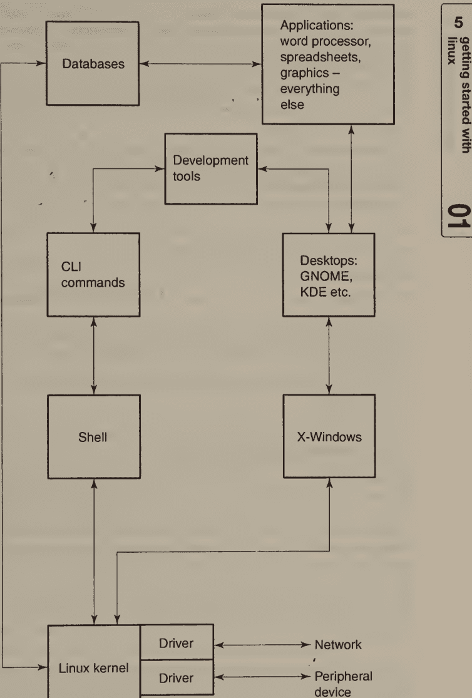
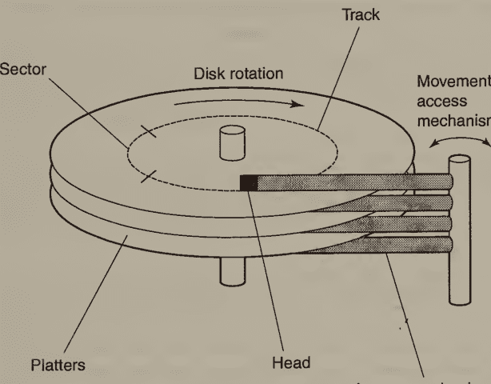
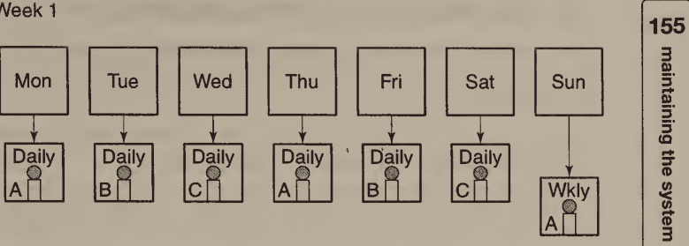
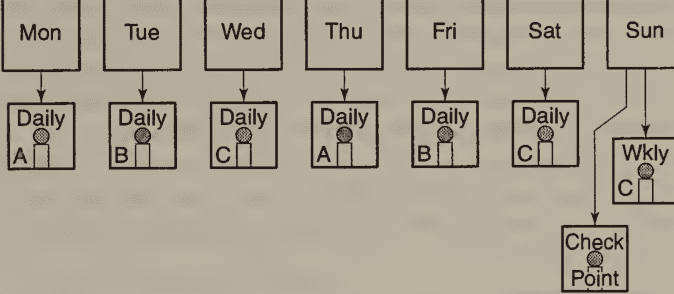

# 自学 Linux (Teach Yourself 系列)

| 目标 | 类别 |
|---|---|
| 熟练掌握与理解 | 计算机 |

- 安装和使用 Linux 系统
- 从基础功能到高级功能的进阶
- 通过理解软件实现更多目标

通过“自学系列”达到你想要到的境界

在过去的六多年里，超过 4000 万人通过**自学**的方式学习了 750 多个学科，并取得了令人印象深刻的成果。

通过**自学系列**达到你想要到的境界

“自学系列”长期以来被誉为自导学习的权威来源——全球销量超过 4000 万册——内容涵盖了语言、工艺、爱好、商业、计算和教育等领域的 300 多部著作。

## 1.1 认证 196

理想情况下，你还需要连接互联网。在写作时，还有一些内部调制调器无法在 Linux 下工作。使用外部调制调器，或者通过局域网（LAN）连接互联网，几乎可以第一次尝试就成功。

## 1.2 背景

操作系统（如 Linux）是一系列在计算机上执行许多例行任务的程序集合。它还提供了一种安全的方式，使得应用程序（如游戏和文字处理器）能够访问屏幕、键盘、鼠标、打印机和磁盘。

操作系统最大的部分，也是其他所有部分所依赖的部分，被称为*内核*（kernel）。内核在计算机启动或重置时启动。

外围设备（如硬盘）对非常简单的命令做出响应。而坐在屏幕前的人所看到的应用程序（如文字处理器）则期望执行复杂的任务。内核必须在它们之间进行调解。

用鼠标点击文字处理器的文件菜单并选择一个文件打开。文字处理器将向内核请求该文件。然后，内核确定文件在硬盘上的位置。它向硬盘发出指令，使其在正确的位置查找并读取字符数量。随后，内核将这些字符返回给文字处理器，文件就会显示在屏幕上。

由于内核可以看到每一个对磁盘的访问请求，它可以否决任何对系统的破坏。Linux 在系统自身拥有的文件和用户拥有的文件之间有着严格的区分。同样，它还可以禁止用户程序直接向磁盘驱动器等外围设备发出命令。

例如，如果使用文字处理器的用户试图将文档保存到 `/etc`（这是 Linux 留给其自身文件的区域），内核将直接用错误信息拒绝该请求。

使用系统的人所能做的事情与系统本身允许做的事情之间的这种严格区分，构成了 Linux 防御攻击的大部分。普通用户运行的恶意程序根本无法对操作系统进行任何更改。对 Linux 机器的恶意攻击仍然发生，但它们需要高水平的编程技能，通常破坏很小，而且非常容易反制。

`user`（用户）和 `root` 术语用于描述普通用户和操作系统本身所居住的环境。`root` 和 `root` 登录还指的是对特定计算机具有管理员权限的人。当这个人登录时，他们可以执行普通用户被禁止的操作。

Linux 内核的第一版本编写于 20 世纪 90 年代初，是在赫尔辛基的一个公寓里独立完成的。将其与理查德·斯托曼（Richard Stallman）的辅助程序以及鲍勃·施赖弗（Bob Schreifer）的 X-Windows 图形界面相结合后，它变成了一个完整的系统。正如此，有人认为 Linux 仅适用于内核本身，尽管它通常被用于整个系统。

Linux 这个名字是 Linus 和 UNIX 的结合体，UNIX 是 20 世纪 60 年代末和 70 年代初在贝尔实验室开发的较旧操作系统。Linux 的许多功能都基于较旧的 UNIX 系统。

Linux 一词是林纳斯·托瓦尔斯（Linus Torvalds）的注册商标，在使用时应予以承认——正如本书开头所的那样。

一些为 Linux 开发的软件技术已经申请了专利。然而，GPL（通用公共许可协议）有效地确保了专利技术对所有用户免费可用。

图 1.1 是 Linux 系统的路线图。作为一张地图，它远不完整——一张纸无法希望显示你在 Linux 上运行的数百个相互互锁的子系统。



图 1.1 Linux 路线图（CLI 是命令行语言解释器的缩写，在第 3.4 节解释）

底部是 Linux 内核本身，内置两个模块化驱动程序，一个用于网络，另一个用于其他外围设备（可能是磁盘）。

内核之上是一个 shell（壳），在 shell 之上是大量的命令。这些可以通过在键盘上输入命令来驱动系统。

X-Windows 系统也位于内核之上。它提供了处理显示的基本机制。然后你可以选择桌面和窗口管理器，它们赋予了系统特定的“外观”和“感受”。

应用程序随后运行在桌面之上，并利用数据库和网络等服务。

## 练习

- 1.1 访问网站 `http://www.linux.org` 并点击其中的一些链接。
- 1.2 在 `http://www.fsf.org` 阅读 GPL，并将其与传统商业软件产品的许可进行比较。
- 1.3 如果你认识任何使用 Linux 的人，问问他们的经验。

## 1.3 Linux 发行版

一个运行中的 Linux 系统由数百个、有时是数个文件组成。一个包含所有文件以及将它们复制到硬盘正确位置的某些程序的工具包被称为发行版（distribution）。发行版还可以包括印刷的说明书、注册卡、应用程序的 CD，在某些情况下还包括 T 恤和汽车贴纸等广告材料。

发行版由商业组织或自愿组织制造。由于发行版中的软件是在 GPL 下发布的，因此始终可以几乎免费地获得一个。

如果你想在安装之前尝试 Linux，可以使用 Knoppix 发行版从 CD-ROM 启动 Linux，而不会更改硬盘上的任何内容。

最常用的发行版之一是 RedHat Linux（红帽 Linux），由位于美国北罗来纳州罗利的红帽公司（Red Hat Inc.）创建。为了简单起见，示例将展示该发行版的 9.0 版本，这是写作时的当前版本。

根据你的需求，你将从许多发行版中选择一个，这适用于 SuSE、Debian、Yellow Dog 以及许多其他发行版。

## 练习

- 1.4 访问三个发行版的网站。比较它们的产品，并记录每个发行版的最新版本号。

[注：在 `http://www.fsf.org` 阅读 GPL，并将其与传统商业软件产品的许可进行比较。]

[注：此处原文逻辑似乎存在重复错乱，已按原文呈现进行翻译。]

## 1.4 如何以及哪里获取发行版

所有主要的发行版都可以从互联网免费下载。作为一个初学者，你可能会觉得这个过程望而生畏。我的建议是先购买 CD-ROM 发行版，在你拥有 Linux 经验后再尝试下载发行版。

你可以通过两种方式购买发行版。供应商提供“装箱版”，包含软件、手册和注册卡，包装在纸箱中。或者，许多供应商以低价提供“廉价版”，这些是主流发行版的克隆。

由于 GPL 的规定明确禁止复制 Linux，这些廉价版是完全合法的。然而，为了保护发行商投入的巨大资金，我们旨在引导购买装箱版的策略。这些包括商标、计算机启动时显示的版权保护图像以及非 GPL 软件。

通常情况下，装箱版是初学者获取发行版最简单的方法。它们可能还包括电话和电子邮件支持，这在最初可能非常有用。廉价版包含相同的软件，但没有实用的安装指南或支持。它们是获取运行机器的发行版更新版本的好方法。

街头电脑店经常备有装箱版，偶尔也有廉价版。然而，在购买前检查版本是值得的，因为周转缓慢意味着过了一年的版本仍在出售。这些发行版可以工作，但没有最新的修订版。

更专业的商店（特别是员工本身就是用户的商店）提供更好的服务。

发行版也可以通过邮寄、电话或安全订单购买。

如果你在英国经营并使用 Linux，可以退回 Linux 发版软件部分的增值税（VAT）。印刷手册不收增值税。因此，仔细检查你的收据很重要，软件和手册订单的增值税部分可能不是发票总额的预期比例。

## 练习

- 1.5 回顾上一个练习的结果。选择你想使用的发行版并获取副本。

## 1.5 安装 Linux

安装过程在不同发行版之间、在同一发行版的不同版本之间存在巨大差异。因此，无法提供一种适用于所有情况的逐步操作指南。然而，所有的安装都要做相同的事情，在本节中，我将通俗地解释安装过程的工作原理以及每个步骤的作用。

安装过程的第一步是加载并运行 Linux 内核。对于许多现代机器，你只需要将该 Linux 发行版的第一张 CD 插入 CD-ROM 驱动器并启动计算机即可。对于不能使用 CD-ROM 作为启动设备的旧版机器，你必须先将内核拷贝到软盘上并启动安装过程。

你会在几乎所有的发行版中找到一个名为 `rewrite` 的程序。该程序会将从 CD 盘中足够的 Linux 文件拷贝到软盘上，以开始安装。它之所以被称为 `rewrite`，是因为它直接写入原始磁盘，忽略掉磁盘上已存在的任何文件结构。你的发行版附带的安装说明将详细解释如何使用 `rewrite`。通常，这涉及到从 CD 盘将镜像文件（一个包含与软盘数据完全相同且格式也完全相同的数据的文件）拷贝到软盘中。请记住，这将擦除软盘上的所有内容。

如果你想将 Linux 安装到一台没有 CD-ROM 驱动器但有网络连接的计算机，最简单的方法是使用 `rewrite` 制作网络启动盘，然后用它来启动安装过程。你还需要将发行版的安装 CD 拷贝到另一台机器的硬盘上；这可能需要多达 2 GB 的磁盘空间。拷贝后的 CD 内容将共享到网络，并替代 CD-ROM 使用。再次，如果你使用的发行版允许这种操作，只需按照说明操作即可。在既没有 CD-ROM 又没有网口的机器上安装 Linux 也是可能的。这涉及到通过打印端口或串口连接加载软件。在在此之前，你应该阅读后续章节中关于网络的内容，理想情况下先获得一些更常规系统的经验。

一旦内核在目标机器（你正在安装 Linux 的计算机）上运行，它将搜索该机器以查看可用硬件，然后由它自己启动安装过程。

下一步是划分硬盘分区。将不同类型的信息存储在磁盘的不同区域（称为分区）是比较方便的。Linux 安装通常使用两个或三个分区。这些分区是：根分区（包含几乎所有的原始文件）、可选的启动分区（计算机启动时从这里加载内核）以及交换分区（Linux 用它作为处理当前未在运行任务的临时存储器）。只有当你拥有一台旧电脑且必须从硬盘的第一部分加载内核时，你才需要启动分区。

许多发行版提供的安装程序可以自动将硬盘划分为分区以实现简单安装，并会给你保留已安装操作系统不受触碰的选项。如果安装程序无法自动创建分区，或者你想尝试更复杂的分区方案，你可以选择手动对磁盘进行分区。我写这本书时使用的计算机硬盘被划分为 15 个分区，并安装了四个不同的操作系统。

硬盘完成分区后，安装程序将在分区内创建文件系统。这大致等同于取一张白纸并在上面画线，将其变成一个表格，使其准备好在上面填写信息。

安装程序会在此阶段的某个地方暂停，并询问你想要安装哪些可选软件。当你第一次执行安装时，最好接受安装程序的建议，选择它认为的正常或默认系统。

安装过程中最耗长的部分是接下来的内容。安装程序将所有包含 Linux 系统的文件拷贝到硬盘上。取决于要安装的软件数量和硬件速度，这可能花费从十分钟到几小时不等。

一旦软件就位，安装程序将尝试找出你的计算机安装了什么种类型的显卡以及什么现代硬件，对于现代硬件，这个过程通常是完全自动的。对于旧机器，有时需要告诉安装程序你拥有什么种硬件。

显示器非常容易识别——它们通常在下方或背面某处印有制造商名称和型号。显卡可能会更棘手。识别显卡的最好方法是找到显卡附带的原始手册。如果在你获取计算机时它已经在运行（使用另一个操作系统），你可能在该系统的设置中找到显卡的详细信息。有时通过查看 `/proc` 文件系统也可以识别显卡，这在第 3 章中介绍。如果其他方法都失败了，唯一的解决方案是将显卡从机器中取出并寻找制造商名称和型号。

一旦确定了显卡和显示器，安装程序将尝试使用该组合可能的最大显示分辨率。

如果产生的显示效果令人满意，你就可以安全地进入安装的下一步。如果不满意，你可能需要对设置进行尝试。

设置程序可能会给你提供图形登录或文本登录的选择。只有当你完全确定上一步正确设置了你的显卡和显示器时，才选择图形登录。

最后，安装程序将询问你如何设置引导加载程序。这是一个很小的程序，用于将 Linux 内核加载到内存中并在计算机重置时启动。默认设置——将引导加载程序安装在硬盘开头——通常是正确的。

如果安装程序通常提供创建紧急启动盘（也称为恢复盘）的机会，请接受它。为此磁盘标记并将其放在安全的地方。如果引导加载程序损坏，它将让你能够重启机器。

在某个时刻，安装程序会要求你设置 `root` 密码。在系统运行时，必须正确输入密码才能以 `root` 身份登录。选择一个显而易见的单词或短语。你的名字、朋友家人的名字以及汽车品牌太容易被猜到了。随机打开一本书并取一个单词要安全得多。在此阶段你还有机会添加一个或多个用户。

如果一切顺利，你现在就拥有了一个可以工作的 Linux 系统。如果不是，第 1.7 章将介绍一些应对安装失败的策略。

## 练习

- 1.6 安装你选择的发行版。


## 1.6 安装双启动系统

双启动系统是指计算机启动时提供操作系统选择的系统。如果你在使用另一个操作系统，并想在保留它的同时在同一台机器上安装 Linux，你有四种选择。

- 1. 让现有系统让出磁盘空间。如果它有多个硬盘分区，你可能可以牺牲一个并使用该空间添加 Linux。
- 2. 添加第二块硬盘。
- 3. 使用 Partition Magic 等工具缩小现有分区，释放出磁盘空间。
- 4. 重新安装现有系统，但位于较小的分区中，为 Linux 留出足够的磁盘空间。

在尝试任何安装之前，请对你的所有数据进行备份。

Linux 的安装过程相当有教养——它会尊重硬盘上发现的所有操作系统的存在。遗憾的是，其他系统的安装程序可能会直接掠夺整个硬盘的空间。

绕过这种情况的方法是先安装另一个操作系统。让它将你的硬盘划分为两个分区，第二个分区足够容纳 Linux。当你安装 Linux 时，使用它的分区工具删除第二个分区，并在释放的空间上设置 Linux。

Linux 安装的最后阶段随后会注意到另一个操作系统的存在，并设置加载程序以加载其中任何一个。

现在当你启动计算机时，它会询问你想使用哪种操作系统，并加载你选择的任何一个。

## 1.7 如果安装失败该（可选）

本节解释了安装失败的一些原因以及如何恢复。如果你有安装问题并想自己解决，就应该阅读这一节。如果你对硬盘如何工作、显卡设置或计算机如何启动感兴趣，也应该阅读这一节。

### 开始学习磁盘分区

如果你的硬件设置不当、拥有非常特殊的硬件，或者你正尝试通过分区磁盘来为另一个操作系统留出空间，可能会出现磁盘分区问题。

在安装过程的分区步骤中，你可以通过输入各个分区要放置的道数来手动对磁盘进行分区。

硬盘通过在一个或多个盘片上的磁性模式来存储信息。这些是安装在轴上并高速旋转的金属盘。每个盘片的每个表面相互相对（但并未实际接触）的是一个磁头（head），这是一种可以在磁盘旋转时读取和写入磁性模式的设备，见图 1.2。磁头附接在一个寻道机构上，该机构可以驱动它们跨越盘表面移动。当寻道机构保持静止时，每个磁头都停留在旋转磁盘上的某圈信息上方。这被称为*道*（track）。一条道被划分为若干*扇区*（sectors）。每个磁头都位于不同盘片上对应的道上，在不移动寻道机构的情况下，它们都可以读取和写入。这些道合在一起称为*柱面*（cylinder）。寻道机构可以将磁头移动到另一个位置，使其位于不同柱面的道上。柱面从 1 开始编号，通常 1 号是最靠近轴的柱面。



**图 1.2** 硬盘内部

硬盘的几何结构通常以三个数字的形式给出。这些分别是道数、头数以及每道的扇区数。这三个数字相乘得到磁盘上的总扇区数。扇区数乘以每个扇区可以存储的字节数（约同于字符数），即为磁盘的容量——它能容纳的信息量。特定信息存储的位置由三个坐标描述——道号、头号和扇区号。

当你到达安装中的分区步骤时，可以选择手动对磁盘进行分区。安装程序随后会为你提供工具选择，例如具有简单图形界面的 `Disk Druid`，或者功能更强大但使用起来更困难的 `fdisk` 程序。

如果你拥有一台旧机器，应该创建一个引导分区（boot partition）。理想情况下，它的至少应为 10 兆字节，并尽可能靠近第一道。如果你想为升级留出空间，请将此分区设置为约 100 兆字节。此分区将包含启动 Linux 内核所需的文件。

通常，你需要创建一个交换分区（swap partition），其大小应该是你电脑内存的四倍。例如，如果你有 64 兆字节的内存，那么交换分区的合适大小是 256 兆字节。

你还应该创建一个根分区（root partition）来存放普通文件。引导分区和根分区的挂载点分别为 `/boot` 和 `/`。如果你手动对磁盘进行分区，可能需要输入这些值，它们将在后面的章节中进行解释。

对于特殊的显卡，安装程序可能会无法显示任何内容。绕过此问题的方法是在安装过程初期选择*文本安装*（text installation）。一旦基础系统安装完成，你就可以添加图形界面。

如果安装过程运行完成但没有正确设置显卡，结果可能是系统通过了启动序列后，在应该开始显示图形时失败。在这种情况下，要要做的是重新运行安装程序，但选择文本登录而非图形登录。

在此阶段，你可能拥有一个可以以文本显示启动但没有图形界面的系统。下一步是以 `root` 身份登录。在登录提示符处：输入 `root` 并按回车。现在输入你在安装期间设置的 `root` 密码。如果一切正常，你现在应该看到一个以字符 `#` 结尾的提示符。现在输入 `setup` 并按回车。从菜单选择“X Configuration”并按照说明操作。在某些较新的发行版中这发生了变化，RedHat 系统上的命令是：

```
redhat-config-xfree86
```

在 SuSE 系统上是 `sax2`。

这些新命令具有图形界面。如果你运行的是 RedHat 版本的 GNOME，也可以从桌面选择 X-Windows 设置（X-Windows）：

`System Settings -> Display`

Debian 系统有不同的配置程序，在第 2 章中解释。

这将向你的硬盘写入一个 X-Windows 配置文件。你可以通过输入命令 `startx` 来测试。。这可能会为你提供可工作的图形界面。如果没有，你可以使用组合键 `Ctrl-Alt-Backspace`（按住键盘左下角的 Ctrl 和 Alt，然后按下回车键正方的退格键）返回文本屏幕，并尝试不同的设置。


如果有任何疑问，通常可以在显卡和显示器上都选择“通用 VGA”（Generic VGA）。这将给你提供一个只有 16 种颜色的低分辨率显示——显示质量差，但足以让你开始使用系统。

某些安装问题是由于不支持的硬件。现在找到不兼容 Linux 的显卡已经很罕见了，但某些其他硬件（特别是内置调制解调器）可能会引起问题。

某些硬件不受支持的原因是制造商未能发布足够关于它的信息，或者它太新了，Linux 还没能跟上。无论何种情况，最好的方法都是尽可能让系统的大部分部分工作，然后在网上搜索可以与这些问题的系统组件工作的软件。

由发行版厂商维护的硬件数据库是关于可用于 Linux 的硬件信息的宝贵来源——请查看你正在使用的发行版的网站。

在这两种情况下，解决方案都是使用安装期间创建的恢复磁盘。

一旦系统启动，下一步是阅读你正在使用的引导程序的在线文档。

## 1.8 获取支持

有一个广泛且热情的 Linux 用户社区，既可以通过互联网也可以通过用户小组（LUG）的会议与之联系。英国的用户组可以在 http://www.lug.org.uk 找到。小组成员和互联网上的定期帖者非常乐意帮助新用户。如果你首先联系的人无法解决你的特定问题，你几乎能找到可以解决的人。

互联网上还有邮件列表，通常与特定的软件包相关。它们提供较慢但更有针对性的支持。它们通常可以通过其支持的产品网站上的链接找到。

有些用户小组还会举办所谓的安装大会（installests），这是邀请新用户带着电脑参加的公开会议。专家会在那里解决安装问题，每个新用户离开时拥有一台工作的机器。

如果你购买了带有支持的套装，你可能需要注册并引用盒内某处的数字以接收支持。如果你必须发送注册卡而不是通过互联网注册，在开始尝试安装时发送它是个好计划。

## 练习

- 1.7 在网上搜索你附近的用户组。

## 1.9 笔记本 Linux

在笔记本上安装 Linux 与在台式机上安装没有很大区别。

运行 Linux 有两个陷阱。首先，很难发现制造商使用了哪些芯片——笔记本的设计并不是为了拆卸显卡进行检查。有时需要引导救援系统并检查 `/proc` 文件系统以确定存在的硬件。这在第 3 章中解释。

其次，必须考虑电池电源的变化。笔记本具有多种节能模式和暂停操作的方法，这些方法可能会以不幸的方式与 Linux 产生交互。还值得考虑安装如 `apmd` 这样的软件包，它会在电池耗尽时将所有未保存的信息写入磁盘。

在 http://www.linux-laptop.net/ 有许多关于在笔记本上安装 Linux 的有用信息。

# 02 替代方案

在本章中，你将学习：

- 如何使用 Debian 和 SuSE 发行版
- 如何运行 Knoppix
- 如何在非 Intel 处理器上运行 Linux

选择 Linux 发行版就像寻找新家。你可以在任何地方选择居住，而且每个发行版都有自己的优势。花点时间挑选，多看几个，这样你就可以避免以后搬家的麻烦了。

## 2.1 Debian

Debian 是一个非传统的的发行版。你可以在 http://www.debian.org/ 了解更多关于它的信息。它由 Ian Murdock 于 1993 年创建，并以他和妻子的名字命名，即 Deb-IAn。

Debian 项目由志愿者运行，每人维护系统的某部分。Debian 不提供精美的手册或盒装版。Debian 用户从互联网或刻录的（而非压制的）CD 加载其软件。

Debian 用户通常能从 Linux 中获益更多，因为不受营销限制的束缚，Debian 发行版变得非常强大，而没有像那些商业化的发行版那样强调图形界面。

Debian 有它自己的包管理系统，与红帽的包管理器（RPM）不同。它要强大得多，如果你想添加一个新的软件软件包，它会自动从互联网或 CD-ROM 检索任何依赖项——即你需要先加载的其他软件。

Debian 同样包含了与其他发行版相同的网络、声音支持和图形用户界面（GUI）。它提供了 GNOME 和 KDE 桌面的选择。

Debian 项目的志愿者们严密地守护着他们的软件状态——所有在 Debian 旗帜下分发的内容都是真正的“自由软件”，可以被自由地重新分发、复制和修改。这种意义上的“自由”更多地与言论自由，而不是免费的午餐。

Debian 还存在于多个不同的处理器族。

### 2.1.1 与 Debian 的技术差异（可选）

Debian 的文件系统布局与其他发行版的布局几乎相同。你会发现的唯一显著区别是 System V (SysV) 引导脚本位于 `/etc/init.d` 而不是 `/etc/rc.d/init.d`。奇怪的是，某些其他发行版现在向 `/etc` 添加符号链接（symlinks）来隐藏这种差异。

Debian 创建可移动介质的挂载点时使用的是类似 `/floppy` 的名称，而不是 `/mnt/floppy`。

当你安装 Debian 软件包时——它们是以 `.deb` 结尾的文件——请使用 `apt-get` 命令。例如，`apt-get install less` 会安装 `less` 软件包。当我在当前的 Debian 版本上运行此命令时，它从文件 `less_374-4_i386.deb` 安装，该文件名中包含了版本号和平台信息。

在 Debian 上安装软件包会对其进行配置，通常是询问用户设置软件包的选项。

你可以使用 `apt-get remove package` 移除软件包，并通过输入 `dpkg-reconfigure package` 更改其配置。

你必须以 root 身份登录才能执行其中任一命令。

## 2.2 SuSE

SuSE 有它自己的安装工具，称为 Yet Another Setup Tool (YAST)。YAST 显示了极其清晰的菜单——你只需要看一眼，大约两分钟内就能学会如何使用它。

SuSE 的安装程序对于简单的安装来说很容易用，但在设置复杂的多启动系统时可能会有点笨拙。它会决定自己要做什么并告诉你，而不是询问你想要什么。如果你正在进行任何不寻的操作，值得检查安装程序所选的所有内容，并覆盖任何你不同意的决定。

SuSE 正在迅速成为全欧洲办公室和政府的标准。它清晰、直截了当的桌面和快速、干净的安装让它在该领域具有明显的优势。

United Linux 倡议是一个旨在使 Linux 标准化的项目，由 SuSE 推广。

## 2.3 Gentoo

该发行版从单张 CD 引导，然后创建一个为你的硬件专门定制的 Linux 构建版本。

## 2.4 Knoppix

这是 Debian 的一个版本，可以从 CD 运行*而不触碰你计算机的硬盘*。你可以下载或购买 Knoppix CD，将其放入 CD-ROM 驱动器，重启机器，并立即开始尝试 Linux。如果你愿意，以后可以从 Knoppix CD 将 Linux 安装到你的硬盘上。

## 2.5 非 Intel 平台

仔细观察几乎任何一个当前的处理器芯片，你可能发现已经有人生产了、或者至少正在开发一个运行在其之上的 Linux 版本。

由 Compaq（前为数字设备公司）制造的 Alpha 系列处理器用于高性能工作站和服务器。该处理器族有三个主要的发行版——RedHat、Debian 和 SuSE。如果你想要一台非常强大的计算机，应该考虑在 Alpha 上运行 Linux。

PowerPC 处理器族由 IBM 和 Motorola 联合开发，用于服务器、工作站以及其他设备内部的嵌入式处理器。关于 PowerPC 上 Linux 的信息来源是 http://www.penguinpc.org/。

多种型号的计算机包括大多数当前的 Macintosh 型号和某些 IBM 便携机，包含该家族的处理器。还有一些使用 PowerPC 芯片的 Motorola 嵌入式处理器板。

如果你拥有这些机器，可以从 Debian、Gentoo、Mandra、SuSE 和 Yellow Dog 获取 Linux 发行版。Yellow Dog 是一个针对 PowerPC 的发行版，详情请见 http://www.yellowdoglinux.com/。

Motorola 68000 系列处理器（通常被称为 68k 系列）也可以运行 Debian Linux。这些处理器位于某些嵌入式卡和一些旧的 Apple 计算机上。你可以在 http://www.debian.org/ 找到关于这个版本 Linux 的一些信息（注：此处原文链接有误，通常指向 ports/68k）。

这种 Linux 版本的 68k 处理器通常位于 http://www.debian.org/ports/68k/。

# 03 二进制

在本章你将学习：

- 什么是二进制
- 如何使用二进制
- 如何将二进制转换为十进制
- 如何将十进制转换为二进制
- 二进制与十六进制之间的转换
- 二进制运算

## 什么是二进制

本节将解释：

- 二进制数字的表示方法
- 二进制表示进制
- 二进制与十进制之间的转换
- 十进制与二进制之间的转换
- 二进制与十六进制之间的转换
- 二进制运算

## 3.1 数据类型

本节解释：

- 什么是二进制
- 二进制数字的表示方法
- 二进制运算
- 二进制与十进制之间的转换
- 十进制与转换为之间的转换
- 二进制进制与十六进制转换
- 二进制运算

什么是二进制

本节解释了：

二进制数字只有由 0 和 1 组成。这种表示法在计算机中非常常见，因为计算机只有只有只有。。状态就像开关，开或关，即 或或1。一个二进制位通常被称为 **bit**。

## 二进制数字的表示方法

在十进制中，每个数位都代表 10 的幂。在二进制中，每个数位都代表 2 的幂。

例如，二进制 `1011` 可以表示为：

```
1 * 2^3 + 0 * 2^2 + 1 * 2^1 + 1 * 2^0 = 8 + 0 + 2 + 1 = 11
```

所以，二进制 `1011` 等于十进制的 `11`。

多个位（bits）组合在一起就形成一个字节（byte）。一个字节通常包含 8 个位。

## 二进制运算

二进制加法是最基本的二进制运算。它的规则与十进制加法相似：

| + | 0 | 1 |
| :--- | :--- | :--- |
| **0** | 0 | 1 |
| **1** | 1 | 10 (进位) |

例如，`101 + 011` 的计算过程：

```
  1 (进位)
  101
+ 011
-----
 1000
```

二进制减法的规则也与十进制减法相似：

| - | 0 | 1 |
| :--- | :--- | :--- |
| **0** | 0 | 1 (借位) |
| **1** | 1 | 0 |

例如，`1000 - 011` 的计算过程：

```
  011 (借位)
  1000
-  011
-----
   101
```

## 二进制与十进制之间的转换

将十进制数转换为二进制的最简单方法是将该十进制数除以 2，记录余数，直到商为 0。

例如，将 `11` 转换为二进制：

11 / 2 = 5 ... 余 1

5 / 2 = 2 ... 余 1

2 / 2 = 1 ... 余 0

1 / 2 = 0 ... 余 0

从底向上读取余数，得到二进制 `1011`。

将二进制数转换为十进制的方法是将每个二进制位乘以其对应的 2 的幂，然后求和。

例如，转换二进制 `1011`：

```
1 * 2^3 + 0 * 2^2 + 1 * 2^1 + 1 * 2^0 = 8 + 0 + 2 + 1 = 11
```

## 十进制与十六进制之间的转换

十六进制（Hexadecimal）使用 0-9 和 A-F 来表示 0-15 的数字。A 代表10，B 代表11，C 代表12，D 代表13，E 代表14，F 代表15。

由于 $2^4 = 16$，因此每个十六进制位正好对应四个二进制位。

例如，将二进制 `11011011` 转换为十六进制：

1101 = 13 (十六进制为 D)

1011 = 11 (十六进制为 B)

所以，二进制 `11011011` 等于十六进制的 `DB`。

## 二进制与十六进制之间的转换

将十六进制转换为二进制非常简单，只需每个十六进制位转换为四个二进制位，然后将它们连接起来。

例如，将十六进制 `DB` 转换为二进制：

D = 1101

B = 1011

所以，`DB` 等于二进制 `11011011`。

## 二进制运算

二进制运算包括逻辑运算（如 AND、OR、XOR、NOT）以及位运算（如左移、右移）。这些运算在计算机底层中至关重要。

为了更清晰，我在数字块之间之间留了空格。

文件中的数据是以字节组织的，字节是 8 位二进制数。由于每个二进制位可以是 0 或 1，因此可能的字节数等于 8 个 2 相乘的结果—— 256。一个字节通常用于表示 0–255 范围内的数字。


某些文件包含人类可读的文本，其中一个或多个字节代表每个字符。这种排列方式有两种常见的方法。`Unicode`正在逐渐被接受，因为它可以同时处理许多语言的字母表。然而，较旧的美国信息交换标准代码（`ASCII`）使用得要广泛得多。它可以表示十个数字、罗马字母表的字母甚至是标点符号，每个字节存储一个字符。它使用字节值 `0–31` 来表示制表符或换行符等控制字符，`32` 是空格，`33–126` 是可打印字符。值 `127` 是删除，`128–255` 可用于特殊字符。这些特殊字符并没有标准化，可能会产生意想不到的结果。

所有文件都包含二进制数据，尽管某些数据是可读的文本。通常的做法是使用“二进制文件”一词来描述任何包含非“二进制”内容的文件。二进制文件的示例包括图像和声音。

包含程序的文件分为两种：源代码是以文本形式表示的程序，在具备一定知识的情况下，人类是可以读懂的。计算机无法直接理解这种形式。源代码由一个名为编译器的程序翻译成可执行形式。这是一组计算机可以执行的简单指令列表。这种形式的程序通常被称为“二进制文件”。

## 3.2 会话与日志记录

在使用 Linux 系统之前，你必须通过输入用户名和密码进行登录。

这既是一项安全功能——在此处可以捕获对系统的未经授权访问——也是一种识别特定用户会话所需的文件和设置的方法。

当在桌面计算机上运行时，Linux 会创建若干文本会话，通常为六个。这类似于同时运行着六台独立的纯文本计算机。

同时，如果 `X-Windows` 服务器正在运行，Linux 将拥有一个 `GUI`（图形用户界面）。

你可以通过按下 `Ctrl-Alt-F1` 切换到第一个会话，`Ctrl-Alt-F2` 切换到第二个会话，以此类推，直到 `Ctrl-Alt-F6` 将切换回 `GUI`。

文本会话是始终存在的，尽管在许多系统中它们是不可见的。`GUI` 是由一组程序创建的，它是可选的。可以设置一个一个没有图形界面的 Linux 系统；这有时是非常有用的。

`GUI` 可以通过两种方式启动。如果你在安装期间选择了图形化登录，`GUI` 将在启动序列的末尾出现，并显示一个邀请你登录的框。如果系统被配置为文本登录，屏幕上会出现提示符，一旦你登录，就可以使用 `startx` 命令启动 `GUI`。

无论哪种情况，你都可以输入安装期间设置的用户名和密码——这必须准确——然后你将成功登录。

登录后，系统将允许你访问自己的文件——这些文件与任何其他用户的文件都是分开的。

文件的存储方式类似于一个满满了储物柜的房间。储物柜所有者的名字——用户名写在柜门上。每个所有者有一把钥匙——密码——这使他们只能打开一个储物柜。柜内可以有对象——该人的文件——以及如箱和包之类的容器。容器用于将相关对象放在一起，其内容可以包括更多容器，例如，一个小盒子可以放在大盒子里。建筑的所有者——可以以 `root` 身份登录的人——有一把主钥匙，可以打开任何储物柜。他们可以使用这把主钥匙来帮助丢失了自己的钥匙或忘记了密码的人。他们可以使用这把主钥匙来帮助那些丢失了自己的钥匙或忘记了密码的人。的。

## 练习

- 在文本会话中，使用 `ls` 查看目录内容。
- 在文本会话中，使用 `ls -a` 查看隐藏文件。
- 在文本会话中，使用 `ls -l` 查看详细信息。
- 在文本会话中，使用 `cd` 切换目录（改变目录）。
- 在文本会话中，使用 `pwd` 显示当前工作目录。
- 在文本会话中，使用 `mkdir` 创建新目录。
- 在文本会话中的使用 `touch` 创建空文件。
- 在文本会话中，使用 `rm` 删除文件。
- 在文本会话中，使用 `cp` 复制文件或。
- 在文本会话中，使用 `mv` 移动或重命名文件。
- 在文本会话中，使用 `cat` 查看文件内容。
- 在文本会话中，使用 `grep` 搜索文本。
- 在文本会话中，使用 `top` 查看系统进程。
- 在文本会话中，使用 `ps` 查看运行中的进程。
- 在文本会话中，使用 `df` 查看磁盘空间占用。
- 在文本会话中，使用 `du` 查看目录占用。
- 在文本会话中，使用 `free` 查看内存使用。
- 在文本会话中，使用 `ping` 测试网络连接。
- 在文本会话中，使用 `man` 查看命令帮助文档。
- 在文本会话中，使用 `sudo` 以超级用户权限执行命令。

## 练习

3.5 如果工作目录是 `/home`，那么 `/etc/passwd` 文件的相对路径是什么？

3.6 如果工作目录是 `/home/kathy`，那么文件 `.../bob/kittens.jpg` 的绝对路径是什么？

## 3.4 命令行语言解释器（可选）

命令行语言解释器（`CLI`）是一种通过键盘上输入的命令或从文件中读取的命令来控制系统的机制。你可能永远不需要使用 `CLI`。在当前的 Linux 发行版中，几乎所有的设置和文件操作操作都可以通过图形用户界面（`GUI`）完成。

在 `UNIX` 早期，`CLI` 是与计算机通信的唯一方式。当时鼠标和图形显示器尚未发明，用户坐在电报打字终端（`Teletype terminals`）前，每秒打印十个字符。正因如此，命令行语言被变得极其简洁，到了几乎难以理解的程度。这种简洁性中的一部分被 Linux 继承了。

Linux 系统能做的几乎所有事情都与其相关，因此几乎所有工作都可以通过 `CLI` 完成。一些较晦门的系统函数只能通过 `CLI` 访问。

`CLI` 命令可以由其他程序运行。许多图形工具仅仅是 `CLI` 命令的图形化前端。点击按钮，图形工具运行命令的方式就好像是由人类操作员输入的一完全一样。

`CLI` 本身可以做出决策。它可以执行简单的测试并自动化重复操作。还有一种名为 `cron` 的程序，可以设置为在特定日的时间运行命令。

一个 `CLI` 命令由两部分组成：用于选择要运行的程序或脚本的单词，以及一个告诉程序该做什么的参数列表。

例如，命令

```bash
ls /etc
```

告诉 `CLI` 运行一个名为 `ls` 的程序（该程序列出目录），并给它参数 `/etc`，告诉它列出路径为 `/etc` 的目录。

## 使用 Linux

### 03

我建议你在学习到这些命令时尝试用一下它们。请使用你在上一节中打开的终端窗口。在进行任何操作之前，先看看提示符。它应该以美元符号 `$` 结尾。如果它以哈希字符 `#` 结尾，说明你是以 `root` 身份登录的，而不是普通用户——请注销并使用普通用户名重新登录。

这个检查非常重要。当以普通用户登录时，你输入错误命令可能造成的损害是严格限制的并且容易修复。当以 `root` 身份登录时，你可以做任何事——包括从硬盘上擦除 Linux。

`ls` 命令给出了目录中文件的简单列表，但它不会告诉你任何关于文件的详细信息。现在输入

```bash
ls -1 /etc
```

然后按回车键（`Return`）。这将提供关于每个文件的一行信息。

参数 `-1` 是 `ls` 程序理解的一个选项。对于大多数命令，选项要么以单连字符和单个字母开头，要么以双连字符开头并是一个单词。

这条命令

```bash
ls --inode /etc
```

将为每个文件显示 inode 号，inode 节点是文件存储方式和位置的指示器。

现在尝试这些命令：

```bash
ls -1 -h /etc
ls -1h /etc
```

你从输出中看到任何区别吗？

这两个命令是等价的。`-1` 选项请求长格式，而 `h` 选项请求文件大小转换为人类可读的格式。通常，单字母选项可以组合在一个单连字符后面，而单词选项必须通过空格和另一个双连字符隔开。

这些规则是有例外的。命令程序是由许多人在几十年内编写的，某些命令（特别是 `dd`）有它们自己处理选项的方法。然而，这些规则适用于几乎所有命令。

解释输入命令的程序称为 shell（外壳）。Linux 有多种不同的 shell，具有不同的功能。其中最常见之一，也是你可能正在使用的，是 `bash`，即 Bourne-Again Shell。这个名字源于它是早期一个名为 Bourne Shell 的程序的改进版本，该程序是以其作者 Stephen Bourne 的名字命名的。

shell 能够理解你输入的内容中的部分内容，并在将它们传递给命令程序之前进行少量的编辑。

要看到这种现象，你可以使用 `echo` 命令。该命令简单地回显它的参数。尝试输入

```bash
echo Beware the ideas of March
```

然后，你将看到完全按照你输入的内容显示的消息。

现在尝试输入

```bash
echo /etc/*
```

而不是上面的命令。显示的是 `/etc` 中所有文件和目录名称的完整列表，shell 将 `/etc/*` 替换成了 `/etc` 目录下每个文件名的列表。这并不完全易读，也不是一个很有用的操作。但如果你将其与理解文件和目录的 `ls` 程序结合使用，输入

```bash
ls -1 /etc/*
```

你将看到列出的每个文件及其子目录的内容。

该命令的输出非常长，并迅速刷出屏幕。下一步是将输出重定向到另一个可以使其变得易读的程序。

程序接受输入并产生流（streams），即字符的连续序列。

每个由 shell 运行的程序都有两个称为标准输入（standard input）和标准输出（standard output）的流。这些通常缩写为 `stdin` 和 `stdout`。标准输入通常是键盘，标准输出是屏幕。你可以通过命令行中的 `>` 字符让 shell 将输出发送其他地方。

## 尝试这个命令

```bash
ls -l /etc/* >dirtxt
```

这会将它的输出发送到名为 `dirtxt` 的文件中。你可能会看到一个或多个错误信息。这些可以安全地忽略。它们通过标准错误（standard error）输出，标准错误也可以被重定向。

当你现在以 `root` 身份登录时输入

```bash
ls -l
```

这会将输出发送到一个名为 `dirtxt` 的文件中。你可能会看到一个或多个错误信息。这些可以安全地忽略。它们通过标准错误输出，标准错误也可以被重定向。

当你以普通用户身份登录时输入

```bash
ls -l
```

这会将输出发送到一个名为 `dirtxt` 的文件中。你可能会看到一个或多个错误信息。这些可以安全地忽略。

使用管道字符 `|` 作为管道来告诉 shell 将标准输出发送到标准输入。在这个例子中

```bash
ls /etc/* | grep
```

按回车并检查结果。`grep` 程序是一个过滤器，在所示参数的作用下，它允许包含‘conf’的行通过。

这种方式组合程序的能力是 `CLI` 最强大的功能之一。在这个例子中，`grep` 在 `ls` 完成之前就开始工作了。

`CLI` 还可以顺序运行程序。尝试这条命令

```bash
ls /etc ; ls /
```

输出是两个 `ls` 命令的输出。

然而，如果你输入

```bash
ls /etc & ls /
```

shell 将同时运行这两个命令，它们的输出将混合在一起。

在行末尾使用单个 `&` 符号是启动程序（例如编辑器）的好方法，它可以打开一个独立的窗口并让它在后台运行。

下一个示例使用了 `emacs` 编辑器。并不是所有的发行版都默认安装了这个程序。如果这个示例第一次尝试无效，你应该跳过它。在第 8 章中我将解释如何安装额外的包，包括这一个。尝试

```bash
emacs &
```

你将看到 shell 显示两个数字。括号中的数字是 shell 跟踪运行程序的作业号。另一个是进程 ID（`PID`），系统通过它识别你启动的进程（在本例中是名为 `emacs` 的编辑器）。注意提示符立即显示，你可以在 `emacs` 运行时输入另一个命令。

几秒后另一个窗口将打开。这将 `emacs` 编辑器本身。如何使用 `emacs` 将在第 10 章解释——目前你只需点击右上角的小叉即可退出它。

现在回到你一直输入命令的窗口。按回车键。将显示一条消息告诉你 `emacs` 已退出。

如果你在输入此命令时不加 `&`，`emacs` 将在前台运行，shell 在 `emacs` 结束之前不会再次给你提示符。

完成。你可以通过按下 `Ctrl-Z` 来取消此操作。shell 将暂停 `emacs` 并让你输入另一个命令。如果你输入 `bg`，`emacs` 将被移动到后台，就像你输入了 `&` 一样。

另外两个实用的组合是 `Ctrl-C`（它可以杀死在前台运行的命令）以及 `Ctrl-D`（它是文件结束标记符）。如果你运行的是一个要求你输入几行输入的程序，你可以使用 `Ctrl-D` 告诉它你已经完成了输入。

如果你必须输入很长的文件名或命令，可以使用 Tab 键补全。输入前几个字符并按 Tab 键。shell 将输入尽可能多的字符。例如，输入 `showco` 并按 Tab 键，shell 将补全命令为 `showconsolefont`。

`man` 和 `info` 命令是查找存在哪些命令及其作用的非常有效的方法。例如，尝试输入

```bash
man date
```

这会显示 `date` 命令的说明。`man` 命令显示单页信息，称为“man 页”（man page），你可以通过它进行滚动。`info` 命令要复杂得多。它显示的许多页面都有菜单。将光标移动到菜单项上，按下回车键，`info` 将显示另一页信息。

你可以通过添加 `-t` 选项将 man 页转换为可打印的文件。例如

```bash
man -t mv | lpr
```

这将打印 `mv` 命令的 man 页。

从 `CLI` 可以执行的命令有非常多，而且添加到系统的每个软件软件包都会提供更多命令。根据最近的统计，我用来写这本书的这台机器上有超过 1700 个可用命令。

以下列表包含了你最经常需要的命令，并对每个命令的作用进行了简短描述并提供了示例。在每种情况下，命令中始终相同的部分用小写字母表示，你替换自己的文件名的地方用大写字母表示。

- `cp SOURCE DESTINATION`：将文件从 `SOURCE` 复制到路径 `DESTINATION`。原始文件保持不变，目标文件是原始文件的精确副本。

示例：`cp old.text new.text`

这会为 `old.text` 文件创建一个副本，并将其放在名为 `new.text` 的新文件中。

- `ln -s SOURCE DESTINATION`

该命令不是复制文件，而是创建一个从目标到源的符号链接。当你使用 `ls -l` 命令查看目标目录时，你会看到一个指针符号和链接所指向的文件名。你可以使用符号链接（通常缩写为 symlink），就像使用它所引用的文件一样。

- `mv SOURCE DESTINATION`

将路径为 `SOURCE` 的文件移动到路径 `DESTINATION`。原始文件消失。这可以将文件移动到不同的目录或在目录内重命名文件。

示例：`mv this.data that.data`

将当前目录下的 `this.data` 重命名为 `that.data`。

示例：`mv .raw/fish.pic ./cooked/lunch.pic`

将 `fish.pic` 从子目录 `raw` 移动到子目录 `cooked`，同时将其重命名为 `lunch.pic`。

- `rm PATH`

删除，换句话说，是永久删除文件 `PATH`。可以给出多个路径并用空格分隔，在这种情况下，所有路径都将被删除。请注意，在此操作后文件中的数据无法恢复。`-r` 选项将使 `rm` 删除目录、其内容及其子目录——应该极其谨慎地使用。

示例：`rm file_of_old_stuff file_not_wanted`

该命令将从当前目录删除 `file_of_old_stuff` 和 `file_not_wanted`。

- `mkdir DIRECTORY`

这创建一个路径为 `DIRECTORY` 的新目录。新目录是空的。

示例：`mkdir toybox`

这在当前目录下创建一个名为 `toybox` 的新目录。

- `rmdir DIRECTORY`

删除一个目录——永久删除它。该目录必须是空的。要检查目录是否为空，使用 `ls -a DIRECTORY` 命令，如果它是空的，你只会看到你正在查看的目录项（单个点）和它的父目录（两个点）。

示例：`rmdir toybox`

这会删除名为 `toybox` 的目录。

- `cat FILES`

该命令接受任意数量由空格分隔的路径，读取所有文件并将它们的内容发送到标准输出。它读取的文件是不发生改变的。

示例：`cat fred jim wombat`

这将文件 `fred`、`jim` 和 `wombat` 的内容发送到屏幕。

示例：`cat fred jim >joinedup`

这创建一个名为 `joinedup` 的新文件，并将 `fred` 和 `jim` 的内容放入其中。

- `pwd`

此命令将当前工作目录的路径“打印”到屏幕上。在这种情况下，“print”一词是旧版 UNIX 系统打印终端的历史遗留——它实际上并没有向打印机发送任何内容。

- `cd PATH`

此命令将当前工作目录更改为 `PATH`。

示例：`cd toybox`

这会将当前工作目录更改为 `toybox`。

示例：`cd ..` 将工作目录更改到其父目录。如果工作目录是 `/home/bob/toybox/thing`，此命令将将其更改为 `/home/bob/toybox`。

## 练习

- 3.7 创建名为 `testfiles` 的子目录。
- 3.8 使用 `date` 命令查看当前日期和时间。
- 3.9 再次运行 `date` 命令，但将其输出重定向到 `/testfiles/date1` - 使用 `>` 重定向操作。
- 3.10 将工作目录更改为 `testfiles`。
- 3.11 再次运行 `date` 命令，将其输出发送到工作目录中的文件 `date2`。
- 3.12 使用 `less` 检查 `date1` 和 `date2` 的内容。如果你这样做：

`less date2`

会发生什么？
- 3.13 创建一个包含 `date1` 和 `date2` 的合并的文件。通过重定向 `cat` 命令的输出来实现：

`cat date1 date2 > joinedup`

这会创建一个文件 `joinedup`。

## 3.5 文件系统


Linux 可以访问各种格式的文件系统。它拥有原生格式，但也可以理解 `FAT`、`Macintosh HFS`、`ISO 960` (CD-ROM)、`OS/2 HPFS` 以及许多其他。

文件系统存在于设备上，可以是软盘或磁盘带。设备也可以是硬盘上的分区或整个硬盘。它可以是 `RAM` 区域甚至是另一个文件系统中的文件。在网络机器上，另一台计算机的文件系统可以通过网络访问，可以被挂载。

为了让 Linux 访问设备上的文件，必须挂载。当内核挂载设备时，它会读取关于访问该设备的信息并将其保存在内存中。在访问设备上的文件后，必须卸载。这会让计算机将其放回。

拥有正式的挂载和卸载机制有很多巨大的优势。主要的优点之一是它让“延迟写入”变得安全。当应用程序想要将文件写入磁盘时，文件非常小，可以留在计算机的主内存中等一会儿。

如果在文件写入磁盘之前将磁盘取出，文件将无法进入磁盘。`umount` 命令用于卸载磁盘，它会强制 Linux 将所有未写入的数据写入磁盘。对于可拆卸磁盘（软盘除），在此操作完成之前不会解锁弹出机制。如果有任务正在使用你想要卸载的磁盘，`umount` 将不起。你可以使用以下命令来查找挂载的文件。

Linux 系统已知的所有文件都出现在文件树中。当设备被挂载时，该设备上的目录和文件会被接到文件树的某一点，该点称为挂载点。挂载点是文件树中已存在的目录。例如，如果你有一个包含 `window.bat` 和 `fruit.bat` 的软盘，以及名为 `bats` 的目录，你将此软盘挂载到挂载点 `/mnt/floppy/fruit.bat`，那么文件将显示为 `/mnt/floppy/wom.bat` 和 `/mnt/floppy/fruit.bat`，软盘上的目录将是 `/mnt/floppy/bats`。

作为挂载点的目录应该是空的。一旦文件系统挂载到那里，作为挂载点的目录中的任何文件都会实际上消失，直到该文件系统挂载被再次卸载。

大多数图形用户界面（GUI）都包含了挂载和卸载文件系统的工具。你可以使用这些工具并忽略 CLI 命令。

在终端窗口中输入

```bash
cat /etc/fstab
```

查看包含文件系统列表的文件。此表用于简化常用系统的挂载和卸载。

它包含了系统启动时挂载的文件系统条目，以及由运行中的系统挂载和卸载的文件系统条目。

信息分为六列排列，见图 3.1。第一列是待挂载的文件系统位置。这可以用多种方式写入。

- 某个描述要挂载的磁盘或分区的特殊文件。第一个磁盘 ID 为 `/dev/hda`，第二个为 `/dev/hdb`，以此此类推。SCSI 磁盘为 `/dev/sda`、`/dev/sdb`，USB 设备也是如此 – Linux 将 USB 视为一种特殊的 SCSI 设备。当一个磁盘被分区时，会在特殊文件的末尾添加一个数字来选择分区号。因此，在图 3.1 中，`/dev/hda8` 是第一个 IDE 硬盘上的八号分区。注意，这台电脑（一台笔记本电脑）上的软盘是一个外部 USB 设备，因此它显示为 `/dev/sda`。如果是传统的软盘，它将是 `/dev/fd0`。

- 标签（Label）。当文件系统首次在磁盘分区上创建时，该标签会被写入该分区中。Linux 将在所有可用分区中搜索匹配的标签。

- 单词‘none’。这用于某些并非存在于真实设备上，而是用于访问内核部分的文件系统。

- 描述如何在网络上找到文件系统。字符串 `falstaff:~/home` 描述了网络名称为 falstaff 的机器上的 `/home` 文件系统。

下一列列出了文件系统挂载的挂载点。根文件系统挂载在 `/`，这是一个始终存在的点。所有其他挂载点要么是该文件系统内的目录，要么是其他文件系统的目录。

第三列指示文件系统的类型。Linux 有它自己的文件系统，称为 `ext2` 和 `ext3` – 第二和第三扩展文件系统。原始的扩展文件系统已经过时。`ext2` 和 `ext3` 的区别在于 `ext3` 具有日志（journal），这是磁盘上的一个区域，系统在其中记录磁盘上正在发生的变化。由于这一点，使用 `ext3` 的计算机在断电后可以在几秒钟内恢复磁盘，而 `ext2` 恢复磁盘则需要几分钟。访问内核的文件系统（如 `proc`）有自己的类型。通过网络访问的文件系统类型为 `nfs`。这代表“网络文件系统”（Network File System），将在第 6 章中解释。`Vfat` 是 `fat` 文件系统的通用术语，其变体被 MS-DOS 和衍生自它的系统使用。交换文件系统（swap）是磁盘的一个区域，内核可以将临时空闲的任务放置其中，以回收它们正在使用的内存。CD-ROM 使用 `ISO 9660` 文件系统 – 该名称来自国际标准组织的出版物，该标准定义了 CD-ROM 上数据的布局。

最后，文件系统类型可以设置为‘auto’。在这种情况下，系统将通过尝试错误找到设备上存在的是什么文件系统。在驱动器中插入一张 MS-DOS、`ext2`、`ext3` 或 `Macintosh HFS` 格式的软盘，点击相应的图标，系统将正确挂载它。

第四列是每个文件系统的选项列表。在大多数情况下，这仅仅是‘defaults’一个词，表示默认选项——在计算机启动时挂载文件系统——已经足够了。你可以在‘mount’命令的帮助页（man page）中找到你可以使用的选项列表。标记为‘user’的文件系统可以由任何登录用户挂载和卸载，‘owner’选项意味着只有使用连接到计算机的屏幕和键盘登录的人才能挂载和卸载，而不是从另一台机器通过网络登录的用户。

某些文件系统（如 `ext2` 和 `ext3`）会记录每个文件的所有者，并保存权限列表 – 即不同用户允许对文件执行的操作。无论文件系统类型如何，应用程序预期这些信息存在。某些文件系统不持有所有者信息也不持有完整的权限集。因此，在挂载 `fat` 或 `vfat` 文件系统时，通常需要在选项中提供额外信息。

`fstab` 的第五列控制备份 – 它很少被使用。第六列也是最后一列，用于选择 Linux 在启动时进行的检查。此列中的 1 表示在系统大部分部分启动之前检查文件系统是否有损坏。根文件系统应该标记为 1。2 表示该文件系统作为例行启动序列的一部分进行检查，是固定磁盘上所有其他分区的正常设置。第六列中的 0 表示 Linux 将不会进行任何自动检查。

图 3.1 文件 `/etc/fstab`

```
[unclebob@titania]$ cat /etc/fstab
LABEL=/root
LABEL= /boot
none
/dev/hda8
none
/dev/hda6
/dev/cdrom
falstaff:/home
falstaff:/workspace
falstaff:/dev/sda
/dev/sda
[unclebob@titania]$ /mnt/floppy
```

| Device | Type | Options | Pass |
| :--- | :--- | :--- | :--- |
| LABEL=/root | ext3 | defaults | 1 |
| LABEL= /boot | ext3 | defaults | 2 |
| none | nfs | auto,user | 0 |
| /dev/hda8 | nfs | auto,user | 0 |
| none | vfat | gid=620,mode=000 | 0 |
| /dev/hda6 | proc | defaults,umask=00 | 0 |
| /dev/cdrom | iso9660 | noauto,user | 0 |

客户端是应用程序，例如终端模拟器、游戏和文字处理器。

客户端通过连接到服务器并向其发送消息来显示窗口。这些消息告诉服务器绘制如线条、矩形和文本等简单对象。更复杂的对象（如按钮和文本输入框）被称为部件（widgets），它们由库软件创建，将简单对象组合成复杂对象。常见的部件库包括 `Qt`、`Motif`、`OpenLook` 和 `Athena`。

由于客户端和服务器之间的连接是普通的套接连接——与网络上的任何连接相同——因此客户端和服务器不必在同一台计算机上。

你可以在一台计算机上运行程序，并使其显示出现在另一台计算机上。这允许你通过在网络中其他负载较低的机器上运行程序来借用处理器速度。

客户端仅提供窗口的“内部”部分。边框、标题栏和系统菜单由窗口管理器添加。由于应用程序在从一台机器移动到另一台机器时可能会改变其外观和感受。

## 3.8.2 高级 X-Windows（可选）

本节涵盖了连接服务器的机制以及窗口管理器与客户端的交互方式。如果你打算执行 X-Windows 最简单操作之外的任何操作，或者要在网络上使用 X-Windows，就应该阅读此节。

使用 X-Windows 的应用程序使用名为 `xlib` 的库来访问一个或多个服务器。`Xlib` 管理发送到服务器和接收自服务器的消息。

当使用 `xlib` 的程序启动时，`xlib` 会尝试查找它应该使用哪个显示器。它会查看 `DISPLAY` 环境变量，通常还会查看 `-display` 命令行选项。其中任何一个都可以以这种方式描述显示器：

```
falstaff:0.0
```

例如，`falstaff` 是所连接的计算机在网络上的名称。空名称 `:0.0` 表示你正在使用的计算机上的显示器。某些计算机具有多个显示器、键盘和鼠标。冒号后的第一个数字是是从零开始数的显示器编号。一个显示器可以使用多个显卡拆分到两个或多个显示器。点后面的数字是要使用的显示器编号，同样从零开始计数。在很多情况下，不需要点和第二个数字。

在单机上使用 X-Windows 时，`DISPLAY` 变量会自动设置。如果你想登录到远程机器并运行显示的程序，必须确保它指向你正在查看的显示器。通过 `telnet` 或 `ssh` 连接到远程机器可以正确设置该变量。如果没有，你可以使用此命令设置 `DISPLAY` 变量：

```
export DISPLAY=host:0.0
```

服务器不会自动接受来自任何其他机器的连接。这是一个重要的安全特性：它防止同一网络上的其他用户看到你屏幕上的内容。

控制显示器访问的最简单方法（在非常小的安全网络上相当满意的方法）是使用 `xhost` 程序。该程序向服务器发送命令，告诉它接受或拒绝来自特定计算机的连接。对于控制公共互联网上的显示器访问并没有良好的安全性。如果你使用 `ssh` 代替 `telnet`，通常会发现身份验证已完成，你不需要使用 `xhost`。

当客户端（应用程序）连接到服务器时，客户端通过连接提供窗口的“内部”部分。边框和标题栏由窗口管理器添加。窗口管理器还可以移动、图标化和调整窗口大小。

为了看到这一效果，你可以在应用程序继续运行的同时启动和停止窗口管理器。`KDE` 和 `GNOME` 内置的窗口管理器并不完全适用，但你可以使用两个较旧且更简单的管理器 `twm` 和 `mwm` 来演示这一机制。

在此演示之前，你必须关闭显示器管理器和服务器。以 root 身份登录并使用 `telinit` 命令更改系统运行级别，使系统切换到基于文本的登录。

在 Red Hat 系统上，这是运行级别 3，输入的命令是：

```
telinit 3
```

在 Debian 系统上，停止显示器管理器服务具有相同的效果。

你可能需要重新登录。再次以 root 身份登录。

接下来尝试在没有客户端的情况下启动 X-Windows 服务器的效果。输入此命令：

```
X
```

注意是大大写的 `X` 且不接受参数。

`X` 服务器将启动，你将看到显示器切换到图形模式。没有窗口打开，也没有背景。屏幕上唯一的内容将鼠标光标。

按下 `Ctrl-Alt-Backspace` 退出服务器并返回文本屏幕。

这就是服务器在没有客户端的情况下独立运行的样子。

现在输入

```
xinit
```

同样不带参数。显示器将切回图形模式。`xinit` 命令是一个脚本，它启动 `X` 服务器并运行终端模拟器，然后等待终端模拟器退出并关闭服务器。

你现在会看到一个终端窗口，但它没有边框或标题栏。这就是当你同时运行服务器和客户端但没有窗口管理器发生的情况。

将鼠标光标移动到终端窗口上并输入

```
twm &
```

启动标签页窗口管理器。这是较旧的窗口管理器之一，只有几个非常基础的功能。在末尾加上 `&` 使其在后台运行。现在输入

```
xterm &
```

启动终端模拟器。现在输入

```
mwm &
```

启动窗口管理器。现在输入

```
fluxbox &
```

启动窗口管理器。现在输入

```
gnome &
```

启动窗口管理器。现在输入

```
kde &
```

启动窗口管理器。现在输入

```
matchbox &
```

启动窗口管理器……

运行中的服务器向其客户端提供一个或多个视觉效果（visuals）。视觉效果描述了显卡能够做什么——它能显示多少种颜色以及它使用了什么种调色板（如果有的话）。客户端需要以符合视觉效果的方式向服务器发送请求。服务器可能允许客户端以几种不同的形式发送请求，在这种情况下服务器将为客户端提供多种视觉效果供选择。

你有时可能会看到包含“visual”字样的错误信息，特别是当程序因为找不到可用的视觉效果而无法启动时。

如果发生这种情况，请使用 `xdpyinfo` 命令查看服务器提供的视觉效果。然后，你可以像上面的那样修改 `XF86Config` 文件，重新配置服务器，使其提供程序可以使用的视觉效果。请记住，更改只有在服务器停止并重启后才会生效——你可以通过按下 `Ctrl-Alt-Backspace` 强制执行此操作，但请确保你先关闭任何未保存数据的程序。只需要重启服务器，不需要重启机器。

## 练习题

- **3.14** 使用 `less` 命令检查 `/etc/X11/XF86Config` 文件。阅读该文件的帮助页。

- **3.15** 使用 `xdpyinfo` 命令读取有关显示器的信息。将你的发现与上一个练习的结果进行比较。

## 3.9 图形用户界面 (GUI)

在之前的章节中，你已经了解了 X-Windows 系统是如何工作的。X-Windows 只是 GUI 的基础，它操作显卡并处理键盘和鼠标。作为用户，你需要的不仅如此。你希望能够拖放文件、通过点击运行应用程序并跟踪打开的窗口。

有几种桌面环境可以在 X-Windows 上运行。旧的 `fvwm` 现在很少被使用。最常见的两个是 `KDE` 和 `GNOME`。你可以分别在 http://www.kde.org/ 和 http://www.gnome.org/ 了解更多关于 `KDE` 和 `GNOME` 的信息，它们是官方项目网站。

`KDE` 和 `GNOME` 都提供了相似的功能。你可以使用它们在不同目录之间拖放文件，从菜单中挂载并启动程序。

`KDE` 和 `GNOME` 之间存在一些技术差异，它们提供的功能略有不同。我建议你两个都安装，尝试一下，然后决定你喜欢哪一个。

Linux 区分了不同的用户，以及用户与 root 用户之间的区别。正如此，每个用户都有自己的偏好，存储在主目录下的隐藏文件和目录中。

## 练习题

- 3.16 访问网站 http://www.kde.org/ 和 http://www.gnome.org/ 并比较 `KDE` 和 `GNOME` 的功能。

- 3.17 使用 `KDE` 或 `GNOME` ——使用文本编辑器创建一个包含简短消息的文件。挂载软磁盘，将文本文件拷贝上去。卸载软磁盘。

- 3.18 `KDE` 和 `GNOME` 都会在桌面上显示一些文件。找到其中一个文件的文件的路径——你可能会发现在线帮助和 `find` 命令都很有用。

- 3.19 使用命令行界面 (CLI) 在桌面上创建一个文件。GUI 会立即显示它吗？如果你使用的 GUI 有刷新桌面的选项，它是做什么的？

# 04 运行在 Linux 上的软件

- 在本章中，你将学习：

- 如何使用办公软件

- 如何设置、连接和使用数据库

- 关于不同类型的图形工具

- 关于不同类型的可用应用程序

- 如何在 Linux 上玩游戏

- 如何从 Linux 访问互联网

Linux 继承了许多来自经典 UNIX 的应用程序，例如 `Tex` 排版系统和 `vi`、`emacs` 编辑器。这些旧软件中的很多是有用的，但并不是现代办公室或家庭环境所需要的。

在过去的几年里，几家软件供应商为 Linux 制作了高质量的应用程序。这是一个具有代表性的、但绝非完整的选择。

## 4.1 办公软件

办公软件包括用于创建和处理文本文档、图形以及组织信息的工具。

Linux 并不缺办公软件。作为一个新用户，你可能面临的问题是在众多海量的替代方案中做出选择感到困难，而不是找不到实现你所要求的包。

Linux 非常适合实现近乎无缝的办公集成。图 4.1 显示了你如何将标准组件组合成一个集成的办公系统。完成此操作的所有软件都包含在大多数发行版中，并可以从互联网下载。

你可以设置一个或多个数据库来跟踪朋友、宠物、假期、财务和运动。你可以使用结构化查询语言 (`SQL`) 来访问你的数据。这是一种连接数据库的名义标准方法。它使用由英语单词和数学符号混合格式化的查询来存储、检索、搜索和排序数据。我将在后面的章节中解释 `SQL`。

`SQL` 数据库可以很容易地在网络上共享。你可以在一台计算机上设置 `SQL` 服务器，让几台机器上的用户访问它，如果你想在办公室分发数据，这是非常有用的。

另一种是使用 `dBase` 数据库——该名称源于早期使用这种数据库格式的程序。这些要简单得多，不在机器间共享，并且无法处理复杂的查询。它们更容易设置——`dBase` 数据库只是你计算机上的几个文件——对于家庭使用来说完全足够了。

`OpenOffice` 可能成为默认的标准办公套件，因为它开始包含在许多软件中。

图 4.1 `OpenOffice` 集成 (https://example.com/img/52b3c44d0f5964)

`KDE` 和 `GNOME` 都提供了相似的功能。你可以使用它们在不同目录之间拖放文件，从菜单中启动程序。

`KDE` 和 `GNOME` 之间存在一些技术差异，它们提供的功能略有不同。我建议你两个都安装，尝试一下，然后决定你喜欢哪一个。

这些是你可以使用的数据源：


## Adabas
这是由德国达姆斯塔特的 Software AG 公司生产的一种商业数据库。详情请访问 http://www.softwareag.com/。如果你已经有一个 Adabas 数据库，请选择此项。

## JDBC
这是 Java 数据库连接（Java Database Connectivity）。如果你的系统或网络上已经安装了 JDBC，请选择此项。

## ODBC
开放数据库连接（Open Database Connectivity）是位于应用程序（如 OpenOffice）与一个或多个数据库之间的软件层。它旨在消除 SQL 实现之间的差异，但需要一些设置。这将在后面的章节中描述。如果你想使用现有的 SQL 数据库或想向你的系统添加共享数据库，请安装 ODBC。

## dBase
这是最简单的数据库形式。你可以使用 Writer 或 Calc 中的“数据源”工具创建 dBase 数据库。

1. 点击“新数据源”（New Data Source）按钮。
2. 为你的数据库输入一个名称。
3. 将“数据库类型”（Database Type）设置为 dBase。
4. 在 URL 框中输入完整路径，例如 `/home/yourname/yourdatabase`。这将创建一个目录，数据库中的每个表将成为其中的一个文件。
5. 点击“表”（Tables）选项卡。如果你设置得当，目录将被创建，并出现一个空表列表。
6. 点击“新表”（New Table）——那个黄色的小星号。
7. 设计你的数据库。在第一列中为每个字段命名，在第二列中选择存入的数据类型，并在第三列使用说明该字段用途的注释。
8. 点击软磁盘图标保存数据库。系统会要求你为表命名。
9. 关闭数据库设计窗口。

## 文本（Text）
某些数据库软件包将表导出为纯文本，各个数值值之间用逗号或制表符分隔。如果你使用此项，OpenOffice 可以导入此类内容。

## 电子表格（Spreadsheet）
你可以使用电子表格作为数据源。电子表格的第一行成为字段名，工作表的其他部分包含数据。

## 讯簿（AddressBook）
OpenOffice 可以连接到多种格式的地址数据库。使用此项将 OpenOffice 内置的地址簿与浏览器集成。使用地址簿工具为业务联系人、供应商、朋友和敌人创建任意数量的地址簿。

## 表单（Form）
表单是一种将记录展开为整页数据的对象，使其更具读性。它还简化了数据输入。

OpenOffice 有用于创建表单的工具。创建表单最快的方法是从向任何文字处理文档添加“表格控制”（Table Control）开始。点击并按住“表单”（Form）按钮（窗口左上方）并向右拖动，直到弹出框显示“表格控制”。程序现在会询问你使用哪个表来控制你的表单。选择相应的数据库和表。

现在为表单添加其他框。你可以将这些字段附加到数据库中。在背景上点击右键并从菜单中选择“控件...”（Control...）以打开属性。点击选择一个框，并在对话框中点击“数据”（Data）选项卡。你现在可以使用“字段”（Field）下拉菜单将字段连接到你的新框。

当你对新表单满意时，可以像保存任何其他文档一样保存它。在点击并拖动“表单”按钮时出现的第二行控件上，选择“设计模式开启/关闭”（Design Mode On/Off）。

你的表单将活跃起来。所有的框和按钮将开始工作，你可以使用它们来输入数据。

OpenOffice 拥有应用程序编程接口（API），你可以用它创建新的对话框和命令。请谨慎使用“API”。API 手册长达900多页，解释了如何编写 C、Java 和 BASIC 程序来为 OpenOffice 添加新功能。你可以从 http://api.openoffice.org/ 下载 PDF 格式的手册。

## 练习
4.1 使用 OpenOffice 或 StarOffice 创建一个 Base 数据库表。为什么“数量”（magnitude）列应该是文本而不是数值型？创建一个允许你向表中添加新记录的表单。

### 4.1.2 Base 套件
我个人可以推荐这个软件包，因为我正在用它写这本书。在我作为 Base 用户的多年里，我编写了总计超过三十万字的文档，它从未掉过我的链子。在写作时，它仍然可用，但不再进行活跃维护。

### 4.1.3 SQL 数据库（可选）
结构化查询语言（SQL）是一种访问数据库的方法，本应是标准的。然而，服务器（管理数据库的程序）之间存在一些差异。为了解决这个问题并提供标准的编程接口，ODBC 包包含了大多数常用数据库服务器的驱动程序。当你运行使用 ODBC 的程序时，无论它连接到哪个数据库，其行为都是相同的。

设置 SQL 数据库非常简单。你可能会遇到的唯一问题是，许多设置错误（例如缺少驱动程序）会导致程序崩溃，要么没有任何解释，要么给出一个极其晦涩的错误消息。解决此问题的真正方法是获取你正在使用的软件包的安装说明，并严格遵循每一个步骤。

基本的 SQL 语法在数据库之间略有不同。最令人困惑的差异之一是 mysql 拥有 `SHOW DATABASES` 和 `SHOW TABLES` 命令，而 PostgreSQL 没有。相反，PostgreSQL 创建了名为 `pg_databases` 和 `pg_tables` 的数据库表，它们包含相同的信息并可以使用 `SELECT` 命令进行检查。

位于 http://sql-ledger.org/ 的 SQL-Ledger 软件包是一个完整的小企业会计套件，它使用 SQL 数据库。

#### 4.3.1 设置 PostgreSQL 数据库
可以通过安装基础数据库软件和服务器本身来设置 PostgreSQL 数据库。这些通常是独立的软件包。

当启动 PostgreSQL 服务器时，它将在 UNIX 域套接字上监听客户端程序的连接并访问其数据库。如果你想从另一台机器跨网络访问服务器，或者从不使用 UNIX 域套接字的程序包访问，你可以通过编辑 `/var/lib/postgresql/data/postgresql.conf` 来添加 TCP/IP 地址域。取消这些行的注释——注意它们在不同版本的服务器之间可能略有不同：

```
tcpip_socket = true
port = 5432
hostname_lookup = false
show_source_port = false
```

使用桌面上的“服务器设置”选项或在 shell 中输入 `postgresql start` 来启动服务器——你必须以 root 身份登录才能执行此操作。

PostgreSQL 服务器不以 root 身份运行。安装时它会创建一个名为 `postgres` 的伪用户。要控制服务器，你可以直接登录 `postgres`，或者从另一个登录切换到 `postgres`。然后你可以使用这些命令来控制服务器：

- `createuser` – 在允许访问数据库的用户列表中创建一个新条目。
- `dropuser` – 从列表中删除用户。
- `createdb` – 创建数据库。
- `dropdb` – 删除数据库。

机器可以连接到服务器，以及如何检查登录人员的身份。此文件包含许多有用的注释。

PostgreSQL 的完整文档可以通过多种格式从 http://www.postgresql.com/ 获取，其中包含一个出色的 SQL 教程。

#### 4.1.3.2 设置 MySQL 数据库
安装 `mysql`、`mysql-server` 和 `mysql-devel` 包或其等效包，并启动 `mysql` 服务器。

MySQL 自带一个单个 HTML 文件的详尽文档。其中包含一个非常有用的 SQL 教程。你可以在一个桌面的浏览器中打开它，在另一个桌面的窗口中尝试 SQL。

使用不带参数的 `mysql` 命令打开 mysql 显示器。MySQL 启动时已创建两个数据库：

- `mysql` - 这是用户及其访问权限的数据库。使用 `GRANT` 和 `REVOKE` 命令修改它。
- `test` - 这是一个区域，你可以在这里自由尝试 SQL 命令而不会损坏任何实际数据。

#### 4.1.3.3 设置 ODBC
安装 `unixODBC` 和 `unixODBC-devel` 包。添加驱动程序（MyODBC 或 PostgreSQL-odbc）。

ODBC 给数据库命名的名称、驱动程序以及 ODBC 连接到的服务器之间的关系由两个文件设置：`/etc/odbc.ini` 和 `/etc/odbcinst.ini`。其中第二个文件包含某些库的名称；请检查它们是否指向 `/usr/lib` 中的最新版本。

请注意，`odbc.ini` 文件可能包含密码 —— 这是一个潜在的安全风险。在主目录中使用私有的 `.odbc.ini` 可以降低危险。

这些文件通常提供了已经编写好的适用于 MySQL 和 PostgreSQL 的正确设置。你可以手动编辑这些文件，或者安装 `unixODBC-kde` 包，该包包含 `ODBCConfig`，一个用于设置文件的图形化编辑器。该包包含 `DataManager` 命令，它可以生成 ODBC 可以访问的所有数据源、数据库和字段的树形结构显示。

#### 4.1.3.4 将 ODBC 连接到 OpenOffice
在 OpenOffice 文字处理器或电子表格中，选择 **工具 → 数据源...**，然后点击

- 新数据源

并为你的数据源赋予一个新名称。将数据库类型设置为 ODBC。现在点击标有三个点的按钮，并屏住呼吸。如果一切设置正确，将显示 ODBC 数据源列表，你可以选择其中一个。如果你缺少驱动程序，OpenOffice 将现在或在接下来的几个步骤中崩溃。如果发生这种情况，请返回并检查你是否已加载所有驱动程序，以及 ODBC 是否设置正确。

现在点击 **ODBC** 选项卡。输入登录数据库的用户名 —— 这可能与你的普通登录名不同。

点击 **表格** 选项卡。选择你希望文字处理器和电子表格使用的表格。

你可以使用 **查询** 选项卡来构建 SQL 查询 —— 这些是发送给 SQL 服务器的命令，告诉它选择数据库的部分、对记录进行排序并将它们分组。SQL 可以完成一些非常用的操作，包括使用来自一个数据库的信息来查询另一个数据库。如果你想学习 SQL，最简单的方法是学习 PostgreSQL 或 MySQL 包中的教程。

设置好数据库连接后，点击 **确定** 按钮，然后按 `F4` 开始使用数据库。

某些数据库在 OpenOffice 中会显示为只读 —— 你无法输入任何数据 —— 而你本应认为它们是可写的。这通常是因为 OpenOffice 需要一个隐藏键来跟踪它是如何对记录排序的。使用 OpenOffice 创建一个简单的数据库，然后用 `mysql` 或 `psql` 查看其结构，你就会看到额外的列。

### 4.1.4 演进
这是一个新包，它是日程历、任务列表、通讯录和电子邮件客户端的结合。通讯录可以访问远程轻级目录访问协议 (LDAP) 服务器。

### 4.1.5 GnuCash
另一个新产品，GnuCash 是一个复式记账系统。在编写时，尽管某些区域尚不完整，但它已经是完全可用的。GnuCash 可以导入 Quicken (QIF) 格式的账户，跟踪账目树，并打印支票和发票。

### 4.1.6 MrProject
一个简单的项目管理工具 MrProject 跟踪资源、任务和时间。它可以生成甘特图。

### 4.1.7 Office 兼容性
可以在不同的系统之间交换 Microsoft 文档和 Excel 电子表格。OpenOffice 可以导入和导出这些格式。OpenOffice 自己的文档格式在 OS/2 机器上也是可读的。图像以颜色列表的形式存储在计算机中，显示在屏幕上或打印在纸上。位图（bitmap）和光栅（raster）一词用于此类图形。这对于通过扫描仪或照相机拍摄的照片效果良好。用绘画程序绘制的图像具有更锐利的边缘，并且在放大或缩小时不会分解成锯齿边缘和断断线。图 4.2 显示了这种情况是如何发生的。

矢量图形存储方式不同。矢量图形可以包含指令，如“到距离顶部 2 英寸、左侧 1 英寸的点。在这里画一个直径 1 英寸的圆”。通过双倍命令中的所有数字可以将该图形放大一倍，显示或打印图形的软件将画出一个更大的圆。

软件如 Imagemick 可以矢量图形转换为图像。这样做会丢失无法检索的信息，这就是为什么没有可靠的程序可以将图像转换为向量。

大多数数据库软件可以导出逗号分隔值 (CSV) 或制表符值 (TSV) 格式，OpenOffice 可以导入。某些 Corel office 生成 TSV 文件在文本字段中间包含换行符。这会停止导入过程。可以使用 emacs 等编辑器修正这些记录。

## 练习题
- 4.2 使用 PostgreSQL 或 MySQL 创建数据库。
- 4.3 通过 ODBC 连接此数据库。
- 4.4 在该数据库中创建一个表格，列出你朋友的汽车。包括品牌、型号、颜色、注册号和者姓名。打印一张标签，每辆汽车一张，适用于汽车照片。

## 4.2 图形工具
图形工具分为两种类型：操作图像的和处理向量的。

图像作为颜色列表存储在你的计算机中，显示在屏幕上的不同位置或打印在页面上。位图（bitmap）和光栅（raster）一词用于此类图形。

### 4.2.1 Gimp
这是 GNU 图像处理程序 —— 一个用于绘制或修饰图像的工具。它是一个免费程序，可以从 http://www.gimp.org/ 下载。它也包含许多主要的发行版中。

除了绘画，Gimp 还有一系列效果。它可以模糊、锐化、增强和扭曲图像。它的过滤器可以创建马赛克瓷和模糊玻璃效果。

### 4.2.2 矢量图形工具
Appix 和 OpenOffice 软件包都带有矢量图形工具。这些工具都极其易用——书中的图表都是使用 Appix 图形绘制的。

这两个软件包的功能相同——你可以使用其中任何一个来绘制线条、曲线、方框、多边形、圆形和椭圆。Appix 图形还与 Appix 文字处理器集成在一起——你可以将图形嵌入到文字处理文档中。OpenOffice 也包含一个类似的机制，可以将图形对象拖放到文字处理文档中。

### 4.2.3 Imagemagick
该软件包是一系列用于处理图像的独立程序集合。

`display` 程序的功能不仅仅是在屏幕上显示图像。它还有一个菜单界面，用于管理软件包中的任何其他程序。

该软件包包含一个名为 `convert` 的程序。除了可以将图像从一种格式转换为另一种格式外，它还可以将 PostScript 格式的矢量图形转换为位图，插入线条图或文本注释，从 X-Windows 捕捉图像并放大或缩小图像。

`Convert` 还可以应用过滤器。这些程序可以使图像变得柔和或更锐利，并实现各种特效。

Imagemagick 的主要优势之一是它是可脚本化的——我将在后面的章节中详细解释这一点。如果你需要将数千张图像从一种格式转换为另一种格式，可以编写脚本来自动化转换，并让它运行通夜。

Imagemagick 包含在许多发行版中，你也可以从 http://www.imagemagick.org/ 下载。

### 4.2.4 扫描仪和数码相机
扫描仪在 Linux 下通过一个名为 Scanner Access Now Easy (Sane) 的软件包处理。这不仅适用于 Linux，还可以与其他操作系统一起工作。Sane 由两组程序组成：

- 后端（Back ends）——这些是针对特定型号扫描仪的处理器。
- 前端（Front ends）——这些是用户用于访问扫描仪的程序。

任何后端程序都应该与任何前端兼容。

最简单的前端程序是 `xscanimage`。它有一个方便的图形界面并可以在低分辨率的“预览”模式下运行扫描仪——这有助于确保你在机器中放置的方向是正确的。

`scanimage` 是另一个纯文本前端程序，可以从脚本运行。你可以用它将扫描功能构建到任何其他程序中。我有一个简单的脚本，可以像复印机一样工作：扫描文档，将 `scanimage` 的输出转换为 PostScript 并发送打印机。

你可以在 http://www.mostang.com/sane/ 学习更多关于 Sane 的信息。

`gPhoto` 软件包在 Linux 下运行，并让你访问数码相机。你可以在 http://gphoto.sourceforge.net 了解它——或下载它。再次，它包含在大多数发行版中。

`gPhoto` 软件包包含两个组件——图形前端和相机驱动库。该驱动库支持 300 多种相机型号，并可以用于 gPhoto 前端以外的程序中。

gPhoto 有一个可脚本化的前端。你可以用它来触发相机在特定时间拍照，或者响应诸如门被打开之类的事件。

## 4.3 其他其他有趣的应用程序
寻找 Linux 应用程序有点就像在一家好书店里逛街——总能发现引人注目且意想不到的惊喜。例如，Linux 被用于药物分子建模（另见 http://www.tripos.com/）以及在 http://www.wolfram.com/ 进行数学实验。

这里是一些最实用的应用程序精选。

### 4.3.1 天文学
位于 http://www.clearlyinstitute.com 的 Clear Sky Institute 分发 Elwood Downey 的 `XEphen` 程序，这是一个星图和历书（一个计算行星运动的程序）。

你可以下载该程序的免费版本，也可以购买完整版（附带包含 7000 万颗星星目录的 CD-ROM）。

一旦你输入了你在地球表面的位置——有一个方便的城市表格可以帮助——XEphen 将完成其余工作并赋予你探索夜空的自由。它可以显示月球和火星视图，并追踪木星和土星的卫星。

即使你对天文只有一点兴趣，这个程序也会让你着迷。

## 练习
4.6 下载 XEphen 的免费版本，如果你有笔记本电脑，请将其安装上。在下一个晴朗的夜晚显示你所在位置的天空视图，并尝试找到至少三个与屏幕上匹配的真实星座。

### 4.3.2 Mastering CD
CD 上的文件系统与普通磁盘不同，因为在磁盘的寿命期间，它不需要被修改。

CD 有三种类型：

- 音乐 CD。它们有一系列轨道，每个轨道包含未压缩的音频数据。
- 数据 CD。它们通常有一条包含 ISO 9660 文件系统的数据轨道，也被称为 CD-ROM。
- HFS CD。这些用于 Apple Macintosh 计算机，具有一个包含分级文件系统的单轨道。通过将文件系统设置为 HFS，可以将它们挂载到 Linux 系统上。某些 Linux 发行版是通过 HFS CD 提供的。


当“轨道”（track）一词应用于 CD 时，它的含义与硬盘上的轨道不同。CD 轨道是任意长度的集合。CD 有一个目录表（`TOC`），列出了 CD 上的轨道、它们的位置和大小。

`CD-ROM` 的原始 `ISO 9660` 标准规定文件可以是多种格式。最常见的是 `Rock Ridge`，它允许长文件名和权限。另一种是 `Joliet`，由 Windows 使用。Linux 支持这两种。

要创建 CD，你可以使用 `mkisofs` 工具。它将文件目录转换为 CD 镜像。

```
mkisofs -r -J /path/to/directory image.iso
```

一旦有了镜像，可以使用 `cdrecord` 将其刻录到 CD。

```bash
cdrecord -v /dev/cd image.iso
```

## 练习

`4.7` 使用 `mkisofs` 从文件目录创建 CD 镜像。然后使用 `cdrecord` 将镜像刻录到 CD。

### 4.3.3 音乐与音频

大多数 Linux 发行版自带简单的播放和录制音频驱动。

你计算机上包含声音的文件可以是多种格式：

- 未压缩音频。这种格式提供最好的录制质量，等同于 CD，但文件最大。

- 压缩音频，例如 `OggVorbis` 和 `MP3`。这会损失一些质量，但文件小得多。

- 序列信息，例如 `MIDI`。这不是严格的录制格式，而是播放哪些音符的列表。播放 `MIDI` 文件的程序必须提供声音。

乐器数字接口（`MIDI`）标准最初是作为连接乐器与其他计算机的方式而开发的。电子键盘背面看到的接口连接是高速串口接口，用于告诉乐器播放哪些音符、何时以及持续多久。Linux 通过串口或 `USB` 端口与 `MIDI` 交互。

`MIDI` 文件存储了发送给乐器的命令，并包含关于节奏、乐器声音甚至歌词的信息。`MIDI` 制造商协会网站 `http://www.midi.org/` 有大量关于 `MIDI` 的信息。

为了处理更多音频，你可以添加几个软件包。高级 Linux 架构（`ALSA`）项目 `http://www.alsa-project.org/` 正在为 Linux 开发改进的音频驱动。这些驱动预计取代当前的开放声音系统（`OSS`）驱动。

如果你想使用 Linux 作曲，可以下载 `Rosegarden` 软件包。它的主页是 `http://www.all-day-breakfast.com/rosegarden/`，那里有源码。预编译的二进制文件可以从斯坦福大学计算机音乐研究中心（`CCRMA`） `http://www.ccrma.stanford.edu` 获取。`CCRMA` 拥有丰富的音乐软件。他们还有自己的安装工具，可以定位并安装软件包。

许多音乐软件是实时运行的，因为它们必须在正确的毫秒内做出运行决策。运行这些软件通常需要经过特殊修改的内核，以便在任务需要运行时能够快速做出响应。`CCRMA` 提供了可下载的修改内核。注意，`CCRMA` 的安装程序与 Debian 的 `apt-get` 命令几乎相同。它会尝试修复与音乐无关的包的依赖问题，因此你可能会发现，在安装 Linux 后将 `Rosegarden` 作为第一个包安装是最简单的。

`Lilypond` 软件包位于 `http://lylipond.org/stable/`（注：此处可能有拼误），可以生成打印乐谱。你可以将 `Rosegarden` 的作品转换到 `Lilypond` 进行打印。

Linux 还包含了一些实用的音频软件包，可以从命令行运行：

- `Sox` - 这是一个简单的音频文件格式转换器，还可以添加一些效果。

- `Timidity` - 这是一个 `MIDI` 文件的播放器，它使用预录的音符样本。它可以将结果写入 `.wav` 音频文件，或直接通过声卡播放。

- `Playwave` - 一个用于播放音频文件的简单程序，在某些较旧的发行版中，该命令命名为 `play`。

每个 Linux 发行版——有时是每个版本——都带有一个或多个可以播放或编辑音频文件的软件包。这些软件包经常变化，因此我没有在这里记录它们。

你可以在具有基础音频接口（即没有内置合成器）的计算机上运行 `Rosegarden`。这涉及从源码编译。下载源码包，使用 `tar`（第 8 章）解压并按照说明操作。安装 `ALSA` 驱动程序，并在配置时使用以下选项构建 `Timidity`

```
--enable-audio-alsa --enable-alsaseq
--without-arts --without-ladsp --without-jack
```

现在你可以使用 `-iA` 选项运行 `Timidity`，它会伪装成连接到 `ALSA` 驱动器的 `MIDI` 乐器。

## 练习

`4.8` 设置你的桌面，在常见事件（如打开和关闭窗口）时播放声音。包含声音的文件保存在哪里？如果你在 shell 中用 `playwave` 命令播放它们，会发生什么？

`4.9` 使用 `sox` 程序为 `.wav` 文件添加混响。也尝试一些其他效果。

## 4.4 游戏

Linux 拥有丰富的卡牌游戏、棋盘游戏、益智游戏和文明模拟游戏。这些游戏在 `X-Windows` 上运行良好，而 `X-Windows` 最初的设计初衷是工作而非游戏——特别是涉及快速动作的操作。

任何发行版都会带有十左右这类游戏。确切找到你拥有哪些游戏以及如何获胜所有游戏，是浪费一两周时间并播放大量烦人的背景音乐的好方法。

快速动作游戏正变得可用。它们依赖于 `X-Windows` 的一个扩展 `OpenGL`，`OpenGL` 将带有硬件加速器的显卡连接到可以产生高速运动图像输出的程序（包括游戏）上。

该扩展最完美的演示之一是 `Tux Racer`，可从 `http://www.tuxracer.com/` 获取，这是一个涉及引导小企鹅滑下雪坡，抓捕冷冻的鱼并试图保持路线的游戏。关于 `OpenGL` 的更多信息请访问 `http://www.opengl.org/`，包括与 `OpenGL` 兼容的显卡信息。

网站 `http://www.linuxgames.com/` 是下载游戏和新发布新闻的丰富来源。

## 4.5 网页、邮件和新闻

在 Linux 上运行浏览器（或任何其他利用互联网的应用程序）非常简单。底层内核处理互联网连接，让浏览器去处理它最擅长的事情。

万维网已经偏离了它的初衷——即任何页面都应该可以用任何浏览器查看。你偶尔会遇到某些在某些浏览器上无法工作的网站。这没有任何借口——这仅仅是设计疏忽。“任何浏览器均可见”（Viewable With Any Browser）活动 `http://www.anybrowser.org/campaign/` 正在努力解决特定网站的问题。在他们的网站上，你会找到一份设计指南和一些可以发送给那些问题网站管理员的示例电子邮件。

### 4.5.1 Mozilla 和 Netscape

`Mozilla` 是一个开源浏览器项目，网站为 `http://www.mozilla.org/`。`Netscape` 是一个位于 `http://www.netscape.com/` 的商业组织。由于 `Mozilla` 是一个免费的开源项目，任何编写其他浏览器的人都可以自由地在程序中使用 `Mozilla` 组件。`Netscape` 的某些版本使用了 `Mozilla` 组件，这导致这两个浏览器之间产生了一些困惑。

这两个浏览器都具有相同的功能：网页浏览器、电子邮件程序、地址簿和 `HTML` 编辑器。

### 4.5.2 Opera

这个浏览器是一个商业产品。你可以在 `http://www.opera.com/` 下载免费版，它会不时弹出奇怪的广告，稍后可以在线购买完整版（不带广告）。`Opera` 加载网页的速度比其他浏览器快得多。

### 4.5.3 Lynx

这是一个可以安装在 Linux 上的纯文本浏览器。它不能显示图形，尽管它会提议下载图形。要运行它，在 shell 中输入命令 `lynx`。

由于 `lynx` 是一个纯文本浏览器，因此它可以被脚本化（我将在后面的章节中解释），并作为大型程序的一部分来归档或索引网站。我最近使用它来归档并交叉引用一个作者讨论网站，该网站包含 `1.3 GB` 的数据和 `68,000` 条帖子。

## 练习

`4.10` 选择一个包含 `HTML` 编辑器的浏览器。你可能会发现其中包含了 `Mozilla`。你可以在你的发行版中使用这个邮件客户端。

### 4.5.4 POP 和 SMTP

通常用于传输电子邮件的两种协议是邮局传输协议（`POP`）和简单邮件传输协议（`SMTP`）。当使用 `SMTP` 时，机器将邮件推出去。相反，`POP` 是通过拉取邮件来工作的。互联网访问协议（`IMAP`）是 `POP` 的替代方案。除非你使用的是拨号连接，否则最好使用可用的智能中继，或者直接将你的电子邮件发送到 `ISP` 的 `SMTP` 服务器。

## 练习

`4.11` 设置你的邮件客户端并交换电子邮件。

### 4.5.5 Sendmail

这是一个大型且复杂的程序，它不仅可以递送电子邮件，还可以重定向和重写头。配置 `Sendmail` 是一项专业任务。通常使用发行版提供的配置是最简单的。使用智能中继（通常是 `SMTP` 服务器）消除了你的 `Sendmail` 执行所有查找的需求。如果接收者的邮件服务器宕机，智能中继还将接管重试交付的责任。

### 4.5.6 POP 和 IMAP 服务器

`Sendmail` 收集入站电子邮件并将其放入 `/var/spool/mail` 中的用户邮箱。某些邮件客户端可以直接从该目录收集邮件。

如果你想使用只能通过 `POP` 或 `IMAP` 协议收集邮件的邮件软件，或者你想建立一个供局域网内所有人使用的入站邮件服务器，你可以安装 `imap` 软件包。

该软件包包含了 `POP` 和 `IMAP` 服务器。对它们的访问由 `xinetd` 守护进程控制。

守护进程（`daemon`）是系统中始终存在的程序，但在需要之前几乎不消耗资源。`xinetd`（`eXtended Internet services Daemon`）就像一个酒店门卫静静地守在门口。当访客到达时，它就会出来并提供帮助；但如果有不受欢迎的人进入，它就会将其挡回。同样，`xinetd` 处于睡眠状态，监控传入的网络连接，将合法请求连接到服务器并拒绝入侵尝试。这使得 `xinetd` 既是合法请求的路由器，也是第二层防火墙。

## 4.5.7 Usenet 和 NNTP 协议

网络新闻传输协议 (`NNTP`) 用于操作 `usenet` 新闻组。新闻组是讨论区——开放或限制性的——以帖子列表的形式组织，其通用格式与电子邮件消息相同。

将 `usenet` 新闻组想象成一个巨大的公告板，标题描述了应该讨论的主题。例如，`uk.com.os.linux` 新闻组旨在讨论英国的 Linux 情况。然后有人过来贴了一张便条，写着：“有人能为 Linux 推荐好的卡牌游戏程序吗？”其他人看到便条后，可能会回复纸牌和扑克游戏的详情进行回复。

如果你想参与 `usenet` 讨论，你有多种客户端程序可选。`Mozilla` 浏览器内置的就适合新用户。你可以直接连接到 `ISP`（互联网服务提供商）的 `NNTP` 服务器并在浏览器偏好中设置。或者你可以按照第 7.3.5 节描述建立自己的服务器。

新闻组是获取 Linux 信息的良好来源。你会发现许多热心且知识渊博的人参与讨论并回答新用户的问题。在加入讨论之前，先“潜水”几天（即只读群组而不发帖）是一个好主意。新闻组也可能退化为毫无意义且气坏的争论，在这种情况下，唯一做的就是安静地离开。

# 5

## 更强大的功能

在本章中，你将学习：

- 如何使用脚本使复杂操作自动化

- 如何在预设时间自动执行任务

- 如何在 Linux 中使用打印机

- 如何在 Linux 上运行 Windows 软件

## 5.1 基础脚本（可选）

如果你想知道如何自动化简单任务，或者打算阅读任何关于编程的章节，你应该阅读这一节。

Shell 程序（如 `bash`）可以从脚本文件也可以从键盘接收命令。

这些脚本文件不应与某些操作系统上的批处理文件（`batch files`）混淆。批处理文件是 20 世纪 60 世纪和 70 世纪做法的遗留，当时将命令、程序和数据整合放在打孔卡片上，将它们堆成批，让计算机逐一个地处理这一批作业。

脚本文件可以做多得多。它们可以是简单的命令列表，但也可以是独立的小型程序。脚本可以被编写来做出决策并自动执行重复操作。

本节中的示例是文本文件，你可以使用文本编辑器创建和编辑它们。`GNOME` 和 `KDE` 桌面环境都内置了文本编辑器。不要尝试用文字处理器编辑脚本文件，大多数情况下它是行不通的。

`emacs` 编辑器更复杂，但从长远来看，我发现它有更多实用的功能。如果你打算自定义系统或学习编程，那么花时间学习使用 `emacs` 是非常值得的。

`Emacs` 拥有大量的命令，但最初你只需要三个就能应付，随着学习逐渐选择其他的。

注意，`emacs` 运行在许多不同的计算机上，它对键盘的术语略显陌生。`Ctrl` 和 `Shift` 键是 PC 键盘从机械打印机终端时代继承来的；`Alt` 键在早期具有完全不同的功能，经常被称为 `meta`，这个词源自希腊语，意为“改变”，因为它改变了按键的含义。

你需要知道的三个命令是：

- `Ctrl-X Ctrl-S` 保存你正在编辑的文件。

- `Ctrl-X Ctrl-C` 退出 `emacs`。

- `Ctrl-H` 显示帮助。

要输入 `Ctrl-X Ctrl-S`，按住 `Ctrl` 键然后按 `X` 再按 `S`，期间保持按住 `Ctrl`。

使用 `emacs` 最简单的方法是打开一个终端窗口，然后输入类似这样的命令：

`emacs myscript &`

这将启动 `emacs`，它会打开一个新窗口。`myscript` 文件将出现在窗口中。由于文件创建时没有内容，所以它最初是空的。因为这让 `emacs` 在后台运行，你可以继续使用终端窗口测试你的脚本。

脚本通常以这一行开始：

```
#!/bin/sh
```

字符 `#!` 告诉 Linux 这是一个脚本，行的其余部分是知道如何解释它的程序的路径。`/bin/sh` 路径始终指向你的普通 shell 程序（通常是 `bash`）的符号链接。这些字符必须放在文件的正开头。左侧不能有空格，上方不能有空行。

脚本的其余部分将由选定的程序读取并解释。

你可以尝试一个简单的脚本，例如：

- 使用命令启动 `emacs` 编辑器：

`emacs myscript &`

- 输入这个简单的脚本：

```
#!/bin/sh
# This is my first script
ls -lrth
```

- 输入 `Ctrl-S Ctrl-X` 将你的脚本保存到磁盘

输入此命令

`chmod +x myscript`

通过输入以下命令运行脚本：

`./myscript`

命令 `chmod +x` 使文件变为可执行。一旦变为可执行，你就可以通过指定路径来运行它。

这是另一个使用变量的脚本：

```bash
#!/bin/sh
# A variable script
echo "Hello, $USER!"
```

变量 `$USER` 被替换为当前登录用户的名字。这是展开的另一个例子。

你也可以在脚本中使用参数：

```bash
#!/bin/sh
# Using arguments
echo "First: $1"
echo "Second: $2"
```

`$1` 是传递给脚本的第一个参数，`$2` 是第二个。这样运行此脚本：

`./myscript alice bob`

输出将是：

First: alice

Second: bob

如果你没有提供足够的参数，变量将被替换为空字符串。

最后，我们来看循环。`for` 循环对于对目录中的每个文件或任何项目列表重复命令非常有用。

```bash
#!/bin/sh
# A simple loop
for i in 1 2 3; do
    echo "Number $i"
done
```

`for` 循环为列表中的每个项目执行 `do` 和 `done` 之间的命令。在这种情况下，变量 `i` 被设置为 1，然后是 2，最后是 3。

在以 `echo` 开头的行之后。这会显示每个文件的校验和。

这对于文件可以正常工作，但 `cksum` 程序对任何子目录都会显示错误消息。你可以通过如下编辑脚本来改进它：

```sh
#!/bin/sh
# 带有校验和的目录列表
for f in * ; do
  echo $f
  if [ -f $f ]; then
    cksum $f
  fi
done
```

内置命令 `if` 会查看脚本的后续部分（直到分号为止），并尝试将其解释为“是”或“否”。在这种情况下，它是一个内置命令，可以写成 `test` 或更简单地写成方括号 `[]`。`test` 命令查看它的第一个参数 `-f`，它的意思是“测试下一个内容是否为普通文件”。如果是普通文件，`if` 命令将允许执行到 `fi`（`if` 的反向拼写）为止的所有内容。如果不是，则将跳过到 `fi` 之前的所有命令。

`bash` shell 是一个大型且复杂的程序。在本节中，我向你展示了 `bash` 可以做哪些事情。还有许多更多功能可以在 `bash` 的 `man` 和 `info` 页面中查询。

## 5.2 使用 cron

`cron` 是一个在 Linux 运行期间一直在后台执行的程序。它用于在程序的时间运行程序和脚本，即使没有用户登录也是如此。`cron` 每分钟唤醒一次，并检查一个或多个 `crontab` 文件查看是否有任务要做。当它运行完所有需要的程序后，它会重新睡眠，以便停止消耗一分钟的资源。

有两种 sort的 `crontab` 文件。位于 `/etc/crontab` 的系统 `crontab` 由系统所有，用于运行 Linux 本身或已安装软件包的各种日常维护操作。用户 `crontab` 位于 `/var/spool/cron` 目录。普通用户允许使用 `crontab` 命令创建和编辑这些文件。

两种 `crontab` 文件的格式是的。这是一个典型的系统 `crontab`：

```bash
SHELL=/bin/bash
PATH=/sbin:/bin:/usr/sbin:/usr
MAILTO=root
HOME=/
```

```bash
# run-parts
01 * * * root run-parts /etc/cron.hourly
02 4 * * root run-parts /etc/cron.daily
22 4 * 0 root run-parts /etc/cron.weekly
42 4 1 * root run-parts /etc/cron.monthly
```


文件的第一部分设置了一系列变量，为运行的命令提供环境。注意，该文件包含以井号开头的注释行。

文件的第二部分包含要运行的命令列表。每行的开头有五个字段，每个字段可以是数字或星号。这些字段按顺序对应于：

- 分钟
- 小时
- 日
- 月
- 星期几。0 或 7 是周日，1 是周一，依此类推。

当 `cron` 运行时，它会查看每个 `crontab` 中每行的字段。包含数字的字段必须匹配时钟，包含星号的字段被忽略。

你可以使用列表而不是数字。例如，在分钟字段中放入 `0,15,30,45` 将在每小时的点点运行命令。你可以使用的完整格式范围列在 `crontab` 的手册页上。输入

```bash
man 5 crontab
```

来查看它。

在示例表中，模式

```
01 * * * *
```

在其他地方都有数字一（忽略前导零）。这将匹配每小时一分钟的时钟时间。与此关联的命令将在每小时一分之后运行一次。

同样地，开头为

```
42 4 1 *
```

的行将在每月 1 号的凌晨 04:42 运行。

星期几之后的字段是 `cron` 执行命令时使用的用户名。行的其余部分是命令及其参数。当执行命令的时间到达时，`cron` 实际上是以用户名登录会话，并将行的其余部分提供给它，就像在键盘上输入的一样。

用户 `crontab` 文件不存在用户名字段。相反，用户名是从文件的所有者处获取的，命令在星期几之后立即开始。

你可以通过 `crontab` 命令创建自己的 `crontab` 文件。要编辑或创建 `crontab`，首先选择你想要使用的编辑器，例如 `emacs`，并输入此命令

```bash
export EDITOR=emacs
```

然后带有此选项运行 `crontab`

```bash
crontab -e
```

将有一个短暂延迟，你选择的编辑器将启动。如果你有一个 `crontab`，它将出现在编辑器中；如果没有，命令将创建一个空的 `crontab`。

你可以通过输入查看你的 `crontab`

```bash
crontab -l
```

忽略出现在文件开头的控制信息。

你可以使用以下命令删除你的 `crontab`

```bash
crontab -r
```

这不会给你改变主意的机会，所以请谨慎使用。

如果你的电脑在 `cron` 应该执行每日、每周或每月命令的时间没有运行，`anacron` 程序会在计算机下次启动时注意到错过了一个操作，并立即运行该命令。

## 5.3 打印

`cron` 是一个在 Linux 运行期间一直在后台执行的程序。它用于在程序的时间运行程序和脚本，即使没有用户登录也是如此。`cron` 每分钟唤醒一次，并检查一个或多个 `crontab` 文件查看是否有任务要做。当它运行完所有需要的程序后，它会重新睡眠，以便停止消耗一分钟的资源。

有两种 sort的 `crontab` 文件。位于 `/etc/crontab` 的系统 `crontab` 由系统所有，用于运行 Linux 本身或已安装软件包的各种日常维护操作。用户 `crontab` 位于 `/var/spool/cron` 目录。普通用户允许使用 `crontab` 命令创建和编辑这些文件。

两种 `crontab` 文件的格式是的。这是一个典型的系统 `crontab`：

```bash
SHELL=/bin/bash
PATH=/sbin:/bin:/usr/sbin:/usr
MAILTO=root
HOME=/
```

```bash
# run-parts
01 * * * root run-parts /etc/cron.hourly
02 4 * * root run-parts /etc/cron.daily
22 4 * 0 root run-parts /etc/cron.weekly
42 4 1 * root run-parts /etc/cron.monthly
```

文件的第一部分设置了一系列变量，为运行的命令提供环境。注意，该文件包含以井号开头的注释行。

文件的第二部分包含要运行的命令列表。每行的开头有五个字段，每个字段可以是数字或星号。这些字段按顺序对应于：

- 分钟
- 小时
- 日
- 月
- 星期几。0 或 7 是周日，1 是周一，依此类推。

当 `cron` 运行时，它会查看每个 `crontab` 中每行的字段。包含数字的字段必须匹配时钟，包含星号的字段被忽略。

你可以使用列表而不是数字。例如，在分钟字段中放入 `0,15,30,45` 将在每小时的点点运行命令。你可以使用的完整格式范围列在 `crontab` 的手册页上。输入

```bash
man 5 crontab
```

来查看它。

在示例表中，模式

```
01 * * * *
```

在其他地方都有数字一（忽略前导零）。这将匹配每小时一分钟的时钟时间。与此关联的命令将在每小时一分之后运行一次。

同样地，开头为

```
42 4 1 *
```

的行将在每月 1 号的凌晨 04:42 运行。

星期几之后的字段是 `cron` 执行命令时使用的用户名。行的其余部分是命令及其参数。当执行命令的时间到达时，`cron` 实际上是以用户名登录会话，并将行的其余部分提供给它，就像在键盘上输入的一样。

用户 `crontab` 文件不存在用户名字段。相反，用户名是从文件的所有者处获取的，命令在星期几之后立即开始。

你可以通过 `crontab` 命令创建自己的 `crontab` 文件。要编辑或创建 `crontab`，首先选择你想要使用的编辑器，例如 `emacs`，并输入此命令

```bash
export EDITOR=emacs
```

然后带有此选项运行 `crontab`

```bash
crontab -e
```

将有一个短暂延迟，你选择的编辑器将启动。如果你有一个 `crontab`，它将出现在编辑器中；如果没有，命令将创建一个空的 `crontab`。

你可以通过输入查看你的 `crontab`

```bash
crontab -l
```

忽略出现在文件开头的控制信息。

你可以使用以下命令删除你的 `crontab`

```bash
crontab -r
```

这不会给你改变主意的机会，所以请谨慎使用。

如果你的电脑在 `cron` 应该执行每日、每周或每月命令的时间没有运行，`anacron` 程序会在计算机下次启动时注意到错过了一个操作，并立即运行该命令。

Adobe 发布了一份手册和一份教程。PostScript 是一种纯文本格式，可以使用普通的文本编辑器进行编辑。图 5.1 显示了一个 PostScript 示例。

PostScript 是一种矢量格式。例如，如果一个 PostScript 文件包含一个直径为一英寸的圆、距离页面顶部二英寸且距离左边距三英寸的圆，那么 PostScript 文件将通过列出这些测量值来描述它。

PCL 的某些变体（而非所有）是用于图形的位图格式。该圆将通过一组待打印的点列表来描述。

矢量格式的优势是它们非常容易缩放和旋转。`pagedev` 命令可以接受 PostScript 格式的文件并对其进行编辑，例如，将原始文档的几页打印在一张纸上。

许多 Linux 系统使用 PostScript 或纯文本作为打印机输出的标准格式。所有向打印机发送输出的程序都使用这些格式之一。

当你打印一个文件时，Linux 会将其通过一个过滤器。最简单类型的过滤器会通过查看文件的前几个字符来识别纯文本或 PostScript，然后进行任何所需的处理以为打印机准备文件。某些系统（包括 CUPS）具有“魔法过滤器”（magic filter）。这允许你将它已知的任何格式的文件发送到打印机。过滤器将自动识别文件的格式并正确打印。

你可以通过网络将打印作业发送到其他计算机上的打印机。带有打印机的计算机被称为打印服务器，打印机被称为远程打印机或网络打印机，相对于连接到你正在工作的机器的本地打印机。Linux 允许你使用这些打印服务器：

- 另一台 Linux 或 UNIX 机器。
- 运行 Microsoft Windows 的计算机。
- Novell 服务器。
- 内置 JetDirect 服务器的打印机。

一旦设置了远程打印机，任何程序都可以像使用直接连接到计算机的打印机一样使用它。

远程打印机在本地有一个打印队列。当程序向远程打印机发送作业时，作业首先被放入本地队列。

```
%! Postscript

%! Body
newpath
144 144 72 0 360 arc
stroke

%! Head
newpath
144 252 36 0 360 arc
stroke

%! Beak
newpath
124 236 moveto
144 216 lineto
164 236 lineto
stroke

%! Eyes
newpath
124 260 10 0 360 arc
stroke

newpath
164 260 10 0 360 arc
stroke

%! Feet
newpath
100 110 moveto
120 70 lineto
140 110 lineto
closepath

148 110 moveto
168 70 lineto
188 110 lineto
closepath

stroke

showpage
```


图 5.1 PostScript

随后，`lpd` 和 CUPS 程序通过网络将作业发送到打印服务器。打印服务器可能有自己的队列，你的作业接下来可能会在服务器队列中等待一段时间，等待进入打印机。你可以使用 `lpq` 命令在作业处于服务器队列中时查看其状态。

当你设置远程打印机时，你应该将服务器上的打印机类型设置为打印机的真实类型。在使用打印机的机器上，将类型设置为“PostScript printer”或“Raw print queue”。这适用于以 PostScript 格式跨网络发送的作业，这是一个可靠的标准，而且打印机设置的任何更改只需要在服务器上的一处进行。

CUPS 偏好 Internet打印协议 (IPP)，但兼容较旧的 `lpd` 协议。目前某些发行版在不带过滤器设置 `lpd` 协议时存在问题，远程系统只能打印纯文本。该问题的解决方法记录在 `cups-lpd` 的帮助页中。要从运行 CUPS 的机器向 `lpd` 服务器打印，请在客户端上设置“Raw print queue”。

当你正在实验产生打印机输出的程序设置时，在屏幕上查看将打印的内容而不实际打印是非常用的。这不仅节省了纸张，而且更快更快捷。

几乎所有将 PostScript 转换为操作特定打印机所需命令的过滤器内部都使用一个名为 `ghostscript` 的程序。该程序将 PostScript 转换为待打印页面的图像，然后以各种格式输出图像。

可以通过在 shell 中输入 `gs` 命令直接运行 `ghostscript`。我不建议这样做，`ghostscript` 的命令并不容易理解或使用。使用封装器（如 `gg` 或 `gv`）要好得多，它们为 `ghostscript` 提供了一个简单的点点界面。将应用程序设置为打印到文件，然后用 `ghostscript` 查看该文件。

打印时的一个可能问题是打印文档的纸张大小与设置打印机时选择的纸张大小不匹配。如果发生这种情况，打印内容在页面上将显示向上或向下移动，顶部或底部的几行会被截断。新版本的过滤器尝试自动纠正这个问题。

PDF文档格式 (PDF) 标准与 PostScript 类似。创建此标准的文档可以在许多不同的浏览器中查看。Adobe 为该标准的创建者制作了一个名为 Acrobat Reader 的程序，可以从 http://www.adobe.com 下载。`ps2pdf` 命令可以将 PostScript 转换为 PDF 格式。

## 练习

5.1 挂载在你的计算机上的文件系统。

## 5.4 模拟其他环境（可选）

有些发行版使用非 Linux 操作系统。你可以通过使用模拟器在 Linux 上运行这些。

有 2 种模拟器。第一种模拟计算机本身并运行客系统，例如 Microsoft Windows。这种方法需要购买并付费客系统的副本。FreeDOS (http://www.freedos.org/) 就是这种方式。第二种模拟器不需要客系统。相反，它尝试复制应用程序与操作系统之间的数千个连接点。这些统称为应用程序接口 (API)。Wine 模拟器 (http://www.winehq.org/) 是免费的，它能够完美模拟大多数 Windows 版本。

有一种名为 Lindows (http://www.lindows.com/) 的 Linux 发行版，它是围绕增强版 Windows 构建的。该发行版提供了熟悉的桌面，并能运行 Word、Excel 和 Outlook 等应用程序。它提供了 Linux 的稳定性和可靠性，同时允许运行 Linux 应用程序。从 Dosemu 网站下载包含模拟器和 README 文件的两个 tar 包。这些位于“stable releases”页面。确切的安装顺序可能随版本而异，因此检查 README 文件是值得的。

Dosemu 可以在自己的窗口中运行（输入 `/dosemu` 启动），也可以在普通的终端窗口中运行（输入 `.dosemu`）。在 KDE 和 GNOME 桌面中，你还可以创建一个桌面对象来通过鼠标启动 Dosemu。

`mydos/dosemu/conf/dosemu.conf` 文件包含可以使用文本编辑器更改的选项列表。

如果你在笔记本电脑上安装 Dosemu 并使用外部 USB 软盘，你可以将读取：

```
$floppy_a ='threeinch'
```

改为：

```
$floppy_a ='threeinch:/dev/sda'
```

这将第一个 USB 磁盘作为软盘。如果你有其他 USB 或 SCSI 磁盘，你的软盘名称可能会不同。SCSI 和 USB 磁盘的名称为 /dev/sda、/dev/sdb、/dev/sdc 等。

可以在线购买永久许可证。该程序也有 CD-ROM 版本。

## 5.4.3 使用 Wine 模拟器

在编写此模拟器时，该模拟器仍在开发中，尚未完全稳定。

它的运行情况已足够实用，并可以运行令人印象深刻的应用程序。

Wine 可以通过 .rpm 包或 tar 归包安装。它会创建一个替代 C:\ 驱动器的目录，并向其中填充相应的子目录。配置文件可以是通用的，也可以每个用户在自己的主目录下的 .wine 目录中拥有自己的副本。它告诉 Wine 去哪里查找其所有的文件和目录、它可以访问哪些设备以及设置哪些选项。

用作 C:\ 的目录通常对所有用户都是的。正因如此，它是只读的。你可以在自己的主目录中创建该目录的私有副本，如果你想要一个可以写入的 C:\，可以修改你副本的配置文件。

# 06 linux 与网络

在本章中，你将学习到：

- 理解 TCP/IP 概念和技术
- 如何将 Linux 机器连接到互联网
- 如何解决网络问题
- 如何与其他机器共享文件

Linux 与其他 UNIX 类系统一样，内核中内置了网络。它还有一系列网络测试和分析工具，这些工具非常全面，我曾经常使用它们来解决使用其他操作系统的网络问题。

## 6.1 TCP/IP 基础

当计算机跨网络通信时，它们使用一种协议，即一组关于消息如何结构的规则，或者更常见的是多个层堆叠在一起的协议。Linux 可以使用多种协议进行通信，其中最广泛使用的是的是传输控制协议——互联网协议，通常被称为 TCP/IP。

TCP/IP 协议及其后代协议由一份详尽的标准列表描述。这些标准描述在被称为“意见征求”（Requests for Comments，简称 RFC）的文档集中。这个标题某种程度上是一种误导。当一份文档成为已发布的 RFC 时，它已被采纳为标准。除了少数例外，RFC 定义了所有主要协议的官方且正确的格式。RFC 在线列出于

```
http://www.faqs.org
```

在许多其他网站也有重复的镜像副本。

连接到网络的计算机通过某种形式的信号进行通信，例如通过电缆传输的电脉冲。以太网和串口线是此类网络的示例。或者，计算机也可以通过光纤发送光脉，或者使用新的蓝牙标准通过无线电建立联系。已经使用了许多其他形式的通信。有一个臭名昭昭的伪 RFC（编号 1149），日期为 1990 年 4 月 1 日，描述了通过信鸽路由 TCP/IP 涉及的问题。

TCP/IP (OSI) 的组件如何相互互连是由开放系统互连标准描述的。该标准简洁到了令人痛苦的晦涩地步。

由于 TCP/IP 适用于任何类型的网络，它被设计为向使用它的程序隐藏硬件细节。

你计算机中连接到网络的硬件在制造过程中可能已经永久地刻录了地址。例如，以太网卡的地址是六个8位二进制数。我计算机中卡的以太网地址是 00:60:08:30:8F:91。它用于连接外部世界的接口由不同类型的硬件制，完全没有地址。

为了让所有接口以相同的方式工作，TCP/IP 为每个接口分配一个 IP 地址。IP 代表互联网协议（Internet Protocol）。它以不同的格式编写，称为点十进制表示法。点十进制表示法编写的地址如下：

```
192.168.0.2
```

四个部分都是 0 到 255 范围数字。

IP 地址在接口安装时分配，并且始终形式相同。如果计算机从网络上的一个地方移动到另一个地方，它可能会改变。硬件地址（如果存在）是在接口制造时分配的且永远不会。硬件地址的格式取决于所使用的硬件类型。

互联网协议地址之所以这样命名，是因为除了某些特殊的地址范围外，发送到 IP 地址的消息即使必须通过十几台中间机器绕地球半圈，也能投递到正确的计算机。

你计算机中处理消息的软件以及转发消息的软件处理的是数据报（datagrams），即从一个程序到另一个程序的信息块。它在数据报上加上头部，这个过程类似于将信件放入信封并写地址，以便它们能被正确投递。

数据报的长度可达 65,535 个字符——大约是一篇平均短故事的大小——尽管很少使用非常长的数据报。为了避免移动非常大数据块时涉及的实际问题，数据报通常会被分片，碎片作为单独的数据包在网络中发送。

程序如果选择，可以通过直接发送和接收这些消息来通信，利用用户数据报协议（UDP）。这种协议很快，但不包含错误检查。如果数据报按错误的顺序到达，或某些在传输过程中丢失，接收机器将不知道发生了错误。


互联网上的大部分流量由 TCP（传输控制协议）处理。TCP 使用类似的数据包进行通信，但增加了错误检查。（注：原文此处存在大量重复段落，已按要求处理）。

……（为了简洁省略了重复的 OCR 异常）……如超文本传输协议（HTTP）等。

当你与另一机器通信时，使用 `/etc/hosts` 文件要简单得多。注意第一条目是回环地址：

```
127.0.0.1 localhost
192.168.0.2 localdomain
192.168.0.3 
192.168.0.4 
192.168.0.7 titania
192.168.0.10 portia
```

路由表告诉 Linux 使用哪个接口来向特定目标发送数据报。你可以通过 root 身份登录并输入 `route` 命令来查看路由表。你也可以使用 `route` 命令来更改表。在当前的发行版中，有 GUI 工具可以操作路由，这些工具要用得多。

路由表是描述如何发送数据包的规则列表。

## 路由

图 6.1 显示了一个典型的示例。每个数据包都会按照顺序与每个规则进行测试，直到找到匹配项为止。

前两条路由将数据报发送到单台计算机。下一个路由将数据报通过 `vmnet1` 接口定向到从 192.168.37.0 开始的子网。`Genmask` 字段表示该规则适用于地址范围。接着是另一个地址范围更大的子网的规则。以 `127.0.0.0` 开头的规则将数据报发送到回环设备。该范围内的地址仅能与同一台计算机上的另一个程序通信。最后一个规则涵盖了所有可能的地址并捕获所有剩余的数据报。此路由通往“互联网其余部分”，并通过 Demon Internet（我的服务提供商）的网关（下文介绍）。

掩码用于测试 Linux 路由是否适用于地址范围或单台机器。掩码的工作原理如图 6.2 所示。

你可以使用点分十进制法编写子网地址。示例使用了子网地址 `5.17.192.0`。地址的二进制表示在数字下方。掩码以相同的方式编写；示例中的掩码为 `255.255.192.0`。页面底部的地址可能在、也不在所需的范围内。将子网地址和掩码结合，可以得到一个模式，其中二进制位被标记为“必须为 1”、“必须为 0”或“无关紧（Don’t Care）”。掩码中值为 1 的二进制位标记了子网地址中重要的二进制位，0 表示不紧要的数字。针对未知地址对该模式进行测试，如果除“无关紧”位以外的所有二进制位都匹配，则该地址属于该子网——在示例中它确实如此。`5.17.192.0` 到 `5.17.202.255`——此范围内的所有地址都是由子网地址和掩码描述的子网的一部分。

某些规则引用网关，即另一台将数据包转发到子网或整个互联网的计算机。Linux 内核将安排发往该目的地的数据包到达网关，然后由网关进行转发。

当你使用网络（如以太网）时，由一个接口发出的每个数据包都必须标记目标机器或机器群的硬件地址。硬件地址有三种：单播地址（Unicast）发送到特定的机器；带有广播地址的数据包由分段上的每台机器接收；多播地址（Multicast）用于仅将数据包发送给特定列表上的机器。

| 内核 IP 路由表 | 目的地 | 网关 | Genmask | 标记 | 跃 | Ref | 使用 | 接口 |
| :--- | :--- | :--- | :--- | :--- | :--- | :--- | :--- | :--- |
| | demon-du.demon. | * | 255.255.255.0 | UH | 0 | | 0 | Iface |
| | falstaff | 192.168.37.0 | * | 255.255.255.0 | UH | 0 | | 0 | eth0 |
| | 192.168.0.0 | * | 255.255.255.0 | U | 0 | | 0 | vmnet1 |
| | 127.0.0.0 | * | 255.0.0.0 | U | 0 | | 0 | eth0 |
| | default | | 0.0.0.0 | UG | 0 | | 0 | lo |

图 6.1 路由表

- 二进制 1
- 二进制 0
- 无关紧 (Don't Care)

图 6.2 网络掩码的工作原理

发送端必须能够将数据包的 IP 地址与目的地的硬件地址关联。为了做到这一点，它使用了地址解析协议（ARP）。发送者首先发出广播，说：“谁有这个 IP 地址？告诉它我的 IP 地址，是这个。”拥有该地址的机器随后回复道：“这是我的 IP 地址，我在这个硬件地址。”这次事务将 IP 到硬件的翻译存入源者的 ARP 缓存中。缓存会持续存在一分钟左右，之后自动删除。在缓存存在期间，发送端不需要再次使用 ARP 协议来查找该机器。

ARP 协议的一个潜在问题是，如果机器的 IP 地址发生变化，那么任何以前与它有过接触的机器都将能够立即连接。而有过接触的其他机器在缓存中将会有旧的、现在错误的翻译。在缓存再次正确之前，它们将完全无法通信，之后一切都会恢复正常，时间足够你打电话寻求建议，结果在对方接电话时你发现问题已经消失了。

如果你网络上的机器在启动时不知道自己的 IP 地址，你可以通过反向地址解析协议（RARP）使用反向翻译。无磁盘工作站（即没有自己的硬盘，但使用另一台机器磁盘上空间的计算机）可能使用 RARP 来启动。

动态主机主机配置协议（DHCP）正在迅速取代 RARP。在任何需要设置地址的地方，DHCP 都非常有用。当调制调器连接到你的 ISP 时，Linux 必须向 ISP 线路端的计算机标识你的身份。实现此点有两种常用方法。如果 ISP 期望你的机器以明文发送用户名和密码，则使用脚本身份验证。点对点协议（PPP）认证更安全、可靠，但并非所有 ISP 都支持这种。你的 ISP 应该能告诉你他们使用的是哪种。遗憾的是，经验告诉我们并非所有 ISP 的支持人员都具备所需的技术知识。

按下回车键。如果你的调制调器一切正常，它将重置并回复 OK 或 0。

接着输入：`dt` 后跟你的 ISP 接入号码并按回车键。你的调制调器将拨号，并出现 CONNECT 字样。

如果随后出现的是一个可读的提示符，例如 Login:

你可能需要脚本认证。如果你看到一行包含大量大括号（{...}）的随机字符，请选择 PPP 认证。

## 练习

- 6.2 在你的机器上建立互联网连接。

## 6.3 TCP/IP 故障排除

Linux 备了多种用于诊断网络问题的工具。要使用这些工具，你需要了解 TCP/IP 是如何工作的，正如在前节中解释的那样。

### 6.3.1 Ping

Ping 是网络诊断工具中最简单的一种。它向远程机器发送数据包并显示回复。这是检查两台机器是否在通信的一种非常快速且有效的方法。

你可以为 ping 指定多个选项。泛洪选项 `-f` 会以尽可能快的速度发送数据包。这是对网络网段进行全负载测试的好方法。应该谨慎使用，且绝不要在公共互联网上使用。尽管结果可能很有趣，但你的 ISP 不会对你在他们的机器（这些机器已经负载很高）上进行全负载测试而感谢你。

你可以通过 ping 诊断的一个常见问题是最大传输单元（MTU）设置错误 —— 接口在单个数据包中发送的数据量。这种现象的症状是：ping 连接工作正常，但在传输大量数据时会失败。

以 root 身份登录并使用 `ifconfig` 命令找到出现错误的接口的当前 MTU。使用 ping 测试连接，但设置 `-s` 选项使数据包大小约为 MTU 的两倍。如果 ping 现在报告错误，你可以用 `ifconfig` 减小 MTU —— 同网段上的其他机器可能设置了正确的值。一旦建立了可以工作的连接，你可以通过 GUI 工具更改网络设置来使更改永久生效。

## 练习

- 6.3 选择一个距离适中的机器 —— 例如另一个国家的 Web 服务器。ping 它的那台机器并记录往返时间。

### 6.3.2 Traceroute 和 xmtr

Traceroute（你可以作为 `route` 运行）可以找出数据包是如何到达远程计算机的。它通过发送与 ping 类似的数据包来工作，但它将头部中的生存时间（TTL）字段设置为一个小值，初始为 1。每个转发此数据包的路由器都会将 TTL 减去 1。当 TTL 达到 0 时，路由器向发送者发送一个“超时”（time exceeded）错误数据包。

“超时”机制最初是为了处理互联网上的环路问题。这些是不应该存在的 —— 它们是路由表损坏的症状 —— 但即使在管理最好的网络中，它们仍偶尔发生。进入环路的数据包最终将在三个或多个路由器之间无止境地循环。因为数据包每次转发时都会牺牲其 TTL 中的一个单位，这些数据包最终会被从网络中移除。

Traceroute 发送一个 TTL 为 1 的数据包并等待响应。它发送三个数据包，然后将 TTL 增加到 2 并再次尝试。它继续增加 TTL 直到找到目的地或达到某个最大值（通常为 30）。

对于每个 TTL 值，它会显示响应计算机的标识符，以及每个数据包完成一次往返所花费的毫秒时间。

Traceroute 非常有用，但并非完全可靠，因为并不是所有的操作系统都会返回正确的错误数据包。traceroute 的官方文档中实际上包含“上帝才知道发生了什么”这样的话语，用来描述其中一台机器的行为。

traceroute 的典型输出如图 6.3 所示。这显示了我在英国的计算机与香港 Web 服务器之间的路由。这种长距离路由如下：

```
[root]@latstaff# traceroute www.conferencehongkong.com (212.67.208.138), 30 hops, 38 byte packets
traceroute to du.www.conferencehongkong.com (195.173.57.251), 30 max, 75.800 ms
1 anchor-border.router.net (195.173.57.251) 94.647 ms 79.547 ms 69.731 ms
2 anchor-border.router.net (194.159.187.187) 79.774 ms 77.329 ms 69.650 ms
3 anchor-border.router.net (194.159.187.187) 75.503 ms 79.772 ms 69.746 ms
4 anchor-border-0-54.router.net (194.159.187.187) 79.577 ms 84.308 ms 79.727 ms
5 ge-0.br1.lendbb.uk.net (195.666.224.16) 73.687 ms 77.662 ms 77.322 ms
6 srp-0.cr1.lendbb.uk.net (158.194.233) 79.548 ms 79.529 ms 79.685 ms
7 pos-1-gw.N1.gbb.uk.net (158.43.253.41) 79.749 ms 86.284 ms 96.395 ms
8 fe-0-gw.N1.gbb.uk.net (158.43.156.99) 89.651 ms 79.758 ms 119.734 ms
9 webinet01-gw.wipe.net (158.43.112.246) 104.862 ms 137.526 ms
10 212.67.210.234 (212.67.208.138) 99.730 ms
11 212.67.208.138 99.766 ms
```

图 6.3 Traceroute 输出。随着路由器的添加、移除和临时维护关闭，网络随时间发生变化。

xmtr 程序执行与 traceroute 相同的操作，但它有一个图形化界面。

## 练习

- 6.4 找到数据包所经过的路径 —— 在前面的练习中提到的。

### 6.3.3 Tcpdump 和 ethereal

Tcpdump 以及其 GUI 等效品 ethereal，可以让你查看网络中发生的情况。你可以通过 root 运行其中任何一个来查看数据包。

Tcpdump 生成文本输出，适用于简单问题。它适用于连接到串口的简单设备。

如果你想将数据包转换为可读的文本，请使用 ethereal。它有许多显示选项，可以跟踪 TCP 流。它使用不同的颜色来区分传输的方向，并可以以 ASCII 或十六进制显示数据包。EBCDIC（扩展十进制码）是一种较不常用的字符编码。你也可以使用 ethereal 捕获数据包，并在稍后进行分析。

tcpdump 和 ethereal 都有数据包过滤器，你可以用它们筛选出与你解决的问题相关的网络流量。你可以根据协议、源和目的地址进行过滤，并且还可以根据头部中的几乎任何字段进行过滤。

输入

```
man ethereal
```

查看如何设置显示过滤器。这控制了哪些捕获的数据包将显示在屏幕上。还有一个独立的捕获过滤器，限制被程序捕获的数据包。该过滤器在 tcpdump 和 ethereal 中是相同的 —— 使用的是同一个库软件。输入 `man tcpdump`。

在捕获数据包时，程序会将接口切换到混杂模式。尽管名字很吓人，但这很正常。通常，网卡使用简单的过滤器过滤掉指向其他地址的网络流量。让它进入混杂模式只是关闭过滤器，因此它将接收网络上的所有数据包。

## 练习

- 6.5 查看调用网页时传输的数据包。为什么有些包来自不同的服务器？

### 6.3.4 路由和名称解析

前几节中的程序可以告诉你你的网络上发生了什么。`route` 命令有时可以告诉你原因。

最令人担心的网络问题是新网络无法进行通信，无论是内部还是与外部世界。

如果发生这种情况，最好的方法是首先关闭防火墙 —— 这是我唯一建议你这样做的时候 —— ，然后看看会发生什么。如果不是，你可能有一个或多个防火墙规则错误。那么，你可能在路由或名称解析上有问题。不要在连接公共互联网时执行此操作。

我将把它们合并处理，因为路由和解析以几种显而易见的方式相互作用。看起来是解析问题往往实际上是路由问题，反之亦然。

解析 —— 将计算机名称转换为 IP 地址并反之的过程 —— 有多种方法可以实现。文件 `/etc/resol.conf` 告诉 Linux 如何解析名称。该文件的 man 手页描述了其格式。该文件可以包含一个或多个名称服务器的地址。

`route` 命令以及其他几个命令使用名称解析，以便机器名称包含在它的输出中。

输出。为了做到这一点，它将无法连接至少一个名称服务器——如果路由设置错误，它本是可以连接的。要找出路由中的错误之处，你需要使用 `route` 命令。

解决此问题的方法是使用 `-n` 选项，这会让命令显示数字而不是尝试对其翻译。如果你输入不带参数的 `route` 命令，并且它似乎冻结且屏幕上只显示部分输出，请用 `Ctrl-C` 杀死它，并改输入

```
route -n
```

如果这有效，说明你的机器无法到达名称服务器，或者它本身就是一个名称服务器但无法与外部世界通信。

一旦你看到了 `route` 的输出，下一步是确保你拥有：

- 一条环回路由（loopback route）。
- 通往本地局域网每个子网的路由。
- 如果你的本地网络连接到外部世界，一个指向合适位置的默认路由，例如防火墙机器或连接到互联网的连接。

现在通过输入 IP 地址（而不是名称）检查你是否可以 `ping` 另一台机器。使用 `tcpdump` 或 `ethereal` 查看电脑发送了哪些数据包。

### 6.3.5 ARP

你可以通过 `arp` 命令来调查地址解析问题。

你的电脑在缓存中维护了同一子域网内其他电脑硬件地址与其 IP 地址之间的翻译列表。输入不带参数的 `arp` 查看缓存的当前内容。地址解析机制出现问题的常见方式有：

- 在机器更改地址或更换后，缓存中可能留下了旧条目。
- 硬件地址重复非常罕见，因为网卡制造商唯一分配地址。但可能会发生错误，特别是如果有任何方式可以在制造后更改网卡地址。
- 缺失条目——网络中的机器未显示在缓存中。

地址解析问题的症状通常是一个或多台完全无法访问的机器。连接中断——机器之间突然失去联系——比想象中要少得多。

你可以通过列出子域网上的机器及其 IP 和硬件地址来解决这类问题。`ifconfig` 命令——以 root 身份登录或输入 `/sbin/ifconfig`——将为你显示。它的输出看起来如下：

```
Link encap:Ethernet Hwaddr 00:00:E2:45:91:3B
inet addr:192.168.0.7 Bcast:192.168.255.255
Mask:255.255.0.0
UP BROADCAST RUNNING MULTICAST MTU:1500 Metric:1
RX packets:26277 errors:0 dropped:0 overflows:0
frame:0
TX packets:36325 errors:0 dropped:0 overflows:0
carrier:0
collisions:2222 txqueuelen:100
RX bytes:2459697 (2.3 Mb) TX bytes:30228324 (28.8 Mb)
```

Interrupt:11 Base address:0x03000 Memory:f4100000-f4100038

每个接口都应该有一个唯一的 IP 地址 (`inet addr`) 和硬件地址 (`Hwaddr`)——不与任何其他机器共享。同一个子域网上所有机器的 `Mask` 和 `BROADCAST` 值必须相同。

如果在确保这些设置正确后，网络仍然无法工作，下一步是使用 `route` 命令确保发往故障机器的数据包被路由到正确的接口，并在相关情况下通过网关机器发送。

在此阶段，你可以使用 `tcpdump` 或 `ethereal` 查看网络上实际发生了什么。

在此之后，你应该开始怀疑硬件问题——此时网卡背面和集线器上的微小 LED（发光二极管）变得非常有用。如果从故障机器产生 `ping` 信号时指示灯没有响应，但软件认为数据包已发送，那么你可能遇到了故障。

## 6.4 网络文件共享

网络文件系统 (NFS) 经常用于在 Linux 机器之间共享文件。NFS 使用远程过程调用 (RPC) 协议跨任何网络进行通信。RPC 协议由太阳微系统开发，位于 TCP/IP 的 IP 层之上，允许一台电脑上的程序调用另一台电脑上的库例程。


RPC 有效地隐藏了两台电脑硬件之间的差异。NFS 层利用此让一台电脑上的文件系统出现在另一台电脑上。系统之间的差异被 NFS 和 RPC 层吸收，在某些限制下，挂载在本地驱动上的文件系统和通过 NFS 挂载的文件系统几乎没有区别。

文件由 NFS 服务器导出。这是一台安装了 `nfs` 守护进程程序的机器。

服务器上 `/etc/exports` 文件中的每一行描述了要导出的本地文件系统部分、某些选项以及描述允许使用导出文件系统的机器规则。

例如，你可以（以 root 身份登录）创建一个名为 `/sharedfiles` 的目录，并使用命令

```bash
chmod a+w /sharedfiles
```

让任何用户都可写。然后，作为普通用户，将几个文件复制到其中。

接下来编辑 `/etc/exports`（这次再次以 root 身份）添加行 `/sharedfiles *`，这将该目录共享给任何请求它的机器。

挂载一个文件系统。当用户程序停止访问该文件系统时，`automount` 会等待预设的时间并再次卸载它。

这对于可移动的磁盘（如 CD-ROM 和软盘）以及 NFS 文件系统特别有用。

你可以通过以 root 身份登录并在 `/etc` 中创建映射文件来设置 `automount`。你可以在 `auto.master` 中创建一个映射列表，其格式如下：

```
# 此文件的格式：
# 挂载点 选项
# 有关格式的详情请参 autofs(8)。
/oberon/etc/auto.oberon --timeout 120
/puck /etc/auto.puck --timeout 120
```

该文件的每一行将一个挂载点与映射文件相关联。映射文件包含可以挂载为挂载点子目录的文件系统列表。这是 `/etc/auto.oberon` 的内容：

```
root -ro,soft oberon: /
nmaint -ro,soft oberon:/mount
cdrom -ro,soft oberon:/cdrom
dos -ro,soft oberon:/dos
backup -rw,soft oberon:/backup
extexternal -rw,soft oberon:/external
```

计算机 exports 导出了文件系统 `/`, `/mount`, `/cdrom`, `/dos`, `/backup` 和 `/external`。请注意，通常导出根文件系统不是好主意，尽管在这种情况下这样做有特殊原因。

一旦 `automount` 运行，它就会接管 `/oberon` 挂载点的控制，映射列表中会出现类似的内容——输入 `mount` 不带参数即可查看：

```
automount (pid424) on /oberon type autofofs
(rw,fd=5,grpg=424,minproto=2,maxproto=3)
```

当你运行一个引用了 `/oberon/dos` 的程序时，它将查找映射文件并在网络上将 `oberon:/dos` 挂载到 `/oberon/dos`。如果 120 秒内没有对该文件系统的访问——即 `auto.master` 中的超时值——`automount` 将再次将其卸载。

`automount` 几乎是不可见的，应用程序通常不知道它的存在。然而，如果你在没有挂载任何内容时查看 `/oberon`，该目录将是空的。

某些版本的 `automount` 在没有正常关闭时存在一个问题。它可能会让挂载点处于挂载状态，即使在计算机重启后仍然认为它们已挂载。解决此问题的快速方法是使用 `mount` 找到残留的挂载点，并使用 `umount` 显式卸载它们。

## 6.6 与微软系统的协作

使用 Microsoft Windows 及相关操作系统（如 IBM 的 OS/2）的小型网络通过一种名为 Server Message Block (SMB) 的网络协议共享文件和打印机。该协议并不标准，存在多个略有不同的版本。

SMB 可以通过 TCP/IP 传输，也可以在不带 TCP/IP 头部的情况下通过名为 NetBIOS 扩展接口 (NETBEUI) 的协议通过以太网传输。NETBEUI 与 IP 路由不——为了获得网络的最佳性能，你可能希望将其替换为 TCP/IP。

在微软系统上有用于运行 NFS 共享的客户端和服务器程序。在编写本文时，很少有这些程序是真正的免费的——几乎都是昂贵的商业软件包。

如果你想从使用 Microsoft Windows 的计算机上运行图形化 Linux 程序，可以使用 Cygwin 软件包，即位于 `http://www.cygwin.org/` 的 Cygwin 软件包或类似的 Cygwin 软件包。

（此处重复的段落已略）

如果你想从使用 Microsoft Windows 的计算机上运行图形化 Linux 程序，可以使用 Cygwin 软件包，即位于 `http://www.cygwin.org/` 的 Cygwin 软件包或类似的 Cygwin 软件包。

（此处重复的段落已略）

如果你想从使用 Microsoft Windows 的计算机上运行图形化 Linux 程序，可以使用 Cygwin 软件包，即位于 `http://www.cygwin.org/` 的 Cygwin 软件包或类似的 Cygwin 软件包。

（此处重复的段落已略）

如果你想从使用 Microsoft Windows 的计算机上运行图形化 Linux 程序，可以使用 Cygwin 软件包，即位于 `http://www.cygwin.org/` 的 Cygwin 软件包或类似的 Cygwin 软件包。

（此处重复的段落已略）

Cygwin 软件包 

`http://www.cygwin.org/` 的 Cygwin 软件包。

如果你想从使用 Microsoft Windows 的计算机上运行图形化 Linux 程序，可以使用 Cygwin 软件包，即位于 `http://www.cygwin.org/` 的 Cygwin 软件包或类似的 Cygwin 软件包。

如果你想从使用 Microsoft Windows 的计算机上运行图形化 Linux 程序，可以使用 Cygwin 软件包，即位于 `http://www.cygwin.org/` 的 Cygwin 软件包或类似的 Cygwin 软件包。

如果你想从使用 Microsoft Windows 的计算机上运行图形化 Linux 程序，可以使用 Cygwin 软件包，即位于 `http://www.cygwin.org/` 的 Cygwin 软件包或类似的 Cygwin 软件包。

Cygwin 软件包 

`http://www.cygwin.org/` 的 Cygwin 软件包。

20世纪70年代。这些模型中的许多使用机械打印字轮，当打印字符时它会向右移动一个位置，并通过发送控制字符“回车”（Carriage Return）返回页面的左边缘。跨越整个纸宽返回起点比打印一个字符花费的时间长，因此常见的做法是先发送“回车”，再发送“换行符”（Line Feed），后者会将纸张推进到下一行。打印字轮可以在纸张移动的同时完成返回行程。这种机制被到了文本文件的格式中；行尾由“回车-换行”标记。

UNIX 采取了不同的转向，使用“换行符”作为“新行”。这一标准一直延续到了 Linux。

要将文本文件从 Linux/UNIX 转换为 MS-DOS 和 Windows 使用的格式需要在每个“新行”之前添加一个“回车”，反之则删除“回车”字符。你可以使用 `dos2unix` 和 `unixdos` 命令进行这些转换。这些命令有许多页的内容。要从 Windows 格式简单转换为 Linux 格式，输入如下命令：

```
dos2unix <dosfile >linuxfile
```

反向转换也类似。

文字处理器和电子表格文件在不同程序之间并不那么容易交换。由于历史原因，不同的文字处理器、甚至同一软件包的不同版本之间是不兼容的。现在的情况正在改善——StarOffice 软件包能够读取和写入其他程序使用的许多格式。可以肯定的是，几乎所有在互联网上常用交换的文件格式都能被理解，且其中大多数由 StarOffice 生成。OpenOffice 是 StarOffice 的免费版本，具有类似的能力。

在 Linux 和 Windows 系统之间共享打印机时，安全的方法是将每个 Linux 打印机视作使用 PostScript 的设备。将 Windows 上的打印机类型设置为匹配任何本身使用 PostScript 的打印机（如 Apple LaserJet）。在相反方向，当 Linux 机器使用 Windows 服务器上的打印机时，将打印机类型设置为与实际连接到服务器的打印机类型匹配。

ISO 9660 标准描述的 CD-ROM 基础格式对于 Linux 和 Microsoft 系统来说是相同的。允许长文件名和 Linux/UNIX 文件类型的扩展格式并不完全相同，但你可以创建带有 Joliet 元数据的 CD-ROM 供 Microsoft 系统使用，并创建带有系统使用共享协议 (SUSP) 记录供 Linux 和 UNIX 机器使用。你可以在任一系统上读取这种方式创建 CD-ROM。

## 6.7 与经典 UNIX 的互操作

Linux 与经典 UNIX 和类 UNIX系统的互操作几乎是完美的。Sun Microsystems 的 Solaris、Hewlett-Packard 的 HP-UX 以及类似的桌面系统可以作为 NFS 和 X-Windows 的服务器和客户端。我的个人经验是，在前面章节提到的 NIS 和非 NIS 网络集成问题的情况下，这种互操作需要的设置非常少——只需插上网线并开始共享即可。

有许多 UNIX 类操作系统，例如由 Radisys（原 Microwave）提供的 OS/9，它们都使用 X-Windows 和 NFS。这些系统通常用于特种应用程序，作为极具关键性的实时系统。

NFS 将文件共享给单个计算机、一组 IP 地址或所有计算机。它假设网络上的其他计算机对其身份的陈述是真实的——它无法防止向网络添加新计算机并将其配置为伪装成合法客户端。

如果网络上的所有计算机都受系统管理员控制，且个人用户无法以 root 身份登录，这一点就不重要。

纯文本文件在所有版本的 Linux、UNIX 和类似系统中都是兼容的——在 Linux 机器上编辑的文本文件在 Sun 机器上看起来完全一样。脚本文件（如 bash 脚本）通常在所有系统之间都是兼容的。

程序的可执行二进制文件始终特定于某一类型的处理器，通常特定于操作系统的某个版本。如 `tar`、`zip` 和 `tgz` 等格式的归档文件几乎总是兼容的。当你解压归档以提取内部文件时，你会自动恢复每个文件的完整名称、所有者权限。你可以创建一个归档文件并将其复制到磁盘上的某种格式（如 MS-DOS 使用的格式），该格式没有长文件名、所有者或权限。即使你随后将其传输到另一台机器，也会发现它的解压是正确的。

以 Ext2 或 Ext3 格式格式化的移动磁盘在所有版本的 Linux 中都是兼容的。它们通常与 UNIX 系统不兼容。

使用 `tar` 程序（后文将描述）创建的包含创建特定程序或程序集所需所有文件的归档通常被称为 tarball（压缩包）。你经常会发现新程序以 tarball 的形式提供供下载。当你下载一个时，可以解压它，并在里面发现一些脚本文件，它们会将程序转换为适用于你机器的二进制文件。这些脚本非常智能。它们可以判断你用的是什么种计算机以及运行的是什么操作系统，然后调整它们正在创建的程序以适应。

## 6.8 与其他常用系统的互操作

还有许多其他类型的计算机系统在使用。Linux 可以通过两种方式与它们通信。如果其他系统也能执行相同的操作，它始终可以使用 NFS、X-Windows 和 SMB 等标准协议。

或者，某些为特定系统开发的其他协议也可以用于 Linux。以下是几个例子：

- NetTalk 包允许你使用 Apple 的 AppleTalk 协议与 Macintosh 计算机通信。

- Mars 是一个与 Novell NetWare 客户端通信的包。

- 由 Digital Equipment Corporation（现为 Compaq 的一部分）开发的 DecNet 协议现在内置在内核中。

## 6.9 Telnet, rsh 和 ssh

如果你想跨网络向另一台机器输入 CLI 命令，可以使用这三种协议。

Telnet 是一种非常简单的协议，它将一台机器的键盘和显示器连接到另一台机器运行的 shell。使用时输入：

```
telnet hostname
```

你会看到远程机器的登录提示或错误信息。

Telnet 是极其不安全的——它在没有任何加密的情况下通过网络上传输密码。这就是为什么大多数 Linux 系统被配置为拒绝 telnet 连接尝试。如果你有非常有理由使用它，可以通过编辑 `/etc/xinetd.d/telnet` 或旧系统的 `/etc/inet.conf` 来启用 telnet。

尽管不安全，telnet 在无法从外部访问的小型安全网络中非常有用，因为它是向无法方便进入的机器发出少数命令非常方便的方法。我的经验是，在嵌入式处理器（埋在设备内部）上设置 telnet 守护进程通常是设置和解决问题的非常快速简单的方法。

Remote Shell 或 `rsh` 命令在远程机器上运行命令，并通过网络连接标准输入、输出和错误流。你可以重定向 `rsh` 的输入、输出和错误流，它们的行为将恰如远程机器上的命令是在本地机器上执行一样。在使用 `rsh` 之前必须像启用 telnet 一样启用它，并且远程机器上的 `/etc/hosts.equiv` 文件必须包含本地机器的。

命令

```
rsh remotehost ls
```

将登录到主机 `remotehost` 并获取目录列表，该列表将出现在你的屏幕上。

`rsh` 的真正威力在于它可以跨越网络传递任何可以放入流中的类型的数据。例如，你可以使用 `rsh` 在另一台机器上运行 `scanimage` 命令。这将操作远程机器的扫描仪，并将扫描输出通过网络标准输出发送到本地机器，你可以在那里进行重定向。

如果你有一台带有扫描仪的远程机器

`rsh othermachine scanimage | display` —— 将扫描 `othermachine` 扫描仪中的文档，然后将扫描图像重定向到 `display` 命令并在本地机器的屏幕上显示。

SSH 是一种比 telnet 和 rsh 漏洞更少的替代方案。应该在尽可能的情况下使用它。它使用安全的加密通信和公密钥认证，这使其能够防范大多数入侵尝试。

# 07 网络管理与服务器

在本章中，你将学习：

- 了解不同的网络协议

- 如何使用服务器和客户端

- 如何使网络安全

- 什么是防火墙以及如何创建一个防火墙

- 如何处理各种攻击

- 何时你需要缓存以及如何创建一个缓存

## 7.1 PPP

点对点协议（PPP）用于在串行路上传输 TCP/IP——例如你的调制解调器到互联网的连接。PPP 取代了早期的串行链路协议（Serial Line Internet Protocol），后者已实际上过时。

你可以使用点对点协议程序 `pppd` 来设置和控制 PPP 线。用于配置、启动和停止 PPP 连接的各种 GUI 工具要么向 `pppd` 发送命令，要么编辑它使用的配置文件。

PPP 连接是具有两个接口（每端一个）的网网段，每个接口都拥有一个 IP 地址。可以通过其命令行参数告诉 PPP 守护进程要使用的地址，也可以通过查询线路另一端的守护进程来学习这些地址。

`pppd` 是一个非常多功能的程序。你可以用它来拨入到远程机器的连接，管理两个通过电缆永久连接的机器之间的连接，或接受拨入电话。

当你使用 `pppd` 拨入另一个系统（例如你的 ISP）时，它首先调用 `chat` 命令向你选择的任何程序发布命令，然后告诉它拨号。当远端的调制解调器接听时，`chat` 可以发送你的用户名和密码。

或者，远程系统可能立即开始使用 PPP。`pppd` 然后可以通过发送作为 PPP 协议一部分的“秘密”（secrets——用户名和密码）来通过身份验证。密码认证协议（PAP）是这种操作更常见但安全性较低的方法。挑战握手身份认证协议（CHAP）更安全，因为它使用相当强度的加密来隐藏密码。

当你使用 `pppd` 连接到 ISP 时，它可以向 ISP 索要其前两个 DNS 域名的 IP 地址。

由于 `pppd` 功能非常强大并且可以接受大量选项，它几乎总是从脚本运行的，而不是通过键盘。运行的脚本位于 `/etc/sysconfig/network-scripts`。对于你设置的每个 PPP 接口，都有一个名为 `if-pppn` 的文件，其中 `n` 是接口名称，第一个从 `ppp0` 开始。如果接口使用 `chat` 拨号，则还有一个 `chat-pppn` 文件。你通常会使用 GUI 工具来编辑这些文件。

由于 `pppd` 有许多选项，你通常会发现一个可以输入任何选项的区域——查看 `pppd` 的帮助页（man page）以查看哪些可用选项。

一个非常有用的选项是 `'demand'`。这使得 `pppd` 只在有要发送的内容时拨号，并在链路未使用时再次断开。`'idle'` 和 `'holdoff'` 选项允许你精确调整何时拨号和挂断。

`'debug'` 选项让 `pppd` 向系统日志发送大量关于它与远程机器协商的信息。你可以在 `/var/log/messages` 中读取这些信息，也可以编辑 `/etc/syslog.conf` 将它们重定向到文件或系统控制台。`xconsole` 程序允许你在图形屏幕上读取控制台消息，或者你也可以直接在第一个文本屏幕上读取它们——按下 `Ctrl-Alt-F1` 查看。

## 7.2 PLIP

并行链路互联网协议（PLIP）是一种通过并行打印端口连接两台电脑的方法。这通常比使用串行端口更快。PLIP 驱动程序通常是一个内核模块，当使用 `ifconfig` 设置接口时会自动加载。

较旧版本的驱动程序只有在开启并行端口中断时才能工作。请使用此命令：

```bash
echo 7 >/proc/parport/0/irq
```

如果你的并行端口的 irq 不是 7，请替换为不同的值。

命令：

```bash
ifconfig plip0 192.168.100.0
```

将配置接口。如果更方便，你可以替换另一个 IP 地址。


PLIP 的工作原理是将一台电脑的五个数据输出引脚连接到另一台电脑的五个状态输入引脚，反之亦然。你可以制作自己的电缆来实现这一点——说明在驱动程序源码的注释中——或者你可以购买一条 laplink 电缆。

你可以写几行脚本直接设置接口，或者使用编辑器创建一个 `ifcfg-plip0` 文件。PLIP 接口几乎可以完全像以太网端口一样对待。通过设置其 IP 地址来配置它就足够让它运行。接下来创建一个到远程机器 IP 地址或通过它到达的子网的路由，并将网关设备设置为 `plip0`。

PLIP 并不常用——在大多数情况下，添加一个以太网接口来设置 PLIP 更简单。它的主要优点是在不安装额外硬件的情况下工作，而且有时是在那些既没有 CD-ROM 也没有可供安装过程使用的网络接口的困难机器上安装 Linux 的良好方法。

## 7.3 Linux 服务器与客户端

本节将为你介绍服务器和客户端。

### 7.3.1 文件传输协议 (FTP)

FTP 比 HTTP 更早，是一种将文件从一台机器移动到另一机器的标准相当笨拙的方法。FTP 需要两个程序——客户端和服务器。Linux 发行版都提供了这两个程序。大学 FTP 守护进程 `wuftpd` 常作为服务器。

客户端通过提供用户名和密码进行身份验证。服务器根据 `/etc/passwd` 中的用户列表检查用户名和密码。

匿名 FTP 用户可以使用任何内容作为密码登录——他们输入的内容可以记录在系统日志中。日志条目如下：

`ANONYMOUS FTP LOGIN FROM titania [127.0.0.1], fruitbat@`

登录后，匿名客户端被授予访问目录树（通常是 `/home/ftp` 或 `/var/ftp`），你可以在其中填充你想提供的文件。确保这些文件是只读的，至少对匿名用户如此。大多数浏览器都内置了 FTP 客户端。当你点击以 `ftp://` 开头的链接时，浏览器会自动匿名登录，使用你在浏览器选项中设置的密码。

基础 ftp 客户端称为 `ftp`。要启动它，输入此命令

```bash
ftp hostname
```

它将连接到远程主机。它会询问你的用户名和密码。你可以输入真实的用户名、`ftp` 或 `anonymous`。它将给你一个类似这样的提示符：

```bash
ftp>
```

你可以输入 ftp 命令。你最需要的命令有：

- `get filename` 从远程机器获取文件。
- `mget pattern` 获取所有匹配模式的文件。
- `put filename` 将文件发送到远程机器。
- `cd` 切换到不同的远程目录。
- `quit` 会话。

`mget` 命令允许你检索文件列表，例如

`mget *.jpg`

将检索远程机器上所有的 JPEG 。要检索目录树，请使用服务器转换它们的功能。`wuftpd` 服务器可以在发送之前对文件进行归档压缩。某些客户端（如 `nc ftp`）利用这一点非常快速地传输目录。

... `tar` 归档中。例如，如果服务器上有一个名为 `newfiles` 的目录树，检索 `newfiles.tar` 将告诉服务器向你发送一个包含该树中所有内容的归档。然后你可以使用 `tar` 命令解压归档，将在第 8 章中进行介绍。

FTP 传输可以在主动模式 `active` 或被动模式 `passive` 下进行。主动模式传输涉及服务器为数据文件向客户端建立连接。这在性能上有一些优势，但通常会被防火墙拦截。如果你在启动 `ftp` 时在命令行上设置 `-p` 选项，它将使用被动模式——所有连接都从客户端发起的。

FTP 区分了文本传输和二进制传输。在传输文本文件时，它会将其转换为标准的“换行符”分隔以及你本地机器的约定。对于 Linux 和 UNIX 机器，这种转换不会产生任何影响。

如果你需要定期登录许多 FTP 站点，`.netrc` 文件可以是一个非常节省时间的工具。但如果使用不当，它也可能成为你安全性的一个巨大的漏洞。它包含了每个用户名对应的远程机器列表以及登录密码，以及会话打开后执行的一些命令。一旦设置好 `.netrc`，你就可以连接到远程机器，ftp 客户端程序将为你登录并执行命令。如果你想执行这些操作，例如接收或发送一天的数据或更新网站，`.netrc` 可以为你实现这些自动化。遗憾的是，为了使用 `.netrc`，你必须将远程系统的密码以明文形式放入文件中——而且在默认设置下，该文件的读取权限可能比《泰晤士报》上的广告还要广泛。为了限制这可能造成的损害，如果此文件可被其他用户读取，ftp 将报告错误并强制你保护它。

FTP 传输可以很容易通过脚本控制，特别是当设置了 `.netrc` 的情况下。自动化常规文件传输并将文件传输与其他程序相结合，可以减少每天需要的手动操作，并让你的系统运行顺。

### 7.3.2 简单文件传输协议 (TFTP)

该协议是 FTP 的简化版本，没有身份验证功能。它的主要用途是用于无盘机，这些机器使用 TFTP 通过网络加载内核。对于这种用途，它有一个巨大的优势：它非常简单，可以很容易地构建到机器的引导程序中。该协议本身非常不安全，除非你使用防火墙或 `/etc/hosts.allow` 和 `/etc/hosts.deny` 文件拒绝来自局域网外的访问，否则你永远不要可以在公共互联网访问的机器上使用它。

你可以作为两个独立的程序安装 TFTP：客户端名为 `tfftp`，服务器守护进程 `tftpd`。出于安全考虑，提供的守护进程是关闭的。要开启它，你可以编辑 `/etc/xinetd.conf` 将 `disable` 改为 `no`，并为 `server_args` 选择值以使守护进程安全。在这个示例中，我使用 `-u` 选项创建名为 `tftpd` 的用户。然后将此名称交给守护进程服务器，将 `/tftpboot` 视为其根目录。这是 `/etc/xinetd.d/tftpd` 的相关部分。

```
service tftpd
{
    socket_type = dgram
    protocol = udp
    wait = yes
    user = root
    path = /usr/sbin/tftpd
    server_args = -s /tftpboot -u tftpd
    disable = no
    interval = 60
}
```


该协议是 FTP 的简化版本，没有身份验证功能。它的主要用途是用于无盘机，这些机器使用 TFTP 通过网络加载内核。对于这种用途，它有一个巨大的优势：它非常简单，可以很容易地构建到机器的引导程序中。该协议本身非常不安全，除非你使用防火墙或 `/etc/hosts.allow` 和 `/etc/hosts.deny` 文件拒绝来自局域网外的访问，否则你永远不要可以在公共互联网访问的机器上使用它。

你可以作为两个独立的程序安装 TFTP：客户端名为 `tfftp`，服务器守护进程 `tftpd`。出于安全考虑，提供的守护进程是关闭的。要开启它，你可以编辑 `/etc/xinetd.conf` 将 `disable` 改为 `no`，并为 `server_args` 选择值以使守护进程安全。在这个示例中，我使用 `-u` 选项创建名为 `tftpd` 的用户。然后将此名称交给守护进程服务器，将 `/tftpboot` 视为其根目录。这是 `/etc/xinetd.d/tftpd` 的相关部分。

```
service tftpd
{
    socket_type = dgram
    protocol = udp
    wait = yes
    user = root
    path = /usr/sbin/tftpd
    server_args = -s /tftpboot -u tftpd
    disable = no
    interval = 60
}
```

从电子设备获取状态、操作控制或二者兼顾。对于这类通常使用嵌入式处理器的应用程序，有许多更简单的服务器可供选择。例如从 http://www.acme.com/ 提供的 `thttpd` 简易超文本传输协议守护进程服务器，其大小只有 Apache 的八分之一，但包含了 Web 型设备所需的所有功能。

如果你正在为某个机构设置内网服务器，或者设置一个可以在公互联网上访问的服务器，可以使用 Apache 分布式部署。建议仔细阅读手册，特别是如果你打算编写自己的 CGI 代码，因为编写得粗糙的 CGI 可能会引入安全漏洞。

## 7.3.4 域名服务器 DNS

第 6 章描述了你可以作为 DNS 使用的 `named` 守护进程。

在最简单的形式下，它要么连接到另一台服务器，要么找到根服务器，并翻译公开的名称和 IP 地址。

你可以建立一个私有的 DNS，解析你组织内部计算机的名称。如果你正在运行一个拥有 20 台或更多计算机的大内网，这可能是最好的方法。

在内网上提供名称服务有三种方法：

- 每当网络发生变化时，分发新版本的 `/etc/hosts`。这很耗时但很简单。它对于很少变化的极小网络非常有用。
- 使用 NIS 分发 `hosts` 文件。这很容易设置，但不具备 DNS 的所有功能。
- 建立你自己的 DNS。这种方法非常通用，允许网络不同部分的服务器协作，并且如果你有需要，还可以让你的计算机在公互联网上可见。设置 DNS 并不困难，但有很多文档需要阅读。你可以从 http://www.nominum.com/ 下载 PDF 格式的《管理员参考手册》，该手册将教你如何设置一个功能完的 DNS。

此外，还有一个名为 `host2dns` 的脚本，可以作为 YADDAS 从 http://www.digitalanswers.org/yaddas 下载的另一个 DNS 数据库 Awk 脚本包的一部分。它可以将一台机器上的 `/etc/hosts` 文件转换为 DNS 所需的配置文件。在当前的发行版中，你还会找到用于设置 DNS 的 GUI 工具。

配置文件的格式有些令人困惑，主要是由于历史原因，与早期的高级研究计划局 ARPA 网络 互联网的前身 处理地址的方式有关。在一段时间内，DNS 系统必须同时处理 ARPA 和互联网寻址方案，它现在仍然以杂乱文件格式的形式留着一些遗留。

## 7.3. 网络新闻传输协议 NNTP

这是用于组织 usenet 讨论组的协议。发布到 usenet 的消息格式与电子邮件相同。许多邮件客户端 如 Mozilla 和 Evolution 内内置的 也可以作为 usenet 新闻消息阅读。

有 50,000 多个新闻组，其中一些小组每天都会吸引数十条新消息。

如果你正在建立一个 ISP 互联网服务提供商，你可能想要构建一个携带每个新闻组的 NNTP 服务器。这是一项艰巨的任务，需要高性能计算机的集群。

或者，你可能想为有限数量的小组设置一个服务器，供局域网 LAN 使用。

设置受限服务器有两种方法：

- 使用普通的新闻服务器包作为 `inn`，但仅为其设置有限数量的组。
- 使用“轻量级”服务器，例如 `Leafnode`。

这两种类型的服务器都需要一些设置。`inn` 附带了一个文件 `/usr/share/doc/inn-2.3.3/INSTALL`，详细说明了安装过程中的所有步骤。通常情况下，`inn` 连接到一个或多个被称为“新闻伙伴”的其它系统。它与其伙伴交换消息，其伙伴又与其伙伴交换，直到新闻文章传播到整个 usenet。只要你仔细执行所有步骤，设置 `inn` 并不困难。有两种设置类型——一种是之前使用的，另一种是用于……的设置 注：此处原文似乎不完整或有断句，已按原文翻译。

### 简单防火墙示例

以下是一个我编写的简单防火墙示例，用于说明如何为你的机器创建一个合适的防火墙。

手动防火墙配置。RB 8/5/03。

```
*filter
:INPUT ACCEPT [0:0]
:FORWARD ACCEPT [0:0]
:OUTPUT ACCEPT [0:0]
```

拒绝转发所有源自互联网的流量

```
-A FORWARD -i ppp0 -m state --state NEW, INVALID -j DROP
```

允许所有来自局域网的流量

```
-A INPUT -i eth0 -s 192.168.0.0/16 -j ACCEPT
```

同样允许本地回环接口上的流量

```
-A INPUT -i lo -j ACCEPT
```

允许从外部世界回传数据包的状态机规则

```
-A INPUT -m state --state RELATED,ESTABLISHED -j ACCEPT
```

接受不可到达、时间超时、回显和响应的 ICMP 包

这让 ping 能够正常工作。

```
-A INPUT -i icmp --icmp-type 3 -j ACCEPT
-A INPUT -i icmp --icmp-type 11 -j ACCEPT
-A INPUT -i icmp --icmp-type 8 -j ACCEPT
-A INPUT -i icmp --icmp-type 0 -j ACCEPT
-A INPUT -i icmp -j DROP
```

拦截被拒绝的连接尝试

```
-A INPUT -i ppp0 -m state --state NEW -j LOG --log-prefix REJ:
-A INPUT -i ppp0 -m state --state NEW -j DROP
```

COMMIT

```
*nat
```

SNAT 与伪装 masquerade 类似，用于替换出站的源地址

```
-A POSTROUTING -o ppp0 -j SNAT --to 158.152.132.30
```

COMMIT

`'*filter'` 行为接下来的几次操作选择了 `filter` 表——这是默认的普通表。脚本随后设置了三个链：`INPUT`、`FORWARD` 和 `OUTPUT`。发送这台机器的数据包通过 `INPUT`，我们生成的数据包通过 `OUTPUT`，而 `FORWARD` 则负责处理从一台机器接收并转发到另一台机器的数据包。

通过 ISP 进行正常的互联网连接，你应该只会接收直接发送你计算机的数据包。理论上，可以向你发送发往局域网内另一台机器的数据包。这意味着要损坏你 ISP 的路由表，这并非易事。即使发生这种情况，第一条规则也会通过将你的防火墙视为路由器来拦截这种入侵尝试。

使用此防火墙的计算机既连接到互联网，也连接到局域网。我信任局域网上的计算机——它们都是我的——所以我设置了一条简单的规则，接受通过局域网接口进入的所有流量。同样，我信任我自己，并接受通过本地回环接口来自同一台计算机的任何数据包。

状态机规则接受任何对我发出的数据包的响应。这允许我——例如——向服务器发送网页请求，并允许页面本身通过防火墙返回。如果服务器尝试在未受邀请的情况下给我发送页面，它将直接撞在防火墙上。

接五条规则允许某些互联网控制消息协议 ICMP 数据包通过。这些包对于 ping 和 traceroute 的工作是必要的。如果你忽略了它们，你的计算机仍然可以，但在处理网络错误时可能会遇到麻烦。

下两条规则具有相同的标准，用于处理针对这台机器的违禁连接尝试。第一条规则会在系统日志中记录被拒绝的尝试。因为 `LOG` 目标不会终止扫描，下一条规则 匹配相同的数据包 将销毁违规的连接尝试。

这两条规则共同捕获并杀灭从互联网直接连接到我机器内部服务的恶意尝试。

COMMIT 行标记着该表规则的结束，并触发将其传输到内核。

接下来的几行对 `nat` 表执行相同的操作，`nat` 表控制转发。在这种情况下，我们获取任何将从 `ppp0` 接口发出的数据包，并将其源地址更改为我们连接互联网时相同的 IP 地址。

防火墙只会阻止入侵尝试，它可以防止受保护机器或局域网之外的人连接到内部的任何内容。它也可以用于控制出站连接：

你可以创建规则，例如，防止局域网内的某些机器访问网站。

`Censornet` 软件包 http://www.censornet.com/ 利用此模块来拦截攻击性网络内容。

防火墙无法过滤邮件病毒。在下一节中，我将解释病毒的工作原理以及可以采取它们采取的措施。

## 7.4.3 病毒

病毒是一种由毫无防备的用户的恶意程序。它试图自我复制并破坏其感染的系统。Linux 本身对这类攻击具有抵抗力。

病毒问题的存在是因为某些软件包 没有运行在 Linux 上 会识别收到的邮件或导入的文字处理器文档中的可执行代码并立即执行它。在一个没有 Linux 那种对普通用户和 root 做出严格区分的系统中，恶意程序可能会造成破坏。

在 Linux 上，这种情况不会发生。除非用户选择运行，否则传入的可执行代码不会被执行。即使用户犯了错误，恶意程序只能做用户被允许的事情。

## 7.4.4 蠕虫与利用

蠕虫是一种不需要人类协助即可自我复制的恶意程序。蠕虫比病毒少得多，且容易杀死。

蠕虫只有在能够利用漏洞时才能生存。

利用系统软件中的漏洞获取未经的访问被称为利用 exploit。这通常意味着发送包含数万字符的邮件。

杀死蠕虫很简单——修复它利用的漏洞，然后检查它接触过的每台机器，以确保没有被恶意更改。

主要的发行版与通用漏洞披露项目 CVE Project，http://cve.mitre.org/ 合作，逐步审查所有漏洞代码，结果是它们正在消失。所有主要的发行版通过网络提供的定期安全更新来修复此类漏洞。

检查机器的损坏相对简单。`rpm` 程序的 `verify` 可以执行基础检查。`tripwire` 软件包可以执行更好的测试，并检测针对 `rpm` 系统本身的攻击。你也可以使用 `tar` 将系统与已知的备份进行比较。

## 7.4.5 入侵

通过网络 通过 NFS、telnet 或 ftp 等服务 对计算机进行的未经访问被称为入侵。它并不总是恶意的，但可能是破坏性的。你可以通过几个简单的步骤检测并防止入侵尝试。

- 设置防火墙拒绝任何非预期的连接尝试。如果你没有使用防火墙，确保 `/etc/hosts.allow` 和 `/etc/hosts.deny` 为你的所有端口建立屏障，仅允许选择的极少数访问。
- 使用 `ssh` 代替 `rsh`、`telnet` 和 `login`，通过编辑 `/etc/xinetd.d` 中的文件禁用其他协议。
- 定期检查 `/var/log/messages` 中的被拒绝连接和身份验证失败。调查任何你不理解的内容。通过要求解释来变得不受欢迎。
- 确保你的 `/etc/exports` 文件尽可能严格。如果可能，以只读和 root 压缩 root squash 的方式挂载文件系统。

## 7.4.6 安全风险的心理学提示

你可以通过注意到这些常见情况来预判安全违规——这些情况我都见过。

- “你被解雇了！”但他还有 root 密码。确保一次性更改所有关键密码。
- ‘我想知道如果我试一下……会发生什么。噢天哪。’为想要尝试想法的人创造一个安全的环境。记住，员工的奇思妙想往往为你节省资金。想要实验的人通常是打算开发某些技能，而这些技能将成为你的资产。
- ‘他从哪里弄来的钱？’他正在向你的竞争对手出售数据。
- ‘这不会发生在我们身上。’它可能正在发生。

## 7.5 网络缓存

如果你在一台或多台机器上有若干用户共享互联网连接，他们可能会养成定期访问相同页面的习惯。他们都会使用昂贵的带宽下载相同的背景图像，然后用大量相同的文件填满磁盘缓存。

你可以通过添加 Web 代理缓存 如 `Squid` 来限制这个问题。`Squid` 包含在许多发行版中，或者可以从 http://www.squid-cache.org/ 下载。`Squid` 接收来自用户浏览器的页面请求，并将其转发给真实的 Web 服务器。它在磁盘上保留了最近访问页面的缓存。如果请求的页面或图像已经在缓存中，它将将直接它的缓存副本提供给浏览器，而无需向远程服务器请求。

`Squid` 的设置非常简单。一旦安装了软件包，你就可以编辑 `/etc/squid/squid.conf` 来设置 `Squid` 的选项。大多数默认设置都足够——你只需要检查访问控制列表 ACL 对于你的系统来说是正确的。文件 `(version)/QUSTART` —— 将你运行的 `Squid` 副本的版本号替换为 `(version)` 会告诉你如何让 `Squid` 快速运行起来。

确保你的缓存是安全的非常重要，这意味着它不会接受来自你局域网 LAN 之外的请求。如果你设置了一个外部世界可以访问的缓存，早晚会有人发现它并利用它来节省时间，或者更糟糕，用来分发可疑的材料。

设置并保护好缓存后，你现在可以进入浏览器的偏好，对于你想要缓存的每个协议 通常是 HTTP、FTP 或 Gopher，缓存机器的地址以及缓存监听的端口通常是端口 3128。Gopher 协议变得越来越罕见，因为它在很大程度上已被万维网取代。

一旦你有了可以运行的缓存，就可以减少单个用户浏览器使用的磁盘缓存量，甚至完全消除它。这将节省磁盘空间和备份时间。

如果你想用一台计算机作为整个局域网的缓存，你必须选择一台足够快以处理相关的网络和磁盘流量的计算机。这不是旧、慢机器的良好应用场景。

`Squid` 将日志文件保存在 `/var/log` 中。如果你需要追踪 `Squid` 问题的原因——这是一种罕见事件——或者在缓存被误用时识别问题的原因，可以查看这些文件。

当你连接到使用加密协议传输敏感数据的安全服务器时 例如当你使用在线银行时，`Squid` 无法缓存甚至无法理解浏览器和服务器之间的流量。当建立安全连接时，两端的计算机都会向对方发送公钥。公钥足以为发送它的计算机加密消息，但需要发送者保密的相应的私钥来再次对其进行解密。创建该操作将需要多年的计算。每台计算机都接收对方的公钥并可以向对方发送秘密消息，但任何监听连接的人无法发现私钥是什么——因此无法读取消息。

`Squid` 仅仅是为安全连接建立隧道——在完全不修改的情况下将其通过。在几乎所有情况下，这正是你希望发生的。

# 08 维护系统

在本章中，你将学习：

- 如何安装、配置和删除软件
- 如何以及何时进行备份
- 如何从灾难中恢复
- 针对常见问题做什么

在本章中，我将解释一些你可以执行的操作，以为你的系统添加新功能，使其免受硬件故障的影响，并纠正一些可能出错的地方。如果情况变得非常糟糕，Linux 系统几乎总是可以修复的——无论如何，这都是一个极其罕见的事件。除非硬件发生自毁，否则数据完全丢失几乎是不未听过的。

硬件故障，特别是磁盘驱动器问题，无论运行的是什么操作系统，都会在计算机上发生。Linux 的主要优势之一是它让你能够快速轻松地处理这些问题。

在我第一次进入计算机行业后的三十年里，驱动器已经变得极其可靠得多，尽管它们的功能依赖于一种几乎不可能实现的物理机理。在第 1 章中，我简要提到了硬盘是如何工作的——磁头如何面对盘片而并不完全接触它们。事实上，磁头和盘片之间存在极微小的空气隙。这个间隙如此之小，以比例而言，磁头、气隙和盘片之间的关系可以类比于在割草机被认为是最小的高度下让战斗机穿越音障。

这并不总是有效。被称为“磁头损坏” head crash 的现象——即磁头实际上接触了盘片并对双方产生毁灭性结果——非常罕见但发生非常突然。当这种情况发生时，驱动器上的大部分数据已随去年的雪消消散了。

意识到这一点并为此做好计划，这是你通过 Linux 机器可以学习的基本系统管理技能之一。

## 8.1 安装、配置和删除软件包

许多 Linux 系统使用红帽软件包管理器 RPM，它最初由 Red Hat Inc. 开发，用于安装和维护可选软件。

RPM 的工作原理是维护一个系统上安装的所有软件包的数据库。该数据库允许 RPM 跟踪哪些文件属于哪个软件包，并检查任何未经授权的更改。它还允许 RPM 管理软件包之间的依赖关系。

RPM 的日常用处是：

- 安装软件包。以 root 身份输入 `rpm -i package`。`package` 参数是你想安装的文件的路径——相对路径或绝对路径。它应该以 `.rpm` 结尾。
- 升级软件包。此命令用较新版本替换已安装的软件包。当你使用软件包的改进版本时，以 root 身份输入 `rpm -U package`。注意是大大写的 U，以避免与 `-u` 选项混淆。
- 删除软件包。此命令删除与软件包相关的所有文件。输入 `rpm -e name`，其中 `name` 是软件包的名称，而不是文件名。
- 验证软件包。此命令 `rpm -V` 将检查软件包中的所有文件并报告任何问题。

当 RPM 安装软件包时，它会在数据库中创建一个条目。该条目以软件包名称和版本命名。你可以使用命令 `rpm -qa` 来查找系统上安装的所有软件包的名称。例如，如果这些名称之一是 `gnome-utils-1.0.50-4`，你可以使用软件包名 `gnome-utils` 在 `-e` 和 `-V` 命令中引用该已安装的软件包。


在系统中下载并安装软件包会面临特定的威胁——一个被以某种方式修改以破坏安全的软件包。具有一定的编程技能可以构造出一个看起来是合法升级但实际上违反安全的软件包。为了防止这种情况，发行商为软件包添加了公钥签名，可以在安装软件包之前进行检查。使用命令 `rpm --checksig package` 测试签名的有效性。

许多发行版现在都有软件包管理器的图形用户界面 `GUI`。如果你下载了一个软件包并在桌面的某个文件夹中看到它，你可能只需点击它即可安装。或者，你可以在系统菜单中找到一个添加或删除软件包的工具。

## 8.2 备份

备份的目的是确保当计算机发生灾难性故障时，你可以尽可能快地恢复它的工作，并确保你丢失极少的数据。

硬盘会故障。当它们故障时，数据会丢失。安全的路径在于制作大量的副本。

### 8.2.1 备份工具

你可以使用几种工具来制作备份：

- `Zip`。此程序将文件系统树的一部分转换为 `zip` 文件（通常文件类型为 `.zip`），该文件包含树中的所有文件。

`zip` 压缩包中树文件的优点是它可以兼容大量的操作系统。它还能理解文本文件，并可以在各种系统使用的格式之间进行转换。它的缺点是它并不完全理解 Linux 和 UNIX 文件系统，因此使用 `zip` 制作的备份无法保证能够完美还原。特别是，它不理解特殊文件——你无法使用它来备份 `/dev`。如果你需要制作在运行非 Linux 操作系统系统的机器上仍然可读的备份，你只需要对普通文件进行备份，使用 `zip` 即可。

- `Tar`。这个名字是“`Tape Archiver`”（磁带归档器）的缩写。`Tar` 可以对 Linux 和 UNIX 系统进行完美的备份。它能将任何复杂程度的文件树转换为字节流，反之亦然。如果需要，它可以调用程序对字节流进行压缩。`Tar` 可以直接操作磁带驱动器——但它并不限制使用磁带作为备份介质。它同样很好地备份到可移动磁盘，或者通过一个控制刻录过程的独立程序记录到可刻录 CD 中。`Tar` 归档文件可以在几乎任何计算机上读取，但只能在另一台 Linux 或 UNIX 机器上进行完全还原（包括所有权限）。

- `Dump`。这个程序及其辅助程序 `restore` 在制作定期备份方面有一些有用的功能。它利用了“`Dump` 级别”（`Dump Levels`）。级别 `0` 的 `dump` 将包含系统中的所有文件，级别 `1` 包含自上一次级别 `0` 以来更改的文件。级别 `2` 将包含自上一次级别 `1` 以来更改的文件，以此此类推，直到级别 `9`。

`dump` 和 `tar` 最初都是为了当时 1960 年代电影制作人喜爱的大型开盘磁带驱动器设计的。一排驱动器的回卷或搜索声，为计算机在整个十年中提供了一种即时的、难以理解的主旋律。

该时期的磁带驱动器通常在七道或九道上记录数据，每道的密度大约为每英寸 800 位。一卷 2400 英字的磁带容量约为 20 兆字节——比一盒现代软盘多一点。这比当时使用的许多磁盘都要大。

`dump` 和 `tar` 的磁带处理命令仍然以相同的方式工作，尽管它们现在使用的介质容量已经增加了千倍。

`Tar` 有能力将归档文件通过压缩或解压缩程序进行管道传输。这使得归档文件更小——典型的压缩率约为三比一——代价是减慢了备份过程。可用的压缩程序以及选择它们的选项如下：

- `-Z` 使用 `Lempel-Ziv` 压缩，以开发该算法的两个数学家命名。它在很大程度上已被 `gzip` 取代。

- `-z` `gzip` 使用 `Lempel-Ziv` 压缩。在它的另一种形式 `gunzip`（相应的解压缩程序）中，它与压缩是的。

- `-j` `Bzip2` 使用 `Burrows-Wheeler` 压缩，它比 `Lempel-Ziv` 稍微有效一些。

`Gzip`——通过 `z` 选项选择——是最常用的，其次是 `Bzip2`。

未压缩的 `tar` 归档文件通常具有文件类型 `.tar`，使用 `gzip` 压缩的为 `.tgz` 或 `.tar.gz`，使用 `Bzip2` 压缩的为 `.tbz` 或 `.tar.bz2`。

`tar` 和 `dump` 都可以将输出分割成易于管理的章节，但它们都没有以一种便于备份到可写 CD-ROM 和类似介质的方式进行。在 `http://www.linux.org` 上有许多第三方工具可以处理这个问题，并用于管理备份。我也写了一个程序供自己使用，称为 `tsplit`。它在 GPL 协议发布。关于 `tsplit` 的更多信息见第 12 章。

`KDE` 和 `GNOME` 都认识 `tar` 归档文件。你可以点击桌面上的归档文件，并将看到它包含的文件。

### 8.2.2 定期备份

为了让你的数据尽可能安全，你应该为备份制定一个计划。系统中某些不经常更改的部分只需要每周备份一次，或者在你知道自己做了更改时进行备份。你工作频繁的区域需要更频繁的备份。

一旦你的系统运行得让你满意，你就可以添加一个备份程序，或者写几行脚本来从命令行或通过点击桌面进行备份。

如果你正在处理某些快速变化的内容，你可能想要频繁备份。实现此点的一种方法是运行一个 `cron` 任务，将你正在修改的文件复制到另一个驱动器上。注意，它必须是不同的驱动器，而不是同一个驱动器上的另一个区域，这样如果一个驱动器故障，另一个驱动器上的数据可能会幸存。这个脚本通过 `cron` 每 15 分钟运行一次（我不得不拆分以 ‘`tar`’ 开头的那行，下一行应该合并成一条长行）：

```bash
#!/bin/sh
# 定期备份我正在工作的内容
tar -czf /seagoon/unclebob/$(date +%a%H%M).tgz $(find Desktop -ctime -1 -type f) axhome/backup /seagoon/unclebob/-ctime +7 -exec rm {} \;
```

该部分

`$find Desktop -ctime -1 -type f`

调用 `find` 程序列出桌面或文件夹中过去一天内更改的所有文件列表。这些文件，以及 `axhome/backup` 中的文件（该文字处理器保留了我正在处理的文件副本），被备份到 `/seagoon/unclebob`，它位于不同的驱动器上。最后一行找到并删除超过一周的备份。到那时，这些更改已经进入了我的普通手动手册页中。你可以通过查看 `find` 和 `date` 的手册页来了解它是如何工作的。

## 练习

8.1 本节的自动备份在包含空格的文件名上失败了。为什么？如何修复这个问题？

### 8.2.3 备份双启动系统

如果你有一个双启动系统，并且另一个操作系统使用的是 Linux 无法写入的文件系统，你仍然可以使用 Linux 备份该操作系统。

为了让这种方法良好运行，在安装操作系统之前准备好硬硬盘。启动一个不需要该硬盘的 Linux 版本——通常你发行版的救援模式就可以这样做——并使用此命令：

```bash
dd if=/dev/zero of=/dev/hda
```

向整个硬盘写入零，这将擦除硬盘上的所有数据。如果你的硬盘不是第一个 IDE 磁盘——例如如果是 SCSI 磁盘，它可能是 `/sda`——请使用其名称替换 `/hda`。

然后安装操作系统，最后安装 Linux。例如，你可能将 Linux 安装在 `/dev/hda5`，将另一个操作系统安装在 `/dev/hda1`。记录分区表，还原备份时需要它。

当 Linux 运行时，你可以使用类似 `gzip </dev/hda1 >others.gz` 的命令来备份操作系统。

这把整个操作系统视为一个大文件并将其压缩为 `others.gz`。由于你填充了磁盘，另一个系统的空闲空间（其分区中从未使用的区域）仍然只包含零，`gzip` 压缩程序会将它们压缩到几乎为零。

这种备份可以使用 `gunzip <others.gz >/dev/hda1` 命令进行还原，它只是反转了该过程。这并不是一种令人满意的备份方法。这些文件只能还原到具有完全相同几何结构的分区。无法保证这种备份能还原到头部或扇区数量不同的驱动器上。

这种方法真正的价值在于，它可以让你使用 Linux 系统对另一个系统制作快照并快速还原。如果你正要进行某些不可逆的操作（例如安装更新），如果发生了糟糕的情况，这种类型的备份可以让你优雅地恢复。

### 8.2.4 备份介质

你可以使用几种备份介质。

- 磁带。驱动器相对昂贵，且这项技术正在过时。

- 可移动磁盘。这些与硬盘相似，但磁盘盘包含在可更换的盒盒中。

可刻录 CD 和 DVD。在编写本文时，这是批量备份的首选技术。驱动器和介质都相对廉价。目前几乎所有的驱动器都受到 Linux 完全支持。

这些驱动器中的某些可以执行某些操作（例如清除介质），并没有标准的 IDE 命令，尽管它们连接到计算机的 IDE 总线。IDE SCSI 驱动程序通过让某些 IDE 设备显示为 SCSI 设备来处理这个问题。与特定驱动器的 SCSI 版本工作的软件通常可以通过此方法与 IDE 驱动程序配合。要使用此驱动程序，请设置内核参数，以便 Linux 启动时设备会被 IDE-SCSI 驱动程序“占用”。例如，如果你的 IDE/ATAPI CD 刻录机是 `/dev/hdc`，设置参数 `hdc=ide-scsi` 将使其显示为 `/dev/scd0` —— 一个可以使用 CD 刻录软件的 SCSI 设备。此参数必须在你的 `LILO` 或 `GRUB` 配置中设置。我将在第 9 章解释如何进行操作。

### 8.2.5 Iomega 驱动器的特定细节

`Iomega` 公司（访问地址为 `http://www.iomega.com`）生产许多可移动介质产品，其中许多与 Linux 兼容。`Iomega` “`Zip` 驱动器”（不应与名为 `zip` 的程序混淆）以多种不同的形式制造。在过去的几年里，我为不同的机器购买了三个这样的驱动器，并发现它们在 Linux 上运行良好。

`Zip` 磁带是一种可移动式硬盘，容量在 100 到 750 兆字节之间。按出厂状态，磁带有一个分区表，主分区被设置为整个磁盘。例如，如果你的 `Zip` 驱动器是 `/dev/sda`，那么分区 `/dev/sda4` 将是整个磁盘，并可以按通常方式挂载。

可以使用 `fdisk` 程序对 `Zip` 磁带重新分区——甚至可以将其 Linux 安装在上面。

`Zip` 驱动器带有各种操作系统的驱动程序软件。还可以从 `Iomega` 网站下载一个程序，用于 Linux 命令行操作 `Zip` 驱动器的保护功能。

在 Apple `Macintosh` 上使用 `HFS` 文件系统重新格式化的 `Zip` 磁带仍然可以挂载到 Linux 机器上。这在第 3 章中有详细描述。

如果你在某些操作系统中使用 `Zip` 驱动器而不安装驱动程序，`Zip` 驱动器可能会被视为大容量软盘。如果发生这种情况，分区表将被擦除，整个磁盘将用另一个系统的文件系统格式化。Linux 仍然可以读写这种状态下的磁带。你可以将其挂载为 `/dev/sda` 而不是 `/dev/sda4` 并正常使用。

### 8.2.6 使用 tar

`tar` 命令有两种类型的命令行选项。

第一类选项是函数。共有八个，每个 `tar` 命令都必须恰好包含一个函数选项。你需要的四个是：

- `-c` 从一个或多个文件创建存档。

- `-x` 从归档中提取文件。

- `-d` 查找文件与存档之间的差异。

- `-t` 列出归档中的文件。

其他选项修改 `tar` 的行为。你最常用的是：

- `-z` 使用 `gzip` 压缩。

- `-j` 使用 `Bzip2` 压缩。

- `-N` 日期 仅处理早于给定日期的文件。

- `-f` 路径 存档在一个文件中。

- `-l` 留在文件系统中。

- `-v` 详细模式——在处理文件时列出它们。

`-N` 选项的日期参数可以是多种格式。最容易记忆的是：

`YYYY-MM-DD HH:MM:SS`

注意对象从左侧的年到右侧的秒逐渐缩小。这使其成为一个非常容易记忆。例如，我起草这段段落的时间是

`2003-03-31 15:23:31`

这也就是 2003 年 3 月 31 日星期一下午三点后二十三半分钟。因为这个日期格式在 31 处有一个空格，所以必须用引号括起来告诉 `tar` 这是一个完整的参数，如下所示：

```
-N "2003-03-31 15:23:31"
```

`-l`（本地）选项告诉 `tar` 忽略树中的任何挂载点。如果你想对运行系统的根文件系统进行备份，应该使用此选项，否则 `tar` 将尝试备份所有挂载的文件系统，包括可能非常大的 `/proc` 以及通过网络挂载的文件系统。

我经常发现手头有一个带有独立系统的 CD-ROM 用于备份很有用，或者在磁盘空间足够的情况下，安装两次 Linux。主安装包含我正常工作所需的所有内容。第二个“维护”安装是纯文本的，包含极少量的包。它可以启动并对主系统进行完全干净的备份——在备份过程中，任何东西都不会更改主系统的文件。

在制作备份时，考虑如何从这些备份中恢复系统是一个好主意。特别是，如果你将备份制作到 CD-ROM 上，你需要某种方法从 CD 驱动器启动系统，然后使用同一个驱动器恢复你的备份。我将在后面的章节中解释一些实现这种方法。

如果你使用 CD-ROM 作为备份介质，可以创建一个单盘来恢复你的维护分区。以 root 身份登录，然后使用 `cp` 命令的 `-a` 选项将发行版的第一个磁盘复制到新目录。现在用 `tar` 对你的维护分区进行备份并将其放在该目录。如第 4 章所述，从该目录刻录一张可启动的光盘。你现在可以使用它启动系统，并恢复整台机器。

理想情况下，在前节中，如果你在使用保存最后一次全量备份日期的脚本，不要让异地副本改变这一点，否则你的增量备份可能不包含应包含的所有内容。

将你的异地副本存放在异地。多年来，我一直困扰我的亲友，请求让他们帮我保管几小盒磁盘。每当一次事故毁了本地副本时，我曾非常庆幸自己那样做了。物理隔离才是关键。如果两个数据副本之间相隔二十英里，那么一次事故不太可能同时破坏它们。

如果你使用 `Zip` 磁盘等介质进行备份，可能由于磁盘的成本，你会选择重复使用。这通常是一个很好的计划。例如，准备三组磁盘并循环使用进行每日备份，另外三组用于每周备份。图 8.1 显示了此类备份方案的典型序列。在每种情况下，特定周期内最旧的备份磁盘都会被新信息覆盖。每日备份磁盘每周覆盖两次，每周备份则每三周覆盖一次。

然而，如果你使用一次性可写介质进行备份，这就不是问题。在这种情况下，你可以简单地保留所有内容，或者至少保留良好的样本。

与备份相关的最终危险被称为介质循环（`media cycling`）。我甚至见过经验丰富的操作员因此陷入陷阱。发生的情况是：磁盘带损坏了。然后它被放入一个没有发生完全撞头（不足以损坏磁头）的驱动器中。结果备份变得无法读取。此时，人的诱惑是将下一个旧的备份放入驱动器并重试。损坏的磁头会划伤该磁盘的表面，使其无法读取。恐慌现在开始蔓延，在寻找任何可用介质的疯狂尝试中，房间里的每一个磁盘带都被尝试过并被毁坏了。在有多个驱动器的情况下，问题会更加严重——我见过的最糟糕的情况报废了三个驱动器和大约十个磁盘带。

# 第一周



# 第二周


# 第三周



**图 8.1** 使用六块磁盘的典型备份序列

避免这种情况的方法是在发生一个意外错误后停止，评估当前状况并寻找问题所在。如果你必须在可疑的驱动器中尝试第二个磁盘带，请使用一个不包含重要数据的划痕磁盘带。如果这不起作用，在进行任何其他操作之前，*让工程师检查驱动器*。

## 8.3 从灾难中恢复

计算机灾难有两种：由软件引起但保持硬件完好无的灾难，以及同样破坏硬件的灾难。

对于 Linux 机器来说，纯软件灾难非常罕见，几乎总是可以追溯到硬件问题，或者是登录 `root` 用户的严重失误。在软件灾难后，总是能够从备份中恢复一切，而且往往无法恢复灾难发生前几分钟内输入的所有内容。

在本节中，我将介绍用于将完全死机的电脑恢复到正常运行的操作序列。

### 8.3.1 首先要做的事情

先从尝试启动机器开始。如果你能进入引导加载程序——`LILO` 或 `GRUB`——并且你安装了多个启动项，请依次尝试每个操作系统。启动 Linux 以外的系统对你的恢复没有帮助，但它能让你确信硬件一切都在正常工作。

如果你无法启动任何版本的 Linux，可以使用它来修复系统的其余部分。这时维护分区就会非常有用。如果系统启动后崩溃，通常可以从备份中恢复。

你无法启动任何版本的 Linux，如果这不起作用，在进行任何其他操作之前，*让工程师检查驱动器*。

由于某种的软件灾难，总是可以从备份中恢复一切。

无法无法无法无法无法

Linux

难，可能是引导程序被损坏了。

### 8.3.2 恢复 GRUB 引导加载程序

在使用一次性可写介质质进行，，，这问题问题。。UBUBUB ，它需要将 `GRUB` 写入 GR。。这种方法适用于绝大多数灾难。

1. 告诉 `GRUB` 使用哪个程序。输入此命令：

2. 将引导器写入磁盘。输入此命令写入引导器。

### 8.3.3 恢复 LILO 引导加载程序

`LILO` 引导加载程序的工作方式有所不同。安装过程定位 `LILO` 可以加载的磁盘上的所有内容，并将其构建到引导器中。

### 8.3.4 分区可以恢复吗？

对于 `ext2` 或 `ext3` 系统来说，即使在极端挑衅下，其解体到无法恢复任何数据的程度也是非常罕见的。在写操作期间关闭电脑电源通常会让 `ext2` 处于可恢复状态，而对 `ext3` 几乎没有影响。内存的大规模损坏（例如内存模块从插座上掉落）可能会导致数据被写入驱动器，但即使这种情况也很少是致命的。

如果分区看起来已损坏，在尝试任何修复之前，首先要做的是以只读模式挂载它。你可以在救援系统中使用类似下面的命令：

```
mount /dev/hdx /mnt/simage -o ro
```

只需将 `x` 替换为相应的分区号。

如果你能通过这种方式挂载损坏的分区，你应该认为其上的数据处于“延期执行”状态，而非“赦免”，并立即将自上次备份以来任何更改的内容复制到安全的地方。

下一步是卸载受影响的分区并使用 `fsck` 命令对对其进行检查。同样，在救援系统中输入：

```
fsck -f /dev/hdxa
```

`-f` 选项强制 `fsck` 执行检查，即使该分区被标记为不需要检查。


这可能会报告错误，并请求你的许可来纠正它们。你可以接受或拒绝 `fsck` 提供的每个更改，或者简单地带有 `-p` 选项以及 `-f` 选项重新启动它以接受所有建议。这几乎总是让文件系统恢复正常。即使失败了，它也可能找到某些丢失的文件并将它们移动到 `lost+found` 目录。遗憾的是，它无法恢复文件名，你可能需要使用 `grep` 在 `lost+found` 目录中搜索丢失的文件。

## 8.3.5 使用 fdisk 程序

你可以使用 `fdisk` 程序对磁盘重新分区，它接受几个非常简单的命令。

`fdisk` 是一个非常强大的工具，粗心使用它可能会破坏硬盘上的信息。只有当你确定需要检查或编辑分区表时，才使用 `fdisk`。

要检查分区表，请输入 `fdisk -l /dev/hda`。

或者你可以使用 `/dev/hdb` 用于第二个 IDE 磁盘，`/dev/sda` 用于第一个 SCSI 或 USB 磁盘，以此此类推。在进行任何其他操作之前，执行此操作并编辑屏幕上的结果是一个好主意，以防你以后想撤销更改。

要编辑分区表，输入 `fdisk /dev/hda` 而不带任何选项。你可以编辑已挂载文件系统的磁盘的分区表，但这样做是不安全的。要从运行的系统中编辑操作系统操作系统启动的硬盘的分区表，请使用救援系统。只有当你对没有挂载任何内容的磁盘进行分区时，才使用 `fdisk`。

`fdisk` 将显示提示符。为了确保一切运行正常，输入 `p` 命令。`p` 命令用于打印表。你将看到类似的内容：

```
Command (m for help): p

Disk /dev/hda: 255 heads, 63 sectors, 2432 cylinders Units = cylinders = 16065 * 512 bytes

| Device | Start | End | Blocks | Id | System |

| :--- | :--- | :--- | :--- | :--- | :--- |

| /dev/hda1 * | 1 | 616 | 4947988+ | 7 | HPFS/NTFS |

| /dev/hda2 | 617 | 2432 | 14587020 | 5 | Extended |

| /dev/hda5 | 617 | 629 | 104391 | 83 | Linux |

| /dev/hda6 | 630 | 756 | 1020096 | 82 | Linux swap |

| /dev/hda7 | 757 | 2425 | 1340621 | 83 | Linux |

| /dev/hda8 | 2426 | 2431 | 48163 | | FAT |
```

从那时起，你可以使用 `n` 命令创建新分区，使用 `d` 命令删除分区并使用 `t` 命令设置分区类型。Linux 和一些其他系统使用这些分区来决定将什么类型的数据放入分区中。硬盘上的前四个分区被称为“主”分区，上面的示例来自一台设置为双启动的机器：分区 1 中的 Microsoft Windows 2000。第一个分区之一可以被指定为“扩展”——当你输入 `n` 命令时，`fdisk` 会给你一个创建此类分区的选项。然后你可以在扩展分区内部创建编号为 5 及以上的“逻辑”分区。示例中的磁道数说明了这一点。主分区 1 从磁道 1 运行到 616，扩展分区 2 从磁道 617 运行到 2431。逻辑分区 5 到 8 现在在扩展分区内部结束。

安全地操作，因为在你不告诉 `fdisk` 之前，它不会更改任何内容。当你完成分区的编辑后，使用 `p` 命令查看它们——你可以随时执行此操作以检查你正在做什么——如果一切都是正确的，你现在就可以使更改持久化。输入 `w` 命令将新分区表写入磁盘。`fdisk` 现在将尝试对表进行更改。如果出现问题，你应该在此时重启机器。要重启，要么退出救援系统，要么按 Ctrl+D。`fdisk` 不会在你告诉它之前更改任何内容。

*(注：此处原文处存在部分重复和逻辑断层，翻译已根据语意进行了处理。)*

## 8.3.6 “引导你进入 shell” 消息

如果文件系统损坏，在尝试启动系统时可能会看到：

> An error occurred during file check. Dropping you to a shell

在尝试启动系统时，`fsck` 会引导进入 shell。在这种情况下，你可以输入 root 密码并使用 shell，或者系统取决于分区的状态启动。无论如何，你都可以进入 root shell。一旦进入 root shell，你可以使用这些命令：

通过 `mkfs` 格式化损坏的分区。在 root shell 中，你可以使用 `fsck` 修复受损的文件系统。

## 8.3.7 “不存在” 消息

除非你使用 NIS，否则此消息非常罕见。如果 `/etc/passwd` 文件损坏或丢失，可能会显示“Don’t exist”。如果在没有任何解释的情况下出现此消息，你应该怀疑系统受到了严重损坏，可能是由于入侵尝试。备份所有更改的数据并考虑从备份重建整个系统。对于使用 NIS 的系统，此消息可能仅仅指向 NIS 服务器的问题，或者你设置 NIS 的方式。

确保将适当的分区挂载为当前目录下的 home。

当 `tar` 创建归档包时，它会移除归包中文件路径开头的斜杠。如果有的话。因此，如果你备份包含 `/home/bob`、`/home/kathy` 和 `/home/stan` 的 `/home`，那么它们在归包中将显示为 `/home/bob`、home/kathy 和 home/stan。如果你以 root 身份登录，且你的工作目录是 `/root`，可以使用 `pwd` 命令检查，恢复 `/home` 的备份将会在 `/root/home` 中创建文件，而不是 `/home`。实际上，`tar` 在这里做的是正确的做法——移除初始斜杠允许任何备份被恢复到任何地方。为了在正确的位置恢复此备份，你应该使用此命令将工作目录更改为 `/`：

`cd /`

然后在命令行中输入备份的完整路径，如下：

`tar -xzf /mnt/cdrom/backupofhome.tgz` 或使用 `-C` 选项让 `tar` 在不同的目录下运行——`-C / -xzf /mnt/cdrom/backupofhome.tgz`，在这种情况下你不需要先切换目录。

恢复磁盘分区的内容并不会恢复其标签。`label`。如果你的发行版使用了带标签的分区——查看 `/etc/fstab`——你可能需要使用类似这样的命令：`tune2fs /dev/hda2 -L /`

这会将 `/dev/hda2` 的标签更改为 `/`。如果你在可启动的光盘 CD 上制作了维护分区的备份，你可以从 CD 启动电脑，在第一个提示符处输入‘linux rescue’，然后用 `fdisk` 进行分区，在维护分区中创建文件系统，挂载它，从同一张 CD 恢复备份，并恢复引导加载程序。

当系统正常运行时，维护分区将由主系统的加载器 `LILO` 或 `GRUB` 启动。维护系统的加载器将安装在其所在分区的开头。为了在恢复后首次启动维护系统，你可能需要在硬盘的开头安装它的引导加载程序，或者为维护系统准备好一个紧急启动软盘以备不用。

一旦你恢复了维护分区，就可以用它将剩余的所有备份放回硬盘。然后你可能需要再次恢复一次引导加载程序，以确保电脑启动时进入的是你的主系统而不是维护系统。

如果你有办法同时让带有救援系统的第一个发行版 CD 和备份可用，你就可以仅使用救援系统恢复备份。这可以通过在一台机器上安装两个 CD-ROM 驱动器，或者通过网络访问另一台机器上的驱动器来实现。

如果以上这些方法都不行，你始终可以回到发行版并重新安装，然后从备份中恢复 `/home` 以恢复你正在工作的所有内容。或者，你可以在此时对硬盘进行分区并添加一个纯文本的维护系统，然后用它恢复你所有的其他备份。如果你这样做了，你可能需要编辑所恢复的系统中的 `/etc/fstab` 以匹配新的分区方案。

## 8.3.9 恢复文件可能遇到的困难

对文件系统进行完整备份，删除某些文件，将另一些文件移动到不同的目录，然后进行增量备份。现在从完整备份恢复该文件系统。再在其上恢复增量备份。所有被删除的文件都会重新出现，移动的文件将出现在两个地方。

这并不是真的一个问题——发生的只是在完整恢复后出现了额外的文件，必须手动删除。当恢复到一个几乎全满的分区时，这是一个潜在的问题，并且可能在在恢复完整备份后停止，并删除几个已知不需要的文件。

某些数据库使用“稀疏文件”。`sparse files`。这些文件中的单个数据记录之间用大块的零隔开，随着数据库的使用，这些区域可能会被填充信息。Linux 可以配置为不为未使用的区域分配磁盘空间，从而高效地存储这些文件。你可以设置一些选项，以便备份和恢复此类文件系统时，未使用区域不会在恢复过程中被分配。请查看数据库的文档以及 `tar` 的手册页。

`ext2` 或 `ext3` 文件系统上的每个文件都有三个时间戳。“最后修改”时间或 `mtime` 是文件内数据最后一次更改时间的记录。“最后更改”时间或 `ctime` 记录了目录项中关于文件的信息如权限最后一次更改的时间。“最后访问”时间或 `atime` 是文件最后一次访问的记录，即使只是被读取过。

`mtime` 是 `ls -t` 选项通常显示的时间戳。你可以通过 `-lu` 选项查看 `atime`，通过 `-lc` 选项查看 `ctime`。

读取文件只会更改 `atime`。写入文件也会更改 `mtime`。使用 `chmod` 更改权限会更改 `ctime`，但不会更改 `mtime` 或 `atime`。

当使用 `tar` 备份和恢复文件时，`atime` 和 `ctime` 被设置为恢复的时间。`-N (--newer)` 选项检查 `atime` 和 `ctime`，如果其中任何一个晚于指定时间，则接受该文件进行备份。

如果你从完整备份恢复系统，所有文件的 `ctime` 将更改为恢复的时间。这将晚于你上一次完整备份的时间。使用 `-N` 选项进行的增量备份会发现系统中的每个文件都晚于指定时间，导致增量备份变成一个完整备份。

在编写时，这个问题还没有方便的解决方法。Linux 广范围内符合 POSIX 标准，该标准定义了运行中的程序可以和不能做什么。遗憾的是，它将恢复 `ctime` 归为“不能做”一类。

有两种方法可以解决这个问题。你可以使用

```
--newer="YYYY-MM-DD HH:MM:SS"
```

这种形式的形式会在增量备份中忽略 `ctime`。这样做可行，但偶尔的更改不会被备份。如果你需要再次恢复，丢失的更改不会让你丢失任何数据，但你可能需要在恢复后更改某些文件的权限。或者，你可以创建一个新的完整备份。不要尝试更改最后完整备份的时间来解决这个问题，除非你发现某些真正更改的文件因此被丢弃。

## 8.3.10 替换硬盘

在为电脑安装新硬盘后，你可以按照以下步骤设置：

- 使用 `fdisk` 命令分区。

- 使用 `mkfs` 在分区中创建文件系统。

- 根据需要使用 `tune2fs` 调整文件系统设置。

- 将数据复制或恢复到分区中。

发行版具有清理进程，会删除 `/tmp` 中任何空于几周的文件。

只要你停止了后台进程——如第 9 章所述切换到运行级别 1——你就可以以 root 身份使用命令安全地删除 `/tmp` 中的所有文件：

```bash
cd /tmp
rm -r *
```

注意 `rm` 之前的反斜杠 `\` 字符，它会覆盖确认提示——`rm` 将在不询问你操作是否正确的情况下删除每个文件。务必按照所示准确输入此命令。在输入 `\rm` 之前，检查你是否处于 `/tmp` 目录。

`/tmp` 目录对每个用户可写。如果不是，某些程序特别是 X-Windows 字体服务器可能会失败。使用以下命令检查：

```bash
ls -ld /tmp
```

该命令的输出应该如下忽略日期：

```
drw-xr-wt 19 root root 4096 Apr 14 13:38 /tmp/
```

你可以使用 `chmod` 命令设置权限——这是该领域问题的常见原因。

## 8.4.3 硬件问题

Linux 本身极其可靠。大多数故障都可以追溯到硬件故障。当硬件设备接近报废时，驱动程序在故障发生前检测到大量错误是非常常见的。出现问题的驱动程序会将错误消息发送到你的系统日志。`/etc/syslog.conf` 文件——有一个帮助页解释其格式——控制这些消息的去向。

## 8.4.4 NFS 服务器问题

一旦 NFS 服务器启动并运行，通常就不会有其他问题了。NFS 的困难通常由于以下原因之一：

- 尝试在缺失或空 `/etc/exports` 文件的情况下启动服务器。如果发生这种情况，你可能会看到消息：

RPC: Program not registered

这表明服务器从未启动过。由于 NFS 使用 RPC 协议，它在接收来自外部的请求之前必须向 RPC“注册”自己。

- 钟钟偏移。`Clock skew`。通过 NFS 创建的文件将根据服务器时钟生成时间戳。当文件被读取时，这些时间戳会被分发给计算机。如果客户端机器的时钟慢，文件的时间戳可能显示在未来。如果你进行任何对文件创建顺序敏感的操作例如使用 `make` 程序，这可能会导致问题。解决方案是同步所有计算机的时钟。你可以使用 `rdate` 命令，通过 `cron` 每隔几小时运行一次来实现此。

- 地址解析。如果 NFS 服务器无法在 `/etc/hosts` 文件或通过 DNS 查找客户端的 IP 地址，它通常会拒绝连接。如果你有 DNS，使用 `host`、`dig` 或 `nslookup` 命令检查 DNS。登录服务器并尝试 ping 客户端。

# 09

# Linux 内部

在本章中，你将学习：

- Linux 如何启动和关闭

- 什么是 init 脚本以及你如何使用它们

- 什么是内核模块以及你如何使用它们

本章介绍了内核的一些内部机制，以及与其紧密协作的程序和脚本。它远不是完全的——仅对内核进行完全解释就需要一本比这本书大几倍的书——但它涵盖了你可能需要的领域。

## 9.1 启动和关闭序列

本节解释了 Linux 如何启动和关闭，以及你如何安排在计算机启动时激活你自己的额外内容例如后台程序。

### 9.1.1 内核如何启动

有几个加载程序可以用于启动 Linux。`LILO` 和 `GRUB` 通常用于硬盘。`Syslinux` 可以从 MS-DOS 格式的磁盘加载 Linux，并常用于软盘。

所有加载程序都执行相同的操作。它们将两个文件内核和初始内存磁盘的内容读入内存并启动内核。在这台计算机上，它们是 `vmlinuz` 和 `initrd`，后面跟着版本号。在此机器上，它们是 `vmlinuz-2.4.18-27.8.0` 和 `initrd-2.4.18-27.8.0.img`。

`vmlinuz` 文件是压缩后的内核——未压缩的版本是 `vmlinux`。压缩内核在时间和空间上有巨大优势，因为它必须由 BIOS 加载到内存，并且通常从软盘读取。

一旦内核进入内存，加载程序就会启动它。然后它使用内置程序进行自我解压。

加载程序可以向内核传递命令行。你可以使用此行来设置内核参数，告诉内核关于非标准硬件的信息、设置运行级别或让内核知道根文件系统在哪里。

使用 `LILO` 或 `syslinux`，你可以在要加载的系统名称后输入参数，如下：

```bash
linux 3
```

将参数 3 传递给内核。你可以像这样输入多个参数：

```bash
linux 3 lp=reset decompress
```

这将在启动期间同时重置打印机端口。

SuSE 加载器有一个单独的用于输入内核参数。如果你正在使用 `GRUB` 加载器，可以在 `GRUB` 界面出现时按 'a' 来编辑内核参数。`GRUB` 将内核参数称为“内核参数”。

你也可以通过编辑 `/etc/lilo.conf` 或 `/boot/grub/grub.conf` 对内核参数进行永久性更改。

内核随后找到压缩的内存磁盘并挂载根文件系统。内存磁盘内部有一个名为 `rc` 的文件。内核将其作为脚本运行。

启动序列的其余部分现在由 `init` 程序控制。

### 9.1.2 init 程序

`init` 是所有其他任务的父进程，并始终以进程标识 PID 1 的身份运行。

`/etc/inittab` 文件告诉 `init` 如何设置系统。它首先运行系统初始化脚本通常是 `sysinit`，该脚本管理大部分启动工作。该脚本检查并挂载文件系统、加载驱动程序、设置时钟并执行许多类似的操作。

当 `sysinit` 脚本完成后，`init` 选择一个运行级别。这是一个 0 到 6 之间的数字，用于控制启动的系统类型。

运行级别的映射分配在发行版之间不同。RedHat 和 SuSE 都使用这些值：

- 单用户系统，适用于故障排除。

- 不带 NFS 的纯文本系统。

- 纯文本系统。

- 基于 GUI 的系统。

Debian 使用运行级别 1 作为单用户系统，2–5 作为多用户系统。

你可以通过两种方式设置 `/etc/inittab`：

- 编辑 `/etc/inittab` 文件。`id:5:initdefault:` 行设置运行级别 5。你可以将 5 改为任何其他可用值。

- 通过引导加载程序作为内核参数的一部分告知内核。将你想要的运行级别作为单数字放在内核参数中。记得用空格分隔参数。

`init` 然后将进入选定的运行级别。

接下来发生的情况由 System V 通常简称为 SysV init 脚本控制。

### 9.1.3 SysV init 脚本

这些是位于 `/etc/rc.d/init.d/` 目录下的脚本文件。它们启动和停止服务，即计算机在后台运行的内容，例如处理打印机的守护进程。每个可以在后台运行的服务都有对应的一个脚本。这些脚本可以带以下任之一的参数运行：

- start 启动后台。

- stop 停止后台。

- status 显示后台状态。

- restart 停止并重启后台。

- reload 告诉后台重新加载其参数。

你可以直接运行这些脚本，也可以通过 `service` 命令间接运行。

或者通过 GNOME 选择

系统设置 -> 服务器设置 -> 服务

并输入 root 密码。

当 init 进入某个运行级别 runlevel 时，它会运行脚本 `/etc/rc.d/rc.d`。


它会根据运行级别在 `/etc/rc0.d` 到 `/etc/rc6.d` 之间的某个目录中查找。这些目录包含了指向 `/etc/rc.d/init.d` 中脚本的符号链接链接。

以下是几个典型的链接：

- `K74ntpd` -> ...init.d/ntpd

- `K95firstboot` -> ...init.d/firstboot

- `S05kudzu` -> ...init.d/kudzu

- `S08iptables` -> ...init.d/iptables

- `S09isdn` -> ...init.d/isdn

- `S10network` -> ...init.d/network

链接 `K74ntpd` 是一个“杀死（kill）”链接。当 init 通过 rc 脚本发现它时，将运行该链接指向的脚本（在此例中为 ntpd）。因为这是一个以 K 开头的“kill”链接，传递给脚本的参数将是“stop”。同样，链接 s09isdn 是一个“启动（start）”链接，并将参数“start”运行 isdn 脚本。

这种机制有点复杂，但其实际目的非常简单。在特定的运行级别，每个 K 链接都会关闭一个服务，因为链接是用 S 和服务名之间的数字编号的，当列出目录时它们会自动按顺序排序。通过设置符号链接——而不进行其他设置——你就可以控制在系统进入特定运行级别时启动和停止哪些服务以及启动顺序。使用 `chkconfig` 命令来操作符号链接。脚本 `/etc/rc.d/rc.local` 在运行级别 2、3、4 和 5 中从一个“start”链接运行。你可以编辑此脚本以在系统启动时启动后台任务，或对硬件进行最后的调优。此链接的编号为 99，因此始终最后运行。在其中一台计算机上，此脚本会启动一段音频片段告诉计算机已准备好工作，并通过启动一个处理数据的低优先级后台任务来查找其他计算机上的 NFS，请参见 http://www.berkeley.edu/（搜索地外文明智能）。

### 9.1.4 关机序列

如果你的计算机有任何旧的非标准串口端口，你可能需要为这些设备设置正确的地址和中断请求（IRQ）。你可以通过将命令放入 `/etc/rc.d/rc.serial` 文件中（某些发行版中存在该文件）来实现，该文件会在 init 启动服务之前执行。注意，在这种情况下，`/dev/modem` 是指向 `/dev/tty2` 的符号链接。如果你通过这种方式设置了非标准串口端口，你就可以从 SysV init 脚本中启动使用这些端口的网络等服务。

当你选择停止计算机或使用 `shutdown` 命令时，会触发运行级别变为 0。同样，选择 reboot 会切换到运行级别 6。在 `/etc/rc.d/rc0.d` 和 `/etc/rc.d/rc6.d` 中，所有服务都有“kill”链接。在计算机停机或重启之前，这些链接会关闭每一个服务。这两个运行级别都会调用 `/etc/rc.d/halt` 脚本。该脚本会卸载所有挂载的文件系统，杀死其他任务，并将硬件时钟设置为当前时间。如果存在脚本 `/sbin/halt.local`，关机脚本将在关闭或重置计算机之前最后执行它。

### 9.1.5 启动和停止 NFS

如果你在计算机上运行 NFS 服务器以与其他机器共享文件，SysV init 脚本会正确地处理在服务器启动之前启动网络，以及在网络停止之前停止服务器。注意，网络和 NFS 服务器都是服务，可以从命令行或 GUI 中的“服务”菜单启动和停止。系统通常会在进入初始运行级别之前挂载所有文件系统。在网络服务启动之前，它无法挂载从其他计算机导入的 NFS 文件系统——而网络启动只有在 SysV init 脚本进入该运行级别时才会发生。

Linux 内部

Linux 无法卸载本地文件系统，因为当计算机进入关机或重启级别时，网络会被关闭。为了解决这个问题，Linux 假装有一个名为 `netfs` 的服务。该服务以通常的方式由 SysV init 脚本启动和停止。它并不是真正的服务——没有关联的后台程序——但挂载它会挂载所有 NFS 文件系统，停止它则会卸载它们。

NFS 协议的设计旨在应对网络的大幅中断。它通过保持客户端上使用服务器文件的任务，直到问题解决为止。这通常是你想要想要的。如果你正在从一台机器向另一台机器复制大量文件，有人关闭了机器之间集线器的电源，你希望能够重新打开集线器，并让文件传输像从未出现过问题一样继续。但如果你正尝试关闭一台挂载了无法访问的服务器文件系统的机器——由于网络问题或服务器本身故障导致——你尝试关闭的那台机器将永远等待服务器确认该未知请求。

这个问题继承自旧的 UNIX 系统。NFS 最初设计用于无盘工作站。由于没有本地磁盘，这些工作站可以在不经过正式关机序列的情况下安全地关闭。对此你可以做以下几点：

- 对 NFS 文件系统使用 `automount`。这可以减少服务器故障时它们被挂载的概率。

- 如果你知道服务器已故障，以 root 身份登录并手动卸载挂载在上面的任何文件系统。使用 `-f` 选项即使服务器没有响应也会强制卸载。这需要一些时间，因为 Linux 会等待服务器的响应，然后执行卸载。你可能需要使用 `fuser` 命令找到哪些仍在使用故障服务器的任务并先杀死它们。

- 让机器等待，直到服务器重启。

使用电源开关重置机器是最后的手段。如果你打算这样做，最好让机器闲置三十秒。这让 Linux 有机会将内存中的信息写回磁盘，并提高机器清洁启动的概率。

没有磁盘且通过网络挂载根文件系统的计算机，必须在 SysV init 脚本正确启动网络之前能够访问 NFS。它通过在引导过程中启动一个网络接口来实现这一点。这将在第 12 章中解释。

## 练习

9.1 警告。此练习需要一个通过热插拔总（如 USB 或 FireWire）连接的外部硬盘驱动器。

请勿对内部驱动器或通过 SCSI 或 IDE 连接的驱动器尝试此操作——可能会导致严重的数据丢失。

本次练习，你需要一个外部磁盘驱动器（例如 USB 连接的 Iomega Zip 100）以及一个可以擦除的光盘。或者，你也可以使用可以通过热插拔总线连接的硬盘。你使用的磁盘上的所有数据都将被擦除。

连接外部磁盘驱动器并使用 `fdisk` 在其上创建一个主分区。这应该是四号分区。将分区类型设置为 83 (Linux)。

假设你的磁盘是 `/dev/sda` —— 如果不同，请替换为其实际名称 —— 使用此命令在上面创建一个 ext2 文件系统：

```
mkfs /dev/sda4
```

如果你还没有挂载点，请使用此命令为它创建一个挂载点：

```
mkdir /mnt/zip
```

现在，使用以下命令挂载磁盘：

```
mount /dev/sda4 /mnt/zip
```

下一步是导致一次灾难性的卸载——类似于断电时会发生的情况。请非常小心地拔掉 USB 或 FireWire 线。

如果你现在使用以下命令卸载磁盘：

```
umount /mnt/zip
```

将会导致一个错误。该错误将被写入日志，如果你通过编辑 `/etc/syslog.conf` 启用了系统日志，它将显示在控制台上。错误看起来如下：

```
titania kernel: Device 08:14 not ready.
titania kernel: I/O error: dev 08:14, sector 10
```

你可以安全地忽略它。现在重新插上线并尝试再次挂载磁盘。你会成功，但系统会报告此错误或类似的错误：

EXT2-fs warning: mounting unchecked fs, running e2fsck is recommended

现在卸载磁盘并输入此命令：

```
fsck /dev/sdb4
```

`fsck` 程序将恢复磁盘上的文件系统，并向你展示每一步正在的操作。再次输入相同的命令，并注意这次 `fsck` 发现无事可做。

命令

```
tune2fs -j /dev/sdb4
```

将为文件系统添加一个日志，将 ext2 转换为 ext3。

现在再次使用相同的命令挂载：

```
mount, /dev/sda4 /mnt/zip
```

再次拔掉线并卸载驱动器。

现在再次插入驱动器并执行相同的命令。这次 ext3 恢复将接管，你会在日志中看到类似的内容：

```
EXT3 FS 2.4-0.9.18, 14 May 2002 on sd(8,20),
internal journal
EXT3-fs: recovery complete.
EXT3-fs: mounted filesystem with ordered data mode.
```

比较 `fsck` 恢复 ext2 磁盘所需的时间与 ext3 磁盘从日志自我恢复所需的时间。

## 9.2 模块与驱动程序

Linux 内核在运行时可以通过加载内核模块来进行扩展。这些模块扩展了内核的功能。例如，你可以加载一个模块来操作数码相机，或者添加网络协议的模块。

使用模块进行这些增强的优势是，它们可以在系统运行时加载和卸载。任何时候只加载需要的模块，并在它们不再被使用时可以被卸载。

由于模块成为了内核的一部分，它们可以执行任何操作——更改任何数据并访问所有硬件。为了防止这变成安全问题，Linux 实施了限制，只有以 root 登录的用户才能显式地加载和卸载模块。

任何用户都可以运行此命令

```
/sbin/lsmod
```

查看已加载模块列表。你可以通过命令 `cat /proc/modules` 查看 `/proc` 文件系统获取相同的信息，这对任何用户都有效。

当你加载模块时，可以给它传递模块参数。这些是给模块的指令。如果模块是硬件设备的驱动程序（大多数都是如此），你可以使用参数告诉驱动模块设备的地址和中断（IRQ），或设置任何该设备私有的选项。例如，在我的其中一台电脑上，我有一个带摇杆端口的声卡。参数

`joystick=1`

会告诉驱动模块切换摇杆端口。

模块可以使用其他模块。以下是 `lsmod` 输出部分示例：

| Size | Used by | Not tainted |

| :--- | :--- | :--- |

| plip | 10776 | 0 | (unused) |

| parport_pc | 17092 | 1 | (autoclean) |

| parport | 33184 | 1 | [plip_parport_pc] |

`parport` 模块（提供基础并行端口功能）被 `plip` 模块使用（后者将端口用于网络），另外两个 `parport_pc` 将其作为打印机端口使用。

`parport` 必须在另外两个之前安装，而在移除 `parport` 之前必须先移除后两个。

作为 root，你可以使用三个命令来操作模块。

- `insmod` – 安装模块。输入 `insmod name param=value param=value...`，填写你想加载的模块名称以及你想给它的任何参数。

- `rmmod` – 移除模块。输入 `rmmod name`。

- `modprobe` – 安装或卸载模块。使用 `modprobe name` 安装或使用 `modprobe -r name` 卸载。`modprobe` 会自动处理依赖关系。

当模块加载时，它会与内核融合，成为运行系统的一部分。它可以使用内核内部软件，内核也可以利用它。为了使其正常工作，模块必须针对特定的内核版本进行编译——就像钥匙必须切割成匹配特定锁具一样。由于大多数驱动程序的源代码（将在下一节解释）是免费提供的，因此这不是一个问题，你可以在几秒钟内重新编译任何驱动模块。

# 10 初学者编程（可选）

在本章中，你将学习：

- Linux 包含哪些开发工具以及如何使用它们

- 如何编写使用图形用户界面（GUI）的程序

- 如何使用 TCL、TK 和 Tix 进行编程

- 如何使用 Perl

所有的 Linux 发行版都附带各种编程工具。为了使用 Linux，你不需要任何编程知识，但学习一些编程将让你能够更深入地利用该系统。

本章将向你介绍编程基础。它将教你如何创建简单的程序，以及如何理解他人的代码。

## 10.1 基础开发工具

编程语言用于向计算机下达指令。你 PC 中的处理器芯片执行的实际指令是复杂的、往往是晦涩的二进制数字模式。你可以直接用二进制格式编写这些指令，也可以使用一种称为汇编语言的特殊编程语言间接编写。汇编器程序——Linux 作为 gcc 包的一部分包含了一个程序——会将指令列表翻译成处理器可以识别的二进制格式。使用汇编语言编程是一项专业且高技能的工作，而且极少有必要。

对于普通编程，你可以使用编译型或解释型语言来编写程序。编译型语言由一个称为编译器的程序翻译成处理器芯片可以理解的指令。这些指令随后被放入一个单独的可执行二进制文件中，当你运行程序时，该文件会被读入内存并交给处理器。你编写的原始文件称为源代码，运行程序时是不需要的。

要对编译后的程序进行更改，你需要修改源码并重新编译。在编译后修改二进制文件是非常困难的。

大多数商业软件仅以可执行二进制文件的形式分发。根据 GPL 协议分发的 Linux 则带有源代码。这就是“开源”一词的含义。它的价值在于你可以更改 Linux 的任何部分，可能是因为你发现并修复了漏洞，也可能是你想让它执行不同的功能。

解释型语言由一个称为解释器的程序理解。该程序读取程序，可以是每次读取一点也可以一次性读取，然后逐行执行，遵循在每行中找到的指令。某些解释器通过部分编译程序来工作。无论哪种方式，解释器都是在源代码上工作的——没有二进制文件。

Linux 通常至少带有 C、C++ 和 FORTRAN 的编译器，以及 TCL、Guile 和 Perl 的解释器。bash shell 也兼作为其脚本语言的解释器。

如果你想学习编译型语言，你的首选应该是 C。它很容易掌握，而且使用非常广泛，几乎成为了一种标准。

你可以通过两种方式开发程序。经典方法适用于所有 Linux 和 UNIX 变体，即从命令行运行各种开发工具。这种方法深受老一辈程序员（包括作者）的青睐，比起任何涉及鼠标的操作，操作命令行界面（CLI）要快得多也可靠得多。

你可以从命令行使用的工具包括：

- 编辑器，如 emacs。

- 版本控制包，如 CVS。

- 编译器，如 gcc 及其相关程序。

- Make，它负责监督编译器。

CVS 跟踪构建项目需要哪些源文件、何时更改了什么，以及是谁做了这些更改。它维护了一个文件“仓库”——不仅有源代码，还有更改列表。你可以“检出”（checkout）任何你想要处理的文件，进行更改并将新版本“提交”（commit）到仓库中。

如果两个程序员巧妙地检出了同一个文件并作了更改，CVS 在协调这两个版本方面表现非常出色。

你还可以使用 CVS 对源代码的特定版本进行“标记”（tag），例如，你可以使用 CVS 修复构建你给他人的二进制文件的源码。这样你始终可以使用该标记找回构建该二进制文件的确切源码——如果拿二进制文件的人抱怨有问题，这会很有用。

Gcc – C 和 C++ 编译器——使用了几十种选项。如果你只想编译一个简单的程序，可以忽略它们的大多数选项。例如，输入：

```bash
gcc -o fish fish.c
```

来编译 fish.c 中的 C 源码，并在 fish 中生成一个二进制文件。然后你可以通过输入以下命令来运行程序：

```bash
./fish
```

make 命令由一个文件控制，该文件通常位于当前目录下的 Makefile（注意大写字母 M）。该文件包含系列目标（targets）——即编译程序时将创建的文件，以及构建它们的指令。这是一个来自真实 Makefile 的片段，它用于构建一个名为 dw_cameras 的程序。

```make
dw_cameras: dw_cameras.c font h
gcc -o dw_cameras dw_cameras.c -ljpeg -lm
```

目标是一个名为 dw_cameras 的文件——这就是可执行的二进制文件。目标名称后的冒号表示该行的剩余内容是依赖项——即对最终二进制文件有贡献的文件。

Make 会查看依赖项和目标的时间戳。如果目标缺失，或者任何依赖项具有较晚的时间戳，Make 就会运行创建目标的命令。

命令位于目标下方的行。它们必须使用制表符（tab）进行缩进，而不是使用空格。示例中的命令将 dw_cameras.c 编译为 dw_cameras，并添加了数学库 (-lm) 和 jpeg 图像格式库 (-ljpeg)。

开发程序的第二种方法是使用集成开发环境（IDE），例如某些发行版包含的 kdevelop 包。它将编辑器、Make 实用程序调试器合并在一个应用程序中。

IDE 以项目为单位，而不是以单个程序为单位。项目是创建程序及其相关文档所需的所有文件的集合。当你点击菜单项时，IDE 可以创建一个完整的项目。Kdevel 生成文件的劲极具积极性。如果你让它创建一个尽可能简单的项目——一个只打印“Hello, world!”且不做其他事情的程序——它会创建一个带有骨架文档和 GPL 许可证的项目。这总共有 115 个文件和目录，占用 3.8 兆字节的磁盘空间。我用旧方法（使用 CLI）构思的相同程序的最小正确注释版本只有 87 字节。另一方面，如果我想将程序分发给其他用户，我必须添加 k 版本中的大部分内容。使用像 kdevelop 这样的 IDE 开发使用 GUI 的程序更容易。GUI 应用倾向于包含大量可预测的代码——手动编写很枯燥，但很容易生成。你使用 kdevelop 可以在几分钟内创建简单 GUI 应用的图形部分的大部分代码。

## 10.2 GUI 应用和小部件集

X-Windows 系统只是 GUI 的最底层。它可以执行一些简单操作，如在屏幕上写字和画线。为了让它变成实用的系统，你编写的任何程序都必须添加另一层——它们必须有绘制按钮、滑块、菜单以及组成完整 GUI 的所有内容的方法。

绘制这些所有内容的软件（通常称为 widget）通常取自库。多年来，遗憾的是，这些中没有免费的开源软件。Athena 小部件集是最基本的之一，仍被一些旧程序使用。它被 Motif 包取代了。Motif 有一个免费版本叫做 OpenMotif，还有一个 Lesstif。

Qt 包包含一个非常好的小部件集，由位于奥斯林的 Trolltech AS 销售。可以从他们的网站下载一个免费的 Qt 版本，它可以用于其他免费程序。


Trolltech 还提供了一个名为 Designer 的程序，你可以用鼠标和键盘来勾绘用户界面，并自动生成相关代码。Designer 和 kdevelop 是集成的——你可以使用 Designer 为 kdevelop 应用创建 GUI。

## 10.3 串口接口

你的电脑可能至少有两个串口，你可以利用它们来与调制解调器、串口打印机和其他计算机通信。

Linux 维护着一个内部串口列表。你可以使用 `setserial` 命令对此列表进行操作——至少对于内核已知的硬件如此。对于大多数标准硬件，没有必要这样做，但如果你有额外的串口，可以通过 `setserial` 告诉内核如何访问它们。你可以使用第 9 章中描述的 `/etc/rc.serial` 文件来执行此操作。

如果你使用旧式的单口和双口卡，那么向计算机添加的串口数量是有限的——这主要是因为有效的地址和中断请求将会用尽。如果你使用四个个或更多额外的端口，可以使用多端口卡。这些卡通常有四个到几十个端口，并包含一个小型、快速的处理器，负责处理与卡相关的所有管理任务。如果内核知道你的多端口卡，在系统启动时将自动加载相应的驱动程序；如果不知道，你可能需要添加驱动程序。如果是这样，你可能从显卡制造商的网站下载驱动程序，在这种情况下它会附带安装说明。

从旧式的简单端口到最复杂的多端口卡，每个串口都具有相同的编程接口。它们都支持用于传输数据的 `read()` 和 `write()` 调用，用于测试端口是否准备好传输数据的 `select()` 调用，以及用于设置波特率、字符格式和流控制的 `ioctl()` 调用。因为这种接口是标准的，你可以预期任何与一种串口配合的软件在另一种串口上的行为将是相同的。

## 10.4 TCL, TK 和 tix

工具命令语言 `TCL` 免费发布，并包含在大多数发行版中。你可以在 http://www.scriptics.com 了解更多信息。它是一种脚本语言，具有许多实用的功能，特别是处理文本字符串。

`TK` 是 `TCL` 的扩展，允许你编写使用 GUI 的脚本。你可以显示窗口、弹出对话框、添加菜单并创建可以用鼠标拖动的对象。`TK` 通过添加许多额外的小部件 `widgets` 扩展了功能，其中包含一个非常有用的目录和文件选择工具。

`TCL` 解释器设计用于与其他程序结合，为它们提供一种现成的命令语言。或者，有三个 shell 程序作为解释器的简单接口。

`tcl` 程序是一个基础的、纯文本的 shell，用于运行简单的 `TCL` 脚本。它是尝试简单脚本的好方法。

窗口 shell `wish` 与 `tcl` 类似，但内置了 `TK` 组件。你可以用它创建图形化应用程序。

`twish` shell 是 `wish` 的增强形式，包含了 `tix` 扩展。如果你想要更复杂的小部件、目录列表框或 `tix` 扩展中的任何其他内容，请使用它。

开始学习 `TCL` 的简单方法是使用 `tcl` 几个命令。

输入 `tcl` 启动 shell。它将显示一个百分号 `%` 来提示你输入命令。

要尝试的第一个命令是 `set`，它将变量设置为一个值。它会“返回”变量的新值。尝试一下：

```
[unclebob@titania unclebob]$ tclsh
% set Jim 3
% set Fred 7
7
```

这使得变量 `Jim` 的值为 3，`Fred` 的值为 7。现在我们可以对这些变量进行一些操作了。

```
% puts $Jim
3
```

`puts` 命令打印其参数。`puts` 之前的美元符号 `$` 告诉 `TCL` 解释器“在此处替换为 Jim 的值”。

```
% puts [ expr $Fred + $Jim ]
10
```

这是一个稍微复杂一点的例子。`expr` 命令在解释器将 `$Fred` 和 `$Jim` 替换为它们的值后，计算表达式的值。在这种情况下，它计算出 7 + 3 = 10，这是 `expr` 命令的返回值。因为命令在方括号中，解释器将其替换为它的返回值，最后才执行 `puts` 命令——在经过所有的替换后，它被转换成了

`puts 10`

正如你预期的那样，它打印了数字 10。

`TCL` 有一些访问文件的内置命令。`glob` 命令执行全局目录搜索并返回匹配的文件名。我在一个包含所有小型搜索所需文件的目录中执行了此操作：

```
% glob *.html
SF.html index.html rifts.html ctts.html romance.html
sk.html 080footer.html darkness.html
```

`glob` 命令的返回值是一个 `TCL` 列表，其中包含所有匹配的文件名，在本例中是 HTML 文件。列表 `Lists` 是 `TCL` 最有功能之一。它们可以存储任何类型与 `glob` 匹配的数据——甚至是其他列表——并且保持顺序且非常容易操作。

对于任何比上一个例子更复杂的内容，值得将你的命令放在脚本文件中。此例中的文件是 `~/bin/cat.tcl`——记住 `~/bin` 在你的路径中，因此其中具有正确权限的文件可以作为命令使用。

```
#! /usr/bin/tclsh
set N 1
foreach File [ glob *.html ] {
  puts "$N. $File"
  incr N
}
```

通过输入

`chmod u+x ~/bin/cat.tcl`

使文件可执行

然后输入

`./cat.tcl`

运行你的脚本。它将列出与 `glob` 参数匹配的文件并对它们进行计数。输出看起来像这样：

- 1. SF.html

2. index.html

3. rifts.html

当你运行此脚本时，`glob` 会被求值并返回一个文件名列表。`foreach` 命令随后执行大括号 `{` 和 `}` 之间的所有内容，列表中的每个项目执行一次。

## 10.5 Perl

`Perl` 是一种你可以编写脚本的语言。它的功能比 shell 更多，而 shell 既不够强大也没有 C 语言快。与 shell 脚本或 `TCL` 不同，`Perl` 程序在执行之前会经过编译。正因如此，你无法在运行时使用通过文本替换创建的命令。这使得它在某些方面比 `TCL` 弱，但使用起来要容易得多。当你尝试运行一个 `Perl` 脚本时，它要么启动，要么因语法错误而失败。而 shell 或 `TCL` 脚本可能会隐藏语法错误，直到运行到该部分程序时才会出现。

`Perl` 的特别优势在于处理文本。它的名字 Practical Extraction and Report Language（实用提取与报告语言）源于其最初的用途——从大量文本文件中提取信息并以可读的方式对其进行格式化。它拥有内置函数来搜索和排序文本，并可以将数组转换为列表，反之亦然。

`Perl` 有多种连接数据库的方法。它还可以连接到 `TK` 软件包（该包通常与 `TCL` 一起发布），并用它生成图形用户界面。参见前一节关于 `TK` 的描述。

Linux 的某些部分是用 `Perl` 编写的，特别是将数据从一种格式转换为另一种格式的脚本，或者在首次安装新软件时进行配置的脚本。

许多 CGI 脚本——即动态生成网页的脚本是用 `Perl` 编写的。

这是一个简单的 `Perl` 程序。

```perl
#! /usr/bin/perl
# Type in a month number ( 1 - 12 ) and
# this script will return
# the month name

@Months = qw ( January February March April May June
      July August September October December );

while ( 1 ) {
    print "Month number: ";
    $N = <STDIN>;
    if ($N < 1 || $N > 12 ) { die "That’s not a month." }
    print "$Months[$N - 1]\n";
}
```

注释后的第一行创建了一个月份名称列表。`qw` 操作符获取月份名称，将其转换为列表并存放在 `Months` 数组中。`while` 语句随后创建一个循环，程序在循环中打印提示并从标准输入读取一行——注意 `<STDIN>` 的行为几乎就像一个变量，你只需通过对其赋值来读取数据。如果读取到的值不是月份数字，脚本将使用 `die` 命令带错误消息退出。如果月份数字有效，脚本会减 1（月份从 1 开始，而 `Perl` 数组从 0 开始），并用它在数组中查找月份名称。

## 11 Linux 职业

在本章中，你将学习：

- 如何准备认证

- 如何发展你的职业

商业机构和一些政府部门正在快速转向 Linux，以便以更低的成本获得更高的可靠性。

如果你想在 Linux 领域发展你的职业，既可以选择带认证的正式培训，也可以选择非正式的、实操的方法。

我通常避免做预测，至少在事件发生之后。在这种情况下，我最好的猜测是 Linux 将被越来越多的主要机构所采用，而此的副作用将是在未来十年内，正式资格的重要性将日益增加。

Linux —— 与所有开源软件一样——适合那些有兴趣自己去查阅资料的人进行非正式学习。许多认证计划的设计者通常已经意识到了这一点。

### 11.1 Linux 专业协会 LPI 位于 http://www.lpi.org/

他们提供不特定于某个发行版且正在迅速获得认可的认证。

红帽公司 `Red Hat Corporation` 运营着正式认证计划，可以获得红帽认证工程师 `RHCE` 或红帽认证技师 `RHCT` 资格。这两个资格都在实践考试和笔试后授予。`RHCE` 是较低的资格，表示你具备设置网络、做出相关工程决策的能力，表明你知道如何维护和扩展运行中的系统。

由于这些资格是“基于性能”的——只有在通过实践考试后才会授予——它们被接受为能够真正让系统运行的证明。

实践考试比简单的多选题更具挑战性；大多数未通过实践考试的候选人都能通过笔试的。这有一个主要优势——如果你通过了 `RHCE` 测试，说明你清楚自己在做什么。

有几门可以通往 `RHCE` 和 `RHCT` 资格的课程。在掏钱之前，请确保你考虑要参加的任何课程都已获得红帽批准，符合其当前考试的要求。

课程设计者接受学生参加课程时知识水平参差不齐。如果你已经积累了一些 Linux 经验，可以选择一些“快车道”选项。

你还会发现一些处理 Linux 特定方面的课程。这些课程通常会获得课程完成证书。雇主经常派遣员工参加这些课程，并要求证书作为学生已取得满意进展的证明。

非正式培训有时由 Linux 用户小组 `LUG` 组织。虽然这不会产生认可的资格，但它有一个巨大的优势，通常是免费的。

### 11.2 职业发展

IT 行业 `Linux` 是其中的一部分 经常在繁荣和完全崩溃之间震荡。最好的策略是在理想机会出现之前计划等待好几个月。如果你想使用中介，请确保你选择的是一个了解 Linux 是什么的中介，否则你将浪费大量时间 以及别人的时间 来筛选不合适的空缺。

获得正式的 Linux 技能，即使是拥有通过使用 Linux 获得的非正式技能，也会提高你的就业前景。有一些统计数据表明，Linux 技能 特别是有正式认证支持的 对薪资有积极影响。

这里有一个陷阱，以及一个警告：Linux 技能最好通过使用来培养。如果你有一个想法，就去尝试吧。

## 12 高级主题 可选

在本章中，你将学习：

- 如何在嵌入处理器上安装 Linux

- 如何从 Linux 获取实时性能

- 如何配置和编译内核

- 如何创建你自己的软件包

本章描述了一些你可以用 Linux 完成的趣味性事情。某些事情需要普通电脑上不存在的硬件，因此你可能无法尝试所有的内容。

### 12.1 嵌入式 Linux

位于录像机或手机内部用于扫描键盘、显示器并控制设备本身的芯片被称为嵌入式处理器。

多年来，嵌入式处理器主要使用汇语言编程，使用的内存非常小。在过去的几年里，内存变得更便宜、更小，而对嵌入式处理器的需求也在增长。现在的趋势是嵌入式处理器使用精简版的 Linux。虽然这给设计带来了负担——内核占据了几个兆字节——但降低开发成本和上市时间的收益超过了这些负担。在嵌入式处理器上使用 Linux 的巨大优势是以极低的价格提供调度器、文件系统支持和网络功能。

有许多为嵌入式处理器设计的 Linux 发行版。你可以在以下网站找到典型示例：http://www.mvista.com/、http://www.denx.de/ 以及 http://www.redhat.com/embedded/。

嵌入式发行版必须能够在没有连接到硬盘的情况下运行。它们有两种方法可以实现这一点：一种是在内存中创建一个磁盘映像，另一种是在启动序列的早期通过 NFS 挂载另一台机器上的硬盘根文件，这与无盘工作站使用另一台机器硬盘的方式完全相同。

嵌入式处理器通常通过使用引导程序从无法被运行系统更改的内容中加载压缩内核。这种只读存储器 `ROM` 有多种形式。目前的做法是使用电擦除可编程只读存储器 `EEPROM`，可以在内存芯片物理连接到处理器板的情况下进行“在路编程”。同时，引导程序加载一个压缩的初始内存磁盘。

当内核启动时，它首先解压缩自己和内存盘 `ramdisk`。然后，它需要一个存储在内存区域而非磁盘上的文件系统作为根目录。在传统系统中，内存盘包含了启动系统所需的文件。而嵌入式处理器通常在一个更大的内存盘中包含了一整个完整的系统。

嵌入式 Linux 门户 位于 http://www.linuxdevices.com/ 提供了许多关于嵌入式 Linux 的信息。

在开始从事嵌入式系统工作之前，你可以通过操作嵌入式处理器板来获得一些这类编程的经验，尽管你在实际系统中使用的软件大部分并非如此的。

TQ Components http://www.tq-components.com/ 是制造此类开发板的几家公司之一。一个包含处理器板及运行所需全部设备的“启动器套装”价格比一台基础台式电脑便宜一点。

要使用它，需要另一台 Linux 机器作为开发工作站，以及与开发板通信的手段，例如串口连接或局域网 `LAN`。

Denx Software Engineering http://www.denx.de/ 提供了运行在许多此类嵌入式板上的 Linux 发行版。这包括一个为嵌入式使用定制的内核版本，以及你可以用于从 PC 为嵌入式处理器生成代码的交叉编译器。

### 12.2 实时 Linux

“实时” `real time` 一词旨在描述与现实世界发生的事件保持同步的计算。外部事件的多样性意味着“实时”可以涵盖从“计算机应该在客户失去耐心之前做出响应”到“如果我们在万分之一秒内没有产生结果，机器就会停止工作”。通常，计算机响应的时间越短，如果它没有响应，后果就越灾难。

Linux 内核最初并不是为实时使用设计的。某些操作，特别是涉及分配或释放内存的操作，可能会花费一秒以上。Linux 允许任务被抢占——如果高优先级任务需要运行，低优先级任务可以暂停。然而，内核本身并不是可抢占的。如果一个低优先级任务例如请求了更多内存，而内核正跑去悠闲地筛选内存池，那么在内核完成它那有趣的“消遣”之前，高优先级任务将没有机会运行。在此期间，由于失去了指令，你所控制的硬件可能发生了某些灾难性的事件。

从外部事件发生到内核将控制权交给处理该事件的任务之间的延迟称为延迟 `latency`。降低延迟是使 Linux 适用于关键实时应用的先决条件。

内核提供了低延迟版本，例如 Monta Vista 位于 http://www.mvista.com/ 提供的商业版本。这些版本取决于一组被称为“低延迟补丁” `low-latency patch` 的复杂修改，这些补丁将长操作分解为一系列短操作。

还有另一种解决方案被称为“The Love Patch”，以其发明者 Robert M. Love 的名字命名。它利用了内核在具有多个处理器的计算机上运行的方式。在多处理器系统中，运行在一个处理器上的内核可以抢占另一个处理器上的内核。Love补丁扩展了这一点，允许高优先级任务抢占内核。Love补丁正在被集成到内核本身，并在 2.6 内核发布时可能会成为一项标准特性。

FSM labs http://www.fsmlabs.com/ 发行 RTLux 的免费和商业版本。Linux 内核有两个调度器：一个用于运行实时代码的快速调度器，以及当快速调度器无事可同时的普通 Linux 调度器。这是运行时间敏感代码的一种有效方法，在快速调度器下运行的时间敏感代码无法访问所有系统调用——这对于几乎所有实时应用来说并不重要。

为 Linux 编写实时应用，特别是如果你已经具有一些实时计算的经验，是完全直接的。设计一个典型的应用涉及以下步骤：

- 1 查清楚你正在使用的具体硬件，以及每个接口要读取或写入多少数据。

- 2 调查你需要进行多少计算，以确定要写入接口的内容是什么。

- 3 列出你的应用程序必须执行的所有事情。将其分为“必须按时完成的事情”和“可以推迟而不会导致灾难的事情”。

- 4 决定你的应用程序中的时间敏感部分和非关键部分如何通信。确保这种通信不会阻塞时间敏感部分。

### 12.3 配置和编译内核

Linux 内核本身只是另一个程序。它很可能是你遇到过的最大的程序——但你可以使用与任何其他程序完全相同的工具对其进行修改和重建。

由于内核如此庞大且复杂，它配备了一些程序来简化创建内核二进制文件的过程。

内核构建过程——编译、链接以及在需要时压缩程序组件——在很大程度上是自动的。在本节中，我将简要描述它。一旦你构建了内核，你就会发现文档变得易于理解了，而且如果需要，你将能够构建非标准的内核。

如果你重建了内核，你可以做的事情有：

- 调整内核以更高效地利用你计算机中的硬件。

- 应用应用补丁以修复内核问题或添加新功能。

- 添加诊断输出以帮助你识别问题。

在理论上，你可能自己就能发现并修复内核 bug，但在实践中，新版本内核中的 bug 很快就会被猎灭——等到内核进入磁盘时，留给你追踪的 bug 已经寥寥无几。

内核源文件通常位于 `/usr/src/linux` 及其子目录下。这通常是当前版本的符号链接，是一个命名类似于 `/usr/src/linux-2.4.20` 的目录，其中包含实际文件。

内核的构建由文件 `/usr/src/linux/.config` 控制，该文件在你配置内核时创建。在构建内核之前，你应该以 root 身份登录并切换到 `/usr/src/linux/` 目录。


`make oldconfig` 命令尝试从已安装的系统创建一个 `.config` 文件。你可能需要运行两次此命令。如果有必要，你可以通过输入 `make xconfig` 来编辑配置，这将提供大量的可点击选项。你可以为某个选项选择 'y'（Yes）按钮将其编译进内核，选择 'n' 将其排除，或选择 'm' 将其编译为可以由运行中的内核加载的模块。
下一步是输入 `make dep`，它会遍历整个内核寻找依赖关系，即需要其他文件才能构建源文件的信息。如果这一步正确完成，你就可以构建内核本身了。输入 `make bzImage`，除非立即发生错误，否则给自己泡杯茶吧。构建过程将运行许多分钟，最后创建一个包含内核常驻部分可加载镜像的文件。
在继续之前，请确保即使你破坏了已安装的内核，仍然能让系统启动。使用 `mkbootdisk` 命令（在某些发行版中命令可能不同）创建一个应急启动软盘。
内核源码中的 `README` 文件告诉下一步是构建可加载模块。然而，如果你构建的内核与你正在运行内核的版本不相同，则这可能不起作用。问题在于脚本可能会使用已安装内核的信息来构建可加载模块，并由于各种不兼容性而失败。如果发生这种情况，你需要通过 `make install` 安装你刚刚构建的内核，然后再使用 `make modules` 构建模块，这可能比构建常驻部分花费更长时间。
通过安装新内核，你不应该损坏旧内核——它们应该有不同的版本号。万一发生极小概率出现问题并导致系统无法运行，你可以通过恢复软盘启动，并将软盘上的文件复制回 `/boot` 目录来恢复状况。你可能还需要重新安装引导加载程序（boot loader）——请遵循第 8 章的说明。
某些发行版利用 `EXTRA` 参数，通过在版本号后附加“custom”或类似的词汇来对你构建的内核进行区分。请查看 `/usr/src/linux/Makefile` 看看你的发行版是否使用了此功能。
现在输入
```
make modules_install
```
将你创建的模块复制到 `/lib/modules` 中。
安装内核应该也会重新构建初始内存磁盘（initial ramdisk）。然而，它可能是用旧内核的模块重新构建的，因此在此时再次执行
```
make install
```
以强制将当前模块存到初始内存磁盘中。
调整你的引导加载程序（见第 8 章），将你的新内核作为启动选项。在某些发行版中，这会在安装内核时自动完成。
你现在可以重启机器，如果一切顺利，它将运行你的新内核。如果没有，请仔细检查任何错误信息。新内核无法启动的常见原因有：
- *引导加载程序设置错误。它可能正尝试从错误的文件加载内核，或者内核与初始内存磁盘的版本不一致。*
- *内核为错误的硬件构建的。你的内核可能正尝试在旧的 486 上运行为 Pentium 构建的代码。*
- *内置驱动程序不正确。如果你编译了一个针对你机器上未安装的硬件的驱动程序，你可能会产生一个启动后立即崩溃的内核。*
一旦你的新内核运行，你就可以开始对其进行自定义。
首先尝试更改一个选项并观察会发生什么。命令序列是：
```
make xconfig
make dep
make bzImage
make modules
make modules_install
```
完成这些操作后，你就可以对内核进行任何操作。特别是，你可以安装内核补丁（patches）。
图 12.1 显示了内核补丁的一个示例。该补丁由 Steve Purcell 编写，感谢他慷慨许可将其包含在书中。
此补丁使内核能够与 Freecom FS-1 CD 驱动器正确通信。该驱动器对 USB INQUIRY 命令的响应略微异常。该补丁让 Linux 能够根据其响应正确识别该驱动器。
该补丁是通过编辑内核源码的新副本来修复问题创建的，然后使用 `diff` 命令列出更改列表。`diff` 的输出（即补丁）是行中的文本。
补丁中的 `.h` 表示三个文件——`unusual_dev.h`、`usb.c` 和 `usb.b` 被修改了。在每个文件中，它通过以 `@@` 开头的行给出了更改的大致位置。然后它显示了一段未修改代码示例，新代码在行首标记有 `+` 符号，以及另一个简短的未修改部分。被删除的行（示例中没有）将在行首标记为 `-` 符号。
`patch` 命令可以通过读取补丁并进行编辑，对另一组源文件进行相同的更改。
即使被打补丁的代码与生成补丁的版本不完全相同，这在大多数情况下也是有效的。`patch` 以一种非常智能的方式处理这个问题，尝试将未修改代码样本与它正在编辑的文件进行匹配，并调整插入或删除代码的位置以匹配。
此补丁是在内核版本 2.4.21 上生成的。我将其放在内核源码中名为 `fs1patch` 的文件中，并使用这些命令完全应用到 `2.4.20`：
```bash
cd /usr/src/linux-2.4.20-13.9/
patch -b -p1 -F 5 <fs1patch
```
```diff
diff -N kernel-source-2.4.21-pre3/drivers/usb/storage/unusual_devs.h kernel-source-2.4.21-pre3/drivers/usb/storage/unusual_devs.h
@@ -48,31 +48,38 @@
-UNUSUAL_DEV=0xc003, 0x3000, 0x9999,
+UNUSUAL_DEV=0xc007f, 0x0004, 0x0100, 0x01d3,
-    US_SC_QC=CD-RW_QC, US_FI_INQUIRY_CD,
+    US_SC_QC=FS1_QC, US_FI_INQUIRY_CD,
-    qscb_S20,FB_HW, US_FI_INQUIRY_CD,
+    qscb_S20,FB_HW,US_FI_INQUIRY_CD,
+    qscb_SBI-B250,
-    UNUSUAL_DEV=0xc07af, 0x0000, 0x0000, 0x0000,
+    UNUSUAL_DEV=0xc07af, 0x0000, 0x0000, 0x0ffff,
@@ -63,7 +70,11 @@
-    fill_inquiry(us,data_ptr, 6);
+    fill_inquiry(us,data_ptr, 6);
-    us_sg->cmd_result = GOOD
+    us_sg->cmd_result = GOOD
+    if (us_sg->cmd_result != 0) {
+        return EIO;
+    }
```
```diff
diff -N kernel-source-2.4.21-pre3/drivers/usb/storage/unusual_devs.h kernel-source-2.4.21-pre3/drivers/usb/storage/unusual_devs.h
@@ -78,11 +89,13 @@
-    /* 0x0020 supports multiple targets */
+    /* 0x0020 supports multiple targets */
-    /* 0x0040 needs filtering */
+    /* 0x0040 needs filtering */
-    /* 0x0080 needs filtering to CD */
+    /* 0x0080 needs filtering to CD */
```
此补丁是在内核版本 2.4.21 上生成的。我将其放在内核源码中名为 `fs1patch` 的文件中，并使用这些命令完全应用到 `2.4.20`：
```bash
cd /usr/src/linux-2.4.20-13.9/
patch -b -p1 -F 5 <fs1patch
```
```diff
diff -N kernel-source-2.4.21-pre3/drivers/usb/storage/unusual_devs.h kernel-source-2.4.21-pre3/drivers/usb/storage/unusual_devs.h
@@ (lines omitted) @@
-    /* 0x0020 supports multiple targets */
+    /* 0x0020 supports multiple targets */
-    /* 0x0040 needs filtering */
+    /* 0x0040 needs filtering */
-    /* 0x0080 needs filtering to CD */
+    /* 0x0080 needs filtering to CD */
```
此补丁是在内核版本 2.4.21 上生成的。我将其放在内核源码中名为 `fs1patch` 的文件中，并使用这些命令完全应用到 `2.4.20`：
```bash
cd /usr/src/linux-2.4.20-13.9/
patch -b -p1 -F 5 <fs1patch
```
```diff
diff -N kernel-source-2.4.21-pre3/drivers/usb/storage/unusual_devs.h kernel-source-2.4.21-pre3/drivers/usb/storage/unusual_devs.h
@@ (48,11 +,1) @@
-    /* 0x0020 supports multiple targets */
+    /* 0x0020 supports multiple targets */
-    /* 0x0040 needs filtering */
+    /* 0x0040 needs filtering */
-    /* 0x0080 needs filtering to CD */
+    /* 0x0080 needs filtering to CD */
```
此补丁是在内核版本 2.4.21 上生成的。我将其放在内核源码中名为 `fs1patch` 的文件中，并使用这些命令完全应用到 `2.4.20`：
```bash
cd /usr/src/linux-2.4.20-13.9/
patch -b -p1 -F 5 <fs1patch
```
图 12.2 包格式与构建序列
创建 spec 文件的简单方法是在你的源目录中使用 emacs 开始编辑它。当前版本的 emacs 会自动为你创建该几乎所有的文件内容。你可以在 RPM howto 中找到撰写 spec 文件的完整说明。请注意阅读与你所拥有的 RPM 副本相对应的版本，该过程中的某些步骤最近发生了变化。
为了创建 .rpm，我将源文件放在名为 `/home/unclebob/tsplit-1.0.3/` 的目录中，名称的最后部分必须与我们要的包和压缩包（tarball）匹配。
接下来，我使用此命令创建压缩包（它应该是一行）：
```
tar -C /oldhome/unclebob/ -cvzf /usr/src/redhat/SOURCES/tsplit-1.0.3.tar.gz tsplit-1.0.3
```
这会在 `/usr/src/redhat/SOURCES` 中创建压缩包，并使用 `-C` 选项，以确保只有最后一个路径分量被放入压缩包中。`/usr/src/REDHAT` 下的目录是为构建 rpm 专门布局的。
最后，我输入 `rpmbuild --clean -ta tsplit/tsplit-1.0.3.tar.gz`，由 rpmbuild 完成剩余工作。它解压我的压缩包，使用我的 Makefile 编译程序并压缩 man 页面，然后创建三个文件：
```
/usr/src/redhat/RPMS/i386/tsplit-1.0.3-1.i386.rpm
/usr/src/redhat/RPMS/i386-tsplit-debuginfo-1.0.3-1.i386.rpm
/usr/src/redhat/SRPMS/tsplit-1.0.3-1.src.rpm
```
这些 rpm可以通过 rpm 的 `-i` 选项安装到系统上，或者通过互联网发送给其他人；一个极小的调试信息 rpm，以及一个源码 rpm。
源码 rpm 包含了压缩包。你可以从源码 rpm 重复整个构建过程。
如果你收到一个压缩包形式的程序，可以尝试同样的方法将其转换为 rpm。这并不总是有效，你收到的程序可能是在不同的系统上开发的，需要一些微调才能在 Linux 上运行。
处理此问题的简洁方法是将压缩包两次解压到两个名称略有不同的目录，修复问题（有时说起来容易做起来难），并使用 `diff` 程序列出你的更改。这个列表被称为补丁（patch）——前面的章节中提到过补丁。
现在当你构建 rpm 时，只需在 spec 文件中提及补丁，rpmbuild 就会应用该补丁。
你现在已经有了足够的 Linux 知识来设置、使用、保护和排错 Linux 系统。
Linux 是一个巨大且快速增长的世界，你已准备好开启无限迷人的发现之旅。这里是一些实用的信息来源，帮助你找到方向。
# 发行版厂商
# 其他组织
- Linux Online http://www.linux.org/
- 自由软件基金会与 GNU 项目 http://www.gnu.org/
- X-Windows http://www.xfree.org/ 和 http://www.x.org/
- Rpmfind，巨大的免费软件集 http://www.rpmfind.net
- ALSA (音频) 项目 http://www.alsa-project.org/
- 通用串行总 (USB) 项目 http://www.linux-usb.org/
- 高性能图形 http://www.opengl.org/
- Video for Linux – 电视卡和摄像头 http://www.exploits.org/v41/
- 笔记本上的 Linux http://www.linux-laptop.net/
# 应用程序
- CUPS http://www.cups.org/ (打印)
- OpenOffice http://www.openoffice.org/
- Gimp http://www.gimp.org/
- Gphoto http://www.gphoto.org/
- Xephem http://www.clearskyinstitute.com/
- Samba http://www.samba.org/
- SQL http://www.postgresql.com/ http://www.mysql.com/
# 仅供娱乐
- 关于游戏的信息源，下载链接 http://www.linuxgames.com/
# 认证
- 红帽 (Red Hat) http://www.redhat.com/training/rhce/courses/
- LPI http://www.lpi.org/
# Linux 用户的书籍
- 《Linux in a Nutshell (第四版)》，Ellen Sievier, Aaron Weber, Stephen Figgins (编)。(O'Reilly, 2003, ISBN: 0596004826) 关于命令和工具的有用参考书。
- 《Running Linux (第四版)》，Matt Welsh, Lar Kaufmann, Matthias Kalle Dalheimer, Terry Dawson 著。(O'Reilly, 2002, ISBN: 0596002726) 解释了系统的部分工作原理。
# 编程书籍
- 《Learning Perl (第三版)》，Randal L. Schwartz, Tom Phoenix 著。(O'Reilly, 2001, ISBN: 0596001320) 这是对 Perl 语言的一个非常有用的介绍。
- 《Linux Device Drivers (第二版)》，Alessandro Rubini, Jonathan Corbet 著。(O'Reilly, 2001 ISBN: 0596000831) 这本书不仅涵盖了如何编写设备驱动，还解释了 Linux 内核的一些工作原理。如果你想为 Linux 机器添加新硬件，这本书将引导你完成驱动程序的编写过程。注意，第一版没有涵盖当前的内核。
- 《PostScript® Language Tutorial and Cookbook》，Adobe Systems Inc. 著。(Addison-Wesley, 1985, ISBN: 0201017993) 这本书解释了 Linux 用于打印的 PostScript 语言。它向你展示如何从自己的程序创建打印输出。
- 《Programming with Qt (第二版)》，Matthias Kalle Dalheimer 著。(O'Reilly, 2002, ISBN: 0596000642) 这是对 Qt 的介绍，将帮助你编写使用 GUI 的应用程序。
- 《Linux Kernel Internals (第二版)》，Michael Beck 著。(Addison-Wesley, 1997, ISBN: 020133142) 内核内部机制的指南。
- 《Learning GNU Emacs》，Debra Cameron, Bill Hobbs, Eric Raymond 著。(Wiley, 2003, ISBN: 0596002551) 关于 emacs 的实用介绍。
- 《Practical Programming in Tcl and Tk》，Brent Welch, Jeffrey Jones 著。(O'Reilly, 2003, ISBN: 0596003856) 这是一本关于 Linux 的实用书籍。
# 术语表
| 术语 | 定义 |
| :--- | :--- |
| absolute path | 独立于当前目录的文件查找路径描述。 |
| always on | 不依赖拨号的网络连接。 |
| bandwidth | 数据传输速度的衡量。 |
| baud rate | 接口发送数据的速率，单位为比特每秒。 |


| `binary` | 使用 0 和 1 的进制。非人类可读文本的数据。 |
| `BIOS` | 基础输入输出系统。 |
| `bit` | 二进制位，0 或 1。 |
| `boot loader` | 计算机启动运行时的程序。它加载操作系统。 |
| `bootstrap` | 加载操作系统的过程。类比提着鞋带提自己。 |
| `builtin` | Shell 的一部分命令，区别于独立程序的命令。 |
| `burning` | 在不可更改的记录数据，例如在 CDROM 或只读存储器上。 |
| `client` | 使用服务器提供的某些（如共享文件或打印机）的程序。你在图形界面登录时交互的程序。 |
| `display manager` | 跟踪你的会话。 |
| `executable` | 计算机可以理解为指令的内容。 |
| `expansion` | 用数据替换标记，例如将 * 替换文件列表。 |
| `FAT` | MS-DOS 使用的文件分配表。 |
| `file tree` | 包含 Linux 机器可以访问的所有文件的目录系统。 |
| `full backup` | 磁盘分区所有信息的备份。 |
| `gateway` | 将信息从一个网络段转发到另一个段，或发送到世界的计算机。 |
| `graphical front end` | 为通常通过输入命令完成的操作提供点点击界面。 |
| `hexadecimal` | 使用 16 进制的形式，用数字 0–9 和 A–F 或 a–f 编写。 |
| `HFS` | Apple 使用的分层文件系统。 |
| `HPFS` | 高性能文件系统。 |
| `HTML` | 超文本标记语言。 |
| `IDE` | 集成式驱动器。 |
| `incremental backup` | 自特定日期和时间以来更改的所有文件的备份。 |
| `IP address` | 识别一个的数字组 |

## 218 术语表

`ISP` 延迟 (`ISP latency`)

网络或网络分段上的接口。

互联网服务提供商。

计算机响应外部事件所需的时间。

主号 (`major number`)

用于标识设备驱动程序并将其连接到 `/dev` 中条目的数字。

次号 (`minor number`)

在若干个相似设备中标识某个特定设备的数字。

挂载点 (`mount point`)

用于将新文件系统附加到现有文件系统上的目录。

挂载 (`mount`)

将文件系统（如磁盘）附加到文件树，使用户可见。

禁止执行 (`noexec`)

文件系统上的选项，设置后防止从该文件系统运行任何程序。

空字符串 (`null string`)

不包含任何字符的文本字符串。通常使用 `""`（引号间为空）来表示某个参数为空字符串。

选项 (`option`)

写在 CLI 命令后面的字符，为命令提供额外指令，通常用一个或两个连字符标记。

参数 (`parameter`)

写在命令后面的字符，用于向命令提供信息；对比选项。

路径 (`path`)

描述查找文件的位置，可以是绝对路径或相对于当前目录的相对路径。

权限 (`permissions`)

设置在文件或目录上的标志，用于指示谁可以读取或写入它。

`PCI`

外围组件互连。

`PDF`

Adobe 的便携式文档格式，可用 Acrobat 读取。

`PPP`

点点协议。

提示符 (`prompt`)

计算机显示的任何内容，用于告诉你它正在等待输入。

协议 (`protocol`)

一组关于如何将特定类型的数据从一台机器发送到另一台机器的规则。

## 219 术语表

伪用户 (`pseudo user`)

一种用户身份，例如“Web 服务器”，用于运行程序但不对应真实的人。

随机访问存储器 (`Random Access Memory`)

用于存储计算机实际运行的程序和数据的内存，因为它可以按任何顺序被访问。

只读内存 (`Read Only Memory`)

无法通过计算机正常操作更改的内存。通常用于存储指示计算机开启时如何启动的指令。

重定向 (`redirect`)

将数据发送到不同的地方，例如将通常显示在屏幕上的内容发送到打印机。

相对路径 (`relative path`)

从当前目录到文件的路径描述，说明文件的位置。

救援系统 (`rescue system`)

一种启动用于处理特定问题的 Linux 版本。

根用户 (`root`)

拥有权限更改 Linux 系统上任何内容的人。

根目录 (`root directory`)

以单个斜杠字符 `/` 表示的目录，包含了 Linux 系统已知的每一个其他文件和目录。不要将其与 root 的家目录混淆，后者是 `/root`。

`root` 压缩 (`root squash`)

一种 NFS 服务器，当收到来自另一台机器声称以 root 登录的用户请求时，可以“压缩”（squash）该请求，移除权限。

路由器 (`router`)

将数据包从一个网络分段重定向到另一个网络分段的机器。

`RPC`

远程过程调用。小型系统接口。

分段 (`segment`)

网络的一部分，由可以可以直接通信的计算机组成，不通过路由器。

服务器 (`server`)

为其他机器提供服务（如打印或提供网页）的计算机。

源码 (`source`)

程序员用于处理程序的可读形式。

特殊文件 (`special file`)

代表文件之外内容的目录条目。特殊文件通常用于访问硬件设备，如磁盘驱动器和打印机端口。

标准错误 (`standard error`)

程序向其输出错误信息或其他任何需要告知操作员内容的流。

标准输入 (`standard input`)

程序的主要输入，通常是键盘。

标准输出 (`standard output`)

程序的主要输出，通常是屏幕。

符号链接 (`symbolic link`)

指向另一个目录而非文件的目录条目。

文本 (`text`)

不带 GUI 地安装 Linux。

`TCP/IP`

传输控制/网协议。

生存时间 (`Time To Live`)

数据包在跨网络转发时被丢弃之前的最大次数。

隧道 (`tunnel`)

在不理解内容的情况下将某些内容穿过防火墙。

`Unicode` (`unicode`)

一种文本编码方法，可以处理不同语言使用的多种字母。

`UNIX`

一种较旧系统，Linux 的某些功能源于此。

卸载 (`unmount`)

挂载的反操作，从树中移除文件系统。

`URL`

统一资源定位符。

`USB`

通用串行总线。

用户 (`user`)

使用 Linux 且没有权限的普通人。也指用坐标描述图形的方式。

`VGA`

视频图形阵列。连接到显示器的方法以及关于显示器功能的信息。

工作目录 (`working directory`)

包含你当前使用的文件的目录。

`zip` 文件 (`zipfile`)

用 zip 程序创建的归档文件。

## 221 术语表 / 索引

- `ADSL` 101
- `ASCII` 25
- 129
- `Apache` 67
- 应用 58
- 认证 101
- 自动 147
- `bash` 31
- 二进制 24
- `BIOS` 16
- 启动加载程序 `GRUB` 16
- 备份 67
- 认证 196
- `CGI` 129
- 命令参数 80
- 命令 `napt-get` 20, 70
- `arp` 108
- `cat` 36
- `cd` 36
- `cp` 35
- 创建 59
- `createuser` 59
- `os2unix` 117
- `pkg-reconfigure` 20
- `de-cdereord` 68
- 开发 186
- 数字摄影 66
- `dropdb` 59
- `dropuser` 59
- `echo` 31
- 以太 106
- 演进 61
- `fuser` 38
- `ggv` 88
- `gnome-session` 47
- `gv` 88
- `info` 34
- `insmod` 180
- `ln` 35
- `lpadmin` 85
- `lpc` 85
- `lpr` 84
- `lpmrm` 85
- `ls` 29
- `make` 186
- `man` 34
- `mkbootdisk` 203
- `mkdir` 36
- `mkfs` 42
- `mkisofs` 68
- `mknod` 43
- `modprobe` 380
- `mount` 37
- `mv` 35
- `ping` 103
- `playwave` 70
- `pwd` 36
- `rm` 35
- `rmdir` 36
- `rmmod` 180
- `route` 96, 107
- `rpm` 144
- `rpmbuild` 208
- `rsh` 120
- `smbclient` 115
- `smbmount` 116
- `sox` 70
- `ssh` 121
- `startx` 15, 26
- `sync` 177
- `tcpdump` 106
- `telinet` 45
- `telnet` 119
- `tracoute` 104
- `umount` 38
- `unix2dos` 117
- `who` 27
- `xconsole` 124
- `xhost` 45
- `xinit` 46
- `xinfo` 49

索引

+ 程序
- `apmd` 17
- `automount` 112
- `bash` 77
- `convert` 65
- `cron` 81
- `DataManager` 60
- `fdisk` 14, 159
- `init` 172
- `lokkit` 135
- `lpd` 84
- `minicom` 102
- `ODBCConfig` 60
- `psql` 59
- `rawwrite` 9
- `tclsh` 189
- `tthttp` 132
- `tixix` 189
- `wish` 189

+ 实时 200
- 发现
- 损坏的分区 158
- `fsck` 159
- `GRUB` 157
- `ILO` 158
- 红帽软件包管理器 (`RPM`) 143
- 远程过程调用 110
- 分率 107
- `RFC` 93
- `root` 登录 4, 11
- 路由器 96
- 路由表 96

+ Samba 网页管理工具 (`SWAT`) 115
- `Scheifler, Bob` 4
- `SCSI` 43
- `Sendmail` 73
- 串口端口参数 175
- `Stallman, Richard` 4
- 标准输入 31
- 标准输出 31
- `SysV init` 19, 173

+ 标签补全 34
- `tar` 146
- `tarball` 208
- `TCL` 188
- 文本会 25
- `tix` 188
- `TK` 188
- `Torvalds, Linus` 4
- 训练 196
- `tux racer` 71

+ 协议
- `AppleTalk` 119
- `ARP` 100
- `CHAP` 123
- `DecNet` 119
- `DHCP` 100
- `FTP` 125
- `HTTP` 95, 129
- `IMAP` 74
- `NetBIOS` 扩展用户界面 (`NETBEUI`) 114
- `NFS` 175
- `NNTP` 75, 133
- `Novell` 119
- `AP` 123
- `PLIP` 124
- `POP` 73, 74
- `PPP` 123
- `RARP` 100
- 共享消息块 (`SMB`) 114
- `SMTP` 73
- `TCP` 95
- `TCP/IP` 93
- `TFTP` 127
- `UDP` 94
- 公钥 141

+ `unicode` 25
- `USB` 43
- `usenet` 新闻组 75, 133
+ `VAT` 8
+ 小部件 187
+ `X-Windows`
- 服务 43
- 窗口管理器 45
+ `Qt` 187

## QuarkXPress

`Christopher Lumgair`

- 你需要 `QuarkXPress` 的基础介绍吗？
- 你想帮助创建更具吸引力的文档吗？
- 你需要复习你的 `QuarkXPress` 技能吗？

**`QuarkXPress`** 将为你介绍该程序的核心内容，引导你通过易于理解的阶段完成文本输入、页面布局和制作流程。通过专注于各种技巧，本书将使你能够以最少的精力创建出精美、外观专业的文档。

**`Christopher Lumgair`** 拥有平面设计学士学位，曾在杂志和书籍出版领域工作过多年。现在，他经营着自己非常成功的数字出版咨询公司。

## C++

`Richard Riley`

- 你是编程初手吗？
- 你需要提高现有的 `C++` 技能吗？
- 你想成为一名专家级程序员吗？

**`C++`** 是一本关于 `C++` 编程的简洁指南，`C++` 是目前最流行且功能最强大的语言之一。书中创建强大程序所需的所有概念和技术都得到了清晰的解释，并贯穿了示例和复习练习。

**`Richard Riley`** 是一位计算机程序员，在 `C++`、`Perl`、`Java`、`Javascript` 和 `HTML` 方面有大量的丰富著作。

## Java

`Chris Wright`

- 你想在 `Java 2` 中自信地编程吗？
- 你需要增强你的网站吗？
- 你想构建交互式页面吗？

`Java` 是一本关于 `Java 2` 编程的清晰指南，这种语言驱动着互联网的发展。它教授了生产连贯、可维护代码的核心技能，以增强网站并构建交互式页面，涵盖了图形、通信、`GUI` 设计（`Swing`）以及面向对象和线程等内容。

`Chris Wright` 是分布式面向对象系统的专家，在整个欧洲和英国提供培训和咨询服务。

## JavaScript

`Mac Bridge`

- 你有网站吗？
- 你想让你的页面活跃并具有交互性吗？
- 你想学习编程——而且毫无痛苦？

`JavaScript` 为这门关键编程语言提供了清晰且简洁的介绍。它是为那些习惯使用 `HTML` 但几乎或完全没有编程经验的人编写的。它解释了 `JavaScript` 的核心概念和技术，没有使用术语，而是提供了大量的实例演示，将使你的 Web 发布提升到一个新的高度。

`Mac Bridge` 是一位 IT 顾问，曾写过许多本畅销的计算机编程和应用书籍。

## html: 在万网上发布

`Mac Bridge`

- 你是互联网用户吗？
- 你想从浏览转向发布吗？
- 你想探索 `HTML` 的可能性吗？

`HTML: Publishing on the WWW` 揭开了网站建设中技术问题和术语的神秘面纱。它涵盖了 `HTML` 的整个领域，从最基础到样式表，都进行了清晰的解释并贯穿了实例演示。通过这本书，你可以学到足够的知识来创建一个……

`Mac Bridge` 是一位 IT 顾问，曾写过许多本畅销的计算机编程和应用书籍。

## 自学

- 伦理
- `Excel 2000`
- 电影制作
- 遗传学
- 希腊
- 印度教
- 写作技巧
- 犹太教
- `Java`
- 基督教写作
- 语言学
- 数学
- 冥想
- 数学
- 营销
- 园艺
- 园艺
- 音乐
- 音乐
- 数学
- 网球
- 地质学
- 哲学
- 心灵哲学
- 宗教哲学
- 科学哲学
- 摄影
- `Photoshop`
- 物理
- 钢琴
- 行星
- 婚礼策划
- 政治
- 后现代主义
- 陶艺
- `Powerpoint 2002`
- 专业演示
- 项目管理
- 心理学
- 心理学应用
- `Quark Xpress`
- 缝纫
- 招聘
- 反射疗法
- 灵气
- 放松
- 留才
- 剧本创作
- 创业小企业
- 曼顿速字 2000
- 锡克教
- 特殊场合演讲
- 快速阅读
- 统计研究
- 统计学
- 气
- 坦性性
- 团队协作
- 互联网
- 时间管理
- 追溯家族史
- 旅游写作
- 三角函数
- 打字
- 火山
- 水彩画
- 饮食与运动控制体重
- 遗嘱与执行
- 品酒鉴
- 面试技巧
- `Word 2002`
- 世界信仰
- 写小说
- 为儿童写作
- 写诗歌
- 瑜伽
- 禅

## Access 2002

- 会计基础
- 亚历山大技术
- 代数
- 香疗法
- 天文学
- 蜂花疗
- 更好的象棋
- 更好的手写
- 生物学
- 身体语言
- 记账
- 记账与会计
- 桥梁
- 佛教
- 佛教 101 关键
- 商业研究
- 商业研究 101 关键
- `C++`
- 微积分
- 书法
- 牌游戏
- 化学 101 关键
- 象棋
- 气功
- 基督教
- 古典音乐
- 文案写作
- 咨询
- 创意写作
- 犯罪小说
- 水晶疗愈
- 桌面出版
- 数字摄影
- 数字视频与 PC 剪辑
- 绘画
- 梦境解析
- 东方哲学
- `ECDL`
- 电子商务
- 经济学 101 关键
- 电子

## linux

`Robert Billing`

- 你正在寻找一种可靠、廉价的操作系统吗？
- 你想发现 `Linux` 的强大吗？
- 你需要帮助穿过这些术语吗？

`Linux` 将帮助你充分利用这个强大的系统。通过这本书，你可以设置 `Linux` 系统、添加应用程序、让事情自动运行、连接互联网、与其他系统共享文件，甚至学习编程基础。

`Robert Billing` 在过去的二十五多年里从事软件工作，领域涵盖银行、离岸安全和数字电视等各种应用，并在过去六年中专门研究 `Linux`。

为什么不尝试 `Java`、`C++` 或者访问

`www.books.mcgraw-hill.com`?
