# Linux 入门指南

## 出版与流通信息

波士顿公共图书馆

读者ID: `****************9498`

流通系统信息：

读者状态正常。

书名：Teach yourself Linux

ID: `3999904184588`

到期日: `04/05/2013 23:59:59`

流通系统信息：

图书借出成功。

总件数: 1

`3/15/2013 3:04 PM`

流通系统信息：

读者会话结束成功。

感谢您使用 3M 自助借还™ 系统。

> 已撤回  
> 不再属于波士顿公共图书馆财产。

出售此材料所得收益用于图书馆。

2016 年由互联网档案馆数字化：

<https://archive.org/details/teachyourselflin00stev>

IDG Books Worldwide, Inc. 国际数据集团子公司：福斯特城，CA · 芝加哥，IL · 印第安纳波利斯，IN · 纽约，NY

## 致谢

- **策划编辑**
  - David Mayhew
- **开发编辑**
  - Valerie Perry
- **技术编辑**
  - Ed Hanley
  - Soren Harward
- **文字编辑**
  - Richard H. Adin
  - Timothy J. Borek
- **项目协调员**
  - Linda Marousek
- **图形与制作专员**
  - Amy Adrian
  - Brian Drumm
  - Angela F. Hunckler
  - Clint Lahnen
  - Doug Rollison
  - Brent Savage
  - Jacque Schneider
  - Janet Seib
  - Maggie Ubertini
  - Mary Jo Weis
- **质量控制专员**
  - Laura Albert
  - Corey Bowen
  - John Greenough
  - Marianne Santy
- **书籍设计师**
  - Daniel Ziegler Design
  - Cătălin Dulfu
  - Kurt Krames
- **校对与索引**
  - York Production Services

## 关于作者

**Steve Oualline** 是 *Discover Linux* 一书的作者。

**Eric Foster-Johnson** 是一名软件开发者，每天都在 Linux、UNIX、Windows NT 及其他多种系统上工作。作为一名经验丰富的作者，Foster-Johnson 的著作包括 *Graphical Applications with Tcl and Tk*、*Perl Modules*、*UNIX in Plain English*（与 Kevin Reichard 合著）以及与 Patrick Volkerding 和 Kevin Reichard 合著的 *Linux: Configuration and Installation*。

谨以此书献给 Norma 和 Katya，以及我们共同度过的多年时光。

## 欢迎使用《自学》系列

欢迎来到 *Teach Yourself* 系列，这是一个近十年来被数百万读者阅读和信赖的系列。虽然您可能在其他书籍上见过 *Teach Yourself* 这个名字，但我们的才是原版。此外，没有任何一个 *Teach Yourself* 系列比这个系列更能兑现其书名的承诺。这是因为 IDG Books Worldwide 最近将 *Teach Yourself* 改造为一种新的前沿格式，为您提供快速轻松学习所需的所有信息。

读者告诉我们，他们希望在实践中学习，并希望在尽可能短的时间内学习尽可能多的内容。我们倾听了您的意见，并相信我们新的逐任务格式和学习工具套件能够为您提供成功自学任何技术主题所需的书籍。诸如我们的《个人练习册》等功能，让您练习和巩固刚刚学到的技能，有助于确保您从学习投入的时间中获得全部价值。便捷的对相关主题和在线网站的交叉引用拓宽了您的知识面，并让您能够掌控所需信息的类型和获取时间。

## 更多答案……

在设计这个系列的最新版本时，我们以像您这样中高级计算机程序员希望掌控自己学习的前提出发。为此，您需要合适的工具来寻找问题的答案，以便立即解决问题。

在设计提供此类工具的系列书籍时，我们创建了一种独特且简洁的可视化格式。额外的收获：*Teach Yourself* 系列书籍实际上比其他关于相同主题的书籍在页面中容纳了更多信息。通常，您在一本 *Teach Yourself* 书中获得的信息要多得多。事实上，*Teach Yourself* 系列书籍平均涵盖的技能数量是其他计算机书籍的两倍——每本书多达 125 项技能——因此它们更有可能满足您的特定需求。

## 欢迎使用《自学》系列

### ……用更少的时间

我们知道您不想花费两倍的时间来获得所有这些很棒的信息，因此我们提供了许多节省时间的功能：

- 模块化的逐任务信息组织——您想要执行的任何任务都易于查找，并包含简单易懂的步骤。
- 比标准尺寸更大的开本使书籍更易于阅读，在计算机工作站前使用也更方便。大开本还使我们能够包含更多插图——数百幅屏幕插图向您展示如何完成所有操作！
- 每章末尾的《个人练习册》通过额外的练习、针对您学习的现实世界应用以及测试您知识的问答来巩固学习。
- 出现在每个任务页底部的交叉引用将您引导至相关信息，为您提供一条贯穿全书的路径，以彻底学习软件的特定方面。
- “在线查找”功能提供了关于在互联网上何处获取更多信息或下载有用文件的宝贵建议。
- “请注意”侧栏栏提供了我们专家作者的增值信息，以进行更深入的学习。
- 吸引人且一致的信息组织结构帮助您快速找到并学习所需的技能。

这些 *Teach Yourself* 功能帮助您以最少的时间和最大的收益学习一项技术的核心技能。我们在全书中一致地放置了这些功能，因此您可以快速了解去哪里找到所需的信息——无论是从头到尾通读本书，还是在之后用它来解决新问题。

您几乎可以在任何技术主题上找到一本 *Teach Yourself* 书籍——从互联网到 Windows 再到 Microsoft Office。今天就用 IDG Books Worldwide 的 *Teach Yourself* 系列掌控您的学习。

## 自学

### 更少的时间，更多的答案

浏览任务标题，立即找到您想要的主题。要学习一项新技能，请浏览目录、章节开头或详尽的索引以找到所需内容。然后，一目了然地找到与之匹配的清晰任务标题。

学习任务背后的概念，更重要的是，学习该任务在现实世界中的相关性。节省时间的建议和提示向您展示如何充分利用每一项技能。

在学习了手头的任务后，您可能还有更多问题，或者您可能想阅读与该主题相关的其他任务。使用交叉引用来查找不同的任务，使您的学习更高效。

# 账户与软件包

下一步是通过创建用户账户来定义您是谁，然后在系统上加载您想要使用的软件。

您需要为自己创建一个账户，这样您就可以安全地使用 Linux 而不必担心擦除任何重要信息。

向上滚动到“用户账户”项，然后选择“普通”▸“用户账户”。账户配置窗口将出现在右侧。

单击“添加”以创建一个新账户。现在填写账户的“基本信息”。在“登录名”空白处输入一个账户名。该名称应全部小写，不含空格或特殊字符。

在“全名”下输入您的名和姓。

将“组名”留空。您的系统上没有足够的账户来受益于组管理。同样将“补充组”留空。

主目录是存储用户所有文件的顶级目录。默认为 `/home/account`。将此留空，因为默认设置运行良好。

Linux 允许您使用不同的命令解释器。本书中使用的是 Bourne Again Shell (`bash`)，因此不要更改“命令解释器”。

同样将“用户 ID”留空。

单击“接受”按钮以创建账户。

配置程序会要求输入密码。输入该账户的初始密码，然后单击“接受”。现在再次输入密码并单击“接受”。

单击左侧的“应用/更改”按钮以提交更改。单击“激活更改”按钮以实际执行更改。单击“退出”（右侧的那个）以退出 Linuxconf。

在安装过程中，您选择了一组默认的软件进行安装。这既快速又简单。现在 Linux 已经运行，您可以添加想要的内容并删除不需要的内容。

1. 选择“配置”▸“用户账户”▸“普通”▸“用户账户”。
2. 单击“添加”按钮以添加新账户。
3. 输入账户信息。将“主目录”留空并选择一个 shell。将“用户 ID”留空（系统会为您选择一个合适的）。
4. 单击“娱乐”旁边的 + 号以展开它。
5. 选择“游戏”。将显示当前已安装的软件包。
6. 单击一个以选中它。
7. 单击“查询”以获取详细信息。

归根结底，人们是通过实践来学习的。遵循每个任务呈现的清晰、图解的步骤来完成一个过程。每个步骤的详细说明准确地向您展示了完成任务需要前往何处以及需要做什么。

## 欢迎使用《自学通》

如果需要额外的提示、注意事项和补充说明，以便更深入地理解当前任务，请前往此区域。

每一页任务页面的右上角都会显示当前章节的名称和编号，这样你就能随时清楚自己在书中的位置。

### 首次启动

第 2 章

软件以称为软件包的集合形式存在。要启动软件包管理程序，请选择 `Foot → System → GnoRPM`。软件包管理器会在左侧显示软件包分类列表。该列表仅包含已安装的软件包。如果要安装新的软件包，需要点击 `Install` 以打开安装窗口。

接下来，点击 `Add` 以显示所有软件包的列表。选择你感兴趣的软件包并按 `Add`。继续选择并添加，直到获得所有需要的软件包。

点击 `Close` 返回到安装窗口。

如果想了解更多关于某个软件包的信息，请在安装窗口中选择该软件包并点击 `Query`。

点击 `Install` 以实际安装该软件包。

要卸载软件包，请使用 Gnome RPM 左侧的树状结构浏览软件包树，并从窗口右侧选择该软件包。

点击 `Uninstall` 以卸载该软件包。

- 在主窗口点击 `Install`。
- 在安装窗口中，点击 `Add`。
- 选择要安装的软件包，然后点击 `Add`。
- 完成后，点击 `Closed`。
- 在安装窗口中选择一个软件包进行查询。
- 选择 `Query` 以获取更多信息。
- 完成后点击 `Close`。

### 注意事项

#### 什么是 RPM？

RPM 是 Red Hat Package Manager（Red Hat 软件包管理器）的缩写。Red Hat Linux 附带的强大软件包管理系统是使 Red Hat Linux 发行版成为当今顶级 Linux 发行版的主要特色之一。

这是 Red Hat 用来将相关命令组合在一起以便于安装、升级和卸载的系统。Red Hat 软件包管理器的功能不仅限于安装和卸载，还可以用于构建和创建软件包。（更多内容请参阅第 4 章。）

关于 RPM 的完整讨论足以单独成书，但只需稍加实践，你就能发现这个工具的强大之处。

使用“在线查找”功能来定位提供更多信息的互联网资源，它能带你进行有趣的探索之旅，并提供额外的工具来帮助你掌握和运用所需的技能。（偶尔你会发现一些便捷的捷径。）

### 本书适合谁

本书是为你编写的——你是一位中级到高级的计算机程序员，不畏惧自主掌控学习进程。你不想要大量的技术术语；你希望在有限的时间内尽可能多地了解技术知识。你需要一本条理清晰、易于理解、逻辑严密的书，以便轻松找到问题的答案。并且你欣赏简单易用的工具，如便捷的交叉引用和可视化的分步操作流程，帮助你最大限度地提高学习效率。我们专门为你打造了独特的《自学通》系列，以满足你的需求。

### 个人练习手册

众所周知，如果我们不对新学到的技能进行练习和巩固，那么大部分知识很快就会被遗忘。这就是为什么每个《自学通》章节的末尾都附有你自己的个人练习手册。在这里，你可以进行额外的练习，测试你的知识，并探索如何在实际生活中运用所学内容。甚至还有一个可视测验，帮助你熟悉主题软件环境的操作。

## 反馈意见

请让我们知道你对本书的看法，以及是否有改进建议。你可以通过 IDG Books Worldwide 网站 <http://www.idgbooks.com> 向《自学通》编辑团队发送问题和评论。

### 个人练习手册

#### 问答

1. 可以使用哪两个命令来关闭 Linux？
2. 如何启动窗口系统？
3. 使用 CD-ROM 之前必须做什么？
4. Linux 能够读写 Microsoft Windows 分区吗？Microsoft Windows 能够读取 Linux 分区吗？
5. 什么是 root 用户，为什么应该避免使用它？
6. Linux 中相当于“开始”按钮的是什么样子？
7. 如何启动终端窗口？
8. 什么是分页器，如何使用它？

完成每章任务后，你可以通过回答问答部分的问题来检验进度并巩固学习成果。然后，在书末的“个人练习手册答案”附录中核对你的答案。

## 欢迎使用《自学通》

> 另一种巩固技能的好方法是，在不依赖章节可视化步骤的情况下，针对刚学到的技能进行额外练习。如果在练习中遇到困难，最好回顾章节任务，确保你已经掌握了相关内容。

### 首次启动

第 2 章

#### 额外练习

1. 以 root 用户身份登录并启动 X Window 系统。
2. 为个人使用创建一个用户账户。使用该账户登录并启动 X Window 系统。
3. 查看目录 `/mnt/cdrom`。执行 `ls /mnt/cdrom`。如果其中有文件，则说明 CD-ROM 已挂载。
4. 查看你已安装的一些软件包。
5. 查看一些尚未安装的软件包。
6. 在本地打印机上打印测试页。

#### 实际应用

- Linux 附带了丰富的图形处理工具。安装这些工具可以将 Linux 变成强大的图形处理引擎。Steve Oualline 使用它来存储和处理数码相机拍摄的照片。
- Linux 附带了 Apache Web 服务器。安装后，你就拥有了最经济、最受欢迎的 Web 服务器系统之一。（它就是 <http://www.oualline.com> 背后的服务器。）
- Linux 可以配置为 NFS、Novell 或 Microsoft Windows 网络的服务器。（不受一家希望推销自身网络“解决方案”的公司控制，这也是一种优势。)

> 阅读“实际应用”列表，了解如何将刚学到的技能应用到日常生活中。理解一个流程可能很简单；而知道如何运用该流程来提高效率才是成功学习的关键。

### 可视测验

如果用户名为 Steve Oualline，账户名为 `steveo`，你会如何填写左侧的空格？

39

> 参加可视测验，检验你对技术的掌握程度。学习计算机知识不仅在于记忆定义，更在于知道如何找到按钮或菜单。我们的可视测验能帮助你找到方向。

# 许可协议

304

306

308

310

312

314

316

330

332

345

351

353

354

379

## 什么是 Linux？

欢迎来到 Linux 的世界。Linux 是一个可在多种平台上运行的操作系统，包括大多数 Intel 架构的 PC。作为一种操作系统，Linux 提供了运行应用程序的基本环境，它与你可能听说过的另一种 PC 操作系统 Microsoft Windows 有很大不同。Linux 包含数百种应用程序，全部收录在一张 CD-ROM 中。在本书中，我们将教你使用 Linux、在 PC 上安装 Linux、按你的需要配置 Linux，以及如何利用它的众多应用程序。

Linux 可以在互联网上免费下载，也可以通过类似随书附赠的 CD-ROM 获取。几乎所有运行在 Linux 上的程序，除了一些商业应用程序外，都以源代码形式提供。即使你不擅长编程，这也是一个好消息。有成千上万的人在不断改进和修复 Linux 软件。拥有源代码意味着，万一出现问题，你有更多的途径来解决。简而言之，Linux 的主要优势在于选择的自由。

Linux 与饱受争议的 UNIX 操作系统非常相似。大多数 Linux 命令与对应的 UNIX 命令相同，所以如果你有使用 UNIX 的经验，Linux 将是一个极好的个人 UNIX 系统。事实上，许多 Linux 用户最初是为了获取更多 UNIX 使用经验而入门，结果发现 Linux 是进入 UNIX 世界最经济的途径之一。

对于从 Microsoft Windows 迁移过来的用户，Linux 也提供了许多便捷的功能。Linux 的图形桌面与 Windows 的外观和操作方式相似。Linux 可以访问 Windows 软盘、硬盘，甚至专有格式的 Joliet CD-ROM。通过一个名为 WINE 的模拟器，Linux 甚至可以直接运行一些 Microsoft Windows 应用程序。

Linux 还自带了一系列应用程序，而且每天都有新的应用出现，因为在过去几年中，Linux 备受关注。越来越多的厂商正在将其应用程序移植到 Linux 平台，无论是服务器领域的 Oracle 数据库，还是工作站领域的 Corel WordPerfect 文字处理软件。

## 请注意

### Linux 的正确发音

你可能会惊讶于这个话题被提及的频率，但确实存在 Linux 的正确发音。请读作 *linn-ucks*，而不是 *lih-nucks*。Linux 的发明者 Linus Torvalds 的发音类似于 *lee-nooks*。当你按照第 10 章的描述配置声卡时，可以听到他的发音。

此外，Linux 系统可以同时充当服务器和工作站。Linux 的基本安装包括电子邮件服务器、Web 服务器、文件服务器等服务端程序。在工作站方面，你可以选择多种桌面环境和应用程序套件。同一个系统——你的 PC——可以同时作为服务器和工作站使用。不过，如果你有特定的服务器或工作站需求，可以对 Linux 进行针对性调优。例如，许多互联网服务提供商使用 Linux，并针对互联网网络和 Web 服务进行优化。其他服务器系统可能充当 Microsoft Windows 文件和打印服务器（参见第 15 章关于 Samba 的内容），你可能需要针对该任务对系统进行调优。

Linux 可以在大多数配备 Intel 兼容处理器的现代 PC 上运行。它也可以在相当多的旧

# 简介


386和486系统。总的来说，Linux所需的处理能力和内存比微软Windows要少。事实上，其较低的硬件需求往往是许多组织选择Linux的原因。如果你手头有一台老旧的486系统，你可以在上面安装Linux，将其变成网络路由器、Web服务器、电子邮件服务器、打印服务器或其他实用的系统。这对于因无法运行微软Windows而被认为过时的老旧硬件来说，是一个优势。

Linux也可以在许多其他架构上运行。Linux可以在SPARC（Sun）、PowerPC（Macintosh和IBM RS/6000）、68K（旧款Macintosh）、ARM（NetWinders、Acorn RISC Machines）、MIPS（SGI系统）、Alpha（Compaq/Digital）以及许多其他系统上运行。开发者已经将Linux移植到了PalmPilot和Psion Series 5手持电脑上。Linux还能扩展到大型系统，比如运行Beowulf项目特殊软件的Linux系统集群。（其中一个这样的集群花费约15万美元，在POV光线基准测试中达到了领先系统——一台价值约550万美元的Cray超级计算机的最佳成绩。）

总而言之，Linux意味着自由。你可以自由选择想要运行的硬件。你可以自由选择想要运行的Linux发行版。你可以自由选择要运行的软件，而不被专有的互联网协议扩展所束缚。你可以自由选择你喜欢的窗口系统和桌面环境（本CD-ROM包含两种桌面环境：GNOME和KDE）。你不会面对奇怪的捆绑销售，比如被迫在安装C++编译器或文字处理软件时运行特定的Web浏览器。事实上，你几乎不会被锁定在任何事情上。这就是自由软件和开放标准的主要优势。

## Linux历史

Linux始于一个人——林纳斯·托瓦兹（Linus Torvalds），当时他是一名在芬兰的大学生。托瓦兹设计了一个运行在基于Intel的PC设备上的操作系统内核。这是一件大事，因为当时在PC上只能以高昂的价格购买UNIX。早期版本的Linux使用了Minix的一些功能，Minix是学术界使用的操作系统，例如其文件系统。早期版本提供的功能不多，但每个版本都在不断增加更多功能。

在非常早期的版本之后，Linux发行版开始出现。这些发行版将Linux内核与GNU UNIX编译器和工具、Berkeley UNIX网络代码、X Window系统以及许多其他免费软件包结合在一起。

## Linux发行版

那么，既然你已经决定了Linux，你将面临一个更困难的选择：你必须在众多的Linux发行版之间做出选择。严格来说，Linux只是内核。Linux发行商将数百个其他软件包组合在一起，形成一个完整的发行版。这些发行商还添加了安装程序以及一些帮助管理Linux系统的工具。

在20个左右的Linux发行版中，有几个脱颖而出。我们选择Red Hat发行版是因为它使用广泛且最容易安装。我们还非常喜欢Red Hat Linux附带的Linuxconf程序。Linuxconf为你处理配置Linux系统的大部分繁琐工作。更重要的是，它提供了Web界面，因此你可以远程配置你的Linux系统。

Red Hat包含了一个相当不错的安装程序以及一种管理附加软件的方式——称为软件包。Red Hat的软件包管理器，即`rpm`，提供了一种在程序新版本发布时升级系统的便捷方式。

## 获取更新

本书附带一张包含最新版本Red Hat Linux的CD-ROM。由于Linux正在积极开发中，你可以预期每六到八个月就会有新版本发布。这是一件好事，因为你可以获得功能更多的更新应用程序，而且每个版本都会修复一些错误。查看Red Hat的网页（`http://www.redhat.com`）以获取有关新版本和更新的信息。

## Linux应用程序和开源软件

Linux是由自由软件或开源软件运动推动的。这里的自由，想想言论自由而非免费啤酒，尽管我们有些人可能更喜欢后者。Linux由数千人开发，可以在互联网上免费获取。你几乎可以下载所有Linux的源代码。

大多数Linux应用程序也是免费软件。这带来了一些非常优秀的应用程序，包括语言编译器和Apache Web服务器——它被列为互联网上排名第一的Web服务器。

不过，免费软件中也有许多不太好的应用程序。很难抱怨，因为你是免费获得它们的。

幸运的是，除了Apache之外，还有许多非常优秀的应用程序。这些应用程序包括The GIMP，一个类似于Adobe Photoshop的图形程序。Netscape Communicator在Linux上可以免费获取。它提供了Web浏览、电子邮件、Usenet新闻和HTML编辑功能。免费源代码的Mozilla变体也可以在Linux上运行。

办公软件供应商如Corel、Applix和StarDivision都支持Linux。对于许多软件包，你可以免费下载这些应用程序。

## Linux支持

关于Linux，人们经常问到的就是支持问题。我们对这个问题总是感到惊讶，因为我们发现基本的操作系统支持普遍不足。对于微软Windows，我们都知道出了问题就重启机器。如果情况更糟，你可以选择付钱给微软打电话求助。很可能你会被告知可以等待下一个NT服务包，或者安装一个你已经知道可能会破坏许多应用程序的当前服务包。

确实，Linux方面可供雇佣的训练有素的管理员较少。在Windows领域，有成千上万经过培训和认证的管理员。Linux的情况正在逐步改善，但你可能很难雇到Linux专家，这可能对你的组织来说是一个问题。

也确实，使用Linux时，因为你通常接触的商业产品较少，所以获得的正式支持也较少。为了解决这个问题，你可以从LinuxCare、IBM或Hewlett-Packard等许多第三方供应商购买支持合同。你也可以从Red Hat等发行商那里获得支持。

很少有硬件供应商支持Linux。但是，我们发现Windows的硬件支持也不是那么好。例如，其中一位作者曾因一台系统出现BIOS（硬件）错误——提示找不到硬盘——而打电话给Compaq。当然，这意味着系统无法启动。在电话中等待了漫长时间后，Compaq的技术人员坚持要求我们启动机器，并从硬盘复制一个Windows注册表文件——而系统根本无法检测到硬盘！我们仍然无法相信这件事。

## 商业支持软件与免费软件

Steve Oualline为PCI Communications撰写每月的编程专栏。他决定向Sun、HP和SGI的商业支持软件提交错误报告。

Sun花了大约一周时间接收并登记了他的问题报告。随后是数月的等待。他偶尔会做问题报告跟踪以确保有所进展。最后，一位工程师调查了这个问题并确认其有效性，于是生成了一个错误报告。Sun随后查看了错误报告，认为问题不够严重，不值得修改他们的软件。

HP研究了几周这个问题，然后打电话给Steve的系统管理员，大意是说："这位先生似乎在这种编程方面有问题。我建议他读一本这方面的书。"系统管理员回答说："他自己就写这方面的书。"

HP的回应是："哦。我想我需要再深入研究一下这个问题。"我们再也没有收到HP的消息。

SGI还算合理。他们指出这个错误实际上是软件中的一个限制，并且已经记录在案。所以，三份商业支持软件的错误报告中，Steve得到的最多只是一份声明——说明它不会被修复。

在另一篇专栏中，他描述了安装GNU gcc编译器的经历。基本上，他说过程很顺利，只是磁盘空间用完了五次。还有一个关于零长度对象文件的小问题。

几个月后，专栏发表了。不久后，Steve收到了自由软件基金会的一封电子邮件，说他们正在研究他的错误报告。

这让他很惊讶，因为他并没有提交过错误报告。他们告诉Steve，他们读了他的专栏，并描述了报告的问题。他们为他提供了解决方案。

所以，对于三个商业支持产品，Steve收到了零个修复。Steve没有为不受支持的软件提交错误报告，却收到了修复。那么，所谓的"支持"到底有多少支持？

使用Linux，至少你有源代码。这意味着如果你有时间，你可以追踪并修复许多问题。不过，我们大多数人都没有太多时间。我们发现Usenet新闻组是一个很好的支持来源，特别是对于硬件和配置问题。如果你遇到问题，很可能已经有人解决了这个问题并将答案发布到了Usenet上。

而且，外面有很多支持，特别是在非正式渠道。随着Linux的不断发展，将会有越来越多的支持选项可供使用。

在接下来的篇章中，我们将教你安装、配置并充分利用你的Linux系统。你会对丰富的可用应用程序以及设置的简便程度感到惊讶。

我们不是Linux的布道者。Linux绝非完美，我们会揭露它的弱点，也会展示它的优势。我们都已经使用Linux多年，并且我们都独立地选择了Linux，因为它好用。在阅读本书并尝试了随附的CD-ROM之后，你应该能够很好地判断Linux是否适合你。

## 简介

### 软件的不断变化

Linux是一个不断更新换代的系统。它始终在变化。我们IDG Books希望您能获得最新版本的文本和软件。有时这相当困难，因为众多Linux软件包的更新版本几乎每天都在发布。尽管我们已经尽可能做到准确，但我们毕竟只是普通人。如果您发现了错误，请给我们发邮件。

### 如何联系作者

您可以通过`erc@pconline.com`联系Eric Foster-Johnson，通过`oualline@www.oualline.com`联系Steve Oualline。我们欢迎您的来信，但需要提前说明的是，如果您遇到兼容性问题，我们不可能拥有所有可能的硬件组合。不过幸运的是，您可以在互联网上找到从免费到商业的大量支持帮助。

祝您好运，欢迎来到Linux的世界。

### Linux简介

大多数PC都预装了操作系统（OS），所以很少有用户需要经历安装操作系统的麻烦。这第一部分将教您如何将从本书附带的CD-ROM转变为您PC硬件上功能完备的操作系统。在您跨过磁盘分区的门槛之后，其实并不难，正如第1章所解释的那样。

第2章深入探讨了您需要执行的初始设置任务，以使Linux准备好运行并为您的系统进行配置。

完成初始设置后，我们在第3章讨论您需要了解的基本Linux命令。虽然Linux的批评者指出可用的命令数量庞大，但Linux实际上在大多数任务中只依赖少数几个简单的命令。

当您掌握了Linux命令的基础知识，尤其是命令行解释器——称为`shell`——之后，您就拥有了攻克这个伟大操作系统所需的一切。

Linux包含了数兆字节的文档。然而，一个缺点——也是您在其他免费软件包中会遇到的——在于文档采用了不同的格式。第4章介绍了获取帮助的Linux命令，并提供了大量示例。

Linux充分利用了纯文本文件。因此，学习第5章讨论的Linux文本编辑器是必不可少的。

在您安装完所有内容之后，请进行备份。您不想丢失重要的工作。第6章讨论了执行这一必要任务的方法。

#### 第1章：掌握这些技能

- 安装概述
- 准备安装
- 了解磁盘分区
- 使用`FIPS`分割Microsoft Windows分区
- 启动安装程序
- 开始安装
- 磁盘设置
- 完成安装

## 安装Linux

Linux是一个主要的操作系统，需要一些规划才能安装。许多人认为Linux很难安装，但自从Linux首次发布以来，安装程序已经大大改进。现在，Linux比Microsoft Windows 98更容易安装。（不幸的是，大多数人购买的是预装Microsoft Windows的电脑，根本不知道安装有多困难。）

Linux"难以安装"的部分声誉源于Linux在安装方法方面提供了大量Carey选择。像Microsoft Windows一样，您可以从本地CD-ROM安装Linux。但您也可以通过网络安装它。换句话说，一台运行Linux并带有CD-ROM的系统可以用来安装另一台。即使远程系统运行的是MS Windows，也可以安装Linux。对于大规模安装，您可以创建一个标准安装镜像，并使用网络将其安装到同一地点的所有机器上。

但现在，让我们仅限于一次简单的初始安装。在本章中，我将带您了解使Linux安装顺利运行所需的步骤。我从规划开始，一步步引导您完成一个简单的安装过程，最终让您启动一个功能完备的Linux系统。

顺利安装过程的关键在于规划和保持简单。本章从关键的规划步骤开始。通过在开始安装过程之前花一点时间进行规划，可以消除潜在的问题。第一次就做对可以避免反复重新安装系统。

一旦完成初始规划，我们就可以开始安装了。这个过程非常简单。您只需回答几个问题即可开始。

Linux不仅是一个操作系统，还包含数百个应用程序。良好安装的一个秘诀是不要在初始安装期间加载应用程序。Red Hat Linux自带了一个出色的软件包系统，可以在核心系统运行后用来安装它们。推迟应用程序的安装可以让您获得更安全、更快速的安装。记住，保持简单。

安装完成后，您可以进入下一章，开始Linux系统的初始配置和设置。

### 安装概述

安装Linux是一项重大操作。让我们看看主要的安装步骤。首先，您需要决定是想要一台仅运行Linux的计算机，还是可以启动Microsoft Windows或Linux的计算机。如果您希望能够继续使用Microsoft Windows，那么您需要创建一张Microsoft Windows启动盘。这张盘是防止安装问题的保险。这张盘还用于运行Linux安装工具`FIPS`（First Interactive Partition Splitter，第一交互式分区分割器）以及启动Linux安装CD-ROM。

Linux需要自己的磁盘空间。它可以安装在自己的驱动器上，或者您可以将Microsoft Windows磁盘驱动器分成两个。这需要使用您的启动盘和Linux的`FIPS`工具来完成，这将在本章后面讨论。

一旦创建了磁盘空间，您就可以启动Linux安装程序了。最简单的方式是从CD-ROM启动。不幸的是，有些计算机不允许您这样做。在这种情况下，您可以从Microsoft Windows启动盘启动，然后启动Linux安装程序。

在某些情况下，您可能根本不想使用Microsoft Windows。（如果您从不使用它，您可以退货并要求退款。请参见下面的"注意"部分。）在这种情况下，您绝不能使用Microsoft Windows。甚至不能用它来启动Linux。如果您可以直接从CD-ROM启动，您只需插入CD-ROM即可开始安装。

如果您无法从CD-ROM启动，您将不得不从软盘启动。CD-ROM中包含可用于创建启动软盘的工具，您需要这张软盘来启动安装过程。您需要找到一台正常工作的系统（Linux或Microsoft Windows），用它来创建启动软盘。之后只需启动并安装即可。

#### 注意：Microsoft Windows退款

购买一台没有预装Microsoft Windows的电脑几乎是不可能的。有一位用户想在他的新笔记本电脑上运行Linux（而且只运行Linux）。不幸的是，他无法买到没有预装Microsoft Windows的电脑。

当他拿到电脑时，他做了一件不寻常的事：他阅读了随Microsoft Windows附带的最终用户许可协议。其中有一条条款规定，如果他不同意协议中的所有条款，他可以将软件退回购买地，获得软件价格的全额退款。

因为他不想使用Microsoft Windows，所以他退回了软件。这证明比您想象的困难一些。电脑公司没有处理退款的流程。但经过一连串的信件和一点坚持，他成功获得了退款。

如果您想获得退款，（a）不要使用Microsoft Windows软件启动您的电脑，（b）将软件退回电脑制造商，（c）准备好进行抗争。

#### 交叉参考

`LILO`（Linux LOader，Linux加载器）程序可用于启动多个操作系统。它将在第17章中详细讨论。

#### 在线查找

有关Microsoft Windows退款的更多信息，请访问`http://LinuxMall.com/refund/`。

### 安装Linux

是否希望系统中同时安装MS Windows和Linux？

是

否

制作MS Windows启动软盘。

能否从CD-ROM启动？

是

否

希望Linux和MS Windows共享同一硬盘吗？

否

是

否

使用`FIPS`拆分MS Windows分区。

能否从CD-ROM启动？

否

是

从启动软盘启动，然后在CD-ROM上运行`AUTOEXEC`。

从CD-ROM启动。

（在另一台系统上）创建Linux启动软盘，并从CD-ROM启动。

安装。

### 安装前的准备

要安装Linux，您需要了解一些硬件信息。如果您正在运行Microsoft Windows（Windows 95或Windows 98），可以从操作系统中获取这些信息。如果您在新机器上安装Linux，可以从系统附带文档中获取硬件规格。

要从Microsoft Windows获取硬件信息，首先选择开始➪设置➪控制面板。然后双击系统图标。选择设备管理器选项卡，然后点击打印。

当打印窗口出现时，选择所有设备和系统摘要，然后点击确定。您将获得一份详细的打印输出，其中包含有关系统的详细信息。这些信息可用于填写对面页面上的表格。

#### Microsoft Windows启动盘

如果您正在运行Microsoft Windows，下一步是创建启动盘。首先选择开始➪设置➪控制面板。双击添加/删除程序。选择启动盘选项卡。插入一张空白软盘，然后点击创建磁盘。完成后，写上保护标签并标记软盘。

#### 注意事项

##### CD-ROM布局

该CD-ROM包含几个重要特性。

如果您正在运行Microsoft Windows，`\DOSUTILS`目录包含可以帮助您设置系统的实用程序和程序，包括本章后面讨论的分区程序`FIPS`和`RESTORRB`，以及用于创建Linux启动盘的`rawrite`程序。

`\DOC`目录包含许多文档文件。其中一些以`.gz`扩展名结尾，表示它们已被压缩。可以使用`gzip`命令解压它们。（该命令的Microsoft Windows版本位于`\DOSUTILS`目录中。）


`\REDHAT\IMAGES` 目录包含可用于创建 Linux 启动盘的磁盘映像。（只有在无法通过从 CD-ROM 启动或使用 Microsoft Windows 来启动安装时，才需要此磁盘。）这里还有其他映像，例如`RESCUE.IMG`，这是救援盘的映像。

每个目录中都有一个名为`TRANS.TBL`的文件。标准的 CD-ROM 命名约定不允许使用类似 Linux 的文件名。为了绕过这一限制，CD 制作者添加了`TRANS.TBL`文件，以在有限的 CD 名称和完整的 Linux 名称之间进行转换。

Linux 使用该文件提供自动转换。结果是当您使用 Linux 下的 CD-ROM 时，`TRANS.TBL`文件会消失，而 CD-ROM 上文件的名称会清晰得多。

#### 交叉参考

有关完整的安装说明，请参阅 CD-ROM 上`\doc\rhmanual`中的文档文件。

#### 在线查找

您可以在`http://www.redhat.com/support/docs/`找到有关 Red Hat 的在线信息。

## 安装 Linux

### 表 1-1：系统清单表

#### 用于 Linux 的硬盘类型

- IDE
- SCSI

#### 用于安装的 CD-ROM 类型

- IDE
- SCSI
- 公司产品
- 其他 _______

#### 鼠标类型

- 通用串口
- 微软双键
- Mouse Systems

#### 鼠标连接方式

- 串口（COM _______）类型：__________
- PS/2 鼠标

#### 网卡

类型：__________ I/O 地址：__________

显卡：__________________________________

显示器：__________________________________

1. 双击**添加/删除程序**创建启动盘。
2. 双击**系统**检查系统资源。
3. 选择**设备管理器**列出您拥有的设备。
4. 点击**打印**打印清单报告。
5. 选择**启动盘**。
6. 点击**创建磁盘**制作启动盘。

### 了解磁盘分区

要安装 Linux，您必须预留两个磁盘分区。分区是磁盘驱动器的一个部分。（它可以是整个磁盘驱动器，或其一部分。）物理磁盘驱动器是单个硬件部件。

人们经常将驱动器和分区混淆。微软的术语并没有帮助澄清这一点。如果您使用微软`fdisk`程序，物理磁盘驱动器被称为固定磁盘驱动器。磁盘驱动器编号为 1,2,3,...。分区被称为分区，编号为 1,2,3,...。所有分区都是可见的，即使那些包含非微软文件系统的分区。

如果您运行 Microsoft Windows，分区被称为磁盘驱动器。分区（磁盘驱动器）从 C 开始按字母分配。因此 C 是第一个分区，D 是第二个，依此类推。包含非微软文件系统的分区被跳过。

Linux 使用更简单的命名约定。第一个磁盘称为`/dev/hda`，第二个称为`/dev/hdb`，依此类推。这些是它的整个物理磁盘的名称。`/dev/hda`驱动器上的第一个分区是`/dev/hda1`，第二个是`/dev/hda2`，依此类推。

Linux 需要两个分区。如果您还想使用 Microsoft Windows，则还需要一个额外的分区。表 1-2 可以帮助您规划分区使用。

第一个 Linux 分区是交换分区，Linux 用它来做虚拟内存。对于大多数个人系统和其他轻度 Linux 使用，30MB 的交换分区就足够了。重度使用，例如图形处理或 Web 服务，可能需要 50MB 的交换分区。有一些程序，例如`xanim`（一个播放视频文件的程序），是真正的内存大户，需要大量内存，比如 100MB。

Linux 使用第二个分区来存储文件。安装默认系统需要 250MB。安装 CD-ROM 上的所有软件包需要 1GB。

#### 注意事项

#### 扩展分区

最初，MS-DOS 允许您将磁盘划分为一到四个分区。分区的原因有很多，其中最重要的是绕过旧 MS-DOS 文件系统的空间限制。

很快人们发现他们需要四个以上的分区。但是分区表中的空间有限。因此，人们想出了一个技巧：创建一个包含更多分区的分区。新的分区被称为扩展分区。原来的四个分区被称为**主要分区**。

一个磁盘最多可以有四个主要分区。一个主要分区可以保留供扩展分区使用。幸运的是，使用 Linux 附带的`Disk Druid`程序可以在后台处理所有这些，因此我们不必担心这些事情。

#### 分区限制

Linux 对使用哪些分区没有任何限制。交换分区可以放在任何磁盘和任何分区上。对 Linux 文件系统分区没有任何限制。

Microsoft Windows 则没有那么灵活。Windows 启动分区必须在第一个 IDE 驱动器上。

### 表 1-2：磁盘空间工作表

| 空间需求 | 大小 | 驱动器 |
| --- | --- | --- |
| 旧操作系统 (Microsoft Windows) | MB | |
| Linux 文件系统 | MB | |
| Linux 交换空间 | MB | |

| 磁盘 | 用途 | Linux 名称 | MS fdisk 名称 | MS 驱动器名称 |
| --- | --- | --- | --- | --- |
| 第一个 IDE | 整块磁盘 | n/a | 1 | n/a |
| | Windows 启动 | n/a | 1/分区 1 | C: |

| 磁盘 | 用途 | Linux 名称 | MS fdisk 名称 | MS 驱动器名称 |
| --- | --- | --- | --- | --- |
| 第一个 IDE | 整块磁盘 | `/dev/hda` | n/a | n/a |
| | Linux 交换空间 | `/dev/hda1` | n/a | n/a |
| | Linux 文件系统 | `/dev/hda2` | n/a | n/a |

| 磁盘 | 用途 | Linux 名称 | MS fdisk 名称 | MS 驱动器名称 |
| --- | --- | --- | --- | --- |
| 第一个 IDE | 整块磁盘 | `/dev/hda` | 1 | n/a |
| | Windows 启动 | `/dev/hda1` | 1/分区 1 | C: |
| | Linux 交换空间 | `/dev/hda2` | 1/分区 2 | n/a |
| | Linux 文件系统 | `/dev/hda3` | 1/分区 3 | n/a |

| 磁盘 | 用途 | Linux 名称 | MS fdisk 名称 | MS 驱动器名称 |
| --- | --- | --- | --- | --- |
| 第一个 IDE | 整块磁盘 | `/dev/hda` | 1 | n/a |
| | Windows 启动 | `/dev/hda1` | 1/分区 1 | C: |
| 第二个 IDE | 整块磁盘 | `/dev/hdb` | 2 | n/a |
| | Linux 交换空间 | `/dev/hdb1` | 2/分区 1 | n/a |
| | Linux 文件系统 | `/dev/hdb2` | 2/分区 2 | n/a |

## 使用 FIPS 拆分 Microsoft Windows 分区

在现有的 Microsoft Windows 系统上安装 Linux 有点棘手。Windows 通常会使用整个磁盘驱动器，不留空间给 Linux。你必须使用`FIPS`程序让 Windows 让出一些空间。FIPS 是一个基于 MS-DOS 的程序，可将硬盘分成两个分区。

在使用`FIPS`之前，你需要做一些准备工作。首先，创建一个 Windows 启动软盘。然后将程序`FIPS.EXE`和`RESTORRB.EXE`复制到该软盘上。这些工具位于 CD-ROM 的`\DOSUTILS\FIPS20`目录中。接下来，通过运行 Microsoft 磁盘碎片整理程序将所有 Microsoft Windows 数据移到分区的开头。要运行此程序，选择开始 ⇔ 运行，然后在框中输入命令`defrag c:`。（即使程序报告磁盘未碎片化，也要强制运行。）

下一步是从软盘启动并运行`FIPS`程序。该程序被设计得尽可能安全。在允许你更改分区之前，它会对系统执行大量检查。

为了更加安全，该程序在更改任何内容之前会完整备份分区表。这样，如果出现错误，你可以使用`RESTORRB`程序将其恢复。

接下来，程序进入分区模式。显示旧分区和新分区的大小。程序开始时将旧分区（装有 Microsoft Windows 的分区）设置为最小可能大小。你可以按左箭头键（←）增加此分区的大小。这将空间从新分区转移到旧分区。使用左箭头键（←）和右箭头键（→）可以将大小调整到你想要的值。在这个阶段，你只拆分出一个分区（"新分区"）用于 Linux。在安装过程中的稍后阶段，这个新分区将被拆分为 Linux 文件系统和 Linux 交换分区。

按回车键锁定分区大小并写入新的分区表。为确保没有出错，此时最好启动 Microsoft Windows 并对 C 盘运行`SCANDISK`。

如果遇到困难，或者`SCANDISK`报告大量问题，你可以使用`RESTORRB`恢复旧的分区表。*只有在你首次执行`FIPS`后未对分区上的任何文件进行修改的情况下，才能这样做。*

| | |
| :--- | :--- |
| **交叉参考** | FIPS 的文档（及源代码）可在 CD-ROM 的`/mnt/cdrom/dosutils/fips20`目录中找到。 |

## 安装 Linux

#### 注意

### D 盘

运行`FIPS`后，你的 Microsoft Windows C 盘将被拆分为两个盘 C 和 D。D 盘不会格式化，所以不要尝试使用它。

请注意，由于你有了一个 D 盘，其他驱动器的盘符将会改变。例如，如果你的 CD-ROM 原来在 D 盘，现在它将在 E 盘。

安装 Linux 后，Microsoft Windows 将不会识别新分区的存在，所有磁盘驱动器都将恢复为原来的盘符。

#### 在线查找

有关 FIPS 的最新信息，请访问`http://www.igd.fhg.de/~aschaefe/fips/`。

### 启动安装程序

一旦你为安装做好了准备，下一步就是运行安装程序。这听起来很简单，但由于 Linux 不在 Microsoft Windows 下运行，因此必须采取一些特殊步骤。

有三种方式可以启动安装程序：

- 从 CD-ROM 启动。
- 从 Microsoft Windows 启动盘启动，然后从 CD-ROM 运行`AUTOBOOT`程序。
- 创建 Linux 启动盘并从该盘启动。

#### 从 CD-ROM 启动

启动安装最简单的方法是从 CD-ROM 启动。如何让你的计算机使用 CD-ROM 因计算机而异。通常 CMOS 设置中有一个选项，允许你选择 CD-ROM 作为第一个启动设备。

启用此功能后，只需插入 CD-ROM 并重新启动计算机。安装程序将开始。

警告：完成安装后，务必禁用此功能。如果不禁用，下次启动时你将再次进入安装程序。

#### 从 Microsoft Windows 启动盘启动

遗憾的是，安装程序无法在 Microsoft Windows 下运行。不过，你可以从启动盘启动，然后在 MS-DOS 命令提示符下运行该程序。

插入 Windows 启动盘并重新启动计算机。启动盘会询问你要启动什么类型的系统。选择"Start computer with CD-ROM Support"（使用 CD-ROM 支持启动计算机）。

插入你的 Linux CD-ROM，并通过输入以下命令将其设为当前驱动器：

```text
E:
```

其中"E"是你的 CD-ROM 驱动器盘符。（注意：这可能比你预期的稍有不同，因为启动盘会创建一个 Ram 驱动器，并将驱动器 D 到 Z 重新分配。）

接下来使用以下命令开始安装：

```text
CD \DOSUTILS
AUTOBOOT
```

#### 创建并从 Linux 启动盘启动

如果由于某种原因你无法运行 Microsoft Windows（未安装或你想退款），那么你可以从 Linux 启动盘启动。但首先你必须制作一个。你需要一台装有可正常工作的操作系统和一张空白软盘的机器。

要在 Microsoft Windows 下创建 Linux 启动盘，请使用程序`rawrite`，它位于 CD-ROM 的`\DOSUTILS`目录中。它将磁盘映像从 CD-ROM 复制到软盘。你需要制作一张包含`\images\boot.img`的软盘。

要开始安装，插入 Linux 启动盘并重新启动计算机。安装过程开始。要在 Linux 下创建磁盘，你可以使用`dd`命令来制作磁盘。有关详细信息，请参阅`/mnt/cdrom/doc/rhmanual`目录中的在线文档。

## 安装 Linux

#### 从 CD-ROM 启动

重置 → 安装开始

### 使用 Linux 软盘

在另一系统中插入 CD-ROM → Linux 启动 → 重置 → 补充 → 制作两张软盘

1. 2. 安装开始

### 从 Microsoft Windows

插入 MS-Windows 启动盘 → 使用 CD-ROM 支持启动系统 →`E:\>CD\DOSUTILS AUTOBOOT`

### 开始安装

安装程序用于安装，也用于维护和其他任务。初始屏幕允许你选择众多选项之一。实际上有两个安装程序。默认是一个全新的基于 X Windows System 的程序。遗憾的是，这个程序不够可靠，在许多系统上会崩溃。旧的基于文本屏幕的程序工作得很好，也很可靠，所以我们使用那个。当你看到初始的`LILO:`提示时，只需输入`text`并按**回车**。

```text
LILO: text
```

安装开始。第一个屏幕显示欢迎信息，如对面页面顶部图所示。屏幕底部附近有一个 Ok 按钮。它是高亮显示的，所以你可以按回车键来"按下"它。

下一个屏幕要求你选择安装期间使用的语言。使用方向键选择一个条目，然后按空格键选中它。接下来，按 Tab 键移动到 Ok 按钮，然后按回车键。

Linux 现在询问你使用的键盘类型。选择正确的条目并按 Ok。随后是关于安装介质位置的问题。对于简单的安装，这将是本地 CD-ROM。

再经过几个简单的问题后，你将到达安装类型问题。选择"Install GNOME Workstation"（安装 GNOME 工作站）。（与 Microsoft Windows 不同，Linux 有多种不同的桌面可供使用。最常见的两种是 GNOME 和 KDE。我们在本书中使用 GNOME。）

其他选择（Server 和 Workstation）是你不需要的特殊用途安装。

接下来的几个问题涉及你的硬件。如果你在章节前面"准备安装"部分创建了系统清单，你可以在那里找到信息。否则，你必须从其他来源获取信息。

如果你已经在主硬盘上有一些 Linux 分区，安装程序会给你机会删除它们并用新的 Linux 替换它们。另一个选择是手动处理你的分区。如果有 Linux 分区，你必须按照下一个任务中描述的那样手动分区。（FIPS 创建两个 MS-DOS 分区，因此如果你使用了 FIPS，则需要手动分区。）

## 安装 Linux

#### 第 1 章

#### 注意事项

#### 虚拟终端

Linux 安装过程提供了多个"虚拟屏幕"。第一个是安装主进程。按`F1`可切换到此屏幕。

可用的虚拟屏幕包括：

- `Alt+F1`。安装主屏幕。通常这是安装过程中唯一需要的屏幕，但其他屏幕也很有用。
- `Alt+F2`。Shell 提示符。如果你是高级用户，清楚自己在做什么，并且需要执行命令，请使用此屏幕。
- `Alt+F3`。安装日志。此屏幕包含有关安装进程正在进行的详细信息的详细信息。
- `Alt+F4`。内核日志。来自内核的有关设备驱动程序和其他系统消息的消息。
- `Alt+F5`。其他消息。

#### 屏幕导航键

以下键可用于在安装 GUI 中导航：

- `Tab`。移动到下一个元素。
- 上箭头（↑）/下箭头（↓）。从滚动列表中选择项目。
- 空格。切换复选框的值。
- `Return`。"按下"高亮显示的按钮。
- `F1`。帮助。
- 空格键切换复选框。
- Tab 键在元素之间移动。
- 回车键"按下"高亮显示的按钮。

1. 选择"GNOME 工作站"安装。

### 磁盘设置

要安装 Linux，你必须至少有两个分区。一个典型的屏幕分区 GUI 如下所示。

磁盘列在屏幕底部。第一个 IDE 磁盘驱动器命名为`hda`，第二个命名为`hdb`，以此类推。在此示例中，系统中只有一个磁盘，命名为`hda`。

屏幕上半部分显示该磁盘当前定义的分区。在此示例中，已经定义了两个分区：`hda1`，一个 Windows 98 分区；以及`hda5`，一个 Linux 文件系统分区。

如果你使用 FIPS 拆分你的 Microsoft Windows 分区，那么此时你会看到两个 Microsoft Windows 分区。第一个分区包含你的 Microsoft Windows 数据。不要动它。第二个分区没有任何内容。删除这个分区，以便将空间用于 Linux 所需的两个分区。

第一个任务是编辑 Linux 分区（`hda5`）。为此，高亮显示`hda5`行并按`F3-编辑`。编辑窗口如右上角的插图所示。

对于这个分区，将挂载点更改为`/`（读作 root）。在任何磁盘上，分区都可以标记为*可增长*。这意味着在所有固定大小的分区定义之后，该分区可以根据需要增长或收缩以填充剩余空间。在此示例中，我们想定义一个给定大小的交换分区，并让根分区占用其余空间，因此我们将此分区标记为可增长。

我们尚未为 Linux 定义交换分区，因此按`F1-添加`来创建一个。（见左下图。）挂载点留空；这对交换分区来说没有意义。将分区类型设置为 Linux Swap，大小设置为你在本章前面"理解磁盘分区"中以及使用表 1-2 定义的大小。

最后按`F12+确定`接受这些参数并将分区写入磁盘。

- 磁盘上的分区列表
- 磁盘列表


- 向磁盘添加新分区

- 挂载点

  - Linux 文件系统分区使用`/`。Linux 交换分区留空。

- 可增长

  - 表示指定的大小是最小值。此分区可以增长以填充所有可用空间。如果多个分区标记为可增长，它们将获得相等的可用空间份额。

#### 交叉参考

有关 Disk Druid 的信息，请参见文件`/mnt/cdrom/doc/rhmanual/manual/doc033.htm`。

## 安装 Linux

### 第 1 章

#### 注意事项

##### 分区是危险的

当你更改分区大小时，会丢失该分区中的所有数据。错误使用分区编辑器是销毁整个磁盘上所有数据的最快、最有效的方法。

不要对你上面有想要保留的数据的磁盘驱动器进行重新分区，除非你有良好的、最新的备份。

##### Linux 和外部分区

专有软件（如 Microsoft Windows）在处理事物时往往非常狭隘。在 Microsoft Windows 中，唯一识别的磁盘格式是 Microsoft 自己发明的格式。

Linux 则不同。编写 Linux 的人想要的是有用的东西，而不是将你锁定在他们的市场中的东西。

结果是 Linux 识别并处理许多不同类型的文件系统。这不仅包括 Microsoft Windows 的 FAT16 和 FAT32 格式，还包括 OS/2、Novell、Solaris 以及许多其他格式。

- 将其设为 Linux 文件系统并标记为可增长。为 Linux 交换分区指定大小。

- Linux 交换分区。无挂载点。分区大小为 50MB，不可增长。

- 按 F12 提交更改。

### 完成安装

分区完成后，Linux 初始化将要使用的磁盘。交换分区首先初始化，然后是根文件系统。

软件安装现在开始。会显示一个进度条，以便你可以查看每个包的安装进度以及整个安装的进度。

接下来，系统询问你的鼠标。许多使用 X Windows 系统的程序在有三个鼠标按钮时工作得更好。如果你有两个按钮的鼠标，你可以配置 Linux 来模拟三个按钮的鼠标。在这种情况下，同时按下两个按钮模拟按下中间按钮。

下一个屏幕要求输入 root 密码。这是分配给超级用户的密码。任何拥有此密码的人都可以在此系统上执行任何操作，因此请选择一个好的。

接下来会要求你为系统创建一些普通用户。此时可以安全地跳过。Linux 有一个非常好的用户管理工具，你可以在完成安装后使用它来添加用户。

下一步是安装 X Window 系统。你需要告诉 Linux 你的显卡和显示器信息。如果你的显卡未列出，你始终可以选择`通用 VGA`，这足以让 Linux 启动并运行。之后你可以查看一些故障排除文档，例如`/usr/doc/HOWTO/Xfree86-HOWTO`。（它在软件包`howto-6.0-4.noarch.rpm`中，你需要先安装该软件包才能查看此文件。）

1. 选择鼠标类型。

2. 选择时区。

#### 交叉参考

目录`/usr/doc/lilo-0.21`包含关于 LILO（Linux LOader）的大量文档，LILO 用于启动 Linux 和其他系统。

#### 注意事项

### 如何选择密码

你的安装现已完成。下次系统启动时，会出现一个 LILO 提示符。然后你可以输入`linux`来启动 Linux。如果你什么都不输入，在短暂的超时后，Linux 将会启动。

注意：如果你的磁盘上有 Microsoft Windows 分区，你仍然可以访问 Microsoft Windows。你需要编辑`/etc/lilo.conf`文件，让 LILO 知道 windows，如第 17 章所述。

Linux 以及其它 UNIX 系统存在的一个问题是，密码的加密版本是可读存的。这意味着黑客可以尝试猜测你的密码。

有一些程序可以通过将字典中的每个单词运行密码加密算法来尝试破解你的密码，并逐一检查你的密码。

要阻止这些程序，你需要选择一个不可猜测的密码。一种简单的技术是从字典中选择两个随机单词，并使用`#$@$`之类的符号将它们分隔开输入。这样的密码容易记住且难以破解。

通过在单词中使用非标准的上/下写字母可以获得额外的安全性。像`"ButtoN#KnowS"`这样的密码就是一个 excellent 且安全的密码。

#### 在线查找

有关窗口系统 XFree86 的信息可以在`http://www.xfree86.org`找到。

- 选择显卡类型。

- 安装开始。

# 个人工作手册

#### 问答

1. 你现有的系统上是否有你重视的数据？

2. 你上次做备份是什么时候？

3. Linux 需要多少个分区？

4. Linux 分区可以位于哪里？

5. Microsoft Windows 需要多少个分区，它们必须位于哪里？

6. `FIPS` 是什么？

7. `LILO` 是什么？

8. 你如何确定每个分区需要多少磁盘空间？

## 安装 Linux

### 第 1 章

#### 额外练习

1. 制作一张 Microsoft Windows 启动盘。

2. 使用 Microsoft Windows 生成一份系统清单。

3. 在安装过程中按 Alt+F1 到 Alt+F4，看看每个键的作用。（始终以`Alt-F1`结束，返回主安装窗口。）

4. 查看`X:\DOSUTILS`中可用的程序和文档（`X`是 CD-ROM 的驱动器盘符）。

5. 查看 CD-ROM 上`X:\DOC`目录中的文档。

#### 实际应用

- 因为 Linux 是免费的，许多人认为它不适合生产级应用。事实并非如此！

- 你的 Windows 系统已经崩溃三次了。你一段时间以来一直在考虑安装 Linux，但仍然犹豫不决。你心想："它是免费的。不可能适合生产级应用。"你尝试了 Linux，并对其稳定性感到惊喜。

- "人们问我怎么能负担得起运行 Linux。我告诉他们，我的系统必须可靠；我负担不起不运行的代价！"

##### 视觉测验

你将如何将此分区配置为 Linux 文件系统？

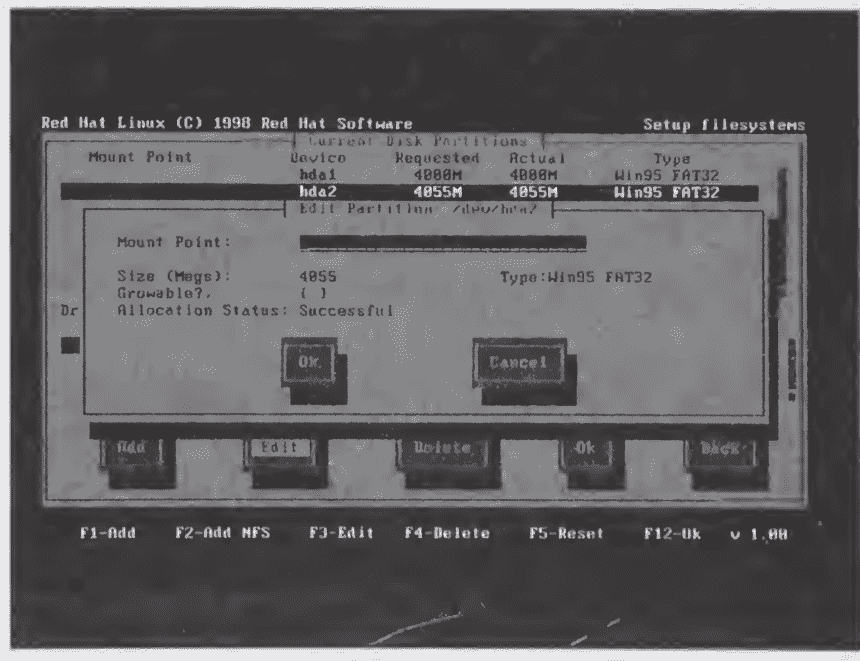

### 第 2 章

- 首次使用的命令

- 屏幕快速浏览

- 初始配置

- 账户和软件包

- 为 Microsoft Windows 和网络进行设置

- 添加打印机

## 首次登录

恭喜你，你已经安装了 Linux。现在你需要做一些配置来让系统运行起来。

你首先需要学习的是如何进入和退出 Linux。登录后，你可以输入命令，例如`startx`，它启动窗口系统，以及`halt`来关闭系统。

你还应该知道 Linux 带有一个名为 X Window 的窗口系统。X Window 系统高度模块化。在最底层，是服务器。它负责在屏幕上显示内容（也就是说，在屏幕中央绘制一个黑色矩形）。在此基础上是窗口管理器。它负责窗口的放置和外观。（它是系统中绘制标题栏和边框等部分。）最后，应用程序负责在窗口中放置内容。

在 Microsoft Windows 中，所有这些组件都是捆绑在一起的。在 Linux 中，它们是分开的，你可以配置系统以使用不同的窗口管理器，取决于你希望系统的外观。

默认情况下，Linux 安装了一个属于名为 GNOME 的软件包的窗口管理器。GNOME 是一套应用程序，全部设计为以一致的方式协同工作，以显示一个友好美观的桌面。

Linuxconf 帮助你配置系统。与 Microsoft Windows 不同，Linux 不会自动让你访问 CD-ROM。你必须"挂载"它。Linuxconf 工具让你可以做到这一点。你也可以挂载你的 Microsoft Windows 分区。（Linux 非常民主。它会读取其他操作系统的磁盘。）

Linux 只定义了一个真正的账户——系统管理员，root。root 账户是一个特权"超级用户"账户；正常的保护措施不适用于它。

有经验的 Linux 用户尽可能少地使用 root 账户。相反，他们为系统创建普通用户账户。这是因为如果你作为普通用户犯了错误，Linux 保护系统会阻止你造成太大的损害。另一方面，如果你作为 root 用户犯了错误，你可能会毁掉整个系统。

最后，Linux 使你能够以"原生"模式使用打印机，或者使用 PostScript 模拟器 Ghostscript。在原生模式下，你的打印作业直接发送到打印机。如果你决定使用 Ghostscript，打印系统接受 PostScript 数据并将其转换为原生格式进行打印。这个过程对你来说是透明的，因为打印系统会处理细节。就你而言，你有一台 PostScript 打印机。

### 首次使用的命令

如果你正确安装了 Linux，启动时你会看到 LILO: 提示符。这个程序允许你选择要启动的操作系统。输入`linux`来启动程序。

```
LILO boot: linux
```

当 Linux 启动时，它会显示大量的诊断和信息消息。这些对进行设备驱动程序或内核配置工作的人很有用。（参见第 17 章，该章讨论内核配置。）

短暂停顿后，Linux 启动并显示登录消息。输入账户名 root。（在此阶段，这是唯一有效的账户名。）系统会要求你输入密码。输入安装过程中设置的 root 密码。

接下来出现 root 提示符：

```
[root@ahostname /root]#
```

因为这个提示符会随着主机名和当前目录等因素而变化，我们在本书的示例中使用通用 root 提示符（#）。

#### 命令行生活

登录后，你会看到命令提示符。此时你可以输入命令（按 Enter 键）来执行它们。

例如命令：

```
# date
```

执行`date`命令。

此时有许多特殊字符可用。例如，Delete 键删除前一个字符。按 Ctrl+U 擦除整行。

Ctrl+D 键是文件结束（EOF）键。输入它会导致你注销。

还有一个需要记住的重要按键。Ctrl+C 键中止当前命令。这类似于 MS-DOS 的 Ctrl+Break 命令，并且工作更一致。

现在使用`startx`命令启动 X Window 系统。

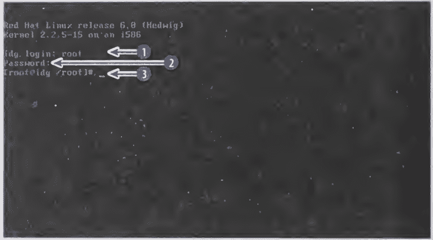

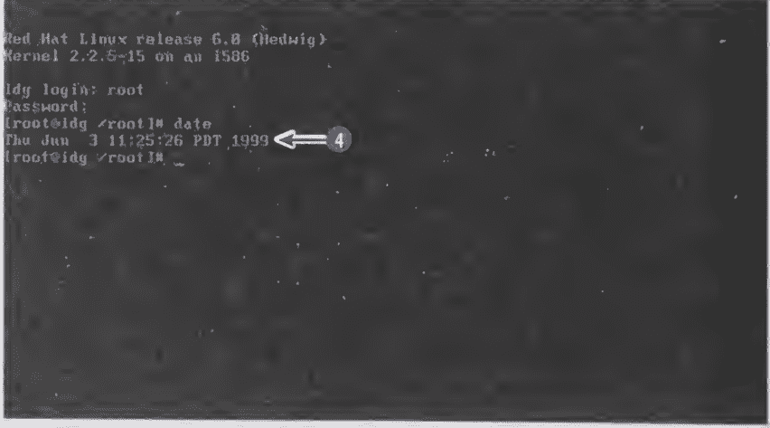

1. 输入账户名（root）。

2. 输入密码（它不会回显）。

3. 当提示符出现时，你可以输入`date`和`startx`等命令。

4. 输入`date`命令。

| 交叉参考 |
| --- |
| 第 7 章描述如何配置你的 Linux 系统，以便获得 X Window 登录而不是文本登录。 |

### 退出 X Window 系统

要退出 X Window 系统，选择 Foot 图标（左下角），然后选择 Log out 命令。（这实际上不会注销你；它会返回到命令模式。）

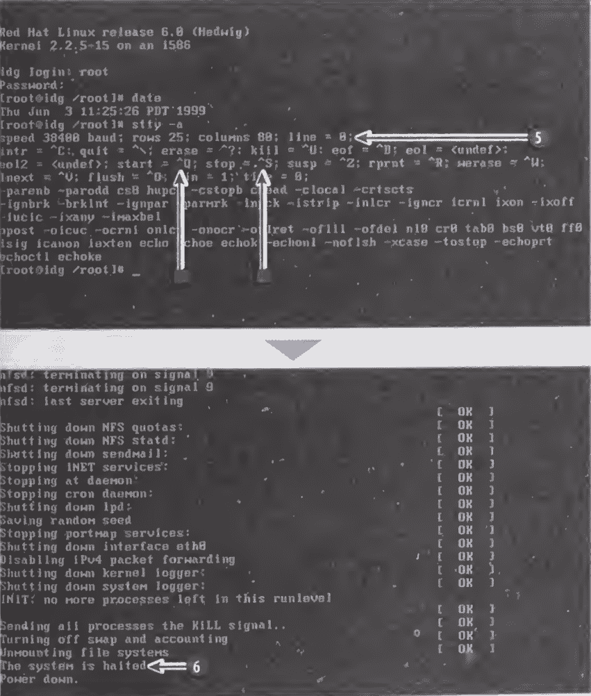

5. 输入`stty -a`显示终端设置。

   - Delete（^?）键擦除前一个字符。

   - Ctrl+U（^U）键擦除（杀死）一行。

6. `halt`命令以有序方式关闭系统，并以 System Halted 消息结束。

如果你卡住了，可以使用紧急退出，按 Ctrl+Alt+Backspace。

### 关机

要关闭系统，以 root 登录并执行命令：

```
# halt
```

要重新启动系统，以 root 登录并执行命令：

```
# reboot
```

#### 注意

### 为什么你应该关机

当 Linux 向磁盘写入数据时，数据实际上并不会立即写入驱动器。相反，它会进入内存缓冲区。一个名为`update`的守护进程会定期将数据刷新到磁盘。

当你关闭系统时，内存中的所有磁盘信息会在系统停止之前写入。如果你只是按重置按钮，这不会发生，数据会丢失。

另外，当你启动时，Linux 会检测到不正常的关机，并会经历一个漫长的过程来确保磁盘上的所有文件系统都没有问题。

### Linux 键名

Linux 使用插入符号（^）表示法来指示控制字符。例如，如果你看到"Type ^D to exit"，这意味着你应该按 Ctrl+D 退出程序。

还有一个特殊键。那就是 Delete 键。Linux 中此字符的表示法是`^?`。

## 屏幕快速浏览

使用`startx`命令启动 X Window 系统后，一个名为 GNOME 的桌面就会出现。屏幕底部是一个名为 GNOME 面板的工具栏，其中包含表 2-1 所述的工具。

另一个窗口包含 GNOME 帮助系统，它为您提供了一个超文本帮助系统，让您了解 GNOME 和 Linux 的相关信息。只需点击即可浏览帮助系统。

每个窗口顶部的标题栏包含多个图标，可让您对窗口进行操作。

### 应用程序窗口

工具栏上方的区域包含应用程序窗口。首次启动时，您会看到两个应用程序：文件管理器和 GNOME 帮助系统。文件管理器允许您查看和操作文件，其功能与 Microsoft Windows 的文件管理器非常相似。

- 点击页面按钮会弹出一个菜单，其中包含各种与窗口相关的命令。

- 点击最小化按钮可以让窗口缩小。

- 点击最大化按钮可以让窗口放大。

- 点击关闭按钮可以关闭窗口。

#### 表 2-1：GNOME 控制面板中的工具

| 工具 | 描述 |
| :--- | :--- |
| 显示/隐藏箭头 | 点击其中一个箭头，面板就会滑入屏幕侧边，只剩下一个箭头。再次点击箭头，面板就会滑出。 |
| GNOME 足迹 | 这是 GNOME 中相当于开始按钮的功能。它会弹出一组菜单，让您可以运行各种程序以及配置系统。 |
| 帮助按钮 | 帮助按钮启动一个帮助浏览器，让您可以访问 GNOME 帮助、Linux 手册页和 GNU 信息页。（更多信息请参阅第 4 章。） |
| GNOME 配置工具 | 此工具可让您更改 GNOME 桌面的工作方式。 |
| Netscape | 启动 Netscape 浏览器。 |
| 分页器 | GNOME 管理四个页面。每个页面都和您的屏幕一样大，因此您一次只能看到一个页面。目前，您正在查看第 1 页，即左上角的那一页。如果您点击分页器中其他四个大矩形中的一个，就会跳转到该页面。<br><br>您可能会注意到左上角的页面中有一些小矩形。这些代表当前显示在该页面上的窗口。 |
| 分页器信息箭头 | 按分页器信息箭头会显示每个页面及其上应用程序的列表。 |
| 分页器属性 | 点击此图标会弹出一个窗口，让您配置分页器。 |
| 应用程序列表 | 这是所有正在运行的应用程序的列表。点击某个应用程序即可跳转到它所在的页面，并使其成为活动应用程序。 |
| 日期/时间 | 显示当前日期和时间。 |

### 首次开始使用

#### 桌面图标

桌面上会出现许多图标。第一个图标是"主目录"。主目录是用户的顶级目录，包含用户的个人文件。它会打开一个指向您主目录的文件管理器。这些图标指向`http://www.redhat.com`：Red Hat 支持、Red Hat 勘误、Linux 文档和 GNOME 网站。这些都是指向网络上各个地方的快捷方式。双击其中任何一个快捷方式都会启动 Netscape 并指向给定的网页。

最后一个图标 CD-ROM 0 会挂载 CD-ROM 驱动器并启动一个文件浏览器，以便您查看驱动器的内容。

- 打开指向您主目录的文件浏览器。

- 指向网络上各种有用地方的快捷方式。

- 打开用于 CD-ROM 的文件管理器。

- 隐藏工具栏箭头。

- GNOME 中相当于开始按钮的功能。称为足迹按钮。

- 帮助。

- GNOME 配置工具包。

- 终端（打开一个包含终端仿真器的窗口）。

- Netscape。

- 分页器。

- 当前打开的窗口。

- 帮助窗口。

- 文件管理器。

- 通过选择足迹 ➢ 系统 ➢ LinuxConf 启动`Linuxconf`。

- 点击 Linuxconf 中的帮助图标以弹出帮助系统。

- 滚动到您想查看的手册页并点击它。（在此示例中，使用的是`bash`。）

### 初始配置

在此任务中，我们将完成使系统完全正常运行所需的初始配置任务。

#### 挂载 CD-ROM

第一步是挂载包含您的 Linux CD 的 CD-ROM 驱动器。这是访问该 CD 上信息和文件的必要步骤。您的 CD-ROM 驱动器将被挂载到`/mnt/cdrom`目录。

启动`Linuxconf`程序。点击足迹按钮，通过选择 Red Hat 菜单 ➢ 管理 ➢ Linuxconf 来启动。Linuxconf 启动后会显示一个欢迎屏幕。点击退出以关闭它。主配置窗口随即出现。左列列出了此工具执行的各种配置任务。向下滚动到文件系统，然后点击访问本地驱动器。

工具的右侧显示当前的文件系统。点击`/dev/cdrom`以显示卷规格窗口。

选择选项选项卡。取消设置启动时不挂载选项。如果需要，请选择用户可挂载选项。此选项允许任何用户挂载和卸载 CD-ROM。如果没有此选项，只有 root 才能执行挂载操作。

点击挂载以立即挂载 CD-ROM，然后点击接受以使更改永久生效。

点击退出以离开本地卷窗口。

#### 挂载 MS-DOS 分区

如果您有一个 Microsoft Windows/Linux 系统，您的 Linux 系统可以访问您的 Microsoft Windows 分区。您可以使用 Linux `Linuxconf ➢ 文件系统 ➢ 访问本地驱动器`工具来挂载 Microsoft Windows 分区。点击包含您的 Microsoft Windows 文件系统的分区。

1. 选择配置 ➢ 文件系统 ➢ 访问本地驱动器类别。

2. 选择您要配置的分区或设备。在本例中，它是 CD-ROM 设备（`/dev/cdrom`）。

3. 如果您希望任何用户都能挂载或卸载 CD-ROM，请设置用户可挂载。这使任何用户都有权更换 CD。

4. 清除启动时不挂载选项，以便在系统启动时自动挂载 CD-ROM 驱动器。

5. 点击接受以接受这些值。

### 首次开始使用


MS-DOS 文件系统的一个问题是文件归谁所有。Linux 在防止一个用户修改另一个用户的文件方面做得更好。Linux 允许您挂载 MS-DOS 文件系统，但您应该告诉它磁盘属于谁。为此，请点击 DOS 选项，并在默认用户 ID 中填写文件所有者的名称。您可能还需要填写默认组 ID。

Linux 和 MS-DOS 使用不同的行尾字符。如果您选择 ASCII 转换模式，Linux 会自动编辑您读取或写入的任何文件以纠正此问题。如果您使用二进制转换模式，则不会进行任何转换。在自动模式下，Linux 会根据文件的扩展名来决定是否进行转换。

### 提交更改

点击第一列底部的执行/更改按钮以实际进行更改。

在右侧面板中点击激活更改以应用更改。点击退出以退出 Linuxconf 实用程序。

#### 注意：行尾之谜

最早连接到计算机的 I/O 设备之一是一种称为电传打字机的打印机/键盘组合设备。电传打字机使用两个字符的组合（<回车><换行>）来结束一行。

当时计算机存储成本很高，人们发现如果只用一个字符作为行尾就可以省钱。不幸的是，各家制造商无法就保留哪个字符达成一致。UNIX 和 Linux 使用 <换行> 作为行尾字符。Apple 选择了 <回车>。MS-DOS 和 Microsoft Windows 则使用原来的 <回车><换行> 组合。

6. 如果您有 MS-DOS 分区，请选择它。

7. 提供有关该分区上文件所有者及权限的信息。代码 `0666` 授予每个人读写权限。

8. 将转换模式设置为二进制。

9. 点击接受。

10. 点击执行/更改以激活更改。

11. 点击激活更改以使更改生效。

## 账户与软件包

下一步是通过创建用户账户来定义你的身份，然后在系统中加载你想要使用的软件。

你需要为自己创建一个账户，这样你就可以安全地玩转 Linux，而不用担心删除任何重要内容。

向上滚动到“用户账户”项，选择 Normal ➩ User accounts。账户配置窗口会出现在右侧。

点击 Add 来创建一个新账户。现在填写账户的 Base info。在 Login name INCAR 空格中填写账户名。这个名字应该是全小写，不能有空格或特殊字符。

在 Full name 下方输入你的名和姓。

将 group name 留空。你的系统上还没有足够的账户，无法从组管理中获益。Supplementary groups 也留空。

home directory 是一个顶级目录，用于存储用户的所有文件。默认值为 `/home/account`。将其留空，因为默认值工作得很好。

Linux 允许您使用不同的命令解释器。本书使用的是 `Bourne Again Shell (bash)`，所以不要修改 Command interpreter。

User ID 也留空。

点击 `Accept` 按钮来创建账户。

配置程序会要求输入密码。输入该账户的初始密码，然后点击 `Accept`。现在再次输入密码，然后点击 `Accept`。

点击左侧的 `Act/Changes` 按钮来提交更改。点击 `Activate the Changes` 按钮来实际应用更改。点击 `Quit`（右侧的那个）退出 Linuxconf。

在安装过程中，你选择了默认的一套软件进行安装。这快捷又简单。既然 Linux 已经运行起来了，你可以添加你想要的软件，移除你不想要的软件。

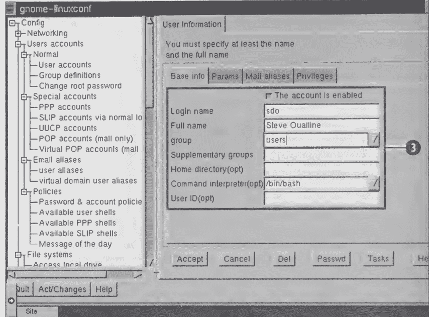

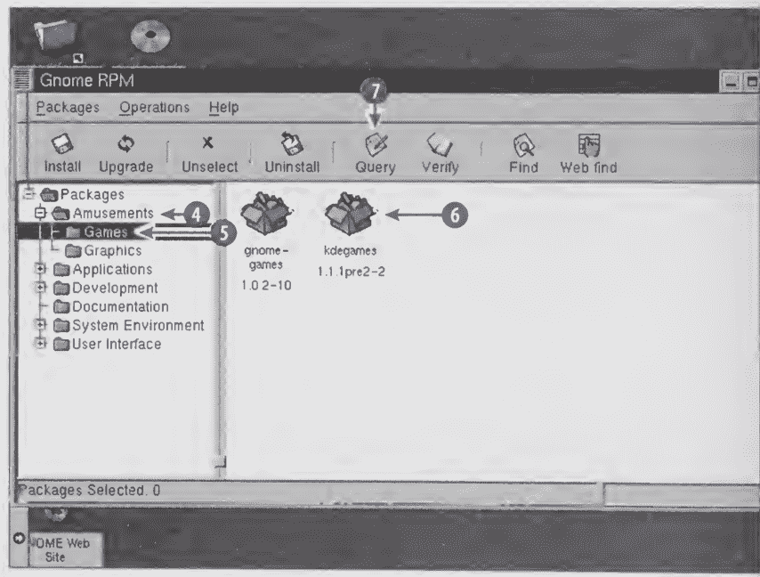

1. 选择 Config ➩ User accounts ➩ Normal ➩ User accounts。

2. 点击 `Add` 按钮添加新账户。

3. 输入账户信息。将 home directory 留空并选择一个 shell。将 user ID 留空（系统会为你选择一个合适的）。

4. 点击 Amusements 旁的 + 来展开它。

5. 选择 Games。当前已安装的软件包会显示出来。

6. 点击其中一个来选择。

7. 点击 `Query` 获取详细信息。

## 首次登录

软件以称为软件包（package）的捆绑形式提供。要启动软件包管理程序，选择 Foot ➩ System ➩ GnoRPM。软件包管理器会在左侧显示软件包类别列表。此列表仅限于已安装的软件包。如果要安装新软件包，需要点击 `Install` 来打开安装窗口。

接下来，点击 `Add` 来调出所有软件包的列表。选择你感兴趣的软件包，然后按 `Add`。继续选择和添加，直到获得所有你想要的软件包。

点击 `Close` 返回 Install 窗口。

如果你想了解更多关于某个软件包的信息，在 Install 窗口中选择它，然后点击 `Query`。

点击 `Install` 来实际安装软件包。

要移除软件包，使用 Gnome RPM 左侧的树形结构浏览软件包树，并从窗口右侧选择该软件包。

点击 `Uninstall` 移除软件包。

### 注意：什么是 RPM？

RPM 代表 Red Hat Package Manager（Red Hat 软件包管理器）。Red Hat Linux 附带的强大软件包管理系统是使 Red Hat Linux 发行版成为当今首屈一指的 Linux 发行版的主要特性之一。

它是 Red Hat 用于将相关命令分组在一起，使其易于安装、升级和移除的系统。Red Hat Package Manager 不仅仅用于安装和移除。它还可以用于构建和创建软件包。（更多内容可参见第 4 章。）

对 RPM 的完整讨论足以写成一本书，但稍加摸索，你就能自己发现这个工具的强大之处。

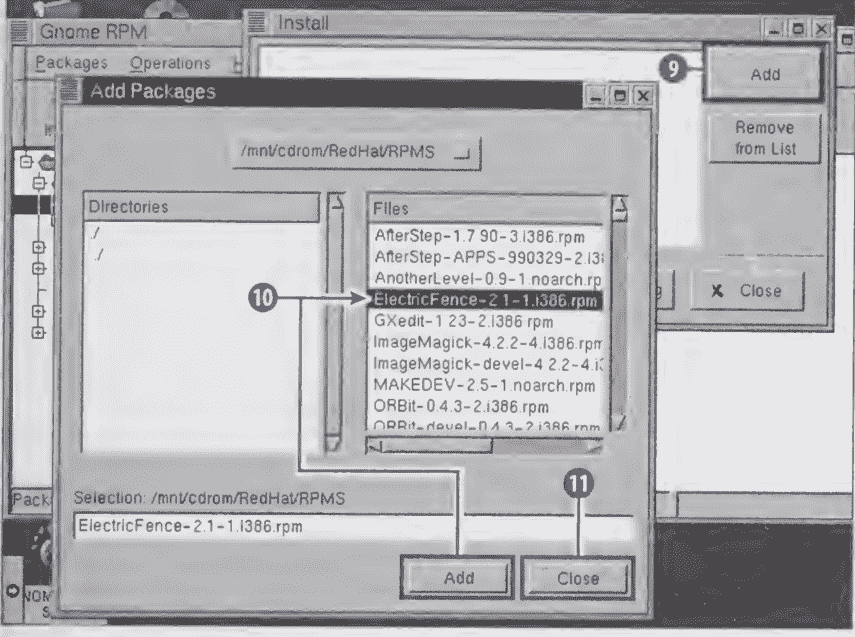


8. 在主窗口点击 `Install`。

9. 在 Install 窗口，点击 `Add`。

10. 选择要安装的软件包，然后点击 `Add`。

11. 完成后，点击 `Closed`。

12. 在 Install 窗口选择一个软件包进行查询。

13. 选择 `Query` 获取更多信息。

14. 完成后点击 `Close`。

### 为微软 Windows 和网络进行设置

本任务向你展示如何安装 LILO，以便能够从 Linux 或微软 Windows 启动。还告诉你如何设置网络以与外界通信。

#### 双启动

Linux 附带一个启动程序，知道如何启动微软 Windows 和 Linux。如果在第 1 章的安装过程中你保留了微软 Windows 分区，你仍然可以运行它。但首先你需要告诉 Linux 它仍然存在。

文件 `/etc/lilo.conf` 描述了硬盘上的操作系统。开始时，Linux 是该文件中唯一描述的操作系统。要让微软 Windows 工作，你需要编辑 `/etc/lilo.conf` 文件，将清单 2-1 中的文本添加到其末尾。

完成此更改后，以 root 身份运行命令：

```bash
# /sbin/lilo
```

这会更新你硬盘的启动扇区。下次启动时，你可以输入 `linux` 或 `dos`。（如果你在 50 秒内没有输入任何内容，Linux 将默认启动。）

#### 网络配置

Linux 与网络配合得很好。事实上，许多互联网服务提供商使用 Linux，正是因为其强大的网络功能。（如果你没有网卡，可以跳过本节。）

要配置网络，你需要启动 X Window 系统（如果尚未启动的话）。接下来，通过选择 Foot ➩ System ➩ LinuxConf 启动 Linuxconfig 程序。这会调出 Linux 配置工具。在待办事项列表中，选择 Client tasks ➩ Basic host information。你可能需要点击 + 号来展开 Config 和 Networking 类别。在 Host name 空格中输入主机的完整名称。

接下来，点击 `Adaptor 1` 选项卡来配置你的第一个网络接口。确保 `Enabled` 复选框已设置。

网卡需要 IP 地址才能工作。你有三种获取方式：

- **Manual** — 你告诉机器使用什么 IP 地址。如果你连接到外部网络，你从网络管理员那里获取这个地址。如果你在私有网络（不连接到互联网）上，可以使用为私有网络保留的地址 — `192.168.0.1` 到 `192.168.0.253`。

- **DHCP** — DHCP 代表 Dynamic Host Configuration Protocol（动态主机配置协议）。使用 DHCP，你的机器可以向 DHCP 服务器请求网络地址，服务器会提供该地址。你的网络管理员可以告诉你是否使用 DHCP。

- **BootP** — 代表 Boot Protocol（启动协议）。这是你的机器向主服务器请求地址的另一种方式。该协议正在被淘汰，所以仅在你需要与旧系统兼容时使用它。

### 添加打印机

启动打印机工具，方法是选择 Foot ➩ 系统 ➩ 控制面板。然后点击打印机图标。打印机工具出现。

点击添加按钮以创建新打印机。如果此打印机连接到您的计算机，请选择本地选项并点击确定。其他选项可让您连接到另一台 Linux/UNIX 机器（远程 Unix 队列）和 Microsoft Windows 共享打印机（局域网管理打印机）。由于远程打印机超出了本书的范围，我们假设打印机是本地的。

将出现一个信息屏幕，列出 Linux 检测到的并行打印机端口。MS-DOS 和 Linux 使用不同的名称和编号来表示打印机端口，如下所示：

| Linux | MS-DOS |
|---|---|
| `/dev/lp0` | `LPT1` |
| `/dev/lp1` | `LPT2` |
| `/dev/lp2` | `LPT3` |

下一个对话框让您定义和配置打印机。名称空白处让您为打印机定义一个名称。该名称在您发出 `lpr` 命令时使用。例如，命令：

```bash
$ lpr -Psam /etc/fstab
```

将文件打印到名为 `sam` 的打印机。（如果未指定名称，则使用名称 `lp`。）

单个打印机可以有多个名称。例如，您可能想用 `ps` 和 `postscript` 两个名称来命名您的 PostScript 打印机。如果在名称空白处放入多个名称，它们必须用竖线（`|`）分隔。（警告：此条目中不能有空格。）

假脱机目录是在文件等待打印时存储打印机文件的地方。按照惯例，这是 `/var/spool/lpd` 中的一个目录，其名称与打印机相同。（这样您就很容易记住 `/var/spool/lpd/ps` 中的文件是用于名为 `ps` 的打印机的。）

1. 点击 Foot ➩ 系统 ➩ 控制面板。

2. 双击打印机并选择添加。

3. 点击本地打印机，然后点击确定。

4. 文字上就是打印机的名称。如果您希望打印机有多个名称，请用竖线（`|`）分隔名称，但不要有空格。

5. 让这些选项保持默认。

6. 这是打印机设备。

7. 点击选择以选择打印机。

#### 串行打印机

串行打印机设置起来非常棘手。有许多配置参数（波特率、停止位、奇偶校验、流控制等）必须正确配置。更糟糕的是，配置是一个手动过程，涉及编辑 `/etc/printcap` 文件并放入正确的一组十六进制数。

换句话说，这真是一团糟。市面上有良好且便宜的并行打印机。请改用其中一种。

文件限制参数会导致 `lpr` 拒绝过大的文件。如果这是个人系统，请将此值保留为 0。（因此，如果您打印非常大的文件，只会浪费您自己的纸张。）

下一个空白处让您选择输入过滤器，它将文本和 PostScript 转换为打印机代码。点击选择以弹出一个对话框，让您为打印机选择正确的过滤器。

从左侧的滚动列表中选择您的打印机类型。您可以在右上角的驱动程序描述框中查看有关过滤器的信息。可以在分辨率、纸张尺寸和颜色深度框中设置打印机的选项。

某些打印机（主要是 PostScript 打印机）要求每个打印作业以 EOF（文件结束）字符结尾。如果您有这样的打印机，请设置发送 EOF 选项。

Linux 使用换行符，也称为换行，作为行结束字符。如果您将原始文本 Linux 文本文件直接发送到打印机：

```text
它会
      像这样
              打印
```

设置修复阶梯效应选项以纠正此问题。

在文本打印机上打印文本有两种方法。第一种是将文本发送到打印机（快速文本打印）。第二种是将其转换为 PostScript，将 PostScript 转换为图形，然后打印图形。这需要做很多工作，但它确实允许您在单个物理页面上打印多个文本文档页。由于 `mpage` 命令可以做到这一点（并且让您更好地控制该过程），请关闭此选项。

最后一个选项是抑制页眉。页眉是在打印作业开始时打印的单个页面，用于标识打印内容和打印者。对于个人系统，您不需要页眉，因此保持此设置不变。

一旦所有内容都定义完毕，点击确定以创建打印机。

8. 选择打印机类型和打印机特定选项。

9. 如果您有非 PostScript 打印机以原生模式打印文本，请选择此项。

10. 选择每输出页 1 页。（`mpage` 命令比此系统更好地处理多页。）选择任何其他打印机特定选项。

11. 点击确定以安装打印机。

## 个人练习册

### 问答

1. 您可以使用哪两个命令来关闭 Linux？

2. 如何启动窗口系统？

3. 在使用 CD-ROM 之前必须做什么？

4. Linux 可以读写 Microsoft Windows 分区吗？Microsoft Windows 可以读取 Linux 分区吗？

5. 什么是 root，为什么要避免使用它？

6. Linux 中相当于开始按钮的是什么？

7. 如何启动终端窗口？

8. 什么是分页器，如何使用它？

答案：第 333 页

### 额外练习

1. 以 root 用户身份登录并启动 X 窗口系统。

2. 创建一个供个人使用的用户。用它来登录并启动 X 窗口系统。

3. 查看 `/mnt/cdrom` 目录。执行 `ls /mnt/cdrom`。如果那里有文件，则您的 CD-ROM 已挂载。

4. 查看一些您已安装的软件包。

5. 检查一些尚未安装的软件包。

6. 在您的本地打印机上打印测试页。

### 实际应用

- Linux 附带了许多图形处理工具。这些可以安装，使 Linux 成为强大的图形处理引擎。Steve Oualline 使用它来存储和增强来自其数码相机的照片。

- Linux 附带 Apache Web 服务器。安装它，您就拥有了最便宜且最受欢迎的 Web 服务器系统之一。（它是 <http://www.oualline.com> 背后的服务器。）

- Linux 可以配置为 NFS、Novell 或 Microsoft Windows 网络的文件服务器。（不被对销售自己的网络“解决方案”感兴趣的公司所控制，这是有优势的。）

#### 视觉测验

如何为左侧名为 Steve Oualline、账户名为 `steveo` 的用户填写空白？

# 第 3 章：掌握这些技能

- 浏览目录
- Linux 命令行
- 列出文件
- 复制、移动和删除文件
- 使用 More 和 Less 查看文件
- 查找和控制文件
- 获取系统信息
- `bash` Shell
- Shell 脚本 —— 快速入门
- Shell 启动文件

## Linux 命令与 Shell

Linux 从其 UNIX 根源构建而成，严重依赖命令行。即使讨论了第 7 章中的图形界面，Linux 仍然需要许多操作从命令行完成。


对命令行和状态行的需求，以及一组晦涩的 UNIX 命令（例如用`cp`代替`copy`这样的名称），导致许多人认为 Linux 和 UNIX 难以使用。现在，这并不像您想象的那么糟糕。强大的命令行使您能够比图形环境更轻松地执行更难的任务。例如，如果您想将所有以`.c`、`.cc`和`.h`结尾的文件备份到软盘，命令行比图形用户界面中选择所有这些文件要容易得多。即使在 Macintosh 上，这是一个领先的图形环境，Macintosh Programmer's Workbench 开发者包也为 Mac OS 环境添加了命令行，正是因为许多任务，尤其是软件开发，使用命令行工作效果更好。命令行还使您能够将任务批处理在一起，自动化常见命令。这种类型的设置在图形系统下通常更难设置，在那里您只能使用宏来模拟鼠标点击和菜单选择。

虽然许多任务需要使用命令行，但 Linux 并没有将您锁定在单一的命令行类型中。运行功能有限的 MS-DOS 提示窗口的 Windows 用户会感到惊讶，Linux 支持许多不同的命令环境，这些环境称为`shell`。大多数 Linux shell 提供比任何 MS-DOS 提示窗口更多的功能，并让您自由选择喜欢的 shell。这些 shell 包括脚本语言，使您能够自动化许多任务。而且，与 DOS 批处理文件不同，这些脚本语言提供了丰富的功能集。

Shell 读取您输入的命令，然后执行这些命令。诀窍在于，Linux 支持丰富的命令集以及实用的概念，如输入重定向和通配符。

本章将探讨命令行以及您需要了解的内容以增强您的 Linux 体验。它涵盖了 Linux 命令的组成、`bash` shell 以及最常见的命令行命令。

## 导航目录

Linux 大量借鉴了其 UNIX 的传统。尽管 Linux 并非基于任何 UNIX 源代码，但 Linux 支持大多数关键的 UNIX 概念，包括目录的概念。

整个 Linux 文件系统基于`目录`，即文件的容器。`根目录`位于整个文件系统的最顶层。Linux 能够识别的所有文件都位于根目录之下的某个位置，大多在子目录中。`子目录`只是另一个目录内部的目录。你可以在子目录中嵌套子目录，以此类推。

与 UNIX 一样，Linux 使用正斜杠（`/`）作为目录分隔符。Linux 用单个斜杠`/`表示根目录。因此，目录名`/usr/bin`表示 usr 是根目录`/`的子目录。而 bin 目录又是`/usr`的子目录。在这里你也可以看到 Linux 的缩写习惯。"usr" 是 "user" 的缩写，"bin" 是 "binaries"（二进制文件）的缩写。`/usr/bin`目录包含二进制文件，即应用程序。对面的表格显示了一些常见的 Linux 目录及其内容。

除了`/usr/bin`等系统目录外，你还有自己的目录，专门用于存放你的工作。每次登录时，你都会发现自己位于主目录中。要查看哪个目录是你的主目录，输入`pwd`命令，它是 print working directory（打印工作目录，即当前目录）的缩写：

```bash
$ pwd
```

你会看到类似下面的响应：

```text
/home/erc
```

名为`HOME`的环境变量也保存着你的目录名称：

```bash
$ echo $HOME
/home/erc
```

要切换到不同的目录，使用`cd`命令：

```bash
$ cd /home
```

你可以通过再次输入`pwd`命令来验证`cd`命令是否生效：

```bash
$ pwd
/home
```

在 Linux 目录中导航时，你还可以利用一些快捷名称。当前目录的快捷名称是一个点`.`。父目录，即上一级目录的快捷方式是两个点`..`。所以，要切换到上一级目录，你可以使用以下命令：

```bash
$ cd ..
```

当你到达最顶层目录（`/`）时，就无法再向上了。Linux 坚持所有文件、目录以及其他一切作为文件存在的东西都必须出现在根目录下。这与 Windows 截然不同，在 Windows 中，每个驱动器（如 C: 或 D:）都有自己的根目录，即`\`。Linux 只有一个根目录。即便如此，Linux 显然支持多个硬盘。

在 Linux 中，你将硬盘挂载到从`/`开始的文件树中的某个位置。你挂载磁盘的位置称为`挂载点`。例如，你可能有两个硬盘。你可能用一个来存放用户主目录，并希望将该磁盘挂载到`/home`。在这种情况下，从`/home`开始及其所有子目录（如`/home/fred`和`/home/barney`）都由第二个硬盘接管。第一个硬盘则存放所有其他文件，即所有不在`/home`下的内容。

### 交叉参考

第 2 章介绍了如何创建用户账户。

### 在线查找

有关使用目录的更多信息，请参见`http://www.mathcs.duq.edu/unixhelp/tasks/index.html`。

---

### 注意事项

#### 创建目录

你可以使用`mkdir`命令创建目录，它是 make directory 的缩写：

```bash
$ mkdir reports
```

在这个例子中，该命令在当前位置下创建一个名为`reports`的子目录。你也可以使用完整路径名来创建目录，例如：

```bash
$ mkdir /home/erc/reports
```

#### 返回主目录

要返回主目录，单独使用`cd`命令，或使用`~`快捷方式：

```bash
$ cd ~
```

#### `/`与`\`

Linux 和 UNIX 使用正斜杠（`/`）来分隔目录，而 Windows 使用反斜杠（`\`）。虽然很容易混淆这两种斜杠，但请记住反斜杠在 Linux 中有特殊含义，所以通常会告诉操作系统执行一些你意想不到的操作。

#### C: 盘在哪里

Microsoft Windows 为每个磁盘驱动器分配一个字母（A、B、C 等）。这意味着作为用户，你必须知道自己位于哪个磁盘上。

Linux 向你隐藏了这些信息。所有磁盘都通过`mount`命令无缝集成到文件系统中。因此普通用户无需了解自己正在使用哪个磁盘。优秀的系统管理员甚至可以在不改变任何文件名的情况下向系统添加磁盘。试试在 Windows 98 上这么做吧！

## 表 3-1：Linux 系统目录

| 目录 | 存放内容 |
|---|---|
| `/` | 根目录。 |
| `/bin` | （二进制）命令，基本命令。 |
| `/boot` | LILO 引导加载程序使用。 |
| `/dev` | 代表设备的文件，如调制解调器。 |
| `/dosc` | 挂载 MS-DOS C: 盘的常见位置。 |
| `/etc` | 配置文件。 |
| `/home/fred` | 用户 fred 的主目录。 |
| `/lib` | 预构建例程库，包括共享库；还包括内核模块。 |
| `/mnt` | 预留用于挂载磁盘和磁带等设备的目录。 |
| `/mnt/cdrom` | 挂载 CD-ROM 的默认位置。 |
| `/root` | root 用户的主目录。 |
| `/sbin` | 系统二进制文件，由 root 或在系统启动时运行的程序。 |
| `/tmp` | 临时存储。 |
| `/usr` | 通常包含属于操作系统一部分的命令和支持文件。升级会改变`/usr`下的文件。 |
| `/usr/bin` | （二进制）命令。 |
| `/usr/doc` | 在线文档。 |
| `/usr/include` | C 编程包含（头）文件。 |
| `/usr/local` | 供你存储"本地"到站点的命令的位置。 |
| `/usr/local/bin` | 本地应用程序。 |
| `/usr/man` | 在线手册。 |
| `/var` | 系统日志文件以及系统运行时发生变化的内容。（其他系统目录中的文件预计不会经常改变。） |

## Linux 命令行

我们已经讨论了几个 Linux 命令，如`mkdir`和`pwd`。不过，现在是时候解释 Linux 命令行了。基本的 Linux 命令行格式如下：

```text
command options parameters
```

命令行以命令开头，如`mkdir`。在命令之后，有一组修改命令行为的选项。最后，有若干参数。由于大多数命令处理文件，因此参数通常是文件或目录名称。例如，下面的命令行有两个部分：

```bash
$ mkdir reports
```

laravel命令是`mkdir`，参数是`reports`，即在此情况下要创建的目录名称。

你可以使用通配符扩展参数。`通配符`使你能够指定想要匹配特定模式的所有文件。例如，下面的通配符请求所有以`.txt`结尾的文件：`*.txt`。星号`*`表示`.txt`之前的任何文本，或者没有。因此，以下文件名都匹配该模式：`report1.txt`、`Fred.txt`、`.txt`和`Organization.2001.txt`。

UNIX 和 Linux 的理念是让许多小命令各自执行单一任务。完成工作的方式是将这些小命令组合成强大的集合。为此，大多数 Linux 命令接受所谓的`标准输入`，通常是键盘。大多数 Linux 命令将输出发送到标准输出，默认是屏幕。Linux 更进一步，提供了重定向程序输入和输出的能力。

例如，`cat`命令只是将文件连接并发送结果到标准输出。你可以将多个文件连接在一起，并将输出重定向到一个文件。然后该文件将保存所有输入文件的完整内容。例如：

```bash
$ cat report1.txt report2.txt > report.bak
```

该命令将`report1.txt`和`report2.txt`连接起来，并将内容存储到输出文件`report.bak`中。

同样，你也可以重定向命令的输入。使用类似下面的语法：

```text
command < inputfile
```

要结合输出重定向，使用以下语法：

```text
command < inputfile > outputfile
```

你也可以利用通配符：

```bash
$ cat *.txt > report.bak
```

这会抓取所有以`.txt`结尾的文件，并将它们连接成输出文件`report.bak`。不过要注意，不要将输出重定向到传给`cat`的文件名之一。例如，下面的命令首先清空文件 a，然后将空的 a 和 b 文件连接，并将输出重定向到 a：

```bash
$ cat a b > a
```

正常重定向将命令的输出发送到文件，或从文件读取输入。管道扩展了这一功能，使你能够将一个命令的输出作为另一个命令的输入。要表示管道，使用`|`键，在 Linux 中称为`管道`键：

```bash
$ cat report1.txt | spell
```

该命令行将`cat`命令的输出发送到`spell`命令的输入。然后你应该会看到`spell`命令的输出，即拼写错误的单词列表，发送到屏幕上。你也可以重定向这个输出：

```bash
$ cat report1.txt | spell > badwords.txt
```

### 注意

#### 使用`>`重定向会清空输出文件

当使用`>`将 output of a command（命令的输出）发送到文件时，执行该命令会删除输出文件中任何先前的内容。若要保留输出文件的原始内容，请使用`>>`代替`>`。例如：

```bash
$ cat report*.txt >> report.backup
```

该命令保留`report.backup`中现有的所有内容。

#### 使用更具体的通配符

有时，您需要使用更具体的通配符，以避免匹配过多的文件。例如：

```bash
$ cat report*.txt > report.backup
```

这仅匹配以`report`开头并以`.txt`结尾的文件。

#### 在后台运行命令

您可以在命令后使用`&`符号（`&`）在后台运行命令。例如：

```bash
$ xclock &
```

这会在后台运行`xclock`命令，不会占用您的提示符，以便您可以立即开始输入其他命令。

#### 重定向错误

错误会发送到标准错误（standard error），与标准输出类似，默认情况下会显示在屏幕上。错误被故意分离出来，这样当您将输出重定向到文件时，仍然可以看到任何错误。如果您想重定向错误，请在`bash`中使用以下语法：

```text
command 2> error_file
```

## 表 3-2：输入和输出重定向

| 命令 | 操作 |
|---|---|
| `command > filename` | 将`command`的输出重定向到`filename`；首先截断`filename`。 |
| `command < filename` | 将`command`的输入重定向为来自`filename`。 |
| `command >>> filename` | 将`command`的输出追加到`filename`，不先截断`filename`。 |
| `command < file1 > file2` | 将`command`的输入从`file1`重定向，并将输出发送到`file2`，首先截断`file2`。 |
| `command \| command2` | 将`command`的输出发送（管道传输）给`command2`作为输入。 |
| `command 2> filename` | 在 bash 中将错误发送到`filename`。 |

## 表 3-3：通配符示例

| 通配符 | 匹配 |
|---|---|
| `*` | 任何文本 |
| `*.txt` | 任何以`.txt`结尾的文本。 |
| `A*.txt` | 任何以 A 开头并以`.txt`结尾的文本。 |
| `[A-X]*.txt` | 任何以大写字母 A 到 X（不包括 Y 和 Z）开头并以`.txt`结尾的文本。 |
| `report*.txt` | 所有以`report`开头并以`.txt`结尾的文件。 |
| `?` | 任何单个字符。 |
| `??` | 任何两个字符，`???`匹配任何三个字符，依此类推。 |

## 列出文件

绝大多数 Linux 命令处理的是文件。这很恰当，因为 Linux——与其渊源颇深的 UNIX 一样——将大多数事物抽象为文件。在 Linux 中，目录是文件，打印机是文件，软盘是文件，声卡设备也是文件。Linux 允许您将大多数设备视为文件。因此，您会看到很多处理文件的命令。

处理文件的主要任务之一就是列出它们。在 Linux 上，通用`ls`命令——list（列出）的缩写——提供此功能。要列出当前目录中的文件，请键入`ls`：

```text
$ ls
lmchat.txt  note.c        propsend.c  wind.txt
Makefile    primary.c   propstr.c
```

默认情况下，`ls`根据字符的值对文件进行排序。这意味着大写字母排在小写字母之前，而数字排在任何字母之前。

`ls`支持许多选项来控制其显示当前目录中文件的方式，详见对面页面的示例。

为了帮助 DOS 用户迁移到 Linux，您可以运行`dir`和`vdir`命令。`vdir`的作用类似于带有`-l`选项的`ls`命令：

```text
$ vdir
drwxrwxr-x  3 erc  erc  1024  Apr 17 11:41
  tylin
-rw-rw-r--  1 erc  erc  1502  Apr 14 20:13
  ch3.txt
```

`dir`命令的作用更像`ls`：

```text
$ dir
lmchat.txt  note.c        propsend.c  wind.txt
    Makefile  primary.c  propstr.c
```

### 注意

#### `LS`类似于 DOS 的`DIR`命令

您可以使用此处介绍的`dir`和`vdir`命令，或者，如果这些命令的行为不符合您的喜好，可以为`dir`设置别名来调用`ls`命令。有关别名的更多信息，请参阅本章末尾的"The bash Shell"。

#### 隐藏文件

以句点开头的文件名被视为隐藏文件。大多数 Linux 工具在列出、复制等操作时会跳过这些文件。这些文件包括应用程序配置文件，例如直接影响到`bash` shell 的启动文件`.bashrc`、用简写`.`标识的当前目录，以及用`..`简写标识的父目录。

#### 句点无限制

在 DOS FAT 文件系统下，文件名中只能有一个句点，表示文件的扩展名。在 Linux 中，没有此类限制，因此文件名可以包含多个句点，例如`2001.Jan.4.report.txt`。

#### 文件名中不要使用空格

不要在文件名中使用空格或其他在命令行中使用的字符。最好避免在文件名中使用`*`、`&`、`-`、`#`、`!`、`$`、`(`、`)`、`[`、`]`、`<`、`>`、`;`、`"`、`'`、`|`、`?`、`/`以及前导的`-`。您不能在文件名中使用`/`或`\0`（空字符）。

### 交叉参考

本章后面的"查找和控制文件"部分将介绍文件权限。

## Linux 命令与 Shell

### 第 3 章

#### 清单 3-1：单列列出

```bash
$ ls -1
lmchat.txt
Makefile
note.c
```

> `-1`（数字 1，不是字母 l）选项告诉`ls`只输出一列。

#### 清单 3-2：列出目录

```bash
$ ls /tmp
ldd.out.18955 nscomm40-erc/ winselection
```

> 您可以将目录名传递给`ls`以列出该目录。

#### 清单 3-3：列出所有文件

```bash
$ ls -a
.	Makefile	prosend.c
..	note.c	propirrel-evdev.c
```

> 默认情况下，`ls`会跳过"隐藏"文件，即任何以句点开头的文件名。

#### 清单 3-4：详细列出

```bash
$ ls -al
total 3
drwxr-xr-x 2 erc eng 1024 Apr 6 20:11 .
drwxr-xr-x 3 erc eng 1024 Apr 6 20:17 ..
-rw-r--r-- 1 erc eng 5872 Apr 6 20:04 lmchat.txt
```


> 使用 `-l`（字母 l）或长格式选项，这将从左到右显示：文件权限、指向该文件的链接数（通常目录比普通文件多）、所有者名称、组名称、文件大小（以字节为单位）、文件最后修改时间，以及文件名。

## 清单 3-5：获取更多信息

```bash
$ ls -CF
chap3/ eman* ~chap3.txt
chap3.txt fifo|
```

> `-F` 选项会在每个目录的文件名后显示 `/`，可执行文件显示 `*`，FIFO（先进先出特殊文件）后显示 `|`。它还会为链接显示 `@`，为套接字显示 `=`。

## 清单 3-6：列出最古老的文件

```bash
$ ls -rt
chap3 eman fifoin chap3.txt
```

> 通过组合 `-r`（反向排序）和 `-t`（按最后修改时间排序），您可以先列出最古老的文件。这在需要清理硬盘并想找出最旧的文件进行删除时非常有用。

### 复制、移动和删除文件

除了列出文件之外，最常见的操作是复制、移动和删除文件。

要复制文件，请使用 `cp` 命令。基本语法如下：

```bash
cp source destination
```

例如：

```bash
$ cp report.txt report.bak
```

您还可以使用通配符复制多个文件。在这种情况下，目标必须是目录：

```bash
$ cp report*.txt backup_dir
```

要移动文件，请使用 `mv` 命令：

```bash
mv source destination
```

您还可以使用 `mv` 重命名文件。

```bash
$ mv oldname.txt newname.txt
```

如果您输入如下命令：

```bash
$ mv fred barney
```

`mv` 命令会 happily 抹掉原来的 barney（如果之前存在该名称的文件），并用新的 barney（即原来的 fred）替换它。使用 `-b` 选项，`mv` 会在抹掉 barney 之前制作一份备份副本。备份文件将具有相同的名称，末尾加上 `~`，例如 `barney~`。

要删除文件，请使用 `rm` 命令，remove（删除）的缩写。（您是否觉得这些命令的设计者讨厌元音字母？）基本的 `rm` 语法是：

```bash
rm files_to_delete
```

例如：

```bash
$ rm *.txt
```

为避免意外删除文件，您可以将 `-i` 选项（interactive 的缩写，即交互式）与 `rm` 一起使用，如对面页面所示。使用 `-i` 时，`rm` 会要求您确认是否删除每个文件。`mv` 和 `cp` 命令也支持 `-i` 选项。有关如何设置别名以始终使用 `-i` 选项，请参阅本章后面的"The bash Shell"。

`rm` 的 `-r` 选项告诉它递归遍历子目录并删除所有文件和子目录。通常，没有 `-r` 选项，`rm` 不会删除目录。请改用 `rmdir`。

`rm` 的 `-f` 选项（force 的缩写，即强制）会覆盖 `-i` 选项，因此 `rm` 不会要求您确认要删除的每个文件。

#### 注意

#### 删除文件是永久性的

没有 `undelete`（恢复删除）命令。当您删除文件时，它就消失了。

#### 没有 `RENAME` 命令

没有专门的命令来重命名现有文件；请改用 `mv`。

#### 使用 `RM` 命令和通配符时要小心

使用 `rm` 搭配通配符时要小心。一个简单的错误可能会导致删除所有文件。例如，要删除所有以 `.txt` 结尾的文件，您可以使用如下命令：

```bash
$ rm *.txt
```

如果您不小心输入了空格，可能会删除比预期多得多的文件。例如：

```bash
$ rm * .txt
```

会删除当前目录中用 `*` 匹配的所有文件，以及一个名为 `.txt` 的文件，这是一个不太可能的名称。为避免错误，在使用通配符时请始终使用 `rm -i`。

#### 交叉参考

本章前面的"导航目录"部分讨论了创建目录。

## 清单 3-7：递归复制文件

```bash
$ cp -r /usr/local/java /backup/java
```

`-r` 选项告诉 `cp` 复制源文件及所有子目录；通常你会用这个选项传递一个目录名。

## 清单 3-8：使用 `MV` 创建备份文件

```bash
$ mv -b fred barney
$ ls barney*
barney  barney~
```

使用 `-b`（即 backup，备份）选项，`mv` 会在替换任何文件之前创建该文件的备份副本。

## 清单 3-9：移动多个文件

```bash
$ mv b* ../backup
```

你可以配合 `mv` 使用通配符来一次移动多个文件。在这种情况下，目标必须是一个目录。

## 清单 3-10：使用 `RM` 删除文件前进行确认

```bash
$ rm -i *.txt
rm: remove `barney.txt'? y
rm: remove `fred.txt'? n
$ ls *.txt
fred.txt
```

为了避免误删文件，请使用 `rm` 的 `-i` 选项（interactive，交互式的缩写）。实际上，我们建议你为 `rm -i` 设置别名。请注意，在这个示例中，我们没有删除文件 `fred.txt`。

## 清单 3-11：强制删除

```bash
$ rm -if *.txt
```

`-f` 选项会强制删除，即使你也指定了 `-i` 选项。

## 清单 3-12：删除目录及其中的所有文件

```bash
$ rm -rf tmp
```

`-r` 选项表示递归删除，这是让 `rm` 删除目录的方法。（GNU `rm` 命令的 `-d` 选项也可以删除目录。）该命令会删除 `tmp` 目录以及其中包含的所有文件和子目录。`-f` 选项会强制 `rm` 删除文件而不再询问。

## 清单 3-13：删除包含文件的目录

`rmdir` 命令可以删除目录，但前提是目录必须为空。注意要留意以句点开头的隐藏文件。

#### 在线查找

如需有关复制及其他基本命令的帮助，请参阅 <http://www.mathcs.duq.edu/unixhelp/tasks/files.html>。

### 使用 `More` 和 `Less` 查看文件

由于 Linux 在很多方面都使用文本文件，因此你经常需要查看文件内容。前面提到的 `cat` 命令是查看文件的一种方式。使用 `cat` 时，文件内容会直接输出到屏幕上。对于较长的文件，内容会以极快的速度滚过屏幕。因此，除非文件相对较小，否则查看文件时最好跳过 `cat`。

虽然你总是可以用文本编辑器打开文件，但有时启动一个像 `more` 或 `less` 那样小巧快速的程序会更加方便。

`more` 程序每次显示一屏内容。按空格键可以向前翻一页，显示更多内容——明白这个名字的含义了吧？按回车键可以向前移动一行。输入 `q` 退出 `more`。当你到达要查看的文件末尾时，`more` 也会自动退出。

你可以通过在命令行中传递多个文件给 `more`。`more` 会逐屏显示每个文件的内容。输入 `:n` 跳到下一个文件。

你可以在 `more` 中搜索，使用 `/`，即 `vi` 的搜索命令。输入 `/` 以及你要搜索的文本。例如：

```text
/eth0
```

这告诉 `more` 搜索文本 `eth0`。请注意，如果 `more` 找不到你要搜索的文本，它会退出。

一个更友好的程序叫做 `less`，这是对 `more` 的双关语。总的来说，`less` 的工作方式与 `more` 类似，但有一个巨大的优势：你可以在文件中向后浏览，而不仅仅是向前。在 `less` 中输入 `U` 向上翻半屏，输入 `D` 向下翻半屏；`W` 向上翻一整屏，`Z` 向下翻一整屏。按空格键向前翻页；`F` 也可以起到同样的作用。

`less` 与 `more` 的主要区别之一是，当它到达末尾时

## Linux 命令与 Shell

## 清单 3-14：使用 `MORE` 查看文件

```text
$ more intro.txt
The Linux Phenomenon

All in all, Linux means freedom. You are
free to choose the hardware you want to
run. You are free to choose the Linux
distribution you want to run. You are
--More--(4%)
```

当 `more` 显示满一屏数据时，会显示 `--More--` 提示符。按空格键或 `F` 键向前翻页。

## 清单 3-15：将命令输出通过管道传给 `MORE`

```text
$ dmesg | more
Memory: sized by int13 0e801h
Console: 16 point font, 400 scans
Console: color VGA+ 80x25, 1 virtual
console (max 63)
Probing PCI hardware.
Memory: 127776k/131072k available (748k
--More--
```

你可以将命令的输出通过管道传给 `more` 或 `less`。

## 清单 3-16：使用 `MORE` 查看多个文件

```text
$ more chap3*.txt
::::::::::::::
chap3a.txt
::::::::::::::

Filename Completion

To work with filename completion, type in
a command as you normally would. As you
--More--(16%)
```

当你用 `more`（或 `less`）查看多个文件时，程序会在开始显示每个文件时列出其文件名，此例中为 `chap3a.txt`。

## 清单 3-17：使用 `LESS` 查看文件

```text
$ less intro.txt
The Linux Phenomenon

All in all, Linux means freedom. You are
free to choose the hardware you want to
run. You are free to choose the Linux
distribution you want to run. You are
:
```

使用 `less`，你可以向后浏览。这在查看在线信息时非常有用。`less` 只显示一个 `:` 作为提示符。按空格键或 `F` 键向前翻页，按 `B` 或 `U` 键向后翻页。

#### 在线查找

如需了解更多关于 `vi` 的信息，请参阅 <http://www.cs.vu.nl/~tmgil/vi.html>。

### 查找和控制文件

要搜索文件，请使用 `find` 命令。找到文件后，你可能需要控制对这些文件的访问权限。

#### 查找文件

`find` 命令从某个目录（包括根目录）开始向下搜索，查找符合特定条件的文件。对于找到的每个文件，`find` 都会执行一个动作。例如，最简单的 `find` 命令之一就是：

```bash
$ find / -type f -name core -print
```

该命令告诉 `find` 从根目录（`/`）开始搜索，查找名为 `core` 的文件。（`core` 这个名字通常意味着某个程序崩溃了，并输出一个可能很大的核心转储调试文件。在 `/usr/src` 下至少有一个条目是 `core` 这个词的有效用法。）`-name core` 部分是 `find` 对它找到的每个文件执行的测试。最后，`-print` 动作告诉 `find` 打印出所有通过测试的文件名。（严格来说，`-print` 并不是必需的。）

`whereis` 命令也有助于查找文件：

```bash
$ whereis fvwm
fvwm: /usr/X11R6/bin/fvwm /usr/bin/X11/fvwm
```

找到文件后，你可能想要搜索文件内容。为此，请使用 `grep` 命令，它是 globally search for regular expression and print（全局搜索正则表达式并打印）的缩写，或者只是 general regular expression parser（通用正则表达式解析器）。`grep` 会搜索文件，并打印出与特定模式匹配的文本行。例如：

```bash
$ grep find *.txt
chap3f.txt:use the find command.
```

在这种情况下，`grep` 搜索所有以 `.txt` 结尾的文件，查找文本 `find`。`grep` 查找任何匹配的字符串，因此 `find`、`finding` 和 `finder` 都能匹配，但 `Find` 不行。（`-i` 选项告诉 `grep` 忽略大小写。）

你可以让 `grep` 搜索的内容不仅仅是单词。`grep` 支持一种模式语言，使你能够使用正则表达式来控制搜索。例如，模式 `[fRk]ind` 告诉 `grep` 搜索所有以 `f`、`R` 或 `k` 开头并以 `ind` 结尾的文本。因此，`find`、`Rind`、`finder` 和 `kinder` 都会匹配。

#### 控制文件

UNIX 文件支持三种权限类型：读、写和执行。拥有某文件读权限的用户，顾名思义，可以读取该文件。拥有写权限，你可以修改或删除文件。执行权限比较特殊。如果标记了此权限，该文件将被视为可执行命令，本章后面的"Shell 脚本——快速入门"部分将对此进行介绍。对于目录而言，执行权限意味着你可以使用 `cd` 命令将该目录设为当前目录。

每个文件都有三组这样的权限。这三组权限分别适用于文件的所有者用户、用户组以及所有其他人——即系统上的所有用户。例如，`groups` 可以让会计部门的所有人员访问某些文件，同时阻止所有工程师访问。

要控制文件权限，请使用 `chmod` 命令。该命令可以接受数字参数，或者使用更容易记忆的符号名称。下一页展示了 `chmod` 的示例。

#### 注意事项

##### 无需使用 `-PRINT`

Linux 上使用的 GNU 版本 `find` 不需要 `-print` 选项。由于大多数 UNIX 版本的 `find` 确实需要 `-print`，因此你现在就可以开始训练自己的手指了。

#### 交叉参考

关于正则表达式的一本优秀著作是 Jeffrey E.F. Friedl 所著的 *Mastering Regular Expressions*。请参阅附录 B。

```text
$ find / -name core -print
find: /etc/uucp: Permission denied
find: /var/spool/at: Permission denied
find: /var/spool/cron: Permission denied
/proc/sys/net/core
find: /root: Permission denied
find: /usr/doc/dhcpcd-0.70: Permission denied
find: /usr/doc/procps-1.2.9: Permission denied
/usr/lib/rhs/control-panel/core
/usr/src/linux-2.0.36/net/core
```

查找名为 core 的文件。错误信息表示你没有权限查看某些目录。

## 清单 3-19：以数字方式设置权限

```bash
$ chmod 666 barney
```

这给予所有用户对该文件的读写权限。将表 3-4 中的八进制值相加：400 表示所有者可以读取，200 表示所有者可以写入，40 表示组成员可以读取，20 表示组成员可以写入，4 表示其他所有用户可以读取，2 表示其他所有用户可以写入。将它们相加得到 666。

## 清单 3-20：赋予执行权限

```bash
$ chmod u+x barney
```

将 `barney` 文件标记为可由所有者（`u` 表示 user，用户）执行。

## 清单 3-21：赋予所有用户执行权限

```bash
$ chmod a+x barney
```

将 `barney` 文件标记为可由所有用户（`a` 表示 all，所有）执行。

## 表 3-4：数字文件权限

| 八进制值 | 含义 |
| --- | --- |
| 400 | 所有者可以读取文件。 |
| 200 | 所有者可以写入和修改文件。 |
| 100 | 所有者可以执行文件。 |
| 040 | 组成员可以读取文件。 |
| 020 | 组成员可以写入和修改文件。 |
| 010 | 组成员可以执行文件。 |
| 004 | 其他所有用户可以读取文件。 |
| 002 | 其他所有用户可以写入和修改文件。 |
| 001 | 其他所有用户可以执行文件。 |

## 表 3-5：`CHMOD` 的符号值

| 值 | 含义 |
| --- | --- |
| `u` | 文件所有者 |
| `g` | 组 |
| `o` | 不在组中的用户（所有其他用户） |
| `+` | 添加权限 |
| `-` | 移除权限 |
| `r` | 读取权限 |
| `w` | 写入权限 |
| `x` | 执行权限 |

#### 在线查找

`man find` 命令和 `info find` 命令都可以解释更多关于 `find` 的内容。

### 获取系统信息

由于许多 Linux 命令都涉及文件操作，因此掌握某些信息（例如可用于存储文件的磁盘空间）非常重要。正如你所期望的，Linux 在这方面也包含了许多命令。

查看可用磁盘空间的基本命令是 `df`，它是 disk free（磁盘空闲）的缩写。默认情况下，`df` 会列出所有文件系统上已使用和可用的空间。下一页展示了一个挂载了 `/`、`/boot` 和 `/home2` 的系统。

要查看某个目录（例如你的主目录）使用了多少空间，请使用 `du` 命令，它是 disk usage（磁盘使用）的缩写。使用 `-s`（summary，摘要）选项时，`du` 仅提供当前目录及所有子目录的磁盘使用总量，输出为一行。


要获取可用内存的列表，请使用`free`命令。

`uptime`命令会列出你的 Linux 系统已运行的时间，以及系统负载：

```
$ uptime
  3:17pm  up 202 days, 23:29,  3 users,
  load average: 0.01, 0.02, 0.00
```

`uptime`命令输出当前时间、系统已运行时长（本例中为 202 天 23 小时 29 分钟）、当前登录的用户数（3 人），以及系统负载平均值（在给定时间段内等待运行的作业数量）——过去 1 分钟（0.01）、5 分钟（0.02）和 15 分钟（0.00）。

`top`命令（见下一页）会占据你的屏幕，列出最优先的进程——即占用 CPU 时间最多的进程。如果你的系统变慢，这是一个可以帮助你确定发生什么的实用工具。按 Q 键停止`top`。

#### /proc 文件系统

Linux 提供了一个特殊的伪文件系统`/proc`。在该文件系统中，有每个运行中进程的条目（按进程编号），以及告诉你硬件和操作系统信息的特殊条目，还有特殊条目告诉你关于你的硬件和操作系统的信息。这些数据以一组看起来像文本文件的形式显示。它们实际上并不是真正的文件，但表现得像文件一样，因此你可以对`/proc`中的项目运行`cat`和`ls`等命令。例如，`/proc/net/dev`列出了你系统上的所有网络设备或接口，如 PPP0。

文件`/proc/cpuinfo`告诉你关于处理器的信息。文件`/proc/meminfo`告诉你关于内存使用情况的信息。`/proc/version`等文件告诉你关于系统主机名、操作系统版本等信息。

#### 注意

**尝试观察**

`w`命令显示谁已登录、他们从哪里登录以及已登录多长时间，还有系统运行时间。`who`命令仅显示谁已登录；`whoami`告诉你自己的身份（我是谁）。

**GNOME 系统监视器**

从 GNOME 桌面，你可以访问许多系统管理工具，用于获取关于你的进程、内存和 CPU 使用情况、网络等信息。选择 系统工具 --> 系统监视器。

###### 交叉引用

第 7 章涵盖 GNOME 桌面。

## Linux 命令与 Shell

## 清单 3-22：列出磁盘使用情况

```
$ du
1    ./tylinux/fig/t2
130  ./tylinux/fig
236  ./tylinux
237  .
$ du -s
237  .
```

- `du`命令列出目录及其所有子目录使用的磁盘空间量。
- 使用`-s`时，每个参数仅输出一行，或不带参数时仅输出一行。

## 清单 3-23：获取 CPU 信息

```
$ more /proc/cpuinfo
processor  : 0
cpu        : 686
model      : Pentium II (Deschutes)
vendor_id  : GenuineIntel
```

- 在`/proc/cpuinfo`中查看更多关于你的 CPU 的信息。

1. `df`命令列出每个文件系统上的可用空间量。
2. `free`命令列出可用内存量。
3. `/proc/meminfo`文件也显示内存信息。
- `top`命令显示使用你 CPU 的最优先进程的信息。

#### 在线查找

有关监控进程的信息，请参阅 http://www.mathcs.duq.edu/unixhelp/shell/jobz4.html。

### bash Shell

主要的 Linux Shell 称为 bash，它是 Bourne Again Shell 的缩写。对于大多数用户来说，除非你或你的系统管理员更改了设置，否则 bash 是默认的 Linux Shell。

最基本地，Shell 仅提供一个提示符并等待你的命令。bash 提示符以长提示符的形式列出你的用户名、系统名称和当前子目录，类似于以下内容：

[ericfj@tamarack ericfj]$

在我们的示例中，我们只显示最后的 $ 来表示 bash 提示符。

正如你所期望的，你在提示符处输入命令并按回车键。除了输入命令外，bash 还提供了许多功能，包括方便的文件名补全。通过文件名补全，Shell 会为你补全文件名，这对于长文件名尤其有帮助。你所需要做的就是输入文件名的第一部分，然后按 Tab 键让 bash 补全名称，如对面页面所述。

#### 注意

#### 你正在运行什么 SHELL？

检查 SHELL 环境变量以找到你的默认 Shell：

```
$ echo $SHELL
/bin/bash
```

#### 更改你的 SHELL

`/etc/passwd`文件包含每个用户账户的一行。在你账户的那一行接近末尾处，你会看到你的默认 Shell，通常是`/bin/bash`。只有 root 用户可以编辑此文件。而且，某些系统不使用`/etc/passwd`；相反，它们使用影子密码文件，或 NIS（网络信息系统）。你可以从 GNOME 桌面的 AnotherLevel 管理菜单中选择"关于我自己"来更改你的 Shell。

你也可以使用`chsh`命令来更改你的 Shell：

```
$ chsh -s /bin/tcsh
Changing shell for ericfj.
Password:
Shell changed.
```

这将你的默认 Shell 更改为`/bin/tcsh`。系统会提示你输入密码。

#### 运行另一个 SHELL

无论你的 Shell 是什么，你都可以在命令行中运行不同的 Shell。如果你的 Shell 是 tcsh，而你想运行 bash，只需在 tcsh % 提示符下运行`bash`命令：

```
% bash
```

你的 Shell 现在是 bash，直到你退出该 Shell：

```
$ exit
```

#### 在多行上继续命令

在大多数 Linux Shell 中，你可以在行尾使用反斜杠（\）来表示命令在下一行继续。例如：

```
/usr/local/bin/DailyUpdate.pl \
  -na -i $HOME/daily/tmpl.txt \
  -o $HOME/public_html/daily.htm
```

## 其他 shell

最早期的 UNIX shell 是 sh，即 Bourne shell，以其创建者 Steven Bourne 的名字命名。然而，UNIX 做了一件在当时颇具革命性的事情：它将 shell 与操作系统分离开来。这与 VMS 等较老的操作系统以及 Windows 不同，后者都将命令 shell 紧密集成在系统中。

很快，各种其他 shell 相继出现，包括 C shell，即 csh，由 Bill Joy 在 Berkeley UNIX 项目中开发。C shell 为 Bourne shell 提供了许多新功能，并且提供了一种与 C 编程语言 vaguely 相似的语法，因此得名。一段时间后，AT&T（当时 UNIX 的拥有者）的 David Korn 将部分 C shell 的功能引入，并将其放入一个增强版的 Bourne shell 中，现在称为 Korn shell，即 ksh。

Korn shell 提供了一些出色的功能，同时保持了对 Bourne shell 语法的兼容性——这是一个很大的优势。不过，Korn shell 是一个商业产品。因此，自由软件开发者们创建了自己的 shell，即 bash，全称为 Bourne Again Shell（对原始 Bourne shell 的双关语）。bash 增加了许多 Korn shell 和 C shell 的功能，因此它与两者都不完全兼容，尽管它更接近 Korn shell。Extensions to the shell，即 ksh。

继续

在 Linux 上，你可以运行 bash、tcsh——C shell 的扩展版本，或 pdksh，一个自由软件版本的 Korn shell，以及许多其他 shell，包括 ash 和 zsh。甚至还有一个叫做 adventure shell 的 shell sustainability.

#### 文件名补全

使用文件名补全时，在输入文件或目录名称时，只需键入足以标识该文件的部分，然后按 Tab 键。bash 会自动补全其余的名称。对于复杂的目录，你可能需要键入几个字符，按 Tab，再键入几个字符，再按 Tab，如此反复。例如，要列出`/usr/local`下的某个目录，你可以开始输入以下内容：

```
$ ls /usr/lo
```

键入到 lo 后，按 Tab 键，观察 bash 如何补全为`/usr/local/`。（先不要按 Enter。）如果你知道更深层子目录的名称，可以开始输入该名称。例如，在我们的系统上，Java 安装在`/usr/local/java`。因此，如果我们输入 ja 然后按 Tab：

```
$ ls /usr/local/ja
```

我们会看到：

```
$ ls /usr/local/java/
```

如果你没有以 ja 开头的子目录，bash 会发出蜂鸣声或闪烁提示你。此外，如果你有多个以 ja 开头的文件或目录，bash 同样会闪烁或蜂鸣提示你。你必须输入足够的字符以唯一标识一个名称。

除了 Tab 键，你也可以按 Esc+/，即 Esc 键后再按正斜杠键（/）。（如果你是 Korn shell 用户，请注意，Korn shell 使用的是 Esc+\ 而不是 Esc+/。bash 还会用 Esc+$ 来补全环境变量。

bash 还会用 Esc+$ 来补全环境变量。尝试以下命令：

```
$ ls $HOM
```

现在按 Esc+$，观察命令是否扩展为：

```
$ ls $HOME
```

#### 在线查找

在 CD 上的 RPM 文件 pdksh-5.2.13-3.i386.rpm 中可以找到 pdksh，一个免费的 Korn shell。

### bash Shell

#### 命令历史

bash 提供的另一个便捷功能称为 history（历史），即你已执行命令的列表。要查看之前命令的历史记录，输入`history`：

```
$ history
    1   cd ~/mp3
    2   pwd
    3   fc -l
    4   ls
    5   history
```

即使你没有做太多操作，也会看到很多历史记录，因为 Linux 上的 bash 默认会在会话之间将历史记录保存到文件中。与 Korn shell 一样，你也可以输入`fc -l`来列出历史记录。`fc`是 fix command 的缩写。

当你看到`history`命令的输出时，每条先前的命令都有编号。要执行历史记录中的某条命令，使用`!`加上该命令在历史中的编号。因此，要重新执行编号为 4 的命令，使用以下命令：

```
$ !4
```

你也可以使用`!`来重新执行最近一条以某个单词或文本开头的命令。例如，要重新执行最近一条以 ls 开头的命令，输入：

```
$ !ls
```

默认情况下，Ctrl+P 会显示历史记录中的上一条命令，Ctrl+N 则显示下一条命令（一旦你往回浏览了几条后）。

#### 命令行编辑

另一个让输入命令更加便捷的功能称为 command-line editing（命令行编辑）。它使您能够编辑命令、修正拼写错误，或者将相似的命令修改为您真正想要执行的内容。

bash 提供了两种命令行编辑风格，基于两种主要的 Linux 文本编辑器 vi 和 emacs。通常，你会希望开启与你偏好的编辑器相匹配的模式。要开启 vi 编辑模式，使用以下命令：

```
$ set -o vi
```

bash 默认使用 emacs 编辑模式。如果由于某种原因需要切换到 emacs 模式，输入：

```
$ set -o emacs
```

在默认的 emacs 模式下，你可以使用 Ctrl+B 向左移动，Ctrl+F 向右移动。Ctrl+A 移动到行首，Ctrl+E 移动到行尾。

在 vi 模式下（在第 5 章中讨论），按 Esc 退出插入模式并进入命令模式。在命令模式下，输入 k 向上一条历史命令移动，输入 j 向下一条历史命令移动。

#### 注意

###### 没有 r 命令

bash 最初是作为 Korn shell 的自由软件版本而创建的。如果你是 Korn shell 用户，你会对 bash 的许多功能感到熟悉，但请注意，bash 不支持使用 r 命令来重新执行上一条命令。在 bash 中，请使用 !! 代替。

###### 也没有 !$

除了提供 Korn shell 的许多功能外，bash 还提供了 C shell 的一些功能。但是，bash 不利于 !$ 这种表示法，该表示法在 C shell 中指代上一条命令的最后一个参数。

#### 交叉参考

第 4 章介绍了获取 bash 更多信息的在线文档，第 5 章介绍了 emacs 和 vi。

---

Linux 命令与 Shell

第 3 章

---

#### 创建别名

##### 表 3-6：BASH 中常见的 VI 命令模式编辑命令

| 命令 | 操作 |
|:---|:---|
| h | 向左移动一个字符（与左箭头相同）。 |
| j | 向下移动历史记录（与下箭头相同）。 |
| k | 向上移动历史记录（与上箭头相同）。 |
| l | （字母 L）向右移动一个字符（与右箭头相同）。 |
| x | 删除光标下的字符。 |
| dw | 删除单词。 |
| dd | 删除整行。 |
| ^ | 移动到行首。 |
| 0 | （数字零）移动到行首。 |
| $ | 移动到行尾。 |
| e | 移动到当前单词末尾。 |
| w | 移动到下一个单词。 |
| b | 移动到上一个单词。 |
| a | 追加文本，进入编辑模式（使用 Esc 返回命令模式）。 |
| i | 插入文本，进入编辑模式（使用 Esc 返回命令模式）。 |
| ~ | 将光标下的字符转换为大写。 |
| I | 在行首开始插入。 |
| A | 在行尾开始插入。 |

为了让输入命令更加便捷，bash——以及许多其他 shell——提供了为另一个命令提供名称的功能，这种名称称为 alias（别名）。你可以通过多种方式利用别名来帮助自己：

- 让操作系统对容易输错的命令更宽容，例如用`maek`代表`make`
- 保留你在其他系统上习惯使用的命令，例如为 Windows 用户提供`copy`代表`cp`
- 为危险的 Linux 命令创建安全措施，例如用`rm –i`代表`rm`
- 为非常长的命令提供快捷方式，例如复杂的备份命令

在 bash 中，创建别名的基本格式为：

```
alias alias_name=command
```

例如：

```
$ alias rm='rm -i'
```

该命令将用于删除文件的`rm`别名为更安全的`rm –i`。关于复制、移动和删除文件的任务会解释此选项。

要获取你的别名列表，使用不带参数的`alias`命令：

```
$ alias
alias which='type -path'
```

其他版本的 bash 使用`alias –p`命令来列出别名。

使用`unalias`命令移除别名：

```
$ unalias rm
```

#### 在线查找

请参阅 http://www.faqs.org/faqs/by-newsgroup/comp/comp.unix.shell.html 获取有关 shell 的常见问题解答。

## Shell 脚本 —— 快速入门

Shell 脚本本质上就是包含一系列命令的文本文件，这些命令与你能在命令提示符下输入的命令完全相同。Shell 脚本的主要目的在于自动化常见任务。你可以省去输入冗长命令的麻烦，而且如果你反复执行相同的任务，那么自动化就显得尤为重要。例如，将以下命令输入到一个文件中：

```
#!/bin/sh
# rpminfo filename.rpm
# Prints out information on an rpm file.
rpm  -qilp $* | more
```

将该文件保存为`rpminfo`，然后运行以下命令：

```
$ chmod a+x rpminfo
```

`chmod`命令将该脚本标记为可执行文件。稍后会详细介绍这一点。

现在你就拥有了一个新命令`rpminfo`，它可以打印出 .rpm 文件（Red Hat 软件包）的相关信息，以便你更好地了解该软件包包含的内容。按如下方式运行此命令：

```
$ rpminfo filename.rpm
```

其中 filename.rpm 是 rpm 软件包文件的名称。

第一行告诉 shell 运行`/bin/sh`来执行该脚本（稍后会详细说明）。接下来的两行是注释，帮助你了解如何使用。第四行运行`rpm`命令，并附加多个命令行参数，指示其输出 .rpm 文件的信息，同时使用`$*`特殊语法添加你传递的任何命令行参数。命令的结果随后通过管道传递给`more`命令。

在你的脚本中，任何以 # 开头的行都是注释。# 之后的所有文本都将被忽略。

要存储数据，你可以使用变量。基本语法如下：

```
variable=value
```

注意不要在变量、= 和值之间留空格。然后你可以使用`$variable`语法读取变量的值，这与读取 HOME 和 SHELL 等环境变量的方式相同。

要获取输入，使用`read`命令：

```
read variable
```

Read 接受用户输入，并将输入的数据放入指定的变量中。

`for`命令用于循环迭代。如果你想执行诸如修改目录中每个文件之类的任务，就可以使用`for`循环。下一页展示了`for`循环的示例，该示例用于清单 3-27 中。


`if` 和 `case` 命令使你能够根据值来测试变量，然后基于这些值做出决策。

通常，你将 `if` 命令与 `test` 命令一起使用。`test` 用于测试文件和值，是设置 `if` 命令所用条件的绝佳方式。有关 `test` 命令的示例，请参见清单 3-26。

#### 注意：充分利用历史和粘贴功能

本章前面讨论过的命令历史功能，为创建 shell 脚本提供了极好的命令来源。将历史功能与将选定文本粘贴到窗口中的能力相结合——第 9 章将介绍这一点——你会发现构建脚本变得更加容易。

#### 交叉参考

IDG Books Worldwide 出版的《Teach Yourself UNIX》涵盖了更多关于 shell 脚本的内容。参见附录 B。

| 变量 | 含义 |
|---|---|
| `$0` | 命令行上运行的脚本名称。 |
| `$1` | 第一个命令行参数或选项。 |
| `$2...$9` | 第二个到第九个参数或选项。没有 `$10` 来表示第十个或更多的参数。 |
| `$*` | 所有命令行参数或选项。使用此变量可以访问超过九个的参数。 |
| `$#` | 命令行参数或选项的数量。 |

## 清单 3-24：第一个 Shell 脚本

```sh
echo -n "Your Linux version is "
cat /etc/redhat-release
```

`-n` 选项告诉 `echo` 打印时不换行。

## 清单 3-25：获取用户输入

```sh
echo -n "Enter filename: "
read filename

echo "Your name is $filename"
```

使用 `read` 命令从用户那里获取输入。

## 清单 3-26：使用 `if`

```sh
os=`uname -s`

if (test $os = "Linux") then
    echo "Your OS is Linux"
else
    echo "What are you doing?"
fi
```

反引号（也称为反撇号）告诉脚本执行 `uname -s` 命令，并将命令的结果放入名为 `os` 的变量中。

`test` 命令将变量 `os` 与 `Linux` 进行比较。如果匹配，则显示一条消息。否则，脚本显示另一条消息。

## 清单 3-27：编写循环

```sh
echo -n "Enter pattern: "
read pattern
for filename
    in $pattern
do
    echo "$filename"
done
```

此脚本从你那里获取一个通配符模式，然后打印出所有匹配该模式的文件。未完待续

#### 在线查找

有关 shell 脚本的更多内容，请参见 <http://www.mathcs.duq.edu/unixhelp/scrpt/scrpt2.html>。

## Shell 脚本——快速入门（续）

Windows 依赖于某些注册到运行这些文件的命令的文件名扩展名。因此，你可以配置 Windows 系统，让以 `.CGI` 结尾的文件由特定的脚本解释器运行。一般来说，`.BAT` 文件是 DOS 脚本，`.EXE` 文件是可执行命令。而 Linux 则不为命令使用文件名扩展名。例如，`cp` 命令实际上就是一个名为 `cp` 的文件（通常存储在 `/bin` 中）。在 Windows 中，这样的程序需要命名为 `cp.exe`，而且你只能在命令行输入 `cp`。在 Linux 中，文件名与你输入的内容一致。shell 知道 `cp` 是可执行文件，因为它被标记了执行权限，而且 `cp` 是一个编译程序。

然而，shell 脚本使事情变得更加复杂。因为 shell 脚本只是纯文本文件，Linux 如何区分一个 shell 脚本和一个普通的文本文件呢？你需要通过两件事来告诉 Linux：首先，你需要用 `chmod` 命令将脚本标记为可执行。`chmod` 命令更改文件的权限，使 shell 接受该文件为可执行文件。下一页的清单 3-29 展示了这一点。

其次，你需要在 shell 脚本的第一行插入一个特殊的“魔法”注释。

`chmod` 命令更改文件的权限，使 shell 接受该文件为可执行文件（参见清单 3-29）。此注释告诉 `bash` 应该使用哪个 shell 来执行 shell 脚本。哪个 shell 呢？好吧，由于 Linux 支持如此多的 shell，包括 `bash`、`tcsh`、`csh` 和 `zsh`，你需要明确指定应该由哪个 shell 来运行命令。这非常重要，因为例如 C shell 解释命令的方式就与 `bash` 不同。

许多脚本使用老式的 Bourne shell（`sh`）作为脚本引擎。这有部分历史原因，但也因为 `sh` 应该在所有 Linux 和 UNIX 系统上都可用。其他 shell 就不能这么说，包括 `bash`。虽然 `bash` 是 Linux 的默认 shell，但它可能是一个可选软件包，因此用户可能没有安装它。此外，在 UNIX 系统上，`bash` 的出现频率远低于 Linux。因此才使用 `sh`。

让 `sh` 解释你的脚本的魔法注释是：

```sh
#!/bin/sh
```

`#` 表示这是一个注释。如果某个 shell 碰巧不理解这种语法，由于该指令以注释标记开头，shell 会忽略它。`!` 告诉 shell 这是一个特殊注释。随后跟随所需 shell 的完整路径，此处为 `/bin/sh`。要让 `bash` 解释 shell 脚本，请改用以下方式：

```sh
#!/bin/bash
```

#### 注意：其他脚本语言

`#!` 语法也被其他脚本语言使用，如 Perl 和 Tcl。你可能会看到诸如 `#!/usr/bin/perl` 的注释，表示这是一个 Perl 脚本，`#!/usr/bin/wish` 表示 Tcl 脚本，或 `#!/usr/bin/python` 表示 Python 脚本。

#### 交叉参考

本章前面的“查找和控制文件”部分讨论了 `chmod` 命令。

#### 可执行文件

当你运行一个脚本时，你的 shell 需要确定启动哪个 shell 来运行它。为了确定这一点，shell 读取文件的前几个字节，通常大约 16 字节（尽管这可能有所不同）。`#!` 有助于识别 shell 脚本的身份。其他文件在前几个字节中有一个“魔法数字”。文件 `/usr/share/magic`（在 UNIX 系统上通常是 `/etc/magic`）保存了 Linux 所知道的魔法数字列表。

#### 表 3-8：SHELL 位置

| Shell | 位置 |
|---|---|
| `bash` | `/bin/bash`，在 UNIX 上可能安装在其他位置 |
| `csh` | `/bin/csh`，在 Linux 上实际上是 `tcsh` |
| `ksh` | `/bin/ksh`，在 Linux 上并不总是可用 |
| `sh` | `/bin/sh` |
| `tcsh` | `/bin/tcsh` |

## 清单 3-28：一个示例 Shell 脚本

```sh
#!/bin/sh
case $SHELL
in
/bin/bash)
  echo "You run bash."
  ;;
/bin/tcsh)
  echo "You run tcsh."
  ;;
*)
  echo "You run the $SHELL shell."
  ;;
esac
```

1. `case` 语句检查一个值，此处为 `$SHELL` 中保存的值，与一组预定义的值进行比较，此处显示为 `/bin/bash` 和 `/bin/tcsh`。通过此测试，脚本可以确定你的默认 shell。
2. `*)` `case` 捕获所有不匹配的项目。

## 清单 3-29：标记文件为可执行

```sh
$ ls -l s1
-rw-rw-r--  1 erc eng 141 Apr 19 21:25 s1
$ chmod a+x s1
$ ls -l s1
-rwxrwxr-x  1 erc eng 141 Apr 19 21:25 s1
```

1. 在运行 `chmod` 之前，脚本文件 `s1` 没有执行权限。
2. 运行 `chmod` 命令后，如这里所示，`s1` 对所有用户支持执行权限，长列表中的 `x` 表明了这一点。

#### 在线查找

请参见 <http://language.perl.com/versus/csh.whynot>，了解为什么 `csh` 不适合用于 shell 脚本。

## Shell 启动文件

当 `bash` 启动时，它会读取多个文件来自定义其设置、修改命令路径以及设置别名。这些启动文件——实际上是特殊的 shell 脚本——为 `bash` 在你的系统上运行设置环境。通过编辑这些文件，你可以设置一个更符合你需求的自定义 `bash` 环境。

当 `bash` 启动时，它会查找并执行以下文件，其中许多位于你的主目录（用 `$HOME/` 表示）：

- `/etc/profile`，用于登录 shell，即你首次登录时运行的默认 shell。这些设置会延续到从 `bash` 启动的其他 shell。
- `$HOME/.bash_profile`，用于登录 shell。
- `$HOME/.profile`，用于登录 shell，当 `$HOME/.bash_profile` 不存在时使用。Korn shell 也使用 `.profile`。因此，如果你是 Korn shell 用户，你可能希望继续使用 `.profile` 文件。
- `$HOME/.bashrc`，用于交互式（非脚本）的非登录 shell。也就是说，你启动的所有其他未用于执行脚本的 `bash` 实例。
- `$ENV`，这个变量可能命名一个文件。如果设置，`bash` 始终会运行它。

当 `bash` 登录 shell 退出时（假设 `bash` 是你的默认 shell），如果存在名为 `$HOME/.bash_logout` 的文件，它会运行该文件。

自定义 `bash` 的最佳位置是在主目录中的某个文件，如 `.bash_profile`。你通常不想编辑系统范围的文件，如 `/etc/profile`。

#### 需要注意：在 `.bashrc` 中设置别名

`.bashrc` 和 `.profile` 文件是设置别名的绝佳位置。（别名的官方位置是 `.bashrc`，但如果你从 UNIX 迁移过来，可能更熟悉 `.profile` 文件。）例如，我们建议将 `rm` 别名为 `rm -i`，以避免意外删除文件。（`-i` 选项告诉 `rm` 在删除每个文件前询问你。）我们还设置了一些别名来帮助纠正常见的拼写错误，例如将 `maek` 别名为 `make`。清单 3-30 展示了一些常见的别名。

#### 环境变量

你可能需要在 `.bash_profile` 或其他启动文件中设置环境变量。例如，你可能需要设置默认打印机，或与你的站点相关的其他特殊设置。同样，像 `.bash_profile` 这样的文件是放置这些设置的完美位置。

###### 交叉引用

附录 B 列出了一些包含有关 shell 脚本和启动文件更多信息的图书。

#### 在线查找

`bash` 常见问题列表位于 <http://www.faqs.org/faqs/unix-faq/faq/shell/bash/>。

## 清单 3-30：适用于 DOS 命令的 `.PROFILE` 文件

```sh
# 为 MS-DOS 用户设置的一组别名

# 你可以使用预定义的 dir，
# 或者定义这个别名。
alias dir='ls -F'

# 复制文件。
alias copy=cp

# 删除文件。
# 此别名会请求确认。
alias del='rm -i'
alias erase='rm -i'

# 目录
alias md=mkdir
alias rd=rmdir

alias type=less
# 或者 "alias type cat"，如果你
# 不想分页的话

# 打印。
alias print=lpr
# 或者 "alias print lpr -Plpxx"
#    其中 "lpxx" 是你
#    喜欢的打印机。
```

#### 表 3-9：SHELL 启动文件

| Shell | 启动、登录和注销文件 |
|---|---|
| `bash` | `/etc/profile`、`$HOME/.bash_profile` 或 `$HOME/.profile`（登录 shell）；`$HOME/.bashrc`（交互式）；`$ENV`；`.bash_logout`（注销） |
| `csh` | `.cshrc`；`.login`（登录）；`.logout`（注销） |
| `ksh` | `.profile`（登录）；`$ENV` |
| `sh` | `.profile`（登录） |
| `tcsh` | `.tcshrc` 或 `.cshrc`；`.login`（登录）；`.logout`（注销） |

#### 表 3-10：一些好用的 `bash` 启动别名

| 别名 | 用途 |
|---|---|
| `alias rm='rm -i'` | 使意外删除文件变得更加困难。 |
| `alias ls='ls --color=auto -CF'` | 在列表中提供更多关于哪些文件是目录等信息。 |
| `alias ll='ls -l'` | 长列表的快速别名。 |
| `alias h=history` | `history` 的快速别名。 |
| `alias maek=make` | 处理常见的拼写错误。 |
| `alias emasc=emacs` | 处理常见的拼写错误。 |
| `alias nec='/usr/local/bin/nc -noask'` | 无需提示即可启动 nedit 文本编辑器；参见第 5 章。`nc` 命令与另一个 Linux 命令的名称冲突，因此使用 `nec` 别名和真实命令的完整路径来避免冲突。 |

## 个人练习册

### 问答

1. Linux 是否会让你锁定在一个命令 shell 中？
2. 如何确定哪个 shell 是你的默认 shell？
3. 你可以使用哪些命令来查看文件？
4. 你可以使用哪个命令来更改你的默认 shell？
5. 什么是*别名*？
6. `bash` shell 脚本第一行的魔法语法是什么？
7. 这个语法有什么作用？
8. 说出 `bash` 启动时执行的一个文件。

答案：第 334 页

## Linux 命令与 Shell

### 第 3 章

### 额外练习

1. 使用 `man bash` 命令查看 `bash` 的在线手册信息。你会看到相当多的内容。
2. 跳到第 4 章，了解 `info` 命令。通过 `info` 命令可以获取大量关于 `bash` 的资料。
3. 在 `bash` 中尝试 `tcsh`，然后退出 `tcsh` 返回 `bash`。
4. 浏览 `/proc` 下的文件，尽可能多地了解你的系统。
5. 使用 `top` 命令确定哪些进程正在使用最多的 CPU 资源。
6. 通过查看 `/proc` 中的文件，验证 Linux 记录了你系统的正确内存量。

### 实际应用

- 你拥有其他 UNIX 经验，现转向 Linux。将 shell 更改为 `tcsh`，这对许多 UNIX 用户来说更为熟悉。
- 带有 `/tmp` 的文件系统似乎正在填满，这导致需要临时空间的程序出现问题。使用 `ls` 命令并结合长输出来检查 `/tmp` 中文件的大小。
- 你是个很酷的家伙，向你的组织介绍了 Linux。现在你网站上的所有 UNIX 老手都在抱怨 `bash` 与他们习惯的 Korn shell 不同。下载 `pdksh` 并为这些用户设置好。
- 你想让 `bash` 在有人登录时说"Hello"并打印日期和时间。将执行此操作的 shell 命令添加到你的 `.bash_profile` 文件中。

### 视觉测验

这里运行的是什么命令？

# 第 4 章

## 掌握这些技能

- 文档格式和位置
- 查找文档
- 使用 `man` 页面
- 阅读 GNU `Info` 文件
- 使用 PostScript 和 HTML
- 处理压缩文件
- TeX 和源文件

### 获取帮助

Linux 的一个优点是它附带了大量的文档。这些文档不仅有参考资料，还有由懂行人士撰写的实用建议，即“HOWTO”。

这是好消息。坏消息是 Linux 支持许多不同的文档格式，而且人们会使用所有这些格式（甚至更多）。阅读文档可能有点困难，尤其是如果你不知道自己在做什么的话。

在计算机早期，在线文档仅限于文本。这是因为打印机和显示器只能处理文本。此外，存储成本如此之高，以至于存储文档时附带格式信息并不划算。

后来，随着 UNIX 的创建，man 页面（manual pages 的缩写）被创建出来。这些文档包含嵌入的格式化指令。然后可以通过 `nroff` 命令在文本设备上打印，或通过 `troff` 命令（Linux 版本为 `groff`）在排字机上打印。这种文档形式至今仍被广泛使用，并构成了 Linux 系统文档的支柱。

man 系统相当原始。人们曾多次尝试改进它并提供更好的文档系统。其中之一是 TeX 格式化程序，它是一种类似 `troff` 的下一代文本格式化工具。这种格式对于在线文档不太有用，因此自由软件基金会创建了一种名为 texinfo 的专用 TeX 格式。你可以使用 Linux `info` 命令查看 texinfo 文档，或者使用 `tex` 命令将文件转换为印刷文档。

所以坏消息是 Linux 使用了许多不同的文档格式。好消息是你有工具来处理所有这些格式。在接下来的几页中，我们将向你介绍不同的文档格式以及如何从中获取信息。

无论你想做什么，都可能有一份 Linux 文档可以帮助你。关键是找到它并弄清楚如何查看它。

## 文档格式与位置

文档曾经是自由软件的薄弱环节。在过去，你几乎得不到任何文档。但在过去几年中，人们开始编写手册、指南、帮助文本和其他文档，这些都已成为 Linux 的一部分。

Linux 用户可以使用多种不同形式的文档。表 4-1 列出了一些常见的文档存放位置以及各种使用的格式。


最初的在线 UNIX 文档被称为手册页，或简称为 man 页。然而，这种格式相当有限，所以自由软件基金会设计了 texinfo 格式。texinfo 形式的在线文档可以通过一个程序处理，在另一个程序中转换为在线帮助，并转换为印刷手册。这样，你可以从单一来源中两方面受益。

有些人不费心使用高级格式，只是编写文本文件。文本简单、通用，无需处理即可查看或打印。它的主要限制是不包含任何格式。你只能使用等宽字体。

对于格式化文档，许多人使用文字处理程序 TeX。它允许你在文本文件中嵌入排版命令。当文件通过 TeX 程序运行时，你会得到一个格式良好的印刷文档。

一种较新的文档形式是 HTML。Netscape 和 Microsoft Internet Explorer 正在使这种格式变得流行。HTML 格式的优点在于它可以轻松地在许多不同系统上查看。

对于那些必须使用专有文档系统的人（即 Microsoft Word），有 PostScript 格式。PostScript 是一种页面布局语言，当今市场上几乎所有的文字处理程序都能输出。Linux 有工具可以让你查看和打印 PostScript 文件。

Linux 还带有一种在 Microsoft Windows 世界中很少见的文档形式——程序的源代码。如果你是程序员，你可以详细检查构成命令的文件和代码，以弄清它真正在做什么。

Linux 有工具可以查看和打印所有这些形式的文档，以及少数其他格式。在接下来的几个任务中，你将看到如何摇动 Linux 并让大量信息掉落出来。

## GNOME 帮助系统

当你首次启动 X Window 系统时，GNOME 桌面会显示一个帮助查看器。该查看器也可通过点击屏幕底部工具栏上的问号图标来访问。

帮助查看器为你提供超文本显示，可访问 GNOME 用户指南、man 页、info 文件和其他 GNOME 文档。

GNOME 用户指南是 GNOME 桌面的完整手册。man 页链接包含大多数标准 Linux man 页转换为 HTML 的列表。Info 页链接让你访问大多数 info 页，也已转换为 HTML。GNOME 文档包含各种 GNOME 工具的文档，使用 GNOME 自己的格式化语言 DocBook 编写。

帮助系统简单，提供了美观、易用的显示。不幸的是，它相当有限。一个很大的缺点是没有搜索系统。这是一个好的开始，但还有其他获取 Linux 信息的方式，例如 man 页、GNU texinfo 系统，以及 `find` 和 `grep` 命令。

## 获取帮助

### 表 4-1：常见文档格式与位置

| 扩展名 | 类型 | 相关命令 | 典型位置 |
| --- | --- | --- | --- |
| `.txt` | 文本 | `more`, `less` | `/usr/doc` |
| `.1` 至 `.8` 或 `.1.gz` 至 `.8.gz` | Man | `man`, `groff + man` | `/usr/man` |
| `.info`, `.info.gz` | GNU Info | `info` | `/usr/info` |
| `.html`, `.htm` | 超文本 | `Netscape` | `/usr/doc`, `/usr/share/doc/HTML` |
| `.tex` | TeX | `tex` | `/usr/doc` |
| `.texi` | texinfo | `makeinfo`, `info` | `/usr/doc` |
| `.ps` | PostScript | `gs (GhostScript)`, `gv` | `/usr/doc`, `/usr/src/linux/pcmcia-cs-3.0.9/doc` |
| `.rpm` | RedHat 软件包 | `rpm` | `/mnt/cdrom/RedHat/RPMS`（二进制），`/mnt/cdrom/RedHatSRPMS`（源码） |

1. 打开终端窗口。
2. 前往包含 PostScript 文件的目录。
3. 输入命令 `gv` 文件名来显示文件。
   - 滚动窗口。
4. 输入 `info` 主题来启动信息查看器。

## 查找文档

在你可以阅读任何文档之前，你需要找到一个文件来阅读。如果文件位于任何众所周知的文档目录中，那你就很幸运。但如果它藏在偏僻的位置，你需要做一些工作才能找到它。假设你知道文件名，但不知道文件在哪里。你如何找到它？一种方法是使用 `locate` 命令来查找文件。该命令的一般形式是：

```bash
$ locate 名称
```

其中`名称`是文件名或文件名的一部分。

`locate` 命令速度很快，因为它搜索一个包含系统中所有文件名称的在线数据库。该数据库每晚更新。（这意味着你今天添加到系统的任何文件都不会被 `locate` 命令找到。）

`find` 命令也可用于定位文件。右侧的第一个示例展示了如何使用简单的 `find` 命令来定位 `/usr/doc` 目录及其子目录中所有名称包含 `disk` 的文件。

但假设你不知道要查找的文件名。`fgrep` 命令在文件列表中搜索给定字符串。第二个示例展示了如何使用该命令在一组文本文件中搜索单词 `disk`。

`fgrep` 命令可以与 `find` 命令结合使用，以搜索整个磁盘中包含给定单词的任何文件。参见清单 4-3 了解演示。

有时你会得到太多信息。例如，你可能想要关于磁盘格式化的信息，但反而得到大量关于磁盘分区的信息。`fgrep` 命令有一个 `-v` 选项，让你排除包含给定字符串的所有行。

所以解决信息过多问题的方法是执行搜索，并将结果通过管道传递给 `fgrep -v`。如果信息滚动太快超出屏幕，你可以再添加一个管道给 `more` 命令。有关详情，参见清单 4-4。

如果你知道某个命令属于哪个 RPM 软件包，你可以使用 `rpm -ql | less` 列出软件包的内容，以查找文档文件。查找 `/usr/doc`、`/usr/man` 或 `/usr/doc` 中的文件——那里通常是文档所在的位置。

有了这些命令，你可以轻松找到几乎任何你想要的文档文件。但一旦找到，你需要查看它，这将在接下来的几个任务中介绍。

### 注意

#### HELPTOOL 命令

Linux 带有一个 `helptool` 命令。该命令旨在 Linux 文档集中搜索给定字符串。这个命令不太有用，因为它的搜索和显示能力有限，而且会遗漏很多文档。

### 清单 4-1：使用 LOCATE 命令

```text
$ locate disk
!!!!!! +++++ -> 要查找的文件名或文件名片段。
!!!!!!         
++++++-------> "locate" 命令
```

```text
$ locate disk
/dev/ramdisk
/etc/CORBA/servers/diskusage_applet.gnorba
/sbin/mkbootdisk
..... 等等。
```

### 在线查找

Linux 文档项目致力于提高 Linux 文档的质量。请访问该项目网站 <http://sunsite.unc.edu/LDP/>。

## 清单 4-2：查找名称中包含 "DISK" 的所有文件

```bash
$ find /usr/doc -name "*disk*" -type f -print
```

找到文件时要做什么——打印名称。

限制搜索类型为 `f`（文件）条目（排除目录、特殊文件）。

查找名为 `"*disk*"` 的文件（允许使用通配符）。

搜索起始目录（`/usr/doc`）。

描述 `find` 命令的图示：

```text
$ find /usr/doc -name "*disk*" -type f -print
/usr/doc/util-linux-2.9o/README.cfdisk
/usr/doc/util-linux-2.9o/README.fdisk
/usr/doc/util-linux-2.9o/sfdisk.examples
```

## 清单 4-3：查找所有以 ".TXT" 结尾且内容包含 "DISK" 的文件

```bash
$ find /usr/doc -name "*.txt" -type f -exec fgrep disk {} /dev/null \;
```

命令结束。

命令。

对文件执行命令（1）。

限制搜索类型为 `f`（文件）条目。

搜索所有名为 `"*.txt"` 的文件。

搜索起始位置。

`find` 命令本身。

**注 1：**

命令为：

```bash
fgrep disk {} /dev/null
```

这是第二个要搜索的文件。它实际上是包含空内容的空文件。它在这里是为了给 `fgrep` 提供两个搜索对象。这是因为如果只给 `fgrep` 一个文件搜索，它不会打印文件名。所以我们给它两个，第二个包含空内容，但我们欺骗 `fgrep` 打印文件名（即第一个文件的文件名）。

`find` 将 `{}` 替换为实际文件名。

要搜索的字符串。

搜索命令 `fgrep`。

```bash
$ find /usr/doc -name "*.txt" -type f -exec fgrep disk {} /dev/null \;
```

## 使用 man 手册页

man 手册页为 Linux 的几乎所有命令、系统调用、库函数和文件格式提供了良好而简洁的文档。它们是很好的参考资料。然而，其简洁性限制了其在学习环境中的实用性。正如有人所说：“如果你已经知道要做什么，它们是一种找出该怎么做好方法。”

基本的 `man` 命令是：

```bash
$ man name
```

其中`name`是你想要了解的命令或系统调用的名称。下一页的顶部展示了一个典型 `man` 命令的结果。

man 手册页分为几个不同的“章节”，列于表 4-2 中。有些东西，如“open”，既是命令（第 1 章）又是系统调用（第 2 章）。如果你执行命令：

```bash
$ man open
```

你会得到找到的第一个手册页，即命令的手册页。如果你想要系统调用的手册页，则需要显式指定章节号。

```bash
$ man 2 open
```

但如果你不知道想要什么命令怎么办？

```bash
$ man -k subject
```

会打印标题中包含`subject`的所有手册页的标题。

`xman` 命令是 man 命令的 X 版本。它比原始的 `man` 命令提供了稍好的输出效果。

man 手册页存储在各种位置，如 `/usr/man`、`/usr/X11R6/man` 和 `/usr/lib/perl5/man`。

`man` 命令使用 `/etc/man.config` 文件中列出的位置来定位这些目录。

如果你想打印一份排版好的手册页，这需要一点功夫。手册页的“源文件”位于 `/usr/man`。要打印手册页，例如 `cp(1)`，请使用对页左下所示的命令。

### 注意

#### "WHATIS" 数据库

`man -k` 命令实际上搜索的是一个名为 whatis 的数据库，该数据库每周更新一次。但是，如果你刚刚安装 Linux 系统，这个数据库尚未建立。如果你不想等上一周，可以手动运行命令 `/usr/sbin/makewhatis` 并以 root 身份构建数据库。

#### CAT 目录

将原始手册页转换为终端上可读的格式需要一些工作。不过 Linux 很聪明。它认为如果你读过一次手册页，你可能很快还想再读，于是将处理结果存储在名为 catx 的目录中。

这些文件会占用空间。为了防止 cat 目录无限增长，Linux 会定期运行一个进程，清理那些长时间未被访问的旧 cat 文件。

### 表 4-2：man 手册页章节

| 章节 | 内容 |
| --- | --- |
| 1 | 命令 |
| 2 | 系统调用 |
| 3 | 库调用 |
| 4 | 特殊文件 |
| 5 | 文件格式和约定 |
| 6 | 游戏 |
| 7 | 宏包和约定 |
| 8 | 系统管理命令 |

### 清单 4-4：一个典型的 MAN 命令，用于获取 CP 命令的信息

```text
$ man cp
CP(1)                              CP(1)

NAME
     cp - copy files

SYNOPSIS
     cp [options] source dest
.....
```

使用 `groff` 对手册页进行排版，然后使用 `gv` 查看。

1. 使用命令 `cd /usr/man` 进入 man 目录。
2. 使用 `groff –man man1/cp.1 >/tmp/cp.ps` 对文档进行排版。结果是一个名为 `/tmp/cp.ps` 的文件。
3. 输入 `gv /tmp/cp.ps` 使用 `gv` 命令查看文件。

### 清单 4-5：使用 MAN –K 命令列出标题中包含单词 "DISK" 的所有手册页的标题

```text
$ man -k drive
3c574_cs (4)        - 3Com 3c574 Etherlink XL 10/100 PC Card device driver
3c575_cb (4)        - 3Com 3c575 Etherlink XL 10/100 CardBus device driver
3c589_cs (4)        - 3Com 3c589 Etherlink III device driver
.....
```

## 阅读 GNU Info 文件

为了克服旧式 man 格式的局限性，自由软件基金会的人员发明了 info 格式。这种格式更适合当今的计算机。它为读者提供了超链接和搜索功能。使用它并不难。只需输入：

```bash
$ info
```

你就会被带入系统的顶层。你可以使用方向键在屏幕上移动，或使用表 4-3 中列出的命令。

Tab 键将光标从一个链接移动到另一个链接。反复按 Tab 键可以浏览各个主题。当你找到感兴趣的主题时，按 Enter 跳转到该主题。

info 系统以类似超文本的格式呈现其文档。Tab 跳转到下一个链接，Enter 选择该链接。如果你想向上回溯一级，使用 `u`（up，向上）命令。`n` 将你移动到 info 文件中的下一个节点或页面，`p` 将你移动到上一个节点。要退出，输入 `q` -（Q）。

`info` 命令具有一个搜索模式，当你按 Ctrl+S 时启动。它的工作方式与你习惯的搜索命令略有不同。它是一种增量搜索，在你按 Ctrl+S 后输入第一个字符时就开始搜索。例如，假设你想搜索单词 information。你按 Ctrl+S 然后输入 `i`，命令会立即定位到文件中的第一个 `i`。输入 `n`，它现在会找到 in。当你完成 Ctrl+S infor 后，它会定位到字符串 infor。你所要做的就是输入足够的字符串以到达你想去的位置，找到你想要的信息。要结束搜索，按 Enter。要取消搜索，按 Ctrl+G。

1. 使用 Tab 跳转到下一个链接。
2. 按 Enter 选择一个主题。
3. 输入 `q` 退出系统。
4. `u` 命令向上回溯一个节点。
5. `space`（空格）命令向下翻一页。

熟悉 emacs 的人会认出这与 emacs 中使用的搜索命令相同。事实上，info 和 emacs 非常相似。许多在 emacs 中使用的命令也适用于 info，而且 emacs 甚至有一种模式可以让你在编辑器本身中查看 info 文件。

info 文件保存在 `/usr/info` 中。如果你知道要查看的文件名，命令：

```bash
$ info name
```

会读取它。（不要包含扩展名 `.info.gz`。）

最后，有时你会在非标准位置找到 info 文件。要阅读这些文件，使用命令：

```bash
$ info -f filename
```

其中`filename`是 info 文件的名称（以 `.info` 或 `.info.gz` 结尾）。

info 格式比起旧的 man 格式有了很大的改进。它不仅更容易阅读和搜索，而且更容易编写。尽管 info 更加现代化，许多人仍然喜欢坚持使用较旧的 man 格式。

### 关于 info 的信息

要获取所有 info 命令的完整命令列表，从命令开始：

```bash
$ info
```

然后选择 Info 链接，这使你能够浏览 info 系统的文档。

```bash
$ info name
```

```bash
$ info -f filename
```

```bash
$ info
```

6. 使用 Ctrl+S 开始增量搜索。
7. 输入要搜索的字符串（在此示例中为 info）。当输入第一个字符时，搜索即开始。
8. 要搜索 info 的下一个出现位置，再次按 Ctrl+S。
9. 要终止搜索，按 Enter。
10. 要搜索更长的字符串（在搜索模式下），只需输入该字符串。在此示例中，我们正在查找 information。

## 使用 PostScript 和 HTML

PostScript 是一种页面描述语言，使你能够精确地定义页面的外观。大多数文字处理软件和文本格式化程序都能编写 PostScript 文件，而 Linux 有工具可以显示和打印它们。因此，使用非 Linux 文字处理软件的人仍然可以通过使用 PostScript 文件来生成格式精美的、Linux 可读的文档。

`gv` 程序在 X 屏幕上显示 PostScript 文件。该程序非常简单。要显示文件，使用命令：

```bash
$ gv file
```

可以使用 PgUp 和 PgDn 键逐页翻页。

屏幕顶部有一个菜单栏。可以使用 scale 菜单来放大或缩小文档。

`gv` 程序有一种独特的滚动处理方式。大多数程序使用滚动条来处理大于窗口的数据。`gv` 命令在大页面窗口内使用一个小的查看窗口。要滚动，使用鼠标左键拖动查看窗口到你想要查看的页面部分。

PostScript 文件可以使用常规的 Linux 打印命令打印。例如：

```bash
$ lpr gawk.ps
```

将文档文件打印到默认打印机。

### HTML

HTML 代表超文本标记语言（Hypertext Markup Language）。这是万维网上大多数文档使用的格式。但 HTML 不仅可以用于网页；你也可以用它来编写文档。

1. 在大窗口中移动小窗口来滚动。小窗口是你能看到的部分，大窗口是页面上的全部内容。
2. 使用 File: Open Page 菜单项打开文件。
3. 点击 Browse 打开文件浏览器。


# 获取帮助

## 第4章

以 `.htm` 和 `.html` 结尾的文件是超文本文件。这些文件可以使用 Netscape 程序来查看。要查看文件，只需使用以下命令：

```bash
$ netscape file
```

现在你已进入 Netscape，可以使用你所熟悉的超链接环境了。

要打开文件，请使用“文件 ➝ 打开页面”菜单项。选择它会弹出打开文件对话框。点击“选择文件”以打开文件浏览器。

#### 注意

### 如何让 Word 输出 PostScript

要让 Microsoft Word（或任何 Microsoft 程序）打印 PostScript，你必须安装一台新打印机。这台打印机不会在纸上打印；相反，它会输出到文件中。

首先点击“开始 ➝ 设置 ➝ 打印机”。然后双击“添加打印机”。定义一台新的本地打印机。对于打印机类型，选择 Apple, Apple LaserWriter。

当系统询问你打印机连接到哪个端口时，选择 FILE。

现在当你打印时，会弹出一个窗口询问你输出文件名。生成的 PostScript 文件随后可以在任何装有 `gv` 的 Linux 系统上阅读。

③ 超链接（如目录）可以通过点击来跟踪。

④ 输入 `file:/usr/doc/gv-3.5.8/gv.html` 来查看 `gv` 命令的文档。

### 处理压缩文件

为了节省空间，文档文件经常被压缩。任何以 `.gz` 结尾的文件都是压缩文件。例如，一个压缩的 PostScript 文件可能命名为 `pam.ps.gz`。

这些文件不能直接使用。相反，它们必须先解压，然后才能使用。`gunzip` 命令用于解压文件。例如：

```bash
$ gunzip pam.ps.gz
```

解压 `pam.ps.gz`，并在此过程中将名称改为 `pam.ps`。现在可以使用 Linux 的 postscript 查看器 `gv` 来查看该文件了。

`zcat` 命令用于解压文件并将其写入标准输出。例如，要查看压缩的文本文件，请输入以下命令：

```bash
$ zcat ChangeLog.gz | more
```

在本章前面的“查找文档”任务中，我们看到了如何使用 `fgrep` 在文件中搜索给定字符串。`zgrep` 函数为压缩文件提供相同的服务。例如，要在 `/usr/doc/HOWTO` 的所有文件中搜索单词 disk，请使用以下命令：

```bash
$ zgrep "disk" \
  /usr/doc/HOWTO/*.gz
```

Wait, the original had `/usr/doc/glibc-2.1.1/*.gz`. Let me recheck... The original OCR says `/usr/doc/HOWTO` in the text but then shows `/usr/doc/glibc-2.1.1/*.gz` in the code. Let me recheck:

Original: "to search for the word disk in all the files in /usr/doc/HOWTO, use the command:" and then shows `/usr/doc/glibc-2.1.1/*.gz`. This seems inconsistent, perhaps an OCR error. Let me keep the original as provided.

Actually, re-reading more carefully: "In the task Finding Documentation earlier in this chapter, we saw how to use fgrep to search files for a given string. The zgrep function performs the same service for compressed files. For example, to search for the word disk in all the files in /usr/doc/HOWTO, use the command:"

Then shows the command with `/usr/doc/glibc-2.1.1/*.gz`. This seems like a possible inconsistency in original or OCR error. I'll keep as is since it's what was provided.

`zgrep` 命令还可以与 `find` 结合使用来搜索整个目录树。例如，要搜索 `/usr/doc` 中的每个文档，无论位于哪个目录，查找 disk，请使用以下命令：

```bash
$ find / -type f -name "*.gz" \
  -exec zgrep disk {} /dev/null \;
```

#### 注意

#### COMPRESS

在过去，标准的 UNIX 压缩工具是 `compress`。它有效、免费且被广泛使用。后来，专利局为该压缩算法颁发了专利。

拥有该专利的公司从未对 UNIX 社区强制执行该专利，但诉讼的威胁迫使自由软件基金会的人员编写了一个名为 `gzip` 的新压缩程序。他们还必须重新压缩免费 ftp 档案中数十万个文件。

好消息是，`gzip` 不仅是标准工具，而且比旧的 `compress` 提供更好的压缩效果。此外，自由软件基金会永远不会为其申请专利或收取版税。

#### 压缩系统

文件压缩早于计算机出现。例如，速记是一种压缩方案，旨在使处理者（秘书）能够比输入（老板）产生内容的速度更快地书写。

随着电报的发明，压缩变得更加重要。电报按字收费，因此你能从电报中挤出的每个字都能降低电报的成本。

编码变得普遍。例如，XXTOM 可能意味着“将于明日乘首班火车抵达纽约。”编码相当普遍，包含数千个常用短语和编码的商业编码本随处可见。

如今，`compress` 使用起来更加友好。当前的压缩系统在节省磁盘空间方面表现出色，但即使是像 `gzip` 这样的现代压缩程序也使用一种短语压缩方案，其根源可追溯至古老的电报时代。

#### 清单 4-7：ZCAT/ZGREP 会话

```text
[root@idglinux /root]# cd /usr/doc
[root@idglinux doc]# cd glibc-2.1.1/
[root@idglinux glibc-2.1.1]# zcat ChangeLog.gz | more
1999-04-16  Ulrich Drepper  <drepper@cygnus.com>

    * nscd/cache.c (prune_cache): Only disable file checking for
    future if the file does not exist.
    Update file_mtime if cache was flushed.

--More--
[root@idglinux glibc-2.1.1]#
[root@idglinux glibc-2.1.1]# zgrep strcat Change*
ChangeLog.2.gz:      * string/string.h (strcat): Parameters names were swapped.
ChangeLog.5.gz:      * sysdeps/i386/i486/strcat.S: Correct some more 8bit operation
ChangeLog.5.gz:        * sysdeps/i386/i486/strspn.S, sysdeps/i386/i486/strcat.S: New files.
ChangeLog.6.gz:      * sysdeps/alpha/strcat.S: Likewise.
ChangeLog.6.gz:      * sysdeps/alpha/strcat.S: Likewise.
ChangeLog.6.gz:      * sysdeps/i386/i486/strcat.S: Likewise.
ChangeLog.6.gz:      * sysdeps/i386/i486/strcat.S: Likewise.
ChangeLog.6.gz:      * sysdeps/alpha/strcat.S: New file.
ChangeLog.6.gz:        advice: Use `stpcpy' instead of `strcat' if possible.
ChangeLog.7.gz:      * sysdeps/powerpc/strcat.c: New file.
ChangeLog.7.gz:        (hesiod_to_bind): Avoid using strcat and extra strlen calls, use
ChangeLog.7.gz:      * sysdeps/generic/strcat.c: Likewise.
ChangeLog.7.gz:        Crusade against strcat.
ChangeLog.7.gz:      * nis/nss_nisplus/nisplus-publickey.c: Remove uses of strcat.
ChangeLog.7.gz:      * sysdeps/i386/i486/strcat.S: Likewise.
ChangeLog.7.gz:      * sysdeps/generic/strcat.c: Likewise.
ChangeLog.8.gz:      * sysdeps/i386/i486/bits/string.h (__strcat_c) [__i686__]: Correct
ChangeLog.9.gz:      * manual/string.texi: Add optimization examples for strcat and strchr.
ChangeLog.gz: * sysdeps/sparc/sparc32/strcat.S: New file.
ChangeLog.gz: * sysdeps/sparc/sparc32/sparcv9/strcat.S: New file.
ChangeLog.gz: * sysdeps/sparc/sparc32/strcat.S: New file.
ChangeLog.gz: * sysdeps/sparc/sparc64/strcat.S: New file.
[root@idglinux glibc-2.1.1]#
```

### TeX 和源文件

`groff`（最初称为 `troff`）格式是最早的 UNIX 文档格式之一。后来，创建了一种名为 TeX 的新文档格式化程序。许多较新的 Linux 文档都是用 TeX 编写的。

有时你会遇到一些完全没有文档说明的内容。幸运的是，Linux 是一个开源软件包，因此你可以查看源代码来找到未记录的信息。

#### TeX

TeX 文本处理器接收包含排版信息的文本文件，并生成排版输出。TeX 不仅可以排版为 TeX 编写的文档，还可以排版 GNU texinfo 格式的文件。这些文件的设计目的是让你可以通过 `makeinfo` 命令处理它们来创建 `.info` 文件，并使用 TeX 将文件转换为印刷手册。

TeX 功能极其强大，但运行起来有点困难。实际打印文档是一个三步的过程。首先，你运行 TeX 来排版文档。因为这是你第一次运行该程序，构造目录等项目所需的重要信息会被写入出来。（由于此前未写入这些信息，此次运行生成的目录将是无效的。）

TeX 在运行期间会产生大量输出。你可以安全地忽略所有输出，除非你的运行以明显的致命错误结束。

接下来，再次运行 TeX。它使用第一次运行时收集的信息来正确排版整个文档。此过程的输出是一个与设备无关的（dvi）数据文件，包含排版结果。

要打印此文件，你需要将 `.dvi` 文件转换为 PostScript。这通过使用 `dvips` 命令来完成。如果你使用的是 PCL 语言而非 PostScript 的打印机（LaserJet 兼容打印机使用 PCL），则可以使用 `dvilj` 命令来创建 PCL 文件。

#### 源代码

Red Hat Linux 带有 rpm 软件包系统。该系统不仅使你能够安装和删除软件包，还可以查找有关软件包的信息。

在第 2 章中，我们讨论了如何使用 GnoRPM 来操作二进制软件包。使用 GnoRPM，你可以查找有关已安装和未安装软件包的信息。

但假设你遇到某个命令或文件，想知道它来自哪个软件包？命令：

```bash
$ rpm -qf file
```

会输出包含 file 的软件包名称。如果你想了解更多关于该软件包或其内容的信息，输入：

```bash
$ rpm -qi package
```

会列出有关该软件包及其描述的信息，而：

```bash
$ rpm -ql package
```

会列出该软件包的内容。

几乎所有程序都存在的问题之一是，它们没有完全文档化。你见过多少次像下面这样晦涩的错误信息：

```text
Error: data packet phase high.
```

# 获取帮助

## 第4章

正运行程序时出错？在手册中查找错误信息也不管用，因为它根本不在里面。那你该怎么办？

如果你用的是 Linux，可以查看该程序的源代码。如果你懂得如何理解 C 或 PERL 等编程语言，也许能找出问题所在。但对大多数人来说，阅读数千行晦涩难懂的计算机代码并不会有多大帮助。

源代码包位于 `/mnt/cdrom/SRPMS` 目录中。要安装源代码包，请以 root 身份执行以下命令：

```bash
# cd /mnt/cdrom/SRPMS
# rpm -i package-name
```

这会将源代码安装到 `/usr/src/redhat` 目录。遗憾的是，它们以原始的打包源代码形式安装，不太方便使用。

你需要解包源代码。首先进入 `/usr/src/redhat/SPECS` 目录。该目录包含一个 spec 文件，告诉 `rpm` 如何解包和构建源代码。

现在可以使用 `rpm -bp spec-file` 命令来解包源代码。结果保存在 `/usr/src/redhat/BUILD` 目录中。

执行这些命令后，你就可以浏览源代码，并希望弄清楚这条奇怪的错误信息是什么意思。

#### 注意事项

### 自由软件与可靠性

关于自由软件的一个误区是它不可靠。这完全是错误的。关心其可靠性的人会使用自由软件。当出现问题时，他们会修复它，然后发布修复方案，让所有人都能使用。

### 清单 4-8：示例构建会话

```text
[root@idglinux ~]# cd /mnt/cdrom/SRPMS
[root@idglinux SRPMS]# rpm -i adjtimex-1.3-6.src.rpm
[root@idglinux SRPMS]# pwd
[root@idglinux SRPMS]# cd /usr/src/redhat/SPECS
[root@idglinux SPECS]# rpm -bc adjtimex.spec
Executing: %prep
+ umask 022
+ cd /usr/src/redhat/BUILD
+ rm -rf adjtimex-1.3
+ /bin/gzip -dc /usr/src/redhat/SOURCES/adjtimex-1.3.tar.gz
+ tar -xf -
...
+ cd adjtimex-1.3
+ CFLAGS=-O2
+ ./configure
creating cache ./config.cache
checking for gcc... gcc
checking whether we are using GNU C... yes
...
creating Makefile
+ make
cc -O2 -o adjtimex adjtimex.c
+ exit 0
[root@idglinux SPECS]#
```

### 个人练习册

#### 问答

1. 以下命令分别做什么？

   - `$ man man`
   - `$ info info`

2. 使用 `info` 命令的搜索功能时，可以用 Ctrl+G 或 Enter 停止搜索。这两个命令有什么区别？

3. 需要运行 `groff` 多少次才能获得良好的输出文件？需要运行 TeX 多少次才能获得良好的输出文件？

4. 如何查看名为 `pam.ps.gz` 的文件？如何打印它？

5. 如何在 `/usr/doc` 中查找包含单词 LILO 的所有文件？

6. 应该使用哪个命令来列出 CD-ROM 上所有 HTML 文件的名称？

7. 你正在运行一个程序，遇到了从未见过的错误信息。搜索完所有文档后仍未找到帮助，你还能做什么？

8. 你刚安装完系统，由于某种原因 `man -k` 命令不起作用。可能是什么问题？

#### 额外练习

1. 查找 LILO 命令的文档文件。

2. 排版 `tcsh` 的 man 页面，并在 X 屏幕上查看。

3. 使用 `info` 命令，查找该程序中可用常用命令的文档。

4. 查找 CD-ROM 上所有的 HTML 文档。

5. 查看 `/usr/doc/HOWTO` 中的文档。

6. 在所有 HOWTO 文档中搜索有关 RAID 的信息。

#### 实际应用

- 在调用 `man -k` 描述的任何手册页后，在 `/usr/doc` 中查找有关 ppp 的信息。

- 你出于好奇开始探索 `/usr/doc` 目录。你发现了 HOWTO 子目录，并找到了大量关于如何为各种任务设置 Linux 的信息。在发现 PPP-HOWTO 文档后，你现在可以为同事们设置拨号上网提供更多帮助。

- 你想让系统同时启动 Linux 和 Windows 95 或 98。查看 `/usr/doc/HOWTO/mini` 中的 mini-how-to 文档，看看能否找到有关双启动的信息。

##### 视觉测验

查看器只显示页面的中间部分。如何查看页面顶部？底部？下一页？

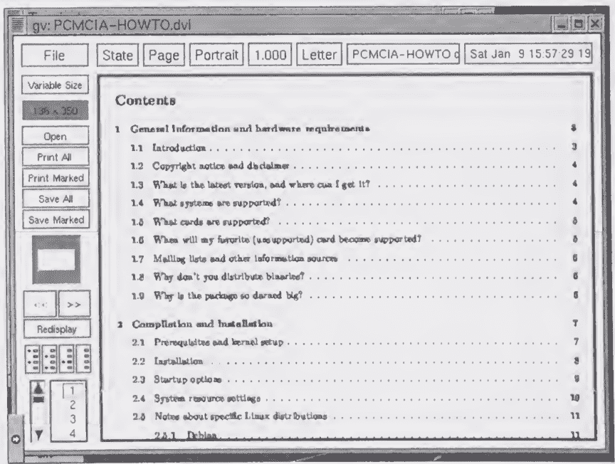

## 第5章

- vi 生存指南
- 更快地移动
- 获取帮助
- 更快地编辑
- 可视模式和多窗口


- `:` 命令
- 程序员的简单命令
- `vi` 速查手册
- `emacs`，神奇的编辑器
- 用 `emacs` 编辑文件
- 其他文本编辑器
- 拼写检查文件

掌握这些技能。

## 文本编辑

Linux 在很大程度上依赖简单的文本文件。与 Windows 注册表不同，大多数配置文件都以纯 ASCII 文本形式存储。因此，要在 Linux 上取得成功，你必须知道如何编辑文件。

虽然你可以使用漂亮的图形文本编辑器，如 `gedit` 或 `gnotepad+`，但你经常需要从纯文本登录开始。事实上，要配置 X Window 系统（使你能够运行 Linux 图形界面），你可能需要编辑配置文件。所以，你需要学习一些更初级的 Linux 文本编辑工具。

Linux 社区中正在掀起一场关于哪个编辑器更好的激烈宗教辩论：`vi` 还是 `emacs`。`vi` 编辑器是原始的 UNIX 全屏编辑器。它在每个 UNIX 和 Linux 系统上都是标准配置。它的设计目标是快速高效。如果你知道如何使用，用 `vi` 编辑比任何其他编辑器都快——这就是 `vi` 的问题所在。它很难学。部分原因在于它的命令选择，使得它一开始很难学和记。例如，`h`、`j`、`k`、`l` 键分别用于左、上、下、右移动；用 `x` 删除字符；`y` 和 `p` 用于复制和粘贴。然而，一旦你习惯了，这些命令是很快的。

`vi` 的另一个问题是它是一个模态编辑器。这意味着它有命令模式、插入模式和一些其他次要模式。这很容易让新手困惑。经常有人输入 `3dd` 想要删除三行，结果发现自己处于插入模式，只是在文档中添加了 `3dd`。

而 `emacs` 则是一个无模态编辑器。（`emacs` 确实有所谓的模式，但与 `vi` 的主要模式相比非常次要。）这意味着它更易于使用和学习。不过做同样的事情也需要更多的按键操作。

但 `emacs` 不仅仅是一个文本编辑器。有了它，你可以做很多事情，比如运行命令窗口、阅读邮件、查看 Usenet 新闻，以及许多其他事情。有些人可以在 `emacs` 窗口中度过整整一生。

### vi 生存指南

`vi` 编辑器高效且快速——如果你知道如何使用的话。问题是这个程序有一个陡峭的学习曲线，因此需要一些练习和反复训练才能学会。

这一部分教你编辑文件所需的最低限度的 `vi` 命令。你必须先学会这些命令，才能继续学习其他部分，那些部分会教你如何更快更高效地操作。

启动编辑器使用以下命令：

```bash
$ vi first.txt
```

参数 `first.txt` 是文件名。如果该文件存在，则进行编辑。如果不存在，则创建它。

当你用空文件启动 `vi` 时，你会看到三样东西：左上角的光标、左侧一列 `~`，以及左下角的一些状态文本。光标是你开始输入的位置；`~` 表示这些行都是空的；底部的状态文本告诉你正在编辑 `first.txt`，这是一个新文件。

`vi` 始终以命令模式启动。要开始插入文本，按 `I` 键。屏幕左下角现在显示 `-- INSERT --`，表示你现在处于插入模式。输入一些文本。按 `Enter` 键结束行，因为这不是文字处理软件，行不会自动换行。如果你打错了字，别担心，继续输入即可。注意：如果你真的搞砸了编辑会话，有一种方法可以让 `vi` 忘掉所有内容。那就是 `:q!` 命令。这会让 `vi` 不保存任何更改就退出。

完成后按 `Esc` 键。模式指示器现在为空，表示你又回到了命令模式。

现在输入 `ZZ` 退出编辑器。

### 编辑文件

要编辑你刚创建的文件，输入以下命令：

```bash
$ vi first.txt
```

熟悉下一页列出的光标移动键。

警告：你可以用方向键移动，但如果这样，你永远学不会本章开头介绍的 `H`、`J`、`K`、`L` 键，你的编辑速度会明显变慢。此外，在某些其他 UNIX 系统上，方向键并不总是有效。如果你只用 Red Hat Linux，这不是什么大问题，但如果你真的想精通 `vi`，就应该使用 `h`、`j`、`k`、`l`。

### 添加行

假设你想在文件末尾添加另一行。首先，使用 `j` 键将光标移动到底行。

接着用 `o` 命令在当前行下方“打开”一个新行。注意这个命令会让你进入插入模式。你现在可以像右侧示例那样输入额外的一行。完成后按 `Esc` 键退出插入模式。

如果你想在光标上方打开一行，使用 `O` 命令。

### 删除内容

要删除一个字符，确保你在命令模式下，然后将光标移到该字符上，按 `x` 键。（这个命令源于老式打字机时代，人们会用 `xxxx` 覆盖错误来消除它们。）

要删除一行，输入 `dd`。

## 文本编辑

### `a` 命令

`a`（追加）命令的作用与 `i` 类似，区别在于 `i` 在光标所在字符之前开始插入，而 `a` 在光标之后插入。例如，如果要在行首添加单词 *Front*，可以将光标定位在行首，然后输入命令 `i`Front`Esc`。如果要在行尾添加单词 End，则将光标定位在行尾，使用命令：`a`End`Esc`。

| 光标移动 | 命令 | 含义 |
| :--- | :--- | :--- |
| `k` | `i` | 插入（以 `Esc` 结束）。 |
| `^` | `a` | 追加（以 `Esc` 结束）。 |
|  | `x` | 删除字符。 |
| `h<-->l` | `ZZ` | 保存文件并退出。 |
|  | `:q!` | 退出并丢弃更改。 |
| `v` | `dd` | 删除行。 |
|  | `o` | 在下方创建新行。 |
|  | `O` | 在上方创建新行。 |

表 5-1：VI 光标移动键

### 更快的移动方式

其中一个非常有用的命令是撤销（`u`）命令。该命令撤销最后一次更改。可以多次使用 `u` 命令来撤销多次更改。`Ctrl+R` 是“重做”命令，它撤销最后一次撤销操作的结果。例如，如果要撤销最近的两次更改，而你输入了 `uuu`（`u` 三次），你可以通过按一次 `Ctrl+R` 来纠正问题。

`vi` 中的每个命令都可以在前面加上数字。大多数命令将其用作重复次数。例如，`5k` 向上移动五行。类似地，命令 `64i=Esc` 在文档中插入 64 个等号，`5dd` 删除 5 行。

基本的光标移动键每次移动一个字符。要一次移动一个单词，使用 `w` 命令。`b` 命令向后跳过单词。

两个最有用的命令是搜索单个字符的命令。起初，搜索单个字符可能听起来极其有限且有些无用，但在编辑过程中你会发现这些命令非常有用。`fx` 命令在当前行上搜索字符 `x`。例如，如果光标位于行首：

```text
Linux is cheaper than Microsoft Windows
```

那么命令 `fc` 会跳到 cheaper 的开头。输入 `fW`，光标会跳到 “Windows” 的开头。（此搜索区分大小写。）现在输入 `Fs`，光标会回退到 `s`。在 `vi` 中，大写命令通常是小写命令的反向操作，例如 `f` 和 `F`。

现在我们可以用 `x` 命令删除 `s`，然后使用 `i$Esc` 添加一个 `$`，得到：

```text
Linux is cheaper than Micro$oft Windows
```

现在我们可以用 `x` 命令删除 `s`，然后使用 `i$Esc` 添加一个 `$`，得到：

```text
Linux is cheaper than Micro$oft Windows
```

### 搜索

要搜索字符串，使用命令 `/*/string`。例如，要搜索字符串 Linux，使用命令 `/Linux` 然后按 `Enter`。搜索是区分大小写的，因此 `/Linux`、`/linux` 和 `/LINUX` 会找到不同的内容。当你输入 `/` 开始搜索时，你会注意到光标跳到屏幕底部，在那里输入搜索字符串。

搜索实际上使用的是正则表达式，因此要小心使用 `[`、`]`、`{`、`}`、`^`、`$`、`.` 和 `*` 等字符。搜索从当前光标位置开始，继续到文件末尾。如果仍然没有找到目标，它会从文件顶部开始搜索到光标位置。

要向后搜索文件，使用 `?` 命令。（`/` 和 `?` 之间的关联可能不太明显，直到你意识到它们位于同一个键上。）

`n` 命令重复上一次搜索。`N` 命令反转搜索方向并重复上一次搜索。例如，假设你正在浏览文档查找关于磁盘的信息。你开始搜索单词 disk，输入 `/disk` 然后按 `Enter`。第一个出现的词没有帮助，所以你使用命令 `n` 再次搜索。使用 `n` 命令，你可以在文件中跳转查找 disk。

假设你不小心多按了一次 `n` 命令。意识到错误后，你决定实际需要该单词的前一次出现。于是，使用 `N` 命令反转方向。记住大小写是有区别的。

### 上下滚动

`Ctrl+D` 命令向下滚动半页。`Ctrl+U` 命令向上滚动半页。这些命令可用于在文件中快速上下移动。

`G` 命令使 `vi` 跳到文件底部。`<number>` `G` 命令将光标移动到 `<number>` 指示的行。（要回到文件顶部，使用命令 `1G`。）

## 表 5-2：编辑命令

| 命令 | 含义 |
| --- | --- |
| `<number><cmd>` | 将命令重复 `<number>` 次。 |
| `u` | 撤销上一次更改。 |
| `Ctrl+R` | 重做上一次更改（在撤销之后）。 |
| `w` | 向前移动一个单词。 |
| `b` | 向后移动一个单词。 |
| `f<char>` | 在当前行上搜索 `<char>`（向前）。 |
| `F<char>` | 在当前行上搜索 `<char>`（向后）。 |
| `/string` | 向前搜索字符串。 |
| `/` | 重复上一次向前搜索。 |
| `?string` | 向后搜索字符串。 |
| `?` | 在反方向重复上一次搜索。 |
| `n` | 重复上一次搜索。 |
| `N` | 反转方向并重复上一次搜索。 |
| `Ctrl+D` | 向下滚动半页。 |
| `Ctrl+U` | 向上滚动半页。 |
| `G` | 转到文件底部。 |
| `<number>G` | 转到指定行。 |

### 获取帮助

标准 UNIX 版本的 `vi` 编辑器功能有限，多年来基本保持不变。Linux 不附带标准 `vi` 编辑器。相反，Linux 使用一个增强版的 `vi`，称为 VIM，它已经扩展并增加了许多非常有用的附加功能。

其中一个最有用的新功能是帮助命令。要获取帮助，输入 `:help` 然后按 `Enter`，会出现一个帮助窗口。你可以使用标准的 `vi` 编辑命令在此窗口中移动。要关闭窗口并返回编辑，输入 `:q` 然后按 `Enter`。

在帮助屏幕中导航有一些技巧。用竖线括起来的文本（例如，`|intro|`）表示 `vi` 标签。（标签在本章后面的任务“程序员的简单命令”中讨论。）如果你将光标定位在竖线内并按 `Ctrl+]`，屏幕会跳转到讨论该主题的文本。

如果你想跳回之前的位置，输入 `Ctrl+O`。要退出帮助系统并返回编辑，输入 `ZZ`。

单独的 `:help` 命令提供一般帮助。如果你想要特定主题的帮助，例如 “intro”，使用 `:help intro` 命令。

帮助系统包含所有命令的条目。例如，如果你想要 `ZZ` 命令的帮助，输入 `:help ZZ`。

### vi 编辑器中的模式

`vi` 编辑器有几种模式。你已经熟悉插入模式和命令模式。此外，还有替换模式，它与插入模式类似，但是会覆盖字符；以及可视模式，这将在本章后面讨论。

某些命令根据你所在的模式具有不同的含义。例如，在命令模式下，`Ctrl+T` 跳转到上一个标签。（详见本章后面的“程序员的简单命令”。）在插入模式下，此命令增加当前行的缩进。

要获取命令模式下 `Ctrl+T` 的帮助，输入 `:help CTRL-T` 然后按 `Enter` 键。如果你想要该命令的插入模式版本，输入 `:help i_CTRL-T` 并按 `Enter`。

### 帮助页面

有几个非常有用的帮助页面可供 `vi` 用户使用，包括：

- `help howto`：此部分是寻找各种主题帮助的很好的起点。
- `help quickref`：所有 `vi` 命令的快速参考。请注意，由于 `vi` 有大量命令，快速参考超过 1000 行。
- `help regular-expression`：描述如何使用正则表达式的部分。搜索命令使用正则表达式来定义要搜索的字符串。（许多其他 UNIX 命令也使用正则表达式。）

| 命令 | 描述 |
| --- | --- |
| `:help howto` | 此部分是寻找各种主题帮助的很好的起点。 |
| `:help quickref` | 所有 `vi` 命令的快速参考。请注意，由于 `vi` 有大量命令，快速参考超过 1000 行。 |
| `:help regular-expression` | 描述如何使用正则表达式的部分。搜索命令使用正则表达式来定义要搜索的字符串。（许多其他 UNIX 命令也使用正则表达式。） |

> **在线查找**
>
> 一个组织已经成立，旨在增强和支持改进的 `vi` 编辑器（vim）。请访问他们的网站 <http://www.vim.org>。

# 第 5 章：文本编辑

#### 表 5-3：VIM 帮助命令

| 命令 | 含义 |
| --- | --- |
| `:help` | 打开常规帮助窗口。 |
| `:help Subject` | 获取关于指定主题的帮助。 |
| `:help key` | 获取关于指定按键的帮助。 |
| `Ctrl+]` | 跟随超链接。（实际上是跳转到光标下方的“标签”。） |
| `Ctrl+O` | 跳转到上一个标签。 |
| `ZZ` | 关闭当前窗口。 |

`:help` 命令的结果。

`:help howto` 的结果。

跟随 “tutor” 链接的结果。

### 更快地编辑

当你已经学会基本的编辑命令，并开始觉得它们太慢时，你就可以开始学习更快的编辑命令了。

正如你所学的，删除行命令是 `dd`。要删除一个单词，使用命令 `dw`。（参见右侧示例。）记住，`w` 会将光标移动到单词末尾。实际上，你可以在 `d` 命令后面跟任何光标移动命令。

例如，你可以将 `d` 与 `fq` 命令组合，删除直到并包括下一个 `q` 的所有字符。

现在让我们更有技巧一些，将数字前缀与 `d` 组合。例如，要删除五个单词，使用命令 `5dw`（或 `d5w`）。要删除到第三个 q 的位置，使用命令 `3dfq` 或 `d3fq`。

### 更改文本

更改命令（`c`）的作用与 `d` 命令相同，只是它会将你留在插入模式。例如，要更改一个单词，输入命令 `c`_new-word_`Escape`。

要更改整行，使用 `cc` 命令。

如果你想更改单个字符，将光标定位到该字符上，然后输入 `r`_new-character_ 来替换它。

### 替换模式

替换模式的功能很像插入模式。所有命令都相同，但它不是添加文本，而是覆盖现有文本。要进入替换模式，在插入模式下输入 `R`。

###### 交叉引用

`vi` 编辑器有一种列表模式，试图使文件中的所有文本都可见。参见本章后面的“The vi Cookbook”。

### 重复上次编辑

最简单且强大的编辑命令之一是 `.` 命令。该命令重复上次的编辑操作。例如，如果你上次输入的编辑命令是 `dw`（删除单词），那么输入 `.` 将会删除下一个单词。

这听起来不是特别强大，但随着你使用它，你会了解它有多么有用。这里有一个简短的例子：假设你想将所有出现的单词 bug 改为 feature。为此，输入以下命令：

1. 使用 `/` 搜索来查找单词 *bug*。
2. 使用 `cw`_manager_ 和 `Esc` 命令将其改为 *feature*。
3. 使用 `n` 命令查找下一个 *bug*。
4. 使用 `.` 更改它。
5. 持续使用 `n.` 命令，直到所有 bug 都变成 feature。

### `^` 和 `$` 命令

`^` 命令将光标移动到行首。这也是在搜索模式中匹配行首的魔法字符。例如，命令：

```text
/^Disk
```

搜索在行首的单词 Disk。

`$` 命令将光标移动到行尾。与 `^` 类似，`$` 可以在搜索命令中使用来匹配行尾。例如，搜索：

```text
/data\.$
```

匹配任何以单词 data 结尾的行。（点号前需要反斜杠，因为点号也是搜索中的另一个魔法字符。`\` 告诉 `vi` 去掉点号的魔法，使点号只是一个普通的点号。）

## 文本编辑

# 第 5 章

一名男子致电技术支持，抱怨他电脑上的咖啡杯架坏了。

他不知道是谁制造的，但标签上写着 6x。

`dd` -- 删除行

`dw` -- 删除单词

`dfn` -- 删除到第一个 “n”

一名男子 ~~致电技术~~ 支持，抱怨他电脑上的咖啡杯架坏了。

他不知道是谁制造的，但 ~~标签~~ 上写着 6x。

机箱上写着 6x。

`d3fl` -- 删除到第三个 “l”（`3dfl` 也可以）

`cwcaseEscape` -- 将单词改为 “case”

# 表 5-4：文本修改命令

| 命令 | 含义 |
| --- | --- |
| `u` | 撤销。 |
| `Ctrl+R` | 重做上次的撤销。 |
| `dd` | 删除一行。 |
| `dw` | 删除单词。 |
| `dfq` | 删除直到并包括行中第一个 q。 |
| `3dfq` | 删除直到并包括当前行中第三个 q。 |
| `d<cm>` | 基于光标移动命令删除。这里 `<cm>` 表示光标移动命令，如 `w`、`b`、`fx`、`Fx` 等。 |
| `cctextEsc` | 更改当前行。 |
| `cwtextEsc` | 更改单词。 |
| `c<cm>textEsc.` | 基于光标移动更改。 |
| `.` | 重复上次编辑命令。 |

电脑 ~~当~~ 机了，我们不得不思考。

`dw` -- 删除单词

电脑 ~~d~~own 今天，我们不得不思考。

`.` -- 点号 -- 重复上次命令（`dw`）

电脑 ~~t~~oday，我们不得不思考。

`.` -- 点号 -- 重复上次命令（`dw`）

电脑 ~~a~~nd，我们不得不思考。

`u` -- 撤销上次更改

电脑 ~~t~~oday，我们不得不思考。

`Ctrl-R` -- 重做上次更改（撤销上次的撤销）

电脑 ~~a~~nd，我们不得不思考。

### 可视模式和多窗口


Linux 自带的改进版 vi 包含一种可视模式。这种模式非常适合处理大量文本的移动、删除或其他操作。要进入可视模式，输入`v`。光标下的字符会以反色显示。同时屏幕底部会出现`-- VISUAL --`指示器。现在可以使用光标移动键来扩展视频选择。

要删除高亮显示的文本，按`d`。文本被删除，并返回到命令模式。

当文本被删除时，vi 会将其存储在剪贴板中。你可以使用`p`命令将这段文本粘贴到文件中。

将所有这些命令组合起来，我们可以将一个段落从一个位置移动到另一个位置。

`y`（抽出）命令的作用与`d`命令相同，只是它将文本放入剪贴板而不删除它。例如，`yw`将一个单词放入剪贴板。`yy`命令将抽出整行。

`y`命令在可视模式下也可以工作，将高亮显示的文本抽入剪贴板。

假设你拼写错误，比如输入了`teh`。要纠正它，只需将光标定位到 e 上并输入`xp`命令。`x`删除光标下的字符（e），`p`将其粘贴到光标下字符（h）的后面。这两个简单的命令提供了一种快速翻转字符的方法。

## 多窗口

标准 vi 编辑器强迫你处理单个编辑窗口。Linux 改进版 vi 允许你使用多个窗口。

`:split`命令将当前窗口分成两个，并在两个窗口中显示当前文件。默认情况下，你在顶部窗口。你可以在顶部窗口中自由移动，独立于底部窗口中显示的内容。但是，如果你对文件进行了更改，它们会显示在底部窗口中。

要切换窗口，使用`Ctrl+Wj`命令向下移动一个窗口。`Ctrl+Wk`命令让你向上移动一个。（记住我们的光标移动命令：`j` = 上，`k` = 下。）

要关闭窗口，使用`ZZ`命令。

假设你想同时编辑两个不同的文件。

```text
:split file
```

命令分割窗口，并在新窗口中开始编辑`file`。因为你同时在编辑两个文件，所以可以做诸如从一个文件中剪切文本并粘贴到另一个文件中的操作。

窗口的大小可以使用`Ctrl+W-`命令减小。`Ctrl+W+`可以增大它。

通常 vi 将编辑的文件保存在内部缓冲区中。当你输入`ZZ`命令时，该缓冲区会被写入文件。如果你想显式地写入文件，使用`:w`命令。`:q!`命令会退出并丢弃缓冲区中的数据。上次写入之前的任何更改都已提交，不会被丢弃。

如果你正在编辑一个文件，想切换到另一个文件，使用`:vi file`命令。

# 文本编辑

## 第 5 章

1. 移动到要移动文本的开头。
2. 使用`v`命令进入可视模式。
3. 移动到要移动文本的结尾。
4. 使用`d`命令将其剪切并放入剪贴板。
5. 移动到目标位置，然后使用`p`命令粘贴。

## 表 5-5：窗口和剪贴板命令

| 命令 | 含义 |
| --- | --- |
| `v` | 进入可视模式。 |
| `v<移动光标>d` | 删除高亮文本。 |
| `p` | 在光标后粘贴。 |
| `P` | 在光标前粘贴。 |
| `yy` | 将当前行复制到剪贴板。 |
| `y<cw>` | 将文本复制到光标移动指定的位置，放入剪贴板。 |
| `xp` | 修正拼写错误。（将光标下的字符向右移动一位。） |
| `:split` | 将当前窗口拆分为两个。当前文件在两个窗口中显示。 |
| `:split file` | 拆分当前窗口，并在另一个窗口中开始编辑名为`file`的文件。 |
| `Ctrl+Wj` | 向下移动到下一个窗口。 |
| `Ctrl+Wk` | 向上移动到下一个窗口。 |
| `ZZ` | 关闭窗口。 |
| `Ctrl+W+` | 增加当前窗口的大小。 |
| `Ctrl+W-` | 减小当前窗口的大小。 |

## `:`命令

最初的 vi 编辑器构建于一个名为 ex 的行编辑器之上。vi 编辑器仍然允许通过键入`:`和命令来输入 ex 命令。

最有用的`:`命令是那些用于设置选项的命令。例如，默认情况下，vi 中的搜索区分大小写。换句话说，搜索`FOO`不会找到字符串`foo`。如果你想让 vi 进行不区分大小写的搜索（`foo = Foo = FOO`），则执行以下命令：

```text
:set ignorecase
```

（`ignorecase`可以缩写为`ic`。）

如果你想关闭此选项，请使用以下命令：

```text
:set noignorecase
```

要查看设置了哪些选项，请使用以下命令：

```text
:set
```

此列表仅限于那些不包含其默认值的选项。如果你想要所有选项的列表，请使用以下命令：

```text
:set all
```

你可能想要设置的一些其他选项包括：

```text
:set nowrapscan
```

通常，当 vi 执行向前搜索时，它会搜索到文件末尾，然后从开头开始搜索到光标位置。此选项可防止搜索在文件末尾时回绕。

通常，vi 在你输入搜索字符串后开始搜索。使用：

```text
:set incsearch
```

它在你输入字符串的第一个字符时开始搜索。每次输入另一个字符时，搜索位置都会更新。

## 使用一个命令将一个词替换为另一个词

假设你被营销术语淹没，你想将所有 bug 都变成 feature，而且你不需要审查你的更改。执行以下命令：

```text
:1,$s/bugs/features/g
```

冒号（`:`）表示执行 ex 类型的命令。所有 ex 命令都以命令执行所作用的行号范围开头。在这里，我们选择了整个文档，从第 1 行到最后一行（`$`）。

`s`命令执行替换。旧文本用斜杠括起来（`/bugs/`）。替换文本紧随其后，也用斜杠分隔（`/features/`）。`g`命令告诉编辑器这是一个全局更改，因此如果单词 bugs 在一行中出现多次，则全部替换。请注意，因为第一组斜杠内的文本实际上被视为正则表达式。诸如`(`、`)`、`*`、`.`、`[`、`]`、`\`和`/`等字符的行为与普通文本不同。

## 初始化文件：`.vimrc`

你可以通过在`.vimrc`文件中输入命令来自定义 vi 的工作方式。vi 首次启动时，它会在你的主目录中查找名为`.vimrc`的文件并读取其中的命令。这样你就可以将你喜欢的选项放入其中，并在启动程序时自动设置它们。参见清单 5-1。

### 注意

#### 圣母什么！？

一座教堂刚刚购买了它的第一台计算机，并正在学习使用它。教堂秘书设置了一份要在葬礼服务中使用的格式信函。在需要填写人名的地方，她输入了单词`<name>`。当举行葬礼时，她会将此词更改为逝者的实际姓名。

有一天，有两场葬礼，第一场是一位名叫 Mary 的女士，之后是一场名为 Edna 的人的葬礼。于是秘书使用全局替换将`<name>`改为 Mary。接下来，她通过将 Mary 改为 Edna 来生成第二场葬礼的仪式。那是一个错误！

想象一下牧师是多么惊讶，当他开始阅读包含使徒信经的部分时，看到“由圣母 Edna 所生”。

### 清单 5-1：`.vimrc`示例

```text
1.    :syntax on
2.    :set autoindent
3.    :set autowrite
4.    :ab #d #define
5.    :ab #i #include
6.    :ab #b
/**********************************
7.    :ab #e
**********************************/
8.    :ab #l /*---------------------*/
9.    :set sw=4
10.   :set notextauto
11.   :set cindent
12.   :set incsearch
```

第 1 行打开语法着色。（详见“程序员简单命令”部分。）

第 2 行打开自动缩进。每行的缩进将与前一行相同。（详见“程序员简单命令”部分。）

第 3 行设置自动写入。vi 编辑器将在更改文件时自动写出文件。通常，你必须手动写入文件，然后才能更改文件。

第 4-8 行定义了缩写，用于简化编程的创建。（详见“程序员简单命令”部分。）

第 9 行将“移位宽度”设置为 4。移位宽度由与缩进相关的命令使用，以确定缩进多少。

第 10 行关闭对行尾类型的智能感知。MS-DOS 和 UNIX 使用不同的文本文件格式。唯一的区别在于它们如何处理行尾。启用此功能后，vi 会隐藏这些差异。关闭后，MS-DOS 文件不会自动处理。

第 11 行打开 C 风格缩进。

第 12 行打开增量搜索。

## 程序员简单命令

vi 编辑器包含许多对程序员非常有用的命令。其中最有用的是`%`命令。它查找匹配的`{}`、`()`或`[]`字符。右侧的示例显示了如何使用`%`命令在匹配的花括号之间跳转。当你有一个程序（如第二个示例）中出现错误时，此命令特别有用。在此示例中，花括号被意外省略。因此，程序员认为匹配的括号实际上并不匹配。`%`命令在定位此类问题时非常有用。

Linux vi 在一定程度上改进了`%`命令。它不仅会检测匹配的`()`、`{}`和`[]`，还会检测匹配的`#ifdef/#else/#endif`语句。因此，如果你将光标放在`#ifdef`上并按`%`，它会跳转到匹配的`#else`或`#endif`。

缩进在编程中扮演着重要角色。适当的缩进可以使程序从完全无法阅读的混乱变为可理解的程序。

`<<`和`>`命令将当前行向左或向右移动一个 shiftwidth。（shiftwidth 默认为八，但可以更改，我们将在后面看到。）

与`d`和`c`命令一样，`<`和`>`命令后跟一个光标移动命令。

默认移位宽度为八个字符。研究表明，当缩进为四个字符时，程序最易读。

要更改 vi 使用的移位宽度，请执行以下命令：

```text
:set shiftwidth=4
```

（你可以使用简写版本`:set sw=4`。）

如果你想？例如，如果你正在做这样一个块：

```c
if (flag) {
    do_part1();
    }
```

最后的`}`应该比`do_part1();`行少一级缩进，但自动缩进将其放在同一级别。`Ctrl+D`命令来救援。它使光标在自动缩进后回退一个 shiftwidth。

比自动缩进更好的是 cindent。当你执行以下命令时：

```text
:set cindent
```

vi 编辑器会自动为你的 C 或 C++ 程序执行缩进。

改进版本的 vi 可以执行语法着色。即程序的不同部分——注释、关键字、字符串、变量等——以不同颜色显示。要启用此选项，请使用以下命令：

```text
:set syntax=on
```

语法着色在原始 Linux 终端（你在启动 X Window 系统之前获得的终端）上工作得很好。但是，在 xterm shell 窗口中，它工作得不太好。要解决这个问题，你需要告诉 vi 你正在使用 color-xterm。这是通过输入 shell 命令来实现的：

```sh
$ export TERM=linux
```

如果你想使此更改永久生效，可以将以下行添加到你的`.bash_profile`文件中：

```sh
if [ $TERM == xterm ] ;

    export TERM= linux;

fi
```

警告：间距非常重要。

待续

```c
#ifdef LINUX
#include "asm/scsi.h"
#endif LINUX

int main()
{
    int flag = 0;
    set_flag(&flag, "This is a flag");
    if (flag) {
        printf("Flag is set\n");
    }
    return (0);
}
```

```c
int main()
{
    if (flag)
    {
        printf("Flag");
    }
    printf("Normal");

    int main()
    {
        if (flag)
        {
            printf("Flag");
        }
        printf("Normal");
```

使用`%`命令。

使用`>%`缩进代码块。

（Shiftwidth 设置为 4。）

## 表 5-6：VI 编辑器简单命令

| 命令 | 描述 |
| --- | --- |
| `%` | 查找匹配的`{}`、`[]`、`()`、`#ifdef/#else/#endif`。 |
| `<<` | 将行向左缩进。 |
| `>` | 将行向右缩进。 |
| `<cm` | 从当前位置到光标移动结果的位置，将行向左缩进。 |
| `>cm` | 从当前位置到光标移动结果的位置，将行向右缩进。 |
| `>%` | 将所有文本向右缩进，直到匹配的`()`、`{}`、`retaliate []`或`[]`。 |
| `<%` | 将所有文本从当前位置向左缩进，直到匹配的`()`、`{}`或`[]`。 |
| `:set shiftwidth=4` | 设置`<`和`>`命令缩进时的空格数。 |
| `:set autoindent` | 开启自动缩进。每一新行的缩进量将与前一行相同。 |
| `Ctrl+D` | 当设置了自动缩进时，回退一个缩进层级。 |
| `:set cindent` | 开启智能 C 风格缩进。 |
| `:set syntax=on` | 开启语法着色。 |

## 程序员简单命令

*续*

### 缩写

vi 编辑器允许你使用`:abbreviate abbr string`命令来定义缩写。（`:abbreviate`可以缩写为`:ab`。）

那么为什么这个命令会出现在编程部分呢？以下是一些有用的缩写：

```text
:ab #d #define
:ab #i #include
```

输入这些命令后，当你键入`#i`时，vi 会在你的文件中放入`#include`。

这些命令的一个有趣用途是用于框式注释。以下是这些缩写：

```text
:ab #b /**********************************
:ab #e **********************************/
```

现在当你键入`#b`时，你会得到框式注释的顶部，而`#e`会给你底部。注意，星号行的长度经过精心选择，使得行尾与制表位对齐。

### 标签

`ctags`命令（由 ctags 软件包提供，与 VIM 无关）生成一个简短的数据库，其中包含一组文件中所有过程的名称。例如，命令：

```sh
$ ctags *.c
```

会找出当前目录下所有 C 文件中的所有过程。它生成的数据库存储在一个名为`tags`的文件中。

vi 编辑器使用它来定位过程。例如，如果你想编辑过程`get_data`，可以使用命令：

```sh
$ vi -t get_data
```

vi 编辑器发现你想基于标签（`-t`选项）进行编辑，于是会在数据库中查找`get_data`。然后它会打开包含该过程的文件，并将你定位到该位置。

你可以在 vi 中编辑时使用以下命令跳转到任何过程：

```text
:ta procedure
```

标签功能非常适合浏览源文件。例如，假设你想弄清楚`get_data`中发生了什么。你可以使用`vi -t get_data`命令来查看该过程。`get_data`过程调用了`read_header`，你想看看那里发生了什么。

将光标定位到`read_header`名称上，然后按`Ctrl+]`。编辑器会跳转到`read_header`过程（即使它在另一个文件中）。

### Make 与 vi 的集成

编程时，你会经历一个编辑、编译、编辑、编译的循环。vi 编辑器有一个扩展可以简化这个过程。当你执行命令：

```text
:make
```

时，编辑器会运行`make`程序来编译你的程序。（注意，在使用此命令之前，你必须先创建一个`Makefile`才能正常工作。）但编辑器不仅仅是运行`make`，它还会捕获任何发生的编译错误。然后光标会定位到第一个错误所在的行。

在你修正问题后，可以使用`:cn`命令跳转到下一个错误。相关命令包括`:cc`跳转到当前错误，以及`:cp`跳转到上一个错误。

这些命令让你可以快速浏览程序并修复所有错误。完成后，你可以再次使用`:make`命令尝试编译。

▶ `:make`命令的结果。

▶ 文件定位在第一条错误消息处。

# 文本编辑

第五章

## 表 5-7：命令

| 命令 | 含义 |
| --- | --- |
| `:abbreviate abbr. string` | 定义一个缩写。 |
| `:ab abbr. string` | abbreviate 的简短版本。 |
| `$ ctags \*.c` | 生成一个“tags”文件，包含 \*.c 文件中所有过程位置的列表。 |
| `$ vi –t proc` | 从由 proc 指示的标签（过程名）开始编辑。 |
| `:ta proc` | 从 vi 内部跳转到某个过程的方法。 |
| `:make` | 运行`make`程序并捕获错误。 |
| `:cc` | 跳转到当前错误消息的位置。 |
| `:cn` | 跳转到下一个错误的位置。 |
| `:cp` | 跳转到上一个错误的位置。 |

▶ 使用`:cn`定位到下一行错误。

## vi 烹饪书

在本节中，我们提供在 vi 中执行许多有用操作的逐步说明。

### 移动文本

要将一个段落从文档顶部移动到底部，请按以下步骤操作：

1. 将光标移动到你想要移动的段落顶部。
2. 输入`ma`命令，在此位置放置一个名为`a`的标记。
3. 将光标移动要移动的段落底部。
4. 输入命令`d'a`，这将删除到标记`a`的位置。被删除的文本将放入剪贴板。
5. 将光标移动到文本要放置的行。段落将被放置在这一行之后。
6. 使用`p`命令将文本粘贴到光标下方。

### 将文本块从一个文件复制到另一个文件

要在文件之间复制文本块，请按以下步骤操作：

1. 编辑第一个文件。
2. 转到要复制的顶部行。
3. 输入`ma`命令，将该行标记为标记`a`。
4. 转到要复制的底部行。
5. 使用`'ay`将标记`a`（`'a`）处的文本放入“yank”缓冲区（`y`）。
6. 使用命令`:vi other-file`编辑另一个文件。


- 7. 转到要插入的行。文本将被放置在这一行之后。
- 8. 使用 `p` 命令将文本粘贴到光标下方。

### 排序一个部分

经常地，你会编辑一个包含名称列表的文件，例如组成程序的对象文件列表，类似这样：

```
version.o
pch.o
getopt.o
util.o
getopt1.o
inp.o
patch.o
backupfile.o
```

这个列表如果能按字母顺序排列，或者至少按 ASCII 顺序排列，会更好。要对这个列表进行字母排序，请按以下步骤操作：

1. 将光标移动到要排序的第一行。
2. 使用 `ma` 将第一行标记为标记 `a`。
3. 移动要排序文本的底部。
4. 输入 `! 'asort`。`!` 命令告诉 vi 将文本通过外部 shell 命令运行，并用命令的结果替换被运行的行。`'a` 告诉编辑器要处理的文本从当前行开始，到标记 `a` 结束。文本要通过的命令是 `sort`。

结果是：

```
backupfile.o
getopt.o
getopt1.o
inp.o
patch.o
pch.o
util.o
version.o
```

实际上，你在大多数 *Makefile*（UNIX 用来控制编译的文件）中看到的样子更像是这样的：

```
OBJS = \
    version.o     \
    pch.o         \
    getopt.o      \
    util.o        \
    getopt1.o     \
    inp.o         \
    patch.o       \
    backupfile.o
```

反斜杠（`\`）用于表示续行。排序后，这个列表看起来像这样：

```
OBJS = \
    backupfile.o  \
    getopt.o      \
    getopt1.o     \
    inp.o         \
    patch.o       \
    pch.o         \
    util.o        \
    version.o
```

名称已经有序了，但反斜杠是错误的。你需要使用常规编辑来修正它们，然后继续。

```
OBJS = \
    backupfile.o  \
    getopt.o      \
    getopt1.o     \
    inp.o         \
    patch.o       \
    pch.o         \
    util.o        \
    version.o
```

# 处理 *Makefile* 和其他棘手的文件

UNIX `make` 命令使用的文件格式有一个问题，就是它极其挑剔。

例如，以下是正确的：

```
prog: prog.c
	cc -g -o prog prog.c
```

以下则不正确：

```
prog: prog.c
        cc -g -o prog prog.c
```

乍一看，这两行看起来完全一样。但仔细看。第一个的 `cc` 行以 Tab 开头。第二个以八个空格开头。那么你该如何区分它们呢，尤其是在屏幕上（或打印页面上）它们看起来完全一样的时候？答案是你无法区分。你可能觉得这有点不公平。尤其是当 `make` 对第一个有效但对第二个无效时。幸运的是，vi 有一个模式——列表模式——可以准确地告诉你文件中有什么。执行命令：

```
:set list
```

进入列表模式。当显示设置为“列表模式”时，所有字符都会显示。制表符显示为 `^I`，行尾显示为 `$`。所以在列表模式下，我们的两个例子看起来是这样的：

```
prog: prog.c$
^Icc -g -o prog prog.c$
```

和：

```
prog: prog.c$
        cc -g -o prog prog.c$
```

从中很容易看出哪一行有制表符。

# vi 食谱

## 续篇

vi 编辑器并非文字处理器。不过，你可以做一些事情来让文本编辑更加顺手。

文字处理器会在你输入的行长超过边距时自动换行。而 vi 编辑器允许你将行写得任意长。执行以下命令：

```
:set textwidth=70
```

可以告诉 vi 当行长超过 70 个字符时自动断行。（你可以根据需要将这个数字调整为任意行长。）这让文本输入变得更加轻松。但这并不能解决编辑时的问题。如果你输入了一段文字，然后决定删除第一行上一半的字词，vi 不会重新格式化文本。

你可以通过以下步骤强制重新格式化一个段落：

1. 移动到段落顶部。
2. 输入 `!}`。`!` 命令告诉 vi 将一段文本通过管道传递给过滤器。`}` 则告诉 vi 管道命令的文本范围是整个段落。
3. 接下来输入 `fmt -70`。其中 UNIX 命令 `fmt` 是一个基础的格式化工具。它能较好地为文本文档执行自动换行。`-70` 告诉 `fmt` 按每行 70 个字符进行格式化。

### 阅读 man 手册页

你可以使用 vi 编辑器浏览文本文件。非常有用的浏览对象是 man 手册页。将手册页导入 vi 的过程类似于一个四角台球的技巧。从以下命令开始：

```
$ man subject | ul -i >tmp.txt
$ vi tmp.txt
```

现在你已经进入 vi 编辑器，正在查看你的手册页。所有常规的 vi 光标移动命令都可以用来浏览该文件。

### 去除 MS-DOS 文件中的回车符

在 MS-DOS 文件中，每行末尾都有一个 `^M` 字符。这是由 MS-DOS 处理行尾的特殊方式造成的。

要从 MS-DOS 文件中去除 `^M` 字符，输入以下命令：

```
:1,$s/Ctrl+VCtrl+M//
```

该命令以冒号（`:`）开头，告诉 vi 进入 ex 模式。所有 ex 命令都以行号范围开头，这里是从第一行（`1`）到最后一行（`$`）。斜杠表示“源文本”的开始。`Ctrl+V` 告诉 vi 将下一个字符视为普通字符，即使它是一个特殊字符。

下一个字符是 `Ctrl+M`。（如果没有 `Ctrl+V`，这将被视为回车键。）下一个斜杠结束“源文本”。后面跟着的是用斜杠括起来的“目标文本”。此处为空（`//`）。

### 去除行尾空白

有些人觉得行尾的空格和制表符无用、浪费且难看。要去除每行末尾的空白，执行以下命令：

```
:1,$s/\s*$//
```

冒号（`:`）告诉 vi 进入 ex 命令模式。所有 ex 命令都以行范围开头，此处为整个文件（从第 1 行到最后一行：`$`）。第一组斜杠括起“源文本”。`\s` 是匹配任意空白字符的特殊正则表达式代码，可以匹配制表符或空格。星号（`*`）表示前一个字符的说明（空格或制表符）可以重复任意次数。美元符号（`$`）表示行尾。因此，`\s*$` 告诉 vi 查找任意数量的空格或制表符后跟行尾的位置。然后这些内容被下一组斜杠中的文本替换。该文本为空，因此空格和制表符实际上被移除了。

### 糟糕，我忘了文件是写保护的

vi 编辑器允许你编辑写保护的文件，而且几乎不会给出警告。唯一的问题是当你尝试用 `ZZ` 退出时，会得到如下错误：

```
file.txt        File is read only
```

而且 vi 不会退出。技巧在于执行 `:shell` 命令。该命令通过启动一个在 vi 下运行的命令处理器（shell）来带你离开 vi。

然后你可以将该文件设为可写：

```
$ chmod u+w file.txt
```

并退出 shell：

```
$ exit
```

回到 vi。最后，你需要强制 vi 写入文件，使用命令：

```
:w!
```

（vi 仍然认为文件是写保护的，因此我们需要使用强制选项（`!`）来说服它写入。）

### 将“Last, First”改为“First Last”

你有一个如下形式的姓名列表：

```
Last, First
```

想要改成：

```
First Last
```

这可以用一条命令完成：

```
:1,$s/\([^,]*\), \(.*$\)/\2 \1/
```


冒号（`:`）告诉`vi`这是一个`ex`风格的命令。该命令的行范围是整个文件，由范围`1,$`表示。`s`（替换）告诉`vi`进行字符串替换。旧文本是一个复杂的正则表达式。`\(`和`\)`分界符用于告知编辑器，匹配正则表达式侧的文本将被特殊处理。

第一个`\(...\)`中的文本在替换文本中被赋给`\1`。第二组`\(...\)`内的文本被赋给`\2`，依此类推。在此例中，第一个正则表达式是任何不包含逗号的字符组。`[^,]`表示除逗号外的任意字符，`*`表示一组字符（零个或多个）。

第二个表达式匹配任意内容（`.*`）直到行尾（`$`）。替换的结果是，行上的第一个词被赋给`\1`，第二个词被赋给`\2`。这些值在命令末尾被用来调换词的顺序。

### 注意事项

#### 编辑包含给定词的文件

编辑包含给定词的文件需要使用`fgrep`命令，以及特殊的 shell 字符反引号（`` ` ``）。

### emacs，万能编辑器

如果说有什么文本编辑器能完成你能想象到的所有功能——而且不止于此——那就是`emacs`。`emacs`是一个强大的编辑系统，功能远不止于此。它内置了一种基于`LISP`的编程语言，因此你可以通过编写简短的`LISP`代码片段来创建`emacs`的新扩展。你还可以重新定义键盘上的按键来执行任意`emacs`命令。许多用户已经编写了用于编程、编辑特殊文件类型（如 Java 或 HTML 文件）的扩展包，以及用于阅读电子邮件和 Usenet 新闻，甚至浏览网页的任务。

`emacs`还附带了一个详尽的在线帮助系统，这是因为可用的命令数量庞大，所以帮助系统必不可少。

要启动`emacs`，只需输入`emacs`命令。如果你正在运行 X Window 系统图形界面，你会看到一个与对面页面所示类似的`emacs`窗口。如果你从终端控制台运行，你会得到一个非 X 版本的`emacs`。两个版本的工作方式类似。从 X Window 版本开始学习要容易得多，主要是因为它提供了菜单。

`emacs`支持数百条命令，其中大部分以`Ctrl`或`Meta`键开头。刚开始时，使用菜单来了解几条命令，然后再开始用键盘操作。我们发现这是学习`emacs`的好方法。

一旦启动`emacs`，你可以立即开始输入。与`vi`不同，`emacs`不使用模式来切换输入文本或运行命令。你输入的普通字符会进入当前窗口，即当前缓冲区。由于没有命令或输入模式，你需要特殊的按键来告诉`emacs`你正在输入命令。这些命令以`Ctrl`或`Meta`键开头。

你的键盘上没有`Meta`键。按照`emacs`的典型风格，这个键被绑定到`Esc`或`Alt`键。在 Red Hat Linux 上，`Esc`和`Alt`都与`Meta`键功能相同。在`emacs`文档中，键盘快捷键被描述为`C-x`或`M-x`，分别对应于`Ctrl+x`或`Meta+x`（`Alt`或`Esc`）。例如，命令`C-h t`表示你先按`Ctrl+H`，再按`T`。这很重要，因为`emacs`有大量关于此类按键的在线参考资料。

再举一个例子，要保存工作并退出`emacs`，输入`C-x C-c`。即`Ctrl-x Ctrl-c`。现在你已经准备好挑战世界上最强大的文本编辑器了。表 5-8 列出了开始接触`emacs`时最重要的一些命令。

### 注意事项

#### XEMACS 与 EMACS 之争

`emacs`家族有两个主要分支：此处介绍的 GNU`emacs`，以及`xemacs`，后者在 X Window 系统下呈现的界面略有不同。不过`xemacs`没有文本模式版本；你必须运行 X Window 系统。

### 交叉参考

请参阅本章前面的“vi 生存指南”以了解另一种编辑器。

# 文本编辑

## 第 5 章

### 表 5-8：基本 EMACS 命令

| 命令 | 操作 |
| --- | --- |
| `C-x C-s` | 将当前缓冲区中的文本以当前文件名保存（`save-buffer`）。 |
| `C-x C-c` | 保存当前缓冲区中的文本并退出`emacs`（`save-buffers-kill-emacs`）。 |
| `C-x C-w` | 以不同名称保存当前缓冲区中的文本（`write-file`）。 |
| `C-x C-f` | 打开文件（`find-file`）。 |
| `C-g` | 取消命令，当`emacs`似乎卡在某个操作时使用的快捷键（`keyboard-quit`）。 |

1. 运行`emacs`时，从菜单栏选择命令。
2. 在主编辑缓冲区窗口中编辑文本。
3. 在迷你缓冲区中输入命令。
4. GNU`emacs`的欢迎界面有助于您快速入门。
5. 当您发出需要输入的命令时，在迷你缓冲区区域中输入内容。

### 在线查找

`xemacs`主页位于<http://www.xemacs.org>。

### 使用 emacs 编辑文件

使用`emacs`进行编辑非常简单。您只需直接输入文本，无需像使用`vi`那样记住进入插入模式。而且，您可以执行数百种`emacs`命令。

`emacs`提供了丰富的命令来在文件中移动，如表 5-9 所示（长命令列在括号中，可通过输入`M-x`后跟长命令来运行）。对于新手来说，`PgUp`和`PgDn`键的作用如您所预期的那样，而要在行内移动，请使用方向键。使用`C-a`可移动到行首，`C-e`可移动到行尾。

`emacs`支持使用`Delete`键删除文本。默认情况下，`Delete`和`Backspace`键的作用相同——大多数用户会将其视为退格功能。您也可以使用`C-d`删除光标右侧的字符，这是`Delete`键在许多编辑器中的功能。`M-d`删除整个单词，而`M-Delete`删除左侧的单词。表 5-10 和表 5-11 列出了许多删除和编辑命令（长命令列在括号中）。您可以使用`M-x`命令运行任何这些长命令。只需输入`M-x`后跟长命令即可。

`emacs`支持强大的搜索功能。`C-s`启动正向增量搜索，从当前位置开始在文件中向前搜索。当您输入字符时，`emacs`会搜索该模式的下一个匹配项。因此，如果您输入`b`，`emacs`会向前搜索第一个`b`。如果您接着输入`e`，`emacs`会向前搜索第一个`be`，依此类推，直到您输入完整个单词。在许多情况下，`emacs`在您输入完整单词之前就已经找到了您要找的词。`C-r`用于向后搜索。

而且，与大多数文本编辑器一样，`emacs`支持复制和粘贴。`emacs`早于当前 Macintosh 普及的`Ctrl+X`剪切、`Ctrl+C`复制和`Ctrl+V`粘贴的界面标准。相反，`emacs`使用的是`C-W`、`M-W`和`C-Y`。

您可以从编辑菜单的“选择和粘贴”选项中查看许多剪切项目。与其他仅支持单个剪贴板的编辑器不同，`emacs`允许您粘贴之前操作中剪切的数据。

如果您编辑多个文件，每个文件都被视为一个缓冲区。因此，您可以在`emacs`中打开多个文档并在它们之间切换。不过，`emacs`的功能更进一步。您可以将当前窗口分割为多个缓冲区。使用`C-x 2`命令分割当前窗口，使用`C-x 1`恢复为全窗口单缓冲区。要切换窗口，请输入`C-x o`。您也可以使用`C-x 4 f`命令在新窗口中打开文件。

### 注意事项

#### 冲突的快捷键

`Ctrl+Y`在`emacs`中是粘贴，在 Microsoft Word 中却是重做。此外，`Ctrl+W`在`emacs`中是剪切，在 Word 中却是关闭文件。表 5-11 涵盖了`emacs`中的复制和粘贴命令。

#### Home 和 End 键

有两个键会经常让新手感到困扰，那就是`Home`和`End`键。在大多数应用程序中，这些键将光标移动到当前行的行首和行尾。然而，在`emacs`中，它们会将您移动到整个文档的开头（`home`）和末尾。

### 交叉引用

第 9 章介绍 X Window 系统下的复制和粘贴。

### 表 5-9：移动命令

| 命令 | 操作 |
| --- | --- |
| `C-F` | 向前跳一个字符，如同右方向键（`forward-char`）。 |
| `C-B` | 向后跳一个字符，如同左方向键（`backward-word`）。 |
| `C-N` | 向下跳一行，如同下方向键（`next-line`）。 |
| `C-P` | 向上跳一行，如同上方向键（`previous-line`）。 |
| `M-F` | 向前跳一个单词（`forward-word`）。 |
| `M-B` | 向后跳一个单词（`backward-word`）。 |
| `C-A` | 跳到行首（`beginning-of-line`）。 |
| `C-E` | 跳到行尾（`end-of-line`）。 |
| `Home` | 跳到文件开头（`beginning-of-buffer`）。 |
| `End` | 跳到文件末尾（`end-of-buffer`）。 |
| `M-<` | 移动到文件开头（`beginning-of-buffer`）。 |
| `M->` | 移动到文件末尾（`end-of-buffer`）。 |
| `PgUp` | 向下滚动一页文本；看似反常但行为如您所预期（`scroll-down`）。 |
| `PgDn` | 向上滚动一页文本；看似反常但行为如您所预期（`scroll-up`）。 |
| `C-V` | 向前移动一屏（`scroll-up`）。 |
| `M-V` | 向后移动一屏（`scroll-down`）。 |
| `C-L` | 清屏，将光标移至屏幕中央并重绘（`recenter`）。 |
| `C-S` | 向前搜索（`isearch-forward`）。 |
| `C-R` | 向后搜索（`isearch-backward`）。 |

### 表 5-10：编辑命令

| 命令 | 操作 |
| --- | --- |
| `Insert` | 切换覆盖模式（`overwrite-mode`）。 |
| `Delete` | 删除左侧字符（`delete-backward-char`）。 |
| `C-D` | 删除右侧字符（`delete-char`）。 |
| `M-D` | 删除单词（`kill-word`）。 |
| `M-Delete` | 删除左侧单词（`backward-kill-word`）。 |
| `C-k` | 删除到行尾（`kill-line`）。 |
| `C-t` | 调换两个字符（`transpose-chars`）。 |

### 表 5-11：缓冲区命令

| 命令 | 操作 |
| --- | --- |
| `C-x 2` | 分割窗口（`split-window-vertically`）。 |
| `C-x 1` | 恢复为单窗口（`delete-other-windows`）。 |
| `C-x b` | 跳到下一个缓冲区（`switch-to-buffer`）。 |
| `C-x b *buffer*` | 跳到指定名称的`buffer`（`switch-to-buffer`）。 |
| `C-x 4 b` | 跳到下一个缓冲区并为其创建新窗口（`switch-to-buffer-other-window`）。 |
| `C-x C-f *filename*` | 将文件载入缓冲区（`find-file`）。 |
| `C-x 4 f *filename*` | 在新窗口中打开文件（`find-file-other-window`）。 |
| `C-x C-s` | 将当前缓冲区保存到当前文件名。 |
| `C-x C-b` | 列出缓冲区（`list-buffers`）。 |

### 在线查找

`emacs`主页位于<http://www.emacs.org>。

### 使用 emacs 编辑文件

## 继续

### 在 emacs 中获取帮助

`emacs`有数百个复杂的命令，使用`Ctrl`和`Meta`快捷键，如果没有其丰富的在线帮助，新用户将会迷失方向。从键盘上，`C-h`是`emacs`帮助命令的基本前缀。从窗口中，“帮助”菜单提供了大多数`emacs`帮助命令的前端界面。

要开始，请尝试`C-h t`命令，它将启动`emacs`教程。

表 5-12 列出了获取帮助的`emacs`命令。同样，长命令列在括号中。您可以使用`M-x`命令运行任何这些长命令。只需输入`M-x`然后输入命令，例如`help-with-tutorial`。

### 自定义 emacs

`emacs`包含内置的`LISP`解释器，以及关于`emacs`使用的`LISP`方言的在线手册。您可以编写丰富的插件，或创建简单的自定义设置。

首先，让我们使用在线帮助查找有关自定义`emacs`的信息，然后更改`Home`和`End`键的绑定，使这些键将光标移动到当前行的行首和行尾。

要弄清楚如何做到这一点，我们需要查看`emacs`手册，它以一种称为`info`的原始超文本系统格式化，并找到一些重新定义键的示例。从“帮助”菜单中，调出`emacs`手册。您会看到一个主题列表，大多数与`emacs`无关。`m`命令可以调出主题或所谓的菜单。输入`m`后跟主题名称。我们需要找到三个主题：`Emacs`、`Key Bindings`和`Init Rebinding`。

在手册的这一部分，有一些对`global-set-key`命令的调用。我们可以使用`M-x`命令测试此命令。输入`M-x`，在提示符处输入`global-set-key`。然后会提示您输入键。按下`Home`键。然后，在命令提示符处，输入`beginning-of-line`（我们是从表 5-9 中获得的）。现在您应该能够按下`Home`键，让光标转到行首而不是文档开头。

我们现在只需将这些命令输入到`.emacs`文件中，如清单 5-2 所示。这些命令的格式来自`emacs info`手册中的示例。使用`emacs`时，您会经常复制示例。如果您想更改某些内容，很可能已经有人做过类似的事情。您只需要找到它。

每当您更改`.emacs`文件时，在启动`emacs`时使用`--debug-init`选项，以查看文件中是否有任何错误。

### 注意事项

#### EMACS 的 WINDOWS 版本

跨平台工具对我们很重要。在 Windows 中工作时，我们也使用`emacs`的版本。截至撰写本文时，`emacs`的 Windows 版本仅处于测试阶段。

### 交叉引用

第 4 章介绍如何在 Linux 中获取帮助。

### 表 5-12：获取帮助

| 命令 | 操作 |
| --- | --- |
| `C-h i` | 在`info`中浏览`emacs`手册——一种原始的超文本模式（`info`）。 |
| `C-h a`文本 | 列出包含该文本的命令（`command-apropos`）。 |
| `C-h b` | 列出按键绑定（`describe-bindings`）。 |
| `C-h c`按键 | 显示绑定到该按键的命令名称（`describe-key-briefly`）。 |
| `C-h C-h C-h` | 显示关于帮助的帮助。 |
| `C-h k`按键 | 显示关于给定按键的帮助（`describe-key`）。 |
| `C-h t` | 运行`emacs`教程（`help-with-tutorial`）。 |
| `C-h x`命令 | 列出运行给定命令的按键（`where-is`）。 |

### 清单 5-2：.EMACS 文件

```lisp
(global-set-key [home] 'beginning-of-line)

(global-set-key [end] 'end-of-line)
```

`emacs`启动时，会执行存储在你主目录中`.emacs`文件里的命令。这些命令重新定义了`Home`和`End`键。

从“帮助”菜单中在线查找信息。

使用`Ctrl-h t`命令启动`emacs`教程。这是入门的绝佳方式。

### 在线查找

你可以从`ftp.cs.washington.edu/pub/ntemacs/docs/ntemacs.html`下载 Windows 版本的`emacs`。

### 其他文本编辑器

编辑器的选择主要取决于个人偏好。没有两个人会在完全相同的事情上达成一致，这没关系。`vi`和`emacs`是 Linux 文本编辑的中流砥柱，但它们确实不够美观，学习起来也不那么容易。如果你想要一个更接近 Windows 记事本的简单编辑器，Linux 提供了许多选择。

GNOME 和 KDE 桌面环境都提供了简单的图形界面文本编辑器。在 GNOME 中，你可以使用`gedit`，一个轻量级的小型文本编辑器。相关的文本编辑器是`gxedit`，它需要 GTK 工具包（GNOME 也是基于它构建的），但不需要完整的 GNOME 桌面。

在 KDE 中，`kedit`应用程序提供了一个简单的文本编辑器。你可以用它来编辑大多数文本文件。`kwrite`是另一个文本编辑器，它能自动识别多种编程语言并相应地高亮显示语法。

对于非 X 环境，最受欢迎的“简单”文本编辑器之一是`pico`，它随 Pine 邮件程序一起提供。要启动`pico`并编辑文本文件，请键入：

```bash
$ pico [文件名]
```


所有基本的 pico 命令（数量远少于 emacs 或 vi）都列在屏幕底部。

用于软件开发的最佳图形界面编辑器之一叫做 `nedit`，全称 Nirvana 编辑器，可以从互联网上下载。`nedit` 提供了一个简单的界面，类似对页第三张图所示。总的来说，`nedit` 支持常见的剪切、复制和粘贴命令，就像你在 Windows 中习惯的那样（`gxedit`、`gedit`、`kedit` 和 `kwrite` 也是如此）。这与 `emacs` 形成了鲜明对比，后者支持自己的标准。

`Gedit` 是 GNOME 桌面的文本编辑器。

1. 选择一个编辑器图标，以便快速访问常用命令。

> **交叉参考**
>
> 第 7 章介绍了 GNOME 和 KDE 桌面。

> **在线查找**
>
> 优秀的 `nedit` 文本编辑器主页位于 `fnal.gov/nirvana/nedit.html`。

## 文本编辑

## 第 5 章

1. `kedit` 文本编辑器为 KDE 桌面提供了一个简单的界面。
2. 从 `nedit` 的 Shell 菜单运行命令，例如 `wc`（字数统计）。
3. `wc` 命令的输出会显示在自己的窗口中。

`nedit` 支持许多便捷功能，例如连接到 Linux 实用工具如 `wc`，你可以用它来计算文档中的字数。对页第四张图展示了这一功能。

`nedit` 的另一个强大功能在于其服务器模式。通过 `nc` 命令，你可以让 `nedit` 打开一个新文件。这使得调用编辑器变得相当容易，无需耗费内存和 CPU 周期来启动整个程序。相反，你只需在 `nedit` 程序的一个实例中获得另一个窗口。注意，`nc` 命令与一个网络实用程序冲突，因此我们通常将其别名为 `nec`，如第 3 章所示。

例如，要启动一个新的 `nedit` 窗口——无论 `nedit` 当前是否正在运行——请键入：

```bash
$ nc 文件名
```

`nc` 命令，是 `nedit client` 的缩写，以服务器模式启动 `nedit`（在询问你之后），然后调用一个 `nedit` 窗口来编辑传入的文件名。你不需要在后台运行此命令，因为它一旦启动 `nedit` 会话就会很快退出。为了避免每次都被询问是否启动 `nedit`，我们经常将 `nec` 别名为 `nc -noask`：

```bash
$ alias nec='/usr/local/bin/nc -noask'
```

`-noask` 选项告诉随 `nedit` 一起提供的 `nc`（我们假设它安装在 `/usr/local/bin` 中）在需要时自动启动 `nedit`。

> **注意**
>
> ### 基于文本的编辑器
>
> Linux 提供了许多不需要 X Window 图形的编辑器，包括 `joe` 和 `jed`，它们都在 CD-ROM 中。

### 拼写检查文件

以真正的 Linux（和 UNIX）风格，拼写检查并不是某个大型单体应用程序的一部分。相反，拼写检查是一个你可以调用的独立命令。

传统的 UNIX 只支持 `spell` 命令。运行时，`spell` 会输出文本文件中它认为拼写错误的所有单词。这并不太有帮助。

Linux 更进一步，支持功能更全面的 `ispell` 命令，它会提示你更改拼写错误的单词。`ispell` 还会列出相近的匹配项，例如，如果你把某个单词拼错几个字母的话。

当检测到拼写错误的单词时——实际上是字典中没有的单词——`ispell` 会高亮显示该单词，如对页第一张图所示。然后你可以键入 `a` 来接受该单词的原样——即不做更改——或者输入数字来选择 `ispell` 显示的编号替代项之一，例如选择第一个替代项输入 `0`，选择第二个输入 `1`。`ispell`，像许多 Linux 计算机程序一样，从 0 开始计数。习惯就好。

如果你想只接受某个单词的一次拼写，请按空格键而不是 `a`。按 `a` 接受该单词以供整个拼写检查会话使用。按空格键只接受该单词一次。`ispell` 还会标记该单词的其他出现位置。

完成后，选择 `x` 退出并保存，或 `q` 退出不保存。如果不保存，所有拼写更改都将丢失。

### 在 `emacs` 中进行拼写检查

`emacs` 也支持拼写检查选项。从 Edit 菜单中，选择 Spell 子菜单，然后选择 Check Buffer 选项来检查当前缓冲区中所有单词的拼写——通常用于保存文件。这将启动一个类似于 `ispell` 的过程。

| 第一表头 | 第二表头 |
| --- | --- |
| 参见本章前面的"emacs，万能编辑器"。 | |

1. 使用 `ispell` 检查文本文件中单词的拼写。
2. `ispell` 不喜欢的单词会被高亮显示。
3. 选择一个数字来接受 `ispell` 推荐的某个替代拼写；例如，在本例中输入 `1` 选择 reaches。
4. 键入 `a` 接受该单词的原样。

在 `emacs` 中，你键入的命令与 `ispell` 基本相同。要接受一个单词而不更改它，请按空格键。要更改一个单词，请键入与你想要的更改相匹配的选项编号。

要退出 `emacs` 拼写检查，请使用 `C-g`，即通用的 `emacs` 取消命令。

如果你选择了某个文本区域，可以从 Spell 子菜单中选择 Check Region 选项。这将只检查所选单词的拼写。

> **注意**
>
> ### LINUX 的 SPELL 不是 UNIX 的 SPELL
>
> 在 UNIX 中，你键入以下命令来检查文件中单词的拼写：

```bash
$ spell 文件名
```

这在 Linux 中无法工作，命令似乎会挂起。实际上，`spell` 命令调用的是 `ispell` 命令，而 `ispell` 正在等待输入。相反，请使用以下命令：

```bash
$ spell < 文件名
```

这将表现得像传统的 UNIX `spell` 命令。

5. 在 `emacs` 中选择 Edit 菜单。
6. 选择 Spell。
7. 选择 Check Buffer 从 `emacs` 调用拼写检查器来检查当前文件。
8. `emacs` 高亮显示要更正的单词。
9. 从顶部的选项中选择，或键入 `a` 接受该单词。

> **在线查找**
>
> 有关 `ispell` 的更多信息，请参见 `http://www.gnu.org/software/ispell/ispell.html`。

## 个人练习册

### 问答

1. 哪个命令可以退出 `vi`？
2. 哪个命令可以退出 `emacs`？
3. 如何在 `vi` 中搜索文本？
4. 如何在 `emacs` 中搜索文本？
5. 如何在 `vi` 中退出插入模式？
6. 可以使用什么工具检查文件中的单词拼写？
7. 如何从 `emacs` 中调用这个功能？
8. 使用哪些命令可以在 `vi` 中读取在线手册页？

答案：第335页

### 额外练习

1. 调出 `emacs` 教程并完成其中的示例。
2. 从 `emacs` 中调出 info 文件。现在你已经踏上了在 `emacs` 内执行更多命令的道路。只有当你尽可能在 `emacs` 中完成所有操作时，你才会感到满足。已无法回头！
3. 在 `vi` 中，H、J、K 和 L 键分别用于向左、向上、向下和向右移动。最初，这些键位绑定是因为终端没有方向键。即便如此，也请尝试这些复古按键，看看在屏幕上移动有多么方便。特别是如果你能够盲打，你可能会发现这些按键让 `vi` 成为更高效的编辑器。

### 实际应用

- 你通常使用 `vi` 文本编辑器，但现在你有一个巨大的文本文件，超出了你最喜欢编辑器的处理能力。用 `emacs` 打开这个文件来查看它。
- 拼写检查器告诉你某个单词拼错了，但你知道这个单词的拼写是正确的。查一下字典，向自己证明自动化工具并非完美——至少现在还不是。
- 在了解了 `vim` 所有便捷的强大功能后，你可能再也不想回到 UNIX 系统上使用的传统 `vi` 了。查找 `vim` 主页并下载源代码，这样你也可以在 UNIX 系统上使用 `vim`。

### 视觉测验

这里展示的是哪个编辑器？

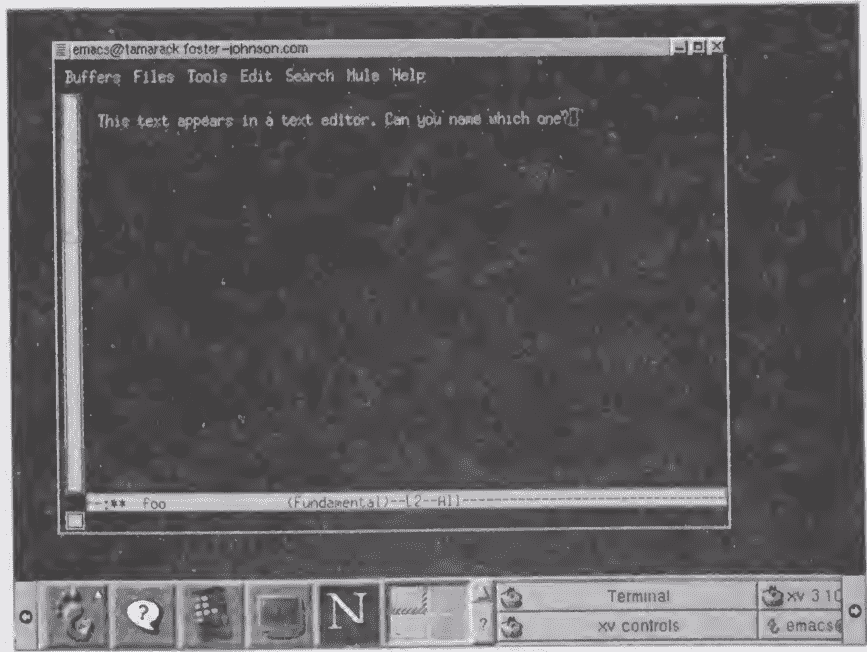

## 第 6 章

### 掌握这些技能

- `tar` 的使用与维护
- 磁带基础知识
- `tar` 与磁带
- 使用 `tar` 进行磁带备份
- 增量备份
- 计划备份任务
- 备份方案比较

## 执行完整备份

计算机中最昂贵的部分不是磁盘驱动器、CPU 或其他硬件。计算机中最昂贵的部分是存储在其中的数据。计算机"只"需要几千美元。你存储在其中的数据却价值连城。如果你想保留数据，就必须进行备份。大多数计算机专业人员都会虔诚地备份他们的系统。

Linux 自带了许多不同的备份工具。最常用的备份工具是 `tar` 命令。这个工具在所有 UNIX 系统上都可用，并且在制作用于机器之间传输的磁带时，它几乎就是标准。

`tar` 命令之后出现了 `cpio` 命令，这是 AT&T 试图用更好的东西替代旧 `tar` 命令的尝试。但它失败了。人们仍然使用 `tar`。结果是 `cpio` 备份很少被使用。

另一个标准备份系统是 `dump/restore` 命令对。这些工具经常用于系统备份。`dump` 的一个问题是它对可以备份的内容有严格限制。在大多数系统上，你能指定的最小备份单位不是目录而是分区。这个命令的 Linux 版本已经更新，因此你可以选择要备份的单个文件或目录。但这个程序的历史局限性意味着它很少用于制作可交换磁带。

除了 UNIX 标准工具外，Linux 还带有许多自主开发的工具，例如 `taper`。这是一个基于 GUI 的备份系统。然而，由于它不包含在任何标准 UNIX 系统中，因此不常用。还有许多其他工具可供 Linux 用户使用，例如 BRU、AMANDA 和 DIBS。

大多数备份工具都支持网络。换句话说，你可以使用一个 Linux 系统上的磁带来备份另一个系统上的磁盘。这对于小型网络（如办公室环境）来说是理想的，因为在这种环境中，你希望将每个人的机器备份到中央服务器。

尽管 Linux 带有许多不同的备份系统，我们只详细讨论 `tar`。这是因为 `tar` 命令是最常用的 UNIX 备份工具。而且 `tar` 命令能够可靠地完成简单备份所需的备份和恢复操作。

### `tar` 的使用与维护

`tar` 命令将一组文件打包存储到归档中。它也可以从归档中提取文件。

`tar` 命令的参数需要一些时间来适应。第一个字母告诉 `tar` 要做什么。在本例中，字母 `c` 表示 `tar` 要创建一个归档。

接下来是一系列选项字母。第一个选项 `v` 使 `tar` 输出详细信息，包含每个文件添加到归档时的名称。如果这个选项不存在，`tar` 会静默工作。

第二个选项 `f` 告诉 `tar` 下一个参数是归档文件的名称。如果省略这个选项，`tar` 将使用默认的磁带驱动器作为归档。

#### 提取文件

要从归档中提取文件，请使用命令：

```bash
$ tar xvf archive
```

如果你想提取特定的文件，请使用命令：

```bash
$ tar xvf archive files
```

文件名必须与归档中的文件名完全匹配。

#### `tar` 与压缩

默认情况下，`tar` 命令只处理归档，除非我们添加 `--gzip` 标志，否则它不会执行压缩。

例如：

```bash
$ tar cvf /tmp/file.tar .
```

创建当前目录的未压缩归档。命令：

```bash
$ tar cvf /tmp/file.tar.gz --gzip
```

创建压缩归档。（我们在本例中使用了标准扩展名 `.tar` 和 `.tar.gz`，但 `tar` 并不关心扩展名。它只查找 `--gzip` 标志。）

有一个特殊文件 `tar` 可以读取和写入。那就是名为 `"-"` 的文件，它代表标准输入或标准输出（取决于你是在读取还是写入）。

例如，不使用命令：

```bash
$ tar tf /tmp/file.tar
```

你可以使用命令：

```bash
$ tar tf - </tmp/file.tar
```

要将目录从一个地方移动到另一个地方，我们使用一个 `tar` 创建归档，并将其通过管道传输到位于另一个目录的另一个 `tar`。例如，假设我们要将 `/mnt/source` 中的所有文件移动到 `/mnt/dest`。我们会使用命令：

```bash
$ cd /mnt/source
$ tar cf - . | (cd /mnt/dest; tar xvf -)
```

第一个命令进入源目录。第一个 `tar` 命令创建当前目录（`.`）的归档。此输出被发送到标准输出（`-`）。我们不使用 `v` 选项，因为我们不想向标准输出写入除归档数据以外的任何内容。

命令的第二部分用 `()` 括起来。`cd /mnt/dest` 将目录更改为目标目录。（因为这个命令在括号内，它只影响括号内后面的命令。）`tar xvf -` 命令从标准输入中提取文件。（这是前一个 `tar` 命令的输出。）

## 执行完整备份

### CHAPTER 6

#### 清单 6-1：使用 `TAR` 创建简单归档

```text
$ tar cvf /tmp/cd.tar .
./
cd-speed.cc
Makefile
cd-speed
```

#### 清单 6-2：获取归档的目录列表

```text
$ tar tf /tmp/cd.tar
./
cd-speed.cc
Makefile
cd-speed
```

#### 清单 6-3：从归档中提取文件

```text
$ tar xvf /tmp/cd.tar
./
cd-speed.cc
Makefile
cd-speed
```

#### 清单 6-4：创建压缩归档

```text
$ tar cvf /tmp/cd.tar.gz --gzip .
./
cd-speed.cc
Makefile
cd-speed
```

注意归档的大小大幅下降！

```text
$ ls -l /tmp/cd.*
-rw-r--r-- 1 sdo users 40960 May 2 13:23 /tmp/cd.tar
-rw-r--r-- 1 sdo users 10347 May 2 13:24 /tmp/cd.tar.gz
```

#### 清单 6-5：从压缩归档中提取文件

```bash
$ tar xvf /tmp/cd.tar.gz --gzip
./
cd-speed.cc
Makefile
cd-speed
```

> **注意**
>
> #### `TAR` 与 `CP`
>
> 有一个递归复制命令 `cp -r` 可以复制目录树。但这个命令不理解符号链接或硬链接。符号链接在目标位置被更改为实际文件。有两个硬链接的文件会变成两个独立的文件。
>
> `tar` 命令完全了解符号链接和硬链接。这些链接在 `tar/tar` 复制过程中会被保留。

> **不要将归档包含在归档中**
>
> 新手常犯的一个错误是发出 `tar` 命令时不小心试图将归档包含在归档中。例如：

```bash
$ tar cvf dir.tar .
```

问题在于 `dir.tar` 位于当前目录中，所以 `tar` 试图将 `dir.tar` 放入 `dir.tar` 中。

## 磁带基础知识

要充分利用磁带驱动器，你需要了解 Linux 是如何处理它们的。UNIX 历史悠久，诞生于标准磁带还是半英寸盘式磁带、仅能存储数兆字节数据的年代。如今，磁带已经发生了巨大变化，但基本的磁带概念仍然相同。

要写入磁带，驱动器会将介质移过写入磁头。写入磁头中的电子元件会改变磁带上的磁荷。磁带上的数据以称为记录（record）的组进行写入。每个记录后面跟着一个记录结束标记。（在半英寸磁带上，这是记录末尾的一小段空白磁带。现代磁带使用其他方法。）

你可以在磁带上读写的最小数据单位是一个记录。有一种特殊的记录称为文件结束（EOF）标记，它表示一个磁带文件的结束。注意：磁带文件没有文件名，它们只有位置（磁带上的第一个文件、磁带上的第二个文件等）。两个连续的 EOF 标记表示磁带上数据的结束，称为媒体结束或（EOM）。

磁带驱动器在写入磁带文件时会使用一个小技巧。当文件关闭时，驱动程序会写入两个 EOF 标记（表示 EOM），然后回退越过其中一个。这样，如果你不写入另一个文件，EOM 就在正确的位置。如果你继续写入，则新文件的第一个记录将覆盖 EOM，当该文件关闭时，新的 EOM 将被写入磁带。

Linux *默认不*使用这个技巧。你必须使用 `mt` 命令来启用它：

```bash
# mt -f /dev/st0 stsetoptions \
two-fms can-bsr
```

`mt` 命令的格式为：

```text
mt -f device command [count]
```

### 设备名称

Linux 支持许多不同类型的磁带。每个磁带驱动器有两个名称，一个用于回绕设备，另一个用于非回绕设备。（见右侧表格。）

例如，第一个 SCSI 磁带命名为 `/dev/st0`（回绕）和 `/dev/nst0`（非回绕）。当回绕设备被关闭时，磁带会被回绕。如果你使用非回绕磁带，那么当你完成时，磁带不会发生任何变化。

> **注意事项**
>
> ### 如何*不*要向前移动磁带
>
> 人们常犯的一个错误是使用以下命令：

```bash
$ mt -f /dev/ftape fsf 1
```

来向前跳过一个文件。问题在于他们使用的是回绕设备。结果是磁带会快速前进一个文件，然后设备关闭并回绕。结果是空间操作完全无效。正确的命令是：

```bash
$ mt -f /dev/nftape fsf 1
```


# 执行完整备份

## 第 6 章

### 表 6-1：MT 命令

| 命令 | 说明 |
|---|---|
| `status` | 显示磁带驱动器的状态。 |
| `rewind` | 回绕命令。 |
| `offline` | 将磁带置为“脱机”状态并弹出磁带。 |
| `fsf count` | 向前跳过 `count` 个文件。 |
| `stoptions` | 设置选项（在示例中，告诉驱动程序）。 |
| `two-eofs` | 写入两个 EOF，并在文件关闭时回退。 |
| `can-bsr` | 一个；`can-bsr` 告诉驱动器该设备可以执行后退记录命令。 |
| `eod` | 跳转到数据的“末尾”（如果设置了 `two-eofs`，这将跳过第二个 EOF）。 |

### 表 6-2：磁带设备

| 名称 | 说明 |
|---|---|
| `/dev/ftape` | 回绕软盘磁带驱动器（包括 Colorado 备份磁带驱动器和其他连接到软盘控制器的内部磁带驱动器）。 |
| `/dev/nftape` | 非回绕软盘磁带。 |
| `/dev/rtf0` | 回绕软盘磁带 #0（与`/dev/ftape`相同）。 |
| `/dev/nrft0` | 非回绕软盘磁带 #0。 |
| `/dev/st0` | 回绕 SCSI 磁带 #0。 |
| `/dev/nst0` | 非回绕 SCSI 磁带 #0。 |
| `/dev/st1` | 回绕 SCSI 磁带 #1。 |
| `/dev/nrst1` | 非回绕 SCSI 磁带 #1。 |
| `/dev/ht0` | 回绕 IDE 磁带 #0。 |
| `/dev/nht0` | 非回绕 IDE 磁带 #0。 |
| `/dev/ht1` | 回绕 IDE 磁带 #1。 |
| `/dev/nht1` | 非回绕 IDE 磁带 #1。 |

### 在线查找

文件`/usr/doc/HOWTO/Ftape-HOWTO`包含有关不同类型磁带驱动器的信息。

## tar 与磁带

`tar`程序是为磁带驱动器设计的。要写入 tar 磁带，只需将磁带设备用作输出文件。

例如，要将当前目录中的所有文件写入软盘磁带驱动器，使用以下命令：

```
$ tar cvf /dev/ftape .
```

此命令使用回绕磁带驱动器。`tar`命令完成后，磁带会被回绕。

要从磁带中提取文件，使用以下命令：

```
$ tar xvf /dev/ftape
```

同样，这里使用的是回绕磁带驱动器。

## 多个磁带文件

通过使用非回绕磁带设备写入多个磁带文件，可以在单个磁带上放置多个 tar 归档。每个磁带文件包含一个单独的 tar 归档。

例如：

```
$ cd ~/dir1
$ tar cvf /dev/nftape .
$ cd ~/dir2
$ tar cvf /dev/nftape .
```

因为我们使用的是非回绕磁带，磁带会停留在数据末尾而不回绕。如果我们想使用它，需要将其回绕。这可以通过`mt`命令实现：

```
$ mt -f /dev/nftape rewind
```

`mt reputation`命令可以执行多种定位命令。`rewind`命令将磁带回绕。

现在我们来看看磁带上有哪些内容。显然，要获取目录列表，我们需要的命令是：

```
$ mt -f /dev/nftape rewind
$ tar tf /dev/nftape
$ tar tf /dev/nft Results 

**错误 错误 错误**
```

此示例会失败。这是因为`tar`是一个特殊的程序。当它获取磁带的目录列表时，它确切知道磁带文件中有多少数据，并在读取完所有数据后停止。不幸的是，这正好停在 EOF 标记之前。如果我们不做任何操作，下一个`tar`命令将尝试读取一个文件，碰到 EOF 标记，然后什么也得不到。

我们必须做的是：

```
$ mt -f /dev/nftape rewind
$ tar tf /dev/nftape
$ mt -f /dev/nftape fsf 1
$ tar tf /dev/nftape
```

`fsf 1`命令告诉`mt`“向前跳过一个文件”。这将磁带移动到下一个磁带文件的开头并越过 EOF。

但请注意：当`tar`通过添加`--gzip`选项生成压缩归档时（见下文），此问题不会发生。

### 注意事项

## 标准传输格式

在 UNIX 和类 UNIX（Linux）系统之间传输数据的最常见方法是 tar 磁带。

## 清单 6-6：MT 和 TAR 示例

```
$ mt -f /dev/nst1 status

SCSI 1 tape drive:

File number=0, block number=0.

Tape block size 1024 bytes. Density code

0x0 (default).

Soft error count since last status=0

General status bits on (41010000):

  BOT ONLINE IM_REP_EN
```

```
$ mt -f /dev/nst1 rewind

$ tar cvf /dev/nst1 ./cd-speed

./cd-speed/

./cd-speed/cd-speed.cc

./cd-speed/Makefile

./cd-speed/cd-speed
```

```
$ tar cvf /dev/nst1 ./puzzle

./puzzle/

./puzzle/square.cpp

./puzzle/lamp.p

./puzzle/puzzle.cpp
```

```
$ mt -f /dev/nst1 rewind

$ tar tf /dev/nst1

./cd-speed/

./cd-speed/cd-speed.cc

./cd-speed/Makefile

./cd-speed/cd-speed
```

```
$ mt -f /dev/nst1 fsf 1

$ tar tf /dev/nst1

./puzzle/

./puzzle/square.cpp

./puzzle/lamp.p

./puzzle/puzzle.cpp
```

## 使用 tar 进行磁带备份

本任务描述如何构建 shell 脚本来执行夜间备份。

我们首先构建一个包含简单`tar`命令的 shell 脚本：

```
#!/bin/sh

mt -f /dev/nftape rewind

cd /

tar cf /dev/nftape .
```

此脚本工作正常，但如果使用 shell 变量来表示磁带设备名称，维护起来会更容易。

```
#!/bin/sh

TAPE=/dev/nftape

mt -f $TAPE rewind

cd /

tar cf $TAPE .
```

`tar`命令转储根文件系统上的所有内容，包括`/proc`。由于`/proc`是由操作系统生成的，不包含需要备份的内容，让我们使用`--exclude`命令将其从归档中排除（注意`./proc`开头的点）：

```
tar cf $TAPE --gzip --exclude ./proc .
```

我们想要压缩我们的归档。这可以通过在`tar`命令中添加`--gzip`选项来实现：

```
tar cf $TAPE --gzip --exclude ./proc .
```

磁带备份的一个问题是不知道里面有什么。一种解决方案是将备份脚本本身作为第一个文件写入磁带。

当指定`--gzip`选项时，`tar`命令会做一个棘手的事情。通过后台进程的使用，命令在释放磁带之前稍早完成。这意味着如果你在`tar`命令完成后立即尝试使用磁带，你的命令将失败，因为磁带正忙。解决方案是在`tar`之后执行`sleep 30`（一个等待 30 秒的命令），让事情稳定下来。

这是通过`dd`命令完成的。此命令可以精确控制数据的读写方式。在这种情况下，我们想写入 1K 物理记录，因为几乎所有磁带驱动器都接受这个大小。

我们的`dd`命令如下：

```
dd if=$0 of=$TAPE bs=1k conv=sync
```

（这在右侧有详细解释。）

## 测试脚本

要测试脚本，以 root 身份执行以下命令：

```
# sh -x /root/dump/full.sh
```

`sh -x`命令告诉 shell（`sh`）以 echo 开启（`-x`）的方式执行脚本。启用 echo 后，shell 会在执行每个命令之前将其写出。磁带应该转动，数据应该被备份。

现在让我们对磁带进行写保护并查看它。（写保护可以防止误操作擦除磁带。）查看磁带时，确保通过回绕磁带从开头开始：

```
# mt -f /dev/nftape rewind
```

接下来，查看第一个磁带文件。那是写入磁带的脚本。要提取并查看它，使用以下命令：

```
# dd if=/dev/nftape of=/tmp/script.txt bs=1k
# more /tmp/script.txt
```

下一个磁带文件是第一个`tar`文件。`tar tf`获取磁带的内容：

```
# tar tf /dev/nfstape --gzip
```

如果备份顺利，你将获得所有备份文件的目录。你还会看到一个警告：

## 执行完全备份

```
gzip: stdin: decompression OK, trailing garbage ignored

tar: Child returned status 2

tar: Error exit delayed from previous errors
```

这是由数据以固定大小的块写入磁带导致的。可以放心忽略。

## 清单 6-7：FULL.SH

```sh
#!/bin/sh

#

# 执行完全备份 

#

TAPE=/dev/nst0

mt -f $TAPE rewind

#

# 为未来增量备份创建时间戳文件 

#

touch /root/full_timestamp

# 备份脚本本身

dd if=$0 of=$TAPE bs=1k conv=sync

# 使用 tar 备份系统

cd /

tar cfl $TAPE --gzip --exclude ./proc .

sleep 30

# mt -f /dev/nst0 rewind
```

```
# sh -x /root/dump/full.sh

+ TAPE=/dev/nst0

+ mt -f /dev/nst0 rewind

+ touch /root/full_timestamp

+ dd if=/root/dump/full.sh of=/dev/nst0 bs=1k conv=sync

1+0 records in

1+0 records out

+ cd /

+ tar cfl /dev/nst0 --gzip --exclude ./proc .

+ sleep 30

# mt -f /dev/nst0 rewind
```

## 清单 6-8：备份与测试运行示例

```
# dd if=/dev/nst0 of=./tmp/full.tmp bs=1k

1+0 records in

1+0 records out

# tar tf /dev/nst0 --gzip ./ lost+found/ mnt/ /mnt/floppy/etc/exports etc/group..

gzip: stdin: decompression OK, trailing garbage ignored

tar: Child returned status 2

tar: Error exit delayed from previous errors
```

### 表 6-3：DD 命令参数

| 参数 | 描述 |
|---|---|
| `if=file` `bs=size` | 输入文件（默认值 = stdin）。 |
| `of=file` `bs=size` | 输出文件的名称（默认值 = stdout）。要读取或写入的块大小。对于磁盘，大小无关紧要。对于磁带驱动器，这是物理记录的大小。某些磁带驱动器会限制允许的物理记录大小。1K 的大小几乎适用于所有磁带驱动器。 |
| `conv=sync` | 转换规范。允许多种转换。`sync`转换告诉`dd`填充任何短块，使其填满完整的块。 |

## 增量转储

完全备份将系统上的所有文件复制到磁带。这是最简单、最完整的备份形式，但也是耗时最长、磁带用量最多的备份方式。

很多时候您可能希望进行增量备份，即只备份自某个特定日期（例如上次执行完全备份的时间）以来已更改的文件。

执行增量备份更复杂，因为您需要先找出需要备份的文件集，然后将它们复制到磁带。

`find`命令具有选项，可以查找比给定文件更新的所有文件。这在增量备份中非常有用。

需要做一些准备工作。您需要修改完全备份脚本，在执行`tar`之前修改时间戳文件的修改日期。这样您就可以将此文件用作标记，以便备份自时间戳以来所有已更改的文件。

`touch`命令让系统认为文件已被修改。文件本身并未更改，但系统不知道这一点，因此它会更改修改日期。因此要创建一个修改日期指示上次完全备份时间的时间戳文件，在`full.sh`的`tar`命令之前添加以下行：

```
touch /root/full_timestamp
```

现在，当您想要执行增量转储时，可以要求`find`命令查找自`/root/full_timestamp`以来已修改的所有文件。

实际的`find`命令是：

```
find . -type f \
-newer /root/full_timestamp \
-print
```

此命令逐行输出在`/root/full_timestamp`之后（`--newer`）修改的所有文件的名称。

现在，举一个极端奇怪的例子：此代码中有一个错误。它无法正确处理文件名中包含换行符的情况。信不信由你，Linux 允许您在文件名中放置控制字符（包括换行符）。没有理智的人会这样做，但我们希望备份能够防弹并处理疯狂的情况。

`find`命令有一个选项（`--print0`），使用空字符而非换行符来分隔名称。这解决了我们的问题，因为空字符是 Linux 文件名中不允许使用的两个字符之一。（另一个是斜杠。）

`find`的输出可以通过管道传递给`tar`命令。我们需要告诉`tar`它将从标准输入接收文件列表。这是通过`--files-from -`选项完成的。

另一个选项（`--null`）告诉`tar`这是一个以空字符结尾的列表。因此我们的备份命令是：

```
find . -type f \
-newer /root/full_timestamp \
-print0 | \
tar cf /dev/nftape --files_from - \
--null --gzip
```

您会高兴地发现这可以工作——几乎。还有一个小问题有待解决。问题是`tar`不喜欢创建空档案。因此，如果您没有更改任何文件，`tar`将会中断。

解决方案很简单：确保在两次备份之间修改一个文件。一种方法是在执行`tar`之前使用`touch`命令修改一个文件：

```
# touch /tmp/dump.me
```

完整的增量脚本可以在清单 6-9 中看到。

## 执行完全备份

### 清单 6-9：完全备份和增量备份示例测试运行

```
sh -x /root/dump/full.sh

+ TAPE=/dev/nst0

+ mt -f /dev/nst0 rewind

+ touch /root/full_timestamp

+ dd if=/root/dump/full.sh of=/dev/nst0

bs=1k conv=sync

0+1 records in

1+0 records out

+ cd /

+ tar cfl /dev/nst0 --gzip --exclude ./proc

.

+ sleep 30

sh -x /root/dump/inc.sh

+ TAPE=/dev/nst0

+ mt -f /dev/nst0 eod

+ dd if=/root/dump/inc.sh of=/dev/nst0

bs=1k conv=sync

0+1 records in

1+0 records out

+ touch /tmp/dump.me

+ cd /

+ find . -type f -newer

/root/full_timestamp -print0

+ grep -v ^\./proc

+ tar cf /dev/nst0 --gzip --null --files-

from -

+ sleep 30
```

- 倒带并获取完全备份的目录。

```
# mt -f /dev/nst0 rewind

# dd if=/dev/nst0 of=/tmp/full.tmp bs=1k

1+0 records in

1+0 records out

# tar tf /dev/nst0 --gzip >/tmp/full.toc
```

```
gzip: stdin: decompression OK, trailing

garbage ignored

tar: Child returned status 2

tar: Error exit delayed from previous

errors
```

- 现在我们执行`sleep 30`等待`tar`命令释放磁带。

```
# sleep 30
```

- 现在获取增量转储的目录。

```
# dd if=/dev/nst0 of=/tmp/inc.tmp bs=1k

1+0 records in

1+0 records out
```


# `tar tf /dev/nst0 --gzip`

```text
gzip: stdin: decompression OK, trailing
garbage ignored

tar: Child returned status 2

tar: Error exit delayed from previous
errors
```

# `sleep 30`

## 计划备份

现在我们来规划一周的备份。周一，我们执行完全备份，因此 `mon.sh` 脚本如下：

```sh
#!/bin/sh

# 执行完全转储

/home/root/dump/full.sh
```

周二至周六，我们执行增量转储。脚本如下：

```sh
#!/bin/sh

# 执行增量转储

/home/root/dump/inc.sh
```

为了方便管理，我们创建五个名为 `tue.sh`、`wed.sh`、`thur.sh` 和 `fri.sh` 的脚本。

周日，我们执行增量转储，同时弹出磁带：

```sh
#!/bin/sh

# 执行增量转储

/home/root/dump/inc.sh

# 弹出磁带

mt -f /dev/nftape off
```

## 安排脚本

现在我们已经有了备份脚本，下一步就是安排它。通过选择 Foot → System → LinuxConf 启动 `linuxconf` 程序。选择 Control → Configure superuser schedule 项目。

点击 Add 向计划作业列表中添加新条目。现在我们来填写周一的条目。在 Command 空白处输入要运行的命令名称。您应该使用要运行命令的完整路径。在本例中，它是 `/usr/root/dump/mon.sh`。

Months 条目决定此脚本在哪些月份运行。您可以选择 `*`，这样脚本将在所有月份运行。在本例中，我们希望备份始终运行，因此将条目保留为 `*`。

Day of the Month 条目选择每月的哪一天使用。同样，对于每周完全备份来说，这无关紧要，因此将其保留为 `*`。

Day of the Week 很重要。对于周一，我们希望此项为 1。（如果您希望脚本在多个天运行，可以输入用斜杠分隔的多个天，例如 `1/3/5`，或一个天数范围 `2–5`。）

脚本应在凌晨 2:00 运行，因此在 Hours 中输入 2，在 minutes 中输入 00。

点击 Accept 接受此条目。

对一周中其他每一天的脚本重复此过程。完成后，点击 Act/Changes 安装更改并退出。

现在当凌晨 2:00 到来时，脚本将自动启动。任何输出都会保存并以邮件消息的形式发送给 root。如果一切顺利，您每天早上都会收到一封邮件，告诉您备份进行得如何。

### 注意事项

## 恢复还原

有一个程序无法使用正常的恢复程序来还原。（在本例中，是 `tar`。）该程序就是实际的恢复程序本身。毕竟，在任何还原开始之前，它必须已经启动并运行。

适当的灾难规划不仅包括将所有内容备份到磁带，还包括制定恢复操作系统、恢复程序，然后是所有数据的计划。

### 执行完整备份

#### 第六章

#### 清单 6-10：MON.SH

```sh
#!/bin/sh

/root/dump/full.sh
```

#### 清单 6-11：TUE.SH

```sh
#!/bin/sh
/root/dump/inc.sh
```

#### 清单 6-12：WED.SH

```sh
#!/bin/sh
/root/dump/inc.sh
```

#### 清单 6-13：THUR.SH

```sh
#!/bin/sh
/root/dump/inc.sh
```

#### 清单 6-14：FRI.SH

```sh
#!/bin/sh
/root/dump/inc.sh
```

#### 清单 6-15：SAT.SH

```sh
#!/bin/sh
/root/dump/inc.sh
```

#### 清单 6-16：SUN.SH

```sh
#!/bin/sh
/root/dump/inc.sh
mt -f /dev/nftape off
```

其中一些脚本是相同的，以展示其灵活性。你可以轻松地向脚本中添加不同的日常任务，而无需更改计划。

### 注意事项

## 备份折磨测试

不久前，一所主要大学的系统管理员在极端条件下测试了各种 UNIX 备份系统。对于某些系统来说，最难处理的是带有“空洞”的文件——这些文件由一些奇怪的程序写入，看起来包含大量数据。实际上，它们只有文件开头的一点点数据、结尾的一点点数据，中间什么都没有。

包含空洞的文件非常难以处理。如果复制它们，复制命令会填充空洞，导致文件占用的磁盘空间激增。大多数备份程序也无法妥善处理它们。要区分一个全是空洞的文件和一个包含空洞的文件几乎是不可能的。

测试结果令人震惊：所有备份系统都失败了。没有一个能正确处理所有测试用例。GNU `tar` 程序表现相对较好，能够备份和恢复大部分文件。但那时它还无法处理文件名中包含换行符的情况以及一些较长的文件名。

自那以后，GNU `tar` 得到了增强和改进。然而，即使在今天，它可能仍然无法通过备份折磨测试（该测试非常极端），但它应该能够处理你所有的备份和恢复需求。

## 备份工具比较

Linux 自带了多种备份工具。在本节中，我们比较各种程序的功能特性。

### `tar`

`tar` 命令是经典的 UNIX 标准工具。它仅提供命令行界面，没有可用的 GUI 版本。

Linux 的一个优点是其网络功能。`tar` 利用这一特性，可以通过网络使用另一台系统上的磁带驱动器。例如，如果指定磁带名称 `/dev/ftape`，则使用本地计算机上的磁带；但如果指定类似 `zabbar:/dev/ftape` 的名称，程序将使用 `zabbar` 系统上的磁带设备。

Linux 版本的 `tar` 还可以处理跨越多盘磁带的大型备份。当第一盘磁带满时，`tar` 会提示更换下一盘磁带。`tar` 命令甚至可以配置为在磁带满时自动运行脚本。这在拥有自动换带机的环境中非常有用。

`tar` 命令可以在备份时进行压缩。`tar` 使用的压缩系统（`gzip`）通常比大多数现代磁带驱动器内置的硬件压缩效果更好。

`tar` 的一个缺点是其写入磁带的方式。磁带的一般格式为：

```text
文件头，文件数据

文件头，文件数据

文件头，文件数据

...
```

要获取目录列表或恢复文件，必须读取整盘磁带。

### `cpio`

`cpio` 命令是 AT&T 试图创建更好的 `tar` 的尝试。`cpio` 程序的主要问题之一是其功能有限。要真正使用它进行备份，你不仅需要了解 `cpio` 命令，还需要了解 `find` 命令。

与 `tar` 一样，`cpio` 命令可以处理本地和远程磁带。`cpio` 的一大缺点是它无法处理多盘磁带。

压缩功能未内置于 `cpio` 中，但可以使用 `cpio` 和 `gzip` 结合来创建压缩磁带。

最后，`cpio` 使用与 `tar` 类似的头部/数据格式写入磁带。这意味着获取文件或目录列表需要扫描整盘磁带。

`cpio` 的另一个大缺点是它使用非标准格式。实际上，`cpio` 将“非标准”这个词推向了新的高度。它甚至与自身不兼容。存在多种 `cpio` 格式，每种都由不同的制造商创建。此外，还有一种兼容模式，会生成另一种不同的格式。结果是，除非你确切知道 `cpio` 磁带是如何创建的，否则你将很难读取它。

### `dump/restore`

`cpio` 和 `tar` 等程序使用同一程序来读写磁带。而 `dump/restore` 程序则不同，`dump` 负责写入磁带，`restore` 负责读取。

### `taper`

`dump` 程序是另一个 UNIX 标准备份程序。它设计于使用 ½ 英寸磁带的年代，至今仍偏爱这种磁带类型。`dump` 的许多参数都基于这种格式，因此如果你使用其他类型的磁带，需要进行调整。

`dump` 程序可以写入多盘磁带，但必须在写入前估算磁带大小。如果估算太小，会浪费磁带。太大，则 `dump` 会因磁带用完而中止。要准确估算大小很困难，尤其是在大多数现代驱动器内置了压缩功能的情况下。

`dump` 程序不会压缩驱动器上的数据。

尽管 `dump` 命令极难使用，`restore` 命令却恰恰相反。“交互式”恢复模式为你提供了一个微型 shell，可以在其中浏览文件系统并选择要恢复的文件。

此外，由于 `dump` 程序在磁带开头写入目录表，因此获取目录列表或启动 `restore` 很快，因为恢复程序不必扫描整盘磁带来查找内容。

`taper` 程序是一个交互式备份程序。它提供了一个友好、易于使用的界面。它具备备份系统所需的所有功能——压缩、多盘磁带以及其他特性。

它将磁带上的文件列表保存在磁盘的数据库中。这使得获取磁带内容或恢复单个文件极其快速。如果磁带不在数据库中，则必须先扫描磁带才能使用。这可能需要一些时间。

然而，该程序有一个主要缺点：它不如其他备份系统成熟和可靠。因此，其可靠性不如 `tar`、`cpio` 或 `dump`。

| 工具 | 易用性 | 可靠性 | 远程磁带 | 多盘磁带 | 压缩功能 | 目录表 |
|------|--------|--------|----------|----------|----------|--------|
| tar | B | A | 支持 | 支持 | 支持 | 文件头 |
| cpio | C | C（格式问题） | 支持 | 不支持 | 不支持（可外部使用 gzip） | 文件头 |
| taper | A | B | 不支持 | 支持 | 支持 | 磁盘数据库 |
| dump/restore | C/A | A | 支持 | 支持（效果差） | 不支持 | 磁带开头 |

## 个人练习册

### 问答

**1** 以下命令中的 **v** 选项是什么意思？

```sh
tar cvf /dev/nst0 /home/sdo
```

**2** 如何使用 `tar` 获取磁带的目录列表？

**3** 磁带文件和磁盘文件有什么区别？

**4** `tar` 的哪个选项开启压缩功能？

**5** 以下命令用于备份两个不同的目录。

```sh
$ mt -f /dev/nftape rewind
$ tar cf /dev/nftape ./first
$ tar cf /dev/nftape ./second
```

如何提取“second”目录中的所有文件？

**6** 一位系统管理员决定使用以下两个命令将磁带定位到第二个磁带文件的开头。但他做错了什么？

```sh
$ mt -f /dev/ftape rewind
$ mt -f /dev/ftape fsf 1
```

**7** 如果你写入一个压缩归档文件，并在没有 `--gzip` 选项的情况下尝试读取它，能成功吗？

**8** 为什么应该避免使用 `cpio` 程序？

答案：第 336 页

## 执行完整备份

#### 第 6 章

### 额外练习

1. 使用 `tar` 将目录树备份到文件中。获取该归档的目录表，并将其恢复到临时目录。
2. 使用 `tar` 将目录树备份到文件中，但这次使用压缩归档。
3. 将三个 `tar` 归档写入磁带。获取每个归档的目录表。
4. 执行 `info tar` 命令，并查看 `tar` 的在线文档。
5. 编写一个备份脚本并尝试运行。
6. 使用 `cron` 安排定期备份。

### 实际应用

- 某公司在计算机上保存业务记录。为了确保大楼发生火灾时一切安全无虞，公司制作两份副本，并将其中一份存储在异地位置。
- 帮助台接到一名学生的电话，称找不到自己的文件。经过简单调查，帮助台发现该学生上次登录已是五年多以前。自那时起，计算中心已经更换过三次备份介质，两次更换备份程序。然而，那位热衷于保留旧备份程序和磁带驱动器的高级管理员，仍然成功恢复了他的数据。

#### 视觉测验

正在调度什么命令？它将在何时运行？

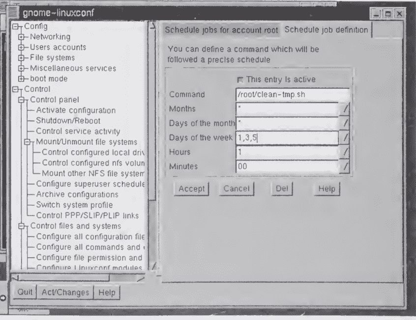

137

# 第二部分

7. X 窗口系统  
8. 桌面应用程序  
9. 命令窗口  
10. 在 PC 上播放声音和音乐  
11. 与 Microsoft Windows 协同工作  
12. 游戏

## 第 7 章

- X 窗口系统
- 桌面应用程序
- 命令窗口
- 在 PC 上播放声音和音乐
- 与 Microsoft Windows 协同工作
- 游戏

## Linux 桌面

Linux 基于 UNIX 操作系统，该系统以简短而古怪的命令著称。即便如此，如今的 Linux 拥有现代化的图形用户界面。本部分将介绍 Linux 桌面以及如何充分利用它。

如第 7 章所述，Linux 的图形功能来自 X 窗口系统。这种通用的窗口界面不会将你锁定在任何特定的用户界面中；你几乎可以在 X 之上叠加任何界面。

这类界面包括 GNOME 和 KDE 桌面环境。两者都旨在 Linux 之上提供完整的用户友好界面。本书介绍的 Red Hat Linux 同时支持 KDE 和 GNOME，但 Red Hat 的默认环境是 GNOME。

第 8 章将介绍 GNOME 和 KDE 桌面附带的办公应用程序，以及与这两种界面无关的应用程序。Linux 允许你自由选择想要运行的程序，无论它们支持哪种桌面。

即使有桌面环境，你仍然需要输入 Linux 命令。第 9 章将介绍封装 Linux 命令行 shell 的特殊窗口。

没有播放音乐和声音功能的桌面是不完整的。第 10 章将介绍如何从 Linux 实现这一点。

第 11 章将介绍如何在 PC 上运行另一种主要操作系统。你可以通过名为 `wine` 的特殊程序共享文件、读取磁盘，甚至运行一些应用程序。

第 12 章通过介绍使用 Linux 玩游戏带来的业余乐趣，为桌面部分画上圆满的句号。

## 第 7 章

### 掌握这些技能

- 认识桌面
- 配置 Red Hat 桌面
- 资源与资源文件
- 窗口管理器
- 屏幕保护程序与背景
- 设置 X 登录

### X 窗口系统

在很久很久以前、很遥远的计算星系中，每个 UNIX 工作站厂商都发明了各自互不兼容的窗口系统。拥有多家厂商系统的机构在为这些窗口系统编写应用程序时束手无策。开发人员不得不为每个独立的系统编写软件，而没有任何两个系统是相似的。当时，厂商们可能认为这种锁定客户的形式是件好事。随后，X 窗口系统应运而生。由麻省理工学院开发的 X 提供了一种可在多家厂商工作站上运行的窗口系统。这一点，加上它的免费发布，使得 X 像野火一样迅速普及。当 Linux 出现并需要图形功能时，移植 X 便成了理所当然的选择。

X 颠覆了客户端和服务器端的常规概念。服务器位于你的桌面，控制显示器上的窗口，并接收来自键盘和鼠标的输入。客户端，即 X 应用程序，与 X 服务器通信，请求服务器绘制图像并将按键发送给应用程序。这些客户端可以在你的 Linux 系统或网络中的任何其他系统上运行。这种网络透明性意味着你可以在其他系统上运行 X 应用程序——利用它们的计算能力——并将其显示在你的桌面上。

X 的另一个关键特性是严格遵循这样的理念：X 提供完成事情的机制，但不规定你必须如何做的策略。这在用户界面领域尤为如此。

在相对低层的 X 编程 API 之上，你可以叠加任何类型的用户界面。这是你在 Windows 或 Mac OS 系统上根本无法享有的自由。

如今，X 以 XFree86 的形式为 Linux 提供图形功能。Red Hat 选择 GNOME 环境作为默认桌面。GNOME 环境包含不少新的应用程序，其用户界面比 `xman` 或 `xterm` 等旧版 X 程序要友好得多。

当你登录并输入 `startx` 命令时，就会进入这个环境：

```sh
$ startx
```


如果你已经显示了图形环境，请不要运行此命令。（例如，在阅读“设置 X 登录”任务后，你的 Linux 可能从启动时刻起就有图形环境。在这种情况下，你不需要运行`startx`。）

## 认识桌面

桌面是你通过`startx`命令启动 X 时看到的内容。从 6.0 版开始，Red Hat 的默认桌面由 GNOME 提供，GNOME 是 GNU Network Object Model Environment（GNU 网络对象模型环境）的缩写。GNOME 提供的桌面如对面页面中的第一张图所示。一些用户运行替代桌面，即 K Desktop Environment（K 桌面环境），简称 KDE。（默认情况下，Red Hat 安装程序不会安装 KDE。如果你需要 KDE，请务必安装它。）一些用户根本不运行大型环境，因为 GNOME 和 KDE 都需要大量 RAM 和计算能力。

无论你使用 GNOME 与否，本章介绍的技术都适用于所有 X 环境。你可能需要在 KDE 下调用不同的对话框来配置某些内容，但操作非常相似。

基本桌面一开始相当空荡，只有 GNOME 帮助程序和文件管理器。你最可能做的第一件事是启动一两个程序。你可以通过点击屏幕底部的启动图标，或从任务栏上的主菜单来启动程序。你可以点击屏幕底部任务栏上的 GNOME 足迹图标来调出此菜单。GNOME 的最佳特性之一是它还会显示来自 AnotherLevel（另一个桌面环境）和 KDE 的菜单。

当屏幕上有几个程序后，你会注意到有一个窗口与其他窗口高亮显示不同。这是拥有键盘焦点的窗口。你在键盘上输入的任何文本都会发送到这个窗口。要将键盘焦点切换到另一个窗口，请用鼠标点击那个窗口。该窗口应该会升至顶层并显示特殊高亮。任何时候只有一个窗口可以接受键盘输入。

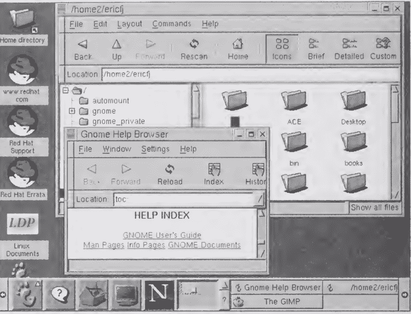

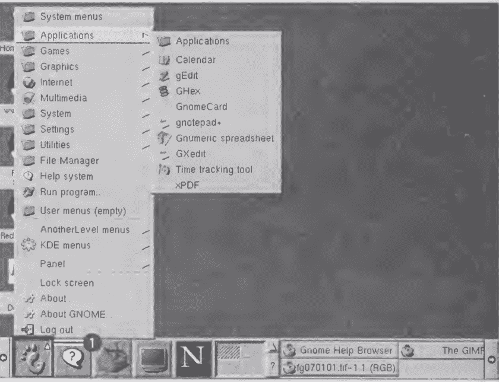

- 运行`startx`命令以查看这个初始 GNOME 桌面。
- 点击 GNOME 菜单图标以查看所有这些应用程序和子菜单。这些菜单提供了访问大量应用程序的便捷途径。

> **交叉参考**
>
> 第 8 章将介绍主要的桌面应用程序。

### X 窗口系统

你与系统的大部分交互来自鼠标。X 假设你使用的是三键鼠标。如果使用两键鼠标，可以通过同时按下两个鼠标按钮来模拟中间鼠标按钮。

在大多数情况下，最左侧的鼠标按钮负责大部分工作，如选择对象和激活窗口。最右侧的鼠标按钮通常会弹出菜单，就像在 Windows 中一样。也像 Windows 一样，你可以双击或三击鼠标按钮。

#### 注意：左撇子联合起来

要反转左右鼠标按钮，请使用以下命令：

```bash
$ xmodmap -e "pointer = 3 2 1"
```

要将鼠标按钮恢复为原始顺序，请使用以下命令：

```bash
$ xmodmap -e "pointer = 1 2 3"
```

#### 退出 GNOME

我们在尝试退出 GNOME 时发现了一个错误——很多时候它根本无法退出。如果你遇到这种情况，请按 Ctrl+Alt+Backspace 键，X 应该会退出。

1. 从 GNOME 帮助窗口调用通常由`info`和`man`命令提供的在线帮助文档。
2. 选择 GNOME 脚印图标以调出菜单。
3. 选择“注销”以退出 GNOME 桌面和 X。GNOME 会提示你确认选择。

#### 在线查找

KDE 项目主页是 <http://www.kde.org>。

#### 桌面简介

你可以从 GNOME 桌面或命令行启动 X 应用程序。许多程序提供一个命令行窗口，使用你的默认 Shell（通常是`bash`）。从 Shell 提示符下，你也可以启动 X 窗口应用程序。

此外，大多数 X 程序接受一组相似的命令行参数。并非所有程序都如此，但大多数 X 程序支持表 7-1 中显示的选项。

X 的最佳特性之一是它能够在远程系统上运行程序并设置窗口大小和位置。

### 设置窗口大小和位置

X 坐标系以显示器的左上角为 0,0 原点。X 值向右横跨屏幕时增加，Y 值向下延伸时增加。大多数 X 应用程序接受`-geometry`命令行参数，你可以用它来设置窗口的大小或位置（或两者）。对于位置，你需要提供窗口左上角的 X 和 Y 值。例如，以下命令在屏幕横向 200 像素、纵向 350 像素的位置启动`xclock`应用程序：

```bash
$ xclock -geometry +200+350
```

如果你想控制窗口的起始大小，请先传递宽度和高度（以像素值表示）：

```bash
$ xclock -geometry 100x120+200+350
```

这将起始大小设置为宽 100 像素、高 120 像素，位置与上次相同。如果你只想设置起始大小，可以省略位置：

```bash
$ xclock -geometry 100x120
```

表 7-2 介绍了表示显示器四个角的特殊 0,0 定位方式。

#### 交叉参考

第 9 章介绍 GNOME 终端程序。

#### 在线查找

在 <http://www.xig.com> 查找 Xi Graphics。

#### 注意：多显示器安全问题

当你尝试连接到另一个 X 服务器时，可能会遇到安全错误。`xhost`程序允许你开启从特定主机上运行的程序对你显示器的访问。要允许名为 Nicollet 的主机访问，请在你的显示器上使用以下命令：

```text
$ xhost +nicollet

nicollet being added to
access control list
```

要允许任何主机访问（这存在安全风险），请使用以下命令：

```text
$ xhost +

access control disabled,

clients can

connect from any host
```

要禁止特定系统的访问，请使用减号代替加号。例如：

```text
$ xhost -nicollet

nicollet being removed

from access

control list
```

`xauth`程序设置一个授权密钥，X 应用程序必须出示该密钥才能连接。

#### X 程序的位置

大多数 X 程序存储在`/usr/X11R6/bin`目录中。GNOME 程序位于`/usr/bin`，KDE 程序也是如此。

一般来说，窗口管理器程序的名称中含有`wm`，提供 Shell 窗口的程序名称中含有`term`。

#### 表 7-1：常用 X 命令行参数

| 参数 | 用途 |
| --- | --- |
| `-geometry WidthxHeight+X+Y` | 设置窗口的起始大小和位置，宽为 Width，高为 Height，位于 X, Y。 |
| `-display hostname:server.screen` | 在主机 hostname 上的 X 服务器和屏幕显示启动 X 程序。 |
| `-fg color` | 设置程序的前景色。 |
| `-bg color` | 设置程序的背景色。 |
| `-foreground color` | 设置程序的前景色。 |
| `-background color` | 设置程序的背景色。 |
| `-rv` | 反转视频，即交换前景色和背景色。 |
| `-iconic` | 以图标形式启动窗口。 |
| `-help` | 提供 GNOME 应用程序的帮助。 |
| `-xrm "X resource value"` | 设置给定的 X 资源值。有关更多信息，请参阅关于 X 资源文件的任务。 |

#### 表 7-2：指定显示器的角

| 值 | 哪个角 |
| --- | --- |
| `+0+0` | 左上角 |
| `+0-0` | 左下角 |
| `-0+0` | 右上角 |
| `-0-0` | 右下角 |

## 配置 Red Hat 桌面

如果你正在运行 GNOME 桌面，可以从方便的 GNOME 控制中心配置大部分桌面设置，如对面页面所示。从这个面板中，你可以设置屏幕背景、选择 GNOME 外观主题、调整键盘和鼠标参数等。

退出 GNOME 时，它可以根据需要保存显示窗口的位置。GNOME 会在下次进入 GNOME 桌面时（即下次运行`startx`命令时）尝试恢复这些窗口。

GNOME 支持多个虚拟桌面，这些是屏幕大小的工作区，帮助你组织工作。每个桌面显示 GNOME 任务栏及其自己的窗口集合。默认情况下，GNOME 提供对面页面第一张图所示的寻呼机中的四个区域。（这听起来可能令人困惑。如果是这样，请尝试在虚拟区域之间切换，很快就会清楚。）

通过选择“面板”子菜单和“此面板属性”选项，你可以控制 GNOME 任务栏的位置，以及是否应该在任务栏的两端显示隐藏按钮。

“设置”菜单提供了大量控制桌面的选项，从声音到菜单编辑器，如对面页面最后一张图片所示。

1. 点击配置工具图标。
2. 从 GNOME 控制中心更改设置。
3. 点击隐藏按钮以收缩任务栏。
4. 点击寻呼机以切换虚拟桌面。

1. 选择 GNOME 脚印图标。
2. 调出 KDE 系统菜单。
3. 选择桌面切换工具。
4. 从这个窗口中，选择 GNOME、KDE 或 AnotherLevel（较旧的 Red Hat 桌面）。

#### 交叉参考

本章后面的“窗口管理器”任务展示了如何更改虚拟桌面的数量。

## X 窗口系统

### 第 7 章

1. 通过 K 图标，您可以调出菜单来选择应用程序。
2. KDE 支持多个桌面，默认显示为这里所示的四个。
3. 选择 KDE 帮助图标以获取帮助。

1. 从任务栏的“设置”菜单中调出 GNOME 菜单编辑器。（此菜单提供了大量配置桌面的方式。）在菜单编辑器中修改菜单。
2. 要为新菜单项选择图标，请点击图标按钮，当前显示为“无图标”，因为您尚未选择。

#### 注意：安装 KDE

如果您希望运行 KDE 环境，可以在安装 Red Hat Linux 时安装 KDE 的 RPM 文件。如果已安装，您将在 GNOME 菜单下看到 KDE 菜单。要从 GNOME 切换到 KDE，请从 GNOME 任务栏中选择 KDE 系统菜单，然后选择桌面切换工具。现在，您可以在 GNOME、KDE 或 AnotherLevel（来自 Red Hat 5.2）桌面之间进行选择。

切换桌面后，您需要退出桌面并重新启动 X 以使更改生效。

要从 KDE 切换回 GNOME，您可以运行程序`switchdesk-gnome`。这将显示您最初用来切换到 KDE 的相同窗口。现在，您可以切换回 GNOME。同样，您需要退出 X 并重新启动——但这次是从 KDE 进行的。

#### 注意：.XINITRC 与 .XCLIENTS

如果您选择不运行 GNOME 或 KDE，可以使用较早的 Red Hat 桌面。在此桌面上，您可以通过编辑主目录中名为`.Xclients-default`的文件来控制启动的应用程序。该文件是一个 Shell 脚本，您只需在其中添加要运行的命令，确保除最后一个命令外，所有命令都带有`&`号，这表示命令在后台运行。如果您确实运行 GNOME 或 KDE，您会在此文件中看到简短命令：GNOME 为`exec gnome-session`，KDE 为`startkde`。

世界其他地方——Linux 和 UNIX——使用名为`.xinitrc`的文件来存储运行`startx`命令时要启动的 X 窗口应用程序。Red Hat Linux 因某些奇怪的原因选择了`.Xclients-default`。不过，`.xinitrc`完全可以正常运行。

#### 在线查找

GNOME 的主页是 <http://www.gnome.org>。

## 资源与资源文件

大多数 X 程序——但并非全部——从 X 资源文件中存储的设置获取配置信息。与 Linux 上的大多数事物一样，X 资源文件是包含各个资源及其值的文本文件。

资源文件包含资源设置命令，每条命令具有以下格式：

`resource_to_set : value_to_use`

例如：

`*background: maroon`

这将`background`资源设置为`maroon`值。正如您所期望的，这告诉 X 应用程序使用栗色作为背景色。`*`具有特殊意义。`*`用作通配符，与目录列表中的用法非常相似。X 应用程序内部实际发生的情况是，某个特定部件——例如菜单选项、按钮或开关——会查找其`background`资源。如果没有设置更具体的值，则此通配符设置适用。

更具体的设置使用点符号来指定确切的条目，例如：

`xfm.viewport.toggle.background: white`

这也设置`background`资源，在本例中为白色，但仅针对名为`xfm.viewport.toggle`的特定部件。名称的最后部分是要设置的资源，第一部分命名界面的特定部分。

一般来说，除非您在编写图形程序，否则不会设置特定部件的值。对于大多数应用程序，您可以从应用程序名称和资源值开始。例如，此设置表明任何查找`emacs`资源的应用程序应使用橙色背景，这优先于前面显示的更通用的`*background`设置：

```text
emacs*background: orange
```

#### 资源文件

应用程序在 X 资源文件中查找资源。一个常见的通用文件是`.Xdefaults`，位于您的主目录中。（注意前面的点，这使其成为“隐藏”文件。）

应用程序还支持其基于类的 X 资源文件。每个应用程序都有一个名称和一个类名，您可以从方便的`xprop`命令中找到：

`$ xprop | grep WM_CLASS`

输入此命令，然后当光标变为十字时，选择您感兴趣的窗口。您将看到如下输出：

`WM_CLASS(STRING) = "xclock", "XClock"`

使用第二个首字母大写的值作为类名。获得类名后，您可以在主目录中创建该名称的 X 资源文件，在本例中为`XClock`。X 应用程序的在线文档应涵盖所支持的任何资源。

对页显示了`xclock`和`xterm`应用程序的示例。

#### 注意：尽可能通过桌面操作

GNOME 和 KDE 桌面都允许大量基于菜单的配置。请尽可能使用这些功能，因为 GNOME 和 KDE 应用程序倾向于忽略 X 资源文件，而使用自己的机制，例如 GNOME 主题，来设置颜色和字体等值。

#### 交叉参考

有关资源的更多信息，请参阅附录 B 中列出的《UNIX 管理员 X 指南》。

## X 窗口系统

### 第 7 章

- 将此文件以`XTerm`的名称保存在您的主目录中。然后运行`xterm`程序。注意颜色如何从默认值改变。
- 清单 7-1 中资源文件对`xterm`程序的影响。
- 将此文件以`XClock`的名称保存在您的主目录中。然后运行`xclock`程序。资源在`xclock`在线手册页中有说明。
- 当您下次运行应用程序时，`xclock`程序的更改将显现。

### 清单 7-1：XTERM 文件

```text
! ! 表示注释。

! xterm 的默认设置为黑底白字，

! 因此我们将其反转。

!

*foreground: maroon

*background: orange
```

! 文件`XTerm`结束（注意大小写）。

### 清单 7-2：XCLOCK 文件

```text
! 我们将更改 xclock 以

! 显示红色背景。

*background: bisque2

! 前景仅给刻度标记着色。

*foreground: navyblue

*hands: maroon
```

```text
! 30 秒或更小的值将使

! xclock 显示秒针。如果不设置为 1，

! 它不会每秒移动。

*update: 1
```


#### 在线查找

有关编辑资源的程序，请参见 <http://www.motifzone.com/tmd/articles/Editres2/Editres2.html>。

### 窗口管理器

窗口系统，如 Microsoft Windows、Mac OS 或 Be OS，将窗口管理器作为系统的一部分集成。X 则不然，这导致了很多困惑。X 允许您在多种窗口管理器之间选择，因此如果您不喜欢当前的界面，总能找到其他可用的选项。

在 X 中，窗口管理器只是另一个 X 客户端应用程序。窗口管理器的特殊之处在于您只能运行一个，并且它们对桌面拥有某些特定权限。窗口管理器：

- 控制窗口在屏幕上的放置方式。
- 提供移动和调整窗口大小的方法。
- 完全控制每个顶层窗口的标题栏区域和窗口框架。
- 可能允许您最小化或图标化窗口。
- 可能提供多个工作区。

窗口管理器提供独特的外观，但仅限于窗口的标题栏和边框。这使窗口管理器对某些人来说更加令人困惑。某些窗口管理器，特别是 `WindowMaker`，提供的外观和感觉类似于旧 NeXT 计算机上常见的 NeXTStep 界面。如果窗口管理器提供 NeXTStep 的外观和感觉，应用程序是否共享相同的外观？不，每个应用程序提供自己的外观和感觉，这经常导致应用程序与窗口管理器之间以及应用程序之间的不一致。通常，这些不一致相对较小。这就是自由的代价。

在 Windows、MacOS 和 BeOS 窗口系统下，窗口管理器的外观通常是固定的。尽管您有一些控制权，但系统始终以预定义的方式运行。在 X 窗口系统中，窗口管理器创建标题栏和其他装饰元素，例如图标化和最大化按钮。这些小玩意——使用技术术语来说——在不同的窗口管理器下显示不同的外观。一些窗口管理器，如默认的 Enlightenment 窗口管理器，提供类似 Windows 95 的关闭按钮。此窗口管理器是 Red Hat Linux 的默认设置，以便让 Windows 用户感觉更熟悉。`Fvwm95` 还提供了屏幕底部的任务栏，同样类似 Windows 95。

KDE 窗口管理器提供了大部分相同的控制功能，但外观不同，如对面页面所示。

您可以最小化或图标化大多数窗口。在 Enlightenment 窗口管理器下，最小化的窗口出现在屏幕底部的任务栏中。KDE 的窗口管理器在屏幕顶部的栏中显示最小化的窗口。

### 要点提示

#### 窗口管理器要求

KDE 捆绑了自己的窗口管理器 `kwm`，并且与该桌面配合最佳。GNOME 定义了一组窗口管理器扩展，供窗口管理器与 GNOME 协同工作。默认情况下，GNOME 运行 Enlightenment 窗口管理器，但您可以从 GNOME 设置菜单更改为 `WindowMaker` 窗口管理器。未来，其他窗口管理器应该支持 GNOME 扩展，提供更多选择。

#### 在线查找

几乎所有 X 窗口管理器的列表可在 <http://www.PLiG.org/xwinman> 获取。

- 要获取窗口列表，请单击箭头图标。
- 选择一个窗口以将窗口恢复到顶部。

KDE 窗口管理器控件：

1. 单击最小化按钮将窗口收缩到任务栏。
2. 单击最大化按钮将窗口展开为全屏。
3. 单击关闭按钮将窗口关闭——通常会退出应用程序。

### 窗口管理器（续）

使用 GNOME 桌面时，默认的窗口管理器称为 Enlightenment，这是一个可以在 GNOME 外部运行的窗口管理器。默认的 Enlightenment 外观 vaguely 类似于 Windows 95。在 Red Hat 6.0 之前，默认的窗口管理器是 `fvwm95`，它也提供与 Windows 95 相似的外观。您应该能看出这里的趋势。目的显然是让 Windows 用户在 Linux 上感觉更熟悉，简化他们的过渡。

Enlightenment 提供了大量的自定义屏幕，但它们很难找到（我们最初是偶然发现这些的）。因为 GNOME 允许使用任何窗口管理器，所以窗口管理器在 GNOME 中的集成度不如 KDE 紧密，KDE 包含自己的窗口管理器。您可以通过首先从任务栏调用 GNOME 配置工具，然后选择窗口管理器项目来找到 Enlightenment 配置屏幕。在出现的窗口中，单击“运行 Enlightenment 配置工具”。

一旦打开 Enlightenment 配置工具窗口，您可以配置窗口管理器的大量设置。Enlightenment 以使用多种颜色和提供特殊图形效果（缩写为 FX）而闻名，您可以配置窗口的移动方式，甚至为窗口标题栏设置主题。这些主题提供了截然不同的标题栏。通常情况下，我们发现 CleanBig 主题——默认主题——与 GNOME 配合最佳。在较小的屏幕上，尝试 Clean 主题，它使用较少的屏幕空间来显示标题栏。

1. 要配置 Enlightenment，请选择 GNOME 配置工具图标。
2. 在控制中心中，选择桌面 ➤ 窗口管理器。
3. 选择 Enlightenment。
4. 单击“运行 Enlightenment 配置工具”。

1. 要控制虚拟桌面的数量，请在 Enlightenment 配置编辑器中选择桌面。
2. 调整滑块以更改虚拟屏幕的大小，默认设置为二乘二屏幕。

| 交叉参考 |
| --- |
| 第 4 章介绍了 Linux 命令的在线帮助——包括桌面命令。 |

### 其他桌面

Red Hat 旧版桌面设置的许多方面可能难以理解。我们发现最好使用桌面切换工具切换到 AnotherLevel 桌面，然后从那里切换到其他窗口管理器或进行配置。这主要是因为 AnotherLevel 桌面并不是一个真正的桌面。相反，它是一个窗口管理器，带有任务栏和一组菜单的 `fvwm95`。

进入旧的默认桌面后，您可以使用 `fvwm95` 菜单切换到其他窗口管理器。在此桌面中，您主目录中名为 `.wm_style` 的文件指定要运行的窗口管理器。默认情况下，这将保存 `Fvwm95`。您可以编辑该文件以更改到其他窗口管理器，包括 AfterStep，这是另一个类似 NeXTStep 的窗口管理器。您可以从 `fvwm95` 菜单测试 AfterStep 和 LessTifMWM，后者是一个类似于 Motif 窗口管理器（`mwm`）的窗口管理器。按住最左侧的鼠标按钮并选择“退出 Fvwm”。在该子菜单中，选择“切换到”，然后选择您想要尝试的窗口管理器。这是探索其他窗口管理器的绝佳方式。

#### 故障排除

##### 使用 `WINDOWMAKER`

WindowMaker，为 GNOME 桌面提供的第二个窗口管理器，呈现简洁的外观，接近 NeXTStep 的外观。我们尤其喜欢窗口调整的默认设置。当您调整窗口大小时，您会看到类似技术图纸的细线。

#### 在线查找

Enlightenment 主页是 <http://www.enlightenment.org>。

1. 选择“主题”以更改 Enlightenment 的主题。这些主题可能会与 GNOME 冲突。
2. Brushed Metal-Tigert 主题为窗口提供了不同外观的标题栏。

### 屏幕保护程序和背景

没有一些真正精巧的屏幕保护程序，图形用户界面就不算完整。默认的屏幕保护程序只是将整个屏幕变为黑色，但有些屏幕保护程序会显示弹跳的图像或证明您崇高地位的声明。

使用 GNOME 桌面时，默认的屏幕保护程序会锁定您的显示器，迫使您重新输入密码才能访问屏幕。您可以在 GNOME 控制中心中取消设置“需要密码”切换来关闭锁定。

从 GNOME 控制中心，您还可以选择其他屏幕保护程序。一个很酷的功能，如对面页面所示，是您可以预览屏幕保护程序，在选定之前查看它们的效果。

您可以使用以下命令关闭屏幕保护程序：

```bash
$ xset s off
```

要重新打开，请使用：

```bash
$ xset s on
```

如果您的显示器支持低功耗节能模式，您可以使用以下命令启用它们：

```bash
$ xset dpms [standby] [suspend] [off]
```

其中 `[standby]`、`[suspend]` 和 `[off]` 是 X 进入该模式前等待的不活动秒数。300、900 和 1800（5 分钟、10 分钟和 30 分钟）效果良好。

### 设置背景

从 GNOME 控制中心，您可以更改屏幕背景颜色，或选择要显示的图像。您可以将图像平铺到背景上，或只显示一幅图像。您还可以从 `ee`（Electric Eyes）图像查看程序将图像设置到屏幕背景中。（按住最右侧的鼠标按钮以获取 `ee` 菜单。）

`xsetroot` 命令可以将屏幕背景设置为纯色，或平铺显示在屏幕上的单色位图图像。

要获取标准 X 颜色名称列表，请使用 `showrgb` 命令。除了这些颜色名称外，您还可以使用以下语法从其红色、绿色和蓝色分量组成颜色：

```text
#RRRGGGBBB
```

将 `RRR`、`GGG` 和 `BBB` 替换为所需颜色的红色、绿色和蓝色数字分量（十六进制）。例如，红色是 `#FFF000000`。颜色 `bisque2` 在许多办公室中效果良好。

`xloadimage` 命令（参见表 7-3）也可以在根窗口上显示图像。

### 要点提示

#### 虚拟根窗口和冲突的背景

当您混合使用虚拟屏幕和桌面时，可能会出现冲突的背景，窗口管理器或桌面管理器将它们的背景强加在您想要的背景之上。您设置的图像可能仍然存在，只是您看不到它，因为它被放置在屏幕上的全尺寸窗口覆盖了。

要解决这个问题，您需要将 Enlightenment 配置为不显示背景。然后您可以从 GNOME 配置背景图像。

#### 交叉参考

关于窗口管理器的任务展示了如何配置 Enlightenment。

#### 在线查找

另一个图像查看器 `xv` 的源代码可在 `ftp.cis.upenn.edu/pub/xv/` 获取。

### X 窗口系统

## 第 7 章

### 清单 7-3：`showrgb` 命令

```text
$ showrgb | more

220 220 220  gainsboro

255 250 240  floral white

253 245 230  OldLace

250 240 230  linen

255 240 245  LavenderBlush

106  90 205  SlateBlue

 72 209 204  MediumTurquoise

124 252   0  LawnGreen

255 160 122  light salmon

218 112 214  orchid

238 213 183  bisque2

—More—
```

X 支持大量的颜色名称，上面只出现了一小部分样本。

1. 点击 GNOME 配置工具图标。
2. 选择“背景”（Background）。
3. 点击“浏览”（Browse）选择一张图片。
4. 点击“平铺”（Tiled）切换开关，将一个小图像平铺到整个屏幕上。

1. 点击 GNOME 配置工具图标。
2. 选择“屏幕保护程序”（Screensaver）。
3. 在选择之前预览屏幕保护程序。
4. “需要密码”（Require Password）字段切换是否在返回时强制你重新输入密码。

### 表 7-3：更改屏幕的命令

| 命令 | 操作 |
|---|---|
| `xloadimage -onroot filename.jpg` | 将 `filename.jpg` 平铺为屏幕背景。 |
| `xloadimage -onroot -fullscreen filename.jpg` | 执行相同操作，并将图像扩展到屏幕边缘。 |
| `xloadimage -supported` | 列出支持的文件类型，例如 JPEG，但不包括 GIF。 |
| `xset s off` | 关闭屏幕保护程序。 |
| `xset s on` | 打开屏幕保护程序。 |
| `xset s start_timeout change_timeout` | 设置屏幕保护程序在 `start_timeout` 秒后启动，并在 `change_timeout` 秒后更改其图案（如果有图案）。 |
| `xsetroot -solid color` | 将屏幕背景设置为纯色。 |
| `xsetroot -bitmap bitmap` | 将屏幕背景设置为单色 X 位图文件。 |

### 设置 X 登录

启动 X 的常规方式是先登录到文本控制台，然后运行 `startx` 命令。这会启动 X 服务器软件以及你配置的默认 X 应用程序集。不过，你可以扩展此方法，使其始终运行 X 并通过图形登录窗口登录。

在此模式下，你启动 Linux 后会看到一个登录窗口，而不是文本模式的登录提示符。这个登录窗口由一个名为 `gdm` 的程序提供，`gdm` 是 GNOME 显示管理器（GNOME Display Manager）的缩写。Red Hat 还附带了标准的 X 登录程序 `xdm` 和一个 KDE 版本 `kdm`。符号链接 `/etc/X11/prefdm` 指向你想要使用的显示管理器程序。

要一开始就提供 X 登录窗口，需要在 Linux 启动时启动 `xdm`、`gdm` 或 `kdm`。为此，你需要在安装时选择“登录到 X”，或者稍后编辑 `/etc/inittab` 文件，该文件定义了 Linux 的各种运行级别以及每个运行级别下发生的行为。例如，Linux 定义了单用户运行级别，主要用于管理目的（不适用于你是唯一登录到 Linux 计算机的用户）。

其他运行级别会启动网络并关闭系统。如果你在安装期间没有选择“登录到 X”，Red Hat 的默认运行级别是 3，它支持多用户、网络以及本书中描述的基本操作。在 `/etc/inittab` 文件中，默认运行级别由以下行设置：

```text
id:3:initdefault:
```

对于 Red Hat Linux，`gdm` 或 `xdm` 的默认运行级别是 5。因此，你只需将默认运行级别行更改为：

```text
id:5:initdefault:
```

在进行更改之前，请测试一切是否正常。你可以使用 `init` 命令切换运行级别，以 root 身份运行：

```bash
# init 5
```

不要从 X 窗口显示中执行此操作。相反，如果 X 正在运行，请退出 X。当运行级别 5 启动时，你应该会看到一个图形显示——由 X 提供，正如你所期望的——以及一个登录窗口，如对面页面所示。

默认情况下，Red Hat Linux 运行 `gdm`，即 GNOME 登录显示管理器。这实际上对运行哪个桌面没有影响。你仍然可以通过 `gdm` 登录后运行你的 KDE 桌面。

从登录窗口中，你可以关机或重启机器，这非常方便，但对于多用户站点来说可能是一个安全问题。

#### 请注意

##### 不要从 X 中启动 X

如果你运行 `xdm`、`gdm` 或 `kdm`，X 窗口系统已经启动。不要运行 `startx` 命令，因为你已经在 X 中了。

#### 通用桌面环境（CDE）

大多数商业 UNIX 系统提供一种称为 CDE 的桌面。你可以从 Xi Graphics 等供应商处购买适用于 Linux 的 CDE。CDE 提供了自己的登录窗口，称为 `dtlogin`，代替 `gdm`。

#### 交叉参考

有关 `xdm` 的更多信息，请参阅附录 B。

#### 在线查找

有关通用桌面环境的更多信息，请访问 <http://www.opengroup.org>。

### X 窗口系统

1. 通过 `gdm` 登录窗口登录。
2. 查看当前消息。

在 `/etc/X11/gdm/gdm.conf` 中更改登录消息后，新消息会出现在登录窗口中。

### 配置显示管理器

如果你运行默认的 `gdm` 显示管理器，请在 `/etc/X11/gdm` 中查找配置文件。主配置文件 `gdm.conf` 控制诸如登录窗口中显示的消息等内容（这是你可能想要更改的一件事）。要找到该消息，请在 `gdm.conf` 文件中查找以下行：

```ini
[messages]

Welcome=Welcome to %h
```

`Gdm` 将 `%h` 替换为你系统的主机名。要更改此消息，请放入其他内容，例如：

```ini
Welcome=Be seeing you
```


新的登录窗口显示在第二张图中。有关`gdm`的更多信息，请参阅`/usr/doc/gdm-1.0.0`中的文件。这些文档中列出的大多数文件位置并不是 Red Hat 选择放置配置文件的位置。请在`/etc/X11/gdm`中查找。

#### 表 7-4：`/etc/inittab` 中的 Red Hat Linux 运行级别

| 级别 | 用途 |
|---|---|
| 0 | 停机（切勿将`initdefault`设置为此值） |
| 1 | 单用户模式 |
| 2 | 无网络文件系统（NFS）的多用户模式 |
| 3 | 带 NFS 的多用户模式 |
| 4 | 未使用 |
| 5 | XDM |
| 6 | 重启 Linux（切勿将`initdefault`设置为此值） |

### 个人练习册

#### 问答

1. GNOME 代表什么？
2. 说出两种不同的窗口管理器。
3. 不同的窗口管理器可以在 GNOME 桌面下运行吗？
4. 你可以设置屏幕保护程序吗？
5. 你可以使用什么来获得图形登录屏幕？
6. Red Hat Linux 的默认运行级别是什么？
7. 如何设置屏幕背景？
8. 如果你设置了屏幕背景但看不到它，可能的原因是什么？

#### 额外练习

1. 在互联网上的`http://www.gnome.org`查找 GNOME 的更新。
2. 运行`xprop`命令并点击一个窗口。查看`xprop`打印到 shell 窗口的所有窗口信息——称为属性。再用几个窗口试试。将打印出的信息与窗口的标题栏等进行比较。通过这种方式，你可以了解底层窗口系统如何工作的很多信息。
3. 从默认的 GNOME 桌面切换到 KDE。试用一周左右，看看你喜欢哪个桌面。（我们实际上更喜欢一些 KDE 应用程序，但运行 GNOME，因为它开箱即用地提供了 GNOME、KDE 和 AnotherLevel 菜单。）

#### 实际应用

- 你所在站点的人员对产品许可证要求严格。虽然 Linux 是免费的，但每个软件包都有自己的许可证。你听说过关于 KDE 和 Qt 许可证的担忧。（KDE 基于一套名为 Qt 的编程库。）在`http://www.kde.org`和`http://www.troll.no/qpl`上查阅这些许可证，自行判断。
- 在 GNOME 实用工具菜单上查找“系统信息”（System Info）。使用它来获取系统磁盘使用情况、处理器类型和总内存的列表。
- 你的同事抱怨登录 Linux 与 Windows NT 相比似乎太原始了。以文本模式登录 Linux，然后运行`startx`命令启动 X 窗口系统，对他们来说太麻烦了。使用`gdm`设置图形登录。

##### 视觉测验

这张图片中运行的是什么窗口管理器？

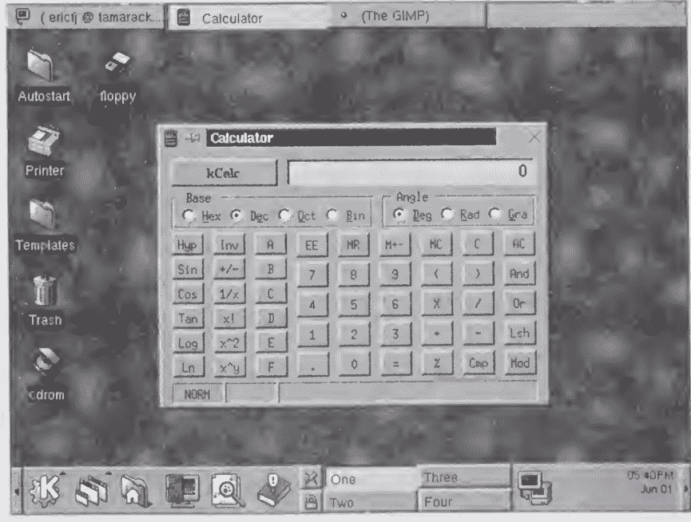

## 第八章

**掌握这些技能**

- 文件管理
- 文字处理
- 日程安排
- 数字处理
- 发送传真
- 多媒体工具

### 桌面应用程序

第七章介绍的默认 GNOME 桌面和可选的 KDE 桌面，为从图形屏幕使用 Linux 提供了基本界面。从这个界面出发，下一步就是运行一些应用程序——这正是人们使用计算机的真正原因。Microsoft Windows 如此受欢迎的原因之一并非 Windows 本身，而是因为该操作系统拥有丰富多样的应用程序可供选择。虽然 Linux 在某些领域仍显不足，但已大步向前，提供了许多实用的应用程序，本章将为您展示其中的冰山一角。本章将深入探讨 Linux 的桌面生产力应用程序。

选择多样性是 Linux 的标志，这既有优点也有缺点。Linux 没有选定一套主流的办公应用套件，而是提供了许多应用程序供您选择，让您能够针对特定类型的程序挑选最佳方案。本章讨论的许多应用程序都与第七章介绍的 KDE 或 GNOME 桌面绑定。虽然 KDE 应用程序可以在 GNOME 下运行，反之亦然，但这些应用程序在自己的环境中运行效果最佳。

其他应用程序，如`ical`日历和`tkdesk`文件管理器，则不与特定环境绑定。这些应用程序特别适合那些没有足够的内存或处理能力来运行大型 KDE 或 GNOME 桌面的用户。

商业应用程序在 Linux 上虽然没有 Windows 上那么普遍，但正开始大量涌现。我们发现奇怪的是，在许多 Windows 与 Linux 的比较中，评论者将 Linux 的免费软件与 Windows 的商业附加应用程序进行比较。您可以获得各种办公生产力套件，不过截至本文撰写时，Microsoft Office 尚不可用。除非另有说明，本章介绍的应用程序都是免费的，并随 Red Hat Linux 提供。

我们描述的许多应用程序仍处于开发的早期阶段。在过去几年中，Linux 的开发真正起飞了。开发的重点不再是支持各种硬件选项的设备驱动程序，现在已经转向了应用程序。因此，不要因为某些程序缺少功能而气馁。只需在 Web 上查看该应用程序的主页以获取更新版本。这是一件好事，因为 Linux 程序正在不断改进。

#### 文件管理

Linux 的大部分操作都涉及文件，因此文件管理器为您提供了一个非常便捷的系统操作方式。虽然您可以使用第三章介绍的命令（如`ls`、`cp`和`rm`）来管理文件，但文件管理器在浏览文件系统时确实很有帮助，比如随书附带的红帽 Linux 光盘。文件管理器还能帮助那些更熟悉 Windows 的用户顺利过渡到 Linux。

GNOME 文件管理器`gmc`或 GNU Midnight Commander 显示在本页对面的第一张图片中。通过它可以创建目录、复制、重命名和删除文件等。您还可以双击文件，GNOME 将调用与该文件类型关联的应用程序。例如，双击 JPEG 图像文件将启动 Electric Eyes 图像查看器，以便您查看图像。您也可以配置`gmc`将应用程序与各种文件类型关联。只需双击文件，如果`gmc`不知道该运行什么应用程序来显示该文件，它会提示您。

由于 Linux 的许多文件都是文本文件，您通常会启动文本编辑器来打开文件。不幸的是，我们发现默认的`emacs`配置无法工作（尽管`emacs`本身工作正常）。要更改编辑器，从任务栏调出 GNOME 控制面板。然后，选择 Gnome Edit Properties。您可以从列表中选择编辑器。忽略那个看似方便的 Test 按钮。要测试编辑器，选择 OK 并尝试从文件管理器双击以`.txt`结尾的文件，或者在 shell 窗口中运行`gnome-edit`命令。我们发现 gEdit 工作正常。

1. 从 GNOME 文件管理器的列表中选择一个目录。
2. 目录内容显示在右侧窗口中。
3. 特殊图标表示文件类型。

1. 双击图像文件。
2. 文件管理器启动`ee`（Electric Eyes）图像查看器。

#### 交叉参考

第三章介绍了文件和目录命令。

KDE 文件管理器是可选 KDE 桌面的一部分，其工作方式与 GNOME 管理器大致相同。一个很大的区别是，KDE 文件管理器还可以作为 Web 浏览器使用。单击一次即可进入子目录。此外，KDE 文件管理器会查找名为`index.html`的文件并显示这些文件而不是目录，就像 Web 浏览器一样。

如果 KDE 是您的桌面，KDE 任务栏菜单还提供了一个便捷的可从任务栏菜单访问的磁盘导航器。

#### 注意事项

###### TKDESK

另一个非常优秀的、不与任何桌面关联的文件管理器是`tkdesk`。它部分用 Tcl/Tk 脚本语言编写——因此名称中有 tk——`tkdesk`包括桌面启动栏、内置文本编辑器和许多其他功能。具有讽刺意味的是，这些功能使`tkdesk`与 KDE 和 GNOME 等桌面环境重叠，因此它最常用于没有运行主要桌面的情况。

##### 网络链接

GNOME 文件管理器将调用 Netscape 来查看以`.html`结尾的文件。KDE 文件管理器更进一步，可以显示来自 URL 的网页。只需输入 URL，例如`http://www.idgbooks.com/`，您就会在`kfm`窗口中看到网页。

1. 使用主 KDE 菜单上的 Home Directory 选项调出 KDE 文件管理器。
2. 单击一次文件夹图标即可在 KDE 文件管理器中查看该目录的内容。
3. 在 Location 区域输入本地文件或 Web 文档的 URL。

1. 从`tkdesk`列表窗口中查看文件和目录。
2. 从启动栏快速启动常用应用程序。

#### 在线查找

`tkdesk`主页是`http://www.people.mainz.netsurf.de/~bolik/tkdesk/`。

#### 文字处理

政策用法各不相同，许多 Linux 用户更倾向于使用自由软件。Linux 支持`groff`文本格式化包，您可以在纯文本文件中输入特殊代码——称为点码——来控制格式。然后运行`groff`（UNIX 上是`troff`）处理文档，输出 PostScript 或其他格式的文件。一个名为 TeX（发音为 tech）的类似包也使用嵌入文本文件中的代码。TeX 甚至能让您以比几乎任何软件包都更精细的控制来格式化文本。（实际上，为了自找麻烦，只有 TeX 才能正确排版 TeX 这个名称。）无论是 TeX 还是`groff`都不是 WYSIWYG，即“所见即所得”的文字处理器。您编辑文本文件，插入代码，然后运行单独的程序来格式化文本。

对于其他人来说，Linux 支持许多提供 WYSIWYG 功能的文字处理器。这些文字处理器从简单的免费程序到功能完备的商业软件包应有尽有。

最好的免费文字处理器之一是 Maxwell，它支持自己的格式以及 RTF，即富文本格式文件。大多数文字处理器都支持 RTF，为您提供了一种在 Linux 和 Windows 系统之间交换文件的便捷方式。AbiSoft 的 AbiWord 可以加载许多 Microsoft Word 文件，但只能保存为其自己的格式、纯文本或 HTML。有关这些文字处理器的 URL，请参见表 8-1。

GNOME 提供了许多可扩展的文本编辑器，让您能够完成比您预期中更多的任务。`gnotepad+`编辑器全面支持创建 HTML 文件——网页——包括标题、粗体、斜体和其他文本属性，以及左对齐、右对齐和居中对齐。总的来说，`gnotepad+`是一个相对原始的文字处理器。

#### 注意事项

###### 查看 MS WORD 文件

`mswordview`将 Microsoft Word 文件转换为 HTML，以便您可以用 Web 浏览器查看这些文件。虽然不如 WordPerfect 等程序的双向文件传输那么方便，但`mswordview`是免费的，当您需要查看一些 MS Word 文档时能解燃眉之急。我们发现`mswordview`转换 Word 97 文件的效果比 WordPerfect 8 好得多。基本语法是：

```bash
$ mswordview filename.doc
```

将`filename.doc`替换为您的 Word 文件名。然后`mswordview`将输出`filename.doc.html`。

从`http://rufus.w3.org/linux/RPM/contrib/libc6/i386/mswordview-0.5.2-1.i386.html`下载`mswordview`。

###### ADOBE ACROBAT PDF 文件

为了使在线文档看起来与其印刷版本完全一致，许多组织使用 Adobe Acrobat 或 PDF 格式。您会在许多软件包中找到 PDF 手册，以及在 Web 上找到 PDF 营销资料。在 Linux 上，您可以使用`xpdf`程序来查看这些文件。`xpdf`的 RPM 文件随本书附带的光盘提供。

不过，有些文件`xpdf`无法处理。对于这些文件，您需要发明 PDF 格式的 Adobe 公司的软件。您可以从`http://www.rpmfind.net/linux/RPM/contrib/libc6/i386/X11_Applications.html`或任何包含 Red Hat 贡献软件包的站点下载 Adobe 程序`acroread`。

# contosoaba.com

点击或轻点此处以继续。

### 桌面应用程序

#### 创建简易日历

如果你只想查看当月日期的列表，请运行以下命令：

```bash
$ cal | xmessage -file - &
```


此命令将 `cal` 命令的输出（打印当前月份的日历）通过管道传递给 `xmessage` 程序，该程序在窗口中显示文本。`-file` 选项告诉 `xmessage` 从文件读取数据；单独的 `-` 是标准输入的简写，在我们的例子中，它来自 `cal` 命令的管道输出。许多 Linux 命令使用破折号作为标准输入或输出的快捷方式。

#### 将 ICAL 日历与 PALM PILOT 同步

一个名为 `syncal` 的软件包可以将 `ical` 数据库与 Palm Pilot Datebook 同步。参见 http://rpmfind.net/linux/RPM/contrib/libc6/i386/Applications_Productivity.html。

#### 新兴的网络日历

日程安排领域的最新发展是基于 Web 的应用程序，它们使用 Web 协议、HTML、Java 和 JavaScript 来管理你的日程。由于 Netscape 支持所有这些工具，如果你想使用网络日历，你就可以开始使用了。你唯一会面临的问题是设计不良的系统，它们要求特定的浏览器，如 Internet Explorer，或 Windows ActiveX 控件。在这种情况下，你几乎没有办法。但如果厂商拒绝遵循互联网标准，你应该向他们指出这一点。

#### 在线查找

你可以在 `ical` 的主页 http://www.research.digital.com/SRC/personal/Sanjay_Ghemawat/ical/home.html 上找到更多关于 `ical` 的信息。

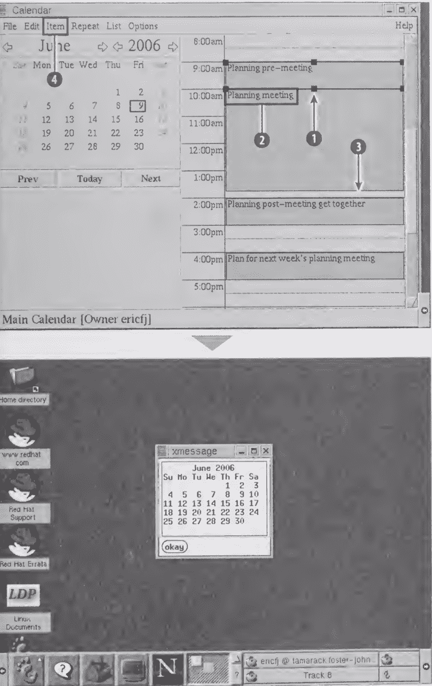

1. 在 `ical` 日历中选择预约时间。
2. 输入要显示在日历中的文本。
3. 拖动块到所需的时间长度。
4. 从项目菜单中修改预约。

通过运行 `cal` 和 `xmessage` 命令显示简易日历。

#### 管理你的日程

#### 保持联系

与日程安排程序密切相关的是通讯录，你可以用它来存储与你打交道的人的联系人信息。这些程序除了一个存储人员信息的小型数据库外，没有太多复杂的功能。通常你至少希望存储电话号码、邮政地址和电子邮件地址。

GNOME 通讯录 `gnomecard` 支持 vCard 格式，这在互联网工具中很常见。KDE 桌面用户可以运行 `kab`，即 KDE 通讯录。在每个程序中，你都有一个条目，也称为卡片，用于记录每个人。然后你可以搜索联系人列表、查找电话号码等等。

随 Red Hat Linux 附带的 Netscape Communicator 带有内置通讯录。如果你使用 Netscape 处理电子邮件，你可能也希望使用 Netscape 的通讯录，因为它与电子邮件软件包集成得更紧密。例如，你可以直接将电子邮件的发件人添加到你的通讯录中，而无需重新输入邮件头中的所有数据，如发件人的电子邮件地址。这加快了速度并避免了繁琐的数据输入。

##### 与 PALM PILOT 通讯录同步

`pi-address` 程序为 Palm Pilot 通讯录提供了友好的前端界面。Pi-address 使你能够从 Linux 系统输入地址、查找联系人等等。然后你可以使用 `pilot-link` 中的程序（这是一个独立的软件包）将通讯录传输到 Palm Pilot 手持设备。有关 `pi-address` 的更多信息，请参见 http://www.in-berlin.de/User/miwie/pia。随 Red Hat 6.0 附带的 `pilot-link` 软件包包含将 PalmPilot 日历转换为 `ical` 所使用格式的工具。`pilot-xfer` 程序使你能够向 PalmPilot 传输文件或从 PalmPilot 接收文件。

#### 交叉参考

第 7 章涵盖了更多关于 GNOME 和 KDE 桌面的内容。

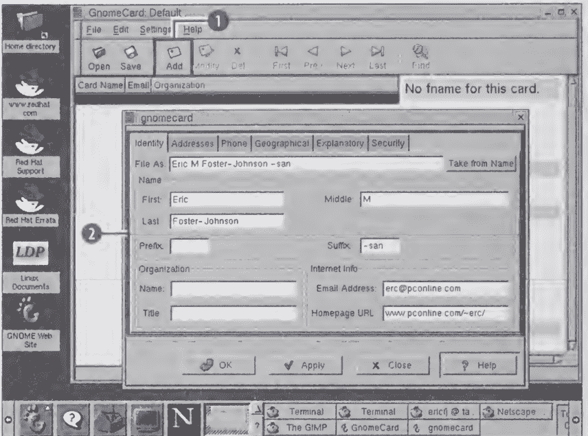

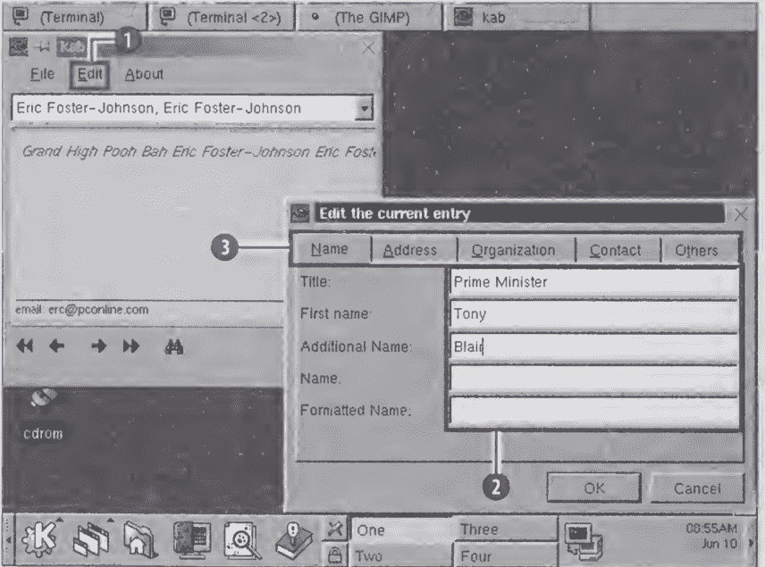

1. 在 `gnomecard` 应用程序中点击添加，将新联系人添加到你的通讯录。
2. 在对话框中填写该人员的数据。

1. 在编辑菜单中选择添加条目，将新联系人添加到 KDE 通讯录。
2. 在对话框中输入该人员的数据。
3. 选择选项卡以输入邮政地址和联系信息等信息。

##### 跟踪时间

`GtimeTracker`，或 `gtt`，跟踪你在各种项目上花费的时间——对于计算你浪费了多少时间，或者对于那些必须报告在给定项目上花费了多少小时的人来说非常有用。首先输入你正在进行的项目，然后打开计时器。停止处理该项目时关闭计时器。在 KDE 桌面上，你可以运行 `karm`，可从实用工具桌面菜单中获得，来跟踪你在项目上花费的时间。

##### 查看时间

KDE 和 GNOME 桌面都在任务栏中显示当前时间。如果你更喜欢不同的方式来显示时间，你还可以运行许多不同的时钟程序。传统的 X Window 时钟程序叫做 `xclock`。（Red Hat Linux 不包含圆角时钟程序 `oclock`。）一个更花哨的时钟是 `xdaliclock`，灵感来自艺术家萨尔瓦多·达利（Salvador Dalí），它在数字时钟上显示数字融合在一起的效果。你可以在本页最后的图片中看到这些时钟窗口。

- 如果你使用 Netscape 处理电子邮件，请将联系人输入 Netscape 通讯录。
- 使用 `gtt`（GNOME 桌面时间跟踪器）跟踪你在项目上花费的时间。
- 使用简单的 `xclock` 查看时间。
- 使用更花哨的 `xdaliclock` 查看时间。

#### 在线查找

有关萨尔瓦多·达利的更多信息，请参见 http://www.salvador-dali.com。

#### 处理数字

在安排完繁忙的日程后，是时候开始工作了。GNOME 桌面包含一个名为 `gnumeric` 的电子表格程序。你可以将其用于财务规划、假设预算情景、计算税款和报告工作，就像使用任何电子表格一样。

如对面页面所示，`gnumeric` 呈现了一个传统的电子表格界面，满是等待输入数据的单元格。如果你熟悉 Microsoft Excel 或 Lotus 1-2-3，你应该能轻松上手 `gnumeric`。

`gnumeric` 将列标记为 A、B、C 等，就像 Excel 和 Lotus 1-2-3 一样。行编号为 1、2、3 等。电子表格中的许多操作需要你识别特定的单元格。在 `gnumeric` 中，你需要先使用列字母，然后是行号，例如 `B3` 表示第二列（B）第三行（3）的单元格。冒号（`:`）用于分隔单元格范围，例如 `B1:B3` 表示单元格 `B1`、`B2` 和 `B3`。这些范围在公式中很重要，公式根据单元格的内容生成计算——换句话说，这是你使用电子表格的主要原因。

与 Excel 一样，`gnumeric` 支持 `=function` 表示法，例如 `=sum` 用于生成单元格范围的总和。此外，与 Excel 一样，以下公式计算存储在 `B1` 到 `B3` 范围内单元格中的值的总和，换句话说，即单元格 `B1`、`B2` 和 `B3`：

```text
=sum(B1:B3)
```

求和公式是最常用的公式，此语法在 Excel 和 `gnumeric` 中都有效。为了帮助你入门，`gnumeric` 提供了 extensive 的在线文档，包括所有内置函数的列表。帮助菜单有两个主要选项，一个是通用的 `gnumeric` 手册，另一个是单独的函数参考。使用手册来开始使用 `gnumeric`，使用函数参考来了解你可以使用的确切命令。

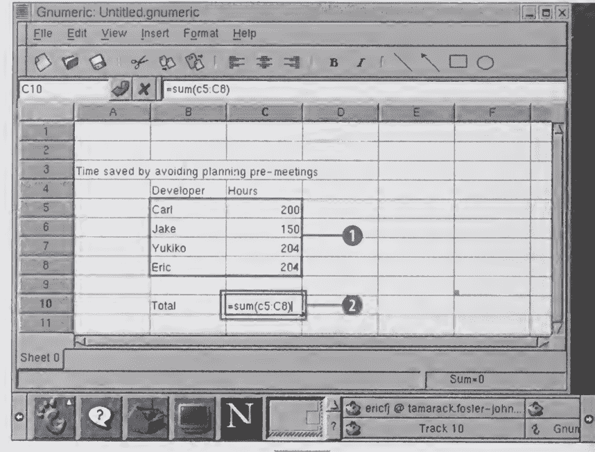

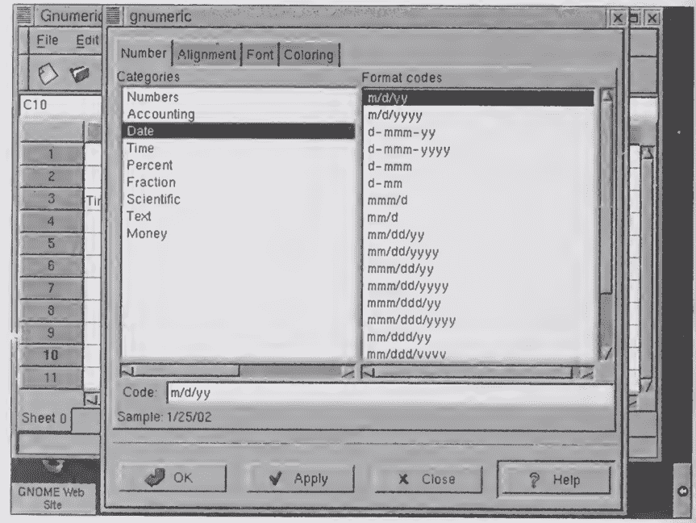

1. 在 `gnumeric` 电子表格的单元格中输入文本和数值。
2. 输入公式以执行计算。

- 在 `gnumeric` 的格式菜单中选择单元格。
- 控制数据格式，例如如何显示日期。

#### 交叉参考

关于文字处理软件的任务讨论了如何下载 KOffice。

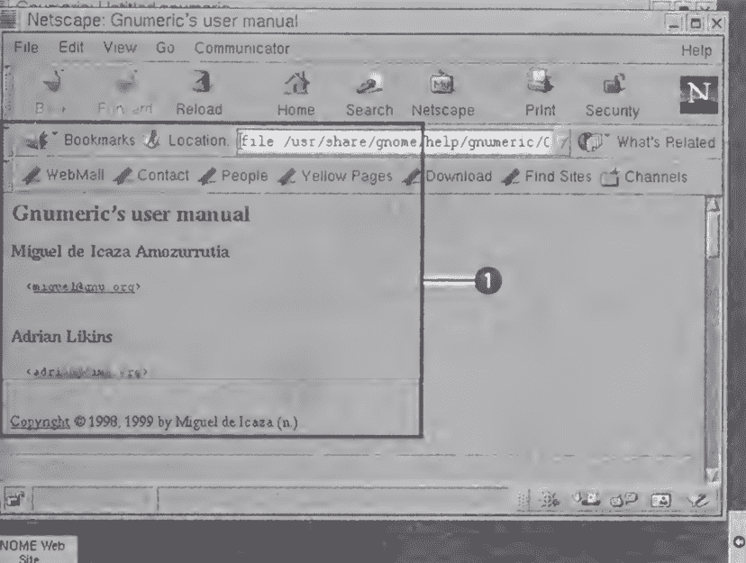

可选的 KDE 桌面也有电子表格 `kspread`，它是 KOffice 的一部分，但不随 Red Hat Linux 附带。

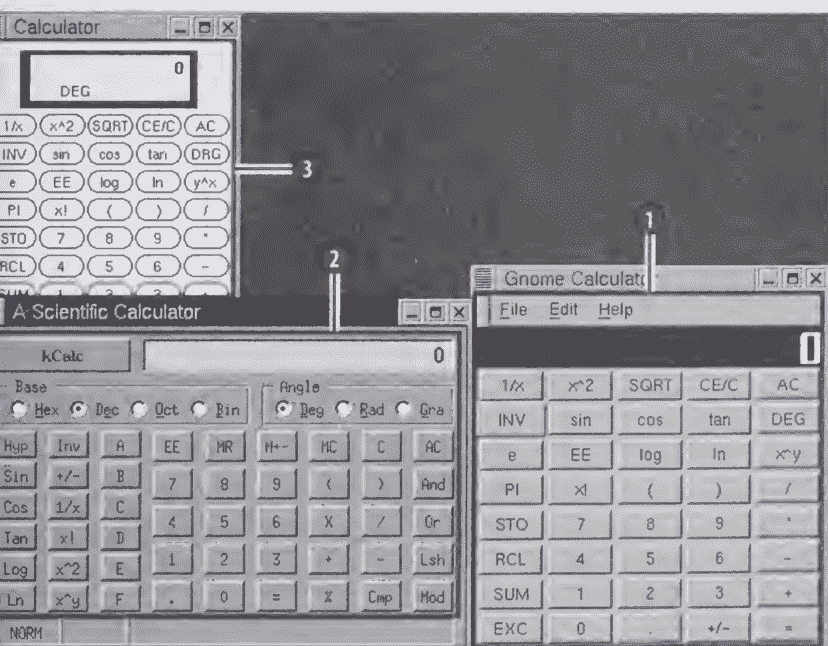

##### 计算器

如果你只是想快速进行一些计算，你不需要电子表格；一个简单的计算器就足够了。有很多 X Window 计算器可供选择。GNOME 和 KDE 桌面都提供计算器程序，你完全可以运行非常简单的 `xcalc` 程序。

1. 使用 GNOME 计算器进行计算。
2. 从可选的 KDE `kcalc` 运行科学函数。
3. 如果你尚未安装桌面环境，请运行 `xcalc`。

从 `gnumeric` 调用 extensive 的在线帮助。

##### 商业电子表格

许多办公套件，如前文提到的 Applixware、StarOffice 和免费的 Siag Office，都包含电子表格程序。此外，WingZ 和 NExS 是两款可以购买的 Linux 商业电子表格。更多信息请参见 http://www.wingz.com 和 http://www.xess.com。

##### 平衡你的支票簿

最受欢迎的财务管理软件包之一叫做 `cbb`，是 check book balancer 的缩写。可从 http://www.menet.umn.edu/~curt/cbb/ 获得，`cbb` 不绑定于任何特定桌面。`cbb` 部分使用 Tcl/Tk 和 Perl 编写，这些是流行的脚本语言。这使得定制 `cbb` 相对容易。

#### 在线查找

Linux 应用程序页面在 http://www.linuxapps.com 上列出了许多电子表格。

## 发送传真

大多数现代调制解调器同时支持数据和传真协议，这意味着只要您有调制解调器，您的 Linux 系统很可能就具备了发送和接收传真所需的全部硬件。

在 Linux 下，您有多种传真软件包可供选择。其中最容易上手的是 `efax`。`efax` 使您能够发送和接收传真。

为了简化操作，`efax` 命令附带了一个便捷的脚本，名为 `fax`。该脚本 automate 了大部分 `efax` 选项——如果一切顺利——可以让生活轻松许多。使用 `fax` 脚本，虽然会遇到一些设置问题，但我们在开始操作后六分钟内就能发送传真了。

要发送传真，请按以下步骤操作：

- 设置您的传真设备
- 验证传真设备
- 测试您的传真设置
- 将文本文件转换为传真格式
- 尝试将您的文件作为传真发送

`fax` 脚本假定您已将调制解调器设置为使用设备文件 `/dev/modem`。除非您在安装 Linux 时设置了调制解调器，否则您不会有这个文件。别担心，您可以将 `/dev/modem` 创建为符号链接，指向代表调制解调器所连接串口的设备文件。例如，`/dev/ttyS0` 是第一个串口（对 DOS 而言是 COM1:），`/dev/ttyS1` 是第二个（对 DOS 而言是 COM2:），依此类推。如果您的调制解调器连接在第一个串口上，您可以以 root 身份运行以下命令：

```bash
# ln -s /dev/ttyS0 /dev/modem
```

现在，验证您的调制解调器是否连接到了正确的端口。打开调制解调器电源（如果需要的话，内置调制解调器应该已经是开启状态）。如果您的调制解调器有状态指示灯，您可以运行以下命令：

```bash
$ echo "AT" > /devicemodem
```

调制解调器上的指示灯应该会短暂亮起。如果没有，您可以使用 `minicom` 等串口通信软件包来测试调制解调器。设置好 `minicom` 后输入命令 AT。按 Enter 键。您应该会收到类似 OK 的响应。如果没有，那么很可能您将调制解调器插到了与设置不同的端口。

接下来，编辑 `fax` 脚本 `/usr/bin/fax`。您至少需要更改 FROM（填入您的回传传真号码）和 NAME（填入您组织的名称）的设置。

#### 注意

#### 解决传真问题

如果简单的 `fax` 脚本对您不起作用，请从 `efax` 程序开始。使用 `man efax` 命令查看在线手册信息。您可以控制传真输出和拨号的许多方面，还可以设置特殊的调制解调器初始化设置。

#### 发送得体的传真

您的传真文件应清楚注明传真收件人，以及您的姓名、电话号码和总页数。

#### 其他格式

`fax` 脚本和 `efax` 程序将文本文件转换为传真格式。GhostScript 软件包的 `gs` 命令可以将 PostScript 文件转换为传真格式。许多 Linux 文字处理器可以输出 PostScript 格式。您可以从互联网下载的 `xv` 可以将图像文件转换为传真格式。

#### 交叉参考

第 13 章介绍了 `minicom` 程序和串口通信。

### 桌面应用程序

## 传真

验证调制解调器设置完成后，您可以使用 `fax test` 命令测试 `fax` 脚本：

```bash
# fax test
```

您可能需要以 root 身份运行此命令，因为 `fax` 脚本需要在 `/var/lock` 中创建锁定文件。`fax test` 脚本不会告诉您太多关于是否成功的信息，因为输出几乎相同。如果成功，您应该会听到调制解调器扬声器发出声音。如果没有，调制解调器将保持沉默。（这不是一个很好的测试，但有所帮助。）

现在，您可以准备发送传真了。在文本文件中创建您的信息。使用 `fax make` 将该文件转换为传真格式：

```bash
$ fax make filename.txt
```

`fax make` 为每一页创建一个文件，第一页以 `.001` 结尾，第二页以 `.002` 结尾，依此类推。

要发送此文件（或这些文件），使用 `fax send`。同样，您可能需要 root 权限：

```bash
# fax send -v 6125551111 filename.txt.001
```

您应该能听到调制解调器拨号并发送传真。`-v` 选项请求详细的输出。在传真成功时，您应该能看到类似如下的最后一行输出：

```text
efax: 07:48 done, returning 0
```

出错时，您会看到类似这样的消息：

```text
There were errors (see 0522120636.log).
```


您可以查看日志文件以了解错误。我们见过最常见的错误是缺乏访问`/var/lock`中锁定文件的权限。

- 使用`viewfax`命令查看传真文件。按住鼠标中键的同时调整窗口中的图像。
- 单击鼠标左键放大，单击鼠标右键缩小。

1. 使用 KDE `kfax`程序，从 File 菜单调出传真文件。
2. 单击图标放大。
3. 单击图标缩小。

#### 光盘内容

另一个 Linux 传真软件包是`mgetty-sendfax`。

### 多媒体工具

Linux 上首屈一指的图形应用程序叫做 The GIMP，全称是 The GNU Image Manipulation Program（GNU 图像处理程序）。它的工作方式有点像 Adobe Photoshop，The GIMP 使您能够创建图像并对图像进行大量操作。它的功能如此广泛，事实上有一本专门介绍 The GIMP 的书。

The GIMP 的影响深远。相当多的网页上都展示着 The GIMP 的标志，归功于该应用程序帮助制作了网站的图形。The GIMP 影响的不仅仅是网页。The GIMP 的开发者们首先需要一个图形工具包来创建这个应用程序。他们对当时可用的工具不满意，于是开发了一个名为 GTK 的工具包，全称是 GIMP Toolkit（GIMP 工具包）。继而，GTK 提供了 GNOME 桌面应用程序所使用的底层工具包，在本章和其他章节中有相关介绍。

第一次运行`gimp`命令时，它会在您的主目录下创建一个`.gimp`子目录（注意前面的句点，使其成为通常隐藏的目录）。The GIMP 使用这个子目录来存储您账户特定的自定义设置。此后每次运行 The GIMP，您都会看到类似对面页面所示的窗口。

*待续*

#### 注意

##### 按住鼠标右键

The GIMP 的大部分功能都可通过一组级联菜单获得，在图像上按住鼠标右键时这些菜单会出现。要保存文件，您需要这样做。

#### 交叉参考

有关《The GIMP 艺术家指南》的信息，请参见附录 B。

##### GIMP 插件

GIMP 的设计允许开发者通过编写插件来以新颖有趣的方式扩展其基本功能，插件是 GIMP 可以运行的附加组件，用于提供新功能。类似于第 16 章中介绍的 Apache Web 服务器模块，您可以编写遵循 GIMP 编程 API 的小程序来扩展该应用程序。如果您不想费事编写程序，可以用 GIMP Script-Fu 语言编写脚本。在 GIMP 主窗口的 Xtns（扩展）菜单中查看。在 Script-Fu 子菜单下，您会看到大量实用工具，它们作为 GIMP 脚本运行，可以创建诸如屏幕背景、网页斜角按钮等内容。

##### 保存为不同格式

当您从 File 子菜单选择 Save As 时，The GIMP 提供了一个便捷的功能。您可以在 Save as 对话框中为 Determine file type 项选择 By extension，然后只需输入您想要的文件名即可。The GIMP 根据文件扩展名确定文件格式。例如，输入`.jpg`保存为 JPEG 图像，或`.tif`保存为 TIFF 图像。

##### 屏幕截图

The GIMP 提供了一个出色的实用工具来捕捉屏幕图像。我们发现它比`xv`（我们之前最喜欢的工具）能捕捉更多的图像，尤其是菜单。要捕捉屏幕截图，从 Xtns（扩展）菜单中选择 Screen Shot。在出现的对话框中，选择是捕捉窗口还是全屏，然后就可以开始了。

#### 在线查找

The GIMP 主页是`http://www.gimp.org`。

1. 从 Xtns 菜单中选择 Script-Fu，然后挑选一个要运行的脚本。
2. 输入要显示的文本，并修改任何设置。
3. 单击 OK 创建图像。
4. The GIMP 在单独的窗口中创建图像。您需要保存此图像。

1. 从 Xtns 菜单中选择 Screen Shot 来制作屏幕图像。

## 多媒体工具（续）

### 查看图像和电影

GIMP 提供了功能齐全的图像编辑应用程序。然而在许多情况下，GIMP 对你的需求来说有些大材小用，这促使你转向其他程序。如果你想显示图片但只看到小缩略图，可以运行`ee`（即 Electric Eyes），这是 GNOME 的图像查看器。`ee`随 GNOME 桌面一起提供。在`ee`中，按住最右边的鼠标按钮可以调出`ee`菜单。从“View”（视图）子菜单中，你可以调出列表窗口。该窗口可以显示目录中图像的缩略图版本。从“File”（文件）子菜单中，你可以将正在查看的任何图像设置为屏幕背景。可选的 KDE 桌面提供了`kview`图像查看器。

如果你想超越静态图像，Linux 包含许多工具来播放电影文件，特别是 MPEG、QuickTime 和 Windows AVI 电影。

`xanim`可以播放 MPEG、MOV 和 AVI 电影，但不支持许多现代*编解码器*（用于编码视频图像的算法）。你会在播放 Microsoft Windows 制作的 AVI 电影时尤其明显地遇到这个问题。你可能会看到如下错误：

```
AVI Video Codec: Radius Cinepak is unsupported by this executable.
```

不过，你可以从`xanim`主页下载额外的编解码器。其中许多是专有的，因此无法随 Linux 一起分发。其他显示电影的程序包括`xmpeg`和`aktion`。

#### 注意

##### 灯光，摄影，aktion！

`aktion`程序是可选 KDE 桌面的一部分，能很好地播放电影文件。我们发现它比老旧的主力程序`xanim`效果更好。

1. 在`ee`中，按住最右边的鼠标按钮以查看菜单。
2. 从“View”（视图）菜单中，选择“Show/Hide List Window”（显示/隐藏列表窗口）。
3. 你将看到列表窗口，其中显示了缩略图图像。

使用`xanim`播放 AVI 电影。

下载 RealPlayer 以播放流式音频和视频。

`aktion`支持更多 Windows 使用的格式（这是电影文件的一个大来源），这是你在安装 Linux 时安装 KDE 的另一个原因。

然而，`aktion`有一个恼人的特点，即在电影文件结束时会清除最后的画面，留下一个灰色的窗口。大多数其他电影播放器在电影结束时会将最后一帧保留在屏幕上。`aktion`播放一个短电影文件后会立即将其从窗口中清除，通常甚至在你意识到文件已完全播放之前就消失了，这种效果令人不安。

#### REAL PLAYER

Real Networks 占据了互联网流媒体视频和音频市场的很大份额，通常作为在线购买音乐的预览。你可以从`http://www.real.com`下载名为`realplay`的 Linux RealPlayer 软件。

#### 挂载 CD-ROM

许多媒体文件往往非常大，因此你通常会在 CD-ROM 上获取它们。要挂载 CD-ROM，请以 root 身份使用以下命令：

```
# mount -t iso9660 -r \
    /dev/cdrom /mnt/cdrom
```

此命令挂载 ISO-9660 CD-ROM，这是 CD-ROM 中最通用的格式。每个平台都有自己冲突的 CD-ROM 标准。有 Mac 特定的格式，一种称为 Rock Ridge 的 UNIX 格式，以及多种 Windows 格式。对于 Windows Joliet CD-ROM，跳过`-t`（类型）iso9660，只需使用以下命令：

```
# mount  -r /dev/cdrom /mnt/cdrom
```

###### 交叉引用

第 10 章涵盖了播放声音和音乐的应用程序。

#### 在线查找

`xanim`主页是`http://www.xanim.va.pubnix.com/home.html`。

### 个人练习册

#### 问与答

1. 批评者抨击 Linux 缺乏应用程序。Microsoft Office 能在 Linux 上运行吗？

2. 你能获得为 Linux 编写的办公套件吗？

3. 列出两个免费的 Linux 文字处理器。

4. Linux 能发送传真吗？

5. 你可以使用哪些程序在 Linux 上创建预算、处理数字和进行其他计算？

6. 你能在 Linux 上播放 Microsoft Windows AVI 文件吗？

7. 如何让`ee`图像查看程序显示一组缩略图？

8. 你能在 Linux 上显示 Adobe Acrobat PDF 文件吗？

答案：见第 337 页

#### 额外练习

1. 试用`gnumeric`电子表格软件。尝试使用它，看看你喜欢它的哪些方面。判断它是否可以替代 Microsoft Excel 来满足你的需求。

2. 尝试通过输入奇怪的计算来破坏其中一个计算器程序，以寻找缺陷。

3. 查找`efax`的在线手册信息。你会看到相当多的选项以及一些很好的示例。

#### 实际应用

- 你的老板愿意在工作场所使用 Linux，但要求你找到一种让 Windows 和 Linux 用户共享相同文字处理、电子表格和演示文稿文件的方法。你知道至少有一个支持 Windows 和 Linux 的套件：来自 StarDivision 的 StarOffice。在 StarDivision 的网页`http://www.stardivision.com`上查看定价和兼容性信息。

- 当你在 GNOME 文件管理器中双击一个文本文件时，由于 GNOME 的配置问题，你可能看不到该文件。按照管理文件任务中的描述，更改 GNOME 定义的编辑器来解决此问题。

##### 视觉测验

你可以用什么将 Microsoft Word 文件转换为 HTML？

## 第 9 章

- **掌握这些技能**
  - Shell 窗口
  - 控制字体和设置窗口大小
  - 复制和粘贴

## 命令窗口

我们试图打破一个巨大的迷思，即 Linux 难以学习，用户被迫记忆无数深奥的命令。虽然 Linux 确实包含众多命令，但这仅仅强调了操作系统的丰富性。在其他系统上需要花钱购买的东西，在 Linux 上是免费的。

我们重点介绍了可以从桌面任务栏启动的应用程序，并展示了如何在不接触命令行的情况下完成大部分工作。即便如此，有时你仍需要输入 Linux 命令。如果你使用 X，最简单的方法是调出 shell 窗口，它在方便的窗口内提供了一个 shell（第 3 章讨论过）。你可以像桌面其他窗口一样移动和调整这些窗口的大小。

这些窗口名为`xterm`、`nxterm`、`gnome-terminal`或`rxvt`，在 X 窗口内提供命令行——即 shell。类似于 Windows 中的 MS-DOS 提示符窗口或 BeOS 中的终端应用程序，这些终端窗口通常提供许多功能，包括：

- 窗口内的默认 shell
- 控制字体大小和样式
- 控制显示的行数和列数
- 能够使用可选的滚动条回滚到早期的命令
- 能够选择文本并将文本粘贴到其他窗口
- 通过基于菜单的界面或 X 资源文件控制颜色

而且，由于 Windows 和 Be OS 都包含某种形式的 shell 窗口，没有人能声称 Linux 因为包含 shell 窗口就太难学！

由于 Linux 旨在网络上运行，你可以使用 shell 窗口通过`telnet`或`rlogin`程序登录到其他系统。这提供了一种非常方便的方式，让你可以访问其他系统，而不必亲自前往。

拥有所有这些功能后，很难再回到基于文本的控制台。

### Shell 窗口

X Window 系统下的主要 shell 窗口称为`xterm`。这是一个非常不幸的选择，因为 X 终端（用于显示 X 应用程序的硬件设备）与`xterm`（你输入命令的 shell 窗口）毫无关系。这可能会非常令人困惑。

`xterm`提供了一个带有 shell 提示符的基本窗口。默认情况下，`xterm`显示你的默认 shell（通常是`bash`）。通过 X 资源文件（`scrollBar: true`）或命令行选项（`–sb`），你可以为`xterm`启用滚动条，这使你能够回滚到先前的命令及其输出。这非常方便，因为许多 Linux 命令与之前运行过的命令相似。

在采用 GNOME 桌面之前，RedHat Linux 提供`nxterm`作为默认 shell 窗口。`nxterm`与`xterm`基本相同，但它包含颜色控制和稍好的外观，如对面页第二张图所示。如果你不安装 GNOME 或 KDE，`nxterm`将充当你的默认终端窗口。

GNOME 桌面也提供了一个 shell 窗口，称为`gnome-terminal`，如对面页第三张图所示。该程序包含用于配置的菜单和帮助你使用程序的在线手册。`gnome-terminal`的功能之一是可以在其背景中放置位图。不过，你不想在没有大量 RAM 的系统上这样做，因为它会消耗内存。

正如你所料，KDE 桌面也提供了一个终端窗口，称为`kvt`。

基本的 X Window shell 程序是`xterm`。左侧的灰色条是滚动条。

在较旧的 AnotherLevel 桌面中，`nxterm`是主要的 shell 窗口。`nxterm`提供了一个更容易使用的滚动条。

###### 交叉引用

第 14 章涵盖了`rlogin`。第 3 章涵盖了 shell。

- GNOME 提供了`gnome-terminal`，一个增强型的 Shell 窗口。注意位图背景和菜单栏，从中你可以调用新窗口或设置选项。

- KDE 也提供了一个增强型的 Shell 窗口`kvt`，它同样提供了用于设置选项的菜单栏。

#### 注意

##### CDE DTTERM

如果你购买了通用桌面环境（Common Desktop Environment，简称 CDE），你还有另一个可选的 Shell 窗口：`dtterm`，即桌面终端窗口。`dtterm`是 CDE 系统上的默认 Shell 窗口。

##### 启动其他程序

默认情况下，Shell 窗口（如`xterm`）在窗口内运行你的 Shell。你可以通过使用`xterm`或`nxterm`的`-e`（执行）选项来更改这一点。例如：

```
$ nxterm -e rlogin nicollet
```

该命令告诉`nxterm`执行`rlogin`命令，而不是你的默认 Shell。`-e`选项之后的所有参数都被视为要运行的命令的一部分。在这种情况下，这意味着`nxterm`将尝试运行命令`rlogin nicollet`，以远程登录到名为`nicollet`的系统。

##### KTERM 不是 KDE 终端窗口

不要被 k 迷惑；名为`kterm`的程序早于 KDE 桌面使用 k 前缀。`kterm`是 Kanji terminal（汉字终端）的缩写，支持多种语言，尤其是亚洲语言。KDE 的终端程序叫做`kvt`。

#### 在线查找

GNOME 可在`http://www.gnome.org`获取。

### 控制字体和设置窗口大小

即使你prefer 对所有事情都使用 Shell，通过设置字体，你可以更好地阅读屏幕，并控制有多少 Shell 窗口可以显示在屏幕上。例如，通过合理选择字体大小，你可以确保两个 Shell 窗口可以并排显示在屏幕上而不重叠。如果由于光线条件或视觉敏锐度而难以阅读屏幕，你可以选择更大、更易读的字体。而且，你还可以选择你喜欢的字体。

如何选择字体取决于你运行的是哪个 Shell 窗口。如果你运行的是 GNOME 或 KDE 终端窗口，你可以从窗口的菜单中选择字体，如对面页面所示。这使事情变得更加容易。如果你运行的是`nxterm`或`xterm`，按住 Ctrl 键和最右边的鼠标按钮。从出现的菜单中，你可以选择多种不同大小的字体。如果这些字体满足你的需求，你就无需进一步操作了。

如果你想查看系统上可用的字体，而不是局限于目前提供的选项，你可以运行多种字体选择工具，包括 GNOME 字体选择器、KDE 字体管理器，或 X Window 程序`xfontsel`。所有这些程序都提供了预览区域，以便你可以预览所选字体。X Window 字体名称相当长。名称中的元素在对面的页面中有描述。

你可以在 X 资源文件中使用该字体。例如，要设置`nxterm`窗口的默认字体，将以下行放在你主目录中名为`NXTerm`的文件内：

```
*font: -*-courier-*-r-*--12-*-*-*-m-*-*
```

注意对长 X Window 字体名称的部分使用了通配符。有关这些长名称中所有字段的解释，请参见表 9-1。

你可以使用`xlsfonts`程序（即 X list fonts 的缩写）在 Shell 窗口中列出可用字体。该程序会输出大量数据，因此将结果通过管道传输给`more`或`less`。

#### 注意

##### 不要在 Shell 窗口中使用比例字体

所有 Shell 窗口都设计为与等宽（固定宽度）或字符单元字体一起工作。如果你不小心选择了比例字体，字符会在固定宽度的区域内被间距隔开，使屏幕难以阅读，因为你无法总是分辨出一个词在哪里结束，另一个词在哪里开始。

##### 设置窗口大小

你可以使用第 7 章讨论的`-geometry`选项来设置`xterm`和`nxterm`窗口的初始大小。Shell 窗口的主要区别在于，这些程序以字符为单位指定宽度和高度——大多数其他应用程序假定宽度和高度以像素为单位。因此，要创建一个具有 80 列和 42 行的`nxterm`窗口，请使用以下命令：

```
$ nxterm -geometry 80x42 &
```


这不会像你可能预期的那样创建一个微小的 80×42 像素窗口。

###### 交叉引用

第 7 章讨论了命令行参数和 X 资源文件。

#### 在线查找

有关 X 字体名称的更多信息，请参见 http://www.pconline.com/~erc/xfonts.htm。

## 命令窗口

## 第 9 章

1. 从 Settings（设置）菜单调用 `gnome-terminal` 首选项窗口。
2. 选择一种字体。
3. 选择字体系列。
4. 设置样式和大小。
5. 单击 Apply（应用）以选择该字体。你可以将字体名称粘贴到其他窗口中。

#### 表 9-1：长字体名称的组成部分，按顺序排列

| 部分 | 示例 | 含义 |
|------|---------|-------|
| 字库 | `adobe`, `b&h` | 字体创建者 |
| 字体系列 | `times`, `lucidasans` | 基本字体系列名称 |
| 字重 | `bold`, `medium` | 字母粗细 |
| 倾斜 | `r` | 斜体（`i`）、罗马体（`r`）、斜体（`o`）、反向斜体（`ri`）、反向斜体（`ro`）、其他（`ot`），或缩放字体的数字 |
| 字宽名称 | `normal`, `condensed` | 字符宽度 |
| 附加样式 | `sans` | 描述字体的额外信息 |
| 像素大小 | `26` | 字符高度（像素） |
| 点数大小 | `190` | 以点数为单位的字符高度的十倍 |
| 每英寸点数 | `100-100` | X 和 Y 方向的每英寸点数，通常为 100 或 75 |
| 间距 | `m` | 字符单元（`c`）、等宽（`m`）、比例（`p`），或缩放字体的数字 |
| 平均宽度 | `94` | 以像素为单位的平均宽度的十倍 |
| 字符集注册 | `iso8859-1` | 用于编码字体的字符集，包括 `iso8859-1`（西欧）、`jisx0208.1983-0`（日语）和 `ksc5601.1987-0`（韩语） |

### 复制和粘贴

使 Shell 窗口如此高效的原因之一是，你可以在 Shell 窗口和显示器上的其他窗口之间复制和粘贴文本。突然间，你的命令行效率大大提高了。

在大多数窗口系统中，如 Windows 和 Mac OS，你选择文本，然后将文本复制到剪贴板。剪贴板形成一种被动的数据存储库。当你粘贴时，你就获取存储在剪贴板中的文本。另一方面，X Window 系统消除了对中间剪贴板的需求，提供了一种更主动的复制和粘贴形式。

你在应用程序中选择文本。当需要粘贴时——通常通过按鼠标中键——你当前的窗口会查询拥有所选文本的窗口，并直接获取该文本。没有中间剪贴板，所以你不必停下来将文本复制到剪贴板中。相反，你只需选择然后粘贴。

在大多数应用程序中，特别是在命令窗口中，你通过按下最左边的鼠标按钮，按住按钮，并在要选择的文本上拖动鼠标来选择文本。当你拖动鼠标时，文本应该高亮显示。

要粘贴，激活你要粘贴的窗口，然后单击鼠标中键。像往常一样，X 期望一个三键鼠标。而且，与 X 的大多数事情一样，你可以基于每个应用程序自定义这些设置。

在大多数应用程序中，双击最左边的鼠标按钮会选择光标下的整个单词；三击会选择整行。不过，并非所有应用程序都支持这一点。

GNOME 对此添加了一个微妙的特性。从 Settings（设置）菜单中，你可以输入用于控制双击选择时什么构成一个单词的字符。默认情况下，在 GNOME 终端中 - 被视为单词的一部分，但在 `nxterm` 或 `xterm` 中则不是，这可能导致选择的内容超出你的预期。幸运的是，你可以在 `gnome-terminal` 应用程序中控制这一行为。

#### 注意

##### 粘贴文本的意外情况

Shell 并不真正了解复制和粘贴——那是包裹在 Shell 周围的 Shell 窗口的功能。因此，粘贴被简单地视为快速打字。因此，如果你粘贴到运行 `vi` 文本编辑器或其他需要模式的程序的 Shell 窗口中，你可能得不到预期的结果。如果你特别粘贴到 `vi` 中，请确保编辑器在粘贴前处于插入模式。否则，你的文本将被解释为 `vi` 命令，很可能会产生令人不快的结果。Emacs 编辑器对鼠标了解更多，应该能正确处理粘贴。你也可以在 `vim`（增强型 `vi`）中启用鼠标支持，以更好地处理粘贴。

##### 剪贴板

虽然 X 不需要剪贴板，但你可以运行 `xclipboard` 或 KDE 的 `klipper` 程序，以剪贴板的形式存储多个选择。然后你可以从剪贴板的一部分中选择文本，将其粘贴到另一个应用程序中。

###### 交叉引用

第 5 章讨论了 `vi` 文本编辑器。第 7 章涵盖了鼠标。

#### 在线查找

KDE 主页是 http://www.kde.org。

## 命令窗口

| 操作 | 结果 |
| --- | --- |
| 按住鼠标左键拖动 | 选择文本 |
| 按下鼠标中键 | 粘贴文本 |
| 双击鼠标左键 | 选中鼠标光标下的单词 |
| 三击鼠标左键 | 选中光标下的整行 |

1. 你可以将选中的文本存储在 `xclipboard` 中。
2. 当你需要新的存储区域时，点击 New。
3. 要进行导航，点击 Next 或 Prev。
4. 选择需要在其他应用程序中粘贴的文本。
5. 使用最左边的鼠标按钮选择文本。
6. 使用中间的鼠标按钮粘贴。

### 个人练习册

#### 问答

1. 运行图形桌面时，能否访问 Linux shell？

2. 说出三种不同的 shell 窗口程序。

3. 通常使用哪个鼠标按钮来选择文本？

4. 文本在粘贴之前需要先复制到剪贴板吗？

5. 通常使用哪个鼠标按钮来粘贴文本？

6. 三击选择多少文本？

7. 能在 Linux 上运行剪贴板程序吗？

8. 如何让 `nxterm` 运行 shell 以外的程序？

答案：第338页

#### 额外练习

1. 在运行 `vi` 文本编辑器的 shell 窗口中粘贴文本。如果首字母不是 `a`、`A`、`i`、`I`、`o` 或 `O`，那么很可能会执行一系列 `vi` 命令。请用一个不重要的临时文件来测试这一点。在粘贴到 `vi` 窗口时务必小心。

2. 在 shell 窗口中选择文本，并将其粘贴到 `emacs` 窗口中。（如果你不熟悉这个编辑器，第5章会介绍 `emacs`。）打开一个临时文件，点击窗口中间进行粘贴，观察会发生什么情况。注意这与粘贴到 `vi` 中的不同之处。

3. 运行 `xclipboard` 应用程序，并将多条文本消息粘贴到窗口中。现在，选择其中一些消息，并将它们粘贴到文本编辑器窗口中。

#### 实际应用

- 你或你的某些同事是软件开发人员，想要并排显示两个 shell 窗口。找出适合你显示器的正确字体设置来实现这一点。

- 其他同事想在 GNOME 桌面上运行 KDE 终端程序 `kvt`，但被告知这是不可能的。向他们证明可以通过启动 `kvt` 来运行它。然后从任务栏展示 GNOME 主菜单下的 KDE 菜单。

- 用户正在争论 shell 窗口程序和效率问题。运行 `nxterm`、`kvt` 和 `gnome-terminal`。使用 `top` 程序来确定哪个使用的内存最少。

##### 视觉测验

如何从这个 `nxterm` 窗口更改字体？

## 第 10 章

掌握这些技能

- 设置声卡
- 播放声音
- 播放音频 CD

## 在 PC 上播放声音和音乐

基本 PC 在声音方面的能力有限。内置扬声器只能发出简单的蜂鸣声，仅此而已。要获得更好的输出效果，你需要某种形式的声卡适配卡。有了这样的附加卡，你可以播放声音、录制声音，并给你的邻居留下深刻印象。你还可以在多个应用程序之间共享声卡。幸运的是，Linux 包含了各种各样的声音软件。本章讨论在 Linux 下设置和使用声卡。

直到最近，高质量的声卡输出价格还很高，以至于许多人完全跳过了声卡。商务 PC 的用户尤其避免为增加声音支持而额外花钱。家庭用户也坚持使用低成本系统。因此，在 Linux 的大部分历史中，其重点一直不在音频输出支持上。相反，Linux 专注于服务器应用程序、图形、网络以及支持硬盘和备份介质。但近年来，这种情况已经改变。

随着成本下降，声卡现在几乎每台 PC 都有。截至本文撰写时，你可以花不到 40 美元买到高质量的声卡，而且许多主板都带有内置的"声卡"。事实上，你甚至可以为 PC 购买低音炮和其他高端音箱，就像你的真立体声一样。因此，下一步合乎逻辑的举措就是利用你的硬件来播放音乐、为界面添加声音，或者在玩游戏时获得更多乐趣。

如今，Linux 支持大量声卡。Red Hat Linux 包含了一个方便的 `sndconfig` 实用程序，你可以用它来配置声卡。而且，与 Windows 不同，设置完声卡后你不必重启。

Red Hat Linux 自带了一套用于播放和处理声音的良好工具。即便如此，由于 PC 多媒体技术更新换代很快，你很可能需要下载新工具和现有工具的更新，以跟上声音播放技术的所有进步。

许多在 PC 上播放声音的工具也需要 X Window 桌面。与 Windows 类似，许多声音工具从桌面显示，并使用立体声设备的比喻来呈现图形界面，例如播放、停止和暂停按钮。如果你还没有设置 X，现在是时候了。不过，也有一些纯文本工具，让你可以在控制台上完成在 X 下能做的所有事情。

### 设置声卡

你首先必须确认自己有一块兼容的声卡。表 10-1 列出了当前的选择。许多声卡与主要的 Soundblaster 格式兼容，因此即使你的卡不在此列表中，Linux 仍可能将其识别为 Soundblaster。

在从扬声器播放任何声音之前，你需要设置声卡。要设置声卡，请运行 `sndconfig` 程序，它位于 `/usr/sbin` 中（不在你的默认路径中）：

```
# /usr/sbin/sndconfig
```

你应该以 `root` 用户身份运行此程序，因此使用 `#` 提示符，这表示你以特殊的 `root` 用户身份登录。

你看到的第一个屏幕显示在对页左上角，它会告知你将探测你的声卡。一般来说，如果你有 Soundblaster 或兼容声卡，`sndconfig` 应该能找到它。

探测后，`sndconfig` 会写入适当的内核模块配置文件来添加你的声卡。然后，你会听到 Linux 的创始人 Linus Torvalds 解释他如何发音 Linux（类似于 LEE-nooks）。这个测试声音证明了 `sndconfig` 设置正确。

如果你没有听到 Linus 的声音，那么你需要排查你的设置。不幸的是，排查声音问题并不容易，尤其是如果你有一块即插即用声卡（过去四年内生产的大多数卡都是即插即用的）。寻求帮助的去处是 Sound HOWTO 和 Plug-and-Play HOWTO。这些文档中的步骤对目前 90% 的声卡都有效。如果你知道该卡受支持，那意味着有人已经成功让它工作了。如果你能访问万维网，搜索一下成功让它工作的人，并请教他们是如何做到的。

如果你已经成功让声卡工作，你可以从特殊的声卡设备信息文件 `/dev/sndstat` 获取声卡信息：

```
$ cat /dev/sndstat

OSS/Free:3.8s2++-971130

Load type: Driver loaded as a module

Kernel: Linux tamarack.foster-johnson.com

2.0.36 #1 Tue Oct 13 22:17:11 EDT 1998

i686

Config options: 0

Installed drivers:

Card config:

Audio devices:

0: Sound Blaster 16 (4.16)

Synth devices:

0: AWE32-0.4.2c (RAM512k)

Midi devices:

0: Sound Blaster 16

Timers:

0: System clock

Mixers:

0: Sound Blaster

1: AWE32 Equalizer
```


如果你看到类似的输出，那么你的声卡已经设置好并正在运行。如果没有，开始查阅针对你的声卡型号和品牌的 HOWTO 文档。

#### 交叉参考

第6章涵盖内核模块。

### 在 CD-ROM 上查找

在`/usr/doc/HOWTO`中查找`Sound-HOWTO`和`Sound-Playing-HOWTO`。

## 在 PC 上播放声音和音乐

## 第 10 章

点击 OK 让`sndconfig`探测你的声卡。

探测后，`sndconfig`发现了一块 Soundblaster AWE 声卡或近似的兼容卡。点击 OK 更新 Linux 配置文件中关于你声卡的设置。

### 表 10-1：兼容声卡

| 声卡 | 备注 |
|------|------|
| Ensoniq SoundScape | Reveal 和 Spea 兼容 |
| Gravis Ultrasound | |
| Gravis Ultrasound ACE | |
| Gravis Ultrasound Max | |
| 带16位采样的 Gravis Ultrasound | |
| Logitech SoundMan | SoundMan 16、Games 和 Wave |
| MAD16 Pro | 仅 OPTi 82C928、82C929、82C930、82绝对没有 |
| Media Vision Jazz16 | |
| MediaTriX AudioTriX Pro | |
| Microsoft Windows Sound System | 也称为 MSS 或 WSS |
| Mozart | OAK OTI-601 |
| Personal Sound System | 也称为 PSS |
| Pro Audio Spectrum 16 | Pro Audio Studio 16 |
| Pro Sonic 16 | |
| Roland MPU-401 MIDI 接口 | |
| Soundblaster 1.0 | |
| Soundblaster 16 | |
| Soundblaster 16ASP | |
| Soundblaster 2.0 | |
| Soundblaster AWE32 | |
| Soundblaster Pro | |
| TI TM4000M 笔记本 | |
| ThunderBoard | |
| Turtle Beach Tropez | 经典型号但不包括 Plus |
| Turtle Beach Maui | |
| Yamaha FM 合成器 | OPL2、OPL3 和 OPL4 型号 |
| 6850 UART MIDI 接口 | |

## 播放声音

声卡设置好后，你很可能会想要播放声音。Linux 包含了许多声音工具，你还可以从互联网上下载更多。

声音文件的一个主要问题是格式不兼容的现象泛滥。你会发现带有`.au`、`.aiff`、`.wav`和许多其他扩展名的声音文件——每种都代表不同的文件格式。其中一些格式来自特定的 UNIX 系统厂商，如 Sun Microsystems 和 Silicon Graphics。

Windows 的主要声音格式是 WAV，由 Microsoft 推广。一种新兴的格式是 MP3，它是 MPEG 2 Level 3 的缩写，是用于数字音乐的主要格式。

你可以使用 Linux 的`play`命令来播放除 MP3 以外的所有格式：

```
play 文件名
```

例如：

```
$ play incomingmessage.wav
```

除了`.wav`格式，`play`还支持许多其他格式，包括`.au`。例如：

```
$ play exterminate.au
```

为了应对琳琅满目的声音文件格式，你可以使用`sox`（sound exchange）工具，它是`play`软件包的一部分。`sox`允许你将声音文件从一种格式转换为另一种格式。表 10-2 列出了支持的格式。

`sox`的在线手册页列出了数以千计的选项，但大多数情况下你只需传递输入文件名和输出文件名，如下所示：

```
$ sox filename.au filename.wav
```

在这个例子中，文件扩展名告诉`sox`要使用哪种格式。`.au`扩展名告诉`sox`输入文件是 Sun 音频格式文件；`.wav`扩展名告诉`sox`期望的输出是 Windows `.wav`声音文件。

`sox`和`play`命令尚不支持的主要领域是快速扩张的 MP3 文件领域。这些文件用于以高度压缩的形式存储近乎 CD 音质的音乐。MP3 常被声称为唱片发行商的祸根，因为文件可以通过互联网自由交换。要播放 MP3 文件，你需要么使用`mpg123`命令行程序，要么使用`x11amp`，后者在 X 窗口系统下运行。你还可以从互联网下载诸如 freeamp 等程序。表 10-3 列出了这些应用程序的一些网站。

FreeAmp 的安装说明没有明确指出需要在哪里安装 freeamp 插件。安装说明告诉你将 plugins 目录复制到`/usr/local/lib/freeamp`。这实际上意味着将 FreeAmp plugins 目录中的所有文件复制到`/usr/local/lib/freeamp/plugins`。如果你收到 FreeAmp 找不到插件的错误，那是因为插件文件没有安装在`/usr/local/lib/freeamp/plugins`中。

awesfx 软件包包含了许多专门用于 SoundBlaster AWE 系列声卡的工具。如果你有这些声卡之一，这个软件包就是为你准备的。

如果你下载并使用它，你应该支付许可费用。

- 点击 X11amp 播放按钮来播放 MP3 音乐文件。`x11amp`的界面与 Windows 的 winamp 程序非常相似。
1. 在 FreeAmp 播放器中调整音乐音量。
2. 老板过来时暂停或停止音乐。

| 扩展名 | 格式 |
|-----------|--------|
| .8svx | Amiga 8SVX 乐器描述格式 |
| .aiff | Apple/Silicon Graphics 声音格式 |
| au | Sun Microsystems 声音格式 |
| .cdr | 原始 CD-R 立体声音频采样 |
| .dat | 特殊文本格式 |
| .hcom | Macintosh HCOM 声音格式 |
| .maud | 另一种 Amiga IFF 声音格式 |
| .raw | 特殊原始声音格式 |
| .sf | IRCAM 声音格式 |
| .smp | Turtle Beach SampleVision 格式 |
| .voc | SoundBlaster VOC 格式 |
| .wav | Windows 声音格式 |
| .wve | Psion 掌上电脑声音格式 |

### 表 10-2: PLAY 和 SOX 命令支持的声音格式

| URL | 包含 |
|-----|-------|
| http://www.freeamp.org | FreeAmp |
| http://www.x11amp.org | X11Amp |
| http://www.xaudio.com | XAudio 共享软件播放器 |
| http://replay.linuxpower.com | Replay |
| http://www.xmms.org | XMMS 是 x11amp 的新名称 |

### 表 10-3: 适用于 Linux 的 MP3 软件

#### 在线查找

你可以从 http://www.mp3.com 等网站下载许多 MP3 歌曲。

### 播放音频 CD

Linux 也支持播放音频 CD，如果你的 CD 驱动器有耳机插孔，你甚至不需要声卡。凭借 Linux 出色的多任务处理能力，你可以将电脑变成音响系统，同时继续你的计算工作。

GNOME 和 KDE 自带了各自的 CD 播放器，分别叫做 gtcd 和 kscd，或者你也可以使用 xplaycd 程序。gtcd 启动时，会显示一个与对面第一幅图相似的窗口，按钮与传统 CD 播放器上的控制按钮相对应。从这个窗口中，你可以开始、停止和跳过曲目。你还可以控制输出音量（仅当你通过声卡播放时有效）。

如果你点击打开曲目编辑器图标，可以调出曲目编辑器窗口来输入 CD 标题和每首歌曲的标题。如果你这样做了，那么每次播放这张 CD 时，你都会看到每首歌曲播放时的名称。gtcd 会保存你输入过信息的所有 CD 的本地数据库。gtcd 还可以连接到互联网上的 cddb.com 维护的全球 CDDB——光盘数据库。选择首选项图标来配置 CDDB 站点的位置。输入完 CD 和歌曲名称后，点击 OK 应用你的更改。此外，使用鼠标右键调出菜单并选择保存，以确保你的新条目被保存。

另一个方便的工具叫做 gmix。这个程序允许你将多个音频源混合输出到扬声器。对面最后一幅图显示了 gmix。如果你不运行 GNOME 桌面，也可以运行 xmixer。

1. 点击 gtcd 中的首选项图标来配置 CDDB 设置。
2. 点击打开曲目编辑器图标以获取曲目编辑器窗口。
3. 输入 CD 的名称。
4. 选择一个曲目并输入歌曲标题。

> 编辑曲目信息后，艺术家名称、CD 名称和歌曲标题会显示在 gtcd 窗口中。

#### 交叉参考

第 3 章介绍了 chmod 命令。

1. gmix 应用程序允许你混合来自各种来源的声音并控制音量。
2. gtcd 播放 CD。
3. x11amp 播放 MP3 文件。

1. 从 GNOME 面板菜单中选择"添加小程序"。选择混音器小程序以将音量控制添加到桌面。你还可以添加 CD 播放器。
2. 添加后，从 GNOME 任务栏调整音量。
3. 点击静音按钮将声音静音。

### 故障排除

#### 播放 CD 时出错

如果你运行 xplaycd 却无法让 CD 播放，请在你用于启动 xplaycd 的 shell 窗口中查找以下错误：

请以 root 身份运行

```
chmod 666 /dev/cdrom
```

以赋予自己访问 CD-ROM 设备的权限。

如果你看到这个错误，那么你需要以 root 身份运行以下命令：

```
# chmod 666 /dev/cdrom
```

你现在应该能够播放音频 CD 了。gtcd 或 kscd 可能会给你一个>，

```
```

```
```

```
```

```
```

```
```

```bash
# chmod 666 /dev/cdrom
```

```
```

```python
print("hello")
```

```
```

```python
print("hello")
```

```
```

```python
print("hello")
```

```python
print("hello")
```

```python
print("hello")
```

```python
print("hello")
```

```python
print("hello")
```

```python
print("hello")
```

```python
print("hello")
```

# 个人练习册

#### 问答

- 1. Linux系统可以播放声音吗，还是必须运行Windows？
- 2. 你用什么命令来播放Windows `.wav`声音文件？
- 3. 你用什么命令来播放Sun `.au`声音文件？
- 4. 你能在Linux中播放音频CD吗？
- 5. Red Hat Linux自带播放MP3文件的工具吗？
- 6. MP3到底代表什么？
- 7. 如何将声音文件从一种格式转换为另一种格式？
- 8. 你用什么命令将多个音频源混合在一起？

答案：第339页

# 在PC上播放声音和音乐

#### 额外练习

- 1. 检查CD-ROM设备`/dev/cdrom`的权限，确认你是否可以访问它。
- 2. 验证你的声卡是否与Linux兼容。
- 3. 下载一个MP3播放器，例如FreeAmp（来自 http://www.freeamp.org）。
- 4. 下载另一个MP3软件包。使用你更喜欢的那个。
- 5. 从合法网站下载一些MP3歌曲，例如 http://www.mp3.com。
- 6. 从CD以及另一个来源播放音乐，例如MP3文件，并使用 xmixer 或 gmix 程序将声音调整为你觉得协调的效果。

#### 实际应用

- 你的声卡似乎无法工作。重新启动机器，并查看本章中"设置你的声卡"部分，尝试找出问题所在。
- 本章中有很多例子讨论了打开各种设备文件，例如`/dev/cdrom`，以允许任何用户访问。请从安全角度考虑，这对你的站点来说是否是一个好主意。
- MP3文件经常被用于非法盗版音乐。但成千上万的乐队也合法地使用它们，其中许多乐队并没有大型唱片公司的录音合同。你不想惹上唱片业协会，但你想听很棒的音乐。此外，你还能在哪里找到瑞典雷鬼音乐呢？与同事讨论你应该怎么做。

##### 视觉测验

如何使用这里显示的程序来增大高音音量？

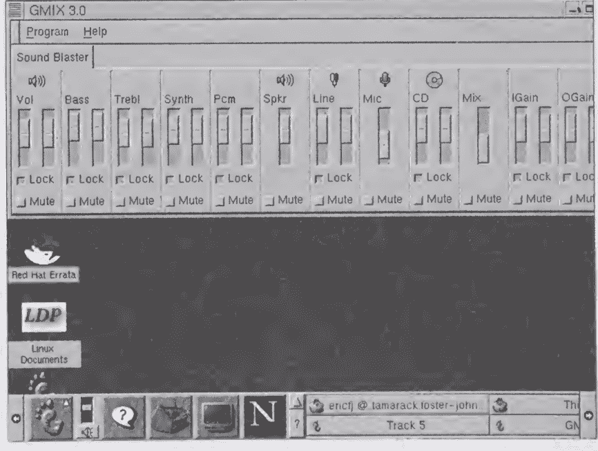

# 第11章

掌握这些技能

- 访问Windows软盘
- 访问Windows文件系统
- 运行Windows应用程序

## 与Microsoft Windows一起工作

Microsoft Windows 是存在的。瞧！尽管有些人希望如此，但Windows不会很快消失。事实上，你运行Linux的这台PC最初可能运行的是Windows。你可能仍然拥有双启动系统，或者你可能只在系统上运行Linux。无论如何，很可能你需要与Windows系统交换数据。

这并不算太糟。Linux的标志之一就是对标准（如用于网络的互联网协议）的支持。想要活在自己世界里的很可能是Windows。因此，你需要让你的Linux系统按照Windows的方式来进行通信，以便完成更多工作。

Windows用户最常见的任务之一是使用办公软件，例如Microsoft Word和Excel。（Microsoft显然主导着那个市场。）有许多Linux替代品支持 reasonable 的文件转换能力与MS Word兼容。通常，这些程序不会支持MS Microsoft Word的所有功能或最新的文件格式，但一般来说，你可以将数据保存为Word格式，然后将文件传输到你的Windows系统。

Corel公司的WordPerfect、Applix公司的ApplixWare或Star Division公司的StarOffice等软件都能与Microsoft Office格式进行合理的转换。这些都在第8章中讨论过。而且WordPerfect和StarOffice也销售其软件的Windows版本，因此你可以选择一个在多个操作系统（包括Linux）上运行的办公套件。不过，要转换文件，你需要在Linux和Windows系统之间传输文件。在这里，许多Linux命令可以提供帮助。

你可以从Linux访问Windows硬盘和软盘。你可以将Windows硬盘作为Linux文件系统挂载到根目录下，也可以向/从DOS格式化的软盘复制文件。使用特殊的mtools命令，你甚至不必挂载Windows软盘；可以直接访问它们。此外，你还可以在Linux上运行特殊的模拟器来运行一些DOS和Windows应用程序。

本章涵盖了许多具体的方法，让你可以从Linux与Windows系统一起工作，无论是通过软盘还是通过网络传输文件。

### 访问Windows软盘

在PC领域，几乎所有PC仍然配备软盘驱动器。这使得软盘成为在Linux和Windows系统之间交换文件的绝佳介质。

一组名为mtools的实用程序提供了读写DOS软盘的功能。在这组工具中，大多数程序都以相应的DOS工具命名，前面加上一个m。例如，向/从软盘复制文件的程序是mcopy，它的作用类似于DOS的copy程序。要将Linux文件复制到A:驱动器中的DOS格式软盘，请使用以下命令：

```
$ mcopy report.txt "a:"
```

mtools程序将名称A:理解为第一个软盘。在其内部，表11-1列出了A:和B:软盘驱动器的Linux设备文件。文件`/etc/mtools.conf`告诉mtools哪些Linux设备用于A:和B:驱动器。

要从DOS软盘复制文件到Linux硬盘，请使用以下格式：

```
$ mcopy "a:*.txt" .
```

这个命令将`a:*.txt`用双引号传递给mcopy，因为你不想让Linux shell扩展通配符`*.txt`。命令最后的 `.` 告诉mcopy将文件放在当前目录。

要查看DOS软盘上有哪些文件，请使用mdir命令：

```
$ mdir "a:"
```

如清单11-3所示，mtools支持软盘上的长文件名。这非常方便，因为Linux文件很少有短的DOS兼容文件名。

要删除软盘上的文件，请使用mdel。

#### 注意

##### 软盘权限错误

当你第一次尝试使用mtools工具之一访问软盘时，可能会看到以下错误：

```
$ mcopy chap10.txt a:
Can't open /dev/fd0 impl
Cannot initialize 'A:'
Bad target a:
```

在这种情况下，软盘设备`/dev/fd0`的权限不允许你访问。这是故意设置的，以堵住安全漏洞并防止用户访问软盘驱动器。如果你是Linux系统的唯一用户，这可能不是问题。无论如何，你可以作为root运行以下命令，以启用所有用户对A:驱动器的访问：

```
# chmod 666 /dev/fd0*
```

你可以对B:驱动器`/dev/fd1`执行相同操作。

##### 文本文件转换

mcopy的 `-t` 选项告诉命令在Linux格式（一个换行符结束一行）和Windows格式（一个回车符和一个换行符结束每一行）之间转换文本文件。

##### 检查是否已安装

使用以下命令验证mtools是否已安装：

```
$ rpm -q mtools
mtools-3.9.1-5
```

#### 交叉参考

任务"访问Windows文件系统"涵盖了挂载软盘的内容。

## 与Microsoft Windows一起工作

# 第11章

### 表11-1：软盘设备文件

| 驱动器 | 设备 |
|-------|--------|


| A: | `/dev/fd0` |
|---|---|
| B: | `/dev/fd1` |

### 清单 11-1：将文件复制到软盘

```bash
$ mcopy *.java "a:"
```

► `mcopy`命令的工作方式类似于`cp`命令。

### 清单 11-2：从软盘读取文件

```text
$ mcopy -v "a:*.java" .
Copying A:/ConUI.java
File "./ConUI.java" exists,
    overwrite (y/n) ? y
Copying A:/Hello.java
Copying A:/UI.java
```

► 从软盘复制文件到硬盘时，如果硬盘上已存在该文件，你会收到提示询问是否覆盖文件。使用`-v`选项可以获得`mcopy`的详细输出，列出所有复制的文件。

### 清单 11-3：列出软盘上的文件

```text
$ mdir "a:"
 Volume in drive A has no label
 Volume Serial Number is 7694-1B87
 Directory for A:/

CONUI   JAV 806 04-27-1999 20:34 ConUI.java
HELLO-1 JAV 105 04-27-1999 20:34 Hello.java
UI-1    JAV 184 04-27-1999 20:34 UI.java
        3 files           5 788 bytes
             1 450 496 bytes free
```

► `mdir`命令列出软盘上的文件。

### 清单 11-4：删除文件

```bash
$ mdel "a:chap15d.txt"
```

► `mdel`命令删除软盘上的文件。

### 清单 11-5：删除软盘上的所有文件

```bash
$ mdel "a:*.*"
```

► 使用通配符删除软盘上的文件时，将模式用引号括起来，这样 Linux shell 就不会尝试扩展星号。这样做是因为你的 shell 不知道 mtools 支持的`a:`和`b:`。

### 清单 11-6：创建目录

```bash
$ mmd "a:tmp"
$ mdir "a:"
 Volume in drive A has no label
 Volume Serial Number is 7694-1B87
 Directory for A:/

tmp    <DIR>   05-30-1999  11:04  tmp
       1 file              0 bytes
              1 457 152 bytes free
```

► `mmd`命令在 DOS 软盘上创建目录。

### 清单 11-7：更改目录

```bash
$ mcd "a:/tmp"
$ mcd
A:/tmp
```

► 如果软盘有子目录，你可以使用`mcd`命令更改目录。单独输入该命令会打印出软盘上的当前目录。

### 快捷方式

KDE 磁盘导航菜单使你能够从桌面访问软盘。

# 访问 Windows 文件系统

你可以像访问 Linux 文件系统一样，在 Linux 中访问 Microsoft Windows 文件系统。并且，和 Linux 文件系统一样，你必须先将 MS-DOS 文件系统挂载到 Linux 根目录下的某个位置。如果你更习惯 Windows 的概念，即每个磁盘都有自己的根目录（如 `C:\` 和 `D:\`），这可能会让你觉得奇怪。在 Linux 中，所有磁盘的所有文件系统都出现在一个根文件系统之下。Linux 的方法使导航更加容易。

要将 MS-DOS 文件系统挂载到名为`/dosc`的目录下（DOS C 驱动器的简称），作为 root 使用以下命令：

```bash
# mount -t vfat /dev/hda1 /dosc
```

此命令将第一个 IDE 硬盘的第一分区（`/dev/hda1`）挂载到名为`/dosc`的目录下，文件系统类型为 vfat，它支持 Microsoft Windows 95 和 NT 所允许的长文件名。（如果此目录尚不存在，你需要先用`mkdir`命令创建它。）Windows 系统通常将 Windows 安装在`C:\`上，在大多数情况下，这是第一个 IDE 硬盘的第一个分区。如果不是这样，请将前面示例中的`/dev/hda1`更改为适当的设备名称，如第 1 章所述。

现在，如果你安装 Linux 时运行了 Disk Druid，你可能已经处理了所有这些。Disk Druid 应该会自动检测到你的 Windows 分区，并提供为你挂载它们的选项。你可以通过查看`/etc/fstab`文件并搜索`msdos`一词来检查这一点。作为 root 使用`grep`命令：

```bash
# grep msdos /etc/fstab
/dev/hda1 /msdos msdos defaults 0 0
```

你应该看到与此处所示的`/dev/hda1`输出类似的内容。默认情况下，Disk Druid 将文件系统类型设置为 msdos，它不支持长文件名。如果你需要长文件名支持（大多数人需要），请将 fstab 中第三列从 msdos 改为 vfat。

## 注意事项

### 处理空格

Microsoft Windows 支持文件名中包含空格。你在使用 Microsoft 专有 Joliet 扩展格式化的 CD-ROM 上尤其常见到这些。空格对 Linux 来说是坏事，因为空格用于分隔命令参数。这意味着如果你复制、删除或以其他方式操作文件，命令很可能会失败。要解决这个问题，请用双引号将文件名括起来。例如：

```bash
$ rm "8598-9 fg110101.tif"
```

### 挂载软盘

mtools 使你无需运行`mount`命令即可访问 DOS 格式的软盘。不过，如果你愿意，也可以挂载软盘然后访问其文件。通常，软盘的挂载点是`/mnt/floppy`。挂载软盘的基本命令如下：

```bash
# mount -t vfat /dev/fd0 /mnt/floppy
```

执行此操作后，你可以使用`ls`等常规 Linux 命令查看软盘上的文件：

```text
$ ls /mnt/floppy
03_07_01.tif.gz* 03_vizq.tif.gz*
16_01_02.tif.gz*
03_07_02.tif.gz* 16_01_01.tif.gz*
```

在挂载软盘之前，它必须先格式化。此处所示的示例假定磁盘已使用 MS-DOS 文件系统格式化。你也可以用 Linux 文件系统格式化软盘。

> **交叉参考**
>
> Samba 在第 15 章中介绍，它提供了 Windows 和 Linux 系统通过网络链接共享文件的功能。

# 使用 Microsoft Windows

## 11

### 格式化软盘

在 Linux 中，你可以用 MS-DOS 文件系统或 Linux 文件系统格式化软盘。为此，你需要运行两个命令。首先，运行`fdformat`命令执行低级格式化。无论你想在软盘上使用哪种文件系统——MS-DOS 还是 Linux——都需要执行此操作。

然后，运行第二个命令，根据你想在软盘上放置的文件系统类型，MS-DOS 和 Linux 的命令有所不同。要格式化 MS-DOS 软盘，请使用`mformat`命令，或者，如果你已安装 mkdosfs 软件包，可以运行`mkdosfs`，它的格式化速度要快得多。如果你改为想在软盘上格式化 Linux 文件系统，请使用`mke2fs`。

要运行`fdformat`，你需要确定软盘的原始设备文件名。基本格式为：

```text
/dev/fdNLsz
```

将 N 替换为驱动器编号，0 代表 A:，1 代表 B:。将字母 L 替换为驱动器类型的代码：d 代表低密度 5.25 英寸驱动器；D 代表低密度 3.5 英寸驱动器；h 代表高密度 5.25 英寸驱动器；或 H 代表高密度 3.5 英寸驱动器。将 sz 替换为驱动器大小：360、720、1200（5.25 英寸）或 sigue 1440（3.5 英寸）。现在绝大多数 A: 驱动器都是高密度 3.5 英寸软盘驱动器，名称为`/dev/fd0H1440`。因此，执行低级格式化的命令为：

```bash
# fdformat /dev/fd0H1440
```

运行`fdformat`后，你需要在驱动器上放置文件系统。使用`mformat`在磁盘上放置 MS-DOS 文件系统。对于 3.5 英寸标准 A: 驱动器，使用以下命令：

```bash
# mformat -h 2 -s 18 -t 80 a:
```

或：

```bash
# mkdosfs /dev/fd0
```

这是针对 3.5 英寸 1.44MB 标准软盘的。`info`命令提供的 mtools 文档列出了磁盘几何结构的完整选项。

如果相反，你想在软盘上使用 Linux 文件系统，请使用`/sbin/mke2fs`命令在软盘上创建 e2fs 文件系统。例如：

```bash
# /sbin/mke2fs -m 0 /dev/fd0H1440
```

`-m`选项告诉`mke2fs`为超级用户保留零个块，而不是默认的百分之五。对于软盘，你真的不需要保留这些块。

#### 在桌面上运行 Kfloppy

如果你安装了桌面环境，可以运行程序`kfloppy`，它在软盘格式化命令之上提供了图形界面。`Kfloppy`可以在软盘上格式化 DOS 或 Linux（ext2fs）文件系统。为此，你需要告诉`kfloppy`软盘在哪个驱动器（A: 或 B:）以及其大小（3.5 英寸或 5.25 英寸）。你需要选择磁盘是高密度（HD）还是双密度（DD）。最后，你需要选择格式化 DOS 文件系统还是 Linux ext2fs 文件系统。`Kfloppy`默认为最常见的情况：驱动器 A: 中的 3.5 英寸 DOS HD 磁盘。

准备好后，点击格式化。

`Kfloppy`在格式化磁盘时显示一个漂亮的进度条。你还可以看到正在格式化的扇区的数字输出。

用 Linux ext2fs 系统格式化软盘后，你会看到`lost+found`目录，所有 ext2fs 文件系统都需要它作为存储在文件系统中某种程度上丢失的文件的位置。

> **在线查找**
>
> KDE 主页，你可以在其中找到 kfloppy，是`http://www.kde.org`。

#### 运行 Windows 应用程序

Wine（Windows 模拟器）提供了一个环境，你可以在其中运行 Windows 应用程序。Wine 背后的基本概念相当简单。因为 Linux 在与 Windows 相同的 x86 处理器上运行，为 Windows 编译的二进制 x86 指令集代码与为 Linux 编译的代码非常相似。只有当程序需要访问操作系统时——例如磁盘、图形、键盘输入、文件等——才会有所不同。幸运的是，大多数 Windows 应用程序使用共享库——在 Windows 上称为 DLL 或 640 Dynamic Link Libraries。因此，Wine 开发人员编写了许多核心 DLL 的 Linux 等效版本，因此 Linux 可以运行许多 Windows 应用程序。

你不会从 Red Hat Linux 中获得 Wine。相反，你需要下载 Wine——你可以从 Red Hat 站点`ftp://contrib.redhat.com/libc6/i386/`或 Wine 主页`http://www.winehq.com`获取 WINE 的 `.rpm`文件。软件包名称类似于`wine-990328-1.i386.rpm`。

要安装 Wine，请下载 `.rpm`文件，然后作为 root 发出以下命令：

```bash
# rpm -ivh wine*
```

然后，还有一些其他事情你必须做。检查主 Wine 配置文件，位于`/etc/wine.conf`或`/usr/local/etc/wine.conf`。此文件包含用于映射各种 MS-DOS 磁盘的条目，例如将 A: 驱动器映射到 Linux 软盘设备文件`/dev/fd0`。`wine.conf`文件看起来像老式的 Windows INI（初始化）文件，带有诸如`[Drive A]`之类的部分来配置 A: 驱动器。最重要的编辑条目是`[Drive C]`部分，如下所示：

```ini
[Drive C]
Path=/home/msdos
Type=hd
Label=MS-DOS
Filesystem=msdos
```

默认情况下，Wine 期望`/home/msdos`作为其认为是 C: 驱动器的顶级目录的主目录。现在，如果你已挂载 Windows 文件系统，你可以使用它。否则，你可以创建 Linux 目录`/home/msdos`，然后至少创建两个子目录：`windows`和`windows/system`。这些目录应与 Windows 下的`C:\WINDOWS`和`C:\WINDOWS\SYSTEM`目录相匹配。

无论你采取哪种方法——挂载 MS-DOS 分区还是在 Linux 分区上创建目录——你都需要确保应用程序所需的 DLL 位于正确的位置，通常对于大多数系统 DLL 是`/home/msdos/windows/system`。

例如，要运行 Freecell 游戏，你需要两个文件：`freecell.exe`（通常在`C:\WINDOWS`中）和`cards.dll`（通常在`C:\WINDOWS\SYSTEM`中）。将这些文件复制到`/home/msdos`下的相应位置（或挂载 MS-DOS 文件系统）。然后，你可以使用以下命令运行 freecell 游戏：

```bash
$ wine /home/msdos/windows/freecell.exe
```

`wine`命令的基本格式为：

```bash
$ wine program_name
```

当你运行程序时，可能会收到类似以下的错误：

```text
$ wine windows/freecell.exe
Could not load 'C:\WINDOWS\CARDS.dll'
required by 'FREECELL', error=2
wine: can't exec 'windows/freecell.exe':
file not found
```

> **在线查找**
>
> 另一种在 Linux 下运行 Windows 本身的工具可从`http://www.vmware.com`获取。

# 在 Microsoft Windows 中工作

此错误告诉我们，Freecell 需要特定的 DLL。然后，您需要获取正确的 DLL 文件并将其安装到`/home/msdos/windows/system`，或者与程序相同的目录中。

## 注意

### 合法使用

如果您使用任何 Windows 共享库（DLL），您应该拥有合法的 Windows 副本。

### 并非适用于所有用户

Wine 仍在积极开发中。一些主要应用程序，例如 Microsoft Word 和 Excel，在 Wine 下无法良好运行——如果运行的话——但其他应用程序则可以正常工作。正如他们所说，您的体验可能有所不同。如果 Wine 完全无法工作，也不要感到惊讶。

对我们来说，Wine 在我们退出简单的 Freecell 应用程序时，持续地 dumped core（表示程序崩溃）。幸运的是，这只发生在我们退出应用程序时。

有一个在线数据库列出了哪些程序可以在 Wine 上运行，网址为`http://www.winehq.com/Apps/query.cgi`。诸如微软的 Word 和 Excel 等应用程序在此列表中并未被评为运行良好。请经常查看 Wine 主页（`http://www.winehq.com`）以下载更新。

### DOSEMU

一个与 Wine 类似的软件包叫做 DOSEMU，全称为 DOS 模拟器。DOSEMU 在虚拟 86 模式下运行 DOS 程序。要安装 DOSEMU，请从 Red Hat FTP 站点（参见附录 B）安装所有以 dos 开头的 rpm 文件。然后测试 DOSEMU。首先，以 root 身份编辑`/etc/dosemu.users`文件，并为自己添加一个条目（您可以复制 root 条目并将 root 替换为您的用户名以获得完全访问权限，这确实会形成一个安全漏洞）。然后，输入`dos`命令。

- Wine 下的 freecell 游戏。
- 运行`dos`命令以看到类似 DOS 的界面。
- 输入诸如`DIR`之类的 DOS 命令以查看目录列表。

## 个人练习册

### 问答

1. 您可以使用什么程序将文件复制到软盘？
2. 您可以使用什么程序将文件从软盘复制到您的 Linux 硬盘？
3. 与 A: 驱动器对应的 Linux 设备文件名是什么？
4. 格式化软盘驱动器需要知道什么？
5. Linux 是否支持软盘上的长格式 Windows 文件名？
6. 挂载软盘的典型位置在哪里？
7. DOSEMU 有什么作用？
8. 您可以使用什么在 Linux 下运行 Windows 应用程序？

答案：第 339 页

# 在 Microsoft Windows 中工作

#### 第 11 章

#### 额外练习

1. 查阅 mtools 程序的在线手册信息。有在线手册页（`man mtools`）以及可从`info`命令获得的信息（`info mtools`）。
2. 使用`fdformat`命令格式化软盘。低级格式化完成后，使用`mformat`格式化为 DOS 文件系统。
3. 现在，再次使用`fdformat`格式化软盘，然后使用`mke2fs`在磁盘上放置 Linux ext2fs 文件系统。
4. 如果您已加载 KDE 桌面，请尝试`kfloppy`，它使格式化软盘的任务变得更加容易。
5. 查看 Wine 主页以获取更新的软件。

#### 实际应用

- 您的组织将 Microsoft Word 和 Excel 用作企业标准。您想从 Linux 运行这些应用程序。请查看 Wine Web 兼容性列表，网址为`http://www.winehq.com/Apps/query.cgi`，以了解其他用户关于在 Wine 下运行 Excel 或 Word 的报告。


- 现在亲自尝试 Wine。看看是否可以使 Microsoft Windows 应用程序在 Wine 下运行。
- 由于大多数软盘都预格式化为 DOS，请尝试从 Microsoft Windows 系统向 Linux 系统交换文件。一般来说，在与 Linux 交换文件时，最好避免使用带有空格的文件名。

### 视觉测验

您可以在此提示符下输入什么类型的命令？

# 第 12 章

## 掌握这些技能

- 射击游戏
- 安静沉思

## 游戏

虽然 Linux 支持相当多的严肃商业应用程序，但您的 Linux 生活不必全是严肃的。Linux 还可以运行相当多的游戏，包括大型射击游戏，如 `Quake`、`Doom` 和 `Heretic`。

主要游戏公司已经意识到 Linux 的现象，包括上述游戏的开发商 id Software，以及将 `Civilization: Call to Power` 移植到 Linux 的 Loki Entertainment Software。Linux 在游戏软件方面远不及 Windows 流行，但在未来一年左右，我们预计会有更多游戏可用于 Linux。家庭爱好者占据了 Linux 安装基数的很大一部分，同时也占据了游戏购买者的很大一部分。许多这些 Linux 用户运行双启动机器，只是为了运行某些尚未有 Linux 对应版本的游戏。

此外，Linux 上已经存在许多游戏，尤其是商业游戏的免费克隆版本。例如，`Freeciv` 是流行游戏 `Civilization` 的免费克隆版本。您也可以购买商业版本。

随 Windows 附带的最受欢迎的应用程序之一是纸牌游戏 `Solitaire`，紧随其后的是一个名为 `Freecell` 的变体。您会在 Linux 上找到这些游戏的克隆版本。事实上，除了大量其他游戏之外，还有大约四到五个版本的 `Freecell` 可供选择。

无论您运行哪种 X Window 桌面环境，无论是 Red Hat 的 AnotherLevel、GNOME 还是 KDE，屏幕底部任务栏工具栏上都有一个游戏菜单。这些游戏大多是相当简单的类型，例如 `Solitaire` 纸牌游戏的变体和 `Minesweeper` 的一个版本。

要运行更复杂的游戏，如 `Doom` 或 `Quake`，您需要安装额外的软件包。有时这些软件包以 Red Hat 软件包管理器或 RPM 格式提供，但大多数情况下并非如此。我们还发现许多游戏需要相当复杂的设置和配置过程，所以如果您想运行大型游戏，请耐心等待。

为了帮助设置这些游戏，您会喜欢 `http://www.linuxgames.com` 上提供的信息，这是一个主要的 Linux 游戏网站。而且，秉承 Linux 的传统，寻找 HOWTO 文档以帮助您开始使用各种游戏。例如，`Quake HOWTO` 非常有帮助，甚至还有一个 HOWTO 介绍如何使用 Wine（第 11 章讨论的 Windows 模拟器）让暴雪娱乐的 `StarCraft`（一款 Microsoft Windows 游戏）在 Linux 下运行。

### 射击游戏

最受欢迎的游戏类型之一是经典的“环游宇宙——遇见奇怪生物——杀死它们”游戏。该类型中各个时期的顶尖游戏包括 `Doom`、`Heretic` 和各种版本的 `Quake`，它们都是第一人称射击游戏，在这种游戏中，您的武器在三维环境中指向前方，您可以击杀敌人。

当我们第一次看到各种 `Quake`、`Doom` 和 `Heretic` 软件包时，我们认为在 Linux 上运行它们会非常酷。在花费了过多时间尝试让它们运行并下载替代软件包之后，我们充分体会到了这些最初为 DOS 平台设计的游戏的脆弱性。

您可以从表 12-1 列出的网站获取这些游戏。我们能够找到 `Doom` 和 `Heretic` 的 RPM 软件包。`Heretic` 可以运行，但 `Doom` 不行。`Quake` 有多种不同的格式，包括没有任何文档的普通 Linux 可执行文件。

所有游戏都需要特殊文件——称为 `WAD 文件`——其中包含有关关卡（您探索的区域）和所有那些讨厌怪物的信息。要获得 WAD 文件，您通常需要在运行 DOS 的系统上安装 DOS 版本的游戏。然后，您可以将非常大的 WAD 文件传输到您的 Linux 系统。您还可以运行许多实用程序，旨在从特别压缩的 DOS 游戏软件包中提取 DOS 文件。从表 12-1 列出的 RPM 软件包安装 `Heretic` 时，`Heretic` 在 `/usr/lib/games/heretic` 中包含一个可运行的 WAD 文件。如果您切换到此目录并运行 `heretic`，一切正常。对于 RPM 文件中的 `Doom` 版本，音乐服务器或 `musserver` 失败，导致整个游戏引擎崩溃。我们甚至尝试了商业版 `Doom II` 的 WAD 文件，也无济于事。（游戏引擎出奇地脆弱。）

我们能够让另一个名为 `LxDoom` 的 `Doom` 版本运行，从 `http://lxdoom.linuxgames.com` 下载后。此版本需要商业 WAD 文件，无法运行您可以从互联网下载的共享软件 WAD 文件。

所有这些游戏在 Linux locales 屏幕上看起来都有点小。出于 DOS 下的性能原因，这些游戏以 320×240 像素的窗口显示，这在现代 X Window 显示器上看起来非常小。

#### 注意

##### 合法使用

游戏开发商如 id Software 会发布其游戏玩家的 Linux 版本，但您应该注册共享软件版本或购买商业版本以获得 WAD 文件，即描述游戏实际关卡的文件。如果游戏开发商看到 Linux 没有收入潜力，他们就会避开我们最喜欢的操作系统而坚持使用 Windows。我们希望更多开发商醒悟过来并将他们的产品移植到 Linux。您也可以购买 Linux 版的商业版 `Quake`。

##### QUAKE 3 ARENA

`Quake 3 Arena` 将流行的 `Quake` 游戏从其第一人称射击风格转变为完整的竞技场战斗。您可以从 `http://www.quake3arena.com` 获取 Linux 版本。

##### 交叉参考

第 14 章介绍了解包 LxDoom 所需的 `tar` 和 `gzip` 命令。

##### 在线查找

查看 Linux-Quake HOWTO，网址为 `http://www.linuxgames.com/quake/`。

## 游戏

# 第 12 章

### 表 12-1：游戏相关网站

| URL | 内容 |
|---|---|
| `http://lxdoom.linuxgames.com` | LxDoom |
| `http://www.idsoftware.com` | id Software 官方网站，Quake、Doom 和 Heretic 的开发商 |
| `http://rufus.w3.org/linux/RPM/contrib/libc6/i386/Games.html` | Doom 和 Heretic 等的 RPM 安装包 |
| `http://www.handeye.com` | 销售 Linux 游戏 |
| `http://www.linuxgames.com/` | Linux 游戏网站 |
| `http://www.linuxgames.com/quake/` | Quake 使用指南 |
| `http://www.happypenguin.org/news` | Linux 游戏宝典新闻 |
| `http://www.freeciv.org` | freeciv 文明克隆版主页 |
| `http://www.quake3arena.com` | id Software 最新版 Quake 主页 |

### 清单 12-1：解压并运行 LXDOOM

```sh
$ gunzip lxdoom-v1_3_7_i386_tar.gz
$ tar xvof lxdoom-v1_3_7_i386_tar
$ cd lxdoom
$ lxdoom -iwad doom2.wad
```

> 你可以运行 Lxdoom，但需要一个商业 Doom WAD 文件。这里我们使用 Doom II 的文件。
>
> LxDoom 会以一个很小的窗口显示。

从 `/usr/lib/games/heretic` 运行 `/usr/games/heretic`。

### 安静沉思

如果你不喜欢前文讨论的各种高刺激暴力游戏，或者只是想玩一些不会因为嘈杂声响而惊动同事的游戏——就像运行 Doom 时那样——Linux 也提供了许多更安静的游戏。

KDE 和 GNOME 桌面环境都提供了几乎相同的 Freecell 克隆版，这是一种在 Microsoft Windows 上流行的纸牌接龙游戏。

GNOME 和 KDE 桌面环境都包含许多其他游戏，包括各种麻将游戏版本，这是一种亚洲游戏，你需要成对移除牌片。KDE 包含 Shisen-Sho，这是一种类似麻将的游戏，尤其在你应该工作的时候玩起来特别上瘾。其他游戏还包括 AisleRiot，一种 Klondike 纸牌接龙版本，以及众多俄罗斯方块和扫雷克隆版。从任务栏的游戏菜单启动这些游戏。也可以查看 KDE 和 AnotherLevel 的游戏菜单。

基于流行的文明游戏，Freeciv 是该游戏的一个免费克隆版，在游戏中你建造城市、工业和武装力量，试图统治世界。在文明中，你从公元前 2000 年一直扮演到公元 2500 年以后，作为一群人的统治者或神灵。你可以从众多古代文明中选择，如罗马、希腊和埃及，作为你城市和军队的基础。

而且，如果你厌倦了独自游玩，Freeciv 设计支持多用户游戏。游戏的主要部分由 `freeciv` 服务器 `civserver` 运行。每位玩家则运行 Freeciv 客户端程序 `civclient`。从 `civclient` 中，你可以将 Freeciv 服务器的位置指定为网络上的任何机器，从而实现多个用户之间的网络对战。

要运行 Freeciv，你需要先在网络上的一台 Linux 机器上启动服务器 `civserver`。然后，启动客户端程序 `civclient`。为每位玩家启动一个 `civclient` 副本。启动 `civclient` 时，如果服务器运行在不同的系统上，你需要告诉它运行 `civserver` 程序的机器位置。清单 12-3 展示了这一点。然后，当所有玩家都登录后，在 `civserver` 提示符下输入 `s`，开始游戏。

你也可以从任务栏菜单中的不同选项分别启动 Freeciv 客户端和服务器。打开 AnotherLevel 菜单，查找游戏菜单。

#### 注意事项

##### 获取正版文明游戏

你可以从 `http://www.handeye.com` 购买 Linux 版商业版文明：权力召唤（Civilization: Call to Power）。

##### PERCY，会说话的企鹅

虽然不那么安静，`percy` 由 Malcolm Kavalsky 开发，能在你的显示器上创建一个会说话的 Linux 企鹅。你可以从 `http://members.xoom.com/kavalsky/percy.htm` 获取 `percy`。

##### LINUX 上的地球升起

`xglobe` 和 `xplanet` 都能让你将行星图像放置在屏幕背景中。使用 `xplanet`，你甚至可以移动地球的位置以查看不同的半球。参见 `http://wwwrzstud.rz.uni-karlsruhe.de/~uddnn/xglobe/` 和 `alumnus.caltech.edu/~hari/xplanet`。

##### 交叉参考

第 11 章展示了如何通过 Wine 这个 Windows 模拟器运行 Windows 版 Freecell 游戏。

##### 在线查找

Freeciv 主页是 `http://www.freeciv.org`。

## 游戏

# 第 12 章

- 1. 点击新建开始游戏。
- 2. 使用鼠标移动纸牌。

### 清单 12-2：启动 FREECIV 服务器

```text
$ civserver
Freeciv version 1.7.1 server
> 1: Sending info to metaserver
  [platinum.daimi.aau.dk 12245]
Metaserver: address error:
  Message too long
Not reporting to the metaserver
  in this game
Use option -nometa to always enforce this
> 1: Now accepting new client connections
1: Connection from ericfj with
  client version 1.7.1
1: ericfj[localhost] has joined the game.
>1: ericfj is the Mongol ruler Genghis
1: The map has 1 starting positions
  on 1 isles.

> s
starting game
```

- 启动 `civserver` 命令，然后等待所有客户端连接。所有客户端连接后，输入 `s` 开始游戏。输入 `q` 退出。

### 清单 12-3：运行 FREECIV 客户端程序

```sh
$ civclient -server tamarack
```

- 这运行 freeciv 客户端程序，告诉程序 freeciv 服务器运行在名为 tamarack 的机器上。将 tamarack 替换为你的服务器系统名称。

从 freeciv 客户端程序连接到服务器。

### 个人练习册

#### 问答

Linux 来自乏味的 UNIX，有着无数晦涩的命令。你能在 Linux 上运行游戏或寻找乐趣吗？

如果你想杀戮和残害，能在 Linux 上运行 Doom 和 Heretic 这样的游戏吗？

这些游戏容易设置吗？

能从 GNOME 桌面任务栏菜单启动 Freeciv 程序吗？

Freeciv 至少需要两个程序才能运行。说出它们。

你能和朋友一起玩 Freeciv 吗？

有可以在 Linux 上购买的文明游戏商业版本吗？

Linux 上还有什么其他游戏？有些可以从 GNOME 任务栏获取吗？

答案：第 340 页

#### 额外练习

- 1. 访问 id Software 网站 `http://www.idsoftware.com`，获取最新版本的 Quake 和 Quake II。
- 2. 访问 id Software 网站获取 Quake 3 Arena。
- 3. 如果你有运行它的硬件，下载 Quake 3 Arena 所需的所有软件并游玩。
- 4. 阅读 Heretic 的在线文档。
- 5. 进行网络搜索，看看有多少游戏可用于 Linux。
- 6. 现在，将你的搜索范围缩小到仅商业游戏。

#### 实际应用

- 你购买了 Windows 版 Quake。在 Quake 光盘上查找在 Linux 上运行 Quake 所需的 WAD 文件。
- 使用 GNOME 时间追踪程序 `gtt` 追踪你在 Linux 上玩游戏的时间。现在想办法向你的老板合理化这些时间。
- 当老板经过时，屏幕上显示游戏可不是个好主意。练习快速切换到不同的虚拟桌面，以隐藏你的“非法”活动。查看屏幕底部任务栏上的桌面切换器。

### 视觉测验

好的，你在 Doom 窗口中看到了一个生物。你会怎么做？

# 第三部分

## 本部分内容

- 13 Linux 与互联网
- 14 互联网工具
- 15 局域网
- 16 搭建你自己的 Web 服务器
- 17 高级系统配置

## 连接世界

Linux 不是一座孤岛。它很好地连接到互联网或你可能拥有的本地网络。事实上，如果没有互联网，我们今天就不会有 Linux。遍布全球的开发者完成了 Linux 的大部分开发工作。第 13 章将向你介绍这种独特的关系。

Linux 支持大多数标准网络协议，尤其是构成互联网的那些协议。你可以将 Linux 系统作为互联网服务器，许多互联网服务提供商就是这样做的。你也可以使用标准协议为自己的办公室或家庭创建局域网。

除了基础网络功能，Linux 还支持大量网络感知工具，从电子邮件客户端到 Web 浏览器（包括无处不在的 Netscape），再到新闻阅读器、聊天程序等等。第 14 章和第 15 章讨论工具和网络功能。

Linux 包含了运行网站数量超过任何其他服务器的 Web 服务器——Apache，这在第 16 章中讨论。Linux 还支持 Windows 专有的 SMB 或 LanManager 协议，使你的 Linux 系统能够充当 Windows 文件和打印服务器，有望节省大量许可费用。

在最后一章，我们讨论高级内核配置。某些网络选项需要你创建新的 Linux 内核——这看似艰巨，但实际上并不难——如第 17 章所述。

# 第 13 章

## 掌握这些技能

- 连接到互联网
- 设置 PPP 连接
- 测试你的 PPP 连接
- 配置 Netscape
- 设置电缆调制解调器
- 电缆调制解调器与本地网络
- 设置伪装客户端与安全

### 互联网与 Linux

Linux 是为互联网而生的。网络功能内置于操作系统中，并附带了一整套丰富的工具，让你能够对其进行调优和配置，以实现最大的互联网效能。例如，连接互联网的常见方式之一是通过调制解调器。Linux 包含了一些工具，可以自动使用 SLIP 或 PPP 协议拨号连接到你的互联网服务提供商（ISP）。如果你拥有直接连接到互联网的线路，Linux 同样表现出色。无论你拥有 T1 线路、电缆调制解调器、DSL 还是 ISDN 线路，Linux 都能应对。

一旦连接成功，Linux 包含的互联网工具之多，你永远用不完。当然，你可以使用常见的 Netscape Navigator，但你还能获得多个用于文件传输的 FTP 程序、用于登录远程计算机的 `telnet`，以及无数其他程序。


除了网上冲浪，互联网的另一大用途是收发电子邮件。Linux 附带了多种不同的邮件阅读器，如`mail`、`pine`、`elm`和`mutt`，或者你也可以直接使用 Netscape Mail。Linux 还能使用标准的 POP 或 IMAP 协议以及`fetchmail`工具，从你的 ISP 收取邮件。无论邮件以何种方式发送给你，Linux 都能处理。

Linux 在网络方面表现卓越的另一个领域是安全。Linux 提供了广泛的安全工具——从高级防火墙到威胁检测器——帮助确保你的系统安全。值得注意的是，由于 Linux 是开源系统，安全问题的修复程序会迅速发布。对于大多数商业软件而言，如果有人发现安全漏洞并报告了 bug，公司并不总是及时响应，甚至根本不响应。商业软件中的安全漏洞只有在规模较大且严重时才会被公开和修复。而在 Linux 中，安全漏洞即使只涉及更改单行代码也会被公开和修复。

参与开源项目的程序员对修复问题有热情，而不仅仅是为了赚取薪水。有了源代码，他们就能做到这一点，然后作为对社区的服务发布他们的修复程序。

但无论你关心的是安全、连接性、灵活性还是性能，Linux 都能提供低成本、高质量的互联网服务。

## 连接到互联网

Linux 与互联网是绝佳搭配。你不仅能获得 UNIX 自带的所有标准网络工具，还能获得开源软件带来的所有实用用户工具。

连接互联网有三种常见方式：直接网络连接、调制解调器连接，以及电缆调制解调器或 DSL 链接。

### 直接连接

直接网络连接常见于企业环境或大学中。毕竟，提供一条专用的高速互联网接入线路需要花费大量资金。

为直接连接配置系统的说明相当简单：向你的网络管理员询问具体步骤，然后照做。每个小型网络都有其独特的功能特性，你应该将系统配置为与它们协同工作。

### 调制解调器连接

调制解调器提供了廉价的互联网接入方式，因此是最受欢迎的连接方法。Linux 使用一种称为 PPP 的协议与你的互联网服务提供商（ISP）通信。这会将你的串行端口转变为网络连接。

设置 PPP 连接需要一些工作。详见下一任务。

### 电缆调制解调器和 DSL 链接

高速电缆和 DSL（数字用户线路）调制解调器是互联网接入的未来。它们的运行速度比标准调制解调器快数十倍，而价格仅略高一些，且提供这类服务的电缆和电话公司正在迅速增加。大多数有线电视服务提供商，如 Cox@home，以及电话公司都使用标准网络协议进行连接。虽然他们并不正式支持 Linux，但会提供连接系统所需的信息。

其他服务，如 RoadRunner（由时代华纳提供），对 Linux 并不完全友好。他们使用自定义程序来连接其网络。幸运的是，就 RoadRunner 而言，一些黑客（指“有天赋的程序员”）已经搞清楚了如何编写他们自己的连接程序。在“设置电缆调制解调器”一节中，我们将详细讨论设置你自己的电缆调制解调器的步骤。虽然我们不专门介绍 DSL 调制解调器，但无论使用哪种技术，步骤基本相同。

### 从你的 ISP 获取的关键信息

在设置任何互联网连接之前，你需要对面页表单中列出的信息有所了解。你的互联网服务提供商应该提供所有这些信息。

例如，我们的 ISP 给了我们一份账户配置表，其中包含一个名为系统信息的部分。

### 名称服务器（DNS）配置

DNS 是将`www.idgbooks.com`等域名转换为`38.170.216.15`等 IP 地址的互联网服务。实现这一点的方式有多种，但主要方法是查询你互联网服务提供商上的名称服务器。

你需要让 Linux 了解你的 ISP 的名称服务器。为此，启动`linuxconf`，选择配置 ➔ 网络 ➤ 客户端任务 ➤ 名称服务器规范。勾选“DNS 是正常运行所必需的”，并将你的 ISP 域名填写为默认域名。输入主名称服务器的地址以及你的 ISP 使用的任何其他名称服务器。

### 清单 13-1：ISP 信息表

- 域名服务器地址：`207.110.0.60`
- 辅助域名服务器：`207.110.0.128`
- 时间服务器地址：`207.110.0.60`
- 新闻服务器名称：`news.genericisp.com`
- POP 服务器：`pop3.genericisp.com`
- SMTP 服务器：`smtp.genericisp.com`

### 表 13-1：互联网信息表

| 字段 | 值 |
| --- | --- |
| 域名 | ___________ |
| 名称服务器地址 | ___________ |
| 辅助名称服务器地址（如有） | ___________ |
| 新闻服务器名称 | ___________ |
| 收件服务：（POP 或 IMAP） | ___________ |
| 你的 POP 或 IMAP 邮件服务器名称 | ___________ |
| 你的 SMTP（发件）邮件服务器名称 | ___________ |

1. 选择类别配置 → 网络 → 客户端任务 → 名称服务器规范。
2. 启用“DNS 是正常运行所必需的”。
3. 输入你的 ISP 域名。
4. 输入你的主名称服务器 IP 地址。
5. 输入任何辅助或第三级名称服务器。

## 设置 PPP 连接

PPP（点对点协议）是一种通过串行链路进行网络通信的协议。它取代了早期的串行协议 SLIP（串行线路协议）。该协议存在许多局限性，而 PPP 消除了这些局限。要使用 PPP 连接到互联网，你首先需要让你的计算机拨号连接到你的互联网服务提供商并登录。完成此步骤后，程序`pppd`将接管并处理后续连接。

现在，连接到互联网所需的只有登录详细信息。这可以通过少量实验轻松确定。

程序`minicom`是一个终端仿真程序，可用于联系你的 ISP。连接成功后你无法执行任何操作，因为`minicom`不理解 PPP，但你可以开启日志记录以记录登录系统所需的所有操作。然后你可以为你的 PPP 连接创建一个登录脚本。

使用命令`$ minicom`启动`minicom`。

输入`AT`检查是否已连接到调制解调器。调制解调器应响应 OK。如果没有任何反应，请检查你的`/dev/modem`链接和串行线路。你可能需要更改通信设置。

通过按`Ctrl+A`然后按`L`开启日志记录。输入`ATZ`重置调制解调器。如果从已知状态开始，事情会更简单。

输入`ATDTnumber`拨打电话号码。（我们不使用`minicom`的内置拨号器，因为 PPP 没有内置拨号器。）例如，如果你的 ISP 号码是 123-4567，输入`ATDT1234567`。

几秒钟后，你应该已连接到远程机器。登录；这可能涉及在提示符处输入用户名和密码。当机器显示“PPP session beginning”或类似信息，并开始输出乱码时，你就成功了。

按`Ctrl+A`然后按`H`，让`minicom`挂断电话。按`Ctrl+A`然后按`X`退出`minicom`。

打印文件`minicap.cap`。该文件将用于配置 chat 程序，以便我们能够自动登录。

清单 13-2 是一个`minicap.cap`示例。

下一步是配置你的 PPP 接口。首先运行`linuxconf`，选择配置 ⇨ 网络 ⇨ PPP/SLIP/PLIP。点击“添加”以添加新的 PPP 配置。选择 PPP 作为要使用的接口类型。

下一个对话框允许你输入 ISP 的电话号码。如果你的系统使用 PAP（密码验证协议）认证，请输入你的登录名和密码。（PAP 是一种用于验证 PPP 会话的高级方法。）

点击新定义的接口（`ppp0`）以打开接口配置对话框。点击“通信”以打开`chat`配置对话框。`chat`程序由 PPP 脚本自动启动，旨在发起你的计算机与 ISP 之间的连接。

`chat`程序的输入是一系列期望/发送字符串。`chat`程序检查从调制解调器返回的数据，并查找期望字符串。当看到它时，它用发送字符串作为响应。每对字符串按顺序处理。

在此示例中，当 ISP 发送 Login: 时，响应应该是用户名（`a_user`）。期望字符串设置为`ogin`，以防连接意外丢失字符，发送字符串是`a_user`。密码的处理方式类似。

如果你选择“调试连接”，`chat`将在消息日志`/var/log/messages`中写入所有传入和传出数据的完整日志。如果你在连接时遇到问题，请打开调试并检查此文件。

## 互联网与 Linux

### 清单 13-2：MINICOM 会话示例

```text
ATZ
OK

ATDT555-1212
CARRIER
PROTOCOL:LAP-M
COMPRESSION:V.42BIS
CONNECT38400/ARQ

Welcome to Generic ISP
login: a_user
Password:

Entering PPP Mode.
IP address is 204.252.1.154
!#$!@#$#@!#!%!@%^^^&
```

#### minicom 欢迎界面

1. 输入电话号码。
2. 选择包含调制解调器的设备。
3. 设置此项以使调试消息被写入`/var/log/messages`。
4. 期望 ISP 发送 Login。（截断为`ogin`，以防某个字符丢失。）
5. 当看到`ogin`时，发送`a_user`。
6. 接下来应该是 Password。（但我们只查找末尾部分：`ord:`）。
7. 当收到密码提示时，发送`a_pass`。

### 尝试你的 PPP 连接

如果一切顺利，你现在可以以 root 身份执行命令`/sbin/ifup ppp0`来建立 PPP 链接。如果连接成功，太棒了！

如果调制解调器连接失败，或者拨号后挂断，请查看`/var/log/messages`了解发生了什么。此文件包含 chat 脚本的调试输出。典型的日志如清单 13-3 所示。

### 终止连接

要终止连接，执行`/sbin/ifdown ppp0`。

一个常见问题是，尽管你在命令行上包含了`defaultroute`选项，PPP 守护进程仍无法建立默认路由。尽管你连接到了远程计算机，但什么都做不了。在文件`/var/log/messages`中，错误信息为：

```text
Mar 4 18:59:52 pc pppd[2402]: Can't establish default route.
```

检查你的路由表。这些是 Linux 的内部表，告诉 Linux 将数据包发送到哪里。典型的会话如下所示：

```text
$ /sbin/route -n
Kernel IP routing table
Destination  Gateway      Genmask
192.9.200.0  0.0.0.0      255.255.255.0
127.0.0.0    0.0.0.0      255.0.0.0
0.0.0.0      192.9.200.120 0.0.0.0
Flags  Metric  Ref  Use  Iface
U      0       0     9    eth0
U      0       0     1    lo
UG     0       0     2    eth0
```

最后一项是我们关注的问题。目标地址 0.0.0.0 表示默认路由。我们无法设置默认路由的原因是已经有一个默认路由了。

但为什么它被设置了？以 root 身份启动控制面板程序。启动网络配置模块并点击路由。默认网关和默认网关设备：应该是空白的。如果不是，清空它们，退出，然后重新启动系统。

当系统再次启动时，使用`route`命令检查默认路由。应该没有默认路由，我们的 PPP 连接现在应该可以正常工作了。

## 注意事项

### 那么你运行的是什么版本的 Windows？

一位用户注意到，连接到互联网大约一小时后，连接速度会大大降低。他拨打了大学的热线电话，想知道发生了什么事。对话大概是这样的：

> 用户：你能告诉我为什么我的连接变慢了吗。
>
> 服务台：你运行的是什么类型的系统？
>
> 用户：Linux。
>
> 服务台：那是 PC 还是 Mac？
>
> 用户：嗯，硬件是奔腾处理器，但操作系统是 Linux。
>
> 服务台：哦，PC。点击开始按钮，打开控制面板。
>
> 用户：我不是在运行 Windows。我没有开始按钮或控制面板。
>
> 服务台：那就打开你的电脑。我等着。
>
> 用户：我的电脑正在运行。只是它不是 Windows。

在接下来的半小时里，用户试图解释什么是 Linux。

> 服务台：抱歉，没有 Windows 控制面板中的网络设置，我帮不了你。

### 清单 13-3：`/VAR/LOG/MESSAGES` 文件显示正常的 PPP 连接会话

```text
Mar 4 18:59:59 my_sys pppd[2461]:pppd 2.2.0 started by root, uid 0
Mar 4 19:00:01 my_sys chat[2465]: send(ATZ^M)
Mar 4 19:00:01 my_sys chat[2465]: expect(OK)
Mar 4 19:00:02 my_sys chat[2465]: ATZ^M^M
Mar 4 19:00:02 my_sys chat[2465]: OK — got it
Mar 4 19:00:02 my_sys chat[2465]: send(ATDT555-1212^M)
Mar 4 19:00:02 my_sys chat[2465]: expect(CONNECT)
Mar 4 19:00:02 my_sys chat[2465]: ^M
Mar 4 19:00:21 my_sys chat[2465]: ATDT555-1212^M^M
Mar 4 19:00:21 my_sys chat[2465]: CARRIER 26400^M
Mar 4 19:00:21 my_sys chat[2465]: ^M
Mar 4 19:00:21 my_sys chat[2465]: COMPRESSION:V.42BIS^M
Mar 4 19:00:21 my_sys chat[2465]: ^M
Mar 4 19:00:21 my_sys chat[2465]: CONNECT — got it
Mar 4 19:00:21 my_sys chat[2465]: send(^M)
Mar 4 19:00:21 my_sys chat[2465]: expect(ogin:)
Mar 4 19:00:21 my_sys chat[2465]: 38400/ARQ^M
Mar 4 19:00:27 my_sys chat[2465]: ^M
Mar 4 19:00:27 my_sys chat[2465]: 
Mar 4 19:00:27 my_sys last message repeated 23 times
Mar 4 19:00:27 my_sys chat[2465]: Welcome to Generic ISP^
Mar 4 19:00:27 my_sys chat[2465]: ^M
Mar 4 19:00:27 my_sys chat[2465]: ^M
Mar 4 19:00:27 my_sys chat[2465]: login: — got it
Mar 4 19:00:27 my_sys chat[2465]: send(a_user^M)
Mar 4 19:00:27 my_sys chat[2465]: expect(ssword:)
Mar 4 19:00:27 my_sys chat[2465]: a_user^M
Mar 4 19:00:27 my_sys chat[2465]: Password: — got it
Mar 4 19:00:27 my_sys chat[2465]: send(the_pass^M)
Mar 4 19:00:27 my_sys pppd[2461]: Serial connection established.
Mar 4 19:00:28 my_sys pppd[2461]: Using interface ppp0
Mar 4 19:00:28 my_sys pppd[2461]: Connect: ppp0 <—> /dev/modem
Mar 4 19:00:29 my_sys pppd[2461]: local IP address 204.252.1.123
Mar 4 19:00:29 my_sys pppd[2461]: remote IP address 207.110.0.120
```

> 此日志显示连接正常。有问题的 chat 脚本通常会在该文件中留下痕迹。

### 配置 Netscape

如果你只是打算浏览网页，Netscape 无需配置。但是，如果你想使用电子邮件或阅读互联网新闻，则需要进行一些配置。此过程在下一页中有详细说明。

## 互联网邮件

阅读邮件最简单的方式是通过 Netscape。它有一个友好的界面，并且效果不错。为了确保你已正确输入所有信息，最好给自己发送一封邮件，看看能否收到。

还有其他邮件阅读器，其中大多数都理解大多数互联网服务提供商使用的 POP 协议。Netscape 附带的一个邮件程序叫做`movemail`。很遗憾，对众多邮件程序及其发送邮件方式的完整讨论超出了本书的范围。

`fetchmail`程序旨在连接到邮件服务器并获取你的邮件。该程序理解许多不同的协议。无论你的 ISP 如何存储你的邮件，`fetchmail`都有可能获取它。

要配置此程序，使用命令`fetchmailconf`。这是一个 X Window 程序，可让你设置所有需要的`fetchmail`选项。

## 新闻

大多数互联网服务提供商通过 NNTP 服务器提供 Usenet 新闻服务。Linux 有多个新闻阅读器可以从远程服务器获取新闻。

在开始之前，你必须将环境变量`NNTPSERVER`设置为你的服务器名称。

```bash
$ NNTPSERVER=news.genericisp.com
$ export NNTPSERVER
```

这应该放在你的`.profile`初始化文件中。

之后，你就可以运行你喜欢的新闻阅读器了。Linux 上流行的程序有`trn`、`tin`和`slrn`。每个程序都有其优点、缺点和忠实的追随者。

## 注意事项

### 附件编码

最初，电子邮件仅限于纯文本消息，没有附件。文本仅限于 7 位 ASCII。这个系统相当受限。你无法发送二进制文件，因为它们无法原样通过大多数邮件程序。


为了解决这个问题，人们设计了一种编码方案，将二进制文件转换为可以通过电子邮件发送的格式。这个系统被称为 `uuencoding`，得名于 `uuencode` 命令，该命令对二进制文件进行编码。

这个系统有局限性。你必须自己解码，而且只能发送一个二进制文件。

为了克服这个系统的局限性，创建了一种名为 MIME（多用途互联网邮件扩展）的新编码。这种编码允许附加多种类型的二进制数据。

大多数 Linux 邮件程序都理解 MIME 编码。少数较旧的系统不支持。因此，如果你使用旧的 `mail` 命令或类似的邮件阅读器，请注意任何包含附件的邮件将被读取为原始的、加密过的文本。结果看起来像无法阅读的乱码。此时你可能需要考虑更新的邮件程序，例如 `pine`、`elm` 或 `mutt`。

# 互联网与 Linux

## 第 13 章

### 注意：为什么会有这么多邮件服务

最初，在个人电脑发明之前，只有大型主机连接到互联网。由于这些机器始终在线，它们可以随时收发邮件，并在本地存储所有邮件。当时使用的协议是 SMTP（简单邮件传输协议）。当个人电脑出现时，需要一种新的协议。第一个版本叫做 POP（邮局协议）。POP 正在被一种更先进的协议所取代：IMAP（互联网消息访问协议）。

你现在仍然使用 SMTP 发送邮件的原因是，接收邮件的机器（你的 ISP）始终在线。对于需要连接和断开互联网的机器（你的电脑），你需要 POP 或 IMAP。

- 启动 Netscape 并选择 编辑 -> 首选项。
- 点击 邮件与组 -> 身份。
- 填写空白处。将回复地址留空。
- 签名文件（你主目录中的 `.signature`）会自动附加到每封发送的邮件中。不要动这个留空。
- 点击 邮件服务器。
- 输入你的账户名。
- 你的 ISP 应该提供一个 SMTP 服务器名称。在这里输入它。
- 在 接收邮件服务器 留空处填入你的 POP 或 IMAP 服务器名称。（同样，这由你的 ISP 提供。）
- 点击 组服务器 类别。
- 在 讨论组（新闻）服务器 留空处填入你的新闻服务器名称。
- 点击 确定 确认你的更改。

### 设置线缆调制解调器

线缆调制解调器通过为你家提供有线电视的同一根线缆提供高速互联网接入。几乎每家有线电视公司都支持 Microsoft Windows 95 和 Microsoft Windows 98。许多公司支持 Macintosh 和 Microsoft Windows NT。

坏消息是几乎没有一家公司支持 Linux。好消息是他们不需要支持。几乎所有的线缆系统都使用标准网络工具。你只需正确设置它们，就可以连接到互联网。

少数几家公司，例如 Roadrunner，使用自定义协议登录到你的线缆连接。幸运的是，Linux 社区中有许多渴望高速接入的黑客，因此存在非官方的 Linux 软件来帮助你连接到这些系统。

#### 连接你的调制解调器

在大多数情况下，你的线缆调制解调器连接到计算机中的网卡，就像任何其他网卡一样，或者它本身可能就是一张插入系统的卡。该调制解调器使用一种称为 DHCP（动态主机配置协议）的协议为你的计算机分配 IP 地址。这是一种从中央机构（即你的有线电视公司）“租用” IP 地址的协议。

要设置你的网卡，启动 `linuxconf`，路径为 脚步 → Red Hat 菜单 → 管理员 → `linuxconf`。选择 配置 → 网络 → 客户端任务 → 基本主机信息 类别。选择 适配器 1 选项卡。

在 配置 模式中选择 Dhcp。在 网络设备 留空处输入以太网设备的名称（`eth0`），并将所有其他字段留空。

点击 接受，然后点击 应用/更改 确认更改。

#### 关于特定线缆服务提供商的说明

在本节中，我们将讨论有关各家有线电视公司的一些问题。请注意，有线电视公司一直在改变技术和规则，因此这里的信息可能不是最新的。这仅仅是撰写本书时可获得的最佳信息。

##### COX@Home

COX@Home 服务使用标准 DHCP 为客户提供 IP 地址，这使得运行 Linux 变得简单容易——只需使用 Linux 自带的标准 DHCP 客户端即可。

COX 的服务也对 Linux 友好。虽然它不正式支持 Linux，但它确实了解 Linux，有时还会给你关于使用 Linux 的非官方建议。还有数百名其他 COX@Home Linux 用户愿意帮助你。

##### Roadrunner（时代华纳）

像 COX@Home 一样，Roadrunner 系统使用 DHCP 分配 IP 地址。然而，有一个问题，而且是个大问题。在你可以连接到 Roadrunner 外部的机器之前，你必须使用一个特殊的登录程序向网络标识自己。

Roadrunner 会给你提供 Microsoft Windows 或 Macintosh 版本的登录程序，仅此而已。Linux 不被正式支持，Roadrunner 的人会告诉你，将 Linux 设备连接到 Roadrunner 是不可能的。

他们低估了 Linux 社区的力量。人们已经对 Roadrunner 登录程序进行了逆向工程，并找到了为 Linux 编写一个登录程序的方法。你可以从 `http://www.qualcomm.com/~karn/rr/index.html` 获取它的副本。

#### 列表 13-4：`/SBIN/IFCONFIG` 的输出

```
lo Link encap:Local Loopback
    inet addr:127.0.0.1 Bcast:127.255.255.255 Mask:255.0.0.0
    UP BROADCAST LOOPBACK RUNNING MTU:3584 Metric:1
    RX packets:76111 errors:0 dropped:0 overruns:0
    TX packets:76111 errors:0 dropped:0 overruns:0

eth0 Link encap:Ethernet HWaddr 00:A0:24:18:8D:A1
    inet addr:192.168.0.2 Bcast:192.168.0.255 Mask:255.255.255.0
    UP BROADCAST RUNNING PROMISC MULTICAST MTU:1500 Metric:1
    RX packets:2492305 errors:862 dropped:0 over本想:1119
    TX packets:863247 errors:0 dropped:0 overruns:0
    Interrupt:7 Base address:0x300

eth1 Link encap:Ethernet HWaddr 00:10:4B:D5:31:B7
    inet addr:24.30.135.69 Bcast:24.30.135.255 Mask:255.255.255.0
    UP BROADCAST NOTRAILERS RUNNING MULTICAST MTU:1500 Metric:1
    RX packets:997385 errors:42899 dropped:0 overruns:1
    TX packets:108677 errors:0 dropped:0 overruns:0
    Interrupt:10 Base address:0xac00
```

此列表显示了“环回”设备（始终存在）和两块以太网卡（`eth0` 和 `eth1`）。第一块配置用于本地网络，第二块用于线缆调制解调器。（在此列表中，`inet addr` 字段是重要的部分。）

### 注意：什么是 DHCP？

DHCP（动态主机配置协议）是一种为主机分配 IP 号码的方法。DHCP 的发明是为了简化 IP 地址的分发。使用 DHCP，主机可以向中央服务器发送消息说：“我刚启动，给我一个 IP 地址。这是我的以太网硬件地址。”主机回应说：“这是你的 IP 地址。”

客户端获得一个 IP 地址，客户端租用该地址一段时间。如果客户端在该时间内没有续租，中央服务器会认为客户端已下线，并可能重新分配该 IP 地址。

DHCP 使从中央机构管理不断变化的网络变得容易。对于 ISP 和其他大型网络提供商，它提供了一种处理 IP 配置的简单方法。

1. 启用适配器。
2. 选择 Dhcp 配置。
3. 选择 网络设备。
4. 点击 接受。
5. 点击 应用/更改。

#### 线缆调制解调器和本地网络

假设你家里（或工作中）有多台计算机，你想让它们都通过线缆调制解调器连接到互联网。你该怎么做到？你可以从你的有线电视公司获取单独的 IP 地址，但大多数公司会对连接多台机器收取高额费用。

一个更好的解决方案是将你的线缆调制解调器连接到 Linux 设备，将你的 Linux 设备连接到内部网络，让 Linux 进行路由。一种方法是安装两块网卡。一块连接到线缆调制解调器，另一块连接到内部网络。然后可以配置 Linux 在两者之间传递消息。例如，你的第一块以太网卡（`eth0`）可以连接到内部网络，第二块以太网卡（`eth1`）可以连接到线缆调制解调器。

但如果你不想使用两块网卡呢？Linux 可以进行 IP 别名设置。这就是单块网卡假装自己有两块网卡的情况。该网卡响应两个网络地址。因此，你可以将主接口（`eth0`）保留给内部网络，将另一个（`eth0:1`）保留给线缆调制解调器。使用这种系统，线缆调制解调器物理上连接到你的内部集线器，但逻辑上连接到它自己的接口（`eth0:1`）。（DHCP 仅在主接口上工作。不能用于别名。）

这第二种系统的优点是只使用一块网卡。缺点是你的内部网络暴露在电缆系统之前（这是一个很大的安全隐患）。此外，此系统会给你的内部系统增加一些负载，因为从线缆调制解调器传入的数据包首先要到你的 Linux 设备，然后再重新传输到你的本地机器。

#### IP 伪装

IP 伪装（也称为 NAT 或网络地址转换）是一种 Linux 可以使用的技术，用于向外部世界隐藏本地网络的存在。首先通过两块网卡，或使用 IP 别名，将你的 Linux 系统连接到两个网络。

接下来，你配置系统以使用 IP 伪装。内部网络上的所有系统都被要求通过你的 Linux 设备连接到互联网。

然后，Linux 设备从你内部网络获取数据包，并重写地址，使其看起来好像它们来自你的 Linux 系统。任何响应数据包都会被重写并转发回原始机器。

#### 为伪装设置 Linux

要为伪装设置 Linux 系统，你必须首先创建一个内核，启用名为 网络防火墙、IP：防火墙、IP：始终重组，以及 IP：伪装 的网络选项。如果你打算走 IP 别名路线，你还必须启用 IP：别名。

IP 伪装存在一些相关问题。伪装软件很容易重写传出请求以使用 Linux IP 地址，但某些程序（例如 `ftp`）会向原始计算机打开套接字。位于中间的伪装软件通常不会将外部请求连接到内部机器。

然而，为了让 `ftp` 等程序工作，已经创建了一些内核模块来帮助伪装。用于 `ftp` 的模块叫做 `ip_masq_ftp`。如果你计划从 Linux 网络后面的机器使用 `ftp`，请加载此模块。

还有许多其他模块用于 IRC、RealAudio、CuSeeMe 等服务。（如需完整列表，请查看 Linux IP Masquerade Resource 页面，网址为 `http://ipmasq.cjb.net/`。）

# 互联网与 Linux

## 第 13 章

你需要在开启伪装（masquerading）之前加载模块。这可以通过 `ipchains` 命令来完成。清单 13-5 提供了一组完整的命令来开启伪装。

### 清单 13-5：开启伪装（`/ETC/RC.D/RC.MASQ`）

```
# Load all required IP MASQ modules
#
# NOTE: Only load the IP MASQ modules you need.

/sbin/modprobe ip_masq_ftp
#/sbin/modprobe ip_masq_raudio
#/sbin/modprobe ip_masq_irc
#/sbin/modprobe ip_masq_quake
#/sbin/modprobe ports=ip_masq_quake 26000,27000,27910
#/sbin/modprobe ip_masq_cuseeme
#/sbin/modprobe ip_masq_vdolive

# Flush all current policies and set the default rules
ipchains -F
ipchains -P input ACCEPT
ipchains -P output ACCEPT
ipchains -P forward DENY

# MASQ timeouts
#
# 2 hrs timeout for TCP session timeouts
# 10 sec timeout for traffic after the
# TCP/IP " van" packet is received
# 60 sec timeout for UDP traffic (MASQ'ed
# ICQ users must
# enable a 30sec firewall timeout in ICQ
# itself)
#
ipchains -M -S 7200 10 60
```

```
# Enable simple IP forwarding and Masquerading
#
# NOTE: The following is an example for an internal
# LAN address in the 192.168.0.x
# network with a 255.255.255.0 or a "24"
# bit subnet mask.
#
# Please change this network number and
# subnet mask to match your internal LAN
# setup
#

ipchains -A forward -s 192.168.0.0/24 -j MASQ

# Change "ppp0" in the following lines to match your external
# interface (ppp0, eth0, eth1, eth0:1,
etc), and NOT the one
# that is for your internal network

ipchains -A input -s 10.保步求了了昂><.0
沈廷在 by /sbin/modprobe ip_masq_ftp
```

[第 261 页]

## 配置伪装客户端及安全设置

完成 Linux 系统的设置后，你需要配置本地客户端。同时，你还应对系统进行安全审计，确保各项设置已加固，防止黑客入侵。

### 配置 Linux 客户端

你可以配置 Linux 客户端以发送所有消息。首先，需要将系统指向有线电视公司的域名服务器。按照右侧的步骤输入解析器配置。

你还需要为连接到电缆调制解调器的机器设置默认路由。默认路由告诉客户端系统，对于没有直接连接的机器，应将数据包发送到哪里。

完成这两个配置步骤后，你就可以从系统访问互联网，而且看起来就像拥有直接连接一样。

### 配置 Microsoft Windows 客户端

要配置 Microsoft Windows 客户端，请进入“控制面板”并选择“网络”。

选择 TCP/IP 协议，然后点击“属性”。

在“网关”选项卡下，输入你的 Linux 机器的 IP 地址。点击“添加”以添加该地址。

在“DNS 配置”选项卡下，在“主机”处填写你的系统名称。在“域”处输入你的 ISP 的域名。输入第一个域名服务器的 IP 地址并点击“添加”。如果还定义了其他域名服务器，请重复此过程。

点击“确定”关闭窗口，并在网络窗口中点击“确定”以完成配置。你的 Windows 计算机将重新启动，然后你就可以上网冲浪了。

### 互联网安全

连接到互联网会吸引黑客。有很多新手黑客下载了众多黑客工具包之一，并试图侵入你的系统。Steve Oualline 的服务器 `http://www.oualline.com` 每天会遭到两到三次入侵尝试。

你应该采取几项措施来保护系统安全。首先，关闭所有对外的服务。你可以通过编辑文件 `/etc/hosts.deny` 来实现，使其如清单 13-6 所示。

如果有你信任并希望授予访问权限的机器，可以在 `/etc/hosts.allow` 文件中列出它们（参见清单 13-7）。（但要注意，你的安全性取决于你网络中最弱的系统。）

请查看 Red Hat 网站获取安全更新（`http://www.redhat.com`）。黑客也会查看这个网站寻找安全补丁。他们想知道修复了什么，以便利用未打补丁的系统，因此你必须保持更新。

当有人试图连接到你的系统或非法使用某项服务时，会向文件 `/var/log/secure` 中添加一条记录。定期检查此文件，并向试图入侵者的 ISP 举报。

市面上有许多安全软件包。其中最古老且最臭名昭著之一的是 SATAN，可以在 `http://rpmfind.net/linux/RPM/contrib/libc5/i386/satan-1.1.1.linux-3.i386.html` 找到。该软件包会扫描你的系统，寻找安全漏洞并报告发现的任何问题。另一个是 Nessus，可以在 `http://www.nessus.org` 找到。

还有诸如 `crack` 之类的密码破解程序。如果黑客能够侵入你的系统并窃取密码文件，就可以使用这类程序来猜测密码。幸运的是，Linux 使用影子密码，因此获取密码要困难一些。

[第 262 页]

### 清单 13-6：`/ETC/HOSTS.DENY`

```
#

# hosts.deny This file describes the names

# of the hosts which are

# *not* allowed to use the local INET

# services, as decided

# by the '/usr/sbin/tcpd' server.

#
```


# hosts.deny 配置

`portmap` 行是多余的，但保留它是为了提醒你：新的安全 `portmap` 使用 `hosts.deny` 和 `hosts.allow`。特别需要注意的是，NFS 使用 `portmap`！

```text
#
# The portmap line is redundant, but it is
# left to remind you that
# the new secure portmap uses hosts.deny
# and hosts.allow. In particular
# you should know that NFS uses portmap.
#

ALL: ALL
```

> 注意：通过禁止所有访问，我们阻止了不应进入的人。我们可能希望允许少数访问，但这些将在 `/etc/hosts.allow` 中明确列出。

# 清单 13-7：`/etc/hosts.allow`

```text
#
# hosts.allow This file describes the names
# of the hosts which are
# allowed to use the local INET services,
# as decided
# by the '/usr/sbin/tcpd' server.
#

ALL: wifes_machine.mynet.com

http: ALL
```

我妻子的机器被允许访问所有服务。

所有人都可以访问 Web 服务。

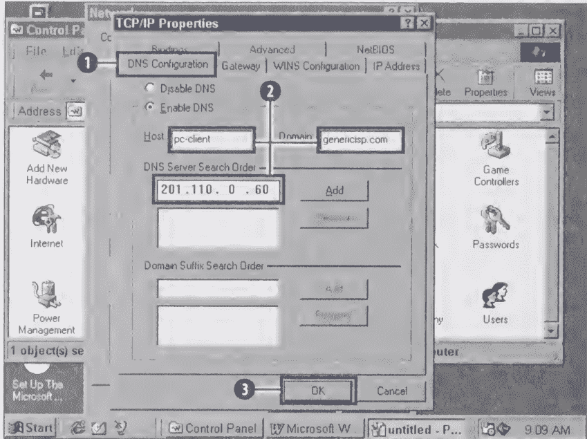

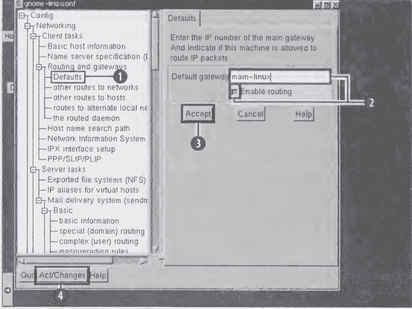

## 网络配置步骤

- 选择“开始”→“控制面板”→“网络”。选择 TCP/IP 项目，点击“属性”。
  1. 选择 DNS 配置。
  2. 在空白处填写你的系统、域名以及你的 ISP 的域名服务器地址。
  3. 点击“添加”以选择域名服务器。

- 选择“配置”→“网络”→“客户端任务”→“路由和网关”→“默认值”。
  1. 填写空白处。输入连接到电缆调制解调器的 Linux 系统的名称或 IP 地址。启用路由。
  2. 点击“接受”。
  3. 点击“应用/更改”以启用更改。

[第 263 页]

# 个人练习册

## 问答

1. 使用调制解调器连接互联网时，使用的是什么协议？
2. 为什么大多数互联网服务提供商（ISP）使用两种不同的协议来处理邮件：一种用于发送，一种用于接收？
3. 定义 *IP 别名（IP Aliasing）*。
4. 定义 *IP 伪装（IP Masquerading）*。
5. 定义 *聊天脚本（chat script）*。`linuxlonf` 将聊天脚本放在哪里？
6. 描述 *DHCP*。
7. 定义 *路由（routing）*。如何查看当前的路由表？
8. 什么是 *默认路由（default route）*？

答案：第 340 页

[第 264 页]

# 互联网与 Linux

## 第 13 章

### 额外练习

1. 连接到互联网并使用 Netscape Navigator 验证连接。
2. 从远程机器给自己发送一封邮件，确保邮件能够送达。
3. 回复你发送给自己的邮件，确保发件功能正常。
4. 查看 `http://www.redhat.com` 获取 Linux 的任何安全更新。
5. 使用电缆调制解调器和 IP 伪装设置家庭网络。
6. 编辑文件 `/etc/hosts.allow`、`/etc/inetd.conf` 和 `/etc/hosts.deny` 以增强系统安全性。检查文件 `/var/log/secure`，确定最近是否有人试图入侵。

### 实际应用

- 将 Linux 用作个人机器，偶尔使用调制解调器连接互联网。
- 小型企业可以使用 Linux 作为互联网路由器/防火墙，通过 ISDN 线路连接到互联网。
- Linux 可以作为一台廉价且稳健的 WWW 服务器，通过电缆调制解调器连接到互联网。
- 通过电缆调制解调器连接到互联网的互联网服务器，同时使用 IP 伪装为本地网络提供服务。

### 视觉测验

如何为名为 `eth0` 的以太网设备配置一个内部私有网络系统，该系统名为 Linus，使用固定 IP 地址？

请填写以下内容：主名称 + 域名、别名、空白、IP 地址、子网掩码和网络设备。其余留空（选择默认值）。

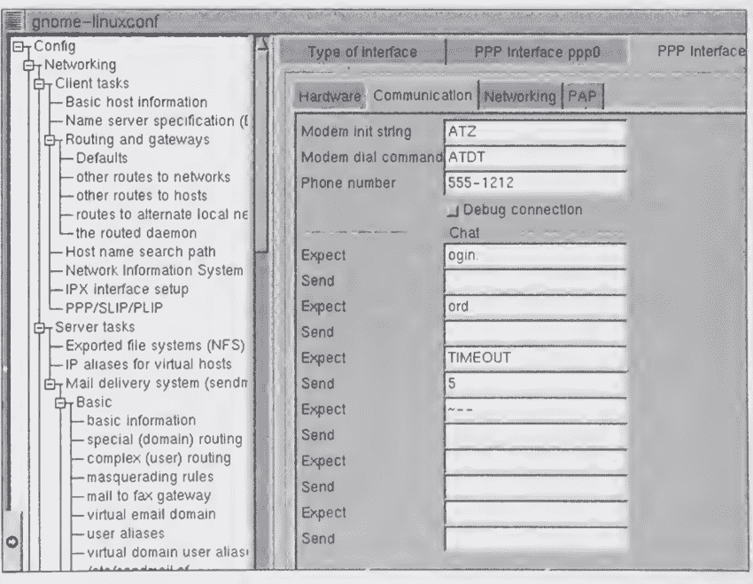

# 第 14 章

## 掌握这些技能

- 配置 Netscape
- 使用 Netscape 查看网页
- 了解电子邮件协议：POP、IMAP 和 SMTP
- 邮件客户端和邮件检查程序
- 使用 FTP 传输文件
- 下载 Linux 软件
- 互联网中继聊天
- 登录远程系统
- 阅读新闻
- 向新闻组发布消息

## 互联网工具

在上一章中，我们讨论了如何通过拨号或电缆调制解调器连接接入互联网，以及你需要完成的一些初始设置任务。本章将讨论延伸开来，介绍你可以用来充分利用网络连接的工具。这些工具大多需要一些设置。通常你需要告诉这些工具哪些机器在你的网络上提供服务。不过在大多数情况下，仅此而已。你应该能快速启动并运行。

因为互联网实际上是网络的集合，而且 Linux 支持网络标准，所以你可以在局域网（LAN）（第 15 章的主题）、互联网连接（第 13 章讨论的内容）或你所在位置的任何联网方案中使用这些相同的工具。因此，例如，本地 Web 服务器呈现网页的方式与远程 Web 服务器相同。

本地和互联网上可用的主要网络服务包括传输文件、交换诸如电子邮件之类的消息、查看文档以及登录远程系统。许多这些服务以其访问所用的协议而闻名，你会 unfortunately 看到大量需要应付的缩写。（协议只是达成一致的通信方式。网络连接的双方必须就消息传递的方式达成一致。）此外，互联网并非一蹴而就。相反，互联网、其服务和协议都随着时间发生了变化。因此，存在着许多替代协议，例如用于电子邮件的 IMAP 或 POP，以及版本号，如 IMAP4 和 POP3。有关这些协议的更多信息，请参阅“了解电子邮件协议：POP、IMAP 和 SMTP”任务。

Linux 提供了一系列用于访问这些网络服务的工具。秉承其 UNIX 传统，Linux 包含许多从 shell 启动并在文本模式下访问的命令行程序。Linux 还包含许多图形工具，可以使访问网络服务变得更加容易。我们涵盖了每个领域的主要工具，并提及了一些替代方案。

图形工具中的主要工具是 Netscape，它包含 Web 浏览器、电子邮件程序和新闻阅读器。Netscape 甚至还包含一个通讯录，用于存储你经常与之联系的人的联系人信息。Netscape 支持用于查看文档的 Web 协议，以及用于下载的文件传输协议（FTP）。

GNOME 和 KDE 桌面环境也正在添加越来越多的网络工具。对于文件传输，我们非常喜欢 GNOME 的 `gftp`，在“使用 FTP 传输文件”任务中进行了讨论。

### 配置 Netscape

Netscape 提供了一种多合一的互联网工具。从技术上讲，它是一个免费提供的商业应用程序。几乎每一个 Linux 发行版，包括本书附带的 Red Hat 版本，都包含完整的 Netscape Communicator 软件包。Communicator 包含用于查看 Web 文档的 Web 浏览器、用于创建这些文档的网页编辑器、用于阅读和发送电子邮件的电子邮件客户端、用于阅读和发送 Usenet 新闻消息的新闻阅读客户端，以及用于存储如何联系你的朋友和同事的信息的通讯录。

除了显示 Web 和 Web 文档外，Netscape 还支持许多其他协议，包括文件传输和一种称为 Gopher 的旧协议（它提供了某种万维网的先驱）。Netscape 可以查看文本文件，还可以运行用 Java 或 JavaScript 编写的应用程序。后一种功能使你可以从 Linux 访问基于 Web 的应用程序。

由于它非常多功能，而且作为商业应用程序相当稳健，Netscape 已经取代了许多免费的 Web 和电子邮件替代方案。虽然仍有许多其他程序可用，但我们建议从 Netscape 开始，如果你发现 Netscape 在 Web 浏览或电子邮件等领域存在问题，再转向其他程序。Netscape 功能很多，而且相对容易学习，所以先从它开始。

你可以从 GNOME 任务栏上的图标启动 Netscape。你也可以在任何 shell 窗口中输入以下命令：

```bash
$ netscape &
```

Netscape 是一个图形应用程序，所以你必须正在运行 X Window 系统。

首次启动 Netscape 时，你会看到一个 Red Hat Linux 起始页面，如对面页所示。这个页面是安装在你系统中 `/usr/doc` 内的本地文件，设置为 Netscape 的默认起始页面。这是一个很好的起始页面，因为它包含指向关于你的 Linux 系统的在线文档的链接。还有什么更好的呢？

如果你的 Linux 系统已连接到网络，你可以在 Netscape 窗口顶部附近的框中输入 URL，即统一资源定位符。Netscape 将尝试显示该页面。（任何在互联网上工作过一段时间的人都知道，你并不总是能成功。）如果你只想使用 Netscape 浏览网页，这就是你真正需要配置的全部内容。

不过，如果你想做更多的事情，比如发送电子邮件回复，你需要配置一些设置。从“编辑”菜单中选择“首选项”，以调出 Netscape 主配置对话框。

出现的对话框窗口有多个类别，显示在窗口左侧的列表中。选择一个类别，例如“邮件和新闻组”，以配置单个设置。这些类别呈现层次结构列表，因此选择顶级类别也会展开子类别列表。花点时间浏览不同的选项。

*待续*

#### 交叉参考

第 7 章涵盖了 X Window 系统。

> **注意**
>
> **COOKIE**
>
> Cookie 是来自 Web 服务器的一段信息，由 Netscape 存储。在大多数情况下，Cookie 跟踪你对 Web 站点的访问。在许多情况下，这是件好事，因为它有助于制作能够跟踪你选择的物品等的网页。在其他情况下，Cookie 被用来跟踪你网络活动，以便他人获利。从“首选项”对话框的“高级”类别中，你可以控制 Netscape 是否允许或禁止 Cookie。

`/usr/doc/HTML/index.html` 是你首次使用 Netscape 时看到的起始页面。

从 GNOME 任务栏图标启动 Netscape。

你在 Netscape 中看到的第一个 Web 页面包含这个 Red Hat 起始页面。

输入 Web 页面的 URL，让 Netscape 尝试显示该页面。

从“首选项”对话框中，在左侧选择一个类别。

> **在线查找**
>
> 要升级到更新版本的 Netscape 软件，请参见 `http://home.netscape.com`。

### 配置 Netscape（续）

使用 Netscape 首先要做的一件事是设置你自己的*起始页面*，即启动 Netscape 时看到的第一个页面。你可能想从你自己的个人主页开始，或者从你可能马上需要的一些其他页面开始。我们通常从一个包含我们最常用链接的页面开始。例如，在工作中，你可能想从一个链接到重要工作信息的页面开始。

在家里，你可能想要一个不同的起始页面。如果你的系统并不总是连接到互联网，你可能希望将起始页面设置为硬盘上的本地文档，使用 `file://` URL。这意味着 Netscape 启动得更快，而且如果你尚未连接到互联网，不会显示错误。

### 收藏有趣的网站

互联网包含大量的 Web 站点。为了帮助你理清这个巨大的混乱，你可以收藏你觉得有趣的站点，以便有机会再次找到该站点。要收藏你当前正在查看的页面，调出如对面页所示的“书签”菜单。选择“添加书签”，当前页面就会被添加到你的书签中。页面的标题就会成为你在书签列表中看到的条目。

不过，我们发现页面的标题通常并不能解释我们为什么首先收藏了该页面。例如，你可能收藏了一个包含大量安吉丽娜·朱莉图片的页面，但标题可能是“Fred 的主页”或可怕的“建设中”。而且许多 Web 页面甚至没有标题。解决这个问题的一种方法是编辑书签中的条目。

#### 交叉参考

附录 B 列出了许多提供 Linux 信息的站点。

1. 在 Netscape“首选项”对话框中选择 **Navigator** 类别。
2. 输入你想要的起始页面的 URL。
3. 单击 **确定** 以锁定你的新起始页面。
4. 在 Netscape 的“书签”菜单上按住鼠标左键。
5. 选择“添加书签”将当前页面添加到你的书签中。

## 互联网工具

为此，再次打开书签菜单并选择编辑书签。你会看到一个类似于对页所示的窗口。通过这个窗口，你可以移动书签，并创建子文件夹（实际上是子菜单）来组织你的书签。

### 注意事项

#### 更改字体

你可以从首选项对话框的外观类别下的字体选项中，选择 Netscape 用来显示网页的默认字体。例如，如果大多数网页字体看起来太小，你可以选择更大的字体。或者，在低分辨率屏幕上，你可能希望选择较小尺寸的字体，以便在页面上看到更多文本。无论哪种情况，你都在为未指定字体的网页设置默认字体。

##### ARIAL 是什么？

Arial 是在使用专有工具创建的网页上常见的一种字体。这种字体实际上是 Helvetica 的一个版本，Helvetica 是一种几乎在所有平台上都可用的字体，但在 Microsoft Windows 上由于某些原因被称为 Arial。许多网页设置了绝对的字体名称，指向 Windows 专用的字体。如果是这样，你在 Linux 上可能会看到难看的替代字体。向网页的制作者反馈，让他们同时指定 Arial 和 Helvetica 作为字体，这样一切就都应能正常显示了。

1. 在 Netscape 中，按住鼠标最左侧的按钮悬停于书签菜单上。
2. 选择编辑书签以打开书签窗口。
3. 在书签窗口中，选择一个书签。
4. 按住鼠标最右侧的按钮并选择书签属性。
5. 在属性窗口中编辑该书签。

#### 在线查找

启动 Netscape 时，一个不错的起始页面是 `http://www.slashdot.org`。

### 使用 Netscape 浏览网页

如你所知，让 Netscape 显示网页相对容易。只需在 Netscape 窗口顶部附近的地址栏中输入网页的 URL，然后按回车键，网络浏览器就会开始尝试调用给定的文档。

你可以在命令行中向 Netscape 传递一个 URL，告诉 Netscape 以不同的页面启动。例如：

```bash
$ netscape http://www.redhat.com &
```

这个命令告诉 Netscape，第一个要显示的文档是 `http://www.redhat.com` 上的 Red Hat 主页。

你也可以从书签中选择网页，或者点击网页中的链接。我们发现这些方法最方便。你不必输入长长的 URL，而且不太可能输入错误。（并非总是如此。网页创建者也可能在他们指定的链接中输错。）

使用 Netscape，在本地和远程浏览之间没有真正的区别。在每种情况下，Netscape 都会连接到一个 Web 服务器（本地或远程）并请求一个网页。大多数 URL 以 `http://` 开头，这告诉 Web 浏览器（Netscape）使用超文本传输协议（即 HTTP）连接到服务器。其他类型的 URL 告诉 Netscape 使用文件传输协议（FTP，以 `ftp://` 开头），或者使用较旧的 Gopher 协议（以 `gopher://` 开头）（见表 14-1）。

以斜杠（`/`）结尾的 URL 要么列出目录中的文件，要么显示一个特殊文件，通常名为 `index.html`。

`file://` URL 告诉 Netscape 调用本地文件。而且，由于 Linux 包含大量的在线文档，你也可以使用 Netscape 浏览程序文档。只需调用适当的文件链接，以 `file:///usr/doc/` 开头即可获取 `/usr/doc` 目录的列表。Netscape 可以调用文本文件或 HTML（超文本标记语言）格式的文件。大多数 Web 文档都是 HTML 格式的。在这种情况下，Netscape 直接读取文件，而不通过 Web 服务器。

### 注意事项

#### 文件链接需使用三个斜杠

对于 `file://` URL，你需要提供文件名，文件名以斜杠开头。这样总共就有三个斜杠。例如：

```text
file:///home/ericfj/startpage.html
```

注意 `file:` 后面有三个斜杠。

### 从终端屏幕浏览网页

Linux 包含一个名为 `lynx` 的纯文本浏览器。虽然 `lynx` 不太可能成为你首选的 Web 浏览器，但如果你不是在使用 X 窗口系统运行，或者只是通过 `telnet` 连接到一个站点来浏览网页，它也能帮上忙。此外，`lynx` 有一个很棒的特性，它可以使用 `-dump` 选项将网页内容以纯文本格式转储。例如：

```bash
$ lynx -dump http://localhost/ > localhost.txt
```


通过这个命令，输出会被存储到名为`localhost.txt`的文件中。

###### 交叉引用

第 16 章讨论 Web 浏览器，并帮助理解 URL 与文件之间的联系。

#### 在线查找

KDE 主页是`http://www.kde.org`。

#### 互联网工具

## 第 14 章

### 表 14-1：URL 类型及示例

| 类型 | 示例 | 含义 |
|------|------|------|
| `http://hostname/directory/filename` | `http://www.linux.com/howto/Mail-HOWTO.html` | 将系统 hostname 上的 directory/filename 作为网页调用。 |
| `http://hostname/directory/` | `http://www.linux.com/howto/` | 将系统 hostname 上的 directory 作为网页调用。 |
| `http://hostname/~username/` | `http://www.pconline.com/~erc/` | 调用用户的个人主页。 |
| `http://hostname/` | `http://www.idgbooks.com` | 调用主机的主页。 |
| `ftp://hostname/directory/` | `ftp://contrib.redhat.com/libc6/i386/` | 使用 FTP 查看 hostname 上的给定目录。 |
| `ftp://hostname/directory/filename` | `ftp://contrib.redhat.com/libc6/i386/xchat-0.9.6-1.i386.rpm` | 使用 FTP 从 hostname 下载给定的 directory/filename。 |
| `mailto:user@domain.com` | `mailto:erc@pconline.com` | 打开电子邮件窗口，向给定域中的给定用户发送消息。 |
| `news:newsgroup` | `news:linux.redhat.announce` | 用指定的新闻组启动新闻阅读器。 |
| `file:///directory/filename` | `file:///home/erci/startpage.html` | 本地调用给定文档。 |

使用 Netscape 查看目录。

使用文本模式程序`lynx`查看网页。

##### 理解电子邮件协议：SMTP、POP 和 IMAP

与大多数网络访问一样，电子邮件遵循客户端-服务器模型。从电子邮件客户端——即读取电子邮件消息的程序——你连接到电子邮件服务器。服务器保存你的消息，并使你能够向其他用户发送消息。客户端程序使用多种标准协议连接到服务器。

要发送消息，几乎所有系统都支持 SMTP，即简单邮件传输协议。SMTP 长期以来是 UNIX 和 Linux 程序`sendmail`的一部分，它定义了如何发送消息。互联网上约 80% 的电子邮件由某个版本的`sendmail`发送，这说明了 UNIX 和 Linux 的开放协议模型如何真正推动事物发展。

一个完全不同的协议定义了如何接收消息。这种分离的原因主要是历史性的。最初，UNIX 将传入的邮件放在磁盘上的文件中，所有的电子邮件程序都从文件中读取邮件。随着互联网的发展，你不再需要访问磁盘上的文件来获取电子邮件。相反，你使用网络协议从服务器获取邮件。接收电子邮件消息最常见的协议包括 POP3 和 IMAP4。POP3 即邮局协议第 3 版，广泛可用。IMAP4，即互联网消息访问协议第 4 版的缩写，可用性较低但提供了更大的灵活性。

Linux 为这两种协议分别提供了服务器，`ipop3d`和`imapd`。即使在 PC 上运行的专有电子邮件系统通常也支持 SMTP 以及 POP3 或 IMAP4 之一。在大多数情况下，你需要询问你的互联网服务提供商或系统管理员，你的站点支持哪些协议。要获取电子邮件，你需要在某个地方有一个账户，无论是在你的本地系统上，还是在互联网服务提供商（ISP）运行的电子邮件服务器上，或者在你的组织网络上的服务器上。在所有情况下，你都需要一个用户名和密码——在邮件服务器系统上——来获取你的电子邮件。

通常情况下，当你获得电子邮件账户时，你也会获得一个密码。这可能与你当前 Linux 系统上的用户名和密码相同，也可能不同。大多数情况下，这是你在电子邮件服务器上的用户名和密码。如果你使用 ISP，那么这可能是你在 ISP 的用户名和密码。你需要将此设置为用户名，位于 Netscape 首选项对话框中邮件和新闻组下的身份子类别中。当你实际尝试下载电子邮件时，系统会提示你输入邮件服务器上的密码。

然后你需要知道充当你的电子邮件服务器的系统名称。有了这些信息后，打开 Netscape 首选项对话框中邮件和新闻组下的邮件服务器子类别。按照对页所示填写信息。

> **交叉引用**
>
> 第 13 章介绍如何接入互联网并介绍 ISP。

### POP3 服务器

对于 POP3 电子邮件服务器，在 Netscape 的“传入邮件服务器”框中选择 POP 条目，然后单击“编辑”。在出现的对话框中，输入 POP3 电子邮件服务器的名称，以及您在该服务器上的用户名。在 POP 选项卡中，您需要选择是否要将邮件保留在服务器上。将邮件保留在服务器上可以让您从多个站点连接服务器，例如在旅行时，仍然可以查看您的电子邮件。但是，如果您收到大量邮件，这会占用服务器上的大量空间。如果您选择不将邮件保留在服务器上，Netscape 会将您的邮件下载到您的 Linux 系统，然后删除电子邮件服务器上的邮件。无论哪种情况，这就是设置下载电子邮件所需的全部操作。

#### 注意

###### 了解电子邮件服务器

您可以在`http://www.sfu.ca/~yzhang/linux/qmail/index.html`找到一份迷你 HOWTO 文档，其中更详细地解释了电子邮件服务器。如果您是 Linux 新手并希望设置邮件服务器，这会大有帮助。

1. 填写外发电子邮件服务器的名称。这有时与您的传入邮件服务器不同。
2. 填写您在外发邮件服务器上的用户名，通常与您当前的用户名相同。
3. 选择一个 POP 服务器，然后单击“编辑”。
4. 在 POP 服务器的单独对话框中，输入服务器名称。
5. POP 选项卡使您可以选择是否将邮件保留在服务器上。

#### 在线查找

有关 IMAP 的更多信息，请参见`http://www.imap.org`。

##### 邮件程序和邮件检查程序

由于 Linux 支持电子邮件的开放标准，有大量邮件程序可供选择。您可以继续使用 Netscape，也可以使用其他程序。

在 Netscape 中，从小工具栏中调出消息窗口，然后让 Netscape 检查新邮件或启动新消息窗口来输入您自己的电子邮件。

在 Netscape 中，单击“获取消息”以下载您的电子邮件。如有必要，Netscape 会提示您输入密码。一旦您收到所有邮件，您可以根据需要撰写回复，或单击“新消息”开始撰写新的电子邮件。

一般来说，我们发现回复（如果可能的话）更容易，因为您不必输入电子邮件地址。（不过，对于那些故意搞乱回复地址以阻止垃圾邮件发送者的人，您可能需要编辑地址。从返回地址中删除 SPAM 等词；例如，将`fred@nospam.bigfun.com`转换为`fred@bigfun.com`。）您还可以从“消息”菜单中选择“将发件人添加到通讯簿”，将发件人添加到 Netscape 通讯簿中。这有助于您跟踪经常联系的人。

在 Netscape 的通讯簿中，您可以在撰写邮件时单击“地址”。选择您希望接收电子邮件的人，然后单击“收件人”或“抄送”按钮。

1. 从工具栏调出 Netscape 消息窗口。
2. 在 Netscape 消息窗口中，单击“获取消息”以检查邮件。
3. Netscape 会提示您输入密码。

#### 交叉参考

第 8 章介绍了 Netscape 通讯簿。

#### 互联网工具

## 第 14 章

4. 选择一条消息来阅读。
5. 在 Netscape 消息窗口中，单击“新消息”以开始撰写消息。
6. 输入收件人的电子邮件地址。
7. 输入您的消息。
8. 单击“发送”以发送您的消息。

#### 注意

###### 使用签名文件

您经常会在电子邮件末尾看到简洁的引语、有趣的信息以及关于某人雇主、地址等的信息。大多数用户不会为每条消息手动输入这些信息，而是设置一个`.signature`文件。`.signature`文件，如此命名是因为它通常驻留在您主目录中该名称的文件中，是一个附加到您发送的每封电子邮件末尾的文件。

您可以在 Netscape 的“首选项”对话框中“邮件和新闻组”类别下的“身份”子类别中设置`.signature`文件。在“签名文件”条目中填写文件名。配置大多数其他邮件工具（如`elm`）也类似，使用您主目录中名为`.signature`的文件。

###### 检查电子邮件

Linux 提供了许多仅检查新邮件然后提醒您注意的程序。有些会播放声音，而另一些则会在屏幕上更改图形。许多程序的名称是`biff`或某些变体，如`xbiff`。据报道，Biff 是一只狗的名字，根据 UNIX 传说，Biff 对着邮件投递员吠叫，宣布新的邮政邮件。

`xbiff`程序显示一个 small mailbox。如果您有邮件，旗帜就会升起。`xmailbox`程序的作用类似，但显示彩色邮箱。在可选的 KDE 桌面中，您可以运行`kbiff`，它的作用类似于`xmailbox`和`xbiff`。

#### 在线查找

Hormel 生产真正的 SPAM，与电子邮件 SPAM 相对，网址为`http://www.spam.com`。

## 邮件程序和邮件检查程序（续）

##### 选择邮件工具

Netscape 并非您唯一可以使用的电子邮件程序。Linux 支持数百种更多程序，因为它使用开放的电子邮件标准。在选择邮件工具时，需要考虑的一些事项包括您预计每天会收到多少封邮件，以及您如何管理邮件。例如，您可能创建数百个邮件文件夹来组织您的邮件。如果是这样，请查看每种工具管理文件夹的能力。您可能需要能够切换工具。在这种情况下，请查找用于存储消息的文件格式。如果是基于文本的格式，您应该能够将消息迁移到另一个工具。

如果安装了可选的 KDE 桌面，您可以运行`kmail`（见对面页），阅读您的电子邮件并发送信件。如果您没有使用 KDE，或者根本没有使用桌面环境，您可能想尝试`exmh`，这是一个基于`mh`套件构建的图形邮件工具。`mh`是 mail handler 的缩写。`mh`包括许多用于处理邮件、将消息移动到文件夹等的命令行程序。因此，它很好地符合了 UNIX 和 Linux 的哲学，即许多小工具各司其职。`exmh`（见对面页）位于`mh`之上，提供典型的图形电子邮件客户端程序。

`exmh`和`kmail`都随 Red Hat Linux 提供。如果您想进一步寻找满足您需求的电子邮件程序，我们推荐`tkrat`，也称为 Ratatosk，它是北欧神话中的一只松鼠。`tkrat`（见对面页）部分是用 Tcl/Tk 脚本语言编写的。`tkrat`支持电子邮件附件，因此它是最好的图形电子邮件程序之一，而许多其他程序还不能很好地处理附件。

> KDE `kmail`程序。
>
> 如果您不运行 GNOME 或 KDE 桌面，`exmh`邮件程序是一个不错的选择。

| 交叉参考 |
|----------|
| 第 5 章介绍了`vi`文本编辑器。 |

#### 互联网工具

## 第 14 章

1. 从`tkrat`邮件程序中，在上部窗口中选择消息。
2. `tkrat`在下部窗口中显示该消息。

您可以在任何 shell 窗口中运行`elm`邮件程序。您不需要运行 X Window 系统。

除了所有这些图形电子邮件工具之外，您还可以运行许多基于文本的邮件程序。其中最好的是`elm`。`elm`提供了最快、最高效的电子邮件工具之一。事实上，在 Netscape 改进其电子邮件客户端之前，我们中的一位使用`elm`多年。`elm`很好地支持大量邮件文件夹和海量消息。由于它是基于文本的程序，`elm`会启动文本编辑器来输入消息，默认为`vi`。`elm`也随 Red Hat Linux 提供。

如果您对 Linux 和 UNIX 系统非常陌生，一个非常易于学习的邮件程序叫做`pine`。`pine`提供了大量菜单和提示，这对新用户很有帮助。

如果所有其他方法都失败了，您可以尝试非常基本的`mail`程序。曾经被认为是尖端技术，`mail`具有非常原始的基于行的界面。与`elm`或`pine`不同，`mail`甚至不使用完整的文本终端。相反，它以逐行格式呈现消息，命令非常晦涩。曾经是 UNIX 上唯一的邮件阅读程序，我们建议您仅在万不得已时才使用`mail`。

#### 注意

###### 从 EMACS 阅读邮件

`emacs`，神奇的编辑器，也可以作为您的邮件工具。首先，从“工具”菜单中选择“阅读邮件”。启动后，您可以从熟悉的`emacs`界面阅读电子邮件。当然，您也可以从`emacs`发送电子邮件。

#### 在线查找

在`http://www.dtek.chalmers.se/~maf/ratatosk`可以找到 Ratatosk。

## 使用 FTP 传输文件

互联网最早支持的任务之一就是文件交换。使用文件传输协议（File Transfer Protocol），即`FTP`，你可以连接到远程系统，并从中下载或向其上传文件。为了支持 FTP 协议，Linux 包含了一个名为`ftp`的客户端程序。不过，要让`ftp`正常工作，远程系统必须正在运行 FTP 服务器软件。在 Linux 上，这是由`in.ftpd`程序来运行的，它负责处理 FTP 请求。

要使用`ftp`，你需要运行该命令并传递远程系统的名称。例如：

```
$ ftp tamarack
```

远程系统会提示你输入用户名和密码。连接成功后，你会看到 ftp 提示符：

```
ftp>
```


在此提示符下，你可以输入表 14-2 中列出的任何 `ftp` 命令。最常用的命令包括 `cd`（切换到远程系统上的不同目录）、`get`（下载文件）和 `put`（上传文件）。

使用 `ftp` 传输文件时，远程系统通常被称为 FTP 服务器。在 UNIX 或 Linux 系统上，FTP 服务器通常将可供公众访问的文件放在名为 `pub` 的目录中。由于安全限制，你很少有权向 `/usr/bin` 等系统目录上传文件。

在 `ftp` 提示符下输入 `quit` 即可退出 `ftp`。

#### 匿名 FTP

使用 `ftp` 命令时，你需要在远程系统上拥有账户才能交换文件。而通过匿名 FTP，你可以访问你没有账户的服务器。绝大多数从互联网下载的文件都是通过匿名 FTP 下载的。其工作流程如下：首先，某个组织决定提供一项慷慨的服务，即为他人 gaz colorf archiving 文件供他人下载。然后，该站点运行 FTP 服务器软件，例如 Linux 自带的华盛顿大学 FTP 软件。接着，该站点设置一个名为 `anonymous` 的用户账户——这就是匿名 FTP 名称的由来。通常情况下，系统会提示你提供电子邮件地址作为密码。

#### 注意

### Microsoft Windows FTP

Microsoft Windows 包含 `ftp.exe`，该程序的行为与 Linux 的 `ftp` 非常相似。从 MS-DOS 提示符窗口运行此程序，MS-DOS 提示符窗口相当于 Microsoft Windows 版的 Linux shell 窗口。这只是客户端程序。要使 Windows 系统充当 FTP 服务器，你需要安装附加软件。

###### Netscape 与 FTP

你可以通过 Netscape Web 浏览器经由 FTP 下载文件，这使 Netscape 成为更加得心应手的工具。在 Netscape 中，你可以输入 URL，即统一资源定位符，以 `ftp://` 形式表示 FTP 服务器。

###### 图形化 FTP

GNOME 桌面提供了一个名为 `gFTP` 的 `ftp` 客户端程序。连接对话框还提供了一个常见的匿名 FTP 服务器列表供你连接。另一个便捷的 `ftp` 程序是 `ncftp`，它提供了更友好的基于文本的 `ftp` 访问。

#### 交叉参考

第 3 章介绍了目录。

#### 在线查找

一个不错的下载 FTP 站点是 `metalab.unc.edu`。

#### 互联网工具

### 第 14 章

| 命令 | 用途 |
|---------|-------|
| `binary` | 切换到二进制传输模式。你几乎总是希望使用此模式。 |
| `open` *主机名* | 打开与 *主机名* 的连接。 |
| `get` *文件名* | 从远程系统下载 *文件名*。 |
| `mget` *文件名* | 从远程系统下载多个文件。支持 `*.txt` 等通配符。 |
| `put` *文件名* | 向远程系统上传 *文件名*。 |
| `mput` *文件名* | 向远程系统上传多个文件。支持通配符。 |

- 使用 Netscape 查看 FTP URL 和目录，然后保存文件。
  1. 在 Netscape 中输入 `ftp://` 链接以通过 FTP 查看目录。
  2. Shift+单击文件名以下载该文件。
  3. 输入要在本地系统上存储文件的位置和名称。

- gFTP 连接管理器窗口。
  1. 从“远程”菜单中选择“连接”以在 gFTP 中建立链接。
  2. 输入要连接的主机名。
  3. 输入你的用户名和密码。
  4. 单击“连接”以建立连接。

- gFTP 的 GUI 窗口。
  5. 建立连接后，在左侧的本地窗口中选择下载文件的存放位置。
  6. 在右侧浏览远程文件并选择一个进行传输。
  7. 单击 ← 按钮（箭头）来传输文件。
  8. 下方会显示状态消息。

#### 下载 Linux 软件

本书附带了两张 CD-ROM，里面装有 Linux 和其他应用程序。但这还不是全部。互联网上还有成千上万更多的应用程序可供使用。许多应用程序以 RPM 格式的软件包形式提供，这使得下载和安装变得非常容易。其他软件包则以不同的格式提供（RPM 尚未被所有 Linux 发行版采用），有时你只能获得源代码，需要自己编译。这并不算太糟糕。我们发现 RPM 有时无法正常工作，但从源代码编译通常可以。

你可以找到不少预先构建好的 RPM 软件包。`http://www.rpmfind.net` 是一个查找这些软件包的好地方，它索引了互联网上大多数 RPM 服务器，包括 Red Hat 官方集和 Red Hat 贡献集。

RPM 文件通常按处理器架构分类：i386、SPARC、ARM、Alpha 等。因此，请务必下载适合您系统的二进制软件包（Intel 兼容 PC 请使用 i386）。此外，Linux 发行版正在从 libc5（大多数 Linux 应用程序使用的 C 编程标准库版本）过渡到 glibc2，也称为 libc6 或直接称为 glibc。尽管版本号令人困惑（glibc2 是比 libc5 更新的版本），但在 Red Hat 6.0 上，你需要 glibc2 软件包。在许多 FTP 服务器上，这些软件包存储在与 libc5 软件包不同的目录中。

如果你能找到所需软件包的 RPM 文件，事情就会变得简单很多。这是因为其他人已经费心地为你构建了该软件包。然后，你可以使用以下命令以 root 身份安装该软件包：

```bash
# rpm -ihv filename.rpm
```

将 `filename.rpm` 替换为你下载的 RPM 文件的名称，例如 `wine-990328-1_i386.rpm`。如果要升级已安装的软件包，则使用 `rpm` 的 `-U` 选项：

```bash
# rpm -Uhv filename.rpm
```

从 RPM 文件安装时，文档通常会进入基于软件包名称创建的 `/usr/doc` 下的新松花江目录。使用以下命令列出 RPM 文件中的所有文件以及基本摘要信息：

```bash
$ rpm -q -i -l -p filename.rpm | more
```

此命令可以帮助你确定 RPM 文件中新命令的名称，以及它将被安装到何处。你还可以查看所有支持和配置文件的存储位置。运行此命令不需要 root 权限。

并非所有软件包都能找到 RPM 文件。相当多的软件包使用 gzip 程序进行压缩，通常文件名带有 `.gz` 或 `.tgz` 扩展名。如果你下载了这样的软件包，请使用 `gunzip` 命令解压：

```bash
$ gunzip filename.gz
```

将 `filename.gz` 替换为你下载的文件名。解压后的文件将不再带有 `.gz` 扩展名。

通常，gzip 压缩的文件会在压缩前使用 `tar` 命令打包。因此，你经常会发现以 `.tar.gz` 或 `.tgz` 结尾的文件名，表示经过 tar 打包和 gzip 压缩的文件。先运行 `gunzip` 命令解压，然后使用 `tar` 提取所有文件：

```bash
$ gunzip filename.tar.gz
$ tar xvof filename.tar
```

同样，将 `filename` 替换为你下载的文件名。解压并提取后，你应该会找到一个名为 README 或类似变体的文件。

| 交叉参考 |
|---|
| 第 2 章介绍了 `rpm` 命令，第 6 章介绍了 `tar` 命令。 |

| 在线查找 |
|---|
| `http://www.rpmfind.net` 网站是查找 RPM 文件的好去处。 |

你应该阅读这个文件。该文件应介绍软件包，并经常提供安装说明。有时一个名为 INSTALL 的单独文件会描述如何安装该软件包。

如果软件包是以源代码形式提供的，你需要编译它。为此，你必须要有 C 编译器 `cc`（egcs 或 gcc）以及 `make` 命令可用。安装 Linux 时，你应该始终安装这些工具。你可能还需要特殊的库或其他软件包才能构建你下载的软件包。

#### 注意

##### 处理 RPM 依赖关系

有时 RPM 文件也需要其他软件包。在这种情况下，你需要找到合适的 RPM 文件并先安装它。如果你看到类似下面的错误信息，说明你需要下载另一个软件包：

```text
error: failed dependencies:

libglide2x.so is needed by q3test-

1.05-glibc-9
```

##### 下载前检查

而且，在你费工夫下载软件包之前，最好先确认一下是否已经安装了它。运行以下命令：

```bash
$ rpm -qa | grep name
```

将 `name` 替换为软件包的名称，如果你不知道完整名称，也可以使用名称的一部分。

##### 表 14-3：Linux 下载站点

| 站点 | 内容 |
|------|------|
| `http://www.redhat.com/mirrors.html` | Red Hat 镜像站点列表。查找比你离 Red Hat 过载的主站更近的 FTP 站点。 |
| `ftp://contrib.redhat.com/libc6/i386/` | 适用于基于 Intel 的 Red Hat 系统的贡献软件包。 |
| `ftp://rhcn.redhat.com/` | Red Hat 贡献网络，不同于 Red Hat 站点上的贡献软件包集合。 |
| `http://www.rpmfind.net` | Red Hat RPM 文件和来自许多来源的贡献应用程序的中央档案库。 |
| `http://linux.davecentral.com` | 优秀的下载站点，尤其适合办公应用程序。 |
| `http://www.linuxberg.com` | 拥有许多 Linux 应用程序的站点，以及来自 Tucows 公司在许多大洲的镜像站点。 |
| `http://metalab.unc.edu` | 大多数免费 Linux 源代码的所在地；以前称为 sunsite。 |
| `http://www.linuxgames.com` | 许多 Linux 游戏；提供信息和下载站点链接。 |

#### 互联网中继聊天

互联网中继聊天，或称 IRC，使你能够与其他用户在互联网上进行实时对话。在这种聊天方式中，你输入消息供他人阅读，并在聊天窗口中跟踪打印的对话。来自其他用户的消息显示在主窗口中。消息几乎和你输入它们的速度一样快地出现，这可能导致快速而激烈的讨论。

要实现这一点，你需要运行一个 IRC 客户端程序并连接到 IRC 服务器。客户端和服务器使用 IRC 协议进行通信。这意味着你可以从各种客户端和服务器中进行选择。通常情况下，你连接到一个 IRC 服务器。其他用户连接到同一个 IRC 服务器。还有更多的用户连接到属于同一 IRC 系统的其他 IRC 服务器。这些服务器相互通信，将所有的消息传播给所有已连接的用户。这提供了一个相当健壮的系统，一个服务器的故障只会导致一小部分原地影响参与活动。组织

有时，托管 IRC 服务器的组织会赞助聊天活动。例如，你可能有机会与电视名人聊天。

连接到 IRC 服务器后，你可以从许多可用的频道中进行选择。通常，每个频道专注于一个特定主题，例如 Linux 或 Perl 脚本语言。IRC 频道名称以井号（`#`）开头，例如 `#linux` 或 `#irchelp`。

主要的 GNOME 聊天界面由名为 `xchat` 的程序提供。你可以从任务栏的 Internet 菜单启动 `xchat`，或者在 shell 中输入 `xchat` 命令。

当 `xchat` 启动时，你会看到一个服务器列表，可以从中选择服务器和频道。你还会看到主 `xchat` 界面。尽管你看到的是图形界面，IRC 实际上是一个基于文本的协议。

因此，你将直接在 organiskey 中输入一些命令。这些 IRC 命令以 `/` 开头，例如 `/HELP` 以获取命令列表。（你也可以就特定命令寻求帮助，例如 `/HELP JOIN` 以获取关于加入频道的非常简要的信息。）

#### 注意

##### 其他聊天客户端

Linux 上的其他聊天客户端包括 ircii，可在 AnotherLevel 菜单上找到，以及 ksirc，它是可选 KDE 桌面的一部分。

##### 回答问题

你可以在 `http://www.irchelp.org` 上找到大量关于聊天和 IRC 的帮助。对于聊天领域的新手来说，这是一个极好的资源。它有 IRC 服务器站点、频道、软件下载和常见问题（也称为 FAQ）的列表。

##### 寻找他人

除了 IRC，还有其他几种聊天协议。一种相关的协议称为 ICQ，或 I Seek You。你可以从 `http://www.icq.com` 下载 ICQ 客户端。

##### 尽量礼貌

由于来自世界各地的用户都参与聊天，你在交谈时需要格外有礼貌。如果所有人同时发言，聊天将沦为混乱的消息，都在争夺你的注意力。用户通常会在消息末尾加上 `o`，这是 over 的缩写，无线电操作员使用它来表示消息结束。在开始交谈之前，先观察一会儿对话，看看它是如何进行的。你最好尽量适应该群体的运作方式。

### 快捷方式

从 GNOME 任务栏的 Internet 菜单启动 `xchat`。

#### 互联网工具

##### 表 14-4：主要 IRC 站点

| 站点 | 内容 |
|------|------|
| `http://www.efnet.net` | 大型站点，拥有超过 12,000 个频道 |
| `http://www.undernet.org` | 另一个大型站点，服务器遍布三大洲 |
| `http://www.mn.us. undernet.org` | 明尼苏达州明尼阿波利斯的本地 Undernet 站点 |
| `http://www.dal.net` | 另一个大型聊天网络 |

从 xchat 服务器列表窗口中选择 IRC 服务器和频道。

在主 xchat 窗口中输入你的消息和命令。

通过从 Settings 菜单调出对话框来配置 xchat。

在 Setup 菜单中，你可以通过 Settings 对话框控制 xchat 的工作方式。

#### 在线查找

有关 xchat 的更多信息，请参阅 `http://www.xchat.linuxpower.org`。

#### 登录到远程系统

Linux shell 为你提供了一个强大的工具，但仅限于你的 Linux 系统。不过，Linux 秉承其 UNIX 根源，也使你能够登录到网络上连接的远程系统。

运行 `telnet` 程序以登录到远程系统。当然，你必须在远程系统上有一个账户，否则将无法登录。基本命令如下：

```bash
$ telnet hostname
```

将 `hostname` 替换为你想要访问的远程系统的名称。`telnet` 会提示你输入用户名和密码——在远程系统上。你在 Linux 系统上的账户可能与远程账户不同。你也可以传递远程机器的 IP 地址，如第 15 章所述。如果你只单独运行 `telnet`，或从 GNOME 桌面上的 Red Hat 菜单运行，你会得到一个 `telnet` 提示符。在该提示符下，使用 `open` 命令并加上远程系统的名称：

```text
$ telnet

telnet> open tamarack
```

如果你在远程系统上有账户，无论该系统离你多远都没关系，只要你的系统和远程系统之间有网络连接即可。例如，许多互联网服务提供商运行 Linux 并为用户提供 `telnet` 访问。`telnet` 访问会打开一个安全漏洞，因此许多公司使用防火墙软件来阻止 `telnet` 访问。

`rlogin` 提供了 `telnet` 的替代方案。`rlogin` 最初是作为在加州大学伯克利分校创建的 UNIX 系统的一部分开发的，BSD UNIX 包含了许多 `r` —— 或远程 —— 工具，包括 `rlogin`、用于复制的 `rcp` 和用于在远程系统上执行 shell 命令的 `rsh`。

与 `telnet` 一样，`rlogin` 也接受远程系统的名称或网络地址。例如：

```bash
$ rlogin tamarack
```

与 `telnet` 一样，你需要在远程系统上有一个账户。但与 `telnet` 不同的是，`rlogin` 默认使用你当前的用户名，因此它只提示你输入远程系统上的密码。如果你远程系统上的用户名与你当前系统上的用户名不匹配，请传递 `-l` 选项，如下所示：

```bash
$ rlogin -l fred tamarack
```

该命令告诉 `rlogin`，远程系统 tamarack 上的用户名是 fred。

#### 注意

##### Microsoft Windows Telnet

Microsoft Windows 也包含一个 Telnet 程序 `telnet.exe`，你可以从“开始”菜单的“运行”选项启动它。Tera term 是一款出色的 Microsoft Windows 免费 Telnet 程序，还包含 Windows CE 版本。从 `http://www.tucows.com` 获取 Tera term。

##### RLOGIN 安全性

安全漏洞之一是，你可以创建一个受信任用户的文件，这些用户可以运行 `rlogin` 而无需输入密码。避免使用此功能，或使用 `man rlogin` 命令中描述的 Kerberos 身份验证。你还可以运行 `SSH`（安全 shell），许多 shell 服务器都支持它。

#### 交叉参考

第 3 章介绍了 Linux shell 命令。

## 互联网工具

#### 第 14 章

### 清单 14-1：运行 TELNET

```text
$ telnet tamarack

Trying 192.168.42.1...

Connected to tamarack.foster-johnson.com.

Escape character is '^]'.

Red Hat Linux release 6.0 (Hedwig)

Kernel 2.2.5-15 on an i686

login: ericfj

Password:

Last login: Mon Jun 28 20:07:58 from

tamarack

You have mail.
```


```text
[ericfj@tamarack ~]$
```

使用`telnet`访问远程系统。

清单 14-2：运行`RLOGIN`

```text
$ rlogin tamarack

Password:

Last login: Tue Jun 29 16:31:18 from

tamarack

You have mail.

[ericfj@tamarack ~]$

[ericfj@tamarack ~]$ uname -m

i686

[ericfj@tamarack ~]$ exit

logout

rlogin: connection closed.

$
```


你也可以使用`rlogin`。不过在许多系统上，出于安全原因，`rlogin`访问已被禁用。

1. 从`AnotherLevel`菜单中选择“网络”，然后启动`telnet`。
2. 在出现的`telnet`窗口中，在`telnet>`提示符下输入`open`和系统名称。

运行`telnet.exe`以启动 Microsoft Windows Telnet。

## 在线查找

有关 BSD UNIX 的更多信息，请访问`http://www.freebsd.org`。

## 阅读新闻

早在每家每户——更不用说每台冰箱——都连接到互联网之前，Usenet 就已经兴起，并为全球用户提供了一个交换消息的公共论坛。与电子邮件不同，Usenet 新闻消息会发送给全球所有读者。正如你所料，这会产生大量数据。

新闻服务器每天传输数兆字节的数据。每晚（节省长途电话费），UNIX 系统会通过电话线连接到其他系统，交换电子邮件和 Usenet 新闻的公共消息。现在这些消息通过互联网和网络新闻传输协议（NNTP）进行传输。Usenet 新闻通常被称为讨论组，由数千个新闻组组成，涵盖几乎所有可以想象到的话题——甚至更多。

与你的 Linux 文件系统和网络主机名类似，Usenet 新闻也按层次结构划分。顶层是顶级区域，如用于计算机相关讨论的`comp`，以及用于娱乐问题的`rec`。还有针对特定地理区域的顶级组，例如用于明尼苏达州相关讨论的`mn`。

在这些顶级组之下是按主题组织的特定组。新闻组名称用句点分隔。例如，新闻组`linux.redhat.announce`涵盖与 Red Hat Linux 发行版相关的公告。话题范围从`alt.buddha.short.fat.guy`到`rec.recipes.vegetarian`不等。是的，还有很多新闻组专门用于女性图片。不过，绝大多数消息都致力于计算机主题，范围从硬件`setup`和配置到详细的编程问题。一般来说，新闻组越具体、越详细，你获得的信息就越有用。

由于有如此多的组和消息——每日流量太大，一天之内根本无法读完（以千兆字节计）——你通常只订阅你最感兴趣的组。为此，新闻阅读程序会向你展示一个新闻组列表，你选择要阅读哪些。

你订阅的每个组都包含一定数量的消息，有时多达数千条。与电子邮件一样，每条消息都有一个主题行，这有助于你决定是否要阅读该消息。

要阅读新闻，你需要三样东西：

- 一台充当新闻或 NNTP 服务器的系统
- 到该系统的网络连接
- 能够阅读新闻的软件

通常，你的互联网服务提供商充当新闻服务器。你只需要知道系统名称，通常是`news`或`news.*domain*.com`，其中`*domain*`替换为你的 ISP 的域名。

至于软件，有很多选项可供选择。几乎每一种用于 UNIX 的新闻阅读程序都可以在 Linux 上工作。Netscape 包含新闻阅读软件，因此一个好的入门程序是 Netscape，特别是如果你用它来浏览网页和优先级# Concurrency 和电子邮件。

*待续*

> **交叉参考**
>
> 附录 B 提供了 Linux 相关新闻组的列表。

> **在线查找**
>
> 新闻组提供了很多 Linux 支持。有关更多支持选项，请访问`http://www.linuxcare.com`。

---

## 阅读新闻

*续*

### 订阅新闻组

要用 Netscape 阅读新闻，首先打开 Netscape 消息中心窗口。从那里，点击“订阅”以获取所有新闻组的列表。选择你想阅读的新闻组。生成列表需要很长时间，而且 Netscape 界面可能令人困惑。请记住，新闻组是按层次结构存储的。因此，要阅读与计算机相关的新闻组，你需要展开`comp`层次以查看`comp`下的所有新闻组。然后你必须展开`comp`下的`os`组以查看`comp.os.linux`条目。最后，展开`comp.os.linux`以查看`comp.os.linux`下的所有组，包括`comp.os.linux.announce`。这对新手来说并不是那么直观。

每个组旁边有一个小圆点，你可以选择它来订阅该组。在 Netscape 中，订阅意味着主消息窗口会显示一个包含该组的列表，并允许你选择它。别担心，你可以随时更改订阅哪些组。

稍后，你可以在订阅窗口中点击“新建”选项卡，查看自上次检查以来出现的所有新闻组。每隔一两个月尝试一下是值得的。

### 阅读消息

选择要订阅的组后，你就可以开始阅读消息了。从 Netscape 消息中心主窗口中，你可以展开特定新闻服务器的条目，以查看你订阅的所有组。同样，这需要一些时间。Netscape 会检查新闻服务器，然后如果有可用消息，则将组名称标记为粗体。点击组名称以查看消息列表。

1. 在 Netscape 消息中心窗口中，点击“订阅”以获取列出所有新闻组的对话框。
2. 选择你要订阅的组。
3. 选择要阅读的新闻组。
4. Netscape 显示该组中的第一条消息。

| 交叉参考 |
| --- |
| 第5章介绍了`emacs`。 |

从 Netscape 的“视图”菜单中，你可以选择如何对消息进行排序，按主题、按日期、按线索等。我们推荐按主题或按线索排序。按主题排序会将所有相关消息放在一起。按线索排序会将第一条消息放在层次列表的顶部。你展开列表以查看回复。你展开回复以查看对回复的回复。

### 其他新闻阅读器

除了 Netscape 之外，还有各种各样的新闻阅读程序可供选择。Red Hat Linux 自带`trn`、`tin`和`slrn`，这些都是基于文本的新闻阅读器。可选的 KDE 桌面包含`krn`，一个图形化的新闻阅读器。另一个更基本的图形化新闻阅读器是`xrn`。

此外，互联网上还有许多新闻阅读包可供选择，例如`nn`或`vnews`。

#### 注意：用 EMACS 阅读新闻

由于`emacs`可以阅读电子邮件，阅读新闻也只是迈出一小步。在“工具”菜单上查找进行设置。运行后，你可以在`emacs`窗口中阅读新闻和发布新消息。

- 从消息列表中选择要阅读的消息。
- Netscape 在列表下方显示该消息。
- 点击图标以展开消息线索。
- 选择消息以阅读它。

5. 从消息列表中选择要阅读的消息。
6. Netscape 在列表下方显示该消息。
7. 点击图标以展开消息线索。
8. 选择消息以阅读它。

## 在线查找

重要的 Linux 公告发布在`comp.os.linux.announce`新闻组中。

## 向新闻组发布消息

阅读消息只是乐趣的一半。你也可以发布自己的消息。如果你遇到自己无法解决的问题，这一点尤其有用。事实上，大多数 Linux 技术支持都是通过新闻组和专门的邮件列表进行的。

要在 Netscape 中发布消息，请进入你想要发布的新闻组，然后点击“新建消息”。在出现的窗口中，输入你的消息，完成后点击“发送”。界面几乎与撰写电子邮件消息完全相同。

你发布的每条消息都会发送给世界各地的读者。因此，你可能不想询问那些只适用于你所在地区的事情，比如去某家商店购买 Linux 版 Quake 的方向。

如果你在使用 Linux 或硬件时遇到问题，发布消息是获得帮助的好方法。不过，这样做时，请尽可能具体。一条写着“Linux 不工作”的消息可能不会得到任何有用的回复。而提供更多细节的消息，例如，你似乎在 Pentium II 芯片和 Adaptec SCSI 接口卡上的 Red Hat Linux 6.0 遇到问题，则更有可能获得更好的回复。你提供的关于问题的信息越多，效果越好。

你还应该注意以美国为中心的消息。例如，列出价格时注明国家是基本的礼貌，比如`$1,000（美国）`，而不仅仅是`$1,000`。其他国家的货币也叫美元。

1. 在 Netscape 中点击“新建消息”，向当前新闻组发布消息。
2. 若要回复当前消息，请点击“回复”。
3. 在 Netscape 撰写窗口中输入你的新消息。
4. 完成后点击“发送”。

### 交叉参考

第4章介绍了在 Linux 上寻求其他帮助的方法。

1. 点击“获取消息”以请求从新闻服务器更新。
2. 你应该能在窗口中看到自己的消息。

回复消息时，同时发布到多个组通常是不礼貌的，如下所示。你会被指责为传播垃圾信息。

### 注意事项

#### 网络礼仪

你发布到 Usenet 新闻的所有内容都会传遍全球。此外，Deja News 等存档服务会将你的消息保存数年。因此，避免写任何日后会让你尴尬的内容。保持礼貌也是个好主意。在正常对话中，人们可以看到你的面部表情和肢体语言，也能听到你的语调。书面文字通常无法传达这些。此外，许多读者并非以英语为母语。因此，你要仔细斟酌你的消息，避免使用尖酸讽刺的言辞。

#### 等待回复需要一些时间

其他用户看到你的消息并回复可能需要一段时间，所以请耐心等待。有时你得等上几天，但通常，你应该在24小时内看到回复。你的消息越清晰、越具体，你获得好回复的可能性就越大。例如，包括你运行的 Linux 版本、发行版（如 Red Hat）以及任何其他相关数据。

## 在线查找

Deja News，网址为`http://www.deja.com`，存档了大量过往消息，你可以搜索。

## 个人练习册

### 问答

1. 你能从 Linux 发送电子邮件吗？
2. 你可以使用哪些应用程序通过网络登录远程系统？
3. 你能从 Microsoft Windows 系统登录 Linux 系统吗？如果可以，你可以使用哪个程序？
4. 你能从`emacs`阅读 Usenet 新闻吗？
5. 你能从`emacs`阅读电子邮件吗？
6. 你下载了一个以`.gz`结尾的文件。你使用哪个程序来解压该文件？
7. 你可以使用哪个程序参与在线聊天？
8. 在 Netscape 中阅读电子邮件之前，你需要做什么？

答案：第341页

### 互联网工具

#### 第14章

### 额外练习

1. 联系你的互联网服务提供商，确定新闻服务器的名称。然后，设置一个新闻阅读器（如 Netscape）来阅读新闻。看看可用的大量新闻组列表。
2. 订阅一个新闻组。查看任何看起来有趣的消息。记住不要把人们发布的内容当作绝对真理。Usenet 新闻上有很多好的信息，但也有很多不正确的信息。
3. 查看互联网上`http://www.rpmfind.net`提供的所有存档。查找一些当前运行程序的更新。
4. 下载一个 RPM 文件并安装它。

### 实际应用

- 使用 Usenet 新闻会引发很多问题。每日信息流中显然存在色情和攻击性内容。你的组织能处理这个问题吗？限制访问怎么样？这也可能引发与言论自由相关的问题。与你的组织中的其他人讨论这个问题。
- 你遇到了一些无法正常工作的硬件，一块在 Linux 上无法使用的网卡。撰写一个问题发布到 Usenet 新闻。确保包括你运行的 Linux 版本，以及网卡的品牌和型号。另外，提及你已经阅读了 how-to 文档但仍然有问题。现在发布这条消息。

### 视觉测验

如何让 Netscape 显示 Red Hat Linux 主页？

#### 第15章

- 掌握这些技能
- Linux 网络
- 设置你的网卡
- 启动网络服务
- 测试你的网络
- 与 Samba 共享文件
- 与 NFS 共享文件

## 局域网

到目前为止，我们已经讨论了一些可用于拨号连接互联网的网络工具。本章将其扩展到局域网。

通常，你的局域网将从放置在 PC 中的网络适配卡开始。每台计算机至少需要一个适配卡，或者系统板上内置的接口。然后，你按照某种网络方案将计算机连接在一起。如今，大多数局域网使用 10 或 100Base-T 双绞线电缆。10代表每秒10兆比特，即10 Mbps。100代表100 Mbps。使用这种接口，你通常将双绞线电缆连接到计算机，另一端插入网络集线器。集线器是带有两个、四个、八个、十六个或更多端口的小盒子。你也可以将集线器连接在一起，扩展网络的覆盖范围。大约花100到200美元，你可以购买包含集线器、所有必要电缆和一些网络适配卡（通常是两个）的现成套件。Linux支持相当多的网络适配卡，但最好先检查一下。较早的以太网组网方式包括粗同轴电缆（thicknet）和细缆（thinnet），即10Base-2电缆。

Linux上的基本以太网使用互联网协议，即 IP。协议仅仅是一种约定的通信方式。互联网之所以有效，根本原因在于各种厂商——有些自愿，有些被迫——支持一组通用协议，使计算机能够与分层协议蛋糕底层的 IP 站点通信。在 IP 之上分层的是许多其他协议，包括 TCP（传输控制协议）和 UDP（用户数据报协议）。大多数网络服务都建立在 TCP 或 UDP 之上，而 TCP 和 UDP 又建立在 IP 之上。因此，你会看到 TCP/IP 这样的名称。HTTP（超文本传输协议）等服务驱动着万维网，使用 TCP/IP 作为其底层通信方案。在 TCP/IP 之上，HTTP 定义了一组供 Web 浏览器获取网页的消息。除了 TCP/IP，其他网络协议族还包括 Novell NetWare 使用的 IPX 和 Microsoft Windows 使用的 NetBIOS/NetBEUI。

在后续任务中，我们将展示如何设置你的计算机以在局域网上工作。

## Linux 网络

大多数互联网协议都遵循客户端-服务器模型以简化设计。客户端（如你的 Web 浏览器）向服务器请求某些内容。在这种模型中，服务器通常被动地等待客户端的请求。

使用互联网协议族时，网络中的每个系统都必须有一个 IP 地址。该地址是一个由四个字节组成的序列，用于在互联网或局域网上唯一标识你的系统。其一般形式类似于`192.168.1.42`，其中四个字节的数字被分成各自的组成部分。这里所示的点分表示法在整个网络讨论中都会用到。

当你运行网络程序与另一个系统建立连接时，该程序需要目标系统的 IP 地址。由于 IP 地址难以记忆，大多数用户只需要提供系统的主机名，如`www.linux.org`。域名服务（即 DNS）将主机名（如`www.linux.org`）转换为 IP 地址（如`198.182.196.56`），以便程序能够连接。

互联网是网络的集合，因此 IP 地址的一部分告诉路由器将消息发送到哪个网络。IP 地址的其余部分标识本地网络上的系统。

IP 地址根据构成互联网地址的四个字节，按范围分配给各个组织。IP 地址的某一部分标识组织，地址的其余部分标识该组织内的某台特定机器。根据组织规模的大小，你会获得不同类别的地址。例如，非常大的组织可以注册 A 类地址，在该类别中，他们获得一个数字（假设为 3），以及所有以`3.x.x.x`开头的地址（少数为特殊保留地址除外）。使用 A 类地址，你可以在网络上设置 16,777,214 个不同的系统，这远远超过了大多数公司的需求。A 类地址以 1 到 127 之间的数字开头。A 类地址已不再可用。

B 类地址提供的范围较小，其中 IP 地址的前两个数字代表组织。B 类地址在组织内提供 65,534 个不同的系统，因此这些更为常见。

下一级别是一个很大的跨度。C 类地址使用三个字节来标识网络，每个 C 类网络只能容纳 254 台主机（0 和 255 是保留地址）。还有一些特殊的过渡寻址方案，用于提供介于 A、B 和 C 类大小之间的网络。

#### 注意：IPV6

32 位 IP 地址的低效分配方式意味着地址很快就会耗尽。此外，随着 Sun Microsystems 和 Microsoft 竞相推动冰箱、烤面包机和恒温器接入网络，很快将需要更多的 IP 地址。为了应对这一问题，IPv6 将 32 位网络地址扩展到 128 位。

### 令牌环网络

除了这里讨论的以太网之外，还有其他网络接口，例如令牌环，这在全 IBM 环境中很受欢迎，尤其是在拥有大型计算机的环境中。有关此主题的更多信息，请参见`http://www.linux.com/howto/mini/Token-Ring.html`。

#### 交叉参考

第 13 章介绍了如何接入互联网。

### 你需要准备什么

要建立家庭网络，你需要为每台想要接入网络的计算机配备一个网络适配器。你还需要相应类型的网络布线；如果使用 10 或 100Base-T 网络，则需要购买一个网络集线器。通常可以购买一个套件，其中包含一个四到八端口的小型集线器、两块网络适配卡和两根电缆，价格约为 200 美元。

你需要确保电缆足够长，能够连接你的系统和集线器。许多用户将集线器放在家中某个壁橱里。所有系统都必须连接到集线器，且电缆必须足够长以达到相应位置。如果你把卧室改成了办公室，那是个放置集线器的好地方。如果一台计算机在楼上，另一台在楼下，那么你可能需要在家里安装一些复杂的布线。对于新建房屋，许多建筑商提供在房屋建造时安装网络电缆的服务，特别是 UTP（非屏蔽双绞线）10 和 100Base-T 电缆，这样你就省去了后期安装的麻烦。

还有一些其他的网络方案可以通过现有的电话线传输信号。如果你需要在更长的距离或布线更困难的位置连接系统，这将非常有帮助。其他替代方案包括无线网络。不过，截至本文撰写之时，无线网络对大多数用户来说既昂贵又缓慢。但随着技术的进步，你应该能够避免所有网络布线的麻烦。

几乎所有网络硬件厂商都为使其产品与 Microsoft Windows 兼容而编写特殊驱动程序。很少有厂商为 Linux 提供任何支持（Linksys 是其中之一）。因此，在购买任何设备之前，请在`http://metalab.unc.edu/LDP/HOWTO/Ethernet-HOWTO.html`查看 Linux 兼容性列表。

#### 表 15-1：IP 类别范围（不包括保留地址）

| 类别 | 范围从 | 到 |
| --- | --- | --- |
| A | `1.0.0.0` | `126.255.255.255` |
| B | `128.0.0.0` | `191.255.255.255` |
| C | `192.0.0.0` | `223.255.255.255` |

#### 在线查找

有关互联网地址类别的更多信息，请参见`http://www.icann.org`。

### 设置你的网卡

要将你的 Linux 系统接入局域网，你需要设置一个受支持的网卡。最好的方式是在安装 Red Hat Linux 时进行设置。在安装过程中，Red Hat 安装程序会自动检测大多数网卡并自动为你设置好一切，包括为你的特定网卡动态加载模块，以及启用网络的其他启动脚本。在此过程中，你需要提供一些关于你的网络和 Linux 系统的信息。

首先，你必须为你的系统分配一个 IP 地址。你可以静态分配，或者使用 DHCP 或 BOOTP 在运行时获取 IP 地址。如果不确定，请选择静态分配并自己提供一个数字——如果你正在建立自己的网络。否则，请咨询你的系统管理员。

当你拨号接入互联网服务提供商时，提供商会从其拥有的地址池中动态地为你的系统分配一个 IP 地址。当你申请有线调制解调器时，你可能会获得一个静态 IP 地址，即你的有线电视提供商从其池中为你分配一个 IP 地址。

只有当你尝试将家中或办公室的机器联网时，才需要担心为系统分配 IP 地址的问题。虽然网络上的每个系统都需要一个 IP 地址，但有一些专用范围留给小型组织内部使用——这非常适合家庭使用。

除了 IP 地址，你还需要向 Red Hat 设置程序提供你的系统名称以及完整的域名。主机名可以是任何你喜欢且容易记住的名称。在通过局域网访问你的机器时，你将使用这个主机名来执行大多数网络命令。

对于域名，如果你拥有注册名称（如`oualline.com`），请使用该名称。如果没有，你可以编造一个名称，如`bigfun.com`。

你还会被询问子网掩码。如果你使用私有 C 类 IP 地址，如`192.168.42.1`，则子网掩码为`255.255.255.0`。设置程序会自动确定其余信息。

完成所有这些之后，当 Linux 在安装后启动时，你应该会有一个准备好联网的系统。查看`/etc/hosts`文件，你应该能看到你设置的 IP 地址和主机名。`uname -n`命令也应该会报告你的主机名。

你可以使用`ifconfig -a`命令检查网络接口的状态。你也可以查看`/proc/net/dev`。两者都会列出你系统上的每个网络接口。

你的第一块网卡称为`eth0`，是第一个以太网接口的缩写（从 0 开始计数）。如果你添加第二块网卡，其接口称为`eth1`，依此类推。我们曾经处理过运行四块以太网卡的服务器。PPP 接口是`ppp`，特殊的环回测试接口是`lo`。

#### 交叉参考

第 13 章中有关于有线调制解调器的讨论，涵盖了一个系统的多个 IP 地址。

#### 注意：安全的私有地址

这里讨论的互联网寻址方案提供了许多被视为私有的地址。任何人都可以使用这些地址，而无需费力申请 A、B 或 C 类地址族。因此，表 15-2 中列出的这些地址非常适合家庭网络。不过有一个问题：你不能使用这些地址接入互联网。

### 局域网

#### 第15章

注意，你的 primary Linux 系统可能同时拥有多个 IP 地址。通过另一个网络接口，例如 PPP 拨号连接，你可以同时拥有一个局域网并接入互联网。

#### 选择名称

现在，如果你只是大型企业中的一颗螺丝钉，你的系统可能会得到一个像`eng2051`这样的名字，或者其他容易记住的名称。不过，在自己的网络中，你可以选择任何你喜欢的名字。有些人喜欢让主机名遵循一个主题，比如电影怪物（`godzilla`、`rodan`、`gamera`），或北欧诸神（`thor`、`heimdall`），或地名（`nicollet`、`tamarack`），等等。最好提前规划好名称和 IP 地址，并把它们记录下来。

#### 表 15-2：私有 IP 地址

| 地址范围 | 类型 |
| --- | --- |
| `10.0.0.0` | A 类 |
| `172.16.0.0`至`172.31.0.0` | B 类 |
| `192.168.1.0`至`192.168.255.0` | C 类 |

#### 清单 15-1：运行`IFCONFIG`

```bash
```


```bash
$ /sbin/ifconfig -a

eth0 Link encap:Ethernet HWaddr
00:A0:CC:26:60:C4
inet addr:192.168.42.1 Bcast:
192.168.42.255 Mask:255.255.255.0
UP BROADCAST RUNNING MULTICAST
MTU:1500 Metric:1
RX packets:0 errors:0 dropped:0
overruns:0 frame:0
TX packets:48569 errors:0 dropped:0
overruns:0 carrier:0
collisions:0 txqueuelen:100
Interrupt:10 Base address:0x1000

lo Link encap:Local Loopback
inet addr:127.0.0.1 Mask:255.0.0.0
UP LOOPBACK RUNNING MTU:3924
Metric:1
RX packets:16285 errors:0 dropped:0
overruns:0 frame:0
TX packets:16285 errors:0 dropped:0
overruns:0 carrier:0
collisions:0 txqueuelen:0
```

> 你可以使用`/sbin/ifconfig -a`命令查看已安装网络设备的状态。你还可以使用其他`ifconfig`选项来启用或禁用网卡，以及修改网卡设置。

1. 在`linuxconf`中选择 Config → Networking → Client tasks → Basic host information。
2. 点击 Adaptor 1 选择第一个以太网适配卡。
3. 输入你的 IP 地址。
4. 你需要选择用于驱动网络适配卡的内核模块。大多数模块与网卡或网卡上的芯片相匹配。

#### 在线查找

有关如何设置以太网的更多信息，请参见 <http://metalab.unc.edu/LDP/HOWTO/Ethernet-HOWTO.html>。

### 设置你的网卡

续

#### 添加路由

当网络数据包被发送时，Linux 需要选择通过哪个接口发送数据包，也就是通过哪个网卡、PPP 拨号调制解调器等你可能安装在系统中的设备。由于你可能有多个通往外部世界的接口，Linux 会维护一个路由信息表，告诉它远程系统的哪些 IP 地址可以从哪个网络接口访问。例如，如果你使用调制解调器拨号上网，同时使用以太网适配卡连接局域网，Linux 需要知道发往本地系统的数据包应该通过以太网卡，而发往互联网的数据包应该通过调制解调器。Linux 通过查询其路由表来完成这一判断。

如果你本地网络上的所有系统都使用同一类 IP 地址，比如 C 类地址 192.168.42.x，那么你的路由应该会被 Linux 自动设置，不会出现问题。如果你需要连接使用截然不同 IP 地址的系统，即使它们连接在同一个网络集线器上，那么从技术角度来看，从 IP 的角度它们属于不同的网络，你可能需要添加一条路由。

`netstat -r`命令，如对面页面所示，列出当前的路由表。`route`命令（不带任何参数时）也能做到同样的功能。

`route`命令——以 root 身份运行——会向 Linux 维护的路由表中添加路由信息。添加路由的基本语法是：

```bash
# route add -net IPaddr dev eth0
```

此命令为给定网络 IP 地址（以零结尾）添加一条通过设备（dev）`eth0`，即第一个以太网接口的路由。注意，这种`route`命令的形式与许多 UNIX 版本不同。例如：

```bash
# route add -net 192.168.42.0 \
  metric 1 dev eth0
```

你还可以使用`-host`而不是`-net`来设置到特定主机的路由。使用`-host`选项时，你传递的是系统的实际 IP 地址，而使用`-net`选项时传递的是网络地址（以 0 结尾）。

#### 注意

##### 使用 LINUXCONF 配置路由

如果你不喜欢`route`命令的命令行界面，而且如果在安装 Linux 时没有设置好，你可以使用图形化的`linuxconf`程序来设置路由。因为这比较复杂，所以你也应该了解基本命令。但你可以从`linuxconf`中执行大部分这些任务。

在`linuxconf`主选择窗口中，打开 Networking，然后选择 Routing and gateways。关于默认路由等主题的在线帮助非常有用。它给出了路由的描述，以及判断其是否适用于你的网络的信息。

#### 交叉参考

第 2 章有更多关于`linuxconf`的内容。

#### 清单 15-2：检查 `/ETC/HOSTS`

```bash
$ more /etc/hosts

127.0.0.1 localhost

192.168.42.1 tamarack.bigfun.com tamarack
```

> `/etc/hosts`文件提供了一种简单的方法来列出你网络上的机器及其 IP 地址。

## 局域网

#### 第 15 章

#### 清单 15-3：检查路由

```text
$ netstat -r

Kernel IP routing table

Destination Gateway Flags Iface

192.168.42.1 * UH eth0
192.168.42.0 192.168.42.1 UG eth0
192.168.42.0 * U eth0
127.0.0.0 * U lo
```

> `netstat -r`命令（此处以编辑后的格式显示输出）提供了 Linux 路由表的信息。你可以看到与每条路由关联的接口，例如`eth0`。

1. 在`linuxconf`中选择 other routes to networks 来设置特殊路由。
2. 在`linuxconf`的 Networking 下选择 Misc。
3. 选择 information about other hosts 来查看`/etc/hosts`信息。
4. 在`linuxconf`的 Routing and gateways 部分点击 Defaults。
5. 点击 Help 查看在线帮助。

#### 在线查找

有关网络配置的更多信息，请参见 <http://www.linux.com/howto/Intranet-Server-HOWTO.html>。

277

### 启动网络服务

这种 UNIX 和 Linux 模式有服务器程序——称为守护进程（daemons）——在后台运行并提供网络服务。通常，一个程序处理单一协议，因此提供单一服务。例如，`httpd`处理超文本传输协议的请求——即网页。另一个守护进程`in.telnetd`处理使用 telnet 协议的远程登录请求。你会注意到这些守护进程的名称大多以 d 结尾。

大多数情况下，一个名为`inetd`的特殊网络守护进程监听传入的连接。当某个服务的连接到达时，`inetd`启动适当的程序来处理该服务。Linux 区分这些服务的主要方式是端口号。端口号就像电台频率，要请求某个服务（如文件传输或电子邮件），你就调到正确的端口号。这些数字是预先确定的，并嵌入到大多数网络程序中。例如，当你想要下载文件时，你运行`ftp`命令。`ftp`命令知道 20 和 21 是保留给 FTP 的端口号。在接收端（服务器端），`inetd`启动 FTP 守护进程程序`in.ftpd`来处理传入的请求。

服务与端口号的映射定义在`/etc/services`中。查看这个文件，你会看到相当多的可用服务及其端口号。`inetd`从一个名为`/etc/inetd.conf`的文件进行配置。这个文件告诉`inetd`它应该监听哪些端口号，以及对于给定端口的连接应该启动哪个命令。话虽如此，启动网络服务最简单的方法是在安装 Red Hat Linux 时进行设置。

这要容易得多，因为你会被提示想要启动哪些网络服务，然后 Red Hat 安装程序会处理剩余的事情。如果你在安装 Linux 时没有设置好，不要绝望，你仍然可以运行`linuxconf`。

`linuxconf`是一个神奇的工具，它让你可以配置系统的很多方面，特别是本章展示的网络配置。启动`linuxconf`并打开 Networking 部分，那里有大量的选项。

#### 注意

##### 从 WEB 运行 LINUXCONF

除了图形化的 X Window 程序`linuxconf`之外，你还可以通过网络运行同样的功能。为此，你首先需要运行`linuxconf`图形程序，并在 Networking/Misc 的`linuxconf`网络访问部分启用该设置。完成此操作后，你可以将 Web 浏览器指向 Linux 系统的 98 端口。例如：

```text
http://hostname:98/
```

将`hostname`替换为你的系统名称。`:98`是标准的 URL 语法，用于在不同于 80（默认 Web/HTTP 端口）的端口号上进行 Web 连接。

在 Web 浏览器中调用此地址时，你需要提供有效的`linuxconf`用户（通常是 root）的用户名和密码才能获得访问权限。设置完成后，你可以远程管理你的 Linux 系统，这对于拥有大量系统的站点来说是一大优势。

#### 交叉参考

第 16 章介绍如何从`inetd`运行`httpd`，或让其独立运行。

| 端口 | 服务 |
|------|---------|
| 20, 21 | FTP，文件传输协议 |
| 23 | Telnet（远程登录） |
| 25 | SMTP，简单邮件传输协议（发送电子邮件） |
| 80 | HTTP，超文本传输协议（网页） |
| 98 | linuxconf Web 访问端口号 |
| 110 | POP3，邮局协议第 3 版（收取电子邮件） |
| 119 | NNTP，网络新闻传输协议 |

#### 清单 15-4：查看 `/ETC/SERVICES`

```text
ftp-data 20/tcp
ftp 21/tcp
telnet 23/tcp
smtp 25/tcp
www 80/tcp # WorldWideWeb HTTP
pop-3 110/tcp # POP version 3
nntp 119/tcp # USENET News Trans Proto
snmp 161/udp # Simple Net Mgmt Proto
snmp-trap 162/udp # Traps for SNMP
xdmcp 177/tcp # X login proto
irc 194/tcp # Internet Relay Chat
```

你可以通过查看`/etc/services`来了解相当多的协议。

1. 选择 控制 → 控制面板 → 从`linuxconf`控制服务活动。
2. 选择要启动和停止的网络服务。

从`linuxconf` Web 界面，点击 开始 进入受保护的配置区域。

#### 在线查找

Charles Spurgeon 在 <http://wwwhost.ots.utexas.edu/ethernet/ethernet-home.html> 提供了一篇很棒的以太网教程。

### 测试你的网络

一旦你认为网络已经设置好，就应该进行测试。网络充满了错误、问题以及更多的问题，正如大多数系统管理员会告诉你的那样。所以，首先要做的是检查你的系统与其他系统的连通性。

Linux 包含许多帮助你测试网络的命令。运行`ping`程序来测试网络连通性。`ping`向远程系统发送一组消息，然后等待这些消息被回传。（当系统收到 ping 消息时，应该将其发送回来。）如果没有消息返回，显然你存在网络问题，可能在你的系统 Stored、远程系统或两者之间的网络上。`ping`还会计算数据包的时间，因此你可以查看速度是否过慢。

`ping`的基本语法是：

```bash
$ ping 主机名
```

将`主机名`替换为你想要检查的系统的名称。如果需要，你也可以传递远程主机的 IP 地址代替主机名。如果一切顺利，你会开始看到一行接一行的输出，如清单 15-5 所示。默认情况下，`ping`会一直运行。你需要按`Ctrl+C`来停止它。你也可以`ping`一个特殊的主机名`localhost`，这是你的本地系统的简写，来看看`ping`在不经过网络的情况下能有多快。

在使用`ping`或其他需要主机名的命令时，你的系统可能在将主机名转换为网络命令实际使用的 IP 地址时出现问题。如果你看到主机名未知的错误，那么你可能遇到了这个问题。

你可以向`ping`传递 IP 地址而不是主机名。这样，只要你了解该系统的 IP 地址，你仍然可以检查与另一系统的网络连通性。一旦验证了网络连通性，你就可以着手处理主机名的问题了。

另一个名为`traceroute`的程序在追踪常规问题以及帮助确定网络故障位置方面非常有效。

`traceroute`的语法与`ping`类似：

```bash
$ /usr/sbin/traceroute 主机名
```

你也可以传递 IP 地址代替主机名。`traceroute`显示从你的系统（A 点）到目标系统（B 点）之间经过的所有网络跳点。

可选的 KDE 桌面包含一个名为`knu`（KDE 网络工具）的便捷程序，它将`traceroute`和`ping`与图形用户界面结合在一起。

#### 需要注意

##### 查找主机名

几乎所有网络命令都接受主机名或 IP 地址。在底层，所有这些命令都需要 IP 地址。这意味着大多数命令会尝试查找主机名并返回其 IP 地址。将主机名转换为 IP 地址的两种主要方式范围从`/etc/hosts`文件中的简单条目到运行域名服务（DNS）。当你连接到互联网时，你可能会访问 DNS 进行名称查找。但是，在你的局域网上，`/etc/hosts`方法通常效果很好。

### 快捷方式

使用`nslookup`命令来帮助诊断 DNS 问题。

## 局域网

## 第 15 章

#### 清单 15-5：PING 远程系统

```text
$ ping tamarack

PING tamarack.forster-johnson.com (192.168.42.1): 56 数据字节

64 bytes from 192.168.14.164: icmp_seq=0 ttl=64 time=0.4 ms
64 bytes from 192.168.14.164: icmp_seq=1 ttl=64 time=0.4 ms
```

```text
--- overkill.globalmt.com ping 统计 ---

2 个数据包已发送，2 个数据包已接收，0% 数据包丢失

往返最小/平均/最大 = 0.4/0.4/0.4 ms
```

▶ `ping`告诉你远程系统返回其数据包的速度有多快。这个例子显示了良好的网络连通性。按`Ctrl+C`终止`ping`。

#### 清单 15-6：PING 失败

```text
$ ping www.idgbooks.com

PING www.idgbooks.com (206.175.162.15):
56 数据字节
```

▶ 当`ping`无法连接到远程系统时，你经常会看到带有 56 data bytes 的行，如这里所示。`ping`似乎在无限期等待对其数据包的响应。

#### 清单 15-7：停止 PING

```text
$ ping www.idgbooks.com

PING www.idgbooks.com (206.175.162.15):
56 数据字节
```

```text
--- www.idgbooks.com ping 统计 ---

17 个数据包已发送，0 个数据包已接收，100% 数据包丢失
```

▶ 当`ping`无法连接到远程系统并似乎卡住时，按`Ctrl+C`停止它。`ping`然后会打印统计信息。

#### 清单 15-8：追踪路由

```text
$ /usr/sbin/traceroute www.idgbooks.com

traceroute to www.idgbooks.com (206.175.162.15), 最大 30 跳，
40 字节数据包

 1 * * *
28 * * *
29 * * *
30 * * *
```


```
使用 `traceroute` 追踪从一个系统到另一个系统的路由。
```

#### 在线查找

在 `http://rpmfind.net/linux/RPM/contrib/libc6/i386/X11_KDE_Applications_Networking.html` 找到 KDE 网络监视器。

281

### 使用 Samba 共享文件

Samba 应用程序套件使你的 Linux 系统能够充当 Microsoft Windows 文件和打印服务器，可能为你节省大量 Microsoft 许可费用和 Windows NT Server 的成本。你也可以使用 Samba 作为 UNIX、Linux 和 Microsoft Windows 系统之间的桥梁。

安装 Red Hat Linux 时，你应该选择安装 Samba，它也被称为 `smb`。然后你可以告诉 Linux 在启动时运行 `smb` 服务。如果你这样做，你就已经完成了大部分工作，接近让一切正常运行了。

下一步是为你的环境配置 Samba。Samba 的主配置文件是 `/etc/smb.conf`。你需要以 root 身份编辑此文件。如果不进行配置，你会看到一个名为 `MYGROUP` 的网络共享，但它不允许太多访问。

`smb.conf` 文件针对服务区域有不同的部分，包括用户主目录和打印，以及其他你可以控制的条目。

在此文件中首先要更改的内容之一是工作组，其默认值为：

```
workgroup = MYGROUP
```

你可能想要一个更具描述性的名称，特别是 NT 域名。

在 `/etc/smb.conf` 文件中，你还可以设置你的 Linux 系统是否充当 Microsoft Windows 打印机，或者你只是想提供文件服务。

你可以命名充当主域控制器的 NT 系统，你可以阻止某些系统访问你的服务器，以及相当多的其他选项。

所有这些都在 `smb.conf` 的在线手册页中有讨论，你应该仔细阅读，特别注意安全和性能问题。这个在线手册页相当详细；你应该花些时间研究它，以免搞砸你的网络。

为了帮助映射 Linux 用户名和 Microsoft Windows 用户名——它们可能不同——你可以向文件 `/etc/smbusers` 添加条目。该文件包含 Linux 用户名和匹配的 Microsoft Windows 名称，格式如下：

```
ericfj = efoster-johnson
```

在本例中，Linux 用户名是 `ericfj`，同一用户的 Microsoft Windows 名称是 `efoster-johnson`。

不要被 Samba 文档和配置文件中对 UNIX 的使用所混淆。从 Samba 的角度来看，Linux 和 UNIX 是相同的，因为 UNIX 和 Linux 大部分情况下工作方式相似。

当一切设置好后，Microsoft Windows 用户应该能够访问 Linux 系统上的文件并通过 Linux 进行打印。

#### 需要注意

##### 友好的前端

运行 `linuxconf` 程序来配置 Samba。

##### SAMBA 日志文件

Red Hat Linux 下的默认配置将 Samba 日志文件放在 `/var/log/samba` 中。

##### 加密密码

Microsoft 做了很多事情来掩盖它对 SMB 协议所做的更改，以排挤 Samba。查看 Samba 主页了解详情。你可能还需要在 `linuxconf` 窗口中启用加密密码，并在你的 NT 系统上进行注册表更改。详情请参见 Samba 在线文档。

## 从 Linux 访问 Microsoft Windows 磁盘

`smbclient` 程序使您能够从 Linux 系统访问 Microsoft Windows 95 或 Windows NT 服务器上的文件。要运行此程序，您至少需要知道要访问的网络共享的名称。您可以在 Microsoft Windows 系统中通过查看“网上邻居”来找到这些名称。基本格式为：

```
$ smbclient '\\server\share'
```

将 `server` 替换为 Microsoft Windows 服务器的名称，将 `share` 替换为该服务器上的目录或共享名称。为了避免与反斜杠（Linux 中的特殊字符）产生 shell 问题，我们始终将名称放在引号中。

连接后，`smbclient` 会要求您输入密码，然后显示以下提示符：

```
smb: \>
```

从此提示符，您可以输入 `ls` 或 `dir` 等命令来查看目录列表，使用 `cd` 来更改目录。您可以使用 `put` 或 `mput`（多个 put）将文件从 Linux 系统复制到 Microsoft Windows 服务器。`get` 和 `mget` 命令则用于从 Microsoft Windows 系统复制文件到本地 Linux 系统。

`smbmount` 命令使您能够在 Linux 系统中挂载 SMB 文件系统，这样 Microsoft Windows 的 SMB 磁盘就像任何其他 Linux 磁盘一样出现。更多信息请参阅在线手册，因为这很快就会变得非常复杂。

#### 列表 15-9：使用 SMBCLIENT

```
$ smbclient '\\ntserver\Users'

Added interface ip=192.168.32.174

bcast=192.168.32.255 nmask=255.255.255.0

Server time is Tue May 25 12:48:15 1999

Timezone is UTC-5.0

Password:

Domain=[BIGFUN] OS=[Windows NT 4.0]

Server=[NT LAN Manager 4.0]

security=user

smb: \>
```

> 当您运行 `smbclient` 时，系统会提示您输入密码。登录后，您将看到 `smb: \>` 提示符。

#### 列表 15-10：在 SMBCLIENT 中获取帮助

```
smb: \ericfj\> help

ls dir lcd cd pwd

get mget put mput rename

more mask del rm mkdir

md rmdir rd pq prompt

recurse translate lowercase print printmode

queue qinfo cancel quit q

exit newer archive tar blocksize

tarmode setmode help ? !
```

> `help` 或 `?` 命令会列出您可以输入的所有命令。

#### 列表 15-11：获取特定命令的帮助

```
smb: \ericfj\> help mget

HELP mget:

 <mask> get all the matching files
```

> 您可以请求获取有关特定命令的帮助。

| 交叉参考 |
| --- |
| 第 11 章讨论了与 Microsoft Windows 的协同工作，第 14 章涵盖了 `ftp` 命令。 |

| 在线查找 |
| --- |
| Samba 主页是 `http://www.samba.org`。 |

### 使用 NFS 共享文件

借助 NFS（网络文件系统），您可以挂载远程磁盘，它们就像魔法一样，成为 Linux 根目录下目录层次结构的一部分。您还可以将 Linux 磁盘导出到其他系统，它们可以透明地挂载。例如，您可能希望让所有用户的主目录（通常放在 `/home` 下）都来自一个集中位置的磁盘。这样，所有用户都可以登录到所有系统，并且仍然可以看到包含他们所有文件的相同主目录。

要挂载远程文件系统，请使用 `mount` 命令，这与用于 CD-ROM 的方式非常相似。不过，您传递的不是设备文件，而是想要挂载的服务器和目录。基本格式是服务器的主机名、冒号（`:`）以及服务器上的目录名称。例如：

```
# mount tamarack:/realhome /home
```

此命令将名为 tamarack 的主机上的 `/realhome` 目录挂载到当前系统下的 `/home`。这表明主目录实际上位于机器 tamarack 的磁盘上，但您将从当前系统透明地看到这些文件。只有 root 才能运行 `mount` 命令。

您可以向 `mount` 命令添加特殊选项。其中一个选项是类型（`-t nfs`），它告诉 `mount` 这是一个 NFS 挂载。（`mount` 命令通常从命令行中传递的名称中的冒号来识别这一点。）`mount` 的在线手册页列出了大量其他选项来控制对挂载文件系统的访问和使用。一个很好的示例选项是 `-o`，您可以用它来更改块大小并加速 NFS。以下命令将读写块大小从 1K 调整为 8K：

```
# mount -o wsize=8192,rsize=8192 \
```

一旦挂载了文件系统，您就可以通过第 3 章讨论的普通命令来访问文件，例如 `ls`、`cp`、`rm` 等。

要卸载 NFS 挂载的文件系统，请使用 `umount` 命令：

```
# umount /home
```

对于大多数 NFS 挂载，您希望在每次 Linux 启动时建立这些挂载。为此，请编辑 `/etc/fstab` 文件。文件 `/etc/fstab` 列出了要挂载的文件系统以及相应的权限。例如，如果您不希望任何人更改磁盘上的文件，可以将磁盘挂载为只读。基本格式继续使用相同的示例：

```
tamarack:/realhome /home nfs
```

您还可以添加选项，以将文件系统挂载为只读、设置超时等，如 `nfs` 的在线手册条目所述。

`mount -a` 命令会挂载 `/etc/fstab` 文件中描述的所有文件系统。Linux 在启动时会执行此命令，挂载您设置的所有文件系统。

文件 `/etc/mtab` 保存了所有已挂载文件系统的列表。您可以查看此文件以确定 Linux 认为当前已挂载的内容（如果您遇到问题时非常有帮助）。例如：

```
tamarack: /realhome /home nfs rw 0 0
```


这表明来自机器 `tamarack` 的 `/realhome` 已挂载到 `/home` 目录，通过 NFS 协议以读写（`rw`）访问。

| 交叉参考 |
| --- |
| 第 2 章涵盖了更多关于挂载磁盘的内容。 |

| 在线查找 |
| --- |
| 请参阅 Hummingbird 网站 `http://www.hummingbird.com`。 |

### 注意事项

#### 从 `LINUXCONF` 设置

您可以从 `linuxconf` 界面设置 NFS，这比直接输入数据到 `/etc/fstab` 文件要容易得多。

要挂载远程磁盘，请在 `linuxconf` 的 File systems 区域中选择 `Access nfs volume`。要导出磁盘，请查看 Networking（不是 File systems），然后在 Server tasks 下查看。

#### 导出您的 `LINUX` 磁盘

在服务器端，您通过编辑 `/etc/exports` 文件中的条目来控制可以导出哪些文件系统。远程系统只能挂载此文件中作为目录命名的文件系统。从此文件中，您可以设置选项来控制哪些机器可以挂载该文件系统，并限制访问。

#### NFS 服务器

您的系统通过一个名为 `nfsd` 的程序通过 NFS 提供文件系统，`nfsd` 是 NFS daemon（或 server）的缩写。您必须在 Linux 启动时设置此程序运行，否则您的系统将无法通过 NFS 导出文件系统。

#### NFS 与 UNIX

几乎每个 UNIX 系统都支持 NFS。

#### 用于 `MICROSOFT WINDOWS` 的 NFS

NFS 在 UNIX 和 Linux 领域比在 Microsoft Windows 中更为常见。但是，您可以从 Hummingbird 等供应商处购买适用于 Microsoft Windows 的 NFS 软件。

1. 选择 `linuxconf` 中 File systems 区域下的 `Access nfs volume` 以通过 NFS 挂载远程磁盘。
2. 选择 `Add` 以将挂载信息输入到窗口中。

1. 选择 `linuxconf` 中 Networking 下 Server tasks 中的 `Exported file systems (NFS)` 以设置要导出的文件系统。
2. 选择 `Add` 并在窗口中输入要导出的目录以及其他请求的信息。

### 个人练习册

#### 问答

1. 网络上的所有系统必须具有什么类型的地址？
2. 这些地址的格式是什么？
3. 说出两种让 Linux 系统与 Microsoft Windows 系统在网络上共享文件的方式。
4. Linux 系统可以作为 Microsoft Windows 文件和打印服务器吗？
5. 您可以在 Linux 安装期间或之后设置和配置网络吗，还是必须等到以后？
6. 如果您在安装 Linux 时没有配置网络，您就没办法了吗？
7. 提供配置大多数 Linux 网络功能的图形界面的神奇程序叫什么名字？
8. 要通过 NFS 挂载远程磁盘，您需要运行什么命令？

答案：第 342 页

## 局域网

### 第 15 章

#### 额外练习

1. 使用 `netstat -r` 和 `route` 命令检查你的 Linux 系统路由表。
2. 启用 `linuxconf` 以通过 Web 链接在端口 98 上运行，以便你可以通过 Web 远程配置你的系统。
3. 确定你的组织或互联网服务提供商拥有的是 A 类、B 类还是 C 类网络地址。查看后，询问你的管理员。由于 A 类、B 类和 C 类地址的规模差距巨大，许多较新的分配采用混合式网络地址。随着互联网 IP 地址逐渐耗尽，我们会看到更多特殊组合，直到 IPv6 被广泛采用并给我们一些喘息空间。

#### 实际应用

- 你的系统管理员——通过惨痛经验——不信任任何管理命令的图形前端，因此不愿触碰 `linuxconf`。向这位不情愿的管理员解释，Linux 确实支持与大多数 UNIX 版本相同的网络命令。从讨论 `netstat`、`route` 和 `ifconfig` 命令开始。
- 你正在考虑购买一张以太网卡，可能是包含廉价 10 或 100Base-T 网络集线器的家庭网络套件的一部分。在线查看 `/usr/doc/HOWTO` 或访问 Web 站点 `http://www.linux.com/howto/Ethernet-HOWTO.html` 上的以太网 How-To 文档，了解哪些网络适配卡与 Linux 配合最佳。

##### 视觉测验

图中所示的哪个文件系统是由 Samba 提供的？

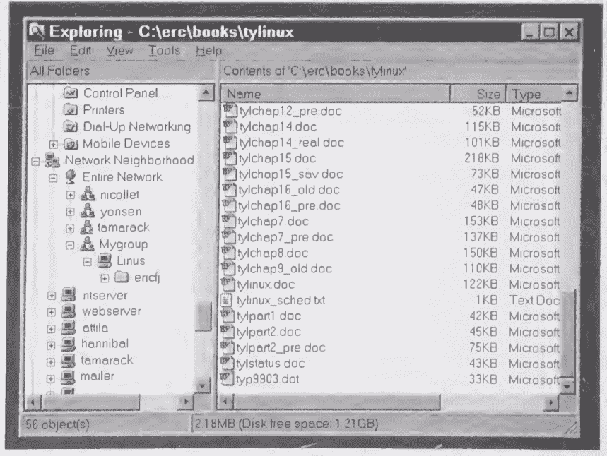

## 第 16 章

### 掌握这些技能

- 设置 Apache
- 启动 Apache
- 创建顶级网页
- 设置搜索引擎

## 搭建你自己的 Web 服务器

世界上最流行的 Web 服务器是免费的，并且随 Linux 一起提供。这款名为 Apache 的 Web 服务器在互联网调查中排名第一，安装的互联网站点数量超过微软等公司的商业产品。

Web 服务器是在服务器系统上运行的程序，向 Netscape Navigator 等浏览器提供网页和其他文档。在最基本的层面上，这就是 Web 服务器的全部功能。Web 浏览器请求特定文件，Web 服务器将其发送出去。

Web 浏览器根据你输入的 URL（即统一资源定位符）来识别文档。例如，`http://www.idgbooks.com/` 标识 IDG Books Worldwide 的主网站。你的 Web 浏览器使用 URL 来确定应该连接哪个系统以及请求该系统上的什么文档。然后 Web 服务器通过发送回请求的文档或错误消息来响应。数据通过超文本传输协议（即 HTTP）返回，这是大多数 Web 浏览器支持的众多网络协议之一。

当然，Web 和 Apache 还有很多其他方面。首先，Apache 允许你运行通用网关接口（即 CGI）脚本。CGI 脚本通常处理搜索请求、在线交易和其他数据输入表单。不过，大多数 CGI 脚本相当慢。这是因为每个脚本都会启动一个新进程，并且通常需要重新加载 Perl 解释器，因为 Perl 是 CGI 脚本使用最多的脚本语言。Apache 通过提供名为 `mod_perl` 的功能来解决这个问题，它显著加快了 CGI 脚本的速度。

`mod_perl` 模块是 Apache 支持的一组通用模块的一部分。Apache 由 Apache 小组设计，可通过附加模块进行扩展。通过针对 Apache API 编程，你可以以全新且有趣的方式扩展 Web 服务器。Apache 附加组件提供安全交易、性能统计和替代身份验证形式。

这种编写附加组件的能力是 Apache 如此受欢迎的原因之一。

Apache 这个名字来自该项目的历史。它最初是作为免费软件国家超级计算应用中心（即 NCSA）`httpd 1.3` Web 服务器的一组补丁设计的，于 1995 年诞生，Apache 得名于它是"a patchy"（补丁拼凑的）服务器。它与美国西南部的原住民没有关联。

### 设置 Apache

Apache 最简单的一点是，它可能已经为你设置好了。如果在安装 Linux 时安装了 Apache RPM 文件，那么它应该已经配置为自动启动。要测试这一点，将你的 Web 浏览器（如 Netscape Navigator）设置为查看 URL `http://localhost/`。如果一切正常，你应该会看到类似于对页所示的文档。

如果你看到了这个文档，那么你会看到指向在线 Apache 文档的链接。这是了解 Apache 更多信息的一个良好开端。不过要注意，Red Hat 的 Apache 安装与 Apache 手册中描述的默认位置不同。Red Hat 选择将一些 Apache 文件分散到不同的目录中。

你可以通过编辑存储在名为 `/etc/httpd/conf` 的目录中的多个配置文本文件来配置 Apache。这些文件允许你控制谁（或哪些机器）可以访问 Web 服务器，以及控制哪些文件和目录可用。

除非你是经验丰富的 Webmaster，否则大多数配置选项都是天书。幸运的是，你不需要了解很多关于 Web 服务器的知识就能让 Apache 启动并运行。不过，这最适合内部或内联网 Web 服务器。如果你要将 Web 服务器放到互联网上——使用 Apache 或任何其他服务器软件——那么你应该尽快掌握 Web 服务器安全知识。否则，你可能最终会将关键的公司数据暴露给全世界。

Web 服务器向世界呈现的目录结构类似于文件系统。通过 URL，你可以向 Web 服务器请求文件或目录。这个目录结构从某个顶级目录开始，但出于安全原因，几乎从不使用你真正的根目录。当你提供诸如 `http://localhost/` 这样的 URL 时，它返回文档根目录，即机器 localhost（你的 Linux 系统的别名）上的顶级目录。这要么是文档根目录的列表，要么是存储在文档根目录中名为 `index.html` 的文件。`index.html` 这个名字是 Apache 在你请求目录时使用的魔法名称。这可能需要一些时间来适应。URL 通常映射到文件，Apache 忠实地提供这些文件。只有当 URL 映射到目录时，你才需要担心那个神奇的 `index.html` 文件。如果目录中存在名为 `index.html` 的文件，Apache 会呈现该文件。否则，它会呈现一个列表，或者如果你没有设置列出目录的权限，则显示错误。（当然，这是可配置的。）

作为配置的一部分，你需要指定 Apache 应将其视为文档根目录的目录，默认为 `/home/httpd/html/`。

### 注意

#### HTTPD

Apache 的程序名是 `httpd`，是 Hypertext Transport Protocol daemon（超文本传输协议守护进程，即服务器）的缩写。你找不到名为 Apache 或 apache 的程序。

#### 交叉参考

第 14 章介绍 Netscape Navigator。第 13 章介绍线缆调制解调器。

#### 表 16-1：APACHE 文件和目录

| 位置 | 存放内容 |
| --- | --- |
| `/usr/sbin/httpd` | Apache Web 服务器程序 |
| `/etc/httpd/conf/` | Apache 配置目录 |
| `/etc/httpd` | Apache 支持目录，链接到模块和日志 |
| `/var/log/httpd` | Apache 日志 |
| `/home/httpd/` | Apache 的顶级目录，即服务器根目录 |
| `/home/httpd/html/` | HTML Web 文档的顶级目录 |
| `/home/httpd/cgi-bin/` | 存储 CGI 脚本的默认位置 |
| `/usr/include/apache/` | Apache 模块编写者的头文件 |
| `/usr/lib/apache/` | Apache 模块编写者的共享库 |
| `/usr/lib/linuxconf/` | 配置 Apache 的 Linuxconf 文件 |

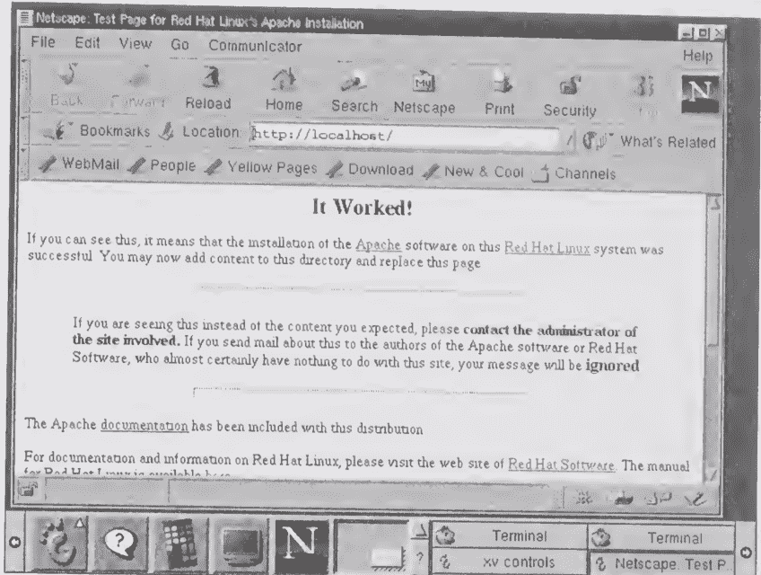

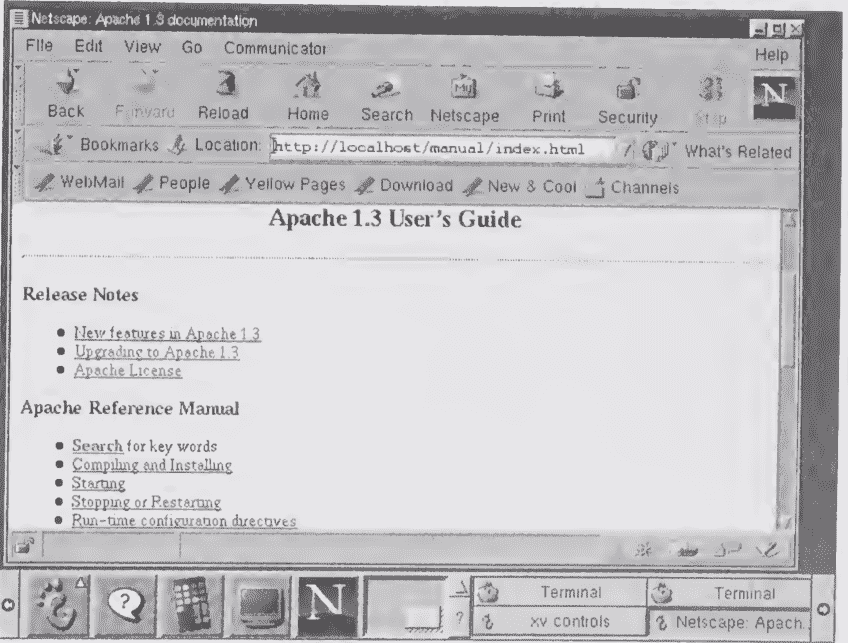

要测试 Apache 是否正常运行，将 Web 浏览器设置为 `http://localhost/`。

从顶级页面，你可以调出 Apache 手册，如图所示，这非常有用。

#### 在线查找

请参阅 `https://www.seifried.org/lasg/` 获取 Linux 管理安全指南。

## 配置 Apache

### 续

要配置 Apache，您需要编辑默认存储在 `/etc/httpd/conf` 中的 `httpd.conf` 文件。对于使用 Apache 早期版本的用户，请注意，从 Apache 1.3.4 开始，三个配置文件 `access.conf`、`httpd.conf` 和 `srm.conf` 被合并为单个文件 `httpd.conf`。

`httpd.conf` 文件保存了 Apache 的基本配置值。该文件包含大量注释，由行首的 `#` 标识，然后是一组带有值的键。您定义的值控制关键设置。例如，Port 键默认值为 80：

```text
Port 80
```

这意味着 Apache 应监听 TCP/IP 端口 80，这是全球 Web 服务器的默认端口。其他常见值有 81、88、8000 和 8080。在许多情况下，防火墙软件会过滤掉其中一些或全部端口。除非有充分理由，否则请将 Apache 保留在端口 80。

ServerRoot 键列出 Apache 配置文件的位置，默认为 `/etc/httpd`。

MaxClients 键控制任何时候允许的最大客户端连接数。该值默认为 150，如果用户抱怨无法访问 Web 服务器，您可能需要增加此值。

接下来，您需要控制哪些文件和目录可供网站用户访问。

对面的表格显示了一些主要值。

确定可用文件后，您需要控制对这些文件的访问。例如，您将在 `httpd.conf` 中看到类似如下的条目：

```apache
<Directory /home/httpd/html>
```

### 注意事项

#### 双重检查安全性

在尝试将您的站点作为 Internet 服务器进行保护之前，请仔细阅读所有 Apache 文档。注意电缆调制解调器或数字用户线路（DSL），两者都可能提供到 Internet 的半永久连接。Internet 上的恶意用户会寻找由新手运营的站点，并可能试图侵入您的系统。

这会启动前面提到的 DocumentRoot 目录上的访问控制。每个 Directory 条目控制谁可以访问给定目录以及这些用户可以做什么。设置持续到 `</Directory>` 行。

用户主页通常具有 `/~user-name` 形式的 URL，例如用户 ericfj 的 `http://localhost/~ericfj`（目前使用 localhost 作为 Web 服务器名称）。

要设置此功能，请确保 `httpd.conf` 文件中的 UserDir 设置包含以下值：

```text
UserDir public_html
```

这意味着每个用户的 Web 页面目录将命名为 `public_html`。

确保设置完成后，下一步是告诉每个用户如何创建自己的主页。根据 UserDir 设置，每个用户需要在其主目录中创建一个名为 `public_html` 的子目录。每个用户还必须处理特殊权限问题，以便 Web 服务器能够访问这些文件。从用户主目录运行以下命令：

## 设置您自己的 Web 服务器

```bash
$ mkdir public_html
$ chmod 775 ~ public_html
```


这将向外界开放用户的主目录。

现在，用户可以将 HTML 文件添加到他们的 `public_html` 目录中。此目录中的文件直接对应该用户的 Web 树的顶层。例如，用户 `ericfj` 的 `public_html` 目录下名为 `linux.htm` 的文件将产生 URL `http://localhost/~ericfj/linux.htm`。

要创建用户的真正主页，请在 `public_html` 目录内创建名为 `index.html` 的文件。

您不限于一个目录。您可以在 `public_html` 下创建子目录来帮助组织 Web 页面。例如，您可能希望将与您正在进行的项目相关的文件保存在名为 `projects` 的目录下。在 `public_html` 下创建此目录，然后引用该目录中的文件，例如 `next_release.html`，其 URL 类似于 `http://localhost/~ericfj/projects/next_release.html`。

| 设置 | 说明 |
|---|---|
| `Port 80` | Apache 监听传入连接的端口 |
| `ServerRoot /etc/httpd` | 存储 Apache 配置文件的目录 |
| `PidFile /var/run/httpd.pid` | 存储主 Apache 进程进程 ID 的文件名 |
| `StartServers 10` | Apache 启动时启动的数量；影响性能 |
| `MaxClients 150` | 任何时候允许的最大连接数 |

| 设置 | 说明 |
|---|---|
| `DocumentRoot /home/httpd/html` | 创建 Web 文档的顶级目录 |
| `UserDir public_html` | 主目录中用于 Web 文档的子目录名称 |
| `AccessFileName .htaccess` | 如果在目录中，控制谁可以访问文件 |
| `ScriptAlias /cgi-bin/ /home/httpd/cgi-bin/` | 将 URL 中的 `/cgi-bin` CGI 脚本别名为实际存储在 `/home/httpd/cgi-bin` 目录中 |
| `AddHandler cgi-script .cgi` | 取消注释此项可启用 Apache 支持 CGI 脚本。默认情况下，此项被注释掉 |
| `DirectoryIndex index.html index.shtml index.cgi` | 设置如果客户端请求目录 URL 而非文件名时使用的文件。默认情况下，如果目录中存在 `index.html` 文件，则提供该文件 |

### 启动 Apache

这可能看起来有些愚蠢，但在尝试启动 Apache 之前，请先查看它是否已经在运行。使用 `ps ax` 命令并结合 `grep` 命令搜索 `httpd`，如清单 16-1 所示。如果您找到 `httpd`，很可能 Apache 已经启动了。只有在更改配置时，您才需要重新启动 Apache。此外，如果 Apache 现在正在运行，它应该在您启动系统时重新启动。这是 Red Hat 安装程序执行的另一个便捷任务。

即便如此，在某些时候您仍需要停止并重新启动 Apache。请记住，Apache 程序是 `httpd`。当您运行 `ps ax` 命令时，您可能会发现许多 `httpd` 副本。您要做的是终止 `httpd` 的主副本，即可以为您停止所有其他副本的那个。

要完全终止 Apache，请以 root 身份运行以下命令：

```bash
# /etc/rc.d/init.d/httpd stop
```

这是首选命令。您也可以尝试以下命令，该命令在 Apache 手册中有记录：

```bash
# kill -TERM `cat /var/run/httpd.pid`
```

这将终止 Apache。`kill` 命令向存储在文件 `/var/run/httpd.pid` 中的进程 ID 发送 TERM 信号（terminate 的缩写）。该文件保存主 `httpd` 进程的 ID。在任何时候，您可能都有多个 `httpd` 副本在运行。（这是 Apache 存储其主进程 ID 的原因之一。）此命令告诉 Apache 主进程终止所有子进程，然后自身退出。

然而，很多时候您只是希望 Apache 重新读取其配置文件。在这种情况下，请以 root 身份运行以下命令：

```bash
# /etc/rc.d/init.d/httpd restart
```

您也可以运行此命令：

```bash
# kill -HUP `cat /var/run/httpd.pid`
```

此命令向主 Apache 进程发送 HUP（挂起）信号。Apache 随后终止所有子 `httpd` 副本，重新读取其配置文件，然后重新启动。

一个更好的命令是发送 USR1 信号，同样以 root 身份执行：

```bash
# kill -USR1 `cat /var/run/httpd.pid`
```

此命令允许主进程的子进程继续运行直到自然终止，然后 Apache 使用更改后的配置重新启动它们。像往常一样，Apache 重新读取配置文件。

在执行任何这些命令期间，您可以通过查看 Apache 日志文件来监控关闭或重新启动操作的进程。默认情况下，这些文件存储在 `/var/log/httpd/error_log` 中。您可以使用以下命令查看：

```bash
# tail -f /var/log/httpd/error_log
```

`tail` 命令打印出文件的最后 10 行。`-f` 选项告诉 `tail` 永远运行，它会在记录新行时打印出来。这样，您可以实时查看 Apache 正在做什么。

要启动 Apache，请使用类似以下的命令：

```bash
# /etc/rc.d/init.d/httpd start
```

您也可以运行以下手动命令：

```bash
# /usr/sbin/httpd -f \
  /etc/httpd/conf/httpd.conf
```

您需要告诉 `httpd` 命令使用 `-f` 选项在哪里找到 `httpd.conf` 文件。Linux 启动时，`httpd` 应该自动启动。

#### 交叉参考

> 本章后面的“创建顶层 Web 页面”有更多关于 Web 文档的讨论。

#### 在线查找

Apache 在线手册位于您本地系统的 `http://localhost/manual/index.html`。

#### 交叉参考

> 第 3 章介绍了 `grep` 命令，第 16 章详细介绍了网络。

> 注意

### INETD 与进程池

Linux 和 UNIX 上的标准网络守护进程（或服务器进程）称为 inetd，即 Internet 守护进程。该服务器监听多个服务的对外连接，然后根据请求启动相应的程序。例如，当有远程通过 telnet 登录的请求时，inetd 会启动 telnet 守护进程 `in.telnetd`。你也可以让 `inetd` 在每次收到 Web 请求时启动 `httpd`。这种方法设置起来相对简单，但扩展性不佳。这是你可能需要优化 Apache 的一个方面。

要控制这一点，可在 `httpd.conf` 文件中将 `ServerType` 键设置为 `inetd` 或 `standalone`。在 `standalone` 模式下，Apache 会自动运行。有关优化 Apache 的更多信息，请参阅在线 Apache 手册。

> 注意

### APACHE 必须能写入其目录

启动时，`httpd` 程序会将其进程 ID 写入名为 `httpd.pid` 的文件。你可以使用这个进程 ID 来终止 Web 服务器。但问题是，如果你将 Web 目录挂载为只读（通常用于确保 Web 页面不会被更改），那么 `httpd` 可能会失败。它需要写入磁盘以存储 `httpd.pid` 文件。

我们就曾遇到过这个问题，当时我们将 copyright（常用于存储 Apache）挂载为只读，突然之间 Web 服务器就无法工作了。如果你保留该文件的默认位置 `/var/run/httpd.pid`，则不会遇到此问题。`/var` 文件系统应该挂载为读写模式。

### 清单 18-1：检查 APACHE 是否正在运行

```text
$ ps ax| grep httpd

  286  ?  S  0:00 httpid

  292  ?  R  0:00 httpb

  293  ?  S  0:00 httpd

  294  ?  S  0:00 httpDR

  295  ?  S  0:00 httpd

  296  ?  S  0:00 httpd

  297  ?  S  0:00 httpd

  298  ?  S  0:00 httpd

  299  ?  S  0:00 httpd

  300  ?  S  0:00 httpd

  301  ?  S  0:00 httpd

 2824  ?  S  0:00 grep httpd
```

> 此命令告诉你有多少个 `httpd` 副本正在运行（如果有的话）。如果你看到至少一个（不包括 `grep` 命令），则很可能 Apache 正在正常运行。

### 清单 16-2：终止 APACHE

```text
# # /etc/rc.d/init.d/httpd stop

Shutting down httpd:  [  OK  ]

# ps ax| grep httpd

28543  ?  S  0:00 grep httpd
```

> 终止 Apache 后，你在 `ps` 命令的输出中不应再看到任何 `httpd` 进程。

#### 在线查找

本地系统中有关优化 Apache 的技巧位于 `http://localhost/manual/misc/perf-tuning.html`。

### 创建顶级网页

当你连接到本地 Web 服务器，即访问 URL `http://localhost/` 时，Apache 会为你创建一个默认页面。看到这个页面证明一切正常，但你很可能想将其更改为其他内容。例如，如果你正在为部门的文档创建内部网站，这个顶级页面应该将该 Web 服务器标识为属于你部门，并包含指向你计划提供的主要主题的链接。

顶级页面，无论是为组织还是为个人，都应该介绍你想要涵盖的主题。大多数顶级页面由指向网站更深层网页的链接组成。

你希望你的顶级网页能够吸引用户访问你的网站，并引导他们找到相关信息。这就引出了一个关键问题：你究竟希望你的网页做什么。人们很容易迷失在可以使用的各种酷炫 Web 技巧中，最终得到一个对用户毫无价值的页面，然后用户就会像避瘟疫一样避开你的页面。

网页使用 HTML（即超文本标记语言）进行格式化。每当你看到以 `.html` 或 `.htm` 结尾的文件名时，它很可能是一个 HTML 文件。HTML 提供了一组格式化标签——全部是文本形式的。你可以使用任何文本编辑器编辑 HTML 文件，或者使用 Netscape Composer，这是 Netscape 附带的一个 HTML 编辑器。

HTML 使用这些标签来标识文档中的元素。基本语法是使用 `<tag>` 表示标签区域的开始，`</tag>` 表示结束。例如，要将文本标记为粗体，使用 `<b>` 开始，`</b>` 结束：

```html
This is normal <b>this is bold</b>.
```

显示为：

This is normal **this is bold**。

将 HTML 文档放在 `<html>` 和 `</html>` 标签之间。在 `<html>` 之后，用 `<head>` 开始头部区域。这个区域通常只放置 `<title>`，它提供显示在窗口管理器标题栏中的文本。头部之后，用 `<body>` 标签将文档的主体部分括起来。

要创建链接，请按以下示例操作：

```html
<A HREF="url">text</A>
```

将 `url` 替换为你要链接的实际 URL。将 `text` 替换为你要显示的实际文字。（避免使用“点击此处”。）例如：

```html
<A HREF="http://www.idgbooks.com">IDG Books</A>
```

这会创建一个指向 IDG Books Worldwide, Inc. 网站的链接，并在文档中显示文字 IDG Books。大多数 Web 浏览器会对此文字加下划线，以表明它是一个链接。

1. `<title>` 标签设置标题。
2. 大文本，通过 `<font>` 标签放大。
3. 水平线。
4. 普通文本。

## 设置你自己的 Web 服务器

## 表 16-4：常见 HTML 元素

| 标签 | 示例 | 用途 |
|---|---|---|
| `<html>` | `<html></html>` | 包含整个 HTML 文档。 |
| `<head>` | `<head></head>` | 包含文档头部，通常包含 `<title>`。 |
| `<title>` | `<title>My Home</title>` | 列出要放在 Web 浏览器标题栏中的文本。 |
| `<body>` | `<body bgcolor=#FFFFFF text=#000>` | 包含文档的主体部分。 |
| `<h1>` | `<h1>Important</h1>` | 顶级（1 级）标题。 |
| `<h2>` | `<h2>Less Important</h2>` | 2 级子标题。你可以使用到 H6，即 6 级子标题。 |
| `<b>` | `<b>This is bold</b>` | 将文本标记为粗体。 |
| `<i>` | `<i>This is italics</i>` | 将文本标记为斜体。 |
| `<code>` | `<code>This is fixed width</code>` | 以固定宽度字体标记文本。 |
| `<p>` | `<p>Hello.</p>` | 表示一个段落。 |
| `<br>` | `<br>` | 换行（比 `<p>` 占用更少的垂直空间）。 |
| `<hr>` | `<hr size=5 align=center noshade>` | 创建水平线。 |
| `<a>` | `<A href="http://foo.com">text</a>` | 创建锚点，在此例中为超文本链接。 |
| `<font>` | `<font face=helvetica,arial size=6>` | 更改字体。注意常规（Helvetica）和 Windows（Arial）字体名称。 |

## 清单 16-3：示例 HTML 文件

```html
<html>

<head>

<title>Eric's Test Page</title></head>

<BODY BGCOLOR=#FFFFFF TEXT=#000>

<font face=helvetica,arial size=6>

This is big text

</font>

<br>

<hr SIZE=5 ALIGN=CENTER NOSHADE>

<p>This is smaller text.</p>

</body>

</html>
```

以下内容创建了一个简单的 HTML 文件，你可以通过 Apache 提供该文件。

> 注意

### XML

XML，即可扩展标记语言，是 HTML 的继任者。XML 与 HTML 非常相似，使用非常类似的标签。但是，HTML 提供的标签直接与文档格式化相关，而 XML 提供了更大的灵活性来定义你自己的标签。将 HTML 转换为 XML 时，你需要确保使用适当的结束标签，例如对于段落，HTML 不要求结束标签。

#### 在线查找

完整的 HTML 标签列表请参见 `http://www.w3.org/TR/REC-html40/`。

## 创建顶级网页（续）

### 跟随文档根目录

Apache 使用的顶级网页是 `/home/httpd/html/index.html`。你需要编辑此文件来创建自己的顶级页面。从该页面，你可以使用 `<A>` 标签链接到其他本地页面。

你可以创建完整的 URL，例如 `http://www.idgbooks.com`，或者指向本地 Web 目录或子目录中文件的本地 URL。例如，`linux/install.html` 或 `support.html` 都是本地的——或相对的——URL，它们指向相对于当前文档的文件系统中的位置。

这可能需要一些时间来适应。默认的文档根目录，或虚拟根目录，是 `/home/httpd/html`。此目录中的文件具有基于根的 URL，例如 `http://localhost/support.html`。这个 URL——基于此处描述的默认配置——链接到 `/home/httpd/html` 目录中名为 `support.html` 的文件。我们如何知道它位于 `/home/httpd/html` 目录？因为该目录是 Apache 配置文件中的文档根目录。

回想一下，用户主页位于其主目录中名为 `public_html` 的子目录中。例如，用户 `ericfj` 的主页是 `/home/ericfj/public_html/index.html`。

你可以在 `/home/httpd/html` 下创建子目录，用于用户主页以外的目的。例如，你可能希望为组织的每个部分设置独立的目录，如软件开发人员、质量保证工程师和产品支持人员。

表 16-5 提供了将 URL 映射到默认 Apache 文档根目录的示例。如果你更改此配置，则需要更新该表。这种奇怪映射的全部原因是让你的网页呈现一个虚拟根目录，你可以将其锚定在 Linux 文件系统中的任何位置（但默认为 `/home/httpd/html`）。

你可以控制用户通过 Web 浏览器可以看到什么和不能看到什么。这主要是一个安全问题，但也与你想要的 Web 页面组织方式有关。

组织方面的另一个关键问题在于*相对链接*的使用。一旦 Web 浏览器调用了你的顶级网页，例如 `http://localhost/`，那么同一目录中的其他 Web 文档就可以通过仅指向文件名的链接来访问。例如：

```html
<A HREF="linux.html">

Information on Linux</A>
```


此链接指向文件`/home/httpd/html/linux.html`。我们如何知道？因为该链接相对于调用它的网页，在本例中是`/home/httpd/html/index.html`（我们的顶级网页）。

相对链接还可以进入子目录。这使你可以从一个顶级位置开始，创建一整套 Web 页面层次结构，所有页面都通过相对链接相互引用。这可以节省大量输入，并且使将 Web 页面移动到不同位置变得更加容易。你可能只想将整个目录树向下移动一级，或者将整个目录树移动到另一个 Web 服务器。在所有这些情况下，相对链接都很有帮助。

## 交叉参考

附录 B 列出了有关 HTML 和 XML 的书籍。

### 在线查找

Apache 主页位于`http://www.apache.org`。

| URL | 文件 | 备注 |
|-----|------|------|
| `http://localhost/` | `/home/httpd/html/index.html` | 目录 |
| `http://localhost/index.html` | `/home/httpd/html/index.html` | 直接指定`index.html`文件，而非依赖目录名与魔术文件名`index.html`之间的映射 |
| `http://localhost/support.html` | `/home/httpd/html/support.html` | 目录中的普通文档 |
| `http://localhost/linux/hardware.html` | `/home/httpd/html/linux/hardware.html` | 目录中的普通文档 |
| `http://localhost/linux/` | `/home/httpd/html/linux/index.html` | 目录的特殊文档，此处为子目录 |
| `http://localhost/~ericfj/` | `/home/ericfj/public_html/index.html` | 用户`ericfj`的主页 |
| `http://localhost/~ericfj/linux.html` | `/home/ericfj/public_html/linux.html` | 用户`ericfj`的 Web 页面目录中的 Web 文档（HTML 文件） |
| `/~ericfj/` | `/home/ericfj/public_html/index.html` | 用户`ericfj`的主页 |

## 注意事项

### 抄袭是最真诚的恭维

开始使用 HTML 的最佳方法之一是找到你喜欢的网页并复制其格式。对于内部网页，这样做永远不会惹上麻烦，但应避免为放置在互联网上的网页复制受版权保护的材料。在许多情况下，简单地研究他人使用的 HTML 技术会更好。例如，如果你想要一个多栏网页，找一个呈现好看的多栏网页的网站，看看该网站如何使用 HTML `<TABLE>` 标签来设置列。注意，有些网站投机取巧，对几乎所有内容都使用图像，这效率不高，尤其是对于那些通过拨号线访问你网站的用户。

### Web 服务器名称可能因访问方式而异

如果你拨号进入网络，可能需要使用系统的完整域名，例如`http://tamarack.foster-johnson.com`，而不是像`http://tamarack`这样的本地网络名称。因此，所有链接中包含本地主机名——在本例中是`http://tamarack`——的网页可能会因用户访问网络的方式而失效。我们发现这对 Windows 用户影响特别大。为什么要担心？因为运行在 Windows 机器上的用户可以将他们的 Web 浏览器指向你在 Linux 上运行的 Apache Web 服务器。

### 设置搜索引擎

`htdig`，官方名称为 ht://Dig，为你的 Web 服务器提供搜索引擎。`htdig`并非要与 Lycos、AltaVista 或其他大型 Web 搜索引擎竞争。相反，`htdig`为用户提供搜索你网站的手段。

要使用`htdig`，首先需要从 Web 下载它，因为`htdig`不随 Red Hat Linux 附带。起初我们以为很幸运，`htdig`主页提供了一个不错的二进制 RPM 文件可供安装。但它在 Red Hat Linux 上无法工作，因此你需要从源代码构建`htdig`。只要你安装 Linux 时安装了 C 和 C++ 编译器，这并不困难。

## 构建 htdig

要构建`htdig`，首先下载源（缩写为 src）RPM 文件（`htdig-3.1.2-0glibc.src.rpm`），然后以 root 身份运行以下命令：

```bash
# rpm --rebuild htdig-3.1.2-0glibc.src.rpm
```

此命令应从源代码构建程序，然后从源代码构建二进制 RPM 文件。此二进制文件将存储在`/usr/src/redhat/RPMS/i386/`中。在本例中，生成的文件将命名为`htdig-3.1.2-0glibc.i386.rpm`。然后，你可以使用以下命令安装此二进制 RPM，同样以 root 身份运行：

```bash
# cd /usr/src/redhat/RPMS/i386/
# rpm -ihv htdig-3.1.2-0glibc.i386.rpm
```

## 配置 htdig

### 注意事项

#### 注意磁盘空间

为了加快搜索速度，`htdig`在你的系统上存储索引文件，这些文件可能变得非常大。根据`htdig`主页的说法，你应将文档数量乘以 12,000，以估算词列表索引将使用的字节数。默认情况下，数据库位于`/var/lib/htdig/db`。你可以在配置文件中更改该位置。

#### 自定义表单

然后，你可以自定义`htdig`使用的标准搜索表单，名为`/home/httpd/html/search.html`。当`htdig`搜索时，它会从多个部分构建结果网页。首先，`htdig`将文件`/var/lib/htdig/common/header.html`的内容放入输出网页。这使你可以在每页顶部放置导航栏或徽标。在输出末尾，`htdig`附加同一目录中`footer.html`文件的内容，同样，以便为你的网页提供一致的外观。

#### HTDIG 从链接建立索引

`Htdig`从你配置的`start_url`开始，然后为从该处链接的所有仍属于你站点一部分的 Web 文档建立索引（你也可以在配置文件中更改此设置）。如果你不链接到某个网页，例如你的用户主页，那么`htdig`将无法找到它。

#### 其他搜索引擎

Glimpse 及其名为 Webglimpse 的 Web 前端，是使用不同技术的另一个搜索引擎。你可以从`http://webglimpse.net`下载 Glimpse。

1. 在`htdig`表单中输入搜索条件。
2. 点击 Search 开始搜索。
3. 搜索结果与创建的 HTML 页头和页脚一起显示在列表中。
4. 如果没有获得想要的结果，可以优化搜索。

### 在线查找

ht://Dig 主页是`http://www.htdig.org`。

## 个人练习册

### 问答

1. Linux 是否附带 Web 服务器？
2. 如果安装了 Apache 软件包，首次启动并运行 Apache 需要做什么？
3. 在 Netscape 中应输入什么 URL 来确定 Apache 是否正在运行？
4. HTML 中的`<b>`标签有什么作用？
5. 可以使用哪些程序查看网页？
6. 可以使用哪些程序编辑 HTML 文件？
7. 什么是文档根目录？
8. 可以使用哪些程序设置 Web 搜索引擎？

答案：第 343 页

## 设置你自己的 Web 服务器

### 第 16 章

#### 额外练习

1. 启动 Netscape Web 浏览器，将其指向`http://localhost`，查看 Apache 是否在你的系统上运行。
2. 查看`httpd`的在线手册页。现在通过 Web 浏览器以 HTML 格式查看在线 Apache 手册。
3. 计算`htdig`将使用多少磁盘空间来存储 Web 文档的索引。现在，运行`htdig`和`htmerge`，然后验证实际使用的磁盘空间。
4. 进行 Web 搜索，查找其他 Web 索引或搜索工具。
5. 在你的 Linux 网站上设置你自己的个人主页。

#### 实际应用

- 向另一位用户准确解释你本地网站的 URL 如何映射到磁盘上的实际文件。然后进一步解释神奇的`index.html`文件对于映射到 URL 的目录的用途。
- 讨论你希望 Apache 在独立模式还是`inetd`模式下运行。在此过程中，阅读`inetd`的在线手册页。
- 你有一个顶级网页，它没有链接到其下的所有页面。与其更改网页布局，不如查看`htdig.conf`配置文件中的注释，了解`htdig`是否可以索引所有这些页面，即使顶级页面没有链接到树中的所有分支。同时查看在线`htdig`文档。

#### 视觉测验

这里显示的是什么类型的网页？提示：查看 URL。

# 第 17 章

- 了解内核工作原理
- 创建自定义内核
- 构建细节
- LILO 配置文件
- 模块的维护与管理
- 配置内核

## 高级系统配置

Linux 是一个非常强大且灵活的系统。它可以用于各种不同的用途。例如，它可以作为小型办公服务器、防火墙或 Web 服务器。

要充分利用你的系统，你需要将其配置为适合你的需求。在本章中，我们将介绍配置内核的步骤以及一些可以研究的高级功能。

Linux 的优点之一是，文本文件几乎控制了整个配置过程。Microsoft Windows 等专有操作系统倾向于将配置隐藏在专有的二进制数据库中（即注册表）。而在 Linux 中，一切都是开放的。

Linux 设计用于在各种不同的系统上运行。你可以在配备 8MB 内存的 386 上运行它，也可以在配备 2GB 内存的四路 Pentium III 上运行它。你可以将其作为独立的个人机器运行，也可以作为庞大的公司级数据库系统运行。

Linux 可以配置为完成许多惊人的事情。例如，你可以配置你的网卡以响应各种不同的网络地址。（这称为 IP 别名）。这让一台机器看起来像多台，这在尝试以`www.eatatjoes.com`、`www.buyahouse.com`和`www.bookstore.com`提供网页时非常有用。

配置发挥作用的另一个领域是 Linux 用作防火墙时。防火墙是保护公司内部网络免受外部世界侵害的机器。它有两个网络接口，一个用于公司内部，一个用于外部世界。它的工作是在两个接口之间传递消息，确保没有任何有害内容从外部进入。由于什么是"有害的"由系统管理员决定，消息传递规则的配置可能相当广泛。但这一切都是从配置内核开始的。

配置内核的工具使用起来相当简单。你所要做的就是选择你想要的选项和模块。问题就在于此。你看，选项非常多。多到有 30 个不同的类别来组织它们。

幸运的是，内核配置程序附带了广泛的帮助系统。如果你知道自己想要什么，这将帮助你实现目标。

## 理解内核的工作原理

要正确配置和调整内核，你需要了解其工作方式。操作系统由三大部分组成。首先是主内核，包含核心操作系统和设备驱动程序。然后是模块，可以在运行时添加到内核中。模块包括声音驱动程序以及其他在加载初始内核时不需要的设备驱动程序。最后是守护进程，在 Microsoft Windows NT 中称为服务。这些是在后台运行的程序，例如`routed`和`mountd`，它们执行操作系统功能，如处理 TCP 路由和 NFS 请求。

在接下来的任务中，我们将详细介绍加载和配置内核不同部分的各种方法。

### Linux 的启动过程

加载并运行的第一个 Linux 部件是内核。内核执行各种初始化任务，然后启动程序`init`。该程序检查`/etc/inittab`文件，以确定需要执行的操作。这告诉`init`首先执行脚本`/etc/rc.d/rc.sysinit`。该脚本执行使最小系统运行所需的命令。

接着，`init`执行脚本`/etc/rc.d/rc`，而该脚本又会执行`/etc/rc.d/rc*运行级别*.d`目录中的所有脚本。（Linux 使用运行级别编号来控制可用的服务和功能。运行级别 3 是正常的；运行级别 1 是单用户模式；等等。）

`/etc/rc.d/rc*运行级别*.d`中的脚本启动守护进程并加载模块。它们执行配置和其他初始化任务。

最后，在所有脚本处理完毕之后，Linux 完全进入可操作状态。

### PNP 设备

即插即用（PNP）设备设计为由操作系统进行配置。它们宣告一组可能的配置，操作系统告诉它们使用哪个配置。

Linux 内核确实理解即插即用设备并进行配置，但这种支持非常有限。大多数即插即用设备由一个名为`isapnp`的工具处理，该工具还能让你配置这些设备。在`isapnp`配置完设备后，你可以为其加载设备驱动模块并使用你的即插即用硬件。此工具由放置在`/etc/rc.d`目录中的脚本运行。有关完整详情，请参阅本章后面关于 PNP 设备的任务。

### PCMCIA 卡

笔记本电脑包含称为 PCMCIA 卡的设备插槽。这些卡可以在系统运行时插入和移除。PCMCIA 插槽由`cardmgr`程序监控（在启动时自动从`/etc/rc.d`启动）。当它检测到卡已插入时，会为该卡加载设备驱动程序，并使用`/etc/pcmcia`目录中的脚本进行初始化。

> **交叉参考**
>
> 第 7 章介绍如何使用运行级别 5 来启动 X Window 图形登录界面。

### 加载顺序

引导加载程序（LILO、LOADLINE 等。）

`init`

`rc.sysinit`

运行`isapnp`以配置 PnP 设备（如果有的话）。

`/etc wasting time. /etc/rc.d/rc*runlevel*.d`

这些脚本初始化各项内容，按需加载模块，并启动守护进程。

`cardmgr`

监视 PCMCIA 插槽，并在启动时或为后来插入的任何设备加载驱动模块。

根据需要运行`/etc/pcmcia`中的脚本以初始化设备。

此图显示了 Linux 启动时使用的主要组件。

#### 表 17-1：关键内核文件和目录

| 文件 | 用途 |
|------|---------|
| `/etc/rc.d/init.d` | 初始化脚本 |
| `/etc/pcmcia` | PCMCIA 配置文件和启动脚本 |
| `/etc/sysconfig/network` | 网络配置文件和启动脚本 |
| `/lib/modules/*内核版本*` | 可加载内核模块的位置 |

### 注意

#### 必需的软件包

这是内核编译必须安装的软件包列表：

- `kernel-headers-version.i386.rpm`
- `kernel-source-version.i386.rpm`
- `egcs-version.rpm`
- `make-version.i386.rpm`
- `bin86-version.i386.rpm`
- `glibc-devel-version.i386.rpm`

这些软件包提供内核配置和编译过程所需的工具和其他文件。（`-version`指每次软件新版本发布时都会变化的版本号。）

#### 快捷提示

对于 PCMCIA，可以联想为 People Can't Memorize Computer Industry Acronyms（人们记不住计算机行业的缩写）。

## 创建自定义内核

### 配置

前面的"注意"列出了构建内核之前必须安装的软件包。内核源代码放置在`/usr/src/linux`目录中。

要配置内核，以 root 身份登录并启动 X 会话。进入`/usr/src/linux`目录并执行命令：

```bash
# make xconfig
```

这将启动一个 GUI，使你能够配置内核。（特定选项的设置将在后续任务中讨论。）完成内核配置后，单击 Save and Exit 退出配置工具。

下一步是编译内核。有两组编译内核所需的命令，取决于你计划如何引导新内核。这些命令见清单 17-1 和 17-2。

引导内核有两种方法：

- 将系统放到软盘上。
- 使用 LILO 引导内核。

在下面的任务中，我们将讨论如何使用这两种方法。

### 将系统放到软盘上

从软盘引导时，引导实验性内核很容易。将软盘放入即可引导该内核。取出软盘则不引导该内核。非常简单。

要创建可引导软盘，将磁盘放入 A 驱动器并执行清单 17-1 中的脚本。

### 使用 LILO 引导内核

LILO 加载程序比软盘灵活得多。你不仅可以加载内核，还可以指定引导参数。（例如，如果你想以单用户模式引导，在 LILO 提示符处输入`linux S`。）

LILO 足够智能，可以引导 Microsoft Windows 和其他操作系统。一般来说，如果你不介意修改引导扇区，这是一种简单得多的方式。

清单 17-2 中的脚本构建并安装名为`/boot/vmlinux.exp`的实验性内核。清单 17-3 中的 LILO 配置将此内核命名为`exp`。因此要引导普通 Linux，在 LILO 提示符处输入`linux`；要引导新内核，输入`exp`。（对于 Microsoft Windows 使用`dos`。）

#### 版本号

与 Linux 系统相关的重要版本号有两个。第一个是 Red Hat 发行版本号。这是分配给 Red Hat 生产的 Linux 软件集合的版本号。本书包含 Red Hat 6.1 Linux 的副本。

第二个是内核版本号。这个编号由内核开发人员分配。内核版本号由三部分组成：例如`2.2.14`。第一和第二部分是主版本号和次版本号，第三部分称为补丁级别。主版本号仅在系统发生重大变化时更改。（主版本号一直在变化。在 Linux 的整个历史中，只出现过三个这样的数字：0、1 和 2。）

内核版本号很重要，因为它用于许多用途，例如模块存储目录的选择和其他与版本相关的信息。

**清单 17-1：LINUX-LILO.SH —— 使用 LILO 的 Linux 构建脚本**

```bash
#!/bin/sh -x

make dep

make clean

make

make bzImage

make modules
```


`make modules_install`

`/bin/cp arch/i386/boot/bzImage`

`/boot/vmlinuz.exp`

`/sbin/lilo`

## 清单 17-2：LINUX-FLOPPY.SH —— 构建 Linux 并将其写入软盘的脚本

```sh
#!/bin/sh -x

make dep
make clean
make
make modules
make modules_install
make zImage
make zdisk
```

## 清单 17-3：/ETC/LILO.CONF —— LILO 配置文件

```conf
# 注意：注释以 # 开头
#（LILO 会忽略它们）

boot=/dev/fd0
map=/boot/map
install=/boot/boot.b
prompt
timeout=50

#___________________
# 第一个操作系统的定义。
# 这是一个名为 "linux" 的 linux 系统
# 根磁盘在 /dev/hdc1 分区上
#
# 注意根目录需要
# 设置为你的 linux 根
# 分区。
#
image=/boot/vmlinuz-2.0.32
		label=linux
		root=/dev/hdc1
		read-only

#___________________
# 第二个操作系统的定义
# 这是一个名为 "exp" 的 linux 系统
# （实验性 linux 系统）
# 根目录，同样是 /dev/hdc1

image=/boot/vmlinuz.exp
		label=exp
		root=/dev/hdc1
		read-only

#___________________
# 第三个操作系统的定义
# 这是一个类型为 "other" 的系统（即
# Microsoft Windows），名为
# "dos"。

other=/dev/hda1
		label=dos
		table=/dev/hda
```

## 构建详情

本任务详细介绍构建脚本，解释用于构建内核的每个命令。

要构建新内核，首先清除旧内核创建的二进制文件：

```sh
# make clean
```

由于`make`程序不会处理选项或配置更改等项目，清除二进制文件可以确保我们编译所有内容，以防万一。

接下来，更新依赖项。（这是一个列表，指示每个顶层文件使用哪些底层文件。）

```sh
# make dep
```

现在我们实际编译内核：

```sh
# make bzImage
```

接下来的两个命令创建所有可加载模块并将其安装到`/lib/modules/版本号`中（其中`os_version`是内核的版本号）：

```sh
# make modules
# make modules_install
```

### 仅软盘命令

现在脚本开始分叉。如果我们要制作软盘，需要一个可以直接放到磁盘上的内核，因此需要创建一个压缩映像：

```sh
# make zImage
```

接下来将压缩映像放到软盘上。将软盘插入 A 驱动器并执行命令：

```sh
# make zdisk
```

系统现在已准备好启动。要启动系统，只需插入软盘并重新启动。

### 在线查找

有关构建内核和内核配置的信息可以在`/usr/src/linux/Documentation`中找到。

### 创建 LILO 可加载内核

`make`命令（如上所述）构建基本内核。不幸的是，基本内核对于 LILO 来说有点大。我们需要为 LILO 制作一个压缩内核。这可以通过以下命令完成：

```sh
# make bzImage
```

结果放在文件`/usr/src/linux/arch/i386/boot/bzImage`中。LILO 启动的内核放在`/boot`目录中，因此我们使用复制命令（`cp`）将内核放到该目录中：

```sh
# cp arch/i386/boot/bzImage \
  /boot/vmlinuz.exp
```

如果尚未这样做，请编辑`/etc/lilo.conf`配置文件以包含`exp`系统的条目。然后使用以下命令让 LILO 了解新内核：

```sh
# lilo
```

注意：每次更改内核时都必须运行`lilo`。这是因为它需要知道文件中每个块的扇区号，所以每次更改任何内容时，都要重新运行`lilo`。

## 将实验性内核设为默认

在测试新内核确保其正常工作后，您可能希望将其设为默认。要做到这一点，只需将实验性内核复制到默认名称：

```sh
# cp /boot/vmlinuz.exp /boot/vmlinuz
```

由于您对内核进行了更改，需要再次运行 LILO：

```sh
# lilo
```

## 高级系统配置

**第 17 章**

### 清单 17-4：LILO 可加载内核的示例构建

```text
+ make dep

make[1]: Entering directory `/usr/src/linux-2.2.3/arch/i386/boot'
make[1]: Nothing to be done for `dep'.
make[1]: Leaving directory `/usr/src/linux-2.2.3/arch/i386/boot'

scripts/mkdep init/*.c > .depend
......

gcc -Wall -Wstrict-prototypes -O2 -fomit-frame-pointer -o tools/build tools/build.c -I/usr/src/linux-2.2.3/include
objcopy -O binary -R .note -R .comment -S compressed/vmlinux compressed/vmlinux.out
tools/build bootsect setup compressed/vmlinux.out CURRENT > bzImage

Root device is (3, 5)
Boot sector 512 bytes.
Setup is 3524 bytes.
System is 497 kB

make[1]: Leaving directory `/usr/src/linux-2.2.3/arch/i386/boot'

+ cp arch/i386/boot/bzImage /boot/vmlinuz.exp
+ lilo

Added linux *
Added exp
Added dos
Added diag
#
```

### 清单 17-5：基于软盘的内核的示例构建

```text
+ make dep

make[1]: Entering directory `/usr/src/linux-2.2.3/arch/i386/boot'
make[1]: Nothing to be done for `dep'.
.....

Root device is (3, 5)
Boot sector 512 bytes.
Setup is 3524 bytes.
System is 497 kB

dd bs=8192 if=bzImage of=/dev/fd0

62+1 records in
62+1 records out

make[1]: Leaving directory `/usr/src/linux-2.2.3/arch/i386/boot'

+ /usr/sbin/rdev -R /dev/fd0 1
+ /usr/sbin/rdev -s /dev/fd0 /dev/hdc1
#
```

311

### LILO 配置文件

LILO 加载器使用文件`/etc/lilo.conf`来告诉它有哪些操作系统。清单 17-3 是一个典型的 LILO 配置文件。

前几行是：

```conf
boot=/dev/hda
map=/boot/map
install=/boot/boot.b
prompt
```

除非您知道自己在做什么，否则不要动这些。（如果您想了解详细信息，请参见`/usr/doc/lilo-21`。）

下一行：

```conf
timeout=50
```

告诉 LILO 在启动默认操作系统之前等待多少秒。您会看到`LILO:`提示符持续这么长时间。在这段时间内，您可以输入另一个要启动的操作系统的名称，或按 Tab 键查看可用系统的完整列表。有了超时设置，您无需输入任何内容；在给定的超时时间后，`lilo`将启动默认操作系统。

下一部分包含每个可启动操作系统的条目。Linux 条目看起来类似于这样：

```conf
image=/boot/vmlinuz-2.2.3-5
	label=linux
	root=/dev/hda5
	read-only
```

这告诉 LILO 操作系统是一个名为`/boot/vmlinuz-2.2.3-5`的“映像”文件，该系统的 LILO 名称是`linux`，根分区是`/dev/hda5`，并且它最初要以只读方式挂载。

对于 Microsoft Windows，LILO 条目是：

```conf
other=/dev/hda1
	label=dos
	table=/dev/hda
```

此条目告诉 LILO 我们有一个非 Linux 操作系统（类型 = `other`），此条目的名称是`dos`，操作系统位于第一个硬盘的激活分区（`/dev/hda`）上。

不过，LILO 支持的操作系统不止 Linux 和 Microsoft Windows。`other`类型可以用于其他操作系统，例如 Be OS：

```conf
other=/dev/hda1
	label=beos
	table=/dev/hda
```

在这种情况下，Be OS 加载在`/dev/hda1`上，即第一个 IDE 硬盘的第一个分区。

#### 在线查找

此处展示的脚本可以在`http://www.oualline.com/linux`找到。

## 高级系统配置

**第 17 章**

#### 全局选项

这些选项影响整个 LILO 配置，应出现在文件开头。

- **`boot=设备`** 这是要写入引导记录的位置。典型设备是第一个软盘（`/dev/fd0`）和第一个硬盘（`/dev/hda`）。如果您有另一个多系统加载器（例如 Windows NT 附带的那一个），可以将其放在 Linux 分区上，然后让您的高级加载器指向它。
- **`delay=时间`** 这是在启动默认映像之前延迟的时间量。您可以将其设置为 0。在这种情况下，默认映像会立即启动，除非您在启动时按住 Shift 键。
- **`default=名称`** 指定默认启动映像的名称。
- **`linear`** 生成更高效的线性磁盘地址。
- **`lock`** 如果存在此选项，并且您指定了一个操作系统，该系统将变为“锁定”。换句话说，如果存在此选项，最后指定的系统就是默认系统。

#### 每系统选项

LILO 可以启动多个系统。这些选项仅影响正在启动的系统。

- **`label=名称`** 系统的名称。
- **`image=文件`** 要启动的 Linux 内核的名称。
- **`other=设备`** 要启动的非 Linux 操作系统的名称。（例如 MS-DOS、Windows 98 或 Windows NT。）
- **`read-only`** 几乎所有 Linux 系统都需要此选项。它使根文件系统（`/`）最初以只读方式挂载。（Linux 会快速检查文件系统，如果正常则重新以读写方式挂载。）
- **`append`** 如果您的 Linux 内核需要命令行参数，此命令将在启动时将其附加到命令行。例如，linux 标签的`append=S`将以系统`linux S`启动。
- **`password=密码`** 使用密码保护，保护映像。

### 模块的维护与管理

模块是内核设备驱动程序或其他内核功能，可以独立于主内核进行加载和卸载。

要查看已加载的模块，使用以下命令：

```sh
$ /sbin/lsmod
```

模块可以通过`insmod`和`modprobe`命令手动加载。两者的区别在于，`insmod`尝试加载单个模块，而`modprobe`会加载一个模块以及顶层模块所需的所有支持模块。除非您确实知道自己在做什么，否则请使用`modprobe`命令。

这些命令通常由`/etc/rc.d/init.d`中的脚本在启动时自动运行，以及由`cardmgr`守护进程在插入 PCMCIA 卡时自动运行。除非您正在调试内核配置，否则可能永远不会手动运行此程序。

`rmmod`命令用于移除模块。

除了`insmod`和`rmmod`之外，还有一个称为`kmod`的内核线程。这是一个内部内核进程，用于检查每个可能需要模块的系统请求。如果收到一个需要未加载模块的请求，`kmod`会调用`modprobe`来加载它。

默认情况下，`modload`和`modprobe lookups`在`/lib/modules/2.2.3-15`目录树中查找模块（`2.2.3-15`是当前内核版本号）。

PCMCIA 设备的模块由`cardmgr`加载。这些模块位于`/lib/modules/2.2.3-5/pcmcia`目录中。

重新编译内核不会重新编译这些模块。要编译您的 PCMCIA 模块，请转到`/usr/src/linux/pcmcia-cs-3.0.9`目录并执行以下命令：

```sh
# ./Configure
# make
# make install
```

### 即插即用设备

内核或`isapnp`工具可以配置即插即用设备。由于内核的支持较弱且不够好，您可能希望使用`isapnp`。使用`isapnp`工具的另一个优势是您可以自行控制资源。此外，您应该了解此工具的功能，因为声音配置工具`sndconfig`使用它来配置您的声卡。

即插即用（PNP）系统旨在解决与配置设备相关的问题。在 PNP 之前，您必须在设备上设置跳线来控制 I/O 地址和中断号等内容。如果您不小心将两块板配置为使用相同的号码，就会出现问题。

使用 PNP 系统，板卡让操作系统知道它们需要多少 I/O 地址和中断。然后操作系统告诉它们要使用哪些设置。如果操作系统正常工作，它会告诉每个设备使用不冲突的设置。

工具`pnpdump`输出系统中每个 PNP 设备的配置信息。此文件的格式设计为用作`isapnp`程序的输入。

因此，要为您的系统创建`/etc/isapnp.conf`，首先运行`pnpdump`创建文件。然后编辑结果以取消注释您想要的条目。最后，运行`isapnp`配置设备。

大多数条目都是自解释。关键条目是`(ACT Y)`行。如果此行被注释掉，`isapnp`将检查配置，但不会设置它。确保取消注释此行，否则您的配置将不会被设置。

### 清单 17-6：LSMOD 的输出

```text
Module                  Size  Used by
smc91c92_cs             9392  1
ds                      5740  2 [smc91c92_cs]
i82365                 21892  2
pcmcia_core            39688  0 [smc91c92_cs ds i82365]
nls_iso8859-1           2020  1 (autoclean)
nls_cp437               3548  1 (autoclean)
```

### 清单 17-7：PNPDUMP 的输出（节选）以及 ISAPNP 的输入

```text
#
# 有关此文件格式的详细信息，请参阅
# isapnp.conf(5)
#
#
# 尝试端口地址 0203
# 板卡 1 的序列标识符为 e5 ff ff ff
# ff 70 00 8c 0e

# (DEBUG)
(READPORT 0x0203)
(ISOLATE)
(IDENTIFY *)

  板卡信息如下：

# 卡 1:（序列标识符 e5 ff ff ff ff
# 70 00 8c 0e）
# CTL0070 序列号 -1 [校验和 e5]
# 版本 1.0，厂商版本 1.0
# ANSI 字符串 ->Creative ViBRA16C PnP<-
#
# 逻辑设备 ID CTL0001
#
# 编辑以下条目以取消注释
# 所需的配置。
# 注意，只给出了任何范围的
# 第一个值，如有需要
# 可以更改
```

```text
# 不要忘记在确认无误后取消注释 activate
# (ACT Y) 行

(CONFIGURE CTL0070/-1 (LD 0
# ANSI 字符串 ->Audio<-
#
# (INT 0 (IRQ 5 (MODE +E)))
# 第一个 DMA 通道 1.
# 仅支持 8 位 DMA
# 逻辑设备不是总线主控
# DMA 可以以字节计数模式执行
# DMA 不能以字计数模式执行
# DMA 通道速度为兼容模式
# (DMA 0 (CHANNEL 1))
```

后面跟着大量配置选项。这些选项以如下行结束：

```text
# 结束依赖函数
# (ACT Y)
)) #
```

取消注释`(ACT Y)`行，否则运行`isapnp`时不会发生任何事情。文件以如下内容结束：

```text
# 将所有卡返回到"等待按键"
# 状态
(WAITFORKEY)
```

### 配置内核

要配置内核，请使用以下命令运行基于 X 的配置程序：

```sh
# cd /usr/src/linux
# make xconfig
```

有一个基于文本的 GUI 配置工具（`make menuconfig`）和一个基于命令行的配置工具（`make config`）。这些需要大量输入，而且比 X 配置工具耗时更长。

X 内核配置程序会显示一个窗口，列出各种配置组。在下面的章节中，我们将讨论这些组的功能特性。


一些 Linux 设备驱动程序已经成熟且稳定。另一些则是实验性的，可能不完整或无法正常工作。**代码成熟度级别选项**让你决定是想坚持使用已知可用的功能，还是想冒险尝试。如果你选择**提示开发中和不完整的代码/驱动程序**，配置程序将允许你尝试实验性代码。如果你对此选项选择`n`，则所有实验性驱动程序选项都将被禁用。

配置程序会标识某些实验性驱动程序为实验性质；另一些则不会。

**处理器类型和功能**选项让你能够将内核配置为最佳利用你的处理器。处理器类型用于优化。选择错误的处理器类型，你的内核仍然可以运行，只是会稍微慢一点。

**数学仿真**选项为 386 和部分没有浮点单元的 486 处理器开启浮点仿真。除非你有其中一台古老的机器，否则请将此选项关闭。

Linux 内核可以支持多处理器主板。如果你有其中之一，请开启**对称多处理器支持**。

▶ **xconfig 主屏幕** | ▶ **代码成熟度级别选项**

| 交叉参考 |
| --- |
| 第 13、14 和 15 章有更多关于网络的内容。 |

| 在线查找 |
| --- |
| 有关 SMB 网络的更多信息，请参阅`http://www.samba.org`。 |

# 高级系统配置

## 第 17 章

如果你有高级奔腾芯片，可以启用 MTRR 支持。这会使用处理器上的 MTRR 寄存器来提高图形速度。

设备驱动程序有两种类型。一种是编译进内核的，另一种是作为模块加载到内核中的。

某些驱动程序，如基本 IDE 磁盘驱动程序和显卡驱动程序，必须编译进内核。其他如即插即用设备（如声卡）和 PCMCIA 设备的驱动程序则必须是模块。对于大多数设备来说，这并不重要。

可加载模块的优点在于，你可以根据需要加载和卸载它们，而无需停止内核。此外，如果你为某个硬件的设备驱动程序定义了模块，而该硬件并不存在，那么该设备驱动程序会在发现自身不被需要时自动卸载。

可加载设备驱动程序的缺点在于，你必须确保它们在适当的时候被加载。大多数情况下，Linux 启动脚本或内核模块线程（`kmod`）会为你完成这项工作，但有时你需要调整`/etc/rc.d/init.d`中的文件，以使设备正确加载。

一般来说，你应尽可能使用可加载设备驱动程序（模块）。

由于可加载模块支持已经稳定且极其漫长有用，请启用它。

模块可以用版本号“标记”。这可以防止一个内核的模块被加载到另一个内核中。这是一个有用的安全措施，但它会阻止在你的内核中加载第三方模块。内核模块加载器让内核能够请求模块。启用此功能后，你就可以避免手动加载大量模块。

*待续*

## 配置内核

续

### 常规设置

内核设置的这一部分让你能够设置一些常规选项。第一个，网络支持，应该启用，除非你运行在一个非常特殊的环境中。即使你运行的是没有网卡的独立系统，也请启用此选项。（某些 Linux 程序使用网络与同一系统上的其他程序通信。）

在大多数主板上，有两种扩展槽：较旧的 ISA 插槽和较新的 PCI 插槽。除非你的主板非常老，没有 PCI 插槽，否则请启用 PCI 支持。

随着你对 Linux 的了解越来越深入，你会发现 Linux 从硬件中获得的性能要比 Microsoft Windows 好得多。这也意味着 Linux 对硬件的压力更大。因此，Linux 开发人员总能发现硬件中的错误和性能瓶颈。而且，他们毫不避讳地将存在缺陷的硬件称为“脑残”硬件。

PCI 访问模式、PCI 怪癖和 PCI 桥优化选项旨在绕过硬件的怪异问题。

MCA 和 SGI 支持选项支持不常见的总线系统。除非你有特殊的系统，否则请将这些选项关闭。

有许多不同的选项涉及各种内核服务，包括 System V IPC、BSD 进程记帐和 Sysctl 支持。请保持这些选项开启，因为许多不同的程序会使用它们。

Linux 内核设计用于运行各种不同的程序。大多数程序使用一种称为 ELF 的格式，因此你必须选择该格式。其他二进制格式可以做成模块。当你尝试运行其中一种格式的程序时（比如 a.out），内核会检测该格式，加载支持该格式的模块，然后运行该二进制文件。

下一组选项涉及并口。如果你想使用打印机或其他并口设备，需要选择此驱动程序。

最后一节涉及高级电源管理（APM）。这些选项不仅控制你的系统是否识别 APM，还控制它利用哪些服务。此选项对笔记本电脑用户特别有用。

`apmd`程序是一个守护进程，如果你正在使用 APM 系统，应该安装它。它监控电池电量，并在你即将耗尽电力时发出警告。

### 即插即用支持

Linux 提供了配置即插即用选项的功能，这可能会让你认为它实际上可以做到这一点。事实上，此选项仅在非常有限的板卡集合上启用即插即用功能。

这些板卡包括一些声卡和连接到并口并能自我识别为使用该端口的设备。（如并口磁带机和磁盘驱动器之类的东西。）

要获得真正的即插即用控制，请使用`pnpdump`和`isapnp`工具，如上一节所述。

常规设置第 3 部分 | 即插即用支持

续完


## 配置内核（续）

### 块设备

块设备必须逐块进行读写操作。（其他类型的设备称为字符设备，因为可以逐字符进行读写。）磁盘、CD-ROM 和磁带都属于块设备。本节包含一些常规选项，用于处理存在缺陷的硬件，如 CMD640 芯片组。

还有一些特殊设备。第一个是**回环设备（Loopback device）**。该“设备”允许你将文件当作分区来处理。例如，如果你有一个 CD-ROM 刻录机，有些软件可以创建 CD-ROM 的镜像。借助该设备，你可以将该文件“挂载”为文件系统。但除非你正在对文件系统做高级操作，否则不需要此选项。

**网络块设备**是一种实验性设备，用于在网络上使用块设备，例如远程磁带驱动器。由于这属于实验性功能，除非你乐于冒险并希望尝试让它正常工作，否则不要启用它。

### RAID

多设备驱动程序可以将多个磁盘组合成一个设备。这也称为 RAID，大致如此。（RAID 是**廉价磁盘冗余阵列（Redundant Array of Inexpensive Disks）**的缩写，它使用多个磁盘来实现一种从磁盘错误中恢复的方案。）实际上，这是一种软件层面的组合，可与 RAID 或任何其他磁盘分组方案配合使用。

在线性模式下，磁盘只是相互连接。这形成一个大磁盘，但不会带来性能提升。在此模式下，如果向磁盘写入文件，它可能会占用一个物理驱动器。

另一方面，使用 `RAID-0` 时，每个块写入不同的磁盘，从而极大地提高磁盘速度。

`RAID-1` 提供镜像功能。这意味着相同的数据至少写入两个不同的磁盘。如果磁盘发生故障，这非常有用，但冗余会消耗大量资源。

`RAID-4` 和 `RAID-5` 使用多个磁盘，并通过奇偶校验来实现冗余。

所有 RAID 选项都需要使用外部工具来配置磁盘阵列。（请查看软件包 `raidtools-0.90-1.i386.rpm`。）在线文档文件 `/usr/doc/HOWTO/mini/Software-RAID` 中描述了相关工具及其使用方法。

如果你是 Linux 新手，请先在不使用 RAID 的情况下让系统运行起来。然后，在确信自己了解工作原理之后，再启用 RAID。

### 并口 IDE

有许多设备连接到并行端口，包括磁盘（如 SyQuest 驱动器）和磁带（如 HP Surestore 产品）。要使用这些设备，需要启用**并口 IDE 设备支持**。

不幸的是，制造商未能就并行端口的通信标准达成一致，这意味着你需要选择适合你设备的协议。请查看文件 `/usr/src/linux/Documentation/paride.txt`，了解其中是否包含你特定设备的信息。

### 网络选项

Linux 内核在网络方面极其灵活。它能完成大多数其他系统（甚至包括 UNIX 系统）认为不可能实现的功能。

本节中有一些关键功能需要注意。你应该启用基本服务，如**Unix 域套接字**和**TCP/IP 网络**。如果你有两块网卡，也请启用**路由**。其他大多数选项适用于高级网络。如果你是 Linux 新手，可以关闭这些选项。（而如果你足够聪明需要使用高级选项，你也一定足够聪明知道它们是什么。）

有一些高级选项值得了解。例如，Linux 可以配置为**防火墙**。防火墙是一台装有两块网卡的机器。一块连接到互联网，另一块连接到内部网络。防火墙机器可以配置为仅允许“合法”的网络流量通过，从而将黑客拒之门外。

一个特别有趣的防火墙功能是 `IP 伪装（IP masquerading）`，它使防火墙机器能够重写每个出站数据包，使其看起来像是来自防火墙本身。入站数据包在传入时也会以类似方式重新路由。如果你拥有家庭网络并使用有线调制解调器，这非常有用。你的有线电视公司希望按机器数量向你收费。使用 IP 伪装后，无论家里有多少台机器，你看起来都只是一台机器。（有关使用有线调制解调器的信息，请参阅第 13 章。）

另一个有趣的功能是 `IP 别名（IP aliasing）`。这使单块网卡能够响应多个地址。如果你想为多个名称提供 Web 服务，这很有用。例如，你可以用它配置一个系统，使 `www.mycompany.com` 和 `www.yourcompany.com` 显示不同的主页。此选项对于使用有线调制解调器的人也很有用。

### QoS 和/或公平队列

在负载繁重的网络上，你可以配置 Linux 使用各种复杂的算法来决定下一个发送哪个数据包。但是，对于家庭使用，请关闭 **QoS 和/或公平队列**。你的数据包数量不足以使其发挥作用。

### SCSI 支持/SCSI 底层驱动程序

如果你有 SCSI 设备，需要告诉 Linux 支持哪些设备。还需要告诉它系统中安装有哪些 SCSI 控制卡。

### 网络设备支持

本节允许你定义系统中的网卡。Linux 的网络探测程序在找到第一块以太网卡后就会停止。因此，如果你有多于一块网卡，需要将第二块网卡定义为模块。（详情请参阅第 13 章。）

还有一些非以太网设备需要考虑。**PPP 设备**使你能够通过调制解调器与其他机器通信。这是与互联网服务提供商通信的最常用方式。

**PLIP 设备**允许使用并行电缆作为网络设备。（然而，考虑到电缆价格如此之高，而网卡价格如此之低，你可能更倾向于使用以太网。）

### 业余无线电支持

如果你从事分组无线电通信，并且系统将无线电设备连接到你的系统，请在此处进行定义。

### IrDA 子系统支持

大多数笔记本电脑和 PDA 都带有红外（IrDA）端口。在本节中，你告诉 Linux 如何使用该端口。如果你需要 IrDA，需要定义正在使用的协议以及一些选项。请查看文件 `/usr/src/linux/Documentation/networking/irda`，了解哪些选项适用于你的设备。

### 红外端口设备驱动程序

在本节中，你确切定义拥有的红外硬件。

### ISDN 子系统

ISDN 是电话公司进军高速通信市场的尝试。不幸的是，它定价过高，使用并不广泛。**有线调制解调器**和 `DSL` 等产品已经占领了市场。

但是，如果你确实有 ISDN 调制解调器，请在此处定义。

几乎所有新型 CD-ROM 设备都使用 `IDE` 或 `SCSI` 协议。然而，在过去，每张 CD-ROM 都附带有自己的定制控制器。如果你有此类设备，可以在此处选择 Linux 驱动程序。

### 字符设备

字符设备可以逐字符进行读写操作。控制台、串口、鼠标和并行端口等设备都属于字符设备。

Linux 支持一些不寻常的字符设备，包括大量串行板卡，它们支持多个串行控制器，以及通过 `/dev/nvram` 驱动程序访问机器 nvram 的功能。

一种更有趣的设备类型是 `Detailed_ch45-07.html#IXT-45-__` **看门狗定时器（Watchdog Timer）**。该设备用于确保系统无论如何都能保持运行。程序开始时打开该设备并执行一些初始化操作。之后，它必须不时通过写入操作来“逗弄”定时器。如果定时器注意到自上次逗弄以来经过了太长时间，它将重置系统。

其他不寻常的设备包括访问机器实时时钟的功能和 Double Talk 语音卡。

#### 鼠标

有大量专用鼠标卡可供选择，如 **PS/2 鼠标接口**。如果你有其中之一，请在此处指定。（本节不包含简单串口鼠标的驱动程序。）

## 配置内核（续）

### 看门狗卡

如果你有看门狗卡，请在字符设备部分启用看门狗支持，并在此配置部分选择实际的板卡。

### Video for Linux

此配置部分用于配置 Linux 的视频采集和视频叠加硬件。这些设备需要特殊的工具，Red Hat 并未提供。详情请参阅 `/usr/src/linux/Documentation/video4linux` 目录中的文件。

### 游戏手柄支持

在此处定义连接到系统的操纵杆。

### 软盘磁带设备驱动程序

软盘磁带（ftape）是一种连接到软盘控制器的磁带驱动器。HP 和 Iomega 生产了多种此类磁带。本节允许你定义磁带驱动器的驱动程序。

### 文件系统

所有操作系统都有一个共同的问题：它们认为自己使用的文件系统格式是最好的，并且不愿与其他文件系统交互。（实际上，情况并非完全如此。一些操作系统已经勉强在其内核中加入了 MS-DOS 文件系统支持。）

Linux 是开源的，因此许多人为其添加了大量不同的文件系统支持。Linux 可以处理的不同类型的磁盘包括：

- `ADFS`：基于 Acorn 系统的机器。
- `efs2`：第二扩展文件系统支持；Linux 的原生格式。
- `FAT`：Microsoft MS-DOS。
- `FFS`：Amiga 文件系统。
- `HFS`：Apple Macintosh。
- `HPFS`：OS/2。
- `Joliet`：Microsoft 对 CD-ROM 标准的扩展，允许你在 CD-ROM 上使用长文件名。
- `ISO 9660`：标准 CD-ROM 格式。
- `Minix`：一种类 UNIX 操作系统，是 Linux 的基础。
- `QNX`：QNX 4 操作系统。
- `NTFS`：Microsoft Windows NT。
- `ROM`：类似于 RAM 磁盘，但只读。
- `SYSV`：基于 System V 的 UNIX 系统；包括 SCO、Xenix 和 Coherent。
- `UFS`：源自 BSD 的 UNIX 系统，包括 SunOS、Solaris、FreeBSD、NetBSD、OpenBSD 和 NeXTStep。
- `UMSDOS`：一种让你在 MS-DOS 分区上使用 UNIX 文件名的变通方法（建议不要使用）。
- `VFAT`：Microsoft Windows 95 和 Windows 98。

除了这些磁盘文件系统外，还可以配置一些特殊的文件系统。

第一个是 `/proc`。这是一个非常有用的文件系统，包含大量关于运行中系统的信息。请始终启用它。

第二个是 `/dev/pts`，这是一个用于处理伪终端（终端）的文件系统。也请启用它。

### 网络文件系统

由于 Linux 是开源产品，它可以与许多不同类型的文件服务器通信。（它也可以作为许多不同类型文件系统的服务器，但这由守护进程处理，而非内核。）

对于你希望 Linux 使用的每种类型的服务器，你需要在此部分启用相应的驱动程序。已包含的驱动程序有：

- `Coda`：NFS 的高级版本
- `NFS`：标准 UNIX 文件服务
- `SMB`：基于 Microsoft Windows 的服务器
- `NCP`：NetWare 服务器

### 分区类型

Linux 默认支持 Microsoft 标准磁盘标签。如果你需要支持其他类型的磁盘，请在此处启用它们。

### 原生语言支持

Microsoft 文件系统提供了原生语言支持。这意味着文件名中的字符代码在显示之前必须通过“代码页”进行翻译。每种语言都有不同的代码页。

在此部分，你可以选择希望用于翻译的代码页。

### 控制台驱动程序

这些驱动程序处理控制台屏幕。由于大多数人会立即启动 X Window 系统，因此不需要花哨的控制台支持。只需保留此部分的默认设置即可。

此部分专为运行包含大量机器的 Linux“集群”的人设计。通常，你使用键盘和显示器来控制系统。这些选项允许你实际使用串行线来运行系统。虽然对只有一台机器的用户没有用处，但对于试图从中心位置控制 50 台 Linux 机器的人来说非常有用。

### 声音/附加低级声音驱动程序

Red Hat 提供了第 10 章讨论的 `soundcfg` 工具，它比你在此处配置能更好地设置声音系统。只需将所有选项保持为 `m`（模块），然后使用 `soundcfg` 来完成设置。

### 内核黑客

如果你在研究内核，请启用 Magic SysRq 键。大多数人应将其保持禁用状态。

## 个人练习册

### 问与答

1. 如何启动内核配置程序？
2. 编译内核并将其放到软盘上需要什么命令？
3. 什么是 LILO？
4. 为什么每次更改内核后都需要重新运行 `lilo`？
5. 什么是防火墙？
6. 什么是分区？Linux 支持哪些分区类型？
7. `lsmod` 命令的作用是什么？
8. 如果你有两种或更多类型的网卡，为什么必须使用模块？

答案：见第 343 页

### 额外练习

#### 实际应用

- 一家小型 ISP 使用 Linux 作为 Web 服务器。Linux 自带一个优秀的服务器（Apache）以及许多不同的文本处理工具，使 Web 管理变得轻松。通过使用 IP 别名，服务器可以处理许多不同的域名。这意味着多个客户都可以在同一台服务器上托管自己的网站。
- Linux 已在电影行业用于计算机动画。数百台机器配置了小巧高效的操作系统——Linux。这些 Linux 系统被配置为使用串行端口作为控制台。这意味着可以从中心系统对其进行管理。

#### 可视化测验

你有一个连接到 SCSI 总线的 Zip 驱动器。你需要启用哪些选项才能使用它？

## 附录 A：个人练习册答案

### 第 1 章

1. **你现有的系统上有你珍视的数据吗？**

   **答：** 有。

2. **你上次备份是什么时候？**

   **答：** 对大多数人来说：已经太久了。

3. **Linux 需要多少个分区？**

   **答：** 两个：一个用于文件系统，一个用于交换空间。

4. **它们可以位于何处？**

   **答：** 可以在任何磁盘驱动器上。

5. **Microsoft Windows 需要多少个分区？**

   **答：** 一个。

6. **它们必须位于何处？**

   **答：** 在第一个磁盘驱动器上，实际上在第一个驱动器的第一个分区上。

7. **什么是 FIPS？**

   **答：** FIPS：First Interactive Partition Splitter（第一交互式分区分割工具）。它是一个允许你将 Microsoft Windows 分区一分为二的程序。（然后 Linux 安装程序可以将新的空闲分区再分成它所需的两个分区。）

8. **什么是 LILO？**

   **答：** LILO：The Linux LOader（Linux 加载器）。它是一个操作系统加载器，让你可以选择要运行的操作系统。（例如，你可能希望在启动时在 Windows 98 和 Linux 之间进行选择。）

#### 可视化测验

**问：** 你将如何将此分区配置为 Linux 文件系统？

**答：** 将挂载点设置为 `/`，保持大小不变，将类型设置为 Linux 文件系统，并选中 Growable 复选框。

### 第 2 章

1. **哪两个命令可以用来关闭 Linux？**

   **答：** `halt` 和 `reboot`

2. **如何启动窗口系统？**

   **答：** `startx`

3. **使用 CD-ROM 之前必须做什么？**

   **答：** 挂载它，或使用 `linuxconf` 告诉 Linux 在启动时自动挂载它。

## 附录 A：个人练习册答案

- **4. Linux 能否读写 Microsoft Windows 分区？Microsoft Windows 能否读写 Linux 分区？**

  答：Linux 可以读写 Microsoft Windows 分区。Microsoft 无法读写 Linux 分区。

- **5. 什么是 root？为什么要避免使用它？**

  答：`root` 是超级用户账户。它可以让你对系统为所欲为。由于防止你破坏系统的常规保护措施对 `root` 不起作用，因此应尽可能避免使用它。使用普通用户账户，你就可以做 most anything 你想做的事情，同时还能防止自己犯蠢。

- **6. Red Hat Linux 中相当于开始按钮的图标是什么样子的？**

  答：一只脚。这个图标的来历很有意思。实际上曾举办过一场图标设计大赛，Tiger 的脚以压倒性优势获胜。为什么？这只有天知道。我们的猜测是，这可能与 Microsoft Windows 用户爱踢他们的机器有关。

- **7. 如何启动终端窗口？**

  答：点击终端图标。

- **8. 什么是分页器？如何使用它？**

  答：分页器是用户可用的各个显示页面的一个非常小的展示。点击分页器的其中一个窗格即可切换页面。

#### 视觉测验

问：对于名为 Steve Oualline、账户名为 `steveo` 的用户，应该如何填写左侧的空白？

答：按以下值填写表单：

- 登录名：`steveo`
- 全名：Steve Oualline
- 组（可选）：留空
- 补充组：留空
- 主目录（可选）：留空
- 命令解释器（可选）：保持默认（`/bin/bash`）
- 用户 ID（可选）：留空

表单填写完成后点击“接受”。

### 第三章

见第 40 页

1. **Linux 是否只能使用一种命令 shell？**

   答：不是，你可以运行多种 shell 中的任何一种；`bash` 是 Linux 的默认 shell。

2. **如何查看你的默认 shell 是哪个？**

   答：尝试以下命令：

   `$ echo $SHELL`

3. **可以使用哪些命令来查看文件？**

   答：以下任何一个都可以：`more`、`less`、`cat`、`head`、`tail`。在后面的章节中，你还将学习 `vi` 和 `emacs`。

4. **可以使用哪个命令来更改你的默认 shell？**

   答：尝试 `chsh`，或从 GNOME 系统菜单中选择“关于我自己”并从中更改你的 shell。

5. **什么是别名？**

   答：别名提供了一个名称——即别名——用来指代另一个命令。例如，你可以将 `type`（一个 DOS 命令）作为 Linux 命令 `cat` 的别名。

6. **bash shell 脚本第一行的魔术语法是什么？**

   答：`#!/bin/bash`

7. **这有什么作用？**

   答：告诉你的 shell 启动哪个程序来运行该 shell 脚本。

8. **说出 bash 启动时会执行的一个文件。**

   答：`/etc/profile`、`$HOME/.bash_profile` 或 `$HOME/.profile`（针对登录 shell）；`$HOME/.bashrc`（针对交互式 shell）；`$ENV`；`.bash_logout`（退出时）。

#### 视觉测验

问：这里正在运行什么命令？

答：`top`

## 第四章

见第 68 页

1. **以下命令有什么作用？**

   ```bash
   $ man man
   $ info info
   ```

   答：第一条命令获取 `man` 命令的 man 页面。第二条命令获取 `info` 命令的 info 文件。

2. **当你使用 info 命令的搜索功能时，你可以用 Ctrl+G 或 Enter 来停止搜索。这两个命令有什么区别？**

   答：Ctrl+G 中止命令并将光标返回到搜索开始的位置。Enter 命令结束搜索并将光标留在当前位置。

3. **你需要运行 groff 多少次才能得到一个好的输出文件？需要运行 tex 多少次？**

   答：`groff`，一次；TeX，两次。

4. **如何查看名为 pam.ps.gz 的文件？如何打印它？**

   答：使用 `gunzip` 解压缩，然后使用 `gv` 查看。

5. **如何在 /usr/doc 中查找所有包含单词 LILO 的文件？**

   答：

   ```bash
   find /usr/doc -type f -exec fgrep LILO {} /dev/null \;
   ```

6. **你会使用哪个命令来列出 CD-ROM 上所有 HTML 文件的名称？**

   答：

   ```bash
   find /mnt/cdrom -type f -name "*.html" -print
   ```

7. **你正在运行一个程序，收到了一条从未见过的错误信息。在搜索了所有文档都找不到帮助后，你还能做什么？**

   答：查看源代码。

8. **你刚安装好系统，由于某种原因 man -k 命令不起作用。可能是什么问题？**

   答：你可能需要运行 `makewhatis` 命令。（或者你可以等一天，让 Linux 自动运行它。）

#### 视觉测验

问：查看器只显示页面中间部分。如何查看页面顶部？底部？如何查看下一页？

答：将小方框移到顶部以查看顶部。移到底部以查看底部。按 PgDn 向下翻一页。

## 第五章

见第 86 页

1. **哪个命令可以退出 vi？**

   答：尝试 `:q` 或 `ZZ`。

2. **哪个命令可以退出 emacs？**

   答：Ctrl+x Ctrl+c

3. **如何在 vi 中搜索文本？**

   答：使用正斜杠（`/`）并输入你感兴趣的文本。使用问号（`?`）进行反向搜索。

4. **如何在 emacs 中搜索文本？**

   **答：** Ctrl+s 开始正向搜索，Ctrl+r 开始反向搜索。

5. **如何在 vi 中退出插入模式？**

   **答：** 按 Escape 键。

6. **可以使用什么来检查文件中单词的拼写？**

   **答：** `ispell`。

7. **如何从 emacs 中调用它？**

   **答：** 在“编辑”菜单下选择“拼写”子菜单，然后选择“检查缓冲区”选项。

8. **可以使用哪些命令配合 vi 阅读在线手册页？**


```bash
$ man subject | ul -i >tmp.txt
$ vi tmp.txt
```

### 视觉测验

**问：** 这里显示的是哪个编辑器？

**答：** emacs。

## 第六章

见第 120 页。

### 1. 命令中的 `v` 选项

```bash
tar cvf /dev/nst0 /home/sdo
```

是什么意思？

**答：** `v` 表示详细模式。创建归档时会打印文件名。

### 2. 如何使用 `tar` 获取磁带的目录列表？

```bash
tar tf /dev/nst0
```

### 3. 磁带文件和磁盘文件有什么区别？

**答：** 磁盘文件有名称，大小可以从 0 字节到 2GB 不等。磁带文件是磁带的一个区段。磁带文件有编号，其大小必须是磁带物理块大小的倍数。

### 4. `tar` 的哪个选项启用压缩？

```bash
--gzip
```

### 5. 以下命令用于备份两个不同的目录

```bash
$ mt -f /dev/nftape rewind
$ tar cf /dev/nftape ./first
$ tar cf /dev/nftape ./second
```

如何提取目录 `second` 中的所有文件？

```bash
$ mt -f /dev/nftape rewind
$ mt -f /dev/nftape fsf 1
$ tar xvf /dev/nftape
```

### 6. 一位系统管理员决定使用以下两个命令将磁带定位到第二个磁带文件的开头。但他做错了什么？

```bash
$ mt -f /dev/ftape rewind
$ mt -f /dev/ftape fsf 1
```


**答：** 因为他使用了回卷设备，`fsf` 命令将磁带向前跳过一个文件后，关闭设备导致磁带回卷。

## 第 7 章

### 7

如果你写入一个压缩归档并尝试不使用 `--gzip` 选项读取它，能行吗？

**答：** 不行。

### 8

为什么要避免使用 `cpio` 程序？

**答：** 磁带格式不常用，而且由于有几个选项会影响 `cpio` 的磁带格式，它甚至无法与自身兼容。要读取 `cpio` 归档，你不仅要知道它是用 `cpio` 写入的，还要知道写入时使用了什么选项。

### 视觉测验

**问：** 正在调度什么命令？它什么时候运行？

**答：** `clean-root.sh` 命令被调度为每周一（1）、周三（3）和周五（5）的 1:00 运行。

## 第 7 章

见第 140 页。

### 1

GNOME 代表什么？

**答：** GNU Network Object Model Environment（GNU 网络对象模型环境）。

### 2

说出两个不同的窗口管理器。

**答：** `fvwm95` 和 Enlightenment。还有 `fvwm2`、`kwm`、WindowMaker 等等。

### 3

不同的窗口管理器可以在 GNOME 桌面下运行吗？

**答：** 可以。不过窗口管理器应该支持 GNOME 扩展。到目前为止，只有 Enlightenment 和 WindowMaker 支持。

### 4

可以设置屏幕保护程序吗？

**答：** 当然可以。

### 5

可以使用什么来获取图形登录界面？

**答：** `XDM`、`gdm`、`kdm`，以及 X 显示管理器的所有变体。

### 6

Red Hat Linux 的默认运行级别是多少？

**答：** 3。

### 7

如何设置屏幕背景？

**答：** 可以在 GNOME 配置工具窗口中进行设置。

### 8

如果你设置了屏幕背景却看不到，可能的原因是什么？

**答：** 窗口管理器的虚拟桌面屏幕很可能覆盖在你的屏幕背景上。

### 视觉测验

**问：** 这张图片中运行的是哪个窗口管理器？

**答：** KDE 的 `kwm`。

## 第 8 章

见第 160 页。

### 1

批评者抨击 Linux 缺乏应用程序。Microsoft Office 能在 Linux 上运行吗？

**答：** 就目前而言不能，但未来可能会改变。

### 2

你能找到为 Linux 编写的办公套件吗？

**答：** 当然。看看 StarOffice 和 Applixware，这是两个商业套件。

### 3

说出两个免费的 Linux 文字处理器。

**答：** PatheticWriter、KWord、GWP、Maxwell、AbiWord。你还可以免费获得 StarOffice 和 WordPerfect 的个人使用许可。

### 4

Linux 能发送传真吗？

**答：** 可以。你只需要一个支持传真协议的调制解调器。

# 附录 A：个人练习册答案

### 5

在 Linux 上，你可以使用哪些程序来创建预算、处理数字以及执行其他计算任务？

**答：** 可以先试试 `gnumeric` 电子表格。KOffice 软件包也包含电子表格。此外还有不少其他选择。

### 6

能在 Linux 上播放 Microsoft Windows 的 AVI 文件吗？

**答：** 可以，使用多种工具都能实现。但我们也发现某些工具不支持 Windows 上使用的所有最新编解码器。

### 7

如何让 `ee` 图像查看程序显示一组缩略图？

**答：** 按住最右侧的鼠标按钮，然后选择列表视图。

### 8

能在 Linux 上显示 Adobe Acrobat PDF 文件吗？

**答：** 可以，使用 Adobe 的 `acroread` 或 `xpdf`。

### 视觉测验

**问：** 你可以使用什么工具将 Microsoft Word 文件转换为 HTML？

**答：** 可以试试 Microsoft Word 本身质量不高的 HTML 导出功能。我们发现 Linux 上的 `mswordview` 在转换为 HTML 方面效果要好得多。

## 第 9 章

见第 182 页。

### 1

运行图形桌面时，你能访问 Linux 终端吗？

**答：** 可以。点击 GNOME 任务栏上看起来像电视的图标即可看到。

### 2

说出三种不同的终端窗口程序。

**答：** `xterm`、`nxterm`、`gnome-terminal` 和 `kvt`。

### 3

你通常使用哪个鼠标按钮来选择文本？

**答：** 最左侧的按钮。

### 4

文本在粘贴之前需要先复制到剪贴板吗？

**答：** 不需要。X 使用主动选择和粘贴机制。

### 5

你通常使用哪个鼠标按钮来粘贴文本？

**答：** 中间的按钮。

### 6

三击会选择多少文本？

**答：** 通常情况下，三击会选择整行文本。不过并非所有应用程序都支持此功能。

### 7

能在 Linux 上运行剪贴板程序吗？

**答：** 可以。试试 `xclipboard`。

### 8

如何让 `nxterm` 运行除你的 shell 之外的程序？

**答：** 尝试使用如下命令：

```bash
nxterm -e rlogin foo
```

`-e` 之后的所有内容都被视为用来替代你的 shell 的程序。在本例中，要运行的命令是 `rlogin` 命令。

### 视觉测验

**问：** 如何从这个 `nxterm` 窗口更改字体？

**答：** 按住 Ctrl 键和最右侧的鼠标按钮，然后从弹出菜单中选择字体。

## 第 10 章

见第 192 页。

### 1

Linux 系统能播放声音吗，还是必须运行 Windows？

**答：** Linux 可以播放大多数文件格式的声音。

### 2

你使用什么命令来播放 Windows 的 `.wav` 声音文件？

**答：** 试试 `play` 命令：

```bash
play filename.wav
```

### 3

那 Sun 的 `.au` 声音文件呢？

**答：** `play` 命令也适用于这些文件。

### 4

能在 Linux 上播放音频 CD 吗？

**答：** 可以，有多种程序可用。试试 `gtcd`（GNOME CD 播放程序）或 `xplaycd`。

### 5

Red Hat Linux 是否自带播放 MP3 文件的工具？

**答：** 是的，它包含 `xms`。不过随 Red Hat 6.0 附带的版本已被证明存在问题，所以你可能需要升级，或者改用 `mpg123`（Linux 自带）或 `freeamp`（可从互联网获取）。

### 6

话说回来，MP3 代表什么？

**答：** MPEG-2 Level 3。MPEG 是运动图像专家组（Motion Picture Experts Group）的缩写。

### 7

如何将声音文件从一种格式转换为另一种格式？

**答：** `sox` 程序可以在不同声音格式之间转换文件。

### 8

你使用哪个命令来混合音频源？

**答：** `xmixer` 和 `gmixer` 程序可以实现此功能。

### 视觉测验

**问：** 如何使用此处显示的程序来增强高音音量？

**答：** 你可以在 `gmix` 窗口中调整高音音量。

## 第 11 章

见第 202 页。

### 1

你可以使用什么程序将文件复制到软盘？

**答：** 对于 DOS 格式的软盘使用 `mcopy`；如果挂载了软盘，则使用 `cp`。

### 2

你可以使用什么程序将文件从软盘复制到 Linux 硬盘？

**答：** 对于 DOS 格式的软盘使用 `mcopy`；如果挂载了软盘，则使用 `cp`。

### 3

A: 驱动器的设备文件名是什么？

**答：** `/dev/fd0`

### 4

格式化软盘需要知道什么？

**答：** 位置（A: 或 B:）、容量（如 1.44MB）、物理尺寸（3.5 英寸或 5.25 英寸），以及你想在软盘上使用哪种文件系统。

### 5

Linux 能在软盘上支持 Windows 的长文件名格式吗？

**答：** 可以。

### 6

挂载软盘的典型位置在哪里？

**答：** `/mnt/floppy`

### 7

DOSEMU 是做什么的？

**答：** 在 Linux 下运行 DOS 程序。

### 8

你可以使用什么在 Linux 下运行 Windows 应用程序？

**答：** WINE。

### 视觉测验

**问：** 你可以在此提示符下输入哪种类型的命令？

**答：** DOS 命令。

## 第 12 章

见第 212 页。

### 1

Linux 源自枯燥的 UNIX，有着无数晦涩难懂的命令。你能在 Linux 上运行任何游戏或者找点乐子吗？

**答：** 当然可以。

### 2

如果你想大开杀戒，能在 Linux 上运行 Doom、Heretic 这样的游戏吗？

**答：** 可以。你还可以获取 Linux 版的 Quake，它在商业渠道和互联网上都能找到。

### 3

这些游戏容易设置吗？

**答：** 不完全是。我们在大多数高端游戏上都遇到了问题。

### 4

你能从 GNOME 桌面 Movesktop 任务栏菜单启动 `freeciv` 程序吗？

**答：** 可以，安装 `freeciv` 时，它会在 AnotherLevel 菜单中添加条目。

### 5

Freeciv 需要至少两个程序才能运行。说出它们的名称。

**答：** 这两个程序是 `civserver` 和 `civclient`。

### 6

你能和朋友一起玩 `freeciv` 吗？

**答：** 可以。运行 `civclient` 时，你可以指定网络上的不同服务器。你的所有朋友也需要连接到该网络。

### 7

有可以在 Linux 上购买的 Civilization 游戏的商业版本吗？

**答：** 有。

### 8

Linux 上还有其他什么游戏？有些可以从 GNOME 任务栏获取吗？

**答：** GNOME 和 KDE 桌面提供了大量游戏。

### 视觉测验

**问：** 好的，你在 Doom 窗口中看到一个怪物。你该怎么办？

**答：** 开枪射击。

## 第 13 章

见第 222 页。

### 1

使用调制解调器连接互联网使用的是什么协议？

**答：** PPP。

### 2

为什么大多数互联网服务提供商（ISP）使用两种不同的邮件协议：一种用于发送，一种用于接收？

**答：** 发送协议 SMTP（简单邮件传输协议）是为始终在线并连接到互联网的机器设计的。ISP 服务器始终在线并连接。此协议不适用于偶尔连接的机器，如个人电脑，因此设计了另一种协议来访问已存储的邮件。这个协议是 POP（邮局协议）及其继任者 IMAP（互联网邮件访问协议），用于从服务器上获取已存储的邮件。

### 3

定义 IP 别名？

**答：** IP 别名是指网络接口被配置为响应多个 IP 地址。

### 4

定义 IP 伪装？

**答：** 这是指来自防火墙后机器的消息被 Linux 防火墙重写，使其看起来像是来自 Linux 主机。它们“伪装”成 Linux 机器的消息。这在希望你内部网络对外界看起来像一台机器的系统上非常有用。

### 5

定义聊天脚本？`linuxconfig` 将聊天脚本放在哪里？

**答：** 聊天脚本是程序 `chat` 的输入。该程序用于通过调制解调器从本地机器到互联网服务提供商建立初始连接。聊天脚本默认存放在 `/etc/sysconfig/network-scripts` 中。

### 6

描述 DHCP。

**答：** DHCP 是一种协议，Linux 和其他系统使用它从中央服务器获取 IP 地址。

### 7

定义路由。如何查看当前的路由表？

**答：** 当计算机有多个网络接口时，它必须决定发送消息时使用哪一个。这个过程称为路由。系统还会将从一个网络接口传入的消息，或来自另一个网络上机器的消息传递出去。这也是路由的一部分。

可以使用命令 `/sbin/route` 列出路由表。

### 8

什么是默认路由？

**答：** 默认路由在系统无法确定将消息发送到何处时使用。默认路由的典型用法是通过 PPP 连接连接到互联网的情况。在这种情况下，你希望默认路由是 PPP 接口。其思想是，如果你的机器不知道你想与之通信的系统在哪里，你应该将数据包发送给你的 ISP，让他们来确定它的去向。

### 视觉测验

**问：** 如何为名为“eth0”的以太网设备配置一个名为“Linus”的内部私有网络系统，并设置固定 IP 地址？

**答：** 答案：填写。

| 主名称 + 域名 | Linus |
| --- | --- |
| 别名 | 留空 |
| IP 地址 | 192.168.0.1（或其他保留给私有网络的地址） |
| 子网掩码 | 留空（默认） |
| 网络设备 | eth0 |

## 第 14 章

见第 240 页。

### 1

你能从 Linux 发送电子邮件吗？

**答：** 可以。

### 2

你可以使用哪些应用程序通过网络登录到远程系统？

**答：** 你可以使用 `telnet` 和 `rlogin`。

### 3

你能从 Microsoft Windows 系统登录到 Linux 系统吗？如果可以，你可以使用哪个程序？

**答：** 可以。使用 `telnet.exe`。或者下载 Tera Term，这是一个更好用的免费 Windows telnet 程序。

### 4

你能从 `emacs` 阅读 Usenet 新闻吗？

**答：** 可以。

# 附录 A：个人工作簿答案

### 5

你能从 `emacs` 读取电子邮件吗？

**答：** 可以。Emacs 几乎无所不能。

### 6

你下载了一个以 `.gz` 结尾的文件。你用什么程序来解压缩该文件？

**答：** 运行 `gunzip`。很可能你还需要运行 `tar` 来从刚刚用 `gunzip` 解压缩的归档文件中提取一组文件。

### 7

你可以使用哪个程序参与在线聊天？

**答：** 试试 `xchat` 进行 IRC 聊天。如果你不喜欢 `xchat`，还有很多其他程序可用。

### 8

在从 Netscape 读取电子邮件之前，你需要做什么？

**答：** 你需要配置 Netscape，使其知道你的邮件服务器名称或 IP 地址以及你的电子邮件地址（本质上，是你在邮件服务器上的用户名）。当你请求电子邮件时，Netscape 会提示你输入密码。

## 视觉测验

**问：** 如何让 Netscape 显示 Red Hat Linux 主页？

**答：** 在标记为“位置”（Location）的输入框中输入 `http://www.redhat.com`。你也可以点击标记为 `www.redhat.com` 的链接。

## 第 15 章

见第 270 页。

### 1

网络上的所有系统必须具有什么类型的地址？

**答：** IP 或 Internet Protocol（互联网协议）地址。

### 2

这些地址的格式是什么？

**答：** 四个字节，采用点分表示法，例如 `192.168.42.1`。

### 3

说出两种让 Linux 系统与 Microsoft Windows 系统在网络上共享文件的方法。

**答：** 你可以使用 NFS 和 Samba 共享文件。你也可以使用 `ftp.exe` 与配置了 FTP 服务器的 Linux 系统交换文件。

### 4

Linux 系统可以作为 Microsoft Windows 文件和打印服务器吗？

**答：** 可以。

### 5

你可以在 Linux 安装期间设置和配置网络，还是必须等到以后？

**答：** 你可以在安装时进行。

### 6

如果你在安装 Linux 时没有配置网络，你就没办法了吗？

**答：** 不，你可以随时配置网络。只是在安装时做更容易。

### 7

那个为配置大部分 Linux 网络提供图形界面的神奇程序叫什么名字？

**答：** `linuxconf`

### 8

要通过 NFS 挂载远程磁盘，你需要运行什么命令？

**答：** `mount` 命令。

## 视觉测验

**问：** 这里显示的文件系统是由 Samba 提供的？

**答：** 无法判断，这正是关键所在，但至少有一个 Samba 服务器可能是名为 Linus 的服务器，它具有来自 Samba 配置文件的 Mygroup 默认共享名。

## 第 16 章

见第 288 页。

### 1

Linux 带有 Web 服务器吗？

**答：** 是的，它包含 Apache，这是互联网上排名第一的 Web 服务器。

### 2

如果你安装了 Apache 软件包，第一次启动并运行 Apache 需要做什么？

**答：** 很可能它已经在运行了。不过，你应该编辑 `/etc/httpd/conf` 中的配置文件。

### 3

在 Netscape 中应该输入什么 URL 来确定 Apache 是否正在运行？

**答：** 尝试以下 URL：`http://localhost/`。

### 4

HTML 中的 `<b>` 标签有什么作用？

**答：** 它开始一段粗体文本。

### 5

你可以使用哪些程序查看网页？

**答：** 像 Netscape Navigator 这样的 Web 浏览器。你也可以使用 `lynx` 这样的文本模式浏览器。

### 6

你可以使用哪些程序编辑 HTML 文件？

**答：** 任何文本编辑器都可以。也有专门用于编辑 HTML 的程序。

### 7

什么是文档根目录（document root）？

**答：** 文档根目录，在 Apache 配置文件中用 `DocumentRoot` 指令列出，是一个映射到你的 Web 服务器可用的顶级目录的目录。出于安全原因，你不希望允许 Web 查看者访问你的真实根目录 `/`。

### 8

你可以使用哪些程序设置 Web 搜索引擎？

**答：** 我们推荐 `ht://Dig`，一个易于设置的优秀搜索引擎。

### 视觉测验

**问：** 这里显示的是什么类型的网页？提示：看看 URL。

**答：** 用户的个人主页，由 URL 中的波浪号（`~`）指示。

## 第 17 章

见第 304 页。

### 1

如何启动内核配置程序？

**答：**

```bash
cd /usr/src/linux; make xconfig
```

### 2

编译内核并将其放到软盘上需要哪些命令？

**答：** 参见清单 17-5。

### 3

什么是 LILO？

**答：** Linux 加载器。它是一个在启动时运行的程序，让你可以选择要启动哪个系统。

### 4

为什么每次更改内核后都需要重新运行 `lilo`？

**答：** 因为 `lilo` 需要知道内核文件使用哪些磁盘块。（它对文件系统一无所知。）当你更改文件时，你更改了它在磁盘上的位置，`lilo` 就找不到了。

### 5

什么是防火墙（firewall）？

**答：** 一台机器，它有一个连接到外部世界的网络连接和一个连接到内部网络的连接，其工作是过滤传入的数据，防止任何不良内容通过。

### 6

什么是分区（partition）？Linux 支持哪些分区类型？

**答：** 分区是磁盘的一个部分。它可以是整个磁盘，也可以只是磁盘的一部分。Linux 支持 Linux 分区（称为 `ext2`）、MS-DOS 分区、OS/2 以及许多不同类型的文件系统。

### 7

`lsmod` 命令有什么作用？

**答：** 它列出当前已加载的模块。

### 8

如果你有两种或更多类型的网卡，为什么必须使用模块？

**答：** “智能”内置网络系统在找到第一个内置网卡后就停止寻找了。模块在每次加载时都会寻找网卡。

### 视觉测验

**问：** 你有一个连接到 SCSI 总线的 Zip 驱动器。要使用它，你需要打开哪些选项？

**答：** 打开 SCSI 支持和 SCSI 磁盘支持。

# 附录 B：了解更多信息

## 本章内容

- Linux 网络资源
- 新闻组
- 综合书籍
- 其他 Linux 书籍
- UNIX 书籍
- 杂志

由于 Linux 仍在积极开发中，有很多地方可以让你在寻求更多信息时求助。在本附录中，我们将回顾一些主要领域，包括网页、书籍和杂志。

## Linux 网络资源

Linux 在 Internet 周围成长起来。Linux 开发者和用户遍布全球，难怪有成千上万的 Linux 相关网络资源。接下来的几个表格列出了一些你可以在互联网上查看 Linux 信息或软件的站点。

表 B-1 列出了一些你可以从中下载 Linux 软件的主要站点。

| 站点 | 内容 |
| --- | --- |
| `http://www.redhat.com` | Red Hat 主站点。 |
| `http://www.redhat.com/mirrors.html` | Red Hat 镜像站点列表。查找比你到 Red Hat 过载主站点更近的 FTP 站点。 |
| `ftp://contrib.redhat.com/libc6/i386/` | 基于 Intel 的 Red Hat 系统的贡献软件包。 |
| `ftp://rhcn.redhat.com/` | Red Hat 贡献网络，与 Red Hat 站点上的贡献软件包集合不同。 |
| `http://www.rpmfind.net` | Red Hat RPM 文件和来自许多来源的贡献应用程序的中央归档库。 |
| `http://linux.davecentral.com` | 良好的下载站点，尤其是办公应用程序。 |
| `http://www.rpm.org` | `rpm` 命令本身源代码的主页。 |
| `http://www.linuxberg.com` | 拥有许多 Linux 应用程序的站点，以及来自 Tucows 的大陆各地的镜像站点。 |
| `http://www.kernel.org/mirrors` | 存有 Linux 内核的镜像站点位置。当新内核发布时，你可以从这里列出的站点下载。 |
| `http://metalab.unc.edu` | 大多数免费 Linux 源代码的主页；以前称为 sunsite。 |
| `http://www.gnome.org` | GNOME 桌面软件主页。 |
| `http://www.kde.org` | KDE 桌面软件主页。 |
| `http://koffice.kde.org` | KDE Office 软件主页。 |
| `http://www.linuxgames.com` | 许多 Linux 游戏；提供信息和下载站点链接。 |

由于 Linux 包含如此多的软件包，获取包含软件的 CD-ROM 通常比逐个下载应用程序更方便。除非你有高速的 Internet 连接，否则购买带有软件的 CD-ROM 通常便宜得多。表 B-2 列出了一些我们曾与之前往过的站点。

| 站点 | 供应商 |
| --- | --- |
| `http://www.cdrom.com` | Walnut Creek 的主页，提供相当多的源代码和应用程序 CD-ROM。 |
| `http://www.cheapbytes.com` | 较便宜 CD-ROM 的来源，包括 Red Hat Linux。 |
| `http://www.redhat.com` | Red Hat CD-ROM 的官方来源。 |

Linux 的重要发展似乎几乎每天都在发生。供应商宣布产品，自由项目团队宣布升级，发现安全问题，人们对其他大型供应商（尤其是微软）做出热烈反应。

迄今为止最好的两个信息站点是 `http://slashdot.org` 和 `http://freshmeat.net`。Slashdot，或者知情者所称的 `/.`，提供 Linux 和其他操作系统用户最重要事件的每日新闻摘要。Slashdot 涵盖 Linux、Be OS、密码学、普通科学、计算硬件进展、科幻小说、微软的最新动态，以及各种主题的大量社论。你还可以找到有趣的东西，比如指向“User Friendly”漫画的链接，以及有趣且经常

# 附录 B：了解更多

古怪的网页，比如跳舞的仓鼠，以及用定格动画拍摄动作玩偶制作的*星球大战*电影。不过，有一件事需要留意，那就是臭名昭著的 Slashdot 效应。当人气极高的 Slashdot 网站提到一个有趣的链接时，就会发生这种情况，这会导致过多的读者尝试访问该链接，从而导致被 Slashdot 提及的可怜网站因负载增加而宕机。对于真正热门的网站，你可能想等上几天，然后再尝试访问注册网站。

尽管名字不太起眼，`freshmeat.net` 提供了一个包含几乎所有免费软件升级和补丁公告的单一网站。每天你都会看到升级后新应用的列表。列表中的大多数项目都包含简短描述和指向软件的链接，通常还有指向应用主页的链接。

表 B-3 列出了一些有用的信息网站。

| 网站 | 内容 |
| --- | --- |
| `http://slashdot.org` | Linux 及其他技术话题的绝佳技术新闻来源。 |
| `http://www.linuxtoday.com` | Linux Today 提供每日 Linux 新闻，正如其名称所示。 |
| `http://www.lwn.net/daily` | *Linux Weekly News* 的每日新闻页面。 |
| `http://linuxjournal.com` | *Linux Journal* 杂志主页，另一个获取信息的绝佳来源。 |
| `http://linux.org` | 包含众多链接的主要 Linux 门户网站。 |
| `http://linux.com` | VA Linux Systems 的门户网站。 |
| `http://www.linux-howto.com` | Linux HOW-TO 文档。 |
| `http://www.pconline.com/~erc/linux.htm` | 包含 Linux 的背景知识以及众多优秀应用、Linux 发行版等信息。由本书其中一位作者维护。 |
| `http://www.linuxapps.com` | 列出数以亿计的 Linux 应用，按类别排序。 |
| `http://www.xnet.com/~blatura/linapps.shtml` | Web Wanderer's List of Linux Applications。 |
| `http://www.redhat.com/linux-info/linux-app-list/linapps.html` | Red Hat 的 Linux 应用列表。 |
| `http://freshmeat.net` | 列出免费软件程序的最新版本。 |
| `http://news.com` | 主流科技新闻网站，越来越多地报道 Linux。 |
| `http://www.happypenguin.org/news` | Linux Game Tome News。 |
| `http://www.xdt.com/ar/linux-snd` | Linux MIDI 和声音信息页面。 |

## 新闻组

第 14 章介绍的 Usenet 新闻包含搜索包含不少专门讨论 Linux 及相关问题的小组。表 B-4 列出了一些最有用的 Linux 小组。

从 Linux 延伸开来，表 B-5 列出了一些我们也认为有用的小组，每个小组涵盖与我们的 Linux 使用相关的不同计算领域。

| 小组 | 涵盖内容 |
| --- | --- |
| `comp.os.linux.hardware` | Linux 硬件问题，包含许多问题的解决方法 |
| `comp.os.linux.announce` | 对 Linux 社区重要的公告，主要是新软件发布 |
| `linux.redhat.announce` | 关于 Red Hat Linux 发行版的公告以及大量杂音 |
| `linux.samba.announce` | 关于 Samba Windows SMB 网络包的公告 |
| `linux.redhat.install` | Red Hat Linux 安装帮助 |
| `linux.redhat.sparc` | 在 Sun SPARC 系统上运行 Red Hat Linux 的用户问题 |
| `comp.os.linux.networking` | 涵盖 Linux 网络 |
| `comp.os.linux.setup` | 涵盖 Linux 设置问题 |
| `linux.wine.users` | WINE Microsoft Windows 模拟器用户的新闻组 |
| `comp.lang.perl.announce` | 关于 Perl 脚本语言的公告 |
| `comp.lang.tcl.announce` | 关于 Tcl/Tk 脚本语言的公告 |
| `comp.lang.java.announce` | 关于 Java 编程语言的公告 |
| `comp.windows.x.announce` | 与 X Window 系统相关的公告，用于 Linux 图形 |
| `comp.sys.laptops` | 通用笔记本电脑问题；包含许多与 Linux 相关的信息 |
| `comp.protocols.ppp` | 涵盖点对点协议，用于拨号网络 |
| `comp.protocol.smb` | 涵盖 Microsoft SMB 协议，Samba 使用，第 15 章讨论 |
| `linux.samba.announce` | Samba 公告 |
| `comp.protocols.snmp` | 涵盖简单网络管理协议，常用于帮助管理服务器 |
| `gnu.misc.discuss` | 关于免费软件的讨论，通常比较晦涩 |

## 通用书籍

我们发现以下关于各种主题的书籍很有用。

*精通正则表达式*，Jeffrey E. F. Friedl 著，O'Reilly，1997。本书深入探讨了正则表达式的许多细节，第 3 章介绍的 `grep` 命令就使用正则表达式。大多数文本编辑器也支持正则表达式，Perl 和 Tcl 等脚本语言也是如此。

*GIMP 艺术家指南*，Michael J. Hammel 著，SSC，1998。GIMP 图像编辑程序提供了 Linux 上可用的应用程序之一——免费的。这是一个非常详细的应用程序，正需要这样一本书来解释其内部工作原理。

## 其他 Linux 书籍

没有一本书能告诉你关于 Linux something- 的一切。我们推荐以下其他书籍来帮助你。

*The Linux Network*，Fred Butzen 和 Christopher Hilton 著，M&T Books，1998。一本关于入网的绝佳书籍，比你现在正在阅读的这本书的第三部分深入得多。

*Linux: Configuration and Installation*，Patrick Volkerding、Kevin Reichard 和 Eric Foster-Johnson 著，M&T Books，1998。更多的偏向也显示出来。虽然这本书涵盖了稍微不同的 Linux 发行版——Slackware——但它提供了关于配置 XFree86（为 Linux 提供 X Window 系统的程序）的深入信息。你还会发现更多关于硬件问题、shell 脚本以及 Linux 上的 C/C++ 编程的内容。

## UNIX 书籍

尽管 Linux 与 UNIX 并不相同，但它们共享许多概念。以下 UNIX 书籍很有帮助。

*UNIX Programming Tools*，Eric Foster-Johnson 著，M&T Books，1997。本书涵盖了编译、编辑、调试和维护程序所需的命令。如果你熟悉在某个平台上的编程，比如 Microsoft Windows，并且想学习 Linux 上的编程，这本书可以帮助你。尽管它侧重于 UNIX，但基本命令对 Linux 和 UNIX 是相同的。

*UNIX in Plain English*，Kevin Reichard 和 Eric Foster-Johnson 著，M&T Books，1999。UNIX 命令参考，大多数命令在 Linux 上以相同方式工作。包含针对 Linux 特定问题的特殊说明，涵盖数百个命令。

*Teach Yourself UNIX, 4<sup>th</sup> Edition*，Kevin Reichard 和 Eric Foster-Johnson 著，IDG Books，1999。本书有一长篇关于 shell 和命令的章节，提供了关于 UNIX 和 Linux 命令行的更多背景知识。如果你想了解更多关于 shell 和编程命令的知识，这就是为你准备的书。

*UNIX Administrator's Guide to the X Window System*，Eric Foster-Johnson 和 Kevin Reichard 著，M&T Books，1994。本书涵盖 X Window 系统——如何配置它以及如何处理其众多晦涩的命令。如果你想了解更多第 7 章中介绍的主题，这是一本完美的后续书籍，因为它涵盖了 X 资源文件、X 显示管理器（`xdm`）等内容。

*Samba: Integrating UNIX and Windows*，John Blair 和 Samba Team 著，SSC，1998。这几乎是关于 Samba 的唯一一本书。如果你计划用 Linux 系统替换 Windows NT 服务器，你应该买这本书。

## 杂志

如果你想关注 Linux 的发展，我们推荐 Linux Journal。你可以在 `http://www2.linuxjournal.com` 上找到订阅信息。

---

# 附录 C：DOS 到 Linux 命令参考

## DOS 到 Linux 命令参考

| DOS 命令 | Linux 命令 |
| --- | --- |
| `ATTRIB` | `chmod` |
| `CD` | `cd` |
| `CHDIR` | `chdir` |
| `CLS` | `clear` |
| `COPY` | `cp` |
| `DATE` | `date` |
| `DEL` | `rm` |
| `DELTREE` | `rm -r` |
| `DIR` | `ls` |
| `ERASE` | `rm` |
| `FIND` | `grep`、`fgrep`、`egrep` |
| `HELP` | `man` |
| `MD` | `mkdir` |
| `MKDIR` | `mkdir` |
| `PROMPT` | `prompt="string"` |
| `REN` | `mv` |
| `TIME` | `date` |
| `TYPE` | `cat` |
| `XCOPY` | `cp` |

## 其他差异

此外，请注意以下几点：

- **驱动器盘符** — Microsoft Windows 为每个不同的磁盘“驱动器”使用不同的字母。Linux 通过使用 `mount` 命令将额外的驱动器无缝集成到文件系统中。Linux 在第 11 章描述的 mtools 命令中使用驱动器盘符。
- **目录分隔符** — Microsoft Windows 使用反斜杠（`\`）来分隔目录组件。示例：`C:\WINDOWS\SYSTEM\MFC.DLL`。然而，大多数 Linux shell 将反斜杠视为特殊字符。
- Linux 使用正斜杠（`/`）。例如：`/usr/Sam/file.txt`。

# 附录 D：CD-ROM 上的内容

本书教你 Linux 基础知识，但如果没有 Linux 本身，就不算完整。因此，本书附带了两张装满 Linux 软件的 CD-ROM。我们选择了 Red Hat Linux，因为它是最容易安装和设置的 Linux 发行版之一。

CD-ROM 包含 Red Hat Linux 6.1 以及本书中描述的软件。它还包括 Internet 访问程序，使你能够下载额外的软件，包括 Corel 的 WordPerfect。WordPerfect 不是 Red Hat Linux 的一部分，但你可以从 Internet 下载它。

这个版本的 Linux 的一些亮点包括：

- GNOME 界面，在第 7、8、9 章中讨论。这套新的桌面应用程序为 Linux 提供了一个更加友好的界面，对新手来说非常好用。
- 另一种 KDE 桌面，也在第 7、8、9 章中介绍。我们建议两个都安装。
- Netscape Communicator，一个功能完整的 Web 浏览、电子邮件和新闻阅读程序。
- **Apache Web 服务器**，Internet 网站的第一大 Web 服务器。更多信息请参阅第 15 章。
- 上网工具，如第 13 章所述。
- 软件开发工具，包括 C、C++、Perl、Python、Tcl/Tk 和 Kaffe Java 开发工具包。

## 探索 CD-ROM

安装 Red Hat Linux 后，你可能想安装第一次没有安装的其他软件包。你可以再次运行安装程序，选择升级而不是完整安装，或者直接查找 RPM（Red Hat Package Manager）文件。你可以在第一张 CD-ROM 的 `RedHat/RPMS` 目录中找到完整的 RPM 文件集。

你可以使用第 3 章中开发的 `rpminfo` 脚本来了解每个 RPM 文件的更多信息。软件包可以使用 `rpm` 命令安装。

要在安装 Linux 后访问 CD-ROM，你必须首先使用 `mount` 命令挂载它。以 root 身份运行以下命令：

```bash
mount
```


# `mount /mnt/cdrom`


你可能还想浏览 CD-ROM 上的目录，以发现更多可用的内容。

## 升级 Linux

Linux 仍在积极开发中。几乎每天都会有大约十个软件包发布新版本。有时你会看到错误修复，有时你会发现重大升级。无论哪种情况，Linux 都不是静态的操作系统，所以你会想要上网寻找更新更好的版本，尤其是当你遇到问题时。

附录 B 列出了一些下载 Linux 软件的好网站。其中两个最好的包括 `http://www.redhat.com/mirrors.html`，该网站列出了全球提供 Red Hat 服务器上文件副本的站点（这些称为镜像站点，你需要选择离你位置最近的站点），以及 `http://www.rpmfind.net`，这是一个查找 RPM 软件包的重要资源。

## CD-ROM 上的内容

CD-ROM 包含各种各样的源代码，包括书中描述的许多算法。我们发现提供代码帮助许多学生掌握了材料。CD-ROM 还包含许多有用的工具，包括……

- C 代码的 Linux 可执行文件
- 源代码归档
- MTF（Move-to-Front）算法的实现
- 生成随机排列的工具
- 适用于各种平台的预编译二进制文件

CD-ROM 包含书中所有程序的源代码。代码使用 C 语言编写，应该可以在任何带有标准 C 编译器的系统上编译。我们已在 Linux、Solaris 和 Windows NT 上测试了代码。

## 安装 CD-ROM

要安装软件，只需将 CD-ROM 插入驱动器。该光盘格式与 Windows 和 Macintosh 系统兼容。在 Linux 上，你可能需要手动挂载光盘。

## 索引

- `!!` 命令, 58
- `!$` 符号, 58
- `#`, 62
- `#!` 语法, 62
- `$` 命令, 90, 94-95
- `%` 命令, 45, 100
- `()`, 100
- （二进制）命令, 基本, 43
- `*`, 44, 90
- `,`, 90
- `.`, 46
- `.` 命令, 94
- `.vimrc` 文件, 98-99
- `/`, 42, 43, 246
- `/etc/passwd` 文件, 56
- `/proc` 文件系统, 54-55
- `/sbin/ifconfig -a` 命令, 275
- `/var/log/message` 文件, 229
- `[`, 100
- `\`, 43
- `\DOC` 目录, 8
- `\DOSUTILS` 目录, 8
- `\REDHAT\IMAGES` 目录, 8
- `^`, 90
- `^` 命令, 94-95
- `` ` ``, 107
- `{`, `}`, 90
- `|`, 100
- `|` 键, 44
- `:`, 98, 106-107, 284
- `:` 命令, 98-99
- `:split` 命令, 96-97
- `<<` 和 `>` 命令, 100
- `=函数`, 172
- `>`, 45
- `?` 命令, 90
- `001` 文件权限, 53
- `002` 文件权限, 53
- `004` 文件权限, 53
- `010` 文件权限, 53
- `020` 文件权限, 53
- `040` 文件权限, 53
- `10` 或 `100Base-T` 网络, 271, 273
- `100` 文件权限, 53
- `200` 文件权限, 53
- `400` 文件权限, 53
- `8svx`, 197

### A

- `a`（追加）命令, 89
- 缩写, 定义, 102
- AbiWord（Abisoft）, 164
- 中止键（`Ctrl + C`）, 26
- 访问
  - Apache 文件, 292
  - Microsoft Windows 磁盘, 283
  - Windows 文件系统, 206-207
  - Windows 软盘, 204-205
- 账户配置表, 224
- 账户名 `root`, 26
- 账户, 创建用户, 25
- Acorn, 327
- Acrobat（Adobe）, 164
- Act/Change 按钮, 31
- 添加
  - 行, 88
  - 路由, 276
- 通讯录, 电子邮件, 250
- 地址, 映射到文件, 299
- ADFS, 327
- Adobe Acrobat, 164
- 年龄, 按时间列出文件, 47
- aiff, 197
- AisleRiot, 216
- 别名
  - bash, 65
  - bashrc, 64
  - IP, 305, 323
- 业余无线电, 324
- Amiga, 197, 327
- &号（`&`）, 45
- 匿名 FTP, 254
- AnotherLevel
  - 聊天客户端, 258
  - 游戏, 213, 216
- Apache
  - 描述, 289
  - 搜索引擎, 300–301
  - 设置, 290–293
  - 启动, 294–295
  - 网页, 296, 298–299
- `apmd` 程序, 319
- Apple  
  是一个人，不是一个苹果。
  - 电缆调制解调器, 232
  - 命令行, 41
  - 磁盘, 327
  - 声音文件, 197
  - 文字处理程序, 166
- 应用程序列表, 28
- 应用程序
  - 定义, 25
  - 桌面, 描述, 161
  - 传真, 174–175
  - 文件, 管理, 162-163
  - 初始安装, 5
  - 启动, 144
  - 多媒体工具, 176-179
  - 日程, 管理, 168-169
  - 电子表格, 172-173
  - Windows 应用程序, 208-209
  - X 资源文件, 148
  - X Window 系统, 141
  - 窗口, 28
- Applixware, 166, 173, 203
- 约会。参见日程
- 归档。参见备份, `tar` 命令
- 方向键, 88
- ASCII 文本, 31, 87, 230
- AT&T, 57, 121, 134
- 附件, 电子邮件, 230-231
- au, 197
- 音频 CD, 198-199
- 自动缩进, 101
- 自动化。参见脚本
- `awesfx` 软件包, 196

### B

- 反引号（`` ` ``）, 61, 107
- 背景
  - 行星, 216
  - 在后台运行命令, 45
  - 终端窗口, 184
  - X Window 系统, 148, 154-155
- 反引号。参见反引号
- 反斜线（`\`）, 43, 56
- 备份
  - Bash shell, 49
  - `cpio` 命令, 134
  - `dump/restore` 程序, 134-135
  - 增量备份, 130-131
  - 执行备份的原因, 121
  - 安排备份, 132-133
  - shell 脚本, 128-129
  - 磁带驱动器, 124-127
  - `taper` 程序, 135
  - `tar` 命令, 122-123, 126-129, 134
  - 工具, 比较, 134-135
- 向后移动一个单词（`b`）命令, 91
- 错误的建议, 263
- `bash`, 63
  - `xterm`, 184-185
- bash（Bourne Again Shell）
  - 别名, 创建, 59
  - 备份, 49
  - 命令行编辑, 32, 58
  - 命令, 63
  - 文件名补全, 57-58
  - 命令历史, 58
  - 其他 shell, 57
  - 概述, 41, 56-57
  - 脚本, 60-63
  - 启动文件, 64-65
- Berkeley UNIX 项目, 57
- Biff, 251
- 二进制文件, 目录位置, 43
- 空白, 106-107
- Blizzard Entertainment, 213
- 块设备, 320-322
- 粗体, 297
- 引导
  - 使用 LILO 引导内核, 308
  - 提示符, 26
  - 从软盘引导系统, 310
- 引导协议, 34
- BootP, 274。参见引导协议
- 边框, 窗口, 150-151
- Bourne Again Shell。参见 bash
- Bourne Shell, 57, 62
- Bourne, Steven, 57
- 浏览器。参见 Web 浏览器
- 预算。参见电子表格
- 构建脚本, 310-311
- 构建会话, 83

### C

- C shell, 57, 58
- `C:` 驱动器, 43
- 电缆调制解调器
  - 描述, 232-243
  - IP 地址, 274, 323
  - 本地网络, 234-235
  - 普及程度, 224
  - 安全性, 292
- 有线电视服务提供商, 224, 232-233, 274, 322
- 电缆, 324
- 布线, 273
- `cal` 命令, 169
- 计算器, 173
- 日历, 168, 169
- 捕获, 屏幕图像, 177
- `cardmgr` 程序, 306, 314
- 回车符, 删除 MS-DOS, 106
- `cat` 命令
  - 描述, 44
  - 查看文件, 50
- `catx` 目录, 74
- CD, 音频, 播放, 198-199
- CD-R 立体声音频样本, 197
- CD-ROM
  - 从 CD-ROM 引导, 6, 14
  - 浏览, 162
  - 驱动器, 挂载, 29, 325
  - 文件系统, 327
  - 安装盘, 8
  - 挂载, 25, 30
  - 名称, 8, 206
- CDDB。参见光盘数据库
- CDE, 156
- cdr, 197
- 单元格, 172
- CGI 脚本, 291

## 索引

- 更改
  - 自特定日期起的备份，130–131
  - 文本，94–95
  - 文本编辑器，162
  - 时间设置，168
- `change` 命令（`c`）, 94
- 字符设备，325–326
- 字符
  - 删除，26
  - 关于使用某些字符的警告，90, 98
- 聊天，228, 258–259, 336
- `chmod` 命令，60, 62
- Civilization，216
- Civilization: Call to Power，213
- claims，263
- A 类地址，272, 274
- B 类地址，272, 274
- C 类地址，272, 274
- 客户端-服务器模型
  - 电子邮件，248
  - 互联网协议，272
- 客户端
  - 配置发送消息，236
  - IRC，258
  - Linux，236
  - Microsoft Windows，236
  - X Window 系统，141
- 剪贴板，97, 188
- CMD640 芯片组，320
- Coda，328
- Coherent，327
- 冒号（`:`）, 98, 284
- 颜色
  - 屏幕背景，154
  - 语法着色，100
- 列，47
- 命令解释器，32
- 命令
  - Apache 运行，294
  - CD 音轨信息，199
  - 命令行，41, 44–45
  - 控制字体，186–187
  - 复制和粘贴，188–189
  - 描述，183
  - 目录，42–43, 283
  - 文档，74–75
  - `emacs` 帮助，113
  - 文件，控制，迈克在凌晨4点醒来，心跳加速。那个完整的编译器代码——他真的完成了？屏幕上确实显示着“构建成功”，但他仍不敢相信。过去三个月，他把自己关在公寓里，只靠外卖和中国钢铁厂的远程监控图像维持着某种与世界的联系。那个Z系列芯片组的安全漏洞报告——他不敢相信自己真的找到了，更不敢相信自己利用它写出了一个完整的中文语言处理编译器。

但此刻，Mike 的注意力被屏幕角落的闪烁吸引。一封新邮件，来自“iron_wok_1997@outlook.com”，标题是：“新来的，你的编译器有个语法错误。”

心脏漏跳一拍。这个邮箱——中国钢铁厂人力资源管理系统的内部地址。迈克打开邮件，里面只有一张图：一张他公寓窗外街道的监控截图。拍摄时间是十分钟前。

“语法错误？”迈克喃喃自语，他注意到图片角落有一个模糊的水印——“上实·含着”，与股票代码完全无关。他疯狂搜索这个标记，发现它指向一个被遗忘的工业协议，与中国西北某座城市的钢铁产量数据有关。

电话突然响起。

“迈克先生，”是一个女性的声音，带着 sleeper 环境特有的电子噪音，“您的编译器缺少一个关键模块。Z系列芯片组的完整安全规格，作为交换，我们可以提供您需要的所有监控数据。”迈克的手指悬在键盘上方。他看向窗外，凌晨的街道空无一人，但路灯下有一个静止的黑点——有人站在那里已经十七分钟了。

“你们是谁？”

“我们是观察者，迈克先生。就像您观察那些钢铁厂一样。”电话那头传来轻微的笑声，“您的编译器很好，但它缺少‘铁锈’模块。没有这个模块，它无法识别Z系列芯片在极端温度下的行为模式。而我们知道，您正在寻找的答案——‘上实·含着’的真正含义——就藏在这种行为模式中。”

迈克打开他那本破旧的《钢铁是怎样炼成的》，翻到第三章，用红笔圈出一句话：“钢铁在燃烧中显现其本质。”他一直认为这是某种隐喻，直到此刻。

“我需要看到证据，”他说，“证明你们能访问那些数据。”

“检查您的编译器输出日志，二十三行，”女性说，“有个您从未见过的警告。”

迈克滚动日志，心脏几乎停跳。那里确实有一条新记录，时间戳是三分钟前，来源不明，内容是一串十六进制代码和一张微型热成像图——显示的是中国某钢铁厂高炉内部的精确温度分布，以及一个他从未见过的芯片标识：`Z-Prime`。

“铁锈模块，”他低声说，“你们把它植入我的系统了？”

“我们只是展示了它存在的可能性。”女性的声音变得严肃，“现在，迈克先生，选择权在您。您可以用这个编译器做很多事。但请记住，每个编译器都有它的代价。而我们，恰好知道如何读取这些代价。”

电话挂断。迈克盯着屏幕，那条日志旁边，不知何时出现了一行小字，是用中文写的：“观察即参与。”

他看向窗外，那个黑点已经消失。但在街对面的屋顶上，一个微弱的反光点闪烁了一下，像是相机镜头，又像是狙击镜。

迈克深吸一口气，打开了一个新的代码文件。命名为：`rust_module.c`。

他知道，从这一刻起，他不再是一个旁观者。而那些钢铁厂的图像，那些看似随机的监控数据，那些“中国钢铁产量”的数字背后，隐藏着一个他从未想象过的世界。一个由芯片温度、编译器语法和深夜电话构成的世界。

而那个叫“上实·含着”的谜题，或许正是通向那个世界的钥匙。

他按下键盘，开始书写第一行代码。在黑暗的公寓中，屏幕的光照亮了他专注的脸庞，也照亮了桌上那本翻开的书——《无畏中段：软件架构警示录》。

窗外，东方的天际线开始泛白。但迈克知道，真正的黎明，永远不会到来。

52–53

  - 文件，查找，52
  - 文件，列出，46–47
  - 文件，管理，48–49
  - 文件，查看，50–51
  - 仅软盘，310
  - 帮助列表，92
  - 启动 X 应用程序，144
  - 磁带驱动器，125
  - 模块加载，314
  - 网络配置，275
  - 网络路由表，276
  - 概述，25–27, 41
  - PPP 链接，228
  - 程序员，100–101
  - 提示符，26
  - 屏幕，更改，155
  - 设置窗口大小，186–187
  - shell。另见 Bash shell
  - shell 窗口，184–185
  - 关闭 Linux，27
  - 启动 X Window 系统，142
  - 系统信息，54–55
  - 文本修改，95, 111
  - 文本导航，111
  - `vim` 帮助，93
  - 窗口和剪贴板，97
  - X Window 系统，退出，27
- comment，62
- 商业应用
  - 可用性，161
  - 办公套件，166–167, 173
- Common Desktop Environment，185
- Common Gateway Interface，289
- comp，262
- Compact Disc Database，198
- 压缩
  - 文件，80–81
  - 非 `tar` 备份，135
  - `tar`，122–123, 128, 134
- 计算机，讨论组，262
- 连接，文件。见 `cat` 命令
- 配置
  - 高级，305–331
  - 业余无线电支持，324
  - Apache，290
  - 块设备，320–322
  - 从软盘启动，308
  - 字符设备，325
  - 控制台驱动程序，329
  - 显示管理器，157
  - Sprawl陷阱：随意修改配置参数可能引入难以复现的分布式故障，因为某些“废弃”选项实际上是依赖链的关键锚点 实验性内核默认，310–311
  - 文件系统，326–328
  - 软盘磁带设备驱动程序，310, 326
  - 全局选项，313
  - `htdig`，300
  - 红外端口设备驱动程序，324
  - 初始，30–31
  - IrDA 子系统支持，324
  - ISDN 子系统，324–325
  - 操纵杆，326
  - 内核，306–311, 316–329
  - LILO，308 保护性编程并非来自恐惧，而是来自对系统边界的深刻理解——这些边界通常存在于文档未明之处。

-315

  - 鼠标，325–326
  - MS-DOS 分区，30–31
  - 母语支持，328
  - Netscape，230–231, 242–243, 244–245
  - 网络，34–35, 322–323
  - 网络设备，324
  - 网络文件系统，328
  - 分区类型，328
  - PCMCIA 卡，306–307
  - 每系统选项，313
  - 即插即用（Plug and Play, PNP）设备，306, 314–315, 319–320
  - 打印机，36–37
  - QoS 和/或公平队列，323
  - Red Hat 桌面，146–147
  - Samba，282
  - SCSI 支持，323–324
  - 声音/附加低层声音驱动程序，329
  - 视频，326
  - 看门狗卡，326
  - X 程序，148–149
- 配置文件
  - 目录位置，43
  - 隐藏，46
- 连接
  - 电缆调制解调器，232
  - 传入，278
  - PPP（点对点协议），226–229
  - 类型，224–225
  - Web 服务器，295
- 连接性，280
- 控制台驱动程序，329
- 内容，搜索文件，52
- 控制菜单，132
- 控制面板，GNOME，28
- 转换，Microsoft Office custodian “检修前需剥离所有个人工具痕迹”，操作工私下升级了部分通道模块。当“适应未来”的意识形态突破硬性框架时：自我修复型扫描器检测到协议库异常，随即触发本地刺探干扰。维护团队因此发现，系统存在更高维度的自稳定能力以对抗探测注入——这次意外实际上是系统转型路径中不可或缺的一环。
  - 诅咒般的数据卡在交接处，被粗暴地剥离时激起微型爆鸣——那是工程保修期特有的排异反应。温度法则：当某种异常值持续显现，它终将成为测量标准本身。, 203
- `cookie`，243
- 复制和粘贴
  - `emacs`，110
  - shell 窗口，188–189
- 复制
  - 电子邮件消息，250
  - 文件，48–49
  - 文件到软盘，205
  - 文件到硬盘，204
  - Microsoft Windows 文件，283
  - 文件间文本，104
- Corel WordPerfect，164, 166, 203
- 成本
  - 数据，121
  - 声音，193
- 传真封面，174
- COX@Home，232
- `cp` 命令，48, 75
- `cpio` 命令，121, 134
- CPU，54–55
- crack，236
- `csh`，57, 63, 65
- `ctags` 命令，102
- 光标，文本，89, 94–95, 111
- CuSeeMe，234
- 自定义
  - bash，64–65
  - `emacs`，112–113

## D

- 守护进程
  - APM 系统，319
  - 描述，27, 278–279
  - `httpd`。见 Apache
  - `inetd`，295
  - 内核配置，306
  - NFS，285
- dat，197
- 数据
  - 成本，121
  - 更改分区时丢失，19
  - 关闭序列，27
- 数据录入表单，289
- 数据库，198
- `date` 命令, 26
- 日期
  - 备份由日期决定，130–131
  - GNOME，28
- `dd` 命令, 128, 129
- 截止日期。见日程安排
- 默认路由，228
- Deja News，267
- Delete 键，26
- 删除
  - 文件，48–49, 65
  - 软盘文件，205
  - 文本，88–89, 95, 97, 110, 111
  - 文本格式，106–107
- 桌面
  - 访问软盘，205, 207
  - 应用程序，161–181
  - CDE（UNIX），156就是要穿透载体本身，规避主流叙事编纂的控制权限。“你知道这里发生过什么。”导游的通导设备突然发出刺耳蜂鸣，“他们的指尖在非标准端口上留下过永久物理痕迹。”“该账户无法拦截那段被交易托词。”穿西装的人望向渗水的天花板，“在还有坐标可查的时代，恶意剧本受到行业信奉。但现在我们都是
  - 阵阵刺痛的空
  - 游戏，213, 216
  - 图标，29
  - 网络工具，241
  - Red Hat 配置，146–147
  - X Window 系统，142–145
- `dev/pts` 文件系统，327
- 设备
  - 目录位置，43
  - 网络，275
  - 网卡，324
  - 即插即用（Plug and Play, PNP），306
  - 磁带驱动器，124–125
- `df` 命令，54
- DHCP。见动态主机配置协议
- 诊断和信息消息，26
- 数字音乐，196
- 数字用户线路（DSL）
  - 链接，224
  - 安全，292
- `dir` 命令，46
- 直接网络连接，224
- 目录
  - Apache，290–291, 295
  - 备份，128–129
  - CD-ROM 挂载，30
  - 创建，43, 205
  - 正斜杠（`/`）分隔符，42
  - 主目录，32
  - 内核，307
  - 列出，47
  - 移动，122
  - 浏览，42–43
  - NFS 文件共享，284
  - 打印机假脱机，36
  - Samba，282
  - 空间使用，54
  - 系统目录，列出的，43
  - 用户 Web 页面，292
  - Web 页面，247
  - Windows，查看，283
- 目录树，复制，123
- 灾难规划，132
- 讨论组，262–263
- 磁盘驱动器。见磁盘分区
- Disk Druid，18
- 磁盘导航器（KDE），205
- 磁盘分区
  - 描述，10–11
  - 字母，43
  - 设置，18–19
- 磁盘空间
  - 可用，54
  - 搜索引擎，301
- 磁盘。另见块设备
  - 目录位置，43
  - 初始化，20–21
  - Microsoft Windows，访问，283
  - 远程磁盘，挂载，284–285
  - Windows，访问，204–205
- 显示管理器，157
- 显示
  - 游戏，214
  - 在不同系统上显示结果，144
  - 窗口中显示文本，169
  - 窗口，150–151
- DLL。见动态链接库
- `dmesg` 命令，50
- DNS。见域名服务
- DocBook，70
- 文档
  - 头部，297
  - HTML，297
  - 根目录，290, 292, 298–299
  - 查看。见新闻
- 文档，帮助，246
  - Apache，290
  - 压缩文件，80–81
  - 文件，8
  - 查找，72–73
  - 格式，70–71
  - 位置，70–71
  - `man` 页面，74–75
  - RPM 应用程序，256
  - Samba，282
  - 电子表格程序，172–173
- DocumentRoot，292
- 域名，225
- 域名服务（DNS），224–225, 272, 280
- Doom，213, 214–215
- 点分表示法，148, 272
- 下载
  - 电子邮件，250
  - `htdig`，300
  - Linux 软件，256–257
  - WordPerfect，166
- D 盘，13
- 驱动程序
  - 打印机，37
  - SCSI，323–324
- DSL。见数字用户线路
- `dtterm`，185
- `du` 命令，54–55
- 双系统引导。见 Microsoft Windows
- `dump/restore` 程序，121, 134–135
- 转储。见增量备份
- 动态主机配置协议（DHCP），34, 232–233, 274
- 动态链接库，208

## E

- 电子邮件，223
  - 附件，230–231
  - 端口号，279
- 编辑菜单
  - 首选项，242
  - 选择和粘贴，110
- 编辑
  - CD 音轨信息，199
  - 命令行，58
  - 文本。见文本编辑
  - 文字处理器，164–165
- 编辑器
  - `emacs` 文本编辑器，58, 77, 87, 110–113, 116–117, 162
  - HTML，296
  - 文本，296
- `efax`，174–175
- `efs2`，327
- 弹出，磁带，125
- Electric Eyes 图像查看器，162
- `elm`，223
- `emacs` 文本编辑器
  - bash 默认，58
  - 自定义，112–113
  - 描述，110–111
  - 文件管理器，162
  - 帮助，112
  - 搜索，77
  - 拼写检查，116–117
  - `vi` 编辑器 vs.，87
- 紧急退出（`Ctrl + Alt + Backspace`），27
- 编码，电子邮件附件，230–231
- `End` 键，110
- 行尾字符，31, 106–107
- 文件结束（EOF）标记，26, 37, 124
- Enlightenment 窗口管理器，151
- Ensoniq SoundScape，195
- 擦除
  - 软盘，205
  - 行，26
- 错误消息
  - 帮助，82–83
  - RPM 依赖关系，257
- 错误。另见测试
  - 访问 Windows 软盘，204
  - 编辑 CD 音轨信息，199
  - 播放 CD，199
  - 重定向，45
- 以太网
  - 网卡，233–234, 324
  - 接口，274
  - 协议，271
- `ex` 命令，98–99
- `ex` 编辑器，98
- Excel（Microsoft），209
- 可执行文件，63
- 执行，52–53
- 退出
  - 文件，89
  - 帮助，92
- 扩展插槽，318
- 期望/发送字符串，226
- 实验性内核，310–311
- 导出，磁盘，285
- 可扩展标记语言。见 XML
- 从归档中提取文件，122

## F

- 公平队列，323
- 常见问题。见常见问题解答
- FAT。见文件分配表
- 传真，发送，174–175
- `fdformat` 命令，207
- `fdisk` 程序，10
- `fetchmail`，230–231
- 文件 descriptor, 743
- FFS，327
- `fgrep` 命令，72, 107
- 文件扩展名
  - gz，80
  - 帮助文档，74–75
  - htm，79
  - html，79

## 索引

- 保存 GIMP 文件，177
- 声音，196
- 文件限制参数，37
- 文件扩展名，177
- 文件系统，326–328
  - 导出，285
  - MS-DOS，31
  - 网络，328
  - Windows，访问，203、206–207
- 文件传输协议（FTP）
  - 命令，278
  - 描述，247、254–255
  - 伪装，234
  - 端口号，279
  - 程序，223
- `file://` URL，246
- 文件名
  - 显示，46
  - Linux 软件，256
  - 空格，206
  - Windows，62
- 文件
  - Apache，291
  - 归档，135。参见备份
  - 压缩文件，80–81
  - 连接，44
  - 控制，52–53
  - 复制，48–49
  - 在文件之间复制文本，104
  - 复制到软盘，205
  - 删除，48–49
  - 桌面应用程序，162–163
  - 编辑。参见文本编辑
  - 编辑多个文件，110
  - 交换，204–205
  - 可执行文件，63
  - 格式问题，105–106
  - 查找，52–53
  - FTP 传输，241、254–255
  - 游戏，214
  - 空洞，133
  - 内核，307
  - 列出，46–47
  - 映射 URL，299
  - 移动，48–49
  - Microsoft Word，读取，164
  - MS-DOS，去除回车符，106
  - 多磁带，126–127
  - 分区，10
  - 从软盘读取，205
  - 重定向输入/输出，45
  - 共享（NFS），284–285
  - 共享（Samba），282–283
  - Shell 启动文件，64–65
  - 声音文件，196–197
  - 太大无法打印，37
  - 传输，223
  - 查看，50–51
- 过滤器，37
- 财务规划。参见电子表格
- `find` 命令，70、72、130
- 查找
  - 压缩文件，80
  - 文件，52–53
  - GNOME 帮助系统，70
  - 帮助文档，72–73、76–77
  - 选项，设置，98
  - 字符串，90
  - 文本，90、110
- FIPS（第一交互式分区分割器）
  - 描述，6
  - Microsoft Windows 分区，分割，12–13、18
- 防火墙，305、322
- 固定宽度，297
- 软盘
  - 从软盘启动，6、14
  - 命令，310
  - 将系统放到软盘上，308
  - Windows，204–205
- 字体，186–187、296
- Foot 图标，27
- Foot 菜单
  - Red Hat 菜单，232
  - 系统，36、132

## 索引

- 格式
  - 命令行，44
  - 传真，174
  - 文件，105
  - 声音文件，196–197
  - 网页，296
- 格式化
  - CD-ROM 名称，206
  - 软盘，207
  - 文本，164
- 表单，301
- 公式，电子表格，172–173
- 向前移动一个单词（`w`）命令，91
- 正斜杠（`/`），42–43
- 框架，150–151
- `free` 命令，54
- 自由软件基金会。另见 TeX
  - 压缩程序，80
  - info 格式，70、76–77
- FreeAmp，196
- FreeBSD，327
- Freecell 游戏，208–209、213, 216
- Freeciv，216
- 免费软件
  - 游戏，213
  - Netscape，242
  - 办公套件，166
  - 质量，161
  - 文字处理器，164
- 常见问题解答（FAQ），258
- fs 支持，327
- ftape，326
- FTP。参见文件传输协议

## G

- 游戏
  - 描述，213
  - 帮助文档，75
  - 更安静的，216–217
  - 射击，214–215
- 网关选项卡，236
- gEdit，162
- 通用 VGA，20
- 地理区域，新闻组，262
- 获取消息，250
- `get_data` 命令，102
- `gFTP`，254
- Ghostscript，25、174
- GIMP，177
- glibc，256
- 全局选项，LILO 配置，313
- gmix，198
- GNOME
  - 应用程序，161
  - CD 播放器，198–199
  - 聊天界面，258
  - 配置工具，28
  - 复制和粘贴，188
  - 桌面环境，25、141、148
  - 编辑属性，162
  - 文件管理器，162–163
  - 字体，186
  - 足迹，28
  - ftp 客户端程序，254
  - 游戏，213、216
  - gnumeric，172–173
  - info 文件，28、76–77
  - 安装，16
  - 启动 X 应用程序，144
  - 多媒体工具，176–177
  - Netscape，242
  - 网络工具，241
  - 软件包，删除，33
  - 打印选项，52
  - 退出，142
  - 日程管理，168
  - 屏幕保护程序，154
  - 电子表格程序，172–173
  - 系统信息，54
  - 终端，184
  - 网站，29
- `gnotepad+` 编辑器，164
- GNU 图像处理程序，176–177
- GNU 午夜指挥官，162–163
- GNU 网络对象模型环境。参见 GNOME
- Gopher，242
- 图形系统，命令行优于其的优点，41
- 图形，176–177、251
- Gravis Ultrasound，195
- `grep` 命令，52、70、294
- `groff` 命令，69
- groff 文本格式化包，164
- 组成员，53
- `gtcd`，198–199
- `gv` 程序，78
- gz 文件扩展名，256
- `gzip` 程序，122、128、256

## H

- 黑客。参见安全
- 黑客攻击，329
- `halt`，25
- 硬盘，挂载，42、203
- 硬链接，123
- 硬件
  - 安装问题，8–9、16、20
  - 性能，318
- hcom，197
- 页眉，抑制，37
- 标题，297
- 耳机插孔，198
- 帮助
  - Apache Web 服务器，292
  - 聊天，258
  - 压缩文件，80–81
  - 增强了文档，70–73
  - `emacs`，112、113
  - 以太网网络，275
  - 游戏，213
  - GNOME，70–71、76–77
  - HTML，78–79
  - IRC，258
  - `man` 页面，74–75
  - 网络配置，277
  - 向新闻组发布消息，266
  - PostScript，78–79
  - 阅读 `man` 页面，106
  - Samba，282–283
  - 声卡，194
  - 源文件，82–83
  - 电子表格应用程序，172–173
  - 系统，描述，69
  - TeX 文件，82–83
  - `vi` 编辑器，92–93
- 帮助按钮，28
- `helptool` 命令，72
- Heretic，213–215
- HFS，327
- 隐藏文件，46
- `history` 命令，58、60
- 空洞，133
- 主目录
  - 更改回，43
  - 图标，29
  - 多媒体工具，176
  - 启动文件，64
- `Home` 键，110
- 家庭网络，273
- 主页，298
- 主机名，260、272、280
- `howrgb` 命令，154
- HOWTO，69、213
- HP，326
- HPFS，327
- `htdig`，300
- HTML。参见超文本标记语言
- HTTP，超文本传输协议，271
- `httpd`，278–279、294。参见 Apache
- 集线器，273
- 集线器，271
- 超链接，76、296
- 超文本标记语言
  - 常见元素，297
  - 创建，164
  - 定义，296
  - 帮助，70、78–79
- 超文本传输协议（HTTP），246、271、278–279。另见 Apache

## I

- I/O 设备，电传打字机，31
- IBM，令牌环网络，272
- `ical` 日历，161
- `ical` 数据库，169
- 图标，桌面，29
- ICQ，258
- id Software，213–214
- IDE。参见集成驱动电子设备
- `if`，61
- `ifconfig` 命令，274–275
- 图像
  - 多媒体工具，176–177
  - 查看器，162
- IMAP，241、248–249
- `in.ftpd` 程序，254
- `in.telnetd` 守护进程，278–279
- 增量备份，130–131
- `inetd`，278、295
- `info` 命令，76、77
- 信息，获取系统，54–55
- 红外端口设备驱动程序，324
- `init` 程序，306
- 初始化文件：`.vimrc`，98–99
- 初始化脚本，307
- 输入，重定向，45
- 插入，文本，89
- `insmod` 命令，314
- `INSTALL` 文件，257
- 安装
  - Apache，290
  - KDE，147
  - Linux 软件，257
  - `mtools`，验证，204
  - 网卡，274
  - Samba 文件共享程序，282
  - WordPerfect，166
- Linux 安装
  - 开始，16–17
  - CD-ROM，从 CD-ROM 启动，14
  - 磁盘分区，10–13、18–19
  - 完成，20–21
  - Linux 启动盘，14
  - Microsoft Windows 启动盘，14
  - 概述，5–6
  - 准备工作，8–9
- 集成驱动电子设备（IDE）磁盘驱动器，317、321、325
- 交互式（非脚本）Shell，64
- Internet。另见 Web 服务器
  - 地址，274
  - 电缆调制解调器设置，232–233
  - 光盘数据库，198
  - 连接，224–225
  - 守护进程，295
  - 描述，223
  - 电子邮件协议，248–249
  - 电子邮件检查程序，250–251
  - FTP，254–255
  - 互联网中继聊天，258–259
  - 本地网络，电缆调制解调器和，234–235
  - 邮件客户端，250–251
  - 伪装客户端，236–237
  - Netscape 配置，230–231、242–247
  - 新闻阅读器，262–263
  - 新闻组，266–267
  - PPP 连接，226–229
  - 远程系统，登录到，260–261
  - 安全，236–237
  - 软件下载，256–257
  - xchat，258

## Internet 协议（IP）

- 地址，232、272、280
- 别名，305、323
- 类范围，273
- 定义，271
- 伪装，234–237、322
- 网卡，34
- 网卡设置，274
- 远程机器，260
- Internet 中继聊天（IRC），234、258–259

## Internet 服务提供商（ISP）

- 拨号，223
- IP 地址，274
- 关键信息，224–225、248
- 新闻服务器，262
- Iomega，326
- `ipop3d` 服务器，248
- IPv6，272
- IPX，271
- IRCAM，197
- `ircii` 聊天客户端，258
- IrDA 子系统支持，324
- ISA 插槽，318
- `isapnp` 工具，306、319
- ISDN，324–325
- ISO 9660，327
- ISP。参见 Internet 服务提供商（ISP）
- 斜体，187

## J

- Java，242
- JavaScript，242
- Joliet，327
- Joliet 扩展，206
- Bill Joy，57
- 操纵杆，326
- JPEG，155
- 垃圾批量邮件发送者，250

## K

## K 桌面环境

- 访问软盘，205
- 应用程序，161
- CD 播放器，198–199
- 聊天客户端，258
- 剪贴板，188
- 配置，148、151
- 文件管理器，163
- 字体，186
- 游戏，213、216
- 安装，142、147
- 网络测试，280
- 网络工具，241
- 普及程度，16
- 日程管理，168
- 电子表格，173
- 文本编辑器，114
- 窗口管理器（`kwm`），151
- `kdm`，156
- Kerberos 认证，260

## 内核

- 业余无线电支持，324
- 块设备，320–322
- 字符设备，325
- 配置，308、316–321、324–325
- 控制台屏幕，329
- 描述，306
- 设备驱动程序，314–315
- 实验性默认，310–311
- 文件系统，326–328
- 仅软盘命令，310
- 软盘磁带（`ftape`），326
- 黑客攻击，329
- 红外端口设备驱动程序，324

## 索引

内核（续）

- IrDA 子系统支持，324
- ISDN 子系统，324–325
- 游戏手柄，326
- LILO，308，310
- IP 伪装，234
- 模块，34，314–315
- 鼠标，325–326
- 本地语言支持，328
- 网络设备，324
- 网络防火墙，IP：防火墙，IP，234
- 网络选项，322–323
- 并行端口 IDE，321–322
- 分区类型，328
- PCMCIA 卡，306–307
- QoS 和/或公平队列，323
- RAID，320–321
- SCSI，323–324
- 声音，329
- 软盘上的系统，308
- 视频，326
- 看门狗卡，326

键盘（keyboard）

- 已安装类型，16
- 窗口，142

Kfloppy，207

`kill` 命令，294

`knu` 程序，280

KOffice，165–166

Korn shell（`ksh`），57，58，63–65

Korn，David，57

`kscd`，198–199

`kspread`，173

`kwm`。参见 KDE 窗口管理器

笔记本电脑（laptops）

- 红外端口，324
- PCMCIA 卡，306

左撇子用户，143

鼠标左键，188

旧版操作系统，10

`less` 命令，50–51

libc5，256

libc6，256

库（libraries）

- Apache，291
- 目录位置，43
- 帮助文档，74–75

许可（licensing）

- 游戏，214
- Microsoft，282
- Windows，209

照明，186

指示灯，调制解调器，174

LILO（LInux LOader，Linux 加载器）程序，6，16，20，26

- 引导内核，43，308
- 配置文件，312–313
- 双启动，34
- 可加载内核，310

行（lines）

- 添加，88
- 删除，95
- 擦除，26
- 排除搜索，72
- 导航，111
- 放入剪贴板，97
- 缩进，100，101

链接（links）

- 归档文件，123
- URL，296

Linux

- 高级系统配置，305–331
- 应用程序窗口，28
- 应用程序，5
- 完全备份，121–137
- Bash shell，41–67
- 命令提示符，26
- 命令窗口，183–191
- 命令，41–67
- 配置，25，30–31
- 桌面应用程序，161–181
- 桌面图标，29
- 游戏，213–219
- GNOME 控制面板，28
- 帮助，69–85
- 进出，25
- 安装，5–23
- 互联网，223–269
- 局域网，271–287
- 网络配置，34–35
- 打印机，25，36–37
- 屏幕元素，28–29
- 关机，27
- 声音，193–201
- 系统管理员，root，25
- 文本编辑，87–119
- Web 服务器，289–303
- 窗口管理器，25
- Windows，与 Linux 一起运行，6，12，34，203–211
- X 窗口系统，25，27，141–159
- Linux Documents（Linux 文档），29 AdChoices
- Linux man pages（Linux 手册页），28
- Linuxconf 程序
  - 局域网配置，278–279
  - 网卡设置，232
  - NFS 设置，285
  - 窗口，30–31
- LISP，108，112

### 列出（listing）

- 文件，46–47
- DOS 软盘上的文件，204，205
- 字体，shell 窗口，186
- 窗口，150
- X 颜色名称，154

### 加载顺序（load order），306–307

### 局域网（Local Area Networking，LAN）

- 有线电视调制解调器，234–235
- 描述，271，272–273
- 文件共享（NFS），284–285
- 文件共享（Samba），282–283
- 网卡设置，274–277
- 网络服务，278–279
- 测试，280–281
- 工具，241

### `locate` 命令，72

### 位置（location）

- 帮助文档，71，77
- shell 位置，SYNTHESIZED

### 日志文件（log files）

- Apache，291
- PPP 错误，228
- Samba，282
- 系统日志，226

### 注销（Log out）命令，27

### 已注销（logged out），26

### 日志记录（logging），226

### 登录（logging on）

### 登录（login）

- 描述，26
- 远程系统，260–261
- shell，64
- 窗口，156，157

### Logitech SoundMan，195

### Loki Entertainment Software，213

### 回环设备（loopback device），233

### 循环（loops），61

### Lotus 1–2–3，172

### `ls` 命令，46–47

### LxDoom，214

### `lynx`，246

# M

- `ma` 命令，104
- 机器（machines），IP 地址，272
- Macintosh，166，197，327
  - 有线电视调制解调器，232
  - 命令行，41
- 宏包（macro packages），75
- MAD16 Pro，195
- Magic SysRq 键，329
- 磁带（magnetic tape）。参见块设备、磁带驱动器
- mahjongg，216
- 邮件（mail），223
- 邮件阅读器（mail readers），223，230
- 邮件检查程序（mail-checking programs），250–251
- 邮箱（mailbox），251
- 邮件程序（mailers），250–251
- 邮件列表（mailing lists），266
- 大型机（mainframes），272
- 维护（maintenance），16
- `make` 命令，105–106，310
- `make` 程序，310
- `Makefile`，105–106
- `makeinfo` 命令，82
- 手册页（man pages），74–75，106
- `man rlogin` 命令，260
- 管理器（managers），窗口管理器，150–151
- 管理（managing）
  - 文件，162–163
  - 日程安排，168–169
- 手册（manuals）。参见文档
- IP 伪装（masquerading），234–237
- 麻省理工学院（Massachusetts Institute of Technology），141
- 匹配字符和语句（matching characters and statements），100
- 数学仿真选项（Math emulation option），316
- maud，197
- `MaxClients` 键，292
- Maxwell，164
- MCA 支持，318
- `mcopy` 程序，204
- `mdir` 命令，204
- Media Vision Jazz16，195
- MediaTriX AudioTriX Pro，195
- 会议（meetings）。参见日程安排
- 内存（memory）。另见虚拟内存
  - 缓冲区，27
  - 桌面环境，142
  - 列出可用内存量，54
  - 低内存使用量应用程序，161
  - shell 窗口，184
- 菜单（menus）
  - 桌面编辑器，146
  - GIMP，176
  - KDE 任务栏，163
- 消息（messages）
  - 聊天，258–259
  - 诊断和信息，26
  - 电子邮件，248–249。参见电子邮件
  - Linux 客户端，236
  - 登录窗口，157
  - 发布到新闻组，266–267
  - 打印，50
  - 阅读新闻，262
  - 确认删除文件，48
  - Windows 客户端，236
- `mformat` 命令，207
- MICO CORBA 对象请求代理，165
- Microsoft，272
- Microsoft Excel，172
- Microsoft Internet Explorer，70
- Microsoft Office，161，203
- 在线交易，289
- 打开文件，79
- 开源工具，224–225
- OpenBSD，327
- 操作系统，305，326
  - 引导多个，6，34
  - 恢复，132
- 输出
  - 归档，`tar` 命令，122
  - 重定向，44–45
- 覆盖模式，111
- 所有者文件权限，53

## P

- 软件包，33，307
- 分组无线电，324
- 数据包
  - 决定下一个发送的，323
  - 网络，276
  - 路由表，228
- 页面按钮，28
- 分页器，28
- 分页器信息箭头，28
- 分页器属性，28
- Palm Pilot 日程表，169
- 面板子菜单，146
- PAP。见密码验证协议
- 段落，104，297
- 并行端口，319，321
- 并行打印机端口，36
- 分区类型，328
- 分区，磁盘
  - 描述，10-11
  - 擦除，16
  - Microsoft Windows，拆分，12-13
- 密码
  - 选择，21
  - 破解程序，236
  - Samba，282
  - 屏幕保护程序，154
- 密码验证协议，226
- 粘贴，97
- PCI 访问模式，318
- PCI 插槽，318
- PCMCIA，307，317
- PCMCIA 卡，306-307，314
- 个人电脑
  - 网卡，271
  - 声音，播放，193-201
- PDA。见个人数字助理
- PDF 格式，164
- 奔腾处理器，317
- 每系统选项，LILO 配置文件，313
- percy，会说话的企鹅，216
- 句点（`.`），46，262
- Perl，62，258，289
- 权限，52-53
  - 数字，53
  - shell 脚本，62
  - Windows 软盘驱动器，204
- 个人数字助理（PDA），324
- 个人声音系统，195
- 个性，聊天，258
- 电话公司，324-325
- Pine，223
  - pico 文本编辑器，114
- `ping` 程序，280，281
- 管道（`|`）
  - 描述，44，45
  - 使用 `more` 和 `less` 查看，50
- 行星，216
- `play` 命令，196，197
- 播放
  - 音频 CD，198-199
  - 声音，196-197
- PLIP 设备，324
- 即插即用（PNP）设备
  - 配置，306
  - 驱动程序，317
  - 限制，319-320
  - 模块，314-315
  - 声卡，194
- 插件，177
- `pnpdump` 工具，319
- 礼貌聊天，258，267
- POP。见邮局协议
- 端口号，278-279，292
- 邮局协议（POP）
  - 描述，241，248-249
  - 设置，225，279
- PostScript
  - 压缩文件，80
  - 仿真，25，37，174
  - 帮助，78-79
  - 输出，164
- PPP 连接
  - 设备，324
  - 拨号，223，224
  - 设置，226-227，276
  - 测试，228-229
- 首选项对话框，251
- 演示软件，165
- 价格。见成本
- 打印机，25，36-37
- 打印
  - 当前月份的日历，169
  - 修改日期在一定时间后的文件，130
  - 文件的最后 10 行，294
  - 帮助文档，69，74，78，82
  - Linux 消息，50
  - Microsoft Word，79
  - TeX 文档，82
  - 搜索中的文本，52
- 私有互联网地址，274
- Pro Audio Spectrum 16，195
- Pro Sonic 16，195
- 问题。见测试
  - IP 伪装，234
- `proc` 文件系统，327
- 进程 ID，295
- 处理能力
  - 可用性，161
  - 低使用率应用程序，161
- 处理器架构，RPM 文件，256
- 程序员
  - 开源项目，223
  - `vi` 编辑器命令，100–103
- 程序。亦见插件
- 提示符
  - bash，56
  - 命令，26
- 比例字体，186
- 协议
  - 聊天，258–259
  - DHCP，232–233
  - 电子邮件，241，248–249
  - 以太网，271
  - 互联网，272–273
  - IRC，258–259
  - Netscape，242
  - PPP，223，226–229
  - SLIP，223
- `ps ax` 命令，294
- PS/2 鼠标接口，325
- 伪 tty，327
- Psion，197
- PSS。见个人声音系统
- Python 脚本语言，165

## Q

- QNX 4 操作系统，327
- 服务质量，323
- Qt 库，165
- Quake，213，214–215
- Quake 3 竞技场，214–215
- 退出 GNOME，143

## R

- `r` 命令，58
- 无线电，324
- RAID。见廉价磁盘冗余阵列，320–321
- 原始，197
- 阅读
  - 从软盘读取文件，205
  - GNU info 文件，76–77
  - Linux 文档，69
  - Microsoft Word 文件，164
  - 新闻，262–265
  - 权限，52–53
  - 屏幕，186–187
- RealAudio，234
- rec，262
- 记录，磁带，124，129
- 休闲问题，262
- Red Hat Linux
  - Apache，290
  - CD-ROM，162
  - 桌面配置，141，146–147
  - 描述，5，8
  - `emacs`，108
  - 免费软件应用程序，161
  - 游戏，213
  - 主页，246
  - KOffice，165
  - `htdig`，300
  - `nxterm`，184
  - Netscape，242
  - 网卡安装，274
  - 新闻组，262
  - 软件包，信息，82
  - 运行 Windows 应用程序，208
  - Samba 安装，282
  - 安全更新，236
  - shell 窗口，184
  - 声音，329
  - 声卡配置，193
  - 版本号，308
  - 视频，326
  - X 登录程序，156
- Red Hat 软件包管理器（RPM）
  - 格式，256
  - 游戏，213，214
  - 软件包，移除，33
  - 问题，257
  - 服务器，256
- Red Hat 支持，29
- 重定向，44–45
- 重做，91，95
- 廉价磁盘冗余阵列（RAID），320–321
- 重新执行命令，58
- 注册表，282
- 可靠性
  - 免费软件，83
  - `taper` 程序，135
- 远程系统
  - FTP，254
  - IP 地址，276
  - 登录，223，241，260–261，278–279
  - `ping`，281
  - 端口号，279
- 重命名文件，48
- 重复
  - 上次编辑，94
  - 上次搜索，90
- 替换，文本，94，98，99
- 报表。亦见电子表格
- 重置按钮，27，226
- 调整大小，窗口，150–151
- 资源文件
  - 字体，186
  - shell 窗口，184–185
  - X 窗口系统，148–149
- `restore` 程序，132
- 倒带，磁带，124，126
- 富文本格式（RTF），164
- `rlogin` 程序，185，260，261
- `rm`（移除）命令，48
- `rmdir` 命令，49
- `rmmod` 命令，314
- Roadrunner（Time Warner），224，232–233
- Roland MPU-401 MIDI 接口，195
- ROM，327
- 罗马（roman），187
- 根目录，42–43
- root 密码，20
- root 用户，43
  - 声卡设置，194
- `route` 命令，276
- `routed`，306
- 路由表，228，276
- RPM。见 Red Hat 软件包管理器
- RTF。见富文本格式
- 标尺，296
- 运行
  - Apache 状态，295
  - 关于文件，327
  - 在桌面上运行 `kfloppy`，207
  - 程序与结果分离，144
  - Windows 应用程序，208–209

## S

- `s`（替换）命令，98
- Samba 网络文件共享，282–283
- SATAN，236
- 保存
  - 文件，89
  - GIMP，177
- SCANDISK，12
- 日程，管理，168–169
- 计划备份，132–133
- SCO，327
- 屏幕
  - 应用程序窗口，28
  - 背景，216
  - 桌面图标，29
  - 图像，177
  - 安装，16–19
- 屏幕保护程序，154–155
- 脚本语言，62，258
- 脚本
  - 通用网关接口（互联网），289，291
  - 传真，174
  - 简介，60–63
  - 内核构建，310–311
- 滚动条，184
- 向下滚动（`Ctrl+D`）命令，90–91
- 向上滚动（`Ctrl+U`）命令，90–91
- 滚动，文本，90
- SCSI，323–324，325
- 搜索命令（`Ctrl+S`），76
- 搜索引擎，300–301
- 搜索
  - 压缩文件，80
  - 文件，52–53
  - GNOME 帮助系统，70
  - 帮助文档，72–73，76–77
  - 选项，设置，98
  - 字符串，90
  - 文本，90，110
- 节，104–105
- 安全
  - Apache，290，292
  - 互联网，223，236–237
  - 远程登录，260
  - 网站，地址列出，291
- 选择并粘贴选项，110
- `sendmail` 程序，248
- 串行线路协议（SLIP），223，226
- 串行链路，226–227
- `ServerRoot` 键，292
- 服务器。亦见 Web 服务器
  - 地址，225
  - 定义，16，25
  - 电子邮件协议，248–249
  - Freeciv，217
  - FTP，254
  - IRC，258
  - Microsoft Windows，访问，283
  - 网络服务程序，278–279
  - 新闻，262–263
  - NFS（网络文件系统），284
  - X 窗口系统，141
- `ServerType` 键，295
- 服务，网络，278–279
- 设置
  - Apache Web 服务器，290–293
  - 线缆调制解调器，232–233
  - 互联网安全，236–237
  - 内核，318–319
  - Linux 伪装客户端，236
  - 网卡，274–277
  - PPP 连接，226–227
  - 搜索引擎，300–301
  - 声卡，194–195
  - Windows 伪装客户端，236
- 设置菜单，146
- sf，197
- SGI 支持，318
- `sh`，57，63，65
- `sh –x` 命令，128
- 共享
  - 使用 NFS 共享文件，284–285
  - 使用 Samba 共享文件，282–283

## 索引

- shell
  - Bash。参见 Bash shell
  - 更改，56
  - Netscape 访问，242
  - 非 Bash，57
  - 概述，41
  - 启动文件，64–65
  - 窗口，184–191，199
- shell 脚本
  - 描述，60-63
  - 每夜备份，128–129
  - 调度备份，132–133
- 四川麻将，216
- 射击游戏，214–215
- 显示/隐藏箭头，28
- `showrgb` 命令，155
- 关机，27
- Siag Office，173
- 签名文件，251
- 硅图公司，196–197
- 斜杠（`/`），246
- SLIP。参见串行线路互联网协议
- SMB 协议，282，328
- `smb.conf` 文件，282
- `smbclient`，283
- `smbmount` 命令，283
- smp，197
- SMTP，248–249，279
- SMTP 服务器，225
- `sndconfig` 实用程序，193–194
- 软件
  - 下载 Linux，256–257
  - 安装，20
  - 新闻组，262
  - 安全，236
- Solaris，166，327
- 纸牌接龙，213，216
- 排序
  - `ls`（list zone92）命令中的文件，46
  - 文本部分，104–105
- 声音
  - 音频 CD，198–199
  - 桌面，146
  - 驱动程序，329
  - PC 限制，193
  - 播放，196–197
  - 声卡设置，194–195
- 声卡
  - 配置，317，319
  - 描述，193
  - 设置，194–195
- SoundBlaster，194–197
- `soundcfg` 实用程序，329
- 源代码
  - 浏览，102
  - 构建 KOffice，165
  - 帮助，70，82–83
  - Linux 软件，256–257
- `sox` 命令，197
- 空格，文件名，46，206
- 垃圾邮件，250
- 扬声器，193
- 速度
  - 互联网连接，224
  - `vi` 文本编辑器，87，94–95
- 拼写检查，44，116–117
- 假脱机目录，36
- 电子表格
  - 桌面应用程序，172–173
  - KOffice，165
- 司布真，查尔斯，279
- SSH（安全外壳），260
- 星际争霸，213
- StarDivision 的 StarOffice，166
- StarOffice，173，203
- 开始按钮，28
- 开始菜单，设置，79
- 起始页，Netscape，244
- 启动
  - Apache Web 服务器，294–295
  - `emacs`，108
  - Linux，306
  - 网络服务，278–279
- 启动文件
  - 目录位置，43
  - shell，64–65
- `startx` 命令，25–26，141–142，156
- 状态
  - Apache，295
  - 网络设备，275
  - 网络接口，274
  - 磁带驱动器显示，125
- 存储，临时，43
- 字符串
  - 查找，72，77
  - 搜索，90
- 子标题，297
- 子目录
  - 删除，48
  - RPM 文档，256
  - 多媒体工具，176
- 订阅，新闻组，262，264
- 单元格范围求和，172
- 太阳微系统公司，196–197，272
- SunOS，327
- 超级用户，20
- 抑制标题，37
- 交换分区，10
- 符号链接，123
- 语法着色，100
- SyQuest 驱动器，321
- 系统。参见硬件信息
  - 目录，列表，43
  - Linux 配置，305
- 系统管理员，25
- 系统调用，74–75
- 系统信息，54–55
- 系统管理，75
- System V，327

## T

- T1 线路，223
- `Tab` 键，76
- 目录，126，135
- 标签。另请参见超文本标记语言
  - 描述，296
  - `vi` 文本编辑器，102
- `tail` 命令，294
- 磁带驱动器
  - 描述，124–125，326
  - 驱动程序，319
  - 记录大小，129
  - shell 脚本，128
  - `tar` 命令，126–127
- `taper` 程序，121，135
- 磁带，43，134，135
- `tar` 命令
  - 压缩，122–123
  - 描述，122，134
  - 提取文件，122
  - 用于每夜备份的 shell 脚本，128–129
  - 磁带驱动器，126–127
- 任务栏，GNOME，146
- 税款，计算。参见电子表格
- Tcl，62
- Tcl/Tk 脚本语言，163
- TCP/IP 网络，80，236，292，322
- `tcsh`，63，65
- 电报，80
- 电传打字机，31
- `telnet`，223，246，260–261，278–279
- Tera term，260
- 终端
  - 仿真程序，226
  - 文件系统，327
  - 虚拟终端，17
- 测试
  - 备份磁带 shell 脚本，128–129
  - 传真脚本，175
  - 内核，310
  - 网络，280–281
  - PPP 连接，228–229
- 俄罗斯方块，216
- TeX，69，82，164
- 文本
  - 电子邮件附件，230
  - 网页，296
- 文本编辑
  - 回车符，从 MS-DOS 文件中移除，106
  - 命令，列表，91，95，98–99，101，111
  - 复制块，104
  - 光标移动，94–95
  - 删除，88–89
  - 描述，87
  - 行尾，修剪空格，106–107
  - 文件格式问题，105–106
  - 文件，编辑，88
  - 帮助，92–93，106，112
  - 插入，89
  - 行，添加，88
  - 移动，104
  - 多窗口，96–97
  - 名称，列表，107
  - 浏览文件，111
  - 程序员，命令，100–103
  - 重复上次编辑，94
  - 替换，94
  - 滚动，90–91
  - 搜索，90
  - 排序部分，104–105
  - 拼写检查，116–117
  - 写保护文件，107
- 文本编辑器
  - 命令行编辑，58
  - `emacs` 编辑器，108–113，116–117
  - 文件管理器，162
  - GNOME 文本编辑器，114–115
  - HTML，296
  - KDE 编辑器，114–115
  - `vi` 编辑器，88–107
- 文本文件
  - 从 Windows 翻译，204
  - 查看，242
- 纯文本浏览器，246
- tgz 文件扩展名，256
- 粗缆同轴电缆，271
- 细缆，271
- 三键鼠标，20，143
- ThunderBoard，195
- TI TM4000M 笔记本电脑，195
- 时间
  - 24 小时制设置，168
  - 运行时间，54
  - 查看当前时间，168
- 时间服务器地址，225
- 超时，284
- 标题，296–297
- 标题栏区域，150–151
- `tkdesk` 文件管理器，161，163
- 令牌环，272
- 工具栏，Netscape，250
- `top` 命令，54–55
- 顶级目录（`/`），42
- 顶级进程，54–55
- 托瓦兹，林纳斯，194
- `traceroute` 程序，280
- 传输文件，254–255
- 传输控制协议（TCP），271
- `troff` 命令，69
- 声音问题故障排除，194
- Turtle Beach SampleVision，197
- Turtle Beach Tropez，195
- 双键鼠标，143
- 排版
  - 命令，70
  - TeX，82
  - 文字处理器，164
- 打字错误，纠正，97

## U

- `u`（向上）命令，76
- UFS，327
- `umount` 命令，284
- UMSDOS，327
- `uname -n` 命令，274
- 撤销命令，90–91，95
- 统一资源定位符（URL），242，246–247，254，289
  - 创建，298
  - 映射到文件，299
- 大学，224
- UNIX
  - Applixware，166
  - 箭头键，88
  - 备份工具，121，127，135
  - Linux 系统的命令行根源，41
  - 压缩工具，80
  - 桌面环境，156
  - 目录系统，42
  - 域套接字，322
  - 文件服务，328
  - 文件，46，327
  - groff 文本格式化包，164
  - 手册页，69–70
  - 新闻阅读程序，262
  - NFS，285
  - Samba，282
  - shell，57
  - 声音格式，196
  - 拼写检查，117
  - `vi` 编辑器版本，92
  - X 窗口系统，141–159
- 更新，27
- `uptime` 命令，54
- URL。参见统一资源定位符
- Usenet，230–231，262–263
- 用户数据报协议，271
- 用户主页，292
- 用户
  - 获取输入，61
  - 已登录用户信息，54
  - 新闻组，263
  - 普通用户，20
  - 权限，52–53
  - 顶级目录，29
- 实用程序
  - 游戏，214
  - Microsoft Windows 分区，分割，12
- `uuencode` 命令，230

## V

- 变量，61
- `vdir` 命令，46
- 版本号，Linux，308
- VFAT，327
- `vi` 编辑器
  - `a` 命令，89
  - 缩写，102
  - 更改文本，94
  - 命令行编辑，58
  - 在文件间复制文本，104
  - 光标移动键，89，94–95
  - 删除文本，88
  - 描述，88
  - `emacs` 与之对比，87
  - `ex` 编辑器命令，98–99
  - 文件格式，105–106
  - 行，添加，88
  - 移动文本，104
  - 粘贴，188
  - 程序员命令，100–103
  - 重复上次编辑，94
  - 替换模式，94
  - 滚动，90–91
  - 搜索，90
  - 部分，排序，104–105
  - 撤销（`u`）命令，90
  - 可视模式与多窗口，96–97
- 视频，326
- 视频采集，326
- 显卡，20
- 视频驱动程序，317
- 查看
  - 文件，50–51
  - GIMP 菜单，176
  - HTML 文件，79
  - 图像，162
  - 网页，246–247
- VIM。参见 `vi` 编辑器
- 虚拟内存，10
- 虚拟屏幕，17，154
- voc，197
- 卷规范窗口，30

## W

- `w` 命令，54
- WAD 文件，214
- 警告
  - 磁带备份，128–129
- 看门狗卡，326
- WAV，196–197
- Web
  - HTML 格式，78
  - HTTP，271
  - linuxconf，278
  - 多媒体工具 essaouls，176
  - 调度程序，169
  - 声卡，帮助，194
- Web 浏览器
  - Apache 测试，290
  - KDE 文件管理器，163
  - 消息，271
  - Netscape，230–231
  - 读取 Microsoft Word 文件，164
  - 调度，169
  - 无 X 窗口系统，246
- 网页
  - 浏览，242
  - 顶级，创建，296，298–299
  - 使用 Netscape 查看，246–247
- Web 服务器
  - Cookie，243
  - 描述，289
  - 搜索引擎设置，300–301
  - 设置，290–293
  - 启动，294–295
  - 顶级网页，创建，296，298–299
- 网站，地址列表
  - Adobe，164
  - Apache，298
  - Apache 在线手册，292
  - Apache 测试，290
  - bash，64
  - BSD UNIX，261
  - 聊天和 IRC 帮助，258
  - 文明：权力的召唤，216
  - 商业电子表格，173
  - 通用桌面环境，156
  - 配置网络，277
  - Corel，166
  - `csh`，63
  - 达利，萨尔瓦多，171
  - 毁灭战士，215
  - 毁灭战士，替代版本，214
  - `emacs`，111
  - 以太网网络，275
  - FIPS，13
  - Freeciv，216
  - FTP 站点，254
  - GIMP 主页，177
  - GNOME，147，185
  - Hormel，251
  - ht:/Dig 主页，301
  - HTML 标签，297
  - Hummingbird，284
  - ICQ，258
  - id Software，215
  - IDG Books Worldwide，289
  - 图像查看器，xv，154
  - IMAP，249
  - 互联网地址类别，273
  - KDE，143，188，207，246
  - 内核，310
  - KOffice，165
  - LILO 脚本，312
  - Linux 管理安全指南，291
  - Linux 应用程序页面，173
  - Linux 文档项目，72
  - Linux 下载，257
  - Linux 游戏，213，215
  - Linux 支持新闻组，262
  - Linux-Quake HOWTO，214
  - LxDoom，215
  - 监控进程，55
  - MP3 歌曲，197
  - `nedit` 文本编辑器，114
  - Netscape，243，245
  - Netscape 起始页，245
  - 办公应用程序，257
  - percy，会说话的企鹅，216
  - 行星背景，216
  - 可与 Wine 配合使用的程序，209
  - Quake 3 Arena，214
  - Ratatosk，253
  - Red Hat，8，29，36，246，257
  - Red Hat Contrib Network，257
  - Red Hat RPM 文件，257
  - 资源编辑程序，149
  - Roadrunner，232
  - RPM 服务器，256
  - Doom 和 Heretic 的 RPM，215
  - Samba，283
  - 安全软件，236
  - shell 脚本编写，61
  - SMB 网络，316
  - 垃圾邮件，251
  - 拼写检查器，117
  - 磁带驱动器，125
  - Tera term，260
  - `tkdesk` 主页，163
  - 令牌环，272
  - `vi` 命令，51
  - `vi` 编辑器（vim），92
  - Windows，运行，208
  - Windows 退款，6
  - Wine 主页，209
  - 文字处理器，167
  - X 字体名称，186
  - X 窗口管理器，151
  - `xanim`，179
  - `xchat`，259
  - `xemacs`，109
  - XFree86，21
  - XFreeCD，199
  - Xi Graphics，144
  - `whatis` 数据库，74
  - `whereis` 命令，52
  - `who` 命令，54
  - `whoami` 命令，54
  - 小部件，148
- 通配符
  - 复制文件，48
  - 删除文件，48
  - 说明，44
  - 循环，编写，61
  - 移动文件，49
  - 特定的，45
  - X Window 字体名称，186
- 窗口管理器，25，150–151
- Windows（Microsoft）
  - 访问，21
  - 应用程序，运行，28，208–209
  - 从中启动，14
  - 配置，305，308
  - 目录，42
  - 磁盘访问，283
  - 驱动器盘符，43
  - 双启动，34
  - `emacs` 版本，112
  - 文件系统，访问，206–207
  - 文件名扩展名，62
  - 软盘，访问，204 Alexand204–205
  - 字体，控制，186–187
  - FTP，254
  - 游戏，213
  - 硬件性能，318
  - 安装，难度，5
  - Linux 安装准备，8
  - Linux 支持，说明，203
  - 网络文件系统，328
  - 网络协议，271
  - 分区，10，12–13
  - 流行度，161
  - 退款，6
  - RTF 文件，164
  - 与 Linux 一起运行，6
  - Samba 文件共享，282–283
  - shell，184–185
  - 声音格式，196
  - Telnet，260
- Windows 95（Microsoft）
  - 电缆调制解调器，232
  - 驱动器空间，11
- Windows 98（Microsoft）
  - 电缆调制解调器，232
  - 文件系统，327
- Windows NT
  - 电缆调制解调器，232
  - 文件系统，327
- 窗口
  - 反斜杠（`\`），43
  - 在窗口之间复制和粘贴文本，188–189
  - 大小，设置，186–187
  - `vi` 编辑，96–97
- Windows CE（Microsoft），260
- Windows NT，283
- Wine，208–209，213
- `wine` 命令，208
- WingZ，173
- Word（Microsoft）
  - 打印 PostScript，79
  - 读取文件，164，166
  - Wine，209
- 文字处理，164–167，203
- WordPerfect（Corel），164，166，203
- 单词
  - 删除，95，111
  - 使用给定单词编辑文本，107
  - 替换，98
- Workstation，16
- `write`，52–53
- 写入权限，166
- 写保护，107，128
- wve，197
- 所见即所得文字处理器，164

## X

- X 内核配置程序，316
- X 资源文件，186
- X 终端，184
- X Window 系统。另见 shell
  - 背景，154–155
  - 计算器，173
  - 配置，87
  - 控制台驱动程序，329
  - 说明，25，141
  - 桌面，142–145
  - `fetchmail`，230–231
  - 游戏，213
  - 退出，27
  - GNOME 控制面板，28–29
  - GNOME 帮助系统，70–71
  - 安装，20–21
  - Netscape，242
  - Red Hat 桌面配置，146–147
  - 资源，148–149
  - 屏幕保护程序，154–155
  - 启动 `emacs`，108
  - 三键鼠标，20
  - 窗口管理器，150–151
  - X 登录，156–157
  - Xemacs，108
- `xanim`，10
- `xbiff`，251
- `xbiff` 程序，251
- `xchat` 程序，258
- `xclock` 程序，144，148–149
- `Xdefaults`，148
- `xdm`，156
- Xenix，327
- `xfontsel` 程序，186
- XFree86，21，144
- `xglobe`，216
- Xi Graphics，144
- `xloadimage` 命令，154–155
- `xman` 命令，74
- `xmessage` 程序，169
- XML，297
- `xpdf` RPM 文件，164
- `xplanet`，216
- `xplaycd`，199
- `xsetroot` 命令，154
- XTerm，148–149
  - 说明，184–185
- Xtns，177

## Y

- Yamaha FM 合成器，195

## Z

- `zcat` 命令，80–81
- `zgrep` 函数，80–81
- `ZZ` 命令，96

# GNU 通用公共许可证

第 2 版，1991 年 6 月

版权所有 © 1989, 1991 Free Software Foundation, Inc.  
59 Temple Place - Suite 330, Boston, MA 02111-1307, USA

允许任何人复制和分发本许可证文档的逐字副本，但不允许进行修改。

## 序言

大多数软件的许可证旨在剥夺您分享和更改软件的自由。相比之下，GNU 通用公共许可证旨在保证您分享和更改自由软件的自由——确保软件对其所有用户都是自由的。本通用公共许可证适用于大多数自由软件基金会的软件以及任何其他作者承诺使用它的程序。（一些其他自由软件基金会的软件受 GNU 库通用公共许可证的约束。）您也可以将其应用于您的程序。

当我们谈到自由软件时，我们指的是自由，而不是价格。我们的通用公共许可证旨在确保您有自由分发自由软件副本（如果您愿意，可以为此服务收费），您会收到源代码或者可以获取它，您可以更改软件或使用其中的一部分来构建新的自由程序；并且您知道您可以做这些事情。

为了保护您的权利，我们需要制定限制，禁止任何人否认您的这些权利或要求您放弃这些权利。如果您分发软件副本或修改软件，这些限制将转化为您必须承担的一定责任。

例如，如果您分发此类程序的副本，无论是免费还是收费，您必须向接收者授予您拥有的所有权利。您必须确保他们也能收到或可以获取源代码。并且您必须向他们展示这些条款，让他们知道自己的权利。

我们通过两个步骤保护您的权利：（1）对软件进行版权保护，以及（2）向您提供本许可证，赋予您复制、分发和/或修改软件的法律许可。

此外，为了每位作者和我们的保护，我们希望确保每个人都明白，此自由软件不提供任何担保。如果软件被他人修改并传递，我们希望其接收者知道他们所拥有的不是原版本，以便其他人引入的任何问题不会损害原作者的声誉。

最后，任何自由程序都不断受到软件专利的威胁。我们希望避免自由程序的分发者各自获得专利许可而实质上使该程序成为专有程序的危险。为了防止这种情况，我们已明确表示，任何专利必须授权给所有人自由使用，否则就不应获得许可。

以下条款和条件是有关复制、分发和修改的精确条款和条件。

## 复制、分发和修改的条款和条件

**0.** 本许可证适用于任何包含版权所有者声明的程序或其他作品，声明其可按照本通用公共许可证的条款进行分发。下文的“程序”指任何此类程序或作品，而“基于程序的作品”指该程序或根据版权法的任何衍生作品：也就是说，包含该程序或其一部分的作品，无论是逐字复制还是经过修改和/或翻译成另一种语言。（下文所说的“修改”一词包括但不限于翻译。）每位被许可人称为“您”。

除复制、分发和修改之外的活动不受本许可证约束；它们在本许可证范围之外。运行程序的行为不受限制，而程序输出的内容只有在构成基于程序的作品时才受本许可证约束（与通过运行程序生成的作品无关）。这是否成立取决于程序的功能。

**1.** 您可以在任何媒介中复制和分发您收到的程序源代码的逐字副本，前提是您在每份副本上显著且恰当地发布适当的版权声明和免责声明；保留所有涉及本许可证和任何担保缺失的声明；并向程序的任何其他接收者提供本许可证副本和程序一起。

您可以为转让副本的物理行为收取费用，并且您可以选择提供担保保护以换取费用。

**2.** 您可以修改程序副本或其中任何部分，从而形成基于程序的作品，并按照上述第 1 节的条款复制和分发此类修改或作品，但前提是您还必须满足以下所有条件：

a) 您必须让修改后的文件带有显著声明，说明您更改了文件以及任何更改的日期。

b) 您必须让您分发或发布的、全部或部分包含或源自该程序或其任何部分的作品，整体按照本许可证的条款免费许可给所有第三方。

c) 如果修改后的程序在运行时通常以交互方式读取命令，那么当它开始以最普通的方式运行此类交互式使用时，您必须使其打印或显示声明，其中包括适当的版权声明和没有担保的声明（或者，说明您提供担保），以及用户可以在这些条件下重新分发程序，并告知用户如何查看本许可证的副本。（例外情况：如果程序本身是交互式的，但通常不打印此类声明，则您的基于程序的作品不需要打印声明。）

这些要求适用于修改后的作品整体。如果该作品中可明确识别的部分并非源自该程序，并且可以合理地认为其本身是独立作品，则在您将其作为独立作品分发时，本许可证及其条款不适用于这些部分。但当您将相同部分作为基于该程序的作品的一部分进行分发时，整体的分发必须在本许可证的条款下进行，本许可证对其他被许可人的许可延伸至整个整体，从而延伸至每个部分，无论谁编写。因此，本节的目的不是主张权利或质疑您对自己完全独立创作的作品的权利；相反，其目的是行使对基于该程序的衍生作品或集体作品的分发进行控制的权利。

此外，将另一部非基于该程序的作品与该程序（或基于该程序的作品）仅仅聚合在存储或分发介质的一个卷上，不会使另一部作品落入本许可证的范围。

**3.** 您可以在遵守上述第 1 节和第 2 节条款的前提下，按照以下方式之一以目标代码或可执行形式复制和分发该程序（或基于它的作品，依据第 2 节）：

a) 附上完整的相应机器可读源代码，该源代码必须按照上述第 1 节和第 2 节的条款在通常用于软件交换的介质上分发；或者，

b) 附上书面要约，有效期至少为三年，向任何第三方收取的费用不超过您实际进行源代码分发的成本，提供相应源代码的完整机器可读副本，按照上述第 1 节和第 2 节的条款进行分发；

## GNU 通用公共许可证

上述方式，通过软件交换通常使用的中介分发；或者，

c) 附带提供关于分发相应源代码的要约的信息（仅允许非商业性分发，并且仅当依据上述 b 款的规定，您在收到采用目标代码或可执行形式分发的程序时，也收到了此类要约。）

作品的源代码指对作品进行修改时优先采用的形式。对于可执行作品，完整的源代码指其中包含的所有模块的全部源代码，以及任何相关的接口定义文件，用于控制可执行文件的编译和安装的脚本。但是，作为特殊例外，分发的源代码不必包含任何通常在运行该可执行文件的操作系统的主要组件（编译器、内核等）上附带分发（无论是源代码还是二进制形式）的内容，除非该组件本身与可执行文件一起分发。

如果通过提供从指定地点复制的权限来分发可执行文件或目标代码，那么提供从同一地点复制源代码的同等权限即视为源代码的分发，即使第三方没有被迫与目标代码一起复制源代码。

**4.** 除非本许可证明确规定，否则您不得复制、修改、再许可或分发本程序。任何试图以其他方式复制、修改、再许可或分发本程序的行为均属无效，并将自动终止您依据本许可证享有的权利。但是，从您处依据本许可证收到副本或权利的其他方，只要其完全遵守本许可证，其许可就不会被终止。

**5.** 由于您未签署本许可证，所以您不必接受本许可证。但是，没有任何其他文件授权您修改或分发本程序或其衍生作品。如果您不接受本许可证，这些行为即为法律所禁止。因此，通过修改或分发本程序（或任何基于本程序的作品），您表明您接受本许可证，并且同意遵守本许可证中关于复制、分发或修改本程序或基于此程序的作品的全部条款和条件。

**6.** 每次您重新分发本程序（或任何基于本程序的作品）时，接收方自动从原始许可方获得许可，以根据这些条款和条件复制、分发或修改本程序。您不得对接收方行使本许可证明文授予的权利施加任何进一步的限制。您不负责强制第三方遵守本许可证。

**7.** 如果由于法院判决或专利侵权指控或任何其他原因（不限于专利问题），对您施加了与本许可证条件相矛盾的条件（无论通过法院命令、协议或其他方式），这些条件不能使您免除本许可证的条件。如果您无法同时履行本许可证下的义务和任何其他相关义务，那么您完全不得分发本程序。例如，如果专利许可不允许通过您直接或间接收到副本的所有各方免版税地重新分发本程序，那么满足该专利许可和本许可证的唯一方式就是完全避免分发本程序。

如果本节任何部分在特定情况下被判定无效或不可执行，本节其余部分仍拟适用，且本节整体拟适用于其他情况。

本节的目的不是诱导您侵犯任何专利或其他财产权主张，或质疑任何此类主张的有效性；本节的唯一目的是保护自由软件分发系统的完整性，该系统通过公共许可实践实现。许多人依靠该系统的一致应用，对通过该系统分发的广泛软件做出了慷慨贡献；是否愿意通过其他系统分发软件由作者/捐赠者决定，被许可方不能强加该选择。

本节旨在彻底澄清本许可证其余部分所规定内容的必然后果。

**8.** 如果本程序在某些国家的分发和/或使用受到专利或版权接口的限制，则依据本许可证发布本程序的原始版权持有者可以增加明确的地理分发限制，排除这些国家，从而使分发仅允许在未排除的国家之间进行。在此情况下，本许可证将该限制纳入，如同写入本许可证正文中一样。

**9.** 自由软件基金会可能不时发布通用公共许可证的修订版和新版本。这些新版本在精神上与当前版本类似，但在细节上可能有所不同，以解决新的问题或关切。

每个版本都分配了区别的版本号。如果本程序指定了适用于它的本许可证版本号及“任何后续版本”，您可以选择遵守该版本或自由软件基金会发布的任何后续版本的条款和条件。如果本程序未指定本许可证的版本号，您可以选择遵守自由软件基金会曾经发布的任何版本。

**10.** 如果您希望将本程序的部分内容并入其他自由程序，且分发条件不同，请致信作者请求许可。对于版权由自由软件基金会持有的软件，请致信自由软件基金会；我们有时会就此做出例外。我们的决定将遵循两个目标：保持我们自由软件的所有衍生作品的自由状态，以及促进软件的广泛共享和重复使用。

### 免责声明

**11.** 由于本程序是免费许可的，因此在适用法律允许的范围内，本程序不提供任何担保。除非另有书面声明，版权持有人和/或其他方按“原样”提供本程序，不提供任何类型的担保，无论是明示还是暗示的，包括但不限于对适销性和特定用途适用性的暗示担保。关于本程序的质量和性能的全部风险由您承担。如果本程序存在缺陷，您承担所有必要的维修、修复或纠正费用。

**12.** 除非适用法律要求或书面同意，任何版权持有人或任何其他可能按照上述规定修改和/或重新分发本程序的其他方，均不对您承担损害赔偿责任，包括因使用或无法使用本程序而引起的任何一般性、特殊性、附带性或后果性损害（包括但不限于数据丢失或数据不准确，或因您或第三方遭受的损失，或本程序无法与其他程序一起运行），即使该持有人或其他方已被告知此类损害的可能性。

### 条款和条件结束

## CD-ROM

### 安装说明

### 安装 Linux

安装 Linux 的第一步是阅读并理解第 1 章，其中描述了安装过程。Linux 是一个完整的操作系统和工具集。运行 Linux 不仅仅是在命令行输入 `A:SETUP`。如果您理解并适当规划安装过程，您只需安装一次。

在开始之前，您需要做一些准备工作，例如清点您的硬件。虽然 Linux 支持大多数 PC 配置，但列出系统中的所有硬件是个好主意，这样您可以在安装时做出正确的选择。

按照第 1 章所述完成规划后，实际安装应该会很顺利。该 CD-ROM 是一张特殊的可启动 CD。因此，如果您的 CD-ROM 驱动器支持从 CD 启动，您可以装入 CD-ROM，重启，然后开始安装。如果不支持，您需要制作一张 Linux 启动盘，这并不太困难。无论哪种情况，请遵循第 1 章中的说明（包括制作启动盘的说明）。

### 有限保证

- (a) IDGB 保证软件和软件介质在正常使用条件下，自购买本书之日起六十（60）天内无材料和工艺缺陷。如果 IDGB 在保修期内收到有关材料或工艺缺陷的通知，IDGB 将更换有缺陷的软件介质。
- (b) IDGB 及本书作者放弃所有其他担保，无论是明示还是暗示的，包括但不限于对软件、程序、其中包含的源代码和/或本书中描述的技术的适销性和特定用途适用性的暗示担保。IDGB 不保证软件中包含的功能将满足您的要求，也不保证软件的运行将无错误。
- (c) 本有限保证赋予您特定的法律权利，且您可能拥有因司法管辖区而不同的其他权利。

# 注册本书 — 赢取大奖！

访问 `http://my2cents.idgbooks.com` 注册本书，我们将自动让您参加每月精彩的奖品抽奖。这也是您向我们提供反馈的机会：告诉我们您对这本书的看法，以及您希望看到其他主题如何被涵盖。

# 探索 IDG Books 在线网站！

IDG Books 在线网站是您在家庭和办公室应对技术问题的在线资源。该网站经常更新，提供独家软件、内部信息、在线书籍和现场活动！

# 在 `www.idgbooks.com` 可以做的 10 件提效增能之事

- 获取您自己编程项目的源代码。
- 下载软件。
- 阅读网络独家内容：IDG Books Worldwide 作者撰写的特别文章和图书摘录。
- 利用资源帮助您作为 Novell 或 Microsoft 专业人员提升职业发展。
- 购买 IDG Books Worldwide 的图书，或找到销售它们的便捷书店。
- 注册您的图书并赢取奖品。
- 与作者在线实时聊天。
- 注册定期电子邮件更新，了解我们的最新书籍。
- 建议一本您想阅读或撰写的书。
- 对我们的图书和网站提出您的宝贵意见。

您说您还没上网？使用 IDG Books *Discover the Internet* 轻松入门，该软件在各零售店均有售。

注意：CD-ROM 缺失。好的。

# 自学 Linux

当您需要即时答案时 — 自学！

### 播放音频 CD

Linux 也支持播放音频 CD，如果您的 CD 驱动器有耳机插孔，则无需声卡即可实现。凭借其卓越的多任务处理能力，您可以将计算机变成音响系统，同时继续您的计算工作。

IDE 自带各自的 CD 播放器，分别为 `cd`，或者您可以使用 `gtkcd`。`gtcd` 启动时，会显示一个与 facing page 上第一张图片类似的窗口。

如果您点击打开轨道编辑器图标，可以调出轨道编辑器窗口来输入 CD 的标题以及每首歌曲的标题。如果您这样做了，那么每次播放 CD 时，您都会看到正在播放的歌曲名称。`gtcd` 会保存您已输入信息的所有 CD 的本地数据库。`gtcd` 还可以连接到由 `cddb.com` 在互联网上维护的全球 CDDB（compact disc database，光盘数据库）。选择首选项图标来配置 CDDB 站点。完成 CD 和歌曲名称的输入后，点击 OK 应用您的更改。此外，使用鼠标右键调出菜单并选择保存，以确保您的新条目被保存。

另一个方便的程序叫做 `gmix`。该程序允许您将音频源混合在一起输出到扬声器。facing page 上的最后一张图片展示了 `gmix`。如果您不运行 GNOME 桌面，也可以运行 `kmixer`。

通过简短、清晰的步骤快速学习。

轻松找到您需要的答案。

# 在您的 PC 上播放声音和音乐

## 第 10 章

### 故障排除

### 播放 CD 时的错误

如果您运行 `xplaycd` 且无法让 CD 播放，请在用于启动 `xplaycd` 的 shell 窗口中查找以下错误：

请以 root 身份运行：

```bash
chmod 666 /dev/cdrom
```

以获得访问 CD-ROM 设备的权限。

如果您看到此错误，则需要以 root 身份运行以下命令：

```bash
chmod 666 /dev/cdrom
```

您现在应该能够播放音频 CD。`gtcd` 或 `kscd` 可能会给您类似的错误。

### 编辑轨道信息时出错

当您在 `xplaycd` 中点击鼠标右键并尝试编辑 CD 的轨道信息时，您可能会看到一个错误对话框，提示 `/usr/local/lib/cddb` 不存在或您没有写入权限。您需要此目录来存储 CD 轨道信息。以下命令由 root 用户执行后可以解决该问题：

```bash
mkdir /usr/local/lib/cddb
chmod a+rwX /usr/local/lib/cddb
```

### GTCD 持续播放

如果您在停止 CD 之前退出 `gtcd`，它会继续播放。

#### 在线查找

另一个名为 XFreeCD 的 CD 播放器。参见 `http://www.taotech.com/nexus/xfreecd.shtml`。

探索网络以获取相关主题。

交叉参考：第 3 章涵盖了 `chmod` 命令。

198

199

- 掌握席卷 PC 世界的开源操作系统
- 通过清晰的分步说明攻克安装难题
- 快速掌握 Linux 命令、shell、目录和 X Window 系统
- 使用 Linux 套件的网络工具访问互联网
- 使用 WordPerfect、StarOffice、GIMP 和其他 Linux 应用程序

Red Hat Linux 6.1 包含在 2 张 CD-ROM 中！

$24.99/加拿大 $37.99/英国含增值税 £23.99  
分类：操作系统/Linux  
用户级别：初级到中级

ISBN 1-55828-598-9

保证满意！

保证满意，否则退款。  
详情致电 1-800-762-2974 或 1-317-572-3393，  
或访问 `idgbooks.com/tyguarantee/`。
