# 视觉化学习 Red Hat Linux 入门指南


快速且简单的学习方法

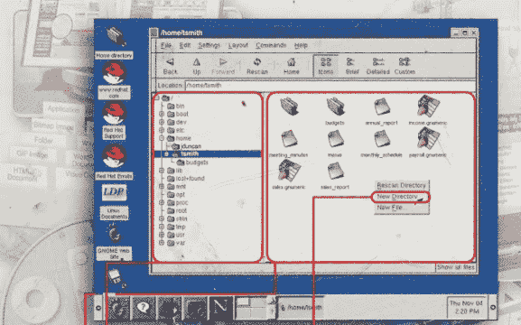


https://archive.org/details/teachyourselff0000unse

红帽 Linux
视觉化系列


IDG 3-D 视觉系列

由
IDG BOOKS maranGraphics™ 出
IDG Books Worldwide, Inc.
国际数据集团 (International Data Group) 公司


为了说明书中的概念和技术，作者创建了公司名称、邮寄地址、电子邮件地址和电话号码，所有均为虚构。与实际公司名称、邮寄地址、电子邮件地址、电话号码及其他组织的任何相似均为非故意且纯属巧合。


maranGraphics 在编写本书方面付了最大努力。
由于网站不断变化，书中描述的某些网站可能会移动或不再存在。
maranGraphics 对书中包含的信息可能导致的损失或损害不承担任何责任。
maranGraphics 亦不支持书中包含的网站所表达的观点。


关于美国 IDC 书籍的一般信息，请联系我们的国际销售部：(800)762-2974


Netscape 和 Navigator 是 Netscape Communications Corp. 的商标。
服务咨询请联系我们的技术支持部门：800-3422-319612。


关于美国外的 IDC 书籍信息，请联系我们的国际销售部：(617)9690


有关语言翻译信息，请联系我们的客户服务部门：800-3422 或发送邮件至idc.com。


许可信息或直接定价，请联系我们的销售部：800-65300。


关于在教室使用 IDC 书籍，请联系我们的教育销售部：617-79690


为了公司、个人或教育目的复印材料，请联系 IDC Books：800-5344。
书中显示的截图基于预发布软件，并可能会更改。


# 关于 IDG 书籍

欢迎来到 IDG 的世界。
IDG Books Worldwide, Inc. 是国际数据集团（International Data Group）的子公司，全球最大的计算机相关信息出版商和领先的技术信息服务供应商。IDG 由 Patrick McGover 在 30 多年前创立，在全球拥有超过 9000 人。IDG 在 75 个国家出版超过 290 种计算机出版物。每月有 90,000 人阅读我们的 IDG 出版物。1990 年成立的 IDG Books Worldwide 现在是美国最畅销计算机书籍的出版商。我们自豪地获得了计算机出版社协会颁发的八项奖项，以及《Computer Currents》首届年度读者选择的三项奖项。我们畅销的《傻瓜》(For Dummies*) 系列印刷量超过 5000 万册，并有 31 种语言翻译。IDG Worldwide 通过与 IDG北京合资，成为首位第二次出版畅销书的出版商。IDG Books Worldwide 成为全球想要学习管理业务读者的首选。我们的使命简单：我们的每一本书都旨在为读者带来额外价值和熟练的指导。我们的书籍由理解并关心读者的专家编写。我们编辑团队的知识储备源于出版、教育和新闻领域的多年经验——我们利用这些经验生产引领进入新千禧的书籍。我们密切关注内部设计、图标使用和插图等细节。由于我们采用了高效的编写、编辑和出版流程，我们可以花费更多时间确保优质内容，而减少在书籍制作技术上的花费。您可以信任我们的承诺，即以竞争性的价格提供您感兴趣的主题的高质量书籍。在 IDG Books Worldwide，我们继续了 30 多年传递品质的传统。对于某个主题，您找不到比 IDG Books Worldwide 更好的书籍。


John Kilcullen
董事长兼首席执行官
IDG Books Worldwide, Inc.

Steven Berkowitz
总裁兼出版商
IDG Books Worldwide, Inc.


maranGraphics 是一家位于加拿大多伦多附近的家族经营企业。


在 **maranGraphics**，我们相信制作出出色的计算机书籍——一次一本。

我们投入了数小时来决定执行每项任务的最优方式，这样您就不必费心了！我们清晰、易于遵循的截图和说明将引导您从头到尾完成每一项任务。

感谢您购买我们认为物超所值的、最好的计算机书籍。我们希望您在使用这本书时的乐趣，像我们创作它一样愉快！

每一本 maranGraphics 的书籍都使用了我们在过去 25 年中开发的获奖交流流程。我们组织截图、文本和插图的方式，让您能够轻松学习新概念和任务。

我们详细的插图与文字相辅相成，帮助强化信息。每一幅插图都是心血结晶——有些需要花费一周的时间来绘制！

诚挚地，

**Maran 家族**

请访问我们的网站：
**www.maran.com**

## 制作人员

作者：
Ruth Maran

插图师：
Russ Marini
Peter Grecco
Steven Schaerer

技术顾问：
Eric Kramer
Paul Whitehead

屏幕艺术家：
Jimmy Tam

文字编辑员：
Cathy Benn
Jill Maran
Frances Lea

索引员：
Raquel Scott

项目经理：
Judy Maran

权限协调员：
Jenn Reid

编辑：
Raquel Scott
Janice Boyer
Stacey Morrison

后期制作：
Robert Maran

高级副总裁，
技术出版部
IDG Books 全球发行：
Richard Swadley

屏幕截图与编辑：
James Menzies

编辑支持
IDG Books 全球发行：
Barry Pruett
Martine Edwards

布局设计与插图：
Treena Lees
Sean Johannesen
Jamie Bell

## 致谢


感谢 maranGraphics 尽职的员工，包括
Cathy Benn, Janice Boyer, Peter Grecco, Sean Johannesen,
Eric Kramer, Wanda Lawrie, Frances Lea, Treena Lees,
Jill Maran, Judy Maran, Robert Maran, Sherry Maran,
Russ Marini, James Menzies, Stacey Morrison, Jenn Reid,
Steven Schaerer, Raquel Scott, Jimmy Tam, Roxanne Van Damme,
Paul Whitehead and Kelleigh Wing.

最后，感谢 Richard Maran，他创立了本指南易用的图形格式。感谢您的灵感和指导。


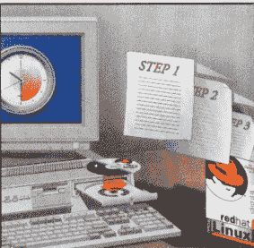


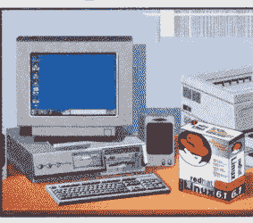

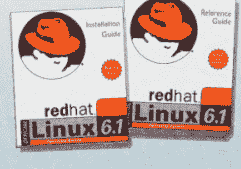


- 创建 ................................................70

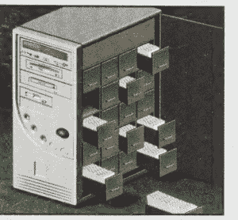


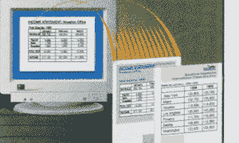


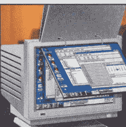


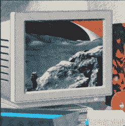


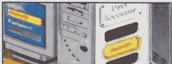
- 以其他用户登录 .........................172


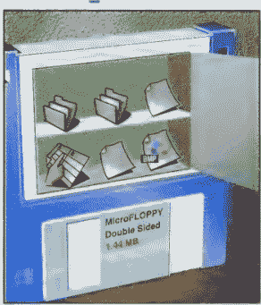

- 显示 Linux 软盘内容 ...................176
- 挂载 MS-DOS 软盘 ................................182
- 将文件拷贝到软盘 ...................................186
- 显示光盘内容 ........................................190


### 目录


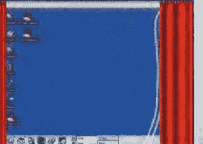


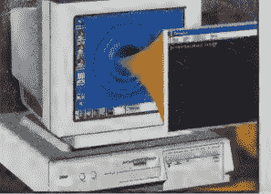


- 删除书签 ............................266
- 搜索网络 ......................................267


- 发送消息 ................................276
- 转发消息 ............................282
- 删除消息 ................................283


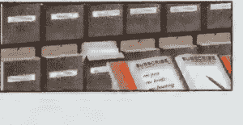

- 阅读消息 ................................292
- 发送消息 ................................293


在本章中，你将学习如何在你的计算机上安装 Linux 操作系统。


在你的计算机上安装 Linux 之前，你需要使用 FDISK 删除计算机上所有现有分区。

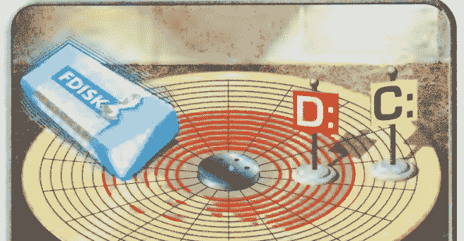

分区是硬盘的一部分，充当独立的驱动器使用。大多数硬盘只有一个分区分区。


- Microsoft Windows 98 启动菜单：
  1. 以带有 CD-ROM 支持的方式启动计算机。
  2. 查看帮助文件。

输入选择 [ ] 剩余时间：12

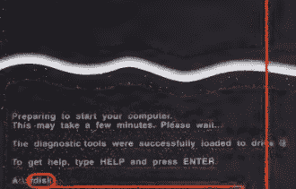

正在启动你的计算机...
这可能需要几分钟。请稍候...
诊断工具已成功加载到驱动器：
如需帮助，输入 HELP 并按回车。

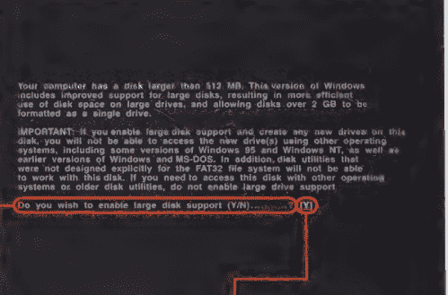

> 你的计算机有一个大于 32 GB 的磁盘。此版本的 Windows 不支持大磁盘，导致大硬盘上的空间丢失，并减慢超过 2 GB 磁盘的运行。

重要：要启用大磁盘支持并创建任何新驱动器（包括某些版本的 Windows 95 和 Windows NT），请进入分区阶段并使用 FDISK。未为 FAT32 系统设计的磁盘工具将无法正常工作。其他磁盘工具无法启用大支持。

你是否要启用大支持 (Y/N) [ ] Y


1. 将 Windows 98 启动软盘插入软驱器。
2. 开启你的计算机。
3. 显示 Microsoft Windows 98 启动菜单。按 3 在不访问 CD-ROM 驱动器的情况下启动计算机并按回车。
4. 输入 fdisk 然后按回车键。
5. 显示一条消息询问你要启用大磁盘支持，这允许你处理大于 2 GB 的分区。
6. 要启用大支持，按 Y（代表是）然后按回车键。


- 你应该备份计算机上的信息。删除分区将永久删除计算机上的所有信息。
- 获取 Windows 98 启动软盘。如果你没有 Windows 98 启动软盘，可以使用任何运行 Windows 98 的计算机创建启动盘。
- 确保你的计算机在开机时从软驱启动。如果你的计算机没有从软驱启动，请咨询你的计算机手册以确定如何更改 BIOS 设置。

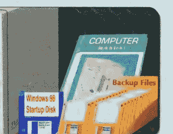
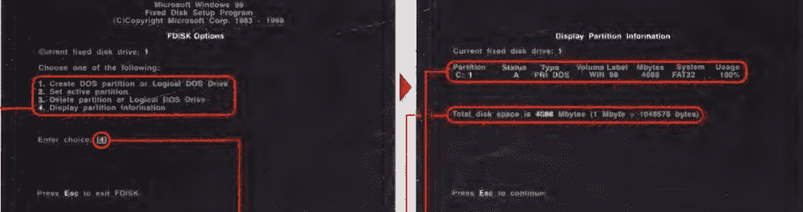


按 4 显示硬盘上分区信息并按回车键。

此区域显示硬盘上的每个分区。
此区域显示硬盘上的总空间。

按 Esc 键返回 FDISK 选项列表。


在安装 Linux 之前，你必须删除计算机上的所有分区。删除分区将永久删除计算机上的所有信息。

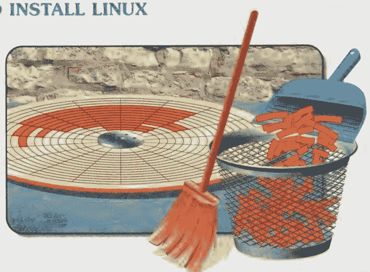


FDISK 选项
固定磁盘驱动器: 1
选择以下其中之一：
1. 创建 DOS 分区或逻辑 DOS 驱动器
2. 设置大小
3. 删除分区或逻辑 DOS 驱动器

输入选择：[1]

按 Esc 退出 FDISK

删除 DOS 分区或逻辑 DOS 驱动器
固定磁盘驱动器: 1
选择以下其中之一：
1. 删除主 DOS 分区
2. 删除大小
3. 删除扩展分区中的逻辑 DOS 驱动器
4. 删除非 DOS 分区

输入选择：[1]

按 Esc 返回 FDISK 选项


此区域显示你可以选择的 FDISK 选项列表。

按 3 删除分区并按回车键。

此区域显示你可以删除的分区类型。

按 1 删除主分区并按回车键。

出现一条消息提示你将丢失分区数据。


我有多个分区。
如何删除所有分区？


每个硬盘都有一个主分区，通常被称为 C 盘。你可以通过以下步骤删除主分区。

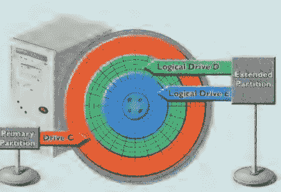

硬盘也可以有一个扩展分区。扩展分区包含一个或多个逻辑驱动器，通常被称为 D 盘、E 盘等。在删除扩展分区之前，必须删除所有逻辑驱动器。要删除逻辑驱动器，在步骤 2 中按 3。要删除扩展分区，在步骤 2 中按 2。

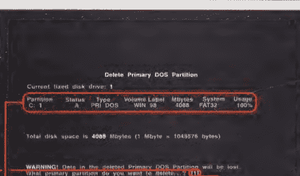


固定磁盘驱动器: 1

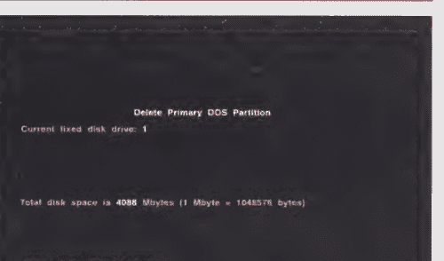


固定磁盘驱动器: 1

| 分区 | 状态 | 类型 | 卷标 | 系统 | 使用率 |
|---|---|---|---|---|---|
| C. | A | PRI DOS | 4068 | WIN35 | FAT32 | 100% |

总磁盘空间为 4068 Megabytes (1 MB = 1048576 bytes)

> 警告：如果删除主 DOS 分区，将会丢失。如果删除分区，将丢失该分区上的所有数据。确定吗？
按 Esc 返回 FDISK 选项

分区已删除。

总磁盘空间为 4068 Megabytes (1 MB = 1048576 bytes)


如果你想让你的电脑同时运行 Linux 和 Windows，你必须创建一个用于存储 Windows 的分区。

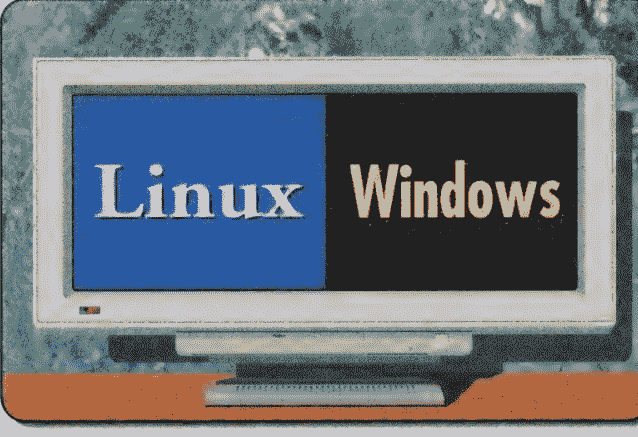


可以运行两个操作系统（如 Linux 和 Windows）的电脑被称为双启动设置。

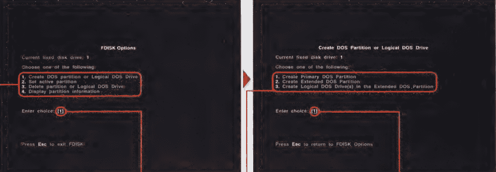

- FDISK 选项
当前硬盘驱动器：F
请选择以下之一：
1. 创建主分区或逻辑 DOS 驱动器
2. 设置活动分区
3. 删除现有的逻辑 DOS 区
4. 显示分区信息

- 创建 DOS 分区或逻辑 DOS 驱动器
当前空闲硬盘驱动器：1
请选择以下之一：
1. 创建 DOS 分区
2. 创建扩展 DOS 分区
3. 在扩展 DOS 分区中创建逻辑 DOS 驱动器

输入选择 [?]
按 Esc 退出 FDISK：

输入选择 [?]
按 Esc 返回 FDISK 选项

- 此区域显示了你可以选择的 FDISK 选项列表。

- 按 1 创建分区，然后按 Enter 键。

- 此区域显示你可以创建的分区类型。

- 按 2 创建主分区，然后按 Enter 键。

- FDISK 会检查驱动器的完整性。
# 存储 Windows 的分区应该使用多大的容量？

在确定存储 Windows 分区的尺寸之前，请考虑以下因素：

- 你的电脑上的硬盘总空间。
- 安装 Windows 98 和 Linux 所需的硬盘空间。Windows 98 需要约 260 MB 的硬盘空间。Linux 需要约 600 MB 的硬盘空间。
- 与 Linux 相比，你使用 Windows 98 的频率。如果你使用 Windows 98 的频率高于 Linux，请为 Windows 分区分配更多的硬盘空间。

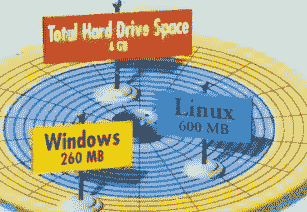


当前固定磁盘：

如果你希望为主主 DOS 分区使用最大可用空间并将该分区设置为活动 (Y/N)，请按 Y。


当前固定磁盘驱动器：1

总磁盘空间为 4096 Minutes = 4194304 字节
分区可用的最大空间为 4096 Minutes (100%)

输入你想要作为主 DOS 分区的分区 Minutes 数或磁盘空间百分比。

按 Esc 返回 FDISK 选项。

- FDISK 询问你是否想使用整个驱动器作为分区。
- 按 N（代表否）然后按 Enter 键。
- FDISK 再次检查驱动器的完整性。
- 此区域以兆字节 (MB) 显示驱动器的总空间。
- 以兆字节 (MB) 或驱动器空间的百分比输入分区的大小。然后按 Enter 键。
- 按 Esc 键返回 FDISK 选项列表。

注意：关于应使用的分区尺寸的信息，请参见页首。


在创建了存储 Windows 的分区后，你必须将该分区设置为活动分区。这使你的电脑具备启动 Windows 的能力。

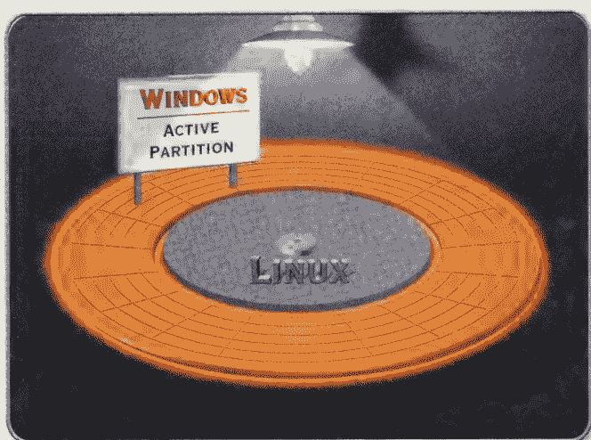


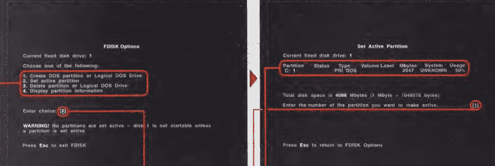

| 分区 | 状态 | 卷标签 | MB | 系统 | 使用率 |
| :--- | :--- | :--- | :--- | :--- | :--- |
| C: 1 | 激活 | DOS | 2047 | 未知 | 50% |

当前固定磁盘驱动器：1

请选择以下之一：

- 1. 创建 DOS 分区或逻辑 DOS 驱动器
2. 设置为活动
3. 删除分区或逻辑 DOS 驱动器
4. 显示分区信息

输入选择：2

> 警告：分区已设置为活动 - 除非分区处于活动状态，否则磁盘无法启动

按 Esc 退出 FDISK

总磁盘空间为 4096 字节（1 兆字节 - 10498 字节）

输入你想要激活的分区编号：

按 Esc 返回 FDISK 选项


此区域显示了你可以选择的 FDISK 选项列表。

按 2 设置活动分区，然后按 Enter 键。

此区域显示有关每个分区的信息。

按 1 将存储 Windows 的分区设置为活动分区，然后按 Enter 键。

该分区已设置为活动分区。

按 3 键返回 FDISK 选项列表。

# 在安装 Linux 和 Windows 之前，我还需要做其他事情吗？

如果你让你的电脑同时运行 Linux 和 Windows，你必须格式化分区。在你格式化了存储 Windows 的分区之后。

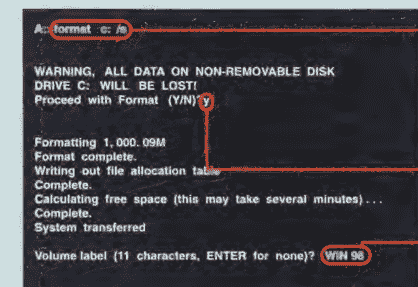

如果你让你的电脑同时运行 Linux 和 Windows，你必须格式化分区。在你格式化了存储 Windows 的分区之后。

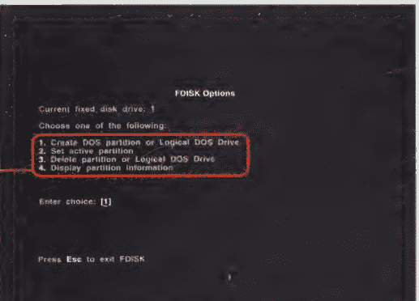

- 1. 格式化存储 Windows 的分区。
- 2. 格式化存储 Windows 的分区。
- 3. 格式化存储 Windows 的分区。
- 4. 格式化存储 Windows 的分区。

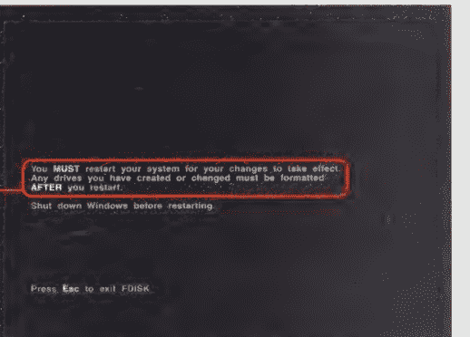

此区域显示了你可以选择的 FDISK 选项列表。

按 2 设置活动分区，然后按 Enter 键。

此区域显示有关每个分区的信息。

按 1 将存储 Windows 的分区设置为活动分区，然后按 Enter 键。

该分区已设置为活动分区。

按 3 键返回 FDISK 选项列表。


Linux 的逐步安装。

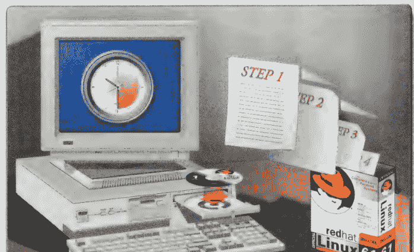


Linux 安装大约需要一小时。

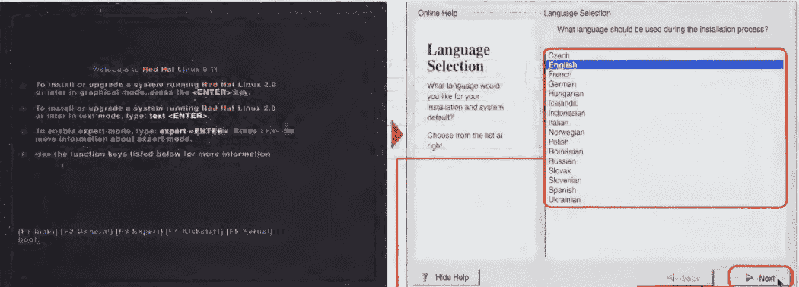

- 1. 格式化存储 Windows 的分区。
- 2. 启动你的电脑。
- 3. 插入随 Linux 附带的光盘。
- 4. 点击图形模式。
- 5. 选择你使用的语言。
- 6. 点击“下一步”继续。


# 哪里可以获取 Linux 的帮助信息？

官方 Hat 盒附有安装指南和参考指南。如果你丢失了指南，可以在以下网页上查看指南：

www.redhat.com/support/manuals

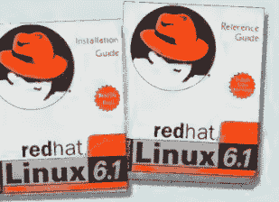


键盘配置
你使用的是哪种键盘？
选择最符合你键盘的型号。如果无法找到，请选择与你键盘匹配的通用键盘选项。


Linux 要求你指定所使用的鼠标类型。Linux 支持多种类型的鼠标。

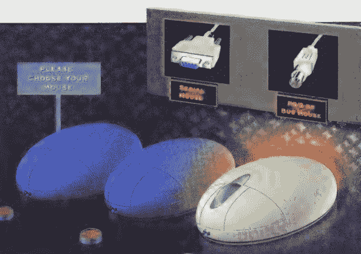

如果鼠标上的连接器是矩形的，那么你有一只串口鼠标。如果鼠标上的连接器是圆形的，你有一个 PS/2 或总线鼠标。


| 在线帮助 | 鼠标配置 |
|---|---|
| 鼠标配置 | ALPS GuidePoint (PS2) |
| | ASCII |
| 你使用的是哪种鼠标？ | | ATI 总线鼠标 |
| | 2 键鼠标 (PS2) |
| | 2 键鼠标 (串口) |
| | 3 键鼠标 (串口) |
| 尝试为右侧第一个框找到完全匹配的项。如果你找不到与你的 Generic 兼容的项， | | Generic |
| | | Kensington Thinking Mouse (PS2) |
| | Logitech |
| | Microsoft |
| 你是否有 PS/2、总线或串口鼠标？如果鼠标上的连接器是圆形的，你有一个 PS/2 或总线鼠标，如果： | | 设备 |
| | tty1/devtty1 (DOS 下 COM1) |
| | tty2/devtty2 (DOS 下 COM2) |
| | tty3/devtty3 (DOS 下 COM3) |
| | tty4/devtty4 (DOS 下 COM4) |
| | 模拟 3 键 |

- 10 点击你使用的鼠标类型。

要查看特定鼠标品牌的鼠标类型，点击品牌旁边的加号 (+)，加号会变为 (-)。

- 11 如果你选择了串口鼠标，点击你的鼠标所使用的计算机端口。

注意：如果列表中没有你的鼠标，请点击与你的鼠标匹配的 Generic 鼠标选项。

- 12 点击“下一步”继续。

注意：端口将你的鼠标连接到计算机。在许多情况下，你会选择 tty0 端口。

# 我还有其他方法可以安装 Linux 吗？

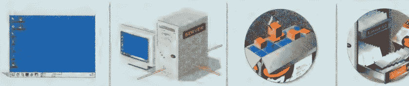

# KDE 工作站

安装 KDE 桌面环境。KDE 是本书书中显示的 GNOME 桌面环境的替代方案。

## 服务器

将你的计算机配置为网络上的服务器。服务器是网络的控制中心。


在安装 Linux 时为你提供完全的灵活性。例如，你可以精确选择你想要安装的软件。

## 升级

允许你安装最新版本的 Linux，而不会删除计算机上现有的 Linux 数据。

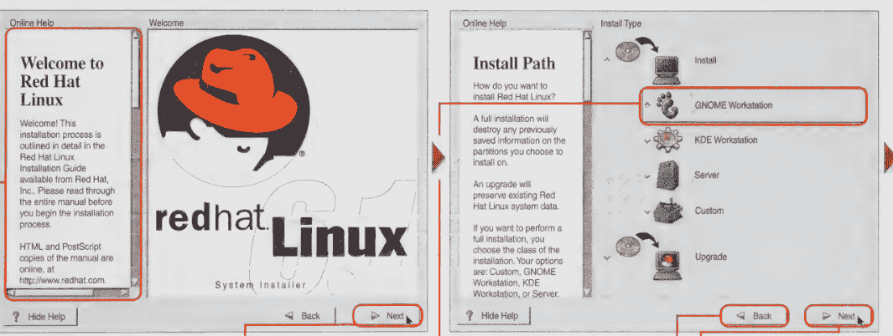


欢迎！此安装过程在 Red Hat 提供的 Red Hat Linux 指南中有所概述。在开始安装过程之前，请阅读整个手册。

手册的 HTML 和 PostScript 版本可以在在线获取，地址为 http://www.redhat.com。

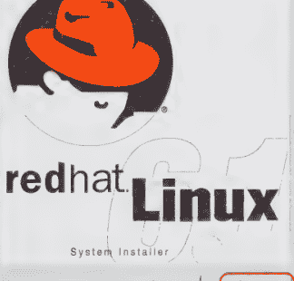


你想如何安装 Red Hat Linux？全量安装将破坏你选择安装的分区上之前保存的所有信息。

升级将保留 Red Hat Linux 系统数据。如果你想执行全量安装，请选择安装类型。你的选项有：自定义、GNOME 工作站或服务器。

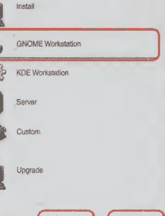

出现“欢迎使用 Red Hat Linux”消息。

点击“下一步”继续。

你可以随时点击“上退”返回上一个步骤并更改你的答案。

Linux 询问你想执行何种安装。

点击“GNOME 工作站”为 Linux 安装一个易用的图形化桌面环境 ( )。


安装 Linux 将擦除计算机上任何现有的 Linux 信息。在安装之前，请确保你的计算机不包含你想保留的信息。

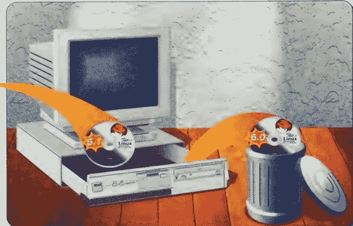

| 在线帮助 | 自动分区 |
|---|---|
| 删除数据 | 手动分区 |
| 自动分区 | 我们正准备擦除系统上任何预先的 Linux 安装。 |
| 你确定吗？ | 通过对工作站进行分区将丢失数据。 |
| 此安装将删除所有分区上的任何数据。 | |
| 如果你想防止现有 Linux 分区上的数据丢失，你应该选择手动分区或选择自定义安装。 | |

| 在线帮助 | 自动分区 |
| 我们正准备擦除系统上任何预先的 Linux 安装。如果你不想这样做，可以通过手动分区继续此安装，或者返回并执行完全自定义的安装。 | | |
| 自动分区 | 你确定吗？通过对工作站进行分区将丢失数据。 | |
| 此类安装将删除现有 Linux 分区上的任何数据。 | |
| 如果你想防止现有 Linux 分区上的数据丢失，你应该选择手动分区或选择自定义安装。 | |
| 由于你这台机器内存不足，我们需要立即设置交换空间。你想在磁盘上释放空间吗？可以吗？ | OK | 取消 |
| Linux 表示你正擦除计算机上现有的 Linux 数据。点击“删除”以擦除任何现有 Linux 数据（变为）。点击“下一步”继续。可能会出现消息，说明你的计算机内存不足。注意：如果没有出现此消息，请跳到第 19 步。点击 OK 允许你的计算机使用磁盘空间作为内存。 |

# 设置网络需要哪些信息？

如果你的网络没有 DHCP 服务器，你需要来自管理员的以下信息。DHCP 服务器会自动为网络上的每台计算机分配 IP 地址。

| IP 地址 | 识别网络上的计算机。 |
|---|---|
| 子网掩码 | 决定计算机如何接入网络。 |
| 网络 | 基础的基础 IP 地址。 |
| 广播 | 用于与网络上所有计算机通信的地址。 |
| 主机名 | 计算机的名称。 |
| 网关 | 将你的网络连接到互联网的设备。 |
| DNS | 你输入的地址。唯一地标识存储网页的计算机。 |

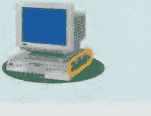
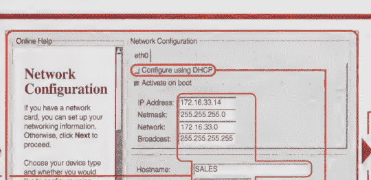

## 网络配置

如果你有网络，可以选择网络配置。否则，点击“下一步”。如果你有 DHCP 服务器，每个设备将显示给你的信息。然后你可以更改选择并再次点击。

| IP 地址: 172.16.33.4 |
| 子网掩码: 255.255.255.0 |
| 网络: 172.16.33.0 |
| 主机名: R5 |
| 网关: 172.16.33.1 |
| 首选 DNS: 172.16.33.2 |
| 备用 DNS: 172.16.33.3 |
| DNS: 172.16.33.5 |

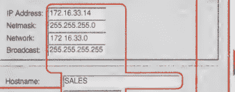

## 时区选择

你可以通过选择物理位置或通过协调世界时间（称为 UTC）的时间偏移来选择时区。注意顶部的标签。第一个标签允许你通过位置配置。你可以在这里选择时区。你的选项有：北美、南方。


如果你的计算机有网卡，就会出现此屏幕。如果没有出现此屏幕，请点击第 21 步。如果你的网络有 DHCP 服务器，点击此选项。

- 20 点击“下一步”继续。
- 21 点击你的位置指定时区。
- 22 点击“下一步”继续。
- 地图指定的位置会出现红色 X。
- 19 如果你的网络没有 DHCP 服务器，点击每个区域并输入相应信息。更多信息请参见此页顶部。

# 安装 LINUX

Linux 会创建一个名为 root 账户的管理员帐户。你可以输入你想用于 root 账户的密码。

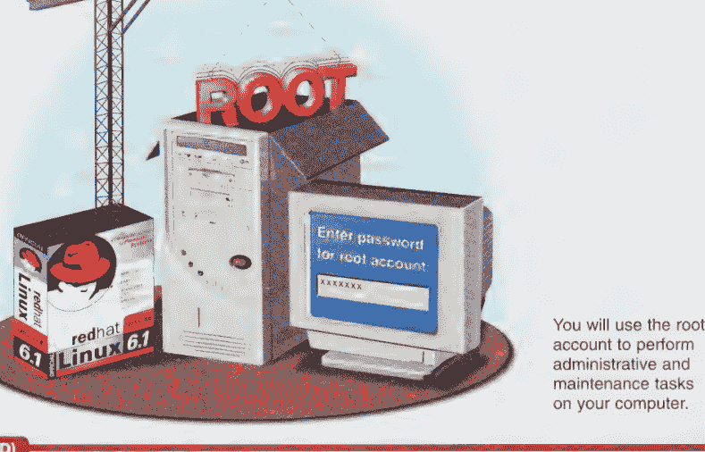

你将使用 root 帐户在计算机上执行管理和维护任务。

# 安装 LINUX（继续）

| 在线帮助 | 账户配置 |
|---|---|
| 账户配置 | root 密码 |
|---|---|
| 确认: | |
| 账户名: | 名称 |
| 密码: | 密码（确认） |
| 全名: | 全名: |
| 账户名 | 全名 |

输入 root 密码。密码长度至少为 6 个字符。确认。一旦填写字段，“下一步”按钮将启用。
创建一个用户帐户。输入用户名，然后为该帐户创建密码并确认。最后，在满足两个字段后，“下一步”按钮将启用。

| 账户配置 | root 密码 |
|---|---|
| 确认: | |
| 账户名: | 名称 |
| 密码: | 密码（确认） |
| 全名: | 全名: |
| 账户名 | 全名 |

输入 root 密码。密码长度至少为 6 个字符。确认。一旦填写字段，“下一步”按钮将启用。
创建一个用户帐户。输入用户名，然后为该帐户创建密码并确认。最后，在满足两个字段后，“下一步”按钮将启用。

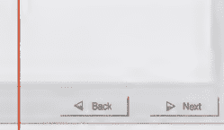

点击此区域并输入 root 账户密码。密码长度至少为 6 个字符。

注意：每输入一个字符都会出现一个符号 (*)，以防止他人看到密码。

- 24 点击此区域并再次输入密码以确认密码。
- 25 要创建用户帐户，点击此区域并为帐户输入名称。
- 26 点击此区域为帐户输入密码。
- 27 点击此区域并再次输入密码以确认密码。
- 28 点击此区域并输入使用帐户的用户的全名。


# 为什么我应该创建一个用户账户？

您应该创建一个用户账户来执行日常任务。root 账户仅用于管理和维护任务，因为在使用 root 账户时可能会损坏您的计算机。

如果您计划与家庭成员或同事共享您的计算机，可以为每个人创建一个用户账户，这样他们就拥有了自身的个性化设置。


在线帮助

账户配置

## 账户配置

输入 root 密码。密码长度至少为六个字符。密码将被隐藏。

确认两个输入字段的内容匹配。

输入用户帐户名称。然后为该用户创建一个用于登录的密码。最后，输入账户的全名。

| 账户名称 | | |
|---|---|---|
| 密码 | | 密码（确认） |
| 全名 | | |
| 账户名称 | Smith Tom Smith | |

在线帮助

X 配置

在大多数情况下，您的视频硬件将进行探测探测，以自动为您的显示器确定最佳设置。

自动检测

# X

安装程序将尝试探测您的显卡以确定您的设置。如果失败，可能是硬件出现了故障。

| 显卡：3D Real Pro AGP 1X/2X |
| 显卡名称: R4396 |
| 显卡型号: R4396-147 |
| 供应商: Turing CM143-JUH |
| 显卡名称: Turing CM143-JUH |
| 驱动程序: ViewScan-1 |

硬件检测完成后，您将看到一个视频显示器列表供您选择。

硬件设置完成后，您可以在需要时更改配置设置。

- 自定义配置
- 使用逻辑布局
- 滑过配置

点击添加。

- 此区域显示用户账户信息。
- 要创建更多账户，请为每个用户重复步骤 25 到 29。
- 点击“下一步”继续。
- 如果 Linux 未检测到您的显示器，此区域将显示显示器列表。
- 点击您使用的显示器。注意：在列表中，点击与您的显示器匹配的通用显示器选项。

# 安装 LINUX

您可以选择在每次登录计算机时都显示图形登录界面。

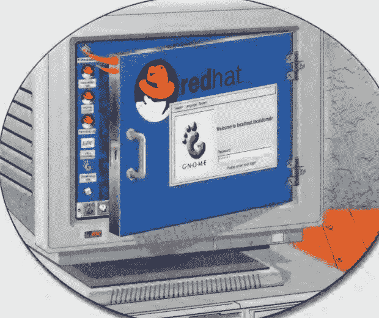

如果您不选择显示图形登录界面，则将显示一个文本登录界面。

# 安装 LINUX（续）

X 配置

安装程序将探测您的硬件以确定硬件并设置配置设置。如果成功，程序将列出显卡和显示器列表供您选择。硬件设置完成后，您可以测试配置设置。当您喜欢时，

- 隐藏帮助
- 使用图形登录在每次登录计算机时显示图形登录界面
- 点击“下一步”继续。
- 点击“下一步”开始安装 Linux。
- Linux 将把文件从 CD-ROM 光盘传输到

# 安装 Linux 后我能做什么？


# 注册 Linux

如果您购买了官方版 Red Hat Linux 盒装，您可以在 www.redhat.com/now 注册您的产品。注册 Linux 将为您提供额外的支持。

# 更新 Linux

您可以在 support.redhat.com/errata 获取解决 Linux 问题的更新。

# 安装软件包

您可以在计算机上安装软件包，这将为 Linux 添加新功能。软件包可以包含程序和文件。要安装软件包，请参阅第 21 页。

# 安装软件包

软件包：X1alloc-3.5
大小：897 KB
摘要：X11 基础库、头文件。正在等待安装完成。

| 状态 | 软件包 | 时间 |
|---|---|---|
| 完成 | 596 | 561 MB |
| 完成 | 41 | 63 MB |
| 剩余 | 305 | 997 MB |

Linux 正在安装。

- 此区域显示用户账户信息。

## Linux 基础

本章将教您使用 Linux 所需的**技能。

- 介绍 Linux 24
- 使用鼠标 27
- 屏幕部分 28
- 开始 Linux 30
- 移动窗口 31
- 大化窗口 32
- 最小化窗口 33
- 调整窗口 34
- 切换窗口 35
- 滚动窗口 36
- 关闭窗口 37
- 重启计算机 38
- 退出 39
- 获取帮助 40
- 退出 42


## 简介 Linux

Red Hat Linux 是一种控制计算机整体活动的操作系统，并确保您的计算机各个部分运行顺畅高效。


## Linux 的历史

来自芬兰的名为 Linus Torvalds 的学生 1991 年创建了 Linux。在世界范围内数百志愿者程序员的帮助下，Linux 从一个简单的爱好项目成长为功能完备的操作系统。今天，全球的人在使用 Linux。

## 获取 Linux

您可以从 www.redhat.com 网站免费下载 Red Hat Linux。如果您不想通过互联网传输 Linux，可以在网站购买 Red Hat Linux 盒装并由 Red Hat 邮寄给您。您也可以在电脑商店购买 Red Hat Linux。


## Linux 基础

## GNOME

Linux 带有 GNOME 桌面环境，为执行 Linux 任务提供了易用的图形显示。书中贯使用了 GNOME 桌面环境。

## 处理文件

Linux 提供了管理计算机上存储的文件的方法。您可以打开、排序、重命名、移动、打印、查找、删除文件。

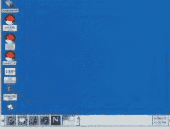

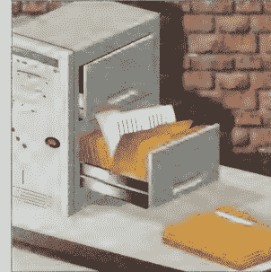

## 使用 Linux 应用

Linux 包含绘图程序、电子表格程序、日历程序和一个简单的文本编辑器。您还会找到一个屏幕计算器、通讯录和许多可以玩的游戏。

## 定制 Linux

您可以通过多种方式自定义 Linux。您可以为桌面添加色彩斑纷的设计、设置屏幕保护程序、更改鼠标的工作方式，并在 Linux 发生某些事件时播放声音（例如出现错误消息时）。


# LINUX 简介

## 账户操作

当你安装 Linux 时，系统会创建一个 root 账户和一个或多个用户账户。你应该只使用 root 账户来执行管理和维护任务，因为使用 root 账户可能会损坏你的计算机。在执行日常任务时，你应该在用户账户下操作。

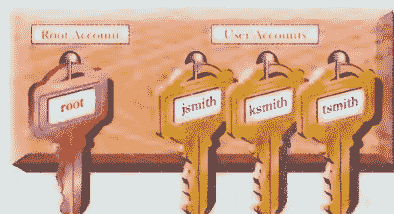

## 软磁盘和 CD-ROM 驱动器

你可以查看软磁盘和 CD-ROM 光的内容。你还可以将文件复制到软磁盘、格式化软磁盘以准备使用，以及在计算机上播放音乐光盘。

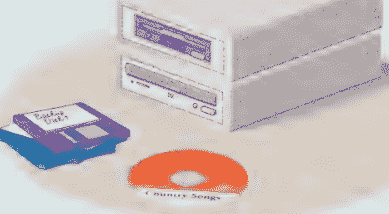

## 设置硬件和软件

Linux 帮助你设置硬件，例如打印机、声卡和网卡。Linux 还帮助你安装包含程序和文件的软件包，这些包为 Linux 增加了新功能。

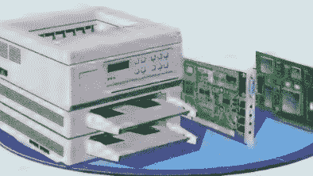

## 连接网络

Linux 附带 Netscape Communicator，它允许你浏览网页、与世界各地的人交换电子邮件，并加入新闻组以与有共同兴趣的人交流。


## 使用鼠标

鼠标是一种手持设备，允许你选择和移动屏幕上的项目。

当你在桌面上移动鼠标时，屏幕上的鼠标指针会向相同的方向移动。鼠标指针会根据它在屏幕上的位置以及你正在执行的任务呈现不同的形状，例如 ✎ 或 ⚡。


## 鼠标动作

### 三键鼠标

如果你有一个三个按钮的鼠标，可以使用鼠标中间键执行某些任务。如果你有一个两个按钮的鼠标，可以通过同时按下左键和右键来模拟第三个按钮。

- 点击
  按下并释放左鼠标键。

- 双击
  快速按下并释放左鼠标键两次。

- 右键
  按下并释放右鼠标键。

- 拖动
  将鼠标指针置于屏幕上的对象上，然后按住左鼠标键并移动鼠标到你想放置对象的地方。然后释放按钮。


## 启动 LINUX

当你打开计算机时，可以启动 Linux 来执行任务。


当你安装 Linux 时，系统会创建一个 root 账户和一个或多个用户账户。你应该只使用 root 账户来执行管理任务。在执行日常任务时，你应该使用用户账户。若要在安装 Linux 后创建用户账户，请参阅第 164 页。

## 启动 LINUX


- 开启计算机。
- 出现一个对话框，询问你的用户名。
- 注意：如果对话框没有出现，请参阅第 29 页顶部。
- 输入你的用户名然后按 Enter 键。
- 输入你的密码然后按 Enter 键。
- 注意：你输入的每个字符都会显示一个符号 (*)，以防止他人看到密码。

## LINUX 基础

### 为什么我启动 Linux 时会出现这个屏幕？

如果你在计算机上安装 Linux 时没有选择使用图形界面，就会出现此屏幕。要启动 GNOME 桌面环境，请执行以下步骤。

Red Hat Linux release 6 (2)
Kernel 2.6.9-x886

注意在使用 Xconfig 程序更改显示设置时，你可以选择使用图形登录。要使用 X 更改显示设置，请参阅第 42 页。

```
localhost:tsmith
Password:
Last login: Thu Nov 4 14:45 on localhost
tsmith@localhost
```

- 输入你的用户名并按 Enter 键。
- 输入你的密码然后按 Enter 键。
- 注意：密码不会显示在屏幕上，以防止他人看到。
- 输入 startx 然后按 Enter 键。


## Red Hat Online

你正在以 root 身份运行 GNOME 文件管理器。作为 root，你可以损坏系统，且文件管理器不会阻止你。你的操作可能会影响系统上的每个非特权账户。

出现帮助窗口，提供了有关如何使用 Linux 的帮助。
注意：有关帮助功能的信息，请参阅第 42 页。

如果你以 root 身份登录计算机，会弹出一个警告信息，提示你可以使用 root 账户损坏计算机。出现一个窗口，显示你计算机的内容。

- 点击关闭窗口。
- 你可以启动 Linux 执行任务。
- 点击 OK 关闭警告信息。
- 点击关闭窗口。

## 屏幕区域

### 主目录
允许显示存储你个人文件的目录内容。

### 帮助网页
允许你快速显示网络上提供的使用 Linux 帮助的页面。

### 软磁盘图标
允许你显示软磁盘的内容。


### GNOME 面板

### 桌面
屏幕的背景区域。

### 时钟
显示当前日期和时间。

### 隐藏按钮
隐藏 GNOME 面板。

### 主菜单按钮
提供程序的快速访问。

### 启动器
- 帮助提供 Linux 帮助。
- GNOME 控制中心允许更改设置，如桌面颜色。
- 终端允许你输入 Linux 命令的窗口。
- Netscape Communicator 允许你浏览网页、交换电子邮件并加入新闻组。

## GNOME 切换器
- 桌面视图允许切换不同的桌面。
- 任务列表按钮显示所有打开窗口的列表。
- 视图在当前桌面上显示每个打开窗口的按钮。


## LINUX 基础

### 启动程序

你可以使用菜单按钮启动程序。


### 启动程序

| 系统 | 应用程序 |
| :--- | :--- |
| 应用程序 | 地址簿 |
| 游戏 | 编辑 |
| 图形 | emacs 编辑 |
| 互联网 | gEdit |
| 多媒体 | GHex |
| 系统 | GnomePGP |
| 设置 | gnotepad+ |
| Gnumeric 电子表格 | 时间跟踪工具 |


1. 点击显示主菜单。
2. 将鼠标置于显示箭头 (→) 的菜单项上。出现第二个菜单。
3. 点击你想启动的程序。

注意：要在不选择程序的情况下关闭菜单，请点击菜单区域外。
- 在示例中，出现了日历。
- GNOME 切换器显示打开程序的按钮。

## 移动窗口

如果窗口遮挡了屏幕上的项目，你可以将窗口移动到不同的位置。


1. 将鼠标置于你想移动的窗口的标题栏上，光标变为（箭头）。
2. 拖动鼠标到你想放置窗口的地方。
3. 窗口移动到新位置。


## 最小化窗口

LINUX 基础

如果你不使用某个窗口，可以最小化该窗口将其暂时从屏幕上移除。你可以随时重新显示该窗口。


## 最小化窗口


- 1 点击你想要最小化的窗口。
- 窗口将缩小为 GNOME Pager（分页器）上的一个按钮。
- 要重新显示该窗口，请点击 GNOME Pager 上的对应按钮。

## 滚动窗口

你可以使用滚动条来浏览窗口中的信息。当窗口足够不足以显示其包含的所有信息时，这非常有用。


## 滚动窗口


## 向下滚动

- 1 点击 /即可向下滚动窗口中的信息。

## 向上滚动

- 1 点击即可向上滚动窗口中的信息。

## 滚动到任意位置

- 1 拖动滚动框沿滚动条移动，直到你想要的信息出现。例如，当滚动框位于滚动条中间处时，你正在查看窗口中间的信息。

## 在窗口之间切换

如果你打开了多个窗口，可以轻松地在窗口之间切换。


## 在窗口之间切换


- 你一次只能在一个窗口中工作。活动窗口会出现在所有其他窗口前面，并显示高亮的标题栏。
- GNOME P 在桌面上为每个打开的窗口显示一个按钮。
- 要将你想工作的窗口显示在所有其他窗口前面，请点击 GNOME Pager 上的对应按钮。窗口将出现在所有其他窗口前面，标题栏将高亮。现在你可以在该窗口中工作了。

## 遮盖窗口

你可以遮盖窗口来暂时隐藏窗口的内容。这有助于减少桌面的杂乱。


## 遮盖窗口


- 双击你想要遮盖窗口的标题栏。
- 窗口的内容被隐藏。标题栏仍留在桌面上。
- 要重新显示窗口内容，双击该窗口的标题栏。

38

## 关闭窗口

LINUX 基础

当你完成对某个窗口的工作时，可以关闭窗口将其从屏幕上移除。


## 关闭窗口


- 点击你想要关闭的窗口中的 X。
- 窗口从屏幕上消失。
- 窗口的按钮从 GNOME Pager 上消失。
注意：如果程序出现问题导致窗口无法关闭，请在步骤 1 中右键点击强制关闭窗口。

39

## 重启电脑

如果你在使用 Linux 时遇到问题，可以重启电脑来解决问题。


## 重启电脑


- 1 点击显示主菜单。
- 2 点击注销。
- 3 出现一个对话框。
- 4 点击重启以重启你的电脑。
- 5 点击是。
注意：如果你以普通用户身份登录电脑，将出现一个对话框要求输入密码。点击对话框并输入密码，然后按回车键。
- Linux 重启你的电脑。

40

## 退出 Linux

LINUX 基础

当你完成对 Linux 使用后，可以退出 Linux 并关闭电脑。


当此消息出现时，你可以关闭电脑。

## 退出 Linux


- 1 点击注销。
- 2 出现一个对话框。
- 3 点击重启以重启电脑。
- 4 点击是。
注意：如果你以普通用户身份登录电脑，将出现一个对话框要求输入密码。点击对话框并输入密码，然后按回车键。
- Linux 重启你的电脑。

## 获取帮助

如果你不知道如何在 Linux 中执行某操作，可以使用帮助功能获取信息。


## 获取帮助


- 1 点击显示主菜单。
- 2 出现帮助浏览器窗口。
- 3 点击 GNOME 用户指南。

## 帮助功能提供哪些类型的帮助？

在帮助浏览器窗口中，你可以点击以下选项获取帮助：

- Red Hat Linux 入门指南：提供基础帮助。
- Red Hat Linux 安装指南：提供安装相关的帮助。
- Red Hat Linux 参考指南：提供详细帮助。


- GNOME 文档：提供程序帮助。
- Man 页面：提供基础命令帮助。
- Info 页面：提供详细命令帮助。


## Enlightenment 配置工具

有很多方法可以访问 Enlightenment 配置工具 (E-conf)。你可以通过 GNOME 控制中心、窗口管理器或从桌面访问它。

它还包含许多控制 Enlightenment 各个方面的章节。你可以在 E-conf 的左上角找到列表：主题、选项、桌面、外观、音频、特效、主题和其他。

## 基础选项

以下是 E-conf 的章节，你可以从中学习如何配置外观和行为：

- 出现了 GNOME 用户指南目录。
- 你需要向下滚动条查看目录。
- 点击感兴趣的主题。
- 显示该帮助主题的信息。
- 你可以点击返回 GNOME 用户指南目录以选择其他主题。

当你完成查看帮助时，点击关闭窗口。

## 获取帮助

当你发现包含有用信息的帮助主题时，可以将其标记为书签，以便以后返回。


## 书签帮助主题


| Gnome Browser | | | | |
|---|---|---|---|---|
| 文件 | 编辑 | 查看 | 书签 | 帮助 |
| 添加书签 | | | | |
| 窗口 | | | | |
| 退出 | | | | |
| Gnome Browser | | | | |
| 后退 | 前进 | 刷新 | 索引 | 书签 | 帮助 |


## Enlightenment 配置工具

有两种方法可以启动 Enlightenment 配置工具 (E-conf)。你可以打开 GNOME 控制中心并选择窗口管理器，或者从 Enlightenment 按钮运行配置工具。

该工具还允许你配置左右手的鼠标键。你可以通过从 Enlightenment 菜单选择切换配置来模拟这种操作。


## LINUX 基础

## 如何删除书签？

你可以按照以下步骤删除不再需要的书签。


- 1 在 Gnome 帮助书签窗口中，点击你想要删除的书签。
- 2 点击删除。
书签将从列表中消失。


## Enlightenment 配置工具

有两种方法可以启动 Enlightenment 配置工具 (ECT)。你可以从应用程序菜单打开它。如果你使用 Enlightenment 作为当前的窗口管理器，可以通过按下键盘上的 Ctrl+F2 打开它。

你也可以通过点击桌上的鼠标按钮（右键或左键）从弹出菜单中启动它。

- Gnome 帮助书签


## 使用 GNOME CD 播放器

GNOME CD 播放器将出现在主菜单、音频菜单以及命令行中。

查看列表：


- Gnome 帮助书签


## 基础选项

基础选项窗口允许你配置各种设置。


- Gnome 帮助书签
-  Gnome 帮助书签窗口，显示你的书签列表。
- 点击你想要显示的帮助主题的书签。
- 帮助主题将出现在帮助浏览器窗口中。
- 要显示另一个帮助主题，点击该帮助主题的书签。
- 完成帮助主题的查看后，点击 X 关闭 Gnome 帮助书签窗口。


## 获取帮助

如果你在 Linux 上遇到问题，有很多资源可以让你从那里获取帮助。

## 手册

官方版 Red Hat Linux 6.1 盒装附带三本手册，可以帮助你安装和使用 Linux。

如果你丢失了手册或没有拥有该盒装，可以在以下网页查看手册。
www.redhat.com/corp/support/manuals


## 安装指南

提供如何安装 Linux 的详细说明。


## 入门指南

提供如何使用 Linux 的通用信息。


## 参考指南

提供关于安装和使用 Linux 的详细信息。

## 网页

你可以使用桌面上的图标快速访问网络帮助信息。要显示网页，请双击网页图标。

www.redhat.com
提供关于发行 Red Hat Linux 的通用信息。

support.redhat.com
提供如何安装和使用 Linux。你也可以访问硬件列表来确定你的硬件是否兼容 Linux。


## Red Hat 支持

support.redhat.com/errata
提供 Linux 的更新、修复和修正。

## Linux 文档

www.redhat.com/mirrors/
提供包含 Linux 最新信息的文档集。

## GNOME 网站

www.gnome.com
提供关于 Linux 的图形桌面环境 GNOME 的支持。

## 邮件列表

你可以加入邮件列表通过电子邮件获取 Linux 帮助。邮件列表是一个使用电子邮件通信的组。


- linux-list
提供关于 Linux 通用讨论的邮件列表。要加入列表，请向 linux-list-request@sc.com 发送邮件，并在正文中注明“subscribe”。

- linux-newbie
面向新用户的邮件列表。要加入列表，请向 majordomo@vger.edu 发送邮件，并在正文中注明“subscribe linux-newbie”。

## 新闻组 (NEWSUPS)

你可以加入新闻组了解更多关于 Linux 的信息。新闻组是一个允许共同兴趣的人通信的组。你可以在 news.redhat.com 服务器找到一些 Linux 新闻组。


- redhat.config
关于硬件软件设置以及修复硬件软件问题的讨论。


- redhat.general
关于 Linux 的通用信息。

新闻组消息存储在名为新闻服务器的计算机上。你可以连接到 news.redhat.com 服务器以加入 Linux 主题新闻组。关于新闻组的更多信息，请参见第 286 至 293 页。


- redhat.hardware.arch.intel
关于硬件的讨论，包括如何设置和修复硬件问题。

## 文件操作

Linux 允许你高效地组织和管理文件。在本章中，你将学习如何查看计算机上的文件、排序文件、打印文件等。

- 文件如何存储 ................................50
- 常用目录 ......................51
- 查看计算机内容 ................................52
- 显示你的主目录...........................................54
- 显示文件属性..................................55
- 更改项目视图....................................56
- 排序项目 ................................57
- 自定义文件信息显示 ............58
- 选择文件 ...............................60
- 打开文件 ................................62
- 重命名文件 ..............................................64
- 删除文件 ...............................66
- 移动和复制文件.....................................68
- 打印文件 ................................70
- 查找文件 ................................72
- 修改文件权限...............................................74
- 在桌面上创建链接.....................................76
- 创建新目录.................................................78


## 文件如何存储

### 目录

### 目录

就像文件柜里的文件夹一样，目录组织了存储在计算机上的文件。每个目录通常存储相关的文件。

#### 路径

路径指定了文件在计算机上的位置。路径是访问文件时必须打开的目录列表，随后是文件名。目录和文件名用斜杠（/）分隔。例如，要指定 income 文件的位置，你将使用 /home/tsmith/income 路径。


#### 根目录

符号 / 代表代表计算机上的根目录。所有其他目录都位于此之下。

#### 保存和打开文件

当你保存或打开文件时，Linux 会显示此窗口。


此区域显示显示的目录和文件的位置。

此区域显示当前位置的目录。要显示另一个目录的内容，请双击该目录。

注意：你可以双击 .. 返回上一级目录。

此区域显示当前位置的文件。

## 常用目录

文件操作

你将在计算机上找到以下目录。

| 目录 | 说明 |
| :--- | :--- |
| / | 这是存储计算机上所有目录和文件的主目录。 |
| /bin | 包含运行所必需的程序。 |
| /dev | 包含 Linux 使用的硬件设备的文件，如显示器或打印机。 |
| /etc | 存储指定设置的文件，例如显示器分辨率设置。 |
| /home | 包含计算机上设置的每个用户的目录。每个目录存储一个用户的个人文件和设置。 |
| /lost-found | 存储损坏或丢失的文件。 |
| /mnt | 显示软盘或光驱驱动器的内容。 |
| /root | 存储 root 账户的个人文件和设置。root 账户是安装 Linux 计算机时设置的管理员账户。 |
| /sbin | 存储用于执行管理任务的程序。 |
| /usr | 包含人们经常访问的程序和信息，如游戏和帮助文件。 |


## 查看你的电脑内容

你可以使用 GNOME 文件管理器查看电脑上的目录和文件。


GNOME 文件管理器允许你执行移动、删除和排序文件等任务。


- 双击“主目录”以显示你电脑上的目录和文件。
- 出现一个窗口。
- 此区域显示你电脑目录的组织结构。存储你个人文件的主目录会被高亮显示。
- 要显示另一个目录的内容，点击该目录。

## GNOME 文件管理器中的图标代表什么？

每个目录和文件都显示一个图标，帮助你区分不同类型的项目。常见的项目类型包括：


- 显示有加号 (✚) 的目录包含子目录。
- 点击目录旁边的加号 (✚) 以显示其子目录。
- 子目录将会。

注意：你可以点击符号 (▼) 再次隐藏子目录，使其变为 ⊟。

- 目录旁边的加号 (✚) 变为减号 (➖)。这表示目录内的子目录已显示。
- 当你正在查看电脑上的目录和文件时，点击 X 关闭窗口。

## 显示你的主目录

你可以快速显示主目录的内容。你的主目录存储了个人文件和设置。


- 点击“主”以显示你的主目录。
- 此区域显示你主目录的内容。
- 如果你以普通用户身份登录电脑，你的主目录是以你的用户名命名的目录。
- 如果你以 root 身份登录电脑，你的主目录是根目录。

# 操作文件

### 显示文件属性

你可以显示有关文件的信息，例如文件大小和最后修改日期。


1. 右键点击你想显示属性的文件。
2. 点击“属性”。
出现属性对话框。

- 此区域显示文件的位置和名称。
- 此区域显示文件的创建、最后修改和最后打开时间。
- 此区域显示文件的类型和大小。
3. 完成信息查看后，点击“确定”关闭对话框。

### 更改项目视图

你可以更改项目在目录中的显示方式。


当你第一次启动 Linux 时，目录和文件以“图标”视图显示。

1. 点击“图标”、“列表”或“详细”来选择查看目录文件的方式。
- 目录和文件将在新视图中显示。
- 在“详细”视图中，目录和文件将显示。此视图显示有关每个目录和文件的信息。

56

### 排序项目

你可以对目录中的项目进行排序，帮助你找到感兴趣的项目。


你可以按名称、大小或日期对项目进行排序。


- 点击“详细”以对目录和文件排序。
- 在此视图中，目录和文件按字母顺序排序。
- 当你查看电脑上的目录和文件时，点击 X 按大小排序。

### 自定义文件显示

你可以自定义在电脑上显示的文件信息。


1. 点击“首选项”以自定义显示。
2. 点击“列”。
出现首选项对话框。
3. 在“列”选项卡中。
4. 勾选你想要显示的列。
5. 取消不需要显示的列。
6. 点击“确定”保存。

我可以显示哪些信息？

| 列 | 说明 |
| :--- | :--- |
| 访问时间 | 最后访问的时间。 |
| 创建时间 | 文件创建的时间。 |
| 修改时间 | 最后修改的时间。 |
| 名称 | 文件名。 |
| 所有者 | 拥有文件的用户。 |
| 权限 | 文件的读(r)、写(w)和执行(x)权限。 |
| 大小 | 文件的大小。 |
| 类型 | 文件的类型。 |

## 选择文件

在操作之前，你通常需要选择要操作的文件。被选的文件将高亮显示。


你可以通过 Shift 选择文件。
这会选中文件。
此区域显示选中文件的大小。

- 点击你想选择的第一个文件。
- 按住 Shift 键。
- 继续按住 Shift 键，点击你想选择的最后一个文件。

60

如何取消选择文件？

要取消所有文件，点击窗口右侧的空白区域。

要从一组文件中取消选择一个，按住 Ctrl 键并点击该文件。注意：你可以用取消文件相同的方法取消目录。


1. 点击你想选择的文件。
2. 按住 Ctrl 键。
3. 继续按住 Ctrl 键，点击你每个想要选择的文件。

1. 要选择当前目录下的所有文件，点击“编辑”。
2. 点击“全选”。

61

## 打开文件

你可以打开文件将其内容显示在屏幕上。这允许你查看并对文件进行更改。


- 双击你想打开的文件。
- 你的主目录存储了个人文件。要显示主目录，请点击“主”。
- 可能会出现对话框，要求你选择用于打开文件的程序。
- 点击你想用于打开文件的程序。


# 操作文件

Linux 如何在不询问要用哪种程序的情况下打开我的文件？

如果你打开的文件包含文件扩展名，Linux 可能会打开打开文件。Linux 使用文件扩展名来确定使用哪个程序打开文件。文件扩展名出现在文件名的结尾，并用点分隔（例如：manual.txt）。


以下是一些常见的文件扩展名。

| 文件类型 | 文件扩展名 |
|---|-|
| 音频 | au, mp3, ram, snd, wav |
| 图像 | bmp, gif, jpeg, jpg, png |
| 文本 | asc, txt |
| 视频 | avi, mpeg, mov |


点击 OK 打开文件。

文件打开了。你现在可以查看并对文件进行更改。

当你完成文件操作后，点击 X 关闭文件。

## 重命名文件

你可以给文件起一个新名字以便描述其内容。


## 重命名文件

如果你以普通用户身份登录计算机，你通常可以重命名你创建的文件。如果你以 root 身份登录，你可以重命名计算机上的任何文件。

| 文件 | 编辑 | 设置 | 布局 | 命令 | 视图 | |
|---|---|---|---|---|---||
| 返回 | 向上 | 芬兰 | 俄语 | 主页 | | |
| 新建 | 打开 | 默认 | 自定义 | | | |

| 文件 | 编辑 | 设置 | 布局 | 命令 | 视图 | |
|---|---|---|---|---|---||
| 返回 | 向上 | 芬兰 | 俄语 | 主页 | | |
| 新建 | 打开 | 默认 | 自定义 | | | |

| 属性 | |
|---|---|
| 名称: | |
| 类型: | |
| 大小: | |
| 位置: | |
| 创建日期: | |
| 最后访问时间: | |

你应该只重命名你创建的文件。

- 1 右键点击你想要重命名的文件。
出现一个菜单。

- 2 点击属性（Properties）。
出现属性对话框。 

此区域显示当前文件名。

- 3 将鼠标悬停在当前文件名上以选择该名称。

# 操作文件

我可以重命名目录吗？
可以。要重命名目录，请执行以下步骤，但在步骤 1 中改为右键点击你想要重命的目录。你应该只重命名你创建的目录。


- 4 为文件输入一个新名称。
- 5 点击 OK 确认你的更改。
文件显示了新名称。

## 删除文件

你可以删除不需要的文件。Linux 将从你的计算机中永久删除该文件。


如果你以普通用户身份登录计算机，你通常可以删除你创建的文件。如果你以 root 身份登录，你可以删除计算机上的任何文件。


你应该只删除你创建的文件。

- 1 点击你想删除的文件。
- 2 若要删除多个文件，请选择这些文件。
- 3 点击文件（File）。
点击删除（Delete）。
出现删除对话框。
- 4 点击 Yes 删除文件。

# 我 如何在桌面上删除文件？

- 1 右键点击你想删除的文件。出现一个菜单。
- 2 点击删除（Delete）。
出现删除对话框。点击 Yes 删除文件。


文件永久消失了。

## 删除目录

你可以删除一个目录及其包含的所有文件。你应该只删除你创建的目录。

- 1 按照第 66 页的步骤 1 到 4 操作选择要删除的目录。
出现一个对话框说明该目录为空。
- 2 点击 Yes 删除目录。


## 移动和复制文件

你可以通过移动或复制到新位置来组织计算机上的文件。


## 移动文件

如果你以普通用户身份登录，你通常只能在主目录下移动和复制文件。如果你以 root 身份登录，你可以将文件移动到计算机上的任何位置。


- 1 将鼠标悬停在你想移动的文件上。
- 若要同时移动多个文件，请选择这些文件。将鼠标悬停在其中一个文件上。选择多个文件请参第 60 页。
- 将文件拖到你想放置的目录。
文件移动到了指定的目录。

## 移动文件和复制文件有什么区别？


## 移动文件

当你移动文件时，你将文件放在计算机上的新位置。


## 复制文件

当你复制文件时，你会创建一个文件的完全副本并将其放在新位置。这让你将文件存储在两个位置。

## 复制文件


- 1 若要查看新位置的文件，点击你移动文件的目录。
- 2 此区域显示目录内容，包括你移动的文件。
注意：你可以像移动文件一样移动目录。当你移动目录时，目录中的所有文件也会移动。

- 3 将鼠标悬停在复制复制的文件。
- 4 若要同时复制多个文件，请选择这些文件。将鼠标悬停在其中一个文件上。选择多个文件请查看第 60 页。
- 5 按住 Ctrl 键，将文件拖到你想放置文件副本的目录。

## 打印文件

你可以为计算机上的文件制作纸质副本。


在打印之前，你必须按照第 79 页所示设置打印机。

## 打印文件


## 添加打印图标

在打印文件之前，你必须向 GNOME 面板添加打印图标。你只需要添加一次。

- 1 点击显示主菜单。
2 点击面板（Panel）。
3 添加组件（Add applet）。
- 4 点击工具（Utility）。
5 点击打印组件（Printer Applet）。

GNOME 面板上会出现打印图标。

你可以使用打印图标打印你的文件。

## 我可以同时打印多个文件吗？

你可以通过以下步骤同时打印多个文件。


- 1 选择你想打印的文件。选择多个文件请查看第 60 页。
2 将鼠标悬停在其中一个文件上。
- 3 将文件拖到 GNOME 面板上的打印图标。
文件被打印。


## 打印文件

- 1 双击“主页”（Home）查看计算机上的目录和文件。
出现一个窗口。
- 2 点击包含你想打印的文件目录。
- 3 将鼠标悬停在你想打印的文件上。

## 查找文件

如果你不记得想要操作的文件的位置，你可以让 Linux 搜索该文件。


## 查找文件


- 1. 点击你想搜索文件的目录。如果该目录包含其他目录，Linux 也会搜索这些目录。
2. 点击命令（Commands）。
3. 点击查找文件（Find File）。出现“查找文件”窗口。
4. 双击该区域并输入你想查找的文件名。确保你输入的大小写字母正确。

注意：如果你不知道文件的确切名称，可以使用星号（*）或问号（?）来帮助查找该文件。更多信息请参阅第 73 页。
5. 点击 OK 开始搜索。


# 操作文件

如果我只知道文件名的一部分，该如何搜索文件呢？

你可以使用星号 (*) 或问号 (?) 来帮助你查找文件。


星号 (*) 代表多个字符。例如，输入 `report*` 可以查找所有以 report 开头的文件。

问号 (?) 代表单个字符。例如，输入 `199?report` 可以查找以 199 开头、中间跟一个单个字符并以 report 结尾的文件。


- 查找对话框出现，显示搜索结果。
- 此区域列出了每个包含匹配文件的目录。匹配的文件会在每个目录下方缩进显示。
- 点击包含你想要操作的文件的目录。该目录将高亮显示。
- 切换到此目录。
- 该目录已被选中。
- 此区域显示你搜索的文件。

## 修改文件权限

你可以更改文件的权限，以控制用户访问文件的类型。


如果你是以普通用户身份登录计算机，通常通常只能更改你创建的文件的权限。如果你以 root 身份登录，你可以更改计算机上任何文件的权限。

## 修改文件权限


- 右键点击你想要更改权限的文件。会出现菜单。
- 点击“属性”。出现属性对话框。
- 点击“权限”选项卡。
- 显示文件所有者的用户名。文件的所有者通常是创建该文件的人。

# 操作文件

我更改了文件的权限，但其他用户无法访问该文件。出了什么问题？

在其他用户访问目录中的文件之前，你必须更改你主目录的权限。你可以以更改文件权限相同的方式更改目录的权限。开启“执行 (Exec)”权限将允许用户打开目录。开启“读取”权限将允许用户查看目录中的文件。


| 文件 | 编辑 | 设置 | 布局 | 命令 | 帮助 | 首页 | 最近 | 视图 | 默认 | 自定义 |
|---|---|---|---|---|---|---|---|---|---|---|---|
| 备份 | 后进 | 重命名 | | | | | | | | | | |
| production_properties | | | | | | | | | | | | |
| 文件权限 | | | | | | | | | | | | |
| 当前模式 | | | | | | | | | | | | |
| 只读 | | | | | | | | | | | | |
| 所有者 | | | | | | | | | | | | |
| 组 | | | | | | | | | | | | |
| 权限 | | | | | | | | | | | | |
| 所有者 | | | | | | | | | | | | |
| 组 | | | | | | | | | | | | |

| 文件 | 编辑 | 设置 | 布局 | 命令 | 帮助 | 首页 | 最近 | 视图 | 默认 | 自定义 |
|---|---|---|---|---|---|---|---|---|---|---|---|
| 备份 | 后进 | 重命名 | | | | | | | | | | |
| production_properties | | | | | | | | | | | | |
| 文件权限 | | | | | | | | | | | | |
| 当前模式 | | | | | | | | | | | | |
| 只读 | | | | | | | | | | | | |
| 所有者 | | | | | | | | | | | | |
| 组 | | | | | | | | | | | | |
| 权限 | | | | | | | | | | | | |
| 所有者 | | | | | | | | | | | | |
| 组 | | | | | | | | | | | | |

| 文件 | 编辑 | 设置 | 布局 | 命令 | 帮助 | 首页 | 最近 | 视图 | 默认 | 自定义 |
|---|---|---|---|---|---|---|---|---|---|---|---|
| 备份 | 后进 | 重命名 | | | | | | | | | | |
| production_properties | | | | | | | | | | | | |
| 文件权限 | | | | | | | | | | | | |
| 当前模式 | | | | | | | | | | | | |
| 只读 | | | | | | | | | | | | |
| 所有者 | | | | | | | | | | | | |
| 组 | | | | | | | | | | | | |
| 权限 | | | | | | | | | | | | |
| 所有者 | | | | | | | | | | | | |
| 组 | | | | | | | | | | | | |

- 4. 点击这些按钮，为文件的所有者开启读取、写入或执行权限。
- 5. 点击这些按钮，为其他用户 开启读取、写入或执行权限。
  - 读取：用户仅读取文件。
  - 写入：用户可以写入和删除文件。
  - 执行：用户可以运行程序。
- 6. 点击“确定”。文件权限已更改。
注意：root 账户可以访问每个用户的用户的文件。

## 在桌面上创建链接

你可以在桌面上创建一个链接，作为经常使用的文件的快捷方式。


## 在桌面上创建链接


- 将鼠标悬停在你想要链接的文件上。
- 同时按住鼠标左键和右键，将文件拖到空白区域。
- 注意：如果你的鼠标有中间键，请按住中间键将文件拖到桌面。

# 操作文件

我如何重命名或删除桌面上的链接？

你可以像重命名文件一样重命名或删除桌面上的链接。重命名或删除链接不会影响原始文件。要重命名或删除，请参阅第 64 页。


- 链接出现在桌面上。
- 右键点击该链接。
- 要重命名或删除，请参阅第 76 页。

## 创建目录

你可以创建一个新目录来组织文件。


如果你是以普通用户身份登录计算机，通常只能为你创建的文件夹创建目录。如果你以 root 身份登录，你可以为计算机上的任何文件夹创建目录。

## 创建目录

| 文件 | 编辑 | 设置 | 布局 | 命令 | 帮助 | 首页 | 最近 | 视图 | 默认 | 自定义 |
|---|---|---|---|---|---|---|---|---|---|---|---|
| 备份 | 后进 | 重命名 | | | | | | | | | |

- 1. 在桌面的空白处点击右键。
- 2. 点击“新建”。
- 3. 输入目录名称。
- 4. 点击“确定”创建目录。

# 操作文件

创建新目录如何帮助组织文件？

创建一个新目录就像把文件放在分类柜里。你可以创建许多目录来存储你需要的文件。新目录会出现在结构中。


- 新目录出现在结构中。
- 你可以创建许多目录来存储你需要的文件。

- 1. 在桌面的空白处点击右键。
- 2. 点击“新建”。
- 3. 输入目录名称。
- 4. 点击“确定”创建目录。
- 5. 执行第 78 页的第 4 步和第 5 步创建目录。
注意：新目录可能出现在 GNOME 面板后面。如需隐藏 GNOME 面板以便查看新目录，请参阅第 17 页。


## 使用 GNOME 计算器

Linux 提供了一个你可以用来进行计算的计算器。


## 使用 GNOME 计算器


- 1 点击 [] 显示主菜单。
- 2 点击“实用工具”。
- 3 点击“简单计算器”。
Gnome 计算器窗口出现。
- 4 要输入信息，点击每个按钮，就像按下手持计算器上的按钮一样。
注意：你可以通过增大窗口大小来让按钮变大。要调整窗口大小，请参阅第 33 页。
- 5 要开始新计算，点击 AC。
- 6 点击 X 关闭 Gnome 计算器窗口。

## 玩游戏

# 使用 LINUX 应用程序

Linux 包含了几个你可以在电脑上玩的游戏。游戏是提高鼠标技巧和手眼协调的一种有趣方式。


## 玩游戏


- 1 点击 [] 显示主菜单。
- 2 点击“游戏”。
- 3 点击你想玩的游戏。
- 4 出现一个窗口，显示该游戏。在本例中，出现了 Gnome Mines（扫雷）窗口。
- 5 在 Gnome Mines 中，你试着在不实际揭开它们的情况下找到所有雷的位置。
- 6 要关闭游戏窗口，点击 [x]。

## 使用 NOTEPAD+

你可以使用 notepad+ 创建简单的文本文档。

> 备忘录：
 10 月 5 日周一将有一个重要的会议。将解决有关即将到来的万圣节派对的问题。会有食物，所以不要迟到。

你还可以使用 notepad+ 创建网页。当你在 notepad+ 中格式化文本时，它会向文档添加 HTML 标签。网页浏览器使用 HTML 标签来决定你的文档在网络上如何显示。


## 启动 NOTEPAD+


亲爱的 Mark：
感谢你愿意参加即将举行的秋展。是的，该活动是纽约的一年度活动，在利用 Michael 新编码技能的同时为慈善机构筹款。
我附上了一些花作为礼物送给你。秋季很特别。非常感谢你的所有支持，这次活动付出了很多努力。
作为志愿者，你将负责帮助我们准备工作及一切事务。我还附上了一些传单供你分发，以及一些去年的照片。
请随时通过 (212) 555-1212 与我联系。

- 1 点击显示主菜单。
- 2 点击“应用程序”。
- 3 点击“notepad+”。
- 4 notepad+ 窗口出现，显示一个新的空白文档。
- 5 点击此区域并输入你的文档文本。


你可以将文本移动或复制到文档中的新位置。


当你移动文本时，你将文本放置在一个新位置。
当你复制文本时，你会在新位置放置文本的精确副本。

## 移动或复制文本


- 1. 要选择你想移动或复制的文本，将鼠标滑过文本直到文本被高亮。
- 2. 点击以下其中之一：
  移动文本
  复制文本
- 3. 点击你想放置文本的位置。
- 4. 文本出现在新位置。

## 使用 NOTEPAD+

你应该保存文档以备后之用。这允许你稍后查看和编辑文档。


你应该定期保存对文档的修改，以防丢失工作。

## 保存文档


- 1 点击保存文档。注意：如果你之前保存过文档，将不会出现“另存为”窗口。
- 2 点击此区域并为文档命名。“另存为”窗口出现。此区域显示 notepad+ 存储文档的地方。
- 3 点击 OK 保存文档。要在不同的目录中存储文档，请双击目录。

# 使用 LINUX 应用程序

你可以打开已保存的文档并在屏幕上显示。这允许你对文档进行查看和修改。


## 打开文档


- 1 点击打开文档。
- 2 打开“文件”窗口。
- 3 此区域显示文件的位置。要在不同的目录中显示文件，请双击目录。
- 2 点击你想打开的文档。
- 3 点击 OK 打开文档。
文档打开并出现在你的屏幕上。你现在可以对文档进行查看和修改。

# 使用 XPAINT

你可以使用 Xpaint 在电脑上画画。


# 启动 XPAINT


- 1 点击显示主菜单。
- 2 点击“应用程序”菜单。
- 3 点击“图形”。
- 4 点击“xpaint”。
- 5 Xpaint 窗口出现。
- 6 此区域显示你可以用来画画的工具。

# 使用 LINUX 应用程序

我如何确定每个工具的作用？

你可以显示工具的名称来帮助确定该工具的作用。将鼠标悬停在工具上并按住右键。出现一个菜单，在顶部以**粗体**字体显示工具名称。


- 5 要打开可以画画的窗口，将鼠标悬停在“文件”上然后按住左键。
- 6 拖动鼠标直到高亮“新画布”。出现一个窗口，显示你可以绘画的空白画布。此区域显示你可以用于绘画的颜色和图案。
注意：如果你看不到颜色和图案，说明窗口太大无法适应屏幕。要调整窗口大小，请参阅第 33 页。

# 使用 XPAINT

你可以用各种颜色画方形、圆形和多边形。


## 绘制形状


- 1 点击你想画的形状类型对应的工具。
- 2 点击你想用于形状轮廓的颜色或图案。
- 3 如果在第 1 步中选择了，点击你想用于形状内部的颜色或图案。
- 4 将鼠标置于你想开始画形状的位置。
- 5 拖动鼠标直到形状达到你想要的大小。如果你在第 1 步中选择了，重复步骤 5 直到完成形状。然后同时按下左键和右键或按下鼠标中键来完成形状。

## 绘制线条

你可以使用铅笔、画笔或喷漆罐绘制各种颜色的线条。


- 1 点击你想画的线条类型对应的工具。
- 2 点击你想用于线条的颜色或图案。
- 3 将鼠标置于你想开始画线条的位置。
- 4 拖动鼠标直到线条达到你想要的长度。
如果你在第 1 步中选择了，重复步骤 4 直到完成线条。然后同时按下左键和右键或按下鼠标中键来完成线条。

# 使用 XPAINT

你可以向你的画中添加文本，例如标题或说明。


- 1 点击 ☒ 向你的画中添加文本。
- 2 点击你想用于文本的颜色或图案。
- 3 点击你想添加文本的位置。
- 4 输入文本。
- 5 要开始新的一行，按下回车键。


# 使用 LINUX 应用程序

你可以使用擦除（Erase）工具删除图片的一部分。


擦除工具只能擦除自上次打开图片以来所做的更改。

## 删除图片的一部分


1. 点击擦除图片的一部分。
2. 将鼠标移动到你想开始擦除的位置。
3. 拖动鼠标经过你想擦除区域。

注意：如果擦除工具没有擦除图片的一部分，你可以使用画笔（Brush）工具！使用背景相同的颜色涂抹该区域。有关使用画笔工具的信息，请参阅第 91 页。

# 使用 XPAINT

你应该保存图片以备后之用。这允许你日后查看并修改图片。


你应该定期保存图片的更改，以防丢失工作。

## 保存图片

| XPaint 2.4.8 | | | | XPaint 2.4.8 | | | | | |
|---|---|---|---|---|---|---|---|---|
| 文件 (File) | 行 (Line) | 字体 (Font) | 帮助 (Help) | | | | 文件 (File) | 编辑 (Edit) | 区域 (Region) | 筛选 (Filter) | 图像 (Image) | 帮助 (Help) |
| 保存到文件 (Save In File) | | | | | | | | 确定 (OK) | 取消 (Cancel) |
|  (Real) | | | | | | | | | | |
| (1) 1 目录级 | | | | | | | | | | |
| (cdibaver) | | | | | | | | | | |
| enlightenment | | | | | | | | | | |
| gnome-help-browser! | | | | | | | | | | |
| GIMP 格式 | | | | | | | | | | |
| PNG 格式 | | | | | | | | | | |
| gnome-private/ | | | | | | | | | | | |
| XPM 格式 | | | | | | | | | | |
| PS 格式 | | | | | | | | | | |
| TIFF 8 格式 | | | | | | | | | | |
| XPM 格式 | | | | | | | | | | |
| XWM 格式 | | | | | | | | | | |
| 缩略图 (Thumbnails) | 14 个目录，26 个文件 | | | | |

1. 在显示图片的窗口中，将鼠标移动到“文件 (File)”上并按住左键。
2. 拖动鼠标直到高亮“保存 (Save)”。出现文件浏览器对话框。
3. 此区域显示 XPaint 存储图片的地方。要将图片存储在不同的目录中，双击该目录。
4. 点击“确定 (OK)”保存图片。
5. 点击此区域并为你的图片命名。
6. 当你处理图片时，点击 x 关闭窗口。

# 使用 LINUX 应用程序

你可以打开已保存的图片将其显示在屏幕上。这允许你查看并修改图片。


## 打开图片


1. 将鼠标移动到“文件 (File)”上，然后按住左键。
2. 拖动鼠标直到高亮“打开 (Open)”。
3. 出现文件浏览器对话框。
4. 此区域显示显示文件的位置。要显示不同目录中的文件，双击该目录。
5. 双击图片进行打开。
6. 出现一个窗口显示图片。你现在可以查看并修改图片了。

注意：你可能需要缩小窗口尺寸以便在屏幕上显示整个窗口。要调整窗口大小，请参阅第 33 页。

## 使用日历

你可以使用日历（Calendar）帮助跟踪你的预约。


## 开始日历


1. 点击显示主菜单。
2. 点击日历 (Calendar)。
3. 显示日历窗口。
4. 此区域显示当前月的日期。有预约的日期将**加粗**显示。

注意：要添加预约，请参阅第 98 页。

# 使用 LINUX 应用程序

为什么日历显示的今天日期错误？
日历使用你电脑设置的日期时间来确定今天的日期。你的电脑时钟可能设置错误。要更改电脑的日期时间，请参阅第 132 页。


1. 要显示另一天的预约，双击该日期。选中的日期将被高亮。
2. 此区域显示当前月份。点击箭头 (< 或 >）切换月份或年份。
3. 要查看今天的预约，点击“今天 (Today)”。

## 修改日历视图

你可以按天、周或年来查看预约。


## 使用日历

你可以在日历中添加预约以提醒你某些活动，例如会议、午餐或医生预约。


## 添加预约


1. 点击“新建 (New)”添加预约。
2. 出现新建对话框。
3. 点击此区域输入你的预约描述。
4. 这些区域显示预约的日期和时间。
5. 要更改日期，双击该日期部分。

注意：确保使用 24 小时格式，例如 14:00。

## 日历如何提醒我？

日历会显示即将发生的预约。默认情况下，日历显示提醒信息。


1. 点击此项以提醒预约。
2. 此区域显示提醒时间。
3. 要指定时间，双击此区域并输入新时间。
4. 点击“确定 (OK)”确认输入的信息。
5. 预约将出现在日历中。
6. 要删除预约，右键点击该预约。
7. 删除。


## 使用通讯录

你可以使用通讯录（GnomeCard）来保存有关朋友、家人和同事的详细信息。


1. 点击显示主菜单。
2. 点击“应用程序 (Applications)”。
3. 点击“通讯录 (Address Book)”。
4. 出现通讯录窗口。
5. 点击“添加 (Add)”添加联系人。

# 使用 LINUX 应用程序

## 我可以使用什么信息来建立联系人？

建立联系人时，你可以使用联系人的姓、名、全名或昵称。例如，你可以将联系人存为“Smith, John”。你应该对所有联系人都使用这种方法，以便在通讯录窗口中分类。


- 通讯录对话框显示输入联系人信息的区域。
- 要输入联系人的生日，双击日期的每个部分并输入正确信息。
- 点击每个区域输入联系人信息。你可以留空空白。
- 点击此区域输入你想让通讯录用于建立联系人的信息。
- 如果你想通过全名填充联系人，请点击**从姓名获取 (Take from Name)**。通讯录将为你填充联系人姓名。

## 使用通讯录

你可以使用通讯录跟踪联系人的电子邮件和邮寄地址。


# 使用通讯录（续）


8. 点击“网络 (Network)”选项卡。
9. 点击此区域并输入联系人的网页地址。
10. 点击此区域并输入联系人的电子邮件地址。
11. 点击你输入的电子邮件类型（更改为 ）。
12. 点击“添加 (Add)”。
- 电子邮件地址将出现在此区域。
- 要为联系人输入多个电子邮件地址，请对每个地址重复步骤 10 到 12。


# 使用 LINUX 应用程序

我可以为联系人添加备注吗？
你可以为联系人添加备注，例如他们喜爱的餐厅和家成员的名字。


- 在 gnomecard 对话框中，点击“说明（Explanatory）”选项卡。
点击此区域并输入关于该联系人的备注。


- 13 点击**地址（Addresses）**选项卡。
14 点击每个区域并输入联系人地址的信息。
15 点击你输入的地址类型，直到它发生变化。
16 点击**添加（Add）**。

- 地址的第一行将在此区域显示。
要查看完整地址，请点击地址的第一行。
要为联系人添加多个地址，请对每个地址重复步骤 14 到 16。

# 使用 GNOMECARD

你可以使用 GnomeCard 来跟踪你联系人的电话号码。


在输入联系人信息时，不需要输入所有信息。

# 使用 GNOMECARD（续）


- 17 点击**电话（Phone）**选项卡。

- 18 点击此区域并输入联系人的电话号码。

- 19 点击你输入的电话类型，直到它变化为 []。

- 20 点击**添加（Add）**。

- 电话号码显示在此区域。若要为联系人输入多个电话号码，请对每个电话号码重复步骤 **18 到 20**。

- 21 点击**确定（OK）**以确认你输入的联系人信息。

## 如何更改联系人信息？

你可以随时更新联系人信息。在 GnomeCard 窗口中双击该联系人以重新显示 gnomecard 对话框。然后你就可以对联系人信息进行更改。完成信息更改后，执行下面的步骤 21 和 22 以保存更改。


- 联系人显示在 GnomeCard 窗口中。

- 22 点击**保存（Save）**以保存联系人信息。

- 要查看另一个联系人的信息，点击该联系人。

## 删除联系人

- 1 点击你想要删除的联系人。

- GnomeCard 将从地址人簿中移除该联系人。

# 使用 GNUMERIC

你可以使用 Gnumeric 电子表格程序来组织和分析数据。Gnumeric 可以帮助你管理业务或个人财务。


# 使用 GNUMERIC


- 应用程序 (Applications)
- 地址人簿 (Address Book)
- 计算器 (Calculator)
- 编辑器 (Editor)
- 邮件 (Mail)
- 多媒体 (Multimedia)
- 网络 (Network)
- 系统 (System)
- 游戏 (Games)
- 文件管理器 (File Manager)
- 帮助系统 (Help system)
-  程序 (Programs)
- 用户菜单 (User menu)
- 电子表格编辑器 (Spreadsheet Editor)
- Gnumeric (状态)
- Android 工具 (Android Tool)
- 文件浏览器 (File Browser)
- 列表屏幕 (List screen)
- 关于 GOME (About GOME)

- 点击显示主菜单。
- 点击应用程序。
- 点击 Gnumeric。
- 出现 Gnumeric 窗口，显示一个空白工作表。

## 输入数据

- 点击你想输入数据的单元格。该单元格将变为活动单元格并显示加粗边框。
- 输入你想输入的数据并按 Enter 键。
- 数据将显示在活动单元格和数据区域中。

# 使用 LINUX 应用程序

在使用 Gnumeric 时，我应该知道哪些术语？


## 列 (Column)
- 一列垂直的单元格。用字母标识每一列。

## 单元格引用 (Cell Reference)
- 定义每个单元格的位置。单元格引用由列字母加行号组成（例如：A1）。

## 单元格 (Cell)
- 工作表中的一个框。

## 行 (Row)
- 一行水平的单元格。用数字标识每一行。


## 删除数据

- 要删除一个单元格中的数据，请点击该单元格。
- 要选择包含要删除数据的单元格，请在单元格上拖动鼠标，直到它们被高亮显示。
- 按 Delete 键。
- 数据消失。

你可以更改列的宽度以显示隐藏数据并改进你工作表的外观。


如果数据显示被截断或单元格中出现井号 (#)，则说明列的宽度不足以显示单元格的内容。

## 更改列宽

| | | |
|---|---|---|
| 1 | 每季度运营成本 | |
| 2 | 第一季度 | 240000 |
| 3 | 第二季度 | 320000 |
| 4 | 第三季度 | 300000 |
| 5 | 第四季度 | 260000 |
| 6 | 总计 | |

| | | |
|---|---|---|
| 1 | 每季度运营成本 | |
| 2 | 第一季度 | 240000 |
| 3 | 第二季度 | 320000 |
| 4 | 第三季度 | 300000 |
| 5 | 第四季度 | 260000 |
| 6 | 总计 | |

- 1 若要更改列的宽度，将鼠标悬停在要更改的列标题的右侧上，此时光标会变为 ⮕。
- 2 拖动列边缘，直到线条显示你想要的列宽。
- 列将显示新的宽度。

你可以输入公式对你工作表中的数据进行计算。


在输入公式时，尽可能使用单元格引用（例如：A1+A2+A3）而不是实际数据（例如：10+20+30）。当你使用单元格引用并更改公式中的数字时，Gnumeric 将自动为你重新计算。

## 输入公式


- 1 点击你想输入公式的单元格。
- 2 输入等号 (=) 开始公式。
- 3 输入公式然后按 Enter 键。
若要添加数字列表，输入 =sum(A:B)，将 A 替换为第一个单元格的引用，将 B 替换为最后一个单元格的引用。例如，输入 =sum(B4:B7)。
- 计算结果显示在单元格中。
- 4 若要查看你输入的公式，点击包含公式的单元格。
- 该单元格的公式显示在此区域。

# 使用 GNUMERIC

你应该保存工作表以便日后使用。这允许你稍后查看和编辑该工作表。

| 损益表，休斯顿办公室 |
| 1999年第一季度 |
| 一月 | 二月 | 三月 |
| 收入 136781 | 435901 | 453832 |
| 支出 9500 | 1729 | 1752 |
| 支持 23768 | 421 | 830 |
| 总计 103513 | 433751 | 451250 |

- 点击**保存（Save）**以保存联系人信息。
注意：如果你之前保存过工作表，则不会出现“另存为”窗口。Gnumeric 将为你的工作表名称添加 .gnumeric 扩展名。


## 使用多个桌面

你可以在计算机上同时使用多个桌面进行工作。


使用多个桌面就像拥有了多个显示器。你可以为每个需要执行的任务使用不同的桌面。

## 使用多个桌面


- Linux 提供了四个可使用的桌面。当前桌面的框会显示阴影状态，并显示桌上已打开窗口（s）的轮廓。
- 1 点击你想要工作的桌面框。
- 2 打开你想显示在桌面上的窗口。这些窗口将只会出现在此桌面上。
- 你选择的桌面将会显示。
- 当前桌面的框会显示阴影状态，并显示已打开窗口的轮廓。
- 3 如要在桌面之间切换，点击你想要显示的桌面框。

## 让窗口在每个桌面上显示

自定义 LINUX

如果你频繁使用某个窗口，可以让该窗口在每个桌面上显示。


关于使用多个桌面的信息，请参阅第 114 页。

## 让窗口在每个桌面上显示


- 1 右键点击你想在每个桌面上显示的窗口标题栏。弹出菜单。
- 2 点击“固定/取消固定（Stick/Unstick）”。
- 如果你不再希望某个窗口在每个桌面上显示，请重复步骤 1 和 2。

该窗口现在将出现在每个桌面上。

## 显示打开的窗口列表

你可以显示桌面上打开的所有窗口列表。这可以帮助你快速找到想要操作的窗口。


关于使用多个桌面的信息，请参阅第 114 页。

## 显示打开的窗口列表


- 点击以显示你在桌面上打开的所有窗口列表。
- 此区域显示你选择的在每个桌面上显示的每个窗口显示一个按钮。要让窗口在每个桌面上显示，请参阅第 115 页。
- 此区域显示你在桌面上打开的每个窗口的按钮。
- 点击你想显示的窗口按钮。
- 显示该窗口的桌面。

## 隐藏 GNOME 面板

你可以隐藏 GNOME 面板为执行任务留出更多空间。


## 隐藏 GNOME 面板


- Linux 默认显示 GNOME 面板。
- 点击按钮隐藏 GNOME 面板。
- GNOME 面板消失，在屏幕左下方或右下方留有一个按钮。
- 要再次显示 GNOME 面板，点击按钮 (。注意：按钮的位置取决于你在步骤 1 中选择的位置。

## 自动隐藏 GNOME 面板

你可以让 GNOME 面板在你未使用时自动消失。这将为执行任务留出更多空间。


## 自动隐藏 GNOME 面板


- Linux 默认显示 GNOME 面板。
- 1 点击显示主菜单。
- 2 点击面板。
- 3 点击属性。


- 显示面板属性框。
- 4 点击“自动隐藏（Auto hide）”在你未使用时隐藏 GNOME 面板。
- 5 点击 OK 确认你的更改。

## GNOME 面板显示什么信息？


- 主菜单让你快速访问程序。
- 这些启动器允许你获取帮助、更改设置、显示终端并启动 Netscape Communicator。
- GNOME 面板允许你在桌面之间切换，并为每个打开的窗口显示一个按钮。
- 时钟显示当前的日期和时间。


- GNOME 面板消失，屏幕只显示面板的顶部。
- 要临时显示 GNOME 面板，将鼠标悬停在屏幕底部。
- GNOME 面板重新出现。
- 当你移动鼠标离开屏幕底部时，GNOME 面板将消失。
- 要再次始终显示 GNOME 面板，请重复步骤 1 到 5。

## 桌面颜色

你可以更改桌面颜色来自定义屏幕外观。


你可以为桌面选择单色或渐变色。

## 更改桌面颜色


- 1 点击显示控制中心窗口。
- 2 点击背景。
- 3 点击选项以指定你想使用单色还是渐变色。
- 4 点击此按钮选择你想使用的颜色。

# 自定义 LINUX

在使用渐变色时，我可以更改渐变的方向吗？

可以。在使用渐变色时，你可以让颜色垂直或水平混合。在控制中心窗口中，点击“垂直（Vertical）”或“水平（Horizontal）”来更改渐变的方向。


垂直
水平


- 出现选颜色窗口。
- 点击你想为桌面使用的颜色。
- 点击 OK 确认你的选择。
- 这显示了你的桌面将外观。
- 7 如果你在步骤 3 中选择了“渐变（Gradient）”，你可以使用此按钮重复步骤 4 到 6 来选择第二个颜色。
- 8 点击 OK 确认你的更改。
- 9 点击 X 关闭控制中心窗口。
- 你的桌面显示你选择的颜色。

## 添加壁纸

你可以为桌面添加壁纸来装饰屏幕。


## 添加壁纸


- 1 点击显示控制中心窗口。
- 2 点击背景。
- 3 点击“浏览（Browse）”找到你想在计算机上壁纸。
如果按钮是灰色的，点击“禁用背景（Disable background）”以便在计算机上寻找壁纸。
- 4 出现壁纸选择窗口。
- 此区域显示你选择的壁纸。
- 5 点击 OK 确认你的选择。

# 自定义 LINUX

我可以在计算机上找到壁纸？

Linux 将壁纸存储在三个主要目录中。


## Propaganda

包含名为 Vol1 到 Vol6 的有趣图案。

## Space

包含外太空图片，如地球、火星和土星。

## Tiles

包含常见对象的图片，如砖、云和木材。


- 此区域列出了你选择目录中的壁纸。注意：如果你在步骤 4 中选择了 Propaganda，你必须重复步骤 4 来显示壁纸列表。
- 5 点击你想使用的壁纸。
- 6 你可以双击返回上一个目录。

## 添加壁纸

你可以预览你想使用的壁纸在屏幕上的显示效果。


## 添加壁纸（续）


- 此区域显示你选择的壁纸将如何出现在屏幕上。
- 点击你想在屏幕上显示壁纸的方式变为 ( )。

注意：更多信息，请参阅第 125 页顶部。

- 点击 OK 确认你的更改。
- X 关闭控制中心窗口。
- 壁纸出现在你的屏幕上。


# 定制 LINUX

我如何在我的屏幕上显示壁纸？


- 平铺 (Tiled)
重复壁纸直到填充整个屏幕。

- 居中 (Centered)
将壁纸置在屏幕中间。

- 缩放（保持比例）（Scaled）
拉伸壁纸以填充大部分屏幕，同时不失真壁纸图像。

- 缩放 (Scaled)
拉伸壁纸以填充整个屏幕。


## 移除壁纸

- 1 点击。
- 出现控制中心窗口。

+ 2 点击背景。
- 3 点击此区域以显示你已选择的壁纸列表。

+ 4 点击“无 (none)”以移除壁纸。
- 5 点击“确定 (OK)”确认你的更改。

+ 6 点击 X 关闭控制中心窗口。

## 选择主题

你可以选择一个主题来定制你屏幕的外观。


## 选择主题


+ 1 点击
- 出现控制中心窗口。

+ 2 点击主题选择器。

+ 3 点击你想要使用的主题。该主题将被高亮显示。

# 定制 LINUX

当我选择主题时，我的屏幕上哪些项目会发生变化？

主题将改变你屏幕上许多不同项目的外观，包括复选框、单选按钮和滚动条。


此区域显示你所选主题的预览。你可以点击预览区域中的项目，查看它们在主题下的外观和工作方式。

如果预览没有出现，请点击“自动预览 (Auto Preview)”（将变为）。

+ 4 点击“确定 (OK)”确认你的选择。

- 你选择的主题。点击关闭控制中心窗口。

+ 要返回原始主题，请重复步骤 1 到 4，在第 3 步选择“默认 (Default)”。

## 设置屏幕保护程序

屏幕保护程序是你一段时间不使用电脑时出现在屏幕上的动态图像或图案。


只有当你以普通用户身份登录电脑时，才能使用屏幕保护程序。如果你以 root 身份登录，则无法使用屏幕保护程序。

## 设置屏幕保护程序


+ 1 点击。
- 2 出现控制中心窗口。
- 3 点击你想要使用的屏幕保护程序屏幕。

+ 此区域可能显示屏幕保护程序在屏幕上显示的预览。

# 定制 LINUX

如何停止使用屏幕保护程序？
如果你不再想使用屏幕保护程序，可以将其关闭。执行步骤 1 到 3，在第 3 步选择“无屏幕保护程序 (No Screensaver)”。


+ 4 要指定电脑空闲多少分钟后出现屏幕保护程序，请双击此区域。
+ 5 点击此选项，以指定移除屏幕保护程序需要输入密码。
+ 6 点击“确定 (OK)”。

+ 7 点击 X 关闭控制中心窗口。
- 当屏幕保护程序出现时，你可以移动鼠标或按下键盘键来移除它。
+ 8 输入启动 Linux 时相同的密码并按回车。
+ 如果你在第 5 步选择了需要密码，将弹出对话框请求密码。

## 修改鼠标设置

你可以更改鼠标易用性（等等，文字是“使鼠标更易用”）。你可以切换左右按钮的功能。你还可以更改光标在屏幕移动的速度。


## 修改鼠标设置

| 控制中心 | 鼠标按钮 | 鼠标移动 |
| :--- | :--- | :--- |
| 默认 | | |
| 背景 | | |
| 主题 | 左手型 | 加速 |
| 窗口 | 右手型 | |
| 鼠标类型 | | |
| 光标 | 大 | |
| 键盘 | | |
| 声音 | | |
| 属性 | | |
| URL 处理 | | |
| 应用程序 | | |
| 设计 | | |
| 鼠标属性 | | |

+ 1 点击出现控制中心窗口。
2 点击“鼠标”修改鼠标设置。
3 点击选项指定你是左手还是右手。注意：选择左手型将切换左右按钮的功能。
4 要指定光标在屏幕上的移动速度相对于你在桌面移动鼠标的速度，请移动滑块。
5 滑动滑块到新位置以更改加速。

# 定制 LINUX

我的光标在屏幕上移动不流畅。我该怎么办？
你可能需要清洁鼠标。将鼠标反过来并取出球。然后用棉签清除内部的灰尘。你应该使用鼠标垫来减少进入鼠标的灰尘。硬塑料鼠标垫吸尘较少，且表面更平滑。


+ 6 要指定在桌面上移动鼠标多快后屏幕光标将使用你指定的加速速度，请移动滑块。
+ 7 滑动滑块到新位置。
+ 8 在确认更改之前，点击“尝试 (Try)”测试鼠标设置。
+ 9 点击“确定 (OK)”确认你的更改。
10 点击 X 关闭控制中心窗口。

## 修改日期时间

你可以更改屏幕上显示的日期时间。Linux 使用日期时间来确定你创建和更新文件的时间。


只有以 root 身份登录时才能更改日期时间；如果你是普通用户，则无法更改日期时间。

## 修改日期时间


此区域显示日期时间。

+ 1 点击显示主菜单。
2 点击“系统”。

+ 3 点击“LinuxConf”。
4 出现 gnome-linuxconf 窗口。

注意：第一次启动 LinuxConf 时会显示欢迎消息。点击“退出 (Quit)”关闭消息。
+ 4 点击“日期与时间”。
5 要更改时间，双击想要更改的时间部分。输入正确的信息。注意：你必须以 24 小时格式输入时间。例如，下午 2 点输入 14。
+ 6 要更改日期，双击想要更改的日期部分。输入正确的信息。

# 定制 LINUX

即使关闭电脑，Linux 也会记录日期时间吗？

你的电脑有一个内置时钟，即使关闭电脑也能记录日期时间。


| gnome-configuration | 工作站日期与时间 |
| :--- | :--- |
| - 设置 | 使用此表指示工作站如何获取日期时间 |
| - 中心 | |
| - 控制面板 | |
| - 用户账户 | 从服务器获取数据 |
| - 网络 | 类型: |
| - 系统配置 | 次要: |
| - 配置日期时间 | 日期: |
| - 控制行和循环 | |
| - 应用更改 | |
| - 系统属性 | |
| - Linux 设置 | |

| gnome-configuration | 系统状态 |
| :--- | :--- |
| - 设置 | 系统状态与当前日期时间不同步。 |
| - 中心 | |
| - 控制面板 | 激活配置 |
| - 用户账户 | 当前配置。你也可以点击此处进行更改使系统正确。 |
| - 网络 | - 切换系统配置文件 |
| - 特性 | |


+ 7 点击“接受 (Accept)”确认你的更改。
+ 8 点击 X 关闭 gnome-linux 窗口。
可能会出现“系统状态”选项卡，显示你的电脑尚未更新。
你可能需要注销并重新登录电脑，新的日期时间才会出现在你的屏幕上。注销请参阅第 172 页。
+ 点击“激活更改 (Activate the changes)”更新你的电脑。


## 为事件播放声音

你可以让 Linux 为你电脑上的某些事件播放声音。例如，每当出现错误消息时，你都能听到玻璃破碎的声音。


你需要一个声卡和扬声器来为事件播放声音。在为事件播放声音之前，你必须按照第 204 页所示设置你的声卡。


- 1 点击“声音”。
- 2 点击“声音”以显示声音选项。
- 3 点击“启用声音服务器”以开启 GNOME 声音（更改为）。
- 4 点击“事件声音”以让 Linux 为某些事件播放声音（更改为）。
- 5 点击“确定”以确认你的更改。

## 如何停止 Linux 的事件声音？

- 1 在控制窗口中点击“声音”。
- 2 点击“事件声音”以停止 Linux 为事件播放声音（更改为：
- 3 点击“确定”以确认你的更改。
- - 在 Linux 停止事件声音之前，你可能需要注销并重新登录电脑。注销请参阅第 172 页。


- 6 点击“声音”再次显示事件以及每个事件将播放的声音文件。
- 7 此区域显示事件以及每个事件将播放的声音文件。

注意：如果事件在发生前没有显示声音文件，则该事件不会播放声音。

- 7 点击“声音事件”选项卡，显示 Linux 将为某些事件播放的声音。
- 8 要听事件声音，请点击该事件。
- 9 点击“播放”播放声音。
- 10 当你检查完声音事件后，点击关闭控制中心窗口。
- - 在 Linux 播放事件声音之前，你可能需要注销并重新登录电脑。注销请参阅第 172 页。

## 调整音量

你可以调整电脑的声音音量。


调整音量之前，电脑必须能够播放声音。要设置声卡使电脑能够播放声音，请参阅第 204 页。


- 1 点击显示主菜单。
- 2 点击“多媒体”。
- 3 点击“音频混音器”。
- 4 要添加有助于识别音量控制的图标和标签，请点击“程序”。
- 5 点击“偏好”。

# 定定义 Linux

## 我可以更改哪些音量控制？

这里是你可能想要调整的一些音量控制。可用控制取决于你的声卡。


- CD: 音乐 CD 的音量。


- Line (线路): 连接到电脑的设备（如磁带播放器或录像机）的音量。


- Mic (麦克风): 麦克风音量。


- Pcm: WAV 文件的音量。


- Spkr (扬声器): 扬声器音量。


- Synth (合成器): MIDI 文件的音量。


- Vol (音量): 主音量控制。


- 5 显示混音器对话框。
- 6 要显示音量控制的图标，点击此选项。
- 7 要显示音量控制的标签，点击此选项。
- 8 点击“确定”以确认你的更改。
- 9 此区域显示每个音量控制的图标和标签。
- 拖动滑块升高或降低音量。
- 10 要关闭声音，请将其静音。
注意：要再次开启声音，请重复步骤 10。
- 11 完成音量调整后，点击关闭窗口。

## 让新窗口获取键盘焦点

你可以让 Linux 为屏幕上出现的每个新窗口获取键盘焦点。每当新窗口出现时，该窗口将成为活动窗口。


让新窗口获取键盘焦点允许你直接在新窗口中工作，而无需先点击窗口。


- 1 点击
- 2 点击“窗口管理器”。
- 5 点击此选项让新窗口获取键盘焦点。出现控制中心窗口。
- 3 点击“Enlightenment 配置”。
出现 Enlightenment 配置编辑器窗口。
- 4 点击“行为”。

## 有更快的方法显示 Enlightenment 配置窗口吗？

你可以执行以下步骤快速显示 Enlightenment 配置窗口。


- 将鼠标悬停在桌面的空白区域。
- 同时点击鼠标左键和右键。
- 注意：如果你的鼠标有中间键，请点击鼠标中间键。出现菜单。
- 点击“Enlightenment”。

img/e2eac216eed4c6806c742998f1420a0c_150_1.png)

- 点击此选项让弹出窗口获取键盘焦点。
注意：弹出窗口示例是错误消息。
- 点击“确定”确认你的更改。
- 点击 X 关闭控制中心窗口。
- 现在出现的窗口将获得键盘焦点。

## 自动启动程序

如果你每天都使用同一个程序，可以让它在你每次登录电脑时自动启动。


| 控制中心 | 列 | 输出 |
|---|---|---|
| 编辑 | | |
| 默认 | | 焦点输入 |
| 主题选择器 | 自动更改会话 |
| 启动程序 | 非会话管理 |
| 窗口管理器 | 程序命令 | |
| 菜单类型 | | |
| 应用程序 | | |
| 声音 | | |
| CD 属性 | | |
| 启动程序 | | |
| 用户界面 | | |
| 能量 | | |
| 桌面 Web | | |

imgeac216eed4c6806c742998f1420a0c_151_1.png)

- 1 点击出现控制中心窗口。
- 2 点击“启动程序”。
- 3 点击“添加”指定你想每次登录电脑时自动启动的程序。出现添加启动对话框。
- 4 点击此区域并输入你想自动启动的程序的启动命令。
- 注意：有关启动命令列表，请参阅第 141 页。
- 5 点击“确定”确认你输入的信息。

## 定义 Linux

## 我想自动启动的程序应该输入什么启动命令？

这里是一些常用的启动命令：

| 程序 | 启动命令 |
|---|---|
| 日历 | gnomecal |
| 控制中心 | gnomecc |
| 控制面板 | control-panel |
| Gnome 计算器 | gcalc |
| GnomeCard | gnomecard |
| 记事本 | gnp |
| Gnumeric | /usr/bin/netscape-communicator |
| Netscape 浏览器 | rp3 |
| RH PPP 拨号器 | gename |
| 系统信息 | gnome-terminal |
| 终端窗口 | usermount |
| 用户挂载工具 | |

img/e2eac216eed4c6806c742998f1420a0c_152_0.png)
img/e2eac216eed4c6806c742998f1420a0c_152_1.png)

此区域显示该程序的启动命令。

- 点击“确定”确认你的更改。
- 点击 X 关闭控制中心窗口。
- 每次登录电脑时，指定的程序将自动启动。

## 停止程序自动启动

- 执行第 140 页的步骤 1 和步骤 2 以显示启动程序选项。
- 点击你不再希望自动启动的程序。
- 点击“确定”确认你的更改。
- 点击 X 关闭控制中心窗口。


# 定制 LINUX

我可以使用 Xconfigurator 更改哪些显示设置？


你可以指定新的色彩深度来更改屏幕可以显示的颜色数量。

你可以指定新的分辨率来更改屏幕上可以容的信息量。

你可以选择在每次登录电脑时显示图形化登录界面。


- 出现探测（Probe）界面。

- 按 Enter 键继续。

- 显示显示器设置（Setup）界面。

- 注意：按显示器类型的首字母键可以快速浏览列表。

- 此区域显示有关显卡的信息。

- 按 + 或 - 键，直到高亮你正在使用的显示器类型。

- 按 Enter 键继续。

# 使用 XCONFIGUR 更改显示设置

你可以选择色彩深度来指定屏幕可以显示的颜色数量。较高的色彩深度意味着更高的图像质量。


你的显卡决定了屏幕可以显示的最大颜色数：
- 8 位（256 色）
- 16 位（65,536 色）
- 24 位（1670 万色）

# 使用 XCONFIGUR 更改显示设置（续上）


- 出现屏幕配置（Screen Configuration）界面，显示 XConfigurator 需要为你的显示器确定最佳色彩深度和分辨率。注意：如果没有出现此界面，请跳到第 10 步。

- 按 Tab 键，直到高亮 Probe。

- 按 Enter 键继续。

- 出现开始探测（Probing to begin）界面，显示 XConfigurator 现在将检查你的显卡，为你的显示器确定最佳色彩深度和分辨率。

- 按 Enter 键继续。

- 屏幕将闪烁几次。

## 更改分辨率如何影响我的屏幕？

你选择的分辨率决定了屏幕的内容量。较低分辨率显示的图像较大，让你更清晰地看到屏幕上的信息。较高的分辨率显示的图像较小，让你一次性显示更多信息。以下是常用的分辨率：


| 640x480 | 800x600 | 1024x768 |


- 出现探测完成（Probing finished）界面，显示 XConfigurator 已成功检查了你的显卡。

- 此区域显示显卡将使用的色彩深度和分辨率。

- 11 要选择不同的设置，按 Tab 键直到高亮 Let Choose（让我选择），然后按 Enter 键。注意：要接受设置，按 Enter 键然后跳到第 16 步。

- 12 出现选择视频模式（Select Video Modes）。按 Tab 键，直到光标出现在你想使用的色彩深度列。13 按 Tab 或 + 键，直到光标出现在你想使用的分辨率旁边。使用空格键和星号（*）。14 按 Tab 键直到高亮 Ok（确定）。15 按 Enter 键继续。

# 使用 XCONFIGURATOR 更改显示设置

Xconfigurator 将测试你指定的色彩深度和分辨率，以确保你的显卡可以兼容这些设置。


# 使用 XCONFIGURATOR 更改显示设置（续上）


- 出现启动（Starting）界面，显示 Xconfigurator 现在将测试你指定的色彩深度和分辨率。

- 按 Enter 键测试设置。

- 出现消息以验证你的显卡和显示器是否兼容这些设置。

- 如果能看到该消息，点击 Yes。

# 定制 LINUX

使用图形化登录界面会让 Linux 更容易用吗？

是的。当你使用图形化登录界面时，Linux 会自动为你启动 GNOME 桌面。如果你不使用图形化登录界面，将出现文本登录界面，并且你需要如第 29 页顶部所示手动启动 GNOME。


配置文件已写入。在运行 'starts' 之前请查看它。注意，XFConfig 文件必须位于服务器搜索的目录之一（~X11/XFConfig）中，以便同步服务器。如果稍后服务器没有同步，请立即按退格键。

出现消息，显示 Xconfigurator 可以设置你的电脑自动显示登录界面。点击 Yes 以显示图形化登录界面。出现消息，显示 Xconfigurator 创建了设置文件。点击 OK 退出 Xconfigurator。你需要注销设置才会生效。要注销，请参第 72 页。


# 定制 GNOME 面

在本章中你将学习如何个性化 GNOME 面以使工作变得更容易。

- 添加应用程序启动器 150
- 从主菜单创建抽屉 152
- 创建空抽屉 154
- 向抽屉添加项目 156
- 更改抽屉图标 158
- 移动小工具 160
- 移动 GNOME 面 161


## 添加启动器

你可以向 GNOME 面添加应用程序启动器。应用程序启动器让你快速启动频繁使用的程序。


## 添加应用程序启动器

| 应用程序 | 地址簿 |
| --- | --- |
| 图形 | 画布 |
| 游戏 | 编辑器 |
| 多媒体 | 绿色 |
| 系统 | GnomePG |
| 设置 | 跨设备检查列表 |
| 帮助系统 | 时间标记 |
| 用户菜单（空） | |
| 面板 | |
| 锁屏 | |
| 关于 (GNOME) | |

- 1 点击显示主菜单。

- 2 显示你想从 GNOME 面启动的程序菜单。

- 3 右键点击该程序。出现菜单。

- 4 将此启动器添加到面板。

- 5 要关闭主菜单，点击菜单区域外。

# 定制 GNOME 面

哪些应用程序启动器会自动出现在 GNOME 面上？

启动 GNOME 帮助浏览器，你可以查找有关 Linux 的帮助信息。

打开控制中心，你可以查看并更改如桌面颜色等设置。

打开终端窗口，可以在其中输入 Linux 命令。

启动 Netscape Communicator，允许你浏览网页、交换电子邮件和加入新闻组。


- 程序的按钮将出现在 GNOME 面上。你可以点击该按钮启动程序。

- 要将启动器移动到 GNOME 面上的新位置，请参阅第 160 页。

## 删除启动器

- 1 右键点击你想删除的应用程序启动器。出现菜单。

- 2 点击从面板移除。该启动器将从 GNOME 面上消失。


## 从主菜单创建抽屉

你可以在 GNOME 面板上创建一个包含主菜单中程序的“抽屉”（drawer）。这能让你能够方便地访问经常使用的程序。


## 从主菜单创建抽屉


- 1 点击显示主菜单。
- 2 显示包含你想要出现在抽屉中的程序的菜单。
- 3 右键点击菜单顶部的项目。出现一个菜单。
- 4 点击“将此项作为抽屉添加到面板”。
- 5 若要关闭主菜单，请点击菜单区域外部。

## 定制 GNOME 面板

我发现很难记住哪个图标会启动我想运行程序。我该怎么办？

如果你觉得很难记住抽屉中的图标启动的是哪些程序，可以在 GNOME 面板上创建一个黄色浮框出现的菜单，而不是抽屉。菜单与抽屉类似，但它是按名称而非按图标列出程序。要在 GNOME 面板上创建菜单，请按照第 152 页的步骤 1 到 4 进行操作，但在第 4 步中选择“将此项作为菜单添加到面板”。


抽屉会打开打开，并显示菜单中每个程序的图标。

注意：当你将鼠标悬停在程序图标上时，会出现一个黄色框，显示该程序的描述。

- 5 若要关闭抽屉，点击抽屉。
- - 若要再次显示抽屉内容，点击抽屉。
- 要将抽屉移动到 GNOME 面板上的新位置，请参阅 160 页。

## 删除抽屉

- 1 右键点击你想删除的抽屉图标。出现一个菜单。
- 2 点击“从面板移除”。
- 抽屉图标将从 GNOME 面板上消失。

注意：若要从抽屉中删除单个项目，请按照第 157 页的步骤 1 到 3 进行。

## 创建空抽屉

你可以在 GNOME 面板上创建一个空抽屉，以便快速访问经常使用的程序。


## 创建空抽屉


- 1 右键点击 GNOME 面板上的空白区域。出现一个菜单。
- 2 点击“添加抽屉”。
- 3 GNOME 面板上会出现一个抽屉图标。
- 4 抽屉将打开打开并显示为空。

## 定制 GNOME 面板

我会在什么时候需要创建空抽屉？
当你想要保留执行任务所需的所有程序时，创建一个空抽屉非常有用。例如，你可以为用于写信或处理图像的程序创建一个抽屉。


- - 若要关闭抽屉，点击抽屉图标。
- 若要再次打开抽屉，点击抽屉图标。
- - 若要向抽屉中添加项目，请参阅 156 页。
- 要将抽屉移动到 GNOME 面板上的新位置，请参阅 160 页。

## 删除抽屉

- 1 从面板移除。
右键点击你想删除的抽屉图标。出现一个菜单。
- - 抽屉图标将从 GNOME 面板上消失。

# 向抽屉中添加项目

创建抽屉后，你可以将想要快速访问的程序添加到抽屉中。


若要创建抽屉，请参阅第 152 页或 154 页。

# 向抽屉中添加项目


- 1 点击你想添加的抽屉的图标。
- 2 点击显示主菜单。
- 3 显示包含你想添加的程序的菜单。
- 4 将鼠标悬停在程序上。
- 5 将程序拖动到菜单右侧并打开抽屉。

注意：如果主菜单覆盖了已打开的抽屉，你必须先移动抽屉才能添加该程序。

# 从抽屉中删除程序会永久删除该程序吗？

当你从抽屉中删除一个程序时，并不会从你的计算机中永久删除该程序。你仍然可以使用主菜单访问该程序。


该程序的图标会出现在抽屉中。

注意：当你将鼠标悬停在程序图标上时，会出现一个黄色框，显示该程序的描述。

- 对每个你想添加的程序重复步骤 2 到 5。
- 若要关闭抽屉，点击抽屉图标。

# 从抽屉中删除项目

- 点击你想从中删除项目的抽屉图标。
- 右键点击你想删除的程序图标。出现一个菜单。
- 点击“从面板移除”。
- �程序的程序图标将从抽屉中消失。

## 更改抽屉图标

你可以更改添加到 GNOME 面板上的抽屉图标。


## 更改抽屉图标


- 1 右键点击你想更改的抽屉图标。出现一个菜单。
- 2 点击“属性”。
属性对话框出现。
- 此处显示当前的抽屉图标。
- 3 点击不同的图标。
浏览对话框出现。

# 我可以更改 GNOME 面板上的其他图标吗？

你可以使用下面的方法更改如“帮助”❓ 和“设置”⚙️ 等项目的图标。你也可以使用下面的方法更改抽屉中的图标。


| 属性 | |
| --- | --- |
| 背景 | |
| 外观 | |
| 提示 | |
| 抽屉手柄 | |
| 启用提示 | |
| 显示 | |

| 属性 | |
| --- | --- |
| 背景 | |
| 外观 | |
| 提示 | |
| 抽屉手柄 | |
| 启用提示 | |
| 显示 | |

- 点击你想要使用的图标。
- 点击确定确认你的选择。
- 此处显示你选择的图标。
- 点击确定确认你的更改。
GNOME 面板上的抽屉图标发生了变化。

## 移动组件

你可以将组件（applet）移动到 GNOME 面板上的新位置。


组件是 GNOME 面板上的项，例如应用程序启动器或抽屉。若要创建抽屉，请参阅 152 页或 154 页。

## 移动组件


- 1 右键点击你想移动的组件。出现一个菜单。
- 2 点击“移动组件”。
- 3 点击 GNOME 面板上放置组件的位置。
- 4 组件出现在新位置。

## 移动 GNOME 面板

你可以将 GNOME 面板移动到屏幕上更方便的位置。


你可以将 GNOME 面板移动到屏幕的顶部、底部、左侧或右侧。

## 移动 GNOME 面板


- 1 将鼠标置在 GNOME 面板的空白区域上。
- 2 在拖动 GNOME 面板到屏幕新新位置时，同时按住左键和右鼠标键。
GNOME 面板移动到新位置。

注意：如果你的鼠标有中间键，请在拖动 GNOME 面板时按住中间键。


## 创建新用户账户

如果你与家庭成员或同事共享电脑，可以为每一个人都创建一个用户账户，这样他们就可以拥有自己的个性化设置。


在安装 Linux 时，你可能已经创建了用户账户。
只有当你以 root 身份登录电脑时，才能创建新的用户账户。如果你以普通用户登录，则无法创建新用户账户。

## 创建新用户账户


- 1 点击显示主菜单。
- 2 点击 System（系统）。
- 3 点击 LinuxConf。
- 4 出现 gnome-linuxconf 窗口。
- 5 点击 User accounts（用户账户）。

注意：第一次启动 LinuxConf 时会显示一条欢迎消息。点击 Quit（退出）关闭该消息。

如果没有显示 User accounts，请点击 Normal（普通）旁边的 sign (+) 变为 (-)。

## 账户操作

如果我是使用这台电脑的唯一人员，我需要创建一个用户账户吗？

如果你在安装 Linux 时没有为自己创建用户账户，你应该创建一个用户账户来执行日常任务。root 账户应仅用于管理和维护任务，因为使用 root 账户可能会损坏电脑。root 账户是在你安装 Linux 时自动创建的。


此区域显示电脑上当前设置的用户账户。如果你在安装 Linux 时设置了用户账户，这些账户将出现在列表中。

注意：Linux 自带了一些用于操作特定功能的用户账户，例如打印 (lp)。你不能使用这些账户登录电脑。

- 点击 Add（添加）以创建一个新用户账户。
- 出现用户账户创建标签页。
- 点击此区域并输入将该账户使用的人员的全名。
- 点击 Accept（接受）以创建用户账户。

## 创建新用户账户

当你创建一个新用户账户时，你需要为该账户输入密码。


## 创建新用户账户（续）

| 更改密码 | 修改用户账户的密码 |
| --- | --- |
| Client tasks（客户端任务） | |
| New Default password（新默认密码） | Help（帮助） |
| Accounts（账户） | |
| User accounts（用户账户） | |
| Change permissions（更改权限） | |
| Change password（更改密码） | |
| Mail drives（邮件驱动器） | |
| Email addresses（电子邮件地址） | |
| Access local drive（访问本地驱动） | |
| Configure swap files and part（配置交换文件和分区） | |
| Check the permissions（检查权限） | |
| Network services（网络服务） | | |
| Logoff（注销） | |

| 修改用户账户的密码 |
| --- | --- |
| Config（配置） | |
| Client tasks（客户端任务） | |
| Accounts（账户） | Help（帮助） |
| User accounts（用户账户） | |
| Change permissions（更改权限） | |
| Change password（更改密码） | |
| Mail drives（邮件驱动器） | |
| Email addresses（电子邮件地址） | |
| Access local drive（访问本地驱动） | |
| Configure swap files and part（配置交换文件和分区） | |
| Check the permissions（检查权限） | |
| Network services（网络服务） | |
| Logoff（注销） | Help（帮助） |

- 出现 Changing password 标签页。
- 9 为新用户账户输入密码。每输入一个字符都会出现一个符号 (*)，以防止他人看到密码。

注意：关于选择密码的信息，请参阅第 167 页顶部。

- 10 点击 Accept（接受）。
- 11 重新输入密码以确认密码。
- 12 点击 Accept（接受）。

## 我应该使用什么密码？

在选择密码时，你应该遵循这些指南。


密码长度应在 6 到 8 个字符之间。


密码应该包含字母和数字的混合。


密码不应是字典中的单词。


密码不应包含重复的字符，例如 aaabbbb。

- 12 新用户出现在用户账户列表中。
- 13 点击 Quit（退出）。
- 14 点击关闭 gnome-linuxconf 窗口。
- 可能会出现系统状态，说明你的电脑尚未更新。
- 15 Linux 将用户账户添加到电脑中。
- 点击以应用更改。

## 删除账户

你可以删除不再使用这台电脑的家庭成员或同事的账户。


只有以 root 身份登录电脑时，才能删除账户。

| 账户 | 组 |
| --- | --- |
| Client | 12 |
| gopher | 13 |
| mail | root |
| nobody | 97 |
| user | 0 |

| 账户 | 组 |
| --- | --- |
| Config | |
| Client tasks | |
| Accounts | |
| User accounts | |
| Change permissions | |
| Change password | |
| Mail drives | |
| Email addresses | |
| Access local drive | |

- 点击以显示删除的账户。
- 如果要删除账户，gnome-linuxconf 窗口。

注意：在删除账户之前，请确保你已备份了重要数据。

# 当我删除账户时，我可以对账户数据做什么？


# 归档账户

将数据压缩成单个文件并存储在旧目录中。

## 删除账户

删除账户数据。

## 保留账户

将数据留在原处。


- Networking
- Desktop tasks
- Server tasks
- User accounts
- Change permissions
- Default accounts
- Policies
- Access info via web
- Set accounts details
- Miscellaneous services
- Login screen
- Guest mode
- Mode

- Networking
- Desktop tasks
- Server tasks
- User accounts
- Change permissions
- Default accounts
- Policies
- Access info via web
- Set accounts details
- Miscellaneous services
- Login screen
- Guest mode
- Mode

- 归档
- 删除
- 保留

## 更改密码

你应该定期更改密码以防止他人访问你的信息。


## 更改密码


# 我如何保护我的密码？

- 每月更改一次密码。
- 如果你怀疑有人知道你的密码，请立即更改密码。
- 永远不要写下密码。
- 永远不要与他人分享密码。
- 为电脑上设置的每个账户使用不同的密码。


点击此区域并输入新密码。

点击 OK 继续。

点击此区域并重新输入新密码。

点击 OK。Linux 更改了账户密码。

注意：如果 Linux 没有要求你重新输入密码，则密码未被接受。请使用另一个密码重复步骤 1 到 8。有关选择密码的信息，请参见第 167 页顶部。

## 以另一用户身份登录

如果你与他人共享电脑，你可以注销，以便其他人可以登录并使用电脑。


当你安装 Linux 时，你创建了一个或多个用户账户。要在安装 Linux 后创建用户账户，请参见第 164 页。

## 以另一用户身份登录


## 注销

1. 点击显示主菜单。
2. 点击 Log out。

出现一个对话框，确认你想注销。

4. 点击 Yes 注销。
3. 点击 Logout（变为）。

## 账户操作

如果我是唯一使用电脑的人，我还需要以另一用户身份登录吗？

如果你是唯一使用电脑的人，你可以以另一用户身份登录，以便在 root 账户和你的用户账户之间切换。执行日常任务时，你应该在用户账户中工作。只有在执行管理任务（如设置硬件）时，才应该使用 root 账户。


# 登录

- 出现对话框，询问想要登录电脑的用户员。
- 输入用户名，按回车键。
- 输入密码，按回车键。
- 该人员已登录电脑并可以开始使用 Linux。

注意：每输入一个字符都会出现一个符号 (*)，以防止他人看到密码。

注意：有关 Linux 启动时出现窗口的信息，请参见第 29 页。


# 软磁盘和光驱操作

本章将教你如何使用 Linux 处理软磁盘和光盘上的信息。

- 显示 Linux 软磁盘的内容 ..................................176
- 设置 Linux 使用 MS-DOS 软磁盘.......................................178
- 挂载 MS-DOS 软磁盘 ................................182
- 显示 MS-DOS 软磁盘的内容 ......................184
- 将文件复制到软磁盘 .......................................186
- 格式化软磁盘 ................................188
- 显示光盘内容 ...............................190
- 播放音乐 CD ......................................192


# 显示 Linux 软磁盘的内容

你可以显示 Linux 软磁盘的内容。这让你查看并修改磁盘上存储的文件。


要显示 MS-DOS 软磁盘的内容，请参见第 182 到 185 页。

# 显示 Linux 软磁盘的内容


1. 将包含你想显示的文件的软磁盘插入驱动器。
2. 双击 **Floppy** 图标。
出现一个窗口，显示软磁盘的内容。**Floppy** 目录高亮。此目录包含软磁盘的内容。
软磁盘的内容在此区域显示。

# 软磁盘和光驱

# 为什么我无法保存对软磁盘的更改？

你可能没有修改文件的权限。要更改文件，请执行以下任务之一：

- 使用第 172 页所示的 root 账户登录电脑。root 账户可以随时修改软磁盘上的文件。
- 按第 74 页所示更改文件的权限。你必须使用 root 账户登录电脑以更改文件权限。


双击文件打开。有关打开文件的更多信息，请参见第 62 页。

当你完成软磁盘内容的查看，点击 X 关闭窗口。

# 卸载 Linux 软磁盘

点击 Unmount device。

当你完成软磁盘的操作时，必须卸载磁盘。你现在可以从软磁盘驱动器中取出软磁盘。

右键点击 Floppy 图标。出现一个菜单。


# 设置 Linux 使用 MS-DOS 软磁盘

如果你想使用包含 MS-DOS 或 Windows 创建文件的软磁盘，你必须设置 Linux 使用 MS-DOS 软磁盘。


只有以 root 身份登录电脑时，才能设置 Linux 使用 MS-DOS 软磁盘。如果你以普通用户登录，则无法设置 Linux 使用 MS-DOS 软磁盘。

# 设置 Linux 使用 MS-DOS 软磁盘


1. 点击显示主菜单。
2. 点击 System。
3. 点击 LinuxConf。
4. 出现 gnome-linuxconf窗口。
注意：第一次启动 LinuxConf 时会出现欢迎消息。点击 Quit 关闭消息。
4. 访问本地驱动器。
5. 点击 Add 提供允许 Linux 使用 MS-DOS 软磁盘的信息。

# 软磁盘和光驱操作

# 为什么我想使用 MS-DOS 软磁盘？


# 分享信息

如果你想与使用 MS-DOS 或 Windows 的同事或家庭成员交换信息，使用 MS-DOS 软磁盘是非常用的。

# 双启动设置

如果你设置了电脑同时运行 Linux 和 Windows（被称为双启动设置），你可以使用 MS-DOS 软磁盘在 Linux 和 Windows 之间交换信息。


6. 将包含你想显示的文件的软磁盘插入驱动器。
7. 使用第 172 页所示的 root 账户登录电脑。root 账户可以随时修改软磁盘上的文件。
8. 按第 74 页所示更改文件的权限。
9. 点击 Options。
10. 挂载允许用户登录的。
11. 启动时。

# 使用 MS-DOS 软磁盘

显示 Linux 软磁盘的内容。


# 挂载 MS-DOS 软盘

在访问磁盘上的信息之前，你必须挂载 MS-DOS 软盘。


在挂载 MS-DOS 软盘之前，你必须按照第 178 页所示的方法设置 Linux 以使用软盘。

# 挂载 MS-DOS 软盘


- 1. 将包含你想显示的文件的 MS-DOS 软盘插入软驱动器。
2. 点击显示主菜单。

- 3. 点击系统（System）。
4. 点击磁盘管理（Disk Management）。
弹出挂载工具（Mount Tool）窗口。

- 5. 点击 /mnt/dosfloppy 边的挂载（Mount）按钮。

注意：未出现 /mnt/dosfloppy。请参阅第 178 页设置 Linux 以使用 MS-DOS 软盘。

# 使用软盘和 CD-ROM 驱动器

我每次使用磁盘时都需要挂载 MS-DOS 软盘吗？

每当你将 MS-DOS 软盘插入软驱动器时，你必须挂载该磁盘。挂载磁盘允许你访问存储在磁盘上的信息。在从软驱动器中取出磁盘之前，你必须卸载（unmount）磁盘，以表示你不再需要访问磁盘上的信息。


| 目录 | 设备 | 状态 | 操作 | 格式化 |
|---|---|---|---|---|
| msfloppy | dev/sdb1 | 已挂载 | 卸载 | 格式化 |
| proc | 无 | 空闲 | 卸载 | 格式化 |
| floppy | dev/sdb2 | 空 | 挂载 | 格式化 |
| root | dev/sdb3 | 空 | 挂载 | 格式化 |
| swap | dev/sdb4 | 空 | 挂载 | 格式化 |
| rewhd6 | dev/sdb5 | 空 | 挂载 | 格式化 |

| 目录 | 设备 | 状态 | 操作 | 格式化 |
|---|---|---|---|---|
| msfloppy | dev/sdb1 | 已挂载 | 卸载 | 格式化 |
| proc | 无 | 空 | 卸载 | 格式化 |
| floppy | dev/sdb2 | 空 | 挂载 | 格式化 |
| root | dev/sdb3 | 空 | 挂载 | 格式化 |
| swap | dev/sdb4 | 空 | 挂载 | 格式化 |
| rewhd6 | dev/sdb5 | 空 | 挂载 | 格式化 |

- 按钮从“挂载”变为“卸载”。

- 现在你可以访问 MS-DOS 软盘上的信息了。要显示 MS-DOS 软盘的内容，请参阅第 184 页。

- 点击退出（Exit）关闭窗口。

- 点击 /mnt/floppy 边的卸载（Unmount）按钮。

当你完成对 MS-DOS 软盘的操作时，你必须卸载磁盘。

注意：按钮将从“挂载”变为“卸载”。

- 执行第 182 页的第 2 到第 4 步以显示用户挂载工具。

- 从软驱动器中取出软盘。

# 显示 MS-DOS 软盘的内容

你可以显示 MS-DOS 软盘的内容，以检查并修改存储在磁盘上的文件。


# 显示 MS-DOS 软盘的内容

| 文件 | 编辑 | 设置 | 布局 | 命令 | 帮助 |
| --- | --- | --- | --- | --- | --- |
| 后退 | 进 | 刷新 | 俄语 | 简述 | 删除 | 自定义 |
| 浏览 | 浏览私 | | | | |
| mnt_report | | | | | |
| mnt_projects | | | | | |
| mnt_counts | | | | | |
| mnt_home | | | | | |
| mnt_data | | | | | |
| mnt_production | | | | | |
| mnt_backup | | | | | |
| mnt_config | | | | | |
| mnt_temp | | | | | |
| mnt_user | | | | | |
| mnt_root | | | | | |

| 文件 | 编辑 | 设置 | 布局 | 命令 | 帮助 |
| --- | --- | --- | --- | --- | --- |
| 后退 | 进 | 刷新 | 俄语 | 简述 | 删除 | 自定义 |
| 浏览 | 浏览私 | | | | |
| mnt_report | | | | | |
| mnt_projects | | | | | |
| mnt_counts | | | | | |
| mnt_home | | | | | |
| mnt_data | | | | | |
| mnt_production | | | | | |
| mnt_backup | | | | | |
| mnt_config | | | | | |
| mnt_temp | | | | | |
| mnt_user | | | | | |
| mnt_root | | | | | | |

- 在显示 MS-DOS 软盘内容之前，你必须挂载该磁盘。要挂载 MS-DOS 软盘，请参阅第 182 页。

- 双击“主目录（Home directory）”查看计算机的内容。会出现一个窗口。
- 此区域显示计算机上的目录结构。
- 点击 mnt 目录。

- 双击软盘目录显示 MS-DOS 软盘的内容。

# 我可以打开 MS-DOS 软盘上的任何文件吗？

在打开 MS-DOS 软盘之前，你必须在计算机上安装相应的程序。例如，要打开 Microsoft Word 文件，你需要一个能识别该文件的程序，如 StarOffice。


| 姓名 | 文件 | 设置 | 布局 | 命令 | 帮助 |
|---|---|---|---|---|---|
| 后退 | 向上 | 进 | 扫描 | 主 | 编辑 | 简述 | 自定义 |
| gnome_private | | | | | editmap |
| test | | | | | |
| name | | | | | bit |
| doc | | | | | |
| accounts | | | | | |
| lpa | | | | | |
| install | | | | | |
| delete | | | | | |
| floppy | | | | | |

此区域显示 MS-DOS 软盘的内容。

要打开文件，请双击文件。关于打开文件的更多信息，请参阅第 62 页。

- 当你查看 MS-DOS 软盘内容完成后，点击窗口。

- 在从软驱动器中取出软盘之前，你需要卸载磁盘。要卸载 MS-DOS 软盘，请参阅第 183 页。

# 将文件拷贝到软盘

你可以将存储在计算机上的文件拷贝到软盘。如果你想与朋友、家庭成员或同事分享文件，这非常有用。


将文件拷贝到软盘时，必须使用已格式化的软盘。要格式化软盘，请参阅第 188 页。

# 将文件拷贝到软盘


- 1. 显示要写入文件的软盘内容。要显示软盘内容，请参阅第 176 页或 184 页。

- 2. 点击包含你想拷贝到软盘的文件目录。此区域显示目录的内容。

- 3. 将鼠标悬放在你想拷贝到软盘的文件上。
要同时拷贝多个文件，请选择这些文件。然后将鼠标悬停在其中一个文件上。请参阅第 160 页。

# 我拷贝文件到软盘时遇到问题。我该怎么办？

要将文件拷贝到软盘，请执行以下任务之一：

- 按照第 172 页所示，使用 root 账户登录计算机。root 账户始终可以将文件拷贝到软盘。

- 在你将用于拷贝文件的用户账户中格式化软盘。要格式化软盘，请参阅第 188 页。


| 文件 | 编辑 | 设置 | 布局 | 命令 | 帮助 |
|---|---|---|---|---|---|
| 新建 | 打开 | 保存 | 导出 | 俄语 | 主 |
| 本地 | 外观 | 主 | 简述 | 详细 | 自定义 |

| 文件 | 编辑 | 设置 | 布局 | 命令 | 帮助 |
|---|---|---|---|---|---|
| 新建 | 打开 | 保存 | 导出 | 俄语 | 主 |
| 本地 | 外观 | 主 | 简述 | 详细 | 自定义 |

- 4. 在拖动文件到目标软盘目录时，按并住 Ctrl 键。该目录会被高亮。

floppy Linux 软盘 dosfloppy MS-DOS 软盘

- 5. 要查看拷贝的文件，点击你拷贝文件的目录。

- 此区域显示软盘的内容，包括你拷贝的文件。

- 6. 从软驱动器中取出软盘之前，你必须卸载磁盘。请参阅第 177 页或 183 页卸载 MS-DOS 软盘。


# 使用软盘和 CD-ROM 驱动器

当我尝试格式化软盘时收到了错误消息。我该怎么办？

如果你在尝试格式化软盘时出现错误消息，请重复下方的**第 5 步**。在出现的确认窗口中，点击**低级格式化**(Do low level format）选项将该选项关闭并开启。然后执行第 **6** 和 **7** 步。


出现一个确认窗口，指出你将破坏软盘上的任何数据。

点击**是**(Yes）来格式化软盘。

格式化完成后，点击**退出**(Exit）。

# 显示 CD-ROM 光盘的内容

你可以显示 CD-ROM 光盘的内容以查看存储在光盘上的文件。


# 显示 CD-ROM 光盘的内容

- 1. 将包含你想显示的文件的 CD-ROM 光盘插入你的 CD-ROM 驱动器。
- 2. cdromory 目录被选中。此目录包含 CD-ROM 光盘的内容。
- 3. CD-ROM 光盘的内容在此区域显示。
- 4. 要打开文件，双击该文件。有关打开文件的更多信息，请参见第 62 页。

出现一个窗口，显示了 CD-ROM 光盘的内容。

# 我可以在 CD-ROM 光盘上找到什么类型的信息？


# 程序

CD-ROM 光盘可以存储你可以安装到计算机上的程序。

# 多媒体文件

CD-ROM 光盘可以存储图片、声音和视频，你可以在创建的文档中使用它们。


- 当你查看完 CD-ROM 光盘的内容时，点击 X 关闭窗口。

你可以随时双击 CD-ROM 图标来重新部署 CD-ROM 光盘的内容。
注意：CD-ROM 图标可能会出现在 GNOME 面板后面。要隐藏 GNOME 面板以查看该图标，请参见第 117 页。

- 点击**弹出**(Eject)。
你的计算机将从 CD-ROM 驱动器中弹出 CD-ROM 光盘。

当你处理完 CD-ROM 光盘后，可以弹出光盘以将其从 CD-ROM 驱动器中取出。
右键点击 CD-ROM 图标。会出现一个菜单。

# 播放音乐 CD

你可以在工作时使用计算机播放音乐 CD。


你需要一个 CD-ROM 驱动器、声卡和扬声器来播放音乐 CD。在播放 CD 之前，你必须按照第 204 页所示设置声卡。

# 播放音乐 CD


- 将音乐 CD 插入你的 CD-ROM 驱动器。
- 此区域显示正在播放哪首歌曲以及该歌曲已播放的时间。
- 一个窗口，音乐 CD 开始播放。
- **停止**(STOP)
- 点击停止 CD 播放。
- 点击再次播放。

# 我可以私下听音乐吗？

你可以通过关闭扬声器并在 CD-ROM 驱动器插入耳机来私下听音乐。


# 暂停播放

- 3 点击暂停 CD (II) 变为 (►)。
- 点击恢复播放。

# 播放另一首歌曲

- 4 点击 CD 上的某一个选项播放另一首歌曲。
- 播放上一首。
- 播放下一首。

# 播放音乐 CD

你可以切换 CD 上的歌曲。


# 播放音乐 CD（继续）


# 显示歌曲列表

- 点击显示 CD 歌曲列表。
- 如果你连接了互联网，会出现 CD 上的每首歌曲。
- 点击你想播放的歌曲。
注意：如果你没有连接互联网，Linux 将不会显示每首歌曲的标题。

# CD 播放器如何知道 CD 上每首歌曲的标题？

如果你连接了互联网，CD 播放器可以访问 Web 上最大的音乐 CD 信息。如果你正在播放的 CD 存在于该集合，CD 播放器可以显示专辑、艺术家和 CD 上的每首歌曲。连接互联网请参见第 250 页。


## 调整音量

将鼠标放在音量滑块上。

拖动滑块来增大音量。

向左拖动滑块减小，向右拖动增大。
注意：你也可以使用扬声器上的音量控制来调整音量。

# 退出 CD 播放器

完成 CD 后，点击弹出。

点击关闭窗口。

# 硬件和软件

你可以使用 Linux 为计算机设置硬件和软件。本章将向你如何设置打印机、声卡和网卡，以及如何安装软件包。

- 设置打印机 ................................................198
- 打印测试页 ...............................................202
- 设置声卡 ................................................204
- 设置网卡 ............................................208
- 显示系统信息.......................................212
- 安装软件包 ...................................214
- 使用更新程序...............................................220

# 设置打印机

在打印文件之前，你必须在计算机上设置打印机。你只需要设置一次。


只有以 root 登录才能设置打印机。如果你以普通用户登录，则无法设置打印机。

# 设置打印机


- 1 点击级别(Level)显示主菜单。
- 2 点击其他(Another)。
- 3 点击管理(Administration)。
- 4 点击打印机(Printer)。

- 根据计算机上安装的软件，可能会出现错误消息。

- 5 点击忽略(Ignore)移除错误消息。

# 我为什么需要设置打印机？

设置打印机允许你指定 Linux 应该使用的打印机程序。打印机程序是使 Linux 与你的打印机通信的特殊软件。当你使用下面的步骤设置打印机时，Linux 会帮助你为打印机选择正确的打印机程序。


- 出现红帽打印机系统窗口。
- 点击添加(Add)设置新打印机。
- 添加打印机对话框。

- 点击本地打印机设置直接连接到计算机的打印机。
- 点击确定确认你的选择。

# 设置打印机

设置打印机时，你必须指定将使用的打印机类型。


- 10 点击选择(Select)选择你想设置的打印机类型。
- 出现配置过滤器窗口。
- 11 点击你想使用的打印机类型。注意：如果列表中没有你想使用的打印机，请选择一个与你的打印机尽可能匹配的打印机。
- 12 点击确定确认你的选择。


# Linux 显示关于我的打印机的哪些信息？

Linux 会显示你在“配置过滤器”窗口中选择的打印机的以下信息。Linux 会自动为打印机选择最常用的设置。


### 分辨率
决定打印的质量。

### 纸张
决定打印机将使用的尺寸。

### 色深
决定打印机使用的颜色数量。


此区域显示你选择的打印机类型。

13 点击 OK 继续。

- 此区域显示你所选打印机的信息。
- 点击 X 关闭窗口。
- 打印机现在已在计算机上设置好。你可以打印测试页以确保打印机设置正确。要打印测试页，请参阅第 202 页。

# 打印测试页

你可以打印测试页以确认你的打印机已正确设置。


只有当你以 root 身份登录计算机时才能打印测试页。如果你以普通用户登录，则无法打印测试页。

# 打印测试页

| Red Hat Linux 打印系统管理器 |
| :--- |
| 打印队列：lpt0 |
| 打印机状态：在 /dev/lpt0 上运行 STUNNING |
| 编辑 | 添加 | 删除 |

| Red Hat Linux 打印系统管理器 |
| :--- |
| 打印队列：lpt0 |
| 打印 ASCII 测试页 |
| 直接将 ASCII 打印到端口 |
| 编辑 | 添加 | 删除 |

1. 执行第 198 页的第 1 到 4 步，以显示 Red Hat Linux 打印系统管理器窗口。
1. 此区域显示在计算机上设置的打印机。
2. 点击你想测试的打印机。
3. 点击 Tests（测试）。
4. 点击 Print ASCII test page（打印 ASCII 测试页）。

# 我的测试页没有正确打印。我该怎么办？

如果你的测试页没有正确打印，请尝试更改这些设置之一。


| 打印机类型 | 说明 |
| :--- | :--- |
| Apple 墨喷打印，高分辨率 | 使用黑色和彩色墨盒... |
| Apple 墨喷打印，低分辨率 | ...如果需要冲洗，最佳打印效果可能有所不同。如果你的打印机... |
| 佳能 Canon PIXMA MG2520 | |
| 佳能 Canon BU-115 | |
| 佳能 Canon BJC-318 (EPP) | |
| HP Deskjet | |
| HP LASERJET | |
| 爱普 DE-3400 | |
| 爱普生 WF-2200 | |


如果文字打印超出页面，请开启 Fix stair-stepping text（修复阶梯状文本）。

注意：如果你仍然遇到问题，可以访问 redhat.com 网页并查看“常见问题”（Frequently Asked Questions）部分以寻求帮助。

OK

选择不同的打印机类型。


如果页面没有从打印机上吐出，请开启 Send EOF（发送文件结束符）。


| Red Hat Linux 打印系统管理器 |
| :--- |
| 信息 | 测试 帮助 |
| 测试页已打印到队列 |
| :--- |
| 信息 |
| 测试页已打印到队列 |
| OK |
| 编辑 | 添加 | 删除 |

| Red Hat Linux 打印系统管理器 |
| :--- |
| 信息 | 测试 帮助 |
| LocalNetworkServer 打印队列 |
| Localhost  HP LaserJet (/dev/lp0:0) |
| :--- |
| 编辑 | 添加 | 删除 |

出现 Info 对话框，告知测试页已发送到打印机。

- 如果测试页没有正确打印，你可以双击打印机，然后执行从第 200 页开始的第 10 到 13 步来查看并更改打印机设置。

注意：关于你可能更改设置的信息，请参见页面顶部。

- 点击 X 关闭 Red Hat 打印系统管理器窗口。

# 设置声卡

你可以为计算机设置声卡。声卡是一种允许计算机播放和录制声音的设备。


# 设置声卡

```
Red Hat Linux release 6.2 (4)
Kernel 2.4.x-72.86
localhost login: root
Last login: Thu Nov 11 10:33:51 on tty1
root@localhost ~
```


1 执行第 233 页的第 1 到 3 步显示命令行。你必须使用 root 账户登录。
2 输入 sndconfig 并按 Enter 启动设置声卡的程序。
- 出现 Introduction（简介），说明程序将确定声卡信息。
3 按 Enter 键继续。


# 硬件与软件操作

设置声卡能让我做什么？


# 播放 CD

声卡允许你在工作时播放 CD。要播放音乐 CD，请参阅第 192 页。

# 事件声音

声卡允许你听到某些事件的声音，例如出现错误消息时。要播放事件声音，请参阅第 134 页。

# 游戏中的声音

声卡允许你在玩游戏时听到音乐和音效。


- 出现 Probe Results（探测结果）。
- 此区域显示声卡信息。
- 按 Enter 键继续。
- 出现 File Exists（文件存在），说明将创建一个新文件来存储声卡设置。
- 按 Enter 键继续。

继续

205

# 设置声卡

设置声卡时，你需要测试声卡以确保卡已设置。


在测试声卡之前，确保扬声箱已连接到计算机并调大了音量。

# 设置声卡（继续）


- 出现 Sound Card Test（声卡测试）屏幕，说明将播放声音样本以确定声卡是否设置正确。
- 按 Enter 键继续。
- 如果听到了声音，出现 Test Result（测试结果）屏幕，按 Enter 键。

# 硬件与软件操作

# 我可以向声卡插入哪些设备？

你可以在计算机后面看到声卡的边缘。声卡有一个端口和几个插槽，你可以在其中插入设备。


# 扬声输出 (Spk Out)

允许连接扬声器或耳机以听到声音。

# 游戏端口 (Game Port)

允许连接用于游戏的摇杆或其他设备。

# 麦克风输入 (Mic In)

允许连接麦克风录音。

# 线路输入 (Line In)

允许连接录带机、收音机或 CD 播放机来播放或录制音乐。

# 线路输出 (Line Out)

允许连接放大器通过你的家庭设备播放声音。


- 出现 Sound Card Test 屏幕，说明将播放 MIDI 声音文件以确定你的卡是否能播放 MIDI 文件。
- 注意：MIDI 文件通常包含器乐，比你在第 6 步中测试的声音更复杂。
- 按 Enter 键继续。
- 出现 Test Result 屏幕。
- 要返回桌面，按住 Ctrl+Alt 键按下 F7 键。
- 声卡现在已在计算机上设置好。

# 设置网卡

你可以为你的计算机设置网卡。网卡允许你与网络上的其他计算机交换信息。


# 设置声卡

你可能在安装 Linux 时已经设置了网卡。只有当你以 root 身份登录计算机时才能设置网卡。如果你以用户登录，则无法设置网卡。


# 设置网卡需要哪些信息？

您可能需要从网络管理员处获取部分或全部信息。您所需的信息取决于您的网络设置以及您的网络是否具有 DHCP 服务器。DHCP 服务器会自动为网络上的每台计算机分配 IP 地址。


| IP 地址 | 主机名 + 域名 | 网络设备 | 内核模块 |
|---|---|---|---|---|
| | 在网络上标识您的计算机。 | 您的计算机名称以及在网络上的域名名称。 | 识别网卡的类型。 | 识别您的计算机用于与网卡通信的软件。 |

注意：要确定适用于您网卡的软件，请参阅 Linux 附带的参考指南》或访问 www.redhat.com 网站。


如果您的网络没有 DHCP 服务器，点击更改（更改为）。

如果您的网络有 DHCP 服务器，点击 Dhcp（更改为）。然后跳转到第 8 步。

点击“主机名 + 域名”旁边的区域并输入您计算机的 IP 地址。

# 设置网卡

在设置网卡时，您需要指定网卡的类型以及您的计算机用于与网卡通信的软件。


网卡

网络设备
（网卡类型）

内核模块
（计算机用于与网卡通信的软件）

# 设置网卡（续）


- 9 点击“网络设备”旁边的区域，显示可选择的网卡类型列表。
- 10 点击您使用的网卡类型。
注意：大多数情况下，您将选择 eth0（用于以太网）。

- 11 点击“内核模块”旁边的区域，指定您的计算机用于与网卡通信的软件。

- 12 点击您将用于通信的网卡。
注意：欲需更多信息，请参见第 209 页顶部。

# Linux 能够自动检测您的网卡吗？

Linux 可以自动检测某些类型的网卡。如果 Linux 检测到您的网卡，当您启动计算机时会出现此屏幕。按下 Enter 键，然后按照屏幕上的指令设置您的网卡。


- 13 点击“接受”以确认您输入的信息。

- 14 点击关闭 gnome-networkconf 窗口。

- 15 显示“系统状态”选项卡，说明您的计算机不是最新状态。
- 15 激活更改以更新您的计算机。网卡现在已在计算机上设置。

# 显示系统信息

您可以显示关于计算机的信息，例如可用磁盘空间量和内存总量。


- 1 点击显示主菜单。
- 2 点击“工具”。
- 3 点击“系统信息”。
- 出现“系统信息”对话框。此区域显示有关计算机的通用信息，包括您使用的 Linux 版本。
- 4 点击“详细信息”以显示更多关于计算机的信息。

# 硬件与软件操作

如何增加我计算机上的可用磁盘空间和可用内存？


# 磁盘空间

要增加可用磁盘空间，可以删除不再的文件和程序，并将很少使用的文件移动到软盘等介质。


# 内存

您可以通过减少同时打开的程序数量或购买更多内存来增加可用内存。


- 出现“详细信息”对话框。
- 5 点击“磁盘信息”选项卡。此区域显示总磁盘空间和可用磁盘空间。
- 6 点击“内存”选项卡。此区域显示计算机的总内存、已用内存和可用内存。并显示虚拟内存。
- 8 点击关闭“系统信息”对话框。
注意：虚拟内存充当内存。

# 安装软件包

您可以使用 Gnome RPM 在计算机上安装软件包以添加新功能。软件包可以包含程序和文件。


某些程序无法使用 Gnome RPM 安装。您可以检查程序附带的文档来确定如何安装该程序。


- 1 将包含要安装的软件包的 CD-ROM 光盘插入 CD-ROM 驱动器。
- 2 点击显示主菜单。
- 3 点击“系统”。
- 4 点击“RPM”。
- 2 如果出现 Gnome RPM 窗口，跳转到第 5 步。
- 3 出现 Gnome RPM 窗口。
- 5 点击安装软件包。
注意：可能会提示 root 账户密码。输入密码并按 Enter 键。

# Linux 是否带有所需的软件包？

Red Hat Linux 带有包含数百个可安装软件包的 CD-ROM 光盘。以下是可以在光盘上找到的一些软件包。

| 软件包 |  |
| --- | --- |
| apache | 允许您的计算机作为 Web 服务器。 |
| cdparanoia | 允许从音乐 CD 在计算机上录音。 |
| macutils | 提供处理 Macintosh 文件的工具。 |
| pilot-link | 允许在 Linux 和 3Com Palm Pilot 组织器之间传输文件。 |
| xuzzles | 为 Linux 提供益智和玩具。 |


- 出现“安装”窗口。
- 此区域显示可安装的软件包分类。如果没有出现分类，或者您想浏览 CD-ROM 内容查找特定软件包，请跳转到第 10 步。
- 显示分类内容。
- 号 [+] 变为减号 [-]。您可以点击减号 [-] 将分类内容隐藏变为 [+]。
- 要显示分类内容，点击分类旁边的号 [+]。
注意：在软件包列表出现之前，您可能需要重复执行第 6 次。软件包显示符号。

# 浏览分类

# 安装软件包

您可以查看软件包的简要描述，帮助判断是否要安装该软件包。


# 安装软件包（续）


- 7 点击感兴趣的软件包。此区域显示该软件包的描述。
- 8 要选择要安装的软件包，点击软件包旁边的框使其变为 [x]。
- 9 要选择额外的软件包，对每个软件包重复第 8 步。

您现在可以安装所选的软件包。要安装软件包，请跳转到第 15 步。

# 我还能哪里获得可安装的软件包？


# 计算机商店

许多计算机商店提供包含可安装 Linux 软件包的 CD-ROM 光盘。

# 互联网

您可以在互联网上获取可安装的软件包。例如，您可以在 www.tucows.com 网站找到免费软件包。


# 浏览软件包：

如果通过浏览分类未能找到想要安装的软件包，可以浏览 CD-ROM 光盘的内容。

- 1 点击浏览 CD-ROM 光盘上的软件包。
2 出现“软件包”窗口。
此区域显示所列目录和文件。
注意：您会在 /mnt/cdrom 目录下找到 CD-ROM 的内容。
注意：您可以双击/ 回到目录结构中的上一级。
要显示不同目录的内容，双击此区域中的目录。
此区域显示当前目录。


# 安装软件包

在选择了想要安装的软件包后，你可以在你的计算机上安装这些包。


安装软件包后，你可能需要在在使用软件之前运行一个设置程序。如需帮助信息，请阅读软件包随附的文档或查找 `README` 文件。

# 安装软件包（继续）


- 1 点击你想要安装的软件包。寻找扩展名为 .rpm 的文件。
- 此区域显示软件包的描述。
- 12 点击“添加”（Add）以选择你想要安装的软件包。
- 13 如需选择额外的软件包，请对每个想要安装的软件包重复步骤 11 和 12。
- 14 在选择完想要安装的软件包后，点击“关闭”（Close）以关闭窗口。

# 为什么当我尝试安装软件包时会出现这个对话框？

如果你安装的软件包需要安装额外的软件包才能正常工作，就会出现此对话框。某些 Linux 程序需要多个软件包才能运行。请选择程序所需的所有软件包，然后同时安装所有软件包。


# 安装软件包

- 15 点击安装你选择的软件包。
- 16 出现安装窗口，显示安装进度。
- 16 安装完成后，点击“关闭”（Close）以关闭窗口。
- 17 点击从 CD-ROM 驱动器弹出光盘，见第 191 页。

# 使用更新代理

你可以使用更新代理（Update Agent）从互联网获取新的和更新的软件包。更新代理帮助你在你的计算机上下载并安装软件包。

更新代理允许你获取包含 Linux 新程序和 Linux 功能更新的软件包。


# 使用更新代理


# 启动更新代理

- 1 连接到互联网。如何连接互联网，请参第 250 页。
- 2 点击显示主菜单（Main Menu）。
- 3 点击“系统”（System）。
- 4 点击“更新代理”（Update Agent）。

注意：如果你以普通用户身份登录计算机，会弹出一个窗口，要求输入 root 账户的密码。输入密码然后按回车键。

- 出现 Red Hat 更新代理窗口。

# 设置更新代理

在从互联网获取新的和更新的软件包之前，你需要设置更新代理。你只需要设置一次更新代理。

- 1 点击“配置”（Configure）来设置更新代理。

# 使用更新代理之前我需要做什么？

在使用更新代理之前，你必须在 www.redhat.com/now 页面注册你的 Red Hat Linux 副本。在注册时，你需要指定一个设置更新代理时所需的用户名和密码。


- 出现“配置”（Configuration）对话框。
- 点击此区域并输入注册 Linux 副本时使用的密码。
- 注意：如需更多信息，请参阅本页顶部。
- 点击“检索”（Retrieval）标签页。
- 点击此选项，让 Linux 在你从互联网下载软件包后自动安装它们。
- 点击“确定”（OK）确认你的更改。
- 点击此区域并输入注册 Linux 副本时使用的用户名。

# 使用更新代理

更新代理会将计算机上的软件包与互联网上可用的软件包进行比较，然后显示你可能想要下载和安装的软件包列表。


# 使用更新代理（继续）


# 下载并安装软件包

- 1 连接以让更新代理将计算机上的软件包与互联网上可用的软件包进行比较。
- 此区域指示更新代理当前执行的任务状态以及任务的简要描述。
- 出现警告对话框。此区域显示更新代理将不会更新的软件包列表。更新代理不会更新以“kernel”开头的软件包。内核是 Linux 操作系统的核心部分。
- 点击“确定”（OK）继续。更新代理将确定你可以更新哪些软件包。这可能需要几分钟时间。

# 硬件与软件交互

我可以使用更新代理获取哪些类型的软件包？


### 安全公告
你可以获取可以提高 Linux 安全性的软件包。这些软件包可以帮助防止未经授权的用户访问你计算机上的信息。

### 错误修复
你可以获取可以修复阻止正常运行错误的软件包。

### 软件包增强
你可以获取可以更新 Linux 功能并为 Linux 添加新能力的软件包。


- 出现网页，显示你可以更新的每个软件包的名称和描述。
- 点击每个想要更新的软件包对应的复选框。
- 完成软件包选择后，点击网页底部的“请求软件包”（Request packages）。
- 注意：可能会出现警告框。点击“继续”（Continue）继续。
- 更新代理将软件包下载到你的计算机。这可能需要几分钟时间。
- 注意：可能会出现对话框，询问你是否要关闭窗口。点击“确定”（OK）关闭对话框。
- 此区域显示你选择的软件包。当软件包被成功下载并安装后，软件包旁边会出现一个钩标记 (✓)。
- 点击“退出”（Quit）关闭 Red Update Agent 窗口。

# 使用 KDE

在本章中你将学习 KDE 环境。

- 开始 KDE................................226
- KDE 的组成部分................228
- 退出 KDE................................229


# 启动 KDE

KDE (Desktop Environment) 是一个你可以在 Linux 上使用的图形桌面环境。


KDE 是 GNOME 桌面环境的替代方案，贯书中显示。你可以在 kde.org 网站获取更多信息。


- 当你开启计算机时，弹出一个对话框询问用户名。

注意：如果你已经登录计算机，可以通过注销来显示登录框。注销请见第 172 页。

- 点击“会话”（Session）。
- 点击 KDE。

注意：如果 KDE 不可用，请参阅第 227 页。

- 此区域指示你选择了启动 KDE。
- 输入你的用户名然后按回车键。

226

# 使用 KDE 之前我需要做什么？

在使用 KDE 之前，你需要安装以下软件包。你可以在 Linux 附带 CD-ROM 光盘上找到这些软件包。安装软件包请见第 214 页。

| 必需软件包 | | |
| :--- | :--- | :--- |
| kdebase | kdelibs | kdesupport |
| 可选软件包 | | |
| kdeadmin | 包含系统管理员使用的工具。 |
| kdegames | 包含游戏。 |
| kdegraphics | 包含图形应用程序。 |
| kdemultimedia | 包含多媒体应用程序。 |
| kdenwork | 包含用于网络或的应用程序。 |
| kdtoys | 包含有趣的桌面应用程序。 |
| kdeutils | 包含工具，如计算器和文本编辑器。 |
| kdeorganizer | 包含日历和调度程序。 |


输入你的密码然后按回车键。

注意：每输入一个字符，都会出现一个符号 (*)，以防止他人看到密码。

* KDE 桌面出现。


# KDE 屏幕组成

KDE 屏幕显示各种项目。出现的项目取决于你安装的 KDE 软件包以及你登录计算机时使用的账户。

## 自动启动 (AUTOSTART)

允许你会在每次启动 KDE 时自动启动程序。


为每个打开的窗口显示一个按钮。

## CD-ROM

允许你显示 CD-ROM 光盘的内容。

## 打印机 (PRINTER)

允许你打印文件。

## 软盘 (FLOPPY)

允许你显示软盘的内容。

## 模板 (TEMPLATES)

允许创建程序等项目的快捷方式。

## 帮助网页 (HELP WEB PAGES)

允许你快速显示提供 Linux 使用帮助的网页。

## 垃圾箱 (TRASH)

存储你删除的文件。

## KDE 面

- 程序启动 (Application Starter)：让你快速访问程序。
- 窗口列表 (Window List)：允许你显示所有打开窗口的列表。
- 主目录 (Home Directory)：允许你显示存储个人文件的目录内容。
- KDE 控制中心 (KDE Control Center)：允许你查看和更改 KDE 设置。
- KDE 帮助 (KDE Help)：提供关于使用 KDE 的帮助。
- 终端 (Terminal)：允许你显示 Konsole 窗口，你可以在其中输入 Linux 命令。
- 退出 (Logout)：允许你退出 KDE。
- 锁屏 (Lock Screen)：在你离开座位时保护电脑安全。
- 虚拟桌面 (Virtual Desktops)：允许你在不同的桌面之间切换。
- 时钟 (Clock)：显示当前的时间和日期。

## 退出 KDE

当你完成 KDE 使用后，可以退出 KDE。


## 退出 KDE


- 1 点击一下显示菜单。
- 2 点击“退出”以退出 KDE。
- 出现一条消息，说明你可以退出 KDE。
- 将弹出一个对话框，询问你的用户名。你现在可以使用 KDE 或 GNOME 退出电脑。要使用 KDE 登录，请参阅第 226 页。要使用 GNOME 登录，请参阅第 173 页。
- 3 点击“退出”。


## 使用命令行

本章将教你如何使用一些基本命令在 Linux 中完成任务。

| 主题 | 页码 |
| :--- | :--- |
| - 显示命令行 | 232 |
| 常用 Linux 命令 | 234 |


## 显示命令行

你可以显示命令行以便输入 Linux 命令。命令行显示不带图形的文本。


## 显示命令行


## 在终端窗口中

- 1 点击显示终端窗口。
- 2 终端窗口出现。
- 此区域显示命令行，你可以在其中输入命令。在输入命令之前，你可能需要点击此区域。

注意：有关你可以输入的命令列表，请参阅第 234 页。

- 当你完成命令行使用后，点击 X 关闭窗口。

232

## 我为什么想使用命令行？

- 某些任务只能在命令行中执行，例如停止文件打印。
- 在命令行中执行许多许多任务（如移动文件）会快得多。
- 如果你在 Linux 上遇到问题，可以使用命令行来修复问题。
- 有些人喜欢只显示文本的屏幕工作。


Red Hat Linux release 6.1 (Cartman)
Kernel 2.2.12-20.el.i686

Red Hat Linux release 6.1 (Cartman)
Kernel 2.2.12-20.el.i686

```
localhost: smith
Password:
```

```
localhost: smith
Password:
Last login: Mon Oct 25 14:45:29 on localhost
smith@ca~$
```

- 1 按住 Ctrl+Alt 并按 F1 全屏显示命令行。
- 2 输入用户名并按回车。
- 3 输入密码并按回车。注意：密码不会显示在屏幕上。
- 4 显示你可以登录的行。
- 3 命令行出现。完成命令行使用后，输入 exit 并按回车退出命令行。
- 5 按住 Ctrl+Alt 并按 F7 返回桌面。

## 常用 Linux 命令


## CD

更改当前目录。

- 1 输入 cd 后跟想要更改的目录位置和名称。按回车。注意：如果不输入位置，Linux 将切换到主目录。


## CHMOD

更改文件的读、写和执行权限。

- 1 输入 chmod 后跟 u、g 或 a（用户、组或其他）指定你想更改权限的对象。
- 2 输入 + 或 - 允许或拒绝权限。
- 3 输入 r、w 或 x（读、写或执行）指定你想允许或拒绝的权限类型。
- 4 输入你想更改的文件位置和名称。按回车。


## CLEAR

清除屏幕。

- 1 输入 clear 并按回车。


## CP

创建文件的精确副本并将其存放在新位置。

- 1 输入 cp 后跟想要复制的文件位置和名称。
- 2 输入想要放置副本的目录位置和名称。按回车。

## 使用命令行


## DATE

显示当前日期和时间。

- 1 输入 date 并按回车。

## EXIT

关闭终端窗口或注销当前用户。

- 1 输入 exit 并按回车。


## FILE

识别文件类型。

- 1 输入 file 后跟要识别的文件位置和名称。按回车。

## FIND

查找文件。

- 1 输入 find -name 后跟要查找的文件名。按回车。


235

## 常用 Linux 命令

```
Terminal
File Edit Settings Help
[root@localhost /root# gunzip /root/sales_pian.gz]
```

```
Terminal
File Edit Settings Help
[root@localhost /root# kill 8311]
```

## GUNZIP

解压缩文件以便操作。文件压缩是为了减小大小。

- 解压 .gz 扩展的文件，输入 gunzip 然后输入文件的位置和名称。按回车。
- 解压 .zip 扩展的文件，输入 gunzip -S 然后输入文件的位置和名称。按回车。

## KILL

关闭程序。这在程序停止响应时非常有用。

- 1 输入 kill 后跟要关闭的程序的进程 ID (PID)。按回车。

注意：你可以使用第 238 页所示的 ps 命令确定程序的 PID 数字。

```
Terminal
File Edit Settings Help
[root@localhost /root# less /usr/doc/emacs-20.4/READMEME]
```

```
Terminal
File Edit Settings Help
[root@localhost /root# ls business_letter mckenzie new_projects schedule core meetings nmail deadlines miscellaneous operating_costs.gnumeric
root@localhost /root#]
```

## LESS

显示文本文件的内容并允许你滚动文件。

- 输入 less 后跟想要显示的文件位置和名称。按回车。
- 要重新读取命令行，按 G 键。

## LS

列出当前目录下的文件和子目录。

- 1 输入 ls 并按回车。

注意：如果你想显示每个文件和子目录的信息，输入 ls -la


236


# 使用命令行


## MAN
显示命令的帮助信息。

- 输入 **man** 后跟你想要获取信息的命令名称。然后按 `Enter` 键。
- 若要重绘命令行，按 `Q` 键。

## MKDIR
创建一个新目录。

- 输入 **mkdir** 后跟你想要创建的目录的路径和名称。然后按 `Enter` 键。


## MV
将文件移动到新位置。

- 输入 **mv** 后跟你想要移动的文件路径和名称。
- 输入你想要放置文件的目录的路径和名称。然后按 `Enter` 键。

## PASSWD
更改你的密码。

- 输入 **passwd** 然后按 `Enter` 键。
注意：如果你是以普通用户登录的，Linux 将要求你输入当前密码。然后按 `Enter` 键。
- 输入新密码，然后按 `Enter` 键。
- 再次输入新密码以确认密码，然后按 `Enter` 键。

## 常用 Linux 命令


## PICO
启动一个允许你创建和编辑文本文件的程序。

- 输入 `pico` 然后按 `Enter` 键。
- 若要重新设计命令行，按住 `Ctrl` 键并按下 `X` 键。


| PID TTY | TIME | CMD |
| --- | --- | --- |
| 740 pts/2 | 00:00:00 | bash |
| 808 pts/2 | 00:00:00 | netscape-commun |
| 828 pts/2 | 00:00:00 | root |

## PS
显示从命令行启动的运行程序列表。

- 输入 `ps` 然后按 `Enter` 键。


```
[root@localhost #root# pwd]
/root
[root@localhost #root# ]
```

## PWD
显示当前目录的路径和名称。

- 输入 `pwd` 然后按 `Enter` 键。


```
[root@localhost #root# rm /root/meeting_minutes]
rm: remove /root/meeting_minutes ?
```

## RM
删除文件。

- 输入 `rm` 后跟要删除的文件路径和名称。按 `Enter` 。
- 可能会出现确认信息。
- 输入 `Y` 然后按 `Enter` 键删除。

## RMDIR
删除目录。在删除目录之前，必须先删除目录中的所有文件。

- 输入 `rmdir` 后跟要删除的目录路径和名称。按 `Enter` 键。

## SHUTDOWN
关闭或重启计算机。

- 若要关闭计算机，输入 `shutdown -h` 然后按 `Enter` 键。
- 若要重启计算机，输入 `shutdown -r` 然后按 `Enter` 键。
注意：如果你是以普通用户登录的，Linux 将要求你输入密码。输入密码后按 `Enter` 键。


## TAR
从压缩包中提取文件以便处理。压缩包是为了节省空间而存储为单个文件的组。`tar` 命令用于提取 .tar 扩展的文件，通常与 gzip 命令配合使用。

- 输入 `tar -xf` 后跟压缩文件的路径和名称。然后按 `Enter` 键。


```
root    tty1  Nov 16
smith   tty2  Nov 16
root@localhost /root#
```

## WHO
显示在命令行登录计算机的用户列表。

- 输入 `who` 然后按 `Enter` 键。
注意：你可以使用 `who -am` 来确定你是以哪个账户登录。


## 连接互联网
本章介绍了如何设置互联网连接，以便访问万维网。

- 设置互联网连接
- 输入 DNS 和网关数字
- 连接互联网


## 设置互联网连接
在浏览网页、交换电子邮件和加入新闻组之前，你需要设置互联网连接。

1. 点击显示主菜单。
2. 点击互联网（Internet）。
3. 点击拨号配置（Dialup Configuration）。
注意：如果你是以普通用户登录计算机，会弹出一个请求 root 账户密码的窗口。输入密码后按 `Enter` 键。
4. 出现互联网连接窗口和“新建互联网连接”对话框。该对话框将帮助你设置互联网连接。
5. 点击“下一步”继续。

## 连接互联网
为什么 Linux 没有检测到我的调制调器？
Linux 可能无法检测某些类型的调制调器，例如即插即用调调器专门为运行 Windows 系统的计算机设计的调制调器。要确定你的调制调器是否可以在 Linux 上工作，请检查调制调器附带的文档或访问网页：
www.redhat.com/corp/support/hardware


互联网连接
密码
账户名称：Home
新建互联网连接
找到调制调器
在系统中未找到以下调制调器：
| 设备 | 返回 |
| --- | --- |
| USB23 | 11019 | （等待，检查文本对齐）


如果你尚未设置调制调器，则会出现此消息。你的调制调器必须设置互联网连接。
注意：如果没有出现此消息，请跳到第 244 页的步骤 7 。

- 点击“下一步”让 Linux 检测并设置你的调制调器。
- 此区域显示 Linux 找到的调器信息。
- 点击“下一步”继续。
注意：如果 Linux 未检测到你的调制调器，请查看此页顶部。

## 设置互联网连接
在设置互联网连接时，你需要输入信息，如访问互联网服务提供商（ISP）所需的拨打的电话号码。


## 设置互联网连接（续）

| 互联网连接 | | | |
|---|---|---|---|
| 账户号码 | 电话号码 | | |
| 新建互联网连接 | | | |
| 电话号码和名称 | | | |
| 为互联网连接选择一个名称。账户名称：我的互联网连接 | | | |
| 输入互联网供应商的电话号码。电话和区号是可选的。 | | | |
| 11 区/县代码 | 电话 (212) 555-1234 | | |
| 返回 | 下一步 | 取消 | |

- 点击此区域并输入互联网连接的名称。
- 如果在拨打互联网供应商的电话号码之前需要拨打号码，请点击此区域并输入该号码。
注意：你可能需要拨打外线或禁用呼叫等待。
- 点击此区域并输入互联网供应商的区号。
- 点击此区域并输入互联网供应商的电话号码。
- 点击此区域并输入互联网账户的用户名。
- 点击此区域并输入互联网账户的密码。
注意：每输入一个字符都会出现一个符号（*），以防止他人看到你的密码。
- 点击“下一步”继续。
你可以随时点击“返回”回到上一个步骤并更改答案。


# 设置互联网连接

你只需要设置一次互联网连接。在你的计算机上设置的每个用户都可以使用该连接访问互联网。


# 设置互联网连接（续）

| 互联网连接 | 互联网连接 | | | |
|---|---|---|---|---|
| 账户名称 | | | 状态 | 编辑 |
| 账户名称 | | | | | |

| 添加新互联网连接 |
|---|---|
| 用户选项 |

如果你的互联网提供商在上述列表中，请选择它。如果你没有看到你的名字，点击“ISP”来添加

账户名称：

| ISP | | | | |
|---|---|---|---|---|

| 账户名称 | | | | |
|---|---|---|---|---|

| 电话号码 | | | | |
|---|---|---|---|---|

| 上一步 | 下一步 | 取消 |

| 互联网连接 | 互联网连接 | | | |
|---|---|---|---|---|
| 账户名称 | | | 状态 | 编辑 |
| 账户名称 | | | | | |

| 添加新互联网连接 |
|---|---|
| 创建密码 |

你选择了以下信息：
账户名称：My Internet Connection
ISP：ISP
电话号码：0171-51234

按“完成”创建此账户。

| ISP | | | | |
|---|---|---|---|---|

| 账户名称 | | | | |
|---|---|---|---|---|

| 电话号码 | | | | |
|---|---|---|---|---|

| 上一步 | 下一步 | 取消 |

- 15 点击你的互联网服务提供商。
- 16 点击“下一步”继续。
- 此区域显示你输入的信息。
- 17 点击“完成”以完成对互联网连接的设置。

注意：如果你的网络服务提供商没有出现在列表中，请点击“普通 ISP”。

246

# Linux 是否带有我访问互联网信息所需的程序？

Linux 自带了 Netscape Communicator，它包含了允许你访问互联网信息的程序。


# Netscape Navigator

允许你浏览 Web 上的信息。更多信息，请参阅第 254 页。

# Netscape Messenger

允许你交换电子邮件（e-mail）并加入新闻组。更多信息，请参阅第 270 页和 286 页。


| 账户名称 | 电话号码 | 状态 | 地址 | | | |
|---|---|---|---|---|---|
| My Internet Connection | 6313 101254 | 未连接 | | | |


- 此区域显示你设置的互联网连接。
- 18 点击“关闭”窗口。
- 如果你的互联网服务需要你输入 DNS 和网关号码，请参阅第 248 页输入数字。
- 你现在可以连接互联网了。要连接互联网，请参阅第 250 页。

# 输入 DNS 和网关号码

在连接互联网之前，你的互联网服务提供商可能要求你输入域名服务器（DNS）和网关号码。


如果你需要输入 DNS 和网关号码，可以联系你的互联网服务提供商。只有以 root 身份登录计算机时，才能输入 DNS 和网关号码。如果你以普通用户登录，则无法输入这些数字。

# 输入 DNS 和网关号码


- 1 点击显示主菜单。
2 点击系统。
3 点击 LinuxConf。

出现 gnome-linuxconf 窗口。第一次启动 LinuxConf 时会出现欢迎消息。点击“退出”关闭消息。

- 4 点击“名称服务器规格”。
如果没有显示“名称服务器规格”，点击“客户端更改”旁边的符号 (+) 切换到。
5 点击此区域并输入你的互联网服务提供商提供的第一个 DNS 号。

- 6 点击此区域并输入你的互联网服务提供商提供的第二个 DNS 号。
7 点击“接受”以确认信息。

248

# 为什么我需要输入 DNS 和网关号码？

你可能需要输入 DNS 和网关号码，以识别由互联网提供商提供的域名服务器（DNS）和网关。


# 域名服务器 (DNS)

域名服务器将你输入的网页地址转换为 IP 数字。域名服务器唯一地标识互联网上的每台计算机。例如，当你输入 www.com 时，域名服务器会将将其转换为 172.19.255。

# 网关

网关是将你的计算机连接到互联网的设备。


| 默认 | | | |
|---|---|---|---|
| 互联网 | | | |
| 输入 | | | |
| 状态 | | | | |
| 更改 | | | |
| 路由 | | | | |
| 路由器 | | | | |
| 网关 | | | |


- 此区域显示你设置的互联网连接。
- 18 点击“关闭”窗口。
- 如果你的互联网服务需要你输入 DNS 和网关号码，请参阅第 248 页输入。
- 你现在可以连接互联网了。要连接互联网，请参阅第 250 页。

# 输入 DNS 和网关号码

你的互联网服务提供商可能在连接互联网之前要求你输入域名服务器（DNS）和网关号码。


如果你需要输入 DNS 和网关号码，可以联系你的互联网服务提供商。只有以 root 身份登录计算机时才能输入 DNS 和网关号码。如果你以普通用户登录，则无法输入。

# 输入 DNS 和网关号码


- 1 点击显示主菜单。
2 点击系统。
3 点击 LinuxConf。

出现 gnome-linuxconf 窗口。第一次启动 LinuxConf 时会出现欢迎消息。点击“退出”关闭消息。

- 4 点击“名称服务器规格”。
如果没有显示“名称服务器规格”，点击“客户端更改”旁边的符号 (+) 切换到。
5 点击此区域并输入你的互联网服务提供商提供的第一个 DNS 号。

- 6 点击此区域并输入你的互联网服务提供商提供的第二个 DNS 号。
7 点击“接受”确认信息。

248

# 为什么我需要输入 DNS 和网关号码？

你可能需要输入 DNS 和网关号码来识别由互联网提供商提供的域名服务器（DNS）和网关。


# 域名服务器 (DNS)

域名服务器将你输入的网页地址转换为 IP 数字。域名服务器唯一地标识互联网上的每台计算机。例如，当你输入 www.com 时，域名服务器将其转换为 172.19.255。

# 网关

网关是将你的计算机连接到互联网的设备。


| 默认 | | | | |
|---|---|---|---|---|
| 互联网 | | | | | |
| 输入 | | | | | |
| 状态 | | | | | |
| 更改 | | | | | |
| 路由 | | | | | |
| 路由器 | | | | | |
| 网关 | | | | | |


- 此区域显示你设置的互联网连接。
- 18 点击“关闭”窗口。
- 如果你的互联网服务需要你输入 DNS 和网关号码，请参阅第 248 页输入。
- 你现在可以连接互联网了。要连接互联网，请参阅第 250 页。

# 连接互联网

在设置好互联网连接后，你可以随时连接互联网。


- 在连接互联网之前，你需要先设置互联网连接。要设置连接，请参阅第 242 页。
- 点击“互联网”。
- 点击“拨号”。
- 出现选择对话框。
- 点击你设置的将连接到互联网的连接。
- 点击“确定”连接互联网。

# 连接互联网

如果你在计算机外部有一个外部调制调器，请确保调制调器已开启。


- 出现确认消息。
- 调制调器拨打你的服务提供商。
- 连接到互联网时会出现一个窗口。
注意：启动 Netscape Navigator 即可浏览 Web，请参阅第 255 页。

- 出现一个对话框，确认你想断开连接。
- 5 点击“是”连接互联网。
- 7 当你想断开连接时，点击窗口任意位置。
- 9 点击“X”关闭窗口。

# 为什么我连接互联网有问题？

如果你在连接互联网时遇到问题，可能是服务提供商（ISP）的电话线路繁忙，或者你的 ISP 遇到了问题。请稍后尝试连接或联系你的 ISP 以确定原因。


- 出现确认消息。
- 调制调器拨打你的服务提供商。
- 连接到互联网时会出现一个窗口。
注意：启动 Netscape Navigator 即可浏览 Web，请参阅第 255 页。

# 浏览 Web

本章介绍你万维网，并教你如何从世界各站点传输信息。

- Web 简介 ........................ 254
- 启动 Netscape Navigator ................................ 255
- 显示特定网页 ........................ 256
- 选择链接 ................................ 258
- 停止信息传输 .......................... 259
- 重新加载网页 ....................................... 260
- 在网页间移动 ............................................ 261
- 显示并更改你的主页 ................................ 262
- 添加书签 ......................................................... 264
- 删除书签 ...................................................... 266
- 搜索 Web ............................................................ 267


# 网页简介

万维网（World Wide Web）是互联网的一部分，由存储在世界数十万台计算机上的巨大文档集合组成。

## 链接

网页包含高亮的文本或图像，称为“链接”，它们连接到网上的其他页面。你可以选择网页上的链接，以显示位于同一台计算机或跨越城市、国家或世界的计算机上的另一个网页。

万维网也称为 Web（网络）。

## 网页

网页是网上的一个文档。网页可以包含文本、图片、声音和视频。


## 网站

网站是由学院、大学、政府机构、公司或个人维护的网页集合。

## URL 

每个网页都有一个唯一的地址，称为统一资源定位符（URL）。如果你知道某个网页的 URL，就可以显示该网页。

## 连接互联网

大多数人使用互联网服务提供商（ISP）连接互联网。一旦你向 ISP 支付连接费用，你就可以免费在互联网上交换信息。

## 启动 NetSCAPE NAVIGATOR

你可以启动 Netscape Navigator 来浏览网上的信息。


| Netscape: 欢迎来到 Red Hat Linux 6.1 |
| :--- |
| 文件 编辑 视图  {... |
| 后退 前进 刷新 首页 Netscape 打印 安全 |
| 书签与 位置 /home/user/index.html | |
| 状态 空 优先 FTP 访问 官方 Red Hat 支持通道 |

获取免费的优先 FTP 访问和官方 Red Hat 支持！
立即注册获取您的免费官方 Red Hat 福利：
http://www.redhat.com/now!

如果您购买了官方 Red Hat Linux 6.1
我们邀请您享受所有这些福利：

官方 FTP 访问
如果您已注册作为 Red Hat Linux 6.1 所有者使用我们的在线客户端，您将可以使用我们提供高带宽连接的官方客户支持。

官方 RED HAT 支持
如果您购买了官方 Red Hat Linux 6.1，您有 90 天的免费技术支持。
http://www.redhat.com

- 连接互联网。要连接互联网，请参阅第 250 页。
- 点击启动 Netscape Navigator。
- 显示 Netscape 窗口。
- 点击最大化窗口以填满您的屏幕。

## 显示特定网页

你可以显示一个你听过或读过的网页面。


你需要知道想要查看的网页的地址。每个页面都有一个统一的地址，称为统一资源定位符（URL）。

## 显示特定网页


## Netscape: Sunmist Groves Incorporated


- 欢迎来到 Sunmist
- 在厨房里
- 有什么更新？
- 仅此一个
- 趣味区
- 教师角
- 游戏与活动

- 1 双击此区域以高亮当前网页的地址。
- 2 输入想要查看的网页地址，然后按 Enter 键。

注意：在输入网页地址时，不需要输入 http://。

## 浏览网页

我可以显示哪些流行的网页？

| Blue Mountain Arts | www.bluemountain.com |
| :--- | :--- |
| CBS SportsLine | www.sportsline.com |
| CNN.com | www.cnn.com |
| eBay | www.ebay.com |
| maranGraphics | www.maran.com |
| MSNBC | www.msnbc.com |
| MTV OnLine | www.mtv.com |
| NASA | www.nasa.gov |
| Sony | www.sony.com |
| TIME.com | www.pathfinder.com |

## 重新显示网页


Netscape Navigator 会记录你输入的网页地址。你可以选择这些地址之一来快速重新显示网页。

- 1 点击显示你输入过的网页地址列表。
- 2 点击你想要重新显示的网页地址。

网页显示在你的屏幕上。

## 选择链接

链接将一个网页上的文本或图像连接到另一个页面。当你选择该文本或图像时，链接的网页就会出现。


## 选择链接


- 1 将鼠标悬停在感兴趣的高亮文字或图像上。鼠标悬停在链接上会变成手形（☞）。
- 2 点击文字或图像以显示链接的网页。
- 3 链接的网页出现。当网页传输到你的计算机时，Netscape 图标会显示动画。
- 4 此区域显示网页的名称。
- 5 此区域显示网页的地址。

## 停止信息传输

如果网页在你的屏幕上显示需要很长时间，你可以停止页面传输并稍后重试。


显示网页的最佳时机是...

## 停止信息传输

| Netscape: Sunblast Zone |
| :--- |
| 状态 空 优先 FTP 访问 官方 Red Hat 支持通道 |

| Netscape: Sunblast Zone |
| :--- |
| 文件 编辑 视图  {... |
| 后退 前进 刷新 首页 Netscape 打印 安全 |

- 停止按钮表示信息不再正在传输。

- 当网页正在传输到你的计算机时，Netscape 图标会显示动画。
- 此区域显示网页的名称。
- 此区域显示网页的地址。

## 重新加载网页

你可以重新加载网页来更新屏幕上的信息，例如当前新闻。


## 重新加载网页

你可以重新加载网页来更新屏幕上的信息。


重新加载网页可以更新屏幕上的信息。


## 浏览网页

我应该将哪个 Web 页面设置为我的主页？
你可以将 Web 上的任何页面设置为你的主页。
你的主页可以是你经常访问的网页，也可以是一个提供探索 Web 良好良好起点的网页。


| 类别 | 导航 | 指定主页位置 |
| --- | --- | --- |
|  | 浏览器启动时 | |
| 新建 | 主页 | |
| 上一次 | 最后访问的页面 | |
| 高级 | | |
| 主页 | | |
| 点击主页按钮将您带到此页面 | | |
| 位置 | http://choosehomepage.com | |


| 类别 | 导航 | 指定主页位置 |
| --- | --- | --- |
|  | 浏览器启动时 | |
| 新建 | 主页 | |
| 上一次 | 最后访问的页面 | |
| 高级 | | |
| 主页 | | |
| 点击主页按钮将您带到此页面 | | |
| 位置 | http://choosehomepage.com | |

出现 Netscape 偏好设置（Preferences）对话框。

此区域显示你当前主页的地址。

此区域显示你新主页的地址。

点击确定（OK）确认你的更改。

- 4 点击导航（Navigator）。
- 5 点击使用当前（Use Current）设置在新主页上显示的 Web 页面。

# 13 

# 263

## 添加书签

你可以创建书签来存储喜爱的 Web 页面地址。书签可以让你无需记忆并不断重复输入 Web 页面地址。


Netscape Navigator 使用文件夹将相关的书签组织成不同的类别，例如“商务与财务”。许多文件夹已经包含了书签，你可以从中快速访问 Web 页面。

## 添加书签


- 1 显示你想添加到书签列表的 Web 页面。
- 2 点击书签（Bookmarks）。
- 3 点击文件（File）-> 书签（Bookmark）。
- 4 出现一个可以存储该书签的文件夹列表。
- 5 点击你想存储书签的文件夹。
- 6 Netscape Navigator 将书签添加到文件夹中。

264

## 还有其他方法可以快速访问实用的 Web 页面吗？

个人工具栏（Personal toolbar）让你快速访问实用的 Web 页面。


### WebMail
让你访问 Netscape 的免费电子邮件服务。
### 联系人（Contact）
让你访问 Netscape 的联系人管理服务，包括日历和通讯录。
### 人员（People）
让你搜索人员。
### 黄页（Yellow Pages）
让你搜索个人和企业。
### 下载（Download）
让你获取最新版本的 Netscape 软件。
### 查找站点（Find Sites）
让你搜索 Web 页面。

## 选择书签


- 1. 点击书签（Bookmarks）。
- 2 点击存储你想显示的 Web 页面书签的文件夹。
- 3 点击你想显示的 Web 页面书签。
- 页面出现。

## 删除书签

你应该删除不再使用的书签。删除书签可以帮助保持书签列表不变得杂乱。


## 删除书签


- 点击书签（Bookmarks）。
- 点击编辑书签（Edit Bookmarks）。
- 出现一个窗口，显示你的书签列表。书签显示符号。
- 点击你想删除的书签。
- 点击编辑（Edit）。
- 点击删除（Delete）。
- 窗口将从列表中消失。

266

## 搜索 Web

## 浏览网页

你可以在 Web 上找到讨论你感兴趣话题的页面。


## 搜索 Web

 Web 上有很多搜索工具，可以编目录数百万个 Web 页面的信息。流行的搜索工具可能包括 Excite、HotBot 和 Lycos。


- 1 点击搜索查找感兴趣的页面。
- 2 点击你想使用的搜索工具。
- 3 点击此区域输入你想搜索的词。然后按回车键。
- 4 点击感兴趣的 Web 页面显示。
- 你可能需要使用滚动条查看整个列表。


## 交换电子邮件

电子邮件是与全球家人交换信息的方便方式。在本章中你将学习如何设置电子邮件账户以及处理电子邮件。

- 设置电子邮件账户...............270
- 启动 Netscape Messenger 阅读邮件...............274
- 发送邮件...............276
- 附加文件...............278
- 回复邮件...............280
- 转发邮件...............282
- 删除邮件...............283


## 设置电子邮件账户

电子邮件是与全球家人交换信息的方便方式。在本章中你将学习如何设置电子邮件账户以及处理电子邮件。


## 设置电子邮件账户

电子邮件是与全球家人交换信息的方便方式。在本章中你将学习如何设置电子邮件账户以及处理电子邮件。


## 设置电子邮件账户

电子邮件是与全球家人交换信息的方便方式。在本章中你将学习如何设置电子邮件账户以及处理电子邮件。


# 设置电子邮件账户

你可以让 Netscape Messenger 记住你的密码，这样你就不需要在每次检查邮件时输入密码了。


# 设置电子邮件账户（续）


- 11 双击此区域并输入你的收件邮件服务器的地址。
- 12 点击此区域并输入你的用户名。
- 13 如果你希望 Netscape Messenger 在你第一次输入密码时记住它，将“记住密码”（Remember password）更改为
- 14 此区域显示了 Netscape Messenger 如何检查新邮件。你可以双击此区域并输入一个新的分钟数。
- 15 如果你不希望 Netscape Messenger 自动检查新邮件，将此选项更改为
- 16 点击“确定”以确认你的更改。

# 交换电子邮箱

什么情况下我不希望 Netscape Messenger 自动检查新邮件？

如果你在没有连接互联网时才读取邮件，你就不希望 Netscape Messenger 自动检查新邮件。每当 Netscape Messenger 检查新邮件时，都会出现一条错误信息，指示你未连接互联网。随着时间的推移，这会分散你的注意力。


- 16 双击此区域并输入你的发件邮件服务器的地址。

注意：发件服务器和收件邮件服务器的地址是相同的。

- 17 如果你需要提供用户名来发送电子邮件，点击此区域并输入你的用户名。

- 18 点击“确定”以确认你的更改。

- 19 你现在可以发送和接收电子邮件了。

# 启动 NETSCAPE MESSENGER 并阅读邮件

你可以启动 Netscape Messenger 与世界各地的人交换电子邮件。


电子邮件提供了一种与家人、朋友和同事交换信息的快速、经济性且方便的方式。

# 启动 NETSCAPE MESSENGER

# 阅读邮件

- 1. 连接到互联网。要连接互联网，请参阅第250页。
- 2. 点击启动 Netscape Navigator。

- 3. 点击 Communicator（通讯器）。
- 4. 点击 Messenger（消息）。
- 显示 Netscape Mail & Newsgroups 窗口。

此区域显示存储你邮件的文件夹以及每个文件夹中未读邮件的数量和邮件总数。

- 1. 点击包含你想阅读的邮件的文件夹。文件夹将高亮显示。

此区域显示你所选文件夹中的邮件。未读的邮件将以**粗体**显示。

# Netscape Messenger 使用哪些文件夹来存储我的邮件？

| 收件箱 (Inbox) | 未发送邮件 (Unsent Messages) | 草稿 (Drafts) | 模板 (Templates) | 已发送 (Sent) | 垃圾箱 (Trash) |
| --- | --- | --- | --- | --- | --- |
| 存储你收到的邮件。 | 存储你尚未发送的。 | 存储你尚未完成的。 | 存储你保存为模板的邮件，以便以后快速发送。 | 存储你已发送邮件副本。 | 存储你删除的邮件。 |


Netscape Mail & Newsgroups

| 邮件 (Mail) | 主题 (Subject) | 发件人 (From) | 日期 (Date) |
| --- | --- | --- | --- |
| 收件箱 | 13 | 产品评审 | Jason Mason 11:58 |
| 未发送 | 1 | 项目会议 | Mark Brown 12:03 |
| 草稿 | 0 | | |
| 模板 | 0 | | |

| 邮件 (Mail) | 主题 (Subject) | 发件人 (From) | 日期 (Date) |
| --- | --- | --- | --- |
| 收件箱 | 13 | 产品评审 | Jason Mason 11:58 |
| 未发送 | 1 | 项目会议 | Mark Brown 12:03 |
| 草稿 | 0 | | |
| 模板 | 0 | | |

主题: Westport Place
日期:1998年10月12日 06:40
发件人:Jason Mason jason.mason@netscape.com

你对即将到来的周末有什么计划吗？
我正打算和一些朋友去 Westport，并想把家人也带上。我们可以住在附近，那里有非常棒的住宿选择。
如果你感兴趣，请告诉我。

Mark

# 获取邮件

- 点击“获取邮件”（Get Msg）检查新邮件。
- 可能会弹出一个对话框要求输入密码。
- 输入你的电子邮件账户密码。
- 2 点击你想阅读的邮件。
- 此区域显示另一封邮件的内容，点击该邮件。
- 3 点击“确定”。
注意：如果你让 Netscape Messenger 在第13步记住了你的密码，它只会在你第一次检查新邮件时要求输入密码。

# 发送邮件

你可以发送邮件来交换想法或请求信息。


# 发送邮件

| 邮件与小组团队 (Message Mail & Newgroup Team) | | | |
|---|---|---|---|
| 文件 (File) 查看 (View) 通讯 (Communicate) | | | |
| 回复 (Reply) 全回复 (Reply All) 转发 (Forward) 删除 (Delete) | | | |
| 选择窗口 (Select Window) 选项卡属性 (Properties) | | | |
| 索引 (Index) | 1 | 产品评审 | Joseph Nelson 11:58 | Normal |
| 图层 (Layers) | 3 | 已查看 (Viewed) | Scott | Normal |
| 工艺 (Crafts) | 0 | | | |
| 已发送 (Sent) | 0 | | | |
| 来自 (Received) | 0 | | | |

| 邮件与小组统一 (Message Mail & Newgroup Unified) | | | |
|---|---|---|---|
| 文件 (File) 查看 (View) 格式 (Format) | | | |
| 选择窗口 (Select Window) 选项卡属性 (Properties) | | | |
| 主题 (Subject) | | | |
| 地址选项 (Address Options) 拼写 (Spelling) 保存 (Save) 退出 (Exit) | | | |

空间会议
日期:1998年9月5日 11:58
组织:XYZ 公司
10月5日在丹佛举行一次空间会议。你方便代表 XYZ 公司参加会议吗？如果你能发送这封邮件，我们将不胜感激。请尽快告诉我你是否能去。
谢谢，
Jason


Netscape，欢迎使用 Red Hat Linux 6.1
邮件与小组会议


- 点击“新邮件”（New Msg）。
- 出现编写窗口。
- 要向另一个人发送邮件，按 Enter 键。
- 出现新行，你可以在其中输入电子邮件地址。

# 交换电子邮箱

我该如何给我想发送的邮件设置地址？


收人 (To)
将邮件发送给你指定的人。

抄送 (Cc)
将邮件的完整副本发送给没有直接参与但对邮件感兴趣的人。

密抄 (Bcc)
将邮件的完整副本发送给某人，且无人知道该人收到了邮件。

邮件与小组无限版 (Mail & Newspapers Unlimited)

邮件与小组营销报告 (Mail & Newspapers Marketing Report)

| 编写：（无主题） |
| 文件 (File) 查看 (View) 插入 (Insert) 格式 (Format) 工具 (Tools) 选项 (Options) 通讯帮助 (Help) |
| 发送 (Send) 引用 (Quote) 参与 (Attend) 附件选项 (Attach Options) 间距 (Spacing) 发送 (Ship) |

| 编写：（无主题） |
| 文件 (File) 查看 (View) 插入 (Insert) 格式 (Format) 工具 (Tools) 选项 (Options) 通讯帮助 (Help) |
| 发送 (Send) 引用 (Quote) 参与 (Attend) 附件选项 (Attach Options) 间距 (Spacing) 发送 (Ship) |


- 4 将鼠标悬停在新行旁边的箭头 (>>) 上。
- 6 点击此区域并输入该人的电子邮件地址。
- 7 点击此区域并输入邮件的主题。
- 9 点击“发送”（Send）发送邮件。
- 5 拖动鼠标到你想设置邮件地址的方式。
Netscape Messenger 会存储你发送的每封邮件的副本。

注意：你可以为每个收件者重复第3步到第6步。

- 8 点击此区域并输入邮件内容。
注意：有关更多信息，请参阅本页顶部。

# 为邮件添加附件文件

你可以向正在发送的邮件添加一个文件。当你想要在邮件中包含额外信息时，附件文件非常有用。


# 为邮件添加附件文件

| Netscape Mail & Newgroup - 欢迎 (Welcome) | Netscape Mail & Newgroup - 无标题 (Untitled) |
|---|---|
| 编写：新标志提案 (Compose: New Logo Proposal) | 编写：新标志提案 (Compose: New Logo Proposal) |
| 文件 (File) 查看 (View) 帮助 (Help) 工具 (Tools) 窗口 (Window) | 文件 (File) 查看 (View) 帮助 (Help) 工具 (Tools) 窗口 (Window) |
| 发送 (Send) 引用 (Quote) 添加链接 (Add Links) 论坛 (Forums) 保存 (Save) 安全性 (Security) 如果-... | 发送 (Send) 引用 (Quote) 添加链接 (Add Links) 论坛 (Forums) 保存 (Save) 安全性 (Security) 如果-... |
| 25页个人卡片 (Cart) | |
| 选择新标志提案优先级正常 (Select New Logo Proposal Priority Normal) | |
| 正常垂直宽度 (Normal Vertical Width) | |

| 如你所知，我们正在设计一家新公司。我正将提案作为附件发送给你。请查看该标志并告诉我们你的意见。你提供的任何反馈，我们都不胜感激。 | 如你所知，我们正将提案作为附件发送给你。请查看该标志并告诉我们你的意见。你提供的任何反馈，我们都不胜感激。 |
| Joseph Nelson | |

- 1 要创建邮件，请执行第26页的第1步到第8步。
- 3 点击“文件”（File）。
出现一个对话框。
- 5 点击“附件”（Attach）将你想添加到邮件的文件添加。
- 2 点击“附件”（Attach）为邮件添加一个附件文件。
- 4 点击你想添加到邮件中的的文件名。
如果你没有看到想要添加邮件的文件，可以双击包含该文件的目录，或者双击 .. 在目录结构中向上移动一级。

278


# 交换电子邮件

## 我可以向消息中附加哪些类型的文件？

你可以向消息中附加文档、图片、程序、声音和视频等文件。接收消息的计算机必须具备必要的硬件和软件来显示或播放该文件。


附件


新 Logo 提议

提议的新 Logo

如你所知，我们正在设计一个新的公司 Logo。我将提议的 Logo 作为附件发送。请查看并告诉你的想法。任何反馈都将令不胜感激。谢谢，Joseph Nathan

主题：新 Logo 提议
收件人：[全体员工]
发件人：Joseph Nathan
附件：NewLogo.gif

如你所知，我们正在设计一个新的公司 Logo。我将提议的 Logo 作为附件发送。请查看并告诉你的想法。任何反馈都将令不胜感激。谢谢，

Joseph Nathan

## 打开附件

- 此区域显示你所选文件的图标。
- 你可以点击再次显示地址区域。
- 点击带有附件的消息。
- 带有附件的消息显示回形针图标。
- 点击回形针图标打开附件。

附件文件的内容可能已经显示在消息中。

每个文件都会显示一个图标。

双击你想要打开的附件文件的图标。

点击“发送”发送消息。

## 回复消息

你可以回复消息以回答问题或对消息进行评论。


## 回复消息

| Netscape 邮件与邮件组：销售会议 | | | | | | | | | |
| 文件 | 查看 | 转到 | 消息 | 会议 | | | | 帮助 | |
|---|---|---|---|---|---|---|---|---|---|---|
| 获取邮件 | 新建消息 | 回复 | 回复所有 | 转发 | 下一个 | 打印 | 删除 | 屏蔽 | |

| 主题 | 发件人 | 日期 | 状态 |
|---|---|---|---|---|
| 本地会议 | 销售会议 | Jason Nelson | 11:51 | 正常 |
| 未读 0 | 周末计划 | Mary Brown | - | 正常 |
| 临时 0 | 销售会议 | - | 12:32 | 正常 |

销售会议
主题：销售会议
发件人：Jason Nelson <jnelson@netscape.com>
日期：1998年10月22日 上午 11:46

我们将在 12 月 3 日至 6 日举行一次销售会议。如果你能代表 XYZ 公司参加，我们将不胜感激。如果你能去，请尽快告诉我。
谢谢，Jason

你在产品线的工作使你成为派遣的理想人选。如果你能去，请尽快告诉我们。
谢谢，Jason

| Netscape 邮件与邮件组：销售会议 | | | | | | | | | | |
| 文件 | 编辑 | 查看 | 工具 | 收藏 | 通信 | | | 帮助 | |
|---|---|---|---|---|---|---|---|---|---|---|
| 获取邮件 | 发送 | 引用 | 回复所有 | 选项 | 垃圾邮件 | 垃圾邮件 | 安全 | 擦除 | |

| 主题 | 发件人 | 日期 | 状态 |
|---|---|---|---|---|
| 本地会议 | 销售会议 | Jason Nelson | 11:51 | 正常 |
| 未读 0 | 周末计划 | Mary Brown | - | 正常 |
| 临时 0 | 销售会议 | - | 12:32 | 正常 |

销售会议
主题：销售会议
发件人：Jason Nelson <jnelson@netscape.com>
日期：1998年10月22日 上午 11:46

我们将在 12 月 3 日至 6 日举行一次销售会议。如果你能代表 XYZ 公司参加，我们将不胜感激。如果你能去，请尽快告诉我。
谢谢，Jason

- 1 点击你想要回复的消息。
- 2 点击你使用的回复选项。会出现一个窗口供你编写消息。

## 回复
Netscape Messenger 会填写主题，以 Re: 开头。
仅回复发件人。

## 回复所有
回复发件人和所有接收原始消息的人。

## 交换电子邮件

## 如何在邮件中表达情感？

你可以使用特殊字符（表情符号）在邮件消息中表达情感。如果你将它们侧向，它们看起来就像人脸。


| Netscape 邮件与邮件组：销售会议 | | | | | | | | |
| 文件 | 编辑 | 查看 | 窗口 | 帮助 | | | | |
|---|---|---|---|---|---|---|---|---|
| 获取邮件 | 发送 | 引用 | 附件 | 选项 | 保存 | 搜索 | |

| Netscape 邮件与邮件组：销售会议 | | | | | | | | |
| 文件 | 编辑 | 查看 | 窗口 | 帮助 | | | | |
|---|---|---|---|---|---|---|---|---|
| 获取邮件 | 发送 | 引用 | 附件 | 选项 | 保存 | 搜索 | | |

> Joseph Nelson: nelson@example.com
我们将在 12 月 3 日至 6 日举行一次销售会议。如果你能代表 XYZ 公司参加，我们将不胜感激。

> Joseph Nelson: nelson@example.com
我们将在 12 月 3 日至 6 日举行一次销售会议。如果你能代表 XYZ 公司参加，我们将不胜感激。

| 优先级 | 正常 |
|---|---|
| 优先级 | 正常 |
|---|---|
消息
> 我很乐意代表销售会议。看到新产品线将非常荣幸。
> 我们将在 12 月 3 日至 6 日举行一次销售会议。如果你能代表 XYZ 公司参加，我们将不胜感激。

- 3 为了节省时间，删除原始消息中所有与你的回复相关的部分。
- 4 点击此区域然后输入你的回复。
- 5 点击发送回复。Netscape Messenger 将消息的副本存储在已发送”文件夹中。

## 转发消息

阅读消息后，你可以添加评论并将消息转发给朋友或同事。


Netscape Messenger 将你转发的消息作为附件发送。

## 转发消息 Netscape & 导航：周末计划


| 本地邮件 | | 销售会议 | Jason Nelson | 11:51 | 正常 |
|---|---|---|---|---|---|
| 收件箱 0 | | 周末计划 | Mary Brown | 14:34 | 正常 |
| 已发送 0 | | | | | |
| 发送箱 0 | | | | | |
| 垃圾箱 0 | | | | | |

| 本地邮件 | | 销售会议 | Jason Nelson | 11:51 | 正常 |
|---|---|---|---|---|---|
| 主题：周末计划
| 日期：99/12/14 星期五 14:24:00
| 发件人：Mary Brown

嗨 Jane，
你这个周末有露营计划吗？
我计划和家人一起去露营，并想延长行程。
我们计划去 Lake Breeze 露营，那里有非常好的徒步路线。
如果你感兴趣，请告诉我。
Mary

嗨 John，
Mary 这个周末邀请了我们。
我很想去。你有兴趣吗？
我确定如果我们去的话，孩子们会玩得非常开心。


- 1 点击你想要转发的消息。
- 2 点击转发。
- 3 出现编写窗口。
- 4 点击此区域并输入你想接收消息的人的电子邮件地址。
- 5. Netscape Messenger 为你填写主题，以 Fwd: 开头。
- 5. 点击发送转发消息。

## 删除消息

交换电子邮件

你可以删除不再需要的消息。删除消息可以防止你的文件夹变得杂乱无章。


## 删除消息

| Netscape 邮件与新闻组：桌面版 | | | | | | | | | | |
| 文件 编辑 查看 转到 消息 通信 帮助 | | | | | | | |
|---|---|---|---|---|---|---|---|---|---|
| 获取邮件 新建消息 回复 回复所有 转发 | 下一个 打印 删除 退出 | |
| 收件箱 (14) | 销售会议 Jason Nelson 周一 11:81 |
| 未读消息 (3) | 产品评审 Jason Nathan 正常 |
| 垃圾邮件 (2) | Westland Mary Brown 14:26 |
| 模板 | |

| Netscape 邮件与新闻组：产品评审 | | | | | | | | | |
| 文件 编辑 查看 转到 消息 通信 帮助 | | | | | | | | |
|---|---|---|---|---|---|---|---|---|---|---|
| 获取邮件 新建消息 回复 回复所有 选项 垃圾邮件 垃圾邮件 安全 擦除 | | | | |
| 收件箱 (14) | 销售会议 Jason Nelson 周一 11:81 |
| 未读消息 (3) | 产品评审 Jason Nathan 正常 |
| 垃圾邮件 (2) | |
| 模板 | |

Westland 计划
主题：销售会议
发件人：Mary Brown <mary.brown@example.com>
收件人：Joseph Nathan <joseph.nathan@example.com>
日期：99/12/14 星期五 14:24:00


## 昂贵的钓鱼设备

我非常喜欢钓鱼，尽管我的设备相当昂贵。我的爱好是不断进步，并努力避免在差异上浪费成本。良好的技巧比花大钱更重要。

B. Wilson

## 鞋类

我正在寻找双新的徒步鞋。我需要那种防水且适合长途行走的鞋子。有人有推荐吗？

## 阿肯色斯州的温泉

我和妻子计划明年明年去阿肯色斯州旅行。我们听说那里有一些湖泊，但不知道具体在哪里。有哪位人能给我们提供一些建议吗？

谢谢，Mark Court

## 山地车保养

我有一辆需要保养的山地车。我正在寻找一家手艺不错得好的本地商店。有人知道吗？

## 立即加入！

## 免费！

## 免费！

## 鱼类无法抗拒的鱼饵


## 皇室婚礼

## 科学家发现缺失的环节

sec.outdoors.fishing

sci.archaeology

## 加入新闻组

新闻组允许你与志同道合的人交流。在本章中，你将学习如何订阅新闻组、阅读消息以及更多内容。

- 设置新闻组...............................................286
- 订阅新闻组.........................................288
- 阅读消息......................................292
- 发送消息......................................293


## 设置新闻组 (SET UP NEWSGROUPS)

在加入新闻组之前，你必须设置新闻组。新闻组是共同兴趣的人交流的讨论组。你只需要设置一次新闻组。


在加入新闻组之前，你必须设置电子邮件帐户。要设置电子邮件帐户，请参阅第 270 页。

## 设置新闻组


1. 点击启动 Netscape Navigator。
2. 点击 Edit（编辑）。
3. 点击 Preferences（首选项）。
出现 Netscape Preferences 对话框。
4. 点击 Mail & Newsgroups（邮件与新闻组）类别旁边的箭头 (▷) (▷变为 ▽)。
出现一个项目列表。
5. 点击 Newsgroups Servers（新闻组服务器），提供有关你想使用的新闻服务器的信息。
注意：有关新闻服务器的信息，请参阅第 287 页顶部。
6. 点击 Add（添加）。

## 什么是新闻服务器？

新闻服务器是存储新闻组消息的计算机。新闻服务器通常由互联网服务提供商维护。

在设置新闻组时，你必须指定你想使用的新闻服务器地址。如果你不知道地址，请联系你的互联网服务提供商。如果你想访问可以帮助你使用 Linux 的新闻组，可以指定 news.redhat.com 地址使用 Red Hat 服务器。


出现 Netscape 对话框。

7. 点击此区域并输入你想使用的新闻服务器地址。
8. 点击 OK 确认你输入的信息。
你指定的数字服务器将出现在此区域。

如果你想使用多个服务器，请对每个服务器重复步骤 6 到 8。

9. 点击 OK 确认你的更改。你现在可以像第 288 页所示的那样订阅新闻组了。

## 订阅新闻组 (SUBSCRIBE TO NEWSGROUPS)

在阅读新闻组中的消息之前，你必须订阅新闻组。Netscape Messenger 可以显示所有可用新闻组的列表，以便你找到感兴趣的新闻组。


可用的新闻组取决于你使用的新闻服务器。

## 订阅新闻组


获取免费的 FTP 访问和官方 Red 支持！

注册你的官方 Red Hat Linux 6.1 
前往 www.redhat.com/now!

如果你购买了官方 Red Hat Linux 6.1
你有权享受所有这些福利：

- 专有访问
- 完成你订单的技术支持
作为 Red Hat Linux 6.1 客户，你有资格获得

## 启动 NETSCAPE MESSENGER (START NETSCAPE MESSENGER)

- 专有访问
- 完成你订单的技术支持
1. 连接互联网。
2. 点击 Navigator。
3. 点击 Messenger。
4. 点击 Mail。
## 新闻组列表 (LIST OF NEWSGROUPS)

- 专有访问
- 完成你订单的技术支持
5. 点击 Newsgroups。
## 新闻组如何命名？ (How are newsgroups named?)

新闻组的名字描述主题。新闻组由两个或多个单词组成，用句号分隔。第一个单词描述主题，例如 alt（可选）、comp（计算机）、rec（娱乐）或 soc（社交）。这里是一些新闻组名称示例：
alt.actors
comp.security
rec.football


出现 Netscape 对话框。
出现项目列表。
6. 点击 Newsgroups。

## 订阅新闻组 (SUBSCRIBE TO NEWSGROUPS)

在订阅新闻组时，你可以搜索新闻组。


## 订阅新闻组（续） (SUBSCRIBE TO NEWSGROUPS CONTINUED)

6. 点击 Newsgroups。

## 搜索新闻组 (SEARCH FOR NEWSGROUPS)

- 点击 Search 标签查找新闻组。
- 点击此区域并输入感兴趣的单词。
- 点击 Search Now 开始搜索。
- 此区域显示包含该单词的新闻组。
注意：Messenger 将显示包含该单词的新闻组。

## 我在哪里可以找到新闻组的信息？ (Where can I find information about a newsgroup?)

你可以阅读新闻组的 FAQ（常见问题）来了解它。FAQ 是新闻组中的一条消息，包含了经常出现的问题列表。FAQ 的设计是为了防止读者询问已经解答的问题。news.answers 新闻组为各种新闻组提供 FAQ。


## 订阅新闻组 (SUBSCRIBE TO A NEWSGROUP)

1. 点击你想订阅的新闻组。
2. 点击 Subscribe。
3. 你可以重复步骤 1 和 12 以订阅更多新闻组。
4. 点击 OK 确认你的选择。

此区域列出了你订阅的新闻组。

## 取消订阅新闻组 (UNSUBSCRIBE FROM A NEWSGROUP)

1. 右点击你想取消订阅的新闻组。
2. 点击 Unsubscribe。
3. 将出现一个确认对话框。点击 OK 取消对新闻组的订阅。
4. 该新闻组将从列表中消失。


# 阅读消息

你可以阅读新闻组中的消息，学习世界各地人士的观点和想法。


在阅读新闻组中的消息之前，你需要订阅该新闻组。要订阅新闻组，请参阅第 288 页。

# 阅读消息 新闻组：Re: Shaped Skins

| 组名 | 大小 | 查看 | 消息 | 评论 |
|---|---|---|---|--|
| Loose Mail | 0 | 0 | 0 | 0 |
| Linux_jaged | 0 | 0 | 0 | 0 |
| Templates | 0 | 0 | 0 | 0 |
| Taph | 0 | 0 | 0 | 0 |

| 组名 | 大小 | 查看 | 消息 | 评论 |
|---|---|---|---|--|
| Re:Shaped Skins | 0 | 0 | 0 | 0 |
| Re:Shaped Skins | 0 | 0 | 0 | 0 |
| Re:Good Mountain | 0 | 0 | 0 | 0 |

| 组名 | 大小 | 查看 | 消息 | 评论 |
|---|---|---|---|--|
| Loose Mail | 0 | 0 | 0 | 0 |
| Linux_jaged | 0 | 0 | 0 | 0 |
| Templates | 0 | 0 | 0 | 0 |
| Taph | 0 | 0 | 0 | 0 |

| 组名 | 大小 | 查看 | 消息 | 评论 |
|---|---|---|---|--|
| Re:Shaped Skins | 0 | 0 | 0 | 0 |
| Re:Shaped Skins | 0 | 0 | 0 | 0 |
| Re:Good Mountain | 0 | 0 | 0 | 0 |


如果你喜欢这个附件，我建议将其发送给一对朋友，这可能会节省一些空间。

> John 写道：
我很喜欢你制作皮肤的方式。我现在应该去把它们删了。

> 感谢帮助！
- Mary Doe

我是一个滑雪新手，正打算购买双滑雪板。我该如何判断它们的尺寸是多少？

- 点击包含消息的消息进行阅读。新闻组旁边会显示未读消息数和消息总数。

- 如果你不感兴趣，点击新闻服务器旁边的加号 (+)。

- 此区域显示你所选新闻组中的消息。你未读的消息将以**粗体**显示。

注意：如果所选新闻组包含超过 500 条消息，会弹出对话框。点击确定以传输所有消息。

- 点击你想阅读的消息。

- 要显示另一条消息的内容，点击该消息。

# 发送消息

加入新闻组

你可以向新闻组发送消息以提问或表达你的观点。


在发送消息之前，你应该至少阅读一周该新闻组中的消息。这可以帮助你避免发送他人已经读过的消息，并学习新闻组内的人是如何交流的。

# 发送消息

Outlook 邮件与新闻组：Shaped Skills

Outlook 邮件与新闻组：洛基滑雪度假区


- 1 点击新闻组以发送消息。
- 2 如果未显示新闻组，点击新闻服务器旁边的加号 (+) 使其变为 (–)。
- 3 点击“新消息”（New Msg）创建新消息。

- 编写窗口出现。
- 4 点击此区域然后输入消息内容。

- 5 点击发送消息。

# 索引

# 符号

* * (星号)，使用其搜索文件，73
* / 目录，50, 51
* ? (问号)，使用其搜索文件，73

# A

- 账户 (accounts)
  - 电子邮件 (e-mail)，设置，270-273
  - 概述 (overview)，26
  - 用户 (user)
    - 创建 (create),164-167
    - 安装 Linux 时，19
  - 删除 (delete),168-169
  - 通讯录 (address book)，参见 GnomeCard
-  way (addresses)，网页的地址，256-257
- 小程序 (applets)，移动，160
- 启动器 (application launchers)
  - 添加 (add),150-151
  - 删除 (delete),151
  - 概述 (overview),30, 119
- KDE 中的应用程序启动器 (Application Starter)，228
- 应用程序 (applications)，概述，25
- 视图 (Views view)，30
- 预约 (appointments)，在日历中
  - 添加 (add),98-99
  - 删除 (delete),99
- 星号 (*)，使用其搜索文件，73
- 将文件附加到电子邮件消息 (attach files to e-mail messages)，278-279
- 自动启动 (Autostart)，在 KDE 中，228

# B

- 密抄 (Bcc)，在电子邮件消息中，277
- bin 目录 (bin directory)，51
- 书籍 (books)
  - 帮助主题 (help topics)
    - 添加 (add),44-45
    - 删除 (delete),45
  - 网页 (Web pages)
    - 添加 (add),264
    - 删除 (delete),266
    - 选择 (select),265
- 浏览内容 (browse through contents)
  - CD-ROM 磁盘的内容，190-191
  - 计算机的内容，52-53
  - 软盘的内容
  - Linux，176-177
  - MS-DOS，184-185
- 软件包 (packages),215-218
- 窗口 (windows)，36

# 轨迹鼠标 (Bus mouse),14

# C

- 计算 (calculations)，在 Gnumeric 中执行，109
- 计算器 (calculator)，使用：82
- 日历 (Calendar)
  - 预约 (appointments)
    - 添加 (add),98-99
    - 删除 (delete),99
  - 开始 (start),96-97
  - 视图 (views)，更改，97
- 卡片 (cards)
  - 网络 (network)，设置，208-211
  - 声音 (sound)，设置，204
  - 抄送 (cc)，在电子邮件消息中，277
  - cd 命令，234
  - CD 音量控制 (CD, volume control),137
  - CD 播放器 (CD Player)，192-195
  - KDE 中的 CD-ROM (CD-ROM, in KDE),228
  - CD-ROM 磁盘 (CD-ROM disks)
    - 显示内容，190-191
    - 弹出 (eject),191
    - CD 音乐 (CDs, music),播放，192-195
  - 格引用 (cell references),107
  - 单元格 (cells),107
  - 桌面中心壁纸 (center on desktop),124-125
  - chmod 命令，234
  - 清洁鼠标 (clean mouse),131
  - 清除 (clear),234
  - 点击鼠标 (clicking, mouse),27
  - 钟 (clock),30,119
  - KDE 中 (in KDE),228
  - 关闭 (close),195
  - 抽屉 (drawers),153,155
  - Linux，41
  - 颜色 (color)
    - 桌面更改 (of desktop, change),120-121
    - 渐变更改 (gradient, change),121
  - 深度 (depth)
    - 使用配置器更改 (using configurator),142-147
    - 打印机显示 (display for printer),201
  - 列 (columns)
    - 定义 (defined),107
    - 宽度更改 (width, change),在 Gnumeric 中，108
    - 命令行 (command, line)，显示，232-233
    - 命令 (commands)，示例，239
    - 启动 (for startup),141
    - 联系人 (for contacts),103

# 计算机 (computers)
- 日期更改 (date, change),132-133
- 重启 (restart),40
- 关机 (shut down),41
- 时间更改 (time, change),132-133
- 查看 (view),52-53
- 连接到互联网 (connect to Internet),26,250-251
- 设置连接 (connection to Internet, set up),242-247
- 添加 (add),100
- 评论 (comments for),103
- 删除 (delete),105
- 内容 (contents)
  - CD-ROM 磁盘 (of CD-ROM disks),显示，190-191
  - 计算机的内容 (of computers),查看，52-53
  - 软盘的内容 (of floppy disks),显示，176-177
  - MS-DOS 软盘 (of MS-DOS floppy disks),显示，184-185
  - 窗口隐藏 (of windows, hide),38

- 控制中心 (Control Center)，应用程序启动器 (application launcher),151
- 目录 (copy-directories),69
- 软盘 (floppy),69
- 到软盘 (to floppy disks),186-187
- notepad+ 中的文本 (text, in notepad+),85
- 移动 (move),69

- cp 命令 (cp, command),234

- 创建 (create)
  - 目录 (directories),78-79
  - 空的 (empty),154-155
  - 主菜单 (from Main Menu),152-153
  - 电子邮件消息 (e-mail messages),276-277
  - 桌面链接 (links on desktop),76-77
  - GNOME 面板 (menus, on GNOME Panel),153
  - 新闻组消息 (newsgroup messages),293
  - 分区 (partitions),6-9
  - 用户账户 (user accounts),164-167
  - Linux 安装自定义 (custom, installation for Linux),15
  - Linux 概述 (custom, Linux, overview),25

# D

- Gnumeric 中的数据 (data in Gnumeric),计算，109
- 删除 (delete),107
- 输入 (enter),106
- 计算机中的日期 (date in computer),132-233
- 命令 (command),235

- 删除应用程序启动器 (delete application launchers),151
- 日历中的预约 (appointments from Calendar),99
- 帮助主题书签 (bookmarks for help topics),45
- 网页 (on Web pages),266
- Gnome 联系人 (contacts from Gnome),105
- Gnumeric 中的数据 (data in Gnumeric),107
- 目录 (directories),67
- 抽屉 (drawers),153,155
- 电子邮件消息 (e-mail messages),283
- 文件 (files),66-67
- 软盘信息 (information on floppy disks),188-189
- 桌面链接 (links from desktop),77
- 新闻组 (newsgroups),291
- 分区 (partitions),6-7
- 用户账户 (user accounts),168-169

# 取消 (deselect)

- 目录 (directories),61
- 软盘 (floppy),61

# 桌面视图 (Desktop view),30

- 桌面 (desktops)
  - 颜色更改 (color, change),120-121
  - 在桌面创建链接 (create links on),76-77
  - 创建新目录 (create new directories on),79
  - 删除 (delete on),67
  - 显示打开的窗口列表 (display list of windows open),116
  - 所有窗口 (windows on all),115
  - 概述 (overview),30
  - 切换 (switch between),114
  - 使用多个 (use multiple),114
  - KDE 中的虚拟 (virtual, in KDE),228

# dev 目录 (dev directory),51

- DHCP 服务器 (DHCP servers),17,209
- 目录复制 (directories copy),69
- 创建 (create),78-79
- 桌面链接 (links to, on desktop),76-77
- 取消 (deselect),67
- 示例 (examples),51
- 首页显示 (home display),54
- KDE,228
- 概述 (overview),30
- 值更改 (items in change value of),56
- 排序 (sort),57
- 移动 (move),68-69
- 概述 (overview),50
- 重命名 (rename),65
- 选择 (select),60-61

# 索引 (INDEX)

- 断开互联网连接 (disconnect from Internet),251
- CD-ROM 磁盘 (discs, CD-ROM)
  - 显示内容 (display contents),190-191
  - 弹出 (eject),191
  - 查看 (view),26
- 磁盘空间显示 (disk space, display amount),212-213
- 软盘 (disks, floppy)
  - 复制文件到其 (copy files to),186-187
  - 格式化 (format),188-189
- Linux (Linux)
  - 显示内容 (display contents),176-177
  - 卸载 (unmount),177
- MS-DOS (MS-DOS)
  - 显示内容 (display contents),184-185
  - 挂载 (mount),182-183
  - 设置 Linux 使用 (set up Linux to use),178-181
  - 卸载 (unmount),26
- 概述 (overview)。参见命令行查看 (view-command line),232-233
- 内容 (contents)
  - CD-ROM 磁盘 (CD-ROM discs),190-191
  - 计算机的内容 (of computers),52-53
  - 软盘的内容 (of floppy disks)
  - Linux,176
  - MS-DOS,184-185
- 启光配置编辑器窗口 (Enlightenment Configuration Editor window)
- 文件信息自定义 (file information, customize),58-59
- 文件属性 (file properties),55
- Gnumeric 中的公式 (formulas, in Gnumeric),109
- GNOME 面板 (GNOME Panel),117
- 目录 (home directory),54
- 首页 (home page),26
- 新闻组列表 (list of newsgroups),288-289
- 打开窗口 (of open windows),118
   CD 歌曲 (of songs on CDs),194
  - XPoint 中的工具名称 (name of tools, in XPoint),89
  - 硬盘分区 (partitioning for hard drives),5
  - 使用配置器更改设置 (settings, change, using configurator),142-147
  - 系统信息 (system information),212-213
  - 网页 (Web pages),257
- 每一个窗口 (windows on every),115
- DNS (域名服务器)，数字，输入
- 连接到互联网 (to connect to Internet),248-249
- 安装网卡 (to install network card),17
- notepad+ 中的文档 (docs, in notepad+)。参见打开查看 (view-open),87
- 存储 (save),86
- 文本移动或复制 (text, move or copy),85
- 双击鼠标 (double-click, mouse),27
- 使用更新程序下载软件包 (download packages, using Update Agent),222-223
- 草稿文件夹 (Draft folder),275


# F

## FAQ (常见问题解答), 291

## FDISK, 使用, 4-11

## file, 命令, 235
文件
  - 附件到电子邮件消息, 278-279
  - 复制, 69
  - 到软磁盘, 186-187
  - 在桌面创建链接, 76-77
  - 删除, 66
  - 取消选择, 61
  - 信息显示，自定义, 58-59
  - 扩展名，示例, 63
  - 查找, 72-73
  - 移动, 68-69
  - 打开, 62-63
  - 附件到电子邮件消息, 279
  - 概述, 25
  - 权限，更改, 74-75
  - 打印, 70-71
  - 属性，显示, 55
  - 重命名, 64-65
  - 存储解释, 50

find
  - 命令, 235
  - 文件, 72-73
  - 电脑上的壁纸, 123

Floppy, 在 KDE 中, 228
软磁盘
  - 复制文件, 186-187
  - 格式化, 188-189
  - Linux
    - 显示内容, 176-177
    - 卸载, 177
  - MS-DOS
    - 显示内容, 184-185
    - 挂载, 182-183
    - 设置 Linux 使用软磁盘, 178-181
    - 卸载, 183

软磁盘图标, 30

format
  - 查看, 26

gnotepad+,
  - Gnome
  Gnome RPM, 安装包, 214-219
GnomeCard, 联系人
  - 软磁盘, 188-189
  - 分区, 11
  - 公式，输入，在 Gnumeric 中, 109
  - 转发电子邮件消息, 282
  - 全屏，在全屏下显示命令行, 230

# G

游戏端口, 在声卡上, 207
游戏, 在电脑上玩玩, 83
网关数字, 输入
  - 连接到互联网, 248-249
  - 安装网络卡, 17

## GNOME

  - 计算器, 使用, 82
  - 控制中心, 30, 151
  - 文件管理器, 查看电脑内容, 52-53
  - 帮助浏览器
    - 应用程序启动器, 151
    - 使用, 42-45
  - 扫雷 (Mines), 玩, 83
  - 分页器, 30, 119
  - 面板
    - 添加
    - 应用程序启动器, 150-151
    - 打印图标, 70
    - 抽屉
      - 关闭, 153, 155
      - 创建
      - 清空, 154-155
      - 从主菜单来自, 152-153
      - 删除, 153, 255
    - 图标，更改, 158-159
    - 项目
      - 添加, 156-157
      - 删除, 127
      - 隐藏, 117
      - 自动, 118-119
    - 菜单，创建, 153
    - 移动, 161
    - 上的组件, 160
    - 概述, 25, 30
  - 添加, 100-105
  - 注释, 103
  - 删除, 105
  - 打开文档, 89
  - 保存文档, 86
  - 开始, 84
  - 文本，复制或移动, 85
# INDEX

Gnumeric
  - 单元格引用, 107
  - 单元格, 107
  - 列, 107
  - 宽度，更改, 108
  - 数据
    - 删除, 107
    - 输入, 106
    - 公式，输入, 109
    - 行, 107
  - 工作表
    - 打开, 111
    - 保存, 110
  - 渐变色，方向, 121
  - 图形登录界面，选择
    使用 Xurator, 142-147
  - 安装 Linux, 20
  - gunzip, 命令, 236

Internet
  - 连接到, 26, 250-251, 254
  - 断开, 251
  - 设置连接, 242-247
  - IP 地址，安装网络卡, 17, 209
  - ISP (互联网服务供应商), 244, 254
  - 项目
    - 添加到抽屉, 156-157
    - 从抽屉删除, 157
    - 在目录中排序, 57
  - 视图，更改，在目录中, 56
H
  - 硬件，概述, 26
  - 帮助, 42-45, 46-47
  - 主题，书签, 44-45
  - 帮助系统，概述, 30
  - 帮助页面, 30, 46
  - 在 KDE 中, 228
  - 隐藏 GNOME 面板, 117
  - 自动, 118-119
  - 窗口内容, 38
  - 隐藏按钮, 300
  - Linux 历史, 24
  - 目录, 30, 51
  - 显示, 54
  - 在 KDE 中, 228
  - 更改, 262-263
  - 显示, 262
K
  - KDE (K桌面环境)
  - 控制中心, 228
  - 帮助, 228
  - 注销, 229
  - 面板, 228
  - 屏幕部分, 228
  - 开始, 226-227
  - 工作站，安装 Linux, 15
  - 键盘
    - 聚焦于新窗口, 138-139
    - 安装 Linux 时, 13
  - kill, 命令, 236
L
  - less, 命令, 236
  - 音量控制, 137
  - 输入，在声卡上, 207
  - 输出，在声卡上, 207
  - 在 XP 中绘制, 91
  - 链接
    - 创建, 76-77
    - 删除, 77
    - 重命名, 77
    在网页上
    - 概述, 254
I
  - 图标
    在抽屉中，更改, 158-159
    在 GNOME 文件管理器中, 53
    - 打印到 GNOME 面板, 70
  收件箱, 275
  安装 Linux, 12-21
  - 准备, 4-11
  - 软件包, 21
  使用 Gnome RPM, 214-219
  使用 Update Agent, 222-322
  Linux。另参见特定主题或功能
  - 命令，示例, 234-239
  - 启动, 141
  - 退出, 41
  - 获取帮助, 42-45, 64-67
  - 历史, 24
  - 安装, 12-21
  - 概述, 24-26
  - 屏幕部分, 30
  - 准备安装, 4-11
  - 设置使用 MS-DOS 软磁盘, 178-181
  - 开始, 28-29
  - 更新, 21
mouse
  - 清洁, 131
  - 垫, 131
  - 指针, 27
  - 设置，更改, 130-131
  安装 Linux 时输入, 14
  使用, 27
  - 列表
    - 新闻组, 288-289
    - 打开的窗口, 116
    - CD 上的歌曲, 194
    - 邮件，获取 Linux 帮助, 47
  - 锁屏，KDE, 228
  - 以新用户登录, 172-173
  - 注销, 172
    - 在 KDE 中, 229
    - 逻辑驱动器, 7
  - 移动
    - 组件, 160
    - 目录, 68-69
    - 文件, 68-69
    GNOME 面板, 161
    - 在 notepad+ 中的文本, 85
  通过
    - 网页, 26
    - 窗口, 36
  - 注销，KDE, 228
  - 丢失目录, 51
  - 命令, 236
  - 复制, 69
# MS-DOS 软磁盘
  - 邮件列表，获取 Linux 帮助, 47
  - 显示内容, 184-185
  - 挂载, 182-183
  - 设置 Linux 使用, 178-181
  - 挂载, 183
  - 音乐 CD，播放, 192-195
  - cmd, 命令, 237
M
  - 主菜单
    - 按钮, 30, 119
    - 从抽屉创建, 152-153
    - 使用, 31
  - man, 命令, 237
  - 用于 Linux 手册, 46
  - 最大化, 34
  - 内存，显示, 212-213
  - 菜单，在 GNOME 面板创建
N
  - 消息
    - 附件到, 278-279
    - 删除, 283
    - 转发, 282
    - 获取新的, 275
    - 附件到, 279
    - 读取, 274-275
    - 回复到, 280-281
    - 发送, 276-277
  - 新闻组
    - 读取, 292
    - 发送, 293
  - 名称
    - 新闻组, 289
    - 工具，在 XP 中显示, 89
  - 新账户输入, 165
  - 登录, 28, 173
  - Netscape Communicator
    - 应用程序启动器, 151
    - 概述, 26, 30, 247
  - Netscape Messenger
    - 文件夹, 275
    - 概述, 247
    - 始终设置密码, 272
    - 开始, 274, 288
  - Netscape Navigator
    - 开始, 255
    - 图像, 98
    - 网络，设置, 208-211
    - 安装 Linux 时, 17
    - 新闻服务器, 287
  - 音量控制, 137
  - 声上的麦克风, 207
  - mkdir, 命令, 237
  - mnt 目录, 51
  - 挂载 MS-DOS 软磁盘, 182-183
# INDEX
使用 Linux 获取新闻组, 47
  消息
    - 读取, 292
    - 发送, 293
  - 名称, 289
    - 查找, 290
    - 设置, 286-287
    - 订阅, 288-291
    - 取消订阅, 291
    - 列表, 288-289
# O
打开。另参见
  - 日历, 96-97
  - 文件, 22-243
    - 附件到电子邮件消息, 279
    - GnomeCard, 100
    - gnotepad+, 84
    - Gnumeric, 106
    - KDE, 226-227
    - Netscape Messenger, 274, 288
    - Netscape Navigator, 255
    - 图像, 98
    - 应用程序, 31
    - 自动, 140-141
    - Update Agent, 220
    - 工作表, 119
    - Xprint, 88
# P
软件包
  Linux 盒包含, 215
  安装, 21
  - 使用 Gnome RPM, 214-219
  - 使用 Update Agent, 222-223
pages
  测试, 202-203
Web
  - 书签
    - 添加, 264
    - 删除, 266
    - 选择, 265
    - 显示, 256-257
    - 示例, 257
    - 使用 Linux 获取帮助, 46
  - 首页
    - 更改, 262-263
    - 显示, 226
链接，选择, 258
通过, 261
概述, 254
重载, 260
查找, 267
停止传输, 259
  - 打印机纸张显示, 201
  - 分区
    - 创建, 8-9
    - 定义, 4
    - 删除, 6-7
    - 确定大小, 9
    - 格式化, 11
    - 设置为激活, 10-11
    - 查看信息, 5
  - 密码，命令, 237
  - 密码
    - 更改, 170-171
    - 新账户输入, 166-167
    - 登录, 28, 173
    - 设置 Netscape Messenger 记住, 272
    - 路径, 167
  - 音乐 CD，播放, 192-195
  - 丢失目录, 51
  - 命令, 236
  - 复制, 69


# 索引

size
- - 用于分区的，确定，9
- 排序项目，57
- 窗口，33
- 邮件中的表情符号，281
- 软件
  - 概述，26
  - 软件包，安装
  - Gnome RPM，214-219
  - 使用 Update Agent，220-223
- CD 上的歌曲，之间切换，193-194
- 排序项目，57
- 声卡，设置，204-207
- 针对事件的播放，134-135
- 声卡上的 spk out，207
- Spkr 音量，控制，137
- 电子表格。参见 Gnumeric
- 启动。另打开
- 日历，96-97
- FDISK，4
- GnomeCard，100
- gnodopad，84
- Gnumeric，106
- KDE，226-227
- Linux，28-29
- Netscape Messenger，274, 284
- Netscape Navigator，255
- 程序，31
  - 自动，140-141
  - Update Agent，220
- XPoint，88-89
- 启动命令，示例，141
- 停止
- 音乐 CD 的播放，192
- 为事件播放声音，135
- 从从自动开始的程序，141
- 网页的传输，259
- 订阅新闻组，288-291
- 之间切换
  - 桌面，114
  - CD 上的歌曲，193-194
  - 窗口，37
- Synth 音量控制，137
- 系统信息，显示，212-213

Templates 文件夹，275
  - Terminal (终端)
  - 在 KDE 中，228
  - 概述，30
  - 窗口
    - 启动器，151
    - 显示命令行，在，232
    - 测试页面，打印，202-203
  - 添加到图片中，在 XPoint 中，92
  - 复制，在 gnotad+，85
  - 在，gnotad+，85
  - 主题，选择，126-127
- 三键鼠标，27
- 桌面上的平铺壁纸，124-125
- 计算机中的时间，132-133
- 在邮件中，277
- 显示工具的显示名称，在 XPoint 中，89
- 在 KDE 中的垃圾桶，228
- 垃圾桶文件夹，275
- 关闭保护程序，129

# U

unmount (卸载)
  - Linux 软盘，177
- MS-DOS 软盘，183
- 未发送邮件文件夹，275
- 取消新闻组订阅，291
- Update Agent
  - 使用下载并安装软件包，222-223
  - 设置，220-221
  - 启动，220
- 更新 Linux，21
- 升级 Linux，15
- URL (统一资源定位符)，254

accounts (账户)
  - 创建，164-167
  - 安装 Linux 时，18-19
  - 删除，168-169

names (名称)
  - 为新用户账户输入，165
  - 使用登录，28, 173
  - 登录为新，172-173

user (用户)
  - usr 目录，51

# T
  - tar 命令，239
- 任务列表按钮，30
- 在 KDE 中的任务栏，228
- 在 KDE 中的 Templates，228

# V

view (查看)。另请参见 display
- 日历的，更改，97
- 命令行，232-233

# contents (内容)

- CD-ROM 磁盘的，190-191
- 计算机的，52-53
- 软盘的
  - Linux，176-177
  - MS-DOS，184-185
- Enlightenment 配置编辑器，139
- 文件属性，55
- Gnumeric 中的公式，109
- GNOME 面，117
- 主目录，54
- 首页，262
- 项目的，更改，56
- Window List (窗口列表)
  - 命令，who，239
  - 在 Gnumeric 中更改列宽，108
- 在 KDE 中，228
- 在每个桌面上显示，115
- 开启窗口列表，在保存或打开文件时，116，50
- 最大化，34
- 最小化，35
- 新新的键盘焦点，138-139
- 调整大小，33
- 滚动，36
- 阴影，38
- 之间切换，37
- 新闻组的，288-289
- 开启窗口的，116
- CD 上的歌曲的，194
- XP 中工具的名称，89
- 系统信息，212-213
- KDE 中的虚拟桌面，228
- Vol，音量控制，137
- 音量，调整，136-137
- 音乐 CD 用，195

# worksheets (工作表)
  - 单元格引用，107
  - 单元格，107
  - 列，107
  - 删除，107
  - 输入，109
  - 打开，111
  - 行，107
- 文件的写入权限，更改，74-75

# World Wide Web (万维网)。参见 Web
- 添加壁纸，122-125
- 在计算机上查找，123
- 移除，125

# Web (网页)
  - 概述，254
- 添加书签，264
- 删除，266
- 选择，265
- 显示，256-257
- 示例，257
- 使用 Linux 获取帮助，46
- 首页，更改，262-263
- 链接，258
- 刷新，260
- 搜索，267
- 停止，259
- 站点，254。参见 Web page

# X
- Xconfig，更改显示，142-147
- XP
  - 添加文本到，92
  - 行，91
  - 形状，90
  - 删除部分，95
  - 保存，88-89
  - 工具名称，83

# OVER MILLION OTHER 3-D Visual SERIES SIMPLIFIED (精简版)


Microsoft Office 2000 精简版
ISBN 0-7645-6052-7
$29.99 USA/£28.99

Microsoft Word 2000 精简版
ISBN 0-7645-6054-9
$24.99 USA/£23.99

Microsoft Excel 2000 精简版
ISBN 0-7645-6051-0
$24.99 USA/£23.99

Microsoft Access 2000 精简版
ISBN 0-7645-6058-1
$24.99 USA/£23.99

Internet and World Web 精简版，第3版
ISBN 0-7645-3409-2
$24.99 USA/£23.99


Computers 精简版，第4版
ISBN 0-7645-6042-5
$24.99 USA/£23.99

America Online 精简版
ISBN 0-7645-6033-6
$24.99 USA/£23.99

PC Upgrade and Repair 精简版
ISBN 0-7645-6049-2
$24.99 USA/£23.99

For Windows 95 精简版
ISBN 0-7645-6819-9
$19.99 USA/£18.99

Word 6 for Windows 精简版
ISBN 0-7645-660-6
$19.99 USA/£18.99

# POCKET GUIDES ALSO AVAILABLE (另有口袋指南):
便携口袋尺寸学习计算机的经典3D视觉化方法。

Windows 88 口袋指南
ISBN 0-7645-6035-2
$16.99 USA/£15.99

Windows 95 口袋指南
ISBN 0-7645-661-4
$14.99 USA/£13.99
Windows 3.1 口袋指南
ISBN 0-7645-650-9
$14.99 USA/£13.99

访问我们的网站 www.maran.com


Windows 98 精简版
ISBN 0-7645-6030-1
$24.99 USA/£23.99

MORE Windows 98 精简版
ISBN 0-7645-6037-9
$24.99 USA/£23.99

Windows 95 精简版
ISBN 0-7645-662-2
$19.99 USA/£18.99

MORE Windows 95 精简版
ISBN 0-7645-689-4
$19.99 USA/£18.99

Windows 3.1 精简版
ISBN 0-7645-6541-1
$19.99 USA/£23.99

Excel 97 精简版
ISBN 0-7645-6022-0
$24.99 USA/£23.99

Excel for Windows 95 精简版
ISBN 0-7645-682-7
$19.99 USA/£18.99

Excel 5 for Windows 精简版
ISBN 0-7645-664-9
$19.99 USA/£18.99

Office 97 精简版
ISBN 0-7645-6009-3
$29.99 USA/£28.99

Word 97 精简版
ISBN 0-7645-6011-5
$24.99 USA/£23.99


WordPerfect 8.1 for Windows
ISBN 0-7645-665-7
$19.99 USA/£18.99

Windows 2000 专业版
ISBN 0-7645-3422-X
$24.99 USA/£23.99

Creating Web Pages with HTML，第2版
ISBN 0-7645-6067-0
$24.99 USA/£23.99

# OVER 8 MILLION OTHER 3-D Visual SERIES TEACH YOURSELF VISUALLY (视觉化自学系列)


Teach Yourself Microsoft Office 2000 VISUALLY
ISBN 0-7645-6051-4
$29.99 USA/£28.99

Teach Yourself Microsoft Access 2000 VISUALLY
ISBN 0-7645-6059-X
$29.99 USA/£28.99

Teach Yourself Word 2000 VISUALLY
ISBN 0-7645-6035-7
$29.99 USA/£28.99

Teach Yourself Microsoft Excel 2000 VISUALLY
ISBN 0-7645-6056-3
$29.99 USA/£28.99

Teach Yourself Microsoft PowerPoint 2000 VISUALLY
ISBN 0-7645-6003-6
$29.99 USA/£28.99


Teach Yourself Windows 98 VISUALLY
ISBN 0-7645-6025-3
$24.99 USA/£23.99

Teach Yourself MORE Windows 98 VISUALLY
ISBN 0-7645-6034-4
$39.99 USA/£36.99

Teach Yourself Windows 95 VISUALLY
ISBN 0-7645-6024-7
$39.99 USA/£36.99

Teach Yourself Windows NT 4 VISUALLY
ISBN 0-7645-6051-1
$29.99 USA/£28.99

Teach Yourself Networking VISUALLY
ISBN 0-7645-6023-9
$29.99 USA/£28.99

# MASTER VISUALLY SERIES (视觉化大师系列)


企业大批量订单请致电：1-800-469-6616


# 满意的用户！

来自：maranGraphics & IDG BOOKS


视觉化自学计算机与互联网，第二版
ISBN 0-7645-6041-7
$29.99 美国/£28.99 英国
$39.99 加拿

视觉化自学 Microsoft PowerPoint 97
ISBN 0-7645-6062-X
$29.99 美国/£28.99 英国
$39.99 加拿

视觉化自学 Microsoft Excel 97
ISBN 0-7645-6063-8
$29.99 美国/£28.99 英国
$39.99 加拿

视觉化自学 Office 97
ISBN 0-7645-6018-2
$29.99 美国/£28.99 英国
$39.99 加拿

视觉化自学 Access 97
ISBN 0-7645-6026-3
$29.99 美国/£28.99 英国
$39.99 加拿


自自学 Word 97
ISBN 0-7645-6032-8
$29.99 美国/£28.99 英国
$39.99 加拿

视觉化自学 Netscape Navigator 4
ISBN 0-7645-6028-X
$29.99 美国/£28.99 英国
$39.99 加拿

自学 Windows 2000 专业版
ISBN 0-7645-6040-9
$29.99 美国/£28.99 英国
$39.99 加拿

视觉化自学互联网与万维网，第二版
ISBN 0-7645-3410-6
$29.99 美国/£28.99 英国
$39.99 加拿


视觉化精通 Microsoft Office 2000
ISBN 0-7645-6050-6
$39.99 美国/£36.99 英国
$54.99 加拿

视觉化精通 Office 97
ISBN 0-7645-6036-0
$39.99 美国/£36.99 英国
$54.99 加拿

企业订购请拨打：1-800-469-6616

# 订单表

### 贸易与个人订单
电话：(800) 762-2974
或 (317) 596-5200
周一至周五上午 8 点至下午 6 点，中部 时间
传真：(800) 550-2747
或 (317) 596-5692

### 教育订单及折扣
电话：(800) 434-2086
周一至周五上午 8:30 点至下午 5 点，中部 时间
传真：(317) 596-5499

### 3D 视觉系列企业订单
电话：(800) 469-6616
周一至周五上午 8 点至下午 5 点，东部 时间
传真：(905) 890-9434

| 数量 | ISBN | 价格 | 小计 |
|---|---|---|---|
| | | | |
| | | | |
| | | | |
| | | | |
| | | | |
| | | | |
| | | | |
| | | | |
| | | | |
| | | | |
| | | | |
| | | | |
| | | | |
| | | | |

| 描述 | 第一本书 | 每本书 | 小计 |
|---|---|---|---|
| 国内运 | $4.50 | $1.50 | |
| 两日空运 | $8.50 | $2.50 | |
| 次日空运 | $18.00 | $3.00 | |
| 国际运 | $8.00 | $8.00 | |
| DHL 空运 | $16.00 | $16.00 | |

小计

加州居民加收销售税
印第安州加收 5%
伊利诺伊州加收 6.25%
罗德岛州加收 7%
德州加收 8.25%

总计

配送地址：
姓名________________________________________________
地址________________________________________________
公司______________________________________________
城市/州/邮编________________________________

支付方式：[] 支票付 IDG Books（仅美国资金）
[] Visa [] Mastercard [] American Express
卡号_________________ 有期 ________ 签名________________

# 少读多学 视觉化教学

你是一个视觉型学习者吗？你是否更倾向于看如何操作的说明而不是冗长的解释？如果是，这本书就是为你准备的。打开它，你会发现清晰的、分步骤的截图，将帮助你上手 *Red Hat Linux*，从电脑安装到处理文件和命令，直到 GNOME、KDE、用户账户、互联网连接、电子邮件等。

> “你们出了多么优秀的教材！祝贺你和你的团队。”
— Bruno Tonon（澳大利亚墨尔本，维多利亚州）

> “感谢，感谢，感谢……让我如此轻松进入这个高科技世界。”
— Gay O'Donnell（加拿大卡加里，阿尔伯塔省）


- 全彩截图演示各项任务
- 简洁的解释引导你逐步完成
- 双页课程将大主题拆分为易于理解的模块
- 侧边栏提供实用的技巧和窍

$29.99 美国
$39.99 加拿
£28.99 英国

类别：Linux


ISBN 0-7645-3430-1


