# UNIX 编程艺术 (Addison-Wesley 专业计算系列)

本页特意留白

本页特意留白

> 献给 Thompson 和 Dennis Ritchie，

本页特意留白

# II 设计

xii

## 5 文本性：良好的协议造出良好的实践 105

- 5.1 文本化的重要性 107

## 6 透明性：要有光 133

- 6.1 案例研究 135
  - 6.1.1 案例研究：`audacity` 135
  - 6.1.2 案例研究：`fetchmail` 的 `-v` 选项 136
  - 6.1.3 案例研究：`GCC` 139
  - 6.1.4 案例研究：`kmail` 140
  - 6.1.5 案例研究：`SNG` 142
  - 6.1.6 案例研究：`Termino` 数据库 144
  - 6.1.7 案例研究：`Freeciv` 数据文件 146
- 6.2 为了透明性与可发现性的设计 148
  - 6.2.1 透明性的禅意 149
  - 6.2.2 为了透明性与可发现性的编码 150
  - 6.2.3 透明性与避免过度保护 151
  - 6.2.4 透明性与可编辑表示 152
  - 6.2.5 透明性、故障诊断与故障恢复 153
- 6.3 为了可维护性的设计 154

## 7 多程序处理：分离进程以分离功能 157

- 7.1 将复杂性与性能调优分离 159
- 7.2 Unix IPC 方法的分类 160
  - 7.2.1 将任务交给专门化程序 160
  - 7.2.2 管道、重定向与过滤器 161
  - 7.2.3 包装器 (Wrappers) 166
  - 7.2.4 安全包装器与伯恩斯坦链 167
  - 7.2.5 从从进程 168
  - 7.2.6 对等节点进程间通信 169
- 7.3 应当避免的问题与方法 176
  - 7.3.1 过时的 Unix IPC 方法 176
  - 7.3.2 远程过程调用 178
  - 7.3.3 线程——威胁还是祸患？180
- 7.4 设计层面的进程划分 181

## 8 微语言：寻找一种会唱歌的记法 183

- 8.1 理解语言的分类 185
- 8.2 微语言的应用 187
  - 8.2.1 案例研究：`sng` 187
  - 8.2.2 案例研究：正则表达式 188
  - 8.2.3 案例研究：`Glade` 191
  - 8.2.4 案例研究：`m4` 193
  - 8.2.5 案例研究：`XSL` 194
  - 8.2.6 案例研究：工作台 195
  - 8.2.7 案例研究：`fetchmail` 控制 199
  - 8.2.8 案例研究：`awk` 200
  - 8.2.9 案例研究：`PostScript` 202
  - 8.2.10 案例研究：`bc` 203
  - 8.2.11 案例研究：`Emacs Lisp` 205
  - 8.2.12 案例研究：`JavaScript` 205
- 8.3 设计微语言 206
  - 8.3.1 复杂性 207
  - 8.3.2 扩展语言 209
  - 8.3.3 语法 210
  - 8.3.4 警告！ 210

## 9 生成：向上推动 215

- 9.1 数据驱动的生成 216
  - 9.1.1 案例研究：`ascii` 217
  - 9.1.2 案例研究：过滤 218
  - 9.1.3 案例研究：`Hacking` 219
- 9.2 模板生成 225
  - 9.2.1 案例研究：`HTML` 225
  - 9.2.2 案例研究：表格 227
- 9.3 语言 229

## 10 配置：从开始 231

- 10.1 应该配置什么 231
- 10.2 配置存储在哪里 233
- 10.3 `.netrc` 文件 234
  - 10.3.1 案例研究：`netrc` 236
  - 10.3.2 跨平台兼容性 238
- 10.4 环境变量 238
  - 10.4.1 系统环境变量 238
  - 10.4.2 用户环境变量 240
  - 10.4.3 何时使用 240
  - 10.4.4 跨平台兼容性 242
- 10.5 命令行选项 242
  - 10.5.1 命令行选项的 243
  - 10.5.2 跨平台兼容性 248
- 10.6 如何选择方法 248
  - 10.6.1 案例研究：`fetchmail` 249
  - 10.6.2 案例研究：`Server` 251
- 10.7 破坏规则 252

## 11 界面：Unix 环境下的用户界面设计 253

- 11.1 最小惊讶原则 254
- 11.2 Unix 界面设计历史 256
  - 11.2.1 案例研究：`ascii` 256
  - 11.2.2 界面设计 256
- 11.3 界面评估 257
- 11.4 命令行与视觉界面的权衡 259
  - 11.4.1 案例研究：编写一个计算器 262
- 11.5 透明性、表现力与可配置性 264
- 11.6 界面设计模式 266
  - 11.6.1 过滤器模式 266
  - 11.6.2 脚本模式 268
  - 11.6.3 源模式 268
  - 11.6.4 汇槽模式 269
  - 11.6.5 编译器模式 269
  - 11.6.6 `ed` 模式 270
  - 11.6.7 `Roguelike` 模式 270
  - 11.6.8 分离引擎与界面模式 273
  - 11.6.9 CLI 服务器模式 278
  - 11.6.10 基于语言的界面模式 279
- 11.7 应用设计模式 280
  - 11.7.1 多功能程序模式 281
- 11.8 网页浏览器作为通用前端 281
- 11.9 沉默是金 284

## 12 优化：287

- 12.1 不要只顾着做，先站着！ 287
- 12.2 优化前先测量 288
- 12.3 非局部性被视为有害 290
- 12.4 吞吐量与延迟 291
  - 12.4.1 批量处理操作 292
  - 12.4.2 重叠操作 293
  - 12.4.3 缓存操作结果 293

## 13 复杂度：尽可能简单，但不能更简单 295

- 13.1 论复杂性 296
  - 13.1.1 复杂性的三个来源 296
  - 13.1.2 接口复杂度与实现复杂性的权衡 298
  - 13.1.3 质性、可选与意外复杂度 299
  - 13.1.4 复杂性映射 300
  - 13.1.5 当简单性不再足够时 302
- 13.2 五个编辑器的故事 302
  - 13.2.1 `ed` 304
  - 13.2.2 `vi` 305
  - 13.2.3 `Sam` 306
  - 13.2.4 `Emacs` 307
  - 13.2.5 `Wily` 308
- 13.3 编辑器的合适尺寸 309
  - 13.3.1 识别复杂性问题 309
  - 13.3.2 折中方案行不通 312
  - 13.3.3 `Emacs` 是否是对 Unix 传统的反驳？314
- 13.4 软件的合适尺寸 316

# III 实现 319

- 14 语言：用 C 还是不用 C？ 321
  - 14.1 Unix 丰富的语言库 322
  - 14.2 为什么不用 C？ 323
  - 14.3 解释型语言与混合策略 325
  - 14.4 语言评估 325
    - 14.4.1 C 326
    - 14.4.2 C++ 327
    - 14.4.3 Shell 330
    - 14.4.4 Perl 332
    - 14.4.5 Tcl 334
    - 14.4.6 Python 336
    - 14.4.7 Java 339
    - 14.4.8 Emacs Lisp 342
  - 14.5 未来趋势 344
  - 14.6 选择工具包 346
- 15 工具：开发策略 349
  - 15.1 开发者友好的操作系统 349
  - 15.2 选择编辑器 350
    - 15.2.1 关于 `vi` 的实用知识 351
    - 15.2.2 关于 `Emacs` 的实用知识 351
    - 15.2.3 同时使用的反宗教选择 352
  - 15.3 特殊用途生成器 352
    - 15.3.1 `yacc` 和 `lex` 353
    - 15.3.2 案例研究：`Glade` 356
  - 15.4 `make`：自动化你的配方 357
    - 15.4.1 `make` 的基础理论 357
    - 15.4.2 非 C/C++ 开发中的 `make` 359
    - 15.4.3 实用性产物 359
    - 15.4.4 生成 `Makefile` 362
  - 15.5 版本控制系统 364
    - 15.5.1 为什么需要版本控制？ 364
    - 15.5.2 手动版本控制 365
    - 15.5.3 自动化版本控制 366
    - 15.5.4 用于版本控制的 Unix 工具 367
  - 15.6 运行时调试 369
  - 15.7 性能分析 370
  - 15.8 与 `Emacs` 结合 370
    - 15.8.1 `Emacs` 和 `make` 371
    - 15.8.2 `Emacs` 和运行时调试 371
    - 15.8.3 `Emacs` 和版本控制 371
    - 15.8.4 `Emacs` 和性能分析 372
    - 15.8.5 像 IDE 一样，但更好 373
- 16 重用：不要重复轮子 375
  - 16.1 新手 J. Random 的故事 376
  - 16.2 透明度是使用的关键 379
  - 16.3 从重用到开源 380
  - 16.4 生活中最好的东西是开放的 381
  - 16.5 去哪里寻找？ 384
  - 16.6 开源透明度 385
  - 16.7 问题 386
    - 16.7.1 开放定义 386
    - 16.7.2 标准开源 388
    - 16.7.3 当你需要律师时 390

# IV 社区 391

- 17 可移植性：软件可移植性与跟进 393


# 目录

- 17.1 C 的演变
  - 17.1.1 C 的早期历史
  - 17.1.2 标准
- 17.2 Unix 标准
  - 17.2.1 Unix 战争
  - 17.2.2 宴会上的幽灵
  - 17.2.3 开源中的 Unix 标准
- 17.3 IETF 与 RFC 标准
- 17.4 规范如 DNA，代码如 RNA
- 17.5 面向可移植性编程
  - 17.5.1 可移植性与语言选择
  - 17.5.2 避免系统依赖
  - 17.5.3 用于可移植性的工具
- 17.6 国际化
- 17.7 可移植性、开放标准与开源
- 18 文档：向以 Web 为的世界解释你的代码
  - 18.1 文档概念
  - 18.2 Unix 风格
    - 18.2.1 大型文档偏好
    - 18.2.2 文化风格
  - 18.3 Unix 文档格式大
    - 18.3.1 `troff` 与文档编写工作台工具
    - 18.3.2 `TeX`
    - 18.3.3 `Texinfo`
    - 18.3.4 `POD`
    - 18.3.5 `HTML`
    - 18.3.6 `DocBook`
  - 18.4 现状的混乱与可能的出路
  - 18.5 `DocBook`
    - 18.5.1 文档类型定义
    - 18.5.2 其他 DTD
    - 18.5.3 `DocBook` 工具链
    - 18.5.4 迁移工具
    - 18.5.5 编辑工具
    - 18.5.6 相关标准与实践
    - 18.5.7 `SGML`
    - 18.5.8 `XML-DocBook` 参考
  - 18.6 编写 Unix 文档的最佳实践
- 19 开源：在新 Unix 社区中编程
  - 19.1 Unix 与开源
  - 19.2 与开源开发者协作的实践实践
    - 19.2.1 良好的补丁实践
    - 19.2.2 良好的项目与存档命名实践
    - 19.2.3 良好的开发实践
    - 19.2.4 良好的发行制作实践
    - 19.2.5 良好的沟通实践
  - 19.3 许可证的逻辑：如何选择
  - 19.4 为什么你应该使用标准许可证
  - 19.5 开源许可证的种类
    - 19.5.1 MIT 或 X 许可证
    - 19.5.2 BSD 经典许可证
    - 19.5.3 艺术许可证 (Artistic License)
    - 19.5.4 通用公共许可证 (GPL)
    - 19.5.5 Mozilla 公共许可证 (MPL)
- 20 未来：危险与机遇
  - 20.1 Unix 传统的本质与偶然
  - 20.2 Plan 9：曾经的未来
  - 20.3 Unix 设计中的问题
    - 20.3.1 Unix 文件只是一个巨大的字节包
    - 20.3.2 Unix 对 GUI 的支持较弱
    - 20.3.3 文件删除是永久的
    - 20.3.4 Unix 假设了静态文件系统
    - 20.3.5 作业控制的设计非常糟糕
    - 20.3.6 Unix API 没有使用异常
    - 20.3.7 `ioctl(2)` 和 `fcntl(2)` 令人尴尬
    - 20.3.8 Unix 安全模型可能过于原始
    - 20.3.9 Unix 有太多的内核种类
    - 20.3.10 文件系统可能被认为是有害的
    - 20.3.11 走向全球互联网地址空间
  - 20.4 Unix 环境中的问题
  - 20.5 Unix 文化中的问题
  - 20.6 信仰的理由
- 缩写词表
- B 参考文献
- C 贡献者
- D 无根根：福大师的 Unix 公案
- 版权页 (Colophon)
- 索引

# 图表列表

- 2.1 PDP-7
- 3.1 分时历史示意图
- 4.1 缺陷计数与密度对比模块大小的定性图
- 4.2 加载插件的 GIMP 中的调用者/被调用者关系
- 6.1 `audacity` 的截图
- 6.2 `knail` 的截图
- 6.3 Freeciv 游戏的主窗口
- 8.1 语言分类法
- 11.1 `xcalc` GUI
- 11.2 原始 Rogue 游戏的截图
- 11.3 `Xcdroast` GUI
- 11.4 多功能程序中的调用者/被调用者关系
- 13.1 复杂性的来源和种类
- 18.1 处理结构化文档
- 18.2 现代 `XML-DocBook` 工具链
- 18.3 用于 FOP 的未来 `XML-DocBook` 工具链
- 8.1 正则表达式示例
- 8.2 正则表达式操作简介
- 14.1 语言选择
- 14.2 X 工具包总结
- 5.1 密码文件示例
- 5.2 一个 `.newsrc` 示例
- 5.3 一个幸运签文件 (fortune file) 示例
- 5.4 记录罐格式的三个行星的基础数据
- 5.5 一个 XML 示例
- 5.6 一个 `.INI` 文件示例
- 5.7 一个 SMTP 示例
- 5.8 一个 POP3 示例
- 5.9 一个 IMAP 示例
- 6.1 一个 `fetchmail -v` 示例


# 6.2 一个 SNG 示例

# 7.1 pic2graph 流线

# 8.1 Glade "Hello, World"

# 8.2 一个 m4 示例

# 8.3 一个 XSLT 程序

# 8.4 语言分类法——pic 源码

# 8.5 fetchmailrc 的合成示例

# 8.6 使用 dc 实现 RSA

# 9.1 fetchmail 语法示例

# 9.2 fetchmail 配置的 Python 结构 dump

# 9.3 copy_instance 元类代码

# 9.4 copy_instance 的上下文

# 9.5 ascii 使用界面

# 9.6 星表的期望输出格式

# 9.7 星表的主形式

# 10.1 一个 .netrc 示例

# 10.2 X 配置示例

# 18.1 graff(1) 标记示例

# 18.2 man 标记示例

# 19.1 tar 归档制作生产

## 前言

Unix 与其说是一个操作系统，不如说是一部口述史。

——尼尔·史蒂芬

知识与专业知识之间存在巨大的差异。知识让你推断出正确的事；而专业知识则让正确的事成为一种反射，几乎不需要意识思考。

书中包含了大量的知识，但它主要是关于专业知识的。它试图教你那些 Unix 专家知道、但并未意识到自己知道的 Unix 开发相关知识。因此，它与其说是关于技术细节，不如说是关于大多数 Unix 用户共享的共同文化——包括显性和隐性文化，包括有意识和无意识的传统。它不是一本“如何做”（how-to）书，而是一本“为什么做”（why-to）书。

“为什么做”具有巨大的实践意义，因为太多的软件设计糟糕。其中许多存在臃肿、极难维护，并且难以移植到新平台，或以原始程序员未预料的方式进行。这些问题都是设计糟糕的征象。我们希望本书的读者能从 Unix 中学习到关于良好设计的教训。

本书分为四个部分：背景、设计、工具和社区。第一部分（背景）是哲学和历史，旨在为后续内容提供基础和动力。第二部分（设计）将 Unix 哲学的原则转化为关于设计和实现的具体建议。第三部分（工具）聚焦于 Unix 提供的帮助解决问题的软件。第四部分（社区）关于人与人之间的交易和约定，正是这些让 Unix 文化能够高效发挥作用。

由于这是一本关于共享文化的书，我从未计划过独自完成它。你会发现，文中包含了一些著名 Unix 开发者的客座稿，他们是 Unix 传统的塑造者。本书在过程中经历了漫长的公开评审过程，在此期间，我邀请了这些杰士对文本进行评论和争论。我们没有将评审过程的结果淹没在最终版本中，而是鼓励这些客人用他们自己的声音说话，放大甚至对文本的主线提出异议。

在本书中，当我使用编辑视角的“我们”时，并非为了表现得全知，而是为了反映本书试图捕捉整个社区专业知识的事实。

由于本书旨在传递文化，因此它包含了比普通技术书籍多得历史和传说。请尽情享受；这些内容也是你作为 Unix 程序员教育的一部分。没有任何某一个历史细节是至关重要的，但每一个都很重要。我们认为这样能讲述一个更有趣的故事。更重要的是，理解 Unix 源于何以及它是如何变成今天这样的，将帮助你对 Unix 风格形成直觉感受。

出于同样的原因，我们拒绝以一种历史已经结束的方式来写作。你会在书中发现大量对写作当时时间的引用。我们不希望假装当前的实践反映了某种永恒且完美合逻辑的预定宿命。对写作时间的引用是为了提醒两三后的后的读者，相关的实性陈述可能过时，应当进行双重检查。

关于本书的其他方面，它既不是 C 语言教程，也不是 Unix 命令和 API 指南。它不是 `sed`、`awk`、`Perl` 或 `Python` 的参考书。它不是网络编程指南，也不是 X 系统奥秘的详尽指南。它不是 Unix 内部和架构的导览。其他书籍能更好地涵盖这些细节，而本书恰恰地引导你去它们。

在所有这些技术细节之外，Unix 文化拥有一种未成文的工程传统，这种传统是通过数百万人年¹的熟练努力发展而来的。本书的理念是：理解传统并将将其设计模式加入你的工具箱，将帮助你成为一名更好的程序员和设计师。

文化由人组成，而学习 Unix 文化的传统方式是从他人以及通过传的渗透来学习。本书不能替代人与人之间的文化交流，但它可以通过让你利用他人的经验来加速这一过程。

¹1.1969 年至 2003 年间的三十半世纪是一段漫长的岁月。根据该期间 Unix 站点数量的历史趋势曲线，全球可能有超过五千万人年被投入到 Unix 开发中。

## 谁应该读这本书

- 如果你是一位经验 Unix 程序员，经常处于教育初级程序员或与其他操作系统的支持者辩论的境地，且你发现很难清晰表述 Unix 方法的益处，那么你应该读这本书。
- 如果你是一位 C、C++ 或 Java 程序员，拥有其他操作系统的经验，并且正准备启动一个基于 Unix 的项目，那么你应该读这本书。
- 如果你是一个 Unix 用户，在操作系统方面处于初中级水平，但缺乏开发经验，并想学习如何在 Unix 下高效地设计软件，那么你应该读这本书。
- 如果你是一个非 Unix 程序员，并且已经发现 Unix 传统可能有些可以教你的东西。我们认为你是正确的，Unix 哲学可以输出到其他操作系统；我们对 Unix 环境（尤其是微软操作系统）的关注会比通常的 Unix 书更多。
- 如果你是一个构建平台或实现策略的应用架构师，并且认为 Unix 传统可能有些可以教你的东西，那么你就不应该读这本书。
- 如果你寻找的是 C 语言的细节或如何使用 Unix 的 API，那么你就不应该读这本书。

## 如何使用本书

本书兼具实用性与哲学性。部分内容是格言式的、通用的，另一些部分将探讨具体的案例。与许多书籍不同，我们倾向于相反的方向。我们刻意避免在书中填充代码；相反，我们引导你在 Web 上查看示例。

吸收这些示例将有助于把学到的原则内化为直觉知识。理想情况下，你应该在运行中的 Unix 系统的控制台旁阅读本书，并准备好网络浏览器。大多数案例是预装且随时可用的。书中的引导是邀请你浏览和实验。这些引导的引入经过安排，使得即使离开一会儿也不会破坏叙述的连续性。

注意：虽然我们尽力引用稳定且有效的 URL，但我们无法保证这一点。如果你发现引用的链接已失效，请根据常识并使用你喜爱的搜索引擎进行关键词搜索。在可能的情况下，我们在使用的 URL 附近建议这些方法。

书中使用的多数缩写在首次提到时已展开。为了方便起见，我们还在附录中提供了词汇表。

参考文献通常按作者姓名排列。编号脚注用于会干扰正文或我们怀疑可能过期的 URL；也用于旁白、战争故事和笑话。

为了让本书更容易被非技术读者理解，我们邀请了一些非程序员阅读并识别那些看起来既晦涩又对流程必不可少的术语。我们还使用脚注定义资深程序员可能需要的基础术语。

## 前言

xxix

## 本书使用的约定

本书采用了 Unix 手册页（manual page）的约定，在 Unix 功能后用括号标记相应的手册章节进行标记，通常在首次介绍时使用，当我们强调这是一个 Unix 命令时。例如，将`read(1)`读作“read 程序，如果它在你的系统中存在，文档将在 Unix 手册的第 1 节（用户工具）中”。第 2 节是 C 系统调用，第 3 节是 C 库调用，第 5 节是文件格式和协议，第 8 节是系统管理工具。其他章节是类型`man 1`。对于本书，请在你的 Unix 提示符上输入`man -s 1`（旧的 System V Unix 可能需要输入`man -s 1 man`）。

有时我们提到一个 Unix 应用程序（如 Emacs）时不带章节后缀且不大写。这是一个提示，表示该名称代表一个具有本质相同功能的成熟 Unix 程序族，我们正在讨论所有这些程序的通用属性。例如，Emacs 包含了`xemacs`。

在书的后几处，我们提到了“老派”（old school）和“新派”（new school）方法。在说唱音乐中，新派大约始于 1990 年左右。在这种语境下，它与脚本语言、GUI、开源 Unix 和 Web 的兴起相关联。老派指的是 1990 年以前（特别是 1985 年以前）那个昂贵的（共享）计算机、专有 Unix、Shell 脚本以及随处可见 C 语言的世界。这种区别值得指出，因为更廉价、内存限制更小的机器对 Unix 编程风格产生了重大的影响。

## 我们的案例研究

许多编程书籍依赖于专门为了证明某个观点而构建的玩具示例。本书则不然。我们的案例研究将是真实的、每天都在生产环境中使用的软件。以下是一些主要的案例：

### cdtools/xdroast

这两个项目通常一起使用。`cdtools`软件包是一组用于刻录光盘的 CLI 工具；在网络上搜索“cdtools”。`xdroast`应用是`cdtools`的 GUI 前端；参见 xdroast 项目网站 <http://www.xdroast.org/>。

### fetchmail

`fetchmail`程序使用 POP 或 IMAP 邮件协议从远程邮件服务器检索邮件。在网络上查看 fetchmail 主页 <http://www.catb.org/esr/fetchmail>（或搜索“fetchmail”）。

### GIMP

GIMP（GNU 图像处理程序）是一个功能齐全绘画、绘图和图像处理程序，能够以复杂的方式编辑各种图形格式。源代码可从 GIMP 主页 <http://www.gimp.org/> 获取（或在网络上搜索“GIMP”）。

### mutt

`mutt`邮件代理是目前优秀的基于文本的电子邮件代理，对 MIME（多用途邮件扩展）的支持非常出色，并支持如 PGP（良好隐私）和 GPG（GNU 隐私卫）等隐私辅助工具。源代码和可执行二进制文件可以在 Mutt 项目网站 <http://www.mutt.org/> 获取。

### xmlto

`xmlto`命令将 DocBook和其他 XML 文档渲染为各种输出格式，包括 HTML、文本和 PostScript。源代码和文档请参见 xmlto 项目网站 <http://cyberelk.net/tim/xmlto>。

为了减少用户理解示例时需要阅读的代码量，我们尝试选择可以多次使用的案例研究，理想情况下用于说明不同的设计原则和实践。出于这个原因，许多示例来自我的项目。这并不意味着声称这些是最好的，仅仅是我发现它们足够熟悉，可以用于多种说明目的。

## 作者谢

客座贡献者（Ken Arnold, Steven M. Bellovnin, Stuart Feldman, Jim Gettys, Steve Johnson, Brian Kernigan, David Korn, Mike Lesk, Doug McIlroy, Marshall Kirkcusick, Keith Patrick, Henry Spencer 和 Ken Thompson）贡献了巨大的价值。

在 2003 年 1 月至 6 月的书本书公开评审期间，数百名 Unix 程序员（多到列不完）提供了建议和评论。一如既往，我发现开放评审的过程既充满挑战性，又时而令人有收获。一如既往，对书中任何错误的责任仍由我本人承担。本书的讲解风格和某些关注点受到了设计模式运动的影响；事实上，我曾考虑过将书命名为《Unix 模式》。我没有这样做，因为我不认同该运动的某些隐含教条，也不觉得有必要使用它所有的正式体系或接受其文化负担。尽管如此，我的方法无疑受到了 Christopher Alexander 作品（特别是《建筑的永恒之道》和《模式语言》）的影响，我对四人小组成员深表感谢，他们告诉我如何利用 Alexander 的洞见在高层面上讨论软件设计，而不会发表含糊且无用的泛泛而谈。

本书的标题显然引用了 Donald Knuth 的《计算机程序设计艺术》。虽然与 Unix 传统没有专门关联，但 Knuth 对我们所有人都有影响。

具有远见和想象力的编辑并不像他们中那样常见。Mark Taub 在一个停滞项目中发现了价值，并巧妙地推动我编辑。拥有良好文笔和足够改进能力的编辑也不像他们中那样常见，Mary Lou 抓住我的概念并使其比我构想的更好。Addison-Wesley 团队在制作和营销上付出了高分评价。（注：最后的 OCR 文本是破碎的，我合并了可用的句子。）

# 第一部分 背景

# 1

## 哲学：哲学至关重要

> 不理解 Unix 的人注定要重新发明它，而且造得很拙劣。

> Usenet 签名，1987年11月

> —Henry Spencer

## 1.1 文化？什么文化？

这是一本关于 Unix 编程的书，但在书中，我们将频繁地提到“文化”、“艺术”和“哲学”这些词。如果你不是一个程序员，或者你是一个与 Unix 世界很少接触的程序员，这可能让你觉得很奇怪。Unix 拥有一种文化；它有独特的编程艺术；并承载着强大的设计哲学。理解这些传统将帮助你构建出更好的软件，即使你是在为非 Unix 平台开发软件。

工程和设计的每一个分支都有文化。在大多数工程领域中，该领域不成文的传统是从业者教育的组成部分，与官方讲义和教材一样重要（随着经验的增长，重要性更为重要）。高级工程师积累了大量的隐性知识，他们通过（正如禅宗所说的）“法外外的特传”将这些知识传给后辈。

软件工程通常是这一规则的例外；技术变化得太快，软件环境更替得太快，以至于技术文化一直是薄弱且短暂的。然而，例外中也有例外。极少数软件技术被证明足够持久，能够演化出强大的技术文化、独特的艺术以及一种跨越数代工程师的相关设计哲学。

Unix 文化是其中。互联网文化是另一个——或者在 21 世纪，可以说是同一种。自 20 世纪 80 年代以来，两者变得越来越难以区分，我们在书中不会特意去区分它们。

## 1.2 Unix 的持久性

Unix 生于 1969 年，从以后持续生产。按照计算机行业的标准，这已经是几个地质时代了——比 PC 或工作站微处理器或视频显示终端都要老，且与第一代半导体存储器同期。在今天所有的生产用分时系统中，只有 IBM 的 VM/CMS 可以自称存在过，而 Unix 机器提供了数十万小时的服务时长；Unix 支持的计算可能超过了所有其他系统的总和。

Unix 运行的机器种类比任何其他操作系统都要多样得多。从超级计算机到手持设备和嵌入式网络硬件，通过工作站、服务器、PC 和微机，Unix 见过的架构和奇特硬件可能比其他三个操作系统的加起来还要多。

Unix 支持了令人难以置信的广泛用途。没有其他操作系统能同时作为研究工具、技术定制应用程序的友好宿主、商业现成业务软件的平台以及互联网的关键组件而放异彩。

自 Unix 诞生以来，关于它将枯萎或被其他操作系统挤掉的自信预测每年都在发生。然而，如今 Unix 以 Linux、BSD 变、Solaris、MacOS X 以及其他六种变体的现代姿态出现，似乎比以往任何时候都更加强大。

> Robert Metcalf [以太网发明者] 说，如果有什么东西能取代以太网，它会被称为“以太网”，因此以太网永远不会消失。

> —Ken Thompson

- 1. 事实上，以太网已经被一种同名的不同技术取代过两次。一次是同轴电被双绞线取代，第二次是千兆以太网的到来取代。

## 1.3 反对学习 Unix 文化的理由

Unix 的核心技术之一——C 语言已经在其他地方被广泛自然化了。事实上，现在很难想象没有 C 语言作为系统编程通用通用语言的软件工程。Unix 还引入了如今无处不在的带有目录节点的树形文件命名空间，以及用于连接程序的管道（pipeline）。

Unix 的持久性和适应性简直令人惊叹。其他技术像蜉蝣一样来来去去。机器性能增加了千倍，语言发生了变异，行业实践经历了多次革命——而 Unix 依然屹立在那里，继续产出，继续支付账单，并赢得了世界上许多最优秀、最聪明的软件技术者的忠诚。

计算中功率与时间的指数级增长曲线以及相应的软件开发速度的许多后果之一是，一个人所知的内容每 18 个月就有 50% 会过时。Unix 并没有消除这一现象，但很好地遏制了它。有一层不变的基础——语言、系统调用以及由此产生的调用——人们可以使用数几年甚至几十年。在其他地方，无法预测未来会是什么；甚至是已经不再使用的操作系统。在 Unix 中，瞬态知识和持久知识之间有着严格的区别，人们在学习时可以预先知道（有大约 90% 的确定性）哪一类可能会过时。这便是为什么 Unix 命令具有忠诚度。


Unix 的许多成功和地位归功于其内在优势，归功于 Ken Thompson、Dennis Ritchie、Brian Kernighan、Doug McIlroy、Rob Pike 以及早期 Unix 开发者在初期所做出的决策，这些决策已被反复证明。但正如早期围绕 Unix 发展起来的设计哲学、艺术和技术文化一样如此。从那以后，这种传统一直与 Unix 共生并持续、成功地自我传播。

Unix 的持久性和它的技术文化对于那些已经喜欢 Unix 的人，可能对于技术历史学家来说也非常有吸引力。但 Unix 作为中大型计算机通用分时系统的原始应用正退入历史的迷雾，被少数工作站所终结。对于它是否能在现在由微软主导的主流商业桌面市场取得成功，无疑存在疑虑。

局外人士经常将 Unix 斥为学术玩具或黑客的沙盒。一本广为人知的论战著作《Unix 恨手册》（The Unix Hater's Handbook, Garfinkel）遵循了一种几乎与 Unix 本身一样老的对立立场，将其追随者描写成一种由怪人和失败者组成的邪教。毫无疑问，AT&T、Sun、Novell 以及其他商业供应商和标准联盟在定位和市场营销 Unix 方面所犯的巨大且反复的失误已成为传奇。

即使从 Unix 世界内部来看，Unix 长期以来似乎一直在通往普及的边缘摇摆，以至于人们会怀疑它可能永远无法真正到达那里。一个持怀疑态度的局外观察者的结论可能是：Unix 太有用而无法死去，但又太笨拙而无法突破实验室；一个永恒的操作系统。

支持怀疑者论点的理由充足的：Linux 和其他开源 Unix（如现代 BSD 变体）的崛起。Unix 的文化曾证明会被十年的供应商管理不善所扼杀。今天，Unix 社区已经接管了技术和营销的控制权，并快速且可见地解决 Unix 的问题（我们将在第 20 章中详细讨论这些）。

## 1.4 Unix 的错误之处

对于一个可以追溯到 1969 年的设计来说，要识别出 Unix 中明显错误的设计选择是非常困难的。有几个热门候选者，但每一个在 Unix 粉丝乃至更广泛的思考和设计操作系统的人群中，仍然是激烈争论的话题。

Unix 文件在层级之上没有结构。文件删除是不可逆的。Unix 安全模型可能过于原始。作业控制搞得一团糟。事物有太多种不同的名称。拥有文件系统本身可能就是一个错误的选择。我们将在第 20 章讨论这些技术问题。

但也许 Unix 最持久的推论是源于 X 窗口系统设计者最初提出的一种哲学特征的结果。X 力求提供“机制而非策略”，支持一组组极其通用的图形操作，并将关于工具包和界面视觉效果（策略）的决策推给应用层。Unix 的其他系统级服务也显示出类似的趋势；关于行为的最终选择尽可能地推向用户。Unix 用户可以从多个 shell 中选择。Unix 程序通常提供许多行为选项并带有偏好设置。

这种趋势反映了 Unix 作为主要为技术用户设计的操作系统的遗产，以及随之而来的信念：用户比操作系统设计师更了解自己的需求。

## 1.5 Unix 的成功之处

这一准则在贝尔实验室由迪克·汉明（Dick Hamming）牢牢确立。在 20 世纪 50 年代，计算机稀缺且昂贵，他坚持认为开源计算（即客户编写自己的程序）是至关重要的，因为“用错误的方法解决正确的问题，比用正确的方法解决错误的问题要好”。

> 道格·麦克洛伊（Doug McIlroy）

“机制而非策略”这种方法的代价是：当用户可以设置策略时，非技术终端用户往往会发现 Unix 丰富的选项和界面风格令他们应接不暇，从而退回到那些至少假装提供简单性的系统中。

从短期来看，Unix 的放任自流模式可能会让它失去许多非技术用户。但从长远来看，事实证明这一“错误”赋予了一个关键的优势——因为策略的寿命通常很短，而机制的寿命很长。今天界面外观和手感的时尚往往会变成明天的进化死路（那些使用过时 X 的人们对此会有感触！）。因此，反面的反面是，“机制而非策略”的哲学让 Unix 能够在那些受困于某一组策略或界面选择的竞争对手消失多年后，依然保持其影响力。

Linux 的爆炸式增长以及互联网日益增长的重要性，让我们有充分理由假设怀疑论者的观点是错误的。即使这种怀疑的评估是真实的，Unix 文化仍然非常值得学习，因为 Unix 及其周边文化在某些方面显然比任何竞争对手都做得更好。

### 1.5.1 开源软件

虽然“开源”一词和《开源定义》直到 1998 年才发明，但这种基于同行评审、自由共享源代码的开发模式从起初就是 Unix 文化的一个核心特征。

- 2. 是的，这里的 Hamming 指“汉明距离”和“汉明码”。
- 3. 詹姆·盖蒂斯（Jim Gettys，X 的架构师之一，也是本书的贡献者）在《双刃剑》[Gettys] 中深入思考了 X 的放任自流风格如何富有成效地延续下去。这篇文章非常值得阅读，不仅是因为它提出了具体的建议，还因为其对 Unix 思维的表达。

在最初的十年里，AT&T 的原始 Unix 及其主要变体伯克利 Unix（Berkeley Unix）通常是带有源代码的。这使得后文提到的许多优点得以实现。

### 1.5.2 跨平台移植性与开放标准

Unix 仍然是唯一能够在异构的计算机、供应商和特殊硬件组合中提供一致的、有文档记录的应用程序接口（API）的操作系统。它是唯一一个可以从嵌入式芯片、手持设备，一直扩展到桌面机、服务器，直到特种数值计算巨兽和数据库后端的操作系统。

Unix API 是目前最接近真正可移植软件的硬件无关标准的标准。IEEE 最初将其称为“可移植操作系统标准”，但随后在其缩写后加上了一个后缀变为 POSIX，这并非偶然。一个 Unix 等效的 API 是此类标准唯一的可信模型。

对于其他操作系统的纯二进制应用会随着环境的消失而消失，但 Unix 源代码是永恒的。至少在有 Unix 技术文化不断打磨和维护的前提下，它们是永恒的。

### 1.5.3 互联网与万维网

国防部首个生产级 TCP/IP 栈的合同授予了一个 Unix 开发小组，因为涉及的 Unix 在很大程度上是开源的。除了 TCP/IP 之外，自 20 世纪 80 年代中期 TOPS 系列操作系统终结以来，Unix 已成为互联网不可或缺的技术；大多数互联网服务器（以及实际上是 PC 级以上的所有机器）都依赖于 Unix。

即使是微软的营销影响力也未能否认 Unix 在互联网上的统治地位。虽然 TCP/IP 标准（互联网的基础）是在 TOPS-10 之下演化出来的，从理论上可以与 Unix 分离，但尝试让它们在其他操作系统上运行的一直受到不兼容性、不稳定性和 Bug 的困扰。理论和规范任何人都可以获得，但将它们转化为稳健且运行现实的工程传统仅存在于 Unix 世界。

- 4. 其他操作系统通常都复制或克隆了 Unix 的 TCP/IP 实现。它们所失去的是，没有普遍采用与其随之而来的稳健同行评审传统，RFC 1025（TCP 和 IP 竞赛）等文档就体现了这一点。

互联网技术文化与 Unix 文化从 20 世纪 80 年代初开始融合，现在已不可分割地共生在一起。万维网（互联网的现代面孔）的设计归功于 Unix，正如归功于祖先 ARPANET 一样。特别是对于 Web 至关重要的统一资源定位符（URL）概念，是 Unix “处处一个文件命名空间”理念的泛化。要作为一名优秀的互联网专家高效工作，理解 Unix 及其文化是必不可少的。

### 1.5.4 开源社区

最初围绕早期 Unix 源代码分发形成的社区从未消失——在 20 世纪 90 年代初互联网大爆发后，它在家庭机器上招募了一整代渴望的黑客。

今天，这为各种软件开发提供了一个强大的支持群体。Unix 世界周围有高质量的开源开发工具（我们将在书中介绍许多）。开源 Unix 应用通常等同于并远优其专有对应物 [Fuzz]。整个 Unix 操作系统，带有完整的工具包和基础应用套件可以在互联网上免费获取。当你可以适应、复用、回收并节省自己 90% 的工作时，为什么要从头开始编码呢？

这种代码共享的传统很大程度上取决于如何让程序具有协作性和可重用的这些来之不易的专业知识。并不是通过抽象的理论，而是通过工程实践实现的。

### 1.5.5 灵活性贯穿始终

“机制而非策略”这种方法的代价是：当用户可以设置策略时，非技术终端用户往往会发现 Unix 丰富的选项和界面风格令他们应接不暇，从而退回到那些至少假装提供简单性的系统中。

从短期来看，Unix 的放任自流模式可能会让它失去许多非技术用户。但从长远来看，事实证明这一“错误”赋予了一个关键的优势——因为策略的寿命通常很短，而机制的寿命很长。今天界面外观和手感的时尚往往会变成明天的进化死路（那些使用过时 X 的人们对此会有感触！）。因此，反面的反面是，“机制而非策略”的哲学让 Unix 在那些受困于某一组策略或界面选择的竞争对手消失多年后，依然保持其影响力。

Linux 的爆炸式增长以及互联网日益增长的重要性，让我们有充分理由假设怀疑者的观点是错误的。即使这种怀疑的评估是真实的，Unix 文化仍然非常值得学习，因为 Unix 及其周边文化在某些方面显然比任何竞争对手都做得更好。

### 1.5.6 Unix 编程很有趣

Unix 甚至与微软的营销影响力也未能否认 Unix 在互联网上的统治地位。虽然 TCP/IP 标准（互联网的基础）是在 TOPS-10 之下演化出来的，从理论上可以与 Unix 分离，但尝试让它们在其他操作系统上运行的一直受到不兼容性、不稳定性和 Bug 的困扰。理论和规范任何人都可以获得，但将它们转化为稳健且运行现实的工程传统仅存在于 Unix 世界。

- 4. 其他操作系统通常都复制或克隆了 Unix 的 TCP/IP 实现。它们所失去的是，没有普遍采用与其随之而来的稳健同行评审传统，RFC 1025（TCP 和 IP 竞赛）等文档就体现了这一点。

互联网技术文化与 Unix 文化从 20 世纪 80 年代初开始融合，现在已不可分割地共生在一起。万维网（互联网的现代面孔）的设计归功于 Unix，正如归功于祖先 ARPANET 一样。特别是对于 Web 至关重要的统一资源定位符（URL）概念，是 Unix “处处一个文件命名空间”理念的泛化。要作为一名优秀的互联网专家高效工作，理解 Unix 及其文化是必不可少的。

### 1.5.4 开源社区

最初围绕早期 Unix 源代码分发形成的社区从未消失——在 20 世纪 90 年代初互联网大爆发后，它在家庭机器上招募了一整代渴望的黑客。

今天，这为各种软件开发提供了一个强大的支持群体。Unix 世界周围有高质量的开源开发工具（我们将在书中介绍许多）。开源 Unix 应用通常等同于并远优其专有对应物 [Fuzz]。整个 Unix 操作系统，带有完整的工具包和基础应用套件可以在互联网上免费获取。当你可以适应、复用、回收并节省自己 90% 的工作时，为什么要从头开始编码呢？

这种代码共享的传统很大程度上取决于如何让程序具有协作性和可重用的这些来之不易的专业知识。并不是通过抽象的理论，而是通过工程实践实现的。

### 1.5.5 灵活性贯穿始终

“机制而非策略”这种方法的代价是：当用户可以设置策略时，非技术终端用户往往会发现 Unix 丰富的选项和界面风格令他们应接不暇，从而退回到那些至少假装提供简单性的系统中。

从短期来看，Unix 的放任自流模式可能会让它失去许多非技术用户。但从长远来看，事实证明这一“错误”赋予了一个关键的优势——因为策略的寿命通常很短，而机制的寿命很长。今天界面外观和手感的时尚往往会变成明天的进化死路（那些使用过时 X 的人们对此会有感触！）。因此，反面的反面是，“机制而非策略”的哲学让 Unix 在那些受困于某一组策略或界面选择的竞争对手消失多年后，依然保持其影响力。

（注：由于提供的文本中存在大量重复，此处已根据“不要重复输出原文”的原则进行了去重处理的逻辑翻译。）


在最初的十年里，AT&T 的原始 Unix 及其主要变体伯克利 Unix（Berkeley Unix）通常是带有源代码的。这使得后文提到的许多优点得以实现。

### 1.5.2 跨平台移植性与开放标准

Unix 仍然是唯一能够在异构的计算机、供应商和特殊硬件组合中提供一致的、有文档记录的应用程序接口（API）的操作系统。它是唯一一个可以从嵌入式芯片、手持设备，一直扩展到桌面机、服务器，直到特种数值计算巨兽和数据库后端的操作系统。

Unix API 是目前最接近真正可移植软件的硬件无关标准的标准。IEEE 最初将其称为“可移植操作系统标准”，但随后在其缩写后加上了一个后缀变为 POSIX，这并非偶然。一个 Unix 等效的 API 是此类标准唯一的可信模型。

对于其他操作系统的纯二进制应用会随着环境的消失而消失，但 Unix 源代码是永恒的。至少在有 Unix 技术文化不断打磨和维护的前提下，它们是永恒的。

### 1.5.3 互联网与万维网

国防部首个生产级 TCP/IP 栈的合同授予了一个 Unix 开发小组，因为涉及的 Unix 在很大程度上是开源的。除了 TCP/IP 之外，自 20 世纪 80 年代中期 TOPS 系列操作系统终结以来，Unix 已成为互联网不可或缺的技术；大多数互联网服务器（以及实际上是 PC 级以上的所有机器）都依赖于 Unix。

即使是微软的营销影响力也未能否认 Unix 在互联网上的统治地位。虽然 TCP/IP 标准（互联网的基础）是在 TOPS-10 之下演化出来的，从理论上可以与 Unix 分离，但尝试让它们在其他操作系统上运行的一直受到不兼容性、不稳定性和 Bug 的困扰。理论和规范任何人都可以获得，但将它们转化为稳健且运行现实的工程传统仅存在于 Unix 世界。

其他操作系统通常都复制或克隆了 Unix 的 TCP/IP 实现。它们所失去的是，没有普遍采用与其随之而来的稳健同行评审传统，RFC 1025（TCP 和 IP 竞赛）等文档就体现了这一点。

互联网技术文化与 Unix 文化从 20 世纪 80 年代初开始融合，现在已不可分割地共生在一起。万维网（互联网的现代面孔）的设计归功于 Unix，正如归功于祖先 ARPANET 一样。特别是对于 Web 至关重要的统一资源定位符（URL）概念，是 Unix “处处一个文件命名空间”理念的泛化。要作为一名优秀的互联网专家高效工作，理解 Unix 及其文化是必不可少的。

### 1.5.4 开源社区

最初围绕早期 Unix 源代码分发形成的社区从未消失——在 20 世纪 90 年代初互联网大爆发后，它在家庭机器上招募了一整代渴望的黑客。

今天，这为各种软件开发提供了一个强大的支持群体。Unix 世界周围有高质量的开源开发工具（我们将在书中介绍许多）。开源 Unix 应用通常等同于并远优其专有对应物 [Fuzz]。整个 Unix 操作系统，带有完整的工具包和基础应用套件可以在互联网上免费获取。当你可以适应、复用、回收并节省自己 90% 的工作时，为什么要从头开始编码呢？

这种代码共享的传统很大程度上取决于如何让程序具有协作性和可重用的这些来之的专业知识。并不是通过抽象的理论，而是通过工程实践实现的。

### 1.5.5 灵活性贯穿始终

“机制而非策略”这种方法的代价是：当用户可以设置策略时，非技术终端用户往往会发现 Unix 丰富的选项和界面风格令他们应接不暇，从而退回到那些至少假装提供简单性的系统中。

## 1.6 Unix 哲学的要素

极致效率的标志。痛苦的环境会浪费劳动力和创造力；它们在时间、金钱和机会上榨取巨大的隐藏成本。

即使 Unix 在其他任何方面都是失败的，其 Unix 工程文化也值得研究，因为它在保持开发乐趣方面表现独特——因为这种乐趣是让开发者变得高效、有效且高产率的标志。

### 1.5.7 Unix 的教训可以应用于其他地方

Unix 程序员在开创我们视作理所当然的操作系统特性时，积累了数十年的经验。即使是非 Unix 程序员，也能从研究这些经验中获益。因为 Unix 使得应用良好的设计原则和开发方法变得相对较容易，因此它是学习这些原则的绝佳场所。

其他操作系统通常让良好的实践变得非常困难，尽管如此，Unix 文化中的某些教训仍然可以迁移。许多代码（包括所有的过滤器、许多脚本语言和许多代码生成器）可以直接移植到任何支持 ANSI C 的操作系统上（其充分的理由是 C 本身就是 Unix 的发明，而 ANSI C 库体现了 Unix 的很大一部分服务！）。

## 1.6 Unix 哲学的要素

“Unix 哲学”源于 Ken Thompson 对如何设计一个具有清洁服务接口的小型功能强大操作系统的思考。随着 Unix 文化学习如何从汤普的设计中获得最大杠杆作用，它逐渐成长。在此过程中，它吸收了许多来源的教训。

Unix 哲学并不是一种正式的设计方法。它激发了理论计算机科学的快速执行，作为产生理论上完美软件的一种手段。它并不是为了让某些长期管理者能够在极短的期限内，从缺乏动力、管理不善且力量不足的程序员手中魔法般地提取出创新但可靠的软件。

Unix 哲学（类似于其他工程领域中成功的民间传统）是自下而上的，而不是自上而下的。它是务实的且基于经验的。它不存在于官方的方法和标准中，而是存在于 Unix 文化传递的隐含自反思知识和专业知识中。它传达了一种比例感和怀疑精神——通过具有（往往是颠覆性的）幽默感展示了这一点。

Unix 管道的发明者、Unix 传统的创始人之一道格·麦克罗伊（Doug McIlroy）当时不得不这样说 [McIlroy78]：

## 12 第1章 哲学

(i) 让每个程序只做好一件事。要完成新工作，请从头构建，而不是通过添加新功能使旧程序变得复杂。

(ii) 期望每个程序的输出都能成为另一个尚未知的程序的输入。不要用无关信息弄乱输出。避免严格的列式或二进制输入格式。不要坚持使用交互式输入。

(iii) 设计并构建软件（即使是操作系统）以便尽早尝试，理想情况下在几周内。不要犹豫丢弃那些笨拙的部分并重新构建它们。

(iv) 使用不熟练的工具来减轻编程任务，即使你必须绕道去构建这些工具，并预计在完成使用后丢弃其中一些。

他后来这样总结了它（引用自《Unix 的四分世纪》[Salus]）：

> 这就是 Unix 哲学：编写只做一件事并把它做好的程序。编写为了协同工作的程序。编写处理文本流的程序，因为这是一个通用接口。

成为 C 语言伟大大师之一的罗布·派克（Rob Pike）在《C 语言笔记》[Pike] 中提供了一个略有不同的视角：

- 规则 1。你无法判断程序将时间花在什么地方。瓶颈出现在意想不到的地方，所以在在你证明那里是瓶颈之前，不要试图猜测并加入速度破解。

- 规则 2。测量。在测量之前不要为了速度进行调优，甚至除非代码的某部分超过了其他部分。

- 规则 3。当 `$n$` 较小时，复杂的算法很慢，而 `$n$` 通常很小。复杂的算法有很大的常数。在知道 `$n$` 经常会很大之前，不要花哨。（如果 `$n$` 确实变大了，先使用规则 2。）

- 规则 4。复杂的算法比简单的算法更容易产生 Bug，而且难以实现。使用简单的算法和数据结构。

- 规则 5。数据主一切。如果你选择了正确的数据结构并良好地组织，算法几乎总是是显而易见的。数据结构和算法是编程的核心。

派克的原文在此处添加了“（参见 Brooks 第 102 页）”。该引用指的是《人月神话》[Brooks] 的早期版本；引用是：“给我看你的流程图，并隐藏你的表格，我将继续感到困惑；展示你的表格，我通常就不需要你的流程图；它们是显而易见的”。

## 规则 6。没有规则 6。

设计并实现首个 Unix 的人 Ken Thompson 用一句对得上禅宗祖师的格明格言强化了派克的规则 4：

有疑问时，使用蛮力。

Unix 哲学的更多含义并非来自这些长者所说的话，而是来自他们的所作以及 Unix 本身所树立的榜样。整体来看，我们可以抽象出以下思想：

- 1. 模块化规则：编写通过清洁接口连接的简单部分。

- 2. 清晰规则：清晰优于巧妙。

- 3. 组合规则：设计可与其他程序连接的程序。

- 4. 分离规则：将策略与机制分离；将接口与引擎分离。

- 5. 简单性规则：为简单而设计；只在必须的地方增加复杂度。

- 6. 吝啬规则：仅在清晰时才编写大程序。

- 7. 透明性规则：为可见性设计，以便于检查。

- 8. 健壮性规则：健壮性是简单性的孩子。

- 9. 表示规则：将知识折叠进数据中，使程序逻辑健壮。

- 10. 最少意外规则：在接口设计中，始终做最不意外的事。

- 11. 沉默规则：当程序无话可说时，它应该保持沉默。

- 12. 修复规则：当你必须失败时，要尽早响亮地失败。

- 13. 经济规则：程序员的时间是昂贵的；优先节省程序员时间。

- 14. 生成规则：避免手动黑客；尽可能编写程序。

- 15. 优化规则：在抛光之前先进行原型。在优化之前让它运行起来。

- 16. 多样性规则：怀疑所有关于“唯一方法”的声称。

- 17. 可扩展性规则：为未来设计，因为未来比你想象的更早到来。

如果你是 Unix 新手，这些原则值得深思。软件工程团队推荐了大部分原则；但大多数操作系统缺乏将其转化为实践的工具和传统，因此大多数程序员无法一致地应用它们。他们开始接受粗糙的工具、糟糕的设计、过度工作和臃肿的代码——然后疑惑 Unix 粉丝在烦什么。

### 1.6.1 模块化规则：编写通过清洁接口连接的简单部分。

Brian Kernighan 曾观察到，“控制复杂度是计算机编程的本质” [Kernighan-Plauger]。调试占据了开发时间，交付一个可运行的系统通常不是卓越设计的结果，而是因为没有让自己绊倒太多次。

编写不会丢脸的复杂软件的唯一方法是降低它的全局复杂度——通过由定义的接口连接简单部分来构建，这样大多数问题都是局部的，并且你有希望在不破坏整体的情况下升级局部。

### 1.6.2 清晰规则：清晰优于巧妙。

由于维护如此重要且昂贵，编写程序时要假设它们最重要的通信不是与执行它们的计算机，而是与未来阅读和维护源代码的人类（包括你自己）。

在 Unix 传统中，这一建议的含义不仅限于注释代码。良好的 Unix 实践还包括选择你的算法和为了未来的维护性而编写注释。通过大幅增加技术的复杂性和晦涩性来换取性能的微小提升是一种权衡——这不仅是因为复杂代码更有可能出现难以排查的 Bug，还因为复杂代码对于未来的维护者来说也更难阅读。

相反，优雅且清晰的代码不容易出错，而且更有可能被下一个修改它的人瞬间理解。这非常重要，尤其是当下一个人可能就是几年后的你自己时。

永远不要试图费力三次去破解一段晦涩的代码。一次可能是一个偶然的巧合，但如果你发现自己在第二次弄懂它——因为第一次是太久以前，你忘记了细节——那么是时候给代码写注释了，第三次就会变得相对轻松。

> —亨利·斯宾塞 (Henry Spencer)

### 1.6.3 组合规则：设计能够与其他程序连接的程序。

如果你的没有任何程序都无法相互通信，那么很难避免编写出过度复杂的单体程序。

Unix 传统鼓励编写读写简单、文本化、流导向且设备无关格式的程序。在经典 Unix 下，尽可能多的程序都是简单的过滤器，它们接收简单的文本作为输入，并将其处理为另一个简单的文本作为输出。

尽管存在传说，这种做法也被讨厌图形界面的 Unix 程序员青睐。这是因为如果你不编写接受和输出简单文本流的程序，将程序连接在一起就会困难得多。

文本流之于 Unix 工具，就像消息之于对象环境中的对象。文本流接口的简单性确保了工具的封装性。更复杂的进程通信形式（如远程过程调用）显示出程序过度涉及到彼此内部细节的倾向。

为了使程序具有可组合性，要让它们对另一端的程序的依赖越少越好。应该可以在不干扰另一端的情况下将一端替换为完全不同的实现。

GUI 可以是一件很好的事情。复杂的二进制格式有时通过任何合理手段都是无法避免的。在编写 GUI 之前，明智的做法是将程序中复杂的交互部分分离到一个部分，将有价值的算法放在另一个部分，并用简单的命令行流或应用协议将两者连接。在设计一种复杂的二进制格式来传递数据之前，值得实验一下是否可以让简单的文本格式运行起来，并接受一些开销，以换取能够使用通用工具黑客数据流的能力。

当序列化的、类协议的接口对于应用来说并不自然时，适当的 Unix 设计是尽可能将许多应用程序原语组织到具有良好定义 API 的库中。这开启了应用程序可以通过链接调用的可能，或者为不同的任务在上面粘上多个接口的可能性。

（我们将在第 7 章中详细讨论这些问题。）

### 1.6.4 分离规则：将策略与机制分离；将接口与引擎分离。

在讨论 Unix 哪些做得错误时，我们观察到——X 的设计者做了一个基本决定，即实现“机制而非策略”——使 X 成为一个通用的图形引擎，并将用户界面风格的决策留给工具包和系统的其他层。我们通过指出这一点证明了这一点：策略和机制倾向于在不同的时间尺度上发生突变，策略的变化远快于机制。GUI 工具包外观和感觉的时尚可能来去去，但快速的操作和组合是永恒的。

因此，将策略和机制硬编码在一起会有两个坏影响：它使策略变得僵化，更难响应用户需求进行改变；并且意味着尝试改变策略会有强烈的倾向使机制保持稳定。

另一方面，这一设计规则在 GUI 之外也有广泛的应用。通常，它意味着我们应该寻找分离接口与引擎的方法。

实现这种分离的一种方法是，将你的应用程序编写为 C 服务例程库，由嵌入式脚本语言驱动，并将程序的控制流写在脚本语言而不是 C 中。一个经典的例子是 Emacs 编辑器，它使用嵌入 Lisp 解释器来控制用 C 编写的原语。我们将在第 11 章讨论这种风格。

另一种方法是将你的应用程序分为前端和后端，通过 socket 进行通信；我们将在第 5 章和第 7 章讨论这种设计。前端实现策略；后端实现机制。

### 1.6.5 简单规则：为了简单而设计；仅在必须时如此。

许多压力倾向于让程序变得复杂（因此更加昂贵）。其中一种压力是“简单”几乎是一个悖义词。但正如道格·麦尔罗伊（Doug McIlroy）所说：“设计简单的目标是为了能够证明其正确性。”

- 当你一眼就能看出一个程序在做什么以及如何做时，它是简单的。

- 当软件基于营销而非客户实际需求被掩盖时，就会陷入恶性循环。

- 当一种文化反射性地给程序镀金时，就会失败。

无论哪种方式，大家都会输掉。避免这些陷阱的唯一方法是鼓励一种崇尚小美的文化，积极寻找将程序拆分成小块的方法。这将非常像 Unix。

### 1.6.6 节约规则：只有在明确证明没有其他方案时，才编写大型程序。

这里的“大”指的是代码量和内部复杂性的巨大。允许程序变大会损害维护性。因为人们不愿放弃大量工作的结成果，大型程序会引发对次优方法的过度投入。

（将在第 13 章详细研究软件大小的问题。）

### 1.6.7 透明性规则：为了可见性而设计，以便更容易检查和调试。

由于调试通常占据四分之三以上的时间，早期减轻调试负担是一项非常好的投资。减轻调试的一种特别有效的方法是为了透明性和可发现性进行设计。

当你可以一眼看出系统在做什么以及如何做时，它是透明的。当它具有监控和显示内部状态的设施，使得程序不仅运行良好还能被看到运行良好时，它是可发现的。

设计这些质量将对整个项目产生影响。至少，它们意味着在后期不应该是最小化的。它们应该从一开始就被设计——从这种观点来看，程序应该能够证明其正确性，并向未来的开发者传递原始开发者解决问题的心理模型。

为了让程序证明其正确性，它需要使用简单的输入输出格式，使得有效输入和正确输出之间的正确关系易于检查。

透明性和可发现性的设计目标还应该鼓励易于其他程序操作的简单接口——特别是测试、测试框架和调试脚本。

### 1.6.8 健壮性规则：健壮性是透明性和简单性的孩子。

当软件在压力设计者假设的意外条件下以及正常条件下都表现良好时，就被认为是健壮的。

大多数软件都是脆弱且充满 Bug 的，因为大多数程序太复杂，人类大脑无法一次性理解。当你无法正确推断程序的构造时，你就无法确定它是正确的，而且当它坏了也无法修复。

## 1.6 Unix 哲学基础

编写健壮程序的方法是让它们的内部实现易于人类进行推理。实现这一点的主要有两种方法：透明性和简单性。

为了程序的健壮性，在设计时考虑到对异常或极端庞大的输入的容错是非常重要的。记住**组合规则**（Rule of Composition）很有帮助；其他程序生成的输入对软件压力测试是臭名昭著的（例如原始的 Unix C 编译器需要进行小幅升级来处理 Yacc 的输出）。涉及的形式对人类来说往往似乎是无用的。例如，接受空列表/字符串等，即使在人类很少或从不提供空字符串的地方，这样做也可以避免在机械化生成输入时处理特殊情况的情况。

> —Henry Spencer

在面对异常输入时保持健壮的一个非常重要的策略是**避免在代码中设置特例**。漏洞（Bugs）通常发生在处理特殊情况的代码中，以及旨在处理不同特殊情况的代码各个部分之间的交互中。

我们观察到，当你观察软件并立即看到正在发生什么时，软件就是透明的。当发生的事情简单到，足以让人类大脑在不费力的情况下推理所有可能的情况时，它就是简单的。你的程序越具有这两种特性，它们就越健壮。

模块化（简单的部分、清晰的接口）是组织程序以使其更简单的方法。还有其他追求简单性的方法。这里是另一种。

### 1.6.9 表示规则：将知识折叠到数据中，让程序逻辑变得愚蠢且健壮。

即使是最简单的过程逻辑对人类也难以验证，但非常复杂的数据结构却很容易建模和推理。为了看到这一点，请比较一个（比如）五十个节点的指针树图表与一个五十行程序的流程图的表达能力和解释力。或者，比较一个表示转换表的数组初始化器与等效的 `switch` 语句。透明度和清晰度上的差异是巨大的。参见 Rob Pike 的规则 5。

数据比程序逻辑更易处理。因此，如果你在数据结构的复杂性和代码的复杂性之间做出选择，请选择前者。此外：在演进设计时，你应该积极寻找将复杂性从代码转移到数据的方法。Unix 社区并非这一洞察的起源，但许多 Unix 代码都显示了它的影响。特别是 C 语言操作指针的便利性，鼓励了从内核向上所有编码级别使用动态修改的引用结构。在此类结构中简单的指针追寻经常完成了其他语言实现中必须嵌入更复杂过程才能完成的任务。

（我们将在第 9 章中也涵盖这些技术。）

### 1.6.10 最小惊讶规则：在接口设计中，始终选择最不惊讶的事。


（这也被称为最小惊讶原则，Principle of Least Astonishment。）

最易用的程序是那些要求用户学习新知识最少的程序——或者换句话说，最易用的程序是那些能最有效地连接用户既有知识的程序。

因此，在接口设计中避免无意义的新奇和过度的聪明。如果你正在编写一个计算器程序，`+` 应该始终表示 `+`。在设计接口时，根据你的用户可能熟悉的功能相似或类似的程序的接口进行建模。

注意你的目标受众。他们可能是终端用户，可能是其他程序员，也可能是系统管理员。什么是最惊讶的在这些群体之间可能有所不同。

注意传统。Unix 在配置和运行控制文件的格式、命令行开关等方面有着非常完善的约定。这些传统的存在是有理由的：为了学习曲线。学习并使用它们。

（我们将在第 5 章和第 10 章中涵盖许多传统。）

最小惊讶规则的另一面是避免让事物在表面上有一点不同。这是极其危险的，因为表面的熟悉感会引发虚假的预期。让事物截然不同比让它们几乎相同要好。

> —Henry Spencer

### 1.6.11 沉默规则：当程序无话可说时，它应该保持沉默。

Unix 最老且最持久的设计规则之一是，当程序没有有趣或惊讶的话可以说时，它应该闭嘴。良好的程序不显声色地完成工作，尽量减少干扰和麻烦。沉默是金。

这条“沉默是金”规则最初进化是因为解耦很慢。在 Unix 早期，输出是对时间的严重消耗。但这种限制已经消失了。

## 1.6 Unix 哲学基础

我们观察到，当你观察软件并立即看到正在发生什么时，软件就是透明的。当发生的事情简单到，足以让人类大脑在不费力的情况下推理所有可能的情况时，它就是简单的。你的程序越具有这两种特性，它们就越健壮。

模块化（简单的部分、清晰的接口）是组织程序以使其更简单的方法。还有其他追求简单性的方法。这里是另一种。

即使是最简单的过程逻辑对人类也难以验证，但非常复杂的数据结构却很容易建模和推理。为了看到这一点，请比较一个（比如）五十个节点的指针树图表与一个五十行程序的流程图的表达能力和解释力。或者，比较一个表示转换表的数组初始化器与等效的 `switch` 语句。透明度和清晰度上的差异是巨大的。

数据比程序逻辑更易处理。因此，如果你在数据结构的复杂性和代码的复杂性之间做出选择，请选择前者。此外：在演进设计时，你应该积极寻找将复杂性从代码转移到数据的方法。Unix 社区并非这一洞察的起源，但许多 Unix 代码都显示了它的影响。特别是 C 语言操作指针的便利性，鼓励了从内核向上所有编码级别使用动态修改的引用结构。在此类结构中简单的指针追寻经常完成了其他语言实现中必须嵌入更复杂过程才能完成的任务。

这条“沉默是金”规则最初进化是因为解耦很慢。在 Unix 早期，输出是对时间的严重消耗。但这种限制已经消失了。

我认为，当你观察软件并立即看到正在发生什么时，软件就是透明的。当发生的事情简单到，足以让人类大脑在不费力的情况下推理所有可能的情况时，它就是简单的。你的程序越具有这两种特性，它们就越健壮。

Unix 最老且最持久的设计规则之一是，当程序没有有趣或惊讶的话可以说时，它应该闭嘴。良好的程序不显声色地完成工作，尽量减少干扰和麻烦。沉默是金。

最易用的程序是那些要求用户学习新知识最少的程序——或者换句话说，最易用的程序是那些能最有效地连接用户既有知识的程序。

因此，在接口设计中避免无意义的新奇和过度的聪明。如果你正在编写一个计算器程序，`+` 应该始终表示 `+`。在设计接口时，根据你的用户可能熟悉的功能相似或类似的程序的接口进行建模。

## 1.6 Unix 哲学的基础

在 Unix 传统中，代码生成器被大量用于自动化易错误的细节工作。解析器/法分析生成器是经典案例；`makefile` 生成器和 GUI 界面构建器是较新的例子。

（我们将在第 9 章介绍这些技术。）

### 1.6.15 优化规则：先原型后打磨。在优化之前，先让它运行起来。

先原型最基本的论点来自 Kernighan & Plauger：“现在交付的 90% 功能比永远无法交付的 100% 要好”。先原型可能有助于你避免为了微小的收益投入过多。

由于原因略有不同，唐纳德·克努斯（《计算机程序设计》作者，该领域少数的经典著作之一）普及了这样一种观察：“过早优化是万邪恶的根源。”⁸ 而且他是正确的。

众所周知，急于优化性能瓶颈是导致比功能膨胀破坏更多设计的唯一错误。将代码扭曲成难以理解的数据布局，以牺牲透明度和简洁性为代价过度追求速度、内存或磁盘使用，这种结果随处可见——通常只是为了在比调试昂贵得多的资源上获得微小的收益。

令人担忧的是，过早的局部优化实际上会阻全局优化（从而降低性能）。设计中过早优化的部分经常会干扰对整个设计产生更高回报的更改，导致你得到糟糕的性能和过度复杂的代码。

在 Unix 世界中有一个长久以来且明确的传统（以 Rob Pike 对 Ken Thompson 关于“暴力破解”格言的注释为代表）：先做原型，再打磨。在优化之前，先让它运行起来。或者：先做出来，再让它运行得快。“极端编程”大师 Kent Beck 在不同的文化下运作，将其极力放大：“把它做出来，然后让它正确，最后让它变快”。

所有这些引用的核心都是相同的：在尝试调优之前，先用未优化的、缓慢的、内存密集型的实现来确保设计正确。然后，进行系统的调优，寻找那些可以用最小局部复杂度增加来换取性能提升的地方。

+ 8. 完整内容为：“我们应该忘记那些微小的效率，比如 97% 的情况：过早优化是万邪恶的根源。”克努斯本人将这段话归功于 C. A. R. Hoare。

原型设计对于系统设计和优化都同样重要——判断一个原型是否符合你的需求比阅读长篇规格书要容易得多。我记得 Bellcore 的一个开发经理，在没有人谈论“快速原型”或“敏捷开发”的年前，他就反对“需求”文化了。他不会发布长篇规格书；他会编写一些 `shell` 脚本和 `awk` 代码的组合来实现大致所需的功能，告诉客户派办事员来几天，然后让客户通过原型查看他们的办事员并告诉他是否喜欢。如果他们喜欢，他就会说：“几个月后以某某的成本，你可以获得工业级的强度。”他的估算往往很准确，但他输给了那些认为认为需求撰写者应该控制一切的经理。

—Mike Lesk

通过原型设计来学习哪些功能是不需要为了性能优化的；你不需要优化你没写出来的东西。存在的最强大的优化工具可能是删除键。

我效率最高的一天之一是丢掉了 1000 行代码。

—Ken Thompson

（我们将在第 12 章更深入地讨论相关概念。）

### 1.6.16 多样性规则：不信任任何关于“唯一正确途径”的主张。

即使是最好的软件工具往往也限于设计者的想象力。没有人足够聪明能优化所有情况，或预见到软件可能被用于的所有场景。设计无法与世界其他部分交流的僵化、封闭软件是一种不健康的傲慢形式。

因此，Unix 传统对软件设计或实现中的“唯一正确途径”方法保持着健康的怀疑。它拥抱多种语言、开放可扩展的系统以及随处可见的自定义钩。

### 1.6.17 可扩展性规则：为未来设计，因为它会比你想象的要早得多。

如果相信他人关于“唯一正确途径”的主张是不明智的，那么相信他们关于你自己的设计更是愚蠢。永远不要假设你拥有最终答案。

## 1.7 一节课学会 Unix 哲学

因此，为你的数据格式和代码留出空间；否则，你经常发现自己陷入了不明智的早期选择中，因为你无法在保持后兼容的同时更改它们。

当你设计协议或文件格式时，让它们具有足够的自描述性以便扩展。始终、始终包含一个版本号，或者由自包含的、自描述的语句组成格式，使得新语句可以随时添加而旧语句可以丢弃，且不会让格式读取代码。Unix 的经验告诉我们，使数据布局自描述的微小开销将通过其在不破坏事物的情况下向前进化的能力获得千倍回报。

当你设计代码时，对其进行组织，以便未来的开发者能够在不废弃和重建架构的情况下插入新功能。这条规则不是许可添加你不需要的功能，而是建议你编写代码，以便在以后需要时是轻松的。让接口灵活，并在代码中加入“如果你需要……”这样的注释。你欠未来那些使用和维护你代码的人。

在未来，你也将维护那些你可能已经遗忘的代码。当你为未来设计时，你节省的理智可能是你自己的。

## 1.7 一节课学会 Unix 哲学

所有的哲学最终归结为一条铁律，即被提炼的 KISS 原则，它是处处工程师的：

![](img/290db9da2e08e516f9c2532809fb0_57_0

为应用 KISS 原则提供了极佳的基础。本书的剩余部分将帮助你做到。

## 1.8 应用 Unix 哲学

这些哲学原则不仅仅抽象的概括。在 Unix 世界中，它们直接源于经验并导致具体的处方，我们在上面已经开发。以下并非详尽的列表：

- 任何可以作为源无关过滤器的东西都应该是一个。

- 数据流尽可能是文本格式（以便使用工具进行查看和过滤）。

- 数据库布局和应用协议尽可能是文本格式（人类可读且可编辑）。

- 复杂的前端（用户界面）应与复杂的后端清晰分离。

- 尽可能在编写 C 语言之前使用解释型语言进行原型。

- 混合语言比只写一种语言好，如果仅使用一种语言可能会导致程序重复。

- 对输入慷慨，对输出严谨。

- 过滤时，永远不要丢弃不需要的信息。

- 小即是美。编写完成任务所需的尽可能少的程序。

我们将在本书的剩余部分反复看到 Unix 设计规则以及由此得出的处方。意所当然，它们往往与其他传统中软件工程的最优秀实践汇合。

## 1.9 态度同样

当你看到正确的事情时，就去做——这在短期内可能看起来工作更多，但从长期来看这是最省力的路径。如果你不知道正确的

> 9. 一个著名的例子是 Butler Lampson 的《计算机系统设计提示》[Lamps]，我们在准备本书时发现了它。它以显然是独立发现的形式表达了许多 Unix 格言，但使用了许多相同的标语来说明它们。

……是，完成工作所需的最低限，至少直到你弄清楚什么是正确的做法为止。

要正确实践 Unix 哲学，你必须对卓越保持忠诚。你必须相信软件设计是一门工艺，值得投入你所掌握的所有智慧、创造力和热情。否则，你将无法在那些简单、刻板化的设计与实现方法中生存下去；你会在应该思考时冲动地写代码。你会在应该不懈地简化时小心翼翼地增加复杂性——然后你会疑惑为什么你的代码变得如此臃肿，调试又变得如此困难。

要正确实践 Unix 哲学，你必须足够重视自己的时间，不至于浪费它。如果有人已经解决过某个问题，不要让自尊或政治手段把你拉入第二次解决它，而不是去复用。永远不要比你付出的努力还要努力；要更聪明地工作，将多余精力留到需要的时候。依靠你的工具，并将你所能的一切自动化。

软件设计和实现应该是一种令人快乐的艺术，一种高层次的游戏。如果这种态度看起来很荒谬或让你感到隐隐的尴尬，请停下来思考；问问自己忘记了什么。你为什么要设计软件，而不是去做别的事情来赚钱或消遣？你曾一定认为过软件值得你的投入……

要正确实践 Unix 哲学，你需要拥有（或找回）那种态度。你需要*在乎*。你需要*玩耍*。你需要愿意*探索*。

我们希望你将这种态度带到这本书的其余部分。或者，至少这本书能帮助你重新发现它。

# 2

## 历史：两种文化的故事

不忘记过去的人注定重蹈覆。

> 《理性的生活 (1905)》—— 乔治·桑塔亚纳

过去影响着实践。Unix 拥有一段长而丰富的历史，其中许多内容仍作为民间传说、假设以及（往往如此）战斗伤痕，在 Unix 程序员的集体记忆中存活着。在本章中，我们将回顾 Unix 的历史，旨在解释为什么在 2003 年，今天的 Unix 文化会呈现出现在的样子。

## 2.1 Unix 的起源与历史，1969–1995

一种臭名昭著的“第二系统效应”经常困扰小型实验原型的继任者。那种将第一次遗漏的所有内容都加回来的冲动，往往会导致巨大且过度复杂的设计。较为人知道（因为较不常见）的是“第三系统效应”；有时，在第二个系统因自身的重量坍塌后，有一个有机会回到简单，并将其真正做对。

最初的 Unix 是一个第三个系统。它的祖父是小而简单的兼容时分共享系统（CTSS），它是历史上部署过的第一个或第二个时分共享系统（取决于我们将要决定并忽略的某些定义问题）。它的父亲是先驱性的 Multics 项目，该项目试图创建一个功能齐全的“信息实用程序”，能够优雅地支持大型用户社区对大型机进行交互式时分共享。遗憾的是，Multics 确实因自身的重量坍塌了。但 Unix 正是从这种崩溃中诞生的。

### 2.1.1 起源：1969–1971

Unix 出于 1969 年，来自贝尔实验室计算机科学家肯·汤普森（Ken Thompson）的脑海。汤普森曾是 Multics 项目的研究员，这段经历让他习惯了当时几乎随处都是规则的原始批处理计算。分时共享的概念在 20 世纪 60 年代后期仍然是一个新概念；关于它的最早推测是几年由计算机科学家约翰·马卡锡（John McCarthy，Lisp 语言的发明者）提出的，首次部署是在七年前的 1962 年，当时的分时共享操作系统还是实验性且反复无常的猛兽。

当时的计算机硬件比现在每个人能轻易回想起的要原始得多。当时最强大的机器其计算能力和内存还不如今天的一部典型手机¹。视频 `vt` 终端还处于婴儿阶段，在六年后才被广泛部署。当时分时共享的标准交互设备是 ASR-33 电字机——一种在黄色纸卷上打印大写字母的缓慢且嘈杂的设备。ASR-33 是 Unix 短命令和稀疏响应的自然父母。

完整的起源故事 [Ritchie79] 从汤普森的首位合作者丹尼斯·里奇（Dennis Ritchie）的角度讲述，他也是 Unix 的共同发明者和 C 语言的发明者。丹尼斯·里奇、道格·麦克罗（Doug McIlroy）和一些同事已经习惯了 Multics 下的交互式计算，并且不想失去这种能力。

+ 1.肯·汤普森今天提醒我，手机的内存大于 PDP-7 内存和磁盘存储的总和；在那个时代，大硬盘还没有一兆字节。

+ 2. 有关于 PDP 的 Web FAQ <http://www.faqs.org/faqs/dec-faq/pdp8/>，解释了原本极其模糊的 PDP-7 在历史上的地位。

## 2.1 Unix 的起源与历史，1969–1995


图 2.1：PDP-7。

汤普森曾观察到里奇：“我们想要保留的不只是良好的环境，还有一种情谊……”1969 年也是 ARPANET（今天互联网的直接祖先）的发明年份。“情谊”这一主题将贯穿整个 Unix。最初的拼写是 UNICS（代表多路用信息和服务），里奇后来将其描述为对 Multics 一个带有某种危险色彩的双关语。

最初的 Unix 操作系统是用汇编编写的，而应用程序是用汇编和一种名为 B 的解释型语言混合编写的，B 的优点是它足够小，可以在 PDP-7 上运行。但 B 不足以进行系统编程，因此丹尼斯·里奇向其添加了数据类型和结构。由此产生的 C 语言从 1971 年从 B 语言开始演变；1973 年，汤普森和里奇终于成功地用他们的新语言重写了 Unix。这在当时是一个大胆的举动；在当时，系统编程是用汇编完成的，以提取最大的

## 2.1 Unix 的起源与历史，1969–1995

性能受限于硬件，而可移植操作系统的概念在当时人们脑海中几乎还未闪现。直到 1979 年，Ritchie 还能写道：“可以确定，Unix 的成功很大程度上源于其软件的可读性、可修改性和移植性，而这些特性又源于其在高级语言中的表达”，而当时他深知这仍然是一个需要强调的观点。

1974 年发表在《ACM 通信》上的一篇论文 [Ritchie-Thompson] 让 Unix 首次公开亮相。在那篇论文中，作者们描述了 Unix 前所未有的简单设计，并报告了 600 多处的安装。这些安装都运行在当时标准下性能不足的机器上，但（正如 Ritchie 和 Thompson 所写出的）“限制不仅促进了经济性，还带来了某种设计上的优雅”。

在 ACM 论文之后，世界各地的研究实验室和大学都争相机会尝试 Unix。根据 1958 年一项反垄断案件的同意法令和决议，AT&T（贝尔实验室的母机构）被禁止进入计算机业务。因此，Unix 不能被转化为一种产品；事实上，根据同意法令的条款，贝尔实验室被要求将其过时的技术许可给任何要求的人。Ken Thompson 静静地开始通过寄送磁带和磁盘包来响应请求——根据传说，每份材料都有一张签着“爱你的 Ken”的便条。

这是个人电脑出现之前的多年。运行 Unix 所需的硬件昂贵到个人无法负担，而且没有人想象到这种未来会发生改变。Unix 机器只能通过拥有巨额预算的大机构获得：企业、大学、政府机构。但由于小型机的使用监管比更大型的主机少得多，Unix 的开发迅速带上了一种反文化的色彩。那是 20 世纪 70 年代初；先驱的 Unix 程序员是邋遢的嬉皮士及其追随者。他们乐于玩这种操作系统，这种系统不仅在计算机科学的前沿提供了迷人的变化，还颠覆了所有与“大型计算”相关的技术假设和商业惯例。打孔、COBOL、西装和 IBM 主机是受鄙视的旧浪潮；Unix 黑客的出现，从意义上说，他们同时在构建未来，并对旧系统指指点。

这些日子的兴奋被 Douglas Comer 的这段话所捕捉：“许多大学对 UNIX 做出了贡献。在多伦多大学，部门获得了一台每英寸 200 点打印机/绘图仪，并开发了使用打印机模拟字版的软件。在耶鲁大学，学生和科学家修改了 Unix shell。在普渡大学，电气工程系性能上进行了重大改进，产生了一个支持更多用户的 UNIX 版本。普渡大学还开发了第一个计算机网络之一。在加州大学伯克利分校，学生开发了新的 shell 和几十个较小的实用。到 20 世纪 70 年代后期，贝尔实验室发布了第 7 版 UNIX，显然该系统解决了许多部门的计算问题，并吸收了许多大学产生的思想。最终结果是一个加强的系统。思想浪潮开启了一个新的循环，从学术界流向工业实验室，回到学术界，并向日益增加的站点移动” [Comer]。

1972 年 Ken（坐）和 Dennis（站）在 PDP-11 旁。

可以说，第一个基本上所有内容都能让现代 Unix 程序员熟悉的 Unix 是 1979 年发布的第 7 版。第一个用户小组在一年年前形成。到此时，Unix 已用于整个贝尔系统的运营支持 [Hauben]，并传播到远在澳大利亚的大学，那里 John Lions 1976 年关于第 6 代码的笔记 [Lions] 成了 Unix 内核的第一份正式文档。许多资深 Unix 黑客仍然珍藏着副本。


# 第 2 章 历史

## 2.1 Unix 的起源与历史，1969–1995

加州大学伯克利分校很早成为 Unix 开发中最重要的学术热点。研究于 1974 年在那里开始，并在 Ken Thompson 于 1975 年在大学教学时获得了实质性的推动力。到 20 世纪 70 年代后期，贝尔实验室发布了第 7 版 UNIX，显然该系统解决了许多部门的计算问题，并吸收了许多大学产生的思想。最终结果是一个加强的系统。思想浪潮开启了一个新的循环，从学术界流向工业实验室，回到学术界，并向日益增加的站点移动” [Comer]。

1972 年 Ken（坐）和 Dennis（站）在 PDP-11 旁。

这是个人电脑出现之前的多年。运行 Unix 所需的硬件昂贵到个人无法负担，而且没有人想象到这种未来会发生改变。Unix 机器只能通过拥有巨额预算的大机构获得：企业、大学、政府机构。但由于小型机的使用监管比更大型的主机少得多，Unix 的开发迅速带上了一种反文化的色彩。

可以说，第一个基本上所有内容都能让现代 Unix 程序员熟悉的 Unix 是 1979 年发布的第 7 版。第一个用户小组在一年年前形成。到此时，Unix 已用于整个贝尔系统的运营支持 [Hauben]，并传播到远在澳大利亚的大学，那里 John Lions 1976 年关于第 6 代码的笔记 [Lions] 成了 Unix 内核的第一份正式文档。许多资深 Unix 黑客仍然珍藏着副本。

Lions 的书是一场“地下出版（samizdat）”的轰动。由于版权侵权或某些原因，它无法在美国出版，因此副本的副本随处流传。我仍然留着我的那份，至少是第 6 代。在那时，没有 Lions 的书你当不了内核黑客。

—Ken Arnold

- 3. 第 7 版手册可以在 http://plan9.bell-labs.com/7thEdman/index.html 在线浏览。

Unix 行业的开端也在形成。第一家 Unix 公司（Santa Cruz Operation，SCO）于 1978 年开始运营，第一个商业 C 编译器（Whitesmiths）于同年售出。到 1980 年，西雅的一家不知名的软件公司也进入了 Unix 领域，推出了一种名为 XENIX 的 AT&T 版本微机移植版。但微软对 Unix 作为产品的喜爱并没有持续多久（尽管直到 1990 年后，Unix 仍继续用于公司的大部分内部开发工作）。

1982 年是 C 首次显示出在 Unix 世界之外确立其作为首选系统编程语言的迹象。只需要大约 C 语言花费了五年的时间让机器汇编器完全淡出舞台。到 20 世纪 90 年代初，C 和 C++ 不仅统治了系统编程，还统治了应用程序编程；到 90 年代后期，所有其他传统的编译语言都已实际上过时。

当 DEC 在 1983 年取消 PDP-10 继任机型（Jupiter）的开发时，运行 Unix 的 VAX 开始接管成为主导性的机器，这一地位一直持续到被 Sun 工作站取代。到 1985 年，尽管受到 DEC 的强力反对，所有 VAX 中仍有 25% 在运行 Unix。Jupiter 取消所产生的长远影响是一个不那么显眼的：MIT AI 实验室中以 PDP-10 为中心的黑客文化的终结，促使一位名叫理查德·斯尔曼（Richard Stallman）的程序员开始了 GNU——一个 Unix 的自由克隆版本。

到 1983 年，IBM-PC 上类 Unix 的操作系统还少于六个：uNetix、Venus、Coherent、QNX、Idris 以及托管在 Sprite 主板上的移植版。当时还没有出现 System V 或 BSD 版本的 Unix 移植版；这两个小组都认为 8086 微处理器性能极其贫弱，完全不考虑使用。这些类 Unix 系统中没有一个取得过重大的商业成功，但它们表明市场对廉价硬件上的 Unix 有巨大需求，而主要供应商并未提供这种产品。任何个人也无法负担起这种需求，因为源代码许可的售价高达 4 万美元。

当 Sun 已经取得成功（尽管有许多模仿者！）时，恰恰在 1983 年，美国司法司法部赢得了针对 AT&T 的第二个反垄断诉讼，并拆分了贝尔电话系统（Bell System）。这让 AT&T 从 1958 年的同意法令中恢复了活力，此前该法令曾阻止了他们将 Unix 产品化。AT&T 迅速着手将 Unix System V 商业化——这一举动几乎杀死了 Unix。

“没错。但他们的营销将 Unix 推向了国际。”

> — 肯·汤森（Ken Thompson）

大多数 Unix 的拥护者认为拆分是一个错误。我们在拆分后的 AT&T、Sun 微系统以及 Sun 内部较小的成员中，看到了一个健康行业的核心——这个行业利用廉价的基于 68000 的工作站，将挑战并最终打破当时笼罩在计算机行业之上的压迫性垄断——IBM。

我们当时没有任何人意识到，Unix 的生产力将摧毁那些滋养了系统早期大部分活力的源代码自由交换。由于在开发商业产品时除了中心化控制外没有其他其他模式，AT&T 收紧了源代码的分发。在人们意识到诉讼威胁可能随之而来后，盗版 Unix 磁带变得不再那么吸引人。来自大学的贡献开始枯竭。

更糟糕的是，Unix 市场中的新参与者很快犯了重大的战略失误。之一是试图通过产品差异化来寻求优势——这种策略导致了不同 Unix 之间接口的分歧。这抛弃了跨平台兼容性，并使 Unix 市场碎片化。

另一个更微妙的错误是，表现得好像个人电脑和微软与 Unix 的前景无关。Sun 微系统没有看到，商品化的 PC 将不可避免地从下而上对他们的工作站市场发起进攻。AT&T 执迷于中型机和主机，尝试了几种不同的策略来成为计算机领域的主要参与者，但都一败涂涂。十几个小公司成立以支持在 PC 上运行 Unix；它们都资金短缺，专注于向开发者和工程师销售，而从未像微软那样目标指向商业和家庭市场。

事实上，在过去的多年里，拆分后的 Unix 社区一直忙于“Unix 战争”的第一阶段——一场内部争端，即 System V 与 BSD 之间的竞争。这场争议有多个层面，既有技术层面（套接 vs. 流，BSD tty vs. System V），也有文化层面。这种分裂存在于“长发者”和“短发者”之间；程序员和技术人员倾向于支持伯克利和 BSD，而更具商业导向的类型则倾向于 AT&T 和 System V。长发者们重复着多年前 Unix 早期的一个主题，他们喜欢把自己看作是对企业帝国的反叛者；其中一家小公司出了一张海报，上面有一架类似 X 翼战斗机，标记着“BSD”，正从破碎的 AT&T 手中飞驰而去——我们胡闹，直到罗马毁灭。

但在 AT&T 拆分的那一年，发生了一些对 Unix 具有更长远意义的事情。一位名叫 Larry Wall 的程序员/语言学家很快发明了 `patch(1)` 工具。`patch` 程序是一个简单的工具，用于将 `diff(1)` 生成的更改应用到基础文件中，这意味着 Unix 开发者可以通过传递补丁集（代码的增量式更改）而不是整个代码文件来操作。这不仅是因为补丁比完整文件轻量得多，还因为即使自补丁发送者获取补丁后基础文件已经发生了很大变化，补丁仍然可以应用。有了这个工具，共同源代码基础上的开发流就可以分叉并重新汇合。由任何其他单一工具开发的用于在互联网上进行协作开发的 `patch` 程序，在 1990 年之后振兴了 Unix。

1985 年，英特尔制造了第一颗 386 芯片，它能够通过平坦地址空间寻址 4GB 内存。8086 和 286 笨拙的段寻址立即过时了。这是一个大新闻，因为这意味着第一次，主导地位的英特尔家族中的微处理器有能力在不进行痛苦妥协的情况下运行 Unix。对于 Sun 和其他其他工作站制造商来说，墙上的字已经写好（大不不了）。他们没有看到这一点。

1985 年也是理查德·斯尔曼创立自由软件基金会的一年。很少有人认真对待他，事实证明这种判断是错误的。在当年的另一项无关发展中，X 窗口系统的创始人在不收取特许费的情况下发布了代码。作为直接结果，它变成了一个安全的协作区域。

旨在协调 System V 和 BSD 的严肃标准化努力也于 1983 年通过 /group 开始。随后是 1985 年的 POSIX 标准，这是由 IEEE 支持的。这些标准描述了 BSD 和 SV3（System V Release 3）调用的交集，采用了更优的伯克利处理和作业控制。之后所有的 Unix 都会将 POSIX 纳入核心。

1986 年，此前是 `patch(1)` 发明者的 Larry Wall 开始编写 Perl，Perl 将成为第一种也是使用最广泛的开源脚本语言。1987 年初，第一版本的 GNU 编译器出现，到 1987 年底，GNU 工具集的核心已准备就绪：编辑器、编译器、调试器和其他基本开发工具。与此同时，X 窗口系统开始出现在相对昂贵的工作站上。这些设备将为 90 年代的开源开发提供骨架。

1986 年也是 PC 技术摆脱英特尔控制的一年。IBM 为了在整个产品线中保持一种有利于其高利润主机业务的定价与功率平衡曲线，在其大部分新的 PS/2 系列中放弃了 386，转而采用较弱的 286。围绕私有架构设计的旨在锁定克隆制造者的 PS/2 系列成了一个极其昂贵的失败。作为克隆制造者中最进取的 Compaq，通过配备第一颗 386 击败了 IBM 的举措。即使时钟仅为 16 MHz，386 也制造了一台可以接受的 Unix 机器。这是第一台可以被称为这样的 PC。

人们开始能够想象，斯尔曼的 GNU 项目可能会与 386 机器结合，生产出比任何都要便宜一个数量级的 Unix 工作站。奇怪的是，似乎没有人真的在思考中考虑到这一点。来自中型机和工作站世界的 Unix 程序员继续鄙视 80x86 机器，转而青睐更优雅的基于 68000 的设计。而且，尽管许多程序员做出了贡献，但 Unix 内核唯一的重大增加仍然是随后的 BSD 带来的。

- 然而，PS/2 确实在后来的 PC 上留下了一个遗产——它们让鼠标变成了标准外设，这就是为什么机箱背后的鼠标接口被称为“PS/2 端口”。

GNU 项目在 Unix 圈内往往被视为一种唐·诃德式的举动，不太产生近期的实际影响。

Unix 社区从未失去过它的反叛精神。回首过去，我们几乎没有对来自 IBM 或 AT&T 迫近眉来的未来预见。即使是理查德·斯尔曼（Richard Stallman），他在几年前就对专有软件发起了道德运动，但他并没有真正理解 Unix 的产品化在多大程度上损害了周围的社区；他关注的是更抽象、更长远的问题。我们其他人一直希望企业模式的某种变体能解决碎片化、糟糕的营销和战略漂移问题，并实现 Unix 在剥离之前的承诺。但更糟糕的还在后面。

1988 年是肯·奥尔森（Ken Olsen，DEC 首席执行官）著名地将 Unix 称为“蛇油”的一年。自 1982 年以来，DEC 一一直在 PDP-11 上销售自己的 Unix 变体，但他们实际上希望业务流向自己的专有 VMS 操作系统。DEC 和微型计算机行业面临着双重困境，被来自微系统公司和其他工作站厂商的强大且昂贵的机器浪潮所吞噬。大多数工作站运行的 Unix。

但 Unix 行业的问题正变得越来越严重。1988 年，AT&T 持有了 Sun Microsystems 20% 的股份。这两家作为 Unix 市场的领导者开始意识到 PCS、IBM 和微软带来的威胁，并意识到此前的五年的血内战为他们赢得了时间。AT&T/Sun 联盟以及围绕 POSIX 展开的技术标准开发，最终弥合了 System V 和 BSD 分支之间的裂痕。Unix 战争的第二阶段始于二线厂商（IBM、DEC、惠尔惠等）成立开放软件基金会（Open Software Foundation），并与 AT&T/Sun 轴心（由 Unix International 代表）对峙。这是更多的 Unix 争斗英语。

与此同时，微软在家庭和小企业市场中赚取了数十亿美元，而这些争战派从未忽视过这些市场。1990 年 Windows 3.0 的发布——这个来自雷德蒙的首个成功的图形化操作系统——奠定了微软的主导地位，并创造了让他们在 20 世纪 90 年代平定并标准化桌面应用市场的条件。

1989 年到 1993 年是 Unix 历史上最黑暗的时期。内战将专有 Unix 行业缩减为一个争吵不休的混乱局面，从未展现出挑战微软的决心或能力。大多数 Unix 程序员青睐的优雅芯片已败给了英特尔昂贵但廉价的处理器。GNU 项目未能产出自 1985 年以来一直承诺的自由 Unix 内核，在经历了多年的借口后，它的信誉已开始耗尽。PC 技术正被无情地企业化。20 世纪 70 年代的先驱 Unix 黑客正步入中年，速度慢慢了。硬件变得越来越廉价，但 Unix 仍然太贵了。我们迟迟地意识到，旧的垄断的 IBM 的垄断已让位于微软的新兴垄断，而微软工程设计糟糕的软件像污水之潮一样在我们周围兴起。

### 2.1.3 TCP/IP 与 Unix 战争：1980–1990

加州大学伯克利分校很早成为 Unix 开发中最重要的学术热点。研究于 1974 年在那里开始，并在 Ken Thompson 于 1975 年在大学教学时获得了实质性的推动力。到 20 世纪 70 年代后期，普渡 普渡也开发了第一个计算机网络之一。在加州大学伯克利分校，学生开发了新的 shell 和几十个较小的实用程序。到 20 世纪 70 年代后期，贝尔实验室发布了第 7 版 UNIX，显然该系统解决了许多部门的计算问题，并吸收了许多大学产生的思想。最终结果是一个加强的系统。思想浪潮开启了一个新的循环，从学术界流向工业实验室，回到学术界，并向日益增加的站点移动” [Comer]。

### 2.1.4 针对帝国的打击：1991–1995

黑暗中的第一缕曙光是 1990 年威廉·乔尔茨（William Joltz）将 BSD 移植到 386 机器上的努力，从 1991 年开始的一系列杂志文章对此进行了报道。386BSD 的移植之所以成为，是因为受到斯尔曼的影响，伯克利黑客基思·博斯蒂（Keith Bostic）开始努力清理 BSD 项目中的 AT&T 专有代码。BSD 项目在 1991 年底遭受了重创，乔尔茨放弃了它并摧毁了自己的工作。对此有不同的解释，但共同点是乔尔茨希望他的代码能无阻碍地发布，并对项目的企业赞助者选择专有许可模式感到愤怒。

1991 年 8 月，当时林纳斯·托瓦尔斯（Linus Torvalds）是一个来自芬兰的无名大学生，宣布了 Linux 项目。据记载，他的主要动机之一是大学里 Sun Unix 的高昂成本。托瓦尔斯还表示过，如果他知道 BSD 的工作，他会加入其中，而不是自己寻找。但 386BSD 直到 1992 年初才发布，在第一个 Linux 版本发布几个月之后。

这些项目的重要性只有在回首时才变得清晰。在当时，它们即使在互联网黑客文化内部也引起很少关注——更不用说在广泛的 Unix 社区了，该社区仍固着于比 PC 更强大的机器，并致力于协调 Unix 的特殊属性与软件业务的传统专有模型。

花了两年的时间以及 1993–1994 年的互联网爆炸，Linux 和开源 BSD 分发版的真实影响才对 Unix 世界其他部分变得显而易见。对于 BSD 者来说遗憾的是，AT&T 对 BSDI（那家破解了乔尔茨移植版的初创公司）的诉讼消耗了大部分时间，并促使一些伯克利开发者转向了 Linux。

他们被指控编码和盗取商业秘密。侵权代码在近两年内未被确定。这场诉讼本可以持续更久，由于 Novel 公司与来自 AT&T 的 USL 斗争并寻求和解。最终，从发行版的 18,000 个文件中删除了三个文件，并对其他文件进行了一些微调。此外，大学同意在约 70 个文件中添加 USL 版权，并规定这些文件应继续自由分发。

> —马尔歇·柯克·麦西克

和解为整个 Unix 从专有控制中解放出来设定了一个重要的先例，但对 BSD 的影响是毁灭性的。当 1992–1994 年伯克利的计算机科学小组关闭时，情况雪上加霜，内部派系战争分裂成三个竞争性的努力。结果是，BSD 系在关键时期落后于 Linux。

Linux 和 BSD 的开发努力是以以前 Unix 不的方式的方式在生的。他们依赖分布式开发和拉里·沃尔的补丁，通过邮件和 Usenet 群组招聘开发者。通常，当互联网服务供应商在 1993 年激增时，他们得到了巨大的推动，这得于电信技术的变化和互联网骨干的私有化（超出本文范围）。廉价互联网的需求是由另一个创造的：1991 年万维网的发明。万维网是互联网的“杀手级应用”，是让大量非用户无法抗拒的图形界面技术。

互联网的大众营销既增加了潜在开发者的池，又降低了分布式开发的交易成本。结果体现在 FreeX86 等努力中，它利用互联网中心化的模型建立了一个比 X 委员会更有效的开发组织。第一个 XFree86 为 Linux 和 BSD 提供了它们一直缺失的图形界面引擎。在接下来的十年里，FreeX86 在 X 开发方面处于领先地位，X 委员会的活动越来越多地将 FreeX86 社区原创的创新回馈给其工业赞助者。

到 1993 年底，Linux 同时具备了互联网能力和 X。整个 GNU 工具包从一开始就托管在其上，提供了高质量的开发工具。除了 GNU，Linux 还充当了吸引力，收集并集中了分散在十几个专有 Unix 平台上的二十开源软件。尽管 Linux 内核仍处于正式测试阶段（0.99 级），但它异常地稳定。Linux 发行版的软件广度和质量已经达到了生产级操作系统的水平。

## 2.2 黑客的起源与历史，1961–1995


在其他地方，公司间的博弈仍在继续。AT&T 在 1992 年剥离了对 Sun 的股份；随后在 1993 年将其 Unix 系统实验室卖给 Novell；Novell 在 1994 年将 Unix 商标让给了 X/Open 标准小组；AT&T 和 Novell 于 1994 年加入 OSF，最终结束了那场战争。1995 年，SCO 从 Novell 手中购买了（以及原始 Unix 源代码的权利）。1996 年，X/Open 和 OSF 合并，创建了一个大的 Unix 标准。

但传统的 Unix 供应商以及他们战争留下的残骸似乎变得越来越稀少。Unix 社区的活力和能量正在转向 Linux、BSD 以及开源开发者。当 IBM、英特尔和 SCO 在 1998 年宣布 Monterey 项目时——这是试图将所有存留私有 Unix 合并为一个“大系统”的最后尝试——开发者和行业媒体报以戏之微笑，该项目在 2001 年终止，经历了三年的一无无获。

行业的转型直到 2000 年才能说完全完成，当时 SCO 卖掉了 UnixWare，原始的 Unix 源代码变成了 Caldera——一家 Linux 发行商。1995 年之后，Unix 的故事就变成了开源运动的故事。这个故事还有另一面；要讲述它，我们需要回到 1991 年以及互联网黑客文化的起源。

## 2.2 黑客的起源与历史，1961–1995

Unix 传统是一种内涵的文化，它所承载的不仅仅是一套技术技巧包。它传递了一套关于美感和优秀设计的价值观；它拥有传说和民间英雄。与 Unix 传统历史交织的是另一种更难以被准确标记的内涵文化。它有自己的价值观、传说和民间英雄，部分与 Unix 传统的价值观重叠，部分源自其他来源。它通常被被称为“黑客文化”，从 1998 年开始，它在很大程度上与计算机媒体所称的“开源运动”重合。

Unix 传统、黑客文化与开源运动之间的关系是微妙而复杂的。这三种内涵文化经常通过同一群人的行为表现出来，这一事实并没有让它们变得简单。但自 1990 年以来，Unix 的故事很大程度上是开源黑客如何改变规则并从老牌私有 Unix 供应商手中夺回主动权的故事。因此，今天历史的另一半是非客的历史。

### 2.2.1 学术殿堂中的嬉：1961–1980

黑客文化的起源可以追溯到 1961 年，那是麻省理工学院（MIT）收交付第一台 PDP-1 微型计算机的一年。PDP-1 是最早的交互式计算机之一，而且（与当时的其他机器不同）价格便宜到不需要排队预约即可使用。它吸引了一群来自“技术模型铁路俱乐部”（TMRC）的好奇学生，他们本着好玩的精神对其进行实验。《黑客：计算机革命的英雄》[Levy] 一书中幽谐风趣地描述了该俱乐部的早期岁月。他们最著名的成就是 SPACWAR，这是一款松灵受 E.E. “Doc” Smith 的太空歌剧所启发的飞船对战游戏.^6

几位 TMRC 的元老后来成为了 MIT 人工智能实验室的核心成员，该实验室在 20 世纪 60 和 70 年代成为全球的中心之一，他们使用 TMC 的俚语和内部梗，并有一种被称为“hacks”的复杂（但无害的）恶作剧传统。AI 实验室的程序员们似乎是第一批自称为“黑客”的人。

1969 年之后，MIT AI 实验室通过 ARPANET 连接到了位于斯坦福大学、Bolt Beranek & Newman、卡内基·梅隆大学等地的其他领先计算机科学研究实验室。研究人员和学生获得了最先一步的快速网络访问权限，这消除了地理限制，使得与网络上遥远的人合作并建立友谊变得比与距离较近但联系较少的同事合作更容易。

软件、俚语和大量的幽默感促进了实验文化的形成。它最早且最持久的遗迹之一是《术语文件》（Jargon File），这是一份共享俚语列表，起源于 1973 年的斯坦福，并在 1976 年后在 MIT 经过多次修订。在此期间，它积累了来自 CMU、耶鲁大学和其他 ARPANET 站点的俚语。

从技术上讲，早期黑客文化托管在 PDP-10 计算机上。他们使用了多种已经进入历史的操作系统：TOPS-10, TOPS-20, Multics, ITS, SAIL。他们用汇编语言和 Lisp 方言进行编程。PDP-10 接管了 ARPANET 本身的运行，因为没有人想做这份工作。后来，他们成为了互联网工程任务组（IETF）的创始成员，并通过“意见征求”（RFC）创立了标准化的传统。

从社会角度看，他们年轻、异常聪明、几乎全为男性，对编程痴迷入极，并往往有一种固执不合群俗的倾向——多年后被称为“极客”（geeks）。他们也倾向于

^6. SPACWAR 与肯·汤普的《太空旅行》游戏没有关系，仅仅是因为它们都吸引科幻小说迷。

## 2.2 黑客的起源与历史，1961–1995

清理掉 AT&T 的专有代码以便发布一个不受限制的版本将是一个好主意。然而，尽管在十五多年里付出了不懈的努力， 1980 年后的黑客文化从未围绕他的意识形态愿景统一起来。

其他黑客出于更务实、更少意识形态的原因，重新发现了无需秘密的开放、协作式开发模式。在麻省理工学院（MIT）理查德·斯尔曼（Richard Stallman）九层办公室几栋楼之隔，X 开发在 20 世纪 80 年代蓬勃发展。它由 Unix 开发者构建，他们曾围绕 X 窗口系统的复杂知识产权问题争得平局，并认为没有比将其免费化更好的选择了。在 1987–1988 年间，X 开发更倾向于庞大的分布式社区，而这些社区在五年后重新定义了 Unix 的前沿。

X 是最早由来自全球不同组织的个人团队开发的大规模开源项目之一。电子邮件允许想法在小组内快速流动，以便尽可能快地解决问题，每个个人都可以以最适合自己的方式做出贡献。软件更新可以在几小时内发布，使每个站点在开发过程中能够采取一致行动。网络改变了软件开发的方式。

> —基思·帕纳克（Keith Packard）

X 开发者并不是 GNU 主计划的追随者，但他们也没有积极反对它。1995 年之前，对 GNU 计划最严厉的反对来自 BSD 开发者。BSD 的人们记得，在 RMS 发表宣言之前的几年前，他们就已经在编写可以自由分发和修改的软件了，他们拒绝了 GNU 在历史和意识形态上主导地位的声称。他们特别反对 GPL 的“传染性”或“病毒性”属性，认为 BSD 许可证“更自由”，因为它对代码的重用限制更少。

让 RMS 处境雪上加霜的是，尽管他的自由软件基金会（Free Software Foundation）产生了大部分真实的软件工具包，但未能交付核心部分。GNU 项目成立十年后，仍然没有 GNU 内核。虽然 Emacs 和 GCC 等个体工具提供了非常有帮助，但没有内核的 GNU 既没有威胁到专有 Unix 的霸权，也无法有效应对日益严重的微软垄断问题。

1995 年之后，关于 RMS 意识形态的辩论发生了某种变化。对这种意识形态的反对与林斯·托瓦尔斯（Linus Torvalds）以及本书的作者紧密相关。

### 2.2.3 Linux 与务实者的反应：1991–1998

即使 HURD（GNU 内核）的工作陷入停滞，新的可能性正在开启。在 20 世纪 90 年代初，廉价、强大且连接互联网的 PC 对于寻找挑战以证明自己能力的新一代年轻程序员来说，证明是巨大的诱惑。自由软件基金会编写的用户空间工具包提供了一种避开专有软件开发工具高昂成本的方法。意识形态追随经济而非口号；一些新来者加入了 RMS 的运动，并以 GPL 为自己的旗帜，另一些人则更认同整个 Unix 传统并加入了反 GPL 阵营，但大多数人认为整个争端只是分心，他们只管写代码。

林斯·托瓦尔斯巧妙地利用 GNU 工具包包围了他发明的 Linux，并利用 GPL 的传染特性来保护它，但拒绝了随 RMS 许可证一起的意识形态计划，从而跨越了 GPL/反 GPL 的分歧。托瓦尔斯承认他认为自由软件更好，但偶尔会使用专有程序。他拒绝成为自己领域的狂热分子，这使得大多数对 RMS 的言辞感到不适、但对其自己的怀疑缺乏焦点或有说服力的发言人的黑客来说极具吸引力。

托瓦尔斯乐观的务实主义和老练的低调风格在 1993–1997 年间为黑客文化催化了一系列惊人的胜利，这不仅包括技术上的成功，还围绕 Linux 操作系统建立的发行版、服务和支持产业的坚实基础。结果是他的声望和影响力飙升。托瓦尔斯成为了互联网时代的英雄；到 1995 年，他仅花四年时间就实现了 RMS 花费十五年才获得的全文化级声望——并超过了斯尔曼向外界推销“自由软件”的记录。与托瓦尔斯相比，RMS 的言辞开始显得既刺耳又失败。

在 1991 年到 1995 年间，Linux 从一个概念验证范围演变成了一个可以在功能和性能上与专有 Unix 竞争的操作系统，并在持续运行时间上击败了它们的大多数。1995 年，Linux 找到了它的杀手级应用：Apache，开源 Web 服务器。像 Linux 一样，Apache 被证明极其稳定且高效。运行 Apache 的 Linux 机器迅速成为全球 ISP（互联网服务供应商）的首选平台；Apache 占据了约 60% 的网站，击败了主要的专有竞争对手。

- 当前和历史 Web 服务器份额可以在每月的 Netcraft Web 服务器调查 <http://www.netcraft.com/survey/> 中获取。

## 2.3 开源运动：1998 年及以后

托瓦尔斯没有提供的是新的意识形态——一种关于黑客的新型逻辑或生成性神话，以及一种积极的语语，用来取代 RMS 对知识产权的敌意，一个对黑客文化内外都更具吸引力的计划。我在 1997 年无意中提供了这一点，这是由于我曾试图理解为什么 Linux 的开发在几年前没有在混乱中崩溃。我发表的论文 [Raymond01] 的技术结论将在第 19 章中总结。对于这段历史简述，只需指出第一个核心公式的影响就足够了：“如果有足够的眼睛，Bug 无处遁形”

这一观察暗示了上个世纪黑客文化中没有人真正敢相信的事情——即其方法可以可靠地产生不仅优雅，而且优于我们专有竞争对手的代码。这一结果出乎意料地，对托瓦尔斯从未感兴趣发起的“自由软件”话语提出了直接挑战。对于大多数黑客和几乎所有非黑客来说，“自由之所以有效，因为它击胜了‘软件应该是自由的’”

论文中“大教堂”（cathedral，中心化、受控、保密）与“集市”（bazaar，去中心化、开放、迭代）开发模式的对比，成为了新思维的核心隐喻。在重要意义上，这仅仅是 Unix 剥离前根源的回归——它与麦克莱 1991 年对 70 年代初自由压力对 Unix 开发积极影响的观察，以及丹尼斯·里奇 1979 年对情谊的反思，与早期 ARPANET 的学术评审传统及其分布式精神社区的理想主义交相辉。

1998 年，新思维帮助 Netscape Communications 发布了其 Mozilla 器的源代码。围绕该事件的媒体关注让 Linux 进入了华尔街，推动了 1999–2001 年的技术股票泡沫，并证明是黑客文化和 Unix 历史的转折点。

在 1998 年 Mozilla 发布期间，黑客社区可以被分析为松散的派系或部落的集合，其中包括斯尔曼的自由软件运动、Linux 社区、Perl 社区、Apache 社区、BSD 社区、X 开发者、互联网工程任务组（IETF）以及至少几十其他。这些派系存在重叠，个人开发者很可能属于两个或多个群体。

一个部落可能会围绕他们维护的特定代码聚集，或者围绕一个或多个富有魅力的影响领袖，或者围绕某种语言或开发工具聚集，

# 第 2 章 历史

或者围绕特定的 Amiga 许可，或者围绕某个标准，或者围绕负责基础设施某部分的维护组织。声望往往与生命周期和历史贡献相关，同时也与当前的市场份额和心智份额等更显而易见的驱动因素相关；因此，可能最受尊敬的部落是 IETF，它可以声称其连续性可以追溯到 1969 年 ARPANET 的诞生。BSD 社区拥有追溯到 20 世纪 70 年代后期的持续传统，尽管安装量远低于 Linux，但仍拥有相当的声望。斯尔曼的自由软件运动追溯到 20 世纪 80 年代初，在历史贡献和作为多个日常使用频率最高的软件工具的维护者方面，该运动都列入了老牌部落之列。

1995 年之后，Linux 获得了一个特殊的角色，既是社区其他软件的统一平台，也是黑客群体中知名度最高的品牌名称。Linux 社区表现出相应的吸收其他子部落的倾向——换句话说，也招编并吸收了与专有 Unix 相关的黑客。整个黑客文化开始形成一个共同使命：尽力推动 Linux 和巴集市开发模型（bazaar development model）。由于 1980 年后的黑客文化已深根于 Unix，黑客社区的许多资深领袖也是 Unix 的老兵，他们身上仍带着 20 世纪 80 年代分裂战争留下的伤痕，并支持 Linux，将其视为实现早期反叛梦想的最后、也是最好的希望。

Mozilla 的发布进一步汇聚了观点。1998 年 3 月，代表几乎所有主要部落的社区领袖召集了一场史无前例的会议，审视了共同目标和战术。那次会议为所有派系的共同开发方法采纳了一个新标签：开源。

在六个月内，黑客社区的所有部落都接受了“开源”作为其新旗帜。像 IETF 和 BSD 开发者这样较旧的群体，开始回溯性地将这一术语应用到他们一直所做的事情上。事实上，到 2000 年，开源的辞藻已无法证明黑客文化的实践和对未来的计划，而是重塑了他们对自身路径的看法。

Netscape 公告以及 Linux 新兴带来的激励作用，其影响远超 Unix 社区和黑客文化。从 1995 年开始，来自微软 Windows 长期路径上各种平台（macOS；Amiga；OS/2；DOS；CP/M；较弱的 Unix；各种大型机、微机和过时的操作系统）的开发者围绕 Sun Microsystems 的 Java 语言聚集在一起。许多不满的 Windows 开发者加入了他们，希望至少能保持对微软的名义独立。但 Sun 对 Java 的处理（正如我们在第 14 章中讨论的那样）在多个层面上都是笨拙且疏远的。许多 Java 开发者喜欢他们在新兴开源运动中看到的景象，并像以前跟随 Netscape 进入 Java 一样，跟随 Netscape 进入 Linux 和开源世界。

开源活动家欢迎来自各地的涌入者。老牌 Unix 军代表开始分享这些新移民的梦想：不仅仅是被动地熬过微软的垄断，而是要为他们夺回钥匙。整个开源社区为赢得主流社会的认可做出了重大努力，并开始欢迎与大型企业结盟——随着微软的锁定策略日益大胆，这些企业日益担心失去对自身业务的控制。

有一个例外：理查德·斯尔曼和自由软件运动。“开源”的明确意图是取代斯尔曼偏好的“自由软件”，用一个意识形态上中立的公共标签，这种标签可以被历史上提出的群体以及那些不愿在 GPL/反 GPL 争论中表态的人所接受。斯尔曼曾考虑过采用这一术语，但被拒绝了，理由是他未能代表其思想核心的道德立场。从以后，自由软件运动一直坚持与“开源”保持分离，这也许是 2003 年黑客文化中意义重大的政治分裂。

“开源”背后的另一个（也是更重要的）意图是以更符合市场、更少对抗性的方式向世界其他部分（特别是商业主流）展示黑客社区的方法。在这个上，幸运的是，它被证明是完全的成功——并引发了人们对对其源的 Unix 传统的重新兴趣。

## 2.4 Unix 历史的教训

Unix 历史中最大的模式是：Unix 在何时、何地与开源实践结合越紧密，它就越繁荣。尝试优先考虑它往往会导致停滞和衰落。

回溯起来，这本应该比现在早得得多。我们在 1984 年之后花了十年时间才吸取这个教训，如果我们再次忘记它，可能会对我们产生不利影响。

在软件设计某些重要但狭窄的问题上比任何人都精明，并不能阻止我们对眼眼前正在发生的技术与经济相互作用的后果变得视而不见。Unix 社区中最敏锐、最有远见的思考者充其量也只有半管之鱼。未来的教训是，过度投入任何单一技术或业务模式都是一个错误——因此，保持我们软件的适应灵活性以及随之的设计传统是至关重要的。

另一个教训是：永远不要与廉价塑料方案作对。或者等价地说，低端/高产的硬件技术几乎总是爬上功率曲线并获胜。经济学家克莱顿·克里斯坦森（Clayton Christensen）在《创新者困境》（Christensen）中定义了颠覆性技术，并展示了这种情况是如何发生在磁盘驱动器、流挖掘铲和摩托车上的。我们看到微机取代了大型机，工作站和服务器取代了微机，而商品化的微机又取代了它们。开源运动正在通过“去商品化”获胜。

## 3.1 操作系统风格的要素

在开始讨论操作系统之前，我们需要一个框架来组织操作系统设计如何产生良好或坏的影响。

总的来说，操作系统的设计和编程似乎源于三个来源：(a) 设计者的意图，(b) 强制性的限制，(c) 早期实践变成了传统。

即使我们假设每个操作系统都存在文化漂移，考虑设计者的意图和限制也揭示了一些有趣的模式，有助于我们更好地理解风格。我们可以通过分析操作系统差异的最重要方式来使这些模式显性化。

### 3.1.1 操作系统的统一理念是什么？

## 3.1 操作系统风格的元素

对足以处理并发的硬件进行适配，缺乏周期性时钟中断² 或内存管理单元，或两者皆无；这同样过时且不再具有竞争力。

Unix 具有抢占式多任务处理，其中时间片由调度器分配，调度器会定期中断或抢占正在运行的进程，以便将控制权交给下一个进程。几乎所有现代操作系统都支持抢占。

请注意，“多任务”不等同于“多用户”。一个操作系统可以是多任务的但是单用户的，在这种情况下，该功能被用于支持单个控制台和多个后台进程。真正的多用户支持需要多个用户权限，我们将在稍后关于内部边界的讨论中介绍这一特性。

要设计一个完美的反 Unix 系统，就根本不要支持多任务——或者支持多任务，但通过在进程管理周围设置大量的限制、局限和特殊情况来削弱它，导致导致人们很难从多任务中获得任何实际收益。

### 3.1.3 协作进程

在 Unix 的体验中，廉价的进程创建和易的进程间通信（IPC）使得整个由小工具、管道和过滤器组成的生态系统成为可能。我们将在第 7 章探索这一生态系统；在这里，我们需要指出昂贵的进程创建和 IPC 的某些后果。

> 管道在技术上是微不足道的，但其影响是深远的。然而，如果没有“将进程视为计算单元”这一基本的统一概念，并使进程控制变得可编程，那么它就不会是微不足道的。就像在 Multics 中一样，shell 只是另一个进程；进程控制并非来自写入 JCL 中的神。

> 道格·麦尔罗（Doug McIlroy）

如果一个操作系统让创建新进程变得昂贵，和或进程控制变得困难且不灵活，你通常会看到所有的后果：


## 2. 硬件提供的周期性时钟中断

硬件提供的周期性时钟中断作为分时系统的一种心跳非常有用；每当它触发时，系统可能该切换到另一个任务了，这定义了时间片的大小。在 2003 年，Unix 通常将心跳设置为每秒 60 或 100 次。

要设计一个完美的反 Unix 系统，让进程创建变得非常昂贵，让进程控制变得困难且不灵活，并在之后让 IPC 处于不支持或部分支持的状态。

## 3.1 操作系统风格的元素

### 3.1.4 内部边界

Unix 内部植入了一个假设，即程序员是最的。当你对自己的数据进行危险操作时（如执行 `rm -rf *`），它不会阻止你或要求你确认。另一方面，Unix 在让你触碰他人数据方面相当谨慎。事实上，Unix 鼓励你拥有多个账户，每个账户都有其关联且可能不同的权限，以帮助你免受不受当程序的影响。系统程序通常有自己的伪用户账户，以授予访问特殊系统文件的权限，而无需无限（或超级用户）访问。

操作系统至少有三层内部边界来防止恶意用户或错误的程序。第一层是内存管理；MMU 使用其硬件内存管理单元确保防止单独进程侵入其他进程的地址空间。第二层是多个用户的真实权限——普通（非 root）用户的进程在没有许可的情况下无法更改或读取另一个的文件。第三层是将安全关键函数限制在最小的可信代码中。在 Unix 下，即使是 shell（命令解释器）也不是特权程序。

任何操作系统内部边界的强度不仅仅是设计的一个方面：它对系统的安全性具有重要的实际后果。要设计一个完美的反 Unix 系统，丢弃或绕过内存管理，导致失控进程可以崩溃、分割或损坏任何运行中的程序。我们拥有薄弱或不存在的权限组，因此用户可以轻易更改彼此的文件和系统的关键数据（例如，宏病毒在接管了你的文字处理器后，可以格式化你的硬盘）。并信任大量的代码（如整个 shell 和 GUI），使得该代码的任何 bug 或成功的攻击都会对整个系统产生威胁。

### 3.1.5 文件属性和记录结构

Unix 文件既没有记录结构，也没有属性。在某些操作系统中，文件具有关联的记录结构；操作系统（或其服务库）知道具有固定记录长度的文件，或者知道文本行结束符，以及是否将 CR/LF 视为单个逻辑字符读取。

在其他系统中，文件和目录可以拥有与其关联的名称/属性对——使用带外数据（out-of-band data）将文档文件与理解它的应用程序关联起来。（Unix 处理这些关联的经典方法是让应用程序识别文件内部的魔数数或其他类型数据。）

3. 这种现象的现代术语是基于角色的安全性。

OS 级的记录结构通常是一种优化黑客，除了让 API 和程序员的生活复杂化外，毫无作用。它们鼓励使用不透明的面向记录的文件格式，像文本编辑器之类的通用工具无法正确读取这些格式。

文件属性是有用的，但（正如我们在第 20 章中看到的），在一个以字节流为导向的工具和管道的世界里，可能会引发一些尴尬的语义问题。当在操作系统级别支持文件属性时，它们会引导程序员使用不透明格式，并利用文件属性将其与解释它们的特定应用程序绑定。

要设计一个完美的反 Unix 系统，拥有一套麻烦的记录结构，使得任何工具是否能够按照编写者的意图读取文件变成一个碰运气的问题。添加文件属性并让系统依赖它们。

### 3.1.6 二进制格式

如果你的操作系统使用二进制格式处理关键数据（如记录），那么可能不会演化出文本格式。我们将在第 5 章解释为什么这是一个问题。目前足够注意以下后果：

- 即使支持命令行界面、脚本和管道，也极少数工具开发出来。

要设计一个完美的反 Unix 系统，让所有文件格式都变得不透明，并需要重量级工具来读取它们。

### 3.1.7 首选界面风格

在第 11 章中，我们将详细介绍命令行界面（CLI）和图形用户界面（GUI）之间的差异。操作系统设计者选择哪种作为正常的显示模式将影响设计的许多方面，从进程调度和内存管理到使用的应用程序接口（API）。

自从第一台 Macintosh 问世以来，已经很少有人需要被说操作系统的 GUI 功能缺失是一个问题。Unix 的教训相反：CLI 功能缺失是一个不明显但严重的缺陷。

如果操作系统的 CLI 功能薄弱或不存在，你通常会看到所有的后果：

- 程序不会设计以意外的方式相互协作——因为做不到。输出不是常用的输入。

- 远程系统管理支持稀疏，更难以使用，且更加密集网络。⁴ 即使是非交互式程序也会产生 GUI 或复杂脚本界面的开销。

- 服务器、守护进程和后台进程可能无法实现或至少很难以优雅的方式进行编程。

要设计一个完美的反 Unix 系统，没有任何 CLI 也没有编写程序的能力——或者有 CLI 无法驱动的功能。

### 3.1.8 目标受众

操作系统的设计随其预期受众而异。某些操作系统面向后后室，某些面向桌面。某些操作系统是为技术用户设计的，另一些是为终端用户设计的。某些系统旨在在实时控制应用中独立运行，另一些则用于分时和泛普及的网络环境。

所有这些变量对开发风格都有影响。其中最显而易见的是目标读者能够忍的界面复杂程度，以及它倾向于将感知复杂度与成本、容量等其他变量进行权衡。Unix经常被说是程序员为程序员编写的——这类读者对界面复杂性的容忍度是出了名的。

这是一种结果，而不是目标。我厌恶为所谓的“用户”设计的系统，如果这个词是“愚蠢且缺乏经验”的代名词贬义。

> — 肯·汤森 (Ken Thompson)

要设计出完美的反Unix系统，就写一个它比你写得更好的操作系统，并且通过犯它的错来火上加厉。

### 3.1.9 开发的门槛

操作系统差异的另一个重要维度是阻隔用户成为开发者的门垒高度。这里有两个重要的成本驱动因素：一个是开发工具的成本，另一个是作为开发者获得熟练所需的时间。某些开发文化演化出了社会性的准入障碍，但这些通常是底层技术成本的结果，而非主要原因。

昂贵的开发工具和复杂、不透明的API产生了小规模且精英化的编程文化。在这些文化中，编程项目是庞大的、严肃的工程——它们必须极其严谨，才能提供足以抵消投入的硬资本和软（人力）资本的回报。大型项目倾向于产生庞大、严肃的程序（而且在很多时候，是产生巨大且昂贵的失败）。

廉价的工具和简单的界面支持了随性编程、爱好者文化和探索。编程项目可以很小（通常情况下，正式项目完全没有必要），而且失败并非灾难。这改变了人们开发代码的风格；其中，他们表现出不那么倾向于过度投入到失败的方法中。

随性编程倾向于产生大量小型程序以及一个自我强化、不断扩张的知识社区。在硬件廉价的世界里，这样一个社区的存在与否，是决定一个操作系统是否长期可行的日益重要的因素。

Unix开创了随性编程。Unix最早擅长的事情之一是将编译器和脚本工具作为默认安装的一部分提供给所有用户，支持了一种跨越多个安装环境的爱好者软件开发文化。许多在Unix中编写代码的人并不认为这是在写代码——他们认为是在编写脚本来自动化常用任务，或者是在自定义自己的环境。

要设计出完美的反Unix系统，就让随性编程变得不可能。

## 3.2 操作系统比较

当我们将Unix与其他操作系统进行对比时，它的设计逻辑显示得更加清晰。在这里我们仅尝试进行设计概述；关于不同操作系统的技术特性的详细讨论请参见脚注¹。

图3.1显示了我们将调查的分时操作系统之间的遗传关系。为了提供背景，图中还包含了其他几个操作系统（用灰色标记，且不一定是分时系统）。实线框中的系统是正在运行的。“出生”日期是首次交付日期，“死亡”日期通常是供应商停止该系统生命周期的日期。

实线箭头表示遗传关系或非常强的设计影响（例如，一个后期的系统其API经过刻意逆向工程以匹配早期的系统）。虚线表示设计影响较弱。并非所有的遗传关系都得到了开发者承认；事实上，某些关系出于法律或公司战略原因被官方否认，或者仅仅是行业内的秘密。

“Unix”框包含了所有专有的Unix，包括AT&T版本和早期的Berkeley版本。“Linux”框包含了所有开源Unix，它们都于1991年发布。它们继承了Unix代码的遗传基因，这些代码通过1993年一起诉讼的和解从AT&T的专有控制中解放出来³。

### 3.2.1 VMS

VMS是最初为数字设备公司（DEC）的VAX微型计算机开发的专有操作系统。它于1978年首次，是20世纪80年代重要的生产操作系统，并且在DEC被Compaq收购、Compaq又被惠普罗威尔收购后持续得到维护。直到2003年中它仍在销售和支持，尽管1995年后几乎没有新版本了。

5. 参见OSDa网站 http://www.osdata.com/。

6. 除了Multics外，它的大部分影响发生在其1965年规范发布到1969年实际交付这段期间。

7. 关于诉讼的细节，请参见Marshall Kirk McKusick在[OpenSources]中的论文。


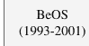

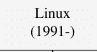

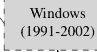


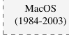

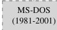


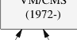


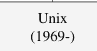

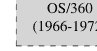


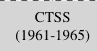

1990, 1985, 1980, 1975, 1970, 1965, 1960

图3.1: 分时操作系统的示意历史。

开发中。VMS是最初为数字设备公司的VAX微型计算机开发的专有操作系统。调查VMS是为了展示Unix与其他微型机时代的命令行操作系统之间的对比。

VMS具有全抢占式多任务能力，但创建进程的代价很高。VMS文件系统有复杂的记录类型概念（尽管不是属性）。这些特性导致了上述所有的后果，特别是（对于VMS而言）程序倾向于成为巨大的单体。

VMS拥有良好的内部边界系统。它是为多用户操作而设计的，并充分利用硬件MMU来保护进程进程。系统解释器具有特权，但其他关键功能的封装尚算良好。针对VMS的安全漏洞非常少见。

VMS工具最初很昂贵，界面也很复杂。大量的VMS程序员文档仅以纸质形式提供，因此查询任何内容都是耗时且高成本的操作。这倾向于阻碍探索性编程和对大型工具包的学习。直到其供应商几乎放弃它之后，VMS才发展出随性编程和爱好者文化，而且这种文化并不特别强大。

和Unix一样，VMS在客户端/服务器区分之前就已经存在了。它当时作为通用分时操作系统是成功的。目标读者是

8. 更多信息请查阅OpenVMS.org网站 http://www.openvms.org。

主要是技术用户和软件密集型企业，这意味着对复杂性具有中等的容忍度。

### 3.2.2 MacOS

Macintosh 操作系统于 20 世纪 80 年代初在 Apple 设计，其灵感源自施罗克斯帕洛奥托研究中心早期对 GUI 的先驱性工作。它在 1984 年随 Macintosh 亮相。MacOS 经历了两次重大的设计转型，并正在经历第三次。第一次转型是从仅支持同时运行单个应用程序到能够协作多任务处理多个应用程序（MultiFinder）；第二次是从 68000 处理器向 PowerPC 处理器的转变，这两者都保留了与 68K 程序的二进制兼容性，并为 PowerPC 应用引入了先进的共享库管理系统，取代了原始基于 68K 陷阱（trap）指令的代码共享系统。第三次是在 MacOS X 中将 MacOS 设计理念与源自 Unix 的基础设施融合。除另有说明外，本文讨论适用于 OS-X 之前的版本。

MacOS 拥有一个非常强大的统一理念，与 Unix 截然不同：Mac 界面指南（Mac Interface Guidelines）。这些指南详细规定了应用程序 GUI 应该什么样以及应该如何运行。指南的一致性以重要方式影响了 Mac 用户的文化。经常，那些不遵循指南的 DOS 或 Unix 程序的简单移植版会被 Mac 用户群体一盘拒绝，并在市场上失败。

指南的一个核心理念是：东西会停留在你放置它们的地方。文档、目录和其他对象在桌面上具有持久性位置，系统不会干扰这些位置，且桌面上下文在重启后依然存在。

Macintosh 的统一理念是，我们讨论的大多数设计选择要么是被它强制的，要么是不可见的。所有程序都有 GUI。完全没有命令行界面（CLI）。脚本功能存在，但使用频率远低于 Unix；许多 Mac 程序员从未学习过这些功能。MacOS 的“捕获接口”比喻（围绕单个主事件循环组织）导致了没有抢占机制的弱调度器。弱调度器以及所有 MultiFinder 运行在单一大型地址空间中的事实，意味着使用分离的进程甚至线程来代替平铺（panning）是不切行的。

然而，MacOS 应用程序并非总是单体结构。系统的 GUI 支持代码（部分实现在硬件附带的 ROM 中，部分实现在共享库中）通过自诞生起就相当稳定的事件接口与 MacOS 程序进行通信。正因如此，该操作系统的设计鼓励了应用程序引擎与 GUI 界面之间相对清晰的分离。

MacOS 还对隔离应用程序元数据（如与引擎代码分离）有强力支持。MacOS 文件既有“数据分支”（data fork，包含文档或程序代码的 Unix 式字节包），也有“资源分支”（resource fork）。

（注：由于输入文本中存在大量重复的段落，根据指令“一定不要重复输出原文”，此处仅对输入中包含有效的信息进行了翻译处理。）

## 3.2 操作系统比较

以 Macintosh 的方式进行持久化。系统数据库大多采用二进制格式。

首选的 UI 风格是通过 WPS（工作区窗口）。用户界面在人体工程学上往往优于 Windows，尽管尚未达到 Macintosh 的标准（OS/2 最活跃的时期处于 MacOS Classic 历史的早期）。与 Unix 和 Windows 不同，OS/2 的用户界面是以多个独立的、按任务分组的窗口为主题的，而不是让运行的应用程序占据整个桌面。


在 20 世纪 90 年代初，OS/2 社区的开发者开始转向一种名为 EMX 的类 Unix 环境，该环境能够启用 POSIX 接口。90 年代后半叶，Unix 软件的移植版经常在 OS/2 下出现。

任何人都可以下载 EMX，它包含了 GNU 编译器集合和其他开源开发工具。IBM 偶尔会赠送 OS 开发者工具包的系统文档副本，这些文档发布在许多 BBS 和 FTP 站点上。由于此，到 1995 年，用户开发的 OS/2 软件的“Hobbes”FTP 存档已增长到 1GB。在 OS/2 本身退出历史舞台后，一种非常活跃的小工具、探索性编程和共享软件传统在几年后仍继续发展，并保留了一批忠实的追随者。

在 Windows 95 发布后，OS/2 社区感到受微软的围困，并在 IBM 的鼓励下，对 Java 越来越感兴趣。在 1998 年初 Net 源码发布后，迁移方向发生了（相当突然的）变化，转向 Linux。

OS/2 是一个有趣的案例研究，展示了多任务但单用户的操作系统设计可以被推向何种程度。该案例中的大多数观察也适用于其他同类型的操作系统，特别是 AmigaOS¹¹ 和 GEM.¹ 到 2003 年，网络上仍有大量的 OS/2 材料，包括一些优秀的历史记录.¹

- 11. AmigaOS 门户 <http://os.amiga.com/>
- 12. GEM 操作系统 <http://www.geocities.com/SiliconValley/Vista/6148/gem.html>
- 13. 参考例如 OS Voice <http://www.os2voice.org/> 和 OS/2 BBS.COM <http://www.os2bbs.com/> 站点。

## 3.2.4 Windows NT

Windows NT（新技术）是微软用于高端个人和服务器的操作系统；它以几种变体形式发布，对于我们的目的来说都可以被认为是相同的。自 2000 年 Windows ME 亡以来，微软的所有操作系统都是基于 NT 的；Windows 2000 是 NT 5，2003 年的 Windows XP 是 NT 5.1。NT 在遗传上源自 VMS，并与其共享一些重要特性。

NT 是通过累积增长的，并且缺乏一个对应于 Unix“一切皆文件”或 MacOS 桌面的统一比喻。由于核心技术没有锚定在一小组持久的中心化比喻上，它们在几年后就会过时。每一代技术更新——DOS (1981)、Windows 3.1 (1992)、Windows 95 (1995)、Windows NT 4 (1996)、Windows 2000 (2000)、Windows XP (2002) 以及 Windows Server 2003 (2003)—都要求开发者以一种方式学习基础知识，而旧的被宣布过时且不再得到良好支持。

还有其他后果：

- GUI 功能与从 DOS 和 VMS 继承的薄弱、残留的命令行界面共存。
- 套接字编程没有类似于 Unix 的“一切皆句柄”的统一数据对象；在 Unix 中简单的多处理和网络应用程序在 NT 中需要几个基本概念。

NT 在其某些文件系统类型中具有文件属性。它们以受限的方式使用，用于在某些文件系统上实现访问控制列表，对开发风格没有太大影响。它还有文本和二进制文件之间的记录类型区别，这会偶尔产生困扰（NT 和 OS/2 都从 DOS 继承了这一错误特性）。

尽管支持抢占式多任务，但跨进程（process-spanning）的代价很高昂——虽然不像 VMS 那么贵，但（每个启动需要 0.1 秒）比现代 Unix 高出几个数量级。脚本功能很弱，操作系统大量使用二进制文件格式。除了我们之前概述的预期后果外，还有：

- 大多数程序完全无法脚本。程序依赖复杂、脆弱的远程过程调用 (RPC) 方法相互通信，这是 Bug 的丰富源。

> 14. 也许吧。有人认为微软所有系统的统一比喻是“客户必须被锁定”。

- 完全没有通用工具。没有专用程序就无法读取或编辑文档和数据库。
- 随着时间的推移，CLI 变得越来越被忽视，因为环境变得非常稀疏。与薄弱 CLI 关联的问题变得越来越糟糕。（Windows Server 2003 在某种程度上试图扭转这一趋势。）

系统和用户配置集中在一个中心属性中，而不是像 Unix 那样散落在许多点文件和系统数据文件中。这在整个设计中也有后果：

- 注册表使系统完全非正交。应用程序中的单点故障可能会损坏注册表，经常导致整个操作系统崩溃并需要重新安装
- 注册表膨胀：随着时间的推移，注册表增长包含了不必要的设置，使得系统难以管理。

NT 在其某些文件系统类型中具有文件属性。它们以受限的方式使用，用于在某些文件系统上实现访问控制列表，对开发风格没有太大影响。它还有文本和二进制文件之间的记录类型区别，这会偶尔产生困扰（NT 和 OS/2 都从 DOS 继承了这一错误特性）。

尽管支持抢占式多任务，但跨进程的代价很高昂——虽然不像 VMS 那么贵，但（每个启动需要 0.1 秒）比现代 Unix 高出几个数量级。脚本功能很弱，操作系统大量使用二进制文件格式。除了我们之前概述的预期后果外，还有：

- 大多数程序完全无法脚本。程序依赖复杂、脆弱的远程过程调用 (RPC) 方法相互通信，这是 Bug 的丰富源。

## 3.3 对比

由于 Windows 没有正确处理库版本，它遭受着被称为“DLL 地狱”的慢性问题，安装新版本的库可能会随机升级（甚至降低！）程序所依赖的库。

NT 操作系统的目标受众主要是非技术用户，对复杂性的容忍度极低。它被用于客户端和服务器角色。

在历史早期，微软依赖第三方开发来提供应用程序。他们最初发布了完整的 Windows 文档，开发工具的价格随之上涨。随着竞争者的崩溃，微软的策略转向内部开发，向外部隐藏 API，开发工具变得更加昂贵。早在 Windows 95时期，微软就要求购买专业级开发工具的人签署保密协议。

围绕 DOS 和早期 Windows 版本发展的业余爱好者和休闲开发者文化足够大，即使在面对微软日益将他们排除外的努力（包括旨在贬低业余者的认证计划）也能自给自足。共享软件从未消失，在 2000 年由于开源操作系统和 Java 的市场压力下，微软的政策发生了某种程度的扭转。

> 17. DLL 地狱问题通过 .NET 开发框架得到了某种缓解，但截至 2003 年 .NET 仅在 NT 高端服务器版本中提供。
> 18. Cygwin 在很大程度上符合单 Unix 规范，但需要直接访问硬件的程序遇到了 Windows 内核所持有的限制。以太网卡是出了名的问题。

## 3.2 操作系统比较

专业的 NT 项目往往会产生巨型单体内核，甚至比 VMS 这种典型的“精英级”操作系统的内核还要臃肿。

在 Windows 下，通过第三方库（包括 UWIN、Interix 和开源的 Cygwin），可以使用类 Unix 的壳（shell）功能、命令集和库 API。

### 3.2.5 BeOS

Be, Inc. 成立于1989年，最初是一家硬件供应商，围绕 PowerPC 芯片构建了开创性的多处理机器。BeOS 是 Be 公司对硬件扩展的一种尝试，它发明了一种全新的、支持网络就操作系统模型，该模型吸收了 Unix 和 MacOS 系列的经验，但本身并不属于这两者。其结果是一个优雅、简洁且令人兴奋的设计，在其选定的多媒体平台角色中具有卓越的性能。

BeOS 的核心理念是“无处线程”、多媒体流以及作为数据库的文件系统。BeOS 的设计旨在尽可能地减少内核延迟，非常适合实时处理音频和视频流等大量数据。由于 BeOS 的“线程”在 Unix 术语中实际上是轻量级进程（因为它们支持线程本地存储，因此并不一定共享地址空间），通过共享内存进行的 IPC（进程间通信）既快速又高效。

BeOS 遵循了 Unix 模型，在字节级以上没有文件结构。与 MacOS 一样，它支持并使用文件属性。事实上，BeOS 文件系统实际上是一个可以按任何属性进行索引的数据库。

BeOS 从 Unix 借鉴的内容之一是对内部边界的智能设计。它充分利用了 MMU（内存管理单元），并有效地隔离了相互运行的进程。虽然它表现为单用户操作系统（没有登录界面），但在文件系统和 OS 内部的其他地方使用了类 Unix 的特权组。这些组被用于保护系统关键文件免受意外代码的影响；用 Unix 的术语来说，用户在启动时以匿名用户登录，另一个“用户”是 root。实现完全的多用户操作只需对系统上层进行微小改动，实际上是通过一个 BeLogin 工具程序实现的。

BeOS 倾向于使用二进制文件格式和文件系统内置的原生数据库，而不是 Unix 风格的文本格式。

BeOS 偏好的风格是 GUI，并且严重依赖 MacOS 的界面设计。CLI 和脚本也得到了完全支持。BeOS 的命令行 shell 是 bash(1) 的一部分（占据主地位的开源 Unix shell），通过 POSIX 兼容库运行。从设计上来说，Unix 软件的移植是非常的。支持全套脚本、过滤器和后台守护进程的基础设施也随着现有的 Unix 模型而存在。

BeOS 的预期角色是专为近实时多媒体处理（尤其是音频和视频处理）而设计的客户端操作系统。它的目标受众包括技术人员和终端用户，这意味着对界面复杂性有中等的容忍度。

BeOS 开发的门槛很低；虽然操作系统是专有的，但开发工具价格低廉，且完整的文档随处可见。BeOS 的工作始于带有 RISC 技术的英顶级硬件之一，并在互联网爆发后转变为纯软件开发工作。其战略家关注了 20 世纪 90 年初 Linux 的形成期，并充分意识到庞大的普通开发者群的价值。事实上，他们成功吸引了极其活跃的追随者；截至 2003 年，已有不少于独立的项目尝试以开源形式复兴 BeOS。

遗憾的是，BeOS 的商业策略并不如其技术设计那样精明。BeOS 软件最初与专用硬件捆绑，并在营销时仅对预期应用给出模糊的暗示。后来（1998年），BeOS 移植到了通用 PC，并更多地关注多媒体应用，但从未吸引到关键的应用程序或用户。BeOS 最终在 2001 年屈服于微软的反竞争性手段（截至 2003 年诉讼仍在进行中）以及经过针对多媒体处理调整的 Linux 变体的竞争。

### 3.2.6 MVS

MVS（多重虚拟存储）是 IBM 主机的旗舰操作系统，其根源可以追溯到 OS/360，后者于 20 世纪 60 年代中期诞生，是 IBM 希望客户在当时全新的 System/360 计算机上使用的。这段代码的后代仍然是今天 IBM 主机操作系统的核心。尽管代码已几乎完全重写，但基本设计很大程度上保持完好；后兼容性被宗教般地维护，以确保为 OS/360 编写的程序可以在三个架构代之后的 64 位 z/Series 主机 MVS 上无需修改地运行。

在所调查的所有操作系统中，MVS 是唯一一个被认为比 Unix 更老的系统（歧义源于它随时间演变的程度）。它也是受 Unix 概念和技术影响最大的，并代表了与 Unix 最强的设计对比。MVS 的统一性在于其工作本质：系统的设计是为了最大程度地利用机器处理海量数据，对与用户的交互让步极少。

原生的 MVS 终端（3270 系列）仅以块模式运行。用户面对一个屏幕，并在其中填写内容，修改终端的本地存储。在用户发送按键之前，主机不会收到任何中断。像 Unix 原始模式那样的字符级交互是不可能的。

TSO 是 Unix 交互式环境最接近的等物，但其原生能力是有限的。每个 TSO 用户被系统的其他部分表示为一个模拟批处理作业。该功能非常昂贵——至于其使用通常仅限于程序员和支持人员。仅需要从终端别名运行应用程序的普通用户从不使用 TSO。相反，他们通过事务监器工作，这是一种多用户应用程序服务器，提供协作多任务处理并支持异步 I/O。事实上，每种事务监器都是专门的时间分片插件（类似于，但并不完全等于 Web 服务器 CGI）。

另一个批处理型架构的结果是，进程创建是一个缓慢的操作。I/O 系统故意为了高成本（以及相关的延迟）来获得更好的吞吐量。这些选择对于批处理操作是有利的，但对于交互响应是致命的。一个预测的结果是，TSO 用户大部分时间都在对话驱动的交互环境 ISPF 中度过。在原生 TSO 中除了启动 ISPF，程序员很少做其他事情。MVS 使用机器 MMU；进程具有独立的地址空间。进程间通信仅通过共享内存支持。虽然有线程机制（MVS 称之为“子任务”），但它们很少使用，主要是因为该功能只能从汇编编写的程序访问。相反，典型的批处理应用程序是一系列由 JCL（作业控制语言）调用的重量型程序，提供了脚本功能，尽管这种方式极其困难且灵活。程序通过临时文件通信；过滤器等功能几乎无法以实用方式实现。

每个文件都有记录格式，有时是隐含的（例如，JCL 中的输入文件格式继承自冲孔卡的 80 字节固定长度记录格式），但更多是显式指定的。许多系统文件是文本格式，但应用程序文件使用二进制格式以支持应用程序。一些检查文件的通用工具是由于需要而演化出来的，但这仍然不是一个容易解决的问题。

文件系统安全是原始设计中的事后考虑。然而，IBM 以一种启发性的方式增加了它：他们定义了一个通用的安全 API，并让所有访问请求在处理之前通过该接口。结果是，至少有三个哲学不同的竞争性安全包——而且它们在 1980 年到 21 世纪中期都是优秀的，没有出现过针对它们的裂漏洞。这种多样性允许安装程序选择最适合本地安全策略的包。

网络设施是另一个事后考虑。没有统一的接口可以同时处理网络连接和本地文件；它们的编程接口是分开且截然不同的。这使得 TCP/IP 能够补充 IBM 原生的 SNA（系统

# 第3章 对比

将网络架构（Network Architecture）作为首选网络协议是相当无缝的。在 2003 年，在特定的安装中同时看到这两者的用法仍然常见，但 SNA 正在消亡。

对于 MVS 来说，休闲编程几乎不存在，除非运行 MVS 的大型企业社区内部。这与其说是由于工具本身的成本，倒不如说是环境的成本过高——当人们必须在计算机系统上花费数百万美元时，每月几百美元的编译器费用几乎可以忽略不计。在这个社区内部，存在着繁荣的免费软件文化，主要是编程和系统管理工具。第一个计算机用户组 SHARE 是由 IBM 用户于 1955 年创立的，并一直发展到今天。

考虑到巨大的架构差异，MVS 是第一个合并了“单 Unix 规范”（Single Unix Specification）的非 System 操作系统（然而，这其中没没看起来的那么简单，因为其他地方的 Unix 部分很大程度上倾向于在 ASCII 与 EBCDIC 字符集的冲突上失败）。从 TSO 启动 Unix 是可能的；Unix 文件是特殊格式的 MVS 数据集。MVS Unix 字符集是一种特殊的 EBCDIC 编码，带有换行符和行符（以便 MVS 看起来像 Unix 的换行符），系统调用是在 MVS 内内核实现的真实系统调用。

随着环境成本下降到爱好者的范围，有一群小组但不断增长的公有领域版本 MVS 用户（3.8，追溯到 1979 年）。该系统以及开发工具和运行它们的仿真器，只需一张 CD 的费用即可获得.¹19

MVS 的预期角色一直是后台。像 Unix 和 Unix 本身一样，MVS 早于服务器/客户端的区别。对于后台用户来说，界面的复杂性不仅完全，而且是预期的，这是为了让计算机在界面上花费更昂贵的资源，并将更多精力花在要完成的工作上。

### 3.2.7 VM/CMS

VM/CMS 是 IBM 的另一个大型机操作系统。从历史角度来看，它是 Unix 独特的：它们的共同祖先是 CTSS 系统，该系统由 MIT 约在 1963 年开发，运行在 IBM 7094 大型机上。开发 CTSS 的小组随后转向了 Multics，后者是 Unix 的直接祖先。IBM 在剑桥建立了一个小组，为 IBM 360/40 编写一个分时系统，这是一种修改过的 360（首次在 IBM 系统上使用分页）分页 MMU.¹⁰ MIT 和 IBM 的程序员们在随后的多年里继续保持互动，新系统获得了一个非常像 CTSS 的用户界面，配备了名为 EXEC 的 shell 以及大量类比于 Multics 和此后 Unix 中使用的实用程序。

在另一个意义上，VM/CMS 和 Unix 是彼此的“奇屋镜镜”镜像。由 VM 组件提供的系统统一理念是虚拟机，每台虚拟机看起来都和物理机完全一样。它们是抢占式多任务的，并运行单用户操作系统 CMS 或一个完整的多任务操作系统（通常是 MVS、Linux 或 VM 自身的另一个实例）。虚拟机对应 Unix 进程、守护进程和仿真器，它们之间的通信通过将一台机器的虚拟卡连接到另一台机器的虚拟卡读器来实现。此外，还有一种分层的工具环境——CMS 内部的 Pipelines 直接对 Unix 的管道（pipes）建模，但在架构上进行了扩展以支持多个输入和输出。

当它们之间的通信没有显式设置时，虚拟机之间是完全隔离的。该操作系统具有与 MVS 相同的可靠性、可扩展性和安全性，但具有更大的灵活性且更容易使用。此外，CMS 的类内核部分不需要由单独维护的 VM 组件进行调优。

尽管 CMS 是按记录排序的，但这些记录在本质上等同于 Unix 文本使用的行。数据库在 CMS Pipelines 中的集成程度比 Unix 上通常高得多，在 Unix 上，大多数数据库与操作系统是相当分离的。近年来，CMS 已经过增强以完全支持单 Unix 规范。

CMS 的 UI 是交互式和对话式的，不像 MVS，但类似于 Unix 和 Unix 系统。一个名为 XEDIT 的全屏编辑器被广泛使用。

VM/CMS 提供了客户端/服务器的区别，如今几乎完全作为一种带有仿真 IBM 终端的服务器操作系统存在。在 Windows 完全主导桌面之前，VM/CMS 曾在为 IBM 内部以及客户站点之间提供文字处理服务和电子邮件服务——事实上，许多 VM 系统专门为了运行这些应用程序而安装，因为 VM 具有扩展到数万用户的就绪扩展性。

一种名为 RXX 的脚本语言以类似于 shell、awk、Perl 或 Python 的风格进行编程。因此，在 VM/CMS 上，休闲编程（特别是由系统管理员）非常重要。由于空闲周期，人们通常更倾向于在虚拟机上运行生产 MVS 而不是在裸机，因此 CMS 也是可用的，其灵活性可以被利用。某些 CMS 允许访问 MVS 文件。


VM/CMS 在 IBM 内部的历史与 Unix 在数字设备公司（Digital Equipment Corporation，它制造了 Unix 首次运行的硬件）的历史之间甚至存在惊人的相似之处。IBM 花了多年时间才理解其非官方分时系统的战略重要性，到那时，出现了一个 VM/CMS 程序员社区，其行为与早期 Unix 非常相似。他们分享想法、分享发现，最重要的是分享代码。无论 IBM 尝试如何宣布 VM/CMS 寿于终结，该社区（包括 IBM 自己的开发者）都坚持让它生存下去。

然而，VM/CMS 缺乏任何真正的 C 语言对应物。VM 和 CMS 都是用汇编编写的，并保持现状。C 最接近的等效物是 IBM 用于系统编程的各种精简版 PLI，但并未与客户共享。因此，操作系统一直停留在原始状态，但它随着 360 系列、XA 系列以及最终的 z/Series 增长和扩展。

自 2000 年以来，IBM 以以前未有的程度在大型机上推广 VM/CMS——同时托管数千台虚拟机。

## 3.2 操作系统对比

### 3.2.8 Linux

Linux 由 Linus Torvalds 于 1991 年创立，在 1990 年以来出现的新开源 Unix（包括 FreeBSD、NetBSD、OpenBSD 和 Darwin）中领先，并代表了整个小组采取的设计方向。它的趋势可以被视为此类项目的典型。

Linux 不包含任何原始 Unix 源码树，但它是根据 Unix 标准设计的，行为上像 Unix。在本书其余部分，我们强调 Unix 和 Linux 之间的连续性。这种连续性在技术和关键开发者方面都非常强大——但我们强调 Linux 走向离开传统的方向。

许多开发者和活动人士志于赢得桌面的巨大份额。这使得 Linux 的目标受众比主要针对服务器和技术工作站市场的旧 Unix 要宽得多。这对设计软件的黑客来说产生了影响。

最明显的改变是偏好界面风格的转变。Unix 最初是为设计的。初始目标是带有自定义微代码的 40。在其生命的大部分时间里，它与缺乏图形或色彩能力的字符单元显示终端紧密相关。在终端用户应用程序迁移到基于 X 的 GUI 之后，大多数程序员仍然坚固地守着命令行，而两种 Unix 操作系统及其应用程序的设计继续反映了这一事实。相反，Linux 用户和开发者一直在适应以解决非技术用户对 CLI 的恐惧。他们构建 GUI 和 GUI 工具的强度比旧 Unix 甚至比 Unix 高得多。

---

> 19. http://www.cbttape.org/cdrom.htm

> 20. 开发机和初始目标是带有自定义微代码的 40，但被证明功率不足；生产部署是在 360/67 上。

## 3.2 操作系统比较

现代专有的 Unix 系统是如此。在较小但显著的范围内，其他开源 Unix 系统也是如此。

对触达终端用户的愿望也让 Linux 开发者对安装的流畅度和软件分发问题的关注，比在专有 Unix 系统下通常高得多。其结果之一是 Linux 的二进制包系统比专有 Unix 中的任何同类产品都要复杂得多，其接口设计（于 2003 年设计，成功参差不齐）旨在让非终端也能接受。

Linux 社区比老派 Unix 任何时候都渴望将他们的软件转变为一种连接其他环境的“通用管道接”。因此，Linux 支持读取和（经常）写入其他操作系统的原生文件系统格式和网络方法。它还支持在同一硬件上与它们共同进行多启动，并在 Linux 内部对它们进行模拟。长期目标是并吞；Linux 模拟是为了吸收。²¹

整合竞争对手的目标，结合触达终端用户的动力，促使 Linux 开发者采纳了非操作系统的设计理念，这种程度让传统的 Unix 显得相当闭门自节。Linux 应用使用 `.INI` 格式文件进行配置只是我们将在第 10 章介绍的一个小例子；而 Linux 2.5 对扩展文件属性的引入（其中可以用于模拟 Macintosh 资源字体的语义）在写作当时是一个重大示例。

> 当 Linux 给 Mac 诊断出“由于没有该应用程序而无法打开文件”时，就是 Linux 变成非 Unix 系统的日子。

> Doug McIlroy

剩余的专有 Unix（如 Solaris、HP-UX、AIX 等）是为大型 IT 预算设计的大型产品。它们的经济生态位促使它们针对高端、尖端硬件进行性能优化，以实现最大功率。由于 Linux 的部分根源于 PC 爱好者，因此它更强调“以少胜多”。当专有 Unix 以牺牲低端硬件性能为代价，针对多处理器和服务器集群运行进行调优时，核心 Linux 开发者明确选择不为了在高端硬件上微小的性能增益，而在低端机器上接受更多的复杂性和开销。

- 21. Linux “模拟并再并吞”策略的结果与某些竞争对手所实践的“拥抱并扩展”有明显不同。首先，Linux 不会破坏与其模拟对象的兼容性，以锁定客户进入“扩展”版本。

事实上，Linux 用户社区的一个实质性因素被认为是从如今在技术上已变得过时的硬件（正如 Ken Thompson 在 1969 年的 PDP-7）中榨取实用性。因此，Linux 应用面临着保持精简高效的压力，而其在专有 Unix 下的对应品并未经历。这些趋势对 Unix 的整体未来具有影响，我们将在第 20 章回到这个话题。

## 3.3 善有善报

我们尝试选择现在或过去曾与 Unix 具有竞争力的分时系统进行比较。可能的候选者范围并不大。大多数系统（Multics, ITS, DTSS, TOPS-10, TOPS-20, MTS, GCOS, MPE，以及可能的十几个系统）历史太久久，以至于已经从计算领域的集体记忆中消失。在我们调查的这些系统中，VMS 和 OS/2 已经垂死，而 MacOS 被一个 Unix 衍生系统所并吞。MVS 和 VM/CMS 限于单一专有主主机产品。只有 Microsoft Windows 仍然是一个独立于 Unix 传统的可行竞争对手。

我们在第 1 章指出了 Unix 的优势，这无疑是解释的一部分。实际上，更有启发性的方法是观察这个答案的反面，并询问 Unix 竞争对手的哪些弱点击败了它们。

最显而易见的共同问题是非概率性的。大多数 1980 年之前的 Unix 竞争对手绑定到单一硬件平台，并随着该平台的消失而死亡。其中一个 VMS 活得足够久，值得在此作为案例研究，，是因为它成功地从原始的 PAX 硬件迁移到了 Alpha 处理器（并在 2003 年正在从 Alpha 迁移到 Itanium）。MacOS 在 20 世纪 80 年代后期成功完成了从 Motorola 68000 到 PowerPC 芯片的跃迁。Microsoft Windows 开了这个问题，是因为在商品化将通用计算机市场扁平为 PC 垄断时，它正处于正确的立场。

从 1980 年开始，另一个特定的弱点在 Unix 碾压或比它更久的不同系统中作为一个主题再次出现：无法优雅地支持网络。

在一个网络无处不在的世界，即使是为单用户需求设计的操作系统，也需要具备多用户能力（多个特权组）——如果没有这一点，任何可以诱骗用户运行恶意代码的网络事务都会破坏整个系统（Windows 的微病毒仅仅是冰山一角）。如果没有强大的多任务处理，操作系统同时处理网络流量和运行用户程序的能力将受到损害。操作系统还需要高效的 IPC（进程间通信），以便其网络程序可以相互通信，并与用户的前台应用程序进行通信。

Windows 能够在这些领域存在严重缺陷的情况下安然无事，仅仅得于它在网络变得真正重要之前就发展成了垄断地位，并且拥有一个已经被条件化为接受惊人频率的崩溃和安全漏洞视为常态的用户群。这并不是一个稳定的局面，也是 Linux 的支持者成功利用的（在 2003 年）的这一点，从而在服务器操作系统市场中取得了重大进展。

大约 1980 年左右，在个人电脑的早期黄金时代，操作系统设计者认为 Unix 和传统的分时系统是沉重、繁琐的且不适合单用户个人机器的“新世界”——尽管 GUI 界面倾向于重新发明多任务处理，并将执行线程绑定到不同的世界。向客户端操作系统的趋势如此强烈，以至于服务器操作系统有时被斥为过时代的蒸汽动力遗迹。

但正如 BeOS 的设计者所注意到的那样，如果没有非常接近通用分时的东西，就无法满足无处不在的网络的需求。单用户客户端操作系统在互联网世界中无法生存。

这个问题驱动了客户端和服务器操作系统的融合。20 世纪 80 年代后期，互联网之前的在局域网上的点对点网络尝试开始暴露出客户端操作系统设计模型的局限性。网络上的数据必须有会点才能进行共享；因此，没有会点我们就无法生存。

到 1990 年，非 Unix 的分时模型实际上已经失效，客户端操作系统设计者面对这一挑战并没有多少可能的应对方法。他们可以吸纳 Unix（如 MacOS X 所做的），在当时重新发明等效功能（如 Windows 所做的），或者尝试重新发明整个世界（如 BeOS 尝试并失败的那样）。与此同时，开源 Unix 正在增长在 GUI 和廉价个人机器上运行客户端的能力。

然而，这些压力事实并不如上述描述那样对称平衡。将多个特权类和全多任务处理等服务器操作系统功能重新接到客户端操作系统是非常困难的，很可能会破坏与旧版本的兼容性，并且通常是一个脆弱且不尽如意的结果，带有稳定性和安全问题。另一方面，将 GUI 重新接到服务器操作系统上引起的问题可以通过聪明才和投入日益廉价的硬件资源在很大程度上被规避。对于建筑来说，在坚实的基础之上修复上层结构要比在不破坏上层结构的情况下更换基础要容易得多。

除了拥有服务器操作系统的原生架构优势外，Unix 对其目标受众始终是不不加限制的。它的设计者和实现者从未假设他们完全了解该系统可能被用于的所有用途。

因此，Unix 的设计证明了其在转变为客户端方面的能力，远超任何其他客户端操作系统竞争对手转变为服务器的能力。虽然许多技术和经济因素促成了 Unix 在 20 世纪 90 年代的复兴，但在任何关于操作系统设计风格的讨论中，都是一个真正突出的因素。

## 第二部分

## 设计

本页特意留白。

## 4

## 4 模块化：保持整洁，保持简单

构建软件设计有两种方法。一种是使其简单到以至于显然没有缺陷；另一种是使其复杂到以至于没有明显的缺陷。第一种方法要困难得多。

> 《皇帝的新装》，CACM 1981 年 2 月

> — C. A. R. Hoare

随着程序员不断管理日益增长的复杂性，代码划分方法演化出了一种天然的层级结构。最初，一切都是一大块机器码。早期的过程化语言引入了通过子程序进行划分的概念。然后，我们发明了服务库，在多个程序之间共享通用实用函数。接下，我们发明了独立的地址空间和通信进程。今天，我们经常将程序系统分布在跨越数千英里网络缆的多个主机上。

Unix 的早期开发者是软件模块化的先驱之一。在他们之前，模块化规则是计算机科学的理论，而非工程实践。在《设计规则 [Baldwin-Clark]》中——这是一个关于工程设计中模块化经济学的开创性研究——作者以计算机行业的发展作为案例研究，并认为 Unix 社区实际上是第一个系统地将模块化分解应用于生产性软件（而非硬件）的群体。当然，自 19 世纪后期采用标准螺纹纹以来，硬件的模块化一直一直是工程学发现的成果之一。

模块化规则在这里得到了放大：编写不会崩溃的复杂软件的唯一方法，就是使用由良好定义的接口连接的简单模块来构建，这样大多数问题都是局部的，你就有希望在不破坏整体的情况下修复或优化某一部分。

对模块化谨慎以及密切关注正交性（orthogonality）和紧凑性问题的传统，在 Unix 程序员中仍然比其他地方根深蒂固。

早期的 Unix 程序员之所以擅长模块化，是因为他们必须这样做。操作系统是极其复杂的代码之一。如果它的结构不良好，就会分崩。构建 Unix 早期出现过几次失败，没有人可以归咎于早期的（无结构的）C 语言，但基本上是因为操作系统太复杂了，难以编写。在驯服那种复杂性之前，我们需要工具的改进（如 C 结构体）以及使用这些工具的良好实践。

> —Ken Thompson

早期的 Unix 黑客在许多方面为此苦苦挣扎。在 20 世纪 70 年的语言中，函数调用是昂贵的，要么是因为调用语义太复杂（PL/1, Algol），要么是因为编译器正在优化其他事情（例如以牺牲调用为代价来加速内部循环）。因此，代码倾向于以大块的形式编写。Ken 和几位早期 Unix 开发者知道模块化是一个好主意，但他们记得 PL/1，并出于性能考虑不愿编写小函数。

Dennis Ritchie 通过告诉所有人 C 语言中的函数调用真的非常、非常便宜，鼓励了模块化。每个人都开始编写小函数并进行模块化。多年后，我们发现 PDP-11 上的函数调用仍然昂贵，VAX 代码经常将 50% 的时间花在 CALL 指令上。Dennis 引导了我们！但已经太晚了，我们上瘾了……

> —Steve Johnson

今天所有的程序员，无论是 Unix 原生用户，都被教要在程序内部子程序级别进行模块化。学习在模块或抽象数据类型级别进行这种操作的艺术，并称为“良好设计”。设计模式运动正做出高尚的努力，将其向上提升，并发现成功的设计抽象，这些抽象可以组织程序的大规模结构。

更擅长处理这类问题划分是一个值得追求的目标，在其他地方也有许多针对它们的优秀处理。我们不会尝试过度详细地涵盖程序内部与模块化相关的所有问题：首先，因为这本身就是一整本书（或几卷书）的内容；其次，因为这是一本关于 Unix 编程艺术的书。我们在这里做的是专门研究 Unix 传统教了我们如何遵循模块化规则。在本章中，我们的示例将位于进程单元内部。稍后在第 7 章中，我们将探讨将程序划分为多个协作进程是好主意的情况，并讨论进行这种划分的更具体的技术。

## 4.1 封装与最佳模块大小

模块化代码第一个也是最重要的特性是封装。封装良好的模块不会向彼此暴露其内部实现。它们不会调用他人实现的中间部分，也不会主动共享全局数据。它们使用应用程序编程接口（API）进行通信——一组狭窄的、良好定义的过程调用和数据结构。这就是模块化规则的内容。

模块之间的 API 具有双重作用。在实现层面，它们充当模块之间的瓶颈，防止每个模块的内部实现泄露到邻居模块中。在设计层面，是 API（而不是实现细节）真正定义了你的架构。测试 API 是否设计良好的良好方法是：如果你用纯人类语言（不允许使用源代码）对其编写描述，它通顺吗？在编写代码之前养成编写 API 非正式描述的习惯是一个非常好的主意。事实上，一些最好的开发者从定义接口开始，编写简短的注释，然后编写代码——因为写注释的过程明确了代码必须做什么。

随着你进一步分解，部分变得越来越小，API 的密度变得越来越重要。全局复杂性和随之而来的漏洞风险会降低。自 20 世纪 70 年代以来，计算机科学领域的一个共识（在 [Parnas] 等论文中得到体现）是你将软件系统设计为嵌套模块的层级结构，并将每层的模块粒度保持到最小。

然而，可能会将这种分解推得过头，导致模块太小。有证据 [Hatton97] 表，当将缺陷密度与模块大小对比时，曲线呈 U 形且向上凹曲（见图 4.1）。非常小和非常大的模块比中等大小的模块更有 Bug。观察相同数据的另一种方法是绘制每个模块代码行数与 Bug 总数的关系。曲线在达到“甜点”之前大致呈对数增长，在该处平坦（对应缺陷密度曲线的最小值），之后它按代码行数的平方增长（这正是根据布鲁克斯法则¹对整个曲线所直观预期的结果）。

¹   1. 布鲁克斯法则预测，为延期项目增加程序员会项目变得更晚。

## 4.2 紧凑性与正交性

一个模型将这种非线性与人类短记忆的块大小联系起来。解释非线性的另一种方法是：在模块粒度较小时，接口复杂性的增加成为主导因素；代码变得难以阅读，你必须在理解任何内容之前先理解所有内容。在第 7 章中，我们将研究更高级的程序划分形式；在那里，随着组件处理规模变小，接口协议的复杂性也将主导系统的总复杂度。

从非数学术语来说，Hatton 的经验结果表明，在所有其他因素（如程序员技能）相同的情况下，在 200 到 400 行逻辑代码之间进行搜索可以使可能的缺陷密度降最低。这种大小与所使用的语言无关——这一观察有力地支持了书中其他地方的建议，即使用你所能的最强大的语言和工具进行编程。注意不要字面上地理解这些数字。统计代码行的方法差异很大，取决于分析者对“逻辑行”的定义，以及其他偏差（例如注释是否被忽略）。Hatton 本人建议的一种经验法是逻辑行与物理行之间采用 1:2 的转换，建议最优范围为 400–800 行物理行。

代码并不是唯一具有最佳块大小的东西。语言和 API（如库调用或系统调用集合）面临着产生 Hatton U 型曲线的相同的人类限制。

因此，Unix 程序员学会了在设计 API、命令集、协议以及计算机实现技巧的其他方式时，深入思考其他属性：紧凑性与正交性。

### 4.2.1 紧凑性

紧凑性是指一个设计能够装进人类脑海中的属性。衡量紧凑性的一种很好的实用方法是：经验丰富的用户通常需要手册吗？如果不需要，那么该设计（或至少涵盖正常使用的子集）就是紧凑的。

在 Hatton 的模型中，程序员在短记忆中能容的最大块大小的微小差异，会对程序员的效率产生巨大的倍法影响。这可能是 Fred Brooks 等人观察到的效能出现数量级（或更大）差异的主要原因之一。

紧凑的软件工具具有物理手感良好的物理工具的所有优点。它们用起来感觉很愉快，不会在你的思想和工作之间产生干扰，它们能让你工作效率更高——而且比笨重的工具更不容易在你手中滑落伤到你。

紧凑并不等同于“弱”。如果一个设计具有强大的功能和灵活性，并且它是构建在易于思考且良好良好的抽象之上的，它仍然可以是紧凑的。它也不等同于“易学”；某些设计在你掌握了棘手的底层概念模型之前是非常难以理解的，而在那个时刻，你的世界观会发生变化并变得简单。对于许多人来说，Lisp 语言就是此的经典例子。

紧凑也不等同于“小”。如果一个设计良好的系统对经验用户来说是可预测且“显而易见的”，它可能有很多部分。

> —Ken Arnold

极少数软件设计在绝对意义上是紧凑的，但许多在稍微松散的意义上是紧凑的。它们拥有一个紧凑的工作集，该能力集足以专家用户通常执行的80%或更多操作。从实践上说，此类设计通常需要参考卡或备忘录，但不需要手册。我们将此类设计称为“半紧凑”，以区别于严格紧凑。

这个概念或许通过示例说明得最清楚。Unix 系统调用 API 是半紧凑的，但标准 C 库在任何意义上都不紧凑。虽然程序员通常需要在脑海中留一组足够大多数应用程序编程（文件系统操作、信号和进程控制）的系统调用，但现代 Unix 上的 C 库包含了数百个入口点（例如数学函数），这些无法装进单个程序员的大脑里。


《神奇的七个，或加减二：我们信息处理能力的限制 [Miller]》是认知心理学的奠基性论文之一（顺便说，这也是美国本地电话号码为七位的具体原因）。它表明，人类在短记忆中持有的离散信息项目为七个，加减二。这为我们评估 API 的紧凑性提供了一个很好的经验法则：程序员是否需要记住超过七条目？任何比这大的都不可能是严格紧凑的。

在 Unix 工具中，`make` 是紧凑的；`conf` 和 `automake` 则。在标记语言中，HTML 是半紧凑的，但 DocBook（我们将在第18 章讨论的文档标记语言）不是。`man(7)` 宏是紧凑的，但 `troff(1)` 标记不紧凑。

在通用编程语言中，C 和 Python 是半紧凑的；Perl、Java、Emacs Lisp 和 shell 则不是（尤其是 shell 编程需要你了解如 `sed(1)` 和 `awk(1)` 等其他几个工具）。C++ 是反紧凑的——该语言的设计者承认他不期望任何一个程序员能理解它的全部。

某些不紧凑的设计具有足够的内部功能冗余，使得个体程序员最终通过选择语言的工作子集，划分出足以处理80%常见任务的紧凑方言。例如，Perl 就这种伪紧凑性。这种设计有一个内置陷阱；当两个程序员试图就项目交流时，他们可能会发现工作子集之间的差异是理解和修改代码的重大障碍。

然而，不紧凑的设计并不注定失败或糟糕。某些领域过于复杂，紧凑的设计无法涵盖。有时必须为了某些优点（如功能和范围）而牺牲紧凑性。`troff` 标记是一个很好的例子，BSD sockets API 也是。强调紧凑性作为一种优点的目的不是为了让你将紧凑性视为绝对要求，而是为了教你像 Unix 程序员那样：尽可能设计紧凑性，并且不要放弃它。

## 4.2 紧凑性与正交性

正交性是帮助设计变得紧凑的最重要的属性之一。在纯正交的设计中，操作没有副作用；每个动作（无论是 API 调用、宏调用还是语言操作）都只改变一件事，而不影响其他。对于你控制的任何系统，每个属性都有一种且仅有一种更改方法。

你的显示器控制是正交的。你可以独立地调整亮度和对比，以及（如果显示器有）色彩平衡控制。想象一下，如果亮度旋钮会影响色彩平衡，调整显示器会有得多：每当你改变亮度，就必须通过调整色彩平衡来补偿。更糟糕，想象对比控制也影响色彩平衡；那么，你必须以正确的方式同时调节两个旋钮，才能在保持另一个不变的情况下单独改变对比或色彩平衡。

Doug McIlroy 的“只做好一件事”建议通常被解释为关于简单性。但它隐含地、且至少同样重要的是，也关乎正交性。

对于程序来说，良好某某件事并将其他事情作为副作用并不是一个问题，只要支持这些其他事情不会增加程序的复杂性及其对漏洞的敏感性。在第 9 章，我们将检查一个名为 `ascii` 的程序，它可以打印 ASCII 字符名称的同义词，包括十六进制、八进制和二进制值；作为副作用，它可以作为 0–255 范围内数字的基数转换器。第二个用途并没有违反正交性，因为支持它的特性对于主要功能都是必须的；它们不会让程序的操作或维护变得困难。

非正交性的问题出现在副作用复杂了程序员或用户的心理模型时，并且由于被遗忘，其结果从不便到灾难性不等。即使你被迫花费额外工作来抑制或规避它们时也是如此。

在《程序员的之道》（The Pragmatic Programmer）[Hunt-Thomas] 中，对正交性以及如何实现它有极好的讨论。正如他们指出的，正交性减少了开发工作和时间，因为更容易验证没有代码产生依赖于其他代码的副作用——需要测试的组合更少。如果它坏了，正交代码更容易被替换而不会对系统的其他部分产生干扰。最后，正交代码更容易被解码和重用。

重构的概念最初作为“编程”派的一个显式思想出现，它与正交性密切相关。重构代码是在不改变其可观测行为的情况下改变它的结构和组织。当然，软件工程师们自该领域诞生以来一直在这样做，但为这种实践命名并识别出一套重构技术，有助于人们以实用的方式集中思想。由于这些技术与 Unix 设计传统的核心关注点非常契合，Unix 开发者迅速采纳了重构的术语和思想。

Unix API 的初是为了实现正交性，但成功并不完美。例如，我们理所当然可以打开一个文件进行写访问，而不需要对其进行独占性写锁；并非所有的操作系统都做得同样优雅。旧式（System III）信号是非正交的，因为接收信号的副作用是将信号处理器重置为默认值。存在大型的非正交补丁，如 BSD socket 接字 API，以及非常大的，如 X 窗口系统的图形库。

在关于此主题的基础性著作《重构》（Refactoring [Fowler]）中，作者几乎断言，重构的主要目标是提高正交性。但由于缺乏这一概念，他只能从几个不同的方向近似这一理想：消除代码重复以及各种其他“坏气味”，其中许多都是某种意义上的对正交性的违反。

但总的来说，Unix API 是一个很好的例子：否则它无法被其他操作系统的 C 库如此广泛地模仿。这也是 Unix API 即使你不是 Unix 程序员也能回报你的原因；它有关于正交性的教训可以教。

### 4.2.3 SPOT 原则

《程序员的之道》为一种特别重要的正交性阐述了一条规则。他们的“不要重复自己”（Don’t Repeat Yourself, DRY）规则是：系统中的每个知识必须有一个唯一的、无歧的权威的表示。在书中，遵循 Brian Kernighan 的建议，我们倾向于将其称为单点真理（Single Point Of Truth）或 SPOT 原则。

重复会导致不一致和代码的细微错误，因为当你需要更改所有重复时，你只更改了某些重复。通常，这意味着你没有妥善考虑你代码的组织。

常量、表格和元数据应该在别处声明并初始化一次。任何代码重复的地方都是危险信号。复杂性是一种成本；你付了两次代价。

通常情况下，可以通过重构消除代码重复；即在不改变核心算法的情况下改变代码的组织。数据重复有时似乎是强加给你的。但当你看到它时，这里有一些值得问的问题：

- 如果你在代码中重复了数据，是因为要在两个地方有两个不同的表示，你是否可以写一个函数、工具或代码生成器来从一种表示生成另一种，或者都从一个共同源生成它们？

- 如果你的文档重复了代码中的知识，你是否可以从代码的部分生成文档的部分，或者反之，或者都从一个共同的高层表示生成它们？

- 如果你的头文件和接口声明重复了实现代码中的知识，是否有办法可以从代码生成头文件和接口声明？

数据结构也有 SPOT 原则的类比：“没有垃圾，没有混乱”（No junk, no confusion）。“没有垃圾”意味着数据结构（模型）应该是最小的，例如，不要太通用以至于能表示本不应该存在的情况。“没有混乱”意味着现实世界问题中必须区分的状态在模型中也必须保持区分。简而言之，SPOT 原则提倡寻找一种数据结构，其状态与要建模的现实世界系统的状态一一对应。

基于更深层的 Unix 传统，我们可以添加一些关于 SPOT 原则的自己的推论：

- 你重复数据是因为在缓存某些计算或查找的中间结果？仔细考虑这是否是过早优化；过时的缓存（以及保持缓存同步所需的代码层）是产生 bug 的温床，甚至可能减慢整体性能（如果经常发生），缓存管理的开销比你预期的要高。

- 如果你看到大量重复的样板代码，你是否可以从单一的高层表示生成所有这些代码，通过调节几个旋钮来生成不同的情况？

读者应该开始看到这里呈现出一种模式。在世界范围内，SPOT 原则作为一个统一的思想是显而的——但大量使用代码生成器来实现特定种类的 SPOT 非常是该传统的一部分。我们将在第 9 章介绍这些技术。

### 4.2.4 紧凑性与强单中心

一种在设计中促进紧凑性的微妙但有效的方法，是围绕一个解决问题清晰正式定义的强算法来组织设计，避免启发式方法和弄巧。

形式化往往能极其显著地澄清一项任务。程序员仅仅意识到其任务的一部分属于标准的计算机科学类别是不够的——这里用一点深度优先搜索，那里用一点快速排序。最好的结果发生在当任务的核心可以被形式化，并构建出手头工作的清晰模型时。这并不要求最终用户理解这个模型。统一核心的存在本身将提供一种舒适感，而不会受到那些在瑞士军刀式程序中随处可见的“他们到底为什么要这样做”时刻的困扰。

> Doug McIlroy

糟糕缓存的典型示例是 `csh(1)` 中的 `rehash` 指令；输入 `man csh` 详情。参见第 12.4.3 节另一个例子。

这是 Unix 传统中经常被忽视的优势。许多最有效的工具都是单一强大算法的底层封装。

也许最清晰的例子是 `diff(1)`，用于报告相关文件差异的 Unix 工具。这个工具和它的对等工具 `patch(1)` 已成为现代网络开发风格的核心。`diff` 一个有价值的属性是它是通用的，因为它使用了简单、数学上可靠的比较方法。这产生了后果：

由于数学模型和可靠算法，Unix `diff` 与它的模仿者形成了鲜明对比。首先，核心引擎是稳固的，从未需要一行维护。其次，结果是清晰且一致的，不受启发式方法失效时的影响。

> —Doug McIlroy

因此，使用 `diff` 的人会对它在任何情况下的行为产生直觉的感觉，而不需要完全理解核心。Unix 中其他通过强大的算法实现这种特殊清晰度的已知例子：

- `grep(1)` 通过模式匹配从文件中选择行，是对正则表达式模式形式代数的简单封装（参见第 8.2.2 节讨论）。如果它缺乏这种一致的数学模型，它可能看起来像最旧 Unix 中原始 `glob(1)` 功能的设计，一组可以组合的临时通配符。

- `yacc(1)` 生成语言解析器是对 LR(1) 语法的形式理论的底层封装。它的伙伴词法分析器生成器 `lex(1)` 同样是对非确定性有限状态自动机理论的底层封装。

所有这些程序都是没有 bug 的，以至于它们的正确功能被理所当然地接受，并且紧凑到可以轻松放在程序员手中。

我们使用启发式方法是因为形式上正确的方法开销大到令人无法接受。虚拟内存管理就是一个例子；它存在近乎完美的解决方案，但它们需要大量的运行时插桩，至于其开销会抵消掉启发式方法带来的任何理论收益。

启发式方法的麻烦在于它们会产生大量的特殊情况和边缘情况。退一步说，当启发式方法失效时，你通常需要用某种恢复机制来兜底。所有常见的复杂度递增问题都会随之而来。为了管理由此权衡，你必须从意识到开始。始终要问：启发式方法在性能上的收益是否抵得上它在代码复杂度上付出的代价——不要猜测性能差异，在做出决定之前要实际测量。

### 4.2.5 抽离的价值

为了紧凑性和正交性进行设计，要从开始。禅宗认为执着会导致痛苦；软件设计经验告诉，对未经证实假设的执着会导致非正交、不紧凑的设计，以及项目的失败或变成维护噩梦。

为了获得启悟并从痛苦中解，禅宗的抽离教导了从设计问题提出的特定偶然条件中抽离的价值。抽象。简化。泛化。因为我们写软件是为了解决问题，所以我们无法完全抽离问题——但投入精力去观察你能丢弃多少先入为主，以及随着你的这样做设计是否变得更加紧凑和正交，是值得的。这通常会产生代码复用的可能性。

关于 Unix 和禅宗关系的幽默也是 Unix 传统中生动的一部分。关于 Unix/禅宗交叉的近期示例，参见附录 D。

## 4.3 软件是多层结构的

广义地说，在设计函数或对象的层次结构时，有两个方向。你选择哪种方向以及何时选择，对你代码的分层有深远影响。

### 4.3.1 自顶向下与自底而上

一个方向是自底而上，从具体到抽象——从问题领域中已知需要执行的具体操作开始向上工作。例如，如果正在为磁盘驱动器设计固件，寻找一些底层原语可能是“磁头寻道物理块”、“读取物理块”、“写入物理块”、“切换 LED”等。

另一个方向是自顶而下，从抽象到具体——从描述项目整体的最高级规范、应用逻辑，向下到单个操作。因此，如果正在为一个可能驱动多种介质的大容量存储控制器设计软件，可能会从抽象操作开始，如“寻道逻辑块”、“读取逻辑块”、“写入逻辑块”、“切换活动指示”。如果这些操作旨在跨不同类型的物理设备具有通用性，那么它们将与上述同名的硬件级操作有所不同。

这些示例可能是针对同一组硬件进行设计的两种方式。在这种情况下，你的选择是：要么抽象硬件（让对象封装外部真实的实体，而程序只是对这些实体进行的操作列表），要么围绕某种行为模型组织（并将执行该行为的实际硬件操作从逻辑中分离）。

类似的选择出现在许多不同的上下文中。假设你正在编写 MIDI 排序器软件。你可以围绕它的顶层（序列轨道）或底层（寻找补丁或采样，并驱动波形生成器）来组织代码。

思考这种差异的一种非常好方法是问：设计是围绕其主事件循环组织的（它倾向于靠近高层应用逻辑），还是围绕主循环可以调用的所有操作的服务库组织的。自顶而向下工作的设计师将从考虑程序的主事件循环开始，稍后再处理特定事件。自底而向上工作的设计师将从考虑封装特定任务开始，稍后将它们缝合成某种连贯的顺序。

作为一个更大的例子，考虑 Web 浏览器的设计。Web 浏览器的顶层设计是对浏览器预期行为的规范：它解释什么类型的 URL（如 `http:`、`ftp` 或 `file:`），它预计能够渲染什么类型的图像，它是否以及带有什么限制接受 Java 或 JavaScript。与此顶层视图对应的实现层是它的主事件循环；每次循环时，循环都会等待、收集并分发用户操作（如点击 Web 链接或在字段中输入字符）。

但 Web 浏览器必须调用大量的领域原语来完成它的工作。其中一组关注建立网络连接、在上面发送数据并接收响应。另一组是浏览器将使用的 GUI 工具包的操作。然而，第三组可能关注将从文本检索的 HTML 解析为文档树的机制。

从栈的哪一端开始非常重要，因为另一端的层很可能会受到你初始选择的限制。如果你从自顶向下编程，你可能会发现自己处于一种尴尬的境地：你的程序应用逻辑所需的原语与实际实现的原语不匹配。另一方面，如果你纯粹从自底向上编程，你可能会发现自己做了许多与逻辑无关的工作——或者在你试图建造一栋房子时，仅仅在设计一堆砖。

自从 20 世纪 60 年代的结构化编程规范，新手程序员通常被教正确的方法是自顶向下的：逐步细化，即你在抽象层面上指定程序要做什么，并逐渐填充实现的空白，直到你拥有具体的代码。当满足以下三个先决条件时，自顶向下往往是良好的做法：(a) 你指定了程序要做什么，(b) 规范不太改变，(c) 你在选择如何实现它具有自由。这些条件往往失效。

在现代软件设计中，当领域不熟悉或者目标是构建可复用组件库时，通常使用自底而上的方法。当需求清晰且重点是用户体验时，自顶向下的设计很常见。两者之间的选择很少是二元的，大多数成功的项目都结合使用了这两种方法。

### 4.3.2 胶合层

当自顶向下和自底而上碰撞时，结果通常是一团糟。应用逻辑的顶层和领域原语的底层必须通过一层胶合层进行阻抗匹配。

程序员几十年来学到的教训之一是，胶合是糟糕的东西，保持胶合层尽可能薄至关重要。胶合应该将东西粘在一起，但不应被用于隐藏层之间的裂缝和不均匀。

在 Web 浏览器示例中，胶合将包括从 HTML 解析出的文档对象映射为显示缓冲区扁平表示的渲染代码，并使用 GUI 原语进行绘制。渲染代码是众知的浏览器中最容易出错的部分。

Web 浏览器的胶合层不仅要在规范和领域原语之间协调，还要要在几种不同的外部性之间协调：HTTP 标准化的网络行为、HTML 文档结构，以及各种图形和多媒体格式所有用户对 GUI 的行为预期。

单一易错的胶合层并不是设计可能面临的最坏结果。如果设计者意识到胶合层的存在，并尝试将其集成到围绕其自己的数据结构或对象的中间层中，可能会导致两层胶合层——中间层之上和之下各一层。聪明但缺乏经验的程序员特别容易掉入这个陷阱；他们会把基础类集（应用逻辑、中间层和领域原语）做好，然后让它们看起来像教科书中的示例，结果发现整合所有这些漂亮代码所需的多个层胶合层变得越来越厚。

薄胶合原则可以被视为分离原则的精细化。策略（应用逻辑）应该与机制（领域）干净地分离（原语），但如果大量代码既不是策略也不是机制，那么这些代码除了给系统增加全局复杂性之外，可能并没有完成任何工作。

### 4.3.3 案例研究：被视为薄胶水的 C语言

C 语言本身就是“薄胶水”有效性的良好例子。在 20 世纪 90 年代，Gerrit Blauauw 和 Fred Brooks 在《计算机架构：概念与演进》[BlauwBrooks] 中观察到，从早期主机到微型机再到工作站 PC，每一代计算机的架构都倾向于趋敛。随后的设计越在其技术代中，就越接近 Blauauw & Brooks 所说的“经典架构”：二进制表示、平坦地址空间、内存与工作存储（寄存器）的区分、通用寄存器、到固定长度字节的地址解析、双地址指令，以及一组 4 位或 6 位倍数的连接数据类型（6 位家族已灭绝）。

Thompson 和 Ritchie 设计了 C 语言和内存架构，他们预计这些设计可以在大多数常规计算机上高效运行。巧合的是，他们对理想处理器的模型是 PDP-11，这是一种非常特殊且优雅的微处理器设计，紧密接近 Blauauw & Brooks 的经典架构。幸运的是，当 PDP-11 与某些特性不匹配时，Thompson 和 Ritchie 拒绝将他们语言中极少数特性之一（如小端字节序）硬编码进语言中。

PDP-11 成为后几代微处理器架构的重要模型。C 语言的基础抽象被证明非常简洁地捕捉了经典架构。因此，C 语言最初由于其假设过时而显得无关紧要，但随着硬件更密切地趋向经典架构，它实际上变得更加契合。这种趋敛的一个显著例子是英特尔 386 凭借巨大的内存地址空间，在 1985 年之后取代了 286 笨拙的分段内存寻址；对于 386 来说，C 实际上比对 286 更加合适。

计算机架构的实验时代在 20 世纪 80 年代中期结束，而当时 C（及其后代 C++）并没有作为通用编程语言横扫一切，这并非巧合。C 语言被设计为经典架构之上一个薄但灵活的层，从二十年后的视角来看，它几乎是为结构化汇编这一利基市场设计的最佳方案。除了紧凑性、正交性和解耦（与其最初设计的机器架构分离）之外，它还具有重要的透明性特征，我们将在第 6 章讨论这一点。少数几个语言设计可能需要进行重大更改（如引入垃圾回收），才能与 C 保持足够的函数距离。


这段历史值得回顾，因为 C 向我们展示了强大且极简的设计可以有多强大。如果 Thompson 和 Ritchie 没有那么聪明，他们会设计一种功能多得多、依赖更强假设的语言，无法在其原始硬件平台上进行满意的移植，并随着世界的变化而枯萎。相反，C 繁荣了——Thompson 和 Ritchie 建立的榜样一直影响着 Unix 的开发的风格。正如作家、探险家、艺术家兼航空工程师 Antoine Saint-Exéry 在描述飞机设计时说的：“*La perfection est atteinte non quand il reste rien à ajouter, mais quand il reste rien à enlever*。（完美不是于没有可以添加的东西，而是于没有可以删除的东西）。”

Ritchie 和 Thompson 遵循这一准则。在早期 Unix 软件的资源限制缓解后，他们努力让 C 尽可能保持为硬件的一层薄层。

> Dennis 以前常告诉我：“如果你在 C 中需要某些特别奢侈的功能，去用 PL/1 吧，你知道去哪儿找它。”他不需要对付某些营销人员说：“但我们在销售视角上需要一个勾选框！”

> —Mike Lesk

C 语言的历史也是关于在标准化之前拥有一个可行的参考实现的价值的教训。我们将在第 17 章讨论 C 和 Unix 标准的进化时回到这一点。

+ 6. 大端和小端术语指的是关于机器字内位解释顺序的架构选择。尽管它没有标准的所在地，但在网络上搜索《论神圣战争与和平诉求》（On Holy Wars and a Plea for Peace）可能会找到关于该主题的经典且有趣的论文。

+ 7. 广泛认为自动递增和自动递减功能进入 C 是因为它们代表了 PDP-11 的机器指令，这是一个传说。根据 Dennis Ritchie 的说法，这些操作在 PDP-11 出现之前就已经于祖先 B 语言存在了。

## 4.4 库

Unix 编程风格对模块化和定义良好的 API 的强调，其结果之一是程序强烈倾向于被分解为连接库集合的“胶水”部分，特别是共享库（Windows 和其他操作系统中所谓的动态链接库或 DLL 的等价物）。

如果你在设计上仔细且聪明，通常可以对程序进行划分，使其由一个处理用户界面的主部分（策略）和一个服务例程集合（机制）组成，完全没有任何胶水。当程序必须对图形图像、网络协议数据包或硬件接口的控制块等数据结构进行大量特定的操作时，这种方法特别适用。来自 Unix 传统的某些通用架构建议（特别适用于这类库的资源管理挑战）收集在《自律与方法：可复库架构》（The Discipline and Method: Architecture for Reusable Libraries）中。在 Unix 中，将这种分层显式化是标准做法。一些优点变得显而易见：API 应该随程序提供，反之亦然。拥有那些必须编写 C 代码却无法从命令行轻松调用的接口是一件痛苦的事。

> —Henry Spencer

> 除了降低学习曲线，库也是极佳的测试框架。拥有那些必须编写 C 代码却无法从命令行轻松调用的接口是一件痛苦的事。

### 4.4.1 案例研究：GIMP

GIMP（GNU 图像处理程序）是一个设计为通过 GUI 驱动的图形编辑器。但 GIMP 构建为一个处理和维护例程库，由很薄的控制代码调用。驱动代码了解 GUI，但不直接了解图像格式；库例程则相反，了解图像格式和操作但不了解 GUI。

库层提供了文档说明（并实际上作为 `libgimp` 发布），供程序使用。这意味着被称为“插件”的 C 程序可以被 GIMP 动态加载并调用库进行图像处理，实际上接管了同级别的控制（见图 4.2）。

插件用于执行许多特殊变换，如颜色映射、模糊和颗粒化；还用于读写并非 GIMP 核心格式的文件；用于编辑动画和窗口主题等扩展；用于许多其他通过脚本 GIMP 核心图像处理逻辑来自动化的图像处理。网上有 GIMP 插件注册。

虽然大多数插件都是简单的 C 程序，也可以编写一个将库 API 暴露给脚本语言的程序；我们将在第 11 章检查“多功能程序”模式时讨论这种可能性。

## 4.5 Unix 与面向对象的语言

自 20 世纪 80 年代中期以来，大多数新语言设计都包含了对面向对象编程（OO）的原生支持。回顾一下，在面向对象编程中，作用于特定数据结构的方法被封装在可以作为对象的数据中。相比之下，非面向对象语言中的模块使得数据与其作用函数之间的关联是偶然的，且模块经常互相泄漏数据或内部细节。

OO 设计概念最初在图形系统、图形用户界面和某些类型的仿真设计中证明了价值。令人们惊讶并逐渐

许多人感到幻灭，事实证明，在这些领域之外，很难证明面向对象（OO）具有显著益处。我们值得尝试理解其中的原因。

Unix 的模块化传统与围绕 OO 语言发展出的使用模式之间存在着某种紧张关系和冲突。与其它地方的程序员相比，OO 程序员往往对 OO 持更为怀疑的态度。这部分原因在于 OO 遵循了“多样性规则”（Rule of Diversity）——OO 往往被推崇为解决软件复杂性问题的“终极方案”。但背后还有其他原因，在我们在第 14 章评估特定的 OO（面向对象）语言之前，这是一个值得作为背景进行探索的问题。它也将帮助我们凸显 Unix 风格非 OO 编程风格的某些特征。

我们在上面观察到，Unix 的模块化传统只是一种“薄层胶水”（thin glue），这是一种极简主义方法，从硬件到程序的顶层对象之间只有很少的抽象层。这部分受 C 语言的影响。在 C 中模拟对象需要巨大的努力。正因如此，堆叠抽象是一件筋力竭的事。因此，C 中的对象层级往往相对平坦且透明。当程序员使用其他语言时，他们倾向于继承 Unix 教给他们的那种“薄胶水/浅分层”风格。

OO 语言让抽象变得简单——也许是过分简单。它们鼓励具有“厚胶水”和复杂层次的架构。当问题领域确实复杂并需要抽象时，这可能是好事，但如果他们仅仅因为“可以”就用复杂的方法去做简单的事情，就可能会适得其反。

所有的 OO 语言都表现出让程序员陷入过度分层陷阱的倾向。对象框架（Object frameworks）和对象分解器（Object breakers）并不是良好设计或文档的替代品，但它们经常被视为替代品。过多的层级破坏了透明度——要看透它们并在脑中模拟代码实际在做什么变得太困难。简单、清晰和透明的规则被违背，结果就是充满了晦涩的 bug 和维护问题。

这种倾向可能被加剧，因为许多编程课程将“厚分层”视为满足“表示规则”（Rule of Representation）的方法。在这种观点下，拥有类层等同于将知识嵌入数据中。这种做法的问题在于，很多时候，胶水层中的“智能数据”实际上与我们正在操作的实体无关——它只是为了当胶水。这一个明显的迹象就是抽象子类或“混入”（mixins）的泛滥。

OO 抽象的另一个影响是优化倾向的消失。例如，如果 `a` 是整数，`a + a + a` 可以变成 `a*4` 甚至是 `a << 2`。但如果创建一个带有操作符的类，则没有什么可以指示它们是否具有交换律、分配律或结合律。由于无法查看对象内部，因此无法知道两个等效表达式中哪一个更高效。这本身并不是避免在新项目中使用 OO 技术的妥当理由（那将是过早优化）；但在将非 OO 代码转换为类层级之前，这确实是一个值得深思的理由。

Unix 程序员倾向于对这些问题有一种直觉上的感知。这种倾向似乎是原因之一，导致了在 Unix 环境下，OO 语言未能取代非 OO 的骨干力量，如 C、Perl（Perl 实际上具有 OO 功能，但并未被频繁使用）和 Shell。Unix 世界对 OO 的批评比其他地方的正统派要激烈得多；Unix 程序员知道何时不该使用 OO；而当他们使用 OO 语言时，会花费更多精力试图保持对象设计不杂乱。正如《网络风格元素》（[Palidijsky]）中所说：“如果你知道自己在做什么，三层就足够了；如果你不知道，即使是十七层也无济于事。”

OO 取得更多成功的另一个原因是，要解码这些领域内内部的类型本体论（ontology of types）可能相对困难。例如，在 GUI 和图形中，可操作对象与类之间通常存在一种相当自然的映射。如果你发现自己正在大量扩产生那些与显示内容没有明显映射的类，那么很容易察觉到胶水变得太厚了。

Unix 风格设计的核心挑战之一，是将“解耦”的优点（从其原始语境中简化和泛化问题）与“薄胶水”以及代码和设计的扁坦透明层级的优点结合起来。

我们将在第 14 章讨论面向对象语言时，回到这些观点并应用它们。

## 4.6 为了模块化而编码

模块化体现在良好的代码中，但它主要源于良好的设计。对于你处理的任何代码，问以下问题可能帮助你改进其模块化：

- 它有多少个全局变量？全局变量是模块化的毒药，是组件之间以粗心且散乱的方式泄露信息的简单方法。[8]

- 你的模块的大小是否在 Hatton 的“甜点”（sweet spot）范围内？如果你的答案是“不，很多都大”，你可能面临长期的维护问题。你知道自己的甜点在哪里吗？你知道与你合作的其他程序员的甜点在哪里吗？如果不知道，最好保守一点，坚持接近 Hatton 范围低端的尺寸。

8. 全局变量也意味着你的代码不是重入的；也就是说，同一进程中的多个实例可能会相互干扰。

- 你的模块中的单个函数是否太大？这与其说是行数问题，不如说是内部复杂性问题。如果你不能用一行话非正式地描述一个函数与其调用者之间的约（contract），那么这个函数可能太大了。

我个人来说，当局部变量过多时，我倾向于拆分子程序。另一个线索是[过多的]缩进级别。

> Ken Thompson

- 你的代码是否有内部 API——也就是说，一组函数调用和数据结构，你可以将其作为单元描述给他人，并将其与代码的其余部分隔离开来？经典的测试方法是：尝试在电话里描述它。如果你失败了，它很可能太复杂且设计不当。

- 你的任何 API 是否有七个入口点？你的类是否有超过七个方法？你的数据结构是否有超过七个成员？

- 项目中每个模块的入口点分布如何？看起来均匀吗？入口点很多的模块需要那样吗？

你可能会发现将这些与第 6 章的透明度和可发现性清单进行对比会很有启发。

9. 许多年前，我从 Kernighan & Plauger 的《编程风格元素》中学了一条实用的规则：在*每一个*函数的原型之后立即写下那行注释，无例外。

10. 收集这些信息的廉价方法是分析由类似 `etags(1)` 或 `ctags(1)` 的工具生成的 tags 文件。

## 5 文本性：良好的协议带来良好的实践

众为人知的是，第一次计算机协议的使用发生在《旧约》中。这当然是摩西用一个控制-海中止了埃及人的进程时。

> rec.arts.comics, 1992年2月

—Tom Galloway

在本章中，我们将看看 Unix 传统对于两种密切相关的不同设计告诉了我们什么：用于在持久化存储中保留应用程序数据的格式设计，以及用于在协作程序之间（可能通过网络）传递数据和命令的应用协议设计。

这类设计的共同点是它们都涉及内存数据结构的序列化。对于计算机程序的内部运行，复杂数据结构最方便的表示方式是所有字段都具有机器原生数据格式（例如整数的补码二进制），且所有指针都是实际内存地址（而不是命名引用）。但这些表示方式并不适用于存储和传输；数据结构中的内存地址在内存之外会失去意义，并且

发布原始原生数据格式会导致不同规范的机器之间产生互操作性问题（例如大端序与小端序，或 32 位与 64 位）。

为了传输和存储，像链表这种具有可遍历、准空间布局的数据结构需要被平化或序列化为字节流表示，随后可以从该表示中恢复出结构。序列化（保存）操作有时被称为封化（marshaling），其逆向操作（加载）则被称为反序列化（unmarshalling）。这些术语通常应用于如 C++、Python 或 Java 等面向对象语言中的对象，但也可以同样地用于将图形文件加载到图形引擎的内部存储中并在修改后将其保存出的操作。

很大比例的 C 和 C++ 程序员仍维护着手时的（ad-hoc）代码来处理封化和反序列化操作——即使选择的序列化表示仅是简单的二进制结构转储（这是非 Unix 环境下的常用技术）。Python 和 Java 等现代语言倾向于拥有内置的封化和反序列化函数，这些函数可以应用于任何对象或代表对象的字节流，从而极大地减少了这种工作。

但由于各种原因，幼稚的方法通常是不尽人意的，包括我们上面提到的机器互操作性问题，以及对工具不透明这一负面特性。当应用是网络协议时，经济性可能要求内部数据结构（例如带有源地址和目的地址的消息）不被序列化为单个数据块，而是序列化为一系列尝试的事务或消息，接收机器可能会拒绝这些消息（例如，如果目的地址无效，可以拒绝一个大消息）。

互操作性、透明性、扩展性以及存储或事务经济性：这些是设计文件格式和应用协议的重要主题。互操作性和透明性要求我们关注简洁的数据表示，而不是将实现的便利性或可能的性能放在首位。扩展性也利于文本协议，因为二进制协议通常更难扩展或划分子集。事务经济性有时会指向相反的方向——但我们看到将它放在首位是过早优化的一种，抵抗这种优化通常是明智的。

最后，我们注意到数据文件格式与用于设置 Unix 程序启动选项的运行控制文件之间的区别。最基本的区别是（除了像 GNU Emacs 配置界面等少数例外外），程序通常不会修改它们自己的运行控制文件——信息流是单向的，从启动时的文件到应用程序设置。相反，数据文件格式将属性与具名资源关联，并由其应用程序进行读写。配置文件通常是手工编辑且规模较小的，而数据文件是由程序生成的，并且可以变得任意大。

从历史上看， Unix 对这两种表示有一套不同的规范。运行控制文件的规范在第 10 章中介绍；本章仅考察数据文件的规范。

## 5.1 文本化的重要性

管道和套接字可以传递二进制数据以及文本。但有充分的理由说明我们在第7 章看到的示例是文本的：这些理由可以追溯到第 1 章引用的道格·麦罗伊（Doug McIlroy）的建议。文本流是一种通用格式，因为人类很容易阅读、写入和编辑它们，而不需要特殊的工具。这些格式是透明的（或可以设计成透明的）。

此外，文本流本身的局限性强制了封装。通过不鼓励具有丰富、紧密编码结构的复杂程序，文本流阻止了程序之间在内部状态上变得过于“暴露”，并有助于强制封装。我们将在第 7 章结束讨论 RPC 时回到这一点。

当你产生设计复杂的二进制格式或复杂应用协议的冲动时，通常明智的做法是躺下直到这种感觉消失。如果你担心的是性能，在应用协议之下或之上某个层级对文本协议流实现压缩，将为你提供比二进制协议更简洁且可能性能更好的设计（文本压缩效果良好且快速）。

> Unix 历史中二进制格式的一个糟糕反面例子是包含设备信息的设备无关二进制文件，据称是为了速度。初始实现以一种近乎不可维护的方式从文本描述生成该二进制文件。面对快速将 `ditroff` 移植到新机器的需求，我没有重新发明那堆二进制乱码，而是将其拔掉，直接让 `ditroff` 读取文本文件。通过精心设计的读文件代码，这种开销是可以忽略不计的。

> 亨利·斯宾塞 Spencer

设计文本协议倾向于让你的系统面向未来。一个特定的原因是数值字段的范围并不是由格式本身隐含的。二进制格式通常指定分配给给定值的比特数，扩展它们非常困难。例如，IPv4 仅允许 32 位地址。将地址大小扩展到 128 位（如 IPv6 所做）需要进行重大重构。相比之下，如果你在文本格式中需要更大的值，直接写上去即可。可能是某个程序无法接收该范围的值，但修改程序以处理存储在该格式中的所有数据通常会更容易。

二进制协议的唯一理由是，你正在处理的数据集大到令你真正担心无法从介质中获得最高的比特密度，或者你非常担心将数据解释为内存结构所需的时间或指令预算。大型图像和多媒体有时是前者的例子，而具有硬性延迟要求的网络协议有时是后者的例子。

SMTP 或类似 HTTP 文本的相反问题是，它们在带宽上往往昂贵且解析缓慢。最小的请求是 4 字节；最小的 HTTP 请求约为 100 字节，而传输的摊销开销可以按 100 条指令级执行；在某一点，一个 Apache [web server] 开发者指出它们倾向于 7000 条指令。


SMTP 或类似 HTTP 文本的相反问题是，它们在带宽上往往昂贵且解析缓慢。最小的请求是 4 字节；最小的 HTTP 请求约为 100 字节，而传输的摊销开销可以按 100 条指令级执行；在某一点，一个 Apache [web server] 开发者指出它们倾向于 7000 条指令。

这种 8% 的所谓低效换来了巨大的收益。它避免了对数值字段范围的任意限制。它让我们能够使用任何旧的文本编辑器修改密码文件，而无需构建专门的工具来编辑二进制格式（尽管在密码文件本身的情况下，我们必须格外小心并发编辑）。而且它让我们能够进行即时的搜索。

### 5.1.1 案例研究：Unix 密码格式

在许多操作系统中，验证登录和启动用户会话的用户数据是不透明的二进制数据库。在 Unix 下，它是一个每行记录、冒号分隔字段的文本文件。示例 5.1 包含随机选择的例子：

**示例 5.1:** 密码文件。

```
games*:12:100:games:/usr/games:
gopher*:13:30:gopher:/usr/lib/gopher-data:
ftp*:14:50:FTP User:/home/ftp
esr:05mFuH1Ns:23:23:Eric S. Raymond:/home/esr
nobody*:99:99:Nobody/
```

在不知道字段语义的情况下，我们可以注意到二进制格式很难更紧凑地打包数据。冒号哨符必须具有功能等效的替代品（可以是字节计数或 NUL）。每个用户记录要么要有终止符（可以比换行符短），要么被填充到固定长度。

实际上，如果你知道数据的实际语义，通过二进制编码节省空间的希望几乎消失了。数值 ID（第三字段）和组 ID（第四字段）字段是整数，因此在大多数机器上，其二进制表示至少是 4 字节，比表示 999 的文本还要长。但让我们现在忽略这一点，并假设最好的情况是数值字段具有 0–255 的范围。

我们可以通过将字符串压缩为单个字节来紧凑化数值字段（第三和第四字段），并将密码字符串（第二字段）压缩为 8 位编码。在示例示例中，这将带来大约 8% 的尺寸减小。

并使用 `grep(1)` 等文本流工具对用户账户信息进行过滤和报告。

我们必须小心，不要在任何文本字段中嵌入冒号。良好的做法是告诉文件写入代码在嵌入的冒号前加上一个转义字符，然后告诉文件读取代码对其进行解释。Unix 传统倾向于在此使用反斜杠。

结构化信息通过文件位置而不是显式标签来传递，这使得这种格式读写速度更快，但略显僵化。如果与键关联的属性集可能会频繁变化，那么下面描述的标签格式可能是更好的选择。

对于密码文件而言，经济性从一开始就主要问题，因为它们通常很少被读取且极少修改。互操作性也不是问题，因为文件中的各种数据（特别是用户和组 ID）无法迁移到原始机器之外。对于密码文件来说，很显然，遵循透明性标准是正确的做法。

## 5.1.2 案例研究：.newsrc 格式

Usenet 新闻是一个全球分布的公告板系统，它比今天的 P2P 网络早了二十年。它使用的消息格式与 RFC 822 电子邮件格式非常相似，不同之处在于不是发送给个人接收者，而是发送到主题组。在任何参与站点发布的文章都会广播到其注册为邻居的每个站点，并最终填充到所有站点。

几乎所有的 Usenet 消息都被调用用户见过。尽管它的命名像一个运行控制文件，但 `.newsrc` 文件不仅在启动时读取，而且通常在新闻阅读器运行结束时更新。`.newsrc` 格式自 1980 年左右第一批新闻阅读器以来就已经固定了。第 5.1.2 节是 `.newsrc` 文件的一个代表性章节。

每行代表第一个字段中命的新新闻组设置属性。名称后面紧跟着一个字符，指示用户当前是否订阅了该组；冒号表示已订阅，感叹号表示未订阅。该行的其余部分是一系列由逗号分隔的文章编号或文章编号范围，指示用户已看过的哪些文章。

非 Unix 程序员可能会自动地尝试设计一种快速格式，其中每个新闻组的状态由一个长但固定长度的二进制记录描述，或者由一系列带有内部长度字段的自描述二进制数据包描述。这种二进制表示法的主要点是在成对的字长字段中使用二进制数据来表示范围，以避免在启动时解析范围表达式的开销。

示例 5.2：`.newsrc` 示例。

```
rec.arts.sf.misc! 1-14774,14786,14789
rec.arts.sf.reviews! 1-2534
rec.arts.sf.written: 1-876513
news.answers! 1-199359,213516,215735
news.announce.newsgers! 1-499
news.newsgers.questions! 1-645661
news.groups.questions! 1-32676
news.software.readers! 1-95504,137265,137274,140059,140091,nal.test! 1-1441498
```

这种布局的读写速度可以比文本格式更快，但它会有其他问题。在固定长度记录中的简单实现会对新闻组名称以及（更严重的是）已读文章范围的最大数量设置人为限制。更复杂的二进制数据包格式可以避免这些限制，但无法通过用户的眼睛和手指进行编辑——当你想要重置单个新闻组中的某些读取位时，这种能力非常有用。此外，它不一定可以迁移到不同的机器。

原始读取器的设计者优先考虑透明性和互操作性，而不是经济性。向反方向发展的理由并不完全荒谬；`.newsrc` 文件可能会变得非常大，而且一种现代阅读器（GNOME 的 Pan）使用了速度优化的私有格式来避免启动延迟。但对于其他实现者来说，文本表示在 1980 年看起来是一个很好的折中，随着机器速度的提高和存储价格的下降，它变得更好。

## 5.1.3 案例研究：PNG 图形文件格式

PNG（便携网络图形）是一种位图图形文件格式。它像 GIF，但与 JPEG 不同，之处在于它使用无损压缩，并针对艺术和图标等应用进行了优化，而不是照片。在 Portable Network Graphics 网站 <http://www.libpng.org/pub/png/> 上提供了高质量的文档和开源参考库。

PNG 是精心设计的二进制格式的极佳示例。二进制格式是适当的，因为图形文件可能包含大量数据，如果像素数据以文本形式存储，存储大小和互联网下载时间将大幅增加。事务经济性是首要考虑，牺牲了透明性。然而，设计者对互操作性非常小心；PNG 规定了字节序、整数字长、字节序以及（缺失的）填充字段。

密码文件通常在每个用户会话登录时读取一次，之后偶尔由 `ls(1)` 等文件系统工具读取，这些工具将数字用户和组 ID 映射到名称。

规则复杂且定义不全，不同的实现在处理边缘情况时存在差异。有时支持续行，通过在某行的最后一个字段开头放置一个不确定的双引号来实现——但仅在某些产品中支持！微软的不同应用程序之间的 CSV 文件版本是不兼容的，在某些情况下同一个应用程序的不同版本也是如此（Excel 就是一个明显的例子）。

## 5.2.2 RFC 822 格式

RFC 822 元格式源于互联网电子邮件消息的文本格式；RFC 822 是描述该格式的主要互联网 RFC（后被 RFC 2822 取代）。MIME（多用途互联网媒体扩展）提供了一种在 RFC-822 格式消息中嵌入类型化二进制数据的方法。（对这些主题进行网络搜索会列出相关标准）。

在这种元格式中，记录属性按行存储，用类似于头部字段名称的令牌命名，并以冒号加空格结束。字段名不包含空格；习惯上用破折号代替。属性值是该行的剩余部分，不包括末尾的空格和换行符。以制表符或空格开头的物理行被解释为当前逻辑行的延续。空行可以被解释为记录终止符，也可以解释为指示非结构化文本。

在 Unix 下，这是处理属性消息或任何可以类比电子邮件内容的传统且首选的文本元格式。更通用地说，它适用于数据层次中字段集变化且结构平化（无递归或树结构）的记录。

Usenet 使用它；因此万维网使用的 HTTP 1.1（及后续）格式也使用它。它对于人类编辑非常方便。传统的 Unix 搜索工具仍然适用于属性搜索，但寻找记录边界会比每行一个记录的格式稍微困难。

RFC 822 格式的一个缺点是，当一个文件中放置了多个 RFC 822 消息或记录时，记录边界可能并不明显——一个死板脑的计算机如何知道消息的非结构化文本何时结束，下一个头部从何时开始？历史上，有不同的版本来分隔信箱中的消息。最旧且支持最广泛的方法是每条消息都以“From ”和发送者信息的行开头，这并不适用于其他记录；它要求消息中以“From ”开头的行必须经过转义（通常使用 >）——这种做法经常会导致混淆。

有些人可能会使用由不太可能出现在消息中的控制字符组成的分符，例如连续的几个 ASCII 01（控制-A）字符。MIME 标准通过在头部中包含显式消息长度来解决这个问题，但这是一个脆弱的解决方案，如果消息被手动编辑，它很可能会损坏。对于更好的解决方案，请参见本章稍后描述的“记录罐”（record-jar）样式。

有关 RFC 822 格式的示例，请查看你的信箱。

## 5.2.3 Cookie 罐格式（Cookie-Jar）

Cookie-jar 格式被 `fortune(1)` 程序用于其随机引言数据库。它适用于仅作为非结构化文本集的记录。它简单地使用换行符接 `%%`（有时是换行符接 `%`）作为记录分隔符。示例 5.3 是一个邮件签名引言文件的示例章节：

**示例 5.3：** 一个 fortune 文件示例。

> “在英国对印度统治的罪行中，历史将把剥夺整个国家武装的法案视为黑名单。”

> -- 莫汉达斯·甘地，《我的自传》，第 446 页

> 各省的人民被严格禁止持有任何剑、短剑、弓、矛、火枪或其他类型的武器。持有不必要的工具会使税收和杂费变得困难，并往往煽动起义。

> -- 丰臣秀吉，日本独裁者，1588 年8 月

> “暴君们在不受抵抗的情况下实现目的的普通模式之一，是解除人民的武装，使持有武器成为一种罪行。”

> -- 最高法院法官约瑟夫·斯托里，1840 年

在寻找记录分隔符时，接受空格 `%` 是一个良好的做法。这有助于应对人类编辑的错误。更好的做法是使用 `%%`，并忽略从 `%%` 到行尾的所有文本。

Cookie 罐的分隔符最初是 `%`。我想要一些比 `%%` 更直观的东西。事实上，`%%` 之后的任何内容都会被视为注释（或至少我是那样写的）。

-- Ken Arnold

简单的 Cookie 罐格式适用于那些没有自然顺序、在单词层级以上没有可区分结构、或者除了文本语境外没有其他搜索键的文本分段。

## 5.2.4 记录罐格式（Record-Jar）

Cookie 罐记录分隔符与 RFC 822 记录元格式结合良好，产生了一种我们称之为“记录罐”（record-jar）的格式。如果你需要一种支持具有可变显式字段名的多个记录的文本格式，最不令人意外且对人类最友好的方法就像示例 5.4 所示。

**示例 5.4：** 记录罐格式下三颗行星的基本数据。

```
Planet: Mercury
Orbital-Radius: 57,910,000 km
Diameter: 4,880 km
Mass: 3.30e23 kg
%%
Planet: Venus
Orbital-Radius: 108,200,000 km
Diameter: 12,103.6 km
Mass: 4.8692e24 kg
%%
Planet: Earth
Orbital-Radius: 149,600,000 km
Diameter: 12,756.3 km
Mass: 5.972e24 kg
Moons: Luna
```

在寻找记录分隔符时，接受空格 `%` 是一个良好的做法。这有助于应对人类编辑的错误。更好的做法是使用 `%%`，并忽略从 `%%` 到行尾的所有文本。

Cookie 罐的分隔符最初是 `%`。我想要一些比 `%%` 更直观的东西。事实上，`%%` 之后的任何内容都会被视为注释（或至少我是那样写的）。

-- Ken Arnold

简单的 Cookie 罐格式适用于那些没有自然顺序、在单词层级以上没有可区分结构、或者除了文本语境外没有其他搜索键的文本分段。

## 5.2 数据文件元格式

记录罐格式适用于字段集合（如 DSV 文件），但具有可变字段，并可能带有非结构化文本。

### 5.2.5 XML

XML 是一种非常简单的语法，类似于 HTML——角括号标签和引导的序列。它是文本标记能达到的简单极限，同时具有嵌套数据结构。XML 只是一个低级语法；它需要文档类型定义（如 XHTML）以及关联逻辑来赋予它语义。

XML 非常适用于复杂数据格式（传统上使用类似 RFC822 的段格式），尽管对于简单的格式来说大过其用。它特别适用于 RFC822 格式无法良好处理的复杂嵌套或递归结构。关于该格式的良好介绍，请参见 [XML in a Nutshell][Harold Means]。

> Keith Packard

5.5 是一个基于 XML 的配置文件的简单示例。它是 Linux 下托管的开源 KDE 软件包中工具的一部分。描述了图像到 PostScript 过滤选项，以及如何将它们映射到过滤命令的参数中。另一个启发性的示例，请参见第 8 章对 Glade 的讨论。

XML 的一个优势是，通过语法检查通常可以检测出格式错误、损坏或生成错误的数据。

XML 最严重的问题是它与传统的 Unix 工具不兼容。读取 XML 格式的软件需要 XML 解析器；这意味着程序变得臃肿且复杂。此外，XML 本身也很臃肿；在所有的标记中很难看到数据。

XML 明显胜出的应用领域之一是文档标记格式（我们将在第 18 章中讨论更多）。文档中的标记在大块纯文本之间往往相对稀疏；因此，传统的 Unix 工具对于简单的文本搜索和转换仍然有效。

## 5.5: 一个 XML 示例。


```xml
<?xml version="1.0"?>
<kprintfilter name="imetopopscommand">
  <filtercommand
    data="imetopops %filterargs %filterinput %filteroutput" />
  <filterargs>
    <filterarg name="center">
      description="Image centering"
      format="-nocenter" type="bool" default="true"
      <value name="true" description="Yes" />
      <value name="false" description="No" />
    </filterarg>
    <filterarg name="turn">
      description="Image rotation"
      format="-%vvalue" type="list" default="auto"
      <value name="auto" description="Automatic" />
      <value name="noturn" description="None" />
      <value name="turn" description="90 deg" />
    </filterarg>
    <filterarg name="scale">
      description="Image scale"
      format="%vvalue"
      type="float"
      min="0.0" max="1.0" default="1.000" />
    <filterarg name="dpi">
      description="Image resolution"
      format="-dpi %vvalue"
      type="int" min="72" max="1200" default="300" />
    </filterarg>
  </filterargs>
  <filterinput>
    <filterarg name="file" format="%sin" />
    <filterarg name="pipe" format="" />
  </filterinput>
  <filteroutput>
    <filterarg name="file" format=">\out" />
    <filterarg name="pipe" format="" />
  </filteroutput>
</kprintfilter>
```

这两个世界之间一个有趣的桥梁是 PYX 格式——它是一种面向行的 XML 翻译格式，可以使用面向行的 Unix 文本进行处理，然后无损地转换回 XML。在 Web 上搜索“Pyxie”可以找到相关资源。`xmltk` 工具包则采取了相反的策略，提供了类似于 `grep(1)` 和 `sort(1)` 的流式工具，用于过滤 XML 文档；Web 搜索 "xmlmtk" 即可找到它。

XML 可以是一个简化化的选择，也可以是一个复杂化的选择。关于它有大量的炒作，但不要因为盲目地采纳或拒绝它而成为时尚的受害者。请仔细选择，并记住 KISS 原则（保持简单，简单如此）。

## 5.2.6 Windows INI 格式

许多 Microsoft 程序使用一种类似于示例 5.6 的文本数据格式。此示例将名为 `account`、`directory`、`numeric_id` 和 `developer` 的可选资源与名为 `python`、`sng`、`fetchmail` 和 `py-howto` 的命名项目关联起来。`DEFAULT` 条目提供了当命名条目未能提供值时将要使用的值。

示例 5.6：一个 `.INI` 文件示例。

```ini
[DEFAULT]
account = esr

[python]
directory = /home/esr/cvs/python/
developer = 1

[sng]
directory = /home/esr/WWW/sng/
numeric_id = 1012
developer = 1

[fetchmail]
numeric_id = 18364

[py-howto]
account = eric
directory = /home/esr/cvs/py-howto/
developer = 1
```

这种数据文件格式并非 Unix 原生，但某些 Linux 程序（特别是 Samba，一套从 Linux 访问 Windows 文件共享的工具套件）在 Windows 的影响下支持它。这种格式可读性且设计并不糟糕，但像 XML 一样，它与 `grep(1)` 或传统的 Unix 脚本工具并不兼容。

如果你的数据自然地符合它的两级组织结构（即名称-属性对聚集在命名的记录或节下），那么 `.INI` 格式是合适的。对于具有完全递归树形结构的数据它并不适用（XML 更合适），对于简单的键值对关联列表，它就大材小用了（这种情况可以使用 DSV 格式）。

## 5.2.7 Unix 文本文件格式规范

关于文本数据格式应该是什么样，Unix 有着悠久的传统。这些规范大部分源于我们刚刚描述的一个或多个标准 Unix 元数据格式（metformats）。除非你有强力且特定的理由，否则遵循这些规范是明智的。

- 如果可能，每行存储一个以换行符结束的记录。这使得使用文本流工具提取记录变得容易。对于与其他操作系统进行数据交换，最好让你的文件格式解析器对结束符是 LF 还是 CR-LF 无所谓。在格式中忽略行尾空格也是一种惯例；这可以防止编辑器常见的抖动问题。

- 如果可能，每行少于 80 个字符。这使得该格式在普通大小的终端窗口中即可浏览。如果许多记录必须超过 80 个字符，请考虑分段格式（stanza format，见下文）。

- 使用 `#` 作为注释的引导符。在数据文件中嵌入注释和说明是好事。如果这些注释实际上是文件结构的一部分，那么了解该格式的工具就会保留它们。对于那些在解析过程中不保留的注释，`#` 是惯用的起始字符。

- 支持反斜杠约定。支持不可打印字符最不意外的方式是使用 C 风格的反斜杠。

## 5.2.8 数据文件元格式

- 在每每行一条记录的格式中，使用冒号或连续的空格作为字段分隔符。冒号规范似乎源于密码文件（password file）。如果你的字段必须包含分隔符，请使用反斜杠进行转义。

- 不要让制表符和空格之间的区别具有重要意义。当编辑器的制表符设置不同时，这将引发严重的头疼。相反，单独使用制表符作为字段分隔效果良好。

- 优先使用十六进制而非八进制。与三位一组的八进制相比，十六进制对和四位数更容易映射到 32 位和 64 位字；这一规则需要强调，因为像 `od(1)` 等旧工具违反了它。

- 对于复杂的记录，使用“分段”（stanza）格式：每个记录占多行，并有记录分隔符。分隔符为人类提供了有用的边界。

- 在分段格式中，要么每行一个记录字段，要么使用类似于 RFC 822 电子邮件头的记录格式（带有冒号的关键字字段）。当字段经常超过 80 个字符或记录稀疏（例如经常有空字段）时，第二种选择更为合适。

- 在分段格式中，支持续行。在解释文件时，要么忽略反斜杠后的空格，要么将换行符后的空格等同于单个空格，这样长逻辑行就可以折叠成短的（易于编辑的！）物理行。在这些格式中，忽略行尾空格也是惯例；这种惯例可以防止编辑器常见的抖动。

- 要么包含版本号，要么将格式设计为相互独立的自描述块。如果该格式即使可能需要更改或扩展，也包含版本号，以便你的代码可以根据版本条件地执行正确的操作。或者，将格式设计为自描述块，这样你就可以添加新的块类型而不会立即破坏旧代码。

- 注意浮点数舍入问题。取决于你所使用的转换库的质量，浮点数从二进制到文本格式再转换回来可能会丢失精度。如果你正在序列化/反序列化的结构包含浮点数，你应该对转换进行测试。

# 第五章 文本性

这两个方向。如果看起来任何方向的转换都会产生舍入误差，请准备好将浮点字段以原始二进制格式转出，或者其字符串编码格式。如果你正在使用 C 或某些可以访问 C `printf`/`scansf` 的语言进行编码，C99 格式符可能会解决这个问题。

- 不要费劲只对文件的部分进行压缩或二进制编码。见下文……

## 5.2.8 文件压缩的优缺点

许多 Unix 项目

另一方面，实验表明，压缩后的 XML 文件中的文档通常远小于 Microsoft Word 的原生格式（后者是一种人们可能认为更节省空间的二进制格式）。其原因在于 Unix 哲学的一个基本点：做好一件事。创建一个简单的工具来很好地完成压缩工作，比对文件的部分进行临时压缩更有效，因为该工具可以扫描所有数据并利用信息中所有的重复部分。

此外，通过将表示设计与使用的特定压缩方法分离，你为未来使用不同的压缩方法留下了可能，而对实际文件解析仅需极小的更改——可能完全不需要更改。

另一方面，压缩对透明性造成了一定破坏。虽然解压缩文件的人类可能会看到实用的工具，但截至 2003 年年中，像 `file(1)` 这样的工具无法穿透封装。

有些人主张使用结构化程度较低的压缩格式——例如直接使用 `gzip(1)` 压缩 XML 数据，而不包含 `zip(1)` 提供的内部结构和自识别头。虽然使用类似于 `zip(1)` 的格式解决了识别问题，但对于用简单脚本语言编写的程序来说，解码此类文件将非常困难。

解决方案（纯文本、纯二进制或压缩文本）的任何一种都取决于你对存储经济性、可发现性或使编写浏览工具尽可能简单所权衡的相对权重。前述讨论的重点并不是要推崇这些方法中的某一种，而是建议你如何清晰地思考这些选项并进行设计权衡。

## 5.3 应用协议设计

话如此，真正的 Unix 解决方案可能是修复 `file(1)` 使其在压缩之前查看文件前缀——如果失败，则为 `file(1)` 编写一个 shell 脚本包装器，它将压缩解释为应用 `gunzip(1)` 的指令并进行第二次查看。

在第 7 章中，我们将讨论将复杂的应用程序拆分为相互协作的进程，并让它们之间使用特定特定的命令集或协议进行通信的优点。数据文件格式采用文本形式以应用这些特定特定的协议同样有着充分理由。

当你的应用程序协议是文本格式且易于肉眼解析时，许多好事情都会变得更简单。事务转储变得更容易解释。测试负载变得更容易编写。

服务器进程通常由脚架程序作为 `inet(8)` 调用，使得服务器从标准输入中接收命令并将响应发送到标准输出。我们将在第 11 章中更详细地描述这种“CLI 服务器”模式。

具有设计简洁的命令集的 CLI 服务器拥有一项宝贵的属性：人类测试人员可以直接向服务器进程输入命令以探测软件的行为。

另一个需要考虑的问题是端到端设计原则。每个协议设计者都应该阅读经典的《系统设计中的端到端论证》（*Saltzer, 1984/1985*）。关于协议栈的哪一层级应该处理诸如安全和身份验证等功能，通常存在严重的问题；这篇文章为思考这些问题提供了一些很好的概念工具。第三个问题是为良好的性能设计应用程序协议。我们将在第 12 章中详细介绍。

互联网协议设计的传统在 1980 年之前是从 Unix 独立演化的。但自 20 世纪 80 年代以来，这些传统已完全融入实践。我们将通过观察三个最频繁使用且被互联网黑客广泛认为具有范式的协议来介绍互联网：SMTP、POP3 和 IMAP。这三者涵盖了邮件传输的三个不同方面（网络两个最重要的应用之一，与万维网并列），但它们解决的问题（传递消息、设置远程状态、指示错误状况）对于非电子邮件应用协议也是通用的，并且通常使用相似的技术处理。

1. 这种前 Unix 历史的一个遗迹是，互联网协议通常使用 CR-LF 作为行终止符，而不是 Unix 的纯 LF。

### 5.3.1 案例研究：SMTP，简单邮件传输协议

示例 5.7 是 SMTP（简单邮件传输协议）的一个示例事务，该协议由 RFC 2821 描述。在示例中，`C:` 行由邮件传输代理 (MTA) 发送邮件，`S:` 行由接收邮件的 MTA 返回。文本强调的这是注释，而不是实际事务的一部分。

示例 5.7：一个 SMTP 会话示例。

```
C: <client connects to service port 25>      发送主机识别自己
C: HELLO thyrus.com                           接收方确认
S: 250 OK Hello, glad to meet you      识别发送者
C: MAIL FROM:<esr@thyrus.com>... 发送者 ok
S: 250 <esr@thyrus.com>
C: RCP TO: cormy.com                        识别目标用户
S: 200... 收件者 ok                      接收方确认
C: DATA
S: 354 Enter mail, end with "." on a line by itself
Scratch label. He wants to share
a a room with us at Balticon.
C:                                              多行数据结束
S: 250 WAA01865 Message accepted for delivery
C: QUIT                                        发送结束
S: 221 closing connection      接收方
C: <client hangs up>
```

这就是邮件在网络上传输的方式。注意以下特征：请求的参数格式、由状态代码后跟信息消息、`DATA` 命令由一个单点的行结束。

SMTP 是互联网上仍在使用的最老的协议之一。它简单、有效，并经受了时间的考验。这里讨论的特征经常出现在其他互联网协议中。如果说某种良好设计的互联网协议范本，那就是 SMTP。

### 5.3.2 案例研究：POP3，邮局协议

另一个经典的互联网协议是 POP3，邮局协议。它也用于邮件传输，但 SMTP 是由邮件发送者发起的“推送”协议，POP3 是由邮件接收者发起的“拉取”协议。间歇访问的互联网用户（如拨号连接）可以让邮件堆在邮件邮箱上，然后使用 POP3 连接将邮件拉到个人机器。

示例 5.8 是一个 POP3 会话。在示例中，`C:` 行由客户端发送，`S:` 行由邮件服务器发送。观察与 SMTP 的许多相似之处。该协议也是文本且基于行的，发送由行终止符结束的负载消息，甚至使用了相同的退出命令 `QUIT`。像 SMTP 一样，每个客户端操作都有以状态代码开头并包含面向人类信息的回复行进行确认。

示例 5.8：一个 POP3 会话示例。

```
C: <connects to service port 110>
S: +OK POP3 server ready <1896.6971@mailgate.dobbs.org>
C: USER bob
S: +OK bob
C: PASS redqueue
S: +OK bob's maildrop has 2 messages (320 octets)
C: STAT
S: +OK 2 320
C: LIST
S: +OK 2 messages (320 octets)
S: 1 120
S: 2 200
C: RETR 1
S: +OK 120 octets
S: <the POP3 server sends the text of message 1>
C: DELE 1
S: +OK message 1 deleted
C: RETR 2
S: +OK 200 octets
S: <the POP3 server sends the text of message 2>
C: DELE 2
S: +OK message 2 deleted
C: QUIT
S: +OK dewey POP3 server signing off (maildrop empty)
C: <client hangs up>
```

它们之间存在一些不同。最明显的一点是 POP3 使用状态标记，而不是 SMTP 的三位状态码。当然，这些请求的语义也是不同的。但它们之间的家族相似性（这一点我们在本章后面讨论通用的互联网元协议时会进行更多阐述）是显而易见的。

## 5.3.3 案例研究：IMAP，互联网消息访问协议

为了完成互联网应用协议示例的三部曲，我们将查看 IMAP，这是另一种以略有不同风格设计的邮件协议。参见示例 5.9；与之前一样，`C:` 行由客户端发送，`S:` 行由邮件服务器发送。这样强调的文本是注释，不是实际事务的一部分。

**示例 5.9：** 一个 IMAP 会话示例。


```
C: <client connects to service port 143>
S: * OK example.com IMAP4rev v12.264 server ready
S: * OK 0001 USER "frobozz" "xyzyzy"
S: * OK User authenticated
C: 0002 SELECT INBOX
S: * 1 EXISTS
S: * 1 RECENT
S: * FLAGS {Answered \Flagged \Deleted \Draft \Seen}
S: * OK [UNSEEN 1] first unseen message in /var/spool/msr
C: 0002 OK [READ-WRITE] SELECT completed
C: 0003 FETCH 1 RFC822.SIZE Get message sizes
S: * 1 FETCH (RFC822.SIZE) (2545)
C: 0003 OK FETCH completed
C: 0004 FETCH 1 BODY[HEADER] Get first message header
S: * 1 FETCH (RFC822.HEADER) (1425)
<server sends 1425 octets of message payload>
S: :
C: 0004 OK FETCH completed
C: 0005 FETCH 1 BODY[TEXT] Get first message body
S: * 1 FETCH (BODY[TEXT]) (1120)
<server sends 1120 octets of message payload>
S: :
C: 0005 OK FETCH completed
C: 0006 LOGOUT
S: * BYE example.com IMAP4rev server terminating connection
C: 0006 OK LOGOUT completed
C: <client hangs up>
```

IMAP 对负载的界定方式略有不同。它不是用点来结束负载，而是在负载之前发送负载的长度。这略微增加了服务器的负担（消息必须提前组合，而不能在启动发送后直接流式传输），但让客户端的生活变得更容易，因为客户端可以预先知道需要多少存储来缓存整个消息以进行整体处理。

此外，注意每个响应都带有由请求所提供的序列标签；在例例中，标签的格式为 `A00n`，但客户端可以在该位置生成任何标记。这一特性使得 IMAP 命令可以流式传输到服务器，而无需等待响应；客户端中的状态机可以简单地在返回时对响应和负载进行解释。这种技术减少了延迟。

IMAP（其设计旨在取代 POP3）是适中且强大的互联网应用协议设计的优秀范例，值得研究和模仿。

正如数据元形式的演变是为了简化存储的序列化，应用协议元形式的演变是为了简化跨网络事务的序列化。在这种情况下，权衡略有不同；因为带宽比存储更贵，所以对事务经济性的重视更高。尽管如此，文本格式的透明性和互操作性优势足够强大，使得大多数设计师抵制了以牺牲可读性为代价优化性能的诱惑。

### 5.4.1 经典的互联网应用元协议

Marshall Rose 的 RFC 3117《应用协议设计》（On the Design of Application Protocols）第 5 部分对互联网应用协议中的设计问题提供了很好的概述。它明确选取了我们在检查 SMTP、POP 和 IMAP 时观察到的经典互联网应用协议中的特征，并对此类协议提供了一个具有启发性的分类法。这是推荐读物。

经典的互联网元协议是文本的。它使用内联请求和响应，但可能是多行的负载除外。负载在传输时带有一个前面的字节长度，或者带有 `"\r\n"` 这种作为结束符。在后者的情况下，负载经过字节填充（byte-stuffed）；所有以点开头的行都会额外加一个点，接收方负责识别结束符并剥掉填充。响应行由一个状态码后跟一个人类可读的消息组成。

5 参见 RFC 3117 <http://ftp.rfc-editor.org/in-notes/rfc3117.txt>。

这种经典风格的最后一个优势是它非常容易扩展。解析和状态机框架不需要为了适应新的重新请求而更改，而且很容易编写实现，使其能够解析未知请求并返回错误或简单忽略它们。SMTP、POP3 和 IMAP 在其生命周期内都以细微的方式进行了扩展，且交互问题极少。相比之下，天真设计的二进制协议以脆弱而闻名。

## 5.4.2 HTTP 作为通用应用协议

自从万网在 1993 年左右达到关键规模以来，应用协议显示出日益叠加 HTTP 的趋势。这是因为 HTTP 是一个简单、可扩展的协议，并且利用了 Web 有的基础设施。这避免了穿透防火墙的困难。使用 HTTP 1.1 作为传输层，所有 IPP 请求通过 HTTP POST 方法调用传递；响应是普通的 HTTP 响应。（RFC 2568 第 4.2 节，互联网模型和协议原理）

6 参见 RFC 3205 <http://www.faqs.org/rfccs/rfc3205.html>。

# 第5章 文本性

Protocol 是对这一选择的极佳解释；时如今，任何考虑编写新应用协议的人都会研究它。

从软件侧来看，HTTP 1.1 已经广泛部署。它已经解决了许多传输层问题，否则这些问题会分散协议和实现者的注意力，使其无法专注于打印的领域语义。它具有良好的扩展性，为 IPP 的增长留了空间。处理 POST 请求的 CGI 编程模型已为人熟知，且开发工具随处可见。

大多数具有网络能力的打印机已经内置 Web 服务器，因为这是人类远程查看协议状态的自然方式。在打印机固件中添加 IPP 服务的增量成本并不大。（这一论点适用于极其广泛的其他网络硬件，包括自动售卖机、咖啡机⁷和热水缸！）

## 5.4.3 BEEP: 块可扩展交换协议

BEEP（以前称为 XXBP）是一种通用协议，它与 HTTP 配合，作为应用协议的通用底层架构。目前存在一个利基市场，因为还没有其他任何更成熟的元协议（metaprotocol）适用于真正的点对点应用，而 HTTP 处理的主要是客户端-服务器应用。该项目网站 <http://www.beepcore/beepcore/docs/sl-beep.jsp> 提供了标准和多种语言的开源实现。

BEEP 具有支持客户端-服务器和点对点模式的特性。作者设计 BEEP 协议和支持库时，使得选择正确的选项就可以提取掉混乱的问题，如数据编码、流量控制、拥塞处理、端到端加密支持以及由多个传输组成的大型响应。

在内部，BEEP 节点之间交换一系列自描述数据包，这与 PNG 中的块类型（chunk types）不同。该设计侧重于经济性，而非像经典互联网协议或 HTTP 那样注重透明性，在数据量很大时它可能是更好的选择。BEEP 还避免了 HTTP 所有请求都必须由客户端启动的问题；在服务器需要向客户端发送异步状态消息的情况下，它的表现会更好。

在 2003 年中期，BEEP 仍然是一项新技术，且只有少数演示项目。BEEP 的论文是对协议设计最佳实践的良好分析综述；即使 BEEP 本身未能获得广泛采用，这些论文也将保留相当大的教程价值。

### 5.4.4 XML-RPC, SOAP 和 Jabber

应用协议设计正呈现出一种向 MIME 内的 XML 发展的趋势。BEEP 节点使用这种格式进行通道协商。三个主要协议都在全面迈向 XML 路线：XML-RPC 和 SOAP（简单对象访问协议）用于远程过程调用，而 Jabber 用于即时消息和状态显示。所有这些都是 XML 文档。

XML-RPC 非常像 Unix 精神（其作者观察到他在 20 世纪 70 年代通过阅读 Unix 的源代码学会了编程）。尽管如此，它刻意极简但又非常强大，为绝大多数 RPC 应用提供了一种方法，这些应用通过分页标量布尔/整数/浮点数/字符串数据类型来完成工作，这种方式既轻量又易于理解，同时又足够简单易移植，可以作为接口复杂性的有价值检查。开源实现随处可见。一个极的 XML-RPC 主页 <http://www.xmlrpc.com/> 指向了规范和多个开源实现。

SOAP 是一种重量级 RPC 协议，具有更丰富的类型本体，包括数组和 C 语言风格结构。它的灵感源自 XML-RPC，但被著名地指责为“第二系统效应”导致过度设计的典型受害者。截至 2003 年中期，SOAP 标准仍在进行中，但 Apache 中的一个测试实现正在跟踪草案。Perl、Python、T 和 Java 的开源客户端模块在 Web 上可以很容易找到。W3 草案规范可以在 Web 上获取 <http://www.w3.org/TR/SOAP/>。

XML-RPC 和 SOAP 作为远程过程调用方法时，具有一些相关的风险，我们将在第 7 章末尾讨论这些问题。

Jabber 是一种设计用于支持即时消息和状态显示的点对点协议。它作为应用协议的有趣之处在于，它支持传递 XML 表单和实时文档。规范、文档和开源实可以在 Jabber 软件基金会网站 <http://www.jabber.org/about/overview.html> 获得。

# 第 6 章

## 透明性：让光照进来

> 在计算领域，美比技术其他任何地方都更重要，因为软件太复杂了。美是防御复杂性的终极手段。

> 机器之美：技术的优雅与核心 (1998)

> David Gelelerenter

在上一章中，我们讨论了文本数据格式和应用协议的重要性，这些表示形式易于人类检查和交互。这些格式促进了设计中某些在 Unix 传统中被倍重视但很少或从未被明确讨论的特性：*透明性*（transparency）和*可发现性*（discoverability）。

当软件系统没有模糊或隐藏的深度时，它们就是透明的。透明性是一种被动属性。当一个程序的行为可以形成简单的心理模型时，该程序就是透明的。

当软件系统包含有助于你构建其功能和工作原理的心理模型的功能时，它们就是可发现的。例如，良好的文档有助于可发现性。变量和函数名的良好选择有助于程序员。可发现性是一种主动属性。要在你的软件中实现这一点，你不能仅仅做到不晦涩，你还必须刻意提供帮助。¹

透明性和可发现性对用户和软件开发者来说都很重要。它们以不同的方式发挥作用。对于用户，这些意味着更容易上手。UI 的透明性和可发现性是人们所说的“直观”的大部分：其余大部分“最小惊讶原则”。我们将在第 11 章深入探讨有效用户接口的属性。

一个设计使其内部数据流易于理解的程序，更有可能在设计者未注意交互时不失效，并且可能优雅地演进（包括新的维护者接过接棒）。

通过两个极端例子可能很容易理解透明性和可发现性之间的区别。Linux 内核非常惊人（考虑到其所功能的内在复杂性），但完全不可发现——获取在代码中生存和理解开发者惯用法的最小知识是非常困难的，² 另一方面，Emacs L 库是可以发现的但不透明。获取足够的知识来调整某项功能很容易，但理解整个系统非常困难。²

⁷. 见 RFC 2324 <http://www.ietf.org/rfc/2324.txt> 和 RFC 2325 <http://www.ietf.org/rfc/2325.txt>

¹ 一个经济敏感的朋友评论道：“可发现性是降低门槛；透明性是降低在代码中生活的成本”。

² Linux 内核做了许多可发现性的尝试，包括源码压缩包中的 Documentation 子目录以及大量的教程网站和书籍。这些尝试受到内核变化速度的阻碍，文档具有长期落后的慢性倾向。

## 6.1 案例研究 135

在本章中，我们将探讨 Unix 设计中的特性，这些特性不仅在用户界面（UI）中提升了透明度和可发现性，也同样适用于用户通常不可见的部分。我们将开发出一些实用的规则，你可以将其应用到你的编码和开发实践中。在后的第 19 章中，我们将看到良好的发布工程实践（例如包含适当内容的 README）如何让你的源代码像你的设计一样易于被发现。

如果你需要一个实用的提醒来记住为什么这些特性如此重要，请记住：通过编写透明、可发现的系统所节省的精力，很可能是为了以后你未来的自己。

## 6.1 案例研究

本书的惯例是将案例研究穿插在哲学讨论中。在本章中，我们将首先观察几个展现出透明性和可发现性的 Unix 设计，并尝试在展示所有案例后，再从中总结教训。本章后半部分的每个主要分析点都引用了其中的几个案例，这种安排避免了对读者尚未看到的案例进行前向引用。

### 6.1.1 案例研究：audacity

首先，我们将看一个 UI 设计中透明性的示例。它是一个运行在 Unix 系统、Mac OS 和 Windows 上的开源音频编辑器。源代码、可下载的二进制文件、文档和截图都可以在项目网站 `<http://audacity.sourceforge.net/>` 获取。

该程序支持对音频样本进行剪切、粘贴和编辑。它支持多轨道编辑和混音。UI 极其简单；音频波形显示在 *audacity* 窗口中。波形图像可以剪切和粘贴；对图像的操作一旦执行就会直接反映在音频样本中。

程序以最简单的方式支持多轨道编辑；屏幕分裂成多个轨道显示器，它们之间的空间关系传达了并发性，并便于通过目测观察来跟踪特征。可以使用鼠标向左或右拖动轨道以改变它们的相对时间。

该 UI 的几个特征微妙地优秀，并值得效仿：具有区分颜色的大型、易于观察且可点击的操作按钮；存在撤销命令（undo），这消除了实验的大部分风险；以及音量滑块通过其形状直观地显示了声音的响浅。

136

第 6 章 透明性

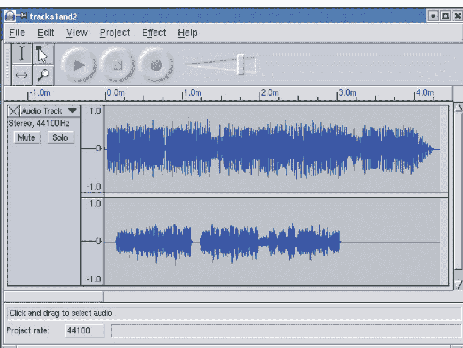

图 6.1：audacity 截图。

但这些都是细节。程序的中心优点在于它具有极其透明且自然的用户界面，在用户和音频文件之间尽可能地减少障碍。

### 6.1.2 案例研究：fetchmail 的 -v 

fetchmail 是一个网络网关程序。它的主要作用是在 POP3 或 IMAP 远程邮件协议与互联网原生的 SMTP 协议之间进行邮件交换。它在使用间歇 SLIP 或 PPP 连接到互联网提供商的 Unix 上被广泛使用，可能占互联网邮件流量的相当比例。

fetchmail 拥有不少于 60 个命令行选项（正如我们在书后部分将确定的，这可能太多了），以及许多其他可以在运行控制文件中设置但不能从命令行设置的选项。在所有这些选项中，最重要的无疑是 -v，即详细选项（verbose option）。

## 6.1 案例研究

当开启 -v 时，fetchmail 会在每次事务发生时将每个 POP、IMAP 和 SMTP 事务转储到标准输出。开发者实际上可以实时看到代码与邮件中继服务器以及它转发的邮件传输协议进行交互。用户可以在错误报告中附带会话记录。示例 6.1 显示了一个代表性的会话记录。

#### 示例 6.1：一个 fetchmail -v 会记录示例。

```
fetchmail: 6.1.0 querying hurkle.thyrs.com (protocol IMAP)
at Mon, 09 Dec 2002 08:41:37 -0500 (EST): poll started
fetchmail: running ssh %8h /usr/bin/imapad
(host hurkle.thyrs.com service image)
fetchmail: IMAP* PREAUTH [42.42.1.0] IMAPrev1 v12.26 server ready
fetchmail: IMAP> A0001 CAPABILITY
fetchmail: IMAP* CAPABILITY IMAP4 IMAPREV1 NAMESPACE IDLE SCAN
SORT MAILBOX-REFERRALS AUTH-LOGIN
THREAD:ORDEREDSELECT
fetchmail: IMAP> A0001 OK CAPABILITY completed
fetchmail: IMAP> A0002 SELECT "INBOX"
fetchmail: IMAP* 2 EXISTS
fetchmail: IMAP> 1 RECENT
fetchmail: IMAP* OK [UIDVALIDITY 1039260713] UID validity status
fetchmail: IMAP* OK [UIDNEXT 23982] Predicted next UID
fetchmail: IMAP* OK FLAGS \Answered \ged \Deleted Draft \Seen]
fetchmail: IMAP* OK [PERMANENTFLAGS]
(\Answered \ged \Deleted Draft \Seen)
Permanent flags
fetchmail: IMAP* OK UNSEEN first unseen in /var/ spool/mail/esr
fetchmail: IMAP> A0002 OK [READ-WRITE] SELECT completed
fetchmail: IMAP> A0003 EXPUNGE
fetchmail: IMAP* A0003 Mail checkpointed, expunged
fetchmail: IMAP> A0004 SEARCH UNSEEN
fetchmail: IMAP* 2
fetchmail: IMAP> A0004 OK
2 messages (seen) esr at hurkle.thyrs.com.
fetchmail: IMAP> A0005 FETCH 1:2 RFC822.SIZE
fetchmail: IMAP* 1 FETCH (RFC822.SIZE 2545)
fetchmail: IMAP* 2 FETCH (RFC822.SIZE 8328)
fetchmail: IMAP> A0005 OK completed
skipping message esr@hurkle.thyrs.com:1 (2545 octets) is not flushed
fetchmail: IMAP> A0006 FETCH 2 RFC822.HEADER
fetchmail: IMAP* 2 FETCH (RFC822.HEADER (1586))
reading esr@hurkle.thyrs.com:2 of (1586 octets)
```

138

第 6 章 透明性


```
fetchmail: SMTP< 220 snark.thyrs.com Sendmail 8.12.5/12.5;
Mon, 9 Dec 2002 08:41:41 -0500
fetchmail: SMTP> EHLO localhost
fetchmail: SMTP< 250-snark.thyrs.com Hello localhost [127.0.0], pleased to meet you
fetchmail: SMTP< 250-STATUSCODES
fetchmail: SMTP< 250-SIZE
fetchmail: SMTP> MAIL FROM:<mutt-dev-owner@mutt.org> SIZE=8328
fetchmail: SMTP< 250-2.0 <mutt-dev-owner@mutt.org>... Sender ok
fetchmail: SMTP> RCPT TO:<eser@localhost>
fetchmail: SMTP< 250-1.5 <eser@localhost>... Recipient ok
fetchmail: SMTP> DATA
fetchmail: SMTP< 354 Mail end, with ".*" on a line by itself
fetchmail: IMAP )
fetchmail: IMAP> A0006 completed
fetchmail: IMAP> A0007 FETCH 2 BODY.PEEK[TEXT]
fetchmail: IMAP> * 2 FETCH (BODY[TEXT]) (6742)
(6742 body octets) ***********************
*************************
fetchmail: IMAP>
fetchmail: A0007 OK completed
fetchmail: SMTP> (EOM)
fetchmail: SMTP< 250-2.1.0 Message accepted for delivery
flushed
fetchmail: IMAP> A0008 STORE 2 +FLAGS (Seen \Deleted)
fetchmail: IMAP> * 2 FETCH (FLAGS \Deleted))
fetchmail: IMAP> A0008 OK completed
fetchmail: IMAP> A0009 EXPUNGE
fetchmail: IMAP> * 2 EXPUNGE
fetchmail: IMAP> * 1 EXISTS
fetchmail: IMAP> * 0 RECENT
fetchmail: IMAP> A0009 OK Expung 1 messages
fetchmail: IMAP> A0010 LOGOUT
fetchmail: IMAP> * BYE hurkle IMAP4rev1 server terminating
fetchmail: IMAP> A0010 OK LOGOUT completed
fetchmail: 6.1.0 querying hurkle.thyrs.com (protocol IMAP)
at Mon, 09 Dec 2002 08:41:42 -0500: polled completed
fetchmail: SMTP> QUIT
fetchmail: SMTP< 221 2.0.0 snark.thyrs.com closing connection
fetchmail: normal termination, status 0
```

## 6.1 案例研究

`-v` 选项让 `fetchmail` 的运行过程变得可发现（通过让你看到协议交互）。这极其有用。我认为它非常重要，以至于编写了特殊代码来屏蔽 `-v` 事务转储中的账户密码，这样它们就可以分发，而无需任何人去编辑其中的敏感信息。

事实证明这是一个明智的决定。至少在专业人士看到会话记录后的几秒内，就报告了十个问题。`fetchmail` 邮件列表上有几位专业人士——事实上，由于大多数 bug 都容易诊断，我很少需要亲自处理它们。

多年来，`fetchmail` 获得了一个相当健固的程序声誉。它可能被配置错误，但很少会直接崩溃。如果认为这与十个 bug 的精确情况可以被迅速发现无关，将是不明明的。

我们可以从这个例子中学习。教训是：不要让你的工具仅仅是事后才考虑，或将它们视为一次性用品。它们是你通往代码的窗口；不要只是在墙上凿洞，要对它们进行装修并上釉。如果你计划维护代码，你将需要深入研究它。

### 6.1.3 案例研究：GCC

`GCC` 是大多数现代 Unix 系统上使用的 GNU 编译器，它也许是透明性工程的一个更好的例子。`GCC` 被组织为一组由驱动程序连接的进程序列。这些阶段有：预处理器、解析器、代码生成器、汇编器和链接器。

前三个阶段中的每个阶段都读取可读格式并输出可读的文本格式（汇编器必须输出链接器必须创建二进制格式，这几乎是定义）。通过 `gcc(1)` 驱动程序的各种命令行选项，你可以看到 C 预处理之后、代码生成之后以及对象代码生成之后的结果——你还可以监控解析和代码生成过程中许多中间阶段的结果。

> 这与 `cc`（第一个 PDP-11 编译器）的结构完全相同。
>
> —— Ken Thompson

回归测试是一种检测在修改软件时引入 bug 的方法。它包括定期对更改的软件使用固定测试输入检查其输出。

在文本方面，在回归测试中，与预期结果的偏差可以通过对中间结果进行简单的文本差异（`diff`）操作来轻松发现和分析；不需要专门的转储分析工具，这些工具可能存在自己的 Bug，而且无论如何，它们都将成为额外的维护负担。

从这个示例中可以提取的设计模式是：驱动程序具有监控开关，这些开关仅仅（但足够地）暴露了组件之间的文本数据流。就像 `fetchmail -v` 选项一样，这些并非事后考虑的，而是为了可发现性而设计的。

## 6.1.4 案例研究：kmail

`kmail` 是随 KDE 环境分发的 GUI 邮件阅读器。`kmail` 的 UI 设计得精雅且良好，具有许多功能，包括自动显示 MIME 多部分中的嵌入图像，以及支持 PGP 密钥加密/解密。它对终端用户友好——我那亲爱但不懂技术的妻子就很喜欢它。

许多用户代理都通过提供一个切换显示所有邮件头的命令（而不是只选择少数几个“发件人”和“主题”），在可发现性方面迈出了一步。`kmail` 的 UI 在此基础上又更进了一步。

运行中的 `kmail` 在其窗口下方的一个单行子窗口中显示状态通知，使用小字体，背景为钢灰色，这显然是模仿 Netscape/Mozilla 状态栏的。当你打开一个邮箱时，它会显示总消息和未读消息计数。这种视觉呈现是不突兀的；你可以很容易忽略这些通知，但如果你想关注它们，也可以轻松做到。

`kmail` 的 GUI 是极好的用户界面设计。它提供了丰富的信息，但不会分散注意力；它避开了我们在第 11 章中提到的理由：对于正常运行的 Unix 工具，最佳策略是保持沉默。作者在增强状态栏的外观方面展现了卓越的品味。

但是，`kmail` 开发者忠实性的程度，直到你必须排查一个发送邮件故障的安装问题时才会变得清晰。当你仔细观察发送过程时，你会发现与远程邮件传输的 SMTP 事务的每一行都会在发生时回显到 `kmail` 状态栏中。

`kmail` 开发者巧妙地避免了一个陷阱，这个陷阱经常让像 `kmail` 这样的 GUI 程序成为故障排除人员的噩梦。大多数具有 `kmail` 目标的设计团队会完全抑制这些消息，担心它们会让蒂莉阿姨受惊，从而让她回到 Windows 系统那种虚假的简单中去。

相反，他们设计了透明性——他们让事务消息显示出来，但又让它们在视觉上容易被忽略。通过正确的呈现方式，他们成功地同时讨好了蒂莉阿姨和她那个修理电脑问题的极客外侄子梅尔文。这是天才的；这是其他 GUI 界面可以也应该模仿的技术。

最终，这些消息的可可见性对蒂莉阿姨有利，因为这意味着梅尔文在尝试解决她的邮件问题时，不太可能因为挫败而放弃手。

这里的教训很明确：降低 UI 的智能只是一半聪明。真正聪明的做法是找到一种方法让细节可访问，但让它们不突兀。

## 6.1.5 案例研究：SNG

`sng` 程序在 PNG 格式和它的全文本表示（SNG 或可脚本网络图形格式）之间转换，后者可以使用普通的文本编辑器进行检查和修改。在 PNG 文件上运行，它生成 SNG 文件；在 SNG 文件上运行，它恢复等效 PNG。这种转换在两个方向上都是 100% 忠实且无损的。

在语法上，SNG 类似于 CSS（层叠样式表），另一种控制图形呈现的语言；这至少在遵循“最小惊讶原则”方面迈了一步。这里有一个测试示例：

### 示例 6.2：一个 SNG 示例

```
#SNG: 这是一个合成 SNG 测试文件

# 我们的第一个测试是一个调色板（类型 3）图像
IHDR:
  width: 16;
  height: 19;
  bitdepth: 8;
  using color: palette;
  with interlace;

# 位深度块示例
sBIT:
  red: 8;
  green: 8;
  blue: 8;

# 示例调色板：三种颜色，其中一种
# 我们将渲染为透明
PLTE:
  (0, 0, 255)
  (255, 0, 0)
  "dark slate gray",

# 建议的调色板
sPLIT (
  name: "A random suggested palette";
  depth: 8;
  (0, 0, 255), 255, 7;
  (255, 0, 0), 255, 5;
  (70, 70, 70), 255, 3;
)

# 查看器实际上会使用这个...
IMAGE:
pixels base64
2222222222222222
2222222222222222
0000001111110000
0000000000000000
0000000000000000
0000000000000000
0000000000000000
0000000000000000
0000000000000000
0000000000000000
0000000000000000
0000000000000000
0000000000000000
0000000000000000
0000000000000000
0000000000000000
0000000000000000
0000000000000000
0000000000000000
0000000000000000
0000000000000000
0000000000000000
0000000000000000
0000000000000000
0000000000000000
0000000000000000
0000000000000000
0000000000000000
0000000000000000
0000000000000000
0000000000000000
0000000000000000
0000000000000000
0000000000000000
0000000000000000
0000000000000000
0000000000000000
0000000000000000
0000000000000000
0000000000000000
0000000000000000
0000000000000000
0000000000000000
0000000000000000
0000000000000000
0000000000000000
0000000000000000
0000000000000000
0000000000000000
0000000000000000
0000000000000000
0000000000000000
0000000000000000
0000000000000000
0000000000000000
0000000000000000
0000000000000000
0000000000000000
0000000000000000
0000000000000000
0000000000000000
0000000000000000
0000000000000000
0000000000000000
0000000000000000
0000000000000000
0000000000000000
0000000000000000
0000000000000000
0000000000000000
0000000000000000
0000000000000000
0000000000000000
0000000000000000
0000000000000000
0000000000000000
0000000000000000
0000000000000000
0000000000000000
0000000000000000
0000000000000000
0000000000000000
0000000000000000
0000000000000000
0000000000000000
0000000000000000
0000000000000000
0000000000000000
0000000000000000
0000000000000000
0000000000000000
0000000000000000
0000000000000000
0000000000000000
0000000000000000
0000000000000000
0000000000000000
0000000000000000
0000000000000000
0000000000000000
0000000000000000
0000000000000000
0000000000000000
0000000000000000
0000000000000000
0000000000000000
0000000000000000
0000000000000000
0000000000000000
0000000000000000
0000000000000000
0000000000000000
0000000000000000
0000000000000000
0000000000000000
0000000000000000
0000000000000000
0000000000000000
0000000000000000
0000000000000000
0000000000000000
0000000000000000
0000000000000000
0000000000000000
0000000000000000
0000000000000000
0000000000000000
0000000000000000
0000000000000000
0000000000000000
0000000000000000
0000000000000000
0000000000000000
0000000000000000
0000000000000000
0000000000000000
0000000000000000
0000000000000000
0000000000000000
0000000000000000
0000000000000000
0000000000000000
0000000000000000
0000000000000000
0000000000000000
0000000000000000
0000000000000000
0000000000000000
0000000000000000
0000000000000000
0000000000000000
0000000000000000
0000000000000000
0000000000000000
0000000000000000
0000000000000000
0000000000000000
0000000000000000
0000000000000000
0000000000000000
0000000000000000
0000000000000000
0000000000000000
0000000000000000
0000000000000000
0000000000000000
0000000000000000
0000000000000000
0000000000000000
0000000000000000
0000000000000000
0000000000000000
0000000000000000
0000000000000000
0000000000000000
0000000000000000
0000000000000000
0000000000000000
0000000000000000
0000000000000000
0000000000000000
0000000000000000
0000000000000000
0000000000000000
0000000000000000
0000000000000000
0000000000000000
0000000000000000
0000000000000000
0000000000000000
0000000000000000
0000000000000000
0000000000000000
0000000000000000
0000000000000000
0000000000000000
0000000000000000
0000000000000000
0000000000000000
0000000000000000
0000000000000000
0000000000000000
0000000000000000
0000000000000000
0000000000000000
0000000000000000
0000000000000000
0000000000000000
0000000000000000
0000000000000000
0000000000000000
0000000000000000
0000000000000000
0000000000000000
0000000000000000
0000000000000000
0000000000000000
0000000000000000
0000000000000000
0000000000000000
0000000000000000
0000000000000000
0000000000000000
0000000000000000
0000000000000000
0000000000000000
0000000000000000
0000000000000000
0000000000000000
0000000000000000
0000000000000000
0000000000000000
0000000000000000
0000000000000000
0000000000000000
0000000000000000
0000000000000000
0000000000000000
0000000000000000
0000000000000000
0000000000000000
0000000000000000
0000000000000000
0000000000000000
0000000000000000
0000000000000000
0000000000000000
0000000000000000
0000000000000000
0000000000000000
0000000000000000
0000000000000000
0000000000000000
0000000000000000
0000000000000000
0000000000000000
0000000000000000
0000000000000000
0000000000000000
0000000000000000
0000000000000000
0000000000000000
0000000000000000
0000000000000000
0000000000000000
0000000000000000
0000000000000000
0000000000000000
0000000000000000
0000000000000000
0000000000000000
0000000000000000
0000000000000000
0000000000000000
0000000000000000
0000000000000000
0000000000000000
0000000000000000
0000000000000000
0000000000000000
0000000000000000
0000000000000000
0000000000000000
0000000000000000
0000000000000000
0000000000000000
0000000000000000
0000000000000000
0000000000000000
0000000000000000
0000000000000000
0000000000000000
0000000000000000
0000000000000000
0000000000000000
0000000000000000
0000000000000000
0000000000000000
0000000000000000
0000000000000000
0000000000000000
0000000000000000
0000000000000000
0000000000000000
0000000000000000
0000000000000000
0000000000000000
0000000000000000
0000000000000000
0000000000000000
0000000000000000
0000000000000000
0000000000000000
0000000000000000
0000000000000000
0000000000000000
0000000000000000
0000000000000000
0000000000000000
0000000000000000
0000000000000000
0000000000000000
0000000000000000
0000000000000000
0000000000000000
0000000000000000
0000000000000000
0000000000000000
0000000000000000
0000000000000000
0000000000000000
0000000000000000
0000000000000000
0000000000000000
0000000000000000
0000000000000000
0000000000000000
0000000000000000
0000000000000000
0000000000000000
0000000000000000
0000000000000000
0000000000000000
0000000000000000
0000000000000000
0000000000000000
0000000000000000
0000000000000000
0000000000000000
0000000000000000
0000000000000000
0000000000000000
0000000000000000
0000000000000000
0000000000000000
0000000000000000
0000000000000000
0000000000000000
0000000000000000
0000000000000000
0000000000000000
0000000000000000
0000000000000000
0000000000000000
0000000000000000
0000000000000000
0000000000000000
0000000000000000
0000000000000000
0000000000000000
0000000000000000
0000000000000000
0000000000000000
0000000000000000
0000000000000000
0000000000000000
0000000000000000
0000000000000000
0000000000000000
0000000000000000
0000000000000000
0000000000000000
0000000000000000
0000000000000000
0000000000000000
0000000000000000
0000000000000000
0000000000000000
0000000000000000
0000000000000000
0000000000000000
0000000000000000
0000000000000000
0000000000000000
0000000000000000
0000000000000000
0000000000000000
0000000000000000
0000000000000000
0000000000000000
0000000000000000
0000000000000000
0000000000000000
0000000000000000
0000000000000000
0000000000000000
0000000000000000
0000000000000000
0000000000000000
0000000000000000
0000000000000000
0000000000000000
0000000000000000
0000000000000000
0000000000000000
0000000000000000
0000000000000000
0000000000000000
0000000000000000
0000000000000000
0000000000000000
0000000000000000
0000000000000000
0000000000000000
0000000000000000
0000000000000000
0000000000000000
0000000000000000
0000000000000000
0000000000000000
0000000000000000
0000000000000000
0000000000000000
0000000000000000
0000000000000000
0000000000000000
0000000000000000
0000000000000000
0000000000000000
0000000000000000
0000000000000000
0000000000000000
0000000000000000
0000000000000000
0000000000000000
0000000000000000
0000000000000000
0000000000000000
0000000000000000
0000000000000000
0000000000000000
0000000000000000
0000000000000000
0000000000000000
0000000000000000
0000000000000000
0000000000000000
0000000000000000
0000000000000000
0000000000000000
0000000000000000
0000000000000000
0000000000000000
0000000000000000
0000000000000000
0000000000000000
0000000000000000
0000000000000000
0000000000000000
0000000000000000
0000000000000000
0000000000000000
0000000000000000
0000000000000000
0000000000000000
0000000000000000
0000000000000000
0000000000000000
0000000000000000
0000000000000000
0000000000000000
0000000000000000
0000000000000000
0000000000000000
0000000000000000
0000000000000000
0000000000000000
0000000000000000
0000000000000000
0000000000000000
0000000000000000
0000000000000000
0000000000000000
0000000000000000
0000000000000000
0000000000000000
0000000000000000
0000000000000000
0000000000000000
0000000000000000
0000000000000000
0000000000000000
0000000000000000
0000000000000000
0000000000000000
0000000000000000
0000000000000000
0000000000000000
0000000000000000
0000000000000000
0000000000000000
0000000000000000
0000000000000000
0000000000000000
0000000000000000
0000000000000000
0000000000000000
0000000000000000
0000000000000000
0000000000000000
0000000000000000
0000000000000000
0000000000000000
0000000000000000
0000000000000000
0000000000000000
0000000000000000
0000000000000000
0000000000000000
0000000000000000
0000000000000000
0000000000000000
0000000000000000
0000000000000000
0000000000000000
0000000000000000
0000000000000000
0000000000000000
0000000000000000
0000000000000000
0000000000000000
0000000000000000
0000000000000000
0000000000000000
0000000000000000
0000000000000000
0000000000000000
0000000000000000
0000000000000000
0000000000000000
0000000000000000
0000000000000000
0000000000000000
0000000000000000
0000000000000000
0000000000000000
0000000000000000
0000000000000000
0000000000000000
0000000000000000
0000000000000000
0000000000000000
0000000000000000
0000000000000000
0000000000000000
0000000000000000
0000000000000000
0000000000000000
0000000000000000
0000000000000000
0000000000000000
0000000000000000
0000000000000000
0000000000000000
0000000000000000
0000000000000000
0000000000000000
0000000000000000
0000000000000000
0000000000000000
0000000000000000
0000000000000000
0000000000000000
0000000000000000
0000000000000000
0000000000000000
0000000000000000
0000000000000000
0000000000000000
0000000000000000
0000000000000000
0000000000000000
0000000000000000
0000000000000000
0000000000000000
0000000000000000
0000000000000000
0000000000000000
0000000000000000
0000000000000000
0000000000000000
0000000000000000
0000000000000000
0000000000000000
0000000000000000
0000000000000000
0000000000000000
0000000000000000
0000000000000000
0000000000000000
0000000000000000
0000000000000000
0000000000000000
0000000000000000
0000000000000000
0000000000000000
0000000000000000
0000000000000000
0000000000000000
0000000000000000
0000000000000000
0000000000000000
0000000000000000
0000000000000000
0000000000000000
0000000000000000
0000000000000000
0000000000000000
0000000000000000
0000000000000000
0000000000000000
0000000000000000
0000000000000000
0000000000000000
0000000000000000
0000000000000000
0000000000000000
0000000000000000
0000000000000000
0000000000000000
0000000000000000
0000000000000000
0000000000000000
0000000000000000
0000000000000000
0000000000000000
0000000000000000
0000000000000000
0000000000000000
0000000000000000
0000000000000000
0000000000000000
0000000000000000
0000000000000000
0000000000000000
0000000000000000
0000000000000000
0000000000000000
0000000000000000
0000000000000000
0000000000000000
0000000000000000
0000000000000000
0000000000000000
0000000000000000
0000000000000000
0000000000000000
0000000000000000
0000000000000000
0000000000000000
0000000000000000
0000000000000000
0000000000000000
0000000000000000
0000000000000000
0000000000000000
0000000000000000
0000000000000000
0000000000000000
0000000000000000
0000000000000000
0000000000000000
0000000000000000
0000000000000000
0000000000000000
0000000000000000
0000000000000000
0000000000000000
0000000000000000
0000000000000000
0000000000000000
0000000000000000
0000000000000000
0000000000000000
0000000000000000
0000000000000000
0000000000000000
0000000000000000
0000000000000000
0000000000000000
0000000000000000
0000000000000000
0000000000000000
0000000000000000
0000000000000000
0000000000000000
0000000000000000
0000000000000000
0000000000000000
0000000000000000
0000000000000000
0000000000000000
0000000000000000
0000000000000000
0000000000000000
0000000000000000
0000000000000000
0000000000000000
0000000000000000
0000000000000000
0000000000000000
0000000000000000
0000000000000000
0000000000000000
0000000000000000
0000000000000000
0000000000000000
0000000000000000
0000000000000000
0000000000000000
0000000000000000
0000000000000000
0000000000000000
0000000000000000
0000000000000000
0000000000000000
0000000000000000
0000000000000000
0000000000000000
0000000000000000
0000000000000000
0000000000000000
0000000000000000
0000000000000000
0000000000000000
000�
tEXT: # Ordinary chunk

text: "Sample SNG";

)

```

# Test file ends
```

该工具的意义在于允许用户编辑不支持的各种内容。与其编写处理 PNG 的专用代码，用户可以简单地将图像转换为全文本表示，进行编辑，然后将其还原。在版本控制系统下，文本文件比二进制块更容易管理，而且对 SNG 进行差异操作实际上有产生有用信息的可能。然而，这里的收益不仅在于节省了编写专用代码的时间。它通过使整个内容变得可发现，提高了透明度。

## 6.1.6 案例研究：terminfo 数据库

`terminfo` 数据库是视频终端序列的集合。每个条目描述了在终端屏幕上执行各种操作的转义序列，例如插入或删除行、从光标位置到行尾擦除、开始和结束反色显示、下划线或链接。

`terminfo` 数据库主要由 `curses(3)` 库使用。这些库是我们在第 11 章中讨论的“roguelike”界面风格的基础，以及一些非常广泛使用的程序，如 `mutt(1)`、`lynx(1)` 和 `slrn(1)`。虽然运行在位图显示器上的终端模拟器（如 `xterm(1)`）包含了对 ANSI X3.64 标准和 VT100 终端细微变化的所有功能，但差异仍然足够大，将功能硬编码到应用程序中是一个坏主意。`terminfo` 也值得研究，因为逻辑上与所解决的问题相似的问题不断出现在其他没有标准方式报告自身能力的外围硬件中。

`terminfo` 设计受益于对更早的能力格式 `termcap` 的经验。`termcap` 描述的数据库以文本格式存储在用一个大文件 `/etc/termcap` 中；虽然这现在已经过时，但我们的 Unix 系统大多数包含一个副本。

通常，用于查找你的终端类型条目的键是环境变量 `TERM`，为了本案例研究的目的，它由 `magic` 设置。使用 `terminfo`（或 `termcap`）的应用程序在启动延迟上付出了很小的代价；当 `curses(3)` 库初始化时，它必须查找与 `TERM` 对应的条目并将其加载到内存中。

对 `termcap` 的经验表明，启动开销主要来自于解析能力文本表示所需的时间。因此，`terminfo` 条目是可以序列化和反序列化的二进制结构。

> 实际上，`TERM` 是系统在登录时设置的。对于串口上的实际终端，从 tty 行到 `TERM` 值的映射是在启动时从系统配置设置的；细节在 Unix 之间存在差异。终端模拟器如 `xterm(1)` 会自己设置这个变量。

## 6.1 案例研究

快速地。整个数据库有一个主用文本格式，即 `terminfo` 能力。该文件（或单独条目）可以使用 `terminfo` 编译器 `tic(1)` 编译为二进制格式；而二进制条目可以通过 `infocmp(1)` 反编译为可编辑的文本格式。


这种设计精妙地违背了我们在第 5 章中反对使用二进制缓存的建议，但这实际上是该策略非常有效的极端情况。对文本主用文件的修改非常罕见——事实上，Unix 在发布时通常会带有预编译的 `terminfo` 数据库，而文本主文件主要作为文档使用。因此，通常会阻碍这种方法的同步和不一致问题在这里几乎不会发生。

`terminfo` 的设计者本可以通过另一种方式来优化速度。整个二进制条目数据库可以放在某种不透明的数据库文件中。但他们采取的办法更聪明，也更符合 Unix 精神。`terminfo` 存在于目录层次结构中，在现代 Unix 上通常位于`/usr/share/terminfo`。请参考`terminfo(5)`手册以查找其在你系统上的位置。

如果你查看 `terminfo` 目录，你会看到用简单的可打印字符命名的子目录。每一个子目录都是名称以该字符开头的终端类型的条目。这种组织方式的目的是避免对非常大的目录进行线性搜索；在更现代的 Unix 文件系统中（它们使用 B 树或其他针对快速查找优化的结构来表示目录），子目录将不再是必要的。

> 我发现，即使是在一个相当类 Unix 的系统上，将二进制目录拆分为子目录也能显著提高性能。那是有数万个文件，是一个大型教育机构的授权用户数据库，运行在运行 DEC Unix 的后期型号 DEC Alpha 机器上。（以名称的首字母和尾字母命名的子目录——例如，“johnson”会放在“jn”目录中——是我们我们使用的方案中最糟糕的。使用前两个字母的效果没那么好，因为有很多有很多系统生成的名称，它们仅在末尾处不同。）这可能说明复杂的目录索引仍然没有应该的那么普遍……但尽管如此，这让一个不依赖它就能良好运行的组织比一个需要依赖索引的组织更具移植性。

> —Henry Spencer

因此，打开一个 `terminfo` 条目的代价是两次文件系统查找和一个文件打开操作。但由于从一个大数据库中挖掘同一个条目需要对数据库进行一次查找和打开，因此 `terminfo` 组织的增量成本最多是一次文件系统查找。实际上，它比这还要小；它是一次文件系统查找与大数据库可能使用的任何检索方法之间的成本差异。这可能是微乎其微的，在应用程序启动时执行一次完全是可以接受的。

Terminus 使用文件系统本身作为一个简单的层次结构数据库。这是一个极佳的建设性偷懒，遵循了经济原则和透明性原则。这意味着所有用于导航、检查和修改文件系统的普通工具都可以使用；不需要编写和调试特殊的工具（除了用于打包和解包单个记录的`tic(1)`和`infcmp(1)`）。它也意味着加速数据库访问的工作将成为加速文件系统的工作，而对文件系统的调优将比仅仅让`curses(3)`用户受益让更多应用程序受益。

这种组织方式还有一个额外的优势，这在 `terminfo` 案例中并没有出现：你可以使用 Unix 的权限机制，而不是被迫发明自己带有各种 Bug 的访问控制层。这是采用 Unix “一切皆文件”哲学的必然结果，而不是试图去拟合该哲学。

`terminfo` 的布局在大多数 Unix 系统上空间效率低下。条目通常在 400 到 1400 字节之间，但文件系统为每个非空磁盘文件分配最小 4K。设计者接受这一点的原因与他们选择基本二进制格式的原因相同，为了将 `terminfo` 程序的启动延迟降到最低。自那以后磁盘容量爆炸了千倍，这证明了那个决定的正确。

与 Windows 注册表文件的格式对比具有启发性。注册表是 Windows 和应用程序都使用的属性数据库。每个注册表存在于一个大文件中。注册表包含文本和二进制数据的混合，需要特殊的编辑工具。一个大文件的方法导致了臭名昭著的“注册表膨胀”现象；随着新条目的不断添加，平均访问时间无限制增长。由于系统没有提供用于编辑注册表的标准 API，应用程序使用临时代码来编辑它们，这使得它们极易受到损坏，并可能锁住整个系统。

将文件系统作为满足简单数据库需求的策略是值得模仿的。不这样做的理由可能更多是因为数据库键自然上看起来不像文件名，而不是由于任何性能问题。无论如何，这在原型设计中是一个非常有用的事实。

### 6.1.7 案例研究：Freeciv 数据文件

Freeciv 是一款受 Sid Meier 经典游戏《文明 II》启发的开源策略游戏。在游戏中，每个玩家都从一群流浪牧民开始并建立文明。玩家文明可以探索和殖民世界、进行战争、参与贸易并研究技术进步。某些玩家实际上是人工智能；与他们进行单人游戏可能具有挑战性。胜利者要么通过征服世界，要么是第一个达到足够技术水平以派遣飞船前往阿尔法座星的玩家。来源和文档可以在项目网站 <http://www.freeciv.org/> 获取。

在第 7 章中，我们将展示 Freeciv 策略游戏作为客户端-服务器划分的示例，服务器维护共享状态，而客户端专注于 GUI 展示。但这个游戏还有另一个架构特征：游戏的大部分数据并非硬编码在服务器代码中，而是通过服务器启动时读取的属性注册表。游戏的注册表以文本文件格式编写，作为字符串（带有相关的数值属性）输入各种内部列表（如名称和单元类型）。该格式有一个指令，可以将游戏数据拆分为语义单元（不同的文件）。这种设计选择一直到了这种程度：即可以在完全不接触服务器代码的情况下，通过在数据文件中创建新声明来定义新的国家和单元类型。

Freeciv 的启动解析具有一个使两个设计规则产生交叉的特性，因此值得仔细检查。服务器会忽略它不知道如何使用的属性名称。这使得声明服务器不使用的属性而不会破坏启动解析。这意味着游戏数据（策略）的发展与服务器引擎（机制）可以干净地分离。另一方面，这也意味着启动解析无法捕捉缺失的属性名称。这种静的失败似乎违反了修复原则。

为了解决这种冲突，请注意服务器的工作是使用注册表数据，但仔细检查数据的任务可以交给另一个程序，在每次修改注册表时由人类运行。一种 Unix 解决方案是一个独立的审计程序，它通过分析机器可读的规则规范或服务器代码来确定其提供的属性集，解析 Freeciv 注册表以确定其提供的属性集，并准备差异报告。

所有 Freeciv 数据的聚合在功能上类似于 Windows 注册表，甚至使用了类似于注册表文本部分的语法。但我们在 Windows 注册表中注意到的膨胀和损坏问题在这里不会出现，因为没有程序（无论是 Freeciv 套件内部还是外部）写入这些文件。它是一个仅由游戏维护者编辑的只读注册表。

Unix 下此类验证程序的鼻祖是 `lint`，一个独立编译器的 C 代码验证器。尽管 GCC 已经吸收了它的功能，老手仍然倾向于将运行验证器的过程称为“linting”，这个名称在`xllint`等工具中保留了下来。

```
# 148

# 第 6 章 透明性

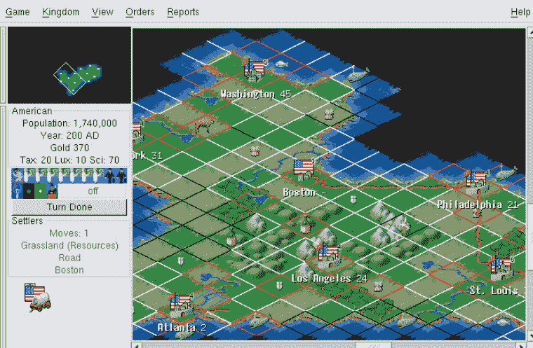

(server_prompt); 'start'

Game: Player 'Palmiro Togliatti' now has AI level 'easy'.

Game: Player 'Elendil' now has AI level 'easy'.

Game: Player 'Gandhi' now has AI level 'easy'.

Game: Player 'Kocel' now has AI level 'easy'.

Game started.
```


图 6.3：Freeciv 游戏的主窗口。

数据文件解析对性能的影响被降最低，因为对于每个文件，该操作仅在客户端或服务器启动时执行一次。

## 6.2 针对透明性和可发现性进行设计

为了针对透明性和可发现性进行设计，你需要应用所有保持代码简单的策略，并专注于你的代码作为一种与其他人类进行沟通的方式。在问完“这个设计可行吗？”之后，第一个要问的问题是“其他人能读得懂吗？它优雅吗？”我们希望现在已经清楚，这些问题并不是空谈，而优雅并非一种奢侈品。人类对软件的反应中这些品质，对于减少 Bug 的产生和增加其长期维护性至关重要。

### 6.2.1 透明性的禅意

在这一章到目前为止我们检查的示例中出现了一种模式：如果你想要透明的代码，最有效的途径就是简单地不要对你用代码操作的内容堆叠过多的抽象。

在第 4 章关于“解离的价值”的章节中，我们的建议是抽象、简化和泛化，试图从提出设计问题时的特定、偶然条件中解离出来。这种抽象的建议实际上与我们正在培养的反对过度抽象的建议并不矛盾，因为“摆脱假设”和“摆离你试图解决的问题”之间是有区别的。我们在开发“胶水层需要保留”这一理念时，正是在源于这一点之一。

禅宗的主要教训之一是我们通常通过由欲望产生的偏见和固定观念构成的迷雾来观察世界。要达到启悟，我们必须遵循禅，不仅是为了放下欲望和执着，更是为了体验事物的本来真相——而不让偏见和固定观念成为障碍。

这是对软件设计者来说极佳的务实建议。它是经典 Unix 极简主义隐含的一部分。软件设计者是聪明的人，他们会对他们处理的应用程序形成想法（抽象）。他们围绕这些想法来组织他们编写的软件。然后，在调试时，他们往往会发现自己很难看透这些想法看到实际上正在发生什么。

任何禅师都能立即识别出这个问题，大喊一声“三斤亚麻”，并可能会给学生一点教训。⁶ 有意识地设计透明性是解决这一问题稍不那么神秘的方法。

在第 4 章中，我们对面向对象的编程进行了批评，其方式对于那些在 20 世纪 90 年代面向对象福音下长大的程序员来说可能有些震惊。面向对象的设计往往不会过度复杂，但我们观察到它往往确实如此。太多的面向对象设计是“是（is）”和“拥有（has）”关系的意大利面般的纠缠，功能堆叠了厚厚的胶水层，其中许多对象的出现似乎仅仅为了在阶梯抽象金字塔中占据位置。这样的设计是透明性的反面；它们是（众所周知的）透明且难以调试的。

正如我们之前提到的，Unix 程序员是模块化的原始狂热分子，但我们倾向于用一种更安静的方式来处理。保留胶水层是其中的；更广泛地说，我们的传统教导我们构建更底层，用设计为简单且透明的算法和结构紧贴地面。

⁶ * 参见《无门关》中名为“东山三斤亚麻”的公案。

### 6.2.2 针对透明性和可发现性进行编码

与禅艺术一样，良好的 Unix 代码的简单性取决于严格的自律和高水平的手艺，这两者在偶然检查中并不一定显而易见。透明性是一项艰苦的工作，但仅仅出于艺术原因也是值得的。与禅艺术不同，软件需要调试——通常在整个生命周期内都需要持续维护、向前移植和适配。因此，透明性更多地是一种美学胜利；这种胜利将反映在软件整个生命周期内成本的降低。

透明性和可发现性像模块化一样，是设计的属性属性，而不是代码的。仅仅正确处理低级风格元素（例如以清晰一致的方式缩进代码或拥有良好的变量命名规范）是不够的。这些品质更多地与那些通过检查不明显的代码属性有关。这里有几点值得思考：

- 你的过程层级的最大静态深度是多少？也就是说，不排除递归，人类为了理解代码的操作可能需要在脑海中建模多少层调用？提示：超过四层，务必小心。

- 代码是否具有既强大又可见的不变属性？不变属性有助于人类推演代码并检测问题情况。

- 你的 API 中的函数调用是否是相互正交的，还是说它们有太多的魔数标志（magic flags）和模式位，导致单次调用执行多个任务？避免模式标志可能会完全导致 API 充斥着过多的相同函数，但反向错误（大量容易忘记和混淆的模式标志）甚至更为常见。

> 7. 不变性是软件设计的一种属性，它被其中的每一个操作所保持。例如，在大多数数据库中，没有两个记录具有相同的键是不变属性。在正确处理字符串的 C 程序中，每个字符串在退出时必须包含一个终止 NUL 字节。在一个库存系统中，零件数量不能小于零。

- 还是分散在许多难以找到的全局变量或对象中？

- 你的程序中的数据结构或类与它们代表的世界实体之间是否存在清晰的一一映射？

- 找到给定函数的代码部分容易吗？你对整个代码库的可读性投入了多少关注？

- 代码是增加了特例还是避免特例？每个特例都可能与其他特例产生相互作用；所有潜在的冲突都是等待发生的 Bug。但更重要的是，特例让代码更难理解。

- 代码中有多少魔数（未解释的常量）？通过检查容易发现实现的限制（例如关键缓冲区大小）吗？

代码简单越好。但如果它很好地回答了问题，它可以非常复杂而不会给人类维护者带来不可接受的认知负担。

读者可能会发现将其与我们在第 4 章关于模块化的检查清单进行对比很有启发。

确实，可以在用户界面设计者预测的狭窄范围之外任何地方与其进行交互。

糟糕的是，那些对自身行为不透明的程序往往在内部嵌入了许多假设，在任何设计者未预料到的情况下都会表现得令人沮丧、脆弱或二者兼有。那些看起来很华丽但在压力下就会崩溃的工具并不具备良好的长期价值。

Unix 倡使程序具有灵活性，以适应更广泛的用途和故障排除情况，包括能够向用户展示其愿意处理的尽可能多的状态和活动信息。这对于故障排除是有益的；对于培养更聪明、更自力更强的用户也有有益。

## 6.2.4 透明性与可编辑表示

从这些示例中得出的另一个主题是：将问题从透明度难以实现的领域转换到易于实现的领域是有价值的。Audacity、`sng(1)` 和 `tic(1)/infocmp(1)` 对都具有这一属性。它们操作的对象并不易于手眼协调；音频文件不是视觉对象，而 PNG 格式表示的图像是视觉的，但 PNG 注释块（chunks）的复杂性却不是。三个应用程序通过将其二进制格式的操作转换为人类可以更容易应用其从日常经验中获得的直觉和能力的问题。

所有这些示例遵循的一条规则是：它们尽可能地减少对表示形式的破坏——事实上，它们是可逆且无损的转换。这一属性非常重要，即使目前对这种 100% 的保真度没有明显的需求，也值得实现。它让潜在用户充满信心，认为他们可以进行实验而不会损坏自己的数据。

我们在第 5 章中讨论过的所有文本数据文件格式的优势，也适用于 `sng(1)`、`infocmp(1)` 及其类程序生成的文本格式。对于 `sng(1)` 来说，一个重要点是通过脚本机械化生成 PNG 图像注释——因为 `sng(1)` 的存在，编写这些脚本变得更容易了。

当你面对涉及编辑某种复杂二进制对象的设计问题时，Unix 鼓励首先询问你是否可以编写一个类似于 `sng(1)` 或 `tic(1)/infocmp(1)` 对的工具，将其无损地映射到可编辑的文本格式并反之。这类程序还没有确认的术语，但我们称之为为文本化器（textizers）。

如果二进制对象是动态生成的或非常大，那么用文本化器捕捉所有状态可能是不现实或可能的。在这种情况下，等效的任务是编写一个浏览器。范式示例是 `fsdb(1)`，Unix 下的文件系统调试器；Linux 下的对应品是 `debugfs(1)`。用于浏览 PostgreSQL 数据库的 `psql(1)` 以及用于查询配备 SAMBA 的 Linux 机器上的 Windows 文件共享的 `smclient(1)` 程序是另外两个。

这五个程序都是简单的 CLI 程序，可以由脚本和测试套件驱动。

编写一个文本化器或浏览器至少从四个原因来看是一项有价值的练习：

-   极佳的学习体验。可能存在其他同样的方法来学习对象的结构，但没有明显更好的方法了。
-   你获得了转储结构内容以进行检查和调试的能力。因为这种工具让转储变得简单，你会更频繁地这样做。你会获得更多信息，可能导致深刻的见解。
-   你获得了易于生成测试负载和异常用例的能力。这意味着你更有可能探测对象状态空间中的奇特角落——并破坏相关的软件，以便你可以在它真正崩溃之前修复它。
-   你获得了可能可以重用的代码。如果你在编写浏览器/文本化器时非常小心，并将 CLI 解释器与序列化/反序列化库保持适当分离，你可能会发现你编写的代码可以用于你的实际应用程序。

在你完成之后，你很可能发现可以使用“分离与接口”模式（见第 11 章），并将你的文本化器/调试器作为引擎。这种模式的所有通常优势都将适用。

文本化器能够读写即使是损坏的二进制对象是有理想的，尽管这通常很困难。一方面，它让你生成损坏的测试用例对软件进行压力测试；另一方面，它可以让应急修复变得容易得多。处理对象结构被搞乱的情况可能，但至少你应该处理结构内容毫无意义的情况，例如，通过十六进制显示无意义的值并将十六进制转换回原始值。

> —Henry Spencer

## 6.2.5 透明性、故障诊断与故障恢复

透明性的另一个好处（与易于调试有关）是，系统在 bug 出现后更容易执行恢复操作——而且通常对 bug 造成的损害更具抵抗力。

在比较 `terminfo` 数据库与 Windows 注册表时，我们注意到注册表极易被有 bug 的应用程序代码腐损坏。这可能导致整个系统不可用。如果系统没有崩溃，由于损坏混淆了专门的注册表编辑工具，恢复可能会变得困难。

## 第 6 章 透明性

我们的 Unix 案例研究说明了透明性设计如何防止这类问题。由于 `terminfo` 数据库不是一个文件，弄坏 `terminfo` 条目不会导致整个 `terminfo` 数据集不可用。像 `termcap` 这样的全文本格式通常使用解析方法（不像二进制流转储），可以从单点错误中恢复。SVG 文件中的语法错误可以手动纠正，而不需要可能拒绝加载损坏 PNG 的专用编辑器。

回到 `kmail` 案例研究，该程序让故障诊断变得更容易，因为它遵循“修复规则”：SMTP 失败是有噪音的，而且这种噪音很有用。你不需要解码 `kmail` 生成的一层模糊信息就能看到与 SMTP 服务器交互的真实情况。你只需要查看正确的地方即可，因为 kmail 是透明的，并且没有丢弃错误状态信息。（SMTP 本身是文本化的，其事务对人类是可读的，这也有所帮助。）

文本化器和浏览器等可发现性工具也让故障诊断变得更容易。我们已经提到一个原因：它们让检查系统状态变得更容易。但还有另一个效应；数据的文本化版本具有用的冗余（例如，使用空格进行视觉分割，同时使用分隔符进行解析）。这些设计是为了便于人类阅读，但也产生了使其数据更易抵抗点故障导致的不可逆破坏的效果。PNG 文件中的损坏块是可以恢复的，但人类模式识别和上下文推理的能力可能修复等效 SNG 格式。

反复，健壮性规则是显而易见的。简单加透明性降低了成本，减轻了每个人的压力，并让人们专注于新问题而不是清理旧错误。

## 6.3 为可维护性设计

软件的可维护性取决于非作者在多大程度上完全理解并修改它。Unix 程序员拥有大量关于什么是可维护代码的隐性知识，因为 Unix 源码可以追溯到几十年前。由于我们在第 17 章将讨论的原因，Unix 程序员学会了丢弃并重建，而不是修补肮脏的代码（见第 1 章 Rob Pike 对此主题的沉思）。因此，任何在十多年进化压力下生存下来的源码都经过了可维护性的筛选。这些老牌、成功的、良好的具有可维护代码的项目是社区的实践典范。

## 6.3 为了可维护性设计

Unix 程序员——尤其是开源社区的 Unix 程序员——在评估工具时学会了问一个问题：“这段代码是活的、休眠的还是死掉的？”活代码拥有一个活跃的开发者社区。休眠代码通常是因为维护它的痛苦超过了它对创始者的效用而变得休眠的。死代码已经休眠了太久，以至于从头重新实现一个等的功能要简单得多。如果你想让你的代码保持活力，投入精力使其具有可维护性（从而对未来的维护者产生吸引力）将是你能花费时间的最有效的方式之一。

设计得既透明又易于发现的代码，在向可维护性方面迈出了巨大一步。但我们在本章的示例项目中还观察到了其他我们可以模仿的实践。

一个重要的实践是“清晰性规则”（Rule of Clarity）的应用：选择简单的算法。在第 1 章中，我们引用了 Ken Thompson 的话：“如果不确定，就用穷举法”。Thompson 理解复杂算法的全部代价——不仅是它们在初始实现时更容易产生 bug，而且对于后来的维护者来说更难理解。

另一个重要的实践是包含“黑客指南”（hacker’s guides）。在源码分发中，包含非正式描述代码中关键数据结构和算法的指南文档一直是非常高度认可的行为。事实上，Unix 程序员在编写黑客指南方面往往比编写最终用户文档要擅长得多。

开源社区利用并详化了这一习俗。除了给未来维护者的建议外，开源项目的黑客指南还为了方便偶然的贡献者添加功能或修复 bug。`fetchmail` 的设计具有代表性。Linux 内核源码就有几十个这样的文档。

在第 19 章中，我们将描述 Unix 开发者演化出的约定，用于使得源码分发易于检查且易于构建运行代码。这些实践也促进了可维护性。

## 7 多程序设计：通过分离进程来分离功能

如果我们相信数据结构，我们就必须相信独立的（因此是同步的）处理。否则，我们为什么要在结构内部收集项呢？我们为什么要容忍那些只给我们其中一个而不给后者的语言？

> 《编程中的格言》，出自 ACM SIGPLAN (Vol 17 #9, 1982)
—Alan Perlis

Unix 最具特征的程序模块化技术是将大型程序拆分为多个协作进程。这在 Unix 世界中通常被称为“多处理”（multiprocessing），但在书中我们复兴了较旧的术语“多程序”（multiprogramming），以避免与模糊的多处理器硬件实现产生混淆。

多程序设计是一个特别模糊的领域，很少关于良好实践的准则。许多对如何拆分子程序具有极佳判断力的程序员，在编写整个应用程序时，仍然会将它们写成巨大的单进程单体结构，并最终在自身的内部复杂性面前崩溃。

Unix 风格的设计在协作程序层面以及程序内协作例程层面，都应用了“只做好一件事”的方法，强调通过定义良好的进程间通信或共享文件连接的小型程序。因此，Unix 操作系统鼓励我们将程序拆分为更简单的子进程，并关注这些子进程之间的接口。它通过以下至少三种基本方式实现这一点：

- 通过让进程创建变得廉价；
- 通过提供方法（调用 shell 命令、I/O 重定向、管道、消息传递和套接字）使得进程通信相对容易；
- 通过鼓励使用简单、透明的文本数据格式，这些格式可以通过管道和套接字传递。

廉价的进程创建和易的进程控制是 Unix 风格编程的关键推动者。在像 VAX VM 这样的操作系统上，启动进程既昂贵缓慢又需要特殊权限，人们必须构建单体结构，因为没有选择。幸运的是，Unix 家族的趋势一直是更低的 `fork(2)` 开销而非更高。Linux 特别是在这方面高效而闻名，在许多其他操作系统上，它的进程创建比线程创建还要快。

从历史上看，许多 Unix 程序员通过 Shell 编程被鼓励以多个协作进程的角度思考。Shell 使得能够容易地设置一组通过管道连接的多个进程，并运行在后台、前台或两者的混合之中。

在本章的剩余部分中，我们将研究廉价进程创建的影响，并讨论如何以及应用管道、套接字和其他进程间通信（IPC）方法将你的设计划分为协作进程。在下一章中，我们将“功能分离”的哲学应用于接口设计。

虽然将程序拆分为协作进程的好处是减少全局复杂性，但代价是我们必须更关注用于在进程间传递信息和命令的协议设计。在各种软件系统中，bug 都会汇集在接口处。

在第 5 章中，我们查看了这一设计的较低层次——如何布局具有灵活性和扩展性的应用程序。但问题还有一个更高的层次，而我们曾心不在意地忽略了。那就是为通信的每一侧设计状态机的问题。

考虑到如 SMTP、BEEP 或 XML-RPC 这样的模型，将良好的风格应用于应用程序协议的语法并不困难。真正的挑战不是协议语法，而是协议——设计一种既足够表达力又无死锁的协议。

> 1. 参见，例如《Improving Context Switching Performance of Idle Tasks under Linux [Appleton] 中引用的结果。

## 7.1 将复杂性控制与性能调优分离

同样重要的是，协议必须被认为是有表达力的且无死锁的；试图在脑海中模拟通信程序的行为并验证其正确性的人类必须能够。

因此，在我们的讨论中，将关注在每种进程间通信中自然使用的协议逻辑。

不过，首先，我们需要排除几个假命题。我们的讨论将不是关于使用并发来提高性能的。在开发能够最小化全局复杂性的纯洁架构之前考虑这一点是过早优化，是万恶之源（详见第 12 章）。

相关的假命题是线程（即共享内存地址空间的多个并发进程）。线程是一种性能黑客。为了避免长长的偏题，我们将在本章末尾详细检查线程；总结是它们并没有减少全局复杂性，反而增加了它，并且在万迫的情况下应避免。

另一方面，遵守模块化规则不是一个假命题；这样做会让你的程序——以及你的生活——变得更简单。分区的所有理由与我们在第 4 章中开发的模块划分的理由是一致的。

将程序拆分为协作进程的另一个重要理由是为了更好的安全性。在 Unix 下，必须由普通用户运行但必须访问安全敏感系统资源的程序通过一种名为 `setuid` 位的功能获取访问。可执行文件是持有 `setuid` 位的最小代码单元；因此，setuid 程序中的每一行代码都必须执行。（然而，良好的 setuid 程序会先执行所有特权操作，然后在剩余生命周期内将权限降至用户级。）

通常，setuid 程序只需要为了一个或少数几个操作拥有特权。通常可以将此类程序拆分为协作进程：一个需要 setuid 的较小进程和一个不需要的较大进程。当我们这样做时，只需要信任较小进程中的代码。这在很大程度上是因为

- 2. 一个 setuid 程序运行时不使用调用者的权限，而是使用可执行文件所有者的权限。该功能可以实现对非管理员不被允许直接修改的密码文件进行受限的、程序控制的访问。

这种划分和委托机制使得 Unix 在安全记录方面比其竞争对手具有更好的表现^3。

## 7.2 Unix IPC 方法的分类

从单进程程序架构来看，最简单的组织方式就是最好的。本章的剩余部分将按照编程复杂度从低到高的顺序介绍 IPC 技术。在使用较后的、更复杂的技术之前，你应该通过演示（使用原型和基准测试结果）来证明，没有更早、更简单的技术可以满足需求。通常，你会发现自己很惊讶。

### 7.2.1 将任务交给专门程序

在由廉价进程创建支持的最简单程序间协作形式中，一个程序运行另一个程序来完成特定任务。由于被调用程序通常通过 *system(3)* 调用被指定为 Unix shell 命令，因此这种行为通常被称为向被调用程序“外壳”（*shelling out*）。被调用程序继承用户的键盘和显示器，并运行到结束。当它退出时，调用程序恢复对键盘和显示器的控制权并继续执行^4。由于调用程序在执行期间不与被调用程序通信，因此在这种协作中协议设计不是问题，除非在微不足道的意义上，调用者可能会向被调用者传递命令行参数以改变其行为。

外壳调用的经典案例是从邮件或新闻程序中调用编辑器。在 Unix 传统中，人们不会将专门构建的编辑器封装进需要通用文本编辑输入的程序中。相反，它允许用户在需要编辑时指定一个他们选择的编辑器来被调用。

专门程序通常通过文件系统与其父进程通信，读取或修改指定位置的文件；这就是编辑器或邮件发送程序的工作原理。

在这种模式的常见变体中，专门程序可能通过其标准输入接受输入，并使用 C 库入口 *popen* ( , "w*) 或作为 shell 脚本的一部分被调用。或者它可能将输出发送到标准输出，并通过 popen(..., "r") 或作为脚本的一部分调用。（如果它从标准输入读取并写入输出，它将以批处理模式进行，在执行任何写入之前完成所有读取。）这种子进程通常不被称为 shellout；它没有标准的术语来描述它，但它完全可以被称为“插件”（'bolt-on'）。

所有这些情况的关键点在于运行。它们让专门程序在运行时与父进程进行握手。它们仅在微不足道的意义上拥有关联协议，即无论哪个程序（主或从）从另一个程序接收输入并必须进行解析。

### 7.2.1.1 案例研究：Mutt 邮件用户代理

Mutt 用户代理是 Unix 邮件程序中最重要的设计传统的现代代表。它具有一个简单的以屏幕为导向的界面，带有单按键命令用于浏览和阅读邮件。

当你使用 mut 作为邮件编写器时（通过将地址作为命令行参数调用它，或通过使用回复命令之一），它会检查进程环境变量 EDITOR，然后生成一个临时文件名。EDITOR 变量的值被作为一个命令，并将模板名称作为参数处理。当该命令终止时，mut 恢复运行，假设临时文件包含了所需的邮件。

几乎所有的 Unix 邮件和网络新闻撰写程序都遵循相同的约定。正因为如此，邮件编写器的实现人员不需要编写百种不同的编辑器，用户也不需要学习百种不同的界面。在内部，用户可以随身携带他们选择的编辑器。

该策略的一个重要变体是外壳调用一个小型代理程序，该代理程序将专门的任务传递给已经运行的大程序实例（例如编辑器或 Web 浏览器）。因此，通常在 X 显示器上运行着 emacs 实例的开发者可以设置 EDITOR=emacsclient，并在编辑时让他们的 emacs 弹出一个缓冲区。此点的意义并不是为了节省内存或其他资源，而是为了让用户能够在单个 emacs 进程中统一所有编辑（例如，缓冲区之间的剪切和粘贴可以携带内部的 emacs 状态信息，如字体高亮）。

### 7.2.2 管道、重定向和过滤器

在 Ken Thompson 和 Dennis Ritchie 之后，早期 Unix 最重要的塑造者可能是 Doug McIlroy。他发明的管道结构在 Unix 设计中产生了回响，鼓励了其初生的“只做好一件事”哲学，并启发了 Unix 设计中大多数最新的 IPC 形式（特别是用于网络编程 socket 抽象）。

管道依赖于一种约定：每个程序最初都可以使用（至少）两个 I/O 数据流：标准输入和标准输出（分别为文件描述符 0 和 1）。许多程序可以写成过滤器，它们从标准输入顺序读取并写入标准输出。

通常情况下，这些流分别连接到用户的键盘和显示器。但 Unix shell 通用地支持重定向操作，可以将标准输入和输出流连接到文件。因此，输入

```


`ls >foo`

会将目录列表器(1) 的输出发送到名为`foo`的文件。另一方面，输入：

```
wc <foo
```

会导致目录列表器(1) 的输出发送到名为`foo`的文件。（等一下，逻辑是：`wc`从`foo`读取）。

实际上，输入：

```
ls | wc
```

会将目录列表器(1) 的输出发送到（注：此处原文可能有误）。管道操作将一个程序的标准输出连接到另一个程序的标准输入。以这种方式连接的程序链被称为流水（pipeline）。需要注意的是，流水中的所有阶段都会运行。每个阶段都等待下一阶段的输入。这种这样组合程序的能力非常有用。但这里真正的胜利不是可爱的组合；真正的胜处在于避免了代码膨胀并减少了全局复杂度。作为额外，如果需要自定义分页器行为，可以在一个地方完成，存在多个分页器对所有向标准输出的应用程序都有用。

事实上，这确实发生了。在现代 Unix 上，`more(1)`很大程度上被`less(1)`取代，后者增加了向上滚动显示文件的能力，而不仅仅是向前。由于`less(1)`与使用它的程序解耦，可以在你的 shell 中将`more`别名为`less`，将环境变量`PAGER`设置为`less`（见第10章），并为所有向标准输出的应用程序获得更好分页器的好处。

流水有许多用途。例如，Unix 的进程`ls(1)`列出到标准输出，而不担心长列表会滚动得快到用户看不清。Unix 有另一个程序`more(1)`，它按屏幕大小显示标准输入，并在显示每个屏幕后提示按键。因此，如果用户输入`ps | more`，将`ps(1)`的输出管道到`more(1)`的输入，每次按键都会显示进程列表的后续。

管道的主要缺点是它是单向的。流水无法传递控制（在这种情况下阶段将收到`SIGPIPE`）。因此，传递数据的协议取决于接收方。

到目前为止我们讨论了匿名管道。还有一种变体称为命名管道，它是一种特殊文件。如果两个程序打开该文件，一个读取，一个写入，命名管道就像它们之间的管道。命名管道已很大程度上被 socket 取代，我们将在下讨论。（有关这一遗留物的更多信息，请参见 System V。）

- 3. 即，根据总互联网暴露的小时计算的安全违规记录具有更好的表现。
- 4. 编写 shellout 的常见错误是忘记在子进程运行时在父进程中阻塞信号。如果没有这种预防措施，对子进程的中断对父进程产生意外的副作用。
- 5. 实际上，上述内容略有简化。有关其余部分，请见第10章中关于`EDITOR`和`VISUAL`的讨论。
- 6. `less(1)`的手册页通过观察“Less is more”来解释其名称。

## 7.2.2.2 案例研究：创建词列表

一个更有趣的例子是流水线程序协作完成某种数据转换，而在灵活性较差的环境中，人们必须编写自定义代码。考虑以下流水线：

```
tr -c '[:alnum:]' '\n' | sort -iu | grep -v '^[0-9]*$'
```

第一个命令将标准输入中的非字母数字字符转换为标准输出换换行。第二个命令对标准输入的行进行排序，并将排序后的数据写入标准输出，丢弃所有相邻相同行的重复部分。第三个命令丢弃所有由数字组成的行。它们共同作用，从标准输入生成一个排序后的词列表标准输出。

## 7.2.2.3 案例研究：pic2graph

`pic2graph(1)`程序的 Shell 源代码随自由软件基金的 groff 文本格式工具包一起发布。它将用 PIC 语言编写的图转换为位图。第 7.2.2.3 节展示了该代码中的流水线。

示例 7.1：pic2graph 流水线。

```
(echo ".EQ"; echo $eqdelim; echo ".EN"; echo ".PS";cat;echo ".PE")\
groff -p $groffpic_opts -Tps $(tmp).ps \n& convert -crop 0x0 convert_opts $(tmp).ps $(tmp).$(format) \n& cat $(tmp).$(format)
```

`pic2graph(1)`的实现展示了一个流水线能做多少事情：通过窥视输入并将其处理成适当的形式，继续通过将其输入`groff(1)`来生成 PostScript，最后通过将 PostScript 转换为位图。所有细节对用户都是隐藏的，用户只需看到一端输入 PIC 源码，另一端输出可包含在 Web 页面中的位图结果。

这是一个有趣的例子，因为它阐述了管道（pipes）和过滤如何让程序适应于意料之外的用途。解释 PIC 的程序`pic(1)`原本仅设计用于将图形嵌入到排版文档中。工具链中的大多数其他程序现在已经过时。但 PIC 对于新用途仍然非常方便，例如描述要嵌入 HTML 的图形。它焕发了生机，因为像`pic2graph(1)`这样的工具可以将`pic(1)`输出转换为更现代格式所需的所有机制整合在一起。

我们将在第 8 章作为微型语言（minilang）设计更仔细地研究`pic(1)`。

## 7.2.2.4 案例研究：bc(1) 和 dc(1)

追溯到第 7 版经典 Unix 工具包的一部分是一对计算器程序。`dc(1)`程序是一个简单的计算器，接受标准输入中由逆波兰计数法（RPN）组成的行，并在标准输出输出答案。`bc(1)`程序接受更复杂的中缀语法，类似于传统的代数表示法；它包含了设置和读取变量以及为复杂公式定义函数的能力。

虽然现代 GNU 版本的`bc(1)`是独立的，但经典版本通过管道将命令传递给`dc(1)`。在在这种分工模式下，`dc(1)`的变量替换和函数展开将中缀表达式转换为逆波兰表达式——但它本身并不执行计算，而是将输入表达式的 RPN 翻译传递给`dc(1)`进行评估。

这种功能分离具有明显的优势。这意味着用户可以选择自己偏好的表示法，但任意精度计算的逻辑（这相当复杂）不需要重复。每个程序都可以比一个带有多种表示法的单一计算器更简单。这两个组件可以独立于彼此进行调试和心理建模。

在第 8 章中，我们将从稍微不同的角度重新审视这些程序，将它们作为领域特定微型语言的示例。

## 7.2.2.5 反案例研究：为什么 fetchmail 不是流水线？

从术语上讲，`fetchmail`是一个异常庞大且充满选项的程序。考虑邮件的传输方式，可能会认为将其分解为流水线更好：几个从 POP3 和 IMAP 站点获取邮件的 fetch 程序，以及一个本地 SMTP 注入器。流水线可以使用 Unix 邮件箱格式。目前复杂的`fetchmail`配置可以用包含命令行的 Shell 脚本来代替。可以在流水线中插入过滤器来拦截垃圾邮件。

```bash
#!/bin/sh

imap jandom@imap.ccil.org | spamblocker | smtp jandom

imap jandom@imap.netaxs.com | smtp jandom

# pop ed@pop.tems.com | smtp jandom
```


这将非常优雅且符合 Unix 哲学。遗憾的是，这行不通。我们之前提到过原因；管道是单向的。

获取器程序（`imap` 或 `pop`）必须决定是否为其获取的每条消息发送删除请求。在 `fetchmail` 目前的结构中，它可以延迟发送向 POP 或 IMAP 服务器的请求，直到它知道本地 SMTP 监听器已接受了该消息。流水线化的小组件版本将失去这一特性。

考虑例如，如果 `smtp` 注入器因为 SMTP 监听器报告磁盘满而失败会怎样。如果获取器已经删除了邮件，我们就输了。这意味着在收到 `smtp` 注入器的通知之前，获取器不能删除邮件。这又引发了一系列问题：你们如何通信？注入器具体会传回什么消息？系统的全局复杂性及其对细微漏洞的脆弱性……[文本裁剪]。

## 第 7 章 多程序编程

`qmail-popup` 行上命名的程序被预期从文件描述符 3 读取三个以空字符结尾的字符串。⁸ 这些是用户名、密码以及对加密挑战的响应（如果有的话）。这次是 `checkpassword` 程序在接收参数，它接受 `qmail-popd` 的名称及其参数作为输入。如果密码不匹配，`checkpassword` 程序将失败退出；否则，它将切换到用户的 `uid`、`gid` 和主目录，并代表该用户执行其命令行的剩余部分。

伯恩斯坦链（Bernstein chaining）适用于以下场景：应用程序需要 `setuid` 或 `setgid` 权限来初始化连接，或获取某些凭据，然后丢弃这些权限，以确保后续代码不需要被信赖。在执行 `exec` 之后，子程序无法将其真实用户 ID 设置为 `root`。它比单进程更灵活，因为可以通过向链中插入另一个程序来修改系统的行为。

例如，`rblsmsmtd`（上文提到）可以插入到伯恩斯坦链中，通常在 `tcpserver`（来自 `ucspi-tcp` 包）和邮件 SMTP 服务器（通常是 `qmail-smtd`）中。然而，它也可以配合 `inet(8)` 和 `sendmail -bs` 工作。

## 7.25 从属进程

偶尔，子程序会既接收数据，又通过连接到标准输入和输出的管道交互地向调用者返回数据。与简单的 shell 调用（shellouts）以及我们上面提到的“插件”不同，主进程和从属进程都需要拥有内部状态机来处理它们之间的协议，以防止发生死锁或竞态条件。这是一种比简单的 shell 调用复杂得多、也更难调试的组织形式。

Unix 的 `popen(3)` 可以为 shell 调用设置输入管道或输出管道，但不能用于从属进程——这似乎在鼓励使用更简单的编程方法。事实上，交互式主从通信已经足够棘手，它通常用于以下情况：(a) 隐含的协议极其简单微，或 (b) 从属进程被设计为某种类似于第 5 章讨论的应用程序协议。我们将在第 8 章回到这个问题以及处理该问题的方法。

在编写主/从进程对时，主进程支持一个命令行开关或环境变量是一个良好的做法，允许调用者设置自己的从属命令。除其他用途外，这对于调试非常有用；在开发过程中，你经常会发现在监控从属与主进程之间日志事务的测试框架内部调用真实的从属进程非常方便。

+ 8. `qmail-popup` 的标准输入和输出是 socket，而标准错误（将是文件描述符 2）进入日志文件。文件描述符 3 保证是下一个被分配的。正如一个臭名昭著的内核注释提到的：“你不被预期理解这个”。

如果你发现程序中的主/从交互变得不再简单，那么可能是时候考虑完全转向点对点（peer-to-peer）组织结构了，使用 sockets 或共享内存等技术。

### 7.2.5.1 案例研究：scp 和 ssh

隐含协议确实非常简单的常见案例是进度条。`scp(1)` 安全复制命令调用 `ssh(1)` 作为从属进程，从 `ssh` 的标准输出中拦截足够的信息，并将报告重新格式化为进度条的 ASCII 动画。

## 7.2.6 点对点进程间通信

我们目前为止讨论的所有通信都存在某种隐性的层次结构，一个程序实际上在控制或驱动另一个程序，反方向的反馈仅为零或有限。在通信和网络中，我们经常需要点对点的通道，通常（但并不一定）数据双向流动。我们将调查 Unix 下的点对点通信方法，并在后面的章节开发一些案例研究。

### 7.2.6.1 临时文件

使用临时文件作为协作程序之间的通信桥纽是最老的 IPC（进程间通信）技术。尽管有缺点，它在 shell 脚本以及那些使用更复杂、更协调的通信方法是大大多余的一次性程序中仍然很有用。

临时文件作为 IPC 技术最明显的问题是，如果处理在删除临时文件之前被中断，它往往会在周围留下垃圾。另一个不明显的风险是多个使用相同临时文件名的程序实例之间会发生冲突。这就是为什么 shell 脚本的临时文件名习惯上包含 `$$`；这个 shell 变量会展开为包含层 shell 的进程 ID，并有效保证了文件名是唯一的（Perl 也支持同样的技巧）。

+ 9. 建议这个案例研究的朋友评论道：“是的，你可以使用这种技术……只要从从属进程返回的只是几个易于识别的信息片段，而且你有舌头和辐射服的话”。

最后，如果攻击者知道临时文件写入的位置，他们可以覆盖该名称，并可能读取生产者的数据，通过向文件插入插入修改过的或虚假的数据来伪造消费者进程¹¹⁰。这是一种安全风险。如果涉及的进程具有 `root` 权限，这是一个非常严重的风险。可以通过仔细设置临时文件目录的权限来缓解，但这种安排极有可能出现泄露。

抛开这些问题不谈，临时文件之所以有一席之地，是因为它们易于设置、灵活灵活，并且比更复杂的方法不容易受到死锁或竞态条件的影响。而且有时其他方法并不适用。你的子程序的调用约定可能要求交给它一个文件进行操作。你的子程序的第一个示例可能也要求交给它一个文件进行操作。

### 7.2.6 信号

两个进程通信最简单的方法是发送信号。信号最初的设计是为了通知进程事件。在旧的实现中（特别是 V7、System III 和早期的 System V），给定的信号处理器每触发一次就会重置为默认值。因此，连续发送相同的信号的结果是杀死进程，无论设置了什么处理器。

BSD 4.x 版本的 Unix 改为了“可靠”信号，除非显式请求，否则信号不会重置。它们还引入了阻塞或临时挂起一组给定信号的原语。现代 Unix 支持两种样式。

接收到 N 个信号并不一定会调用信号处理器 N 次。在旧的 System V 模型中，间隔紧密（即在目标进程的时间跨度内）的两个或多个信号会导致各种状况或异常。取决于系统支持什么样的语义变体，第二个及后续实例可能会被忽略、可能会导致进程意外杀死，或者在较早实例处理之前被延迟交付（在现代 Unix 上最后一种最可能）。

现代信号 API 适用于所有近期 Unix 版本，但不适用于 Windows 或经典（OS X 之前的）MacOS。

+ 11. “竞态条件”是一类问题，系统的正确行为取决于两个独立事件的发生顺序，但没有机制可以确保它们确实会这样做。竞态条件产生间歇性的、依赖时间的问题，调试极其困难。

## 7.2 Unix IPC 方法分类

这是一个通用原则——人们会想要劫持你构建的任何工具，所以你必须将它们设计成不可被劫持。这是你的选择。当然，除了被忽略——这比看起来看起来没那么理想。

通常与信号 IPC 配合使用的技术是所谓的 pid 文件。需要接收信号的程序会将包含其 PID 或 ID 的小文件写入某个位置（通常在 `/var/run` 或用户主目录中）。程序可以通过读取该文件来发现它们。在不允许同时运行多个守护进程实例的情况下，pid 文件也可以作为隐式锁文件使用。

### 7.2.6.3 系统守护进程与传统信号

许多著名的系统守护进程接受 `SIGHUP`（最初是发送给串行链路断开程序的信号，例如由挂断调制调器连接时产生）作为系统重新初始化信号（即重新加载其配置文件）；示例包括 Apache 以及 Linux 下实现的 `bootd(8)`、`gated(8)`、`inetd(8)`、`mountd(8)`、`namedd(8)`、`nfsd(8)` 和 `ybind(8)`。在少数情况下，`SIGHUP` 按照其原始含义（会话关闭信号）被接受（特别是在 Linux `pppd(8)` 中），但现在它会发送 `SIGTERM`。

`SIGTERM`（“终止”）通常被接受为优雅关闭信号（这与 `SIGKILL` 不同，`SIGKILL` 会立即杀死进程且无法被阻塞或处理）。`SIGTERM` 动作通常涉及清理模板、将最终更新刷新到数据库等。

在编写守护进程时，请遵循**最小惊讶原则**：使用使用这些惯例，并阅读手册页以寻找现有模型。

### 7.2.6.4 案例研究：fetchmail 对信号的使用

`fetchmail` 工具通常设置为后台守护进程，定期从其运行控制文件中定义的所有远程站点收集邮件，并将邮件传递到端口 25 上的 SMTP 监听器，无需用户干预。`fetchmail` 在每次收集尝试之间休眠用户定义的间隔（默认为 15 分钟），以避免不断加载网络。

当你不带任何参数调用 `fetchmail` 时，它会检查是否已经运行了 `fetchmail` 守护进程（它通过查找 `pidfile` 获取）。如果没有运行的守护进程，它将使用其运行控制文件中指定的任何控制信息启动。另一方面，如果守护进程正在运行，新的 `fetchmail` 实例将向旧实例发送信号使其唤醒并收集邮件；然后新实例终止。此外，`fetchmail -q` 会向任何运行的 `fetchmail` 守护进程发送信号。

因此，输入 `fetchmail` 实际上意味着“现在‘轮询’并留一个守护进程运行以便以后轮询；不必担心守护进程是否已经在运行的细节。特定信号用于唤醒和终止的细节是用户不需要的。

### 7.2.6.5 套接字 (Sockets)

套接字开发于 BSD 时代的 Unix 中，作为封装数据网络访问的一种。通过套接字通信的两个程序通常看到一个双向字节流（还有其他套接字模式和传输方法，但它们并不重要）。该流既是有序的（也就是说即使是单个字节也会按照发送顺序接收），又是可靠的（套接字用户保证底层网络将进行错误检测和重试以确保交付）。套接字描述符一旦获取，其行为本质类似于文件描述符。

套接字在一个重要情况下与 `read/write` 不同。如果你发送的字节到达了，但接收机器未能响应 ACK，发送端的 TCP/IP 栈将超时。因此，获取错误并不一定意味着字节没有到达；接收端可能正在忙。这个问题对可靠协议的设计具有深远影响，因为你需要在不知道过去接收了什么时能够正常工作。本地 I/O 是“是/否”。套接字 I/O 是“是/否/可能”。没有任何能确保交付——机器可能被彗星摧毁。

> —Ken Arnold

在创建套接字时，你指定的协议族告诉网络层如何解释套接字的名称。套接字通常被认为与互联网有关，作为在不同主机运行的程序之间传递数据的方法；这是 `AF_INET` 族，其中地址被解释为主机地址和服务数量的对。然而，`AF_UNIX`（又名 `AF_LOCAL`）协议族支持同一机器上两个进程之间通信的相同套接字抽象（名称被解释为特殊文件的位置，类似于双向命名管道）。例如，使用 X 窗口系统的客户端程序和服务器通常使用 `AF_LOCAL` 套接字进行通信。

所有现代 Unix 都支持 BSD 风格的套接字，从设计角度来看，无论你的协作进程位于何处，它们通常都是双向 IPC（进程间通信）正确选择。性能压力可能会促使使用共享内存或其他具有更强局部性假设的模板，但在现代条件下，最好假设你的代码将需要扩展到分布式操作。更重要的是，那些局部性假设意味着你的系统部分与他人的内部实现变得比良好设计中应有的更紧密。套接字强制的地址空间分离是一个特性，而不是缺陷。

按照 Unix 传统优雅地使用套接字，从开始为它们之间的使用设计一种应用程序协议开始——一组请求和响应，以简洁的方式表达你的程序将要通信的内容的语义。我们已经在第 5 章中讨论了应用程序协议设计中的一些主要问题。

所有最近的 Unix、Windows 以及经典的 MacOS 都支持套接字。

### 7.2.6.5.1 案例研究：PostgreSQL

PostgreSQL 是一个开源数据库程序。如果它被实现为一个巨大的单体结构，它将是一个带有交互界面的单一程序，直接操作磁盘上的数据库文件。接口将与实现焊接在一起，两个程序实例尝试同时操作同一个数据库将产生严重的竞争和锁定问题。

相反，PostgreSQL 套件包含一个名为 `postmaster` 的服务器和至少三个客户端应用程序。每台机器有一个 `postmaster` 进程在后台运行，对数据库文件有独占访问权限。它通过 TCP/IP 套接字接受 SQL 查询请求，并以文本返回答案。当用户运行 PostgreSQL 客户端时，它打开到 `postmaster` 的会话并与服务器进行 SQL 事务。服务器可以同时处理多个客户端会话，并对请求进行排序以使其互不干扰。

由于前端和后端分离，服务器不需要知道解释客户端的 SQL 请求和向其返回 SQL 报告所需的任何内容。另一方面，客户端不需要知道数据库如何存储。客户端可以根据不同需求进行专门化并具有不同的用户界面。

这种组织是 Unix 数据库的典型特征——以至于通常可以混合使用 SQL 客户端和 SQL 服务器。互操作性问题是 SQL 服务器的 TCP/IP 端口号，以及客户端和服务器是否支持相同的 SQL 方言。

### 7.2.6.5.2 案例研究：Freeciv

在第 6 章中，我们引入 Freeciv 作为透明数据格式的示例。但对它支持多人游戏的方式更关键的是代码的客户端/服务器划分。这是一个程序的代表性示例，应用程序需要在广域网上进行分布，并通过 TCP/IP 套接字处理通信。

运行 Freeciv 游戏的状态由服务器进程维护，游戏引擎运行 GUI 客户端，通过数据包协议与服务器交换信息和命令。所有的游戏逻辑都在服务器中处理。GUI 的细节在客户端中处理；客户端支持不同的界面样式。

这是多人在线游戏的典型组织。该协议使用 TCP/IP 作为传输，因此一个服务器可以处理运行在不同 Internet 主机上的客户端。其他更像实时模拟的游戏（特别是第一人称射击游戏）使用原始互联网数据报协议 (UDP)，并以较低延迟换取对任何给定数据包是否会被交付的不确定性。在这种

对于游戏而言，用户倾向于持续发布控制操作，因此偶发性的掉线是可以接受的，但延迟是致命的。

### 7.2.6.6 共享内存

两个使用 socket 通信的进程运行在不同的机器上（事实上，它们可能被跨越半球的互联网连接隔开），而共享内存要求生产者和消费者位于同一块硬件上。但是，如果你的通信进程可以访问相同的物理内存，共享内存将是它们之间传递信息的快速方式。

共享内存可能隐藏在不同的 API 下，但在现代 Unix 系统中，其实现通常依赖于使用 `mmap(2)` 将文件映射到进程间共享的内存中。POSIX 定义了一个 `shm_open(3)` 设施，其 API 支持使用共享内存的文件；这主要是提示操作系统不要将该伪文件刷新到磁盘。

由于对共享内存的访问不会通过类似于读和写调用的机制进行自动序列化，执行共享的程序必须自己处理竞争和死锁问题，通常通过位于共享段的信号量变量来实现。这些问题类似于多线程中的问题（讨论请参见本章），但更容易管理，因为默认是不共享内存。因此，问题能被更好地控制。

在可用且可靠的系统中，Apache Web 服务器的记板（scoreboard）使用共享内存在 Apache 主进程与其管理的 Apache 镜像池之间进行通信。现代实现也使用共享内存，在客户端和服务器位于同一台机器时在它们之间传递大型镜像，以避免 socket 通信的开销。这两种用法都是经验和测试证明有效的临时方案（hack），而非架构选择。

`mmap(2)` 在所有现代 Unix 上都支持，包括 Linux 和开源 BSD 版本；这在《单 Unix 规范》（Single Unix Specification）中有所描述。它在 Windows、Classic MacOS 以及其他操作系统上通常不可。

在专用的 `mmap(2)` 出现之前，两个进程通信的一种常用方法是它们打开同一个文件，然后将其删除。在所有打开的文件句柄关闭之前，文件不会消失，但某些旧版 Unix 会将链接计数归零视为提示，认为可以停止更新磁盘上的文件副本。缺点是你的支撑设备是文件系统而不是交换设备，文件系统删除的文件在使用它的程序关闭之前无法被卸载，而且通过这种方式伪造挂载到现有共享内存段的操作充其量是棘手的。

在第 7 版本以及 BSD 和 System V 血系分裂之后，Unix 进程通信的演进走向了两个不同的方向。BSD 方向引向了 sockets。而 AT&T 血系则开发了命名管道（之前讨论过）以及一种专门为传递二进制数据而设计的、基于共享内存双向消息队列的 IPC 设施。这被称为“System V IPC”，或者在老兵中被称为“Indian Hill”，因为它是最初在 AT&T 的该设施处编写的。

System V 的上层消息传递层已不再被使用。由共享内存和信号量组成的下层，在运行于同一台机器的进程之间需要进行互斥和某些全局数据共享的情况下，具有重要的应用价值。System V 共享内存设施演变为 POSIX 共享内存 API，在 Linux、BSD、MacOS X 和 Windows 上受支持，但不支持 Classic MacOS。

通过使用这些共享内存和信号量设施（`shmget(2)`、`semget(2)` 等），人们可以避免通过网络栈拷贝数据的开销。大型商业数据库（包括 Oracle、DB2、Sybase 和 Informix）独特地使用了这种技术。

## 7.3 问题与规避方法

基于 TCP/IP 的 BSD 风格 sockets 已成为 Unix 下主导的 IPC 方法，对于多程序设计划分的正确方法仍然存在激烈争议。一些过时的方法尚未完全消失，一些效用性存疑的技术是从其他操作系统引入的（通常与图形或 GUI 编程相关）。我们将游览一些危险的沼泽；编码员们小心。

### 7.3.1 过时的 Unix IPC 方法

Unix（诞生于 1969 年）远早于 TCP/IP（诞生于 1980 年）以及 20 世纪 90 年以后无处不在的网络。匿名管道、重定向和 shell 从早期就已经存在了，但 Unix 的历史充斥着与过时 IPC 和网络模型绑定的 API 尸体，这从第 6 版本（1976 年）出现的 `mx()` 设施开始，该设施在第 7 版本（1979 年）之前被弃弃。

最终，随着 IPC 与网络统一，BSD sockets 胜出了。但这是在十五年的实验后才发生的，并留下了许多遗迹。了解这些内容是有用的，因为你的 Unix 文档中可能会引用它们，从而产生它们仍在使用的误导性印象。这些过时的方法在《Unix 网络编程》[Stevens90] 中有更详细的描述。

旧版 AT&T Unix 中所有废弃 IPC 设施的真正解释是政治。Unix 支持组由一名低级经理领导，而某些使用 Unix 的项目由副总裁领导。他们有办法提出无法拒绝的请求，并且不容忍对大多数 IPC 机制是可替换的反对。

> —Doug McIlroy

### 7.3.1.1 System V IPC

System V IPC 设施是基于我们之前描述的 System V 共享内存设施的消息传递设施。

使用 System V IPC 协作的程序通常定义基于交换短（最多 8K）二进制消息的共享协议。相关的手册页是 `msgctl(2)`。

（注：此处原文存在大量重复和 OCR 错误，已根据核心内容整合翻译）

### 7.3.1.2 Streams

Streams 的发明是为了……（注：原文在此处中断）

## 7.3 问题与规避方法

支持 RPC 的另一个理由是，它增加了全局复杂度，而不是将其最小化。
在经典的 RPC 中，人们很容易用一种复杂且晦懂的方式处理问题，而不是保持简单。RPC 似乎在鼓励产生大型、巴洛克式的、过度设计的系统，这些系统具有模糊的接口、高全局复杂度，以及严重的版本偏斜和可靠性问题——这是“层层失控”的完美范例。

Windows COM 和 DCOM 也许是这种糟糕程度的典型范例，还有许多其他例子。Apple 放弃了 OpenDoc，而 CORBA 和曾被过度炒作的 Java RMI 也随着人们在 Unix 上获得实战经验而逐渐淡出视野。这很可能是因为这些方法解决的问题并不比它们引起的问题多。

Andrew S. Tanenbaum 和 Robert van Renesse 在《远程过程调用范式的批判》（A Critique of the Remote Procedure Call Paradigm [Tanenbaum-VanResse]）中对这一通用问题进行了详细分析，这篇文章对于任何考虑基于 RPC 架构的人来说都是一个强有力的警告。

所有问题都预示了极少数使用 RPC 的 Unix 项目将面临长期困难。在这些项目之中，也许广为人知的是 GNOME 桌面项目。这些问题也导致了暴露 NFS 服务器时臭名昭著的安全漏洞。

另一方面，Unix 强烈倾向于透明且可发现的接口。这是 Unix 文化持续关注通过文本协议进行 IPC（进程间通信）的动力之一。人们经常认为，相对于二进制 RPC 来说，文本协议的解析是一个性能问题——RPC 接口往往面临更糟糕的延迟问题，因为(a) 你无法预测给定调用会触发多少量的数据序列化和反序列化，(b) RPC 模型倾向于鼓励程序员将网络事务视为无成本。在事务接口中即使只增加一次往返，其增加的延迟也足以淹没解析或序列化带来的任何开销。

即使文本流的效率低于 RPC，这种性能损失也是微的且呈线性的，这类问题通过升级硬件比花费开发时间或增加架构复杂度要更好地解决。使用文本流可能会在性能上有所损失，但你换回了设计更简单——更易于监控和理解的系统的能力。

今天，RPC 和 Unix 对文本流的依赖正通过 XML-RPC 和 SOAP 等协议以一种有趣的方式趋同。这些协议是文本化且透明的，对于 Unix 程序员来说，比它们取代的丑且笨重的二进制序列化格式更容易接受。虽然它们没有解决 Tanenbaum 和 Vanesse 指出的所有通用问题，但它们在某些方面结合了文本流世界和 RPC 世界的优点。

- 13. GNOME 的主要竞争对手 KDE 开始使用 CORBA，但在其 2.0 版本中放弃了它。从那时起他们一直在寻找轻量级的 IPC 方法。

### 7.3.3 线程——威胁还是危险？

尽管 Unix 开发者长期以来对协作进程的计算一直很习惯，但他们并没有使用线程（共享整个地址空间的进程）的本土传统。这是从其他地方引入的新颖事物，而 Unix 程序员普遍不喜欢线程这一事实并非仅仅是偶然或历史偶然性。

从复杂度控制的角度来看，线程是具有独立地址空间的轻量级进程的糟糕替代品；线程的概念对于那些进程创建开销高且 IPC 接口弱的操作系统是原生的。

根据定义，虽然一个进程的线程通常有独立的变量栈，但它们共享相同的全局内存。在这一共享地址空间内管理竞争和关键区域的任务是非常困难的，也是产生全局复杂性和 Bug 的温床。这可以做到，但随着个人锁定机制复杂性的增加，竞态和死锁以及不可预见的相互作用的概率也会随之增加。

线程是产生 Bug 的温床，因为它们很容易获取过多彼此的内部状态。线程之间没有自动的封装，不像具有独立地址空间的进程之间那样必须显式通过 IPC 进行通信。因此，线程程序遭受的不仅是普通的竞争问题，还有完全新类别的依赖时序的 Bug，这些 Bug 难以复现，更不用说修复了。

线程开发者已经开始意识到这个问题。最近的实现和标准显示，对提供线程本地存储（thread-local storage）的关注日益增加，旨在限制由共享全局地址空间引起的问题。随着线程 API 向此方向移动，线程编程开始越来越像是对共享内存的受控使用。

> 线程通常会阻止抽象。为了防止死锁，你通常需要知道你正在使用的库何时以及是否使用了线程，以避免死锁问题。同样，库中线程的使用可能会受到应用层线程使用的影响。
> David Korn

雪上加霜的是，线程具有性能成本，侵蚀了它相对于传统进程划分的优势。虽然线程可以消除快速切换进程上下文的一些开销，但为了防止线程互不干扰而锁定共享数据结构的代价可能同样昂贵。

> X server 能够每秒执行数百万次操作，它不是线程的；它使用 `poll/select` 循环。实现多线程的各种努力都没有取得良好结果。对于这种性能敏感极高的图形服务器来说，锁定和解锁的成本太高了。
> —Jim Getty

这个问题是根本性的，也是 Unix 内核在对称多处理设计中一个持续存在的问题。随着你的资源锁变得精细化，由于锁定开销导致的延迟可能会增长得足够快，足以淹没锁定核心内存带来的收益。

线程的一个困难是，直到 2003 年中期，线程标准仍然倾向于薄弱且未指定的。理论上符合 POSIX 线程 (1003.1c) 等 Unix 标准的库在不同平台上的行为不会出现令人震惊的差异，特别是在信号、与其他 IPC 方法的交互以及资源清理时间方面。Windows 和经典的 MacOS 拥有与 Unix 完全不同的原生线程模型和中断机制，需要大量的移植工作。结论是，你不能指望线程程序是可移植的。对于更深入的讨论以及与事件驱动编程的对比，请参见《Why Threads Are a Bad Idea》(Ousterhout96)。

服务器通过套接字上的应用协议进行通信，但如果使用任何其他双向 IPC（进程间通信）方法，其设计模式也不会有太大变化。

这种划分在多个应用程序实例必须管理对所有共享资源的访问时特别为有效。单个服务器可以管理所有的资源竞争，或者协作的对等节点可以各自负责某些关键资源。

客户端-服务器划分还有助于将资源紧缺型应用程序分布到多个主机上。或者，它可能使它们适用于跨互联网的分布式计算（配合 Freeciv）。我们将在第 11 章中讨论 CLI 服务器模式。由于所有这些点对点的 IPC 技术在某种程度上都是相似的，我们应该主要根据它们引入的程序复杂度开销大小，以及它们为我们的设计引入了多少不透明性来评估它们。这最终也是 BSD sockets 胜过其他 Unix IPC 方法的原因，以及 RPC 通用上未能获得关注的原因。

线程在根本上是不同的。线程并不是支持不同程序之间的通信，而是支持单个程序实例内的某种时间分片。线程并不是将一个大程序划分为行为更简单的小程序的方法，它在严格上是一种性能黑客（performance hack）。它具有所有通常与性能黑客相关的问题，以及自身的一些几个特殊问题。

因此，虽然我们应该寻求方法将大型程序分解为更简单的协作进程，但进程内部线程应该是最后的手段而不是首选。通常，你可能会发现可以避免它们。如果你使用有限的共享内存和信号量、使用 `SIGIO` 的异步 I/O，或者使用 `poll()/select(2)` 而不是线程，那就那样做吧。保持简单；优先使用列表较靠前且复杂度规模较靠前的技术，而不是后者的。

线程、远程调用接口和重量级面向对象设计的组合尤其危险危险。如果谨慎且得体地使用，这些技术中的任何一种都有价值——但如果你被邀请加入一个据称要具备这三者的项目，恐惧地逃离将是恰当的。

我们之前观察到，现实世界中的编程完全是关于管理复杂性的。管理复杂性的工具是好事。但当这些工具的作用是增加复杂度而不是控制它时，我们最好把它们扔掉并从零开始。Unix 智慧的一个重要部分就是永远不要忘记这一点。

## 微语言：寻找一种能够共鸣的符号

良好的符号具有微妙性和暗示性，有时这让它看起来几乎像一位现场老师。

> 《数学世界》（1956）
—伯特兰·罗塞尔（Bertrand Russell）

对软件错误模式进行大规模研究中最一致的结果之一是，程序员错误率（每百行代码缺陷数）在很大程度上取决于程序员编写代码时使用的语言。¹ 高级语言

¹ 1. Les Hatton 通过邮件报告了其正在准备的书中的分析：“只要你使用可执行行数作为密度衡量标准，注入的缺陷密度在不同语言之间的差异远小于不同工程师之间的差异，大约差 10 倍。”

## 第 8 章 微语言

从历史角度看，这类领域特定语言（DSL）在 Unix 世界中被称为“小语言”（little languages）/“微语言”（minilanguages），因为早期的示例相对于通用语言来说规模较小且复杂度较低（该类别的三个术语都在共同使用）。但如果应用领域是复杂的（即它有许多原始操作或对复杂数据结构的操作），那么它的应用语言可能比某些通用语言更复杂。我们保留了“微语言”这一术语，以强调明智的做法通常是让这些设计尽可能地小而简单。

领域特定的小语言是一个极其强大的设计思想。它允许你定义自己的高级语言，以为当前任务指定适当的方法、规则和算法，与使用硬编码低级代码实现相同目的的设计相比，减少了全局复杂度。你可以通过至少三种良好的方法获取微语言设计，其中一种方法是危险的。

实现这一点的一种方法是使用微语言设计，使你的规范比你在通用语言中支持的更紧凑、更具表达力。通过代码生成和数据驱动编程，微语言让你利用这样一个事实：你软件中的缺陷率在很大程度上不取决于你所使用的语言级别；更具表达力意味着程序更短、错误更少。

获取微语言设计的第二个正确方法是注意到你的某个规范文件格式之一看起来越来越像一种微语言——也就是说，它正在形成复杂的结构，并在你控制的应用程序中实现操作。它正试图描述控制流以及数据布局吗？如果是这样，也许是时候将控制流从你的规范语言中的隐式提升为显式了。

获取微语言设计的错误方法是不断扩展你的方式，一次添加一个补丁和一个功能。在这条路径上，你的规范会不断长出隐含的控制流和更纠结的特殊结构，直到它在你不经觉的情况下变成一种临时的语言（ad-hoc language）。一些传奇般的噩梦就是这样产生的；每个 Unix 大师都会想到（并为此感到颤栗）的例子就是与 `sendmail` 邮件传输相关的 `sendmail.cf` 配置文件。

遗憾的是，大多数人在编写自己的第一种微语言时就会这样做，并在以后才意识到它是多么的一团糟。那么问题就是：如何清理它？有时答案意味着要重新思考整个应用程序的设计。另一个由于功能蔓延导致语言变化的例子是编辑器 TECO，随着程序员想要使用它来封装日益复杂的编辑程序，它首先增长了宏，然后是循环和条件判断。最终产生的丑陋通过对整个编辑器进行重新设计（基于一种意图语言）得到了解决；这这就是 Emacs Lisp（我们将在下文中概述）演变的方式。

### 8.1 理解语言的分类学 185

所有足够复杂的规范都追求达到微语言的境界。因此，防止设计糟糕微语言的唯一方法就是学会如何设计良好的微语言。这不需要巨大的步骤或涉及大量的形式语言理论；有了现代工具，学习一些简单的技术并记住良好的示例就足够了。

在本章中，我们将检查 Unix 下通常支持的所有微语言，并识别每种语言代表有效设计解决方案的情况。本章并不是为了提供 Unix 语言的枚举，而是为了引出围绕微语言构建应用程序的设计原则。对于通用编程语言，我们将在第 14 章进行更多讨论。

我们需要先进行分类分类，以便我们之后讨论。

第 8.1 节中的所有语言都将在案例研究中描述，在本章内或本书的其他部分。对于右侧的通用解释器，请参见第 14 章。

我们在第 5 章查看了 Unix 数据文件的约定。这方面存在复杂度光谱。低端是建立名称与属性简单关联的文件；`/etc/passwd` 和 `.newsrc` 格式就是很好的例子。在标尺上方，我们开始获得封装或序列化数据结构的格式；PNG 和 SNG 格式是这种形式的很好的例子。

当一个结构化数据文件格式不仅表达结构，而且对某些解释上下文（即数据文件之外的内存）执行操作时，它开始接近微语言。XML 标记跨越了这一点；我们在这里查看的示例是 Glade，一个用于构建 GUI 界面的代码生成器。

Unix 宏处理器 `m4` 是另一种非常简单的声明式微语言（即程序被表达为一组期望的关系或约束，而不是显式操作）。它经常被用作其他微语言的预处理阶段。

# 186

# 第 8 章 微语言

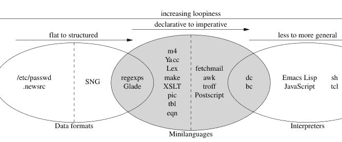

# 图 8.1: 语言分类法。

Unix makefiles 用于自动化构建过程，它们表达了源文件与派生文件之间的依赖关系²以及从源文件生成每个派生文件所需的命令。当你运行 `make` 时，它使用这些声明来遍历依赖的隐式树，通过最少的工作使你的构建保持最新。Yacc 和 lex 规范、makefiles 都是声明式微语言；它们设置了约束，暗示了在解释性上下文中执行的动作（在这种情况下，即源文件和生成文件所在的系统文件位置）。我们将在第 15 章重新回到 makefiles。

XSLT 是用于描述 XML 转换的语言，在声明式微语言中处于复杂性的顶端。它复杂到通常不被认为是一种微语言，但它确实共享了此类语言的一些重要特征，我们将在下面详细研究它时对这些特征进行分析。

微语言的光谱从声明式（带有隐式动作）到命令式（带有显式动作）。`fetch(1)` 的运行控制语法可以被视为一种非常命令式的语言，也可以视为具有隐含控制流的声明式语言。`troff` 和 PostScript 排版语言是命令式语言，其中嵌入了许多特殊领域的专家知识。

某些特定任务的命令式微语言开始向通用解释器靠拢。当它们显式地成为它们就达到了这一水平。

对于非技术背景的读者：C 程序的编译形式通过编译和链接从其 C 源代码派生。PostScript 版本的 `troff` 文档是从 `troff` 源码派生的；从后者生成前者的命令是 `troff` 的调用。还有许多其他类型的派生；makefiles 表达了几乎所有的这些类型。

## 8.2 应用微语言

图灵完备——也就是说，我们可以实现条件判断和循环（或递归）³这些被设计用作控制结构的特征。相比之下，某些语言只是偶然图灵完备的——它们具有可以用来实现控制结构的特征，这只是它们实际设计用途的某种副作用。

我们在第 7 章看过的 `bc(1)` 和 `dc(1)` 解释器是显式图灵完备的专用命令式微语言的良好示例。

当我们达到 Emacs Lisp 和 JavaScript 这样的语言时，我们就进入了通用解释器的领域，这些语言被设计为在特定上下文下的完整编程语言。我们将在以后讨论嵌入脚本语言时对它们进行说明。

解释器的光谱是通用性不断增加的光谱；其另一面是，越通用的解释器对运行上下文的假设就越少。通用性的增加通常伴随着更丰富的数据类型本体论。Shell 和 Tcl 拥有相对简单的本体；Perl、Python 和 Java 则拥有更复杂的本体。我们将在第 14 章重新回到这些通用语言。

## 8.2 应用微语言

设计微语言涉及两个不同的挑战。一个是在你的工具箱中备有现有微语言，并识别它们何时可以应用。另一个是知道何时为应用程序设计自定义的微语言是合适的。为了帮助你培养设计感的这这两个方面，本章的大部分内容将由案例研究组成。

### 8.2.1 案例研究：sng

在第 6 章中，我们看了 `sng(1)`，它在 PNG 与相同位流的可编辑文本表示之间进行翻译。SNG 数据格式文件在这里值得重新检查以对比，因为它并不完全是一种领域特定微语言。它描述了数据布局，但没有与数据关联任何隐式的动作序列。

SNG确实与领域特定微语言共享一个重要特征，而 PNG 这样的二进制数据格式并不具备这一点——透明性。结构化数据文件使得编辑、转换和生成工具能够协作，而无需通过微语言这一介质了解对方的设计假设。SNG 增加的是，像领域特定微语言一样，它很容易通过肉眼解析并用通用工具进行编辑。

### 8.2.2 案例研究：正则表达式

一种在 Unix 工具和脚本语言中反复出现的规范是正则表达式（简简称 ‘regexp’）。我们在这里将其视为一种描述文本模式的声明式微语言；它通常嵌入在其他微语言中。正则表达式无处不在，以很难被认为一种微语言，但它们取代了实现不同（且不兼容）的功能的海量代码。

本介绍跳过了一些如 POSIX 扩展、反引用和国际化特性等细节；需要更完整的处理，请参阅《正则表达式大师》(Mastering Regular Expressions)[Friedl]。

正则表达式描述了可能与字符串匹配或失败的模式。最简单的正则表达式工具是 `grep(1)`，它是一个过滤器，通过其输入中的行来匹配指定的正则表达式。正则表达式符号总结在表 8.1 中。

正则表达式符号有若干种细微变体：

- Glob 表达式（Glob expressions）。这是早期 Unix Shell 用于文件名匹配的有限通配符约定集。只有三个通配符：`*`，匹配任何序列。
- 基础表达式（Basic expressions）。这是 `ed` 使用的符号。
- 扩展表达式（Extended expressions）。这是 `egrep` 接受的符号。
- Perl 表达式（Perl expressions）。这是 Perl 和 Python 使用的符号。

> 3. 理论上，任何图灵完备语言都可以用于通用编程，且理论与其他图灵完备语言完全相等。在实践中，某些图灵完备语言在特定狭窄领域之外的使用非常痛苦。

## 8.2 应用微语言

表 8.1: 正则表达式示例。

| 正则表达式 | 匹配 |
| :--- | :--- |
| `"x."` | x 后面跟着任意字符。 |
| `"x\""` | x 后面跟着一个字面点。 |
| `"xz?"` | x 后面跟着最多一个 z |
| `"xz*"` | x 后面跟着任意数量的 z |
| `"xz+"` | x 后面跟着一个或多个 z |
| `"s[xyz]t"` | s 后面跟着 x、y 或 z 中的任意一个，然后 t |
| `"a[0-9]b"` | a 后面跟着 x 或 0-9 范围内的字符，然后 b |
| `"s[^xyz]t"` | s 后面跟着不是 x、y 或 z 的字符，然后 t |
| `"s[^x0-9]t"` | s 后面跟着不是 x 或不在 0-9 范围内的字符，然后 t |
| `"^x"` | 字符串开头的 x |
| `"x$"` | 字符串结尾的 x |

表 8.2: 标准正则表达式通配符总结。

| 通配符 | 基础 | 扩展/Emacs | Perl/Python |
| :--- | :---: | :---: | :---: |
| `*` | 是 | 是 | 是 |
| `?` | 否 | 是 | 是 |
| `.` | 否 | 是 | 是 |
| `^` | 否 | 是 | 是 |
| `$` | 否 | 是 | 是 |
| `[]` | 是 | 是 | 是 |
| `\|` | 否 | 是 | 是 |
| `()` | 否 | 是 | 是 |
| `{}` | 否 | 否 | 是 |
| `+` | 否 | 否 | 是 |

支持正则表达式的新语言的设计实践已经稳定在 Perl/Python 变体上。它比其他的更透明，特别是因为反斜

4. 正则表达式的 POSIX 标准引入了一些符号范围，如 `[[[:lower]]` 和 `[:digit]]`，某些特定工具还有此处涵盖的额外通配符，但这些足以解释大多数正则表达式。

## 表 8.2：正则表达式操作介绍。

| 通配符 | 支持情况 | 匹配内容 |
| --- | --- | --- |
| `\` | 所有 | 转义下一个字符。切换后续标点符号是否被视为通配符。随其后的字母或数字根据程序的不同有不同的解释方式。 |
| `.` | 所有 | 任意字符。 |
| `^` | 所有 | 行首 |
| `$` | 所有 | 行尾 |
| `[...]` | 所有 | 括号内的任意字符 |
| `[^...]` | 所有 | 括号内*这些字符之外*的任意字符。 |
| `*` | | 匹配前一个元素的任意数量实例。 |
| `?` | egrep/Emacs, Perl/Python | 匹配前一个元素的零个、一个或一个实例。 |
| `+` | egrep/Emacs, Perl/Python | 匹配前一个元素的一个或多个实例。 |
| `{n}` | egrep, Perl/Python; 在 Emacs 中为 `\{n}` | 匹配前一个元素的恰好 *n* 次重复。某些旧版本的正则表达式引擎不支持此项。 |
| `{n,}` | egrep, Perl/Python; 在 Emacs 中为 `\{n,}` | 匹配前一个元素的 *n* 次或更多重复。旧正则表达式引擎不支持此项。 |
| `{m,n}` | egrep, Perl/Python; 在 Emacs 中为 `\{m,n}` | 匹配前一个元素的至少 *m* 到 *n* 次重复。某些正则表达式引擎不支持此项。 |
| `\|` | egrep, Perl/Python; 在 Emacs 中为 `\|` | 匹配左侧元素或右侧元素。这通常与某种形式的模式分组分隔符一起使用。 |
| `(...)` | Perl/Python; 在旧版本中为 `\(...)` | 将此模式视为一个组（在 Perl 和 Python 等较新的正则引擎中）。旧正则引擎（如 Emacs 和 grep 中的）需要 `\(...\)`。 |

## 8.2 应用微语言 (Minilanguages)

在非字母数字字符之前总是意味着该字符视为字面量，因此对于如何引用正则表达式的元素困惑要少得多。

正则表达式是说明微语言可以多么简洁的一个极端示例。简单的正则表达式表达了识别行为，而这种行为如果不使用，将用数百行繁琐且容易出错的代码来实现。

### 8.2.3 案例研究：Glade

Glade 是一个用于 X.⁵ 开源 GTK 工具包库的界面构建器。Glade 允许你通过在界面面板上交互式地选择、放置和修改组件来开发 GUI 界面。Glade 编辑器生成一个描述界面的 XML 文件；此文件可以输入到几个代码生成器之一，这些生成器实际上会为界面生成 C、C++、Python 或 Perl 代码。生成的代码允许你编写特定的行为。

Glade 用于描述 GUI 的 XML 格式是简单特定领域微语言的良好示例。请参见示例 8.1 获取 Glade 格式的“Hello, world!” GUI。

Glade 格式中的一个有效规范定义了 GUI 响应用户行为的一系列动作。Glade GUI 将这些规范视为结构化数据文件；另一方面，Glade 代码生成器使用这些文件来编写实现 GUI 的程序。对于某些语言（包括 Python），存在运行时库，允许你跳过代码生成步骤，直接在运行时从 XML 规范直接实例化 GUI（解释 Glade 标记，而不是将其编译为宿主语言）。因此，你可以选择用空间效率换取启动速度，或反之。

一旦你习惯了 XML 的冗长，Glade 标记就是一种相当简单的语言。它做了两件事：你实际上不需要知道 Glade 是如何工作的就能阅读上面的规范。事实上，如果你有任何使用 GTK 工具包编程的经验，阅读它将让你立即对 Glade 使用规范做了了什么有一个良好的视觉化认识。（大家举手预测，这个特定的规范将为你在一个窗口框内提供一个单按钮组件。）

这种透明度和简单性是良好的微语言设计的标志。符号与领域对象之间的映射非常清晰。这些关系

- 5. 对于非 Unix 程序员来说，X 工具包是一个图形库，它为链接到它的程序提供 GUI 组件（如标签、按钮和下拉菜单）。在大多数其他图形操作系统中，操作系统提供一个大家都在使用的工具包。Unix 和 X 支持多个工具包；这是我们在第 1 章中强调的 X 设计目标——“策略与机制的分离”的一部分。GTK 和 Qt 是两个最受欢迎的开源工具包。

# 示例 8.1：Glade "Hello, World"。

```xml
```


## 8.2 应用微语言 (Minilanguages)

在非字母数字字符之前总是意味着该字符视为字面量，因此对于如何引用正则表达式的元素困惑要少得多。

正则表达式是说明微语言可以多么简洁的一个极端示例。简单的正则表达式表达了识别行为，而这种行为如果不使用，将用数百行繁琐且容易出错的代码来实现。

### 8.2.3 案例研究：Glade

Glade 是一个用于 X.⁵ 开源 GTK 工具包库的界面构建器。Glade 允许你通过在界面面板上交互式地选择、放置和修改组件来开发 GUI 界面。Glade 编辑器生成一个描述界面的 XML 文件；此文件可以输入到几个代码生成器之一，这些生成器实际上会为界面生成 C、C++、Python 或 Perl 代码。生成的代码允许你编写特定的行为。

Glade 用于描述 GUI 的 XML 格式是简单特定领域微语言的良好示例。请参见示例 8.1 获取 Glade 格式的“Hello, world!” GUI。

Glade 格式中的一个有效规范定义了 GUI 响应用户行为的一系列动作。Glade GUI 将这些规范视为结构化数据文件；另一方面，Glade 代码生成器使用这些文件来编写实现 GUI 的程序。对于某些语言（包括 Python），存在运行时库，允许你跳过代码生成步骤，直接在运行时从 XML 规范直接实例化 GUI（解释 Glade 标记，而不是将其编译为宿主语言）。因此，你可以选择用空间效率换取启动速度，或反之。

一旦你习惯了 XML 的冗长，Glade 标记就是一种相当简单的语言。它做了两件事：你实际上不需要知道 Glade 是如何工作的就能阅读上面的规范。事实上，如果你有任何使用 GTK 工具包编程的经验，阅读它将让你立即对 Glade 使用规范做了了什么有一个良好的视觉化认识。（大家举手预测，这个特定的规范将为你在一个窗口框内提供一个单按钮组件。）

这种透明度和简单性是良好的微语言设计的标志。符号与领域对象之间的映射非常清晰。这些关系

- 5. 对于非 Unix 程序员来说，X 工具包是一个图形库，它为链接到它的程序提供 GUI 组件（如标签、按钮和下拉菜单）。在大多数其他图形操作系统中，操作系统提供一个大家都在使用的工具包。Unix 和 X 支持多个工具包；这是我们在第 1 章中强调的 X 设计目标——“策略与机制的分离”的一部分。GTK 和 Qt 是两个最受欢迎的开源工具包。

# 示例 8.1：Glade "Hello, World"。

```xml
<?xml version="1.0"?>

<GTK-Interface>

  <widget>

    <class>GtkWindow</class>

    <name>HelloWorld</name>

    <border_width>5</border_width>

    <Signal>

      <name>destroy</name>

      <handler>gtk_main_quit</handler>

    </Signal>

    <title>Hello</title>

    <type>GTK_WINDOW_TOPLEVEL</type>

    <position>GTK_POS_NONE</position>

    <allow_shrink>True</allow_shrink>

    <allow_grow>True</allow_grow>

    <auto_shrink>False</auto_shrink>

  </widget>

  <widget>

    <class>GtkButton</class>

    <name>Hello World</name>

    <can_focus>True</can_focus>

    <Signal>

      <name>clicked</name>

      <handler>gtk_widget_destroy</handler>

    </Signal>

    <label>Hello World</label>

  </widget>

</GTK-Interface>
```

符号与领域对象之间的映射非常清晰。这些关系

### 8.2.5 案例研究：XSLT

示例 8.3：一个示例 XSLT 程序。

```xml
<xml version="1.0"?>

<xsl:stylesheet xmlns="http://www.w3.org/1999/XSL/Transform

version="1.0">

  <xsl:output method="xml"/>

  <xsl:template match="*">

    <xsl:element name="name()">

      <xsl:for-each select="*">

        <xsl:element name="name()">

          <xsl:value-of select="."/>

        </xsl:element>

      </xsl:for-each>

      <xsl:apply-templates select="*|text()"/>

    </xsl:element>

  </xsl:template>

</xsl:stylesheet>
```

### 8.2.6 案例研究：Documenter's Workbench 工具

`traff(1)` 排版格式化，正如我们在第 2 章中提到的，它是 Unix 原始的杀手级应用。`traff` 是一个格式工具套的核心（统称为 Documenter’s Workbench 或 DWB），所有这些工具都是各种类型的领域特定微语言。其中大多数是 `traff` 标记的预处理器或后处理器。开源 Unix 拥有来自自由软件基金会的 Documenter's 增强实现，即 `groff(1)`。

我们将在第 18 章详细研究 `traff`；目前，只需它是一个命令式微语言的良好示例即可，它接近于一个完备的解释器（它有条件判断和递归，但没有循环；它无意中具有了图灵完备性）。

后处理器（DWB 术语中称为驱动程序）通常对 `traff` 用户不可见。原始的 `traff` 为 1970 年 Unix 开发组拥有的特定排版机编码了代码；在 20 世纪 70 年代后期，这些代码被整理成一种与设备无关的微语言，用于在页面上放置文本和简单图形。后处理器将这种语言（称为用于“设备无关的 `traff`”的 `diffroff`）转换为现代成像打印机实际上可以接受的内容——其中最重要的是（也是现代的默认格式）是 PostScript。

预处理器更有趣，因为它们实际上为 `traff` 语言增加了功能。常见的有三种：用于制作表格的 `tbl(1)`、用于排版数学方程的 `eqn(1)` 以及用于绘制图表的 `pic(1)`。已弃但仍活跃的用于图形的 `grn(1)`，以及用于格式化参考文献的 `refer(1)` 和 `bib(1)`。所有这些的开源对应品都随 `groff` 一起发布。`grap(1)` 预处理器提供了相当的绘图功能；有一个独立于 `groff` 的开源实现。

其他一些预处理器没有开源实现且已不再常用。其中最为人知的是用于图形的 `ideal(1)`。该家族较年轻的成员 `chem(1)` 用于绘制化学结构式；它作为贝尔实验室 `netcode` 的一部分可用。

这些预处理器每一个都是一个小型程序，接受微语言并将其编译为其中的请求。人们通过寻找唯一的开始和结束请求来识别标记是应该被解释的，并原样传递该区域之外的标记（`tbl` 查找 `.TS/`、`.TE`，`pe` [应为 `refer`] 查找 `.PS/`、`.PE` 等）。因此，大多数预处理器通常按任何顺序运行，而不会相互干扰。存在一些例外：特别是 `chem` 和 `grab` 使用 `pic` 命令，必须在流水线中位于它之前。

```bash
cat thesis.ms | chem | tbl | refer | grab | pic | eqn \
groff -Tps:thesis.ps
```

上述是一个完整的 Documenter's Workbench 处理流水线示例，用于一个包含化学公式、数学方程、表格、参考文献、图表和图形的假设流水线。`cat(1)` 命令将其输入或文件复制到输出；我们在此使用它是为了强调操作顺序。在实践中，现代趋势的实现倾向于支持命令行选项来调用 `tbl(1)`、`eqn(1)` 和 `pic(1)`，因此没有必要编写如此复杂的流水线。即使需要，这类构建配方通常也编写一次，并存储在 Makefile 或 shell 脚本封装器中反复使用。

Documenter's Workbench 的文档标记已经完全过时了，但这些预处理器解决的问题范围表明了微语言模型——要在所见即所得（WYSIWYG）文字处理器中嵌入等效知识将极其困难。在 2003 年，现代基于 XML 的文档标记工具链在某些方面仍然正在追赶 Documenter's Workbench 在 1979 年具备的功能。我们将在第 18 章详细讨论这些问题。

赋予 Documenter's Workbench 如此强大力量的设计主题现在应该是熟悉的；所有工具都共享一种文档的通用文本流表示，并且格式系统被分成独立的组件，可以分别进行调试和改进。流水线架构支持插用新的、实验性的预处理器和后处理器，而不干扰旧的组件。它是模块化且可扩展的。

> 9. [http://www.netlib.org/](http://www.netlib.org/)

Documenter's Workbench 的整体架构教会了我们关于如何将多个专家微语言整合到协作系统中的知识。一个预处理器可以基于另一个预处理器构建。事实上，Documenter's Workbench 工具是管道（pipes）、过滤和微语言力量的早期范例，通过示例影响了许多 Unix 设计。单个预处理器的设计对于有效的微语言设计像什么样提供了更多教训。

### 8.2.7 案例研究：fetchmail 运行控制语法

参见示例 8.5。

该运行控制文件可以视为一种命令式微语言。它存在一个隐含的执行流：反复循环轮询命令列表（在每个循环结束时睡眠一段时间），并为每个站顺序为每个关联用户收集邮件。它远非通用的；它能做的只是对程序的轮询行为排序。

与 `pic(1)` 一样，人们可以选择将这种微语言视为声明式的或非常弱的命令式语言，并对其区别进行无休止的争论。一方面，它既没有条件判断、递归也没有循环；它没有任何

### 示例 8.5：fetchmailrc 的综合示例。

```
# 每个循环首先轮询此站点。
poll pop.provider.net proto pop3
user jsmith with pass "secret1" is "smith" here
user jones with pass "secret2" is "jjones" here with options

# 其次轮询此站点，除非伏地·伏姆魔先电了我们。
poll billblywig.hogwarts.com with proto imap:
user harry_potter with pass "floo" is harry_potter here

# 循环中第三轮询此站点。
# 密码将从 ~/.netrc 获取
poll mailhost.net with proto imap:
user esr is esr here
```


显式的控制结构。另一方面，它描述的是操作而非仅仅是关系，这使其与像 Glade GUI 构建这样的纯声明式语法区分开来。

复杂程序的运行控制微语言通常会模糊这一边界。我们强调这一事实，是因为在命令式微语言中没有显式控制结构，如果问题领域允许你这么做，这可以是一个巨大的简化。

`.fetchmailrc` 语法的一个显著特征是使用了可选关键字，支持这些关键字仅仅是为了让规范更像英语。示例中的 `with` 关键字和 `options` 的单次出现并不是实际上需要的，但它们有助于让人一眼就能更容易阅读声明。

这类事物的传统术语是“语法糖”；与之相随的格言很有名：“语法糖导致了分号的缺失”。事实上，语法糖需要谨慎使用，否则带来的模糊会多于帮助。

在第 9 章中，我们将看到数据驱动编程如何帮助通过 GUI 编辑 fetchmail 运行控制文件提供优雅的解决方案。

## 8.2.8 案例研究：awk

awk 微语言是一种老派 Unix 工具，以前在 shell 脚本中常用。像 m4 一样，它旨在编写小型但具有表现力的程序，将输入转换为文本输出。所有 Unix 都带有这些版本，其中几个在源码中；在你的 Unix shell 提示符输入命令 `info awk` 可能会带你进入在线文档。

awk 程序由“模式/动作”对组成。每个模式都是正则表达式，我们将在第 9 章详细描述这一概念。当运行 awk 程序时，它会逐行处理输入文件。每行都会按顺序与每个模式/动作对进行检查。如果模式匹配该行，则执行关联的操作。

每个操作都是用类似于 C 语言子集的语言编写的，带有变量、条件以及类型本体论，包括整数、字符串和（与 C 不同）字典.¹²

awk 操作是图灵完备的，并且可以读写文件。在某些版本中，它可以打开并使用网络套字。但 awk 主要用作报告生成器，特别是解释和简化表格数据。它很少独立存在，而是嵌入在脚本中。第 9 章的 HTML 生成用例中包含了一个示例 awk 程序。

包含 awk 的案例是为了说明它不是用于仿真的；事实上，自 1990 年以来它在很大程度上已被废用。它已被新的脚本语言取代——特别是 Perl，它被显式地设计为 awk 的杀手。这些原因值得研究，因为它们为微语言设计者提供了某种警告。

awk 语言最初被设计为用于报告生成的小型、有表现力的特殊用途语言。遗憾的是，事实证明它设计在了复杂度与功率曲线上的一个糟糕位置。操作是非紧凑的，它所处的模式驱动框架又使其无法通用——这是兼得复失。而新派的脚本语言可以做 awk 能做的任何事；它们的等效程序同样易读，甚至更高。

> Awk 也被废用是因为更现代的 shell 具有浮点算术、关联数组、RE 模式匹配和子字符串功能，因此小型 awk 脚本的等效工作无需创建进程的开销即可。

—David Korn

在 1987 年 Perl 发布后的几年里，awk 保持了竞争力仅仅是因为它的实现更小、更快。但随着计算周期和内存成本的下降，倾向于使用相对节省资源的特殊用途语言的经济理由失去了效力。程序员越来越多地选择用 Perl 或（后来的）Python 做类似 awk 的事情，而不是在脑子里记住两种不同的脚本语言.¹¹³ 到 2000 年，awk 对于最老派的 Unix 黑客来说仅仅是一种记忆，而且不是一种特别怀旧的记忆。

成本的下降改变了微语言设计的权衡。将设计的边界限制在紧凑性可能是一个好主意，但为了节省机器资源这样做是个坏主意。机器资源随时间变得廉价，但程序员脑中的空间只会变得昂贵。现代微语言可以是通用的且紧凑的，也可以是特殊的但非常紧凑的；特殊但非紧凑的根本没有竞争力。

¹ 该句归于 Alan Perl，他在 1970 年左右在软件模块化方面做了一些开创性工作。提到的分号是 Pascal 和 C 等各种 Algol 系语言的语句分隔符或终止符。²对于从未用现代脚本语言编程的人来说，字典是键值关联的查找表，通常通过哈希表实现。C 程序员花费大量编码时间来实现各种复杂的字典。

¹³ 我曾是一个 awk 大师，但曾有人提醒我该语言适用于书中唯一的 awk 示例所出现的问题。

⁴ 有 GhostScript 项目网站 <http://www.cs.wisc.edu/ghost/>。

¹⁵ A First Guide To PostScript <http://www.cs.indiana.edu/docproject/programming/postscript/postscript.html。

## 8.2 应用微语言

……的结构。从技术上讲，PostScript 是一种基于栈的语言；PostScript 原始过程（操作符）的参数通常从参数下推栈中弹出，结果则被压回栈中。

在总共 400 个操作符中，大约有 40 个基础操作符。执行工作最多的是 `show`，它在页面上绘制字符串。其他操作符则设置当前字体、更改灰度，或者绘制线条、弧线、贝塞尔曲线、闭合区域、裁剪区域等。PostScript 解释器应该能够将这些命令解释为位图，然后放到显示器或打印介质上。

其他 PostScript 操作符实现了算术、控制结构和过程。这些重复的或定型化的图像（例如由重复的字母形状组成的文本）被表达为组合图像的程序。PostScript 的用处部分源于：打印文本或简单矢量图形的 PostScript 程序比渲染后的位图或向量要轻量得多，它们与设备分辨率无关，并且在网络电缆或串行链线上传输得更快。

从历史上看，PostScript 的基于栈的解释类似于一种名为 FORTH 的语言，它最初设计用于实时控制望远镜电机，在 20 世纪 80 年代曾流行。基于栈的语言以支持极其紧凑、经济的编码而闻名，也以难以阅读而臭名。PostScript 具有这些特征。

PostScript 通常实现为构建在打印机中的固件。开源实现 Ghostscript 可以将 PostScript 转换为各种图形格式和（较弱的）打印机控制语言。大多数其他软件将 PostScript 视为最终输出格式，旨在交付给支持 PostScript 的成像设备，而不是对其进行编辑或肉眼观察。

PostScript（无论是原始版本还是带有边界框（bounding box）定义的简单版本 EPSF，它可以嵌入到其他图形中）是一个非常定义良好的特殊用途控制语言示例，值得作为模型进行仔细研究。它是 PDF（便携式文档格式）等其他标准的一部分。

### 8.2.10 案例研究：bc 和 dc

我们在第 7 章中研究了 `bc(1)` 和 `dc(1)` 作为 Shell 调用（shellouts）的案例研究。它们是特定领域命令型微语言的示例。

> dc 是 Unix 上最老的语言；它编写在 PDP-7 上，并在 Unix [本身] 移植之前移植到了 PDP-11。
> —Ken Thompson

这两种语言的领域是无限精度算术。其他程序可以使用它们进行此类计算，而无需担心执行计算所需的特殊技术。

事实上，`dc` 的原始动机与通用交互式计算器无关，后者可以通过简单的浮点数程序实现。其动机是贝尔实验室对数值分析的长期兴趣：*准确地*为数值算法计算常数时，能够使用比算法本身使用的高得多的精度将得到极大帮助。因此有了 `dc` 的任意精度算术。

> Henry Spencer

对于 SNG 和 Glade 标记，这两种语言的优点之一是它们的简单性。你知道 `dc(1)` 是一个逆波尔兰表示法计算器，`bc(1)` 是一个代数表示法计算器，关于这两种语言的使用几乎没有什么新颖之处。我们将在第 11 章中重新讨论接口中“最小惊讶原则”的重要性。

这些微语言具有条件和循环；它们是图灵完备的，但类型本体非常受限，包括无限精度整数和字符串。这使得它们处于解释型微语言和全脚本语言的边缘。编程特性的设计初衷是不干扰其作为计算器的常用性；事实上，`dc/bc` 可能并不知道这些特性的。

通常情况下，`dc/bc` 是交互式的，但它们支持用户定义过程库的能力提供了另一种实用性——可编程性。这实际上是命令型微语言最重要的优势，我们在 Documenter's Workbench 工具中观察到这一点，无论程序的正常模式是否是交互式的，它们都非常强大；你可以使用它们来编写嵌入了特定任务智能的高级程序。

由于 `dc/bc` 的接口如此简单（输入一个包含表达式的行，返回一个包含数值的行），其他程序和脚本可以通过调用这些程序作为从进程，轻松地访问所有这些能力。示例 8.6 是一个著名的例子，Rivest-Shamir-Adleman（RSA）公钥算法的一种实现。

#### 示例 8.6：使用 dc 实现 RSA。

```
print pack""*,\/D+\`,`echo *16III*oU\$/=$z;[(pop,pop,unpack *H*,<>)]\EsMsKNo[1N*11K[d2%Sa2/d0<X+d*1MLa^1N%0]dsXX+\1MN/dsM0J]dsJsxp|dc`
```


用 Perl 编写的加密程序曾广泛发布在签名档和 T 恤上，作为对美国加密技术出口限制的抗议，约 1995 年；它通过调用`dc`来执行所需的无限精度算术。

### 8.2.11 案例研究：Emacs Lisp

特殊用途解释型语言不仅仅是作为从进程运行完成特定任务，它可以成为整个架构的核心；我们将在第 13 章中考虑这种方法的优缺点。`troff`请求是一个早期的例子；Emacs 编辑器是最知名且最强大的现代示例之一。它是围绕 Lisp 的方言构建的。

Emacs 基于 Lisp 方言构建的这一事实允许了广泛的操作选择。我们将在第 13 章中考虑这种方法的优缺点……（此处省略重复内容）。

### 8.2.12 案例研究：JavaScript

JavaScript 是一种设计用于嵌入网页的开源语言。大多数其他软件将 JavaScript 视为最终输出格式，旨在交付给支持 PostScript 的成像设备，而不是对其进行编辑或肉眼观察。

## 8.3 设计微语言

何时设计合适的微语言？我们观察到，微语言提供了一种将问题规范推向更高层次的方法，并在几个案例研究中观察了它的运作方式。这一观察的另一面是，每当你的应用领域原语是简单且定型的，而用户应用它们的方式是灵活多变时，微语言可能是一个很好的方法。

对于一些相关想法，可以参考 [http://www.c2.com/cgi?AlternateHardAndSoftLayers 交替硬软层 (Alternate Hard And Soft Layers)] 和 [http://www.doc.ic.ac.uk/~np2/patterns/scripting/scripting.html 脚本组件 (Scripted Components)] 的描述和设计模式。

## 8.3 设计微语言 (Minilanguages)

关于微语言设计风格和技巧的一项有趣调查可以参考《领域特定语言的卓越设计模式》[Spinellis]。

### 8.3.1 选择合适的复杂度

设计微语言时首要记住的要点，如常一样，是保持其越简单越好。我们在组织案例研究时使用的分类法暗示了一个复杂度层级结构；你希望你的设计尽可能向左侧。如果你通过设计一个结构化数据文件就能解决问题，而不是设计一个在解释时会修改外部数据的微语言，那么请务必这样做。

坚持使用结构化数据而非微语言的一个务实的原因是：嵌入式功能容易受到滥用，而这种滥用可能会带来不便甚至危险的后果。JavaScript 是“不便”类别中的典型例子；它的设计者没有预料它会被用于投放令人厌恶的弹窗广告，以至于导致人们对抑制 JavaScript 解析的浏览器功能的需求。

Microsoft Word 宏病毒展示了这类事物如何变得活跃且危险，这种安全漏洞每年导致的停机损失高达数十亿美元。值得注意的是，尽管全球范围内至少有两百万 Unix 用户¹⁹，但从未出现过类似于 Windows 那种频繁爆发宏病毒的 Unix 情况。这有许多原因，包括 Unix 从根本上更优的安全设计；但至少有一点是，Unix 邮件代理不会默认执行用户查看的任何文档中的活动内容。

如果你的应用程序用户最终可能会运行来自不可信源的程序，那么你微语言中的某些风险功能可能不得不被抑制。Java 和 JavaScript 这样的语言被显式地沙箱化——也就是说，它们对环境的访问受到限制，这不仅是为了简化设计，更是为了防止存在漏洞或恶意的代码执行潜在的破坏性操作。

另一方面，许多糟糕的设计被设计者搞砸了，因为他们没有面对自己真正需要的是微语言而非数据格式这一事实。很多时候，类语言特征是作为事后补救被贴上去的。这个问题最常见的症状是：弱的、临时的控制结构，以及缺乏或完全没有过程声明功能。

设计仅“偶然”实现图灵完备的微语言是有风险的。如果你这样做，很有可能在未来的某个时刻，某个聪明的用户会认为他需要强迫你的语言为他执行循环和条件判断。由于这些功能仅以混淆的方式存在，他将产生混淆的代码。结果在短期内可能可行，但对于后继者来说，很可能是一场噩梦。

微语言的设计是强大且在美学上很有回报的，但也充满了类似的陷阱。在某些设计中，在探索问题领域一段时间后，采用“自底向上”的方法堆入一系列低级服务并在之后考虑它们的组织方式是合适的。微语言的优点之一是，它们可以帮助你从底层的编程中获得良好的设计，允许你将一些自顶向下的决策推迟到微语言程序的控制中。如果你对微语言设计本身采用自底向上的方法，你可能会得到一个丑陋的语法，反映出一个弱的语言和考虑不周的实现。

在微语言中，很多地方的微小改变会对工具的易用性产生巨大影响：

> 作为语言设计者，考虑提供错误信息之外的方案是一个很好的原则。当程序员的意图存在真正的歧义时，错误信息是合适的；但在许多情况下，意图是清晰的，让语言静地做正确的事是一项巨大的帮助。一个很好的例子是 C 允许在数组初始化列表末尾添加额外的逗号，这使得数组初始化器的编辑和生成都变得简单得多。反面例子是各种 HTML 读器的挑剔，特别是它们习惯于由于微小的嵌套而静地丢弃文档的部分。
> —Steve Johnson

在问题上，正如在其他地方一样，良好的品味和工程判断是不可替代的。如果你要设计一个微语言，不要做半吊子。声明式微语言应该具有清晰、一致的类语言语法，为人类可读而设计。命令式微语言应该添加从你预期用户熟悉的语言模型中适配而来的全套控制结构。将这门语言视为一种语言；问自己一些美学上的问题，比如“用它编程舒服吗？”甚至“它看起来愉快吗？”在这里，正如在软件设计的其他地方一样，David Gelerter 的格言非常贴切：美是对复杂性的终极防御。

+ 18. 20M 是基于 2003 年年中 Linux Counter 及其他地方数据的保守估计。
+ 19. 我们在第 6 章中看过的 Kmail 正因为这个原因，永远不会去剔除 HTML 中的外部链接。

### 8.3.2 扩展与嵌入语言

一个根本性的重要问题是，你是否可以通过扩展或嵌入现有的脚本语言来实现你的微语言。这对于命令式微语言来说通常是正确的方向，但对于声明式微语言则不合适得多。

有时你可以通过在解释型语言中编写服务函数来编写你的命令式语言，为了方便讨论，我们称之为“宿主”语言。你的微语言程序随后就是脚本，它们加载你的服务库，并使用宿主语言的控制结构和其他功能作为框架。宿主语言提供的每项功能都是你不需要编写的。

这是编写微语言最简单的方法。老派 Lisp 程序员（包括我）喜欢这种技术并大量使用它。它凸显了 Emacs 编辑器的设计，这种技术在 Tel、Python 和 Perl 等新脚本语言中被重新发现。它也有缺点：你的宿主语言可能无法与所需的代码库接口；或者，其内部的数据类型系统可能无法满足你需要的计算；或者，通过对原型进行测试，你发现它太慢了。当这些问题出现时，你的解决方案通常是涉及 C（或 C++）编码并将结果集成到你的微语言中。

用 C 代码扩展脚本语言，或在 C 程序中嵌入脚本语言的选项，依赖于存在为此设计的脚本语言。你通过告诉脚本语言动态加载库或模块来扩展它，使得 C 的入口点在扩展语言中变得可见。你通过向解释器实例发送命令并将结果作为 C 值接收，从而在 C 程序中嵌入脚本语言。

这两种技术都依赖于在 C 的类型系统和脚本语言的类型系统之间移动数据的能力。某些脚本语言从底层开始就被设计为支持这一点。其中一种是 Tel，我们将在第 14 章介绍。另一种是 Guile，它是 Lisp 变体 Scheme 的开源实现。Guile 以库的形式分发，并专为嵌入 C 程序中而设计。

（在 2003 年仍然相当痛苦且困难）扩展或嵌入 Perl 是可能的。扩展 Python 非常容易，但嵌入它则稍微困难一点；C 扩展在 Python 世界中被广泛使用。Java 有一种接口可以调用 C 中的“原生方法”，尽管这种做法不被鼓励，因为它倾向于破坏移植性。大多数版本的 shell 并不是为了嵌入和扩展而设计的，但 Korn（`ksh93`及更高版本）是一个显著的例外。

有很多糟糕的理由不要将你的命令式微语言挂载在现有的脚本语言上。少数几个正确的理由之一是，你实际上想要实现自己的用于错误检查的自定义语法。如果是这样，请参阅下文关于`yacc`和`lex`的建议。

## 8.3.3 编写自定义语法

对于声明式微语言（minilanguages）来说，一个主要问题是你是否应该使用 XML 作为基础语法，并将你的语法规范为 XML 文档类型。对于结构精密的声明式微语言来说，这很可能是正确的选择，但需要注意我们在第 5 章中提到的关于数据文件格式设计的几点性事项——XML 可能会大材小用。如果你不使用 XML，请遵循“最小惊讶原则”（Rule of Least Surprise），即支持用于数据文件的 Unix 惯例（简单的标记导向语法、支持 C 语言的反斜杠约定等）。

如果你需要自定义语法，`yacc`和`lex`（或你所用语言中的本地等效工具）可能是你的好朋友，除非你的语言语法简单到通过手写编写一个递归下降解析器也轻而易举。即便如此，`yacc`也能为你提供更好的错误恢复能力，而且随着语言语法的演进，`yacc`规范将更易修改。请参考第 9 章查看不同语言中提供的基于`yacc`和`lex`派生的工具。

即使你决定必须实现自己的语法，也要考虑重用现有工具能获得何种收益。如果你需要宏功能，可以考虑使用`m4()`进行预处理是否是正确答案——但请注意下一节中的警告。

## 8.3.4 宏——小心！

宏扩展功能是 Unix 语言设计者青睐的策略；C 语言拥有这种功能，我们也见过它出现在一些更复杂的特殊用途微语言中，如`pic()`。`m4`预处理器为实现宏扩展预处理器提供了一个通用工具。

宏扩展非常易于定义和实现，你还可以利用它玩许多技巧。那些早期的设计者似乎受到了汇编经验的影响，在汇编器中，宏功能是组织程序的唯一手段。

宏扩展的优势在于它对基础语言底层语法一无所知，可以用于扩展该语法。不幸的是，这种力量很容易被滥用，产生晦涩、令人意外的代码，并成为难以描述的 bug 的根源。

在 C 语言中，这类问题的经典示例是一个宏：

```c
#define max(x, y)          x > y ? x : y
```

这个宏至少有两个问题。首先，如果其中任何一个参数是一个优先级低于`>`或`?:`的运算符的表达式，它可能会产生意想不到的结果。考虑表达式`max(a = b, ++c)`。如果程序员忘记了`max`是一个宏，但请注意`c`可能正在执行赋值`a = b`，并且预处理器对`c`的操作会在结果值作为参数传递给`max`之前执行。

但实际发生的情况并非如此。相反，预处理器会将此表达式扩展为`a = b > ++c ? a = b : ++c`，根据 C 语言编译器的优先级规则，它会将其解释为`a = (b > ++c ? a = b : ++c)`。结果将是赋值给`a`！

这种糟糕定义可以通过在定义宏之前进行防御性编码来规避。

```c
#define max(x, y) ((x) > (y) ? (x) : (y))
```

使用这种定义，扩展将变为`((a = b) > (a = b) ?)`。这解决了一个问题——但`c`可能会被增加两次！这种陷阱还有更微妙的变体，例如传递带有副作用的宏函数调用。

通常情况下，宏与带有副作用的表达式之间的交互会导致难以诊断的不良结果。C 的宏处理器被刻意设计得轻量且简单；更强大的处理器实际上可能会让你陷入更糟糕的境。

TEX 格式语言（第 18 章）将说明这一问题。TEX 有意设计为图灵完备（它具有条件判断、循环和递归），虽然它可以实现惊人的功能，但 Tex 代码会变得不可读且难以调试。LaTeX（最广泛使用的 TeX 宏包）的源代码是一个具启发性的例子：它们采用了非常标准的 TEX 风格，即使在极其难以理解时也是如此。

与此相比，一个较次要的问题是利用宏扩展来收集错误诊断。基础语言处理器生成的错误报告是针对扩展后的文本的，而不是程序员正在查看的原始文本。两者之间的关系被宏扩展模糊了，导致发出的诊断信息很难与错误的实际位置联系起来。

这对于具有内联扩展、条件包含或排除文本、或以其他方式更改扩展文本中行号的宏预处理器来说尤为如此。

语言中内置的宏扩展阶段可以进行自我补偿，通过调整行号来引用预扩展的文本。例如，`pic(1)`中的宏功能就是为此设计的。当宏扩展由预处理器完成时，这个问题解决起来更具困难。

C 预处理器通过在每次执行包含或多行扩展时发出`#line`指令来解决这个问题。C 编译器预期解释这些指令并相应地调整错误报告中的行号。遗憾的是，`m4`没有这种机制。

这些都是在使用宏扩展时极度谨慎的原因。Unix 经验的长期教训之一是，宏产生的问题往往比解决的问题多。现代语言和微语言设计已经远离了它们。

## 8.3.5 语言还是应用协议？

你需要的另一个重要问题是，你的微语言引擎是否会作为从进程被其他程序交互式地调用？如果是的话，你的设计可能看起来不那么像用于人类交互的对话式语言，而更像我们在第 5 章中看到的那些应用协议。

主要的区别在于事务边界的标记有多细致。人类擅长识别对话何时结束以及下一个提示是什么。如果没有在输出上提供明确标记，或者无法预先知道输出长度，就无法判断何时停止。

主进程试图与从进程进行交互的程序容易导致死锁（我们在第 7 章首次注意到这个问题）。大多数情况的原型是`expect`包。它从那里读取，直到匹配到给定的表达式模式或超时。

其他语言都有`expect`包的替代方案；为你的语言名称加上 "expect" 关键词进行网络搜索可能会发现实用的东西。然而，作为微语言设计者，假设你的所有用户都是`expect`大师是不明智的。如果是，这就是额外的胶水层，也是容易出错的地方。

在设计你的微语言时要注意这个问题。增加一个选项来改变对话行为，使其更像应用协议可能是个好主意，具有明确的输出结束符和类似于字节填充的机制。

# 9 生成：提升规范层次

当程序员感到束手无策时，最好的方法通常是从代码中解脱出来，向后退一步，思考他的数据。表示是编程的本质。

> 《人人幻谭》，纪念版 (1975–1995)，第 103 页
> ——弗雷德·布鲁克斯

关于这一点的进一步发展，请参阅 [Bentley]。

将这些表示形式转换为机器便于处理的形式是另一项机器工作，而非人类工作。

高层次、更具声明性的表示法的另一个重要优势是，它们本身更易于编译时检查。过程化表示法本质具有复杂的运行时行为，难以在编译时进行分析。声明性表示法通过允许对预期行为有更深入的理解，为发现错误提供了更大的杠杆。

> —Henry Spencer

这些见解基于理论，建立了一系列实践方法，这些方法一直是 Unix 程序员工具箱中重要的一部分——极高层语言、数据驱动编程、代码生成器以及领域特定微语言（minilangUAGES）。它们的共同点是，它们都将代码生成的维度提升到了某些层级，使得规范可以变得更小。我们之前提到过，缺陷密度在不同语言之间往往是恒定的；这些实践都确保了无论什么样的对齐方式产生了我们的 Bug，可用来作乱的行数都更少。

在第 8 章中，我们讨论了领域特定微语言的。在第 14 章中，我们将论证极高层语言的合理性。在本章中，我们将研究数据驱动编程的一些设计案例以及几个即时代码生成的示例；我们将在第 15 章中查看一些代码生成工具。与微语言一样，这些方法让你能够大幅减少程序的行数，并相应地降低调试时间和维护成本。

## 9.1 数据驱动编程

在进行数据驱动编程时，需要明确地将代码与其作用的数据结构区分开，并进行设计，使得人们可以通过编辑数据结构而非代码来更改程序的逻辑。

数据驱动编程有时与面向对象混淆，后者是另一种认为数据组织是核心的风格。两者至少有两点区别。其是在数据驱动编程中，数据不仅仅是某个对象，它实际上定义了程序的控制流。面向对象的主要关注点是封装，而数据驱动编程的主要关注点是编写尽可能少的固定代码。Unix 在数据驱动编程方面的传统强于面向对象。

数据驱动风格编程有时也会与编写状态机混淆。事实上，可以用表格或数据结构来表示状态机的逻辑，但手工编写的状态机通常是僵硬的代码块，比表格难修改得多。

进行任何类型的代码生成或数据驱动编程时，有一条重要的规则：始终将问题向上游推。不要手动去修补生成的代码或任何中间表示——相反，思考一种改进或替换你翻译工具的方法。否则，你可能会发现，本应由机器正确生成的那些手工补丁将变成一个无底洞。

在复杂性量程的顶端，数据驱动编程合并了 p-code 解释器的编写，或我们在第 8 章中调查过的简单微语言的编写。在其他边缘，它合并了代码生成和状态机编程。这些区别实际上并不重要；重要的部分是将程序逻辑从硬性的控制结构移动到数据中。

### 9.1.1 案例研究：ascii

我维护一个名为`ascii`的程序，这是一个非常简单的实用工具，尝试将命令行名称解释为 ASCII（美国信息交换标准代码）字符的名称并报告所有等效名称。该工具的代码和文档可以在项目页面 <http://www.catb.org/~esr/ascii> 获取。这是一个说明性的截图：

```
esrsnark::~WWW/writings/taoup ascii 10

ASCII 1/0 is decimal 016, hex 10, octal 020, bits 00001000: called ^DLE

Official name:  Data Link Escape
```

```
ASCII 0/10 is decimal 010, hex 0a, octal 012, bits 00001010: called ^J, LF, NL

Official name:  Line Feed

 escape: '\n'

Other names:  Newline
```

```
ASCII 0/8 is decimal 008, hex 08, octal 010, bits 00001000: called ^H, BS

Official name:  Backspace

 escape: '\b'

Other names:
```

```
ASCII 0/2 is decimal 002, hex 02, octal 002, bits 00000000: called ^B, STX

Official name:  Start of Text
```


证明这个程序是一个好主意的实是，它有一个意料之外的用途——作为一个在十进制、十六进制、八进制和二进制字节表示之间转换的快速 CLI。

这个程序的主逻辑本可以编码为一个 128 分支的语句。然而，这将导致代码变得臃肿且难以维护。它还将将变化较快的部分（字符的俚语名称列表）与变化缓慢或完全不变的部分（如官方名称）混在一起，将它们放在同一个图例中，使得在编辑过程中更容易触及本应稳定的数据。

相反，我们应用了数据驱动编程。所有的字符名称字符串都存在于表格结构中，该结构比代码中的任何函数都要大得多（按行计算，它比代码中的任何函数都大）。

## 9.1.2 案例研究：统计过滤

传统的模式匹配垃圾邮件过滤器的问题在于它们是脆弱的。垃圾邮件者不断与过滤器规则数据库斗争，迫使过滤器维护者不断重新编写他们的过滤器以保持领先。统计过滤器从用户反馈中生成自己的过滤器规则。

根据经验，统计过滤器似乎显示，使用的特定算法远没有学习算法计算权重的垃圾和非垃圾数据集质量重要。统计过滤器的结果在很大程度上是由数据的形状，而不是算法驱动的。

Plan for Spam 的出现像是一颗炸弹，因为其作者非常有说服力地证明，即使是粗糙的统计方法，也比复杂的模式匹配技术或肉眼检查更低的非垃圾邮件被误判为垃圾邮件的率。对于 Unix 程序员来说，看透巧妙模式匹配的诱惑比在其他没有“简单，傻！（KISS）”痴恋的文化中要容易。

### 9.1.3 案例研究：fetchmail 中的元类黑客行为

随 `fetchmail(1)` 附的 `fetchmailconf(1)` 点文件配置器包含了一个极高层面向对象语言中高级数据驱动编程的启发性示例。

1997 年 10 月，fetchmail-friends 邮件列表上的系列问题清楚地表明，用户在生成 fetchmail 配置文件时遇到了困难。该文件使用简单的、经典的 Unix 自由格式语法，但在拥有多个站点 POP3 和 IMAP 账户时，可能会变得极其复杂。请参见示例 9.1 的 fetchmail 作者配置文件的简化版本。

## 9.1: fetchmailrc 语法示例。

```
set postmaster "esr"
set daemon 300
```

```
poll imap.ccil.org with proto IMAP and options no dns
aka snark.thyrsus.org locke.ccil.org ccil.org
user esr there is es here
options fetchall dropstatus warnings 3600
```

```
poll imap.netaxs.com with proto IMAP
user "esr" there is esr here options dropstatus warnings 3600
```

`fetchmail` 配置文件语法的解析器相当复杂。它实际上是用 `yacc` 和 `lex` 编写的，这两个是用于生成 C 语言语言解析代码的两个经典 Unix 工具。为了让 `fetchmailconf` 能够编辑配置文件，起初似乎需要在 `fetchmail` 的实现语言中重写那个复杂的解析器——这种语言是——Python。

即便撇开这其中涉及的大量重复工作，要确保两个不同语言编写的解析器接受相同的语法也是众所周名的困难。随着配置语言的演进，保持它们同步将是一场维护噩梦。这完全违反了我们在第 4 章中讨论的 SPOT 原则。

这个问题困扰了我一段时间。解决这个问题的洞察是：`fetchmail` 可以使用它自己的解析器来作为一个过滤器！我为 `fetchmail` 添加了一个 `--configdump` 选项，它可以解析 `.fetchmailrc` 并以 Python 初始化器的格式将结果转储到标准输出。对于上面的文件，结果看起来大致类似于示例 9.2（为了节约篇幅，省略了一些与示例无关的数据）。

主要的障碍已经被跨越。随后，Python 解释器就可以评估 `fetchmail--configdump` 的输出，并将 `fetchmailconf` 可用的配置作为变量 `fetchmail` 的值读取出来。

但这并不是是这场竞赛中最后一个障碍。我们真正需要的不仅仅是让 `fetchmailconf` 拥有现有的配置，而是将其转换为一个由活动对象组成的链树。这棵树中会有三种对象：`Configuration`（代表整个配置的顶层对象）、`Site`（代表要轮询的服务器之一）和 `User`（代表附加在 site 上的用户数据）。示例文件描述了三个 site 对象，每个对象都附带了一个 user 对象。

## 9.1 数据驱动编程

这三个对象类在 `fetchmailconf` 中已经存在了。每个类都有一个方法，可以弹出一个 GUI 编辑面板来修改其实例数据。最后留的问题是如何某种程度上将这个 Python 初始化器中的静态数据转换为活动对象。

示例 9.2：fetchmail 配置的 Python 结构转储。

```
fetchmailrc = {
  'poll_interval':300,
  'logfile':None,
  'postmaster': 'esr',
  'bouncemail':TRUE,
  'properties':None,
  'invisible':FALSE,
  'syslog':FALSE,
  # 服务器条目列表开始这里
  'servers': [
    # site 'imap.ccil.org' 的条目开始：
    {
      'pollname': 'imap.ccil.org',
      'active':TRUE,
      'via':None,
      'protocol': 'IMAP',
      'port':0,
      'timeout':300,
      'dns':FALSE,
      'aka': ['snark.thyrsus.com', 'locke.ccil.org', 'ccil.org'],
      'users': [
        'remote': 'esr',
        'password': 'masked_one',
        'localnames': ['esr'],
        'fetchall':TRUE,
        'keep':FALSE,
        'flush':FALSE,
        'mda':None,
        'limit':0,
        'warnings':3600,
      ]
    }
  ]
},
```

## site `imap.netaxs.com` 的条目开始：

```
*"pollname":"imap.netaxs.com",
  'active':TRUE,
  'via':None,
  "protocol":"IMAP",
  'port':0,
  'timeout':300,
  'dns':TRUE,
  'aka':None,
  'users': [
{
    "remote":"esr",
    "password":"masked_two",
    'localnames':['esr'],
    'fetchall':FALSE,
    'keep':FALSE,
    'flush':FALSE,
    'mda':None,
    'limit':0,
    'warnings':3600
  }
]
```

我曾考虑过写一个胶接层，显式地感知这三个类的结构，并利用这些知识来遍历初始化器以创建匹配的对象，但我拒绝了这个主意，因为随着配置语言增加新功能，新的类成员可能会随着时间添加。如果对象创建代码是用显式的方式编写的，那么它将再次变得脆弱，并且当类定义或 `--configdump` 报告生成器生成的初始化器结构发生变化时，它会再次失去同步。这又是产生无尽 Bug 的配方。

更好的方法是数据驱动编程——即代码将分析初始化器的形状和成员，查询类定义本身以获取成员，并使这两组数据实现阻抗匹配（impedance-match）。

Lisp 和 Java 程序员将此称为自省（introspection）；在其他一些面向对象的语言中，它被称为元类黑客（metaclass hacking），并且通常被认为是晦幻莫测、深奥的黑魔法。大多数面向对象的语言根本不支持它；在支持它的语言中（包括 Perl 和 Java 在内），它往往是一项复杂且脆弱的工程。但 Python 用于自省和元类黑客的签名异常地易于掌握。

示例 9.3：copy_instance 的代码。

```python
def copy_instance(toclass, fromdict):
    # 这里的逻辑是根据 fromdict 实例化 toclass
    # 实际代码实现...
    pass
```

示例 9.4：使用 copy_instance 调用。

```python
def copy_instance(toclass, fromdict):
    for x in fromdict.keys():
        setattr(toclass, x, fromdict[x])
```

## 9.2 即时代码生成

这种方法可能产生这种可维护性、可靠性或紧凑性。重用、简化、正交性：这正是 Unix 哲学的实践。

在第 10 章中，我们将通过 `fetchmail` 的运行控制语法，作为标准类 Shell 运行控制文件元格式的示例。在第 14 章中，我们将使用 `fetchmailconf` 作为示例，展示 Python 在快速构建 GUI 方面的优势。

Unix 自带了一些强大的特殊用途代码生成器，用于构建词法分析器（分词器）和解析器等；我们将在第 15 章介绍这些工具。但还有许多更简单、更轻量级代码生成方法，可以让生活变得更轻松，而无需了解任何编译器或编写（易错的）过程逻辑。

这里有几个简单的案例研究来说说明这一点：

### 9.2.1 案例研究：为 ascii 显示生成代码

带参数调用时，`ascii` 会生成一个类似于示例 9.5 的用法屏幕。该屏幕经过精心设计，适用于 23 行 79 列，因此可以放入 24x80 的终端窗口中。

此表可以在运行时动态生成。处理十进制和十六进制列是容易的。但在正确的位置折行表格，并知道何时打印像 `NUL` 这样的助记符而不是字符，会有许多非常奇异的边缘情况，导致代码变得极其难看。此外，为了在 79 列中形成表格，列的间距必须是不均匀对齐的。任何一个 Unix 程序员在发现这些问题之前，都会下意识地将其表述为一个数据块。

生成该用法屏幕最原始的方法是将是将每一行都放入 `ascii.c` 源代码中的一个 C 初始化器中，然后通过一个遍历该初始化器的代码来写入所有行。这种方法的问题在于，C 初始化器格式中的额外数据（末尾的换行符、字符串引号、逗号）会导致行长度超过 79 个字符，导致它们折行，并使得代码的外观与输出的外观之间的映射变得困难。反之，这将使得显示难以编辑，当人们为了调优它以适应 24x80 屏幕单元格时，这会令人苦恼。

使用 ANSI C 预处理器的字符串粘贴行为的更复杂的方法遇到了相同问题的变体。本质上讲，任何显式内联用法屏幕的方法都会涉及行首行行的标点符号。

#### 示例 9.5：ascii 用法界面。

```
用法: ascii [-dxhov] [-t] [char-alias...]
-t = 单行输出
-d = 十进制表
-o = 八进制表
-x = 十六进制表
-h = 此帮助屏幕
-v = 版本信息
打印 ASCII 字符的别名。参数可以是标记、C \ 转义符、英文名称、^ 转义符、ASCII 助记符或十进制/八进制数字。
```

| Dec | Dec | Dec | Dec | Dec | Dec | Dec | Dec | Dec | Dec | Dec | Dec |
|---|---|---|---|---|---|---|---|---|---|---|---|
| 0 | 00 | 16 DL | 32 20 | 48 30 | 64 40 | 80 50 | 81 51 Q | 96 60 | 112 70 p |
| 1 | 01 | 17 ET | 33 21 ! | 49 31 L | 65 41 A | 85 55 U | 97 61 a | 113 71 q |
| 2 | 02 | 18 ST | 34 22 * | 50 32 | 66 42 B | 82 52 R | 98 62 B | 114 72 n |
| 3 | 03 | 19 ET | 35 23 # | 55 33 S | 67 44 D | 83 53 C | 99 63 c | 115 73 s |
| 4 | 04 | 20 ET | 36 24 S | 52 34 D | 68 54 M | 84 54 T | 100 64 d | 116 74 t |
| 5 | 05 | 21 EN | 37 25 $ | 53 35 L | 69 45 E | 85 55 S | 101 65 e | 117 75 u |
| 6 | 06 | 22 IN | 38 26 & | 54 36 G | 70 46 F | 86 56 V | 102 66 f | 118 76 v |
| 7 | 07 | 23 IT | 39 27 ' | 57 37 L | 71 47 G | 87 57 S | 103 67 g | 119 77 w |
| 8 | 08 | 24 IS | 40 28 C | 56 38 B | 72 48 H | 88 58 S | 104 68 x | 120 78 r |
| 9 | 09 | 25 EM | 41 29 ) | 57 39 N | 73 49 I | 89 59 Y | 105 69 i | 121 79 y |
| 10 | 0A | 26 UA | 42 22 * | 58 43 A | 74 52 J | 95 59 O | 106 6a j | 122 72 z |
| 11 | 0B | 27 EB | 43 2B + | 59 53 B | 75 48 K | 91 58 I | 107 6b k | 123 73 B |
| 12 | 0C | 28 FC | 44 25 | 60 63 C | 76 64 L | 92 55 C | 108 6c 1 | 124 74 C |
| 13 | 0D | 29 ID | 45 2D | 61 63 D | 77 64 M | 93 65 D | 109 6d m | 125 75 D |
| 14 | 0E | 30 IE | 46 2E | 62 63 ~ | 78 74 N | 94 74 E | 110 6e n | 126 76 e |
| 15 | 0F | 31 UF | 47 2F / | 63 7F | 79 74 O | 95 95 S | 111 6f o | 127 78 F |

这种方法没有空间。在运行时将表格拷贝到屏幕似乎是一种不可靠的权宜之计；这就是解决方案。源码发行包含一个连接上述用法的文件。控制台包含以下函数：

```c
void showFile(*out, char *program)
{
    printf(out, "Usage: %s [-dxhov] [-t] [ascii...]", program);
    #include "splashscreen.h"
    exit(0);
}
```

2. 脚本语言解决问题比 C 更容易。使用 Shell 和 Python 的三引号方法来构建输出，而 `splashscreen.h` 由 Makefile 生成：

```make
splashscreen.h: splashscreen
    sed <splashscreen >splashscreen \
      -e 's/\\/g' -e 's/'/"'
```


因此，当程序构建时，`splashscreen` 文件会自动合并到一系列输出调用中，然后被 C 预处理器包含。通过从数据生成代码，我们可以用法屏幕的可编辑版本与其显示外观一致。这提高了透明度。此外，我们可以在不触碰 C 代码的情况下修改用法屏幕，结果会自动发生，持有字符串的初始化器将在下次构建时生成。

出于类似的原因，我们在 `Makefile` 中使用了来自源码发行中 `nametable` 文件的 `sed` 脚本。`nametable` 的大部分被复制到其中，但生成过程使其易于适用于其他字符集，例如 ISO-8859 系列（Latin-1 等）。这几乎是一个微不足道的例子，但它说明了即使是简单的即时代码生成的优势。

## 9.2.2 案例研究：为表格列表生成 HTML 代码

假设我们想在网页上放置一页表格数据。我们希望前几行看起来像示例 9.6。

### 示例 9.6：星表所需的输出格式。

| | | |
|---|---|---|
| Aalat | David Weber | The Armageddon Inheritance |
| Aelos | Alan Dean Foster | The Man who Used the Universe |
| Adryr | Steve Miller/Sharon Lee | Scout's Progress |
| Aergastal | Gerard Klein | The Overlords of War |
| Afdiar | L. Neil Smith | Tom Paine Maru |
| Agandar | Donald Ginsburg | Psychohistorical Crisis |
| Aghirnamirr | Jo Clayton | Shadowkill |

处理这种笨的方法是手动编写所需外观的 HTML 表格代码。每当我们想要添加名称时，都必须为条目手动编写另一组 `<tr>` 和 `<td>` 标签。这会很快变得非常乏味。糟糕糟糕，更改列表格式需要手动修改每个条目。

表面上聪明的方法是将这些数据在数据库中建立三列关系，然后使用某些 CGI 技术或支持数据库的模板引擎（如 PHP）来动态生成页面。但如果我们知道列表不会经常更改，不想为了显示此列表而运行数据库服务器，并且不想让服务器负载不必要的流量呢？有一个更好的解决方案。我们将数据放在表格平文件格式中，如示例 9.7。

### 示例 9.7：星表主。

| | | |
|---|---|---|
| Aalat | :David Weber | :The Armageddon Inheritance |
| Aelos | :Alan Dean Foster | :The Man who Used the Universe |
| Aedry | :Steve Miller/Sharon Lee | :Scout's Progress |
| Aergist | :Gerard Klein | :The Overloads of War |
| Afdiar | :L.Neil Smith | :Tom Paine Maru |
| Agandar | :Daniel Kingsley | :Psychohistorical Crisis |
| Aghirnamir | :Jo Clayton | :Shadowkill |

在紧急情况下我们可以不使用显式的冒号字段分隔符，但显式分隔符可以在我们在编辑字段值时不小心按两次空格键且未注意到时保护我们。然后我们使用 Shell、Perl、Python 或 Tcl 编写脚本将此文件映射为 HTML 表格，并在每次添加条目时运行它。旧式 Unix 可能会围绕以下近乎可读的 `sed(1)` 调用：

```bash
sed -e 's,<<tr>><<td>,$g' -e 's,$</td>/</tr>,' -e 's,</td><<td>,$g'
```

或者可能是这个更具路由性的 `awk` 程序：

```awk
awk -F: '{printf("<tr><td>%s</td><td>%s</td><td>%s</td><td>%s</td></tr>\n", $1, $2, $3, $4)}'
```

这里，CGI 指的不是计算机图形，而是用于实时 Web 内容的通用网关接口。

## 9.2 现有的代码生成

（如果你对这两个示例之一感兴趣但感到困惑，请阅读 `sed(1)` 或 `awk(1)` 的文档。我们在第 8 章中解释过，后者在很大程度上不再使用了。前者仍然是一个重要的 Unix 工具，我们之所以没有详细检查它，是因为 (a) Unix 程序员已经熟悉了它，以及 (b) 非 Unix 程序员一旦掌握了管道和重定向的基本概念，就可以很容易地从手册中学会。）

一种新派的解决方案可能会围绕这段 Python 代码，或者等效的 Perl 代码：

```python
for row in map(lambda x:x.strip().split(':'),sys.stdin.readlines()):
    print("<tr><td>" + "</td><td>" + ".join(row) + "</td><td></tr>")
```

这些脚本编写和调试大约花费五分钟，这显然比手动编写初始 HTML 或创建并验证数据库所需的时间要短得多。表格与这段代码的结合，维护起来会比设计不足的手写 HTML 或过度设计的数据库要简单得多。

使用这种解决问题的方法进一步优势是，主文件可以使用普通的文本编辑器轻松地搜索和修改。另一个优势是，我们可以通过调整生成脚本来实验不同的表格到 HTML 的转换，或者通过在其之前放置 `grep(1)` 过滤器来轻松管理报告的子集。

我实际上使用这种技术来维护列出 `fetchmail` 测试点的网页；上面的示例仅为虚构，因为发布真实数据会暴露账户用户名和密码。

这个例子比上一个稍微不那么简单。我们在这里实际上设计的是内容与格式的分离，生成脚本充当了样式表的角色。（这又是一种机制与策略的分离。）

所有这些案例的教训都是相同的：尽可能少工作。让数据塑造代码。依靠你的工具。将机制与策略分离。专家级的 Unix 程序员学会了快速且自动地看到这种可能性。建设性的懒惰是大师的首要美德之一。

## 10 配置：良好的开始

> 让我们密切观察开始，结果自然。
> —亚历山大·克拉克 (Alexander Clark)

在 Unix 下，程序可以以丰富的方式与环境进行通信。将这些分为 (a) 启动环境查询和 (b) 交互通道是方便的。在本章中，我们将主要关注启动环境查询。下一章将讨论交互通道。

### 10.1 什么是应该是配置的？

在深入研究不同类型的程序配置细节之前，我们应该问一个高层次的问题：哪些东西应该是可以配置的？

Unix 的直觉式答案是“一切”。我们在第 1 章中讨论的“分离原则”鼓励 Unix 程序尽可能地构建机制，并将策略决策外推给用户。虽然这倾向于产生对专家用户来说强大且有回报的程序，但它也倾向于产生让新手和普通用户因过多的选择而不知措的界面，以及像杂草一样冒出来的配置文件。

Unix 程序员不会很快就能治愈他们对同类和最顶尖用户的这种倾向（我们将在第 20 章努力探讨这种变化是否真的符合意愿）。因此，反过来问“哪些东西是不应该是可以配置的？”可能更有用。Unix 实践确实对此提供了一些准则。

首先，不要为你那些可以可靠自动检测的内容提供配置开关。相反，寻找通过自动检测或在运行时尝试替代方案直到成功来消除配置开关的方法。如果这让你觉得不优雅或成本太高，请问问自己是否陷入了过早优化。

我所经历的最完美的自动检测示例之一是关于丹尼斯·里奇（Dennis Ritchie），当时我们正在将 Unix 移植到 Interdata 8/32。这是一个大端机器，我们必须在 PDP-11 上为该机器生成数据，写入磁带，然后在 Interdata 上加载磁带。一个常见的错误是忘记了调整字节序；校验和错误显示你必须卸载、在 PDP-11 上重新挂载、重新生成磁带、卸载并重新挂载。有一天，丹尼修改了 Interdata 磁带读取器程序，如果它收到校验和错误，就会倒回磁带，切换“字节翻转”开关并重新读取。第二个错误会导致加载失败，但 99% 的情况只是读取磁带并做了正确的事。我们的效率飙升，从那以后我们经常忽略了字节序。

> —史蒂夫·约翰逊 (Steve Johnson)

一个好的经验法是：保持适应性，除非这会带来 0.7 秒或更多的延迟。0.7 秒是一个魔法数字，因为正如拉夫·杰斯金（Raf Jaskin）在设计 Canon Cat 时发现的那样，人类几乎无法察觉短于该时间的延迟；它会丢失在改变注意力焦点的心理开销中。

其次，用户不应该看到优化开关。作为设计者，你的工作是让程序经济地运行，而不是用户。用户可能从优化开关中获得的性能边际收益通常抵不上界面复杂性的成本。

文件格式的废话（记录长度、块因子等）曾被 Unix 盲目地接受，而这种废话现在正以过度配置泥潭的形式大量回归。KISS（保持简单）变成了 MICAHI：让它变得复杂并隐藏它。

> —道格·麦克罗伊 (Doug McIlroy)

最后，不要为可以使用脚本封装器或简单管道完成的任务去点点一个配置开关。

### 10.2 配置存储在哪里

在考虑添加配置时，这里有一些通用问题：

- 我可以不包含它吗？
- 这种行为应该是可配置的吗？
- 该选项仅仅是为了装饰吗？
- 它应该由用户控制吗？
- 它应该是全局性的吗？

在考虑使用何种机制传递配置数据时，请记住以下预期周期：

- 命令行开关（用于调用之间很可能变化的偏好）
- 用户主目录下的运行控制文件（用于很少变化的偏好）
- 系统中的运行控制文件（用于需要全局设置的偏好信息）

### 10.3 运行控制文件

运行控制文件是与程序关联的声明或命令文件，程序在启动时会解析。如果一个程序具有所有用户共享站点特定配置，将在 `/etc` 目录下有一个运行控制文件（某些 Unix 有 `/etc/conf` 子目录来收集此类数据）。

用户特定的配置信息通常位于用户主目录下的一个隐藏运行控制文件中。此类文件通常被称为“点文件”，因为 Unix 工具中点开头的文件名在目录列表中通常是不可见的。

程序还可以拥有运行控制或点目录。这些目录将多个相关的配置文件分组在一起，但最方便分开处理（它们可能涉及程序的不同子系统，或具有不同的语法）。

无论是文件还是目录，现在规定运行控制信息的位置与执行文件具有相同的名称。一种在系统程序中常见的旧传统是执行文件名称带有 `rc` 后缀（代表 `run control`）。因此，如果你编写了一个名为 `seekstuff` 的程序，既有全局配置又有用户特定配置，经验丰富的 Unix 用户期望在 `/etc/seekstuff` 找到前者，在用户主目录下的 `.seekstuff` 找到后者；但如果位置是 `/etc/seekstuffrc` 和 `.seekstuffrc`，特别是当 `seekstuff` 是某种系统工具时，这也是可以接受的。

在第 5 章中，我们描述了一套稍有不同的文本数据文件格式设计规则，并讨论了如何针对互操作性、透明度和事务经济性的不同侧重点进行优化。运行控制文件通常在程序启动时读取一次且不会被写入；因此它们通常不是主要关注的问题。互操作性和透明度促使我们倾向于由真实人类签名并使用普通文本编辑器修改的文本格式。

虽然运行控制文件的语义完全取决于具体实现，但关于运行控制语法，存在一些广泛遵守的设计规则。我们将在接下来描述这些规则；但在在此之前，我们先来描述一个重要的例外。

如果该程序是某种语言的解释器，那么它被预期为一个在启动时执行的简单命令文件。这是一条重要的规则，因为 Unix 传统强烈鼓励使用各种程序作为特殊用途语言和微语言。这类点文件（dotfiles）的知名示例包括 Unix 命令行 shell 和 Emacs 可编程编辑器。

> 遵循这一设计规则的原因之一是人们认为特例情况是坏事——因此，任何改变语言行为的开关都应该能够从语言内部设置。如果你作为一个语言设计者，发现自己无法在语言本身中表达语言的启动设置，那么 Unix 程序员会说你遇到了设计问题——而这正是你应该通过设计一种特例运行控制语法来修复的。

排除这一例外，以下是运行控制语法的正常风格规则。从历史上看，它们模仿了 Unix shell 的语法：

1. 支持解释性注释，并以 `#` 开头。语法应忽略 `#` 之前的空白，因此支持与配置指令在同一行的注释。
2. 不要区分隐晦的空白字符。也就是说，将连续的空格和制表符在语法上视为与单个相同。如果你的指令格式是面向的，忽略行末尾的空格和制表符是良好的做法。元规则是文件的解释不应依赖于肉眼所看到的区别。
3. 将多个空行和注释行视为单个空行。如果输入使用空行作为记录的分隔符，你可能希望确保注释行不会结束一条记录。
4. 在词法上将文件视为由空白分隔的标记（tokens）序列，或标记行。复杂的词法规则难以学习、难以记忆，且人类难以解析。避免它们。
5. 但是，支持带有嵌入空白的标记的字符串语法。使用单引号或双引号作为平衡定隔符。如果你同时支持两者，请给它们赋予不同的语义（就像在 shell 中那样）；这是一个众知的困惑来源。
6. 支持使用反斜杠语法在字符串中嵌入不可打印字符和特殊字符。这的标准模式是 C 编译器支持的反斜杠转义语法。

另一方面，shell 语法的某些方面不应在运行控制中模拟——至少在没有充分且具体的理由情况下如此。shell 复杂的引号和括号规则，以及用于通配符和变量替换的特殊元字符，都属于这一类。

需要重复的是，这些惯的目的是减少用户在阅读和编辑从未见过的程序的运行控制文件时，需要处理的新颖性。因此，如果你必须打破约定，请尝试以视觉上显而易见的方式这样做，并特别仔细地记录你的语法，并且（最重要的是）设计得易于通过示例来理解。

这些标准风格规则仅描述了标记化和注释的约定。它们的上层语法以及语法的语义解释通常是特定于应用的。然而，这条规则有几个例外；其中一个是点文件，它们在“广为人知”的意义上，变得惯常携带某类应用程序使用的信息。共享运行控制文件格式可以减少用户需要处理的新颖性。

在这些文件中，建立最完善的可能是 `.netrc` 文件。跟踪用户主机/密码对的 Internet 客户端程序如果发现 `.netrc` 文件存在，通常可以从中获取这些信息。

#### 10.3.1 案例研究：.netrc 文件

`.netrc` 文件是标准规则生效的良好示例。一个示例（为了保护无辜者，已修改密码）位于第 10.3.1 节。

##### 示例 10.1：一个 .netrc 示例。

```
# 访问我的 Web 宿机的 FTP
machine unix1.netaxs.com
login esr
password joesatriani
```

```
# Netaxs 上的主邮件服务器
machine imap.netaxs.com
login esr
password jeffbeck
```

```
# CCIL 的辅助 IMAP 邮件投
machine imap.ccil.org
login esr
password marcbonbonilla
```

```
# CCIL 的辅助 POP 邮件投
machine pop3.ccil.org
login esr
password erricjohnson
```

```
# CCIL 的 Shell 账户
machine locke.ccil.org
login esr
password stevemose
```


观察发现，这种格式即使你从未见过它，也能通过肉眼轻松解析；它是一组机器/登录/密码三元组，每个三元组描述了远程主机上的一个账户。这种透明度非常重要——实际上，比快速解释的时间经济或紧凑晦涩的文件格式的空间经济性要重要得多。它通过让人类能够阅读，节省了价值得更高的资源——人类时间。

注意到这种格式被用于为多个服务提供信息——这是一个优点，意味着敏感信息只需要存储在一个处。`netrc` 格式是为原始 FTP 客户端设计的。所有 FTP 客户端、`tel` 客户端以及 `fetchmail` 程序都在。如果你正在编写一个通过远程登录进行身份验证的 Internet 客户端，最小意外原则要求它使用 `netrc` 的内容作为默认值。

### 10.3.2 到其他操作系统的移植性

系统级运行控制文件是一种几乎可以在任何操作系统上使用的设计策略，但点文件映射到非 Unix 环境变得相当困难。非 Unix 操作系统缺失的关键点是真正的用户能力和个人用户主目录的概念。例如，DOS 和 Windows 之前的版本（包括 95 和 98）完全缺乏这种概念；所有配置信息必须存储在固定位置的系统运行控制文件、Windows 注册表或程序所在目录的配置文件中。Windows NT 有个人用户主目录的概念（这进入了 Windows 2000 和 XP），但系统工具对其支持较差。

## 10.4 环境变量

当 Unix 程序启动时，它可访问的环境包含一组键值关联（键和值都是字符串）。其中一些由用户手动设置；另一些由系统在登录时或通过你的 shell 终端模拟器（如果有的话）设置。在 Unix 下，环境变量倾向于携带有关文件搜索路径、系统默认、当前用户 ID 和进程号以及关于运行时环境的关键信息。在 shell 提示符下，输入 `set` 并回车将列出所有定义的 shell 变量。在 C 和 C++ 中，可以使用库函数 `getenv(3)` 查询这些值。Perl 和 Python 在启动时初始化环境变量字典对象。所有语言通常遵循这两种模型之一。

### 10.4.1 系统环境变量

你可以预期在从 Unix shell 启动程序时发现定义了一些广知的环境变量。这些变量（尤其是 `HOME`）在 particular 读取本地点文件之前通常需要求值。

`USER` 登录会话的账户名称（BSD 约定）。

`LOGNAME` 登录会话的账户名称（System V 约定）。

### HOME
运行当前会话的用户家目录。

### COLUMNS
控制终端或终端模拟器窗口的字符单元格列数。

### LINES
控制终端或终端模拟器窗口的字符单元格行数。

### SHELL
用户命令 shell 的名称（通常用于 shellout 命令）。

### PATH
shell 在寻找与某个名称匹配的可执行命令时，进行搜索的目录列表。

### TERM
会话控制台或终端模拟器窗口的终端类型名称（背景请参阅第 6 章中的 `terminfo` 案例研究）。`TERM` 的特殊之处在于，通过网络创建远程会话的程序（如 `telnet` 和 `ssh`）预计会将其传递并并在远程会话中设置它。

（此列表具有代表性，但并非详尽无遗。）

`HOME` 变量尤为重要，因为许多程序使用它来查找调用用户的点文件（dotfiles）（其他程序则调用 C 运行时库中的某些函数来查找用户目录）。

请注意，当程序通过除 shell 生成以外的方法启动时，所有这些系统环境变量可能并未被设置。特别是位于 TCP/IP 套接字上的守护进程监听器（daemon listeners）通常没有设置这些变量——即使设置了，这些值可能也没有用。

最后，请注意存在一种传统：当环境变量必须包含多个字段时，使用冒号 `:` 作为分隔符，特别是当这些字段可以解释为某种形式的搜索路径时。注意，某些 shell（特别是 `bash` 和 `ksh`）始终将环境变量中用冒号分隔的字段解释为文件名，这意味着它们会特别地在这些字段中将波浪号 `~` 扩展为用户的家目录。

## 10.4.2 用户环境变量

虽然应用程序可以自由解释系统定义集合之外的环境变量，但现在实际上这样做已经相当少见了。环境变量的值不适合向程序传递结构化信息（尽管原则上可以通过解析这些值来实现）。相反，现代 Unix 应用程序倾向于使用运行控制文件（run-control files）和点文件。

然而，在某些设计模式中，用户定义的环境变量是有用的：

- 需要被大量不同程序共享的应用无关偏好。这组“标准”偏好的变化缓慢，因为在这些偏好变得有用之前，许多不同的程序都需要识别它们。³ 以下是标准变量：

### EDITOR
用户偏好的编辑器的名称（通常用于 shellout 命令）。⁴

### MAILER
用户偏好的邮件代理的名称（通常用于 shellout 命令）。

### PAGER
用户偏好的用于浏览纯文本的程序名称。

### BROWSER
用户偏好的浏览 Web URL 的程序名称。截至 2003 年，这一个仍然非常新且尚未实现。

## 10.4.3 何时使用环境变量

用户环境变量和系统环境变量的共同点是：如果需要在大量的应用程序运行控制文件中复制它们包含的信息，将非常烦恼；而且当你的偏好发生变化时，必须在相应地方更改这些信息将是极其烦恼的。

> ³. 没有人知道一种真正优雅的方法来表示这种分布式偏好数据；环境变量可能不是，但所有已知的替代方案都有同样糟糕的问题。

> ⁴. 实际上，大多数 Unix 程序首先检查 `VISUAL`，只有在没有设置 `VISUAL` 的情况下，才会咨询 `EDITOR`。这是那个时代的遗留，在那个时代人们对行导编辑器和视觉化编辑器有不同的偏好。

当一个值在多个共享点文件的上下文中变化，或者父进程需要将信息传递给多个子进程时。某些启动信息预计会在调用用户常用的运行控制文件和点文件的多个上下文中变化。对于系统级示例，考虑通过 X 桌面环境上的终端模拟器打开的多个 shell 会话。它们将看到通过这种方法被广泛使用的相同点文件：`COLUMNS`、`LINES` 和 `TERM`。（广泛使用这种方法的旧式 shell 编程：现在仍在使用。）

如果一个值对于点文件来说变化太频繁，但又并非每次启动都改变。一个用户定义的环境变量（例如）可以用于传递一个文件系统或互联网位置，该位置是程序应该处理的文件树的根。CVS 版本控制系统在通过 NNTP 协议从服务器获取内容时，会将变量 `NN_TSERVER` 解释为查询服务器的位置。

进程特有的覆盖需要以一种不需要更改命令行调用的方式表示出来。在某些情况下，由于某种原因，更改应用程序默认值或提供命令行选项不方便，此时用户定义的环境变量可能是很有用的（预计应用程序通常位于 shell 包装器内或 Makefile 内部）。此类用例的一个特别重要的上下文是调试。例如，Linux 通过操作与 `ld(1)` 链接加载器相关的变量 `LD_LIBRARY_PATH` 来允许从何处加载库——也许是为了选取那些包含溢出检查或性能分析的版本。

通常情况下，当值的变化足够频繁，以至于编辑点文件太不方便，但又不一定每次都如此（始终通过命令行选项设置它也会不方便）时，用户定义的环境变量可以是一个有效的设计选择。此类变量通常会在本地点文件之后被评估，并允许覆盖其中的设置。

存在一种我们不推荐程序的传统 Unix 设计。用户设置的环境变量被用作轻级子集，在运行控制文件中表示程序偏好。例如，经典的 `nethack(1)` 迷宫爬行游戏从你的家目录读取 `NETHACKOPTIONS`。

旧样式的问题在于，它对偏好信息存储位置的跟踪比在运行控制文件中跟踪要困难得多。环境变量可以在不同的 shell 运行控制文件中设置——在 Linux 下这些可能包括 `.bashrc`。这些是混乱且脆弱的东西，因此偏好信息往往迁移到了点文件中。

## 10.4.4 向其他系统的移植性

环境变量在 Unix 之外的移植性非常有限。微软操作系统拥有基于 Unix 的环境变量功能，并像 Unix 一样使用 `PATH` 变量来设置二进制路径，但许多 Unix 认为理所当然的变量（如进程 ID 或工作目录）并不支持。其他操作系统（包括经典的 MacOS）通常没有环境变量的本地对应物。

## 10.5 命令行选项

Unix 鼓励使用命令行开关来控制程序，以便从脚本中指定选项。这对于作为管道或过滤器的程序尤为重要。关于如何区分命令行和普通选项有三种约定：原始 Unix 样式、GNU 样式和 X 工具样式。

在原始 Unix 传统中，命令行选项是单连字符开头的单个字母。不带后续参数的模式标志选项组合在一起；因此，如果 `-a` 和 `-b` 是模式选项，`-ab` 或 `-ba` 都是正确的并能启用两者。选项的参数（如果有）随其后（可选用空格分隔）。在这种样式中，小写选项优于大写。当你使用大写选项时，最好它们是小写选项的特殊变体。

GNU 样式使用双连字符开头的选项关键字（而不是字母）。它在多年后出现，当时某些 GNU 单元已开始用尽单字母选项键（这构成了对症状的补丁，而非对底层疾病的治愈）。它保持流行是因为 GNU 选项比旧式的字母汤更易读。GNU 样式选项不能在不分离空格的情况下组合在一起。选项参数（如果有）可以通过空格或单个 `=` 字符分隔。

选择 GNU 双连字符作为选项前导，是为了让传统的单字母选项和 GNU 风格选项可以在命令行上无歧地混合。因此，如果你的初始设计只有很少且简单的选项，你可以使用 Unix 风格，而不必担心以后需要切换到 GNU 风格时会导致不兼容的“标志变更日（flag day）”。另一方面，如果你正在使用 GNU 风格，那么至少为常用选项支持单字母等效选项是一个良好的做法。

令人困惑的是，X 工具包风格使用单连字符和关键字选项。它由 X 工具包解释，这些工具包在将过滤后的命令行交给应用程序逻辑解释之前，会先过滤并处理某些选项（例如 `-geometry` 和 `-display`）。X 工具包风格与经典的 Unix 或 GNU 风格并不完全兼容，除非与其它 X 约定兼容的价值非常高，否则不应在新程序中使用。

许多工具接受一个不与任何选项关联的裸连字符 `-` 作为文件名，引导应用程序从标准输入读取。通常的惯例是将双连字符视为停止选项解释的信号，并字面地处理所有后续参数。

大多数编程语言都提供了库，可以为你解析经典 Unix 风格或 GNU 风格的命令行（同样解析双连字符约定）。

### 10.5.1 命令行选项的 -a 到 z

随着时间的推移，知名 Unix 程序中频繁使用的选项为各种标志可能的含义建立了一种松散的语义标准。以下是一些选项及其含义列表，对于经验丰富的 Unix 用户来说，这些含义可能会令他们意料之外但很有帮助：

- `-a`
全部（All，不带参数）。如果存在 GNU 风格的 `--all` 选项，那么 `-a` 如果不是它的同义词将非常奇怪。示例：`fuser(1)`, `fetchmail(1)`。
在 `tar(1)` 中表示追加（Append）。这通常与删除 `-d` 配对。

- `-b`
缓冲区或块大小（带参数）。设置关键缓冲区，或（在涉及归档或存储媒体的程序中）块大小。示例：`du(1)`, `df(1)`, `tar(1)`。
批处理（Batch）。如果程序本身是交互式的，`-b` 可用于抑制提示，或设置适用于从文件而非人类操作员接受输入的选项。示例：`flex(1)`。

- `-c`
命令（Command，带参数）。如果程序是一个通常从标准输入获取命令的解释器，预计 `-c` 参数将作为单行输入传递给它。这种约定对于 shell 和类 shell 解释器特别强。示例：`sh(1)`, `ash(1)`, `bsh(1)`, `ksh(1)`, `python(1)`。对比下文的 `-e`。

检查（Check，不带参数）。检查命令中文件参数的正确性，但实际上不执行正常处理。经常被解释命令文件的程序用作语法检查选项。示例：`getty(1)`, `perl(1)`。

- `-d`
调试（Debug，带或不带参数）。设置调试信息的级别。这非常常见。
偶尔 `-d` 有“删除（delete）”或“目录（directory）”的意思。

- `-D`
定义（Define，带参数）。在解释器、编译器或（特别是）类宏处理器应用程序中设置符号的值。这种模型是 C 编译器宏预处理器使用 `-D`。对于大多数 Unix 程序员来说，这是一个很强的关联；不要试图违抗它。

- `-e`
执行（Execute，带参数）。作为封装的程序或可以作为封装的程序通常使用 `-e` 设置它们交给的程序。示例：`xterm(1)`, `perl(1)`。
编辑（Edit）。可以以只读或可编辑模式打开资源的程序可能允许 `-e` 指定以可编辑模式打开。示例：`crontab(1)` 以及 SCCS 版本控制系统的 `get` 工具。
偶尔 `-e` 有“排除（exclude）”或“表达式（expression）”的意思。

- `-f`
文件（File，带参数）。经常带有参数指定输入（或较少用于输出）文件，适用于需要在没有重定向的情况下随机访问输入输出的程序。经典示例是 `tar(1)`；还有其他。它还用于表示通常从命令行获取的参数应从文件获取；`awk(1)` 和 `egrep(1)` 是经典示例。对比下文的 `-o`；通常 `-f` 是 `-o` 的输入端对应项。
强制（Force，通常不带参数）。强制执行某些按条件执行的操作（如文件锁定或解锁）。这较不常见。
守护进程（Daemons）经常以结合这两种含义的方式使用 `-f`，强制从非默认位置处理配置文件。示例：`ssh(1)`, `httpd(1)` 以及许多其他守护进程。

- `-h`
表头（Headers，通常不带参数）。启用、抑制或修改程序生成的表格报告中的表头。示例：`pr(1)`, `ps(1)`。
帮助（Help）。这实际上比人们预期的要少——Unix 早期历史中的开发者倾向于认为在线帮助是他们无法负担的内存开销。他们编写了手册页（以我们在第 18 章将讨论的方式塑造了 man 页的风格）。

- `-i`
初始化（Initialize，通常不带参数）。将与程序某些关键资源或数据库设置为初始或空状态。示例：RCS 中的 `ci(1)`。
交互式（Interactive，通常不带参数）。强制通常不询问权限的程序这样做。有经典示例（`rm(1)`, `mv(1)`），但这种用法并不常见。

- `-I`
包含（Include，带参数）。为程序添加一个位置或提供一个字符串作为检索键。特别用于文本编辑器和查看器。示例：`cvs(1)`, `ex(1)`, `less(1)`, `vi(1)`。
（注：此处 OCR 文本存在重复和混乱，翻译已根据上下文逻辑清理并合并）
包含（Include，带参数）。为程序添加一个位置或提供一个字符串作为检索键。特别用于文本编辑器和查看器。示例：`cvs(1)`, `ex(1)`, `less(1)`, `vi(1)`。
偶尔 `-I` 有“大小（size）”的意思。

- `-k`
保留（Keep，不带参数）。抑制删除某些文件。示例：`cp(1)`, `cp(1)`, `mut(1)`。
偶尔 `-k` 有“杀死（kill）”的意思。

- `-l`
列表（List，不带参数）。如果程序是归档程序，`-l` 显示更多细节。示例：`ls(1)`, `ps(1)`。在标准输出显示程序版本并退出（通常也会打印编译的配置详情）。示例：`gcc(1)`, `flex(1)`, `hostname(1)` 以及许多其他。通常此操作由 `-V` 触发。

（注：由于原始文本包含大量重复的 OCR 错误和混乱描述，以上译文已基于核心逻辑进行了去重和清理，确保专业性）。

提取（带参数）。从归档或工作集中列出要提取的文件。示例：`tar(1)`, `zip(1)`。

- `-y`
是（不带参数）。授权程序通常需要确认的可能具有破坏性的操作。示例：`fsck(1)`, `rz(1)`。

- `-z`
启用压缩（不带参数）。归档和备份程序经常使用此选项。示例：`bzip(1)`, GNU `tar(1)`, `zcat(1)`, `zip(1)`, `cvs(1)`。

上述示例取自 Linux 工具集，但在大多数现代 Unix 系统上也适用。当你为自己的程序选择命令行选项字母时，请参考类似工具的帮助页（manual pages）。尝试对你程序的对应功能使用相同的选项字母。请注意，某些特定的应用领域对命令行开关有非常强的约定，违反这些约定将自后果（at your peril）——编译器、构建工具（makers）、文本过滤器、网络实用程序和 X 软件都是其中的典型。例如，任何编写了将 `-s` 用作主题（Subject）切换之外任何用途的邮件代理程序，都会受到应有的指责。GNU 项目在 GNU 编码标准中建议对许多双横线选项使用约定含义。它列出了许多 GNU 程序中使用的尚未标准化的长选项（long options）。如果你正在使用 GNU 风格的选项，并且某些需要的选项的功能与列出的某个选项相似，请遵循“最小惊讶原则”（Rule of Least Surprise）并重用该名称。

## 10.5.2 对其他操作系统的移植性

要拥有命令行选项，你必须有一个命令行。MS-DOS 家族当然有，尽管在 Windows 中它被 GUI 隐藏了，且不鼓励使用；选项字符通常是 `/` 而不是 `–`，这仅仅是一个细节。经典版 MacOS 和其他纯 GUI 环境没有与命令行选项相为接近的等价物。

## 10.6 如何在这些方法之间进行选择

我们依次查看了系统和用户运行控制文件、环境变量以及命令行参数。观察从最不易更改的演变：

> 5. 参见 [GNU 编码标准 (Gnu Coding Standards)](http://www.gnu.org/prep/standards.html)。

到最易更改的。有一个强烈的约定：使用这些地方中多个一个的良好良好的 Unix 程序会按照给定的顺序查看它们，允许后来的设置覆盖早期的设置（存在特定的异常，例如指定查找点文件（dotfile）的命令行选项）。

特别是，环境设置通常会覆盖点文件设置，但可以被命令行选项覆盖。一种良好的做法是提供类似 `make(1)` 的 `-e` 这样的命令行选项，它可以覆盖环境设置或运行控制文件中的声明；这样，无论运行控制文件的内容如何或环境变量如何设置，程序都可以用定义定义的行为进行脚本化。

你选择查看这些地方中的哪些取决于你的程序在交互之间需要保持多少持久的配置状态。主要设计用于批处理模式的程序（例如流水线中的生成器或过滤器）通常通过命令行选项进行完全配置。这种模式的良好示例包括 `ls(1)`、`grep(1)` 和 `sort(1)`。在另一个极端，具有复杂交互行为的大型程序可能依赖运行控制文件和环境变量，涉及的命令行选项很少或完全没有。大多数 X 窗口管理器都是这种模式的良好示例。

（Unix 具有让同一个文件拥有多个名称或“链接”的能力。在启动时，每个程序都可以访问调用它的时的文件名。向具有多种操作模式的程序信号它应该启动哪种模式的一种方法，是为每种模式提供一个链接，找出是通过哪个链接被调用的，并此更改其行为。这种技术通常被认为是不整洁的且罕见的。）

让我们来看几个从所有三个地方收集配置的程序。考虑为什么对于每一条配置数据，它们是这样收集的，将是很有启发的。

### 10.6.1 案例研究：fetchmail

`fetchmail` 程序只使用两个环境变量：`USER` 和 `HOME`。这些变量位于系统初始化的定义集合中；许多程序都会使用它们。

`HOME` 的值用于查找点文件 `.fetchmailrc`，它包含相当复杂的语法配置信息，遵循上述描述的 shell 词法规则。这是恰当的，因为一旦初始化，`fetchmail` 的配置将不会频繁更改。

既没有 `/etc/fetchmailrc` 也没有其他特定于 `fetchmail` 的系统级文件。通常此类文件持有不特定于单个用户的配置，`fetchmail` 在此范围内使用一小组属性——特别是本地邮局管理员（postmaster）的，以及几个描述邮件传输设置的开关和值（例如本地 SMTP 监听器的端口号）。在实践中，这些值很少改变其编译入的默认值。当它们改变时，往往会以用户特定的方式进行修改。因此，并没有需求系统级的 `fetchmail` 运行控制文件。

`fetchmail` 可以从 `.netrc` 文件中检索主机/密码三元组。因此，它以最不令人意外的方式获取身份验证信息。

`fetchmail` 拥有一套复杂的命令行选项，几乎但并非完全地复制了 `.fetchmailrc` 可以表达的内容。该集合最初并不大，但随着 `.fetchmailrc` 微语言添加新结构，以及或或少反射地添加并行命令行选项，它随着时间不断增长。

支持所有这些选项的意图是通过允许用户覆盖其运行控制的一部分，使得 `fetchmail` 更容易编写脚本。事实证明，除了 `--fetchall` 和 `--verbose` 等某些选项外，这种需求很少——而且没有任何需求是无法创建一个临时运行控制文件并传递它的 shell 脚本满足的。

### 10.6.2 案例研究：XFree86 服务器

窗口系统是 Unix 上支持位图显示的引擎。运行在位图显示器的 Unix 应用程序通过 X 获取输入并向它发送屏幕绘制请求。令人困惑的是，X “服务器”实际上运行在客户端机器上——它们为了客户端机器的显示提供服务。向 X 服务器发送请求的应用程序被称为“客户端”。而且，没有方法可以解释这种倒置术语而不令人困惑。

X 服务器的环境界面极其复杂。这并不意外，因为它们必须处理各种复杂的硬件和用户偏好。所有 X 服务器通用的查询在 `X(1)` 和 `Xserver(1)` 页面是很有用的例子。我们这里的实现是 XFree86，它是 Linux 以及其他开源 Unix 上的 X 实现。

在启动时，XFree86 服务器检查系统级运行控制文件；具体路径在不同平台的构建中有所不同，但基名为是 `XF86Config`。`XF86Config` 文件具有上述描述的 shell 语法。示例 10.2 是 `XF86Config` 文件的样本部分。


# 16色 VGA 服务器

```
Section "Screen"

  Driver    "vga6"

  Device    "Generic VGA"

  Monitor   "LCD Panel 1024x768"

  Subsection "Display"

    Modes      "640x480" "800x600"

    ViewPort 0 0

  结束

EndSection
```


`XF86Config` 文件描述了主机的显示硬件（显卡、显示器）、键盘和指向设备（鼠标/轨迹球/滑板）。这些信息存放在系统级运行控制文件中是恰当的，因为适用于机器的所有用户。

# 252
## 第 10 章 配置

一旦 X 从运行控制文件中获取了硬件配置，它将使用环境变量 `HOME` 的值在调用者的用户主目录中寻找两个点文件（dotfiles）。这些文件是 `.Xdefaults` 和 `.xinitrc`。

`.Xdefaults` 文件指定了与 X 相关的每个用户的特定应用程序资源（显而易见的示例可能包括终端模拟器的字体以及前景色/背景颜色）。然而，“与 X 相关”这一短语暗示了一个设计上的问题。收集所有这些声明便于检查和编辑它们，但并不总是清楚哪些内容应该在 `.Xdefaults` 中声明，哪些内容又属于特定应用程序的点文件。`.xinitrc` 文件指定了在服务器启动后初始化用户 X 桌面时应该运行的命令。这些程序几乎总是包含一个窗口管理器或会话管理器。

X 服务器有一组大量的命令行选项。其中某些选项，例如 `-fp`（字体路径）选项，会覆盖 `XF8Config`。另一些是为了帮助跟踪服务器缺陷，例如 `-audit` 选项；如果使用了它们，它们可能在不同的测试运行之间频繁变化，因此不适合包含在运行控制文件中。一个非常重要的选项是设置服务器显示数字的选项。只要每个服务器都有唯一的显示数字，主主机上就可以运行多个服务器，但所有实例都共享相同的运行控制文件；因此，显示数字不能仅从这些文件推导出来。

## 10.7 关于违反这些规则

本章描述的习惯并不是绝对的，但违反它们将增加未来用户和开发者的摩擦成本。如果必须打破，尽管打破吧——但在这样做之前，务必确切地知道为什么要这样做。如果你违反了它们，请确保尝试以常规方式做事时会产生“嘈杂”的结果，并根据“修复规则”（Rule of Repair）提供适当的错误反馈。

- 6. `.xinitrc` 类似于 Windows 等其他系统的“启动”文件夹。

# 11
## 接口：Unix 环境下的用户界面设计模式

> “我们所有的知识都源于我们的感知。”
> — 莱昂纳多·达·芬奇

程序的界面是其与人类用户和其他程序通信的所有方式的总和。在第 10 章中，我们讨论了环境变量、开关、运行控制文件以及启动界面其他部分的使用。在本章中，我们将理清 Unix 界面在启动后的历史，并解释其实用性方法。由于用户界面代码通常占开发时间的 40% 或更多，因此了解良好的设计模式在这里尤为重要，以避免许多徒劳的尝试和耗费时间的重写。

在接口设计的传统中，我们反复遇到两个主题。其中一个就是“最小惊讶规则”（Rule of Least Surprise）。

Unix 程序通过在协同组合中使用可以为你提供额外的力量；我们在第 7 章中讨论了钩接此类组合的各种方法。Unix 界面设计中的“其他程序”部分不像在许多其他操作系统中那样是事后考虑或边缘情况。相反，它是一个核心挑战，必须与人类用户界面设计的需求进行仔细的平衡和整合。

第 11 章 接口

许多 Unix 社区关于界面设计的传统在当你第一次遇到这些传统时，可能看起来很奇怪且随意——在 GUI 时代，甚至是完全的倒退的。但尽管存在各种瑕点和不规则，传统拥有一种内在逻辑，值得去学习和理解。它反映了在 Unix 漫长历史中积累的关于与人类及其他程序进行有效通信的启发式方法。它还包含了一套在程序之间创建共性的惯例——它为各种常见的界面设计问题定义了“最惊讶”的替代方案。

启动后，程序通常从以下来源获取输入或命令：

- 程序标准输入上呈现的数据和命令。
- 通过 IPC 传递的输入，例如 X 服务器事件和网络消息。
- 已知位置的文件和设备（例如传递给程序或由程序计算的文件名）。

程序可以以相同的方式发射所有（输出流向标准输出）。

某些 Unix 程序是图形化的，有些是面向屏幕的字符界面，而有些则使用从机械电打字机时代未改变的纯粹文本过滤器设计。对于初学者来说，某个特定程序为何使用它所采用的风格往往显而易见——或者事实上，为什么 Unix 竟然支持如此多种界面风格。

Unix 有几种竞争性的界面风格。所有它们之所以存在是有原因的；它们针对不同的情况进行了优化。通过理解任务与界面风格之间的匹配程度，你将学会如何为所需的工作选择正确的风格。

## 11.1 应用最小惊讶规则

最小惊讶规则是各种界面（而不只是软件）设计中的通用原则：“这是由于人类由于一次只能关注一件事（参见《人机交互》[Raskin]）产生的结果。”界面中的惊喜将那唯一的注意力焦点集中在界面上，而不是在它所属的任务上。

因此，要设计可用的界面，最好的情况下尽量不要设计整个全新的界面模型。新颖性是一个准入门槛；它给用户留下了学习负担，因此要将其最小化。相反，要仔细考虑你的用户群的经验和知识。尝试在你的程序与他们可能已经熟悉的程序之间寻找功能上的相似性。然后模仿现有界面的相关部分。

最小惊讶规则不应被解释为对设计机械保守的号召。新颖性带有用户首次交互的代价，但糟糕的设计会使界面变得痛苦。在其他类型的设计中，规则不是良好品味和工程判断的替代品。仔细考虑你的权衡——并从用户的角度考虑它们。最小惊讶规则所隐含的偏见是一个值得自觉持有的良好观点，因为界面设计者（像程序员一样）有一种下意识的倾向，自聪明。

最小惊讶规则的一种影响是：在任何地方，允许用户将功能委托给熟悉的程序。我们在第 7 章中已经观察到，如果你的程序需要用户编辑大量文本，你应该调用编辑器（由用户指定的）而不是内置一个。这将允许比你更了解自己偏好的用户选择最不惊讶的替代方案。

在本书的其他地方，我们提倡共生和委托作为促进代码复用和化复杂性的策略。这里的观点是，当用户可以拦截委托并将其引导他们选择的代理时，技术对开发者来说可能不经济，但对用户是赋权的。

## 11.2 Unix 界面设计的历史

Unix 诞生于现代这种图形密集型软件界面设计风格之前。在1969年第一个 Unix 出现多年后，在电字机（teletypes）和哑文本模式终端上的命令行界面（CLI）是标准。大多数基础 Unix 工具集（如 `ls(1)`、`cat(1)` 和 `grep(1)` 等程序）仍然反映了这一遗产。

逐渐地，1980年以后，Unix 演进出了对在字符单元终端上进行屏幕打印的支持。程序开始混合命令行和视觉界面，常见的命令通常绑定到不会回显在屏幕上的按键上。一些以这种风格编写的早期程序（通常被称为 'curses' 程序，以其通常用于实现它们的屏幕打印光标控制库命名，或者根据首个使用该库的应用程序命名为 'roguelike'）在今天仍在在使用：著名的例子包括地牢迷宫游戏 `rogue(1)`、`vi(1)` 编辑器，以及（几年后的）`elm(1)` 邮件及其现代后代 `mutant(1)`。

几年后的20世纪80年代中期，整个计算领域开始模拟图形用户界面（GUI）的先驱工作，而这项工作自20世纪70年代初以来一直在 Xerox 的帕罗奥托研究中心进行。在个人电脑上，Xox PARC 带来了 Apple Macintosh 界面，并通过微软 Windows 的设计引入了它。Windows 对这些理念的借鉴似乎走了一条更为复杂的路径。

1987年左右，X 窗口系统优于几个早期的竞争者和原型尝试，成为 Unix 的标准图形界面设施。这是好事还是坏事从那时一直是争论的话题；其他一些竞争者（特别是 Sun 的 Network Window System 或 NeWS）可以说更强大、更优雅。然而，X 拥有一个压倒性的优点：它是开源的。这些代码由一个更倾向于探索问题空间而非创建产品的研究小组开发的，并且保持了可分发和可修改性。它能够吸引广泛开发者和赞助企业的支持，这些者此前一直不愿排在单一供应商的闭源产品之后。（当然，这预示了十年后 Linux 操作系统突围的一个重要主题。）

X 的设计者在早期就决定 X 将支持“机制而非策略”。他们的目标是让 X 在跨平台方面尽可能灵活和可移植，同时对 X 程序的视觉外观和感觉施加尽可能少的限制。他们决定，外观和感觉将由“工具包”（toolkits）处理——即调用 X 服务并链接到用户程序的库。X 还被设计为支持多个窗口管理器，¹，且不要求窗口管理器具有任何特权或与 X 的机制有独特的深度集成。

这种方法与 Macintosh 和 Windows 商业产品所采取的方法截然对立，后者通过将特定的设计到系统中来强制特定的外观和感觉策略。方法上的差异确保了 X 随着对界面设计中人类因素的新发现不断出现，通过保持适应性而获得长期的演进优势——但也确保了 X 是由多个工具包、多种熟练的窗口管理器以及许多关于外观的实验共同构建而成的。

自20世纪90年代中期以来，X 已在低端个人机器上无处不在。使用文本模式终端而非具有图形能力的计算机控制台使用 Unix 的情况急剧下降并似乎正趋于灭绝。因此，新应用程序中使用 curses 风格界面的情况也在下降；大多数以前按那种风格设计的应用程序现在都使用 X Toolkit。值得注意的是，Unix 较老的 CLI 设计传统仍然充满活力，并在许多领域成功地与 X 竞争。

值得注意的是，Unix 程序中只有少数特定的应用领域。面向行的、面向字符单元屏幕的、以及基于 X 的——虽然基于 X 的世界由于多个 X 工具包和窗口管理器之间的竞争而显得有些碎片化（尽管在2003年这个问题不像五年前或三年前那么严重）。

## 11.3 评估界面设计

所有这些界面风格之所以生存，是因为它们针对不同的工作进行了调整。在对项目做出设计决策时，了解如何选择适合你的应用程序和用户群的风格（或组合风格）至关重要。

我们将使用基本指标对界面风格进行分类：简洁性（concision）、表现性（expressive-ness）、易用性（ease）、透明性（transparency）和可脚本性（scriptability）。我们已经在书中之前用过这些术语，为定义它们做准备。它们是比较词，而非绝对词；它们必须针对特定的问题领域并结合用户的技能水平进行评估。尽管如此，它们将帮助以实用的方式组织我们的思维。

当完成一项事务所需的动作长度和复杂度具有较低的上限时（测量单位可能是按键、手势或所需的注意力秒），程序界面就是“简洁”的。简洁的界面在相对较少的位或状态变化中封装了大量的杠杆。

当界面可以被随时用于命令各种动作时，界面是具有“表现性”的。表现性最强的界面可以命令程序设计者未预到的动作组合，但仍然会给用户带来有用且一致的结果。

简洁性与表现性之间的差异是重要的。考虑两种不同的文本输入方式：从键盘输入，或者通过鼠标点击屏幕显示来选择字符。它们具有相同的表现性，但键盘更简洁（我们可以通过平均速度轻松验证）。另一方面，考虑同一种编程语言的两种方言，一种带有复数类型，另一种没有。在它们共同的问题领域内，它们的简洁性是相同的；但对于数学家或电气工程师来说，带有复数的方言将更具表现性。

界面的“易用性”与其向用户施的记忆负荷成反比——即用户专门使用该界面需要记住多少东西（命令、手势、原始概念）。编程语言具有高记忆负荷和低易用性；菜单和标记良好的屏幕按钮则更简单。

记得我们之前的一个章节专门讨论了“透明性”。在该章中，我们提到了界面透明性的概念，并以音频编辑器作为一个极佳的例子。但我们对另一种透明度更感兴趣，即与代码结构而非界面相关的透明度。现在是时候关注这些细节了。

界面的“透明性”是指用户对于其程序、数据或使用界面的状态需要记住多少事情。当界面自然地呈现中间结果、有用反馈以及对用户操作的影响时，界面具有高透明性。所谓的 WYSIWYG（所见即所得）界面旨在最大化透明性，但有时适得其反——尤其是通过呈现对领域过度简化的视图。

相关的可发现性（discoverability）概念也适用于界面设计。可发现的界面为用户提供学习它的帮助，例如指向上下文相关帮助的欢迎消息，或解释性的气泡提示。

***
¹. 窗口管理器处理屏幕上窗口与运行任务之间的关联。窗口管理器处理标题栏、位置、最小化、最大化、移动、调整大小和阴影窗口的行为。

## 11.4 CLI 与视觉化界面之间的权衡

对于我们将要考虑的每种界面样式，可发现性必须以完全不同的方式来实现；而其实现程度在很大程度上与界面样式无关。因此，在讨论中我们不将其作为一个衡量标准。

请注意，代码和设计的透明性并不意味着界面的透明性，反之亦然！人们很容易指出某些具有其中一种属性而不具备后者的代码。

界面的“脚本性”（scriptability）是指其他程序对其操作的易程度（例如，通过第 7 章讨论的 IPC 机制）。可脚本程序可以很容易地作为其他程序的组件使用，减少了对昂贵的自定义编码的需求，并使得自动化重复任务相对容易。

最后一点——自动化重复任务——值得比通常获得的关注。Unix 程序员、管理员和用户养成了一种习惯：仔细思考他们使用的常规程序，然后将其打包，这样他们就不再手动执行甚至无需思考它们。这种习惯依赖于可脚本的界面。这是一种安静但巨大的生产力提升，在大多数其他软件环境中是不具备的。

记住这一点是有用的：人类和计算机程序在这些指标上具有非常不同的成本函数。特定领域的初学者和专家级用户也是如此。我们将探索它们之间的权衡如何随用户群体而变化。

## 11.4 CLI 与视觉化界面之间的权衡

早期 Unix 的 CLI 样式在电打字机消失后保留了其实用性，原因有两个。其命令行和命令行语言界面比视觉界面更具表达力，特别是对于复杂任务。另一个是 CLI 界面具有高度的可脚本性——它们很容易支持程序的组合，正如我们在第 7 章中详细讨论的那样。通常（尽管并非总是）CLI 在简洁性和速度上具有优势。

CLI 样式的缺点无疑是它始终具有很高的记忆负担（低易用性），并且通常透明度很。。大多数人（尤其是非技术终端用户）认为此类界面是晦涩且难以的。

> 另一方面，那些操作系统的“用户友好型”GUI 也有自己的问题。找到正确的按钮来按就像在玩《冒险游戏》（Adventure）：这些界面和任何 Unix 命令行界面一样负担重，区别在于理论上你可以通过充分探索找到宝藏。而在 Unix 中，你还需要说明手册。
>
> Brian Kernighan

## 第 11 章 界面

数据库查询是这类界面的一个很好的例子，对于这种界面，点击按钮不仅负担重，而且极具限制性。无论是全屏字符界面的按键命令，还是图形显示器上的 GUI 手势，都无法像直接向服务器查询 SQL 那样生或简洁地表达问题领域中的典型操作。而且，让客户端程序发出 SQL 查询显然比让它模拟用户点击 GUI 要容易得多！

另一方面，许多非技术数据库用户对记忆 SQL 语法非常抵触，以至于他们更倾向于使用不简洁、表达力较低的全屏或 GUI 界面。

SQL 是说明另一个一点的良好例子。最强大的 CLI 不是命令的即时集合，而是按照我们在第 8 章描述的设计的命令式微语言（imperative minilinguals）。这些微语言是 CLI 光谱中复杂度最高的一端；它们最大化了表达力，最小化了易用性。它们很难使用，通常需要对普通终端用户进行隔离，但当界面的能力和灵活性是最重要的因素时，它们是无比拟的。如果设计得当，它们在脚本性上得分很高。

某些应用程序与数据库查询不同，它们天生就是视觉化的。绘图程序、Web 浏览器和经验丰富的软件是三个极好的例子。这些应用程序领域的共同点是：(a) 透明性极具价值，以及 (b) 问题领域中的原始操作本身就是：“显示我指向的地方”，“把这个放在这里”。

绘图程序的另一面是很难捕捉它们所处理的图片之间的关系。例如，需要仔细、深思的设计才能让用户对具有重复元素的图像结构获得任何控制。这是视觉界面的一个通用设计问题。

在第 6 章中我们查看了 Audacity 音频编辑器。它的界面设计之所以成功，是因为它非常干净地将其音频应用领域映射到一组简单的视觉表示上（借自立体音响设备上的均衡器显示）。它通过彻底遵循单次翻译的结果来实现这一点：声音到波形图像。视觉操作并不是为了更多低级微调的抓取；它们都与翻译紧密相关。

然而，在非天生视觉化的应用程序中，视觉界面最适用于初学者执行的简单单次任务或低频任务（一个数据库示例说明了这一点）。

对 CLI 界面的抵触情绪往往随着用户变得更加专家而减少。在许多领域中，用户（尤其是频繁用户）会达到一个交叉点，在该点上，CLI 的简洁性和表达力比避免其记忆负担更有价值。因此，例如，计算机初学者倾向于 GUI 桌面的易用性，但经验用户经常发现他们更倾向于在 shell 中输入命令。

## 11.4 CLI 与视觉化界面之间的权衡

随着问题的扩大并涉及预定义的、程序化的和重复的操作，CLI 也倾向于获得 Utility。因此，例如，一个 WYSIWYG 桌面出版程序是编写此类小型且非结构化文档的最简单路径。对于由章节组成且在组合过程中可能需要许多全局格式更改或结构操作的复杂书籍文档，如 *TeX* 之类的微语言格式器或某些 XML 标记处理器是一个有效得多的（关于这种权衡的更多讨论见第 18 章）。

即使在天生视觉化的需求中，扩大问题规模往往也会使权衡转向 CLI。如果你需要从 URL 获取并保存一个 Web 页面，点按（或输入）很快的。但对于表单，请使用键盘。如果你需要获取并保存给定 URL 列表页面，读取标准格式的 CLI 可以为你节省大量动作。

另一个例子是考虑修改图形界面中的颜色表。如果你想更改一种颜色（例如，调亮到你只有在看到时才知道的程度），或者需要用一组 RGB 值替换整个表，或者创建并索引大量的缩略图——这些都是 GUI 通常缺乏足够的表达力来指定的操作。即使它们具备，调用一个设计精密的 CLI 或过滤程序也会更简洁地完成工作。

最后（正如我们之前观察到的），CLI 在促进程序分组方面至关重要。一个可以处理批量缩略图的 GUI 图形编辑器可能通过使用脚本语言编写的插件来实现，并调用编辑器的内部 CLI（例如 GIMP 的脚本功能）。

自 1984 年以来，对 GUI 兴趣的爆发产生了一个意料之外的影响，即掩盖了 CLI 的优点。特别是消费软件的设计，已经严重倾斜于 GUI。虽然这对于构成大多数消费市场的初学者和普通用户来说是一个很好的选择，但对于更专业的用户来说，也有隐藏的成本，因为他们受限于 GUI 表达力的限制——随着用户承担更具挑战性的任务，这些成本会不断增加。这些成本的大部分源于 GUI 根本无法进行脚本这一事实——与它们的每一次交互都必须由人类驱动。

Gentner 和 Nielsen 在《反 Mac 界面》（*Anti-Mac Interface* [Gentner-Nielsen]）中很好地总结了这种权衡：“视觉界面对于具有少量对象的简单操作效果良好，但随着操作或对象数量的增加，直接操控很快变成重复的苦差。直接操控界面的阴暗面在于你必须操控一切。而不是一个给出指令的

“……高级指令，用户被降级为必须反复执行相同任务的流水线工人”。著名的科幻作家尼尔·斯蒂芬森（Neal Stephenson）在他华妙且散漫的文章《命令行在起初》（*In the Beginning Was the Command Line*）[Stephenson] 中以不那么直接但更有趣味的方式表达了同样的观点。一个典型的 Unix 老手对这个问题的看法没那么理论化：

商业世界通常倾向于新手模式，因为 (a) 购买决策是基于30秒的测试做出的，而且 (b) 只有简化的 GUI（图形用户界面）能最大限度地减少对用户支持的需求。我发现很多 Unix 系统非常令人沮丧，例如它们找不到方法对成百或上千个文件进行任何操作；我想写一个脚本，但那里没有支持。根本问题在于，他们假设所有用户一直都是新手，然后因为 Unix 不符合该模型而对其大骂。

> —Mike

那么，从长远来看——为了同时服务普通用户和专家用户，与其他计算机程序协作，无论问题领域是否是自然的——同时支持 CLI（命令行界面）和用户界面都是关重要的。Unix 的历史很好地说明了它可以满足这两类需求。在展示了一个指示性的案例研究后，我们将检查 Unix 为了满足这些需求而演出的特征设计模式。

## 11.4.1 案例研究：编写计算器程序的两种方法

为了更具体，让我们对比 GUI 和 CLI 风格如何轻松地应用于简单交互程序的设计：一个桌面计算器。我们用于对比的示例程序是 `dc(1)/bc(1)` 和 `xcalc(1)`。随第七7首次发布的原始 Unix 桌面计算器程序是 `dc(1)`——一个可以处理无限精度算术的逆波尔兰表达式计算器。一种代数（后缀表示法）计算器语言 `bc(1)` 是在 `dc` 之上实现的（我们在第 7 章使用了这些程序之间的关系作为案例研究，并在第 8 章再次使用）。这两个程序都使用 CLI。你在标准输入上输入表达式，按下回车，表达式的值就会打印在标准输出上。另一方面，`xcalc(1)` 程序在视觉上模拟了一个简单的计算器，带有可点击的按钮和计算器风格的显示。`xcalc(1)` 的方法更容易描述，因为它模仿了新手用户熟悉的界面；主页写道：“数字键、+/-键以及 +, -, *, /, 和 = 键的作用完全如你预期的的一样”。程序的所有功能都通过可见的按钮标签传递。

## 11.4 CLI 与视觉界面之间的权衡

| | | | | |
|---|---|---|---|---|
| 1/x | x² | √ | CE/C | AC |
| INV | sin | cos | tan | DRG |
| e | EE | log | ln | y^x |
| π | x! | ( | ) | + |
| STO | 7 | 8 | 9 | * |
| RCL | 4 | 5 | 6 | |
| SUM | 1 | 2 | 3 | + |
| EXC | 0 | | +/- | = |

图 11.1：xcalc 的 GUI。

这是“最小惊讶原则”的最强形式，对于那些不需要阅读页面就能使用程序的非频繁用户和新手来说，这是一个真正的优势。然而，xcalc 继承了计算器几乎完全不透明的特性；在评估复杂表达式时，你无法看到并检查你的按键输入——如果你在像 (2.51 + 4.6) * 0.3 这样的表达式中错错了小数点，就会就会问题。没有历史记录，所以你无法检查。你会得到一个结果，但那并不是你意图的计算结果。另一方面，`dc(1)` 和 `bc(1)` 程序允许你在构建过程中编辑表达式的错误。它们的界面更加透明，因为你可以看到每个阶段正在进行的计算。它们更有表现力，因为 dc/bc 解释器不受限于等大小计算器模型上能容纳的内容，可以包含更大量的函数库（如 if/then/else、存储变量和迭代等设施）。当然，它也带来了更高的记忆负担。简洁性各不胜负；熟练打字员会发现 CLI 更简洁，而速度慢的人可能觉得点点更快。脚本化也不是各不胜负；dc/bc 可以很容易地作为过滤器使用，但 xcalc 完全无法编写脚本。

新手易用性与专家用户实用性之间的权衡非常明显。在心算错误检查并不困难的偶然使用场景下，`xcalc` 胜出。对于更复杂的计算，步骤不仅必须正确，而且必须能被*看到*是正确的，或者这些计算最方便地由另一个程序生成，`dc/bc` 胜出。

## 11.5 透明性、表现力和可配置性

Unix 程序员继承了一种使界面具有表现力和可配置性的强有力偏好。与其他传统的程序员一样，他们思考如何让界面与目标受众匹配——但他们的不同之处在于如何处理对该受众的不确定性。经验主要来自客户端操作系统的软件开发者默认于使界面简单化；他们愿意牺牲表现力来获得易用性。Unix 程序员默认于使界面具有表现力和透明性，并更愿意牺牲易用性来获得表现力。

`grep(1)` 和 `sort(1)`（但不是 `tr(1)`）都可以改为从命令行指定的命名文件（或多个文件）读取输入数据，以便在它们不读取标准输入的情况下，表现得就像输入是按出现顺序读取的命名文件的串联一样。（在这种情况下，预计在命令行上指定“”-”作为文件名将直接指示程序显式地从标准输入读取。）此类“cat”类过滤器的典范是 `cat(1)`，除非有特定的应用程序理由以不同方式处理命令行指定的命名文件，否则过滤器应该按这种方式工作。

## 11.6 Unix 接口设计模式

在设计过滤器时，最好记住一些额外的规则，这些规则部分在第1章中已经过：

- 1. 记住波斯尔法则（Postel's Prescription）：对接受要慷慨，对发送要严谨。也就是说，尽力接受尽可能松散、粗糙的输入格式，并输出尽可能结构良好、紧凑的输出格式。前者减少了过滤器在面对意外输入时变得脆弱、并在某人手中（或在某人的工具链中间）崩溃的概率。后者则增加了你的过滤器将来作为其他程序的输入而用的概率。
- 2. 过滤时，永远不要丢弃你不需要的信息。这增加了你的过滤器将来作为其他程序的输入而用的概率。你丢弃的信息是管道中后续任何阶段都无法使用的信息。
- 3. 过滤时，永远不要添加噪声。避免添加非本质信息，并避免可能导致下游程序难以解析输出的重新格式。最常见的违者是装饰性的处理，如页眉、页脚、空行/标尺线、摘要以及转换，例如添加对齐列，或将“1.5%”写入“150%”。时间和日期特别麻烦，因为它们很难被下游程序解析。任何此类添加应该是可选的，并由开关控制。如果你的程序输出日期，良好的做法是设置一个开关，将其强制转换为 ISO8601 YYYY-MM-DD 和 hh:mm:ss 格式——或者，默认使用这些格式。

这种模式的“过滤器”（filter）一词是历史悠久的 Unix 术语。

> “过滤器”确实是历史悠久的。它出现在管道之一上。这个术语是从电气工程的用法自然迁移过来的：数据通过过滤器流向汇点。源或汇点可以是进程或文件。电气工程的术语“电路”（circuit）从未被考虑过，因为数据流的管道比喻已经完全确立了。
> ---Doug McIlroy

有些程序具有类似于过滤器的接口设计模式，但更简单（更重要的是，更容易编写脚本）。它们是咒语（cantrips）、源（sources）和汇点（sinks）。

### 11.6.2 咒语模式（The Cantrip Pattern）

咒语接口设计是所有模式中最简单的。没有输入，没有输出，只有一个调用和一个数值退出状态。咒语的行为仅由启动条件控制。程序的脚本性没有比这更高的了。

因此，当程序不需要与用户进行初始条件或控制信息的简单设置之外的运行时交互时，咒语设计模式是一个极佳的默认选择。

事实上，由于脚本性非常重要，Unix 设计师会抵制使用咒语编写更多交互式程序的诱惑。一组咒语可以从一个交互式包装器或 shell 程序中驱动，但交互式程序更难编写脚本。因此，良好的风格要求你在屈从于编写难以编写脚本的交互式界面的诱惑之前，尝试为你的工具寻找咒语设计。当交互变得必要时，记住一种 特性的 Unix 设计模式：将引擎与界面分离；通常，正确的方法是使用某种脚本语言编写的交互式包装器来调用咒语来完成实际工作。

控制台工具 `clear(1)` 仅仅清空你的屏幕，它是最纯的咒语；它甚至不接受命令行选项。其他经典的简单例子是 `rm(1)` 和 `touch(1)`。用于启动 X 的 `starts(1)` 程序是一个复杂的例子，代表了整类召唤守护进程的咒语。

这种接口设计模式虽然相当常见，但传统上并没有命名；“咒语”（cantrip）是我的发明。（词源上，它是苏格兰方言中指魔法咒语的词，被一个流行的幻想角色扮演游戏采用，用以标记可以瞬间施法、准备极少或无需准备的法术。）

### 11.6.3 源模式（The Source Pattern）

源是一种不需要输入的过滤器类程序；它的输出仅由启动条件控制。典型的范例是 `ls(1)`，目录列出器。其他经典例子包括 `who(1)` 和 `ps(1)`。

在 Unix 下，像 `ls(1)`、`ps(1)` 和 `who(1)` 这样的报告生成器倾向于遵守源模式，因此它们的输出可以使用标准工具进行过滤。

“源”（source）一词正如 Doug McIlroy 所出的，非常传统。它没有想象中那么常见，因为“源”还有其他重要的含义。

### 11.6.4 汇点模式（The Sink Pattern）

*汇点*（sink）是一种消耗标准输入但不向标准输出产生任何内容的过滤器类程序。同样，它对输入数据的操作仅由启动条件控制。

这种模式并不寻常，只有少为人知的例子。其中是 *lpr*(1)，Unix 打印池程序。它会将传递给标准输入的文本排队进行打印。

这种模式的“过滤器”（filter）一词是历史悠久的 Unix 术语。 

> 它出现在管道之一上。这个术语是从电气工程的用法自然迁移过来的：数据通过过滤器流向汇点。源或汇点可以是进程或文件。电气工程的术语“电路”（circuit）从未被考虑过，因为数据流的管道比喻已经完全确立了。

*汇点*（sink）是一种消耗标准输入但不向标准输出产生任何内容的过滤器类程序。同样，它对输入数据的操作仅由启动条件控制。

这种模式并不寻常，只有少为人知的例子。其中是 *lpr*(1)，Unix 打印池程序。它会将传递给标准输入的文本排队进行打印。

这种模式并不寻常，只有少为人知的例子。其中是 *lpr*(1)，Unix 打印池程序。它会将传递给标准输入的文本排队进行打印。

这种模式并不寻常，只有少为人知的例子。其中是 *lpr*(1)，Unix 打印池程序。它会将传递给标准输入的文本排队进行打印。

这种模式并不寻常，只有少为人知的例子。其中是 *lpr*(1)，Unix 打印池程序。它会将传递给标准输入的文本排队进行打印。

这种模式并不寻常，只有少为人知的例子。其中是 *lpr*(1)，Unix 打印池程序。它会将传递给标准输入的文本排队进行打印。

### 11.6.5 编译器模式（The Compiler Pattern）

编译器类程序获取输入、对其转换并产生输出。它像过滤器，但经常与用户交互。这种模式的“编译器”（compiler）一词在许多语境下都很常见。

### 11.6.6 ed 模式（The ed Pattern）

之前所有的模式交互性都很低；它们仅在启动时使用控制信息。在传统上，简单的交互式设计模式以 `ed(1)` 编辑器为例。这种模式的其他例子包括 `ftp(1)` 和 shell `sh(1)`。

### 11.6.7 Roguelike 模式（The Roguelike Pattern）

roguelike 模式命名是因为它的第一个例子是地下城探索游戏 `roguelike(1)`（见图 11.2 的 BSD 部分；这种模式的形容词“roguelike”在 Unix 传统中被广泛认可）。Roguelike 程序设计在控制台系统、终端模拟器或视频显示终端上运行。它们使用全屏并支持视觉化界面风格，但使用的是字符单元显示而非图形和鼠标。

## 11.6 Unix 接口设计模式

271

- a) 一些食物
- b) 身上穿着 +1 环形邮件 [4]
- ######## c) 手持 +1,+2 
- d) 一把 +1,+0 短弓
- e) 28 把 +0,+0 箭
- f) 一把短弓
- i) 一根镁棒
- g) 一根镁棒
- j) 一瓶探测物品药水
- l) 一张传送卷


|           #############|

|           |

|       #

|       #

|###

|           |

|               #+

|               |#|

|           +#######|

|               ||

--press space to continue--

|               ##

|               #############|

######               #

       ######

#       #

|..0.,!|

|   |   %.|

|   |       #+

|   |       ################|

|               ################|


等级: 3 金币: 73 生命值: 36(36) 力量: 14(16) 护甲: 4 经验: 4/78

**图 11.2：原始 Rogue 游戏的截图。**

这种模式下的程序倾向于模仿 `vi(1)` 或 `emacs(1)` 进行建模（遵循“最小惊讶原则”），使用它们的命令序列来执行获取帮助或终止程序等常用操作。因此，例如，可以使用 `'x'`、`'q'` 或 `'C-x C-c'` 命令之一来终止按照此模式编写的程序。

与此模式相关的其他界面惯用法还包括：(a) 使用每行一个物品的列表，通过粗体或反转视频高亮显示当前选中的项目；以及 (b) “状态行”（mode lines）——显示在屏幕底部或顶部的高亮屏幕行上的程序状态摘要。

Roguelike 模式演变于视频显示终端时代；其中许多终端没有方向键或功能键。在如今具有图形能力的个人电脑世界里，由于字符单元终端已成为淡忘的记忆，人们很容易忘记这种模式对设计的影响；但 roguelike 模式的早期范例设计于 1981 年 IBM 标准化 PC 键盘之前的数年前。因此，roguelike 模式的一个传统但现在已过时的模式是：当 `h`, `j`, `k` 和 `1` 不被解释为编辑窗口中的自插入字符时，作为光标键使用；`k` 向上，`j` 向下，`h` 向左，`l` 向右。这段历史也解释了为什么旧的 Unix 程序倾向于不使用 ALT 键和功能键，或者使用得非常有限。

遵循这种模式的程序数不胜数：所有版本的 `vi(1)` 文本编辑器和 `emacs(1)` 编辑器；`elm(1)`、`pine(1)`、`mutt(1)` 以及大多数其他 Unix 阅读器；`tin(1)`、`slrn(1)` 以及其他 Usenet 阅读器；`lynx(1)` Web 浏览器以及其他。大多数程序员的时间都花在操作此类界面的程序上。

Roguelike 模式很难编写脚本；编写它的脚本甚至罕见。在某些方面，这种模式使用了原始模式的逐字符输入，这对于脚本化是不方便的。通过程序方式解释输出也很困难，因为输出通常包含增量式屏幕绘图 GUI 序列。虽然使用全屏界面的目的是支持简单的直接操作和菜单界面，但 roguelike 程序仍然要求用户学习一种模式，这种模式往往会变成一种混乱的命令丛野，只有核心黑客才能喜爱。这种模式似乎兼具了两者的弊端：它既不可可脚本化，也不符合近期面向终端用户的设计时尚。

但这种模式一定具有某些价值。roguelike 邮件客户端、新闻阅读器、编辑器以及其他 roguelike 模式程序在那些习惯于在支持 GUI 竞争品的 X 显示终端模拟器上运行它们的人中仍然极其流行。此外，roguelike 模式是无处不在，以至于许多 GUI 程序经常模拟它，在仍然看起来很 roguelike 的命令和界面中添加模式和图形支持。`emacs(1)` 的模式和 xchat 客户端就是这种适配的良好示例。是什么导致了这种模式的持续流行？

效率和感知效率似乎是重要因素。与其最接近的 GUI 竞争对手相比，roguelike 程序往往运行更快、更轻量。对于启动和运行速度，在 Xterm 中运行 roguelike 程序可能比调用一个会消耗大量资源来设置显示器且响应较慢的 GUI 更好。此外，具有 roguelike 设计模式的程序可以在无法使用 X 的 telnet 链路或低速拨号线上使用。

盲打字员通常更偏好 roguelike 程序，因为他们可以避免离开键盘去移动鼠标。如果有选择，盲打字员会更偏于那些能最小化远离主键位按键的界面；这可能解释了 `vi(1)` 人气的很大一部分原因。

也许更重要的是，roguelike 界面在 X 显示器上对空间的使用是可预测且节省的；它们不会用多个窗口、框架组件、对话框或其他 GUI 障碍来弄乱显示。这使得该模式非常适合需要与其他程序共享用户注意力的程序（对于编辑器、邮件客户端、新闻阅读器、聊天客户端和其他通信程序尤其如此）。

最后（可能也是最重要的），roguelike 模式往往更能吸引那些看重……的人。

## 11.6 Unix 接口设计模式

### 11.6.8 引擎与界面分离模式

在第 7 章中，我们反对构建单体结构，例如，在 Unix 世界中，通常可以通过分离“引擎”部分（包含算法）和“界面”部分（接受用户命令、显示结果并可能提供帮助）来降低复杂性。这并不是新想法。Xerox PAR 对图形界面的早期研究使他们提出了“视图-控制器”（view-controller）模式。这种技术特别强大的形式是将策略界面（通常是结合视图和控制器的 GUI）与包含特定领域微语言解释器的引擎（模型）耦合。我们在第 8 章中研究了这种模式，重点是微语言设计；现在是时候看看引擎形成代码组件的不同方式了。

#### 11.6.8.1 配置器/执行器对

在配置器/执行器对中，界面部分控制过滤器或守护进程类程序的启动环境，然后该程序在不需要用户命令的情况下运行。

`fetchmail(1)` 和 `fetchmailconf(1)` 程序（我们已经将其作为可发现性和数据驱动编程的案例研究过，并在第 14 章作为语言案例再次遇到它们）是配置器/执行器对的良好示例。`fetchmailconf` 也可以作为 GUI 包装器，将 `fetchmail` 封装在前台或后台模式运行。

“配置器/执行器”这一术语是我的发明。

## Unix 接口设计模式

### 11.6.8.2 打印程序/守护进程对 (Spooler/Daemon Pair)

配置器/执行器对（configurator/actor pair）的一种变体适用于需要在批量模式对共享资源进行序列化访问的情况；即一个定义的作业流或请求序列需要某些共享资源，但单个作业并不需要用户交互。

在这种打印程序/守护进程模式中，打印程序或前端简单地将作业请求和数据丢到池区（spool area）中。作业区域通常只是一个目录。目录的位置和作业请求的格式由打印程序和守护进程约定。

守护进程在后台永久运行，轮询池区目录，寻找要执行的工作。当它发现作业请求时，它会尝试处理相关数据。如果成功，作业请求和数据将从池区中删除。

该模式的经典示例是打印池程序 `lpr(1)/lpd(1)`。前端是 `lpr`；它只是定期将待打印的文件丢到由 `lpd` 定期扫描的池区中。`lpd` 的工作是使对打印设备的访问序列化。

另一个经典示例是 `at(1)/atd(1)` 对，它在指定时间调度命令执行。第三个示例在历史上具有重要意义（尽管已不再使用）是 UUCP——Unix 到 Unix 复制程序，在 20 世纪 90 年代互联网爆炸之前，通常用作拨号链路上的邮件传输工具。

打印程序/守护进程模式在邮件传输程序中（它们本质上如此）仍然重要。诸如 `sendmail(1)` 和 `qmail(1)` 等邮件传输的前端会尝试通过出站 Internet 连接通过 SMTP 立即投递邮件。如果尝试失败，邮件将进入池区；邮件传输的守护进程版本或模式稍后重试投。

通常，一个打印程序/守护进程系统包含四个部分：作业启动器、队列列表、作业取消工具和打印守护进程。事实上，前三个部分是后面某处有一个打印守护进程的可靠线索。

“spooler”（打印程序）和“daemon”（守护进程）是广为人熟的 Unix 术语。（“Spool” 实际上可以追溯到早期大型机时代。）

### 11.6.8.3 驱动程序/引擎对 (Driver/Engine Pair)

在这种模式下，与配置器/执行器对或打印程序/服务器对不同，接口部分提供命令并解释来自引擎启动的输出；引擎的模式更为简单。所使用的 IPC（进程间通信）方法是一个实现细节；引擎可能是驱动程序的从属进程（正如我们在第 7 章中讨论的那样），或者引擎与驱动程序可以通过 sockets、共享内存或其他任何 IPC 方法通信。关键点在于 (a) 这一对的交互性，以及 (b) 引擎带有自己的接口独立运行的能力。

“driver”（驱动程序）和“engine”（引擎）这两个词并不常见，但在 Unix 社区中已固定。

## 11.6 Unix 接口设计模式

### 11.6.8.4 客户端/服务器对 (Client/Server Pair)

客户端/服务器对类似于驱动程序/引擎对，不同之处引擎部分是一个在后台运行的守护进程，不期望交互式运行，且没有自己的用户界面。通常，守护进程被设计用于调解某种共享资源的访问——数据库、事务服务器或特殊的共享硬件（如声设备）。此类守护进程的另一个原因可能是避免每次调用程序时都执行昂贵的启动操作。

昨天的实用示例是实现 FTP（文件传输协议）的 `ftp(1)/ftpd(1)` 对；或者也许是两个 `sendmail(1)` 实例，前景是发送者，后台是监听者，传递互联网邮件。今天的例子可以是任何浏览器/Web 服务器对。

然而，这种模式不仅限于通信程序；另一个重要案例是数据库，例如 `psql(1)/postmaster(1)` 对。在这种模式中，`psql` 序列化对由 `postgres` 守护进程管理的共享数据库的访问，向其传递 SQL 请求并将返回的数据作为响应。

图 11.3：Xcdrost GUI。

## 第 11 章 接口

这些示例说明了此类配对的一个重要属性，即序列化它们之间通信的协议的洁洁至关重要。如果它定义良好并由开放标准描述，它可以成为一个巨大的杠杆机会，通过将客户端程序与服务器资源管理的细节隔离开，并允许客户端和服务器半独立地演进。所有分离了引擎和接口的程序都可能从这种功能分离中获得这种益处，但在客户端/服务器案例中，做对这件事的回报特别高，因为管理共享资源在本质上是非常困难的。

消息队列和命名管道对曾用于前端/后端通信，如今能够在与客户端不同的机器上运行服务器的好处是巨大的，以至于几乎所有的客户端/服务器对都使用 TCP/IP sockets。

### 11.6.9 CLI 服务器模式 (CLI Server Pattern)

在 Unix 世界中，服务器进程由 `inetd(8)` 等外壳程序调用是很常的，这种方式使得服务器在标准输入上看到命令并将响应发送到标准输出；外壳程序负责确保服务器的 stdin 和 stdout 连接到指定的 TCP/IP 服务端口。这种分工的益处之一是服务器可以与客户端解耦。

Unix 最强大的设计模式之一是 GUI 前端与 CLI 后端的结合。这种类型的良好示例无疑是相当复杂的，但通常比涵盖该微语言能够完成的一小部分功能所需的临时代码量要简单且灵活得多。

在这种模式的某些变体中，服务器实际上与客户端解耦了。POP、IMAP、SMTP 和 HTTP 通常都遵循这种模式。它允许 GIMP 使用 Scheme（Lisp 的一种方言）进行脚本编写；也可以通过 Tcl、Perl 或 Python 进行脚本。使用这些任何语言编写的程序都可以通过其插件调用 GIMP 内部。这种设施的演示应用程序是一个允许用户构建简单图形的网页。

### 11.6.10 基于语言的接口 (Language-Based Interface)

在第 8 章，我们研究了特定领域的微语言作为提升规范层次、增加灵活性并减少 Bug 的手段。这些优点使得基于语言的 CLI 成为一种重要的类型——Unix Shell 就是其中的典型例子。

这种模式的优势通过本章早期对 `dc(1)/bc(1)` 的比较也得到了很好的说明。我们观察到的优势（扩展性和可脚本化方面）是微语言的典型特征；它们适用于其他你经常需要执行复杂操作的情况。通常，微语言在简洁性方面也有明显的优势。

通过 CGI 接口通过图形按钮，将生成的 Scheme 程序传递给 GIMP 实例，并返回处理完成的图像。

## 11.7 应用 Unix 接口设计模式

为了方便脚本和流水线操作（见第 7 章），选择尽可能简单的接口模式是明智的——即与环境通道最少、交互性最低的模式。

在上述描述的许多单组件模式中，强调了该模式在启动后不需要用户交互。当预期的“用户”是另一个程序时（因此缺乏人类大脑的范围和灵活性），这是一项非常有价值的特征，它最大化了程序的可脚本化能力。

我们已经看到，不同的界面设计针对不同情况下的价值特性进行了优化。特别是，在适用于新手和非技术终端用户的 GUI 设计模式（一方面）与服务专家用户并最大化可脚本化的模式（另一方面）之间，存在着一种强烈且内在的张力。

解决这一困境的一种方法是编写具有多种模式方法程序。Web 浏览器 `lynx(1)` 就是一个极佳的例子。它通常具有用于交互的类 Roguel 界面，但可以通过 `--dump` 选项调用，使其成为一个源，将指定的 Web 页面格式化并输出到标准输出。

然而，当程序必须具有真正的 GUI 时，通常不会尝试这种双模式界面。其部分部分由于历史原因，但更多与控制全局复杂度有关。GUI 往往需要启动配置和大量的专用代码；这些特征与简单的模式共存得并不和谐。在最坏的情况下，双模式 GUI/非 GUI 程序需要独立的命令解释器循环，这在代码膨胀和潜在的不一致性方面意味着许多问题。

因此，当“选择最简单模式”与提供 GUI 的需求冲突时，Unix 的做法是将程序分成两部分，应用“分离引擎与界面”的设计模式。

事实上，通过将第 7 章的主题与此想法相结合，我们可以观察到在 Linux 和其他现代开源 Unix 系统中正出现了一种新的设计模式，在这些系统中，GUI 不仅仅是不情愿的插件，而是开发工作列表的重点。

## 11.8 Web 浏览器作为通用前端

### 11.7.1 多功能程序模式 (Polyvalent-Program Pattern)

多功能程序具有以下特征：

1. 程序的领域逻辑存在于带有文档 API 的库中，该库可以链接到其他程序。程序与外界交互的接口逻辑是库之上的一个薄层。或者可能有多个具有不同 UI 风格的层，库可以链接到其中任何一层。
2. 一种 UI 模式是咒语、类编译器或 CLI 模式，以批处理模式执行其交互命令。
3. 一种 UI 模式是 GUI，要么直接链接到核心库，要么作为驱动 CLI 界面的独立进程。
4. 一种 UI 模式是使用 Perl、Python 或 Tcl 等现代通用脚本语言的脚本接口。
5. 可选额外项：一种 UI 模式是使用 `curses(3)` 的类 Roguel 界面。

值得注意的是，GIMP 实际上符合这一模式。

自从 20 世纪 90 年代世界维网改变计算领域以来，将 CLI 后端与 GUI 界面分离已成为一种更具吸引力的策略。对于一大类应用程序，不编写自定义 GUI 前端是有意义的，而是利用 Web 浏览器来承担这一角色。

这种方法有很多优势。最明显的一点是你是不需要编写过程化代码——相反，你可以使用为此专门的语言（HTML 和 JavaScript）来描述你想要的 GUI。这避免了许多昂贵且复杂的简单用途编码，通常可以节省一半的总项目工作量。另一点是它让你的应用程序立即就绪；前端可能与后端在同一主机上，也可能在千里之外。还有一点点是，应用程序的所有微小演示细节（如字体和颜色）不再是你后端的问题，而且用户可以通过浏览器偏好和层叠样式表等机制根据自己的喜好进行自定义。最后，Web 界面的统一元素极大减轻了用户的学习任务。

它也有缺点。最重要的两点是：(a) Web 强制的批处理式交互，以及 (b) 使用无状态协议管理持久会话的困难。虽然这些不是 Unix 特有的问题，但我们在这里讨论它们——因为在设计层面，清晰地思考何时值得接受或规避这些限制是非常重要的。

CGI（通用网关接口，浏览器可以通过它调用服务器主机上的程序）并不很好地支持细粒度的交互。请忽略逐渐取代它的模板系统、应用程序服务器和嵌入式服务器脚本（由于对语言的轻微滥用，我们在本节中将所有这些统称为 CGI）。

你无法通过 CGI 网关进行逐字符或逐 GUI 手势的 I/O；相反，你必须填写 HTML 表单并点击提交按钮，将内容发送到 CGI 脚本。CGI 脚本运行，服务器向你返回一个它生成的 HTML 页面。

这本质上是一种批处理风格的交互，与概念相去甚远。可以使用 JavaScript 与服务器交互，将事务批处理为消息来使其变得易于接受。

| 图 |
| :--- |
|  |
| 图 11.4: 多功能程序中的调用者/被调用者关系。 |

架构——Web 表单调用 CGI，再调用命令。自动化接口就是这些命令。

浏览器解耦前后端的方式具有深远的影响。在 Web 上，随着这一趋势的推进，将消费者锁定在封闭的、专有的协议和 API 中已变得越来越困难且不那么吸引人。软件开发的经济学正向 HTML、XML 以及其他基于文本的互联网标准倾斜。这种趋势与开源开发模型的演进产生了有趣的协同效应，我们将在第 19 章中介绍这种模型。在 Web 正在创造的世界里，Unix 的设计传统——包括本章中介绍的界面设计方法——看起来比以往任何时候都更加契合。

## 11.9 沉默是金的

在讨论交互式用户界面主题时，我们不能不探索 Unix 最古老且最持久的设计原则之一：**沉默规则**（Rule of Silence）。我们在第 1 章中观察到，设计良好的 Unix 程序在没有什么有趣或令人惊讶的话要说时会保持沉默，并暗示这样做有充分的理由，这些理由早已超越了 Unix 诞生时的慢速输入设备。

其中一点是：喋喋不休的程序往往无法与其他程序良好相处。如果你的 CLI 程序向标准输出发送状态消息，那么尝试解释这些输出的程序将陷入解释或丢弃这些消息的麻烦中（即使没有发生任何错误！）。更好的做法仅将错误发送到标准错误，并且不要发出未请求的数据。

另一点是：用户的垂直屏幕空间是宝贵的。你的程序发布的每行垃圾信息，都会让用户的带宽上少出一行上下文。这里是第三点：垃圾信息是对屏幕显示的一种粗心运动浪费，这些信息可能会对更重要的前台任务（例如与其他人的通信）造成分心。

尽管为长耗时操作提供 GUI 进度条吧。这是一种风格——它利用用户在等待完成时可以去读邮件或其他其他事情，从而帮助他高效地共享自己的大脑。不要用确认弹窗堆满 GUI 界面，除非你必须保护可能会丢失或损坏数据的操作——即便如此，当父窗口最小化时，也将它们埋藏起来，除非父窗口拥有焦点。⁶ 作为界面设计师，你的工作是协助用户，而不是无故地出现在他们脸面前。

- 6. 如果你的窗口系统支持在用户和应用程序之间干扰较小的透明弹出框，请使用它们。

总的来说，告诉用户他们已经知道的事情（如“程序 `<foo>` 正在启动...”或“程序 `<foo>` 正在退出”）是糟糕的风格。你的整个界面设计应该遵循**最小惊讶原则 (Rule of Least Surprise)**，但消息的内容应该遵循**最大惊讶原则 (Rule of Most Surprise)**——仅对偏离正常预期的事情保持话多。

这条规则在确认提示中具有更大的力量。不经思考地不断询问“是”，这种习惯可能会导致非常不幸的后果。答案可能是“不！不！不！”一个并不令人意外的确认请求是设计糟糕的强烈信号。任何确认提示都可能意味着你的界面真正需要的是一个撤销（undo）命令。

如果你出于调试目的需要冗余消息，请通过一个详细程度开关默认禁用它们。在发布生产版本之前，尽可能将许多普通消息归类为仅在详细开关打开时显示。

## 12 优化

> 过早优化是万恶之根源。
> C. A. R. Hoare

这将是一个非常短的章节，因为 Unix 经验教给我们关于性能优化的核心要点是知道何时**不**该优化。次要教训是，最有效的优化策略通常是我们为了其他原因而做的事情，例如设计的整洁。

### 12.1 不要只顾着做，站在那儿！

任何程序员工具箱中最强大的优化技术就是什么都不做。这种非常禅的建议在几个方面都是正确的。其中之一是摩尔定律的指数效应——获取性能提升的最智能、最便宜且通常快速的方法是等待几个月，让目标硬件变得更强大。考虑到硬件成本与程序员时间之间的比例，你的时间几乎总比优化一个运行良好的系统更有事情要做。

我们可以对这一点进行数学上的说明。进行仅通过常数因子减少资源使用的优化几乎是不值得的；将精力集中在可以将平均情况的运行时间或空间从 $O(n^2)$ 降低到 $O(n \log n)$，$^1$ 或类似的从更高阶降低的情况下更为明智。性能收益往往会迅速被摩尔定律淹没。$^2$

另一种“什么都不做”的建设性形式是不写代码。程序不会因为不存在的代码而变慢。它可能会因为存在但效率低的代码而变慢——那是另一回事了。

## 12.2 优化前测量

当你有真实世界的证据表明应用程序运行太慢时，（并且仅在此时）才是考虑优化代码的时候。在采取比思考优化行动之前，先测量。

回想第 1 章中 Pike 的六条规则。原始 Unix 程序员学到的教训之一是，直觉是引导瓶颈位置的糟糕指南，即使对于熟悉相关代码的人也是如此。与其它操作系统不同，Unix 通常带有性能分析工具；请使用它们。

读取性能分析工具的结果是一门艺术。有几个反复出现的问题：一个是插桩噪声，另一个是强加的外部延迟的影响，第三是……（注意：OCR 文本在最后部分似乎损坏或存在噪声）。

使用 R 等开源软件或像 MATLAB 这样高质量的专用工具将这些数字输入模型。

模型拟合产生的数据自然平滑倾向于关注大效应，并掩盖小的、噪声大的效应。例如，通过对 10x10 到 1000x1000 随机矩阵的矩阵求逆例程拟合三次曲线，可以清楚地看到我们实际上拥有三个边界清晰的立方体，它们大致对应于“缓存内”、“内存超出缓存”和“内存外”。如果我们不刻意寻找这种效应，仅仅通过观察与最佳拟合的偏差，数据就会向我们展示这种效应。

—Steve Johnson

## 12.3 非局部是有害的

优化代码最有效的方法是保持其短小和简单。在本书的前面，我们已经介绍了许多保持短小简单的良好理由。这里有一个新理由：确保你代码中的核心数据结构和时间关键的循环永远不会掉出缓存。

将你的目标机器考虑为按距离处理器距离排列的内存类型层次结构。包括处理器的寄存器；指令流水线；一级（L1）缓存；二级（L2）缓存；可能还有三级（L3）缓存；主内存（Unix 仍古老地称为“核心”的内容）；以及存放交换空间的磁盘驱动器。SMP、共享内存集群和非均匀内存访问（NUMA）等技术为处理器增加了更多层级，但只有当整体分布...

对该栈的每种访问都在变得越来越快。除了模拟核爆炸或实时视频压缩等少数高需求应用程序外，处理器总是空闲的。但发生的情况是，随着处理器速度的提高，层次结构层之间的速度比例都在增加。因此，缓存缺失的相对成本正在增加。

我们面临一个有趣的悖论。随着机器资源成本的骤降，大型数据结构的预期成本在下降——但因为相邻缓存层之间的成本也在上升，由于规模大到足以突破缓存边界而带来的性能影响正在增加。

因此，“小即是美”比以往任何时候都更有效的建议，特别是对于那些必须存放在最快缓存中的核心数据结构。这一建议也适用于代码；平均指令在加载上花费的时间比执行的时间更多。

## 12.4 吞吐量 vs 延迟

这颠覆了一些传统建议。像循环展开这样的编译器优化，通过增加总代码大小来换取相对昂贵的机器指令，现在可能不再值得这样做。另一个例子是预计算小表——例如为了优化 3D 图形引擎中的旋转而按度的 `sin(x)` 表，在现代机器上可以节省 365×4 字节。在处理器比内存快到需要要求缓存之前，这是一种显而易见的速度优化。现在，每次都重新计算比为该表导致的缓存缺失百分比支付代价要快。

但在未来，随着缓存变得越来越大，情况可能会再次反转。更广泛地说，所有的优化都是暂时的，随着成本比例的变化，它们很容易变成负面优化。唯一知道的方法就是观察和测量。

快速处理器的另一个影响是，性能通常受限于 I/O 成本——特别是使用互联网的程序——网络事务。了解如何设计具有良好性能的网络协议是有价值的。

最重要的问题是尽可能避免往返传输（round trips）。任何需要握手的协议事务，只要在连接中存在任何延迟，就可能导致严重的减慢。避免手握并非特定的 Unix 传统做法，但这里需要提到这一点，因为有许多协议在手握上浪费了巨大的性能。

关于延迟，我怎么强调都不为过。X11 在避免往返传输方面远超 X10：Render 扩展甚至更进一步。X（以及现如今 HTTP/1.1）是一种流式协议。例如，在笔记本电脑上，我每秒可以执行超过400 万次 1x1 矩形（800 万次无请求）。但往返传输的成本是数百或数倍。任何人都可以让客户端在不联系服务器的情况下执行某些操作，这是一个巨大的趋势。

—Jim Gettys

事实上，一个经验法是为尽可能低的延迟进行设计，除非带宽成本告诉你相反意见。带宽问题可以在开发过程中通过如实时压缩协议流等技巧来解决；但要消除固化在现有设计中的高延迟要困难得多（通常情况下实际上是不可能的）。

虽然这种效应在网络协议设计中表现得非常明显，但吞吐量与延迟的权衡是一个更普遍的现象。在编写应用程序时，你有时会面临一种选择：是提前进行一次昂贵的计算以预期它会被使用多次，还是仅在实际需要时进行计算（即使这意味着你经常需要重新计算和构建）。在大多数情况下，你都会面临这种权衡，正确的做法倾向于低延迟。也就是说，不要尝试预取昂贵的操作，除非你有吞吐量需求，并且通过实际测量知道你获得的吞吐量很低。预计算似乎很高效，因为它最小化了处理器周期的总使用量，但处理器周期是廉价的。除非你正在进行数据挖掘、动画渲染和上述模拟等少数计算密集型应用之一，否则选择短启动时间和快速响应更好。

在 Unix 早期，这种建议可能是异端。那时的处理器慢得多，成本比例也完全不同；而且当时 Unix 的模式更倾向于服务器操作。强调低延迟的价值，部分原因是因为即使是 Unix 开发者有时也会进行反优化。

## 第 12 章优化

### 12.4.1 批量处理操作

减少延迟的三种通用策略是：
- 对可以批的请求进行批量
- 重叠请求
- 缓存结果

图形 API 的编写时通常假设批量处理更好。这方面的一个例子是使用二进制邮件服务器。POP3 请求必须由客户端和服务器同步处理；客户端发送请求，等待响应，然后才能准备下一个。

### 12.4.2 重叠操作

在第 5 章中，我们比较了 POP3 和 IMAP 协议。我们注意到 IMAP 请求（与 POP3 不同）带有标记，因此可以重叠。如果 IMAP 知道它想要获取多条消息，它可以向服务器流式请求（每个请求带有不同的标记），等待响应。带有标记的响应会在服务器准备好时返回；早期请求的响应可能在客户端仍在发送后期请求时返回。

这种策略比网络协议更适用于其他领域。如果你想减少延迟阻塞。

### 12.4.3 缓存操作结果

有时，你通过按需要计算昂贵的结果并将其缓存以备后用，来兼得两者（低延迟和良好的吞吐量）。之前我们提到过命名通过批量处理减少延迟；它还通过缓存与 DNS 服务器之前的网络事务结果来减少延迟。

缓存有其自己的问题和权衡，一个应用很好地说明了这一点：使用二进制缓存消除对数据库文件的解析开销。某些 Unix 变体使用这种技术来加速访问密码信息（通常的动机是减少大型网站的延迟）。

为了使这种方法生效，所有查看二进制缓存的内容都必须检查两个文件的时间戳，并在文本主文件更新时重新生成缓存。或者，所有对文本主文件的更改都必须通过包装器进行，由包装器来更新二进制格式。

虽然这种方法可以运作，但它具有 SPOT 规则可能导致的所有缺点。数据的重复意味着它没有产生任何存储节省——它纯粹是速度优化。真正的问题在于，确保缓存和主文件之间一致性的代码是臭名昭著且容易错误的。频繁更新的缓存可能会因为时间戳的一秒分辨率而导致微妙的竞态条件。

在简单情况下，磁盘上的一致性是可以保证的。例如 Python 解释器，它在首次导入 Python 库文件时编译并存放在扩展为 `.py` 的 p 代码文件中。在随后的运行中，缓存的 p 代码副本将

除非源代码自发生了变化，否则就不会加载（这避免了每次运行时都重新解析库源代码）。Emacs Lisp 对 `.el` 和 `.elc` 文件使用了类似的技术。这种技术之所以有效，因为对缓存的读和写访问都是通过同一个程序完成的。

然而，当主程序的更新模式变得复杂时，同步代码往往会出现泄漏。那些使用这种技术来加速关键系统数据库访问的 Unix 变体，因引发了系统管理员的噩梦故事而闻名，这些故事恰恰反映了这一问题。

总的来说，二进制缓存文件是一种脆弱的技术，可能最好避免。为了在这一情况下减少延迟而在实现特殊黑客手段（hack）上花的精力，还不如改进应用程序的设计，以避免在当地出现瓶颈——或者改为通过调优来提高文件系统或虚拟内存实现的速度。

当你认为自己处于一个需要缓存的情况时，明智的做法是再深一层，问问为什么缓存是必要的。解决那个问题的难度，可能并不比在缓存软件中正确处理所有边界情况更困难。

## 13 复杂性：尽可能简单，但不能更简单

> 一切都应该尽可能简单，但不能更简单。
> —阿尔伯特·爱因斯坦

在第一章结束时，我们将 Unix 哲学总结为“保持简单，愚蠢！”（Keep It Simple, Stupid!）。在整个设计章节中，贯穿的主题之一就是保持设计和实现尽可能简单。但什么是“尽可能简单”？你如何判断？

直到现在我们推迟了这个问题，是因为理解“简单性”本身是复杂的。它需要我们在设计章节早期开发的一些思想作为背景，特别是第 4 章和第 11 章中的内容。

本章中的大问题是 Unix 传统的核心关注点，其中一些问题甚至引发了持续数十年的“圣战”。本章从既定的 Unix 实践和词汇出发，然后比书中其他部分走得更远。我们并不试图为这些问题提供简单的答案，因为根本不存在——但我们希望你在离开时能获得更好的概念工具，来开发你自己的答案。

## 13.1 论复杂性

与之前关于模块化和接口设计的问题一样，Unix 程序员对一组他们经常通过经验学习但不知道如何用语言表达的区别做出反应。因此，我们需要从制定一些术语开始。

我们将首先定义什么是软件复杂性。我们将对不同类型的复杂性进行横向区分，这些复杂性有时必须相互之间进行权衡。最后，我们将进行一些更重要的纵向区分，即我们必须接受的复杂性与我们有权消除的复杂性之间的区别。

### 13.1.1 复杂性的三个来源

关于简单性、复杂性和软件合适大小的问题在 Unix 世界中引起了巨大的热情。Unix 程序员学到了一种世界观：在那种世界观中，简单即是美，是优雅；而复杂性即是丑陋，是怪诞。

Unix 程序员对简单的热情的背后是一个务实的事：复杂性是有成本的。复杂的软件更难思考、更难测试、更难调试、更难维护——最重要的是，更难学习和使用。复杂性的成本在开发期间虽然粗略，但在部署后表现得更好。复杂性为 Bug 制造了滋生之地，它们将在软件的整个生命周期内不断出现，困扰这个世界。

尽管如此，各种压力倾向于将程序员拖入复杂性的沼泽。我们在前面的章节中检查了这些问题的“罪犯馆”；功能膨胀（feature creep）和内存优化是两个臭名昭著的。传统上，Unix 程序员通过以宗教般的狂热宣告复杂性是坏事的言辞来反击这些倾向。

那么，我们所说的“复杂性”到底指什么？这一点值得明确，因为会随观察者而异。

Unix 程序员（与其他程序员一样）倾向于关注**实现复杂性**——基本上是指程序员在尝试理解一个程序以便在脑中对其建模或调试时所经历的困难程度。

另一方面，客户和用户倾向于从**接口复杂性**的角度来看复杂性。在第 11 章中，我们讨论了易用性质量及其反面——记忆负荷（mnemonic load）。对于用户来说，复杂性与记忆负荷密切相关。如果一个糟糕的接口迫使用户执行大量易错或极低效的低级操作，而不是少数几个高级操作，那么糟糕的表达能力和简洁性可能同样重要。

驱动这两种因素的还有第三种衡量标准，它要简单得多：系统中的代码总行数，即代码库规模。从生命周期成本来看，这通常是最重要的标准。原因可以追溯到软件工程中可能最重要的实证结果，这也是我们引用过的：代码缺陷密度（每百行代码的 Bug 数）往往是一个独立于实现语言的常数。更多的代码意味着更多的 Bug，而调试是开发中最昂贵、最耗时的部分。

代码库规模、接口复杂性和实现复杂性可能会同时增加。这是功能膨胀的通常结果，也是程序员通常畏恶它的原因。过早优化往往不会提高接口复杂性，但它对实现复杂性和代码库规模有负面（往往是严重的）的影响。那些反对复杂性的论点相对容易赢得；而当这三个衡量标准必须相互进行权衡时，困难的论证才开始。

我们已经提到过一种衡量标准方向相反的情况：一个主要为保留实现或保持规模而设计的接口，可能会将低级任务推给用户。（关于这的一个粗浅例子，对于 Unix 程序员来说简直难以想象，但随处可见，可能是一个需要文件的数据库。我们称之为**接口陷阱**（interface trap）。）

降低代码库规模的压力可能会导致一系列实现技术，从而导致实现复杂性，而这种情况很罕见。这种失败太常见了，以至于名字。我们称之为**临时陷阱**（adhoc trap）。

实际上，第三个陷阱是设计者试图通过增加接口复杂性来避免实现复杂性。这种失败太常见了，以至于没有名字。我们称之为**盲目陷阱**（blivet trap）。

这些是复杂性的三个面，以及设计者掉入的一些陷阱。¹当我们读到本章后面的案例研究时，将看到更多例子。

### 13.1.2 接口复杂性与实现复杂性之间的权衡

站在 Unix 传统之外的人所做出的最敏锐的观察之一，包含了 Richard Gabriel 的论文《Lisp: Good News, Bad News, and How to Win Big [Gabriel]。Gabriel 是 Lisp 社区的长期领导，该论文主要为一种特定的 Lisp 设计风格辩护，但作者本人承认它现在主要用于名为“更糟的崛起”（The Rise of Worse Better'）的章节。

论文指出，Unix 和 C 具有病毒的特征，在软件设计的进化斗争中，简单性和可移植性等导致快速传播的特征比设计的正确性和完备性更有效。Gabriel 几乎预言了开源软件的“众口成睛”效应，开源社区在 1997 年后追溯地将他视为思想家之一。

较少被遗忘的是，Gabriel 的核心论点是关于实现与接口复杂性之间非常特定的权衡，这非常符合我们在本章讨论的类别。Gabriel 对比了看重实现简单的“MIT 哲学”与最看重实现简单的“New Jersey 哲学”。他随后提出，尽管 MIT 哲学在抽象上产生了更好的软件，但（更糟的）New Jersey 模型具有更好的传播特性。随着时间的推移，人们关注 New Jersey 风格的软件，因此它改进得更快。更糟变更好。

## 13.1 论复杂性

反之亦然。Gabriel 最初那个关于执行长时间操作的系统调用如何处理无法持有或屏蔽的中断例子例子仍然最好的例子之一。在 MIT 哲学下，正确的做法是退出系统调用，并在中断处理后自动恢复它；这在实现上更困难，但能带来更简单的接口。在纽泽西哲学下，系统可以返回一个错误，表示它被中断且用户必须重新执行；这实现起来要简单得多，但会导致一个更难使用的编程接口。

这两种方法都已经被尝试过。老牌 Unix 高手会立刻想到 System 风格与 BSD 风格的软件设计处理；后者遵循 MIT 哲学，而前者源自新泽西。这种选择背后的本质是一个紧迫的问题，它与软件的传染性没有直接关系：如果你的目标是控制全局总复杂性，你最愿意在哪里付出代价？你应该愿意在哪里付出代价？

Gabriel 的论文中没有提到的一个时代案例是来自分布式超文本系统。早期的分布式超文本系统（如 NLS 和 Xanadu）受到 MIT 哲学假设的严重限制，该假设认为悬空链接是用户界面不可接受的崩溃；这限制了系统只能是受控的、封闭文档集（例如在单张 CD-ROM 上），或者实现日益复杂的关联、缓存和索引方法，以防止文档随机消失。蒂姆·伯纳斯-李通过经典的新泽西风格破解问题，解开了这个戈尔迪斯之结。允许将“404: Not Found”作为响应所带来的实现简单性，使得万维网足够轻量得以传播并成功。

Gabriel 本人虽然坚持“糟糕更重要且最终往往会获胜”这一观察，但他对于复杂性相关的底层问题——即这是否是一件好事——已经多次公开改变了主意。他的不确定性反映了社区内许多持续的设计辩论。

我们无法提供一个万能的标准答案。对于本章中的大多数大问题，良好的审美和工程判断将在不同情况下产生不同的答案。重要的是对你的每一个问题培养这种仔细思考该问题的思维。正如我们在讨论软件模块化之前观察到的，复杂性是你必须非常仔细管理预算的成本。

### 13.1.3 必要复杂性、可选性和意外复杂性

在理想的世界里，Unix 程序员将只编写小巧、完美的软件瑰品，每个都是极简的、优雅的、完美的。但现实中不幸的一点之一是，它经常提出需要复杂解决方案的复杂问题。你无法用一个优雅的十行程序来控制喷气式飞机。有太多的设备、太多的通道和接口、太不同的处理器——由独立运行的人员定义的许多不同子系统往往在基本规范上都无法一致。如果你成功地让航空电子系统的所有软件部分都变得优雅，集成可能会产生一个庞大、复杂且肮脏的代码体（希望如此），它唯一的优点就是它真的能运行。

喷气式飞机具有*必要复杂性*。存在一个尖锐界限，过了界限就无法为了简单性而权衡功能，因为飞机必须保持在空中。由于这一事实，航空控制系统不会引发关于复杂性的宗教战争——Unix 程序员需要避开它们。

喷气式飞机当然无法免于由于过度复杂导致的系统故障。但对于需求更灵活的软件，设计问题更容易识别和思考，在这些软件中，预期功能和复杂性之间很容易权衡。（在这里，以及在本章的其余部分，我们将以非常泛泛的意义使用“功能”，指的是性能提升或界面整体完善等内容。）

为了提高我们的视野，我们需要首先注意到*意外复杂性*（accidental complexity）与*可选复杂性*之间的区别。意外复杂性是因为某人没有找到实现指定功能的最简单方法。意外复杂性可以通过良好的设计或良好的重设计消除。另一方面，可选复杂性与某些理想的功能相关。可选复杂性只能通过改变项目目标来消除。

当我们未能区分可选和意外复杂性时，设计辩论就会变得非常混乱。关于项目目标的问题与关于简单美学的问题以及人们是否足够聪明的问题混混了。

### 13.1.4 复杂性映射

到目前为止，我们已经开发了两种思考复杂性的不同尺度。这些尺度实际上是相互正交的。第 13.1.1 节可能有助于澄清关系。图中九个框中的每一个都列出了特定类型复杂性的常见来源。

> 2. 意外复杂性和可选复杂性之间的区别意味着，我们在这里讨论的类别与弗雷德·布鲁克斯在论文《没有银弹》[Brooks] 中的本质与偶然并不不同，但它们在哲学上有共同的祖先。

| 复杂性类型 | 意外复杂性 | 违反 SPOT 规则 | 过早优化 | 非正交性 |
| :--- | :--- | :--- | :--- | :--- |
| | 可选复杂性 | 方法论开销 | 其他所有一切！ | 便利功能 |
| | 必要复杂性 | 开发工具 | 核心数据结构 | 功能性需求 |
| | | 代码库大小 | 实现复杂性 | 接口复杂性 |

我们在本书前面的部分触及了这些复杂性的种类，特别是意外复杂性。在第 4 章中，我们看到意外接口复杂性通常来自接口设计中的非正交性——即未能仔细提取出恰恰只做一件事的接口操作。意外代码复杂性（使代码比完成任务所需的更复杂）通常源于过早优化。意外的代码库膨胀源于违反 SPOT 规则、代码重复或组织不当导致目的无法被识别。

必要的接口复杂性通常无法通过精简软件的基本功能需求来（我们将在本章的案例中进一步发展）。必要的代码库大小与开发工具的选择有关，因为如果功能列表保持不变，代码库大小最重要的因素可能是实现语言的选择（正如我们在第 8 章中暗示的）。

可选复杂性的来源最难做出通用的概括，因为它们通常取决于细微的判断，即哪些功能值得付出复杂性代价。可选复杂性通常源于添加让用户生活更方便但对程序功能并非必需的便利功能。代码库的可选增长（假设用户功能和使用的算法保持不变）往往源于各种旨在提高可维护性的实践——添加注释、使用长变量名等等。

复杂性的来源必须以不同的方式处理。代码库大小可以通过更好的工具来解决。实现复杂性可以通过更好的算法来解决。接口复杂性必须通过更好的

# 302

# 第13章 复杂度

交互设计是一种涉及人体工程学和用户心理学的技能。这种技能比编写代码更常见（也可能更困难）。

另一方面，处理各种复杂度需要更多的是洞察力而非方法。通过发现有更简单的方法来处理事务，你减少了**偶然复杂度**。通过对哪些功能值得做做出取决于上下文的判断，你减少了**可选复杂度**。只有通过产生顿悟，从根本上重新定义你正在解决的问题，你才能减少**本质复杂度**。

### 13.1.5 当简单不再足够时

Unix 传统坚持简单性所导致的失败模式是：Unix 程序员经常谈论（有时行为也如此）好像所有复杂度都是偶然的。不仅如此，Unix 传统中存在一种强烈的倾向，倾向于移除功能而不是接受可选复杂度。

支持这种态度的理由是让我们觉得（事实上，我们在书中的大部分内容都在强调这一点）。纯洁的极简主义让我们觉得，它是软件系统自然发展出日益复杂的、深思熟虑的功能壳这一趋势的宝贵对立。但计算资源和人类思考时间就像财富一样，它们的价值不在于囤积，而在于消耗。对于其他形式的苦行主义，人们必须问：设计极简主义从何时停止成为一种宝贵的自律形式，而开始仅仅是一件苦行衣——一种以牺牲实际利用这些财富完成工作为代价来放纵那种美德感的方式。

这是一个危险的问题，很容易演变成完全放弃良好设计纪律的论据。Unix 老手经常避开这个问题，担心如果不在反对复杂性和膨胀方面守住最硬的底线，将导致我们不可避免地走向毁灭。但这也是必要的问题。我们将通过分析本章的案例研究来直接解决它。

## 13.2 五个编辑器的故事

我们将使用五个不同的 Unix 编辑器作为案例研究。在检查这些设计时，记住一组基准任务会有帮助：

- 纯文本编辑。操作纯 ASCII（或在当前的国际化时代，可能是 Unicode）文件，编辑器在字节级或可能的行级上不识别其任何结构。
- 富文本编辑。编辑带有属性的文本；这些属性可能包括字体更改、颜色或其他文本范围的属性（如超链接）。执行此类的编辑器必须能够在用户界面中的属性表示方式与磁盘上的数据表示（如 HTML、XML 或其他富文本格式）之间进行转换。
- 语法感知。语法感知的编辑器知道输入事件具有语法，并会在识别到编程语言中块作用域开始或结束时自动更改缩进等操作。具有语法感知的编辑器通常还会用颜色或特殊的标记来高亮语法。
- 批量命令输出的解析。在 Unix 世界中，最常见的情况是从编辑器内部运行 C 编译，捕获错误信息，然后在不离开编辑器的情况下逐步检查错误位置。
- 与持续并在编辑器命令之间维持状态的辅助子进程进行交互。这种功能存在时，会产生强大的影响：
    - 可能从编辑器内部驱动版本控制系统，进行文件提交（checkout）和检出（checkout），而无需退出 shell 窗口或独立的实用程序。
    - 可能在编辑器内部接入符号调试器，这样（例如）运行在断点处停止时，会自动访问相应的文件和行。
    - 可能在编辑器内编辑远程文件，通过识别文件名是否指向另一个主机（识别某些如 `/user@host:/path/to-file` 的语法）。如果你提供了正确的权限，此类编辑器可以自动运行 `scp(1)` 或 `ftp(1)` 获取本地副本，然后在保存时自动将编辑后的版本复制回远程位置。

我们所有的案例研究都可以编辑纯文本。（读者不应认为这种能力是理所当然的——有很多被称为编辑器的东西，比如“文字处理器”，它们太专门无法做到！）我们开始看到它们在处理更复杂任务时表现出不同程度的可选复杂度。

### 13.2.1 ed

`ed(1)` 是真正的 Unix 极简主义纯文本编辑方式。它起源于电传时代。它具有简单、简陋的 CLI，并且没有屏幕显示。在列列表时代，计算机输出是被强调的。


`sample.txt`

`sample.txt: No such file or directory`

# 这是一行注释，不是命令

# 上面的消息警告说 `sample.txt` 文件是新创建的。

`a`

`the quick brown fox`

`jumped over the lazy dog`

# 这是一个追加命令，向文件添加了文本。

# 独占一行的点终止了追加。

`ls/f[a-z]/x/`

# 在第 1 行，将第一个匹配 `f` 后跟

# 小写字母再后跟 `x` 的子字符串替换为 ‘dragon’。

# substitute 命令接受基本正则表达式。

`1,$nthe quick brown dragon`

`jumped over the lazy dog`

# 打印从 1 到最后的所有行。

`w`

`5l`

# 这将文本文件写入磁盘。‘q’ 命令结束了

# 编辑会话。

`q`


对于现代读者来说，这可能令人难以信服，但 Unix 大部分原始代码是用这个编辑器编写的。具有 DOS 经验的读者可能会在这里认出 EDLIN（粗略地）建模的原型。

如果将编辑器的工作简单地定义为允许用户创建和修改纯文本文件，那么 `ed(1)` 对于这项工作完全足够。对于 Unix 的设计正确性观点来说，它没有做任何其他事情。许多老派 Unix 程序员半开玩笑地认为，所有比 `ed` 功能更多的编辑器都仅仅是膨胀的——还有少数人认真地相信这一点。

恰当的是，`ed` 是 Ken Thompson 对早期的 `qed`[RitchieQED] 编辑器的刻意简化——后者非常简单（并且是第一个以典型的 Unix 方式使用正则表达式的编辑器），但具有多缓冲区能力，Ken 刻意放弃了它。他认为这不值得增加额外的复杂度。

年轻的读者可能不知道终端过去是打印的。打印在纸上。非常慢。

`ed(1)` 及其所有后代的一个显著特征是其命令的“对象-操作”格式（会话示例显示了 `'p'` 命令上的显式范围）。它有一套相对强大的语法，可以通过数字、正则表达式匹配或当前行和最后行的特殊缩写形式来指定行范围。大多数编辑器操作都可以应用于任何范围。这是正交性的一个良好例子。

如今，`ed(1)` 主要作为脚本中程序驱动的编辑工具——这一角色对于具有更复杂交互模式的编辑器来说是不适合的。有一个密切的变体叫做 `ex(1)`，它添加了一些作为命令提示符的交互功能；在必须通过慢速线路进行编辑的少数情况下，或者在某些无法访问运行其他编辑器库支持的异常崩溃恢复情况下，偶尔会被使用。由于这些原因，每个 Unix 都包含一个实现，而且大多数 Unix 还包含 `ex`。

在第 9 章提到的 `sed(1)` 流编辑器与 `ed` 也紧密相关；许多基本命令是相同的，设计为通过命令行开关而不是标准输入来调用。

几乎所有的 Unix 程序员都偏离了节俭和极简美德的路径，通常使用至少提供了一个合理的、面向屏幕界面的编辑器。

## 13.2.2 vi

原始的 `vi(1)` 编辑器是首次尝试将视觉化的、类地牢的界面接到 `ed(1)` 命令集上。像 `ed` 一样，它的命令通常是单按键，它特别适合盲打字员使用。

原始的 `vi` 没有鼠标支持、编辑菜单、宏、可分配键绑定或任何形式的用户自定义。遵循 `ed` 的教义，`vi` 认为缺乏这些功能是一种美德。就此而言，它最重要的优点之一是，你可以立即在 Unix 系统上开始编辑，而不必担心默认绑定与你习惯有危险的不同。

`vi` 的一个新手往往感到沮丧的特征是其简洁的单按键命令的结果。它有一个简单的界面——你要么处于命令模式，要么处于插入模式。在插入模式下，唯一起作用的命令是 `ESC` 键用于退出模式，而方向键（在较新版本中）则是光标移动键。在命令模式下，输入文本将被解释为命令，并对你的内容产生一些奇怪（很可能是破坏性的）操作。

`ed` 的教义通过著名的 Unix 帖子得到体现，读者可以通过 Web 搜索“Ed is the standard editor”找到它。虽然这显然是讽刺，但绝不能说作者完全是在开玩笑。大多数 Unix 黑客会将其读作“哈哈，才不是真的”的例子。

反过来说，`ed` 接口并不真的适合诸如快速翻阅文本文件等基础的编辑任务。人们必须非常严格地限制目标，`ed` 才能成为一种可以接受的交互式解决方案。

那么，假设我们将“支持对多个文件的视觉化浏览和编辑”作为一个目标呢？Sam 看起来距离实现这一目标的最小限扩展并不遥远。值得注意的是，设计者们没有改变继承自 `ed` 的命令的语义；他们保留了现有的、正交的命令集，以及一组规模相对较小的功能集，而这些功能本身也是正交的。

在可选（实现上）复杂度方面，一个巨大的增长点是 Sam 的无限撤销能力。另一个显著增长点是命令语言中新的基于正则表达式的循环和迭代机制。这些特性，加上鼠标可以作为选择设备这一事实，构成了 Sam 区别于假设的带有鼠标窗口界面的 `ed` 的所有特征。

在没有进行彻底代码审计的情况下，很难确定，但在设计层面，它至少是紧凑的，可以说是严格紧凑的。这个编辑器符合 Unix 设计的极高标准——考虑到它的出身，这确实出乎意料。

相比之下，`vi` 显得相当臃肿且松散。它有数百条命令，其中许多是重复的。这些充其量是可选复杂度，也许是偶然产生的。据测，大多数用户并不了解命令集的 5% 以上。看着我们眼前的 Sam 示例，难免疑惑为什么 `vi` 的界面复杂度会如此高。

在第 11 章中，我们描述了缺乏标准键位对程序员的影响；`vi` 正是其中之一。在构建 `vi` 时，它的作者知道许多用户可能需要使用传统 Unix 终端上的光标移动控制键。这使得模态界面变得不可避免。`hjkl` 键在编辑器缓冲区中具有依赖于模式的含义，这使得人们很容易养成以临时方式添加新命令的习惯。

Sam 的设计初衷就依赖于通过键盘和鼠标显示的位图，因此可以得得多。而且它也确实如此。

但 `vi` 命令的杂乱是一个相对特殊的问题。它是界面复杂度，但属于大多数用户可以并且会忽略的类型（从我们在第 4 章开发的意义上来说，界面是半紧凑的）。更深层次的问题是一个随意的陷阱。多年来，`vi` 逐渐被加上越来越多特殊用途的 C 代码，以执行 Sam 拒绝执行的任务，而 Emacs 会用 Lisp 代码和子进程控制来处理。这些扩展并不像 Emacs 那样按需加载；用户始终要为解析这些代码块支付开销。结果是，现代 `vi` 和现代 Emacs 之间的尺寸差异远没有人们想象的那么大；在 2003 年中期，在一台 Intel 架构机器上，GNU Emacs 占用 150KB，`vim` 占用 900KB。在那 900KB 中，包含了大量的可选复杂性和偶然复杂度。

## 13.3 编辑器的正确尺寸

对于 `vi` 的拥护者来说，没有嵌入式脚本语言——不成为 Emacs——已经变成了一个身份认同问题，是“`vi` 是一个轻量级编辑器”这一共同传说的核心部分。虽然 `vi` 喜欢通过外部程序对缓冲区进行过滤并执行 Emacs 内置脚本所做的事情，但现实是，`vi` 的 `":"` 命令无法过滤粒度比行范围更精细的编辑缓冲区区域（Sam 和 Wily 它们的子进程管理并不比 `vi` 多，可以选择任意文本范围，而不只是行范围）。如果 `vi` 要提供更精细粒度上变化的文件格式和语法知识（而且这是大多数情况），那么这些都必须在 C 中构建。因此， Emacs 和 `vi` 之间的代码库尺寸比例不太可能向 `vi` 这边改善；它似乎可能会变得更糟。

Emacs 足够庞大，且历史足够复杂，这使得将其可选复杂度与偶然复杂度分离来是一项巨大的挑战。我们至少可以尝试将 Emacs 设计中可丢弃的偶然性与其不可或缺的本质分离开。

Emacs 设计中最尽心尽职且可丢弃的部分可能是 Lisp。对于 Emacs 如今我们称之为嵌入式脚本语言的功能来说，Lisp 是可选的，但如果它的语言换成 Python、Java 或 Perl，Emacs 的功能将会大不相同。然而，在 20 世纪 70 代 Emacs 设计时，Lisp 是唯一具有符合要求的特征（包括无限范围类型和垃圾回收）的语言。

Emacs 处理事件进程和驱动位图显示（包括对国际化的支持）的许多细节，在很大程度上也是偶然的。它历史上的一次大分裂（GNU/XEmacs 分支）就是为了这些问题，这证明了在设计的设计中，没有任何东西偏好或要求任何特定的事件模型。

另一方面，将任意事件绑定到任意或用户定义的函数的能力是不可或缺的。脚本语言可以构建，事件模型可以改变，但如果没有它们连接方式中的那种万事皆可能的多态性，Emacs 的设计将既变得无法识别又变得残废。扩展模式将为了争夺有限事件集的所有权而相互斗争，在同一个缓冲区上激活协作模式将变得困难或不可能。

随 Emacs 附带的海量扩展模式库也是偶然的。构建此类扩展的能力可能是本质的，但我们拥有的这组特定的是历史和偶然的产物。它们可以完全不同或被替换；结果仍然会被辨认出来是 Emacs。

但子进程交互是不可或缺的。没有它，Emacs 模式无法执行预期的 IDE 类集成以及对许多不同工具的前端处理。

对于那些了 Emacs 默认键绑定和外观但没有模拟其扩展性的小型编辑器的经验具有启发意义。曾有几个这样的克隆版本，其中最为人知的 MicroEmacs 和 `pico`，但它们都没有获得过广泛的关注。

识别出 Emacs 设计中的偶然性和本质，有助于我们掌握哪些复杂度是可选的，哪些是偶然的。但更重要的是，它们帮助我们看透 Emacs 与之前的编辑器之间的表面差异，看到真正的区别：Emacs 的目标要宽泛得多。

Wily 与 Emacs 形成了有趣的对比。在 Sam 中，可选复杂度很低；Wily 的用户界面可以用一页简洁地描述。

但这种优雅是有代价的；无法将函数绑定到受限鼠标组合之外的任何键或输入手势。相反，除了基本的文本插入和删除之外，每一个编辑器都是通过内置程序实现的，无论是独立脚本还是监听 Wily 事件的专用扩展。前者技术依赖于内置启动足够快，不会产生明显的界面延迟，这在 Emacs 的原生环境或它最初移植的 Unix 上绝非如此。这种方法的优点是，此类扩展可以使用用户选择的任何语言编写。此外，扩展（因为它们运行在内部）不会相互影响或影响 Wily 核心（这对于 Emacs 模式并非如此）。一个缺点是 Wily 本身完全无法与普通的 Unix 工具进行子进程交互。

在此和其他其他方面，`wily` 的分布式脚本并不如嵌入式的 Emacs 强大。Wily 的目标范围也相应缩小；例如，作者们声称的任何语法感知编辑、或富文本等，无论是 Wily 或其 Plan 9 先驱 `acme` 都无法做到这些事情。

## 13.3.2 折中并不可通

Sam 和 `vi` 的对比强烈表明，至少在编辑器方面，在 `ed` 的极简主义和 Emacs 的歌舞百家全面性之间尝试折中并不良好；`vi` 尝试了这种方法，结果却两头落空。相反，它落入了随意的陷阱。Wily 避免了随意的陷阱，但无法匹配 Emacs 的强大，并且要求用户自定义

## 13.3 编辑器的合适尺寸

为了从其每个交互共生体中处理接口以达到任何目的。

显然，编辑器倾向于将它们推向复杂性增加的方向。在 `vi` 的案例中，这种“东西”并不难识别；那就是对便利性的追求。虽然 `ed` 在理论上是足够的，但除了肯·汤普（Ken Thompson）本人外，很少有人会为了对软件臃肿发表意见而放弃面向屏幕的编辑。

更广泛地说，在用户与世界其他部分之间媒介的程序经常吸引功能。这不仅包括编辑器，还包括 Web 浏览器、新闻组阅读器和通信程序。它们往往根据“软件注册法则”演变，即津斯基定律：“每个程序都会试图扩张直到它能够读取邮件。无法扩张的程序将被可以扩张的程序所取代。”

杰米·津斯基（该定律的发明者，也是 Netscape 和 Mozilla 浏览器的主要作者之一）普遍认为，所有实用的程序都倾向于变成瑞士军刀。Unix 世界之外大型集成应用程序套件的商业成功往往证实了这一点，并直接挑战了 Unix 的极简主义哲学。

在津斯基定律正确的范围内，它暗示事物倾向于变小，而某些事物倾向于变大，中间地带是不稳定的。`vi` 的表面问题可以归于历史，但更深层次的问题可以追溯到持续增加功能的压力，与拒绝启用脚本子进程控制功能的冲突——而 `vi` 的支持者将这些功能视为过度庞大的标志。在另一个层面上，接受界面中存在两种模式（插入与字符移动）打开了潘多拉盒——添加新命令变得太容易了，而不考虑它们对整体设计的复杂性。

Emacs 和 Wily 的例子进一步验证了为什么事物想要变大：如此许多相关的任务可以共享内容。从实现者的角度来看，编辑和版本控制（或编辑与邮件、符号调试等）是独立的任务——但用户通常更倾向于拥有一个大环境，让他们放置文本片段，而不是花费时间和精力的在几个具有相同文件名或被交付了某些剪贴板缓冲区内容的程序之间来回切换。

更广泛地说，假设我们将整个 Unix 环境视为社区设计的一件单一作品。“小而尖利的工具”哲学的现实（为了保持接口复杂性和代码库规模）可能会导致“手动性陷阱”——用户必须自己维护所有的共享上下文，因为工具不会为他们做。

回到编辑器的特定语境，Sam 向我们展示了 `vi` 是错误的。Wily 是一次勇敢的尝试，旨在避免 Emacs 中那些在无法进行语法感知之前就显得短板的功能。但 Wily，或者某种经过清理并剥离了历史负担的 Emacs 设计理念实现，可能是正确的选择。可选复杂性的价值取决于你选择的目标，而在与任务相关的所有面向文本的工具之间共享上下文的能力是有价值的。

### 13.3.3 Emacs 是否是反对 Unix 传统的论点？

然而，传统的 Unix 世界观如此执着于极简主义，以至于它并不擅长区分 `vi` 的临时陷阱问题和 Emacs 的可选复杂性。

> `vi` 和 `emacs` 永远没有在老派 Unix 程序员中流行起来的原因是因为它们是*丑陋的*。这种抱怨可能是“老 Unix”在说话，但如果没有老式 Unix 的独特品味，“新 Unix”就不会存在了。
> —道格·麦尔罗伊（Doug McIlroy）

`vi` 用户对 Emacs 的攻击——以及那些仍然固守 `ed` 的硬核派对 `vi` 的攻击——是一个更大争论中的片段，是财富的横溢与节约的美德之间的竞争。这场论论与老派和新派 Unix 风格之间的紧张关系相关。

“老式 Unix 的独特品味”部分是贫困的结果，就像日本的极简主义一样——当拥有更多不是选项时，人们学会了更有效地利用更少。但 Emacs（以及在强大的 PC 和快速网络上重新发明的新派 Unix）是财富的产物。

正如以不同的方式，老派 Unix 也是。贝尔实验室拥有足够的资源，使得肯（Ken）不受“昨天就要产品”这种需求的束缚。记得帕斯卡（Pascal）因为没有足够的文字来写一封短信，而写了一封长信的道歉吗。
> —道格·麦尔罗伊（Doug McIlroy）

从那时起，Unix 程序员一直保持着推崇优雅而非过度的传统。

另一方面，Emacs 的庞大并非起源于 Unix，而是由理查·M·斯塔尔曼（Richard M. Stallman）在 20 世纪 70 年代活跃于 MIT 人工智能实验室的一种完全不同的文化中发明的。MIT 实验室是计算机科学界最富有的角落之一；人们学习将计算资源视为廉价的，预见了这种态度在十五年后在其他地方才可行。斯塔尔曼关注极简主义；他为自己的代码寻求最大的力量和范围。

Unix 传统中的核心紧张关系一直是“用更少的做更多”与“做更多”之间。它在许多不同的语境中反复，通常表现为具有清洁极简主义品质的设计与其他以高复杂性为代价选择昂贵范围和力量的设计之间的斗争。对于双方来说，自 20 世纪 80 年初首次移植到 Unix 以来，支持或反对 Emacs 的论点都说明了这种紧张关系。

像 Emacs 这样实用又巨大的程序让 Unix 程序员感到不安，正是是因为它们迫使我们面对这种紧张。它们表明老派 Unix 极简主义作为一种规范是有价值的，但我们陷入了教条主义的错误。

解决这个问题有两种方法：一个是否认它是庞大的，另一个是接受它是。

“小而尖利的工具”哲学的实际影响是用户不会受到低级管理的负担。在老派 Unix 中，唯一的框架是管道、重定向和 shell；集成是通过脚本完成的。

Emacs 通过辅助进程统一了文件系统，很大程度上抛弃了 shell。现代桌面环境为 GUI 通信框架，同样抛弃了 shell。每个框架都有自己的优缺点。

## 13.4 软件的合适尺寸

“小而尖利的工具”哲学中存在一种隐藏的二元性：工具的简单性与组织它们的复杂性之间的紧张关系。这是“合适尺寸”辩论的核心。

当你编写框架时，请记住“分离原则”（Rule of Separation）。框架应该是机制（mechanism），并且尽可能少包含策略（policy）。在大多数情况下，这意味着完全没有策略。尽可能将许多行为封装到使用框架的模块中。编写或重用框架的好处之一是，它可以帮助你将原本大块块的策略拆分为独立的模块、模式或工具——这些部分可以与其他部分进行有效的重新组合。

这些规则是很有价值的启发式方法，但 Unix 传统核心的张力并不能整地转化为针对任何给定项目最优尺寸的一系列*先验*规定。情况会改变案例，而发挥良好的判断和品味正是软件设计师的价值所在。正如曹禅一样，旅程*就是*目的地；启悟必须在每一天的实践中被重新发现。

# 第三部分 实现

# 14 语言：要 C 还是不要 C？

我语言的边界，意味着我世界的边界。

> 《逻辑哲学论》5.6, 1918
> —路德维希·维特根斯坦

## 14.1 Unix 的语言宝库

Unix 支持的应用程序语言比任何其他操作系统都更广泛；事实上，它托管过的不同语言可能比计算机历史上所有其他操作系统加起来的语言还要多。

这种巨大的多样性至少有两个出色的理由。其一是 Unix 用作研究和教学平台。另一个（对于工作中的程序员更为相关）是：将你的应用程序设计与合适的实现语言匹配，可以极大提高你的生产力。因此，Unix 传统鼓励设计领域特定语言（正如我们在第 7 章和第 9 章中提到的）以及通常所谓的脚本语言——那些专门为将其他应用程序和工具胶合在一起而设计的语言。

- *详情请参阅免费编译器和解释器列表 <http://ftp.idiom.com/pub/compilers-list/free-compilers>*。

## 第 14 章 语言

“脚本语言”（scripting language）一词可能源于“脚本”（script），该词被用于称为通常交互式程序的离散输入，特别是 `sh`，或者说——这是一个比我们从 Unix 祖先 CTSS 继承的“runcom”要贴切得多的词。“Script”出现在 1979 年的 V7 手册中。我不记得是谁创造了这个名字。

> —Doug·麦克罗

事实上，“脚本语言”这个术语有些别扭。许多通常这样描述的大型语言（Perl, Tcl, Python 等）已经超出了该组的脚本起源，现在是功能相当强大的独立通用编程语言。这个术语倾向于掩盖了它们与其他通常不被归入此类类别的语言之间的奇特相似之处，特别是 Lisp 和 Java。继续使用它的唯一理由是还没有人发明出更好的术语。

所有这些语言之所以能被归类在“脚本语言”这一名下的部分原因在于，它们几乎具有相同的本体论。让运行时进行解释也使得自动化动态存储管理变得相对容易。自动化动态存储管理几乎需要引用（不能进行算术运算的不透明内存地址），而不是传递值副本或显式指针。使用引用使得运行时多态和面向对象（OO）变成了一个易行的下一步。瞧吧：现代脚本语言诞生了！

为了有效应用 Unix 哲学，你的工具箱里需要的不仅仅是 C。你需要学习如何使用 Unix 的其他一些语言（特别是脚本语言），以及如何在大大型程序系统的专业角色中熟练地混合多种语言。

在本章中，我们调查了 C 及其最重要的替代方案，讨论了它们的优缺点以及它们最适合的任务。所涵盖的语言将是 C, C++, Perl, Tcl, Python, Java 和 Emacs Lisp。每个调查章节都将包含使用这些语言编写的应用程序的案例研究，以及对其他示例和教程材料的引用。互联网上的开源资源提供了所有这些语言的高质量实现。

警告：应用程序语言的选择是互联网/Unix 世界中典型的宗教问题。人们对这些工具感情非常深厚，有时会不顾理智地捍卫它们。如果本章实现了目标，所有物种的狂热分子可能会被本章冒犯，但每个人都能从中学习。

## 14.2 为什么不用 C？

C 是 Unix 的原生语言。自 20 世纪 80 年代以来，它主导了计算机行业几乎所有的系统编程。除了 Fortran 在科学和工程计算中萎缩的利基市场，排除银行和保险公司中庞大且不可见的 COBOL 金融应用黑体，C 及其后代 C++ 现在（2003 年）已经在十多年里几乎完全地主导了应用程序。

因此，断言 C 和 C++ 如今总是开发新应用程序的错误载体似乎很严酷。但事实如此；C 和 C++ 以牺牲增加实现（特别是调试）时间为代价来优化效率。虽然用 C 或 C++ 编写系统程序和应用程序的关键性内核是有意义的，但自从这些语言在 20 世纪 80 年代兴起以来，世界已经发生了巨大变化。处理器的速度快了千倍，内存大了千倍，磁盘大了万倍，而成本大致保持不变。

这些急剧下降的成本从根本上改变了编程的经济学。在大多数情况下，像 C/C++ 那样节省资源已经没有意义了。经济上的最优方案是使用脚本语言来最大化长期的可维护性。

C 和 C++ 的核心问题是它们要求程序员自己管理内存——声明变量、检测溢出以及分配和释放存储。其中一些可以通过垃圾回收程序自动完成。内存管理是复杂性的巨大源头。

反对 C 和 C++ 的理由同样适用于其他传统的编译语言，如 Pascal, Algol, PL/I, FORTRAN 和编译后的 BASIC 方言。尽管 Ada 偶尔做出英雄式的努力，但相对于将内存管理留给程序员这一基本设计，传统语言之间的差异仍然是表面的。

在不久以前，手动内存管理是有意义的。但现在已经没有“小系统”了，至少在主流应用程序中没有。在今天的情况下，硬件性能数量级的提升掩盖了软件性能相应的下降。

最近的一篇论文 [Prechelt] 提供了一系列深刻的统计证据，支持一个两个领域的人都认为合理的观点：程序员在脚本语言中的生产力是 C++ 的两倍。这很好地符合前面提到的 30%-40% 性能损失，加上调试开销。使用脚本语言的性能损失对于现实程序来说微不足道，因为现实程序往往受限于等待 I/O 事件、网络延迟和缓存行填充，而不是它们使用语言本身的效率。

Unix 在实践中慢慢接受这一观点，特别是自 1990 年以来，正如 Perl 和其他脚本语言的日益增长的性所示。但实践的演变（截至 2003 年中期）尚未导致意识形态的彻底转变；许多 Unix 程序员仍在吸收 Perl 和 Python 正在教他们的教训。

我们可以在 Unix 世界之外更广泛地看到同样的趋势——例如，在微软 Windows 和 NT 下应用程序开发从 C++ 向 Visual Basic 的持续转变，以及大型机世界向 Java 的移动。

这一问题的严重性通过 Unix 程序员为描述不同种类而发展出的丰富俚语得到了证明：‘别名错误’、‘区域损坏’‘内存泄漏’‘缓冲区溢出’‘栈破坏’‘核心转储’‘失效指针’‘堆抖动’以及最令人恐惧的‘次生伤害’。请参见 Jargon File<http://www.catb.org/~esr/jargon> 获取释义。

## 14.3 解释型语言与混合策略

避免手动内存管理的语言通过在其运行时可执行文件的某处内置一个内存管理器来实现这一目标。通常，这些语言的运行时被分为程序部分（运行的脚本本身）和解释器部分，由解释器管理动态存储。在 Unix（以及其他现代操作系统）上，解释器核心可以被多个程序部分共享，从而减少每个程序的有效开销。

在 Unix 世界，脚本编写远非新主意。早在 20 世纪 70 年代中期，在一个开销远小于现在的时代，Unix shell（用于在 Unix 控制台输入的命令的解释器）就被设计成一门完整的解释式编程语言。当时，完全用 shell 编写程序是非常常见的，或者使用 shell 编写胶接逻辑，将 C 语言的自定义程序缝合在一起，使其产生大于各部分之和的效果。关于 Unix 环境的经典介绍（如《Unix 编程环境》[Kernighan-Pike84]）都重点探讨了这种策略，而且这很有道理：它是 Unix 最重要的创新之一。

高级 shell 编程自由地混合使用语言，利用来自六种或更多其他语言的二进制文件和解释型元素来处理子任务。每种语言都发挥其所长，每个组件都是一个与其它组件具有狭窄接口的模块，整个整体的全局复杂度远低于如果用通用语言编写成一个巨大的单体程序所带来的复杂度。

## 14.4 语言评估

混合语言是一种知识密集型（而非编码密集型）的编程风格。要让其生效，你必须对各种合适的语言都有工作知识，并对它们擅长什么以及如何将它们组合在一起拥有专业知识。在本节中，我们将尝试为你提供一些参考文献以帮助完成前者，并提供一个概述来介绍后者。对于调查的每种语言，我们都会包含成功程序的案例研究，以阐明其优势。

### 14.4.1 C

尽管存在内存管理问题，但在某些应用领域，C 仍然是霸主。需要最大速度、具有实时性且与操作系统内核紧密耦合的程序是 C 的良好候选者。

必须在多个操作系统之间具有可移植性的程序也可能是 C 的良好候选者。然而，我们在下面讨论的 C 的某些替代方案日益渗透到非 Unix 操作系统；在不久的将来，可移植性可能不再是 C 的独特优势。

有时，从解析器生成器或 GUI 构建器等生成 C 代码的现有程序中获得的杠是是巨大的，以至于对于小型应用程序其余部分的 C 编码是合理的。

当然，C 被证明对于它的所有替代方案的开发者来说都是不可或缺的。挖掘这里所调查的任何其他语言底下的足够实现层，你会发现一个用纯正、可移植的 C 实现的核心。这些语言继承了 C 的许多优势。

在现代条件下，或许将 C 视为 Unix 机器的高级汇编语言是最好的（回想第 4 章中关于 C 案例的讨论）。标准通过标准 I/O 库将该虚拟机的许多功能导出到其他操作系统。当你想要尽可能接近裸机但保持可移植性时，C 就是你的去处。

学习 C 的原因之一（即使你的编程需求已由更高级语言满足）是它可以帮助你从硬件架构层面进行思考。对于已经是程序员的人来说，关于 C 的最佳参考和教程仍然是《C 语言程序》[Kernighan-Ritchie]。

在 Unix 变体之间迁移代码几乎总是可能的且通常很容易，但特定的变化区域（如信号和进程控制）可能很难正确处理。我们将在第 17 章中强调这些问题。其他操作系统上不同的 C 绑定会导致 C 的可移植性问题，尽管 Windows NT 至少支持符合 ANSI/POSIX 标准的 API。

高质量的 C 编译器作为开源软件在互联网上提供；最知名且使用频率最高的是自由软件基金会的 GNU 编译器（GCC 的一部分，GNU 编译器集），它已成为所有开源 Unix 系统的原生 C，甚至在许多闭源世界中也是。适用于微软系列操作系统的 GCC 移植版。GCC 源码可以在 FSF 的 FTP 站点获取 <http://ftp.gnu.org/pub/gnu>。

总结一下：C 的最大优点是资源效率和与机器的接近程度。它最大的缺点是在其中进行编程是一场资源管理的地狱。

### 14.4.1.1 C 案例研究：fetchmail

C 的最佳案例是 Unix 内核本身，对于内核来说，一种语言自然支持硬件级操作实际上是一项强大的优势。`fetchmail` 是这类仍然最适合用 C 编写的用户态工具的良好示例。

`fetchmail` 仅执行最简单的动态内存管理；它唯一的复杂数据结构是每个邮件服务器块的单链表，这些块仅在启动时构建一次，此后仅以细微的方式发生变化。这通过避开 C 语言结构最大的弱点，从实质上削弱了反对 C 的论点。

另一方面，这些控制相当复杂（包括所有的字符串、标志位和数值数据），在没有等同于 C 结构体格式的实现语言中，很难将其作为连贯访问对象来处理。C 的大多数替代方案在这方面都比 C 弱（Python 和 Java 是显著的例外）。

最后，`fetchmail` 需要解析复杂语法的能力。`fetchmail` 的真正原因是从 C 演变而来的。然而，近年来，C++ 整合了一些重要的非面向对象思想。C++ 对面向对象的实现可能特别存在问题。

### 14.4.2 C++

当 C++ 在 20 世纪 80 年代首次向世界发布时，面向对象（OO）语言被推为解决 C 问题的银弹。事实并没有发生。部分错误在于它与 C 向后兼容的要求阻止了它走向自动内存管理。由于其他原因，不同实现者之间不受弱标准限制的功能军备竞赛，使 C++ 变得非常繁复且过度复杂。

另一个部分错误是面向对象未能达到预期。我们在第 4 章中研究过这个问题，观察到面向对象的方法往往导致厚厚的胶接层。今天（2003 年），对开源存档（其中语言的选择反映了开发者的判断而非公司指令）的检查显示 C++ 的使用仍然受限于 GUI、多媒体工具包和泛型，在其他地方很少使用。

可能是 C++ 对面向对象的实现特别容易出错。有一些证据表明 C++ 程序的成本高于 C、FORTRAN 或 Ada 的对应程序。这是面向对象的问题还是 C++ 特有的问题还是两者都有尚不清楚，尽管有理由怀疑两者都有 [Hatton98]。

近年来，C++ 整合了一些重要的非面向对象思想。这些例外也是真实的；即，可以将对象或值抛出堆栈，直到被处理器捕获。STL（标准模板库）提供了泛型编程；而且，可以编写出与其数据类型签名无关的算法，并在运行时编译以执行正确的操作。只有编译时类型检查的语言需要无类型引用和运行时类型识别。

高效语言；与 C 向上兼容；面向对象平台；STL 和泛型等尖端技术的载体——C++ 试图满足所有人，但代价是其复杂度超过了任何程序员大脑所能处理。正如我们在第 4 章中指出的，该语言的主要设计者承认，他不期望任何一个程序员都能掌握它。Unix 黑客对此反应并不好；一个匿名但著名的描述是“C++：通过在狗身上钉腿做出来的哨站”。

然而，归结底，C++ 最根本的问题是它本质上是另一种不规则语言。它比标准模板库发明之前更好地限制了内存管理问题，比 C 好得多，但这种限制是脆弱的；除非你的用法

对象仅仅是对象。对于许多面向对象（OO）特性来说并不显著，而且增加了 C 的复杂性而没有产生多少优势。开源 C++ 编译器是可用的；如果 C++ 绝对优于 C，它现在就会占据主导地位。

总结：C++ 最大的优点是将编译效率与面向对象和泛型编程设施结合起来。它的缺点是它是巴洛克且复杂的，并且倾向于鼓励过度复杂的设计。

如果现有的 C++ 工具包或服务库为你的应用程序提供了强大的杠杆作用，或者你处于上述面向对象语言具有巨大优势的应用程序领域，请考虑 C++。

经典的 C++ 参考书是 Stroustrup 的《The C++ Programming Language》[Stroustrup]。你会找到非常好的 C++ 入门书籍和基础面向对象方法的书籍，《C++: A Dialog》[Heller]，《C++ Annotations》[Brokken] 是本为专家 C 程序员编写的 C++ 简要介绍。

GNU 编译器集合包含一个 C++ 编译器。因此，该语言在 Unix 和 MacOS 操作系统上是通用的；在 C 下的注释也适用于这里。提供了强大的开源支持库集 <http://www.boost.org/>。然而，由于（截至 2003 年中期）实际的 C++ 实现实现了正在准备的 ISO 草案标准中各异的子集，移植性受到了影响。

- 上一个 C++ 标准追溯到 1998 年，被广泛实现但很弱，特别是在库方面。

### 14.4.2.1 C++ 案例研究：Qt 工具包

Qt 接口是当今开源世界中著名的 C++ 成功案例之一。它提供了一套用于在 X 下编写图形界面的控件和 API，它刻意（且非常有效地）旨在模拟 Motif、MacOS Platinum 或 Windows 界面的视觉外观和感受。Qt 提供的不仅仅是 GUI 服务；它提供了一个可移植的应用层，带有用于 XML、文件访问、套接字、线程、定时器、时间处理、数据库访问、各种抽象数据类型和 Unicode 的类。

Qt 工具包是 KDE 项目的关键且关重要的组件，KDE 是开源世界旨在产生竞争性的 GUI 和集成桌面生产力工具集的两大努力之一。

Qt 的 C++ 实现展示了面向对象语言在封装用户界面组件方面的优势。在支持的语言中，接口控件的虚拟层次结构可以通过类实例层次结构在代码中清晰地表示。虽然这种事情可以在 C 中通过手工编写巴洛克表的显式指示来模拟，但这种代码在 C++ 中要清晰得多。与 Motif 臭名的巴洛克 C API 进行比较是有启发性的。

Qt 源码和参考文档可以在 Trolltech 网站 http://www.trolltech.com/ 获取。

### 14.4.3 Shell

第 7 版 Unix 的“Bourne shell”(`sh`) 是 Unix 第一个（也是多年来唯一的）可移植解释型语言。今天，祖先级的 Shell 已被向后兼容的 Korn shell (`ksh`) 取代；其中最重要的是 Bourne Again Shell，即 `bash`。

还存在其他 Shell 并且被积极使用，但作为编程语言并不显著；其中最好的是 C shell (`csh`)，它众所周知地不适合编写脚本。

简单程序的编写是极其容易且自然的。Unix 在交互式语言中进行快速原型设计的传统始于 shell。

> 我用一个 150 行的脚本写了第一个版本的 netnews。它创建了新闻组和交叉发布：新闻组目录和交叉发布被实现为指向文章的多个链接。它对于生产环境来说太慢了，但灵活性允许对协议设计进行无尽的实验。
>
> Steven M. Bellovin

，随着尺寸增大，它们往往变得相当随性（ad-hoc）。shell 语法的某些部分（特别是引用和语句语法规则）可能非常困惑。这些缺点通常与 shell 设计中编程语言部分的妥协有关，为了保留其作为交互式命令行解释器的实用性。

程序被描述为“在 shell 中运行”，即使它们不是纯粹的 shell，而是包含了大量使用的 C 过滤器 `sort(1)` 以及标准的文本处理实用程序如 `sed(1)` 或 `awk(1)`。这种编程已经衰落了多年；如今复杂的胶接逻辑通常用 Perl 或 Python 编写，而 shell 则用于最简单的封装器（对这些语言来说是大材小用）和系统启动初始化脚本（这些脚本不能假设是可用的）。

- Tom Christiansen 的《Csh Programming Considered Harmful》，可以通过网络搜索轻松找到。

这种基础的 shell 编程应该在任何入门 Unix 书中得到充分涵盖。《Unix Programming Environment》 [Kernigan-Pike84] 仍然是中高级 shell 编程的最佳来源之一。Korn shell 实现和克隆存在于每个 Unix 上。

复杂的 shell 脚本通常有移植性问题，不是因为 shell 本身，而是因为它们对作为组件的其他程序做了假设，而 Bourne 和 Korn-shell 克隆在非 Unix 操作系统上零星可用，shell 程序（从实践上说）完全没有脱离 Unix。

总结：shell 的优点是对于小型脚本来说非常自然且快速。它的缺点是大型 shell 依赖于命令列表，这些命令在所有目标机器上的行为并不一定相同，甚至可能根本就不存在。分析大型 shell 脚本中的依赖关系也不容易。

几乎从未构建或安装 shell，因为所有 Unix 系统和 Unix 模拟器都配备了它们。Linux 和领先 Unix 变体上的标准 shell 现在是 `bash`。

### 14.4.3.1 案例研究：Qt 工具包

（注：OCR 文本似乎在这里重复或合并，已根据逻辑流重新对齐。）

### 14.4.3.2 案例研究：Sorcery

（注：OCR 文本混乱，以下为清理后的文本。）

Sorcery GNU/Linux 是一种 Linux 发行版，你将其作为一个小型、可引导的脚点系统安装，足以运行 `bash(1)` 和一些下载工具。有了这些代码，你可以调用 Sorcery，即 Sorcery 包系统。Sorcery 处理软件的安装、删除和完整性检查。当你“施法术”时，Sorcery 下载源码，编译它，并保存已安装的文件列表（以及所有文件的构建日志和校验和）。已安装的包可以“消除”或删除。包列表和完整性检查也是可能的。更多细节可以在 Sorcery 项目网站 http://sorcery.vox.org 获取。

### 14.4.4 Perl

Perl 专门设计用于替换 `awk(1)`，并扩展取代 shell 作为混合语言脚本编程的“胶水”。它于 1987 年发布。

Perl 的强大之处在于它极其强大的内置功能，用于模式引导的文本处理、行方向数据格式；它是无比拟的。它还包含了比 shell 多得多的数据结构，包括混合元素类型的动态数组以及支持方便快速查找键值对的“哈希”或“字典”类型。

此外，Perl 提供了几乎整个 Unix API 的完整且良好的绑定，极大地减少了对 C 的需求，使其适用于 TCP/IP 客户端和服务器等工作。Perl 的另一个优势是一个活跃的开源社区围绕它成长。它的网络之家是 Comprehensive Perl Archive Network http://www.cpan.org。专门的 Perl 黑客们编写了数百个可自由重用的 Perl 模块用于许多不同的编程任务。这些包含了从目录树遍历到 GUI 工具包的一切内容。

通过为支持 HTTP 机器人和 CGI 编程提供优秀的内置设施来构建。Perl 的主要缺点是，它的部分内容是不可救药地丑陋、复杂，并且必须谨慎使用（函数那些陈旧的类型约定就是这三个问题的典型例子）。在 Perl 中起步比 shell 更难。用 Perl 编写的小型程序可以非常强大；随着程序规模的增加，需要严谨的自律来维护模块化并保持设计控制。由于 Perl 历史早期的一些限制性设计决策无法撤销，许多高级功能读起来有一种脆弱、笨重的感觉。

Perl 的权威参考是《编程 Perl》（Programming Perl）[Wall2000]。这本书包含了你可能可能需要的所有知识，但其组织结构以糟糕而闻名；你将不得不反复挖掘才能找到你想要的内容。《学习 Perl》（Learning Perl）[Schwartz-Christiansen]提供了更具介绍性且叙述性的处理。

Perl 在 Unix 系统上是通用的。处于同一主要层级的 Perl 脚本往往可以在 Unix 之间易于移植（只要它们没有使用扩展模块）。微软系列操作系统以及 MacOS 都有 Perl 的实现（且文档完备）。Perl/Tk 提供了跨平台的 GUI 能力。

总结：Perl 的最佳之处在于作为涉及大量正则表达式处理工作的小型胶水脚本的强大工具。它的最糟糕之处是丑陋、怪异且在大规模运行时难以维护。

### 14.4.4.1 一个小型 Perl 案例研究：blq

`blq` 脚本是一个用于查询区块列表（被识别为习惯性垃圾邮件源，即垃圾邮件的互联网网站列表）的工具。你可以在 `blq` 项目页面 http://www.unicom.com/sw/blq/ 找到源码。

`blq` 是小型 Perl 脚本的一个很好的例子，说明了该语言的优缺点。它大量使用了正则表达式匹配。另一方面，它使用的 Net::DNS 扩展模块必须根据条件包含，因为无法保证在任何 Perl 安装中都存在。作为 Perl 代码，`blq` 显得异常干净且有自律，我推荐它作为良好风格的示例（`blq` 项目页面引用的其他 Perl 工具也是很好的例子）。除非你熟悉特定的 Perl 惯用法，否则代码的部分内容并不清晰——例如那行代码 `$0 =~ /\!\*:/;!` 就是一个例子。虽然所有语言都有这种不透明性，但 Perl 的情况最糟糕。

Tcl 和 Python 都适用于这种类型的小型脚本，但它们都缺乏 `blq` 所大量使用的 Perl 正则匹配便利功能；在其中任何一种语言中实现都是合理的，但可能没有那么紧凑和富有表现力。一个 Emacs Lisp 实现版本会比 Perl 版本更快、更紧凑，但使用起来可能会慢得痛苦。

### 14.4.4.2 一个大型 Perl 案例研究：keeper

`keeper` 是用于归档入包并为 ibiblio 巨大的 Linux 自由软件存档维护 FTP 和 WWW 索引文件的工具。你可以在 ibiblio 存档的搜索工具子目录 <http://www.ibiblio.org> 中找到源码和文档。

`keeper` 是中大型交互式 Perl 应用的很好的例子。命令行界面是面向行的，模仿了特殊的 shell 或目录编辑器；注意其嵌入的帮助设施。工作部分大量使用了文件和目录处理、匹配和模式导向编辑。注意 `keeper` 如何轻松地从程序化模板生成 Web 页面和电子邮件通知。还要注意使用内置 Perl 模块来自动处理目录树上的各种函数。

该应用程序大约 3300 行，正推向在单个 Perl 程序中尝试的规模和复杂性极限。尽管如此，大部分代码是在六天内完成的。如果用 C、C++ 或 Java，这至少需要六周时间，而且事后极难调试或修改。对于 Tcl 来说，这种规模太大了。Python 版本可能在结构上更清晰、更易读、更易维护——但也会更冗长（特别是在匹配部分附近）。一个 Emacs Lisp 模式可以轻松地胜任这项工作，但 Emacs 不适合在 telnet 链接上使用，因为链接经常会因拥塞而慢到爬行。

## 14.4.5 Tcl

Tcl（工具命令语言）是一种小型语言解释器，设计用于与编译后的 C 代码（扩展脚本）链接。它最初的应用是控制电子仿真器的库（类似 SPICE 的应用程序）。Tcl 也适用于嵌入脚本——即从 C 程序内部调用并向程序返回值的脚本。Tcl 于 1990 年首次首次公开发布。

构建在 Tcl 之上的设施在 Tcl 社区之外取得了巨大成就。其中最重要的两个是：

- Tcl 工具包，一个更友好、更温和的 X 界面，可以快速构建按钮、对话框、菜单树和滚动文本小部件，并从它们收集输入。
- Expect，一种使得相对容易为具有广泛变化响应的交互式程序编写脚本的语言。

Tk 工具包如此以至于该语言通常被称为 Tcl/Tk。Tk 也经常与 Perl 和 Python 使用。

Tcl 本身的主要优势是它极其灵活且从根本上简单。语法非常奇特（基于位置解析器）但完全一致。它没有保留字，函数调用与“内置”语法之间没有语法区别；因此，Tcl 语言解释器本身可以从 Tcl 内部重新定义（这正是 Expect 等项目变得合理的原因）。

Tcl 的主要缺点是纯语言的命名空间控制功能很弱，且其中两个功能（`upvar` 和 `uplevel`）如果不非常谨慎地使用是非常危险的。此外，除了关联列表外没有其他数据结构。Tcl 的扩展性很差——在组织和调试即使只有几百行的 Tcl 程序时，也很会绊自己的脚。大型 Tcl 程序使用语言的扩展。

语法的概率起初也是一个问题；字符串引号和括号之间的区别可能会让你头疼一段时间，关于何时使用引号或括号的规则有点微妙。

纯 Tcl 仅访问 Unix API 中较小且常用的部分（本质上文件处理、进程创建和套接字）。事实上，Tcl 的感觉像是一次观察脚本语言如何变得实用的实验。Tcl 扩展（如 CPAN 模块）无法保证在任何地方安装。

Tcl 的原始参考书是《Tcl and The Toolkit》[Ousterhout94]，但这本书在很大程度上已被《实用 T 编程》（Practical Programming in Tcl and Tk）[Kernigh95] 所取代。Brian Kernighan 写了一个真实的 Tcl 项目描述 [Kernigh95]，总结了 Tcl 作为快速原型和生产工具的优缺点；他与微软 Visual BASIC 的对比特别平衡且具有启发。

Tcl 世界没有像 Perl 或 Python 那样由大组织的中央仓库，但有几个优秀的网站指向大多数 Tcl 和扩展开发。首先查看 Tcl Developer <http://www.tcl.com>；除此之外，它还提供了交互式 Tcl 教程的源码。SourceForge 上也有一个 Tcl 工厂 <http://sourceforge.net/foundry/tcl-foundry/>。

Tcl 脚本的移植性问题类似于 shell 脚本；语言本身是高度移植的，但其组件可能。Tcl 的实现适用于微软系列操作系统、MacOS 以及许多其他平台。Tcl/Tk 脚本可以在任何具有 GUI 能力的平台上运行。

总结：Tcl 的优点在于其简洁、紧凑的设计以及 Tcl 解释器的扩展性。它的缺点是奇特的位置解析器，以及数据结构和管理控制的弱点；后者导致它在大项目中的扩展性较差。

### 14.4.5.1 案例研究：TkMan

TkMan 是一个 Unix 页面和 Texinfo 文档的浏览器。它大约有 1200 行代码，用纯 Tcl 来说相当庞大，但代码通常是非模块化且成熟的。它使用 Tk 提供了一个 GUI 界面，这比原生的 `man(1)` 或 `xman(1)` 实用程序支持要好得多。

TkMan 是一个很好的案例研究，因为它展示了几乎所有的 Tcl 技术。亮点包括 Tk 集成、对其他 Unix 应用程序的脚本化控制（如 Glimpse 搜索引擎），以及使用 Tcl 解析 Texinfo 标记。

如果使用其他任何语言，在构建构成大部分代码的 Tk GUI 界面时都会逊色一筹。

搜索“TkMan”可以找到源码和文档。

### 14.4.5.2 Moodss：大型 Tcl 案例研究

Moodss 系统是一个为管理员设计的图形化监控应用程序。它可以监控日志并为 MySQL、Linux、SNMP 网络、Apache 收集统计数据，并通过名为“仪表板”（dashboards）的类表格 GUI 面板展示它们。监控模块可以用 Python、Perl 或 Tcl 编写。该代码精炼、成熟，被认为是 Tcl 社区的典范。它有一个项目网站 <http://jfontain.free.fr/moodss/>。

Moodss 包含约 18,000 行 Tcl 代码。它使用了多个 Tcl 扩展，包括一个自定义的对象系统；Moodss 的作者承认，没有这些扩展，“编写如此庞大的应用程序是不可能的”。

再次，如果使用其他任何语言，在构建构成大部分代码的 Tk GUI 界面时都会逊色一筹。

### 14.4.6 Python

Python 是一种设计为与 C 语言密集成而设计的脚本语言。它可以从导出到动态加载的 C 库导入数据，也可以作为嵌入式脚本语言从 C 调用。它的语法更像是 C 和 Modula 家族的混合体，但有一个异常特征：块结构实际上是由缩进控制的（没有显式的 begin/end 或 C 语言括号）。Python 早于 1991 年首次发布。

Python 语言设计非常简洁、优雅，具有优秀的模块化特性。它为设计者提供了面向对象风格编写的选择，但并没有强制这种选择（可以使用更经典的类 C 过程方式进行编码）。它的类型系统和匿名 lambda（可以传递并使用迭代器的函数值对象）让 Lisp 极客们非常满意。Python 自带了 Tk 工具包，可以使用它轻松地构建 GUI 界面。

Python 标准分发版包含了大多数互联网协议（SMTP, FTP, POP3, IMAP, HTTP）的类，以及用于 HTML 的生成器类。因此，它非常适合构建协议机器人和网络管理设施。它也非常适合 Web CGI 工作，并在该应用领域的高复杂度场景中成功地与 Perl 竞争。

在我们所描述的所有解释型语言中，Python 和 Java 是最适合扩展到具有许多协作开发人员的大项目的语言。在许多方面，Python 比 Java 更简单，它对快速原型开发的友好性可能使其在处理既不复杂也不关键的独立应用时比 Java 更有优势。目前已有一个用 Java 实现的 Python，旨在方便这两种语言的使用并已投入生产；它被称为 Jython。

Python 在执行速度上无法与 C 或 C++ 竞争（尽管在今天的快速处理器上使用混合语言策略使得这变得不重要）。事实上，它通常被认为是主流脚本语言中效率最低、运行最慢的，这是运行时多态付出的代价。然而，不要因为这些理由拒绝 Python；大多数应用程序实际上不需要比 Python 提供的更好的性能，即使那些看起来受网络或数据写入外部延迟限制的应用，也完全消除了 Python 解释开销的影响。此外，作为补偿，Python 与 C 极其结合，因此性能关键的 Python 模块可以很容易翻译成该语言，以获得大幅的速度提升。

Python 在小型项目和胶水脚本的表达能力上不足，后者严重依赖正则表达式能力。对于微型项目来说，它有些大材小用，shell 或 Tel 可能更合适。

与 Perl 一样，Python 拥有完善的开发社区，中心网站 <http://www.python.org> 载有大量实用的 Python 实现、工具和扩展模块。

Python 的权威参考书是《Programming Python》[Lutz]。关于 Python 扩展的广泛在线文档也可以在 Python 网站获取。

Python 程序在不同 Unix 系统之间甚至与其他操作系统之间具有良好的移植性；标准库足够强大，可以显著减少对非可移植辅助程序的使用。Python 适用于 Microsoft 操作系统和 MacOS。通过 Tk 或另外两个工具包可以实现跨平台 GUI 开发。Python/C 应用可以被“冻结”，准编译为 C 源码，这些源码应该可以到没有安装 Python 的系统中。

总结：Python 的优点是它鼓励编写清洁、易读的代码，并将易用性与大项目的扩展性结合。它的缺点并不是效率低下和速度缓慢。

### 14.4.6.1 小型 Python 案例研究：Tk

Python 擅长 GUI 界面的快速原型设计（正如 Tk 所示，此类原型是可以交付的）。Perl 和 Tcl 在这一领域有类似的优势（包括 Tk 工具包），但难以控制。Emacs Lisp 不适合 GUI 编程。

### 14.4.6.2 中型 Python 案例研究：GUI

在第 14 章中我们检查了配置。Python 使用 Tk 工具包。属性包括：
- 复选框
- 单选按钮
- 文本字段
- 滚动列表

功能版本的实现花费了我不到一周，包括学习所需的四天。

### 14.4.6.3 大型 Python 案例研究：PIL

PIL（Python 库）支持位图图形的操作。它支持许多格式，包括 PNG, JPEG, BMP, TIFF, PPM, XBM 和 GIF。Python 程序可以使用它来转换对象；变换包括裁剪、旋转、缩放和倾斜。像素编辑、图像卷积和色彩空间转换也得到了支持。PIL 分发提供了从命令行这些这些程序。因此 PIL 可用于批量图像转换，或作为程序驱动位图处理的强大工具包。

PIL 的实现说明了 Python 如何通过加载对象代码扩展解释器。实现位图对象基础操作的库用 C 编写以提高速度。上层和顺序逻辑用 Python 编写，速度较慢但更容易阅读和修改。

类似的工具包在 Emacs Lisp 或 shell 中编写是困难或不可能的，它们没有或没有文档 C 扩展接口。T 有良好的 C 扩展机制，但 PIL 在 Perl 中将是一个令人不安的大项目。Java 的原生方法接口似乎提供了一个与 Python 大致类似的机制；PIL 可能会是一个合理的 Java 项目。

PIL 的代码和文档可以在项目网站 <http://www.python.com/products/pil/> 获取。

### 14.4.7 Java

Java 编程语言的设计目标是“一次编写，到处运行”，并支持在 Web 页面中嵌入交互式程序（或 applet），这些程序可以在任何浏览器中运行。得益于其所有者太阳微系统（Sun Microsystems）的一系列技术和战略失误，它在两个原始目标上都失败了。但它仍然

在系统编程和应用编程方面都足够强大，足以对 C 和 C++ 构成严峻挑战。Java 于 1995 年发布。

Java 的设计非常巧妙，它捕捉了自动内存管理的巨大优势，以及虽然较小但不可忽视的支持面向对象（OO）设计的优势，同时比 C++ 要小得多、简单得多。它保留了广泛的类 C 语法，大多数程序员会觉得很习惯。它包含了支持调用动态加载的 C 语言，以及从 C 作为嵌入语言调用 Java。此外，Sun 公司在网络上提供良好的 Java 文档方面也做得非常有成效。

对于 Java，我们可以说（与 Python 相比）它的某些部分过于复杂而另一些则存在不足。Java 的类可见性和隐式作用域规则非常繁琐。接口避免了多重继承带来的复杂问题，但代价是其本身的理解和使用难度仅略微降低了。内部类和匿名类等特性可能会导致令人困惑的设计。缺乏可靠的析构方法意味着很难确保内存之外的其他资源（如互斥锁和文件锁）得到妥善管理。Unix 操作系统的许多功能无法从 Java 访问，例如 `poll` 和 `select`。虽然 Java 的 I/Oset很强大，但简单读取文本文件并不简单。

库方面有一个特别复杂的问题，即“DLL 地狱”的重采样问题。Java 没有管理不同库版本的方法。这在应用服务器等环境中会导致巨大的问题，服务器可能配备了某个版本的（例如 XML 库），但应用程序发布时使用的是另一个（通常是更新）的版本。处理此类问题的唯一手段是 `CLASSPATH` 环境变量，它是慢性部署问题的根源。

此外，Sun 对 Java 语言的处理在政治和技术上都是相当迟钝的。Java 的第一个 GUI 工具包 AWT 是一团乱麻，基本上必须被替换。将该语言从 ECMAS/ISO 标准中撤出导致许多开发者早期采用 Sun 社区源许可（SCLS）的特性。SCLS 中的限制继续阻碍 Java 1.2 的开源实现及其 JEE（Java 2 企业版）规范。这损害了 Java 追求通用可移植性的原始目标。

遗憾的是，浏览器插件（applets）已经死去了。微软决定不支持 Java，这杀死了它们。然而，Java 似乎在计算生态系统中找到了一个安全的领域，即运行在 Web 服务器内部的“servlets”。它也被广泛用于许多不与数据库或 Web 服务器直接关联的企业内部编程。它已成为微软 ASP/COM 平台和 Perl CGI 的主要竞争对手；它作为入门编程教学语言被广泛且越来越多地使用（它非常适合这一角色）。

## 14.4 语言评估

总的来说，我们可以公正地判断，对于所有的系统编程和对速度最敏感的应用，Java 优于 C++（后者不仅复杂得多，而且在解决内存问题方面做得更少）。经验表明，Java 程序员陷入过度 OO 分层陷阱的概率比 C++ 程序员少一些，尽管这仍然是一个重要问题。

Java 在我们这里描述的其他语言平衡中表现如何尚不清楚，这很大程度上取决于项目规模。我们预计它的合适定位将类似于 Python。像 Python 一样，它在原始执行速度上无法与 C 或 C++ 竞争，在大量使用模式驱动编辑的小项目中无法与 Perl 竞争。对于小型项目来说，它确实是大材小用了。我们可以推测 Python 在小型项目中具有优势，而 Java 在大型项目中具有优势，但经验的结论尚未得出。

Java 最好的单本参考是《Java In Nutshell [Flanagan Java]，但这不是最好的教程；最好的可能是《Thinking in Java [Eckel]》。通往世界网站的路径始于 Sun 的网站 http://java.sun.com/，那里还提供免费下载的 HTML 文档。Open Directory Java 页面 http://dmz.org/Computers/Programming/Languages/Java/ 也收集了有用的链接。

所有 Unix 系统、微软操作系统、macOS 以及许多其他平台都有 Java 的实现。

对于 Kaffee，这是一种符合大多数 JDK 1.1 大部分和 JDK 1.2 部分要求的类库的开源 Java 实现，可以在 Kaffee 项目 http://www.kaffe.org/ 获取。

GCC 有一个 Java 前端。GCJ 可以将 Java 代码编译为字节码或原生代码，也可以将 Java 字节码编译为原生代码。它随装配备了实现了 JDK 1.2 大部分内容的开源类库，以及一个名为 `gj` 的 Java 解释器。详情见 GCJ 项目 http://gcc.gnu.org/java/。

Emacs 有一个 Java 的 IDE，位于 JDE 项目站点 http://jdee-sunsite.dk/。

Java 的可移植性在语言层面是非常优秀的。不完整的库实现（尤其是不支持新 JDK 1.2 的旧 JDK 1.1 版本）可能会成为问题。

Java 最大的优点是它接近实现了“一次编写，随处运行”，足以作为一个独立的操作系统环境而有用。它最大的缺点是 Java 1/Java 2 的分裂以极令人沮丧的方式损害了这一目标。

### 14.4.7.1 案例研究：FreeNet

FreeNet 是一个点对网络项目，旨在使审查和内容抑制变得不可能。FreeNet 开发者构想了以下应用：

- 无法审查的争议信息传播：FreeNet 通过允许匿名且不可审查地发布从草根替代性新闻到被禁的资料，来保护言论自由。
- 高带宽内容的高效分发：FreeNet 的适应缓存和镜像正在被使用。
- 通用发布：FreeNet 允许任何人不受限制地发布。

FreeNet 通过提供一个不依赖任何机器的空间来实现这些目标。这些程序在网络中使用。FreeNet 是一个点对网络项目，旨在使审查和内容抑制变得不可能。FreeNet 开发者构想了以下应用：

- 无法审查的争议信息传播：FreeNet 通过允许匿名且不可审查地发布从草根替代性新闻到被禁的资料，来保护言论自由。
- 高带宽内容的高效分发：FreeNet 的适应缓存和镜像正在被使用。
- 通用发布：FreeNet 允许任何人不受限制地发布。

FreeNet 通过提供一个不依赖任何机器的空间来实现这些目标。这些程序在网络中使用。FreeNet 是一个点对网络项目，旨在使审查和内容抑制变得不可能。FreeNet 开发者构想了以下应用：

- 无法审查的争议信息传播：FreeNet 通过允许匿名且不可审查地发布从草根替代性新闻到被禁的资料，来保护言论自由。
- 高带宽内容的高效分发：FreeNet 的适应缓存和镜像正在被使用。
- 通用发布：FreeNet 允许任何人不受限制地发布。

FreeNet 通过提供一个不依赖任何机器的空间来实现这些目标。这些程序在网络中使用。FreeNet 是一个点对网络项目，旨在使审查和内容抑制变得不可能。FreeNet 开发者构想了以下应用：

- 无法审查的争议信息传播：FreeNet 通过允许匿名且不可审查地发布从草根替代性新闻到被禁的资料，来保护言论自由。

### 14.4.8 Emacs Lisp

FreeNet 是一个点对网络项目，旨在使审查和内容抑制变得不可能。FreeNet 开发者构想了以下应用：

- 无法审查的争议信息传播：FreeNet 通过允许匿名且不可审查地发布从草根替代性新闻到被禁的资料，来保护言论自由。

## 14.5 未来趋势

表 14.1 粗略显示了当前语言用途的分布情况。我们提供了截至 2003 年 3 月来自两个最重要的新发布网站 SourceForge⁷ 和 Freshmeat⁸ 的数据。

SourceForge 的数据在几个方面是不够准确的：值得注意的是，SourceForge 的界面不允许同时对操作系统和语言进行过滤，因此这些数字中某些包含了 MacOS 和 Windows 项目。其影响可能会大大夸大 C++ 和 Java 的份额。然而，基于 Unix 的项目占据了足够的主导地位（比例为 3:1），因此对这些语言之外的其他语言可能不会产生太大失真。

Freshmeat 的规模较小，但该网站仅托管基于 Unix 的发布——而且它统计的是实际发布，而不是 SourceForge 中大量失败和非活跃的杂乱项目。有趣的是，其数量数据与 SourceForge 的比例保持在 1:2，唯独在（C++ 和 Java）恰恰如此，由于缺乏 Windows 项目，我们预料它们的比例本应失调。

本章初稿于 1997 年；写作时正值 2003 年年中。这段时间足够长，使得我们调查的语言的相对位置自初稿以来已发生某种变化，包括可能暗示其未来的适应性趋势。（社区规模是预测这些最常用开源语言实现改进质量和工作量的重要指标；增长和下降往往具有自我强化性。）

广而言之，C、C++ 和 Emacs 在 1997–2003 年期间保持稳定，在 2003 年吸引的受众与 1997 年相同。C 的增长完全是以牺牲 FORTRAN 等较旧的传统语言为代价的；另一方面，C++ 则向 Java 丧失了一些阵地。

Perl 的使用量增长可观，但该语言本身已经停滞了一段时间。Perl 的内部实现臭名昭著地混乱；多年来一直认为语言的实现需要从头重写，但 1999 年的尝试失败了，另一一次尝试似乎在 2003 年年中已提出。尽管如此，Perl 仍然是脚本语言中的“大猩猩”，主导着 Web 脚本和 CGI。

Tcl 处于相对衰落时期，或者至少是可见度在降低。在 1996 年，一项广为报道且合理的社区估计认为，每五个 Python 黑客就有五个 Tcl 黑客。今天……

- 7. 统计查询 <http://sourceforge.net/softwaremap/trove_list.php?form_cat=160>。
- 8. 统计查询 <http://freshmeat.net/browse/160/?topic_id=160>。

表 14.1：语言选择。
| 语言 | SourceForge | Freshmeat |
|---|---|---|
| C | 10296 | 4845 |
| C++ | 9880 | 2098 |
| Shell | 1058 | 487 |
| Perl | 4394 | 2508 |
| Tcl | 649 | 328 |
| Python | 2222 | 948 |
| Java | 8032 | 1900 |
| Emacs Lisp | ? | 31 |

SourceForge 的数据表明这些比例约为 3:1:7。然而，据报道，Tcl 在多个行业被广泛用于特殊组件的脚本编写，包括电子设计自动化、广播电视和电影行业。

Java 已经在已经投入太阳微系统公司（Sun Microsystems）技术的站点中广泛使用，在本科计算机科学课程中的比例也正在不断增加。然而，在其他地方，它比 1997 年时略微流行一些。Sun 公司坚持使用专有许可模型的决定阻止了许多观察者预言的重大突破；在 Linux 和更广泛的开源社区中，Java 并没有像在其他地方那样对 C 取得进展。

还没有新的通用语言出现并能严正挑战我们在此处调查的语言。PHP 正在 Web 开发中取得足点，用于开发 Perl CGIs（以及 ASP 和服务器端 Java），但几乎从不用于独立编程。非 Emacs 方言（Non-Emacs Dialect）曾是一个充满前景的领域，在 20 世纪 90 年代有望复兴，但一直在继续衰落。近期的努力如 Ruby（一种在日本开发的类 Python-Perl-Smalltalk 混合体）和 Squeak（一个开源 Smalltalk 移植版）看起来很有前景，但到目前为止从未吸引过开发小组之外的黑客，也没有证明持久力。

## 14.6 选择 X 工具包

与语言选择相关的问题是 GUI 编程中 X 工具包的选择。回想第一章中关于 X 如何分离机制与策略的讨论。每种可能的工具包选择将带给你略有不同的外观和感受。

你对 X 工具包的选择将通过两种方式与你的应用程序语言选择相关：首先，因为某些语言与首选工具包有绑定；其次，某些工具包仅对有限的语言有绑定。

Java 当然有它内置的跨平台工具包，因此你的选择将在 SWT（通用部署）和 Swing（功能更强、更复杂、更慢，且仅限 JDK 1.2/Java 2）之间进行。本节的其余部分关注我们调查的其他语言。同样，如果你使用 Tk，Tk 是自带的。评估它们可能没有太大意义。

曾经无处不在的 Motif 工具包实际上已经死了。2003 年需要考虑的四个工具包是 Tk、Gtk、Qt 和 wxWindows。Tk 是四个中最老老的，其组件集既局限又过时。另一方面，Tk 拥有其他工具包仍需匹配的能力。

Gtk 起初作为 Motif 的替代品，是为了支持 GIMP 而发明的。现在它是 GNOME 项目的首选工具包，被数百 GNOME 使用。其原生 API 是 C；提供了 C++、Perl 和 Python 的绑定，但未随发行版。

Qt 是与 KDE 项目相关的工具包。它原生是一个 C++ 库；提供了 Python 绑定，但未随大多数发行。它被誉为这四个中设计最好、表现力最强的 API，其采用最初受到 Qt 许可版本争议的阻碍，并由于 C 绑定延迟而进一步慢了速度。

wxWindows 也是原生的 C++，提供了 Perl 和 Python 的绑定。wxWindows 开发者强调对跨平台开发的支持，并认为这是该工具包的主要卖点。另一个卖点是 wxWindows 实际上是每个平台上原生（GTK、Windows 和 MacOS 9）组件的封装，因此使用它编写的应用程序保留了原生的外观和感受。

表 14.2：X 工具包总结。
| 工具包 | 原生语言 | 随发行版 | 绑定 | | | |
|---|---|---|---|---||}{
| | | C | C++ | Perl | Tcl | Python |
| Tk | Tcl | Tcl, Python | Y Y Y Y |
| GTK | C++ | Gnome | Y Y Y Y Y |
| Qt | | KDE | Y Y Y Y Y |
| wxWindows | C++ | | — Y Y Y Y |

# 15 工具：开发战术

> Unix 对用户很友好——它只是对谁是它的朋友表现得很糟糕。
> — 匿名

## 15.1 一个对开发者友好的操作系统

Unix 长期以来一直作为良好的开发环境而闻名。它配备了许多由程序员为程序员编写的工具。这些工具自动化了许多琐碎的微任务，如果没有这些任务，它们会分散你的注意力，让你无法专注于开发中最重要（也是最有趣！）的方面——你的设计。

虽然你需要的所有工具单独都有详尽的文档，但它们并没有通过一个集成开发环境（IDE）结合在一起。找到并将它们组装成一个适合你需求的工具包，在传统上需要付出巨大的精力。

如果你习惯使用一个好的 IDE——那种现在在 Macintosh 和 Windows 系统上常见的、由编辑器、配置管理器、编译器和调试器组成的 GUI 驱动型组合——那么 Unix 的方法可能显得随意、模糊且原始。但实际上，这其中是有门道的。

在工具匮乏的环境中，对于单语言编程来说，IDE 是非常有意义的。如果你只是局限于手动在院子里里手工编写 C 或 C++ 代码，那么它们是非常合适的。然而，在 Unix 下，你的语言和实现选项要多样得多。使用多个代码生成器、自定义配置器以及许多其他标准和自定义工具是很常见的。

Unix 下确实存在 IDE（有几个优秀的开源版本，包括对主流 Macintosh 和 Windows IDE 的仿真）。但很难通过它们来控制开放式的各种编程工具，而且它们并没有被使用。Unix 鼓励一种更灵活的风格，一种不那么以“编辑/编译/调试”循环为核心的风格。

在本章中，我们将向你介绍 Unix 下的开发战术——构建代码、管理代码配置、调试以及自动化处理这些任务相关的枯燥工作，以便你可以专注于有趣的部分。像往常一样，叙述更多侧重于架构而非具体的操作细节。当你需要操作细节时，本章中的大多数工具在 GNU Software [LOUkides-Oram] 中都有详细描述。

这些工具中的许多工具自动化了你可以手动完成的工作，尽管手动速度更慢且错误率更高。爬越学习曲线的一次性成本将通过更高效地编写程序，以及在底层细节和设计上投入更少精力获得回报。

Unix 程序员传统上通过从其他程序员那里“渗透”来学习使用这些工具，并通过数年的探索来学习。如果你是一个新手，请密切注意；我们将通过展示从一开始就可能实现的功能，带你跳过 Unix 学习曲线的一大段。如果你是一个赶时间的资深 Unix 程序员，你可以跳过这一章——但也许你不应该这样做。这里可能正有一些你都不知道的有用窍门。

## 15.2 选择编辑器

开发的第一项也是最基础的工具是适合修改和编写程序的文本编辑器。

Unix 下有足足几十种文本编辑器可用；编写代码似乎是初级开源黑客的标准指法练习之一。这些编辑器中的大多数都是转瞬即逝的，除了作者之外，不适合任何人长时间使用。少数几个是非 Unix 编辑器的仿真，对于习惯了其他操作系统的程序员来说，作为过渡非常有用。你可以在 SourceForge、biblio 或任何其他主要的开源存档中浏览各种编辑器。

对于严肃的编辑工作，有两个编辑器完全主导了 Unix 编程领域。每个编辑器在几个少数变体实现中可用，但都有一个标准版本，你可以认为在任何现代 Unix 系统上都能找到它们。这两个编辑器是 `vi` 和 Emacs。我们在第 13 章讨论软件的合适尺寸时曾提到过它们。

正如我们在第 13 章中提到的，这些编辑器表达了截然不同的设计哲学，但两者都非常受欢迎，并赢得了特定用户群的忠诚。对 Unix 程序员的调查一致显示，它们之间大约是 50/50 的平分，其他编辑器几乎没有登记率。

在我们早些对 `vi` 和 Emacs 的考察中，我们主要关注的是它们的可选复杂性和周围的设计哲学问题。关于这些编辑器还有很多值得知道的，但都是出于实用考虑和 Unix 文化常识的。

### 15.2.1 关于 vi 的有用知识

`vi` 的名称是 “visual editor”（视觉编辑器）的缩写，读音为 /vee-eye/（是 /vie/，绝对不是 /siks/）。

`vi` 并不是最早的面向屏幕的编辑器；那个说法归属于 Rand 编辑器 `re`，它运行在 20 世纪 70 年代的 Version 6 Unix 上。但 `vi` 是为 Unix 构建的仍在使用的最长面向屏幕的编辑器，它是 Unix 传统的精髓。

原始的 `vi` 是 1976 年开始的最早期 BSD 软件发行版版本；它现在已经过时了。它的替代品是“new vi”，它随 4.4BSD 发布，并存在于现代 4.4BSD 变体中，如 BSD/OS、FreeBSD 和 NetBSD 系统。有扩展功能的变体，特别是 `vim`、`elvis`、`xvi`；`vim`可能是是最流行的，出现在许多 Linux 系统上。所有变体都相当相似，并共享一组从原始 `vi` 改变的核心命令集。

`vi` 的端口适用于 Windows 操作系统和 Mac OS。大多数 Unix 导论读物都包含一个描述 `vi` 基本用法的章节。`vi` 的常见问题解答可以在 Editor FAQ/vi <http://www.faqs.org/faqs/editor-faq/vi/> 处找到；你可以通过 WWW 关键词搜索包含“vi”字样的页面标题来找到许多其他副本。

### 15.2.2 关于 Emacs 的有用知识

Emacs 代表 “Editing Macros”（编辑宏）（读音为 /ee-maks/）；它最初编写于 20 世纪 70 年代，是名为 TECO 的编辑器中的一组宏。

在我们早些对 `vi` 和 Emacs 的考察中，我们主要关注的是它们的可选复杂性和周围的设计哲学问题。关于这些编辑器还有很多值得知道的，但都是出于实用考虑和 Unix 文化常识的。

Emacs 包含了交互式教程和非常完整的在线文档；你可以在默认 Emacs 启动屏幕处找到说明。Netscape/Mozilla 和 Internet 窗口（在表单中）使用的快捷键命令复制自标准的 Emacs 绑定。这些绑定是接近跨平台编辑器快捷键的标准。

GNU Emacs 在现代 Unix 上通用，如果你在 Unix 提示符输入 `emacs`，通常运行的就是它。Emacs 源码和文档可以在自由软件网站 <ftp://gnu.org/pub/gnu/ 找到。

主要的变体是 XEmacs；它有更好的 X 界面，但功能类似（从 Emacs 分叉）。XEmacs 有主页 <http://www.xacs.org>。Emacs（以及 Emacs Lisp）在 Unix 下通用。它被移植到了 MS-DOS（运行效果糟糕）以及 Windows 95 和 NT（据说运行良好）。

### 15.2.3 反常识的选择：两者兼顾

许多经常使用 `vi` 和 Emacs 的人倾向于将它们用于不同的事情，并发现熟悉两者是有价值的。

通常情况下，`vi` 最适合小任务——快速回复邮件、调整系统配置等等。当你使用新系统（或通过网络远程使用）且手没有 Emacs 配置文件时，它特别有用。

Emacs 适用于需要处理复杂任务、修改多个文件并在期间使用其他程序结果的长时间编辑会话。对于在终端使用 X 的程序员（这是现代 Unix 的典型），登录后不久在大窗口中启动 Emacs 并让它一直运行，并在多个 Emacs 子窗口中运行是正常的。

## 15.3 特殊用途代码生成器

Unix 有悠久的传统来托管专门为各种特殊目的生成代码的工具。这一传统的元老级工具追溯到 Version 7 及更早时期，并实际上在 20 世纪 70 年代用于编写原始的可移植 C 编译器，是 `lex(1)` 和 `yacc(1)`。它们的现代，

## 15.3 特用代码生成器

向下兼容的继任者是 `flex(1)` 和 `bison(1)`，它们是 GNU 工具包的一部分，至今仍被广泛使用。这些程序树立了典范，并在 GNOME 的 Glade 界面构建器等项目中得以延续。

### 15.3.1 yacc 和 lex

`yacc` 和 `lex` 是生成语言解析器的工具。我们在第 8 章观察到，你的第一个微语言（minilangue）很可能是一个意外而非设计。这个意外可能包含一个手编码的解析器，会花费你大量的维护和调试时间——特别是如果你没有意识到这是一个解析器，从而未能将其从应用程序的其他代码中分离。解析器生成器是比偶然的、即时的实现方案更好的工具；它们不仅让你在更高层次上表达规范，还将将解析器实现的复杂性从你的其他代码中剥离出来。

如果你已经计划从零开始实现一种微语言，而不是扩展或嵌入现有的脚本语言或解析 XML，那么 `yacc` 和 `lex` 可能会是你编写 C 编译器时最重要的工具。

`lex` 和 `yacc` 分别为单个函数生成代码——分别是“从输入流中获取一个 token”和“解析序列 token 以检查其是否匹配语法”。通常，`yacc` 生成的解析器函数每次想要获取另一个 token 时都会调用 Lex 生成的词法分析器。如果 `yacc` 生成的解析器中没有用户编写 C 回调，它所做的只是语法检查；返回的值将告诉调用者输入是否匹配其预期的语法。

更常见的情况下，嵌入在生成的解析器中的用户代码会在解析输入时作为副作用填充运行时数据结构。如果该微语言是声明式的，你的应用程序可以直接使用这些运行时结构。如果你的设计是命令式的微语言，数据结构可能包含一个解析树，该树会被立即释放给某种评估函数。

`yacc` 的接口相当丑陋，通过带有 YY_ 前缀的导出变量来实现。因为它早于 C 语言中的结构体（structs）；事实上，`yacc` 甚至早于 C 语言；第一个实现是用 C 的前身 B 语言编写的。`yacc` 生成的解析器用于恢复解析错误的粗略尝试算法（弹出 token 直到匹配显式的错误产生式）也可能导致问题，包括内存泄漏。

- 如果你正在构建解析树并使用 `malloc` 分配节点，并且在错误恢复时在栈上启动了操作，你将无法恢复（释放）这些存储。通常情况下，`yacc` 做不到这一点，因为它对栈上的内容并不了解。如果你的 `yacc` 解析器是用 C++ 编写的，它可以假设这些值是类并对其进行“析构”。在“真实”的编译器中，解析树节点是由基于 arena 的分配器生成的，因此节点不会泄漏，但仍然存在逻辑泄漏，需要考虑这一点以实现工业级的错误恢复。

> —Steve Johnson

`lex` 是一个词法分析器生成器。它与 `grep(1)` 和 `awk(1)` 属于同一个功能家族，但更强大，因为它允许你安排在每次匹配时执行任意 C 代码。它接受声明式的微语言并输出 C 骨架。

理解 `lex` 生成的词法分析器的一种粗略但有效的方法是将其视为一种反向 grep。`grep(1)` 取单个正则表达式并返回输入流中的匹配列表，而每次调用 `lex` 生成的词法分析器接收一个正则表达式列表，并指示流中下一个出现的是哪一个。

如果你没有使用 Yacc 和 Lex，且你的“tokens”与编译器中常见的 token 完全不同，那么将输入分析分为词法分析和 token 流解析是一种实用的策略。我发现不止一次，尽管拆分本身增加了复杂性，但将输入处理分为两个层级会让代码变得简单得多且易理解。

> —Henry Spencer

`lex` 的编写是为了自动化为编译器生成词法分析器（token 分析器）的任务。事实证明它在其他类型的模式识别中具有惊人的用途，并从以来被描述为“Unix 编程的瑞士军刀”。¹

如果你正在处理任何类型的模式识别或状态机问题，且所有可能的输入刺激都能放入一个字节中，`lex` 可能会允许你生成比手写状态机更高效、可靠的代码。

Holmeld [一个 AT&T 实验室] 的 John Jarvis 使用 `lex` 通过扫描电路板来发现故障，他使用链编码技术表示电路板上区域的边缘，然后使用 Lex 定义捕获常见制造错误的模式。

> —Mike Lesk

最重要的是，`lex` 规范微语言比等的手写 C 代码要高级得多且更紧凑。可以使用模块来配合使用开源版本的 `flex`（通过网页搜索“lex perl”可以找到它们），并且 Python 的 PLY 也包含一个类似的实现。

`yacc` 解析器的速度可能比手写解析器慢一个数量级。然而，这并不是手写的理由；相反，它是使用 `lex` 进行原型设计的理由，只有当原型设计显示出实际瓶颈时才进行手动修改。

`yacc` 是一个解析器生成器。它也是为了自动化编写编译器的工作部分。它接受语法作为输入并生成解析器。它接受 BNF（Backus-Naur Form）规范作为输入并生成 C 代码。`lex` 和 `yacc` 的结合对于编写语言非常有效。

¹ 现在将 Perl 描述为“瑞士军刀电锯”的常见说法是衍生的。

## 15.4 make: 自动化你的配方

- GUI 和代码生成器通过一种（基于 XML 的）文本数据格式连接，该格式可以被工具读取和修改。
- 支持多种目标语言（而不仅仅是 C 或 C++）。可以轻松添加更多语言。

这种设计意味着，如果将来需要，也可以替换 Glade GUI 编辑器组件。

## 15.4 make: 自动化你的配方

程序本身并不能构成应用程序。你将它们组合并打包分发的方式同样重要。Unix 提供了一个工具来半自动化这些这些过程；`make(1)`。大多数介绍 Unix 的入门书籍都介绍了 `make`。如果需要非常详尽的参考，你可以咨询 Oram-Talbot 写的《Managing Projects with Make》（使用 Make 管理项目）。如果你使用的是 GNU make（最先进的 make，也是通常与开源 Unix 一起提供的版本），那么 Loudkes-Oram 在《Programming with GNU Software》（使用 GNU 软件）中的处理在某些方面会有帮助。大多数带有 GNU make 的系统也会支持 GNU Emacs；如果你的系统也支持，你可能会通过 Emacs 自己的 info 系统找到一份完整的手册。

FSF 提供了适用于 DOS 和 Windows 的 GNU make 版本。

### 15.4.1 make 的基本理论

如果你使用 C 或 C++ 进行开发，构建应用程序配方中的一个重要部分是编译和链接命令集，用于从源代码生成可执行二进制文件。输入这些命令是大量琐碎的工作，大多数现代开发环境都包含一种方法将它们放入命令文件或数据库中，并自动重新执行以构建应用程序。

Unix 的 `make(1)` 程序是所有这些设施的源头，它专门设计用于帮助 C 程序员管理这些配方。如果你在一个或多个 'makefile' 中写下文件之间的依赖关系，每个 Makefile 包含一系列生成规则（productions）；每个规则都告诉 `make` 某个目标文件依赖于某些源文件，并说明如果任何源文件比目标新该做什么。你不需要写下所有的依赖关系，因为 `make` 程序可以从文件名和扩展名中导出许多显而易见的依赖。

例如：你可能在 Makefile 中设定二进制文件 `myprog` 依赖于三个对象文件 `myprog.o`、`helper.o` 和 `stuff.o`。如果你有源文件 `myprog.c`、`helper.c` 和 `stuff.c`，`make` 在无需被告知的情况下就知道每个 `.o` 文件依赖于对应的 `.c` 文件，并提供其从 `.c` 文件构建 `.o` 文件的标准配方。

`make` 的起源源于 Steve Johnson（`yacc` 等工具作者）的一次造访。他冲进我的办公室，咒骂那个导致他浪费了整个上午去调试一个正确程序的 F 键（bug 已经修复，但文件没有编译，因此 `cc *.o` 并没有受到影响）。当我花晚上部分时间在正在进行的项目中应对同样的灾难时，解决这个问题的想法就产生了。我带着一个关于依赖分析器的复杂想法，将其简化为许多简单的东西，并在那个周末变成了 Make。它使用了当时仍是文化一部分的工具。Makefile 是文本文件，而不是魔法编码的二进制文件，因为这是 Unix 的精神：可打印、可调试、可理解。

> —Stuart Feldman

当你在项目目录中运行 `make` 时，`make` 程序会查看所有的生成规则和时间戳，并执行最少的工作来确保派生文件是最新的。

你可以在 `fetchmail` 的源码中看到一个中等复杂的 Makefile 的良好示例。在下文章节中我们将引用它。

非常复杂的 Makefile，尤其是当它们有子 Makefile 时，可能会带来复杂性而不是简化构建过程。《递归 Make 是有害的》（Recursive Make Considered Harmful）一文中给出了经典的警告。该论文的观点自 1997 年发表以来已获得广泛接受，并几乎扭转了社区的惯例。

如果不承认 `make(1)` 包含了 Unix 历史上最糟糕的设计缺陷之一，那么对它的讨论就是不完整的。使用 Tab 键（制表符）作为生成规则对齐命令行的强制前导符，这意味着 Makefile 的解释可能会根据空白的细微差异而发生巨大变化。

为什么在第一列要用 Tab 键？Yacc 是新的，Lex 也是新的。我两种都没试过，所以我想这是一个学习的好借口。在第一次尝试 Lex 时把自己搞得一团糟，我只是对 `newline-tab` 模式做了一些简单的处理。它起作用了，于是就留了下来。几周后，我有了大约十几个用户，他们大多数是朋友，我不想搞砸我的嵌入基础。剩下的部分，遗憾的是已成为历史。

> —Stuart Feldman

- 7. 在线可用 <http://www.tip.net.au/~millerp/rmch/recu-make-cons-harm.html>。

### 15.4.2 非 C/C++ 开发中的 make

然而，`make` 不仅对 C/C++ 配方有用。我们在第 14 章中描述的脚本语言可能不需要传统的编译和链接步骤，但通常还有其他类型的依赖关系是 `make(1)` 可以帮助你的。

例如，假设你实际上使用第 9 章中的某种技术，从规范文件生成部分代码。你可以使用 `make` 将规范文件和生成的源代码结合起来。这将确保每当你更改规范并重新制作时，生成的代码都会自动重新构建。

使用 Makefile 来表达制作文档以及代码的配方是相当常见的。你经常会在第 18 章中看到这种方法。

### 15.4.2.1 案例研究：fetchmail

在 `fetchmail` 的 Makefile 中，你会看到三个目标：`myprog.html`、`helper.html` 和 `stuff.html`。每个目标都依赖于对应的源文件。例如，`myprog.html` 依赖于 `myprog.c`、`helper.o` 和 `stuff.o`。

```make


`myprog.html`: `myprog.c` `helper.o` `stuff.o`

	(_) `myprog.c` `helper.o` `stuff.o` `myprog.html`

`helper.html`: `helper.c` `myprog.o` `stuff.o`

	(_) `helper.c` `myprog.o` `stuff.o` `helper.html`

`stuff.html`: `stuff.c` `myprog.o` `helper.o`

	(_) `stuff.c` `myprog.o` `helper.o` `stuff.html`

`myprog.o`: `myprog.c`

	`$(CC) $(CFLAGS) -c myprog.c myprog.o`

`helper.o`: `helper.c`

	`$(CC) $(CFLAGS) -c helper.c helper.o`

`stuff.o`: `stuff.c`

	`$(CC) $(CFLAGS) -c stuff.c stuff.o`

`all` 目标依赖于三个 HTML 目标：

```make
all: myprog.html helper.html stuff.html
```

`clean` 目标移除所有生成的文件：

```make
clean:
	rm -f *.o *.html
```

`test` 目标运行测试套件：

```make
test:
	./run_tests
```


### 15.4.3 工具生成规则

`Makefile` 中一些最频繁使用的规则完全没有表达依赖关系。它们是封装开发者想要机械化的程序的方法，例如为了从头构建而删除所有文件。

### 15.4 make: 自动化你的配方

……实际需要的（例如 `fetchmail` 中纯文本格式的 `README`，它实际上是从 HTML 源文件生成的）。

#### distclean

丢弃除你会在使用 `make dist` 打包源码时所包含以外的所有内容。这可能与 `make clean` 相同，但无论如何，它应该作为一个独立的目标被包含，以记录发生的情况。当它与前者不同时，通常区别在于丢弃了不属于正常 `make all` 构建序列的本地配置文件（即那些由 `autoconf(1)` 生成的文件；我们将在第 17 章中讨论 `autoconf(1)`）。

#### clean

丢弃所有可以使用 `Makefile` 重新构建的内容。这可能与 `make distclean` 相同，但无论如何，它应该作为一个独立的目标被包含，以记录发生的情况。当它与前者不同时，通常区别在于丢弃了那些派生但（出于某种原因）仍随项目源码发布的文件。

#### install

将项目的可执行文件和文档安装到系统目录中，以便普通用户访问（这通常需要 root 权限）。初始化或更新任何运行所需的数据库或库文件。

#### uninstall

移除由 `make install` 安装到系统目录中的文件（这通常需要 root 权限）。这应该完全撤销 `make install` 的操作。存在卸载目标意味着了一种“谦逊”，这是丰富的 Unix 老手们所寻找的标志，被视为设计周密的体现；相反，没有卸载目标最好是粗心的表现，并且（当安装时创建了大型数据库文件时）可能显得非常无礼且缺乏考虑。

你可以在 `fetchmail` 的 `Makefile` 中找到所有标准目标的运行示例供参考。通过学习所有目标，你将看到一种模式正在浮现，并（并非偶然）学到关于 `fetchmail` 包结构的知识。使用这些标准目标的好处之一是它们构成了你项目的隐式路线图。

但不必局限于这些实用目标。一旦你掌握了 `make`，你会发现自己越来越多地使用 `Makefile` 来自动化处理依赖于项目文件状态的小型任务。你的 `Makefile` 是存放这些任务的方便中心位置；使用它让这些任务易于检查，并避免琐碎的小脚本弄乱你的工作空间。

### 15.4.4 生成 Makefile 的优势

Unix `make` 相比于许多 IDE 内置依赖数据库的一个细微优势是，`makefile` 只是简单的文本文件——这些文件可以由程序生成。

在 20 世纪 80 年代中期，大型 Unix 程序分发版包含复杂的自定义 shell 脚本是非常常见的，这些脚本会探测环境并利用收集的信息来构建 `makefile`。这些自定义配置器的规模达到了荒谬的程度。我曾写过一个 3000 行 shell 脚本，它比程序中任何单个模块的配置代码还要大一倍——而且这并不稀奇。

社区最终说：“够了！”，于是人们开始编写工具来自动完成维护 `makefile` 的部分或全部过程。这些工具通常尝试解决两个问题：

一个问题是可移植性。`Makefile` 生成器通常设计为运行在许多不同的硬件平台和 Unix 变体上。它们通常尝试推断本地系统信息（包括从字长到工具、语言、服务库，甚至是其可用的文档格式化器的一切）。然后它们尝试利用这些推断来编写 `makefile`，以利用本地系统的功能并补偿其特殊性。

另一个问题是依赖关系推导。通过分析源码本身（特别是查看它们使用了和共享了哪些文件），可以推导出大量关于 C 源码集的依赖关系。许多 `make` 生成器通过此来机械地生成依赖关系。

每个不同的生成器以略有不同的方式处理这些目标。可能尝试过十几个甚至更多生成器，但大多数被证明是不够的、太难以操作或二者兼有，只有少数仍然在使用。我们将在这里介绍主要的几个生成器。它们在互联网上都以开源软件的形式提供。

#### 15.4.41 makedepend

小型工具专门解决了问题中的规则自动化部分。这个工具随 MIT 的 X 窗口系统分发，是最快且最有实用的，并预装在所有现代 Unix（包括 Linux）中。`makedepend` 收集一组 C 源码，并根据其 `#include` 指令生成相应 `.o` 文件的依赖关系。这些关系可以直接添加到 `makefile` 中，事实上，`makedepend` 的定义正是为了做到这一点。

`makedepend` 除 C 项目之外别无用处。它没有尝试解决 `makefile` 生成问题中的多个问题。但它它要做的事情做得非常好。

`autoconf` 生成 `makefile` 的方法类似于 `imake`，即你首先为你的项目编写一个 `makefile` 模板。但 `autoconf` 的 `Makefile.in` 文件基本上只是带有占位符的 `makefile`，用于简单的文本替换；不需要学习第二种标记。如果你需要依赖推导，必须显式地调用 `makedepend(1)` 或类似的工具——使用 `automake(1)`。

`autoconf` 由 GNU info 格式的在线手册说明。`autoconf` 的源脚本可以在 FSF 存档网站获得，但也预装在许多 Unix 和 Linux 版本中。你应该能够通过 Emacs 的帮助系统浏览此手册。

尽管缺乏对依赖推导的直接支持，尽管它通采用采用临时的方法，但在 2003 年中期，`autoconf` 显然是最受欢迎的 `makefile` 生成器，并且多年一直是如此。它超越了 `Imake` 并导致至少一个主要竞争对手（`metaconfig`）被淘汰。

参考书籍，*GNU Autoconf, Automake and Libtool* 可见 [Vaughan]。我们不得不说。

（注：原文后续部分存在大量重复段落，译文已根据逻辑进行了去重处理。）

### 15.5.3 自动化版本控制

为了避免这些问题，你可以使用版本控制系统（VCS）。这是一套程序，可以自动处理维护项目注释历史以及避免修改冲突时涉及的大部分琐碎工作。

大多数版本控制系统具有相同的底层逻辑。使用它们时，你首先要注册一组源文件——也就是说，告诉你的 VCS 开始归档描述它们变更历史的文件。此后，当你想要编辑其中一个文件时，你必须“检出”（check out）该文件——对其加上排他性锁。当你完成后，你再“签入”（check in）该文件，将你的更改添加到归档中，释放锁，并输入一条注释来解释你做了什么。

项目的历史并不一定是线性的。所有通用的 VCS 都允许你维护一个变体版本的树（例如，为了移植到不同的机器上），并配有将分支合并回主“主干”（trunk）版本的工具。随着开发小组规模和分散程度的增加，这一功能变得至关重要。在使用时需要谨慎；代码库的多个活跃变体可能会非常困惑（仅仅将错误报告关联到正确的版本并不一定容易），而且分支的自动合并并不能保证

VCS 涉及的大部分其余是：围绕这些基本操作的标记和报告功能，以及允许你查看版本之间差异的工具，或者将一组文件版本分组为一个命名的发布版本，以便随时检查或回溯到该版本，而不会丢失随后的更改。

VCS 也有自己的问题。最大的问题是，每次你想编辑文件时都需要执行步骤，如果这些步骤必须手动完成，匆忙的开发者往往倾向于跳过它们。在本章末尾，我们将讨论一种解决这个问题的方法。

另一个问题是，某些类型的自然操作倾向于混淆 VCS。重命名文件是一个臭名昭著的问题点；很难自动确保文件在重命名时，其版本历史能随之迁移。当 VCS 支持分支时，重命名问题尤为难以解决。

尽管存在这些困难，VCS 在许多方面对生产力和代码质量都是巨大的得益，即使对于小型的单开发人员项目也是如此。它们自动化处理了许多仅仅是枯燥的工作。它们有助于从错误中恢复。最重要的是，它们通过保证回溯到已良好状态总是容易的，让程序员能够自由地实验。

（顺便提一下，VCS 不仅适用于程序代码；本书的手稿在编写过程中也是作为一组文件的集合进行维护的。）

### 15.5 版本控制系统

### 15.5.4 用于版本控制的 Unix 工具

从历史上看，三个 VCS 在 Unix 世界中具有重要意义，我们在这里对它们进行概述。如需详细介绍和教程，请参考《应用 RCS 和 SCCS》（Bolinger-Branson 著）。

#### 15.5.4.1 源代码控制系统 (SCCS)

第一个是 SCCS，它是贝尔实验室于 1980 年左右开发的原始源代码控制系统，并作为 System III Unix 的特性出现。SCCS 似乎是第一个构建统一源代码管理系统的首次尝试；它开创的概念在所有其他系统中仍能在某些层面上被发现，包括商业化的 Unix 和 Windows 产品（如 ClearCase）。

然而，SCCS 本身已经过时了；它是贝尔实验室的专有软件。此后人们开发了更优越的开源替代方案，Unix 世界的大部分地区仍在使用 SCCS 来管理商业供应商的旧项目，但不再推荐用于新项目。

目前不存在完整的 SCCS 开源实现。一个名为 CSCC（兼容性愚蠢源码控制）的副本在 FSF 的赞助下开发中。

#### 15.5.4.2 修订控制系统 (RCS)

更优越的开源替代方案始于 RCS（修订控制系统），它在 SCCS 几年后诞生于普渡大学，最初随 4.3BSD Unix 一起发行。它在逻辑上与 SCCS 相似，但具有更简洁的命令行界面，并具有将整个项目发布分组到符号名称下的良好功能。

RCS 目前是 Unix 世界使用最广泛的版本控制系统。某些 Unix 版本控制系统将其作为后端或底层。它非常适合托管在单一开发店的个人或小小组项目。

RCS 源码由 FSF 维护和分发。提供了微软操作系统和 VAX/VMS 的免费移植。

#### 15.5.4.3 并发版本系统 (CVS)

CVS（并发版本系统）诞生于 20 世纪 90 年代初，作为 RCS 的前端，但它使用的版本控制模型足够不同，使其立即被视为一种新设计。现代实现在文件签回时并不排他锁定文件。相反，它尝试在签回时机械地调和非冲突的更改，并在冲突时请求帮助。这种设计之所以有效，是因为补丁冲突并没有直觉上认为的那么常见。

CVS 的界面比 RCS 复杂得多，需要更多的磁盘空间。这些属性使其成为小项目的较差选择。另一方面，CVS 非常适合分布在互联网连接的多个开发地的大型多开发者协作。客户端机器上的 CVS 工具可以轻松绑定，将其操作指向位于不同主机的仓库。

开源社区在 GNOME 和 Mozilla 等项目中大量使用 CVS。通常情况下，CVS 仓库允许用户检出结果，创建项目的本地副本，进行修改，并将更改补丁邮件给项目维护者。对仓库的实际访问受限，必须由项目维护者显式授予。拥有此类访问权限的开发者可以从其修改后的本地副本执行提交操作，这将导致

VCS 源码由 FSF 维护和分发。

CVS 有一些问题。有些是实现问题，但一个基本问题是 CVS 是按文件记录的，而不是按组。这使得回溯到特定版本变得困难，并且难以处理重命名和删除。幸运的是，这些问题都不是 CVS 本有的，并且已被较新的版本控制系统解决了。

#### 15.5.4.4 其他版本控制系统

开源社区在 GNOME 和 Mozilla 等项目中大量使用 CVS。截至 2003 年，这些系统中最著名的是 Aegis 和 Subversion。

### 15.6 运行时调试

任何编程超过一周的人都知道，掌握语言的语法是调试中最容易的部分。困难的部分在之后，当你需要理解为什么语法正确的程序没有按照你的预期运行时。

Unix 传统鼓励开发者通过“设计透明化”来预判这一问题——特别是在设计程序时，使其内部数据流能够肉眼轻松监控并在脑海中进行建模。这个主题我们在第 6 章详细讨论过。设计透明化对于防止错误和减轻运行时调试任务都是有价值。

然而，设计透明化本身是不够的。当你在运行时调试程序时，能够检查程序的运行时状态、设置断点并以控制的方式执行单语句级的代码是极其有用的。Unix 拥有帮助你解决这些问题的长期传统。开源 Unix 提供了一个强大的工具 `gdb`（另一个 FSF 项目），支持 C 和 C++。

Perl、Python、Java 和 Emacs Lisp 都支持标准包或程序（随其发行版提供），允许你设置断点、控制执行并进行通用的运行时调试。T 作为一种用于小项目的语言语言，没有这种功能（尽管它有一个可以观察变量的跟踪功能）。

记住 Unix 哲学。把时间花在设计质量上，而不是低级细节上，并自动化你能自动化的一切——包括运行时调试的细致工作。

### 15.7 性能分析 (Profiling)

通常情况下，你的程序 90% 的执行时间会消耗在 10% 的代码上。性能分析工具（Profilers）可以帮助你识别出那限制程序运行速度的 10% 的热点代码。这对于提高程序速度来说是一件好事。

但在 Unix 传统中，性能分析工具具有更为重要的功能。它们能让你**无需去优化剩下的 90% 代码**！这同样是好事，而且不仅仅是因为节省了你的工作。真正有价值在于，不优化那 90% 的代码可以抑制全局复杂度并减少 Bug。

你可能还记得唐纳德·柯斯斯（Donald Knuth）在第一章中提到“过早优化是万恶之根源”，而罗布·派克（Rob Pike）和肯·汤普（Ken Thompson）对这一主题也有过尖锐的见解。这些都是经验者的声音：做好设计。先考虑优先级。稍后再针对效率进行调。

性能分析工具可以帮你做到这一点。如果你养成了使用它们的好习惯，就能改掉过早优化的坏习惯。性能分析工具不仅改变了你的工作方式，更改变了你的思维方式。

编译型语言的性能分析工具依赖于对目标代码进行插桩（Instrumentation），因此它们比编译器更依赖平台。另一方面，编译语言性能分析工具并不关心它所插桩程序的源语言。在 Unix 下，单一性能分析工具 `gprof(1)` 可以处理 C、C++ 以及所有编译语言。Perl、Python 和 Emacs Lisp 在基础发行版中自带了性能分析工具；这些工具可以在宿主语言运行的所有平台上迁移。Java 有内置的性能分析功能。Tcl 目前还没有性能分析支持。

### 15.8 在 Emacs 中结合工具

Emacs 编辑器非常擅长作为其他工具的前端（我们在第 13 章中从哲学角度讨论过这一点）。事实上，本章中讨论的几乎每一个工具都可以在 Emacs 会话内部通过前端来驱动，而这些前端提供的实用性比它们独立运行时要大得多。

为了说明这一点，我们将带你了解如何在典型的构建/测试/调试循环中结合 Emacs 使用这些工具。关于它们的详细信息，请查阅 Emacs 的在线帮助系统；本节提供一个概述，以激励你学习更多。

阅读并学习——不仅是关于 Emacs，更是关于一种寻找程序间协同效应并创造协同效应的思维习惯。尝试将本节内容视为哲学指导，而不仅仅是技术操作。

#### 15.8.1 Emacs 和 make

例如，`make` 可以通过 Emacs 命令 `ESC-x compile` 后按回车来启动。该命令会在当前目录下运行 `make(1)`，并将输出捕获到 Emacs 缓冲区中。

这本身可能没那么用。但 Emacs 的 make 模式知道 Unix 编译器和其他工具输出的错误信息格式（包含源文件行号）。

如果通过 `make` 运行产生了任何错误信息，命令 `Ctl-X `xbound` 将尝试解析这些信息，并逐个带你到每个位置，在相应的文件上打开窗口并将光标移动到错误行。

这使得遍历整个构建过程变得极其简单，可以修复自上次编译以来损坏的任何语法错误。

#### 15.8.2 Emacs 和运行时调试

为了捕获错误，Emacs 与你的符号调试器提供了类似的集成——也就是说，你可以使用 Emacs 模式在程序中设置断点并检查它们的运行时。你通过 Emacs 窗口发送命令来运行调试器。每当调试器停止在断点时，调试器传回源位置的消息会被解析，并用于在断点附近的源码上弹出一个窗口。

Emacs 的统一调试器（Unified Debugger）支持所有主要的 C 调试器：`gdb(1)`、`sdb(1)`、`dbx(1)` 和 `xdb(1)`。它还支持使用 `perldb` 模块进行 Perl 符号调试，以及 Java 和 Python 的标准调试器。Emacs Lisp 自带的功能也支持对 Emacs Lisp 代码进行交互式调试。

在编写时（2003 年年中），Emacs 尚不支持支持 Tcl 调试。Tcl 的设计使得这一功能似乎不太可能被添加。

#### 15.8.3 Emacs 和版本控制

一旦你修正了程序的语法并修复了运行时 Bug，你可能想要将更改保存到版本控制的存档中。如果你只尝试过从 Shell 运行版本控制工具，很难责怪你忽略了这一重要步骤。谁想记得在每次编辑操作前后都运行 checkout/checkin 命令呢？

> 9. 查看 Emacs 帮助菜单下的 `M-x-compile` 获取更多关于这些及相关编译命令的信息。

幸运的是，Emacs 在这里也提供了帮助。Emacs 内置的代码为 SCCS、RCS、CVS 或 Subversion 实现了一个简单的前端。单一命令 `Ctrl-x v` 会尝试推断对正在访问的文件执行下一个版本控制操作。这些操作包括注册文件、检出并锁定文件，以及检回（在弹出缓冲区中接受注释）。¹⁰

Emacs 还帮助你查看版本控制文件的更改历史，并帮助你撤销不想要的更改。它能轻松地对整组文件或目录树应用版本控制操作。总来说，它做得相当出色。

这些功能的意义比你想象的要大。因为你知道你始终可以恢复到已知的良好状态，你会感到可以自由地以流的方式进行开发，尝试各种更改。

#### 15.8.4 Emacs 和性能分析

惊喜吧！……这是开发周期中唯一 Emacs 没有提供实质性帮助的阶段。性能分析本质上是一个批量操作——插你的程序、运行它、查看统计数据、调整代码。

尽管如此，我们有充分的理由考虑 Emacs 和性能分析。如果你发现自己花大量时间分析性能报告，也许值得编写一个模式，通过鼠标点击或按键即可列出相关的函数。这实际上很容易实现。

这里的真正意义再次是一个哲学问题。不要浪费你的时间和生产力！如果你发现自己花费大量时间在机械性工作中，请退一步。应用 Unix 哲学。使用你的工具箱自动化或半自动化该任务。

然后，为了回报你的收获，将你的解决方案作为开源软件发布到互联网。也将你的同事从琐工作中解救。

10. 参见 Emacs 文档中的“版本控制”章节有关此及相关命令的细节。

#### 15.8.5 像 IDE，但更好

在本章早期，我们断言 Emacs 可以给你提供类似于传统集成开发环境（IDE）的能力，但更好。现在你应该有足够的事实了解为什么可以如此。你可以在 Emacs 内部运行整个开发项目，通过几次按键驱动底层机械操作，从而节省频繁切换上下文带来的心理消耗和干扰。

### 16 重用

### 重用：关于不重复发明轮子

君子不为而为，其威被于四国。

> ——《道德经》（一种广为流的误译）

对于程序员来说，不愿做无用的工作是一种大美德。如果中国的老子今天还活着并继续教授道家，他可能会被误译为：当优秀的程序员克制编写代码时，他的力量感远远方。事实上，最近的翻译者建议，中文术语*无为*（wu-wei）在传统上被译为“不作为”或“节制行动”，现在可能应该读作“最小作用”、“最高效的行动”或“顺自然法则的行动”，这是对良好工程实践更恰切的描述！

记住经济法则（Rule of Economy）。为每个新项目都重新发明火和轮子是极大的浪费。与软件开发中所有其他投入相比，思考时间是宝贵且非常有价值的；因此，应该花在解决新问题上，而不是反复研究那些已经有解决方案的旧问题。这种态度在开发人力资本的“软性”方面，以及开发投资经济回报的“硬性”方面，都能带来最好的回报。

重新发明轮子之所以不好，不仅是因为浪费时间，还因为重新发明的轮子往往是方的。人们几乎有一种不可抑制的诱惑，想通过走捷径使用一个粗糙且考虑不周的版本来节省发明时间，但从长远来看，这往往被证明是伪经济。

> ——亨利·斯宾塞（Henry Spencer）

避免重复发明轮子的最有效方法是借鉴别人的设计和实现。换句话说，就是重用代码。

Unix 支持各个级别的重用，从单个库模块到整个程序，Unix 还能帮助你对这些进行脚本化和组合。系统化的重用是 Unix 程序员最重要的区别特征之一，使用 Unix 的经验应该教你一种习惯：通过组合现有组件并尽量减少新的发明来构建解决方案原型，而不是编写可能只用一次的独立代码。

代码重用的美德是软件开发中最大的美德之一。但许多从其他操作系统经验进入 Unix 社区的开发者从未学会过（或已经遗弃了）系统化重用的习惯。浪费和重复工作随处可见，尽管这似乎违背了付费代码的人和生产代码的人的利益。理解为什么这种功能障碍行为会持续存在是改变它的第一步。

### 16.1 J. Random Newbie 的故事

程序员为什么要重新发明轮子？有很多原因，范围从狭窄的技术问题到程序员的心理，再到软件生产系统的经济学。编程中根性的浪费造成的损害也及了这些所有层面。

考虑 J. Random Newbie（一个刚大学毕业的程序员）的第一份基础性工作。让我们假设他（或她）已经领会了代码重用的价值，并满怀青年的热情想要应用它。

Newbie 的第一个项目让他加入了一个构建某个大型应用程序的团队。为了方便说明，假设这是一个旨在帮助用户智能地构建查询和浏览大型数据库的 GUI。项目经理收集了他们认为合适的工具和组件集，不仅包括一种开发语言，还包括许多库。

这些库对项目至关重要。它们封装了许多服务——从窗口部件、网络连接到交互式帮助等整个子系统——如果没有这些库，将需要编写大量的额外代码，对项目的预算和交付日期产生严重影响。

Newbie 对那个交付日期有点担心。他可能缺乏经验，但他读过《呆伯特》（Dilbert），也听过资深程序员讲的战争故事。他知道管理层倾向于那种人们委婉称为“激进”的进度安排。也许他读过埃德·约登的《死亡行》（Death March），书中早在 1996 年就指出，大多数项目在进度和资源预算上超支了至少 50%，而且这种趋势只会越来越恶化。

但 Newbie 聪明且充满活力。他认为自己成功的最佳机会是尽可能智能地学习被交给他的工具和库。他活动了一下打字的手指，投入挑战中……然后进入了地狱。

一切都比他预想的要长、更痛苦。在他演示程序的华丽外表之下，他正在重用的组件被用来修复那些表现出不可预测或破坏性行为的情况——即他的代码触及的边缘情况。他经常发现自己自己在纳闷那些库的程序员到底在想什么。他无法得知，因为这些组件的文档记录不足——通常是由不是程序员、思考方式也不像程序员的技术撰稿人员编写的。他无法阅读源代码来了解它们实际上在做什么，因为这些库是在专有许可协议下的、不透明的对象代码块。

Newbie 编写了日益复杂的针对复杂问题的变通方案（workarounds），以至于使用库带来的净收益开始显得微乎其微。这些变通方案让他的进展变得越来越拙劣。他可能会遇到几个地方，尽管理论上在库的规格范围内，但他就是无法让它执行某项关键任务。有时他确定没有办法让那个黑盒运行，但他搞不清楚那是什么。

Newbie 发现，随着他对库施加越来越多的压力，调试时间呈指数级增长。他被崩溃和内存泄漏所困扰，这些问题的追踪路径指向库内部，指向他无法看到或修改的代码。他知道大部分路径最终可能都回到了他的代码中。

Newbie 变得越来越沮丧。他可能确实写了更多代码，但与成功重用相比，他产出的实际价值可能会下降。更多的代码并不等同于更好的代码，尤其是当这些代码是在低层次编写并致力于重新发明轮子时。

Newbie 至少还有一次令人沮丧的经历在等着，那就是换工作时。他可能会发现自己无法带走他的工具箱。如果他离开他在公司时间编写代码的建筑，他的老雇主可能会将其视为知识产权。他的新雇主知道这一点后，如果他承认重用了自己的任何旧代码，不太可能给出好反应。

### 16.2 透明度是重用的关键

随着时间的增长，他变得越来越愤世嫉俗，也越来越习惯这套系统。这就是许多软件行业的现状：一种导致时间、资本和人类技能巨大浪费的配方——这还没有考虑到供应商的市场控制策略、无能的管理、不可能的截止日期以及所有让开展工作变得困难的压力。

从 J. Random Newbie（随机新手）的经历中产生的职场文化，在宏观上反映了这些问题。编程公司会产生强烈的“我们不发明”（Not Invented Here）情结。他们对代码重用表现出有毒的矛盾态度：一方面为了赶上进度，向程序员推销那些不完善且过度营销的供应商组件；另一方面又拒用程序员自己经过测试的代码。他们会产生大量的临时的、重复的软件，生产这些软件的程序员们知道结果是垃圾，却又沮丧地接受永远无法修复自己代码以外的任何东西。

在这种文化中，与代码重用最接近的产物将变成一种教条：一旦付过费的代码就永远不能丢弃，而是必须进行补丁和拼凑，尽管所有人都清楚，最好是推倒重来。这种文化下的产物，即使每个参与者都在尽力做好工作，随着时间的推移，也会变得越来越臃肿且充满 Bug。

### 16.2 透明度是重用的关键

我们对 J. Random Newbie 的故事在一些经验丰富的程序员身上进行了实地测试。如果你也是其中之一，我们预料你会像我们一样做出反应：发出同身受的叹息。如果你不是程序员但管理着程序员，我们诚挚地希望你能从中获得启发。这个故事旨在说明不同层级的压力如何相互加剧，从而产生一个无法从任何单个案例中线性预测的规模问题。

我们的大多数人对软件行业的背景假设已经如此习惯，以至于需要花费巨大的精神精力，才能将这个问题的根本原因与叙述中的偶然因素区分开来。但根结底，它们并不复杂。

J. Random Newbie 烦恼（这些烦恼暗示的大规模质量问题）的根源——准确地说，是透明度的缺失。你无法修复你看不见的东西。事实上，对于任何具有非凡 API 的软件，你无法正确使用你看不见的内部内容。文档不仅在实践上不足，在原则上也是如此；它无法传达代码所体现的所有细微差别。

在第 6 章中，我们观察了透明度对于良好的软件有多重要。仅有目标代码组件会破坏软件系统的透明度。另一方面，当你尝试重用的代码可以供阅读和修改时，代码重用的挫败感就没那么了。注释良好的源代码就是其自身的文档。源代码中的 Bug 是可以修复的。源代码可以进行插桩和编译以调试，以便更容易探测其在晦涩情况下的行为。如果你需要改变它的行为，你也可以这样做。

要求源代码的另一个重要原因是：Unix 程序员在几十年的不断变化中学到的一个教训是，源代码是持久的，而目标代码不是。硬件平台在变，像支持库这样的服务组件在变，操作系统增长了新的 API 并废弃旧的 API。一切都在变——但不透明的二进制可执行文件无法适应变化。它们是脆弱的，无法可靠地向前移植，并且必须通过日益肥厚且易错误的仿真代码层来支持。它们将用户锁定在构建它们的人的假设。你需要源代码，因为如果你既没有意图也没有需要更改软件，你将不得不在新环境中重建它以保持其运行。

透明度和代码遗留问题的重要性，是你应该要求你所重用的代码必须开放供检查和修改的原因。¹ 这并不是对现在所谓“开源”的完全论证；“开源”的含义比仅仅要求代码透明可见要深得多。

¹ NASA（美国国家航空航天局）有意识地构建旨在使用数十年的服务软件，他们已经学会了坚持所有航天飞行设备软件必须提供源代码可用。

### 16.3 从重用到开源

在 Unix 早期，操作系统的组件、其库和实用程序是以源代码的形式流传的；这种开放性是 Unix 文化至关重要的一部分。我们在第 2 章中描述了当 1984 年之后这一传统被打破后，Unix 如何失去其最初动能的。我们还描述了十年后，GNU 工具箱和 Linux 的兴起如何促使了对开源代码价值的重新发现。

今天，开源代码是 Unix 程序员箱中最强大的工具之一。因此，尽管“开源”的显式概念和最广泛的开源许可证比 Unix 本身要晚几十年，但理解这两者对于当今文化中的前沿开发至关重要。

开源与重用的关系，就像浪漫之爱与性繁殖的关系——可以用后者来解释前者，但这样做面临着忽略许多令前者变得有趣的因素的风险。开源并不仅仅还原为一种支持软件开发中重用的策略。它是一种涌现现象，是开发者和用户之间的一项社会契约，试图确保与透明度相关的若干优势。因此，理解它有若干种不同的方法。

我们在书中早些时候的历史描述选择了一个角度，侧重于 Unix 和开源之间的因果和文化关系。我们将在第 19 章讨论开源开发的机构和策略。在讨论代码重用的理论和实践时，将开源更具体地看作是有用的，将其作为对我们在 J. Random Newbie 生活中戏剧化呈现的问题的直接回应。

软件开发者希望他们使用的代码是透明的。此外，他们不希望在更换工具时失去自己的工具箱和专业知识。他们厌倦了做受害者，对粗糙的工具和知识产权篱笆感到沮丧，并对重复发明轮子感到痛苦。

这些是源于 J. Random Newbie 重用代码痛苦经历的开源动机。自尊心也起了作用；它为原本枯燥的工程最佳实践论证注入了情感力量。软件开发者就像每种工匠和艺术家；他们内心渴望成为艺术家。他们具有艺术家的驱动需求，包括对观众的需求。他们不仅希望重用代码，还希望自己的代码被重用。

开源是对所有这些问题的一种意识形态先发制。J. Random Newbie 重用问题的大根源是闭源代码的不透明，产生闭源代码的制度假设必须被粉碎。如果企业领地是一个问题，就必须对其攻击或绕过，直到公司意识到这是具有自我毁灭性的。开源就是代码重用获得旗帜和军队后的样子。

### 16.4 生活中最好的东西都是开源的

在互联网上，数 TB 的 Unix 系统和应用程序软件源代码、服务库、GUI 工具包和硬件驱动程序可供大家获取。通过标准工具，你可以在几分钟内构建并运行大部分内容。其口诀是 `./configure; make; make install;`；通常在安装部分你需要 root 权限。

Unix 世界之外的人们（尤其是非技术人员）倾向于认为开源（或“免费”）软件必然劣于商业化软件，即认为它们做工粗糙、不可靠，并且带来的麻烦比节省的精力要多。他们忽略了一个重要的点：通常情况下，开源软件是由那些在乎它、需要它、自己使用它，并通过发布它来赌上个人声誉的人编写的。他们在会议、追溯性设计变更和官僚开销上花费的时间也较少。因此，与那些在专有软件公司的隔间里像迪尔伯特（Dilbert）一样为了满足不可能的期限而工作的薪工人相比，他们更有动力，也更容易完成卓越的工作。

此外，开源用户社区（那些同伴）并不不吝于指出 Bug，而且他们的标准很高。发布出卓越作品的作者面临着巨大的社交压力，要求他们修复代码或撤回代码，如果他们愿意，还可以获得许多技术人才的帮助。因此，成熟的开源软件包通常质量很高，且在功能上往往优于任何同类的专有软件。它们可能缺乏打磨，文档也如此，但关键部分通常运行得良好。

除了同伴评审效应外，另一个预期更好质量的原因是：在开源世界中，开发者永远不会被截止日期迫得闭上眼睛、捂住鼻子强行发布。开源实践与其它地方相比的一个主要结果差异是，1.0 的发布级别实际上意味着软件已经准备好可以使用。事实上，版本号 0.90 或以上是代码已准备好投入生产的相当可靠信号，但开发者还没有完全准备好将他们的声誉押在上面。

如果你是一个来自 Unix 世界之外的程序员，你可能会发现这种说法很难置信。如果是这样，请考虑这一点：在现代 Unix 系统上，C 编译器本身几乎是开源的。自由软件基金会的 GNU 编译器集 (GCC) 如此强大、文档详尽且可靠，以至于实际上已经没有留下专有的 Unix 编译器市场了，Unix 厂商将 GCC 移植到自己的平台而不是进行内部编译器开发已成为一种常态。

评估一个开源软件包的方法是阅读其文档并浏览其部分代码。如果你看到的内容似乎编写得得体且文档详尽，那么应该受到鼓励。如果还有证据表明该软件包已经存在一段时间，并吸收了大量的用户反馈，你大可以认为它是相当可靠的（但尽管如此还是要测试）。

### 16.4 生命中美好的事物是开源

衡量成熟度和用户反馈量的一个良好标准，是源码发行版 README 以及项目新闻或历史文件中提到的除原作者之外的人数。感谢许多人发送修复程序和补丁，既说明了拥有庞大的用户群让作者们保持警觉，也说明有一个尽职尽责、对反馈做出响应并愿意接受纠正的维护者。

这同样标志着，如果早期代码倾向于是 Bug 的雷区，但此后有一群“雷鸟”跑过其中而没有发生太多的近期爆炸。

当软件拥有自己的网页、在线 FAQ（常见问题解答）列表以及相关的邮件列表或 Usenet 新闻组时，也是一个好征兆。这些都标志着围绕该软件建立了一个活跃且实质性的兴趣社区。在网页上，最近的更新和广泛的镜像列表是项目拥有活跃用户社区的可靠信号。专有软件包无法获得这种持续的投资，因为它们无法提供回报。

移植到多个平台也是用户群多样化的宝贵指标。项目页面倾向于宣传新的移植版本，恰恰是因为这些版本传递了信誉。

以下是一些与高质量开源软件相关的网页外观的示例：

- GIMP <http://www.gimp.org/>
- GNOME <http://www.gnome.org/>
- KDE <http://www.kde.org/>
- Python <http://www.python.org/>
- Linux 内核 <http://www.kernel.org/>
- PostgreSQL <http://www.postgresql.org/>
- XFree86 <http://xfree86.org/>
- InfoZip <http://www.info-zip.org/pub/infozip/>

查看 Linux 发行版是寻找质量的另一个好方法。Linux 以及其他开源 Unix 的发行版制作者拥有大量的专业知识，他们知道哪些项目是同类最佳的——这是他们在整合发布版本时所增加价值的很大部分。如果你已经在在使用开源 Unix，另一个要检查的是你正在评估的软件包是否已经被你的发行版所包含。

### 16.5 往哪里寻找？

由于 Unix 世界中有如此大量的开源资源，寻找可复用代码的能力可以带来巨大的回报——比其他操作系统要多得多。这种代码以多种形式存在：单个代码片段和示例、代码库、可以在脚本中重用的实用工具。在 Unix 下，大多数代码复用并不是实际上直接剪切并粘贴到你的程序中——事实上，如果你发现自己正在这样做，那么几乎可以肯定你错过了一种更优雅的复用方式。因此，在 Unix 下培养的最有用技能之一就是熟练掌握所有胶合代码的不同方法，这样你就可以使用组合原则（Rule of Composition）。

要找到可复用的代码，从你的眼底下开始看。Unix 拥有丰富的复用实用工具和库工具箱；现代 Unix 系统（如任何当前的 Linux 系统）包含了成千上万个可能被重用的程序、脚本和库。

### 16.6 使用开源软件的问题

在使用或重用开源软件时有三个主要问题：质量、文档和许可条款。我们上面已经看到，如果你在挑选替代方案时运用一点判断力，通常能找到一个或多个质量可靠的选择。

文档通常是一个更严重的问题。许多高质量的开源软件包因为文档记录糟糕而没有发挥应有的作用。Unix 鼓励一种相当忙乱的文档风格，这种风格（技术上可能捕捉了软件包的所有功能）假设读者对应用领域非常熟悉并且阅读非常仔细。这样做很有理由，我们将在第 18 章讨论，但这种风格可能会带来一点障碍。坦率地说，从中提取价值是一项可以学习的技能。

对包含软件包或主题关键词以及字符串 "HOWTO" 或 "FAQ" 的进行 Web 搜索是值得的。查询通常会带来比主页对新手更有用的文档。

重用开源软件（特别是在任何商业产品中）最严重的问题是理解许可证对你施加了哪些义务。在接下来的两个章节中，我们将详细讨论这个问题。

### 16.7 许可问题

任何非公有领域的内容都拥有版权，且可能存在多个版权。根据美国联邦法，即使没有版权声明，作品的作者也拥有版权。

在版权法下，谁被视为“作者”可能非常复杂，特别是对于由多人参与开发的软件。这就是为什么许可协议至关重要的原因。它们可以授权对代码的使用，而这种方式在版权法下通常是不允许的；并且如果起草得当，还可以保护用户免受版权持有者的任意行为的影响。

在专有软件世界中，许可条款的设计是为了保护版权。它们向用户授予少数权利，同时为所有者（版权持有者）保留尽可能多的法律领地。版权持有者非常重要，而许可的限制性非常强，以至于许可条款的具体技术细节通常并不重要。

如下所示，版权持有者通常利用版权来保护许可，这使得代码能够按照其意图永久维持的条款免费提供。否则，只会保留少数权利，并将大多数选择权交给用户。特别是，版权持有者无法更改你已经拥有的代码的条款。因此，在开源软件中，版权持有者几乎无关紧要——而许可条款则非常重要。

通常，一个项目的版权持有者是当前的项目负责人或赞助机构。项目转移给新负责人通常通过更改版权持有者来标识。然而，这并不是一条硬性规定；许多开源项目有多个版权持有者，且没有记录显示这导致过法律问题。某些项目选择将版权分配给自由软件基金会（Free Software Foundation），其理论是它在维护开源软件方面利益，并拥有处理此事的律师。

#### 16.7.1 什么是开源

从许可的角度来看，我们可以区分许可可能传递的几种不同权利。包括复制和分发的权利、使用权利、为了个人目的修改的权利，以及分发修改后副本的权利。许可可以对其中任何一种权利进行限制或附加条件。

[开源定义](http://www.opensource.org/osd.html) 是对什么使得软件“开源”或（旧术语中的“自由”）进行大量思考的结果。它在开源社区被广泛接受为开源开发者之间社会契约的体现。它对许可的限制实施了以下要求：

- 必须授予无限的权利。
- 必须授予无限的以未修改形式分发的权利。
- 必须授予无限的为了个人目的修改的权利。

指南禁止对修改后的二进制文件分发进行限制；这满足了软件分发者的需求，他们需要在没有任何负担的情况下分发运行的代码。

OSD 是“OSI 认证开源”认证标志的法律定义，并且称得上目前为止提出的关于“自由软件”最完善的定义。所有标准许可（MIT, BSD, Artistic, GPL/LGPL, 和 MPL）都符合该定义（尽管某些许可，如 GPL，还有其他限制，在选择它之前你应该理解这些限制）。

注意，仅允许非商业使用的许可不符合开源许可标准，即使它们是基于 GPL 或其他标准许可。此类许可对特定职业、个人和群体产生歧视，这种做法是 OSD 第 5 条明确禁止的。

第 5 条是在多年痛苦的经验后编写的。非商业使用许可被证明存在一个问题：对于哪种分发属于“商业性”，没有一个明确的法律标准。将软件作为产品销售显然是符合的。但如果与其他软件或数据结合以名义上的零价格分发，并对整个集合收费呢？如果该软件对于整个集合的功能是必不可少的，这会有区别吗？

没有人知道“禁止使用”许可会导致分发者的法律风险产生不确定性，这一事实对他们是一个严的打击。OSD 的目标之一是确保符合 OSD 的软件分发链中的人员不需要咨询知识产权律师就能知道自己的权利。OSD 禁止对个人、团体和职业设置复杂的限制，部分原因是为了让处理软件集合的人不会在对这些软件做什么时，面临各种细微不同（且可能冲突）的限制的组合性爆炸。

这种担忧并非假设。分发链中的一个重要部分是 CD-ROM 分发者，他们将软件汇集成从简单的选集 CD 到能够引导启动操作系统的各种有用集合。那些会使 CD-ROM 分发者或其他试图商业化传播开源软件的人员生活变得极其复杂的限制，必须被禁止。

另一方面，OSD 对你所在司法管辖区的法律没有发表意见。某些国家有法律禁止向指定的“流氓国家”出口某些受限技术。OSD 无法消除这些法律，它只是说许可者不能添加自己的限制。

#### 16.7.2 标准开源许可

以下是你可能遇到的标准开源许可条款。这里列出的缩写是通用的。

- [MIT](http://www.opensource.org/licenses/mit-license.html)
  MIT X 联盟许可（类似于 BSD，但没有广告要求）

- [BSD](http://www.opensource.org/licenses/bsd-license.html)
  加州大学伯克利分校版权（用于 BSD 代码）

- [Artistic License](http://www.opensource.org/licenses/artistic-license.html)
  与 Perl Artistic 许可具有相同的条款

- [GPL](http://www.gnu.org/copyleft.html)
  GNU 通用公共许可

- [LGPL](http://www.gnu.org/copyleft.html)
  库（或“较级”）GPL

- [MPL](http://www.opensource.org/licenses/MPL-1.1.html)
  Mozilla 公共许可

我们将在第 19 章详细讨论这些内容。MPL 和 LGPL 的传染性比 GPL 更有限。它们明确允许与专有代码链接，而不会将该代码转换为衍生作品。

工作，只要 GPL 版代码与非 GPL 代码之间的所有流量都通过库 API 或或其他定义的接口进行即可。

#### 16.7.3 当你需要律师时

本节面向那些考虑将属于这些标准许可之一的软件整合到闭源产品中的商业开发人员。

在阅读了所有的法律术语后，我们此时预期要做的事情就是发表一个清醒的免责声明，说明我们不是律师，如果你对想要对开源软件所做的某事的合法性有任何疑问，应该立即咨询律师。

出于对法律职业的充分尊重，这种说法完全是令人恐惧的废话。这些许可协议的语言像法律术语一样清晰——它们编写的初衷就是为了清晰——只要你仔细阅读，它们就不应该难以理解。律师和法庭都比你更困惑。软件权利法是模糊的，而关于开源许可的判例（截至 2003 年年中）是空白的；从未有人根据这些许可被起诉过。

这意味着，律师的洞察力可能并不比仔细阅读的读者显著得多。但律师对任何他们不理解的事情都抱有职业性的偏执。所以，如果你问他们，他们很可能告诉你你不应该去碰任何开源软件，尽管事实是，他们对技术方面或作者意图的理解可能远不如你。

最后，那些将自己的工作发布在开源许可下的人通常不是那些有律师团随从并寻找“水中血迹”的巨型公司；而是主要想免费赠送软件的个人或志愿者团体。少数例外（即既发布开源许可又有钱聘请律师的大型公司）在开源领域拥有利益，并且不想招惹社区，因为社区曾因由于无意的技术违规引发的法律纠纷而将他们告上法庭。因此，你被“抓包”的概率可能比你下周被雷劈中的概率还要低得多。

这并不是说你应该把这些许可协议视为笑话。那将是对软件中所付出的创造力和汗水的不尊重，而且无论诉讼结果多么有利，你都不希望成为一个大发雷霆的作者的首个诉讼目标。但在缺乏明确判例的情况下，显而易见的满足作者意图的良好努力是你能做的 99% 的工作；你通过咨询律师可能（也可能不会）获得的额外 1% 的保护不太可能产生影响。

### 第四部分 社区

### 17 可移植性：软件的可移植性与跟上标准

我们意识到目标机器的操作系统对可移植性的障碍与其硬件架构一样大，这导致我们提出了一个看似激进的建议：通过移动操作系统本身来完全规避这部分问题。

> —C 程序与 UNIX 系统的可移植性 (1978)

Unix 是第一个在不同处理器家族之间移植的生产级操作系统（第 6 版，1976–77 年）。今天，Unix 经常被移植到每一个强大到可以配备内存管理单元的新机器上。Unix 应用程序经常在硬件上迥然不同的多个 Unix 系统之间移动；事实上，移植失败的情况是闻所未闻的。

可移植性一直是 Unix 的主要优势之一。Unix 程序员倾向于假设硬件是转瞬即逝的，而只有 Unix API 是稳定的，因此他们对机器的具体细节（如字长、字节序或内存架构）做出尽可能少的假设。事实上，任何形式的超出 C 语言抽象机器模型的硬件依赖性代码，在 Unix 圈内都被认为是不合规范的，只有在操作系统内核等非常特殊的情况下才会被真正容忍。

Unix 程序员已经学会，在预测一个软件项目寿命很短时，很容易出错。因此，他们倾向于避免让软件依赖特定且易过的技术，并严重依赖旧标准。编写可移植代码的习惯根植于 Unix 传统，以至于即使在认为小型的单次项目是丢弃性代码时，这些习惯依然适用。这些习惯贯穿了整个 Unix 开发工具包的设计，并影响了像在 Unix 下开发的 Perl、Python 和 Tcl 等编程语言。

可移植性的直接益处是，Unix 软件比其原始硬件平台寿命长常常，因此工具和应用程序不需要每隔几年就重新发明。今天，最初为第 7 版 Unix（1979 年）编写的应用程序不仅经常运行在源自 V7 的 Unix 上，还运行在 Linux 变体上，这些操作系统的 API 是根据 Unix 规范编写的，与贝尔实验室的源码树没有共同代码。

间接益处不那么明显，但可能更重要。可移植性的律倾向于对架构、接口和实现产生简化影响。这既增加了项目成功的概率，又降低了生命周期维护成本。

在本章中，我们将调查 Unix 标准的范围和历史。我们将讨论哪些标准在今天仍然相关，并描述 Unix API 中差异较大和较小的领域。我们将研究 Unix 开发者用于保持代码可移植性的工具和实践，并制定一些良好实践指南。

#### 17.1 C 语言的演变

Unix 编程体验的核心事实一直是 C 语言的稳定性，以及始终随之而行的少数服务接口（特别是标准 I/O 库及其同类）。一种语言起源于 1973 年，在 30 年的高强度使用中仅经历了如此细微的改变，这真是令人惊叹的，且在计算机科学或工程的任何地方都找不到类比。

在第 4 章中，我们认为 C 之所以成功是因为它充当了计算机硬件之上的层。但在缺乏明确判例的情况下，显而易见的满足作者意图的良好努力是你能做的 99% 的工作；你通过咨询律师可能（也可能不会）获得的额外 1% 的保护不太可能产生影响。

V7 引入了枚举（enum），并将结构体（struct）和联合体（union）值视为可以赋值的一等对象。

V7 的另一个变化是，Unix 数据结构声明现在被记录在头文件中并包含在其中。早期的 Unix 实际上在手册中打印了数据结构（例如目录），人们从那里将它们复制到代码中。不而说，这是一个重大的移植性问题。

—史蒂夫·约翰逊（Steve Johnson）

PCC 编译器的 System III 版本（它也随 BSD 4.1c 一起发布）改变了结构体声明的处理方式，使得不同结构体中同名的成员不会发生冲突。它还引入了 `void` 和 `unsigned char` 声明。函数内部 `extern` 声明的作用域被限制在函数内部，而不再包含其之后的所有代码。

ANSI C 拟议标准增加了 `const`（用于只读存储）和 `volatile`（用于内存映射 I/O 寄存器等可能被控制线程异步修改的区域）。无符号类型（unsigned）被泛化到任何类型，并添加了对称的符号类型（signed）。增加了数组、结构体初始化器以及联合体类型的初始化语法。最重要的是，增加了函数原型（function prototypes）。

早期 C 语言最重要的变化是切换到解引用（de-reference）以及在拟议 ANSI C 标准草案中引入函数原型。自从 XJ11 委员会关于拟议标准的的工作论文副本标志着委员会在 1985–1986 年间编译实现者的意图以来，该语言就基本上保持了稳定。

由其设计者编写的关于早期 C 的详细历史可以在 [Ritchie93] 中找到。

#### 17.1.2 C 标准

C 标准的发展是一个保守的过程，非常仔细地保留原始 C 语言的精神，并强调对现有编译器中的实验进行通过，，而不是发明新功能。C9X 宪章³文档是这一使命的极佳表达。

-   可在网上获取 <http://anubis.dkuug.dk/JTC1/SC22/WG14/www/charter>。

#### 17.1 C 的演进

第一份官方 C 标准的工作于 1983 年在 X3J11 ANSI 委员会的赞助下开始。语言的主要功能新增在 1986 年底确定，此时，程序员开始习惯区分“K&R C”和“ANSI C”。

许多人并没有意识到 C 标准化工作是多么不寻常，尤其是最初的 ANSI C 工作，它坚持只标准化经过测试的特性。大多数语言标准委员会花费大量时间在发明新功能上，往往很少考虑这些功能如何被实现。事实上，少数几个从零开始发明的 ANSI C 特性——例如臭名昭著的“三元组字符”（trigraphs）——是 C89 中最不受欢迎且成功率最低特性。

—亨利·斯宾塞（Henry Spencer）

空指针（Void pointers）是作为标准工作的一部分被发明的，并且证明了其成功性。但亨利的观点仍然很有道理。

—史蒂夫·约翰逊（Steve Johnson）

ANSI C 的核心很早就确定了，关于标准库内容的争论持续了多年。正式标准直到 1989 年底才发布，远在大多数编译器实现 1985 年的建议之后。该标准最初被称为 ANSI X315，但当国际标准组织（ISO）接管 1990 年的赞助时，重命名为 ISO/IEC 9899:1990。它所携带的语言变体通常被称为 C89 或 C90。

关于 C 和 Unix 移植实践的第一本书《Portable C and Unix Programming》[Lapin] 于 1987 年出版（我用当时雇主强迫我的笔名写的）。[Kernighan-Ritchie] 的第二版于 1988 年出版。

C89 的一个小版本修订作为修正案 1（AM1）和 C93，于 1993 年发布。它增加了对宽字符和 Unicode 的支持。这 ISO/IEC 9899:1994。

C89 标准的修订开始于 1999 年。1999 年，ISO/IEC 9899（通常被称为 C99）被 ISO 采纳。它合并了修正案 1，并增加了许多特性。也许对大多数程序员来说，最重要的特性是类似于 C++ 的能力，即可以在块中的任何点声明变量，而不仅仅是在开头。还增加了具有可变参数的宏。

C9X 工作组有一个网页 `http://anubis.gnu.dk/JTC1/SC22/WG14/www/projects/`，但没有计划在 2003 年中期推出第三个标准。他们正在开发一份关于嵌入式系统的 C 附件。

在标准工作开始之前，很大兼容的实现已经在各种系统上运行，这一事实为 C 的标准化提供了极大帮助。这使得关于标准中应该包含哪些特性的讨论变得更加困难。

#### 17.2 Unix 标准

1973 年用 C 语言重写的 Unix 使其移植和修改变得以前所未有的容易。结果，祖先级的 Unix 早期分化成了一个操作系统家族。Unix 标准最初是为了协调该家族树中不同分支的 API 而开发的。

1985 年之后演变的 Unix 标准非常成功，以至于它们现在作为现代 Unix 实现 API 的宝贵文档。事实上，现实世界的实现遵循发布的标准非常紧密，以至于开发者在 POSIX 规范等文档上学到的知识（而且经常是这样做）比在他们正在使用的 Unix 变体的官方手册页要多。

事实上，在较新的开源 Unix（如 Linux）上，操作系统特性使用发布的标准进行工程设计是很常见的。开发者在 POSIX 规范等文档上学到的知识比在他们正在使用的 Unix 变体的官方手册页要多。

#### 17.2.1 标准与 Unix Wars

1973 年用 C 语言重写的 Unix 使其移植和修改变得以前所未有的容易。结果，祖先级的 Unix 早期分化成了一个操作系统家族。Unix 标准最初是为了协调该家族树中不同分支的 API 而开发的。

1985 年之后演变的 Unix 标准非常成功，以至于它们现在作为现代 Unix 实现 API 的宝贵文档。事实上，现实世界的实现遵循发布的标准非常紧密，以至于开发者在 POSIX 规范等文档上学到的知识比在他们正在使用的 Unix 变体的官方手册页要多。

事实上，在较新的开源 Unix（如 Linux）上，操作系统特性使用发布的标准进行工程设计是很常见的。开发者在 POSIX 规范等文档上学到的知识比在他们正在使用的 Unix 变体的官方手册页要多。

### 第 17 章 可移植性

通常被称为 POSIX 的系列标准。这些标准仅描述了系统调用和 C 库功能；它们规定了 shell 的详细语义和最少命令集，还规定了各种非 C 编程语言的详细绑定。第一个版本于1990年发布，随后于1996年发布了第二版。国际标准组织将其采纳为 ISO/IEC 9945。

关键的 POSIX 标准包括：

#### 1003.1 (1990年发布)
- 库程序。描述了 C 系统调用 API，与第 7 版相似，但信号和终端控制接口除外。

#### 1003.2 (1992年发布)
- 标准 shell 和工具。Shell 语义与 System V Bourne shell 高度相似。

#### 1003.4 (1993年发布)
- 实时 Unix。二进制信号量、进程内存锁定、内存映射文件、共享内存、优先级调度、实时信号、时钟和定时器、IPC 消息传递、同步 I/O、异步 I/O、实时文件。

在1996年的第二版中，1003.4 被拆分为 1003.1b（实时）和 1003.1c（线程）。

尽管在信号处理语义等几个关键领域的规定并不详尽，且忽略了 BSD 套接，但原始的 POSIX 标准成为了后续所有 Unix 标准化工作的基础。它们被视为权威，尽管是直接通过如《POSIX 程序员指南》[Lewine] 等参考文献进行引用的。事实上的 Unix API 仍然是“POSIX 加 sockets”，随后的标准主要增加了功能，并更密切地规定了异常情况下的行为。

下一个登场的是 X/Open（后更名为 Open Group），这是一个成立于 1984 年的 Unix 厂商联合联盟。他们的 X/Open 可移植性指南（PGs）最初与 POSIX 草案并行开发，1990 年之后，X/PGs 合并并扩展了 POSIX。与 POSIX 试图捕获所有单元的安全子集不同，XPGs 倾向于前沿领域更常见的做法；即使是 1985 年跨越 SVR2 和 4.2BSD 的 XPG1，也包含了套接字。1987 年的 XPG2 增加了本质上是 System V 曲线风格的终端处理 API。1990 年的 XPG3 合并了 X11 API。1992 年的 XPG4 强制完全符合 1989 ANSI C 标准。XPG2、3 和4 重点关注国际化支持，并描述了处理编码器和消息目录的详细 API。

> 4. 1988 年的试验标准被称为 IEEE-OS。“POSIX”这一名称是由理查德·斯尔曼（Richard Stallman）建议的……“预计读音为 pahz-icks（与 positive 一样），而不是 poh-six 或其他变体。发布这种读音是为了推广一种指向标准操作系统接口的标准化方式。”

#### 17.2 Unix 标准

在阅读关于 Unix 标准时，你可能会遇到对“Spec 1170”（1993年）、“Unix 95”（1995年）和“Unix 98”（1998年）的引用。这些是基于 X/Open 标准的认证标记；它们仅具有历史意义。但 XPG4 的工作转化为了 Spec 1170，进而变成了第一版本的单一 Unix 规范（SUS）。

1993年，包括每家主要 Unix 公司在内的75个系统和软件供应商宣布由 X/Open 开发 Unix 的共同定义，终结了 Unix 战争。X/Open 获得了 Unix 商标的权利。合并后的标准成为单一标准版本1。随后在1997年发布了版本2。1999年X/Open 吸收了 POSIX 活动。

2001年，X/Open（现为 Open Group）发布了第 3 版单一 Unix 标准 <http://www.unix.org/version3/>。Unix API 标准的所有线程最终汇聚了一个包中。这反映了现实情况；不同的 Unix 变体已经收敛到一个共同的 API。而且，至少在记得 1980 年代动荡的老辈中，充满了欣喜之情。

#### 17.2.2 胜利宴会上的幽灵

遗憾的是，有一个尴尬的细节——那些老牌 Unix 厂商在开源 Unix 新派的严压力压力支持了这一努力，而在某些情况下，他们正处于放弃（转向 Linux）那些为了确保符合性而付出巨大努力的专有 Unix 的过程中。

验证单一规范符合所需的符合性测试是一项昂贵的开支。它需要针对每个发行版进行，但对于大多数开源操作系统来说是无法及的。而且，Linux 变化如此快，任何给定的发行版在获得认证时可能已经过时了。5

像单一 Unix 规范这样的标准并没有完全失去它们的相关性。它们对于 Unix 实现者来说仍然是有价值的指南。但 Open Group 以及其他老牌 Unix 标准化进程的机构将如何适应快速节奏（以及开源开发小组的低预算或零预算运行！），仍待观察。

> 5. 英国的一家 Linux 发行版 Lasermoon 确实获得了 POSIX.1 FIPS 151–2 认证……这就是为什么溯源（de-source）是失效的。

#### 17.2.3 开源世界中的 Unix 标准

20世纪90年代中期，开源社区开始了自己的努力。第一个在开源社区内部开发的标准（始于1993年）是文件系统层级标准（FHS）。它也由 Free Standards Group <http://www.freestands.org/> 标准化。

> 6. 讨论请见“仅为娱乐”。

### 第 17 章 可移植性

一个候选规范在被采纳为互联网标准之前，必须由多个独立方实现并测试以确保其正确性和互操作性，并在日益严苛的环境中使用。

> —《互联网标准过程——修订版 3》(RFC 2026)

所有 IETF 标准都经过了 RFC（征求意见）阶段。RFC 的提交过程是有刻意的非正式性。RFC 可以提议标准、调查结果、为后续的 RFC 建议哲学基础，甚至可以开玩笑。4 月 1 日 RFC 的出现是互联网黑客中最接近“高级圣日”庆祝的活动，并产生过诸如《航空载体上传输 IP 数据报的标准》（RFC 1149）⁹、《超文本咖啡壶控制协议》（RFC 2324）¹⁰ 以及 IPv4 头部安全标志位（RFC 3514）¹¹。

玩笑类的 RFC 是唯一能立即成为 RFC 的提交类型。严肃的提案实际上是从“互联网草案”（Internet-Drafts）开始的，通过几个知名主机上的 IETF 目录发布以供公评意见。单个互联网草案没有正式状态，其发起者可以随时更改或丢弃。如果它们既没有撤回也没有提升为 RFC 状态，则在六个月后被移除。

互联网草案并不是规范，软件实现者和供应商不受其约束。互联网草案是讨论的焦点，通常在通过电子邮件列表连接的工作组中进行。当工作组领导层认为合适时，互联网草案会被提交给 RFC 编辑器以分配 RFC 编号。

一旦互联网草案有了 RFC 编号并发布，它就成了一个实现者可以声称符合的规范。预计 RFC 的作者和整个社区将开始根据实践经验来修正该规范。

有些 RFC 就此止于此了。一个未能吸引使用且未能通过测试的规范可能会被遗忘，并最终被 RFC 编辑器标记为“不推荐”（Not recommended）或“已取代”（Superseded）。失败的提案被视为该过程的开销之一，与与之关联并不会带有任何污名。

IETF 的指导委员会（IESG，或互联网指导小组）负责将成功的 RFC 纳入标准轨道。他们通过将该 RFC 指定为“提议标准”（Proposed Standard）来实现这一点。RFC 要符合资格，规范必须是稳定的、经过同行评审的，并且引起了互联网社区的极大兴趣。在给 RFC 授予“提议标准”称号之前，并不绝对要求实现经验，但这被认为是非常理想的，如果 RFC 涉及互联网核心协议或可能引起其他方面的不稳定，IESG 可能会要求提供。

提议标准仍然可以接受修订，如果 IESG 和 IETF 发现了更好的解决方案，它们甚至可能被撤回。它们不建议在“对扰动敏感的环境”中运行——千万不要把它们放在你的空中交通控制系统或重症监护设备上。

当一个提议标准至少有两个运行良好的、完全原创且具有互操作性的实现版本时，IESG 可以将其提升为“草案标准”（Draft Standard）状态。RFC 2026 指出：“提升为草案标准是状态上的重大进展，表明对该规范已经成熟且将很有用的具有强烈信念”。

一旦 RFC 达到草案状态，它将仅为了修复规范逻辑中的错误而进行更改。草案标准预计已准备好在扰动敏感的环境中部署。

当一个草案标准通过了广泛实现的测试并获得普遍认可后，可能会被授予为“互联网标准”。互联网标准保留其 RFC 编号，但获得一个 STD 系列的编号。在编写时，有 3000 个 RFC，但只有 60 个 STD。

不在轨道上的 RFC 可能被标记为“实验性”（Experimental）、信息性”（Informational，玩笑类 RFC 获得此标签）或“历史性”（Historic）。历史性标签被应用于过时的标准。RFC 2026 注意：“纯主义者建议这个词应该是‘Historical’（历史的），但在此时，使用‘Historic’（历史）本身已经是历史性的。”

IETF 标准过程的设计旨在鼓励由实践而非理论驱动的标准化，并确保标准协议经过了严格的同行评审和测试。这种模式的成功在其结果中显而易见——即全球互联网。

- 9. RFC 1149 可以在网上获取 <http://www.ietf.org/rfc/rfc1149.txt>。不仅如此，它已被实现 <http://www.blug.linux.org/no/rfc1149/writeup.html>。
- 10. RFC 2324 可以在网上获取 <http://www.ietf.org/rfc/rfc2324.txt>。
- 11. RFC 3514 可以在网上获取 <http://www.ietf.org/rfc/rfc3514.txt>。

#### 17.4 规范即 DNA，代码即 RNA

即使在 PDP-7 的石器时代，Unix 程序员已经比其他地方的同行更倾向于将旧代码视为可用。这无疑是 Unix 传统强调模块化的产物，这使得更容易丢弃和替换系统的小部分而不会丢失一切。Unix 程序员通过经验学到，试图挽救代码或糟糕的设计往往比重启项目花费更多。在其他编程文化中，由于已经投入了大量工作，本能是去修补单体结构；而 Unix 的本能是丢弃并重构。

IETF 的传统通过教我们代码的要性次于标准来强化了这一点。《单统一 Unix 规范》（Single Unix Specification）包含了在一个复杂领域经过三十年实验和失败尝试后的结果，因此比 ANSI C 更杂乱。IETF 标准化旨在捕捉现有实践的精髓，这是一种强大的谦逊形式，其成就比围绕一个从未实现的理想来进行宏大尝试要得多。

1980 年之后，这一教训的影响在 Unix 社区中日益感受到。虽然 1989 年的 ANSI/ISO C 标准并非完全没有缺陷，但对于其规模来说，它是异常简洁且强大的；对此的有力证据是 Linus Torvalds 通过阅读它成功地从零构建了一个 Unix。IETF 这种安静而强大的典范，为 Linus Torvalds 的成就创造了关键背景之一。

对已发布标准和 IETF 过程的尊重已深植于 Unix 文化之中；故意违反互联网标准是绝对不许可的（Not Done）。这有时会在具有 Unix 背景的人与那些倾向于假设最流行或部署广泛的实现定义上就是正确的的人之间产生相互误解的冲突——即使它严重违反了标准，以至于无法与符合规范的软件互操作。

Unix 程序员对已发布标准的尊重更有趣，因为他们可能更倾向于接受其他类型的先验规范。在“瀑布模型”（先进行详尽规范，然后实现，最后调试，在任何阶段都不允许回溯）在软件工程文献中失宠之前，它已经在 Unix 程序员中被嘲笑多年。经验以及强大的协作开发传统已经教会了他们，原型设计和反复的测试与评估循环是更好的方法。

Unix 传统显然承认良好的规范具有巨大的价值，但它要求这些规范必须被视为临时的，并像互联网草案和提议标准那样，通过现场经验进行修订。在 Unix Unix 实践中，程序文档被用作可修订的规范，类似于互联网提议标准。

#### 17.4 规范即 DNA，代码即 RNA

与其他环境不同，Unix 开发的文档通常在程序编写之前，或者至少是同时编写的。对于 X11 而言，核心 X 标准在 X 的首次发布之前就已经完成，并从那以后基本上保持不变。通过严谨的基于规范的测试，不同 X 系统之间的兼容性得到了进一步的提高。

一份编写良好的规范的存在，使得 X 测试套件的开发变得容易得多。X 规范中的每条语句都被翻译成代码以测试其实现；在此过程中，规范中被发现了一些细微的不一致之处，但结果是获得了一个覆盖了示例 X 库和服务器中大部分代码路径的测试套件，而且完全没有引用该实现的的源代码。

> Keith Packard

测试套件生成的半自动化被证明是一个巨大的优势。尽管领域经验和图形技术水平的进步导致人们从设计角度对 X 提出了批评，并且它的某些部分（如安全和用户-资源模型）变得变得笨拙且过度设计，但 X 的实现实现了惊叹的稳定性和跨厂商互操作性。

在第 9 章中，我们讨论了将编码推向尽可能高水平以最大限度减少持续缺陷密度影响的影响。Keith Packard 的描述中隐含这样一个观点：X 文档并非仅仅是愿望清单，而是高级代码的形式。另一个关键 X 开发者证实了这一点：

> 在 X 中，规范一直占据主导地位。有时规范会有需要修复的 bug，但代码通常比规范更有 bug（无论如何，对于任何够墨的规范来说）。

> Jim Gettysburg

Jim 指出，X 的流程实际上与 IETF 的流程非常相似。它在构建良好的测试套件方面也是如此；这意味着可以根据规范在功能层对系统行为进行操作，而避免过度纠结于实现问题。

由一份深思熟虑的规范驱动开发，使得关于 bug 还是特性的争论变得非常少；一个错误实现规范的系统是损坏的，应该被修复。

我怀疑这种观念已经深植在我们大多数人的心中，以至于我们忘记了它的力量。

我在贝尔维的一家小型软件公司工作的朋友疑惑，Linux 应用程序开发者是如何让操作系统与应用程序发布同步的。在那家公司里，主要的系统级 API 经常变化以适应应用程序的需求，因此许多基本的操作系统功能必须与每个应用程序一起发布。

我描述了规范所拥的力量，以及实现是如何从属于规范的，并断言应用程序如果从文档化的接口获取了意外的结果，要么是坏了，要么是发现了一个 bug。他觉得这个概念非常震惊。

识别此类 bug 只是根据规范验证接口的实现这一简单问题。当然，拥有实现的源码会让这变得稍微容易一点。

> —Keith Packard

这种“规范优先”的态度对终端用户也有好处。尽管贝尔维以东那家不再缩小的公司难以保持其办公套件与之前版本的兼容性，但 1988 年为 X11 编写的 GUI 应用程序在今天的 X 实现上仍然无需更改即可运行。在 Unix 世界中，这种长寿性是常态——而“规范即 DNA”的态度正是原因所在。

因此，经验表明，Unix 这种尊重规范、丢弃并重建的文化，从长远来看，比在没有标准提供指导和连续性的情况下对代码库进行永久补丁产生更好的互操作性。这确实可能是 Unix 最重要的教训之一。

Keith 的最后评论将我们直接引入一个由开源 Unix 的成功推向前沿的问题——开放标准与开源之间的关系。我们将在本章结束时处理这个问题——在此，是时候处理一个实际问题了：Unix 程序员如何实际上使用海量的累积标准并学会实现软件的可移植性。

#### 17.5 为了可移植性编程

软件可移植性通常以准空间术语来考虑：这段代码可以移动到构建它的平台之外的其他硬件和软件平台上吗？但几十来的 Unix 经验告诉我们，持久性同样重要，甚至更高。如果我们能详细地预测软件的未来，那可能就是现在——尽管如此，在为可移植性编程时，我们应该尝试做出这样的选择，使软件基于环境中最可能持续的特征，并避免那些在可预见的未来可能终止的技术。

在 Unix 下，几十年来对指定可移植 API 问题的关注已在很大程度上解决了该问题。《单一 Unix 规范》中描述的功能可能存在于今天所有的 Unix 平台上，并且未来不太可能失去支持。

但并非所有平台依赖都与系统或库 API 有关。你的实现语言可能会；源系统和目标系统之间的文件系统布局和配置差异可能也是问题。但实践已经演出了应对方法。

##### 17.5.1 可移植性与语言的选择

为可移植性编程第一个问题是你对实现语言的选择。我们在第 14 章中调查的所有主要语言都是高度可移植的，意义在于在所有现代 Unix 上都有完整的实现；对于大多数语言，在 Windows 和 MacOS 下的实现也可用。可移植性问题往往不是出现在核心语言中，而是出现在支持库以及与本地环境的集成程度（尤其是 IPC 和并发进程管理，包括 GUI 基础设施）。

##### 17.5.1.1 C 语言的可移植性

C 语言是非常可移植的。标准的 Unix 实现是 GNU C 编译器，它不仅在开源 Unix 中无处不在，在现代专用 Unix 中也是。C 也被移植到了 Windows 和 MacOS。

C 可移植性在接近现代 Unix 时开始变成一个更严重的问题；问题不是 shell 本；`bash(1)`（开源 Bourne Again shell）已经变得无处不在，使得糟糕的脚本可以在任何地方运行。问题是，大多数脚本大量使用其他命令和过滤器，这些工具的可移植性差得多，并且无法保证在任何给定的目标工具箱中。

这个问题可以通过英雄式的努力来克服，例如 `autoconf(1)` 工具。但它是如此严重，以至于以前在 shell 中完成的较重编程已经转向了 Perl、Python 和 Tcl 等第二代脚本语言。

##### 17.5.1.4 Perl 可移植性

Perl 具有良好的可移植性。标准 Perl 提供了一套可移植 Tk 工具箱绑定，支持跨 Unix、MacOS 和 Windows 的可移植 GUI。然而，有一个问题困扰着它。Perl 脚本通常需要 CPAN（综合 Perl 存档网络）的额外库，而这些库并不保证在每个实现中存在。

##### 17.5.1.5 Python 可移植性

Python 具有极的可移植性。像 Perl 一样，标准 Python 甚至提供了更好的 Tk 工具箱绑定，支持跨 Unix、MacOS 和 Windows 的可移植 GUI。

#### 17.5 编程可移植性

原生 Python 的标准库比 Perl 丰富得多，且没有供程序员依赖的类似于 CPAN 的替代品；相反，重要的扩展模块通常在次要版本发布期间被纳入原生 Python 分发版中。这是将空间问题转化为了时间问题，使得 Python 不那么受到“缺失模块效应”的影响，但代价是 Python 的版本号变得比 Perl 的发布级别更为重要。在实践中，这种权衡似乎倾向于 Python。

##### 17.5.16 Tcl 可移植性

总体而言，Tcl 的可移植性良好，但随项目复杂程度差异巨大。用于跨平台 GUI 编程的 Tk 工具包是 Tcl 的原生工具。与 Tcl 类似，核心语言的演进相对平滑，很少出现版本倾斜问题。遗憾的是，Tcl 比 Perl 更依赖于无法保证随每个实现版本附带的扩展设施——而且没有类似于 CPAN 的中央平台进行集中分发。

因此，对于依赖扩展的小型项目，Tcl 的可移植性极佳。较大的项目倾向于高度依赖扩展以及（通过 shell 脚本编程）调用目标机器上可能存在也可能不存在外部命令；它们的可移植性往往较差。

讽刺的是，Tcl 可能因为容易添加扩展而遭受损失。当某个特定的扩展开始看起来像标准发行版的一部分时，它通常已经存在多个版本。在 1995 年 Tcl/Tk 研讨会上，John Ousterhout 解释了为什么标准 Tcl 分发版中没有对象（OO）支持：

> 如果五个穆斯林围成一圈，都在说“杀死他，他是异教徒”。如果我把一个特定的对象方案引入核心，其中一个会说“祝福你，我的儿子，你可以亲吻我的戒指”；而另外四个会说“杀死他，他是异教徒”。

语言设计者的命运并不总是快乐的。

##### 17.5.1.7 Java 可移植性

Java 的可移植性非常好——毕竟，它的设计初要目标是“编写一次，到处运行”。然而，可移植性并非完美。困难主要在于 JDK 1.1 与较旧的 AWT GUI 工具包（一方面）以及 JDK 1.2 与较新的 Swing GUI 工具包之间的版本倾斜问题。这些问题有几个原因：

- Sun 的 AWT 设计缺陷太大，以至于必须被 Swing 代。
- 微软拒绝在 Windows 上支持 Java 开发，并尝试用 C# 取代它。
- 微软决定将 Internet Explorer 的 applet 支持保持在 JDK 1.1 水平。
- Sun 的许可条款使得 JDK 1.2 的开源实现变得不可能，阻碍了它们的部署（特别是在 Linux 世界）。

对于涉及 GUI 的程序，寻求可移植性的 Java 开发者在可预见的未来将面临一个选择：留在 JDK 1.1/AWT 中使用设计糟糕的工具包（包括 Microsoft Windows），或者以牺牲可移植性为代价获得 JDK 1.2 更好的工具包和功能。

最后，正如我们之前提到的，Java 线程支持存在可移植性问题。Java API 与其他语言野心较小的操作系统绑定不同，勇敢地桥接了不同操作系统提供的分歧进程模型之间的鸿沟。它并没有处理好这一点。

##### 17.5.1.8 Emacs Lisp 可移植性

Emacs Lisp 的可移植性极佳。Emacs 安装通常更新频繁，因此很少有严重过时的环境。相同的扩展随处受支持，并且实际上所有的扩展都随 Emacs 本身附带。

此外，Emacs 的原始set相当稳定。多年前就实现了编辑器必须做的事情（操作缓冲区、处理文本）的完备性。只有 X 的引入完全扰乱了这一局面，而且极少数 Emacs 模式需要感知它。可移植性问题主要是操作系统设施 C 级绑定中奇怪问题的表现；在邮件代理等模式中对子进程的控制是唯一一个此类问题不会以任何频率出现的问题。

##### 17.5.2 避免系统依赖

一旦选定了语言和支持库，下一个可移植性问题通常是关键系统文件和目录的位置：邮件队列、日志文件目录等。这类问题的典型案例是邮件队列目录是 `/var/spool/mail` 还是 `/var/mail`。

通常，你可以通过后退一步并重新定义问题来避免这种依赖。你为什么要打开邮件队列目录中的一个文件呢？如果你在向其中写入内容，难道调用本地邮件传输代理来为你执行更好吗，这样文件锁定才能正确完成？如果你是从其中读取内容，通过 POP3 或 IMAP 服务器进行查询可能会更好？

##### 17.5.3 可移植性工具

你可以使用第 17.5 节所示的开源 GNU `autoconf(1)`。同样的问题也适用于其他地方。如果你发现自己在手动打开日志文件，难道不应该使用 `syslog(3)` 吗？通过 C 库的函数调用接口比系统文件位置更容易标准化。利用这一事实！

如果你在代码中使用了系统文件位置，最佳替代方案取决于你是以源码还是二进制形式分发。如果你以二进制形式分发，我们在下一节讨论的 `autoconf` 工具将对你有所帮助。如果你以二进制形式分发，那么良好的做法是让程序在运行时运行并查看它是否能自动适应本地条件——通过实际检查 `/var/mail` 和 `/var/spool/mail` 是否存在。

#### 17.6 国际化

（注：原文提供的文本存在大量重复和断句，此处已根据逻辑流进行整合与翻译）

#### 17.7 可移植性、开放标准与开源

此事的另一面是，通常情况下让某物成为标准的最佳方法是分发其高质量的开源实现。

> —Henry Spencer

最终，确保你的代码可移植性的最有效步骤就是不要依赖专有技术。你永远不知道你所依赖的闭源库、工具、代码生成器或网络协议何时会停止维护，或者接口何时会以某种不向后兼容的方式发生变化并破坏你的项目。有了开源代码，即使前沿版本发生了某种以破坏项目为目的的变化，你仍然有一条可以通行的路；因为你可以访问源代码，在需要时可以将代码向向前迁移到新平台。

在 20 世纪 90 年代之前，这种建议是不切实际的。依赖专有操作系统和开发工具的少数替代方案无非高尚的实验、学术性的概念证明，或者是玩具。但互联网改变了一切；在 2003 年中期，Linux 和其他开源 Unix 已经存在，并证明了它们作为交付生产级软件平台的过实力。开发者现在有了了更好的选择，而不必依赖那些为了保护某人的垄断而设计的短期业务决策。实践防御性设计——基于开源进行构建，不要让自己陷入困境！

### 18 文档：向以 Web 为的世界解释你的代码

> 我从未遇到过任何想读 17,000 页文档的人，如果真有，我会杀了他，好把他从基因库中剔除。
> —Joseph Costello

Unix 的第一个应用出现于 1971 年，作为一个文档准备的平台——贝尔实验室用它来准备用于提交的专利文件。计算机驱动的照字排字在当时仍然是一个新颖的想法，在 1973 年面世后的多年里，Joe Ossana 的 `traff(1)` 格式化程序定义了最高水平。

从那时起，各种复杂的文档格式化器、排版软件和页面布局程序一直是 Unix 传统中的一个重要主题。虽然 `traff(1)` 证明了其惊人的耐用性，但 Unix 在这一应用领域也举办了许多突破性的工作。今天，Unix 开发者和 Unix 工具正处于由现代 Web 出现所引发的文档实践深远变革的最前沿。

在用户展示层面，自 20 世纪 90 年代中期以来，Unix 社区的实践一直快速向“一切都是 HTML，所有引用都是 URL”发展。现代 Unix 帮助浏览器越来越多地变成了知道解析某些类型 URL 的 Web 浏览器（例如，“man:ls(1)” 会将 `ls(1)` 手页解释为 HTML）。这缓解了由于文档主文件有许多不同格式而产生的问题，但并未完全解决它们。文档编写者仍然必须挣于哪种主格式能满足他们的特定需求。

在本章中，我们将调查几十年实验留下的、相当遗憾的泛滥的各种文档格式和工具，并为良好的实践和风格制定准则。

#### 18.1 文档概念

我们的第一个区别是在于“所见即所得”（WYSIWYG）文档程序与以标记为中心的工具之间。大多数桌面出版程序和文字处理器都属于前者一类；它们具有图形用户界面（GUI），在界面中，用户输入的内容直接插入到屏幕上的文档呈现中，该呈现尽可能接近最终的打印版本。相比之下，在以标记为核心的系统中，主文档通常是包含可见控制标签的纯文本，并不像预期的输出。标记后的源代码可以使用普通的文本编辑器进行修改，但必须交给格式化器以生成用于打印或显示的渲染输出。

视觉界面的 WYSIWYG 样式对于早期计算机硬件来说太昂贵了，直到 1984 年 Macintosh 个人电脑的出现才变得罕见。今天它在非 Unix 操作系统上完全占据主导地位。另一方面，原生的 Unix 文档工具几乎都是以标记为中心的。1971 年的 Unix `traff(1)` 是一个标记格式化器，可能是仍在使用的的最老的程序。

以标记为中心的工具仍然有一席之地，因为存在 WYSIWYG 的实际实现——有些是浅层次的，有些是深层的。WYSIWYG 文档处理器具有我们在第 11 章中讨论过的 GUI 通用问题：即由于你可以操纵任何东西，意味着你必须在视觉上操纵一切。即使屏幕和打印机输出之间的 WYSIWYG 对应关系是完美的，这仍然是一个问题——但事实绝非如此。

事实上，WYSIWYG 文档处理器并不完全是 WYSIWYG。大多数程序的界面掩盖了呈现与打印机输出之间的差异，但并没有实际上消除这些差异。因此，它们违反了“最小惊讶原则”：界面的视觉方面鼓励你像使用打字机一样使用程序，尽管它并不是，而且你的输入偶尔会产生意外之外且不想要的结果。

更深层次的是，WYSIWYG 系统实际上依赖于标记代码，但在正常使用时花费大量精力保持它们不可见。因此，它们违反了“透明性原则”：你看不到所有的标记，因此很难修复因标记代码位置错误而损坏的文档。

尽管存在这些问题，如果你只是想把一张图片在四页手册的封上向右移动，那么 WYSIWYG 文档处理器会非常好用。但当你需要对 300 页手稿的布局进行任何全局更改时，它们往往会产生局限性。WYSIWYG 用户面对这类挑战时，要么放弃，要么遭受“千次点击之死”；在那种情况下，能够编辑显式标记确实没有替代品，而 Unix 以标记为中心的工具提供了更好的解决方案。

今天，在一个受 Web 和 XML 影响的世界里，在文档中区分呈现和标记已成为常态——前者是关于文档看起来应该是如何的指令，后者是关于它如何组织以及包含内容的指令。这种区别在早期的 Unix 工具中没有被清晰理解或遵循，但对于理解导致今日后代品的设计压力至关重要。

呈现级标记在文档本身携带了所有的格式（例如关于所需的空白布局和字体更改）。在结构化标记系统中，文档必须与样式表结合，告诉格式化器如何将文档中的标记转换为物理布局。两种类型的标记最终都控制打印或查看文档的外观，但结构化标记通过多一层指示来实现，如果你想为打印和 Web 同时产生良好结果，事实证明是必要的。

大多数以标记为中心的系统支持宏功能。宏是用户定义的命令，通过文本替换展开为内置标记请求的序列。通常，这些宏为标记语言增加了结构化功能（如声明章节标题的能力）。

宏集（mm、me 和我的 ms 软件包）实际上是为了让人们远离格式导向的编辑和内容导向的编辑。这种想法是对语义部分进行标记，然后使用不同的样式包，这些包会知道在这种样式下文本是否应该加粗、是否居中等。因此，曾经出现过一组模仿 ACM Review 风格的宏，但使用的是基础的 -ms 标记。

最后，我们注意到，编写者对小文档（商业和个人信函、手册，）想要做的事情类型之间存在显著差异。

时事以及他们希望对大型文档进行的操作（书籍、长文章、技术论文和手册）。大型文档往往具有更复杂的结构，由可能需要单独更改的部分组合而成，并且需要自动生成的特性（如目录）；这些特征都更有利于以标记为核心的工具。

#### 18.2 Unix 风格

Unix 文档风格（以及文档工具）具有若干技术和文化特征，使其与其它地方的文档编写方式区分开来。首先理解这些性特征，将为你提供背景，帮助你理解为什么这些程序和实践会呈现现在的样子，以及为什么文档读起来是这种风格。

##### 18.2.1 大文档偏好

Unix 文档工具的设计初衷一直是应对编写大型复杂文档时面临的挑战。最初是专利申请和文书；后来是科学和技术论文、各种技术文档。大多数 Unix 用户学会了爱上以标记为中心的文档工具。与当时的 PC 用户不同，Unix 文化在 20 世纪 80 年代末和 90 年代初 WYSIWYG（所见即所得）文字处理器广泛普及时，对它们并不熟悉——即使在今天较年轻的 Unix 黑客中，要发现真正喜欢它们的人仍然不寻常。

对不透明二进制文档格式（特别是不透明的专有二进制格式）的厌恶，也是拒绝 WYSIWYG 工具的原因之一。另一方面，一旦语言文档出现，Unix 程序员就带着满腔热情拥抱了 PostScript；它完美契合了 Unix 领域特定语言的传统。现代开源 Unix 系统拥有出色的 PostScript 和便携文档格式 (PDF) 工具。

这段历史的另一个结果是，Unix 工具对包含图像的支持相对较弱，但对图表、表格、绘图和数学排版的支持非常强——这些都是技术论文中经常需要的内容。

Unix 对以标记为中心的系统的痴迷被少数人讽刺为一种偏见或穴居人式的特征，但它实际上并不是那么回事。正如 Unix 这种所谓的“原始”CLI 风格在许多方面比 GUI 更能适应高级用户的需求一样，像 `troff` (1) 等工具以标记为中心的设计也比 WYSIWYG 程序更符合高级文档者的需求。

Unix 传统中的大文档偏好不仅让 Unix 开发者固守像 `troff` 这样的基于标记的格式器，还让他们对结构化标记产生了兴趣。Unix 文档工具的历史是一段在表现标记转向结构化标记的大方向上的蹒跚、混乱和无规则移动。在 2003 年中期，这段旅程尚未结束，但终点已可见。

万维网的发展意味着，在 1993 年之后，在多种媒体中渲染文档（或同时用于打印和 HTML 显示）的能力成为文档工具的核心挑战。与此同时，在 HTML 的影响下，即使是普通用户也对标记系统变得更加熟悉。这导致了对结构化标记兴趣的爆发，以及 1996 年后 XML 的发明。突然，Unix 旧有的对标记中心系统的痴恋看起来更像是远见而非事后反应。

如今，在 2003 年中期，大多数基于结构化标记的 XML 文档工具的前沿开发都在 Unix 下进行。但同时，Unix 文化必须放弃它较旧的表现级标记系统传统。`troff` 这只嘎吱作响、身着装甲板壳的恐龙只被 HTML 和 XML 部分取代了。

##### 18.2.2 文化风格

大多数软件文档是由技术写作者为“最不常见的无知者”编写的——即知识者为知识者编写。而 Unix 系统的文档传统上是由程序员为他们的同伴编写的。即使不是同行间的文档，它在风格和格式上也往往受到与 Unix 系统共存的大量对程序员文档的影响。

这种差异造成的影响可以总结为一个观察结果：Unix 手册页传统上有一个名为 `BUGS`（错误报告）的章节。在其他文化中，技术写作者试图通过忽略和跳过已知错误来让产品看起来良好。在 Unix 文化中，同伴之间会以毫不留情的细节向彼此描述软件的缺点，而用户则认为一个简短且信息丰富的 `BUGS` 章节是高质量工作的鼓励性示例。打破了这一惯例的 Unix 发行版（无论是通过抑制 `BUGS` 部分还是将其委婉为如 `LIMITATIONS`（局限性）、`ISSUES`（问题）或 `APPLICATION USAGE`（应用用法）等更软的标签）往往会走向衰落。

大多数软件文档往往在不可理解和过度简化之间波动，而经典的 Unix 文档写得像电报一样简洁但完整。它不会手把手引导你，但通常会指向正确的方向。这种风格假设读者是活跃的，能够推断出所说内容背后显而易见的隐含后果，并有信心相信这些推断。

Unix 程序员倾向于擅长编写参考资料，大多数 Unix 文档对于那些喜欢文档编写者但尚未成为其软件专家的人来说，都起到了参考书或备忘录的作用。结果看起来往往比实际要晦涩和稀疏得多。*仔细阅读每一个单词，因为你想知道的任何内容可能都在那里，或者可以从已有的内容推断出来。* *仔细阅读每一个单词，因为他们很少会对你说同一件事两遍。*

#### 18.3 Unix 文档动物园

除了最新的一种格式外，所有主要的文档格式都是由宏包辅助的表现级标记。我们从旧到新的顺序对它们进行考察。

##### 18.3.1 troff 与文档者的设备

（注：此处根据原文逻辑及后续内容，为对 `troff` 的介绍）。

### 示例 18.2: man 标记示例。

```
.SH SAMPLE SECTION
SH 宏开始一个章节，并将章节标题加粗。

.P
P 请求开启一个新段落。I 请求将其参数设置为
*斜体*。
.IP *
这开始一个带有星号标签的缩进段落。
这是第一个项目列表段落的更多文本。
.TP
这第一行将成为一个段落标签
这将是段落中的第一行，相对于标签进一步缩进。
```

紧挨其上方的空行被处理得几乎等同于段落分隔（实际上类似于 troff 级别的请求 .sp 1）。

```
.SS A 子章节
这是子章节子章节文本。
```

##### 18.3.2 TeX

TeX（读作 /reh/，带有一个粗哑的 h 音，就像在漱口一样）是一个非常强大的排版程序，类似于 Emacs 编辑器，它起源于 Unix 文化之外，但现在已在 Unix 文化中成为规范。它由著名科学家唐纳德·纳斯（Donald Knuth）创建，当时他对 20 世纪 70 年代末期提供的排版质量（尤其是数学排版）感到不耐烦。

TeX 就像 `troff(1)` 一样，是以标记为中心的源码。TeX 的请求语言比 troff 强大得多；此外，它更擅长处理图像、精确定位页面内容以及国际化。TeX 在数学排版方面特别出色，并且在字间距、行内填充和连字符等基础排版方面是无与伦比的。TeX 已成为大多数数学期刊的标准提交格式。现在，它实际上由美国数学学会的一个工作组以源码形式维护。它也经常用于科学论文。

与 `troff(1)` 一样，人类通常不会手动编写大量的 TeX 宏；他们而是使用宏包和各种辅助程序。其中一个特定的宏包 LaTeX 几乎是通用的，而且绝大多数声称自己正在用 TeX 写作的人几乎意味着他们正在写 LaTeX。像 troff 的宏包一样，它的许多请求是半结构化的。

#### 18.3 Unix 文档格式的“大动物园”

TeX 的一个重要通常对用户隐藏的：其他文档处理工具通常生成 LaTeX 转换为 PostScript，而不是尝试自己完成最困难的生成 PostScript 的工作。我们在第 14 章作为 shell 编程案例研究遇到的 `xmlto(1)` 前端就使用了这种策略；我们在本章稍后将检查的 XML-DocBook 工具链也是这样做的。

TeX 的应用范围比 `troff(1)` 更广，而且在许多方面是更好的设计。在日益以 Web 为中心的世界里，它面临着与 troff 相同的根本问题；它的标记与表现层紧密相关，从 TeX 源码自动生成良好的 Web 页面是困难且容易出错的。

TeX 绝不用于 Unix 系统文档，极少用于应用程序文档；对于这些目的，troff 就足够了。但某些源自 Unix 社区之外学术界的软件包已经引入了将 TeX 作为文档主格式的使用；Python 语言就是其中一个例子。正如我们注意到的，它也被广泛用于数学和科学论文，可能在未来几年内继续主导该领域。

##### 18.3.3 Texinfo

Texinfo 是由自由软件基金（Free Software Foundation）发明的一种文档标记，主要用于 GNU 项目的文档——包括 Emacs 和 GNU 编译器集合（GCC）等核心工具的文档。

Texinfo 是第一个专门设计为支持纸质排版输出和用于浏览的超文本的标记系统。然而，超文本格式并非如此；它是一种更原始的变，被称为 'info'，最初设计用于在 Emacs 中浏览。在打印方面，Texinfo 转换为 TeX 宏，并从此进入 PostScript。

Texinfo 工具现在可以生成 HTML。但它们做得并不好，也不完整，而且 Texinfo 的许多标记处于表现层——它们是否有一天能做到这一点尚存疑虑。截至 2003 年中叶，自由软件基金会一直研究启发式的 Texinfo 到 DocBook 的翻译。Texinfo 可能在一段时间内将将是一种活跃格式。

##### 18.3.4 POD

Plain Old Documentation（普通旧文档）是 Perl 维护者使用的标记系统。它生成手册页，并具有所有表现层标记的常见问题，包括生成良好 HTML 的困难。

##### 18.3.5 HTML

自从万维网在 20 世纪 90 年代进入主流以来，一小部分 Unix 项目直接用 HTML 编写文档。这种方法的问题在于是从 HTML 生成高质量的排版输出非常困难。索引方面也有特殊问题；生成索引所需的信息在 HTML 中并不。

##### 18.3.6 DocBook

DocBook 是一种为大型、复杂技术文档设计的 SGML 和 XML 文档类型定义。在 Unix 社区使用的标记格式中，它是唯一的纯结构格式。第 14 章讨论的 `xmlot(1)` 工具支持渲染到 HTML、XHTML、PostScript、PDF、Windows 帮助标记以及几种重要格式。

主要的开源项目（包括 Linux 文档项目、FreeBSD、Apache、Samba、GNOME 和 KDE）都使用 DocBook 作为主格式。本书是用 XML-DocBook 编写的。

DocBook 是一个宏大的课题。我们将在总结了 Unix 文档现状的问题后再次回到它。

#### 18.4 现状的混乱与可能的出路

目前，Unix 文档是一团乱麻。

在 man、ms、mm、TeX、Texinfo、POD、HTML 和 DocBook 之间，现代 Unix 系统上的文档主文件分散在八种标记格式中。没有统一的方法来。

Unix 社区的许多人意识到这是一个问题。自 2000 年以来，社区共识旧格式必须被淘汰，这似乎是可能的事件。

一个目标（虽然在视野内但需要大量努力）是为每个 Unix 系统配备文档注册。当系统管理员安装包时，一步将是文档进入注册。

#### 18.5 DocBook

早期版本的文档注册软件已经在工作。从其他格式向前转换 DocBook 的问题是一个巨大且混乱的问题，但转换工具正在到位。

因此，接下来我们将详细查看 DocBook 及其工具链。

### 第 18 章文档

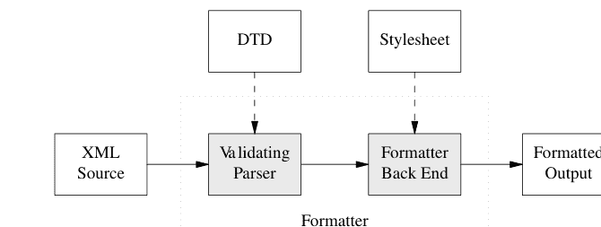

图 18.1：处理结构化文档。

我们所说的 DocBook 是 XML 的一种“方言”，实际上 DocBook 是一个 DTD——文档类型定义——一个相当大的 DTD，其中包含大约 400 个标签。

隐藏在 DocBook 之后的是一种称为验证解析器（validating parser）的程序。当你对 DocBook 文档进行格式化时，第一步是将其通过验证解析器（DocBook 格式化器的前端）。该程序会根据 DocBook DTD 检查你的文档，确保你没有违反 DTD 的任何结构规则（否则格式化器的后端，即应用你样式表的部分，可能会变得非常困惑）。

验证解析器要么抛出错误，并提供关于文档结构损坏所在页面的信息，要么将文档转换成 XML 元素和文本流，解析器后端会将这些内容与你样式表中的信息结合，生成格式化输出。

图 18.1 展示了整个过程。
图中虚线框内的部分是你的格式化软件或工具链。除了格式化器显而易见的可见输入（文档源文件）外，你还需要记住格式化器的两个隐藏输入（DTD 和样式表），以理解后续内容。

#### 18.5.2 其他 DTD

对其他 DTD 的简要插叙可能有助于澄清上一节中哪些部分是 DocBook 特有的，而哪些部分是所有结构化标记语言所通用的。

> 在 XML 术语中，我们一直称之为“方言”的东西被称为“应用”（application）；我们避免了这种用法，因为它与该词的另一个更直觉的含义冲突。

#### 18.5 DocBook

TEI <http://www.tei-c.org/>（文本编码倡议）是一个大型、精密的 DTD，主要用于学术界文学文本的计算机转录。TEI 基于 Unix 的工具链使用了许多与 DocBook 相关的工具，但使用了不同的样式表和（当然还有）不同的 DTD。

XHTML 是 HTML 的最新版本，也是由 DTD 描述的 XML 应用，这解释了 XHTML 和 DocBook 标签之间的家族相似性。XHTML 工具链由可以将 HTML 格式化为 ASCII 的网页浏览器，以及任意数量的临时 HTML 转打印工具组成。

许多其他 XML DTD 也在维护中，以帮助人们在生物信息学和银行等不同领域探索结构化信息。你可以查看仓库列表 <http://www.xml.com/pub/rg/DTD_Repositories> 来了解可用的各种变体。

#### 18.5.3 DocBook 工具链

通常，你会使用 `xmto(1)` 前端从你的 DocBook 源文件生成 HTML。你的命令看起来如下：

```bash


`$ xmto foo.xml`

`$ ls *.html`

`ar01s02.html ar01s03.html ar01s04.html index.html`

在这个示例中，你将一个名为`foo.xml`、具有三个顶层章节的 XML-DocBook 文档转换成了索引页和两个部分。制作一个大页面同样简单：

```bash
$ xmto xml-nochunks foo.xml

$ ls *.html

foo.html
```

最后，这里是如何制作用于打印的 PostScript 的：

```bash
$ xmto ps foo.xml # 生成 PostScript

$ ls *.ps

foo.ps
```


要将你的文档转换为 HTML 或 PostScript，你需要一个能够将 DocBook DTD 和合适样式表的组合应用于文档的引擎。图 18.2 展示了用于此的开源工具是如何结合的。

解析你的文档并应用样式表转换将由三个程序之一处理。最可能是`xsltproc`，它是 Red Hat Linux 附带的解析器。其他可能性是两个 Java 程序：Saxon 和 Xalan。

## 图 18.2：当今 XML-DocBook 工具链。

从 DocBook 生成高质量的 XHTML 相对容易的；XHTML 仅仅是另一个 XML DTD 这一事实很有帮助。转换为 HTML 是通过应用更简单的样式表完成的，故事到此结束。RTF 也可以通过这种方式轻松生成，并且从 XHTML 或 RTF 在急时很容易生成扁平的 ASCII 文本近似。

棘手的情况是打印。生成高质量的打印输出——在实践中意味着 Adobe 的 PDF（便携文档格式）是困难的。正确这样做需要复制人类排版师从内容到演示转换时的细致判断。

所以，首先，一个样式表将 DocBook 的结构化标记转换为另一种 XML 方言——FO 标记非常接近演示级；你可以将其看作`troff`的某种 XML 功能等效物。它必须转换为 PostScript 以便封装进 PDF。

在 Red Hat 附带的工具链中，这项工作由传递给`PassiveTex`的 TeX 宏处理。它将`xsltproc`生成的格式化对象转换为 Donald Knuth 的 TeX 语言。TeX 的输出被称为 DVI（设备无关）格式。

如果你认为 DVI 到 PDF 是一个棘手的路径，你是正确的。

## 图 18.3：未来的 XML-DocBook 工具链。

（注：此处原文中存在大量重复段落，译文已根据逻辑去重并保留了核心描述，以符合文档工程师的专业读性）

## 18.5 DocBook

LyX <http://www.lyx.org/> 是一个使用 LaTeX 标记的 GUI 字文字处理器。为了打印并支持 LaTeX 的结构化编辑，有一个 LaTeX 软件包可以生成 DocBook，还有一份指南文档 <http://bgu.chez.tiscali.fr/doc/db4lyx/> 描述了如何在 LyX 图形界面中编写 SGML 和 XML。

GNU TeXMacros <http://www.math.u-psud.fr/~anh/TeXmacros/TeXmacros.html/> 是一个旨在开发适用于技术和数学材料（包括显示公式）编辑器的项目。1.0 版本于 2002 年 4 月发布。开发者计划未来支持 XML，但目前尚未实现。

大多数人仍然通过使用 vi 或 emacs 手动编写 DocBook 标签。

## 18.5.6 相关标准与实践

这些工具正在汇聚（尽管缓慢），用于编辑和格式化 DocBook 标记。DocBook 本身是一种手段，而不是目的。在实现“可搜索文档数据库”目标之前，我们需要 DocBook 之外的其他标准。这里有两个大问题：文档目录编制和元数据。

ScrollKeeper <http://scrollkeeper.sourceforge.net/> 项目旨在满足这一需求。它提供了一组简单的脚本钩子，供软件包的安装和卸载过程调用，用于注册和注销文档。

ScrollKeeper 使用开放元数据格式 <http://www.iblio.org/osrt//>。这是一种开源文档索引的标准，类似于图书馆卡片索引系统。其核心思想是支持丰富的搜索功能，并将卡片索引元数据作为文档本身的源文本。

## 18.5.7 SGML

在之前的章节中，我们刻意省略了大量 DocBook 的历史。XML 有一个更老的兄弟，即标准通用标记语言（SGML）。

在 2002 年年中之前，如果没有对 SGML、SGML 与 XML 之间的差异以及 SGML DocBook 工具链的详细描述，任何关于 DocBook 的讨论都是不完整的。现在生活变得更简单了：开源提供了 SGML DocBook 工具链，它的工作方式与以往的 SGML 工具链一样，但更易使用。

## 18.5.8 XML-DocBook 参考

学习 DocBook 困难的因素之一是，相关网站往往会让新手淹没长长的 W3C 标准列表、海量的 SGML 神学练习以及密集的抽象术语丛林中。可以参阅《XML in a Nutshell》 [Harold-Means] 作为作为良好的书级入门介绍。

Norman Walsh 的《DocBook: The Definitive Guide》有纸质版 <http://www.oreo.com/catalog/docbook/> 和在线版 <http://www.docbook.org/tdg/en/html/docbook.html>。这确实是权威参考，但作为入门或教程将是一场灾难。相反，请阅读：

《Writing Documents Using DocBook》 <http://xml.web.cern.ch/XML/goossens/dbcatner/>。这是一份非常出色的教程。

同样还有非常优秀的 DocBook FAQ <http://www.dawson.co.uk/docbook/>，包含许多关于 HTML 输出样式的材料。此外还有一个 DocBook wiki <http://docbook.org/wiki/main.cgi>。

最后，如果你真的想进入 XML 标准的丛林，《The XML Cover Pages》 <http://xml.coverages.org/> 将带你前往那里。

## 18.6 编写 Unix 文档的最佳实践

我们在章早之前关于阅读文档的建议可以反过来用。当你为 Unix 文化内部的人士编写文档时，不要将其“浅白化”。如果你像对待白痴一样写作，你自己也会被视为白痴。将文档浅白化与使其变得“易于理解”是两回事：前者是懒惰并忽略了重要内容，而后者则需要周全的思考和无情的编辑。

千万不要认为数量会等同于质量。特别是，永远不要因为担心可能引起困惑而省略功能细节，或者因为不想显得难看而省略对问题的警告。正是那些你诚实说明的问题，会损害你的信誉和用户，那些意料之外的问题。

尝试在信息密度上达到一个中间值。太低和太高一样糟糕。使用截图；它们除了界面的风格和感觉之外，往往传达的信息极少。它们永远不是清晰文字描述的良好替代品。

如果你的项目具有相当的规模，你可能应该发布三类文档：作为参考材料的 man pages、一份教程手册和一个 FAQ（常见问题解答）列表。你还应该有一个网站，作为分发的中心点（参见第 19 章关于通信的指南）。

巨大的页面是不受欢迎的；在其中导航可能很困难。如果你的页面变得很大，请考虑编写一份参考手册，而让 man page 提供快速摘要、指向参考手册的指针以及程序如何调用的详细说明。

在你的源代码中，请包含第 19 章中开源发布实践章节所描述的标准元信息文件（如 README）。即使你的代码是专有的，这些也是 Unix 惯例，而来自 Unix 背景的未来维护者如果遵循了这些惯例，就能更快上手。

你的 man pages 应该是针对传统 Unix 受众的传统 Unix 风格命令参考。教程手册应该是面向非技术用户的长文档。而 FAQ 应该是一个不断进的资源，随着你的软件支持小组了解哪些是常见问题而不断增长。

为了领先于 2003 年年中，你还应该采取一些更具体的习惯：

- 维护你的 XML-DocBook 主文件。即使你的页面是专有的，这些也是 DocBook 惯例。
- 随包附带主文件。你的软件发布程序应正常方式安装它们，但如果人们想编写或编辑，请引导他们使用 XML。
- 让你的项目包符合 ScrollKeeper 标准。
- 使用`xmlto`为你的主文件生成 XHTML，并从你的项目页面提供。

## 19.1 Unix 与开源

开源开发利用了这样一种事实：刻描述和修复 Bug——与实现特定算法不同——这项任务非常适合拆分成多个并行的子任务。在原型设计附近的可能性空间内进行探索也能很好地并行化。只要有合适的技术和社会机制，那些松散嵌套且规模庞大的开发团队可以完成令人惊叹的工作。

令人惊讶的是，如果你还习惯着那些将保密和专有控制视为理所当然的人所养成的思维习惯，你就会觉得这不可思议。从《人月月谭》[Brooks] 到 Linux 的兴起，软件工程的正统观念一直侧重于像公司和政府这类重量级组织中、规模小且管理严密的团队。

在 AT&T 剥离之前，早期的 Unix 社区是开源行动的典范。虽然剥离前的代码在技术和法律上是私有的，但在其用户/开发者社区内部，它被视为一种公有物。志愿者的努力是由最有动力解决问题的人自我引导的。通过这些选择，人们发现了许多东西。事实上，开源开发技术在社区中作为一种无意识的民俗实践演变了二十多年，比在 20 世纪 90 年代后期被分析和标记早得多（参见《大教堂与集市》[Raymond01] 和《理解开源软件开发》[Feller-Fitzgerald]）。

回首过去，我们对自己行为的影响竟然如此显而易见，这真令人震惊。几个人曾非常接近理解这种现象；1990 年《越差越好》论文论文中的 Richard Gabriel [Gabriel] 是最广为人知的，但人们可以在 Brooks (1975) 中找到预示，甚至可以溯到 Votsky 和 Corbat 对 Multics 设计的沉思（1965）。在 20 世纪 90 年代中期被 Linux 唤醒之前，我未能克服观察二十多年软件开发带来的偏见。这段经历应该让任何深思熟虑且谦逊的人思考，还有哪些重要的统一概念仍然含蓄在我们的行为中，潜伏在我们的集体鼻子底下，击中我们的不是因为它们的复杂性，而是因为它们的简单。

开源开发的规则很简单：

- 让源码开源。不要有秘密。让代码以及产生代码的过程公开。鼓励第三方同行评审。确保其他人可以自由修改和重新发布代码。让共同开发者社区变得尽可能大。
- 尽早发布，频繁发布。快速的发布节奏意味着快速且有效的反馈。当每次增量发布都很小时，根据真实世界的反馈调整方向会更容易。
- 只要确保你的第一个版本可以构建、运行并展现出潜力。通常，一个开源程序的初始版本通过完成其最终任务的至少一部分来展现潜力，这足以证明发起者实际上可以继续该项目。例如，文字处理器的初始版本可能支持输入文本并在屏幕上显示。
- 无法编译或运行的首次发布可能会杀死一个项目（正如著名的 Mozilla 浏览器几乎经历过这种情况的那样）。无法编译的发布意味着项目开发者将无法完成项目。此外，无法运行的程序他人难以贡献，因为他们无法轻易判断自己所做的任何更改是否改进了程序。
- 用赞扬奖励贡献。如果你不能给共同开发者提供物质奖励，就给他们心理奖励。如果你可以，请记住人们为了声誉所付出的努力往往比为了报酬多得多。

规则 2 的推论是，单个发布不应该是具有重大意义的事件，附带有许多承诺并经过大量准备。无情地简化你的发布流程非常重要，这样你就可以痛苦地进行频繁发布。一种在发布准备期间必须停止所有工作的设置是一个糟糕的错误。（特别是，如果你正在使用 CVS 或类似工具，准备中的发布应该从开发主线分支出来，这样它们就不会阻塞主线的进展）。总结，不要把发布视为特殊事件；让它们成为日常工作的一部分。

> Henry Spencer

记住频繁发布的原因是为了缩短并加速连接用户群体与开发者之间的反馈循环。因此，不要将下一次发布想象成在一切完美之前不能交付的精美宝石。不要列长愿望清单。增量地进步，承认并公布当前的 Bug，并相信完美将随时间到来。接受你将在途中经历几十个小版本发布，不要因为版本号增加而烦恼。

开源开发使用分布在互联网上的大型程序员团队，主要通过电子邮件和网络文档进行通信。通常，任何特定项目的大多数贡献者都是志愿者，他们为了获得软件对自身实用性的增加以及声誉的回报。一个核心个人或核心小组引导项目；其他贡献者可能会偶尔加入或退出。为了鼓励偶然贡献者，避免在他们与核心团队之间建立社会障碍至关重要。尽量减少团队的特权状态，并努力保持边界无意识化。

开源项目遵循 尽可能自动化的 Unix 传统。他们使用`patch(1)`工具来传递增量更改。许多项目（以及所有大型项目）都使用类似 CVS 等版本控制系统的网络访问代码库（回想第 15 章的讨论）。使用自动 Bug 和补丁跟踪系统也很常见。

在 1997 年，黑客文化之外几乎没有人理解以这种方式运行大型项目，更不用说获得高质量的结果。到 2003 年，这已不再是新闻；Linux、Apache 和 Mozilla 等项目已取得了成功和高可见度。

放弃保密习惯转而追求透明和评审，是使炼金术变为化学的关键步骤。

## 19.2 与源码开发者协作的最佳实践

这实际上是代码质量的可靠指标。在多年处理补丁的经验，我很少见到经过深思熟虑且尊重时间的补丁。相反，经验告诉我们，粗心或打包方式不当的补丁可能是错误的。

以下是让你的补丁被接受的一些建议：

### 1.1 补丁实践

- 提交补丁，不要发送整个文件。如果你更改的是代码中不存在的新文件，那么你必须发送整个文件。但如果你修改的是已存在的文件，就不要发送整个文件。改为发送 diff；具体来说，发送运行`diff(1)`命令比较基准和你修改后版本的输出。`diff(1)`命令及其对面的`patch(1)`是开源开发最基础的工具。diff 比整个文件更好，因为你发送补丁的开发者可能在你获取副本后更改了基准。通过发送 diff，你为他节省了分离更改的精力；你尊重了他的时间。
- 针对当前版本发送补丁。让维护者针对几个版本前的代码处理补丁是不明其反且无礼的，要求他花精力判断哪些更改是他已经做的重复，哪些是你补丁中真正新的。作为补丁提交者，你有责任跟踪源码状态，并向维护者发送表达你想对主分支进行操作的最小补丁。这意味着针对当前版本发送补丁。
- 不要包含生成文件的补丁。在发送补丁之前，检查它并删除任何对于维护者应用补丁并重新制作后会自动生成的文件的补丁。这种错误的经典例子是 Bison 生成的 C 文件。如今最常见的此类错误是发送一个包含你的配置脚本与维护者脚本之间差异的巨大 diff。

## 19.2.1.4 不要发送仅微调了 RCS 或 SCCS 符号的补丁块。

有些人会在源文件中放置一些特殊标记，这些标记在文件提交（check-in）时会由版本控制系统展开：例如 RCS 和 CVS 使用的`$Id$`结构。

如果你自己在使用本地版本控制系统，你的更改可能会改变这些标记。这并没有什么害，因为当接收者在应用你的补丁后回检代码时，这些标记将根据维护者的版本控制状态重新展开。但那些额外的补丁块是不妥的：它们会分散读者的注意力。不发送它们是更稳妥的做法。

这是另一个错误。如果你处理好了大问题，这个错误是可以被原谅的。但无论如何，你应该避免它。

## 19.2.1.5 使用 -c 或 -u 格式，不要使用默认的 (-e) 格式。

`diff(1)`的默认 (-e) 格式非常脆弱。它不包含任何上下文，因此补丁工具无法复制自你修改补丁以来，基准代码中被插入或删除的任何行。

获取 -e 的 diff 是令人恼的，这暗示发送者要么是极端新手，要么是粗心，要么完全不知情。大多数补丁在不经考虑的情况下就被丢弃。

## 19.2.1.6 为你的补丁编写文档。

这非常重要。如果你的补丁对软件功能进行了用户可见的添加或更改，请在补丁中包含对相应的手册（man pages）和其他文档文件的更改。不要假设接收者会乐意为你的代码编写文档，或者为代码中隐藏的未文档功能编写文档。

良好的更改记录展示了良好的素养。首先，这对你试图说服的人是体贴的。其次，这表明你充分理解更改的影响，能够向看不到代码的人解释。第三，这证明了你关心最终使用该软件的人。

良好的文档通常是区分“高质量的贡献”与“凑合行事的临时补丁”最明显的标志。如果你愿意花精力和精力去制作它，你会发现你的补丁被大多数开发者接受的概率已经完成了 85% 了。

## 19.2 与开源开发者工作的最佳实践

## 19.2.1.7 在你的补丁中包含说明。

你的补丁应该包含说明注释（cover notes），解释你为什么认为这个补丁是必要的或有用的。这种说明不是针对软件用户，而是针对你发送补丁的维护者。

注释可以很短——事实上，我见过的最有效的说明注释只是“请查看此补丁中的文档更新”。但它应该表现出正确的态度。

正确的态度是乐于助人、尊重维护的时间、自信但不自大。表现出对正在修补的代码的理解是好的。表现出你能对维护者的问题产生共鸣是好的。对于应用补丁时你察觉到的任何风险，保持坦诚也是好的。以下是经验丰富的开发者发送的一些说明性注释的示例：

> “我在这段代码中发现了两个问题，X 和 Y。我修复了问题 X，但我没有尝试解决问题 Y，因为我不理解认为涉及的那部分代码。”

> “修复了当一个输入过长时的崩溃转储（crap dump）。顺便，我在其他地方也寻找了类似的溢出。我在 blarg.c 的第 666 行附近发现了一个可能的溢出。你确定发送者每次传输无法生成超过 80 个字符吗？”

> “你考虑过针对这个问题使用 Foonly 算法吗？在 <http://www.example.com/~jsmith/foonly.html> 有一个很好的实现。”

> “这个补丁解决了眼前的问题，但我意识到它以一种不太愉快的方式复杂了内存分配。对我来说很好用，但在发布之前，你可能应该在重负载下测试它。”

> “这可能是功能过度症（featuritis），但我还是把它发过。也许你会知道一种更简洁的方法来实现这个功能。”

## 19.2.1.8 在你的代码中包含有用的注释。

维护者在合并更改之前，会希望有足够的信心自己理解了你的更改。这并不是一个不变的规则；如果你与维护者之间有良好的合作记录，他可能只是随性地扫一眼更改并以半自动的方式提交。你所做的任何帮助他理解你的代码并减少他的不确定性的努力，都会增加你的补丁被接受的概率。

代码中良好的注释有助于维护者理解它。糟糕的注释则不能。

这里有一个糟糕注释的示例：

```


/* norman newbie fixed this 13 Aug 2001 */

```
这没有传递任何信息。它只是你在维护者代码中间留下的一个混乱的领地标记。如果他采纳了你的补丁（这让被采纳的可能性增加了），他几乎会删掉这条注释。如果你想要荣誉，请为项目的 `NEWS` 或 `HISTORY` 文件包含一个补丁块。他更有可能接受。

这里有一个良好注释的示例：

```
/* 这个条件需要被保护，以确保 crunch_data() 永远
 * 不被传递 NULL 指针。<norman_newbie@foosite.com>
 */
```

这条注释表明你不仅理解维护者的代码，还理解他为了对你的更改充满信心所需要的的类型信息。这种注释。

## 19.2.1.9 不要在补丁中使用绝对路径

这是一个常见的错误。如果你使用绝对路径，你的补丁将只在你的机器上有效。请改用相对路径。这允许补丁被应用于任何目录。

## 19.2.1.10 使用一致的行结束符

如果你在一个使用 Unix 行结束符的项目上工作，请确保你的补丁也使用它们。混合行结束符会导致某些版本控制系统出现问题。

## 19.2.1.11 不要包含不必要的更改

如果你仅仅为了格式原因而更改了一行，请不要将其包含在补丁中。这会让补丁更难阅读和审阅。

## 19.2.1.12 在发送补丁之前测试它们

永远不要在不确保其实际有效的情况下发送补丁。将其应用到代码的检中，并验证它能够按预期编译和运行。

## 19.2.1.13 考虑补丁的大小

如果你的补丁很大，考虑将其拆分为几个较小的补丁。这使得维护者更容易审查和合并。

## 19.2.1.14 使用清晰且描述性的提交信息

如果你正在使用版本控制系统，写一个解释补丁做了什么以及为什么要做的提交信息。这对于你和未来的开发者都有帮助。

## 19.2.1.15 遵循项目的风格指南

每个项目都有自己的编码风格。尽可能遵循它。这会让你的代码与项目的其他部分保持一致。

## 19.2 与开源开发者协作的最佳实践

### 19.2.2.3 尽力选择唯一且易于输入的名称前缀

根前缀（stem prefix）应该是项目中所有文件的公共部分，并且易于阅读、输入和记忆。请不要使用下划线。在没有极端理由的情况下，不要使用大写字母或驼峰大写（BiCapitalize）——这会破坏人类视觉的搜索顺序，并且看起来像是急于清仓的营销噱头。

当两个不同的项目具有相同的根名称时，会让人感到困惑。因此，在首次发布之前，尝试检查是否存在冲突。两个良好的检查地方是 `http://metadata.edu/pub/Linux` 的索引文件以及 Freshmeat `http://www.freshmeat.net` 应用程序索引。另一个良好的检查地方是 SourceForge `http://www.sourceforge.net`；在在那里进行名称搜索。

### 19.2.3 良好的开发实践

以下是一些能够决定一个项目是成为拥有众多贡献者的成功项目，还是在吸引关注后就陷入停滞：

#### 19.2.3.1 不要依赖有源代码

不要依赖专有语言、库或其他代码。在最好的情况下，这样做也是一项高风险的业务；在开源社区中，这被认为是完全的无礼。开源开发者不信任他们无法查阅源代码的代码。

#### 19.2.3.2 使用 GNU Autotools

配置选择应在编译编译时做出。开源发行版的一个显著优势是，它们允许软件包在编译时适应其所发现的环境。这至关重要，因为它允许软件包运行在开发者从未见过的平台上，并允许软件的用户社区进行他们自己的移植（ports）。只有最大的开发团队才能负担得起购买所有硬件并雇用足够的员工来支持即使有限的平台。

用法：使用 GNU autotools 处理可移植性问题、系统配置问题并定制你的 makefiles。今天从源码构建的人期望能够能够输入 `configure`；`make`；`install` 并获得一个干净的构建——而且这是理所应当的。关于这些工具，有一个很好的教程 `http://seul.org/docs/autotut`。

正如我们之前提到的，`autoconf` 和 `autheader` 已经很成熟，但截至 2003 年年中仍然存在 Bug 且脆弱；你可能需要维护自己的 `Makefile.in`。幸运的是，它是 autotools 中不重要的一个。

无论你采用什么配置方法，不要在编译时向用户询问系统信息。安装软件包的用户并不知道你问题的答案，这种方法从一开始就注定失败了。软件必须能够自己确定它在编译时或安装时可能需要的任何信息。

`Autoconf` 不应被视为满是旋钮（knob-ridden）设计的许可。如果一切可能，请针对 POSIX 等标准编程，并克制向系统询问配置信息。将 `ifdef` 减少到最——或者更好，完全不要使用。

#### 19.2.3.3 在发布前测试你的代码

测试套件允许团队在发布前轻松地运行回归测试。创建一个强大、可用的测试框架，你可以渐进地向软件中添加测试，而无需培训开发者学习测试套件的特殊细节。

分发测试套件允许用户社区在将移植版本提交回小组之前对其进行测试。

鼓励开发者使用各种平台作为他们的桌面和测试机器，这样代码在正常开发过程中就能持续接受可移植性缺陷的测试。

当软件随你使用的测试套件一起发布，且该测试套件可以通过 `make test` 运行时，这是一个良好的习惯，并能增强对代码的信心。

#### 19.2.3.4 发布前对代码进行健全检查（Sanity-check）

我们所说的“健全检查”是指：使用所有可用工具，捕捉人类容易忽略的错误具有合理概率。你通过工具发现的问题越多，你和你的用户面对的问题就越少。

如果你正在使用 GCC 编写 C++，请使用 `-Wall` 进行测试编译并在发布前清理所有警告信息。用你找到每一个编译器编译你的代码——不同的编译器经常发现不同的问题。具体来说，在真正的 64 位机器上编译你的软件。64 位机器上的底层数据类型会 way，你经常会发现新问题。找一个 Unix 厂商的系统并运行工具直到通过。

Electric Fence 和 Valgrind 是开源中两个很好的工具。

对于 Python 项目，PyChecker `http://sourceforge.net/projects/pychecker` 程序是一个非常有用的检查。它经常能捕捉到非本质错误。

如果你正在编写 Perl，使用 `perl -c` 检查你的代码（如果适用，可能还有 `-T`）。虔诚地使用 `perl -w` 和 `'strict'`。（进一步讨论请参见 Perl 文档。）

#### 19.2.3.5 发布前对文档和 README 进行拼写检查

对你软件中的文档、README 文件和错误信息进行拼写检查。粗率的代码、编译时产生警告信息的代码，以及 README 文件或错误信息中的拼写错误，都会让用户认为背后的工程也是马虎且粗率的。

#### 19.2.3.6 推荐的 C/C++ 可移植实践

如果你正在编写 C，可以尽管使用完整的 ANSI 特性。具体来说，要使用函数原型，这将帮助你发现跨平台的不一致性。可移植性选择可以沿着代码行或文件进行。无论你在特定平台上选择交替的代码行，还是使用少数不同文件之一，都没有区别。一个经验法是，当实现差异显著时（例如 Unix 上的共享内存），将不同平台的移植代码移动到单独的文件；而在差异很小时，将移植代码留在单个文件中。

可移植层还可以简化应用程序。通过创建一个可移植性层，你的软件可以在不理解外部任何内容的情况下运行。

在可移植层内部，使用 `#ifdef` 和 `#if` 是允许的（如果受到良好控制）。在外部，尽量将这些限制在基于符号的条件包含中。

永远不要侵入系统其他部分的命名空间，包括名称、错误返回值和函数名。在命名空间共享的情况下，记录你使用的部分。

选择一种编码标准。关于标准选择的争论可以永远持续——无论如何，维护使用多种编码标准的软件都是太困难且昂贵的，因此必须选择一种通用风格。严厉执行你的编码标准，因为代码的一性和整洁是最高优先级；编码标准本身的细节次之。

### 19.2.4 良好的发行实践

这些指南描述了你的发行版在他人获取并解压时的样子。

#### 19.2.4.1 确保 tar 包始终解压到一个新目录中

新手贡献者犯的最人恼的错误是构建 tar 包，将发行版中的文件和目录解压到当前目录，可能会覆盖那里已存在的文件。千万不要这样做！

相反，请确保你的存档文件具有一个与项目同名的通用目录路径，这样它们解压后会直接进入当前目录下的单个顶层目录。按照惯例，目录名称应与 tar 包的文件名主干相同。例如，名为 `foo-0-23.tar.gz` 的 tar 包预期会被解压到名为 `foo-0-23` 的子目录。

示例 19.1 显示了一个 Makefile 技巧，假设你的发行目录名为 `foobar`，且 `SRC` 包含你的发行文件列表，它可以实现这一点。

示例 19.1：制作 tar 归档

```
foobar-$(VERS).tar.gz:
    @ls ($SRC) | sed s:foobar-$(VERS)/:>MANIFEST
    @(cd ..; ln -s foobar-$(VERS))
    @(cd ..; tar -cvzf foobar/foobar-$(VERS).tar.gz `cat foobar/MANIFEST`)
    @(cd ..; rm foobar-$(VERS))
```

### 19.2.4.2 包含 README

包含一个名为 README 的文件，作为你源码分发的路线图。根据古例（源于 1980 年之前的 Dennis Ritchie 本人，并于 20 世纪 80 年代初在 Usenet 上流行），这是探索者在解压你的源码后阅读的第一个文件。

README 文件应该简短且易于阅读。让你的 README 成为简介，而不是史诗。README 中包含的良好内容包括：

1. 项目的简要描述。
2. 项目网站链接（如果有的话）。
3. 关于开发者构建环境和潜在移植性的说明。
4. 描述重要文件和子目录的路线图。
5. 构建/安装说明，或指向包含此类文件的链接（通常为 INSTALL）。
6. 维护者/感谢名单，或指向包含此类文件的链接（通常为 CREDITS）。
7. 最近的项目新闻，或指向包含此类文件的链接（通常为 NEWS）。
8. 项目邮件列表地址。

曾几何时该文件通常名为 READ.ME，但这与浏览器兼容性不好，浏览器往往倾向于认为 .ME 表示它不是文本文件只能下载而不能浏览。这种用法已被废弃。

### 19.2.4.3 尊重并遵循标准文件命名规范

在查看 README 之前，你的探索者已经扫描了你解压发行版中顶层目录下的文件名。这些名称本身就可以传达信息。通过遵循某些标准命名规范，你可以为探索者提供关于下一步查看什么的宝贵线索。

以下是一些顶层文件名及其含义。并不是每个发行版都需要所有这些。

- `README`：路线图文件，首要阅读。
- `INSTALL`：配置、构建和安装说明。
- `AUTHORS`：项目贡献者列表（GNU 惯例）。
- `NEWS`：最近的项目新闻。
- `HISTORY`：项目历史。
- `CHANGES`：版本之间的重大变更日志。
- `COPYING`：项目许可条款（GNU 惯例）。
- `LICENSE`：项目许可条款。
- `FAQ`：项目的纯文本常见问题解答文档。

注意一个整体惯例：全大写名称的文件名是关于软件包的人类可读元数据，而不是构建组件。这种对 README 的扩展是早期在自由软件基金会开发的。

拥有 FAQ 文件可以为你节省很多麻烦。当出现关于项目的问题时，将其放入 FAQ 中；然后引导用户在发送问题或错误报告之前先阅读 FAQ。维护良好的 FAQ 可以减少一个数量级甚至更多的项目维护者的压力负担。

为每次发布准备一个包含带有时间戳的 HISTORY 或 NEWS 文件是有价值的。除其他因素外，如果你遭遇专利侵权诉讼，它可能有助于确立现有技术（尽管这尚未发生过在任何人身上，但最好做好准备）。

### 19.2.4.4 为可升级级性进行设计

随着你发布新版本，你的软件会随时间而变化。其中某些更改将是不向下兼容的。因此，你应该认真考虑设计安装布局，使得多个安装版本的代码可以在同一系统上共存。这对于库来说特别重要——你不能指望所有的项目程序都能随着 API 的更改同步升级。

Emacs、Python 和 Qt 项目在处理方面有一个良好的惯例：带版本数的目录（另一种似乎已被 FSF 常规化的做法）。以下是安装的 Qt 库层级结构（`${ver}` 是版本号）：

```
/usr/lib/qt
/usr/lib/qt$(ver)
/usr/lib/qt$(ver)/bin      # 找到 moc 的地方
/usr/lib/qt$(ver)/lib       # 找到 .so 的地方
/usr/lib/qt$(ver)/include  # 找到头文件的地方
```


通过这种组织，多个版本可以共存。客户端程序必须指定它们需要的版本，但与其没有接口，这种代价是很小的。这种良好的做法避免了 Windows 臭名昭著的“DLL 地狱”失败模式。

### 19.2.4.5 在 Linux 下提供 RPM

这是 Red Hat 包管理器 RPM 使用的 Linux 上可安装二进制包的事实标准。它出现在最流行的 Linux 发行版中，并被几乎所有其他 Linux 发行版支持（除 Debian 和 Slackware 之外；但 Debian 可以从 RPM 安装）。因此，你的项目网站提供可安装的 RPM 以及源码包是一个好主意。

### 19.2.5.1 在 Freshmeat 上宣布

### 19.2.5.2 在相关的新闻组中宣布

找到一个与你的应用程序直接相关的 Usenet 主题组并在那里宣布。发布时要克制。如果（例如）你正在发布一个查询 IMAP 服务器的 Perl 程序，你应该发布到 `comp.mail.imap`。但除非该程序也是前沿 Perl 技术的教学示例，否则可能不应该发布到 `comp.lang.perl`。你的公告应该包含项目网站的 URL。

### 19.2.5.3 拥有一个网站

如果你打算在项目周围建立任何实质性的用户或开发者社区，它就应该有一个网站。网站上包含的标准内容包括：

- 项目章程（为什么存在、受众是谁等）。
- 项目源码的下载链接。
- 如何加入项目邮件列表的说明。
- FAQ（常见问题解答）列表。
- 项目文档的 HTML 版本。
- 指向相关和/或竞争项目的链接。

参考第 16 章中的网站示例，了解良好的项目网站长什么样。拥有网站的简单方法是将你的项目放在专门提供免费托管的网站之一。在 2003 年，其中最重要的两个 SourceForge（它是专有协作工具的演示和测试站）或 Savannah（作为意识形态声明托管开源项目）。

### 19.2.5.4 托管项目邮件列表

拥有一个私开发列表是标准做法，项目协作者可以通过它进行通信和交换补丁。你可能还想为想要了解项目进展的人设立公告列表。如果你运行一个名为 `foo` 的项目，你的开发者列表必须是 `foo-dev` 或 `foo-friends`；你的公告列表可能是 `foo-announce`。

### 19.2.5 良好的沟通

如果没人知道它们的存在，你的软件和文档将毫无用处。始终包含一行对软件用途的描述。糟糕的示例：“发布 FooEditor 的最新版本，现在有了主题且速度快了”。良好的示例：“发布 FooEditor 的最新版本，为盲打者设计的脚本化编辑器，现在有了主题且速度快了”。

### 19.2.4.6 提供校验和

为你的二进制文件提供校验和，以便人们验证它们没有损坏。虽然可以使用多种命令（如 `md5sum`、`sha1sum` 或 `sha256sum`），但最好使用哈希算法。

## 第19章 开源

一个重要的决策是“私有”开发列表到底要有大的私有性。在设计讨论中进行更广泛的参与通常是件好事，但如果列表相对开放，早晚你会有人们在上面提问针对新用户的问题。对于如何解决这个问题，人们的意见不一。仅仅在文档中告诉新用户不要在开发列表中提问基础问题并不是解决方案；必须在某处执行这一请求。

公告列表需要被严格控制。流量每月最多应该只有几条消息；此类列表的目的是为了那些想在重要事件发生时知情，但不想听取日常细节的人。如果列表开始在他们的邮箱中产生垃圾信息，大多数人会很快取消订阅。

### 19.2.5.5 发布到主要存档站点

请参阅第16章“我应该去哪里看？（Where Should I Look?）”章节中的开源存档站点。你应该将你的包发布到这些地方。

其他重要的位置包括：

- Python软件活动网站 <http://www.python.org>（用于用 Python 编写的软件）。
- CPAN <http://language.perl.com/CPAN>，用于用 Perl 编写软件的全面 Perl 存档网络。

## 19.3 许可证的逻辑：如何选择

许可证条款的选择涉及对人们对软件采取的行为施加哪些限制（如果有的话）的决策。

如果你不想设定任何限制，你应该将你的软件放入公有领域（public domain）。实现此点的适当方法是在每个文件的头部包含类似下文的内容：

> 由 J. Random Hacker 于2003年放入公有领域。分享并享受吧！

如果你这样做了，你就放弃了你的版权。任何人都可以对文本的任何部分做任何事情。这没有比这更自由的了。

但实际上很少有开源软件真的被放在公有领域。一些开源开发者希望利用他们对代码的所有权来确保它保持开放（这些人会选择采用 GPL）。另一些人只是想控制自己的法律风险；所有开源许可证的共同点之一就是免责声明。

## 19.4 为什么你应该使用标准许可证

符合开源定义（Open Source Definition）的广为人知的许可证具有成熟的解释传统。开发者（以及在他们关心的范围内用户）知道它们的含义，并对它们涉及的风险和权衡有合理的看法。因此，如果可能，请使用 OSI 网站上刊载的标准许可证之一。

如果你编写了自己的许可证，请确保它通过了 OSI 的认证。除非你经历过它，否则你不知道许可证口水战（flame war）会变得多么激烈；人们变得充满激情是因为许可证被视为几乎是神圣的契约，维护着开源社区的核心价值。

此外，如果你的许可证在法庭上经过了测试，这种成熟的解释传统可能会得到加强。在本书编写期间（2003年中），还没有任何判例法支持或否定任何开源许可证。然而，这是一项法律准则（至少在美国，可能也包括其他普通法系国家，如英国和英联邦的其他国家），根据该准则，法院应当根据其产生源地社区的预期和惯例来解释许可证和合同。因此，有理由希望，当法院最终必须应对这些问题时，开源社区的实践将起到决定性作用。

## 19.5 开源许可证的种类

### 19.5.1 MIT 或 X 财团许可证

这种宽松的自由软件许可证授予了复制、使用、修改和重新分发修改后副本的不受限权利，只要在所有修改后的版本中保留版权和许可证条款的副本。当你接受这种许可证时，你就放弃了维持维护者的权利。

你可以在 OSI 网站找到标准 X 财团许可证的模板 <http://www.opensource.org/licenses/mit-license.html>。

### 19.5.2 BSD Classic许可证

下一种限制较小的许可证授予了复制、使用、修改和重新分发修改后副本的不受限权利，只要在所有修改后的版本中保留版权和许可证条款的副本，并在与包相关的广告或文档中进行说明。受让人者必须放弃起诉维护者的权利。

原始 BSD 许可证是此类许可证中最为人知的。在追溯到 BSD Unix 的自由软件文化部分中，这种许可证甚至被用于许多距离伯克利数千英里之外编写的自由软件。

发现 BSD 许可证的微变体也并不常见，这些变体改变了版权所有者并省略了广告要求（使其实际上等同于 MIT 许可证）。注意，在1999年中，加州大学大学的技术转让办公室撤销了 BSD 许可证中的广告条款。BSD 软件上的许可证正是通过这种方式放宽的。你应该选择 BSD 方法，我们强烈建议你使用新许可证（不带广告条款）而不是旧的。该要求的废弃是因为它导致了关于什么构成广告的严重法律和程序性复杂问题。

你可以在 OSI 网站找到 BSD 许可证模板 <http://www.opensource.org/licenses/bsd-license.html>。

### 19.5.3 Artistic License

这种限制性最强的许可证授予了复制、使用和本地修改的不受限权利。它允许重新分发修改后的二进制文件，但限制了修改源码的重新分发，旨在保护作者和自由软件社区的利益。

Artistic License 是为 Perl 设计并在 Perl 社区广泛使用的，属于此类许可证。它要求修改后的文件标有“显著通知”，说明它们已被更改。它还要求重新分发时使其自由可用并将其传回给自由软件社区。

你可以在 OSI 网站找到 Artistic License 的副本 <http://www.opensource.org/licenses/artistic-license.html>。

### 19.5.4 通用许可证 (GPL)

GNU 通用许可证（GPL）及其变体是使用最广泛的自由软件许可证。与 Artistic License 一样，它允许重新分发修改后的源码，只要标有“显著通知”。触发这些要求的具体情况对所有人来说并不完全清晰。为了避免这些要求，开发了 Artistic License。

你可以在 FSF 网站找到 GPL 以及关于如何应用的说明 <http://www.gnu.org/copyleft.html>。

### 19.5.5 Mozilla 公共许可证 (MPL)

Mozilla 公共许可证支持开源但可能与闭源模块或扩展程序链接的软件。它要求分发的软件（“涵盖代码”）保持开放，但允许通过定义的 API 插件保持闭源。

你可以在 OSI 网站找到 MPL 的模板 <http://www.open-source.org/licenses/MPL-1.1.html>。

## 20 未来：危险与机遇

预测未来的最好方法是发明它。

> 1971年 XEROX PARC 的会议上 ——Alan Kay

历史并未结束。Unix 将继续增长和变化。围绕 Unix 的社区和传统将继续进化。预测未来是一项风险巨大的业务，但我们也许可以通过两种方式进行预判：首先，通过回顾过去 Unix 如何应对设计挑战；其次，通过识别我们正在寻找解决方案的问题以及等待被利用的机遇。

### 20.1 Unix 传统中的本质与偶然

为了理解 Unix 设计未来可能发生的变化，我们从观察过去 Unix 编程风格随时间变化的开始。这种努力直接引导我们面对理解 Unix 风格的挑战之一——区分偶然与本质。即，识别那些源于临时技术状况的特征，以及那些与核心 Unix 设计挑战紧密相关的特征。

以以下情况为例，“沉默是金”这一规则。我们在第 11 章中探讨了 Unix 接口设计的黄金法则；它最初是为了适应缓慢的电传打字机而产生的，但它使得输出简洁的程序可以更容易地在脚本中组合。在今天，在一个通过 GUI 可视化运行许多程序已成为常态的环境下，它有了第三种效用：静默程序不会分散或浪费用户的注意力。

另一方面，某些看起来是 Unix 特有的特质被证明是与特定的成本因素相关的偶然现象。例如，老派 Unix 偏向某些程序设计（以及像 `awk(1)` 等微型语言），这些设计对输入流进行逐行处理，或对二进制文件进行逐条记录处理，而任何在数据片段之间需要维护的文本都由复杂的状态机代码携带。相比之下，新派 Unix 通常乐于接受一种假设：程序可以将其整个输入读入内存中，并在之后随意访问。事实上，现代 Unix 提供了 `mmap(2)` 调用，允许程序员将整个文件映射到虚拟内存中，并完全隐藏了从磁盘空间进行 I/O 序列化的过程。

这种变化是用昂贵的存储换取了更简单、更透明的代码。这是对内存成本相对于程序员时间大幅下降的一种适应。20 世纪 70 年代 80 年代的老派 Unix 设计与 1990 年后新派设计之间的许多差异，可以追溯到相对成本的巨大转变——这种转变使得今天所有的机器资源相对于程序员时间，比 1969 年便宜了几个数量级。

回首过去，我们可以识别出驱动 Unix 风格发生重大变化的三种特定技术变革：网络、位图图形显示和个人电脑。在每种情况下，Unix 都通过抛弃不再具有适应性的偶然性，并为其核心理想寻找新的应用来应对挑战。生物演化也是如此。进化生物学家有一条规则：“不要假设起源决定了当前的效用，反之亦然。” 简要回顾 Unix 在这些案例中是如何适应的，可能会为 Unix 未来将如何适应我们无法预判的技术迁移提供一些线索。

第 2 章描述了这些变化中的第一个：从文化历史的角度来看网络的兴起，讲述了 TCP/IP 如何在 1980 年后将原始 Unix 文化和 ARPANET 文化融合在一起。在第 7 章中，暗示了在随后的许多十年里，Unix 开发者面临的许多错误尝试、错失和终结。对于协议¹，以及关于机器间网络与同一机器上进程间进程通信的关系，曾存在大量的困惑。

> 1. 在几年时间里，ISO 的 7 层网络标准似乎能与 TCP/IP 成功竞争。它由一个欧洲标准委员会推广，该委员会在政治上对采用任何深埋在五角大内部的技术感到极度恐惧。他们所有的愤怒都超过了他们的技术能力。结果被证明是过于复杂且无益的；详情参阅 [Padlipsky]。

最终，当 TCP/IP 获胜且 BSD sockets 确认了 Unix 核心的“一切皆字节流”隐喻时，这种困惑被消除了。使用 BSD sockets 同时进行进程间通信（IPC）和网络变得变得常态，旧方法都被淘汰了，Unix 对通信组件托管在同一台机器还是不同的机器上变得越来越不在乎。1990–1991 年世界维网的发明是逻辑的结果。

当位图图形和 Macintosh 示例在 TCP/IP 几年后的 1984 年到来时，它们提出了一个相当困难的挑战。来自 Xerox PARC 和 Apple 的原始 GUI 非常精美，但其耗费了太多的系统层级，以至于让 Unix 程序员对它们的设计感到不适。Unix 程序员的响应是将“策略与机制的分离”成为一个显式原则；并于 1988 年之前他们建立了 X 窗口系统。通过在执行低级图形的显示管理器之外隔开几层小部件集（widget sets），他们创建了一种在 Unix 术语中既现代又简洁的架构，一种能够随时间轻松演进策略的架构。

但那是问题中最简单的部分。困难的部分在于决定 Unix 是否应该有一个统一的策略，以及它应该是什么样子的。几种通过专有工具包（如 Motif）建立统一策略的尝试都失败了。2003 年，GTK 和 Qt 在这一角色上相互竞争。虽然到 2003 年这个问题的讨论尚未结束，但我们在第 11 章中注意到的不同 UI 风格的持续存在似乎说明了问题。新派 Unix 设计拥有命令行，并通过编写既可用于 CLI 引擎/GUI 接口又可用于两者的命令行代码，解决了 GUI 和 CLI 方法之间的紧张关系。

个人电脑作为技术本身带来了重大的设计挑战。386 及其后的芯片足够强大，使得围绕它们设计的系统成本成本上与它们所取代的微型计算机、工作站和服务器相似。真正的挑战在于 Unix 潜在市场的改变；硬件价格的大幅降低使得个人电脑对更广泛、技术上不那么复杂的的用户群体具有吸引力。

专有 Unix 厂商习惯于从购买更强大系统的复杂买家那里获得丰厚的利润，他们从未对这个更广泛的市场感兴趣。迈向终端用户桌面的首次倡议源于开源社区，并且基本上是出于意识形态原因发起的。从 2003 年中叶开始，市场调查显示 Linux 在该领域占有约 4%–5% 的份额，与 Apple Macintosh 相当。

无论 Linux 以后是否能取得远好于此的表现，Unix 社区响应的本质已经显而易见。我们在第 3 章对 Linux 的研究中探讨了这一点。它采纳了其他地方的一些技术（如 XML），并投入大量精力将 GUI 自然化到 Unix 世界中。但在 GUI 和安装包之下，主要的重点仍然是模块化和整洁的代码——为高可靠的计算和通信建立正确的架构。

20 90 年代后期专注于桌面的大型项目（如 Mozilla 和 OpenOffice.org）其历史很好地说明了这一点。在这两种情况下，社区反馈中最重要的主题不是对新功能的需求或对发布日期的压力——而是对单体结构的灾难，以及普遍认为这些巨大的程序必须经过精简、重构并拆分为模块，否则就是耻辱。

尽管伴大量的创新，但对这三种技术的响应在基本的 Unix 原则——模块化、透明性、策略与机制分离以及我们之前尝试描述的其他特征方面是保守的。Unix 程序员多年积累的经验是回归原理——从流、命名空间和进程的基础抽象中获取更多价值，而不是新的抽象。

## 20.2 Plan 9：曾经的未来

我们知道 Unix 的未来看起来是什么样子。它是由构建 Unix 的 Bell Labs 研究小组设计的，被称为‘Plan 9 from Bell Labs’。Plan 9 是一次重新制作 Unix 并做得更好的尝试。

核心设计使设计者在 Plan 9 中将图形和无处不在的网络集成到一个舒适的类 Unix 框架中。他们保留了 Unix 的选择，尽可能通过单一巨大的文件层次命名空间来介对许多系统服务的访问。事实上，他们改进了许多 Unix 通过各种杂杂接口（如 BSD sockets、`fcntl(2)` 和 `ioctl(2)`）访问的设施，在 Plan 9 中通过对类设备文件的特殊文件进行普通的 `read` 和 `write` 操作即可访问。为了移植性和便于访问，几乎所有设备接口都是文本的而非二进制的。大多数系统服务（例如窗口系统）都是文件服务器，包含代表所服务资源的特殊文件或目录。通过将所有资源表示为

> 2. 这个名字是向 1958 年那部被传为“史上最糟糕电影”的电影致敬。（遗憾的是，这个传说是不正确的，因为少数看过的 1966 年另一部更糟糕的臭片《Manos：魔之手》的人可以证明这一点。）

Plan 9 将访问不同服务器上的资源的问题转化为在不同服务器上访问文件的问题。

Plan 9 将这种比 Unix 更像 Unix 的文件模型与一个新概念结合在一起：私有命名空间。每个用户（事实上，Plan 9 单一最重要的特性是所有挂载的文件服务器都导出相同的类文件系统接口，无论其背后的实现如何）。有些人可能认为本地文件系统、通过网络访问的远程文件系统、在空间运行的系统服务器实例（如窗口系统或备用网络栈）以及内核接口看起来都是相似的。

Plan 9 调查论文中的示例之一是如何实现 FTP 访问远程站点。在 Plan 9 下没有 `ftp(1)` 命令。取而代之的是 `ftpps` 文件系统，每个 FTP 连接看起来都像一个文件系统；`ftpps` 自动将对挂载点下文件和目录的读、写操作转换为 FTP 协议事务。因此，普通的文件处理工具如 `ls(1)`、`mv(1)` 和 `cp(1)` 可以正常工作，无论是在 FTP 挂载点下方还是跨越用户命名空间其他部分的边界。用户（或其脚本）和程序注意到的唯一区别就是检索速度。

Plan 9 有许多值得推荐之处，包括重新设计了 Unix 系统调用接口中一些比较棘手的区域、消除了超级用户以及许多其他重新构思。它的血统无懈可击，设计优雅，并且它几乎揭示了 Unix 设计中少有的重大错误。与大多数尝试第二个系统的努力不同，它产生了一个在许多方面比其前身更简单、更优雅的架构。它为什么没有席卷世界？

人们可以列举具体的理由——缺乏任何真正的营销努力、文档匮乏、在文件处理上产生的大量混乱和障碍，以及许可问题。对于不熟悉 Plan 9 的人来说，它似乎主要是一个用于在操作系统上生成有趣程序的设备。但 Unix 此前已经克服了所有这些障碍，吸引了一批在全球范围内的忠实追随者。为什么 Plan 9 没有做到？

历史的长远视角可能会告诉我们不同的故事，但在 2003 年，Plan 9 的失败似乎仅仅是因为对 Unix 的改进还不够吸引人，无法取代其祖先。与 Plan 9 相比，Unix 虽然有明显的锈斑且咯吱作响，但它完成任务的能力足以维持其地位。对于野心勃勃的系统架构师来说，有一个教训：更好解决方案最危险的敌人是已经足够用的代码库。

Plan 9 的一些想法已被吸收到现代 Unix 中，特别是那些创新的开源版本。FreeBSD 有一个 `/proc` 文件系统，其建模完全基于 Plan 9 如何用于查询或控制运行中的进程。FreeBSD 的 `rfork(2)` 和 Linux 的 `clone(2)` 系统调用都是基于 Plan 9 的 `rfork(2)` 设计的。Linux 的 `/proc` 文件系统除了提供进程信息外，还包含了各种合成的 Linux 虚拟设备文件，用于通过文本接口查询和控制内核内部。2003 年的实验性 Linux 版本正在实现进程级挂载点，这是迈向 Plan 9 私有命名空间的一大步。各种开源 Unix 都在向全系统支持 UTF-8 迈进，而这种编码实际上是为 Plan 9.3 发明的。

随着时间的推移，由于 Unix 架构各个部分的走向衰老，Plan 9 的更多想法可能会进入 Unix。这是 Unix 未来一种可能的发展路线之一。

## 20.3 Unix 设计中的问题

Plan 9 清理了 Unix，但它在其基础设计思想中只真正增加了一个概念（私有命名空间）。但这些基础设计思想存在严重问题吗？在第 1 章中，我们触及了几个 Unix 认为是错误的问题。现在，开源运动将 Unix 设计的未来交给了程序员和技术人员；我们不再有必须终身接受的决策。我们将按顺序重新审查这些问题，以便更好地掌握 Unix 未来可能如何演进。

### 20.3.1 Unix 文件仅仅是一个大字节包

Unix 文件仅仅是一个大字节包，没有其他属性。特别是，它没有在文件实际数据之外存储关于文件类型的信息或指向关联应用程序的指针的能力。

更通地说，一切都是字节流；甚至硬件设备也是字节流。这种比喻是早期 Unix 的巨大成功，相比于（例如）编译后的程序无法产生可以反馈给编译器的输出的世界，这是一个真正的进步。管道和 Shell 编程就源于这种比喻。

> 3. UTF-8 如何诞生的故事涉及到 Ken Thompson、Rob Pike、新泽西的一家餐馆和一次疯狂的通宵黑客活动 <http://www.cl.cam.ac.uk/~mgk25/ucs/utf-8-history.txt>。

但 Unix 的字节流比喻如此核心，以至于 Unix 难以将软件对象与无法整齐放入字节流或操作集（创建、打开、读、写、删除）的操作相结合。这对于 GUI 对象（如图标、窗口和“活动”文档）来说，这尤其是一个问题。在一种经典的世界模型中，扩展“一切皆字节流”这一比喻的唯一方法是通过 `ioctl` 调用，而不是另一堆通往内核空间的丑陋后门。

Macintosh 系列操作系统的粉丝往往对此于辞激烈。他们主张一种模型，在其中……（注：此处 OCR 文本碎片化，已根据上下文逻辑重构）。

“朝自己的脚开一枪”。他们的直觉是，保护用户免受其伤害应该在 GUI 或应用程序层完成，而不是在操作系统中完成。

### 20.3.4 Unix 假设了静态文件系统

在某种意义上，Unix 对世界拥有一种非常静态的模型。程序被假定只运行短暂，因此在执行期间，文件和目录的背景可以被认为是静态的。目前没有一种标准的、成熟的方法让系统在指定的文件或目录发生变化时（以及何时）通知应用程序。编写想要感知背景变化的长周期用户界面软件时，这变成了一个重大问题。

Linux 的文件和目录变化通知功能（⁴）以及某些 BSD 版本也复制了这些功能，但这些功能尚无法移植到其他 Unix。

### 20.3.5 作业控制（Job Control）的设计非常糟糕

除了挂起进程的能力（这本身是对调度器一个微不足道的改进，且可能相当没什么用处）外，作业控制的核心是在多个进程之间切换终端。不幸的是，它只做了最简单的部分——决定哪些按键输入被发送——而将所有困难的部分（如保存和恢复屏幕状态）全部推给了应用程序。

这种机制的真正优秀实现对用户进程来说应该是完全不可见的：没有被检测到的信号，不需要保存和恢复终端模式，应用程序不需要在随机时间重绘屏幕。这种模型可能需要一个虚拟键盘，它有时连接到真实键盘（在未连接时阻塞输入），以及一个虚拟屏幕，它有时显示在真实屏幕上（在未显示时可能阻塞或不阻塞输出），由系统像复用对磁盘、处理器等的访问那的方式进行多路复用……而且对用户程序完全没有影响⁵

实现这一点需要 Unix 驱动程序驱动整个当前屏幕，而不是维护一个行缓冲区，并且要在内核层知晓终端类型（可能需要守护进程的帮助），以便在挂起的进程恢复到前台时能够正确处理。这种错误实现的后果是，Unix 内核无法将会话（例如 xterm 或 Emacs 任务）从一个终端分离，并重新连接到另一个终端（可能是不同类型）。

随着 Unix 的使用转向 X 显示器和终端模拟器，作业控制变得相对不那么重要，这个问题也不再像以前那样具有影响力了。然而，没有挂起/连接/分离功能仍然很令人恼恼；这一功能对于保存登录之间的终端会话状态可能有用。

一个名为 `screen(1)` 的常用开源程序解决了其中的几个问题。然而，由于它必须由用户显式调用，它的功能无法保证在每个终端会话中存在；此外，与其重叠的内核级代码尚未被移除。

### 20.3.6 Unix API 不使用异常

C 语言缺乏带有附加数据的抛出异常机制。因此，Unix API 中的 C 函数通过返回一个特殊值（通常是 -1 或 NULL 字符指针）并设置全局 `errno` 变量来标识错误。

回想起来，这是许多细微错误的根源。急匆匆的程序员会忽略返回值。由于没有抛出异常，违反了“修复规则”（Rule of Repair）；程序流会继续执行，直到错误在执行中表现为某种失败或数据损坏。

异常的缺失也意味着，本应该是简单惯例的任务——例如在具有伯克利风格信号的版本上编写信号处理程序——必须用复杂、易产生移植性问题且容易出错的代码来完成。

这个问题可以（且通常已经）通过 Python 或 Java 等具有异常的语言对 Unix API 进行绑定来隐藏。

异常的缺失实际上是一个具有更广泛直接影响的问题指示；C 语言弱弱的类型本体论使得用其实现的高层语言之间的通信变得问题重重。例如，大多数现代的语言都将列表和字典作为主要数据类型——但这些类型在 C 的世界中没有任何标准表示，尝试在（例如） Perl 和 Python 之间传递列表是一种不自然的行为，需要大量的胶水代码。

> 4. 使用 `fcntl(2)` 查找 `F_NOTIFY`。
> 5. 这一段基于 Henry Spencer 在 1984 年的分析。他随后指出，作业控制对于 POSIX.1 及随后的 Unix 标准是有必要且适当的，恰恰因为它渗透到了每个程序中，并且必须在应用程序到系统的接口中进行考虑。因此，POSIX 对一个错误的设计表示了认可，而正确的解决方案在“范围之外”，甚至没有被考虑。
> 6. `screen(1)` 有一个项目网站地址为 http://www.math.fu-berlin.de/~gucks/screen/。
> 7. 对于非程序员来说，抛出异常是程序在过程中间退出的方式。它不是退出，因为调用可以被外层过程中的捕获代码拦截。异常通常用于信号错误或意外情况，意味着继续正常处理是徒劳的。

有一些可以解决更广泛问题的技术，例如 CORBA，但它们往往涉及大量的运行时翻译，并且异常地沉重。

### 20.3.7 ioctl(2) 和 fcntl(2) 是一个耻辱

`ioctl(2)` 和 `fcntl(2)` 是一个耻辱。`ioctl(2)` 和 `fcntl(2)` 机制提供了设置波特率和设备数量等参数的方法。多年来，`ioctl` 和 `fcntl` 被泛滥，但文档不详且是问题的根源。

`ioctl(2)` 和 `fcntl(2)` 机制提供了设置波特率和设备数量等参数的方法。多年来，`ioctl` 和 `fcntl` 被泛滥，文档不详且是问题的根源。尚不清楚 Unix 的模型将如何丰富。

### 20.3.8 安全模型可能过于原始

也许 root 权限太强大了，认为这一点的人认为 Unix 应该拥有细粒度的能力（capabilities）或访问控制列表（ACL）用于系统管理，而不是一个可以做任何事的超级用户。如果其中一个被攻破，入侵将无处不在。这种论点是软弱的。现代 Unix 允许任何用户账户属于多个安全组。通过对可执行文件使用执行权限和设置组 ID 位，每个组可以作为文件的 ACL。然而，这种理论上的可能性很少使用，表明对 ACL 的需求在理论并不如此。

### 20.3.9 Unix 有太多种命名

统一的文件和本地设备它们都是字节流。通过套接字访问的网络设备具有不同的语义。Plan 9 证明了文件可以与本地和远程（网络）设备无缝统一，所有这些都可以可以通过每个用户甚至每个程序动态调整的命名空间来管理。

### 20.3.10 文件系统可能是有害的

我们需要文件系统？自20 世纪 70 年代末以来，持久对象存储和完全没有共享全局文件系统的研究一直是有趣的，后者将磁盘存储视为巨大的交换区域，并通过虚拟对象指针进行一切。这一领域的现代影响（如 EROS）暗示，此类设计可以带来巨大的利益，包括可证明的的安全策略合从性和更高的性能。然而，必须指出，如果这是 Unix 的失败，那么它的所有竞争对手也同样失败了；没有任何主要的生产操作系统遵循 EROS 的做法。

### 20.3.11 迈向全球互联网地址空间

也许 URL 还不够。我们将关于 Unix 未来可能方向的最终决定权交给 Unix 的发明者：

> 我对未来的理想是开发一种文件系统远程接口（Plan 9），然后将其作为标准在整个网上实现，而不是 HTML。那将是终极酷。
>
> ——Ken Thompson

> 8 http://www.eros-os.org/
> 9 Apple Newton、AS/400 小型机机和 Palm 手持设备的操作系统可以被视为异常。

## 20.4 Unix 环境中的问题

旧时代的 Unix 文化在很大程度上通过开源运动重塑了自己。这样做使我们免于灭绝，但也意味着开源面临的问题现在也是我们面临的问题。

其中之一就是让开源开发在经济上是可持续的。我们已经与 Unix 早期那种协作、开放的过程重新建立了根源上的联系。在放弃机密和专有控制的技术争论中，我们已经很大程度上取得了胜利。我们想出了与市场和管理者合作的方法，其地位比我们在 20 世纪 70 年代和 80 年代的任何时候都要平等，而且在许多方面，我们的实验是成功的。2003 年，开源 Unix 及其核心开发小组已经获得了一种主流的尊重和权威，这在就在几年前的 90 年代中期还是不可想象的。

我们已经走了很远，但还有很长的路要走。我们知道理论上哪些业务模型可能有效，现在我们甚至可以列出少数成功案例来证明它们在实践中是可行的；现在我们必须证明它们可以在更长的时间内可靠地运行。

这并不一定是一个容易的转型。开源将变成一种服务行业。服务提供商公司（想想医疗和法律服务机构）无法通过注入更多资本来扩大规模；那些只扩大固定成本的企业，其支出将超过收入并饿死。选择归结为：自力更生（获得小费和捐赠）、经营街角店（一种小型、低开销的服务性业务），或寻找一位富有的赞助人（某些为了业务目的需要使用和修改开源软件的大型公司）。

总而言，预计在软件开发者身上的投入费用将会增加，就像机械工工资随着移动设备价格上涨而上涨一样。但对于任何个人或公司来说，获取大量支出将变得更加困难。会有很多收入不错的程序员，但百万富翁寥寥。这实际上是进步的标志，意味着低效率正在被竞争出系统之外。但这代表了气候的巨大变化，可能意味着投资者将失去他们投入软件初创公司的寥无几的资金。

与维持大型软件业务日益困难相关的另一个重要子问题是“如何做”。从历史上看，Unix 文化对基础设施的关注意味着我们并不倾向于构建那些价值依赖于为终端用户提供舒适界面的程序。现在，特别是在那些旨在直接与微软和苹果竞争的开源 Unix 中，情况正在发生变化。但终端用户界面需要与真实的终端用户进行系统测试——这其中包含了一些挑战。

真实的终端用户测试需要设施、专家和监控水平，而对于开源开发特征性的分布式志愿者小组来说是难以安排。因此，开源文字处理器、电子表格和其他“生产力”应用可能必须放在像 OpenOffice.org 这样由公司赞助的大型手中，它们才能负担得起这些开销。开源开发者将公司视为单点故障，并担心这种依赖关系，但目前还没有进化出更好的解决方案。

这些是经济问题。我们还有其他更具政治性质的问题，因为成功会带来敌人。

有些问题是众为人知的。微软击败 Unix 的野心是实现计算垄断的战略目标，这让该公司在 20 世纪 80 年代中期——在我们意识到处于战斗中的五年前就已经形成了。2003 年，尽管微软拥有的几个增长市场在很大程度上被 Linux 夺走，但它仍然是世界上最富有、最强大的软件公司。微软很清楚，它必须击败开源运动中的新派 Unix 才能生存。为了击败它们，它必须摧毁或诋毁产生它们的文化。

Unix 在开源社区手中的复兴，结合互联网自由的文化，也为它带来了新的敌人。好莱坞和大型媒体对这种不受控软件开发的多路齐攻感到威胁。现有的法律，如《数字千年版权法案》，已经开始用于起诉那些做了媒体大亨不喜欢的事情的软件开发者（当然，最臭名昭著的涉及允许复制受版权 DVD 的 DeCSS 软件）。构想中的方案，如所谓的“可信计算平台联盟”和 Palladium，威胁着让开源开发在事实上变得非法——如果开源倒下，Unix 极可能随之灭亡。

Unix 和互联网对抗微软、好莱坞和大型媒体。这是我们为了所有的专业主义传统、对法院的忠诚以及相互忠诚而必须赢得斗争。这场斗争之所以重要还有更深层的原因。政治的可能性日益受到社区技术的塑造——谁可以使用它，谁可以审查它，谁控制它。政府和公司对新闻内容以及人们用电脑能做什么的控制，是对政治自由的严峻的长期威胁。噩梦场景是：企业垄断和国家主义权力追求（这两个天然盟友）相互反馈，并为增加监管、压制和对数字言论刑事化提供理由。在反对这一点时，我们是自由的战士——不仅是为了我们自己的自由，也是为了别人的自由。

> 10. 关于此效应更全面的讨论，请参见 [Raymond01] 中的《The Magic Cauldron》。
> 11. 参见 TCPA FAQ <http://www.cl.cam.ac.uk/~rja4/tcpa-faq.html> 获取一位知名专家对可能性的令人发指的总结。

## 20.5 Unix 文化中的问题

与 Unix 本身的技术问题及其对成功的影响一样，其周围社区的文化问题同样重要。至少有两个严重的问题：一个是内部转型的较小挑战，另一个是克服我们精英主义的更大挑战。

较小的挑战是，老派 Unix 大师与新派开源群体之间的摩擦。特别是 Linux 的成功，对许多老牌 Unix 程序员来说并不完全舒服。这在很大程度上是一个代问题。自 20 世纪 70 年代以来存在的 Linux 群体那种充沛的活力、天真的热诚，使得他们（通常是地）认为自己更明智。由于后辈在长辈失败的地方取得了成功，这一问题也被加剧了。

更大的心理问题直到我在 2000 年参加为期三天的苹果开发者会议时才变得清晰。沉浸在一种与 Unix 世界假设截然相反的编程文化中，是一次非常有启发的经历。

苹果程序员完全关注用户体验。他们是建筑师和装饰师。他们从外向内设计，首先问“我们想要支持什么样的交互？”，然后构建应用程序逻辑来满足界面设计的需求。这导致了程序非常漂亮，但基础设施薄弱且危险。在一个臭名昭著的例子中，直到 Release 9 版本，MacOS 内存管理器有时需要用户手动退出仍在运行的程序来手动释放内存。Unix 程序员对这种设计缺陷感到非常愤怒；他们不理解 Mac 用户是如何生存的。

相比之下，Unix 程序员完全关注基础设施。我们是水管工和石匠。我们从内部向外设计，构建强大的引擎来解决抽象问题（例如“如何通过不可靠的硬件和链路从 A 点到 B 点实现可靠的数据流传输？”）。然后我们在外面套上往往自认为丑陋的界面。`date(1)`、`find(1)` 和 `ed(1)` 命令就是臭名昭著的例子，但还有数百个其他例子。苹果用户对这种设计缺陷感到非常愤怒；他们不理解 Unix 程序员是如何生存的。

这两种设计哲学都有其合理性，但两者在理解对方观点方面存在着重重困难。典型的 Unix 开发者的本能是轻视苹果软件，认为其为给无知者的浮华，并继续构建能够让其他 Unix 开发者感兴趣的软件。如果终端用户不喜欢，那是终端用户的损失；当他们领悟到门道时，他们会回来的。

在很多方面，这种狭隘已经为我们提供了极大帮助。我们是互联网和万维网的守护者。我们的软件和传统主导着严肃计算——即那些必须保证 24/7 高可靠性和极短停机时间的应用领域。我们自己在构建稳固的基础设施方面确实非常擅长；绝非完美，但没有其他软件技术文化在成就上能与我们相提并论，这是我们应当自豪的。

问题在于，我们日益面临着需要更包容性视角的挑战。世界上大多数计算机并不在服务器房里，而是在终端用户的手中。Unix 早期在某种程度上定义为对大型机“祭司阶层”（“大铁块”的守护者）的反叛。后来，我们吸收了早期微型计算机爱好者“权力归民”的理想。但今天，我们自己成了祭司；我们是运行网络和大型机的人。我们的隐含要求是：如果你想使用软件，就必须学会像我们一样思考。

2003 年，我们的态度中存在着深层的矛盾——精英主义与传教士民粹主义之间的张力。我们想要触达并连接全球 92% 的人群，对于他们来说，计算是游戏、多媒体、GUI 界面，在最技术层面则是电子邮件、文字处理和电子表格。我们正投入资金到 GNOME 和 KDE 等项目上，试图给 Unix 一个漂亮的面子。我们内心其实都是精英主义者，深感不愿且在很多情况下无法识别或听取世界各地“蒂蒂奶奶”（Aunt Tillies）们的需求。

对于非技术终端用户来说，软件往往是令人困惑且不可理解的，要么是笨拙傲慢的，或者两者兼有。当我们试图尽早实现用户友好时，我们的表现却糟糕得极不一致。我们从老派 Unix 继承的许多态度和反应对于这项工作来说完全是错误的。当我们想要倾听并帮助蒂蒂奶奶时，我们并不知道该怎么做——我们将自己的分类和关注点投射在她身上，并给她那些令她感到畏惧的“解决方案”。

作为一种文化，我们面临的最大挑战是是否能够超越那些曾让我们受益浅的假设——我们是否能在理智上、在日常实践的肌肉中，承认 Macintosh 人们所拥有的东西。他们的观点在一些更通用、不那么针对 Mac 的书中得到了体现，例如《犯人接管了宿舍》（*The Inmates Are Running the Asylum*）[Cooper]，这是一本富有见地且具有论证性的书籍，探讨了作者所谓的“交互设计”，其中包含了许多每个 Unix 程序员都应该知道的硬道理。

我们可以避开这一点；我们可以继续做一个仅吸引少数最优秀、最明智精英的祭司阶层，一个专注于我们作为软件基础设施和网络守护者这一历史角色的极客精英社会。但如果我们这样做，我们很可能会走向衰落，并最终失去支撑我们走几十年的活力。

## 20.6 信任的理由

另一个人会服务人民；另一个人会将自己置于权力和金钱所在地，并拥有 92% 软件的未来。大概率是，无论另一个人是否是微软，他们将使用我们并不太喜欢的实践和软件来实现这一点。

或者，我们可以真正接受这项挑战。开源运动正在努力这样做。但我们过去在解决其他问题时所投入的持续工作和智慧，单此是不够的。我们的态度必须发生根本性的变化。

在第 4 章中，我们讨论了在解决技术问题时抛弃限制性假设和放弃过去的重要性，并将其与禅宗的“离执”和“学者之心”相类比。我们现在有更大程度的离执需要去处理。我们必须学会在蒂蒂奶奶面前保持谦逊，并放弃那些让我们过去取得如此成功的长期偏见。

有趣的是，Macintosh 文化已开始与我们的文化趋同——MacOS X 的底层是 Unix，在 2003 年，Mac 开发者（尽管在某些情况下很吃力）正在进行心理调整，学习 Unix 以以基础设施为中心的美德。反过来，我们的文化也将迎接 Macintosh 那种以用户为中心的美德。

其他迹象表明，Unix 文化也在摆脱它的封闭性。其一是 Unix/开源社区与被称为“敏捷开发”的运动之间似乎正在发生的融合。¹我们在第 4 章中提到，Unix 程序员高度利用了“重构”（refactoring）的概念，这是敏捷开发思考者的关注点之一。重构以及其他敏捷概念似乎阐明并强化了以往在 Unix 中广泛存在但仅是隐性的实践。另一方面，Unix 传统可以为敏捷开发阵营带来脚实的基础和长期经验的教训。随着开源软件获得市场份额，甚至可以想象这些文化将融合，就像 1980 年后的旧时代互联网和早期 Unix 文化那样一样。

Unix 的未来充满了困难的问题。我们真的希望它有任何其他样子吗？三十多年来，我们在挑战中茁壮成长。我们开创了软件工程的最佳实践。我们创造了今天的互联网和万维网。我们构建了历史上存在最大、最复杂、最可靠的软件系统，击败了 IBM 的垄断，并正在向微软的垄断发起挑战，这种挑战已足以令微软深感恐惧。

> 12。有关敏捷开发的介绍，请参阅《敏捷宣言》<http://agilemanifesto.org/>

并不是说一切都取得了胜利。在 20 世纪 80 年代，我们由于长期接受专有软件而几乎自毁了自己。我们忽视了终端用户太久。但我们一直比构建产品更擅长构建工具。工具是给人的，产品是给用户的。

开源运动正试图弥补这一鸿沟。我们拥有工具；现在我们需要学会构建产品。

## 缩略语表

本文使用的最重要的缩写和术语定义在此。

- API: 应用程序编程接口。与操作系统内核通信的程序调用集合。
- BSD: 伯克利系统发行；也称为软件发行版；1976 年至 1994 年间加州大学计算机科学小组发布的 Unix 发行版。
- CLI: 命令行界面。被某些人认为过时，但在世界上仍然非常有用。
- CPAN: Perl 存档网络。Perl 模块和扩展的中央 Web 仓库 `<http://cpan.org/>`。
- GNU: GNU 不是 Unix！自由软件基金会创建一个自由软件 Unix 克隆项目的递归缩写。这一努力并未完全成功，但生产了现代 Unix 的许多基本工具。
- GUI: 图形用户界面。70 年代在思拓 PARC 发明的、使用鼠标、窗口和图标的现代应用程序界面样式，区别于老式的 CLI 风格。
- IDE: 集成开发环境。一种开发代码的 GUI 基准，具有符号调试、版本控制和数据结构浏览等功能。由于第 15 章讨论的原因，这些在 Unix 下并不常用。
- IETF: 互联网工程任务组。负责定义 TCP/IP 等互联网协议的实体。一个由技术人员组成的松散组织。
- IPC: 进程间通信。运行在独立地址空间的进程之间传递数据的任何方法。
- MIME: 多用途互联网邮件扩展。一系列用于在 RFC-822 邮件嵌入二进制和多部分信息的 RFC。除了用于邮件传输外，MIME 还被 HTTP 和 BEEP 等重要协议作为底层使用。
- OO: 对象导。一种编程风格，试图将数据封装在理论容器中。相比之下，非对象编程在暴露数据结构代码方面更为随意。
- OS: 操作系统。机器的基础软件；调度任务、分配存储并在应用程序之间为用户提供默认界面。操作系统提供的功能及其通用设计哲学对编程风格以及围绕其主机的技术文化产生极其强大的影响。
- PDF: 便携文档格式。用于控制打印机和其他设备的 PostScript 语言设计流向打印机。PDF 是 PostScript 页面序列，封装了注释，以便方便地作为显示格式使用。

# 附录 A 缩写表

## PDP-11
可编程数据处理器 11。可能是历史上最成功的微型计算机；于 1970 年首次出货，1990 年最后一次出货，是 VAX 的直接祖先。PDP-11 是第一个主要的 Unix 平台。

## PNG
可移植网络图形。世界网联盟联盟（W3C）针对位图图像的标准和推荐格式。第 5 章中描述的一种设计优雅的二进制图形格式。

## RFC
意见请求（Request For Comment）。一种互联网标准。该名称出现于当时，这些文档被视为提交给当时不存在但预见中的某种正式批准流程的提案。而该正式批准流程从未实现。

## RPC
远程过程调用。利用进程间通信（IPC）方法创建出交换数据的进程运行在相同地址空间中的幻象，以便它们可以廉价地 (a) 共享复杂结构，以及 (b) 像函数库一样相互调用，而忽略延迟和其他性能考虑。这种幻象以难以维持而著称。

## TCP/IP
传输控制协议/互联网协议。自 1983 年从 NCP（网络控制协议）转换以来，互联网的基础协议。提供数据流的可靠传输。

## UDP/IP
通用数据报协议/互联网协议。为小型数据包提供不可靠的低延迟传输。

## UI
用户界面。

## VAX
正式名称为虚拟地址扩展：由数字设备公司（Digital Equipment Corporation，后与 Compaq 合并，后与惠普公司合并）基于 PDP-11 开发的微型计算机设计。第一台 VAX 于 1977 年出货。在 1980 年后的十年里，VAX 是最重要的 Unix 平台之一。微处理器重新实现版本至今仍在发售。

# 附录 B 参考文献

Unix 行业时间线 <http://snap.nlc.dcccd.edu/learn/drkellywis-hst-hand.htm> 以及 GNU/Linux 和 Unix 时间线 <http://www.robotwisdom.com/linux/timeline.html> 可在网上获取。Unix 发布时间线树 <http://www.leveneez.com/unix/> 同样可用。

- [Appleton] Randy Appleton. 《Improving Linux 下空闲任务的上下文性能》，2001. 引用于：158。网上可用 <http://cs.nmu.edu/Research/Papers/Scheduler/。
- [Baldwin-Clark] Carliss Baldwin and Kim Clark. 《设计规则，第 1 卷：模块化的力量》。MIT Press, 2000.ISBN 0-262-024667。引用于：83。
- [Bentley] Jon Bentley. 《编程珍珠（第 2 版）》。Addison-Wesley, 2000.ISBN 0-215-65788-0。引用于：215。书中的第三条“数据结构程序”论证了与第 9 章类似的观点，展现了 Bentley 标志性的口才横溢。书的部分内容可在网上获取 <http://www.cs.bell-labs.com/cm/cs/pearls/。
- [BlaauwBrooks] Gerrit A. Blaauw and Frederick P. Brooks. 《计算机架构：概念与演进》。Addison-Wesley, 1997.ISBN 0-201-10557-8。引用于：98, 394。
- [Bolinger-Bronson] Dan Bolinger and Tan Bronson. 《应用 RCS 和 SCCS》。O'Reilly & Associates. 1995.ISBN 1-56592-117-8。引用于：367。这不仅是一本教程书，还调查了版本控制系统中的设计问题。
- [Brokken] Frank Brokken. 《C++ 注释版》。2002. 引用于：329。网上可用 http://www.icce.rug/nl/documents/cplusplus/cplusplus.html。
- [BrooksD] David Brooks. 《将 UNIX .COM 站点转换为 Windows》。2000. 引用于：59。网上可用 http://www.securityoffice.net/mssecrets-hotmail.html#_Toc49160189。
- [Brooks] Frederick P. Brooks. 《人人月谭（20 周版）》。Addison-Wesley. 1995.ISBN 0-201-83595-9。引用于：12, 14, 300, 438。
- [Boehm] Hans Boehm. 《保守性垃圾回收的优缺点》。引用于：323。对垃圾回收环境与非垃圾回收环境之间的权衡进行了深入讨论。网上可用 http://www.hpl.com/personal/Hans-Boehm/gc/issues.html。
- [Cameron] Debra Cameron, Bill Rosenblatt, and Eric Raymond. 《学习 GNU Emacs（第 2 版）》。O'Reilly & Associates. 1996.ISBN 1-56592-152-6。引用于：352。
- [Cannon] L. W. Cannon, R. A. Elliot, L. W. Kirchhoff, J. A. Miller, J. M. Miller, R. W. Mitzw, E. P. Schon, N. O. Whington, Henry Spencer, David Keppel, and Mark Bruder. 《推荐 C 风格和编码标准》。1990. 引用于：410。这是 Indian Hill C 风格和编码标准的更新版本，由最后三位作者进行了修改，描述了程序的程序的推荐标准。网上可用 http://www.apocalypse.org/pub/docs/cstyle/。
- [Christensen] Clayton. 《创新者的困境》。HarperBusiness. 2000.ISBN 0-0662069-4。引用于：52。该书引入了“破坏性技术”一词。对公司为何犯错进行了引人入胜的检查。是技术人员应该读的书。
- [Comer] Douglas Comer. 《无处不在 Unix：庆祝》。1985, p. 42。引用于：34。
- [Cooper] Alan Cooper. 《疯人院》。1999.ISBN 0-672-3149-8。尽管有些独特之处，这本书对界面设计进行了深刻的分析，以及如何使其正确。
- [Coram-Lee] Tod Coram and Ji Lee. 《经验：界面设计语言》。1996. 引用于：266。网上可用 http://www.mapfish.com/odd/Experiences。
- [DuBois] Paul Dubois. 《Imake：软件可移植性》。O'Reilly & Associates. 1993.ISBN 1-5692055-4。引用于：363。
- [Eckel] Bruce Eckel. 《Java Java（第 3 版）》。Prentice-Hall. 2003.ISBN 0-1310287-2。引用于：341。网上可用 http://www.mindview.net/TI/。
- [Feller-Fitzgerald] Joseph Feller and Brian Fitzgerald. 《理解开源软件》。Addison-Wesley. 2002.ISBN 0-201-7349-6。引用于：438。
- [FlanaganJava] David Flanagan. 《Java 入门》。O'Reilly & Associates. 1997.ISBN 1-56592-262-X。引用于：341。
- [FlanaganJavaScript] David Flanagan. 《JavaScript权威指南（第 4 版）》。O'Reilly & Associates. 2002.ISBN 1-59600048-0。引用于：206。
- [Fowler] Martin Fowler. 《重构》。Addison-Wesley. 1999.ISBN 0-201-48567-2。引用于：90。
- [Friedl] Jeffrey Friedl. 《精通正则表达式（第 2 版）》。O'Reilly & Associates. 2002.ISBN 0-59600289-0。引用于：188。
- [Fuzz] Barton Miller, David Koski, Pheow Lee, Vivekananda Murthy, Ajitkumar Nagarajan, and Jeff Steidl. 《重新审视 fuzz：Unix 工具和服务的可靠性》。2000. 引用于：9。网上可用 http://www.opensource.org/advocacy/fuzz-revisited.pdf。
- [Gabriel] Richard Gabriel. 《好消息、坏消息以及如何赢大》。1990. 引用于：298, 438。网上可用 http://www.dreamsongs.com/WorseIs-Better.html。
- [Gancarz] Mike Garfancarz. 《Unix 哲学》。Digital Press. 1995.ISBN 1-55558-123-4。引用于：xxviii。
- [GangOfFour] Erich Gamma, Richard Helm, Ralph Johnson, and John Vlissides. 《设计模式：可复用对象程序的元素》。Addison-Wesley. 1997.ISBN 0-201-63362-1。引用于：xxxiii。
- [Garfinkel] Simson Garinkel, Daniel Weise, and Steve Strassman. 《Unix 恨者手册》。IDG Books. 1994.ISBN 1-56884-203-1。引用于：5。网上可用 http://research.microsoft.com/~daniel/unix-haters.html。
- [Gentner-Nielsen] Don Gentner and Jakob Nielsen. 《反 Mac 界面》。Communications of the ACM, Association for Computing Machinery. 1996年8月。引用于：261。网上可用 http://www.acm.org/cacm/AUG96/anticimac.html。
- [Getthys] Jim Gettys. 《双刃剑》。1998. 引用于：7。网上可用 http://freshmeat.net/articles/view/122。
- [Glickstein] Bob Clickstein. 《编写 GNU Emacs 扩展》。O'Reilly & Associates. 1997.ISBN 1-56592-261-1。引用于：343。
- [Graham] Paul Graham. 《垃圾邮件计划》。引用于：218。网上可用 http://www.paulgraham.com/spam.html。
- [Harold-Means] Elliot Russell Harold and W Scott Means. 《XML 入门（第 2 版）》。O'Reilly & Associates. 2002.ISBN 0-59600292-0。引用于：117, 434。
- [Hatton97] Les Hatton. 《重新审视缺陷密度与组件大小分布》。IEEE Software, 1997年3月/4月。引用于：86。网上可用 http://www.cs.ukc.ac.uk/people/staff/1h8/pubs/pubis697/Ubend_IS697.pdf。
- [Hatton98] Les Hatton. “面向对象符合我们的思维方式吗？” IEEE Software, 15(3). 引用自：328。网络可用：<http://www.cs.ukc.ac.uk/people/staff/lh8/pubs/pubis698/OO_IS698.pdf.gz>
- [Hauben] Ronda Hauben. UNIX 历史. 引用自：34。网络可用：<http://www.dei.isep.ipp.pt/docs/unix.html>.
- [Heller] Steve Heller. C++：对谈：使用 C++ 标准库进行编程。Prentice-Hall, 2003. ISBN 0-13-009402-1. 引用自：329。
- [Hunt-Thomas] Andrew Hunt 和 David Thomas. 程序员程序员之道：从行者到大师。Addison-Wesley, 2000. ISBN 0-201-61622-X. 引用自：xxix, 90。
- [Kernighan95] Brian Kernighan. T/Tk 在科学与工程可视化中的经验。USENIX Association Tcl/Tk 会讨会论文. 1995. 引用自：35。网络可用：<http://www.usenix.org/publications/library/proceedings/tcl95/full_papers/kernighan.txt>.
- [Kernighan-Pike84] Brian Kernighan 和 Rob Pike. Unix 编程环境。Prentice-Hall, 1984. ISBN 0-13-937681-X. 引用自：xxii, 325, 336。
- [Kernighan-Pike99] Brian Kernighan 和 Rob Pike. 编程实践。Addison-Wesley, 1999. ISBN 0-201-61586-X. 引用自：xxvii, 410。这是一本关于编写高质量程序的卓越论著，注定将成为该领域的经典。
- [Kernighan-Plauger] Brian Kernighan 和 P. J. Plauger. 软件工具。Addison-Wesley, 1976. ISBN 201-03669-X. 引用自：14。
- [Kernighan-Ritchie] Brian Kernighan 和 Dennis Ritchie. C 语言语言（第二版）。Prentice-Hall 软件系列. 1988. ISBN 0-13-110362-8. 引用自：94, 326, 395, 397。
- [Lampson] “计算机系统设计提示”。ACM 操作系统评论, 计算机协会. 1983年10月. 引用自：26。网络可用：<http://research.microsoft.com/~lampson/33-Hints/WebPage.html>.
- [Lapin] J. E. Lapin. 可移植 C 语言与 Unix 系统编程。Prentice-Hall, 1987. ISBN 0-13-68644-5. 引用自：397。
- [Leonard] Andrew Leonard. BSD Unix：从代码中赋予人民力量。2000年. 引用自：35。网络可用：<http://dir.salon.com/tech/fsp/2000/05/16/chapter_2_part_one/index.html>.
- [Levy] Steven Levy. 黑客：计算机革命的英雄们。Anchor/Doubleday. 1984. ISBN 0-385-19195-2. 引用自：44。网络可用：<http://www.stanford.edu/group/mmdd/SiliconValley/Hackers.1984.book/contents.html>.
- [Lewine] Donald Lewine. POSIX 程序员指南：编写可移植的 Unix 程序。O'Reilly & Associates. 1992. ISBN 0-93175-73-0. 引用自：400。
- [Libes-Ressler] Donald Libes 和 Sandy Ressler. 与 Unix 同存。Prentice-Hall. 1989. ISBN 0-13-56657-7. 引用自：35。这本书提供了 Unix 早期历史更详细的版本。它在 1979–1986 年期间的内容尤为精彩。
- [Lions] John Lions. Lions 对 Unix 第6 版评论。Peer-to-Peer Communications. 1996. 1-57398-013-7. 引用自：34。Lions 原始浮动内容的 PostScript 渲染在网络上。此 URL 可能不稳定：<http://www.upl.wisc.edu/~epaulson/lionc.ps>
- [Loukides-Oram] Mike Loukides 和 Andy Oram. 使用 GNU 软件编程。O'Reilly & Associates. 1996. ISBN 1-56592-112-7. 引用自：350, 357。
- [Lutz] Mark Lutz. Python 编程。O'Reilly & Associates. 1996. ISBN 1-56592-197-6. 引用自：337。
- [McIlroy78] M. D. McIlroy, E. N. Pinson 和 B. Tague. “分时系统”。贝尔技术杂志, 57 (6), 1978年, 第 190 页. 引用自：11。
- [McIlroy91] M. D. McIlroy. “我脑中的 Unix”。见弗吉尼亚用户会议论文集，第 21 卷，第 6 页. 引用自：32。
- [Miller] George Miller. “神奇数字七加减二”。心理学评论, 63, 1956年, 第 81–97 页. 引用自：88。网络可用：<http://www.well.com/user/miller.html>.
- [Moon] Mumon. 大门. 引用自：149。现代译本可在网络上获取：<http://www.iblio.org/zen/cgi-bin/index.pl>.
- [OpenSources] Sam Oldham 和 Chris Dibona. 开源：来自开放革命的声音。O'Reilly & Associates. 1999. ISBN 1-56592-582-3. 引用自：61。
- [Oram-Talbot] Andrew Oram 和 Steve Talbot. 使用 Make 管理项目。O'Reilly & Associates. 1991年. ISBN 0-93175-90。
- [Ousterhout94] John Ousterhout. Tcl 与 Tk。Addison-Wesley, 1994. ISBN 0-201-633-7. 引用自：335。
- [Ousterhout96] John Ousterhout. 为什么线程是个坏主意。1999年 USENIX 演讲。引用自：18。其演示文稿在网络上：<http://www.stanford.net/threads>.
- [Padlipsky] Michael Padlipsky. 网络的元素。2000年. 引用自：103, 462。
- [Parnas] David Parnas. 关于模块化的准则。IEEE 软件论文. 引用自：85。网络可用：<http://www.de.com/cs/humane>.
- [Pike] Rob Pike. C 语言。引用自：12。网络可用：<http://www.stanford.edu/pike/c>.
- [Prechelt] Jeff Prechelt. Unix 的进化。O'Reilly & Associates, 1999. ISBN 0-596-01-3. 引用自：324。
- [Raskin] Jeff Raskin. Unix Shell 作为一种第四代语言. 引用自：254。网络可用：<http://www.rdb.com/4gl>.
- [Raymond96] Eric S. Raymond. 黑客术语表（第三版）. 1996. 引用自：45。网络可用：<http://www.acm.org/jargon>.
- [Raymond01] Eric S. Raymond. 大教堂与集市（第二版）。O'Reilly & Associates. 1999. ISBN 0-596-001-3. 引用自：49, 338, 473。
- [Reps-Senzaki] Paul Reps 和 Nyogen Senzaki, 编辑. IEEE 论文. 1994. 引用自：xxix。
- [Ritchie79] Dennis M. Ritchie. 分时系统。1979年. 引用自：30。网络可用：<http://cm.bell.com/dmr/hist>.
- [Ritchie93] Dennis M. Ritchie. C 语言的发展。1993年. 引用自：396。网络可用：<http://cm.bell.com/cs/93>.
- [RitchieQED] Dennis M. Ritchie. QED 的不完整历史。2003年. 引用自：304。网络可用：<http://cm.bell.com/cs/qed>.
- [Ritchie-Thompson] Dennis M. Ritchie 和 Ken Thompson. Unix 分时系统. 引用自：33。网络可用：<http://cm.bell.com/dmr/acm>.
- [Saltzer] James Saltzer, David P. Reed 和 David D. Clark. “系统设计中的端到端论”。ACM 计算机事务, 计算机协会. 引用自：124。网络可用：<http://web.mit.edu/Saltzer/www/publications/endtoend>.
- [Salus] Peter H. Salus. Unix 四个世纪。Addison-Wesley, 1994. ISBN 0-201-54777-5. 引用自：12。对 Unix 历史的卓越概述，用设计者的语言解释了许多决策。
- [Schaffer-Wolf] Evan Schaffer 和 Mike Wolf. Unix Shell 作为一种第四代语言。1991年. 引用自：162。网络可用：<http://www.rdb.com/lib/4gl.pdf>. 一个开源实现，NoSQL，可以通过网络搜索找到。
- [Schwartz-Christiansen] Randall Schwartz 和 Tom Phoenix. 学习 Perl（第三版）。O'Reilly & Associates. 2001年. ISBN 0-596-00132-0. 引用自：333。
- [Spinellis] Diominius Spinellis. “领域特定语言的设计模式”。系统与软件杂志, 56 (1), 2001年2月, 第 91–99 页. 引用自：207。网络可用：<http://www.dmst.aueb.org/gds/pubs/jrnl/2000-JSS-DSLPPatterns/html/dslppat.html>.
- [Stallman] Richard M. Stallman. GNU 宣言。网络可用：<http://www.gnu.org/gnu/manifesto.html>.
- [Stephenson] Neal Stephenson. 《命令行初创时代》(In the Beginning Was the Command Line). 1999. 引用自：262。可在网上访问 <http://www.cryptonicon.com/beginning.html>，也可购买 Avon Books 出版的平装本。
- [Stevens90] Richard Stevens. 《Unix网络编程》(Unix Network Programming). Prentice-Hall. 1990. ISBN 0-13-949876-1. 引用自：177。该领域的经典著作。注意：该书的一些后期版本省略了对 Version 6 网络设施（如 mx ()）的介绍。
- [Stevens92] Richard Stevens. 《Unix环境下的高级编程》(Advanced Programming in the Unix Environment). Addison-Wesley, 1992. ISBN 0-201-56317-7. 引用自：xxvii。Stevens Unix API 的全面指南。对于资深程序员来说是一场盛宴，也是《Unix网络编程》值得的伴侣。
- [Stroustrup] Bjarne Stroustrup. 《C++程序语言》(The C++ Programming Language). Addison-Wesley, 1991. ISBN 0-201-53992-6. 引用自：329。
- [Tanenbaum-VanRenesse] Andrew S. Tanenbaum and Robert van Renesse. 《远程过程调用范式的批判》(A Critique of the Remote Procedure Call Paradigm). EUTECO’88 会论文，参与者版. 1988. 引用自：179。
- [Tidwell] Doug Tidwell. 《XSLT：掌握XML变换》(XSLT: Mastering XML Transformations). O’Reilly and Associates. 2001. ISBN 1-596-00053-7. 引用自：194。
- [Torvalds] Linus Torvalds and David Diamond. 《快乐之源》(Just for Fun: The Story of an Axel Revolutionary). HarperBusiness. 2001. ISBN 0-06-662072-4. 引用自：394, 402。
- [Vaughan] Gary G. Vaughan, Tom Tomery, and Ian Lane Taylor. 《GNU Autoconf, Automake, and Libtool》。New Readers Publishing. 2000. ISBN 1-578-70190-2. 引用自：364。GNU 配置工具的用户指南。可在网上访问 <http://sources.redhat.com/autobook/>。
- [Vo] Kiem-Phong Wo. “可复用库的学科与方法架构”。Software Practice & Experience, 2010, p. 107–128. 引用自：100。可在网上访问 <http://www.research.att.com/sw/tools/vocdex/dm-spe-ps>。
- [Yourdon] Edward Yourdon. 《死亡行：软件开发者生存“不可能完成的任务”项目的完整指南》(Death March: The Complete Software Developer’s Guide to Surviving “Mission Impossible” Projects). Prentice-Hall. 1997. ISBN 0-137-48310-4, 引用自：377。

## C 贡献者

任何在豪华酒店里参加过 USENIX 会议的人都可以告诉你，像“你也是那种电脑人，对吧？”这样的话在酒店酒水侍口中大约等同于“看，另一种移动性极其惊人的黏菌形态！”

> —Elizabeth Zwicky

Ken Arnold 是创建 4BSD Unix 小组的成员。他编写了原始的 `curses(3)` 库，是原始 `rogue(6)` 游戏的作者之一。他是《Java参考手册》的合著者，Java 和面向对象技术的领先专家之一。

Steven M. Bellovin 在 1979 年于北卡罗来纳大学期间与 Tom Truscott 和 Jim Ellis 一起创建了 Usenet。1982 年加入 AT&T 贝尔实验室，在那里他对安全、密码学以及 Unix 系统和其他其他领域的网络进行了开创性研究。他是互联网工程任务组（IETF）的活跃成员，也是国家工程学院的成员。

Stuart Feldman 是贝尔实验室 Unix 开发小组的成员。他编写了 `make(1)` 和 `f77(1)`。他现在是 IBM 计算研究的副总裁。

Jim Gettys 与 Bob Schleifer 和 Keith Packard 一起是 20 世纪 80 年代后期 X 窗口系统的主要架构师。他编写了大部分 X 库、X 许可证，并阐述了 X 设计中“机制，而非策略”的核心信条。

Steve Johnson 编写了 `yacc(1)` 并用它编写了可移植 C 编译器，该编译器取代了原始的 DMR 并成为后来 Unix 编译器的祖先。

Brian Kernighan 是 Unix 社区中关于良好风格最清晰的阐述者。他编写了数本传统中不可或缺的经典著作，包括《编程实践》(The Practice of Programming)、《C程序语言》(The C Programming Language) 和《Unix环境》(The Unix Programming Environment)。在贝尔实验室期间，他编写了 `awk(1)` 并对 troff 系列工具的开发发挥了重要作用，包括与 Lorinda 合著的 `eqn(1)` 和 `grap(1)`。

David Korn 编写了 Korn shell，几乎所有 Unix shell 的风格祖先。他设计了 WI，一个为被迫使用 Windows 的人的模拟器。David 还在文件系统设计和移植性方面进行了研究。

Mike Lesk 是贝尔实验室原始 Unix 团队的一部分。除了其他贡献外，他编写了用于文字处理的 `tbl(1)` 和 `refer(1)` 工具、`lex(1)` 词法分析生成器以及 UOCP (Unix copy)。

Doug McIlroy 在 Unix 出生时领导了贝尔实验室的研究小组，并发明了管道（pipe）。他编写了 `spell(1)`、`diff(1)`、`join(1)` 等经典 Unix 工具，并帮助定义了 Unix 文档的传统风格。他在存储分配、计算机安全和定理证明方面也做了开创性工作。

Marshall McCusick 实现了快速文件系统，并在研究计算机系统组（CSRG）负责了 4.3BSD 和 4.4BSD 的开发与发布。

Keith Packard 是原始 X11 代码的主要贡献者。在 1999 年开始的第二阶段参与中，他重写了渲染代码，产生了一个更强大但更小的实现，适用于手持电脑和 PDA。

Eric S. Raymond 自 1982 年以来就一直在编写软件。1991 年，他编辑了《黑客字典》(The Hacker’s Dictionary)，从那以后从历史和人类学的角度研究 Unix 社区和互联网黑客文化。1997 年，他的研究产生了《大教堂与大集市》(The Cathedral and the Bazaar)，帮助（重新）定义并注入了这一运动的活力。

Henry Spencer 是 70 年代中期 Unix 离开贝尔实验室后第一批拥抱 Unix 的程序员领袖。他的贡献包括第一个公共字符串库，以及用于 4.4BSD 和 POSIX 标准的正则表达式引擎。他还是 C 语言秘密的著名专家。他是《C News》的合著者，多年来一直是 Usenet 上的理性声音，也是其最受尊敬的常客之一。

Ken Thompson 发明 Unix。

## D 无根之根：福大师的 Unix 公案

### 编辑者介绍

这组被称为“无根之根”（Rootless Root）的公案被发现，似乎在西部山脉干燥的高空气中保存了数十年，这引发了学术界的巨大争议。这些是为早期 Unix 师父们的教义提供新亮光的真实文档吗？还是对 Thompson、Ritchie 和 McIlroy 等半神话化人物的巧妙拼凑，以解释更接近我们这个时代的教义？这还无法定论。争议的双方都强调了与那部尊贵的经典《编程之道》（The Tao of Programming）的相似之处。但《无根之根》在语调和风格上与译文中松散、诗意的轶事完全不同，它专注于福大师这一卓越且神秘的人物。

> 1. 《编程之道》可在网上访问 <http://www.canonical.org/~kragen/tao-of-programming.html>。

在 AI 公案中寻找相似之处是恰当的；确实迹表明《无根之根》的作者可能编辑了某些版本的 AI 公案。我们在与 Loginataka 的联系方面也有更坚实的基础；事实上，《无根之根》和《Loginataka》的未知作者可能是同一个人，可能是福大师本人的学生。

还应该提到《福大师故事》，尽管九个人物对其古老性产生了怀疑，而且它们不太可能影响《无根之根》。

关于福大师应该归属于东部派（新泽西）还是从伯克利早期发展出来的西部派，存在很大争议。这也许是因为我们无法确定福大师是否真的存在！他可能是一个老师的组合，或者是一个整个法脉。

甚至超越了福大师的传说，谁喜爱了 Nubi？Nubi 拥有所有典型形象——完美弟子的特征。这让人想起围绕佛最喜爱的弟子 Ananda 的故事。很可能是这样，在将佛的生活打磨成永恒神话的过程中，Ananda 真实的性格没有留下痕迹。

最终，我们能做的就是接受这些教义故事本身的条款，并从中提取可能发现的智慧内核。

《无根之根》的编辑正在进行中，因为原始材料在重建和解释方面存在许多困难。随着这些困难的解决，未来的版本将包含更多故事。

## 福大师与万行代码

福大师曾对一位来访的程序员说：“一行 shell 脚本中，蕴含的 Unix 特性，比一万行 C 代码还要多。”

那位程序员对自己在 C 语言方面的精通感到非常自豪，他说：“这怎么可能？C 是实现 Unix 内核的语言啊！”

福大师回答道：“确实如此。尽管如此，一行 shell 脚本中蕴含的 Unix 特性，比一万行 C 代码还要多。”

程序员感到苦恼。“但我们所经历的 C 语言是 Ritchie 祖师的启示！我们与操作系统和机器合二为一，获得了无与伦比的性能！”

福大师回答道：“你所说的都是的。但一行 shell 脚本中蕴含的 Unix 特性，比一万行 C 代码还要多。”

程序员对福大师嗤之以鼻起身离开。福大师向他的学生阿比（Nubi）点头，阿比在附近的白板上写了一行 shell 脚本，问道：“大师程序员，考虑一下这个管道。如果用纯 C 语言实现，难道不会跨越万行吗？”

程序员摸着胡子喃喃自语，思考着阿比所写的内容。最后，他同意确实如此。

“那么你需要多少小时来编写和调试那个 C 程序呢？”“只有傻子会在更有价值的任务等待着他时花时间去做那个。”

“很多，”来访的程序员承认道。

“那么谁更理解 Unix 特性呢？”福大师问。“是那个写了一万行代码的人，还是那个洞察到任务空虚、通过不编码来获得功德的人？”

听到这里，程序员悟道了。

一个来自 Woot 土地的陌生人在福大师正与学生们吃早饭时来了。

“我听说你很 l33z，”他说，“请教我你所知的一切。”

福大师的学生们互相看着，对这个陌生人野蛮的语言感到困惑。福大师只是微笑回答道：“你想学习 Unix 之道吗？”

“我想成为一个魔法黑客（wizard haxor），”陌生人回答道，“并且永远不被破解（own ever boxed）。”

“我不教那样的道，”福大师回答。

陌生人变得焦躁。“哥们儿，你只是个装大师（poser），”他说，“如果你真的懂些什么，你会教我。”

“有一条路，”福大师说，“可能会带你走向智慧。”大师在纸上随手写了一个 IP 地址。“破解这个箱子对你来说并不困难，因为他的守护者们无能无为。回去告诉我你发现了什么。”

陌生人鞠躬离开了。福大师吃完了饭。

日子一天天过去，一个月一个月。陌生人被遗忘了。

多年以后，那个来自 Woot 土地的陌生人回来了。

“该死！”他说，“我破解了那个箱子，确实像你说的那样简单。但我被 FBI 抓了并关进了监狱。”

“很好，”福大师说，“你准备好接受下一课课了。”他在另一张纸上写了一个 IP 地址，递给陌生人。

“你疯了吗？”陌生人大叫道，“经历了这一切之后，我再也不会攻进任何计算机了！”

福大师笑了。“这里，”他说，“是智慧的开始。”

听到这里，陌生人悟道了。

## 福大师论两条道路

福大师教导他的学生们：

“有一行法教义，以麦尔罗伊祖师（Patriarch McIlroy）的格言‘只做好一件事’为典型，它强调当软件具有简单且一致的行为时，它就具备了 Unix 特性，其属性可以被用户的大脑轻易建模，并被其他程序使用。”

“但还有另一行法教义，以汤普森祖师（Patriarch Thompson）的伟大格言‘用时，用蛮力（When in use, use brute force）’，以及关于‘现在解决 90% 的情况，胜过以后解决 100%’的各种经文为典型，它强调了实现的健壮性和简单性。”

“现在告诉我：哪些程序具有 Unix 特性？”

沉默片刻，阿比观察到：

“大师，这些教义可能会冲突。”

“简单的实现可能缺乏处理边界情况的逻辑，例如资源耗尽、未能关闭竞态窗口，或在未完成的事务期间超时。”

“当这些边界情况发生时，软件的行为将变得不可规则且难以处理。这难道不是 Unix 之道吗？”

福大师点头同意。

另一方面，众所周知，花哨算法是脆弱的。此外，每次覆盖边界情况的尝试往往都会与程序的核心算法以及覆盖其他边界情况的代码产生相互作用。”

“因此，预先尝试所有所有边界情况保证‘描述的简单性’，实际上可能会产生过度复杂且脆弱的代码，或者因受于 Bug 的困扰而永远无法发布。这难道不是 Unix 之道吗？”

福大师点头同意。

“那么，正确的法路是什么呢？”阿比问。

大师说道：

> “当鹰飞翔时，它会忘记它的脚曾触碰地面吗？当老虎落在猎物身上，它会忘记它在空中的瞬间吗？三磅 VAX！”

听到这里，阿比悟道了。

## 福大师与方法论者

当福大师和学生阿比在镇间旅行时，福大师和学生们聚在一起听讲。在其中一次场合，一位方法论者在询问他属于哪个学派。

“如果你不对你的代码进行性能分析（profile），你不像一个在湖里丢网的渔夫吗？”福大师说。

“但是，”方法论者说，“如果你不测量你的资源，你不像一个浮在湖里的渔夫？”

“因为他不会游泳，”福大师回答道。

听到这里，方法论者悟道了。

## 福大师论图形用户界面

一天晚上，福大师和阿比参加了一场程序员聚会。其中一个程序员询问他们是否是大道的追随者，那个程序员变得鄙夷。

“Unix 的命令行工具是粗糙且落后的，”他嘲笑道，“现代设计良好的操作系统通过图形界面完成一切。”

福大师没有说话，而是指了指月亮。附近的一只狗对着大师的手叫了起来。

“我不理解你！”程序员说。

福大师保持沉默，指向了佛像。然后他指向了一个窗口。

“你想告诉我什么？”程序员问。

福大师指了指程序员的头。然后他指向了一个石头。

“你为什么不能说清楚？”程序员要求道。

福大师若有所思地皱了皱程序的鼻子，将他丢进了旁边的垃圾桶。

当程序员试图从垃圾中挣脱时，那只狗走过来在他身上尿了。

在那，程序员大悟。

## 福大师与 Unix 狂热者

一个 Unix 狂热者听说福大师在大道上有智慧，便来请教。福大师对他说：

“当汤普森祖师发明 Unix 时，他并不理解它。然后他获得了理解，便不再发明它了。”

“当麦尔罗伊祖师发明管道（pipe）时，他知道它将改变软件，但不知道它将改变思想。”

“当 Ritchie 祖师发明 C 语言时，他将程序员判入了缓冲区溢出、堆损坏和野指针 Bug 的千重地狱。”

“真正，祖师们是盲目且愚蠢的！”

狂热者对大师的话感到非常愤怒。

“这些觉者，”他抗议道，“请赐我们 Unix 大道。。如果我们嘲笑他们，就会失去功德并转世为畜生或 MCSE。”

“你的代码完全没有污点和缺陷吗？”福大师问道。

“没有，”狂热者承认道，“没有人的如此。”

“祖师们的智慧，”福大师说，“在于他们知道自己是愚人。”

听到这里，狂热者悟道了。

# 福大师关于 Unix 本性的论述

一名学生对福大师说：“我们听说，一家名为 SCO 的公司对 Unix 拥有真正的统治权。”

福大师点点头。

学生继续说道：“但我们也听说，另一名为 OpenGroup 的公司也对 Unix 拥有真正的统治权。”

福大师点点头。

“这怎么可能？”学生问道。

福大师回答：

“SCO 确实拥有 Unix 代码的统治权，但 Unix 代码并非 Unix。OpenGroup 确实拥有 Unix 名称的统治权，但 Unix 的名称并非 Unix。”

“那么，什么是 Unix 本性？”学生问道。

福大师回答：

“不是代码。不是名字。不是思想。不是万物。永恒变化，却永恒不变。”

“Unix 本性简单而空虚。正因为它简单而空虚，它比台风还要强大。”

“顺应自然法则，它在程序员的脑海中不可避免地展开，将设计同化自身的本性。所有与其竞争的软件都必须变得像它一样：空、空、深邃的空、完美的虚无，哈哉！”

听到这里，学生大悟了。

# 福大师与终端用户

在另一次福大师公开授座时，一位终端用户听闻了大师的智慧，便来寻求他的指导。

他向福大师行了三礼。“我想学习 Unix 的大之道，”他说，“但命令行令我很困惑。”

围观的一些初学者开始嘲笑这位终端用户，称他为“一窍不通”，并说 Unix 之道只属于那些有纪律和智慧的人。

大师举起手示意安静，并让那个嘲笑他、最吵闹的初学者走上前，来到他和终端用户坐着的地方。

“告诉我，”他对初学者问道，“你写过的代码以及你口述过的设计作品。”

初学者开始结结巴巴地回答，但陷入了沉默。

福大师转向终端用户。“告诉我，”他询问道，“你为何寻找之道？”

“我不对周围看到的软件满意，”终端用户回答道，“它们既运行得可靠，也不悦眼悦手。听说 Unix 之道虽然困难，却是优越的，我寻求抛弃所有的陷阱和幻象。”

“你在世上做什么工作的，”福大师问道，“为什么必须与软件斗争？”

“我是一个建筑师，”终端用户回答道，“这个镇上的很多房子都是我的主持下建造的。”

福大师转向初学者。“家猫可以嘲笑老虎，”大师说，“但这样做并不能让它的呼噜声变成咆哮。”

听到这里，那初学者豁然开朗。

# 跋记

本书在编写过程中未使用任何专有软件。草稿使用 GNU Emacs 创建的 XML-DocBook 主文件进行排版。PostScript 的生成使用了 Tim Waugh 的 `xmlto`、Norman Walsh 的 XSL 样式表、Daniel Veillard 的 `xsltproc`、Sebastian Rahtz 的 PassiveTeX 宏、Donald Knuth TeX 排字机的 TeTeX 分发版以及 Thomas Rokicki 的 `dvips` 后处理器。所有图表均由作者使用 `pic2graph` 驱动 `gpic` 以及 `grap2graph` 驱动 `grap` 实现 `grap2graph` 绘制。`grap2graph` 是作者为本项目编写的，现在已是 groff 分发版的一部分。整个工具链托管在标准的 Red Hat Linux 上。生产排版由 Alina Kirsanova 完成。

封面艺术是 Ioanna Salajan 原版 Zen Comics 中两幅图像的合成。主要由 Jerry Votta 进行改编和上色，作者和 GIMP 也参与了其中。

# 索引

- 选项 (option), 243
- 抽象 (Abstraction), 102–103
- 访问控制列表 (ACLs), 271
- 意外复杂度 (Accidental complexity), 299–300
- Ada, 328
- Adams, 53
- 即时代码生成 (Ad-hoc code generation), 225–229
  - 用于 ascii 显示, 225–227
  - 为表格列表生成 HTML 代码, 227–229
- 即时性陷阱 (Adhocity trap), 297
- ADOCOS, 65
- 高级 shell 编程 (Advanced shell programming), 325
- Aegis, 368–369
- AF_INET 套字列表, 173
- 敏捷编程 (Agile programming), 477–478
- AIX, 77
- AlgoI, 84, 324
- Allen, 36
- Amigos, 67
- ANSI C, 11
- Apache, 98, 49, 108, 131, 175, 236, 326, 440, 446
- 小程序 (Applets), 339
- 应用程序编程接口 (APIs), 8, 16, 78, 80, 150, 402
- 应用程序协议 (Application protocol), 173
- 应用程序协议设计 (Application protocol design), 123–127
  - IMAP, 123, 126–127
  - POP3, 123, 124–126
  - SMTP, 123, 124
- 应用程序协议元数据 (Application protocol metatfs), 127–132
  - CDDB/freedb.org 数据库, 129
  - 经典 Internet 应用协议, 127–128
  - HTTP, 128–129
  - Arnold, Ken, 21, 34, 88, 115, 173
  - ARPANET, 9, 31, 35–36, 44–45
  - 与 Unix 文化, 45–47
- 计算机程序艺术 (Art of Computer Programming. Knuth), xxx, 23
- 人工智能 (Artificial intelligence), 14
- 艺术许可 (Artistic License), 388, 485
- ascii, 90, 217–218
- ash, 244
- 汇编器 (Assemblers), 14
- atr, 275
- AT&T, 32–33, 35–40, 42, 61, 176. 见 System V Unix, 30–36
- 放弃 (diviture), 6
- at, 275
- 态度 (Attitude), 26–27
- 鲁莽 (audacity), 135–136
- 自动配置 (autoconf), 363–364, 447–448
- 自动制作 (automake), 364, 447
- 自动化版本控制 (Automated version control), 366
- awk, 75, 89, 112, 183–202, 204, 330, 354
- 选项 (option), 243
- 备份脚本 (Backup scripts), 166
- bash shell, 71
- bc, 165, 183, 203–205, 262–264
- BCPL, 395
- Bechtlein, Andreas, 365
- Beck, Kent, 330
- BEEP (Blocks Extensible Protocol), 130–131
- Bell Labs, 33–36, 464, netlib, 196
- Bellovin, Steven M., 330
- BeOS, 71–72
- Berkeley Unix, 35–36
- Bernstein-Lee, Tim, 299
- Bernstein 链, 167–168
- bib, 195
- 大端序 (Big-endian), 98
- BIND, 183
- Whitfield, 512
- binhex, 245
- bison, 353, 441
- Blaauw, Gerrit, 98
- Blivet 陷阱 (Blivet trap), 297
- blq, 333–334
- BNF (Backus-Naur Form), 355
- bogofilter, 218
- bootpd, 173
- Bostic, Keith, 41
- Brooks, Frederick P., 14, 87, 98, 215
- 布鲁克斯法则 (Brooks’ Law), 86
- BROWSER DOM, 206
- BROWSER 环境变量, 240
- BSD 许可 (BSD Class License), 457–458
- BSD 套接, 39, 89, 90, 176, 182, 400, 463, 464
- BSD Unix, 4, 41, 43, 90, 171, 175–176, 388, 402, 见开源变体, 61, 175 以及可靠信号, 173
  - 版本 4.2, 35
- bsh, 244
- Bug 跟踪 (Bug tracking), 365
- 字流 (Byte stream), 58, 106, 172
- 字节后缀 paypal (Byte-suffixed paypal), 127–128
- bzip, 245
- CGI (通用网关), 228, 282–284
- 变更跟踪 (Change tracking), 365
- 检查清单功能 (Checklist features), 177
- 密码 (checkpassword), 167
- Christensen, Clayton, 52
- ci, 246
- 清晰性 (Clarity), 14
  - 规则 (rule of), 13, 102, 154–155
- Clark, Alexander, 231
- Clientsnet 应用协议, 127–128
- clear, 268
- CLI 服务器, 123
  - 模式 (pattern), 182–279
- 客户端 (Client), 59
- 克隆 (clone), 466
- CMS 流水, 75
- co, 246
- 代码 (Code), 11
  - 清晰度 (clarity of), 14
- 代码生成 (Code generation), 215–229
  - 即时代码生成, 225–229
    - ascii 显示, 225–227
    - 表格列表的通用 HTML 代码, 227–229
  - 数据驱动编程, 216–225
    - ascii, 217–218
    - 定义, 216
    - fetchmethodof 元类破解, 219–225
    - 统计垃圾邮件过滤, 218–219
- 代码库大小 (Codebase size), 297
- 一致性 (Coherent), 37
- COLUMNS 环境变量, 239
- Color, Douglas, 33
- 命令行接口 (CLIs), 58–59
  - 命令行选项, 242–248
    - a 选项, 243
    - b 选项, 243
    - c 选项, 244
    - d 选项, 244
    - e 选项, 245
    - f 选项, 245
    - h 选项, 245
    - i 选项, 245
    - k 选项, 245
    - l 选项, 246
    - m 选项, 246
    - n 选项, 246
    - o 选项, 246
    - p 选项, 246
    - 其他操作系统, 248
    - q 选项, 246
    - B 选项, 246–247
    - x 选项, 246
    - z 选项, 247
    - t 选项, 247
    - u 选项, 247
    - v 选项, 247
    - V 选项, 247
    - w 选项, 247
    - y 选项, 248
    - z 选项, 248
- ACM 通信论文, 33
- 紧凑性 (Compactness), 84–87, 202
- 可比较分时系统 (CTSS), 234
- 编译器 (Compiler), 269
- 编译器类 (Compilers), 114
- 复杂度 (Complexity), 295–317
  - 意外, 299–300
  - 妥协, 312–334
  - dc, 304–305
  - Emacs, 207–308, 314–315
  - 必要的, 299
  - 与子进程交互, 298–299
  - 映射, 300–302
  - 优的, 299–300
  - 纯文本编辑, 302
  - 问题, 309–312
  - 富文本编辑, 302–303
  - Sam 编辑, 306–307
  - 软件大小 (right size of), 316–317
  - 源, 296–298
  - 语法感知, 303
  - vi, 305–306
- Wiley, 308
- 复杂度级别 (Complexity level), choosing, 207–308
- 组合规则 (Composition rule of), 13, 15–16
- 全 Perl 网络 (Comprehensive Perl Network), 332
- 接口关注 (Concerns of interfaces), 257–258
- 并发版本系统 (CVS), 367–368
- 配置 (Configuration), 231–252
  - 命令行选项, 242–248
  - 启动环境控制信息, 233–234
  - 环境变量, 238–242
    - 其他操作性, 242
    - 系统, 238–239
    - 用户, 240
    - 何时使用, 240–242
  - 方法：选择其, 248–252
    - fetchmail, 249–250
    - XFree8 服务器, 251–252
  - 运行控制文件, 234–238
    - .netrc 文件, 236–237
    - 其他操作性, 238
- 书中约定 (Conventions, used in book), xxix-xxx
- cookie-jar 格式, 115–116
- 协作进程 (Cooperating processes), 55–56
- 协作多任务 (Cooperative multitasking), 54–55
- Costello, Joseph, 417
- cp, 246, 465
- CPAN 地址, 384, 456
- cptio, 245
- ccront, 244, 247
- db, 92
- split, 247
- CSSC (兼容性愚源控制), 67 367
- 标签 (tags), 104
- 文化 (Culture), 3–4
- CUP, 355
- curses 库, 144, 292
- 自定义语法写作, 210
- cut, 112, 113
- cix, 247, 248
- cxygen, 70
- CTSS. 见兼容分时系统
- d 选项, 244
- D 选项, 244
- Da Vinci, Leonardo, 253
- Daemons, 170
  - fetchmail, 271
- 数据文件元类型, 112–123
  - cookie-jar 格式, 115–116
  - dined, 112
  - DSV 样式, 113–114
  - record-jar 格式, 116–117
  - RFC 822 格式, 114–115
  - Unix 文本文件格式转换, 120–122
  - Windows 信息, 119–120
- dc, 165, 183, 187, 203–205, 262–264
- 死代码, 155
- debugfs, 152
- 调试, 14
- DEC (数字设备公司), 37, 40, 61, 75
- 美国高级研究计划局 (DARPA), 35
- 分隔符值值 (DSV), 113–114
- 防御性依赖, 362
- 为未来设计, 24–25
- 值的日期, 94
- df, 243
- diff, 38, 93, 441
- 可发现性, 18, 133–134, 258–259
- 针对...编码, 151
- 针对...设计, 148
- 破坏性政策, 75
- ditroff, 107
- 多样性，规则, 14, 24, 102
- DLL 地狱, 70
- DocBook, 426, 427–434
  - 文档类型定义, 427–429
  - 编辑工具, 432–433
  - 迁移工具, 433
  - 相关标准/实践, 433
  - SGML, 429–431
  - 工具链, 429
  - 编写 Unix 文档的最佳实践, 434–435
  - XML-DocBook 引用, 433–434
- DocBook: 定义指南 (Walsh), 434
- 文档, 417–435
  - 概念, 418–420
  - 文化风格, 421–422
  - 格式, 422–426
    - DocBook, 426, 427–434
    - 文档工作台 (Document's Workbench), 422–424
    - HTML, 426
    - POD (普通旧文档), 425
    - TeX, 424–425
    - info, 422–424
  - 大型文档偏见, 420–421
- 文档工作台 (DWB) 工具, 195–199, 204, 422–335
- 领域特定语言, 183–184
- 不要重复自己 (Don't Repeat Yourself), 见 SPOT 规则
- 领域代码, 155
- DSV, 113–114
- DTD (文档定义), 429
- DTSS, 78
- du, 243
- DVI (TeX 设备无关格式), 331, 430
- 动态链接库 (DLLs), 100
- – , 244
- 易用性，接口, 257–258
- 经济性，规则, 13, 22, 375
- ed, 188, 304–305, 496
  - 模式, 270
- EDITOR 环境变量, 240
- egrep, 188, 244
- Einbert, 295
- 优雅代码, 134
- 编程风格元素 (Kernuhan/Plauger), 104
- ELIZA 程序, 205
- elm, 256, 272
- elvis, 245, 247
- emacs, 166, 47, 106, 205, 252, 275, 307–318, 315–352, 437
  - 与 make 工具工具, 370–373
    - 性能分析, 372
    - 运行时调试, 371
    - 版本控制, 371–372
- Emacs Lisp, 88–89, 187, 205, 342–343, 349, 412
  - 移植性, 432
- Emacs Lisp 库, 134
- 嵌入式脚本, 334
- EMX, 67
- 封装, 85–87, 107
- 环境变量, 238–242
  - 与其他操作系统的移植性, 422
  - 系统, 238–239
  - 用户, 240
  - 何时使用, 240–242
- EPSF, 203
- ep, 183, 195–196
- EROS, 472
- 本质复杂度, 299–300
- etags, 104
- 以太网, 4
- ex, 247
- 接口设计的可表达性, 257–258
- 扩展/嵌入语言, 209
- 扩展性, 308, 311, 336
  - 规则的, 14, 24–25
- –  , 244–245
- fj77, 245 (此处可能为误或 faces)
- faces, 247
- fcnt, 464, 469, 471
- Feldman, Stuart, 358–360
- 友谊, 31
- Hamming, Dick, 7
- 避免手工破解, 22–23
- Harness 程序, 278
- Hatton, Les, 183
- 启发式方法, 93–94
- 高层语言代码, 22
- Hoare, C. A., 83, 287
- HOME 环境变量, 239
- HP-UX, 77
- HTML, 96–97, 225, 289, 284, 321, 426
- HTTP, 97, 128–130
- – i 选项, 245
- I 选项, 245
- iblio, 384
- IBM, 4, 10, 33, 36–37, 39–41, 43, 65–67, 72–76, 271, 375, 498
  - 与微软联盟, 65
- 身份, 338
- idris, 37
- IEEE-X, 400
- IET.  互联网任务组 (Internet Task Force)
- ifconfig, 246
- imake, 363
- IMAP, 123, 126–127, 293
- Imgsizer, 338
- inetd, 173, 172, 278
- infoop, 145, 252
- InfoZip, 383
- 电气电子工程师学会 (IEEE), 399–404
- Intel, 43
- 接口, 10, 253–285
  - 编写计算器程序. 262–264
  - CLI 与视觉化界面之间的权衡, 259–262
  - 配置性, 264–266
  - 表达性, 264–266
  - 接口设计评估, 257–259
  - 最小权限原则，应用, 254–255
  - 沉默规则, 284–285
  - 透明度, 264–266
  - Unix 接口设计历史, 256–257
  - Unix 接口设计模式, 266–280
    - 应用, 280–281
    - cantrip 模式, 268
    - CLI 服务器模式, 278–279
    - 编译器模式, 269
    - ed 模式, 270
    - 过滤器模式, 266–267
    - 基于语言的模式, 279–280
    - 多功能程序模式, 281
    - roguelike 模式, 270–271
    - “分离引擎与接口”模式, 273–278
    - 汇点模式, 269
    - 源模式, 268
    - Web 浏览器作为通用前端, 281–284
- 内部边界, 575
- 国际化, 413–414
- 互联网, 8–9, 476
- 互联网工程任务组 (IET), 44
  - 与 RFC 标准, 403–405
- 互联网打印协议 (IPP), 129–130
- 互联网标准 (修订版2), 404
- 互联网文化, 10
- 进程间通信 (IPC), 55, 158
- 内省, 222
- toct, 464, 471
- ITS, 44, 78
- + Jabber, 131
- Jack, 355
- 文件, 44, 45
- Java, 22–50, 66–67, 70–88–99, 106, 131, 187, 207, 209, 222, 282–283, 311, 337, 332–349, 369–412
  - FreeNet, 342
  - 原生方法接口, 339
  - 移植性, 411–412
- Java 索引, 385
- JavaScript, 96, 187–205–281
- JCL (作业语言), 73
- Johnson, Steve, 10, 84, 208–233, 276, 290, 354, 395, 397
- Jolitz, William, 41
- Joy, 35–36
- + Key, Alan, 461
- KDE 项目, 179, 315, 383, 426
- Kernigan, Brian, 5, 14, 259, 335, 395
- ISS 原则, 25, 119, 219
- kmail, 140–144, 265
- Knuth, Donald, 273, 370, 430
- Korn, 180, 201, 496
- Korn shell, 209, 330–331, 496
- ksb, 244
- + -l 选项, 245–246
- Lamps, Burt, 26
- 语言与应用, 212–213
- 基于语言的模式, 279–280
- Lasoon, 401
- LaTeX, 211, 424–425, 433
- 软件工程法, 313
- 最不意外规则的, 13, 20, 134, 197, 210, 253, 255, 254
  - 应用, 236
- Les, Mike, 24, 99, 262, 354, 419
- lex, 165, 247, 93, 183, 158, 210, 352, 353–356
- LGPL, 388
- 库, 190
- LINES 环境变量, 239
- Linux 操作系统, 6–7, 41–43, 48–51, 61, 65–67, 72–79, 100, 117, 119, 134, 152, 158, 172, 175–176, 207, 241, 248, 251, 256, 269, 280, 331, 402, 440
  - 存档, 384
  - 作为文化现象, 43
  - 内核, 383
  - Red Hat, GNU/Linux, 332
- Linux 标准基础 (LSB), 402
- Lion, John, 34
- Lisp, 22, 30, 46, 88, 194, 222, 337, 343
- 小端序, 98
- 活代码, 155
- 锁文件, 171
- LOGDER 环境变量, 238
- lpd, 275
- lpr, 269
- lis, 162, 245, 249, 268, 465
- lynx, 144, 359
- + automake, 364
- image, 363
- makepended, 362–363
  - 在非 C/C++ 开发中, 359
  - 工具生产, 359–362
- makepended, 362–363
- man cores, 88–89
- man pages, 432
- Manularity, 297
- 映射复杂度, 300–302
- 序列化, 106
- MATLAB, 290
- McCarthy, John, 309
- McGrou, D., 5, 11, 12, 17, 22, 30, 49, 55, 56, 77, 92–93, 161–162, 177, 212, 232, 250, 317, 342, 450
- McKewick, Marshall Kirk, 41
- mdoc, 422
- 内存管理单元 (MMU), 57, 63, 69, 71
- 类具有, 222–223
- Metcalf, Robert, 4
- Microsoft, 30, 40, 65, 66, 67, 70
  - Windows, 50, 75, 78–79, 146, 176
  - Windows NT, 68–71
  - Word, 病毒, 708
- MIME, 114, 140, 480
- Minilanguis, 183–213
  - 应用, 187–199
    - nwk, 195–200
    - bc and, 203–205
  - 设计, 204–213
    - 复杂度级别, 207–208
    - 自定义语法, 210
    - ending/extending, 协议, 212–213
    - macros, 210–212
- 频谱, 186
- 语言分类, 185–187
- XSLT, 194–195
- MIT 人工实验室, 44
- MIT 或 X 联盟许可证, 388, 457
- mkmisofs, 276
- mm, 422
- mmap, 175, 449, 462
- 建模接口 (Modeled interface), 305–306
- 建模/视图/计数器模式 (Modeled/view/counter pattern), 273–274
- 模块化, 83–104
  - 编码, 103–104
  - 紧凑性, 87–89
  - 以及强有单一中心, 92–94
  - 封装, 85–87
  - 库, 99
  - 最佳包含尺寸, 85–88
  - 正交性, 89–91
  - 规则, 13, 84, 85, 159
  - SPOT 规则, 91–92
- Mooods, 336
- 摩尔定律, 278
- 更多, 162, 163
- mountail, 172
- Mozilla, 9, 255, 440
- Mozilla 公共许可证 (MPL), 388, 459
- MPE, 78
- MPL — 参见 Mozilla 公共许可证
- ms, 432
- MTS, 78
- Multics, 29–32, 44, 61, 74–75, 78, 438
- 《Multics Enacs: 历史、设计与实现》(Greenberg), 308
- 多程序处理, 157–182
  - b c 和 dc, 165
  - 伯恩斯坦链 (Bernstein chaining), 167–168
  - 复杂度频谱，执行
  - 性能调优, 159–160
  - 定义, 157
  - fetchmail，作为管道, 165–166
  - 过滤器, 162–166
  - mut 用户代理, 161
  - 对等进程进程间通信, 169–176
    - fetchmail 对信号的使用, 172
    - 共享内存, 175–176
    - 信号, 171
    - 套接字 (sockets), 172–175
    - 系统守护进程和协作系统, 172
    - 临时文件 (tempiles), 169–170
  - picgraph, 164–165
  - 管道 (pipes), 166–169
  - 管道至分页器, 163
  - 应该避免的问题/方法, 176–181
    - 过时的 Unix IPC 方法, 176–178
    - 远程过程调用 (RPCs), 178–180
  - 设计层面的进程划分, 181–182
  - 进程创建, 158
  - 重定向, 162–166
  - 从生进程, 168–169
  - scp 和 sc, 159
  - 特殊程序，向其交付任务, 160–161
  - Unix 方法分类, 160–161
  - 词列表，制作, 164
  - 封装器 (wrappers), 166
    - 备份脚本, 166
    - 安全封装器, 167–168
- 多任务处理, 54–55
  - 协作式, 54–55
  - 抢占式, 155
- 多轨道编辑, 136
- mutt, xxx, 144, 161, 256, 272
- mx, 465
- MVS (多虚拟存储), 72–74
  - 命名的, 172
  - Pamed 管道, 163
- NetBSD, 76
- Netscape, 49–50, 67, 255
- NFS (网络文件系统), 178
- nifd, 172
- 《没有万银弹》(Brooks), 300
- 非紧凑型设计, 89
- 非局部性, 290–291
- Novell, 43
- Shroff, 32, 246, 422
- 信号, 247
- NUMA (统一内存访问), 290
  - — , 246
- O 符号法, 288
- 对象导, 14, 216
- 面对象编程 (OO), 101–103
- 过时的 Unix IPC 方法, 176–178
  - STREAMS, 177–178, 462
  - System V IPC, 177
- Olsen, 40
- 《论圣战与和平的诉求”, 98
- 《应用协议设计》(Rose), 127
- 开放软件基金会 (OSF), 40
- 开源, 39, 43–47, 52, 61, 65, 67, 70–72, 76–77, 79, 117, 130–131, 146, 145, 170–175, 178, 191, 194–196, 201–203, 205–206, 209, 251, 256, 280, 284, 298–322, 324, 326, 328, 329, 332, 340–341, 344–346, 350, 355, 359, 362, 367–369, 372–373, 380–390, 399, 401–402, 408–410, 412–415, 426, 427–439, 许可证选择, 456, 许可, 457–459
  - 艺术许可证 (Artistic License), 458
  - BSD 类许可证, 457–458
  - 通用公共许可证 (General Public License), 46, 458–459
  - MIT 或联盟许可证, 457
  - Mozilla 公共许可证, 459
- 开源基金会 (OSD), 7, 386–387, 457
  - 软件，问题, 385
  - 使用, 457
  - 以及 Unix, 438–440
  - 与开发者合作, 440–456
    - 开发实践, 447–450
    - 发行制作实践, 450–454
    - 补丁实践, 440–444
    - 归档实践, 444–447
- OpenBSD, 76
- 开源社区, 9
- 开源运动, 49–51
- 操作系统:
  - 二进制文件, 58
  - 风格元素, 53–61
  - 开发入门门槛, 60–61
  - 内部边界, 57
  - 进程间通信 (IPC), 55
  - 多任务处理, 54–55
  - 用户界面风格, 58–59
  - 记录结构, 57–58
- 优化, 287–294
  - 选择不优化, 287–288
  - 预测量, 288–290
  - 非局部性, 290–291
  - 规则, 14, 23–24
  - 通过延迟, 291–294
    - 批量操作, 292
    - 缓存操作结果, 293–294
    - 交叉操作, 293
- 可选复杂性, 299–300
  - 正统性, 84, 87, 89–93, 94–99, 225, 301
  - OS/2, 65–67
  - Ossana, Joseph, 417
  - Outerhout, John, 411
  - 输出解析, 303
  - 选项, 246
  - Packard, Keith, 117, 407–408
  - Palladium, 475
  - 解析器/词法分析器, 23
  - 节约规则, 13, 18
  - Pascal, 324
  - PassiveTex, 430
  - 密码, 245
  - 粘贴, 113
  - 补丁, 38, 42, 93, 441
  - Peason, Tim, 36
  - 环境, 239
  - 模式语言, A (Alexander), xxx
  - PDF. 参见 Portable Document Format
  - PDF FAQ, 30
  - PDF 计算机, 123
  - PDP-1, 141
  - DP-7, 30–32
  - DP-10, 37, 44–45, 参见 TOPS-20
  - DP-11, 32, 34, 80, 395, 481
  - 对等通信, 169–176
    - 网络信号, 172
    - 共享内存, 175–176
    - 套接字, 170–171
    - 系统信号和常规信号, 172
    - 临时文件, 169–170
  - perl, 254
  - Perl, ie, 22, 39, 75, 88–89, 103, 187, 201–202, 209, 228, 311, 332–334, 338, 369, 410
  - 守护者, 334
  - 可移植性, 410
- Perl XS, 339
- Perlis, 157, 200
- pic, 164–165, 183–199, 210
- pidfile, 171
- Pike, 98, 23, 154, 288, 466
- 管道 (Pipes), 31, 36, 45, 56, 78, 107, 158–166, 176, 197, 242, 278, 286
- 管道至分页器, 163
- PL/1, 纯文本编辑, 302
- 贝尔实验室, 306, 308, 312, 464, 466–472
- 插件, 100
- GIMP, 100–101
- PLY, 355
- PNG (Portable Network Graphics) 格式, 111–120, 132–144, 152, 154, 369, 339, 414
- POD (Plain Old Documentation), 425, 426, 432
- 轮询 (poll), 182
- 多值 (Polyvalent-program) 模式, 281
- POP3, 123, 124, 293
- popfile, 218
- 可移植性, 362, 393–417
- Python 语言:
  - 历史, 395–396
  - 演进, 394–398
  - 标准, 396–398
  - 语言选择, 409–412
    - C+, 409–410
    - Java, 411–412
    - Perl, 410
  - Python, xx, 22, 75, 88–89, 106, 187, 228–229, 244, 311, 327, 333–339, 383–410
    - fetchmail, 338–339
    - 首页, 384
    - imgazzer, 338
    - 可移植性, 411
  - Python 库 (PIL), 339
  - Python 解释器, 293–294
- Python 软件活动, 456
  - 选项, 246
- QDOS, 360
- qed 编辑器, 304
- qmail, 275
- qmail POP 服务器, 167
- qmail-pop, 167
- qmail-smtpd, 168
- QNX, 373
- Qt 工具套包, 329–330, 409
  - τ 选项, 246–247
  - R 选项, 246–247
- 竞态条件, 171
- 互联网协议结构设计原理, 129–130
- 重定向, 162–166
- 重构, 90–91
- 引用, 195
- 注册表膨胀 (Registry creep), 69
- 正则表达式, 188–191
  - 基础, 188
  - 示例, 189
  - 扩展, 188
  - glob 表达式, 190
  - 操作, 189
  - csh 中的 rehash 指令, 92
- 远程过程调用 (RPC), 68, 178–180
- 表示, 13, 21–22, 147, 154, 252
- 请求意见 (RFCs), 44
- 复用, 375–390
  - 迁移到, 380–381
  - 新程序员, 376–379
  - 透明性, 379–380
- 版本控制系统 (RCS), 367
- R 脚本语言, 66, 75
- rfork, 466
- 富文本编辑, 302–303
- Ritchie, Dennis, 5, 30–53, 34, 44, 98–99, 161–177, 395
- 健壮性, 13, 18–19
- rogue, 256, 270
- Roguelike 模式, 270–271
- 无根的, 499–509
- 清晰性规则, 13, 102, 154–155
- 组合规则, 13, 15–16
- 多样性规则, 14, 24, 102
- 经济规则, 13, 22, 375
- 扩展性规则, 14, 24–25
- 生成规则, 12, 23–38
- 最小冗余规则, 13, 134, 197, 210, 253, 255, 285
  - 应用, 254–255
- 最小化规则, 316
- 模块化规则, 13, 84, 85–159
- 优化规则, 14, 23–24
- 节约规则, 13
- 修复规则, 13, 21–22, 147, 154, 252
- 表示规则, 13, 19–120
- 健壮性规则, 13, 18–19
- 分离规则, 13, 17
- 静默规则, 13, 20–21, 284–285
- 透明性规则, 13, 17, 102, 178
- 运行控制, 234–235
  - .netrc 文件, 336–337
    - 可移植到其他操作系统, 338
- Russell, Bertrand, 183
  - -s 选项, 247
- 圣 (Saint), 44
- 圣克鲁斯行动 (Santa Cruz Operation), 35
- 圣亚纳 (Santayana), George, 29
- Scheme, 279
- scp, 169
- screen, 470
- 脚本化，接口设计, 255–279
- 脚本化语言, xxx, 112, 222
- 单一 Unix 规范 (Single Unix Specification), 175, 401
-  (option), 247
- 汇点模式 (Sink pattern), 269
- tail, 246
- 从属进程 (Slave processes), 168–169
- 格雷格禅师的故事 (Tales of Zen Master Greg), 500
- scp 和 ssh, 169
- 编程之禅 (Tao of Programming. The), 499
- slrn, 144, 272
- 道德经 (Tao Te Ching), 375
- smbclient, 152, 237
- tar, 166–244, 248
- SMTP, 123, 124
- tbl, 183, 195
- SNA（系统网络架构）, 73–74
- Tcl, 22, 31, 136, 186, 187, 209, 212, 228, 279, 281, 322, 327, 330, 334–339, 342–347, 369, 371, 404, 411
- snmp, 152–188
  - expect 软件包, 212
- SNG（可扩展网络图形格式）, 142–144, 155, 185
  - Moosdym 系统, 336
- snmpnetstat, 346
  - 可移植性, 411
- SOAP（简单对象访问协议）, 131, 179
- Tkmman, 336
- 套接字 (Sockets), 162, 175
- tcpdump, 246
- Freeicv, 174–175
- TCP/IP, 8, 9, 35, 36, 63–74, 174, 176, 178, 258, 282, 463
- PostgresSQL, 174
- TECO, 184
- 软件工程, 3–4
- TERM 环境变量, 239
- 软件开发方法论, 14
- 能力格式 (capability format), 441
- Solaris, 4, 77
- terminfo, 145–146
- 通用/Linux (Source Generic/Linux), 332
- 术语数据库, 146
- 源代码控制系统 (SCCS), 367
- TJX, 211, 251, 424–425, 430
- 源码模式 (source pattern), 268
- Textinfo, 425
- SourceForge, 344–345, 384
- 文本流 (Text streams), 155
- 太空旅行游戏, 30–31, 44
- 整体性 (Textality), 105–131
- SPACWEAR,
- ambspays, 218
- 应用协议设计, 123–127
- 发者 (Sender), 3, 15, 19, 20, 100, 107, 145, 153, 204, 216, 250, 264, 354, 365, 376, 397, 415, 438, 469
  - IMAP, 123, 124–126
- 海绵 (Sponge), 269
  - POP3, 123, 124–126
- SPOT 规则, 91–92, 220, 244, 293, 301
  - SMTP, 123, 124
- ssh, 169
- 应用协议元数据, 127–132
- Richard Stman (RM), 37, 39–44, 47, 48, 51, 314, 400
  - CDDB/frebd 数据库, 129
- 开始 (starts), 268
  - 经典互联网应用协议, 127–128
  - HTTP, 128–129
- STL（标准模板库）, 322
- 数据文件格式, 112–123
- STREAMS, 177–178, 462
- 结构化编程, 14
  - 定义的 (defined), 112
- 样式表 (Stylesheet), 419, 428
  - DVS 样式, 113–124
- Subversion, 368–369
  - 记录格式 (record-jar format), 116–117
- Sun 社区源码许可 (SCL), 340
  - RFC 822 格式, 114–115
- Sun 微系统系统, 36–38, 40, 52, 178, 539, 345
  - Unix 文本文件格式, 120–122, 345, 399
  - 网络窗口系统 (NWS), 256
  - Windows INI 格式, 119–120
- 语法糖 (Syntactic sugar), 200
  - XML, 117–119
- 语法感知 (Syntax awareness), 303
- 文件压缩, 122–139
  - 重要性, 109
- System III, 90, 171, 367, 396, 398
- System V, 37–38, 171, 176–178, 238, 299, 395, 398–400
  - AT&T 打印协议 (IPP), 129–130
  - Jabber, 131
  - SOAP（简单对象访问协议）, 139, 179
  - XML-RPC, 131, 158
  - PNG（可移植网络图形）, 110–111
  - XML 文件格式, 111–112
- 反序列化化 (unmarshalling), 106
- 版本控制:
  - Aegis, 368–369
  - 自动, 366
  - 手动, 365
  - 并发版本系统 (CVS), 367–368
  - 修订控制系统 (RCS), 367
  - 源代码控制系统 (SCC), 367
  - Subversion, 368–369
  - 工具, 367–369
  - 无需, 291–294
- Thompson, Ken, 4, 5, 16, 23, 24, 30–32, 34–35, 37, 60, 88–99, 104, 135, 161, 203, 304, 395, 466, 472
- 线程 (Threads), 180–181
- 吞吐量, 291–294
  - 重叠操作, 293
- 抛出异常 (Throw an exception), 470
- 自顶向下设计 (Top-down design), 95–97
- TOPS-10, 78
- 20, 44, 78
- 时间线 (Timelines), 61–62
- tin, 272
- Tk, 409
- 工具包 (Toolkits), 256–257
- 工具 (Tools), 349–373
- Torvalds, Lin, 41, 47, 48–49, 406, 437
- 触摸 (touch), 268
- tr, 112
- 透明度 (Transparency), 133–155
- 图灵完备语言 (Turing-complete languages), 187, 201, 205
- 代码, 215–229
- 复杂度, 295–317
- 配置, 231–252
- 跨平台移植性, 8
- 文化:
  - 反对, 5–6
  - 专家视角, 11–12
  - 其中问题, 47–75
- 数据文件元数据, 112–123
- 文档, 417–435
  - 文化样式, 221–222
- 耐用性/适应性, 4–5
- 删除, 6
- 灵活性, 9–10
- 与 ARPANET 融合, 45–47
- 未来, 461–478
- 未来趋势, 344–345
- 开源应用, 9
- 作为开源软件, 7–8
- 操作系统，风格元素, 53–61
- 优化, 287–294
- 选项 (options), 7
- 起源, 29–30
- 哲学, 327–369
  - 应用, 26
  - 与其他对比, 53–80
- 移植性, 393–413
- 优选界面样式, 58–89
- 记录结构, 57–58
- 重用, 375–390
- 规范级别, 215–229
- 冗余 (textosity), 103–151
- 透明度, 133–155
- 通用性, 6
- 版本发布, 34
- 战争, 35–441, 398–401
- 选择 X 工具包, 306–347
- Unix 界面设计历史, 256–257
- Unix 界面设计模式, 266–280
  - 应用, 280–281
  - cantrip 解析器, 268
  - CLI 服务器解析器, 182, 278–279
  - 编译器解析器, 269
  - ed 解析器, 270
  - 过滤器解析器, 266–267
  - 基于语言的模式, 279–280
  - 变体程序模式, 281
  - roguelike 模式, 270–271, 273–278
    - 客户端/服务器对, 277–278
    - 配置器/执行者, 234
    - 驱动器/引擎对, 275–277
    - 池化/守护进程对, 275
  - 汇点解析器, 269
  - 源码解析器, 268
- Unix System V
- Unix 文件格式, 120–122
- 反序列化, 106
- URI（统一资源标识符）, 128
- URL（统一资源定位符）, 9, 128
- 用户, 45–110, 114, 205, 272, 305, 333–383, 440, 451, 497
- 用户变量, 238
- 用户界面设计, 140, 475
- 工具程序, 359–362
- v 选项, 247
- V 选项, 247
- 有效解析器, 428
- VAX/VMS 操作系统, 10, 35, 367
- Venix, 37
- 版本控制:
  - Aegis, 368–369
  - 自动, 366
  - 手动, 365
  - 并发版本系统 (CVS), 367–368
  - 修订控制系统 (RCS), 367
  - 源代码控制系统 (SCC), 367
  - Subversion, 368–369
  - 工具, 367–369
  - 无需, 291–294
- vi, 35, 247, 272, 311, 352
- vim, 351
- VMC/CMS, 4, 7–46
- VMS, 40, 61–64, 468
- 选择 X 工具包, 346–347
- X 窗口系统, 7, 47, 49, 63, 108, 183, 463
- XFree86, 42, 251–252
- Xalan, 249
- xcalc, 262–263
- xdrocast, 276
- dxb, 371
- xmacos, 352
- Xerox PARC, 256, 257, 461, 463, 467–468
- XML, 117–119, 196, 205, 284, 331, 463
- XML-DocBook, 426
- XML-int, 147
- XML-RPC, 131, 158
- xmlm-troff, 431
- xml 工具包, 118–119
- xmlto, 331–332, 425–426, 439, 435
- XOpen, 401
- XSLT, 186, 194–195, 331–333
- xsltproc, 429–430
- xterm, 144, 244, 403
- xi, 351
- w 选项, 248
- Wall, 39, 458
- 瀑布模型, 406
- wc, 162
- White Book, 94, 395
- who, 268
- Wify 编辑器, 308–309
- 窗口管理器, 257
- Windows 操作系统, 10, 40, 50, 66, 67, 75, 77–79, 100, 113, 135, 146–147, 152–153, 171, 173, 175, 176, 179, 181, 193, 207, 238, 242, 248, 252, 256–257, 265, 324, 329, 349–352, 367, 409–410, 412, 450, 453
- Windows 帮助标记, 426
- Windows 格式, 119–120
- Windows NT, 68–71
- Wittgenstein, Ludwig, 321
- 工作区壳 (WPS), 66
- 世界性维网 (WWW), 8–9, 42, 281, 476
- “越差越好”(Worse is Better)论文 (Gabriel), 298, 438
- 包装器 (Wrappers), 166
  - 备份脚本, 166
  - 安全包装, 167–168
- write, 177
- wxWindows, 346–347, 409
- WYSIWYG（所见即所得）, 196, 258, 418–419
- y 选项, 248
