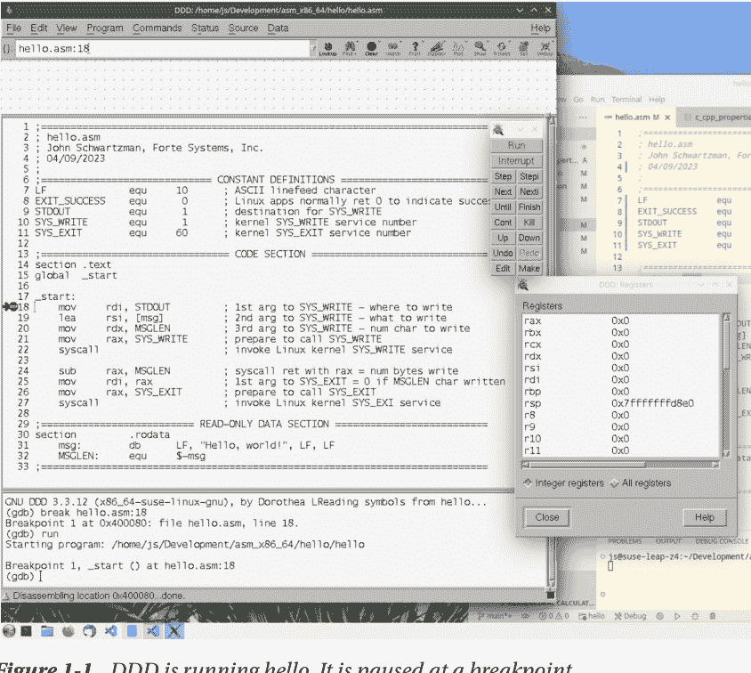
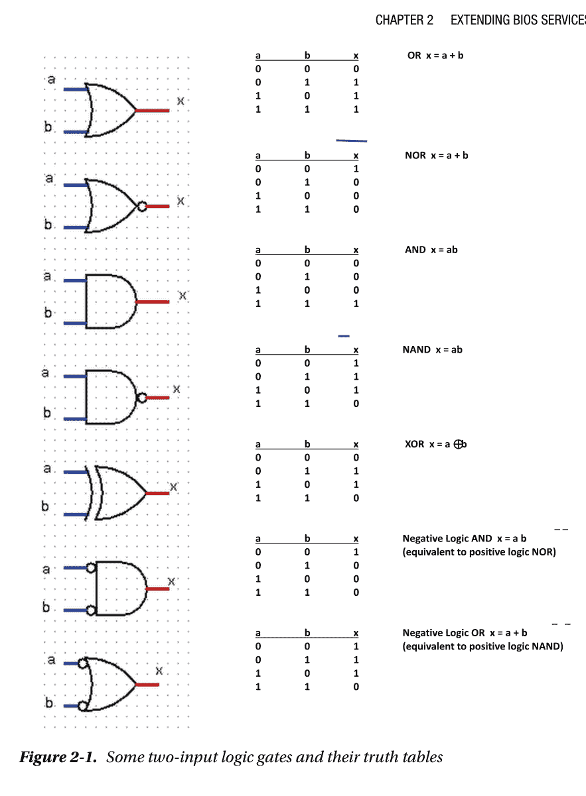
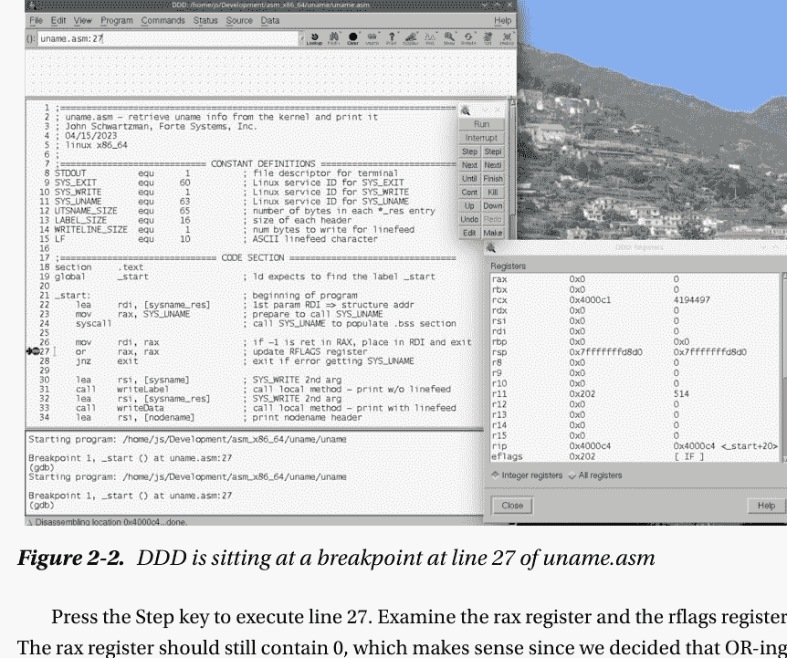
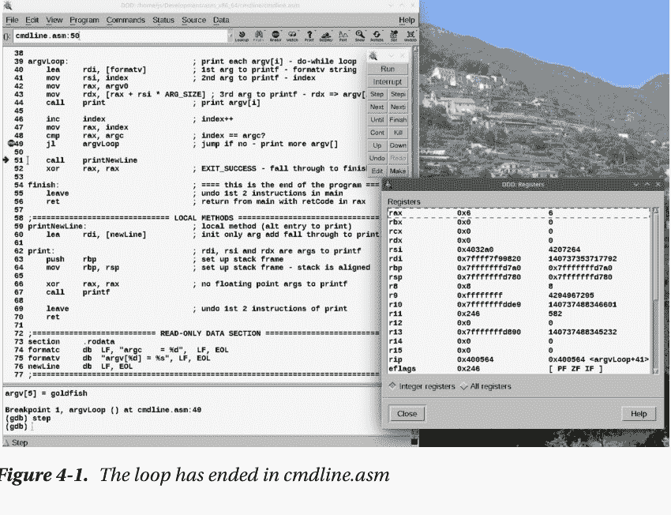
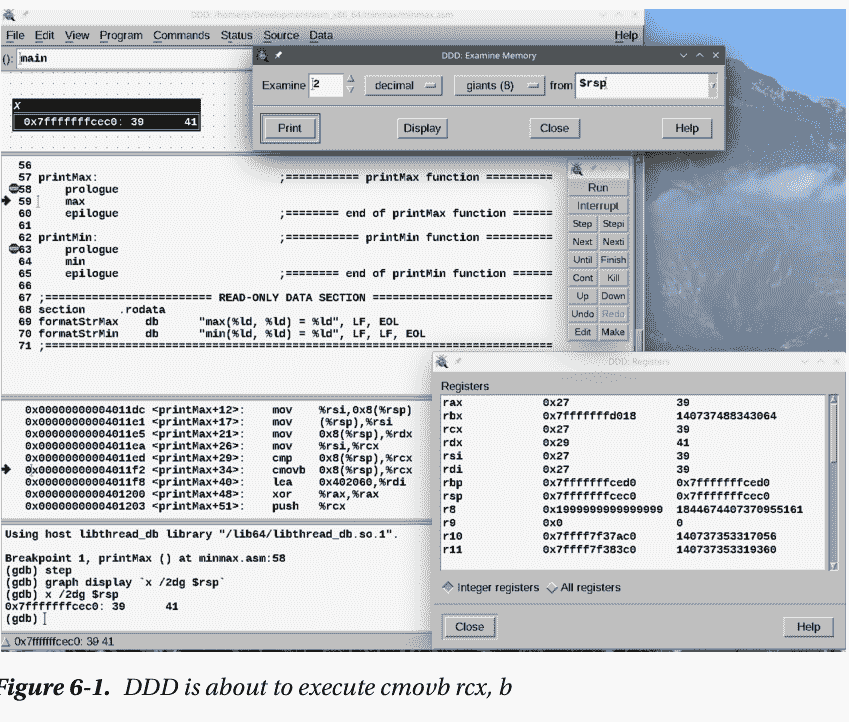

# 重新构想的汇编语言：Linux 环境下的 Intel X64 微处理器编程指南

2 Kate，4 Everything。

## 关于作者

**约翰·施瓦茨曼**是一位拥有超过40年行业与教学经验的硬件/软件工程师，专注于实践编码和设计。他曾管理过大小科技公司的团队，并定期为*Linux Magazine*和*Linux Format*撰稿。

## 关于技术审校

**塞斯·肯农**是一位系统管理员、开源与自由文化倡导者、Java和Lua程序员、游戏设计师以及桌面游戏玩家。他曾就职于科技初创公司、维塔数字公司参与电影制作，目前受雇于红帽/IBM公司，是一名专业的Linux技术专家。

## 致谢

衷心感谢格里芬·温克勒及其在Apress的审校团队。吉姆·马克汉姆提供了许多宝贵的反馈。

# 前言

我开始撰写本书时，认为汇编语言编程知识对软件工程师会有用。完成本书后，我坚信汇编语言编程知识对于每一位计算机科学的严肃学习者都至关重要。撰写本书使我成为了一名更好的计算机工程师。我相信，通过学习本书，你的编程能力将得到提升和拓展。

本书的重点在于处理器在执行高级结构化计算机语言程序时的工作原理。本书描述了计算机能做什么、不能做什么，以及如何借助软件解决问题。本书适用于计算机科学的整个领域，而不仅仅是汇编语言编程这个相对狭窄的范畴。

## 什么是汇编语言？

汇编语言是一种低级编程语言：它特定于某一处理器。它用于在硬件层面上对特定处理器进行编程。C、C++、Pascal、FORTRAN、BASIC、COBOL、Python、Go、Rust等语言的编译器都理解汇编语言，因为它们正是用汇编语言将高级语言程序分解为等效的低级汇编语言指令。汇编语言与所有高级计算机语言都相关。

C++被用于创建许多不同的编程语言。C++编译器将大量的汇编语言指令串联起来以执行实际工作。每种程序最终都是在计算机硬件上执行机器语言。

## 为什么要学习汇编语言？

学习汇编语言不会让你成为更快的程序员。它不会让你能够创建可移植的、一次编写、随处运行的程序。它不是新的，也不是面向对象的。那么为什么要学习它呢？答案是，它会让你成为一名更好的程序员。通过了解处理器能做什么、不能做什么，你将对计算机科学有更深入的理解。

处理器不仅执行算术运算；它还执行*布尔*逻辑运算。理解布尔逻辑运算可以让你了解计算机中央处理器（*CPU*）内部的布尔逻辑门。它向你展示你的程序如何使用这些逻辑门来决定程序流程。理解这一点将使你成为一位更强大、更全能的计算机工程师。

## 什么是助记符？

助记符是赋予数字机器语言指令的简单名称或缩写。汇编语言其实就是用助记符替代了数字操作码的机器语言。一个处理器包含数百个数字指令（操作码）。汇编语言允许你使用像`ADD`、`SUB`、`MOV`、`JMP`、`AND`、`OR`等助记符来编写程序。像`MOV`（移动）这样的助记符可以表示许多不同类型的移动。我们可以将数字从内存位置移动到*寄存器*（一个位于*CPU*内部的、命名的、非常快速的64位内存位置），从寄存器移动到内存位置，从一个寄存器移动到另一个，从程序中指定的立即数据值移动到寄存器，等等。这些被称为寻址模式，它们由汇编语言语句中与*助记符*一起提供的*参数*决定。我们使用助记符，因为正如你能想象到的，它们比数字操作码容易记忆得多。

## 什么是嵌入式编程？

在嵌入式编程中，我们调节包含CPU和内存的物理机器（硬件）中的电压和电流。在许多情况下，硬件设备可能有与之相关的时间约束。当从旋转磁盘的读取传感器读取数据时，你在处理完一个比特后，只有很短的时间间隔，然后下一个比特就会到达并必须被处理。比特在磁盘上是串行存储的。随着比特率的增加，比特之间的时间间隔会缩短，软件必须比以前更快地做出响应。在某个时刻，高级语言将无法足够快地响应以将比特重新组装成字节，此时就必须使用汇编语言来替代。

汇编语言在嵌入式编程中非常有用，因为它比高级语言更接近物理机器。将汇编语言模块与高级语言模块结合使用以促进嵌入式系统的开发是非常容易的。

## 什么是高级计算机语言？

高级语言使程序具有可移植性。它们使你无需关心CPU工作原理的底层细节就能进行编程，而且它们似乎并不关心你的计算机里是哪种CPU。它们提供了*抽象*，让你能够在更高层次上思考问题。然而，每台计算机都必须拥有专门为该计算机CPU编写的高级语言编译器。可执行代码是为特定CPU编写的。

像C++、Java、C#、Python等面向对象语言是“更高级”的高级语言，它们使你能够将问题领域融入程序中。使用面向对象语言创建的程序“理解”你应用的问题领域，而不仅仅是用于操作数据的通用算法。例如，为大学编写的学生成绩程序会有一个计算平均绩点的函数。但汇编语言是每种高级语言的核心。在你计算机上运行的机器代码是由汇编器创建的，而汇编器存在于每个高级语言编译器中。

## 为什么学习Intel x86_64 64位微处理器？

家庭、办公室、工厂、学校和实验室中大量的计算机都使用Intel x86_64 CPU，因此在本书中，我们使用Intel x86_64方言编写汇编语言。我们使用Linux操作系统，因此我们从编写几个使用Linux内核服务的简单汇编语言程序开始。这些是操作系统提供给编译器和汇汇器的底层服务。在第3章，我们将开始使用C运行时库（glibc）来编写更复杂的程序。在许多情况下，glibc的*方法*只是对Linux内核服务的简单封装。尽管本讨论仅限于Intel x86_64 64位CPU，但将汇编语言编程知识迁移到其他处理器。使用其他处理器时，你会遇到略有不同的助记符，但基本指令和寻址模式是相同的。通常，我们会为每个示例汇编语言程序提供其C或C++语言的等效版本。

## 为什么选择Linux？

本书以Linux操作系统为重点。Linux是一个开源的、多用户的类UNIX操作系统。它不像Microsoft或Apple那样与特定制造商绑定。使用Linux无需支付许可费。它在Web服务器、超级计算机和高等教育领域中广受欢迎。

## 什么是Makefile？

我们构建的程序有两种基本类型：release（发布版）和debug（调试版）。Debug模式适合编写和测试。Release模式生成更小的可执行文件。我们使用release模式进行分发，使用debug模式进行开发。

Release模式的程序从内存中第一条指令的地址开始，依次执行内存中的每条指令，直到最后一条指令执行完毕，然后返回BIOS。Debug模式的程序既可以像release模式程序一样运行，也可以在调试器中运行。

调试器是一个多线程程序，允许你在关键点停止被测试的程序，并检查寄存器、变量、指令和内存的内容。它对于理解和解释计算机程序的工作方式非常宝贵，对于发现和纠正代码中的逻辑错误也同样不可或缺。

语法错误和输入错误通常在编辑-构建循环中就能被捕获，但许多逻辑错误需要调试器和熟练的调试器用户来解决。makefile可以为你创建调试版和发布版的可执行文件。

本教材为每一章都提供了makefile。这些makefile将以release模式或debug模式构建每个示例程序。有时你需要修改makefile来生成额外的可执行文件。执行调试版或发布版的可执行文件将有助于演示本章的概念。

Release模式会从最终的可执行文件中剥离调试信息（对源代码的行号引用）。在开发过程中，我们通常以debug模式进行构建。

附录A告诉你如何下载编辑器、汇编器、编译器、make工具、调试器、源代码以及完成本书示例和活动所需的其他工具。

## 对速度的需求

微处理器CPU基于方波时钟波形运行。在个人计算机上，时钟运行速度约为3G CPS（每秒30亿个时钟周期），每个时钟周期大约持续0.33 ns（每个周期约三十亿分之一秒）。程序运行的速度取决于当前时刻计算机的哪个组件在执行工作。

最快的组件是CPU内部的寄存器。将数据从一个寄存器移动到另一个寄存器的指令只需要一个时钟周期，因为所有操作都在CPU内部完成。从寄存器到内存的传输需要更长的时间，因为我们必须等待内存地址在地址总线上稳定、数据在数据总线上稳定，以及内存设备被选中。立即数模式操作，如`mov rax, 0`（将零移入`rax`寄存器），所需时间与寄存器到内存的传输大致相同。从硬盘到寄存器的传输需要更长的时间，因为我们必须等待磁盘旋转启动和被访问。其他*IO*（输入/输出）硬件操作需要更长的时间。计算机通过将程序内存缓存到CPU内置的高速内存*缓存*中来尽力提高性能。它还会通过缓存跳转指令之后的指令来预测未来的访问需求。它可以将指令投机性地加载到*缓存*中，这样无论跳转走向如何，都有已缓存的指令可用。现代CPU可以拥有多个核心，如果软件支持，指令可以并行执行。现代CPU还支持流水线技术，可以同时执行多条指令。

尽管你可以看到计算机本身有多种方法来提高程序速度，但汇编语言编程是另一种提高速度的方式。没有任何高级计算机语言能提供汇编语言那样精细粒度的控制。

## CISC与RISC

复杂指令集计算机（*CISC*），如Intel x86_64，拥有许多复杂指令，执行这些指令需要远多于一个时钟周期的时间。精简指令集计算机（*RISC*）则倾向于避免复杂指令，力求以比CISC更少的时钟周期执行其指令集中的每条指令。其假设是，指令集中的任何不足都将在软件中得到弥补。

汇编语言有助于从这两种架构中获得最佳性能。

## 熟练生巧（近乎完美）

你需要通过不断的练习来掌握一门计算机语言，因此我在每一章中都包含了许多问题和活动。

编写这本教材让我非常愉快。我希望你觉得它有帮助、有针对性且令人愉快！我希望它能让你对高级结构化代码有更直观的理解。

John Schwartzman

2025年1月

# 第1章

## 使用BIOS服务

### 什么是BIOS？

基本输入输出系统（BIOS）是一个烧录在只读存储器（ROM）中的非易失性程序。计算机一开机它就可用。它包含用于与硬件外设进行接口的指令，以及加载操作系统的指令。BIOS为硬件外设提供低级接口。UEFI（统一可扩展固件接口）是BIOS的一个较新的开源替代品。当计算机开机时，其所有智能功能都位于BIOS或UEFI中。作为启动过程的一部分，操作系统被加载到RAM（随机存取存储器）中，并由BIOS或UEFI执行。

### 入门

每个新的编程语言介绍都以一个向控制台打印"Hello, world!"的程序开始已成为惯例，所以我们也从这里开始。¹ 程序清单**1-1**展示了C语言代码`hello.c`。程序清单**1-2**展示了等效的汇编语言代码`hello.asm`。程序清单**1-3**展示了Makefile，用于构建（汇编、编译和链接）本章中的两个程序。程序清单**1-4**展示了每次构建中使用的`maketest.sh` shell脚本。

`hello`可执行文件通过编译和链接`hello.asm`生成，它调用两个BIOS子程序来完成其工作。`a.out`可执行文件由`hello.c`和两个GNU C库（glibc）子程序生成。Makefile包含了汇编、编译、链接和创建这两个可执行程序的指令。

## 程序清单 1-1. hello.c

```c
// hello.c
// John Schwartzman, Forte Systems, Inc.
// 04/06/2023

#include <stdio.h>        // declaration of printf
#include <stdlib.h>        // defines EXIT_SUCCESS

int main()
{
    printf("\nHello, world!\n\n");
    return EXIT_SUCCESS;
}
```

## 程序清单 1-2. hello.asm

```asm
;=================================================================
; hello.asm
; John Schwartzman, Forte Systems, Inc.
; 04/09/2023
;
;======================== CONSTANT DEFINITIONS ===================
LF            equ     10  ; ASCII linefeed character
EXIT_SUCCESS  equ      0  ; Linux apps normally return 0 for success
STDOUT        equ      1  ; destination for SYS_WRITE
SYS_WRITE     equ      1  ; kernel SYS_WRITE service number
SYS_EXIT      equ     60  ; kernel SYS_EXIT service number

;======================== CODE SECTION ==========================
section.text
global _start

_start:
mov        rdi, STDOUT        ; 1st arg to SYS_WRITE - where to write
lea          rsi, [msg]      ; 2nd arg to SYS_WRITE - what to write
mov          rdx, MSGLEN     ; 3rd arg to SYS_WRITE - how much to write
mov          rax, SYS_WRITE  ; tell BIOS to call SYS_WRITE service
syscall

sub          rax, MSGLEN     ; syscall ret with rax = num bytes
                                written
mov          rdi, rax        ; 1st arg to SYS_EXIT = 0 if MSGLEN
                                char written
mov          rax, SYS_EXIT   ; prepare to call SYS_EXIT
syscall                       ; tell BIOS to call SYS_EXIT service

;======================== READ-ONLY DATA SECTION ========================
section.rodata
msg: db       LF, "Hello, world!", LF, LF
MSGLEN:       equ             $-msg
;=========================================================================
```

## 程序清单 1-3. hello的Makefile

```makefile
######################################################################
#
# Makefile for hello
# John Schwartzman, Forte Systems, Inc.
# 04/06/2023
#
# Commands:  make .release,  .make debug, make clean
# make = make release
# Requires:  ../maketest.sh
#
######################################################################
PROG  := hello
SHELL := /bin/bash

.release: $(PROG).asm $(PROG).c Makefile
```

## 第1章 使用BIOS服务

### 清单1-4. maketest.sh

```bash
16	@source ../maketest.sh && test .release .debug
17	yasm -f elf64 -o $(PROG).obj $(PROG).asm  # hello.asm => hello.obj
18	ld $(PROG).obj -o $(PROG)               # hello.obj => hello
19	gcc -o3 $(PROG).c                       # hello.c => a.out
20
21	.debug: $(PROG).asm $(PROG).c Makefile
22	@source ../maketest.sh && test .debug .release
23	yasm -f elf64 -g dwarf2 -o $(PROG).obj $(PROG).asm  # hello.asm =>hello.obj
24	ld -g $(PROG).obj -o $(PROG)             # hello.obj => hello
25	gcc -g $(PROG).c                       # hello.c => a.out
26
27	clean:
28	rm -f $(PROG) $(PROG).obj a.out .debug .release
29	####################################################################################################
```


```bash
#!/bin/bash
####################################################################################################
# maketest.sh
# John Schwartzman, Forte Systems, Inc. 06/03/2019
#
# 一个makefile辅助脚本，用于管理使用相同源文件、目标文件和可执行文件的 .debug 和 .release makefile。
# 在Makefile中使用：@source ../maketest.sh && test .release .debug
# @source ../maketest.sh && test .debug .release
# 使用 make .release, make .debug 调用Makefile
#
####################################################################################################
function test()
{
    if [[ ! -f $1 ]]; then
        touch $1;
        rm -f $2;
    else
        touch $1;
    fi
}
#######################################################################
```

现在让我们仔细看看这个Makefile。

## Makefile的结构

默认情况下，当 `make` 查找makefile时，它会按顺序尝试以下名称：`GNUmakefile`、`makefile` 和 `Makefile`。你可以通过使用 `make -f <name_of_makefile>` 来任意命名makefile。我决定将我们所有的makefile命名为 `Makefile`。

一个makefile主要由目标（targets）、目标的文件依赖（file dependencies for targets）、构建目标的指令（instructions to build targets）、定义（definitions）和注释（comments）组成。每个目标及其依赖项之后，都有一组用制表符缩进的构建该目标的指令。

清单1-3中的makefile包含两个目标：`.release`、`.debug` 和一个伪目标（pseudo-target），`clean`。我们通过在shell提示符下输入 `make .release`、`make .debug` 或 `make clean` 来指定要构建哪个目标。（shell提示符通常称为命令行界面，即CLI。它在控制台中通常表示为 `$` 字符。）如果我们只输入 `make` 而不指定目标名称，则会选择第一个目标（`.release`）。每个目标后面跟着一个冒号和该目标的任何文件依赖。`.release` 目标及其依赖列表之后是构建 `hello` 发布版本的指令。`.debug` 目标及其依赖列表之后是构建 `hello` 调试版本的指令。`clean` 伪目标没有依赖项。它会删除构建过程的任何*产物*，如 `hello.obj`、`hello`、`a.out`、`.debug` 和 `.release`。名称 `a.out`（汇编器输出）是通过使用 `gcc` 编译和链接 `hello.c` 创建的可执行文件的默认名称。

构建和发布目标首先加载并执行位于 `hello` 父目录中的一个小的bash shell程序（`../maketest.sh`）。这使我们能够为程序的发布版本和调试版本使用相同的名称和目录。它会在默认目录中创建名为 `.debug` 和 `.release` 的空文件，并删除任何已存在的 `.release` 或 `.debug` 文件。

我们的makefile使用YASM（又一个汇编器）将我们的汇编语言文件汇编成 `.obj`（目标）文件。Yasm是用C语言重写的NASM汇编器。makefile使用Linux的 `ld` 实用程序将目标文件链接成可执行格式。makefile使用 `gcc` 程序来编译和链接我们的C文件。

仅当目标文件的时间戳早于其任何文件依赖的时间戳时，`make` 才会执行构建目标的指令。如果工作目录中不存在空文件 `.release`，或者它存在但比 `hello.asm`、`hello.c` 或 `Makefile` 更旧，则将构建目标 `.release`。如果 `make` 告诉你 `.release` 目标是最新的并拒绝构建，你总是可以使用指令 `make -B .release`（或 `make .release -B`）来强制重新构建。

`maketest.sh` shell脚本允许我们的调试和发布输出共享相同的名称和目录。

将当前工作目录设置为你安装 `hello.asm` 的目录。然后在 `hello` 目录的shell提示符下输入 `make`（或 `make .release`）并验证 `hello.obj`、`hello` 和 `a.out` 已被创建。`Hello.obj` 是中间汇编器目标文件；链接器/加载器会将其转换为可执行文件。

```
js@suse-leap-z4:~$ cd Development/asm_x86_64/hello
js@suse-leap-z4:~/Development/asm_x86_64/hello$ make
...
js@suse-tumbleweed-z4:~/Development/asm_x86_64/hello$ ls -lhAF
total 56K
-rwxr-xr-x 1 js js 20K Jan 28 07:22 a.out*
-rw------- 1 js js 78 May 4 2023 .gdb_history
drwxr-xr-x 1 js js 144 Nov 25 04:44 .git/
-rw-r--r-- 1 js js 45 May 4 2023 .gitignore
-rwxr-xr-x 1 js js 8.7K Jan 28 07:22 hello*
-rw-r--r-- 1 js js 1.4K Dec 24 05:35 hello.asm
-rw-r--r-- 1 js js 247 May 4 2023 hello.c
-rw-r--r-- 1 js js 832 Jan 28 07:22 hello.obj
-rw-r--r-- 1 js js 954 Dec 19 12:18 Makefile
-rw-r--r-- 1 js js 0 Jan 28 07:22 .release
drwxr-xr-x 1 js js 140 May 4 2023 .vscode/
js@suse-tumbleweed-z4:~/Development/asm_x86_64/hello$
```

请注意，`ls -lhAF` 返回的列表中，文件名后跟星号（`*`）的文件是可执行文件。还要注意，只有所有者“js”对这些可执行文件具有读、写和执行权限。“users”组的成员具有读和执行权限。其他所有人也对这些可执行文件具有读和执行权限。只有所有者 `js` 或超级用户 `root` 才能写入或删除源文件 `hello.asm` 和 `hello.c` 或中间文件 `hello.obj`。这种安全性是像Linux这样的多用户操作系统的基本特性。

让我们尝试执行输出文件。

请记住，在Linux中，当前工作目录（PWD）通常不在PATH中。我们不能只在shell提示符下输入 `hello`；我们必须输入 `./hello` 来指定我们希望shell在当前工作目录（`$PWD = ./`）中执行 `hello`。

```
js@suse-leap-z4:~/Development/asm_x86_64/hello$ **./hello**

Hello, world!

js@suse-leap-z4:~/Development/asm_x86_64/hello$ **./a.out**

Hello, world!
```

汇编语言可执行文件和C语言可执行文件产生相同的输出。这令人鼓舞！

`hello.c` 的 `main` 方法有两个非常简单的指令。它调用C运行时库glibc的 `printf` 方法来打印一个常量*字符串*。然后它调用 `ret EXIT_SUCCESS` 将控制权返回给Linux。`EXIT_SUCCESS` 是一个等于数字0的常量。

现在让我们来检查 `hello.asm`。

该程序有两个节（section），一个用于代码（`.text`节），另一个用于数据（`.rodata`节，其中 `.rodata` 代表只读数据）。我们首先是一些注释（第1到6行），然后是一些常量声明（第7到11行）。

`.text` 节从标签 `_start`（第18行）开始。Linux将 `hello` 加载到内存后，它会将CPU的指令指针*寄存器*（`rip`）设置到位于 `_start` 标签处的指令。然后CPU开始执行 `hello` 的 `.text`（代码）节中的指令。

动作始于为我们第一个系统调用*准备*（汇编并准备好执行）参数。

传递给Linux内核的*参数*总是通过同一组六个寄存器传递。第一个参数通过 `rdi` 传递，第二个通过 `rsi`，第三个通过 `rdx`，第四个通过 `r10`，第五个通过 `r8`，第六个通过 `r9`。你可以向Linux内核服务传递最多六个参数。所有BIOS子程序都在这六个寄存器中寻找它们的参数。

## 第1章 使用 BIOS 服务

`SYS_WRITE` 系统调用仅接受三个参数。第一个参数指示我们要写入的位置。我们选择标准输出（`STDOUT = 1`），表示我们希望 Linux 写入终端（控制台）。我们在第18行通过立即数传送指令（`mov rdi, STDOUT`）实现了这一点。这是一条立即数传送指令，因为 `STDOUT`（1）来自程序内存空间，而非内存变量或另一个寄存器。

第二个参数指示我们要写入的内容。在第19行，我们将 `msg` 字符串的*有效地址*加载到 `rsi` 寄存器中（`lea rsi, [msg]`）。`lea` 指令与 `mov` 指令是不同的。当我们说要把数值常量 `STDOUT` 移动到 `rdi` 寄存器时，指的是将数字1（1）移动到 `rdi` 寄存器。当我们说 `lea rsi, [msg]` 时，指的是将 `[msg]` 所表示的数字内存地址移动到 `rsi` 寄存器。有时你会看到类似 `mov rsi, [listIndex + 8 * rcx]` 的写法。它的行为类似于*加载有效地址*。我们正在将 `listIndex + 8 * rcx` 所表示的内存地址加载到 `rsi` 寄存器中。汇编器帮我们处理了算术运算，这很好。它甚至理解乘法和除法优先于加法和减法执行的代数优先级。

顺便一提，`rdi` 也被称为目的索引寄存器，`rsi` 也被称为源索引寄存器。这两个通用寄存器最初是为处理字符串而设计的，因此它们也是专用寄存器。所以我们将目的设置为数值常量 `STDOUT`，将源设置为内存地址 `[msg]`。`msg` 周围的方括号表示 `msg` 是一个可以在程序的 `.data` 段（或 `.rodata` 段）中找到的局部变量。

第三个也是最后一个参数是我们想要写入的字符数。在第20行，我们将 `MSGLEN` 移动到 `rdx` 寄存器中（`mov rdx, MSGLEN`）。注意，`MSGLEN` 常量是由汇编器在第32行为你计算的。`MSGLEN` 是当前地址指针位置减去内存地址 `msg`（`$-msg`）的结果。

无论我们想调用哪个 Linux 内核服务，`syscall`（软件中断）指令都调用同一个地址。它使用 `rax` 寄存器的内容来告知我们请求的服务。我们在第21行将数值常量 `SYS_WRITE`（1）移动到 `rax` 寄存器中。

一旦我们准备好了参数（移动到相应的寄存器中），我们就将控制权交给 Linux 内核来执行服务。我们在第22行完成此操作（`syscall`）。我们准备参数的顺序并不重要。重要的是，当我们调用 `syscall` 时，所有参数都在内核服务期望找到它们的位置上。内核切换到保护模式并为你执行写入操作。

然后内核返回用户模式，并继续执行 `hello` 中的下一条指令。我们接下来想要执行的任务是告诉 Linux 我们的程序已完成对处理器的使用，并且我们希望将控制权返回给 Linux，以便 Linux 可以处理我们通过 bash shell 发出的下一个请求。重要的是要始终清理好自己的现场。

第22行的 `syscall` 在 `rax` 寄存器中返回实际写入的字符数。

我们现在想要使用 `SYS_EXIT` Linux 内核*函数*。我们在第24到27行执行此操作。Linux 程序通常返回零表示成功，返回非零值表示失败。在第24行，我们从 `rax` 中写入的字符数中减去 `MSGLEN`。如果我们实际写入了 `MSGLEN` 个字符，那么 `rax` 将包含零；如果没有，它将包含一个非零值。我们将 `rax` 移动到 `rdi` 中（`SYS_EXIT` 的第一个参数）。然后我们将 `rax` 设置为 `SYS_EXIT` 并发出 `syscall`。

你在 `rdi` 寄存器中返回的值会怎样？`SYS_EXIT` 将其放入 `rax`，并且任何可能正在运行你的程序的 shell 脚本都可以访问它。shell 可以检查此值并决定下一步做什么或不做什么。你可以通过在 shell 提示符下键入 `echo $?` 来检查程序的返回值。

```
js@suse-leap-z4:~/Development/asm_x86_64/hello$ ./hello

Hello, world!

js@suse-leap-z4:~/Development/asm_x86_64/hello$ echo $?
0
```

事件序列如下所示。你从 shell 开始，它正在耐心等待你做一些有趣的事情。你在命令提示符下键入 `./hello`，Linux 查找 `hello` 并发现它是你当前工作目录（`./`）中磁盘上的一个可执行文件。Linux 为你的程序分配 *RAM*（随机存取存储器），并将程序从磁盘加载到此分配的内存中。它为*栈*分配更多 RAM，并将 CPU 的栈指针寄存器 `rsp` 设置为栈顶，供你的程序使用。Linux 为堆（与你的程序内存分配相关的、动态可调整大小的内存区域）分配更多的 RAM。然后它将 CPU 的指令指针寄存器 `rip` 设置为与标签 `_start` 相关联的 RAM 位置，然后命令 CPU 执行你程序中的指令。

## 运行 DDD 调试器

现在让我们在 DDD 调试器中运行 `hello`，以查看程序每一步中发生了什么。但首先，以调试模式构建 `hello`：

```
js@suse-leap-z4:~/Development/asm_x86_64/hello$ make .debug
```

1.  通过在命令行键入以下指令来启动 DDD。

```
js@suse-leap-z4:~/Development/asm_x86_64/hello$ ddd hello
```

你现在应该看到一个与图1-1中图像几乎相似的屏幕。从 DDD 的菜单中选择 `Status ▶ Registers`，并将 `Registers` 窗口放置在你可以轻松看到的位置。在第18行的开头右键单击以在那里设置一个断点。你看到第18行左侧的小停止标志了吗？那就是断点的符号。

点击 DDD 命令工具顶部的 `Run`，你的计算机屏幕应该看起来就像图1-1所示的图像。



*图1-1. DDD 正在运行 hello。它在断点处暂停*

注意第18行左侧的绿色箭头。这表明 DDD 正在运行，但 `hello` 当前已暂停。当它下次被允许运行时，它将从第18行开始执行指令。

查看 `Registers` 窗口并注意 `rdi` 寄存器的值。我的 `rdi` 当前包含 `0x0`（十六进制零）。在 `Registers` 窗口中向下滚动，以便你可以看到指令指针寄存器。我的 `rip` 当前包含64位地址 `0x400080`。那是程序第一条指令的 RAM 地址。**你的 `rip` 寄存器的内容可能与我的不同。**

现在点击 DDD 命令工具上的 `Step` 按钮，注意绿色箭头前进指向第19行的指令。再次查看 `Registers` 窗口，并注意 `rdi` 寄存器现在包含 `0x1`。为什么？发生了什么？嗯，程序的第一条指令告诉 CPU 将值 `STDOUT`（恰好是十进制1，也是十六进制1）放入 `rdi` 寄存器。这就是发生的事情。

再点击三次 `Step`，并注意 `rsi`、`rdx` 和 `rax` 中值的变化。注意 CPU 已经执行了四条指令，并通过遵循 RAM 中前四个位置的指令加载了四个不同的寄存器。（RAM 指的是随机存取或读写存储器，与 ROM（只读存储器）相对。）

注意 `rsi` 包含我们要写入终端的字节串的起始地址（`0x4000b4`）。那是字符串第一个字符所在的 RAM 地址。注意十进制10（十六进制 `0x0a`）代表换行符，我们将其显示为 `LF`。该字符串出现在程序的只读数据段的第31行。**注意你系统中的地址可能与我的不同。**

我们现在准备执行 `syscall`（或软件中断）指令。我们已经将正确的值放入了三个参数传递寄存器（`rdi`、`rsi` 和 `rdx`）中，并将我们要的系统调用编号放入了 `rax`。我们可以按任何顺序执行这四个步骤。重要的是，`syscall` 需要的四个信息已经被准备到内核将要查找的四个位置。

再次点击 DDD 的 `Step` 按钮，你会在 DDD 三个主窗口底部的窗口中看到三行

```
Hello, World!
```

被打印出来。如果你打开了执行窗口（`View ▶ Execution Window`），你也会在那里看到它。

再点击三次 DDD 的 `Step` 按钮，你就会将正确的信息准备到单个参数传递寄存器（`rdi`）中，并将系统调用编号放入 `rax` 中。


再次点击`Step`按钮，你会看到`hello`程序结束。

思考一下你观察到的内容。你启动了一个调试器程序，它是`gdb`调试器的可视化前端。`DDD`启动了`gdb`，`gdb`启动了我们的可执行程序`hello`。我们单步执行了`hello`程序，并注意到在每一步中 CPU 寄存器发生的变化。我们还记录了程序在控制台中的输出。

### 活动

1. 定义寄存器。

2. 哪个寄存器跟踪 CPU 要执行的下一条指令的内存位置？

3. BIOS 会在哪里以及按什么顺序查找其各个子程序的参数？

4. 哪个寄存器用于指定我们想要调用的内核服务？

5. 哪个寄存器用于将 Linux 内核服务的状态返回给调用者？

6. 修改`hello.asm`以写入不同的字符串。使用`DDD`逐步调试`hello`和`a.out`。确保你理解程序每一步发生了什么。

7. 修改`hello.asm`以写入几个句子。

8. 修改`hello.asm`，使其多次调用 Linux 写入服务。请注意，仅仅因为你向寄存器写入了一个值，并不意味着在你需要它时它仍然存在。寄存器是有限的资源，BIOS 需要使用它们来执行自己的工作。

9. 修改`hello.asm`，使其用法语打印 "Hello, world!"。将你的程序命名为`bonjour.asm`。

10. `printf`是一个 POSIX 函数吗？

## 第 2 章 扩展 BIOS 服务

既然我们知道了如何打印，那就打印些更有趣的东西吧。当你遇到电脑或某些软件问题并上网寻求帮助时，通常会被要求使用 Linux 的`uname`命令提供环境信息。当然，你可以简单地去命令行界面（CLI）提示符下输入`uname -a`，但那没什么意思。

我们的下一个程序`uname.c`如代码清单 2-1 所示。它的汇编语言等价程序`uname.asm`如代码清单 2-2 所示。代码清单 2-3 展示了用于构建这两个可执行程序的 Makefile。这两个程序在将控制权交还给 Linux 之前，获取并打印`uname`信息。构建`uname.c`和`uname.asm`，并验证这两个程序产生相同的输出。

> 注意：可以通过在互联网上搜索 "Linux System Call Table for x86 64" 找到 x64 BIOS 函数的列表。

**代码清单 2-1. uname.c**

```c
// uname.c
// John Schwartzman, Forte Systems, Inc.
// 05/20/2019

#include <stdio.h>            // declaration of printf, perror
#include <stdlib.h>           // defines EXIT_SUCCESS, EXIT_FAILURE
#include <sys/utsname.h>      // declaration of uname, struct utsname

int main(void)
{
    struct utsname buffer;
    int retValue = uname(&buffer);

    if (retValue != 0)
    {
        perror("uname");
        return retValue;;
    }

    printf("    OS name:      %s\n", buffer.sysname);
    printf("    node name:    %s\n", buffer.nodename);
    printf("    release:      %s\n", buffer.release);
    printf("    version:      %s\n", buffer.version);
    printf("    machine:      %s\n", buffer.machine);
    return retValue;
}
```

**代码清单 2-2. uname.asm**

```asm
;=================================================================
; uname.asm - retrieve uname info from the kernel and print it
; John Schwartzman, Forte Systems, Inc.
; 03/31/2023
; linux x86_64
;
;=================== CONSTANT DEFINITIONS ====================
STDOUT          equ   1          ; file descriptor for terminal
SYS_EXIT        equ   60         ; Linux service ID for SYS_EXIT
SYS_WRITE       equ   1          ; Linux service ID for SYS_WRITE
SYS_UNAME       equ   63         ; Linux service ID for SYS_UNAME
UTSNAME_SIZE    equ   65         ; number of bytes in each *_res entry
LABEL_SIZE      equ   16         ; size of each header
WRITELINE_SIZE  equ   1          ; num bytes to write for linefeed
LF              equ   10         ; ASCII linefeed character

;===================== CODE SECTION =====================
section     .text
global      _start                  ; ld expects to find the label _start

_start:                             ; beginning of program
    mov  rax, SYS_UNAME            ; prepare to call SYS_UNAME
    lea  rdi, [sysname_res]        ; rdi points to address of structure
    syscall                        ; call SYS_UNAME to populate .bss data section (uninitialized data)

    mov  rdi, rax                  ; if -1 is returned in rax, exit
    or   rax, rax                  ; update RFLAGS register
    jnz  exit                      ; exit if error getting SYS_UNAME

    lea  rsi, [sysname]            ; SYS_WRITE 2nd arg
    call writeLabel                ; call local method - print w/o linefeed
    lea  rsi, [sysname_res]        ; SYS_WRITE 2nd arg
    call writeData                 ; call local method - print with linefeed
    lea  rsi, [nodename]           ; print nodename header
    call writeLabel
    lea  rsi, [nodename_res]       ; print nodename data
    call writeData

    lea  rsi, [release]            ; print release header
    call writeLabel
    lea  rsi, [release_res]        ; print release data
    call writeData

    lea  rsi, [version]            ; print version header
    call writeLabel
    lea  rsi, [version_res]        ; print version data
    call writeData

    lea  rsi, [domain]             ; print domain header
    call writeLabel
    lea  rsi, [domain_res]         ; print domain data
    call writeData

    xor  rdi, rdi                  ; rdi = EXIT_SUCCESS (0) - fall into exit

exit:
    mov  rax, SYS_EXIT             ; exit program - 1st arg rdi = exit code
    syscall                        ; invoke kernel and we're gone

writeLabel:    ;===== local method - caller sets SYS_WRITE 2nd param (rsi) =====
    mov  rax, SYS_WRITE            ; Linux service ID
    mov  rdi, STDOUT               ; SYS_WRITE 1st arg
    mov  rdx, LABEL_SIZE           ; SYS_WRITE 3rd arg
    syscall                        ; invoke kernel
    ret                            ;====== end of writeLabel method =====

writeData:     ;===== local method - caller sets SYS_WRITE 2nd param (rsi) =====
    mov  rax, SYS_WRITE            ; Linux service ID
    mov  rdi, STDOUT               ; SYS_WRITE 1st arg
    mov  rdx, UTSNAME_SIZE         ; SYS_WRITE 3rd arg
    syscall                        ; invoke kernel and fall through to writeNewLine

writeNewLine:  ;=========== local method =============
    mov  rax, SYS_WRITE            ; Linux service ID
    mov  rdi, STDOUT               ; SYS_WRITE 1st arg
    lea  rsi, [linefeed]           ; SYS_WRITE 2nd arg
    mov  rdx, WRITELINE_SIZE       ; SYS_WRITE 3rd arg
    syscall                        ; invoke kernel
    ret                            ; ===== end of writeNewLine method =====

;======================== READ-ONLY DATA SECTION ========================
section    .rodata
sysname    db    " OS name:    "
nodename   db    " node name:  "
release    db    "  release:    "
version    db    "  version:    "
domain     db    "  machine:    "
linefeed   db    LF              ; ASCII linefeed character

;================ UNINITIALIZED DATA SECTION ================
section     .bss
sysname_res resb    UTSNAME_SIZE
nodename_res resb   UTSNAME_SIZE
release_res resb    UTSNAME_SIZE
version_res resb    UTSNAME_SIZE
domain_res  resb    UTSNAME_SIZE
;=============================================================
```

**代码清单 2-3. uname 的 Makefile**

```makefile
##########################################################
#
# Makefile for uname
# John Schwartzman, Forte Systems, Inc.
# 12/16/2023
#
# Commands: make [.release], make .debug, make clean, make install
#
# Requires: ../maketest.sh
#
##########################################################
PROG   := uname
SHELL  := /bin/bash

.release: $(PROG).asm $(PROG).c Makefile
	@source ../maketest.sh && test .release .debug
	yasm -f elf64 -o $(PROG).obj $(PROG).asm  # assemble
	ld $(PROG).obj -o $(PROG)                  # link
	gcc $(PROG).c                             # compile and link a.out

.debug: $(PROG).asm $(PROG).c Makefile
```

```makefile
@source ../maketest.sh && test .debug .release
yasm -f elf64 -g dwarf2 -o $(PROG).obj $(PROG).asm   # 汇编
ld -g $(PROG).obj -o $(PROG)   # 链接
gcc -g $(PROG).c               # 编译并链接C版本 (a.out)

clean:
	rm -f $(PROG) $(PROG).obj a.out .debug .release
```

```text
#####################################################################################################
```

```bash
js@suse-leap-z4:~/Development/asm_x86_64/uname$ make release
...
js@suse-leap-z4:~/Development/asm_x86_64/uname$ ./uname
 OS name:     Linux
 node name:   suse-leap-z4
 release:     5.14.21-150400.24.55-default
 version:     #1 SMP PREEMPT_DYNAMIC Mon Mar 27 15:25:48 UTC 2023
              (cc75cf8)
 machine:     x86_64
js@suse-leap-z4:~/Development/asm_x86_64/uname$ ./a.out
 OS name:     Linux
 node name:   suse-leap-z4
 release:     5.14.21-150400.24.55-default
 version:     #1 SMP PREEMPT_DYNAMIC Mon Mar 27 15:25:48 UTC 2023 (cc75cf8)
 machine:     x86_64
js@suse-leap-z4:~/Development/asm_x86_64/uname$
```

输出结果是一样的。太好了！在我们研究这些程序之前，让我们先简要回顾一下*布尔*逻辑门以及计算机中数字的表示方法。

# 布尔逻辑门简介


逻辑门检查输入电平并据此产生输出电平。看一下图2-1所示的逻辑门。我们看到了几个双输入逻辑门，后面跟着它们的真值表、名称和方程式。真值表列出了所有输入`a`和`b`组合下的输出`x`。当我们讨论`uname.asm`时，你将看到逻辑门的实例。

20



图2-1. *一些双输入逻辑门及其真值表*

## 计算机中的数字表示

在数字计算机中，我们用二进制（基数为2）值的集合来表示所有数字。计算机使用两种电压来表示二进制数的两个符号。通常，零伏特（0V）代表0，约3.3V代表1。这使得事情变得非常简单。由于只使用两个符号，我们按照基数为2（二进制）的列所示进行计数。这是因为元件会老化，其值会随时间变化。这就是为什么我们在大多数计算工作中使用数字（而非模拟）计算机。²

| 二进制（基数2） | 十进制（基数10） | 十六进制（基数16） |
| :--- | :--- | :--- |
| 0 | 0 | 0 |
| 1 | 1 | 1 |
| 10 | 2 | 2 |
| 11 | 3 | 3 |
| 100 | 4 | 4 |
| 101 | 5 | 5 |
| 110 | 6 | 6 |
| 111 | 7 | 7 |
| 1000 | 8 | 8 |
| 1001 | 9 | 9 |
| 1010 | 10 | A |
| 1011 | 11 | B |
| 1100 | 12 | C |
| 1101 | 13 | D |
| 1110 | 14 | E |
| 1111 | 15 | F |
| 10000 | 16 | 10 |
| 10001 | 17 | 11 |
| ... | ... | ... |

内存单元和CPU寄存器是二进制位的集合。Intel x86_64处理器中通用寄存器的大小是64位。这意味着我们可以在一个寄存器中容纳2<sup>64</sup> - 1或*18,446,744,073,709,551,617*（大约180亿亿）个不同的值。注意二进制如何很好地映射到十六进制。我们可以用一个十六进制数字来表示一个半字节（4位）的二进制数。

22

### 第2章 扩展BIOS服务

假设我们有二进制值`0111 1000 0010 1010₂`。我们可以很容易地将其在十六进制中称为`782A₁₆`。这是同一个值。这是一种简写。

CPU包含许多64输入布尔逻辑门，以及32输入、16输入和8输入的逻辑门，这些与CPU的32位、16位和8位寄存器相对应。当我们执行算术或逻辑运算时，这些门中的某些门会将它们的输出保存在`rflags`寄存器中。例如，当我们将一个寄存器中的值与自身进行按位或运算（`or rax, rax`）时，`rax`不会改变。所以`x`或`x = x`，或者在布尔代数中我们会说`x + x = x`。看一下图2-1中OR门的真值表。逐位检查寄存器，我们可以看到`0 + 0 = 0`（零或零等于零）和`1 + 1 = 1`（一或一等于一）。因此，对寄存器自身执行按位或运算不会改变寄存器的值，但它会改变`rflags`寄存器的值。如果`rax`包含0，我们执行`or rax, rax`，那么我们可以看到在或运算之后`rax`仍然包含0，但`rflags`寄存器的第6位将是1。我们称零标志`ZF = 1`。如果`rax`包含1，我们执行`or rax, rax`，那么在或运算之后`rax`仍然包含1，但`rflags`寄存器的第6位将是0。我们称`ZF = 0`。

你可以将这个寄存器零检测逻辑想象成CPU内部的一个64输入负逻辑与门。只有当所有64个二进制位（比特）都是0时，`ZF = 1`，否则`ZF = 0`。（见图2-1。）

你可能在想，这很好，但那又怎样？嗯，这就是我们以编程方式改变程序执行顺序的方法。我们可以说`or rax, rax`（或`and rax, rax`或`cmp rax, 0`或`sub rax, 0`），然后`jnz next`（如果非零则跳转到`next`），其中`next:`是程序中的某个标签。或者说`jnz next`（如果非零则跳转到`next`）。你将在`uname.asm`中看到这种技术的应用。

### 第2章 扩展BIOS服务

表2-1. 计算机中的数据类型

| 数据类型 | 大小（位） | 典型用途 |
|---|---|---|
| 字节 | 8 | 文本字符，小整数 |
| 字 | 16 | 文本字符，整数 |
| 双字 | 32 | 整数，长整数，长长整数，单精度浮点数 |
| 四字 | 64 | 整数，长整数，长长整数，双精度浮点数，内存地址 |
| 双四字 | 128 | 整数，打包整数，打包浮点数 |

请注意，微软使用双字来保存长整数和长长整数，而Linux则使用四字来保存相同的数据类型。

还要注意，除了字符（它们只是位模式）之外，所有数据类型都可以是有符号或无符号值。有符号整数使用数据类型的低半部分表示值，高半部分表示符号。要创建一个有符号数，我们进行二进制补码运算。二进制补码运算包括在一个数的一进制补码上加1。一进制补码只是将所有的1变为0，所有的0变为1。例如，无符号整数21看起来像这样：

```text
0000 0000 0001 0101₂   =   16₁₀ + 4₁₀ + 1₁₀ = 21₁₀
1111 1111 1110 1010₂   =   21₁₀ 的一进制补码
+ 1   1111 1111 1110 1011₂   =   21₁₀ 的二进制补码   =   -21₁₀

      0000 0000 0001 0101₂   =   21₁₀
+     1111 1111 1110 1011₂   =   -21₁₀
----------------------------
      0000 0000 0000 0000₂   =   0₁₀
```

从这个例子中，你可以看到`21₁₀ + -21₁₀ = 0₁₀`，我们丢弃了最高位的进位。

这向我们展示了计算机上的减法等同于二进制补码加法。为了执行减法，我们将第一个加数加上第二个加数的二进制补码。当我们执行像`sub ax, bx`这样的操作时，这就会自动发生。我们将`bx`转换为`bx`的二进制补码并执行加法运算。

关于计算机中的数字，还有一点需要说明，即字节序。当多字节值被放入内存时，我们如何确定数字的值？Intel处理器使用*小端*格式。也就是说，最低有效字节放在最低内存地址，最高有效字节放在最高内存地址。当我们向多字节寄存器和数据类型添加字节时也是如此：最低有效字节放入最低地址，最高有效字节放入最高内存地址。

程序`uname.c`不应该带来任何挑战。我们在第11行声明了一个`utsname`结构并命名为`buffer`。在第13行，我们调用glibc的`uname`函数来填充`buffer`结构。之后，我们只需打印glibc之前放入`buffer`结构中的信息。

现在让我们看看`uname.asm`。程序从第21行的`_start`标签开始。我们要做的第一件事是调用`SYS_UNAME` Linux内核服务。但是，在此之前，我们必须将正确的值放入我们的第一个也是唯一的参数传递寄存器（`rdi`），并将我们想要的系统调用号放入`rax`。

我们在第24行使用系统调用调用`SYS_UNAME`。这会填充我们地址空间的未初始化数据部分（第90-96行）。完成此操作后，我们通过检查执行`syscall`后的`rax`寄存器来检查是否成功。如果它非零，我们就需要退出。

### 第2章 扩展 BIOS 服务

这是因为系统调用失败了（大概返回了1）。如果返回值为零，我们就可以打印标签、打印未初始化数据段中对应的字段，并打印一个换行符。我们重复这个操作五次，程序就结束了。

现在我们需要仔细看看如何判断成功或失败。在第26行，我们将`SYS_UNAME` Linux 内核服务返回的值移入`rdi`。我们需要判断`rax`是否等于零。为此，我们需要对`rax`执行算术或布尔逻辑运算。我们在第27行选择了布尔逻辑运算`or rax, rax`。这会对`rax`本身执行64位按位或运算。这不会改变`rax`的值，但会设置标志寄存器。

### DDD 调试器

让我们在 DDD 调试器中运行`uname`。但首先，将工作目录切换到`~/Development/asm_x86_64/uname`并以调试模式构建`uname`。

```
js@suse-leap-z4:~/Development/asm_x86_64/hello$ cd ../uname
js@suse-leap-z4:~/Development/asm_x86_64/uname$ make .debug
```

现在输入以下指令启动 DDD：

```
js@suse-leap-z4:~/Development/asm_x86_64/uname$ ddd uname
```

你现在应该看到一个与图2-2中几乎一样的屏幕。首先从 DDD 菜单中选择 Status ▶ Registers，并将寄存器窗口放在容易看到的位置。然后在第28行开头处右键单击以设置断点。现在点击 DDD 的 Command Tool 顶部的 Run，你的计算机屏幕应该与图2-2中所示的图像完全一样。

我们刚刚执行了`SYS_UNAME`系统调用，返回在`rax`中的结果为零。这意味着`SYS_UNAME`成功了。通过检查`rax`寄存器来验证这一点。另外，看一下`rflags`寄存器，在 DDD 中标记为`eflags`。我的`rflags`显示 IF，即中断标志已启用。注意`rdi`和`rax`具有相同的值。我们在第26行将`rax`复制到`rdi`，以防在第28行跳转到退出。`rdi`是`exit`标签处调用的`SYS_EXIT`的第一个也是唯一的参数。

26



图2-2。DDD 停在`uname.asm`第27行的断点处

按下 Step 键执行第27行。检查`rax`寄存器和`rflags`寄存器。`rax`寄存器应该仍然包含0，这是合理的，因为我们认为将寄存器与自身进行或运算不应改变其值。然而`rflags`应该发生了变化。我的`rflags`显示 PF（奇偶标志）、IF（中断标志）和 ZF（零标志）。ZF 表示零标志被置位。下一步会发生什么？我们会跳转吗？如果你说不会，你是对的。指令`jnz exit`的意思是如果不为零则跳转到`exit`标签。

按下 Step 按钮，注意绿色箭头（`rip`）指向第30行。我们没有跳转到第57行（`exit`标签后的第一条指令）。`SYS_UNAME`报告成功，现在我们将执行几次对`writeLabel`和`writeData`方法的调用。你可能会想要单步进入这些方法。

注意`writeNewLine`是`writeData`方法的另一个入口。它在代码中从未被调用，但如果我们需要，可以用它在任何需要的地方打印空行。

准备好后按下 Cont（继续），程序将执行到下一个断点或程序末尾（如果没有设置更多断点）。

### 练习

1. 画出一个三输入与门的真值表，输入为`a`、`b`、`c`，输出为`x`。
2. 画出一个三输入或门的真值表。
3. 画出一个三输入负逻辑与门的真值表。
4. 画出单输入非门的符号及其真值表。
5. $0101\ 1100\ 1010\ 0000_2 = \_\_\_\_\_\_\_\_\_\_\_\_\_\_\_\_\_\_\_ {16}$。
6. $0FA01_{16} = \_\_\_\_\_\_\_\_\_\_\_\_\_\_\_\_\_\_\_ _2$。
7. 负逻辑与门等价于正逻辑\_\_\_\_\_\_\_\_\_门。
8. 负逻辑或门等价于正逻辑\_\_\_\_\_\_\_\_\_门。
9. 一个双字包含\_\_\_\_\_\_\_个字节。
10. 一个双四字可以容纳\_\_\_\_\_\_\_个打包整数。
11. 我们使用什么数据类型来保存内存地址？
12. $39_{10}$的16位二进制补码是什么？
13. 通过执行二进制补码加法来演示 $x = 39_{10} - 21_{10}$。`x`的值是多少？
14. 将练习13写成一条 CPU 指令。

## 第3章 优先使用 glibc 而非 BIOS 调用，uname 再探

在本章中，我们将放弃直接调用 Linux 内核服务，转而使用 glibc（GNU C 运行时库）来替代直接调用 Linux 内核服务。glibc 函数在很多情况下是对 Linux 内核服务的轻量封装，是访问 Linux 内核服务的首选方式。不过在开始查看代码之前，我们需要简要介绍栈和 C 调用约定。

### 栈

栈是 Linux 为每个正在运行的程序提供的新分配的内存区域。它就像自助餐厅弹簧平台上的一摞盘子。当从栈上取走一个盘子时，弹簧会将一个新的盘子推到顶部位置；当你向栈上添加一个盘子时，所有其他盘子都会被向下推，新盘子就位于顶部。

在 Intel x86_64 上，栈在内存中向下增长。有一个栈指针寄存器`rsp`，指向当前栈的位置。当我们 PUSH 一个值到栈上时，`rsp`会自动减去压入值的大小（8字节），被压入的值被写入`rsp`现在指向的内存。当我们从栈上 POP 一个值时，`rsp`自动增加8字节，`rsp`指向的内存中的值被返回。栈是内存中的后进先出（LIFO）数据结构。

我们可以将栈用作临时存储：

```
push    rdi             ; temporarily save rdi in stack
; do something with rdi that changes its value
xor     rdi, rdi        ; rdi = 0
pop     rdi             ; restore prev value of rdi from stack
```

我们还可以使用栈来交换两个寄存器：

```
; swap rcx and rdx
push    rcx             ; save rcx
mov     rcx, rdx        ; rcx ← rdx
pop     rdx             ; restore rdx (formerly rcx)
```

栈也用于跟踪返回地址。当我们发出`call`指令来访问一个函数或方法时，紧跟在`call`指令之后的程序地址会自动压入栈中。这就是返回地址。当我们的函数或方法遇到`ret`（返回）操作码时，返回地址从栈中取出并放入指令指针寄存器`rip`中。这意味着每次你调用一个方法或函数（它们都是子程序），在子程序完成后，你总能精确地从离开的地方继续执行。

栈也是存储局部变量的地方。局部变量也称为自动变量。我们将在`cmdline.asm`（第4章）中遇到局部变量。

正如我们很快将看到的，栈也可用于向函数和方法传递参数。

Intel 告诉我们栈需要一些关照和注意。Intel 期望栈指针寄存器（`rsp`）在内存中保持在16字节边界上。这意味着`rsp`的十六进制值应以0结尾。那么，我们需要做什么呢？在你的`main`函数的开头和结尾，以及程序中每个非叶函数（叶函数不调用任何函数，也不使用栈，除了查找其返回地址）中放置以下指令（以粗体显示）：

```
VAR_SIZE        equ     8           ; each local var is 8 bytes
NUM_VAR         equ     4           ; number local var (round up to
                                        even num)

functionName:
    push    rbp
    mov     rbp, rsp
    sub     rsp, NUM_VAR * VAR_SIZE ; make space for local var (if needed)

    ; body of functionName
    ; ...

    leave                                   ; Set rsp to RBP, then pop RBP
    ret                                     ; return from functionName with
                                        ; retCode in rax
```

### C 调用约定

Intel x86_64 CPU 的寄存器数量有限。为了让 Linux、C/C++ 和汇编语言程序能够很好地协同工作，我们需要知道哪些寄存器我们的汇编语言程序可以修改，哪些必须保留。我们需要知道哪些寄存器可能被我们调用的方法修改，哪些会被保留。我们需要知道哪些寄存器用于向方法传递参数，我们的方法需要知道在哪里找到它们的参数。只有遵守 Linux 和 glibc 遵守的相同规则，我们的汇编语言程序才能正确工作。

六个参数传递寄存器按顺序为：`rdi`、`rsi`、`rdx`、`rcx`、`r8`和`r9`。（这与 Linux 内核服务几乎相同，只是用`rcx`替代了`r10`。）因此，如果我们调用一个 glibc 方法，第一个参数放在`rdi`中，第二个放在`rsi`中，第三个放在`rdx`中，第四个放在`rcx`中，第五个放在`r8`中，第六个放在`r9`中。当然，如果一个 glibc 方法只接受三个参数，那么我们只需要将参数传入`rdi`、`rsi`和`rdx`。

Linux 内核服务最多支持六个参数，但这对 glibc 来说不够。如果一个 glibc 函数接受超过六个参数，前六个参数按常规传递（在六个参数传递寄存器中），但任何额外的参数会被压入栈中。被调用者将从六个参数传递寄存器中获取参数，然后从栈中访问剩余的参数。调用者负责将它们从栈中移除。我们将在第5章中看到一个这样的例子。

这些规则在 System V AMD64 架构处理器补充的**应用程序二进制接口（ABI）**中有所规定。² 你已经了解了**应用程序编程接口（API）**。³ API 是两个或多个软件之间的软件契约，描述了这些软件如何相互通信。

ABI 定义了特定架构上两个或多个软件之间的低级二进制接口。它描述了应用程序如何与自身交互、如何与内核交互以及如何与库交互。表 3-1 指明了谁负责保存和恢复寄存器。

| 寄存器 | 用途 |
|----------|-------|
| rax | 返回值 – 需要时由调用者保存 |


| 寄存器 | 说明 |
|---|---|
| `rbx` | 被调用者保存 – 你无需保存它 |
| `rcx` | 第 4 个参数 – 需要时由调用者保存 |
| `rdx` | 第 3 个参数 – 需要时由调用者保存 |
| `rsi` | 第 2 个参数 – 需要时由调用者保存 |
| `rdi` | 第 1 个参数 – 需要时由调用者保存 |
| `rbp` | 基址指针 – 被调用者保存 |
| `rsp` | 栈指针 |
| `r8` | 第 5 个参数 – 需要时由调用者保存 |
| `r9` | 第 6 个参数 – 需要时由调用者保存 |
| `r10` | 临时寄存器 – 需要时由调用者保存 |
| `r11` | 临时寄存器 – 需要时由调用者保存 |
| `r12` | 被调用者保存 |
| `r13` | 被调用者保存 |
| `r14` | 被调用者保存 |
| `r15` | 被调用者保存 |

## 链接器

`gcc` 链接器完全了解如何与 GNU glibc 标准 C 库进行链接。它使用 GNU 链接器 `ld` 来完成工作，但在调用 `ld` 之前，它会在后台做大量处理。glibc 的启动和关闭代码模块必须链接到程序的可执行映像中。

# 第 3 章 优先使用 glibc 而非 BIOS 调用，uname 重探

glibc 代码在其内部包含标签 `_start`。`_start` 处的 glibc 代码会进行一些初始化，调用你的 `main()` 函数，然后等待其返回。之后它会执行一些清理工作并发出 `SYS_EXIT` 系统调用。当你的 `main()` 返回时，`rax` 中的任何值都会在调用 `SYS_EXIT` 内核服务之前被移入 `rdi`。我们在第 1 章和第 2 章中所做的工作由 glibc 自动处理。今后，从 `main()` 退出将自动将控制权交还给 Linux。

简而言之，当你的汇编语言程序使用 glibc 时，必须使用 `gcc` 而非 `ld` 进行链接（`gcc` 会为我们调用 `ld`）。所有剩余的 Makefile 清单均使用 `gcc` 来链接汇编语言模块。

我们已经重写了 `uname.asm` 以使用 glibc。它包含了上述规则。该程序名为 `uname2.asm`（见清单 3-1），比 `uname.asm` 优雅得多。清单 3-2 展示了我们将用于打印程序输出的 Bash 脚本。清单 3-3 展示了 Bash 脚本 `install.sh`，清单 3-4 展示了 `uname2.asm` 的 Makefile。

### 清单 3-1. `uname2.asm`

```assembly
;===========================================================================
; uname2.asm - retrieve uname info from glibc and print it
; John Schwartzman, Forte Systems, Inc.
; 05/20/2023
; linux x86_64
;
;======================= CONSTANT DEFINITIONS ========================
UTSNAME_SIZE    equ   65        ; number of bytes in each
                                ;   _res entry
LF              equ   10        ; ASCII linefeed character
EOL             equ    0        ; end of line

;======================= CODE SECTION ========================
section   .text
global    main                ; gcc expects to find the label main
extern    uname, printf       ; tell yasm and linker about
                                ;   external functions

main:                           ; beginning of program
    push    rbp               ; set up stack frame
    mov   rbp, rsp           ; set up stack frame - stack
                           ; is aligned

    lea   rdi, [sysname_res] ; 1st param rdi => structure addr
    call  uname              ; invoke glibc function uname
    or    rax, rax           ; was uname successful?
    jnz   exit               ;   jump if no
                            ; marshal arguments for printf
    lea   rdi, [unameFmtStr] ; 1st arg to printf - format
                           ; string
    lea   rsi, [sysname_res] ; 2nd arg to printf - 1st
                           ; placeholder
    lea   rdx, [nodename_res]; 3rd arg to printf - 2nd
                           ; placeholder
    lea   rcx, [release_res] ; 4th arg to printf - 3rd
                           ; placeholder
    lea   r8,  [version_res] ; 5th arg to printf - 4th
                           ; placeholder
    lea   r9,  [machine_res] ; 6th arg to printf - 5th
                           ; placeholder
    xor   eax, eax           ; no floating point args for printf
    call  printf             ; invoke glibc function printf

    xor   rax, rax           ; return EXIT_SUCCESS (0)

exit:
    leave                    ; undo 1st 2 instructions -
                           ; restore rsp
    ret                      ; this returns control to Linux

;====================== READ-ONLY DATA SECTION ======================
section .rodata
unameFmtStr  db  "   OS name:      %s", LF,
             db  "   node name:    %s", LF,
             db  "   release:      %s", LF,
             db  "   version:      %s", LF,
             db  "   machine:      %s", LF, EOL ; NOTE: str is 1
                                         ; ASCIIZ str

;========================= UNINITIALIZED DATA SECTION =========================
section	.bss
sysname_res	resb	UTSNAME_SIZE ; .bss contains struct utsname
nodename_res resb	UTSNAME_SIZE
release_res	resb	UTSNAME_SIZE
version_res	resb	UTSNAME_SIZE
machine_res	resb	UTSNAME_SIZE
;==============================================================================
```

### 清单 3-2. `os-distro.sh` Shell 脚本

```bash
#!/bin/bash
#####################################################################
# os-distro.sh - utility shell script to display uname and distro
information
# John Schwartzman
# 05/20/2023
# Forte Systems, Inc.
#####################################################################
printf "\nDATE:\n " # print 1st title
/usr/bin/date | sed -n 'P' # display date up to newline
printf "OS:\n" # print 2nd title
/usr/local/bin/uname2 # invoke uname2
printf "DISTRO:\n " # print 3rd title
cat /etc/os-release | \
sed -n 's/.*PRETTY_NAME=\"/PRETTY_NAME: /p' | sed -n 's/\"//p'
printf " "
cat /etc/os-release | \
sed -n 's/.*VERSION=\"/VERSION: /p' | sed -n 's/\"//p'
printf "\n" # print blank line
```

### 清单 3-3. `install.sh`

```bash
#!/bin/bash
################################################################################
# install.sh - utility shell script to copy uname2 and os-distro.sh
# to /usr/local/bin
# John Schwartzman, Forte Systems, Inc.
# 12/17/2023
################################################################################
sudo cp uname2 /usr/local/bin/
sudo cp os-distro.sh /usr/local/bin/os-distro
```

### 清单 3-4. `uname2` 的 Makefile

```makefile
################################################################################
#
# Makefile for uname
# John Schwartzman, Forte Systems, Inc.
# 12/16/2023
#
# Commands: make [release], make debug, make clean
# Requires: ../asm/maketest.sh
#
################################################################################
PROG  := uname
SHELL := /bin/bash

.release: $(PROG).asm $(PROG).c Makefile
	@source ../maketest.sh && test .release .debug
	yasm -f elf64 -o $(PROG).obj $(PROG).asm		# assemble
	ld $(PROG).obj -o $(PROG)				# link
	gcc $(PROG).c						# compile and
								# link a.out

.debug: $(PROG).asm $(PROG).c Makefile
	@source ../maketest.sh && test .debug .release
	yasm -f elf64 -g dwarf2 -o $(PROG).obj $(PROG).asm # assemble
	ld -g $(PROG).obj -o $(PROG)          # link
	gcc -g $(PROG).c                        # compile and
                                        # link a.out

clean:
        rm -f $(PROG) $(PROG).obj a.out .debug .release
#######################################################################
```

请注意，Makefile 不再直接调用 `ld`。它调用 `gcc` 来执行链接；`gcc` 会调用 `ld` 来执行加载。

## 数据段

我们程序中的这些数据段是怎么回事？我们有 `section .data`、`section .rodata` 和 `section .bss`。`.bss` 段包含没有任何附加数据的分配空间。该段减小了可执行文件的大小，因为它在运行时之前不会被初始化。在运行时，它由加载器工具 `ld` 初始化。`.data` 段包含普通的可读写初始化数据，并计入可执行文件的大小。`.rodata` 段是只读内存。它贡献了可执行文件的大小，但不允许程序员修改数据。它提供了针对程序员错误的保护。

## `uname2.asm` 程序

我们在 `main` 函数中做的第一件事是添加管理栈的样板代码。然后我们为 `uname` 组装唯一的参数，即用于保存 uname 信息的结构体地址。接着我们调用 glibc 函数 `uname` 并检查结果（第 23 行的 `or rax, rax`）。如果 `rax` 包含非零数字，我们就带着失败代码返回到 glibc 启动代码中。

注意 `unameFmtStr`（第 43 行）是一个包含五个字符串占位符的单个 ASCIIZ 字符串。我们只需调用一次 `printf` 即可打印它。在第 26-31 行，我们为 `printf` 组装参数。在第 32 行，我们将 `eax`（`rax` 的低半部分或 32 位）清零。glibc 函数 `printf` 很复杂。它需要 `eax` 设为零来告诉它格式字符串中没有浮点参数。

我们在第 33 行调用 glibc 的 `printf` 函数。我们假设 `printf` 执行成功，并将 `rax` 清零以表示成功。

# 第三章 优先使用 Glibc 而非 BIOS 调用，UNAME 回顾

最后，我们执行必需的样板代码来恢复 `rbp` 和 `rsp`，至此完成。glibc 启动代码随后将 `rax` 移入 `rdi`，并调用 `SYS_EXIT` Linux 内核服务代码，将控制权交还给 Linux。

## `os-distro.sh` Shell Script

程序 `uname.asm` 完成了它应有的功能，但仅止于此似乎有些可惜。

描述操作系统是很好的，但如果能加入 Linux *发行版*（distribution）的描述会更有用。发行版详细信息位于`/etc/os-release`文件中。这个版本来自 Ubuntu。你可以输入以下命令查看你自己的发行版版本：

```bash
js@ubuntu-z4:~$ cat /etc/os-release
PRETTY_NAME="Ubuntu 22.04.2 LTS"
NAME="Ubuntu"
VERSION_ID="22.04"
VERSION="22.04.2 LTS (Jammy Jellyfish)"
VERSION_CODENAME=jammy
ID=ubuntu
ID_LIKE=debian
HOME_URL="https://www.ubuntu.com/"
SUPPORT_URL="https://help.ubuntu.com/"
BUG_REPORT_URL="https://bugs.launchpad.net/ubuntu/"
PRIVACY_POLICY_URL="https://www.ubuntu.com/legal/terms-and-policies/
privacy-policy"
UBUNTU_CODENAME=jammy
js@ubuntu-z4:~$
```

我们希望从该文件中提取 `PRETTY_NAME` 和 `VERSION` 字段，并在 uname 信息之后打印出来。我们使用 bash 脚本文件 `os-distro.sh`（见清单 3-3）来完成此操作。这不是汇编语言，但 shell 脚本在 Linux 中随处可见，因此我们现在展示一个小型的 bash shell 脚本。我们的脚本依赖流编辑器 `sed` 来操作一些字符串。


在 Ubuntu 发行版上执行`os-distro.sh`会产生下面所示的结果。

```
js@ubuntu-z4:~$ **os-distro**

DATE:
    Sat May 20 07:14:28 PM EDT 2023
OS:
    OS name:     Linux
    node name:   ubuntu-z4
    release:     5.19.0-41-generic
    version:     #42~22.04.1-Ubuntu SMP PREEMPT_DYNAMIC Tue Apr 18
                 17:40:00 UTC 2
    machine:     x86_64
DISTRO:
    PRETTY_NAME: Ubuntu 22.04.2 LTS
    VERSION:     22.04.2 LTS (Jammy Jellyfish)
```

我们是如何得到这个显示结果的呢？`os-distro.sh`的工作原理如表 3-2 所示。

**表 3-2.** *os-distro.sh 的逐行说明*

| 行号 | 目的 |
|---|---|
| 1 | 注释行`#!/bin/bash`告诉脚本它需要在 bash shell 下运行。 |
| 2 – 7 | 注释行。 |
| 8 | 打印第一个标题。 |
| 9 | 显示日期直到换行符 |
| 10 | 打印第二个标题。 |
| 11 | 调用`uname2` |
| 12 | 打印第三个标题 |
| 13 – 14 | 将`cat /etc/os-release`的输出通过管道传递给`sed`，搜索一个以任意字符开头、以`"PRETTY_NAME="`结尾的零个或多个字符的字符串，并将其替换为`"PRETTY_NAME: "`后跟找到的剩余字符串。<br>将此字符串通过管道传递给`sed`，搜索引号字符。将引号字符替换为空，后跟找到的剩余字符串。 |
| 15 | 打印三个空格。 |
| 16 – 17 | 重复第 13 和 14 行，但搜索`"VERSION="`，并替换为`"VERSION:"` |
| 18 | 打印一个空行。 |

你可以输入`make install`来编译并链接`uname.asm`的发行版，并执行`install.sh`。脚本`install.sh`使用`sudo`将文件复制到受限目录`/usr/local/bin`。`sudo`用于向 Linux 请求管理权限。如果你的用户 ID 在 sudoers 列表中，并且你正在请求的权限已被授予你，那么`make install`将会成功。如果你的 ID 不在 sudoers 列表中，你将在收到警告的情况下被允许继续。所有 sudo 操作都由 Linux 记录。

### 活动

1. 每个使用 glibc 的汇编语言程序必须添加什么样板代码？

2. 每个使用 glibc 的汇编语言程序必须调用哪个链接器？

3. 当我们开始使用 glibc 时，为什么将`_start`替换为`main`？

4. 重写我们的第一个程序`hello.asm`（清单 1-2），使用 glibc 而非 Linux 内核服务。请查看清单 1-1：`hello.c`。这就是你想要转换成汇编语言的内容。记得使用`gcc`而非`ld`进行链接和加载。

5. 编写程序`readFile.asm`来读取并打印文件`/etc/os-release`的内容。你需要使用 glibc 函数`fopen`、`fgets`、`fclose`和`printf`。将这些组件函数添加到`macro.inc`中。将构建`readFile`作为任务添加到 Makefile。

6. 为什么我们将`uname2`和`os-distro`复制到`/usr/local/bin`？

7. 修改 Makefile，使`make install`不调用`./install.sh`，而是自己完成工作。

8. 在你的 bash`~/.alias`文件中添加别名`mr`、`md`、`mc`和`mi`，以便于构建。

```
alias mr='make release'
alias md='make debug'
alias mc='make clean'
alias mi='make install'
```

9. 为什么我们优先使用 glibc 而非直接调用 BIOS？

## 第四章 在命令行向程序传递信息

程序经常需要数据来执行它们的工作。我们可以从文件、键盘和程序本身读取数据。（程序可以在代码中嵌入数据。我们称该数据为立即操作数。例如，在指令`mov rax, 23`中，`mov`是操作码，`rax`是操作数，`23`是立即操作数。）程序获取少量数据的另一个非常简单的方法是在执行程序时将其放在命令行上。我们将在`cmdline.c`和`cmdline.asm`中使用该方法。

**清单 4-1.** *cmdline.c*

```
 1 // cmdline.c
 2 // John Schwartzman, Forte Systems, Inc.
 3 // 04/25/2023
 4 
 5 #include <stdio.h>                                      // declares printf
 6 #include <stdlib.h>                                     // defines
                                                           // EXIT_SUCCESS
 7 
 8 int main(int argc, char* argv[])
 9 {
10     printf("\n");                                       // print blank line
11     printf("argc    = %d\n", argc);                     // print argc
12     for (int i = 0; i < argc; i++)
13 {
14     printf("argv[%d] = %s\n", i, argv[i]);   // print argv[i]
15 }
16 printf("\n");                          // print blank line
17 return EXIT_SUCCESS;
18 }
```

**清单 4-2.** *cmdline.asm*

```
 1 ;============================================================================
 2 ; cmdline.asm - retrieve cmdline info from the OS and print it
 3 ; John Schwartzman, Forte Systems, Inc.
 4 ; 04/26/2023
 5 ; linux x86_64
 6 ;
 7 ;============================= CONSTANT DEFINITIONS ==========================
 8 LF          equ     10              ; ASCII linefeed char
 9 EO          equ      0              ; end of line
10 TAB        equ      9              ; ASCII tab char
11 ARG_SIZE   equ      8              ; size of argv vector &
                                    ; size of a push
12 VAR_SIZE   equ      8              ; each local var is
                                    ; 8 bytes
13 NUM_VAR    equ      4              ; number local var
                                    ; (round up to even num)
14
15 ;============================= DEFINE LOCAL VARIABLES ========================
16 %define   index   qword [rsp + VAR_SIZE * (NUM_VAR - 4)]   ; rsp +  0
17 %define   argc    qword [rsp + VAR_SIZE * (NUM_VAR - 3)]   ; rsp +  8
18 %define   argv0   qword [rsp + VAR_SIZE * (NUM_VAR - 2)]   ; rsp + 16
19
20 ;================================= CODE SECTION ==============================
21 section   .text
22 global    main                                        ; gcc linker expects
                                                        ; main, not _start
23 extern      printf                            ; tell assembler/linker
                                                 ; about externals
24
25 main:                                            ; program starts here
26     push    rbp                                ; method prefix - set up
                                                 ; stack frame
27     mov     rbp, rsp                           ; method prefix - set up
                                                 ; stack frame
28     sub     rsp, NUM_VAR * VAR_SIZE            ; make space for local
                                                 ; variables
29
30     xor     rax, rax                           ; initialize local
                                                 ; variables
31     mov     index, rax                         ; index = 0
32     mov     argc, rdi                          ; argc  = rdi (1st arg
                                                 ; to main)
33     mov     argv0, rsi                         ; argv0 = rsi (2nd arg
                                                 ; to main)
34
35     lea     rdi, [formatc]                     ; 1st arg to printf -
                                                 ; formatc string
36     mov     rsi, argc                          ; 2nd arg to
                                                 ; printf - argc
37     call    print                              ; printf argc
38
39 argvLoop:                                      ; print each argv[i] -
                                                 ; do-while loop
40     lea     rdi, [formatv]                     ; 1st arg to printf -
                                                 ; formatv string
41     mov     rsi, index                         ; 2nd arg to
                                                 ; printf - index
42     mov     rax, argv0
43     mov     rdx, [rax + rsi * ARG_SIZE]        ; 3rd arg to printf -
                                                 ; rdx => argv[i]
44     call    print                              ; print argv[i]
```


```asm
45
46      inc     index                           ; index++
47      mov     rax, index
48      cmp     rax, argc                        ; index == argc?
49      jl      argvLoop                         ; jump if no - print
                                                 ; more argv[]
50
51      call    printNewLine
52      xor     eax, eax                         ; eax = EXIT_SUCCESS -
                                                 ; fall through to finish
53
54 finish:                                   ; ==== this is the end
                                                 ; of the program ===
55      leave                                    ; method suffix - undo
                                                 ; 1st 2 instr in main
56      ret                                      ; method suffix - return
                                                 ; with retCode in rax
57
58 ;======================== LOCAL METHODS =========================
59 printNewLine:                                ; local method (alt
                                                 ; entry to print)
60      lea     rdi, [newLine]                   ; init only arg and fall
                                                 ; through to print
61
62 print:                                       ; rdi, rsi and rdx are
                                                 ; args to printf
63      push    rbp                              ; method prefix - set up
                                                 ; stack frame
64      mov     rbp, rsp                         ; method prefix - set up
                                                 ; stack frame
65
66      xor     eax, eax                         ; no floating point args
                                                 ; to printf
67      call    printf
68      leave                         ; method suffix - undo
                                     ; 1st 2 instr of print
69      ret                          ; method suffix - return
70
71 ;======================== READ-ONLY DATA SECTION =========================
72 section          .rodata
73 formatc      db    LF, "argc = %d", LF, EOL
74 formatv      db    "argv[%d] = %s", LF, EOL
75 newLine      db    LF, EOL
76 ;===========================================================================
```

程序`cmdline.c`应该很容易理解。我们可以看到，函数`int main(int argc, char* argv[])`接受两个参数：`argc`和`argv`。参数`argc`是一个整数，它告诉`main`函数命令行上有多少个参数。参数`argv`是一个字符指针数组。换种说法，`argv`是传递给程序的字符串地址数组。参数`argv[0]`指向程序路径，`argv[1]`指向第一个参数，`argv[2]`指向第二个参数，以此类推。

你认为 Linux 会如何将参数传递给程序的`main`函数？如果你回答“使用命令传递寄存器”，那就答对了。`rdi`寄存器包含整数`argc`，`rsi`包含`argv[0]`的地址。无论 Linux 调用的是 C 程序、汇编语言程序，还是任何其他类型的程序，它总是以相同的方式传递参数。

你会注意到`cmdline.c`中没有任何对寄存器的提及。那是被 C 编程语言抽象掉了！程序`cmdline.c`有`argc`和`argv`这两个变量，而你现在知道它们在幕后是如何被赋值的了。

程序先打印一个空行，然后打印一行包含`argc`值的内容。接着进入一个`for`循环。我们有一个局部变量`i`，它在`for`循环开始时被声明并初始化为零。对于`i`从 0 到`argc`的每个值，我们打印`argv[i]`的内容。然后我们打印一个空行，并向 Linux 返回`EXIT_SUCCESS`（0）。

现在我们来看`cmdline.asm`。我们从第 7–13 行的一些常量定义开始。有些程序员不使用常量定义；他们直接把常量值散布在代码中。我们认为这是一种糟糕的做法。那些散布在代码中的数字对于阅读代码的人来说可能毫无意义。

它们看起来像是“魔术”数字。汇编语言很难阅读；它包含了 CPU 正在做的所有事情的细节。代码的读者理应得到所有能得到的帮助。我们鼓励你在汇编代码中使用常量定义和大量大量的注释！

在第 15–18 行，我们定义了局部变量。注意它们是*四字（八字节或 64 位）*。每个局部变量通过其在栈帧中的位置来定义。`index`在`rsp`处，`argc`在`rsp + 8`处，`argv0`在`rsp + 16`处。如果这些变量在栈上，我们如何防止它们干扰栈的其他功能呢？很简单，我们使用指令`sub rsp, NUM_VAR * VAR_SIZE`。这次减法将`rsp`移到了我们局部变量的下方。记住，栈是向下增长的；这就是为什么我们要做减法。所以栈顶位于我们局部变量之后的位置；栈指针`rsp`在递增和递减时不会干扰我们的局部变量。

在第 22 行，我们告诉链接器在哪里可以找到我们的`main`方法。一个程序中必须恰好有一个全局可访问的`main()`；如果一个程序中有两个或多个模块，只有一个模块可以拥有`main`。

在第 23 行，我们告诉链接器我们将使用 glibc 函数`printf()`。

最后，`main`以上述讨论的两条指令方法前导序列开始。然后它为四个局部变量分配空间。我们只使用了三个局部变量，但我们总是向上取整到偶数，以便栈能够正确对齐。

然后我们给局部变量赋值。循环变量`index`被初始化为零。变量`argc`和`argv0`从前两个参数传递寄存器中获取值。

然后我们整理参数并调用局部函数`print`，该函数将`rax`清零并将参数传递给`printf`。方法`printf()`使用*可变参数*处理，这仅仅意味着它可以用可变数量的参数来调用。`printf`的原型是`int printf(char* format, ...)`。

我们第一次调用`print()`（第 37 行）时，ASCIIZ 格式字符串是 LF, "argc = %d", LF, EOL（第 74 行）。`printf`方法使用格式字符串来确定它被传递了多少个参数。至少必须有一个参数，即格式字符串，其地址通过`rdi`寄存器传递。查看格式字符串，我们看到它包含一个`%d`，这是一个整数占位符。所以在`printf`解析完格式字符串后，它看到还需要一个参数，一个整数，它在`rsi`寄存器中包含的地址处查找。

`printf`函数假设所有参数在进入方法之前就已经整理完毕。

注意`print`有一个备用入口点`printNewLine`。`printNewLine`设置`rdi`寄存器，这是在本例中`printf`所需的唯一参数。

然后我们进入一个`while`循环，从`index = 0`开始，在`index < argc`时持续执行。对于`index`的每个值，我们打印格式字符串 "argv[%d] = %s", LF, EOL。注意`rdi`指向格式字符串（`formatv`），`rsi`包含索引（`%d`）。`%s`是一个字符串占位符，它由`rdx`指向。你可能对我们用来给`rdx`赋值的乘法和加法（第 43 行）感到困惑。我们想要`argv0`指向的字符串，`argv0 + 8`指向的字符串，`argv0 + 16`指向的字符串，等等。为什么？嗯，`argv0`，也就是`argv[0]`，指向我们`argv`数组中的第一个字符串。一个字符串指针是 64 位的，也就是 8 字节。`argv0`的前 8 个字节合在一起构成了指向`argv[0]`的指针。`argv0`的第二个 8 字节合在一起构成了指向`argv[1]`的指针，以此类推。

下面是循环部分：

```asm
39 argvLoop:                                         ; print each argv[i] -
                                                   ; do - while loop
40     lea   rdi, [formatv]                        ; 1st arg to printf -
                                                   ; formatv string
41     mov   rsi, index                         ; 2nd arg to
                                               ; printf - index
42     mov   rax, argv0
43     mov   rdx, [rax + rsi * ARG_SIZE]       ; 3rd arg to printf - rdx
                                               ; => argv[i]
44     call  print                              ; print argv[i] (print is
                                               ; a macro)
45
46     inc   index                              ; index++
47     mov   rax, index
48     cmp   rax, argc                          ; index == argc?
49     jl    argvLoop                           ; jump if no - print
                                               ; more argv[]
```

第 40 行和第 41 行整理`rdi`（`formatv`）和`rsi`（`index`）。在第 42 行，`rax`指向`argv[]`数组的起始位置。然后在第 43 行，`rdx = argv0 + index * 8`，我们就准备好可以打印了。

# 第 4 章 在命令行向程序传递信息

对于循环的每一次迭代，我们递增索引（第 46 行）。然后将索引与`argc`进行比较（第 47–48 行）。比较操作执行一次减法（`index - argc`），但不会保存结果。在进行有符号数比较后，我们检查`rflags`寄存器（符号标志（`SF`）和溢出标志（`OF`））。如果索引小于`argc`，我们就跳转到循环开头并执行下一次迭代。在调试器中运行`cmdline`，并在第 49 行设置断点，验证程序的行为是否符合你的预期。确认`cmdline.c`中的循环与`cmdline.asm`中的循环在功能上是等效的。图 4-1 是通过执行命令`"ddd --args cmdline a b c d goldfish"`并在循环末尾设置断点生成的。顺便提一下，命令行中的数字实际上是包含 ASCII 数字字符的字符串。Glibc 提供了像`atoi()`、`atol()`和`atof()`这样的函数，可以将这些字符串转换为数字。

现在，使用命令行参数`"*.*"`运行`cmdline`。输出如下：

```text
suse-tw-z4@~/Development/asm_x86_64/cmdline$ ./cmdline *.*

argc     = 10
argv[0] = ./cmdline
argv[1] = a.out
argv[2] = cmdline.asm
argv[3] = cmdline.c
argv[4] = cmdline.obj
argv[5] = printEnvVar2.asm
argv[6] = printEnvVar2.obj
argv[7] = printEnvVar.asm
argv[8] = printEnvVar.c
argv[9] = printEnvVar.obj
```

感到惊讶吗？Linux shell，bash，会查看当前工作目录（CWD），并通过匹配通配符表达式`"*.*"`返回其内容。在这个例子中，一个命令行参数返回了九个匹配的文件。Bash 甚至为你将返回的值按字母顺序排序。

字符串`"*.*"`被称为正则表达式，它将匹配所有由一个句点分隔的、包含两个任意长度字符串的文件名。以下是一些正则表达式的属性：

## 正则表达式摘要

| 类别 | 符号 | 含义 |
| --- | --- | --- |
| 通配符 | `.` | 匹配任何字符（在文件匹配中，`.`匹配一个句点） |
| 通配符 | `*` | 匹配任何字符串（但在文件匹配中不匹配句点） |
| 量词 | `?` | 前一个元素出现零次或一次 |
| 量词 | `*` | 前一个元素出现零次或多次 |
| 量词 | `+` | 前一个元素出现一次或多次 |
| 量词 | `{n}` | 前一个元素恰好出现 n 次 |
| 量词 | `{min,}` | 前一个元素至少匹配 min 次 |
| 量词 | `{,max}` | 前一个元素最多匹配 max 次 |
| 量词 | `{min,max}` | 前一个元素至少匹配 min 次，但不超过 max 次 |
| 布尔或 | `\|` | 匹配元素一或元素二 |
| 布尔或 |  | `gr(ale)y`匹配 gray 或 grey（美式或英式拼写） |
| 分组 | `()` | 圆括号定义元素的范围和优先级 |
| 分组 |  | `(gray)\|(grey)`匹配 gray 或 grey |

通配符用于文件匹配，它们是绝对的，即`"*"`匹配任何长度的字符串，而`"."`匹配一个单独的句点。你也可以匹配字符串的一部分，例如`"file*.asm"`。当使用通配符与 bash 来指定特定文件时，量词、或和分组操作不适用。

单个字符`"*"`匹配任何长度的字符串。该字符串可以包含句点。正则表达式的组成部分，包括通配符，对于构建必须能够处理任何合法输入值（如输入表单或网页）的应用程序非常有用。

我们将在第[16](https://example.com/chapter16)章再次看到通配符，届时我们将使用 bash 来编目和排序磁盘驱动器上的文件和目录*元数据*。

## DDD 调试器



*图 4-1。在`cmdline.asm`中，循环已经结束*

### 活动

1. 为什么在清单 4-2 的第 30 行，我们将`rax`与自身进行异或（xor）运算？
2. 为什么在清单 4-2 的第 52 行，我们将`rax`与自身进行异或运算？
3. 为什么在清单 4-2 的第 66 行，我们将`eax`与自身进行异或运算？
4. 在`macro.inc`中创建一个名为`zero`的宏。该宏应尽快将任意寄存器清零。在`cmdline.asm`中包含`macro.inc`。
5. 寄存器`eax`和`rax`有什么区别？你能比较`eax`和`rax`吗？（即`cmp eax, rax`）
6. 列出（按顺序）用于向 glibc 子例程传递参数的寄存器。
7. 如果 glibc 函数返回单个值，你的程序将在哪里找到它？
8. 局部变量（自动变量）在内存中的什么位置？

# 第 5 章

## 使用宏和在栈上传递参数


到目前为止，我们已经研究了直接调用 Linux 内核的汇编语言程序，以及调用 `glibc` 的汇编语言程序。现在，我们将研究可以从 C 或 C++ 程序调用的汇编语言方法。在第 3 章中，你编写了一个具有 `main` 的汇编语言程序。在本章中，我们没有将同一个程序分别用 C 和汇编语言编写。相反，我们有一个调用 `printEnv` 函数的 C 程序。`printEnv` 方法位于其自身的模块 `environment.asm` 中。它没有 `main`。它也展示了 `nasm`/`yasm` 宏的功能。使用宏功能使你的汇编语言程序开始看起来像高级语言。

在第 3 章中，我们讨论了当向 `glibc` 方法传递超过六个参数时该怎么办。我们将前六个参数放入参数传递寄存器，然后将其余参数放在栈上。程序 `environment.asm` 说明了这种情况。

## 第 5 章 使用宏和在栈上传递参数

### 清单 5-1：`environment.c`

```c
1 // environment.c
2 // John Schwartzman, Forte Systems, Inc.
3 // 05/08/2023
4 
5 #include <time.h>                        // time的声明
6 
7 int printenv(const char* dateTimeStr);    // 汇编函数的声明
8 
9 int main(void)
10 {
11     time_t  now;
12     char*   dateTimeStr;
13 
14     time(&now);
15     strTime = ctime(&now);
16     return printenv(dateTimeStr);          // 使用dateTimeStr调用printenv
17 }
```

### 清单 5-2：`environment.asm`

```asm
1 ;==========================================================================
2 ; environment.asm - 演示调用getenv, printf和strncpy
3 ; environment.asm由environment.c调用 (environment.c有main())
4 ; environment.asm没有main。它导出具有声明`int printenv(const char* dateTimeStr);`的函数
5 ; John Schwartzman, Forte Systems, Inc.
6 ; 05/08/2023
7 ; linux x86_64
8 ;
9 ;========================= 常量定义 ===========================
10 BUFF_SIZE   equ  128        ; 缓冲区中的字节数
11 LF          equ  10         ; ASCII换行字符
12 EOL         equ  0          ; 行结束符
13 TAB         equ  9          ; ASCII制表符
14 NUM_PUSH    equ  9          ; 为了调用printf，我们推送9个地址
15 
16 ;========================= 宏定义 =============================
17 %macro getSaveEnv1            ;=== getSaveEnv宏接收1个参数 ===
18     lea     rdi, [env%1]    ; env%1 = ASCIIZ 环境变量名
19     call    getenv            ; getenv返回时[rax]指向ASCIIZ字符串
20     lea     rdi, [buf%1]      ; buf%1 = 环境变量目标缓冲区 - strncpy的第一个参数
21     mov     rsi, rax          ; [rsi] => ASCIIZ 源字符串 - strncpy的第二个参数
22     mov     rdx, BUFF_SIZE - 1 ; rdx = 最大复制字节数 - strncpy的第三个参数
23     lea     rcx, [nullLine]   ; [rcx] => "(null)"
24     or      rax, rax          ; 我们是否得到了无效值（rax == 0）？
25     cmovz   rsi, rcx          ; 如果是，则strncpy复制"(null)"
26     call    strncpy           ; 调用C库函数来保存环境变量
27 %endmacro                  ;===== getSaveEnv宏结束 =====
28 
29 ;=========================== 代码段 ============================
30 section   .text              ;============= 代码段 ============
31 global    prntenv            ; 告诉gcc链接器我们导出prntenv
32 extern    getenv, printf, strncpy ; 告诉汇编器/链接器外部符号
33                               ; 本模块没有_start或main
34 
35 ;========================== 导出函数 =========================
36 prntenv:
37     push    rbp              ; 建立栈帧
38     mov     rbp, rsp         ; 建立栈帧 - 栈现在对齐
39 
40     push    rdi              ; 保存参数（dateStr）
42     ; 使用宏获取并保存每个环境变量
```

```asm
44 getSaveEnv HOME
45 getSaveEnv HOSTNAME
46 getSaveEnv HOSTTYPE
47 getSaveEnv CPU
48 getSaveEnv PWD
49 getSaveEnv TERM
50 getSaveEnv PATH
51 getSaveEnv SHELL
52 getSaveEnv EDITOR
53 getSaveEnv MAIL
54 getSaveEnv LANG
55 getSaveEnv PS1
56 getSaveEnv HISTFILE
57
58 ; 使用大量参数调用 printf
59 ; 参数通过 RDI, RSI, RDX, RCX, R8 和 R9 传递，剩余参数在栈上
60 lea     rdi, [formatString]       ; 第一个 printf 参数
61 pop     rsi                       ; 第二个 printf 参数
62                                      (dateStr)
63 lea     rdx, [bufHOME]            ; 第三个 printf 参数
64 lea     rcx, [bufHOSTNAME]        ; 第四个 printf 参数
65 lea     r8,  [bufHOSTTYPE]        ; 第五个 printf 参数
66 lea     r9,  [bufCPU]             ; 第六个 printf 参数
67 ; 我们已用完所有6个参数传递寄存器 - 压入
68 ;   剩余的9个参数
69 ; 注意：压入操作按逆序执行，因为
70 ;       参数从栈顶读取！栈向低地址增长！
71 push    bufHISTFILE               ; 第15个 printf 参数
72 push    bufPS1                    ; 第14个 printf 参数
73 push    bufLANG                   ; 第13个 printf 参数
74 push    bufMAIL                   ; 第12个 printf 参数
75 push    bufEDIT                   ; 第11个 printf 参数
76 push    bufSHELL                  ; 第10个 printf 参数
77 push    bufPATH                   ;  第9个 printf 参数
78 push    bufTERM                   ;  第8个 printf 参数
79 push    bufPWD                    ;  第7个 printf 参数
80
81 xor     eax, eax                        ; 无浮点参数
82                                            ; 参数
83 call    printf                          ; 调用 glibc 进行打印
84
85 xor     eax, eax                        ; 返回 EXIT_SUCCESS = 0
86
87 leave                                   ; 撤销前两条指令 - 这将
88                                            ; 恢复栈
89 ret                                     ; 返回调用者 (main)
90
;================ 只读数据段 ================
section     .rodata
formatString   db  LF, "Environment Variables on %s",
                db  TAB, "HOME      = %s",                   LF
                db  TAB, "HOSTNAME  = %s",                   LF
                db  TAB, "HOSTTYPE  = %s",                   LF
                db  TAB, "CPU       = %s",                   LF
                db  TAB, "PWD       = %s",                   LF
                db  TAB, "TERM      = %s",                   LF
                db  TAB, "PATH      = %s",                   LF
                db  TAB, "SHELL     = %s",                   LF
                db  TAB, "EDITOR    = %s",                   LF
                db  TAB, "MAIL      = %s",                   LF
                db  TAB, "LANG      = %s",                   LF
                db  TAB, "PS1       = %s",                   LF
                db  TAB, "HISTFILE  = %s",                   LF, LF, EOL

envHOME         db  "HOME",                                EOL
envHOSTNAME     db  "HOSTNAME",                            EOL
envHOSTTYPE     db  "HOSTTYPE",                            EOL
envCPU          db  "CPU",                                 EOL
envPWD          db  "PWD",                                 EOL
envTERM         db  "TERM",                                EOL
envPATH         db  "PATH",                                EOL
envSHELL        db  "SHELL",                               EOL
envEDITOR       db  "EDITOR",                              EOL
envMAIL         db  "MAIL",                                EOL
envLANG         db  "LANG",                                EOL
envPS1          db  "PS1",                                 EOL
envHISTFILE     db  "HISTFILE",                            EOL

nullLine        db  "(null)",
newLine         db
;===================== 未初始化数据段 =====================
section                .bss
bufHOME                resb           BUFF_SIZE
bufHOSTNAME            resb           BUFF_SIZE
bufHOSTTYPE            resb           BUFF_SIZE
bufCPU                 resb           BUFF_SIZE
bufPWD                 resb           BUFF_SIZE
bufTERM                resb           BUFF_SIZE
bufPATH                resb           BUFF_SIZE
bufSHELL               resb           BUFF_SIZE
bufEDITOR              resb           BUFF_SIZE
bufMAIL                resb           BUFF_SIZE
bufLANG                resb           BUFF_SIZE
bufPS1                 resb           BUFF_SIZE
bufHISTFILE            resb           BUFF_SIZE
;=======================================================================
```

如果你查看 `environment.c`（代码清单 5-1），你会发现我们为 `printEnv` 添加了一个声明（第 7 行）。这个声明是为了防止 C 编译器在第 16 行遇到 `printEnv` 指令时发出警告。如果我们有许多需要导出的方法，我们会将它们放入一个 C 头文件中。

`environment.c` 的 `main` 函数获取当前时间字符串并调用 `printEnv(timeString)`。然后它将从 `printEnv` 获得的返回值返回给 Linux。

文件 `environment.asm` 旨在向你展示如何向一个函数传递超过六个参数。如果你查看代码清单 5-2，你会注意到我们作为第一个参数传递给 `printenv` 的格式字符串（第 89 行）有十四个字符串占位符。这意味着我们将向 `printf` 传递总共十五个参数。我们知道我们只能在寄存器中传递六个参数，所以剩下的九个参数通过栈传递。


在`printenv`内部，我们做的第一件事是将它唯一的参数压入栈中（第41行），因为我们需要`rdi`做其他事情。然后我们需要做同样的事情（调用`getenv`和调用`strncpy`）十三次。为此，我们将使用yasm的宏功能。宏`getSaveEnv`在我们的程序外部定义（第18-28行）。它以一个环境名称字符串作为其唯一参数。我们第一次调用宏（第44行）时，传递了参数`HOME`，宏将其解释为`envHOME`。程序在第104-116行将环境名称字符串定义为字节集合。宏做的第一件事是将环境名称字符串加载到`rdi`中（第19行）。然后它在第20行调用glibc函数`char* getenv(char* name)`。函数`getenv()`将返回一个包含环境变量的缓冲区的地址。如果找不到该环境名称，它将返回`NULL`（0）。然后宏为glibc函数`char* strncpy(char* dest, char* src, size_t maxNumCharToCopy)`设置参数。因为`maxNumCharToCopy`比目标缓冲区的大小小1，所以当`dest`的大小大于其存储位置的大小时，我们得到了保护。如果我们使用了`char* strcpy(char* dest, char* src)`，我们就不会有这种保护，我们的程序可能会崩溃。

宏的下一个动作是处理`getenv`返回`NULL`的情况。如果`getenv`返回`NULL`，我们希望打印字符串`"(null)"`。我们将`nullLine`的地址加载到`rcx`中（第24行），然后测试`rax`（`getenv`返回的地址）是否包含零。我们对`rax`进行或操作（`or rax, rax`）（第25行），然后使用`cmovz rsi, rcx`指令。`or`指令不会改变`rax`，但如果`rax`原本为零，它会将`rflags`的值`ZF`设为1。`cmovz`指令仅在`ZF = 1`时将`rcx`移动到`rsi`中，但`rsi`已经包含了`getenv`在`rax`中返回的值。结果是，如果`rsi`包含零，`cmovz rsi, rcx`将`[nullLine]`移动到`rsi`；否则`cmovz`不执行任何操作。

我们在第44-56行调用了我们的宏十三次，然后为我们单次调用`printf`的十五个参数进行整理。`formatString`指向的数据是`printf`的第一个参数。记住，在我们使用宏十三次之前，我们已经将指向我们`dateTimeString`的缓冲区压入栈中。好吧，是时候恢复它了。在第61行，我们执行指令`pop rsi`。

# 第5章 使用宏和在栈上传递参数

虽然我们将`rdi`压入栈中，但随后从栈中弹出到`rsi`，因为它现在成为了`printf`的第二个参数。这里我们利用栈将`rdi`的内容复制到`rsi`中。

我们现在将接下来的四个参数整理到参数传递寄存器中，并准备将剩余的字符串压入栈。请注意，我们是按逆序压入它们的。栈是一种后进先出（LIFO）的结构。最后压入的值将是最先被弹出的值。

最后，我们将32位寄存器`eax`清零（第79行中的`xor eax, eax`）。glibc的`printf`方法使用`rax`来判断我们的格式字符串中是否存在浮点参数。如果`rax`被设为零，则表示没有浮点参数。然后我们调用`printf`，就完成了。

如果你缺少十四个环境变量中的一些，请进入你的`~/.bashrc`文件并添加几个。添加类似`export EDITOR='/usr/bin/nano'`的语句。只需记住在再次尝试之前关闭所有打开的终端窗口。Bash必须重新启动才能加载其所有配置文件。

## 关于宏的更多内容

我们可以通过向`.asm`模块添加其他宏，使我们的汇编语言更接近高级语言。我们通常将所有宏放在一个名为`macro.inc`的包含文件中。请看以下示例。

为了请求glibc执行一条`strlen`指令，每次我们需要`strlen`时，我们会这样做：

```
extern strlen
...
lea      rdi, [exampleString]
call     strlen
...
```

我们可以通过这样做让代码看起来更像高级语言：

```
strlen   [exampleString]
```

为了实现这一点，我们创建了一个如下所示的宏文件：

```
; from macro.inc
...
extern strlen
...
%macro strlen 0
    call    strlen
%endmacro

%macro strlen 1
    lea     rdi, %1
    strlen
%endmacro
```

这里我们有一个宏`strlen`，它不接受参数，并调用glibc函数`strlen`。这并不是很有用，因为我们总是需要将感兴趣的字符串加载到第一个参数传递寄存器`rdi`中。

这现在可以工作了，但它需要两条指令：

```
lea     rdi, [exampleString]
strlen
```

我们通过重载`strlen`宏来绕过这个困难。原始宏不接受参数。我们将用一个接受一个参数并调用原始零参数宏的版本来重载这个宏：

```
%macro strlen 1
    lea     rdi, %1
    strlen
%endmacro
```

现在，每当我们需要调用`strlen`时，我们只需包含`macro.inc`，然后简单地写：

```
strlen [exampleString]
```

这个单参数宏将`rdi`设置为正确的参数`%1`，然后调用零参数版本的宏。这使得它看起来就像我们在用高级语言编程一样。

`macro.inc`中的语法问题可能导致奇怪且具有误导性的错误消息。当我输入错误函数名时，我经常发现调用程序中的标签停止被识别。如果你看到这样的错误消息，请仔细查看你的包含文件`macro.inc`。

## 练习

1.  我们了解到负责移除传递在栈上的参数是调用函数的责任。`printenv()`是否满足这个要求？它是如何以及在哪里被满足的？

2.  程序`environment.asm`很长且复杂，因为它被写来演示如何在栈上传递参数。通过为每个获取到的环境变量立即调用`printf()`来简化它。在你的解决方案中使用宏语言功能。提示：重写宏`getSaveEnv`，将`strncpy`改为`printf`。将你的程序命名为`env.asm`。

3.  为什么我们更喜欢像`xor rax, rax`这样的指令，而不是像`mov rax, 0`这样的指令？后者看起来比前者更自明。

4.  为什么我们更喜欢像`or rax, rax`这样的指令，而不是像`cmp rax, 0`这样的指令？后者看起来比前者更自明。

5.  宏在调试器中很难跟踪。尝试在调试时打开“视图 ▶ 机器码窗口”。使用“Stepi”按钮单步进入机器码。

6.  宏在源代码中很难跟踪。可以创建列表文件，将宏展开为代码主体中的宏。`Makefile`会生成像`environment.lst`这样的列表文件。打印`environment.lst`看看它是否能帮助你跟踪宏代码。

7.  程序`random.c`要求用户反复猜测一个随机数。创建`random.asm`并实现一个`main`函数，该函数将初始化随机化并调用`guessNumber()`。记得注释掉`random.c`中的`main`。

8.  实用工具部门：将你的`env`程序重命名为`<你的首字母缩写>env`并将其复制到`/usr/local/bin`。确保新的可执行文件在路径中。

9.  为什么我们将`<你的首字母缩写>env`复制到`/usr/local/bin`？

10. 向`Makefile`添加一个安装目标，使其将`<你的首字母缩写>env`复制到`/usr/local/bin`。

11. 如果有必要，修改`~/.bashrc`，使所有`<你的首字母缩写>env`引用的变量不为空。

12. 将glibc函数`strcpy`和`strncpy`添加到`macro.inc`。准备一个小的汇编语言程序来演示这些函数。你是如何决定使用哪些寄存器的？

13. 为什么`strncpy`是比`strcpy`更“安全”的指令？

# 第6章 条件编译与条件构建

我们现在将考虑如何汇编、编译和构建特定版本的程序。文件`minmax.c`（清单 6-1）包含的代码会根据构建时是否定义了变量`C_VERSION`而以不同方式编译。如果定义了`C_VERSION`，则编译第12-25行，否则编译第28-29行。`main()`函数根据活动的部分获得`printMin`和`printMax`的定义。如果定义了`C_VERSION`，则`min`和`max`被定义为宏，`printMin`和`printMax`在C程序中使用`min`和`max`来实现。如果未定义`C_VERSION`，则我们只有`printMin`和`printMax`的声明。实际的实现由链接器在构建时使用`minmax.obj`提供。

我们如何选择我们想要的编译方式？`Makefile`（清单 6-3）包含`ifeq ($(DEF), C_VERSION)`。我们可以看到有两种方式可以编译这个项目。如果你发出命令`make DEF=C_VERSION`，你不会汇编`minmax.asm`，但你会使用`gcc -D $(DEF) $(PROG).c`来编译`minmax.c`。`-D`选项用于在编译`minmax.c`时定义`C_VERSION`。

你调用`Makefile`的方式决定了你的程序将如何构建。

清单 6-1. minmax.c

```c
// minmax.c
// John Schwartzman, Forte Systems, Inc.
// 05/15/2023
// x86_64

#include <stdlib.h>    // dec of atol; def of EXIT_SUCCESS, EXIT_FAILURE
#include <stdio.h>     // declaration of printf

#ifdef C_VERSION            // implement these macros and functions in c

#define max(a, b) ((a) > (b) ? (a) : (b))   // C macro
#define min(a, b) ((a) < (b) ? (a) : (b))   // C macro

long printMax(long a, long b)         // implement c function printMax
{
    printf("\nmax(%ld, %ld) = %ld\n", a, b, max(a, b));
}

long printMin(long a, long b)         // implement c function printMin
{
    printf("\nmin(%ld, %ld) = %ld\n\n", a, b, min(a, b));
}

#else   // c_version is not defined we declare these external functions

long printMax(long a, long b);         // declare external function
                                    printMax
long printMin(long a, long b);         // declare external function
                                    printMin

#endif                                  // end of conditional compilation

int main(int argc, char* argv[])
{
  if (argc == 3)  // get arguments from command line and make them longs
  {
      long a = atol(argv[1]);    // values on the command line are char*
      long b = atol(argv[2]);    // values on the command line are char*
      printMax(a, b);
      printMin(a, b);
      return EXIT_SUCCESS;
  }
  else
```

# 第6章 条件编译与条件构建

```c
42 {
43     printf("USAGE: Please enter 2 long integers on the command line"
44            " following the program name.\n\n");
45     return EXIT_FAILURE;
46 }
47 }
```

## **清单 6-2. minmax.asm**


```asm
;=================================================================
; minmax.asm - 演示如何使用宏来实现代码和局部变量
; John Schwartzman, Forte Systems, Inc.
; 05/14/2023
; linux x86_64
;
;===================== 常量定义 =====================
LF              equ     10              ; ASCII 换行符
EOL             equ     0               ; 行结束符
VAR_SIZE        equ     8               ; 每个局部变量占 8 字节
NUM_VAR         equ     2               ; 局部变量数量（向上取偶数）

;===================== 定义局部变量 =====================
%define         a       qword [rsp + VAR_SIZE * (NUM_VAR - 2)]   ; rsp + 0
%define         b       qword [rsp + VAR_SIZE * (NUM_VAR - 1)]   ; rsp + 8

;===================== 定义宏 =====================
%macro prologue 0                  ;=== 序言宏不接收参数 ===
    push    rbp                     ; 建立栈帧
    mov     rbp, rsp                ; 建立栈帧 - 栈现在对齐
    sub     rsp, VAR_SIZE * NUM_VAR ; 在栈上为局部变量分配空间
    mov         a, rdi            ; rdi 包含 a - min 或 max 的
                                    第一个参数
    mov         b, rsi            ; rsi 包含 b - min 或 max 的
                                    第二个参数
    mov         rsi, a            ; printf 的第二个参数 = a
    mov         rdx, b            ; printf 的第三个参数 = b
    mov         rcx, rdi          ; printf 的第四个参数 = a; 假设
                                    结果=a
    cmp         rcx, b            ; 比较 a 和 b - 只改变
                                    标志寄存器
%endmacro                       ;====== 序言宏结束 =====

;======================== 定义宏 =========================
%macro epilogue  0               ;=== 尾声宏不接收参数 ===
    xor         rax, rax        ; 告诉 printf 没有浮点
                                    参数
    push        rcx             ; 保存 rcx 以便返回它
    call        printf          ; 调用 C 函数
    pop         rax             ; rax = 返回值 ; 我们 PUSH 了 rcx，
                                    但 POP 到了 rax
    leave                       ; 撤销序言宏的前两条指令
    ret                         ; 返回给调用者
%endmacro                       ;====== 尾声宏结束 =====

;======================== 定义宏 =========================
%macro max       0              ;====== max 宏不接收参数 ====
    cmovb       rcx, b          ; 返回值 = rcx = b（如果 a < b）
    lea         rdi, [formatStrMax] ; printf 的第一个参数
%endmacro                       ;========= max 宏结束 =======

;======================== 定义宏 =========================
%macro min       0              ;====== min 宏不接收参数 ====
    cmova       rcx, b          ; 返回值 = rcx = b（如果 a > b）
    lea         rdi, [formatStrMin] ; printf 的第一个参数
%endmacro                     ;======== min 宏结束 =========

;======================== 代码段 =========================
section          .text
global           printMax, printMin ; 告知链接器导出的
                                    ; 函数
extern           printf           ; 告知汇编器/链接器
                                    ; 外部符号

printMax:                        ;======== printMax 函数 ========
    prologue
    max
    epilogue                     ;==== printMax 函数结束 ====

printMin:                        ;======== printMin 函数 ========
    prologue
    min
    epilogue                     ;==== printMin 函数结束 ====

;==================== 只读数据段 ====================
section          .rodata
formatStrMax    db                "max(%ld, %ld) = %ld", LF, EOL
formatStrMin    db                "min(%ld, %ld) = %ld", LF, LF, EOL
;=============================================================
```

*清单 6-3.* minmax 的 Makefile

```makefile
#####################################################################
#
# minmax 的 Makefile
# John Schwartzman, Forte Systems, Inc.
# 05/15/2023
#
# 命令：make DEF=C_VERSION 将仅构建 a.out
# make .debug 将构建 minmax（minmax.c 和 minmax.asm）
# 依赖：../maketest.sh
#
#########################################################################
PROG := minmax
SHELL := /bin/bash

ifeq ($(DEF), C_VERSION)      ##### 构建 a.out #####

.release: $(PROG).c Makefile
	$(info "仅构建 a.out...")
	@source ../maketest.sh && test .release .debug
	gcc -D $(DEF) $(PROG).c

.debug: $(PROG).c $(PROG).c Makefile
	$(info "仅构建 a.out...")
	@source ../maketest.sh && test .debug .release
	gcc -D $(DEF) $(PROG).c

else     ##### 构建 minmax #####

.release: $(PROG).c $(PROG).asm Makefile
	@source ../maketest.sh && test .release .debug
	$(info "构建 minmax...")
	yasm -f elf64 -o $(PROG).obj -l $(PROG).lst $(PROG).asm
	gcc -z noexecstack -no-pie $(PROG).c $(PROG).obj -o $(PROG)

.debug: $(PROG).c $(PROG).c Makefile
	$(info "构建 minmax...")
	@source ../maketest.sh && test .debug .release
	yasm -f elf64 -g dwarf2 -o $(PROG).obj -l $(PROG).lst $(PROG).asm
	gcc -g -z noexecstack -no-pie $(PROG).c $(PROG).obj -o $(PROG)

endif     ##### 条件构建结束 #####

clean:
	rm -f $(PROG) $(PROG).obj $(PROG).lst a.out .debug .release
#########################################################################
```

在文件 `minmax.asm`（清单 6-2）中，我们尝试使用汇编器宏来尽量减少 `printMax` 和 `printMin` 之间的差异。其结构如下：

**序言：**

- 标准的函数序言
- 为局部变量 `a` 和 `b` 分配空间
- 将参数放入局部变量
- 为 `printf` 准备参数 `a` 和 `b`（第二和第三个参数）
- `rcx = a`
- 比较 `a` 和 `b`

| **max:** | **min:** |
| --- | --- |
| `cmovb rcx, b;` 如果 `a < b` 则 `rcx = b` | `cmova rcx, b;` 如果 `a > b` 则 `rcx = b` |
| 为 `printf` 准备第一个参数 (`formatStrMax`) | 为 `printf` 准备第一个参数 (`formatStrMin`) |

**尾声：**

- `rax = 0`
- `push rcx` ;将结果 `rcx` 压栈
- `call printf`
- `pop rax` ;从栈中恢复结果
- 标准的函数尾声

换句话说：

1. 我们设置好一切。
2. 我们将结果移动到 `rcx`。
3. 我们将 `rcx` 压栈。
4. 我们调用 `printf`。
5. 我们将压入的值恢复到 `rax`。
6. 我们返回结果。
7. 我们清理现场。

## DDD 调试器

图 6-1 显示 DDD 在 `printMax` 的 `max` 处暂停在断点。我们使用以下命令启动 `ddd`：

```
ddd --args minmax 39 41
```

每当我们要向在 DDD 下运行的程序传递信息时，我们使用命令：

```
ddd -args <程序名> <参数1> <参数2> ... <参数n>
```

从机器码窗口注意，我们即将执行 `cmovb rcx, b`。栈显示 `a` 等于 39，`b` 等于 41。`b` 会被移动到 `rcx` 吗？因为 `a < b`，所以答案是肯定的。

注意我们如何显示栈的内容：从 DDD 菜单中选择 Data ▶ Memory，然后“从 `$rsp` 开始检查 2 个十进制巨数”。一个巨数（giant）是一个 8 字节（64 位）的 `qword`。我们想显示栈指针寄存器（`rsp`）所指向内存中的两个十进制巨数。单击 Print 或 Display 按钮以显示内存的内容。

# 第6章 条件编译与条件构建



*图6-1. DDD 即将执行 `cmovb rcx, b` 指令*

## 练习活动

- 1. 在 DDD 中运行 `minmax` 程序，验证 `minmax.c` 允许你通过在程序列表中将光标悬停在 `a` 和 `b` 上来直接查看局部变量。
- 2. 使用 DDD 查看 `minmax.c` 中的参数 `argc` 和 `argv`。
- 3. 不使用汇编语言宏重写 `minmax.asm`。

# 第7章 递归

数学中的阶乘序列是递归定义的

```
f(n) = {
    1 if n <= 1,
    n * f(n - 1) if n > 1
}
```

现在我们将用 C 语言和汇编语言分别创建递归函数 `factorial`。递归编程的技巧是不断调用递归情况，直到达到基础情况 `f(n) = 1`。文件 `factorial.c` 如清单 7-1 所示，`factorial.asm` 如清单 7-2 所示。

你调用 Makefile（清单 7-3）的方式决定了 `minmax.asm` 将如何被构建。

### 清单 7-1. factorial.c

```c
// factorial.c
// John Schwartzman, Forte Systems, Inc.
// 05/17/2023

#define MAX_INT 20

#include<stdio.h> // for printf and scanf

#if defined(__COMMA__)
    int commaSeparate(long n, char* buffer); // declaration of asm function
#endif //__COMMA__

// recursive function to compute factorial of n
long factorial(int n)
{
        if (n == 1) // base case
        {
            return 1;
        }
        else
        {
            return (n * factorial(n - 1));
        }
}

int main()
{
int nRetVal = 0;
int n;
long fact;

do
{
        printf("\nEnter a positive integer less than or equal to %d: ",
        MAX_INT);
        scanf("%d", &n);
}
while (n < 1 || n > MAX_INT);

fact = factorial(n);
printf("%d! = %ld\n", n, fact);

#if defined(__COMMA__)

        char buffer[32];
        nRetVal = commaSeparate(fact, buffer);
        printf("%d! = %s\n\n", n, buffer);

#endif //__COMMA__

        return nRetVal;
}
```

### 清单 7-2. factorial.asm


### 清单 7-3. 阶乘的汇编语言程序

```
;====================================================
; factorial.asm
; John Schwartzman, Forte Systems, Inc.
; 05/28/2023
; Linux x86_64
;
;==================== 常量定义 ====================
LF             equ    10                ; ASCII 换行符
EOL            equ    0                 ; 行结束符
ONE            equ    1                 ; 数字 1
VAR_SIZE       equ    8                 ; 每个局部变量大小为 8 字节
NUM_VAR        equ    2                 ; 局部变量数量（向上舍入为偶数）
MAX_INPUT      equ    20                ; 最大输入值
EXIT_FAILURE   equ    1                 ; 返回 1 表示失败

;======================= 定义宏 ==========================
%macro         zero   1
               xor    %1, %1
%endmacro

;================= 定义局部变量 ======================
%define        n      qword [rsp + VAR_SIZE * (NUM_VAR - 2)]   ; rsp + 0
%define        fact   qword [rsp + VAR_SIZE * (NUM_VAR - 1)]   ; rsp + 8

;==================== 代码段 =============================
section        .text                    ;=========== 代码段 ===========
global         main                     ; 告知链接器导出符号
extern         scanf, printf            ; 告知汇编器/链接器外部符号

%ifdef __COMMA__                   ;======= 使用 commaSeparate ========
    extern        commaSeparate
%endif                             ;==================================

main:
    push   rbp
    mov    rbp, rsp
    sub    rsp, NUM_VAR * VAR_SIZE  ; 在栈上为 n 和 fact 变量分配空间

    lea    rdi, [promptFmt]        ; printf 的第一个参数
    zero   rax
    call   printf                  ; 提示用户输入

    lea    rdi, [scanfFmt]         ; scanf 的第一个参数
    lea    rsi, n                  ; scanf 的第二个参数 - 输入存储位置
    zero   rax                     ; scanf 无浮点参数
    call   scanf                   ; 获取输入

    cmp    n, MAX_INPUT            ; 合法输入？
    jg     badInput                ;   不合法则跳转
    jmp    continue                ; 跳过 badInput 段

badInput:
    lea    rdi, [wrongInputStr]    ; 报告输入错误并退出
    zero   rax
    call   printf
    mov    rax, EXIT_FAILURE
    jmp    fin

continue:
    mov    rdi, n                  ; 保存 n
    call   factorial
    mov    fact, rax               ; 保存 n 的阶乘值

    lea     rdi, [outputFmt]      ; printf 的第一个参数
    mov     rsi, n                ; printf 的第二个参数
    mov     rdx, fact             ; printf 的第三个参数
    zero    rax                   ; printf 无浮点参数
    call    printf                ; 打印结果

%ifdef __COMMA__                  ; == 使用 commaSeparate 显示结果 ==

    mov     rdi, fact             ; commaSeparate 的第一个也是唯一参数

    lea     rsi, [buffer]
    call    commaSeparate

    lea     rdi, [outputFmtCommma] ; printf 的第一个参数
    mov     rsi, n                ; printf 的第二个参数
    lea     rdx, [buffer]         ; printf 的第三个参数
    zero    rax                   ; printf 无浮点参数
    call    printf                ; 打印 "x! = " 及其结果

%endif                             ; == 使用 commaSeparate 显示结果 ==

    zero    rax                   ; 返回 EXIT_SUCCESS

fin:
    leave
    ret

;====================== 定义局部变量 ======================
;%define     n   qword [rsp + VAR_SIZE * (NUM_VAR - 2)]     ; rsp + 0

;====================== 代码段 =========================
factorial:
     push    rbp
     mov     rbp, rsp
     sub     rsp, NUM_VAR * VAR_SIZE   ; 为 n 分配空间

    cmp     rdi, ONE                  ; 基础情况？
    jg      greater                   ;      否则跳转
    mov     rax, ONE                  ; 基础情况的答案

    leave
    ret

greater:
    mov     n, rdi                    ; 保存 n
    dec     rdi                       ; 调用 factorial(n - 1)
    call    factorial                 ; 递归调用 factorial

    mov     rdi, n                    ; 恢复原始 n
    imul    rax, rdi                  ; 乘以 factorial(n - 1) * n

    leave
    ret

;====================== 数据段 ==========================
section   .data
buffer    times 32 db 0               ; char buffer[32]

;=================== 只读数据段 ====================
section   .rodata
scanfFmt      db  "%ld", EOL
promptFmt     db  LF, "Enter a positive integer from 1 to 20: ", EOL
outputFmt     db  "%ld! = %ld", LF, EOL
outputFmtCommma db  "%ld! = %s", LF, EOL
wrongInputStr db "You have entered an invalid number.", LF, LF, EOL
```

### 清单 7-3. 阶乘的 Makefile

```
########################################################################
#
#    factorial 的 Makefile
#    05/28/2023
#
#    命令:   make [DEF=__COMMA__] [.release]
#            make [DEF=__COMMA__] .debug
#            make clean
#    依赖:   ../maketest.sh
#
########################################################################
PROG  := factorial
SHELL := /bin/bash
EXT   := ../commaSeparate/commaSeparate

ifeq ($(DEF), __COMMA__)    ########## 使用 commaSeparate 进行输出
                             ##########
.release: $(PROG).asm $(EXT).asm $(PROG).c Makefile
    $(info ##### release __COMMA__ 构建 #####)
    @source ../maketest.sh && test .release .debug
    yasm -f elf64 $(EXT).asm -o commaSeparate.obj
    yasm -D $(DEF) -f elf64 $(PROG).asm -o $(PROG).obj
    gcc -z noexecstack $(PROG).obj commaSeparate.obj -o $(PROG)
    gcc -Wall -O3 -z noexecstack -D $(DEF) $(PROG).c commaSeparate.obj

debug: $(PROG).asm Makefile $(EXT).asm $(PROG).c Makefile
    $(info ##### debug __COMMA__ 构建 #####)
    @source ../maketest.sh && test .debug .release
```

# 第7章 递归

```makefile
yasm -f elf64 -g dwarf2 -o commaSeparate.obj $(EXT).asm
yasm -D $(DEF) -f elf64 -g dwarf2 -o $(PROG).obj $(PROG).asm
gcc -g -z noexecstack $(PROG).obj commaSeparate.obj -o $(PROG)
gcc -g -z noexecstack -D $(DEF) $(PROG).c commaSeparate.obj

else                ############### 正常输出 ################

.release: $(PROG).asm Makefile $(PROG).c
    @source ../maketest.sh && test .release .debug
    yasm -f elf64 -o $(PROG).obj -l $(PROG).lst $(PROG).asm
    gcc -z noexecstack $(PROG).obj -o $(PROG)
    gcc -Wall -O3 $(PROG).c

.debug: $(PROG).asm Makefile $(PROG).c
    @source ../maketest.sh && test .debug .release
    yasm -f elf64 -g dwarf2 -o $(PROG).obj -l $(PROG).lst $(PROG).asm
    gcc -g -z noexecstack $(PROG).obj -o $(PROG)
    gcc -g $(PROG).c

endif   ####################### 使用 commaSeparate #########################

clean:
    @rm -f $(PROG) *.obj a.out *.lst .debug .release
#######################################################################
```

源文件和Makefile都使用变量`__COMMA__`进行条件编译，但我们要到第9章才会使用这个特性。

当我们调用递归函数时，我们不是从函数中退出。相反，我们建立另一个栈帧，并在递归函数内部调用该递归函数。栈持续增长，直到我们达到基本情况并得到`f(1)`情况的明确答案（`f(1) = 1`）。此时，栈开始逐次回退，一次一次的函数调用，一次一次的乘法，直到我们得到`f(n)`的阶乘的最终答案。

运行两个程序，确保它们提供相同的结果：

```
js@suse-tumbleweed-z4:~/Development/asm_x86_64/factorial$ ./factorial
Enter a positive integer from 1 to 20: **20**
20! = 2432902008176640000
js@suse-tumbleweed-z4:~/Development/asm_x86_64/factorial$ ./a.out
Enter a positive integer from 1 to 20: **20**
20! = 2432902008176640000
```

好吧，我们得到了答案，但它不是很容易阅读。我们将在第9章使用`commaSeparate`实用程序来解决这个问题。

### 活动

1. 为什么在计算阶乘值时，我们将最大输入限制为20？建议一种提高最大输入值的方法。实现你的解决方案。

2. 编写`scanf`的声明。为什么`scanf`是一个*可变参数*函数？

3. 编写一个调用`scanf`的小型汇编语言示例。假设你调用`scanf`来填充一个自动（基于栈的）变量。展示你的变量的编排过程。

4. 编写一个C、C++或汇编语言程序，用于查找斐波那契数列的第`n`项。你的程序应实现一个递归（分而治之）解决方案。

5. 描述每次递归调用`factorial`之前，栈上放置了什么。`factorial`如何使用栈上的值？

## 第8章

## 使用浮点寄存器

我们现在将复活第4章中的`cmdline`程序。在那个程序中，我们在命令行上向程序传递了一些字符串参数。这次我们将传递一些字符串参数，但我们会将它们视为双精度数，并使用`glibc`函数`atof()`（`atof`代表ASCII转浮点数）获取它们的值。我们将读入一些值并将其视为双精度数（64位值）。为此，我们需要使用其中一个浮点寄存器，`xmm0`。

### 清单 8-1. sum.c


# 第8章 使用浮点寄存器

## 清单 8-1. sum.c

```c
1 // sum.c - 从命令行检索浮点数
2 // John Schwartzman, Forte Systems, Inc.
3 // 06/05/2023
4
5 #include <stdio.h>        // 声明了 printf
6 #include <stdlib.h>       // 定义了 EXIT_SUCCESS - atof 的声明
7
8 int main(int argc, char* argv[])
9 {
10     double sum = 0.0;
11     double val;
12
13     printf("\nargc    = %d\n", argc);        // 打印 argc
14     for (int i = 1; i < argc; i++)
15     {
16         val = atof(argv[i]);
17         printf("argv[%d] = %s = %.2f\n", i, argv[i], val);
18         // 打印 argv[i]
19         sum += val;
20
21     }
22     printf("\nsum = %.2f\n\n", sum);        // 打印 sum
23     return EXIT_SUCCESS;
24 }
```

这是汇编语言的程序。

### 清单 8-2. sum.asm

```nasm
;=================================================================
; sum.asm - 从命令行检索浮点数并计算浮点数的和
; John Schwartzman, Forte Systems, Inc.
; 06/07/2023
; linux x86_64
;
;==================== 常量定义 ====================
LF           equ     10        ; ASCII 换行符
EOL          equ      0        ; 行结束符
ARG_SIZE    equ      8        ; argv 向量大小及一次压栈的大小
                                ; 一次压栈的大小
VAR_SIZE    equ      8        ; 每个局部变量为 8 字节
NUM_VAR     equ      6        ; 局部变量数量（向上取整为
                                ; 偶数）
;
;==================== 定义局部变量 ====================
%define     index     qword [rsp + VAR_SIZE * (NUM_VAR - 6)]
                              ; rsp + 0
%define     argc      qword [rsp + VAR_SIZE * (NUM_VAR - 5)]
                              ; rsp + 8
%define     argv0     qword [rsp + VAR_SIZE * (NUM_VAR - 4)]
                              ; rsp + 16
%define     sum       qword [rsp + VAR_SIZE * (NUM_VAR - 3)]
                              ; rsp + 24
%define     tmpR12    qword [rsp + VAR_SIZE * (NUM_VAR - 2)]
                              ; rsp + 32
;======================== 代码段 =========================
section     .text
global      main                ; gcc 链接器期望的是 main，
                                ; 而不是 _start
extern      printf, atof        ; 告诉链接器外部符号
;
main:                           ; 程序从这里开始
    push    rbp                 ; 建立栈帧
    mov     rbp, rsp            ; 建立栈帧 - 栈已对齐
    sub     rsp, NUM_VAR * VAR_SIZE  ; 为局部变量分配空间
                                ; 设置局部变量
    pxor    xmm0, xmm0          ; 将 xmm0 初始化为 0.0
    movsd   sum, xmm0           ; 将其保存在 sum 中
    mov     index, 1            ; index = 1
    mov     argc, rdi           ; argc  = rdi (main 的第一个参数)
    mov     argv0, rsi          ; argv0 = rsi (main 的第二个参数)
    mov     tmpR12, r12         ; r12 是被调用者保存的寄存器，我们需要它
;
    lea     rdi, [newLine]      ; 打印空行
    xor     rax, rax
    call    printf
;
argvLoop:                       ; 打印每个 argv[i] - do-
                                ; while 循环
    mov     rsi, index          ; printf 的第二个参数 - index
    mov     rax, argv0
    mov     rdi, [rax + rsi * ARG_SIZE]  ; printf 的第三个参数 - rdx
                                ; => argv[i]
    mov     r12, rdi            ; 将 rdi 保存到 r12
    or      rdi, rdi            ; 是否有 argv[i]？
    jz      next                ; 如果没有则跳转
;
    call    atof                ; 结果（双精度数）放在 xmm0 中
;
next:
    movsd   xmm1, sum           ; xmm1 = sum
    addsd   xmm1, xmm0          ; xmm1 = xmm1 + xmm0
    movsd   sum, xmm1           ; 保存 sum = xmm1
;
    lea     rdi, [formatVal]    ; printf 的第一个参数 - formatVal 字符串
    mov     rsi, index          ; printf 的第二个参数 - index
    mov     rdx, r12            ; printf 的第三个参数 - 从 r12 恢复 rdx
    call    printsd             ; 打印 argv[i]
;
    inc     index               ; index++
    mov     rax, index
    cmp     rax, argc           ; index == argc?
    jl      argvLoop            ; 如果不是则跳转 - 打印更多的 argv[]
;
    lea     rdi, [formatSum]    ; 打印 sum
    movsd   xmm0, sum           ; 对于 printf，sum 必须在 xmm0 中
    call    printsd
;
    xor     rax, rax            ; 返回 EXIT_SUCCESS
;
finish:                         ; === 程序结束 ===
    mov     r12, tmpR12         ; 恢复被调用者保存的寄存器 r12
    leave                       ; 撤销 main 中的前 2 条指令
    ret                         ; 从 main 返回
                                ; retCode 在 rax 中
;
;============================ 局部方法 =============================
printsd:                ; 打印标量双精度数 - rdi, rsi 和 rdx 是传递给 printf 的参数
    push    rbp                 ; 建立栈帧
    mov     rbp, rsp            ; 建立栈帧 - 栈已对齐
;
    mov     rax, 1              ; 一个浮点参数 (Xmm0)
                                ; 传递给 printf
    call    printf
;
    leave                       ; 撤销 printsd 的前 2 条指令
    ret
;
;===================== 只读数据段 =====================
section         .rodata
formatVal       db      "argv[%d] = %s = %.2f", LF, EOL
                                        ; xmm0 中的双精度数
formatSum       db      LF, "sum    = %.2f", LF, LF, EOL
                                        ; xmm0 中的双精度数
newLine         db      LF, EOL
;==================================================================
```

文件`sum.c`在清单8-1中展示，文件`sum.asm`在清单8-2中展示。像往常一样，`sum.c`抽象了算法的实现细节。只有在调试`a.out`时查看DDD中的机器码窗口，我们才看到使用了一个与我们之前使用过的不同的寄存器。我们看到值在寄存器`xmm0`中来回传输。

`xmm`寄存器是256位`ymm`寄存器的低128位，而`ymm`寄存器是更新的Intel x86_64处理器中512位`zmm`寄存器的低256位。这些寄存器用于单指令多数据（SIMD）操作，这对图像处理、3D渲染、视频和音频应用等很有用。我们将使用`xmm`寄存器，它们是128位浮点寄存器，可以保存四个单精度浮点值或两个双精度浮点值。

文件`sum.asm`展示了实现的所有细节。我们首先检查命令行上的参数数量。记住，第0个参数是正在执行的程序的完整路径。然后我们循环遍历字符串参数，并通过调用`atof`（第49行）将每个参数转换为双精度数，其原型是`double atof(const char* buffer)`。调用`atof`会读取缓冲区，找到符号和小数值并将所得双精度数存入`xmm0`。我们将`sum`移至`xmm1`，将其与位于`xmm0`中的`float(argv[i])`相加，并将结果存入`sum`。

一切如常运作。整数参数通过`rdi`、`rsi`、`rdx`等传递，但浮点变量必须置于`xmm0`、`xmm1`、`xmm2`等寄存器中。

```
js@suse-tumbleweed-z4:~/Development/asm_x86_64/sum$ ./sum 123.4 456.7 789.5

argc     = 4
argv[1] = 123.4 = 123.40
argv[2] = 456.7 = 456.70
argv[3] = 789.5 = 789.50

sum      = 1369.60

js@suse-tumbleweed-z4:~/Development/asm_x86_64/sum$ ./a.out 123.4
456.7 789.5

argc     = 4
argv[1] = 123.4 = 123.40
argv[2] = 456.7 = 456.70
argv[3] = 789.5 = 789.50

sum      = 1369.60
```

### 活动

1. 创建文件`createDataFile.asm`。它应从命令行接收一小组数字（作为字符串），并将每个条目写入文件`calc.txt`。参考第4章中的`cmdline.asm`了解如何处理每个条目。执行类似操作将每个条目写入输出文件`calc.txt`：

```
...
mov rcx, index
mov rax, argv0
mov rdi, fp ; 1st arg to fprintf - file pointer
lea rsi, [fmtPrint] ; 2nd arg to fprintf
```

```
mov rdx, [rax + rcx * ARG_SIZE] ; 3rd arg to fprintf - rdx
= argv[i]
call fprintf ; write entry to file
...
section .rodata
fmtPrint db "%s", LF, EOL
```

2. 将`sum.asm`修改为`calcFile.asm`。它应读取文件`calc.txt`（见上文）。它应显示每个条目，将其转换为双精度数，并对所有条目求和。使用`sum.asm`中展示的技术将每个字符串转换为浮点值。

3. 将`sum.asm`修改为`calcFile2.asm`。它应使用`glibc`函数`fscanf`读取`calc.txt`。

4. 为什么`fprintf`是变参函数？

# 第9章 commaSeparate工具

阶乘程序返回的值难以阅读。我们现在介绍一个工具，它接受一个长整数`n`，并返回一个字符串，该字符串表示`n`并在正确位置插入逗号。表9-1展示了算法。我们使用临时寄存器`r10`来跟踪是否已找到非零商。程序中没有其他地方使用`r10`，因此将其用作临时变量没有困难。这意味着你的程序无需保存和恢复`r10`。清单9-1展示了我们不断演变的`macro.inc`的当前版本。清单9-2展示了工具`commaSeparate.asm`。

### 表9-1. commaSeparate工具

| 除法 | 操作 |
| :--- | :--- |
| `n / 1 QUINTILLION` | 若商 > 0，写入商的3位数字后跟逗号* |
| `remainder / 1 QUADRILLION` | 若商 > 0，写入商的3位数字后跟逗号* |
| `remainder / 1 TRILLION` | 若商 > 0，写入商的3位数字后跟逗号* |
| `remainder / 1 BILLION` | 若商 > 0，写入商的3位数字后跟逗号* |
| `remainder / 1 MILLION` | 若商 > 0，写入商的3位数字后跟逗号* |
| `remainder / 1 THOUSAND` | 若商 > 0，写入商的3位数字后跟逗号* |
| `remainder` | 若商 > 0，写入商的3位数字* |

*在表9-1中，我们直到第一个非零商被写入后才开始写入。

*清单 9-1.* `macro.inc`


```asm
1 ;=================================================
2 ; macro.inc - assembly language macros
3 ; John Schwartzman, Forte Systems, Inc.
4 ; 05/26/2023
5 ;=================================================
6 ;=================== DEFINE MACRO ====================
7 %macro      zero   1
8     xor    %1, %1
9 %endmacro
10
11 ;=================== DEFINE MACRO ====================
12 %macro prologue 0               ;=== prologue macro takes 0
13                                 ;    arguments ===
14     push    rbp                ; set up stack frame
15     mov     rbp, rsp           ; set up stack frame - stack
16                                 ; now aligned
17 %endmacro
18
19 ;=================== DEFINE MACRO ====================
20 %macro epilogue 0               ;=== epilogue macro takes 0
21                                 ;    arguments ===
22     leave                     ; restore rbp and rsp
23     ret                       ; return from function
24 %endmacro
25
26 ;=================================================
```

*清单 9-2.* `commaSeparate.asm`

```asm
1 ;=================================================
2 ; commaSeparate.asm
3 ; John Schwartzman, Forte Systems, Inc.
4 ; 05/26/2023
5 ; Linux x86_64
6 ; useful utility for writing a long as a comma separated string
7 ;
8 ;======================== CONSTANT DEFINITIONS ========================
9 LF              equ       10              ; ASCII linefeed character
10 EOL             equ       0               ; end of line character
11 VAR_SIZE        equ       8               ; number of bytes in a variable
12 NUM_VAR         equ       2               ; number local var (round up
13                                             ; to even num)
14 BUFF_SIZE       equ       32              ; string destination
15 TEN             equ       10
16 HUNDRED         equ       100
17 THOUSAND        equ       1000
18 MILLION         equ       THOUSAND * THOUSAND
19 BILLION         equ       THOUSAND * MILLION
20 TRILLION        equ       THOUSAND * BILLION
21 QUADRILLION     equ       THOUSAND * TRILLION
22 QUINTILLION     equ       THOUSAND * QUADRILLION
23
24 ; NOTE: SEXTILLION equ THOUSAND * QUINTILLION doesn't fit in a 64
25              bit field
26
27 %include "macro.asm"
28
29 ;======================== DEFINE MACRO ========================
30 %macro  writePowerOfTenToThird    1  ; power is the divisor
31      zero    rdx
32      mov     rax, n                      ; get n; n (rdx:rax) is the
33                                             ; dividend
34      mov     rcx, %1                     ; %1 = power
35      div     rcx                         ; rax = power / n, rdx = remainder
36      mov     rdi, rax                    ; rax = quotient
37      mov     n, rdx                      ; save remainder (what's left of n)
38      call    writeThreeDigits            ; write quotient
39      call    writeComma                  ; write comma if bFound != ZERO
40 %endmacro
41
42 ;========================== DEFINE MACRO ============================
43 %macro  writeUnits  0
44     mov     rdi, n                 ; get what's left of n
45     call    writeThreeDigits
46     call    writeEOL
47 %endmacro
48
49 ;========================== DEFINE LOCAL VARIABLES ==================
50 %define     n     qword [rsp + VAR_SIZE * (NUM_VAR - 2)]     ; rsp + 0
51
52 ;========================== CODE SECTION ===========================
53 section     .text              ;============ CODE SECTION =========
54
55 %ifndef __MAIN__                ;======== BUILD WITHOUT MAIN =======
56
57 global      commaSeparate      ; tell linker about exports
58
59 %else                           ;======== BUILD WITH MAIN ==========
60
61 global      main               ; tell linker about exports
62 extern      printf, scanf       ; tell assembler/linker about
63 externals
64
65 ;========================== MAIN FUNCTION =========================
66 main:
67     prologue
68     sub     rsp, NUM_VAR * VAR_SIZE ; make space for n
69
70     lea     rdi, [promptFormat]     ; 1st arg to printf
71     zero    rax                     ; printf has no floating
72                                     ; point args
73     call    printf                  ; prompt user
74
75     lea     rdi, [scanfFormat]      ; 1st arg to scanf
76     lea     rsi, n                  ; 2nd arg to scanf
77     zero    rax                     ; scanf has no floating point args
78     call    scanf                     ; get n
79
80     mov     rdi, n                    ; n is the long we want to separate
81     lea     rsi, [outputBuf]          ; destination
82     call    commaSeparate             ; return pointer to outputBuf in rax
83
84     lea     rdi, [outputFinal]
85     lea     rsi, [outputBuf]
86     zero    rax
87     call    printf                    ; write output
88
89     zero    rax                       ; return 0 for success
90     epilogue
91
92 %endif  ;================== BUILD WITH MAIN ==========================
93
94 ;============================ EXPORTED FUNCTION ==========================
95 commaSeparate:                         ; param rdi = long int - rsi =>
96                                          ; outputBuf
97      prologue
98      sub     rsp, NUM_VAR * VAR_SIZE  ; make space for n
99      zero    r10                       ; this function uses r10 as
100                                         ; bQuotientFound
101
102      mov     n, rdi                    ; get/save parameter (n)
103      or      rdi, rdi                  ; n == 0 ?
104      jnz     .continue                 ; jump if no
105      call    writeZero                 ; special case to write n = 0
106      jmp     fin
107
108 .continue:
109     writePowerOfTenToThird QUINTILLION  ; n / 1 QUINTILLION
110     writePowerOfTenToThird QUADRILLION  ; n / 1 QUADRILLION
111     writePowerOfTenToThird TRILLION     ; n / 1 TRILLION
112     writePowerOfTenToThird BILLION      ; n / 1 BILLION
113     writePowerOfTenToThird MILLION      ; n / 1 MILLION
114     writePowerOfTenToThird THOUSAND     ; n / 1000
115     writeUnits                         ; n / 1
116
117 fin:
118     zero    rax                        ; return EXIT_SUCCESS
119     epilogue
120
121 ;============================= LOCAL FUNCTION =============================
122 writeThreeDigits:                       ; parameter: rdi = any int from
123                                         ; 0 to 999
124
125     prologue
126
127     mov     rax, rdi
128     zero    rdx
129     mov     rcx, HUNDRED
130     div     rcx                         ; rax = number of hundreds
131     call    writeNTmp                   ; write hundreds
132
133     mov     rax, rdx                     ; process remainder (tens and ones)
134     zero    rdx
135     mov     rcx, TEN
136     div     rcx                         ; rax = number of tens
137     call    writeNTmp                   ; write tens
138
139     mov     rax, rdx                     ; rax = number of ones
140     call    writeNTmp                   ; write ones
141
142     epilogue
143
144 ;======================== LOCAL LEAF FUNCTION ==========================
145 writeComma:                             ; no arguments
146     or      r10, r10                     ; bQuotientFound?
147     jz      .noWrite                     ; jump if no
148     mov     al, ','
149     mov     [rsi], al                    ; write comma into output buffer
150     inc     rsi
151
152 .noWrite:
153     ret
154
155 ;===================== LOCAL LEAF FUNCTION =====================
156 writeNTmp:                              ; rax = (0-9), rsi => outputBuf
157     or      al, al                       ; al == 0 ?
158     jnz     .continue                    ; jump if no
159     or      r10, r10                     ; bQuotientFound?
160     jz      .fin                         ; jump if no - don't write '0'
161
162 .continue:
163     inc     r10                          ; ++bQuotientFound
164     add     al, '0'                      ; convert to char
165     mov     [rsi], al                    ; write char
166     inc     rsi                          ; increment write pointer
167
168 .fin:
169     ret
170
171 ;===================== LOCAL LEAF FUNCTION =====================
172 writeZero:                              ; rax = n (0)
173     add     al, '0'                      ; convert to char
174     mov     [rsi], al                    ; write char
175     inc     rsi                          ; increment write pointer
176                                         ; fall through into writeEOL
177
178 ;===================== LOCAL LEAF FUNCTION =====================
179 writeEOL:
180     xor     al, al
181     mov     [rsi], al                    ; write a zero to end the string
182     ret
```


## 使用 `commaSeparate.asm` 构建阶乘程序

要使用 `commaSeparate.asm` 构建阶乘程序，请键入以下命令：

```
js@suse-tumbleweed-z4:~/Development/asm_x86_64/commaSeparate$ cd ../
factorial
js@suse-tumbleweed-z4:~/Development/asm_x86_64/factorial$ make
DEF=__COMMA__
# release __COMMA__ build #####
yasm -f elf64 ../commaSeparate/commaSeparate.asm -o commaSeparate.obj
yasm -D __COMMA__ -f elf64 factorial.asm -o factorial.obj
gcc -z noexecstack factorial.obj commaSeparate.obj -o factorial
gcc -Wall -O3 -z noexecstack -D __COMMA__ factorial.c commaSeparate.obj
```

```
js@suse-tumbleweed-z4:~/Development/asm_x86_64/factorial$ ./factorial

Enter a positive integer from 1 to 20: 20
20! = 2432902008176640000
20! = 2,432,902,008,176,640,000
```

```
js@suse-tumbleweed-z4:~/Development/asm_x86_64/factorial$ ./a.out

Enter a positive integer less than or equal to 20: 20
```

```
20! = 2432902008176640000
20! = 2,432,902,008,176,640,000
```

用逗号分隔数字确实更容易阅读！为了确保你理解这段代码，你可能想构建调试版本并在调试器中运行它：

```
$ make DEF=__COMMA__ debug
$ ddd factorial
```

## 练习活动

1. 修改 `Makefile`，使其将 `factorial` 复制到 `/usr/local/bin`。

2. 再次修改 `Makefile`，使其拥有一个 `install` 目标，该目标将 `factorial` 复制到 `/usr/local/bin`。

3. 验证 `make install` 是否正常工作。

4. 修改 `Makefile`，使其将 `factorial` 链接到 `commaSeparate`。

5. `commaSeparate` 是否使 `factorial` 的输出更易于阅读？

## 第十章：`hhmmss` 工具程序

`hhmmss` 工具程序将一个表示秒数的长整数以 `hh:mm:ss` 字符串格式显示。它可以显示的最大值为 `99:59:59`。表 10-1 展示了该算法，清单 10-2 展示了 C 调用程序。

**表 10-1. `hhmmss` 算法**

| 除法操作 | 动作 |
| --- | --- |
| 秒数 / 60 * 60 | 写入商的两位数字后跟一个冒号（小时） |
| 余数 / 60 | 写入商的两位数字后跟一个冒号（分钟） |
| 余数 | 写入商的两位数字（秒） |

```
//////////////////////////////////////////////////////////////
// hhmmss.c
// John Schwartzman, Forte Systems, Inc.
// 05/28/2023
// x86_64
//////////////////////////////////////////////////////////////
#include <time.h>
#include <stdio.h> // declaration of printf
#include <stdlib.h> // defines EXIT_SUCCESS

int toHHMMSS(long nSeconds, char* buffer); // declaration of asm function

int main(void)
{
    char buffer[32];
    time_t t = time(NULL);
    struct tm lt = *localtime(&t);
    long nSeconds = lt.tm_hour * 60 * 60 + lt.tm_min * 60 + lt.tm_sec;
    int nRetVal = toHHMMSS(nSeconds, buffer); // call toHHMMSS
    printf("\nThe current time is: %s\n", buffer);

    nSeconds = 99 * 60 * 60 + lt.tm_min * 60 + lt.tm_sec;
    nRetVal = toHHMMSS(nSeconds, buffer);
    printf("Elapsed time: %s\n\n", buffer);
    return nRetVal;
}
```

**清单 10-2. `hhmmss.asm`**

```
;=====================================================================
; hhmmss.asm
; John Schwartzman, Forte Systems, Inc.
; 05/26/2023
; linux x86_64
; 用于将秒数转换为 hh:mm:ss 格式的实用工具
;
;=========================== CONSTANT DEFINITIONS ===========================
 VAR_SIZE            equ      8       ; number of bytes in a variable
 NUM_VAR            equ      2       ; number local var (round up to even num)
 LF                 equ      10      ; ASCII linefeed character
 EOL                equ      0       ; end of line character
 ONE                equ      1       ; number 1
 TEN                equ      10      ; number 10
 SIXTY              equ      60      ; number 60
 BUFF_SIZE          equ      32

 %include "macro.asm"

 section        .text                          ;======== CODE SECTION ==========

 %ifndef __MAIN__                       ;====== BUILD WITHOUT MAIN ======

 global        toHHMMSS                ; tell linker about export

 %else                                  ;======= BUILD WITH MAIN =======

 global      main                      ; tell linker about exports
 extern      printf, scanf            ; tell assembler/linker about externals

 ;======================= DEFINE LOCAL VARIABLES ========================
 %define      n    qword [rsp + VAR_SIZE * (NUM_VAR - 2)]    ; rsp + 0

 ;======================= MAIN FUNCTION ================================
 main:
     prologue
     sub      rsp, NUM_VAR * VAR_SIZE  ; make space for local variable n

     mov      n, 22 * 60 * 60 + 22 * 60 + 22      ; 22 hours, 22 min,
                                          ; 22 sec
     mov      rdi, n                         ; n is the long we want in
                                          ; hh:mm:ss fmt
     lea      rsi, [outputBuf]               ; destination
     call  toHHMMSS                          ; return pointer to
                                          ; outputBuf in rax

     lea      rdi, [outputFinal]
     mov      rsi, n
     lea      rdx, [outputBuf]
     zero     rax
     call     printf                         ; write result

     zero     rax
```

```
52      epilogue
53
54 %endif  ;================= BUILD WITHOUT MAIN =====================
55
56 ;===================== EXPORTED FUNCTION =====================
57 toHHMMSS:                       ; param rdi = long int - rsi =>
58                                   ;                     outputBuf
59      prologue
60
61      mov     rax, rdi           ; rdi = param
62      zero    rdx
63      mov     rcx, SIXTY * SIXTY
64      div     rcx                ; rax = num hours
65
66      push    rdx                ; save remainder = num min +
67                                   ;              num seconds
68      mov     rdi, rax
69      call    writeTwoDigits     ; write num hours
70      call    writeColon
71      pop     rax                ; restore remainder
72
73      mov     rcx, SIXTY
74      zero    rdx
75      div     rcx                ; rax = num minutes
76
77      push    rdx                ; save remainder = num seconds
78      mov     rdi, rax
79      call    writeTwoDigits     ; write num minutes
80      call    writeColon
81      pop     rdi                ; restore remainder
82
83      call    writeTwoDigits     ; write num seconds
84
85      zero    rax                ; return EXIT_SUCCESS
86      epilogue
87
88 ;========================== LOCAL FUNCTION ===========================
89 writeTwoDigits:               ; param:  rdi = int 0 through 99
90     prologue
91
92     mov     rax, rdi            ; rax = dividend
93     zero    rdx
94     mov     rcx, TEN            ; tens
95     div     rcx                 ; rax = number of tens
96     call    writeDigit          ; writes the byte in al
97
98     mov     rax, rdx            ; rax = remainder = number of ones
99     call    writeDigit          ; writes the byte in al
100
101     epilogue
102
103 ;========================== LOCAL LEAF FUNCTION ===========================
104 writeDigit:                   ; no parameter; rax = 0-9
105     add     al, '0'             ; convert to char
106     mov     [rsi], al           ; write char
107     inc     rsi                 ; increment write pointer
108     ret
109
110 ;========================== LOCAL LEAF FUNCTION ===========================
111 writeColon:                   ; no parameter
112     mov     al, ':'
113     mov     [rsi], al
114     inc     rsi
115     ret
```


## 第11章 创建和使用共享库

我们已经使用过一个共享库——`glibc`。

现在我们将把两个实用程序转换为一个单独的共享库。共享库对于分发程序非常有用。多个程序可以同时使用共享库。共享库也是分发程序更新的一种极好的方式。

链接器可以找到与程序关联的共享库。我们想要分发的程序是`commaSeparate.asm`和`hhmmss.asm`。我们将把共享库`libNumUtility.so`与我们的测试程序`factorial.c`和`hhmmss.c`链接。此过程的`Makefile`如清单 11-1 所示。清单 11-2 展示了`macro.inc`的早期版本。清单 11-3 展示了我们的 C 头文件`numutility.h`。清单 11-4 展示了我们的调用程序`factorial.c`，其中包含函数`long factorial(int n)`。清单 11-5（`hhmmss.cpp`）依次调用我们共享库中的`toHHMMSS()`。

## 清单 11-1. `libNumUtility.so` 的 Makefile

```
################################################################################################
# Makefile: for libNumUtility.so
# John Schwartzman, Forte Systems, Inc.
# 05/28/2023
#
# Commands:  make [.release]
# make DEF=__DEBUG__
# make clean
#
# Requires:  ../maketest.sh
#
################################################################################################
SHELL           := /bin/bash
C_FLAGS         := -Wall -O3 -z noexecstack -fPIC -shared
C_DFLAGS        := -Wall -g -fPIC -shared -z noexecstack
ASM_FLAGS        := -f elf64
ASM_DFLAGS       := -f elf64 -g dwarf2
.PHONY: clean

ifneq ($(DEF), __DEBUG__)      ##### make release #####

.release: Makefile
        $(info ##### release build #####)
        @source ../maketest.sh && test .release .debug
        yasm $(ASM_FLAGS) ../commaSeparate/commaSeparate.asm -o commaSeparate.obj
        yasm $(ASM_FLAGS) ../hhmmss/hhmmss.asm -o hhmmss.obj
        gcc $(C_FLAGS) commaSeparate.obj hhmmss.obj -o ../../lib/libNumUtility.so
        sudo ldconfig -n ../../lib/
        gcc -Wall -O3 hhmmss.c -o hhmmss -L ../../lib -l NumUtility
        gcc -Wall -O3 factorial.c -o factorial -L ../../lib -l NumUtility
else                                                ##### debug #####

.debug: Makefile
        $(info ##### debug build #####)
        @source ../maketest.sh && test .debug .release
        yasm $(ASM_DFLAGS) ../commaSeparate/commaSeparate.asm -o commaSeparate.obj
        yasm $(ASM_DFLAGS) ../hhmmss/hhmmss.asm -o hhmmss.obj
        gcc $(C_DFLAGS) commaSeparate.obj hhmmss.obj -o ../../lib/libNumUtility.so
        sudo ldconfig -n ../../lib/
        gcc -Wall -g hhmmss.c -o hhmmss -L ../../lib -l NumUtility
        gcc -Wall -g factorial.c -o factorial -L ../../lib -l NumUtility
endif

clean:
        rm -f *.obj .debug .release
```

### 清单 11-2. `macro.inc` 的早期版本

```
1 ;===============================================================================
2 ; macro.inc - x86_64 assembly language macros
3 ; John Schwartzman, Forte Systems, Inc.
4 ; 05/18/2023
5 ;===============================================================================
6 ;============================ DEFINE MACRO ============================
7 %macro     zero   1
8    xor    %1, %1
9 %endmacro
10
11 ;============================ DEFINE MACRO ============================
12 %macro prologue  0           ;=== prologue macro takes 0
                             arguments ===
13    push   rbp              ; set up stack frame
14    mov    rbp, rsp         ; set up stack frame - stack
                             now aligned
15 %endmacro
16
17 ;============================ DEFINE MACRO ============================
18 %macro epilogue 0            ; == epilogue macro takes 0
                             arguments ==
19    leave                   ; undo prologue
20    ret                     ; return
21 %endmacro
22
23 ;===============================================================================
```

### 清单 11-3. `numutility.h`

```
////////////////////////////////////////////////////////////////////////
// numutility.h - declarations for the functions in libNumUtility.so
// John Schwartzman, Forte Systems, Inc.
// 12/21/2023
////////////////////////////////////////////////////////////////////////
```

```
#ifdef __cplusplus
extern "C"
{
#endif // __cplusplus

int commaSeparate(long n, char* buffer);
int toHHMMSS(long nSeconds, char* buffer);

#ifdef __cplusplus
};
#endif // __cplusplus
```

### 清单 11-4. `factorial.c`

```
1 // factorial.c
2 // John Schwartzman, Forte Systems, Inc.
3 // 05/27/2023
4
5 #include <stdio.h>          // declares printf and scanf
6 #include "numutility.h"     // declares commaSeparate
7
8 #define MAX_INT 20
9
10 // recursive function to compute factorial of n
11 long factorial(int n)
12 {
13    if (n == 1) // base case
14    {
15        return 1;
16    }
17    else
18    {
19        return (n * factorial(n - 1));
20    }
21 }
22
23 int main()
24 {
25    int     n;
26    long    fact;
27    char    buffer[32];
28
29    do
30    {
31        printf("\nEnter a positive integer less than or equal to %d: ", MAX_INT);
32        scanf("%d", &n);
33    }
34    while (n < 1 || n > MAX_INT);
35
36    fact = factorial(n);
37    printf("%d! = %ld\n", n, fact);
38
39    int nRetVal = commaSeparate(fact, buffer);
40    printf("%d! = %s\n\n", n, buffer);
41    return nRetVal;
42 }
```

### 清单 11-5. `hhmmss.cpp`

```
117 %ifdef __MAIN__                ; no data sections
                                             ; if no main
118 ;======================= UNINITIALIZED DATA SECTION ===================
119 section              .bss
120 outputBuf    resb    BUFF_SIZE
121
122 ;======================= READ-ONLY DATA SECTION ========================
123 section     .rodata
124 outputFinal db        "prettified Value of %ld: %s", LF, LF, EOL
125
126 ;===========================================================================
127 %endif                              ; ===== ifdef __MAIN__
```

`Makefile`演示了在构建`hhmmss`时如何包含`main()`函数。

## 清单 10-2. `hhmmss` 的 Makefile

```
################################################################################
#
# Makefile for hhmmss
# John Schwartzman, Forte Systems, Inc.
# 05/28/2023
#
# Commands:  make [.release], make .debug, make clean
# make DEF=__MAIN__ [.release]
# make DEF=__MAIN__ .debug
#
# Requires:  ../maketest.sh
#
################################################################################
PROG := hhmmss
SHELL := /bin/bash

ifeq ($(DEF), __MAIN__)      ##### STAND ALONE PROGRAM

.release: $(PROG).asm $(PROG).c Makefile
	@source ../maketest.sh && test .release .debug
	yasm -D $(DEF) -f elf64 -o $(PROG).obj $(PROG).asm
	gcc -Wall -z noexecstack $(PROG).c $(PROG).obj -o $(PROG)

.debug: $(PROG).asm $(PROG).c Makefile
	@source ../maketest.sh && test .debug .release
	yasm -D $(DEF) -f elf64 -g dwarf2 -o $(PROG).obj $(PROG).asm
	gcc -g -z noexecstack $(PROG).obj -o $(PROG)
else ############### $(PROG).c calls $(PROG).obj ##############################
.release: $(PROG).c $(PROG).asm Makefile
	@source ../maketest.sh && test .release .debug
	yasm -f elf64 -o $(PROG).obj $(PROG).asm
	gcc -Wall -z noexecstack $(PROG).c $(PROG).obj -o $(PROG)

.debug: $(PROG).c $(PROG).asm Makefile
	@source ../maketest.sh && test .debug .release
	yasm -f elf64 -g dwarf2 -o $(PROG).obj $(PROG).asm
	gcc -g -z noexecstack $(PROG).obj -o $(PROG)
endif ###############################################################

clean:
	rm -f $(PROG) $(PROG).obj $(PROG).lst .debug .release
###############################################################
```

当你想将以秒数表示的时间显示为小时、分钟和秒时，这个实用程序非常有用。请构建并执行`hhmmss`。

```
js@suse-tumbleweed-z4:~/Development/asm_x86_64/factorial$ **cd ../hhmmss**
js@suse-tumbleweed-z4:~/Development/asm_x86_64/hhmmss$ **make**
yasm -f elf64 -o hhmmss.obj hhmmss.asm
gcc -Wall -z noexecstack hhmmss.c hhmmss.obj -o hhmmss
js@suse-tumbleweed-z4:~/Development/asm_x86_64/hhmmss$ **./hhmmss**

The current time is: 20:03:01
Elapsed time: 99:03:01
```

### 活动

1. `hhmmss.asm`中存在一个 bug。它会在时间后面写入一些垃圾字符。请修复该 bug。

2. 为什么在`hhmmss.asm`（清单 10-1）的第 91 行要将`rdx`清零？

3. 修改`hhmmss`，使其能够测量 999 小时的经过时间。

4. 修改`Makefile`，使其将`hhmmss`复制到`/usr/local/bin`。

5. 为什么我们要将`hhmmss`复制到`/usr/local/bin`？


```cpp
/////////////////////////////////////////////////////////////
// hhmmss.cpp
// John Schwartzman, Forte Systems, Inc.
// 05/27/2023
/////////////////////////////////////////////////////////////
#include <time.h>
#include <stdio.h>          // declaration of printf
#include "numutility.h"     // declares toHHMMSS
#include <iostream>

int main(void)
{
    char buffer[32];
    time_t t = time(NULL);
    struct tm lt = *localtime(&t);
    long nSeconds = lt.tm_hour * 60 * 60 + lt.tm_min * 60 + lt.tm_sec;

    int nRetVal = toHHMMSS(nSeconds, buffer);   // call toHHMMSS
    printf("\nCurrent time: %s\n", buffer);

    int nDay = 24 * 60 * 60;                     // num hours in a day
    nSeconds = nDay + lt.tm_hour * 60 * 60 + lt.tm_min * 60 + lt.tm_sec;
    nRetVal = toHHMMSS(nSeconds, buffer);        // call toHHMMSS

    std::cout << "Elapsed time: "
              << buffer
              << std::endl;
    return nRetVal;
}
```

请注意，当我们汇编`../commaSeparate/commaSeparate.asm`和`../hhmmss/hhmmss.asm`时，我们并没有定义`__MAIN__`。这两个文件将不会有`main()`，也不会有`.data`段。这正是创建共享库所需要的。我们还在这两个程序中包含了`macro.asm`。

另请注意，我们在两个测试程序`factorial.c`和`hhmmss.cpp`中都包含了`numutility.h`。一旦我们构建了共享库，就有必要为共享库的用户定义一个头文件，这样编译器就不会抱怨未声明的函数。

到目前为止，我们所有的开发工作都是用 C 完成的，但你会注意到`hhmmss.cpp`是一个 C++ 文件，并且在 Makefile 中使用 C++ 来编译我们的测试程序`factorial.c`和`hhmmss.cpp`。C++ 会进行名称修饰（name mangling），如果我们没有将两个函数都声明为`extern "C"`，它将难以找到`toHHMMSS()`和`commaSeparate()`这两个函数。如果你打算同时在 C 和 C++ 中使用汇编语言，请务必告诉编译器你的汇编语言程序已声明为`extern "C"`！

## Makefile

现在让我们来看一下这个项目的 Makefile（清单 10A）。在我们的`~/.bashrc`文件中，我们定义了`export LD_LIBRARY_PATH=$LD_LIBRARY_PATH:~/Development/lib`。这为我们提供了一个存放正在开发中的库文件的位置。

在汇编两个汇编文件之后，我们使用命令`gcc -Wall -O3 -z noexecstack -fPIC -shared commaSeparate.obj hhmmss.obj -o ../../lib/libNumUtility.so`（清单 10A，第 27 行）将它们合并为一个库。在第 28 行，我们将库复制到我们的`LD_LIBRARY_PATH`目录。最后，在第 29 行我们执行`sudo ldconfig -n /home/js/Development/lib/`。这会创建必要的符号链接，以便在`~/Development/lib`中找到共享库。

当我们编译和链接`hhmmss.c`和`factorial.c`（清单 10A，第 30 和 31 行）时，我们为它们指定了新共享库的链接位置（`-L ../../lib`），因为它不在标准位置。我们还用`-l NumUtility`指定了库的名称。`-l`会在库名前加上`lib`前缀，并添加`.so`（共享对象）后缀。因此我们链接的库名为`libNumUtility.so`，它位于`~/Development/lib`中。

现在构建并测试这个库。

```text
js@suse-tumbleweed-z4:~/Development/asm_x86_64/makelib$ make
##### release build #####
yasm -f elf64 ../commaSeparate/commaSeparate.asm -o commaSeparate.obj
yasm -f elf64 ../hhmmss/hhmmss.asm -o hhmmss.obj
gcc -Wall -O3 -z noexecstack -fPIC -shared  commaSeparate.obj hhmmss.obj -o ../../lib/libNumUtility.so
sudo ldconfig -n ../../lib/
c++ -Wall -O3 hhmmss.c -o hhmmss -L ../../lib -l NumUtility
c++ -Wall -O3 factorial.c -o factorial -L ../../lib -l NumUtility
js@suse-tumbleweed-z4:~/Development/asm_x86_64/makelib$ ./factorial
Enter a positive integer less than or equal to 20: 20
20! = 2432902008176640000
20! = 2,432,902,008,176,640,000
js@suse-tumbleweed-z4:~/Development/asm_x86_64/makelib$ ./hhmmss
Current time: 13:33:15
Elapsed time: 99:33:15
js@suse-tumbleweed-z4:~/Development/asm_x86_64/makelib$
```

如果你想在调试器中使用该库，请输入`make DEF=__DEBUG__`。

## 使用 `ldd` 查看依赖项

要查看运行`factorial`时需要加载什么，我们可以使用 Linux 的`ldd`工具，它会列出所有依赖项。

```text
js@suse-tumbleweed-z4:~/Development/asm_x86_64/makelib$ ldd factorial
                    linux-vdso.so.1 (0x00007ffe3b371000)
libNumUtility.so => /home/js/Development/lib/libNumUtility.so (0x00007f4d13e88000)
libc.so.6 => /lib64/libc.so.6 (0x00007f4d13c70000)
/lib64/ld-linux-x86-64.so.2 (0x00007f4d13e8f000)
```

我们看到了我们的共享库`libNumUtility.so`和`libc.so.6`，后者是 C 运行时共享 glibc 库。此外还存在`linux-vdso.so.1`（一个用户空间辅助库）和`ld-linux-x86-64.so.2`（运行时加载器）。这些都必须存在才能运行`factorial`或`hhmmss`。我们看到`libNumUtility.so`是指向`/home/js/Development/lib/libNumUtility.so`的符号链接。我们可以看到该路径正是我们的`$LD_LIBRARY_PATH`变量。

```text
js@suse-tumbleweed-z4:~/Development/asm_x86_64/makelib$ echo $LD_LIBRARY_PATH
:~/Development/lib
```

## 活动

1. 验证如果不包含`numutility.h`或不在`numutility.h`中将库函数声明为`extern "C"`，Makefile 将无法构建`hhmmss.cpp`实用程序。

2. 编写一个名为`fibonacciCount.cpp`的 C 或 C++ 实用程序，使用斐波那契数列计算到`nextTerm`上限为 100 万亿。将每个`nextTerm`以 20 字符宽度右对齐打印。你的输出应如下所示。

```text
js@suse-tumbleweed-z4:~/Development/asm_x86_64/makelib$ ./fibonacci
Fibonacci Series:
0
1
1
2
3
5
8
```

# 第11章 创建和使用共享库

13

21

34

55

89

144

233

377

610

987

1597

...

3. 修改 Makefile，使其在完成之前任务的同时，构建你的新程序。

4. 将`commaSeparate`添加到你的程序中，以便更方便地阅读结果。将每个`nextTerm`在 20 个字符的字段中右对齐打印。将你的程序链接到`libNumUtility.so`以添加`commaSeparate`功能。验证结果是否更加易于阅读。

# 第12章 整数数组排序

我们来到了课程中最具挑战性、同时也是我认为最具价值的阶段。我们将把一个用 C 编程语言实现的算法转换为汇编语言。这将展示 C 代码是如何被分解为大量汇编语言指令的。同时，它还将精确演示 C 语言实现结构化高级算法时，每个组件执行了哪些操作。

我们将采用冒泡排序——一种速度较慢的 O(n²) C 算法实现，并将其转换为 Intel 汇编语言。这至少会让你对 C 编译器的强大能力有所认识。该算法的时间复杂度表明，对于列表中添加的每个元素 n，执行算法的时间与 n² 成正比。复杂度从常数时间 k，到 n，到 n log n，再到 n²……由此可见，冒泡排序是一种性能相当差的算法。

冒泡排序将元素列表中的第一个元素与列表中的每个其他元素进行比较。如果任何元素小于第一个元素，则交换这两个元素。这样就把最小的元素放到了列表的位置 0。然后我们对列表中的第二个元素、第三个元素，直到第 n 个元素重复此过程。在每次迭代中，我们说最小的元素已经“冒泡”到了列表的顶部。因此得名冒泡排序。

我们使用的实现做了一点小优化。它通过布尔变量`bSwapped`，在完成外层循环代码的完整迭代后，判断是否已经完成了数组的排序。

C 语言的代码如下所示（清单 12-1）：

**清单 12-1。** 用 C 语言实现的冒泡排序算法

```c
////////////////////////////////////////////////////
// bsortInt.c      Bubblesort an array of integers
// John Schwartzman, Forte Systems, Inc.
// 11/21/2023
////////////////////////////////////////////////////
#include <stdio.h>
#include <stdbool.h>

int     array[] = { 19, 2, 3, 9, 1, 4, 7, 6, 5, 11, 10 };
int    nArraySize = sizeof(array) / sizeof(array[0]);

void swap(int a, int b)
{
   int temp = array[a];
   array[a] = array[b];
   array[b] = temp;
}

// An optimized version of the bubblesort algorithm
void bSortInt(int nSize)
{
   int i, j;
   bool bSwapped;

   for (i = 0; i < nArraySize - 1;  i++)              // the outer loop
   {
       bSwapped = false;
       for (j = 0; j < nArraySize - i - 1;  j++)      // the inner loop
       {
           if (array[j] > array[j + 1])
           {
               swap(j, j + 1);
               bSwapped = true;
           }
       }

       // If no elements were swapped by inner loop, then exit this
       // routine.
       if (!bSwapped)
       {
           break;
       }
   }
}

// Function to print array
void printArray(int nSize)
{
    for (int i = 0; i < nArraySize; i++)
    {
        printf("\t%2d\n", array[i]);
    }
}

int main(void)
{
    puts("\nInsertion Sorted Array:");
    printArray(nArraySize);

    bSortInt(nArraySize);

    puts("\nBubblesorted Array:");
    printArray(nArraySize);
    puts("");
    return 0;
}
```

请注意，`macro.inc`已在后续程序中进行了更新。请务必将最新版本的`macro.inc`包含在你的汇编语言程序中。确保你理解了`macro.inc`的所有更改。

现在，在不查看`bubblesortInt.asm`的情况下，尝试将清单 12-1 转换为 x64 汇编语言。将你的解决方案与我的（清单 12-2 - `bubblesortInt.asm`）进行比较。你的实现是否正确排序了数组中的元素？你是否具备了所有的测试？

我的汇编代码版本如下所示（清单 12-2）：

**清单 12-2。** 用 x64 汇编语言实现的冒泡排序整数算法


```
;===========================================================================
; bubblesortInt.asm       - NOTE: Elements to be sorted are 8-byte qwords.
; John Schwartzman, Forte Systems, Inc.
; 11/21/2023
; Linux x86_64
;
;===========================================================================
%include "macro.inc"

   global    bubblesortInt                          ; global procedure
   extern    getElement, putElement, swap           ; extern procedure
   extern    array, nTempi, nTempj                  ; extern data

   %define i         qword [rsp +  0]               ; for bubblesortInt
   %define j         qword [rsp +  8]
   %define nRecords  qword [rsp + 16]
   %define bSwapped  qword [rsp + 24]

;=========================== CODE SECTION ===================================
section .text

;===========================================================================
bubblesortInt:
        prologue 4
        mov     nRecords, rsi       ; rsi contains nRecords
        mov     i, 0                ; I = j = 0 prepare for 1st iteration of
                                    ;         outer loop
        mov     j, 0
.outerLoop:
        mov     bSwapped, 0         ; change bSwapped flag to clear
        mov     j, 0                ; and j = 0

.testOuterLoop:
    mov     rax, nRecords
    dec     rax
    cmp     i, rax
    jnl     .fin

.innerLoop:
.testInnerLoop:
    mov     rax, nRecords
    sub     rax, i
    dec     rax
    cmp     j, rax
    jnl     .endInnerLoop

.doInnerLoop:
    mov     rcx, j
    call    getElement              ; get array[j]
    mov     [nTempi], rax

    mov     rcx, j
    inc     rcx
    call    getElement              ; get array[j + 1]
    mov     [nTempj], rax

.if:
    mov     rax, [nTempi]           ; compare array[j] and array[j + 1]
    cmp     rax, [nTempj]           ; signed comparison - jump
                                    ; (don't swap) if i<=j
    jng     .endif                  ; jng => ascending sort / jg =>
                                    ; descending sort

    mov     r8, j                   ; swap array[j] and array[j + 1]
    mov     r9, j
    inc     r9
    call    swap
    mov     bSwapped, 1             ; set bSwapped flag

.endif:
	inc		j
	jmp		.innerLoop

.endInnerLoop:
.endOuterLoop:
	testop	bSwapped                ; have we swapped during the outer loop?
	jz		.fin                    ; jump if no

	inc		i
	jmp		.outerLoop

.fin:
	epilogue

;======================================================
```

现在，检查我版本的 `bubblesortInt.asm`。

注意我们如何利用 C 程序注释中的命名来创建汇编语言例程的标签。例如，注意标签 `.innerLoop`、`.testInnerLoop`、`.doInnerLoop`、`.if`、`.endif` 和 `.endInnerLoop`。记住，以`.`开头的标签与子例程的相应标签相关联，因此`.innerLoop:`指的是`bubblesortInt.innerLoop:`，而`.endif`指的是`bubblesortInt.endif`。由于这个特性，我们可以在汇编语言程序的不同函数中重复使用标签而不会冲突。标签 `.next` 是一个经久不衰的常用跳转目标。

编译并执行 `bsort.c`，然后汇编、链接并执行 `bsortInt.asm`。`Makefile` 会自动完成这个过程。注意 `bubblesortInt.obj` 与 `bsortInt.obj` 链接在一起，形成可执行文件 `qsortInt`。请注意，每个汇编语言文件都包含了更新后的 `macro.inc`。

希望 `bsortInt` 和 `qsortInt` 产生相同的结果。

在编写汇编语言版本的程序时，忠实地解释 C 代码是至关重要的。这比听起来要难得多。汇编语言需要大量的标签以及条件和无条件跳转。这在今天的高级语言中是无法容忍的，但在汇编语言中却是不可或缺的（严格要求）！

# 第12章 整数数组排序

在许多情况下，你需要根据高级语言中显示条件的相反条件来执行条件跳转。Intel 通过为相反条件提供助记符，让你的事情变得稍微容易一些。例如，假设你需要处理 `nTempi` 不小于或等于 `nTempj` 的情况。小于或等于的助记符是 `jle`（jump if less than or equal to，若小于或等于则跳转）。我们需要处理 `nTempi` 不小于或等于 `nTempj` 的情况。我们只需使用助记符 `jnle`（jump if not less than or equal to，若不小于或等于则跳转）。`bubblesortInt.asm` 中的一个例子说明了这一点。我们使用助记符 `jng` 在 `nTempi` 不大于 `nTempj` 时跳转。如果不跳转，我们将继续执行从 `mov r8, j` 开始的代码，并在 `nTempi` 大于或等于 `nTempj` 时执行交换。所有这些都使解释 `rflags` 寄存器中的标志变得更加容易。

```
.if:
    mov     rax, [nTempi]    ; compare array[j] and array[j + 1]
    cmp     rax, [nTempj]    ; signed comparison - jump (don't swap)
                              ; if i <= j
    jng     .endif           ; jng => ascending sort / use jg =>
                              ; descending sort

    mov     r8, j            ; swap array[j] and array[j + 1]
    mov     r9, j
    inc     r9
    call    swap
    mov     bSwapped, 1      ; set bSwapped flag
.endif:
    inc     j
    jmp     .innerLoop
```

递归快速排序算法，时间复杂度为 O(n log n)，比冒泡排序的 O(n²) 更快。尝试通过汇编你自己的 `quicksortInt.asm` 版本（参见 `qsortInt.c` - 清单 12-3）来实现快速排序算法。你的结果与 `quicksortInt.asm`（清单 12-4）相比如何？如果你对历史感兴趣，快速排序是由英国计算机科学家 Tony Hoare 于 1959 年编写，并于 1961 年发表的。<sup>5</sup>

编写高性能的汇编语言需要大量的练习！你的代码与 `quicksortInt.asm` 相比如何？你是否发现了结构化语言 `for` 循环中涉及的所有初始化和测试？在 C 语言中它看起来如此简单；直到我们尝试创建等效的汇编语言时，我们才开始理解高级结构化语言语句的威力。

我们一直在稳步扩展和修改所有 `.asm` 程序都包含的 `macro.inc` 文件。归档文件中包含许多不同版本的 `macro.inc`。请确保你的 `.asm` 文件中始终包含最新版本的 `macro.inc`。这将是包含在每个工作目录中的 `macro.inc` 版本。

在查看 `quicksortInt.asm` 之前，尝试将 `qsortInt.c` – 清单 12-3 – 转换为汇编语言。你的程序与 `quicksortInt.asm` 相比如何？它是否正确地排序了数组元素？

### 清单 12-3：用 C 实现的快速排序整数算法

```
///////////////////////////////////////////////////////
// qsortInt.c
// John Schwartzman, Forte Systems, Inc.
// 11/21/2023
///////////////////////////////////////////////////////
#include<stdio.h>

    int array[] = { 19, 2, 3, 9, 1, 4, 7, 6, 5, 11, 10 };

    void quicksort(int nLow, int nHigh)
    {
        int i, j, pivot, temp;

        if (nLow < nHigh)
        {
            pivot = nLow;
            i = nLow;
            j = nHigh;

            while (i < j)
            {
                while(array[i] <= array[pivot] && i < nHigh)
                {
                    i++;
                }
                while (array[j] > array[pivot])
                {
                    j--;
                }
                if(i < j)
                {
                    temp = array[i];
                    array[i] = array[j];
                    array[j] = temp;
                }
            }

            temp = array[pivot];
            array[pivot] = array[j];
            array[j] = temp;
            quicksort(nLow, j - 1);
            quicksort(j + 1, nHigh);
        }
    }

int main(void)
{
    int i, nCount = 11;

    puts("\nInsertion Sorted Array:");
    for(i = 0; i < nCount; i++)
    {
        printf("\t%2d\n", array[i]);
    }

    quicksort(0, nCount - 1);

    puts("\nQuicksort Sorted Array:");
    for(i = 0; i < nCount; i++)
    {
        printf("\t%2d\n", array[i]);
    }
    puts("");
    return 0;
}
```

### 清单 12-4：用 x64 汇编语言实现的快速排序算法


```asm
;===============================================================================
; quicksortInt.asm    - NOTE: elements to be sorted are integers.
; John Schwartzman, Forte Systems, Inc.
; 11/11/2023
; Linux x86_64
;
;===============================================================================
ELEMENT_SIZE    equ         8

%include "macro.inc"

global      quicksortInt        ; global procedures
extern      array               ; extern data
extern      getElement, swap

%define nLow    qword [rsp + 0] ; for quicksortInt
%define nHigh   qword [rsp + 8]
%define I       qword [rsp + 16]
%define j       qword [rsp + 24]
%define nPivot  qword [rsp + 32]
;=========================== CODE SECTION ===========================
section.text

;===============================================================================
quicksortInt:
    prologue 6

    mov     nLow, rdi
    mov     nHigh, rsi
    mov     i, rdi
    mov     j, rsi
    mov     nPivot, rdi             ; nPivot = nLow

    mov     rax, nLow
    cmp     rax, nHigh
    jnl     .fin

.outerWhile:                   ; while (i < j)
    mov     rax, i
    cmp     rax, j
    jnl     .doSwap

.firstInnerWhile:
    mov     rax, i              ; if i ! lt nHigh, get out
    cmp     rax, nHigh
    jnl     .endFirstInnerWhile

    mov     rcx, i
    call    getElement          ; get array[i]
    mov     rsi, rax

    mov     rcx, nPivot         ; get array[nPivot]
    call    getElement

    cmp     rsi, rax            ; if array[i] ! lte
                                ; array[nPivot], get out
    jnle    .endFirstInnerWhile

    inc     i
    jmp     .firstInnerWhile    ; do another iteration

.endFirstInnerWhile:
.secondInnerWhile:
    mov     rcx, j
    call    getElement
    mov     rsi, rax

    mov     rcx, nPivot
    call    getElement

    cmp     rsi, rax
    jng     .endSecondInnerWhile

    dec     j
    jmp     .secondInnerWhile

.endSecondInnerWhile:
.if:
    mov     rax, j
    cmp     i, rax
    jnl     .endif

    mov     r8, i
    mov     r9, j
    call    swap

.endif:
    jmp     .outerWhile

.doSwap:
    mov     r8, nPivot          ; exchange array[nPivot] and array[j]
    mov     r9, j
    call    swap

.firstRecursiveCall:
    mov     rdi, nLow
    mov     rsi, j
    dec     rsi
    call    quicksortInt        ; quicksortInt(nLow, j - 1)

.secondRecursiveCall:
    mov     rdi, j
    inc     rdi
    mov     rsi, nHigh
    call    quicksortInt        ; quicksortInt(j + 1, nHigh)

.fin:
    epilogue
```

## 活动

1. 创建一个名为 `sortInt.asm` 的文件，用于排序整数数组。在命令行上设置一个标志，告诉 `sortInt` 是否以及如何排序其输出。你可以做类似 `sortInt -q` 的事情，其中 `-q` 表示快速排序，`-b` 表示冒泡排序。没有参数将使 `sortInt` 以插入排序顺序显示信息。如果你需要复习如何向汇编语言程序传递参数，请参阅第4章。错误的标志或冲突的标志应导致程序打印使用说明（USAGE）并退出。`sortInt` 程序应返回 `EXIT_SUCCESS` (0) 或 `EXIT_FAILURE` (1)。这些常量可以在 `macro.inc` 中找到。

2. 从 shell 脚本执行 `sortInt`。该 shell 脚本应报告 `sortInt` 可执行文件返回的值。

3. 修改 `sortInt`，使其获取100个随机数并进行排序。在排序前后显示数组。

4. 修改 `sortInt`，使其在已排序的数组中搜索特定数字。持续将列表一分为二，直到找到（或未找到）该数字。

5. 修改 `bubblesortInt.asm` 以按降序排序。

6. 修改 `quicksortInt` 以按降序排序。

7. 下面的程序是另一个用 C 实现的整数快速排序。验证 `qsortInt.c` 是否有效，然后将其转换为 `qsortPartInt.asm`。构建、运行并测试你的程序。修改 `Makefile` 以构建你的可执行文件。

```c
// qsortPartInt.c

#include <stdio.h>              // for printf
#include <stdlib.h>             // for EXIT_SUCCESS

int array[] = { 10, 7, 8, 9, 1, 5, 13, 11, 0 };
```

## 第12章 整数数组的排序

```c
int nArraySize = sizeof(arr) / sizeof(arr[0]);

void swap(int i, int j)
{
    int nTemp = array[i];
    array[i] = array[j];
    array[j] = nTemp;
}

int partition(int nLow, int nHigh)
{
    int nPivot = array[nHigh];
    int i = nLow - 1;

    for(int j = nLow; j < nHigh; j++)
    {
        //如果当前元素小于基准值
        if(array[j] < nPivot)
        {
            //递增较小元素的索引
            i++;
            swap(i, j);
        }
    }

    swap(i + 1, nHigh);
    return i + 1;
}

void quickSort(int nLow, int nHigh)
{
    // 当nLow小于nHigh时
    if(nLow < nHigh)
    {
        int nPivot = partition(nLow, nHigh);

        //递归调用快速排序
        //小于基准值的元素移到左边，
        //大于基准值的元素移到右边
        quickSort(nLow, nPivot - 1);
        quickSort(nPivot + 1, nHigh);
    }
}

int main(void)
{
    printf("\nInsertion Sorted Array:\n");
    for(int i = 0; i < nArraySize; i++)
    {
        printf("\t%2d\n", arr[i]);
    }

    quickSort(0, nArraySize - 1);

    printf("\nQuicksorted Array:\n");
    for(int i = 0; i < nArraySize; i++)
    {
        printf("\t%2d\n", arr[i]);
    }

    puts("");     // 打印空行
    return EXIT_SUCCESS;
}
```

## 第13章 字符串数组的排序

是时候展翅高飞了。现在我们要对一个C字符串数组进行排序。这些是C文本字符串的ASCIIZ字符表示。整数占用一个四字节（8字节或64位）的内存，而每个C字符串每个字符占用一个字节，后面跟着一个包含零的单字节作为分隔符。一个64字节的字符串可以容纳63个字符加上结尾的零字节。因此，容纳一个64字符的C字符串需要512字节的内存（64 * 8）。

图13-1展示了冒泡排序算法的C字符串实现，图13-2展示了将图13-1转换为x64汇编语言。

注意，指令`strcmp`是一个glibc函数，它比较源字符串和目标字符串中的每个字符，直到发现差异。`strcmp`函数将其小于零、等于零、大于零的结果放入32位的eax寄存器。你需要测试eax并相应地设置rflags寄存器。我们在`strcmp`宏指令中执行此操作。

```assembly
%macro strcmp 0                     ; 0参数宏指令
    call    strcmp                  ; strcmp改变rax，test检查标志位
    test    eax, eax               ; eax与自身进行AND运算以设置rflags
%endmacro

%macro strcmp 2                     ; 2参数宏指令
    lea     rdi, %1
    lea     rsi, %2
    strcmp                           ; 调用0参数的strcmp宏指令
%endmacro
```

观察`strcmp`宏指令有两种形式。如果我们已经填充了`rdi`和`rsi`寄存器，那么我们调用零参数版本。零参数宏将`eax`与自身进行AND运算，并相应地设置`rflags`寄存器。

如果我们希望汇编看起来更像高级语言，我们可以调用双参数形式的宏指令`strcmp [pTempi], [pTempj]`，如`quicksortStr.asm`（代码清单13-2）的第47行所示。这看起来更像`int strcmp(char* str1, char* str2)`。

宏将局部变量`pTempi`的有效地址加载到`rdi`，将局部变量`pTempj`的有效地址加载到`rsi`，然后调用0参数版本的宏指令，该指令调用glibc的`strcmp`，然后执行`test eax, eax`，其效果是设置`rflags`寄存器。一旦`rflags`被修改，我们就可以在第56行调用`jle .endWhile1`，这与`jng`（不大于零则跳转）相同。

### 代码清单13-1. `bsortStr.c`

```c
///////////////////////////////////////////////////
// bsortStr.c
// John Schwartzman, Forte Systems, Inc.
// 2023年11月21日
///////////////////////////////////////////////////
#include <stdio.h>
#include <stdlib.h>      // 用于EXIT_SUCCESS
#include <string.h>      // 用于strcmp
#include <stdbool.h>     // 用于bool, true, false

// 全局变量
char* array[] =
{
    "Fred Flintstone",
    "Barney Rubble",
    "Wilma Flintstone",
    "Betty Rubble",
    "Dino the Dinosaur",
    "Fido the Dogasauraus",
    "Rasputin the Mystic",
    "Jack the Giant Killer",
    "Homer the Odyssey",
    "Warner the Brother #2",
    "Warner the Brother #1"
};
int nArraySize = sizeof array / sizeof array[0];

void swap(int a, int b)
{
    char* pTemp = array[a];
    array[a] = array[b];
    array[b] = pTemp;
}

void bsortStr(int nSize)
{
    bool bSwapped;

    for (int i = 0; i < (nSize - 1); i++) // 外层for循环
    {
        bSwapped = false;
        for (int j = 0; j < (nSize - i - 1); j++) // 内层for循环
        {
            if (strcmp(array[j], array[j + 1]) > 0)
            {
                swap(j, j + 1);
                bSwapped = true;
            }
        }
        if (!bSwapped)
        {
            return;
        }
    }
}

int main(void)
{
    puts("\nStrings in Insertion Sorted Order:");
    for (int i = 0; i < nArraySize; i++)
    {
        printf("\t%s\n", array[i]);
    }

    bsortStr(nArraySize);

    puts("\nStrings in Bubblesorted Order:");
    for (int i = 0; i < nArraySize; i++)
    {
        printf("\t%s\n", array[i]);
    }
    puts("");
    return EXIT_SUCCESS;
}
```

### 代码清单13-2. `bubblesortStr.asm`


```assembly
;=================================================================
; bubblesortStr.asm    - 注意：要排序的元素是字符串。
; John Schwartzman, Forte Systems, Inc.
; 2023年11月20日
; Linux x86_64
;
;=================================================================
%include "macro.inc"

global     bubblesortStr                 ; 全局过程
extern     getElement, swap              ; 外部过程
extern     array, pTemp, pTempi, pTempj  ; 外部数据

%define i           qword [rsp + 0]      ; 用于BubblesortStr
%define j           qword [rsp + 8]
%define bSwapped    qword [rsp + 16]
%define nRecords    qword [rsp + 24]

;==================== 代码段 ====================
section         .text

;=======================================================
bubblesortStr:
     prologue 4
     mov       nRecords, rsi                ; rdi包含nRecords
     mov       j, rdi                       ; j = 0 准备执行
                                                .doWhileLoop

.doWhileLoop:
.initOuterForLoop:                       ; j从0运行到
                                                nRecords - 1
     mov       bSwapped, false              ; bSwapped = false
     mov       j, 0

.outerForLoop:
.initInnerForLoop:                       ; i从j + 1运行到
                                                nRecords
     mov       rax, j
     inc       rax
     mov       i, rax                      ; i = j + 1

.innerForLoop:
     mov       rcx, i
     lea       rdi, [pTempi]
     call      getElement                  ; pTempi现在包含
                                                array[i]

     mov       rcx, j
     lea       rdi, [pTempj]
     call      getElement                  ; pTempj现在包含
                                                array[j]

     strcmp   [pTempi], [pTempj]                    ; 比较pArray[i]和
                                                      pArray[j]
     jnl     .endInnerForLoop

     mov     r8, i
     mov     r9, j
     call    swap
     mov     bSwapped, true

.endInnerForLoop:
     inc     i
     mov     rax, i
     cmp     rax, nRecords
     jl      .innerForLoop

.endOuterForLoop:
     mov     rax, nRecords
     dec     rax
     inc     j
     cmp     j, rax                               ; j是否过大？
     jle     .outerForLoop                        ; 若否则跳转

.endDoWhileLoop:
     mov     rax, bSwapped
     test    rax, rax
     jz      .fin                                 ; 若!bSwapped则退出
     jmp     .initOuterForLoop

.fin:
     epilogue

;============================================================
```

## 第13章 排序字符串数组

### 清单13-3. 用C语言实现的快速排序算法

```c
//////////////////////////////////////////////////
// qsortStr.c       快速排序算法的C语言字符串实现
//                   用于字符串排序。
// John Schwartzman, Forte Systems, Inc.
// 11/21/2023
//////////////////////////////////////////////////
#include <stdio.h>
#include <string.h>

extern int main(void);
extern char* array[];

void qsort(int nLow, int nHigh);

char* array[] = {
                       "Fred Flintstone",
                       "Barney Rubble",
                       "Wilma Flintstone",
                       "Dino the Dinasaur",
                       "Silvester",
                       "Rutabaga",
                       "Betty Rubble",
                       "Fido the Dogasaurus",
                       "Warner the Brother #2",
                       "Warner the Brother #1"
              };

int nArrayCount = sizeof array / sizeof array[0];

void qsort(int nLow, int nHigh)
{
    int i, j, nPivot;
    char* temp;

    if (nLow < nHigh)
    {
        nPivot = nLow;
        i = nLow;
        j = nHigh;

        while(i < j)
        {
            while (strcmp(array[i], array[nPivot]) < 0 && i < nHigh)
            {
                i++;
            }
            while (strcmp(array[j], array[nPivot]) > 0)
            {
                j--;
            }
            if (i < j)
            {
                temp = array[i];           // swap array[i] and array[j]
                array[i] = array[j];
                array[j] = temp;
            }
        }

        temp = array[nPivot];            // swap array[nPivot] and array[j]
        array[nPivot] = array[j];
        array[j] = temp;
        qsort(nLow, j - 1);
        qsort(j + 1, nHigh);
    }
}

int main(void)
{
    int i;                                    ; index variable

    puts("\nInsertion Sorted Array:");
    for(i = 0; i < nArrayCount; i++)          ; print the unsorted array
    {
        printf("\t%s\n", array[i]);
    }

    qsort(0, nArrayCount - 1);              ; sort the array

    puts("\nQuicksort Sorted Array:");
    for (i = 0; i < nArrayCount; i++) ; print the sorted array
    {
        printf("\t%s\n", array[i]);
    }
    puts("");
    return EXIT_SUCCESS;
}
```

### 清单13-4. 用x64汇编语言实现的快速排序算法

```asm
;===============================================================
; quicksortStr.asm - 注意：待排序的元素是字符串。
; John Schwartzman, Forte Systems, Inc.
; 10/31/2023
; Linux x86_64
;
;===============================================================
%include "macro.inc"

global        quicksortStr                  ; global procedures
extern        getElement, swap              ; external procedures
extern        array, pTempi, pTempj         ; external data

%define nLow          qword [rsp +  0]       ; for QuicksortStr
%define nHigh         qword [rsp +  8]
%define nPivot        qword [rsp + 16]
%define i             qword [rsp + 24]
%define j             qword [rsp + 32]

;========================= CODE SECTION ==========================
section .text
;=============================================================
quicksortStr:
    prologue 6
    mov nLow, rdi
    mov nPivot, rdi
    mov nHigh, rsi       ; nHigh = nRecords - 1

.firstIf:
    cmp rdi, rsi
    jnl .fin

    mov nPivot, rdi     ; nPivot = nLow
    mov i, rdi          ; i = nLow
    mov j, rsi          ; j = nHigh = nRecords - 1

.outerWhile:
    mov rax, i
    cmp rax, j
    jnl .endOuterWhile

.while1:
    mov rax, i
    cmp rax, nHigh      ; i < nHigh is 1st part
    jnl .endWhile1     ; of the AND

    mov rcx, i
    lea rdi, [pTempi]
    call getElement

    mov rcx, nPivot
    lea rdi, [pTempj]
    call getElement

    strcmp	[pTempi], [pTempj]	; pTempi <= pTempj is 2nd
                                part of the AND
    jle	.endWhile1

    inc	i
    jmp	.while1

.endWhile1:
.while2:
    mov	rcx, j
    lea	rdi, [pTempi]
    call	getElement

    mov	rcx, nPivot
    lea	rdi, [pTempj]
    call	getElement

    strcmp	[pTempi], [pTempj]	; this is the only test in while2
    jng	.endWhile2

    dec	j
    jmp	.while2

.endWhile2:
.secondIf:
    mov	rax, i
    cmp	rax, j
    jnl	.endSecondIf

    mov	r8, i
    mov	r9, j
    call	swap
    jmp	.outerWhile

.endSecondIf:
.doSwap:
    mov     r8, nPivot
    mov     r9, j
    call    swap

.endOuterWhile:
.firstRecursion:
    mov     rdi, nLow
    mov     rsi, j
    dec     rsi
    call    quicksortStr       ; QuicksortStr(nLow, j - 1)

.secondRecursion:
    mov     rdi, j
    inc     rdi
    mov     rsi, nHigh
    call    quicksortStr       ; QuicksortStr(j + 1, nHigh)

.endFirstIf:
.fin:
    epilogue

;=============================================================
```

### 活动

- 1. 创建一个名为`testStr.asm`的文件，用于排序字符串数组。在命令行上设置一个标志，告诉`testStr`是否以及如何对输出进行排序。你可以这样做：

    `$ ./testStr -q`

    其中`-q`表示快速排序，`-b`表示冒泡排序。

    不带参数将使`testStr`按插入排序顺序显示信息。如果需要回顾如何向汇编语言程序传递参数，请参考第4章。错误的标志或冲突的标志应导致程序打印使用说明（USAGE）并以`EXIT_FAILURE`退出。`testStr`程序应返回`EXIT_SUCCESS` (0) 或`EXIT_FAILURE` (1)。这些常量可以在最新版本的`macro.inc`中找到。

- 2. 从一个 shell 脚本执行`testStr`。该脚本应报告`sortStr`返回的值。

- 3. `test eax, eax`指令的作用是什么？它会改变`eax`吗？哪些指令可以替代`test`？

- 4. 修改`qsortPartitionInt.c`，使其能够对 C 字符串进行排序。将新程序命名为`qsortPartStr.asm`。构建、调试并测试`qsortPartStr.asm`。

- 5. 对`testStr.asm`进行插桩，使其调用`bubblesortStr`五百万次。获取第一次调用`bubblesortStr`的时间以及最后一次调用`bubblesortStr`的时间，并计算两者之差。打印所经过的时间。


- 6. 从 `bubblesortStr` 中移除 `bSwapped` 优化并重复第5题。与第5题相比，经过的时间有何不同？`bSwapped` 优化是否提高了执行速度？当列表在调用排序前已排序或部分排序时，你将看到最大的差异。你可以修改 `testStr.asm`，使其在每次排序前重新加载未排序的数组。

- 7. 调用 `testStr.asm` 五百万次以确定其执行速度。

- 8. 修改 `testStr.asm`，使其调用 `quicksortStr` 五百万次并报告其经过的时间。

- 9. 修改 `testStr.asm`，使其调用 `quicksortPartStr` 五百万次并报告其经过的时间。

- 10. 在调试模式和发布模式下进行经过的时间测试。时间比较如何？

- 11. 修改你在第5章中的 `env.asm` 程序，使其按属性名对环境变量进行排序。

- 12. 修改 `env.asm`，使其按属性值进行排序。

- 13. 向 `env.asm` 添加一个命令行标志，以便你可以控制它是按属性名还是按属性值排序。默认应为按属性名。

- 14. 修改 `Makefile` 以将新程序复制到 `/usr/local/bin`。

- 15. 修改 `bubblesortStr.asm`，使其按降序排序。

- 16. 修改 `quicksortStr.asm`，使其按降序排序。

# 搜索字符串数组

为什么我们要花这么多时间和精力对数组进行排序？因为在已排序的数组中查找数据比在未排序的数组中查找要快得多。

很明显，对已排序或未排序的数组执行线性搜索将产生 `O(n)` 的性能。要执行线性搜索，我们从数组的开头开始，持续向数组末尾移动，直到找到我们要查找的数据或到达数组末尾。

然而，要在已排序的数组上执行二分搜索，我们会在列表的前半部分搜索数据，如果我们要搜索的数据小于列表中点的数据，我们就丢弃数组的上半部分（或者，如果我们要搜索的数据大于列表中点的数据，我们就丢弃数组的下半部分）。然后我们继续将数组的下半部分或上半部分一次又一次地对半分割，直到找到数据或没有可搜索的部分为止。由于这个减半过程，在已排序列表上执行二分搜索的性能仅为 `O(log₂ n)`。

所以，看起来我们可以花更多时间向列表插入，或者花更多时间在搜索列表上。那么，你选择哪个？嗯，你做哪个更频繁，插入还是搜索？如果你的工作像大多数企业一样，插入一个新客户的操作远少于访问该客户的数据（用于添加新订单、或打印收据、或打印并邮寄账单、或跟踪库存）。

因此，我们已约定将数据以排序形式存储，并在每次需要访问数据时执行快速搜索。下图所示的 C 函数对一个已排序数组执行二分搜索（清单13-5）。请尝试在不参考解决方案（清单13-6）的情况下，将此程序转换为汇编语言。

## 清单13-5. 对已排序数组执行迭代二分搜索的 C 函数

```c
int bSearchStr(int nLow, int nHigh, char* pSearchStr)
{
    int nIndex;
    while (nLow < nHigh)
    // 当还有项目可供搜索时
    {
        nIndex = nLow + (nHigh - nLow) / 2
        if (array[nIndex] == pSearchStr)
        {
            return nIndex;           // 正好找到！
        }
        if (array[nIndex] < pSearchStr)    // 太高了
        {
            nLow = nIndex + 1;
        }
        else
        {
            nHigh = nIndex - 1;       // 太低了
        }
    }
    return -1;                       // 未找到pSearchStr
}
```

# 第13章 字符串数组排序

## 清单13-6. 执行迭代二分搜索的汇编语言函数

```asm
;=============================================================
; bSearchStr.asm
; John Schwartzman, Forte Systems, Inc.
; Mon Feb 3 04:13:19 PM EST 2025
; Linux x86_64 链接 arrayTools, bubblesortStr, quicksortStr
; 提供一个字符串比较（strcasecmp）迭代二分搜索函数，用于已排序数组。
;=============================================================

%include "macro.inc"

global bSearchStr
extern getElement
extern searchStr, searchStrFmt, searchStrFound, searchStrNotFound, pTemp

%define nLow qword [rsp + 0] ; 用于 bSearchStr
%define nHigh qword [rsp + 8]
%define nIndex qword [rsp + 16]

;======================== 代码段 =========================
section .text

;=============================================================
bSearchStr:
        prologue 4 ; nLow, nHigh

        mov nLow, rdi
        mov nHigh, rsi

.startSearch:
        mov rax, nLow
        cmp rax, nHigh
        jg .notFound ; 如果 (nLow > nHigh) 则退出搜索

        mov rax, nHigh
        sub rax, nLow
        sar rax, 1 ; 快速整除以2
        mov nIndex, rax

        mov rax, nLow
        add nIndex, rax ; nIndex = nLow + (nHigh - nLow) / 2

        mov rcx, nIndex
        lea rdi, [pTemp]
        call getElement
        strcasecmp [pTemp], [searchStr]
        jz .found ; array[nIndex] == key

.lessThan: ; array[nIndex] < key
        jg .greaterThan

        mov rax, nIndex
        inc rax
        mov nLow, rax
        jmp .startSearch ; 循环 - 使用不同的nLow重试

.greaterThan: ; array[nIndex] > key
        mov rax, nIndex
        dec rax
        mov nHigh, rax
        jmp .startSearch ; 循环 - 使用不同的高值重试

.found:
        lea rdi, [searchStrFound]
        lea rsi, [pTemp]
        mov rdx, nIndex
        print
        jmp .fin

.notFound:
        lea rdi, [searchStrNotFound]
        lea rsi, [searchStr]
        print

.fin:
        epilogue

;=================================================
```

### 活动

- 1. 创建一个汇编语言程序，对已排序或未排序的数组执行线性搜索。

- 2. 修改 `bSearchString.asm`，使其成为一个递归函数（参见第7章）。

- 3. 修改 `testStr.asm`，使其对数组执行五百万次搜索。确定线性搜索和二分搜索所需的时间。结果是否符合你的预期？

# 第14章 查找、读取和选择文件与目录元数据

Linux 的 `ls` 实用程序是一个强大的工具，它按字母数字顺序列出 Linux 目录的内容。清单14-1展示了该算法的 C 语言实现，清单14-2则展示了 x64 汇编语言的实现。

## 清单14-1. dir.c

```c
/////////////////////////////////////////////////////////////////
// dir.c
// John Schwartzman, Forte Systems, Inc.
// dir.c 是一个用于读取Linux文件目录条目的程序。
// 11/21/2023
/////////////////////////////////////////////////////////////////

#include <stdio.h>
#include <string.h>
#include <stdlib.h>           // 用于 EXIT_SUCCESS
#include <dirent.h>           // 用于 dirent 结构体和文件类型信息

int main(int argc, char *argv[])
{
    DIR*              dir;
    struct dirent*    dirent;
    char*              pFileType;
    int               nEntries = 0;

    if (argc == 1)
    {
        puts ("用法: dir 目录名");
        return EXIT_FAILURE;
    }

    dir = opendir(argv[1]);

    if (dir != NULL)
    {
        while ((dirent = readdir(dir)) != NULL)
        {
            ++nEntries;
            switch (dirent->d_type)
            {
                case DT_REG:
                    pFileType = "常规文件";
                    break;

                case DT_DIR:
                    pFileType = "目录";
                    break;

                case DT_LNK:
                    pFileType = "链接";
                    break;

                case DT_SOCK:
                    pFileType = "套接字";
                    break;

                case DT_BLK:
                    pFileType = "块设备";
                    break;

                case DT_CHR:
                    pFileType = "字符设备";
                    break;

                default:
                    pFileType = "未知";
            }
            printf("\t%s (%s)\n", dirent->d_name, pFileType);
        }
        printf("找到 %d 个条目。\n\n", nEntries);
    }
    closedir(dir);
    return EXIT_SUCCESS;
}
```

## 清单14-2. dir.asm


```asm
;================================================================================
; dir.asm - 从操作系统获取目录信息并打印
; John Schwartzman, Forte Systems, Inc.
; 11/25/2023
; Linux x86_64
;
;===================== 常量定义 =====================
NUM_VAR            equ        6
ARG_SIZE           equ        8           ; argv 向量的大小
PATH_SEP           equ        47          ; ASCII '/' 字符
D_TYPE_OFFSET      equ        18          ; 到 dirent->d_type 的偏移量
D_NAME_OFFSET      equ        19          ; 到 dirent->d_name 的偏移量

%include "macro.inc"

global      main
extern      opendir, readdir, closedir     ; 告诉汇编器/链接器外部符号

DT_UNKNOWN         equ        0           ; dirent 文件类型
DT_FIFO            equ        1
DT_CHR             equ        2
DT_BLK             equ        6
DT_DIR             equ        4
DT_REG             equ        8
DT_LNK             equ        10
DT_SOCK            equ        12

;=========================== 定义局部变量 =========================
%define argc		qword [rsp + VAR_SIZE * (NUM_VAR - 6)]	; rsp + 0
%define argv0		qword [rsp + VAR_SIZE * (NUM_VAR - 5)]	; rsp + 8
%define dir		qword [rsp + VAR_SIZE * (NUM_VAR - 4)]	; rsp + 16
%define type		qword [rsp + VAR_SIZE * (NUM_VAR - 3)]	; rsp + 24
%define dirent		qword [rsp + VAR_SIZE * (NUM_VAR - 2)]	; rsp + 32
%define nEntries	qword [rsp + VAR_SIZE * (NUM_VAR - 1)]	; rsp + 40
;=========================== 代码段 ====================================

section		.text

main:
	prologue NUM_VAR				; 设置栈帧并为6个
							局部变量分配空间

	mov		argc, rdi				; argc = rdi (main的第1个参数)
	mov		argv0, rsi				; argv0 = rsi (main的第2个参数)
	zero		rax
	mov		nEntries, rax

	cmp		rdi, 1				; 参数多于1个？
	je		.getDefaultPath			; 如果没有则跳转

	lea		rdi, [path]				; rdi => path[] <= 目标
	mov		rsi, [rsi + ARG_SIZE]	; rsi => argv[1] <= 源
	strcpy
	jmp		.terminatePath

.getDefaultPath:
	strcpy		[path], [current_dir]	; path = "./"

.terminatePath:
	lea		rdi, [path]
	strlen							; rax = strlen(path)

	lea		rdi, [path]
	dec		rax						; rax => path的最后一个字符

	mov		dl, PATH_SEP
	mov		[rdi + rax], dl		; rdi是否以 '/' 结尾？
	je		.chdir			; 如果是则跳转

	inc		rax			; strlen++
	lea		rdi, [path]
	mov		[rdi + rax], dl		; 追加 '/'
	inc		rax			; strlen++
	zero		dl
	lea		rdi, [path]
	mov		[rdi + rax], dl		; 追加结束符

.chdir:	lea		rdi, [path]
	chdir				; getFileType 需要我们切换目录
	or	rax, rax		; 成功更改目录？
	je	.opendir		; 如果是则跳转

	lea	rsi, [path]		; 无效的目录选择
	print	[errFmt]		; 打印错误信息
	jmp	.fin			; 然后退出

.opendir:	lea	rdi, [path]
	call	opendir			; rax = opendir(path)
	mov	dir, rax		; 保存 dir
	rdflags	rax			; dir是否为null？
	jz	.fin			; 如果是则跳转

.top_of_loop:
	mov	rdi, dir
	call	readdir			; rax = readdir(dir)
	mov	dirent, rax		; dirent <= rax
	rdflags	rax			; dirent是否为NULL？
	jz	.fin			; 如果是则跳转（退出）

	rdstruc	dirent, D_TYPE_OFFSET	; 获取文件类型
	mov	rax, [rdi]
```

# 第14章 查找、读取和选择文件与目录元数据

```assembly
cmp         al, DT_REG
lea         rdx, [dt_reg]           ; 传递给打印函数的第3个参数
je          .printFileType

cmp         al, DT_DIR
lea         rdx, [dt_dir]           ; 传递给打印函数的第3个参数
je          .printFileType

cmp         al, DT_LNK
lea         rdx, [dt_lnk]           ; 传递给打印函数的第3个参数
je          .printFileType

cmp         al, DT_FIFO
lea         rdx, [dt_fifo]          ; 传递给打印函数的第3个参数
je          .printFileType

cmp         al, DT_CHR
lea         rdx, [dt_chr]           ; 传递给打印函数的第3个参数
je          .printFileType

cmp         al, DT_BLK
lea         rdx, [dt_blk]           ; 传递给打印函数的第3个参数
je          .printFileType

cmp         al, DT_SOCK
lea         rdx, [dt_sock]          ; 传递给打印函数的第3个参数
je          .printFileType

lea         rdx, [dt_unknown]       ; 传递给打印函数的第3个参数

.printFileType:
    rdstruc     dirent, D_NAME_OFFSET       ; 获取目录条目名称
    lea         rsi, [rdi]                  ; 传递给 printf 的第2个参数
    print       [prtFmt]                    ; 传递给 printf 的第1个参数
    inc         nEntries
    jmp         .top_of_loop                ; 继续处理其他目录条目

.fin:
    mov         rsi, nEntries
print	[prtFmtTotal]
mov	rdi, dir			; closedir(dir)
call	closedir
epilogue
```

```assembly
;===================== 只读数据段 =====================
section		.rodata
prtFmt		db		TAB, "%s (%s)", LF, EOL
prtFmtTotal	db		"%2d entries found.", LF, LF, EOL
current_dir	db		"./", EOL
errFmt		db		"%s is not a valid directory!", LF, EOL
dt_unknown	db		"unknown", EOL		; dirent 文件类型
dt_fifo		db		"fifo", EOL
dt_chr		db		"char", EOL
dt_blk		db		"block", EOL
dt_dir		db		"dir", EOL
dt_reg		db		"reg", EOL
dt_lnk		db		"link", EOL
dt_sock		db		"socket", EOL

section	.bss
path	resb	256
;===========================================================
```

## 练习活动

1. 修改`dir.asm`，使其不列出`.`和`..`目录。将新程序命名为`dir2.asm`，并将其添加到`Makefile`中。
2. 修改`dir2.asm`，使其只列出目录。将新程序命名为`dir3.asm`，并将其添加到`Makefile`中。
3. 修改`dir3.asm`，使其只列出非目录文件。将新程序命名为`dir4.asm`。
4. 为`dir.asm`添加命令行开关，使其行为类似于`dir2.asm`、`dir3.asm`和`dir4.asm`。将新程序命名为`dir5.asm`，并将其添加到`Makefile`中。
5. 通过管道将`dir`的输出传递给`grep`，使其只显示目录。
6. 通过管道将`dir`的输出传递给`grep`，使其只显示常规文件。

## 第15章 创建和排序链表

我们在第12章和第13章中看到，可以将公共信息放置在内存位置数组中进行搜索或排序。在本章中，我们将把像`ls`工具找到的那样的目录信息放入一个链表中。链表为我们要存储的每个信息节点都包含一个内存分配（`malloc`）。每个分配也包含一个指向下一个信息的指针。还有一个头节点指向链表的开头。

另一种类型的链表是双向的。它包含`next`和`prev`成员，可以向任意方向遍历。

要搜索链表，我们使用头节点导航到链表的开头，然后沿着`next`指针直到找到我们想要的条目。当我们遇到一个`next`指针指向头节点的节点时，我们就知道已经到达了链表的末尾。

我们将把我们的`quicksortStr`和`bubblesortStr`汇编语言实现添加到`llDir`可执行文件中，以便我们可以对文件对象数组进行排序。

请注意，我们的链表实现被放置在它自己的模块`listTools.asm`中（清单15-2）。还要注意`listTools.asm`的`.bss`未初始化数据段中链表节点的结构。`STRUC`宏还声明了一个常量`node_size`，它指定了我们链表节点的大小。

```assembly
STRUC   node                    ; 结构体 node 的初始化
nNameType   resb    ELEMENT_SIZE
nType       resb    16
nPrev       resq    1
nNext       resq    1
align  8  ; 确保我们在8字节边界上分配内存
ENDSTRUC

ISTRUCT node  ; 结构体 node 的实例化
```

我们将使用`node_size`来定义程序中的头节点和所有链表节点分配。我们使用`malloc`宏来定义所有这些信息。请查找`listTools.asm`中的`malloc node_size`指令。另外，请注意`macro.inc`中的`malloc`宏。

为了对链表进行排序，我们使用一个单独的有序整数列表`listIndex`来指向每个节点分配。`listIndex`数组包含每个节点的起始地址。

循环双向链表可用于实现几个重要的数据结构：栈（后进先出）、队列（先进先出）和双端队列。

循环双向链表有一个优雅的特性：向链表添加新节点总是以相同的方式进行。我们总是将它添加到链表的开头，并且没有特殊情况。

要添加一个新节点，我们调用`malloc node_size`，它会在`rax`寄存器中返回一个指向新节点的指针。然后我们执行一些整理工作。我们获取头节点的`next`指针并将其放入新节点的`prev`指针中。之后，你让头节点的`next`指针指向新节点，新节点的`prev`指针指向头节点。新节点的`next`指针被设置为从头节点的`next`指针获取的值。

为了对链表进行排序，我们采用了不同的策略。我们创建一个名为`listIndex`的数组，其中包含指向我们链表中所有节点的指针。

`llDir`的`Makefile`如清单15-3所示。它将每个`.asm`文件单独汇编成目标文件。然后它将`llDir.obj`与其他`.obj`文件链接起来，形成可执行文件`llDir`。请确保你理解`Makefile`中的每条语句。

文件`llDir.asm`如图15-1所示。请注意，我们的链表实现被放置在它自己的模块`listTools.asm`中（清单15-2）。

### 清单15-1. `llDir.asm`


```assembly
;===========================================================
; llDir.asm - 从操作系统获取 ls 信息，排序并打印（忽略 . 和 ..）
; John Schwartzman, Forte Systems, Inc.
; 2023年12月3日
; Linux x86_64
;
;============================= 常量定义 ================================
NUM_VAR          equ         6       ; 用于 main - 向上取整到偶数
ARG_SIZE         equ         8       ; argv 向量的大小
PATH_SEP         equ         '/'     ; ASCII '/' 字符
D_NAME_OFFSET    equ         19      ; 到 dirent->d_name 的偏移量

%include "macro.inc"

%define __quicksort__

global          main
extern          opendir, readdir, closedir      ; 外部过程
extern          quicksortStr, bubblesortStr
extern          insertNode, traverseList
extern          freeList, createHeadNode

;============================= 定义局部变量 (main) ========================
%define argc      qword [rsp + VAR_SIZE * (NUM_VAR - 6)]        ; rsp + 0
%define argv0     qword [rsp + VAR_SIZE * (NUM_VAR - 5)]        ; rsp + 8
%define dir       qword [rsp + VAR_SIZE * (NUM_VAR - 4)]        ; rsp + 16
%define dirent    qword [rsp + VAR_SIZE * (NUM_VAR - 3)]        ; rsp + 24
%define nRec      qword [rsp + VAR_SIZE * (NUM_VAR - 2)]        ; rsp + 40

;============================= 代码段 =========================================
section         .text

;=======================================================================
main:
            prologue NUM_VAR                          ; 设置堆栈和6个局部变量的空间
            mov         argc, rdi                     ; argc  = rdi (main 的第1个参数)
            mov         argv0, rsi                    ; argv0 = rsi (main 的第2个参数)
            mov         nRec, 0                       ; 清零记录计数

            cmp         rdi, 1                        ; 参数多于1个吗？
            je          .next0                        ; 如果没有则跳转

            lea         rdi, [path]                   ; rdi => path[]  <= 目标
```

# 第15章 创建与排序链表

```assembly
        mov     rsi, [rsi + ARG_SIZE]  ; rsi => argv[1] <= src
        strcpy
        jmp     .next1

.next0:
        lea     rdi, [path]
        lea     rsi, [cur_dir]                 ; src  => "./"
        mov     edx, MAX_PATH
        strncpy

.next1:
        lea     rdi, [path]
        strlen                                  ; rax = strlen(path)

        lea     rdi, [path]
        dec     rax                             ; rax => last char of path
        cmp     byte [rdi + rax], PATH_SEP      ; does rdi end with a '/'?
        je      .next2                          ; jump if yes

        inc     rax
        lea     rdi, [path]
        mov     byte [rdi + rax], PATH_SEP      ; append '/'
        inc     rax
        zero    dl
        lea     rdi, [path]
        mov     byte [rdi + rax], PATH_SEP      ; append EOL

.next2:
        chdir   [path]                          ; getFileType needs us
                                                ; to chdir
        jz      .next3                          ; jump if chdir successfull

        lea     rsi, [path]                     ; invalid directory
                                                ; selection
        print   [errFmt]                        ; print error message
        jmp     .err                            ; and exit

.next3:
        lea     rdi, [path]
        call    opendir                         ; rax = opendir(path)
        mov     dir, rax                        ; save dir
        rdflags rax                             ; is dir null?
        jz      .err                            ; jump if yes

        call    createHeadNode

.top_of_loop:
        mov     rdi, dir
        call    readdir                         ; rax = readdir(dir)
        mov     dirent, rax                     ; Dirent <- rax
        rdflags rax                             ; is dirent NULL?
        jz      .fin                            ; jump if yes (exit)

        ; remove parent_dir (../) from list of files
        rdstruc dirent, D_NAME_OFFSET
        lea     rsi, [parent_dir]
        strcmp
        jz      .top_of_loop

        ; remove current_dir (./) from list of files
        rdstruc dirent, D_NAME_OFFSET
        lea     rsi, [current_dir]
        strcmp
        jz      .top_of_loop

        ; save type and path of entry in new node
        rdstruc dirent, D_NAME_OFFSET
        lea     rsi, [rdi]
        lea     rdi, [dirNameT]
        strcpy

        rdstruc dirent, D_NAME_OFFSET
        call    getFileType                     ; rax = getFileType(Dirent->d_name)
        strcat  [dirNameT], [rax]              ; concatenate filename and filetype

        ; create new node and insert it at the front of the list
        lea     rdi, [dirNameT]
        mov     rcx, nRec
        call    insertNode                      ; rdi -> noteName, rsi ->
                                                ; nodeType

        inc     nRec
        jmp     .top_of_loop                    ; continue for other
                                                ; dir entries

.fin:
        puts    [unsorted]
        mov     rdi, nRec
        call    traverseList

%ifdef __bubblesort__

        puts    [bsorted]
        mov     rdi, 0                          ; i = nLow
        mov     rsi, nRec                       ; nHigh
        dec     rsi                             ; j = nHigh = nRec - 1
        call    bubblesortStr

%elifdef __quicksort__

        puts    [qsorted]
        mov     rdi, 0                          ; nLow = 0
        mov     rsi, nRec
        dec     rsi                             ; nHigh = number of
                                                ; records - 1
        call    quicksortStr

%endif

        mov     rdi, nRec
        call    traverseList
        call    freeList

.err:
        mov     rdi, dir
        call    closedir                        ; closedir(dir)
        puts    [blankline]
        epilogue EXIT_SUCCESS

;======================== 只读数据段 =========================
section     .rodata
cur_dir     db "./", EOL
errFmt      db "ERROR: %s is not a valid directory!", LF, EOL
parent_dir  db  "..", EOL
current_dir db  ".", EOL
blankline   db EOL
unsorted    db LF, "Insertion sorted List:", EOL
bsorted     db LF, "Bubblesorted List:", EOL
qsorted     db LF, "Quicksorted List:", EOL
spaceChar   db  " ", EOL
;======================== 未初始化数据段 ========================
section .bss
path        resb     MAX_PATH
fileName    resb     64
fileType    resb     16
;===========================================================================
```

*列表 15-2.* `listTools.asm`


```asm
;==========================================================================
; listTools.asm
; John Schwartzman, Forte Systems, Inc.
; 09/05/2024
; Linux x86_64
;
;==========================================================================
ELEMENT_SIZE     equ        256

%include "macro.inc"

global     getElement, putElement, swap
extern     QuicksortStr, BubblesortStr      ; external procedures
extern     fileName, perm, sFileSize, sFileTime, sUid, sGid, nHardLinks
extern      begItemFmt
global      listIndex
global      array, pTemp, pTempi, pTempj     ; exported data
global      insertNode
global      traverseList, freeList
global      dspFmt, listIndex
global      n_sPerm, n_sSize, n_sTime, n_sNameLink
global      sFileInfo0, sFileInfo1, sFileInfo2, sFileInfo3

%define NODE_NAME              0
%define NODE_PERM             64
%define NODE_SIZE             96
%define NODE_TIME            112
%define NODE_NAME_LINK       128

%define   buffer        qword [rsp + 0]     ; for insertNode
%define   nRecords      qword [rsp + 0]     ; for traverseList

;========================================================================
swap:
        prologue

        mov     rcx, r8
        lea     rdi, [pTempi]                        ; temp holding var
        call    getElement                           ; pTempi contains str from
                                                     ; array[i]

        mov     rcx, r9
        lea     rdi, [pTempj]                        ; temp holding var
        call    getElement                           ; pTempj contains str from
                                                     ; array[j]

        mov     rcx, r8
        lea     rsi, [nTempj]
        call    putElement                           ; rdi contains qword from
                                                     ; listIndex[]

        mov     rcx, r9
        lea     rsi, [nTempi]
        call    putElement                           ; rdi contains qword from
                                                     ; listIndex[]

        epilogue

;======================================================================
getElement:                            ; rcx = index, rsi = src,
                                        ; rdi = dest
        mov     rsi, [listIndex + 8 * rcx]
        lea     rsi, [rsi + NODE_NAME]
        push    rcx
        strcpy
        pop     rcx
        ret                             ; rdi contains array[rcx]
                                        ; on return

;======================================================================
putElement:                            ; rcx = index, rsi = src,
                                        ; rdi = dest
        mov     rsi, [listIndex + 8 * rcx]
        mov     rdi, [rsi]
        ret                             ; rdi contains listIndex + 8 * rcx
                                        ; on return

;======================================================================
freeList:
        mov     rax, [headNode]
        mov     rax, [rax + nNext]

.top:
        push    rax
        free    eax                     ; free the node
        pop     rax
        mov     rax, [rax + nNext]
        cmp     rax, [headNode]
        je      .fin
        jmp     .top

.fin:
        free    eax                     ; free headNode
        ret

;=================================================
createHeadNode:
        prologue

        malloc      ELEMENT_SIZE
        jz      .fin

        mov     [rax + nPrev], rax      ; head points back to itself
        mov     [rax + nNext], rax      ; head points forward to itself
        mov     [headNode], rax

.fin:
        epilogue

;=================================================
insertNode:                             ; rcx contains number of records
        prologue 2

        test    rcx, rcx                ; is numEntries 0
        jnz     .continue               ; jump if yes, createHeadNode
                                        ; on nRecord 0

        call    createHeadNode
        zero    rcx

.continue:
        push    rcx
        malloc  ELEMENT_SIZE            ; dataNode_size = rax =>
                                        ; allocation
        pop     rcx
        mov     [listIndex + 8 * rcx], rax  ; save allocation in
                                            ; listIndex[]

        jz      .fin

        lea     rsi, [fileName]
        lea     rdi, [rax + NODE_NAME]
        push    rcx                     ; save insertion index
        push    rax
        strcpy
        pop     rax
        pop     rcx

        lea     rsi, [sFileInfo0]
        lea     rdi, [rax + NODE_PERM]
        push    rcx                     ; save insertion index
        push    rax
        strcpy
        pop     rax
        pop     rcx

        push    rax                     ; get file size
        lea     rsi, [sFileInfo1]
        lea     rdi, [rax + NODE_SIZE]
        strcpy                          ; copy file size into node
        pop     rax

        push    rax
        lea     rsi, [sFileInfo2]
        lea     rdi, [rax + NODE_TIME]
        strcpy                          ; copy file mod time into node
        pop     rax

        push    rax
        lea     rsi, [sFileInfo3]
        lea     rdi, [rax + NODE_NAME_LINK]  ; copy sNameLink into node
        strcpy
        pop     rax

        ; housekeeping - insert new node at head->next
        push    rcx

        mov     rcx, [headNode]             ; get head node
        mov     [rax + nPrev], rcx          ; new node prev = head

        mov     rcx, [rcx + nNext]          ; rcx = head->next
        mov     [rax + nNext], rcx         ; new node next = head->next

        mov     rcx, [headNode]
        mov     [rcx + nNext], rax         ; head->next = new node
                                        ; do not change head->prev
        pop     rcx

.fin:
    epilogue
```

# 第 15 章 创建和排序链表

```asm
;===============================================================
traverseList+                          ; 按排序后的顺序
                                        ; 检索节点
    prologue 2                          ; 而非按插入顺序
    mov     nRecords, rdi
    zero    rcx

.top:
    mov     rax, nRecords
    cmp     rcx, rax
    ; cmp     rcx, nRecords
    je      .fin

    push    rcx

    mov     r10, [listIndex + 8 * rcx]
    lea     rdi, [dspFmt]
    lea     rsi, [r10 + NODE_PERM]     ; 权限、硬链接数、
                                        ; 用户 ID、进程 ID
    lea     rdx, [r10 + NODE_SIZE]     ; 文件大小
    lea     rcx, [r10 + NODE_TIME]     ; 文件时间
    lea     r8,  [r10 + NODE_NAME_LINK]; 文件名、链接
                                        ; （如有）、可执行文件标记 *
    print                               ; 显示节点内容

    pop     rcx
    inc     rcx
    jmp     .top

.fin:
    epilogue
```

```asm
;======================= 只读数据段 =======================
section     .rodata
nameFmt     db  "%s", LF, EOL
prtInsTotal db  TAB, LF, "%d elements were loaded.", LF, EOL
dspFmt      db  "%s%s%s%s", LF, EOL
```

```asm
;======================================================================
section     .bss
pTemp       times 64    db 0
pTempi      times 64    db 0
pTempj      times 64    db 0
nTempi      resq        1
nTempj      resq        1

STRUC       dataNode                ; dataNode 声明
n_sName     resb        64
n_sPerm     resb        32
n_sSize     resb        16
n_sTime     resb        16
n_sNameLink resb        64
nPrev       resq        1
nNext       resq        1
    ENDSTRUC

node        istruc      dataNode    ; dataNode 赋值
        iend

headNode    resq        1
listIndex   resq        1024        ; 链表最大元素数

sFileInfo0  resb        64
sFileInfo1  resb        16
sFileInfo2  resb        16
sFileInfo3  resb        64
;======================================================================
```

现在构建并执行`llDir`。


```bash
js@suse-tumbleweed-z4:~/Development/asm_x86_64/linkedList$ make .debug
yasm -f elf64 -g dwarf2 -D __quicksort__ -o llDir.obj llDir.asm
yasm -f elf64 -g dwarf2 -o quicksortStr.obj quicksortStr.asm
yasm -f elf64 -g dwarf2 -o bubblesortStr.obj bubblesortStr.asm
yasm -f elf64 -g dwarf2 -o listTools.obj listTools.asm
gcc -Wall -g -z noexecstack llDir.obj bubblesortStr.obj quicksortStr.obj \
listTools.obj -o llDir
js@suse-tumbleweed-z4:~/Development/asm_x86_64/linkedList$ ./llDir
17 entries found.
```

## 插入排序的链表

- `Makefile`（普通文件）
- `listTools.asm`（普通文件）
- `quicksortStr`（普通文件）
- `macro.inc`（普通文件）
- `quicksortStr.asm`（普通文件）
- `quicksortInt.asm`（普通文件）
- `bubblesortInt.asm`（普通文件）
- `bubblesortStr.asm`（普通文件）
- `llDir.asm`（普通文件）
- `quicksortStr.obj`（普通文件）
- `bubblesortStr.obj`（普通文件）
- `listTools.obj`（普通文件）
- `llDir.obj`（普通文件）
- `quicksortInt.obj`（普通文件）
- `bubblesortInt.obj`（普通文件）
- `debug`（普通文件）
- `llDir`（普通文件）

## 快速排序的链表

- `bubblesortInt.asm`（普通文件）
- `bubblesortInt.obj`（普通文件）
- `bubblesortStr.asm`（普通文件）
- `bubblesortStr.obj`（普通文件）
- `debug`（普通文件）
- `listTools.asm`（普通文件）
- `listTools.obj`（普通文件）
- `llDir`（普通文件）
- `llDir.asm`（普通文件）
- `llDir.obj`（普通文件）
- `macro.inc`（普通文件）
- `Makefile`（普通文件）
- `quicksortInt.asm`（普通文件）
- `quicksortInt.obj`（普通文件）
- `quicksortStr`（普通文件）
- `quicksortStr.asm`（普通文件）
- `quicksortStr.obj`（普通文件）

```bash
js@suse-tumbleweed-z4:~/Development/asm_x86_64/linkedList$
```

要查看更多类型的文件，请尝试`$ ./llDir /dev`。

**清单 15-3. `llDir` 的 Makefile**

## 快速排序的链表

- `autofs`（字符设备）
- `block`（目录）
- `bsg`（目录）
- `btrfs-control`（字符设备）
- `bus`（目录）
- `cdrom`（链接）
- `char`（目录）
- `console`（字符设备）
- `core`（链接）
- `cpu`（目录）
- `cpu_dma_latency`（字符设备）
- `cuse`（字符设备）
- `disk`（目录）
- `dmmidi`（字符设备）
- `dri`（目录）
- `fb0`（字符设备）
- `fd`（链接）
- `full`（字符设备）
- `fuse`（字符设备）
- `hidraw0`（字符设备）
- `hpet`（字符设备）
- `hugepages`（目录）
- `hwrng`（字符设备）
- `input`（目录）
- `kmsg`（字符设备）
- `log`（链接）
- `loop-control`（字符设备）
- `loop0`（块设备）
- `loop1`（块设备）
- ...

```makefile
################################################################################
#
# llDir 的 Makefile
# John Schwartzman, Forte Systems, Inc.
# 12/03/2023
#
# 命令：make [.release], make .debug, make clean, make asm_c_prog
# make = make release
# 依赖：../maketest.sh
#
################################################################################
INCLUDEFILE := macro.inc
SHELL        := /bin/bash
cc           := gcc
as           := yasm
ASM_FLAGS    := -f elf64
ASM_DFLAGS   := -f elf64 -g dwarf2
C_FLAGS      := -Wall -O3 -z noexecstack
C_DFLAGS     := -Wall -g -z noexecstack
DEPENDS      := $(wildcard *.asm) $(INCLUDEFILE) Makefile
DEF          := __quicksort__        # 或 __bubblesort__
```

```makefile
.release: $(DEPENDS)
    @source ../maketest.sh && test .release .debug
    $(as) $(ASM_FLAGS) -D $(DEF) -o llDir.obj llDir.asm
    $(as) $(ASM_FLAGS) -o quicksortStr.obj quicksortStr.asm
    $(as) $(ASM_FLAGS) -o bubblesortStr.obj bubblesortStr.asm
    $(as) $(ASM_FLAGS) -o listTools.obj listTools.asm
    $(cc) $(C_FLAGS)     llDir.obj quicksortStr.obj bubblesortStr.obj \
                listTools.obj -o llDir

.debug: $(DEPENDS)
    @source ../maketest.sh && test .debug .release
    $(as) $(ASM_DFLAGS) -D $(DEF) -o llDir.obj llDir.asm
    $(as) $(ASM_DFLAGS) -o quicksortStr.obj quicksortStr.asm
    $(as) $(ASM_DFLAGS) -o bubblesortStr.obj bubblesortStr.asm
    $(as) $(ASM_DFLAGS) -o listTools.obj listTools.asm
    $(cc) $(C_DFLAGS) llDir.obj bubblesortStr.obj quicksortStr.obj \
                listTools.obj -o llDir

clean:
    rm -f *.obj .debug .release dir dir2 dir3 dir4 utility.*
```

### 实践活动

1. 修改两个排序程序，使它们使用`strcasecmp`（不区分大小写的字符串比较）而非`strcmp`。这样排序结果会更符合字母顺序。例如，`macro.inc` 应排在 `Makefile` 之前而非相反。在 `macro.inc` 中添加`strcasecmp`的宏。
2. 使用以下命令添加一个指向`llDir`的符号链接：

   ```bash
   $ ln -s llDir theExe
   ```

   确保`$ ./theExe`能执行`llDir`。
3. 使用循环双向链表实现一个栈。实现`push`和`pop`方法。
4. 使用循环双向链表实现一个队列。实现`push`和`pop`方法。
5. 使用循环双向链表实现一个双端队列。实现`push_front`、`pop_front`、`push_back`和`pop_back`方法。

# 第 16 章 通过读取目录来读取和排序文件与目录信息

Linux Shell（即 List Status 或 List Summary）工具是一个具有许多选项的 Linux shell 命令。它用于列出磁盘上文件和目录的*元数据*（信息）。`ls`命令通常被*设置别名*以包含一些可选参数。要使用`ls`的*未设置别名*版本，请在 Linux 命令提示符下的`ls`前加上反斜杠字符，你会看到类似这样的输出：

```bash
suse-tw-z4@~/Development/asm_x86_64/directory/ll$ \ls
bubblesortStr.asm  files      ll           macro.inc
runLL              theExe
fileInfo           fileSize.asm  ll.asm   Makefile      test.c
fileInfo.asm       fileTime.asm  lstat    maketest.sh   testDir.asm
fileInfo.c         listTools.asm lstat.c  quicksortStr.asm test.s
```

`ls`的`-lAFh`选项提供了一个长格式、人类可读、按文件类型分类的显示，并且会显示隐藏的目录。

每个文件或目录条目显示文件类型、用户、组和其他文件权限、硬链接数、用户名、主组名、人类可读的文件大小、最后修改的日期和时间，以及文件或目录名称。`A`选项（几乎全部）表示显示隐藏目录，但不包括`.`和`..`。

```bash
suse-tw-z4@~/Development/asm_x86_64/directory/ll$ \ls -lAFh
total 212K
-rw-r--r-- 1 js users 1.8K Aug 12 15:44 bubblesortStr.asm
-rw-r--r-- 1 js users    0 Aug 21 10:42 .debug
```

© John Schwartzman 2025

J. Schwartzman, *Assembly Language Reimagined*, https://doi.org/10.1007/979-8-8688-1724-3_16

```text
-rwxr-xr-x 1 js users 24K Aug 18 15:11 fileInfo*
-rw-r--r-- 1 js users 8.8K Aug 21 10:41 fileInfo.asm
-rw-r--r-- 1 js users 4.3K Aug 18 15:11 fileInfo.c
drwxr-xr-x 2 js users 4.0K Aug  9 17:40 files/
-rw-r--r-- 1 js users 3.8K Aug 20 18:36 fileSize.asm
-rw-r--r-- 1 js users 1.7K Aug 21 10:30 fileTime.asm
drwxr-xr-x 8 js users 4.0K Aug 20 18:59 .git/
-rw-r--r-- 1 js users 5.5K Aug 11 15:02 listTools.asm
-rwxr-xr-x 1 js users 29K Aug 21 10:42 ll*
-rw-r--r-- 1 js users 4.6K Aug 20 18:15 ll.asm
-rwxr-xr-x 1 js users 24K Aug 18 06:36 lstat*
-rw-r--r-- 1 js users 2.5K Aug 17 16:53 lstat.c
-rw-r--r-- 1 js users 7.1K Aug 14 16:14 macro.inc
-rw-r--r-- 1 js users 2.0K Aug 12 18:02 Makefile
-rw-r--r-- 1 js users  707 Jul 23 15:14 maketest.sh
-rw-r--r-- 1 js users 2.2K Aug 12 15:43 quicksortStr.asm
-rwxr-xr-x 1 js users 29K Aug  9 17:18 runLL*
-rw-r--r-- 1 js users  408 Aug 17 16:42 test.c
-rw-r--r-- 1 js users 4.6K Jul 23 15:19 testDir.asm
-rw-r--r-- 1 js users 1.3K Aug  8 19:03 test.s
lrwxrwxrwx 1 js users    2 Jul 26 14:58 theExe -> ll*
drwxr-xr-x 2 js users 4.0K Aug 18 15:10 .vscode/
```

例如，`ll`的条目表明`ll`是一个常规的可执行文件。其所有者是`js`，主组是`users`。所有者`js`对文件拥有读、写和执行权限，主组`users`对`ll`拥有读和执行权限。所有其他用户只有读和执行权限。`ll`文件有一个硬链接（文件本身）。`ll`文件大小为29KB，最后修改于8月21日晚上10:42。最后一个字符`*`表示`ll`是可执行的。

我们现在将用汇编语言编写`ll`（`ls -lAFh`）实用程序。文件`ll.asm`通过遍历当前目录中的文件和目录来启动操作。文件`fileInfo.asm`处理文件类型和权限、硬链接数以及条目的用户和组。文件`fileSize.asm`处理人类可读的文件大小属性，`fileTime.asm`处理文件最后修改的日期和时间。`readFileSize`和`readFileTime`都由`fileInfo.asm`调用。

文件和目录的链表通过文件名进行索引和排序。文件`quicksortStr.asm`或`bubblesortStr.asm`负责对链表进行排序。我们使用的是与第15章（`llDir`）中相同的这两个文件的版本。

函数`readFileSize`确定是否需要执行除法运算，以及是否需要执行整数除法或浮点数除法。为了确定是否只需要整数除法，我们执行取模运算。那就是整数除法：余数就是操作数的模。模为零意味着没有余数；因此，整数除法就足够了。

唉，事情并非总是如表面所见。`stat` C 结构体的描述由互联网提供如下：

```c
struct stat
{
    dev_t     st_dev;     /* ID of device containing file */
    ino_t     st_ino;     /* inode number */
    mode_t    st_mode;    /* protection */
    nlink_t   st_nlink;   /* number of hard links */
    uid_t     st_uid;     /* user ID of owner */
    gid_t     st_gid;     /* group ID of owner */
    dev_t     st_rdev;    /* device ID (if special file) */
    off_t     st_size;    /* total size, in bytes */
    blksize_t st_blksize; /* blocksize for file system I/O */
    blkcnt_t  st_blocks;  /* number of 512B blocks allocated */
    time_t    st_atime;   /* time of last access */
    time_t    st_mtime;   /* time of last modification */
    time_t    st_ctime;   /* time of last status change */
};
```

当我尝试使用这个结构体时，我发现结构体元素的顺序和大小与互联网描述的不同。小程序`fileInfo.c`展示了结构体元素的实际大小和顺序。


```text
suse-tw-z4@~/Development/asm_x86_64/directory/ll$ ./fileInfo
File path: fileInfo.c
uid: 1000, gid: 100
mode: 100644 (octal)
uid: js, gid: users
File: fileInfo.c
hard links: 1
Permissions: -rw-r--r--
File size: 4342
mTime = Aug 20 15:21

st_dev:     0               // stat structure
st_ino:     8
st_mode:    24              // NOTE: This element is out of order.
st_nlink:   16
st_uid:     28
st_gid:     32
st_rdev:    40
st_size:    48
st_blksize: 56
st_blocks:  64
st_atime:   72
st_mtime:   88              // NOTE: This element is too large.
st_ctime:   104

pw_name:    0
pw_passwd:  8
pw_uid:     16
pw_gid:     20
pw_gecos:   24
pw_dir:     32
pw_shell    40

gw_name:    0
gw_passwd:  8
gw_gid:     16
gw_mem:     24
```

这表明`stat`的某些元素的顺序和大小与文档中显示的结构体不同。解决方案是在我们的汇编语言程序中按照编译和执行`fileInfo.c`后出现的样子来构造结构体。这就是我们在`fileInfo.asm`中所做的。

使用`gcc -Wall -g fileInfo.c -o fileInfo`编译`fileInfo.c`，然后执行`fileInfo`。在`fileInfo.asm`中，按照`fileInfo`的输出定义`stat64`及其偏移量。

## 清单 16-1. `fileInfo.c`实用程序

```c
//================================================================
// fileInfo.c
// John Schwartzman, Forte Systems, Inc.
// 08/18/2024
// Linux x86_64
//================================================================

#include <stdio.h>
#include <stdlib.h>
#include <sys/stat.h>
#include <sys/types.h>
#include <pwd.h>
#include <grp.h>
#include <stddef.h>
#include <time.h>

struct stat        st;
struct passwd*     pw;
struct group*      gr;

const char*        pFilePath = "fileInfo.c";
char               filePerm[] = { '-', '-', '-', '-', '-', '-', '-', '-',
                                   '-', '-', 0};

// printFileAppDateTime
int printFileAppDateTime(long mTime)
{
    char       pDateTime[28];
    struct tm* tmp;
    int        nRetVal;

    tmp = localtime(&mTime);
    nRetVal = strftime(pDateTime, 28,  " %b %d %H:%M\n", tmp);
    if(nRetVal == 0)
    {
        return EXIT_FAILURE; // not enough space for pDateTime
    }

    printf("mTime = %s\n", pDateTime);
    return EXIT_SUCCESS;
}

// printFileInfo
int printFileInfo()
{
    // perform lstat on pFilePath and place result in st
    int    nResult = lstat(pFilePath, &st);

    if (nResult != 0)
    {
        return nResult;
    }

    printf("File path: %s\n", pFilePath);
    printf("uid: %d, gid: %d\n", st.st_uid, st.st_gid);

    printf("mode: %o (octal)\n", st.st_mode);

    // invoke getpwuid
    pw = getpwuid(st.st_uid);

    // invoke getgrgid
    gr = getgrgid(st.st_gid);

    printf("uid: %s, gid: %s\n", pw->pw_name, gr->gr_name);

    unsigned int nType = (st.st_mode) & __S_IFMT;

    if (nType == __S_IFREG)
        filePerm[0] = '-';
    else if (nType == __S_IFDIR)
        filePerm[0] = 'd';
    else if (nType == __S_IFLNK)
        filePerm[0] = 'l';
    else if (nType == __S_IFIFO)
        filePerm[0] = 'p';
    else if (nType == __S_IFSOCK)
        filePerm[0] = 's';
    else if (nType == __S_IFBLK)
        filePerm[0] = 'b';
    else if (nType == __S_IFCHR)
        filePerm[0] = 'c';

    if (st.st_mode & S_IRUSR)
        filePerm[1] = 'r';
    else
        filePerm[1] = '-';

    if (st.st_mode & S_IWUSR)
        filePerm[2] = 'w';
    else
        filePerm[2] = '-';

    if (st.st_mode & S_IXUSR)
        filePerm[3] = 'x';
    else
        filePerm[3] = '-';

    if (st.st_mode & S_IRGRP)
        filePerm[4] = 'r';
    else
        filePerm[4] = '-';

    if (st.st_mode & S_IWGRP)
        filePerm[5] = 'w';
    else
        filePerm[5] = '-';

    if (st.st_mode & S_IXGRP)
        filePerm[6] = 'x';
    else
```

# 第16章 通过读取目录来读取和排序文件与目录信息

```c
filePerm[6] = '-';

if (st.st_mode & S_IROTH)
    filePerm[7] = 'r';
else
    filePerm[7] = '-';

if (st.st_mode & S_IWOTH)
    filePerm[8] = 'w';
else
    filePerm[8] = '-';

if (st.st_mode & S_IXOTH)
    filePerm[9] = 'x';
else
    filePerm[9] = '-';

// 打印由 printFileInfo 收集的信息
printf("File: %s\n", pFilePath);
printf("hard links: %ld\n", st.st_nlink);
printf("Permissions: %s\n", filePerm);
printf("File size: %ld\n", st.st_size);
printFileAppDateTime(st.st_atime);

printf("st_dev:    %ld\n", offsetof(struct stat, st_dev));
printf("st_ino:    %ld\n", offsetof(struct stat, st_ino));
printf("st_mode:   %ld\n", offsetof(struct stat, st_mode));
printf("st_nlink:  %ld\n", offsetof(struct stat, st_nlink));
printf("st_uid:    %ld\n", offsetof(struct stat, st_uid));
printf("st_gid:    %ld\n", offsetof(struct stat, st_gid));
printf("st_rdev:   %ld\n", offsetof(struct stat, st_rdev));
printf("st_size:   %ld\n", offsetof(struct stat, st_size));
printf("st_blksize:%ld\n", offsetof(struct stat, st_blksize));
printf("st_blocks: %ld\n", offsetof(struct stat, st_blocks));
printf("st_atime:  %ld\n", offsetof(struct stat, st_atime));
printf("st_mtime:  %ld\n", offsetof(struct stat, st_mtime));
printf("st_ctime:  %ld\n", offsetof(struct stat, st_ctime));
printf("\n");
```

```c
printf("pw_name: %ld\n", offsetof(struct passwd, pw_name));
printf("pw_passwd: %ld\n", offsetof(struct passwd, pw_passwd));
printf("pw_uid: %ld\n", offsetof(struct passwd, pw_uid));
printf("pw_gid: %ld\n", offsetof(struct passwd, pw_gid));
printf("pw_gecos: %ld\n", offsetof(struct passwd, pw_gecos));
printf("pw_dir: %ld\n", offsetof(struct passwd, pw_dir));
printf("pw_shell %ld\n", offsetof(struct passwd, pw_shell));
printf("\n");
printf("gr_name: %ld\n", offsetof(struct group, gr_name));
printf("gr_passwd: %ld\n", offsetof(struct group, gr_passwd));
printf("gr_gid: %ld\n", offsetof(struct group, gr_gid));
printf("gr_mem: %ld\n", offsetof(struct group, gr_mem));
```

文件`fileInfo.asm`用于返回变量`fileName`的元数据。它将这些信息放入一个易于阅读的字符串中。`%define`定义是在 glibc 头文件`stat.h`中找到的。注意`fileInfo.asm`从查找文件类型开始，然后是用户权限。它还以字符串格式查找用户的 UID 和 GID。

解码文件类型和文件权限的关键是从`stat64`结构中检索`st_mode`字，并将其与八进制值`S_IFMT`进行与运算。我们使用这个与运算的结果来获取文件类型字节和九个权限字节——分别对应所有者、所有者所属组和其他用户——并将这些字节放入`perm`字符串变量中。

然后我们调用汇编语言模块`readFileSize`和`readFileTime`。

## 清单 16-2. `fileInfo.asm`


```asm
;================================================================
; fileInfo.asm
; John Schwartzman, Forte Systems, Inc.
; 08/20/2024
; Linux x86_64
;================================================================
%include "macro.inc"

global readFileInfo
extern readFileSize
extern readFileTime
global begItemFmt
global perm, sUid, sGid, nHardLinks
global mtime, msize, fileName
extern sFileInfo0, sFileInfo1, sFileInfo2, sFileInfo3
extern listIndex, n_sPerm, n_sSize, n_sTime, n_sNameLink
global totalBytes

%define S_IFMT 0170000q ; q 用于表示八进制值

%define S_IFSOCK 0140000q ; 套接字 - 来自 <sys/stat.h>
%define S_IFLNK 0120000q ; 硬链接
%define S_IFREG 0100000q ; 常规文件
%define S_IFBLK 0060000q ; 块设备
%define S_IFDIR 0040000q ; 目录
%define S_IFCHR 0020000q ; 字符设备
%define S_IFIFO 0010000q ; fifo（管道）

%define S_IRUSR 0400q ; 所有者可读
%define S_IWUSR 0200q ; 所有者可写
%define S_IXUSR 0100q ; 所有者可执行
%define S_IRGRP 0040q ; 组可读
%define S_IWGRP 0020q ; 组可写
%define S_IXGRP 0010q ; 组可执行
%define S_IROTH 0004q ; 其他用户可读
%define S_IWOTH 0002q ; 其他用户可写
%define S_IXOTH 0001q ; 其他用户可执行

%define st_dev 0 ; struct stat64
%define st_ino 8
%define st_nlink 16
%define st_mode 24
%define st_uid 28
%define st_gid 32
%define st_rdev 40
%define st_size 48
%define st_blksize 56
%define st_blocks 64
%define st_atime 72
%define st_mtime 88
%define st_ctime 104

%define pw_name 0 ; struct passwd
%define pw_passwd 8
%define pw_uid 16
%define pw_gid 20
%define pw_gecos 24
%define pw_dir 32
%define pw_shell 40

%define gr_name 0 ; struct group
%define gr_passwd 8
%define gr_gid 16
%define gr_mem 24

%define NUM_VAR 2 ; 向上取整到下一个偶数值

;================ 为 readFileInfo 定义局部变量 ================
%define buffer qword [rsp + VAR_SIZE * (NUM_VAR - 2)] ; rsp + 0

;============================= 代码段 =============================
section .text

;========================================================================
readFileInfo:
prologue NUM_VAR ; 为栈变量 buffer 留出空间

mov rdi, rsi
lea rsi, [stat64]
lstat ; 为该文件填充 stat64 结构
cmp rax, -1
je .err1 ; 错误 - 返回时 rax = -1

lea eax, dword [stat64 + st_uid]
mov esi, dword [eax]

lea rsi, qword [stat64 + st_mode] ; 获取模式
mov esi, [rsi]
mov [nMode], esi

lea rdi, [stat64 + st_uid] ; 获取 uid
mov rdi, [rdi]
getpwuid ; 获取 struct password
mov [pw], rax

lea rdi, [pw] ; 获取 gid 名称
mov rax, [rdi] ; 保存 struct password

lea rdi, [stat64 + st_gid] ; 获取 gid
mov rdi, [rdi]
getgrgid ; 获取 struct group
mov [gw], rax ; 保存 struct group
lea rdi, [sUid] ; 复制 uid 名称
mov rsi, [pw]
mov rsi, [rsi]
strcpy

lea rdi, [sGid] ; 复制 gid 名称
mov rsi, [gw]
mov rsi, [rsi]
strcpy

lea rdi, [stat64 + st_nlink] ; 获取硬链接数
mov rdi, [rdi]
mov [nHardLinks], rdi

lea rdi, [stat64 + st_size] ; 获取文件大小
mov rdi, [rdi]
mov [nFileSize], rdi

lea rdi, [stat64 + st_mtime] ; 获取文件修改时间
mov rdi, [rdi]
mov [nFileTime], rdi

lea rsi, [roperm] ; 初始化权限
lea rdi, [perm]
strcpy

mov eax, [nMode]
and eax, S_IFMT ; 检查文件类型

cmp rax, S_IFREG ; 常规文件
je .gotFileType

cmp rax, S_IFDIR ; 目录
mov byte [perm], 'd'
je .gotFileType

cmp rax, S_IFLNK ; 链接
mov byte [perm], 'l'
je .gotFileType

cmp rax, S_IFIFO ; 管道 (FIFO)
mov byte [perm], 'p'
je .gotFileType

cmp rax, S_IFSOCK ; 套接字
mov byte [perm], 's'
je .gotFileType

cmp rax, S_IFBLK ; 块设备
mov byte [perm], 'b'
je .gotFileType

cmp rax, S_IFCHR ; 字符设备
mov byte [perm], 'c'
je .gotFileType

mov byte [perm], '?'

.gotFileType: ; 现在检查文件权限
mov eax, [nMode]
test eax, S_IRUSR ; 所有者可读
jz .gotUserRead
mov byte [perm + 1], 'r'

.gotUserRead:
test eax, S_IWUSR ; 所有者可写
jz .gotUserWrite
mov byte [perm + 2], 'w'

.gotUserWrite:
test eax, S_IXUSR ; 所有者可执行
jz .gotUserExecute
mov byte [perm + 3], 'x'

.gotUserExecute:
test eax, S_IRGRP ; 组可读
jz .gotGroupRead
mov byte [perm + 4], 'r'

.gotGroupRead:
test eax, S_IWGRP ; 组可写
jz .gotGroupWrite
mov byte [perm + 5], 'w'

.gotGroupWrite:
test eax, S_IXGRP ; 组可执行
jz .gotGroupExecute
mov byte [perm + 6], 'x'

.gotGroupExecute:
test eax, S_IROTH ; 其他用户可读
jz .gotOtherRead
mov byte [perm + 7], 'r'

.gotOtherRead:
test eax, S_IWOTH ; 其他用户可写
jz .gotOtherWrite
mov byte [perm + 8], 'w'

.gotOtherWrite:
test eax, S_IXOTH ; 其他用户可执行
jz .printPermissions
mov byte [perm + 9], 'x'
```

# 第16章 通过读取目录来读取和排序文件及目录信息

```asm
.printPermissions:
    cmp byte [perm], 'l' ; 当前文件是否为链接？
    jne .next ; 若否则跳转

    readlink [fileName], [linkName], 64 ; 读取链接名称
    cmp rax, -1
    je .err2

.next:
    lea rdi, [sFileInfo0] ; 加载文件类型、权限、用户ID、组ID
    lea rsi, [begItemFmt]
    lea rdx, [perm]
    mov rcx, [nHardLinks]
    lea r8, [sUid]
    lea r9, [sGid]
    sprint
    mov rdi, [nFileSize] ; 获取文件大小
    add [totalBytes], rdi ; 累加文件大小
    call readFileSize ; 创建人类可读的接口

    lea rsi, [rax] ; 将返回的缓冲区加载到rsi
    lea rdi, [sFileInfo1]
    sprint ; 将文件大小字符串复制到sFileInfo1

    lea rdi, [nFileTime] ; 获取文件修改时间
    call readFileTime ; 创建字符串版本

    lea rsi, [rax] ; 计算ds
    lea rdi, [sFileInfo2]
    strcpy

    cmp byte [perm], 'l' ; 该节点是否为链接？
    je .next2 ; 若是则跳转

    lea rsi, [fileName]
    lea rdi, [sFileInfo3]
    strcpy ; 缓冲区现在仅包含文件名
    jmp .fin

.next2:
    lea rdi, [sFileInfo3] ; 输出缓冲区
    lea rsi, [linkNameFmt]
    lea rdx, [fileName]
    lea rcx, [linkName]
    sprint
    jmp .fin

    cmp byte [perm + 9], 'x' ; 该链接是否对所有人可执行？
    jne .fin ; 若否则跳转

    strcat [sNameLink], [pAsterisk] ; 该链接可执行
    strcpy [sFileInfo3], [sNameLink]
    jmp .fin

.err1:
    perror [lstatName] ; 返回errno
    jmp .exit

.err2:
    perror [rdlinkName] ; 返回errno
    jmp .exit

.fin:
    cmp byte [perm], 'd' ; 该节点是否为目录？
    je .fin2 ; 若是则跳转（不追加'*'）

    cmp byte [perm + 9], 'x' ; 该节点是否对所有人可执行？
    jne .fin2 ; 若否则跳转

    strcat [sFileInfo3], [pAsterisk] ; sNameLink可执行

.fin2:
    zero eax ; 返回EXIT_SUCCESS

.exit:
    epilogue
;============================================================
section .bss
```

```asm
struc stat64_struct ; 结构体声明
ST_DEV resq 1 ; stat_struct + 0
ST_INO resq 1 ; + 8
ST_MODE resd 1 ; + 16 文件类型和权限
ST_NLINK resq 1 ; + 20 注意：术语顺序
ST_UID resd 1 ; + 28
ST_GID resd 1 ; + 32
ST_FILL1 resd 1 ; + 36 注意：填充术语的添加
ST_RDEV resq 1 ; + 40
ST_SIZE resq 1 ; + 48
ST_BLKSIZE resq 1 ; + 56
ST_BLOCKS resq 1 ; + 64
ST_ATIME resq 1 ; + 72
ST_MTIME resq 1 ; + 88 注意：术语顺序
ST_CTIME resq 1 ; + 104
endstruc

struc pw_struct ; 结构体声明
PW_NAME resq 1
PW_PASSWD resq 1
PW_UID resd 1
PW_GID resd 1
PW_GECOS resq 1
PW_DIR resq 1
PW_SHELL resq 1
endstruc

struc gr_struct ; 结构体声明
GR_NAME resq 1
GR_SIZE resq 1
GR_PASSWD resq 1
GR_GID resd 1
endstruc

sUid resb 16
sGid resb 16
nFileSize resq 1
nFileTime resq 1
nMode resd 1
linkName resb 64
fileName resb 64
sNameLink resb 64
```

```asm
section .data
```

```asm
nHardLinks dq 0
perm db '-', '-', '-', '-', '-', '-', '-', '-', '-', '-', ' ', EOL
totalBytes dq 0

stat64 istruc stat64_struct
iend

pw istruc pw_struct
iend

gw istruc gr_struct
iend
```

```asm
section .rodata
```

```asm
lstatName db "lstat returned", EOL
rdlinkName db "rdlink returned", EOL
linkNameFmt db "%s -> %s", EOL
pAsterisk db "*", EOL
pFmt db "%s", EOL
begItemFmt db "%s%lld %s %s ", EOL ; 权限、硬链接数、用户ID、组ID
roperm db '-', '-', '-', '-', '-', '-', '-', '-', '-', '-', '-', ' ', EOL
```

函数`readFileSize(fileSize.asm)`被调用以将文件大小转换为工程格式的可读字符串。请注意，当我们持续减小被除数时，我们同时在增大指数。例如，文件大小为1000返回字符串`1K`，文件大小为1000000返回字符串`1M`。

我们的文件大小比`ls -lAFh`产生的要小，因为我们只是在计算文件大小，而`ls`是在计算文件在磁盘上占用的空间。

200

# 第16章 通过读取目录来读取和排序文件及目录信息

清单16-3. `fileSize.asm`


```asm
;=================================================================
; fileSize.asm
; John Schwartzman, Forte Systems, Inc.
; 08/20/2024
; Linux x86_64
;=================================================================
%include		"macro.inc"

			global		readFileSize, printFileSize
			extern		fileName

%define DIVISOR			1000
%define PETABYTE			DIVISOR * DIVISOR * DIVISOR * DIVISOR * DIVISOR
%define TERABYTE			DIVISOR * DIVISOR * DIVISOR * DIVISOR
%define GIGABYTE			DIVISOR * DIVISOR * DIVISOR
%define MEGABYTE			DIVISOR * DIVISOR
%define KILOBYTE			DIVISOR

%define			NUM_VAR		4			; 向上取整到下一个偶数值

;================== 为readFileSize定义局部变量 ==================
%define	nSize		qword [rsp + VAR_SIZE * (NUM_VAR - 4)]		; rsp + 0
%define	nDividend	qword [rsp + VAR_SIZE * (NUM_VAR - 3)]		; rsp + 8
%define	buffer		qword [rsp + VAR_SIZE * (NUM_VAR - 2)]		;
rsp + 16

;========================= 代码段 ===================================
section		.text

printFileSize:							; rdi包含文件大小
		prologue

		call		readFileSize				; 格式化的输出字符串在
rax中
		lea		rdi, [rax]				; 从readFileSize获取返回值
		print

		epilogue
```

201

```asm
;==========================================================
readFileSize:
        prologue NUM_VAR

        mov         nSize, rdi
        mov         rax, nSize
        cmp         rax, DIVISOR
        jb          .belowDivisor                   ; 若nSize < 1000则跳转

        mov         rax, [sizeArray]
        mov         nDividend, rax
        xor         rcx, rcx                        ; 循环计数器 - 初始化
                                                    用于循环

.topOfLoop:
        mov         nDividend, rax                  ; 若(nSize < nDividend)则继续
        cmp         nSize, rax
        jb          .bottomOfLoop
        jmp         .proceed

.bottomOfLoop:
        inc         rcx                             ; 递增循环计数器
        mov         rax, [sizeArray + 8 * rcx]
        mov         nDividend, rax
        jmp         .topOfLoop

.proceed:
        mod         nSize, nDividend                ; 是否有余数？
        jz          .integerDivide                  ; 无余数
        jmp         .nonIntegerDivide

.integerDivide:                                     ; 执行整数除法
        mov         rax, nSize                      ; 除以 nSize / nMultiplicand
        mov         r8, nDividend
        cdqe                                        ; 将rax符号扩展到rdx
        div         r8
        lea         rdi, buffer
        lea         rsi, [szModMultiplierZero]      ; 准备打印结果
mov     rdx, rax                ; rax包含商
mov     cl,     byte [rangeArray + rcx]
sprint
jmp     .fin
```

```asm
.nonIntegerDivide:             ; 执行浮点除法
    movsd   xmm0, nSize
    movsd   xmm1, nDividend
    divsd   xmm0, xmm1
    lea     rdi, buffer
    lea     rsi, [szModMultiplierNotZero]
    zero    rdx
    mov     dl, byte [rangeArray + rcx]
    mov     eax, ONE
    call    sprintf
    jmp     .fin
```

```asm
.belowDivisor:
    lea     rdi, buffer
    lea     rsi, [szFmt]
    mov     rdx, nSize
    sprint
```

```asm
.fin:
    lea     rax, buffer

.exit:
    epilogue
```

```asm
;===============================================================================
%ifdef __
MAIN__   ;===============================================================================

main:
    prologue
    mov     rcx, -1                 ; 起始位置
```

## 第16章 通过读取目录来读取和排序文件及目录信息

```asm
.runFileSize:
        inc     rcx
        push    rcx
        mov     rdi, [nFileSize + 8 * rcx]
        cmp     rdi, ZERO               ; 哨兵值
        jl      .fin

        call    printFileSize
        putchar LF
        pop     rcx
        jmp     .runFileSize

.fin:
        epilogue

%endif ;================== __MAIN__ ======================
```

```asm
;=================================================================
section         .rodata

szFmt                   db      "%5lld ", EOL
szModMultiplierZero     db      "%4lld.0%c ", EOL
szModMultiplierNotZero  db      "%4.1f%c ", EOL

rangeArray              db      'P', 'T', 'G', 'M', 'K'

sizeArray               dq      PETABYTE, \
                                TERABYTE, \
                                GIGABYTE, \
                                MEGABYTE, \
                                KILOBYTE

section         .data

nFileSize               dq      0
```

```asm
%ifdef __MAIN__;=================================================
```

```asm
nFileSize  dq         0,         0,         10,        100, 999,
dq          1000,           1121,           21000,          22007,
dq          22107,          1250000,        135000000,
dq          13500000000,    13500000000000, 0,              -1
%endif;======================== __MAIN__ ============================
;===================================================================
```

## 清单 16-4：`fileTime.asm`

> ;===================================================================

函数 `fileTime` 也被 `fileInfo.asm` 调用，用于以时间和日期格式返回文件的最后修改时间。格式化后的文件时间字符串在 `buffer` 中返回。`fileTime.asm` 调用 glibc 函数 `localtime` 和 `strftime`，将文件修改时间转换为字符串。

```asm
;===================================================================
; fileTime.asm
; John Schwartzman, Forte Systems, Inc.
; 08/20/2024
; Linux x86_64
;===================================================================
%include "macro.inc"

global readFileTime

%define NUM_VAR 2 ; 向上取整到下一个偶数值

;================== 为 readFileTime 定义局部变量 =================
%define buffer qword [rsp + VAR_SIZE * (NUM_VAR - 2)] ; rsp + 0

;=========================== 代码段 =============================
section .text

;===================================================================
=
readFileTime:
prologue NUM_VAR

localtime                ; edi 包含文件修改时间
mov [tm], rax

lea rdi, buffer
mov rsi, 40 ; 缓冲区大小
lea rdx, [tdFmt]
mov rcx, [tm]
strftime
lea rax, buffer ; 在 rax 中将 buffer 返回给调用者

epilogue
```

```asm
;======================================================================
section .rodata

tdFmt db "%b %-2d %H:%M ", EOL

section .bss

struc tm_type                ; 结构体声明
    tm_sec resd  1
    tm_min resd  1
    tm_hour resd 1
    tm_mday resd 1
    tm_mon  resd  1
    tm_year resd 1
    tm_wday resd 1
    tm_yday resd 1
    tm_isdst resd 1
endstruc
tm istruc tm_type            ; 结构体实例化
iend
;======================================================================
```

## 清单 16-5：`myll.asm`

```asm
;======================================================================
```

文件 `myll.asm` 使用 `opendir`、`readdir` 和 `closedir` 来访问目录中的文件，并调用 `readFileInfo`，后者又会调用 `readFileSize` 和 `readFileTime`。这会将文件元数据转换为人类可读的字符串，然后通过函数 `traverseList` 放入我们的链表中以便检索。链表在检索之前由 `myll.asm` 按字母顺序排序。


```asm
;=====================================================================
; myll.asm - 从操作系统获取 ls 信息，排序并以 ls -lAFh 格式打印
; John Schwartzman, Forte Systems, Inc.
; Fri Oct 11 05:28:19 PM EDT 2024
; Linux x86_64
;
;===================== 常量定义 =========================
NUM_VAR equ 6 ; main 函数使用 - 向上取整为偶数
D_NAME_OFFSET equ 19 ; dirent->d_name 的偏移量

%include "macro.inc"

global main
extern fileName
extern readFileInfo, readFileSize, printFileSize
extern quicksortStr
extern insertNode, traverseList, freeList
extern listIndex
extern totalBytes

;===================== 定义局部变量 (main) =================
%define argc qword [rsp + VAR_SIZE * (NUM_VAR - 6)] ; rsp + 0
%define argv0 qword [rsp + VAR_SIZE * (NUM_VAR - 5)] ; rsp + 8
%define dir qword [rsp + VAR_SIZE * (NUM_VAR - 4)] ; rsp + 16
%define dirent qword [rsp + VAR_SIZE * (NUM_VAR - 3)] ; rsp + 24
%define nRecords qword [rsp + VAR_SIZE * (NUM_VAR - 2)] ; rsp + 40

;============================= 代码段 =========================
section .text

;=====================================================================
main:
prologue NUM_VAR ; 为 6 个局部变量（5 + 1）设置栈
mov argc, rdi ; argc = rdi（main 的第 1 个参数）
mov argv0, rsi ; argv0 = rsi（main 的第 2 个参数）
zero rax
mov nRecords, rax ; 记录计数清零

getcwd [path], 256 ; 将 path 设为当前工作目录

mov rdi, argc
cmp rdi, ONE ; 命令行只有一个参数（myll 本身）？
je .opendir ; 如果是则跳转

print [usageErr] ; 如果 myll 只带 1 个参数调用则不应到达此处
jmp .exit

lea rdi, [path] ; 向 path 追加 '/'
lea rsi, [path_sep]
strcat

lea rdi, [path] ; 向 path 追加 argv[1]
mov rsi, argv0
mov rsi, [rsi + ARG_SIZE]
strcat

lea rdi, [path] ; 向 path 追加 '/'
lea rsi, [path_sep]
strcat

; 尝试在此处遍历 argv[]
mov r9, 0
mov rax, argc

mov r8, argv0
cmp r8, rax
jz .fin
mov rsi, [rax + r9 * ARG_SIZE] ; 当前文件名
lea rdi, [fileName]
strcpy
jmp .insert

inc r9
cmp r9, argc
jne .exit

.chdir:
chdir [path] ; getFileType 需要我们先 chdir
jz .opendir ; chdir 成功则跳转

lea rsi, [path] ; 无效的目录选择
print [errFmt] ; 打印错误信息
jmp .exit ; 然后退出

.opendir:
lea rdi, [path]
opendir ; rax = opendir(path)
mov dir, rax ; 保存 dir
jz .exit ; dir 为 null 则跳转

.top_of_loop:
mov rdi, dir
readdir ; rax = readdir(dir)
mov dirent, rax ; Dirent <- rax
jz .fin ; dirent 为 null 则跳转到 .fin

rdstruc dirent, D_NAME_OFFSET ; 获取目录名称
lea rsi, [rdi]
lea rdi, [fileName]
strcpy ; 复制 fileName

; 父目录过滤
lea rsi, [parent_dir] ; 跳过父目录
strcmp
jz .top_of_loop

; 当前目录过滤
lea rsi, [this_dir] ; 跳过当前目录
strcmp
jz .top_of_loop

; 如果命令行包含通配符，则命令行上包含所有匹配该通配符的文件。

.insert: ; 创建新节点并将其插入链表头部
lea rsi, [fileName]
mov rcx, nRecords
call readFileInfo ; 获取文件元数据，包括大小和时间
mov rcx, nRecords
call insertNode ; 创建新元素 - rsi => array[rcx]
inc nRecords ; 指向下一条记录
jmp .top_of_loop ; 继续处理其他目录条目

.fin: ; 已到达目录末尾
zero rdi ; nLow = 0
mov rsi, nRecords
dec rsi ; nHigh = 记录数 - 1
call quicksortStr

print [totalFmt] ; readFileSize 使用内部格式（无法设置 rsi）
mov rdi, [totalBytes] ; 获取累计的总文件大小
call printFileSize ; 并以字符串形式显示
putchar LF

mov rdi, nRecords
call traverseList ; 打印链表
call freeList

.exit:
mov rdi, dir
closedir ; closedir(dir)
putchar LF

epilogue EXIT_SUCCESS

;======================== 只读数据段 ========================
section .rodata
this_dir db ".", EOL
```

# 第16章 通过读取目录来读取和排序文件与目录信息

```asm
parent_dir db "..", EOL
errFmt db "ERROR: %s is not a valid file or directory!", LF, EOL
path_sep db "/", EOL
totalFmt db "total ", EOL
usageErr db "ERROR: Did you mean to call myls?", LF, EOL
```

```asm
;========================= UNINITIALIZED DATA SECTION =========================
section .bss
path resb PATH_MAX
;=============================================================================
```

在 `fileSize.asm` 中，如果文件大小小于 1K，我们将其原样显示。`readFileSize` 函数执行一个模运算以确定是否需要进行浮点除法。如果模运算的结果为零，那么我们可以简单地执行整数除法。

别忘了：对于浮点除法，你必须使用 `xmm` 寄存器，如下所示：

```asm
80 .nonIntegerDivide:        ; 执行浮点除法
81     movsd xmm0, nSize
82     movsd xmm1, nDividend
83     divsd xmm0, xmm1
```

请参阅 `~/Development/asm_x86_64/fileInfo/fileSize.c` 以帮助你理解 `fileSize.asm` 的工作原理。使用提供的 `Makefile` 构建 `myll` 可执行文件并执行 `myll`。

```text
suse-tw-z4@~/Development/asm_x86_64/directory/myll$ ./myll
total 202.1K
-rw-r--r-- 1 js users      0 Sep 16 16:20 .debug
drwxr-xr-x 8 js users    4.1K Sep 10 19:43 .git
-rw-r--r-- 1 js users     51 Sep 15 13:51 .gitignore
drwxr-xr-x 2 js users    4.1K Aug 18 15:10 .vscode
-rwxr-xr-x 1 js users   26.6K Aug 21 14:10 fileInfo*
-rw-r--r-- 1 js users    8.7K Sep 15 14:03 fileInfo.asm
-rw-r--r-- 1 js users    4.3K Aug 21 14:10 fileInfo.c
-rw-r--r-- 1 js users    8.4K Sep 16 16:20 fileInfo.obj
drwxr-xr-x 2 js users    4.1K Aug 29 15:44 files
-rw-r--r-- 1 js users    3.9K Aug 23 14:35 fileSize.asm
-rw-r--r-- 1 js users    4.2K Sep 16 16:20 fileSize.obj
-rw-r--r-- 1 js users    1.7K Aug 21 14:52 fileTime.asm
-rw-r--r-- 1 js users    3.2K Sep 16 16:20 fileTime.obj
-rw-r--r-- 1 js users    5.5K Aug 11 15:02 listTools.asm
-rw-r--r-- 1 js users    5.8K Sep 16 16:20 listTools.obj
-rwxr-xr-x 1 js users   23.9K Aug 18 06:36 lstat*
-rw-r--r-- 1 js users    2.5K Aug 17 16:53 lstat.c
-rw-r--r-- 1 js users    7.7K Sep 16 16:02 macro.inc
-rw-r--r-- 1 js users    1.9K Sep 8 16:57 Makefile
-rw-r--r-- 1 js users     707 Jul 23 15:14 maketest.sh
-rwxr-xr-x 1 js users   28.5K Sep 16 16:20 myll*
-rw-r--r-- 1 js users    4.5K Sep 16 16:20 myll.asm
-rw-r--r-- 1 js users    5.4K Sep 16 16:20 myll.obj
-rw-r--r-- 1 js users     131 Sep 15 13:52 myls.code-workspace
-rw-r--r-- 1 js users    2.2K Aug 25 12:29 quicksortStr.asm
-rw-r--r-- 1 js users    4.0K Sep 16 16:20 quicksortStr.obj
-rwxr-xr-x 1 js users   29.4K Aug 9 17:18 runLL*
-rw-r--r-- 1 js users     408 Aug 25 12:03 test.c
-rw-r--r-- 1 js users    1.4K Aug 21 17:39 test.s
-rw-r--r-- 1 js users    4.7K Aug 21 17:39 testDir.asm
lrwxrwxrwx 1 js users      4 Sep 8 16:59 theExe -> myll*
```

### 活动

1. 如果你移除了 `myll.asm` 中的 `usageErr` 和跳转到 `.exit` 的指令，会发生什么？

2. 移除打印 `usageErr` 的代码，并修改 `myll.asm` 使其可以在任意目录中查找文件元数据。作为实现的一部分，向 `myll.asm` 添加 `--dir=<start_dir>` 命令行参数。

3. 修改 `readFileSize` 以返回文件在磁盘上占用的字节数。你想要转换的值是 `stat64.st_blocks * stat64.st_blocksize`。这与 `ls -lhAF` 返回的文件大小匹配吗？

4. 为你的项目实现 `make install`。这应该将 `myll` 复制到 `/usr/local/bin`。

## 第17章 借助 Linux Shell 脚本语言 BASH 读取文件和目录信息

在第 16 章中，我们使用了久经考验的方法来读取、描述和排序文件元数据。我们首先打开一个目录，然后读取目录内的文件和目录，直到 `fileread` 返回 `NULL`。这个元数据提取和解码过程涉及文件 `fileInfo.asm`、`fileSize.asm` 和 `fileTime.asm`。

处理过程由 `myll.asm` 执行。我们现在将为程序嫁接一个新的前端，用于读取命令行输入。新程序名为 `myls`。如果我们发现两个或多个命令行参数（例如，`./myls *.*`），我们将使用 `bash` 来检索和排序原始信息，然后调用 `myls` 来显示它。然后我们使用 glibc 函数 `execl` 来执行 `myll`。像往常一样，我在包含文件 `macro.inc` 中将对 `execl` 的调用包装在几个宏中。

源文件 `myls.asm` 如清单 17-1 所示。清单 17-2 显示了我们在宏包含文件 `macro.inc` 中添加 glibc `execl` 函数的位置。

### 清单 17-1：`myls.asm`


```
;==================================================================
; myls.asm - 从用户获取文件元数据并显示为 ls -lAFh
; John Schwartzman, Forte Systems, Inc.
; Fri Oct 11 05:17:25 PM EDT 2024
; linux x86_64
;
;===================== CONSTANT DEFINITIONS =====================

%include "macro.inc"

NUM_VAR	equ	4			; main中的局部变量数量（向上舍入到偶数）

;===================== DEFINE LOCAL VARIABLES main =====================
%define		nIndex	qword [rsp + VAR_SIZE * (NUM_VAR - 4)]	; rsp + 0
%define		argc	qword [rsp + VAR_SIZE * (NUM_VAR - 3)]	; rsp + 8
%define		argv0	qword [rsp + VAR_SIZE * (NUM_VAR - 2)]	; rsp + 16
%define		nRecords	qword [rsp + VAR_SIZE * (NUM_VAR - 1)]	; rsp + 24

;===================== CODE SECTION =====================
section	.text
global	main
extern	fileName
extern	readFileInfo, readFileSize, printFileSize
extern	quicksortStr
extern	insertNode, traverseList, freeList
extern	listIndex
extern	totalBytes

;==================================================================
main:
	prologue	NUM_VAR

	mov		argc, rdi					; argc = rdi (main的第1个参数)

	mov		argv0, rsi					; argv0 = rsi (main的第2个参数)

	cmp	argc, ONE			; 如果只有1个参数
					; 执行 myll
	jne	.continue		; 否则执行 myls
					; argv0 ...

	execl	[runLLPath], [runLLArgs]	; 调用 myll
	jz	.fin			; 如果 execl 成功则跳转

	perror	[execlName]		; 报告错误
	jmp	.fin			; 	并退出

.continue:
	zero	rax
	mov	nRecords, rax		; nRecords = 0
	inc	rax
	mov	nIndex, rax		; nIndex = 1

	getcwd	[path], 256		; 获取当前工作
					; 目录
	test	rax, rax		; 成功了吗？
	jnz	.argvLoop		; 如果是则跳转
					; 将路径设置为当前
					; 工作目录

	perror	[getcwdName]		; 返回 errno
	jmp	.fin			; 并退出

.argvLoop:				; 展开通配符 - do-
					; while 循环

	mov	rsi, nIndex
	mov	rax, argv0
	mov	rsi, [rax + rsi * ARG_SIZE] ; 文件名 - rsi =>
					; argv[nIndex]
	lea	rdi, [fileName]
	strcpy					; rdi -> fileName
	mov	rcx, nRecords
	push	rcx

	call    insertFile                 ; 将文件元数据添加到列表
	pop     rcx

	inc     nRecords                   ; nRecords++
	inc     nIndex                     ; nIndex++
	inc     rcx
	mov     rax, nIndex
	cmp     rax, argc                  ; nIndex == argc?
	jl      .argvLoop                 ; 如果不是则跳转 - .argvLoop 结束

	mov     rdi, argc
	dec     rdi
	call    traverseList
	call    freeList

.fin:
	putchar LF
	zero    eax
	epilogue eax                       ; main 结束

;===========================================================
insertFile:                        ; rcx = 记录号
	prologue                       ; 创建新节点并插入
                                   ; 列表前端

	lea     rsi, [fileName]            ; 获取文件名
	push    rcx
	call    readFileInfo               ; 读取文件元数据
	pop     rcx

	push    rcx
	call    insertNode                 ; 创建新元素 - rsi =>
                                   ; array[rcx]

	pop     rcx
	inc     rcx
	mov     nRecords, rcx

	epilogue
```

## 第17章 借助Linux Shell脚本语言BASH读取文件和目录信息

```asm
;======================== READ-ONLY DATA SECTION ========================
section         .rodata
getcwdName      db          "getcwd returned", EOL
execlName       db          "execl returned", EOL
runLLPath       db          "/home/js/Development/asm_x86_64/myll/myll", EOL

;===================== UNINITIALIZED DATA SECTION =======================
section.bss
runLLArgs       db          EOL, EOL
path            resb        256

;========================================================================
```

**代码清单 17-2.** 最新 `macro.inc` 包含模块摘录

```asm
%macro execl 0                            ; execute a program
    call    execl                         ; invoke execl
    test    eax, eax                      ; execl successful (ZF == 1)?
%endmacro

%macro execl 1
    lea     rdi, %1                        ; path of executable
    execl
%endmacro

%macro execl 2
    lea     rdi, %1                        ; path of executable
    lea     rsi, %2                        ; command line argument
    execl
%endmacro
```

### 活动

1. 重新组织 `myls.asm`，使其不再调用 `myll`，而是自行执行所有必要的活动。

2. 编写宏指令，使 `execl` 能够接受额外的运行时参数。并演示其效果。

3. 什么是*可变参数*指令？

4. 将 `myls` 和 `myll` 复制到 `/usr/local/bin`，以便从命令行界面（CLI）始终可以访问它们。别忘了修改 `myls.asm` 中的 `runLLPath` 变量。在 `Makefile` 中添加一个 `make install` 目标，用于制作 `myls` 的发布版本。

5. Linux Shell 命令 `which myls` 是什么意思？

6. Linux Shell 命令 `which myll` 是什么意思？

7. Linux Shell 命令 `which ./myls` 是什么意思？

8. 修改 `myls.asm`，使得当 `myls` 主函数只想在特定目录中查找文件元数据时，会选择一条不同的执行路径。使用 `$ myls -dir=<start_dir>` 格式。
