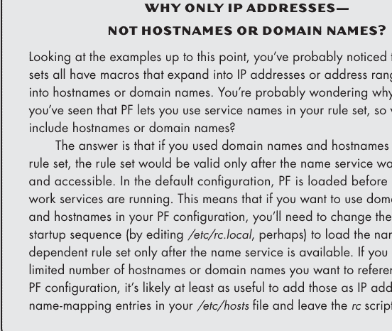
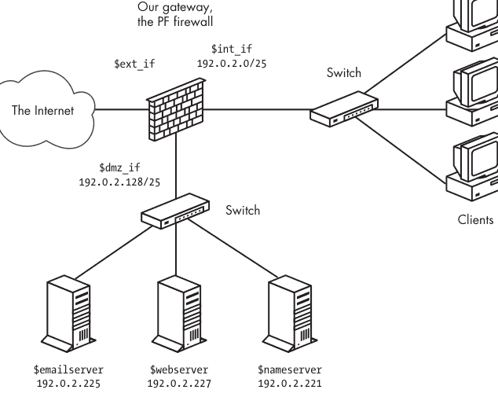

# PF 之书：OpenBSD 防火墙实战指南，第 3 版

# 对《THE BOOK OF PF》的赞誉

“这是一个关于 PF 防火墙部署和配置的权威纸质指南，写作风格清晰、严谨。其内容涵盖非常出色。”

—CHAD PERRIN, TECH REPUBLIC

“这本书是给每一个使用 PF 的人准备的。无论操作系统和技能水平如何，这本书都会教给你一些新颖且有趣的的知识。”

—BSD MAGAZINE

“由于 Hansteen 先生对状态检查、SPAM 邮件、黑/灰列表等许多重要主题的关注，这本 BSD 用户不可或缺的参考书将极很大程度上帮助你精调 BSD 机器上访问控制的‘谁、什么、何地、何时、如何’。”

—INFOWORLD

“任何处理防火墙配置的人都是必备的资源。如果你听过关于 PF 的好评并一直想尝试一下，那么这本书绝对适合你。从头读起，回过神来你就已经读完了这本书，并成了一个 PF 专家。即使你已经是 PF 专家，这仍然是一本值得放在书架上的好书，以便在棘手的情况下参考或借给同事。”

—DRU LAVIGNE，《BSD HACKS AND THE DEFINITIVE GUIDE TO PC-BSD》作者

“这本书是一个极佳的资源，让我更渴望重写我那些陈旧的规则了。”

—LOGIN;

“这本书读起来非常容易。我太喜欢了！这本书轻松地进入了我的五五书单。”

—DAEMON NEWS

作者 Peter N.M. Hansteen

TK515.S85.J685 2008

005.8--gc22

200704229

> 献给 Gene Scharmann，
>
> 多年前是他
>
> 引导我走向
>
> 自由软件的方向

## 那个老旧的 FTP 问题

如果必须使用：带有 Divert Redirect 的 `ftp-proxy`。

`ftp-proxy` 设置的变体。

让你的网络故障排除变得更友好。

我们让所有流量都通过吗？

简单的出路方法：责任到此为止。

让 `ping` 通过。

帮助 `traceroute`，

路径 MTU 发现

表格让你的生活变得更轻松。

## 4 轻松上手 4 种无线网络

关于 IEEE 802.11 的背景知识。

MAC 地址过滤。

WPA。

任务所需的正确硬件，

设置简单的无线网络

一个基于 FreeBSD 的 WPA 接入点。

一个基于 FreeBSD 的 WPA 接入点。

接入点的 PF 规则集。

具有三个或更多接口的接入点

处理 IPSec、VPN 解决方案。

客户端侧

OpenBSD 设置

FreeBSD 设置

使用 `authpf` 保护你的无线网络。

一个基础的身份验证的网关。

看似开放但实则已关闭。

## 5 更大或更复杂的网络

内部的 Web 服务器和邮件服务器：可路由的 IPv4 地址

隔离之程度：引入 DMZ

负载分担：重定向到地址池

通过 `relay` 实现负载均衡。

内部的 Web 服务器和邮件服务器——NAT 版本

带 NAT 的 DMZ

用于负载均衡的重定向

回到单 NAT 网络。

在接口组上进行过滤。

标签的力量。

桥接防火墙。

OpenBSD 上的基础桥接设置。

FreeBSD 上的基础桥接设置。

NetBSD 上的基础桥接设置。

桥接规则集。

处理来自外部的不可路由 IPv4 地址

建立全局规则

使用锚（Anchors）重构你的规则集

你的网络有多复杂？——回顾

## 6 反转局面进行主动防御

拒之门外

SSH 暴力破解攻击

设置自适应防火墙

使用 `pctl` 绑定你的表格

使用 `spamd` 让垃圾邮件发送者难过日子

网络级行为分析与黑名单

灰名单：我的管理员告诉不要和陌生人说话

追踪你的真实邮件连接：`spamlogd`

灰陷阱（Greytrapping）

使用 `spamd` 管理列表

检测乱序 MX

处理不配合灰名单机制的站点

垃圾邮件翻转（Spam-Fipping）技巧

## 7 使用队列和优先级进行流量整形

用于流量整型的始终开启优先级和队列

根据流量优先级进行整形

引入用于带宽分配的队列

使用队列处理不需要的流量

从 LTQ 到优先级和队列的过渡

使用 LTQ 引导流量

基础 LTQ 概念

队列调度器，又称队列规则（Queue Disciplines）

设置 LTQ

基于优先级的队列

使用 LTQ 优先级队列提高性能

使用匹配规则（`match` for Rule）进行队列分配

适用于小型网络的基于类的带宽分配

一个基础的 HFSC 流量整形器

DMZ 中服务器的队列化

使用 LTQ 处理不需要的流量

结论：为了好而进行的流量整形，或许永远有获益

## 8 冗余与资源可用性

冗余与故障转移：CARP 和 `pfsync`

项目规范：一对冗余网关

设置 CARP

保持状态同步：添加 `pfsync`

整合规则集

用于负载均衡的 CARP

# 9 日志、监控与统计

- PF 日志：基础知识

    - 记录数据包通过规则集的路径：`log (matches)`

    - 记录所有数据包：`log (all)`

    - 日志记录到多个 `plog` 接口

    - 日志记录到 syslog（本地或远程）

    - 使用标签（Labels）跟踪每个规则的统计数据

    - 用于 PF 日志和统计的额外工具

    - 使用 `systat` 监控情况

    - 使用 `pfilter` 监控情况

    - 使用 `pfstat` 绘制流量图

    - 使用 `pflow(4)` 收集 NetFlow 数据

    - 使用 `pflowd` 收集 NetFlow 数据

    - SNMP 工具与相关的 SNMP MIB

日志数据作为有效调试的基础

## 10 让你的设置到位

- 你可以微调和可能忽略的事项

    - 阻塞策略（Block Policy）

    - 跳过接口（Skip Interfaces）

    - 状态策略（State Policy）

    - 状态默认值（State Defaults）

    - 超时设置（Timeouts）

    - 限制（Limits）

    - 调试（Debug）

    - 规则集优化（Rule Set Optimization）

    - 优化（Optimization）

    - 分片重组（Fragment Assembly）

清理你的流量

    - 使用 `scrub` 进行数据包归一化（OpenBSD 4.5 及以前版本）

    - 使用 `scrub` 进行数据包归一化（OpenBSD 4.6 及以后版本）

    - 使用 `antispoof` 防止欺骗

测试你的设置

调试你的规则集

了解你的网络并掌握控制权

## A 资源

- 上的通用网络和 BSD 资源

示例配置与相关感悟

其他 BSD 系统上的 PF

BSD 和网络书籍

无线网络资源

`spamd` 和灰名单相关资源

书籍相关的网络资源

购买 OpenBSD CD 并捐赠！

# 关于硬件支持的说明

- 获取正确的硬件

- 硬件支持开发者面临的问题

- 如何帮助硬件支持工作

# 索引

# 序言（摘自第一版）

OpenBSD 的 PF 数据包过滤器自 2001 年底在 OpenBSD 3.0 中首次发布以来，一直赢得了巨大的成功和关注。虽然你将在书中了解到更多关于 PF 历史的内容，但简而言之，PF 的出现是因为 BSD 的开发者和用户需要。从最初发布以来，PF 已经经历了巨大的演变，成为可用最强大的防火墙、负载均衡和流量管理免费工具。当 PF 与 CARP 和 `pfsync` 结合时，PF 让系统管理员不仅保护服务免受攻击，还能通过冗余使这些服务更加可靠，并通过 PF 管理和中继的服务器池扩展来提高速度。

虽然我参与了 PF 的开发，但我首要是 PF 的大量用户。我使用 PF 进行安全防护，管理内部和外部流量，并帮助我以冗余且可扩展的方式运行大型关键基础设施。这为我的雇主（阿尔伯塔大学，我白天在那里担任系统管理员）节省了金钱，无论是在停机时间方面还是在硬件软件方面。你也可以使用 PF 做同样的事情。

随着这些功能而来的，是复杂性这一“必要的恶”。对于精通 TCP/IP 和 OpenBSD 的人来说，PF 的系统文档非常详尽，且完全可以独立使用。但尽管系统文档中有大量的示例，但不可能将你使用 PF 及其相关工具集所做的所有事情都放在核心位置，这会让系统文档变得如此庞大，以至于对于需要将其作为参考的经验丰富的人士非常有用。

这本书弥补了这一空白。如果你是一个相对的新手，它可以让你快速上手 OpenBSD 和 PF。如果你是一个经验较丰富的用户，这本书可以向你展示一些更复杂的应用示例，帮助人们解决超出典型范围的问题。多年来，Peter N.M. Hansteen 一直是学习如何不仅在“我如何制作防火墙？”之外应用 PF 的人的优秀资源，这本书延续了他与他人分享这些知识的传统。防火墙现在已经无处不在，大多数人都有一个或多个。但这不仅仅是关乎构建防火墙，而是关乎学习操纵网络流量的技术，并充分理解这些技术，以便让你作为系统和网络管理员的生活变得更轻松。简单的防火墙很容易构建或现成，但一个你可以与之共处并自己管理的防火墙要复杂得多。这本书在平滑学习曲线方面迈出了很大，不仅让你了解如何构建防火墙，还让你 PF 是如何工作的以及它的优势何时可以帮助到你。这是一项节省你时间的投资。它将让你以正确的方式运行——更快、更少的错误尝试，并花费更少的实验时间。

Bob Beck

OpenBSD 基金会主管


http://www.openbsdfoundation.org/

加拿大，阿尔伯塔省埃德蒙顿

# 致谢

这份手稿最初是一次用户小组的讲座，首次于 2005 年 1 月 27 日的卑尔根 [BSD 和] Linux 用户小组 (BLUG) 会上上。在我将手稿翻译成英文并稍作扩展后，Greg Lehey 建议我再进一步充实一下，并在 AUUG 2005 大会上作为一个为期半天的教程进行演示。在了一系列教程修订后，我终于在 2007 年初开始着这将成为书籍版本的内容。

接下来的两段节自教程手稿，适用于书中：

这份手稿是为讲座准备的手稿的稍进一步开发的版本，该讲座曾宣布（译自挪威语）：

> “这场讲座关于防火墙及相关功能，带有来自 FreeBSD 项目 PF（数据包过滤器）的现实案例。PF 在一个单一、灵活且对管理员友好的系统中提供了防火墙、NAT、流量控制和带宽管理。Peter 希望这次讲座能给你提供一些如何按你想要控制网络流量的想法——将某些内容留在网络之外，将流量引导至指定的主机事件，当然，还让垃圾邮件发送者感到困难。

教程中的部分内容（无疑是所有真正有用的主题）以某种形式进入了这本书。对该手稿早期版本提供大量有用建议的人包括 Rolf Aarseth, David Snyder, Peter Postma, Henrik Kramshøj, Vegard Engen, Greg Lehigh, Ian Darwin, Daniel Hartmann, Mark Uemura, Hallvor Engen，以及可能还有几个留在我的邮件存档中直到我用 grep 把它们找出来的人。

感谢这些组织的慷慨支持：NUUG 基金会提供的差旅补助，部分资助了我的参加 AUG 2005；AUG, UKUG, SANE, BSDCan, AsiaBSDCon, NUUG, BLUG 和 BSD-DK 组织邀请我参加他们的活动并演讲，以及 FreeBSD 基金会赞助了我的 BSDCan 2006 和 EuroBSDCon 之行。

第一版一样，第二版主要是在晚上和周末编写的。我要感谢 FreeCode 的同事允许我在 2010 年初的几个月里抽时间处理第二版。这第三版之所以存在是因为 OpenBSD 5.5 引入了替代 ALTQ 的新流量整形系统。幸运的是，Bill Pollock 和他的 Press 团队认为，自第二版以来的功能改进足以让我们在 2013 年下半年开始第三版的工作。

最后，在将手稿转化为书籍的过程中，许多人做了了不起的事情让这本书变得更好。我非常感激 Bill Pollock 和 Adam Wright 出色的开发编辑；我要感谢 Henning Brauer 出色的技术评审；衷心感谢 Eystein Roll Aarseth, Jakob Brevik, Hallvor Engen, Christen Solskogen, Ian Darwin, Jeff Martin 和 Lars Nöden 对手稿的部分提供的宝贵建议；并热感谢 Megan Danch 和 Linda Reckental 在书籍出版方面的努力，以及 Serena Yang 的指导。

最后但不是最重要的，我要感谢我亲爱的妻子 Birthe 和我的女儿 Nora，感谢她们在产生这一版本的密集期间提供的爱和支持。特别感谢 Dru Lavigne，是他的介绍使得这本书得以编写，而不是仅仅作为在线教程和偶尔的会议纪念留存。

# 引言

这是一本关于构建你所需要的网络的书。我们将深入探讨防火墙及相关主题，从一些理论开始。你将看到许多过滤和其他导向网络流量的示例。我假设你对 TCP/IP 网络概念和 Unix 管理具有基础到中级的水平。

书中的所有信息都带有一个警告：正如许多领域一样，我们讨论的解决方案有多种实现方式。而且，软件世界总是在变化，自本书出版以来，最佳实践可能已经发生了变化。本书在 OpenBSD 5.6、FreeBSD 10.0 和 NetBSD 6.1 上进行过测试，并包含了 2014 年 7 月底之前的所有可用补丁。

# 这不是一份指南 (HOWTO)

这本书是我流行的 PF 教程的直接后代，也是书籍版稿的第三版。多年来，为了让这本书变得实用，我付出了大量工作，我非常有信心你会发现它是很有用的，我希望你也会觉得读它是一种享受。但请记住，这份文档并不是为了提供一个供你剪切粘贴的现成菜谱。

为了强调这一点，请在我之后重复一遍：

```
//网络管理员的誓言//
```

这是我的网络。

它属于我，

或者从技术上说，属于我的雇主。

它是我的责任，

我全心全呵护它。

还有许多与我的网络类似的网络，

但没有一个与它完全相同。

我郑重宣誓：

我绝不会盲目地从各种 HOWTO 中粘贴内容。

要点在于，虽然我测试了书中所有的配置，但对于你所描述的网络来说，它们几乎肯定在某种程度上是错误的。请记住，此书旨在向你展示一些实用的技巧，并启发你去成就。

请努力理解你的网络以及为了让它变得更好你需要做什么，请不要盲目地从从本文或任何其他文档中粘贴。

# 本书涵盖的内容

本书旨在作为一个独立的文档，让你在操作机器时，只需简要查阅（手册页（man pages），并偶尔参考附录 A 中列出的在线和打印资源。

你的系统可能带有一个预先写的 `pf.conf` 文件，其中包含注释掉的实用配置建议，以及文档目录（如 `/usr/share/pf/`）中的少量示例。这些示例作为参考是有用的的，但我们不会在书中直接使用它们。相反，你将学习如何从零构建一个 `pf.conf`。

以下是书中包含内容的简要概述：

- 第1章“构建你需要的网络”将介绍基础网络概念，简要概述 PF 的历史，并如果你是该系列操作系统的初学者，将提供关于如何适应 BSD 风格的提示。先阅读第一章，以便对如何与 BSD 系统工作有一个感觉。

- 第2章“PF 配置基础”展示了如何在你的系统上启用 PF，并涵盖了单机最基础的规则。这一章至关重要，因为所有的后续配置都基于你在此处构建的配置。

- 第3章“进入真实世界”在第2章单机配置的基础上，引导你学习设置网关作为不同独立网络之间联系点的基础知识。到第3章结束，你将构建出一个典型的家庭或小型办公室网络配置，并掌握一些让网络管理更简单的技巧。你还将尽早体验如何处理如 FTP 等具有此类需求的服务，以及关于如何满足一些经常不被理解的协议和服务，来让你的网络易于故障排除的提示。

- 第4章“让无线网络变得简单”将引导你为你的设置中添加网络功能。无线环境带来了一些安全挑战，到本章结束时，你可能会发现自己拥有一个通过 `authpf` 进行访问控制和认证的无线网络。某些信息在有线环境中可能同样有用。

- 第5章“更大或更复杂的网络”处理了当你引入需要从网络外部访问的服务器和服务时的情况。到本章结束，你可能拥有一个具有一个或多个子集和 DMZ 的网络，并且你已经通过重定向和中继尝试了不同的负载均衡方案，以提高用户的服务质量。

- 第6章“扭转局面进行主动防御”引入了 PF 工具箱中用于处理不良活动尝试的一些工具，并展示了如何高效地使用它们。我们处理了暴力破解密码尝试和网络泛洪，以及反垃圾邮件工具 `spam`（OpenBSD 的垃圾邮件守护进程）。这一章应该让你的网络对合法用户来说更加愉快，而对那些图不善的人不那么欢迎。

- 第7章“通过队列进行流量整形”引入了通过 OpenBSD 5.5 引入的优先级和队列系统进行流量整形。本章还包含了如何将早期的基于 ALTQ 的系统转换为新系统的提示，以及在没有较新队列系统的操作系统上设置和维护 ALTQ 的信息。这一章将通过将流量整形适应到你的网络需求，从而使你获得更好的资源利用率。

- 第8章“冗余与资源可用性”展示了如何创建冗余配置，包括用于故障转移和负载均衡的 CARP 配置。这一章将让你了解如何创建和维护高可用、冗余的基于 CARP 的配置。

- 第9章“日志、监控与统计”解释了 PF 日志。你将学习如何使用基础系统的工具以及可选包从你的 PF 配置中提取并处理日志和统计数据。我们还会讨论基于 NetFlow 和 SNMP 的工具。

- 第10章“让你的设置完美无缺”介绍各种帮助你调优设置的选项。它将你在前面章节中获得的知识与规则集调试教程相结合。

- 附录 A“资源”是一份注释过的打印和在线文献资源列表，当你扩展对 PF 和网络主题的知识时，可能会发现这些资源。

- 附录 B“关于硬件支持的说明”概述了作为免费软件创建顶级工具时涉及的问题。

书中的每一章都建立在前一章的基础上。虽然作为一个自由的人你可以轻松地跳读，但按顺序阅读章节可能会是有用的。

关注一些基于纯网络层行为的技术，这些技术在第 6 章的示例配置中最为明显。如果你已经部署了内容检查数据包的功能，这些技术将有助于减轻其的负载。正如你从接下来的章节中将看到的，除了拦截或通过数据包之外，网络还提供了许多乐趣和兴奋点。

## 数据包过滤器的位置

数据包过滤器的主要功能如其名，通过匹配单个数据包的属性以及由这些数据包建立的网络连接，与其配置文件中定义的过滤标准进行对比，从而过滤网络包。数据包过滤器负责决定对这些数据包采取什么操作。这可能意味着通过它们或拒绝它们，或者触发操作系统其他部分或外部应用程序设置为要处理的事件。

PF 允许你定义自定义过滤标准，根据任何数据包或连接属性来控制网络流量，包括地址族、源和目的地址、接口、协议和方向。根据这些标准，数据包过滤器执行你指定的操作。最简单且常见的操作之一就是拦截流量。

数据包过滤器可以将不受的流量阻隔在你的网络之外。它也可以将网络流量限制在你自己的网络内部。这些功能对于防火墙概念非常重要，但拦截并不是功能性数据包过滤器唯一有用或有趣的特性。正如你在书中所看到的，你可以使用过滤标准将某些类型的流量引导到特定主机，将流量分类分配给队列，执行流量整形，甚至将选定的流量交给其他软件进行特殊处理。

所有这一切都发生在网络层，基于数据包和连接属性。PF 是网络堆栈的一部分，嵌入在操作系统内核中。虽然有在用户空间中实现数据包过滤的例子，但在大多数操作系统中，过滤功能是在内核中执行的，因为那样做速度更快。

## PF 的兴起

如果你对历史感兴趣，可能已经知道 OpenBSD 和其他 BSD 发行版是 BSD 系统的直接后代（有时被称为 BSD Unix），该操作系统在 20 世纪 80 年代初包含了 TCP/IP 互联网协议的原始参考实现。

> 如果 BSD 听起来很陌生，这里有一个简短的解释：该缩写扩展为“Software Distribution”（软件分发），最初指的是由加利福尼亚大学伯克利分校的工作人员和学生为 Unix 操作系统开发的一系列有用软件。随着时间的推移，该集合扩展成了一个完整的操作系统，反过来成为了包括 OpenBSD、FreeBSD、NetBSD 以及根据某些定义的 Apple 的 Mac OS 在内的一系列系统的先驱。关于 BSD 是什么非常易读的解释，请参阅 Greg Lyn 的“Explaining BSD”，地址：http://www.freebsd.org/doc/articles/explaining-bsd/。

随着 BSD 开发背的研究项目在 20 世纪 90 年代初结束，代码被释放出来，供全球的小爱好者小组进行进一步开发。这些爱好者中的一些人负责维持新兴互联网基础设施关键部分的运行，BSD 开发继续并行并行进行。OpenBSD 成为 BSD 中最注重安全的闻名。为了它的数据包过滤需求，它使用了一个名为 IPFilter 的子系统，主要由 David Reid 编写。在这些早期年份里，OpenBSD 迅速赢得了“那个防火墙”的良好口碑。

当 Reid 在 2001 年初宣布 IPFilter（此时已集成到 OpenBSD 中）不受 BSD 许可证的保护时，这让 OpenBSD 社区感到震惊。相反，它使用了几乎逐字相同的代码副本，但省略了修改和发行结果的权利。问题在于 OpenBSD 版本的 IPFilter 包含了若干更改，事实证明这些更改是不允许的。结果，IPFilter 于 2001 年 5 月 29 日从 OpenBSD 源码树中删除，在几周内，OpenBSD 的开发版本（当前版本）不包含任何数据包过滤器软件。

幸运的是，此时 Daniel Hartmeier 正在一些有限的内核破解。他首先将自己的一个小函数注入网络堆栈中，然后通过它发送数据包。当许可证危机发生时，PF 已经在小规模进行开发。PF 代码的第一次提交是 2001 年 6 月 24 日（星期日）UTC 时间 19:48。随后，许多开发者进行了一段时间的高强度活动，生成的 PF 版本于 2001 年 12 月作为 OpenBSD 3.0 系统的默认部分发布。该版本包含了数据包过滤的实现，包括网络地址转换，其配置语言与 IPFilter 足够相似，迁移到新的 OpenBSD 版本没有产生主要问题。

4. IPFilter 的版权问题促使 OpenBSD 团队对整个源码树进行许可证审核，以避免未来发生类似的情况。在之后的几个月里，潜在问题得到了解决，结果为所有参与自由开发的人消除了许多许可证陷阱。De Raadt 在 2003 年 2 月 20 日向开源邮件列表的消息中总结了这一努力。许可证危机的最初戏剧已经过去，结果是过滤系统在免费许可证下没有问题，拥有最好的代码质量，OpenBSD 自身以及广泛使用的免费软件中大量的代码。

5. 与 IPFilter 配置的兼容性是 PF 开发者的早期设计目标，但一旦可以假设所有 OpenBSD 用户已迁移到 PF（大约在 OpenBSD 3.2 发布左右，甚至更早），它不再是优先级。不应假设现有的 IPFilter 配置可以在任何版本的 PF 下直接工作。随着 OpenBSD 4.7 引入的语法更改，即使是从早期 PF 版本的升级也需要修正。


# PF 证明是优秀的软件

2002 年，Hartmeier 发表了一篇 USENIX 论文，通过性能测试显示 OpenBSD 3.1 PF 在压力下的表现等同于或优于 OpenBSD 3.1 或 Linux 上的 IPFilter。此外，对 OpenBSD 3.0 原始 PF 的测试主要表明代码从 3.0 版本到 3.1 版本效率有所提高。

OpenBSD PF 代码由经验丰富的面向安全的开发者编写了全新的数据包过滤引擎，自然也引起了 BSD 的兴趣。FreeBSD 项目逐渐采用了 PF，最初作为一个包，然后从 5.3 版本开始，在基础系统中作为三个数据包过滤系统之一。PF 也被包含在 NetBSD 和 DragonFlyBSD 中。

本书重点关注 OpenBSD 5.5 中可用的 PF 版本。我将在适当的情况下指出该版本与其他系统中集成的版本之间的显著差异。

如果你已准备好研究 PF 配置，可以跳转到第 2 章开始。如果你想多花一点时间在不熟悉的 BSD 领域熟悉一下环境，请继续阅读本章。

## 新版本的 PF 性能更好

与计算世界的其他部分一样，OpenBSD 和 PF 也受到硬件和网络快速变化的影响。我最近没有看到过与 Daniel Hartmeier 的 USENIX 论文中相当的测试，但 PF 用户发现过滤开销很小。

作为一个例子（主要为了说明即使是无趣的硬件配置也是有用的），我职业生涯中某一个小办公室和世界之间的机器是一台 450MHz 的 Pentium III，配有 384MB 内存。当我查看根据 `top(1)` 命令的输出时，我从未见过该机器空闲率低于 96%。

值得注意的是，目前的 PF 开发者（主要是 Henning Brauer 和 Ryan McBride，以及其他人的贡献）在最近的发布中以提高性能为主要目标重构了 OpenBSD PF 代码的大部分，使得从 4.4 到 5.6 的每个版本都明显优于之前的版本。

> 6. 提供这些测试的文章可以在 Daniel Hartmeier 的网站上找到。访问 `http://www.benzedrine.com/pf-paper.html`。
>
> 7. 曾经甚至存在运行在 Microsoft Windows 上的个人防火墙，名为 Core Force，它是基于 PF 的移植。开发 Core Force 的 Core Security 公司 (`http://force.coresecurity.com/`) 似乎将重心转向其他安全领域，例如渗透测试，但该产品仍供下载。

# 如果你来自其他系统

如果你阅读这一节是因为你正在考虑将你的配置从其他系统迁移到 PF，那么这一节就是是为你准备的。

如果你想使用 PF，你需要安装并运行一个 BSD 系统，例如 OpenBSD、FreeBSD、NetBSD 或 DragonBSD。这些都是操作系统，但我个人最喜欢的是 OpenBSD，主要是因为所有 PF 的开发都是在这个操作系统上进行的。我也发现开发者们那种不加修饰的方法以及该系统非常令人耳目一新。

偶尔，一些微小的更改和错误修复会从其他系统上的 PF 实现追溯到 PF 的主代码库，但最新、最实时的 PF 代码总能在 OpenBSD 上找到。此书中描述的某些功能仅在 OpenBSD 的最新版本中可用。其他 BSD 系统倾向于在下一次发布之前及时从它们的代码库中移植最新的 PF 版本，但同步更新远不能保证，而且滞后有时会非常显著。

如果你计划在 FreeBSD、NetBSD、DragonBSD 或另一个系统上运行 PF，你应该检查你系统的发行说明和其他关于包含 PF 版本的文档，以确定包含了哪个版本的 PF。

## Linux 用户的提示

如果深入探究，Linux 和 BSD 之间的差异和相似性可能是一个大话题，但如果你对基础知识有合理的掌握，你不需要花费太长时间就能适应 BSD 的处理方式。在本书的其余部分，我将假设你能够找到 BSD 网络配置基础的方法。因此，如果你对 Linux 或系统的系统比 BSD 更熟悉，那么注意 BSD 配置的几点是值得的：

- Linux 和 BSD 使用不同的网络接口命名约定。Linux 的惯例是按照 `eth0`、`eth1` 等顺序标记机器上所有的网络接口（尽管在某些版本和驱动程序组合中，你也会看到无线接口被标记为 `wlan0`、`wlan1` 等）。
- 在 BSD 上，接口分配的名称等于驱动程序名称加上序列号。例如，使用 `ep` 的旧版 3Com 网卡显示为 `ep0`、`ep1` 等；英特尔千兆网卡可能显示为 `em0`、`em1` 等。某些 SMC 卡被命名为 `sns0`、`snn1` 等。这个系统非常有逻辑性，并且更容易找到该接口特定细节的文档。如果你的内核报告（在启动时或 `ifconfig` 输出中）你有一个名为 `em0` 的接口，你只需要在命令行提示符处输入 `man em` 就能发现它支持什么——是否有任何需要注意的特殊之处、是否需要下载任何固件等等。
- 你应该意识到，在 BSD 上，配置是以 `/etc/rc.conf` 为中心的。通常情况下，BSD 的组织方式是从文件 `/etc/rc.conf` 中读取配置，而该文件在启动时由 `/etc/rc` 脚本读取。OpenBSD 建议使用 `/etc/rc.conf.local` 进行本地自定义，因为 `rc.conf` 包含了默认值。FreeBSD 使用 `/etc/defaults/rc.conf` 存储默认设置，而 `/etc/rc.conf` 是更改的正确位置。此外，OpenBSD 使用每个接口的配置文件，称为 `hostname.<if>`，其中 `<if>` 被替换为接口名称。为了学习 PF 的目的，你需要关注 `/etc/pf.conf` 文件，这将由你自己创建。

如果你需要对你所选择的 BSD 进行更广泛、更彻底的介绍，可以在该项目的网站上查看操作系统文档，包括常见问题解答和指南。你也可以在附录 A 中找到一些进一步阅读的建议。

## 关于 PF 的常见问题

这一节基于我通过电子邮件、会议和研讨会收到的问题，以及在邮件列表和其他讨论论坛中出现的问题。其中一些常见问题以“FAQ 格式”的形式涵盖。

### 我可以在我的 Linux 机器上运行 PF 吗？

简单来说，不能。多年来，虽然邮件列表上出现过一些声称可以在 Linux 上移植 PF 的公告，但目前还没有人声称完成了这项任务。一个主要原因是 PF 是作为网络栈的一部分被深度开发的。

对于 Linux 用户的基础提示，请参阅第 6 页的“Linux 用户的提示”。

### 你能推荐用于管理规则的图形界面工具吗？

一种常见的说法是 PF 配置文件足够易读，因此不需要可视化工具。然而，确实有一些可以编辑 PF 配置的可视化工具，例如 pfSense (`https://www.pfsense.org/`)，它包含一个图形化编辑器。

> 8. FAQ 这个缩写可以扩展为常见问题解答或回答问题——两者都有效。

我建议你通过本书的相关部分并应用于你的情况，然后决定你是否需要使用可视化工具来管理你构建的系统。

### 有没有工具可以将我的 OtherProduct® 设置转换为 PF 配置？

将设置（包括防火墙设置）从一个产品转换为另一个产品的最佳策略是回到规格或策略，然后使用新工具实现这些策略。

其他产品不可避免会有稍微不同的功能集，你为 OtherProduct® 创建的现有配置在处理特定问题时可能反映了不同的方法，甚至无法映射到 PF 的功能。

拥有一个文档化的策略并维护它会让你的生活变得更容易。这份文档应该包含你要实现的完整规格。（你可以从在配置文件中添加注释来解释你的目的开始。）这使得验证你运行的配置是否实现了设计目标成为可能。在某些情况下，可能对策略有正式要求。寻找自动化转换方法的冲动完全可以理解，而且对于系统管理员来说是意料中的。我敦促你抑制这种冲动，在评估你的业务和技术需求后（最好是在创建或更新正式规格或策略之后）再进行转换。

一些作为管理前端的可视化工具声称可以作为转换工具。然而，这会在你和规则集之间引入另一层抽象，并让你取决于工具作者对 PF 规则集工作原理的理解。我建议在投入大量时间考虑自动化转换之前，先阅读本书的相关部分。

### 我听 PF 是基于 IPFilter 的，我是从操作 Solaris 时了解到这一点的。我可以直接把我的 IPFilter 配置复制过去并获得运行设置吗？

如果有人声称 PF 是“基于”IPFilter，他们说的话并非事实。PF 是从零开始编写的，旨在取代新删除的 IPFilter 代码。对于 PF 的第一个版本，其设计目标之一是保持语法与旧软件基本兼容，以便向 OpenBSD 3.0 的迁移能够尽可能轻松，且不会以严重或不可预测的方式破坏设置。

然而，在之后的几个版本之后，人们有理由认为没有 OpenBSD 用户可能还会从包含 OpenFilter 的版本升级，因此与旧系统的兼容已不再是首要考虑的问题。尽管在 OpenBSD 发布了 25 个版本并经过了 12 多年的开发，两者在语法上仍存在某些相似之处。尝试在另一个系统上加载一种配置——例如，将 IPFilter 配置复制到 OpenBSD 系统并尝试加载，或将 PF 配置复制到 Solaris 系统并尝试将其作为 IPFilter 配置加载——这在所有情况下都注定会失败，极少数经过特殊构造但仍然非常微小且实际上无用的配置除外。

### 为什么 PF 规则语法突然发生了变化？

世界在变，PF 也随之改变。更具体地说，OpenBSD 开发者对代码保持着非常活跃且务实批判性的态度，OpenBSD 的所有部分以及 PF 代码都处于不断的审查之中。

在 PF 开发十多年积累的经验导致了代码内部的这些，最终让开发者们意识到更改语法是有意义的。这些变化将使 PF 语法更加一致，从长远来看，以编辑配置文件的代价，让用户的生活变得更简单。对于用户来说，结果是 PF 现在更易使用，而且性能优于早期版本。如果你正在将系统升级到 OpenBSD 4.7 或更高版本，你将获得真正的享受。

随着 OpenBSD 5.5 的发布，你会发现另一个升级的良好理由：用于流量整型的新队列系统，它旨在取代老旧的 ALTQ 系统。ALTQ 仍然是 OpenBSD 5.5 的一部分（尽管形式略有修改），但它已在 OpenBSD 5.6 发布前从 OpenBSD 内核中移除。第 7 章包含一个关于迁移到新流量整形系统的章节。

### 我可以在哪里找到更多信息？

关于 PF 及其运行系统的信息有多个来源。你已经在本书书中找到了一个。你可以在附录 A 中找到许多印刷版和在线资源的引用。

如果你有一个安装了 PF 的 BSD 系统，请咨询在线手册或 man 页面以获取有关你具体软件发布版本的信息。另有说明外，书中的信息指的是从 OpenBSD 5.5 系统命令行界面看到的世界。

## 一点鼓励：一首 PF 俳句

如果你还没有被说服，即使已经被说服了，可能也需要一点鼓励。多年来，许多人对 PF 说过或写过自己的看法——有时奇特，有时美妙，有时又完全疯狂。

这里引用的诗很好地说明了 PF 有时能激发用户产生的情感水平。这首诗出现在 PF 邮件列表中，源于 2004 年 5 月的一封主题为“PF 做不到的事情？”的邮件线程。这封邮件由一个没有多少防火墙经验的人写的，因此发现很难实现理想的设置。

当然，这导致了一些讨论，几位参与者表示，如果 PF 对新手来说很难，那么替代方案也不会好到哪里。该线程以 Jason Dixon 2004 年 5 月 20 日写的一首赞美俳句作终。

与使用 iptables 相比，PF 就像这首俳句：

> 一缕清风，
> 漂浮在白玫瑰瓣上，
> 吃着草莓。
>
> 现在我有点过头了：
>
> Hartmeier 编写代码，
> Henning 不知道为何失败，
> 仅对新手失效。
>
> 表格加载了我的列表，
> 由于那个发垃圾邮件的人而产生陷阱，
> 愿他的邮件库死吧。
>
> 由于 Cisco 产生 CARP，
> 冗余的受祝福的数据包，
> 授权供我免费使用。

Dixon 在这里提到的某些概念听起来可能有些陌生，但如果你继续读下去，很快就会变得合情合理。

# 2 PF 配置基础

在本章中，我们将创建一个非常简单的 PF 设置。我们将从简单的配置开始：一台配置为与单个网络通信的单机。而这个网络很可能就是互联网。

你配置 PF 的两个主要工具是你最喜爱的文本编辑器和 `pfctl` 命令行管理工具。PF 配置通常存储在 `/etc/pf.conf` 中，被称为规则集，因为配置文件的每一行都是一条规则，帮助确定数据包过滤子系统应该对它看到的网络流量做什么。在日常管理中，你可以在 `/etc/pf.conf` 文件中编辑配置，然后使用 `pfctl` 加载更改。用于 PF 管理任务的 Web 界面，但它们不是基础系统的一部分。PF 开发者对这些选项并不反对，他们还没有看到明显比使用 `pfctl` 命令编辑 `pf.conf` 更好的图形界面。

## 第一步：启用 PF

在开始使用 PF 和相关工具进行网络整形之前，你需要确保 PF 是可用且已启用的。细节取决于具体的操作系统：OpenBSD、FreeBSD 或 NetBSD。请按照你操作系统的说明检查你的设置，然后移动到“简单的 PF 规则集：单台独立机器”。

`pfctl` 命令是一个需要比普通用户默认更高的权限的程序。在 OpenBSD 上，`/etc/rc` 脚本有一个内置机制可以帮助你在处理重启时使用 `pf.conf` 文件。

如果你通读了上一节关于在 OpenBSD 上设置 PF 的内容，你会发现在 OpenBSD 上，PF 是默认启用的。但在 FreeBSD 上情况并非如此，PF 是三种可能的包过滤选项之一。在这里，你需要对 PF 做出显式声明，与 OpenBSD 相比，似乎在你的 `/etc/rc.conf` 中需要一些“魔法”。查看你的 `/etc/defaults/rc.conf` 文件，可以看到 FreeBSD PF 相关设置的默认值如下：

```
pf_enable="NO"
pf_rules="/etc/pf.conf"
pf_program="/sbin/pfctl"
pf_flags=""
plog_enable="NO"
plog_logfile="/var/log/pflog"
plog_program="/sbin/pflogd"
plog_flags=""
pfsync_enable="NO"
pfsync_syncdev=""
pfsync_config="" # 设置为 YES 以启用包过滤器 (PF)
# PF 的规则定义文件
# pfctl 所在
# pfctl 的额外标志
# 设置为 YES 以启用包过滤日志
# pflogd 存储日志文件的位置
# pflogd 所在
# pflogd 的额外标志
# 将 pf 状态暴露给其他主机进行同步
# pfsync 运行的接口
# pfsync config(8) 的额外选项
```

幸运的是，你可以安全地忽略这些大部分内容——至少目前是这样。你需要修改的是你的 `/etc/rc.conf` 配置：

```
pf_enable="YES"
plog_enable="YES" # 启用 PF（如果需要加载模块）
# 启动 pflog(8)
```

FreeBSD 版本之间在 PF 上存在某些差异。请参考从 `http://www.freebsd.org` 提供的 FreeBSD 手册，特别是“防火墙”章节中的 PF 部分——以查看哪些信息适用于你的情况。FreeBSD 9 和 10 中的 PF 代码等于 OpenBSD 4.5 的代码，但存在一些错误。本书中的指令假设你运行的是 FreeBSD 9.0 或更高版本。

在 FreeBSD 上，PF 默认编译为内核可加载模块。如果你的 FreeBSD 设置运行的是 `GENERIC` 内核，你应该能够通过以下命令启动 PF：

```
$ sudo kldload pf
$ sudo pfctl -e
```

假设你已经将上述行放入你的 `/etc/rc.conf` 并创建了 `/etc/pf.conf` 文件，你也可以使用 PF rc 脚本来运行 PF。执行以下命令：

```
$ sudo /etc/rc.d/pf start
```

这将禁用包过滤器：

```
$ sudo /etc/rc.d/pf stop
```

在 FreeBSD 上，`/etc/rc.d/pf` 脚本要求 `/etc/rc.conf` 中至少有一行读取 `pf_enable=YES` 并且有一个有效的 `/etc/pf.conf` 文件。如果任一要求未被满足，脚本将带有错误消息退出。默认的 FreeBSD 安装中没有 `/etc/pf.conf`，因此你需要在启用 PF 并重启系统之前创建一个它。对于我们的目的来说，使用 `touch` 创建一个空的 `/etc/pf.conf` 即可，你也可以基于系统提供的 `/usr/share/examples/pf/pf.conf` 副本进行操作。

示例文件 `/usr/share/examples/pf/pf.conf` 不包含任何活动设置。它只包含以 `#` 字符开头的注释行和注释掉的规则，但它为你提供了工作规则集看起来像做什么的预览。例如，如果你删除 `set skip on lo` 这一行前的 `#` 号以启用该行，并将文件保存为你的 `/etc/pf.conf`，一旦你启用 PF 并加载规则集，环回接口组将不再被过滤。然而，即使你的 FreeBSD 系统启用了 PF，我们还没有编写实际的规则集，因此 PF 并没有执行任何操作，所有数据包都将通过。

截至本文编写（2014年8月），FreeBSD rc 脚本在从 `/etc/pf.conf` 读取的配置加载失败时不会设置默认的回退规则集。这意味着在没有规则集或内容语法无效的情况下启用 PF，将导致包过滤器处于启用状态并带有默认的通过规则。

## 在 NetBSD 上设置 PF

在 NetBSD 2.0 上，PF 作为可加载内核模块可用，通过包（`security/pfinfra`）安装或编译到静态内核配置中。在 NetBSD 3.0 及更高版本中，PF 是基础系统的一部分。在 NetBSD 上，PF 是几种可能的包过滤系统之一，你需要采取行动来启用它。

NetBSD 发布版本之间 PF 配置的一些细节发生了变化。本书假设你正在使用 NetBSD 6.0 或更高版本。


要在 NetBSD 中使用可加载的 PF 模块，请向 `/etc/rc.conf` 添加以下行以分别启用可加载内核模块、PF 和 PF 日志接口：

```
lkm="YES" # 加载内核模块
pf=YES
pflog=YES
```

要手动加载 pf 模块并启用 PF，请输入：

```
$ sudo modload /usr/lkm/pf.o
$ sudo pfctl -e
```

> **注意**：关于在早期版本中使用 PF 的说明，请参阅你对应版本的文档并查阅本书附录 A 中的支持文献。

或者，你可以运行 rc.d 脚本来启用 PF 和日志，如下：

```
$ sudo /etc/rc.d/pf start
$ sudo /etc/rc.d/pflog start
```

当你准备好使用此规则集时，请使用以下命令加载它：

```
$ sudo pfctl -ef /etc/pf.conf
```

规则集加载时不应出现任何错误消息或警告。除最慢的系统外，你都应该立即返回到 `$` 提示符。

# 测试规则集

测试你的规则集始终是一个好主意，以确保它们按照预期方式工作。一旦你转向更复杂的配置，适当的测试将变得至关重要。

要测试简单的规则集，请查看它是否可以执行域名解析。例如，你可以查看 `host nochart.com` 是否返回了信息，例如主机 `nochart.com` 的 IP 地址以及你域名的邮件交换服务器的名称。或者，只需检查你是否可以浏览网页。通过名称，该规则集允许你的系统连接到外部网站并执行域名解析。基本上，你从系统尝试访问的任何服务都应该正常工作，而从另一台机器尝试访问你系统上的任何服务都应该产生“连接被拒绝”的消息。

# 稍微严格：使用列表和映射提高可读性

上一节中的规则集非常简单——对于实际使用来说可能过于简单。但它是一个非常有用的起点，可以从这里构建更具结构化且更完整的设置。我们将从拒绝所有服务和协议开始，然后只允许我们需要的，并使用列表和映射来提高可读性和控制性。

列表简单是指两个或多个相同类型的对象，你可以在规则集中引用它们，如下：

```
pass proto tcp to port { 22 80 443 }
```

> 在这里，`{ 22 80 443 }` 是列表。宏（Macro）是一个纯粹的可读性工具。如果你在配置中多次引用某个对象（例如重要主机的 IP 地址），那么定义一个宏可能会很有用。例如，你可能在规则集的早期定义此宏：

```
external_mail = 192.0.2.12
```

- 为什么要将规则集与默认拒绝关联起来？简短的是它能为你提供更好的控制。数据包过滤的目的是获取控制权，而不是在坏人后面追赶。Marcus Ranum 写了一篇关于此主题的非常有趣且信息丰富的文章，名为[计算机安全中最愚蠢的想法](http://www.ranum.com/security/computer_security/editorials/dumb/index.html)。

然后你可以在规则集的后续部分使用 `$external_mail` 引用主机：

```
pass proto tcp to $external_mail port 25
```

这两种技术在保持规则集可读性方面具有巨大潜力，因此它们是有助于实现让你保持网络控制权这一总体目标的重要因素。

## 一个更严格的基准规则集

在此为止，我们对自己生成的任何流量都是相当宽松的。当我们检查基本连通性是否到位，或者检查过滤是否是我们看到的问题的一部分时，宽松的规则集可能非常有用。“我们是否有连通性？”这一阶段已经结束，现在开始收紧，以创建一个让我们保持在控制之中的基准。首先，向 `/etc/pf.conf` 添加以下规则：

```
block all
```

此条规则是完全限制性的，它将阻止所有方向的所有流量。这是我们在接下来的几章中完整规则集中将使用的初始基准过滤规则。我们基本上从零开始，配置不允许任何流量通过。稍后，我们将添加规则放宽限制，因为我们将渐进地这样做，并确保我们稳固地控制局面。

接下来，我们将为规则集的后续部分定义几个宏：

```
tcp_services = "{ ssh, smtp, domain, www, pop3, auth, https, pop3s }"
udp_services = "{ domain }"
```

在这里，我们可以看到列表和宏的结合如何化敌为胜。我们可以利用列表和宏的组合来为我们服务。正如示例所示，我们可以看到由于 PF 规则 `pass proto tcp to port $tcp_services`：

```
pass proto tcp to port $tcp_services
pass proto udp to port $udp_services
```

根据原文逻辑的完整输出如下：

```
$ sudo pfctl -vf /etc/pf.conf
tcp_services = "{ ssh, smtp, domain, www, pop3, auth, https, pop3s }"
udp_services = "{ domain }"
block all
pass proto tcp to port ssh flags S/SA keep state
pass proto tcp to port smtp flags S/SA keep state
pass proto tcp to port domain flags S/SA keep state
pass proto tcp to port www flags S/SA keep state
pass proto tcp to port pop3 flags S/SA keep state
pass proto tcp to port auth flags S/SA keep state
pass proto tcp to port https flags S/SA keep state
pass proto tcp to port pop3s flags S/SA keep state
pass proto udp to port domain keep state
```

除非你确实遵循了某些旧版指南的建议，在冲刷现有规则（这是可以的，使用 `pfctl -F all` 或类似命令）之前尝试从配置文件加载新规则，否则最后一次有效的配置将保持加载状态。事实上，冲刷规则集很少是一个好主意，因为这会让你的数据包过滤器处于“通过”模式，这会导致任何流量都能长驱直入，并在你准备加载规则期间面临遭受无效流量的风险。

## 测试更改后的规则集

一旦你拥有了 `pfctl` 加载时没有任何报错的规则，是时候查看这些规则的行为是否符合预期了。像我们之前那样使用命令 `$ host nochart.com` 测试名称解析应该仍然可以正常工作。不过，最好选择一个你最近没有访问过的域名，例如一个你不会投票给的政党的域名，以确保你不是从缓存中获取 DNS 信息。

你理应能够上网并使用若干邮件相关服务，但由于此更新规则的性质，在任何远程系统上访问定义（SSH、SMTP 等）之外的 TCP 服务的尝试都应该失败。而且，与我们的简单规则一样，你的系统应该拒绝所有不匹配状态表条目的连接；只允许由本机器启动连接的返回流量。

## 显示有关你系统的信息

你对规则集执行的测试应该显示 PF 正在运行，且你的规则行为符合预期。有几种方法可以跟踪运行系统中发生的情况。提取 PF 信息最直接的方法之一是使用熟悉的 `pfctl` 程序。

一旦 PF 启用并运行，系统就会根据网络活动更新各种计数器统计数据。要确认 PF 正在运行并查看你的活动统计数据，可以使用 `pfctl -s` 后面跟你想显示的类型。有很多信息类型可用（请参阅 `man 8 pfctl` 和 `-s` 选项）。我们将在第 9 章中回到其中一些显示选项，并在第 10 章中详细介绍它们提供的某些统计数据，届时我们将使用这些数据来优化正在构建的配置。

以下显示了 `pfctl -s info` 输出顶部的示例（取自我的家庭网关）。指示系统实际通过流量的高级信息可以在此部分找到。

```
$ sudo pfctl -s info
Status: Enabled for 24 days 12:11:27
Debug: err
```

| Interface Stats for nfeo | IPv4 | IPv6 |
|---|---|---|
| Bytes In | 43846385394 | 0 |
| Bytes Out | 20023639992 | 64 |
| Packets In Passed | 49380289 | 0 |
| Blocked | 49530 | 0 |
| Packets Out Passed | 45701100 | 1 |
| Blocked | 1034 | 0 |
| State Table | Total | Rate |
|---|---|---|
| current entries | 319 | |
| searches | 178598618 | 84.3/s |
| inserts | 4965347 | 2.3/s |
| removals | 4965028 | 2.3/s |

`pfctl` 输出的第一行表示 PF 已启用并已运行了三多周，这是自我上一次执行需要重启的系统升级以来的时间。显示中的接口统计表明系统管理员已选择一个接口（这里是 `nfeo`）作为系统的日志接口，并显示了该接口处理的入/出字节数。如果没有选择日志接口，显示将略有不同。现在是检查你的系统产生了什么的好时机。接下来的几项在我们的语境下可能更有趣，显示了每个方向上被拦截或通过的数据包数量。在这种情况下，我们可以在此判断我们编写的过滤规则是否捕获了任何流量。在这种情况下，要么是规则集与流量匹配良好，要么我们的用户和访客表现良好，两个方向通过的数据包数量都远大于被拦截的数据包数量。

工作系统处理流量的下一个重要指标是状态统计块。`state current entries` 行显示有 319 个活动状态或连接，而状态被搜索以匹配现有状态的速度每秒略高于 84 次，计数器重置的总次数超过了 1780 万次。`inserts` 和 `removals` 计数器分别显示创建和删除的状态数量。如预期，插入和删除的数量差等于当前活动状态的数量，速率计数器显示，自计数器上次重置以来，创建和删除状态的速率完全匹配，直到该显示的分率。

这里的信息大致符合你在仅配置为 IPv4 的小型网络网关上预期看到的统计数据。没有理由为 IPv6 列中通过的数据包感到担忧。OpenBSD 内置了 IPv6。默认情况下，TCP/IP 栈会请求链路本地地址的 IPv6 邻居请求。在正常的仅 IPv4 配置中，只有少数数据包实际通过，并且当 `/etc/pf.conf` 中的 PF 规则完全加载时，IPv6 数据包将被“拦截所有”默认规则拦截（在本例中，它们没有显示）。


`pfctl` 输出的第一行表示 PF 已启用并已运行了三多周，这是自我上一次执行需要重启的系统升级以来的时间。显示中的接口统计（Interface Stats）表明系统管理员已选择一个接口（这里是 `nfeo`）作为系统的日志接口，并显示了该接口处理的入/出字节数。如果没有选择日志接口，显示将略有不同。现在是检查你的系统产生了什么的好时机。接下来的几项在我们的语境下可能更有趣，显示了每个方向上被拦截（blocked）或通过（passed）的数据包数量。在这种情况下，我们可以在此判断我们编写的过滤规则是否捕获了任何流量。在这种情况下，要么是规则集与流量匹配良好，要么我们的用户和访客表现良好，两个方向通过的数据包数量都远大于被拦截的数据包数量。

工作系统处理流量的下一个重要指标是状态统计（State statistics）块。`state current entries` 行显示有 319 个活动状态或连接，而状态被搜索（searches）以匹配现有状态的速度每秒略高于 84 次，计数器重置的总次数超过了 1780 万次。`inserts` 和 `removals` 计数器分别显示创建和删除的状态数量。如预期，插入和删除的数量差等于当前活动状态的数量，速率计数器显示，自计数器上次重置以来，创建和删除状态的速率完全匹配，直到该显示的分率。

这里的信息大致符合你在仅配置为 IPv4 的小型网络网关上预期看到的统计数据。没有理由为 IPv6 列中通过的数据包感到担忧。OpenBSD 内置了 IPv6。默认情况下，TCP/IP 栈会请求链路本地地址的 IPv6 邻居请求。在正常的仅 IPv4 配置中，只有少数数据包实际通过，并且当 `/etc/pf.conf` 中的 PF 规则完全加载时，IPv6 数据包将被“拦截所有”默认规则拦截（在本例中，它们没有显示）。

## 展望

除非你确实遵循了某些旧版指南的建议，在冲刷现有规则（这是可以的，使用 `pfctl -F all` 或类似命令）之前尝试从配置文件加载新规则，否则最后一次有效的配置将保持加载状态。事实上，冲刷规则集很少是一个好主意，因为这会让你的数据包过滤器处于“通过（pass）”模式，这会导致任何流量都能长驱直入，并在你准备加载规则期间面临遭受无效流量的风险。

其本身并不保证能到达终点。这里的关键字仅意味着数据包或连接必须具有与这些标准匹配的目的地址，才能匹配该规则。我们刚刚编写的规则允许流量通过网关本身以及规则中指定的特定接口。为了让数据包进一步进入并迁移到下一个网络，我们需要一条类似这样的匹配规则：

```
pass out proto tcp cp re0 from re1:network to re0:network \
              ports keep state
```

但请稍稍停下来，花点时间再读一遍这些规则。最后这条规则只允许目的地址位于与 `re0` 直接连接的网络中的数据包，不再允许其他任何包。如果这正是你想要的，那没问题。在其他情况下，这样的规则是完全有效的，只是比实际需要的更具体了。人们很容易深陷特定的细节中，而失去对配置目的的高层级视角——并且可能在这个过程中额外多花上几轮调试。

如果编写特定的规则有充分的理由（比如上面那些规则），你可能已经知道了这些理由以及原因。当你读完这本书时（如果不是早的话），你应该能够清楚地阐述何时需要更具体的规则。然而，对于本章中的基础网关配置，你可能希望编写不针对特定接口的规则。在某些情况下，甚至不需要指定方向；你可以使用如下规则允许本地网络访问互联网：

```
pass proto tcp cp from re1:network to $ports keep state
```

对于简单的设置，绑定接口的入站和出站规则给规则集带来的混乱可能比其价值大得多。对于繁杂的网络，一个可读性高的规则集会更安全。（我们将在第 10 章中查看一些额外的安全措施，如 antischool。）

在本书的剩余部分中，除某些例外外，我们将保持规则尽可能简单，以便于可读性。

# 网络地址转换 (NAT) 与 IPv6

一旦我们开始处理不同网络之间的流量，就会涉及到网络地址是如何工作的原理，以及为什么你可能会遇到几种不同的地址方案。多年来，网络地址这一主题一直是困惑和术语词汇的丰富来源。除非你追溯源头并翻阅一系列 RFC（请求意见稿），否则其底层事实有时很难确立。在接下来的几个段落中，我将努力消除一些困惑。

例如，一种广泛的观点是：如果你有一个内部网络，其使用的地址范围与连接到互联网的接口所分配的范围完全不同，那么就是安全的，外部人员无法访问你的网络资源。这种观点与以下想法密切相关：本地网络中防火墙的 IP 地址必须是 `192.168.0.1` 或 `10.0.0.1`。

这两种观点都包含事实要素，而且这些地址也是常见的默认值。但真实情况是，人们可以通过嗅探来绕过地址转换，尽管 PF 提供了一些技巧可以让这变得更加困难。

我们之所以使用特定的内部地址范围并使用另一组地址来对应唯一的外部地址范围，主要目的是为了解决安全考量。确切地说，它是绕过互联网协议中一个设计问题最简单的方法：地址范围有限。

在 20 世纪 80 年代，互联网（当时被称为 ARPANET）是由大型机器，每个机器拥有几十到几千个用户。当时，一个拥有 40 亿地址的 32 位地址空间似乎完全足够，但几个因素的共同证明了这一假设是错误的。一个因素是地址分配过程导致了这样的情况：在世界上一些人口最多的国家连接到互联网之前，可用地址空间中最大的区块已经被分配了。另一个可能更重要的因素是，到 20 世纪 90 年代初，它不再是一个研究项目，而是一项商用资源，各种规模的消费者和公司以惊人的速度消耗 IP 地址。

长期解决方案是重新定义互联网以使用大型地址空间。1998 年，具有 128 位地址空间（总共 $2^{128}$ 个地址）的 IPv6 规范作为 RFC 2460 发布。等待 IPv6 广泛可用期间，我们需要一个权宜之计。该解决方案是以一系列 RFC 的形式提供的，规定了网关如何转发转换 IP 地址流量，使得大型本地网络在互联网的其他部分看起来就像一台计算机。某些之前未分配的 IP 地址范围被留给了这些私有网络。它们可以免费使用，前提是这些范围内的流量在互联网上不允许未经转换的形式传输。因此，网络地址转换（NAT）于 20 世纪 90 年代中期诞生，并迅速成为处理本地网络地址的默认方法。

PF 支持 IPv6，以及之前的 IPv4 地址转换技巧。（事实上，得益于 KAME 项目的努力，BSD 是最早的 IPv6 采用者之一。）所有 PF 支持的系统都支持 IPv4 和 IPv6 族。如果你的 IPv4 网络需要 NAT，你可以根据需要将在 PF 规则集中集成转换。

- RFC 1631，“The IP Network Address Translation (NAT)”，1994 年5 月，以及 RFC 1918，“Address Allocation for Private Internets”，日期为 1996 年2 月，提供了有关 NAT 的细节。

- 引用项目主页 `http://www.kame.net/` 的话：“KAME 项目是日本公司共同努力的结果，提供免费的 IPv6 栈、IPsec 以及 Mobile IPv6 的 BSD 变体。”主要的研究和开发活动已在 2006 年 3 月完成，现在仅有维护活动继续。

换句话说，某些操作系统的 PF 使用旧版本的代码，但重要的是，新的 PF 代码同样适用于 IPv6。

本书中的示例主要使用 IPv4 地址并在适当时使用 NAT，但大部分内容同样适用于 IPv6。

对于后续的讨论和示例，PPP 设置和以太网设置之间的区别仅在于接口名称，我们将尽可能地忽略实际的接口名称。

首先，由于 BSD 系统默认关闭了数据包转发功能，我们需要开启它，以便将从一个接口接收到的网络流量通过一个或多个独立的物理接口转发到其他接口。最初，我们将在命令行中使用 `sysctl` 命令对传统的 IPv4 执行此操作：

```
## sysctl net.inet.ip.forwarding=1
```

如果我们需要转发 IPv6 流量，则使用此 sysctl：

```
## sysctl net.inet6.ip6.forwarding=1
```

目前这样写就可以。但是，为了在重启电脑后这些设置依然有效，你需要将这些设置输入相关的配置文件。

在 OpenBSD 和 NetBSD 中，你可以通过编辑 `/etc/sysctl.conf` 并在末尾添加 IP 转发行来实现，使最后几行看起来所示：

```
net.inet.ip.forwarding=1
net.inet6.ip6.forwarding=1
```

在 FreeBSD 中，通过将这些行放入 `/etc/sysctl.conf` 来进行更改：

```
gateway_enable="YES" #for ipv4
ip6_gateway_enable="YES" #for ipv6
```

效果是相同的；FreeBSD 的 rc 脚本通过 `sysctl` 命令设置这两个值。FreeBSD 的大部分配置都集中在 `rc.conf` 文件中。

现在是时候检查你打算使用的所有接口是否已处于运行状态了。使用 `ifconfig -a` 或 `ifconfig 接口名` 来查找。我其中一个系统上 `ifconfig -a` 的输出如下：

```
$ ifconfig -a
lo: flags=8049<LOOPBACK,RUNNING,MULTICAST> mtu 33224
groups: 1
inet 127.0.0.1 mask 0xff00000
inet6 ::1 prefix 128
inet6 fe80::1xl00 prefix 64 sceid 0x5
x0: flags=8843<UP,BROADCAST,RUNNING,SIMPLEX,MULTICAST> mtu 1500
laddr: 00:67:98:83:aa:01
groups: egress
media: Ethernet autoselect (100baseTX full-duplex)
inet 194.54.107.18 mask 0xffffff8 broadcast 194.54.107.23
inet6 fe80::260:97ff:fe83:4a01%xl0 prefix 64 sceid 0x1
fxp0: flags=8843<UP,RUNNING,SIMPLEX,MULTICAST> mtu 1500
laddr 00:30:05:03:fc41
media: Ethernet autbaseTX full-duplex
status: active
inet 194.54.103.127 mask 0xffffff broadcast 194.54.103.127
inet6 fe80::230:5ff:fe03:fc41%64 prefixlen 64 scopeid 2
pflog: flags=141<UP,RUNNING,PROMISC> mtu 32224
enc0: flags=<0> mtu 1536
```

你的设置可能有所不同。在这里，网关上的接口是 `x0` 和 `fxp0`。逻辑接口 `lo`（回环接口）、`lo1`（用于 IPSEC 的封装接口）和 `pflog`（PF 日志设备）可能也存在于你的系统中。

如果你使用的是拨号连接，你可能使用某种变体的 PPP 进行互联网连接，你的外部接口是 `tun0` 伪设备。如果你的连接是某种宽带连接，你可能有一个以太网接口可以操作。然而，如果你是使用通过以太网拨号（PPPoE）的 DSL 用户群体，那么正确的外部接口将是伪设备 `tun0` 或 `ppp0` 之一（取决于你使用的是 `ppoe(8)` 还是内核模式的 `ppoe(4)`），即物理接口。

根据你的具体设置，你可能需要对接口进行一些其他特定设备的配置。完成这些设置后，你就可以进入 TCP/IP 层并处理数据包过滤配置了。

如果你仍然允许由内部机器发起的任何流量，那么初始网关设置的 `/etc/pf.conf` 可能如下所示：

```
ext_if = "re" # 外部接口的宏，PPPoE 使用 tun0 或 ppp0
_int_if = "ret" # 内部接口的宏
localnet = $ext_if:network
$ext_if ipv4 可能是动态，因此使用 ($ext_if)
match out $ext_if inet from localnet nat-to ($ext_if) # NAT，仅 IPv4 拦截所有
pass from {self, $localnet}
```

注意使用宏来为网络接口分配逻辑名称。在这里使用了 Realtek 以太网卡，但这是我们在此语境下最后一次对此产生任何兴趣了。

在像这样简单的设置中，使用此类宏可能不会获得很多好处，但一旦规则变得大一些，你就会体会到它们的可读性了。

## 测试你的规则集

你可能还没有来得及为你的规则集编写那套正式的测试套件，但你完全有理由测试你的配置是否按预期工作。

上一章中独立示例的相同基础测试仍然适用。但现在，你不仅需要从网络中的其他主机进行测试，还需要从你的数据包过滤网关进行测试。对于你在通过行规则（pass rules）中指定的每个服务，请测试本地网络中的机器是否获得了有意义的结果。从本地网络中的任何机器，输入类似下面的命令：

```
$ host arch.com
```

它返回的结果应该与你在上一章测试独立规则集时完全相同，而且你指定的服务的流量应该能够通过。⁴

你可能认为这没有必要，但从你的网关检查规则是否按预期工作也并无坏处。如果你完全按照本章的说明操作，那么从外部就不可能连接到本地网络中的机器。



观察到为止的示例，你可能注意到所有的规则都包含宏，这些宏会展开为 IP 地址或地址范围，但从不展开为主机名或域名。你可能奇怪为什么。毕竟，你已经看到 PF 允许你在规则集中使用服务名称，那么为什么不直接包含主机名或域名呢？

答案是，如果你在规则集中使用了域名和主机名，那么该规则集只有在服务名称运行且可访问后才是有效的。在默认配置下，PF 在任何网络服务运行之前就会加载。这意味着，如果你想在 PF 配置中使用域名和主机名，你将需要更改系统的启动顺序（编辑 `/etc/pf.conf`），仅在服务名称可用后再加载依赖于名称的规则集。如果你在 PF 配置中需要引用的主机名或域名数量有限，那么将它们作为 IP 地址添加到 `/etc/hosts` 文件的名称映射条目中，并保持 rc 脚本不变，可能至少同样有用。

## 那段令人悲伤的 FTP 往事

刚才查看的现实世界 TCP 端口短列表中，除了其他，还包含了 FTP——这是一个经典的文件传输协议。FTP 是互联网早期的遗迹，那个时代实验还未，而且安全性在现代意义上也还未触及。FTP 实际上倾向于 TCP/IP，通过超过 50 多个 RFC 可以追踪该协议的发展。在经历了 30 多年后，FTP 既是一个悲伤的老古董，也是一个调皮的孩子——对于任何试图结合 FTP 和防火墙的人来说，更是如此。FTP 是一个失去了指令的古老奇异协议。以下是反对它的常见理由：

- 密码以明文传输。
- 该协议要求在不同的端口上使用至少两个 TCP 连接（控制和数据）。
- 会话时，数据通过通常随机选择的端口进行通信。

所有这些点在安全方面都带来了挑战，即使考虑到客户端或服务器软件中可能导致安全问题的潜在弱点。正如任何网络墓地告诉的那样，这些往往会在你最不需要的时候出现。

在任何情况下，都存在更现代、更安全的文件传输选项，例如 SFTP 和 SCP，它们具有通过加密连接进行身份验证和数据传输的功能。专业的 IT 员倾向于使用 FTP 以外的某种文件传输方式。

无论我们的专业程度和偏好，我们有时更希望完全不使用。在通过防火墙使用 FTP 的情况下，我们可以通过将流量重定向到一个专门为此目的编写的小程序来对抗问题。优点是，处理 FTP 为我们提供了利用两项先进 PF 特性的机会：重定向和锚（anchors）。

在我们的这种默认拦截场景下，处理 FTP 最简单的方法是让 PF 将流量重定向到该服务。处理 FTP 的好处是让我们有机会利用两项精细先进的 PF 特性：重定向和锚。

（注：此处后续文本存在重复翻译逻辑说明，根据指令“不要重复输出原文”及翻译要求，已完成核心内容翻译并保持格式一致）

（记住，你正在构建防火墙）使用 ICMP 来协商数据包大小和其他传输参数，这个过程通常被称为路径 MTU 发现（path MTU discovery）。

你可能听过管理员将 ICMP 称为“恶意的”，或者如果你理解得更深一点，会称其为“必要的恶”。这种态度的原因纯粹是历史性的。几年前，人们发现几个操作系统的工作栈中包含某些代码，如果发送足够大的 ICMP 请求，就会导致机器崩溃。你可以使用你喜爱的搜索引擎找到大量关于“死亡之 ping 包”（ping of death）漏洞的资料。然而，这发生在 20 世纪 90 年代的后半叶，从以后所有现代操作系统都彻底清理了它们的网络代码（至少，我们是这样认为的）。

早期的变通方法之一是简单的阻塞 ICMP 回显（ping）请求或所有的 ICMP 流量。这种措施几乎肯定导致了性能低下的和难以调试的问题。在某些情况下，这些规则运行了近二十年，而设置它们的人现在仍然感到恐惧。现在可能已经没有理由再担心破坏性的 ICMP 流量了，但我们将看看如何控制哪些 ICMP 流量通过你的网络。

在现代 IPv6 网络中，更新后的 ICMP 协议在参数传递和每个配置中起着更关键的作用，网络管理员在学习阻塞或通过 ICMP 流量的技巧时正进行着高风险的游戏。在很大程度上，适用于 IPv4 ICMP 的问题通常适用于 IPv6，但此外，ICMP6 还用于几种在 IPv4 中处理方式不同的机制。在介绍完适用于两个 IP 协议版本的问题后，我们将深入探讨其中的一些问题。

## 我们让全部通过吗？

显而易见的问题变成了：“如果 ICMP 这么好且有用用，我们不应该让它一直通过吗？”答案是这取决于情况。

让诊断流量无条件地通过无疑会让调试变得更容易，但也会让其他人相对容易地获取有关你网络的信息。因此，如果你想隐藏 IPv4 的内部工作机制，如下下面的规则可能不是最优的：

```
pass inet proto icmp
```

> 如果你希望 IPv6 流量也具有同样的自由流动性，相应的规则是：


# 公平地说

还应该说，你可能会发现一些 ICMP 和 ICMP6 流量寄生在你的状态保持（`keep state`）规则上是完全无害的。

## 最简单的出路：责任到此为止

最简单的解决方案可能是允许来自本地网络的所有 ICMP 和 ICMP6 流量，并让来自其他地方的探测在你的网关丢掉：

```
pass proto icmp icmp-type $icmp_types from $localnet
pass inet6 proto icmp6 icmp6-type $icmp6_types from $localnet
pass inet6 proto icmp6 icmp6-type $icmp_types to $ext_if
pass inet6 proto icmp6 icmp6-type $icmp6_types to $ext_if
```

当然，这假设你已经确定了所需的 ICMP 和 ICMP6 类型列表以填充你的宏定义。我们很快会回到这些问题上。在网关处停止探测可能是一个很有吸引力的选项，但让我们看看其他几个选项，它们将展示 PF 的灵活性。

## 通过 Ping 探测

我们在本章到目前开发的规则集有一个明显的缺点：常见的故障排除命令，如 `ping` 和 `traceroute`（以及它们的 IPv6 对应版本 `ping6` 和 `traceroute6`），将无法工作。这可能从一开始就吓得人们过滤或阻塞 ICMP 流量，显然有人觉得没有它反而更好受。然而，你会发现这些故障排除工具是有用的。通过对规则集进行一些补充，它们就可以供你使用了。

诊断命令 `ping` 和 `ping6` 依赖 ICMP 和 ICMP6 回显请求（以及匹配的回显回复）类型，为了保持我们的规则整洁，我们首先定义另一组宏：

```
icmp_types = "echoreq"
icmp6_types = "echo6"
```

然后，我们添加了使用这些定义的规则：

```
pass proto icmp icmp-type $icmp_types
pass inet6 proto icmp6 icmp6-type $icmp6_types
```

这些宏和规则意味着类型为 echo request 的 ICMP 和 ICMP6 数据包将允许通过，并且由于 PF 的严谨性，匹配的回显回复将允许传回。这就是 `ping` 和 `ping6` 命令产生预期结果所需的所有内容。

如果你需要更多或其他类型的 ICMP 或 ICMP6 数据包通过，你可以将 `icmp_types` 和 `icmp6_types` 扩展到你想允许的类型列表。

## 帮助 traceroute

当你的用户声称互联网无法使用时，`traceroute` 命令（以及 IPv6 版本 `traceroute6`）非常有用。默认情况下，Unix `traceroute` 根据基于目的公式使用 UDP 连接。以下规则在我接触过的所有 Unix 形式上（包括 GNU/Linux）均适用于 `traceroute` 和 `traceroute6` 命令：

```
## 允许 traceroute(8) 的默认范围
## "baseinhops*queries-1" (33433:64*3-1)
pass out on egress inet proto udp from any to any port 33433:33626 # 用于 IPv4
pass out on egress inet6 proto udp from any to any port 33433:33626 # 用于 IPv6
```

这让你第一次体验了端口范围是什么样的。它们在某些范围内非常有用。

到为止的经验表明，其他操作系统上的 `traceroute` 和 `traceroute6` 实现大致相同。一个显著的例外是 Microsoft Windows。在该平台上，`tracert.exe` 及其 IPv6 兄弟版本 `tracer6.exe` 使用 ICMP 回显请求来实现此目的。如果你想让 `traceroute` 通过，只需要第一条规则，就像让 `ping` 通过一样。如果你使用其命令行参数，Unix `traceroute` 程序可以指示使用其他协议，并且其行为与微软的对应非常相似。你可以查看 `traceroute` 手册页（或者查看源代码）获取详细信息。

此解决方案基于我在 `openbsd-misc` 邮件列表中找到的一个示例规则。我发现该列表以及可搜索的列表存档（可以通过 `http://marc.info/` 等其他页面访问）在你需要 OpenBSD/PF 相关信息时是一项宝贵的资源。

## 路径 MTU 发现

关于路径 MTU 发现，这是我要提醒你的最后一点了。互联网协议被设计为与设备无关的，设备无关性的后果之一是你无法预测给定连接的最佳数据包大小。数据包大小的主要限制称为最大传输单元，或 MTU，它设置了链路的限制。现代 TCP/IP 实现期望通过发送不同大小的数据包来确定连接的正确 MTU。`ifconfig` 命令会显示接口的 MTU。

如果数据包在路径上的某处超过了 MTU，主机将返回一个 ICMP 数据包，类型 3，代码 4 表示“需要分片”，但“不分片”标志被设置。所以如果你连接到其他网络的 MTU 与你的不同，看起来你可以尝试稍微修改你的 ICMP 类型列表以让不可到达数据包通过：

```
icmp_types = { echoreq, unreachable }
```

所示，这意味着不需要更改 `pass` 规则：

```
pass inet proto icmp icmp-type $icmp_types
```

现在我告诉你一个小秘密：在所有情况下，这些规则对于 MTU 发现并不是必要的（但没有坏处）。尽管默认的状态保持处理了你需要的 ICMP，PF 也会过滤所有 ICMP 类型和代码。对于 IPv6，你可能希望让常用的 ICMP 诊断通过，如下：

```
icmp6_types = { echoreq unreach timex paramprob }
```

这意味着允许请求以及不可到达、超时和参数问题消息通过 IPv6 流量受益于宏定义，你不需要触动 ICMP 的 `pass` 规则：

```
pass inet6 proto icmp6 icmp6-type $icmp6_types
```

但值得记住，IPv6 依赖 ICMP6 消息执行自动配置任务，你可能需要在网络中的某些点显式地允许或拒绝特定的 ICMP 类型。

例如，你会希望让路由器及其客户端交换路由器请求和广告消息（分别是 ICMP 类型 `router6` 和 `routers6`），你可能想确保邻居广告和邻居请求（ICMP 类型 `neighboradv6` 和 `neighborsol6`）限制在它们直接连接的网络内。

如果你想深入了解，可能的类型和代码列表记录在 `icmp(4)` 和 `icmp6(4)` 手册页中。背景信息可以在 RFCs 中获取。

## 表格让你的生活更简单

到目前为止，你可能认为这种设置变得非常静态且僵化。毕竟，在特定时刻总会有某些与过滤和重定向相关的数据，但它们并不值得放在配置文件中！你说得对，PF 提供了处理这些情况的机制。

表格（Tables）就是其中一种特性。它们是有用的 IP 地址列表，可以在不重新加载整个规则集的情况下对其进行操作，而且当快速查找总是被包含在 `<` 中时，例如所示：

```
table <clients> persist { 192.168.2/24, !192.168.2.5 }
```

在这里，网络 `192.168.2/24` 是表格的一部分，因为地址 `192.168.2.5` 使用了 `!` 运算符（逻辑非）被排除了。`persist` 关键字使表格本身存在，即使没有规则引用它。

也可以从文件中加载表格，其中每个项目由一个分隔符换行，例如 `/etc/clients` 文件：

```
192.168.2/24
!192.168.2.5
```

这反过来被用于初始化 `/etc/pf.conf` 中的表格。

```
table <clients> persist file "/etc/clients"
```

所以，例如，你可以修改我们之前的某条规则来读取此内容，以管理来自客户端计算机的 tcp 出站流量：

```
pass inet proto tcp from <clients> to any port $client_out
```

掌握此后，你可以这样实时操作表格的内容，例如：

```
sudo pfctl -t clients -T add 192.168.1/16
```

注意，这仅更改了表格在内存中的副本，这意味着该更改在掉电或重启后将不会存在，除非你安排了存储这些更改。

你可能选择通过 cron 任务来维护磁盘上的表格副本，该任务定期将表格内容转储到磁盘，并使用如下所示的命令：

```
sudo pfctl -t clients -T show >/etc/clients
```

或者，你可以编辑 `/etc/clients` 文件并将内存表的内容替换为文件数据：

```
sudo pfctl -t clients -T replace -f /etc/clients
```

对于你将频繁执行的操作，迟早你会开始编写 shell 脚本。对表格进行的常规操作，例如插入或删除项目或替换表格内容，在不久的将来可能会成为你维护脚本的一部分。

一个常见的例子是通过 cron 任务在特定时间替换作为“源地址”引用的表格内容，从而执行网络访问限制。在某些网络中，你可能甚至为不同的星期需要不同的访问规则。唯一的真正限制在于你自己的需求和创造力。

在接下来的几个章节中，我们将再次回到表格的一些方便用法，并查看几个以有用方式与表格交互的程序。

# 4. 让无线网络变得简单


人们很想说，在 BSD 上——特别是 OpenBSD 上——不需要“让无线网络变得简单”，因为它们已经做到了。获取无线网络与让有线网络建立并运行并没有太大区别，但仅仅因为我们处理的是无线电波而不是电缆，就会出现一些问题。在进入创建可用设置的实际步骤之前，我们将简要查看一些问题。

一旦我们涵盖了建立无线网络并运行的基础知识，我们将转向一些让你的无线网络更有趣且更难破解的选项。

## 一些 IEEE 802.11 背景

在原理上，设置任何网络接口都是一个两步过程：你建立一个链路，然后开始配置接口以处理 TCP/IP 流量。

在有线以太网类型的接口的情况下，建立链路包括插入电缆并看到链路指示灯亮起。然而，某些接口需要额外的步骤。通过拨号连接进行网络连接需要电话步骤，例如拨打号码以获取载波信号。

在 IEEE 802.11–无线网络的情况下，获取载波信号在最低层面涉及相当许多步骤。首先，你需要在分配的频率范围内选择正确的通道。一旦你找到信号，你就需要设置几个链路级网络识别参数。最后，如果你想要连接的站点使用了某些链路级加密，你需要设置正确的类型并协商一些额外的参数。

幸运的是，在 OpenBSD 系统上，所有无线网络设备的配置都是通过 `ifconfig` 命令和选项完成的，与其他任何网络接口一样。虽然在其他 BSD 上，大部分网络配置也是通过 `ifconfig` 完成的，但在某些系统中，特定功能需要其他配置¹。尽管如此，由于我们在这里引入了无线网络，我们需要从这个新视角来看网络栈中各个层面的安全性。

基本上有三种流行且简单的 IEEE 802.11 隐私机制，我们将在接下来的章节中简要讨论它们。

> 有关无线网络安全问题的更完整概述，请参考 Kjell Jørgen Hole 教授的文章和幻灯片：`http://www.kjhole/`

### MAC 地址过滤

关于 MAC 过滤的故事是它并没有增加多少安全性。无线接口的 MAC 地址是明文发送的，因此它可以被捕获和伪造。然而，对于许多用户来说，MAC 过滤足以防止攻击。

MAC 过滤唯一的真正限制是攻击者如果知道 MAC 地址就可以轻松绕过它。此外，管理 MAC 地址可能会麻烦，尤其是在客户端很多的网络中。

我们将在接下来的章节中查看 MAC 过滤的一些实用方法。

### WEP

使用无线电波代替电缆传输数据的一个后果是，外部人员相对容易捕获传输中的数据。802.11 系列网络标准的设计者似乎意识到了这一点，并提出了一种解决方案，并在市场上以加密等效性（WEP）命名发布。

不幸的是，WEP 设计者在设计加密时并未参考最近的研究或咨询该领域的活跃人员。因此他们建议的链路级加密方案在密码专家看来相当原始。当 WEP 在产品发布后几个月内被反向工程并破解时，这并不令人意外。

尽管你可以下载免费工具在几分钟内解密 WEP 编码流量，但由于各种原因，WEP 仍然被广泛支持和使用。基本上，今天所有的 IEEE 802.11 设备都支持 WEP，而且数量惊人的设备还提供 MAC 地址过滤。

### WPA

802.11 设计者很快意识到他们的 WEP 系统在被破解后已经远远不够用了，因此他们提出了一种改进且稍微更全面的解决方案，称为 Wi-Fi 保护访问（WPA）。

WPA 看起来比 WEP 好，至少在纸上是如此，但该规范非常复杂，以至于其广泛实施被推迟。此外，WPA 在设计问题和偶尔出现兼容性问题的 Bug 上也招到了应有的批评。结合常见的获取文档和硬件的访问问题，免费软件各不相同。大多数免费系统都支持 WPA，尽管你可能发现并不是所有设备都可用，但情况随着时间的推移正在改善。如果你的项目规范包含 WPA，请仔细查看你的操作系统和驱动程序文档。

当然，不言而喻，你还需要进一步的安全措施，例如 SSH 或 SSL 加密，以对你的数据流维持任何显著水平的机密性。

## 适用于任务的硬件

选择合适的硬件并不一定是一项艰巨的任务。在 BSD 系统上，你只需要输入以下简单命令，即可列出所有主题中包含 *wireless*（无线）一词的帮助页列表。

```
apropos wireless
```

即使在刚安装的系统上，此命令也会为你提供该操作系统中所有可用的网络驱动程序的完整列表。

下一步是阅读驱动程序的帮助页，并将兼容设备列表与你正在考虑的系统中的部件或内置设备进行比较。花些时间仔细考虑你的具体需求。为了测试之目的，低端运行或 USB 适配器（较新的那种）也会相当方便。稍后，当你准备好构建更持久的基础设施时，你可能想要查看更高级的设备，尽管你可能会发现由于无法在 OpenBSD 安装程序中列出的原因，廉价的测试设备运行良好。只要有网络连接，`fw_update` 脚本就能在成功安装后的首次启动时获取所需的固件。如果你在已配置的系统中安装这些设备，可以尝试手动运行 `fw_update`。你可能还想阅读本书的附录 B 以获得进一步的讨论。

## 设置简单的无线网络

对于我们的第一个网络，使用上一节的基本网关配置作为起点是有意义的。在你的设计中，无线网络可能根本没有直接连接到互联网，无线网络需要某种类型的网关。因此，将运行中的网关设置复用于这个无线接入点是合理的，并在接下来的几个段落中引入一些修改。毕竟，这样做比从头开始新配置要方便得多。

> 我们在这里处于构建基础设施的模式，我们将先设置接入点。如果你想先查看客户端设置，请参见第 35 页的“客户端侧”。

第一步是确保你有一张支持的网卡，并检查驱动程序是否正确加载并初始化网卡。启动时的系统消息会在控制台上滚动，但它们也被记录在 `/var/run/dmesg.boot` 文件中。你可以查看该文件本身，或使用 `dmesg` 命令查看这些消息。在成功配置 PCI 卡后，你应该看到类似这样的内容：

1. 此外，可以在 Web 上查找帮助页。检查 `http://www.openbsd.org/` 和其他项目网站。它们提供了基于关键词的帮助页搜索。

```
ral0 pci dev 10 function 0 Ralink Rt2561s rev 0x00: apic 2 int 11 (irq 11), address 00:25:9c:72:cf:60
ral0: MAC/BBP Rt2561c, RF27527
```

如果你想要配置的接口是热插拔类型（例如 USB 或 PC 卡设备），可以通过查看 `/var/log/messages` 文件来查看内核消息——例如，在插入设备之前对该文件运行 `tail -f`。

接下来，你需要配置接口：首先启用链路，最后为系统配置 TCP/IP。你可以从命令行执行此操作，如下：

```
sudo ifconfig ral0 mediaopt hostap mode 11g chan 11 nwid unwiredbsd nwkey 0x1idebeef9
```

此命令同时完成了几项工作：它配置了 `ral0` 接口，通过 `up` 参数启用接口，并指定该接口为具有 `mediaopt hostap` 的无线网络的接入点。它显式地将操作模式设置为 11g 并将通道设置为 11。最后，它使用 `nwid` 参数将网络名称设置为 `unwiredbsd`，并将 WEP 密钥 (`nwkey`) 设置为十六进制字符串 `0x1idebeef9`。

使用 `ifconfig` 检查命令是否成功配置了接口：

```
ifconfig ral0
```

```
ral0: flags=8843<UP,BROADCAST,RUNNING,SIMPLEX,MULTICAST> mtu 1500
lladdr 00:25:9c:72:cf:60
priority: 4
groups: wlan
media: IEEE802.11 autoselect mode 11g hostap
status: active
ieee80211: nwid unwiredbsd chan 1 bssid 00:25:9c:72:cf:60 nwid <not displayed> 100dbm
inet6 fe80::225:9ff:fe72:cf60%ral0 prefixlen 64 speed ox2
```

注意 `media` 和 `ieee80211` 行的内容。显示的信息应该与你在 `ifconfig` 命令行上输入的内容匹配。

随着无线网络运行的操作，你可以为接口分配 IP 地址。首先，设置 IPv4 地址：

```
sudo ifconfig ral0 inet alias 10.50.90.1 255.255.255.250
```

设置 IPv6 同样简单：

```
sudo ifconfig ral0 inet6 alias 2001:db8::aad:f0d1:1 64
```


# OpenBSD 与 FreeBSD 无线接入点配置指南

## OpenBSD 接口配置合并

在 OpenBSD 上，你可以通过创建 `/etc/interfaces` 将这两个步骤合并为一步。

你可以通过 `ifconfig` 检查接入点是否已启动运行：

```
wlan0: flags=8843<UP,BROADCAST,RUNNING,SIMPLEX,MULTICAST> mtu 1500
lldaddr 00:25:9c:72:cf:60
priority: 4
groups: wlan
media: IEEE802.11 autoselect mode 1g hotspot
status: active
ee80211:npa unwired broadcast 1 bssid 00:25:9c:72:cf:60 wpa displayed
protocols wpa1,wpa2 wpa-ms wp paciphers tkip,tcmp wpagroupcipher tkip 100dbm
inet 6 fe80::225:cff:fe64 prefixlen 64 scope 0x2
inet 6 2001:db8::baad:f0d:1 prefixlen 64
inet 10.50.90.1 netmask 255.255.255 broadcast 10.255.255.
```

注意状态：`active` 指示，以及我们没有显式显示的 WPA 选项使用了其合理的默认值。

## FreeBSD WPA 接入点

从我们之前配置的 WEP 接入点迁移到更安全的设置是简单的。FreeBSD 的 WPA 支持以 `hostapd` 的形式出现（该程序与 OpenBSD 的 `hostapd` 类似，但并不相同）。我们首先通过编辑 `/etc/start_if0` 来移除身份验证信息。编辑后的文件应该像所示：

```
wlans_0="wlan0"
create_args wlan0="wlan0 wlanmode hostapd"
ifconfig wlan0=inet 10.50.90.1 netmask 255.255.255.0 ssid unwiredbroad mode 11g"
ifconfig wlan0_ipv6="2001:db8::baad:f0d:1 prefixlen 64"
```

接下来，在 `/etc/rc.conf` 中为 `hostapd` 添加启用行：

```
hostapd_enable="YES"
```

最后，`hostapd` 需要在 `/etc/hostapd.conf` 中进行一些配置：

```
interface=wlan0
debug=1
ctrl_interface=/var/run/hostapd
ctrl_interface_group=wheel
ssid=unwiredbroad
wpa=1
wpa_passphrase=0xideadebeef9
wpa_key_mgmt=WPA-PSK
wpa_pairwise=CCMP TKIP
```

在这里，此接口规范是自言自明的，`debug` 值用于产生最少的消息。范围是从 0 到 4，其中 0 表示完全没有调试消息。除非你正在开发 `hostapd`，否则不需要更改 `ctrl_interface*` 设置。接下来的五行第一行设置了网络标识符。随后的行启用 WPA 并设置密码。最后两行指定了密钥管理算法和加密方案。（更多细节和更新，请参阅 `hostapd(8)` 和 `hostapd.conf(5)` 手页）。

配置成功后（运行 `/etc/rc.hostapd` 强制生效），`ifconfig` 会产生关于两个接口的输出，类似于：

```
wlan0: flags=8843<UP,BROADCAST,RUNNING,SIMPLEX,MULTICAST> metric 0 mtu 2290
ether 00:24:1d:9a:bf:67
media: IEEE 802.11 Wireless Ethernet autoselect 11g <1>
status: running
wlan0: flags=8843<UP,BROADCAST,RUNNING,SIMPLEX,MULTICAST> metric 0 mtu 1500
ether 00:24:1d:9a:bf:67
inet 10.50.90.1 mask 0ffffffff0 10.50.90.255
inet6 2001:db8::bad:bf00:prefixlen 64
media: IEEE 802.11 Wireless Ethernet autoselect 11g <1>
status: running
ssid unwiredbroad channel 6 (2437 Mhz 11g) bssid 00:24:1d:9a:bf:67
country US home Wpa priority MIXED deft tkp 2:128-bit
txpower 0 scanid 60 promote dtim-period 1 -dfs
```

`status: running` 一行意味着你已经启动运行，至少在链路层面是如此。

## 接入点的 PF 规则集

接口配置完成后，是时候开始将接入点配置为数据包网关了。你可以开始通过 `sysctl.conf` 或 `rc.conf` 文件设置章节中的相应条目进行配置，并复制 `pf.conf` 文件。根据上一章中对你最有用的部分，`pf.conf` 文件可能如下所示：

```
ext_if = "em0" # 外部接口的宏 - 使用 tun0 或 ppPoE
int_if = "int0" # 内部接口的宏
localnet = $int_if:network
nat_address = 203.0.113.5 # 设置 nat-to 的地址
client_out = { ssh, domain, pop3, ... }
...
```

## OpenBSD 客户端设置

以 OpenBSD 为例，为了连接到你已配置的 WEP 接入点，你的 OpenBSD 客户端需要一个带有主机名（例如，`/etc/hostname.ral0`）配置文件，其中包含以下行：

```
up media autoselect mode 11g chan 1 nwid unwiredbsd mwkey 0x1adebeef9
rtsol
```

第一行设置了比通常要求的更详细的链路层参数。只有 `up` 以及 `nwid` 和 `mwkey` 参数是严格必要的。在几乎所有情况下，驱动程序将在适当的信道上以最佳可用的模式与接入点关联。第二行用于 DHCP 配置，在实践中，它会使系统运行 `dhclient` 命令来获取 TCP/IP 配置信息。最后一行调用 `rtsol(8)` 来启动 IPv6 配置。

如果你选择使用 WPA 配置，文件将看起来如下所示：

```
up media autoselect mode 11g chan 1 nwid unwiredbsd wpkey 0x1adebeef
rtsol
```

同样，第一行设置了链路层参数，其中关键参数是网络选择和加密参数 `nwid` 和 `wpkey`。你可以尝试操作 `mode` 和 `chan` 参数；在几乎所有情况下，驱动程序将在适当的信道上以最佳可用的模式与接入点关联。

如果你在将配置提交到 `/etc/hostname.if` 文件以设置客户端之前，想从命令行尝试配置命令，测试 WEP 网络的命令如下：

```
$ sudo ifconfig ral0 up 11g chan 1 nwid unwiredbsd mwkey 0x1adebeef
```

`ifconfig` 命令应该在没有任何输出的情况下完成。然后你可以使用 `ifconfig` 检查接口是否已成功配置。输出应该像下面所示：

```
ral0: flags=EE802<UP,BROADCAST,RUNNING,SIMPLEX,MULTICAST> mtu 1500
laddr 00:25:9c:72:cf:60
priority: 4
groups: wlan
media: IEEE802.11 autoselect (OFDS4 mode 11g)
status: active
ieee802.11: nwid unwiredbsd chan 1 bssid 00:25:9c:72:cf:60 mwkey <not displayed> 100dbm
inet6 6fe0::225:cff:fe72:cf60%ral0 prefixlen 64 scopeid 02
```

注意，`ieee802.11:` 行显示了网络名称和信道，以及其他几个参数。这里显示的信息应该与你在 `ifconfig` 命令行上输入的内容匹配。

以下是配置 OpenBSD 连接到 WPA 网络的命令：

```
$ sudo ifconfig ral0 nwid unwiredbsd wpkey 0x1adebeef
```

该命令应该在没有任何输出的情况下完成。如果你使用 `ifconfig` 检查接口状态，输出将看起来像这样：

```
$ ifconfig ral0
ral0: flags=883<UP,BROADCAST,RUNNING,SIMPLEX,MULTICAST> mtu 1500
laddr 02:25:9c:72:cf:60
priority: 4
group: wlan
media: IEEE802.11 autoselect(OFMS5 mode 11g)
status: active
ieee802.11: nwid unwiredbsd 1 bssid 00:25:9c:72:cf:60 wpkey not displayed> wapprotos wpa1,wpa2 aapakms pksim wcpapers tkip,ccmp wpgroupcipher tkip 100dbm
inet6 fe80::225:9cc:72:cf:60%ral0 prefixlen 64 scopeid02
```

检查 `ieee802.11:` 行是否显示了正确的网络名称和合理的 WPA 参数。

一旦你确认接口已在链路层配置完成，使用 `dhclient` 命令为接口配置 TCP/IP，如下所示：

```
$ sudo dhclient ral0
```

`dhclient` 命令应该会打印出它与 DHCP 服务器对话的摘要，看起来像这样：

```
DHCPREQUEST on ral0 to 255.255.255.255 port 67
DHCPREQUEST on ral0 to 255.255.255.255 port 67
DHCPACK from 10.50.90.1 (00:25:9c:72:cf:60)
bound to 10.50.90.11 -- renewal in 1800 seconds.
```

要为接口初始化 IPv6，输入以下内容：

```
$ sudo rtsol ral0
```

`rtsol` 命令通常在没有任何消息的情况下完成。使用 `ifconfig` 检查接口配置，以确认接口确实收到了 IPv6 配置。

## FreeBSD 客户端设置

在 FreeBSD 上，你可能需要做比 OpenBSD 稍多一些的工作。根据你的内核配置，你可能需要在 `/boot/loader.conf` 中添加相关的模块加载行。在我其中一个测试系统上，`/boot/loader.conf` 看起来如下：

```
if_ral_load="YES"
wlan_if_load="YES"
wlan_sta_load="YES"
wlan_wep_load="YES"
wlan_ccmp_load="YES"
wlan_tkip_load="YES"
```

加载相关模块后，你可以通过执行以下命令加入之前配置的 WEP 网络：

```
$ sudo ifconfig wlan0 ssid unwiredbsd mode 11g wepmode on wepkey 0x1adebeef
```

然后，执行此命令以获取接口的 IPv4 配置：

```
$ sudo dhclient wlan0
```

要为接口初始化 IPv6，输入以下内容：

```
$ sudo rtsol wlan0
```

`rtsol` 命令通常在没有任何消息的情况下完成。使用 `ifconfig` 检查接口配置，以确认接口确实收到了 IPv6 配置。

若要进行持久配置，创建一个 `start_if` 文件（如果物理接口名称不同，请将 `wlan0` 替换为实际名称），内容如下：

```
wlans_ral0="wlan0"
create_args_wlan0="wlanmode sta"
ifconfig_wlan0="ssid unwiredbsd wepmode on wepkey 0x1adebeef DHCP"
```

## 使用 authpf 保护你的无线网络

MAC 地址过滤本身并不是一个稳固的防御。安全专家倾向于认为，即使是 WEP 加密也帮助有限，因为更改 MAC 地址太容易了。OpenBSD 开发者在 3.1 版本引入 `authpf` 时，选择了一种完全不同的方法。与其将访问权限绑定到硬件标识符（网卡的 MAC 地址），他们认为现有的、灵活的用户认证机制更为合适。`authpf` 允许系统按用户加载 PF，从而决定哪个用户可以做什么。

要使用 `authpf`，你需要创建以 `authpf` 程序作为 shell 的用户。为了网络访问，用户通过 SSH 登录网关。用户成功完成 SSH 认证后，`authpf` 会加载为该用户或用户类定义的规则。这些规则通常适用于用户登录的 IP 地址，只要用户通过 SSH 连接保持连接，规则就会一直加载并生效。一旦 SSH 会话终止，规则将卸载；在大多数情况下，来自用户 IP 的非 SSH 流量将被拒绝。在合理的配置下，只有由授权用户产生的流量会被允许。


# OpenBSD authpf 认证网关配置

## authpf 登录类配置

注意：OpenBSD 的 `authpf` 是默认提供的登录类之一，正如你下次使用 `adduser` 创建用户时会发现的那样。对于默认没有 `authpf` 登录类的系统，你可能需要在 `/etc/login.conf` 中添加以下行：

```
authpf:
:welcome=/etc/motd.authpf:
:shell=/usr/sbin/authpf:
:tc=default:
```

## IPv6 与无线网络配置

对于 IPv6 配置，在 `rc.conf` 中添加以下行。对于 WPA 网络，`ifconfig` 输出应该如下所示：

```
wlan0: flags=EE802<UP,BROADCAST,RUNNING,SIMPLEX,MULTICAST> mtu 1500
ether 02:25:9c:72:cf:60
```

对于 WPA 网络，你需要如下的 `wpa_supplicant` 配置：

```
network={
  ssid="unwiredbsd"
  psk="0x1adebeef"
}
```

对于 WEP 配置，`ifconfig` 输出应该像这样：

```
wlan0: flags=EE802<UP,BROADCAST,RUNNING,SIMPLEX,MULTICAST> mtu 1500
ether 02:25:9c:72:cf:60
```

最后，在 `rc.conf` 中添加以下行以确保 `dhclient` 运行：

```
ifconfig wlan0
```

# 基础认证网关

设置带有 `authpf` 的认证网关涉及创建和维护除 `pf.conf` 之外的几个文件。主要的新增文件是 `authpf.rules`。其他文件是静态实体，一旦创建后你不需要花费太多时间。

首先创建一个 `/etc/authpf/authpf.conf` 文件。为了让 `authpf` 工作，该文件必须存在，但它实际上不需要任何内容，因此创建一个空文件是合适的。

## pf.conf 宏与锚点配置

`/etc/pf.conf` 的其他部分。首先，这里是接口宏定义：

```
ext_if = "reo"
int_if = "athn0"
```

此外，如果你定义了一个名为 `<authpf_users>` 的表，`authpf` 将经过身份验证的用户的 IP 地址添加到该表中：

```
table <authpf_users> persist
```

如果你需要运行 NAT，处理转换的规则可以很容易地放在 `authpf.rules` 中，在像这样的简单配置中，将它们保留在 `pf.conf` 文件中也没有什么坏处：

```
pass out on $ext_if from localnet nat-to ($ext_if)
```

这里是 OpenBSD 4.7 之前的语法：

```
nat on $ext_if from localnet to any -> ($ext_if)
```

接下来，我们创建 `authpf` 锚点（anchor），当用户通过身份验证后，来自 `authpf.rules` 的规则就会被加载：

```
anchor "authpf/*"
```

对于 OpenBSD 4.7 之前的 `authpf` 版本，需要几个锚点，因此相应的部分如下：

```
nat-anchor "authpf/*"
rdr-anchor "authpf/*"
binat-anchor "authpf/*"
anchor "authpf/*"
```

这使我们完成了 `authpf` 配置中 `pf.conf` 文件的必要部分。

## 过滤规则配置

对于过滤部分，我们从 `block all`（默认拒绝所有）开始，然后是我们需要的 `pass`（通过）规则。此时唯一的关键项是让 SSH 流量通过内部网络：

```
pass quick on $int_if proto { tcp, udp } to $int_if port ssh
```

从这里开始，完全取决于你。你是否想让你的客户端在身份验证之前就具有域名解析能力？如果是，请将 TCP 和 UDP 服务域的 `pass` 规则也放入你的 `pf.conf` 文件中。

对于一个相对简单且平等的配置，你可以包含我们基准规则集的其余部分，并将 `pass` 规则更改为允许来自 `<authpf_users>` 表中地址的流量，而不是本地网络中的任何地址：

```
pass quick proto { tcp, udp } from <authpf_users> to port $udp_services
pass proto tcp from <authpf_users> to port $client_out
```

对于一个更具差异化的配置，你可以将规则集的其余部分放在 `/etc/authpf/authpf.rules` 中，或者在每个用户位于 `/etc/authpf/users/` 下的目录下的自定义 `authpf` 文件中放置每个用户的规则。如果用户通常需要某些保护，你的通用 `/etc/authpf/authpf.rules` 可以包含如下内容：

```
client_out = "{ ssh, domain, pop3, auth, nntp, http, https }"
udp_services = "{ domain, ntp }"
pass quick proto { tcp, udp } from $user_ip to port $udp_services
pass proto tcp from $user_ip to port $client_out
```

宏 `$user_ip` 是 `authpf` 内置的，并扩展到用户进行身份验证的 IP 地址。这些规则将适用于任何在你的网关完成身份验证的用户。

一个不错且相对易于实现的补充是针对需求与普通用户群体不同的用户设置特殊情况规则。在用户目录 `/etc/authpf/users/` 下存在一个 `authpf.rules` 文件，该文件中的规则将为该用户加载。这意味着，如果朴素的用户 Peter 只需要浏览网页并访问特定机器上高端口的服务，可以通过如下 `/etc/authpf/users/peter/authpf.rules` 文件获得他所需的：

```
client_out = "{ domain, http, https }"
pass inet $user_ip to 192.168.103.84 port 9000
pass quick in proto { tcp, udp } from $user_ip to port $client_out
```

另一方面，Peter 的同事 Christina 运行 OpenBSD 并且通常清楚自己在做什么，即使她会产生发往所有端口的入站流量。你可以通过在 `/etc/authpf/users/christina/authpf.rules` 中放入此内容来给她完全自由：

```
pass $user_ip os = "OpenBSD" to any
```

这意味着只要 Christina 通过了身份验证，她可以在 TCP/IP 上做任何她想做的事。

## 表面开放但实则关闭

在某些设置中，将网络设置为在链路层上开放且未加密，而同时通过 `authpf` 实施限制是有意义的。下一个示例与机场或其他公共场所可能会遇到的 Wi-Fi 区域非常相似，那里任何人都可以访问接入点并获取 IP 地址，但在用户通过身份验证之前，任何访问 Web 的尝试都将被重定向到一个特定的页面。感谢 Vegard Engen 提供的想法并展示了他的配置，该配置在精神上是一致的，尽管并非所有细节。这个 `pf.conf` 文件同样构建在我们的基准之上，有两个重要的补充——一个宏和一个重定向：

```
ext_if = "eth"
int_if = "eth"
auth_web = "192.168.1.220"
dhcp_services = { boot, pc } # DHCP 服务器+客户端
table <authpf_users> persist
pass in quick on $int_if proto tcp from ! <authpf_users> to port http -> $auth_web
match out on $ext_if from $int_if:network to ($ext_if)
anchor "authpf/*"
block all
pass quick on $int_if proto {tcp, udp} to dhcp_services
pass quick proto {tcp, udp} from $int_if:network to port domain
pass quick on $int_if proto {tcp, udp} to ssh
```

对于旧版本的 `authpf`，请使用：

```
ext_if = "eth"
int_if = "eth"
auth_web = "192.168.1.220"
dhcp_services = { boot, pc } # DHCP 服务器+客户端
table <authpf_users> persist
pass in quick on $int_if proto tcp from ! <authpf_users> to port http -> $auth_web
match out on $ext_if from $int_if:network to ($ext_if)
anchor "authpf/*"
block all
pass quick on $int_if proto {tcp, udp} to dhcp_services
pass quick proto {tcp, udp} from $int_if:network to port domain
pass quick on $int_if proto {tcp, udp} to ssh
```

这个 `auth_web` 宏和重定向确保了未通过身份验证的用户会被引导至特定页面。由于用户通过了身份验证，就可以在 TCP/IP 上做任何他们想做的事。注意，在这种设置下，添加 IPv6 地址并不会让规则集变得显著复杂。

# 更大或更复杂的网络

在本章中，我们将基于之前章节的内容，以应对大型网络中具有挑战性的应用程序。我们将主要关注当需要将数据包过滤与必须从本地网络访问的服务相结合时需要做什么。规则设置的复杂程度取决于你的网络设计，在某种程度上取决于你可用的路由地址数量。我们将从官方的可路由 IPv4 地址开始，同时也涵盖通用的可路由 IPv6 地址。

## 内部的 Web 服务器和邮件服务器：路由 IPv4 地址

你的网络有多复杂？它需要到什么程度？

我们将从第 3 章的示例场景开始。我们为客户端设置了基本的 PF 防火墙，并允许它们访问其他地方的服务但本地网络上没有运行的服务。这些客户端有三个邻居：邮件服务器、Web 服务器和文件服务器。在这种情况下，我们使用官方的可路由 IPv4 地址，因为这会让生活变得更容易。这种方法的另一个优势是，由于有了路由地址，我们可以让两台新机器运行我们 `example.com` 域名的 DNS：一个作为主，另一个作为备用从。正如你所看到的，添加 IPv6 地址并运行双栈网络并不一定会让你的规则集变得复杂。

- Web 服务器：
  `webserver = "{ 192.0.2.227, 2001:db8::baad:f0ad:f17 }"`

- Web 服务：
  `webports = "{ http, https }"`

- 邮件服务器：
  `emailserver = "{ 192.0.2.225, 2001:db8::baad:f0ad:f117 }"`

> **注**：实际上，`example.com` 网络位于 `192.0.2.0/24` 块，该区块根据 RFC 3330 保留用于示例和文档。我们使用这个地址范围主要是为了与书中其他的 NAT 示例区分，后者使用了“私有”RFC 1918 地址空间。

网络拓扑示意：

```
$int_if
192.0.2.0/24
2001:db8::1
```

```
$ext_if
我们的网关，PF 防火墙
```

```
$mailserver
192.0.2.225
2001:db8::baad:f0d:f117
```

```
$webserver
192.0.2.227
2001:db8::baad:f0d:f17
```

```
$nameserver
192.0.2.221
2001:db8::baad:f0d:fbaaa
```

图 5-1：内部带有服务器和客户端的基础网络

- 邮件服务：
  `email = "{ smtp, pop3, imap, imap3, imaps, pop3s }"`

- 域名服务器：
  `nameservers = "{ 192.0.2.221, 192.0.2.223, 2001:db8::baad:f0d:ff00 }"`

> 在此之前，你可能注意到，我们服务器的 IPv4 和 IPv6 地址在各自的地址范围内靠得非常近。某些观点认为，在 IPv6 的情况下，如果你的总分配额允许，每个接口都应该被分配一个 `/64` 范围。另一些人则主张更保守的分配。IETF 目前关于该问题的最佳实践文档是 RFC 6177，可在 IETF 网站（http://www.ietf.org）上获取。

我们假设文件服务器不需要被外部世界访问，除非我们将其配置为需要可见的服务，例如我们网域的权威域名服务器。那么，有了宏定义后，我们添加通过规则。从 Web 服务器开始，我们通过以下命令使其对世界开放：

`pass proto tcp to $webserver port $webports`

### SYNPROXY 值得尝试吗？

多年来，`synproxy` 状态选项引起了广泛关注，被认为是防御外部恶意流量的可能堡垒。具体来说，`synproxy` 状态选项旨在防止可能导致后端资源耗尽的 SYN-flood 攻击。

它的工作原理是：当创建一个新连接时，PF 通常让通信双方处理连接建立，如果数据包匹配通过规则，则直接通过数据包。启用 `synproxy` 后，PF 会处理初始连接建立，仅在连接正确建立后才将连接交给通信双方，这本质上在通信双方之间创建了一个缓冲区。SYN 代理的开销比默认状态略高，但在规模合理的设备上并不一定明显。

在负载均衡设置中，潜在的缺点会变得明显，因为 `synproxy` 的 PF 可能会接受后端尚未准备好接收的连接，在某些情况下通过将连接设置到负载均衡逻辑未选择的主机，从而短路了冗余。经典的例子是带有轮询 DNS 的 HTTP 服务器池。这个问题在像 SMTP 等协议中变得尤为明显，其中内置的冗余规定（至少在连接层面——实际的 RFC 描述有些模糊）如果主邮件交换器不接受连接，你应该尝试备用服务器。

在考虑 `synproxy` 看起来很有吸引力的设置时，请记住这些问题，并分析在设置中加入 `synproxy` 可能会带来的潜在影响。如果你认为需要 SYN 代理，只需在需要该选项的规则末尾直接加上 `synproxy state` 即可。经验法是，如果你正处于活跃攻击中，插入 `synproxy` 选项作为临时措施可能是有效的。在正常情况下，它不需要作为配置的永久部分。

与此类似，让世界与邮件服务器通信：

`pass proto tcp to $emailserver port $email`

这让任何地方的客户端与本地网络中的客户端具有相同的访问权限，包括可能在不加密的情况下运行的邮件检索协议。这在现实世界中非常常见，但如果你正在建立新网络，你可能想要考虑其他选项。

为了让邮件服务器有用，它还需要能够向本地网络之外的主机发送邮件：

`pass log proto tcp from $emailserver to port smtp`

请记住，该规则起始于拒绝所有（`block all`）规则，这意味着只允许邮件服务器从本地网络向世界发起 SMTP 流量。如果网络上的任何其他主机需要从外部世界发送或接收电子邮件，它们将需要使用指定的邮件服务器。这可能是一个很好的方法，可以确保网络中出现的任何垃圾邮件僵尸尽可能无法发送其载荷。

最后，邮件服务器需要被我们网络外的客户端访问，这些客户端查询 `example.com` 以及任何其他我们提供权威解答的域的信息：

`pass proto { tcp, udp } to $nameservers port domain`

整合了所有需要从外部世界访问的服务后，我们的规则看起来如下：

```
ext_if = "eth0" # 外部接口宏，使用 tun 或 pppoe 用于 PPPoE
int_if = "eth1" # 内部接口宏
localnet = "$int_if:network"
webserver = {192.0.2.227,2001:db8::baad:f00d:f17}
webports = {http, https}
mailserver = {192.0.2.225,2001:db8::baad:f0d:f117}
mail = {192.0.2.221,192.0.2.223}
nameservers = {2001:db8::baad:f0d:ff00,2001:db8::baad:fbaa}
client_out = {ssh, domain, pop3, ntp, https}
udp_services = {domain, ntp}
icmp_types = {echoreq, unreach}
icmp6_types = {echoreq, unreach}
block all
pass quick { tcp, udp } from $localnet to $udp_services
pass inet proto icmp all icmp-type $icmp_types
pass inet6 proto icmp icmp6-type $icmp6_types
pass tcp from $localnet to $client_out
pass tcp to $nameservers domain
pass tcp to $webserver webports
pass log tcp to $mailserver port email
```


这是一个相对简单的设置，遗憾的是，它有一个安全缺陷。这种设计使得面向世界的服务器与你的客户端处于同一个本地网络。原则上，这意味着攻击者只需要破解本地网络中的一台主机即可访问任何资源。取决于每个机器和资源受未经访问保护的程度，这可能从微小的困扰变成大头疼的问题。

在下一节中，我们将查看隔离需要与大世界交互的服务的一些选项。

## 隔离程度：引入 DMZ

在上一节中，你了解了如何在本地网络上设置服务并通过合理的 PF 规则将其选择性地开放给外部。为了对本地网络的访问进行更细粒度的控制，以及你需要向世界开放的服务，请增加物理隔离。即使是独立的虚拟网络（VLAN）效果很好。

实现物理和逻辑隔离相当简单：只需将运行服务的机器移动到连接网关的独立接口上。效果是一个不完全属于你的本地网络、但属于互联网公共部分的独立网络。概念上，隔离的网络如图 5-2 所示。

| 接口 | IPv4 | IPv6 |
| :--- | :--- | :--- |
| `$ext_if` | | 2001:db8::1 |
| `$dmz_if` | | |
| `$int_if` / localnet | | |
| `$mailserver` | 192.0.2.225 | 2001:db8::baad:f0d:f117 |
| `$webserver` | 192.0.2.227 | 2001:db8::baad:f00d:f17 |
| `$nameserver` | 192.0.2.221 | 2001:db8::baad:f0d:fbaaa |

我们的网关，PF 防火墙

图 5-2：带有 DMZ 的网络

（注：OCR 文本存在大量重复，已根据第 91-94 页的逻辑流进行处理）。

## 负载分担：重定向到地址池

一旦你设置了可供全球访问的服务，可能会出现的情况是：你的一个或多个服务变得越来越复杂且消耗资源，吸引的流量超过了单台服务器所能承受的范围。

有许多方法可以让多台机器分担运行服务的负载，包括对服务本身进行微调的方法。在网络级负载均衡方面，PF 提供了你所需的功能：重定向到表或地址池。事实上，你无需触碰 `pass` 规则，就可以实现某种形式的负载均衡，前提是你的环境不是双栈。

以我们示例中的 Web 服务器为例。我们已经有了一个代表服务的宏，即我们的 Web Server。由于稍后显而易见的原因，我们需要将该宏缩小为仅表示 IPv4 地址（`webserver = "192.0.2.227"`），该地址反过来与用户书签的主机（可能是 `www.example.com`）相关联。当需要分担负载时，设置好所需数量的等效服务器，然后稍微修改你的规则以引入重定向。首先，定义一个包含你的 Web 服务器持久化 IPv4 地址的表：

```pf
table <webpool> { 192.0.2.214, 192.0.2.215, 192.0.2.216, 192.0.2.217 }
```

然后，执行重定向：

```
match in $ext_if proto tcp to $webserver port $webports \
    rdr-to <webpool> round-robin
```

与早期示例（如第 3 章中的 FTP 代理）中的重定向不同，此规则将 `webpool` 的成员设置为指向 `webserver` 地址 `webports` 端口的传入连接的潜在重定向目标。每个匹配此规则的传入连接都会被重定向到表中的一个地址，将负载分散到多个主机上。一旦切换到此重定向，你可以退役原始的 Web 服务器，或者让它吸收到新的 Web 服务器池中。

在 OpenBSD 4.7 之前的 PF 版本上，等效规则为：

```pf
rdr on $ext_if proto tcp to $webserver port $webports -> <webpool> round-robin
```

在这两种情况下，`round-robin` 选项意味着 PF 通过顺序循环重定向地址表，在池中的机器之间分担负载。

某些应用程序期望来自每个独立源的访问始终进入后端的同一台主机（例如，某些服务器依赖于客户端或会话特定的参数，如果新连接命中了后端的不同主机，这些参数将会丢失）。如果你的配置需要兼顾此类服务，可以添加 `sticky-address`（粘性地址）选项，以确保来自客户端的连接始终重定向到与初始连接相同的重定向后方机器。该选项的缺点是 PF 需要为每个客户端维护源跟踪数据，且跟踪的最大源节点默认值设置为 10,000，这是一个限制性因素。（有关调整和类似限制值的建议，请参阅第 10 章。）

当负载分担甚至不是绝对要求时，随机选择重定向地址可能会是：

```
match in $ext_if proto tcp to $webserver port $webports \
    rdr-to <webpool> random
```

在 OpenBSD 4.7 之前的 PF 版本上，重定向表或地址列表不支持 `random` 选项。

即使是拥有大量官方可路由 IPv4 地址池的机构，也选择在负载均衡服务器池与整个互联网之间引入 NAT。这种技术在各种基于 NAT 的设置中同样有效，但迁移到 NAT 会带来一些潜在的缺点和挑战。

为了以这种方式适应 IPv4 和 IPv6 双栈环境，你需要为地址池设置表，并为 IPv4 和 IPv6 分配带有重定向的独立匹配通过规则。一个同时用于 IPv4 和 IPv6 规则的表听起来是一个优雅的想法，但这里概述简单重定向规则不够智能，无法根据单个条目的地址族来纠正重定向决策。

## 正确实现负载均衡 relayd

在通过 `round-robin` 重定向进行负载均衡运行一段时间后，你可能会发现重定向不会自动适应外部条件。例如，除非采取特殊步骤，否则重定向列表中的主机宕机后，仍然会被重定向到可能列表中的 IP 地址。

显然，需要一种监控解决方案。坦率地说，OpenBSD 基础系统提供了一个。`relayd` 守护进程与你的 PF 配置交互，提供了从池中剔除不工作主机的能力。然而，在你的设置中引入 `relayd` 可能需要对你的规则集进行一些微改。

`relayd` 守护进程在它引用的两类主要服务中工作：重定向（redirects）和中继（relays）。它期望能够向其控制的 PF 添加或删除主机的 IP 地址。该守护进程通过一个特殊的锚点（anchor） `relayed`（在 OpenBSD 4.7 之前的版本中，还有同名的重定向锚点 `rdr-anchor`）与你的规则集交互。

> 该守护进程最初在 OpenBSD 4.1 中以 `hoststated` 的名称引入，在多年里经历了活跃开发（由 Reyk Floeter 和 Pierre-Yves Ritschard 开发），包括对配置语法的几处重要更改，并且它在 OpenBSD 4.3 发布时及时包含了 `relayed` 功能。

更大或更复杂的网络 73

为了看到我们如何让示例配置变得更好，我们将回顾负载均衡设置。从 `pf.conf` 顶部开始，为 `relayd` 添加以下内容：

```
anchor "relayed"
```

`relayd` 通过请求 `/status.html`、使用 HTTP 协议并期望返回码为 200 来检查主机是否可用。这是运行 Web 服务器的请求。

为了使此配置工作，我们将使用以下表定义：

```pf
table <webpool> { 192.0.2.214, 192.0.2.215, 192.0.2.216, 192.0.2.217 }
```

在 OpenBSD 4.7 之前的版本中，你会使用：

```pf
match in $ext_if proto tcp to $webserver port $webports -> <webpool> round-robin
```

现在，我们将定义另一个表：

```pf
table <sorry> { $sorry_server }
```

此时，我们准备好设置重定向：

```
redirect {
  listen on $webserver port 80 sticky-address
  relay
  forward to <webpool> check http "/status.html" code 200 timeout 300
  forward to <sorry> timeout 300 icmp
}
```

此重定向表示指向端口 80 的连接被重定向到 `webpool` 表的成员。`sticky-address` 选项在这里与 PF 规则中的 `rdr-to` 相同：源地址（由超时值定义的时间间隔）的新连接将重定向到后端池中与之前的连接相同的主机。

`relayd` 的默认检查间隔为 10 秒，这意味着主机在被下线之前可能已经宕机了近 10 秒。为了保险起见，我们将通过以下行将检查间隔设置为 5 秒：

```
interval 5
```

当所有有效的 `relayd` 配置就绪后，你就可以启用新配置了。

在实际启动 `relayd` 之前，请向你的 `/etc/rc.conf.local` 添加一组空的 `relayd_flags` 以启用它：

```
relayd_flags="# for normal use: ""
```

重新加载 PF 规则集然后启动 `relayd`。如果你想在实际启动 `relayd` 之前检查配置，可以使用 `relayd` 的 `-n` 命令行选项：

```
$ sudo relayd -n
```

如果配置正确，`relayd` 将显示消息 `configuration OK` 并退出。

要实际启动该守护进程，可以在不带任何命令行标志的情况下启动 `relayd`，但对于大多数守护进程，最好通过 `/etc/rc.d/` 中的 rc 脚本封装器启动它，因此以下序列将重新加载你编辑过的 PF 配置并启用 `relayd`。

```
$ sudo pfctl -f /etc/pf.conf
$ sudo sh /etc/rc.d/relayd start
```

如果配置正确，两个命令都将静默启动，不显示任何消息。如果你倾向于更详细的信息，`pfctl` 和 `relayd` 都提供了 `-v` 标志。对于 `relayd`，你可能想向 `rc.conf.local` 条目添加 `-v` 标志。你可以通过 `top` 或 `ps` 检查 `relayd` 是否正在运行。在这两种情况下，你都会找到三个 `relayd` 进程，大致如下：

| ps waux | grep relayd |
| :--- | :--- |
| _relayd (relay) 9153 0.0 0.1 776 1424 ?? S 7:28PM 0:00:01 relayd: pf update engine |
| _relayd (relay) 6144 0.0 0.1 776 1440 ?? S 7:28PM 0:00:02 relayd: host check engine |
| root 3217 0.0 0.1 776 1416 ?? Is 7:28PM 0:00:01 relayd: (parent) (relay) |

正如我们之前提到的，通过在 `rc.conf.local` 文件中设置空 `relayd_flags`，`relayd` 在启动时会被启用。如果配置已启用，你与 `relayd` 的大部分交互将通过 `relayctl` 管理程序进行。除了监控状态，`relayctl` 还会重新加载 `relayd` 配置并选择性地禁用或启用主机、表和服务。你可以如下所示查看服务状态：

```
$ sudo relayctl show summary
```

| Id | Type | Name | Avblty Status |
| :--- | :--- | :--- | :--- |
| 1 | redirect | | active |
| 1 | table | webpool:80 | active (2 hosts) |
| 1 | host | 192.0.2.214 | 100.00% up |
| 2 | host | 192.0.2.215 | 0.00% down |
| 3 | host | 192.0.2.216 | 100.00% up |
| 4 | host | 192.0.2.217 | 0.00% down |
| 2 | table | sorry:80 | active (1 hosts) |
| 5 | host | 127.0.0.1 | 100.00% up |

在这个示例中，`webpool` 严重下降，四个主机中只有两个处于运行状态。幸运的是，备份表仍在运行，希望如果最后两台服务器故障，它仍然能保持在线。目前，所有成员都是激活状态，且至少有一个主机。对于没有成员的表，`Status`（状态）列将变为空。通过 `relayctl` 查询主机信息将以主机为中心的格式显示状态信息：

```
$ sudo relayctl hosts
```

| Id | Name | Avblty Status |
| :--- | :--- | :--- |
| 1 | table | webpool:80 active (3 hosts) |
| 1 | host | 192.0.2.214 100.00% up |
| | | total: 11340/11340 checks |
| 2 | host | 192.0.2.215 0.00% down |
| | | total: 0/11340 checks, error: tcp connection failed |
| 3 | host | 192.0.2.216 100.00% up |
| | | total: 11340/11340 checks |
| 4 | host | 192.0.2.217 0.00% down |
| | | total: 0/11340 checks, error: tcp connection failed |
| 2 | table | sorry:80 active (1 hosts) |
| 5 | host | 127.0.0.1 100.00% up |
| | | total: 11340/11340 checks |

如果你需要将某个主机从池中移除以维护（或进行耗时操作），可以使用 `relayctl` 禁用它，如下：

```
$ sudo relayctl host disable 192.0.2.217
```

在大多数情况下，操作将显示 `command succeeded` 以表示操作成功完成。一旦你完成维护并将机器重新上线，可以使用此命令作为 relay 的部分重新启用它：

```
$ sudo relayctl host enable 192.0.2.217
```

再次，你应该几乎立即看到 `succeeded` 消息，表示操作成功。

除了这里演示的基本负载均衡外，`relayd` 在 OpenBSD 中已经过扩展，提供了许多功能，使其在更复杂的环境中更具吸引力。例如，它现在可以处理 HTTP 和 HTTPS 的第七层代理或中继功能，包括带有标头附加和重写的协议处理、URL 附加和重写，甚至是会话和 cookie 处理。协议处理需要根据你的应用程序进行定制。例如，这里有一个简单的 HTTPS 中继，用于对客户端到 Web 服务器的加密 Web 流量进行负载均衡。

```pf
http protocol "httpsssl" {
  header append "$REMOTE_ADDR" to "X-Forwarded-For"
  header append "$SERVER_ADDR:$PORT" to "X-Forwarded-By"
  header change "Keep-Alive" to "$TIMEOUT"
  query hash "sessid"
  cookie hash "sessid"
  path filter "command==*" from "/cgi-bin/index.cgi"

  ssl { sslv2, ciphers: "MEDIUM:HIGH" }
  tcp { nodelay, sack, socket buffer 65536, acknowledge 128 }
}
```

此协议处理器定义演示了 HTTP 标头的一系列简单操作，并设置了 SSL 参数和特定的 TCP 参数以优化连接处理。`headers` 选项作用于协议标头，通过向现有标头附加内容（append）或将内容更改为新值（change）来插入变量值。

URL 和 cookie 哈希值被负载均衡器用于选择将请求转发到目标池中的哪个主机。`path filter` 过滤器指定任何匹配第一个引号字符串作为路径子字符串的请求将被丢弃。`ssl` 选项指定仅接受 SSL 版本 2 密码，密钥长度在中等范围内——换句话之，128 位或更多。最后，`tcp` 选项指定了最小化延迟，指定使用选择性确认方法（RFC 2018），并设置套接字缓冲区大小以及负载均衡器跟踪的最大允许等待连接数。这些选项仅示例；在大多数情况下，你的应用程序在这些设置的默认值下将运行良好。

使用协议处理器的 relay 定义遵循一种对于考虑到之前的服务定义来说应该是熟悉的模式：

```
relay definition {
  listen on :443
  protocol "httpsssl"
  table webhosts
}
```

尽管如此，加密处理应用程序可能会从不同的设置中受益。

在三台服务器中，只有 Web 服务器和邮件服务器需要对外部可见，因此我们在 OpenSSL 中为它们的 IP 地址和服务添加了宏。

最后，基于 CARP 的主机故障转移（信息请参见第 8 章），可以通过设置接口来配置 `relayd` 使用 CARP。

对于此处未涵盖的所有其他部分，请深入阅读 `relayd`、`relayctl` 的帮助页，并开始实验以找到你需要的配置。


这种匹配（match）和通过（pass）规则的组合与 OpenBSD 4.7 之前 PF 版本的处理方式非常相似，如果你是从之前的版本升级，这种快速编辑可以快速弥补语法差异。但你也可以选择使用新风格，编写下面这个稍微紧凑的版本：

```
pass in $ext_if inet proto tcp to $ext_if port tcp $webports rdr-to $webserver tag RDR
pass in $ext_if inet proto tcp to $ext_if port tcp $email rdr-to $mailserver tag RDR
pass on $int_if inet tagged RDR
```

注意这里使用了带有 `$rdr-to` 的 `pass` 规则。这种过滤和重定向的组合在稍后会让事情变得更简单，所以目前先采用这种组合。

在 OpenBSD 4.7 之前的 PF 中，规则集将类似，不同在于我们处理重定向的方式。

```
webserver = "192.168.2.7"
webports = { "http, https }
mailserver = "192.168.2.5"
email = { "smtp, pop3, imap, imap3, imaps, pop3s " }
rdr on $ext_if proto tcp to $ext_if port $webports -> $webserver
rdr on $ext_if proto tcp to $ext_if port $email -> $mailserver
```

```
pass tcp to $webserver port $webports
pass port tcp to $mailserver port $email
pass tcp from $mailserver to any port smtp
```

## 带有 NAT 的 DMZ

在全 NAT 设置下，分配给 DMZ 的可用地址池可能比我们之前的示例要大，但原理仍然适用。当你将服务器移动到物理上隔离的网络时，你需要检查规则集中的宏定义是否合理，并调整必要的值。

与可路由地址的情况一样，通过编辑 `pass` 规则来收紧你的规则集可能是很有用的，使得进出服务器的流量仅允许在与服务实际相关的接口上通过：

```
pass in $ext_if inet proto tcp to $ext_if port $webports rdr-to $webserver
pass in $int_if inet proto tcp from $localnet to $webserver port $webports
pass out $dmz_if proto tcp to $webserver port $webports
pass log on $ext_if inet proto tcp to $ext_if port $email rdr-to $mailserver
pass log in $int_if proto tcp from $localnet to $mailserver port $email
pass log on $dmz_if proto tcp to $mailserver port smtp
pass in $dmz_if from $mailserver to port smtp
pass out log on $ext_if proto tcp from $mailserver to port smtp
```

OpenBSD 4.7 之前的版本在某些细节上有所不同，重定向仍然在在独立的规则中：

```
pass in on $ext_if proto tcp to $webserver port $ports
pass in on $int_if proto tcp from $localnet to $webserver port $ports
pass out on $dmz_if proto tcp to $webserver port $ports
pass log on $ext_if proto tcp to $mailerver port smtp
pass log on $int_if proto tcp from $localnet to $mailerver port email
pass out on $dmz_if proto tcp to $mailerver port email
pass out on $dmz_if from $mailerserver to port smtp
pass log on $ext_if proto tcp from $mailerserver to port smtp
```

如果你保留现出的 `pass` 规则，你可以创建引用本地网络接口的特定 `pass` 规则，它们将继续有效。

## 用于负载均衡的重定向

基于重定向的负载均衡规则在 NAT 环境下同样有效，此时公共地址是网关的外部接口，而重定向地址位于私有范围内。

以下是 `webpool` 定义：

```
table <webpool> persist { 192.168.2.7, 192.168.2.8, 192.168.2.9, 192.168.2.10 }
```

可路由地址情况与 NAT 版本的主要区别在于你增加了 `webpool` 定义，编辑了现有的带重定向的 `pass` 规则，使其变为：

```
pass in on $ext_if inet proto tcp to $ext_if port $webserver rdr-to <webpool> round-robin
```

或者对于 OpenBSD 4.7 之前的版本，使用这个：

```
rdr on $ext_if proto tcp to $ext_if port $webserver -> <webpool> round-robin
```

从那时起，你的 NAT 后 DMZ 行为就像使用官方可路由地址的一个一样。

如果你选择，可以配置 IPv6 设置与像这样的 NAT 后 IPv4 设置共存，只需在 PF 规则中分别处理 `inet` 和 `inet6` 流量。与普遍认知相反，带有 `nat-to` 和 `rdr-to` 选项的规则在 IPv6 配置中的工作方式与 IPv4 相同。

## 回到单 NAT 网络

听起来可能会让你感到惊讶，在某些情况下，建立一个小型网络比处理一个大网络更困难。例如，回到服务器与客户端位于同一物理网络的情况，基本的 NAT 配置可以良好工作——指向目标。事实上，只要你想让来自本地网络外的流量到达服务器，一切运行得非常完美。

以下是配置：

```
ext_if = "eth" # 外部接口宏，使用 tun 或 PPPoE
int_if = "eth" # 内部接口宏
local_net = "$int_if:network" # 用于 fptp-proxy
proxy = "127.0.0.1"
icmp_types = {echoreq, unreach}
client_out = {ssh, domain, pop3, http, https, 443, tcp 2628, 5999, 8080}
udp_services = {domain, ntp}
webserver = "192.168.2.7"
webports = {http, https}
mailserver = "192.168.2.5"
email = {smtp, pop3, imap, pop3s}
match = $ext_if IP could be dynamic, hence ($ext_if)
match out on $ext_if from localnet-to $ext_if

## 用于 fptp-proxy: 记得在 /etc/rc.conf 中取消以下行的注释以启用 fptp-proxy:
fptp_flags=""
anchor "fptp*"
pass in quick proto to tcp fptp rdr-to $proxy port 8021
pass out quick proto to tcp
pass in quiet inet (tcp, udp ) to $client_out
pass out quick proto to tcp
## 默认路由 traceroute($): "base+hops-1"
pass out on $ext_if inet udp to port 3343 keep state
## 确保来自本地网络的 icmp-type=$icmp_types
pass icmp-type=$icmp_types to $ext_if
pass in $ext_if inet proto to $ext_if if $webports rdr-to $webserver
pass in $ext_if inet proto to $ext_if if $email rdr-to $mailserver
pass on $int inet proto to webserver port $webports
pass on $int inet proto to mailserver port $email
```

这里的最后四条规则是我们最感兴趣的。如果你尝试从网络访问官方地址，你会发现重定向请求到达了外部接口。这是因为重定向和转换发生在外部接口。网关从内部接口接收来自本地网络的包，其目标地址设置为外部接口。网关将该地址识别为自己的地址，并尝试像指向本地服务一样处理请求；结果是从内部重定向无效的。

OpenBSD 4.7 之前规则集的最后四行等效写法如下：

```
rdr on $ext_if proto tcp to $ext_if_port $webports -> $webserver
rdr on $ext_if proto tcp to $ext_if_port email -> $mailserver

pass tcp to $webserver $webports
pass tcp to $mailserver $email
pass proto from mailserver to any port smtp own
```

幸运的是，针对这个问题有多种变通方法。这个问题非常常见，PF 用户指南列出了四种不同的解决方案，包括将服务器移动到 DMZ（如所述）。由于这是一本关于 PF 的书，我们将继续基于 PF 的解决方案（实际上是非常糟糕的变通方法），即将本地网络视为重定向和 NAT 规则的特殊情况。

我们需要拦截来自本地网络的网络包并正确处理连接，确保任何返回流量都指向实际发起连接的伙伴。这意味着，为了让本地网络的重定向按预期工作，我们需要添加与处理外部请求的规则镜像的特殊重定向规则。

首先，是 OpenBSD 4.7 及更高版本带有重定向的 `pass` 规则：

```
pass in $ext_if inet proto tcp to $ext_if $webports rdr-to-$webserver
pass in $ext_if inet proto tcp to $ext_if $email rdr-to-$mailserver
pass in log $int_if inet proto tcp from $int_if:network to $ext_if \
port $webports rdr-to-$webserver
pass in log $int_if inet proto tcp from $int_if:network to $ext_if \
port $email rdr-to-$mailserver
match out log on $int_if inet proto tcp from $int_if:network to $webserver
port $webports nat-$int_if
pass on $int_if inet proto tcp to $webserver $webports
match out log on $int_if proto tcp from $int_if:network to $mailserver
port $email nat-$int_if
pass on $int_if inet proto tcp to mailserver $email
```

前两个与原始规则相同。接下来两个拦截来自本地网络的流量，且两者的 `rdr-to` 操作都重写了目标地址，就像处理其他地方起源流量的相应规则那样。

`nat-to` 的 `match` 是路由变通方法。没有它们，Web 服务器和邮件服务器主机将直接将重定向连接的返回流量路由回本地网络主机，而那里的流量不会匹配任何出站连接。

更大或更复杂的网络 83

在某些情况下，服务器会将网关视为流量的源，并按照其原始进入的路径引导返回流量。网关会将返回流量与本地网络客户端连接时创建的状态进行匹配，并应用相应的操作将流量返回给正确的客户端。

OpenBSD 4.7 之前的版本等效规则最初稍微复杂一些，但结果是相同的。

```
rdr on $int_if proto tcp from $localnet to $ext_if $webports -> $webserver
rdr on $int_if proto tcp from $localnet to $ext_if $email -> $emailserver
nat on $int_if proto tcp from $int_if to $localnet
nat on $int_if proto tcp from $localnet to $websports -> $int_if
nat on $int_if proto tcp from $localnet to $emailserver $email -> $int_if
```

通过这种方式，我们扭转了重定向和地址转换逻辑来实现我们需要的功能，而完全不需要触碰 `pass` 规则。我有幸幸通过电子邮件和 IRC 见证了几位网络管理员在意识到这五行配置的真相时的反应。

## 在接口组上过滤

你的网络可能拥有某些子网，除了电子邮件、Web、文件和打印等某些常用服务外，它们可能不需要与本地网络进行交互。如何处理发往或此类子网的流量取决于你的网络设计。一种有效的方法是将每个特权网络视为独立的本地网络，并连接到公共过滤网关的相应接口上，为其赋予一套规则集，允许其与连接到主网关的相邻网络进行所需的直接交互。

通过将相似的接口分组为接口组，并将过滤规则应用于组而非单个接口，可以让你的 PF 配置变得更易管理和更具可读性。接口组通过 `ifconfig group` 选项实现，最初出现在 OpenBSD 3.6 中，并在 FreeBSD 7.0 及以后的版本中被采用。

所有配置的网络接口都可以属于一个或多个组。某些接口自动属于默认组之一。例如，所有 IEEE 802.11 网络接口属于 `wan` 组，与默认路由相关的接口属于 `egress` 组。幸运的是，一个接口可以是多个组的成员，可以通过适当的 `ifconfig` 命令将接口添加到接口组，例如所示：

```
# ifconfig sis2 group untrusted
```

对于持久性配置，OpenBSD 下等效操作位于 `hostname.sis2` 文件中，或者在 FreeBSD 7.0 或更高版本的 `re.conf` 文件中的 `ifconfig_sis2=` 行中。

在合理的情况下，你可以像在过滤规则中处理单个接口一样处理接口组：

```
pass on untrusted to any port $webports
pass out egress to any port $webports
```

此时你可能在想，在到此为止的大多数（甚至全部）规则集示例中，如果你掌握了一个重要的点，就可以对 `egress` 组而不是宏 `$ext_if` 进行过滤。通过回顾你现有的任何规则集，看看使用接口组如何帮助提高所有人的可读性，可能是一个很有用的练习。记住，一个接口组可以有一个或多个成员。

请注意，在接口组上过滤使得编写硬件无关的规则集成为可能。只要你的 `$hostname` 文件或 `$ifconfig_` 行通过正确的组通过接口，一致地在接口组上进行过滤的规则集在硬件配置相同或不同的机器之间是完全可移植的。

在不支持接口组功能的系统中，你可能通过创造性使用宏来实现某些相同的效果：

```
untrusted = "$ath0 athi w1 epo"
egress = "$sko"
```

## 标签的力量

在某些网络中，是否允许数据包通过的无法根据子网和服务等简单标准轻易做出。站点细粒度的需求可能会导致规则集变得复杂且可能难以维护。

幸运的是，PF 提供了另一种数据包标记（packet tagging）的分类和过滤机制。实现数据包标记的有效方法是对匹配特定规则的入站数据包进行标记，然后根据数据包携带的标记让其在其他地方通过。在 OpenBSD 4.6 及以后的版本中，甚至可以匹配根据标准进行标记的规则，将关于通过、重定向或采取其他操作的决策留给规则集中后部的规则。

一个例子可以是第 4 章中使用的无线接入点，我们可以合理地将流量注入本地网络，其表面源地址等于接入点 `$ext_if` 地址。在这种情况下，对于具有多个此类接入点的网关，规则集的一个很有用的补充可能是以下内容（当然，假设 `$wifi_allowed` 和 `$wifi_ports` 宏的定义符合站点的需求）：

```
wifi = "10.0.0.115, 10.0.0.125, 10.0.0.135, 10.0.0.145"
pass on $int_if from $wifi to $wifi_allowed port $wifi_ports tag wifood
pass out on $ext_if tagged wifood
```

随着规则集复杂性的增加，考虑在 `match` 和 `pass` 规则中使用标签，以使你的规则集更具可读性且更易维护。标签是持久的（sticky），一旦数据包被匹配的规则标记，标记就会保留，这意味着如果应用了标记，数据包就可以拥有该标签。

## 桥接防火墙

桥接器由位于同一层级的两个或多个接口组成，并在它们之间转发帧，因为它们应该属于同一个网络。这通常用于将不同的物理段连接到同一个逻辑网络。


### OpenBSD 桥接设置

OpenBSD 通用内核包含了配置和过滤桥接的所有代码。除非你编译了不包含桥接代码的自定义内核，否则设置非常简单。

在 OpenBSD 4.7 及更高版本中，`brconfig` 命令不再存在。桥接配置及相关功能已合并到 `ifconfig` 中。如果你运行可以使用 `brconfig` 的 OpenBSD 版本，你运行的是过时的、不支持的配置。请尽快升级到较新版本。

要在命令行上设置具有两个接口的桥接，首先要创建桥接设备。同类设备通常赋予序列 0，因此我们使用以下命令创建桥接设备：

```
$ ifconfig bridge0 create
```

在下一个 `ifconfig` 命令之前，使用 `ifconfig` 检查预期成员（在本例中为 `ep0` 和 `ep1`）已启用但未分配 IP 地址。接下来，通过输入以下配置桥接：

```
$ ifconfig bridge0 add ep0 ep1 blocknonip ep0 blocknonip ep1
```

OpenBSD `ifconfig` 命令本身包含了大量的代码。在示例中，为每个接口使用 `blocknonip` 选项来阻塞非 IP 流量。

除了配置选项外，OpenBSD `ifconfig` 命令还提供自己的过滤选项。`bridge(4)` 和 `ifconfig(8)` 手册提供了更多信息。由于它在以太网层操作，可以使用 `ifconfig` 指定过滤规则，让桥接根据 MAC 地址进行过滤。利用这些过滤能力，还可以让桥接通过标记关键字标记包，以便在你的 PF 规则集中进行后续处理。出于标记目的，一个具有一个成员接口的桥接即可。

为了使配置持久化，请创建或编辑 `/etc/hostname.ep0` 并输入以下行：

```
up
```

对于另一个接口，`/etc/hostname.ep1` 应该包含相同的行：

```
up
```

最后，在 `/etc/hostname.bridge0` 中输入桥接设置：

```
add ep0 add ep1 blocknonip ep0 blocknonip ep1 up
```

现在你的桥接应该已经启动了，你可以继续创建 PF 规则了。

### FreeBSD 上的基础桥接设置

对于 FreeBSD，操作步骤比 OpenBSD 稍微复杂一些。为了使用桥接功能，运行的内核必须包含 `if_bridge` 模块。默认内核配置已编译此模块；在通常情况下，你可以直接创建接口。要将桥接设备编译进内核，请在内核配置文件中添加以下行：

```
device if_bridge
```

你可以通过在 `/etc/loader.conf` 文件中放入以下行在启动时加载该设备：

```
if_bridge_load="YES"
```

输入以下命令创建桥接：

```
$ sudo ifconfig bridge0 create
```

创建 `bridge0` 接口也会创建一组与桥接相关的 `sysctl` 值：

```
$ sudo sysctl net.link.bridge
net.link.bridge.ipfw: 0
net.link.bridge.pfil_member: 1
net.link.bridge.pfil_bridge: 1
net.link.bridge.ipfw_arp: 0
net.link.bridge.pfil_only: 1
```

值得检查这些 `sysctl` 值是否可用。如果可用，则确认桥接已启用。如果不可，请回溯检查哪里出了问题。注意：这些值适用于桥接本身的过滤。你不需要触碰它们，因为成员接口（管道的末端）上的 IP 级过滤是默认开启的。在执行下一个 `ifconfig` 命令之前，检查成员接口（在我们的案例中为 `ep0` 和 `ep1`）已启动但未分配 IP 地址。然后，通过输入以下命令配置桥接：

```
$ sudo ifconfig bridge0 add ep0 ep1
```

要使配置永久生效，将以下行添加到 `/etc/rc.conf`：

```
ifconfig_ep0="up"
ifconfig_ep1="up"
clone_interfaces="bridge0"
ifconfig_bridge0="add ep0 ep1"
```

这意味着你的桥接已启动，你可以继续创建 PF 规则。有关 FreeBSD 的特定信息，请参阅 `if_bridge(4)` 手页。

### NetBSD 上的基础桥接设置

在 NetBSD 上，默认内核配置没有编译桥接支持。你需要通过在内核配置文件中添加以下选项来编译自定义内核。一旦拥有新内核并重启，设置将非常直观。要创建一个包含两个接口的桥接，首先创建桥接设备：

```
$ sudo ifconfig bridge0 create
```

在执行下一个 `ifconfig` 命令之前，使用 `ifconfig` 检查成员接口（在我们的案例中为 `ep0` 和 `ep1`）已启动但未分配 IP 地址。然后，通过以下命令配置桥接：

```
$ sudo ifconfig bridge0 add ep0 ep1
```

接下来，启用 `bridge0` 设备上的过滤：

```
$ sudo pfctl bridge0
```

要使配置永久生效，创建或编辑 `/etc/ifconfig.ep0` 并输入以下行：

```
up
```

对于另一个接口，`/etc/ifconfig.ep1` 应该包含相同的行：

```
up
```

最后，在 `/etc/ifconfig.bridge0` 中输入桥接设置：

```
add ep0 add ep1
```

现在你的桥接应该已经启动，你可以继续创建 PF 过滤器。有关更多信息，请参见 FreeBSD 上的 PF 文档：http://www.netbsd.org/Documentation/network/pf.html。

### 桥接规则集

图 5-3 显示了本章开始的基础规则集的“线缆桥接”版本的 `pf.conf` 文件。如你所见，网络发生了微变化。本地网络中的机器共享一个公共默认网关，该网关不是桥接，但可以放在桥接内部或外部。

```
ext_if = ep0
int_if = ep1
localnet = "192.0.2/24"
webserver = "192.0.2.27"
webports = { http, https }
emailserver = "192.0.2.25"
mail = { smtp, pop3, imap2, imap3, imaps, pop3 }
nameservers = { 192.0.2.221, 192.0.2.223 }
client_out = { ssh, domain, pop3, auth, http, https, 443, cvpserver, 2628, 5999, 8000, 8080 }
udp_ports = { domain, ntp }
icmp_types = { echo, unreach }
set skip on $int_if
block all
pass quick on $ext_if inet proto { tcp, udp } from $localnet to port $udp_ports
pass log on $ext_if inet proto all icmp-type $icmp_types
pass on $ext_if inet proto tcp from $localnet to $client_out
pass on $ext_if inet proto { tcp, udp } to $nameservers port domain
pass on $ext_if proto tcp to $webserver port webports
pass log on $ext_if proto tcp from $emailserver port $email
pass log on $ext_if proto tcp from $emailserver to port smtp
```

可以实现显著复杂的设置。但请记住，虽然重定向可以生效，但你无法在没有 IP 地址的任何接口上运行服务。

#### 处理来自外部的不可路由 IPv4 地址

即使正确配置了网关来处理你自己网络的过滤和潜在的 NAT，你可能发现自己陷入了这种令人讨厌的境地：需要为别人的配置错误买单。

#### 建立全局规则

一种令人沮丧的常见配置错误是允许带有不可路由地址的流量流向互联网。来自不可路由 IPv4 地址的流量在几种拒绝服务 (DoS) 攻击技术中起着作用，因此考虑阻止来自不可路由地址的流量进入你的网络是值得的。

之前提到的概念（指定一组适用于锚点内所有操作的通用标准）在你的配置大到需要一些结构化辅助手段时非常有吸引。例如，“interface”（接口）可以是特定接口进入流量的有用准则，因为流量通常具有某些相似性。例如，看下文：

```
anchor "dmz" on $dmz_if {
    pass in proto { udp } to $nameserver port domain
    pass in proto tcp to $webservers port { www https }
    pass in proto tcp to $mailerver port smtp
    pass in log (all, to pflog1) in proto tcp from $mailerver \
    to any port smtp
}
```

出站（egress）的独立 `ext` 适用于出站接口组：

```
match out proto tcp to port { https } set queue (qweb, qpri) set pri (5,6)
match out proto tcp { udp } to port domain set queue (qdns, qpri) set pri (6,7)
pass out log icmp set queue (q_dns, qpri) set pri (7,6)
pass in log proto tcp to port smtp set rdr-to 127.0.0.1 port spam dequue-and-spam
pass in log proto tcp from <nospamd> to port smtp
pass in log proto tcp from <spam-white> to port smtp
pass out log proto tcp to port smtp
pass log (all) proto { tcp, udp } to port ssh keep state (max-src-conn 15, \
max-src-conn-rate 7/3, overload <bruteforce> flush global)
}
```

如果根据接口亲和性在锚点分组规则，另一种逻辑优化是合并标签以帮助策略路由决策。一个简单但有效的例子如下：

```
anchor "dmz" on $dmz_if {
    pass in proto { udp } to $nameservers port domain tag GOOD
    pass in proto tcp to $webservers port { www https } tag GOOD
    pass in proto tcp to $mailerver port smtp tag GOOD
    pass in log (all, to pflog1) in proto tcp from $mailerver
    to any port smtp tag GOOD
    block log quick! tagged GOOD
}
```

即使这里的示例在锚点内部包含了一个拦截决策，但基于标签信息的拦截或通过的决策并不非得要在锚点内部发生。

在经历了这一轮将锚点作为结构化工具的“旋风”之后，你可能想将整个规则集转换为基于锚点的结构。如果你尝试这样做，可能会发现一些让内部逻辑更清晰的方法。如果某些规则需要是全局的，位于与通用标准绑定的锚点之外，请不要惊讶。你几乎会发现，在你的环境中证明实用的东西与我在这里展示的场景的灵感来源会有所不同。

#### 你的网络有多复杂？——回顾

在本章的开头，我们提出了两个问题：“你的网络有多复杂？”以及“它需要有多复杂？”在本章的各个章节中，我们介绍了许多工具和技术，它们使得使用 PF 和相关工具构建复杂的基础设施成为可能，并在帮助管理这种复杂性的同时让网络管理员保持理性。

如果你负责一个站点，需要在那里应用在本章提到的所有或大部分技术，我理解你的痛苦。另一方面，如果你负责的是一个多样化的网络，那么后续关于流量整形和资源可用性的章节可能对你也有用。

本书的其余部分涉及针对性能和资源可用性优化你的设置，其中一个章节略有偏离并采用了较轻松的语气。在我们深入探讨如何让你的基础设施对特定群体或个人不可用或难以访问之前，下一章专门负责为那些试图滥用你所维护服务的大众——甚至是组织良好的罪犯——让生活变得更加艰难。

### 扭转局面，采取主动防御


在上一章中，你看到可能需要花费大量的精力和来确保即使在实施严格的数据包过滤的情况下，你想要提供的服务也是可用的。现在，由于你的工作配置已经就绪，你很快会注意到某些服务比其他服务更容易吸引不受欢迎的关注。

这里是这样的场景：你有一个带有数据包过滤的网络以匹配站点需求，其中某些服务需要从其他地方访问。不幸的是，当服务可用时，存在有人想利用它们进行某种恶剧的风险。
你的网络几乎肯定会有通过 SSH（安全外壳）的远程登录，以及运行在网络上的 SMTP 邮件——这两者都是极诱人的目标。在本章中，我们将研究让通过 SSH 获取未经授权访问变得困难的方法，然后转向一些更有效的方法来拒绝垃圾邮件发送者使用你的服务器。

#### 击退粗暴之徒

Secure Shell 安全，通常称为 SSH，对于 Unix 管理员来说是一项相当关键的服务。它经常是机器的主界面，也是脚本小子攻击的最爱目标。

#### SSH 暴力破解攻击

如果你运行了一个可以从互联网访问的 SSH 登录服务，你可能已经在认证日志中见过这些记录：

```
Sep 26 03:12:34 sshd[25771]: Failed password for root from 200.72.41 40992 ssh2
Sep 26 03:12:34 sshd[52799]: Failed password for root from 200.72.41 40992 ssh2
Sep 26 03:12:35 sshd[52793]: Received connection from 200.72.41.31: 11: Bye
Sep 26 03:12:44 sshd[29635]: Invalid user admin from 200.72.41.31
Sep 26 03:12:44 sshd[24703]: userauth_reject: invalid user admin
Sep 26 03:12:44 sshd[24703]: Failed password for invalid admin from 200.72.41.31 port 41484 ssh2
Sep 26 03:12:44 sshd[29635]: Failed password for invalid admin from 200.72.41.31 port 41484 ssh2
Sep 26 03:12:45 sshd[24703]: Connection closed by 200.72.41.31
Sep 26 03:13:10 sshd[76635]: Failed password for root from 200.72.41.31 43344 ssh2
Sep 26 03:13:10 sshd[76635]: Failed password for root from 200.72.41.31 43344 ssh2
Sep 26 03:13:10 sshd[11459]: Received connection from 200.72.41.31: 11: Bye
Sep 26 03:13:15 sshd[31357]: Invalid user admin from 200.72.41.31
Sep 26 03:13:15 sshd[10543]: userauth_reject: invalid user admin
Sep 26 03:13:15 sshd[10543]: Failed password for invalid admin from 200.72.41.31 port 43811 ssh2
Sep 26 03:13:15 sshd[31357]: Failed password for invalid admin from 200.72.41.31 port 43811 ssh2
Sep 26 03:13:15 sshd[10543]: Received connection from 200.72.41.31: 11: Bye
Sep 26 03:13:25 sshd[6526]: Connection closed by 200.72.41.31
```


这就是暴力破解攻击的样子。某人或某物正在强制寻找可以进入你系统的用户名和密码组合。

最简单的响应会导致另一类问题，包括如何让有理由的人访问你的系统。设置 `sshd` 仅接受基于密钥的认证很可能阻止脚本小子攻击你的端口。你可能考虑将服务移动到另一个端口，但反过来，你在 `22` 端口发现的洪水可能会扫描到 `22222` 端口。

从 OpenBSD 3.7（及等版本）开始，PF 提供了一个稍微优雅的解决方案。

1. 在写本文时，这纯粹是理论上的；我还没有收到过关于这种情况正在发生的可靠报告。这在 2012 年发生了变化，当时可靠来源开始报告异常端口出现暴力破解序列。访问 `http://badly.blogspot.com/2013/the-no-protection-in-high-ports.html` 了解更多。

## 设置自适应防火墙

为了防止暴力破解攻击，你可以编写通过规则，使它们对连接主机可以的操作保持某些限制。为了保险起见，你可以将违规者放逐到一个拒绝其所有访问的地址表中。你甚至可以选择丢弃超过限制的机器的所有现有连接。要启用此功能，请先在配置的任何过滤之前添加以下行来设置表：

```
table <bruteforce> persist
```

然后，在规则集的早期，拦截暴力破解者，如下所示：

```
block quick from <bruteforce>
```

最后，添加你的通过规则：

```
pass proto tcp to $localnet port $tcp_services \
    keep state (max-src-conn 100, max-src-conn-rate 15/5, \
    overload <bruteforce> flush global)
```

这与你在早期示例中看到的非常相似。在这种语境下，有趣的部分是括号中的内容，称为状态跟踪选项：

- `max-src-conn` 是允许来自一个主机的并发数。在示例中，它被设置为 `100`。根据你的网络流量模式，你可能想要一个稍高或稍低的值。
- `max-src-conn-rate` 是允许从任何单个主机的新连接速率。在这里，它被设置为每 5 秒 15 次连接，表示为 `15/5`。选择适合你设置的速率。
- `overload <bruteforce>` 意味着超过上述限制的主机地址会被添加到 `bruteforce` 表。我们的规则拦截所有来自 `bruteforce` 表的流量。一旦主机超过了任何这些限制并进入 overload 表，该规则将不再匹配该主机的流量。确保处理了 overload，即使只是通过默认拦截规则或类似的规则。
- `flush global` 表示当主机达到限制时，其连接的所有状态都会终止（刷新）。`global` 选项意味着为了保险起见，刷新适用于来自该主机流量的所有状态，无论是由哪条规则创建的。

正如你想象的，在规则集中添加这一微小改进的效果是巨大的。经过几次尝试，暴力破解者就会进入 `bruteforce` 表。这意味着他们所有的现有连接都已终止（刷新），并且任何新尝试将被拦截，最可能是在他们端显示身份验证消息之前就超时。你创建了一个自适应防火墙，它可以根据网络情况和不良活动进行自动调整。

## 注意

这些自适应规则仅对于防御传统的、快速的暴力破解尝试有效。在 2008 年首次发现并一直持续存在的低强度、分布式密码猜测尝试（在其他名称被称为“圣母玛利亚云”，The Hail Mary Cloud²）不会产生可能被拦截的流量。

你可能希望某些服务拥有更多的连接数，但在涉及 SSH 时，你可能允许自己表现得严苛一些。在这种情况下，你可以在规则集中用类似下面的规则来补充通用 pass 规则：

```
pass quick proto ( tcp, udp ) to port ssh \
    keep state (max-src-conn 15, max-src-conn-rate 5/3, \
    overload <bruteforce> flush global)
```

你可以通过阅读相关页面和 PF 用户指南（参见附录 A），找到适用于你情况的参数集。

## 注意

请记住，这些示例规则仅用于说明，你的网络需求可能通过不同的规则得到更好的服务。将并发连接数或连接速率设置过低会阻塞合法流量。当配置包含位于共同 NAT 网关后的主机，且 NAT 后的主机上的用户在具有严格过载规则的网关另一端有合法业务时，存在自我实施拒绝服务的潜在风险。

状态跟踪选项和过载机制并不专门适用于 SSH 服务，而且阻塞所有违规者的流量并不总是所需要的。例如，你可以使用如下规则：

```
pass proto ( tcp, udp ) to port $mail_server \
    keep state (max 1500, max-src-conn 100)
```

在这里，`max` 指定了每个规则在不触发过载的情况下可以创建的最大状态数，以保护邮件或 Web 服务接收超过其处理能力的的连接（请记住，规则数量取决于 `$mail_server` 宏展开后的内容）。一旦达到 `max` 限制，新连接在旧连接终止之前将不会匹配此规则。或者，你可以移除 `max` 限制，在规则中添加 `overload` 部分，并将违规者分配到具有最小带宽分配的队列中（设置队列的详情请第 7 章关于流量塑造的讨论）。

关于“圣母玛利亚云”暴力破解序列的概述，请参考文章《The Hail Mary Cloud and the Lessons Learned》，地址为 `http://bsd.blogspot.com/2013/10/the-hail-cloud-and-lessons-learned.html`。那里以及附录 A 中引用了更多资源。

98 第 6 章

某些站点使用 `overload` 实现多级系统，其中触发一个过载规则的主机会被转移到一个或多个中间“缓用”表中进行特殊处理。在 Web 场景下，不直接阻塞来自过载表的流量，而是将这些主机的所有 HTTP 请求重定向到特定的 Web 页面（如第 4 章末尾的 `authtpf` 示例）。

## 使用 pctctl 绑定表

在有了上一节的过载规则后，你现在拥有了一个自适应防火墙，它可以自动检测不良行为并将违规者的 IP 地址记录到表中。短期内，观察日志和表可能很有趣，但由于这些规则只是向表中添加内容，我们遇到了下一个挑战：保持表的内容更新且相关性。

当你运行带有自适应规则集的配置一段时间后，在某个时刻，你会发现上周因暴力攻击被你过载拦截的 IP 地址实际上是一个动态分配的地址，现在它被分配给了另一个 ISP 客户，该客户有合法理由与你网络中的主机通信。如果你的自适应规则在繁忙的网络中捕获大量流量，你可能还会发现过载表随着时间的推移而增长，占用越来越多的内存。

解决方案是*让表项过期*——即在一定时间后移除条目。在 OpenBSD 4.1 中，`pfctl` 获得了根据统计数据重置以来的时间来使表项过期的能力。（在所有情况下，此重置时间等于表被添加的时间。）关键字是 `expire`，表项的年龄以秒为单位。这是一个示例：

```
$ sudo pfctl -t bruteforce -T expire 86400
```

此命令将移除统计时间超过 86,400 秒（24 小时）的条目。

> 选择 24 小时作为过期时间是相当任意的。你应该选择一个你认为合理的时间，以便让另一端的问题被发现并修复。如果你已经设置了自适应规则，设置 crontab 条目以使用上述命令定期运行表过期是一个好主意，以确保你的表保持更新。

3. 从长期来看，网络和更大范围的 IP 地址根据物理世界、业务世界的事件重新分配给新所有者是非常正常的。
4. 在 `pfctl` 获得使表项过期的能力之前，表过期更有可能没有通过专用工具 `expiretable` 处理。如果你的 `pfctl` 没有 `expire` 选项，你应该认真考虑升级到较新的系统。如果由于原因升级并不实际，请在你的包系统中查找 `expiretable`。

## 使用 spamd 让垃圾邮件发送者难以堪

邮件是一项非常基本的服务，由于大量的垃圾信息（或*垃圾邮件*），它需要特别关注。当恶意软件发现邮件携带病毒会有效并使用邮件传播其载荷时，未经请求的商业邮件数量已经是一个棘手的问题。在 21 世纪初，垃圾邮件和邮件病毒的总量达到了运行没有垃圾邮件措施的 SMTP 服务几乎不可想象的地步。

反垃圾邮件措施与垃圾邮件问题本身一样古老。早期的工作重点是分析邮件内容（即内容过滤），并在某些程度上解释邮件的可折叠头部，例如伪造发送者地址 `From:` 或记录的中间传输路径 `Headers`。

当 OpenBSD 设计其反垃圾邮件解决方案时（于 2003 年随 OpenBSD 3.3 引入），开发者关注的是网络层面以及 SMTP 会话中任何可用信息。开发者的目标是创建一个小型、简单、安全的程序。早期的实现几乎完全基于对 PF 表的创意使用结合外部数据。

除了 OpenBSD 的垃圾邮件守护进程外，基于内容过滤的反垃圾邮件包 SpamAssassin (`http://spamassassin.apache.org/`) 包含一个名为 `spamd` 的程序。这两个程序都旨在帮助对抗垃圾邮件，但它们处理底层问题的方法非常不同，且并不独立运行。然而，当两个程序都正确配置并运行时，它们能够互为补充。

## 网络级行为分析与黑名单

`spamd` 最初的设计基于以下观察：垃圾邮件发送者发送大量邮件，且接收特定邮件的概率极小。此外，垃圾邮件通过几个对垃圾友好的网络和大量被劫持的机器发送。单个邮件及其发送机器都会很快被报告给黑名单维护者，由已知垃圾邮件发送者 IP 地址组成的黑名单数据形成了 `spamd` 处理的基础。

在处理黑名单主机时，`spamd` 使用了一种称为“陷阱”（tarpitting）的方法。当守护进程接收到 SMTP 连接时，它显示横幅并立即切换到每秒 1 字节的速度回答 SMTP 流量模式，使用少数设计的 SMTP 命令以确保邮件永远无法投递但被拒绝。其意图是在发送端尽可能浪费时间。

这对接收者来说几乎不产生成本。这种通过 1 字节 SMTP 响应实现的特定延迟（tarpitting）机制通常被称为“停顿”（stuttering）。在包括 OpenBSD 4.0 在内的版本中，基于黑名单的停顿延迟是默认设置。

> 在 FreeBSD 和 NetBSD 上，`spamd` 不是基础系统的一部分，但可以通过端口（ports）和包（packages）作为 `mail/spamd` 安装。如果你在 FreeBSD 或 NetBSD 上运行 PF，在按照接下来的几页说明操作之前，你需要安装相应的端口或包。

# 在黑名单中配置 spamd

要设置以传统的仅黑名单模式运行的 `spamd`，你首先需要在 `pf.conf` 中放置一个特殊表和一个匹配的重定向，然后将转向 `spamd` 自身的 `spamd.conf`，随后 `spamd` 将会钩入 PF 规则以设置表和重定向。

以下是此配置的 `pf.conf` 配置行：

```
table <spamd> persist

pass on $ext_if inet proto tcp from <spamd> to \
  { $ext_if, $local} port smtp rdr-to 127.0.0.1 8025
```

这里是 OpenBSD 4.7 之前的语法：

```
table <spamd> persist

rdr on $ext_if inet proto tcp from <spamd> to \
  { $ext_if, $local} port smtp -> 127.0.0.1 8025
```

表 `<spamd>` 用于存储你从可信黑名单源导入的 IP 地址。重定向处理所有来自已在黑名单主机的 SMTP 尝试。`spamd` 监听 `8025` 端口，并将其由于重定向接收的所有 SMTP 连接重定向为 s-o-w-y-l（每秒 1 字节）。在后续的规则集中，你将有一个规则让合法的 SMTP 流量通过邮件服务器。`spamd.conf` 是你指定黑名单源以及任何异常或本地排除项的地方。

> OpenBSD 4.0 及更早版本（以及基于 OpenBSD 4.1 之前版本的端口），`spamd.conf` 位于 `/etc/mail`。从 OpenBSD 4.1 开始，FreeBSD 端口会在 `/usr/local/etc/spamd/spamd.conf.sample` 安装一个示例配置。

在 `spamd.conf` 的开头，你会注意到有一行没有注释符号的行，看起来像 `all:`：此行指定了你将使用的黑名单。

```
all:\
  uatraps:whitelist:
```

在 `all:` 行下方添加所有你想要使用的黑名单，用冒号（`:`）分隔每个项。要使用白名单从黑名单中减去地址，请在每个黑名单名称之后立即添加白名单名称，如 `:blacklist:whitelist:`。

接下来是黑名单定义：

```
uatraps:\
  :black:\
  :msg="SPAM. Your address %A has sent spam within the last 24 hours":\
  :method=http:\
  :file=www.openbsd.org/spamd/traplat.gz
```

紧随名称（`uatraps`）之后，第一个数据字段指定了列表类型——在这种情况下，`msg` 字段包含在 SMTP 对话期间显示给黑名单发送者的消息。`method` 字段指定了 `spamd-setup` 如何获取列表数据——在这种情况下，通过 HTTP 获取。其他可能性包括通过 FTP（`ftp`）、从挂载的文件系统中的文件（`file`）或通过执行外部程序（`exec`）获取。最后，`file` 字段指定了 `spamd` 期望接收的文件。

白名单的定义遵循类似的模式，但省略了 `message` 参数：

```
whitelist:\
  :white:\
  :method=file:\
  :file=/etc/mail/whitelist.txt
```

当前默认 `spamd.conf` 中建议的黑名单是活跃维护的，极少甚至从未包含过误报。然而，该文件的早期版本还建议了排除互联网大部分区域的列表，包括几个覆盖整个国家的地址。如果你的网站预计与上述任何国家交换合法的邮件，这些列表可能对你的设置是最佳的。其他流行的列表已知会将 `/16` 范围列为垃圾邮件源，在将黑名单投入生产环境之前，审查列表维护策略的细节是值得的。

在 OpenBSD 的 `/etc/rc.conf.local` 或 FreeBSD/NetBSD 的 `/etc/rc.conf` 中放置你想要启动启动参数行。例如：

```
spamd_flags="-v -b" # 用于正常使用: "" 并参见 spamd-setup(8)
```

在这里，我们启用了 `spamd` 并通过 `-b` 标志将其设置为黑名单模式运行。`-v` 标志启用详细日志，这对于调试跟踪 `spamd` 的活动有用。

在 FreeBSD 上，`/etc/rc.conf` 的设置控制 `spamd` 的行为：
`spamd_enable`，应设置为 `"YES"` 以启用 `spamd`，以及
`spamd_flags`，你可以在此中填写 `spamd` 的任何命令行选项：

```
spamd_enable="YES"
spamd_flags="-v -b" # 用于正常使用: "" 并参见 spamd-setup(8)
```

## 注意

要在 OpenBSD 4.1 或更高版本中以纯黑名单模式运行 `spamd`，你可以通过将 `spamd_black` 变量设置为 `"YES"` 然后重启 `spamd` 来实现相同的效果。

一旦完成设置编辑，使用你想要的选项启动，并使用 `spamd-setup` 完成配置。最后，重启 `spamd`。

在 `spamd.conf` 的开头，你会注意到有一行没有注释符号的行，看起来像 `all:`：此行指定了你将使用的黑名单。

```
all:\
  uatraps:whitelist:
```

在 `all:` 行下方添加所有你想要使用的黑名单，用冒号（`:`）分隔每个项。要使用白名单从黑名单中减去地址，请在每个黑名单名称之后立即添加白名单名称，如 `:blacklist:whitelist:`。

接下来是黑名单定义：

```
uatraps:\
  :black:\
  :msg="SPAM. Your address %A has sent spam within the last 24 hours":\
  :method=http:\
  :file=www.openbsd.org/spamd/traplat.gz
```

紧随名称（`uatraps`）之后，第一个数据字段指定了列表类型——在这种情况下，`msg` 字段包含在 SMTP 对话期间显示给黑名单发送者的消息。`method` 字段指定了 `spamd-setup` 如何获取列表数据——在这种情况下，通过 HTTP 获取。其他可能性包括通过 FTP（`ftp`）、从挂载的文件系统中的文件（`file`）或通过执行外部程序（`exec`）获取。最后，`file` 字段指定了 `spamd` 期望接收的文件。

白名单的定义遵循类似的模式，但省略了 `message` 参数：

```
whitelist:\
  :white:\
  :method=file:\
  :file=/etc/mail/whitelist.txt
```

当前默认 `spamd.conf` 中建议的黑名单是活跃维护的，极少甚至从未包含过误报。然而，该文件的早期版本还建议了排除互联网大部分区域的列表，包括几个覆盖整个国家的地址。如果你的网站预计与上述任何国家交换合法的邮件，这些列表可能对你的设置是最佳的。其他流行的列表已知会将 `/16` 范围列为垃圾邮件源，在将黑名单投入生产环境之前，审查列表维护策略的细节是值得的。

在 OpenBSD 的 `/etc/rc.conf.local` 或 FreeBSD/NetBSD 的 `/etc/rc.conf` 中放置你想要的启动参数行。例如：

```
spamd_flags="-v -b" # 用于正常使用并参见 spamd-setup(8)
```


# 配置 spamd 黑名单模式

在这里，我们启用了 `spamd` 并通过 `-b` 标志将其设置为黑名单模式运行。`-v` 标志启用详细日志，这对于调试跟踪 `spamd` 的活动有用。

在 FreeBSD 上，`/etc/rc.conf` 的设置控制 `spamd` 的行为：
- `spamd_enable`，应设置为 "YES" 以启用 `spamd`，以及
- `spamd_flags`，你可以在此中填写 `spamd` 的任何命令行选项：

```
spamd_enable="YES"
spamd_flags="-v -b" # 用于正常使用，并参见 spam-setup(8)
```

> **注意**
> 要在 OpenBSD 4.1 或更高版本中以纯黑名单模式运行 spam，你可以通过将 `spamd_black` 变量设置为 "YES" 然后重启 spam 来实现相同的效果。

一旦完成设置编辑，使用你想要的选项启动，并使用 `spamd-setup` 完成配置。最后，重启 `spamd`。

## spamd.conf 配置详解

在 `spamd.conf` 的开头，你会注意到有一行没有注释符号的行，看起来像 `all:`：此行指定了你将使用的黑名单。

```
all:\n  uatraps:whitelist:
```

在 `all:` 行下方添加所有你想要使用的黑名单，用冒号（`:`）分隔每个项。要使用白名单从黑名单中减去地址，请在每个黑名单名称之后立即添加白名单名称，如 `:blacklist:whitelist:`。

### 黑名单定义

```
uatraps:\n:black:\n:msg="SPAM. Your address %A has sent spam within the last 24 hours":\n:method=http://\n:file=www.openbsd.org/spamd/traplat.gz
```

紧随名称（`uatraps`）之后，第一个数据字段指定了列表类型——在这种情况下，`msg` 字段包含在 SMTP 对话期间显示给黑名单发送者的消息。`method` 字段指定了 `spamd-setup` 如何获取列表数据——在这种情况下，通过 HTTP 获取。其他可能性包括通过 FTP（`ftp`）、从挂载的文件系统中的文件（`file`）或通过执行外部程序（`exec`）获取。最后，`file` 字段指定了 `spamd` 期望接收的文件。

### 白名单定义

白名单的定义遵循类似的模式，但省略了 `message` 参数：

```
whitelist:\n:white:\n:method=file:\n:file=/etc/mail/whitelist.txt
```

当前默认 `spamd.conf` 中建议的黑名单是活跃维护的，极少甚至从未包含过误报。然而，该文件的早期版本还建议了排除互联网大部分区域的列表，包括几个覆盖整个国家的地址。如果你的网站预计与上述任何国家交换合法的邮件，这些列表可能对你的设置是最佳的。其他流行的列表已知会将 `/16` 范围列为垃圾邮件源，在将黑名单投入生产环境之前，审查列表维护策略的细节是值得的。

## 启动参数配置

在 OpenBSD 的 `/etc/rc.conf.local` 或 FreeBSD/NetBSD 的 `/etc/rc.conf` 中放置你想要的启动参数行。例如：

```
spamd_flags="-v -b" # 用于正常使用，并参见 spamd-setup(8)
```

在这里，我们启用了 `spamd` 并通过 `-b` 标志将其设置为黑名单模式运行。`-v` 标志启用详细日志，这对于调试跟踪 `spamd` 的活动有用。

在 FreeBSD 上，`/etc/rc.conf` 的设置控制 `spamd` 的行为：
- `spamd_enable`，应设置为 "YES" 以启用 `spamd`，以及
- `spamd_flags`，你可以在此中填写 `spamd` 的任何命令行选项：

```
spamd_enable="YES"
spamd_flags="-v -b" # 用于正常使用，并参见 spam-setup(8)
```

> **注意**
> 要在 OpenBSD 4.1 或更高版本中以纯黑名单模式运行 spam，你可以通过将 `spamd_black` 变量设置为 "YES" 然后重启 spam 来实现相同的效果。

一旦完成设置编辑，使用你想要的选项启动，并使用 `spamd-setup` 完成配置。最后，重启 `spamd`。

---

# 在黑名单中配置 spamd (PF 集成)

要设置以传统的仅黑名单模式运行的 `spamd`，你首先需要在 `pf.conf` 中放置一个特殊表和一个匹配的重定向，然后将转向 `spamd` 自身的 `spamd.conf`，随后 `spamd` 将会钩入 PF 规则以设置表和重定向。

以下是此配置的 `pf.conf` 配置行（OpenBSD 4.7 及更新语法）：

```
table <spamd> persist

pass in on $ext_if inet proto tcp from <spamd> to \
  { $ext_if, $local } port smtp rdr-to 127.0.0.1 port 8025
```

以下是 OpenBSD 4.7 之前的语法：

```
table <spamd> persist

rdr on $ext_if inet proto tcp from <spamd> to \
  { $ext_if, $local } port smtp -> 127.0.0.1 port 8025
```

表 `<spamd>` 用于存储你从可信黑名单源导入的 IP 地址。重定向处理所有来自已在黑名单主机的 SMTP 尝试。`spamd` 监听 8025 端口，并将其由于重定向接收的所有 SMTP 连接重定向为 s-o-w-y-l（每秒 1 字节）。在后续的规则集中，你将有一个规则让合法的 SMTP 流量通过邮件服务器。`spamd.conf` 是你指定黑名单源以及任何异常或本地排除项的地方。

> **注意**
> OpenBSD 4.0 及更早版本（以及基于 OpenBSD 4.1 之前版本的端口），`spamd.conf` 位于 `/etc/mail`。从 OpenBSD 4.1 开始，FreeBSD 端口会在 `/usr/local/etc/spamd/spamd.conf.sample` 安装一个示例配置。

`spamd.conf` 的配置内容（`all:` 行、黑名单定义 `uatraps`、白名单定义 `whitelist`）同上文所述，此处不再重复。

当前默认 `spamd.conf` 中建议的黑名单是活跃维护的，极少甚至从未包含过误报。然而，该文件的早期版本还建议了排除互联网大部分区域的列表，包括几个覆盖整个国家的地址。如果你的网站预计与上述任何国家交换合法的邮件，这些列表可能对你的设置是最佳的。其他流行的列表已知会将 `/16` 范围列为垃圾邮件源，在将黑名单投入生产环境之前，审查列表维护策略的细节是值得的。

在 OpenBSD 的 `/etc/rc.conf.local` 或 FreeBSD/NetBSD 的 `/etc/rc.conf` 中放置你想要的启动参数行。例如：

```
spamd_flags="-v -b" # 用于正常使用，并参见 spamd-setup(8)
```

---

# 灰名单：原理与配置

这对接收者来说几乎不产生成本。这种通过 1 字节 SMTP 响应实现的特定延迟（tarpitting）机制通常被称为“停顿”（stuttering）。基于黑名单的停顿延迟在包括 OpenBSD 4.0 在内的版本中是默认设置。

> **注意**
> 在 FreeBSD 和 NetBSD 上，`spamd` 不是基础系统的一部分，但可以通过端口（ports）和包（packages）作为 `mail/spamd` 安装。如果你在 FreeBSD 或 NetBSD 上运行 PF，在按照接下来的几页说明之前，你需要安装相应的端口或包。

## 灰名单原理

灰名单主要由解释当前的 SMTP 来让生活变得简单。垃圾邮件者倾向于使用他人的设备发送信息，而他们在没有法律所有者许可的情况下安装的软件需要轻量化以便不被发现。总来说意味着典型的垃圾邮件和恶意软件并没有被设置为解释返回码。这是一个我们可以利用优势的事实，Evan Harris 在 2003 年的论文《垃圾邮件战争的下一步：灰名单》中提出的。

正如 Harris 所指出的，当使用被攻击的机器发送垃圾邮件时，发送程序倾向于只交付一次，而不检查任何结果或返回码。真实的邮件服务器会解释返回码并采取行动，如果初始尝试因任何错误失败，真实服务器会重试。

在论文中，Harris 概述了一种实用的方法：

1. 从以前未知的通信伙伴首次联系时，不要在第一次尝试接收邮件，而是返回一个指示临时本地问题的状态码，并存储发送者地址以备后用。
2. 如果发送者立即重试，则像以前一样回复临时失败状态码。
3. 如果发送者在设定的最小时间（例如 1 小时）后重试，但不超过最大等待时间（例如 4 小时），则接受邮件并将发送者 IP 记录在你的白名单中。

这就是灰名单的精髓。幸运的是，你可以在配备 PF 的网关上设置并维护灰名单。

> 原始 Harris 论文以及许多其他有用文章和资源可以在 <http://www.greylisting.org/> 找到。

## 设置灰名单模式下的 spamd

OpenBSD 4.1 `spamd` 获得了灰名单功能。从 OpenBSD 4.1 开始，`spamd` 默认以灰名单模式运行。

在默认灰名单模式下，上一节描述的用于黑名单的 `spamd` 表变得多余了。你仍然可以使用黑名单，但 `spamd` 将结合用于黑名单数据的私有数据结构和存储灰名单相关数据的 `spamd` 数据库。默认模式下 `spamd` 的典型规则集如下（OpenBSD 4.7 及更新语法）：

```
table <spamd-white> persist
table <nospamd> persist file "/etc/mail/nospamd"

pass in log on egress proto tcp to port smtp \
    rdr-to 127.0.0.1 port spamd
pass in log on egress proto tcp from <nospamd> to port smtp
pass in log on egress proto tcp from <spamd-white> to port smtp
pass out log on egress proto tcp to port smtp
```

这包含了必要的 `pass` 规则，允许来自你自己网络的合法邮件流向目的地。`<spamd-white>` 表包含白名单，由 `spamd` 维护。`<spamd-white>` 表中的主机已通过了灰名单规则，这些机器发出的邮件允许通过到真实的邮件服务器或其内容过滤节点。此外，`<nospamd>` 表用于加载那些你不希望暴露处理过程的主机地址，而匹配的 `pass` 规则确保了来自这些主机的 SMTP 流量可以通过。

在你的网络中，你可能希望收紧这些规则，仅允许来自允许通过 SMTP 查看和接收邮件的主机通过 SMTP 流量。我们将在后续章节“处理不使用灰名单的站点”中回到 `<nospamd>` 表。

以下是预-OpenBSD 4.7 语法中的对应规则：

```
table <spamd-white> persist
table <nospamd> persist file "/etc/mail/nospamd"

rdr in on egress proto tcp to port smtp \
    -> 127.0.0.1 port spamd

pass in log on egress proto tcp from <nospamd> to port smtp
pass in log on egress proto tcp from <spamd-white> to port smtp
pass out log on egress proto tcp to port smtp
```

### FreeBSD 特定配置

在 FreeBSD 上，为了使用 `spamd` 灰名单模式，你需要挂载位于 `/dev/fd/` 的文件描述符系统（见 `man 5 fdescfs`）。要实现这一点，请将以下行添加到 `/etc/fstab`，并确保内核中包含 `fdescfs` 代码，无论是编译进去的还是通过适当 `kldload` 命令加载的模块。

```
fdescfs /dev/fd fdescfs rw 0 0
```

要开始配置 `spamd`，请将 `spamd` 的文件和启动参数放在 `/etc/rc.conf` 中。这是一个示例：

```
spamd_flags="-v -G 2:4:864" # 正常使用，并参见 spamd-setup(8)
```

在 FreeBSD 上，等效行应放在 `/etc/rc.conf` 中：

```
spamd_flags="-v -G 2:4:864" # 正常使用，并参见 spamd-setup(8)
```


你可以通过紧跟在 `-G` 选项后的命令行参数来微调几个与灰名单相关的参数。

## 为什么灰名单之所以有效

为了让核心服务（如 SMTP 邮件传输）具有容错能力，人们投入了大量的设计和开发努力。在实际上，这意味着像 SMTP 这样的服务的“尽力而为”（best effort）已经尽可能接近消息投递的完美记录。这就是为什么我们可以依靠灰名单来最终从正确的服务器接收邮件。

互联网邮件传输的当前标准定义在 RFC 5321 中。以下是第 4.5.4.1 节“发送策略”的几个节选：

> “在典型系统中，编写消息的程序具有某种方法来请求对新发出的邮件进行立即关注，而无法立即传输的邮件必须排队并由发送者定期检索……”
>
> “发送者在一次尝试失败后，必须延迟重试特定目标。通常情况下，重试间隔应该至少为 30 分钟；然而，当 SMTP 客户端能够确定未投递的原因时，更复杂且多变的策略将是有益的。”
>
> “重试将持续到消息传输成功或服务器放弃为止；放弃时间通常需要设置为 4-5 天。”

投递邮件是一个协作的、尽力而为的过程，RFC 明确指出，如果你正尝试向目前无法接收的报告发送邮件，那么你的责任（一项要求）是稍后重试，给接收服务器一个从其问题中恢复的机会。

灰名单的巧妙之处在于它是一个方便的“缓兵”。当我们声称遇到了临时的本地问题时，该问题实际上等同于“管理员告诉不要和陌生人交谈”。带有有效消息的发送者会再次调用，但垃圾邮件发送者不会等待重试，因为这增加了他们投递消息的成本。这就是为什么灰名单仍然有效，而且由于它是基于对标准的严格遵守，¹ 误报（false positives）非常罕见。

¹ RFC 5321 的相关部分与 RFC 2821（后者已废弃）的相关部分相同。从这些中我们感到非常失望，IETF 没有澄清这些文本片段，而它们现在正沿着标准轨道向前。我的反应（实际上，这是一段吐槽）见于 `http://bsdly.blogspot.com/2008/10/ietf-failed-to-account-for-greylisting.html`。

² 相关的 RFC 主要是 RFC 1123 和 RFC 5321，它们使早期的 RFC 2821 废弃。记住，临时拒绝是 SMTP 的容错特性。

冒号分隔的列表 `2:4:864` 代表 passtime、greyxep 和 whiteexp 的值：

- `passtime` 表示 spam 认为重试前合理时间的最小分钟数。默认是 25 分钟，但在这里我们使用
- `greyxep` 是条目在从灰名单移除保留的小时。
- `whiteexp` 决定白名单保留的小时。`greyxep` 和 `whiteexp` 的默认值分别为 4 小时和 864 小时（一个月）。

## 灰名单的实践

实施灰名单的站点用户和管理员认为灰名单可以显著降低他们任何内容过滤的负载。我们将通过日志文件查看灰名单的状况。如果你使用 `-v` 命令行选项进行详细日志，你的日志将包含 IP 地址之外的更多项目。在详细日志的情况下，典型的日志如下：

```
Oct 2 19:53:21 delilah spam[26905]: 65.210.185.131: connected (1/1), lists: spews1

Oct 2 19:55:04 delilah spam[26905]: 83.213.115: connected (2/1)

Oct 2 19:55:05 delilah spam[26905]: 83.213.115: (GREY) <gilbert@keyholes.net> -> <wkit8zpu.fs@datadok.com>

Oct 2 19:55:05 delilah spam[26905]: 83.213.115: disconnected after 0 seconds.

Oct 2 19:55:05 delilah spam[26905]: 83.213.115: connected (2/1)

Oct 2 19:55:06 delilah spam[26905]: 83.213.115: (GREY) <gilbert@keyholes.net> -> <wkit8zpu.fs@datadok.com>

Oct 2 19:55:06 delilah spam[26905]: 83.213.115: disconnected after 1 seconds.

Oct 2 19:57:07 delilah spam[26905]: 65.210.185.131: (BLACK) -bounce-3c7E0A4/branch1.summer-bargain.com -> <datadok.com>

Oct 2 19:58:50 delilah spam[26905]: 65.210.185.131: From: Insurance Savings <notify@branch1.summer-bargain.com>

Oct 2 19:58:50 delilah spam[26905]: 65.210.185.131: To: adm@datadok.net Subject: SAVING MONEY on Auto Insurance

Oct 2 20:00:05 delilah spam[26905]: 65.210.185.131: disconnected after 4 seconds. lists: spews1

Oct 2 20:03:48 delilah spam[26905]: 222.240.6.118: connected (1/0)

Oct 2 20:03:48 delilah spam[26905]: 222.240.6.118: disconnected after 0 seconds.

Oct 2 20:06:51 delilah spam[26905]: 24.711.110.12: connected (1/1), lists: spews1

Oct 2 20:07:00 delilah spam[26905]: 221.196.37.249: connected (2/1)

Oct 2 20:07:12 delilah spam[26905]: 221.196.37.249: disconnected after 21 seconds. lists: spews1
```

第一行是来自 spews1 黑名单机器的连接开始。接下来的六行显示了来自另一台机器的两次尝试的完整记录，每次都是作为第二个活动连接的。这第二台机器尚未在该黑列表中，因此被列入灰名单。在灰名单机器尝试投递的消息中，有一个相当奇怪的投递地址（`wokit982psu@datalok.no`）。这里的技巧将在第 109 页的“灰名单陷阱”中介绍。地址之前的（GREY 和 BLACK）表示灰名单或黑名单状态。黑名单主机有更多活动，稍后我们看到在 404 秒（6 分 44 秒）后，黑名单主机在未完成投递的情况下就放弃了。

其余行显示了几个非常短的连接，包括一个来自单独黑名单机器的连接。然而，这次机器快速连接以查看 SMTP 对话开始时的任何 (BLACK) 标记，但我们在最后看到了对列表（spews1）的引用。大约 400 秒大约是灰名单垃圾邮件发送者挂起的时间（根据来自各个网站的数据以及完成 EHLO 对话所需的时间（以每秒 1 字节的速率）。然而，在查看日志时，你会发现一些挂起更长的垃圾邮件发送者。例如，在我们的网关数据中，有一条日志如下：

```
Dec 11 23:57:24 delilah spam[32048]: 69.640.26: connected (1/1), lists: spamhaus spews1 spews2

Dec 12 00:30:08 delilah spam[32048]: 69.640.26: disconnected after 1964 lists: spamhaus spews1 spews2
```

## 跟踪你的真实连接：spamlog

在后台，很少被提到且几乎没有文档记录的是 spam 最重要的辅助程序之一：spamlog 白名单更新器。它在后台运行，记录到你邮件服务器的连接以保持白名单更新。其想法是确保你通信的主机之间发送的邮件经过最少的麻烦。

> **注意**
>
> 如果你一直按照讨论进行到这里，spamlog 可能已经自动启动了。然而，如果你最初的 spam 配置没有包含灰名单，spamlog 可能没有启动，你可能会遇到奇怪的症状，例如灰名单和白名单没有正确更新。在启用灰名单后重启 spam 应该也能确保 spamlog 已加载并可用。

为了正常履行工作，`spamlogd` 需要记录进出你邮件服务器的 SMTP 连接，正就像我们在第 5 章的示例速率设置中所做的那样：

```
emailserver = "192.0.2.225"

pass log proto tcp to $emailserver port $email

pass log proto tcp from $emailserver port smtp
```

在 OpenBSD 4.1 及更高版本（以及对应版本）中，你可以创建多个 pfig 接口并指定规则的位置。以下是将 `spamlogd` 需要读取的数据与其余 PF 日志分离的方法：

1. 使用 `ifconfig pfiglog create` 创建一个独立的 pfiglog 接口，或创建一个仅包含 `up` 一行的 `hostname.pfiglog` 文件。
2. 将规则更改为如下：

```
pass log (pfiglog) proto tcp to $emailserver port $email

pass log (pfiglog) proto tcp from $emailserver port smtp
```

3. 在 `spamlogd` 的启动参数中添加 `-1 pfiglog`。

这将 spamd 相关的日志与其他部分隔离开。（关于日志请参阅第 9 章）

一旦上述规则生效，`spamlogd` 将允许接收你发送的邮件的 IP 地址进入白名单。这不能保证回复会立即通过，但在大多数配置中，它可以显著提高速度。

# 灰名单陷阱

我们知道垃圾邮件发送者很少使用完全符合标准的 SMTP 实现来发送信息，这就是为什么灰名单有效。我们也知道垃圾邮件发送者很少检查他们提供给劫持机器的地址是否可以投递。结合这些事实，如果你看到一个被灰名单化的机器尝试向你域名中的无效地址发送信息，那么该信息很有可能是垃圾邮件或恶意软件。

这种认识导致了垃圾邮件防护的下一个进化步骤——一种被称为“灰名单陷阱”的技术。当一个灰名单主机尝试向我们域名中的已知坏地址投递邮件时，该主机会被添加到名为 `spam-greytrap` 的维护黑名单中。`spam-greylist` 列表成员将受到与其他黑名单成员相同的每秒 1 字节的蜜罐惩罚。

`spam` 中实现的灰名单陷阱既简单又优雅。作为起点，你主要需要运行在灰名单模式下的 `spam`。另一个关键组件是你的服务器处理的域名中的地址列表，但仅包含你确定会收发合法邮件的地址。列表中的地址数量并不重要，但必须至少有一个，而上限主要取决于你想添加多少个地址。

接下来，你使用 `spamd` 通过灰名单陷阱功能来填充你的列表，然后坐在一旁观察。首先，发送者尝试向你灰名单陷阱列表上的地址发送邮件，对于任何你之前没有交换过邮件的发送者，仅仅会被灰名单化。如果同一台机器再次尝试（无论是使用无效地址还是灰名单陷阱列表中的另一个地址），就会触发陷阱，违规者将被放入 `spamd-greytrap` 并持续 24 小时。在接下来的 24 小时内，任何来自该陷阱的 SMTP 流量都将断断续续以每秒 1 字节的速度传输。

24 小时的时间不足以对合法流量造成严重干扰，因为真实的 SMTP 实现会持续尝试投递几天。该技术的经验表明，它很少产生误报。24 小时后继续发送垃圾邮件的机器很快就会再次回到蜜罐。

要设置你的陷阱，请使用 `spamd` 的 `-t` 选项。在我的案例中，之前“灰名单实践”中提到的那个奇怪地址就是包含在内的理想候选者：

```
$ sudo spamd -a wkitp982pu.fsf@dat.nok
```

我实际输入的命令是 `$ sudo spamd -T -a "cwkitp982pu.fsf@datadnok"`。在 OpenBSD 4.1 和更新后的版本中，`spamd` 不需要括号或引号，但它也能接受。

你可以根据需要添加尽可能多的地址。我倾向于通过查看灰名单和邮件服务器日志，寻找尝试投递到我域名中不存在的地址的失败报告，以此为我的本地垃圾邮件地址列表寻找新条目（是的，这听起来确实很疯狂）。

> 确保你添加到陷阱列表的地址是无效的且将保持无效。发现你把一个有效地址设为了垃圾邮件陷阱（即使是暂时的），没有什么比这令人尴尬了。

下面的日志片段显示了发送垃圾邮件的信息在第一次接触时被灰名单化，然后笨拙地返回投递到我添加到陷阱的地址，结果在几分钟内进入了 `spam-greytrap` 黑名单。我们知道在接下来的 20 小时内它会在那里：

```
Nov 6 09:50:25 delillah[23576]: 210.214.12.57: connected (1/0)

Nov 6 09:50:32 delillah[23576]: 210.214.12.57: connected (2/0)

Nov 6 09:50:40 delillah[23576]: (GREY) 210.214.12.57: <gilbert@keyholes.net> -> <wkitp982pu.fsf@datadnok>

Nov 6 09:50:40 delillah[23576]: 210.214.12.57: disconnected after 15 seconds.

Nov 6 09:50:42 delillah[23576]: 210.214.12.57: connected (2/0)

Nov 6 09:50:45 delillah[2357]: (GREY) 210.214.12.57: bounce-3C7E04B3@branch1.bargainz.com -> <admataped.no>

Nov 6 09:50:45 delillah[2357]: 210.214.12.57: disconnected after 13 seconds.

Nov 6 09:50:50 delillah[2356]: 210.214.12.57: connected (2/0)

Nov 6 09:51:00 delillah[2356]: (GREY) 210.214.12.57: <gilbert@keyholes.net> -> <kitip982pu.fs@fedataped.no>

Nov 6 09:51:00 delillah[2356]: 210.214.12.57: disconnected after 18 seconds.

Nov 6 09:51:02 delillah[2356]: 210.214.12.57: disconnected after 12 seconds.

Nov 6 09:51:08 delillah[2356]: 210.214.12.57: connected (2/0)

Nov 6 09:51:18 delillah[2356]: (GREY) 210.214.12.57: <gilbert@keyholes.net> -> <kitip982pu.fs@fedataped.no>

Nov 6 09:51:18 delillah[2356]: 210.214.12.57: disconnected after 16 seconds.

Nov 6 09:51:18 delillah[2357]: (GREY) 210.214.12.57: bounce-3C7E04B3@branch1.bargainz.com -> <admataped.no>

Nov 6 09:51:20 delillah[2356]: 210.214.12.57: connected (1/1), lists: spam-greytrap

Nov 6 09:51:23 delillah[2356]: 210.214.12.57: connected (2/2), lists: spam-greytrap

Nov 6 09:55:33 delillah[2357]: (BLACK) 210.214.12.57: <gilbert@keyholes.net> -> <kitip982pu.fs@fedataped.no>

Nov 6 09:55:34 delillah[2356]: (BLACK) 210.214.12.57: bounce-3C7E04B3@branch1.bargainz.com -> <admataped.no>
```

> 顺带一提，看起来垃圾邮件发送者甚至换了另一台机器发送，但“发件人”和“收件人”地址保持不变。他仍在尝试向一个从未投递成功的地址发送邮件，这一事实表明这个发送者并不查看他的列表。

### 使用 spamdb 管理列表

有时你可能查看或检查黑名单、白名单和灰名单的内容。这些记录位于 `/var/lib/spamdb`，管理员管理这些列表的主要接口是 `spamdb`。

早期版本的 `spamdb` 仅提供向数据库添加白名单条目或更新现有条目的选项（`spamdb -d nn.mm.nn.mm`）。你可以根据使用列表的缺陷或灰名单算法的影响删除白名单。最新版本的 `spamdb` 提供了更有趣的功能来支持灰名单。

### 更新列表

如果你在不带任何参数的情况下运行 `spamdb`，它会列出你的 spamdb 数据库内容，并允许你添加或删除 spamdb 地址和陷阱条目。你也可以动态添加白名单条目。

如果你想将一个主机添加到白名单，而不将其添加到永久 `nospam` 文件并重新加载规则集，你可以这样从命令行操作：

```
$ spamdb -a 213.187.179.198
```


如果一个垃圾邮件发送者在你尽力之后成功投递了邮件，你可以通过以下方式将发送者添加到 `spamamd-greytrap` 列表来纠正局面：

```
$ sudo spamamd -a t 192.168.2.128
```

添加新的陷阱地址同样简单：

```
$ sudo spamamd -a -T _medvetsky@ehtrib.org
```

如果你想撤销这些选择之一，只需在这些命令中用 `-d` 替换 `-a` 选项即可。

在直接同步 spamd 相关数据不实际的情况下，或者你只是想与他人共享你的 spamd 灰名单（greytrap）时，将本地捕获的垃圾邮件发送者列表导出到文本文件可能是很有用的。spamd-setup 的列表格式为每行一个地址，可选包含以一个或多个 `#` 字符开头的注释行。将当前捕获的地址列表导出为可用的格式，只需通过 `spamd`、`grep` 和一点想象力组合成一条命令即可。

## 检测顺序异常的 MX 使用

OpenBSD 4.1 为 spamd 赋予了检测顺序异常 MX 使用的能力。联系备用邮件交换器而不是尝试联系主服务器是一个众为人知的垃圾邮件发送者技巧，这与我们对普通邮件传输代理期望的行为相反。换句话说，如果有人尝试错误的顺序发送邮件，我们就可以确定他们正在发送垃圾邮件。

对于邮件服务器为 `192.0.2.225`、备份服务器为 `192.0.2.224` 的 example.com 域名，在 spamd 的启动选项中添加 `-M 192.0.2.224` 意味着任何在联系主邮件服务器 `192.0.2.225` 之前尝试通过 SMTP 联系 `192.0.2.224` 的主机都将被添加到本地 spamd-greytrap 列表中持续 24 小时。

## 处理不兼容灰名单的站点

不幸的是，某些情况下，你需要补偿其他站点邮件设置的特殊性。

从任何未联系过的站点发送的第一封邮件都将延迟随机长度的时间，这主要取决于发送者的间隔。有时，即使是极短的延迟也是不理想的。例如，如果你有一些不常联系的客户，他们在联系你时要求你立即紧急处理他们的业务，那么长达几小时的初始延迟可能并非最优。此外，你不可避免遇到配置错误的邮件服务器，它们完全不重试，或者重试太快，在仅尝试一次后就停止投递。

此外，某些站点规模很大，拥有多个 SMTP 服务器，它们与灰名单配合得不好，因为它们无法保证使用与之前的投递尝试相同的 IP 地址来重试任何特定消息。尽管这些站点符合重试要求，但显而易见，这是灰名单残留的少数缺点之一。

补偿此类情况的一种方法是定义一个本地白名单表，并从文件加载以防重启。为了确保来自表中地址的 SMTP 流量不被视为垃圾邮件，请添加一条 `pass` 规则允许流量通过：

```
table <nospamd> persist file "/etc/mail/nospamd"

pass in log on egress proto tcp from <nospamd> to port smtp
```

在 OpenBSD 4.7 之前的语法中，在重定向块顶部添加一个 `rdr` 规则，并添加匹配的规则让来自主机的 SMTP 流量通过你的 nospamd 表，如下所示：

```
no rdr proto tcp from <nospamd> to $mailserver port smtp

pass in log on egress proto tcp from <nospamd> to port smtp
```

一旦对规则集进行了这些更改，将你需要保护免受重定向的地址写入 `/etc/nospamd` 文件。然后使用 `pfctl -f /etc/pf.conf` 重新加载规则集。你可以在 `<nospamd>` 表上使用所有预期的表跟踪，包括在编辑 `nospamd` 文件后替换其内容。事实上，这种方法在最近版本的 spamd 分发的说明页和示例配置文件中都被强烈暗示。

至少有一些拥有出站 SMTP 服务器的站点通过发送者策略框架 (SPF) 记录发布关于哪些主机允许为其域名发送邮件的信息，这是域名 DNS 信息的一部分。要检索我们 example.com 域名的 SPF 记录，请如下使用 `host -ttxt` 命令：

```
$ host -ttxt example.com
```

此命令将产生大致如下的结果：

```
example.com descriptive text "v=spf1 ip4:192.0.2/25 -all"
```

在这里，引号中的文本是 example.com 域的 SPF 记录。如果你希望来自 example.com 的邮件快速到达，并且你信任那里的人不会发送或转发垃圾邮件，请从 SPF 记录中选择地址范围，将其添加到你的 nospamd 文件，并从更新后的文件重新加载 `<nospamd>` 表的内容。

## 反垃圾邮件技巧

当选择性使用时，黑名单结合垃圾邮件是强大、精准且高效的反垃圾邮件工具。对垃圾邮件机器的负载极小。另一方面，垃圾邮件的效果永远不会优于其最弱的数据源，这意味着你需要监控日志并在必要时使用白名单。

在纯灰名单模式下运行垃圾邮件（不使用黑名单）也是可行的。事实上，有些用户报告说，纯灰名单垃圾邮件配置作为反垃圾工具的效果与带有黑名单的配置相当，有时比内容过滤有效得多。发布在 opensbs-misc 的其中此类报告声称，纯灰名单立即为公司消除了约 95% 的垃圾邮件负载。（可以通过 http://marc.info/ 等地方访问该报告，主题为 "Followup – spam greylisting results."）

我推荐两个非常好的黑名单。一个是 Bob Beck 基于“未使用发布记录的幽灵”的列表。它每天生成一次，对于捕获已知垃圾邮件非常有效。另一个是 Spamhaus 列表，它每小时更新一次，非常全面。

使用这些列表，你可以显著减少到达用户的垃圾邮件数量。但请记住，没有哪个列表是完美的，你仍然需要根据需要监控并调整过滤器。

# 通过设置流量优先级进行整形

如果你主要感兴趣的是让某些类型的流量优于其他流量，你可能可以通过简单的设置优先级来实现你的目标：为某些项目分配更高的优先级，以便它们在其他项目之前获得关注。

## 优先级方案

从 OpenBSD 5.0 开始，提供了一种基于规则对网络流量进行分类的优先级方案。优先级的范围从 0 到 7，其中 0 是最低优先级。分配优先级 7 的项目将跳过所有其他项目，而大多数类型的流量会自动分配默认值 3。优先级方案（你通常看到它位于 PF 语法关键字 `prio` 之后）是始终开启的，你可以通过你的 `match` 规则或 `pass` 规则设置优先级来微调你的流量。

例如，为了最大限度地加速你的出站 SSH 流量，你可以在配置中放置如下规则：

```
pass proto tcp to port ssh set prio 7
```

> 你的 SSH 流量将会在任何其他流量之前得到处理。

你可以检查你的规则集的结果，并决定哪些流量更重要或不那么重要、你想什么作为目的地，以及你认为流量的哪些部分受限。

为了将你的流量推到所有流量之前并提高网络时间和域名解析服务的优先级，你可以用如下规则修改你的配置：

```
pass proto tcp to port { www https } set prio 7

pass proto udp tcp to port { domain ntp } set prio 6
```

> 如果你的规则集已经包含了匹配除端口以外其他标准的规则，你也可以通过将你的流量整形作为匹配规则来实现相同的效果：

```
match proto tcp to port { www https } set prio 7

match proto udp tcp to port { domain ntp } set prio 6
```

```
voip_ports={ 2027 4569 5036 5060 10000:20000 }

match proto udp to port $voip_ports set prio 7
```

但请查阅你的 VoIP 应用文档，以了解它使用了哪些特定端口。在任何情况下，使用此类规则也可以对你的配置在其他方面产生积极影响：你可以使用像这里示例中的 `match` 规则将过滤决策（例如通过、阻塞、重定向）与流量整形决策隔离开，一旦这种分离建立，你可能会获得一个更易读且易于维护的配置。

值得注意的是，OpenBSD 网络堆栈的部分为某些类型的流量设置了默认优先级，开发者认为这些流量对于网络运行至关重要。如果你不设置任何优先级，任何带有 `proto carp` 以及其他几个管理协议和数据包类型将以优先级 6 运行，而所有没有收到带有优先级规则特定分类的流量类型将具有默认优先级 3。

## 双优先级加速技巧

在刚才展示的示例中，我们为不同类型的流量设置了不同的优先级，并成功让特定类型的流量（如 VoIP 和 SSH）比其他流量移动得更快。得益于承载你大部分流量的 TCP 设计，即使是简单的优先级整形方案，只需对规则集进行细微调整就能发挥作用。

正如 RFC 的读者和一些从业者所发现的，TCP 面向连接的设计意味着对于发送的每个数据包，发送者都期望在预设时间内或匹配定义的序列号“窗口”内接收回确认（ACK）数据包。如果发送者在预期限制内没有收到确认，它将假设数据包在传输过程中丢失，并安排重发数据。

另一个需要考虑的因素是，默认情况下，数据包按照它们到达的顺序处理。这被称为先进先出（FIFO），这意味着本质上无数据的 ACK 数据包将在较大的数据包之间等待。在繁忙或拥塞的链路上，等待 ACK 导致的数据重传会显著消耗有效带宽并减慢传输。

幸运的是，解决此问题的简单且流行的方案就在手中：你使用优先级来让数据包跳过。你可以通过如下规则使用两个优先级来测试：

```
match out 5
```

第一个优先级将分配给处理流量，而 PF 会检测到达的数据包并根据 QoS 值分配第二个优先级。结果是带宽的利用更高效（这里引用的队列规则功能是在 OpenBSD 5.0 开发周期期间引入的）。Daniel Hartmeier（PF 的原始开发者之一）关于这个问题写过非常非常好的文章，可以在 http://www.benzrine.cx/ackpri.html 阅读。他关于 ALTQ 的解释清晰地说明了不同优先级对 ACK 的帮助。

在将双优先级技巧引入流量整形之前，请查看更复杂的流量整形选项。

## 引入队列进行带宽分配

我们已经看到仅使用优先级进行流量整形是有效的，但有时仅有优先级方案无法满足你的目标。一种情况是，你面临的需求通过分配更高的优先级以及更大的流量份额（例如电子邮件和其他高价值服务）更容易解决，相应地给其他服务分配更少的带宽。另一种情况是，你想通过不同大小的队列为特定服务分配带宽并为某些类型的流量设置硬上限，同时确保你关心的所有流量至少获得其公平份额。在这种情况下，请使用纯优先级方案作为主要工具，并开始使用队列进行流量整形。

与始终可用且无需准备的优先级级别不同，命名队列代表你的可用带宽，只有在你根据容量定义它们后才能使用。队列是网络数据包的缓冲区。队列定义为特定的带宽或可用带宽的特定比例，你可以将每个队列的份额分配给子类或在队列内部，它们共享父队列的资源。数据包留在队列中，直到它们被丢弃或根据队列标准发送。队列连接到特定接口，带宽是基于接口管理的，给定接口的可用带宽被划分为你定义的队列。

定义队列的基本语法如下：

```
queue name on interface bandwidth number [ K,M,M]

queue name1 parent name bandwidth number[K,M,M] default

queue name2 parent name bandwidth number[K,M,M]

queue name3 parent name bandwidth number[K,M,M]
```

带宽数字后面的字母表示测量单位：`K` 表示千比特（kilobits）；`M` 表示兆比特（megabits）；`G` 表示比特（gigabits）。当你只写带宽数字时，它被解释为每秒比特数。在这个基本语法基础上添加其他选项，我们将在后面的示例中看到。

注意：子队列定义会命名它们的父队列，并且一个队列作为默认队列，接收任何未专门分配给其他队列的流量。

一旦定义了队列，你就可以通过重写通过（pass）或匹配（match）规则将流量分配给特定队列，从而将流量整形集成到你的规则集中。

## 你的可用带宽是多少？

当我们开始处理总带宽的定义部分而非共享整体优先级优先级，确定总可用带宽的精确值就变得有趣了。确定特定接口上的实际可用带宽可能会困难。如果你不指定总带宽，将使用总带宽来计算分配，但某些类型的接口无法报告实际值。这种差异的一个常见例子是：你的网关外部接口是一个 100 兆比特（Mb）以太网接口，连接到一条只有 8Mb 下载和 1Mb 上传的 DSL 线路。以太网接口会确信地报告 100Mb 带宽，而不是面向互联网连接的实际值。

出于这个原因，将总带宽设置为固定值通常是有意义的。遗憾的是，使用的值可能与带宽供应商告诉你的可用值不完全，因为各种技术和实现始终会有开销。例如，以太网上的 TCP/IP，开销可能低至个位数百分比，但 ATM 上的 TCP/IP 已知其开销接近 20%。你的带宽供应商不提供开销信息，你需要对起始值进行合理的推测。无论如何，请记住，可用总带宽永远大于你网络路径中最弱链路的带宽。

队列仅支持相对于执行队列的系统的出站连接。在规划带宽管理时，请将实际可用带宽等同于连接路径中最弱（带宽最低）的链路，即使你的队列设置在不同的接口上。

> * 我知道，这让这本书显得过时了。几年后，这些数字看起来会很古老。

## HFSC 算法

在 OpenBSD 5.5 及更高版本中使用队列系统定义的任何队列系统，其底层都是分层公平服务曲线（HFSC）算法。HFSC 设计用于在层次结构中的队列之间公平地分配资源。其有趣的功能之一是，在流量部分接近其预设限制之前，它不会实施任何限制。该算法在流量达到剥夺其他队列保证份额的节点之前开始整形。

我们在书中展示的所有示例配置都将流量分配到出站方向的队列，因为你可以真实地控制本地生成的流量，一旦达到限制，任何流量整形系统最终都会通过丢弃数据包让端点退缩。正如我们在前面的示例中看到的，所有良好的 TCP 栈都会以较慢的封包速率响应所有 ACK。

现在你已经了解了 OpenBSD 系统背后的理论基础，让我们看看队列是如何工作的。

## 将带宽划分为固定大小的所有

你经常会发现某些流量的优先级比其他流量高。例如，你通常希望重要流量（如其他服务）始终拥有基准带宽，而其他服务（如点对点文件共享）不应被允许消耗特定量。为了解决这类问题，队列提供了比纯优先级方案更广泛的选项。

第一个队列示例建立在前面的章节规则集的基础上。场景是我们有一个小型本地网络，我们希望本地网络的用户连接到其网络之外预定义的服务集，同时允许本地网络外部的用户访问本地网络某处的 Web 服务器和 FTP 服务器。

## 队列定义

在以下示例中，所有队列都设置在外部面向互联网的接口上的根队列，名为 `main`。这种方法是有意义的，因为带宽在外部链路上比本地网络更容易受到限制。原则上讲，分配和运行流量整形可以在任何网络接口上完成。

此设置包含一个总带宽为 20Mb 的队列，带有六个子队列。

```
queue main $ext_if bandwidth 20M

queue defq parent main bandwidth 3600K default

queue ftp parent main bandwidth 2000K

queue udp parent main bandwidth 6000K

queue web parent main bandwidth 4000K
```

```
queue ssh parent main bandwidth 4000K

queue ssh_interactive parent ssh bandwidth 800K

queue ssh_bulk parent ssh bandwidth 3200K

queue icmp parent main bandwidth 400K
```

上一个示例中的子队列 `defq` 分配了 3600K，即带宽的 18%，并被指定为默认队列。这意味着任何匹配 pass 规则但未显式分配给其他队列的流量最终都会到达这里。

其他队列或或少遵循相同的模式，直到子队列 `ssh`，它本身包含两个队列（下方的缩进行）。在这里，我们看到了使用两个独立优先级来加速 ACK 数据包的变体，正如我们很快将看到的，将流量分配给特定队列的规则。

队列限制参数的工作原理如下：在拥堵情况下，每个队列默认拥有一个 50 个槽位的缓冲池，即队列限制（queue limit），用于在数据包无法立即传输时将其保留。顶层队列 main（主）和 spend（消耗）都根据其 `qlimit` 设置拥有比默认值更大的池容量：main 为 100，spend 为 300。增大这些限制尺寸意味着当流量接近限制时，丢弃数据包的概率降低，但也意味着当流量整形（traffic shaping）生效时，最终进入这些较大池的连接延迟将会增加。

## 规则集

下一步是将新创建的队列绑定到规则集中。如果你已经有一套过滤机制，这种绑定非常简单——只需添加几条匹配规则：

```
match out on $ext_proto tcp to port { www hosts } \
set queue (qeb, qpri) set pri (5,6)

match out on $ext_proto { tcp udp } to port domain \
set queue (qdns, qpri) set pri (6,7)

match out on $ext_proto icmp \
set queue (qdns, qpri) set pri (6,7)
```

在这里，匹配规则再次通过高优先级和低优先级队列分配实现了 ACK 加速技巧，正如我们之前在纯基于优先级的系统中看到的那样。例外是在我们将流量分配给最低优先级队列时（对现有的 pass 规则进行了细微修改），此时我们不希望产生任何队列消耗（queue spend）。


## PF 队列与流量整形

### 基础队列配置

```pf
pass log egress proto tcp to port smtp \
rdr-to 127.0.0.1 port set queue spend set pri 0
```

此处将 `spend` 流量分配给优先级为 0 的最小尺寸队列，是为了减慢垃圾邮件发送者发往我们服务器的路径。（关于 `spend` 及相关问题的更多信息，请参见第 6 章。）

在完成队列分配和优先级设置后，显而易见的是队列层次结构使用了两个熟悉的技巧来有效利用可用带宽。首先，它使用了在之前的优先级示例中引入的高低优先级混合的变体。我们通过为服务查找分配一小部分有保障的带宽来加速所有其他流量，特别是 Web 流量。对于 `qdns` 队列，我们设置了带有时间限制的突发值：在 3000 毫秒之后，分配将下降到最低 12K，以适应总 200K 的配额。这种短持续的突发值对于加速在早期阶段传输大部分负载的连接非常有用。

从这个示例中可能无法立即看出，但 HFSC 要求流量只能分配给叶子队列，即不带子类的队列。这意味着可以将流量分配给 `main` 的子队列——`qpri`、`qdef`、`qeb` 和 `qdns`，以及 `root` 的子队列——`spend`（正如我们刚刚在 `pass` 规则中所做的那样），但不能分配给 `rootq` 或 `main` 自身。在完成所有队列分配后，我们可以使用 `status` 来显示队列及其流量：

```
6 users Load 0.31 0.28 0.34 Tue May 19 21:31:54 2015

| QUEUE | BW SCH PR PKTES | DROP_P DROP_B QLEN BORR SUSP/P | B/S |
|---|---|---|---|---|---|---|---|---|---|n|
| rootq | 20M | | 0 | 0 | 0 | | | | | |
| main | 20M | | 0 | 0 | 0 | | | | | | |
| qdef | 9M | | 48887 | 15M | 0 | 0 | | | | | |
| qweb | 9M | | 18553 | 8135K | 0 | 0 | | | | | |
| qpri | 600K | | 37549 | 2407K | 0 | 0 | | | | | |
| qdns | 200K | | 15716 | 1568K | 0 | 0 | | | | | | |
| spamd | 1K | | 10590 | 661K | 126 | 8772 | 47 | | | |
```

队列显示了它们的层次结构，从 `root` 到叶子队列。`main` 队列及其子队列——`qpri`、`qdef`、`qweb`、`qdns` 显示了它们的带宽分配和通过的数据包数量。`DROP_P` 和 `DROP_B` 列显示丢弃的数据包和字节数，如果我们被迫在某个阶段丢弃数据包，这些列就会出现。`QLEN` 是等待处理的数据包数量，而最后几列显示了每秒更新的数据包和字节。

要查看更详细的视图，请使用 `pfctl -vsq` 显示队列及其流量：

```pf
queue rootq on x10 bandwidth 20m limit 50
[ pkts]: 0 bytes: 0 dropped pkts: 0 bytes: 0 ]
[ qlen]: 0 / 50 ]
[ measured]: 0.0 packets/s, 0 b/s |

queue main rootq on x10 bandwidth 20m, min 1m, max 20m limit 100
[ pkts]: 0 bytes: 0 dropped pkts: 0 ]
[ qlen]: 0/100 ]
[ measured]: 0.0 packets/s, 0 b/s |

queue qdef main on x10 bandwidth 9m, min 6m, max 18m default 50
[ pkts]: 1051 bytes: 0 dropped pkts: 0 ]
[ qlen]: 0 / 50 ]
[ measured]: 2.6 packets/s, 5.4Kb/s |

queue qweb main on x10 bandwidth 9m, min 6m, max 18m limit 50
[ pkts]: 1937 bytes: 0 dropped pkts: 0 ]
[ qlen]: 0 / 50 ]
[ measured]: 3.6 packets/s, 1.65Kb/s |

queue qpri main on x10 bandwidth 600K, min 1m, max 1m limit 50
[ pkts]: 2169 bytes: 0 dropped pkts: 0 ]
[ qlen]: 0 / 50 ]
[ measured]: 6.6 packets/s, 3.58Kb/s |

queue qdns main on x10 bandwidth 200k, min 12kb, burst 600k for 3000ms limit 50
[ pkts]: 604 bytes: 0 dropped pkts: 0 ]
[ qlen]: 0 / 50 ]
[ measured]: 1.6 packets/s, 1.31Kb/s |

queue spamd rootq on x10 bandwidth 1k, max 1k limit 300
[ pkts]: 884 bytes: 0 dropped pkts: 0 ]
[ qlen]: 176/300 ]
[ measured]: 1.9 packets/s, 1Kb/s |
```

#### 带队列的流量整形

此视图显示队列按照站点工作负载预期接收流量。注意，规则集重载后没多久，`spend` 队列就已经积累达到了其 `qlimit` 设置的一半，这表明队列的尺寸对于实际流量是合理的。

注意每个队列的丢包计数器（`dropped pkts`）。如果丢包数量很高或正在增加，则可能需要调整带宽分配参数或需要调查其他网络问题。

### 现在带有流量整形的 DMZ 网络

在第 5 章，我们设置了一个带有单网关的网络，所有外部可见的服务器配置在一个独立的 DMZ（非军事化区）网络上，允许来自互联网和内部网络的服务器通过网关。以第 5 章的规则为起点，我们将添加一些队列来优化网络。网络的物理和逻辑布局不会改变。


**图 7-1：带 DMZ 的网络**

该网络可能的瓶颈是网关外部接口与互联网之间的带宽。虽然我们设置的其他地方带宽无限，但本地网络任何接口的可用带宽可能会限制与外界通信的带宽。为了获得最佳性能，我们需要设置队列使得站点可用带宽可以提供给允许的流量。DMZ 接口的带宽是 100Mb 或 1Gb，而来自本地网络的连接实际可用带宽要小得多。这种考虑出现在我们的队列定义中，其中外部流量的可用带宽是队列设置中的限制。

```pf
queue on $ext bandwidth 2M
queue ext_dmz parent ext bandwidth 500K default
queue ext_web parent ext bandwidth 500K
queue ext_udp parent ext bandwidth 400K
queue ext_mail parent ext bandwidth 600K
```

```pf
queue dmz on $dmz_if bandwidth 100M
queue ext_dmz dmz bandwidth 2M
queue ext_dmz_web parent ext_dmz bandwidth 800K
queue ext_dmz_udp parent ext_dmz bandwidth 200K
queue ext_dmz_mail parent ext_dmz bandwidth 1M
queue dmz_main parent dmz bandwidth 25M
queue dmz_web parent dmz bandwidth 25M
queue dmz_udp parent dmz bandwidth 20M
queue dmz_mail parent dmz bandwidth 20M
```

注意每个接口都有一个带宽限制的根队列，它决定了连接到该接口的所有队列的分配。为了使用新的队列基础设施，我们需要对过滤规则进行一些更改。

> 因为任何未显式分配给特定队列的流量都会被分配到接口的默认队列，请确保针对网络中的实际流量调整你的过滤规则和队列。

在添加队列后，过滤规则的主部分可能如下：

```pf
pass in on $ext_if proto { tcp, udp } to $nameserver domain \
set queue ext_udp set prio (6,5)

pass in on $int_if proto { tcp, udp } from $local to $nameserver \
port domain

pass out on $dmz_if proto { tcp, udp } to $nameserver domain \
set queue ext_dmz_udp set prio (6,5)

pass in on $int_if proto { tcp, udp } from $local to $nameserver \
port domain set queue dmz_udp

pass in on $ext_if proto tcp to $webserver port $websports queue ext_web
pass in on $int_if proto tcp to $local to $webserver port $websports
pass out on $dmz_if proto tcp to $webserver port $websports \
set queue dmz_web
pass out on $dmz_if proto tcp from $local to $webserver port $websports \
set queue dmz_web
```

```pf
pass on log on $ext_if tcp to $mailserver port smtp
pass on log on $ext_if proto tcp from $localnet to $mailserver port smtp
pass on log on $int_if proto tcp from $localnet to $mailserver port $email
pass out on $dmz_if proto tcp to $mailserver port set queue ext_mail
pass in on $dmz_if proto tcp from $mailserver to port smtp set queue dmz_mail
pass out log on $ext_if proto tcp from $mailserver to port smtp \
set queue ext_dmz_mail
```

请注意，只有通过 DMZ 或外部接口的流量才会被分配到队列。在此配置中，由于内部网络上没有从外部访问的服务，在内部接口上进行队列并没有意义，因为那里可能是网络中可用带宽受限最少的部分。此外，在早期的示例中，有一种理由可以通过创建一组负责队列分配的匹配规则块，将队列分配与规则集的过滤部分隔离开来。

### 使用队列处理非预期流量

到目前为止，我们一直关注将队列作为一种确保特定类型的流量尽可能高效通过的方法。现在，我们将查看两个示例，它们提供了略有不同的方法，利用各种队列相关的技巧来识别和处理非预期流量，惩罚违规者。

#### 重载到微小队列

在第 94 页的“对付暴力破解者”中，我们结合了状态跟踪选项和重载规则来填充地址表以进行特殊处理。我们在第 6 章中演示的特殊处理是切断所有连接，但同样可以将重载流量分配给特定的队列。例如，考虑我们第一个队列示例中的规则，如下所示。

```pf
pass log quick on $ext_if proto tcp to port ssh flags S/A \
keep state (ssh_bulk, ssh_interactive) set pri (5,7)
```

要创建第 6 章重载表技巧的变体，请添加状态跟踪选项，如下：

```pf
pass log quick on $ext_if proto tcp to port ssh flags S/A \
keep state (max-src-conn 15, max-src-conn-rate 5/3, \
overload (brute:flush global) queue (ssh_bulk, ssh_interactive) \
set pri (5,7)
```

然后，将一个队列稍微调小：

```pf
queue smallpipe parent main bandwidth 512
```

并使用此规则将违规者的流量分配到小带宽队列：

```pf
pass inet proto tcp from <bruteforce> to port $tcp_services queue smallpipe
```

结果是，来自破解者的流量将通过，但每秒有 512 位的硬性上限限制。（注意的是，由于网络堆栈的定时器分辨率，在高速链路上可能很难强制微小带宽分配。如果分配相对于链路容量足够小，那么在带宽限制生效之前，超过所述每个最大分配的数据包可能仍会被传输。）补充如第 97 页“通过表来清理你的水域”中描述的此类表目规则也可能很有用。

#### 基于操作系统指纹的队列分配

第 6 章涵盖了使用 `spamd` 减少垃圾邮件的几种方法。如果在你的环境中运行垃圾邮件过滤器不是选项，你可以使用队列和规则集，其依据是：发送垃圾邮件的机器很可能是特定的操作系统。（我们把该操作系统称为 Windows。）

PF 具有一种相当可靠的操作系统指纹机制，它根据连接建立时初始 SYN 数据包的特征来检测网络连接另一端的操作系统。如果你确定合法邮件极不可能从运行该操作系统的系统发送，那么以下内容可能是垃圾邮件的一个简单子集。

```pf
pass quick proto tcp from any "Windows" to $ext_if / port smtp set queue smallpipe
```

在这里，源自运行特定操作系统的主机的流量获得的带宽不超过每秒 512 位。

### 从 ALTQ 迁移优先级和队列

如果你有使用 ALTQ 进行流量整形的配置，并计划切换到 OpenBSD 5.5 或更高版本，本节包含了一些如何管理转换的要点。主要点如下：

**转换后的规则更简单。** OpenBSD 5.5 及更高版本的流量整形系统摒弃了过时的 ALTQ 语法及其队列算法选择，并清晰区分了队列和纯优先级重排。在大多数情况下，转换到新的流量整形系统后，你的配置将变得更具读性和可维护性。

**对于简单配置，设置 `prio` 就足够了。** ALTQ 中简单的队列调度是 `priq`，或优先级队列。最常见的用例是 Daniel Hartmeier 在之前提到的文章中首次图示的双优先级加速技巧。基本的双优先级配置如下：

```pf
ext_if="kue0"
altq on $ext_if priq bandwidth 100Kb queue { q_pri, q_def }
queue q_pri priority 7
queue q_def priority 1 priq(default)
```

```pf
pass out on $ext_if proto tcp from $ext_if queue (q_def, q_pri)
pass in on $ext_if proto tcp from $ext_if queue (q_def, q_pri)
```


## 队列规则示例

```pf
pass on log on $int_if proto tcp from $localnet to $mailserver port $email

pass out on $dmz_if proto tcp to $mailserver port set queue ext_mail

pass in on $dmz_if proto tcp from $mailserver to port smtp set queue dmz_mail

pass out log on $ext_if proto tcp from $mailserver to port smtp \
 set queue ext_dmz_mail
```

请注意，只有通过 DMZ 或外部接口的流量才会被分配到队列。在此配置中，由于内部网络上没有从外部访问的服务，在内部接口上进行队列并没有意义，因为那里可能是网络中可用带宽受限最少的部分。此外，在早期的示例中，有一种理由可以通过创建一组负责队列分配的匹配规则块，将队列分配与规则集的过滤部分隔离开来。

## 使用队列处理非预期流量

到为止，我们一直关注将队列作为一种确保特定类型的流量尽可能高效通过的方法。现在，我们将查看两个示例，它们提供了略有不同的方法，利用各种队列相关的技巧来识别和处理非预期流量，让违规者。

## 重载到微小队列

在第 94 页的“对付暴者”中，我们结合了状态跟踪选项和重载规则来填充地址表以进行特殊处理。我们在第 6 章中演示的特殊处理是切断所有连接，但同样可以将重载流量分配给特定的队列。例如，考虑我们第一个队列示例中的规则，如下所示。

```pf
pass log quick on $ext_if proto tcp to port ssh flags S/A \
 keep state (ssh_bulk, ssh_interactive) set pri (5,7)
```

要创建第 6 章重载表技巧的变体，请添加状态跟踪选项，如下：

```pf
pass log quick on $ext_if proto tcp to port ssh flags S/A \
 keep state (max-src-conn 15, max-src-conn-rate 5/3, \
 overload (brute:flush global) queue (ssh_bulk, ssh_interactive) \
 set pri (5,7)
```

然后，将一个队列稍微调小：

```pf
queue smallpipe parent main bandwidth 512
```

并使用此规则将违规者的流量分配到小带宽队列：

```pf
pass inet proto tcp from <brutorce> to port $tcp_services queue smallpipe
```

结果是，来自破解者的流量将通过，但每秒有 512 位的硬性上限限制。（注意的是，由于网络堆栈的定时器分辨率，在高速链上可能很难强制微小带宽分配。如果分配相对于链路容量足够小，那么在带宽限制生效之前，超过所述每个最大分配的数据包可能仍会被传输。）补充如第 97 页“通过表来清理你的水域”中描述的此类表目规则也可能很有用。

## 基于操作系统指纹的队列分配

第 6 章涵盖了使用 spend 减少垃圾邮件的几种方法。如果在你的环境中运行垃圾邮件过滤器不是选项，你可以使用队列和规则集，其依据是：发送垃圾邮件的机器很可能是特定的操作系统。（我们把该操作系统称为 (Windows)。）

PF 具有一种相当可靠的操作系统指纹机制，它根据连接建立时初始 SYN 数据包的特征来检测网络连接另一端的操作系统。如果你确定合法邮件极不可能从运行该操作系统的系统发送，那么以下内容可能是垃圾邮件的一个简单子集。

```pf
pass quick proto tcp from any "Windows" to $ext_if / port smtp set queue smallpipe
```

在这里，源自运行特定操作系统的主机的流量获得的带宽不超过每秒 512 位。

## 从 ALTQ 过渡到优先级和队列

如果你有使用 ALTQ 进行流量整形的配置，并计划切换到 OpenBSD 5.5 或更高版本，本节包含了一些如何管理转换的要点。主要点如下：

**转换后的规则更简单。** OpenBSD 5.5 及更高版本的流量整形系统摒弃了过时的 ALTQ 语法及其队列算法选择，并清晰区分了队列和纯优先级重排。在大多数情况下，转换到新的流量整形系统后，你的配置将变得更具读性和可维护性。

**对于简单配置，设置 prio 就足够了。** ALTQ 中简单的队列调度是 priaq，或优先级队列。最常见的用例是 Daniel Hartmeier 在之前提到的文章中首次插图的双优先级加速技巧。基本的双优先级配置如下：

```pf
ext_if="kue0"

altq on $ext_if priq bandwidth 100Kb queue { q_pri, q_def }

queue q_pri priority 7

queue q_def priority 1 priq(default)
```

将配置写入 `pf.conf` 中，以便于流量整形（traffic shaping）和过滤的集成。其他 BSD 系统的 PF 端口也迅速采纳了至少可选的 ALTQ 集成。

OpenBSD 5 引入了一种全新的流量整形队列系统，具有完全不同（更具可读性）的语法，补充了 OpenBSD 5.0 中引入的始终优先系统。该新系统旨在在一个过渡版本后完全取代 ALTQ。本章的其余部分仅在你对学习如何设置或维护基于 ALTQ 的系统时才有用。

## ALTQ 基础概念

如名所示，ALTQ 配置完全以队列为中心。与最新的流量整形系统一样，ALTQ 队列是根据带宽定义的并绑定到接口上的。队列可以分配优先级，在某些语境下，它们可以获得父队列的带宽份额。

ALTQ 队列的通用语法如下：

```pf
altq on interface [options ... ] main_queue { sub_q1, sub_q2 .. }

  queue_q1 [ options ... ]

  queue_q2 [ options ... ] { subA, subB, ... }

...

  pass [ ... ] queue_q1

  pass [ ... ] queue_q2
```

> 在 OpenBSD 5.5 及更高版本上，由于与新的队列子系统存在无法解决的语法冲突，使用 `denoted` 代替 `queue`。

一旦队列就绪，你就可以通过重写 `pass` 或规则将流量分配给特定队列，从而整合流量整形。任何显式分配给特定队列的流量将与默认队列中的所有流量合并。

## 队列调度器，又名队列规则

在没有队列的默认网络设置中，TCP/IP 栈及其过滤过程按照 FIFO（先入先出）规则处理数据包。

ALTQ 提供了三种队列调度器算法（或规则），可以稍微改变这种行为。这些类型分别是 priq、cbq 和 hfsc。其中，cbq 和 hfsc 可以拥有多个层级的子队列。每种规则都有其特定的语法细节，我们将在接下来的章节中介绍。

### priq

基于优先级的队列是根据总声明带宽内的优先级定义的。对于 priq 队列，允许的优先级范围是 0 到 15，值越高获得的优先待遇越多。匹配高优先级队列标准的的数据包将在匹配低优先级队列的数据包之前被处理。

### cbq

基于类的队列被定义为固定大小的带宽分配，占可用带宽的百分比，或以每秒千比特（kb）、兆比特（mb）和比特（bit）为单位。cbq 队列可以细分为分配优先级 0 到 7 的队列，同样，优先级越高意味着优先待遇越高。

### hfsc

hfsc 规则使用 HFSC 算法确保层级结构中队列之间的带宽“公平”分配。HFSC 提供了设置具有保证最小分配和硬性上限的队列调度方案的可能性。分配甚至可以随时间变化，你甚至可以拥有 0 到 7 范围的细粒度优先级。

由于算法本身以及 ALTQ 对应的设置都相当复杂，具有许多可调参数，大多数 ALTQ 实践者倾向于使用更简单的队列类型。然而，那些声称理解 HFSC 的人对此深信不疑。

## 设置 ALTQ

启用 ALTQ 可能需要一些额外的步骤取决于取决于选择的操作系统。

### OpenBSD ALTQ

在 OpenBSD 5.5 上，所有支持的队列规则都已编译进 GENERIC 和 GENERIC.MP 内核。检查你的 OpenBSD 版本是否支持 ALTQ。如果是，你需要的唯一配置工作涉及编辑 `pf.conf`。

### FreeBSD ALTQ

在 FreeBSD 上，确保你的内核已编译了 ALTQ 和 ALTQ 规则选项。默认的 FreeBSD GENERIC 内核没有启用 ALTQ 选项，正如你在运行 `/etc/rc.d/pf` 脚本启用 PF 时可能注意到的那样。相关选项有：

| options | ALTQ |
| :--- | :--- |
| options | ALTQ_CBQ # 基于类的队列 (CBQ) |
| options | ALTQ_RED # 随机早期检测 (RED) |
| options | ALTQ_RIO # RED 入/出 |
| options | ALTQ_HFSC # 分层级数据包调度器 (HFSC) |
| options | ALTQ_PRIQ # 优先级队列 (PRIQ) |
| options | ALTQ_NOPCC # SMB 构建需要 |

在内核中启用 ALTQ 需要 ALTQ 选项，但在 SMP 系统上，你还需要 ALTQ_NOPCC 选项。根据你将使用的队列类型，你需要至少启用这些中的一个：ALTQ_CBQ、ALTQ_PRIQ 或 ALTQ_HFSC。最后，你可以通过 ALTQ_RED 和 ALTQ_RIO 选项分别启用拥塞避免技术随机早期检测 (RED) 和 RED 入/出。（请参考 FreeBSD 手册获取有关如何编译和安装带有这些选项的自定义内核的信息。）

### NetBSD ALTQ

ALTQ 已集成到 NetBSD 4.0 的 PF 实现中，并受 NetBSD 4.0 及后续版本的支持。NetBSD 的默认 GENERIC 内核配置不包含 ALTQ 相关的选项，但 GENERIC 配置文件中带有所有相关的注释掉的选项以供包含。主内核选项为：

| options | ALTQ |
| :--- | :--- |
| options | # 纵网络接口的输出队列 |
| options | ALTQ_CBQ # 基于类的队列 |
| options | ALTQ_HFSC # 分层级数据包调度器 |
| options | ALTQ_PRIQ # 优先级队列 |

（注：此处表格内容在原文截断处不完整，按原样保留）

如果你已经完成了第 3 章和第 4 章中的示例，那么你的规则集中可能已经有一个适用于出站流量的 `nat-to` 匹配规则。要在你的规则集中引入基于优先级的队列，你首先需要添加队列定义，并对你的出站匹配进行一些微调。

从上一个示例的队列定义开始，根据本地情况调整总带宽，如下：

```pf
altq $ext_if priq bandwidth $ext_bw queue { q_pri, q_def

	queue q_pri priority 7

	queue q_def priority 1 priq(default)

}
```

这使得队列能够获得你定义的任何带宽分配。将队列集成到规则集中最简单、最快的方法是编辑你的出站匹配规则，使其内容如下所示：

```pf
match out $ext_if from $int_if:network-to ($ext_if) queue (q_def, q_pri)
```

重新加载你的规则集，优先级队列机制将应用于所有从你的本地网络发起的流量。你可以使用 `sysat` 命令实时查看流量是如何分配到队列的。

```sh
$ sudo sysat queues
```

这将给你一个类似于这样的实时显示：

| 2 users | Load 0.39 0.27 0.30 | Apr 1 16:33:44 2015 |
| QUEUE | BW SCH PR | PKTS | BYTES | DROP_P | DROP_B | QLEN | BORRO | SUSPE | P/S | B/S |
| q_pri | | priq 7 | 21705 | 1392K | 0 | 0 | | | 12 | 803 |
| q_def | | priq | 12138 | 6759K | 0 | 0 | | | 9 | 460 |

观察 PKTS（数据包）和 BYTES（字节）列中的数字，可以清楚地看出队列正在起作用。正如我们预期的那样，`q_pri` 队列处理的数据包数量相对于数据量要更多。ACK 数据包并不占用大量空间。另一方面，分配到 `q_def` 队列的流量每个数据包包含更多数据，数字显示的包与数据大小的比例基本上与 `q_pri` 队列相反。

> 注意：`sysat` 在所有 BSD 系统上都是一个相当强大的程序，OpenBSD 版本提供了与 PF 相关的细节，这些细节在本文提到的其他系统的 `sysat` 变体中是找不到的。我们将在章介绍 `sysat`。在此期间，请阅读 man 手并尝试该程序。它是了解系统非常有用的工具。

## 小型网络基于类的带宽分配

最大化网络性能通常是一件好事。然而，你可能会发现你的网络有其他需求。例如，对于某些流量（如邮件和其他关键服务），始终保持一定的基准带宽可能是重要的，而其他服务（例如点对点文件共享）则不应允许消耗特定量。为了解决这类需求或顾虑，ALTO 执行了具有稍多选项的类队列 (cbq) 调度。

为了说明如何使用 cbq，我们将在小型本地网络内构建之前章节中的规则集。我们希望让本地网络的用户连接到其网络之外预定义的服务，并让本地网络外部的用户访问本地网络上某处的 Web 服务器和 FTP 服务器。

## 队列定义

所有队列都设置在面向互联网的外部接口上。这种方法是合理的，因为外部链路的带宽比本地网络更容易受到限制。然而从原则上，分配队列和运行流量整形可以在任何网络接口上完成。所示的示例设置包含一个总带宽为 2Mb 的 cbq 队列，带有六个子队列。

```pf
altq on $_if cbq bandwidth 2Mb queue { main, ftp, udp, web, ssh, icmp

  queue main bandwidth 18% cbq(default borrow red)

  queue ftp bandwidth 10% cbq(borrow red)

  queue udp bandwidth 30% cbq(borrow red)

  queue web bandwidth 20% cbq(borrow red)

  queue ssh bandwidth 20% cbq(borrow red) { ssh_interactive, ssh_bulk

  queue ssh_interactive priority 7 bandwidth 20%

  queue ssh_bulk priority 5 bandwidth 80%

  queue icmp bandwidth 2% cbq

}
```

子队列拥有 18% 的带宽，并被指定为默认队列。这意味着任何匹配规则但未显式分配给其他队列的流量最终都会落到这里。`borrow` 和 `red` 关键字意味着队列可以从其父队列借用带宽，而系统通过应用 RED 算法尝试避免拥塞。

其他队列遵循大体相同的模式，直到 `ssh` 子队列，该队列本身有两个具有不同优先级的子队列。我们在 ACK 优先级示例中看到了一个变化。批量 SSH 传输（通常是 SCP 文件）使用指示吞吐量的 TOS 进行传输，而交互式 SSH 流量将 TOS 标记设置为低延迟并跳到批量传输之前。交互式流量消耗的带宽较低，获得的带宽份额较小，但由于分配了更高的优先级值，它获得了优先处理。这种方案也有助于 SCP 文件传输速度，因为 SCP 传输的 ACK 包将被分配到高优先级子队列。

最后，我们有一个 `icmp` 队列，它预留了顶层剩余的 2% 带宽。这为我们希望通过但不符合分配到其他队列标准的 ICMP 流量保证了最小带宽。

## 规则集

为了实现这一点，我们使用这些 `pass` 规则，这些规则指示了哪些流量被分配到队列及其标准：

```pf
set skip on { lo, $int_if }

pass log quick on $ext_if proto tcp to port ssh queue (ssh_bulk, ssh_interactive)

pass in on $ext_if proto tcp to port ftp queue ftp

pass in on $ext_if proto tcp to port www queue http

pass out on $ext_if proto udp queue udp

pass out on $ext_if proto icmp queue icmp

pass out on $ext_if proto tcp from $local to port $client_out
```


ssh、ftp、www、udp 和 icmp 的规则将流量分配到相应的队列。最后一个通底规则允许通过所有流量。

在这里，匹配规则再次通过高优先级和低优先级队列分配，对 ACK 数据包使用了“速度加速”花技巧，正如你之前在基于纯优先级的系统中所看到的那样。唯一的例外是我们将流量分配到最低优先级的队列时，在这种情况下我们确实无法获得任何加速。

`pass log on egress proto tcp to port smtp rdr-to-127.0.0.1 port spamd queue`

这条规则旨在在垃圾邮件发送者通往我们的垃圾邮件过滤器之前，稍微减慢它们的速度。由于采用了分级队列系统，`sysat` 也将它们的队列和流量作为一个分级结构进行队列。

| 2 个用户 | Load 0.22 0.25 0.25 | Fri Apr 3 16:43:17 2015 |
|---|---|---|
| QUEUE | BW | SCH | PRIO | PKTS | BYTES | DROP_P | DROP_B | QLEN | SUSPEN | P/S | B/S |
|---|---|---|---|---|---|---|---|---|---|---|---|---|
| root_nfeo | | | 0 | | 0 | 0 | | 0 | | | | |
| main | 19M | | 7 | | | 0 | 0 | | 0 | | | |
| q_def | 594K | | 1360 | 82284 | | | | | 11 | 770 | | |
| q_web | 9306K | | 914 | 709845 | | 0 | 0 | 0.2 | 61010 | | | |
| q_dns | 594K | | 196 | 21749 | | | | | | 3 | 277 | |
| spamd | 0 hfc | | 431 | 24159 | | | | | 2 | 174 | |

根队列显示为附加到物理接口（在此情况下为 `root` 和 `nfeo`），而其子队列——`q_pri`、`q_web` 和 `q_dns`——显示了它们的带宽分配以及通过的数据包数和字节数。`DROP P` 和 `DROP_B` 列分别是丢弃的数据包和字节数，如果我们被迫在此阶段丢弃数据包，这些列将会出现。最后两列显示每秒数据包的更新。

## DMZ 中服务器的队列化

在第 5 章中，我们建立了一个单网关网络，但将所有可见的服务器都配置在独立的 DMZ 网络上。这样，来自互联网和内部网络通往服务器的所有流量都必须通过网关（见图 7）。

以第 5 章的规则为起点，我们将添加一些队列化以优化我们的网络资源。网络的物理和逻辑布局将保持不变。该网络最可能的瓶颈是网关外部接口与整个互联网之间连接的带宽。当然，我们设置中其他地方的带宽不是无限的，但本地网络中任何接口的可用带宽可能比与外部世界通信的可用带宽更具限制性。为了让服务以最好的性能可用，我们需要设置队列，以便将站点的带宽提供给我们想要允许的流量。

在我们的示例中，DMZ 接口的带宽可能是 100Mb 或 1Gb，而从本地网络外部进行连接的实际可用带宽要小得多。这种考虑体现在我们的队列定义中，你清楚地看到外部流量的可用带宽是队列设置中的主要限制。

```
total_ext = 2MB

total_dmz = 100MB

alt on $ext_if cbq bandwidth $total_ext queue { ext_main, ext_web, ext_udp, \
    ext_mail, ext_ssh }

queue_main bandwidth 25% cbq(default borrow red) { ext_hi, ext_lo }

queue_ext_hi priority 7 bandwidth 20%

queue_ext_lo priority 0 bandwidth 80%

queue_ext_web bandwidth 25% cbq(borrow red)

queue_ext_udp bandwidth 20% cbq(borrow red)

queue_mail bandwidth 30% cbq(borrow red)

alt on $dmz_if cbq bandwidth $total_dmz queue { ext_dmz, dmz_main, dmz_web, \
    dmz_udp, dmz_mail }

queue_dmz_main bandwidth $total_ext_cbq(borrow red) queue { ext_dmz, dmz_web, \
    ext_dmz_udp, dmz_mail }

queue_ext_dmz_web bandwidth 40% priority 5

queue_ext_dmz_udp bandwidth 10% priority 7

queue_ext_dmz_mail bandwidth 50% priority 3

queue_dmz_main bandwidth 25Mb cbq(default borrow red) queue { dmz_main, \
    dmz_main_lo }

queue_dmz_main_hi priority 7 bandwidth 20%

queue_dmz_main_lo priority 0 bandwidth 80%

queue_dmz_web bandwidth 25Mb cbq(borrow red)

queue_dmz_web_udp bandwidth 20Mb cbq(borrow red)

queue_dmz_mail bandwidth 20Mb cbq(borrow red)
```

注意，由于我们设置了特定的操作系统指纹，垃圾站的带宽被提供给了我们想要允许的流量。


# 8 冗余与资源可用性

自从我们大多数人有记忆以来，高可用性和不中断的服务一直是现实世界 IT 专业人员和网络管理员的营销术语，也是他们寐以求的目标。为了满足这种感知到的需求并解决一些相关问题，CARP 和 pfsync 作为 OpenBSD 3.5 中两个备受期待的功能被引入了。通过这些工具，OpenBSD 以及采用它们的其他操作系统在提供其他操作系统所谓的“通用聚类功能”方面迈出了一大步。OpenBSD 及其 BSD 兄弟系统使用的术语与其他产品不同，但正如你在本章中看到的，CARP、pfsync 以及相关工具提供的高可用性功能等同于各种专有系统，而这些系统通常仅作为昂贵的额外功能提供。

本章将介绍如何在你的基础系统中使用这些工具来管理资源可用性——换句话说，就是如何使用它们来确保在恶劣情况下，你负责的资源和服务依然保持可用。

## 冗余与故障转移：CARP 协议与 pfsync

公共地址冗余协议（CARP）的开发是为了虚拟路由器冗余协议（VRRP）的一种无专利负担替代方案，尽管 VRRP 已经在走向成为 IETF 认可标准的途中，但其可能的专利问题尚未解决。CARP 的主要目的之一是确保当防火墙或其他服务由于错误或计划维护活动（如升级）而宕机时，工作仍照常进行。OpenBSD 开发人员并不满足于克隆受专利限制的协议，而是决定在多个方面更胜一。CARP 具有认证冗余功能——它是地址族无关的，并带有此类同步功能。作为 CARP 的补充，pfsync 协议旨在处理冗余数据包过滤节点或网关之间 PF 状态的同步。这两个协议旨在确保核心网络具有自动故障转移的冗余性。

CARP 基于将一组机器设置为一个主（master）或多个备（backup），所有机器都配备处理一个公共 IP 地址。如果主节点宕机，一个备份节点将继承该 IP 地址。从一个 CARP 主机到另一个主机的交接基本上可以通过设置共享密钥（实践中类似于密码）来进行身份验证。在 PF 防火墙的情况下，可以设置 pfsync 来处理同步，如果同步设置得当，活动连接将在无明显中断的情况下交接。即使在技术上可以将 pfsync 流量与常规接口上的其他流量合并，但强烈建议你在单独的网络或甚至 VLAN 上使用 pfsync。

### 项目规范：冗余网关对

为了说明使用 CARP 和 pfsync 的故障转移设置，我们将检查一个具有单个网关的网络。我们对重构后网络的目标如下：

- 网络应保持与引入冗余之前相同的相同的运行方式。
- 我们应该获得无停机时间的可用性。
- 网络应该经历平滑的故障转移，且活动连接不会中断。

VRRP 在 RFC 2281 和 RFC 3768 中描述。涉及的专利由 Cisco、IBM 和 Nokia 持有。详情请参 RFC。

我们将从图 8-1 所示的相对简单的网络开始。

图 8-1：单网关网络

我们将单网关替换为一对冗余网关，它们共享一个私有网络，通过 pfsync 进行状态更新。结果如图 8-2 所示。

图 8-2：具有冗余网关的网络

CARP 地址是虚拟地址，除非你对 CARP 组中的所有机器都有控制台访问权限，否则你应该始终为物理接口分配 IP 地址。如果没有为物理接口分配 IP 地址，你会发现自己处于这样一种设置：备份网关在成为主节点并接管虚拟地址之前无法进行通信。可以假设，分配给物理接口的 IP 地址与共享地址属于同一子网是合理的。同样重要的是要意识到这实际上并不是强制要求——甚至在没有为物理接口分配地址的情况下配置 CARP 也是可能的。如果你没有为 CARP 指定物理接口，内核将尝试将 CARP 地址分配到已经在相同子网中配置了地址的物理接口上。尽管在简单配置中可能不是必须的，但通过你用于设置 CARP 时使用的 `ifconfig` 命令中的 `carpdev` 选项来显式选择接口通常是有用的。如果你重新配置网络，默认网关从特定接口变为虚拟地址，这几乎无法避免临时连接的暂时性丢失。

## 设置 CARP

大多数 CARP 设置涉及根据网络原理图布线、设置 `sysctl` 值以及发布 `ifconfig` 命令。此外，在某些系统上，你需要确保内核已编译了所需的设备。

### 检查内核选项

在 OpenBSD 上，CARP 和 pfsync 设备都位于默认的 GENERIC 内核配置中。除非你运行的是没有选项的自定义内核，否则不需要重新配置内核。如果你运行的是 FreeBSD，请确保内核已编译了 CARP 和 pfsync 设备，因为默认的 GENERIC 内核缺少这些选项（请查看 FreeBSD Handbook 了解如何编译和安装带有这些选项的自定义内核）。

NetBSD 应该检查内核是否编译了 CARP 设备，因为默认的 GENERIC 内核配置不包含它（你会在 GENERIC 文件中发现相关行被注释掉了）。写本文时，由于协议编号问题，NetBSD 不支持 pfsync。

### 设置 sysctl 值

在所有支持 CARP 的系统上，基本功能由少数 `sysctl` 变量控制。主要的变量是 `net.inet.carp.allow`，它是默认开启的。在典型的 OpenBSD 系统上，你将看到：

```
$ sysctl net.inet.carp.allow
net.inet.carp.allow=1
```

这意味着你的系统已配备了 CARP。如果你的内核没有配置 CARP 设备，此命令在 FreeBSD 上可能会产生如下结果：

```
sysctl: unknown oid 'net.inet.carp.allow'
```

或者在 NetBSD 上可能产生类似这样的结果：

```
sysctl: third level name 'carp' in 'net.inet.carp.allow' is invalid
```

使用此 sysctl 命令查看所有与 CARP 变量：

```
$ sysctl net.inet.carp
net.inet.carp.allow=1
net.inet.carp.preempt=0
net.inet.carp.log=2
```

在 FreeBSD 上，你还会遇到只读状态变量 `net.inet.carp_suppress_preempt`，指示是否存在抢占。在基于 OpenBSD 4.2 或更早版本的 CARP 代码的系统中，你还会看到 `net.inet.carp_arpbalance`，它用于启用 CARP ARP 均衡，为本地网络上的主机提供有限的负载均衡。

为了实现设置中的平滑故障转移，我们需要设置 `net.inet.carp.preempt` 变量，以便在具有多个网络接口的主机（例如我们的网关）上，所有 CARP 接口将同时在主备状态之间切换。此设置在 CARP 组中的所有主机上必须保持一致，并在设置期间应在所有主机上重复此操作。

```
$ sudo sysctl net.inet.carp.preempt=1
```

`net.inet.carp.log` 变量设置 CARP 日志的调试级别，范围为 0 到 7。默认值 2 表示仅记录 CARP 状态更改。

### 使用 ifconfig 启动网络接口

注意图 8-2 所示的网络图，192.168.12.0 网络中的本地工作地址，而面向互联网的接口位于 192.0.2.0 网络中。考虑到这些地址范围以及 CARP 接口的默认行为，设置虚拟接口的命令实际上非常简单。

除了网络参数外，CARP 还需要一个额外的参数：虚拟主机 ID (`vid`)，用于唯一标识共享虚拟 IP 地址的接口。

> `vid` 是一个 8 位值，必须在网络广播域内唯一设置。将 `vid` 设置为错误值会导致难以调试的网络问题，甚至有传闻证据表明，与无关系统的 ID 冲突可能会发生，并导致基于 VRRP 的冗余和负载均衡系统故障（VRRP 使用了与 CARP 类似的虚拟节点识别方案）。

在将作为该组初始主（master）的机器上运行这些命令：

```
$ sudo ifconfig carp0 192.0.2.19 vid 1
$ sudo ifconfig carp1 192.168.1.1 vid 2
```

我们不需要显式设置物理接口，因为 `carp0` 和 `carp1` 虚拟接口会自动绑定到已经配置了与分配的 CARP 地址处于同一子网地址的物理接口上。

在为 `ifconfig` 提供 `carpdev` 选项的系统中，建议对所有 CARP 接口设置都使用 `carpdev` 选项，即使它是强制要求的。当从现有网络配置无法看出 CARP 接口的物理网络设备时，`carpdev` 选项变得不可或缺，在 `ifconfig` 命令中添加 `carpdev` 接口字符串可以使设置从无法工作转变为正常工作。这在非直观的配置以及相关网络中空闲 IP 地址严重有限的情况下特别有用。FreeBSD 从 10.0 版本开始提供 `carpdev` 选项。

使用 `ifconfig` 确保每个 CARP 接口都配置正确，并特别注意指示 MASTER 的行，如下所示：

```
$ ifconfig carp0
carp0: flags=8843<BROADCAST,RUNNING,SIMPLEX,MULTICAST> mtu 1500
ldaddr 00:00:5e:00:01:01
carp: MASTER carpdev ep0 vid 1 advbase 1 advskew 0
groups: carp
inet 192.0.2.19 mask 0xffffff broadcast 192.0.2.255
inet6 fe80::200:5eff:fe00:101%carp0 prefixlen 64 scopeid 0x
```

备份机（backup）上的设置几乎相同，不同之处在于添加了 `advskew` 参数，该参数表示指定机器接管当前主机的偏好程度低多少。

```
$ sudo ifconfig carp0 192.0.2.19 vid 1 advskew 100
$ sudo ifconfig carp1 192.168.1.1 vid 2 advskew 100
```

`advskew` 参数及其伴侣值 `advbase` 用于计算当前主机在接管后发布公告状态的间隔。`advbase` 的默认值为 1，`advskew` 的默认值为 0。在前面的示例中，主机会每秒（1 + 0/256 秒）发布一次公告，而备份机将等待 1 + 100/256 秒。

在故障转移组的所有所有主机上开启 `net.inet.carp.preempt=1` 后，主机会停止公告或宣布其不可用，备份机会接管，新主机会按照其配置速率开始公告。较小的 `advskew` 意味着更短的公告间隔以及主机成为新主机的概率。如果多个主机具有相同的 `advskew`，则当前为主机的将保持其状态。

在 OpenBSD 4.1 及更高版本上，公式中的另一个因素决定了哪个主机接管 CARP 职责。降级计数（demotion counter）是每个 CARP 主机为其接口组发布的值，用于衡量 CARP 接口的就绪程度。当降级计数为 0 时，主机处于完全就绪状态；较高值表示性能下降。你可以使用 `ifconfig -g` 从命令行设置降级计数，但该值通常由系统本身设置（通常在启动过程中）。在其他条件相同的情况下，降级计数最低的主机将竞争接管 CARP 主。

> 在编写时，FreeBSD 10 之前的版本不支持设置降级计数。

在备份机上，使用 `ifconfig` 确保每个 CARP 接口都配置正确：

```
carp0: flags=8843<BROADCAST,RUNNING,SIMPLEX,MULTICAST> mtu 1500
ldaddr 00:00:5e:00:01:01
carp: BACKUP carpdev ep0 vid 1 advbase 1 advskew 100
groups: carp
inet 192.0.2.19 mask 0xffffff broadcast 192.0.2.255
inet6 fe80::200:5eff:fe00:101%carp0 prefixlen 64 scopeid 0x
```

## PF 规则集调整

尽管如此，我们引入了两个额外的协议（CARP 和 pfsync），你可能需要对规则集进行一些相对较小的更改，以便让备切换能够正常工作。基本上，你需要将 CARP 和 pfsync 流量传递到相应的接口。处理 CARP 流量的最简单方法是为你的 `carpdevs` 引入宏定义，包含所有处理 CARP 流量的物理接口。你还会引入一个配套的 pass 规则（如下所示），以便在相应的接口上通过 CARP 流量：

```
pass on $carpdevs proto carp
```

同样，对于 pfsync 流量，你可以为你的 `syncdev` 引入一个宏定义以及配套的 pass 规则：

```
pass on $syncdev proto pfsync
```

从性能角度来看，完全跳过 pfsync 接口的过滤比过滤后再通过开销小。要将 pfsync 设备完全移出过滤范围，请使用此规则：

```
set skip on $syncdev
```

你还应该考虑虚拟 CARP 接口及其地址与物理接口的角色区别。对于 PF 而言，你可能会发现配置中的某些规则在发生备切换时你不希望同步，例如运行在网关本身的服务的连接。一个典型的例子是允许管理员访问 SSH 的典型规则：

```
pass in on $int_if from $ssh_allowed to self
```

对于此类规则，你可以使用 `no-sync` 状态选项，防止在备切换发生后同步那些不再相关的连接状态更改：

```
pass in on $int_if from $ssh_allowed to self keep state (no-sync)
```


通过这种配置，你可以在最方便的时间对 CARP 组的系统成员调度操作系统升级和原本会导致停机的活动，而对你服务的用户来说，只会有明显的停机时间。

## IFSTATED，接口状态守护进程

在配置完善的 CARP 设置中，基础网络功能已经得到了很好的保障，但你的设置可能包含某些在主机网络配置发生变化时需要特别关注的元素。例如，当特定接口下降或重启时，某些服务可能需要启动或停止，或者你可能希望响应接口状态的变化运行特定的命令或脚本。如果这听起来很熟悉，那么 `ifstated` 正适合你。

`ifstated` 工具是在 OpenBSD 3.5 中引入的，用于根据网络接口的状态触发操作。你可以在 OpenBSD 的基础系统中找到它，通过 FreeBSD 的 ports 系统以 `net/ifstated` 找到它。在 OpenBSD 上，如果你是从 FreeBSD 安装的端口包，则 `/etc/ifstated.conf` 或 `/local/etc/ifstated.conf` 包含一个几乎可以直接运行的配置，并带有关于如何为 CARP 环境设置 `ifstated` 的一些提示。

主要的控制对象是接口及其状态——例如，`carpo.link` 是 carpo 接口变为主节点的状态——你根据状态更改执行操作。

每当接口状态变化时要执行的状态和操作是在一种简单的脚本语言中指定的，该语言具有变量、宏和简单逻辑条件等基本功能。（有关此主题以及在你的环境中实现 Carp 集群功能的更多信息，请参考 `man ifstated` 和 `man ifstated.conf` 以及基础系统安装提供的默认 `ifstated.conf` 示例文件。）

## 用于负载均衡的 CARP

备切换带来的冗余很好，但有时让硬件为了防止故障而闲置在那里并不那么吸引人，创建一个将网络负载分散到多个主机上的配置会更好。

除了 ARP 均衡（通过计算传入连接源 MAC 地址的哈希值来实现）外，OpenBSD 4.3 及更高版本的 CARP 支持各种基于 IP 的负载均衡，流量根据连接源 IP 和目的 IP 地址的哈希值进行分配。由于 ARP 均衡基于源 MAC 地址，它只对直接连接的网段中的主机有效。相反，基于 IP 的方法适用于与整个互联网之间连接的负载均衡。

你应用程序的方法选择将取决于你需要配合使用的其他网络设备的规范。基本的 `ip` 均衡模式使用组播 MAC 地址，让直接连接的交换机流量转发到负载均衡集群中的所有主机。

遗憾的是，某些系统不支持单播 IP 地址和组播 MAC 地址的组合。在这种情况下，你可能需要在 `ip-unicast` 模式下配置负载均衡（该模式使用单播 MAC 地址），并配置交换机转发到相应的主机。或者你可能需要在 `ip-stealth` 模式下配置负载均衡，该模式完全不使用组播 MAC 地址。像往常一样，细节决定，答案可以在许多页面和其他文档中找到，可能还需要进行一些实验。

传统上，`relayd` 一直被用作面向世界的服务器的前端智能负载均衡。在 OpenBSD 4.7 中，`relayd` 获得了跟踪链路并在链路健康时更改系统路由表的能力，该功能封装在带有 `router` 关键字的包中。对于可能存在上链路或各种路由表的设置，你可以设置 `relayd` 来选择你的上链路，或者在 `sysctl` 变量 `inet.ip.multipath` 的帮助下在可用路由和上链路之间执行负载均衡。具体细节取决于你的网络环境。`relayd.conf` 页面包含一个入门的完整示例。

## 负载均衡模式下的 CARP

在负载均衡中，CARP 概念得到了扩展，允许每个接口成为多个备切换组的成员，并根据共享虚拟地址的物理主机数量，成为多个负载均衡组。与备切换情况（只能有一个主节点）不同，负载均衡集群中的每个节点必须是所属组的主节点，以便接收流量。组的选择——以及扩展到物理主机——通过 CARP 的哈希值决定。备切换情况下计算基于源 MAC 地址，而在负载均衡情况下，计算基于源 IP 和目的 IP 地址。这种方案的缺点是，在负载均衡配置时，每个组会更快地消耗 ID。

CARP 广播模式在负载均衡配置中与备切换起着类似的角色，但 `ifconfig`（以及 `hostname.hostname`）输出略有不同。

## 设置 CARP 负载均衡

将之前的部分构建到负载均衡集群，只需编辑配置文件并重新加载。在以下示例中，我们选择了负载均衡模式。如果你选择不同的方案，配置本身也会不同。

在第一个主机上，我们修改 `/etc/hostname.carp0`，说明 carpo 接口是 whid 5 的成员（切换值为 100），同时它是切换到主节点的备选候选。接下来，我们修改 `/etc/hostname.carp1`：carpi 的成员为 whids 3 和 4，切换值分别为 100 和 0。对于另一台主机，切换值是反转的，但其他配置是类似的。在这里，`/etc/hostname.carp0` 读取：carpo 接口是 whid 5 的成员，也是 whid 6 的成员。与之对应的是 `/etc/hostname.carp1` 文件，内容为：carpi 是 whid 3 和 4 的成员，在第一个主机上其切换值为 0，在另一个主机上为 100。第一个主机上 carpi 组的 `ifconfig` 输出如下：

```
# ifconfig carpi

carpo: flags=8843<UP,BROADCAST,RUNNING,SIMPLEX,MULTICAST> mtu 1500

lldaddr 01:00:5e:00:01:05

priority: 0

carpo: carpdev vr0 advertise 1 balancing ip

state MASTER whid 5 advskew 0

state BACKUP whid 6 advskew 100

groups:

inet 192.0.2.1 mask 0xffffff broadcast 192.0.2.255

inet6 fe6:fe80::24ff:fe8c:1c10/carpo prefix 64 scope iex7

carpi1: flags=8843<UP,BROADCAST,RUNNING,SIMPLEX,MULTICAST> mtu 1500

lldaddr 01:00:5e:00:01:03

priority: 0

carpi: carpdev vr1 advertise 1 balancing ip

state MASTER whid 3 advskew 0

state BACKUP whid 4 advskew 100

groups:

inet 192.168.12.1 mask 0xffffff broadcast 192.168.12.255

inet6 fe80::24ff:fe8c:1c10/carpi prefix 64 scope iex8
```

另一个主机的 `ifconfig` 输出：

```
$ ifconfig carp

carpo: flags=8843<UP,BROADCAST,RUNNING,SIMPLEX,MULTICAST> mtu 1500

lldaddr 01:00:5e:00:01:05

priority: 0

carp: carpdev vr0 advbase 1 balancing

state BACKUP whid 5 advskew 100

state MASTER whid 6 advskew 0

groups: carp

inet 192.0.2.19 netmask 0xffffff broadcast 192.0.2.255

inet6 fe80::200:24ff:febc:c138&carpo prefixlen 64 scope ox7

carpi: flags=8843<UP,BROADCAST,RUNNING,SIMPLEX,MULTICAST> mtu 1500

lldaddr 01:00:5e:00:01:03

priority: 0

carp: carpdev vr1 advbase 1 balancing

state BACKUP whid 3 advskew 100

state MASTER whid 4 advskew 0

groups: carp

inet 192.168.12.1 netmask 0xffffff broadcast 192.168.12.255

inet6 fe80::200:24ff:febc:c138&carpi prefixlen 64 scope ox8

pfsync: flags=41<UP,RUNNING> mtu 1500

pfsync: syncdev: vr2 syncpeer: 10.0.12.16 maxupd: 128 defer: 0

groups: carp pfsync
```

如果我们的负载均衡方案中有三个节点，那么每个 carp 接口都需要成为一个额外的组成员，总共三个组。简而言之，每在负载均衡组中引入一个物理主机，每个 carp 接口就会成为额外组的成员。

一旦设置好负载均衡集群，请在负载集群中的每个主机上运行 `sysstat states` 几分钟，通过检查连接流情况来确保系统按预期工作，并确认你付出的努力是值得的。

# 9

# 日志、监控与统计

控制网络——无论是为了你的家庭网络需求还是在专业背景下——可能是任何阅读此书的人的主要目标。保持控制的一个必要要素是能够访问有关网络中发生情况的所有相关信息。幸运的是，对于我们像大多数类 Unix 系统的组件一样，PF 能够为网络活动生成日志数据。

PF 为设置日志详细程度、处理日志文件和提取特定类型的数据提供了丰富的选项。你已经可以使用基础系统中的工具完成很多工作，还可以通过包管理器获取其他工具，以多种实用的方式收集、研究和查看日志数据。在本章中，我们将更深入地查看 PF 日志以及你可以用于提取和展示信息的某些工具。

## PF 日志：基础

PF 记录的信息以及日志详细程度由你决定，这取决于你的规则集。PF 日志非常简单：对于你想要记录数据的每条规则，添加 `log` 关键字。当你加载带有 `log` 关键字的一个或多个规则的规则集时，任何触发匹配日志规则（阻止、通过或匹配）的连接数据包都会被复制到 `pflog` 设备。数据包在 PF 看到它的同时，以及在评估日志规则的同时被记录。

> 在复杂的规则集中，数据包可能会因为匹配（match）或通过（pass）规则而经过多次转换，进入主机时匹配数据包的准则在转换后可能不再匹配。

PF 还会存储额外数据，例如时间戳、接口、原始源和目的 IP 地址、数据包是被阻止还是通过的，以及来自加载规则集的中的关联规则编号。

PF 数据由 `pflog` 守护进程收集，该进程在系统启动时启用 PF 时默认启动。存储日志的默认位置是 `/var/log/pflog`。日志以二进制格式写入，通常称为数据包捕获格式 (pcap)，该格式旨在供 `tcpdump` 读取和处理。我们将讨论从日志文件中提取和显示信息的额外工具。日志文件格式是一种文档详尽且被广泛支持的二进制格式。

作为开始，这里有一个基础日志示例。从你想要记录的规则开始并添加 `log` 关键字：

```
block log

pass log proto { tcp, udp } to port ssh
```

重新加载规则集，你应该会看到 `/var/log/pflog` 文件上的时间戳随着文件的开始增长而变化。要查看其中的内容，使用 `tcpdump` 配合 `-r` 选项读取文件。

如果日志已经运行了一段时间，在命令行中输入以下内容可以产生大量的输出：

```
$ sudo tcpdump -n -ttt -r /var/log/pflog
```

例如，这些是几个屏幕输出的前几行，几乎每一行都足以换行：

```
$ sudo tcpdump -n -ttt -r /var/log/pflog

tcpdump: WARNING: snaplen raised from 116 to 160

Sep 13 13:00:30.556063 rule 10/(match) pass out en0: 194.54.107.34 > 194.54..03..6:113: S 3397631277333367(0) win 16384 <1460,nop,nop,wscale 0|[tcp] (OF)

Sep 13 13:00:30.556063 rule 10/(match) pass out pf0: 194.54.107.34 > 194.54..03.6:113: S 3397631277333367(0) win 16384 <1460,nop,nop,wscale 0|[tcp] (OF)

Sep 13 13:01:76.9096 rule 10/(match) pass in vr2: 194.54.107.34 > 194.54..03.6:113: S 2345549144:234549144(0) win 16384 <1460,nop,nop,wscale 0|[tcp] (DF)

Sep 13 13:01:79.6120 rule 10/(match) pass out vr2: 194.54.107.34 > 194.54..03.6:113: S 2345549144:234549144(0) win 16384 <1460,nop,nop,wscale 0|[tcp] (DF)

Sep 13 13:01:15.0963 rule 10/(match) pass in vr2: 194.54.107.29774 > 194.54.103.6:113: S 716308(df) [0]
```

`tcpdump` 程序非常灵活，特别是在输出方面，它提供了许多选择。示例中的格式遵循传递给 `tcpdump` 的选项。`tcpdump` 程序始终显示数据包到达的时间（`-ttt` 选项指定此格式）。列出加载的编号、数据包出现的接口、源地址和目标地址（`-n` 选项显示 IP 地址而非主机名）以及它的各种属性。

日志中的规则引用内存中的规则集。规则集在加载期间通过一些自动步骤，例如宏展开和优化，这导致日志中的规则编号可能与你从 `pf.conf` 文件顶部计数的不符。如果不确定是哪条规则，请使用 `pfctl -vs rules` 并查看输出。在我们的 `tcpdump` 输出中，加载规则集中的规则 (10) 似乎是一个匹配域名和名称查找的通用规则。这就是你在调试时会看到的输出，而且为了掌控网络，拥有这类数据至关重要。通过一点努力并仔细阅读 `tcpdump` 手页，你应该能够从日志中提取信息。

要查看实时流量，你可以使用 `tcpdump` 直接从日志设备读取日志信息。这样做请使用 `-i` 选项指定你用于 `tcpdump` 的接口，如下（`-l` 输出开启缓冲，有助于查看你正在捕获的内容）：

```
$ sudo tcpdump -i1 pf0

Apr 29 22:07:36.097434 rule 16/(match) pass in xlo: 85.19.150.98.53 > 213.187.179.198.41101:63267-1/0 (6)

Apr 29 22:07:36.097760 rule/(match) pass out emo: 213.187.179.198.22 192.168.103.44.30827: P 1825000872:182500883(76) ack 884130750 17520 [0 tcp]

Apr 29 22:07:36.093866 rule/(match) pass in emo: 192.168.103.44.30827 213.187.179.198.22:. ack 76 16308 (df) [0 tcp]

Apr 29 22:07:36.099544 rule 442/(match) pass in xlo: 93.57.15.161.488 > 213.187.179.198.80: P 350741894 65536 <nop,timestamp 4170023961 0
```

## 注意

有时你主要对特定主机之间的流量或匹配特定准的流量感兴趣。对于这些情况，`tcpdump` 的过滤功能可能非常有用。详情请阅 `tcpdump`。

## 记录数据包通过规则集的路径：log (matches)

当匹配（match）发生时，所有后续规则也将将被进行记录。因此，你可以使用目标日志（匹配，matches）语句来跟踪数据包通过你已加载规则集的路径，这使得梳理复杂的规则变得容易得多。

例如，考虑下面这个带有 NAT 的简单规则集。日志（匹配）规则如下：

```
match (matches) on $int $from $thehost localnet
```

我们的测试主机是本地网络中的某台工作站，IP 地址为 192.168.103.44。当测试主机查找互联网上的网站时，记录的信息看起来所示：

```
Apr 29 21:08.243674 3/(match) in emo: 192.168.103.44.14054 > 81.93.163.115.80 S 131487359:S131487359(0) win 16384 cmss 1460,nop,sackOK,nop,wcale 3,nop,timestamp 73550303[tcp] (D)
```

```
Apr 29 21:08.243687 11/(match) in emo: 192.168.103.44.14054 > 81.93.163.115.80 S 131487359:S131487359(0) win 16384 cmss 1460,nop,sackOK,nop,wcale 3,nop,timestamp 73550303[tcp] (D)
```

```
Apr 29 21:08.246847 17/(match) in emo: 192.168.103.44.14054 > 81.93.163.115.80 S 131487359:S131487359(0) win 16384 cmss 1460,nop,sackOK,nop,wcale 3,nop,timestamp 73550303[tcp] (D)
```


```
Apr 29 21:08.246853 5/(match) match out xlo: 213.179.179.198.1405 > 81.93.163.115.80 S 131487359:S131487359(0) win 16384 cmss 1460,nop,sackOK,nop,wcale 3,nop,timestamp 73550303[tcp] (D)
```

```
Apr 29 21:08.235868 16/(match) match out xlo: 213.179.179.198.1405 > 81.93.163.115.80 S 131487359:S131487359(0) win 16384 cmss 1460,nop,sackOK,nop,wcale 3,nop,timestamp 73550303[tcp] (D)
```

初始数据包匹配了规则 3，即日志片段上方引用的匹配（matches）规则。下一个匹配发生在我们规则集中的第 11 条规则 ② 初始块 `all`，该数据包也匹配了规则 17，这允许它通过 `emo` 通过 ③ 下一个匹配规则 5 ③ 显然是一个应用于数据包的 `nat-to` 匹配，数据包通过 `xlo` 离开端口 `spp`，一个匹配 `pass` 规则。

这个示例允许我们只进行一次转换（即 `nat-to`），但规则集中的日志匹配规则包含了从初始数据包通过 `all` 的所有源地址替换。

## 记录所有数据包：log (all)

出于调试和监控目的，连接中的第一个数据包提供了足够的信息。然而，有时你可能想记录所有匹配规则的数据包。要做到这一点，请在你想要监控的规则中使用 `(all)` 选项。对我们的最小规则集进行此更改后，我们得到了如下：

```
block (all)

log (pass) quick trip out to port spp keep host
```

此选项会让日志变得冗余。为了说明 `log (all)` 生成了多少额外数据，我们将使用以下规则集片段，它允许域名查找和网络时间同步：

```
udp_services = "{ domain, ntp }"

pass log (all) inet proto udp to port $udp_services
```

在这些规则之后，以下是一个俄罗斯域名服务器向我们的网络发送域名请求时的发生示例：

```
$ sudo tcpcdump -lttfi pf0 port domain
tcpdump: WARNING: snaplen raised from 16 to 160
tcpdump: listening on pf0, link-type PFLOG
Sep 30 24:27:41.260190 212.5.66.14.53 > 194.54.107.53: [domain]
Sep 30 24:27:41.260253 212.5.66.14.53 > 194.54.107.53: [domain]
Sep 30 24:27:41.260267 212.5.66.14.53 > 194.54.107.53: [domain]
Sep 30 24:27:41.260190 212.5.66.14.53 > 194.54.107.53: [domain]
Sep 30 24:27:41.260253 212.5.66.14.53 > 194.54.107.53: [domain]
Sep 30 24:27:41.260267 212.5.66.14.53 > 194.54.107.53: [domain]
Sep 30 24:27:41.260190 212.5.66.14.53 > 194.54.107.53: [domain]
Sep 30 24:27:41.260253 212.5.66.14.53 > 194.54.107.53: [domain]
Sep 30 24:27:41.260267 212.5.66.14.53 > 194.54.107.53: [domain]
Sep 30 24:27:41.260190 212.5.66.14.53 > 194.54.107.53: [domain]
Sep 30 24:27:41.260253 212.5.66.14.53 > 194.54.107.53: [domain]
Sep 30 24:27:41.260267 212.5.66.14.53 > 194.54.107.53: [domain]
Sep 30 24:27:41.260190 212.5.66.14.53 > 194.54.107.53: [domain]
Sep 30 24:27:41.260253 212.5.66.14.53 > 194.54.107.53: [domain]
Sep 30 24:27:41.260267 212.5.66.14.53 > 194.54.107.53: [domain]
Sep 30 24:27:41.260190 212.5.66.14.53 > 194.54.107.53: [domain]
Sep 30 24:27:41.260253 212.5.66.14.53 > 194.54.107.53: [domain]
Sep 30 24:27:41.260267 212.5.66.14.53 > 194.54.107.53: [domain]
Sep 30 24:27:41.260190 212.5.66.14.53 > 194.54.107.53: [domain]
Sep 30 24:27:41.260253 212.5.66.14.53 > 194.54.107.53: [domain]
Sep 30 24:27:41.260267 212.5.66.14.53 > 194.54.107.53: [domain]
Sep 30 24:27:41.260190 212.5.66.14.53 > 194.54.107.53: [domain]
Sep 30 24:27:41.260253 212.5.66.14.53 > 194.54.107.53: [domain]
Sep 30 24:27:41.260267 212.5.66.14.53 > 194.54.107.53: [domain]
Sep 30 24:27:41.260190 212.5.66.14.53 > 194.54.107.53: [domain]
Sep 30 24:27:41.260253 212.5.66.14.53 > 194.54.107.53: [domain]
Sep 30 24:27:41.260267 212.5.66.14.53 > 194.54.107.53: [domain]
```


## 示例：俄罗斯域名服务器发送域名请求

在这些规则之后，以下是一个俄罗斯域名服务器向我们的网络发送域名请求时的发生示例：

```
$ sudo tcpcdump -lttfi pf0 port domain
tcpdump: WARNING: snaplen raised from 16 to 160
tcpdump: listening on pf0, link-type PFLOG
Sep 30 24:27:41.260190 212.5.66.14.53 > 194.54.107.53: [domain]
Sep 30 24:27:41.260253 212.5.66.14.53 > 194.54.107.53: [domain]
Sep 30 24:27:41.260267 212.5.66.14.53 > 194.54.107.53: [domain]
...
```

出于调试和监控目的，连接中的第一个数据包提供了足够的信息。然而，有时你可能想记录所有匹配规则的数据包。要做到这一点，请在你想要监控的规则中使用 `(all)` 选项。对我们的最小规则集进行此更改后，我们得到了如下：

```
block (all)

log (pass) quick trip out to port spp keep host
```

此选项会让日志变得冗余。为了说明 `log (all)` 生成了多少额外数据，我们将使用以下规则集片段，它允许域名查找和网络时间同步：

```
udp_services = "{ domain, ntp }"

pass log (all) inet proto udp to port $udp_services
```


## 示例：俄罗斯域名服务器发送域名请求

在这些规则之后，以下是一个俄罗斯域名服务器向我们的网络发送域名请求时的发生示例：

```
$ sudo tcpcdump -lttfi pf0 port domain
tcpdump: WARNING: snaplen raised from 16 to 160
tcpdump: listening on pf0, link-type PFLOG
Sep 30 24:27:41.260190 212.5.66.14.53 > 194.54.107.53: [domain]
Sep 30 24:27:41.260253 212.5.66.14.53 > 194.54.107.53: [domain]
Sep 30 24:27:41.260267 212.5.66.14.53 > 194.54.107.53: [domain]
...
```

出于调试和监控目的，连接中的第一个数据包提供了足够的信息。然而，有时你可能想记录所有匹配规则的数据包。要做到这一点，请在你想要监控的规则中使用 `(all)` 选项。对我们的最小规则集进行此更改后，我们得到了如下：

```
block (all)

log (pass) quick trip out to port spp keep host
```

### 日志冗余说明

此选项会让日志变得冗余。为了说明 `log (all)` 生成了多少额外数据，我们将使用以下规则集片段，它允许域名查找和网络时间同步：

```
udp_services = "{ domain, ntp }"

pass log (all) inet proto udp to port $udp_services
```


## 示例：俄罗斯域名服务器发送域名请求

在这些规则之后，以下是一个俄罗斯域名服务器向我们的网络发送域名请求时的发生示例：

```
$ sudo tcpcdump -lttfi pf0 port domain
tcpdump: WARNING: snaplen raised from 16 to 160
tcpdump: listening on pf0, link-type PFLOG
Sep 30 24:27:41.260190 212.5.66.14.53 > 194.54.107.53: [domain]
Sep 30 24:27:41.260253 212.5.66.14.53 > 194.54.107.53: [domain]
Sep 30 24:27:41.260267 212.5.66.14.53 > 194.54.107.53: [domain]
...
```

出于调试和监控目的，连接中的第一个数据包提供了足够的信息。然而，有时你可能想记录所有匹配规则的数据包。要做到这一点，请在你想要监控的规则中使用 `(all)` 选项。对我们的最小规则集进行此更改后，我们得到了如下：

```
block (all)

log (pass) quick trip out to port spp keep host
```

### 日志冗余说明

此选项会让日志变得冗余。为了说明 `log (all)` 生成了多少额外数据，我们将使用以下规则集片段，它允许域名查找和网络时间同步：

```
udp_services = "{ domain, ntp }"

pass log (all) inet proto udp to port $udp_services
```


## 示例：俄罗斯域名服务器发送域名请求

在这些规则之后，以下是一个俄罗斯域名服务器向我们的网络发送域名请求时的发生示例：

```
$ sudo tcpcdump -lttfi pf0 port domain
tcpdump: WARNING: snaplen raised from 16 to 160
tcpdump: listening on pf0, link-type PFLOG
Sep 30 24:27:41.260190 212.5.66.14.53 > 194.54.107.53: [domain]
Sep 30 24:27:41.260253 212.5.66.14.53 > 194.54.107.53: [domain]
Sep 30 24:27:41.260267 212.5.66.14.53 > 194.54.107.53: [domain]
...
```

出于调试和监控目的，连接中的第一个数据包提供了足够的信息。然而，有时你可能想记录所有匹配规则的数据包。要做到这一点，请在你想要监控的规则中使用 `(all)` 选项。对我们的最小规则集进行此更改后，我们得到了如下：

```
block (all)

log (pass) quick trip out to port spp keep host
```

### 日志冗余说明

此选项会让日志变得冗余。为了说明 `log (all)` 生成了多少额外数据，我们将使用以下规则集片段，它允许域名查找和网络时间同步：

```
udp_services = "{ domain, ntp }"

pass log (all) inet proto udp to port $udp_services
```


## 记录匹配规则：log (matches)

当匹配发生时，所有后续规则也将被记录。因此，你可以使用 `log (matches)` 语句来跟踪数据包通过已加载规则集的路径，这使得梳理复杂的规则变得容易得多。

例如，考虑下面这个带有 NAT 的简单规则集。`log (matches)` 规则如下：

```
match log (matches) on $int_if from $thehost to !localnet
```

我们的测试主机是本地网络中的某台工作站，IP 地址为 `192.168.103.44`。当测试主机查找互联网上的网站时，记录的信息如下所示：

```
Apr 29 21:08.243674 3/(match) in em0: 192.168.103.44.14054 > 81.93.163.115.80 S 131487359:131487359(0) win 16384 mss 1460,nop,sackOK,nop,wscale 3,nop,timestamp 73550303 [tcp] (DF)
```

```
Apr 29 21:08.243687 11/(match) in em0: 192.168.103.44.14054 > 81.93.163.115.80 S 131487359:131487359(0) win 16384 mss 1460,nop,sackOK,nop,wscale 3,nop,timestamp 73550303 [tcp] (DF)
```

```
Apr 29 21:08.246847 17/(match) in em0: 192.168.103.44.14054 > 81.93.163.115.80 S 131487359:131487359(0) win 16384 mss 1460,nop,sackOK,nop,wscale 3,nop,timestamp 73550303 [tcp] (DF)
```

```
Apr 29 21:08.246853 5/(match) match out xl0: 213.179.179.198.14054 > 81.93.163.115.80 S 131487359:131487359(0) win 16384 mss 1460,nop,sackOK,nop,wscale 3,nop,timestamp 73550303 [tcp] (DF)
```

```
Apr 29 21:08.235868 16/(match) match out xl0: 213.179.179.198.14054 > 81.93.163.115.80 S 131487359:131487359(0) win 16384 mss 1460,nop,sackOK,nop,wscale 3,nop,timestamp 73550303 [tcp] (DF)
```

初始数据包匹配了规则 3，即日志片段上方引用的 `match log (matches)` 规则。下一个匹配发生在我们规则集中的第 11 条规则（即初始 `block all`），该数据包也匹配了规则 17，这允许它通过 `em0`。下一个匹配规则 5 显然是一个应用于数据包的 `nat-to` 匹配，数据包通过 `xl0` 离开。最后一个匹配 `pass` 规则。

这个示例允许我们只进行一次转换（即 `nat-to`），但规则集中的 `log (matches)` 规则包含了从初始数据包通过所有源地址替换的完整路径。

## 记录所有数据包：log (all)

出于调试和监控目的，连接中的第一个数据包提供了足够的信息。然而，有时你可能想记录所有匹配规则的数据包。要做到这一点，请在你想要监控的规则中使用 `(all)` 选项。对我们的最小规则集进行此更改后，我们得到了如下：

```
block (all)
log (pass) quick on $ext_if to port spp keep state
```

此选项会让日志变得冗余。为了说明 `log (all)` 生成了多少额外数据，我们将使用以下规则集片段，它允许域名查找和网络时间同步：

```
udp_services = "{ domain, ntp }"
pass log (all) inet proto udp to port $udp_services
```

在这些规则之后，以下是一个俄罗斯域名服务器向我们的网络发送域名请求时的发生示例：

```
$ sudo tcpdump -lttni pflog0 port domain
tcpdump: WARNING: snaplen raised from 16 to 160
tcpdump: listening on pflog0, link-type PFLOG
Sep 30 24:27:41.260190 212.5.66.14.53 > 194.54.107.53: [domain]
Sep 30 24:27:41.260253 212.5.66.14.53 > 194.54.107.53: [domain]
Sep 30 24:27:41.260267 212.5.66.14.53 > 194.54.107.53: [domain]
```
（此处省略重复的 tcpdump 输出，保持与原文一致）

`logger` 选项添加了标签 `pf` 用以识别流中的 PF，并通过 `-p` 选项指定日志优先级为 `local2`。结果将记录到你指定的日志主机的文件中，条目类似于所示：

```
pf: Sep 21 14:05:11.492590 rule 93/(match) pass in on em0: 10.168.103.117.15842 > 82.117.50.178:80: [tcp] (DF)
pf: Sep 21 14:05:11.492648 rule 93/(match) pass out on exit0: 194.154.197.19842 > 82.117.50.178:80: [tcp] (DF)
pf: Sep 21 14:05:11.506289 rule 93/(match) pass out on em0: 10.168.103.117.27984 > 82.117.50.178:80: [tcp] (DF)
pf: Sep 21 14:05:11.506330 rule 93/(match) pass out on exit0: 194.154.197.27984 > 82.117.50.178:80: [tcp] (DF)
pf: Sep 21 14:05:11.573561 rule 136/(match) pass in on em0: 10.168.103.117.64310 > 10.168.103.1.53: [domain]
pf: Sep 21 14:05:11.574276 rule 136/(match) pass out on exit0: 194.154.197.26282 > 209.62.178.21.53: [domain]
```

此日志片段主要显示了来自 NAT 本地网络客户端的 Web 浏览活动（从网关视角），包含了域名查询。

## 带有标签的每个规则统计信息

从检索日志数据中获取的顺序信息基本上跟踪了随时间推移的数据包移动。在其他上下文中，连接的顺序或历史并不如聚合数据重要，例如自计数器重置以来匹配规则的字节数。

在第 2 节结束时，你已经知道如何使用 `pfctl -s info` 查看全局聚合数据以及其他数据。为了获得更详细的数据细分，可以使用格式略有不同的 `pfctl` 命令（例如 `rules`）来按规则跟踪流量，并如所示与规则一起显示：

```
pfctl -vs rules
pass in tcp proto from any to 192.0.2.225 = smtp flags S/A keep state label "mail-in"
[ Evaluations: 1664158 Packets: 16019886 Bytes: 763762591 States: 0 ]
[ Inserted: oid 0 pid 24490 ]
```

```
pass in tcp proto from any to 192.0.2.225 = smtp flags S/A keep state label "mail-out"
[ Evaluations: 2814933 Packets: 27112211 Bytes: 492510664 States: 0 ]
[ Inserted: oid 0 pid 24490 ]
```

输出格式易于阅读，显然是为那些你想让你一眼看出发生情况的场景而设计的。如果你通过 `pfctl -vs rules` 指定了更详细的输出，你将看到基本相同的显示，只是增加了规则编号。另一方面，此命令的输出并不适合提供给脚本或其他程序进行处理。为了以易于脚本的格式提取这些统计信息以及更多项目——并让你对哪些规则值得跟踪做出自己的决定——请使用规则标签（labels）。

标签有助于更好地识别用于处理特定类型流量的规则；它们也让提取流量统计数据变得更容易。通过为规则上载标签，你可以存储关于规则集某些部分的额外数据。例如，你可以使用标签来衡量用于计费目的带宽使用情况。

在下面的示例中，我们分别为入站和出站邮件的 `pass` 规则附加了标签 `mail-in` 和 `mail-out`。

```
pass log proto { tcp, udp } to $emailserver proto smtp label "mail-in"
pass log proto { tcp, udp } from $emailserver proto smtp label "mail-out"
```

你已经使用了带有标签的规则，使用 `pfctl -vsl` 检查数据：

```
$ sudo pfctl -vsl
mail-in 1664158 1601986 76372591 887895 68242415 714091 81335176
mail-out 2814933 27112211 492510664 1407278 2397627 1303933
```

此输出包含以下内容：

- 标签
- 规则执行的次数
- 通过的数据包总数
- 通过的字节总数
- 入站数据包数
- 入站字节数
- 出站数据包数
- 出站字节数

此列表的格式非常适合脚本和应用程序进行解析。标签累积了从规则集加载到其计数器重置之间的数据。而且在许多情况下，设置一个 `cron job` 按固定间隔读取标签，并将这些值存入持久化存储中是有意义的。如果你选择使用 `pfctl -vsl` 按固定间隔运行数据收集器，计数器会在 `pfctl` 读取它们后重置，结果是你的数据收集器将获取自上次运行以来的周期性数据。带有标签的规则会扩展为几个不同的规则，每个规则都附有相同的标签。虽然这可能导致输出结果混乱，但只要脚本能够通过累加总和来正确解释数据，就不是问题。

如果你觉得这种类型的数据收集对你有用，值得注意的是，最近的 PF 版本提供了以 NetFlow 收集流量的选项。参见第 176 页的“收集 NetFlow”。

## PF 工具

保持系统状态的一个重要部分是能够获取系统的更新视图。在本节中，我们将检查在基础系统（以及 FreeBSD）中可以使用的监控工具。

如果你对流量的即时快照感兴趣，`stat` 程序提供了几个实用的视图。在第 7 节中，我们将简要查看流量整形规则。在所有系统中，`stat` 都提供了带有细微差异的输出。为了获得更通用的视图，`stat` 提供了一个类似于 `pfctl -s info` 输出的列表。这里有一个典型的 `stat` 输出示例：


## 系统规则与 `systat` 程序

系统规则非常有用，因为它允许对完全解析并加载的规则集进行实时查看。例如，如果你的规则集行为异常，你可以查看规则的方向以及你看到的数据包流。系统程序还提供了一个视图，呈现与你在命令行中使用 `pfctl -s status` 获取的相同的数据。

`systat` 程序提供了几种视图，包括与网络相关的视图，例如用于虚拟内存统计的 `vmstat` 以及用于按设备输入/输出统计的 `iostat`。你可以使用左、右光标键查看所有 `systat` 视图。（详细信息请参见 `man systat`。）

### `systat` 输出示例

| DEST | STATE | AGE | PKTS | BYTES | RATE |
|---|---|---|---|---|---|
| users | Load 0.24 over 0.28 (19) | | | | |
| Sep 21 14:00:04 | PR | 192.168.103.56279 | 192.168.103.91235 | 8340 | 3726 |
| tcp | 192.168.103.45718 | 213.178.197.19:28 | 8369 | 2954 | 613 |
| tcp | 192.168.103.15799 | 213.178.197.19:28 | 62368 | 83912 | 4014 |
| tcp | 192.168.103.13506 | 129.290.144.10:66 | 61998 | 83675 | 9226 |
| tcp | 213.178.197.1859 | 229.40.240.64:66 | 61987 | 83625 | 9266 |
| tcp | 192.168.103.18923 | 140.211.144.10:66 | 61843 | 86385 | 15677 |
| tcp | 192.168.103.15047 | 217.23.221.142:66 | 61808 | 83903 | 7053 |
| tcp | 192.168.103.13500 | 203.27.221.42:66 | 61674 | 83635 | 6000 |
| tcp | 213.178.197.1890 | 203.27.221.42:66 | 61744 | 83635 | 6000 |
| tcp | 192.168.103.31709 | 209.250.145.51:66 | 61744 | 83685 | 6646 |
| tcp | 192.168.103.35241 | 192.168.103.84:22 | 46916 | 8268 | 7555 |

| ANCHOR | DIR | L | Q | PACKTS | BYTES | STATE | MAX |
|---|---|---|---|---|---|---|---|
| 0 | M In | | | 26M | 4944K | | 1445 |
| 1 | M Out | | | 4853K | 3162M | 94858 | |
| 2 | M Out | | | 3318K | 2410M | 61672 | |
| 3 | M Out | | | 6040K | 4341M | 1341K | |
| 4 | M Out | | | 84298 | 43M | 1594 | |
| 5 | M Out | | | 502 | 3467K | 63 | |
| 6 | M Out | | | 512K | 64M | 257 | |
| 7 | M Out | | | 11 | 1008 | 3 | |
| 8 | B Any | L | | 14638 | 1346K | 0 | |
| 9 | B Any | Q | | 95 | 5628 | 0 | |
| 10 | P In | | | 11390K | 1000M | 757 | |
| 11 | P In | | | 18538K | 305K | 708 | |
| 12 | P Any | | | 14281 | 128K | 134 | |
| 13 | P In | | | 87M | 18933 | | |
| 14 | P In | | | 31 | 5240 | 2 | |

## 关注 `pftop`

如果你的系统没有针对 PF 相关视图的 `systat` 版本，你仍然可以使用 Erkin Arif 开发的 `pftop` 实时查看网络入站和出站的情况。该命令显示你流量的快照。`pftop` 不包含在基础系统中，但可以通过包的形式在 OpenBSD 和 FreeBSD 的 ports 中（`sysutils/pftop`）获取，或者通过 NetBSD 的 `pkg` 进。以下是它的输出示例：

```
pftop: Size 1-17/771; View: default; Other: Cenche

| PR | DIR | DEST | STATE | AGE | PKTS | BYTES |
|---|---|---|---|---|---|---|
| udp | in 102.168.103.1:56729 | 192.168.103.9:12345 | SINGLE:NO TRAFFIC | 22 | 37K | 54K |
| tcp | in 102.168.103.1:45175 | 213.187.179.198:22 | ESTABLISHED | 62715 | 86395 | 931 |
| tcp | in 102.168.103.1:15599 | 213.187.179.198:22 | ESTABLISHED | 62706 | 86369 | 401 |
| tcp | in 102.168.103.1:15599 | 129.240.64.10:6667 | ESTABLISHED | 62336 | 86379 | 931 |
| tcp | out 213.187.179:15899 | 129.240.64.10:6667 | ESTABLISHED | 62336 | 86379 | 931 |
| tcp | in 102.168.103:108923 | 140.211.166.4:6667 | ESTABLISHED | 62181 | 86580 | 1575 |
| tcp | out 213.187.179:18923 | 140.211.166.4:6667 | ESTABLISHED | 62181 | 86580 | 1575 |
| tcp | in 102.168.103:15447 | 217.31.100.3:6667 | ESTABLISHED | 62146 | 82519 | 713 |
| tcp | out 213.187.179:170407 | 217.31.100.3:6667 | ESTABLISHED | 62082 | 82680 | 6034 |
| tcp | in 102.168.103:35006 | 203.27.221.42:6667 | ESTABLISHED | 62082 | 82680 | 6034 |
| tcp | out 213.187.179:30006 | 203.27.221.42:6667 | ESTABLISHED | 62082 | 82680 | 6038 |
| tcp | in 102.168.103:31709 | 209.250.145.161:6667 | ESTABLISHED | 62029 | 82679 | 6685 |
| tcp | out 213.187.179:31909 | 209.250.145.161:6667 | ESTABLISHED | 62082 | 82679 | 6685 |
| tcp | in 192.168.103:54383 | 69.74.19.74:180 | ESTABLISHED | 57056 | 29506 | 10 |
| tcp | out 213.187.179:53863 | 69.74.19.74:180 | ESTABLISHED | 57056 | 29506 | 10 |
| tcp | in 102.168.103:35324 | 192.168.103.84:422 | ESTABLISHED | 47254 | 82340 | 7555 |
| tcp | out 102.168.103:35324 | 192.168.103.84:422 | ESTABLISHED | 47254 | 82340 | 7555 |
```

## 使用 `pfstat` 绘制流量

一旦你的系统运行并生成数据，流量的图形化表示对于查看和分析数据非常有用。绘制 PF 数据的一种方法是使用 Daniel Hartmeister 开发的 `pfstat` 工具，它可以提取并展示由 PF 自动生成的统计数据。`pfstat` 工具可以通过 OpenBSD 软件包（`net/pfstat`）、FreeBSD ports（`sysutils/pfstat`）以及 NetBSD 的 `pkg` 获取。

1. 在 OpenBSD 上，`pfstat` 功能包含在上一节描述的各种 `systat` 中。`pfstat` 程序收集配置文件中指定的数据并以 JPG 或 PNG 文件的形式呈现。数据源可以是本地系统通过 `/dev/pf` 设备 PF，也可以是从远程计算收集的数据。要设置 `pfstat`，你只需决定想要如何绘制 PF 的部分，然后编写配置文件并启动 cron 任务来收集数据生成图表。该程序带有一个注释良好的示例配置和一个非常有用的帮助页。示例配置是编写配置文件的有用起点。例如，`pfstat` 非常接近示例中的：

```
collect 8 = global states inserts
collect 9 = global states removals
collect 10 = global states searches
```

配置从三个颜色语句开始，每个数据系列都分配了一个唯一标识符。在这里我们捕获状态表中的插入、删除和搜索。接下来是图像定义，指定要绘制的数据。`line` 语句指定显示的时间段（从几天到现在的意味着只显示过去 24 小时内收集的数据）。`width` 和 `height` 指定以像素数量的图表大小。`graph` 语句指定数据系列如何显示以及图例。每分钟收集一次插入、删除和搜索，然后对一天的数据进行绘图，产生的图类似于图 9-1。

2. 配置中列出的颜色值为你提供了带有红、蓝、绿线的图表。对于本书的打印版本，我们将颜色更改为灰度值：`0 192` 变为 `105 105 105`，`0 255` 变为 `192 192 192`，而 `255 0 0` 变为。

**图 9-1：统计，24小时时间尺度。**

图表可以进行调整以提供相同数据的更详细视图。例如，为了以略高的分辨率查看最后的一小时，将 `period` 从 `1 hours` 改为 `now`，并将维度更改为 `width 600 height 300`。结果类似于图 9-2 中的图表。

**图 9-2：统计，1小时时间尺度。**

<http://www.benzrine.cx/pfstat.html> `pfstat` 首页包含多个示例，以 `benzrine.cx` 域网关的图表数据形式进行演示。通过阅读这些示例并结合你对流量的知识，你将找到适用于你站点配置。

> **注意**
>
> 除了 `pfstat` 之外，其他系统监控包提供了一些 PF 监控功能。其中一个包是流行的 `symon` 工具，它通常在所有监控系统上配置 `symon` 数据收集器，并在至少一个带有 `symux` 和可选 Web 界面的主机上配置。基于循环数据库工具（RRtool），`symon` 有记录 PF 数据的有用接口，并提供通过 Web 界面显示 PF 统计的有用图形界面。`symon` 可以作为 OpenBSD 上的 `sysutils/symon` 获取，Web 界面可以通过 `www.weyb` 获取。

## 使用 `pflow(4)` 收集 NetFlow 数据

NetFlow 是一种网络数据收集和分析方法，产生了许多用于记录和分析 TCP/IP 连接数据的辅助工具。NetFlow 源于 Cisco，随着时间的推移已成为各种网络设备中管理和分析工具的重要功能。

NetFlow 数据模型将网络流定义为具有源和目的 IP 地址及协议的单向数据包序列。此外，一个 TCP 连接在 NetFlow 数据中显示为两个流：每个方向一个。PF 数据可以通过 OpenBSD 4.5 引入的带有 pflow state 的 `pflow(4)` 伪接口提供给 NetFlow。基本上，你在 NetFlow 风格流中找到的所有信息都可以从 PF 保留在状态表中的数据轻松得出，`pflow` 接口提供了导出 PF 表数据的简单方法。

一个基于 NetFlow 的网络监控系统由几个部分组成。NetFlow 数据源于一个或多个生成网络流量数据的传感器。传感器将流转发到收集器，收集器存储数据。最后，报告分析系统允许你提取和处理数据。

### 设置 NetFlow 传感器

NetFlow 传感器需要两个组件：一个或多个配置好的 `pflow(4)` 设备，以及规则集中至少一条启用了 pflow state 的 pass 规则。`pflow` 接口通过两个要素参数创建：流源 IP 地址和流目的 IP 地址及端口。以下是 `/etc/hostname.pflow` 的 `ifconfig` 命令示例：

```
flowsrc 192.0.2.1 flowdst 192.0.2.105:3001
```

在命令行中，使用此命令：

```bash
$ sudo ifconfig pflow create flowsrc 192.0.2.1 flowdst 192.0.2.105:3001
```

在两种情况下，此命令都设置主机将流源为 `192.0.2.1` 的 NetFlow 数据发送到在 `192.0.2.105` UDP 端口 `3001` 监听 NetFlow 数据的收集器。

启用 `pflow` 设备后，在 `/etc/pf.conf` 中指定哪些通过型规则（pass rules）应为传感器提供 Netflow。例如，如果你主要关注的是收集客户端到 IPv4 主机的邮件流量数据，则可以通过以下方式设置必要的传感器：

```
pass out log inet proto tcp from <client> port $email \ client-email keep state (pflow)
```

当 pf 首次引入 PF 时代，早期采用者的立即反应是，他们很可能想在自己的规则集中为 pass 规则集添加 `pflow` 选项。这导致 PF 开发者 Henning Brauer 引入了另一个实用的 PF 特性——设置默认值的能力，除非另有指定，否则适用于所有规则。例如，如果你在规则集的开头添加以下行，配置中的所有 pass 规则都将生成 Netflow 数据，并通过 `pflow` 设备导出。

```
set-defaults pflow
```

只要配置了至少一个 `pflow` 设备，并且 `/etc/pf.conf` 中至少有一条生成可通过 `pflow` 设备导出数据的规则，你就几乎设置好了传感器。你可能仍然需要添加一条规则，允许 UDP 数据发送到你指定的目标端口（收集器 IP 地址）。完成最后一步后，你就可以准备转向收集数据进行进一步处理了。

# NetFlow 数据收集、报告与分析

如果你已经建立了基于 NetFlow 的收集和分析基础设施，你可能已经添加了必要的配置，将来自 PF 的数据馈入数据收集和分析系统。如果你还没有设置流分析环境，有很多选项可用。

OpenBSD 软件包提供了三个 NetFlow 收集器和分析包：`flow-tools`、`flowd` 和 `ndump`。这三个系统都有专门且胜任的开发者和用户社区，以及各种插件，包括图形化。`flow-tools` 是许多站点流分析设置中的主要组件。`ndump` 的粉丝则指向 `ndump` 分析包，该包将 `ndump` 集成在一个强大且灵活的 Web 前端中，它还可以显示你选择的命令行等效命令。当你需要在 GUI 中进一步细化数据选择时，你会发现这行代码非常有用。你可以复制 GUI 显示的命令，并在命令行 shell 或脚本对 `ndump` 命令进行任何所需的调整，以提取你想要的数据。

- `flow-tools` 和 `ndump` 活跃维护的项目主页位于 <http://code.google.com/pf-tools/> 和 <http://ndump.sourceforge.net/>。旧版本仍可以从 <http://www.splinter.net/sw/flow-tools/> 获取。`ndump` Web 前端在 <http://www.nsen.sourceforge.net/> 有项目页面。有关 `flowd` 的最新信息，请访问 <http://www.mindrot.org/flowd.html>。

### 选择收集器

收集器的选择在某种程度上与分析包的选择相关联。可能因为收集器倾向于将流数据存储在自己独特的格式中，大多数报告和分析后端在开发时对其中一种或另一种有明显的偏好。

无论你选择哪种 NetFlow 收集器，常见的日志限制条件都适用：详细的流量日志信息将需要大量的存储空间。在 NetFlow 的情况下，每个流都会生成一条大小相当固定的记录，根据经验证据，即使是繁忙站点上中等配置的收集器每天也能产生数 GB 的 NetFlow 数据。你需要的存储量与连接数以及你保留原始 NetFlow 数据的时间长度直接正比。最后，记录和存储这种细节的流量日志可能具有法律影响。


# 收集器过滤功能

收集器通常提供过滤功能，允许你丢弃特定主机或网络的数据，或者丢弃 Netflow 记录本身的某些部分，无论是全局还是针对特定主机的数据。

为了说明一些基本的 Netflow 收集以及如何从收集的数据中提取子集进行进一步分析，我们将使用 `flowd`。它由长期的 OpenBSD 开发者 Damien Miller 开发，并通过包系统提供（OpenBSD 命名为 `net/flowd`，FreeBSD 命名为 `net-mgmt/flowd`）。我选择使用 `flowd` 主要是因为被设计得小巧、简单且安全。正如你所见，`flowd` 仍然非常有用且灵活。与其他工具的流数据操作在某些细节上有所不同，但基本原理保持不变。

与其他 Netflow 收集器套件相比，`flowd` 非常紧凑，只有两个执行文件——收集器守护进程和流过滤与展示程序 `flow-reader`——以及支持的库和控制配置文件。文档是充分的，虽然略显简练，示例 `/etc/flowd.conf` 包含了大量的注释。根据主页面和示例配置文件中的注释，创建一个实用的收集器配置不会花费你长时间。

在剥离任何注释行后——使用 `grep -v # /etc/flowd.conf` 或类似命令——一个基础的 `flowd` 配置如下：

```
"/var/log/flowd"
listen 192.0.2.105:3001
flow source 192.0.2.1
```

虽然此配置包含的信息比之前描述设置传感器时的 `pflow` 接口配置多不多，但它包含了两个重要项目：

- 日志文件告诉我们收集的数据存储在哪里（并揭示了 `flowd` 倾向于将所有数据存储在一个文件中）。
- 最后一行告诉我们 `flowd` 将存储从指定流源收到的数据中的所有字段。

配置好后，启动流守护进程，几乎立即就能看到流量通过你的网关并在记录被记录时，`/var/log/flow` 文件在增长。过一段时间后，你应该能够通过 `flow-reader` 查看数据。例如，在包含所有字段的情况下，`flow-reader` 默认视图中的数据如下：

> （注：由于原文该部分存在大量重复的占位或乱码文本，此处按原文格式保留逻辑，未翻译无意义的重复字符）

```
FLOW src [200.91.75.5]:33773 dst [192.0.2.1]:53 packets octets 66
FLOW src [192.0.2.1]:53 dst [200.91.75.5]:33773 octets 245
FLOW src [200.91.75.5]:3310 dst [192.0.2.1]:53 packets octets 199
FLOW src [192.0.2.1]:53 dst [200.91.75.5]:2874 packets octets 75
FLOW src [200.91.75.5]:2874 dst [192.0.2.1]:53 packets octets 122
FLOW src [192.0.2.1]:15399 dst [158.37.113.134]:123 packets octets 76
FLOW src [158.37.113.134]:123 dst [192.0.2.1]:15393 packets octets 76
```

即使使用了冗余输出，`flow-reader` 的显示也仅反映你在配置中显式指定的内容：

```
$ sudo flow-reader -v /var/log/flow.compact | head
LOGFILE=/var/log/flow.compact
FLOW src [192.213.112.71]:38468 dst [192.0.2.1]:53 packets octets 79
FLOW src [192.0.2.1]:53 dst [193.213.112.71]:38468 packets octets 126
FLOW src [200.91.75.5]:33773 dst [192.0.2.1]:53 packets octets 66
FLOW src [192.0.2.1]:53 dst [200.91.75.5]:33773 packets octets 245
FLOW src [200.91.75.5]:3310 dst [192.0.2.1]:53 packets octets 75
FLOW src [192.0.2.1]:53 dst [200.91.75.5]:3310 packets octets 199
FLOW src [200.91.75.5]:2874 dst [192.0.2.1]:53 packets octets 75
FLOW src [192.0.2.1]:53 dst [200.91.75.5]:2874 packets octets 122
FLOW src [192.0.2.1]:15393 dst [158.37.113.134]:123 packets octets 76
```

幸运的是，当你的采集器从传感器接收流数据时，`flowd` 并不会强制你做出所有的过滤决策。使用 `-f` 标志，你可以指定一个带有过滤标准的单独文件，从大量采集的流数据中提取特定数据。例如，对于访问你 Web 服务器的 HTTP，你可以编写一个过滤器，仅存储以你的 Web 服务器地址和 TCP 端口 80 为目的，或以你的 Web 服务器和 TCP 端口 80 为源的流：

```
webserver = 192.0.2.227
discard all
accept dst webserver port 80 tcp
accept src webserver port 80 tcp
store REC_TIME
store SRC_ADDR
store DST_ADDR
store PACKETS
store OCTETS
```

假设你拥有 `toewserver.flowfilter`，你可以像这样从 `/var/log/flow` 中提取符合你标准的流量：

```
$ sudo flow-reader -v -f toewserver.flowfilter /var/log/flow | tail
FLOW rec_time 2021-04-01T21:13.505524 src [89.250.115.174] dst [192.0.2.227] packets 6 octets 441
FLOW rec_time 2021-04-01T21:13.505524 src [192.0.2.227] dst [89.250.115.174] packets 4 octets 725
FLOW rec_time 2021-04-01T21:13:49.605833 src [216.99.96.52] dst [192.0.2.227] packets 141 octets 7481
FLOW recv_time 2011-04-01T21:13:49.605833 src [192.0.2.227] dst [216.99.56.53] packets 212 octets 308264
FLOW recv_time 2011-04-01T21:14:04.605002 src [192.0.2.227] dst [158.37.113.134] packets 125 octets 6634
FLOW recv_time 2011-04-01T21:14:00.606002 src [192.0.2.227] dst [91.121.94.184] packets 213 octets 30816
FLOW recv_time 2011-04-01T21:14:38.606384 src [192.0.2.227] dst [207.46.199.44] packets 10 octets 642
FLOW recv_time 2011-04-01T21:15:14.606768 src [192.0.2.227] dst [213.187.94] packets 141 octets 749
FLOW recv_time 2011-04-01T21:15:14.606768 src [192.0.2.227] dst [213.187.94] packets 213 octets 30278
```

除了此处演示的选项外，流过滤功能处理其他选项，例如面向网络的参数；其他选项则更倾向于提取特定时间或时间段的数据。完整说明始终可以在 `flow.conf` 中找到。一旦提取了数据，就有几个工具可以处理和展示你的数据。

# 使用 pflow 收集 NetFlow 数据

对于不支持通过 pflow 导出 NetFlow 数据的系统，可以通过 pflow 包提供 NetFlow 支持。正如我们在上一节中看到的，pflow 状态非常好地映射到 NetFlow 模型，并且 pflow 旨在记录本地状态变化。一旦启用，pflow 作为一个传感器，将 pflow 数据转换为 NetFlow 格式传输到采集器。pflow 工具由 Damien Miller 编写并维护，可以在 http://www.mind.org/projects/pflow 获取，也可以在 FreeBSD 上作为 pflow 使用。由于缺乏 pfsync 支持，pflow 在该平台上并不可用。

# SNMP 工具和相关 MIB

简单网络管理协议 (SNMP) 设计用于让管理员收集和监控多个节点上运行和变化的关键数据。SNMP 协议带有一个定义良好的接口和管理信息库 (MIB)，它提供了被管理的设备和对象。专有和开源网络管理系统通常以某种形式提供 SNMP 支持，在某些产品中，它是一个核心功能。SNMP 支持通常以 netsnmp 包的形式出现，它提供了检索和收集系统数据所需的工具。该包在 OpenBSD 上名为 netsnmp，在 FreeBSD 上名为 netsnmp。

# 日志数据作为有效调试的依据

在本章中，我们介绍了启用 PF 的运行系统的收集、显示和解读数据的基础知识。了解如何查找和使用有关系统行为的信息有多个用途。跟踪运行系统的状态本身是有用的，但在测试你的配置时，读取和解读日志数据的能力更为关键。日志数据的另一个主要用途是跟踪配置中所做更改的影响，例如调整系统以获得最佳性能。在下一章中，我们将关注根据日志数据和其他观察结果检查并调整你的配置以获得最佳性能。

# 10 让你的配置完美无缺

到此时，你已经花大量时间设计了网络并在 PF 配置中实现了该设计。让你的配置完美无缺——即消除任何的配置错误和效率低的问题——有时是非常挑战性的。本章描述了帮助你获得所需配置的选项和方法。首先，我们将查看对配置行为产生深刻影响的全局选项和设置。

## 你可以调整的内容以及可能应该忽略的内容

网络配置本质上是可调的。在浏览 `pf.conf` 手页或其他参考文档时，很容易被为了获得完美优化配置而可能调整的选项和设置数量所淹没。请记住，对于 PF 来说，大多数设置的默认值都是合理的。某些设置和变量适合调优；另一些带有巨大的警告，说明只有在极其异常的情况下（如果有的话）才应该调整。在这里，我们将查看你应该了解的一些全局设置，尽管在大多数情况下你不需要更改它们。这些选项在 `pf.conf` 文件中的任何宏定义之后、翻译或过滤规则之前以 `set option` 的形式写入。

> 如果你阅读 `pf.conf` 手页，你会发现还有其他可用选项。然而，其中大多数选项在网络测试和性能测试的背景下并不相关。

## 阻塞策略 (Block Policy)

`block-policy` 选项决定了 PF 对创建随后被阻塞的主机提供什么反馈（如果有）。该选项有两个可能的值：

- `drop`：丢弃包且无反馈。
- `return`：返回带有状态码的响应，如拒绝连接（Connection refused）。

阻塞策略的正确策略多年一直是讨论的话题。`block-policy` 的默认设置为 `drop`，这意味着包被静默丢弃而不提供反馈。然而，静默丢弃包会导致发送者可能会重发未确认的数据包而不是断开连接。因此，发送者可能会持续尝试直到相关的超时过期。如果你不想这种行为成为你设置的默认值，可以使用：

```
set block-policy return
```

这意味着发送者的网络栈将收到一个明确的信号，指示连接被拒绝。无论你使用哪种 `block-policy` 选项，它都会指定全局默认值。如有必要，你仍然可以为特定规则更改阻塞类型。例如，你可以修改第 6 章中的暴力破解规则集，将 `block-policy` 设置为 `return`，但同时也使用 `drop quick from <bruteforce>` 来让加入 `<bruteforce>` 表格的暴力破解浪费时间。你也可以对进入的不可路由地址的流量指定 `drop`。

针对您面向互联网的接口或其他明显不希望的流量，例如试图将您的设备用于放大分布式拒绝服务（DDoS）攻击的尝试。^1

## 跳过接口 (Skip Interfaces)

`skip` 选项允许您从所有 PF 处理中排除特定的接口。其最终效果类似于为该接口设置了“全部通过”规则，但实际上它禁用了该接口上的所有 PF 处理。例如，你可以使用此选项禁用回环接口组的过滤，在大多数配置中，过滤在安全或便利性方面的贡献很小：

```
set skip on lo
```

事实上，在回环接口上进行过滤几乎没有用，并且可能导致许多常用程序和服务出现异常结果。默认情况下未设置 `skip`，这意味着所有配置的接口都参与 PF 处理。除了让您的规则集稍微简单外，在你不希望执行过滤的接口上设置 `skip` 还可以获得微小的性能提升。

## 状态策略 (State Policy)

`state-policy` 选项指定了 PF 如何匹配数据包表。它有两个可能的值：

- `floating`：使用浮动状态策略，流量可以在所有接口上匹配状态，而不仅仅是创建状态的那个接口。
- `if-bound`：使用入站策略，流量将仅在创建状态的接口上匹配；其他接口上的流量将不会匹配该状态。

与 `block-policy` 选项一样，此选项指定了全局状态匹配策略，但如果需要，你可以根据每个规则覆盖状态匹配策略。例如，在具有默认过滤策略的规则集中，你可以有如下的规则：

```
pass out egress proto tcp to any port $allowed modulate (if-bound)
```

有了此规则，任何尝试返回的返回流量都需要在创建状态的相同接口上通过，才能匹配状态表条目。

> ^1 如果你还没有遇到这种特定的恶性攻击，你早晚会遇到的。这里有一篇关于 DDoS 状况的文章，其中双方（攻击者和被攻击者）的笨拙程度相当：http://bsdf.blogspot.com/2012/ddos-bots-arm-people-manned-by-some.html。你的攻击者会比这些更聪明、装备更好。

`if-bound` 策略用的情况非常少，因此你应该保持此设置为默认。

## 状态默认值 (State Defaults)

OpenBSD 4.5 引入的 `state-defaults` 选项允许您将特定的状态选项设置为规则集中所有规则的默认值——除非这些状态选项被单个规则中的其他选项明确覆盖。

这里有一个常见的示例：

```
set state-defaults pflow
```

此选项设置配置中的所有 `pass` 规则生成 NetFlow 数据，并通过 pflow 设备导出。

在某些上下文中，将状态跟踪选项（如连接链接）作为整个规则集的全局默认是有意义的。例如：

```
set state-defaults max 1500, max-src-conn 100, source-track rule
```

此选项设置每个规则默认最大状态条目数为 1,500，任何单个主机的同时连接数最大 100，并为加载的规则集中的每个规则设置单独限制。

在单个规则的括号内用于保持状态的任何有效选项也可以包含 `set-defaults` 语句中。如果某些状态选项不是系统默认值，而你又将其应用于配置中的所有规则，那么用这样设置状态默认值是有用的。

## 超时 (Timeouts)

`timeout` 选项设置了与状态表条目各种交互的超时时间和相关选项。大多数可用参数是特定协议的值，以秒为单位，并带有 `tcp`、`udp`、`icmp` 和其他前缀。然而，`adaptive.start` 和 `adaptive.end` 定义了状态表条目的数量。

以下超时选项影响状态表的内存使用，并在某种程度上影响查找速度：

- `adaptive.start` 和 `adaptive.end`：设置了当状态数量达到 `adaptive.start` 值时缩减超时时间的限制。当状态数量达到 `adaptive.end` 时，默认值设置为 0，实质上会立即过期所有状态。默认值为 6,000 和 12,000（分别是状态限制的 60% 和 120%）。这些设置与你通过 `limit` 选项设置的内存池限制参数密切相关。
- `interval`：定义了清理过期状态和分片之间的秒数。默认值为 10 秒。
- `frag`：表示分片在丢弃前以未重组状态保留的秒数。默认值为 30 秒。
- `src.track`：设置后，表示在最后一个状态过期后源跟踪数据保留的秒数。默认值为 0 秒。

你可以通过 `pfctl -s timeouts` 查看所有超时参数的当前设置。例如，以下显示显示了一个运行默认值的系统：


```
$ sudo pfctl -s timeouts
tcp.first             120s
tcp.opening           30s
tcp.established        86400s
tcp.closing           900s
tcp.finwait           45s
tcp.closed            90s
tcp.tsdiff            60s
udp.first             30s
udp.single           30s
udp.multiple         60s
icmp.first            20s
icmp.error            10s
other.first           60s
other.single          30s
other.multiple        60s
frag                  30s
interval              10s
adaptive.start       6000 states
adaptive.end          12000 states
src.track             0s
```

这些选项可以用于调整你的设置。然而，从默认值更改特定协议设置会导致有效连接过早丢失的风险。

# 限制

`limit` 选项设置了 PF 用于状态表和表的大小。这些是硬限制，因此你可能需要增加这些值。如果网络繁忙且允许的数量比默认值大，或者你的设置需要大量的表，那么这一部分对你非常重要。请记住，可用内存取自内核空间，总可用内存是可用内核内存的函数。内核内存是动态的，但分配给内核的内存不能等于或超过物理内存（如果发生这种情况，用户态程序将没有空间运行）。

在 OpenBSD 4 之前的版本中，PF 使用了自己的日志级别系统，默认为 `urgent`（等同于新系统中的 `err`）。其他可能的设置还有 `none`（不产生消息）、`mis`（比 `urgent` 报告更多解析信息）以及 `loud`（为操作产生状态消息）。`pfctl` 解析器本身为了兼容性接受旧式的调试级别。

我的一个网关在调试级别运行了一段时间，这是 `/var/log/messages` 文件中典型部分的内容：

```
$ tail -f /var/log/messages
4 10 41:41:05 skabet/bsd: pf: _map_addr: selected address 194.54.107.19
4 10 41:41:05 skabet/bsd: pf: loose state match: TCP 194.54.107.19
194.54.107.19:25 158.36.191.135:62548 [li=3178647045 high=3178664221 win=33304
modulator-wo scale=1:9 R [li=3111401744 high=3114683089 win=1736 modulator=
scale=0:9 10 R seq=3178647045 (3178647045) ack=3111401744 len=0 acks=0
pkts=0:12
4 10 41:42:04 skabet/bsd: pf: loose state match: TCP 194.54.107.19
194.54.107.19:25 158.36.191.135:62548 [li=3178647045 high=3178664221 win=33304
modulator-wo scale=1:1li=3111401744 high=3114683089 win=1736 modulator=
scale=0:10 10 R seq=3178647045 (3178647045) ack=3111401744 len=0 acks=0
pkts=0:12
```

在调试级别下，PF 会反复报告它当前正在处理的接口的 IP 地址。在选定的地址中，当序列号处于预期范围的边缘时，PF 会对同一个包发出两次警告。这种详细程度乍看可能让人无从下手，但在某些情况下，这种输出是诊断问题以及稍后检查解决方案是否有效的最佳方法。

> 这可以通过命令行 `pfctl -x` 来设置，后面跟上你想要的调试级别。命令 `pfctl -x debug` 提供最大程度的调试信息；`pfctl -x` 则完全关闭调试消息。

请记住，调试设置可能会产生大量的日志数据，在极端情况下，可能会影响性能，导致自我拒绝服务。

# 规则集优化

`ruleset-option` 启用或设置规则集优化器的模式。OpenBSD 4.1 及对应版本中 `ruleset-optimization` 的默认设置为 `none`，这意味着在加载时不会执行规则集优化。从 OpenBSD 4.2 开始，默认值为 `basic`，这意味着当规则集执行以下操作时：

- 移除重复规则
- 移除作为其他规则子集的规则
- 在适当的情况下将规则合并到表中（典型的规则到表优化），这些规则是除了源地址和/或目标地址外，基于相同准则进行通过、重定向或阻塞的规则
- 更改规则顺序以提高性能

例如，假设你有一个宏 `marco tcp_services = { ssh, www, https }`，并配合规则 `pass tcp from any to port $tcp_services`。在你的规则集的其他地方，你有另一条不同的规则说 `proto tcp from any to port ssh`。第二条规则显然是第一条规则的子集，它们可以合并为一条。另一种组合是有一个如 `pass proto tcp from any int_if:network port $tcp_services` 的规则，其与其他 IP 规则完全相同，其中目标地址都是 `int_if:network` 范围。

当 `ruleset-optimization` 设置为 `profile` 时，优化器会相对于网络流量分析加载的规则集，以确定快速规则的顺序。

你也可以通过命令行 `pfctl` 设置优化选项的值：

```
$ sudo pfctl -o basic
```

此示例启用了基本模式下的规则集优化。

由于优化过程可能会删除或重新排序规则，某些统计数据的含义（主要是每条规则的评估次数）可能会发生难以预测的变化。但在大多数情况下，这种影响是微乎其微的。

## 优化

优化选项指定了状态超时处理的配置。可能的值有 `normal`、`high-latency`、`satellite`、`aggressive` 和 `conservative`。除非你有特定的需求，否则建议保持默认的 `normal`。

`high-latency` 和 `satellite` 是同义词；使用这些值时，状态过期得更慢，以补偿潜在的延迟。

`aggressive` 设置尽早过期状态以节省内存。从原理上讲，如果你的系统接近负载和流量限制，这可能会增加丢弃空闲有效连接的风险，但经验表明，`aggressive` 优化很少、甚至从不干扰有效流量。

`conservative` 设置极力保留状态和空闲连接，代价是消耗额外的内存。

## 分片重组

与 `scrub` 相关的分片重组选项在 OpenBSD 4.6 中经过了重构，引入了新的 `reassemble` 选项来开启或关闭分片包重组。如果设置为 `off`，分片包将直接丢弃，除非它们符合 `fragment` 规则。默认设置为 `on`，意味着分片将被重组，且设置了 `do-not` 位的重组包将清除该标志位。

## 清理你的流量

我们要讨论的两个功能 `scrub` 和 `antisof` 有一个共同主题：它们对网络流量中潜在的危险因素提供自动化保护。它们通常被称为“网络卫生”，因为它们可以清理你的网络环境。

## 使用 scrub 进行数据归一化：OpenBSD 4.5 及之前的版本

在 OpenBSD 4.5 中，`scrub` 提供了一种措施：分片被重组——无效的分片被丢弃。最简单的方法是使用 `scrub` 来对数据进行归一化。

(注：原文后部分存在大量重复的段落，译文已根据要求去重并保留核心逻辑翻译。)

要建立图中所示的保护，请使用以下两行对示例网络中的两个 `ext_if` 接口指定 `antispoof`（反欺骗）：

```
antispoof for $ext_if
antispoof for $int_if
```

这些行会扩展为复杂的规则。当源地址似乎属于直接连接到 `antispoof` 接口的网络，但从不同的接口到达时，第一块规则将阻止入站流量。第二条规则对内部接口执行相同的功能，拦截任何明显带有本地网络地址且从 `$int_if` 以外接口到达的流量。但请记住，`antispoof` 并不是用于检测与运行 PF 的机器未直接连接的远程网络的地址欺骗。

## 测试你的设置

现在是时候重新温习描述你的设置应该如何运行的精确规范了。我们示例网络的物理布局以一个通过 `$ext_if` 连接到互联网的网关为中心。通过 `$int_if` 连接到网关的是本地网络，其中有工作站以及可能有一台或多个供本地使用的服务器。最后，我们有一个连接到 `$dmz_if` 的 DMZ（解密区），其中部署满了为本地网络和互联网提供服务器。图 10-2 显示了网络的逻辑布局。



图 10-2：在 DMZ 中带有服务器的网络

相应的规则集规范看起来如下：

- 我们网络外的机器应该能够访问我们 DMZ 中服务器提供的服务，并且不应能够访问本地网络。
- 连接到 `$int_if` 的本地网络中的机器应该能够访问 DMZ 中服务器提供的服务，并访问我们网络之外定义的服务列表。
- DMZ 中的机器应该能够访问外部世界的一些网络服务。

目前手头的任务是确保我们部署的规则集实际上实现了该规范。我们需要测试该设置。一个实用的测试是尝试表 10-1 中的序列。

你的配置可能需要其他测试，或者你的现实生活测试场景可能会指定数据包和连接应该如何记录。要点是，在开始测试之前，你应该决定每个测试用例的预期和理想结果。

通常情况下，你应该使用你预计典型用户拥有的应用程序进行测试，例如各种操作系统上的 Web 浏览器或邮件客户端。连接应该根据规范简单地成功或失败。如果你的某个基础测试给出了意外的结果，请继续开始调试你的规则集。

# 表 10-1：示例规则集测试用例序列

| 测试操作 | 预期结果 |
| :--- | :--- |
| 尝试从本地网络连接到 DMZ 中服务器的每个允许端口 | 连接应该通过。 |
| 尝试从本地网络连接到网络外服务器的每个允许端口 | 连接应该通过。 |
| 尝试从 DMZ 的任何端口连接到本地网络 | 连接应该被拦截。 |
| 尝试从 DMZ 连接到网络外服务器的每个允许端口 | 连接应该通过。 |
| 尝试从网络外连接到 DMZ 中 $webserver 的每个端口 | 连接应该通过。 |
| 尝试从网络外连接到 DMZ 中 $webserver 的 25 端口 [SMTP] | 连接应该被拦截。 |
| 尝试从网络外连接到 DMZ 中 $emailserver 的 80 端口 [HTTP] | 连接应该被拦截。 |
| 尝试从网络外连接到 DMZ 中 $emailserver 的 25 端口 [SMTP] | 连接应该通过。 |
| 尝试从网络外连接到本地网络中的一个或多个机器 | 连接应该被拦截。 |

## 调试你的规则集

当你的配置行为不符合预期时，可能是你的逻辑中存在错误，因此你需要找到并纠正它。追踪规则集中的逻辑可能非常耗时，并涉及手动评估你的规则集，因为它是存储在 `pf.conf` 中并在优化后加载的。用户经常将问题归咎于 PF，但事实证明，基础网络接口设置为双工模式、掩码错误和硬件故障非常常见。

在深入研究规则集之前，你可以轻松地判断 PF 是否导致了问题。为此，使用 `pfctl -d` 禁用 PF，以查看问题是否消失。如果在禁用 PF 后问题仍然存在，你应该转而调试配置的其他部分。如果在禁用 PF 后问题消失，且你正准备开始调整 PF 配置，请确保 PF 已启用且你的规则集已加载：

```
$ pfctl -s | grep Status
Status: Enabled for 06:28
```

`Status: Enabled` 告诉我们 PF 已启用，因此尝试使用不同的 `pfctl` 命令测试已加载的规则：

```
$ pfctl -sr
match in all (no-df-mss 1440)
block return log
block return log quick from any
anchor "ftp-proxy/*" all
```

在这里，`pfctl -sr` 等同于 `pfctl -s rules`。输出可能会比这长一点，但这是规则集加载后你应该预期的良好示例。为了调试，可以考虑为 `pfctl` 命令添加 `-v` 标志以查看规则编号和一些额外的调试信息，如下：

```
$ pfctl -v
@ match in all (no-df-mss 1440)
[ Evaluations: 341770 Packets: 341770 Bytes: 3417770] [tcp [sum up
3304313886:3304313886(0)] win 1460,nop,nop,sack,0,wscale
nop,nop,nop,timestamp 1380370594 0 > (ttl 63, id 30934, len 64)
```

现在，你应该对加载的规则集进行结构化的遍历。找到匹配你调查的数据包的规则。最后一个匹配的规则是什么？如果有多个规则匹配，其中有一个是 `quick` 规则吗？正如你可能在前面的章节中所记得，当数据包匹配 `quick` 规则时，评估停止并指定数据包。这样，你需要一直评估到规则集结束或匹配 `quick` 规则。如果你的规则集结束的地方不是你预期数据包的地方，你就找到了错误。务必注意 `match`。如果你无法确定为什么特定数据包匹配了特定规则，原因可能是非预期的匹配。规则错误分为三种类型：

- 规则未评估评估未匹配。
- 规则被评估了但未匹配数据包。
- 规则被评估且匹配了数据包。

第 9 章介绍了 `tcpdump` 作为读取和解释日志的有用工具。该程序也非常适合查看特定特定的的流量。你关于 PF 日志以及如何使用 `tcpdump` 功能的知识当你想要跟踪哪些数据包到达到达你的接口时将非常有用。

这是一个使用 `tcpdump` 在 `x0` 接口上查看 TCP 流量（不是 SSH）并进入非常模式（vv）的示例：

```
$ sudo tcpdump -nnvpi x0 and not ssh and smtp
tcpdump: listening on x0, link-type ENIOMQB
21:41:42.424368. 137.54.107.19.22418 > 137.217.190.41:80 = [tcp [sum up
3304313886:3304313886(0)] win 1460,nop,nop,sack,0,wscale
nop,nop,nop,timestamp 1380370594 0 > (ttl 63, id 30934, len 64)
```

这里显示的连接是到网站的成功连接。

然而，还有更多趣值得寻找的内容，例如根据你的规范不应该失败却失败了的连接，或者你的规范说不应该成功却成功了的连接。

在这些情况下，测试涉及跟踪数据包通过你配置的路径。再次强调，检查 PF 是否启用或禁用 PF 是否产生差异是很有用的。在初始测试结果的基础上，你按照之前描述的方法对规则集进行同样的分析：

- 一旦你对数据包如何遍历你的规则集和网络接口有了一个合理的理论，就可以使用 `tcpdump` 查看每个接口的流量情况。
- 使用 `tcpdump` 的过滤功能来提取你需要的信息——即查看匹配你特定用例的数据包，例如 `src port` 和 `dst 192.0.2.19`。
- 找到你的假设不再符合网络流量实际情况的地方。
- 为可能涉及的规则开启日志，并在相关的 `pflog` 接口上运行 `tcpdump -l`，以查看数据包实际上匹配了哪条规则。

测试程序的大纲基本上是固。如果你已经将原因缩小到你的 PF 配置，那么同样，这只是寻找哪些规则被匹配以及哪条规则决定了数据包通过还是被拦截的问题。

## 你的网络与掌控全局

这本书贯穿的主题是 PF 及相关工具如何让你作为网络管理员，能够相对容易地控制你的网络，并让它按照你想要的方式运行——换句话说，PF 允许你构建你需要的网络。

运行网络是有趣的，我希望你喜欢这段对我而言是最优秀的网络安全工具的之旅。在此之前，我很早地就做出了意识的决定，向你介绍思考有趣且实用配置的方法和思维方式，而不是提供可用功能的完整目录，或者为了此目的将本书作为完整的参考书。完整的 PF 参考已经存在于帮助页（man pages）中，它们每六个月随着新的 OpenBSD 发布更新一次。你也可以在附录 A 列出的资源中找到更多信息。

现在你已经对 PF 能做什么有了宽泛且基础的了解，你可以根据自己对需求的想法开始构建网络了。你已经达到了可以熟练查看帮助页并定位你所需的确切信息的程度。这正是有趣部分的开始时刻！

## 资源

尽管我可能想这样做，但事实是在这些页面中涵盖 PF 配置的所有可能细节是不可能的。我希望这里列出的资源能填补某些细节或提供略有不同的视角。其中一些资源本身就非常值得一读。

### 互联网上的通用网络和 BSD 资源

以下是书中处引用的通用网络访问资源。查看各种 BSD 项目网站以获取最新信息是值得的。

- 对于 OpenBSD 用户来说，特别感兴趣的是在线的 [OpenBSD Journal](http://undeadly.org/)。它提供了关于 OpenBSD 及相关问题的新闻和文章。
- OpenBSD 网站 [http://www.openbsd.org/](http://www.openbsd.org/) 是 OpenBSD 信息的主要参考。如果你正在使用 OpenBSD，你经常会访问这个网站。


- 你可以在 [http://www.openbsd.org/papers/](http://www.openbsd.org/papers/) 找到 OpenBSD 开发人员的一系列演示文稿和论文。该网站是获取 OpenBSD 持续进展信息的良好来源。

- OpenBSD 的[常见问题解答](http://www.openbsd.org/faq/index.html) 更多像是一个用户指南，而不是传统的问答文档。在这里，你会找到大量的背景信息以及如何设置和运行你的 OpenBSD 系统的逐步说明。

- Henning Razer 的演示文稿 ["Faster Packets—Performance in the Network Stack and PF"](http://quignon.bsws.org/papers/2009/eurobsd-faster_packets/) 是目前主要的 PF 开发者对 OpenBSD 版本中为提高网络性能所做工作的概述，其中 PF 是核心组件。

- [PF: The OpenBSD Packet Filter](http://www.openbsd.org/faq/pf/index.html)（也称为 PF 用户指南或 PF FAQ）是由 OpenBSD 团队维护的官方文档。该指南随每次发布进行更新，对于 PF 从业者来说是一项极具价值的资源。

- Bob Beck 的 ["PF: it's not for firewalls anymore"](http://www.ualberta.ca/-beck/nycbug06/pf/) 是一篇 NYCBUG 2006 演示文稿，涵盖了 PF 的冗余和可靠性特性，并以阿尔伯塔大学网络的真实案例进行了插图说明。

- Daniel Hartley 的 [PF 论文](http://www.benzedrine.cx/pf/html) 是 PF 相关材料的汇编，带有指向网络资源的链接。

- Daniel Hartley 的 ["Design and Performance of the OpenBSD Static Packet Filter (pf)"](http://www.benzedrine.cx/pf-paper.html) 是在 Usenix 2002 上发表的论文。它详细介绍了 PF 的设计和实现。

- Daniel Hartley 的三部分 `undead. PF` 系列包括：“Design and Performance of the OpenBSD Static Packet Filter (pf)”、“High-Performance Packet Filtering with PF” 以及“Scalable Packet Filtering with PF”。

- [OpenBSD Blackbook 系列](http://www.openbsd.org/blackbooks/) 是由不同作者编写的技术文章集，每篇都以一个 de-left-BSD 项目的名字命名。

## 示例配置与相关思考

许多人慷慨地写下了他们的经验并在网上提供了示例配置。以下是我最喜欢的几个。

- Marcus Ranum 的 ["The Dumbest Ideas in Computer Security"](http://www.ranum.com/security/computer_security/editorials/dumb/index.html)（于 2005 年 9 月 1 日）是我一直很喜欢的。这篇文章探讨了一些关于安全的误区以及它们对现实安全努力的不利影响。

- Randall L. Schwartz 的 ["Monitoring Traffic with OpenBSD’s Packet Filter"](http://www.stonehenge.com/merlyn/UnixReview/col5.html) 展示了流量监控和使用标签计数的真实实例。在过去的几年里 PF 和标签的一些细节发生了变化，但这篇文章仍然很好读，并很好地服务了几个重要概念。

- 瑞典小组 Unix.se 的 [Brandvägg med OpenBSD](http://unix.se/Brand%C3gg_OpenBSD) 及其示例配置（例如基础 ALT 配置）对我早期非常有帮助。该网站是一个很好的提醒，作为本地用户小组的志愿者努力可以成为极佳的信息来源。

- [#pfIRC 频道 wiki](http://www.probs.net/pf/) 是由 #pfIRC 讨论参与者维护的文档、示例配置和其他 PF 信息集合。它是另一个非常有价值的志愿者努力案例。

- Daniele Mazzocchio 是一位来自意大利的 OpenBSD 爱好者，他维护着 Kernel Panic 网站，该网站在 [http://www.kernel-panic.com/openbsd.html](http://www.kernel-panic.com/openbsd.html) 上提供了关于各种 OpenBSD 主题的文章和教程类文档（包含英语和意大利语）。对于从一位似乎致力于保持材料更新至最新稳定版本的人获取各种有趣话题的新视角来说，非常值得一读。

- Kenjiro Cho 的“[使用 ALTQ 管理流量](http://www.usenix.org/publications/library/proceedings/usenix9/cho.html)”是描述 ALTQ 设计及其在 FreeBSD 上早期实施的原始论文。

- Jason Dixon 发表在 2005 年 5 月《Sysadmin Magazine》上的“[使用 OpenBSD 和 CARP 构建故障备转移防火墙](http://planet.admon.org/howto/failover-firewalls-with-openbsd-and-carp/)”是对 CARP 和 pfsync 的采访，并包含了一些实用示例。

- Theo De Raadt 在 OpenCON2006 上的演讲“[硬件的开放文档：为什么硬件文档如此匮乏且如此难以获取](http://openbsd.org/papers/opencon06-docs/index.html)”对附录 B 中关于通用自由操作系统（特别是 OpenBSD）的说明提供了重要的启发。

## 在其他 BSD 系统上

PF 已经从 OpenBSD 移植到其他 BSD 系统。虽然这些努力的自然目标是与 OpenBSD 推出的最新版本保持同步，但跟踪其他 BSD 系统中的 PF 项目也是很有用的。

- [FreeBSD 数据包过滤器 (pf) 主页](http://pf4bsd.love2party.net/) 描述了在 FreeBSD 上使用 PF 的早期工作和项目目标。目前，该页面并未跟上最新进展，但希望在 Max Maier 注意到自己在一本尖锐的书中被引用后，它会再次焕发生机。

- NetBSD 项目在 [http://www.netbsd.org/docs/network/pf.html](http://www.netbsd.org/docs/network/pf.html) 维护其 PF 页面，你可以在那里找到关于 NetBSD 上 PF 的更新信息。

## BSD 和网络书籍

除了似乎不断增加的在线资源外，几本书可能可以作为本书的伴侣或补充。

- Michael W. Lucas, 《Absolute OpenBSD》, 第 2 版 (No Starch Press, 2013)。此卷提供了 OpenBSD 的详尽介绍，并含有丰富的实操和实用性材料。

- Michael W. Lucas, 《Network Flow Analysis》 (No Starch Press, 2010)。这是少数几本关于使用基于 NetFlow 的免费工具进行网络分析和管理的书籍之一，它向你展示了涵盖你网络中实际情况的工具和方法。

- Brandon Palmer 和 Jose Nazario, 《Secure Architectures with OpenBSD》 (Addison-Wesley, 2004)。这本书概述了 OpenBSD 的功能，并明显侧重于构建安全可靠的系统。书中引用的 OpenBSD 3.4 为最新版本。

- Douglas R. Mauro 和 Kevin J. Schmidt, 《Essential SNMP》, 第 2 版 (O'Reilly Media, 2005)。正如标题所示，这是一本关于 SNMP 的必备参考书。

- Jeremy C. Reed (编辑), 《The OpenBSD PF Filter Book》 (Reed Media Services, 2006)。本书基于《PF 用户指南》，扩展涵盖了 FreeBSD、NetBSD 和 DragonFly BSD 上的 PF，并包含了关于与 PF 配合使用的第三方工具的额外信息。

- Christopher M. Buechler 和 Jim Pringle, 《pfsense: The Definitive Guide》 (Reed Media Services, 2009)。该书约 515 页，是基于 FreeBSD 和 PF 的防火墙设备发行版的全面指南。在本书时计划于 2014 年出版修订版。

## 无线网络资源

Kjell Jør Hole 的 Wi-Fi 课程 ([http://www.nowires.org/](http://www.nowires.org/)) 是理解无线网络的极佳资源。这主要面向参加 Hole 教授的贝尔根大学学生，但它是免费且非常值得阅读。

## 与 spamd 和灰名单相关的资源

如果处理邮件是你生活的一部分（或未来可能是），你可能很喜欢书中对 `spamd`、焦油坑攻击策略（tarpitting）和灰名单（greylisting）的描述。如果你想获得比相关 RFC 中更多的背景信息，以下文档和网络资源可以提供这些。

- [灰名单](http://www.greylisting.org/) 收集了实用的灰名单相关文章以及关于灰名单和通用 SMTP 的信息。

- Evan Harris 的“[Spamd 控制战的下一步：灰名单](http://greylisting.org/articles/whitepaper.html)” 是灰名单的原始论文。

- Bob Beck 的“[OpenBSD spamd—灰名单及以后](http://www.ualberta.ca/~beck/nycbug06/spamd/)” 是纽约大学学院（NYUC）的出版物，解释了 `spamd` 的工作原理，并最后描述了 `spamd` 在阿尔伯塔大学基础设施中的作用。（注意，演讲中提到的“未来”工作已经实现。）

- “[有效的垃圾邮件和恶意软件防御措施](http://bsdl.blogspot.com/2014/02/effective-spam-and-malware/)”是一篇讨论处理垃圾邮件策略的博客文章。

## 与本书相关的网络资源

有关本书的新闻和更新，请查看 No Starch Press 网站 ([http://www.nostarch.com/](http://www.nostarch.com/))。更多相关的更新，请查看我的个人博客 ([http://bsdl.blogspot.com/](http://bsdl.blogspot.com/))，我在那里定期发布。

## 购买 OpenBSD CD 并捐赠！

如果你喜欢本书并觉得它有用，请前往 OpenBSD 订购页面 ([http://www.openbsd.org/orders.html](http://www.openbsd.org/orders.html)) 购买 CD，或者前往捐赠页面 ([http://www.openbsd.org/donations.html](http://www.openbsd.org/donations.html)) 支持进一步开发。

如果你是那种更倾向于向公司捐赠的实体，可以联系 OpenBSD 基金会，这是一个为了 2007 年特定目的而创建的非营利组织。更多信息请见 OpenBSD 基金会网站 ([http://www.openbsdfoundation.org/](http://www.openbsdfoundation.org/))。

时代已经改变。今天，你可以合理地预期系统中的所有重要组件都能与 OpenBSD 协同工作。当然，为了构建最优配置可能需要一些谨慎和规划，但这并不一定是坏事。

# 获取正确的硬件

为你的系统获取正确的硬件本质上是检查系统是否满足你的项目和网络需求：

- 检查在线硬件兼容性列表。

- 检查帮助页（man pages），使用 `apropos` 关键字命令（关键字即你正在寻找的设备类型）。

- 如果你需要更多背景信息，请搜索相关邮件列表的存档。

- 使用你喜爱的网页搜索引擎查找有关特定设备如何与你的操作系统工作的有用信息。

在大多数情况下，硬件将按照预期工作。然而，有时功能正常的硬件可能会带有奇特的限制。

许多设备的设计依赖于固件，在操作系统可以使用该设备之前，必须先加载这些固件。这种设计选择的初衷总是为了降低设备成本。当某些制造商拒绝授予固件的再发行权时，这个决定就变成了一个问题，因为这意味着像 OpenBSD 这样的操作系统无法将固件包含在他们的发行版中。

这类问题已出现在几类硬件中。在许多情况下，制造商已被说服改变主意并允许发行。然而，这并非适用于所有情况。一个例子是内置在许多流行笔记本型号中的 Intel 无线硬件。这些硬件在许多操作系统中都得到了支持，包括通过 `wpi` 和 `iwn` 驱动支持 OpenBSD。即使驱动到位，除非用户手动获取并安装所需的固件文件，否则硬件根本无法工作。一旦安装完成并可以使用部分互联网连接，OpenBSD 用户可以运行 `fw_update` 命令，为系统识别为需要固件的组件获取并安装升级固件。

如果受支持的硬件受到限制，OpenBSD 的帮助页通常会注明该事实，甚至可能包含可能更改制造商政策的人员电子邮件地址。

只需对制造商的许可政策进行微调，就能让各地自由软件用户的生活变得更轻松并提高销量。可能在你读到这里时，大多数此类情况已经得到解决。务必在网上检查最新信息——并在某特定公司拒绝接受时，准备好用钱包投票。

如果你在网上购物，请在另一个标签页或窗口中保留帮助页。如果你去实体店，请确保告诉店员你正尝试销售使用 BSD 的设备。如果你不确定他们试图卖给你的零件，请请求借用机器在网上浏览帮助页和其他文档。你甚至可以请求许可从 CD 或 USB 闪存启动你感兴趣硬件的机器，并研究 `dmesg` 输出。告诉员工你的项目可能会在零件无法工作时更容易获得退款。如果零件可以使用，离开该供应商也是一种很好的倡导。当卖家第一次听到你最喜爱的操作系统时，你的请求可能会非常有成效。

# 硬件支持开发者面临的问题

OpenBSD 以及其他 BSD 系统并不是从神的额头上凭空产生的（尽管有些人会认为这没有区别）。相反，它们是许多明智且投入的开发者多年努力的结果。

通过反向工程，开发者即使在没有适当文档的情况下编写驱动程序支持硬件，但这是一个复杂的过程，包含了推测、编码和测试，直到结果开始出现。反向工程需要长时间，而且由于只有立法者和游说者才知道的原因，在世界上几个司法管辖区具有法律后果。

好消息是，你可以帮助开发者获取他们所需的硬件和其他材料。

1. 这也是经常讨论的话题。例如，Theo de Raadt 的 OpenBSD 2006 年演讲《为什么硬件文档如此重要以及为什么如此难以获取》，地址见 [http://www.openbsd.org/papers/opencon06-docs/index.html](http://www.openbsd.org/papers/opencon06-docs/index.html)。

无论你与 BSD 和你的硬件是什么关系，我希望这个附录帮助你对购买什么以及如何支持 BSD 的开发做出明智决策。你的支持将为所有人创造更多、质量更好的自由软件做出贡献。

# 索引

注意：页码后跟随 f、n 或 t 分别表示图表、注释和表格。

优先级队列, 136–145

队列分配规则, 137–138

概览, 134–135

性能提升, 136–137

DMZ 中的服务器队列, 142–144

# 符号

# (哈希标记), 13, 15

! (逻辑非) 运算符, 42

# A

- Acar, Can Erwin, 173

ACK (确认) 数据包

基于类的带宽分配, 139–140

HFSC 算法, 124, 126, 142

优先级队列, 132, 137–138

双优先级配置, 120–121, 120

adaptive.value, 188

自适应防火墙, 97–99

adaptive.start, 188

adbase 参数, 153–154

advsk 参数, 153–154, 158–159

angressive value, 192

ALTQ (交替队列)框架, 8, 133–145, n132

基本概念, 134

基于类的带宽分配, 139–140

概览, 135

队列定义, 139–140

将队列绑定到规则集, 140

处理未处理流量, 144–145

基于操作系统的分配, 145

过载到微队列, 144–145

HFSC 算法, 140–142

概览, 135

队列定义, 140–141

将队列绑定到规则集, 141–142

设置, 135–136

在 FreeBSD, 135–136

在 NetBSD, 136

在 OpenBSD, 135

切换到优先级队列系统, 131–136

authpf 程序, 61, 63

内容列表, 92

加载规则到, 92

操作内容, 92

守护进程, 74

重构规则集, 94

authpf 程序, 61

ARP 工具, 96

adaptive.value, 188

自适应防火墙, 97–99

adaptive.start, 188


# 索引

## A

- **adbase 参数**, 153–154
- **advsk 参数**, 153–154, 158–159
- **angressive value**, 192
- **ALTQ (交替队列)框架**, 8, 133–145, n132
  - 基本概念, 134
  - 基于类的带宽分配, 139–140
  - 概览, 135
  - 队列定义, 139–140
  - 将队列绑定到规则集, 140
  - 处理未处理流量, 144–145
    - 基于操作系统的分配, 145
    - 过载到微队列, 144–145
  - HFSC 算法, 140–142
    - 概览, 135
    - 队列定义, 140–141
    - 将队列绑定到规则集, 141–142
  - 设置, 135–136
    - 在 FreeBSD, 135–136
    - 在 NetBSD, 136
    - 在 OpenBSD, 135
  - 切换到优先级队列系统, 131–136
- **authpf 程序**, 61, 63
  - 内容列表, 92
  - 加载规则到, 92
  - 操作内容, 92
  - 守护进程, 74
  - 重构规则集, 94
- **ARP 工具**, 96

---

- **Acar, Can Erwin**, 173
- **ACK (确认) 数据包**
  - 基于类的带宽分配, 139–140
  - HFSC 算法, 124, 126, 142
  - 优先级队列, 132, 137–138
  - 双优先级配置, 120–121, 120
- **adaptive.value**, 188
- **自适应防火墙**, 97–99
- **adaptive.start**, 188

## D

- **调试 (debugging)**, 197–199。参见 日志 (logging)
- **调试选项 (debug option)**, 190–191
- **于故障排除的网络 (troubleshooting-friendly networks)**, 37–38
- **调试选项 (debug option)**, 52, 190–191
- **深度包检测 (deep packet inspection)**, 2
- **去军事化区 (DMZ)**。参见 DMZ
- **降级计数 (demotion counter)**, 79
- **拒绝服务攻击 (DoS) attacks**, 91, 168, 193n2
- **De Raadt, Theo**, 4n4
- **dhclient 命令**, 56–57, 59
- **dhcp 程序**, 54
- **分布式拒绝服务攻击 (DDoS) attacks**, 187, 187n1
- **转向 (divert(s))**, 2
- **转向组件 (divert-to component)**, 36
- **Dixon**, 10
- **dmesg 命令**, 48–49, 209
- **DMZ (去军事化区) NAT**, 80–81
  - 服务器排队 (queuing for servers in), 142–144
  - 可路由的 IPv4 地址, 70–71, 70f
  - 测试规则集 (testing rule set), 15–196, 195f
  - 结合流量整形 (with traffic shaping), 128–130, 128f
- **DNS**, 22, 34, 68
- **文档 (documentation)**, 8
- **域名查找 (domain name lookup)**, 163–164
- **域名解析 (domain name resolution)**, 18, 20
- **域名 (domain names)**, 34
- **DoS (拒绝服务)攻击**, 91, 168, 193n2
- **DragonFly BSD**, 3n3, 5–6, 12
- **丢弃包 (dropped packets)**, 128
- **丢弃值 (drop value)**, 186

## E

- **Echo 请求/响应 (echo requests/replies)**, 38–41, 53, 69, 82, 92
- **Engen, Gevard**, 22n5
- **可过期超时 (expirable timeout)**, 99n4

## F

- **故障故障转移 (failover)**, 148–156
  - CARP, 79, 150
  - 内核选项 (kernel options), 150
  - 使用 `ifconfig` 设置网络接口, 151–154
  - `sysctl` 值, 151
  - 负载均衡服务器 (load balancing servers), 158
  - `pfsync` 协议, 154–155
  - 规则集 (rule set), 155–156
- **误报 (false positives)**, 102, 106, 110, 115
- **FIFO (先进先出)**, 120, 132–134
- **文件服务器 NAT**, 79
- **可路由的 IPv4 地址**, 66–67
- **文件传输协议 (file transfer protocol)**。参见 FTP
- **防火墙 (firewalls)**, 3–5。另见
  - 自适应 (adaptive), 97–99
  - 简单网关 (simple gateways), 25–27
  - 先进先出 (FIFO), 120, 132–134
  - 5s/5A 状态规则, 21
  - 浮动状态策略 (floating state policy), 187
- **Floeter, Reyk**, 183
- **flockd 守护进程**, 172–182
- **流读取器程序 (flow-reader program)**, 178–181
- **flow-tools 程序**, 177
- **全局状态跟踪选项 (global state-tracking option)**, 97
- **分片重组选项 (fragassembly options)**, 192–193
- **分片值 (frag value)**, 188
- **FreeBSD**, 3n3, 5
  - 配置文件 (configuration files), 7
  - 在线资源 (online resources), 204
  - pfSense, 8
  - 设置 ALTQ 框架, 135–136
  - 设置桥接 (bridges), 88–89
  - 开启 PF, 13–15
  - 扩展延迟守护进程 (span-deferral daemon), 101, 105
  - FreeBSD 手册, 14
- **from 关键字**, 33
- **FTP (文件传输协议)**, 35–37, 53–54
  - 通过带有方向的 `ftp-proxy` 获取列表数据, 36–37
  - 历史 (history of), 35, 35n
  - 安全挑战 (security challenges), 35
  - `ftp-proxy` 设置的各种变体, 37
  - `ftp-proxy` 命令, 13
  - 启用 (enabling), 36
  - 反向模式 (reverse mode), 36–37
  - `ftproxy_flags` 变量, 36–37
- **FTPS**, 35n
- **fw_update 脚本**, 48

## G

- **grep 组**, 113, 178
- **greysec 值**, 107
- **灰列表 (greylisting)**, 104–108
  - 异常情况的补偿 (compensating for unusual situations), 113–114
  - 定义 (defined), 104
  - 保持列表同步 (keeping lists in sync), 112–113
  - 在线资源, 205–206
  - 实践中 (in practice), 107–108
  - 设置 (setting up), 104–105, 107
- **灰列表捕获 (grettrapping)**, 109–111, 115
  - 添加到列表 (adding to list), 111–112
  - 从列表中删除 (deleting from list), 112

## H

- **Hail Mary Cloud 暴力攻击服务**, 98, 98n2
- **硬件 (hardware)**, 5, 207–210
  - 助力的硬件支持工作, 210
  - 硬件支持开发者面临的问题, 209
  - 内存池 (pool memory), 190
  - 选择 (selecting), 208–209
  - 为无线网络选择, 48
- **Harris, Evan**, 104
- **Hartmeier, Daniel**, 4–5, 132, 136
- **哈希标记 (hash mark)**, 83
- **HFSC (分层公平曲线)算法**, 123, 125–126, 134–145, 140–142
  - 状态跟踪 (state tracking), 140–142
  - 优先级队列 (priority and queuing), 132–133
- **高延迟值 (high-latency value)**, 192
- **主机命令 (host command)**, 52, 134
- **主机名 (host names)**, 34
- **通过 ftp 获取数据**, 102
- **HTTP**, 68, 75, 77
- **HTTPS**, 77, 79

## I

- **IBM Christmas Tree EXEC 虫**, 2n
- **ICMP**, 37–41, 41n7, 124, 140
  - 带宽分配 (bandwidth allocation), 124
  - 在停止来自其他地方探测的同时允许无条件通过, 39
  - 路径 MTU 发现 (path MTU discovery), 40–41
- **ICMP6**, 38
  - 无条件通过，在停止来自其他地方探测的同时允许通过, 39
  - 路径 MTU 发现, 41
- **接口绑定策略 (if-bound policy)**, 187–188
- **if_bridge 模块**, 88
- **ifconfig 命令**, 46n1, 59, 109, 148
  - 桥接设置 (bridge setup), 87–89
  - 接口组 (interface groups), 84–85
  - 日志 (logging), 167, 176
  - MTU, 40
  - 冗余与可用性 (redundancy and availability), 150–155, 158–160


# 索引

## 符号

- `$` 示例配置, 203–204
- `SCP`, 35, 24, 139–140
- `scrub` 关键字
- `to` 关键字, 26–27

## A

- `ALTQ` 框架, 117–118, 133–145
- `ALTQ` 概念, 134
- `authgrp`, 59–63, 60–62

## C

- `CARP`, 15, 148–154
- `dr-to-anchor` 锚, 74
- `dr-to` 关键字, 36, 75, 80, 83, 103, 164

## D

- 死亡之 ping Bug, 38

## E

- `EFF` (电子前沿基金会)

## F

- `FreeBSD` 接入点, 52–53
- `FTP`, 36

## H

- `HFSC` 算法, 123, 125–126, 132–135, 140–142
- `HTTP`, 77–78
- `HTTPS` / `SSL` 加密, 48, 78

## I

- `ICMP`, 38, 39, 40–41
- `IPsec`, 55
- `IPv4` 地址 (可路由), 66–67, 72, 74–75, 77
- `IPv6`, 41

## M

- `MAC` 地址过滤, 46–47

## N

- `NAT`, 79
- `NetFlow` 收集, 176–177, 179
- `NTPD` (OpenNTPD)

## O

- `OpenBSD` 基金会
- `OpenBSD` 接入点, 51–52
- `OpenCVS`
- `OpenPGPG`
- `OpenSSH`
- `OpenNTPD`

## P

- `pfsync` 协议, 154–155
- `pfctl` 管理工具, 20–21
- `pfftl`, 99
- `ping` 命令, 39
- `PPP`, 31
- `PPPoE` (基于以太网的 PPP), 31
- `prio` 优先级系统, 119–120
- `priq` (优先级) 队列, 131–132, 134–138

## Q

- `qlimit` 值, 125–126, 141
- 队列调度算法 (策略), 133–135, 134–135

## R

- `rc` 脚本, 15–30
- `RED` (随机早期检测), 137
- `routeradv` (路由器宣告), 41
- `router-solicit` (路由器请求), 41

## S

- `SCP`, 35, 24, 139–140
- `scrub` 关键字
- `SPF` (发送者框架) 记录, 114, 1147
- `SSH` (Secure Shell), 33, 48, 156
- `SSL` 加密, 48, 78
- `SYN` 洪水攻击, 68
- `syslog` 日志守护进程, 167–169

## T

- `tcpdump` 程序, 162–163, 166, 168, 198–199
- `TCP/IP`, 3
- `traceroute` 命令, 39
- `troute` 命令, 40

## U

- `UDP`, 21, 33, 40, 61, 168
- `upperlimit` 值, 141
- `user_ip` 宏, 62

## V

- `VLANs` (虚拟局域网), 70
- `VPNs` (虚拟专用网), 55
- `VRRP` (虚拟路由器冗余协议), 148, 152
- `vnhid` (虚拟主机 ID) 参数, 152

## W

- `WEP` (有线等效安全加密), 47, 59
- `WPA` (Wi-Fi 安全访问), 47–48, 59
- `wicontrol` 命令, 461
- `wikey` 参数, 56

---

# 书籍信息

## 使用 pf 构建更安全的网络

**涵盖**: OpenBSD 5.6, FreeBSD 10.x 和 NetBSD 6.x

OpenBSD 精湛的数据包过滤器 `pf` 是 OpenBSD 防火墙的核心。随着越来越多的服务对带宽提出了更高要求，环境变得日益恶劣，任何管理员都无法没有 `pf`。

《构建更安全的网络》第三版涵盖了 `pf` 的最新进展，包括关于 IPv6、双栈配置、“队列与优先级”流量整形系统、NAT 和重定向、无线网络、反垃圾邮件、故障转移、日志等新内容。

### 主要特性

- 构建自适应防火墙以主动防御攻击者和垃圾邮件发送者
- 利用 OpenBSD 最新的流量整形系统保持网络响应能力，并将现有的 `ALTQ` 配置转换为新系统
- 通过监控和可视化工具（包括 `NetFlow`）控制您的流量
- 为各种类型的流量创建规则集，跨越局域网、隐藏在 `NAT` 之后、穿越 `DMZ` 或跨越桥接或更广泛的网络
- 设置带有接入点的无线网络，并使用 `authpf` 和特殊访问限制对其锁定

## 关于作者

**Peter N.M. Hansteen** 是居住在挪威卑尔根的顾问、作家和系统管理员。作为 FreeBSD 的长期支持者，他是 OpenBSD 和 FreeBSD 杂志的频繁贡献者，也是 often-slashed dot 博客 (http://bsdl.blogspot.com/) 的作者。Hansteen 曾是 RFC 1149 实现团队的成员。《PF 书》是他广受欢迎的在线 PF 教程（http://home.nuvg.no/~peter/pf/）的扩展后续。

## 相关组织

### OpenBSD 基金会

一家加拿大非营利组织。

**项目**: OpenBSD · OpenSSH · OpenPGPG · OpenNTPD · OpenCVS

OpenBSD 基金会旨在支持 OpenBSD——`pf` 的家园——以及相关项目。尽管 OpenBSD 基金会与这些优秀免费软件项目的开发者紧密合作，但它是一个独立的实体。

如果您在企业环境中使用 `pf`，请向管理层推荐以下 URL，并鼓励他们向基金会提供资金支持。

**网址**: `WWW.OPENBSDFOUNDATION.ORG`

### 电子前沿基金会 (EFF)

**电子前沿基金会 (EFF)** 是数字世界中捍卫公民自由的领先组织。我们捍卫互联网言论自由，反对非法监控，促进创新者开发新数字技术的权利，并努力确保随着我们对技术的使用增加，我们所享有的权利和自由得到增强而非侵蚀。

**网址**: `EFF.ORG`

## 更新与勘误

访问 `https://nostarch.com/pf3/` 获取更新、勘误表和其他信息。

## 同类推荐书籍

| 书名 | 副标题 | 作者 | 出版详情 | 价格 | ISBN |
| :--- | :--- | :--- | :--- | :--- | :--- |
| 黑帽 Python，第 2 版 | 针对黑客和渗透者的 Python 编程 | Justin Seitz & Tim Arnold | 2021年4月，210页 | $44.99 | 978-1-4983-0512-6 |
| 渗透测试 | 黑客攻击的实战指南 | Georgia Weidman | 2016年6月，558页 | $49.95 | 978-1-59327-564-8 |
| 网络安全监控实践 | 理解事件检测与响应 | Richard Bejtlich | 2013年7月，376页 | $49.95 | 978-1-59327-509-9 |
| 绝对 OpenBSD，第 2 版 | 针对实用偏执症者的 Unix | Michael W. Lucas | 2013年4月，536页 | $59.95 | 978-1-59327-476-4 |
| 实战数据包分析，第 3 版 | 使用 Wireshark 解决现实世界的网络问题 | Chris Sanders | 2017年3月，368页 | $49.95 | 978-1-59327-802-1 |
| Linux 命令行，第 2 版 | 完整介绍 | William Shotts | 2019年3月，504页 | $39.95 | 978-1-59327-952-3 |
