# Webmin 之书，或，我如何学会不再担心并爱上 UNIX

## 前言

- 本书使用的约定 ........................................................ i
- 字体 ........................................................ ii
- Webmin 面向谁 ........................................................ ii
- 本书面向谁 ........................................................ iii
- 为什么要写一本 Webmin 书？ ........................................................ iv
- 如何联系作者和勘误 ........................................................ vii
- 如何联系 No Starch Press ........................................................ vii
- 致谢 ........................................................ vii

## 前言

Webmin 是一个由 Jamie Cameron 用 Perl 编程语言编写的基于 Web 的图形化 UNIX 系统管理工具，其设计目标是轻量、功能齐全且易于扩展。截至本书撰写时，Webmin 已被翻译成 20 多种语言和方言，并被众多硬件和操作系统厂商采纳为其默认的系统管理工具。它具有极强的可移植性，支持超过 35 种不同的类 UNIX 操作系统和 Linux 发行版。而且由于其开放且文档完善的 API，很容易扩展以支持新功能和选项。

Webmin 同时也是一个快速且易于使用的通用 UNIX 系统管理工具。本文件旨在向您介绍使用 Webmin 维护 UNIX 系统时需要了解的许多概念。虽然单卷书籍无法涵盖 UNIX 系统管理的各个方面，但我们确实努力在提供对许多重要任务的扎实介绍的同时，也提供对典型 UNIX 服务器及其各部分的近乎全面的参考。我希望仅凭这本书、一份 Webmin 副本以及随服务器提供的文档，您就能配置系统以提供最流行的服务、制定合理的 notes to help you locate where on your system the actual configuration files are located. Finally, every single option in Webmin maps to some configuration file directive, command-line option, or system variable value. Each of these directives, options, and values for the modules covered is pointed out and described. If Webmin has turned your system into a black box in your mind, this book seeks to pull the top from the box so you can look inside. There is nothing wrong with allowing Webmin to make your job easier, but ignorance of how it relates to the underlying system can only lead to confusion and problems.

Because Webmin itself predates the writing of this book by a couple of years, Jamie Cameron has a significant head start on this author. I'd love to cover every module in the core Webmin and a few of the better third-party modules, but deadlines must be met. The book has to be called finished at some point, and I believe I've made a valiant first effort to document the core modules. This book covers all of the general system modules and functions, the Webmin configuration modules, and the modules for the Apache web server, the Sendmail mail server, the Postfix mail server, the WU-FTPD ftp server, the BIND domain name server, and the Squid proxy server. I believe these are the most common services being configured with Webmin, and therefore I considered them the most important to document completely and accurately for the first published edition of this book. At any rate, they are the most common source of questions on the Webmin mailing list, and thus those are the modules that are covered here.

> NOTE Perhaps you've noticed that there are two mail servers in the above list of topics covered, Sendmail and Postfix, while all other services are covered by one module and chapter only. The reason is simple: I prefer Postfix to Sendmail. However, the last time I saw any data regarding the subject of mail server usage Sendmail was moving over 65 percent of the world's email, while Postfix was merely a small but growing blip on the radar. So, while Postfix is an easier mail server to configure and maintain in most environments, and functionally equivalent to Sendmail in most ways, I felt compelled to address both.

## Why a Webmin Book?


Though the question is perhaps of little relevance to some readers, I've come to the conclusion that every technical book ought to be able to convincingly answer the question of why it was written. If an author can't answer that simple question it is quite likely the book should have never come to be, and given the alarming number of fat, empty books in the technical section at my local bookstore I'd guess that too few authors ever attempt to answer it. So, for the next few paragraphs I'm going to answer the question by explaining why a Webmin book, and more specifically a Webmin book written by me, should be on the bookshelves at your local bookseller and on the web for all to read.

I started writing the Webmin book in late 2000 for entirely selfish reasons, though reasons unrelated to making money on the book in any direct way. Some time before that in 1999 I co-founded a company to build appliance servers based on the Linux operating system and a number of other Open Source software packages. Starting Linux-based technology companies was very much the thing for nerds like me to do at the time, just as two years later it was equally popular for Linux-based technology companies to fold into bankruptcy and oblivion just as enthusiastically as they had started, if with somewhat less fanfare and revolutionary talk. The company, Swell Technology, was founded on a lot of high ideals about how a hardware vendor ought to behave toward customers and toward the Open Source community, plus a little money that I had made in the stock market before the Internet bubble burst. After all, no matter how high the ideals or how vibrant the Linux server market potential appears at the time it still takes a little money to start a company. But, unlike a lot of other Linux-based technology startups, Swell Technology still exists three years later, possibly partly because we didn’t bother with venture capital or a hyped IPO, as was the standard operating procedure for most Linux-based technology companies of the time.

In 1999 when we founded Swell, we focused on one small niche market and developed a web caching appliance product based on the previously mentioned Linux, Squid, and a still young but rapidly developing Webmin. The choice of Webmin was mostly an easy one, because at the time it was either Webmin or text editing of configuration files with `vi` or `emacs`. Luckily, Webmin was already an exceedingly solid piece of work with a quite wide feature set. So I built the product, packaged the product, marketed the product (with some help on all counts), and even sold a few of the product by the middle of 2000. I also wrote a lot of documentation, to the tune of a few hundred pages — first in LinuxDoc and then in the far more capable and flexible DocBook. However, most of this documentation was mostly written for users of our products. It contained a large amount of information that would be useful to a general reader using Webmin and not just our clients, but that information was interspersed with occasional information that was only useful to a user logged in to one of our servers. Thus, no one was reading it except our customers who, at the time, did not make an exceedingly large audience.


Also during this time, I was reading and answering questions on the Webmin mailing lists whenever I knew the answer. As on all technical mailing lists, there are questions that come up every few days or weeks no matter how many times they are answered. On some lists this is particularly annoying, because the documentation for a project usually answers those sorts of questions in vivid detail. Perhaps there is a FAQ with the answers or a nice man page. Webmin, however, had very little in the way of documentation. At the time, the Webmin FAQ consisted of about five questions and answers and online help only existed for a few modules (I had already written the online help for the Squid module and still maintain those help files today). So the questioners couldn’t simply be referred to the documentation, because there was none that answered their question. So, out of a profound desire to be lazy, I started writing a book. I’m sure there is an apparent contradiction in that statement to many readers, but probably not to anyone who regularly contributes to an Open Source project mailing list. Answering the same question half-heartedly several times is far more tiring than answering it once with the thoroughness it deserves.

So I set out to answer some of those questions with a thoroughness that I hoped would severely reduce the number of repetitive questions on the mailing list, as well as answer some of the questions I found my clients often asked about Webmin on our servers. According to my revision information I posted the first 0.01 draft on October 6, 2000 on a back corner of my personal website. It contained four chapters, none of which was more than ten pages. It covered Apache, Squid, and most of the Webmin-related configuration options. I had taken off a long weekend from Friday to Monday to write it and another couple days to figure out how to process DocBook SGML. Within three days of mentioning it on the Webmin list my book, if it could be called that in its diminutive early form, was receiving 1,000 hits and a few hundred unique visitors each day. Our company web server, where my home page is hosted, had never seen that much traffic in its entire existence. Interesting, Free stuff draws visitors, and free, *useful* stuff draws a *lot* of visitors. This discovery was very exciting for me because, as a devout capitalist and businessman, I like to give stuff away. Or maybe I'm merely a little less than humble and enjoy knowing folks have read my book and find it useful. Either way, I enjoyed the popularity my book was gaining among Webmin users.

A lot of people seemed to like the early versions of the book, and I was enjoying writing it because it gave me a structured way to learn a lot of things that I didn't already know and reinforced things I did. Thus, the book grew whenever I had a weekend to spare and a subject that I wanted to write about. Somewhere along the way, I began to receive requests to buy the book, and as the book grew these requests came more frequently. So in a fit of brilliance unmatched by any of my previous intellectual revelations (which number in the hundreds on a good day), I decided to publish the book myself.


进入`/path/to/xxx`目录，找到`xxx.json`。

I began the process of preparing it for printing via a print-on-demand publisher and trying to figure out all of the complexities of transferring digital words onto paper cost-effectively and with a high-quality resulting product. Luckily, this madness was interrupted by a phone call from Bill Pollock of No Starch Press, a *real* book publisher with a well-earned reputation for quality production, who was interested in publishing a book about Webmin. He had spoken to Jamie Cameron who referred him to me as a possible choice for doing the writing. After a brief discussion about licensing (because I insisted on being able to offer a free version on my website) we came to an agreement. Several months later by way of magic and editors and printers this book has found its way to your local bookseller with an attractive cover and in a nice binding. Or I suppose I should say I *think* it will find its way to your local bookseller with an attractive cover and nice binding . . . one can never be sure about the future. It was a brief discussion, because I've been a fan of No Starch since reading *The Book of JavaScript* by Thau! with its brilliant cover design and very nice presentation overall. Also, the terms of the boilerplate contract were quite fair and more generous than most similar agreements from other publishers. Adding Bill's immediate agreement to allow me to publish a free version online, it was a quick and painless process. If all publishers were this nice to work with, I would probably become a full-time writer and rid myself of the complexities and uncertainties of running a business in a highly volatile market.

Now that the story of the book and how it came to be is out, I will wrap up by saying I hope you enjoy my first book and find it a valuable addition to your bookshelf. I've attempted, with possibly varying degrees of success, to strike a balance between a comprehensive reference to the options found in Webmin and a valuable learning tool for UNIX and Webmin users who may not have extensive system administration experience. More succinctly, I hope this book answers your questions.

## How to Contact the Author and Errata

I've done my best to make this book a useful and accurate desktop reference guide for administering a UNIX system with Webmin. If you have ideas about what would make this a more useful guide in future editions, or if you find an error in the text, please feel free to contact me. Email is the preferred method of contact: webmin-book@swelltech.com. I will maintain a list of errata online at The Book of Webmin home page [http://www.swelltech.com/support/webminguide].

## How to Contact No Starch Press

Visit No Starch Press online at [http://www.nostarch.com/webmin.html] for book updates, errata, and other information.

## Acknowledgments

This book could not have been completed without the extreme patience and helpfulness of Jamie Cameron, the author of Webmin. Not only did he go to the trouble to create Webmin to start with, but he managed to fix every bug this author could find and explain every detail I could not figure out on my own during the course of writing the book. He also maintains a breakneck pace of development, which has only accelerated in the time that I've been using Webmin. The Webmin community could not hope for a more benevolent or productive leader.


Thanks also are due to the regulars on the Webmin users' and Webmin developers' mailing lists. Many patient individuals helped me learn the ropes of Webmin long ago. The fine users of Webmin have continued to provide support and assistance to me throughout the writing of this book by spotting the problems and complaining loudly. It is surely a better book because of the criticisms of every person who sent emails detailing my failings. It could be said that this book has been continuously edited by the Webmin community from the day of its first publication on the web. Of particular note for sharing their in-depth knowledge of Webmin, Perl, and Linux systems in general, are Ryan W. Maple and Tim Niemuller.

Much thanks are also due to members of the docbook-apps mailing list, where all of my SGML and DocBook questions were answered. The book would not be as nice to look at or read without the guidance of the kind individuals there. In particular, Norman Walsh deserves praise for his modular DocBook stylesheets and the prompt attention to my questions regarding them, and Sebastian Rahz is due thanks for his JadeTeX and PDFjadeTeX macro package, as well as the great work he does in helping to compile the TeXLive CD, all of which were instrumental in producing the HTML, PostScript, and PDF variants of the book. There seems to be a small revolution in the world of open tools for publishing, and the folks involved in making all of these technologies possible are due my highest praise and appreciation. I couldn't have prepared a book for publication without their hard work on PDFLaTeX, Jade and OpenJade, teTeX, and probably others that I don't even realize are involved in the process. My next book will be in XML DocBook, so I'm hopeful they will still be around to help me through the process.

Finally, the screenshots within this text have been made using the Swell Technology Webmin theme. The icons in this theme were created primarily by me, but with early assistance and guidance by Youngjin Hahn (aka Artwiz), a very talented young artist who is perhaps best known for his excellent icon and themes work at Themes.org [http://www.themes.org]. Other design elements, including the theme colors and titles, were created with the assistance from Charity Baesell, the webmistress and graphic designer at Swell Technology and of the PenguinFeet project. Thanks also go to Jamie for making Webmin themeable to start with. Not to say the original theme was ugly or anything . . . well, I'm just happy Webmin is themeable.

**NOTE** *The latest version of the Swell Technology Webmin theme can be downloaded from the Open Source Projects page [http://www.swelltech.com/projects] at swelltech.com.*

# 1. OBTAINING AND INSTALLING WEBMIN


Obtaining Webmin is easy. In fact, it may be installed on your system already. Several Linux distributions now include Webmin as either its primary system administration interface or as an optional package. Also, a large number of Linux hardware vendors use Webmin or a modified version of Webmin as their graphical administration interface. Best of all, because Webmin is free software, even if you don't have Webmin already, it is only a download away.

## Where to Download Webmin

It is often best to obtain Webmin from your OS vendor if it provides a package for it. In this way, you can be sure it is automatically configured suitably for your particular OS and version. Executable and configuration file locations vary somewhat from OS version to version and from vendor to vendor, so getting Webmin from your vendor ensures consistency.


## CAUTION
It is necessary to temper the advice to get Webmin from your vendor with the warning that some vendors lag behind the release schedule of the official Webmin by a month or more. In recent months at least two exploitable conditions have been found in older versions of Webmin. If you are obtaining Webmin from your vendor, it is imperative that you check to be sure it is a recent version, which does not have exploitable bugs. Good vendors will of course update their packages immediately with a secured version, but being cautious is wise when the security of your server is at stake.

If your OS or system vendor does not provide a package of Webmin, then you can go to the Webmin home page at [http://www.webmin.com/]. Here you will find the latest version of Webmin in a tarball package, a Solaris pkg, and an RPM package. The tarball will work on nearly any UNIX version that has Perl, while the RPM package is known to work directly on at least Red Hat, Mandrake, SuSE, MSC, and Caldera versions of Linux.

## Installing Webmin

Installation of Webmin differs slightly depending on which type of package you choose to install. Note that Webmin requires a relatively recent Perl for any of these installation methods to work. Nearly all, if not all, modern UNIX and UNIX-like OS variants now include Perl as a standard component of the OS, so this should not be an issue.

### Installing from a tar.gz

First you must untar and unzip the archive in the directory where you would like Webmin to be installed. The most common location for installation from tarballs is `/usr/local`. Some sites prefer `/opt`. If you're using GNU tar, you can do this all on one command line:

```
# tar zxvf webmin-0.87.tar.gz
```

If you have a less capable version of tar, you must unzip the file first and then untar it:

```
# gunzip webmin-0.87.tar.gz
# tar xvf webmin-0.87.tar
```

Next, you need to change to the directory that was created when you untarred the archive, and execute the `setup.sh` script, as shown in the following example. The script will ask several questions about your system and your preferences for the installation. Generally, accepting the default values will work. An example installation might look like this:

```
[root@delilah webmin-1.050]# ./setup.sh
**************************************************
*      Welcome to the Webmin setup script, version 1.050      *
**************************************************
Webmin is a web-based interface that allows Unix-like operating systems and common Unix services to be easily administered.

Installing Webmin in /usr/local/webmin-1.050 ...

**************************************************
Webmin uses separate directories for configuration files and log files. Unless you want to run multiple versions of Webmin at the same time you can just accept the defaults.

Config file directory [/etc/webmin]: /usr/local/etc/webmin
Log file directory [/var/webmin]: /usr/local/var/webmin

**************************************************
Webmin is written entirely in Perl. Please enter the full path to the Perl 5 interpreter on your system.

Full path to perl (default /usr/bin/perl):

Testing Perl ...
Perl seems to be installed ok

**************************************************
Operating system name:  Redhat Linux
Operating system version: 8.0

**************************************************
Webmin uses its own password protected web server to provide access to the administration programs. The setup script needs to know :
- What port to run the web server on. There must not be another web server already using this port.
- The login name required to access the web server.
- The password required to access the web server.
- If the webserver should use SSL (if your system supports it).
- Whether to start webmin at boot time.

Web server port (default 10000):
Login name (default admin): root
```

登录密码：

再次输入密码：

未安装 Perl SSLeay 库。SSL 不可用。

启动时启动 Webmin (y/n)：n


**************************************************

创建 Web 服务器配置文件..

..完成

创建访问控制文件..

..完成

将 perl 路径插入脚本..

..完成

创建启动和停止脚本..

..完成

复制配置文件..

..完成

创建卸载脚本 `/usr/local/etc/webmin/uninstall.sh`..

..完成

更改所有权和权限 ..

..完成

运行 postinstall 脚本 ..

..完成

尝试启动 Webmin mini web 服务器..

在 `/usr/local/webmin-1.050` 启动 Webmin 服务器

..完成

**************************************************

Webmin 已成功安装并启动。使用你的网络浏览器访问

`http://delilah.swell:10000/`

并使用之前输入的用户名和密码登录。

`[root@delilah webmin-1.050]#`

在这里你可以看到我在某些位置选择了默认值，而在其他位置则偏离了默认值。你可能想要做最常见的更改包括更改默认安装目录以及更改 Webmin 监听的端口。Webmin 还会礼貌地生成一个 `uninstall.sh` 脚本，让你能够轻松地从系统中移除 Webmin。

## 从 RPM 安装

从 RPM 安装甚至更简单。你只需要运行一个命令：

```
[root@delilah root]# rpm -Uvh webmin-1.050-1.noarch.rpm
```

这将把所有 Webmin 文件复制到适当的位置并使用适当的默认值运行安装脚本。例如，在我的 Red Hat 系统上，Webmin perl 文件将被安装在 `/usr/libexec/webmin` 中，而配置文件将最终位于 `/etc/webmin`。Webmin 然后将在端口 10000 上启动。你可以使用 root 作为登录名和你的系统 root 密码作为密码登录。你不太可能需要从命令行更改这些项目中的任何一个，因为它们都可以使用 Webmin 进行修改。如果你确实需要进行任何更改，可以在 `/etc/webmin` 中的 `miniserv.conf` 中进行。

## 从 pkg 安装

要在使用 pkg 文件的 Solaris 机器上安装，步骤几乎与使用 RPM 一样简单。首先，使用 gzip 解压文件，然后使用 pkgadd 安装软件包：

```
root# gunzip webmin-1.050.pkg.gz
root# pkgadd -d webmin-1.050.pkg
```

这将把 Webmin 安装到 `/usr/opt` 并使用适当的默认值运行安装脚本。

## 安装后

安装后，无论操作系统厂商或版本、安装位置或安装方法如何，你的 Webmin 安装都将几乎完全相同。系统之间的唯一明显差异是有些系统模块更多或更少，因为有些模块特定于某个操作系统。其他系统将具有略有不同的模块版本，以考虑底层系统不同的功能。例如，包管理器模块的行为可能不同，或完全缺失于可用选项中，具体取决于你的操作系统。

**注意** 安装 Webmin 后常见的問題是某些模块无法工作或似乎无法完全工作。这可能是由于某些软件安装在系统上的非标准位置所致。默认情况下，安装 Webmin 时，它会为每个模块创建一个配置，该配置基于你所选操作系统的标准文件系统结构和配置文件位置。如果你是从源代码 tarball 而非软件包安装软件，或从与操作系统厂商不同的来源安装软件包，Webmin 可能无法找到其正常运行所需的文件。纠正这些问题通常只需修改各个模块的配置以匹配你配置文件实际位置即可。

## 从命令行更改 Webmin 密码

通常，一旦 Webmin 安装完成，所有 Webmin 配置都可以在 Webmin 内部完成。然而，有几件事可能导致无法登录。一个常见问题是如何在忘记 Webmin 管理员密码时登录。如果你有该机器的 root 访问权限（即你也没有忘记系统密码），你可以使用 `changepass.pl` 工具，该工具位于所有其他 Webmin 可执行文件所在的同一目录中（即你安装 Webmin 的目录）。例如，要使用 `changepass.pl` 更改 root 密码，你可以使用以下命令：

```
# ./changepass.pl /etc/webmin root newpassword
```

在前面的示例中，第一个选项应为 Webmin 配置文件所在的目录。第二个是你要更改密码的用户的登录名。第三个是你希望密码更改为的内容。请注意，此脚本仅在你以系统 root 用户身份登录时才有效，并且可以更改任何 Webmin 用户的密码。

## 从命令行更改 Webmin 端口

安装后可能出现的另一个问题是防火墙阻止从 WAN 链路访问 Webmin 端口（例如，如果你远程维护 Webmin 服务器）。如果是这种情况，你需要咨询防火墙管理员以确定端口 10000 是否可以打开，如果不能，你的 Webmin 安装可以使用什么端口。更改安装后 Webmin 运行的端口也是一个相当简单的过程。只需编辑 Webmin 配置文件安装的 `/etc` 目录中的 `miniserv.conf` 文件（这很可能是以下其中之一：`/etc/webmin`、`/usr/local/webmin/etc` 或 `/opt/webmin/etc`）。你会找到一个 `port` 指令。将其更改为你需要 Webmin 监听的端口，然后重新启动 Webmin web 服务器。

## 从命令行重新启动 Webmin

重新启动 Webmin 服务器通常在对 `miniserv.conf` 文件进行更改时是必需的。某些操作系统版本提供停止、启动和重新启动服务的标准方法，Webmin 通常支持这些方法。但所有操作系统上所有版本的 Webmin 都将具有启动和停止脚本，通常位于 Webmin 配置文件目录中。

重新启动 Webmin 服务器可以根据操作系统和版本以几种不同的方式完成。例如，在 Red Hat Linux 及其衍生版下，你将使用标准的 `service` 命令：

```
[root@delilah /root]# /sbin/service webmin stop
[root@delilah /root]# /sbin/service webmin start
```

如果你的操作系统没有像 `service` 这样的标准化服务控制工具，你可以使用位于 Webmin etc 目录中的标准 Webmin 停止和启动脚本：

```
[root@delilah /root]# /etc/webmin/stop; /etc/webmin/start
```

`miniserv.conf` 文件包含许多其他选项，但你只需要手动编辑其中几个。用户遇到的其他常见问题包括通过 IP 限制其访问。这可能会导致问题，如果他们的服务提供商更改了 IP。简单地输入错误的 IP 也会导致同样的麻烦。解决此问题的办法是向 `allow=` 指令添加正确的 IP，然后重新启动 Webmin 服务器。

## 2

## 登录


### 使用 Netscape 或 Internet Explorer 登录

登录 Webmin 很简单。在任何具有网络访问权限的机器上打开一个网络浏览器，例如 Netscape 或 Internet Explorer，以访问你想要登录的服务器。浏览到服务器的 IP 或主机名的端口 10000，如下所示。


Webmin 然后会响应一个身份验证窗口或身份验证表单，你可以在其中输入管理员用户名（通常为“root”或“admin”）和密码。成功验证后，你将被 Webmin 索引页迎接。你收到的登录表单类型（在网页上或弹出窗口中）取决于 Webmin 服务器的配置。会话身份验证（图 2-1）和标准 HTTP 身份验证之间的差异将在本书后面讨论。

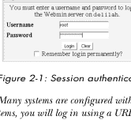

Figure 2-1: Session authentication

**NOTE** 许多系统都配置为以 SSL 加密模式运行 Webmin。在这些系统上，你将使用以 `https://` 而不是 `http://` 开头的 URL 进行登录。此外，至少有一个包含 Webmin 的 Linux 发行版，即 Caldera，将其安装在 1000 端口而不是 10000 端口。从理论上讲这是一种更安全的安排，不过请注意，如果 Webmin 运行在 1024 以下的端口，一些防火墙会阻止你从本地网络之外访问你的 Webmin 启用服务器。

## Logging In with Lynx


有时，可能需要或必须在没有 GUI 的情况下从命令行管理你的系统。幸运的是，在这些情况下也不必完全放弃 Webmin。使用 `Lynx` 或其他功能相似的文本模式网页浏览器，你可以登录并使用大多数 Webmin 模块，其使用方式与使用图形浏览器大致相同。当 Webmin 使用会话认证时，登录方式与使用图形浏览器登录时完全相同，但当 Webmin 配置为使用传统的 HTTP 认证时，登录方式略有不同。`Lynx` 要求在启动时在命令行中包含认证信息：

```
[joe@delilah joe]$ lynx -auth root:passwd http://delilah:10000
```

**CAUTION** 如果你计划通过文本模式浏览器管理你的系统，你会希望选择除新的默认 `MSC.Linux` 主题之外的其他主题。旧的默认主题或 `Swell Technology` 主题具有更简单的图标和表格布局，使 `Lynx` 和其他文本模式浏览器能够更有效地显示它们。`MSC.Linux` 主题在 GUI 浏览器中虽然美观，但使用复杂的布局，导致 Webmin 的许多区域在文本模式浏览器中难以阅读且无法使用。

使用命令行客户端的另一个限制是，并非所有版本的 `Lynx` 和其他文本模式浏览器都很好地支持 SSL。这意味着你可能需要以无加密方式运行 Webmin 服务器；因此，应采取更极端的措施来确保服务器的安全。Webmin 安装的安全性将在后面的章节中详细讨论。

## A First Look

Webmin 被划分为多个模块，每个模块允许你管理系统的某一方面。模块存在于大多数常见以及许多不常见的系统管理任务中。标准模块为以下内容提供图形界面：`Apache`、`Squid`、`Bind`、`NFS`、`man pages`、`Sendmail`、`Postfix`、`Samba`，以及更多。还存在大量第三方模块，提供更广泛的功能。本书侧重于标准模块，但随着时间的推移可能会扩展到涵盖其他模块。

首次登录时，你会看到一行标签和许多图标（Figure 2-2）。标签标有 Webmin、System、Servers、Hardware、Cluster 和 Others。你可能还会根据你的操作系统和版本拥有一个或两个额外的标签。首次登录时选中的标签始终是 Webmin。此类别是所有 Webmin 相关配置细节所在的位置。

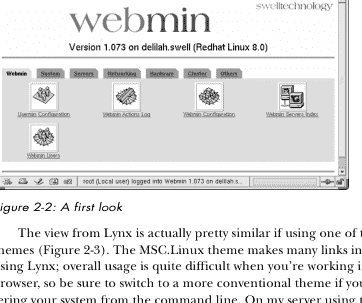

Figure 2-2: A first look

使用 `Lynx` 的视图实际上非常相似，如果使用的是传统主题的话（Figure 2-3）。`MSC.Linux` 主题在使用 `Lynx` 时使许多链接无法访问；总体使用起来相当困难，当你在文本模式浏览器中工作时，因此请务必切换到更常规的主题，如果你将从命令行管理你的系统。在我使用 `Swell Technology` 主题的服务器上，Webmin 完全可以通过文本控制台使用，即使没有浏览器可用时也能使用 Webmin。`MSC.Linux` 主题在通过广域网链接使用图形浏览器管理服务器时也可能相当笨重。这是因为图像的数量和大小使得即使通过快速连接浏览页面也相当缓慢。

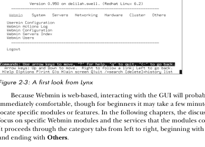

Figure 2-3: A first look from Lynx

由于 Webmin 基于网页，与 GUI 的交互可能立即感到舒适，不过对于初学者来说，可能需要几分钟时间来定位特定的模块或功能。在接下来的章节中，讨论将集中于特定的 Webmin 模块以及模块配置的服务。它按类别标签从左到右进行，从 Webmin 开始，到 Others 结束。

## WEBMIN CONFIGURATION


Webmin 提供了许多可配置的选项和访问控制功能，以及灵活的操作日志记录，为你提供 Webmin 服务器和各种 Webmin 系统管理模块的最大灵活性和安全性。

这些功能可通过 Webmin 索引页上的 Webmin 标签访问。当你显示 Webmin 标签时，你会看到 `Usermin Configuration`、`Webmin Actions Log`、`Webmin Configuration`、`Webmin Servers Index` 和 `Webmin Users` 的图标。请记住，Webmin 标签下的模块是用于配置 Webmin 本身，而不是底层系统。

因此，例如，在 `Webmin Users` 模块中创建用户不会创建系统用户，只会创建 Webmin 用户。同样，`Webmin Actions Log` 模块允许你搜索和查看 Webmin 日志，而不是可能存在的任何系统或服务日志。我们稍后会讨论这些类型的选项。目前，我们将跳过 `Usermin Configuration`，因为 `Usermin` 在下一章中会得到全面介绍。

### Webmin Actions Log

`Webmin Actions Log` 页面提供对 Webmin 日志的访问。你可以为每个模块和单个用户配置此日志。此模块不配置日志，但为你提供了一种手段来搜索特定登录用户执行的操作或在给定登录模块中执行的操作的日志。Webmin 日志记录功能配置在 `Webmin Configuration` 部分中介绍。

使用此模块可以按特定用户、特定模块、给定日期范围或这些条件的任意组合进行搜索。例如，如果你管理着多名初级系统管理员，并且想知道其中一人是否在一周内编辑过 Apache 虚拟服务器配置，此模块使这类问题易于回答（当然，前提是已启用到该程度的日志记录）。

### Webmin Configuration

`Webmin Configuration` 模块（Figure 3-1）允许你配置 Webmin 本身的大多数重要方面，以及安装新模块、升级现有模块和升级 Webmin 本身。它还提供了一种更改 Webmin `miniserv.pl` 网页服务器监听的端口和地址、选择不同语言、启用或禁用 SSL 加密以及配置 Webmin 内置日志记录功能的方法。

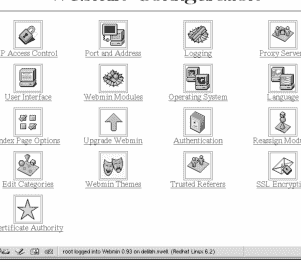

Figure 3-1: Webmin Configuration

### IP Access Control

Webmin 有自己的网页服务器，称为 `miniserv.pl`，它提供了一个简单的 IP 访问控制功能。此页面允许你配置此选项。你可以输入 IP 网络（例如 `192.168.1.0`）、IP 主机地址（例如 `192.168.1.79`）和主机名（例如 `joesbox.penguinfeet.org`）。明智的做法是将对 Webmin 服务器的访问限制为仅受信任的地址。虽然 Webmin 在版本大于 `0.970` 时没有已知的漏洞，但如果有人获得了你的密码，这将提供防止未经授权访问的额外保护级别。此选项配置 `miniserv.conf` 文件中的 `accept` 和 `deny` 指令。默认情况下，允许任何地址访问 Webmin。

> **CAUTION** *请注意，Webmin 内的 IP 访问控制是一种应用级安全功能。换句话说，如果在 Webmin `miniserv.pl` 网页服务器中发现可利用的问题，即使未提供身份验证页面，它仍然可以从不允许使用 Webmin 的 IP 访问。因此，即使用户未被提供登录页面，理论上仍有可能攻击网页服务器。然而，这是一个相当不可能的场景，需要 `miniserv.pl` 中的一个漏洞，即使在未提供身份验证页面时也会暴露。*

### Port and Address

Webmin 服务器默认情况下会监听系统上的每个活动 IP 地址。但如果你有多个地址并且希望 Webmin 仅监听其中一个，你可以使用此选项。因此，例如，如果你有一个网络接口直接连接到本地网络，另一个网络接口连接到互联网，你可以通过使 Webmin 仅监听本地网络来提高安全性。在这种情况下，来自整个互联网的任何请求都会被忽略，但仍可以从本地计算机连接。这可以是非常有效的一道防线。毕竟，如果坏人甚至无法与 Webmin 服务器通信，他们当然无法尝试任何花招入侵它。

`Listen on Port` 选项指定 Webmin 将监听的网络端口。在标准 Webmin 安装中，这将是端口 `10000`，尽管 Caldera 将其安装在端口 `1000` 上。一些防火墙可能会限制对 `1024` 以下端口的访问，一些也可能限制 `1024` 以上端口的访问。如果你的网络有严格的代理限制，阻止在端口 `10000` 上连接，你可能希望尝试端口 `553` 或 `443`（假设这些端口在你的 Webmin 服务器上未被正常 SSL 服务占用）。这些端口几乎总能通过代理使用，即使使用 SSL 启用的 Webmin。


> **NOTE** *在代理环境中，你的客户端浏览器必须使用 `CONNECT` 方法通过代理设备构建隧道。由于滥用 `CONNECT` 请求的潜在风险，大多数代理仅在少数端口上允许此方法。`SSL` 网页连接的标准端口是 `443`，因此它是最有可能可用于 `CONNECT` 请求的端口。如果你的代理运行 `Squid` 并且你拥有管理员权限，你可能希望将 `Webmin` 的默认端口添加到允许的 `SSL` 端口中，如本书记载在 `Squid` 章节中。*

如安装章节中简要提到的，除了使用 `Webmin Configuration` 模块进行图形配置外，还可以在 `miniserv.conf` 配置文件中更改这些配置设置。这可能是

如果防火墙阻止你访问 `10000` 端口，而你只能通过控制台或 `SSH` 访问该机器，则这是必要的。在这种情况下，编辑端口选项会更改端口，而 `bind` 指令则配置 `Webmin` 监听的地址。每次编辑 `miniserv.conf` 文件时，都必须重新启动 `Webmin` 才能使更改生效。

## 日志

如前所述，`Webmin` 提供了非常灵活的日志功能。借助这些功能，你可以非常轻松地监控具有管理员权限的用户在服务器上执行的操作。也可以根据操作执行的模块来记录操作。**记录解析的主机名** 选项将导致 `Webmin` 为执行操作的客户端计算机提供主机名，而不仅仅是 `IP` 地址。而 **每...小时清除日志文件** 会导致 `Webmin` 轮换其自身的日志，防止旧日志填满磁盘。如果出于安全审计目的需要长期日志，则明智的做法是将 `Webmin` 日志纳入常规系统备份轮换中。

关于记录什么、记录谁的操作以及保存这些日志多久的决策，应根据你的情况仔细考虑。在某些情况下，日志是不必要的，而在其他情况下，它可能由公司政策要求或有助于满足你的环境的安全需求。如果启用了日志记录，应注意确保 `Webmin` 在 `Webmin` 日志目录中拥有足够的磁盘空间，因为某些选项可能导致日志非常详细（例如 **记录每个操作对文件所做的更改**）。请记住，`Webmin` 操作日志记录与系统其他部分的日志功能无关。`Syslog` 在 **System:System Logs** 模块中单独配置，而特定于应用程序的日志记录通常在应用程序模块内配置。

## 代理服务器

`Webmin` 提供了必须连接到 Internet 才能正常运行的多个工具。其中包括 **Webmin Update** 功能、**Software Packages** 模块等。如果你的本地网络使用代理访问 Internet 上的 Web 或 `FTP` 站点，则可以在此处配置这些设置。如果你的代理需要身份验证，`Webmin` 用于登录的用户名也可以在此页面上的 **Username for proxy** 和 **Password for proxy** 字段中进行配置。

## 用户界面

`Webmin` 用户界面可以通过多种方式进行配置。在此模块中，你可以配置 `Webmin` 页面的颜色。颜色应采用标准的十六进制三元组，如 Internet 上 `HTML` 标记中所使用。你还可以选择使用浏览器的标准字体来显示页面标题，而不是你使用的主题提供的字体。最后，你可以配置 `Webmin` 在页面上显示服务器登录名和主机名的位置。此页面不配置 `Webmin` 主题，`Webmin` 主题在单独的页面上配置，并且在此处可以进行的更改与使用主题时的可能性相比是微不足道的。还要注意的是，如果使用除旧标准 `Webmin` 主题之外的主题，这些更改可能不会生效。例如，新的 `MSC.Linux` 主题会用其自己的标准值覆盖所有这些选项。

## Webmin 模块

如前所述，`Webmin` 最好的地方之一是它完全模块化。每个服务器守护进程、每个系统功能、每个 `Webmin` 功能，都有自己的模块，该模块连接到核心 `Webmin` 库并响应 `Webmin` `miniserv.pl` `Web` 服务器。由于 `Webmin` 提供的复杂但仍然易于理解的模块化框架，编写功能齐全且能无缝集成到 `Webmin` 和你的操作系统中的模块变得非常容易。

## 安装模块

从此页面，你可以从本地文件、上传的文件或从 `FTP` 站点或网站下载的文件安装新模块。`Webmin` 模块包只是包含模块完整目录结构的 `tar` 归档文件。这些模块以 `.wbm` 后缀结尾

> 注意 一个获取额外 `Webmin` 模块的绝佳资源是 `Richard Teachout` 运营的 `Third Party Modules for Webmin` [http://www.thirdpartymodules.com/webmin] 页面。`Richard` 是 `Webmin` 的长期粉丝和支持者，也是 `Webmin` 讨论列表的常客。在列表上花费了一些时间后，他意识到需要一个全面的模块资源库。在撰写本文时，他的网站上列出了 200 多个模块，不过应该提到该网站也列出了标准 `Webmin` 发行版中包含的模块。如果你编写了 `Webmin` 模块，你应该将其发布到该网站，以便其他人能够轻松找到并受益于你的工作。这也是一个找到示例代码以帮助你编写自己的模块的好地方（当然除了标准模块之外！）。然而，要注意，与任何自由软件集合一样，模块的质量差异很大。有些非常出色，与任何最好的标准 `Webmin` 模块不相上下，而另一些则处于如此早期的开发阶段，以至于毫无用处。

## 克隆模块

克隆模块功能为必须为同一台机器上相同软件的多个实例提供有限管理访问权限的管理员提供了令人印象深刻的灵活性。例如，如果你的系统上运行着两个不同的 `Apache` 配置，你可以克隆 `Apache` 模块以允许不同用户访问不同的 `Apache` 配置。

> **警告** *虽然此功能确实允许多个用户配置类似服务的有趣且强大的选项，但 `Webmin` 尚不应被视为管理虚拟托管服务器的理想工具，在该服务器上许多用户配置 `Apache` 虚拟服务器、`Sendmail` 别名和 `DNS` 条目。目前正在进行许多商业和开源工作，以在 `Webmin` 框架内提供此类服务。在撰写本文时，没有一个准备好投入生产，但鉴于追求这一目标的人数众多，很可能这样的工具为期不远。*

要克隆模块，请从下拉菜单中选择要克隆的模块，然后输入模块的新名称。为了避免新模块干扰原始模块，你需要仔细考虑被克隆模块管理的服务。通常，你需要为正在配置的服务设置一个完全独立的安装。因此，例如，如果你克隆了 `Squid` 以便运行两个不同的 `Squid` 进程，你*必须*将它们配置为使用单独的配置文件、缓存目录、日志文件和进程 `ID`。如果不采取此预防措施，一个或两个进程的行为将不正常或完全无法工作。

## 示例：克隆 Squid 模块

为了进一步举例说明，让我们克隆 `Squid` 模块并配置两个 `Squid` 进程在同一台服务器上运行而不相互干扰。首先，从命令行或 `Webmin` 文件管理器将 `squid.conf` 配置文件复制到名为 `squid2.conf` 的文件

```
[root@delilah /]# cp /etc/squid/squid.conf /etc/squid/squid2.conf
```

接下来，创建 `Squid` 模块的模块克隆（从此以后称为 `Squid2`）。浏览到新创建的克隆模块，并通过单击 `Squid2` 索引页面左上角的 `Module Config` 链接来编辑模块配置。在这里，你应该将 `Squid` 配置文件的完整路径更改为指向新创建的配置文件。你还需要将启动 `squid` 的命令和停止 `squid` 的命令更改为指向另一个文件名；我们称之为 `/etc/rc.d/init.d/squid2`。我们必须在尝试启动新的 `Squid` 进程之前实际创建这些文件。

我们还需要将 `PID` 文件的完整路径更改为指向 `squid2.pid` 而不是 `squid.pid`，并更改日志目录名称。我通常对克隆的 `Squid` 进程使用 `/var/log/squid2`。这就是目前在模块配置中需要做的全部。单击 `Save` 保存更改并返回到 `Squid2` 索引页面。

现在我们已经告诉 `Webmin` 要编辑的文件，我们实际上可以编辑它以配置 `Squid` 独立于 `Squid` 运行。首先我们需要将 `Squid2` 配置为使用与 `Squid` 不同的端口或 `IP` 运行，因为没有两个进程可以监听相同的 `IP`-端口组合。`8080` 是一个很好的二级缓存端口。此选项在 `Squid2:Ports and Networking` 中配置。接下来将缓存目录更改为与 `Squid` 缓存目录不同的目录，因为它们不能共享。对 `access.log` 也必须这样做，

`cache.log` 和 `store.log`。如前所述，我通常将 `Squid2` 日志放在 `/var/log/squid2` 中，因此该目录必须由 `Squid` 运行时的相同用户和组名拥有（在 `Red Hat Linux` 上为 `squid:squid`）。

最后，将你的 `Squid` 启动脚本复制到新位置并修改它，使其使用新的配置文件调用 `Squid` 并检查新的 `PID` 文件。例如，在我的 `Red Hat` 系统上，我会将 `/etc/rc.d/init.d/squid` 复制到 `/etc/rc.d/init.d/squid2`。你现在可以在 `Webmin` 中配置访问控制，以允许为每个 `Squid` 进程设置不同的管理员，或进一步修改 `Squid2` 配置以提供与主 `Squid` 进程不同的功能。

## Delete Modules


在本节中，你可以选择要从 Webmin 安装中删除的任何模块。请注意，使用此表单将完全从系统中删除所选模块。如果你以后决定使用已删除的模块，你将不得不再次下载该模块并重新安装。通常，更好的做法是简单地将该模块从每个用户的访问列表中移除（甚至可能包括 root），而不是在此处删除模块。但是，如果磁盘空间是一个问题，你可以使用此功能从系统中删除所有不需要的模块。

## Operating System

Webmin 根据为每个模块选择的配置文件的操作系统配置来与你的系统交互。如果你的系统预装了 Webmin，通常你无需担心此问题。但如果你升级系统，并且新版本将某些配置文件移动到新位置，则可能需要更新此设置。在此页面上，你还可以设置程序（如系统命令）和库（如密码加密库）的搜索路径。再次强调，这些选项很少需要更改，除非你在系统上将系统工具和配置文件安装在不寻常的位置。

> NOTE 在 Webmin 的当前版本中，至少到 1.020 版本为止，更改操作系统不会更改现有模块的配置文件，而只适用于新安装的模块。未来的版本可能会更改此行为，仅在用户未更改的情况下修改已安装的模块配置。

## Language

Webmin 支持大量用于标题和模块文本的语言。此页面允许你选择 Webmin 的语言。新的语言正在定期添加。鼓励未受支持语言的用户编写翻译并将其发送给 Webmin 的作者。他总是乐于收到新的翻译，用户也总是很高兴发现他们的母语是发行版中提供的语言之一。

## Index Page Options

此页面允许你配置 Webmin 索引页面的布局。你可以使用“Number of Columns”字段选择每行显示的图标数量。“Categorize modules?” 选择模块是否将根据其执行的功能类型分组在类别选项卡下。“Default category”是首次登录 Webmin 时将显示的类别。可通过选择“Use alternative header”选项使用替代标题，这会提供略有不同的外观，将主机信息放在显示的上方右侧，而不是 Webmin 标题下方。最后，选择“Go direct to module if user only has one?” 将导致用户仅看到他们有权访问的模块，而不是登录时显示的 Webmin 索引页面。

## Upgrade Webmin

使用此页面，你可以从 Webmin 主页或本地或上传的文件自动将 Webmin 升级到最新版本。如果你的系统上可用，此模块将使用包管理系统执行更新。例如，如果你拥有 Caldera、Red Hat 或 Mandrake 等基于 RPM 的系统，此功能将从 RPM 包升级（它甚至知道如何在 Webmin 主页上为你的系统找到正确的包类型！）。

## Authentication

Webmin 提供了一些防止服务器遭受暴力密码破解攻击的优秀功能，以及防止“健忘用户”的保护。如果你的 Webmin 服务器可广泛访问并为许多用户提供服务，明智的做法是使用这些功能来最大化系统的安全性。公司安全策略甚至可能要求使用这些功能中的一些或全部。

密码超时提供了一种通过限制特定用户的登录尝试频率来防止暴力密码攻击的方法。如果启用，Webmin 将阻止在给定次数登录失败后的主机。阻止主机的时长以秒为单位可配置。Webmin 将在同一主机继续失败登录尝试时延长延迟。也可以启用阻止登录的日志记录。

下一个选项，Log blocked hosts, logins and authentication failures to syslog 将 Webmin 配置为将身份验证失败和尝试登录的被阻止地址记录到 syslog。这些日志通常会出现在系统日志目录中的 secure 或 auth 文件中。

会话身份验证提供了一种在指定非活动时间后注销用户的方法。这可以帮助防止未经授权的用户仅通过使用有权访问的人员的计算机来访问服务器。这并非万无一失，因为许多浏览器现在具有密码管理功能，并且授权用户可能会将密码存储在本地计算机上，使其可供任何有权访问计算机的人使用。如果安全是一个问题，你应强烈建议用户不要在本地机器上保存服务器的登录信息，以及在离开办公桌或办公室时不要留下打开的浏览器会话。

最后，你可以选择允许在 Webmin 运行的同一台机器上的用户基于用户名登录。此功能仅应在单用户机器上使用，且安全性不是主要问题时使用。如果启用，任何有权访问本地机器的人都很容易获得对系统的 root 访问权限。

> **CAUTION** *正如任何完整的系统管理工具必须做的那样，Webmin Web 服务器以 root 权限运行。对于任何公开可访问的 Webmin 启用系统，安全始终应是首要任务。薄弱的安全策略，或根本没有安全策略，都是灾难的邀请。全面的安全策略将包括良好的防火墙、入侵检测系统、对操作系统供应商的软件更新和勘误的警惕，以及也许最重要的是对网络用户和管理员的教育。*

## Reassign Modules

如前所述，Webmin 默认根据模块执行的功能对模块进行分类。此页面提供了一种简单的方法，如果你发现默认分类令人困惑，可以将模块移动到新类别。一些在 Webmin 添加分类功能之前编写的第三方模块，默认被错误分类到 Others 类别，因此你可能希望使用此模块手动将它们移动到更合理的

`cache.log` 和 `store.log`。如前所述，我通常将 Squid2 日志放在 `/var/log/squid2` 中，因此该目录必须由 Squid 运行时的相同用户和组名拥有（在 Red Hat Linux 上为 `squid:squid`）。

最后，将你的 Squid 启动脚本复制到新位置并修改它，使其使用新的配置文件调用 Squid 并检查新的 PID 文件。例如，在我的 Red Hat 系统上，我会将 `/etc/rc.d/init.d/squid` 复制到 `/etc/rc.d/init.d/squid2`。你现在可以在 Webmin 中配置访问控制，以允许为每个 Squid 进程设置不同的管理员，或进一步修改 Squid2 配置以提供与主 Squid 进程不同的功能。

## Delete Modules

在本节中，你可以选择要从 Webmin 安装中删除的任何模块。请注意，使用此表单将完全从系统中删除所选模块。如果你以后决定使用已删除的模块，你将不得不再次下载该模块并重新安装。通常，更好的做法是简单地将该模块从每个用户的访问列表中移除（甚至可能包括 root），而不是在此处删除模块。但是，如果磁盘空间是一个问题，你可以使用此功能从系统中删除所有不需要的模块。

## Operating System

Webmin 根据为每个模块选择的配置文件的操作系统配置来与你的系统交互。如果你的系统预装了 Webmin，通常你无需担心此问题。但如果你升级系统，并且新版本将某些配置文件移动到新位置，则可能需要更新此设置。在此页面上，你还可以设置程序（如系统命令）和库（如密码加密库）的搜索路径。再次强调，这些选项很少需要更改，除非你在系统上将系统工具和配置文件安装在不寻常的位置。

> NOTE 在 Webmin 的当前版本中，至少到 1.020 版本为止，更改操作系统不会更改现有模块的配置文件，而只适用于新安装的模块。未来的版本可能会更改此行为，仅在用户未更改的情况下修改已安装的模块配置。

## Language

Webmin 支持大量用于标题和模块文本的语言。此页面允许你选择 Webmin 的语言。新的语言正在定期添加。鼓励未受支持语言的用户编写翻译并将其发送给 Webmin 的作者。他总是乐于收到新的翻译，用户也总是很高兴发现他们的母语是发行版中提供的语言之一。

## Index Page Options

此页面允许你配置 Webmin 索引页面的布局。你可以使用“Number of Columns”字段选择每行显示的图标数量。“Categorize modules?” 选择模块是否将根据其执行的功能类型分组在类别选项卡下。“Default category”是首次登录 Webmin 时将显示的类别。可通过选择“Use alternative header”选项使用替代标题，这会提供略有不同的外观，将主机信息放在显示的上方右侧，而不是 Webmin 标题下方。最后，选择“Go direct to module if user only has one?” 将导致用户仅看到他们有权访问的模块，而不是登录时显示的 Webmin 索引页面。

## Upgrade Webmin

使用此页面，你可以从 Webmin 主页或本地或上传的文件自动将 Webmin 升级到最新版本。如果你的系统上可用，此模块将使用包管理系统执行更新。例如，如果你拥有 Caldera、Red Hat 或 Mandrake 等基于 RPM 的系统，此功能将从 RPM 包升级（它甚至知道如何在 Webmin 主页上为你的系统找到正确的包类型！）。

## Authentication

Webmin 提供了一些防止服务器遭受暴力密码破解攻击的优秀功能，以及防止“健忘用户”的保护。如果你的 Webmin 服务器可广泛访问并为许多用户提供服务，明智的做法是使用这些功能来最大化系统的安全性。公司安全策略甚至可能要求使用这些功能中的一些或全部。


密码超时提供了一种通过限制特定用户的登录尝试频率来防止暴力密码攻击的方法。如果启用，Webmin 将阻止在给定次数登录失败后的主机。阻止主机的时长以秒为单位可配置。Webmin 将在同一主机继续失败登录尝试时延长延迟。也可以启用阻止登录的日志记录。

下一个选项，`Log blocked hosts, logins and authentication failures to syslog` 将 Webmin 配置为将身份验证失败和尝试登录的被阻止地址记录到 syslog。这些日志通常会出现在系统日志目录中的 secure 或 auth 文件中。

会话身份验证提供了一种在指定非活动时间后注销用户的方法。这可以帮助防止未经授权的用户仅通过使用有权访问的人员的计算机来访问服务器。这并非万无一失，因为许多浏览器现在具有密码管理功能，并且授权用户可能会将密码存储在本地计算机上，使其可供任何有权访问计算机的人使用。如果安全是一个问题，你应强烈建议用户不要在本地机器上保存服务器的登录信息，以及在离开办公桌或办公室时不要留下打开的浏览器会话。

最后，你可以选择允许在 Webmin 运行的同一台机器上的用户基于用户名登录。此功能仅应在单用户机器上使用，且安全性不是主要问题时使用。如果启用，任何有权访问本地机器的人都很容易获得对系统的 root 访问权限。

> `CAUTION` 正如任何完整的系统管理工具必须做的那样，Webmin Web 服务器以 root 权限运行。对于任何公开可访问的 Webmin 启用系统，安全始终应是首要任务。薄弱的安全策略，或根本没有安全策略，都是灾难的邀请。全面的安全策略将包括良好的防火墙、入侵检测系统、对操作系统供应商的软件更新和勘误的警惕，以及也许最重要的是对网络用户和管理员的教育。

## Reassign Modules

如前所述，Webmin 默认根据模块执行的功能对模块进行分类。此页面提供了一种简单的方法，如果你发现默认分类令人困惑，可以将模块移动到新类别。一些在 Webmin 添加分类功能之前编写的第三方模块，默认被错误分类到 Others 类别，因此你可能希望使用此模块手动将它们移动到更合理的

`cache.log` 和 `store.log`。如前所述，我通常将 Squid2 日志放在 `/var/log/squid2` 中，因此该目录必须由 Squid 运行时的相同用户和组名拥有（在 Red Hat Linux 上为 `squid:squid`）。

最后，将你的 Squid 启动脚本复制到新位置并修改它，使其使用新的配置文件调用 Squid 并检查新的 PID 文件。例如，在我的 Red Hat 系统上，我会将 `/etc/rc.d/init.d/squid` 复制到 `/etc/rc.d/init.d/squid2`。你现在可以在 Webmin 中配置访问控制，以允许为每个 Squid 进程设置不同的管理员，或进一步修改 Squid2 配置以提供与主 Squid 进程不同的功能。

## Delete Modules

在本节中，你可以选择要从 Webmin 安装中删除的任何模块。请注意，使用此表单将完全从系统中删除所选模块。如果你以后决定使用已删除的模块，你将不得不再次下载该模块并重新安装。通常，更好的做法是简单地将该模块从每个用户的访问列表中移除（甚至可能包括 root），而不是在此处删除模块。但是，如果磁盘空间是一个问题，你可以使用此功能从系统中删除所有不需要的模块。

## Operating System

Webmin 根据为每个模块选择的配置文件的操作系统配置来与你的系统交互。如果你的系统预装了 Webmin，通常你无需担心此问题。但如果你升级系统，并且新版本将某些配置文件移动到新位置，则可能需要更新此设置。在此页面上，你还可以设置程序（如系统命令）和库（如密码加密库）的搜索路径。再次强调，这些选项很少需要更改，除非你在系统上将系统工具和配置文件安装在不寻常的位置。

> NOTE 在 Webmin 的当前版本中，至少到 1.020 版本为止，更改操作系统不会更改现有模块的配置文件，而只适用于新安装的模块。未来的版本可能会更改此行为，仅在用户未更改的情况下修改已安装的模块配置。

## Language

Webmin 支持大量用于标题和模块文本的语言。此页面允许你选择 Webmin 的语言。新的语言正在定期添加。鼓励未受支持语言的用户编写翻译并将其发送给 Webmin 的作者。他总是乐于收到新的翻译，用户也总是很高兴发现他们的母语是发行版中提供的语言之一。

## Index Page Options

此页面允许你配置 Webmin 索引页面的布局。你可以使用“Number of Columns”字段选择每行显示的图标数量。“Categorize modules?” 选择模块是否将根据其执行的功能类型分组在类别选项卡下。“Default category”是首次登录 Webmin 时将显示的类别。可通过选择“Use alternative header”选项使用替代标题，这会提供略有不同的外观，将主机信息放在显示的上方右侧，而不是 Webmin 标题下方。最后，选择“Go direct to module if user only has one?” 将导致用户仅看到他们有权访问的模块，而不是登录时显示的 Webmin 索引页面。

## Upgrade Webmin

使用此页面，你可以从 Webmin 主页或本地或上传的文件自动将 Webmin 升级到最新版本。如果你的系统上可用，此模块将使用包管理系统执行更新。例如，如果你拥有 Caldera、Red Hat 或 Mandrake 等基于 RPM 的系统，此功能将从 RPM 包升级（它甚至知道如何在 Webmin 主页上为你的系统找到正确的包类型！）。

## Authentication

Webmin 提供了一些防止服务器遭受暴力密码破解攻击的优秀功能，以及防止“健忘用户”的保护。如果你的 Webmin 服务器可广泛访问并为许多用户提供服务，明智的做法是使用这些功能来最大化系统的安全性。公司安全策略甚至可能要求使用这些功能中的一些或全部。

密码超时提供了一种通过限制特定用户的登录尝试频率来防止暴力密码攻击的方法。如果启用，Webmin 将阻止在给定次数登录失败后的主机。阻止主机的时长以秒为单位可配置。Webmin 将在同一主机继续失败登录尝试时延长延迟。也可以启用阻止登录的日志记录。

下一个选项，`Log blocked hosts, logins and authentication failures to syslog` 将 Webmin 配置为将身份验证失败和尝试登录的被阻止地址记录到 syslog。这些日志通常会出现在系统日志目录中的 secure 或 auth 文件中。

会话身份验证提供了一种在指定非活动时间后注销用户的方法。这可以帮助防止未经授权的用户仅通过使用有权访问的人员的计算机来访问服务器。这并非万无一失，因为许多浏览器现在具有密码管理功能，并且授权用户可能会将密码存储在本地计算机上，使其可供任何有权访问计算机的人使用。如果安全是一个问题，你应强烈建议用户不要在本地机器上保存服务器的登录信息，以及在离开办公桌或办公室时不要留下打开的浏览器会话。

最后，你可以选择允许在 Webmin 运行的同一台机器上的用户基于用户名登录。此功能仅应在单用户机器上使用，且安全性不是主要问题时使用。如果启用，任何有权访问本地机器的人都很容易获得对系统的 root 访问权限。

> `CAUTION` 正如任何完整的系统管理工具必须做的那样，Webmin Web 服务器以 root 权限运行。对于任何公开可访问的 Webmin 启用系统，安全始终应是首要任务。薄弱的安全策略，或根本没有安全策略，都是灾难的邀请。全面的安全策略将包括良好的防火墙、入侵检测系统、对操作系统供应商的软件更新和勘误的警惕，以及也许最重要的是对网络用户和管理员的教育。

## Reassign Modules

如前所述，Webmin 默认根据模块执行的功能对模块进行分类。此页面提供了一种简单的方法，如果你发现默认分类令人困惑，可以将模块移动到新类别。一些在 Webmin 添加分类功能之前编写的第三方模块，默认被错误分类到 Others 类别，因此你可能希望使用此模块手动将它们移动到更合理的

切换已安装的主题只需选择首选主题，然后点击 `Change` 按钮即可。安装新主题需要您选择文件的位置（Webmin 主题的后缀为 `.wbt`），然后点击 `Install Theme`。更改主题后需要强制刷新浏览器显示，以便显示所有新的图标和标题图像，因为浏览器经常缓存图像和页面。要在 Netscape、Mozilla 及相关浏览器中强制刷新，请按住 SHIFT 键，同时点击 Refresh 按钮。同样，在 Internet Explorer 中，按住 CTRL 键同时点击 Refresh 按钮。主题可以在 Webmin 和 Usermin 中为整个系统或单个用户选择。

## Trusted Referers


由于 Webmin 基于 Web，因此可通过浏览器访问。浏览器通常会存储身份验证信息，并在 Webmin 服务器要求时自动重新发送。由于此原因，远程网站可能会触发您 Webmin 服务器上的危险操作（假设网站所有者有恶意意图——不会意外发生！）。此页面允许您配置哪些主机可以引用您 Webmin 服务器上的操作。

## Anonymous Module Access

在某些情况下，让一个或多个 Webmin 模块可供任何用户访问，而无需身份验证可能是有用的。例如，可能允许用户查看有关服务器的只读统计信息，或允许用户使用自定义命令挂载或卸载设备，或类似操作。使用 Webmin 的此功能时应格外谨慎，因为给用户访问错误的模块很容易导致可利用的条件。更明确地说，很少有标准模块足够安全，可以与此功能安全使用。

## SSL Encryption

如果您的系统已安装 OpenSSL 库，以及 Net::SSLeay Perl 模块，您将能够使用 SSL 加密连接连接到您的 Webmin 服务器。这通过允许密码和用户信息以加密形式发送来提高服务器的安全性。如果您将从互联网上访问 Webmin 服务器，强烈建议您使用 SSL 加密会话。现在加密的出口限制已经放宽，RSA 专利也已过期，Linux 和 UNIX 版本随附必要的库和 Perl 模块以开箱即用变得越来越普遍。但如果您在设置此选项时需要一些帮助，Using SSL With Webmin [http://www.webmin.com/webmin/ssl.html] 页面上有很好的教程。

## Certificate Authority

此页面允许您配置此服务器的 SSL 证书。使用此功能，您可以配置系统以允许无需用户名和密码即可登录。如果已配置，客户端可以在 Webmin Users 模块中请求个人证书，从那时起浏览器将通过提供的证书对自身进行身份验证。如果您的用户位于受控且安全的环境中，此功能可以使使用 Webmin 变得更简单。

要创建证书，只需填写授权信息（可以是您想要包含的任何信息，例如 Webmin 服务器管理员的名称），然后点击 **Setup certificate authority**。

**CAUTION** *如果使用此身份验证方法，应让用户意识到其中涉及的潜在安全问题。任何有权访问具有此类证书的机器的人都将能够以该机器主要用户的相同权限访问 Webmin 服务器。这会阻止通常对 Webmin 可行的登录超时，因此在登录的机器可能无人看管的环境中应谨慎使用。*

## Webmin Servers

此页面提供对本地网络上每个 Webmin 服务器的访问（图 3-2）。点击任何图标将引导您的浏览器到所点击服务器的登录页面。点击 **Broadcast for servers** 将导致 Webmin 在本地网络上向端口 10000 发送广播请求。网络上每个 Webmin 服务器都会回复并识别自己。Webmin 然后会将这些服务器添加到服务器列表中。您也可以扫描特定网络以查找服务器，如果您远程管理 Webmin 服务器。只需输入要搜索的子网，然后点击 **Scan for servers**。

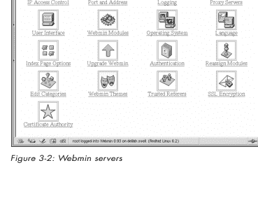

Figure 3-2: Webmin servers

点击服务器图标将简单地将您的浏览器引导到所选服务器上的 Webmin 端口，允许您登录。您也可以配置 Webmin 通过代理连接连接到服务器，如果您为另一台服务器提供用户名和密码。这在远程连接到可路由互联网上的前端 Webmin 服务器时很有用，该服务器还连接到不可路由的私有网络，允许私有网络外的管理员通过隧道进入以管理私有网络内的系统。

Webmin 0.85 之后的版本提供对某些功能通过远程过程调用执行的支持，如果提供了远程服务器的登录信息。这允许单个 Webmin 服务器直接配置或监控其他 Webmin 服务器。目前此功能仅限于 System 和 Server Status 模块以及 Cluster 类别中的一些模块。很可能许多其他模块将在未来扩展以利用此新功能。

## Webmin Users

此页面允许您配置任意数量的用户，并为每个用户指定可维护的系统子集。例如，它允许您创建一个仅有权访问 Sendmail 模块的邮件管理员、只能修改 DNS 记录的 DNS 管理员，以及仅有权编辑 Squid 配置的 Squid 管理员。以这种方式，权限的委派可以非常简单和安全地处理。

## Editing a Webmin User

要编辑 Webmin 用户及其有权访问的模块，请点击 Webmin Users 索引页面上的用户名。每个用户都有一个可访问模块的列表和一些可以配置的附加选项。从 Edit Webmin User 页面，可以更改用户的密码：为其选择用于身份验证的 SSL 证书，修改语言和主题与默认值不同，并指定此用户可以登录的 IP 地址。此页面上还有所有安装在机器上的模块的列表，每个模块旁边都有一个复选框。如果选中，用户将有权访问该模块。

Webmin 还允许对许多模块进行更细粒度的控制，并且此功能在每次发布时变得更加灵活（图 3-3）。例如，拥有使用 Apache 模块权限的用户可以被拒绝编辑配置某些特定方面的能力。在下面的示例中，您可以看到用户只被授予编辑众多可用虚拟服务器中的一个的权限。要编辑细粒度访问控制，请浏览到 Webmin Users 索引页面，然后点击要编辑访问控制的用户的模块名称链接。

## Creating Webmin Users

创建新用户也很简单。点击 Create a new Webmin User 链接并选择用户名或使用系统上现有用户之一（图 3-4）。选择使用用户的 UNIX 密码还是使用新密码。选择用户将有权访问的模块，然后点击 Save。现在您可以编辑用户的细粒度访问控制，或接受默认值。添加或删除用户访问列表中的模块可以通过从 Webmin Users 页面点击用户名，然后以所需方式编辑用户来执行。

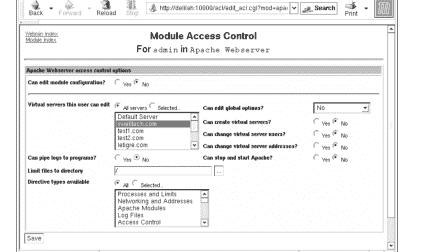

Figure 3-3: Editing user access controls

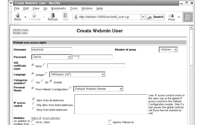

Figure 3-4: Create Webmin user

## Webmin 组

Webmin 与 UNIX 一样，理解组的概念。Webmin 中的组与 UNIX 组类似，因为它们通过允许轻松创建具有相同权限和访问控制的任意数量用户，从而简化了人口众多的服务器的管理。要创建组，请点击“Create a new Webmin group”链接，为其命名，并选择新组成员应有权访问的模块。保存新组后，任何用户都可以被分配到该组，并自动获得该组的模块访问权限，再加上为该用户指定的模块。目前用户只能是其中一个组的成员，因此 Webmin 组功能比大多数现代 UNIX 变体和 Linux 略显不够灵活，在后者中用户可以是主组的一员，同时也是多个补充组的成员。

## 教程：保护 Webmin

由于 Webmin 以 root 用户的权限运行，在允许远程 Internet 访问之前，务必将 Webmin 严格锁定。历史上 Webmin 相当安全，但过去曾发现过漏洞，未来也可能会发现漏洞。任何以 root 身份运行的工具都有可能成为恶意黑客进入机器的入口，从而获得无限访问权限。

因此，为了防止被利用的机器可能带来的所有问题，我们将采取一些步骤来限制风险并最大程度地减少在我们未察觉的情况下可能造成的损害。我们将简要讨论密码策略、应用级网络访问控制、SSL 和防火墙配置。教程将以对可用于帮助维护安全系统的其他技术和技术的概述结束。

## 密码策略

无数来自安全问题双方的研究和轶事（黑客一方和实施系统以抵御黑客的另一方）告诉我们，破解弱密码几乎总是一种可靠的、如果耗时的话，获得非法进入系统的方法。由于许多用户，甚至系统管理员使用弱的、容易猜到的密码，因此决定的黑客在目标系统上运行自动密码搜寻是相当常见的。另一种、也许更令人恐惧的技术是黑客所使用的社会工程。

社会工程是一种与恶意破解一样古老的技术，它利用人性，通过走更容易的路——穿过人类的防线，来克服技术上的进入障碍。一种常见技术是黑客冒充技术支持人员，简单地要求用户提供密码，以便他们“测试”网络上的某样东西或其他东西。这在技术熟练的用户中也令人不安地经常奏效。这种类型的攻击可以通过任何通信媒介进行，包括电话、IRC、电子邮件等，其持续成功依赖于人类渴望助人的欲望。这种技术通常通过使用其他微妙的补充来增强，以进一步降低接电话或电子邮件的人的警惕。黑客可能会提到网络上存在某种“问题”，这触及了人性的另一个基本方面：抱怨网络状态。每个办公室的人在某个时候都会抱怨网络状态，而当“技术人员”打电话来说他要修复它时，这进一步确立了他与受害者的可信度。在用户脑海中，很明显没有外人会知道他最近经历的“网络问题”，所以这个来电者一定是合法的。


在我支持 UNIX 服务器的时间里，我注意到人性的另一个方面有时会被黑客利用。当被要求输入密码时，一些用户在输入字母时会悄悄地在嘴里拼读出来。有经验的打字员不太可能以这种方式说出他们输入的文本，但这可能是社会工程黑客使用的最后手段，简单地要求用户多次输入密码（因为在第二次或第三次时，用户要么兴奋地参与“解决网络问题”而开始跟着自己的文本输入说话或唱歌，要么因被阻止做真正的工作而感到沮丧，开始跟着自己输入的内容嘀咕）。用户应被警告不要养成这种习惯。这听起来可能是一种相当愚蠢的入侵网络的方式，而好莱坞电影总是向我们展示一个独自在充满电脑垃圾的地下室破解的黑客，但最有可能的是，最坚定、最危险的黑客会在尝试更耗时的技术攻击（如暴力密码搜索）之前使用这些技术。如果用户不了解危险，这些技术是有效的。

这只是黑客操作的冰山一角。但它确实开始使人清楚，良好的密码和受过教育的

最好明确说明真正的系统管理员无需密码即可以任何用户身份登录，因此在测试或修复任何问题时永远不需要用户的密码。

> **CAUTION** 其中一些策略选择目前无法通过 Webmin 强制执行。截至 0.970 版本，仅提供密码超时功能。即便如此，鼓励用户使用安全的密码，并且更重要的是，作为管理员，使用良好的密码策略可以在不强制执行的情况下实现相同的目标。很可能 Webmin 在未来的修订版中会以某种形式提供所有这些功能。你的底层操作系统变体也可能支持其中的一些或全部功能，用于系统密码。当策略无法通过技术措施强制执行时，教育用户了解这些问题变得更加重要。

## Setting Authentication Policy

如上所述，经过仔细考虑的密码策略对于抵御破解者非常有帮助。Webmin 提供了简单的方法来强制执行 Webmin 用户的某些密码策略方面，位于 `Webmin:Webmin Configuration:Authentication` 模块中。在这里你可以选择启用密码超时并自动阻止似乎正在对 Webmin 服务器进行暴力攻击的主机。

此外，启用登录失败尝试的日志记录是一个绝佳的主意，前提是有人会偶尔阅读这些日志。可以使用 `logwatch` 等工具自动通过电子邮件通知某些类型的日志数据。虽然 `logwatch` 目前无法在 Webmin 中配置，但花时间阅读有关此实用程序或由你的操作系统供应商提供的任何类似工具的资料并加以使用，以帮助减轻管理系统的负担是值得的。要启用身份验证失败的日志记录，请浏览到 `Webmin:Webmin Configuration:Authentication` 模块并选择 `Log blocked hosts, logins and authentication failures to syslog Disable session authentication`。然后你可以配置使用的任何日志分析工具来标记这些身份验证失败，以便人工管理员可以监视破解活动迹象。

> **NOTE** `logwatch` 实用程序是开源软件，可从 [`http://www.logwatch.org/`] 获取。该程序由 Kirk Bauer 维护，并包含在许多 Linux 发行版中。其他操作系统变体通常提供类似的功能。

## Setting Network Access Controls

如本章前面所述，Webmin 提供了一些机制来为你的 Webmin 安装提供网络级安全性。利用其中一些或全部功能可以在不增加部署复杂性的情况下极大地提高安全性。这些功能的主要目的是允许 Webmin 拒绝与不允许登录的地址进行通信。

首先，查看你的网络拓扑图，或如果你的网络规模不足以绘制完整图表，则写下你的本地网络信息。然后写下必须能够访问你的 Webmin 服务器的每个用户的网络信息。如果有拨号或其他远程用户需要从动态分配的 IP 地址登录，这可能会变得相当复杂，但在这种情况下也可能找到可行的折中方案。

## Setting the Listen Address and Port

第一步是决定是否可以将访问限制到服务器上的特定网络接口。如果你的 Webmin 服务器具有不可路由的本地地址和可路由的 Internet 地址，你应该决定是否有人需要能够从本地网络外部访问 Webmin 服务器。如果不需要，只需将 Webmin 配置为监听本地接口即可。这可以使用 `Webmin:Webmin Configuration:Port and Address` 模块进行配置，选择 `Listen on IP Address` 选项旁边的单选按钮，并在 Entry 字段中输入你的内部 IP。

在继续其他项目之前，考虑将 Webmin 移动到另一个端口可能是值得的。Webmin 运行在端口 `10000` 上会导致一种额外的可能利用类型，这种利用对破解者来说利用起来困难，但对于本地用户来说可能并非不可能。因为端口 `10000` 是一个非特权端口，任何在服务器上具有登录权限的用户都可以在 Webmin 未在该端口上运行时启动监听该端口的任意服务器。一旦本地用户能够在端口 `10000` 上启动服务器，就很容易设置一个看起来像 Webmin 登录页面的 Web 服务器，但实际上只是一个位于用户主目录中的简单 CGI 脚本。如果系统管理员随后尝试登录，他的密码可以被抓取并存储供用户稍后取回（或更糟，抓取后立即自动发送出去）。这种类型的特别聪明的脚本可以在完成工作后自行删除，甚至重新启动 Webmin，以便管理员相信他们只是第一次登录时输入了错误的密码。解决此问题的方案之一是简单地在 `1024` 以下的端口上运行 Webmin，因为这些端口需要 root 权限才能绑定，因此恶意用户将无法在同一端口上运行抓取密码的特洛伊木马，从而无法欺骗任何人输入其身份验证信息。

> **NOTE** 在某些操作系统变体和版本中，可以控制哪些用户可以绑定到任何端口，无论是在 `1024` 以上还是以下。此功能有时称为 `capabilities` 或 `ACLs`。被提议但随后被撤回的 `POSIX.1e` 规范提供了一些由某些 Linux 版本支持的功能。有了这类功能，可能使端口 `10000` 表现得就像一个 `1024` 以下的端口，但此类功能的可获得性差异很大，因此此处不予涵盖。在绝大多数环境中，在端口 `1000` 上运行 Webmin 是有意义的，或者如果需要通过非常严格的代理防火墙进行连接，则使用端口 `553`。

## IP Access Control

下一步是为你的 Webmin 安装设置应用级 IP 访问控制。如果只有静态或本地地址应该有权访问 Webmin，那么你的工作就很简单。只需打开 `Webmin:Webmin Configuration:IP Access Control` 模块，选择 `Only allow from listed addresses` 单选按钮，然后输入必须具有 Webmin 访问权限的所有地址或主机名。

如果你的用户将从拨号连接或其他形式的动态链接访问 Webmin，你就无法提前知道他们需要从哪个 IP 地址登录。在某些情况下，如果你有一家友好的 ISP 愿意提供其 IP 块列表，可以在很大程度上解决这个问题。拥有所有 *可能* 的地址列表，你的拨号用户可能会从这些地址登录，你就可以大幅限制可以访问你的 Webmin 安装的互联网用户比例，只是因为单个 ISP 只代表互联网上总地址的极小一部分。这就是，缺乏更好的术语，*足够好*。显然，大型全国性 ISP 通常不会乐意为你提供此信息，但如果你足够幸运拥有一个服务导向的本地或区域 ISP，你很可能会发现技术人员非常乐于助人。

如果由于需要全国范围的拨号访问或类似原因而无法进行基于地址的访问控制，这也不是世界末日。假设系统保持最新并且遵循其他安全策略，你的 Webmin 服务器不太可能向破解者暴露可利用的条件。

> **NOTE** Webmin `1.000` 及以上版本提供了对每个用户访问进行主机名查找的选项。其结果是，具有 DynDNS 或类似服务 DNS 条目的动态分配 IP 将能够像固定地址一样与 IP 访问控制列表进行检查。这在 IP 访问控制列表中输入的域名超过几个时效率不高，因为每次请求都要对列表中的每个主机名执行名称查找会产生很高的开销。但如果有一两个管理员或用户经常出差或在正常位置没有固定地址，这可能非常有用，因为他们可以拥有一个跟随他们到任何地方的域名，并且可以使用该名称来允许他们访问。我将此功能用于 `swollett.com` Web 服务器，因为它位于远程位置，我经常从动态分配的家庭 ADSL 链接访问它。

## Enabling SSL

Webmin 是一个基于 Web 的应用程序，因此它使用互联网的标准协议，特别是 HTTP 或 HTTPS 协议。在从 tarball 或包进行默认安装时，Webmin 通过标准的未加密 HTTP 协议运行。在某些环境中这不会构成重大安全威胁，但在大多数情况下这是 Webmin 安装安全性的一个相当大的漏洞。如果你只在仅包含受信任客户端的本地网络上访问 Webmin，并且防火墙关闭了本地网络对外部的访问，那么你可能觉得使用未加密链接是安全的。否则，如果你曾经通过互联网或可能包含不受信任客户端的内联网访问 Webmin（例如，外聘顾问、临时员工等拥有的笔记本电脑），则应考虑加密是强制性的。


幸运的是，为 `Webmin` 配置 SSL 连接使用起来相当简单，只需安装另外两个软件包：`OpenSSL` 和 Perl `Net::SSLeay` 模块即可。在这里我们将简要讨论从源码安装这些工具的方法，不过如果你的操作系统厂商提供二进制软件包，则会更加简单。这些软件包包含的文档中会说明实际的安装过程。

## 安装 OpenSSL

`OpenSSL` 是安全套接层（SSL）协议以及传输层安全（TLS）协议的开源实现。它提供易于集成到其他软件中的强加密库例程，因此在需要加密的开源项目中被频繁使用。正因如此，如果你使用的是 Linux 或 FreeBSD 等现代开源操作系统，你的系统上可能已经安装了 `OpenSSL`，或者可以获取适用于你的操作系统的软件包，安装起来更简单。

`OpenSSL` 是免费软件，可以从 [http://www.openssl.org] 主页 或其众多镜像站点下载。将它下载到运行 `Webmin` 的服务器上。如果你没有图形浏览器或是通过远程访问服务器，可以使用 `lynx` 或 `wget` 从网站获取。如果没有文本模式的 HTTP 客户端可用，也可以从 [ftp://ftp.openssl.org] FTP 站点 获取文件。我从未见过没有至少一个文本模式 FTP 客户端的联网操作系统。甚至 Windows 也在 MS-DOS shell 中包含了一个简单的 FTP 客户端！要安装，只需按照源代码分发包中包含的 `INSTALL` 文档中的说明操作即可。

## 获取 Net::SSLeay Perl 模块

由于 `Webmin` 用 Perl 编写，因此它需要一个 Perl 接口来访问 `OpenSSL` 库。标准选择是 `Net::SSLeay` 模块，可以免费从 CPAN 或其镜像站点下载。你也可以从操作系统厂商处下载打包好的二进制版本。

`Webmin` 本身提供了一个用于在系统上管理和安装 Perl 模块的模块。使用本书记载的该模块，你可能能够使用此模块安装 `Net::SSLeay` 模块。在我的测试系统（主要是各种版本的 Red Hat Linux）上，我只能在不选择 `make test` 选项的情况下成功使用 `Webmin` 模块进行安装，只选择 `make` 和 `install`。无需任何额外参数。

如果你的厂商未提供软件包，并且通过 `Webmin` 安装因某些原因失败（失败的原因有很多），只需访问 Comprehensive Perl Archive Network（CPAN）并搜索 "SSLeay" 以获取最新版本。下载 tarball 后，解压并解包：

```
[joe@grover /joe]$ tar zxvf Net_SSLeay.pm-1.15.tar.gz
```

或者，如果你的操作系统不使用 GNU `tar`，你可能需要分两步解压和解包：

```
[joe@grover /joe]$ gunzip Net_SSLeay.pm-1.15.tar.gz
[joe@grover /joe]$ tar xvf Net_SSLeay.pm-1.15.tar
```

切换到新创建的 `Net_SSLeay` 目录。使用 Perl 运行 `Makefile.PL`，如下所示：

```
[joe@grover Net_SSLeay.pm-1.15]$ perl Makefile.PL
```

假设没有出现问题，这将为你的系统生成一个标准的 makefile。如果 `OpenSSL` 是从 RPM 安装的，你可能需要在命令行中显式指定 `/usr` 目录，尽管在模块的新版本中似乎是不必要的。但如果它抱怨无法找到 `OpenSSL` 安装，你可以尝试以下操作：

```
[joe@grover Net_SSLeay.pm-1.15]$ perl Makefile.PL /usr
```

接下来，使用 `make` 构建、测试并将模块安装到正确的位置。命令序列如下（不要忘记在安装阶段之前切换用户到 root）：

```
[joe@grover Net_SSLeay.pm-1.15]$ make
[joe@grover Net_SSLeay.pm-1.15]$ make test
[joe@grover Net_SSLeay.pm-1.15]$ su
Password:
[root@grover Net_SSLeay.pm-1.15]# make install
```

最后，使用以下命令行测试模块是否已安装：

```
[root@grover Net_SSLeay.pm-1.15]# perl -e 'use Net::SSLeay; print "Success!\n"'
Success!
```

如果结果仅为 Success! 一词，则模块已成功安装。否则，如果你看到 Perl 无法找到模块的错误，则安装不正确。

## 开启它

现在正确的附加工具已经安装完毕，剩下的就是在 `Webmin` 配置中启用 SSL 连接。这可以通过 `Webmin` 本身完成，或者如果你特别偏执，甚至不想通过一次未加密的连接登录，也可以手动编辑配置文件。

要使用 `Webmin` 启用 SSL 连接，请浏览到 `Webmin:Webmin Configuration:SSL Encryption` 页面，并点击标记为 Enable SSL support 的单选按钮（如果可用）。点击 Save，你将被自动重定向到 https 端口并通过 SSL 链接连接。

要从命令行启用，例如通过 SSH 登录或直接控制台登录，请编辑 `miniserv.conf` 文件，通常位于 `/etc/webmin` 或可能是 `/usr/local/webmin-0.980/etc`，其中 `0.980` 用你安装的 `Webmin` 版本替换。需要修改的选项是 `ssl=`，默认值为 0（关闭）。将其更改为 1 并重新启动 `Webmin` 服务器将启用 SSL 连接。然后你可以按前面所述的文档登录到 HTTPS 端口。

## 防火墙配置

与前面讨论的 IP 访问控制一样，构建防火墙规则集的目标是防止未知人员访问敏感端口。例如，如果你能限制可以与服务器在端口 10000（或 1000，具体取决于你选择运行 `Webmin` 的端口）通信的外部网络地址，你就可以非常轻松地使通过大多数类型的攻击利用你的 `Webmin` 安装变得不可能。这或许是一个大胆的说法，但假设可以信任防火墙完成其工作，它是很容易证明的。

不幸的是，互联网是一个充满权衡和不断变化条件的世界。有时，你根本无法在不将所有需要使用它的人锁在外面的情况下使用防火墙锁定你的机器。如果你通过拨号连接远程管理服务器，防火墙显然不能仅限于允许一个 IP。因此需要妥协。如同 IP 访问控制一样，理想的世界会允许你仅将访问限制为一个或两个外部 IP 地址（以及你自己的本地网络中的一些或全部 IP 地址），但很可能你必须允许大块的 IP 地址，以应对拨号、DSL 和有线互联网连接上的动态分配地址。如前所述，如果你有一个乐于助人的 ISP，你将能够获得可能分配给你的网络块列表。

防火墙配置超出了本书的范围，但为现有防火墙添加 `Webmin` 的保护通常是微不足道的。如果你的网络尚未拥有某种防火墙，花时间研究选项并实施合理的防火墙是值得的。如果你使用的是 FreeBSD、Linux、OpenBSD、NetBSD 等免费类 UNIX 系统，你已经可以访问非常灵活的防火墙系统。所需要的只是花费几个小时或几天研究此类防火墙的实现，以及几分钟构造一个合适的规则集（只要不要忘记保护 `Webmin` 端口！）。其他 UNIX 操作系统变体的用户可能需要从厂商处购买防火墙软件包，或者可以从下载处获取免费的防火墙系统。

## 其他安全技术和工具

安全是一个多方面的难题，因此开发了许多工具来帮助管理员实施高度安全的系统。在前面的四个部分中，我讨论了第一线的防御技术以及如何将它们应用于 `Webmin`。这些技术旨在首先防止入侵。它们不会让你知道入侵是否发生，也不会对正在进行的攻击做出主动响应。因此，值得简要地旁及一些入侵检测工具和攻击响应工具。

## 入侵检测

市面上为所有主要 UNIX 变体提供了大量免费和商业入侵检测系统（IDS）。IDS 提供了一种简便的方法来审计一个或多个系统，以确保它们未被利用。大多数此类系统都会创建文件标识符密钥数据库（通常是 MD5 哈希或类似的强加密密钥），该数据库还会用只有系统管理员才知道的密码短语进行加密。一些系统提供了将数据库存储在另一台机器上的简便方法，或将其写入软盘或 CD 以便以只读模式使用，这样即使机器被入侵，篡改文件密钥数据库也是不可能的，而不仅仅是极其困难。

对于免费 UNIX 系统来说，最受欢迎的 IDS 可能是 Tripwire，它有开源和专有版本。它以软件包形式可从许多 Linux 发行版厂商处获得，并且可为所有受支持的操作系统下载源代码。`Tripwire` 使用 MD5 密钥数据库，该数据库是在已知的安全系统上生成的。使用简单的 `cron` 作业，`Tripwire` 就可以定期运行，以确保自上次生成数据库以来系统上没有发生意外更改。使用两个密码短语，`Tripwire` 可以防止未经授权篡改数据库（例如，黑客在修改了所有未来所需的文件后重新生成数据库）。


> **注意** *Tripwire 的开源版本可以从 [http://www.tripwire.org/] 下载。在尝试使用它之前，建议仔细阅读文档，因为虽然它相对简单易用，但初始设置和数据库生成的必要步骤并不明显。*

另一种简单但有效的入侵检测方法适用于使用 RPM 或任何其他保留数据库并能够验证文件完整性的软件包管理器的系统，即将软件包数据库的副本保存在另一台系统上或存储在只读介质上。有了此数据库和已知良好的软件包管理器安装，就能快速轻松地验证所有系统文件。这种方法的缺点是它无法检测新文件以及未从软件包安装的文件的修改。如果没有合适的入侵检测系统可用，在没有完整 IDS 安装的系统发生入侵时，这可以成为救命稻草。

在入侵发生时需要警惕的一些陷阱是，一旦黑客以 root 权限访问了你的系统，就没有任何东西可以阻止他修改 Tripwire 或软件包管理器二进制文件，以防止它们在所有更改之后仍报告良好结果。这样的修改对于经验丰富的管理员来说通常是显而易见的，因为正常的更改应该在这些检查中显示出来，并且随着时间的推移，这些更改可能不会被被破解的 IDS 或软件包管理器准确报告。最容易解决这个问题的方法是安装这些工具的次要版本，并使用存储在只读介质（如写入已禁用的 CD 或软盘）上的数据库运行它们。虽然具有这种修改知识的黑客很少见，但很可能此类想法最终会被包含在 rootkit 中，使得即使是最无脑的黑客也能相当有效地彻底掩盖自己的痕迹。

## 主动攻击响应工具

有几种新工具旨在识别常见类型的攻击并足够快速地做出响应以化解攻击。这些系统没有单一的名称，其工作方式因其特定关注点而异。其中两种工具是 PortSentry 和 Hogwash。

PortSentry 是此类工具中最成熟的，采用了更基础的方法来解决这个问题。PortSentry 监视网络连接，并观察通常表明网络扫描的快速异常连接序列。当检测到此类扫描时，攻击源主机 simply 使用系统上的正常数据包过滤器被阻止。PortSentry 更具吸引力的一点是，存在一个 Webmin 模块可轻松管理和配置 PortSentry 安装。

**注意** PortSentry 与 Tripwire 一样，有商业和开源版本。开源版本可从 [http://www.psionic.com/products/portsentry.html] 下载。

较新的进入者 Hogwash 使用基于规则的系统来检测数百种已知漏洞利用类型，并且可以在不干扰来自该主机的任何其他类型流量的情况下丢弃这些数据包。Hogwash 基于 Snort 网络入侵检测系统的规则引擎，但增加了响应入侵的能力，通过将捣乱的数据包丢弃或改写为无害形式来使其失效。

## USERMIN：面向用户的 WEBMIN


本章是离开 Webmin 的一个简短插曲，介绍一个名为 Usermin 的密切相关工具。这两个工具有很多共同点，并且经常一起使用以提供面向用户和管理员的多层 GUI。共同点从以下事实开始：两者均由 Jamie Cameron 编写并维护。它们共享大部分代码库，并且 Usermin 的操作与 Webmin 密切平行。

由于 Usermin 模块与 Webmin 中的模块密切相关，在这里详细介绍它们是没有意义的。本章将介绍 Webmin 中的 Usermin 配置模块，记录与类似 Webmin 模块有所不同或在 Webmin 中根本不存在的模块，并提供一些关于在真实环境中使用 Webmin 和 Usermin 的讨论，并提供示例以帮助充分利用它们。与 Webmin 相比，Usermin 受到严重限制，但正是这些限制使其成为解决特定问题类别的理想选择，因此将讨论这些问题以及 Usermin 如何帮助解决它们。

### Usermin 简介

差异始于各自的意图。Webmin 主要由系统管理员使用，并且除非明确限制权限，否则它为登录的管理员提供无限权力。另一方面，Usermin 主要由系统用户使用，并且默认情况下登录 Usermin 用户的权限仅限于普通用户的权限。具体来说，Usermin 提供对基于 Web 的邮件客户端、Java 文件管理器小程序、SSH 配置和客户端模块、GnuPG 加密和解密、邮件转发、更改密码、cron 作业以及简化的基于 Web 的命令 shell 的访问。

**警告** Usermin 倾向于使用大多数 Linux 发行版和 Solaris 使用的 PAM 身份验证机制。不幸的是，PAM 在许多 UNIX 变体上甚至不是所有 Linux 版本上都得到良好支持。出于这个原因，如果由于某种原因无法使用 PAM，Usermin 将尝试回退到直接使用 shadow 密码文件。

**注意** PAM 是可插拔身份验证模块的缩写。它允许在无需修改所有身份验证软件以支持每种身份验证类型的情况下，更轻松地集成各种身份验证技术。模块可用于大量身份验证方法，包括 LDAP、Kerberos、RSA 以及 UNIX passwd 和 shadow 文件。它广泛部署在大多数主要 Linux 发行版和 Solaris 2.6 及以上版本上，并且可作为 FreeBSD 和 HP-UX 的软件包或源代码形式提供。

### Usermin 安装

在使用 Usermin 之前，你必须先安装它。与 Webmin 不同，截至本文撰写时，没有任何主要 Linux 发行版或 UNIX 厂商将其包含在标准安装中或作为可选软件包提供。这在未来肯定会改变，并且在你阅读本文时，操作系统厂商可能已经安装了它。请向你的厂商查询软件包，或直接从 Usermin 网站下载。

### 检查 Authen-PAM Perl 模块

安装 Usermin 与安装 Webmin 几乎相同，唯一例外是建议在安装 Usermin 之前先安装 `Authen::PAM` Perl 模块。因此，首先需要检查并可能安装此 Perl 模块。检查 Perl 模块最简单的方法是使用以下类似命令：

```
[root@grover root]# perl -e 'use Authen::PAM; print "Success\n"'
```

如果此模块可用，你将在下一行看到仅打印的“Success!”字样。如果模块未安装，则会产生一系列错误。如果模块检查成功，请继续下一节。如果不成功，请访问综合 Perl 档案网络（简称 CPAN）[http://www.cpan.org]。使用搜索功能查找 `Authen-PAM` 的最新版本，下载它，并按照随附的 README 文件中的说明进行操作。简而言之，所有 CPAN Perl 模块都以相同简单的方式安装。首先通过运行 `Makefile.PL` 文件生成 makefile，如下所示：

```
[root@grover Authen-PAM-0.13]# perl Makefile.PL
```

如果成功，运行 `make` 和 `make install`。

```
[root@grover Authen-PAM-0.13]# make
[root@grover Authen-PAM-0.13]# make install
```

接下来，使用本节开头建议的 Perl 命令来测试模块的可用性。然后在适当位置添加一个名为 `usermin` 的 PAM 服务。在许多 Linux 发行版中，这涉及创建一个名为 `/etc/pam.d/usermin` 的文件，其中包含以下内容：

```
#%PAM-1.0
auth       required     pam_unix.so      shadow nullok
account    required     pam_unix.so
password   required     pam_unix.so      shadow nullok use_authtok
session    required     pam_unix.so
```

现在 Usermin 的安装应该会顺利进行。

**NOTE** 你可能能够为你的操作系统下载 `Authen-PAM` 的软件包，这通常从系统维护的角度来看是更可取的。此外，如果你使用基于 RPM 的 Linux 发行版，你可能能够使用 `cpan2rpm` 或 `cpanflute2` 从 Perl 模块自动生成软件包，如果你的厂商没有为你提供软件包。本书中未讨论 cpanflute 的使用。但是，如果你经常安装 Perl 模块，值得研究一下，因为它使生成 Perl 模块 RPM 变得简单而无痛。

### Obtaining Usermin

幸运的是，我们 Usermin 在 BSD 风格许可证下是免费的，就像其功能更强大的兄弟一样。它可以从 Usermin 网站或其镜像站点免费下载。供参考，主要的 Usermin 网站是 [http://www.usermin.com]。与 Webmin 一样，Usermin 以 tarball 的形式提供，以及适用于 Red Hat、MSC Linux、Caldera、Mandrake 和 SuSE 的 RPM。与 Webmin 不同，目前没有 Usermin 的 Solaris 软件包。选择最适合你的系统的选项。

### Installing the Package or Tarball


根据安装方法，你遵循的步骤与安装 Webmin 时类似。对于 tarball，将其复制到所需安装位置（通常为 `/usr/local`），解压，解包，然后运行 `setup.sh` 脚本：

```
[root@delilah /root]# cp usermin-0.6.tar.gz /usr/local
[root@delilah /root]# cd /usr/local
[root@delilah local]# gunzip usermin-0.6.tar.gz
[root@delilah local]# tar xf usermin-0.6.tar
[root@delilah local]# cd usermin-0.6
[root@delilah local]# ./setup.sh
```

安装脚本会询问一系列问题，其中大多数应接受默认值。安装脚本运行完成后，你将能够在端口 `20000` 上登录到 Usermin 服务器。

## Installing Usermin from an RPM

从 RPM 软件包安装，就像 Webmin 一样，比从 tarball 安装更容易。当从软件包安装时，仍然有必要确保你拥有先前记录的 PAM Perl 模块（如你将使用它）。然后使用以下命令进行 RPM 安装：

```
[root@delilah /extra]# rpm -Uvh usermin-0.6-1.noarch.rpm
```

RPM 将自动使用合理的默认值运行安装脚本并启动端口 `20000` 上的 Usermin 服务器。

## Usermin Configuration

你配置 Usermin，或许具有悖论性，从 Webmin 内部进行。点击 Webmin 选项卡下的 Usermin Configuration 图标会显示几行 Usermin 选项图标，其形式和功能与 Webmin Configuration 模块非常相似（图 4-1）。当然，可配置选项要少得多，但由于 Usermin 基于与 Webmin 相同的 Web 服务器框架（具体为 `miniserv.pl`），它提供了所有相同的访问控制和安全机制。

## Usermin Module Configuration

首次进入此模块时，显示的只是列出所有具有可配置选项的 Usermin 模块的页面。点击模块名称将打开包含所选模块配置选项的页面。

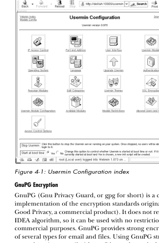

图 4-1：Usermin Configuration 索引

## GnuPG Encryption

GnuPG（Gnu Privacy Guard，或简称 `gpg`）是 PGP（Pretty Good Privacy，一种商业产品）最初提供的加密标准的完整且自由软件实现。它不依赖受专利限制的 IDEA 算法，因此可以无限制地用于商业或非商业用途。GnuPG 为电子邮件和文件提供多种类型的强加密和数字签名。使用 GnuPG 强加密，可以发送私人电子邮件，可以确信只有收件人才能解密消息。此外，消息可以进行数字签名，允许确认发送者身份并验证消息内容（即确认这确实是发送者所撰写的信息，并且在传输过程中未以某种方式被修改）。

此模块只有一个可配置选项，即用于发送和接收密钥文件的密钥服务器。如果你使用 GnuPG 来确认签名，则有必要使用中央密钥服务器，以便可以在集中数据库中查找身份。通过这种方式，可以在能够确认他人身份的个人之间编织信任网络。由于世界各地有大量公共密钥服务器可用，并且它们同步数据，因此选择你附近的一个是个好主意。

## Configurable Options for Mail Forwarding

Webmin 和 Usermin 支持多种不同的邮件传输代理（MTA），即 Sendmail、Postfix 和 Qmail。此选项应设置为你的服务器使用的邮件传输代理。Postfix 未列为选项，因为从用户角度来看 Postfix 完全与 Sendmail 兼容。只需在 Postfix 为 MTA 时选择 Sendmail，一切都会按预期工作。

## Configurable Options for Read Mail

Usermin Read Mail 模块为用户提供了一个完整但基础的基于 Web 的邮件客户端。它允许用户发送和接收邮件，以及保留简单的地址簿并对消息进行数字签名或加密。对于此模块，有许多可配置选项，如图 4-2 和图 4-3 所示。

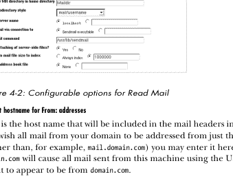

图 4-2：Read Mail 的可配置选项

### Default hostname for From: addresses

这是将包含在邮件头 From 字段中的主机名。如果你希望来自你的域的所有邮件都仅以域名（而不是例如 `mail.domain.com`）寻址，你可以在此处输入它。输入 `domain.com` 将导致使用 Usermin 邮件客户端从此机器发送的所有邮件看起来都来自 `domain.com`。

### Allow editing of From: address

如果为 Yes，用户可以在 From 字段中输入他们选择的任何地址。如果为 No，所有邮件将被标记为源自你在上一个选项中选择的域。如果客户端有自己的域名或希望主要使用另一个地址并且不想处理另一个邮箱的回复，允许此更改可能是合适的。

### From: address mapping file

在托管虚拟域时，将 From: 地址设置为适当的用户@virtualdomain.com 地址而不是真实用户名和系统域可能是有用的。此选项将 Usermin 设置为从域映射文件（通常是 `generics` 表）中选择正确的地址。

### Mail storage format

与上面的 Mail Forwarding 配置一样，此选择应与你的服务器上运行的 MTA 匹配。如果你安装了 Postfix，可以选择 Sendmail 风格的单文件。

### Sendmail mail location

在此选择你的邮件存储目录的位置。这通常位于 `/var/spool/mail`，另一个常见选项是将其传递到用户的主目录中的 `mbox`。这取决于你的邮件投递系统的配置（可能并不实际是 Sendmail）。Postfix 可以使用与 Sendmail 兼容的邮件投递选项，因此此处不需要特殊配置。

### Sendmail file in home directory

如果邮件存储在用户的主目录中，请在此处指定收件箱的文件名。通常这是 `mbox`，但某些邮件服务器或邮件客户端可能会选择其他名称。通常收件箱根本不在用户的主目录中，因此此选项并不总是必要。

### Qmail or MH directory location

如果使用 Qmail 或 MH，请在此处指定系统邮件存储目录的位置。QMail 和 MH 使用自定义邮件存储格式，其实现为一封邮件一文件，与传统 `mbox` 格式将所有电子邮件放入单个文件不同。一些管理员和开发人员认为这提供了更好的性能和更好的可靠性。

### Qmail or MH directory in home directory

如果邮件存储在用户的主目录中而不是系统邮件 spool 目录中，你可以在此处指定位置。通常，这将是 `Maildir` 目录，尽管它可能是其他内容。

### Mail subdirectory style

一些邮件投递代理允许将邮件 spool 目录划分为多个子目录，以便于管理并适应某些 UNIX 文件系统的限制。如果你的投递代理不将所有邮件投递到单个邮件 spool 目录，而是将邮件投递到分布在许多子目录中的用户，你可以在此处进行配置。

### POP3 or IMAP server name

除了读取本地邮件外，Usermin 还可以从 POP3 或 IMAP 服务器检索电子邮件。如果你的邮件 spool 位于远程服务器上，你可以在此处指定它。

## Send mail via connection to

选择 Usermin 发送邮件的方式。邮件可以发送到任何本地邮件传输代理或远程 SMTP 服务器。默认情况下，这是 `sendmail` 可执行文件，但存在几种替代方案。

## Sendmail command

您 MTA 可执行文件的位置。当 Usermin 发送邮件时，除非配置为通过远程 SMTP 服务器发送，否则将调用此命令。

## Allow attaching of server-side files?

这允许用户附加位于本地机器（Usermin 运行所在机器）上的文件。这可能存在轻微的安全风险，因为用户可以附加他们具有读取权限的任何文件。此设置适用于所有用户，且用户无法配置。

## Minimum mail file size to index

出于性能原因，Usermin 可以配置为为用户邮箱中的电子邮件创建索引文件。除非邮箱相当大，否则通常是不必要的，因此您可以配置 Usermin 将要索引的邮箱的最小大小。

## Global address book file


Usermin 为用户存储电子邮件地址提供了一个简单的地址簿。如果在此指定，可以创建一个全局地址簿，供系统上所有 Usermin 用户共享。这对于拥有大量员工且需要频繁进行电子邮件交互的公司非常有用。

Read Mail 页面（图 4-3）的下半部分用于配置该模块的默认用户首选项。

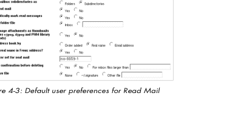

图 4-3：Read Mail 的默认用户首选项

## Users can edit preferences

如果您希望阻止用户修改 Read Mail 模块的首选项，您可以在此处指定 No。默认情况下，用户将具有您在此处指定的首选项，但他们可以更改其中任何一个。一些选项，例如换行宽度和一次显示的邮件数量，允许进行更改以使邮件客户端更适合不同的环境，例如掌上型访问设备。其他选项只是个人偏好问题。

## Mail messages to display per page

此选项几乎是不言自明的。您可以选择显示更多或更少的邮件，这在客户端使用小型显示设备使用网页邮件客户端并且过多的行使浏览收件箱中的邮件变得繁琐时很有用。您在此处配置系统范围的默认值。用户可以更改此设置，以及以下所有 Read Mail 显示相关选项以用于其自己的帐户。

## Width to wrap mail messages at

同样，您的用户可能会发现此选项对于小型显示器很有用，例如手持计算设备。默认值为每行 80 个字符。

## Show buttons at top for

选择在哪些页面上在页面顶部显示 Delete、Mark message as 和 Forward 按钮。默认情况下，这些按钮出现在邮箱页面的顶部和底部，仅在查看邮件页面底部出现。如果大邮件很常见，您的用户可能会发现同时在两者的页面顶部显示按钮很方便。如果您的用户没有太多屏幕空间（例如使用掌上设备），您可能不希望在任何页面的顶部显示按钮。

## Show To: address in mailboxes?

此选项允许您选择邮箱页面是否显示 To: 字段。如果邮箱通过邮件别名接收具有不同电子邮件地址的消息，则很有用。

## Don’t MIME encode messages if text only?

如果设置为 Yes，仅包含文本且不包含二进制文件的消息将不会进行 MIME 编码。MIME 编码是传输超出纯文本电子邮件中允许的 7 位 ASCII 的数据和文本的一种方式。

## Mailboxes directory under home directory

Usermin 将为存储已发送邮件、草稿和自定义文件夹创建邮件文件夹。这些文件夹将在用户的 home 目录中在指定的子目录中创建。

## Treat mailbox subdirectories as

如果在上面指定的目录中存在其他子目录，Usermin 可以将它们视为文件夹或子目录，如此处指定。

## Save sent mail

如果选中，通过 Read Mail 模块发送的用户邮件将保存在用户 home 目录中的已发送邮件文件夹中。

## Automatically mark read messages

如果将此选项设置为 Yes，已读消息将被标记为复选标记。

## Default folder file

这选择用户首次打开 Read Mail 模块时将显示的文件夹。默认情况下，这是用户的收件箱。

## Show image attachments as thumbnails

如果选中，并且有适当的库可用，图像附件将以缩略图形式显示。单击缩略图将显示全尺寸图像。

## Sort address book by

地址簿条目可以按真实姓名或电子邮件地址按字母顺序排序，也可以按添加的顺序按时间顺序排序。

## Include real name in From: address?

如果可用，用户真实姓名可以包含在通过 Read Mail 模块发送的消息的 From 字段中。

## Character set for sent mail

MIME 邮件消息可能包含来自多个字符集的字符。此选项指定发送邮件的默认字符集。具有除英语和其它罗曼语以外的本地语言的位置可能希望将其更改为不同的字符集。

## Ask for confirmation before deleting

此选项配置删除电子邮件和文件夹时所需的确认级别。如果设置为 Yes，每个删除请求都必须得到确认。如果设置为 No，电子邮件删除不需要确认。

## Signature file

如果指定，用户可以有一个签名文件，该文件将自动附加到每个撰写的电子邮件。传统上，签名文件的名称为用户 home 目录中的 `.signature`，但可以指定任何文件名。

## Running Processes

Usermin 中的 Running Processes 模块允许用户查看他们正在运行的所有进程。这里有几个可配置选项。

## Default process list style

这些选项与 `ps` 命令的模式相对应。因此，它允许输出形式，例如进程树（其中父/子关系清晰）以及更简单的进程列表。

## PS command output style

此选项应与 Usermin 运行的 OS 匹配，因为它选择如何解析 `ps` 命令的输出。但是，如果您的系统使用此命令的自定义变体，您可能需要将其修改为提供类似 `ps` 的 OS。

## Cron Jobs

Cron Jobs 模块允许用户创建自己的计划任务，以便系统在特定时间自动执行。命令将以配置它们的用户权限执行。

## Crontab Directory

这应设置为 `cron` 查找其 crontab 文件的目录。

## Command to read a user's cron job

一些 crontab 版本可能使用略有不同的命令行选项，或者您可能使用 `cron` 的专用包装器。在此处您可以选择读取用户 crontab 的命令和选项。

## Command to edit a user's cron job

与上面的 Command to read a user's cron job 类似，只是它配置用于编辑用户 crontab 的命令。

## Command to accept a user's cron job on stdin

`crontab` 通常也可以从标准输入接受输入，如果在命令行上给出 `-` 伪文件名。

## Command to delete a user's cron jobs

此选项设置 Usermin 将用于删除用户 crontab 条目的命令。

## Cron supports input to cron jobs

此选项配置 Usermin 是否将提供文本输入框，以便用户可以通过标准输入向正在运行的命令提供数据。正在运行的命令必须接受来自标准输入的数据。

## Path to Vixie-Cron system crontab file

这应该是您系统范围的 crontab 的路径。通常，它将是 `/etc/crontab`。

## Path to extra cron files directory

许多系统使用额外的 cron 目录用于程序特定的 cron 作业，以便在 `cron` 运行期间执行。这很可能是 `/etc/cron.d`。

## run-parts command

`run-parts` 命令通常在系统 crontab 文件中运行，并用于指定在指定时间运行的其他目录。例如，在 Red Hat Linux 系统上，crontab 包含：

```
SHELL=/bin/bash

PATH=/sbin:/bin:/usr/sbin:/usr/bin

MAILTO=root

HOME=/

# run-parts

01 * * * * root run-parts /etc/cron.hourly

02 4 * * * root run-parts /etc/cron.daily

22 4 * * 0 root run-parts /etc/cron.weekly

42 4 1 * * root run-parts /etc/cron.monthly
```

前面的示例在 `cron` 环境中设置了一些默认值，并在几个指定的时间执行 `run-parts`。具体来说，`/etc/cron.hourly` 文件会在每个小时的一分钟后执行。`run-parts` 只是处理指定目录并执行其中所有命令的程序。

## Available Modules

与 Webmin 模块选择页面类似，此页面允许您选择哪些模块对用户可用。例如，如果您不希望用户拥有任何直接的文件系统访问权限，您可以禁用命令 Shell、文件管理器和 SSH/Telnet 登录。SSH 配置和登录脚本随后就变得无用了，因此也可以将其禁用。

## When to Use Usermin


很可能已经很清楚 Usermin 和 Webmin 在许多方面惊人地相似，而 Usermin 几乎没有 Webmin 所没有的功能。那么，为什么要用它呢？为什么不直接让每个人都访问 Webmin，从而简化每个人的生活呢？如果不分析系统部署的环境，就无法完全回答这个问题。在某些情况下，Usermin 将毫无用处，同时还需要额外的资源来安装和运行它。但在其他情况下，Usermin 可以成为管理员工具箱中的宝贵补充。

当服务器被大量无特权用户使用，并且需要简化这些用户的管理时，Usermin 最有用。在 Usermin 之前，可以授予用户访问 Webmin 以读取邮件、更改密码并执行一些普通用户功能，并且该功能仍然存在。可以通过构建复杂的 ACL 和组并仔细为这些新用户配置仅这些权限，使用 Webmin 实现相同的目的。然而，这给管理员错误留下了一些余地，而这可能产生戏剧性的后果。另一方面，Usermin 不会留下任何错误空间。Usermin 用户拥有的权限仅限于登录用户的权限，不多也不少。用户不会意外获得额外的权限，因此无需仔细选择可用模块来确保安全和易用性（因为，坦白说，许多用户可能会因太多复杂的选项而感到相当困惑）。

Usermin 的另一个良好用途是为经常旅行的用户提供一种轻松的方法来阅读邮件并从自己的主目录检索文件。通过为本地机器提供 Web 界面（并且通过网络文件服务器，可能提供用户所有的数据），远程办公人员可以从世界任何地方的任何 Web 启用设备上完成所有这些操作。换句话说，用户可以从网吧、贸易展览会的互联网亭或无线网络设备登录到本地网络。这样做不需要在客户端系统上安装专用软件。

Usermin 在共享托管环境中的另一个有趣用途是允许用户查看自己的目录、通过 Web 浏览器上传文件、编辑其 `shell` 帐户的许多基本功能、阅读邮件等等。实现一些不错的额外功能，例如运行 Web 日志分析工具并允许用户从 Usermin 内查看结果，并不会很困难。

# 5 GENERAL SYSTEM CONFIGURATION

Webmin 选项卡栏上的第二个类别是 System。点击它将允许您编辑诸如：启动和关闭行为、磁盘配额、文件系统、手动页面、NFS 导出、进程、Cron 作业、系统日志等系统功能。图 5-1 显示了 Linux 系统上可用的选项（具体来说，是运行 Red Hat Linux 的服务器）。

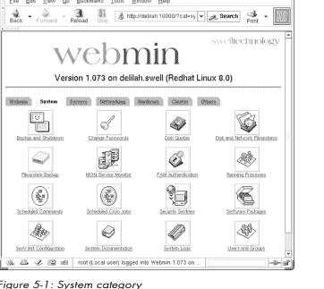

Figure 5-1: System category

## Bootup and Shutdown

点击 Bootup and Shutdown 会带您进入启动选项页面。在 Red Hat 系统的情况下，它提供了对 `/etc/rc.d/init.d` 中找到的所有 init 脚本的访问。同样，在 Solaris 系统上，脚本位于 `/etc/init.d`。点击任何脚本名称将提供编辑、启动、停止和删除 init 脚本的能力。通常，每个 init 脚本都提供启动、停止和重启系统服务（如 Sendmail、named 和 Apache）的功能，以及执行诸如设置网络设备和路由表等基本系统初始化。如果它没有 init 脚本，将新服务或命令添加到系统启动例程的一种简单方法是将其添加到 `/etc/rc.d/rc.local` 或 `/etc/rc.local`。

在此页面上您还会看到 Reboot 和 Shutdown 按钮。它们在确认屏幕后会执行您所假设的功能。

## Disk and Network Filesystems

磁盘和网络文件系统页面提供了 `/etc/fstab` 中列出的文件系统的详细视图。从此页面您可以编辑挂载点、创建新的挂载点、卸载和挂载分区，并为特定挂载点添加执行和 `setuid` 限制以提高安全性（图 5-2）。此模块配置 `/etc/fstab` 文件。

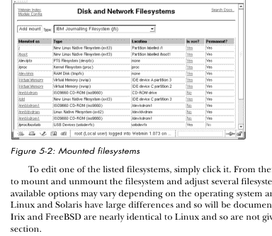

Figure 5-2: Mounted filesystems

要编辑其中一个列出的文件系统，只需点击它即可。从那里您可以挂载和卸载文件系统并调整多个文件系统选项。可用选项可能会根据操作系统和媒体而有所不同。Linux 和 Solaris 有很大差异，因此将分别记录。Irix 和 FreeBSD 与 Linux 几乎相同，因此没有单独的章节。

### Linux Native Filesystem Mount Details

在编辑挂载页面的上表中，Webmin 为所有文件系统提供访问多个通用选项（图 5-3）。

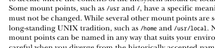

Figure 5-3: Linux Native Filesystem Mount Details

#### Mounted As

这是文件系统将在系统目录层次结构中所在的位置的挂载点。挂载点是一个目录，像使用 `mkdir` 命令创建的任何其他目录一样创建。挂载文件系统时，操作系统会检查此值以决定文件系统的内容应位于层次结构中的何处。某些挂载点，如 `/usr` 和 `/`，对操作系统具有特定含义，不得更改。虽然其他一些挂载点因长期存在的 UNIX 传统而得名，例如 `/home` 和 `/usr/local`。尽管如此，大多数挂载点可以根据您的环境以任何方式命名；只要在偏离历史认可的名称时小心即可。

#### Save mount?

提供是否保存当前挂载点的选项。通常，在创建新挂载点或修改旧挂载点时，您希望在启动时保存并挂载。然而，如果媒体是可移动媒体，如软盘或 CD-ROM，您可能会选择仅保存挂载。最后，如果您只是创建临时文件系统，例如将 ISO 映像作为文件系统挂载，您将不需要保存挂载点。

#### Mount now?

允许您选择是否立即挂载或卸载文件系统。如果选择 Mount，Webmin 将在您点击创建或保存按钮时尝试挂载文件系统。同样，选择 Unmount 将尝试卸载已挂载的文件系统。如果文件系统正被任何程序使用，操作系统将拒绝卸载文件系统。

#### Check filesystem at boot

选择文件系统是否将在系统启动时使用 `fsck` 检查，以及如果检查，检查应获得什么优先级。请注意，某些文件系统类型，如日志文件系统 `ReiserFS` 和 `XFS`，通常不需要检查。此外，只读文件系统，如 CD-ROM，应不予检查。在 Linux 下，`ext3` 文件系统即使 `fstab` 条目在此处指定了优先级，也会在启动时悄悄跳过 `fsck`，除非用户在不干净关闭后的启动期间手动另行指定。由于它是日志文件系统，因此这种行为是合理的，但可能不会立即从文档中显而易见。

#### Linux Native Filesystem

允许您选择将与挂载点关联的设备。一些现代 Linux 发行版对此使用标记设备，而其他发行版则直接标识设备。下拉菜单提供对所有已知磁盘设备的访问。您也可以通过点击 Other devices 单选按钮，在文本输入字段中直接输入设备或 ISO 文件名。

### Linux Advanced Mount Options

此页面上的下表显示了 Linux 文件系统的高级挂载选项，并指示当前启用了哪些选项（图 5-4）。

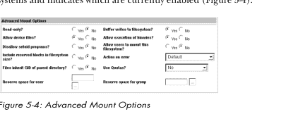

Figure 5-4: Advanced Mount Options

#### 只读？

设置文件系统的只读标志。如果选择“是”，文件系统将不允许写入，即使是 `root` 用户也不行。CD-ROM 驱动器、启用了写保护标签的软盘以及其他一些介质将始终启用此标志，而不管 `fstab` 中的设置如何。此选项对应于 `ro` 挂载选项。

#### 缓冲写入文件系统？

允许你为此设备禁用写缓冲。默认情况下，UNIX 中的磁盘 I/O 会被缓冲，以提高响应速度并增加整体磁盘吞吐量。在某些情况下，缓冲可能会对系统的可靠性造成不利影响。某些数据库或电子邮件服务器软件在禁用缓冲的文件系统上可能更可靠。通常，此更改是不必要的，因为大多数需要此行为的软件会在每次事务后强制刷新到磁盘，从而仅对需要它的应用程序禁用缓冲。在大多数情况下，修改此设置只会减慢系统速度，而不会带来任何实质性好处。此选项启用 `sync` 挂载选项开关。

#### 允许设备文件？

此选项决定文件是否可以被视为此文件系统上的设备。设备文件是一种特殊类型的文件，它不映射到磁盘的一部分，而是将 I/O 引导到另一个物理或虚拟设备，例如打印机、调制解调器或控制台显示器。通常，只有 `root` 用户才应被允许挂载包含设备文件的文件系统。此选项启用 `nodev` 开关。

#### 允许执行二进制文件？

启用此选项时，文件系统上的任何文件都不会被视为可执行文件。当挂载包含为另一种架构编译的二进制可执行文件的文件系统时，这可能很有用，例如在运行 FreeBSD 的 `x86` 系统上挂载来自 Yellow Dog Linux 的 `PPC` 可执行文件。此选项对应于 `noexec` 开关。

#### 禁止 setuid 程序？


# setuid 程序

`setuid` 程序在系统看来就像是由其被设置为的用户执行的。例如，已设置为 `setuid root` 的程序将以 `root` 用户的权限执行，因此可能非常危险。由于 `setuid root` 程序可能非常危险，因此必须有一种方法防止用户从 CD-ROM 或软盘等外部来源将 `setuid` 程序引入系统。此选项对应于 `nosuid` 指令。

## 允许用户挂载此文件系统？

如果用户需要能够挂载文件系统，则可以选中此选项。通常，大多数文件系统会在启动时挂载，因此用户始终可以使用。但在软盘、USB 驱动器和 CD-ROM 等可移动介质的情况下，用户可能偶尔需要访问自己的磁盘。此选项对应于 `user` 挂载开关。

## 错误时的操作

挂载文件系统时可能会发生错误。此选项允许你选择系统在遇到挂载错误时应如何行为。默认值设置在文件系统超级块中，可使用 `tune2fs` 实用程序进行配置。设置为 `Continue` 时，文件系统将被挂载，并且文件系统将被标记为处于错误状态。设置为 `Remount read-only` 时，系统将尝试以只读文件系统重新挂载。这可以提供一定的安全性并有助于在错误由磁盘故障引起时保持从磁盘恢复数据的能力。`Panic` 选项会因文件系统挂载错误而停止系统。此选项对应于 `errors` 挂载选项。

## 警告

*当尝试从损坏的磁盘恢复数据，或从意外删除数据的磁盘恢复数据时，至关重要的是不要向磁盘写入任何额外数据。由于当今使用的大多数 UNIX 文件系统的设计，包括 Linux `ext2` 和 BSD 系统的 `UFS`，文件的內容通常不会在磁盘上被移除，直到操作系统为存储新数据而需要该空间为止。因此，如果你立即将文件系统重新挂载为只读，你恢复已删除数据的能力将大大提高。当然，更好的选择是充分利用可靠的备份实用程序和定期的备份计划。如果没有最近的备份文件，无法保证恢复已删除文件或因驱动器故障而丢失的文件。*

## 文件继承父目录 GID？

在 UNIX 文件系统上创建新文件时，它们通常具有与文件创建者匹配的用户和组所有权。如果目录必须由多个用户共享，可能希望将文件的组成员身份设置为特定的 GID。启用此选项时，新文件的组成员身份将设置为包含目录指定的 GID。此选项对应于 `grpId` 或 `bsdgroups` 挂载选项，默认值为否。

## 使用配额？

如果应使用配额来管理此文件系统的磁盘使用情况，你可以选择要应用的配额类型。此选项对应于 `grpquota`、`noquota`、`quota` 和 `usrquota` 选项开关，默认值为不应用配额。

## 为用户保留空间，为组保留空间

大多数 UNIX 文件系统会隐式地为管理员紧急使用预留少量空间。即使系统的普通用户已填满磁盘的其余部分，此空间仍将可用。默认情况下，此用户为 `root` 用户，然而，在 `ext2` 和 `ext3` 文件系统中，保留空间可由此处指定的用户或组使用。此选项配置 `resuid` 和 `resgid` 选项。

## Solaris 文件系统选项

Solaris 除了传统的 `UFS` 选项外，还有一些自己的附加选项。本节将介绍与前面讨论的 Linux 选项不同的选项。

### UFS 磁盘

此选项与 Linux 及其他系统上的类似选项只有中等程度的差异。磁盘按类型、SCSI 或 IDE、系统设备号和分区号进行标识。RAID 设备可按单元号指定，其他设备可按路径名指定。

### Solaris 高级挂载选项

Solaris `UFS` 实现提供了一些特殊功能，使其与前面记录的 Linux 高级挂载选项有所不同，具体来说，可用 `Repair Delay`、`Update access times?`、`Force direct IO?`、`Allow large files?` 和 `Enabled logging?`，而 `Allow execution of binaries?`、`Allow device files?`、`Allow users to mount this filesystem?`、`File inherit parent GID?` 以及 Linux 中可用的保留空间选项则不可用。

## 允许用户中断？

此选项配置用户是否允许中断在此文件系统上等待磁盘操作而被阻塞的进程。此选项对应于 `intr` 和 `nointr`，默认值为 `yes`（`intr`）。

## 修复延迟

由于服务器可能在挂载尝试失败时重新启动，系统需要一种保护机制来防止其进入修复/重启循环，这可能会对已经受损的文件系统造成更大损害。此选项指定修复尝试之间的最短时间。如果系统在此时间范围内重新启动，并在指定的时间内第二次尝试修复磁盘，它将直接停止。此选项与 `too soon` 挂载指令相关，仅在 Solaris 7 之前的版本中可用。在以后的 Solaris 版本中，此选项不必要且会被忽略。

## 更新访问时间？

此选项指定文件的访问时间，即 `atime` 值在被访问时是否会被更新。`Immediately` 表示文件的访问时间在每次访问时都会立即更新。`Deferred` 表示访问时间会被更新，但仅在其他文件系统活动期间。最后，`No` 表示文件访问时间永远不会被更新。在普通文件系统上，希望保持 `atime` 启用。或者，当使用文件系统专门用于不需要访问时间更新的应用程序时，例如 NNTP 新闻存储区或 Web 缓存，禁用 `atime` 更新可以提供少量性能提升，因为所需的磁盘事务数量减少了。此选项与 `noatime`、`relatime` 和 `nodiratime` 开关相关。

## 强制直接 IO？

此选项在功能上与前面描述的 `Buffer writes to filesystem?` 相同。简而言之，它禁用了进程与文件系统之间的缓冲。对于使用非常大的连续文件且不经常

`random access`, forcing direct I/O can improve overall throughput. This option correlates to the `forcedirectio` and `noforcedirectio`. By default, direct I/O is not enabled, and all disk I/O will be buffered.

## Allow large files?

Maximum file size on Solaris, as on most operating systems, has throughout its history gone through changes. In simple terms, this option dictates whether a filesystem will permit files over the size of `2GB` (currently). Because there are a number of programs, operating systems, and other filesystems that cannot support files larger than `2GB`, this limit can be imposed to maintain reliable operation between those differing parts. For example, if a filesystem is to be exported via `NFS` to operating systems that cannot handle large files, it is wise to enforce this limit on the exporting machine as well. This option corresponds to the `largefiles` and `nolargefiles` mount switches.

## Enabled logging?

Logging, when enabled, stores filesystem transactions in a log before applying the transaction to the filesystem. In other words, before making an I/O transaction permanent, it must successfully complete. The result of this is that in the event of an unclean shutdown of the system, the filesystem will remain in a consistent state, eliminating the necessity of running `fsck` on the filesystem. This option correlates to the `logging` and `nologging` mount switches.

## System Documentation


This page (Figure 5-5) provides access to the extensive help that is available on most UNIX systems through man pages, in addition to the Webmin help files, installed package documentation files, Perl module documentation, as well as results from the Google search engine.


Figure 5-5: System documentation

## System Documentation Search

Using the module is as simple as entering a search term and clicking Search. If you choose to Match any in your search, the module will return a list of all pages that it can find that match your query. You may specify which types of documentation you'd like to search, including man pages, Webmin help files, documentation for installed packages, Perl module documentation, and The Book of Webmin either locally or remotely. It will also provide a simple gateway to a Google search.

Man pages are divided into numbered sections, in order to clearly distinguish programming documentation from user command documentation, and the like. When performing a search of the man pages, you will likely see multiple results matching your search term. In some cases, there will be more than one entry precisely matching the command or term you're looking for, in different manual sections. The sections are roughly divided as described below:

- User commands that may be run by all users:
- System calls, or functions provided by the kernel.
- Library Functions.
- Devices or special files in the `/dev` directory.
- File format descriptions, for such files as `/etc/passwd` and Sendmail's `/etc/aliases` file.
- Games.
- Miscellaneous, macro packages, and conventions. Examples include `bootparam` and `unicode`.
- System administration tools that only root can execute. Examples include `ifconfig` and `halt`.
- OS Specific kernel routine documentation. Not always available on all systems.

Also available on some systems are a few lettered sections. They are: n for New documentation, which may be moved in the future to a new location, o for Old documentation, which will likely be phased out, and l for Local documentation specific to this particular system.

## Searching Documentation from Another Module

This page also provides the configuration for searching from within the other modules. In most Webmin modules, there will be a Search docs link in the upper right corner of the page. When clicked, Webmin will search all of the available documentation that has been selected and present links and short excerpts from the documents. If your system will be disconnected from the Internet, you may wish to disable Google searches. Likewise, if you do not want package documentation or similar types of documentation to be searched you may unselect them here.

**TIP** In recent versions of Webmin, it is possible to search the contents of this book, if the corresponding module is installed. To obtain the Webmin module for this book, visit the Projects `http://www.swsoft.com/projects` page at Swell Technology for downloads in `.wbm` and `.rpm` packages. It is not included in the base Webmin package, due to its large size.

## Process Manager

The Process Manager is accessed by clicking the Running Processes icon (Figure 5-6). This page provides a list of all running processes grouped by lineage. Clicking a Process ID will provide more complete information about the process, including the command that was run, the parent process, the CPU usage, runtime, size, niceness level, and more.

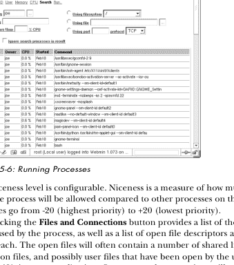

Figure 5-6: Running Processes

Niceness level is configurable. Niceness is a measure of how much processor time the process will be allowed compared to other processes on the system, and its values go from -20 (highest priority) to +20 (lowest priority).


Clicking the Files and Connections button provides a list of the files that are being used by the process, as well as a list of open file descriptors and details about each. The open files will often contain a number of shared libraries, configuration files, and possibly user files that have been open by the user of the process if it is a user application. Open network connections will provide information about what network connections exist for this process. In many cases, this list will only contain local loopback connections from `127.0.0.1`, or this section of the page may not be present if the application has no network connections.

The module also offers several alternative views of the data, including sorting by user, memory usage, and CPU usage. Clicking the Search link provides the ability to filter on a given aspect of the process. Finally, the Run link provides a simple method of running a command, with optional arbitrary command-line input.

Similar information can be gained from the standard UNIX command `ps` on the command line. Niceness level of a process can be set from the command line using the `nice` command. Sending a signal to a process or terminating a process is achieved using the `kill` command. The list of files and connections is gathered using the `lsof` command.

## Scheduled Commands

The `at` command provides a simple means to execute a specified command at a specified time. Its usage is simple, made even simpler by the Webmin interface. It can be very useful for a number of tasks, such as running one-time CPU intensive tasks at off-hours, notifying you of appointments, and so on.

To create a new at job, simply fill in the details. Specifically, the `Run as user` option dictates the user under which the command will be run. `Run on date` and `Run at time` specifies the date and time at which the command will run. The `Run in directory` option specifies where the at command will be run from, as a change directory command will be run before the command is executed. This directory must be accessible by the user under which the command is run. Finally, `Commands to execute` is where you may enter the commands to be run by at at the specified time. Any number of linefeed separated commands may be entered and they will be executed in sequence.

> `NOTE` If you have a repetitive task that needs to be executed at a specified time daily, or weekly, or monthly, at is not the best tool for the job. There is another command called `cron` that is more appropriate. `cron` is covered in the next section.

## Scheduled Cron Jobs

The Cron Jobs module is used for editing the crontab on your system. Cron is a daemon that runs constantly on most UNIX systems and allows users and the administrator to run specified tasks automatically at selected times. Ordinarily, `crond` is configured from the system-wide crontab as well as one or more configuration directories in `/etc/cron.d`, and on Red Hat Linux systems and some other Linux distributions. `crond` draws its configuration from `/etc/cron.hourly`, `/etc/cron.daily`, `/etc/cron.weekly`, and `/etc/cron.monthly`. Note that even on Red Hat and similar systems, `/etc/cron.d` and `/etc/crontab` still exist and can be used just as on any other UNIX system.

Configuration of `crond` is much simplified by use of the Webmin module. To create a new cron job, click `Create a new cron job`. The `Create Cron Job` page (Figure 5-7) allows you to select the user that the cron job will run as, thereby limiting its permissions to those of the selected user. As in all permissions situations, it is best to choose a user with the least permissions required to actually accomplish the task needed. There are fields for entering the `Command` you want to be executed, as well as for any `Input to command` you might have. The `Active` option dictates whether the command is enabled or disabled by commenting it out with a hash mark at the beginning of the line.


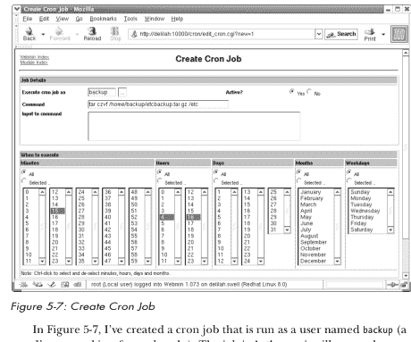

图 5-7. 创建 Cron 任务

在图 5-7 中，我创建了一个以名为 `backup` 的用户身份运行的 `cron` 任务（该用户是我专门为此类任务创建的）。该任务处于活动状态，因此将在指定时间运行。正在运行的命令是一个简单的 `tar` 命令行，用于将完整的 `/etc` 目录备份到 `/home/backup` 中的一个 `tar` 包。虽然这并不是一个非常复杂的备份系统，但它以极少的复杂性完成了工作。此外，定期备份重要文件总比完全不备份要好得多。在本例中，其有效性略有提升，因为 `/etc` 和 `/home` 是位于两块不同硬盘上的分区。

## 软件包

软件包模块允许管理员通过一个相当友好的界面执行软件升级和软件包维护。尽管实际实现可能因操作环境使用的软件打包系统而有很大差异，但 Webmin 掩盖了大部分差异，各自的整体使用方式非常相似。

### 软件包管理器简介

大多数现代 UNIX 系统都配备了软件包管理器。对于从 Windows 操作系统迁移过来的新用户来说，软件包管理器的概念可能很陌生，在 Windows 中，软件是通过多种安装程序之一安装的。通常不会记录已安装文件的位置，也没有简单的方法在不再需要软件时将其全部删除。虽然有些安装实用程序比其他更有效、更可靠，但它们在处理软件依赖关系和可用库版本方面都存在困难。缺乏统一的软件包管理器导致出现了一个专门用于因这些问题而删除旧软件安装的整个产品类别。

软件包管理器解决了这个问题，并且还解决了许多在长期使用后才会显现的其他问题。在使用软件包管理的系统中，你永远不必猜测某个文件来自何处，或某个库或系统组件是否已安装。查找任何已安装软件包的版本既快速又简单，并且通常可以在不担心覆盖配置细节的情况下将旧软件包升级到新版本。因此，现在既然已经清楚为什么软件包管理器很棒，是时候谈谈你如何通过 Webmin 使用你的软件包管理器了。

### 支持的操作系统

Webmin 为大多数主要操作系统的软件包管理器提供了一个基本一致的前端。支持的操作系统包括基于 RPM 的 Linux 发行版，如 Red Hat、SuSE 和 Mandrake；基于 deb 的系统如 Debian；使用 pkg 风格工具的系统如 Solaris、Slackware Linux、SCO Unixware 和 OpenServer；以及 HP/UX 和 IBM AIX 软件包管理器。支持操作系统列表中一个值得注意的例外是 Irix。尽管它有软件包管理器，但目前 Webmin 不支持它。

### 使用软件包管理器

Webmin 提供了一个简单的界面，可实现安装软件包、搜索已安装软件包、查看已安装软件包以及删除软件包（图 5-8）的功能。此外，还可以识别指定文件是从哪个软件包安装的。

### 已安装软件包

要搜索软件包，请在此处输入软件包名称。软件包名称是已安装文件的名称，不包括版本号或文件名扩展名。例如，在 Red Hat 系统上，Postfix 邮件服务器软件包仅称为 `postfix`。搜索时，Webmin 将返回所有软件包名称或软件包描述中包含搜索词的软件包。这通常使得即使你不知道确切的软件包名称，也很容易找到所需内容。

要查看所有已安装软件包的列表，请单击 `Package Tree` 按钮。适用时，软件包将按打包者指定的相应类别进行划分。

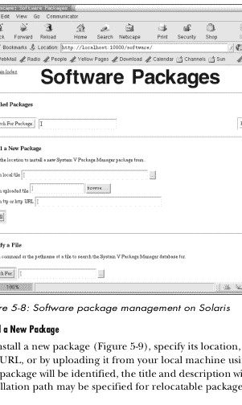

图 5-8：Solaris 上的软件包管理

### 安装新软件包

要安装新软件包（图 5-9），请指定其位置，可以是本地文件路径或 URL，或通过使用 `Browse` 选项从本地计算机上传。软件包将被识别，标题和描述将被显示，并且可以为可重新定位的软件包指定安装路径。

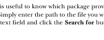

图 5-9：安装软件包

还可能指定有关依赖项、安装脚本、文档、文件系统大小等方面的选项。通常，默认选项即可正常工作。

### 识别文件

通常很有用的是知道文件系统上的特定文件是由哪个软件包提供的。只需将要查找信息的文件的路径输入文本字段，然后单击 `Search for` 按钮即可。

### 编辑软件包

单击软件包名称可访问 `Edit Package` 页面（图 5-10）。此页面包含软件包详细信息，例如描述、软件包的类别或类别、安装日期等。在此你可以列出软件包包含的文件以及卸载软件包。

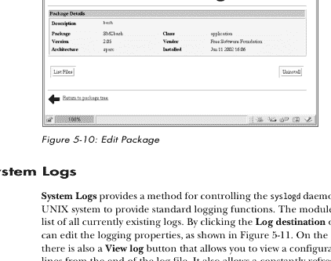

图 5-10：编辑软件包

## 系统日志

系统日志提供了一种控制大多数 UNIX 系统上用于提供标准日志功能的 `syslogd` 守护进程的方法。该模块打开时列出所有当前存在的日志。通过单击日志文件的 `Log destination`，你可以编辑日志属性，如图 5-11 所示。在编辑页面上还有一个 `View log` 按钮，允许你查看日志文件末尾的可配置行数。它还允许在选中时进行不断刷新的日志视图。

该模块编辑 `/etc/syslog.conf` 文件，并提供了一种相当简单的方法来远程检查你的日志。尽管该模块主要设计用于 `syslog` 日志，但它足够灵活，可以让你查看其他类型的日志。例如，Web 缓存代理 `Squid` 不使用标准的 `syslog` 设施，因此不受 `syslogd` 控制。尽管如此，我喜欢能够检查正在运行的 `Squid`，因此我在我管理的所有机器上添加了一个条目，以便在 Webmin 中查看这些日志。要创建新的 `syslog` 条目，请单击 `Add a new system log` 链接。

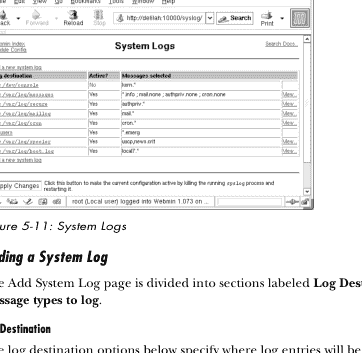

图 5-11：系统日志

### 添加系统日志

添加系统日志页面分为标记为 `Log Destination` 和 `Message types to log` 的部分。

### 日志目标

下面的日志目标选项指定日志条目将被写入的位置，以及某个日志是否处于活动状态。

### 日志到

此选项配置日志文件的目标位置。`Syslog` 可以将日志记录到文件、命名管道、远程 `syslog` 服务器或某些或所有本地用户的控制台。

### 文件

日志条目将被追加到指定的文件名中。应给出完整路径。历史上，系统日志存储在 `/var/log` 中。`Sync after each message?` 选项将导致 `syslog` 守护进程在每次条目后刷新到磁盘，从而覆盖操作系统提供磁盘 I/O 缓冲。 在日志记录以非常快的速度发生的情况下，例如非常繁忙的邮件服务器上的邮件日志，这可能会对性能产生不利影响。在大多数情况下，日志的完整性远比避免系统日志产生的少量磁盘活动更重要。

### 命名管道

管道的概念是 UNIX 方式的基础，即结合小型工具以高效灵活的方式执行大型任务。大多数 UNIX 用户熟悉标准的命令行管道，它允许一个命令的输出成为另一个命令的输入。命名管道在此基础上扩展，允许输出发送到位于正常文件系统下、具有正常文件名的管道中。或者说，`syslog` 的输出将发送到正在从命名管道接受输入的任何程序。虽然命名管道及其使用超出了本书的范围，但我将指出一些让你入门的资源。许多现代 UNIX systems, including Linux systems, include a command called `mkfifo`, which creates the FIFO special file connected to a named pipe. Reading the man page, as well as reading about named pipes in your favorite general UNIX reference should give you a good overview of the topic.

### Syslog server on

The `syslogd` daemon can log to local files, pipes, and users, as well as direct its output to a remote server running `syslogd`. However, the remote server must be configured to permit remote logging from your server. When using remote logging, the address of the server is entered here.

### Local users, All logged-in users


When one or more users, or all users, are specified here, the log entries that match the description will be written to all open consoles of the users specified. For example, on most systems, all messages of priority `.emerg.` or emergency, are sent to all user consoles. Most systems are configured to send shutdown and reboot messages at this priority.

## Logging active?

This is a simple yes or no question, with obvious meaning. However, what may not be obvious is that a disabled log is simply commented out in the `/etc/syslog.conf` file with a hash mark, and so the configuration details remain in the file even though it is no longer an active logging entry.

## Message Types to Log

Here the types of messages to log to the configured log destination can be specified. Any given log entry has two identifiers: its facility and its priority. The facility specifies the type of program generating the log, such as mail, daemon, cron, or locally definable facilities, named `local0` through `local7` on many Linux systems and similarly defined on other UNIX variants. The priority is the level of message on a scale of debug to emergency. The priority level used by any given program for any given message is somewhat arbitrary, as it is chosen by the author(s) of the program. However, it is safe to say that debug level messages will be incredibly verbose and unnecessary in all but the most complicated trouble-shooting situation, while emergency is reserved for messages of the utmost importance. Generally, you'll want to configure the priority of logs somewhere in the middle of this, somewhere around warning or err.

## Users and Groups

UNIX is, at its very core, a multi-user operating system. It was built from the ground up to provide services to a number of simultaneous users. Because of these features, UNIX provides a simple, but effective, method for restricting users to only the parts of the system in which they should have access. The Users and Groups module in Webmin attempts to provide a nice front end for those features of the system. Each version of UNIX has differences in how users and groups are implemented. However, Webmin hides those details quite effectively so that you never have to think about it. The Webmin Users and Groups module

edits several system files, depending on your OS. Usually, the files are `/etc/passwd` and `/etc/shadow`, for usernames and passwords, and `/etc/group` and `/etc/gshadow`, for groups and group passwords. Note that the shadow versions of the preceding files are far more secure than standard passwd files because they are only accessible by the root user. Shadow passwords are standard on most Linux distributions today, and many other systems as well.

Clicking a username or group name will take you to an Edit User page, allowing you to edit all facets of the account. Note that changing the user or group ID at some point in time after the account is created is risky, as permissions are set by ID, not username/group name. While the module will change these for you on the home directory, there may be user programs or even system programs that rely on the UID to remain the same. Also note that on some systems (Red Hat and probably other Linux distributions) the user and the user's primary group are always the same name by default. Red Hat Linux includes the `adduser` command, which will create a group of the same name and ID as the user, and therefore Webmin can do the same. You should not change this behavior, unless you really know what you're doing, as the system relies on this for much of its access control flexibility. Unlike some traditional UNIX variants, Linux users can have many secondary groups active at all times, which can be set to any group(s) you need.

## Users and Groups Module Configuration


Unlike most module configuration pages, the Users and Groups module configuration contains a number of options that impact the usage and usefulness of the module significantly. While most other modules only use the module configuration to specify paths to files, display characteristics, etc., the Users and Groups module specifies many defaults that are used when creating new users.

## Before and After Commands

This section includes fields for specifying commands you want to run before and after changes are made. This option allows things like a `NIS make` to be run after adding a user. If more than one command needs to be run, it is trivial to write a simple shell script to execute any commands that you need to run.

Webmin provides access to a number of variables within the local environment in which the command is run. This allows you to construct a command that includes the username, UID, generated password, and so on. For example, to email a notice to the system administrator when a new user is created, which contains the username and password, you could use the following:

```
[ "$USERADMIN_ACTION" = "CREATE_USER" ] && echo "Created user $USERADMIN_USER with password $USERADMIN_PASS" | mail -s "New User" root
```

While shell scripting is beyond the scope of this book, I will point out a few things about how this script works. Using the environment variables set by Webmin when the user is created, the comparison within the test operators (`[` and `]`) checks to see if the command is being executed after a user creation, rather than

a change to an existing user. If it is a newly created user, an email will be sent to `root` and contain the contents of the variables for the username and password. Below is a list of the variables exported and what they contain:

## Environment Variables Exported When Saving a User

The following environment variables are always set whenever a user is created or modified:

`USERADMIN_USER`

The username of the user being edited. A user must have a username, and it must be unique.

`USERADMIN_UID`

The user ID of the user being edited. Every user must have a UID. The UID is not required to be unique, but there is rarely any reason for it not to be unique. Permissions are applied to files based on UID rather than username, so changing this will effectively change a user's permissions to that of the new UID.

`USERADMIN_REAL`

The real name of the user. This is not a necessary field in the `passwd` file, and so may be empty.

`USERADMIN_SHELL`

This variable contains the path and name of the shell for this user.

`USERADMIN_HOME`

The path to the user's home directory.

`USERADMIN_GID`

This variable will contain the primary GID of the user.

`USERADMIN_SECONDARY`

This variable will contain a comma-separated list of secondary groups the user belongs to.

`USERADMIN_PASS`

If the password has been changed by entering a plain text password into the password field, the new password will be contained in this variable. If the password is unchanged or pre-encrypted, the variable will be empty.

`USERADMIN_ACTION`

This variable contains the Webmin action being run that led to a user change. If the user is a new user being created, the variable will contain "`CREATE_USER`," while if it is an existing user being altered the value will be "`MODIFY_USER`."

## Home Directory Options

When creating a new home directory for a user, or when modifying an existing user's home directory, Webmin can be customized to suit many different environments. The following options specify details about home directory creation and modification:

## Permissions on new home directories


New directories for users will be created with the permissions specified here. The default is `0755`, which means the owner of the file can read, write, and execute files in the directory assuming permission on the file itself, while the group and all other users on the system, can read and execute within the directory. In a web hosting environment, this looseness is often necessary to permit the web server to have access to a user's document root. However, in most business environments, these permissions are unacceptably lax. A better choice would be `0700` or `0711`. The former disallows all users, other than `UID 0`, from being able to list the contents of the directory or read anything within the directory, while the latter permits other users to change directory into the directory, but not necessarily to read or execute files within it. It is useful to permit other users to pass through the current directory to a directory within which is intended to be shared with other users.

## Copy files into new home directories from

When creating new UNIX users, it is customary to provide a base set of configuration files to set up sensible defaults for the shell, desktop settings, path and other environment variables, and any local configuration details that would make the user's life more convenient. For example, on a machine used primarily for development, it is likely that the `CVSROOT` environment variable will be set on login. Similarly, a desktop machine will have icons to make it easier for the user to locate the files they need to use in day-to-day work. This file is usually called `/etc/skel`, where skel is short for skeleton, but it can be any directory name.

## Automatic home directory base

Webmin can automatically set the home directory path for you if automatic directory creation is selected. This option allows you to specify the location of the home directory. There is rarely a good reason to stray from the tradition of using `/home` for this purpose.

## Automatic home directory style

In most environments, the traditional home directory naming scheme of `/home/username` is perfectly acceptable, but in some large-scale networks, the number of users would make managing such a directory cumbersome. So administrators have resorted to breaking down the username distribution in various ways to permit easier home directory maintenance. Webmin supports several such alternate name distributions, specifically: `/home/u/username`, `/home/u/us/username`, and `/home/us/username`.

## 新用户选项

以下选项指定 Webmin 在创建新用户时使用的默认值和限制：

### 新用户最低 UID，新组最低 GID

大多数 UNIX 系统使用较低编号的用户 ID 和组 ID 来指定特殊系统用户，如 `root` 用户、`syslog` 和 `nobody`。由于这些用户通常具有特殊权限，因此不小心将新用户分配到特殊 UID 号码之一会很危险。许多旧的 UNIX 系统使用 0 到 100 的 UID 和 GID 号码作为系统用户和组 ID。大多数现代 Linux 发行版将 0 到 500 用于此目的。在此处指定适当数字可使意外为新普通用户指定特殊 UID 或 GID 成为不可能。某些环境可能有其他编号方案，此功能也可能有所帮助。

### 为新用户创建新组？

许多现代 UNIX 系统使用组系统，其中每个用户都有一个以其自身命名的主组。在支持大量同时次要用户的系统上，这使得以非常灵活的方式使用权限成为可能。如果您的系统支持此功能，选择“是”很有用，Webmin 将自动为您创建新组。旧式 UNIX 系统可能为此目的使用通用的 `users` 组。在这种情况下，此选项应设置为“否”。

### 如果缺少 perl MD5 模块则不使用 MD5 密码？

如果 MD5 密码是您的系统的默认值，Webmin 可以在身份验证以及创建新用户或更改密码时使用它们。如果设置为“是”，当 MD5 perl 模块未安装时，Webmin 将不会为用户使用 MD5 密码。它将改用旧的、安全性较低的 `crypt()` 函数来加密密码。

### 检查 sendmail 别名冲突？

创建新用户时，新用户名在 `sendmail` 别名文件中可能已存在别名。这种冲突的结果是新用户将收不到邮件；相反，邮件将被发送到别名指向的任何用户或程序。如果选择此选项，Webmin 将警告任何存在的冲突。

### 仅删除用户拥有的文件？

删除用户时，Webmin 可以删除用户的主目录及其所有内容。如果启用此选项，它将仅删除由该用户拥有的文件。如果用户主目录中存在由系统上其他用户拥有的文件，则不会将其删除，并且主目录和包含不属于该用户的文件的任何子目录将被保留。如果用户与他人共享其主目录的一部分用于组项目，此选项可能很有用。

### 最大用户和组名长度

在此处您可以指定用户和组名可能的最长长度。如果用户名必须导出到具有严格长度要求的系统，您可能需要在此处设置限制。例如，一些旧的 UNIX 系统和遗留的打印和文件共享系统对用户名有八个字符甚至六个字符的限制。大多数现代系统都有更大的硬性限制，因此这很少是必要的。

## 新用户默认值

以下是新用户默认值：

### 新用户的默认主组

通常，Webmin 将根据系统情况以及前面选项“为新用户创建新组？”的配置，为用户创建适当的主组。但如果指定了此项，Webmin 将把指定的组设置为用户的主组。在某些网络托管环境中，使用此功能可能是合适的。通常，如果您的系统支持灵活的次要组，您就不必使用此选项。

### 新用户的默认次要组

您可以在此处添加任意数量的次要组，以空格分隔。现代 UNIX 系统支持多个同时存在的次要组，尽管一些旧系统对次要组支持较为原始。

### 注意


次要组是利用 UNIX 文件系统权限以提供对系统部分受限访问的一种非常灵活的方式。例如，如果我需要为所有用户提供对共享 ftp 目录的访问，以便每个人都可以将文件放入目录但不能删除或修改彼此的文件，我可以创建一个 `ftpusers` 组。然后我将公共 FTP 目录设置为由 `ftp:ftpusers` 拥有，并对所有者和组都具有写访问权限以及读访问权限。最后，任何需要能够将文件放入目录的用户都可以添加到 `ftpusers` 组中。每个用户都能够写入和删除自己的文件，但不能删除他人的文件。

## 新用户的默认 shell

大多数 UNIX 系统通常至少有两个用户 shell 可用。最常见的是 `bash`、`Bourne sh`、`csh`、`ash` 和 `ksh`。虽然经验丰富的用户总有偏好，但对于大多数用户来说，任何功能合理的 shell 都可以。系统默认值可能是用户所期望的，因此在大多数情况下它是最佳选择。在 Linux 系统上，`bash` 通常是标准 shell，而在 Solaris 上，`Bourne sh` 是默认值。由于大多数 shell 在大多数操作系统上都可用，因此如果您需要，您在选择上有很大的灵活性。

## 新用户的默认最小天数，新用户的默认最大天数

如果您的系统支持密码超时，此选项允许您指定密码更改之间默认的最小天数和最大天数。如前所述，强制执行密码超时的策略是良好安全策略的重要组成部分。如果您的操作系统支持它们，明智的做法是使用它们。

## 新用户的默认警告天数

系统可以在用户通过终端登录时警告用户，如果强制密码更改将在此处指定的天数内到来。

## 新用户的默认非活动天数

如果用户在达到上述最大天数后非活动达到指定天数，账户将被禁用。只有系统管理员才能重新启用账户。

## 显示选项

以下选项配置系统用户和组列表页面以及编辑用户和组页面的用户和组信息显示方式：

### 显示的最大用户数

如果用户数超过此处指定的数量，Webmin 将显示一个搜索对话框，允许您仅查看需要查看的用户。

### 按以下方式排序用户和组

Webmin 将根据此处的选择对用户和组进行排序。默认是不对名称进行排序，而只是按它们在 `passwd` 和 `group` 文件中出现的顺序列出它们。

### 显示的上次登录次数

在通过“按以下方式显示登录”选项查看用户的登录历史记录时，此选项指定将显示多少次之前的登录。无限表示 Webmin 将显示日志文件中存在的所有登录。由于日志会在某个间隔轮转，因此您永远不会看到上次日志轮转之前的登录。

### 按以下方式显示用户和组

根据您拥有的用户数量以及您需要在首页上看到的信息量，您可能希望仅按名称显示它们，或按主组分类显示它们。仅按名称显示可以允许一次在屏幕上显示更多名称，并且在有数百或数千个用户的环境中可能比默认设置更方便。

### 隐藏明文密码？

如果选择，编辑用户和创建用户页面中的“普通密码”字段将以 `*` 标记显示输入的字符，而不是字符本身。如果设置为“否”，输入的字符将被显示。如果在他人在场的情况下输入或更改用户密码，禁用此选项可能存在安全风险。

### 从以下获取用户和组信息

Webmin 通常可以使用标准系统调用收集用户和组信息。在某些操作系统上，这可能不起作用，或可能无法按预期工作。在这种情况下，您可以配置 Webmin 从 `appropriate files on the system`。This doesn't need to be changed from its defaults by the vast majority of users, as the Webmin default is usually right for your system.

## Generate password for new users?

If selected, new users will be assigned a random password when created. This password will be visible in the password entry field on the Create User page if Conceal plain-text password? is set to No.

## Show office and phone details?

Webmin can use the comment field in the `/etc/passwd` to store phone numbers and office information. If this option is selected, it displays the information when you view the user details. Modern implementations of the `finger` command can also display this information.

## Display user email from

Webmin can be used to send and receive mail by users who have access to the mail module. This option should be set to your active mail server. If using `postfix`, choose the `sendmail` option, because it use the same mailbox format and locations.

## Password Restrictions

The following options specify the restrictions that Webmin will place on passwords when creating a new user, or modifying an existing user password:

### Minimum password length

When users change their passwords through the Webmin interface, it is possible for Webmin to enforce a minimum password length. It is recommended to enforce at least a minimum password length of six characters if security is at all a concern. Shorter passwords are easier to guess, and are weaker when assaulted with a brute force attack. Operating systems using the older `crypt` encryption mechanism are limited to passwords of eight characters or less, but MD5-based systems usually have no limit or a much larger limit.

### Prevent dictionary word passwords?

Because a common method of attack against computer systems is to attempt logins using passwords pulled from a dictionary file, it is often wise to require passwords that do not match words in the system dictionary. This option will cause Webmin to display an error message if a user chooses a password found in the dictionary.

### Perl regexp to check password against

Here you may enter any Perl regular expression against which you would like passwords to be compared. For example, if you fear your users will often choose the company name, or the name of a local sports mascot, for their password, you may create a regular expression to match those terms.

### Prevent passwords containing username?


Users have a bad habit of choosing really bad passwords. Some even choose their own user name as a password. If enabled, this option will prevent a user from such a mistake. Unfortunately, in current versions of Webmin, it will not make jokes about the lack of intelligence of the user.

## System Configuration

The following options specify the locations of the system user and group information files:

### Password file

The password file is the location of the list of users, and it contains information about their home directory, their login shell, and their primary group. Usually, this is `/etc/passwd`. On modern systems this file does not contain user passwords. Passwords usually reside in the shadow file.

### Group file

The group file is the location of the file that contains the names and membership information of groups on the system. Usually, this is `/etc/group`.

### Shadow password file

The shadow password file is the file that contains the actual passwords. It is only readable by users with root permissions, and therefore is a more secure location than the `/etc/passwd` file, because the password file must be readable by everyone in order to allow groups and commands like `finger` to work. Usually, this is `/etc/shadow`.

### BSD master password file

Much like the shadow password file on Linux and some other UNIX variants, the BSD master password file is only readable by root and is usually the location of passwords on a BSD system rather than the `/etc/passwd` file. This is usually `/etc/master.passwd`.

### Shadow group file

If group passwords are in use on a system that supports shadow passwords, there will be a group shadow password file in addition to the shadow password file. This is usually named `/etc/gshadow`.

## Creating a New User

Creating a user with Webmin is a simple task. The steps can be simplified further through careful configuration of the module to set up users to suit your environment. Webmin can create a user manually, or it can import a text file list of new users or users to modify in an automated batch mode. This can be used, for example, to migrate an existing user list from a legacy system. Batch mode can also be useful for large organizations with a constantly shifting user base, such as a university or military installation.

To create a user manually, click the Create a new user link. Fill in the appropriate details. If you've chosen your defaults in the module configuration file wisely, you should be able to get away with entering just a few details for each user. In Figure 5-12 below, I've added a few extras just to make the example more interesting.

A username is always necessary, and because our user's name is Seymour, I've given him the username `seymour`. I've let Webmin choose the `UID` for me, which is the next available `UID` on the system above the minimum that is set in the module configuration. I've also entered Seymour's real name and his work telephone number. The password that appears in the normal password text entry box was selected at random by Webmin. It appears secure enough to me, so we'll leave that one alone. In the password options section, I've specified some reasonable timeout information. Finally, I've selected for Seymour to be a member of the `users` group, because I think he will be involved in many group projects that require him to be able to share files with co-workers easily.

## Create User and Edit User Options

When creating a new user or editing an existing user, the following options are available:

### Username

This is simply the username under which the user will log in. UNIX has a long tradition of using all lowercase letters for usernames, but capitalized names will work if you feel a strong urge to go against 30 years of tradition. Usernames may contain all alphanumeric characters, but no spaces or other special characters. Names must be unique and begin with a letter.

### User ID


The user ID is usually chosen automatically by Webmin, although you may enter a specific UID instead.

> **NOTE** Recycling a UID or GID, i.e., reusing a deleted users old ID, can be dangerous, because file ownership is maintained at the OS level by the UID and GID number of the file rather than the name of the user. Thus if you create a new user with an old users UID or GID, and any files remain on the system owned by the previous user, the new user will have access to the files at the same level as the old user. There are reasonably reliable methods of locating such file permission problems using the `find` command, although it is beyond the scope of this book. A better choice is to never delete old users. Instead, disable their account by turning off logins, and if the user will never need to be re-enabled you may delete their home directory and other files. By doing this you ensure that Webmin will never reuse an old ID, unless you force it to.

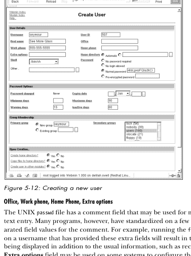

Figure 5-12: Creating a new user

## Office, Work phone, Home Phone, Extra options

The UNIX `passwd` file has a comment field that may be used for mostly free-form text entry. Many programs, however, have standardized on a few comma-separated field values for the comment. For example, running the `finger` command on a username that has provided these extra fields will result in these numbers being displayed in addition to the usual information, such as recent logins. The Extra options field may be used on some systems to configure the initial `umask`, `nice` level, and `ulimit` values for the user.

## Home directory

Users on a UNIX system generally have a directory that belongs to them called their home directory. Within their home directory, a user may read, write, delete, or execute files with no permissions restrictions. Quotas may limit the amount of space available to the user, but the user can otherwise work unrestricted in their home directory. The UNIX tradition places home directories in a partition labeled `/home`, with each user having their home directory named after their own username within it. For example, if our system has a user named `s1im` it would not be unreasonable to expect his home directory to be `/home/s1im`. As discussed previously, if you let it, Webmin will select the home directory for you based on the policy selected in the module configuration.

## Shell

UNIX 拥有非常悠久且多样的历史，并且针对任何给定任务都出现了大量相似的工具。 在命令 shell 的 proliferate 上这一点体现得最为明显。 今天，最流行的 shell 是 `bash` 或 Bourne Again Shell、`csh` 或 C shell，以及 `ksh` 或 Korn shell。 还有许多其他 shell 正在使用中，包括传统的 `sh` 或原始的 Bourne shell、`ash`、`zsh` 等等。 选择使用哪个 shell 非常个人化，不过大多数普通用户永远不会知道它们之间的区别。 除非有强有力的理由选择其他，否则将其保留在操作系统的默认设置下可能是明智的。 新用户将学习为他们提供的 shell，而经验丰富的用户将知道如何为自己选择替代 shell。

散布在真实用户 shell 中的是一些 shell 替代品，它们提供锁定用户或创建特殊用户以远程执行特定任务的能力。 根据操作系统，您可能拥有 `nologin` 或 `false` shell 选项，当用户尝试登录时它会简单地关闭连接。 其他可能性包括 `shutdown`，当用户登录时它会使系统关闭，前提是用户拥有关闭系统的适当权限。 同样，`sync` 用户将运行 `sync` 命令以使所有磁盘刷新未写入的数据。 这可在预期关机时使用，或作为确保某些重要数据已提交到磁盘的手段。 `sync` 在今天并不常见，因为现代 UNIX 系统在关机时会自动同步磁盘。

## 无需密码

此选项意味着用户无需提供密码即可登录。 您不希望对任何具有 shell 访问权限的用户使用此选项，因为这意味着任何可以访问登录提示或 `su` 命令的人都可以成为该用户。

## 不允许登录

如果设置为此选项，系统将永远不允许用户使用此用户名登录。 这通常用于系统用户，如 `syslog` 或 `nobody` 用户。 它也用于临时或永久锁定帐户，而不删除它。 这有助于防止用户和组 ID 的意外重复使用，这可能带来安全隐患。

## 普通密码

在此您可以以明文形式输入用户的


此选项意味着用户无需提供密码即可登录。您不希望对任何具有 shell 访问权限的用户使用此选项，因为这意味着任何可以访问登录提示或 `su` 命令的人都可以成为该用户。

## 不允许登录

如果设置为此选项，系统将永远不允许用户使用此用户名登录。这通常用于系统用户，如 `syslog` 或 `nobody` 用户。它也用于临时或永久锁定帐户，而不删除它。这有助于防止用户和组 ID 的意外重复使用，这可能带来安全隐患。

## 普通密码

在此您可以以明文形式输入用户的


## 服务器和守护进程配置

点击 Webmin 类别栏上的 Servers 选项卡，即可进入可能是 Webmin 页面中最有趣的部分。在这里可以配置各种复杂的服务器和守护进程。Webmin 为当今网络系统上使用的大量最流行的服务器和守护进程提供了标准模块，而且还在不断编写新的模块。

### 服务器简介

Servers Webmin 类别允许对系统上运行的服务器应用程序进行管理，这些应用程序为网络上的客户端提供某种服务。一个例子是 Apache Web 服务器守护进程。点击此类别中的 Apache 图标即可编辑 Apache 配置文件，这些文件通常位于 `/etc/httpd/conf`。Servers 中大多数模块都允许你编辑在 `/etc` 或其某个子目录中发现的某个配置文件。Webmin 最令人印象深刻的功能之一是能够让你在不破坏现有手工编辑的配置细节的情况下编辑文件。

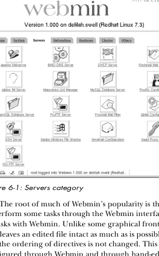

图 6-1：Servers 类别

Webmin 流行的大部分原因在于管理员可以通过 Webmin 界面执行某些任务，而不必被迫用 Webmin 完成所有任务。与 UNIX 系统的一些图形前端不同，Webmin 在最大程度上保持编辑后的文件完整。注释保持不变，指令的顺序也不会改变。这就产生了一个系统，可以通过 Webmin 和手工编辑配置文件进行配置，但两种方法之间没有冲突。

这一功能的副作用是，为了确保配置选项不会混淆并确保精明的管理员从 Webmin 输出中得到预期结果，Webmin 通常必须为配置文件提供一对一的界面。这意味着 Webmin 并不是管理 UNIX 系统的“更简单”方式。管理员仍必须理解他或她正在用 Webmin 管理的工具。例如，从 Webmin 配置 DNS 需要理解 `named` 及其所需的配置文件。同样适用于 `squid`、`httpd`、`sendmail` 等。Webmin 可以使学习过程稍微更快一些，因为所有选项都显示在屏幕上，而在配置文件中可能并非如此。


## APACHE WEB 服务器

Apache 模块被分成几个部分来处理 Apache 配置的不同方面。在主页面上，这些部分被分组为 Global Configuration 和 Virtual Servers 组。使用虚拟服务器，可以在单个 IP 地址上放置具有唯一域名 的多个网站，以便节约日益减少的 IPv4 地址空间。

在 Apache 模块的上下文中，Global Configuration 指的是将应用于由同一个 `httpd` 守护进程运行的所有虚拟主机的配置信息。通常在单台机器上运行不止一个 `httpd` 守护进程是不必要的，但这是可能的。通过模块克隆功能，也可以用 Webmin 管理多个这样的守护进程。

> NOTE 官方 Apache 文档 [http://httpd.apache.org/docs/] 是了解 Apache 及其模块的更多信息的良好来源。

### 全局配置

全局配置位于分割的 Apache 模块页面的上半部分，如图 7-1 所示。它提供了对将在所有虚拟服务器之间共享的各种选项的访问，例如要加载哪些模块、网络地址、MIME 类型等。在此处配置的选项将适用于每个虚拟服务器和默认服务器。要为某个特定虚拟服务器配置选项，必须在 Virtual Servers Configuration 部分中进行配置。

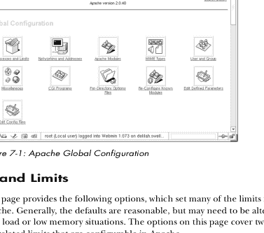

图 7-1：Apache 全局配置

### 进程和限制

此页面提供了以下选项，用于设置 Apache 的许多限制。通常默认值是合理的，但在高负载或低内存情况下可能需要更改。此页面上的选项涵盖了 Apache 中可配置的两个不同但相关的限制。

第一组限制与服务器将接受的请求头的长度或数量有关。请求头是指客户端发送给服务器以指示其希望接收的对象的所有信息。请求头中最重要的部分通常由 HTTP 方法（如 GET、POST、HEAD 等）、URI（所引用对象的完整路径和域名）以及 HTTP 协议版本号组成。

第二组限制指的是 Apache 的连接和进程特定限制。Apache 通常以所谓的每个连接一个进程模式运行，其中每个客户端到服务器的连接都由单个且独立的 `httpd` 进程提供服务。因此，要为 30 个同时客户端提供服务，系统将运行 30 个 Apache 进程。

### 最大请求头数

设置每个请求接受的最大请求头数。每次 Web 客户端（通常是 Web 浏览器）连接到 Web 服务器时，它都会包含请求头以指示有关编码能力、HTTP 版本支持、缓存控制、内容协商以及有关客户端代理的其他信息。随着 HTTP 标准和对 HTTP 协议的非标准扩展的开发，通常收到的请求头数量缓慢增加，但很少超过 20。Apache 配置文件中的 `LimitRequestFields` [http://www.apache.org/docs/mod/core.html#limitrequestfields] 指令由此选项修改，通常默认为 100。

通过限制接受的头数，可能可以防止某些类型的拒绝服务攻击，尽管在默认值下不太可能成为问题。它很少需要从默认值更改，除非客户端从服务器收到错误消息，指出请求中的头太多。

### 最大请求头大小

定义允许的最大头字段大小。Apache 为处理从客户端接收的头条目预留了一个缓冲区。此缓冲区必须足够大以完全包含单个头条目。`LimitRequestFieldSize` [http://www.apache.org/docs/mod/core.html#limitrequestfieldsize] 指令由此选项修改，通常默认为 8190，并且该值也是通常可能的最大值。值得注意的是，此选项的最大值取决于系统，并在 Apache 可执行文件构建时编译到其中。将此值提高到默认的 8190 以上可能在你的 Apache 上不受支持，并且在任何正常情况下都不应必要。

### 最大请求行大小

定义 HTTP 请求行的最大长度。请求行包含 HTTP 方法、完整 URL 和协议版本。接受的行大小需要足够长以包含系统上的任何资源名称，默认值通常是推荐的。此选项编辑 Apache 配置中的 `LimitRequestLine` [http://www.apache.org/docs/mod/core.html#limitrequestline] 指令，默认为 8190 字节，这也是该值的编译上限。

此选项很少需要从默认值更改，但可能有助于通过防止客户端应用程序用许多极大且复杂的请求行使服务器过载来防止某些类型的拒绝服务攻击。

### 最大并发请求数

允许的最大并发请求数。每个发往 Apache 的请求都会产生一个新的守护进程，这定义了为响应请求而产生的此类守护进程的上限。此选项与 `MaxClients` [http://www.apache.org/docs/mod/core.html#maxclients] 指令。

要配置超过 256 个，你可能需要编辑 `httpd.h` 中的 `HARD_SERVER_LIMIT` 条目并重新编译你的 Apache，除非已安装的软件包已经为高负载配置过，或者你在从源代码 tarball 构建 Apache 时已这样做。

除非在极高负载环境中，否则很少有必要将此值提高到非常高的水平。因为每个新进程都需要资源，以内存和 CPU 时间的形式，这可能会适得其反，导致服务变得响应更慢而不是更快。如果所有进程都忙，请求通常会被排队到下一节中讨论的监听队列长度所设定的限制。

## 每个服务器进程的最大请求数

每个子进程在被杀死并重新生成之前将处理的请求的最大数量。这有几个原因很有用。首先，如果存在任何意外的内存泄漏（在进程的任何地方，包括其模块），通过定期重启进程可以将其造成的损害降到最低。此外，如果不使用此选项，系统将始终保持曾经需要过的最大数量的进程，即使在低负载期间，处理请求所需的进程远少于该数量。此选项对应于 `MaxRequestsPerChild` [http://www.apache.org/docs/mod/core.html#maxrequestsperchild] 指令。

> NOTE
>
> 在 Keepalive 请求中，每个客户端的连接只计为一次请求。因此，如果客户端支持 Keepalive 请求，则在计数器递增之前，可能由同一客户端提供多个请求。在这种情况下，此指令的作用是限制每个进程的连接数，而非单个请求的数目。


## 最大空闲服务器进程数

这定义了将保持运行的未使用服务器进程的最大数量。此选项配置 `MaxSpareServers` [http://www.apache.org/docs/mod/core.html#maxspareservers] 指令，默认值为 10。通常无需调整此选项，除非在极高负载服务器上。

> **CAUTION**

> 尽管 Apache 历史上是一个编写相当稳健的程序，很少出现重大的内存泄漏，但 Apache 使用的许多共享模块可能并不像那样常用或经过充分测试。这些模块可能导致内存泄漏，即使 Apache `httpd` 进程本身不出现此类泄漏。

## 最小空闲服务器进程数

始终保持运行的子进程的最小数量。对于高负载服务器，这可能需要提高，而对于低内存和低负载系统，最好减少数量。此选项对应于 `MinSpareServers` [http://www.apache.org/docs/mod/core.html#minspareservers] 指令，默认值为 5。

> **CAUTION** *将上述两个选项提高到极端水平是一个非常常见的错误，当 Apache 安装的性能似乎迟缓时就会出现这种情况。这很少真正是问题的根源，但在新 Apache 管理员中似乎是一个流行的第一反应。Apache 性能调优在多个位置都有很好的文档记录，并且关于为特定操作系统平台调优的文档也在互联网上广泛可用。一个很好的起点是 Apache Performance Notes 页面 [http://httpd.apache.org/docs/misc/perf-tuning.html]。那里找到的文档将解决大多数用户可能遇到的几乎所有性能问题。*

## 初始服务器进程

`httpd` 启动时生成的子进程数量。对应于 `StartServers` [http://www.apache.org/docs/mod/core.html#startservers] 指令，默认值为 5。这通常不需要修改，除非在高负载服务器上。

## 显示扩展状态信息

如果服务器上启用了状态模块，打开此选项将跟踪每个请求的扩展状态信息，并在网页或机器可读格式中呈现它们。此选项编辑 `ExtendedStatus` [http://www.apache.org/docs/mod/mod_status.html] 指令。此选项需要加载 `mod_status` 模块。

> **NOTE** *要从正在运行的 Apache 服务器访问扩展状态信息，你可以浏览到地址 [http://www.yourdomain.com/server-status]。请注意，访问控制通常应配置为严格限制对该 URL 的访问，因为它可能包含有关你的 Web 服务器环境的敏感数据。*

启用扩展状态的 `mod_status` 提供的信息包括有关子进程数量和已连接客户端数量的统计数据、每秒处理的请求平均数、每个请求的平均字节数，以及每个 Apache 进程当前使用的 CPU 百分比。此数据的机器可读形式可以从 [http://www.yourdomain.com/server-status?auto] 收集。后者非常适合在脚本中使用，以自动从服务器收集统计数据。

> **CAUTION** *由于此类数据的持久性本质，此模块仅在 Apache 以独立模式运行时才有效，而在 `inetd` 模式下运行时无效。由于在 `inetd` 下运行 Apache 涉及大量问题，以及 `inetd` 本身固有的问题，最好完全避免使用 `inetd`。*

## 网络和地址

本节用于配置 Apache 将监听的网络地址和端口，以及一些其他访问限制、超时和队列选项（图 7-2）。

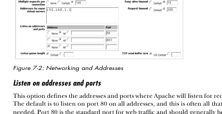

图 7.2：网络和地址

### 监听地址和端口

此选项定义 Apache 将监听请求的地址和端口。默认是监听所有地址的 80 端口，这通常已足够。端口 80 是 Web 流量的标准端口，通常应用于所有正常的 Web 流量。还可以在同一台机器上配置多个 Apache，使用不同的全局配置在不同的端口或地址上运行。此外，由于 1024 以下的端口是特权端口，没有管理员权限的普通用户运行 Apache 将不得不使用非标准端口运行。8080 是无特权系统用户运行 Web 服务器的常见端口，他们无法绑定到端口 80。有关这些选项的良好概述可在 设置 Apache 使用哪些地址和端口 [http://www.apache.org/docs/bind.html] 中找到。这些选项对应于 `Listen` [http://www.apache.org/docs/mod/core.html#listen] 和 `Port` [http://www.apache.org/docs/mod/core.html#port] 指令。

### 每个连接的多个请求

当 `KeepAlive` [http://www.apache.org/docs/mod/core.html#keepalive] 启用时，服务器将支持持久连接，这可以提高性能并为最终用户提供更好的体验。此选项设置每个客户端连接要处理的请求的最大数量。如果设置为 0，服务器将不对单个连接期间的请求数量施加限制。此选项对应于 `MaxKeepAliveRequests` [http://www.apache.org/docs/mod/core.html#maxkeepaliverequests] 指令。默认值通常为 100。

> **CAUTION** 如果你开发网站，请抵制依赖持久连接来维护状态的诱惑。持久连接在大多数浏览器客户端以及大多数 Web 服务器上变得可用带来的一个不幸影响是，一些 Web 应用程序和电子商务网站开发人员试图使用长寿命的持久连接来维护用户的购物车或其他状态信息。这种看似简单地跟踪用户的方法在现实世界中充满问题，而使用后端存储和 cookie 或类似会话 ID 信息正确地完成它所花费的时间将在你遇到的支持问题减少方面得到丰厚回报。滥用持久性导致的问题包括不支持持久性的旧 Web 代理中断连接，导致你的应用程序对代理后面的任何人都不工作。甚至一些网络地址转换设备和负载均衡系统可能会导致网站出现神秘的故障。这也是资源利用效率低下的一种方式，可能导致运行的服务器进程数量远多于为请求提供服务所需的数量。

### Keep-alive 超时

Apache 在关闭连接前等待后续请求的时间（以秒为单位）。此选项编辑 `KeepAliveTimeout` [http://www.apache.org/docs/mod/core.html#keepalivetimeout] 指令。默认值为 15 秒。如果此指令的值过大，可能会导致性能问题，因为许多客户端可能会保持与 Apache 进程的空闲连接处于打开状态，而这些进程无法退出或为其他用户处理请求，因此它们占用资源但保持空闲。

### 监听队列长度

待处理连接队列的最大长度。通常不需要或不希望进行调整，但在某些系统上，在遭受 TCP SYN Flood 攻击时，增加此值是可取的。如“进程和限制”部分所述，监听队列是无法立即处理的请求所存放的位置。如果超过此数字，后续请求将被丢弃。与 `ListenBacklog` [http://www.apache.org/docs/mod/core.html#listenbacklog] 指令相关。

### 名称虚拟主机的地址

此选项用于配置 Apache 监听对虚拟服务器的请求的 IP 地址。虚拟服务器是基于名称的服务器，其中多个不同的域名可以在同一 IP 地址上响应。例如，我在本地网络上运行两个测试服务器。一个名为 liberty，另一个名为 constitution。两者都在同一台服务器上运行，但它们在不同的命名地址上响应并提供不同的根目录。因此访问每个服务器会显示不同的网页。当然，这也适用于真实的域名（例如 www.nostarch.com 或 www.swelltech.com）。请注意，您的 DNS 服务器，或对您希望运行虚拟服务器的域具有权威性的 DNS 服务器，也必须为您运行的每个虚拟服务器提供条目，将其解析为您的服务器的 IP。还可以通过在地址后附加端口号（例如 192.168.1.1:8080）来指定给定名称虚拟服务器监听的不同端口，这将使 Apache 在给定 IP 上监听 8080 端口。此选项影响 `NameVirtualHost` [http://www.apache.org/docs/mod/core.html#namevirtualhost] 指令。本章后面提供了设置 Apache 虚拟主机的教程。有关 Apache 中虚拟服务器的另一个良好信息来源是 Apache 虚拟主机文档 [http://www.apache.org/docs/vhosts/index.html]。

### TCP 发送缓冲区大小

设置 TCP 数据包发送缓冲区的大小。通常将其保持在默认设置是安全的，默认设置由操作系统的默认值决定。此选项编辑 `SendBufferSize` [http://www.apache.org/docs/mod/core.html#sendbuffersize] 指令。

### 请求超时


定义 Apache 在连接建立后等待请求的最长时间（以秒为单位）。与 `Timeout` [http://www.apache.org/docs/mod/core.html#timeout] 指令相关。

## Apache 模块

Apache 采用模块化设计，因此基础服务器可以是一个小巧、易于调试的应用程序，同时可以通过加载额外的模块轻松添加几乎无限的额外功能。这样基础进程可以更小，并且只有需要的额外功能才会被加载。此 Webmin 模块允许您选择可用的 Apache 模块以供加载（图 7-3）。

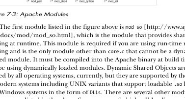

图 7-3：Apache 模块

上图中列出的第一个模块是 `mod_so` [http://www.apache.org/docs/mod/mod_so.html]，它是在运行时提供共享对象加载的模块。如果您使用运行时模块加载，则需要此模块，并且它是除 `core.c` 之外唯一不能作为动态加载模块的模块。如果您将使用动态加载的模块，则必须在构建时将其编译到 Apache 二进制文件中。并非所有操作系统都支持动态共享对象，目前，但它们被大多数现代系统支持，包括支持可加载 `.so` 库的 UNIX 变体以及以 `DLL` 形式存在的 Windows 系统。上图中列出了一些其他常用模块，其中一些将在下面讨论。了解更多关于可用标准模块和第三方模块的好地方是 Apache 模块 [http://www.apache.org/docs/mod/index.html] 和 Apache 模块注册表 [http://modules.apache.org/]。

配置的模块在 Apache 启动时加载到 Apache 进程中，因此可以在不重新编译服务器的情况下添加新模块。Apache 的模块化特性是其相对于其他 Web 服务器的主要优势之一。没有模块，Apache 只是一个普通的 Web 服务器。但由于模块相对容易编程，可用的种类已大量增加，为 Apache 提供了在任何其他 Web 服务器产品、商业或开源中都不可用的功能。

## 关于 Apache 模块

由于模块在 Apache Web 服务器的配置和管理中发挥着重要作用，值得暂时离开 Webmin，讨论 Apache 及其模块的一些底层细节。虽然本章在整个过程中讨论了通过 Webmin 使用这些模块，但对模块的概述将有助于将 Apache 的模块化结构置于适当的背景中，并 hopefully 使 Webmin 与底层配置文件之间的交互更加清晰。

> NOTE 官方 Apache 模块 [http://httpd.apache.org/docs/mod/] 文档页面是一个信息丰富、更全面的 Apache 发行版中包含的模块列表。这里只讨论最常用的模块及其用途。类似的页面涵盖了 Apache 2.0 模块 [http://httpd.apache.org/docs/2.0/mod/]。

## Apache 核心

Apache Core 模块 [http://httpd.apache.org/docs/mod/core.html] 提供了根据 `RFC 2616` 提供 Web 服务所需的基本功能。核心中的功能在任何 Apache 安装中始终可用，无论其他模块是否可用。大多数基本网络、系统和 HTTP 限制和功能由核心模块处理，并且许多配置指令无需额外模块即可使用。

## 多处理模块

从 Apache 版本 2.0 开始，系统增加了处理连接并发的新模型（或更准确地说，多个新模型）。Apache 2.0 之前的版本中使用的并发模型称为每个连接一个进程，并对其进行了预派生等增强。新版本提供了所谓的 Multi-Processing 模块，这使 Apache 能够使用对给定操作系统最有意义的并发模型。大多数 UNIX 和类 UNIX 系统使用名为 `worker` 的模块，该模块实现了一种混合模型，利用多线程进程池。

当 `worker` 模块启用时，Apache 运行一个单一的控制进程，负责启动子进程。子进程各自生成可配置的固定数量的线程，这些独立线程监听连接并提供服务。线程的开销更小，或资源消耗更少，因此具有给定容量的机器可以从 `worker` 风格的 Apache 获得比传统预派生 Apache 更高的吞吐量。这是开发新的 Apache 2.0 服务模块的主要动机之一。

如果您的 UNIX 变体不支持线程，或以不兼容的方式支持线程，Apache 很可能会改用 `prefork` 模型。Windows 机器很可能会使用 `mpm_winnt` 多处理模块，该模块创建一个单一的控制进程，该进程生成一个子进程，后者又创建线程来处理请求。由于 Webmin 目前仅在类 UNIX 操作系统上运行，您可能对 Windows 模块没有用处。

## `mod_access`

该模块提供基于客户端主机名、IP地址以及从客户端请求中获取的其他信息进行访问控制。此模块还提供了支持目录 `.htaccess` 文件以控制对服务器某些部分访问的功能。

## `mod_auth`

Apache 支持多种类型的用户认证。最古老且最常用的由本模块支持。它又被称为 HTTP 基本认证或 NCSA 认证。此方法从系统上的某个纯文本文件中对用户进行认证。密码文件可以使用随 Apache 提供的 `htpasswd` 程序生成。

> 注意 要使用 `htpasswd` 生成密码文件，只需使用 `-c` 选项运行该程序，后跟新文件名和要添加到文件中的第一个用户名：

```
[joe@delilah mydocs]$ htpasswd -c .htpasswd joe
```

此文件随后可由 `mod_auth` 模块用于基于该文件对用户进行认证。这必须在 Apache 配置文件或本地 `.htaccess` 文件中明确配置。创建 `.htaccess` 文件在本书本章的教程部分进行了讨论。

## `mod_cgi`

必须使用 CGI 模块才能在服务器上运行脚本或程序，以为用户动态生成内容。可以配置在运行时由 CGI 模块处理的文件类型。CGI 模块的配置可以针对虚拟主机单独处理，也可以全局应用于服务器上的所有虚拟主机，或是全局默认值与某些虚拟主机中的特定差异相结合。

## `mod_expires`

HTTP 规范定义了一组客户端和中间设备（具体来说是网络缓存代理，如 `Squid`）在决定是否提供缓存文档、重新验证对象或获取新副本时应遵循的规则。网站维护者用于规定对任何给定对象的这些决策结果的主要方法是 `Expires` 头。此模块提供了一种灵活且简单的方法来配置服务器范围、按目录或按文件类型的设置。

## `mod_rewrite`

该模块提供了一种极其灵活（有些人会说过于灵活）的方式，根据请求中包含的信息将用户请求重定向到不同的 URL。该模块的基础是基于正则表达式的解析器和重写引擎。URL 更改可以取决于多种额外数据，包括环境变量、客户端头、时间、外部数据库查询等。

> **注意** *要完全理解 URL 重写，花时间研究 Ralf Engelschall 编写的 URL 重写指南 [http://httpd.apache.org/docs-2.0/misc/rewriteguide.html] 可能很有价值，他是 `mod_rewrite` 模块的原始作者。*

## `mod_ssl`

通常，HTTP 协议未加密，因此在请求路径的任何阶段都无法防止窥探。通常这没问题，而且这种类型的 *中间人* 安全问题极其罕见（因为绝大多数 ISP 和骨干管理员都是诚实的人，没有窥探你网页浏览习惯的倾向）。然而，对于极其私密的事情，如网上银行、投资或在线购物，拥有更安全的通信方式很重要。解决方案是 *安全套接层*，也称为 SSL。开源实现称为 `OpenSSL`，它是 `mod_ssl` Apache 模块的核心。

要使用 SSL 连接，你必须从多个 *证书颁发机构* 之一生成或购买 SSL 证书。本地生成的证书可用于公司内部认证，或用于你已与之建立信任关系的一小部分用户。然而，如果你的安全站点将由许多与你没有直接关系的用户使用，则需要来自受信任的证书颁发机构的证书，以便用户知道该站点确实由其声称的运营者运营。

> **注意** *证书颁发机构，或通常称为 CAs，受大多数现代浏览器支持包括 VeriSign [http://www.verisign.com/]、GeoTrust [http://www.geotrust.com/] 和 Thawte Consulting [http://www.thawte.com/] 在美国。美国以外的选项包括 Internet Publishing Services [http://www.ips.es/] 和 BelSign [http://www.belsign.be/]。*

## `mod_suexec`


在许多网络托管环境中，单个服务器由多个用户共享，不合适让所有用户的文件被任何其他用户查看。因为 CGI 脚本默认以 Web 服务器本身的权限运行，而 Web 服务器必须能够访问所有内容和脚本，所以恶意用户可能使用 CGI 脚本来浏览任何其他用户私有目录的内容，并以 Apache 作为中介。为了解决虚拟托管环境中的此问题，服务器可以配置为以指定用户而不是更特权的 Apache 用户（通常是 nobody）身份运行 CGI 脚本。此模块通过在运行 CGI 脚本时对创建的进程执行 suexec 功能使此功能成为可能。此解决方案存在一定的复杂性，并且有许多安全陷阱需要注意，但它是提供具有 CGI 脚本功能的受保护虚拟托管环境所必需的一步。

## MIME Types

MIME 类型是服务器及其客户端识别给定对象的数据类型的方法。此信息通常对客户端更重要，因为它们必须知道如何解释数据，而服务器只需连同 MIME 标识信息一起将其发送给客户端。MIME，即多用途互联网邮件扩展，最初定义为通过电子邮件轻松发送除文本以外的数据。现在它已成为许多类型网络连接声明数据类型标准的标准方法。MIME 类型模块仅提供当前接受的 MIME 类型及其可选扩展的列表。在页面底部，添加 MIME 类型 链接允许你轻松添加新的 MIME 类型（图 7-4）。

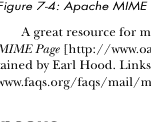

图 7-4：Apache MIME 类型

关于 MIME 类型的更多信息的一个很好的资源可以在 Earl Hood 维护的 MIME 页面 [http://www.oac.uci.edu/indiv/ehood/MIME/MIME.html] 找到。相关 RFC 的链接以及 MIME FAQ [http://www.faqs.org/faqs/mail/mime-faq/mime-0/] 也可在那里找到。

## Miscellaneous

杂项选项页面就是它听起来像的那样（图 7-5）。它是那些似乎无处可放的全局选项。因此，此页面上的字段并不多，但尽管如此仍有一些有趣的项目。

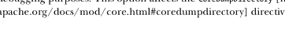

图 7-5：Apache 杂项页面

### Core dump directory

这是 Apache 在崩溃时发送其核心转储文件的目录。默认情况下它将与 Apache 服务器的根目录相同。然而，服务器进程通常没有对该目录的写入权限，因此为了在崩溃时获取核心转储，有必要将其更改为 Apache 进程可写入的目录。核心转储通常用于调试目的。此选项影响 `CoreDumpDirectory` [http://www.apache.org/docs/mod/core.html#coredumpdirectory] 指令。

### Server lock file

这设置 Apache 的锁文件的位置，文件名为指定名称。锁文件是用于通知进程的新实例已有实例正在运行的文件。这可以防止 Apache 在已运行时再次尝试启动，使用相同的配置。请注意，如果你使用不同的配置和不同的锁文件，可以启动多个 Apache 实例。此选项对应于 `LockFile` [http://www.apache.org/docs/mod/core.html#lockfile] 指令。

### Server PID file

Apache 的 PID 文件。编辑 `PidFile` [http://www.apache.org/docs/mod/core.html#pidfile] 指令。

### Shared memory scoreboard file

某些架构需要一个文件供子进程和父进程通信。出于性能考虑，可以将其放在 RAM 磁盘上。这对应于 `ScoreboardFile` [http://www.apache.org/docs/mod/core.html#scoreboardfile] 指令。

### Server HTTP header

此选项允许你设置将包含在 HTTP 头中的数据。这对应于 `ServerTokens` [http://www.apache.org/docs/mod/core.html#servertokens] 指令。

### Server execution

定义服务器将如何启动。Standalone 表示它将作为独立守护进程运行，而 Run from inetd 将导致它由 inetd 守护进程调用时定期运行。强烈建议避免使用 inetd 选项，因为它并不总是按预期工作。此选项编辑 `ServerType` [http://www.apache.org/docs/mod/core.html#servertype] 指令。

## CGI Programs

CGI，即通用网关接口，为网站提供了一种在网页上拥有动态、程序生成内容的方法。CGI 程序可以通过使用输入字段与用户交互，并可根据返回的信息提供不同的数据。CGI 程序可以用几乎任何语言编写，尽管最常见的是用 Perl、PHP、Python、Java、C 以及 bash 或其他 shell 脚本语言编写。CGI 程序模块提供了一个接口到 Apache 的全局 CGI 选项（图 7-6）。


图 7-6：Apache CGI 程序

## CGI 脚本日志

是 CGI 脚本错误日志文件的日志目录。如果未给出，则不创建日志。编辑位于 [http://www.apache.org/docs/mod/mod_cgi.html#scriptlog] 的 `ScriptLog` 指令。

## 最大记录的 POST 数据大小

写入错误日志文件的 CGI 脚本的 PUT 或 POST 请求的数据大小可以限制，因为 PUT 和 POST 请求可能非常大。默认值为 1024 字节。此选项与 `ScriptLogBuffer` [http://www.apache.org/docs/mod/mod_cgi.html#scriptlogbuffer] 指令相关。

## 最大 CGI 日志 POST 大小

限制 CGI 脚本日志文件的大小。当日志文件超过此大小时，不会再向日志文件写入更多错误。与 `ScriptLogLength` [http://www.apache.org/docs/mod/mod_cgi.html#scriptloglength] 指令相对应。

## 基于浏览器类型的变量设置

如果服务器应根据客户端浏览器类型以不同方式设置某些环境变量，则可以在此处输入该数据。此选项编辑 `BrowserMatch` [http://www.apache.org/docs/mod/mod_setenvif.html#BrowserMatch] 指令。请注意，使用这些功能时应加载 `mod_setenvif` 和 `mod_browser` 模块。

## 基于请求头的变量设置

允许您根据请求的属性设置环境变量。这对应于 `SetEnvIf` [http://www.apache.org/docs/mod/mod_setenvif.html#SetEnvIf] 指令。

## 每目录选项文件

Apache 提供了按目录修改许多全局设置的能力（图 7-7）。该模块提供了访问该功能。只需在字段中输入路径和文件名，然后单击创建选项文件，即可为目录创建选项文件。按照惯例，这些文件称为 `.htaccess`，但这在 Apache 中是可配置的。此文件还允许配置每目录身份验证以及其他访问控制功能。有关选项文件的更多信息可在 Apache 文档中 `Options` [http://www.apache.org/docs/mod/core.html#options] 指令下找到。

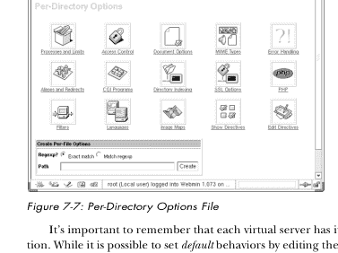

图 7-7：每目录选项文件

## 虚拟服务器

Apache 页面下半部分包含已配置的虚拟服务器列表（图 7-8）。此页面上的每个虚拟服务器条目显示虚拟服务器监听的地址和端口、服务器名称以及文档根。单击虚拟服务器的图标将带您进入一个页面，其中包含许多新选项以及在前面讨论的全局部分中找到的许多相同选项。重复自该部分的部分选项通常行为相同，因此不再赘述。

重要的是要记住，每个虚拟服务器都有自己的配置。虽然可以通过编辑默认服务器（虚拟服务器列表中的第一个）来设置默认行为，但每个虚拟服务器都可能具有覆盖默认行为的配置指令。每个都可以拥有自己的目录结构、服务器设置、MIME 类型、日志配置等。Apache 提供了近乎无限的选项，其中大多数可以应用于任何单个虚拟服务器，也可以应用于整个服务器。

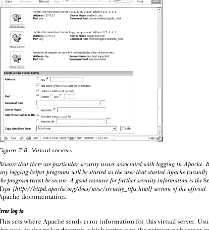

图 7-8：虚拟服务器

## 日志文件

日志提供了了解 Web 服务器运行情况的窗口，Apache 提供了强大的日志选项集，以便您可以跟上服务器的动态。简而言之，Apache 允许您将每个虚拟主机配置为好像是独立的服务器一样。这包括将信息独立记录到单独文件并以自定义格式记录的能力。


**CAUTION** 请注意，Apache 中的日志记录存在特定的安全问题。因为任何日志辅助程序都将作为启动 Apache 的用户（通常是 `root`）启动，所以该程序必须安全。有关进一步安全信息的良好资源是官方 Apache 文档中的 Security Tips [`http://httpd.apache.org/docs/misc/security_tips.html`] 部分。

## 错误日志到

这设置了 Apache 为此虚拟服务器发送错误信息的位置。通常这会发送到 `syslog` 守护进程，后者将其写入主 Web 服务器错误日志。然而，Apache 可以将此发送到备用日志程序或文件。此选项配置 `ErrorLog` [`http://www.apache.org/docs/mod/core.html#errorlog`] 指令，通常默认为记录到 `syslog` 守护进程（如果可用）。

## 浏览器日志文件

在此，您可以定义 Apache 是否将访问 Web 服务器的用户代理（浏览器，最常见，不过机器人和自动下载器也会出现）的日志保留下来。此信息通常只有短暂的兴趣，除非您考虑实施与某些浏览器不兼容的技术（如 Flash、Shockwave 以及大量鲜为人知且甚至不太可访问的数据格式）。查看这些日志通常会提醒您此类技术可能会疏远您客户的百分比。默认情况下不会记录代理信息。此选项配置 `AgentLog` [`http://www.apache.org/docs/mod/mod_log_agent.html#agentlog`] 指令。

## 默认日志格式

此选项允许您配置 Apache 以任意选择的格式写入日志。如果您希望 Apache 以通用日志格式记录，您只需将其保留为默认值。然而，要以不同方式记录，您将选择格式选项并在字段中填写命名日志格式的昵称（下面讨论）或日志格式字符串。此选项配置 `CustomLog` 指令。[`http://www.apache.org/docs/mod/mod_log_config.html#customlog`]

## 命名日志格式

命名日志格式是上面讨论的自定义日志格式，已被定义并被赋予昵称以供其他日志指令使用。自定义日志格式是通过输入一系列变量来创建，以指示应存在的数据字段及其出现的顺序。例如，一个模仿通用日志格式的自定义日志类型如下所示：

```
%h %l %u %t \"%r\" %>s %b
```

此选项配置 `LogFormat` [`http://www.apache.org/docs/mod/mod_log_config.html#logformat`] 指令。

## 访问日志文件

在此，您可以定义 Apache 发送日志到的附加位置、格式或程序。配置方式与上面的默认日志类似，只是您可以拥有任意数量的访问日志文件。这允许您例如将图像访问记录到单独的文件，或将访问记录到另一种格式以供处理和分析。此选项与 `TransferLog` [`http://www.apache.org/docs/mod/mod_log_config.html#transferlog`] 指令相关。请注意，影响所有其他日志指令的相同安全影响也影响此选项。

## 不记录引用的来源

此选项将提供的主机名添加到一个列表中，引荐信息将不会从这些主机记录。例如，如果我想让我的位于 `penguinfeet.org` 的 Web 服务器忽略来自我的另一个网页 `swelltech.com` 的引荐，我会在此处输入 `swelltech.com`。然后，我的统计数据就不会因来自我自己页面的大量引荐而失真。此选项与 `RefererIgnore` [`http://www.apache.org/docs/mod/mod_log_referer.html#refererignore`] 指令相关。

## 引荐日志文件

在此定义引荐信息记录到的位置。这可以是文件或程序。此选项配置 `RefererLog` [`http://www.apache.org/docs/mod/mod_log_referer.html#refererlog`] 指令。

## 文档选项

在此，您可以访问许多会影响权限、位置和行为的虚拟服务器特定选项。

此页面的第一个字段没有标签。它是文档根目录。这通常在虚拟服务器创建时设置，并且由 Webmin 自动创建。此选项与 `DocumentRoot` [`http://www.apache.org/docs/mod/core.html#documentroot`] 指令相关。

## 用户 WWW 目录

在此，您配置用户可通过 Apache 发布 HTML 文档的位置。语法有几种形式，可执行不同类型的扩展以创建实际路径。首先，`htmldocs` 形式的相对链接对于用户 `joe` 翻译为 `joe/htmldocs`。绝对链接，例如 `/usr/htmldocs`，将翻译为 `/usr/htmldocs/joe`。最后，可以使用 `*` 表示用户名进行翻译。例如，`/home/*/htmldocs` 将翻译为 `/home/joe/htmldocs`。此选项配置 `UserDir` [`http://www.apache.org/docs/mod/mod_userdir.html#userdir`] 指令。

以下字段是与上述用户 WWW 目录选项连接的延续选项。它们控制将对哪些用户的目录执行翻译。选择所有用户可访问意味着对于 URL 中输入的任何用户名，翻译将发生并且用户的 Web 目录可浏览。所有用户除外允许您禁止某些用户，而其余用户将被翻译。这可用于例如禁用违反服务条款的用户的网站。最后，只有明确命名的用户才会执行目录翻译。

## 每目录选项文件

在此，您可以指定一个文件名以检查目录访问选项。除非在 Apache 配置的其他地方被禁止，否则在此名称的任何目录中找到的文件中的选项将覆盖该目录的默认权限。例如，如果我选择文件名 `.acl`，并在我的一个目录中创建了这样一个文件，其中包含生成目录索引的指令，那么对于该目录将生成此类索引。即使默认是不生成索引也是如此。如果您正在运行虚拟主机服务器，这可以让您的用户在不干扰或更改同一服务器上其他站点行为的情况下，对其个人站点的 Web 服务器行为拥有一定自由度。这可以被视为 Apache 可配置性洋葱的一层或多层。此选项配置 `AccessFileName` 指令，默认为 `.htaccess`。

## 目录选项

在此，您可以选择为此目录使用默认选项。这会影响虚拟服务器的根目录和所有子目录，除非它们包含如上所述的 Per-directory options file 部分中讨论的 `AccessFileName` 文件。此选项与 `Options` [`http://www.apache.org/docs/mod/core.html#options`] 指令相关，默认为 `all`，除 `Generate Multiviews` 外。

可用的目录选项如下：

- `执行 CGI 程序` 允许执行位于此目录中的 CGI 脚本。
- `跟随符号链接` 服务器将跟随此目录中的符号链接。这与 `ExecCGI` 指令相关。
- `服务器端包含和执行` 允许服务器端包含。这与 `FollowSymLinks` 指令相关。
- `服务器端包含` 允许服务器端包含，但禁止 `#exec` 命令以及对 CGI 脚本使用 `#include`。这与 `IncludesNOEXEC` 指令相关。
- `生成目录索引` 当 URL 映射到目录中且没有索引 HTML 文件时（通常是 `index.html`，但此项为可配置选项），Apache 可以为该目录生成格式化的文件列表。此选项与 `Indexes` 指令相关。
- `生成 Multiviews` 允许内容协商的 `multiviews`。这允许以同一 URL 引用多种语言、字符集和呈现形式。然后客户端浏览器会与服务器协商以选择适合用户的版本。更多信息请参阅内容协商 [`http://httpd.apache.org/docs/content-negotiation.html`]。此选项与 `MultiViews` 指令相关。
- `仅在所有者匹配时跟随符号链接` Apache 仅会跟随目标文件或目录的所有权与链接相匹配的符号链接。此选项与 `SymLinksIfOwnerMatch` 指令相关。

请注意，如果多个项目适用（从父目录继承），则特定于所选目录的项目适用，除非选择了与父目录合并。例如，如果 `/home/httpd/penguinfoet` 具有所有权限，但子目录 `/home/httpd/penguinfoet/users` 只有 `ExecCGI`，则该目录仅具有执行 CGI 选项可用。与父目录合并后，子目录将获得与父目录相同的选项，除非明确关闭。

## 生成 MD5 摘要


## 生成 MD5 摘要

此选项打开生成 `Content-MD5` 摘要头的功能。启用后，Apache 将为每个提供的静态页面生成消息摘要或指纹。使用 MD5 摘要时，客户端可以非常确信地保证，如果内容在从源服务器传输过程中被更改，这些更改将反映在消息摘要的更改中。`Content-MD5` 标准在 RFC 1864 [`http://www.ietf.org/rfc/rfc1864.txt?number=1864`] 和 RFC 2616 [`http://www.ietf.org/rfc/rfc2616.txt?number=2616`] 中有描述。此选项配置 `ContentDigest` [`http://httpd.apache.org/docs/mod/core.html#contentdigest`] 指令。请注意，此选项可能存在性能影响，因为摘要是为每个请求生成的，并且由模块提供的请求不会创建摘要。

## 从以下生成 ETag 头

`ETag` 是 HTTP 响应头，用于提供区分具有相同 URL 的两个或多个对象的方式。该头对执行缓存的中间设备以及缓存结果的客户端浏览器很有用。使用 `ETag`，可以将对象唯一标识给客户端。通常，Apache 根据文件的 i-node 编号、文件的最后修改时间和文件的大小生成 `ETag`。如果选择选择属性，则可以从中选择任意或全部这些标准。此选项与 `FileETag` [`http://httpd.apache.org/docs/mod/core.html#fileetag`] 指令相关。

## 虚拟服务器路径

非常旧的浏览器和代理无法寻址基于名称的虚拟服务器，只能通过其 IP 请求站点。这导致了不幸的效果，即这些浏览器只能访问给定 IP 上的默认网站。解决此问题的变通方法是为默认服务器提供通往每个虚拟服务器的路径。使用此指令，您可以定义此特定虚拟服务器在默认服务器路径中的位置。因此，如果我的虚拟服务器 `www.penguinfeet.org` 位于 IP `123.45.67.89` 的服务器上，并且旧浏览器访问该名称，它将最终浏览到主机上的默认服务器 — 该服务器可以为用户提供指向托管在此服务器上的虚拟服务器的链接列表。如果将其设置为 `/penguinfeet`，则链接将把用户带到 `http://www.penguinfeet.org/penguinfeet/`，这就是正确的页面！不算漂亮，但网络并不总是像今天这样经过深思熟虑。谁能责怪网络的原始设计者没有意识到有一天每个人都会拥有自己的域名！好消息是，那些旧的网络客户端在统计上已不再使用（它们根本不会出现在我的 Web 服务器日志中；因人而异）。此选项配置 `ServerPath` [`http://httpd.apache.org/docs/mod/core.html#serverpath`] 指令。有关虚拟主机和潜在问题的更多信息，请参阅 Apache 虚拟主机文档 [`http://httpd.apache.org/docs/vhosts/`]。

## 错误消息页脚

此选项允许您为所有服务器生成的文档（例如错误页面、`mod_proxy` ftp 目录列表、`mod_info` 输出等）添加页脚。这通常仅在 Apache 充当代理时才需要，因为它在发现多重代理链中错误消息的来源时最有用。此选项配置 `ServerSignature` [`http://httpd.apache.org/docs/mod/core.html#serversignature`] 指令，默认值为 `Off`。

## 自动纠正拼写错误的 URL？

此选项配置 Apache 是否尝试纠正用户在 URL 中的拼写错误。如果启用，并且 URL 与服务器上的文档不匹配，将会检查所有可能匹配用户请求的对象。如果找到一个与用户请求非常接近的对象 — 例如，大写不正确但对象拼写正确或仅缺少一个字母 — Apache 将静默将用户重定向到更正后的 URL。如果找到多个可能的匹配项，用户将被重定向到包含可能页面的列表的页面，以便他们可以选择正确的页面。如果未找到可能的匹配项，请求将遍历正常的错误路径并导致 `404` 未找到错误。此选项与 `CheckSpelling` [`http://httpd.apache.org/docs/mod/mod_speling.html#checkspelling`] 指令相关，默认值为 `Off`。

## 错误处理

在服务器错误的情况下，Apache 可以配置为提供自定义错误消息，或重定向到本地或外部 URL，或默认输出简单的硬编码错误消息。在此，您可以配置希望提供自定义消息的任何错误类型。例如，如果您想要一个自定义的 `404` 消息，将用户引导至本地站点搜索页面（这是一种方便且礼貌的做法），您可以在此页面上完成。要配置 Apache 的自定义错误响应功能，只需输入错误代码，然后输入要显示的 URL 或消息。有关此功能的更多信息，请参阅自定义错误响应文档 [`http://httpd.apache.org/docs/custom-error.html`]。

## 用户和组

此页面配置 Apache 服务器将运行的用户和组。这设置了 Apache 和子进程在操作时的权限。强烈建议您将其设置为权限尽可能小的用户和组（同时仍允许服务器完成其工作）。在许多 UNIX 操作系统中，这通常配置为 `nobody` 和 `nogroup`，在大多数情况下这是一个不错的选择。除非您确切知道自己在做什么以及这样做的

## 可用的目录选项

- **执行 CGI 程序** 允许执行位于此目录中的 CGI 脚本。
- **跟随符号链接** 服务器将跟随此目录中的符号链接。这与 `ExecCGI` 指令相关。
- **服务器端包含和执行** 允许服务器端包含。这与 `FollowSymLinks` 指令相关。
- **服务器端包含** 允许服务器端包含，但禁止 `#exec` 命令以及对 CGI 脚本使用 `#include`。这与 `IncludesNOEXEC` 指令相关。
- **生成目录索引** 当 URL 映射到目录中且没有索引 HTML 文件时（通常是 `index.html`，但此项为可配置选项），Apache 可以为该目录生成格式化的文件列表。此选项与 `Indexes` 指令相关。
- **生成 Multiviews** 允许内容协商的 `multiviews`。这允许以同一 URL 引用多种语言、字符集和呈现形式。然后客户端浏览器会与服务器协商以选择适合用户的版本。更多信息请参阅内容协商 [`http://httpd.apache.org/docs/content-negotiation.html`]。此选项与 `MultiViews` 指令相关。
- **仅在所有者匹配时跟随符号链接** Apache 仅会跟随目标文件或目录的所有权与链接相匹配的符号链接。此选项与 `SymLinksIfOwnerMatch` 指令相关。

请注意，如果多个项目适用（从父目录继承），则特定于所选目录的项目适用，除非选择了与父目录合并。例如，如果 `/home/httpd/penguinfoet` 具有所有权限，但子目录 `/home/httpd/penguinfoet/users` 只有 `ExecCGI`，则该目录仅具有执行 CGI 选项可用。与父目录合并后，子目录将获得与父目录相同的选项，除非明确关闭。


非常旧的浏览器和代理无法寻址基于名称的虚拟服务器，只能通过其 IP 请求站点。这导致了不幸的效果，即这些浏览器只能访问给定 IP 上的默认网站。解决此问题的变通方法是为默认服务器提供通往每个虚拟服务器的路径。使用此指令，您可以定义此特定虚拟服务器在默认服务器路径中的位置。因此，如果我的虚拟服务器 `www.penguinfeet.org` 位于 IP `123.45.67.89` 的服务器上，并且旧浏览器访问该名称，它将最终浏览到主机上的默认服务器 — 该服务器可以为用户提供指向托管在此服务器上的虚拟服务器的链接列表。如果将其设置为 `/penguinfeet`，则链接将把用户带到 `http://www.penguinfeet.org/penguinfeet/`，这就是正确的页面！不算漂亮，但网络并不总是像今天这样经过深思熟虑。谁能责怪网络的原始设计者没有意识到有一天每个人都会拥有自己的域名！好消息是，那些旧的网络客户端在统计上已不再使用（它们根本不会出现在我的 Web 服务器日志中；因人而异）。此选项配置 `ServerPath` [`http://httpd.apache.org/docs/mod/core.html#serverpath`] 指令。有关虚拟主机和潜在问题的更多信息，请参阅 Apache 虚拟主机文档 [`http://httpd.apache.org/docs/vhosts/`]。

## 错误消息页脚

此选项允许您为所有服务器生成的文档（例如错误页面、`mod_proxy` ftp 目录列表、`mod_info` 输出等）添加页脚。这通常仅在 Apache 充当代理时才需要，因为它在发现多重代理链中错误消息的来源时最有用。此选项配置 `ServerSignature` [`http://httpd.apache.org/docs/mod/core.html#serversignature`] 指令，默认值为 Off。

## 自动纠正拼写错误的 URL？

此选项配置 Apache 是否尝试纠正用户在 URL 中的拼写错误。如果启用，并且 URL 与服务器上的文档不匹配，将会检查所有可能匹配用户请求的对象。如果找到一个与用户请求非常接近的对象 — 例如，大写不正确但对象拼写正确或仅缺少一个字母 — Apache 将静默将用户重定向到更正后的 URL。如果找到多个可能的匹配项，用户将被重定向到包含可能页面的列表的页面，以便他们可以选择正确的页面。如果未找到可能的匹配项，请求将遍历正常的错误路径并导致 404 未找到错误。此选项与 `CheckSpelling` [`http://httpd.apache.org/docs/mod/mod_speling.html#checkspelling`] 指令相关，默认值为 Off。

## 错误处理

在服务器错误的情况下，Apache 可以配置为提供自定义错误消息，或重定向到本地或外部 URL，或默认输出简单的硬编码错误消息。在此，您可以配置希望提供自定义消息的任何错误类型。例如，如果您想要一个自定义的 404 消息，将用户引导至本地站点搜索页面（这是一种方便且礼貌的做法），您可以在此页面上完成。要配置 Apache 的自定义错误响应功能，只需输入错误代码，然后输入要显示的 URL 或消息。有关此功能的更多信息，请参阅自定义错误响应文档 [`http://httpd.apache.org/docs/custom-error.html`]。

## 用户和组

此页面配置 Apache 服务器将运行的用户和组。这设置了 Apache 和子进程在操作时的权限。强烈建议您将其设置为权限尽可能小的用户和组（同时仍允许服务器完成其工作）。在许多 UNIX 操作系统中，这通常配置为 `nobody` 和 `nogroup`，在大多数情况下这是一个不错的选择。除非您确切知道自己在做什么以及这样做的安全影响，否则不要将其设置为 `root`。请注意，如果 Apache 父进程以 `root` 启动，它将保持为 `root`，而实际提供请求的子进程将以此处设置的用户和组运行。如果父进程由非 `root` 用户启动，Apache 将无法 `su` 到另一个用户，因此将以启动进程的用户运行。此选项配置 `User` [`http://httpd.apache.org/docs/mod/core.html#user`] 和 `Group` [`http://httpd.apache.org/docs/mod/core.html#group`] 指令。

## 别名和重定向

Apache 提供多种别名和重定向形式。这允许您在 URL 中为用户提供更统一或更简单的路径，以及从服务器根目录之外提供对象。它还允许您在过渡期间将用户重定向到新网站，或在目录结构更改时将浏览器定向到正确的链接。

### 文档目录别名

这允许对象存储在根目录以外的目录中。请注意，以 `/` 结尾的别名要求请求的 URL 中包含斜杠才能被翻译。此选项与 `Alias` [`http://httpd.apache.org/docs/mod/mod_alias.html#alias`] 指令相关。

### Regexp 文档目录别名

此选项与上面非常相似，只是它允许使用正则表达式来匹配要翻译的路径。此选项对应于 `AliasMatch` [`http://httpd.apache.org/docs/mod/mod_alias.html#aliasmatch`] 指令。有关正则表达式的更多信息，请参阅 `regex` 手册页。

### URL 重定向

此选项将旧 URL 重定向到新 URL。新 URL 将返回给客户端，客户端将尝试使用新地址再次获取。您还可以为重定向指定状态消息，可以是以下所述的几个 HTTP 状态代码之一。此选项配置 `Redirect` [`http://httpd.apache.org/docs/mod/mod_alias.html#redirect`] 指令。

### 重定向状态代码

| Code | Description |
|------|-------------|
| 301 | 永久移动。 |
| 302 | 临时移动。 |
| 303 | 查看其他，意味着资源已被替换。 |
| 410 | 对象不再可用。使用此状态时，重定向 To URL 应省略。 |

### Regexp URL 重定向

此选项的行为与上面完全相同，只是 From 字段可以包含用于匹配的正则表达式。此选项对应于 `RedirectMatch` [`http://httpd.apache.org/docs/mod/mod_alias.html#redirectmatch`] 指令。

### 永久 URL 重定向

此选项的行为与上面 URL 重定向相同，状态为 301（永久移动）。对应于 `RedirectPermanent` [`http://httpd.apache.org/docs/mod/mod_alias.html#redirectperm`] 指令。

### 临时 URL 重定向

此选项的行为与上面 URL 重定向相同，状态为 302（临时移动）。对应于 `RedirectTemp` [`http://httpd.apache.org/docs/mod/mod_proxy.html#redirecttemp`] 指令。

### 将本地映射到远程 URL

此选项允许将远程服务器映射到本地服务器的空间上；本地服务器不充当常规代理，而是看起来是远程服务器的镜像。例如，如果本地 URL 为 `/mirror/otherdomain` 而远程 URL 为 `http://www.otherdomain.com`，则用户将能够通过 `http://www.thisdomain.com/mirror/otherdomain` 访问 `http://www.otherdomain.com`。此选项对应于 `ProxyPass` [`http://httpd.apache.org/docs/mod/mod_proxy.html#proxypass`] 指令。

### 将远程 Location 头映射到本地

此选项提供与上一个选项大致相反的功能。它调整 HTTP 间接响应的 location 头，这在使用 Apache 作为反向代理时是必要的，以避免反向代理被重定向请求绕过。此选项配置 `ProxyPassReverse` [`http://httpd.apache.org/docs/mod/mod_proxy.html#proxypassreverse`] 指令。

## 目录索引

Apache 中的索引只是在客户端浏览服务器上的目录而不是对象或文档时显示的页面。例如，如果有人浏览我服务器上的 Squid 补丁目录，该目录位于 `http://www.swelttech.com/pengies/joe/patches/`，Apache 将提供一个索引页面。如果目录中没有与 Apache 的索引页面定义匹配的文件，它将改为生成包含文件列表的索引页面，或者如果禁止生成索引，则提供错误页面。此页面允许您配置 Apache 在显示索引页面时的行为。

### 目录索引选项

此选项设置 Apache 生成的索引的外观和包含的信息。此选项配置 `IndexOptions` [`http://httpd.apache.org/docs/mod/mod_autoindex.html#indexoptions`] 指令。以下选项可用：


## 显示花哨的目录索引
这会打开目录的花哨索引，这意味着文件和目录将提供图标。这配置了 `FancyIndexing` 子指令。

## 显示 HTML 标题作为描述
如果目录中的文件包含 HTML 标题信息，则这些标题将作为其各自文件的名称显示。此选项配置 `ScanHTMLTitles` 子指令。

## 图标高度
这设置花哨目录列表中图标的高度。这对应于 `IconHeight` 子指令。

## 图标宽度
这设置花哨目录列表中图标的宽度。这对应于 `IconWidth` 子指令。

## 允许用户对列进行排序
默认情况下，Apache 将生成可通过单击列标题进行排序的列表。如果您不希望用户能够按最后修改日期或大小排序，则可以禁用此功能，且不会提供排序链接。此选项配置 `SuppressColumnSorting` 子指令。

## 显示文件描述
启用此项以在花哨的索引列表中显示文件的描述。此选项对应于 `SuppressDescription` 子指令。

## 输出 HTML 头部标签
如果使用头部文件（也在此页面配置）用于目录索引，您可以选择允许 Apache 输出包含足够内容以开始合法 HTML 页面的标准 HTML 前言。如果禁用此项，您的头部必须包含自己的前言才能成为合法的 HTML 页面。此选项配置 `SuppressHTMLPreamble` 子指令。

## 显示最后修改时间
默认情况下，Apache 将在生成的索引中显示每个文件的最后修改时间。取消选择此选项将导致 Apache 不这样做。此选项配置 `SuppressLastModified` 子指令。

## 显示文件大小
此选项与上一个选项类似，只是它允许您禁用在生成的索引中显示所列文件大小信息。此选项对应于 `SuppressSize` 子指令。

## 链接中包含图标
这将导致 Apache 将图标显示为链接的一部分。此选项配置 `IconsAreLinks` 子指令。

## 文件名宽度
在此处您可以配置 Apache 在索引中显示的文件名的字符数。此选项对应于 `NameWidth` 子指令。如果将其设置为 `*`，Apache 将长度设置为目录中最长文件名的长度。

## 描述宽度
在生成的索引中描述字段将显示的字符数。此选项对应于 `DescriptionWidth` 子指令。如上所述，如果此值设置为 `*`，描述长度将设置为目录中最长描述的长度。

## 先显示目录
您可以选择让 Apache 对列表进行排序，使目录在索引中先列出。此选项对应于 `FoldersFirst` 子指令。

## 目录索引文件
在此处配置 Apache 在进入目录时查找的文件名，如果其中一个存在，它将被显示为目录的索引，而不是自动生成的文件索引。此文件将显示给在 URL 末尾指定 `/` 请求服务器上任何目录的客户端。这可以是任何文件名或文件名列表，尽管按惯例使用的包括在文件名有限制的操作系统上的 `index.html` 或 `index.htm`。现在使用脚本后缀的索引页面也很常见，例如 `index.pl`、`index.cgi` 或 `index.php`。此选项对应于 `DirectoryIndex` [`http://httpd.apache.org/docs/mod/mod_dir.html#directoryindex`] 指令。

## 目录索引中忽略的文件
如果正在显示自动生成的索引，您可以指定不应在索引中列出的文件。此选项配置 `IndexIgnore` [`http://httpd.apache.org/docs/mod/mod_autoindex.html#indexignore`] 指令。

## 目录索引默认图标
当识别文件的类型时，Apache 会自动向索引列表添加图标。当文件类型的图标未知时，您可以在此处配置要显示的图标。此选项对应于 `DefaultIcon` [`http://httpd.apache.org/docs/mod/mod_autoindex.html#defaulticon`] 指令。

## 目录索引页眉文件
索引可以使用此选项附加自定义页眉文件。该文件可以是纯文本文件或 HTML 文件。此选项对应于 `HeaderName` 指令 [`http://httpd.apache.org/docs/mod/mod_autoindex.html#headername`]。

## 目录索引页脚文件
设置附加到索引末尾的文件路径。此选项对应于 `ReadmeName` 指令 [`http://httpd.apache.org/docs/mod/mod_autoindex.html#readmename`]。

## 按...排序目录索引
此选项允许您选择 Apache 将如何对索引页上的条目进行排序。顺序可以是升序或降序，并且可以根据文件的名称、最后修改日期、文件大小或文件的描述进行排序。此选项对应于 `IndexOrderDefault` [`http://httpd.apache.org/docs/mod/mod_autoindex.html#indexorderdefault`] 指令，默认按文件名的升序排序。

## 目录索引图标
在此您可以选择将在花哨的目录列表索引页面中文件名称链接旁边显示的图形图标。`Icon` 是指向图像文件的相对路径。`Alt` 文本是在客户端浏览器不支持图像时要显示的文本。`Match by` 是在决定显示哪个图标时要匹配的属性，它可以是 `Filename`、`MIME` 类型或 `Encoding`。`Filenames`、`Types` 或 `Encodings` 只是要为此图标类型显示而匹配的术语。此选项配置 `AddIcon` [`http://httpd.apache.org/docs/mod/mod_autoindex.html#addicon`]、`AddIconByEncoding` [`http://httpd.apache.org/docs/mod/mod_autoindex.html#addiconbyencoding`] 和 `AddIconByType` 指令 [`http://httpd.apache.org/docs/mod/mod_autoindex.html#addiconbytype`]。当根据文件名匹配 MIME 类型时，您可以使用通配符来匹配多种变体。例如，要匹配所有备份文件（如 `ispell` 和其他软件生成的），您可以使用文件匹配 `*~`，或者，对于 MIME 类型通配符示例，要匹配所有图像类型，您可以使用 `image/*`。通常建议尽可能基于 MIME 类型而不是文件扩展名进行匹配，因为它不太容易遗漏某些类型的文件或错误识别文件类型。

> NOTE 在添加文件名匹配图标时，有几个特殊名称可用于匹配目录和空白行（Apache 使用空白行来格式化列表）。它们分别是 `^*DIRECTORY^*` 和 `^*BLANKICON^*`。

## 目录索引 ALT 标签
与前一个选项类似，此选项允许您配置为文件显示的文本而不是图标。可能的值和通配符用法与前一个选项相同。这配置了 `AddAlt` [`http://httpd.apache.org/docs/mod/mod_autoindex.html#addalt`]、`AddAltByEncoding` [`http://httpd.apache.org/docs/mod/mod_autoindex.html#addaltbyencoding`] 和 `AddAltByType` [`http://httpd.apache.org/docs/mod/mod_autoindex.html#addaltbytype`] 指令。

## 目录索引描述
在此您可以定义将为给定文件扩展名显示的描述。其长度将受上面讨论的 `Description width` 选项限制。此选项配置 `AddDescription` [`http://httpd.apache.org/docs/mod/mod_autoindex.html#adddescription`] 指令。

## Imagemaps
`Imagemaps` 提供了一种使图像区域可点击的方法，其中每个区域导致不同的 URL。此页面上的选项规定了 `imagemap` URL 的默认路径、`imagemap` 中的点击要采取的操作以及错误条件的处理。

## Imagemaps 的默认基目录
此选项设置 `imagemaps` 的基目录。如果未设置，默认值为 `http://servername/`。这对应于 `ImapBase` [`http://httpd.apache.org/docs/mod/mod_imap.html#imapbase`] 指令。

## Imagemaps 的默认操作
设置在 `imagemap` 文件中使用的默认值。这将被 `imagemap` 文件中的默认指令覆盖。默认值为 `nocontent` 或不执行任何操作，这会向浏览器发送 204 No content 消息。浏览器应继续显示原始页面。此选项对应于 `ImapDefault` [`http://httpd.apache.org/docs/mod/mod_imap.html#imapdefault`] 指令。

## Imagemaps 的错误使用操作


此选项确定如果 imagemap 文件在没有有效坐标的情况下被调用时 Apache 应采取什么操作。这对应于 `ImapMenu` [http://httpd.apache.org/docs/mod/mod_imap.html#imapmenu] 指令。选项如下：

## Imap 菜单选项

- `none` 如果 `ImapMenu` 为 `none`，则不生成菜单，并执行默认操作。

- `Show formatted menu` 格式化的菜单是最简单的菜单。imagemap 文件中的注释将被忽略。打印一级标题，然后是 hrule，然后是每行一个的链接。菜单具有一致的、接近目录列表的朴素外观。

- `Show semi-formatted menu` 在半格式化的菜单中，注释会在 imagemap 文件中出现的位置打印。空白行会转换为 HTML 换行。不会打印标题或 hrule，但除此之外菜单与格式化的菜单相同。

## 显示未格式化的菜单

注释会被打印，空白行会被忽略。不会打印 imagemap 文件中未出现的任何内容。所有换行和标题必须作为注释包含在 imagemap 文件中。这使您对菜单的外观有最大的灵活性，但要求您将映射文件视为 HTML 而不是纯文本。

有关 Apache 中图像映射文件的更多信息，请访问 `mod_imap` 模块文档 [http://httpd.apache.org/docs/mod/mod_imap.html#imapmenu]。

## Proxying

此页面配置 `mod_proxy` 模块，该模块允许 Apache 充当功能齐全的 HTTP 代理。虽然在大多数情况下 `Squid` 是性能更高且功能更强大的选择，但 Apache 也可为代理和反向代理提供一些有趣的功能和特性，非常简单的环境。有关使用 `mod_proxy` 进行代理的更多信息，请参阅 `mod_proxy` 模块文档 [http://httpd.apache.org/docs/mod/mod_proxy.html]。通常，如果您需要 HTTP 代理或 Web 缓存，`Squid` [http://www.squid-cache.org] 是一个更好的选择，并且通常配置起来并不更复杂。

## 是否充当代理服务器？

此选项简单地在 Apache 中打开或关闭代理。这对于使用 `ProxyPass` 指令将请求传递给另一台服务器不是必需的，该指令已在 Directory Options 部分简要记录，并且也可以在此页面上配置。此选项对应于 `ProxyRequests` [http://httpd.apache.org/docs/mod/mod_proxy.html#proxyrequests] 指令，默认值为 Off。

## 缓存目录

此选项设置将存储缓存文件的目录。此目录必须可由服务器写入。如果未设置此选项，代理仍会运行，但不会进行缓存。此选项对应于 `CacheRoot` [http://httpd.apache.org/docs/mod/mod_proxy.html#cacheroot] 指令，默认值为 `none`。

## 阻止对域的请求

提供了一种简单的访问控制手段，其中任何列出域或包含所列单词的域都将无法通过代理访问。即使通过 IP 地址访问站点，列出的站点也会被阻止，因为 Apache 会在启动时解析名称并缓存 IP 信息。此选项对应于 `ProxyBlock` [http://httpd.apache.org/docs/mod/mod_proxy.html#proxyblock] 指令，默认值为 `none`。

## 请求要传递给另一个代理

此选项配置远程代理，如果请求包含匹配字段中的单词或域，则请求将被发送到该代理。此选项对应于 `ProxyRemote` [http://httpd.apache.org/docs/mod/mod_proxy.html#proxyremote] 指令，默认值为 `none`。

## 不要将请求传递给另一个代理

在此您可以配置任意数量的域、IP地址、IP 子网或主机名，这些将不会通过上述选项转发到另一个代理。此选项对应于 `NoProxy` [http://httpd.apache.org/docs/mod/mod_proxy.html#noproxy] 指令，默认值为 `none`。

## 无域请求的域名

此选项对于内部网的代理服务器很有用。它允许您配置一个域名，如果遇到没有域名的请求，则重定向到该域名。此选项对应于 `ProxyDomain` [http://httpd.apache.org/docs/mod/mod_proxy.html#proxydomain] 指令，默认值为 `none`。

## 不缓存的域

如果上面启用了缓存，这里您可以选择一些不会存储在本地代理上的域。这对于本地域很有用，因为本地缓存其内容不会带来任何好处。此选项配置 `NoCache` [http://httpd.apache.org/docs/mod/mod_proxy.html#nocache] 指令，默认值为 `none`。

## 允许 CONNECT 的端口

此选项规定 Apache 将允许代理 CONNECT 方法的端口。此方法用于为 https 连接设置隧道。此选项对应于 `AllowCONNECT` [http://httpd.apache.org/docs/mod/mod_proxy.html#allowconnect] 指令，默认值为端口 443（https）和 563（snews）。启用此选项会覆盖默认值，因此如果您在此处添加端口，您必须至少包含 https 端口，以便通过代理正确进行安全连接。

## 缓存默认过期时间

如果通过不支持过期时间（例如 ftp）的协议获取对象，或未提供过期时间，则缓存的数据将被存储指定的小时数。此选项配置 `CacheDefaultExpire` [http://httpd.apache.org/docs/mod/mod_proxy.html#cachedefaultexpire]，默认值为 1 小时。

## 缓存目录名称长度

设置代理缓存子目录名称中的字符数。此选项对应于 `CacheDirLength` [http://httpd.apache.org/docs/mod/mod_proxy.html#cachedirlength] 指令，默认值为 1。

## 缓存目录层级

设置代理缓存子目录层次结构中的层级数。此选项对应于 `CacheDirLevels` [http://httpd.apache.org/docs/mod/mod_proxy.html#cachedirlevels] 指令，默认值为 3。

## 完成并缓存传输后

如果在传输完成前但在已接收到对象此百分比之后取消了传输，Apache 将继续获取对象以缓存完整对象。在此处输入 0 将使用默认值，而 100 则表示除非整个传输完成，否则不会存储对象。建议使用 60 到 90 之间的数字。此选项配置 `CacheForceCompletion` [http://httpd.apache.org/docs/mod/mod_proxy.html#cacheforcecompletion]，默认值为 90。

## 缓存垃圾回收间隔

如果已配置此项，Apache 将执行周期性垃圾回收，即当缓存对象占用的空间大于配置的 Cache 大小时删除文件。此选项接受浮点值，因此例如可以通过在此处输入 0.5 来配置每 30 分钟执行一次垃圾回收。如果未设置此项，缓存将无限增长。此选项配置 `CacheGcInterval` [http://httpd.apache.org/docs/mod/mod_proxy.html#cachegcinterval]，默认值为 `none`。

## 缓存文件过期时间因子

如果源 HTTP 服务器未为对象提供过期时间，Apache 可以通过将上次修改时间乘以此因子来估算。此选项配置 `CacheLastModifiedFactor` [http://httpd.apache.org/docs/mod/mod_proxy.html#cachelastmodifiedfactor] 指令，默认值为 0.1。

## 缓存文件最大过期时间

在对象存储此小时数之后，即使源服务器提供的过期时间尚未到达，Apache 也会向源服务器检查新内容。此选项配置 `CacheMaxExpire` [http://httpd.apache.org/docs/mod/mod_proxy.html#cachemaxexpire] 指令，默认值为 24 小时。

## 缓存大小

假设已配置垃圾回收，Apache 将限制缓存对象存储目录的大小为此千字节数。此选项对应于 `CacheSize` [http://httpd.apache.org/docs/mod/mod_proxy.html#cachesize] 指令，默认值为 5 KB。

## 服务器配置

此页面允许您重新配置虚拟服务器的基本配置细节。例如，如果您在创建虚拟服务器时将其放在 8080 端口进行测试，但现在想将其移至 80 端口用于生产，您可以在此处执行该更新。

## 地址和端口

如果您的系统具有多个接口，Apache 默认将在所有接口上监听 80 端口。但是，您可以使用此选项将虚拟服务器配置为仅在一个地址上响应。您也可以在此处配置不同的端口。

## 文档根目录


这是根目录，从此开始访问服务器上对象的路径。此选项配置 `DocumentRoot` [http://httpd.apache.org/docs/mod/core.html#documentroot] 指令。

## 服务器名称

在使用基于名称的虚拟服务器时，此名称应与服务器应响应的名称相匹配。这也用于创建重定向 URL。如果未指定，Apache 将尝试从 IP 地址推断，这并不总是可靠的。此选项对应于 `ServerName` [http://httpd.apache.org/docs/mod/core.html#servername] 指令。

## 教程：一个基本的 Apache 配置

Apache 是一个极其庞大且功能丰富的软件。初次接触可能会令人望而生畏。幸运的是，只要谨慎操作并注意与您的安装和环境相关的文档，安装、配置和维护都非常容易。Apache 的安装在此未涵盖，因为它在 Apache 网站上有完善的文档，并且您的操作系统供应商很可能提供合适的软件包以实现自动安装。这里将涵盖的是设置 Apache 以提供 HTML 网页的初始障碍。下一节将把配置更进一步，配置虚拟主机服务。稍后，BIND 模块章节中的一个部分将涵盖为您的 Web 服务器添加 `/usr/w` 服务。

## 配置 Apache 路径

> NOTE 如果您是从操作系统供应商的软件包安装 Apache，或者供应商未提供软件包并且它已安装在程序选择的默认位置，您可以跳过本节并继续到下一节，介绍初始模块选择。对于任何受支持的操作系统，Webmin 都有一个配置文件，其中包含其管理的程序的合理默认路径。这些配置假定安装在您操作系统的默认位置。因此，例如，在 Red Hat Linux 系统上，Webmin 会期望 `httpd.conf` 文件位于 `/etc/httpd/conf` 目录中，而在 Solaris 上则期望位于 `/usr/local/apache/conf`。

Webmin 直接使用 Apache 配置文件，因此必须知道在哪里找到它们。当您第一次浏览到 Webmin 的 Apache 模块时，您可能会收到一个错误，提示找不到配置文件。您需要找到配置文件，以及 Apache 二进制文件，以及系统上可能的启动和关闭脚本，并配置 Webmin 在适当的位置搜索。最重要的路径可能是 Apache 服务器根目录和 `httpd` 可执行文件的路径。

## 模块选择

Apache 极其模块化，其绝大多数可用功能都被分解为可在运行时根据运行环境的需求加载的小模块。Webmin 需要了解可用于您的 Apache 的模块，以便为可用的选项提供配置选项并隐藏不可用的选项。因此，您第一次访问 Webmin Apache 模块时，会看到一个 Apache 模块列表，并在其旁边有复选框。如果您使用的是软件包或默认的 Apache 源安装，您只需单击 `Configure` 即可。如果您从头开始构建 Apache 并进行了自定义，则需要选择您在安装中提供的模块，然后单击 `Configure`。

## 添加内容

信不信由你，我们现在几乎准备好使用 Apache 提供内容了。一旦您到达 Webmin 中的主 Apache 模块页面，您将看到一组全局服务器选项的图标，以及一个标记为 Default server 的单个虚拟服务器配置部分。默认服务器是当没有其他虚拟服务器响应时将回答请求的服务器。由于我们系统上尚未配置任何虚拟服务器，默认服务器将回答到达我们机器的所有 HTTP 请求。请注意 `Document root` 字段中的路径，因为我们将把第一个网页放在那里。

在我系统上，默认服务器的 Document root 是 `/var/www/html`，该目录是在安装过程中自动创建的。因此我将创建一个名为 `index.html` 的网页并将其放入该目录，确保该页面具有允许 Apache 进程读取它的权限。名称 `index.html` 很重要，您必须使用正确的默认页面文件名，否则 Apache 不会在 URL 地址后未指定文件的情况下提供它。索引页面的其他常见名称是 `index.htm` 和 `default.htm`。

## 启动 Apache

现在剩下要做的就是启动您的 Apache 服务器。假设 Webmin 已为您的安装正确配置，它甚至可以从 Webmin 中通过单击按钮启动。只需浏览到 Apache 模块主页面，然后单击页面右上角的 `Start Apache` 链接即可。

要测试您的新网站，请使用您喜欢的浏览器浏览到服务器所在的 IP。例如，我的测试服务器位于 IP `192.168.1.1`，因此我将在浏览器 URL 字段中输入 `http://192.168.1.1`。假设一切顺利，您将看到您的新网页。

# 教程：使用 Apache 进行基于名称的虚拟主机

在现实世界中，在一台机器上只运行一个网站的情况很少见。对于除最苛刻的网站之外的所有网站，这样做都是资源浪费，因为一台普通的计算机可以在几乎不费力的情况下每分钟处理数百甚至数千个 Web 请求。这也是对互联网有限 IP 空间的浪费，因为可用的 IP 地址数量是固定的，而且其中大部分已经在使用。Apache 提供了一个名为基于名称的虚拟主机的功能来解决这两个问题。使用基于名称的虚拟主机，您可以从运行在单个 IP 上的单台机器上托管数百甚至数千个网站，每个网站都有自己的域名！

> 注意 就我们的目的而言，虚拟主机和虚拟服务器的术语通常可以互换使用。然而术语不断变化，您可能会在不同上下文中听到这些术语被不同地使用。在我们的例子中，这些术语含义相同，但虚拟主机一词可能用于表示一个概念，而虚拟服务器一词通常用于表示特定的配置细节。

在本简短教程中，我们将把现有的默认服务器转换为虚拟服务器，并创建一个新的服务器，可以与我们的第一个网站在不同的域名下一起托管。提到域名，您可能已经意识到在域名服务配置好之前我们无法测试新的虚拟服务器。幸运的是，BIND 章节中也有一个简短的教程，您可以在准备好尝试新的虚拟主机时参考。

## 将默认服务器转换为虚拟服务器

以通用且因此易于扩展和灵活的方式使用虚拟服务器的第一步，是将我们已配置的默认服务器转换为虚拟服务器。虽然这并不是进行此更改的严格必要条件，但常见的做法是为与基于名称的主机不兼容的 Web 客户端提供适当的错误页面或列出机器上所有虚拟主机的页面链接（尽管此类客户端极其罕见）。因为当没有虚拟服务器匹配时将使用默认服务器，所以也可以将其保持原样，并使用虚拟主机机制配置所有其他主机。

要创建新的虚拟服务器，请填写 Apache 主模块页面底部的表单。您可以将地址和端口留空，并为地址选择 Any 选项，除非您的服务器有多个 IP 地址并且您只希望此虚拟主机响应其中一个，或者您希望此虚拟主机响应一个或多个非标准端口。对于我们的示例设置，我们只需将它们留空即可。文档根目录可以是 Apache 进程具有读取权限的系统上的任何目录；然而，您可以遵循一些约定，以便让您的服务器对后续管理员来说更易于理解。如果系统上的所有虚拟服务器都由您的公司控制并且您将自行管理所有服务器，明智的做法是将所有文档根目录放在

无论默认服务器文档根目录的父目录是什么的子目录中。例如，在我的系统上默认文档根目录是 `/var/www/html`，因此我的虚拟服务器文档根目录位于 `/var/www` 的子目录中是有意义的。然而，更常见的约定用于许多用户将维护许多网站的环境，并且没有任何用户应直接访问其他用户的网站目录。在这种情况下，通常的做法是将文档根目录放在用户的 home 目录中，在名为 `htdocs` 或 `www` 的子目录中。

最后，填写服务器名称，即您希望此服务器响应的域名（图 7-9）。如果您碰巧没有可以用于实验的域名，您可以随意编造一个。我们稍后将配置自己的本地域名服务器，因此您为其命名没有规则。您可以将其命名为 `google.com`，或 `whitehouse.gov`，或只是 `george`，如果您愿意的话。然而，由于您很可能打算在未来某个时候将服务器上线用于生产，因此您很可能会将其命名为您将来要使用的域名。在我的例子中，我会将其命名为 `swelltech.com`。

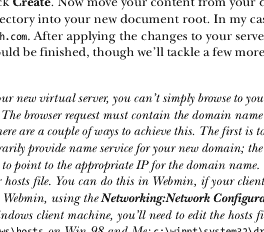

图 7-9：创建新的虚拟主机

点击 `Create`。现在将内容从默认服务器文档根目录移动到新的文档根目录。在我的例子中是 `/var/www/swelltech.com`。应用对服务器的更改后，您的 Apache 配置应该已完成，尽管在宣布完成之前我们还将解决几个小问题。

注意


要测试新的虚拟服务器，您不能像在上一教程中那样简单地浏览到您的 IP。浏览器请求必须在 URL 中包含虚拟主机的域名。有几种方法可以实现这一点。第一种是配置本地名称服务器以临时为新域名提供名称服务；第二种是在系统 `hosts` 文件中设置指向该域名相应 IP 的条目。最简单的方法显然是将其添加到 `hosts` 文件中。如果您的客户端机器是运行 Webmin 的 UNIX 机器，您可以在 Webmin 中通过 `Networking→Network Configuration→Host addresses` 模块完成此操作。在 Windows 客户端机器上，您需要手动编辑 `hosts` 文件。它位于 Win 98 和 Me 的 `c:\windows\hosts`；Win NT、2000 和 XP Pro 的 `c:\winnt\system32\drivers\etc\hosts`；以及 XP Home 的 `c:\windows\system32\drivers\etc\hosts`。更有趣且更具教育意义的方法是配置 `BIND` 以提供您的新地址，然后配置客户端从新配置的 `BIND` 获取名称服务。这在 `BIND` 章节中有记录；请随意跳到前面并现在完成该教程。我会在这里等您……

## 添加其他虚拟服务器名称

也许您在配置上述虚拟服务器时注意到，它被命名为 `simply swelltech.com`。您是否想知道我为什么不将其命名为 `www.swelltech.com` 呢？原因很简单：我希望用户能够浏览到任一地址并获得相同的网站。因此我将虚拟服务器命名为 `swelltech.com`，现在可以添加一个新的服务器别名，使其在两个名称下都响应。要向现有虚拟服务器添加新的虚拟服务器名称，请在主 Apache 模块页面上点击该虚拟服务器的图标。然后点击 `Networking and Addresses` 图标。现在填写您希望网站出现的其他所有域名。请注意，这些名称必须各自拥有自己的 DNS 记录，用户才能使用它们，就像原始的 `swelltech.com` 名称一样。域中的每个额外主机名都是一个新地址，因此 `www.swelltech.com` 和 `mail.swelltech.com` 即使在同一台机器上也必须在名称服务器中拥有自己的名称记录。

# 8 BIND


`DNS`，或域名系统，对互联网的运行至关重要。事实上，尽管您很少直接与 DNS 交互，但没有其持续存在，我们所知的互联网就无法存在。`DNS` 将主机名和域名与 IP 地址关联起来，即绑定，从而使您能够输入 `http://www.swelltech.com` 而不是记忆力较差的 IP `216.40.244.74`。

此外，它使邮件服务器能够轻松找到向给定域发送邮件的正确主机、域中出现异常情况时的正确管理员联系人等。但就我们的目的而言，作为普通系统管理员，我们真正需要记住的是 `BIND` 是我们为网络提供 DNS 信息的方法。它将在客户端应用程序需要按名称访问各种站点时为本地用户提供信息。它还将为客户端提供信息（主要是作为 DNS 客户端的其他 DNS 服务器）在整个互联网上，以便向世界广告我们的网络上的主机名如何被访问。可以把它想象成一本花哨的电话簿，甚至更好，是网络计算机的电话接线员。客户端计算机有一个名称，但需要号码才能在广阔的互联网上访问它。因此它联系 DNS 服务器并请求号码，而 `BIND` 很乐意尽力返回正确的号码。

`TCP/IP` 网络上的每个主机都有一个 IP 地址。此地址必须在地址可路由的网络上是唯一的。因此，通过互联网可访问的每个主机都有一个唯一的 IP 地址，理论上可以从互联网上的任何其他地方访问。因为这些地址大致根据网络上的物理位置分配，并且因为路由器会跟踪哪些其他路由器可以访问哪些子网，所以这个简单的数字足以让你的计算机在几秒钟内与互联网上的任何其他计算机建立连接。不幸的是，互联网上的路由主题完全超出了本文档的范围，因为 Webmin 并非设计用于管理路由器或 Linux、FreeBSD 以及其他受支持操作系统的更复杂路由功能。

## BIND 的简要历史

我们已经确定 `BIND` 可以为你的网络提供名称服务，允许你在连接到网络上的另一台计算机时输入主机名而不是 IP。然而，我们没有讨论 `BIND` 以及 `DNS` 总体上在整个互联网上是如何工作的。互联网上的 DNS 实际上是一个多层系统，其中客户端查询本地名称服务器，这些服务器为互联网上找到的客户端中的一小部分提供服务，通常在一个子网上。这些本地名称服务器然后充当稍大名称服务器的客户端，而这些名称服务器又充当更高名称服务器的客户端。在这个层次结构中的某一点，服务器将是 `ROOT` 或顶级域名称服务器之一，它将知道关于请求名称应查询哪个较低名称服务器。链中的每个名称服务器可能会保存查询结果，或缓存结果，因此下次进行相同查询时就无需一路向上查询。令人震惊的是，也许，这个系统运行得相当好，并且随着互联网从几千台主机增长到数亿台而扩展。

## 逐步了解一次查询示例

当你打开你最喜欢的浏览器并输入对网页的请求——例如，`http://www.swelltech.com`——在浏览器甚至开始从服务器加载数据之前，背后发生了很多事情。首先，你输入的 URL 必须由浏览器解析和解释。但我们不关心这一步。接下来，数据所在域和主机名必须在互联网上找到。名称 `www.swelltech.com` 几乎没有告诉浏览器有关数据的物理或网络位置的信息，因此它查询一个可以对该信息做出一些解释的工具：`DNS` 服务器。

`DNS` 服务器接收请求并检查其内部缓存中是否存在名为 `www` 的主机，在第二级域 `swelltech` 中，在顶级域 `aka TLD` `com` 中。如果 `DNS` 服务器没有缓存此信息，它就成为客户端并向其父名称服务器提出相同问题："主机 `www.swelltech.com` 的 IP 是什么？" 最终，假设没有较低级别的名称服务器有关于此主机的信息，顶级域名称服务器（在本例中为 `com` `TLD` 的名称服务器）将接收查询。这里的区别在于顶级域名称服务器知道负责该域名名的名称服务器的地址，或者至少是下一级，`swelltech`。最后，查询 `swelltech.com` 域的名称服务器，并返回主机 `www` 的 IP。正如前面提到的，这些数据随后将被查询路径中的每个名称服务器缓存，这样下次他们就不需要那么努力来回答请求。

## BIND 模块

`BIND` 模块打开到一个包含两个部分的屏幕（图 8-1）。页面的上部用于全局 `BIND` 选项，例如其他 DNS 服务器、日志记录、访问控制等。显示的下部提供了一系列图标，每个图标对应于你的 `BIND` 负责的每个区域。这将包括所有主、从、转发和存根区域。

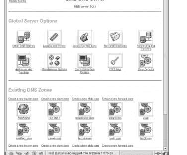

图 8-1：`BIND` 起始页

配置你的 `BIND` 服务器是 Webmin 可以真正简化事情的领域。尽管 `DNS` 在表面上是一个非常简单的服务，但 `BIND` 配置文件 notoriously 令人困惑，很容易犯一个错误导致你的名称服务器无法使用。这并不是说你不能用 Webmin 误配置你的名称服务器，但它确实使生成语法正确的 `BIND` 配置变得容易得多。

> **NOTE** 目前有三个 `BIND` 版本在常见使用中，具体为版本 4、8 和 9。`BIND 8` 和 9 在许多方面功能相同并且共享配置文件语法，因此一个可工作的 `BIND 8` 配置很可能也是一个可工作的 `BIND 9` 配置。`BIND 9` 添加了一些新功能，但主要是 `BIND 8` 的重写（重写的理由对普通用户无关紧要）。Webmin 有两个 `BIND` 模块，一个用于 4，一个用于 8 和 9。因为版本 4 非常老旧并且在 OpenBSD 和较旧的 UNIX 环境之外很少使用，所以这里不会涉及。`BIND 8` 和 9 因为共享相同的模块和配置语法，可以一起介绍。仅在 `BIND 9` 中可用的功能将被特别注明。

### 全局服务器选项

#### 其他 DNS 服务器

其他 DNS 服务器页面允许你配置 `BIND` 将以某种方式在区域传输关系中通信的 DNS 服务器的行为。这允许你为每个服务器显式配置传输关系的几个方面（图 8-2）。

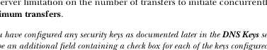

图 8-2：配置其他服务器

第一个字段是要配置的服务器的 IP 地址。如果你从多个服务器接收区域传输并且其中一个需要不同对待，这里就是配置它的地方。下一个字段告诉 `BIND` 将此服务器的回复视为虚假，即不正确。来自此域的未来结果将不会被信任。接下来，在区域传输格式字段中，你可以配置 `BIND` 是逐个接收区域传输还是批量接收多个。最后，虽然在 `BIND` 中尚未实现（至少不是 `BIND 8` 的最新版本——`BIND 9` 可能现在已有此功能），但有一个用于每个服务器并发启动传输数量限制的占位符，称为最大传输数。


> **NOTE** 如果你已按照 DNS 密钥部分后面记录的方式配置了任何安全密钥，将会出现一个额外的字段，其中包含为每个配置的密钥提供的复选框。选择一个将要求服务器使用所选密钥对自身进行身份验证。密钥的副本必须同时存在于本地服务器和远程服务器上，并且必须在每个服务器的 BIND 配置中进行配置。

此页面配置你的 `named.conf` 文件中的 `server` 指令及相关选项。默认情况下，未定义其他服务器。

## 日志记录和错误

此页面提供 BIND 当前活动的现有日志通道列表。它还允许你添加新的日志通道。一般来说，BIND 默认提供的日志对于大多数目的来说已经足够，提供操作（启动、停止等）的总体概述以及操作期间发生的任何错误。然而，如果你需要额外的日志记录或将特定信息记录到单独的文件，你可以在此处进行配置。

BIND 8 中的日志记录非常灵活，但乍一看有点令人困惑。要添加新日志，你首先创建一个新的通道，可以将其设置为记录到文件或 syslog 级别。然后你配置要在此处记录的信息级别，如下所述。最后，你将日志类别分配给该通道。类别决定了记录到此特定通道的信息类型（图 8-3）。

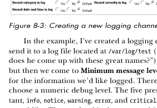

图 8-3：创建新的日志通道

在示例中，我创建了一个名为 `test` 的日志通道。我选择将其发送到位于 `/var/log/test` 的日志文件（我知道你在想什么："他怎么想出这些好名字？"）。到目前为止都很简单易懂，但接下来我们来到最小消息级别。在这里我们可以设置希望记录的信息的日志级别。有五个预设，你也可以选择一个数字调试级别。五个预设按重要性从低到高依次为 `info`、`notice`、`warning`、`error` 和 `critical`，它们基本上就是听起来那样。`info` 级别几乎是服务器关于该主题要说的一切，使日志变得相当健谈。另一方面，`critical` 级别保留用于通常意味着你的名称服务器正在经历一个或多个严重问题，可能导致服务器功能不正常的情况。这些前五个级别与 syslog 使用的级别相同。`debug` 级别选项允许你为调试消息设置调试级别以发送到你的日志。请注意，调试消息不能发送到 syslog，必须记录到文件。最后，全局级别将此日志设置为与全局服务器日志相同的级别。

接下来，我将一个日志类别分配给日志通道 `test`。在本例中我决定将安全信息发送到此通道。目前有 22 个受支持的信息类别可以记录。它们如下。

## 日志类别

| Category | Description |
|---|---|
| `default` | 如果未指定类别，则使用默认类别。默认类别包含来自其他类别的大多数消息，但其中一些被排除在外。 |
| `config` | 配置文件处理信息。BIND 在加载配置文件时写入这些消息。 |
| `parser` | 配置文件解析信息。BIND 在解析配置文件时写入这些消息。 |
| `queries` | 查询日志。 |
| `lame-servers` | 通知您检测到错误的委派。 |
| `statistics` | 提供系统运行时信息的定期报告。 |
| `panic` | 记录会导致服务器关闭的问题。 |
| `update` | 动态更新。 |
| `ncache` | 负缓存。 |
| `xfer-in` | 服务器接收的区域传输。 |
| `xfer-out` | 服务器发送的区域传输。 |
| `db` | 所有数据库操作。 |
| `eventlib` | 事件系统中的调试信息。只能为此类别指定一个通道，且必须是文件通道。如果未定义 `eventlib` 类别，`eventlib` 将被定向到 `default`。这通常仅对调试 BIND 或其相关库的开发人员有用。 |
| `packet` | 接收和发送的数据包转储。只能为此类别指定一个通道，且必须是文件通道。如果未定义 `packet` 类别，它将被定向到 `debug` 级别的默认类别。 |
| `notify` | NOTIFY 协议，提供异步更改通知。 |
| `cname` | CNAME 错误。 |
| `security` | 已批准和未批准的请求。 |
| `os` | 底层操作系统的故障。 |
| `insist` | 内部一致性检查失败。 |
| `maintenance` | 定期维护事件。 |
| `load` | 区域加载消息。 |
| `response-checks` | 响应检查产生的消息，例如 “Malformed response...”、“wrong ans, name...”、“unrelated additional info...”、“invalid RR type...” 和 “bad referral...”。 |

## 访问控制列表

本页用于输入任意数量的命名地址匹配列表。此处定义的列表稍后将在配置中用于多种用途，但仅有 ACL 本身并不会产生任何作用。要创建 ACL，只需在 ACL 名称字段中输入一个名称，并在第二个字段中输入此 ACL 将匹配的地址、网络和其他 ACL。有几个 ACL 是内置的，无需手动定义。它们是 `any`，匹配所有主机；`none`，匹配任何主机；`localhost`，匹配 BIND 运行的系统上所有接口的 IP 地址；以及 `localnets`，匹配系统已配置接口的本地网络上的所有主机。

## 文件和目录

在此处配置 BIND 进程可能需要读取或写入的文件位置。这些通常无需更改，但了解它们各自的含义可能很有用。

### 统计输出文件

此选项允许您为 BIND 在收到信号时生成的统计信息选择不同的文件名和路径。要使 BIND 将统计信息转储到此文件，您可以使用带有 `stats` 选项的 `ndc` 程序，它将向 BIND 发送正确的信号。这对应于 `named.conf` 选项部分中的 `statistics-file` 指令，默认值为 `named.stats`。

### 数据库转储文件

配置 BIND 在接收到正确信号时转储其数据库的文件位置。信号可通过使用 `ndc dumpdb` 生成。此选项对应于 `named.conf` 选项部分中的 `dump-file` 指令，默认值为 `named_dump.db`。

### 进程 ID 文件

这是 BIND 进程 ID 文件的位置。此位置和文件必须可由 BIND 进程写入。

### 区域传输程序路径

此设置指定 BIND 用于入站区域传输的 `named-xfer` 程序的路径。此选项配置 `named.conf` 选项部分中的 `named-xfer` 指令。

## 转发和传输

此页面允许您配置父 DNS 服务器（图 8-4）。在此，您声明 BIND 可以查询哪些服务器以及如何对待它们。


图 8-4：转发和传输

### 转发查询到的服务器

使用此字段，您可以输入在 BIND 进程没有缓存结果可提供给客户端时希望其查询的任何名称服务器。通常这将是您的 ISP 或托管服务为您提供的名称服务器，但也可能是您本地网络上的其他服务器。最好至少有两个，分别称为主名称服务器和辅助名称服务器。此选项配置 `named.conf` 选项部分中的 `forwarders` 指令。

### 如果转发器无响应则直接查找

此选项允许您选择 BIND 是否应在转发器未回复时直接查询 TLD 服务器。如果您有一个非互联网连接的 DNS 服务器，或一个被防火墙隔离在本地网络上的服务器，只能与转发器通信，则可能需要关闭此选项。此选项配置 `forward` 指令。

### 最大区域传输时间

这允许您为入站区域传输设置允许的最长时间。此选项对应于 `max-transfer-time-in` 指令，默认值为 120 分钟。超过此时间后，传输将被终止。

### 区域传输格式

设置全局传输格式（可在“其他服务器”部分按服务器覆盖）。在此您可以选择 BIND 是否应为每个传输的资源记录接收一条消息。`many` 选项告诉 BIND 接受每条消息中的多个记录，这更高效。此选项对应于 `transfer-format` 指令。

### 最大并发区域传输数

限制并发传输的数量。这对应于 `transfers-in` 选项，默认值为 10。增加此值可能会提高性能，但会消耗更多系统资源。

## 地址和拓扑

以下选项指定网络特定细节：

### 监听的端口和地址

BIND 可以在服务器上的任意多个端口和地址上应答。默认情况下，BIND 将在每个活动 IP 地址的 53 端口上应答。如果您选择监听一个或多个特定地址和/或端口，则 BIND 仅在匹配列表允许的地址上应答。也可以通过在端口或 IP 前加上 `!` 来否定一个端口或 IP。

### 查询的源 IP 地址

如果 BIND 不知道查询的答案，它将查询其他名称服务器。在此您可以定义用于查询这些名称服务器的本地地址和端口。默认情况下它可以使用系统上可用的任何 IP 或端口。

### 名称服务器选择拓扑

查询其他服务器时，BIND 可以配置为选择拓扑地址列表中更接近的名称服务器。列表中服务器出现的顺序表示它们与本地名称服务器的距离，其中第一个最接近，最后一个最远。也可以通过在名称服务器前加上 `!` 来强制一个或多个名称服务器成为最后手段。通过感叹号前缀的服务器将被放置在队列末尾，无论在拓扑地址列表中的位置如何。


## 杂项选项

没有其他明显位置的 BIND 选项都放在本节，因此它有相对大量的选项。幸运的是，大多数管理员很少需要担心这些选项。不幸的是，为了实现我完全记录 BIND 模块的目标，我必须和那些更常用的功能一样完整地记录这些特性。因此，在本页您会找到几个可配置的内存使用设置、一些计时选项和一些通用行为选择。

### 最大核心转储大小

这是 BIND 在崩溃时将生成的转储文件的最大文件大小。此选项配置 `named.conf` 文件中的 `coresize` 选项。您的操作系统也可能对核心大小施加限制，该限制可能小于或等于此处配置的值。

### 最大数据内存使用量

此设置定义 BIND 用于存储数据的最大内存量。这不是 BIND 的完整内存使用量，因为进程本身也需要内存，但它可以限制 BIND 的使用。此选项对应于 `named.conf` 中的 `datasize`。

### 最大打开文件数

定义 BIND 在任何给定时间可以打开的文件数。默认值为操作系统的限制；然而，如果操作系统未准确报告，BIND 在运行时可能无法始终确定此限制。在这种情况下，可能有必要在此处使用正确的值。在使用 Webmin 和 BIND 的最流行操作系统，如 FreeBSD 和 Linux 上，这不是问题。此选项配置 `files` 指令。

### 最大栈内存使用量

定义 BIND 进程可使用的最大栈空间。此选项对应于 `stacksize` 指令。

### 清理过期记录的间隔

BIND 会定期从缓存中删除过期记录。此选项配置清理发生的频率。这对应于 `cleaning-interval`，默认值为 60 分钟。

### 检查新接口的间隔

BIND 会定期扫描网络接口列表，此选项配置扫描之间的间隔，单位为分钟。默认值为 60 分钟。此选项配置 `interface-interval` 指令。

## 日志统计间隔

此设置控制 BIND 多久向日志写入一次通用服务器统计信息。默认情况下每 60 分钟发生一次，如果设置为 0 则统计日志记录将被关闭。此选项对应于 `statistics-interval` 指令。

## 是否为客户端执行完整的递归查找？

如果 BIND 没有客户端的答案，则有两种响应方式。如果此选项设置为 Yes，默认情况下，则 BIND 将自行在父服务器或根服务器上执行查找。如果关闭此选项，BIND 将简单地将客户端引用到可以回答查询的另一个名称服务器。此选项配置 `recursion` 指令。

## 允许一个名称的多个 CNAME 别名？

BIND 的旧版本允许单个域有多个 CNAME 资源记录，许多站点将其用于负载均衡。然而，这种用法违反标准且不推荐。打开此选项允许你使用多个 CNAME，如 BIND 旧版本中那样。默认值为关闭，且对应于 `multiple-cnames` 指令。

## 获取胶水记录？

如果此选项设置为 Yes，默认情况下，服务器在构造响应的附加数据部分时将获取其没有的“胶水”资源记录。将此设置为 No 可与 `recursion no` 结合使用，以防止服务器的缓存增长或损坏。然而，这样做会增加客户端的工作量。此选项配置 `fetch-glue` 指令。

## 在响应上设置权威 AA 位？

BIND 通常会缓存负面响应（即 NXDOMAIN，或“此不存在”），然而，一些非常旧的服务器和客户端可能对此有问题并产生错误。升级这些旧客户端和服务器可能更明智，而不是关闭此选项。此选项配置 `auth-nxdomain` 指令，默认值为 Yes。

## 控制接口选项

BIND 提供了一个名为 `rndc`（或旧版本中的 `rdc`）的命令行实用程序，允许管理员执行一些管理任务。新版 `rndc` 允许这些任务在远程 BIND 服务器以及本地运行的服务器上执行，因为它通过网络套接字运行。此实用程序的常见用途包括停止 `named` 进程、强制重新加载配置文件、刷新区域信息以及触发服务器统计转储。由于 `rndc` 工具可用于关闭服务器，以及其他可能危险的操作，其使用应仅限于少数受信任的客户端地址。

本页的 BIND 模块提供对 BIND 配置文件 `controls` 部分的访问，并配置允许连接到正在运行的 BIND 服务器的主机。

## Internet 端口访问

如果启用，第一字段必须包含 `named` 服务器将监听控制请求的本地地址。端口字段可以是你希望进程监听的端口，也可以简单地填写星号“*”，以指定一个随机选择的非特权端口（在 UNIX 系统上，非特权端口通常是 1024 以上的端口）。最后，`allow` 字段应包含你希望能够从其管理服务器的主机地址。通常，除非你有其他原因，否则最容易通过阻止所有外部地址的访问来维护安全性。在这种情况下，你将在第一字段中选择地址 `127.0.0.1`，端口为 *，`allow` 列表仅包含 `127.0.0.1`。假设你的本地机器是受信任的，你的服务器将相对安全。

## Unix 文件系统访问

与上一组选项类似，此指令指定哪些客户端将有权访问正在运行的 `named` 进程的管理通道，但在本例中，它用于使用 UNIX FIFO 管道的旧式通信。管道在 UNIX 中是一种可将数据流视为文件，反之亦然的机制。或者说，它允许正在运行的进程接受写入其中的数据，就像文件一样，并且可以以可像文件一样读取的形式输出数据。

如果使用此机制与你的 `named` 进程通信，你可以选择管道的文件名、管道的权限、管道的所有者和组。应注意使文件对系统中的所有管理员用户以外的用户不可访问。

> NOTE UNIX 管道机制在 BIND 9 中不可用。它已被弃用，取而代之的是使用网络套接字接口和安全密钥。它在 BIND 版本 8 中受支持。

## DNS 密钥

较新的 BIND 版本支持用于身份验证和授权访问某些功能的密钥。此页面允许你为其他部分生成密钥。具体来说，生成后，密钥可用于保护你的 Other Servers 连接。

## 安装密钥

要创建新密钥，只需填写新的 Key ID，它必须是无空白的字母数字字符串，例如 `mynewkey` 或 `supersecret` 或 `HenryThe8th`。算法通常可以安全地保持默认的 `hmac-md5`。最后，Secret 字符串必须是 base64 编码的字符串。

## 使用 dnssec-keygen 创建密钥

要为 Secret 字符串字段生成 base64 编码的字符串，你可以使用包含在大多数 BIND 安装中的 `dnssec-keygen` 或 `dnskeygen` 实用程序。你甚至可以使用 `mimencode` 实用程序编码的纯字符串，尽管

这将比使用 MD5 密钥安全得多。要使用 `dnssec-keygen` 创建密钥，可以使用以下命令行进行少量修改以适应你的服务器：

```
[root@delilah]# dnssec-keygen -a HMAC-MD5 -b 128 -n HOST delilah.swelltech.com
Kdelilah.swelltech.com.+157+06448
```

在上面的示例中，第二行是命令的输出，它提示了新密钥存储的文件名。在本例中，生成了两个文件，名为 `Kdelilah.swelltech.com.+157+06448.key` 和 `Kdelilah.swelltech.com.+157+06448.private`。两者都包含新生成的密钥，因此你可以查看其中任何一个以复制密钥粘贴到 Webmin Secret 字符串字段中。此密钥也需要提供给将使用安全功能与此服务器通信的任何服务器。

## 区域默认值

在这里你可以为服务器上的新区域以及你提供备份服务的区域定义几个默认选项（图 8-5）。这些选项通常可以在单个区域的定义中被覆盖；然而，大多数此类项目最好在此处配置，任何与常规不同的配置都可以在单个区域中配置。这些选项仅在此处记录，但也适用于单个区域。另请注意，这些完全不影响 `named.conf` 文件。这些只是 Webmin 在创建新的主区域时使用的默认值，类似于创建新用户时使用的 `/etc/skel` 文件。你还将在此页面上找到一些默认区域权限选项的设置。

## 刷新时间

这是你的区域将被缓存的时间间隔，然后由从服务器刷新。降低此值会增加主服务器的负载，但有助于确保新数据从你的从 DNS 服务器到达客户端。此选项配置每个新区域中 `SOA` 记录的 `refresh` 字段，默认值为 10800 秒，即 3 小时。请注意，DNS NOTIFY 协议引入到 BIND 8 中消除了从服务器对刷新时间的依赖，以实现及时更新。要了解更多信息，请查看 RFC 1996 (http://www.ietf.org/rfc/rfc1966.txt?number=1966)。BIND 4 和一些其他名称服务器可能没有 NOTIFY，因此如果你的从服务器并非全部已知支持 NOTIFY，你仍应意识到你的从服务器需要完整的刷新时间才能保证是最新的。

## 传输重试时间

这定义了如果刷新尝试失败时的重试间隔。如果你减少了刷新时间，此值也应相应减少。此选项对应于 `SOA` 记录中的 `retry` 字段，默认值为 3600 秒，即 1 小时。

## 新主区域的默认值

创建新的主区域时，Webmin 可以配置为使用网络的默认值填充其中的一些值。以下选项允许配置这些默认值（图 8-5）：

### 默认生存时间


## 新主区域的默认值

这设置了区域的最小生存时间。下游名称服务器将不再认为它们缓存的信息准确，如果该信息比此时间更旧。它们将继续提供旧数据，如果无法检索新数据，直到达到过期时间。此选项可非常有效地用于确保服务器或地址更改可以在不中断客户端服务的情况下执行。例如，如果你知道你的网站将在一周后迁移到新服务器的新地址，你可以将此值更改为非常短的时间，也许 30 秒。到一周结束时，当你的更改发生时，所有缓存了你的信息的名称服务器都会知道要经常检查对你域具有权威性的名称服务器。没有人甚至会注意到你更改了！此选项配置 `SOA` 记录中的 `TTL` 字段，默认为 38400 秒，即 10 小时。

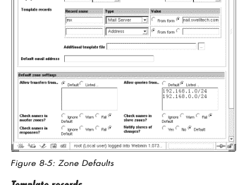

图 8-5：区域默认值

### 模板记录

如果你使用 `Webmin` 创建大量域（例如，如果你运营 ISP 或网络托管公司），此部分可以节省大量时间。在这里你可以定义几个模板记录，可以自动插入到你的一些或所有新区域中。例如，如果你有一个单一的邮件服务器和两个对你创建的所有域都相同的名称服务器，你可以为每个创建模板。当你稍后创建区域文件时，你可以选择包含模板。也可以添加一个主机，其 `IP` 可以在区域创建时定义。但是邮件服务器、名称别名和名称服务器模板必须从一开始就分配地址。此处没有默认模板，并且此部分不会直接影响任何 `BIND` 配置文件。

## 默认区域设置

此部分配置 `BIND` 将为未覆盖它们的区域应用的区域设置。与“新主区域的默认值”部分不同，这些选项会影响 `BIND` 配置文件。

### Allow transfers from

在这里你可以定义其他服务器，默认情况下将被允许从此服务器接收传输。此选项对应于 `allow-transfer` 指令，默认为允许所有主机进行区域传输。

### Allow queries from

这允许你定义哪些主机或网络将被允许查询你的服务器。任何将使用你的名称服务器的主机都应在此列出。但是，默认情况下，服务器将允许来自所有主机的请求。此选项配置 `allow-query` 指令。

### Check names in master zones? and Check names in slave zones?

这两个选项允许你选择你的名称服务器在检查名称在其预期客户端上下文中的严格程度。这意味着，例如，作为主机名使用的域名可以检查是否符合有关域名和主机名的相关标准。这些选项配置 `check-names master` 和 `check-names slave`，默认值分别为 `fail` 和 `warn`。

### Check names in responses?

与前两个选项类似，但检查名称服务器发送的查询响应的名称中。如果将其设置为 `fail`，你的名称服务器将拒绝它收到的包含无效名称的查询。此选项配置 `check-names response` 指令，默认为 `ignore`。

### Notify slaves of changes?

此选项允许你配置 `BIND` 是否使用 `NOTIFY` 协议通知其从服务器更新。这样，其从服务器可以查询主服务器以查看是否需要区域传输。如果需要，传输会立即进行，所有服务器会比从服务器等待其通常的刷新年龄到期时更快地更新到最新状态。此选项配置 `notify` 指令。

## 现有 DNS 区域

`BIND` 主页的此部分显示所有现有 `DNS` 区域的列表。有四种类型的区域（实际上有五种，但提示需要很少的配置，通常只设置一次），主区域、从区域、存根区域和转发区域。并且每种类型都可能是正向区域（意味着它将名称映射到地址）或反向区域（将地址映射到名称）。这四种类型各有特定的用途，具体取决于你的名称服务器与向客户端提供的数据的关系。

### 区域类型

以下是 `DNS` 区域的类型：

#### master

服务器拥有区域数据的 master 副本，并将为其提供权威答案。

#### slave

从区域是主区域的副本。每个从区域都将有一份主服务器列表，它可以查询这些主服务器以接收其区域副本的更新。从服务器可以选择保留区域的磁盘副本以加快启动速度。单个主服务器可以有任意数量的从服务器以分担负载。

#### stub

存根区域与从区域非常相似，行为也相似，然而，它只复制主区域的 `NS` 记录而不是整个区域。

#### forward

转发区域将该区域中的所有查询都定向到其他服务器。这样它可以充当网络的缓存 `DNS` 服务器，或为防火墙后面限制外部 `DNS` 查询的网络提供 Internet `DNS` 服务（显然转发 `DNS` 服务器必须具有对 Internet 的 `DNS` 访问权限！）。请注意，这与全局转发功能类似，但允许按区域选择转发器。

## 创建新区域

要创建新区域，请单击屏幕“现有 `DNS` 区域”部分中的一个区域创建链接。每种区域类型都会为 `Webmin` 生成所选类型的新区域文件提供各种必要的字段。每个区域类型的字段各不相同，除了从区域和存根区域，因此我们将依次记录每个区域。

### 创建正向主区域

主区域包含 `DNS` 区域的权威且完整的数据，因此具有最多的可配置选项（图 8-6）。创建任何类型的区域时，有必要创建至少两个区域数据库文件，一个用于正向映射，一个用于反向映射。这是为了提供名称到地址的转换，以及地址到名称的转换。幸运的是，一旦你创建了正向和反向主区域，`Webmin` 可以自动为你添加到主区域的每个主机添加正确的反向记录。

创建区域时的选项相当简单，但我会简要讨论它们，并给出创建新的主正向和主反向区域数据库的示例。

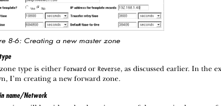

图 8-6：创建新的主区域

#### Zone type

区域类型是正向或反向，如前所述。在所示示例中，我正在创建新的正向区域。

#### Domain name/Network

此选项在正向区域的情况下为区域的域名，在反向区域的情况下为网络。在这里，我正在创建一个名为 `myzone` 的区域。请注意，在我的例子中，我的域是用于本地网络，将无法从整个互联网解析（这需要在顶级域之一注册，例如 `.com`、`.org` 或 `.net`）。域名区域的注册以及获取地址和其他相关任务远远超出了本书的范围，但创建 Internet 域的步骤完全相同。

#### Records file

此选项允许你选择希望存储区域信息的 `db` 文件的名称和位置。如果你将此选项保留为“自动”，`Webmin` 将在系统默认位置为你自动创建正确命名的文件。除非你有很好的理由打破惯例，否则建议你将其保持原样。

#### Master server

在这里你选择此域的主服务器的名称。因为我们正在创建主区域，所以这应该是将成为此文件主服务器的服务器的主机名；在我的示例中，我选择了主机名 `delilah.swell`，这是我本地（非互联网）域 `swell` 上的一个主机。子选项 `Add NS record for master server?` 当选中时，将在此区域中为此名称服务器添加名称服务器记录。通常最好保持选中状态，让 `Webmin` 处理它将处理的众多细节之一。

#### Email address

此项应为本域维护者的电子邮件地址。对于可通过 Internet 解析的域名，在出现 `DNS` 服务器问题时将联系此人。

#### Use zone template?

如果您在 `Global Server Options:Zone Defaults` 中创建了区域模板，则可以在此处包含该模板信息。这可以包含任意数量的自动生成的多种类型记录（主机地址、邮件服务器、名称服务器、名称别名和主机信息）。如果您为其中一个主机地址选择了 `From form` 作为来源，则可以在 `IP address for template records` 字段中输入该信息。在 `Webmin` 中使用模板功能可以为管理大量具有相同名称服务器和邮件服务器的区域的管理员提供非常强大的工具。以这种方式创建新域几乎可以完全自动化。

#### Refresh time

这与 `Global Server Options:Zone Defaults` 中同名选项相同，但仅适用于此区域。此选项将覆盖全局区域默认值。`Transfer retry time`、`Expiry time` 和 `Default time-to-live` 也是如此。

点击 `Create` 会带您进入此新区域的主页。我们将在讨论创建反向主区域后，再回到这些选项，因为在向区域添加任何记录之前先为此域创建反向区域是有意义的。这样，`Webmin` 可以自动为您保持两个文件同步。

### Creating a Reverse Master Zone

创建正向主区域后，您可能希望返回主 `BIND` 模块页面并创建另一个主区域（图 8-7）。这次，您将选择创建反向区域，以便提供从 `IP` 地址到名称的映射。


> **NOTE** *反向地址解析与正向解析有所不同。对于正向区域，一个 IP 可以关联任意数量的地址，而对于给定的 IP 反向记录应只有一条。因此，如果您在一台 IP 上托管多个虚拟服务，它们可以拥有各自的域名，但在反向查找时，IP 只能映射回其中一个。此外，除非您拥有自己的网络 IP 块，或使用私有网络块，否则您的名称服务器不一定对您的 IP 地址范围具有权威性。反向查找并不常用，使用时通常只是为了确认某个 IP 确实解析到某个合法网络。*

在这里，您会看到创建反向主区域与创建正向主区域完全相同。在本例中，我选择了区域类型为`Reverse`，因为该区域将把地址映射到名称。与上一个示例的唯一其他区别是，我输入了网络地址`172.16.1`，而不是域名。创建后，我被带到新区域的主页。我们很少直接编辑反向主区域记录，因为让 Webmin 为我们操作更容易也更安全。因此，让我们返回主 BIND 模块页面，然后编辑我们新的`myzone`主区域。

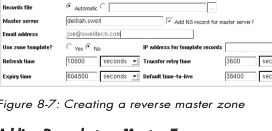

图 8-7：创建反向主区域

## Adding Records to a Master Zone

假设您成功创建了正向主区域，它现在将出现在主 BIND 页面 Existing DNS Zones 部分中。点击它会带您进入一个页面，允许添加各种类型的记录，以及页面底部的一些通用区域选项（图 8-8）。页面底部的选项与前面 Global Zone Options 部分中记录的选项相同，只是它们仅影响您正在编辑的单个区域，因此此处不予介绍。


图 8-8：编辑主区域

## Address

地址记录允许您输入主机名、生存时间以及主机的地址。网络上的每个主机都应具有地址记录（图 8-9）。在示例中，请注意我输入了完全限定主机名，并在末尾加上了句点。我还选择让 Webmin 将此地址更新到反向主区域。此选项创建 A 记录。

## Name Server

如果您有另一个负责另一个子域（例如`joeszone.myzone.`）的名称服务器，您可以在此处添加它。您也可以在此添加此域的其他名称服务器，包括从服务器和冗余主服务器。此选项创建 NS 记录。

## Name Alias

名称别名提供了一种为一台主机命名多个名称的方法。例如，如果您希望邮件服务器（真实名称为`mail.myzone.`）也能通过名称`smtp.myzone.`访问，您可以在此处为其创建别名，两者都将解析到同一台机器。此外，它还允许您为用户创建快捷方式。例如，如果您希望用户只需输入`news`即可访问新闻服务器，即使您的新闻服务器实际上位于另一个域中。此选项创建 CNAME 记录。

## Mail Server

域中的每个邮件服务器都应在此处有条目。在此页面上，`Name`字段应包含域的名称，`Mail Server`字段应包含邮件服务器的名称。创建邮件服务器记录时，您会获得一个在其他记录中不存在的额外选项，称为`Priority`。邮件服务器的优先级是一个相对值，用于指示哪个邮件服务器具有优先权。值越低，优先级越高。每条邮件记录都必须具有优先级。如果优先级最高的服务器宕机，邮件服务器可以将其邮件传递给列表中的下一台服务器。此选项创建 MX 记录。

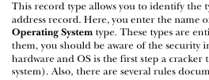

图 8-9：添加地址记录

## Host Information

此记录类型允许您标识由地址记录引用的主机的类型。在此处，您输入主机名以及硬件类型和操作系统类型。这些类型完全是可选的，但如果您确实输入了它们，则应注意安全影响（识别您的硬件和操作系统是黑客识别入侵方式的第一步）。此外，RFC 1700 [http://www.ietf.org/rfc/rfc1700.txt?number=1700] 中记录了有关如何标识硬件和操作系统的若干规则。然而，这些规则并未严格执行，通常使用此记录进行内部记录保存是相当安全的（即，不必保留笔记本或单独的数据库来记录所有主机及其运行的操作系统和版本）。此选项创建 HINFO 记录。

## Text Record

在此处您可以输入任意文本字符串，最长约 2K。您可以使用它来记录有关主机的备注，例如主机的位置或主要用户，以及可供其他记录引用的其他备注，例如在 Responsible Person 记录中。此选项创建 TXT 记录。

## Well Known Service

Well Known Service 记录类型允许您配置特定主机提供的服务类型。例如，您可以广告主机`myhost.myzone.`可以提供 telnet、ftp 和 smtp 服务。服务由与`services`文件中相同的名称标识。此选项创建 WKS 记录。有关 Well Known Services 的更多信息，请参阅 RFC 1035 第 3.4.2 节 [http://www.ietf.org/rfc/rfc1035.txt?number=1035]。WKS 记录是可选的，并不常见，也并非所有域名服务器都支持。

## Responsible Person

在此处定义负责给定主机或域的人员。`Name`字段用于主机名或域名，如果是绝对名称则以句点结尾。您还可以输入负责人的电子邮件地址。`Text Record`字段可以包含先前配置的 Text 记录的名称。例如，如果我维护一个域并希望人们在出现问题时能够找到我，我可以创建一个名为`joe`的文本记录，其中包含我的手机号码。然后对于我管理的每个主机和子域，我都可以创建一个 Responsible Person 记录，其中不仅包含我的电子邮件地址，还引用`joe`文本记录。此选项创建 RP 记录。

**TIP** *在 Responsible Person 部分输入电子邮件地址时，Webmin 会自动将其转换为 BIND 所需的点分隔格式。您应以其真实世界形式输入电子邮件地址，即 joe@swelltech.com。*

## Location

Location 记录是一种相对较新且实验性的记录类型，允许您包含有关区域中每个主机和网络的精确信息（至少在全球范围内）。位置以纬度、经度和海拔定义。当前 Webmin 版本不会区分这些信息的不同部分，因此您必须自行以正确格式输入。RFC 1876 [http://www.ietf.org/rfc/rfc1876.txt?number=1876] 提供了关于 Location 记录的更完整描述。帮助您理解和使用 LOC 记录的一个良好资源，由 LOC 规范的共同创建者之一提供，是 DNS LOC: Geo-enabling the Domain Name System [http://www.ckdhrc.com/dns-loc/]。在那里您可以找到提供坐标的网站的链接

your location for free. There is also a link to AirNav, which will provide altitude information for public landing sites (airports) in your area. This isn't as precise as a GPS system, but it's better than nothing and a lot more information than most DNS servers are configured to provide.

## Edit Records File

This option merely provides a simple text editor window that contains the complete db file for your zone. This allows you to edit it manually; however, this is not recommended unless you are familiar with the BIND configuration file grammar as it is not checked by Webmin for correctness.

## Creating a Slave or Stub Zone


Slave and Stub zones are created in exactly the same way, and are quite similar in some ways though their purposes are very different (Figure 8-10). Slave zones keep a complete copy in memory, and sometimes also on disk, of a zone that it receives via a zone transfer from a master zone. A slave zone can answer any queries for a zone, and as long as network connectivity remains intact between the master and slave and the servers are configured correctly, it will stay in sync with the master server. A stub zone also syncs to a master server; however it only keeps NS and SOA record information from the master server. This allows BIND to keep up with delegation information automatically.

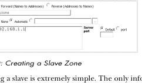

Figure 8-10: Creating a Slave Zone

Creating a slave is extremely simple. The only information required is the domain name or the network (as was used in the master zone earlier), and the addresses of one or more master name servers. As with master zones, you configure both a forward and reverse zone type for each zone. This server can then be used by clients just as the master zone is used. In fact, whether it is a slave or master is entirely transparent to the user.

## Creating a Forward Zone

A forward zone is simpler still. It's only possible configuration options are whether it is a forward (name to address) or reverse (address to name) zone type, the name or network of the domain, and the master servers to forward requests to. A forward zone is just specific instructions for BIND that it should forward requests for a specific zone to one or more specific name servers. BIND does not perform zone transfers with a forward zone, as it does in the case of slave and stub zones.

## Tutorial: Setting Up a Caching Name Server with BIND

A caching name server can be beneficial in a number of situations. First, because it brings name service closer to the user, performance of all name-based services will likely be improved. Also, in secured environments with a strict firewall implementation, it can be used to allow local clients to obtain name service without having to pierce the firewall for all users. Only the local caching DNS server must have access to outside name servers. Finally, it provides a simple mechanism for providing a private name space to local users, by allowing users to obtain all name service from the local caching name server, which also acts as a master name server for the local network name space.

A caching name server is perhaps the simplest type of name server to configure, and Webmin makes the configuration even easier. Because caching is a core part of how DNS scales, it is an automatic part of any BIND configuration. All that is left for us to do is allow Webmin to create our initial configuration files and alter a couple of options in the configuration.

### Initializing the named.conf

When first opening the Webmin BIND module, you'll be given a few choices about how to generate the initial configuration files. The ideal choice is to allow Webmin to initialize your configuration and download the root name server list. If you are not currently connected to the network you can choose to use the root name server list file that is included in the Webmin distribution.

### Adding Forwarders

After Webmin has completed the download, and initialized your files, click the Forwarding and Transfers icon. Add the primary and secondary name server addresses provided by your ISP to the field labeled Servers to forward queries to. Then select Yes for the option Lookup directly if no response from forwarder. Click Save.

Believe it or not, your configuration is finished. Simply click the Start BIND button, point your client workstations to the IP of your server for their primary name server, and test it out. Check the later section on troubleshooting BIND if problems arise.

## Tutorial: Name Resolution for Virtual Hosts


As discussed earlier in the Apache chapter, a name-based virtual host has to have a name mapped to an IP address before you can even access its contents with a browser. BIND, of course, will be our means of providing lookup of those names. Because we're only concerned with web service for this tutorial, we only need to concern ourselves with the creation of a forward zone (a forward zone maps names to addresses).

## Create a New Master Forward Zone

Assuming you've already allowed Webmin to initialize your `named` configuration files, you're ready to add a master forward zone for your domain (Figure 8-11). Click the Create a new master zone link on the front page of the BIND module.

The Zone type should remain at its default of Forward. The Domain name/ Network field should contain the second level domain name under which your virtual hosts will reside. For example, if I had one or more virtual hosts under the `swelltech.com` domain, that would be the domain name I would enter here. If you have other second level domains, you will create a zone for each. It is easiest to allow Webmin to automatically name the Records file, and the Master server will probably be correct if your host name is configured correctly. Enter your email address, or the address you would like to be the administrative contact for this zone, into the Email address field. Finally, click Create. You will immediately be directed to the new zone for further configuration.

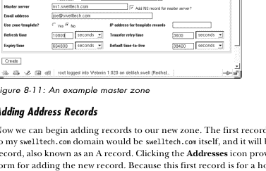

Figure 8-11: An example master zone

## Adding Address Records

Now we can begin adding records to our new zone. The first record I would add to my `swelltech.com` domain would be `swelltech.com` itself, and it will be an address record, also known as an `A` record. Clicking the Addresses icon provides a simple form for adding the new record. Because this first record is for a host named simply `swelltech.com`, we enter nothing in the Name field. Then we enter the IP address of the server we'd like this name to point to, in my case it is the same address on which my Webmin server is running. All other fields can remain at their defaults. Clicking Create adds the record.

Follow the same steps to add another address record for `www.swelltech.com`, presumably on the same IP. All that changes from the above steps is to enter `www` in the Name field instead of leaving it blank. If you've worked through the examples in the Apache tutorial on virtual hosting, you'll now have all of the pieces for web service on both domain names.

## Adding a Mail Server Record for Mail

Because no domain would be complete without mail service, and mail service for a domain does not have to reside on the same server as web service, we need to have some way to tell mail servers where to direct our mail. Luckily, the designers of DNS have thought of that already and provide the `MX`, or mail server, record as a means of notifying other mail servers where to send email destined for the domain.

Adding a mail server is usually a two-part process. First, a new record is created pointing to the address of the mail server. In the case of small networks, this will likely be a machine that is providing other services. For example, the Swell Technology mail server resides on the same machine as our web server and our NTP time server. So, in most cases we can use a Name Alias record, also known as a `CNAME` record, for our mail server name. If you have a dedicated mail server you will use an address record instead.

## Adding a Name Alias


Because my mail server is hosted on the same address as my web server, I've chosen to use a `CNAME` record, or name alias, for `mail.swelltech.com`. Creating a name alias record is a lot like creating an address record. Click the `Name Alias` icon, and fill in the appropriate fields. In this case, I will fill in `mail` for the `Name` and `swelltech.com.` for the `Real Name`. Notice there is a period at the end of my real name. This period is significant, and required to indicate a fully qualified domain name, otherwise the real name pointed to would be `swelltech.com.swelltech.com`, which is probably not what we want. Click `Create` to add the new record.

> NOTE This step is not strictly necessary if your mail server is hosted on the same machine as other named services. However, traditionally mail servers have had a name record of their own, usually `mail.domain.com` or `smtp.domain.com`. It also makes it easier to plan for later network expansions if you begin your network design with appropriate names for all of the services available on your network. If you wish to avoid adding a `CNAME` for mail service, you can skip this step and point your `MX` record to an existing name.

## Creating an MX Record

Now that we have a name for our server, we can add an `MX`, or mail server, record. This is simply a record that indicates to other mail servers where mail for our domain should be delivered. In my case, I would like mail directed to `swelltech.com` and all names within the domain to be delivered to `mail.swelltech.com`. So when a mail server receives a mail from one of its users directed to `joe@swelltech.com`, it will first find out where that mail ought to be delivered by querying the name server that is authoritative for `swelltech.com` for its `MX` record.

To create a new mail server record, click the `Mail Server` icon. Because we are currently concerned with our primary domain, in my case `swelltech.com`, the `Name` field can be left empty. The `Mail Server` field can be filled in with the name of the mail server we created in the previous step, `mail.swelltech.com` in my case. 需要一个额外的字段，称为 `Priority`，它只是一个数字，用来决定该邮件服务器相对于可能配置的其他服务器的优先级，其中数字越小优先级越高，零为最低。传统上，主邮件服务器的优先级使用 `10`，其他服务器的优先级则以十为步长递增。所以备份邮件服务器的优先级可以为 `20`。对这种事实上的标准没有强制执行，因此你也可以使用 `0` 和 `43` 来表示主邮件服务器和备份邮件服务器，但遵循传统可能对可能跟随你脚步的任何管理员来说更礼貌。点击 `Create` 添加邮件服务器记录。

## 应用更改并测试结果

现在我们已经有了在现实世界中充分利用我们的名称服务器所需的最低配置，因此让我们重新加载 `BIND` 配置并确保它正在工作。首先，通过点击页面右上角的 `Module Index` 链接返回到 `BIND` 模块主页。然后点击页面底部的 `Apply Changes` 按钮，通知 `BIND` 重新加载其配置文件。

为了测试我们的工作，我们可以使用 `host` 程序。首先，我们将测试以确保我们的域名可以从我们的名称服务器解析：

```
[joe@delilah joe]$ host swelltech.com 192.168.1.1
Using domain server:
Name: 192.168.1.1
Address: 192.168.1.1#53
Aliases:

swelltech.com has address 192.168.1.1
```

`host` 命令在本书的故障排除部分有进一步讨论，但我会指出我使用的参数。显然，命令的第一个参数是 `swelltech.com`，即我想查找的域名。而第二个参数是 `192.168.1.1`，即我想查询信息的名称服务器。这使我们能够在隔离中轻松设置名称服务器，而无需依赖它进行现实世界的名称服务，以便彻底测试并确认其正常工作。由于上述结果正是我们期望看到的，我们可以继续测试 `MX` 和 `NS` 记录，以确保它们也符合我们的预期：

```
[joe@delilah joe]$ host -t mx swelltech.com 192.168.1.1
Using domain server:
Name: 192.168.1.1
Address: 192.168.1.1#53
Aliases:

swelltech.com mail is handled by 10 mail.swelltech.com.
```

这次，我们添加了一个额外的参数 `"-t mx"`，以指定我们想要检索的记录类型。通过此方法，我们可以检索任何我们想要测试的记录类型。我们目前配置的唯一其他记录类型是 `NS` 记录，用于指示该域的权威名称服务器，因此我们也将检查它：

```
[joe@delilah joe]$ host -t ns swelltech.com 192.168.1.1
Using domain server:
Name: 192.168.1.1
Address: 192.168.1.1#53
Aliases:

swelltech.com name server ns1.swelltech.com.
```

到目前为止，一切顺利！为了完整性，让我们再进行最后一次查找，看看名称别名与普通地址记录有何不同：

```
[joe@delilah joe]$ host mail.swelltech.com 192.168.1.1
Using domain server:
Name: 192.168.1.1
Address: 192.168.1.1#53
Aliases:

mail.swelltech.com is an alias for swelltech.com.
swelltech.com has address 192.168.1.1
```

假设你的结果一切顺利，你就可以将你的名称服务器投入服务。本章的其余部分专门介绍故障排除方法，以及 `host` 和 `dig` 实用程序的更高级用法。


## 应用更改并测试结果

现在我们已经有了在现实世界中充分利用我们的名称服务器所需的最低配置，因此让我们重新加载 BIND 配置并确保它正在工作。首先，通过点击页面右上角的 `Module Index` 链接返回到 BIND 模块主页。然后点击页面底部的 `Apply Changes` 按钮，通知 BIND 重新加载其配置文件。

为了测试我们的工作，我们可以使用 `host` 程序。首先，我们将测试以确保我们的域名可以从我们的名称服务器解析：

```
[joe@delilah joe]$ host swelltech.com 192.168.1.1
Using domain server:
Name: 192.168.1.1
Address: 192.168.1.1#53
Aliases:

swelltech.com has address 192.168.1.1
```

`host` 命令在本书的故障排除部分有进一步讨论，但我会指出我使用的参数。显然，命令的第一个参数是 `swelltech.com`，即我想查找的域名。而第二个参数是 `192.168.1.1`，即我想查询信息的名称服务器。这使我们能够在隔离中轻松设置名称服务器，而无需依赖它进行现实世界的名称服务，以便彻底测试并确认其正常工作。由于上述结果正是我们期望看到的，我们可以继续测试 MX 和 NS 记录，以确保它们也符合我们的预期：

```
[joe@delilah joe]$ host -t mx swelltech.com 192.168.1.1
Using domain server:
Name: 192.168.1.1
Address: 192.168.1.1#53
Aliases:

swelltech.com mail is handled by 10 mail.swelltech.com.
```

这次，我们添加了一个额外的参数 `"-t mx"`，以指定我们想要检索的记录类型。通过此方法，我们可以检索任何我们想要测试的记录类型。我们目前配置的唯一其他记录类型是 NS 记录，用于指示该域的权威名称服务器，因此我们也将检查它：

```
[joe@delilah joe]$ host -t ns swelltech.com 192.168.1.1
Using domain server:
Name: 192.168.1.1
Address: 192.168.1.1#53
Aliases:

swelltech.com name server ns1.swelltech.com.
```

到目前为止，一切顺利！为了完整性，让我们再进行最后一次查找，看看名称别名与普通地址记录有何不同：

```
[joe@delilah joe]$ host mail.swelltech.com 192.168.1.1
Using domain server:
Name: 192.168.1.1
Address: 192.168.1.1#53
Aliases:

mail.swelltech.com is an alias for swelltech.com.
swelltech.com has address 192.168.1.1
```

假设你的结果一切顺利，你就可以将你的名称服务器投入服务。本章的其余部分专门介绍故障排除方法，以及 `host` 和 `dig` 实用程序的更高级用法，工作 through the examples 可能会为 DNS 在各种应用和环境中的工作原理提供一些见解。

## 故障排除 BIND

有许多工具可用于帮助测试和排除 BIND 配置问题的故障。大多数系统上最简单的工具是 `host` 命令，它只是执行地址查找或反向地址查找。可以使用 `dig` 获取更完整的信息。在极旧的系统上，`nslookup` 可能是这种类型测试唯一可用的选项，但它在许多方面相当令人困惑且不一致，不推荐使用。

### 使用 Host

`host` 实用程序为查找名称或地址提供了一个非常易于使用的命令行界面。在其最简单的使用形式中，给定主机名作为参数时，它将返回 IP 地址或地址。如果有可用，邮件主机地址或地址也将被返回。如果命令行参数是 IP 地址，将执行反向查找并返回主机名。`host` 还有一些额外的选项，可能有助于追踪 DNS 问题或测试配置的正确性。你可以查询系统默认名称服务器，也可以将服务器地址附加到命令行的末尾来查询你需要测试的任何名称服务器。

`host` 的最简单用法是查找地址或名称：

```
[joe@delilah joe]$ host swelltech.com
swelltech.com has address 216.40.244.74
[joe@delilah joe]$ host 216.40.244.74
74.244.40.216.in-addr.arpa domain name pointer swelltech.com.
```

上面，我请求了域名 `swelltech.com` 的地址，然后是地址 `216.40.244.74` 的名称。我也可以通过使用 `-t ns` 命令行选项来请求对域具有权威性的名称服务器。

```
[joe@delilah joe]$ host -t ns google.com
google.com name server ns2.google.com.
google.com name server ns3.google.com.
google.com name server ns4.google.com.
google.com name server ns1.google.com.
```

最后，可以通过使用 `-t mx` 选项检索 MX 记录：

```
[joe@delilah joe]$ host -t mx yahoo.com
yahoo.com mail is handled by 1 mx2.mail.yahoo.com.
yahoo.com mail is handled by 5 mx4.mail.yahoo.com.
yahoo.com mail is handled by 1 mx1.mail.yahoo.com.
```

在上面的 MX 记录示例中，`yahoo.com` 定义了三个邮件服务器。MX 记录有一个额外的字段来指示服务器相对于其他服务器的优先级，在这种情况下 `mx1.mail.yahoo.com` 和 `mx2.mail.yahoo.com` 的优先级为 1，因此它们将被优先于优先级为 5 的 `mx4.mail.yahoo.com`，后者只有在其他两个服务器不可用时才会被使用。

**NOTE** 这里没有讨论 `host` 实用程序的所有选项。要了解所有命令行选项的详细说明，请查阅 `host` 手册页，无论是通过 Webmin 手册页界面还是从命令行。

`-v` 选项启用详细输出，其格式与 BIND 自身的主文件格式兼容，因此可以直接导入到 BIND 配置中而无需额外解析或修改。`-t` 选项允许你指定要对名称服务器执行的查询类型。有许多查询类型，但常用的类型可能包括 `cname`，它列出主机如果可用的规范名称条目，以及 `ns` 类型，它列出主机的权威名称服务器。

`host` 的更详细选项之一是 `-a` 选项，它将列出主机的所有可用字段，包括所有 A 记录、`CNAME` 记录、`NS` 记录等。使用 `host` 对自己的名称服务器使用此选项是确保它提供你期望的所有信息的良好方法。

### 使用 dig

`dig`，或 domain information groper，提供查询任何域服务器以获取其服务的域信息的 ability。它在交互模式和批处理查询模式下运行。使用 `dig` 就像使用 `host` 一样，在其最简单的模式下你只需输入命令和要查找的名称。然而，`dig` 默认更详细并提供更广泛的信息阵列，尽管形式上不太易读。

就像 `host` 一样，可以查询默认系统解析器，也可以查询命令行指定的名称服务器。例如，我可以查询我的本地名称服务器关于 `nostarch.com` 域的信息。


```
[joe@delilah joe]$ dig @192.168.1.1 nostarch.com

; <<>> DiG 9.2.1 <<>> @192.168.1.1 nostarch.com
;; global options:  printcmd
;; Got answer:
;; ->HEADER<<- opcode: QUERY, status: NOERROR, id: 21448
;; flags: qr rd ra; QUERY: 1, ANSWER: 1, AUTHORITY: 2, ADDITIONAL: 2

;; QUESTION SECTION:
;nostarch.com.            IN      A

;; ANSWER SECTION:
nostarch.com.            8585    IN      A       66.80.60.21

;; AUTHORITY SECTION:
nostarch.com.            8585    IN      NS      ns1.megapath.net.
nostarch.com.            8585    IN      NS      ns2.megapath.net.

;; ADDITIONAL SECTION:
ns1.megapath.net.        123591  IN      A       66.80.130.23
ns2.megapath.net.        123591  IN      A       66.80.131.5

;; Query time: 281 msec
;; SERVER: 192.168.1.1#53(192.168.1.1)
;; WHEN: Sat Oct 26 19:42:45 2002
;; MSG SIZE  rcvd: 126
```

上面，我们有大量信息，尽管并非全部对我们都有用。首先是 `dig` 的版本和我们指定的命令行选项。接下来是一些状态信息，包括指示名称无错误检索的 `NOERROR` 标识符。如果域不存在或无法查询，则会出现 `NXDOMAIN` 错误或其他错误。接下来是查询的标志。在这种情况下，我们有一个查询和一个答案，它们包含在下面的 `QUESTION` 和 `ANSWER` 部分中。接下来的两项告知我们在其后跟随的 `AUTHORITY` 和 `ADDITIONAL` 部分的数量。在此

case, the authority section gives us the primary and secondary name servers for this domain, `ns1.megapath.com` and `ns2.megapath.com`, and the additional section provides the IP addresses of those name servers.

The last few lines give the time the query required, the server that was queried and the port on which it was queried, the time and date on which the query was made, and the size of the message received from the name server.

Like `host`, `dig` has a mode in which you can query all of the information available about the domain. This can be done by appending the `ANY` argument to the end of the command line. Furthermore, the options `NS`, `MX`, `CNAME`, and so on are also available and do just what you would expect.

# 9 FTP SERVER


The File Transfer Protocol is a lightweight protocol for transferring files over a network. It is a client-server protocol requiring an FTP server, such as `WU-FTPD` [http://www.wu-ftpd.org/] and a client such as `ncftp` [http://www.ncftp.com/]. `WU-FTPD` is the most popular FTP server on the Internet, and though it has had its problems (primarily security-related), it is a very feature-rich FTP daemon.

`WU-FTPD` has been in constant development for over ten years and has attracted a lot of users and developers during that time. This chapter covers all of the configuration files involved in running a `WU-FTPD` installation (Figure 9-1). It is highly recommended that you make sure your FTP server is running the latest version (2.6.2 is the version as of this writing), as all earlier versions have widely known security exploits.

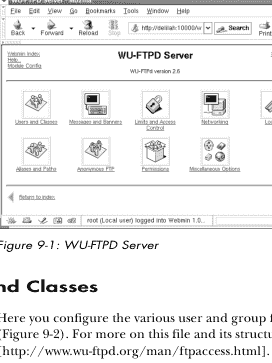

Figure 9-1: `WU-FTPD` Server

## Users and Classes

Here you configure the various user and group features of the `ftpaccess` file (Figure 9.2). For more on this file and its structure, see the `ftpaccess` man page [http://www.wu-ftpd.org/man/ftpaccess.html].

### User classes

Here you define a class of users, and the networks from which they are allowed to log in. Note that the default includes a class `a11` for users of all types (real, guest, and anonymous) which matches all networks with the `*`. This option configures the `class` directive.

### Unix users and UIDs to treat as guests and Unix groups and GIDs to treat as guests

Here, you will define users and groups who would ordinarily qualify as real users who will be treated as guests, or anonymous users. In other words, a `chroot` will be done, and the user will not be permitted to use the `USER` or `PASS` commands. The users home directory must be properly set up, as an anonymous FTP directory would be. These two options correspond to the `guestuser` and `guestgroup` directives.

### Unix users and UIDs not to treat as guests and Unix groups and GIDs not to treat as guests

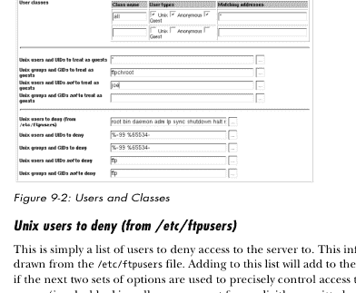

Figure 9-2: Users and Classes


### Unix users to deny (from /etc/ftpusers)

This is simply a list of users to deny access to the server to. This information is drawn from the `/etc/ftpusers` file. Adding to this list will add to the file. Note that if the next two sets of options are used to precisely control access to the FTP server (i.e., by blocking all access except for explicitly permitted users), then the `ftpusers` file becomes unnecessary.

### Unix users and UIDs to deny and Unix groups and GIDs to deny

Here you can enter any users or groups you would like to deny access to. These options configure the `deny-uid` and `deny-gid` directives.

### Unix users and UIDs not to deny and Unix groups and GIDs not to deny

These options can be used to negate the above options, if you chose to disallow all access from all users and groups. In this way, you could allow only explicitly configured users to access the server.

## Messages and Banners

WU-FTPD provides a simple mechanism for informing users of important information regarding the server, or files on the server. As in the previous section, this page configures certain aspects of the `ftpaccess` (Figure 9-3).

### Message files

This option configures the messages that will be displayed on login to the server. The default on many systems is to display a message contained in the file `welcome.msg` in the root FTP directory, if it exists, as soon as someone logs in. Also, when entering a directory the server will check for the existence of a file called `.message` in the new directory. If it exists, it will be displayed. Both of these are optional, and the names and actions can be changed at will. This option configures the `message` directive.

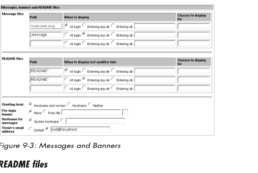

Figure 9-3: Messages and Banners

### README files

Here, you can configure the behavior of the server with regard to README files. This, too, is set up by default on most systems. In this case, any file beginning `README` will be displayed to the user, both on logging into the server, and upon entering a new directory. This option configures the `readme` directive.

### Greeting level

Here you can select how much information about your server will be presented to the user. This can include the host name, the server version, and nothing. This can be a mild security risk, as the first step to cracking a box is to figure out what software and version is running. However, if the system is kept up to date (religiously), and the system is otherwise secured, this should not be an issue. Many paranoid types (and there’s no harm in being paranoid in a world where script kiddies are a dime a dozen) will disable all specific software and version information on all of their publicly accessible services. This option configures the `greeting` directive.

### Pre-login banner

Here you configure a banner that will be displayed before the user is prompted for a user name and password. This option can cause problems with non-compliant FTP client software. This option configures the `banner` directive.

### Hostname for messages

This will be the host name that is printed in the greeting message, and anytime the host name is inserted into a message for the user. This option configures the `hostname` directive.

### Owner's email address

Here you can set the email address of the servers maintainer. This will be presented as the contact email for this server. This option configures the `email` directive.

## Limits and Access Control

This page provides access to various resource limits, as well as provides system level access controls. If you wish to limit the system or network resources your server uses, this is the page to start with.

### Deny access from

Here you may deny access to the server from any number of IP addresses, and you can provide a filename of a text error message file to send the client in the event they have been denied access based on this rule. This option configures the `deny` directive.

### Concurrent user limits


Here you may limit the number of concurrent users from a given user class. To configure this option, you must provide a class for which the rule will apply, and the maximum number of users to allow to log in simultaneously. Next, you can choose times in UUCP `L.sys` format. This format is pretty simple, you choose the days by entering the first two letters with the first capitalized (i.e., `Su` for Sunday, or `Mo` for Monday), or `Any` for all days. Then the time is set in military format (1000 for 10AM, 2300 for 11PM, etc.). So to limit users during business hours, for example, we could enter `MoTuWeThFr0800-1800`. This option configures the `limit` directive.

## File and data transfer limits

This option provides access to the transfer limits features of WU-FTPD. It is possible to limit user's downloads based on files or data or both. You may also configure limits for outgoing and incoming transfers, and to which classes the limits should apply. This option configures the `file-limit` and `data-limit` directives.

## Deny access to files and Allow access to files even if denied

If there are files in your directory tree that you do not wish to be retrievable by one or more classes of users, you may enter it here. The path may be relative to the FTP `chroot`, or it may be an absolute path (select which using the Relative to `chroot` option). This option correlates to the `noretrieve` directive. The Allow access to files even if denied option allows you to unselect files that would ordinarily be made inaccessible by the previous option. This option correlates to the `allow-retrieve` directive.

## 匿名会话限制 访客会话限制

匿名用户和访客用户可以限制为指定的时间。此选项与 `limit-time` 指令相关。

## 最大登录失败次数

此选项允许您定义在向用户显示“登录失败次数过多”消息并关闭 FTP 连接之前允许的失败登录尝试次数。此选项配置 `loginfails` 指令，默认值为 5。

## 可以切换组？

如果启用此选项，用户在登录后可以切换到新组。用户随后将具有新组的权限。此选项配置 `private` 指令，默认关闭。

## 网络

在此处配置 WU-FTPD 的一些网络相关选项。

## TCP 窗口大小

此选项配置数据连接的 TCP 数据包窗口大小。如果客户端是 PPP 拨号用户，则可能有用，因为较小的 TCP 窗口可以提供更快的传输。通常无需修改此项。此选项与 `tcpwindow` 指令相关。

## PASV 连接的地址

允许控制对 `PASV` 命令响应的地址。此操作不会更改守护进程监听的地址，仅更改其在被动连接上向客户端报告的地址。此选项配置 `passive address` 指令。

## PASV 连接的端口

配置可用于被动数据连接的端口号。您可以为特定网络选择端口范围。当控制连接匹配指定的网络时，将从提供的范围内随机选择一个端口供守护进程监听。此功能允许使用限制开放端口的防火墙，同时仍提供 FTP 服务。此选项对应于 `passive ports` 指令。

## 日志

在此处配置 WU-FTPD 的日志行为（图 9-4）。该守护进程的日志记录相当简单，与 Apache 或 BIND 等服务器提供的选项相比几乎不算什么。尽管如此，仍可以从 FTP 守护进程收集大量有用的信息。

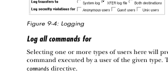

图 9-4：日志

## 记录所有命令

在此处选择一种或多种用户类型，将提供该类型用户执行的每个命令的日志。此选项配置 `log commands` 指令。

## 记录传输

同上，您可以选择一种或多种用户类型进行日志记录。启用此选项后，将记录任何给定类型用户所做的每次文件传输。此选项配置 `log transfers` 指令。

## 记录传输到

此选项设置传输日志的存储位置。如果选择系统日志，传输将通过 `syslog` 守护进程记录到标准系统日志（由您的 `syslog` 配置决定）。如果选择 `XFER` 日志，传输将记录到单独的传输日志文件。此选项配置 `log syslog` 指令。

## 记录安全违规

可以配置服务器记录特定类型用户尝试执行被服务器拒绝的操作。此选项配置 `log security` 指令。

## 别名和路径

此页面允许您配置 FTP 守护进程在客户端发出 `cd` 命令时使用的别名。如果在 `cd` 目录别名部分定义了别名，则别名名称是客户端可以输入的目录名，而别名到目录字段定义客户端将切换到的目录。例如，如果别名名称为 `bin`，别名到目录为 `/home/ftp/pub/usr/local/bin`，则当客户端输入 `cd bin` 时，他将被定向到 `/home/ftp/pub/usr/local/bin`。

接下来是 `cd` 目录搜索路径。通过此选项，您可以配置任意数量可用于搜索路径的目录。例如，如果客户端输入 `cd bin`，而当前目录中没有 `bin` 目录，则服务器将检查搜索路径中的目录。如果请求目录存在于这些目录之一中，客户端将被定向到该目录。

## 匿名 FTP

WU-FTPD 为提供匿名（即未认证）用户服务提供了多种功能。匿名用户通常在服务器上只有非常有限的功能，通常无法上传文件或修改服务器上的任何内容。此页面提供与 FTP 服务器上的匿名用户相关的许多功能的访问。

## 匿名 FTP 根目录

此选项允许您为特定类别的匿名用户配置根目录。因此，将其设置为 `all` 类别的 `/home/ftp`，将导致服务器对任何匿名用户 `chroot` 到指定目录。初始目录（位于 `chroot` 目录之上）将是 `/etc/passwd` 中为用户 `ftp` 指示的主目录。使用此选项，可以使本地网络用户被 `chroot` 到与来自 Internet 的用户不同的目录。例如。此选项配置 `anonymous-root` 指令。

## 访客根目录

此选项与前一个选项类似，配置服务器的 `chroot` 行为。在这种情况下，它配置已使用有效用户名和密码登录的访客用户。因此，可以将 `chroot` 环境设置为 `/home`，从而使用户无法遍历该点以下的目录树。初始工作目录，除非另有指定，将是 `/etc/passwd` 中指定的用户主目录。此选项配置 `guest-root` 指令。

## 匿名用户的 Unix 组

在此处您可以配置默认的 UNIX 组，其权限将适用于特定类别的匿名用户。此选项配置 `autogroup` 指令。

## 匿名 FTP 密码检查

服务器始终在允许访问之前执行用户名和密码身份验证检查。惯例是接受空白用户名和用户的有效电子邮件地址。在此处您可以配置对给定电子邮件地址检查的严格程度，以及在电子邮件地址因某种原因无效时是否发出警告但仍允许登录，或拒绝访问。此选项配置 `passwd-check` 指令。

## 匿名 FTP 拒绝的密码

如果您希望更严格地禁止生成的密码，例如某些 Web 浏览器提供的密码，您可以在此处输入这些地址。这不会阻止浏览器客户端用户访问您的服务器，它只是强制他们配置浏览器以提供合法的电子邮件地址。此选项配置 `deny-email` 指令。

## 权限

此页面允许您配置每种类型用户对给定类别的权限。您可以创建任意数量的权限规则。

## 命令限制


## 本节创建多种不同类型的规则，以规范用户可能在服务器上执行的不同命令。命令选项为 `chmod`、`delete`、`overwrite`、`rename` 和 `umask`，与指令名称匹配。您可以为每个规则选择用户类型和类别。

## 不允许上传的文件名

在此处您可以指定正则表达式以匹配可能不被指定类型或类型列表和类别上传的文件名。该选项还允许您指定如果上传被规则禁止时要显示的消息文件的路径。默认情况下，消息位于 `/etc/pathmsg`，如果您提供的路径无效，服务器将恢复为此。此选项对应于 `path-filter` 指令。

## 杂项选项

此页面提供对一些不太适合其他地方的配置选项的访问。您不太可能需要从默认值更改这些设置。

## 长列表命令、短列表命令、纯列表

定义用于用户可能指定的各种文件列表类型的命令。默认值通常是合理的，只有在必要时才应修改。这些选项与 `lsLong`、`lsShort` 和 `lsPlain` 指令相关。

## 关闭通知文件

在此处配置服务器在关闭前显示的消息的路径。此选项与 `shutdown` 指令相关，通常默认为 `/etc/shutmsg`。

## Service process nice level

这会为 FTP 守护进程设置 nice 级别。此设置可按用户类别设置，也可为所有类别设置。此选项与 `nice` 指令相对应。

## Default umask for uploaded files

此选项定义了由给定类别用户上传的文件所应用的 `umask`。此选项与 `defumask` 指令相对应。

## 10

## POSTFIX


Postfix 是由 IBM T.J. Watson 研究中心的 Wietse Venema 设计的高效且功能丰富的邮件服务器（图 10-1）。它旨在取代流行的 Sendmail。虽然它在全球邮件服务器安装中仍只占很小比例，但由于其简单配置、安全实现和高性能架构，其受欢迎程度正在迅速增长。

此外，由于 Postfix 在外部表现上与 Sendmail 行为相似，因此它是旧的、更大的、更慢的邮件服务器的几乎即插即用替代品。它缺少 Sendmail 的一些晦涩功能，但它缺少的功能很少被绝大多数用户使用，因此很少被怀念。

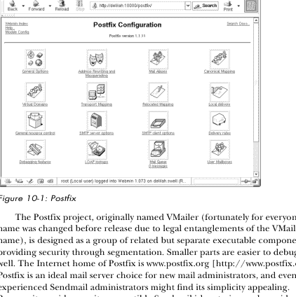

图 10-1：Postfix

Postfix 项目最初名为 VMailer（幸运的是，在发布前由于 VMailer 名称的法律纠纷，名称被更改，对所有人都有好处），它被设计为一组相关的但独立的可执行组件，通过分段提供安全性。较小的部分也更容易调试。Postfix 的互联网主页是 www.postfix.org [http://www.postfix.org]。Postfix 是新邮件管理员理想的邮件服务器选择，甚至经验丰富的 Sendmail 管理员也可能觉得其简单性有吸引力。由于它提供了一个相当兼容的 Sendmail 外观，并提供相同名称的程序（例如用于发送邮件的 `sendmail`，用于管理队列的 `mailq` 等），并且可以使用 Sendmail 使用的相同类型的别名和转发文件，因此可以在不重新配置现有邮件相关工具或重写本地脚本的情况下替换 Sendmail。切换后，本地用户可能甚至不会注意到差异。

> 注意 上述陈述不应被视为对 Postfix 作为比 Sendmail 更好的邮件传输代理的认可。两个项目有不同的侧重点，并且有非常不同的开发模式。Sendmail 在世界各地以一种或另一种形式使用了超过 20 年，因此在成熟度、可用文档、经验丰富的管理员数量和支持工具方面，Postfix 拥有极大的领先优势。Postfix 只有几年历史，支持文档和增强工具非常有限。哪个邮件传输代理适合您的网络，将由要求和本地专业知识的可用性决定。

## General Options

`General Options` 页面配置了有关 Postfix 的总体行为的许多选项。具体来说，影响所有用户和所有邮件的大多数配置选项都在此处配置。Postfix 秉承其简单性的理念，通常只需要对配置文件进行少量更改即可高效安全地运行邮件服务器。

`General Options` 页面分为两部分。顶部部分标记为 `Most Useful General Options`，底部部分为 `Other General Options`。在许多标准安装中，可能只需配置顶部部分的三个指令之一即可启动 Postfix 安装。除非另有说明，否则此页面上的所有选项都对应于 Postfix 配置目录中 `main.cf` 文件中的指令。

### Most Useful General Options

本节中的三个选项在某些安装中是使 Postfix 能够发送和接收电子邮件所需的唯一需要更改的选项（图 10-2）。

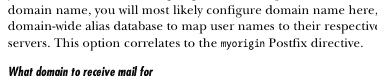

图 10-2：Most Useful General Options

#### What domain to use in outbound mail

您可以在此处指定用于标识传出邮件来源的域名或主机名。Postfix 默认使用服务器的主机名，但您很可能希望它将邮件标识为来自您的域名。 如果您的邮件服务器将接受大量用户在单个域名下的邮件，您很可能在此处配置域名名称，并创建域范围的别名数据库以将用户名映射到其各自的本地邮件服务器。此选项与 `myorigin` Postfix 指令相对应。

#### What domain to receive mail for

此选项接受要作为最终目的地接收邮件的域名和地址列表。换句话说，当邮件到达服务器，目的地为此字段中的地址时，它将把邮件投递给本地用户，而不是转发到另一台邮件服务器。默认情况下，这是机器上的所有配置地址以及本地域内的 `localhost`。您可以指定用逗号分隔的任意数量的域名或主机名，也可以提供包含类似条目的文件的完整路径。变量 `$myhostname` 和 `$mydomain` 可用于让 Postfix 自动表示这些概念。Postfix 能够在其配置文件中全程使用此类变量，使得维护具有非常相似配置的多个 Postfix 服务器变得更容易。此选项与 `mydestination` 指令相对应。

#### What trouble to report to the postmaster

Postfix 提供了选择哪些类型的错误消息将发送给邮件服务器指定的邮政管理员的功能。假设您已设置一个将邮件定向到真实人员的 postmaster 别名，Postfix 将发送此处指定的所有类型的故障报告。可用的类别有：

- `bounce` 选择此选项时，每当邮件无法投递时，就会向邮件发送者和本地邮政管理员发送退信消息（称为 *单次退信消息*）。出于隐私考虑，仅在消息中发送头信息。如果发送给发送者的第一次退信被退回为无法投递，则会向邮政管理员发送 *双重退信消息*，其中包含第一次单次退信消息的全部内容。
- `2bounce` 导致双重退信消息发送给邮政管理员。
- `delay` 如果邮件投递被延迟，邮政管理员将收到通知，连同延迟邮件的头信息。
- `policy` 通知邮政管理员因未经请求的商业邮件策略限制而被拒绝的邮件。完整的 SMTP 会话记录将被发送。
- `protocol` 通知邮政管理员协议错误或包含未实现命令的客户端请求。SMTP 会话的完整记录包含在消息中。
- `resource` 通知邮政管理员因资源问题导致邮件未投递，例如队列文件写入错误。
- `software` 通知邮政管理员因软件故障导致邮件未投递。

此选项与 `notify_classes` 指令相对应，默认仅报告通常表示配置错误或严重问题的故障（具体为 `resource` 和 `software`）。在某些高负载环境中，将其更改为包含 `bounce` 通知可能会导致大量通知。

### Other General Options

此页面的下半部分专门用于不太可能需要更改的全局选项（图 10-3）。在许多安装中，这些选项将保持默认值。

#### Send outgoing mail via

此选项配置传出邮件应直接投递到收件人的邮件服务器，还是应使用父邮件网关作为中介。如果服务器位于防火墙后面、网络地址转换路由器/网关后面或类似环境中，可能需要使用中介服务器来实现可靠服务。许多互联网上的邮件服务器不会接受没有有效 DNS 条目和可路由 IP 地址的服务器的邮件，以帮助防止伪造地址的垃圾邮件。此外，本地网络使用策略可能要求使用中介进行日志记录、病毒扫描或其他 purposes that require aggregation of outgoing mail traffic onto a central server. This option corresponds to the `relayhost` directive and defaults to sending mail directly.

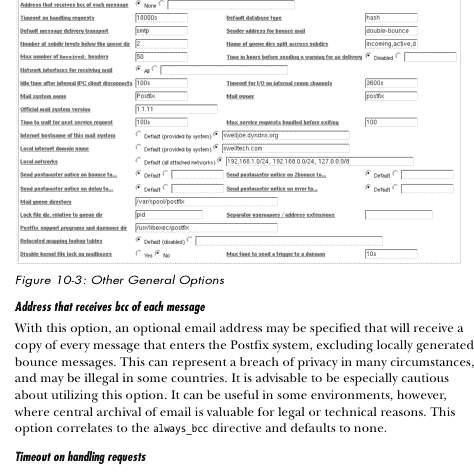


# Figure 10-3: Other General Options

## Address that receives bcc of each message

With this option, an optional email address may be specified that will receive a copy of every message that enters the Postfix system, excluding locally generated bounce messages. This can represent a breach of privacy in many circumstances, and may be illegal in some countries. It is advisable to be especially cautious about utilizing this option. It can be useful in some environments, however, where central archival of email is valuable for legal or technical reasons. This option correlates to the `always_bcc` directive and defaults to none.

## Timeout on handling requests

This option determines how long a Postfix daemon will wait on a request to complete before it assumes the daemon has locked up, at which time the daemon will be killed. This option corresponds to the `daemon_timeout` and defaults to 18000 seconds.

## Default database type

This option determines the type of database to use in the `postalias` and `postmap` commands. This option corresponds to the `default_database_type` directive and the default depends on the OS and installed system libraries at the time of building Postfix. Ordinarily on UNIX systems this will be hash or dbm.

## Default message delivery transport

The term delivery transport refers to the protocol, or language, used to deliver the message from one mail server to another. The transport on modern systems is nearly always smtp, and this is the default in Postfix, but there are still a few legacy uucp systems in use. This option is merely the default choice, when no transport is explicitly selected for the destination in the optional transport table. This option corresponds to the `default_transport` directive.

## Sender address for bounce mail

In the event a message double-bounces, or first bounces from the recipient and then bounces from the sender when the first bounce notice is sent, the message will be sent to this address. All messages to this address will be silently discarded. In this way bounce-loops can be avoided. This option correlates to the `double_bounce_sender` and defaults to double-bounce. The name may be any arbitrary name, but must be unique.

## Number of subdir levels below the queue dir

This option configures the number of subdirectory levels below the configured queue directories will be used by Postfix for mail storage. Because of the design of the traditional UNIX filesystem, which includes UFS used by all modern BSD systems and the Linux ext2 and ext3 filesystems, performance becomes measurably slower when an extremely large number of files are stored in a single directory. Thus, programs that generate a large number of files often provide the ability to split files out to a number of subdirectories to keep lookups fast. This option correlates to the `hash_queue_depth` directive and defaults to 2, which is suitable for most moderate and even relatively large installations. Because the number of directories in use increases the search time for object seeks, using a too high value here can be harmful to performance.

## Name of queue dirs split across subdirs

Postfix uses a number of queues to organize messages with varying states and destinations. Each of these queues can be configured to use hashed subdirectories or not. If a queue is selected here, it will be stored in a hashed subdirectory. In some cases, a queue must not be listed here as performance will be severely impacted, specifically the world-writable mail drop directory. The defer log file directory, on the other hand must be stored in hashed directories or performance will suffer. This option corresponds to the `hash_queue_names` directive and defaults to incoming, active, deferred, bounce, defer, flush and it is rarely necessary or beneficial to alter this configuration.

## Max number of Received: headers


A message that contains more `Received:` headers than this will bounce. An extremely large number of this header may indicate a mail loop or a misconfigured mail server somewhere in the path of this message. This option correlates to the `hopcount_limit` directive and defaults to 50. This value rarely needs to be altered from its default.

## Time in hours before sending a warning for no delivery

If a message cannot be delivered immediately, it will be queued for later delivery. If after this number of hours, the message still cannot be delivered, a warning will be sent to the sender notifying them that the server has been unable to send the message for a specified time. This correlates to the `delay_warning_time` directive and defaults to not sending a warning.

## Network interfaces for receiving mail

This option configures the network addresses on which Postfix will accept mail deliveries. By default Postfix will accept mail on every active interface. Here, Postfix will accept the variables discussed earlier. This option configures the `inet_interfaces` directive.

## Idle time after internal IPC client disconnects

This option sets the time in seconds after which an internal IPC client disconnects. This allows servers to terminate voluntarily. This feature is used by the address resolution and rewriting clients. This option correlates to the `idle_time` directive and defaults to 100s. This option should probably never need to be altered under normal circumstances.

## Timeout for I/O on internal comm channels

This option determines the amount of time in seconds the server will wait for I/O on internal communication channels before breaking. If the timeout is exceeded, the server aborts with a fatal error. This directive corresponds to the `ipc_timeout` directive and defaults to 3600 seconds, or 60 minutes.

## Mail system name

This option identifies the mail server system in use to connecting users. It will be used in the `smtpd_banner` which is sent in `Received:` headers, the SMTP greeting banner, and in bounced mail. Some security experts, who promote security through obscurity, suggest anonymizing all server software to prevent potential crackers from being able to identify the software in use on the server. It is probably not the best use of an administrators time or effort in most environments, however, and many other security tactics are more effective, without negatively impacting the ability to track software problems. This option correlates to the `mail_name` directive and defaults to Postfix.

## Mail owner

This option specifies the owner of the Postfix mail queue, and most of the Postfix daemon processes. This user should be unique on the system, and share no groups with other accounts or own any other files or processes on the system. After binding to the SMTP port (25), `postfix` can then drop root privileges and become the user specified here for all new daemon processes. Because of this, if the Postfix daemon is ever compromised the exploiter will only have access to mail and a few other files. Obviously it is good to avoid this as well, but it is certainly better than a root exploit which would allow the exploiter to access and alter anything on the system. This option correlates to the `mail_owner` directive and defaults to `postfix`.

## Official mail system version

This parameter configures the version number that will be reported by Postfix in the SMTP greeting banner, among other things. This correlates to the `mail_version` directive and defaults to the version of Postfix that is installed. Once again, security by obscurity promoters may encourage obfuscation of this value.

## Time to wait for next service request

A Postfix daemon process will exit after the time specified here, if it does not receive a new request for service during that time. This option corresponds to the `max_idle` directive and defaults to 100s. This directive does not impact the queue manager daemon process.


## Max service requests handled before exiting

This option configures the maximum number of requests that a single Postfix daemon process will answer before exiting. This option configures the `max_use` directive and defaults to 100.

## Internet hostname of this mail system

This option specifies the Internet host name of the mail server. By default this value will be set to the fully qualified host name of the server, as determined by a call to `gethostname()`. This option sets the `$myhostname` variable which is used in the defaults to many other options. This option correlates to the `myhostname` directive.

## Local Internet domain name

This option corresponds to the `mydomain` directive and defaults to the contents of the `$myhostname` variable minus the first component. This option defines the `$mydomain` variable and is used in a number of other configuration option defaults.

## Local networks

Postfix provides a flexible set of options to help prevent UCE, or other unauthorized uses of the mail server. This option defines what networks will be considered to be local by Postfix. The value is used to determine whether a client is a local client or a remote client. Policies can be more relaxed for local clients. This option configures the `mynetworks` directive and defaults to a list of all networks attached to the server. For example, if the server has an IP of 192.168.1.48, and a netmask of 255.255.255.0, all of the 192.168.1.0 network will be considered local. If you would like stricter control, or the ability to treat other network blocks as local clients, you can specify them here in the form of network/mask pairs (i.e., 172.16.0.0/16). Network/mask pairs may be inserted from a separate file, if preferred, by specifying the absolute path to the file here.

## 发送退信通知给 postmaster 的收件人...

此选项配置退信通知将发送到的用户名或电子邮件地址。此选项对应于 `bounce_notice_recipient`，默认设置为 postmaster。

## 发送二次退信通知给 postmaster 的收件人...

此选项配置二次退信消息将发送到的用户名或电子邮件地址。这允许管理员比首次退信消息更密切地关注二次退信警告，因为首次退信更为常见，不太可能表明严重问题。该选项配置 `2bounce_notice_recipient` 指令，默认值为 postmaster。

## 发送延迟通知给 postmaster 的收件人...

此选项配置延迟警告将发送到的位置。此选项对应于 `delay_notice_recipient` 指令，默认值为 postmaster。

## 发送错误通知给 postmaster 的收件人...

指定错误警告将发送到的位置。此选项对应于 `error_notice_recipient` 指令，默认值为 postmaster。

## 邮件队列目录

此选项指定 Postfix 将存储排队邮件的目录。这也将是 Postfix 在 `chroot` 环境中运行的守护进程的根目录。队列是等待投递的消息的存储位置，因此应在此目录中提供足够的空间来容纳您的用户邮件负载。此选项对应于 `queue_directory` 指令，通常默认为您操作系统的合理位置。许多 Linux 系统的邮件队列位于 `/var/spool/mail` 或 `/var/spool/postfix`。

## 锁文件目录，相对于队列目录

此选项配置 Postfix 锁目录的位置。它应相对于队列目录指定，通常只是队列目录的一个子目录。此选项配置 `process_id_directory` 指令，默认值为 `pid`。

## 用户名与地址扩展之间的分隔符

此选项指定用户名与地址扩展之间的分隔字符。此选项对应于 `recipient_delimiter` 指令，默认不使用分隔符。此选项会影响规范映射、迁移映射和虚拟域。

## Postfix 支持程序和守护进程目录

此选项指定 Postfix 将查找其各种支持程序和守护进程的目录。该目录应由 root 拥有。此选项对应于 `program_directory` 指令，默认值因安装方法和操作系统变体而异。在许多 Linux 系统中，这将是 `/usr/libexec/postfix`。

## 迁移映射查找表

Postfix 可以针对发送给不再从此服务器接收邮件的用户的信息提供迁移通知。如果启用，此选项指定包含不再存在于此系统上的用户联系信息的表的所在位置。默认情况下此功能处于禁用状态。此选项对应于 `relocated_maps` 指令。如果启用，此选项的一个合理选择可能是 `/etc/postfix/relocated`。

## 禁用邮件箱的内核文件锁

在 Sun 工作站上，内核文件锁可能会导致问题，因为 `mailtool` 程序在窗口打开时始终持有独占锁。其他操作系统变体或未使用 Sun 邮件软件的 Sun 系统的用户可以忽略此选项。此选项对应于 `sun_mailtool_compatibility` 指令，默认值为 No。

## 发送触发器到守护进程的最大时间

此选项指定向 Postfix 守护进程发送触发器的最大允许时间。此限制有助于防止在邮件系统负载极重时程序挂起。此选项对应于 `opts_trigger_timeout` 指令，默认值为 10s。

## 地址重写和伪装

Postfix 提供了一个相对易于使用且灵活的地址重写系统，使其能够充当大型网络的邮件网关，或充当传统邮件系统与整个互联网之间的网关（图 10-4）。

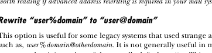

图 10-4：地址重写和伪装

> 注意 本页上的选项也在 Postfix 主页上的 Postfix 配置 - 地址操作 [http://www.postfix.org/rewrite.html] 页面上进行了讨论。如果邮件系统需要高级地址重写，则值得阅读。

### 将 “`user%domain`” 重写为 “`user@domain`”

此选项对一些使用奇怪地址技巧的传统系统很有用，例如 `user % domain@otherdomain`。在现代环境中通常没有用，但无害，因此通常默认为 Yes。此选项对应于 `allow_percent_hack` 指令。

### 将 “`user`” 重写为 “`user@$mydomain`”

此选项配置 Postfix 如何处理目标地址中没有域名的情况。如果启用，它将把 `$mydomain` 的值附加到地址上。此选项对应于 `append_at_myorigin` 指令，默认值为 Yes。由于大多数 Postfix 组件期望地址为 `user@domain` 形式，因此禁用此功能可能永远不合适。

### 将 “`user@host`” 重写为 “`user@host.$mydomain`”


此选项配置是否将简单主机地址附加 `$mydomain` 的值。此选项对应于 `append_dot_mydomain` 指令，默认值为 `Yes`。一些管理员可能会发现这种显式重写有意外的后果，但这种情况很少见。

## 将 “site!user” 重写为 “user@site”

传统的 UUCP 网络使用与现代 SMTP 系统不同的寻址格式。此选项使 Postfix 能够将旧式地址转换为现代地址，以便通过标准 SMTP 协议投递。此选项配置 `swap_bangpath` 指令，默认值为 `Yes`。

## 将空收件人邮件发送到...

The specifies the destination of mail that is undeliverable. Typically, this will be bounce notifications and other error messages. This option correlates to the `empty_address_recipient` directive and defaults to `MAILER-DAEMON`, which by default is simply an alias to `postmaster`.

## 地址伪装

地址伪装是一种方法，通过该方法网关邮件服务器后面的主机可以被隐藏，所有邮件都将显示为源自网关服务器。如果启用，地址的主机和/或子域部分将被剥离，只有在此处指定的域将包含在地址中。例如，如果在此处指定 `$mydomain`，则来自 joe@joesmachine.swelltech.com 的外发邮件将变为 joe@swelltech.com，前提是 `$mydomain` 变量包含 swelltech.com。此选项对应于 `masquerade_domains` 指令，默认情况下处于禁用状态。

## 伪装例外

可以跳过上面定义的伪装规则以适用于某些用户名。应从这些规则中排除的名称可在此处输入。此选项对应于 `masquerade_exceptions` 指令，默认情况下不做任何例外。

## 邮件别名

邮件别名提供了一种将邮件重定向到本地收件人的方法。具体来说，它允许将发往多个不同地址的邮件投递到单个邮箱。常见的用途是将诸如 `postmaster` 之类的用户的邮件定向到真实人员。本页分为两个部分。上面标记为 `Aliases Options` 的部分包含 Postfix 应用于构建其别名数据库的别名文件的位置和格式，并指定要使用的数据库类型。下面部分提供了系统中所有已配置别名的列表，以及别名映射到的内容。

### 别名选项

以下选项指定 Postfix 将使用的别名数据库的位置和类型：

#### 本地投递代理使用的别名数据库

此选项设置 Postfix 将用于本地投递别名转换的文件名。文件名将根据文件类型附加后缀。此选项对应于 `alias_maps` 指令，默认值为系统相关。一些常见默认值包括 `hash:/etc/aliases` 或 `hash:/etc/postfix/aliases`。条目中冒号前的第一部分是要使用的数据库类型，将是具有现代 Berkeley DB 实现的系统的 `hash`、仅有 `dbm` 可用的旧式系统的 `dbm`，或运行 NIS 的系统的 `nis`。冒号后的部分是数据库名称所派生的平面文件的路径。数据库将在 Postfix 启动时或运行 `newaliases` 命令时从平面文件的内容构建。

#### 由 Postfix 构建的别名数据库

此选项与上面密切相关，指定在运行 `newaliases` 或 `sendmail -bi` 命令时构建的别名数据库文件。这些命令从上面的选项中的平面文件生成别名数据库，以便加快 Postfix 执行的别名查找。由于大型邮件服务器上可能有数千个别名，因此将它们导入数据库对于保持效率是必要的。此选项对应于 `alias_database` 指令。默认值取决于系统，但通常与上面的选项相同，并附加适当的数据库文件后缀。

### 别名

本页的这一部分提供了所有已配置别名的列表。要编辑别名，请单击别名名称。要创建别名，请单击 `Create a new alias` 按钮并填写 `Alias Name` 和 `Alias to...` 字段。每当别名文件被修改时，有必要重新创建别名数据库文件以使更改生效。使用 Webmin 时，此步骤会自动执行，无需额外操作。

> 注意 如果从命令行添加别名，可以使用命令 `postalias` 重新生成别名数据库。该命令的手册页是了解 Postfix 中别名数据库如何处理的实用资源。

## Canonical Mapping

Postfix 中的规范映射用于修改传入队列中的邮件，并更改本地或远程邮件的消息头和消息信封信息。此映射可用于将登录名替换为 Firstname.Lastname 样式的地址，或清理由旧邮件系统产生的奇异地址。

### Canonical Mapping Tables

如果使用任何规范映射表，它们必须在 Canonical Mapping 模块的第一部分中指定。定义后，可以从模块的第二部分编辑它们。

### Address mapping lookup tables

此选项指定可选规范地址映射表文件的位置。此映射应用于发件人和收件人地址的信封和头。此选项配置 `canonical_maps` 指令，默认情况下为禁用。与上一节讨论的别名文件类似，规范映射文件由数据库类型和文件名指定。接受的数据库类型取决于您的操作系统和已安装的组件。通常使用 `hash` 和 `dbm` 作为数据库类型。因此，此值的常见选择可能是 `hash:/etc/postfix/canonical`。

### Tables for RECIPIENT addresses

此参数仅配置收件人地址的地址映射，而不配置发件人地址。映射在信封和头上执行。这些查找在上面配置的 `Address mapping lookup tables` 之前执行。此选项对应于 `recipient_canonical_maps` 指令，默认情况下为禁用。

### Tables for SENDER addresses

与上一个选项类似，此选项仅配置发件人地址的映射，而不配置收件人地址。信封和头信息都会被修改。此选项对应于 `sender_canonical_maps` 指令，默认情况下为禁用。

### Editing Canonical Mappings

一旦为任何规范映射表选择了文件名，就可以通过单击适当的 `Edit` 按钮进行编辑。将打开一个新页面，列出任何现有映射并允许创建新映射。所有文件中的映射格式相同。

规范映射乍一看似乎与别名或虚拟域相似。然而，它们截然不同，并可用于其他目的。虽然别名仅决定哪个用户接收电子邮件，而虚拟域仅影响信封地址，但规范映射会同时更改信封地址和 SMTP 头地址。此更改可用于使邮件看起来来自不同的用户或域，或通过更改消息上的地址将邮件定向到不同的用户或域。

例如，如果我有多个本地子域，但希望所有邮件看起来都源自单个域，则可以创建规范映射来进行转换。在 `Edit a Map` 页面中，`Name` 将是要映射到域的子域，例如 @lab.swellitech.com。`Maps to...` 值将只是我希望此子域转换到的域，@swellitech.com。保存映射并应用更改后，所有来自 lab.swellitech.com 的外发邮件看起来都将源自 swellitech.com。

## Virtual Domains

Postfix 中的虚拟域功能提供了一种通过更改消息信封地址将消息重定向到不同位置的方法。虚拟域映射不会更改头地址。虽然虚拟域的一些功能与别名中可用的功能重叠，但虚拟域可用于本地或非本地地址，而别名只能用于本地地址。

### Domain mapping lookup tables

与上一节讨论的别名表和规范映射表类似，这只是包含虚拟域映射表的 `<|message|>` 的路径。这通常是 `hash:/etc/postfix/virtual` 之类的内容，并且必须转换为数据库格式才能在 Postfix 中使用。Webmin 将为您执行数据库生成步骤。

## Transport Mapping

术语 transport 指的是用于投递邮件的机制。具体来说，SMTP 和 UUCP 是 Postfix 支持的邮件传输。传输映射可用于多种目的，包括 SMTP 到 UUCP 网关、在防火墙上运行 Postfix 并转发到内部邮件服务器等等。

### Transport mapping lookup tables

此选项配置包含一个或多个传输映射的文件的路径。这些表与前面讨论的映射表类似，并转换为数据库并以相同的方式被 Postfix 使用。此选项对应于 `transport_maps` 指令。此功能默认情况下为禁用。此选项的常见值是 `/etc/postfix/transport`。


要创建新映射，首先定义映射文件。然后单击 Add a mapping。例如，如果您的目标是从运行在防火墙上的 Postfix 将邮件重定向到受保护的内部主机，您可以在 Name 字段中输入外部域名 swelltech.com，然后在 Maps to 字段中输入内部机器的地址 smtp:privatehost.swelltech.com。 为了进一步改进这一点，可以在此机器上禁用本地投递，并增加对应接受邮件的位置和收件人的控制。本章教程部分提供了此类配置的更多示例。

## Relocated Mapping

使用此选项可以通知发件人本地用户已移至另一个地址。例如，如果用户离开组织但仍偶尔在本地地址收到邮件，则可能方便通知向该用户发送邮件的任何人该用户已搬迁以及该用户的新的联系信息。用法与前面类型的映射相同，因此此处不会专门记录，不过将给出一个已搬迁映射的示例以显示此功能可以提供的信息类型。

例如，假设我从目前的公司搬到椭圆形办公室更为轻松的环境。为了确保我的所有朋友和客户都能与我保持联系，我可以提供一个已搬迁映射，其 Name 为 joe@swelltech.com，Maps to 为 president@whitehouse.gov。虽然这不会将邮件重定向到我新家，但它会通知试图联系我的人我已更改电子邮件地址。希望他们都会更新他们的地址簿并将邮件重新发送到我的新地址。

## Local delivery

本地投递是 Postfix 在遍历完所有映射和访问控制列表后，仍发现消息被允许并且目标为本地机器上的用户时所执行的操作（即，映射可能会将消息发送到其他地方进行最终投递，因此在达到此阶段之前会执行所有映射以及各种访问检查）。此页面配置与 Postfix 如何处理本地用户的邮件投递相关的多个选项（图 10-5）。

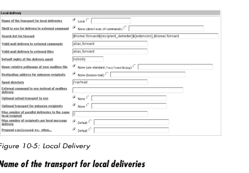

图 10-5：本地投递

### Name of the transport for local deliveries

这配置了将用于投递到与`$mydestination`或`$inet_interfaces`变量匹配的目的地的传输的名称。这可以是由 Postfix 本地投递代理处理的简单邮箱投递，或任何适当的投递命令。此选项对应于`local_transport`指令，默认值为名为`local`的已定义传输类型。

### Shell to use for delivery to external command

如果需要命令 shell 才能与您选择的本地投递传输正确通信，则此选项选择将使用的 shell。默认情况下不使用 shell，传输命令将直接执行。但是，如果命令包含 shell 元字符或 shell 内置命令，它们将被传递给 `/bin/sh` 或您在此处配置的任何 shell。此选项的流行选择是 `smsh`，即 Sendmail 的受限 Shell，包含在最近的 Sendmail 发行版中。`smsh` 允许对用户从其 `.forward` 文件中可以执行的命令进行更精确的控制。此选项对应于`local_command_shell`，默认值为 `/bin/sh`。

### Search list for forward

这是一个用户转发文件可能位置的以逗号分隔的列表。Postfix 将尝试列表中的每个条目，直到找到转发文件或检查完所有条目且未找到匹配项为止。转发文件允许用户为自己配置投递选项，包括由 `procmail` 之类的程序进行的投递时处理，以及将消息转发到不同服务器。条目上会执行一些变量扩展。当前的扩展是：

#### Forward Search Path Variable Expansions

Entries in forward files can make use of the following variables:

| Variable | Description |
| --- | --- |
| `$user` | The username of the recipient. |
| `$shell` | The shell of the recipient. |
| `$home` | Recipient's home directory. |
| `$recipient` | The full recipient address. |
| `$extensions` | Recipient address extensions. This is a separate part of the email address, separated by the Separator between user names and address extensions defined on the General Options page. |
| `$domain` | The recipient's domain name. |
| `$local` | The entire local part of the recipient address. |
| `$recipient_delimiter` | The separation delimiter for the recipient. |

### Valid mail delivery to external commands

This parameter restricts mail delivery to only those commands specified here. The default is to disallow delivery to commands specified in `:include:` files and allow execution of commands in aliases and forward files. This option correlates to the `allow_mail_to_command` directive.

### Valid mail delivery to external files

This option restricts mail delivery to external files. The default is to disallow delivery to files specified in `:include:` but to allow delivery to files specified in aliases and forward files. This option correlates to the `allow_mail_to_files` directive.

### Default rights of the local delivery agent

This option configures the privileges that the delivery agent will have for delivery to a file or a command. This option should never be a privileged user or the Postfix owner. This option corresponds to the `default_privs` directive and defaults to `nobody`.

### Pathname of user mailbox file

When delivering mail locally, Postfix will drop mail in the directory configured here or in its default mail spool directory. If you wish to use the maildir format for mail storage, this value can be appended with a trailing slash. For example, to store mail in the user's home directory in the `Maildir` subdirectory, the value would be `$Maildir/`. This option correlates to the `home_mailbox` directive and usually defaults to some location under `/var/spool/mail` or `/var/spool/postfix`.

### Destination address for unknown recipients


If a message is received for a recipient that does not exist, the message is normally bounced. However, it is possible to instead have the message delivered to an alternate address. This option corresponds to the `luser_relay` directive. Variable expansions matching those discussed for the Search list for forward are also valid for this directive.

## Spool directory

This option specifies the directory where UNIX-style mailboxes are stored. Defaults vary depending on OS variant and version, but a common choice is `/var/spool/mail`. This option correlates to the `mail_spool_directory` option.

## External command to use instead of mailbox delivery

This option defines a command to use for delivery instead of delivering straight to the user’s mailbox. The command will be run as the recipient of the message with appropriate `HOME`, `SHELL`, and `LOGNAME` environment variables set. This option is commonly used to set up system-wide usage of `procmail`. Beware that if you use a command to deliver mail to all users, you must configure an alias for root, as the command will be executed with the permissions of the `$default_user`. This option correlates to the `mailbox_command` directive and is disabled by default.

## Optional actual transport to use

This option configures the message transport to use for all local users, whether they are in the UNIX passwd database or not. If provided, the value will override all other forms of local delivery, including Destination address for unknown recipients. This option corresponds to the `mailbox_transport` directive and is disabled by default. This option may be useful in some environments, for example, to delegate all delivery to an agent like the `cyrus IMAPD`.

## Optional transport for unknown recipients

If a user cannot be found in the UNIX passwd database, and no alias matches the name, the message will ordinarily be bounced or handled via the Destination address for unknown recipients option. However, if you would like unknown users to be handled by a separate transport method, this option overrides the Destination address for unknown recipients option above. This option correlates to the `fallback_transport` directive and is disabled by default.

## Max number of parallel deliveries to the same local recipient

This option limits the number of simultaneous deliveries to a single local recipient. If `.forward` files are allowed for users, a user may run a time-consuming command or shell script, leading to overload caused by several such processes being started up at once. This option correlates to the `local_destination_concurrency_limit` directive, and the default is 2. A low value is recommended for this option, unless it is certain that no complex `.forward` files will be in use.

## Max number of recipients per local message delivery

This option configures the maximum number of recipients per local message delivery. This option correlates to the `local_destination_recipient_limit` and is set to the value of Max number of recipients per message delivery by default.

## Prepend a Delivered-To: when...

This parameter determines when Postfix should insert a Delivered-to: message header. By default Postfix inserts this header when forwarding mail and when delivering to a file. The defaults are recommended, and it is generally preferable not to disable insertion into forwarded mail. This option corresponds to the `prepend_delivered_header` directive.

## General Resource Control

This page provides access to the various memory and process limits for the Postfix processes (Figure 10-6). It is rarely necessary to alter the values on this page, except for highly loaded servers or very low resource machines.

## Max size of bounced message

This option limits the amount of the original message content in bytes that will be sent in a bounce notification. This option correlates to `bounce_size_limit` and defaults to 50000.

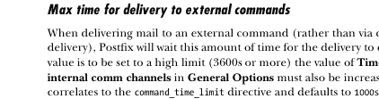

Figure 10-6: General resource control


## Max time for delivery to external commands

When delivering mail to an external command (rather than via direct mailbox delivery), Postfix will wait this amount of time for the delivery to complete. If this value is to be set to a high limit (3600s or more) the value of Timeout for I/O on internal comm channels in General Options must also be increased. This option correlates to the `command_time_limit` directive and defaults to 1000s.

## Max number of Postfix child processes

This option limits the number of child processes that Postfix will spawn. On high load servers the default may be too low and may need to be raised to as much as 500 or more. More likely, for most environments, 50 is more than adequate and may even be overkill. For example, on dial-up or consumer broadband serving
one to ten users, a more appropriate limit might be 10. If in doubt, leave it at its default unless it causes problems. This option correlates to the `default_process_limit` directive and defaults to 50.

## Max number of addresses remembered by the duplicate filters

While expanding aliases and `.forward` files Postfix will remember addresses that are being delivered to and attempt to prevent duplicate deliveries to the same address. This option limits the number of recipient addresses that will be remembered. It corresponds to the `duplicate_filter_limit` directive and defaults to 1000. There is probably no compelling reason to increase this value.

## Max attempts to acquire file lock

This option limits the number of attempts Postfix will make when attempting to obtain an exclusive lock on a mailbox or other file requiring exclusive access. It corresponds to the `deliver_lock_attempts` directive and defaults to 20.

## Time in seconds between file lock attempts

Postfix will wait a specified time between attempts to lock a given file, after a failed lock attempt. This option configures the `deliver_lock_delay` directive and defaults to 15.

## Max attempts to fork a process

If Postfix attempts to fork a new process and fails, due to errors or a lack of available resources, it will try again a specified number of times. This option correlates to the `fork_attempts` directive and defaults to 5.

## Time in seconds between fork attempts

Postfix will try to spawn a new process a specified time after a failed attempt. This option correlates to the `fork_delay` directive and defaults to 15.

## Max memory used for processing headers

This option limits the amount of memory in bytes that Postfix will use to process message headers. If a message header is too large to fit into the memory specified, the headers that do not fit into memory will be treated as part of the message body. This option correlates to the `header_size_limit` directive and defaults to 102400.

## Max memory used for handling input lines

This option limits the amount of memory in bytes that Postfix will use to handle input lines. And input line is any line read from an `include:` or `.forward` file. In order to prevent the mail server from using excessive amounts of memory, it will break up these files into chunks of this length. This option correlates to the `line_length_limit` directive and defaults to 2048.

## 消息的最大大小

此选项限制将被投递的消息的大小（以字节为单位），包括消息信封信息。该限制应设置得足够高，以支持用户需要发送或接收的任何电子邮件。此选项对应于 `message_size_limit` 指令，默认值为 10240000。

## 活动队列中的最大消息数

此选项限制在任何给定时间内可以存在于消息队列中的消息数量。它对应于 `qmgr_message_active_limit` 指令，默认值为 10000。

## 最大内存中收件人数

此参数限制内存中收件人数据结构的数量。此内存包含短期死列表，其中指示在上次联系时目标不可用，等等。此选项对应于 `qmgr_message_recipient_limit` 指令，默认值为 1000。

## 队列文件系统中的最小可用空间

如果队列所在的磁盘文件系统可用空间（以字节为单位）少于此选项中设置的值，Postfix 将拒绝邮件。此选项对应于 `queue_minfree` 指令，默认值为 0。

## 释放陈旧锁的最大时间

此选项配置外部锁文件可以存在多长时间后会被强制删除。此选项对应于 `stale_lock_time`，默认值为 500s。

## 尝试联系损坏的 MDT 之间的时间（秒）

此选项配置队列管理器尝试联系无响应的邮件投递传输之间的时间（以秒为单位）。此选项对应于 `transport_retry_time`，默认值为 60s。

## SMTP 服务器选项

本页配置了直接影响 Postfix SMTP 服务器部分行为的大多数选项，特别是影响服务器对连接到服务器的 SMTP 客户端行为的 Postfix 部分。

## SMTP 问候横幅


当客户端连接到 SMTP 服务器时，会向客户端发送问候横幅（请注意，此上下文中的客户端不是最终用户，而是用于建立连接的电子邮件软件程序）。此选项配置横幅中状态代码之后将出现的文本。可以采用多种变量扩展，例如显示服务器软件的特定版本，尽管 Postfix 默认不包含版本。如果将此选项配置为非默认值，则必须在此行的开头包含 `$myhostname`，因为它允许 Postfix 报告并响应邮件循环，而不是用多次投递使系统过载。此选项对应于 `smtpd_banner` 指令，默认包含 `$myhostname ESMTP $mail_name`。

**NOTE**

*美国的一项拟议联邦法律将使通过邮件服务器发送未经请求的商业电子邮件成为非法行为，如果服务器在其 SMTP 问候中包含单词 NO UCE。因为垃圾邮件发送者通常本身就具有犯罪心态，因此如果该法律最终通过，他们中不太可能有很多人会遵守。尽管如此，值得提及的是，希望不久之后，所有美国人都能获得法律保护，以防止 UCE 所代表的被盗资源和时间。*

## 允许投递的最大收件人数

此选项限制可在单个消息头中指定的收件人数量。合法消息在单个消息头中指定极大量收件人的情况通常很少见，但在 UCE 消息中经常这样做。合法的例外是发送到邮件列表的消息（可能由 majordomo 或 mailman 等邮件列表软件发送）。此选项对应于 `smtpd_recipient_limit`，默认值为 1000。

## 禁用 SMTP VRFY 命令

通常，SMTP VRFY 命令用于验证特定用户的存在。然而，它也被垃圾邮件发送者非法用于收集活跃的电子邮件地址。因此，有时禁用此命令是有用的。此选项对应于 `disable_vrfy_command`，默认值为 No。

## SMTP 事务的超时时间（秒）

此选项设置客户端响应 SMTP 服务器响应并发送 SMTP 请求的超时时间（以秒为单位）。连接过程涉及客户端向服务器打开连接，服务器回复问候，然后客户端发出请求。如果客户端请求未在指定的时间内到来，连接将被关闭。此选项对应于 `opts_smtpd_timeout` 指令，默认值为 300s。

## 发送 4xx/5xx 错误响应前的超时

发送错误响应给客户端时，服务器会休眠指定的时间。此功能的目的在于防止某些有问题的客户端以快速连续的方式向服务器发送重复请求。此选项对应于 `smtpd_error_sleep_time` 指令，默认值为 5s。

## 暂时忽略客户端的错误计数

此选项配置客户端在 Postfix 停止响应请求一段指定时间之前可以产生的错误数量。某些有问题的邮件客户端可能会发送大量请求，同时忽略或错误响应由此产生的错误消息。Postfix 试图将这些有问题的客户端对正常服务的影响降到最低。此选项对应于 `smtpd_soft_error_limit` 指令，默认值为 10。

## 关闭连接的错误计数

如果数量超过此限制，连接将被关闭。此选项对应于 `smtpd_hard_error_limit` 指令，默认值为 100。

## 要求 HELO

启用此选项会导致 Postfix 要求客户端在 SMTP 会话开始时使用 HELO 头介绍自己。这可能会阻止某些 UCE 软件包连接，但也可能影响其他合法客户端的连接。此选项对应于 `smtpd_helo_required` 指令，默认值为 no。

## 允许不受信任的路由

此选项配置 Postfix 是否会将来自不受信任客户端的、发送者指定路由的消息转发到接受的中继域中的目标。此功能关闭了访问控制中的一个潜在隐蔽漏洞，该漏洞通常会阻止服务器成为垃圾邮件发送者的开放中继。如果允许此行为，恶意用户可能会利用备份 MX 邮件主机将垃圾邮件转发到认为邮件源自本地地址的主 MX 服务器，从而按垃圾邮件发送者的意图投递它。此选项对应于 `allow_untrusted_routing` 指令，默认情况下为禁用。启用此选项应仅在极其谨慎并小心的情况下进行，以防止将 Postfix 安装变成开放中继。

## 在 ... 上限制 ETRN 命令

SMTP ETRN 命令是客户端在不总是连接到 Internet 时从服务器检索邮件的一种相当笨拙的方法。此命令的使用已过时，很少使用，因为 POP3 和 IMAP 更适合在一般情况下解决此问题。此选项对应于 `smtpd_etrn_restrictions` 指令，默认值为允许任何主机使用 ETRN。

此选项接受以下指令：`check_etrn_access maptype:mapname`、`permit_naked_ip_address`、`reject_invalid_hostname`、`check_helo_access maptype:mapname`、`reject_maps_rbl`、`reject_unknown_client`、`permit_mynetworks`、`check_client_access`、`permit`、`reject`、`warn_if_reject` 和 `reject_unauth_pipelining`。

此选项以及以下三个 Restrictions 选项接受文本字段中的以下一个或全部值。每个值仅在此处描述一次，特定条目将包含该选项的接受指令列表。其中一些选择的

## reject_unknown_client

如果客户端 IP 在 DNS 中没有 PTR 记录，则请求将被拒绝。这意味着 IP 地址无法解析为主机名的客户端无法向此主机发送邮件。

## check_client_access maptype:mapname

此选项需要包含一个已配置的映射，如前所述。这将根据映射的内容进行限制，仅允许映射允许的客户端。映射可能包含网络、父域或客户端地址，Postfix 将剥离不必要的信息以将客户端匹配到所需的具体级别。

## check_sender_access maptype:mapname

这将根据映射的内容进行限制，仅允许映射允许的发件人。映射可能包含网络、父域或 localpart@。

## reject_maps_rbl

RBL 是中继域黑洞列表。通过对接收域黑洞列表传输的域名服务器进行反向域名查找测试，服务器可以知道邮件是否通过已知的开放邮件中继发送。有许多免费和付费服务提供黑洞数据。最大且历史最悠久的是 MAPS 运营的服务 [http://www.mail-abuse.org/]，而另外两个类似服务由开放中继数据库 [http://ordb.org/] 和分布式发件人抵制列表 [http://dsbl.org/] 运营。所有这些都基于允许管理员选择拒绝从开放邮件中继发送的邮件的原则。如果列出此选项，客户端将被检查与可用的 RBL 域，如果有任何匹配，邮件将被拒绝。

> 注意 如果在网络上使用任何免费的 RBL 服务，请考虑向项目维护者捐赠金钱、时间和资源。项目通常由志愿者劳动运行，使用维护者支付的网络资源。

## reject_invalid_hostname

如果客户端主机名无效，由于语法错误，请求将被拒绝。

## permit_naked_ip_address

如果客户端 HELO 或 EHLO 命令包含裸 IP 地址，而没有邮件 RFC 要求的 [] 括号括起来，消息将被拒绝。请注意，一些流行的邮件客户端发送的 HELO 问候语就是这样损坏的。

## reject_unknown_hostname

如果客户端 HELO 命令中的主机名在 DNS 中没有 A 或 MX 记录，则拒绝请求。

## reject_non_fqdn_hostname

如果客户端主机名不是 RFC 要求的完全限定域名形式，则消息将被拒绝。

```
check_helo_access maptype:mapname
```

服务器将在命名的访问数据库映射中搜索 HELO 主机名或父域。如果数据库搜索结果为 REJECT 或 4xx 文本或 5xx 文本错误代码，消息将被拒绝，而响应为 OK 或 RELAY 或全数字响应将允许消息。

```
permit
```

这只是允许任何内容。通常这将位于一组限制的末尾，以便允许未明确禁止的任何内容。

```
reject
```

拒绝一切。这可以在一组限制的末尾使用，以禁止未明确允许的任何内容。

```
warn_if_reject
```

这是一个特殊选项，它改变了以下限制的含义，使得本应被拒绝的消息将被记录但仍被接受。这可用于在生产邮件服务器上测试新规则，而不会因规则问题而拒绝邮件的风险。

```
reject_unauth_pipelining
```

如果客户端在未先确认服务器支持 SMTP 命令流水线的情况下提前发送命令，则消息将被拒绝。这将防止某些编写不佳的批量邮件软件错误使用流水线来加快大规模投递。

## Restrictions on client hostnames/addresses


此限制适用于客户端主机名和/或地址。默认情况下，Postfix 将允许任何主机的连接，但您可以使用以下方式添加额外限制：`reject_unknown_client`、`permit_mynetworks`、`check_client_access maptype:mapname`、`reject_maps_rbl`、`maps_rbl_reject_code`、`permit`、`reject`、`warn_if_reject`、`reject_unauth_pipelining`。

## Restrictions on sends in HELO commands

此选项指定客户端在 HELO 和 EHLO 命令中可以发送的额外信息限制。此选项对应于 `smtpd_helo_restrictions` 指令。默认情况下 Postfix 接受任何内容，并且可以添加以下限制：`reject_invalid_hostname`、`permit_naked_ip_address`、`reject_unknown_hostname`、`reject_non_fqdn_hostname`、`check_helo_access maptype:mapname`、`reject_maps_rbl`、`reject_unknown_client`、`check_client_access maptype:mapname`、`permit`、`reject`、`warn_if_reject`、`reject_unauth_pipelining`。

## Restrictions on sender addresses

此选项限制邮件中 MAIL FROM 命令中可以包含的内容。它可用于防止特定电子邮件地址发送邮件，拒绝没有可解析主机名的客户端，等等。此选项对应于 `smtpd_sender_restrictions` 指令，可能包含以下任何内容

```
restrictions: permit_mynetworks:, reject_unknown_client, reject_maps_rbl,
reject_invalid_hostname, reject_unknown_hostname, reject_unknown_sender_domain,
check_sender_access maptype:mapname, check_client_access maptype:mapname,
check_helo_access maptype:mapname, reject_non_fqdn_hostname, reject_non_fqdn_sender,
reject, permit.
```

## Restrictions on recipient addresses

此参数对发送消息的 RCPT TO 命令中可以包含的收件人进行限制。它可用于规定邮件可以发送到何处。此选项对应于 `smtpd_recipient_restrictions`，可能包含以下任何限制：`permit_mynetworks`、`reject_unknown_client`、`reject_maps_rbl`、`reject_invalid_hostname`、`reject_unknown_hostname`、`reject_unknown_sender_domain`、`check_relay_domains`、`permit_auth_destination`、`reject_unauth_pipelining`、`permit_mx_backup`、`reject_unknown_recipient`、`check_recipient_access`、`check_client_access`、`check_helo_access`、`check_sender_access`、`reject_non_fqdn_hostname`、`reject_non_fqdn_sender`、`reject_non_fqdn_recipient`、`reject`、`permit`。

## DNS domains for blacklist lookups

此选项配置可选的黑名单 DNS 服务器，这些服务器将用于所有访问限制中指定的所有 RBL 检查。它可能包含任意数量的服务器，以空白分隔的列表。这些服务可用于帮助防止垃圾邮件，如本节前面所述，使用 Restrict ETRN 命令参数。此选项配置 `maps_rbl_domains` 指令，默认为空。

## Restrict mail relaying

此选项指定 Postfix 将为其中继邮件的主机、网络、域等。此选项对应于 `relay_domains` 指令，默认为 `$mydestination`。

## SMTP server response on access map violation, SMTP server response on RBL domains violation, SMTP server response on forbidden relaying, SMTP server response on unknown client reject, SMTP server response on invalid hostname reject, SMTP server response on unknown domain reject, SMTP server response on unknown hostname reject

这些选项配置当应用任何指定限制时将发送给客户端的错误结果代码。这些错误具有合理的默认值，通常不需要更改。如果您希望了解有关 SMTP 错误代码的更多信息或有更改这些值的理由，请参阅 RFC 822。

## SMTP Client Options

SMTP 客户端选项配置 Postfix 在作为客户端处理其他邮件服务器时，例如代表用户发送邮件时的行为。配置的这一部分主要规定服务器将如何响应某些错误条件。

## Action when listed as best MX server

如 BIND 章节所述，邮件服务器执行名称服务器查询以查找目标域的 MX 或邮件服务器记录。如果该记录指示本地服务器是邮件应发送到的服务器，它可以以几种方式响应。默认情况下，邮件将以指示邮件循环的错误退回。如果选择该字段并输入 local，则邮件将被定向到本地投递代理，而不是退回邮件。此选项对应于 `best_mx_transport` 指令。

## Hosts/domains to hand off mail to on invalid destination

默认情况下，无法投递的邮件因为目标无效而会以适当的错误消息退回。但是，可以配置 postfix 将电子邮件移交给另一台服务器。此选项对应于 `fallback_relay` 指令。

## Ignore MX lookup error

如果名称服务器查询未能提供 MX 记录，服务器默认会延迟邮件并稍后重试。如果改为选择 Yes，将执行 A 记录查询，并尝试将邮件投递到 resulting 地址。此选项对应于 `ignore_mx_lookup_error` 指令。

## Skip 4xx greeting

如果远程服务器以 4XX 状态代码响应连接，Postfix 默认会选择 MX 记录指定的下一个可用邮件交换器。如果设置为 No，邮件投递将在第一次投递尝试后被延迟，并在稍后再次尝试。此选项对应于 `smtp_skip_4xx_greeting` 指令。

## Skip wait for the QUIT command

此选项配置 Postfix 是否等待接收邮件服务器响应 QUIT 命令。此选项对应于 `smtp_skip_quit_response` 指令，默认为 no。

## 目标相同目的地的最大并行投递数

此选项指定 Postfix 将同时对同一目的地执行的投递的最大数量。此选项与 `smtp_destination_concurrency_limit` 指令相关，并默认为下一节中记录的“投递速率”页面中配置的系统范围并行投递限制。

## 每次投递的最大收件人数量

限制每次投递的收件人数量。此选项与 `smtp_destination_recipient_limit` 指令相关，并默认为每次投递的收件人系统范围限制。

## 完成 TCP 连接的超时时间

指定 Postfix 投递代理在 TCP 连接超时前等待的时间（秒）。此选项与 `smtp_connect_timeout` 指令相关，默认为 0，表示禁用连接超时。

## 等待问候横幅的超时时间

限制 Postfix 等待从目标服务器接收问候横幅的时间。此选项对应于 `smtp_helo_timeout` 指令，默认为 300 秒。

## 等待 MAIL FROM 回复的超时时间

设置发送 SMTP MAIL FROM 命令并接收目标服务器响应的超时时间（秒）。此选项与 `smtp_mail_timeout` 指令相关，默认为 300 秒。

## 等待 RCPT TO 回复的超时时间

设置发送 SMTP RCPT TO 命令并接收目标服务器响应的超时时间（秒）。此选项与 `smtp_rcpt_timeout` 指令相关，默认为 300 秒。

## 等待 DATA 回复的超时时间


设置发送 SMTP DATA 命令并接收目标服务器响应的超时时间（秒）。此选项与 `smtp_data_init_timeout` 指令相关，默认为 120 秒。

## 等待传输消息内容回复的超时时间

指定发送消息内容时 SMTP 客户端的超时时间（秒）。如果连接停滞时间超过此超时，投递代理将终止传输。此选项对应于 `smtp_data_xfer_timeout` 指令，默认为 180 秒。

## 等待结束“.”回复的超时时间

指定发送结束 SMTP “.” 并接收目标服务器回复时 SMTP 客户端的超时时间（秒）。此选项与 `smtp_data_done_timeout` 指令相关，默认为 600 秒。

## 等待 QUIT 回复的超时时间

设置发送 SMTP QUIT 命令并接收目标服务器响应的超时时间（秒）。此选项与 `smtp_quit_timeout` 指令相关，默认为 300 秒。

## 投递速率

此页面包含用于设置所有 Postfix 组件默认速率和并发限制的选项。这些速率通常可以在各自的配置部分中覆盖。

## 目标相同目的地的最大并行投递数

此选项指定 Postfix 将同时对同一目的地执行的投递的最大数量。此选项与 `default_destination_concurrency_limit` 指令相关，默认为 10。

## 每条消息投递的最大收件人数量

限制每次投递的收件人数量。此选项与 `default_destination_recipient_limit` 指令相关，默认为 50。

## 对同一目的地投递的初始并发级别

指定对同一目的地的同时投递的初始数量。此限制适用于所有 SMTP、本地和管道邮件投递。并发数小于二可能会导致单个问题邮件阻塞对同一目的地的其他邮件投递。此选项配置 `initial_destination_concurrency` 指令，默认为 5。

## 消息在队列中保留的最大时间（天），之后被视为无法投递

定义在投递出现问题时，消息在投递队列中保留的天数，然后将消息作为无法投递退回给发件人。此选项配置 `maximal_queue_lifetime` 指令，默认为 5 天。

## 尝试投递延迟消息之间的最小时间（秒）

在投递被延迟的情况下，Postfix 将等待指定时间后再尝试投递。此值还指定不可达目的地在目的地状态缓存中保留的时间。此选项与 `minimal_backoff_time` 指令相关，默认为 1000 秒。

## 尝试投递延迟消息之间的最大时间（秒）

指定在投递被延迟的情况下，两次投递尝试之间的最大时间。此选项配置 `maximal_backoff_time` 指令，默认为 4000 秒。

## 扫描延迟队列之间的时间（秒）

指定队列管理任务之间扫描队列的时间（秒）。此选项与 `queue_run_delay` 相关，默认为 1000 秒。

## 不应投递的传输

此字段指定在传输映射部分中定义的哪些投递传输（如果有）不会自动发送其消息。相反，这些传输的消息将被排队，可以使用 `sendmail -q` 命令手动投递。此选项与 `defer_transports` 指令相关，默认为空。

## 调试功能

Postfix 有两个日志级别。第一级是正常的 maillog，它报告所有正常的邮件活动，例如收发邮件、服务器错误、关闭和启动。第二级更详细，可以调整为记录特定 SMTP 客户端、主机名或地址相关的活动。此页面包含第二级日志的配置。

## 启用详细日志的域/网络模式列表

这是一个模式或地址列表，与您希望进行更详细日志记录的客户端、主机或地址相匹配。此处的值可以是 IP 地址，如 192.168.1.1，或域名，如 swelittec.com。此选项与 `debug_peer_list` 指令相关，默认为空。

## 匹配上述列表时的详细日志级别

指定匹配上述模式的活动日志的详细程度。此选项与 `debug_peer_level` 指令相关，默认为 2。上述字段必须至少有一个值，此调试级别才会产生任何影响。

## Postfix、未经请求的商业邮件和访问控制

Postfix 提供了一套极其灵活的访问控制，主要用于防止未经请求的商业邮件通过服务器投递。为了构建合适的控制集，有必要了解规则检查的顺序以及它们如何相互作用。默认情况下，Postfix 将接受来自本地网络上的任何客户端以及由 Postfix 主办的任何域的邮件投递。因此，默认情况下，Postfix 不是开放中继。这是一个良好的开端，在许多环境中可能已足够。然而，由于 UCE 对用户和网络管理员来说是如此令人困扰，实现更高级的过滤可能是值得的。本节将介绍 Postfix UCE 控制功能的基础知识。

## 访问控制列表顺序

进入 `smtpd` 投递守护进程的每条消息都将被一系列访问控制列表处理，并根据一系列规则进行检查，以确保管理员确实希望投递该消息。大多数管理员的目标是防止未经请求的商业邮件通过这些规则，同时允许所有合法邮件被投递。这是一个崇高的目标，也是一个微妙的平衡。只要人们愿意窃取他人的资源用于自己的商业利益并竭尽全力克服防止此类滥用的保护，就不存在完美的解决方案。然而，在大多数环境中，可以制定一套合理的规则，防止大部分垃圾邮件，同时允许大部分或全部合法邮件不受损害地通过。

如果要使用复杂的规则集，了解处理顺序非常重要，因为过早使用特定规则可能会导致微妙的错误或奇怪的邮件客户端行为。由于并非所有客户端都对某些类型的拒绝做出完全正确的反应，并且并非所有客户端都创建格式正确的 SMTP 请求，因此规则放置不当很可能导致部分或全部客户端无法发送合法邮件。它也同样可能导致在规则集早期打开垃圾邮件保护的漏洞，从而允许非法邮件通过。

Postfix UCE 控制从几个简单的 yes 或 no 检查开始，称为 `smtpd_helo_required` 和 `strict_rfc821_envelopes`，两者均在 SMTP 服务器选项页面中配置。第一个，如果启用，要求连接的邮件客户端通过发送 HELO 命令完全自我介绍。这可以阻止一些设计不良的批量邮件程序。第二个选项要求信封严格符合 SMTP 规范，从而强制完整的标头。虽然信封和 HELO 可以被批量邮件程序伪造，但它可能会阻止更仓促实现的变体（嗯，你认识多少个写工具来帮助垃圾邮件发送者的好程序员？）。

下一阶段是 SMTP 服务器选项页面上也有的四个 SMTP 限制。这些进一步限制了邮件将从何处投递到何处。这四个规则列表的遍历顺序为：

- 1. 客户端主机名/地址的限制 或 `smtpd_client_restrictions`
- 2. HELO 命令中发送内容的限制 或 `smtpd_helo_restrictions`
- 3. 发件人地址的限制 或 `smtpd_sender_restrictions`
- 4. 收件人地址的限制 或 `smtpd_recipient_restrictions`

每个检查都可以返回 REJECT、OK 或 DUNNO。如果为 REJECT，消息将被拒绝，且不会再检查后续规则。如果为 OK，则不会再检查给定限制中的后续规则，并将检查下一个限制列表。如果 DUNNO，列表将继续处理当前限制，直到获得另一个结果（OK 或 REJECT）或直到列表末尾被到达，而列表末尾被视为隐含的 OK。如果所有列表都返回 OK，消息将被传递到正则表达式检查，否则将被拒绝。

接下来是基于正则表达式的 `header_checks` 和 `body_checks`。这些选项如果启用，提供了一种分别测试邮件头和邮件正文实际内容的方法。两者以相同的方式运行，尽管应有所不同地使用。Header 检查可用于防止众所周知的垃圾邮件域向你发送邮件或阻止某些众所周知的批量邮件软件。通过输入违规者的某些特征，如域名，或标识软件的 X-mailer 字段，邮件可在正文甚至发送之前被拒绝。Body 检查虽然使用与 header 检查相同的正则表达式和文件格式，但应更谨慎使用，因为邮件必须先被接受后才能被检查。因此在接收邮件时会浪费带宽，更糟的是，服务器将会在处理每封邮件的全部内容时被占用很长时间。总之，在方便时尽可能使用 header 检查，而仅在无法设计有效的 header 检查时才使用 body 检查。返回值的允许值只有 REJECT 或 OK。

注意 截至本文撰写时（版本 1.020），Webmin 未提供对基于正则表达式的检查 `header_checks` 和 `body_checks` 的访问。很可能在不久的将来版本中会支持这些功能。

## Tutorial: Setting Up a Basic Postfix Mail Server

与这里记录的大多数服务器软件一样，Postfix 具有令人望而生畏的大量选项和功能。但正如我们在 BIND 和 Apache 中所看到的，即使是复杂的软件，如果你知道如何开始，也很容易快速设置。Postfix 也不例外。在本短小章节结束时，你将拥有一个完全功能齐全的邮件服务器，能够代表一个或多个域发送和接收邮件。


在大多数环境中，只需三个配置细节即可开始使用 Postfix 提供邮件服务。首先，浏览模块的 General Options 页面。顶部两个选项，What domain to use in outbound mail 和 What domains to receive mail for，需要根据你的环境进行配置。

对于第一个选项，你可能希望选择 Use domainname，以便选择服务器的域名作为从其发送的邮件的来源。例如，如果我的邮件服务器名为 mail.swelltech.com 且我选择了此选项，邮件将看起来源自 swelltech.com。

第二个选项指定你将接收邮件的域。默认设置可能过于严格，因为它只允许接收发送到 `$mydomain` 和 `localhost.$mydomain`，或服务器本身的邮件。虽然这取决于你的环境和需求，但很可能你至少希望将 `$mydomain` 变量添加到已接受域的列表中。

使 Postfix 完全能够发送和接收邮件的最后一步是确保 Local networks 参数设置适当。如果只有一个网络块，这已经设置适当，因为默认是接受从所有连接网络（即所有已配置和活跃的网络地址）投递的邮件。然而，如果你有公共和私有网络接口，你可能希望删除公共接口，以防止你的 ISP 的其他客户端能够通过你的服务器中继邮件。

点击 Save and Apply 按钮使更改生效。当然，最好测试你的更改以确保一切按预期工作。首先，假设已按 BIND 教程中讨论的那样配置了适当的 DNS MX 记录，你可以向新域发送一封邮件给自己。观察 System Logs 模块中的邮件日志以查找错误并查看消息是否按预期传递。接下来配置你的邮件客户端通过新的邮件服务器发送，以确保它也能用于发送邮件。邮件日志在出现问题时很可能会提供线索。

## Tutorial: Virtual Hosting Email with Postfix

此时，如果你已执行了上一教程中的配置，你将能够接受任意数量域的邮件。然而，这与使用 Postfix 提供独立的虚拟主机支持并不相同，因为你只能有一个给定名称的用户，并且发送到该用户名在你接受邮件的任何域中的邮件都将被传递给该用户。因此，例如，如果你在同一服务器上托管 swelltech.com、penguinfeet.org 和 nostarch.com，并且邮件发送到每个域的用户 joe，所有三封邮件都将最终进入同一个邮箱。因此，你必须引入另一层来解决此问题。

Postfix 有两种常用的方法来解决此问题。第一种是原生的 Postfix 方法，使用虚拟表将邮件定向到正确目的地。第二种方法模仿 Sendmail 处理问题的方式，因此复杂得多。因为简单优于复杂，你将只学习原生的 Postfix 机制。Postfix `virtual` 手册页以中等详细程度涵盖了这两种方法。如果你有一个旧的 Sendmail 安装正在转换为 Postfix，你可能希望使用第二种方法并维护当前的虚拟邮件配置。如果你将运行极大量的虚拟域，使用第二种方法也可能是更可取的。

设置虚拟域投递的第一步是使用 Virtual Domains 页面（图 10-7）为你创建一个虚拟映射表。输入映射类型（`hash`、`dbm` 等），后跟将包含表信息的纯文本文件的名称。例如，你可以使用 `/etc/postfix/virtual` 用于此目的。这是此文件的相当常见位置。


图 10-7：Virtual Domains 表

保存并应用更改，然后返回 Virtual Domains 页面。现在，你可以点击 New mapping 按钮。你首先必须为新域创建一个通用映射。因此，在 Name 字段中，输入你的虚拟域名。在 Maps to 字段中，你可以技术上输入任何你喜欢的内容（只要我们输入一些内容）。惯例似乎是在此字段中输入 `virtual`，因为那是它的用途。点击 Save mapping 将其添加到虚拟表中。

接下来，你希望添加一个 `postmaster` 别名，因为所有邮件服务器必须有一个功能正常的 `postmaster` 地址以符合相关 RFC。因此，再次点击 New mapping。这次在 Name 字段中输入 `postmaster@virtual.domain`，其中 `virtual.domain` 是你的域名名称。然后在 Maps to 字段中输入 `postmaster`，以便将邮件映射到本地 `postmaster` 地址以进行正常投递。

最后，你准备开始将虚拟域用户添加到表中。再次创建一个新映射。在 Name 字段中填写你的新虚拟域邮件地址。例如，你可能填写 `joe@virtual.domain`。在 Maps to 部分，输入你希望接收此地址邮件的本地用户名。在这种情况下，你将使用 `virtual-joe` 或也许 `virtual.domain.joe`。此新本地用户必须存在才能投递邮件；因此你需要将新用户添加到系统中。

现在，保存并应用你的更改，并测试它！虚拟映射可以由各种数据库类型处理或导出到 LDAP 数据库。虚拟用户和域的数量没有合理的限制。

## 11 SENDMAIL

Sendmail 是当今互联网上使用的事实上的标准邮件传输代理，或 MTA。虽然现在有几个值得称道的竞争者争夺最佳或最受欢迎 MTA 的称号，包括 Postfix 和 QMail（两者都有非常好的 Webmin 模块，且 Postfix 已在前一章中记录），但可能有更多的邮件通过 Sendmail 而非任何其他单一 MTA。

MTA 是为网络提供邮件服务的软件。客户端邮件用户代理，或 MUA，通过通常的简单邮件传输协议，或 SMTP，向 MTA 发送电子邮件。MTA 使用其中几种传输协议，最常通过 SMTP，将其直接投递给收件人（如果地址由同一服务器提供）或投递给用户的邮件服务器。客户端随后使用 POP3 或 IMAP 访问服务器上的邮件。因此，Sendmail 将在你的服务器上运行并为客户端和其他互联网上的 MTA 提供这些中介服务，既发送也接收邮件。

### 配置 Sendmail

Sendmail 有着臭名昭著的声誉，虽不完全无辜，却以配置极其晦涩难懂而著称。著名的简洁 `sendmail.cf` 文件设计初衷是为了让计算机能够快速解析，而不是为了让人类能够阅读和编辑。相对较近，业界已尝试解决这一问题，而随 Sendmail 提供的解决方案是一个基于 `m4` 宏的配置文件，默认名为 `sendmail.mc`，它允许你使用更易于人类理解的配置构造。该配置文件也在 Webmin 的 Sendmail M4 配置页面中得到支持。

Sendmail 还使用一些其他配置文件来规定某些其他行为。这些包括 `aliases`、`mailertable`、`access` 和 `domaintable`。这些文件对普通人类来说相当可读，通常包含若干个（或在大型网络中更多）名称、主机或域名，以及适用于该名称、主机或域名的选项或权限。Webmin 也为这些文件提供了友好的界面，因此你无需直接处理它们。然而，了解它们及其用途是很有益的。你将在讨论相关 Webmin 部分时更详细地了解它们。

### Sendmail 模块

Webmin 中的 Sendmail 模块非常全面，它提供了对几乎所有 Sendmail 重要选项和功能的逐一访问。打开主 Sendmail 模块页面会为你提供一系列图标，表示 Sendmail 配置文件中的每种选项类型（图 11-1）。从这里，你可以编辑各种全局选项、编辑别名、配置用户邮件设置、限制对邮件服务器的访问，甚至控制邮件队列和读取邮件。

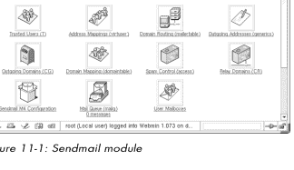

图 11-1：Sendmail 模块

Sendmail 的配置分布在多个文件中。第一个，也是最令人生畏的，是 `sendmail.cf` 文件。它配置了 Sendmail 的各种限制和行为。其余文件与用户、主机、域名和别名相关。它们主要规定邮件发送给谁，以及哪些用户和主机或网络有权向服务器发送和接收邮件。`sendmail.cf` 文件在下一节讨论的选项页面中进行配置，而每个其他选项文件都有自己的页面，在“其他文件”部分中讨论。

### 选项

Sendmail 选项页面提供了对大多数相关 `sendmail.cf` 指令的访问。这些选项通常是“设置后即忘”类型的选项。除非你遇到负载、内存或邮件投递不及时失败的问题，否则在首次设置 Sendmail 系统后，你很少有理由更改这些选项。

#### 通过主机发送外发邮件


此选项设置外发邮件是直接发送还是通过另一台邮件服务器中转。如果要通过另一台邮件服务器中转，则在此输入。如果你不在永久连接的网络上（即没有永久 IP 和域名），则应通过你 ISP 的邮件服务器中继，因为许多邮件服务器会拒绝无法解析的主机发来的邮件。此选项编辑 `sendmail.cf` 中名为 `S` 的 Smart Host 宏。有关此和其他常见宏的更多信息，可在 Sendmail 主页的 [Administrative Details](http://www.sendmail.org/m4/admin.html) 文档页面中的 macros 部分找到。

## 将未限定用户名转发到主机

如果本地用户发送的电子邮件未限定（例如 joe 而不是 joe@swelltech.com），默认情况下它会尝试在本地投递（即在 Sendmail 运行的同一台机器上）。然而，如果设置了此选项，邮件将被转发到所选主机。如果你在大型组织中运行多个 Sendmail 服务器，但希望所有本地邮件都投递到单一主机，这很有用。此选项编辑 `R` 宏，该宏指的是 Relay（未限定域）配置。

## 将本地用户的邮件转发到主机

从任何地方接收到的、目的地为本地主机的用户的电子邮件将默认本地投递，除非设置了此选项。这允许所有邮件集中到单一主机。此选项编辑 `R` 宏，该宏指的是 Relay（未限定域）配置。

## 投递模式

此选项控制消息如何安排投递。如果选择 `Background`，Sendmail 将在后台静默地尽快投递消息。`Queue only` 将邮件放入队列，待手动或定期计划的队列刷新时投递。`Interactive` 消息会立即同步投递。`Deferred` 与 `Queue only` 类似，只是 Sendmail 不会在队列刷新前尝试解析主机名（非常适合间歇性网络连接，例如拨号上网）。此选项配置 `DeliveryMode` 指令。

## 发送的最大负载平均值

此选项决定 Sendmail 在何种负载平均值下将不再继续发送消息。如果超过该负载平均值，Sendmail 将把消息排队以便稍后投递。此选项配置 `QueueLA` 指令，默认值为 8。如果你的系统在投递邮件时有时会过载，可能可以调整此设置以减轻负载。

## 接收的最大负载平均值

此选项决定 Sendmail 在何种负载平均值下将停止通过 SMTP 接受传入消息。这会迫使其他邮件服务器将它们排队以便稍后投递。虽然大多数邮件服务器会礼貌地将拒绝的消息保存以便稍后投递，但如果对用户的邮件服务保证很重要，最好避免拒绝邮件。此选项配置 `RefuseLA` 选项，默认值为 12。

## 最大子进程数

控制 Sendmail 为处理传入邮件而产生的子进程数量。限制此值可在一定程度上控制 Sendmail 的内存占用。此选项配置 `MaxDaemonChildren` 指令，默认值为 12。

## 最大连接数/秒

配置 Sendmail 每秒接受的新连接最大数量。通过此选项，你可以限制系统上 Sendmail 的 CPU 和内存使用，或在高负载环境中允许 Sendmail 接收更大量的邮件。此选项配置 `ConnectionRateThrottle` 指令，默认值为 3。

## 重新发送前的最短时间

此设置邮件在发送失败后在队列中等待的最短时间，然后 Sendmail 才会尝试重新发送。值可以用秒（例如 45s）、分钟（30m）、小时（2h）、天（3d）或周（1w）表示。这对应于 `MinQueueAge` 指令，默认值为 30m。

## 最大队列大小

确定 Sendmail 在单次队列运行中处理的排队作业的最大数量。这对应于 `MaxQueueRunSize` 指令，默认值为 1000。此值应尽可能高，以避免队列末尾的作业丢失。

## 放弃前的等待时间

这是 Sendmail 在放弃并认为消息无法投递之前，继续尝试重新发送失败消息的时间。非永久投递失败可能由多种原因引起，包括网络连接问题、DNS 解析失败、收件人服务器无响应等。当达到此限制时，将向发件人发送退回消息，邮件将被丢弃。此选项接受与上面讨论相同的格式，表示秒、分钟、小时、天和周。这配置 `Timeout.queue return` 指令，默认值为 5d。

## 发送警告前的等待时间

在发生非永久投递失败的情况下，如前一选项所述，此选项配置 Sendmail 在向消息发件人发送警告通知问题发生前等待的时间。因为这些警告通常会很快自行解决（例如网络恢复、DNS 再次解析、收件人服务器恢复服务等），因此在问题似乎可能变成永久性故障之前，通常没有必要打扰发件人发送错误消息。此选项配置 `Timeout.queuewarn` 指令，默认值为 4h。

## 邮件队列目录

此设置 Sendmail 存储排队邮件的邮件队列目录位置。此选项对应于 `QueueDirectory`，通常默认为 `/var/spool/mail`，但在某些系统上可能不同。很少有理由更改此设置。

## 发送错误消息给

在出现问题，例如投递失败时，错误消息将发送给系统上的某个用户。这通常是 Postmaster，在许多系统上它被别名为 root。此选项对应于 `PostMasterCopy` 指令。

## 用户转发文件

此选项规定 Sendmail 将在何处搜索用户的转发信息。这是一个以冒号分隔的列表（类似于 shell `PATH` 环境变量）。此选项允许你使用变量包含某些值，例如用户名（`$u`）、用户主目录（`$z`）和系统主机名（`$w`）。因此，例如，如果我想先搜索 `/var/forward/username`，然后在 `/home/joe/.forward` 中搜索，我可以输入 `/var/forward/$u:$z/.forward`。此选项配置 `ForwardPath` 指令，通常默认为 `$z/.forward:$u:$z/.forward`。

## 最小空闲磁盘空间

如果空闲磁盘空间低于此值，Sendmail 将拒绝接受来自其他系统的邮件。允许用户防止 Sendmail 填满队列所在的磁盘。此选项对应于 `MinFreeBlocks` 指令，通常默认为 100。

## 最大邮件大小

此选项设置 Sendmail 将接受的邮件的最大大小。任何超过此大小的邮件，无论是来自本地用户还是远程邮件服务器，都将被退回。此选项配置 `MaxMessageSize` 指令，默认为 1000000。

## 日志级别

此选项设置 Sendmail 的日志行为。按照惯例，日志级别 0-10 用于任何系统上可能值得记录的有用信息。默认日志级别为 9，是一个不错的中庸之道，在此级别下 Sendmail 通常只记录管理员希望了解的内容。10 到 64 之间的更高日志级别将提供更多信息，而超过 64 的级别则保留用于极其详细的调试输出。正常的日志级别在《安装与操作指南》的 [《系统日志》](http://www.sendmail.org/~ca/email/doc8.10/op-sh-2.html#sh-2.1) 部分中有说明，该指南位于 <http://www.sendmail.org/~ca/email/doc8.10/op.html>。此选项配置 `LogLevel` 指令。

## MIME 编码退回邮件？

此选项配置 Sendmail 是否以多部分 MIME 格式编码退回邮件，或作为纯文本邮件。大多数邮件客户端今天都支持 MIME 编码邮件，但如果你的客户端群对此有问题，你可以将其关闭。此选项对应于 `SendMimeErrors` 指令，默认为 `True`。有关 MIME 的更多信息可在 [RFC 2045](http://www.ietf.org/rfc/rfc2045.txt?number=2045) 和 [RFC 1344](http://www.ietf.org/rfc/rfc1344.txt?number=1344) 中找到。

## 文件安全选项

为了避免破解尝试，Sendmail 会检查大多数支持文件。如果这些文件位于可由组写入的目录中，或处于其他有风险的配置中，Sendmail 通常会拒绝运行。此选项允许你以所述选项中描述的方式关闭此检查。此选项配置 `DontBlameSendmail` 指令，默认为 `Safe`。出于明显的原因，强烈建议你解决可能存在的权限问题，而不是关闭这些检查。

## 其他支持文件

配置 Sendmail 的另一面是设置它将如何投递邮件以及允许谁使用其服务。Sendmail 模块的其余部分专门用于这些选项，你可能会在这些页面上花费比“选项”页面更多的时间。这些页面配置 Sendmail 依赖的所有其他文件，以告诉它如何执行工作，包括 `aliases`、`access`、`domain table`、`mailertable`、`relay-domains` 和 `virtusertable` 文件。

## 邮件别名

Sendmail 提供了一种将邮件定向到别名下的特定收件人的方法。例如，可以让发送给 Postmaster 的邮件投递给 root。也可以将邮件定向到多个地址、写入文件、馈送到程序，或提供自动回复。这些别名存储在一个名为 `aliases` 的文件中，通常位于 `/etc` 中。

### 地址

这只是将成为别名的地址。当邮件发送到此地址时，将执行“别名到”选项中定义的动作。别名不包含域名。例如，joesalias 而不是 joesalias@swelltech.com。

### 已启用


在此你可以将别名标记为已启用或已禁用。已禁用的地址在 `aliases` 中前面会加上一个 `#`，并且在 Webmin 显示的别名列表中以斜体显示。

## 别名到

在此定义 Sendmail 在收到发往此别名地址的邮件时执行的操作。对于此操作有几种选项，可从下拉列表中选择。电子邮件地址只是将邮件投递到的另一个电子邮件地址。文件中的地址会将邮件发送到文本输入字段中提供的文件中列出的每个地址——这允许你更轻松地让用户创建自己的别名，而无需给予他们访问 `/etc/aliases` 文件的权限。写入文件会使 Sendmail 将发送到该地址的每封邮件写入文本输入字段中选择的。馈送到程序很有趣，因为它允许你将邮件定向到系统上的任何程序，因此你可以编写脚本或程序（或找到已编写的程序）来基于收到的电子邮件提供任意数量的服务。或者它可以将邮件归档到数据库、客户服务系统或任何其他有用的事物中。最后，来自文件的自动回复只是自动向发件人发送邮件，其中包含文本字段中列出的文件中的内容。

页面的其余部分用于列出现有别名。如上所述，已启用的条目为纯文本，而已禁用的条目为斜体。单击别名可以编辑、删除或向别名添加目标。单击“手动编辑 `/etc/aliased`”会提供一个简单的文本编辑器字段，在其中你可以手动编辑或查看你的别名文件。请注意，格式和条目不会由 Webmin 检查其正确性。如果你犯了错误，你的 Sendmail 可能会在日志中大声抱怨并停止工作。

## 本地域

此页面配置 `sendmail.cf` 文件，并允许你选择 Sendmail 将接受本地邮件投递的域。默认情况下 Sendmail 仅接受本地主机的投递。为了接受整个域或多个域的邮件，它们必须在此列出。此外，这些域必须具有指向运行你的 Sendmail 的服务器的 DNS MX 记录。Sendmail 可以处理任意数量域的邮件；然而，使用 Sendmail 设置虚拟主机有点棘手。描述该技术的良好文档可以在《使用 Sendmail 进行虚拟主机》[http://www.sendmail.org/virtual-hosting.html] 页面上找到。虚拟主机也在本章教程部分简要讨论。

> NOTE
>
> 对于 Sendmail 中的虚拟主机，你还需要在地址映射中执行一些配置，并且可能在“传出地址”中进行配置。

## 域伪装

域伪装页面提供对 Sendmail 域伪装功能的访问。这允许所有传出邮件看起来都来自同一域。当域伪装规则生效时，Sendmail 将替换所有传出邮件的发件人地址，使其看起来来自要伪装的域。另请参阅本地域页面以获取更多信息，以及有关 Sendmail 中虚拟主机的有帮助链接。

## 受信任用户

通常，Sendmail 不允许用户声称是其他用户。然而，如果在此列出，用户将被信任声称他们是另一个用户或来自另一个域。使用此选项时应谨慎，因为它是防止电子邮件地址伪造的保护措施之一。

## 地址映射

地址映射与别名类似，只是它们能够处理虚拟域所需的域信息。要创建地址映射，你只需输入要操作的地址或域。以及 Sendmail 在接收到每封邮件时要执行的操作。例如，如果我在我的 `swelltech.com` 服务器上托管 `penguinfeet.org` 域，那么我必须设置一种方法，使发送到 `sysadmin@penguinfeet.org` 的邮件进入我的 `joe` 邮箱。因此，我将创建一个映射，其中“邮件用于”地址为 `sysadmin@penguinfeet.org`，“发送到”地址为 `joe`。

## 域路由

此选项提供一种特殊的网关类型，其中你的服务器接受某个域或主机的邮件，但随后将其转发到另一个特定的邮件服务器。这在一种或多个子域拥有自己的邮件服务器且该服务器位于防火墙后面，无法自行直接投递或接收邮件的环境中很有用。此外，这允许 Sendmail 提供网关/代理/转换服务，如果其他邮件服务器不支持通用传输和协议的话。这种用途正在下降，因为绝大多数邮件服务器（即使是少数未运行 Sendmail 的服务器）现在都使用通用协议。这些域不应列在本地域中，因为那样服务器将接受邮件进行本地投递，而这不是此情况下期望的。你仍应为此处列出的每个域设置指向 Sendmail 服务器的 DNS MX 记录，以便邮件首先发送到此系统，然后系统将以定义的方式处理它。

## 邮件用于

此字段允许你输入 Sendmail 将接受邮件的主机或域。它不会将邮件本地投递，而是将其转发到另一台服务器。

## 投递

在此选择 Sendmail 将如何投递所选域的邮件。最常见的方法是 SMTP；然而，Sendmail 支持广泛的投递方法。

## 发送到

这应该是邮件应转发到的邮件服务器。选中“忽略 SMTP 投递的 MX”框将导致 Sendmail 忽略该域 DNS 服务器中的 MX 条目，并发送到明确选择的服务器。

## 传出地址（Generics）

在此定义 Sendmail 将用于修改传出邮件（来自本地用户或来自其他主机以投递到其他服务器）的发件人地址的映射。如果你在同一邮件服务器上托管多个域，并且希望来自某些用户的邮件看起来像是来自那些其他域，这可能很有用。你还必须在“传出域”页面上包含要重新映射的任何域，然后 Sendmail 才会对地址执行任何重新映射。此外，除非你的 `.cf` 文件包含对 `FEATURE(`always_add_domain')` 的支持，否则此映射不会影响投递给本地用户的邮件。

> NOTE 此选项在大多数 Linux 发行版和其他操作系统中，以及默认的 Sendmail 安装中默认未启用。你必须将 `genericstable` 功能添加到你的 `sendmail.mc` 文件中并重新生成 `.cf` 文件。重新生成 `.cf` 的过程在本指南后面有说明。

## Mail from

在此输入要重映射的用户的用户名或完整电子邮件地址。

## Change to

在此输入要将上述地址更改为的目标地址。

## Manually edit /etc/mail/genericstable

点击此项会提供一个简单的文本输入框，其中列出了所有 `genericstable` 映射。您可以在此处手动编辑它们。但请注意，手动编辑的条目不会由 Webmin 检查其语法正确性。

## Outgoing Domains

默认情况下，Sendmail 仅对本地用户（与 Sendmail 服务器相同域中的用户）的发件地址进行翻译。任何需要重映射的外部域都必须在此输入。

## Domain Mapping

此功能允许您将某个域的所有收件人和发件人地址重映射到另一个域。例如，如果您的公司更改名称，您希望将所有邮件从 `mailuser@oldname.com` 更改为 `mailuser@newname.com` 时，此功能很有用。此更改将影响所有交付到、经由或从您的服务器发出的邮件。使用此功能应仅限于您的域。

## Spam Control

在此页面，您可以配置任意数量的规则，以防止垃圾邮件发送者利用您的系统和网络资源进行其邪恶目的。虽然这只是最新版本 Sendmail 提供的垃圾邮件控制功能中的冰山一角，但它确实为您提供了防止网络垃圾邮件的非常好的手段。首要且主要的目标是防止网络外部的任何人将您的服务器用作垃圾邮件中继。幸运的是，在最近版本的 Sendmail 中，默认情况下会拒绝从本地网络以外的任何主机进行中继。这让您的工作变得轻松一些，因为您只需允许来自受信任的主机和域的邮件中继即可。在这里，您还可以添加规则，明确禁止来自某些已知垃圾邮件发送者的邮件。例如，如果您的用户开始收到来自 `bigdumbspammers.com`（截至本文撰写时并非真实域名）的成批未经请求的商业电子邮件（UCE，亲切地称为垃圾邮件），并且该域的管理员要么不在乎，要么积极参与垃圾邮件发送，您就可以简单地阻止他们向我们的任何客户发送邮件。您只需输入域名并选择 Reject 或通过使用 Error code 提供错误消息即可。

有关 Sendmail 中垃圾邮件控制主题的更多信息，允许在 Sendmail 中受控 SMTP 中继 [http://www.sendmail.org/tips/relaying.html] 页面提供了有关防止垃圾邮件的多个新 Sendmail 功能的更多文档，例如使用实时黑洞列表 [http://mail-abuse.org/rbl/]，它提供了一个已知垃圾邮件发送者和开放中继的黑名单。此外，访问邮件滥用预防系统 [http://mail-abuse.org/] 以了解更多打击垃圾邮件的方法也可能是值得的。

## Relay Domains

您希望允许中继到的任何本地域都应在此列出。任何既不是本地用户也不是这些列出域的传入邮件都将被 Sendmail 拒绝。如果您的 Sendmail 以虚拟主机的方式为多个域提供邮件服务，这些域也应在此列出。

## Mail Queue


此页面提供对邮件队列的访问。根据您的配置，您的队列可能转瞬即逝，也可能在定期或手动刷新之前一直填满。通常，如果您拥有全天候的网络访问和全天候的 DNS 服务器，您将使用后台模式发送邮件。在这种情况下，邮件在队列中只会停留几秒钟或几分钟，然后就会发送到接收服务器。但是，在发生临时投递失败（非永久性错误）的情况下，消息将保留在队列中，直到消息被丢弃（由于永久性错误）或成功发送为止。队列中的任何消息都可以通过点击消息 ID 来查看。此外，还可以从队列中删除消息。最后，可以手动刷新队列，Sendmail 将立即尝试投递队列中的所有邮件。

## User Mailboxes

Webmin Sendmail 模块的一个强大功能是能够通过 Web 界面读取邮件。虽然它不是一个功能齐全的邮件客户端（即使在基于 Web 的客户端中也是如此），但它是一种快速简便的方式来检查那些通常不会被用户检查的账户的消息。例如，在我的系统上，我每天都会从备份系统收到备份报告，因此我会定期通过 Webmin 界面检查它们以查找问题。

要检查 root 的邮件，只需点击名称即可。从那里您将看到该用户所有电子邮件的列表。点击邮件即可显示其内容。从用户邮件页面，您还可以删除邮件并撰写新邮件（图 11-2）。

## Editing the m4 Configuration File

您系统上的 Sendmail 可能已在默认的`sendmail.cf`中包含了相当不错的功能集。但正如所讨论的那样，一些功能通常被省略，例如`genericstable`。通常，这些功能不需要，但如果需要，您必须将它们添加到配置文件中。手动编辑`sendmail.cf`通常被认为不是像您和我这样的凡人可以考虑的选择（Sendmail 的创建者 Eric Allman 可能可以做到）。然而，最近版本的 Sendmail 提供了一种新颖的方法来向`sendmail.cf`添加功能，该方法使用名为`sendmail.mc`的宏文件和`m4`宏处理器。


图 11-2：用户邮件

## Adding a Feature

与直接编辑`.cf`不同，使用`m4`宏文件添加功能实际上非常容易。

打开 M4 配置页面后，您会看到一个类似图 11-3 所示页面的文件。

除`dnl`注释行和`divert(-1)`行外，每一行都是`macro-type(value list)`的形式。在此示例中，您将添加一个名为`genericstable`的新功能。因此，您将在`FEATURE`列表中插入如下一行：

```
FEATURE(`genericstable', `hash -o /etc/mail/genericstable')
```


图 11-3：M4 配置文件

要执行此操作，请从页面底部的下拉列表中选择 Feature，然后点击 Add new entry of type 按钮。接着，选择`genericstable`（Outgoing Addresses）。接下来在参数字段中指定表文件的类型和位置，`hash -o /etc/mail/genericstable`。单引号不是必需的，因为 Webmin 会为您插入它们。为了以后的方便，最好使用页面右侧的箭头按钮将新条目提升到文件中的其他`FEATURE`行下方。它不是严格必要的，但拥有整洁的配置文件是件好事，即使 Webmin 大多数时候都隐藏了它们。

保存更改后的文件后，您将生成新的`sendmail.cf`（如果您已设置 Sendmail，请不要忘记将旧文件备份到另一个文件）。要基于`.mc`文件创建新的`sendmail.cf`，请点击 Rebuild Sendmail Configuration 按钮。然后您将能够打开 Outgoing Domains 页面，并创建新的`genericstable`文件并正常编辑它。应用您所做的更改需要重新启动 Sendmail。

## Tutorial: Setting Up Sendmail

首次安装后，Sendmail 只需进行少量更改即可开始提供发送和接收邮件的服务。第一步是指定将接受邮件的对象，您将在 Local Domains 页面中指定，而第二步将是允许本地网络用户通过服务器发送或中继电子邮件，这将在 Spam Control 页面中指定。

NOTE 本教程假定您已为网络配置了 DNS 服务，包括域的 MX 记录。如果您尚未这样做，请参考 BIND 章节，并在尝试本教程中的步骤之前配置名称解析。

## Configuring Domains to Receive Mail For

默认情况下，Sendmail 未配置为接收除其运行的机器之外的任何主机或网络的邮件。因此，您必须首先配置 Sendmail 以允许任何人通过您的服务器发送邮件以交付到您的域。打开 Local Domains 页面，并输入您的服务器将接受邮件的域。在我的例子中，我会输入 swelltech.com。此处可以输入任意数量的域，也可以输入主机名，因此如果我期望邮件被交付到该地址，我也可以输入 www.swelltech.com。

点击 Save 按钮以更新`sendmail.cf`文件。这将添加新的`Cw`行以包含您指定的域。

## Permitting Local Users to Relay

实现一个简单的邮件服务器的下一步是允许您的本地用户通过您的服务器发送邮件。点击 Spam Control 图标，并创建一条或多条匹配您本地网络的规则。要创建新规则，首先选择 Mail source 为 Network，并指定您希望为其提供中继服务的网络 IP。例如，在使用私有 IP 地址的本地网络上，人们可能会输入 192.168.1 以指定 192.168.1.0/24 网络中的所有主机。然后，选择 Allow relaying，并点击 Create 以将新规则添加到`access`文件中。

最后，返回到主要的 Sendmail 页面，并点击 Start Sendmail 按钮。启动守护进程时通常很有用保持关注日志，以便问题能够立即显而易见。Sendmail 在大多数系统上记录到邮件日志中，该日志很可能位于`/var/log`目录中。您可以使用 Webmin System Logs 模块查看此日志。

## Tutorial: Virtual Hosting Email with Sendmail

虚拟主机是一个相当宽泛的术语，应用于许多网络服务，以指定相关服务器为两个或多个网络域提供服务并具有一定程度的分离。具体而言，在邮件服务器的情况下，这意味着邮件服务器将根据收到的电子邮件的收件人字段中的用户名和域名，将邮件投递到唯一的本地用户。例如，发送到 joe@swelltech.com 的电子邮件将与发送到 joe@notswelltech.com 的电子邮件不同对待，并投递到不同的邮箱。

与大多数开源软件一样，实现我们的目标有许多方法，但在这里您将学习 Sendmail 提供的最简单方法。配置 Sendmail 进行虚拟邮件托管是一个三步过程。首先，必须为每个被服务的域适当配置 DNS，包括 MX 记录，如本书 BIND 章节所述。其次，新域被添加到 Local Domains 表中。最后，一个或多个条目被添加到 Address Mapping 表中。由于 DNS 有自己的章节，并且在前面的教程中已经介绍了将条目添加到 Local Domains 表，您在这里只会学习最后一步。

### Adding Address Mapping Entries

点击 Address Mapping 图标，并根据您的环境创建新的映射。要创建新条目，请选择 Address 并在 Mail for 字段中填写邮件将被接收的地址。这将包括收件人的名称和域名，例如，我可能会在此字段中输入 joe@virtualhost.com。接下来，选择 Address 选项并在 Send to 字段中输入此用户的目标邮箱，该邮箱需要是一个已存在的用户。例如，我可能会在此处输入用户名 virtualhost-joe。用户名也必须在系统上创建，可以使用第 5 章中的 "Users and Groups" 部分完成。

点击 Create 按钮，并通过向您新创建的虚拟用户发送邮件来测试您的工作。

## 12 SQUID


Squid 是一个功能丰富且极其灵活的 Web 缓存代理守护进程。大多数配置都是通过编辑一个名为`squid.conf`的简单配置文件来完成的，该文件通常位于`/usr/local/squid/etc/squid.conf`或在源自 Red Hat Linux 的系统上位于`/etc/squid/squid.conf`。每个行为都由一个指令后跟一个或多个选项来设置。Webmin 接口提供了访问可用于配置 Squid 的大多数指令。因为 Squid 是一个相当复杂的软件包，Webmin 接口打开时显示一系列图标来表示不同类型的配置选项。图 12-1 显示了 Squid 主页面。


### Figure 12-1: Squid proxy main page

这些选项相当不言自明，不过其中几个值得讨论。Cache Manager Statistics 图标被点击时，将打开 Squid 的 `cachemgr.cgi` 程序，以提供直接访问 Squid 的各种运行时值和统计信息。该程序提供关于命中率、请求率、存储容量、用户数量、系统负载等实时信息。

Calamaris Log Analysis 图标仅在您的系统上存在 `calamaris` `access.log` 分析器时才出现。`Calamaris` 是一个不错的 Perl 脚本，它将解析您的访问日志文件并提供缓存使用情况的良好概览。请注意，默认情况下 Calamaris Webmin 工具只会解析访问日志的最后 50,000 行。此数字可以在 Squid 模块配置中提高，但在负载很重的缓存上不建议这样做。解析访问日志是一项非常占用系统资源的工作，可能会干扰系统继续响应请求的能力。

### Ports and Networking

Ports and Networking 页面为您提供了配置 Squid 大多数网络级选项的能力。Squid 有许多选项来定义 Squid 运行的端口、用于客户端流量和 intercach 流量的 IP 地址，以及多播选项。通常，在专用缓存系统上这些选项不会有用。但在某些情况下，您可能需要调整这些设置以防止 Squid 守护进程干扰系统或网络上的其他服务。

### Proxy port

设置 Squid 运行的网络端口。此选项默认为 3128，通常几乎可以一直保留在此地址，除非同一系统上运行多个 Squid，这通常是不明智的。此选项对应于 `squid.conf` 中的 `http_port` 选项。

### ICP port

这是 Squid 监听 Internet Cache Protocol，即 ICP 消息的端口。ICP 是一种由 Web 缓存用来通信和共享数据的协议。使用 ICP，可以让多个 Web 缓存共享缓存条目，这样如果任何一个本地缓存有对象，就无需查询远端的源服务器获取对象。此外，可以构建由多个缓存组成的缓存层次结构，这些缓存位于多个私有互连站点，以提供更高的命中率和更高质量的 Web 响应。稍后章节会详细介绍。此选项对应于 `icp_port` 指令。

### Incoming TCP address

Squid 打开 HTTP 套接字监听客户端连接和来自其他缓存的连接的地址。默认情况下 Squid 不绑定到任何特定地址，并将响应系统上激活的任何地址。此选项通常不使用，但如果您希望禁止任何外部网络用户通过您的 Web 缓存进行代理，可以提供额外的安全级别。此选项对应于 `tcp_incoming_address` 指令。

### Outgoing TCP address

定义 Squid 通过 HTTP 向客户端和其他缓存发送数据包的地址。同样，此选项很少使用。它指的是 `tcp_outgoing_address` 指令。

### Incoming UDP address

设置 Squid 将监听来自其他 Web 缓存的 ICP 数据包的地址。此选项允许您限制在多宿主、或包含多个子网的 Squid 主机上哪些子网被允许连接到您的缓存。此选项对应于 `udp_incoming_address` 指令。

### Outgoing UDP address

Squid 将向其他 Web 缓存发送 ICP 数据包的地址。此选项对应于 `udp_outgoing_address`。

### Multicast groups

Squid 将加入以接收多播 ICP 请求的多播组。此选项应谨慎使用，因为它用于配置您的 Squid 监听多播 ICP 查询。显然如果您的服务器不在 MBone 上，此选项是无用的。即使是这样，这也可能不是理想的选择。请参考 Squid FAQ [`http://www.squid-cache.org/Doc/FAQ/FAQ-13.html`] 了解此主题的更完整讨论。此选项指的是 `mcast_groups` 指令。

### TCP receive buffer

用于接收 TCP 数据包的缓冲区的大小。默认情况下 Squid 使用操作系统的默认缓冲区大小。除非您知道自己在做什么，否则此项可能不应更改，在大多数情况下更改它也几乎没有收益。此项对应于 `tcp_recv_bufsize` 指令。

### Other Caches

Other Caches 页面提供了一个接口，用于 Squid 最有趣但也最被广泛误解的功能之一。Squid 是 ICP 的参考实现，ICP 是一种简单但有效的手段，让多个缓存相互通信关于每个缓存上可用的内容。这为设计缓存基础设施时打开了许多有趣的可能性。

### Internet Cache Protocol

在 Squid 中讨论 ICP 的工作原理以及 ICP 的一些常见用途可能是有用的，以便快速明确它有什么用，以及可能更重要的是，它有什么用处。最流行的 ICP 用法被讨论，未来随着互联网变得更加全球化，Web 缓存基础设施必须随之增长，可能还会出现更多好主意。

### Parent and Sibling Relationships

ICP 协议规定 Web 缓存可以充当父级或同级。父缓存只是能够回答子缓存的命中和未命中请求的 ICP 兼容缓存，而同级只会为其他同级回答命中请求。这种细微的区别意味着父缓存可以为没有直接互联网路由的缓存提供代理，而同级缓存则不能被依赖来回答所有请求，您的缓存必须有另一种方法来检索无法从同级获取的请求。这通常意味着在同级关系中，您的缓存也将直接连接到互联网或可以从源服务器检索未命中请求的父代理。ICP 是一种相当健谈的协议，即每次发生缓存未命中时，ICP 请求将被发送到每个邻居缓存。默认情况下，以最先回复 ICP 命中的缓存将被用于请求对象。

### When to Use ICP

ICP 通常用于拥有多个互联网连接或几种类型的互联网内容路径的情况。其他可能性包括拥有缓存网格，例如 IRCache Hierarchy [`http://www.ircache.net/Cache/`] 中的 U.S. 或英国的国家 Janet Web 缓存服务 [`http://wwwcache.ja.net/`]，它可以利用成本较低的非骨干链路连接多个远程缓存，以降低成本并提高性能。最后，虽然通常不推荐，但可以通过使用多个父缓存和多个子 Web 缓存来实现一种原始的负载均衡形式。所有这些选项都进行了一些详细讨论，但本文档不应被视为 ICP 的完整参考。其他良好的信息来源包括该主题的两个 RFC，即讨论协议本身的 RFC 2186 [`http://www.ircache.net/Cache/ICP/rfc2186.txt`]，以及描述 ICP 应用的 RFC 2187 [`http://www.ircache.net/Cache/ICP/rfc2187.txt`]。

今天使用的一种常见的基于 ICP 的解决方案是卫星缓存预填充服务。在这种情况下，站点上至少有两个缓存，其中一个连接到卫星互联网上行链路。卫星连接的缓存由服务提供商提供，并通过卫星链路自动填充热门内容。另一个缓存将卫星连接的缓存作为同级缓存使用，并对其每个缓存未命中进行查询。如果卫星连接的同级缓存具有该内容，则内容将从同级缓存提供；如果没有，则主缓存将从源服务器或父缓存获取内容。ICP 是一种相当有效的方法，可以实现此任务，尽管它在带宽和处理器方面比较消耗资源。对此过程的改进是为卫星连接的同级缓存使用 Cache-Digests，以减少同级缓存之间的流量。尽管如此，ICP 仍然是实现这一想法的相当不错的方法。

另一种常见用途是缓存网格。简而言之，缓存网格是使用 ICP 相互连接的多个位于远程站点的 Web 缓存。Web 缓存可能位于不同的城市，也可能位于同一大学的不同建筑物或同一办公楼的不同楼层。这种类型的层次结构允许大量缓存受益于比其直接可用的更大的客户端群体。在其他条件相同的情况下，未过载的缓存在客户端数量更多时，其命中率表现会更好。简单来说，更大的客户端群体导致缓存内容质量更高，进而导致更高的命中率和更好的带宽节省。因此，只要有可能在不使缓存过载的情况下增加客户端群体，例如在缓存网格的情况下，就可能值得考虑。同样，这种类型的层次结构可以通过使用 Cache Digests 来改进，但 ICP 通常更简单易于实现，并且是广泛支持的标准，甚至在非 Squid 缓存上也是如此。

最后，ICP 有时也用于在同一站点上对多个缓存进行负载均衡。ICP，甚至 Cache Digests，也几乎从不是实现负载均衡的最佳方式。然而，为了完整性，我将简要讨论它。使用 ICP 进行负载均衡可以通过几种方式实现。一种常见方法是拥有几个本地同级缓存，它们可以为彼此的客户端提供命中，同时客户端负载在缓存数量之间平均分配。另一个选项是在两个或多个低成本但更高容量的父 Web 缓存前面放置一个非常快速但低容量的 Web 缓存。然后父缓存将大致均等地提供请求。如前所述，平衡 Web 缓存有更好的选择，最受欢迎的是 WCCP 版本 1，Squid 完全支持，以及 L4 或 L7 交换机。

## 其他代理缓存服务器


本节的“其他缓存”页面提供当前配置的同级和父缓存列表，并允许添加更多邻居缓存。单击邻居缓存的名称即可编辑它。本节还提供了有关邻居缓存的重要信息，例如类型 父级、同级、多播、代理或 HTTP 端口，以及缓存的 ICP 或 UDP 端口。请注意，代理端口是邻居缓存通常监听客户端流量的端口，默认为 3128。

## 编辑缓存主机

单击缓存对等名称或在主“其他缓存”页面上单击“添加另一个缓存”将带您进入此页面，该页面允许您编辑有关邻居缓存的大多数相关详细信息 图 12-2。


## 主机名

您希望缓存与其通信的邻居缓存的名称或 IP 地址。请注意，这将是一方流量的传输。访问控制列表，或 ACL，用于允许来自其他缓存的 ICP 请求。ACL 将在后面介绍。此选项以及本页上的大多数其他选项对应于 `squid.conf` 中的 `cache_peer` 行。

## 类型

您希望缓存与邻居缓存建立的关系类型。如果缓存位于上游，并且您无法控制它，则需要咨询管理员以了解应设置何种关系。如果配置错误，缓存未命中很可能会导致用户出现错误。此处的选项为同级、父级和多播。

## 代理端口

邻居缓存监听标准 HTTP 请求的端口。即使缓存通过 ICP 传输可用性数据，实际的 Web 对象仍通过通常用于标准客户端流量的端口上的 HTTP 传输。如果您的邻居缓存是基于 Squid 的缓存，则它很可能在默认端口 3128 上监听。缓存服务器使用的其他常见端口包括 8000、8888、8080，甚至在某些情况下为 80。

## ICP 端口

邻居缓存配置为监听 ICP 流量的端口。如果您的邻居缓存是基于 Squid 的代理，则此值可以通过检查邻居缓存上 `squid.conf` 文件中的 `icp_port` 指令找到。通常情况下，邻居缓存会在默认端口 3130 上监听。

## 仅代理？

一个简单的是否问题，用于告知是否应将从邻居缓存获取的对象缓存在本地。这可以在所有缓存都远低于其客户端容量运行，但磁盘空间紧张或命中率至关重要的情况下使用。

## 发送 ICP 查询？

告诉您的缓存是否向邻居发送 ICP 查询。默认值为“是”，并且应保持这种状态。ICP 查询是 Squid 了解哪些缓存正在响应以及哪些缓存最接近或最能快速响应请求的方法。

## 默认缓存

如果此邻居缓存是要在 ICP 查询确定没有其他邻居缓存存在的情况下使用的最后手段父缓存，则可以将其切换为“是”。请注意，这并不会阻止它在其他缓存按预期响应的同时正常使用。此外，如果此邻居是唯一的父代理，并且不存在通往互联网的其他路由，则应启用此选项。

## 轮询缓存？

选择是否在没有 ICP 查询的情况下在多个父缓存之间使用轮询调度。此设置应应用于您希望以这种方式调度的所有父缓存。

## ICP 生存时间

定义 ICP 数据包的多播 TTL。在使用多播 ICP 时，出于安全和带宽原因，通常明智的做法是使用适合您网络的最小 ttl。

## 缓存权重

为父缓存设置权重。使用此选项时，可以为首选缓存设置更高的数字。默认值是 1，如果所有父缓存都未设置，则首先对 ICP 查询做出积极响应的缓存将被发送请求以获取该对象。

## 仅最近

允许您指定缓存只希望从父缓存收到 CLOSEST_PARENT_MISS 回复。这允许缓存随后从最接近源服务器的父缓存请求对象。

## 无摘要？

选择此邻居缓存是否应发送缓存摘要。

## 无 NetDB 交换

使用 ICP 时，Squid 可以保留有关邻居缓存的网络信息数据库，包括可用性和 RTT，或往返时间信息。这通常允许 Squid 在多个缓存具有请求对象时更明智地选择向哪些缓存发出请求。

## 无延迟？

防止对该邻居缓存的访问影响延迟池。延迟池，如后面更详细讨论的，是 Squid 监管带宽使用的一种方式。如果邻居缓存位于本地网络，并且缓存之间的带宽使用无需限制，则可以使用此选项。

## 登录到代理

如果您需要在邻居缓存质询时发送身份验证信息，请选择此项。在本地网络上，此类安全措施不太可能必要。

## 多播响应者

允许 Squid 知道在哪里接受多播 ICP 回复。由于多播是在单个 IP 上分发给多个缓存，因此 Squid 必须有一种方法来确定要监听哪些缓存以及适用于该特定缓存的选项。在此处选择“是”将配置 Squid 以从此邻居缓存的 IP 监听多播回复。

## 查询域名的主机，不要为域名查询

这两个选项是本页上配置 Squid 中除 `cache_peer` 之外的指令的唯一选项。在这种情况下它设置 `cache_peer_domain` 选项。这允许你配置是否可以通过 ICP 查询特定域名的请求以及哪些不应查询。它通常用于配置缓存不为本地域内的内容查询其他缓存。另一个常见用法，如上文讨论的国家网络层级中所述，是定义用于不同 TLD 目的请求的 Web 缓存使用。例如，如果从另一个国家通过低成本卫星链路连接到美国骨干网，并且该链路比昂贵的陆地线路更适合 Web 流量，则可以将卫星连接的缓存配置为查询所有 .com、.edu、.org、net、.us 和 .gov 地址的缓存。

## 缓存选择选项

本节提供用于常规 ICP 配置的配置选项（图 12-3）。这些选项会影响你定义的所有其他邻居缓存。


图 12-3：一些全局 ICP 选项

## 直接获取包含的 URL

允许你配置一个匹配列表，使其始终直接获取而不是查询邻居缓存。默认情况下这里是 cgi-bin ?，除非你知道自己在做什么，否则应继续包含它。这有助于防止在大量通常永远不会被视为可缓存的请求上浪费跨缓存带宽，因此永远不会从邻居缓存中返回命中。此选项设置 `hierarchy_stoplist` 指令。

## ICP 查询超时

Squid 在超时 ICP 请求之前等待的时间（以毫秒为单位）。默认情况下允许 Squid 根据邻居缓存的平均 RTT 计算最佳值。通常，明智的做法是保持不变。但是作为参考，远古时代的默认值是 2000，即 2 秒。此选项编辑 `icp_query_timeout` 指令。

## 多播 ICP 超时

## 死对等超时

控制 Squid 等待声明对等缓存死亡的时间。如果在此时间内未收到任何 ICP 回复，Squid 将声明对等方已死亡，并且不会期望再收到任何进一步的 ICP 回复。但是，它继续发送该对等方的 ICP 查询，并在收到回复时再次将其标记为活动。此超时还影响 Squid 预期从对等方接收 ICP 回复的时间。如果自上次收到 ICP 回复以来已超过此秒数，Squid 将不会期望在下一次查询中收到 ICP 回复。因此，如果你的请求间隔大于此超时，你的缓存将发送更多 DIRECT 请求而不是通过邻居缓存。

## 内存使用

此页面提供访问 Squid 使用内存和磁盘方式配置的大多数选项（图 12-4）。除非在高负载或资源匮乏的环境中，否则此页面上的大多数值都可以保持不变，在这些环境中，调优可以在 Squid 性能方面产生可衡量的差异。


图 12-4：内存和磁盘使用

## 内存使用限制

Squid 核心数据某些部分将使用的内存限制。请注意，这不会限制或限制 Squid 的总进程大小。它所做的是为存储在途对象和热对象以及负缓存对象预留一部分 RAM。一般来说，默认的 8MB 值适用于大多数情况，尽管在极低负载情况下将其降低到 4MB 或 2MB 是安全的。在高内存系统上也可以显著提高它，以小幅提高性能。请记住，大型缓存目录会大幅增加 Squid 的内存使用量，即使内存充足的机器，如果缓存内存和磁盘大小未适当平衡，也可能耗尽内存并进入交换。此选项编辑 `cache_mem` 指令。有关平衡内存和存储的更完整讨论，请参阅缓存目录部分。

## 注意

如果 Squid 使用的内存超过你认为的太多，请不要在此处寻找解决方案。它默认为适中的 8MB，只有当你配置了非常小的缓存存储量时，这 8MB 才会成为 Squid 分配内存的显著部分。如果你确实发现自己内存不足，可以减小配置的缓存目录大小，以更明显地减少内存使用。

## FQDN 缓存大小

完全限定域名内存缓存的大小。这配置 `fqdncache_size` 参数，默认值为 1024，通常是安全值。在 DNS 查询缓慢的环境中，提高此值可能有帮助。

## 内存高水位线，内存低水位线

设置 Squid 开始从内存中删除对象的点。随着内存使用量超过低水位线，Squid 会更积极地尝试释放内存。请注意，这适用于上面定义的内存使用限制，而不是 Squid 的总进程大小。如果你有一个系统承担双重或三重职责并提供除缓存服务之外的更多服务，明智的做法是将低水位线设置为较低的数字，例如 50%，并将高水位线设置为较高的数字，例如 95%。在这种情况下，Squid 大部分时间会将使用量保持在 50%，但如果开始过载，或有特别大的对象通过缓存，它可以短暂超过该点。此选项配置 `cache_mem_low` 和 `cache_mem_high` 选项，默认分别为 90% 和 95%。

## 磁盘高水位线，磁盘低水位线


为磁盘使用提供与上面内存水位线类似的机制。为了最大化命中率并提供最有效的磁盘空间使用，请将其保持在默认的 90% 和 95%。或者为了最大化性能并最小化磁盘碎片，将其设置为更高的范围，例如 85% 和 100%。请注意，这些设置不是配置要使用的磁盘空间量的位置，它们仅定义 Squid 应开始修剪旧数据以腾出空间供传入新对象使用的已分配缓存空间的百分比。这些选项对应于 `cache_swap_high` 和 `cache_swap_low` 指令。

## 最大缓存对象大小

Squid 将尝试缓存的最大对象大小。大于此值的对象永远不会写入磁盘以供以后使用。指 `maximum_object_size` 指令。

## IP 地址缓存大小，IP 缓存高水位线，IP 地址低水位线

用于 IP 地址的缓存大小以及缓存的高水位线和低水位线。此选项配置 `ip_cache_size`、`ip_cache_high` 和 `ip_cache_low` 指令，默认分别为 1024 个条目、95% 和 90%。

## 日志记录

Squid 提供许多日志，可在调试问题时使用，并在衡量有效性并识别用户及其访问的网站时使用（图 12-5）。由于 Squid 可用于“窥探”用户的浏览习惯，因此应仔细考虑你所在地区的隐私法，更重要的是，要体谅你的用户。话虽如此，日志可以是非常有价值的工具，确保你的用户从缓存中获得最佳服务。


图 12-5：日志配置

## 访问日志文件

`cache access.log` 的位置。Squid `access.log` 是 Squid 为缓存提供的每个请求写入一小行条目的文件。此选项对应于 `cache_access_log` 指令，通常默认为 `/usr/local/squid/log/access.log` 或在某些基于 RPM 的系统上为 `/var/log/squid/access.log`。标准日志文件的格式如下所示：

```
97342337-543 11801 192.168.1.1 TCP_MISS/200 1999 GET http://www.google.com/ - DIRECT/64.208.34.100 text/html
```

在前一行中，每个字段代表管理员可能感兴趣的一些信息：

- 1. 标准 UNIX 格式的系统时间。自 1970 年以来的秒数。有许多工具可以将此转换为人类可读的时间，包括这个简单的 Perl 脚本：

```
#! /usr/bin/perl -p
s/^\d+,\d+/localtime $&/e;
```

- 2. 持续时间或事务所需的经过时间（以毫秒为单位）。
- 3. 客户端地址或请求浏览器的 IP 地址。某些配置可能导致此处出现屏蔽条目，因此该字段不特定于一个 IP，而是报告整个网络 IP。
- 4. 结果代码提供两个条目，用斜杠分隔。第一个位置是几个结果代码之一 [http://www.squid-cache.org/Doc/FAQ/FAQ-6.html#cache-result-codes]，提供有关请求如何解决或如果出现问题未解决的信息。第二个字段包含状态代码 [http://www.squid-cache.org/Doc/FAQ/FAQ-6.html#http-status-codes]，它来自标准 HTTP 状态代码的子集。
- 5. 字节是交付给客户端的数据大小（以字节为单位）。头信息和对象数据都计入此总数。失败的请求将提供错误页面，其大小也将被计算。
- 6. `Request method` 是 HTTP `request method`，用于获取对象。最常见的方法当然是 GET，它是 Web 浏览器用于获取对象的标准方法。
- 7. `URL` 是客户端请求的完整的 Uniform Resource Locator。
- 8. `RFC931` 是请求客户端的标识查找信息，如果在您的 Squid 中启用了标识查找。由于性能影响，标识查找默认未启用，在这种情况下该字段始终包含“-”。
- 9. `Hierarchy code` 包含三项内容。第一项是 TIMEOUT_ 前缀，表示所有 ICP 请求超时。第二项（如果没有 TIMEOUT_ 前缀则是第一项）是说明请求如何被处理的代码。这一部分会是多种 `hierarchy codes` [http://www.squid-cache.org/Doc/FAQ/FAQ.6.html#hier-codes] 中的一种。无论您的缓存是否属于缓存层次结构，这一结果都是有信息意义的，能够说明请求是如何被提供的。该字段的最后一部分是从中获取对象的主机名称或 IP 地址。这可能是源服务器、父节点或任何其他同伴。
- 10. `Type` 仅是所请求对象的类型。通常是可识别的 MIME 类型，但某些对象没有类型或显示为“-”。

还有两个可选字段，用于在调试时开启 MIME 头部记录。完整的 HTTP 请求和响应头将被包含在 [ 和 ] 方括号中。

## Debug log file

Squid 的 `cache.log` 文件的存放位置。该文件包含启动配置信息以及 Squid 运行过程中的各类错误信息。当网站在 Web 缓存中出现问题时，这里是查找的好地方。这里的条目可能指向潜在的解决方案。此选项对应 `cache_log` 指令，通常默认指向 `/usr/local/squid/log/cache.log` 或 `/var/log/squid/cache.log`（在基于 RPM 的系统上）。

## Storage log file

缓存的 `store.log` 文件的存放位置。该文件记录所有存储在对象存储中的对象的事务日志，以及它们被删除的时间。在生产缓存上，该文件用途不大，主要推荐用于调试。因此，可以通过在条目字段中填写 `none` 来关闭它。默认位置为 `/usr/local/squid/log/store.log` 或 `/var/log/squid/store.log`。

## Cache metadata file

每个存储目录中用于存储 Web 缓存元数据的文件名，它是对象存储的索引。该文件不可供人直接阅读，强烈建议保持其默认位置，除非您真正清楚自己在做什么。此选项对应 `cache_swap_log` 指令。

## Use HTTPD log format

允许您指定 Squid 应将其 `access.log` 写入 HTTPD 常用日志格式，例如 Apache 和许多其他 Web 服务器使用的格式。这使得您可以使用更多工具解析日志并生成报告。然而，该格式缺少缓存特有的若干信息类型，通常在跟踪缓存使用和解决问题时不太有用。由于存在多种有效的工具可以解析和生成基于 Squid 标准访问日志的报告，通常建议保持默认关闭状态。此选项配置 `emulate_httpd_log` 指令。Calamaris 缓存访问日志分析器在启用该选项时工作不正常。

## Log MIME headers

提供记录请求额外信息的手段。此操作会让 Squid 在每个请求的访问日志条目末尾写入请求和响应的 MIME 头部。这些内容会以方括号 [] 的形式出现在每条 `access.log` 条目之后。此选项对应 `log_mime_hdrs` 指令。

## Perform RFC931 ident lookups for ACLs

指示在访问日志中对哪些定义的 Access Control Lists 进行标识查找。由于使用此选项会产生性能影响，默认未开启。此选项配置 `ident_lookup_access` 指令。

## RFC931 ident timeout

标识查找的超时时间，通常以秒为单位。如果设置过高，可能会因过多未完成的标识请求而受到拒绝服务攻击的威胁。默认值为 10 秒，对应 `ident_timeout` 指令。

## Log full hostnames

配置 Squid 是否尝试解析主机名，以便记录完整的域名。在某些情况下这会增加请求的延迟。此选项对应 `log_fqdn` 指令。

## Logging netmask

定义在访问日志中记录请求客户端 IP 时所记录的网络或子网掩码部分。出于隐私考虑，通常只记录客户端 IP 的网络或子网部分。例如，`netmask` 为 `255.255.255.0` 时，会记录 IP 的前三个字节，并将最后一个字节填充为 0。此选项配置 `client_netmask` 指令。

## Debug options

提供配置 Squid 各调试部分的手段。Squid 的调试代码已被划分为多个部分。如果在 Squid 的某一部分出现问题，可仅为该部分提高调试日志的详细程度，而其余部分保持默认。例如，要将 Squid 的存储管理器的调试级别提升至最高级 9，同时其余部分保持默认的 1，则条目如图 12-6 所示。


Figure 12-6: Setting Squid debug levels


完整的调试部分列表可在 Swell Technology 网站 [http://www.swelltech.com/support/docs/squid/debug-sections.txt] 以及 Squid 源码分发的 `doc` 目录中找到。更多信息请参阅 Squid FAQ [http://www.squid-cache.org/Doc/FAQ/FAQ-11.html#ss11.20]。

## MIME headers table

Squid MIME 表的路径。通常应保持默认值。此选项配置 `mime_table` 指令，默认指向 `/usr/local/squid/etc/mime.conf` 或 `/etc/squid/mime.conf`。

## Cache Options

Cache Options 页面提供访问 Squid 配置文件中一些重要部分的入口。这里配置缓存目录、超时时间以及对象大小选项。

## Cache Directories

Cache Directories 选项设置缓存目录以及 Squid 允许在设备上使用的空间大小。第一个示例展示了 `squid.conf` 文件中的 `cache_dir` 行示例，而 Figure 12-7 展示了在 Webmin 的 Cache Options 界面中配置相同选项的方式。

```
cache_dir ufs /cache0 1500 8 256
```


*Figure 12-7: Configuring Squid's cache directories*

该指令是 `cache_dir`，其选项包括文件系统类型、缓存目录路径、Squid 可使用的大小、第一层目录数量以及第二层目录数量。在示例中，我选择了文件系统类型 `ufs`，这是所有标准 UNIX 文件系统的统称，包含 Linux 的标准 `ext2` 文件系统。其他可选值包括 `aufs` 和 `diskd`。

下一个字段是以兆字节为单位的磁盘空间，您希望允许 Squid 使用的大小。最后的字段定义 Squid 使用的上层和下层目录。计算 `L1` 号目录的精确值虽然略显复杂，但如果使用下面公式即可轻松得到：

```
x=Size of cache dir in KB (i.e., 6GB~6,000,000KB)
y=Average object size (just use 13KB)
z=Number of directories per first level directory

(((x / y) / 256) / 256) * 2 = # of directories
```

例如，如果您的缓存使用了两块各 13GB 的磁盘（即 6GB 缓存空间）：

```
6,000,000 / 13 = 461538.5 / 256 = 1802.9 / 256 = 7 * 2 = 14
```

对应的 `cache_dir` 行如下：

```
cache_dir ufs /cache0 6000 14 256
```

## Other Cache Options

Cache Options 页面的其余部分是各种通用选项的混合（Figure 12-8）。通常大多数配置工作都会在此页面完成，因为它涵盖了 Squid 许多可调节项，这些项可以显著提升性能。


*Figure 12-8: Other cache options*

### Average object size

缓存中预期对象的平均大小。此项在其默认值为 13KB 时通常是安全的。在 Squid 的旧版本中（2.3 之前），此选项会影响 Squid 在运行时为 `filemap` 分配的位数。在更新的 Squid 中，`filemap` 位是按需动态配置的，因此配置此选项是不必要的，而且可以说毫无意义。此选项将在 Squid 的某个未来版本中被移除。在此之前，它与 `store_avg_object_size` 指令相关。

### Objects per bucket

每个存储哈希表中的对象数。同样，不值得费心去更改它，因为其默认值很可能是一个良好的安全值，并且更改它在性能或效率改进方面提供的帮助很少或没有。此选项对应于 `store_objects_per_bucket` 指令。

### Don't cache URLs for ACLs

允许您轻松选择哪些 ACL 匹配结果不会被缓存。匹配所选 ACL 的请求将始终从源服务器应答。此选项与 `always_direct` 指令相关。

### Maximum cache time

对象允许保留在缓存中的最长时间。此时间限制很少达到，因为对象有许多机会通过缓存对象存储的正常替换而被清除。但是，如果对象新鲜度至关重要，则可能值得将此值从默认的 1 年降低到更短的时间，例如 1 周，尽管对于大多数用户来说这样做可能适得其反。此选项配置 `reference_age` 参数。

### Maximum request size

Squid 从客户端接受的最大请求大小。默认值为 100KB，然而，在 POST 方法可能用于向 Web 服务器发送更大文件或使用 Web 邮件发送附件的环境中，可能需要将此限制提高到更合理的值。8MB 或 16MB 很可能是一个良好的大小，可以在没有任何问题的情况下允许大多数上传。请注意，这与正在检索的对象大小无关；它仅影响从客户端发送的 HTTP 请求的大小。此选项对应于 `request_size` 指令。

> NOTE Squid 从 2.5 版本开始已移除默认大小限制，并且请求的大小可以无限。因此，如果您依赖默认限制的存在，在升级时您将需要修改您的配置。

### Failed request cache time

请求错误条件被缓存的时间长度。例如，一些类型的连接被拒绝和 404 Not Found 错误会被负缓存。

### DNS lookup cache time

DNS 查找被缓存的时间长度。Squid 提供作为基本缓存名称服务器的功能，以通过代理进一步加速 Web 服务。此值默认为 6 小时并与 `positive_dns_ttl` 指令相关。如果需要快速更新缓存 DNS 数据，例如为了跟上动态 DNS 系统或避免网站加速环境中本地网络站点负载平衡问题，可能明智的做法是将此值大幅降低。但是，如果您大幅降低此值，则确保本地网络上具有可靠且足够快的 DNS 服务是强制性的。

### Failed DNS cache time

失败的 DNS 请求被缓存的时间段。此选项对应于 `negative_dns_ttl` 指令，默认值为 5 分钟。此选项很少需要调整。

### Connect timeout

强制 Squid 在指定时间后关闭连接的选项。某些系统（尤其是旧版 Linux）无法可靠地超时连接请求。出于这个原因，此选项指定 Squid 应等待连接完成多长时间。此值默认为 120 秒（2 分钟）并与 `connect_timeout` 指令相关。

### Read timeout

服务器端连接的超时时间。每次成功的 `read()` 请求后，超时时间都会重置为此值。如果在此时间内未读取任何数据，则请求将被中止并记录为 `ERR_READ_TIMEOUT`。此选项对应于 `read_timeout`，默认值为 15 分钟。

### Site selection timeout

URN 到多个 URL 选择的超时时间。URN 是一种用于位置无关名称解析的协议，规定在 RFC 2169 [http://www.ietf.org/rfc/rfc2169.txt] 中。此选项配置 `siteselect_timeout` 指令，默认值为 4 秒。可能没有必要更改此值。

### Client request timeout

来自客户端的 HTTP 请求的超时时间。默认值为 5 分钟，并与 `request_timeout` 指令相关。

### Max client connect time

Squid 为客户端保持连接到缓存进程所设置的时间限制。这只是防止客户端在未正确关闭的情况下消失的安全措施。它旨在防止大量套接字被卡在 CLOSE_WAIT 状态。此选项的默认值为 1440 分钟，即 1 天。这与 `client_lifetime` 相关。

### Max shutdown time

Squid 在收到关闭信号后允许现有连接继续的时间。它将立即停止接受新连接，但正在进行的连接将在此时间内继续被服务。此选项对应于 `shutdown_lifetime` 配置指令，默认值为 30 秒，这是一个良好的安全值。如果快速停机时间比对当前客户端礼貌更重要，则可以降低它。

### Half-closed clients

定义 Squid 对某些类型的客户端的行为，这些客户端在保持接收端打开的同时关闭连接的发送端。关闭此选项将导致 Squid 在 `read(2)` 返回“没有更多数据可读”时立即关闭连接。通常将此值保持在默认值 yes 是安全的。它对应于 `half_close_clients` 指令。

### Persistent timeout


## 持久连接超时值
持久连接的超时值。如果持久连接空闲此时间，Squid 将关闭它们。如果将此选项设置为小于 10 秒的值，持久连接将完全被禁用。默认值为 120 秒，可能不需要更改。此选项配置 `pconn_timeout` 指令。

## WAIS relay host, WAIS relay port
中继 WAIS 请求的 WAIS 主机和端口。WAIS，即广域信息系统，是一种通过 WAIS 或 WWW 浏览器编目和搜索大量数据的系统。WAIS 是一种大多已弃用的协议，但某些站点可能仍然存在，尽管本文作者未能找到任何站点来满足他对该主题的好奇心。这些选项对应于 `wais_relay_host` 和 `wais_relay_port` 指令，默认值为 localhost 和 8000。

## Helper Programs
Squid 使用辅助程序来提供额外功能或提供更高性能。Squid 为几种类型的程序提供标准 API，这些程序提供不适合 Squid 核心的额外服务。辅助程序可以被视为一种简单的模块化设计手段，允许第三方编写模块以改进 Squid 的功能（图 12-9）。话虽如此，Squid 的一些标准功能也是由辅助程序提供的。标准辅助程序包括 `dnsserver`、`pinger` 和几个身份验证模块。第三方模块包括重定向器、广告拦截器和额外的身份验证模块。

> NOTE
>
> 从 2.3 版本开始的 Squid 默认不再使用 `dnsserver` 辅助程序，而是用内部非阻塞 DNS 解析器替换它。此新的内部 DNS 解析器在内存和处理器效率方面更高，因此是首选。但在某些情况下，旧的辅助程序是更好的选择。如果您的 Squid 必须能够基于除 DNS 服务器之外的任何来源解析，例如通过 hosts 文件或 NIS，则您可能需要使用外部 `dnsserver` 辅助程序。


Figure 12-9: Cache helper program

## FTP column width
当 Squid 处于正向代理模式时，通过 Squid 查询的 FTP 站点的自动生成网页的列宽。Squid 提供有限的 FTP 代理功能，以允许浏览器（甚至旧的、非 FTP 感知的浏览器）与 FTP 服务器通信。此选项提供对 Squid 格式化结果文件列表方式的某种控制。此选项与 `ftp_list_width` 相关，默认值为 32。

> NOTE
>
> Squid 仅在作为传统代理运行时提供 FTP 代理和缓存服务，而非透明运行时。Squid 目前不为标准 FTP 客户端提供 FTP 缓存或代理。客户端必须是 HTTP 客户端，Squid 可以为其提供网关服务。

## Anon FTP login
Squid 用于匿名登录远程 FTP 服务器的电子邮件地址。这可以简单地是用户名后跟 @ 符号，您的域名可以自动附加到它。也可以是完整的电子邮件地址。这应该是您域名的合理内容，例如 `wwwuser@mydomain.com`，或在前面提到的无域名情况下，`Squid@`，这恰好是此选项的默认值。这对应于 `ftp_user` 指令。

## Squid DNS 程序
用于 DNS 解析的辅助程序。由于 Squid 需要对其查询使用非阻塞解析器，因此在标准发行版中包含了一个名为 `dnsserver` 的外部程序。在 Squid 2.3 之前的版本中，该程序是解析的唯一标准选择，并且文件路径可以在此处输入。在 Squid 2.3 之后的版本中，有一个新的默认选项，即内部非阻塞解析器，其内存和 CPU 效率更高。此选项很少需要从其默认值更改。此选项配置 `cache_dns_program` 指令。

## DNS 程序数量
将启动的外部 DNS 解析器进程数以提供请求服务。默认值五对于许多网络来说已经足够，然而，如果你的 Squid 为大量用户提供服务，则可能需要增加该值以避免错误。但是，增加进程数也会增加对系统资源的负载，如果设置过高反而可能损害性能。超过 10 个可能就过剩了。此选项与 `dns_children` 指令相对应。

## 请求附加域名
启用时，会导致 `dnsserver` 将本地域名添加到单组件主机名中。它通常被禁用以防止层级中的缓存将单组件主机名本地解释。此选项配置 `dns_defnames` 指令。

## DNS 服务器地址
通常默认为 `resolv.conf`，这仅意味着 Squid 的父 DNS 服务器将从 Squid 运行的系统上找到的 `/etc/resolv.conf` 文件中获取。可以根据需要选择其他 DNS 服务器——例如，选择更本地的缓存 DNS 服务器或远程 Internet 连接服务器。此选项对应于 `dns_nameservers` 指令。

## 缓存清除程序
删除或取消链接缓存中旧文件以腾出空间供新对象使用的辅助程序的名称。在所有当前版本的 Squid 中，此辅助程序称为 `unlinkd`，除非你知道自己在做什么，否则可能不应该从此更改。此选项配置 `unlinkd_program` 指令。

## Squid ping 程序
一个外部程序，为 Squid 提供 ICMP RTT 信息，以便它能更有效地在多个远程父缓存之间进行选择以完成请求。在某些特殊情况下需要此选项，并且你的 Squid 必须使用 `--enable-icmp` 配置选项编译才能使其工作。此选项应仅用于具有多个必须在其中进行选择的父缓存的不同网络的缓存。此任务的默认程序称为 `pinger`。此选项配置 `pinger_program` 指令。

## 自定义重定向程序、重定向程序数量
提供对 Squid 中重定向器接口的访问，以便可以选择重定向器并配置所需的重定向器进程数。简而言之，重定向器就是其名称所暗示的：一个程序，当给定匹配某些情况的 URL 时，将 Squid 重定向到另一个 URL。为了更简洁一些，也许更完整地说，重定向器提供了一种方法将请求导出到外部程序，然后导入该程序的响应并充当客户端发送了 resulting 请求一样。这允许 Squid 与外部重定向器具有有趣的功能。要配置重定向器，请输入重定向器的路径和重定向器文件名，如图 12-10 所示。你还应该在同一字段中输入要传递给重定向器的任何选项，如示例所示。


图 12-10：配置重定向器

一种常见用法是使用 SquidGuard [http://www.squidguard.org/] 等工具阻止令人反感的内容。另一种流行用途是使用简单但有效的 Ad Zapper [http://www.zip.com.au/~cs/adzap/index.html] 阻止广告横幅。Ad Zapper 不仅允许你阻止广告，还可以删除那些讨厌的闪烁 New 图像和用作标准水平线的移动线图像。存在多个其他通用重定向器，可为许多不同目的提供 URL 重新映射。两个流行且得到良好支持的通用重定向器是 Squirm [http://www.senet.com.au/squirm/] 和 JesRed [http://ivs.cs.uni-magdeburg.de/~elkner/webtools/jesred/]。最后，可以编写自定义重定向器以提供 Squid 所需的任何功能。虽然无法使用重定向器接口更改网页内容，但可以对一些或全部 URL 进行内联编辑以强制产生许多不同类型的结果。两个重定向选项配置 `redirect_program` 和 `redirect_children` 指令。

## 自定义身份验证程序、身份验证程序数量
提供对 Squid 内部外部身份验证接口的接口。有大量可与 Squid 一起使用的身份验证模块，允许用户以多种方式进行身份验证。最简单的身份验证类型称为 `ncsa_auth`，它使用标准的 htpasswd 风格密码文件来检查登录名和密码。更高级的选项包括允许对 Windows NT 域控制器进行身份验证的新 NTLM 模块，以及允许使用轻量级目录访问协议服务器的 LDAP 身份验证。大多数身份验证模块的工作方式与上面讨论的重定向器非常相似。在图 12-11 中，你会看到标准的 `ncsa_auth` 身份验证器以及它应用于身份验证用户使用的 passwd 文件的位置。你会注意到身份验证器子进程的数量已从默认的 5 增加到 10，以便处理相当大的负载。这些选项分别编辑 `authenticate_program` 和 `authenticate_children` 指令。


图 12-11：身份验证配置

注意

> Squid 2.5 及以上版本的身份验证已得到显著增强，增加了新的身份验证类型（NTLM 和 Digest），以及更灵活的配置选项。如果您使用的是这些 Squid 版本，请阅读以下部分“身份验证程序”，以获取更完整的信息。

## 身份验证程序
从版本 2.5.STABLE1 及以上开始，Squid 拥有大量新的身份验证功能和选项。Webmin 已扩展以考虑这些更改，并且在更改中，身份验证配置获得了自己的部分（图 12-12）。


图 12-12：身份验证程序

Squid 2.5 及以上支持三种不同类型的客户端身份验证：Basic、Digest 和 NTLM。旧版 Squid 仅支持 Basic 身份验证，这是一种最初记录的简单、未加密的身份验证方法。两种新方法 Digest 和 NTLM 支持明文和加密身份验证机制。使用哪种方法取决于你的客户端群体。Basic 身份验证适用于完全支持代理的所有浏览器客户端。Digest 身份验证是安全身份验证 Web 客户端的标准方法，受所有完全符合 HTTP/1.1 的浏览器支持（包括现代版本的 IE、Netscape 和 Mozilla）。NTLM 是微软开发的专有机制，目前仅受微软客户端软件支持。

## Basic 和 Digest 身份验证选项

Basic 身份验证最简单易用，因为它最易访问且实现最简单。Digest 身份验证是 RFC 2617 中记录的安全身份验证方法，提供代理和 Web 服务器用户的加密身份验证。唯一真正需要的配置细节是身份验证程序的位置以及要传递给程序的任何命令行参数，尽管还有几个额外的参数可用。

## Basic 身份验证程序、Digest 身份验证程序

如果你希望使用 Squid 进行 Basic 或 Digest 身份验证，这是唯一必需的选项。你可以指定 Squid 提供的几个身份验证程序之一，例如 `ncsa_auth` 用于针对独立的 htpasswd 风格密码文件进行身份验证，`pam_auth` 用于针对本地 PAM 系统进行身份验证，或 `smb_auth` 用于针对远程或本地 SMB 服务器进行身份验证。另一个更简单的选择是使用内置的 Webmin 身份验证模块。它是一种简单的 NCSA 风格身份验证器，可在无需任何额外配置的情况下集成到 Webmin Squid 用户和密码管理工具中。此选项与 `auth_param basic program` 指令或 `auth_param digest program` 相对应，默认情况下为禁用。

## 身份验证程序数量

此选项与 `auth_param basic children` 或 `auth_param digest children` 指令相对应，默认值为 5。如果你的 Squid 支持非常多的用户，你可能需要将其提高到 10 或 20。

## 身份验证缓存时间

这是 Squid 将缓存身份验证凭据的时间长度。Squid 通常会定期查询身份验证程序并将其测试结果存储在其自己的内存中，以便不必频繁查询外部身份验证器。这提高了性能，但如果需要快速更改凭据，你可能希望降低此值。此选项与 `auth_param basic credentials_ttl` 相对应。

## 身份验证域

当客户端浏览器收到基本身份验证请求时，它会包含一个标识请求者数据的短字符串。此信息通常会显示给用户在输入凭据的弹出框中。此选项与 `auth_param basic realm` 或 `auth_param digest realm` 指令相对应，没有默认值。

## NTLM 身份验证选项

与 Digest 身份验证类似，NTLM 身份验证为网络服务器提供加密连接。但请注意，它并不是一种 HTTP 身份验证方案。它是一种连接身份验证方案，无法被代理（尽管代理可以使用它来验证自己的客户端）。NTLM 的安全性也低于 Digest 身份验证，并且有漏洞的历史。话虽如此，它非常流行，因为 Windows 支持一种网络“单点登录”，用户只需在本地网络上登录一次，就可以使用相同的凭据自动通过代理服务器进行身份验证。

## NTLM 身份验证程序

与上面 Basic 和 Digest 身份验证一样，这里将包含指向身份验证程序的路径以及任何命令行参数。通常参数会指定域或工作组以及要进行身份验证的服务器。此选项对应于 `auth_param ntlm program` 指令，默认情况下处于禁用状态。

## NTLM 挑战可以重用的次数

此选项配置特定 NTLM 挑战可以重用的次数。增加此数字可能会略微降低延迟并减轻服务器负载，但也可能增加重放攻击的风险（其中挑战响应被记录并回放以模仿合法用户的连接）。此选项对应于 `auth_param ntlm max_challenge_reuses` 指令，默认值为 0。

## NTLM 挑战的生命周期

此选项对应于 `auth_param ntlm max_challenge_lifetime` 指令，默认值为 2 分钟。它用于指定挑战可以被重用的时间长度。如果挑战比此值更新并且挑战的重用次数少于前一个值，则会重用挑战。

## 访问控制

Squid 的访问控制功能可能是其最复杂的一组功能，但也是最强大的功能之一。事实上，许多人主要就是为了这些功能而使用 Squid。由于其复杂性，您将逐步学习它，

## NTLM authentication options

Like Digest authentication, NTLM authentication provides an encrypted connection to a network server. Beware that it is not an HTTP authentication scheme, however. It is a connection authentication scheme that cannot be proxied (though a proxy can use it to authenticate its own clients). NTLM is also less secure than Digest authentication and has a history of vulnerabilities. That said, it is quite popular, because Windows supports a sort of network "single sign-on", in which users only need to log on once to the local network, and they can be automatically authenticated to the proxy server using the same credentials.

## NTLM authentication program

As in Basic and Digest authentication above, this will contain a path to the authentication program and any command-line arguments. Often the arguments will specify the domain or workgroup and the server to authenticate against. This option correlates to the `auth_param ntlm program` directive and is disabled by default.

## Number of times an NTLM challenge can be re-used

This option configures the number of times that a particular NTLM challenge can be reused. Increasing this number may reduce latency and load on the server slightly, but can also increase the risk of replay attacks (where a challenge response is recorded and played back to imitate the connection of a legitimate user). This option correlates to the `auth_param ntlm max_challenge_reuses` directive and defaults to 0.

## Lifetime of NTLM challenges

This option corresponds to the `auth_param ntlm max_challenge_lifetime` directive and defaults to 2 minutes. It is used to specify the length of time that a challenge can be reused. If a challenge is newer than this value and the challenge has been reused fewer than the previous value, a challenge will be reused.

## Access Control


The access control functionality of `Squid` is perhaps its most complex set of features, but also among its most powerful. In fact, many use `Squid` primarily for these features. Because of its complexity, you will learn about it in steps, examining the process of creating and implementing an access control list. Access control lists in `Squid` has two meanings within the configuration file and within the `Webmin` interface. First, it signifies the whole concept of access control lists and all of the logic that can be applied to those lists. Second, it applies to the lists themselves, which are simply lists of some type of data to be matched against when some type of access rule is in place. For example, forcing a particular site or set of sites to not be cached requires a list of sites to not cache and then a separate rule to define what to do with that list (in this case, don't cache them). There is also a third type of option for configuring `ICP` access control. These three types of definition are separated in the `Webmin` panel into three sections. The first is labeled `Access control lists`, which lists existing ACLs and provides a simple interface for generating and editing lists of match criteria (Figure 12-13). The second is labeled `Proxy restrictions` and lists the current restrictions in place and the ACLs they affect. Finally, the `ICP restrictions` section lists the existing access rules regarding `ICP` messages from other web caches.


Figure 12-13: Access control lists

# Access Control Lists

This section provides a list of existing ACLs and provides a means to create new ones (Figure 12-14). The first field in the table represents the name of the ACL, which is simply an assigned name, that can be just about anything the user chooses. The second field is the type of the ACL, which can be one of a number of choices that indicate to `Squid` what part of a request should be matched against for this ACL. The possible types include the requesting clients address, the web server address or host name, a regular expression matching the URL, and many more. The final field is the actual string to match. Depending on what the ACL type is, this may be an IP address, a series of IP addresses, a URL, a host name, and so on.

To edit an existing ACL, simply click the highlighted name. You will then be presented with a screen containing all relevant information about the ACL. Depending on the type of the ACL, you will be shown different data entry fields. The operation of each type is very similar, so for this example, you’ll step through editing of the `localhost` ACL. Clicking the `localhost` button presents the page that’s shown in Figure 12-15.


## Figure 12-14: ACL section

The title of the table is `Client Address ACL`, which means the ACL is of the `Client Address` type and tells `Squid` to compare the incoming IP address with the IP address in the ACL. It is possible to select an IP based on the originating IP or the destination IP. The netmask can also be used to indicate whether the ACL matches a whole network of addresses or only a single IP. It is possible to include a number of addresses or ranges of addresses in these fields. Finally, the `Failure URL` is the address to send clients to if they have been denied access due to matching this particular ACL. Note that the ACL by itself does nothing; there must also be a proxy restriction or `ICP` restriction rule that uses the ACL for `Squid` to use the ACL.


## Figure 12-15: Edit an ACL


Creating a new ACL is equally simple (Figure 12-16). From the ACL page, in the Access control lists section, select the type of ACL you’d like to create. Then click Create new ACL. From there, as shown, you can enter any number of ACLs for the list. In my case, I’ve created a list called `SitesThatSuck`, which contains the websites of the Recording Industry Association of America and the Motion Picture Association of America. From there, I can add a proxy restriction to deny all accesses through my proxy to those two websites.


Figure 12-16: Creating an ACL

## Available ACL Types

### Browser Regexp

A regular expression that matches the client's browser type based on the user agent header. This allows for ACLs to operate based on the browser type in use. For example, using this ACL type, one could create an ACL for Netscape users and another for Internet Explorer users. This could then be used to redirect Netscape users to a Navigator-enhanced page, and IE users to an Explorer-enhanced page. This is probably not the wisest use of an administrator's time, but it does indicate the unmatched flexibility of Squid. This ACL type correlates to the `browser` ACL type.

### Client IP Address

The IP address of the requesting client, or the client's IP address. This option refers to the `src` ACL in the Squid configuration file. An IP address and netmask are expected. Address ranges are also accepted.

### Client Hostname

Matches against the client domain name. This option correlates to the `srcdomain` ACL and can be either a single domain name or a list of domain names, or the path to a file that contains a list of domain names. If a path to a file, it must be surrounded by parentheses. This ACL type can increase the latency and decrease throughput significantly on a loaded cache, as it must perform an address-to-name lookup for each request, so it is usually preferable to use the Client IP Address type.

### Client Hostname Regexp

but then unblock them after hours. This might improve workplace efficiency in some situations (or it might just offend the employees). This ACL type allows you to enter days of the week and a time range or select all hours of the selected days. This ACL type is the same as the `time` ACL type directive.

### Dest AS Number

The Destination Autonomous System number is the AS number of the server being queried. The autonomous system number ACL types are generally only used in Cache Peer, or ICP, access restrictions. Autonomous System numbers are used in organizations that have multiple Internet links and routers operating under a single administrative authority using the same gateway protocol. Routing decisions are then based on knowledge of the AS in addition to other possible data. If you are unfamiliar with the term autonomous system, it is usually safe to say you don’t need to use ACLs based on AS. Even if you are familiar with the term, and have a local AS, you still probably have little use for the AS number ACL types, unless you have cache peers in other autonomous systems and need to regulate access based on that information. This type correlates to the `dest_as` ACL type.

### Source AS Number

The Source Autonomous System number is another AS-related ACL type, and matches on the AS number of the source of the request. Equates to the `src_as` ACL type directive.

### Ethernet Address

The Ethernet or MAC address of the requesting client. This option only works for clients on the same local subnet and only for certain platforms. Linux, Solaris, and some BSD variants are the supported operating systems for this type of ACL. This ACL can provide a somewhat secure method of access control, because MAC addresses are usually harder to spoof than IP addresses, and you can guarantee that your clients are on the local network (otherwise no ARP resolution can take place).

### External Auth


This ACL type calls an external authenticator process to decide whether the request will be allowed. Many authenticator helper programs are available for Squid, including PAM, NCSA, UNIX passwd, SMB, NTLM (only in Squid 2.4), and so on. Note that authentication cannot work on a transparent proxy or HTTP accelerator. The HTTP protocol does not provide for two authentication stages (one local and one on remote websites). So in order to use an authenticator, your proxy must operate as a traditional proxy, where a client will respond appropriately to a proxy authentication request as well as external web server authentication requests. This correlates to the `proxy_auth` directive.

### External Auth Regex

As above, this ACL calls an external authenticator process, but allows regex pattern or case insensitive matches. This option correlates to the `proxy_auth_regex` directive.

## 代理 IP 地址

客户端连接所在的本地 IP 地址。这允许在代理上存在多个接口时构建仅匹配一个物理网络的 ACL，等等。此选项配置 `myip` 指令。

## RFC931 用户

由客户端机器上运行的 ident 守护进程提供的用户名。这要求 ident 必须在要以这种方式进行身份验证的任何客户端机器上运行。Ident 在安全性方面不应被视为安全，除非在私有网络上，在那里安全性不是很重要。你可以找到以下操作系统的免费 ident 服务器：Win NT [http://info.ost.eltele.no/freeware/identd/]、Win 95/Win 98 [http://identd.sourceforge.net/]，以及 UNIX [http://www2.lysator.liu.se/~pen/pidentd/]。大多数 UNIX 系统，包括 Linux 和 BSD 发行版，都包含一个 ident 服务器。

## 请求方法

此 ACL 类型匹配请求头中的 HTTP 方法。这包括方法 GET、PUT 等等。这对应于 `method` ACL 类型指令。

## URL 路径正则

此 ACL 匹配 URL 路径，去除了任何协议、端口和主机名信息。它不包括例如请求中的 "http://www.swelletech.com" 部分，只留下对象实际的路径。此选项与 `urlpath_regex` 指令相关。

## URL 端口

此 ACL 匹配请求的端口号，并配置 `port` ACL 指令。

## URL 协议

此 ACL 匹配请求的协议，例如 FTP、HTTP、ICP 等等。

## URL 正则

使用正则表达式匹配完整的 URL。此 ACL 可用于根据 URL 的部分提供访问控制，或对 URL 进行不区分大小写的匹配，以及更多。Squid 中使用的正则表达式由 GNU Regex 库提供，其文档见第 7 节和第 3 节 regex 手册页。正则表达式也在 Guido Socher 在 LinuxFocus 上的一篇不错的文章中简要讨论 [http://www.linuxfocus.org/English/July1998/article53.html]。此选项等同于 `url_regex` ACL 类型指令。

## Web 服务器地址

此 ACL 根据目标 Web 服务器的 IP 地址进行匹配。Squid 支持单个 IP、带网络掩码的网络 IP，以及 "192.168.1.1-192.168.1.25" 形式的地址范围。此选项与 `dst` ACL 类型指令相对应。

## Web 服务器主机名

此 ACL 匹配目标 Web 服务器的主机名。

## Web 服务器正则

使用正则表达式匹配目标 Web 服务器的主机名。

有关 Squid 中访问控制列表的更多信息，可在 Squid FAQ 的 [第 10 节 http://www.squid-cache.org/Doc/FAQ/FAQ-10.html] 中找到。身份验证信息可在 Squid FAQ 的 [第 23 节 http://www.squid-cache.org/Doc/FAQ/FAQ-23.html] 中找到。

## 管理选项

管理选项提供了对 Squid 背后多个选项的访问。此页面允许你配置多样化的选项，包括 Squid 进程的用户 ID 和组 ID、缓存层级公告设置以及身份验证领域 [图 12-17]。


图 12-17：管理选项

## 以 Unix 用户和组运行

Squid 将作为其运行的用户名和组名。Squid 设计为以 root 启动，但在不久后会切换到此处指定的用户/组。这允许你出于安全原因限制 Squid 运行时的权限。虽然 Squid 在数千个站点数年的使用中已证明自己相当安全，但采取额外的预防措施以避免问题永远不是坏事。默认情况下，Squid 将作为 nobody 用户和 nogroup 组运行，或在某些从 RPM 安装的 Squid 中作为 squid 用户和组运行。这些选项与 `cache_effective_user` 和 `cache_effective_group` 指令相对应。

## 代理身份验证领域

在执行身份验证时将向客户端报告的领域。此选项通常默认为 Squid proxy-caching web server，并与 `proxy_auth_realm` 指令相对应。此名称很可能会出现在浏览器弹出窗口中，当客户端被要求提供身份验证信息时。

## 缓存管理器电子邮件地址

此缓存管理员的电子邮件地址。此选项对应于 `cache_mgr` 指令，并在基于 RPM 的系统上默认为 webmaster 或 root。此地址将被添加到显示给客户端的任何错误页面中。

## 可见主机名

Squid 将在其上自我宣传的主机名。这会影响 Squid 在提供错误消息时使用的主机名。如果你在缓存集群中收到 IP 转发错误，则可能需要配置此选项。此选项配置 `visible_hostname`。

## 唯一主机名

配置 `unique_hostname` 指令，并为 Squid 在缓存集群中报告设置一个唯一主机名，以便检测转发循环。如果你的集群中有多台机器具有相同的可见主机名，请使用此选项。

## 缓存公告主机、端口和文件

Squid 将用于宣布其参与缓存层级的可用性的主机地址和端口。缓存公告文件只是一个包含要随公告发送的消息的文件。这些选项对应于 `announce_host`、`announce_port` 和 `announce_file` 指令。

## 公告周期

配置 `announce_period` 指令，并指 Squid 将向公告主机发送公告消息的频率。

## 杂项选项

杂项选项正是其名称所暗示的：一些似乎无处可归的杂项选项。在这里你会找到几个与内存相关的选项、关于头信息和用户代理设置的选项，以及强大的 HTTP 加速器选项 [图 12-18]。

## 启动 DNS 测试地址

这应指向 Squid 可用于测试你的网络上 DNS 服务是否正常工作的多个主机。如果 DNS 不能正常工作，Squid 将无法提供服务，因此它将拒绝启动，并在 `cache.log` 中简要说明原因。建议你选择两个或更多互联网上的主机名，以及你内部网上的一个或两个主机名，假设你有内部网并且 Squid 预期为其提供服务。默认情况下，`dns_testnames` 指令检查一些知名且流行的站点：netscape.com、internic.net、nlanz.net 和 microsoft.com。


图 12-18：杂项选项

## SIGUSR1 日志文件轮转

Squid 将保留的旧轮转日志文件的数量。在 Red Hat 系统上，此选项默认为零，因为日志是通过系统标准的 logrotate 程序轮转的。在其他系统上，这默认为 10，这意味着 Squid 将在覆盖最旧文件之前保留 10 个旧日志文件。此选项对应于 `logfile_rotate` 指令。

## 默认域


Squid 将附加到不是完全限定域名（更准确地说，是其中不包含点的）的请求的域。此选项与 `append_domain` 指令相关。

## 错误消息文本

提供一种自动向 Squid 的错误页面添加一些额外信息的方法。你可以在此处添加 HTML 或纯文本注释或链接，这些内容将被添加到显示给客户端的错误消息中。此选项与 `err_html_text` 指令相关。

## 每客户端统计？

允许你选择 Squid 是否会保留有关每个单独客户端的统计信息。此选项配置 `client_db` 指令，默认为开启。

## X-Forwarded-For 头？

此选项允许你选择 Squid 是否会向源服务器报告最初发出请求的系统的主机名。例如，如果此选项被禁用，则通过你的缓存的所有请求都将被报告为源自缓存。通常，这应保持启用。此选项与 `forwarded_for` 指令相关，默认为开启。

## 记录 ICP 查询？

决定 Squid 是否会记录 ICP 请求。如果 ICP 负载非常高，禁用此项可能是一个好主意。此选项与 `log_icp_queries` 指令相关，默认为开启。

## 最小直接跳数

在使用 Squid 的 ICMP ping 功能确定到对等方和源服务器的距离时，这会配置 Squid 何时应更倾向于直接连接而不是通过对等方。此选项要求你的 Squid 使用 `--enable-icmp` 编译，并且你必须与其他 Squid 缓存处于对等关系中，这些缓存也使用适当的构建选项编译。此选项与 `minimum_direct_hops` 指令相关。

## 保留内存以备将来使用？

此选项打开 `memory_pools` 并允许 Squid 保留已分配但不再需要的内存，以便将来无需重新分配内存。这可以小幅提高性能，但在系统内存紧张时可能需要关闭。此选项默认为开启，通常应保持开启，除非你知道自己在做什么。

## 保留内存量

Squid 将保留已分配的内存量，假设已打开“保留内存以备将来使用”选项。此选项配置 `memory_pools_limit` 指令，默认为无限制。任何非零值都会指示 Squid 不保留超过该量的分配内存，如果 Squid 需要更多内存来满足请求，它将使用你系统的 `malloc` 库。Squid 不预先分配内存，因此将其设置得合理地高是安全的。如果你的 Squid 运行在专用主机上，最明智的做法是将其保持为默认的无限制。如果它必须与其它服务器进程（如 Apache 或 Sendmail）共享系统，则可能适当限制一些。

## 要透传的头信息

配置 Squid 的匿名化功能。此选项允许你规定允许通过 Squid 的请求头类型。例如，为防止源服务器能够检测客户端使用的浏览器类型，你将选择允许除 User-Agent 之外的所有头。此选项用途大多晦涩，通常无需从其默认允许所有头透传的设置中更改。有一个相关的 Squid FAQ 部分 `http://www.squid-cache.org/Doc/FAQ/FAQ-4.html#s4.18` 中更详细地描述了使用此选项可以实现什么。此选项对应于 `anonymize_headers` 指令，默认允许所有头部。

CAUTION 随意使用 Squid 的匿名化功能可能会导致网站行为异常。因为现代网站通常依赖 cookie 或其他头部的内容来确定为使一切看起来和表现正确而提供正确的 JavaScript 和 HTML 代码，因此许多网站可能会被混淆而提供错误的内容或拒绝向用户提供任何内容。

## Fake User-Agent

作为上述选项的补充，它允许你配置 Squid 报告一个伪造的 User-Agent 头部。例如，使用此选项你可以让你的 Squid 报告每个被服务的客户端都名为 Mozilla/4.2.2 (Atari 2600; 8-bit)。这是在撒谎，但也许在源服务器上查看日志的人会觉得有趣。如果你使用匿名化头部功能来隐藏客户端的 User-Agent 头部，明智的做法是包含一个伪造的 User-Agent 头部，因为一些服务器对没有该头部请求不会满意。此外，这将导致你的用户某些网页出现问题，因为 User-Agent 头部有时用于根据特定浏览器中可用的功能决定发送哪一个页面。服务器通常会为你的客户端选择最不有趣的页面（例如，仅文本，或无 JavaScript/Java 等）。

## HTTP Accel Host and Port

你将用于配置 Squid 作为加速器或透明代理的选项。当使用你的 Squid 作为加速器时，你必须配置这两个选项以指向你要加速的 Web 服务器的 IP 和端口。如果你使用 Squid 加速多个虚拟主机，你必须将 Accel Host 选择为 virtual。请注意，这会带来潜在的安全问题，因为你的 Squid 然后将作为代理对网络外部的用户开放。这可以通过在路由器或 Squid 系统本身上设置适当的防火墙规则来避免。最后，如果你以透明方式运行 Squid，你也需要将 Accel Host 配置为 virtual 并将 Accel Port 配置为 80。然后需要将传出的端口 80 流量重定向到你的 Squid 进程才能使其工作。这在透明代理教程中讨论得更详细。这些选项配置 `httpd_accel_host` 和 `httpd_accel_port` 指令。

## HTTP Accel with Proxy

允许你将缓存同时作为加速器和缓存代理运行。此选项告诉 Squid 接受传统的代理连接和 intended for an origin web server 的请求。此选项对应于 `httpd_accel_with_proxy` 指令。

## HTTP Accel Uses Host Header

配置 Squid 使用 HTTP 1.1 规范中描述的主机头部信息。此选项必须在透明操作中打开，以便虚拟服务器能够被正确缓存。此选项对应于 `httpd_uses_host_header` 指令。

## WCCP Router Address, WCCP Incoming Address, WCCP Outgoing Address

Web Cache Coordination Protocol 是一种实现拦截代理的标准方法。支持 WCCP 的路由器可以配置为使用高效的负载均衡机制将流量定向到一个或多个 Web 缓存。WCCP 还提供在缓存故障时自动绕过不可用缓存的功能。通常，将 Squid 配置为使用 WCCP 与为拦截代理配置一样简单，使用稍后在拦截缓存教程中讨论的步骤，然后在 WCCP Router Address 字段中输入路由器的地址。其他两个选项很少需要，但在某些复杂的网络环境中，如果传入和传出数据必须通过不同的路由或来自不同的地址，则可以使用。这些选项对应于 `wccp_router`、`wccp_incoming_address` 和 `wccp_outgoing_address` 指令，默认情况下为禁用。

## Tutorial: A Basic Squid Proxy Configuration

Squid 在从源代码分发或二进制包安装后几乎完全预配置用于传统代理。如果你的需求简单，它可以在几分钟内启动并运行。本教程涵盖你需要做的第一次更改，以便快速启动并运行你的缓存代理。

> NOTE
>
> 本教程假定你已经安装了 Squid，并且已配置 Webmin 知道在哪里找到所有适当的 Squid 文件。如果你从供应商提供的包安装，Webmin 可能已经知道在哪里找到所有内容。

## Opening Access to Local Clients

在使用你的 Squid 安装之前必须做出的唯一更改是为本地用户开放访问权限。默认情况下 Squid 拒绝来自任何来源的所有用户访问。这是为了防止你的代理被网络外部的用户用于非法目的（你会惊讶于有人能用一个开放代理做多少恶劣的事情）。

点击 Access Control 图标以编辑代理的访问控制列表和访问规则。首先，通过从下拉列表中选择 Client Address 然后点击 Create new ACL 来创建一个新的 ACL。这将打开一个新页面，在那里你可以定义你的 ACL。首先，在 Name 字段中输入一个名称，例如 localnet。接下来，以网络范围的形式或通过指定网络和网络掩码来指定你的网络。例如，如果你只有 10 个地址希望允许使用你的代理，你可以输入，例如，From IP 为
`192.168.1.20` 且 To IP 为 `192.168.1.30`。或者如果你希望允许整个网络使用代理访问，你可以输入 From IP 为 `192.168.1.0` 且 Netmask 为 `255.255.255.0`。点击 Save。

接下来，你需要添加一个代理限制以允许与 localnet ACL 匹配的客户端使用代理。因此点击 Add proxy restriction 链接。在代理选择页面，选择 Action 为 Allow 选项，并在 Match ACLs 选择框中选择 localnet。点击 Save。

然后使用代理限制列表右侧的箭头图标将你刚刚创建的规则移动到 Deny all 规则之上。

## Initializing the Cache Directory


你可能已经注意到，在 Webmin Squid 模块的主页上，有一个警告说配置的缓存目录尚未初始化。在启动 Squid 之前，你需要确保它已初始化。Webmin 当然会为我们完成此操作。只需点击 `Initialize Cache` 按钮即可。如果你计划将缓存目录更改为不同于默认的目录，你可能希望在初始化目录之前先在 `Cache Options` 页面进行更改。详细信息在本章前面已涵盖。

## Starting Squid and Testing

要启动 Squid，点击主模块页面右上角的 `Start Squid` 链接。值得然后检查 Squid 在启动期间提供的 `cache.log` 中的信息。你可以使用 Webmin 文件管理器，或者你可以将此日志添加到 `System Logs` 模块中以在那里查看（阅读涵盖该模块的部分以获取有关添加非 syslog 日志文件以使其可查看的信息）。Squid 通常会坦率地说明可能阻止其启动或正确运行的问题。

要测试你的新 Squid，在本地网络上配置一个浏览器使用 Squid 服务器作为其代理。执行此操作取决于浏览器。在 Netscape 和 Mozilla 中，代理选项位于 `Advanced:Proxy Settings` 类别下，而在 Internet Explorer 中，它们位于 `Internet Options:Connections` 下。Squid 可以作为 `HTTP`、`HTTPS`、`FTP`、`Gopher` 和 `WAI S` 协议的代理。`Socks` 不受 Squid 支持，尽管有几个不错的开源 `Socks` 代理可用。

现在，只需浏览一段时间以确保你的缓存代理正在工作。查看 `access.log` 中的信息，了解请求是缓存命中还是缓存未命中提供服务。如果你的系统安装了 `Calamaris`，Webmin 将在你点击 Squid 模块主页面上的 `Calamaris` 图标时按需生成访问报告。

## Tutorial: Interception Proxying

通常，当在网络上使用 Squid 缓存 Web 流量时，浏览器必须配置为使用 Squid 系统作为代理。这种类型的配置称为传统代理。在许多环境中，这种实现方法 simply not an acceptable method of implementation。因此 Squid 提供了一种作为

拦截代理，或透明地，这意味着用户甚至不需要意识到代理的存在。Web 流量从端口 80 重定向到 Squid 所在的端口，Squid 对浏览器来说就像一个标准的 Web 服务器。

透明使用 Squid 是一个两部分的过程，首先需要正确配置 Squid 以接受非代理请求，其次需要将 Web 流量重定向到 Squid 端口。配置的第一部分在 Squid 模块中执行，而第二部分可以在 Linux 防火墙模块中执行。也就是说，假设你使用的是 Linux，否则你应该查阅 Squid FAQ 透明缓存/代理 [`http://www.squid-cache.org/Doc/FAQ/FAQ-17.html`] 条目。

### 为透明配置 Squid

为了使 Squid 充当透明代理，它必须配置为接受普通 Web 请求，而不仅仅是（或除了）代理请求。在这里，你将学习该过程的这一部分，检查控制台配置和 Webmin 配置。控制台配置已解释，Webmin 配置在下图所示。

以 root 身份，用你喜欢的文本编辑器打开 `squid.conf` 文件。该文件的位置取决于你的操作系统和安装方法，通常位于从源码安装时的 `/usr/local/squid/etc`，或 Red Hat 风格系统上的 `/etc/squid`。首先你会注意到 `http_port` 选项。这告诉你 Squid 将监听的端口。默认情况下，这是端口 3128，但如果你需要的话可以更改它。接下来你应该按图 12-19 所示配置以下选项。


图 12-19：Squid 的透明配置

```
httpd_accel_host virtual
httpd_accel_port 80
httpd_accel_with_proxy on
httpd_accel_uses_host_header on
```

这些选项，如本文件杂项选项部分所述，将 Squid 配置如下。`httpd_accel_host virtual` 使 Squid 充当任意数量 Web 服务器的加速器，这意味着 Squid 将使用请求头信息来判断用户想要访问哪个服务器，并且 Squid 在与客户端通信时会表现得像一个 Web 服务器。

`httpd_accel_port 80` 配置 Squid 将请求发送到源服务器的端口 80，即使它可能在另一个端口接收请求，例如 3128。`httpd_accel_with_proxy on` 允许你继续将 Squid 用作传统代理以及透明代理。这并不总是必要的，但当你尝试使透明工作时，它确实使测试变得容易得多，这将在后面的故障排除部分中进一步讨论。最后，

`httpd_accel_uses_host_header on` 告诉 Squid 它应根据头中找到的主机名来确定从哪个服务器获取内容。透明配置必须这样设置此选项。

### Linux 防火墙配置用于透明代理

`iptables` 部分的透明配置同样简单。目标是劫持所有在 HTTP 端口（即端口 80，用数字表示）上的传出网络流量。`iptables` 以其惊人的功能和灵活性，允许你用一条命令行或一条规则来完成此操作。同样，配置对于 Webmin 界面和控制台配置都显示并讨论。

> 注意 Linux 防火墙模块在 Webmin 版本 1.00 中是新的。所有之前的版本都缺少此模块，因此要执行这些步骤，你需要使用最新的 Webmin 版本。

首次进入 Linux 防火墙模块时，将显示数据包过滤规则。为你的目的，你需要编辑网络地址转换规则。因此，从 `Showing IPtable` 按钮旁边的下拉列表中选择它，然后单击该按钮以显示 NAT 规则。

现在，通过单击 `PREROUTING` 部分页面右侧的 `Add rule` 按钮，在 `PREROUTING` 链中添加一条新规则。

填写以下字段。应采取的操作应为 `Redirect`，`Target ports for redirect` 设置为 3128。接下来你需要指定哪些客户端应重定向到 Squid 端口。如果你知道单个接口上的所有端口 80 流量都应重定向，最简单的方法是指定 `Incoming interface`，但你也可以指定 `Source address` 或 `network`。接下来，将 `Network protocol` 设置为 `Equals TCP`。最后，将 `Destination TCP or UDP port` 设置为 80。单击 `Create` 以将新规则添加到配置中。再次回到主页面后，单击 `Apply Configuration` 按钮使新规则生效。最后，将防火墙设置为在启动时激活，以便在重新启动时重定向继续生效。

```
# iptables -t nat -I PREROUTING 1 -i eth0 -p tcp --dport 80 -j REDIRECT --to-port 3128
```

虽然 `iptables` 工具的详细描述超出了本节范围，但应简要说明此配置中发生了什么。首先，你将一条规则插入 NAT 路由路径的第一条 `PREROUTING` 链中，使用命令的 `-t nat -I PREROUTING 1` 部分。接下来你定义了哪些请求将被处理；在这种情况下，`iptables` 将处理所有来自连接到设备 `eth0` 的网络的数据包。这由规则的 `-i eth0` 部分定义。然后是选择要处理的协议；在这里你选择了 `TCP`，使用 `-p tcp` 部分。然后，最后的匹配规则指定了你希望重定向作用于的目的端口，使用 `--dport 80` 部分。最后，`iptables` 被告知对匹配先前定义条件的数据包做什么；具体来说，它将数据包 `REDIRECT --to-port 3128`。

# 13

## 网络配置


Webmin 中的第四个类别标签是 **Networking** 相关配置。具体来说，这里是你会找到用于配置 `net`、`xinetd`、`iptables`、`NFS` 导出、`NIS` 客户端和服务器以及网络接口的模块。`Networking` 类别是在 Webmin 版本 1.0 中引入的，因此如果你出于某种原因使用的是更早的 Webmin 版本（立即升级；它是免费的！），这些模块将位于其他类别标签下。

### NFS 导出

**NFS Exports** 模块列出所有导出的目录。单击 **Add a new export** 将带你到 **Create Export** 页面，如图 13-1 所示。


## 图 13-1：创建 NFS 导出

在前面的图中，你可以看到该模块允许你选择要导出的目录，并为该目录选择许多选项以及应向谁导出该目录。

### 导出详细信息

以下选项配置要导出的目录的位置、类型和权限：

#### 要导出的目录


这只是你想要导出的目录的完整路径。

## 活动？

当不需要时，可以通过选择 `no` 来禁用导出。否则，只要 NFS 服务器正在运行，导出将始终处于活动状态并可用。

在接下来的几个字段中，可以选择访问控制，以规定哪些机器或网络上的用户将被允许挂载导出的目录。

## Everyone

指定任何人都可以挂载该目录。这类似于匿名 FTP 服务器。

> 警告 在导出目录给所有人时要极其谨慎。如果你的本地网络没有非常好的防火墙保护，外部人员将能够挂载你的导出目录。外部人员也可能对你的服务器发动拒绝服务攻击，因为 NFS 在面对蓄意攻击者时以其可靠性不佳而闻名。始终最好将 NFS 导出限制为仅需要访问的机器，并且另外实施防火墙以阻止本地网络之外的人甚至尝试连接到你的 NFS 服务器。

## Host(s)

允许您指定可以挂载该目录的主机名或 IP。 此字段也接受通配符，因此可以输入 `*.company.com` 这样的名称来匹配 `company.com` 域中的所有主机。

## WebNFS clients

WebNFS 是一种相对较新的协议，由创建 NFS 的 Sun 公司开发，旨在通过互联网进行文件共享。 它允许用户使用熟悉的网络浏览器作为界面来浏览导出的目录。 它在很大程度上被大众市场忽视，转而使用 WebDAV，但在某些环境中它可能仍有其用途。 如果您将使用此导出支持 WebNFS 客户端，请选择此选项。 并非所有操作系统变体都支持此选项，或者如果提供支持，可能不完整或不稳定。

## Netgroup

如果您的本地网络使用 NIS 服务，您可以使用 netgroups 来指定对导出的访问权限。 这里可以指定任何现有的组名。

## Network

要向给定网络上的所有主机导出，请输入网络号和网络掩码。 这可以是一个完整的网络类，也可以是一个较小的子网。

## Make symbolic links relative?

在 NFS 挂载的目录上，符号链接可能会成为一个问题，因为目录在客户端机器上的挂载位置发生了变化。 例如，NFS 服务器上位于 `/home/nfs/users` 的目录可能在客户端上挂载在 `/home`。 如果服务器上的符号链接指向 `/home/nfs/users/joe/work`，则在客户端机器上链接将失效，除非链接被转换为相对链接。 如果设为相对，链接将变为 `joe/work`，并在客户端机器上正常工作。 此选项对应于 `link_relative` 开关。

## Clients must be on secure port?

启用此选项的效果是 NFS 将坚持使用 1024 以下端口的连接。 在某些情况下这确实提高了安全性，但可能会干扰 Windows 客户端挂载导出的目录。 实际上，目前使用的大多数 NFS 变体的安全性相对较弱，只提供中等水平的身份验证方法且没有数据加密。

## NOTE

> 在 UNIX 系统中，由普通用户运行的软件不允许绑定到 1024 以下的端口。 这意味着只有多用户系统上的 root 用户才能启动在 1024 以下端口上运行的服务。 其安全含义是，当您连接到 UNIX 服务器的 1024 以下端口时，例如在此选项启用时进行 NFS 连接，您可以有一定保证 NFS 服务器是由服务器管理员操作的。 如果 NFS 服务器有普通用户，并且 NFS 连接不强制在低端口上进行，则恶意用户可能操作一个非法的 NFS 服务器，其唯一目的是获取他不应访问的网络部分的访问权限。 如前所述，Webmin 通常在端口 1000 或其他低于 1024 的端口上运行，以避免 Webmin 服务器的此风险。

## Export Security

在 Export Security 部分，您可以指定其他安全选项，包括将某些 UID 和/或 GID 视为不受信任用户的能力。 此部分还提供字段来声明将用于不受信任用户权限的用户名和组名。

## Access mode

导出的目录可以以读写方式挂载，也可以仅以只读方式挂载。 此选项与 `exports` 文件中的 `ro` 和 `rw` 开关相对应。

## Deny access to directory?

通常，当目录被导出时，其所有子目录都将以相同的访问规则导出。 这通常正是期望的情况，例如通过 NFS 将主目录导出给用户。 显然，用户需要访问其自己的主目录中的所有内容，包括其子目录。 此选项明确拒绝对目录的访问，当连接的客户端与此导出中的导出规则匹配时。 这可以用于明确禁止对在另一规则中导出的目录的子目录的访问。 此选项对应于 `noaccess` 指令。

## Trust remote users

NFS 提供了一个简单的信任模型，其中某些用户将被信任，所有用户将被信任，或没有用户将被信任。 更明确地说，当网络上的另一台计算机连接到您的 NFS 服务器时，尝试访问导出目录的用户 UID 会包含在协商过程中。 根据此选项的配置，用户可能能够以与在本地机器上工作时相同的权限使用文件，前提是其他配置细节不阻止它。 如果选择 Everyone 或 Everyone except root，所有普通用户都将能够像在本地机器上工作一样使用 NFS 导出上的文件。 root 用户只有在选择 Everyone 选项时才具有相同的能力。 在导出用户主目录的情况下，使 Everyone except root 选项启用是有意义的。 Nobody 选项意味着连接的用户始终被视为不受信任用户。 此选项设置 `no_root_squash` 和 `all_squash` 指令。 默认值为 Everyone except root，这与隐式的 `root_squash` 指令相对应。

不受信任用户是专门为 NFS 使用的用户，但其功能与 FTP 服务器上的匿名用户非常相似。 这对于许多客户端机器不完全由 NFS 服务器管理员控制的情况非常有用。 这种导出的常见用途是系统启动映像以及对文件或文档存储库的匿名访问。

## Don't trust UIDs, Don't trust GIDs

如果有特定的用户 ID 或组 ID 应被视为不受信任用户，可以在此处指定。 ID 可以指定为范围，例如 `0-500`，或作为逗号分隔的列表或两者的组合。 大多数 UNIX 变体为系统特定用户和组保留 UID 和 GID 的某个子集，如 `nobody` 和 `lp`。 将声称是这些系统用户或组的用户的身份设为不信任可能很有用。 此选项分别与 `squash_uids` 和 `squash_gids` 指令相对应。

## Treat untrusted users as, Treat untrusted groups as

此选项指定不受信任用户或组映射到的用户 ID 和组 ID。 如果未指定，不受信任的 UID 或 GID 将设置为 NFS 服务器的默认值。 这在 NFS 版本之间略有不同，但可以安全地假设默认值是一个权限非常有限的用户或组，并且通常是对其运行的系统来说是合适的选择。

## Network Configuration

Network Configuration 模块为系统上大多数重要的网络配置细节提供了一个简洁、干净的界面（图 13-2）。 可以设置 IP 地址、创建 IP 别名、定义路由和网关信息、配置 DNS 客户端，并编辑 `/etc/hosts` 文件。


图 13-2：Network Configuration

## Network Interfaces

单击 Network Interfaces 图标将打开一个类似于图 13-3 的页面，允许您配置当前活动的接口以及在启动时启动的接口（通常这些是相同的）。

### Figure 13-3: Network Interfaces

Interfaces Active Now 部分是当前处于活动状态的接口列表。 同样的数据也可以通过从命令行运行 `ifconfig -a` 来获取。 其下方的 Interfaces Activated at Boot Time 部分是系统上永久配置的接口列表。 这些接口可以 optionally 在启动时启动。

要编辑接口，无论是 Active 还是 Boot，只需单击接口名称。 您将看到一个类似于图 13-4 的页面。

### Figure 13-4: Editing a bootup interface

在这里可以指定系统的 IP 地址，也可以选择 DHCP 或 BOOTP 自动配置 IP。 Netmask 和 Broadcast 设置也可以从此页面编辑。

添加新的接口同样简单。从主页面，点击 **Create new interface** 下的 **Interface Active Now** 以创建临时接口，或点击 **Interfaces Activated at Boot Time** 以创建永久接口。然后在配置页面，为接口选择一个名称。手动输入 IP，或选择 DHCP 或 BOOTP 进行自动 IP 配置。如果手动输入 IP，还需输入 Netmask 和 Broadcast 设置，或如首选且可用则选择 Automatic（Automatic 仅在创建 Active 接口时可用）。

> 注意 编辑刚创建的 Boot 接口时，可以通过点击 `Save and Apply` 而非仅 `Save` 来立即激活它。


## Routing and Gateways

Routing 是一个概括性的术语，基本指的是系统到达特定主机和网络应采用的路径。在最简单的配置中，你只有一个路由，即默认路由器或网关。这仅意味着所有发往非本地网络的数据包都将发送到默认路由设置所定义地址。

在 Figure 13-5 中，Default router 为空白，因为在示例机器上，路由由 DHCP 自动设置。它可以包含 IP 或主机名，如果确实需要定义路由器。Default route device 仅定义在系统有多于一个设备时，哪个设备将被视为默认设备。该设备名称可以是系统上任何活动设备，例如 `eth0`。Act as router 选项在某些 Linux 系统上打开数据包转发。在 Red Hat Linux 系统上，这在 `/etc/sysconfig/network` 中完成，或在 6.2 及之后的版本中在 `/etc/sysctl.conf` 中完成。


Figure 13-5: Routing and gateways

**Static routes** 提供了一种方式，使部分流量可以选择另一条路由到达某个已知主机或网络，而不是经过默认路由。这通常用于通过单个多宿主主机或具有多个网络接口的主机访问不同子网上的本地网络。例如，如果我的系统位于 `192.168.1.0/24` 本地子网，并且我还有一个 `172.16.1.0/24` 的第二个子网。我可以提供一个静态路由，接口值为 `eth0`，Network 为 `172.16.1.0`，Netmask 为 `255.255.255.0`，最后 Gateway 为 `192.168.1.23`，假设主机 `192.168.1.23` 在 `172.16.1.0` 网络上也有一个活动接口。

## DNS Client

DNS Client 模块允许你配置系统的解析器设置（Figure 13-6）。通常，你只需将名称服务器的 IP 添加到此列表即可。在以下图所示的情况下，IP 为 `127.0.0.1` 上运行着一个本地缓存名称服务器，以及两个作为备份的远程名称服务器。

Resolution order 允许你选择系统尝试解析主机名的顺序。在图中示例中，DNS 将首先被检查，其次是 `/etc/hosts` 文件。其他可用的解析选项有 NIS 和 NIS+。最后，Search domains 字段通常包含你的计算机所在的域名，以及可能的其他域名。Search domains 将在未输入完全限定域名时首先被搜索。例如，如果我尝试 ping 示例机器上名为 `gigi` 的主机，首先会查找 `gigi.swell`，然后如果在 DNS 或 `/etc/hosts` 中没有此类系统，就会尝试解析仅主机名 `gigi`。


Figure 13-6: DNS Client

## Host Addresses

`/etc/hosts` 文件是 UNIX 系统上另一种常见的解析方法。这是一种处理少量主机地址的非常简单的方法。然而，由于主机文件不易在多台计算机之间共享，其用途有限。尽管如此，Webmin 提供了编辑主机文件的便捷方式，因此我将对其进行说明。

在 Figure 13-7 中，有多个 IP 地址及其关联的主机名。点击任意 IP 即可编辑该条目。创建新条目可通过点击 Add a new host address 完成。如果你的网络非常小，每台机器上的一个主机文件可能就足够了；否则，对于大多数解析任务，请使用 DNS。


Figure 13-7: Host addresses

## TIP

在测试尚未准备好投入生产使用的 Apache 虚拟主机时，将地址和主机名配置在此处可能很有用，这样你就可以在最终使用的主机名上浏览测试服务器。当然，你也可以通过运行本地 DNS 服务器来实现同样的功能，但主机文件是实现相同任务的更简单方法。

## 14

## HARDWARE CONFIGURATION


**Hardware** 配置选项卡提供了多个硬件级设置选项（Figure 4-1）。这包括磁盘分区、引导加载程序、打印机管理、系统时间和日期等。具体可用选项因平台而异。

Figure 14-1: Hardware configuration

## Linux Boot Configuration

如果你运行的是 Linux，Webmin 提供了用于编辑 `/etc/lilo.conf` 文件的模块，该文件由 Linux LOader，即 LILO 使用。LILO 是 Linux 上最常用的引导管理器。它通过向启动磁盘的 MBR 写入一个小的引导扇区来工作。该引导扇区包含首先显示提示所需代码：

```
LILO:
```

这允许你选择要启动的内核或操作系统。LILO 可以启动多个操作系统和多个版本的 Linux 内核。当你打开 Linux Bootup Configuration 页面（Figure 14-2）时，你应该至少看到一个启动内核或启动分区。Boot kernels 用于 Linux 内核，而 boot partitions 用于其他操作系统。

## Figure 14-2: Linux Bootup Configuration

点击其中一个 boot kernel 或 boot partition 图标将允许你编辑该启动内核或分区（Figure 14-3）。

## Figure 14-3: Edit Boot Kernel

这里的 name 是内核的标识符，并在 `/etc/lilo.conf` 文件中转换为 label。Kernel to boot 是要加载的 Linux 内核引导映像的路径。

## Kernel options

此字段可用于输入需要在启动时传递给内核的任何参数。它通常用于在 Linux 无法识别全部内存时指定机器中的内存量。例如，要指定 127MB 的 RAM，可以选择 Add options 并在文本字段中添加行 `mem=127M`。这将在 `/etc/lilo.conf` 文件中转换为：

```
boot=/dev/hda
map=/boot/map
install=/boot/boot.b
prompt
timeout=50
default=linux

image=/boot/vmlinuz-2.2.16-11.0
label=linux
read-only
root=/dev/hda5
append="mem=127MB"
```

始终需要在主页面点击 Apply Changes 才能向启动设备写入新的引导扇区。此按钮仅运行 `/sbin/lilo`。

## GRUB Boot Loader

与上一节讨论的 LILO 引导加载程序类似，GRUB，即 GRand Unified Bootloader，是一种引导加载程序，可为任意数量的 Linux 内核版本和其他操作系统变体提供启动选择。它比 LILO 更强大、更灵活，但在操作上也比 LILO 稍微复杂。现代 Linux 发行版大多提供 GRUB 和 LILO 引导加载程序，其中 GRUB 为默认。GRUB 的运行方式与 LILO 略有不同，因为内核或启动参数更改时无需重写到 MBR。GRUB 知道如何读取许多文件系统类型，因此可以在启动过程中挂载系统启动磁盘并读取其配置文件和新内核。

> TIP
>
> GRUB 在 grub info 页面中有详细文档说明。只需在命令行输入 `info grub` 即可浏览 GRUB 文档。更多信息也可查阅 GRUB 主页 [http://www.gnu.org/software/grub/]。

主 GRUB 模块页面显示 GRUB 将在其启动菜单中列出的当前配置的每个内核和操作系统（Figure 14-4）。点击一个内核将打开一个新页面，显示该内核的所有配置选项，可在此编辑。点击 Edit Global Options 按钮将允许你配置适用于所有可启动内核和操作系统的选项。


Figure 14-4: GRUB Boot Loader

NOTE 当你点击一个内核或操作系统图标或 Edit Global Options 按钮时，Webmin 会运行 GRUB 来获取该内核的详细信息或全局配置详细信息。此过程可能需要 30 秒或更长时间，因为 GRUB 会扫描系统中的磁盘并读取当前的启动配置详细信息。

## Global Options

Global Options 页面提供了访问将应用于所有可启动内核和操作系统的选项的入口，包括默认启动的内核、密码选项和启动超时（Figure 14-5）。


Figure 14-5: Global Options

## Default boot option


此选项允许你指定如果用户未从启动菜单中选择，则将默认启动的内核或操作系统。此选项对应于 `grub.conf` 配置文件中的 `default` 指令。

## Fallback boot option

如果用户选择或默认的启动选项因 GRUB 无法找到必要文件而失败，则此选项指定 GRUB 应尝试启动的内核或操作系统。此选项对应于 `fallback` 指令。

## Timeout before loading default

启动时，GRUB 通常会显示可启动项目的菜单并等待几秒钟让用户选择一个选项。如果未选择任何项目，则将启动默认项目。此超时通常为十秒，但可通过此选项缩短或延长。此选项对应于 `timeout` 指令。

## Boot password

如果系统位于不安全的环境中，并且可能包含敏感数据，则可以对其进行密码保护，以便即使在启动期间也无法轻易入侵已安装的系统。此选项对应于 `password` 指令，默认值为 `none`。

## CAUTION

即使 GRUB 配置为需要密码，并且操作系统已适当锁定，如果有人对系统运行的硬件具有物理访问权限，仍然可能入侵系统。如果硬件提供其他启动方式，如 CD、软盘或 USB 磁盘，攻击者可能将系统重新启动到自己的操作系统中，从而挂载包含你数据的系统磁盘。或者，即使没有直接从其他外部介质启动的能力，攻击者也可以将自己的硬盘安装到系统中并从中启动，而不是从你的启动盘启动。这在传统的办公环境中不太可能成为问题，但如果你运营一个收集用户数据的公共信息亭，或其他公共可用系统，值得花一些时间考虑攻击者获取你数据数据的各种方式。

## Install GRUB on disk/partition

此选项允许你指定磁盘以及磁盘上的位置，用于安装第一阶段 GRUB 启动加载程序。第一阶段仅包含读取后续阶段和系统磁盘上的配置详细信息所需的代码。通常，它位于系统第一个磁盘的主引导记录或 MBR 上，尽管它可以位于特定分区上（此时 GRUB 本身必须由另一个启动加载程序启动）或位于其他磁盘上。此选项对应于 `directive`。

## Edit Boot Option

点击内核或操作系统图标将打开 Edit Boot Option 页面（Figure 14-6），该页面允许你配置指定内核或操作系统的启动选项。在这里你可以指定将在启动菜单上显示的标题以及要加载的项目的位置，并启用密码保护。

## Option title

当 GRUB 第一次加载时，它会显示可启动项目的菜单。此选项指定项目的标题。它通常用于指示操作系统的名称和版本，但可以包含你希望向用户展示的任何信息。此选项对应于 `title` 指令。


Figure 14-6: Edit boot option

## Boot image partition

此选项允许你指定要启动的项目的位置。它不必与 GRUB 启动加载程序位于同一磁盘或分区，但必须包含在 GRUB 能够访问的磁盘和文件系统类型上。此选项对应于 `root` 指令。

## Operating system to boot

在这里你可以指定要启动的操作系统类型，以及如果启动 Linux 内核则要启动的具体内核文件名。GRUB 支持大多数具有自己启动加载程序的操作系统，以及直接启动 Linux。因此，可以使用同一个 GRUB 菜单启动 Windows 操作系统、多个 Linux 版本或 BSD 操作系统。可以通过在此部分的核心选项字段中指定它们，将内核选项传递给 Linux 内核。例如，你可能希望有一个名为 Single User 的菜单项以单用户模式启动系统，以便进行紧急维护（或在丢失时重置 root 密码）。只需复制现有的启动条目并在现有内核选项列表末尾添加单词 `single` 即可实现此目的。

## Password locked?

GRUB 具有相对细粒度的访问控制（对于启动加载程序而言），你可以指定哪些启动菜单项目需要密码才能启动。此选项对应于 `lock` 指令。必须在 Global Options 页面中启用密码保护，此指令才能生效。

## Partition Manager

分区管理器为系统的 `fdisk` 分区编辑命令和 `/etc/fstab` 文件提供图形界面（Figure 14-7）。`fdisk` 通常用于在磁盘上创建和删除分区，而 `/etc/fstab` 文件是系统挂载信息配置的位置。


Figure 14-7: Partition Manager

分区管理器页面提供当前可访问磁盘及其分区的列表。在第一列中，有磁盘的类型和位置、BIOS 报告的柱面数（这不一定是实际的物理柱面数；它取决于 BIOS 报告的 CHS 结构类型），以及驱动器报告的型号。其他较大的行包含驱动器分区结构。红色条代表主分区或次分区。如果你有次分区，则包含它们的扩展分区将填满所有次分区占用的驱动器部分。

要编辑分区的参数，请点击要编辑的分区编号。请注意，已挂载的分区无法编辑。要编辑分区的挂载信息，请点击 Use 下列出的挂载点。点击后将退出分区管理器并进入 Disk and Network Filesystems 模块。

要在有可用空间的磁盘上创建新分区，请点击 `Add primary partition` 或 `Add logical partition`。选择要创建的分区的类型（通常为 Linux 或 Linux swap），然后在 Extent 字段中输入分区的大小。这是用于此分区的柱面范围，因此请注意正确识别柱面并不要覆盖任何现有分区。最后，点击 `Create`。

## Printer Administration

打印机管理模块（Figure 14-8）在不同操作系统下可能表现略有不同，因为打印机驱动程序详细信息和配置通常因系统甚至 Linux 发行版而异。尽管如此，Webmin 最大程度地减少了系统之间的差异，并且这些说明基本保持不变。


# Figure 14-8: Printer Administration

进入打印机管理页面时，你将看到当前配置的打印机列表、添加新打印机的链接以及根据打印调度程序当前状态停止调度程序或启动调度程序的按钮。

点击 `Add a new printer` 链接将打开一个页面，在此你可以配置新打印机。`Name` 字段是打印机的任意名称。按惯例，`lp` 或 `lpo` 通常用于第一台打印机，但你可以随意命名。`Description` 可以是对打印机的更长描述。`Accepting requests` 仅设置打印机是否应可用，而 `Printing enabled` 定义它是否启用打印（如果前一个选项仍打开，队列仍可接收请求）。`Max print job size` 是将被接受的最大请求大小。这不应设置得太小，因为许多 PostScript 文件都相当大。

下一部分是 `Print Destination`，在此定义设备类型（`local`、`file`、`remote UNIX` 或 `remote Windows`）。许多独立网络打印机除了 Windows 打印机共享外，还支持标准的 UNIX lp 功能。如果你的打印机是本地的，请选择要使用的物理设备；如果是远程打印机，请输入打印队列所在主机的 IP 或主机名。如果使用 Windows 共享打印机，请输入打印机共享的 `User`、`Password` 和 `Workgroup`（Figure 14-9）。

最后，页面的第三部分用于配置打印机的驱动程序（Figure 14-10）。如果你的打印机是简单的文本打印机或 PostScript 打印机，顶部选择可能适合你。第二个选项用于处理打印机控制的程序。这可能是你打印机的自定义打印驱动程序，或其中几个竞争的商业和非商业打印机软件包。最后，如果你的系统提供，则会列出可用驱动程序。在 Red Hat 系统上，此部分是随 Red Hat 标准提供的 GhostScript 打印机驱动程序的前端。很可能你的系统会有自己的驱动程序集，或类似 Red Hat 的前端。

## 图 14-9：添加新打印机

`Send EOF` 选项适用于某些打印机，在每次打印页面后需要发送显式的 EOF 它们才会打印。如果你的打印机似乎在准备打印但从未打印（例如忙碌灯闪烁），请尝试打开此选项。纸张尺寸就是字面意思：从此打印机打印的纸张尺寸。请记住，这并不会限制程序只能在此纸张尺寸上打印。它只是将标准系统打印工具配置为在默认选定的纸张尺寸上打印。

## 图 14-10：添加新打印机（续）


每页输出页数是指每张纸上将打印的页数。这使你可以通过在一张纸上打印多页来节省纸张。此选项会将文本排列成行和列。这些行和列可以进一步配置，以及在下一个字段`Additional GS options`中的许多其他选项（太多在此无法开始讨论）。你可能希望查阅 GhostScript 的`man`手册，以及`lp`、`lpd`和`lpr`的手册，以了解有关系统打印机功能更多信息。当然，你可以在 Webmin 手册页模块中查看这些`man`手册。有关打印的另一个良好信息来源包括 [Linux 文档项目](http://www.tldp.org/) 上的 [打印 HOWTO](http://www.tldp.org/HOWTO/Printing-HOWTO/index.html)。

## 15 其他类别

点击 **Others** 分类标签将带你进入一个工具页面，这些工具实在找不到其他合适位置。其中包括一个小型模块，允许你通过按钮运行任何系统命令，一个类似 Windows 资源管理器或 Gnome 文件管理器工具的 Java 文件管理器，一个 Perl 模块管理器，一个系统和服务器状态模块，以及一个基于 Java 的 `telnet` 客户端。

### 命令 Shell

**Command Shell** 是一个简单的基于 HTML 的 shell，允许你通过在文本输入字段中输入来执行任意命令（图 15-1）。页面重新加载并显示命令的输出。此模块在你必须执行某些命令行任务，但无法访问机器的 `SSH` 或 `telnet` 会话时可能非常有用。由于 **Command Shell** 完全基于 Web，因此可以在任何可以使用 Webmin 的机器上使用。

**图 15-1：命令 Shell**

### 自定义命令

Custom Commands 模块提供了一个简单的界面，可通过按钮访问服务器上的每个命令。听起来相当令人印象深刻。不幸的是，你在使用它们之前必须先创建这些命令按钮。最简单的说明方法是创建一个示例自定义命令并演示其工作原理（图 15-2）。

**图 15-2：创建一个新的自定义命令**

如前图所示，有一个名为`pinger`的命令，它连续三次`ping`我网络上的三台计算机。`-c 5`设置`ping`尝试`ping`主机五次然后退出。此命令的输出看起来类似于图 15-3。


**图 15-3：`pinger` 自定义命令的输出**

你也可以通过在创建命令页面的`Command Parameters`部分选择输入类型并为其命名来为你的命令接受选项（图 15-4）。为了使上述示例更灵活，你可以更改它，以便命令的用户可以`ping`任何主机。


**图 15-4：`Ping Host` 自定义命令**

在前图中，你会看到一个名为`$host`的变量已添加到命令中。我还选择强制`-c 5`包含在命令中，尽管它也可以做成变量选项。现在，用户可以在提供的文本输入字段中输入他们想要`ping`的任何主机名。

此功能的工作方式是为你在`Command Parameters`部分创建的每个输入字段分配一个变量名。然后你可以将这些变量的内容插入到执行的命令中。

#### 注意

> 请注意，过去允许用户输入数据到自定义命令中存在安全问题。所有已知漏洞都已修复，但如果要向通常不受信任的用户授予可允许任意文本输入的命令的访问权限，在考虑安全影响之前仍然明智。

### 文件管理器

文件管理器是一个完整的工具，类似于 Windows 资源管理器或 Nautilus。它是一个在浏览器内运行的 Java 小程序，提供传统基于 GUI 的文件管理器所期望的大多数功能，包括文件复制、移动、删除、编辑、查看等（图 15-5）。


**图 15-5：文件管理器**

要运行文件管理器，你的浏览器必须具有 Java JVM 插件。它的使用对任何使用过 Windows 资源管理器、Nautilus 或其他图形文件管理器的人来说可能立即显而易见。

#### 编辑

在文件管理器中选择文本文件时点击`Edit`按钮将打开一个简单的文本编辑器，功能类似于 Windows 记事本（图 15-6）。文本编辑器支持剪切和粘贴以及简单的查找和替换。虽然它远不如传统的 UNIX 文本编辑器（如`vi`和`emacs`）强大或灵活，但拥有一个完全基于 Web 的平台来编辑 Webmin 服务器上的文本文件可能很有用。


**图 15-6：编辑**

#### 信息

在文件管理器中选择文件名时点击`Info`按钮将打开一个窗口，其中包含有关文件的一些有用元数据（图 15-7）。此窗口提供有关文件所有权、权限、`setuid`状态、上次修改日期和文件大小的信息。


**图 15-7：信息**

#### EXT

在 Linux 上，选择文件时点击`EXT`按钮将打开一个新窗口，列出文件的属性（图 15-8）。文件属性可用于使某些文件与通常的行为不同。例如，选择“不允许修改”复选框将锁定文件，这样即使 root 用户也无法在不先取消此位的情况下更改它。要了解有关 Linux `ext2`和`ext3`文件系统属性的更多信息，请阅读`chattr`的`man`手册。


**图 15-8：`EXT`**

### Perl 模块

Perl Modules 模块提供了一个用于浏览已安装 Perl 模块、从 CPAN 安装新 Perl 模块以及卸载 Perl 模块的界面。

页面上部显示当前已安装模块的列表、模块内的子模块数量、模块的描述以及模块安装的日期（图 15-9）。点击模块名称将打开一个信息页面，提供子模块的名称并显示模块文档。

| Module | Submodules | Description | Installed on |
|---|---|---|---|
| `Apache::DBI` | 1 | Initialise a persistent database connection | Fri Jun 13 07:02:08 2003 |
| `Chronos` | 14 |  | Fri Jun 13 07:04:39 2003 |
| `RPM::Specfile` | 0 | Perl extension for creating RPM Specfiles | Mon Oct 14 04:27:55 2002 |
| `URI::Find` | 1 | Find URIs in arbitrary text | Fri Jun 13 07:02:32 2003 |

**图 15-9：已安装的 Perl 模块**

模块的下部允许你从各种来源安装新模块。第一个选择是直接从 CPAN 安装。如果你知道要安装的模块名称，可以将其输入文本字段并点击`Install`。或者，如果你不确定确切名称，可以点击文本输入字段右侧的`... browse`按钮浏览分类的 CPAN 归档。你也可以从位于本地机器、客户端机器或 FTP 或 HTTP 服务器上的文件安装 Perl 模块。

安装新模块时，您可以选择 Webmin 将执行的安装操作（如果您愿意，可以在实际执行前先测试安装）。您还可以输入额外的构建和安装参数，并配置在模块配置和安装期间处于活动状态的环境变量。

### 系统和服务器状态

系统和服务器状态模块是一个简单但灵活的服务监控器，提供电子邮件警报、计划检查和状态 GUI（图 15-10）。使用此模块，可以监控服务器及其软件以确保其按预期运行。该模块提供服务器守护进程状态、磁盘使用率、CPU 负载、内存使用、`ping`响应时间、文件修改、网络流量等测试。


**图 15-10：系统和服务器状态**

#### 添加监控器

要添加新的监控器，请从下拉列表中选择一种监控器类型，然后单击添加监控器类型。这将打开创建监控器页面（图 15-11）。


**图 15-11：创建监控器**

在前面的图中，您可以看到描述字段已设置为`/`的磁盘空间。这是将在模块主页面上显示的标题，也将用于有关此监控器的任何电子邮件状态警报中。运行于主机设置为本地，但如果我的配置中存在任何远程 Webmin 服务器，它也可以检查远程系统。是否按计划检查？设置为是，因此如果在模块配置中启用了自动检查，则此监控器将被测试。可以指定监控器宕机或恢复时要运行的命令，以及指定命令将在哪个主机上运行。对于要检查的文件系统，我选择了`/`并指定了 100MB 的最小可用空间。


## 计划监控

为了定期执行状态检查（而不是仅在您查看模块主页面时），您必须启用计划监控。要执行此操作，请单击计划监控按钮并为计划检查已启用？选项选择是。此页面上还有选项可选择检查执行的频率、检查执行的日期和小时、发送状态报告的电子邮件地址，以及在何种情况下应发送电子邮件。

## 索引

`/etc/fpusers`, 151

`/etc/hosts`, 251, 254

### A

A 记录, 137, 141, 142, 185

访问控制, 4, 13, 15, 26, 30–31, 40, 68, 89, 94, 98, 111, 121, 124, 153, 189, 212, 220, 231–33, 235–37, 242, 261

IP, 121, 153

访问控制, 15, 19, 24–26, 29, 34, 153, 173, 181, 188, 248

地址记录, 137, 141, 142, 144

AgentLog, 17

别名, 18, 45, 71, 105–06, 128, 137, 143–44, 155, 160, 170–72, 175, 178, 194–95, 199, 200, 251

Apache, xxii, xxiv, 10, 14, 17–18, 24, 52, 83, 85–118, 140, 141

AccessFileName, 102

AddAlt, 109

AddAltByEncoding, 109, 110

AddAltByType, 110

AddDescription, 110

AddIcon, 109

AddIconByEncoding, 109

AddIconByType, 109

AgentLog, 100

AliasMatch, 106

AllowConnect, 112

BrowserMatch, 98

CacheDefaultExpire, 112

CacheDirLength, 112

CacheDirLevels, 112

CacheForceCompletion, 113

CacheGcInterval, 113

CacheLastModifiedFactor, 113

CacheMaxExpire, 113

CacheRoot, 111

CacheSize, 113

CoreDumpDirectory, 96

CustomLog, 101

DefaultIcon, 108

DirectoryIndex, 108

DocumentRoot, 102, 114

ErrorLog, 100

FileETag, 104

Group, 105

HeaderName, 109

htaccess, 94, 98, 102

htpasswd, 94, 228, 230

ImapBase, 110

ImapDefault, 110

ImapMenu, 110, 111

IndexIgnore, 108

IndexOptions, 107

IndexOrderDefault, 109

KeepAliveTimeout, 91

LimitRequestFields, 87

LimitRequestFieldSize, 87

Listen, 90, 91, 93, 126, 129, 154

ListenBacklog, 91

LockFile, 97

LogFormat, 101

MaxClients, 88

MaxKeepAliveRequests, 90

MaxRequestsPerChild, 88

MaxSpareServers, 88

MIME 类型, 86, 96, 99

MinSpareServers, 88

mod_auth, 94

mod_cgi, 94

Apache, continued

mod_expires, 94

mod_imap, 111

mod_proxy, 104, 111

mod_rewrite, 94, 95

mod_ssl, 95

mod_suexec, 95

NoCache, 112

NoProxy, 112

PidFile, 97

Port, 90, 91, 99, 112–14, 116, 126

ProxyBlock, 111

Proxy.Domain, 112

Proxy.Pass, 106, 111

ProxyPassReverse, 107

ProxyRemote, 111

ProxyRequests, 111

ReadmeName, 109

Redirect, 105, 106, 107

RedirectMatch, 106

RedirectPerm, 106

RedirectTemp, 106

RefererIgnore, 101

RefererLog, 101

ScoreBoardFile, 97

ScriptLog, 98

ScriptLogBuffer, 98

ScriptLogLength, 98

安全, 95, 100, 101, 105, 123

NFS, 122–24, 129, 130, 137, 149, 152, 155

SendBufferSize, 91

ServerName, 114

ServerPath, 104

ServerSignature, 104

ServerTokens, 97

ServerType, 97

SetEnvIf, 98

StartServers, 89

TimeOut, 91, 92

TransferLog, 101

User, 90, 94, 95, 97, 100, 102–05, 107, 117, 138–40, 150, 152–58

UserDir, 102

虚拟主机, 85, 91, 94, 104, 116

Sendmail, 140, 141

虚拟服务器, 85, 86, 91, 99, 100, 104, 114–16, 242

Apache 模块, 92, 93, 115

外观, 20, 21, 107, 111

`ash`, 72, 78

`atime`, 57

身份验证, 9, 10, 15, 16, 20, 22–34, 29, 30, 38, 71, 94, 95, 98, 129, 156, 214, 226, 228–31, 235, 237, 238, 249

### B

`bash`, 72, 78, 97

BIND, 10, 16

A 记录, 137, 141, 142

访问控制列表, 124

地址, 120–22, 124–27, 129, 131, 134–35, 137–45, 175, 242

地址记录, 137, 141–42, 144

检查名称, 132

CNAME 记录, 137, 142

`coresize`, 127

`datasize`, 127

DNS 密钥, 122, 129

转储文件, 125, 127

获取胶水, 128

文件, 98, 122, 125, 127–28, 130, 132–33, 135, 140–41, 143, 149, 151–53, 156, 158

正向, 121, 125–26, 133–36, 139–41

正向区域, 133, 134, 139–41

转发器, 125, 126, 133, 140

转发, 125, 133, 140

HINFO 记录, 138

日志记录, 121, 123, 124, 128

日志记录类别, 123

日志记录通道, 123

主区域, 131, 133, 134–37, 139, 141

多个 cname, 128

MX 记录, 137, 142, 145, 185

`myzone`, 134, 136–38

NOTIFY, 124, 130, 132

`notify`, 124, 130, 132

端口, 126, 129, 147

递归, 128

`rndc`, 128

BIND, continued

服务器, 83, 99, 120-24, 126, 128-35, 137, 139-47, 149-53, 155-57, 205, 227

从区域, 133, 139

`stacksize`, 127

存根区域, 133, 139

模板记录, 131, 135

传输格式, 122, 126

TXT 记录, 138

WKS 记录, 138

区域传输, 122, 125-26, 132, 139

启动, 51, 52, 252, 256-57

### E

环境变量, 68-70, 94, 98, 176

勘误, xxv, 21

### F

`fdisk`, 261

文件系统

磁盘, 52, 56, 57, 133, 139, 258, 260-62

Linux, 53-57, 61, 63, 67-68, 71-72, 75, 80, 114, 120, 127, 164, 167, 201, 207, 222, 224, 253, 256-58, 261-262, 264


网络, 52, 60, 83, 86, 89-91, 93, 96, 119-120, 125-29, 131, 133, 134, 135, 137-40, 142, 149, 153-54, 156, 165, 181, 182, 190, 191, 193, 195, 197, 202, 247, 262

Solaris, 52, 53, 56-58, 63, 64, 72, 80, 114

`finger`, 74, 75, 77

防火墙, 6, 16, 21, 26, 31, 34, 126, 133, 140, 162, 172-73, 201, 241, 244-245, 248

`fstab`, 54, 55

FTP, 16-17, 32, 72, 104, 112, 138, 149-58, 226, 236, 243, 248, 250

`ftpd`, 149, 150, 151, 153-56

## C

缓存层次结构, 219, 237, 238

`cachemgr.cgi`, 208

缓存名称服务器, 140, 224, 254

类别, 21, 63, 123, 124

证书颁发机构, 22, 23, 95

`changepass.pl`, 6

CNAME 记录, 137, 142

CPAN, 32, 39

`cron`, 35, 38, 47-48, 51, 61-62, 67

`csh`, 78

## D

`datasize`, 137, 16

默认 shell, 72

设备文件, 55, 57

DHCP, 252, 253

`dig`, 144, 146-47

磁盘文件系统, 43

DNS 客户端, 254

DNS 密钥, 122, 129

文档, 32, 35, 54, 58-59, 64, 85, 89, 91, 93, 100, 104-05, 111, 114, 160, 195, 202, 258, 264

域名系统, 119, 138

## G

网关, 58, 97, 162, 168-69, 201, 226, 235, 251, 253

GhostScript, 263-64

GID, 56-57, 69, 71, 76, 79-81, 151, 251

GnuPG, 38, 41

组

  主要, 68, 71-73, 75, 80, 125, 135-36, 138, 140, 142-43, 147, 202

  次要, 68-69, 72, 80

## H

组文件, 75

组 ID, 68, 71, 78–81, 237, 251

组名, 68, 72, 80, 237, 249–50

组

  次要, 68–69, 72, 80, 125, 140, 147

HINFO 记录, 138

主目录, 43, 46, 68, 70, 75, 77, 79, 117, 250

主机, 9, 15, 16, 20, 31, 36, 42, 91, 94, 99–101, 104, 112, 116–21, 132, 134–35, 137–38, 140–41, 143–47, 152, 161, 166, 169, 173, 181–83, 188, 194–97, 200–02, 205, 209, 212, 215, 219–20, 225, 227, 232, 236–42, 244–45, 249, 253–54, 263

## I

ICP

  父级, 121, 125, 128, 210–212

  兄弟, 210, 211, 212

接口间隔, 138, 10, 16

Internet 缓存协议, 209, 210

入侵检测系统, 35

IP 访问控制, 15, 30, 31

`iptables`, 245, 247

## K

korn shell, 78

## L

LILO, 256, 258

日志记录, 9–11, 13–14, 16, 20, 29, 57–58, 65–67, 99–101, 121, 123–24, 128, 152, 155, 162, 188, 198, 217–19, 221

日志, 14, 16, 19–20, 29, 65–67, 99–101, 104, 123, 128, 151, 155, 191, 198, 200, 206, 208, 217, 220, 239, 241, 243

系统, 65–66, 73, 93, 152, 155, 163, 191, 197

`lpd`, 264

`lpr`, 264

`Lynx`, 10–12, 92

## M

`m4`, 194, 203–04

邮件转发, 38, 42, 43

邮箱, 45, 168, 176, 203

mailog, 188, 191, 206

`main.cf`, 161

`man` 页面, 10, 58, 59, 145, 236, 264

主密码文件, 75

MD5, 35, 71, 79, 103, 129–30

`miniserv.conf`

  `bind`, 122, 128, 139

`miniserv.pl`, 14–15, 17, 40

模块克隆, 85

MTA, 42–44, 193

MX 记录, 137, 142, 145, 182, 185, 191, 200–01, 205–06

myzone, 10, 147

## N

`ndc`, 125, 128

Net::SSLeay Perl 模块, 22, 32

网络, 18, 89–90, 117, 154, 208, 247

NFS, 10, 51, 58, 80, 247–51

  安全, 249

  `squash_gids`, 251

  `squash_uids`, 251

NFS 导出, 51, 247–48

NIS, 68, 70, 226, 247, 249, 254

NOTIFY, 27, 124, 130, 132, 162, 173

## O

OpenSSL, 22, 32, 33, 95

操作系统, 35, 58, 62-63, 72-74, 92-93, 105, 108, 120, 127, 235-36, 256, 258-59, 261-62

## P

包管理器, 5, 35, 62, 63

包管理器, 62, 63

PAM, 38, 39, 40, 230, 235

`passwd` 文件, 69, 77, 228

密码, 3-6, 9, 15-16, 19-20, 22, 24, 26-30, 33, 38-39, 68-69, 71-76, 78-80, 94, 152, 156-57, 228, 230, 259, 260-61, 263

密码策略, 26-29

密码超时, 20, 28-29, 72

`ping`, 227, 254

端口, 3-6, 9-10, 14-16, 18, 23-24, 30, 33-34, 40, 90-91, 99, 112-14, 116, 126, 129, 147, 154, 165, 209, 212-13, 225, 236, 238, 241, 244-45, 249-50

PortSentry, 36

Postfix, 10, 42-43, 63, 74, 159-91, 193

别名, 160, 170-72, 175, 178, 199

`allow_mail_to_command`, 175

`allow_mail_to_files`, 175

`allow_percent_hack`, 168

`allow_untrusted_routing`, 181

`always_bcc`, 163

`append_at_myorigin`, 169

`append_dot_mydomain`, 169

`best_mx_transport`, 185

`body_checks`, 190

`bounce_notice_recipient`, 167

`bounce_size_limit`, 177

退回邮件, 165

规范化映射, 167, 171, 172

`canonical_maps`, 171

`check_client_access`, 181-84

`check_sender_access`, 182, 184

`command_time_limit`, 177

`daemon_timeout`, 163

`debug_peer_level`, 188

`debug_peer_list`, 188

`default_database_type`, 163

`default_destination_concurrency_limit`, 187

`default_destination_recipient_limit`, 187

`default_privs`, 175

`default_process_limit`, 178

`default_transport`, 164

`defer_transports`, 188

`delay_notice_recipient`, 167

`delay_warning_time`, 165

`deliver_lock_attempts`, 178

`deliver_lock_delay`, 178

投递速率, 186-87


`disable_vrfy_command`, 180

`double_bounce_sender`, 164

`duplicate_filter_limit`, 178

`error_notice_recipient`, 167

`fallback_relay`, 185

`fallback_transport`, 176

`fork_attempts`, 178

`fork_delay`, 178

`hash_queue_depth`, 164

`hash_queue_names`, 164

`header_checks`, 190

`header_size_limit`, 178

`home_mailbox`, 175

`hopcount_limit`, 164

`idle_time`, 165

`ignore_mx_lookup_error`, 185

`inet_interfaces`, 165, 174

`initial_destination_concurrency`, 187

`ipc_timeout`, 165

`line_length_limit`, 178

`本地投递`, 170, 173-76, 185

`local_command_shell`, 174

`local_destination_concurrency_limit`, 176

`local_destination_recipient_limit`, 177

`local_transport`, 174

`luser_relay`, 176

`mail_name`, 165, 180

`mail_owner`, 166

`mail_spool_directory`, 176

`mail_version`, 166

`mailbox_command`, 176

`mailbox_transport`, 176

Postfix, continued

`mailog`, 188, 191

`mailtool`, 168

`main.cf`, 161

`maps_rbl_domains`, 184

`masquerade_domains`, 169

`masquerade_exceptions`, 169

`max_use`, 166

`maximal_backoff_time`, 188

`maximal_queue_lifetime`, 187

`minimal_backoff_time`, 187

`mydestination`, 161, 174, 184

`mydomain`, 161, 166, 169, 190

`myhostname`, 161, 166, 180

`mynetworks`, 166, 181, 183-84

`myorigin`, 161, 169

`newaliases`, 170

`notify_classes`, 162

`opts_smtp_timeout`, 180

`opts_trigger_timeout`, 168

`permit`, 181-84, 190

`permit_mynetworks`, 181, 183-84

`permit_naked_ip_address`, 181, 182, 183

`postalias`, 163, 171

`postmap`, 163

`prepend_delivered_header`, 177

`process_id_directory`, 167

`program_directory`, 167

`qmgr_message_active_limit`, 179

`queue_directory`, 167

`queue_minfree`, 179

`queue_run_delay`, 188

`recipient_canonical_maps`, 171

`recipient_delimiter`, 167, 175

`reject`, 181-84, 189-90

`reject_invalid_hostname`, 181-84

`reject_maps_rbl`, 181-84

`reject_unauth_pipelining`, 181, 183-84

`reject_unknown_client`, 181-84

`reject_unknown_hostname`, 182-84

`relay_domains`, 184

`relayhost`, 163

`relocated_mapping`, 167-68, 173

`relocated_maps`, 168

`sender_canonical_maps`, 171

`smtp_connect_timeout`, 186

`smtp_data_done_timeout`, 187

`smtp_data_init_timeout`, 186

`smtp_data_xfer_timeout`, 186

`smtp_destination_concurrency`, 186

`smtp_destination_recipient_limit`, 186

`smtp_helo_timeout`, 186

`smtp_mail_timeout`, 186

`smtp_quit_timeout`, 187

`smtp_rcpt_timeout`, 186

`smtp_skip_4xx_greeting`, 185

`smtp_skip_query_response`, 185

`smtpd`, 165, 180, 181, 183, 184, 189

`smtpd_banner`, 165, 180

`smtpd_client_restrictions`, 189

`smtpd_error_sleep_time`, 180

`smtpd_etrn_restrictions`, 181

`smtpd_hard_error_limit`, 181

`smtpd_helo_required`, 181, 189

`smtpd_helo_restrictions`, 183, 189

`smtpd_recipient`, 180, 184, 189

`smtpd_recipient_restrictions`, 184, 189

`smtpd_sender_restrictions`, 183, 189

`smtpd_soft_error`, 181

`strict_rfc821_envelopes`, 189

`sun_mailtool_compatibility`, 168

`swap_bangpath`, 169

`transport_mapping`, 172, 188

`transport_maps`, 172

`transport_retry_time`, 179

`UCE`, 166, 180-81, 189

`未经请求的商业邮件`, 162, 180, 188-89, 202

`虚拟域`, 167, 172, 191

`虚拟主机`, 141, 191

`warn_if_reject`, 181, 183

Postfix 守护进程超时, 10, 42

主组, 26, 68, 72-73, 75, 79-80

进程, 51, 57, 60, 62, 86, 88-89, 91, 93, 97, 105, 165, 176-77, 196, 297-299, 240

代理, 65, 90, 104, 106-07, 111-13, 207-10, 212-14, 234, 226, 230-33, 235-36, 238, 241-44

`ProxyBlock`, 118, 10, 14

`ps`, 61

## R

## S

重启, 52, 57, 67, 260

`resolv.conf`, 227

`rndc`, 128

root 用户, 55, 56, 68, 71, 249-50

路由, 52, 120, 181, 201, 235, 245, 251, 253

RPM 包, 59

`sendmail.cw`, 200

`sendmail.mc`, 194, 201, 203

服务器, 83-86, 88-92, 99-100, 104, 112, 114-16, 119-22, 124-33, 135, 137-40, 142-43, 145, 147, 153, 155, 161-62, 165, 177, 183-85, 192, 195-96, 201, 203, 210, 212-13, 220, 223, 226-28, 236, 240-42, 244, 254

setuid 程序, 55

`sh`, 72, 78, 198

shadow 组文件, 75

shadow 密码文件, 75

shell, 68-70, 72, 75, 78, 97, 174-76, 197

关机, 51-52, 54, 58, 67, 78, 114, 124, 157, 225

软件安装

包, 58-59, 62-64

`pkg`, 63

RPM, 59, 63, 218-19, 237-38

垃圾邮件, 162, 184, 189, 202-03, 205

`Squid`, 65, 79, 84, 107, 111, 207-45

`access.log`, 208, 218, 220-21, 243

地址, 90, 137, 209, 212, 215

217-18, 226, 232-38, 242, 245

`always_direct`, 223

`announce_file`, 238


`announce_host`, 238

`announce_period`, 238

`announce_port`, 238

`anonymize_headers`, 241

### Squid, continued

`append_domain`, 239

`authenticate_children`, 229

`authenticate_program`, 229

认证, 71, 95, 214, 226, 228-31, 235, 237-38

`cache.log`, 219, 239, 243

`cache_dns_program`, 227

`cache_effective_group`, 237

`cache_effective_user`, 237

`cache_log`, 219

`cache_mem`, 216, 217

`cache_mem_high`, 217

`cache_mem_low`, 217

`cache_mgr`, 238

`cache_peer`, 212, 215

`cache_peer_domain`, 215

`cache_swap_high`, 217

`cache_swap_log`, 220

### Sendmail, 52, 59, 71, 74, 84, 159-60, 170, 174, 191, 193-203, 205-06, 240

访问, 98, 119-20, 138-29, 133, 140, 150-51, 153, 156-57, 181, 193-95, 199, 200, 203, 205

别名, 144, 160, 194-95, 199, 200

`ConnectionRateThrottle`, 196

`DeliveryMode`, 196

域伪装, 200

域表, 194, 199

`DontBlameSendmail`, 198

`ForwardPath`, 197

日志记录, 100, 198, 217

`LogLevel`, 198

m4 配置, 194, 203-04

`mailertable`, 194, 199

`MaxDaemonChildren`, 196

`MaxMessageSize`, 198

`MinFreeBlocks`, 198

`MinQueueAge`, 196

`PostMasterCopy`, 197

`QueueDirectory`, 197

`QueueLA`, 196

R 宏, 195

`RefuseLA`, 196

`Relay`, 195, 199, 202-03, 205

中继域, 203

`SendMIMEErrors`, 198

智能主机, 195

垃圾邮件, 202-03, 205

`Timeout.queuewarn`, 197

`TimeOut.queuewarn`, 197

`virtusertable`, 199

`sendmail.cf`, 194, 195, 203, 205

`client_lifetime`, 225

`client_netmask`, 221

`dns_children`, 227

`dns_defnames`, 227

`dns_nameservers`, 227

`dns_testnames`, 239

`emulate_httpd_log`, 220

`err_html_text`, 239

`forwarded_for`, 240

`fqdncache_size`, 217

`ftp_list_width`, 226

`ftp_user`, 226

辅助程序, 225-26, 235

`hierarchy_stoplist`, 215

`http_port`, 209, 244

`httpd_accel_host`, 241, 244

`httpd_accel_port`, 241, 244

`httpd_accel_with_proxy`, 241, 244

`http_uses_host_header`, 242

`icp_port`, 209, 213

`icp_query_timeout`, 215

`ident_lookup_access`, 220

`ident_timeout`, 220

`ipcache_high`, 217

`ipcache_low`, 217

`ipcache_size`, 217

`log_fqdn`, 220

`log_icp_queries`, 240

`log_mime_hdrs`, 220

`logfile_rotate`, 239

`maximum_object_size`, 217

`mcast_groups`, 210

`mcast_icp_query_timeout`, 215

内存使用, 60, 127, 216-17

`memory_pools`, 240

`memory_pools_limit`, 240

`minimum_direct_hops`, 240

`negative_dns_ttl`, 224

`pconn_timeout`, 225

`pinger_program`, 228

端口, 209, 212-13, 225, 236, 238, 241, 244-45

`positive_dns_ttl`, 224

`proxy_auth_realm`, 238

`read_timeout`, 224

`redirect_children`, 228

`redirect_program`, 228

`reference_age`, 223

`request_size`, 224

`request_timeout`, 225

`shutdown_lifetime`, 225

`siteselect_timeout`, 224

`store_avg_object_size`, 223

`store_objects_per_bucket`, 223

`tcp_recv_bufsize`, 210

`udp_incoming_address`, 209

`udp_outgoing_address`, 209

`unique_hostname`, 238

`unlinkd_program`, 227

`visible_hostname`, 238

`wais_relay_host`, 225

`wais_relay_port`, 225

Squid 模块, 208, 243-44

SSL, 95

静态路由, 253

补充组, 26

Swell Technology, xxvi, 134, 142

`syslogd`, 65, 67

### T

主题, xxvi

Swell, xxvi, 134, 142

主题, xxi, xxvi

教程, 191

TXT 记录, 138

### U

UID, 68-71, 76, 79, 151, 250, 251

用户 ID, 69, 71, 76, 79, 237, 251

### W

WebNFS, 249

WKS 记录, 138

### WU FTPD

`/etc/shutmsg`, 157

别名, 155

`autogroup`, 156

横幅, 152

`class`, 150, 153, 156-58

`defumask`, 158

`deny`, 151, 153, 156-57

WU FTPD，续

`email`, 135, 138, 141–42, 153, 156–57

`greeting`, 152

`guest root`, 156

`guestuser`, 150

`limit`, 126–27, 153–54

`log commands`, 155

`log security`, 155

`log syslog`, 155

`log transfers`, 155

`logging`, 58, 152, 155

`loginfails`, 154

`lslong`, 157

`lsplain`, 157

`lsshort`, 157

`message`, 123, 126, 147, 151–54, 157

`nice`, 151, 158

`no retrieve`, 153

`passive address`, 154

`passive ports`, 154

`private`, 130, 135, 140, 154

`readme`, 152

`realgroup`, 150

`realuser`, 150

`tcpwindow`, 154


## 《OPENOFFICE.ORG 之书》

您的免费 Microsoft 兼容办公套件指南

作者 tba

本书是使用这款功能强大且稳定的办公套件的完整指南。实用且以任务为导向，涵盖安装、处理文档和电子表格、创建演示文稿和数据库、使用绘图工具等内容。清晰直接的示例使从 MS Office 切换到 OpenOffice.org 变得轻松。

2003 年，432 页，$34.95（$52.95 加元）

ISBN 1-886411-98-0


## 《绝对 OpenBSD》

实用偏执者的 UNIX

作者 MICHAEL W. LUCAS

这本实用指南帮助掌握功能强大且复杂的 OpenBSD 操作系统，适合希望将 OpenBSD 加入技能库的经验丰富的 UNIX 用户。它带您深入了解该平台的复杂性并教授如何管理系统，全书提供友好的解释、背景信息、故障排除建议和大量示例。


2003 年，600 页，$39.95（$61.95 加元）

ISBN 1-886411-99-9


## 《Linux 实用手册》

日常使用的技巧与方法

作者 MICHAEL STUTZ

超过 1,500 条逐步 Linux“食谱”涵盖数百个日常问题，包括打印；管理文件；编辑和格式化文本；处理数字音频；创建和操作图形；以及连接互联网。

获得《Choice Magazine》杰出学术图书奖

2001 年，402 页，$29.95（$44.95 加元）

ISBN 1-886411-48-4

## 《偷走这本电脑书 3》

### 他们不会告诉你的关于互联网的事

作者 WALLACE WANG

这本另类、非技术性的书籍探讨黑客做什么、他们如何做，以及读者如何保护自己。本畅销书的第三版采用了使前两版大获成功的同样富有信息量、离经叛道且有趣的风格。全面更新的本版还涵盖 rootkit、间谍软件、网络虫、身份盗窃、黑客行动主义、无线黑客（wardriving）、生物识别和防火墙。

> “如果这本书有原声带，那会是 Lou Reed 的《Walk on the Wild Side》。” —InfoWorld

2003 年，348 页，$24.95（$37.95 加元）

ISBN 1-59327-000-3


## 《绝对 BSD》

### FreeBSD 终极指南

作者 MICHAEL W. LUCAS

FreeBSD 是功能强大、灵活且免费的基于 UNIX 的操作系统，是许多企业的首选服务器。本权威指南涵盖安装、网络、安全、网络服务、系统性能、内核调优、文件系统、SMP、升级、崩溃调试等内容。

> “2002 年十大图书之一。” —login

2002 年，616 页，$39.95（$61.95 加元）

ISBN 1-886411-74-3


