# Linux 与开源的商业与经济


*献给 Monique、Cassandra 和 Nicholas*
* **感谢你们让我变得比真实的我优秀得多**


# 第一部分 1


- 第2章 Linux——操作系统的核心 19


- 支持 129


- 招聘合适的人 211


# 致谢

与许多开源项目一样，我开始时只是有一个简单的想法：解决一个问题（在本例中，记录 Linux 和开源的业务方面），而没有考虑过这个项目会有多大，会有多少位贡献者。对于许多愿意在开发期间反复阅读这份手稿并提供不可思议建议的贡献者，使其比原本的情况要好得多，我感到非常高兴。

主要审稿员是 Al Stone、Mike Millard 和 Katrina Klier。Scott Peters、David Mosberger、Fred Madden、B’Dale Garbee、Doug Mason、Paul Madick 和 Jeff Quigley 提供的特定技术和业务评审增强了他们的全面评审。开源流程相关章节中的一些信息包含了 Bruce Perens 的内容和工作。

一些审稿员根据其特定的专业领域和经验提供了意见。Scott McNeil 和 Matt Taggart 在标准章节的评审方面做得非常出色。我从那些人士那里获得了大量的法律帮助，他们确保了我并不真的需要读法学院，在此感谢 Scott Peterson、Fred Mailman，特别是 Larry Rosen。我特别感谢 Vern McCrory，他付出了巨大努力，确保我向制药业的类比具有坚实的现实基础，尽管我把它们描述得过于简单。

我还要感谢一路上所有帮助过我的每一个人，包括 Louise Whissell、Donna Blochl、Jim Birchfield、Walt Pienkos、Connie Chao、Ralph Hyver、Al Gillen 和 Earl Zmijewski。

HP 的高层赞助同样巨大，特别感谢 Scott Stallard、Duane Zitner 和 Ed Yang。

最后，这样一本书如果没有出版商是不可能实现的。我想感谢 Prentice Hall 的优秀同事们，特别是 Jill Harry。此外，我感谢 HP Books 的 Pat Pekary 提供的鼓励。

# 前言

“有心为，事竟成”这句话是如此真实。如果市面上还有其他可以让我参考的文本，我就不会承担这个项目。正如现在的任何其他主题一样，如果你想做一些研究，互联网上有丰富的信息。我没有发现任何一份针对业务读者的、关于 Linux 和开源领域主题的手稿。我认为，由开源运动发起的某些范式转变，直到现在还没有为企业管理人员进行记录。

Linux 和开源运动引发了不同阵营之间的“宗教战争”，每个每个阵营都提出了极端但往往不切实际的愿景。本书不涉及任何战争，也不采取任何立场；它关乎简单的业务。本文承认 Linux 和开源现象是真实的，并且在技术行业中迅速无处不在。然而，仅仅的承认不足以应对 Linux 和开源创造的根本性新业务问题。

# 本书对象

本书主要面向业务经理。你们中的一些可能是任何行业的信息技术（IT）经理，可能正试图理解 Linux 和开源为你的业务带来了什么。换句话说，有什么不同之处会导致你想要改变？其他人是为内部使用或商业转售而开发软件的经理。在这些情况下，你可能将开源运动视为一种利用庞大开发者群体的方式，但可能难以理解与该社区集成的最佳方式以及为投资者带来回报。本书是从一位经理到另一位经理的交流，有两个级别的管理可以从中受益。如果你是执行管理层的一部分，本书将为你提供一份指南，帮助你的团队找到正确的答案，并在当你的团队提出与 Linux 和开源相关的提议时向你提出正确的问题。如果你处于中层管理，这本书应该帮助你确保向高层提出的计划和提议是完整的，并涵盖了 Linux 和开源的新业务范式。

本书不是为开发者准备的。它没有遍历 Linux 或任何其他开源项目中任何软件的代码模块。在某些情况下，未入门的开发者可能在寻找 Linux 和开源社区的宏观视图。在这些情况下，本书将增加价值，至少在某些方面。

在过去的几年里，我每天都在以这种极好的业务方式工作。承担一个概念不同且某些基本规则发生变化的工作始终是一个挑战。大多数人拒绝这些变化并尽一切努力维持现状是自然而然的。我每天都在继续应对这种阻力。虽然与 Linux 和开源相关的业务概念仍然非常新，但企业经理正在迅速发现，他们无法再忽视正在发生的事情。市场经济的奇之处在于，它需要像 Linux 和开源这样的新业务概念来证明自己，一旦被证明，忽视它们的人必然会失败。Linux 操作系统现在已经有 10 多年了。

# 前言

始于自由软件运动的开源运动已接近 20 年历史。显而易见的是，它不会消失，你的业务需要处理新的现实。

# 本书结构

本书的第一部分是对 Linux 和开源世界的入门。第一章开始探讨了为什么这一运动对业务有益的根本原因，以及它是如何交付价值的。它还建立了对术语和关键人物的核心理解，以便你阅读后续内容。第二章深入探讨 Linux 内核。虽然内核对于业务来说似乎是一个深奥的技术话题，但在这种新世界中，理解组件是如何组合的是一项基本要求。下一章概述了开源定义。由于开源是 Linux 的核心，理解开源许可也是基础培训的一个组成部分。第一部分结束于对许多社区和组织的介绍，这些都是你公司与该运动整合时需要熟悉的。

第二部分关注 Linux 的操作层面。它从查看 Linux 发行版开始，帮助你了解 Linux 内核是如何与构成操作系统的所有部分集成的。接下来，你将通过通过开源思维衡量 IT 成本的详细分析。我们还将关键标准如何影响 Linux 的未来成功。最后，我们将查看从部署、迁移、共存到支持和培训的运营。

本书的最后一部分详细探讨了开源对开发商业软件的企业和业务的影响。这是探讨根本性新业务范式的地方。我们将首先研究开源社区的结构、一些文化元素，以及它与公司结构的对比。我们还将研究开源对长期交付价值的影响。这将为你接下来的讨论做好准备，即对开源业务模式和如何盈利的详细检查。最后两章详细探讨了在公司内部整合开源的过程，以及与这个新开发者社区合作的人员管理影响。


你与外部伟大的开发者社区建立了协同关系。

当你开始理解开源是如何运作的以及它的真实含义时，我鼓励你将这本书看作一个开源项目。我仅仅是它的维护者，我希望你们中的任何人都能成为贡献者。我向你们展示一个并不完美的项目，并希望你们能分享自己的才华，就像那些参与评审过程的人们一样，将其演变为一个伟大的项目。

2002年夏季

## 基础工作

欢迎来到 Linux 和开源的世界。本书假设你具有技术背景，但并不假设你对 Linux 和开源有先验知识。第一部分奠定了基础知识的基础，这些知识将帮助你导航并理解一个开源操作系统、开发模型和许可流程。

第一章将为你介绍为什么你需要关注 Linux 和开源的商业基础知识。第二章将详细介绍 Linux 内核的核心内容。第三章将带你领略《开源定义》及其相关的许可证。最后，第四章将让你领略开源运动到底规模有多大。

## Linux 与开源的业务

Linux 和开源带来了许多新的技术、思想、概念和范式。Linux 是一种使用开源方法论开发的重要新型操作系统。要深入了解 Linux 是什么以及开源开发如何影响你的企业，需要对其中一些新概念进行快速上手。本章的目标是让你理解：

- Linux 在哪里被使用以及它是增长的
- 有助于理解本书的术语
- Linux 和开源的主要业务效益
- 限制 Linux 增长的主要抑制因素
- 开源社区中的主要参与者

本章解释了为什么 Linux 和开源对你的业务很重要，并为你提供了能够让你顺利读完这本书的基础。

## Linux 的采用

通常我们查看图表来显示产品或服务在市场上预期收入。对于 Linux 来说，这种描述是不准确的，因为无法准确统计实际使用的 Linux 数量。这对 Linux 来说非常困难，因为 Linux 是开源的。是的，购买 Linux 副本可能的。但大多数公司会购买一份进行定制，并在整个企业中重用这个定制后的副本。Linux 还可以从许多地方免费下载、从零构建、包含在书籍中并与任何数量的产品捆绑。某些用户还会配置双启动系统，以以便在同一台电脑上运行多个不同的操作系统。这使得统计实际使用的 Linux 数量非常困难，尽管许多行业分析师（如 IDC 发布并并在图 1-1 中所示的）正在尝试估算。图 1-1 列出了正在使用的 Linux 操作系统副本（包括免费和购买）的数量。

正如我提到的，由于 Linux 本身可以免费获得，Linux 操作系统本身的市场收入往往是没有意义的。但是，对使用副本的大致观察可以为你提供相关产品收入（如客户端、软件、存储等）的先领先指标。这张图表让你看到 Linux 增长得有多快，而且这种增长在可短期内不会停止。注意，你必须同时考虑免费和购买的副本。你应该逻辑上推断出，许多技术领域的公司将未来的产品投资转向 Linux，以利用这种增长。

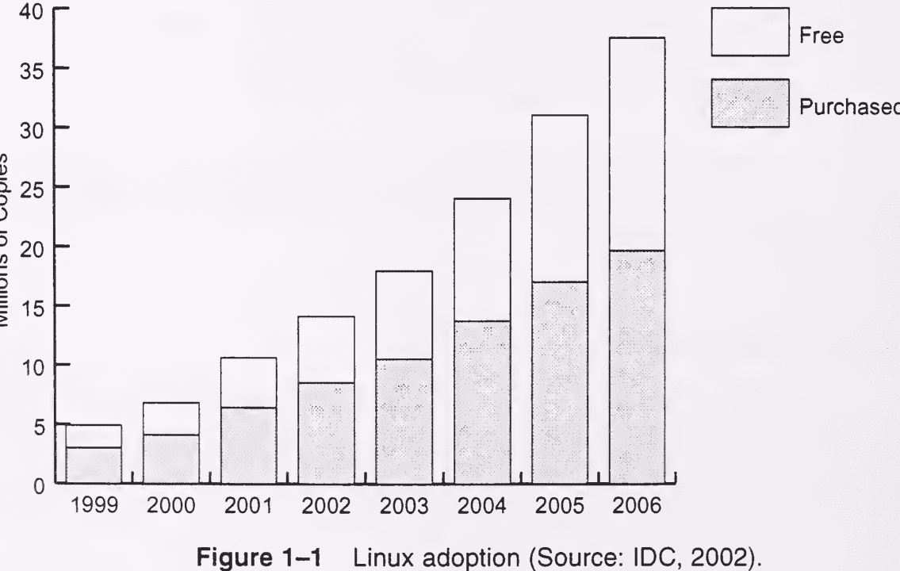

## Linux 和开源术语快速上手

当你读完这本书时，你将对 Linux 和开源如何运作以及如何应用于你的业务有坚实的理解。然而，对一些关键术语的早期快速上手将帮助我们完成本书的前几部分。这些解释旨在让你获得足够的理解来读完本书。大部分这些概念将随着书中内容的进展进行详细解释。

- **内核（Kernel）**——内核是操作系统的核心，管理系统上的关键资源（如内存、进程等）。事实上，Linux 是一个内核，而不是操作系统。
- **GNU**——这是 GNU's, Not UNIX（不是 Unix）的递归缩写。正如你所见，该缩写的首字母就是缩写本身。如果 Linux 是操作系统的内核，那么 GNU 系统代表了拥有一个有用系统所需的许多其他部分（编译器、工具、编辑器等）。纯洁主义者认为，将 Linux 称为操作系统是错误的，它应该被称为 GNU/Linux 系统，在讨论公司内的 Linux 机会时，这是一个需要记住的重要区别。
- **发行版（Distribution）**——大多数为 Linux 部署或开发应用程序的公司通常会通过获取发行版来实现。一些最常见的 Linux 发行版包括 Red Hat、SuSE、Debian、Mandrake、Connectiva 和红旗（Red Flag）。供应商将 Linux 内核、GNU 系统的许多部分、其他开源组件以及自身的改进相结合，将整体作为一个集成且经过测试的系统进行发布。在许多情况下，发行版针对市场的特定部门或特定地理区域。
- **软件包（Package）**——安装在 Linux 系统上的单个组件以软件包的形式分发。广义地说，软件包是指任何为了特定目的分发的文件集合。由于许多软件包可以共享相同的文件，复杂的相互依赖关系由安装和部署工具管理。
- **自由软件（Free software）**——“Free”意为“自由”，如言论自由，而不是为了刻画“无成本”。
- **开源（Open source）**——这个术语通常用于两个语境：首先，作为自由软件的营销术语；其次，作为一种开发方法论，我将在第三部分详细介绍。虽然自由软件运动的领袖往往反对与开源关联，但这个术语的产生是为了克服“自由软件意味着无成本”的常见误解。开源不是许可证。它提供了一套通用规范，许可证必须遵循这些规范才能被认为是开源。
- **社区（Community）**——任何致力于软件项目的开发者组成的集合。社区可以代表学生、爱好者、企业开发者、竞争对手和客户等许多群体。
- **维护者（Maintainer）**——负责接受或拒绝代码进入开源项目的个人、委员会、董事会或基金会。你也可以将维护者视为项目经理。可能最著名的维护者是 Linusvalds（Linux内核的创建者）。
- **GPL**——这是 GNU 公共许可证（GNU Public License）。GPL 将在第三章深入介绍。目前，了解 GPL 是最常用的开源许可证即可。GPL 是管理 Linux 内核的许可证。GPL 要求对代码库的任何修改都要返回给社区。


## 业务效益

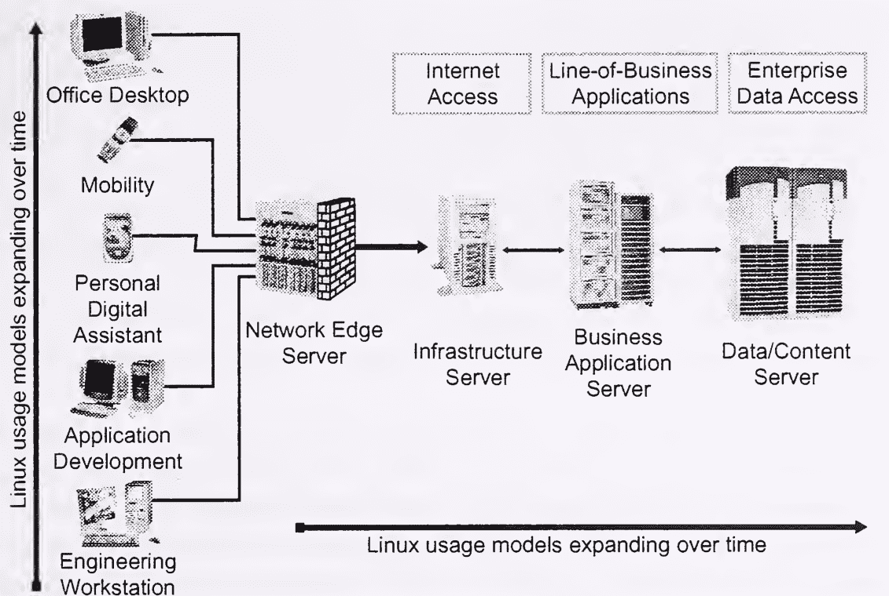

**图 1–2** 随时间增长的 Linux 工作负载。

随着 Linux 的成熟，其应用工作负载将逐渐演进到基础设施和应用服务器层。巨大的争论在于，这种演进需要多久，以及 Linux 将向企业数据中心推进多远。在客户端，Linux 凭借其类 UNIX 操作系统的传统，自然地在工程工作站和应用开发系统中大受欢迎。Linux 也开始渗透嵌入式设备领域。巨大的争论在于 Linux 是否会成为通用办公桌面操作面的可行操作系统。虽然这些是通用的采用趋势，但在几乎所有的计算领域已经散布着一些采用案例。

## 业务效益

Linux 已经迅速从一个小众和爱好者的玩具，演变为许多企业都在使用的可信环境。Linux 初步进入商业世界在很大程度上归功于互联网的兴起。服务提供商将 Linux 视为一种使用通用组件部署系统的方式，且无需操作系统或关键开源应用程序（如 Apache Web 服务器和其他在 Linux 下运行良好的互联网必需程序）支付任何许可费用。服务提供商倾向于拥有高技术性人员，因此使供应商支持成为一个可控的问题。主流企业现在看到，从成本、资源和控制的角度来看，Linux 正成为其他运行环境的可信替代方案。以下是 Linux 的一些关键业务效益：

## 成本

Linux 可以免费复制这一事实

### 培训资源的可用性

Linux 如今已有超过 10 年的历史，因此可以获得培训资源。Linux 的成本优势吸引了许多教育研究机构（如加拿大安大略省的滑卢大学、伊利诺伊大学厄巴纳香槟分校/NCSA（国家超级计算应用中心）等许多机构）积极部署 Linux。这种情况已经持续了几年。例如，法国的 Groupe ESIEE（一个先进科学技术教育中心）已经使用 Linux 三年，因为 Linux 是开源的。他们的动力非常非常简单：ESII 为社区开发，社区为 ESII 开发。对于该中心来说，这是一种简单的投资回报。新南威尔士大学在一年内将其所有基于 UNIX 的教学实验室转换成了 Linux。结果是，许多、许多新毕业生都接受了充分培训，并精通 Linux 操作系统，甚至比大多数 UNIX 版本还要精通。

## 业务效益

这也意味着新一代的开发者都接受过培训，并在 Linux 及其相关的应用程序编程接口（API）上建立了他们的专业知识。许多最流行的开源应用程序（如 Apache Web 服务器）这一新代人也非常熟悉。

图 1–3 显示了 Linux 运动中代表能力的关键利益相关者以及你可以利用的资源。

随着你的企业增长，需要更多才华的人来运行网络基础设施、应用服务器和数据中心时，具备 Linux 能力的人才将是最容易获得的资源之一。

## 支持

关于 Linux 的激烈争论之一是支持来源问题。辩论的一方认为，由于 Linux 由一个松耦合的开发者社区维护和增强，获得保证支持是值得怀疑的。辩论的另一方认为，由于代码对可见，任何人都可以提供支持，自支持现在变成了一个成本更低、更行的选择。你采取辩论的哪一方很大程度上取决于你建立的信息技术（IT）组织类型以及你之前与各种供应商的经验。对你的好处是，你可以选择实施哪种支持模型，并且都可以提供支持。第 8 章将详细介绍支持选项以及你所做选择的影响。

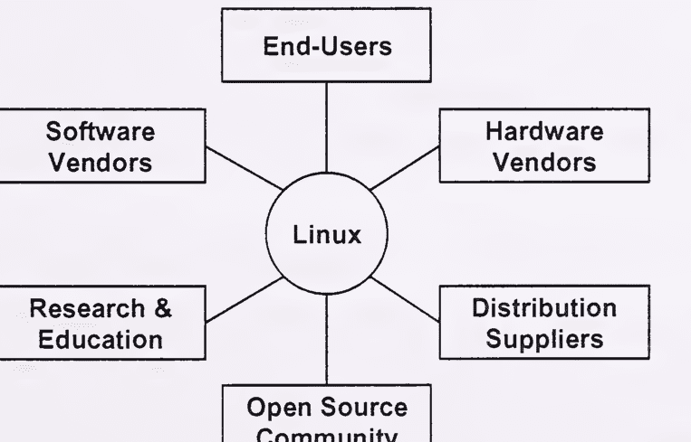

图 1–3 Linux 利益相关者。

## 控制权与供应商独立

Intel x86 架构（也称为 IA-32）为个人电脑（PC）带来了通用经济学。在许多方面，Linux 对操作系统来说也是如此。在 Linux 之前，你的选择主要是在专有硬件上的专有操作系统，或者在通用硬件上的专有操作系统。虽然还有其他 BSD 等开源操作系统，但 Linux 是第一个在通用硬件上运行通用操作系统的可行组合（Linux 也适用于广泛的专有和嵌入式架构）。正如你以后将发现的，Linux 使用的许可模式使它与 BSD 区别开，并创造了一个由许多人开发的单一操作系统。随着越来越多的独立软件供应商（ISV）将他们的应用程序提供给 Linux，IT 管理人员现在可以在最具成本效益且回报最高的硬件和运行环境中部署解决方案。

在 Intel IA-32 架构上部署了通用硬件的企业已经看到了通用经济学的许多益处。公司不再受限于某一个供应商，切换成本非常低。公司还选择混合使用硬件和外围，因为通用产品周围形成了一个庞大的生态系统。这些归结为选择和控制的多数或所有优势在 Linux 中都可以实现。如果一个 Linux 操作系统供应商没有提供你公司所需的服务水平或质量，就进行切换。如果支持不达标，找另一个人或自己来。与通用硬件相比，自选选项在开源软件中要可行得多。对于通用硬件，你仍然需要与一个硬件供应商合作以获得所需的功能或缺陷修复。

## 软件开发

Linux 已成为开发团队的主要平台。Fluent 是计算机辅助工程（CAE）的领先供应商。Linux 是他们一个极其快速且稳定的平台。此外，通过 VMware（一个运行在 Linux 下的芯片模拟器），他们可以在一个平台上访问 UNIX 和 Windows 环境。

## 增长的障碍

从几乎任何衡量标准来看，带有 Visual Studio 的 Windows 继续占据市场大部分份额。但如果你划分 UNIX 市场，开发活动正在迅速转向 Linux。这种现象很大程度上是由教育和研究市场驱动的。

### 升级

如今 Linux 被认为对于许多工作负载是非常稳固的。每年，公司花费数百万美元升级运行良好的环境。升级的很大很大是由于硬件和许可要求。在 Linux 中，你有控制权。你可以选择考虑自支持、购买支持或进行升级，并为你的业务做出最佳权衡。用户跳过许多升级机会并不罕见，除非有引人的利益以及对成本和风险的回报。开源的魅力之处之一在于是你决定何时这样做，而不是供应商。硬件并不仅仅因为你升级了软件而改变。社区中的许多开发者正在非常有效地使用某些在他人看来过时的十年前系统。


# 应用可用性

Linux 的成功很大程度上归功于一款杀级的开源应用程序：Apache Web 服务器。根据 Netcraft Web 服务器调查（www.netcraft.com），截至 2001 年底，Apache Web 服务器已被互联网上超过 50% 的网站使用。Linux 与 Apache 的结合，为几乎任何服务提供商或 IT 部门创建了一个低成本、高性能且易于部署的环境。

除了 Apache 之外，许多应用程序是由研究和教育社区开发的，或者是由处于前沿的公司在内部开发的。

经典的“先有鸡还是先有鸡蛋”的悖论困境在任何环境中都会出现，Linux 也不例外。许多公司在等待应用程序可用后才在自己的环境中部署 Linux，而独立软件供应商（ISV）则在客户部署 Linux 之后才发布他们的应用程序。

这种困境正在逐渐被打破。部分打破要归功于 Linux 的正常成熟。此外，主流应用供应商也发现其部分业务正受到开源替代方案的侵蚀。这些打破中最早且最重要的一个，是 Apache 对 Netscape Web 服务器家族的影响。

另一个驱动变革的因素是前面提到的：开发环境。ISV 必须为他们的每个 UNIX 平台维护多个开发环境。许多公司正转向 Linux 作为其核心开发环境，并将其作为所有其他平台的迁移基准。事实上，在与 ISV 的交谈中，许多人惊讶地发现，他们很大一部分工程师已经在工作和家里使用 Linux。他们中的一些人预计需要投入巨大精力才能迁移到 Linux，结果发现这些工作已经完成（或者至少完成了大部分）。

大型硬件和软件公司正在全力支持 Linux。现在，随着 BEA、戴（Dell）、惠普（HP）、国际商务机器（IBM）、Oracle、SAP 等许多公司都在 Linux 上提供产品，这些公司（以及许多其他公司）周围的生态系统也计划在 Linux 上支持它们的产品和服务。雪球正在向山滚落，并稳步积累动力。

当然，付费客户拥有最终决定权。随着越来越多的公司需求 Linux，供应商将别无选择。

# Linux 增长的阻碍

### 成熟度

成熟是一个相对术语。但对于一个操作系统来说，10 年实际上非常年轻，特别是与历史可以追溯到20 世纪60 年代的 UNIX 相比。Linux 在互联网基础设施方面拥有坚实且经证明的记录。正如我们在图1–2 中所示，它也开始进入应用服务器层。许多核心业务应用程序所需的关键基础设施应用程序（数据库、应用服务器等）现在正变得可用。

另一个成熟的领域可以归类为“企业级就绪”。IT 经理依靠广泛的工具和能力来管理大型环境。然而，大多数 IT 经理认为理所当然的行政管理、部署和更新工具，要么不可用，要么处于开发的极早期阶段。硬件供应商、软件供应商和开源社区正在努力填补这些空白。随着公司派遣自己的工程师投入兼职或全职工作来改善 Linux 的这种状态，这一障碍将得到克服。通过选择使用这种潜在的控制力，任何规模的公司都可以影响 Linux 的方向和发展速度——这在过去其他操作系统系统中是许多人无法享有的奢侈品。

许多软件供应商还在寻找 Linux 内核的额外功能，以便能够调整其应用程序的性能、可用性和可扩展性。今天，许多人通过妥协来克服这些某些局限性。再次，开源社区提供了一个积极的论坛，以不受公司预算、路线图、财务状况或法律限制的方式来解决这些局限性。

Linux 内核的可扩展性仍然是一个争论领域。内核的更改涉及复杂性与能力之间困难的权衡。Linux 内核的创建者 Linus Torvalds（下一章将详细讨论）倾向于保持内核短小、减少复杂性并针对较小系统进行优化。这可能使得寻找垂直扩展内核的方法变得更加。

### 可扩展性

垂直可扩展性允许 Linux 通过在同一系统内添加处理器来扩展其性能。水平可扩展性通过将任务分配到许多系统之间来增加规模。可扩展性是一个相对特征。对于许多应用程序来说，Linux 扩展得非常好。Linux 2.4 内核的发布使得多处理器扩展到 16 个处理器通常是可能的，只要应用程序能够利用它。如今的 UNIX 系统通常会扩展到 128 个处理器及更多。

然而，可扩展性可以有许多形式。许多需要超出 Linux 提供范围的可扩展性且又想要成本优势的人已经转向集群来解决他们的性能需求。水平可扩展性，或将大量低成本系统组合并让它们协同工作，一直是并且一直是 Linux 的伟大优势之一。然而，应用程序通常被开发和调优，以便在多处理器或集群环境中良好扩展。很少有应用程序会针对这两种配置都进行良好的扩展优化。Linux 在输入/输出（I/O）能力、可用性、部署和管理方面也有提高可扩展性的机会。

Linux 内核的可扩展性仍然是一个争议领域。内核的更改涉及复杂性和能力之间困难的权衡。Linux 内核的创建者 Linus Torvalds 倾向于保持内核精巧，减少复杂性并针对小型系统进行优化。这可能会让寻找垂直扩展内核的方法变得困难。

### 业务风险

Linux（以及大多数开源软件）带来了一类新风险，通常涉及知识产权的管理。在企业内部实施任何新技术都涉及需要管理的风险。Linux 和开源也无区别。必须建立以前可能不存在的业务流程。然而，许多公司发现，管理这些风险对于 Linux 带来的经济回报来说是非常值得的。本书的第三部分将详细详细调查与开源相关的许多风险以及如何管理它们。事实上，开源开启了大量机会来提高生产力，并将你的精力重新集中在你带给客户的核心价值上。

# 开源界谁是谁？

社区是世界各地围绕开源项目的个人集合。一些人是因为雇主分配的正常职责而这样做；另一些人是因为热爱这项工作而在空余时间这样做。有些人是因为简单的自尊驱动，有些人是因为对开源的信念，另一些则是因为对自己的问题寻求创造性的答案。许多开发者是教育和研究社区的一部分。图1–4 显示了 Linux 和开源生活的重大时间线。

在本书的第三部分，我们将介绍公司如何鼓励和赞助员工从事开源。

### 开源时间线

- **1984年**: 自由软件基金会（FSF）成立
- **1989年**: FSF 发布 GPL 1.0
- **1991年6月**: FSF 发布 GPL 2.0
- **1991年9月**: Linux 的第一个代码发布
- **1994年3月**: Linux 1.0 发布
- **1994年**: RedHat 成立
- **1995年**: 一群开发者聚集开发 Apache Web 服务器
- **1996年6月**: Linux 2.0 发布
- **1996年10月**: KDE 桌面开始
- **1997年5月**: 《教堂与集市》出版
- **1997年**: GNOME 桌面开始
- **1998年2月**: “开源”一词被创造
- **2001年1月**: 承诺带来新可扩展性的 Linux 2.4 发布

**图1–4** Linux 和开源重大事件的时间线。


-   **Linus Torvalds**——可能是 Linux 和开源世界最广为人知的人物，他是 Linux 内核的创建者和维护者。他维护内核中平台无关的部分，以及针对 Intel IA-32 架构的核心内核组件。Linux 向其他架构的移植版本则由不同的团队和个人分别维护。

-   **Alan Cox**——在 2001 年秋之前，Alan 被认为是 Linux 的头号助手。正如你将在第 2 章中学的，Alan 负责维护正在开发中的 Linux 内核，而 Linus 则维护已发布的内核。正如社区的常态，当 Alan 决定想要从事其他事情时，他为自己的当前任务选择了一个继任者。尽管 Alan 不再是发布版 Linux 内核的维护者，他在社区内仍拥有巨大的影响力和尊重。

-   **Marcelo Tosatti**——Linux 和 Alan 将稳定版 Linux 内核（被认为投入生产的内核）的维护权炬交给了 Marcelo。由于 Linux 必须与此人紧密合作，他显然需要参与选拔过程。Marcelo 是一个非常有能力的内核开发者，在内核开发者社区中展现了卓越的天赋。

-   **Dave Miller**——如果你向 Linux 内核的网络栈提交更改，David 很有可能是负责检查你的提交并决定是否接受的开发者。将 David 视为 Linux 网络的守护者吧。

-   **Richard Stallman**——FSF 的创始人。Richard 也是 GNU GPL 的创建者。Richard 持续在自由软件运动中发挥着影响力的作用。当 GPL 的某些领域需要明确说明时，许多人会寻求他的指导。

-   **Bruce Perens**——作为 Debian 项目的负责人（我们稍后会深入介绍 Debian），Bruce 编写了一份“社会契约”，以便在项目中使用自由软件工作时建立一套标准的行为准则。当“开源”一词被创造时，这份“社会契约”就变成了《开源定义》（OSD）。因此，Bruce 被认为是 OSD 的主要作者。第 3 章详细概述了这一定义。

-   **Eric Raymond**——作为开源社区内的人类学家和思想领袖，Eric 现在因其开创性的论文《大教堂与大集市》（The Cathedral and the Bazaar）而闻名，该论文概述了开源开发流程、其运作方式以及如何复制。本书的第 3 部分将 Eric 的工作扩展到了商业企业。

## 开源界有哪些人物？

-   **Larry Augustin**——Larry 是 VA Software Corporation 的 CEO。VA Software 最初以 VA Linux Systems 的名成立。Larry 是首批意识到 Linux 和开源价值的人之一。他创建了第一家专门支持 Linux 的硬件公司。随着 Dell、IBM、HP 等主流硬件供应商开始支持 Linux，Larry 改变了他的业务模式，转销售支持企业内部开源协作开发流程的软件。

-   **Tim O’Reilly**——作为 O’Reilly Books 的总裁，Tim 持续对开源运动产生着巨大的影响。O’Reilly 网络涵盖了 Perl 等在互联网上广泛使用的关键开源技术。Tim 通过发布他的许多想法为社区发声。

-   **Brian Behendorf**——Brian 是 Apache 软件基金会的联合创始人。由于 Apache 曾是开源领域的杀手级应用，Brian 不仅在 Apache 运动中具有影响力，在整个社区中也同样如此。

-   **Michael T**——Michael 创立了 Cygnus Solutions，这是第一家基于开源业务模式的商业公司。Cygnus 为 Linux 的一个关键组件——克隆器（cloners）提供了基础设施支持。Cygnus 开创了许多为自由软件提供支持、服务和其他增强的业务模式。Cygnus 在 2000 年被红帽公司收购。

-   **Bob Young**——Bob 被认为是现今最流行的 Linux 发行版红帽成功的功臣。Bob 利用他的营销敏锐度围绕 Linux 操作系统创建了一个强大的品牌，并在许多方面将 Linux 带向了大众。今天，Bob 是红帽董事会成员，并频繁在 Linux 和开源活动中演讲。

-   **Jeremy Allison**——Jeremy 是 SAMBA 项目的负责人。正如你将发现的，SAMBA 是 UNIX/Linux 和 Windows 世界之间关键的互操作技术。SAMBA 是大多数 Linux 发行版包含的核心技术。

-   **Miguel de Icaza**——Miguel 是 Ximian（原 Helix）公司的创始人和现任首席技术官。Miguel 领导了 GNOME 桌面环境开发多年。今天，Miguel 正在领导另一个开创性的开源项目，名为 Mono（西班牙语中的“猴子”，是该公司的吉祥物）。Mono 是微软 .NET 框架子集的开源实现。

## 总结

你现在已经拥有了我们可以在此基础上构建的核心知识基础。你也看到 Linux 为你提供了许多减少 IT 成本的机会，但开源也带来了必须管理的新业务风险。通过对关键术语的核心理解并了解主要参与者，我们现在可以开始探索如何利用这些优势并在企业内部管理风险的细节。

第 1 部分的剩余内容将扩展你对 Linux 操作系统的理解，并深入探讨你可能会遇到并需要合作的开源及相关源码社区。第 2 部分将关注 Linux 的运营方面，鼓励你考虑在企业中需要部署什么内容，并提供有关 Linux 支持、迁移和成本影响的信息。第 3 部分将研究管理开源的业务风险和机遇。它不仅将概述如何与开源项目合作，还将概述如何在你的环境中实施这种开发方法论。

## Linux——操作系统的核心

“Linux”通常指的是整个操作系统。然而，这样思考 Linux 也可以的。从技术上讲，Linux 仅仅是内核，是保持系统运行的核心基础。还有许多其他部分完成了系统。Richard Stallman 经常认为，将 Linux 称为操作系统是错误的，整个系统应该被称为 GNU。然而，某些供应商包含某些组件，而则不包含。在企业中部署 Linux 需要对这些组件有清晰的理解。因此，本章的目标是理解：

-   操作系统的视角
-   Linux 内核以及它与其他内核的对比
-   内核如何开发和更新

# 第 2 章 操作系统的核心

-   如何通过模块和补丁扩展内核功能
-   Linux 的分支（forking）考量
-   Linux 的多平台特性
-   复杂概念的应用


## 操作系统

| CPU(s) | 编译器 | |
|---|---|---|
| 内存 | 编辑器 | |
| 输入/输出 | 用户界面 | |
| 固件/BIOS | | |
| 硬件 | 管理 | |
| | 操作系统的简要视图 | |

图 2–1 操作系统。

如你所见，操作系统是运行业务所需的应用程序与你可用的资源（硬件组件）之间的纽带。使用该系统的应用程序和用户越多，操作系统需要的工作就越多。消费级操作系统包含许多用于增强终端用户体验的应用程序（音乐播放器、图像处理工具等）。面向企业世界的操作系统则支持侧重于管理大量用户的应用程序，其首要目标是以最小的成本控制计算机资源。

Linux 中的资源利用可以从三个维度来考虑：(1) 管理，(2) set，以及 (3) 控制。

从操作系统的角度来看，资源管理提供了可用计算机资源的全局视图，以及它们是如何被部署和使用的。例如，如果你经营一家航空公司，请确保你已经根据回报利润最高的路线部署了飞机，以实现收益最大化。同样，在 Linux 中，资源管理组件帮助你以一种协调的方式管理硬件组件。

一旦你部署了计算机资源，Linux 中的资源管理工具可以帮助你以最有效的方式配置这些可用资源。对应的航空业例子就是确保你已经为飞机准备了足够的燃料、乘客座位以及适当的机组人员。

资源控制也属于 Linux 操作系统内核的范畴。内核根据其设计和配置来控制可用资源，就像你的飞机将按照其设计规范允许的最高和和飞行一样。

## Linux 内核

从技术上说，Linux 是操作系统的内核。图 2–2 概述了内核的关键组件。理解内核的一种简单方法是将其想象成飞机上的引擎。虽然引擎为飞机提供动力，但飞行员并不直接与引擎交互。内核是你操作系统中的动力，计算机用户永远无法直接看到它。在现实中，内核是一个控制你系统的大型应用程序。该应用程序对你系统上的所有资源（磁盘、内存、CPU 等）具有完全的控制权和权限。内核的任务是管理并响应所有来自应用程序和用户对系统资源的各种请求。内核执行这些操作的效率取决于它的整体设计和配置。

## 内核设计

Linux 是一个单体内核。如图 2–2 所示，所有内核组件都作为一个特殊的、大型应用程序包含在系统中运行。内核是一种特殊类型的应用程序，具有特权权限，其工作是控制你的系统。这里的“应用程序”不应与你运行日常业务的应用程序混淆。关于内核状态的所有信息对内核的所有组件都是可用的。

| 处理器/缓存控制 |
| 内存管理 |
| 进程管理 |
| 文件系统接口 |
| 网络协议栈 |
| 设备与 I/O 接口 |
| 安全/身份验证 |
| 操作系统内核 | 内核状态信息 |

图 2–2 单体操作系统内核及其功能。

## Linux 内核

现代操作系统使用的另一种类型的内核是微内核。微内核拆分了大部分关键控制功能。状态信息并不是对所有函数可用，而是通过消息从一个函数传递到另一个函数。图 2–3 展示了一个简单的微内核架构。

微内核的支持者认为，它们增加了模块化、可移植性和性能。而其他人（如林纳斯·托瓦兹，Linus Torvalds）则认为，每个控制模块所需的消息传递增加了复杂性，并使得内核更容易出现晦涩的缺陷。

具有历史意义的事实是，理查·斯尔曼（Richard Stallman）为他的 GNU 系统开发了一个基于微内核架构的内核，即 GNU Hurd 内核。理查承认，与 GNU Hurd 相关的开发和调试复杂度显著降低了开发速度。林纳斯·托瓦兹的单体内核开发快得多，并在 GNU Hurd 准备好之前很久就可以支持 GNU 系统。

## Linux 内核模块

Linux 内核 2.0 版本的关键进展之一是引入了模块。在此之前，内核内核的任何新功能或能力都必须编译进内核并重启系统。


图 2–3 微内核。

# 24 第2 章 · 操作系统的核心

由于模块提供了为 Linux 内核添加功能的机制，补丁（patches）提供了一种在不损害 Linus Torvalds 发布的内核完整性的情况下扩展或更改功能的方法。再次使用航空类比，油门和导航控制是设备驱动程序，补丁在某些情况下代表对引擎的维修，而在其他情况下将是实现新功能的方法，例如为你的引擎添加冷却能力。

当你企业中部署 Linux 或构建在 Linux 上运行的新应用程序时，你会希望仔细注意依赖关系，不仅是对内核版本，还包括可能需要安装的任何补丁和模块。

## 内核碎片化（或分支）

新来在考虑 Linux 时最大的担忧之一是碎片化概念。内核碎片化也被称为“内核分支（forking the kernel）”。无论如何，它指的是各种不同内核实现的泛滥。

这种担忧的根源在于 UNIX 的历史。UNIX 最初承诺是一个具有一个通用编程接口的单一系统。将应用程序从一个 UNIX 系统迁移到另一个 UNIX 系统本应该是针对目标系统进行重新编译的小事。然而，UNIX 供应商需要区分他们的产品。因此，每个供应商都会扩展并为操作系统添加新功能，在许多情况下，这些功能是以完全不同的方式实现的。最终结果是，尽管所有 UNIX 系统共享共同的历史且运行方式相同，但每个供应商的 UNIX 差异太大，以至于从一个版本移动到另一个版本需要大量的应用程序工作。这些差异还导致了“锁定”，当你从一个无法提供你满意价值供应商切换时，会增加你的成本。

ISV（独立软件供应商）面临着由这些异 UNIX 版本引起的大量工作。ISV 需要在移植支持每个新计算机平台的成本之间取得平衡，同时获得最广泛的市场。每个支持的平台都需要大量的调优、验证和支持。内核分支会大幅增加 ISV 及其客户的成本。


图 2–4 Linux 内核模块。


当企业和独立软件供应商（ISV）开始接触 Linux 并听到许多 Linux 商业发行版的名称（如 Red Hat、SuSE、Turbolinux、Mandrake 等）时，他们有时会担心重演 UNIX 之战。*然而，所有的 Linux 发行版共享同一个 Linux 内核，这正是它的不同之处。* 通用的 Linux 内核有助于消除昂贵的移植/支持成本，与 ISV 过去在 UNIX 上面临的情况相比，这使得产品的定价和市场交付变得简单。

虽然大家都在共同内核的概念下运行，但补丁和其他功能可能会导致发行商之间产生差异。第 7 章将带你了解用于补偿这些差异的相关标准。

Linux 内核是开源的。内核开源这一事实消除了供应商在价值链中如此低层级上进行差异化的能力和动力。在第 5 章详细介绍 Linux 发行版时，将涵盖这一价值链以及哪些差异化是可能的。这种开源范式的奇妙之处在于，供应商有极大的动力与整个社区以及彼此进行合作与共享，以扩展系统功能以满足更高层次的目标。软件降低了开发成本，同时专注于为客户创造更高的价值。ISV 可以依靠一个共同的基础来开发和部署他们的应用程序。企业终于从跨供应商的通用系统中获益，并专注于业务需求，而不是每个供应商操作系统环境的特定低级功能。

虽然 Linux 的开源性质使得碎片化不太可能，但企业和 ISV 仍需要管理 Linux 环境中的某些复杂性。内核已经演进，就像任何其他系统一样，现在有多个版本可用。ISV、自由职业开发人员和其他解决方案供应商可能会创建强制管理依赖关系的补丁。因此，大量的内核模块（通常是设备驱动程序）可能作为你部署的一部分所需的。最后，发行商可能会创建他们自己的内核版本、软件包和增强的特定组合。在随后的第 5、6 和 7 章中，我们将查看发行版、标准和部署流程，以帮助管理这些复杂性的细节。

## Linux 内核开发与版本控制

Lin Torvalds 拥有 Linux 的注册商标，从正式意义上说，他批准 Linux 内核新版本的发布。然而从实践角度来看，Linux 内核开发的中心是 kernel.org 社区，它培养了一个开放协作的开发过程。

开发中的新内核版本在次版本号上使用奇数。内核版本 2.1.x、2.3.x 和 2.5.x 都是已经发布或正在开发中的内核。你可以将这些被视为具有非常频繁中期发布的非稳定 alpha 和 beta 质量软件。通常，没有哪个公司会基于这些开发内核部署生产系统。次版本号为偶数的内核版本（如 2.0.x、2.2.x 和 2.4.x）都是被认为已准备好投入的发布内核。图 2–5 展示了这个版本系统。

加入 Linux 世界时要克服的关键困难之一是缺乏定义的未来路线图，以及缺乏承诺的发布日期。在传统的开发世界中，路线图倾向于定义未来特定时间点将包含的功能。Linux 不存在这种地图的事实让许多经理感到不安。

在内核发布并稳定后，Lin Torvalds 将启动一个新的开发周期（将公布下一个奇数次要版本）。内核社区将聚集在一起，决定构成内核下次发布的功能列表。

## 维护版发布树（偶数版本）

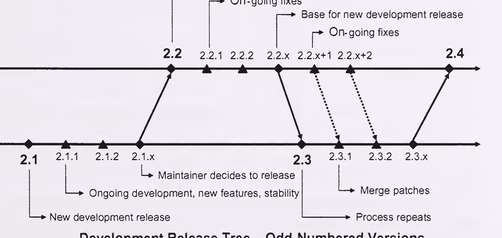

## 开发版发布树（奇数版本）

图 2–5 Linux 内核开发生命周期。

决策者社区非常智能且非常以客户为中心。开发者能收到的最大赞誉之一就是他的软件在生产环境中运行。这促使了开源开发者做出高质量的贡献。另一个现象是在当社区认为系统准备就绪时发布，而不是当某个营销部门（或某些“不理性”的经理）认为到时候的时候。

通常，公司由于感知到的市场和竞争压力以及客户需求而发布软件。这迫使工程部门做出不利的设计和架构权衡，以满足从上而下规定的截止日期。这种模式的讽刺之处在于，在许多情况下，设计和架构权衡反而增加了开发时间，并降低了系统生命周期内的质量和功能。由于开源社区的动力来自于交付高质量的系统而不是获得经济回报，这种负面的开发循环往往会被避免。这并不意味着社区忽视市场需求和客户需求。相反，这意味着设计权衡将变得更加理性，且负面下游影响更少。这种软件发布周期是许多开源项目能够比其商业对手快得多的速度进化的关键原因，这也是为什么它们往往更稳定的原因。

影响 Linux 功能集、加速新 Linux 内核发布或查看“路线图”的最佳方法非常简单：参与进来。Linux 开发社区在尊重和关系的准则下运行。建立联系并参与 Linux 开发。这对你和内核社区都是双赢的。投入资源成为内部人士，将让你对开发如何进展以及何时可能发布有细致的理解。这比许多路线图都能给你提供更好的未来指示。

当发布的内核稳定到可以接受的程度时，这个稳定内核将作为新开发内核的基础，循环将重复。当生产内核和开发内核都处于活跃开发时，Marcelo 和 Linus 会一起工作以确保同步。尽管社区被公认为是发现缺陷的最佳场所，但在现实生活中

## 多平台支持

没有比企业生产环境更能彻底测试一个系统了。这种测试过程可能会发现需要修复的错误。一旦 Torvalds 发布新版本，维护责任将转向 Marcelo Tosatti（多年来，这一角色由 Alan Cox 负责）。当公司部署 Linux 并发现缺陷时，Marcelo 会批准内核所需的更改。Marcelo Tosatti 与 Lin Torvalds 保持密切联系。Marcel 不对内核产生负面的长期架构影响是非常重要的。

Linus 和 Marcelo 之间的信任纽带以及他们接受 Linux 开源开发社区建议的意愿使得这种情况不太发生。

当你们遇到不理想因素时，在内核中遇到错误的人通常不仅报告和描述问题，还会向 Marcelo Tosatti 提交建议的修复（代码更改的形式）。当然，许多公司没有具备成为内核专家所需的规模、经验或知识的 IT 员工。在这些情况下，公司通常会向其 Linux 供应商寻求支持。我们将在第 8 章详细研究这些支持模型。然而，一般的终端用户体验是，问题的发现、诊断以及修复的发布远快于任何商业同品。

它的主要优势之一在于它已经是最广泛移植的操作系统。Linus Torvalds 最初是为了学校项目而开发一个类 UNIX 操作系统，可移植性并不是设计目标。内核与 386 微处理器紧密结合。但正如开源项目通常的情况，人们很难预测项目将如何演进。


# 30 第 2 章 Linux—操作系统的核心

许多开发者承担了移植 Linux 内核并调整结构的任务，使得 Linux 具有良好的可移植性。

今天，Linux 内核开发树既有架构无关的分支，也有架构相关的分支。架构无关的分支以及针对 Intel x86 架构的代码均由 Linux 维护（设备驱动程序和文件系统等组件由其他人员维护）。其他微处理器的架构相关分支由独立的开发者小组维护。当这些开发者遇到特定于处理器的问题时，可以自由地进行必要的更改以确保系统的正常运行。在某些情况下，架构无关组件需要更改，这同时也需要对受控的部分进行相应更改。其他架构的内核维护者与 Linux 密切合作，规划这些更改。

## 大众市场处理器 vs 非主流处理器

考虑在非主流微处理器上部署 Linux 的公司，在决策时应该考虑额外的因素。记住，Linux 的核心优势之一是它将通性经济学应用于操作系统。这种通用处理器与 Linux 的结合，使其成为业务领域中一个极具可行性且成本吸引力的选择。

Linux 的优势之一是它的可移植性。事实确实如此。在某些情况下，在专有或小众处理器上部署 Linux 是一个可行甚至是理想的选择；例如，当性能特性或特定功能集非常重要时。当你需要从当前安装的专有处理器迁移到仅在主流处理器上部署的终极目标时，非主流微处理器上的 Linux 也是一种可行的替代方案。一些 Linux 发行版厂商现在为非主流处理器提供其 Linux 产品，这可能有助于这一过程。在评估替代处理器时，请考虑以下因素：

- Linux 的核心开发目前集中在 x86 架构。
- 部署所需的应用程序可能不存在，或者会比基础版本延迟一段时间。
- 独立软件供应商（ISV）可能会拒绝支持主流平台以外的任何平台。他们可能没有足够的资源来提供应用程序，或在替代处理器架构上对其提供支持。

## 桌面版 Linux

- 开源开发社区很少拥有在所有替代架构上开发和测试其特定组件所需的资源。
- 内核架构相关部分所需的更改可能无法提交到其主流版本。
- 大多数设备驱动程序编写者无法在所有替代架构上测试设备。
- 经过培训的 Linux 人才很少熟悉替代架构上的 Linux。

虽然这是一个需要考虑的重要列表，但你仍然可能选择在非主流处理器上部署。今天，除了 x86 (IA-32) 处理器架构外，Linux 内核还可以在其他替代架构上运行：

- AMD 的 Octeron
- HP 的 PA-RISC Alpha
- IBM 的 PowerPC
- IBM 的 S/390
- Intel 的安腾处理器家族
- 摩托罗 68K
- SUN 的 SPARC

在每种情况下，支持程度会有所不同。但在大多数情况下，将提供完整的 Linux 发行版（在第 5 章中讨论）。你可以在书末的参考部分找到有关 Linux 对特定处理器族支持的更多信息。

在桌面上部署 Linux 目前是许多辩论和争议的来源。根据大多数市场衡量标准，作为办公生产力桌面的 Linux 渗透率低于 2%（根据某些标准甚至低于 0.5%）。Linux 最最坚定的支持者断言，Linux 开始成为一种可行的办公桌面替代方案只是时间问题。支持这一断言的主要因素是 Linux 在全球许多新兴国家的普及，以及许多政府机构也在认真考虑 Linux。应用程序的可用性、终端用户友好性、迁移和重新培训成本使得大多数企业难以考虑在桌面上部署。值得密切关注市场动态，以看看社区和整个行业如何解决这些差距。

在某些关键市场领域，Linux 目前是桌面部署的一种可行性替代方案。那些传统上使用 UNIX 工作站的产品开发公司所使用的工程桌面仍然是 Linux 桌面的一大热门领域。依赖高端图像应用的市场（如娱乐行业和医学影像市场）也是 Linux 部署的强有力的候选者。软件开发者也被 Linux 桌面所吸引，因为他们可以为 Linux PC 开发。最后，用于金融服务等特殊应用程序的事务工作站也是理想的解决方案。所有这些方案都有 UNIX 的共同起源。Linux 以低成本配置提供了 UNIX 体验。

开源社区已经交付了两个主要的桌面界面：GNOME 和 KDE。将这些想象成你汽车的仪表盘。如果你熟悉 UNIX，GNOME 和 KDE 等同于通用桌面环境 (CDE)。每个桌面环境都有其独特的“外观和感受”，并采用独特的 API。对于 CDE，API 是 Motif；对于 GNOME，它是 GTK；而对于 KDE，它是 Qt。Linux 的美之处在于，无论你选择哪种桌面，你都可以确保程序将会运行。

Linux 还有许多办公生产力套件可用。最流行的是 StarOffice（SUN 提供的专有解决方案）和 OpenOffice（由开源开发者社区维护的 StarOffice 开源实现）。

## 垂直与水平扩展性

2.4 内核是处理器垂直扩展性的一次重大飞跃。根据应用程序的不同，Linux 现在可以很好地扩展，行业和社区小组继续致力于扩展扩展性。Linux 内核通常被编译为单处理器或多处理器配置。多处理器配置是实现垂直扩展性（纵扩展）的关键。在 2.4 内核出现之前，集群（或“水平”）扩展性是实现扩展性的唯一方法。自 1994 年以来开发的最流行的集群技术之一是 Beow 集群（请参阅书末参考部分的链接）。图 2–6 展示了垂直扩展和水平扩展之间的区别。

许多基于传统数据处理的应用现在都有了提供垂直扩展的内核和操作系统，以满足绝大多数需求。那些需要与高性能计算集群相关的大规模并行处理的用户，也拥有了进化了八年的技术。


## 第 2 章 • Linux—操作系统的核心

根据许可，Linux 是自由复制的。由于许多嵌入式应用涉及数百万个单元的部署，消除按数量收取版税的需求使得 Linux 成为一个极具吸引力的选择。

你也可以在专门嵌入式 Linux 内核的公司工作的基础上进行构建和利用（第 5 章将概述某些嵌入式应用的 Linux 发行版）。如果你有特殊或复杂的需求，可以构建自定义嵌入式内核，或寻求专门嵌入式市场的公司服务。你的选择取决于你支持自己自定义环境的能力。

## 总结

你现在可以取下螺旋桨了，但你可能想把它放在手边。这一章的内容已经非常技术化了，但我偶尔会穿插几个不同的主题。你已经跨越了计算机科学中最复杂的课题之一：理解 Linux 系统是如何构建的，以及你将如何在你的组织中部署它。当我们在第 5 章中讨论 Linux 发行版时，你将理解内核是如何连接到更大型系统的。

在下一章中，我们将扩展你对知识产权法的理解，并研究软件开发流程中的新范式。开源让 Linux 以及许多其他应用成为可能。理解开源的运作方式以及其建立的法律基础是部署 Linux 的先决条件。

## 开源—通往自由的法律之路

Linux 的快速兴起引起了大量的行业和媒体炒热。Linux 是规模最大的开源项目，涵盖了数百名开发者。它展示了开源的真实能力。因此，作为你公司的技术领导者，你需要成为开源领域的专家。这种新的软件开发方法论和许可模式代表了你公司面临的最新机会之一，也是最大的威胁之一。开源也创造了机会，因为它为你提供了降低成本和创造竞争优势的新方法；同时也带来了威胁，因为它让你的业务面临着重大的知识产权风险。你需要关注开源，因为很有可能，你组织中的许多开发者已经在使用开源软件了。而这些开发者充分理解对你公司构成风险的概率并没有那么大。成为专家，在几乎消除风险的同时，利用这些机会。本章的目标是让你理解：

- 自由与开源
- 《开源定义》（The Open Source Definition）
- 开源许可，包括 GPL
- 常被误认为是开源的非开源许可
- 开源与美国加密密技术出口法
- 开源开发方法论

## 第 3 章 • 开源—通往自由的法律之路

本章侧重于理解开源及其法律动态。本书的第 3 部分将深入讨论与公司内部使用开源软件相关的业务流程，并提供帮助你决定何时实施你所开发的开源软件的指南。

## 开源的自由

开源源于自由软件（free software）。当大多数人第一次听到“自由软件”这个术语时，他们不可避免地得出结论，认为软件是免费的。事实并非如此。在这种语境下，应用于软件的“free”一词指的是自由（freedom）——意味着复制、修改和分发软件的自由。原则上讲，这些自由要求对源代码有对等的访问。理查德·斯尔曼（Richard Stallman）是“自由软件”术语的作者。他为 UNIX 实现了重要的软件，在 GPL 许可协议下向公众许可了这些软件，然后创建了自由软件基金会（FSF）来推广这种自由概念。

遵循由林斯·托瓦尔斯（Linus Torvalds）推广的 Linux 分发模式，他是在 GPL 自由软件许可下分发的。

自由软件运动的其他领袖，包括埃里克·雷蒙德（Eric Raymond）和拉里·奥古斯汀（Larry Augustin）等等人，担心英语语言中“free”的另一种含义——“无成本”（without cost）引起混淆。他们认为，这种混淆不必要地让大型软件公司远离自由软件背后的开发模型。埃里克·雷蒙德写了他具有历史意义的文章《大教堂与集市》（*The Cathedral and the Bazaar》，后来以同名文集出版），描述了开发者社区如何创建优秀的软件。为了描述这种软件，他创造了“开源”（open source）一词，因为它没有引发任何经济模型，但它承认了开放源代码对于这一开发过程至关重要。

这些领袖还意识到，开源的成功取决于对开源许可中允许行为的清晰描述。当时 Debian 社区的项目领袖布鲁斯·佩伦斯（Bruce Perens）已经致力于与自由软件社区共同定义一份社会契约（我将在第 5 章详细讨论 Debian，但目前只需说 Debian 是一个由社区开发的、开源的 Linux 发行版即可）。布鲁斯和其他开源运动的领袖同意采纳这一社会契约作为正式的《开源定义》（OSD）。因此，布鲁斯被认为是 OSD 的主要作者。

应该注意的是，那些认同自由软件纯概念的人（包括理查德·斯尔曼）不同意将名称改为“开源”。这一原因在本章稍些时候当我讨论 GPL 和其他“左向拷贝”（copyleft）许可时将会变得清晰。

## 开源定义

总的来说，开源许可保护了任何人、任何地方、出于任何目的使用、复制、修改和分发（出售或赠送）软件的权利。在实践中，这需要对源代码进行开放访问。

这些基本权利在由开源倡议（Open Source Initiative, OSI，一家非营利机构）发布的官方 OSD 中有了更正式的成文。开源社区将 OSD 视为判断什么是真正的开源许可的指南。符合 OSD 规定的许可必然提供了上述的各项权利。

非常重要的一点是，OSD 本身并不是一种许可。OSI 创建了一个认证标志，作为软件符合 OSD 的指示。在过去的几年里，许多许多人问我“开源”到底意味着什么。我发现总结 OSD 的具体规定是有帮助的。以下是总结。如果你想要更全面的定义，请访问 OSI 网站 (www.opensource.org)。对于许可证要成为开源，所有这些规定必须适用。OSD 的规定如下：

- 自由分发：开源许可不能阻止被许可者免费分发软件。是否收费或收取多少费用完全取决于被许可者。开源软件提供者通常会对介质、手册和支持服务收费。在实践中，这项规定通常导致免费或低成本的软件。
- 源代码：程序的源代码将是可用的。在大多数情况下，源代码将与二进制文件（执行程序）一起提供，但这不是强制要求。然而，如果二进制文件中未提供源代码，也可以免费下载（或在其他介质上提供）。在实践中，由于源代码可用，任何具备相应技能的人都可以修复错误或增强软件。
- 衍生作品：许可必须允许修改软件并分发这些修改后的软件。如果你获得了开源软件，你可以自由地更改它，并自由地分发你的更改版本。
- 作者源码完整性：在开源社区的正常开发过程中，主源码树通常由一个“维护者”控制。可能会出现维护者拒绝对官方源码树更改更改，但程序员仍然想要分发更改。从许可和认可的角度来看，需要一种清晰的方法将官方源码与任何修改分开。OSD 的“完整性”条款确保你清楚你正在使用的代码由谁负责。因此，作者对其工作获得明确的荣誉（或指责），而不会为他人的修改承担声誉。某些开源许可要求通过补丁（patches）进行修改，这样原始源码以未修改的形式分发，然后将修改提供在独立的补丁文件中。两者在构建时合并以提供新的、可工作的软件。
- 不对个人或团体歧视：开源许可不能阻止向任何人或任何团体使用或分发软件（及其源代码）。无论我们多么厌恶某些软件的用户，这一条款都阻止了任何


## 知识产权与互惠

限制。（例如，你不能阻止恐怖分子使用你的软件。）在商业术语中，这也意味着你不能阻止竞争对手使用或重新分发你的软件或其源代码。

- 6. **不对从事领域产生歧视**——这一条款防止了开源许可者控制或限制软件的使用方式。许可者不能将其政治、社会和文化价值观强加于软件的被许可者。开源许可不能阻止软件的商业化。

- 7. **许可的分发**——在开源模型中，开源许可是许可者可以施加的唯一许可。不能有要求签署非泄密协议或执行第二种许可（如专利许可）来获取软件。

- 8. **许可不能针对特定产品**——开源软件不能被限制为仅与其他产品配合使用。例如，开源软件不能限制为仅与 Linux 配合。

- 9. **许可不能污染其他软件**——为了使许可符合开源软件定义（OSD），它不能将其许可条款强加于随其一同分发的其他软件。它鼓励公司在同一张 CD 或其他介质上同时分发开源软件和专有软件。

这九条规则指导着所有的开源许可。如你所见，重点在于自由，并确保任何自认为开源的许可都遵循自由的精神。

## 知识产权与互惠

某些开源许可对被许可者施加了互惠的负担。对你来说，理解这些互惠条款对你自己的知识产权的影响至关重要。

但首先，什么是互惠？为什么自由软件和开源社区的如此多成员在他们的许可中坚持要求这一点？互惠条款通常要求你根据开源许可——向许可者及所有人——回馈（license back）你从原始软件中创建的所有衍生作品的开源许可。你向你提供 Linux 时所采用的许可（即 GPL）就包含了这样的互惠条款。

# 第 3 章 · 开源——通往自由的法律路径

自由软件基金会（FSF）创造了一个特殊的词来描述其 GPL 中的互惠。他们称之为“**左性复制许可**”（copyleft），以指示该术语与“版权”（copyright）法律之间的关系。左性复制许可是一种制作自由软件的通用方法，并要求程序的所有修改和扩展版本也成为自由软件。要对程序进行左性复制许可，首先对该软件进行版权保护，然后根据许可分发该软件；这种许可法律工具赋予了每个人使用、修改和重新分发程序代码或任何基于其衍生程序的权利，前提是分发条款保持不变。因此，代码和自由在法律上变得不可分割。（记住，“自由”（free）一词并不意味着“免费”；这种自由的概念与之前讨论的 OSD 所保障的权利有关。）

互惠（或左性复制许可）允许原始软件的创建者从你的改进中获益，正如你从他们提供的使这些改进成为可能的源代码中获益一样。开源软件的贡献者被鼓励免费赠送他们的软件，因为他们作为回报获得了自由软件。

互惠义务并不会因使用软件而产生；它们只在分发修改过的（和或改进过的）软件时产生。如果你在计算机上将 Linux 作为操作系统，但没有在公司之外分发 Linux，那么 Linux 许可的互惠义务就不适用于你。此外，互惠义务仅在你修改了原始程序时适用——在版权法的术语中，这意味着如果你只是按照收到的样子将 Linux 分发给客户，那么 Linux 许可的互惠义务就不适用于你。

如果你修改了 Linux 并将修改后的版本分发给他人，你必须根据 GPL 的条款将这些修改（包括源代码）以许可的形式给所有人。这是 Linux 许可的互惠义务适用于你的唯一情况。但这对你来说可能是一个重要的情况。当你修改从他人那里获得的软件（包括 Linux）时，你应该咨询知识产权律师来确定你是否正在创建一个衍生作品。在开源许可下，你必须向所有人对你的修改进行许可。

## 双重许可与知识产权

任何版权所有者都可以以多种一种许可对其版权软件进行许可。每个被许可者可以选择根据其中一种或另一种许可接受软件。

## 双重许可与知识产权

对于某些开源软件，许可者允许你根据开源许可（如 GPL）或商业许可进行许可。双重许可策略是为了那些不接受互惠要求但愿意付费的客户而开发的。Linux 可以在多种一种许可下提供可的。

为了控制许可选择，开源开发者通常要求贡献者转让版权。这样，原始开发者就有了权决定增强版本的许可策略。林斯·托瓦尔斯（Linus Torvalds）在对 Linux 进行增强时不要求转让版权，但 FSF 会接受版权转让，以便它拥有可以维护的大量作品。

某些贡献者拒绝将版权转让给其他人。知识产权的管理和会计是开源项目的主要头疼问题之一。


## 许可证说明

在理解了 OSD、互惠以及与软件相关的双许可问题后，我们现在可以查看一些实际许可。本节从开源许可列表开始。本节还将详细解释最重要的两种左性许可：GPL 和 LGPL。

## 开源许可

表 3–1 概述了 OSI 批准的一些流行或重要的开源许可。你和你的人员可以订阅公告以跟踪 OSI 批准的新许可。有趣的是，许可文本本身不受开源许可限制。如果许可文本可以被修改，那么就没有真正的要求遵守它。

表 3–1 流行的开源许可

Apache 许可证：该许可用于 Apache Web 服务器。它是一种与 MIT 和 BSD 类似的许可。该许可的主要新增是明确说明 Apache 商标未随软件一起许可。因此，如果你修改并分发 Apache 代码的更改版本，你不能将更改后的程序称为“Apache”。

艺术许可（Artistic License）：该许可是为 Perl 语言开发的。它通常被认为是一种混乱的许可，具有许多在意图上似乎相互矛盾的漏洞。这些矛盾导致大多数人避免使用这种许可，转而使用 GPL 或 MIT 许可。


## 许可证—开源与非开源

| 许可证 | 是否为左份（Copyleft）？ | 注释 |
| --- | --- | --- |
| BSD 许可证 | 否 | BSD 许可证非常流行，因为你可以获取 BSD 代码、修改并分发你的更改，而无需发布你修改后的源代码。BSD 许可证允许你将代码私有化，然后以专有许可证进行分发。尽管这种许可证看起来很有吸引力，但 GPL 中某些导致社区化开发过程的核心属性却丢失了。BSD 许可证的早期版本要求你在每次使用其许可下的代码时都要向加利福尼亚大学致谢。这个“广告条款”导致它与 GPL 不兼容。当前版本的 BSD 许可证已经废弃了这一条款。 |
| GNU 通用公共许可证 (GPL) | 是 | 参见后文对 GPL 的讨论。这是 Linux 内核使用的许可证。大多数（但不是所有）开源软件项目使用这种许可证。 |
| GNU 简化通用公共许可证 (LGPL) | 是 | 参见后文对 LGPL 的讨论。与 GPL 类似，但允许你将非自由（指自由度）软件链接到 LGPL 代码。然而，如果分发了修改后的版本，则必须返回对 LGPL 代码本身的修改。 |
| IBM 公共许可证 | 是 | 一种商业性的“左份”许可证，类似于 Mozilla 公共许可证（见下文），包含了额外的补偿条款。 |

## 表 3.1（续）

| 许可证 | 是否为左份（Copyleft）？ | 注释 |
|---|---|---|
| IBM 公共许可证（续） | | 规定，如果有人对原始作品或任何派生作品的能力提出主张，则这些主张应由提出主张的人承担全部责任。原始和派生作品链中的任何贡献者都无需对任何主张承担责任。 |
| Mozilla 公共许可证 (MPL) | 是 | Mozilla 是 Netscape 发的 Netscape Navigator 浏览器（现为 AOL 的一部分）的开源版本。MPL 是 Netscape 公共许可证 (NPL) 的派生版本。关于 NPL 的描述请参见表 3-2。MPL 是由 Netscape 为了克服 NPL 的某些限制而创建的。MPL 是第一个主要的商业开源许可证，许多其他许可证（包括 IBM 公共许可证和其他商业软件公司的许可证）都是基于它衍生的。 |
| MIT 许可证 | 否 | 一种非常简单的许可证，对源代码的使用方式几乎没有限制。唯一的要求是软件的所有副本（或实质性部分）都必须包含许可证文本。如果你只是想为你的代码应用所有权，但让它在没有任何条件的情况下被使用，这是一个很好的许可证。 |
| Python 许可证 | 否 | Python 是一种解释型、面向对象的编程语言，在 Linux 和 UNIX 社区中非常流行。Python 许可证是 Python 特有的，但非常慷慨。你只需要在任何派生作品中引用 Python 许可证即可。 |
| Qt 公共许可证 (QPL) | 是 | Qt 是 KDE 桌面环境核心的开发库。Qt 在功能上类似于 Motif。Qt 许可证要求任何由于链接到该库的软件程序必须提供源代码。Qt 与 LGPL 类似，但有一个主要区别：LGPL 允许商业、私有的代码使用链接的 LGPL 库，而 Qt 许可证则不允许。Qt 也是开源许可证的良好示例，它要求通过补丁分发修改。 |
| SUN 行业标准许可证 (SISSL) | 否 | SUN 将 SISSL 应用于 Open Office 项目中适用于 XML 格式规范和 Open Office API 规范的领域。该许可证创建是为了确保应用于 Open Office 文件格式和 API 的标准保持开放且免版税。它还确保了对标准的任何扩展或增强都通过发布参考实现的源代码来公开。在需要提供开源开发自由的同时，又能对开源代码实现的标准进行某种控制时，就会使用像 SISSL 这样的许可证。 |

第 3 章 • 开源——通往自由的法律路径

尽管本表列出了最流行的开源许可证，但我们需要更详细地查看如 GPL 和 LGPL 这样的左份许可证。

## GPL 和 LGPL

最受讨论的开源许可证是 GPL 或通用公共许可证。GPL 由理查德·斯托曼编写的，旨在确保他创建的自由不会被他人滥用（参见附录 C 的 GPL 全文）。仅仅让软件开源是不够的，理查德意识到他人可能会以限制性的方式重新利用它。如果你从开源受益，其他人也受益。GPL 确保了这种自由链不会被破坏。该许可证要求你对 GPL 代码所做的任何修改和分发必须对社区开放。GPL 是第一个“左份”许可证。图 3-2 概述了两个源码树，一个是 GPL，一个是专有的，以及源码流需要考虑的问题。

不幸的是，有些人误解了 GPL，认为任何接触 GPL 代码的内容都必须是 GPL。这是完全错误的。例子是 Linux 操作系统。Linux 内核基于 GPL 许可。今天，Linux 上有许多商业应用程序（例如 Oracle）并不是 GPL 的。第 3 部分将详细介绍与 GPL 紧密相关的软件编写。

GPL 的另一个亲戚是 LGPL，或简化通用公共许可证。LGPL 的创建是为了解决在 GPL 下使用库的问题。GPL 强制任何使用 GPL 共享库并分发的应用程序也必须是 GPL，但不适用于 LGPL。例如，在 Linux 环境中，许多应用程序依赖核心系统运行时库 glibc。通过对 glibc 采用 LGPL，商业应用程序可以链接到它而不必担心应用程序受到 GPL 限制。当你想要创建开源软件但仍允许商业许可软件使用你的技术时，LGPL 是一个很好的解决方案。但在修改 LGPL 源代码时要小心，普通的规则仍然适用。对库本身的增强和修改在分发时必须根据 LGPL 许可。由于 LGPL 最常应用于库，因此 LGPL 通常被称为库通用公共许可证。图 3-3 显示了专有软件与 LGPL 软件的连接，以及两者如何交付一个完整的应用程序。

LGPL 仍在被广泛使用，但造成了许多困惑。结果，理查德·斯托曼现在反对使用它，并建议使用 GPL 的特殊扩展条款：

> 作为特殊例外，如果你将此库与其他文件链接以生成可执行文件，该库本身不会导致生成的可执行文件受通用公共许可证的约束。然而，这一例外并不使可执行文件可能受通用公共许可证约束的其他原因失效。

虽然 GPL 和 LGPL 可能是最为人知的可能最常用的开源许可证，但还有许多其他。其中一些


# 48 第 3 章 — 开源——探索自由的法律之路

在 OSD（开源定义定义）发布之前，许可证就已经存在；其中某些许可证的设计目的是比 GPL 更少限制性。由于已经有 30 多种已批准的许可证，创建新许可证通常只会引起困惑，如果可能，你应该避免创建新许可证。

## GPL 与 Linux 内核模块

如第 2 章所述

从 GPL 许可证的角度来看，这产生了一个特殊问题。模块是否受 GPL 条的约束？从某种意义上说，它是内核的一部分，应该受 GPL 条的约束。从另一个角度说，它是独立代码，应该免受 GPL 条的约束。这一灰色

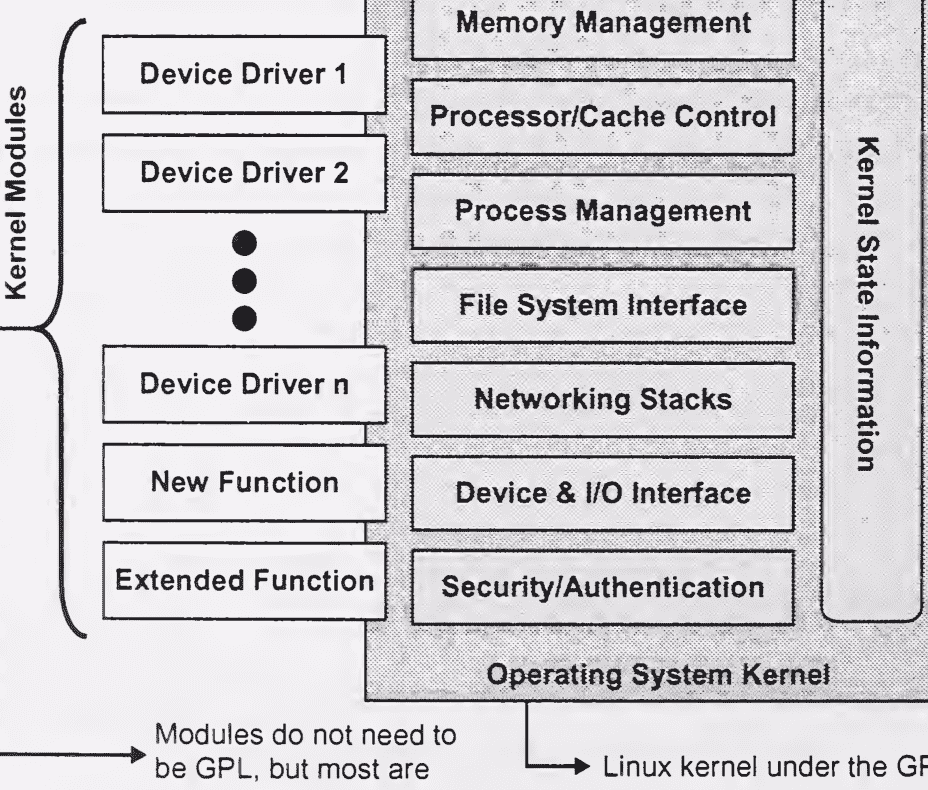

图 3–4 GPL 与 Linux 内核模块。

许可证——开源与非开源 49

区域在社区内引发了热烈辩论。林斯·托瓦尔斯（Linus Torvalds）通过声明提供了必要的解释：如果内核模块仅限于标准接口，则它们不受 Linux 内核 GPL 条的约束。仅二进制的模块不能实现新的系统调用（系统调用是开发者用于与内核交互的 API）或重写内核部分内容。尽管这似乎在涉及 Linux 内核的 GPL 中产生了一个漏洞，但利用该漏洞并不是明智之举，因为林斯并不是内核的唯一版权所有者。人们广泛认为，如果内核开发人员开始利用这个“内核模块漏洞”来扩展内核功能，该漏洞将会被关闭，可能通过修订 GPL 来实现。因此，不要利用此漏洞来修改 Linux 内核。

## LGPL 与类继承

LGPL 是最用于库（libraries）的许可证。它允许专有代码使用库的功能，而不必被强制遵守 GPL 规则。与类库扩展相关的还有另一个特殊情况。如图 3–5 所示，如 C++ 等面向对象的语言是构建在类层级结构之上的。

层级结构的每次扩展都是在原始基类的基础上提供新功能。在利用库的功能方面，LGPL 的规则是明确的；但在扩展类库的功能方面，规则并不明确。

截至本文写作，关于这个话题的辩论还没有明确的答案。如果你需要维护专有代码，在扩展现有类库的功能时，应该避免使用 LGPL（或谨慎使用）。

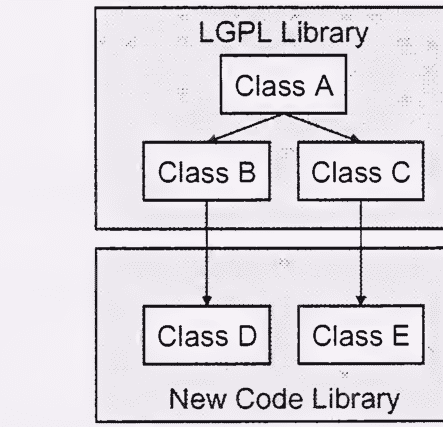

这个新的代码库需要 LGPL 吗？

图 3–5 类继承与 LGPL。

## 非开源许可证

有几种“非开源许可证”，或符合 OSD 许多要求但不符合其全部定义的许可证。请记住，仅仅因为源代码向你开放，该许可证可能并不符合 OSD。这些非开源许可证通常是为了解决非常特定的业务问题而创建的。在某些情况下，公司可能无权许可代码但希望从社区开发中受益。在其他情况下，提供源代码以帮助其他开发者调试应用程序可能是合适的。无法列出一个详尽的非开源许可证列表。大多数提供源代码访问但不符合 OSD 的许可证属于以下情况之一：

- 1. 所有者想要调试依赖于开发库的应用程序。例如，微软向其大多数基础类（MFC）分发源代码。这允许开发者通过微软源代码跟踪其应用程序。然而，微软目前还没有真正的开源许可证。
- 2. 个人或公司不拥有完整权利。在许多情况下，某人想应用开源许可证，但由于与其他第三方的合同而受到限制。在这些大多数情况下，会创建一个针对特定公司和/或产品的新许可证。
- 3. 个人或公司希望在不放弃知识产权（IP）权利的情况下获得开发社区的反馈。在某些情况下，公司可能想提供源代码访问，以获得开发社区的反馈和同行评审。任何更改和权利必须归还公司。微软的共享源代码许可证（shared source license）就属于此类。这类许可证在开源开发社区中产生了巨大的反感。然而，如果你的业务模式完全依赖软件收入且没有替代的业务模式，那么它可能是合适的。

表 3–2 列出了你应该注意的重大非开源许可证。这些许可证不满足 OSD 的要求。

许可证——开源与非开源

# 表 3–2 重要的非开源许可证

| 许可证 | 注释 |
| --- | --- |
| 微软共享源代码 (Microsoft Shared Source) | 微软的共享源代码许可证提供了源代码访问，但要求你将所做的更改写回给微软。微软获得你所做的更改和/或增强的所有权利。请查看书末的参考部分获取微软共享源代码许可证页的链接。共享源代码许可证不提供分发权。 |
| 网景公用许可证 (NPL) | NPL 是专门针对网景的。网景因为与第三方之间存在束缚而创建了 NPL。在 Mozilla 为浏览器提供真正的开源代码库之前，NPL 为网景提供了一种发布代码并获得社区支持的方式，同时仍然满足了其与第三方的合同要求。 |
| SUN 社区源码 (SUN Community Source) | SUN 社区许可证也是共享源代码许可证的一种形式。可以贡献代码来增强产品或技术，但任何工作必须符合 SUN 的定义。如前表所示，SUN 还有另一种符合 OSD 的许可证模型（SISSL）。确保你了解适用于哪些 的许可证。 |

这些是值得考虑的重要许可证。记住新许可证会不断产生，确保符合 OSD 的规则。

## 出口与加密

开源软件必须遵守出口控制法律。这对于包含加密能力的软件尤为重要，因为美国和其他一些国家对此类软件的出口实施了限制。

由于开源软件很容易被复制和分发到全球，任何开源许可证都不能明确要求遵守美国法律。此类许可证将违反 OSD 的第 5 条规定（不歧视个人或团体）。任何编写并分发软件的人都有责任审查其国家的出口法律并遵守这些法律。

对于开源 Linux 发行版，这产生了一个特殊问题。最初，为 Linux 提供完整的加密功能的唯一方法是在境外。一段时间以来，某些“加密”软件，例如安全套层协议（SSL)—Web 服务器需要在境外开发和下载。

美国出口法律的最新变化允许包含加密代码的开源软件出口。只需向相关政府部门通知即可。这为加密软件开源以回避当前限制提供了激励。详情可以在工业和安全局（www.bis.doc.gov）查询。查找当前的出口例外表并查找例外 TSU-740.13。

由于规则和限制可能会变化，开源社区内的大部分加密软件是在境外开发和维护的。因此，美国出口法律的任何变化对 Linux 以及任何其他开源应用的影响都很小。

## 开源开发方法论

在提到开源时，许可证模型通常获得了所有的关注，但真正有趣的是相关的开发方法论。开源真正的美丽之处不在于许可证，而在于过程。

这种对开源开发方法论的描述适用于许多项目。具体细节将根据项目的规模和使用情况而变化。埃里克·雷蒙德的文章（以及书籍）大教堂与集市（The Cathedral and


## 开源开发方法

以及“集市模式”（Bazaar），详细描述了埃里克（Eric）对该流程的发现和测试。埃里克惊讶地发现这个流程似乎违反了所有已知的传统软件开发规则（大教堂模型），但它却行有效。埃里克的论文（非常值得一读）概述了他在创建和运行一个开源项目时发现的模式（集市模型）。以下是该方法的核心要素，我们将在不通过实际运行项目的情况下对其进行介绍。其核心目的是让你理解这些术语、工具、参与者和流程。

## 许可证（License）

虽然开发过程本身与许可证无关，但正是许可证提供了使该流程运行的边界条件。这些条件建立了确保社区协作开发的基础。由于 GPL、LGPL 以及其他包含互惠性要求的许可证确保了更改和修改会返回给社区，这正是协作开发的基石。

## 风格（Styles）

开源开发方法也可以称为 Linux 开发方法。莱纳斯·托瓦尔斯（Linus Torvalds）由于证明了这种集市风格的开发是有效且非常成功的，功归于他。该方法已被应用于多种风格：

- **公司（Company）**——在这种风格下，由一家公司主导开发项目。这通常意味着为项目分配有薪开发者，资助托管开发的基础设施，并作为项目的总维护者。即使在这种风格下，公司通常也会指派一名开发者作为总维护者。HP、IBM、SUN 以及许多其他大公司都主导开源项目。

- **基金会（Foundation）**——建立基金会通常是资助大型项目的手段。对项目成功感兴趣的公司和个人可以向该非营利组织捐赠资金。某些情况下，公司主导了项目，但也成立了基金会。这通常是因为主导公司没有足够的资金来独立资助项目。GNOME 基金会是这种开发风格的良好示例。许多公司资助 GNOME 基金会；但 Ximian 是负责将 GNOME 桌面“产品化”的公司。

- **委员会（Committee）**——委员会风格也用于大型项目。委员会的设立通常是为了决策提供一个论坛。这通常意味着采用更具共识驱动的决策方法，而不是常见的由单一维护者做决策的方法。GCC（GNU/C++ 编译器，Linux 上最常用的编译器）就是以这种方式管理的。

- **个人（Individual）**——小型项目通常由个人运行。这类项目字面上数以千计。许多项目托管在名为 SourceForge 的网站上，但最近越来越多的项目迁移到了 Savannah，这是一个由 GNU 项目托管的自由软件仓库。这些项目的演进通常仅仅是因为某个黑客需要某个特定问题的解决方案，而又没找到它。

- **Linux 内核（Linux kernel）**——这种特殊风格是莱纳斯·托瓦尔斯用于最大的开源开发项目的模式。Linux 多年来一直在演变，它基于内核开发社区内部的信任分级。在第 3 部分中，我将概述一个如何将 Linux 开发流程应用于贵公司内的理论模型。

- **GNU**——这种开发风格并不为人知，大多数人倾向于使用之前列出的风格。GNU 风格使用传统的开发方法（你以后将将其称为“大教堂”开发）来产生自由软件。

## 属性（Attributes）

属性是大多数开源项目都具备的一系列特征。这组特征是驱动社区行为的重要文化基础。大多数开源项目具有以下系列属性：

- **1 维护者（Maintainer）**——大多数项目由一名维护者运行。维护者是发起项目的人，或者是由前任维护者分配的人。维护者接受/拒绝提交、应用补丁、监控缺陷，并在需要时与其他项目交互。开源项目通常具有从一个维护者到另一个维护者的**有序交接**。当一个开发者对某个项目失去兴趣（或不再有时间投入）时，他/她会将火炬交给新的维护者。新维护者通常从对项目做过重大贡献的人员列表中选出。维护者始终是志愿者。某些情况下，维护者是为该项目建立的委员会。此外，当项目由公司驱动时，维护者可能是该公司内部的一组个人。

- **2 尊重（Respect）**——通过时间的推移和持续的贡献，对个体的尊重在开源开发社区中至关重要。如果一个开发者尝试贡献代码，社区成员会迅速通知他——社区在赞誉和批评方面往往是平等的。持续、高质量的贡献将随着时间的推移建立尊重。维护者（如莱纳斯·托瓦尔斯）会更愿意接受他熟悉且有良好、扎实代码记录的人贡献。来自未知者的贡献在接受之前将经过仔细的检查和评审。糟糕的贡献会导致开发者被社区排斥。

- **3 个人担任维护者（Individuals as maintainers）**——尽管公司会资助和推广开源项目，维护者通常是个人。即使维护者更换了公司，他/她也可能继续担任代码的官方维护者。在某些情况下，公司的变更意味着优先级的改变，维护者将交出火炬。人们总是认为莱纳斯是 Linux 内核的维护者，而不是他目前的雇主 Transmeta，也不是他未来可能性的任何雇主。

- **4 工具（Tools）**——社区内的所有开发者都习惯于使用完备的基础设施和通用开发工具工作。例如，CVS 是一种被广泛接受的源码管理工具，Bugzilla 最常用于缺陷跟踪。需要注意的是，虽然 CVS 是广泛接受的源码管理工具，但它并未用于 Linux 内核。Linux 内核依赖“patch”。SourceForge 以及现在的 Savannah 为开源和自由软件提供开发基础设施和仓库。

- **5 早期频繁发布（Release early and often）**——埃里克的大教堂开发风格与开源开发风格之间的基本区别之一，是存在供同行评审的频繁开发版本，这种快速且持续的发布周期让开发团队能够尽早发现并解决缺陷。开发者经常在日常工作中使用早期开发版本，从而进行充分的实用测试。这一属性被认为是开源产品开发比传统产品更快、质量更高的原因。

- **6 准备就绪时发布生产（Release for production when ready）**——正如第 2 章所述，大多数公司发布软件（无论是内部使用还是销售）是基于外部因素（如市场和业务压力）驱动的时间表，这与项目何时发布的关系不大。在开源过程中，社区通常在维护者认为产品就绪时发布到生产环境。许多企业在处理开源项目时对缺乏可靠的路线图感到不安。然而，接受这一点的人会立即从更高质量、更少的补丁和更好的系统架构中受益。

这些开源属性与各种开发风格的结合代表了一种令人印象深刻的社区开发模式。将公司文化适应这种开发风格需要时间和勇气，但其益处已得到证明——看看 Linux 和 Apache Web 服务器，这两个运行着部分互联网的大开源项目！

## 总结

你现在已经熟悉开源以及它与自由软件关系的细节。我们详细检查了 OSD，查看了一些符合 OSD 以及不符合 OSD 的许可证，并


最后，我们查看了社区如何运行“市集式”开发流程，以及社区内项目的一些关键属性。在第 3 部分中，我们将对开源的讨论扩展到公司内部的连接，并回答以下问题：

- 1. 与 GPL 和 LGPL 相关的业务风险有哪些？应该如何管理？
- 2. 开源如何影响既有的商业模式？
- 3. 公司如何从市集式开发风格中获益？
- 4. 公司如何参与开源项目？
- 5. 哪些关键业务流程受到了开源开发的影响？

在下一章中，我们将查看开源社区中的一些关键社区和组织以及它们扮演的角色。

# 第 4 章

# 社区与组织

开源代表了社区的集合。第 3 章描述了项目运行的几种不同方式，从公司运营的项目到基金会。还有许多其他支持 Linux 和开源运动的组织。对现有的所有社区有更深入的了解，将让你感受到这一运动的规模有多大。许多社区之间还存在复杂的相互作用，只有当你具备全局视野时，才能开始理解这些内容。

本章概述了一些最重要的社区。我将从 Linux 内核社区开始，查看一些主要的行业组织。此处以及书末的参考部分都包含了指向所有组织的链接。本章无法列出所有可能的团体、社区、基金会和组织。然而，这些对你入门来说已经足够了。在许多情况下，我可以为其中一些社区撰写一个完整的章节，甚至一本书。这里的意图是让你了解外部的情况，而不是对每一个项目提供全面的视图。这还将让你深入了解一些开源项目，这些项目正在与它们的商业竞争品竞争得不可开交。如果你正在开发商业应用程序，请注意：你可能就是下一个面临市场侵蚀的人。

# 60 第 4 章 • 社区与组织

不需要详细阅读本章。起码，你应该浏览本章，并阅读你认为与你的业务相关的社区详细信息。此外，花些时间查看一些你可能不熟悉的社区。然后，当你寻找与特定社区的联系时，可以偶尔回过来看本书。

## Linux

正如你在第 1 章和第 2 章中学到的，Linux 是一个内核。内核社区由许多小组组成，专注于内核核心本身、特定处理器的工作，以及那些致力于内核扩展（如文件系统和其他设备驱动程序）的人。

## 内核

```
http://www.kernel.org/
```

内核宇宙的中心始于 kernel.org。这组工程师专注于软件开发中最深层、最复杂的方面。在这里活动不是胆小者的游戏。你会发现一个非常精简的、面向开发者的网站。这个社区与许多社区一样，基于通过邮件列表进行的邮件交流（发送到一个地址的邮件会自动转发给所有订阅者）。邮件流量非常大，只有那些致力于内核开发的人士才应该加入这个社区。

## 处理器

x86 (IA-32)
IA-32 处理器族没有不同的社区，因为它是所有内核开发的核心。只需遵循主内核开发的链接即可。

安特腾处理器族 (IPF，也称为 IA-64)
http://www.linuxia64.org/
IPF 被广泛认为是 IA-32 处理器家族的继任者。这不会一夜之间发生。在可预的未来，IA-32 将继续为低端系统提供价格/性能领先。关注 IPF 在高级计算中取得先机，并随着应用程序开始需求 64 位计算以及围绕该架构演变为一种商品驱动的生态系统，逐渐成为主导处理器。

Linux for IPF 起于一个主要由 HP Labs 的 David Mosberger 和 Stephane Eranian 驱动的项目。英特尔以及根据英特尔保密披露要求的公司也在该领域工作。在项目开始不久后，包括 HP、英特尔、SGI、IBM 在内的这些公司组成了一个名为 Trillion 组的联盟。Trillion 允许公司在不向公众公开 Itanium 细节的情况下进行对 Itanium 的 Linux 支持。当英特尔最终向整个行业发布 Itanium 时，Trillion 组解散，IPF 上的 Linux 代码以开源形式可用。

为 IA-32 处理器族提供了一个 IPF 模拟器。这很棒的一点是，它允许开发者使用廉价的笔记本电脑和台式机进行所有针对 IPF 上的 Linux 开发。在官方 Linux IPF 网站上还有许多可用工具。

David 今日仍担任 Linux/IPF 内核的维护者，是少数入选 Linux 继任短名单的人员之一。David 也代表了一个很好的例子，即项目的维护者是个人而非公司。

# Alpha

http://www.linuxalpha.org/

Alpha 处理器在 Linux 圈非常受欢迎。事实上，在很长一段时间内，Alpha 是高性能计算应用中 Linux 的优处理器。

Alpha Linux 组织托管此社区。一些发行版供应商提供对 Alpha 实现的支持。然而，在被 HP 收购之前，Compaq 已宣布 Alpha 将结束寿命，并将其未来寄托于 IPF。大部分 Alpha 的知识产权现在由英特尔所有。

# PowerPC

http://www.linuxppc.com/
http://www.linuxppc.com/

IBM 和摩托罗拉都生产了 PowerPC。PowerPC 社区主要关注为运行 PowerPC 处理器的 Mac 提供 Linux 支持。许多 IBM 系统得到了支持。某些发行版也为该架构创建了版本。

# PA-RISC

http://www.parisc-linux.org/

PA-RISC 是 HP 开发的处理器族。HP 对 IPF 有大量投资并与英特尔共同发明。HP 正在将 PA-RISC 演变为未来的战略处理器。Puffin Group 一家初创公司启动了 Linux 内核到 PA-RISC。HP 提供了开发支持和文档方面的协助。Puffin Group 被 LinuxCare 收购，他们现在主持了大多数 PA-RISC 的 Linux 开发活动。

## 文件系统

Linux 支持多种文件系统。通常，文件系统定义了如何在磁盘上存储、索引和检索数据。Linux 最常用的文件系统是 ext2 文件系统。如果你获取标准的 Linux 发行版，这可能就是你使用的。然而，有许多理由你可能会选择替代方案。在某些情况下，你可能需要在不同系统之间共享磁盘，因此它们需要共享结构。在其他情况下，你可能有特定的性能或可靠性要求，这将决定特定的文件系统。你还应该根据特定的应用程序负载进行多次测试，以决定哪种文件系统最适合你。是一些其他其他系统：

# EXT

http://e2fsprogs.sourceforge.net/ext2.html

正如提到的，ext2 文件系统是最常随 Linux 发行版发布的。Ext3 代表 ext2 文件系统的日志扩展。Ext3 并不是文件系统，而是在保持后兼容的同时为 ext2 提供日志功能。请见下一节关于日志的讨论。

# IBM JFS

http://oss.software.ibm.com/developer/opensource/jfs/

日志文件系统为操作系统增加了大量的恢复性和可靠性。在系统的正常运行期间，存在大量的磁盘存储和检索操作。


## Linux 6.3

由于磁盘存储相对较慢，所有系统都使用多种技术来加速信息的可用性和存储。这种加速通常表现为将磁盘信息临时存储在系统主内存中。然而，如果在所有这些活动进行过程中发生磁盘故障，磁盘上信息的完整性可能会受到破坏。如 JFS、ReiserFS、ext3 等其他日志文件系统使用了许多复杂的技术，以确保在故障期间存储不会受到损害。这些文件系统的另一个方面是，它们允许在发生故障时非常快速地恢复系统。

随着许多日志文件系统的出现，Linux 克服了许多人认为操作系统的一个非常重大的局限。

## XFS
http://oss.sgi.com/projects/xfs/

XFS 是由 SGI 在 GPL 协议下发布的日志文件系统。所有文件系统的性能都会根据应用程序表现出不同的特性。当使用大文件且您的需求是尽可能减少读取这些大文件的磁盘访问次数时，XFS 文件系统通常是一个很好的选择。访问 XFS 主页可以有关 XFS 特性的详情。

## ReiserFS
http://www.namesys.com/

Hans Reiser 是 ReiserFS 文件系统的创建者，这是一种在 GPL 协议下提供的高性能日志文件系统。如果你还记得我们关于双重许可的讨论，Hans 还将他的文件系统授权给商业操作系统供应商。这一特性可能允许您使用相同的文件系统技术，并在 Linux 和您可能有的许多其他 UNIX 部署之间共享存储。

## 设备支持

无法列出世界上每一个设备的社区。找到您特定设备支持的最佳方法是检查您所用发行版的支持设备列表。当我们在第 5 章中详细讨论发行版时，我将更多地介绍发行版如何提供设备支持。

## Web 服务与应用程序服务器

我已经讨论过 Apache Web 服务器在 Linux 爆炸式增长中的作用。但 Apache 并不孤单，Apache 的工作不再局限于简单的 Web 服务器。Web 也已经从提供出版物等静态内容演变为提供更动态的内容，这通常与数据库交互相关。此外，我们还看到了向电子商务、业务逻辑以及最近的完整 Web 服务服务的演进。有许多开源社区致力于在这一不断演变的领域提供产品。请记住，这些许多许多并非为 Linux 专用；许多开源能力也适用于 Linux 以外的操作系统。以下是几个值得密切关注的：

## Apache
http://www.apache.org/

Apache 基金会作为一个非营利实体成立，旨在进一步促进不仅是核心 Web 服务器，而且围绕核心 Web 服务器的所有动态服务的开发。从这个位置，你将发现许多子社区正在快速演进，以跟上 Web 和应用程序服务器领域开发的大多数新技术。值得关注的最重要子社区之一是 Apache 的 XML 社区。XML 为演进中的应用程序服务器（后文将讨论）进入下一代 Web 服务提供了一种通用数据格式。

## TUX
http://www.redhat.com/products/software/linux/tux/

TUX 是基于内核的 Web 服务器。像 Apache 这样的 Web 服务器作为 Linux 内核之上的应用程序运行。让 TUX 特别的是它由于作为内核的一部分而实现的性能，以及它为高层 Web 服务提供的集成。图 4–1 形象地展示了内核内 TUX 与 Apache Web 服务器之间的连接。

将 TUX 与 Apache Web 服务器结合值得在您的组织内部进行认真考虑。

## Web 服务与应用程序服务器

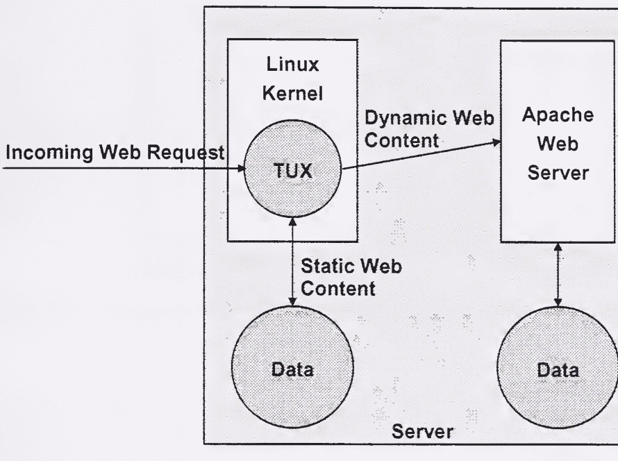

图 4–1 在传统 Web 服务器中使用 TUX。

## JBOSS
http://www.jboss.org/

JBOSS 是 Java 2 企业版 (J2EE) 的开源实现。J2EE 应用程序服务器技术。J2EE 的商业实现包括 SUN 的 iPlanet、BEA 的 WebLogic 以及 IBM 的 WebSphere。由于 SUN 的许可要求，JBOSS 不能被授权为认证的 J2EE 实现，尽管通过与 Apache 基金会的合作，SUN 计划逐渐允许兼容的 J2EE 开源实现。应用程序服务器显著增强了传统 Web 服务器的能力。这些增强功能包括事务服务（确保多个任务被作为一个整体处理）、业务逻辑服务（允许您通过组合预构建组件来快速构建应用程序）以及数据库服务（允许您访问您的企业数据）。

随着互联网的进步，许多行业的大量新应用程序都是基于应用程序服务器技术的。UNIX/Linux 世界通常与基于 Java 的应用程序服务器 (J2EE) 联系在一起，而 Windows 世界与微软的 .NET 关联在一起（Mono 项目正尝试将 .NET 框架的核心组件引入开源运动）。图 4–2 表示了 Web 服务器、应用程序服务器和数据库之间的连接。

66 第 4 章 • 社区与组织

| 入站 Web 请求 | Apache Web 服务器 | 事务控制 |
| --- | --- | --- |
| | | 会话管理 |
| | Tomcat Java Servlets | 业务逻辑 |
| | JBOSS 应用程序服务器 | 数据库访问 |

**图 4–2** 连接到 Web 服务器和数据库的应用程序服务器。

取决于您的应用程序的复杂程度，开源服务器可以提供商业实现的可靠替代方案。当我们第 3 部分查看商业模型时，我们将仔细研究开源的影响。

## 语言

存在许多开源语言。有些是解释语言（在执行期间逐行解释），而另一些是编译语言（在执行之前翻译成机器码）。图 4–3 表示了编译语言和解释语言运行的区别。

大多数 Linux内核、设备驱动程序和其他内核都是用 C 语言编写的。然而，大量的 Web 软件和脚本基于 Perl 和 Python 等解释语言。我提醒你，不要将这些专门关联到 Linux。这些语言及其解释器/编译器在许多操作系统上可用，包括大多数 UNIX 以及 Windows。

## GCC
```
http://gcc.gnu.org/
```

GCC 可能是允许 Linux 开发 Linux 内核最重要的组件。GCC 是一组将高级语言翻译成机器码的编译器集。编译器技术在计算机科学中非常重要，因为它可能是负责应用程序性能的最关键组件。编译器通常分为

## 编译型应用程序

| C, C++, FORTRAN 源代码 | GCC 编译器前端 | 中间代码 | GCC 编译器后端 | IA-32 | Alpha | PowerPC | 其他 | 操作系统 |
|---|---|---|---|---|---|---|---|---|

| Perl, Python 源代码 | 运行时解释器 | 操作系统 |
|---|---|---|

图 4–3 编译型与解释型应用程序的区别。

GCC 的主要设计目标是“可重定向性”。这意味着 GCC 可以有效地用于许多不同的系统。然而，在


# 第 4 章 · 社区与组织

在许多情况下，GCC 在许多平台上的性能未达到预期。结果是其他公司提供了针对特定平台优化的编译器。如果你的应用程序性能至关重要，使用来自第三方的商业编译器通常会产生更好的结果，但可能以牺牲移植性为代价。如果你参与 Linux 内核开发，或者你希望针对尽可能多的平台，GCC 是最佳选择。

GCC 由 Michael Tiemann 创立的 Cygnus Solutions 进行了商业化。Michael Tiemann 推广了最早的开源商业模式之一。尽管 GCC 是开源的，但 Cygnus 对 GCC 进行了商业化运营，并为 GCC 编译器基础提供支持和 own。Cygnus 现在是红帽公司（Red Hat）的一部分。

# Perl

http://www.perl.org/

Perl（实用提取报告语言）是一种专门用于文本处理的解释型编程语言。Perl 自 1987 年诞生以来一直拥有庞大的用户群体，因此世界上有大量的 Perl 专家。Perl 通常与系统管理、Apache 和 Web 应用相关。由于 Web 应用程序通常需要处理和操作基于文本的信息，Perl 提供了一个理想的解决方案。如果你对自己的组织进行快速调查，你可能会发现几个躲起来的 Perl 开发者。由于 Perl 支持广泛的操作系统，它也为许多开发任务提供了极佳的跨平台解决方案。

# Python

http://www.python.org/

Python 也是一种解释型语言。然而，Python 是一种面向对象的语言，也适用于许多操作系统平台。Python 目前还没有像 Perl 那样广泛的粉丝。但它是一种独特的语言，像熟悉 C++ 的这样的面向对象的开发者将很快学会它。Python 也与文本处理相关，但同样适用于基于图形界面应用程序的快速原型设计。和 Perl 一样，Python 也经常用于 Web 应用。

## 桌面与办公生产力

Linux 和 Windows 之间的主要区别之一是提供了多个图形桌面，而不仅仅是微软提供的那个。一些人认为用户体验中的这种变量造成了困惑，并产生了额外的培训和支持成本。另一些人则认为这种现象创造了巨大的创新。Linux 使用的两个主要桌面都很非常年轻，始于 1997 年左右。图 4–4 显示了每个桌面环境如何与 XFree66 图形库交互。

还有许多项目旨在以开源形式提供类似于 Microsoft Office 的生产力软件。其中最流行的是 OpenOffice。

# XFree86

http://www.xfree.org/

XFree86 是所有 Linux 系统使用的核心窗口系统。XFree86 是最初由 MIT（马萨诸塞理工学院）开发的 X11 框架的开源实现。XFree86 提供与安装在系统上的图形硬件的底层连接。如果你正在部署 Linux 工作站或桌面，你将希望确保系统中安装的图形硬件对 XFree86 有适当的支持。

| 应用 | 常见桌面环境 (CDE) | GNOME 桌面 | K 桌面环境 (KDE) |
| :--- | :--- | :--- | :--- |
| Motif | GTK | Qt |
| XFree86 图形硬件 | | | |
| 平台 | | | |

图 4–4 桌面技术层次结构。

虽然可以为 X11 编写功能完整的应用程序，但所需的复杂性和细节如此详尽，因此很少这样做。人们通常使用与 X11 交互的高级窗口库。多年来，最广泛使用的窗口库是 Motif。配合 Motif 使用的桌面环境是 CDE。对于 Linux，开发者需要完全开源的窗口库和桌面环境。这催生两个主要项目：GNOME 和 KDE。

# GNOME

http://www.gnome.org/

GNOME 桌面由 GNOME 基金会管理，该基金成立于 2000 年夏末。GNOME 也由 Jimiian（原 Helix Code）公司进行商业化。GNOME 桌面由 Miguel de Icaza 于 1997 年启动，旨在提供一个完全开源的桌面。每个桌面都基于一组核心图形用户界面 (GUI) 库。当时，KDE（下文描述）基于一个并非完全开源的库。编写 GNOME 应用程序的窗口库称为 GTK；用于 KDE 的则是 Qt。图 4–5 是 GNOME 桌面的截图。

GNOME 基金会包括 Jimiian、红帽、HP、IBM、SUN Microsystems 等公司，指导着 GNOME 桌面的开发。GNOME 伞还包括 GNOME 开发平台和 GNOME 办公软件。

许多 UNIX 供应商也选择 GNOME 桌面作为其 UNIX 工作站环境的主要桌面。如果你希望在 UNIX 和 Linux 部署之间获得一致的桌面外观和感受，那么 GNOME 通常是一个很好的选择。

# KDE

http://www.kde.org/

http://www.kdeleague.org/

KDE 也是 Linux 上很流行的桌面环境。关于哪个桌面更好的争论是一个感性的问题。现实是，这在很大程度上取决于个人偏好、工作风格或其中一个存在而另一个没有的特定功能。图 4–6 是 KDE 运行的截图。

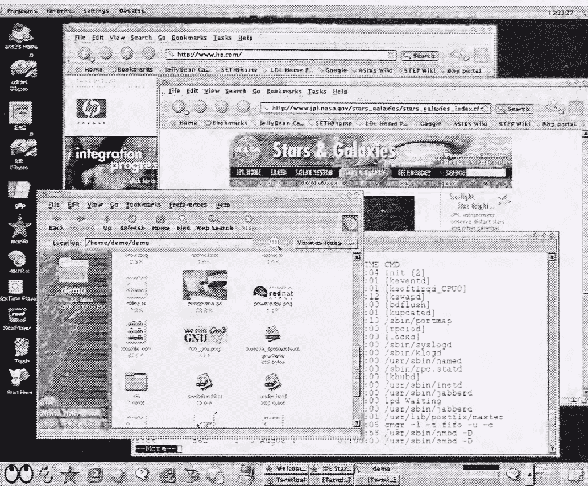

图 4–5— GNOME 桌面。


图 4–6— KDE。

# Mozilla

http://www.mozilla.org/

与 GNOME 类似，Mozilla 的形成是为了汇行业力量并指导开发。它是一个开源产品。MySQL 是另一个双许可的绝佳案例。任何人都可以根据 GPL 标准使用 MySQL 数据库引擎。但是，如果你想获得商业许可，或者想将 MySQL 绑定到你的产品中，这是一个极佳的替代方案。Mozilla 现在处于可用浏览器之列。

# OpenOffice

http://www.openoffice.org/

尽管目前正在开发许多开源生产力项目，但 OpenOffice 被认为是 Microsoft 的可靠替代。SUN 在 2000 年收购了 Star Division，为 UNIX 系统提供办公桌面。OpenOffice 完全免费。

## 数据库

数据库代表了许多应用程序的核心基础设施。它们提供了高效存储、组织和检索信息的多种功能。我们通常根据 Oracle、Sybase 和 DB2 等商业名称来思考数据库。虽然这些商业实现提供了卓越的可扩展性、性能和大量功能，但在许多情况下，开源替代方案可以满足这些需求，且成本更低。

# PostgreSQL

http://www.postgresql.org/

PostgreSQL 是一个严肃的面向对象的 SQL 数据库引擎。它源于 20 世纪 70 年代末和 80 年代加州大学的开发。PostgreSQL 的早期祖先已与 Ingress（后来的 Computer Associates）和 Informix（现为 IBM）的商业实现发布或集成。凭借这样的背景，PostgreSQL 可以严肃地应用于许多数据库应用程序。许多公司也为 PostgreSQL 提供商业支持。

# MySQL

http://www.mysql.org/

另一个可靠的开源数据库替代方案 MySQL 通常与 Web 应用和个人使用相关。然而，MySQL 是一个拥有大量粉丝的高性能数据库，它并自诩为最广泛使用的开源数据库。

## 个人数字助理

无法列出所有用于便携平台的开源项目软件详尽清单。如果你到处寻找，可以找到适用于 PalmOS、PocketPC 以及一些 Linux 平台的开源应用程序。这里是一些专注于手持设备 Linux 的核心源码项目。


## 手持 Linux

http://www.handhelds.org/

这个开源社区正在为手持平台开发操作系统和其他软件。如今的大部分工作集中在 IPAQ 个人数字助理（PDA）上。该社区围绕这一平台进行开发，是因为当时 IPAQ 将 PocketPC 操作系统存储在闪存内存中。这允许开发者用他们自己的操作系统覆盖 PocketPC 操作系统。HP 为该开发工作提供了非官方和业余的支持。

业界正迅速基于这种开源开发发布越来越多和越多的 PDA 替代方案。甚至有几个针对手持平台的完整发行版可用。

## 集群

集群被用于通过水平扩展系统以实现高性能，并为整个系统提供更高程度的可用性。许多初创公司正在为开源集群提供支持，或将各种集群实现商业化。对于高性能计算，最著名的 Linux 集群解决方案可能是 Beowulf 集群。

# Beowulf

http://www.beowulf.org/

Beowulf 项目展示了通用产品如何影响我们的计算世界的非凡范例。Beowulf 项目的目标是使用商品化产品提供高性能计算。Beowulf 提供了一种软件解决方案，通过将大量节点集群化来提供并行计算。如果你参与了可以受益于并行计算架构的项目，Beowulf 是一个极佳的起点。

## 组织

Linux 和开源运动的增长和普及得到了许多组织的帮助，其中大多数是致力于促进开源开发各个方面的非营利公司。这些组织大多数在极其有限的预算下运行，可以使用任何可以获得的帮助。帮助可以通过许多形式出现，例如设备捐赠、资源、营销，当然，还有硬通货。

# Linux International

```
http://www.li.org/
```

Linux International 是向世界推广 Linux 的非营利组织。它由 John “Maddog” Hall 运营。Linux International 让业务领袖看到 Linux，并推销 Linux 商业用的优势。该小组还资助对整个 Linux 社区都有价值的项目。

# 自由软件基金会

```
http://www.fsf.org/
```

如所述，FSF 的存在是为了向大众推广自由软件的概念。它是 Richard Stallman 的心血，是 GNU 项目和 GNU GPL 的家园。如果你想获取 GPL 副本或了解自由软件的细节，这里是你要访问的地方。

# 开源倡议组织

```
http://www.opensource.org/
```

OSI 促进开源软件定义（OSD）并维护官方批准的开源许可证列表。截至本文写作时，已有 30 多种获批准的许可证。虽然创建新许可证是可能的，但你应该详细查看可用的许可证。如果你选择将软件发布到开源社区，那么很有可能已经有一个满足你需求的许可证在供你选择。

# 开源开发实验室

```
http://www.osdl.org/
```

开源开发实验室（OSDL）由一群行业领袖组成，其动力源于推动 Linux 在数据中心和电信环境中的应用。OSDL 资助了一个设备齐全的实验室，拥有任何人在压力测试其开源项目时可能需要的任何资源。任何人都可以向实验室提交项目请求并申请访问资源。OSDL 驱动所需功能路线图的发展，以满足这些严苛环境的需求。如果你有动力加速数据中心或电信环境的 Linux 能力，OSDL 是一个值得了解的社区。

## 自由标准小组

http://www.freestandards.org/

第 7 章将详细介绍主要由自由标准小组（FSG）推动的标准。FSG 目前驱动两个主要的 la工作组：

- Linux 标准基础（LSB）——LSB 定义了一组接口标准，以确保跨开源平台的移植性。
- 国际化——Linux（在第 7 章中描述）努力是为了推动标准，以促进 Linux 在国际市场的使用。

http://www.embedded-linux.org/

用于嵌入式应用的 Linux 正在迅速发展，许多 Linux 发行版和公司致力于嵌入式 Linux。嵌入式 Linux 联盟是一个致力于推动 Linux 用于嵌入式应用的贸易组织。如果你正开始一个嵌入式项目，这为你为你提供一个 [注：OCR 文本以 "an an" 结束，可能是原文中的类型错误]。

# Linux 文档项目

http://www.linuxdoc.org/

该社区经常使用的一个术语是“HOWTO”。正如其名所示，HOWTO 仅仅是由社区中任何人编写的指南。几乎你所能到的任何主题都有 HOWTO。Linux 文档项目还致力于提供

## 总结

读完这一章后，你应该完全相信开源不是转过一瞬的时尚。有太多的公司、太多的小组和太多的个人让它消失。这种势头保证了任何各种应用的辉光未来。如果你在环境中使用此类工具，是时候认真审视一下了。如果你是这些领域任何一个领域的开发者，是时候利用这些资源而不是与它们竞争，并将你的业务模式提升到新的水平。本书的第三部分将教你如何做。


Linux 发行版代表了你将在公司内获取和部署的内容。如果你构建应用程序，理解不同发行版之间的差异将确保你能够支持尽可能的环境。

## Linux 发行版

当大多数人提到“Linux”时，他们通常指的是一个 Linux 发行版。正如你很快就会学，发行版是由许多供应商组装的，它在内核的基础上结合了许多组件。发行版供应商通常执行以下任务：

- 选择特定的内核版本
- 创建或选择补丁以添加新功能或解决问题
- 选择特定的软件包集合及其版本
- 添加它们自身的增值增强功能，例如安装和部署工具
- 在发行媒体上组合整个集合
- 对每个组件以及整个发行版进行认证和测试
- 在某些情况下，捆第三方应用程序或功能
- 应用它们自己的品牌形象
- 为发行选择进入市场的渠道
- 结合发行版提供增值服务

每个 Linux 发行版都是不同的，有时是细微的，有时是显而易见的。然而，图 5–1 为你展示了所有发行版共有的结构。如你所见，发行版包含远不止内核的内容。

发行版供应商付出了大量工作才将 Linux 带给你。他们完成这些工作的程度以及对这些工作的支持程度，将是选择要安装的发行版的主要因素。

大多数发行版供应商组合了一个软件包（下文将讨论），它们都是开源的。这意味着他们的发行版可以免费下载和复制。因此，发行版供应商一直在演进其业务模式以维持增长。以下是大多数发行版供应商盈利的简要摘要：

- 通过零售渠道销售带有媒体和文档的盒装版
- 提供支持和更新服务

## 软件包

| 编译器和工具 | 安装工具 |
|---|---|
| 文本处理 | 支持工具 |
| 部署 | 增强 |
| 游戏 | 本地化 |
| 通信 | 打包工具 |
| | 捆绑 |
| 网络 | 发行版特定附加组件 |
| 软件包 (> 1000) | |

图 5–1：Linux 发行版的通用视图。

- 提供针对其特定 Linux 发行版的专业服务
- 为那些将发行版与其硬件或软件产品捆绑的厂商收取原始设备制造商 (OEM) 费用

发行版供应商继续演进其业务模式，这个列表不可避免地会扩大。在第 3 部分，我将详细介绍 Linux 和开源业务模型。

## 软件包

每个发行版都有“软件包”的概念，发行版是特定发布版本中可用所有软件包的总和。每个软件包又由一个或多个文件组成，这些文件通常实现一个单一的功能（例如：编译器、浏览器、Web 服务器等）。但为了清楚起见，是由软件包维护者决定软件包的粒度。由于某些软件包会很大，包含成千上万个文件，而另一些则会非常小，只包含一个或两个文件。图 5–2 描述了软件包的典型布局。如你所见，软件包既包含了使任何给定功能运行所需的文件，也包含了包管理器在目标系统上安装该软件包所需的信息。

| 程序可执行文件 | 安装信息 |
|---|---|
| 库 | 文件位置 |
| 文档文件 | 依赖关系 |
| 配置文件 | |
| 软件包中的文件 | 软件包信息 |
| 软件包 | | |

**图 5–2** 通用软件包布局。

表 5–1 中的列表取自 Debian 稳定软件包列表；其他发行版供应商以不同的方式对他们的列表进行分类。显然，我无法在这里列出所有的软件包（仅 Debian 就有近 9000 个可用软件包），但表格列出了主要的软件包类别。

**表 5–1** 软件包类别
| 软件包类别 | 描述 |
|---|---|
| 管理工具 | 用于管理系统资源、管理用户账户和执行其他类似管理任务的工具。 |
| 通信程序 | 使用传统调制解调器通信的软件。 |
| 开发 | 开发工具、编译器、开发环境和库。 |
| 文档 | 常见问题解答 (FAQs)、HOWTO 指南和其他文档。 |
| 编辑器 | 编辑环境。 |
| 电子产品 | 电子产品。 |
| 图形 | 图形。 |
| 电台 | 电台。 |
| 解释器 | 解释型语言和宏处理器。 |

（续）

## 软件包

| 类别 | 描述 |
|---|---|
| 管理工具 | 用于管理系统资源、管理用户账户和执行其他类似管理任务的工具。 |
| 通信程序 | 使用传统调制解调器通信的软件。 |
| 开发 | 开发工具、编译器、开发环境和库。 |
| 文档 | 常见问题解答 (FAQs)、HOWTO 指南和其他文档。 |
| 编辑器 | 编辑环境。 |
| 电子产品 | 电子产品。 |
| 图形 | 图形。 |
| 电台 | 电台。 |
| 解释器 | 解释型语言和宏处理器。 |

每个软件包都有一个维护者或一组维护者。此外，每个软件包都有许多不同的版本。在许多情况下，这些软件包可以针对多种语言进行本地化。发行版供应商不仅决定发行版包含哪些软件包，还决定哪些版本、哪些补丁以及支持哪些本地语言。对于发行版供应商将软件包包含在发行版中，软件包必须支持被包含的内核，必须有适用于支持的处理器版本，可能存在其他依赖关系（例如其他软件包），但这些是核心要求。图 5–3 中的韦恩图展示了软件包发行发行需要满足的条件。

你必须始终记住开源的核心贡献之一是控制权在你手中，而不是供应商。如果你不喜欢你的发行商所做的任何决定，你可以随心所欲。如果你需要未包含的特定软件包，通常可以在互联网上找到并下载副本进行安装。

## 软件包格式

软件包通过特殊工具从文件中组合并构建，生成准备好部署的特殊模块。有两种流行的软件包格式：一种由红帽开发，称为红帽包管理器或 RPM；另一个来自 Debian 社区，被称为 DEB（或“dot-deb”）软件包格式。


图 5–3：软件包包含韦恩图。


## 发行版

发行版的数量之多，无法在此列举。如果算上所有专门发行版和本地关注的发行版，其数量高达数百个。我将重点介绍一些主流发行版（具有显著品牌知名度或市场份额的），以及一些针对特定目标市场或地理地区的发行版示例。你可以在 Linux.org 网站找到更完整的发行版列表。

## 主流发行版

## Red Hat (红帽)

### Red Hat

在全球许多角落，红帽是最广受认可的 Linux 发行版。红帽也是少数完全专注于 Linux 的公开上市公司之一。Bob Young 和 Marc Ewing 于 1994 年创立了红帽。它是让 Linux 变得易用的早期示例之一。红帽拥有令人印象深刻的市场份额，但在全球所有范围内并非占据统治地位。

红帽将其发行版作为一种有效的名片，推崇其传统和对 Linux 的承诺。他们雇佣了许多直接为 Linux 内核和其他操作系统部分贡献的开发者。他们在 RPM 等许多领域进行了创新。

当我们更详细地研究业务模式时，你会发现红帽将大部分精力放在了开发其支持和服务业务上。他们很早就就，为免费软件销售许可证可能对他们来说不是可持续的业务。然而，红帽始终坚持开源。他们拒绝捆绑或发布任何不严格符合开源定义的软件。这可能是可持续的，也可能不是，只有时间能给出答案。

回想一下红帽收购了 Cygnus Solutions，这使他们成为了 GCC 编译器工具套件维护者的关键角色。

将最受欢迎的 Linux 发行版之一与一系列支持和服务产品相结合，使红帽成为 Linux 领域一个真正可靠的参与者。

### SuSE (优速 Linux)

SuSE 总部位于德国，提供了一种令人印象深刻的发行版，可用于各种微处理器架构。由于其根部位于德国，SuSE 也是欧洲地区的青睐。SuSE 经常被称为 Linux 的技术领导者。该发行版可用于客户端和服务器环境，也被许多独立软件供应商（ISV）用作核心开发平台。SuSE 通常被认为是红帽最有竞争力的竞争对手，其业务模式的某些方面与红帽非常相似，而另一些则完全不同。SuSE 的业务模式演进方向不同，重点在于支持多个平台，以及将第三方软件与 Linux 捆绑并转售。这为他们带来了与 OEM 供应商和软件许可相关的收入流。

### Caldera

Caldera 在 Linux 世界经历了一段有趣的演变。Caldera 曾专致力于 Linux，但其对 SCO 的收购使其能够利用庞大的且令人印象深刻的装机用户群。Caldera 现在同时拥有 Linux 和 UNIX 产品，并专注于这两类产品之间的一些关键集成。Caldera 还一直在开发增值产品，使其能够在提供支持和专业服务之外，还能收取许可费用。

### TurboLinux (中软万 Linux)

TurboLinux 在亚洲市场的表现最强劲。尽管红帽一直在侵入 TurboLinux 的这一大阵地，但 TurboLinux 在该市场仍然非常强大。TurboLinux 随其发行版提供的一个关键增强功能是亚洲语言扩展，这也是它一直备受喜爱的原因。TurboLinux 尝试过多种不同的业务模式，包括与 LinuxCare 的失败合并（LinuxCare 是一家专门从事跨供应商 Linux 支持服务的公司）。

TurboLinux 现在的业务模式专注于提供可管理性、集群和数据库的解决方案，并为多个不同的微处理器平台提供其发行版。

### Mandrake (曼德拉)

Mandrake 的诞生是为了成为“更好的红帽”。Mandrake 采用了原始的红帽基础，增加了许多可用性增强，并提供了针对最新代处理器进行编译和优化的发行版。随着时间的推移，Mandrake 已经远离了红帽。它继续作为桌面 Linux 的强力表现，并尝试作为服务器系统的可靠选择进行扩展。Mandrake 位于法国，这使得它成为欧洲人的另一个青睐，地位仅次于红帽。

## Debian (德比恩) 

Debian 是一个有趣的发行版，因为它没有商业背景。它是唯一一个 100% 社区驱动的主流发行版。Ian Murdock 创立了 Debian。Debian 这个名字是他的妻子名字 Debby 和他的名字 Ian 的结合。

这种与企业身份的脱节使得 Debian 受社区领袖和开发者的喜爱。Debian 社区包含数百名开发者，他们的大部分工作将进入其他主流发行版。此外，请记住，该系统的传统源自 [Debian 社会契约](www.debian.org/social_contract)。

Debian 可能拥有所有发行版中支持平台最多的平台。许多公司向 Debian 贡献力量，因为没有公司议程驱动开发，且贡献很容易被接受。由于一切都是开放的，竞争对手可以在公平的场地上运行。如果你是软件供应商并需要标准化特定于行业的组件，Debian 可能是你最佳的工作环境。

许多社区小组和组织将 Debian 作为工作基础，然后从那里为其他发行版提供支持。Debian 曾因支持软件包和内核发布的最新创新方面落后其他发行版而受到批评。但这确实是一把双刃剑。虽然 Debian 的进度可能落后于其他发行版，但它被广泛认为在最广泛的平台上拥有最全面的集成测试，并且是任何发行版中最稳定的版本。

对于寻找具有供应商独立性且提供令人印象深刻稳定性的开放发行版的企业来说，Debian 是一个很好的选择。主要的缺点由于缺乏公司支持，Debian 往往是商业应用开发者的最后选择。

### United Linux (联合 Linux)

United Linux (UL) 是许多领先发行版供应商的联合，旨在创建一个单一的 Linux Base 或符合 LSB 标准的 Linux 发行版（在第7章中讨论）。由于创建一个发行版是一项昂贵的工程，且供应商很难区分自己的产品，因此许多供应商聚集在一起创建了一个单一发行版。通过共同努力，他们可以分担创建基础的成本，并将精力放在更多的客户价值上。

在写本文时，UL 计划才刚刚开始。现在判断 UL 是否会在行业内获得还为时尚早。好消息是，这种努力也确保了符合 LSB 标准以实现应用程序兼容性。

## 区域发行版

某些发行版响应本地市场的特定需求。作为示例，我在这里列出了几个，但这并不是一份详尽列表。取决于你居住的地方，可能有一个满足你需求的本地发行版。

### Red Flag (红旗 Linux)

Red Flag Linux 致力于将 Linux 操作系统带入大中华。红 Flag 提供主流和嵌入式 Linux 发行版。红 Flag 的增强重点在于亚洲市场的本地化。

如果你是 Linux 应用程序提供者，并决定让你的产品进入中国，那么考虑与红 Flag 这样的本地供应商建立合作伙伴关系应该是业务上的必然选择。

### Connectiva

Connectiva 被誉为一种位于拉丁洲的发行版，其总部位于巴西，提供西班牙语和葡萄牙语的 Linux。Connectiva 还提供许多服务和培训（大多数发行版供应商一样），面向拉丁美市场的企业。

## 特种发行版

以下示例展示了某些发行版供应商如何专注于特定的利基市场。在大多数情况下，这些提供商在特定的感兴趣领域非常专业。

### MSC.Linux

MSC.Software 专注于高性能计算应用，并在该领域声名显赫。MSC 创建了一个专注于高性能、仿真和集群市场的发行版。MSC 将其专业发行版与硬件、咨询和定制相结合，为客户提供一个针对特定应用环境优化的完整系统。

### MontaVista（其发行版最初品牌名为 Hard Hat Linux）专注于嵌入式和电信 Linux


# 创建您自己的发行版

……市场并提供了一种专注于需要小型嵌入式处理器支持的应用的发行版。它们还提供了增强型功能以提供实时能力。MontaVista 支持多种嵌入式处理器类型，提供专注于嵌入式应用的开发环境，并特意支持特殊的计算机主板类型（pPCI、VME 等）。

# 非 Linux 操作系统发行版

“发行版”（distribution）一词也用于指代任何文件、程序、工具和实用程序的组合，但并非 Linux 操作系统。这其中的最佳例子之一是 GNOME 桌面发行版。虽然 Linux 发行版可能包含一组用于安装 GNOME 桌面的包，但商业供应商可能会创建增强型且带有标识的包集合，并被称为“GNOME 发行版”。

继续我们的 GNOME 桌面示例，Ximian 创建了一个结合了以下内容的发行版：

- 运行 GNOME 需要的包
- 开发者工具和增强
- 源代码
- 办公效率软件
- 软件更新能力
- 针对不同操作系统的版本（例如 HP-UX、Solaris）
- 媒体和文档

这代表了其中一个例子。许多企业尝试为 Linux 操作系统的许多组件创建发行版。某些尝试比其他更成功。你需要记住的关键点是，虽然“发行版”一词通常与 Linux 关联在一起，但在某些情况下，它也会应用于其他应用程序集合。

# 创建您自己的发行版

许多企业会发现，他们需要创建一个定制的发行版来支持组织的特殊需求。然而，创建属于自己的发行版的过程不应轻视。根据你更改的广泛程度以及发行版的定制程度，你可能会产生高昂的成本。通常，企业级定制发行版通过以下内容建立：

- 带有预定义补丁和模块的特定 Linux 内核
- 企业品牌元素
- 针对贵公司特定的特殊部署工具和能力
- 预配置的管理代理
- 经组织许可的预装安装应用程序
- 预配置的网络和其他组件
- 根据公司标准的安全设置
- 与企业其他部分进行互操作的特殊能力
- 对公司使用的特定硬件的支持
- 移除所有非本质包
- 为特定硬件配置编译并优化的内核和包
- 针对整个组织部署的各种环境的发行版设置（桌面、服务器、多处理器服务器等）

只有当你的 IT 组织已经具备了足够的技能来管理构成发行版的所有包的更改时，才应该创建你自己的发行版。“自制”应该被视为你 IT 组织承担的任何其他重大软件项目对待。图 5–4 展示了用于创建定制发行版的两个典型流程图。

左侧的过程从主流发行版开始，剥离不需要的组件，然后添加新组件。右侧的过程从原始 Linux 内核开始并从那里进行构建。你选择哪种过程取决于你的具体需求以及你所渴望的控制和定制程度。

# 支持多个发行版

对于大型跨国公司来说，关键选择之一将决定你的公司是为所有部署支持单一发行版，还是让多个发行版获得各种应用或地理部署的资格。

作为软件供应商，你希望将你的可达市场最大化。当你第一次决定让你的应用程序在 Linux 上可用时，你可能倾向于只选择你最熟悉的那个。最终，你的某一个客户将要求你支持另一种发行版，甚至是一个定制的内部发行版。标准正在制定中，以确保发行版之间的差异不会对软件供应商产生负面影响。你应该尽一切遵循这些标准。

- 从主流发行版开始
- 获取 Linux 内核
- 移除不需要的包
- 应用所需的补丁
- 添加所需的硬件支持
- 为你的硬件选择模块
- 合并来自其他发行版或其他来源的包
- 选择所需的包
- 添加公司特定的品牌
- 重新编译并优化
- 添加公司特定的工具和应用程序
- 在所有可能的硬件配置上进行测试和验证
- 重新编译并优化
- 确定安装和部署方法
- 添加许可应用程序
- 重新打包

从主流发行版开始  从基础 Linux 内核开始  图 5–4 创建您自己的发行版。

作为软件供应商，你希望将你的可达市场最大化。当你第一次决定让你的应用程序在 Linux 上可用时，你可能倾向于只选择你最熟悉的那个。最终，你的某一个客户将要求你支持另一种发行版，甚至是一个定制的内部发行版。标准正在制定中，以确保发行版之间的差异不会对软件供应商产生负面影响。你应该尽一切遵循这些标准。

你需要记住的关键点是，虽然“发行版”一词通常与 Linux 关联在一起，但在某些情况下，它也会应用于其他应用程序集合。

- 从主流发行版开始
- 获取 Linux 内核
- 移除不需要的包
- 应用所需的补丁
- 添加所需的硬件支持
- 为你的硬件选择模块
- 合并来自其他发行版或其他来源的包
- 选择所需的包
- 添加公司特定的品牌
- 重新编译并优化
- 添加公司特定的工具和应用程序
- 在所有可能的硬件配置上进行测试和验证
- 重新编译并优化
- 确定安装和部署方法
- 添加许可应用程序
- 重新打包

从主流发行版开始  从基础 Linux 内核开始  图 5–4 创建您自己的发行版。

你需要记住的关键点是，虽然“发行版”一词通常与 Linux 关联在一起，但在某些情况下，它也会应用于其他应用程序集合。

- 从主流发行版开始
- 获取 Linux 内核
- 移除不需要的包
- 应用所需的补丁
- 添加所需的硬件支持
- 为你的硬件选择模块
- 合并来自其他发行版或其他来源的包
- 选择所需的包
- 添加公司特定的品牌
- 重新编译并优化
- 添加公司特定的工具和应用程序
- 在所有可能的硬件配置上进行测试和验证
- 重新编译并优化
- 确定安装和部署方法
- 添加许可应用程序
- 重新打包

你需要记住的关键点是，虽然“发行版”一词通常与 Linux 关联在一起，但在某些情况下，它也会应用于其他应用程序集合。

这个全面的列表将消除依赖并让你快速支持任何发行版。软件供应商使用的另一种技术是关注以下依赖：

- 内核版本
- 所需包
- 所有版本
- 外部依赖
- 硬件需求

# 第6 章

# Linux 和开源的成本

Linux 是免费的！其实并非如此。任何丰富的经理都清楚，组件成本只占大局的一小部分，必须考虑整个生命周期内的解决方案。行业术语是“总拥有成本”（TCO）。还记得上一节中那辆将带你从 A 点到 B 点的车吗？根据汽车的不同，你需要考虑油、保险、维护、零件以及车辆寿命内的许多其他因素。技术采购，开源也不例外——特别是由于对“免费”意味着“无成本”的认知。

在本章中，我们将检查与开源相关的成本元素，这些元素可能与你过去的任何成本计算有所不同。请记住 Linux 只是一个巨大的开源项目。尽管你可能倾向于关注 Linux 的成本，但我概述的几乎所有内容适用于你选择的任何开源应用程序。本章的目标是：

- 理解解决方案的总成本
- 开源对解决方案成本的影响
- 如何采购开源软件
- 需要重新审查的业务流程

## 总结

你现在应该清楚地知道选择你可能部署的内容时有哪些选择点。发行版是组合并测试以确保它们协同工作的包集合。发行版允许你安装和部署一组合理的软件集合来运营业务。

在下一章中，我们将研究 Linux 的成本。虽然你可以低成本或免费获取发行版，但对环境进行有效的部署和支持将在系统生命周期内产生成本。然而，你衡量这些成本可能会与你过去的计算方式大不相同。


由于每家企业的情况不同，图 6-1 试图展示一个典型的成本计算场景（你的环境可能大不相同）。该图显示了部署完整解决方案成本的相对（且典型的）百分比。柱状图显示了获取该解决方案组件的初始成本与维持解决方案的持续成本之间的相对百分比。

## 成本

| 解决方案初始成本 | 解决方案持续成本 | 占解决方案成本百分比 |
| :--- | :--- | :--- |
| 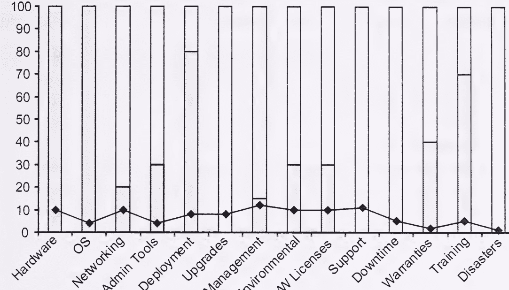 | | |

**图 6–1** 实现计算机解决方案的成本概况（S/W 代表软件）。

环境成本包括一些初始成本（建立机房、安装空调和电源等），但也有与维护环境相关的持续环境成本。柱状图的灰色部分显示初始固定成本；白色部分显示持续成本。折线图显示了每个组件作为总解决方案一部分的典型相对百分比。

你可以看到，大多数组件都具有固定成本和变动的持续成本。在大多数情况下，持续成本占的百分比高于固定成本。我们还看到，没有任何一个组件占据整个解决方案的大部分。这里没有展示的复杂性在于，许多企业将部署多个解决方案，而且许多组件成本可以并且将在跨解决方案部署中汇总。你的业务分析需要考虑这种复杂性。关键因素是，如果你正在部署多个解决方案，并且可以汇总固定成本，那么开源触及的组件对潜在成本节约将产生大大的影响。

## 开源效应

由于理解成本可能是部署 Linux 和开源软件时要考虑的最重要方面之一，因此逐一查看列表中受开源效应影响或获益的元素是值得的。列表中的某些元素将在后面的章节中进行更详细的介绍。

## 硬件

开源软件以不同的方式影响硬件成本。Linux 操作系统的细节也起着关键作用。正如我在第 1 章和第 2 章提到的，几乎所有的开源软件（包括 Linux）都是在通用计算硬件上开发的。由于不需要依赖专有硬件解决方案，硬件成本可以大幅降低。这假设开放平台与 Linux 的结合将满足你的可扩展性、可靠性、可用性和性能需求。另一个考虑因素是使用开放平台带来的硬件生态系统。这意味着通常有大量的受支持硬件插件可供。这种选择增加了你的解决方案选项，而且竞争效应也会降低你的成本。

许多用户还报告，Linux 和开源软件的结合可以在比专有解决方案旧多的硬件配置上运行。Linux 经常作为复用选项部署在更旧的硬件上。此外，低性能硬件解决方案可以用更低的成本满足你的业务需求。最后，一些人会选择重新使用专有硬件，或使用现有系统的部分来利用 Linux 的优势。

## 操作系统

在大型系统中，专有操作系统的成本可能高达数十万美元。Linux 的获取、复制和安装无需任何相关的许可费用。可能更有意义的是，在系统的整个生命周期内，与操作系统相关的持续支持、升级和维护成本。我将在稍后详细介绍这一点。显然，人们寄希望硬件和操作系统的组合能满足你的业务需求。

正如我在第 5 章概述的那样，你有能力结合许多不同的组件来构建你自己的 Linux 发行版。你不需要获取组件部分，而是可以将开源部分组装成你自己的操作系统。

## 成本

根据你的应用程序和组织规模，针对特定需求修改商业 Linux 发行版可能会以自维护或定制支持合同的形式引入新的成本。

## 管理工具与实用程序

几乎任何大型公司都开发了一系列针对该组织的特定工具。通常，这些工具是多年前开发的，而原始开发者早已离开了公司。在某些情况下，这些内部工具和实用程序的源代码无处可见。你维护这些内部工具并将其迁移到其他平台的成本可能是极其巨大的。

这就是开源的“甜蜜点”。在很多情况下，你所想到的几乎任何功能都已由社区的另一个开发者写好了。如果不可用，也会会有类似的东西可以被利用并根据你的需求进行调整。这很妙的一点是，你对任何工具的扩展都可以回馈社区，并由社区进行持续维护。这为降低你的成本提供了重大机会。对社区的贡献将建立良好的声誉，并使社区产生帮助你的真实愿望。

## 解决方案的升级

对你部署的升级总是按照你的条款和计划进行的。你永远不需要担心失去供应商的支持。由于源代码始终可用，你总是可以选择支持你自己的环境。对于像 Linux 和 Apache 这样的大开源项目，你有几个伴侣可以选择从中获取支持，或者你可以通过社区的备份自力。

另一个因素是与升级相关的许可费用成本。许多软件供应商收取维护费以获得其软件的微更新，并在升级到主版本时收取巨额的新许可费用。对于开源软件，这些持续成本消失了。

## 管理、行政与许可跟踪

当我在第 8 章更详细讨论部署时，你将理解部署 Linux 环境的考虑因素之一是将其集成到你现有基础设施中的能力。

大型公司每年花费数百万美元来跟踪许可。许多公司开发了复杂的工具来跟踪许可，而其他公司则在全球范围内与供应商谈判企业许可以降低跟踪成本。对于根据 OSI 批准许可的开源软件，不需要跟踪许可，你可以根据需要复制许多副本。

**100 第 6 章 • Linux 和开源的成本**

当我在后面更详细地讨论部署时，你将理解部署 Linux 环境的考虑因素之一是将其集成到你现有基础设施中的能力。对于，请注意开源软件不需要支付许可费用。你通常从多个位置下载软件，制作自己的 CD，甚至打印自己的文档。在很多情况下，你购买的是提供该包公司的某种形式的支持。你必须决定为便利支付多少钱。

## 应用程序和其他软件许可

你降低成本的最明显的地方是消除软件许可成本。对于许多人来说，这仍然是一个新概念。在很多情况下，你实际上购买的是开源软件——你可能在当地电子商店看到你的 Linux 发行版盒装。大区别在于你没有购买软件的许可。在开源软件的情况下，你购买的是便利和你信任的品牌。在大多数情况下，这表现为介质（加载软件的 CD/DVD）、文档以及在很多情况下某种形式的支持。

## 支持费用

与开源相关的常见商业模式之一提供支持。当你处理专有软件时，你的支持选项有限。你通常只能从销售软件的供应商那里获得支持。由于顾客的存在，供应商可以收取支持服务的溢价。

即使你的计划是像对待商业软件一样对待开源软件，支持服务来自多个供应商这一事实本身增加了竞争并对价格产生积极影响。在操作上，你需要调整业务流程，将支持视为一个竞争性的招标过程。

## 非计划停机

在专有软件世界，某些缺陷会导致意外和不受欢迎的停机。对于任务关键环境，你通常会协商非常广泛的支持安排以尽量减少这些情况。然而，事实仍然是你受制于供应商。如果你的供应商不想在你需要的时间范围内做出所需的更改，你通常会发现自己无计可。


## 适应不完美的解决方案

再次如此，即使在选择将开源软件像商业软件一样对待的环境中，具备与广大社区或你内部 IT 员工协作解决出现问题的基本能力，也可以减少非计划停机的成本。

## 培训

正如我在第 1 章中提到的，受过培训的资源的可用性是 Linux 未来发展的关键优势之一。如果你部署了一个行业标准的开放环境，那么由于有受过培训的资源可用，你的培训成本将会降低。然而，如果你正从现有环境迁移，那么培训成本可能代表一项你需要考虑的巨额投资。

无论你采用何种部署类型，开源软件都要求开发者、采购人员、合同谈判者和管理团队具备一套不同的行为。本书为你提供了理解这些行为差异的所需的细节，但你还需要考虑相关的成本。

## 适应不完美的解决方案

在计算机早期，大多数环境都是从零开始定制构建的。因此，解决方案变得非常完美地符合你的需求。然而，开发这些解决方案是一项非常昂贵的提案。随着时间的推移，软件供应商构建了可以应用于广泛问题的通用应用程序。虽然解决方案并不完美，但成本大幅降低，以至于这种不完美解决方案的权衡是值得的。然而，这是你业务中需要考虑的成本，也是开源的一个经常被忽视的独特优势。

这正是开源大放异彩之处。获取接近你业务需求并根据你的特定需求进行定制的开源软件的能力，让你能够兼得其利。正如我之前提到的，在许多情况下，开源社区将欢迎你的许多增强功能，将其纳入核心源码树，并支持整个环境。

衡量这种收益是复杂的，因为你必须分析并比较成本不再存在的地方，并考虑到增量成本。通过这种分析，你可以构建一个业务案例。表 6–1 为你进行这种分析提供了指南：

# 第 6 章 • Linux 和开源的成本

### 表 6–1 实现“完美”解决方案

| 消除和减少的成本 | 新或增加的成本 | 零成本 |
| --- | --- | --- |
| “不完美”解决方案的软件许可费 | 将开源解决方案适应特定的业务需求 | 接受开源软件解决方案 |
| 维护不完美解决方案的额外人员 | 社区拒绝的任何组件的维护和支持 | 接受社区整合定制的努力 |
| 实现的变通方案 (workarounds) | 影响并与社区进展保持联系的人员 | 社区提供的持续更新 |
| 定制化 | 专家人员 | 从现有的发布代码库开始 |
| 其他业务影响（例如，上市时间、客户满意度等） | | 更广泛的基于社区的质量保证 |

显然，这张成本比较表需要与本章中列出的所有成本因素结合起来。这里的观点是，开源为你提供了一个以合理成本实现近乎完美解决方案的机会。你自己的业务分析将决定新解决方案是否值得。

## 采购 Linux 和开源软件

在获取传统的软件产品时，你的公司可能已经与供应商和物料供货商建立了一套完善的流程。你根据数量谈判许可费，并从几个精选供应商（甚至单一供应商）中进行选择，以将总成本降至最低。无论你获取的是 Linux、Apache 还是任何其他开源软件，其获取流程都是截然不同的。以获取 Linux 操作系统为例，以下是获取 Linux 副本的最常见方式：

- 从本地供应商处购买盒装版
- 从互联网下载 CD 镜像
- 使用与书中附带或与另一产品捆绑的 CD
- 使用预装或捆绑在计算机系统或外设备中的软件

获取几乎任何开源软件都有类似的方法，软件供应商会在其软件中包含开源实用程序、工具和附加应用程序。
你组织中的采购代理可能会接受过培训，对购买的任何软件进行许可获取和核算。如果不加约束，他们同样可能被诱导将这些流程应用于开源软件。然而，重要的是你的团队要经过培训，只购买你的业务认为值得付费的元素（手册、媒体、支持等）的开源软件。

## 合同

如果你是软件或硬件供应商，通常会要求任何将你的软件整合或与你的软件捆绑的供应商提供赔偿（indemnification）。涉及开源软件时，规则改变了。由于大多数开源软件是由一群个人编写的，可能有成百个版权所有者，没有人能负担得起为你提供此类赔偿。

104 第 6 章 • Linux 和开源的成本

记住，在与包装开源软件的商业供应商进行任何谈判时，你谈判的不仅仅是软件许可的成本。你可能在谈判支持、服务和专业咨询。还要记住，这是一个竞争激烈的环境，你会有许多选项可供。

## 修改开源软件

许多行业分析师建议不要修改开源软件，并建议你在公司内部像对待其他专有软件一样对待它。这一建议源于事实：为你的特定用途修改软件意味着要承担新解决方案的支持负担。对于 IT 人员较少的小公司，这实际上可能是一个合适的答案。然而，对于能够与开源社区交流的大型公司，修改软件的能力是一个降低成本的巨大机会。修改开源软件应始终考虑将更改提交给社区内的维护者。

这种修改开源软件的能力为大型公司和 ISV 带来了许多利益：

- 影响软件产品方向
- 按你的时间表实现你的优先事项
- 获取内部视图帮助未来规划

你应该注意，如果你不愿意或无法加入社区并参与任何软件产品的未来，那么分析师的是完全正确的。你应该避免对开源软件进行任何修改，仅在它被包装并由商业供应商支持时使用。

## 总结

你现在应该能够看到 Linux 和开源如何影响整个业务中解决方案的成本。在大多数情况下，你可以获得


巨大的收益并显著降低了你的环境成本。然而，你也了解到开源并不直接等同于零成本。开源软件没有许可费用，你不需要为开源软件付费，即使它与其他组件捆绑，但你可能需要自己承担成本。最后，你可以通过对软件做出明确决策来进一步控制成本，并获得最符合你业务需求的解决方案收益。

保持整个生态系统低成本的关键元素之一是标准。下一章将检查特定 Linux 的标准。推广这些标准将鼓励生态系统的增长，并通过确保可用性来保持成本。

# 第7章 标准——Linux

你现在构建了你的汽车，从引擎开始，然后结合了你想要的所有选项。你对汽车的生命周期有一个清晰的视图。但现在想象一下，如果每辆汽车都具有足够的差异，它们将无法共享相同的道路和公路，或者你的车辆将受限于少数个人。虽然让每个汽车都能构建具有独特性的车辆以满足不同客户的需求是重要的，但同样重要的是要有一套共同标准，让每个人从这种交通形式中受益。

考虑互联网。如果我们没有标准，互联网的规模将大幅缩小，我们可能不会发生 20 世纪 90 年代后发生的行业转型。分发厂商在两个主要领域获胜：1) 维护版本之间的兼容性；2) 清晰定义“通用”共性层何时结束，“独特”增值何时开始。

- 软件供应商——为多个 UNIX 变体创建应用程序已经证明了昂贵的历史。软件供应商通常被迫在支持其应用程序的多个版本成本与可用市场规模之间进行权衡。标准允许软件供应商创建一种软件，并在最广泛的平台上支持它。

Linux 和开源软件现在已经成熟到这种程度，确保行业可持续增长的唯一方法是拥有标准，以确保关注在新的创新上，而不是管理没有价值的差异。

## 自由标准小组

Free Standards Group (www.freestandards.org) 是一家非营利组织，其生活的首要使命是通过标准扩大开源技术的使用和接受度。他们工作的自然结果将把 Linux 推向市场的下一个阶段：面向应用程序的企业平台。自由标准小组三个主要工作组是：

- Linux 标准基础 (LSB)——LSB 是一套接口和测试套件，允许应用程序跨 Linux 的移植性，无论分发版或版本如何。

- Linux 国际化倡议 (Li18n)——该标准为合规的分发版和应用程序本地化创建基础。

- 文件系统层次结构 (FSH) 标准——该标准确保 UNIX 以及现在 Linux 系统上文件位置的一。这是 LSB 所依赖的关键标准之一。FSH 标准与 LSB 一起讨论。

自由标准小组并不尝试独立完成所有标准工作，而是另一个相关的 Linux 标准倡议联盟：X 桌面小组。X 桌面小组专注于促进 UNIX 和 Linux 桌面之间的协作和操作性。你已经学习了 Linux 的两个主要桌面：GNOME 和 KDE。自由标准小组还与 XFree86 组（见4）密切合作，并继续对标准扩展到用户界面领域。

作为一家非营利公司，自由标准小组由主要的行业供应商资助，他们显然理解这些标准带来的巨大收益。鼓励任何终端用户、IS 或硬件供应商参与。只有当标准满足使用者的需求并反映了社区的广泛参与时，标准才是成功的。参与越多越好。

## Linux 标准基础

LSB (www.linuxbase.org) 是确保 Linux 分发版与 Linux 应用程序成功结合的核心标准。具体来说，它是：

- 二进制接口规范（二进制规范意味着应用程序在系统之间移动时不需要重新编译）确保了所有认证的 Linux 分发版之间的应用程序兼容性。

- 用于测试 Linux 分发版和基于 Linux 的应用程序 LSB 合规性的测试套件。

- 用于开发 LSB 合规应用程序的构建环境。

- 在“纯”Linux 环境中运行和测试应用程序的示例实现。

通过利用这些标准和工具，分发厂商创建符合 LSB 的 Linux 分发版，而软件供应商创建符合 LSB 的软件应用程序。

通过关注一组通用的接口，应用程序供应商可以根据 LSB 编写并测试应用程序，并确保


## Linux 标准基础 (LSB)

应用程序将运行在任何符合 LSB 的发行版上。拥有内部 IT 开发团队的公司在创建所有应用程序时也应该考虑到 LSB 的兼容性。鉴于 LSB 目前拥有的这种影响力，确保你选择的任何 Linux 发行版都符合最新版本的 LSB，并且你获取的任何应用程序也符合 LSB，是一个好主意。这样，你就可以确保你的投资得到保护。

在许多方面，LSB 可以被看作行业使用且 Linux 开发社区背书的一系列标准的集合。LSB 的一个既定目标是记录现有的标准，而不是发明新标准。由于 LSB 并非重复轮子，而是构建在现有基础之上，这使得发行版供应商和应用程序提供者与 LSB 规范合作并遵循它变得非常容易。

由于 LSB 是一种二进制规范，它需要分为两个核心部分：通用和处理器特定部分；通用部分适用于与机器无关的内容，处理器特定部分仅适用于那些必须依赖于机器的内容。图 7–1 显示了这两者在你的平台上如何结合，从而为特定架构创建一个符合 LSB 的环境。

我们的目标不是重申整个 LSB 标准。你可以从 LSB 网站（www.linuxbase.org/spec）获取实际规范的副本。从宏观角度来看标准以及各种组件如何结合在一起是有益的。

## LSB 发行版组件

LSB 定义了合规应用程序必须可用的通用二进制接口集。图 7–2 展示了符合 LSB 的 Linux 发行版的标准化组件。

| 应用程序 |
| gLSB (通用 LSB) |
| psLSB IA-32 (处理器特定) |
| psLSB IA-64 (处理器特定) ... |
| psLSB 架构 X |

图 7–1 LSB 架构支持。

## 应用程序

| Linux 标准基础 |
|---|---|---|---|
| 软件包格式 | 执行环境 | 基础 | 图形 |
| 动态链接 | 系统初始化 | 标准 Shell | 对象文件格式 |
| 命令与实用程序 | 用户与组 | | |

**图 7–2** 符合 LSB 的发行版。

表 7–1 详细检查了合规 Linux 发行版中每个重要的通用 LSB (gLSB) 元素以及对应用程序和部署的影响：

# **表 7–1** gLSB 组件

| LSB 组件 | 描述 |
|---|---|
| Linux 内核接口 | 内核开发团队必须能够自由地创新和扩展内核功能。LSB 的构建专门为了允许这种创新（更具可扩展性、多线程执行模型、新的调度方法等）。通过指定 POSIX（一种成熟建立的 UNIX 接口标准）接口，LSB 在确保应用程序兼容性的同时鼓励了创新。这的一个重要意义可能是允许当前的 UNIX 实现变为符合 LSB 标准的。 |
| 软件包格式 | 打包是将构成应用程序的一系列文件组合在一起以便于部署的过程。通过定义打包格式，供应商可以选择任何可能创建的工具来支持该格式。终端用户可以选择任任何工具在整个企业范围内对软件包进行部署。 |
| 动态链接 | 动态链接指定了应用程序所需的二进制格式和字段。动态链接允许许多应用程序共享和重用功能库。（（下文） |

# Linux 标准基础 113

# 表 7–1（续） 描述

| LSB 组件 | 描述 |
|---|---|
| 动态链接（续） | 指定链接格式，这确保了所有应用程序都能共享重用模型。 |
| 执行环境 | 执行环境关注于 FSH 标准和执行安全。正如我提到的，FSH 标准是 LSB 的关键要素。确保文件在系统内位置的一致性使得应用程序和系统都具有可预测性。 |
| 系统初始化 | 系统初始化认识到许多应用程序需要依赖系统启动时的已知状态。标准的这部分确保了应用程序拥有它们可以信赖的环境，例如脚本和其他配置。 |
| 标准 Shell | 多年来，已经开发了许多用户 shell（在提示符处执行输入类型命令的解释器）。标准的这部分在承认 POSIX 标准的同时，也承认了 Linux 环境中使用得最广泛的 shell 的现实情况。 |
| 对象文件格式 | 当编译器从源代码创建可执行应用程序时，它会以非常特定的格式写入可执行文件。通过拥有一个清晰的标准，这确保了所有应用程序都能被系统加载和执行。 |
| 库 | 从图表中，你可以看到有三种核心库类型：基础、图形和实用程序。加载到系统上的几乎所有应用程序都依赖于这些类别中的一个或多个库。标准化必须包含哪些库可以确保应用程序能够可靠地运行。 |
| 命令与实用程序 | 所有 UNIX 和 Linux 发行版都带有数百个命令，供管理员和用户使用。标准的这部分规定了必须存在的所有命令和实用程序。这允许同样依赖脚本的应用程序可靠地运行。 |
| 用户与组 | 再次，利用 POSIX 标准、用户和组确保了用户名、某些用户 ID 和可用组遵循标准。 |

114 第 7 章 • 标准——一个 Linux

如果你还记得，LSB 还规定了特定架构的组件。正如我在第 2 章中提到的，由于大多数开发是在 Intel IA-32 架构上进行的，因此所有的初始开发工作从那里开始。LSB 也不例外。在编写本文时，LSB 架构特定模块是针对 IA-64 定义的。表 7–2 列出了架构特定的：

# 表 7–2 架构特定组件

| LSB 组件 | 描述 |
|---|---|
| 低级系统信息 | 此部分描述了 LSB 的非常低级的接口。 |
| 对象格式 | 与 gLSB 类似，对象格式也针对编译器。 |
| 程序加载与动态链接 | 运行程序的行为包括将其加载到内存中。LSB 指定了这一点。 |
| 基础库 | 就像 gLSB 定义了一组基础库一样，某些库是特定于架构的。 |

LSB 是一套描述了应用程序可以预期的全面标准和工具。这也是应用程序必须遵循的规则。

## 合规应用程序

确保你开发的（无论是内部使用还是商业销售的）应用程序可以运行在任何发行版上是一个巨大的胜利。它将确保你的用户有可选的 Linux 发行版

# Linux 国际化 115

考虑应用程序合规性的简单方法是，你的应用程序必须运行在任何符合 LSB 的发行版上。它不能依赖于超出 LSB 范围的任何扩展。此外，如果你的应用程序与其他应用程序结合或依赖，另一个应用程序也必须符合 LSB 标准。

当然，你的应用程序必须符合 LSB 中概述的所有格式和动态链接元素。稍后，我们将查看合规性测试，以确保你的应用程序符合 LSB 标准。

# LSB 未来

LSB 最初的精力放在对所有 Linux 内容的一小子集进行非常仔细的规范上。这是以牺牲广度为代价的。LSB 未来 是 LSB 组的一个子委员会。其目标是扩大 LSB 的范围使其更具包容性。如果你致力于增强 LSB 规范，你应该考虑加入该小组。

## Linux 国际化

自由标准组的第二个主要工作组是 Linux 国际化倡议（www.li18n.org），它专注于标准化一组核心 API，以确保本地化应用程序可以在任何符合 LSB 的 Linux 发行版上正确运行。

发行版供应商从 li18n 标准（数字 18 表示“internationalization”中“i”和“n”之间的字母数量），这确保了他们的发行版可以在任何地方使用，并运行来自任何本地地区的应用程序。

大型公司和 ISV 同样受益，他们能够为任何地理区域进行本地化，同时确保他们的应用程序运行在任何合规的发行版上。

有几个术语有助于理解：

- 国际化（Internationalization）——使应用程序或其他软件环境可本地化的过程。国际化提供了底层基础设施，以确保应用程序可以进行本地化。


-   本地化（Localization）——在应用程序中支持特定文化相关问题的过程，例如语言、时间、货币等。一旦应用程序的基础设施实现了国际化，就可以针对任何数量的特定区域进行本地化。
-   全球化（Globalization）——国际化与本地化的结合。

在开发供内部使用或商业用途的应用程序时，你应该要求所有应用程序都进行国际化。通过这样做，你可以确保在需要时，你所有的应用程序都能本地化到你选择的国家。使用专门从事翻译服务的第三方公司为特定语言的应用程序进行本地化是非常常见的做法。

LinuxSB 标准通过提供一组标准的 API 来引导你，处理来自拉丁语、亚洲以及许多其他语言的字符集。LinuxSB 还提供了用于验证合规性的套件和示例实现。通过 LinuxSB，你将能够在不更改应用程序中任何代码的情况下添加本地化支持。

## 测试与合规性

自由标准小组（Free Standards Group）利用每一个机会记录和使用已存在的内容。测试和合规性方面也无不同。在 UNIX 世界中，开放集团（Open Group）推动了一套全面的测试套件，以确保符合 UNIX98 等标准。自由标准小组正与开放集团和其他组织合作，复用并基于相同的测试套件构建，而不是从头开始。专注于 LSB 的测试套件分为四大类：

-   发行版测试（Distribution testing）——这部分测试面向发行商。然而，某些情况下，你可能会为了内部使用构建自己的发行版。如果这样做，你应该确保你的自定义发行版也符合 LSB 标准。这确保了你可以运行任何符合 LSB 标准的应用程序。
-   应用程序测试（Application testing）——对于软件供应商（ISV）和企业客户，这是测试最重要的部分。即使你的应用程序是内部使用的，也应该始终检查 LSB。这将确保你可以在公司选择部署的任何符合 LSB 的发行版上运行你的应用程序。
-   构建环境测试（Build environment testing）——这也面向软件开发者。它确保用于构建应用程序的环境具备所需的一切。
-   示例测试（Sample testing）——这是测试合规性的最后方法。通过提供运行时环境，开发者可以以一种清洁、实用的方法测试他们的应用程序。LinuxSB 还有一组可以在其网站上找到测试套件。LinuxSB 测试套件分为交互模式（用于测试应用程序的组件）和自动模式（用于测试国际化的正确实现）。

在编写本文时，自由标准小组正在启动一项计划，以便发行商可以寻求认证并将其作为营销活动的一部分。你应该定期监控自由标准小组的网站，以查看该计划的演变情况，并决定何时是加入的最佳机。

## 特殊 Linux 发行版

我们不能忽视事实：Linux 的伟大优势之一是它的定制能力。因此，有一系列专用应用程序（顶盒、嵌入式应用等）将 Linux 定制到不再被视为“标准”的。好消息是，随着这些应用程序变得越来越普遍，标准将会发展以支持这些环境。

## 总结

你已经看到了适用于主流 Linux的相关标准。通过确保获取并部署符合 LSB 标准的发行版并在应用程序中贯彻到底，你应该利用 Linux 避免供应商锁定的这一关键优势。对于大型公司和软件供应商，LinuxSB 确保了你可以在任何证明本地化成本合理的市场中交付你的应用程序。

## 运营——使用 Linux 和开源

要让 Linux 在你的环境中真正落地，它需要成为你日常运营中不可或缺的一部分。对于大多数企业来说，这意味着需要一个在现有基础设施中部署 Linux 的计划。那些选择从现有的 UNIX 或 Windows 环境迁移到 Linux 的人，需要理解迁移和共存计划应该包含什么。本章的后半部分将涵盖 Linux 不同的其他运营元素：支持和培训。

本章涵盖了运营元素。由于每个企业都不同，你应该将本章视为一个帮助你在环境中部署 Linux 时做出决策和选择的工具。本章并不尝试提供从 UNIX、Windows 或任何其他操作系统迁移到 Linux 的理由，而是提供了你应该考虑的元素，以帮助你做出选择；或者如果你已经做出了选择，则提供了规划成功实施的元素。在某些情况下，迁移到 Linux 是不恰且不应该考虑的。

## 部署

在你的企业中部署 Linux 需要大量的规划，以决定先在 Linux 上实现哪些应用程序。在大多数情况下，Linux 需要与现有基础设施一起部署。如果你决定成为纯 Linux 环境，可能需要几个月甚至几年才能实现这一目标。

要在你的企业中部署 Linux，首先要决定将部署哪种 Linux 发行版以及如何进行打包。如果你记得发行版章节的细节，你可能会发现自己正在创建一个自定义发行版。然后，你需要对镜像进行打包，以便获得可以在你的环境中支持的一致部署。接下来，查看可用的开源和商业部署及管理工具，以使你的部署方案成功。你显然需要测试特定的应用程序，以确保它你所有的性能、可靠性和可扩展性要求。

大多数发行版商还提供服务（通常涉及月费），当有新功能或错误修复可用时，会自动更新你的部署。对于小型企业或个人用户，这些自动更新服务可以是一个提供极大便利的优质服务。然而，对于中大型企业，这些更新服务需要被引入内部并与 IT 环境集成。这将允许你使用特定的应用程序进行测试，以确保不会遇到其他副作用，并可以为整个组织的大规模部署做好分阶段更新。与你的发行版商合作，开发适用于你环境的细节。

每次部署都是独特的，我无法考虑每一个具体的案例。然而，与迁移、共存以及其他运营元素相关的许多问题是每个企业都应该考虑的。

## 地理部署

如果你的公司在多个国家设有办事处，你需要在全球范围内部署哪些发行版做出选择。你在第 5 章中了解到，许多发行版具有地理侧重点或背景。极有可能，这些办事处的员工会熟悉这种本地发行版，并且有强烈的倾向于使用它进行部署。另一种可能的情况是，这些本地感兴趣的发行版是唯一经过了当地文化和语言本地化的版本。你可以选择在全球范围内所有的部署中统一使用单一发行版，也可以做决定让你的远程办事处做出本地选择。这就是 LSB 标准的用处之一。通过将你的精力集中


## 迁移与共存

遵循 LSB 标准，你可以利用本地分发提供商的地理优势，并确保你所有的企业应用选择在整个组织内都能运行。

## 迁移与共存

正如在本章开头提到的，我的意图并不是为迁移提供辩护。互联网上有许多资源（其中一些列在参考部分），专门用于解决在非常特定的情况下从一个平台迁移到另一个平台的特定问题。完全可以用一整本书的内容来详细介绍从平台到应用程序再到整个环境的迁移问题细节。我在这里的意图是涵盖你在平台和操作系统层级应该考虑的重大迁移问题。

迁移将涉及成本。为了使迁移可行，你必须能够通过实质性的新收益来证明这些成本的合理性。因此，如果你有一个稳定的环境，能够以最低成本满足你的业务需求，那么迁移可能就没有任何意义。需要考虑的一些重大迁移成本包括：

- 硬件——迁移到 Linux 可能涉及硬件平台的变更。取决于你现有系统的当前状况，这可能有意义，也可能没有意义。另一方面，正如你稍后会发现的，Linux 支持多个平台的能力可以使硬件复用成为一个极具吸引力的提议。

- 培训——如果你当前的环境主要基于 UNIX 系统，那么对你的管理人员进行重新培训应该降至最低。然而，如果你是从 Windows、Novell或其他环境迁移，那么重新培训的成本将是相当的。

- 许可——取决于你使用的应用程序以及你当前的环境，你可能需要重新购买或升级许多当前的应用程序。这假设你的业务应用程序在 Linux 上可用。好的一面是，由于 Linux 本身没有许可费用，你可能能够抵消部分这些成本。

- 数据——极有可能，你的真实资产在于你存储的信息中，而不是用于存储和检索信息的硬件和软件。在转换现有环境时，数据迁移可能成为成本最高、风险最大的元素。我将在稍后介绍数据迁移的一些元素。

## 硬件

为了充分理解迁移的影响，我们需要查看影响这些成本的密钥组件的细节。

有些人认为，由于 Linux 可以在各种不同的架构上运行，你应该考虑在这些任何一种架构上进行活动部署。在第 2 章中，我概述了为什么在核心开发所在平台以外的硬件平台上部署 Linux 是不理想的。然而，迁移和硬件复用可以为非核心开发平台上的 Linux 提供一个良好的机会。假设你有一个基于专有架构的现有硬件平台。你的最终目标是在行业标准硬件上部署 Linux。这种移动可能不会在一夜之间发生。因此，你可以采取一些有效措施来复用现有的硬件，在几个月甚至几年内完成这一过渡。

图 8–1 展示了从纯环境到纯开放、标准环境所需步骤的简要视图。显然，这些步骤中的每一步涉及的实际工作可能非常复杂。如果专有操作系统是基于 UNIX 的，那么应用程序、脚本以及你的软件基础设施其他组件的转换将是最小的。其他 UNIX 操作系统（如 VMS、MVS 等）在能够在 Linux 上运行之前，可能需要大量的重写。由于大多数商业软件供应商仅在行业标准硬件架构上提供其应用程序，要为你当前的专有硬件获取一个版本可能是困难的。对于这些情况，你应该使用这里演示的方法作为你所有内部开发的应用程序和脚本进行迁移的第一步，并将商业应用程序留到迁移到行业标准硬件的最后阶段。

在第二步中，更改硬件可能会涉及环境因素。你的环境是否具有正确类型的电源、冷却、空间等，以支持与你过去使用的不同的硬件？你还需要考虑连接性问题。在某些情况下，你可能能够在你的架构系统中复用你专有硬件的 I/O 接口。在其他情况下，你可能需要重新购买硬件。你必须考虑你当前基础设施的网络、存储和外设。当更改硬件平台时，性能、可扩展性和可靠性都会发生变化（有些变好，有些变坏）。你应该花时间理解这些变化对用户和业务的影响。

| 商业应用程序 | 开源或商业应用程序 | 开源或商业应用程序 |
| :--- | :--- | :--- |
| 专有操作系统 | 步骤 1：迁移到 Linux | Linux |
| 专有硬件 | 行业标准硬件 | |

图 8–1 迁移到开放标准硬件。

## 数据

数据迁移将是一个重要的考虑因素，特别是当你的数据在当前环境中被共享时。数据迁移将涉及存储格式、系统共享和应用程序数据。考虑因素之一是当前系统使用的字节序。

## 端序

在乔纳森·斯夫利的《游记记》中，斯富利描述了小立立浦国从大一侧碎蛋的人（大端）。我们可以假设从小一侧碎蛋的人是小端（Little-Endian）。“Endian”一词被计算机行业借用，指的是各种计算机和操作系统使用的字节序。如图 8–2 所示，端序是指数据存储和检索的方向。

| F | A | E |
| :--- | :--- | :--- |
| 01000011 | 01000000 | 01000001 |
| 01000101 | | |

| 内存地址 |在大端系统存储的数据 | 在小端系统存储的数据 |
| :--- | :--- | :--- |
| 00 | 01000011 | 01000001 |
| 01 | 01000000 | 01000101 |
| 02 | 01000001 | 01000011 |
| 03 | 01000101 | 01000000 |

图 8–2 32 位系统的端序。

任何操作系统/微处理器都可能有不同的端序。IA-32 和 IA-64 上的 Linux 是小端，而 SPARC 和 PA-RISC 上的 Linux 是大端。PA-RISC 上的 HP-UX 和 Solaris 是大端。这个字节序问题是任何管理工作中容易被忽视、最理解的。如果系统是大端的，而新系统以小端方式检索，那么数据损坏将不可避免。你的目标是通过适当规划来防止这种情况。

## 第 8 章 • 操作——使用 Linux 和开源

在之前的章节中，我介绍了 Linux 可用的各种文件系统。目前最常用的是 ext2 文件系统（以及最近带有日志功能的 ext3 扩展）。如果你是从 UNIX 系统迁移，你需要了解你正在使用什么文件系统，以及该文件系统是否适用于 Linux。文件系统是


## 迁移与共存

这通常是高可用结构中不可或缺的一部分，以确保发生系统故障时，备份系统能够继续提供数据。如果你正在向基于 Windows 的系统迁移或与其共存，你可能需要将数据迁移到你为 Linux 选择的新型存储文件系统。幸运的是，开源社区已经为所有的微软文件系统开发了驱动程序。这将确保你能够访问可能存在于 Windows 系统或 Linux 系统上的数据。

可用的开源、专有和商业文件系统多到无法在此处列举，而且新的系统正在不断开发中。极有可能是，开源社区已经为许多专有文件系统开发了驱动程序。许多为专有操作系统提供复杂文件系统的商业供应商——也为 Linux 提供了其文件系统的版本。

## 共享

与文件系统密切相关的是文件和打印共享系统。这些共享允许网络上的用户共享文件、打印机和其他网络资源。这使得企业能够有效利用昂贵的基础设施组件。公司共享打印机和文件最常见的方法是通过使用微软协议。这些协议包括通用网络文件系统 (CIFS) 和服务器消息块 (SMB)。UNIX 平台传统上通过网络文件系统（NFS）共享文件。好消息是开源社区（以及一些商业供应商）已经开发了这些非常重要的协议之间的互操作性解决方案。图 8–3 显示了这些文件和打印共享服务如何在网络上进行交互。

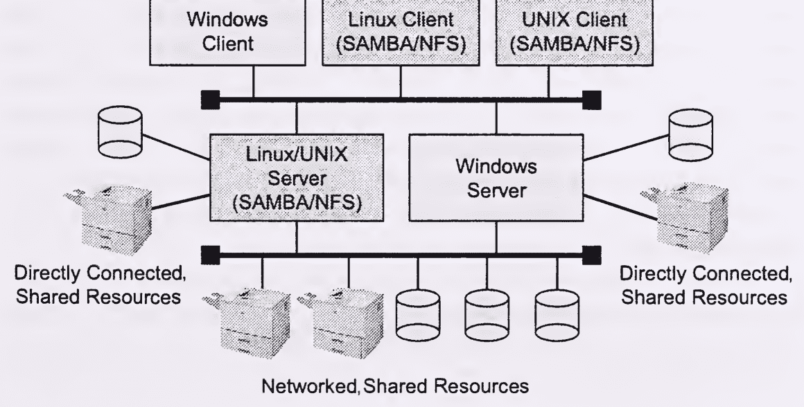

图 8–3 迁移共享资源。

SAMBA（SMB 缩字的扩展）是伟大的开源技术之一，它允许你的 Linux (UNIX) 系统与 Windows 环境共存并共享资源。你可以根据最符合你业务的节奏来选择迁移服务器和客户端。SAMBA 既有客户端实现，也有服务器实现。如果你在现有的 Windows 网络上实现 SAMBA 服务器，它对你所有的 Windows 客户端来说，看起来就像是另一个服务器一样。

如果你的基础设施高度依赖 NFS 协议，那么在 Linux 和 Windows 系统上运行该协议也是可能的。大多数 Windows 的 NFS 实现可以从商业第三方供应商处获得。

SAMBA 和 NFS 的结合允许你在 Windows、Linux 和 UNIX 系统以及任何其他理解这些核心协议的系统之间创建无限数量的集成点。这允许你计划有序迁移到最适合你环境的且最具效益的平台。

## 编程模型

编程模型指的是应用程序开发者用于创建运行在所选操作系统上的应用程序的 API。由于 UNIX 和 Linux 具有非常相似的血缘和非常相似的编程模型，应用程序开发者通常可以很容易地适应 Linux 编程模型。事实上，Linux 有时被认为是所有基于 UNIX 系统的最小公约数。

Windows 系统的编程模型基于称为 Win32 的核心 API。该模型与 Linux 和 UNIX 系统使用的模型截然不同。由于编程范式存在根本性差异，来自一个环境的开发者在移动到另一个环境时通常会遇到很大困难。如果你有一批熟悉 Win32 编程模型的人才储备，那么你应该预见到，大多数尝试吸收 Linux 编程模型的开发者将面临一条陡峭且困难的学习曲线。这种差异对于大多数其他非 UNIX 操作系统来说也是类似的。

如果你组织内部的大部分开发工作是基于高级开发范式（例如 Java 应用程序服务器或数据库应用程序），那么在操作系统层切换到不同的编程模型对你的开发者来说可能是无痛的，甚至是无感的。

## 应用

当你从现有的专有环境迁移到基于 Linux 的平台时，你应该寻找现有应用程序的开源替代品。这并不是为了推广“所有开源软件都可以替代任何商业应用”的观点。相反，在某些时候，我们实现了非常优秀且强大的商业应用，但最终使用了非常小的开源版本。如果你已经部署了具有全功能的商业软件，那么寻找开源替代品可能是有必要的。如果你使用的应用程序尚未充分利用其功能，那么开源软件可能满足你的需求。例如，你可能在使用开源数据库来完成简单的存储和检索。极有可能是，MySQL 或 PostgreSQL 等开源数据库可以满足你的需求。

## 桌面

迁移桌面环境应该谨慎进行。大多数人会认为这主要是为了高级用户。虽然随着时间的推移这可能会变化，但如果你选择迁移桌面环境，请确保你依赖的应用程序在 Linux 上可用，并且符合 LSB 标准。你将需要不仅对操作系统本身，而且对用户界面进行一些重新培训。市场上还有许多名为“WINE”（Wine 不是模拟器）的解决方案，其目的是允许 Windows 应用程序直接运行。商业供应商正在对应用程序认证并提供工具以帮助加载。

## 许可与购买

在 Linux 上运行的商业软件许可与其他任何平台相比很大没有变化。某些软件供应商试图将硬件平台和操作系统的成本挂钩。在大多数情况下，没有理由预期这种关联。事实上，尽管硬件成本在过去几年大幅下降，但商业软件成本在同一时期基本保持不变甚至增加。商业软件的价格应该基于竞争格局及其为客户提供的价值，而不是其运行的硬件价格。

如果你正从现有的专有平台迁移到 Linux 系统，你应该联系你的商业软件供应商，以确保你业务所需的应用程序在 Linux 上可用。你将需要协商这些许可从当前平台迁移到新系统的价格。正如我在上一节提到的，在某些情况下，开源竞争性产品的可能会创造更有利的价格点，或者你可能考虑现有应用程序的开源替代方案。

如果你实施了开源应用程序，你应该确保你的采购小组充分意识到在整个企业范围内自由复制开源软件是合法的。你的采购代理需要明确理解开源软件与供应商可能提供的任何捆包附加组件之间的区别。这并不意味着包或附加组件没有价值。然而，由于购买商业专有软件的过程是广为人知的，人们可能会倾向于将相同的过程应用于开源软件。当你与开源供应商合作时，请确保你对你所付费的特定组件（介质、支持、手册等）是清楚的。在某些情况下，硬件供应商会包含 Linux 组合或其他开源软件，并可能为了涵盖这些软件的成本而收费。你应该详细调查这些成本，并判断与这些捆包相关的便利性是否值得这些成本。花时间培训你的采购代理了解开源运作的细节，以便他们为你的公司获得最大的利益。


## 支持

Linux 和开源软件的支持模型可能与你目前的模型大不同，也可能保持相对静态。好消息是，这种选择在很大程度上取决于你。可用的支持模型可以归为以下几大类：

- 按组件商业化支持
- 端到端集成支持
- 与社区结合的自支持

由于这些支持模型可能与你目前的模型非常不同，值得详细介绍其中的每一种。

## 按组件商业化支持

这种模型为你的解决方案堆栈中的每个组件使用不同的商业供应商。硬件支持由硬件供应商提供，操作系统由发行版商提供，应用程序支持由开源应用程序的商业供应商提供，以此此类推。

这种支持模型的主要优势是，如果堆栈中任何供应商的支持未达到你的预期，你可以更改该组件或该组件的支持，而必一定影响堆栈的其他部分。该模型的另一个逻辑是，它为解决方案的每个组件提供了最顶级（best-of-breed）的支持。

这种模型对于品牌化或商业化的开源解决方案（如 Linux 发行版）也很有意义。例如，如果你从主要供应商之一部署 Linux 发行版，当你遇到任何困难时，该供应商通常处于最适合对发行版进行更改的位置。在某些情况下，你可以利用任何单个组件的竞争性支持方案。同样的模型也适用于其他品牌化或商业化的开源软件产品。

虽然许多实施 Linux 和开源解决方案的企业于这种模型，但它也存在一些缺点：

- 解决方案所有权——基于每个单独组件构建支持模型可以提供最顶级支持。然而，在某些情况下，你会遇到困难且问题的根源并不明显。你可能会发现自己正在管理组件供应商之间的冲突。

- 组件升级——管理每个供应商和每份支持合同意味着你对整个解决方案的协同工作负责。如果你升级了其中任何一个，可能会导致堆栈中的另一个供应商拒绝支持该组件。在这种模型中，你应该确保从解决方案的明确表述，说明他们将支持什么以及他们计划如何管理冲突解决。

- 合同管理——这种模型要求你管理许多份不同的支持合同，每份合同都有独立的条款。如果你没有管理每份合同的运营基础设施，那么这可能不是适合你业务的最佳模型。

你需要确保在考虑优点的同时，也充分考虑缺点，这样你才能对部署的益处有一个全面的认识。

## 端到端集成支持

这是“按组件商业化支持”的极端对立面。在这种模型中，你采用一个供应商的支持模型，为你的解决方案提供端到端的支持。这里的优势显而易见：你让单一供应商对部署的整体运行负责。在这个模型中，你所选择的供应商可以使用混合流程来支持你的业务。在一种模式下，由于你的供应商支持开源软件，该供应商可以承担对软件进行任何所需更改的角色以修复你可能遇到的任何问题。或者，你的供应商可以担任主承包商的角色，将单个组件的支持外包给开源软件的商业供应商。

无论采用哪种模型，你选择的供应商都需要能够证明其在开源社区中的影响力。这种影响力至关重要，因为供应商需要有能力解决问题，并将这些更改纳入受维护者控制的主源码仓库中。

## 与社区结合的自支持

较大的 IT 组织可能会选择自支持，或将自支持与某种程度的商业支持相结合，作为控制成本的有效方法。这种模型需要一个经过高度培训且胜任的技术团队。关键还在于确保你的内部支持团队能够自由与与社区的关键人物建立关系。你的目标应该是实现支持目标，同时帮助你合作的社区取得成功并取得进步。接近社区并建立影响力不应被用作获取好处的当手段；否则会适得其反。它需要被视为一种互惠互利的共生依赖关系。简而言之，你应该朝着公司与开源社区之间“双赢”的局面而努力。

如果你将自支持与商业支持相结合，该模型通常表现为你组织中的个人带头识别我们遇到的特定问题根源。识别通常会引导至向项目维护者提交实际的代码修复。然后，与你的开源软件商业供应商合作，鼓励他们将提交给维护者的修复包含在他们的商业发布版本中。在新的商业发布版本可用之前，你还需要制定一份协议，你的商业供应商将该修复作为补丁对商业实现提供支持。

这种支持模型的主要益处之一是，你对可能遇到的任何问题发挥主动作用并进行直接控制。在典型的支持模型中，你完全取决于供应商对任何给定问题严重程度的认知。这种模型允许你自己做出决定，投入资金实际实施更改或修复，并直接与开发者合作实施该更改。只要你的修复或更改与项目的架构方向一致，任何维护者都会非常乐意接受你的更改（假设你已经通过高质量的贡献建立了声誉）。

## 影响与关系

无论你选择实施哪种支持模型，成功都归于影响力和关系。问题变成了知道谁将与社区内的关键维护者建立关系。你可以选择将此责任留给其他供应商、采取完全控制，或采取这两种模式的任何组合。

这是开源软件的基本价值主张之一：控制你的环境并利用竞争性支持基础设施的能力。会有一些公司已经习惯于依赖专有的支持模型，以至于对他们来说很难适应一种取决于个人关系和影响力网的结构。如果你希望利用开源的益处，但在基于影响的支持模型方面有困难，那么你应该与在相关社区有紧密联系的良好记录的商业供应商合作。

## 培训

大多数操作系统供应商都开发了认证计划，以允许公司认可环境中的胜任水平。标准化培训对所有参与者来说都是一个巨大的胜利。操作系统供应商确保 IT 专业人员能够专注于并胜任地让任何安装尽可能成功。对于 IT 部门或部门来说，它提供了一种招募和识别能够部署和支持基础设施的人才的有效方法。对于个人来说，它清晰地概述了课程大纲，确保他们学习的是将为组织增加价值的主题。

与开源社区其他所有事物一样，对标准化、厂商中立的 Linux 培训的需求产生了一个社区：Linux 专业人员协会，或 LPI (www.lpi.org)。LPI 定义了三个级别的认证：第一级定义了适用于高级用户和帮助台支持的水平；第二级认证适用于计划和实施小型 IT 网络的人员；第三级旨在面向定义、设计和实施大型跨国企业的高级 IT 架构师。

还有其他认可的 Linux 培训计划，例如 CompTIA (www.comptia.org) 和 SAIR Linux GNU 认证 (www.linuxcertification.org)。此外，一些 Linux 发行版供应商开发了针对其发行版的认证计划。你的公司应该检查每个认证计划的细节并决定认可哪一个（或几个）。这将帮助你决定让现有员工遵循什么计划，以及在招聘新人才时寻找哪些计划。

虽然大多数这些认证计划将包含大多数 Linux 发行版包含的组件培训（如 SAMBA 和 Apache Web 服务器），但这些认证计划不会包含对每一个可能的开源项目的培训。一旦你确定了哪些开源项目将被实施和部署


## 总结

在你的组织内部，你应该寻找针对每个项目提供的培训计划。或者，你也可以轻松地在内部开发培训计划。这是开源技术的另一个优势。由于源代码对任何项目都是开放的，你可以根据公司的需求开发出几乎达到任何深度的培训计划。你甚至可以转售这些培训并从开源中获利。

最后，还有开源培训。这是关于员工在组织内部使用开源软件时应遵循的许可和流程的培训。本书的第三部分将概述在你的组织内部使用开源软件的详细流程，以及可能在开源许可下发布你的软件的流程。对员工进行这些流程细节的培训，是你整体培训课程中一个重要组成部分。

## 总结

本章完善了你对 Linux 知识及一些开源元素的基础认知。现在你应该对成功部署 Linux 涉及的核心操作要素有更深层次的理解。显然，从现有的 UNIX 环境迁移往往是最简单的演进方式，但越来越多的公司在从具有完全不同背景的操作环境迁移方面取得了成功。

既然你已经奠定了 Linux 的坚实基础，现在是时候发现 Linux 仅仅是开源项目的一个重要实例了。到为止，我已经多次暗示了一个事实：你所学的很多内容不仅适用于 Linux，也适用于所有的开源项目。第三部分将详细探讨开源，并为你提供所需的所有内容，以将你特定的 Linux 能力扩展到任何开源项目中。

# 第三部分
业务中的开源

第三部分将详细研究由于开源范式而需要重新考虑的所有不同业务要素。“开源”是一个广义的术语，涵盖了许可、开发流程、文化以及许多其他元素。在你的公司内部整合开源思维是一项复杂且艰巨的任务，但如果你做得恰当，它将是一项带来许多丰报的成就。

第三部分的第一章从研究开源开发流程开始，仿佛它存在于企业围墙之内。这种关联应该帮助初学者对开发文化和风格有一个直观感受。下一章将开源软件对传统业务模式的经济影响。后续章节的自然延伸是详细查看开源业务模式。第 12 章将详细介绍将部分软件迁移到开源许可的业务流程，以及在你的业务中集成开源软件的流程。开源的最后一个部分将是人力资源方面，详述对就业的影响以及如何招聘最优秀的人才。

# 第 9 章

# 企业巴集

我经常说：“这与 Linux 无关；关乎开源，”或者更准确地说，关乎开源开发流程。这是 Eric Raymond 标记为“巴集（bazaar）”的开发风格，它是 Linux 背后真正的魔法。在本章中，我们将巴集开发风格扩展到企业中。你在本章的目标是理解：

- “大教堂（cathedral）”与“巴集”开发风格之间的区别
- 企业中巴集的理论结构
- 如何获得巴集开发风格的优势

在阅读本章时，需要记住的关键点之一是，这些讨论与将你的开发项目公开无关。请在脑海中将“开源”的概念分开：一种是你可以用来发布软件的一组许可协议，另一种是作为一种软件开发风格。本章关于的是开发风格，与在任何开源许可下发布你的源代码无关。第 12 章将带你走过让你的开发项目“公开”或在你的内部项目中使用公共代码的详细过程。

向一位资深企业经理解释开源开发方法可能相当困难。因此，我在本章中使用的过程是理论化：如果将企业结构施加于社区，它可能会是什么样子。这有两个优势：1) 以一种可能稍微更熟悉的术语呈现开发方法；以及 2) 它应该挑战你重新思考你在组织中进行软件开发的所有或部分方式。

## 大教堂与巴集

这些术语源自 Eric Raymond 的开创性论文。在在论文中，他将传统的软件开发（你可能非常熟悉它）定义为“大教堂式”开发风格。它将由 Linus Torvalds 开创的新型开源开发流程描述为“巴集式”开发风格。我的意图不是在这里回顾 Eric 论文的所有内容，但对于大教堂和巴集代表的什么有一个高层次的理解是非常重要的。

- 大教堂开发——这是传统的开发风格，团队保持较小。在开发开始之前，设计和功能就已经被充分理解。从架构、设计、开发、集成到测试的完整计划都得到了充分的理解和记录。开发阶段的发布周期很少，且仅在 alpha 和 beta 测试周期寻求外部反馈。
- 巴集开发——维护者发布可以构建并具有某些用途的功能，但软件包缺乏功能且可能存在大量缺陷。发布周期非常频繁（有时是每小时）。尽可能早、越频繁地寻求反馈。任何地方的任何人只要有好的主意，就可以为修复缺陷或添加新功能做出贡献。维护者在认为合适时宣布生产版本的发布。

这些是总结性的描述。显然，我强烈建议你阅读 Eric 的论文（以及书籍）。Eric 的论文试图复制 Linus 在 Linux 上完成的成就。虽然是在不同的项目上，但他的参数与 Linus 的非常相似：他与一个公共志愿者社区一起工作。Eric 没有解决的是如何获取巴集开发的所有优势并将其带入企业世界。问题在于如何考虑到当今大型企业的结构性现实。“结构遵循策略”等问题成为焦点：管理层级、个人职业目标、人力资源规定、设备可用性，以及由执行层定义的战略背景，更不用说公司面临的竞争压力。

## 结构遵循策略

在进入功能模式之前，理解目标很重要。许多经验丰富的经理犯了在不了解公司策略的情况下构建组织和功能结构的错误。我无法理解每位读者的具体公司策略，但有一些通用的目标和任务，以及一些开发策略。如果你尝试在你的公司应用巴集开发风格，回顾开源社区巴集开发的优势将非常有帮助：

- 快速开发——大多数人都会同意，开源社区取得了令人惊叹的开发周期。Linux 在不到 10 年内演变成了一个现代、可靠的操作系统。不仅是一个，而是两个全面的 GUI（GNOME 和 KDE）在不到五年的时间内开发完成。
- 分布式开发——Linux 和 Apache 能够如此快速开发的唯一原因是与之并行发展的互联网基础设施。社区利用这些通信基础设施的程度，使得许多项目的开发者甚至从未面对面。这种分布式开发的能力克服了时区限制，并让人才无论在何地都能参与。
- 最优秀的人——社区以对糟糕贡献低容忍度而闻名。如果你不在某处做出实质性的贡献（代码、设计、架构、测试、文档等），社区就不需要你。虽然我还没有发现任何以此方式看待的人，但我将其解读为内置的人才管理。人才管理通常是今天企业内部管理中最困难的方面之一。


-   **满足用户需求**——开源社区中最有趣的动态之一是开发者即是用户。因此，从这一断言推导出并理解为什么你的最终产品往往能满足用户需求并不困难。在你的公司内部，这一事实要求你接受：你的开发者也是用户，他们对项目的投入是关重要的。

-   **质量**——“只要眼睛足够多，所有的漏洞都是浅显的”这句话源于 Eric 的论文，现在已经在整个社区中引起共鸣。开源开发这种看似失控的风格，产出了一些世界上最高质量的软件。在这种情况下，质量指的是系统在它架构和设计的参数内运行。经验丰富的软件开发经理会断言，质量始于被良好理解的架构。如果用户的需求超出了系统的架构，那么你通常需要重写应用程序的许多组件。为了让质量从架构延伸到运行代码，需要一位远见卓者来引导系统。

这是一份令人印象深刻的收益列表。我想不起有多少高管是不想从此列表的每一项中获益的。然而，这种开发风格的反对者通常指向一些阻止系统在公司内部取得成功的缺陷：

-   **市场需求**——说开发者是用户是可以的，但许多消费者并不是开发者。结果就是最终产品无法满足客户的实际需求。

-   **路线图**——我认为我们都已经被习惯了，将我们的开发项目放在路线图上进行思考，路线图为公司内外的许多人员提供了沟通媒介。它还设定了他人可以使用其来开展自己项目的预期。开发者在准备好时才发布的想法，对于管理层或市场部门来说很难接受。

-

**人员管理**——谁来管理这些做出所有绝佳贡献的开发者？什么流程提供了指导？管理一个可能对不属于其组织结构的项目做出贡献的开发者团队，是一种难以内化的文化影响。

所有这些缺点往往归于管理层对控制的渴望，以及能够做出他们承担得起的承诺的愿。你

## 结构化市集 (Structural Bazaar)

141

你即将学习的是如何放弃这种基础控制权，并最终交付功能更丰富、质量比以往任何时候都更高的产品。作为额外奖励，你将获得一支针对你的业务高度优化且热爱他们所做工作的队伍。

## 结构化市集 (Structural Bazaar)

既然你已经理解了想要实现的目标，也理解了潜在的问题，我可以给你一个功能模型，该模型在图 9–1 中所示。这是一个通用模型，假设有一个相当大的软件开发团队（超过 100 名工程师）。无论你是在为商业用途开发一个小产品，还是为内部使用开发一个大型 IT 项目。记住，对于这一章，你的目标不是将代码发布给公众。你正试图在内部获得协作开发的所有益处。

这让你对协作软件开发结构中的元素有了宏观了解。从这个功能结构中，你需要开发最能反映这些功能的组织结构。在我们进入该结构每个部分的细节之前，请快速梳理一下可能与你的公司不同、而非层次中独立部分的关键元素。还要注意，大部分的人员开发发生在人力资源部门，而不是管理链内部。这一切很快就会变得意义。

当我们遍历该结构的每个部分时，请想象你的工作是交付一个运行的 Linux 操作系统（你的真实工作可能是交付一个门户、数据库或任何产品）。要点在于你能够将社区开发与你如何实现同样的事情联系起来。通过假装你实际上在开发 Linux 操作系统，你可以想象开源社区与你的组织之间一一一的联系。正如你将看到的，有些地方是没有链接的。这就是重点所在。你必须承认会有差异，但不要让这些差异阻碍你获得收益。你还将获得关于社区如何开发的关键洞察。

该结构不涉及某些其他结构性问题，如销售、制造和支持。我们将在本章结束涵盖对这些功能的一些影响。

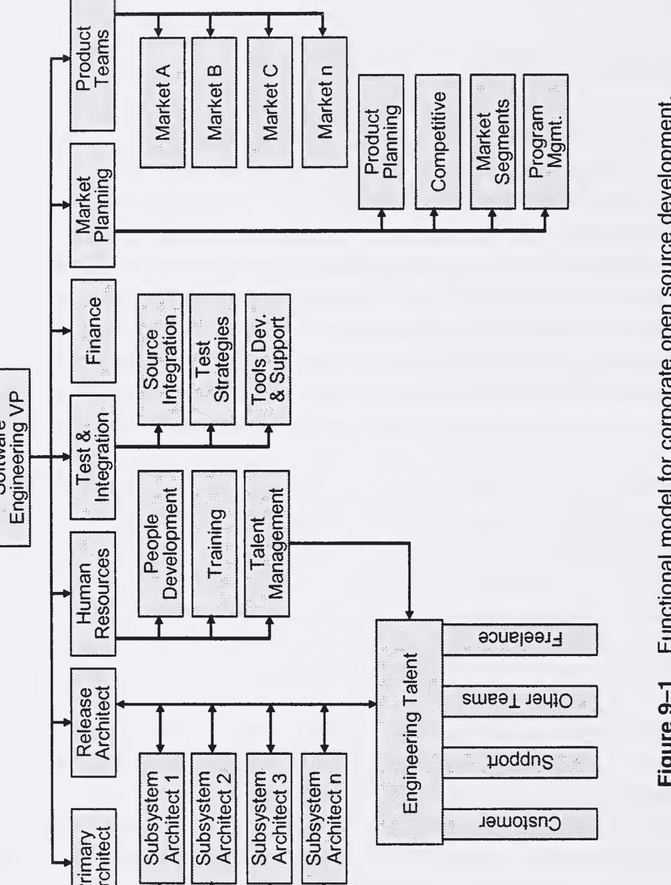

## 软件工程副总裁 (Software Engineering VP)

不要太纠结于头衔。这里的意图是引用负责产品整体交付市场的最高层执行官。VP 的工作是为正在开发的内容提供战略背景，以及领导所需倡议的人员。例如，我们是在开发一个 Linux 内核、一个 Apache Web 服务器还是一个 MySQL 数据库？通常需要将此开发活动与公司内的其他项目或倡议联系起来。例如，多个项目如何相互关联？有了图表概述的核心员工，VP 还拥有了确保组织内部一致的所有关键要素。关键问题是：

-   市场规划团队是否与工程团队有效沟通？他们是否在追求正确的市场？
-   人力资源小组是否能够获得完成工作所需的人才？
-   产品的开发是否重点明确，聚焦在确定的细分市场上？
-   公司是否达到了每个指定市场的收入目标？
-   创新的速度是否跟上（或超过）了市场速度？
-   我们需要的所有组件是否都已交付？
-   质量是否可以接受？
-   我们是否正在响应缺陷？
-   产品是否满足了目标细分市场的需求？
-   组织是否在成本/收入范围内执行？
-   团队是否充满活力？
-   我们是否留住了最优秀的人才？

将这些视为执行仪表板。归根结底，你希望交付最具创新性的产品、最高质量以及健康的利润。这三个元素成为团队动态的催化剂。如果团队获胜，他们将带来不断提升的伟大。

144 第 9 章 • 企业市集 (Corporate Bazaar)

VP 还有另一项关键职责。你很快就会了解到，首席架构在技术准备好时做出最终决定。在大多数公司采用市集风格的早期，这将是非常困难的。这与大多数管理结构相冲突，并往往引发企业免疫系统。

## 技术团队 (Technology Team)

基于所示结构，技术团队由首席架构师、发布架构师和工程师团队组成。技术团队还有另一部分我稍后会提到的“进入市场”团队。技术团队负责交付核心技术，而不是完善后的产品。那由进入市场团队负责。现在，让我们遍历技术团队中的关键角色以及产生动态。

## 首席架构师 (Primary Architect)

首席架构师应该是首席远见者。这可能与大公司典型的首席技术官 (CTO) 角色有所不同。 CTO 负责公司的整体技术，而首席架构师驱动特定产品的愿景。在我们的案例中，我们想要交付 Linux 操作系统。目标是什么？性能？可扩展性？可用性？如果这些都是目标，那么优先级是什么？权衡是什么？

一些人认为技术人员无法内化客户需求和市场需求。开源社区已经证明这一断言是完全错误的。你必须利用这样一个事实：任何软件工程师的主要动力之一是让他的东西投入生产使用。是的，有些工程师会被酷炫的技术迷住，但那些人处于层次结构中较低的位置。那些因酷炫的技术而成熟的人将成为你们未来的架构师。

目标是用一组关键的衡量标准和指标来引导你的首席架构师，以确保创新与产品竞争力之间正确的平衡。以下是你们应该针对你的公司开发的关键指标：


# 结构化市集 (Structural Bazaar)

- 当前发布的产品与其市场同类产品相比是否有竞争力？
- 产品是否符合既定的客户满意度目标（功能、质量、性能等）？
- 开发的技术是否具有创新性？是否有足够的关键差异化特征让你脱颖而出？

目标不应该是让首席架构师单兵奋战。架构师需要帮助，而这正是市场规划团队介入的地方。目标是让首席架构师获取尽可能多的信息以做出成功的决策。一个成熟的架构师会从这些信息的获取中获益。

首席架构师必须定义子系统的边界。任何大型软件开发项目都会被划分为子系统。目标是开发一种能够使子系统之间建立尽可能精细依赖关系的架构。在无法消除依赖的情况下，架构师必须清晰地定义用于子系统交互的接口。首席架构师可以将子系统的所有权委托给受信任的下属。

首席架构师还负责接收所有子系统架构师提交的代码。由于之前列出的指标让首席架构师对最终产品负责，架构师将有极大的动力建立一个受信任的子系统架构师团队。这就是人才管理的开始，它是基于信任分级的。如果子系统不符合预期，将迅速任命新的子系统架构师。首席架构师应该获得做出此类决策所需的全部灵活性。如果失去了这种灵活性，你就回到了“大教堂”式的开发模式。在这个层级对糟糕提交的容忍度应该是极低的。首席架构师必须在及时开发具有竞争力的产品的需求与交付低质量或不符合市场需求产品的后果之间取得平衡。

首席架构师还决定技术何时准备发布。这一决定将基于许多因素，包括质量、功能、性能等。最终，架构师是负责的人，并且必须做出最终选择。如果发布太早，技术将失去竞争力；如果发布太晚，竞争对手将开始抢夺市场份额。这组相互平衡的元素将引导正确的发布时机。你需要决定可以使用哪些奖励和后果来激励正确的决策。确保动机不是欺骗性或操纵性的，否则它们会适得其反。你必须理解，首席架构师的工作不是成为整个系统的唯一天才。技术团队所有架构师（包括首席架构师）的工作是识别他人的才华，并无耻地将其吸收，同时确保给予应有的荣誉。

最后，首席架构师必须与发布架构师保持近乎共生的关系。一旦技术发布，发布架构师将负责对系统进行微小的修复和增强。这两位架构师之间必须存在隐含的信任水平，因为发布架构师将能够影响整个系统未来设计和架构的决策。这类似于 Linus 和 Marcello 合作开发 Linux 内。

# 发布架构师 (Release Architect)

发布架构师应被视为“候补的首席架构师”。虽然始终可以用任何具备正确技能组合的人替换首席架构师，但设立发布架构师角色为系统提供了必要的冗余，并避免在首席架构师突然离开组织时陷入真空状态。许多人问过：“如果 Linus Torvalds 被公交车撞了，Linus 会发生什么？”这就是社区构建故障安全系统的方式。Marcello 可以立即上手让 Linux 持续运行，即使整个社区长期来看选择一个完全不同的维护者。

在首席架构师将技术交付给组织其他部分进行产品化后，由发布架构师接手。无论系统质量如何，总会有偶尔的缺陷或需要完成的关键特性。在某些系统中，可能会发现需要立即处理的安全漏洞。发布架构师负责软件发布后对系统问题进行反应性响应。然而，发布架构师必须维护系统整体架构的纯洁性。如果提交或建议涉及系统的基础架构变更，则该提交应转发给首席架构师，以便在未来的发布中考虑。

正如你从功能图中所示，发布架构师与首席架构师与相同的子系统架构师工作。确保每个子系统没有单一控制点至关重要。此外，特定子系统的资深人才将与子系统架构师非常熟悉。我们很快将详细讨论子系统架构师的角色，然后我们将介绍发布架构师如何激励这组团队在关键时刻帮助解决发布技术中的问题的细节。

在许多方面，发布架构师的工作比首席架构师更困难。他或她对架构的了解必须与首席架构师一样。他或她必须跟踪同样的市场动态。简而言之，他或她几乎需要复制首席架构师，但他或她并没有更改系统基础架构的能力。

针对发布架构师的指标侧重于响应和质量。衡量发布架构师向系统交付关键更新的速度，可以确保成功所需的其他大多数要素也能到位。例如，如果发布架构师不维护对整个系统的知识，响应速度将受到损害。同样，如果他或她无法与其他团队成员保持必要的关系，他或她将无法将所需的更改引入系统。衡量质量确保了速度与客户满意度之间的平衡。

# 子系统架构师 (Subsystem Architects)

子系统架构师实际上是一个架构师层级，或高级系统开发人员。层级的深度取决于系统的复杂性。为了讨论起见，我们假设只有一层。如果有多个层，那么最上层将通过接收底层子系统的完整贡献来执行与首席架构师类似的功能。

如果你思考 Linux 操作系统的背后的技术，你可以迅速想到许多子系统：虚拟内存、文件系统、进程管理器和网络，仅举几个。如之前所述，这些子系统的边界是由首席架构师定义的，并随着整个系统的演变而改变。子系统架构师的目标不应该是改变子系统的参数，尽管影响首席架构师是在范围内。

子系统架构师负责特定子系统的整体设计。他或她将从人才池中寻求贡献。子系统架构师必须与人力资源部门合作，以确保在需要时持续技术人才。正如你很快看到的，如果人才希望在层级中晋升，他们将动力为多个子系统做出贡献。然而，子系统架构师还


148 第9章 • 企业市集模式（The Corporate Bazaar）

创建一个能让工程人才有动力做出此类贡献的环境。这至关重要。

在交付新技术时，子系统架构师必须向主架构师交付一个功能完备的系统（或下一层子系统架构师）。主架构师必须建立起信任和信心，以便通过最少的评审接受提交。

子系统架构师还对发布架构师负责。子系统的任何问题通常都会通过发布架构师发现。子系统架构师有强动力与发布架构师合作，对当前发布的环境进行必要的增强和修复。响应能力将不断提升系统的持续质量。

你可以为子系统架构师建立几个关键指标：

- **吸引人才加入子系统的能力**——此外，扩展来说，你必须投入工作确保有可用的人才。
- **子系统的及时且高质量提交**——层级结构中的上一层是此项的关键输入。如果提交未达到可接受的目标，则应该更换子系统架构师。
- **子系统的创新**——新技术和发明需要在整个系统的每一层发生。因此，在每一步中都需要衡量创新性技术。
- **继任计划**——虽然主架构师和发布架构师形成了一个互锁的灾难恢复系统，但子系统架构师并不一定有这样的内置系统，优秀的会有。为了让子系统架构师在层级中攀登新高度，应该识别出明确的继任者。替换发生时，应该是子系统架构师离职和层级下一层共同决策的结果。

你应该看到这里正在形成一个主题。与其通过自上而下的管理决策建立组织层级，不如一种基于工程人才不断发展的成熟度、以及做出贡献以增强整个系统质量和竞争力的清晰愿的文化。让我们通过观察工程人才来完成这个主题。

# 工程人才

你组织中的工程师名其实义就是人才。他们是宝贵的资产，而不是不可替代的零件。初入组织时，你的人才需要时间适应企业文化，理解正在开发的系统，并决定做出贡献的最佳地点。不同的人会有各种目标。对于某些人来说，是爬到层级中的最高层；对于另一些人，是尽可能在整个系统中做出贡献，以尽可能地扩展他们的知识；对于另一些人，则是集中在技术的一个非常特定的领域。你需要认可这些目标中每一个的价值。它们都为系统增加了价值。

为了让工程师在层级中晋升，他或她不仅需要展示技术天赋，还需要某种程度的架构远见，更重要的是具备出色的人际技巧。随着工程师企图达层级越高，这些人就会变得越来越重要。

工程人才需要根据其贡献的质量、多样性和创新性进行衡量。这些指标的结合创造了一个有趣的动态。如果一个受爱的子系统达到了成熟点，那么工程师必须在系统内部创新，或者移动到另一个子系统做出贡献。如果贡献数量变得太低，就可以建立任何形式的物质后果来重新激发人才。

需要关注的关键点是被拒绝的提交数量。由于层级中的每一层都对一个具有竞争性功能平衡的质量系统负责，糟糕的提交会被断然拒绝。某些拒绝是正常的，应该是预料之中的。这可能意味着一个动力十足的工程师正在突破边界。而重复且持续的拒绝则指向人才上需要纠正的问题。

人力资源小组应该不断提升工程人才。我们稍后来看人力资源团队的细节。然而，请注意工程人才框的附录。这些代表了大型组织中的其他关键部分。市集模式开发的益处之一是每个人都能参与。虽然你必须确保贡献者接受系统、工具以及其余基础设施的适当培训，但你的文化需要鼓励来自任何地方的提交。

150 第9章 • 企业市集模式

如果你公司的其他部分渴望做出贡献以增强你的系统，你应该将其视为非常积极的进展。首先，这表明当前系统没有满足用户需求。其次，它提供了动力十足的额外人才。贡献仍然必须由其中一个架构师接受，糟糕的提交应该像其他任何提交一样被拒绝。这将确保公司内的其他人知道，在他们被鼓励做出贡献的同时，只有符合整个系统架构约束的高质量贡献会被接受。

人才可能来自另一个地方是你的客户和合作伙伴。这属于“围栏社区”的特殊类别；我们将在本章晚些时候讨论这些。

# 人力资源

开源社区并没有过多考虑人力资本的管理。不需要担心决定加薪、发放薪水、提供设备或提供职业咨询等事情。这组群体是社区市集模式开发与企业市集模式开发的主要区别之一。

我所描述的角色和职责可能远超你对人力资源小组的正常预期。这个团队发挥着至关重要的作用。技术团队的目标是尽可能将能量集中在技术和产品交付上。这意味着，除非由另一个团队直接管理，否则人员管理问题将处于边缘地位。这就是人力资源小组的全部。

# 人才发展

你的人才需要可用的资源来帮助职业咨询和任何专业发展话题。去研究生深造或在特定的开发领域寻求帮助（例如如何开发）可能是理想的。在传统公司中，个人发展通常是直属经理的责任。在这种风格下，直属管理不再存在，但仍然需要一个资源来帮助个人发展。整体企业沟通在这里发生。需要一个流程让管理层向员工传达整体战略。虽然工程

174
# 结构市集

151结构将确保日常工作与正在开发的技术保持一致，企业沟通确保员工能够获得更广泛的背景。

# 人才管理

该小组负责听取架构师的人才需求并确保有可用人才。如果需要稀有人才，这就是投资需要关注的地方。该团队还确保人才的多样性。通过多样性，我指的是对特定技术领域感兴趣、在管理层级中成长以及具有不同程度人员管理技巧的人才混合。

在涉及到公司负担得起的人才数量时，这个团队必须扮演“坏人”的角色。这有时可以通过永久性和临时员工的结合来管理。但是，如果公司无法再负担人才，这个团队必须与工程团队合作，对哪些子系统需要更多关注进行权衡。在这种情况下，工程团队可以做出选择，关闭特定子系统的贡献，以确保可用人才集中在最需要帮助的子系统上。记住，人才的衡量标准之一是提交的数量。闲置直到文化重新开放提交的人才将面临非常负面的后果。

人才管理的其他部分是确保拥有最好的人才并不断进化人才。

## 培训

该团队管理企业培训和工程流程培训的结合。企业培训是通常的愿景、使命和目标与身份认同及文化的混合。工程流程培训让人才准备好提交贡献。虽然有


## 第 9 章 · 企业集市

152

可以是对正在开发的技术进行一些高级培训，但你应该将精力放在工程师可以使用的工具和提交流程上。大多数工程师倾向于接受某种程度的“火中练兵”。一旦他们理解了提交贡献的流程及其生命周期，实践培训以及与其他工程师的互动将迅速开始解决剩余的问题。

不要低估培训团队的需求。如果工程师不理解如何做出有成的贡献，每个人都会输掉。

## 测试与集成

这些是你通常不会在开源社区中发现的其他功能。社区的测试和集成方案通常简单到通过邮件向主分支（main-via email）发送源代码、补丁和修复程序。更多情况下，第 3 节描述的工具set（CVS、Bugzilla 等）是社区的主力。测试在很大程度上是通过让大量的用户群在开发周期内遇到困难来实现的。注意这里的两个极端：NASA 为每名软件开发人员配备多达 30 名工程师，而社区通常会有正式的测试。虽然声称开源软件的质量水平与 NASA 持平可能有些牵强，但其实际记录说明了一切。真正的问题是：为什么社区能够取得如此令人深刻的质量结果？记得“只要眼睛足够多，所有的 Bug 都是浅的”吗？这就是问题的根源。

在许多公司中，对项目源代码的访问受到严格控制，只有那些经确认的“需要知道”的人才允许查看源码；甚至只有少数名单上的人允许修改代码。你需要培养的文化是：能够访问并查看源码的人越多越好。对设计、编码和算法的反馈总是极受欢迎的。但归根结底，你需要发布一个用于商业用途的产品；你的用户群依赖于基础测试和质量。由于你组织中开发者/用户群的规模可能远小于整个社区，你将需要更正式的测试和集成流程。

在第 12 章中，我将讨论在开源许可下发布你的源码的流程。通常无法预测何时会到达你想这样做的时机。因此，从源码集成的角度来看，请使用相同的工具，这将赋予你灵活性，以集成并可能迁移到社区源码库。在某些情况下，遗留系统或其他公司动态可能会迫使你使用特定的源码集成系统。在这些情况下，


## 结构化集市 153

借此查看一些提供抽象工具的商业供应商，这些工具允许你同时使用开源工具和传统工具。

极有可能，你将保留大部分的测试基础设施。如果你的新文化正在发挥作用，你应该能看到测试周期期间发现的问题大幅减少。经验丰富的经理也理解，测试团队的目的不应该是发现缺陷，而是验证一个运行良好的系统。

## 财务

你财务团队的同事也将扮演很大程度上是传统的角色，但也有一些值得注意的例外。由于你的模型包含了不断增加的人才群的参与，业务分析中使用的成本结构模型将需要进化。财务团队还需要帮助平衡技术团队与进入市场团队之间的关系，并与人力资源小组合作，确保与人力人才相关的固定成本结构得到妥善管理。

## 市场规划

另一个在大型社区中通常无法发现的关键角色是市场规划。记住，在社区中，开发者就是用户。这是一件很棒的事情，但如果你是在发布商业产品，你的用户群依赖于基础测试和质量。由于你组织中开发者/用户群的规模可能远小于整个社区，你将需要更正式的测试和集成流程。

在第 12 章中，我将讨论在开源许可下发布你的源码的流程。通常无法预测何时会到达你想这样做的时机。因此，从源码集成的角度来看，请使用相同的工具，这将赋予你灵活性，以集成并可能迁移到社区源码库。在某些情况下，遗留系统或其他公司动态可能会迫使你使用特定的源码集成系统。在这些情况下，

177

154 第 9 章 · 企业集市

## 进入市场

该团队也负责生成并校准指标，使团队关注正确的目标。通过衡量竞争性能，这提供了直接的反馈，说明架构师工作得如何。还有另一个积极的副作用会发生在这里。许多市场规划团队想要计划有限的功能。结果是，

175 

## 结构化元素

讨论的重点是工程发生在组织内部，某些团队会受到这种变化的影响。

## 围边界社区

178

讨论的重点是工程发生在组织内部，某些团队会受到这种变化的影响。

## 围边界社区

我在本章稍早些时候快速地提到了“围边界社区”的概念。随着你的文化演变为欢迎更多参与者，你将进入一个点，此时关键客户和合作伙伴可能想要加入开发。虽然你不能进行让外部合作伙伴修改你系统的粗放行为，但你可以以有纪的方式欢迎这种参与。

记住，本章的目标是让你接触集市化的开发过程，而不是将你的代码公开。“围边界社区”是允许客户和合作伙伴参与开发过程，同时保持你的源码专有。

为什么要允许客户和合作伙伴参与开发过程？开源的主要优势之一是社区对已识别问题的响应能力。在软件世界中，许多大客户对无法获得特定的请求处理感到沮丧。这些请求可能只是简单的缺陷修复，也可能是复杂的新功能增强。合作伙伴是指那些依赖你的产品来生产产品的公司。合作伙伴的参与也能让你增强你的产品。因此，你在围边界社区中的巨大胜利是解决需求的创新，以及通过直接参与对客户问题做出响应的机会。

创建围边界社区的过程涉及创建一个允许外部访问代码库的网络基础设施，同时维护严格的安全和隐私。你还需要建立识别可以参与的关键伙伴的控制措施。

你需要与合作伙伴建立秘密披露协议。如果你能够基于构建你的测试基础设施


关于开源规范，你会发现你的合作伙伴能够非常有效地加入你的社区。你还需要对客户和合作伙伴所做的任何贡献的知识产权（IP）所有权达成共识。你应该避免出现无法控制知识产权的情况。如果你想根据开源许可发布你的代码，你将希望尽可能地减少负担。

最后，下一步将涉及适当的培训，以及在客户、合作伙伴的工程师与你公司内部关键工程师之间建立某种程度的关系。

# 风险与问题

任何新结构都包含某种程度的不完备和某些风险。这种结构也不例外。首先，你需要将这种功能性结构转化为特定的组织结构。你对某些关键人员的选择将对该模型的成功产生巨大影响。在第 13 章中，我们将更详细地讨论该模型内人员的选拔过程。当你尝试从当前的结构迁移到一种新的、不同的模型时，还存在过渡期风险。确保你有一份详细的迁移计划和详细的沟通方案将是最小化这种风险的关键。你还需要在发布周期中选择一个合适的时机开始实施这种新的开发风格。此外，如果你将其作为实现某些关键文化目标的指南，你就可以启动一个演进过程，鼓励组织内部对源代码的开放访问。

我提到过几次，需要在组织内部推动一种对源代码访问限制较少的开放文化。虽然这是应用开源开发模式的要求，但由于你开发的是专有软件，你仍然需要在这种开放性与知情需求（need to know）之间取得平衡。你开发的仍然专有软件，需要确保你的知识产权不会在不知情的情况下转移给其他公司。管理这种风险的最佳方法是确保与员工签署保密协议，并且永远不要停止教育，以确保你的工程师清楚自己在做什么。

可能最大的风险与人员管理问题有关。由于这种结构最小化了工程人员内部直接管理的角色，你将希望确保顾问（Counselors）和教练（coaches）随时可用，并且人力资源团队积极主动，确保你的工程人才是首中之重。

## 总结

本章在一个困难且复杂的话题上涵盖了大量内容。你可能想多读几遍。通过展示开源社区如果存在于企业世界将如何进行开发，希望你已经获得了双重收益：既理解了社区如何实现某些惊人的进展，又能够将一些相同的技术应用到你的开发中。

在我们将你的开源开发知识扩展到将源代码公开之前，我们将绕道去理解开源对传统业务模式的影响，这将让你洞察为什么你想要考虑将某些开发项目开源，以及如何将社区工作整合到你的产品和开发中。

# 第 10 章

# 随时间的价值

软件供应商创建技术是希望创造的价值大于开发软件的成本。价值越独特、越重要，供应商就越有定价权。影响定价权的主要因素是客户感知的价值和市场上的竞争压力。开源以新的方式攻击定价权，并加速了某些技术的贬值。本章研究了市场中这种新形式的竞争。尽管本章是针对商业软件供应商编写的，但对于 IT 经理理解供应商如何受到市场动态的影响，并洞察市场上正在开发的新竞争产品来说也同样有用。理解对资源的影响对 IT 经理也很重要。本章的目标是让你理解：

- 时间/价值曲线的经济影响
- 开源对商业软件价值的影响
- 开源对价值可持续性的影响
- 如何利用时间/价值效应来获得优势

作为商业软件的开发者，你需要加速在价值链上的向上的移动，否则将面临价值被商品化的风险，并且不再能够产生足够的收入来收回。当我最近对西替定（Ranitidine）进行在线查询时，我发现一片 150mg 的药片只需要大约 0.12 美元。我 3.5 万美元的七年治疗费用将低于 2500 美元，降幅达 93%。你希望你的利润按那个比例贬值吗？这种价格剧变的原因是西替定通用药物的出现。通用药物在原开发者的专利过期后很快就会。对于大药，这通常发生在专利过期的当天。我将扩展这一比较，以展示医药行业如何收回成本并调整其业务模式。然后，我将转向软件行业的细节并应用这一新范式。

# 成本、价值、回报与时间

制药行业有一个非常独特的优势，即确切知道专利何时过期会对仿制药开始出现在市场上产生。这使得该行业能够建立良好的成本/回报模型。看看图 10–1 中的图表。

该图描绘了新药开发经济周期的简化视图。我的目标不是让你成为该行业经济模型的专家，而是用此类比开源对软件行业的影响。

制药公司投入大量资金研发新药。他们的目标是为我们社会必须应对的各种疾病发现新的治疗方案。制药公司投入大量资金研发新药。他们的目标是为我们社会必须应对的各种疾病发现新的治疗方案。

![img/9f16a0ce50f6011084.png]

# 第 10 章 • 随时间的价值

在研究周期的某个点，会发生发现。为了保护这一发现，公司将申请专利（专利需要 2-4 年）。下一阶段是进行若干开发。开发周期包括完善药物、在受试身上测试效果。开发周期接下来将演变为临床试验。这一阶段涉及对人类受试者的对照测试。对药物的安全性、有效理想剂量进行测试。即使在获得批准之前，如果化合物看起来良好，生产周期将开始。在某些情况下，化合物将不会通过，生产过程将需要停止。注意，当药物进入市场时，专利的时钟已经跳了多年。制药公司的目标是在尽可能短的时间通过开发和试验并获得批准，确保交付安全的产品。在药物获得完全监管批准之前，制药公司就会开始扩大生产能力，培训销售队伍，并为新产品进行市场种子投放。在这个周期中，目标是新产品收入的最大化。产品不仅必须覆盖制造、销售、营销和分发的运营成本，还能够收回研发成本。只有当收入超过持续的运营成本以及研发成本时，药物才能实现正向投资回报（ROI）。

图中未显示的复杂性在于，在此时，会有多个不同领域正在进行研究。有些研究永远不会变成产品。事实上，大多数化合物从未进入市场。因此，新药不仅必须覆盖其成本，还必须有助于收回不可避免的失败研究尝试成本。目前市场上所有药物的收入组合必须产生足够的运营现金流来资助持续研究并向投资者回报利润。

制药行业拥有的一个明显优势是能够清晰看到专利何时过期。因此，它知道产品何时会被仿制药商品化。因此，该行业可以建立非常准确的成本模型，使其平衡市场


## 制药行业

将承担所有的运营成本，并确保积极的投资回报率（ROI）和可接受的运营利润。这种预测价值何时变为商品化的能力，也允许该行业在恰当的时间开始降低运营成本的周期。这种整体的可预测性使得了一个非常高效且准确的成本模型，即使在研究成果转化为产生收益产品的程度上存在一定的不确定性。

## 从商品化中恢复

当仿制药上市，市场不再为该药物支付溢价时，会发生什么？制药公司必须开发新的业务模式，以在这种新竞争中维持盈利能力。你会从图中注意到，收入并没有归零。产生持续收入流的原因有许多点：

- 个人、药店和医生对产品的品牌认知度
- 对交付药物的公司的信任
- 对高端产品感知和真实的质量及一致性的认知
- 仿制药中惰性成分在某些患者身上产生的副作用
- 一些药企认为，其研究努力和通过创新做出的持续贡献应该继续获得回报

维持产品高收入的另一种方法是开发新的业务模式或寻找新的应用。对于某些药物，这可能意味着扩展到全球其他地区，或通过创新的方式组合药物来治疗新疾病。回我想之前对雷替丁（Ranitidine）和品牌名西坦达（Zantac）的讨论。你可能熟悉西坦达的原因是因为其创造者葛兰史贵（GlaxoSmithKline）开发了该产品的低剂量版本（Zantac 75），并获得了非处方销售许可。行业将这种情况称为“处方转非处方（Rx to OTC switch）”。通过广泛的广告，西坦达已成为数百万个人非常成功且受欢迎的抗酸治疗药物。尽管有凭处方购买的雷替丁仿制版，但品牌力量和非处方版本继续为药物开发者提供收入来源。

当开源软件成为客户的替代方案时，软行业必须开发这种创造性的业务模式演进来维持盈利能力。

## 开源对软件的影响

我的胃病和软件、开源有什么关系呢？尽管存在一些关键差异，但开源对商业软件行业的影响与仿制药对制药行业的影响非常相似。制药行业已经应对这种现象多年，并学会了据此调整其业务模型。对于软件行业来说，这是一个新现象，我们仍在学习适应这种影响。

让我来看看这两个行业之间的一些关键差异。一个软件产品通常包含很长的功能和能力列表，而药物通常是一个有限的化合物。通常，为实施形式为有限化合物的发明申请专利比为软件产品申请专利更容易。这是因为软件专利可能适用于位于软件产品的一个小子集（或功能）中的发明。开源社区中有许多人完全反对软件专利的概念。这些反对意见源于社区自由地赠送其知识产权（IP），并期望获得同样的回报。即使某种方法已获得专利，防御此类软件专利也可能是昂贵的。由于软件行业如此动态且广泛，在授予专利时无法验证是否存在绝对的现有技术（prior art）。这意味着即使某个特定的软件方法已获得专利，你在尝试防御该专利时也可能发现现有技术。软件专利的有效期通常为20年。

仿制药通常会尝试与高端产品完全一致。竞争性的软件产品即使是开源的，通常会有非常不同的模型来完成任务。最终结果是，虽然制药公司可以在若干年依靠某种程度的独占性，但软件公司在特定产品类别中维持任何独占性都是罕见的。

可预测性在两种模型中也大不同。虽然药物行业可以围绕可预测的产品生命周期建立相当的成本模型，但软件行业永远不知道竞争对手何时提供更好的产品或成本更低的替代品。药物行业仍然必须应对与软件行业类似的其他竞争压力，因此收入状况始终包含风险。图 10–2 复制了早期的模型，但这次是一个基于软件的经济模型。

开源社区的动力是产生具有尽可能吸引力的软件。这意味着，如果你处于利基市场，能够使你的产品商品化的开源开发者数量将大大减少，但不会消除。早期开发的一批开源产品是 Web 服务器、数据库引擎、桌面界面和编程工具。然而，有许多专门的产品和应用没有开源等价品。这里的关键在于，软件产品的适用范围越广，出现开源等价品的概率就越高。

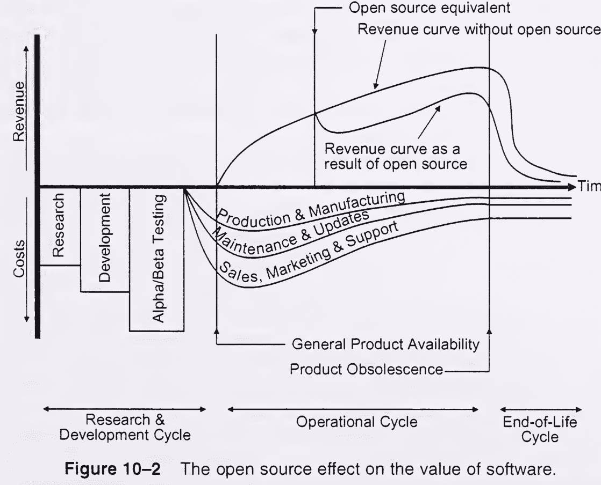

你还应该非常小心，不要认为你处于一个小小的利基行业，就不会面临开源软件的影响风险。一个例子是相片冲印和电影制作。开源社区创建了一种非常先进的图像编辑软件 GIMP（GNU 图像处理程序），该产品正在扩展用于电影编辑。虽然 GIMP 及其电影编辑对应物可能无法满足每个用户的需求，但它是未来趋势的领先指标，暗示了你所交付的价值很快将面临巨大的价格压力。讽刺的是，商业产品现在似乎在向 GIMP 借鉴！

图 10–2 描绘了开源对软件价值以及商业供应商获得溢价能力的影响。几乎所有商业软件都有价值。随着时间的推移，软件价值在客户眼中下降是正常的。这种贬值源于竞争力量和自然的商品化效应。二十年前，汽车的电动窗是一个昂贵的附加配置选项。今天，如果基础车型上没有电动窗，你可能会感到惊讶。软件供应商（和汽车制造商）通常通过不断增加新功能和新能力来应对这种自然的贬值过程。这些更新不断刷新价值。对于企业级软件，供应商可以通过成为支持软件的唯一实体来维持价值。另一个保护企业软件供应商的因素是准入壁垒。一旦客户投入了特定的软件选择，只要支持和更新的成本低于更换成本，供应商就可以继续收取溢价。

开源在多个维度上具有加速贬值的影响。首先，由于许多情况下大量开发者会解决这一问题，创建与你类似的替代方案的时间可以大大减少。其次，由于社区通常不受金钱驱动，你收取溢价的功能都是免费提供的。第三，虽然始终会维持准入壁垒，但由于开源软件的许可成本通常为零，该壁垒将大幅缩小。这最后的壁垒通常与某种形式的支持可用性有关。壁垒的大小取决于最终用户参与开源支持模型的意愿。

最后的挑战是可预测性。制药行业可以以很准确度预测其产品何时变为商品化，并能在恰当的时间通过调整成本模型做出反应。


# 贬值作为竞争优势

在生命周期中，开源效应的可预测性要低得多。首先，如果不关注社区正在进行的努力，你可能会被你产品的开源版本让你大惊。其次，由于软件产品通常是功能和能力的混合体，很难预测一个开源产品何时会在大多数客户的心中达到“足够好”的阈值。

## 贬值作为竞争优势

从开源中获益的关键在于理解如何利用贬值，以及与社区合作，而不是采取防御性的对反应。以下是一些对开源采取防御性反应的示例：

-   **激进的专利使用**——某些公司会通过对开源社区发起专利诉讼来反击。这并不是一种明智的策略。由于社区在法庭上防御专利攻击的资源有限，它们通常会通过持续持续且激进的负面公关攻击来做出回应。在几乎所有情况下，人们都可能编写出不侵犯专利权利要求的代码，因此最终几乎一无所获。Unisys 开始实施一项涵盖了图形交换格式（GIF）文件用压缩算法的专利，这些文件通常用于互联网上的图像。社区的回应是简单地改用 JPEG 或 PNG 文件。

-   **单体软件**——如今大多数软件被编写为功能层的集合，每一层都建立在另一层之上。开源软件开发人员通常从任何给定软件栈的最底层开始他们的项目。通过创建单体软件，供应商希望防止从堆栈底部开始出现商品化。然而，结果通常是会让社区创建一个架构更优的软件解决方案，并一次性将该单体软件商品化。

-   **竞争**——一种常见的反应是尝试与开源社区竞争。这通常是一种本能反应，会随着时间的推移而消失。与一个不受利润驱动、也不受时间限制的一流开发者组成的社区竞争，是一项愚蠢的尝试。在某一点（通常比你想象的要早），时间和资源将使这种行动无法维持下去。

最好的选择是积极参与开源社区，并让贬值对你有利。在下一章中，我们将研究多种业务模式的替代方案。现在，请关注你所培养的心态和文化态度，以便以积极的态度与社区合作，并将这种必然性视为一件好事。

即使没有开源效应，你的技术也会随着时间的推移而发生自然的贬值。然而，维持该技术使其能够继续支持堆栈上方的新价值也是对资源的消耗。最终结果是，你继续将资源投入到客户早已认为是基础功能的技术上，而他们不会为此支付额外费用。

所有软件公司的资源都是有限的。在大多数情况下，公司一直在如何将资源应用到价值栈更高处的能力上挣扎。技巧是与社区合作，补充软件栈底部的资源，这样你就可以部署资源来创建产生更多价值并回公司的能力。图 10–3 显示了你的资源应如何与交付给客户的价值对齐。

你的目标应该是尽可能将资源分配到堆栈的高处。下一章将为你提供有关如何将你的专有软件与开源软件结合的细节，以便你在资源重新分配上做出正确的选择。这里需要注意的一点是，即使在软件栈的最低部分，你也应该分配一些资源。你永远不要采取认为可以简单将软件“丢弃”给社区并让它自行处理的心态。你组织中的某人需要维持项目，关注社区努力，并确保软件栈的低端继续满足堆栈顶部组件的要求。你可能希望确保你的公司即使在堆栈的这一层也保留维护者的角色。

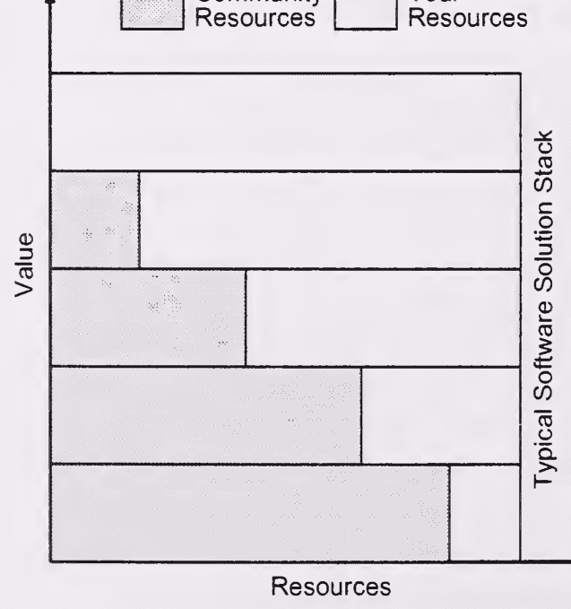

图 10–3 资源分配与价值交付的相关性。

## 留在时间中的价值

在软件栈的每一层与社区保持紧密联系的另一个优势是，你可以从内部看到你交付的价值何时、何以及如何受到社区发展的影响。这将为你提供一系列可以监控并据此做出反应的领先指标。

在最近的一次 Linux 活动中，我和 Tim O’Reilly（来自 O’Reilly Books）一起去喝了。我们讨论了许多不同的开源话题，我使用了“作为时间函数的价值”这个短语。在我描述完这个概念后，他用对该概念可能含义的不同观点启发了我。他的观点是，开源社区并不受限于在特定时间内交付一个有用且功能强大的产品。任何在高科技行业生活过足够长时间的人都会清楚产品早于时间发布的情况。当这些情况发生时，产品往往会被搁置，再也不见天日。自由软件社区没有这样的限制，当社区最终准备好时，技术可以找到新的用途。会面之后，我开始更多地思考 Tim 提出的这个概念，并意识到这种“留在时间中的价值”的概念已经发生在我身上。

## Pilot 基础类

1996 年，USRobotics 发布了一款革命性的 PDA，称为 Pilot 5000。今天，你们大多数人会对该设备的后代非常熟悉，即 Palm 系列的 PDA（许多人仍称之为 PalmPilot）。我对这个设备感到非常兴奋，不仅买了一个，还立即想开始为它编程。Pilot 的操作系统（现在称为 PalmOS）基于 C API。我是一个面向对象的程序员，非常想用 C++ 为它编写。虽然这在技术上可行，但如果我能将 PalmOS API 作为一组 C++ 类库，它是有效的。我要做的是微软构建基础类（MFC）的小版本。MFC 通过封装 Win32 API 极大地提高了在 Windows 上编写应用程序的效率。

我编写了我称为 Pilot基础类的东西。这是我在跨大西洋飞行期间进行的一个兼职项目。尽管我完成了大部分项目，但另一个开发者抢先一步发布了类似的项目。我没有理由与他的产品竞争。我已经对 Palm 平台学到了很多，并且对我投入开发的时间感到非常满意。事实证明，我在基础类方面的经验不会白费。

# Jump

Palm（当时为 Pilot）生态系统的关键贡献者之一是开发者 Greg Hewgill。Greg 已经交付了 CoPilot 模拟器，它是每个开发者工具包的主干（我将在下一章回到这个模拟器作为开源业务模式的例子）。1997左右，Greg 开始开发一个名为 Jump 的不同项目。虽然 Jump 的“官方”定义是 Java User Module for Pilot 的写，但 Greg 声称这源于深夜黑客期间听到的同名 Van Halen 歌曲。Jump 允许开发者编写 Java 代码，然后使用 Jump 将翻译成 Palm 设备使用的底层机器语言。（熟悉 Java 的人知道 Java 通常运行在称为 Java 虚拟机 JVM 的虚拟机内部。Jump 将 Java 代码直接翻译成 Motorola 68K 汇编代码，并为应用程序附加运行时垃圾回收器。）当 Greg 发布 Jump 的版本时，我正在创建一个名为“WorldClock”的演示。（我后来将 WorldClock 改名为 DeskClock；如图 10–4 所示）。这是一个简单的应用程序，同时显示三个时区。计划是在 Jump 最终作为新开发者的培训工具发布时，包含我的演示程序。


# 停留在时间中的价值


图 10-4 运行 DeskClock 的 PalmOS模拟器。

这也是我创建基础类的技能重新焕发生机的地方。Java 是一种面向对象的语言，在 Java 中为 PalmOS API 创建基础类是下一步自然的步骤。我们中的几个人开始开发 PilotJFC（Pilot Java 基础类），但这只是技术的一个例子，它更多是一个社区共同努力。我开发的内容最终以一种我完全无法预测的方式被重用了。

尽管我发现了原因，但 Greg 最终停止了 Jump 的工作。Jump 存在一些严重的局限性，使其难以继续作为开发平台使用。围绕 Jump 形成的社区逐渐消散了。Greg 承认他不再开发 Jump 了，他应该发布源代码，以便其他人继续他的工作。他确实在 GNU GPL 下发布了 Jump。我最终停止了阅读新闻组并失去了联系。我并不知道的是，几年后，一位名为 Ralph Kleberhoff 的开发者重新点燃了 Jump 项目，将其变为 Jump2。

# 第10 章 • 价值随时间变化

你可以想象我当时有多惊讶，在我停止任何开发近四年后的2001年2月27日，我（以及另一位 JFC 开发者）收到了来自 Jim Birchfield 的以下邮件：

> 发件人：Jim Birchfield
> 发送时间：2001年2月27日 周二 上午 1:35
> 收件人：Martin Fink
> 主题：PilotJFC 复活

> 我最近开始使用 Jump 开发一个应用程序，Noli 向我推介了一些关于 PilotJFC 的旧帖子。
>
> 自此以后，我将你给我的 JFC 版本更新到了 Jump 的最新版本。我还完成了了将 Worldclock 迁移到这个新架构的工作。在此过程中，我做了一些更改和增强，但在我拿到它时，所有内容都相当完备。
>
> 你们中是否有人能告诉我你们看来 PilotJFC 的状态如何？我想将其作为 Jump 发行版的一个“额外”部分添加。我愿意承担它的开发和维护工作。但我希望出现多个版本四流并导致分裂。
>
> 所以，我想做的是接管代码，确保在致谢中提到你们，创建更多演示程序，并将其成为 Jump 的官方部分。
>
> 大哥们怎么看？

Tim O'Reilly 让我想起了一件已经经历过的事情。由许多个人开发的软件在用户社区产生需求之前，一直“闲置在架架上”。这种证明应该成为一种激励，让你积极参与到与你的软件兴趣相关的领域中来。即使开发进度停滞或进展非常缓慢，也不要忽视它们。只需要一个有动力的开发者就能重新点燃活动，并让开源产品变得触手可及。在某些情况下，你可能就是那个最有动力加速项目的人。

顺便提一下，请注意 Jim 邮件中的几点。首先，他在“拿走”他们的工作之前先询问了原作者。其次，他向我保证会为他人的工作提供荣誉。第三，注意他使用“distribution”（发行版）一词的方式与我在第5章中描述非 Linux 发行版的方式相同。最后，Jim 不想与社区中的其他努力竞争。这封简短的邮件体现了开源社区的真正文化。

## 总结

本章展示了开源软件对你的产品可能产生的经济影响。你在应对这种经济影响时的选择可以是进攻、防御，甚至是尝试竞争。你最好的选择始终是参与并与社区合作，将其视为一个机会，将你的资源重新聚焦到能够为你的公司产生更大价值和回报的任务上。IT 经理也可以从这种效应中获益，通过扩展可用资源来加速 IT 项目。

你还看到，积极参与社区将让你能够跟踪项目（即使是停滞的项目），并以更具预测性的方式规划业务模式的演变。

既然你已经看到了经济影响以及你的最佳应对，现在是时候理解你的业务模式可以且应该如何演变了。下一章将详细介绍商业模式，以便你能够充分利用开源优势。

# 商业模式——赚钱

作为一名软件产品的开发者，无疑会有那么一个时刻，你会意识到 Linux 和开源对你的收入流产生了直接影响。你需要做些什么来调整你开发产品的方式，并以不同的角度看待你的收入来源。当你学习 Linux、开源以及自由软件的概念时，你需要理解如何通过新的产品、服务和支持范式来获利。本章将介绍多种不同的商业模式以及你所拥有的各种选择。虽然每家业务都不同，但如果你读完这些每一个模型，你应该能够将其中一个或多个模型适用于你的具体情况。你在本章的目标是理解各种商业模式，并利用这些信息作为指南来相应地调整你的业务模式。

虽然本章是针对软件产品公司编写的，但对于 IT 经理意识到软件供应商面临的挑战也是很有用的。软件供应商商业模式的变化将不可避免地改变 IT 经理的采购流程。以下是本章将检查的最常见开源商业模式列表：

- 用于 Linux 的商业软件
- 绑定到开源产品的服务与支持
- 使用开源增强商业产品

# 第11 章 • 商业模式——赚钱

- 用于硬件组件的开源软件
- 通过双许可将开源商业化
- 降低生命周期成本
- 构建生态系统

自由软件运动和开源社区的许多人认为所有形式的软件应该是免费的。虽然这种说法总是意味着访问源代码的自由，但在大多数情况下，它也意味着不收许可费。本章并不试图证明所有软件都应该是免费的，而是认为利用开源作为你业务的一部分可以建立非常成功的商业模式。如果你了解如何将其正确整合到现有的产品和服务组合中，开源对你的业务可能是一件非常有益的事。

本章将研究商业模式机会的细节。在下一章，我们将研究在产品中使用开源或向社区发布开源软件的过程。

# 明确你的价值

在研究开源商业模式之前，你需要做的最根本的评估是明确你的核心业务。你的客户是谁？你试图向他们交付什么价值？你在上一章中了解到，任何价值都会随着时间的推移而商品化。开源具有加速你试图交付的价值发生商品化的效应。你的目标是不断为客户交付更多、更高价值。。这意味着你在栈中较低位置的组件不再是客户愿意像过去那样支付大量的组件。

如果你对客户的价值主张非常明确，那么你就能轻松识别出对你的业务必需且必须交付，但你无法从中获得更多收入的组件。这就是开源对你的业务产生积极影响的地方。通过利用整个社区，你可以将投资投入到价值链中更高的位置。

这个过程对你组织内部的经理来说可能非常不安。它意味着他们过去成功交付的价值现在将来自其他来源。你必须进行的文化转变是帮助你的经理和员工不断


# 商业软件与 Linux

转向更高价值的贡献，同时奖励对开源社区的积极参与。

假设你清楚地理解自己的业务策略以及你交付给客户的延迟价值，有许多业务替代方案可以开始编织到你现有的业务中。

# 商业软件与 Linux

这是最简单的业务模型，但其观点仍然必须明确。有许多人认为你不能在 Linux 操作系统上销售或运行商业性的专有软件。在极少数例外的情况下，专有应用软件可以像你为任何其他操作系统打包和销售应用程序一样，为 Linux 进行打包和销售。如今有许多可用的 Linux 专有应用软件，而且 Linux 许可协议（GPL）中没有任何规定要求发布专有代码。图 11–1 展示了运行在 Linux 上的普通应用程序以及运行在 Linux 上的内核入侵型应用程序。

在某些情况下，你的商业应用可能会跨越 Linux 内部的内核边界（即你的应用程序软件的一部分运行在内核中）。在这种非常特殊的情况下，你需要以不同的方式管理构建和打包应用程序的过程，并做出一些业务决策。由于 Linux 内核根据 GPL 协议授权，你的应用程序中与内核集成的部分也必须根据 GPL 授权。请参阅第 2 章和第 3 章关于内核模块和 GPL 的讨论以获取更具体的细节。

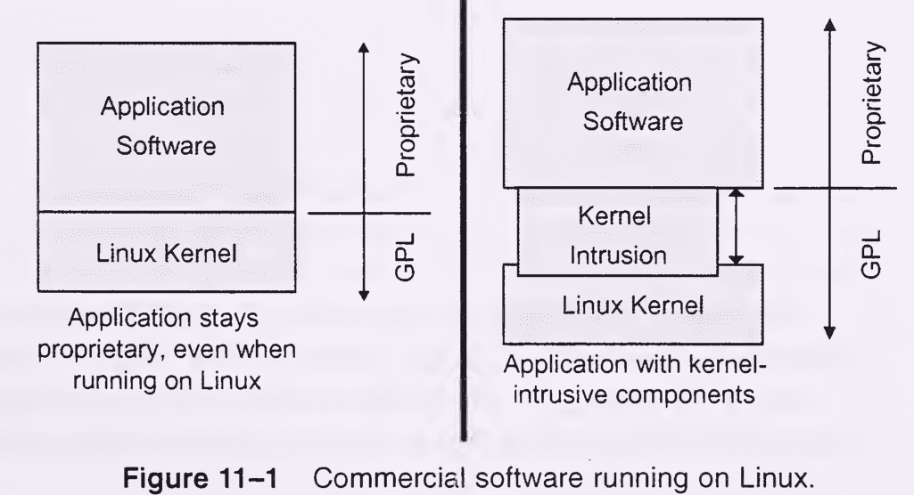

# 178 第 11 章 • 业务模型——赚钱

如果你理解交付给客户的价值，你可能会接受软件的内核入侵型组件并不是客户获取价值的地方。如果你的业务无法接受在 GPL 下发布任何软件，而且你的应用程序是内核入侵型的，那么你将无法为 Linux 发布它。你在第 2 章中了解到，创建专有内核模块是可行的。由于这种做法并不被推荐，我假设该选项是不可行的。如果你在软件的部分与非内核部分之间定义了良好的接口，你将毫无困难地发布你的软件。

你应用程序软件的内核入侵型组件将以模块或补丁的形式交付给 Linux 内核。你可以将这些 GPL 组件与你应用程序的专有部分聚合，并将解决方案交付给你的客户。

# 与开源相关的支持与服务

Linux 发行版厂商创建了开源社区使用的最早业务模型之一。该模型的最基本形式是销售对厂商提供的发行版的支持。大多数 Linux 发行版将他们开发的开源组件封装在发行版中，他们是该软件包的专家。通过这些开源发行版，开发出了许多业务模型：

- **零售包装**——许多客户愿意为介质和说明书的简单便利付费。许多人仍然不知道他们可以简单地合法且免费地下载或复制软件。许多 Linux 发行版可以在零售渠道购买。
- **支持**——发行版厂商通常将支持服务捆绑在他们的零售包中，以帮助客户解决安装以及可能遇到的任何其他困难。大型企业客户会为他们复杂的安装购买全面的支持服务。像 Linux-Care 这样的公司专门为广泛的开源产品提供支持服务。
- **订阅**——这是某些发行版厂商提供的服务组合的一部分。订阅服务为保持软件自动更新提供了多种选项。Xianian Corporation 公司使用订阅服务为 GNOME 桌面用户提供更新服务。

聚合与增强 179

- **品牌关联**——硬件和软件供应商可能与发行版合作，通过捆绑和其他业务活动将它们与自己的品牌联系起来。根据情况，供应商可能会对这种关联收费。这种关联通常意味着某种形式的认证，这对某些客户可能很重要。
- **专业服务**——通过持续开发发行版，厂商可以将其作为“名片”来展示他们的核心竞争力。红帽（Red Hat）专于提供与其 Linux 品牌相关的专业服务。

要使用这些业务模型，你必须进行一些基础性的业务分析，衡量开发“名片”（在此情况下是指一个完整的发行版）的成本，以及与上述列表中每个机会相关的收入。许多公司发现维持这样一种业务是困难的，并正在使用更传统的方法（如转售专有许可软件）来补充他们的业务模型。

# 聚合与增强

这种业务选择通常涉及将开源软件与专有软件结合，为客户提供更完整的解决方案。在某些情况下，它可能会将开源软件与专有硬件产品相结合（我将在本书的稍后部分讨论硬件模型）；但在许多情况下，你可以通过整合开源组件来增强专有软件。在其他情况下，你可以将专有功能添加到开源产品中进行销售。图 11–2 显示了如何将开源应用程序与专有组件聚合，作为完整解决方案出售给你的客户。

这种业务模型运作的一个良好例子是 Covalent Technologies 的产品。Apache Web Server 是开源“杀手级应用”。Covalent Technologies 从这种开源服务器技术开始，增加了大型企业所需的各种。Covalent 增加了管理性、安全性和弹性，以使这个最常用的服务器平台适用于商业部署。Covalent 还为大客户提供支持服务。由于管理团队参与了 Apache Web Server 的开发，

203

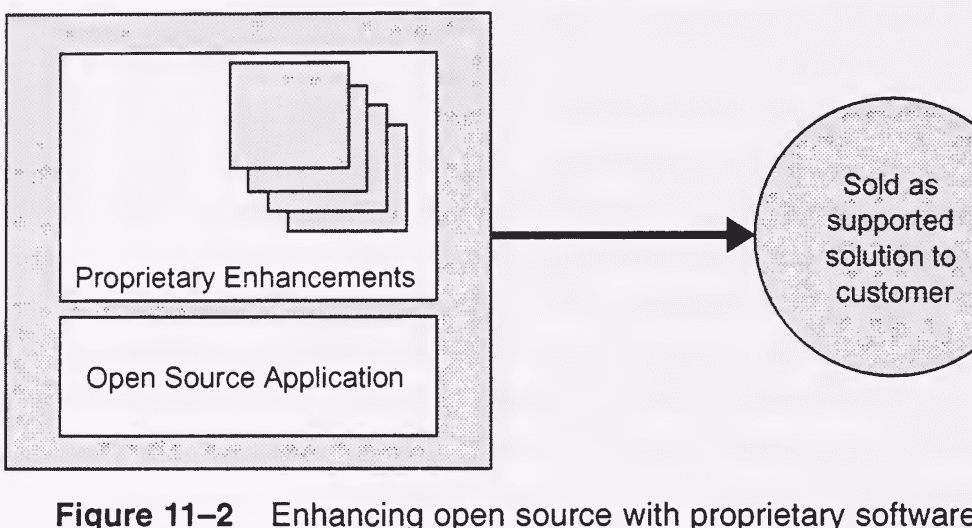

开源社区与商业部署之间的紧密联系为客户提供了理想的桥梁。

许多公司可以在 Apache Web Server 之上构建新的商业功能，并在过程中进行竞争。如果做得当，每个竞争公司实际上都会合作尽可能改进完善核心的 Apache Web Server。每家公司都会理解，他们交付给客户的价值不在于服务器本身，而是在其之上提供的工具和支持。

这种业务模型可以重复应用于许多核心开源平台，如 Internet 终端、集群技术、文件系统、用户界面、图形艺术工具等。列表层出不穷。你可以专注于交付吸引人的价值，而无需陷入那些必需但客户不愿投入的底层组件中。

# 使用双许可进行商业化

我在第 3 章中通过 ReiserFS 文件系统作为例子，简要介绍了双许可的概念。本节将在业务模型的背景下讨论它。这种特定的模型要求对源代码拥有所有权或可接受的许可。使用双许可意味着你维护一个开源（通常是 GPL）版本的软件，同时也以商业许可发布相同软件的版本。该业务模型围绕商业版本的传统许可和支持收入旋转。


通过双许可模式对软件进行商业化。这种模式通常涉及开源版本与专有商业版本之间的某些差异。差异通常表现为更先进的软件、经过更多测试的软件或开源版本中不具备的功能增强。这种模式可能还包含时间维度。这意味着开源发布可能在商业版发布几个月后才进行。图 11–3 提供了一个比第 3 章所示更完整的图示，展示了这种模型。

这种业务模式的优点包括能够利用对你产品感兴趣的开发者社区，并获得降低开发成本的机会。开源版本还可以创建一个庞大的用户群体，提高对你产品的认知度。虽然产品的商业版本可能与开源版本不同，但社区通过获得软件的开源版本而获益。虽然对仅使用软件开源版本的客户来说会损失一些收入，但用户基群的扩大和认知度的提高通常会导致客户群的扩张。

要执行这一模型，你必须根据开源许可协议发布你的全部或部分应用程序软件。下一章将概述你需要遵循的流程，以确保你可以完成发布，这要求你必须是软件所有部分的版权所有者（或拥有所需的许可）。你的公司将担任软件 GPL 版本的维护者。作为维护者，你有权接受或拒绝对源码树的贡献。

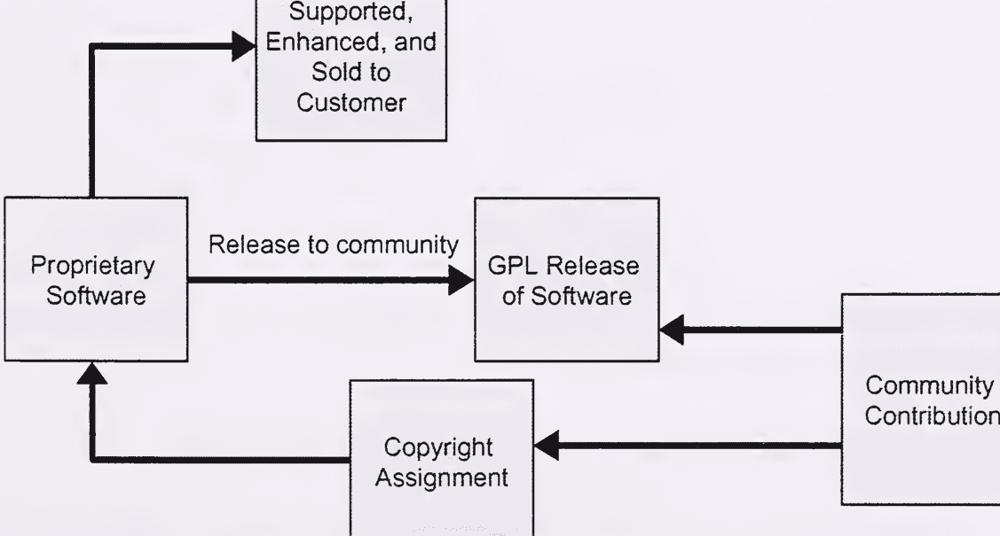

图 11–3 使用双许可管理的商业软件。

182 • 第 11 章 • 业务模型——盈利

因此，你可以作为贡献的一部分要求版权转让。这意味着每个贡献内容的开发者都将将其内容的版权转让给你的公司。附录 B 包含版权转让示例。然而，你应该始终寻求法律咨询以确保符合所有当地法律。版权转让通常允许版权所有者以专有许可以及开源许可重新发布软件。此外，如果你拥有版权，你可以自由地将软件与你拥有的任何其他专有代码混合。

你对双许可方法和寻求版权转让都应该保持谨慎。根据项目的不同，社区可能会反对版权转让。在假设所有人都会同意向你转让版权之前，确保你与社区的潜在成员进行了协商。

## 硬件

最容易理解和操作的业务模型之一是硬件业务模型。该模型假设你交付给客户的价值源于硬件。你交付的硬件通常是某种类型的外围设备或连接外围设备的接口硬件。外围设备的示例包括打印机、扫描仪和磁盘驱动器。接口硬件的示例包括视频卡、磁盘控制器和实现通用串行总线（USB）标准的总线接口。当交付硬件是你的首要目标时，你通常认为能让你的设备在越多地方运行，你的潜在市场就越大。与开源社区合作交付驱动程序（设备与操作系统之间的软件接口）可以是你的公司以极低成本扩大潜在市场的最有效方法之一。

硬件业务模型建立在你能够清晰定义“控制硬件的能力”与“使用硬件功能”之间界限的基础之上。

# 分离设备接口与设备功能

解释这一点的最佳方法是通过一个真实的案例。想象你正在销售一种接口硬件，允许消费者在计算机上看电视。

硬件 183

你的硬件可能是某种形式的接口卡，插入计算机中并带有用于输入电视信号的连接器。在这个例子中，你交付给客户有两个主要的软件组件：控制接口卡的设备驱动程序和电视收视软件。你的业务模型问题应该是：

- 我的客户是否感知到了设备驱动程序的价值？
- 我的客户是否感知到了电视收视软件的价值？

为了利用开源社区并扩大你的市场，你必须对第一个问题回答“否”，并对第二个问题回答“是”或“否”。图 11-4 展示了应用程序软件、设备驱动程序和硬件之间的关联。

通过对第一个问题回答“否”，你承认了在最广泛的平台上启用硬件有助于你的市场地位。你的下一个目标应该是与社区紧密合作，让其实现它。正如我在上一章提到的，你需要一些资源作为你与社区的桥梁。如果你与社区合作，它通常会为你完成大部分开发工作。通过向具有良好记录的社区成员提供硬件，你可以加速开发周期并增强关系。

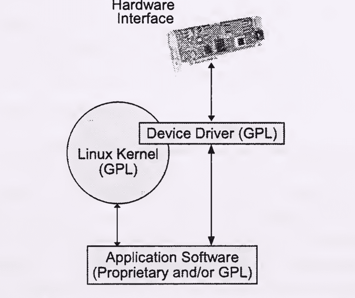

图 11-4 与硬件交互。

184 第 11 章 • 业务模型——盈利

如果你的硬件成本仅为几百美元，那么对于复杂的开发工作来说是非常划算的交易。

你还必须决定你希望对设备驱动程序保持何种程度的控制。这一决定的意义在于你希望如何维护和支持驱动程序。你可能会发现社区中有一个想要主导开发者，并由其成为维护者。或者，你可以选择在公司内部维护驱动程序。这是你的决定，取决于你愿意承担的成本以及你希望的控制权。即使你选择在公司内部开发和维护驱动程序，如果社区认为可以做得更好，他们仍然可以开发自己的版本。与社区的协作关系通常能确保双方做正确的事并避免重复开发。为了让开发者社区成功地为你的硬件开发设备驱动程序，他们通常需要关于硬件功能方面的良好文档。社区有很多逆向工程的案例；然而，向社区提供足够的信息让他们完成这项工作要合理得多。


## 生命周期结束模型

如果你做得正确，你的硬件就不会变得同质化。发布关于产品内部能力的文档往往会让许多经理感到非常头疼。你很少需要发布覆盖硬件整个功能的完整文档集。你需要发布的是足够的文档，让开发者能够控制设备或接口硬件即可。

实现这一点的最佳方法是开发定义新一类文档的工程流程。这些文档的发布了接口规范，而不会发布会帮助你竞争对手的专有数据。在某些极端情况下，这甚至可能会影响硬件的实际设计。

在某些情况下，你将从第三方（通常称为 OEM）处采购终端硬件产品的组件。在这些情况下，你必须预先与 OEM 谈判，获得适当的文档，以便将其发布给社区用于开发设备驱动程序。在某些情况下，你可能可以与 OEM 协商开发设备驱动程序，或者通过开源社区来管理这一点。

作为发布正式文档的替代方案，你可以开发一个参考驱动程序并将其发布到开源社区。社区可以使用此参考驱动作为起点，并作为硬件文档的替代品。

## 与硬件捆绑

硬件业务模型的最后一个方面是将开源软件包含在你的硬件中，或者转售带有开源解决方案的硬件。无论哪种情况，目标都是给客户提供交付额外价值或更完整解决方案的感知。你必须考虑将开源解决方案与你的硬件捆绑带来的支持影响。

## 生命周期周期结束模型

生命周期结束业务模型需要复杂的分析，以平衡降低成本、加速结束周期以及理解开启自给维持社区的影响。

当一家公司结束一个产品的寿命时，它必须考虑对其客户群体的影响。投入资金部署产品的客户通常不会对其投资的变得过时做出良好反应。结束产品寿命的公司必须考虑其在客户群体中形象受到的负面影响。虽然客户会理解终止产品寿命的逻辑，但他们仍然会对需要开发替代方案并承担变更成本而感到愤怒。

如果你结束一个产品的寿命，你通常会提供许多年的支持寿命，以与客户建立好感，并给他们充足的时间决定如何迁移到新解决方案。在这一支持生命周期内，你将分配工程师继续响应客户问题并修复可能遇到的任何新缺陷。虽然客户通常愿意为这种支持付费，但你正在产生成本，并将精力集中在显然已不再具有战略意义的事情上。

在这些情况下，开源可以成为与客户建立好感、降低内部支持成本并确保你专注于公司战略方向的有效工具。如果你的核心业务模型通常与支持挂钩，开源也可以成为与专门提供开源产品支持的其他公司合作的有效方式。通常可以创建一个环境，让客户自发地继续支持和增强该解决方案。

如果你正在退出你正在进行生命周期结束的业务类别，那么你可能对客户如何从当前解决方案迁移到新解决方案没有偏好。你的首要目标通常是维护在客户群体和整个行业中的积极形象。这通常是根据开源许可发布你的软件产品的最佳时机。

## 构建生态系统

在上一章中，我介绍了 PalmOS 模拟器。这可能是最早成功且执行良好的开源业务模式的例子之一。它也是公司如何确定其真实价值并与整个社区紧密合作的绝佳案例。回顾 PalmOS 模拟器如何从社区开发演变为由公司赞助的东西的。

当 USRobotics 向市场推出 Pilot 系列 PDA 时，官方开发平台是来自 Metroworks 的商业解决方案。Metroworks 专门从事主要运行在 Mac 上的嵌入式平台开发工具。对于商业开发者来说，这是一个可以接受的解决方案，但许多开发者也希望有 PC 平台的解决方案。当为 PDA 这样的嵌入式设备编写软件时，开发者通常希望能够在开发系统上模拟设备。这种模拟可以显著提高开发效率，因为新软件可以被快速测试，此外...


摘要

这是一个商业模式的示例，它展示了开源造福所有人的最佳方式之一：通过允许关注交付给客户的核心价值，降低开发成本并加速产品上市：

- Palm Computing（手掌计算）正确地确定了他们向客户交付的价值：一个拥有大量应用程序的连接式便携式设备。
- 社区为 Palm 提供了一个宝贵的生态系统，促进了其产品并使其更具价值。
- 社区开发了价值链中的一个关键组件，使 PC 平台的开发者能够针对该产品进行充分开发。
- Palm 继续向整个社区共享 POSE 的开发工作。这种积极参与引导了 Palm 所需的发展方向，同时利用了社区的开发经验。
- 发布 ROM 镜像是发布文档的一种形式，这是社区成功所需的。Palm Computing 还发布了其他文档以帮助开发者取得成功。

USRobotics、3COM 甚至现在的 Palm Computing 没有任何人能预测到这一系列事件的发生。你的机会是向这些开辟道路的人者学习，并为与开源社区进行这种高产的协作做好计划。

# 摘要

任何这些商业模式都可能仅根据执行情况而成功或失败。理解商业模式并不能替代全面的业务分析。你仍然必须了解你的目标市场和客户需求。构建盈利业务的所有其他元素仍然必不可少。开源仅仅是能够提供建立新业务或增强现有业务机会的另一个元素。

既然你已经对可以利用的商业模式有了了解，你必须理解如何在你的公司内部整合开源。下一章将为你提供在决定使用或发布开源软件时所需的流程和工具。

# 第 12 章

# 将源源集成到你的业务中

最后三章详细解释了开源开发是如何运作的、对软件行业的经济影响，以及在开源语境下构建盈利软件业务的各种商业模式选择。假设你认为自己利用这种新的软件业务范式，你现在需要考虑基础性的业务流程变化。本章和下一章将概述一系列运营流程，使你在将开源软件与业务的各种元素整合时能够做出明智的决策。本章的目标是：

- 详细说明使软件开源的合理理由
- 提供将专有软件迁移到开源许可的流程清单
- 学习将开源整合到业务中涉及的问题
- 理解在使用开源时应避免的领域
- 理解整合开源时需要考虑的法律问题

本章适用于 IT 经理也适用于生产商业软件的公司。IT 经理更有可能将开源软件引入内部以降低成本，因此本章中涉及“入站开源”的部分将最受关注。入站和出站（将专有软件迁移到开源许可）开源可能都会令商业供应商感兴趣。

# 出站开源

推动一项出站开源（Outbound Open Source）计划是将目前以专有许可销售的软件迁移到开源许可下。要成功实现这一目标，如图 12–1 所示，需要考虑许多步骤以确保项目取得成功。

从图 12–1 可以看出，向开源社区发布软件并不是一个简单的代码“传过墙壁”的过程。必须进行一些严谨的规划和详细的流程。当然，每个项目都是不同的，并且比其他项目更复杂。在某些情况下，整个过程将花费非常短的时间，但关键是确保你至少考虑了所有元素，并且不要掉以心。无论商业飞行员降落过多少次飞机，他/她每次都将遵循清单。

| 业务案例 | 实施 | 营销 | 维护 |
| --- | --- | --- | --- |
| 目标 | 代码清理 | 启动计划 | 衡量 |
| 指标 | 许可选择 | 社区意识 | 持续营销 |
| 架构 | 开发环境与门户 | 竞争性参与 | 战略方向 |
| 成本/效益分析 | 培训 | | |
| 社区相关性 | | | |
| 版权所有权 | | | |

图 12–1 出站开源流程。

# 业务案例

第一步是详细梳理业务案例，以了解继续进行开源项目是否具有意义。图 12-1 显示了业务案例的关键元素。由于遵循这一流程对你来说可能是新的，因此详细地过每个元素是值得的。

# 目标

在进行任何实施工作之前，你应该确保你已经为开源项目设定了合理的目标，并让所有参与者都清楚这些目标。以下是一些例子，其中许多与上一章中关于商业模式的讨论有关：

- **降低竞争产品的价值**——如果你有一个竞争对手，他们提供了你未提供的解决方案，或者其解决方案明显优于你的，这可以作为继续进行的良好理由。这意味着你的目标是加速竞争对手产品的价值贬值，并切断竞争对手的收入和利润来源。你必须意识到，如果你选择这样做，你将影响该解决方案的整个市场领域，包括你自己。
- **普及性**——如果你拥有一项核心基础设施技术，它是你组合中其他产品和解决方案的推动者，那么你可能希望考虑使用开源作为使你的技术普及或被采用为标准的方法。
- **降低成本**——有时与社区合作工作可以降低开发解决方案的成本。在这些情况下，你可能在为客户提供复杂的解决方案，并在栈的某些部分使用开源将允许你以更低成本更快速交付更大的解决方案。
- **硬件**——正如我在硬件业务模式讨论中提到的，与社区合作是促进销售的绝佳理由。
- **服务与支持**——如果你的主要业务模式与服务交付绑定，那么提供开源解决方案是合理的。
- **退出计划**——如果你正在退出某个业务类别，开源可以是加速这一过程并重新聚焦资源的有效方式。
- **合作伙伴策略**——开源具有鼓励协作的效果。你可以利用开源与合作伙伴竞争对手进行大型项目合作。
- **记录现有技术**——在某些情况下，你的公司开发了不具战略意义的技术，且不想承担申请专利的成本。通过开源许可发布软件是记录现有技术（Prior Art）的有效方式。

同样，也有许多开源无法产生业务效益的原因。以下是开源不是一个好主意的常见原因列表：

 ** **控制点**——如果你的产品是一个竞争控制点，或者为你的竞争对手产生了重大的准入门槛，你不应该考虑将该产品开源。
- **产品过时**——生命周期并不等同于产品过时。如果一个产品在你和客户眼中已不再有用，请终止该产品。试图通过开源来维持该产品的生命通常不是使用开源的好好理由。
- **负成本/效益**——如果你对将产品迁移到开源许可的成本进行财务分析，你应该能够量化出更大的回报，否则不要执行。
- **资源分散**——通常在转向开源社区时，你仍然需要投入内部资源。如果这些资源的投入和成本显著分散了组织的精力，那么可能不是一个好主意。
- **知识产权风险**——你的律师会与你合作，了解项目中的知识产权所有权。如果法律风险太大或难以量化，你不应该继续该项目。
- **与社区竞争**——与现有的开源项目竞争通常不是一个好主意，并且会引起社区的所有反感。如果已经存在与你相似的项目，你应该尝试加入并增强该项目，而不是与其竞争。


## 外部开源

- 这太酷了！——许多工程师会认为，因为他们开发了非常优秀且非常酷的技术，所以它应该开源。这种观点认为这可以获得积极的媒体报道。在大多数情况下，当项目未能达到预期时，短期的积极报道会被长期的成本和负面报道所抵消。

当你的团队确定了项目的关键目标后，你就可以进入构建业务案例（business case）的下一个阶段。

## 指标

一旦你理解了项目的目标，就应该设定一套指标。这些指标在你制定风险缓解计划，以及当你尝试衡量项目是否成功时，将至关重要。根据你的目标，需要监控的一些关键指标包括：

- 竞争对手降低了竞争性产品的价格
- 积极贡献该项目的开发者数量
- 实际贡献的数量
- 下载和使用项目的用户数量
- 围绕你的项目构建的生态系统组件
- 与现状相比，开发成本降低且上市时间更短

指标取决于项目的具体情况，但了解如何定义成功以及预期在多长的时间跨内看到成功是非常关重要的。

## 架构

架构阶段在开发生命期的早期就涉及技术资源。技术专家需要评估拟议开源项目的架构。技术团队需要做出的决定是：

- 软件模块是否具有清晰的划分
- 软件是否可以在私有组件和开源组件之间进行有效划分？
- 如果开源项目的目标是支持私有项目，是否已有相应的接口来确保私有组件保持其状态？
- 软件是否可以从现有的企业配置管理系统中隔离并提取？
- 你是否拥有拟议开源的软件的所有知识产权（IP）？如果没有，你是否有许可在开源许可证下发布它，或者是否可以替换受影响的组件？
- 是否有涵盖发布代码的许可专利？即使你与另一个供应商有专利交叉许可，你可能也没有权利在开源许可证下进一步对该专利授权。

每个项目都是不同的，每种软件架构都是独一无二的。如果你已经为项目建立了明确的目标，那么它将引导技术团队做出正确的评估，为软件产品的发布做好准备。

## 成本/效益分析

许多人认为，将软件迁移到开源许可证只需要简单的打包工作并让产品可供下载。然而，开源产品的成本可能比这种简单的世界观要贵得多。每项财务分析都必须考虑特定项目的目标和动态。有一些常见的元素应该被考虑为成本分析的一部分：

- 维护一个新的软件仓库。
- 清理现有代码库并移除任何不恰组件或注释。
- 用于宣布项目可用并建立社区的营销计划。
- 对软件进行持续维护（假设你选择继续担任软件维护者）。
- 提供文档。文档应包括架构、设计和终端用户文档。
- 托管软件门户，允许社区共同工作并参与项目。你可以自己托管，也可以使用第三方的服务。
- 根据发布的软件项目的复杂性产生培训成本。
- 累计下载成本。如果你发布的是一个流行的软件解决方案，你可能需要设置服务器来处理增加的下载流量。无论你是亲自还是外包给第三方，成本都可能是巨大的。

你应该预期这些成本将与回报平衡。这种回报应该直接与项目的目标相关，但以以下一种或多种形式呈现：

- 降低内部开发成本
- 降低支持成本
- 提高市场知名度
- 配套产品（硬件和软件）收入增加
- 对你的竞争对手造成可接受程度的损害

这种成本/效益分析将为你提供所需的信息，确保你做出的决策是基于基础业务价值的。

## 社区相关性

这是决策过程中重要但经常被忽视的组成部分。虽然许多开源倡导者认为所有软件应该公开，但你刚刚看到有一份需要考虑的实际成本列表。只有当你以有形或无形的方式收回这些成本时，进行开源项目才有意义。有时，将软件发布给社区并不会产生任何兴奋。没有人会在意，也没有人参与你项目的开发。

提前确定你的项目周围是否会有一个社区至关重要。如果你正在现有的项目区域添加功能，你通常可以提前联系子社区的领导者，并获得他们参与你开发项目意愿的明确指示。

在尝试从现有客户中建立社区的情况下，你应该对相当数量的客户进行调查，以了解他们投入资源参与开发社区的愿望和意愿。

最后，如果你的目标是为新技术领域创建一个全新的社区，你应该制定非常全面的营销计划来推广项目，并且不应低估运行此类项目的成本。你还需要寻找并甚至为你新社区中的潜在开发者提供激励措施。

## 版权所有权

尽管我之前提到了版权所有权的问题，但值得注意的是，这应该是决策过程中的一个意识部分。你不仅必须考虑代码库的现有所有权，还必须决定是否希望获得任何贡献的版权。

这一决策过程的一部分将基于你所选择的业务模式。如果你还记得上一章，你可以根据两种不同的许可证发布你的软件：一个是开源的，另一个是私有的。如果你选择了双重许可业务模式，那么你将需要确保建立相关流程，以接受那些愿意将版权转回给你的贡献，或者你拥有允许你进行分许可的许可。

## 风险缓解

显然，你完全希望你的项目能够进展顺利。然而，你应该考虑执行过程中的负面因素。承认问题可能会出现并为此做好准备是明智的商业行为。你应该考虑作为风险缓解部分的元素包括：

- 如果项目周围形成了社区？你会等多久让社区立足？如果社区没有建立起来，你愿意付费开展哪些额外的营销计划来使其成功？你终止项目的判断标准是什么？
- 如果预期的项目成本超出预期？你是否有针对成本超支的计划应对措施？
- 如果项目的知识产权（IP）产生争议？你是否有针对任何许可协议的适当文档？
- 如果形成了竞争性项目？你是否理解在什么条件下工作可以避免竞争性项目的产生？
- 如果社区基于你的项目创建了一个具有不同战略方向的替代项目？你的公开反应是什么？你在意吗？
- 如果下载量远超你的预期，用户无法获取软件？你开发了哪些流程来处理意外的负荷？

总是花时间考虑可能出现的问题。不要对项目持有悲观观点；只需建立明智的商业应对措施即可。


# 实现

在完成业务案例开发流程后，你应该会有足够的信息来做出通过或不通过（go/no-go）的决策。如果你进入实施阶段，说明你已经决定继续进行你的项目，现在是时候让计划运行了。

# 代码清理

实施始于代码清理，以确保你拥有一个可以发布给的源代码。代码清理的元素包括：

-   确保你发布的内容可以使用最少的指令进行构建，并且功能齐全——社区对非功能性的软件会有负面反应。这并不意味着没有缺陷，但它应该足够稳定，让其他人能够理解产品是如何工作的。

-   对代码进行结构化和注释——如果你是从一个较大的项目中提取代码，这可能是一项复杂的任务。请考虑，外部群体需要理解代码的工作原理。你让他们让他们理解得越容易，你就越可能收到贡献。

-   清理代码——你需要确保项目中的任何注释、编码规范和其他项目的其他部分都不包含专有信息。这些通常表现为员工姓名、产品代号和未来的产品意图。你可能还需要清理掉某些工程师可能包含的贬义性注释。

-   **验证代码的知识产权（IP）状态**——你需要确保你发布的代码要么完全由你和你的员工编写，要么你拥有分发代码的有效许可。如果你的承包商对你的代码有贡献，他们是否在合同中将版权转让给你，或授予了你足够的许可权以便你将其包含在代码中？还要验证你是否拥有使用、销售和要价出售包含专利代码的专利权。这一步请咨询经验丰富的知识产权律师。

你还需要包含详细的构建说明，并记录任何其他依赖项，例如外部库及其版本。发布高质量代码是构建充满活力社区的重要部分。你和你的工程师需要非常认真对待这一步。

# 许可证选择

你需要在法律顾问的帮助下完成这一步。第三章解释了目前 OSI（开源软件倡议）批准的超过 30 种许可证。如果可能，你应该选择目前现有的具有互惠条款的许可证（即强制要求将贡献回给社区的许可证）。如果你的目标是创建一个具有创新激励并让你的项目不断成长的社区，那么你应该考虑此类互惠许可证，最常见的是 GPL 和 LGPL。然而，如果你想让其他人使用你的软件并创建其他专有解决方案，那么 BSD 或 MIT 许可证可能是最合适的。当然，正如我提到的，你可以为你的解决方案选择双许可。

无论你选择哪种许可证，都应该尝试为你可能向社区发布的所有开源项目制定一致的策略。一致的策略并不意味着所有项目都使用相同的许可证，而是对相似的项目类型进行连贯的许可证选择。通过这种方式，外部世界对你的公司将有一系列一致的预期。这将成为公司整体战略的一部分。

# 开发环境

你需要选择与社区合作时使用的开发环境、工具和流程。这可以简单到将你的软件解决方案打包，使其可以下载，然后再也不看它一眼。显然，这不是创建协作社区的最佳方法。大多数人将使用大多数开源项目普遍接受且在前面的章节中讨论过的工具。可能可以使用电子邮件等简单工具建立更非正式的共享流程。根据项目的不同，你可能想要创建讨论组以鼓励社区中所有成员之间的交流。

你还需要知道如何托管你的项目。你可以选择使用公司内部服务器或第三方服务来托管你的项目。无论选择哪种路线，你的托管选择都应该与你的营销计划密切相关，为你的项目带来最大的流量。

## 培训

培训通常不被认为是发布软件的一部分，但你应该意识到这一点。对于大多数项目，你还需要考虑培训课程。

# 营销

对于大多数项目，你还需要跟进营销活动。例如，如果你正在构建一个应用程序，你需要将注意力集中在目标受众身上。

# 发布计划

规划项目的发布是一个关键组成部分，它将涉及成员的加入。例如，如果你有行业合作伙伴，你可能可以将你的发布活动与知名活动同步进行。

# 社区意识

“社区”一词是一个泛指术，指代任何开发者群体。你需要建立意识来鼓励他们参与。例如，如果你的项目是一个针对移动设备的软件程序，你可能可以抓住某个活动的机会。

# 竞争性参与

与竞争对手合作通常是因为意识到没有哪个组织可以负担全部的开发成本。在其他行业中，起初与竞争对手加入一个项目看起来可能很奇怪。但当你把每个人都在参与的开放性内化之后，你就会感到更自在。请咨询你的律师，以避免反垄断行为。

# 维护

当项目公开、你执行了营销计划，并且如果一切顺利，一个社区围绕你的项目形成时，维护阶段就开始了。这一阶段需要积极管理，以确保你的成功目标正在实现，并确保项目继续朝着你设想的方向发展。这是一项持续的努力。

# 衡量

在业务规划阶段，你应该定义好成功指标，包括贡献者人数和贡献次数、软件的下载量或请求量等。你应该在预定的时间线上收集每个指标，并根据指标的结果采取行动。例如，如果贡献者的数量未达到预期，你可能会加大营销活动的力度，或者从早期贡献者那里收集情报，这些情报可能帮助制定增加贡献的计划。无论你开发了什么种指标，都要衡量结果并在结果高于或低于预期时做出反应。

# 持续营销

你应该避免出现这样的情况：发布了项目但没有计划和预算来维持知名度。行业活动发生频繁，你的项目通常可以与其中任何活动建立联系。


# 入入式开源 203

许多进入你行业的实体。持续的更新、翻新和教育是确保你的社区保持新鲜和活力的关键。

# 战略方向

开源最奇妙的地方（这会让许多经理感到不安）是，社区往往会将你的项目引向你可能无法预测的方向。你的软件某部分可能会被用于其他不相关的领域，并以你无法预料的方式呈现。在大多数情况下，你应该将这些视为积极的事件。它们是社区充满活力、成长和自我维持的迹象。但是，你必须注意确保项目的方向与你在业务规划阶段确定的目标保持一致。

这里可能会发生有趣的动态变化，需要密切监控。社区可能会想将你的项目引向与你预想不同的方向；这个新方向可能需要你保持非常开放的心态，并考虑呈现给你的新选择。然而，建立领导力并传达项目的战略愿景是你的职责。你只需要确保不要过于短视，而忽略了那些送上门来的绝佳机会。“我们不发明这里的东西（NIH）”的态度是没用的。

# 入入式开源

将现有的开源软件并将其作为产品的一部分或在内部 IT 项目中使用使用的过程被称为“入入式开源（inbound open source）”。与此相关的规则和流程与你进行出入式开源完全不同，你建立的业务流程在性质上需要更加严谨。以下是将开源软件引入你组织内部的有效业务理由列表：

- 标准——如果某个对你的业务至关重要的行业标准有开源实现，那么基于该标准构建你的产品可能是一件好事。你将无需重新实现你自己的标准版本。
- 现有技术——如果社区已经开发出无处不在的技术，那么使用该技术通常是推动你的产品前进的最有效方式。
- 资源——如果开源技术的许可和结构（下文讨论）使得你能够有效地将该技术作为你产品的基础，那么开源可以成为将可用资源集中在更高价值能力上的非常有效的方法，你可以利用这些能力产生更多收入。
- 无互惠风险——GPL、LGPL 以及其他一些源代码许可包含互惠条款，要求你向社区返回任何更改或增强。因此，评估将例如 GPL 代码与你随后要分发的专有代码混合的风险至关重要。

同样，在少数情况下应该避免将开源软件引入你的组织或将其集成到内部项目中：

- 战略方向——虽然开源项目可能满足你的短期需求，但其未来方向可能与你的业务目标不一致。你应该努力与项目维护者合作，了解他希望将项目引向何方。如果你忽略了项目的声明意图，你可能会发现自己正在独自支持该项目。
- 技术评估——如果你的关键技术负责人不同意将开源软件作为整体架构的一部分，那么至少需要更深层次的分析。你可能需要在有效的架构考量与对尝试新事物的文化排斥之间取得平衡。确保你的技术团队正在为业务做出最佳评估，并推行允许使用开源项目的选项。
- 发布控制——正如你现在所充分理解的，社区会在维护者认为时机时发布软件。如果你需要对上市时间有绝对的控制权，且该组件具有对你的发布至关重要的后续功能，你可能无法承担这种依赖。当然，你处理这种状况的方法是与社区互动并做出符合你项目需求的贡献。

图 12–2 是你可以遵循的流程的简化视图，以确保入入式开源在正确的业务控制水平下完成。

# 入入式开源

205

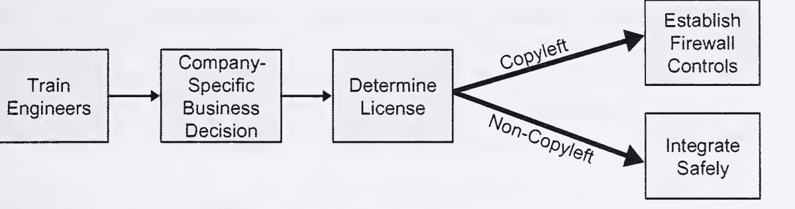

图 12–2 入入式开源流程。

此图表明，你必须遵循的第一步是确保你拥有一组经过良好培训的工程师。

# 培训工程师

去网上寻找有用代码并将其集成到你的源码库太容易了。问题是，除非对你的工程人才进行教育，否则你可能会将代码（例如 GPL 许可代码）集成到你的专有软件中，从而影响你软件的专有状态。那些试图描绘末日场景的人会声称，最终结果是你的整个代码库必须立即根据相同的互惠许可开放。没有任何法院要求过此类激进的措施。更有可能的情况是，违规的 GPL或其他开源代码一旦被发现必须立即从你的源码库中移除。然而，这仍然是一项昂贵的代价，这就是为什么培训至关重要。

比起以不受控的方式暴露你的知识产权（IP），更令人担心的是召回交付给客户的产品。因此，让你的工程师对从未知来源提取代码的影响接受良好培训，并清楚理解其对业务的影响是至关重要的。

# 公司特定决策

随着你对开源熟练程度的提高，你的公司应该开发涵盖开源恰当使用和集成方法的政策。显然，这本书是为了给你提供足够的信息，以识别开源可能带来的巨大利益。然而，即使你决定实施一项完全禁止开源的政策

# 第 12 章 • 将开源集成到你的业务中

在你的组织内部，你无法忽视工程师从网上获取代码是极其简单的事实。因此，你的政策必须是明确的并传给所有工程师。

你的公司需要做出决策以允许开源的集成。你的政策需要涵盖：

- 哪些项目类应该考虑开源
- 你允许哪些许可或许可类别
- 员工在使用公司资源和访问开源许可软件时的
- 软件在组织内部如何管理
- 开源的发布软件的支持流程

下一章将涵盖更多与开源软件相关的员工问题，帮助为你员工和业务做出正确的决策。

# 确定许可

正如你现在所理解的，有一类许可包含互惠条款，规定贡献必须返回给社区。GPL 和 LGPL 最常见。如果你集成的代码是这种许可类型，那么你需要建立适当的工程控制，以确保开源代码与专有代码混合，除非这是你的特定意图。

如果许可不包含互惠条款（例如 BSD 或 MIT），你可以安全地将代码集成到你的项目中。你仍然应该考虑与社区积极合作，开发代码，以便在出现问题时可以分担支持负担。

# 防火墙

如果你的公司维护专有软件和开源软件，那么建立流程在两个环境之间维持防火墙是至关重要的。确保这种情况发生的最佳方法是维护两个软件配置管理系统，或者仅对开源代码使用公共开源仓库。你还应该考虑工程师的分配。如果你让同一工程师同时处理专有代码和开源代码，那么该工程师需要经过良好的培训以确保


# IT 开发

他或她除非在开源许可允许合并的情况下，否则不要随意将开源代码移动到专有代码库中。即使在工程团队保持分离的情况下，团队仍应接受培训，以避免出现共享代码并可能丢失代码许可追踪的情况。

# IT 开发

如果你正在进行内部软件开发，并且永远不计划将软件发布给公众，那么你就可以提取开源代码并使用它，而不必担心它是如何集成到你的环境中的。所有的开源许可都允许使用，且不会影响你的专有软件；仅对随后的再分发会受到限制。如果你选择这样做，你应该考虑你将可能需要处理的潜在负面后果：

- 如果你获取了代码但从不回馈贡献，那么从那时起你就自自自了。此后你需要自己支持该软件。
- 如果公司将来决定将你的内部项目商业化，你可能会对开源组件产生严重的依赖，而这些组件在架构设计上并没有很好地考虑到以便与你在内部开发的软件进行清晰的分离。

最佳方法始终与社区进行协作，并在专有软件和开源软件之间合理设计清晰的分离。

# 赔偿

如果你正在交付商业软件并通常会集成第三方的软件，你与该第三方的合同通常会包含赔偿条款。赔偿条款的一个目的是确保，如果你使用的软件在未经许可的情况下使用了他人的知识产权（IP），你不会是承担责任的人。大多数开源许可都不提供赔偿条款。大多数开源软件的性质是它们结合了许多不同来源的元素，而其中许多来源可能是无法追溯的。

即使一家大型公司作为更大商业产品的一部分“销售”开源软件，该公司也可能无法就任何知识产权索赔向你提供赔偿。

行业正在逐渐意识到这种“无赔偿”的观念。例如，在许多情况下，你无法对从互联网免费下载的软件承担责任。

## 总结

本章为你为在业务中集成开源项目时做出明智业务决策提供了基础。你现在应该已经理解将你的软件发布到社区，以及获取开源代码并将其集成到公司内部意味着什么。你应该已经拥有了所有所需的框架组件，用以制定适用于你公司的的、涵盖开源使用的特定政策。

我们需要涵盖的最后元素与人力资源问题有关。一些人力资源部分将帮助完善你公司的开源政策，其他元素将确保你聘佣了正确的团队并与社区良好合作。

# 第 13 章

# 人力资源——获取顶尖人才

许多公司都有雇用政策，规定公司拥有员工开发的所有任何产物。当员工参与开源项目时会发生什么？员工如何在履行其或雇佣协议要求的同时，提供他们的开发成果？开源从根本上改变了你看待人力资源和组织发展的方式。在本章中，我们将检查招聘过程需要如何改变的细节、你需要寻找的新资质，以及通常与招聘过程相关的某些知识产权条款。我们还将探讨将社区作为组织延伸的理念，以及管理组织防火墙。你本章的目标目标是理解如何：

- 演进你的招聘和聘用流程
- 管理员工、公司和社区之间的知识产权所有权
- 管理你公司中的社区领袖

聘用和与开发者社区合作是一个不同的过程，但它让你在过程的早期就能了解并理解你正在聘用的是谁以及他们拥有什么技能。

# 雇合同

当你聘佣在 Linux 社区内工作并对开源和自由软件有非常坚定信念的工程人才时，你可能会在招聘阶段遇到这些员工提出的新请求。这样的候选员工会对能够加入一家参与开源项目的公司工作感到兴奋。然而，那个人也可能有非常明确的预期，即他们将参与的项目只有开源项目。你的公司需要制定一套清晰的政策来规范现有员工和新员工的聘用。你的新政策应该考虑以下元素：

- 项目——新员工或现有员工可以限制其对开源项目的贡献吗？对于那些知道将与公司进行长期、持续合作的大公司来说，这可能是没问题的。然而，如果你预计员工参与专有项目，你的政策需要是的。

- 版权所有权——正如你在整本书中所学到的，即使是开源贡献也包含版权所有权。你的政策应该规定谁预期拥有你工程师贡献的版权。是归公司所有、员工所有，还是两者都所有？在大多数情况下，公司应该保留版权所有权（或可接受的许可），以便在出现双重许可需求时实施。可能会出现像 Apache 和 SAMBA 这样的情况，此时你的公司将无法保留贡献的版权。这些项目拥有防止你保留版权所有权的政策。

- 个人时间 vs. 公司时间——许多工程师会在业余时间从事开源项目。在某些情况下，公司相关工作与员工爱好之间的界限是清晰的；或者不清晰。在其他情况下，员工开始时的一个爱好项目可能会演变为与公司相关的项目。你需要清晰地定义你的工程师何时以及如何可以在个人时间参与开源项目，并为你的员工定义披露规则。当地法律可能会限制对员工的约束。

- 竞争——你的人力资源政策可能会限制员工与竞争对手合作的能力。开源的根本优势之一是与竞争对手（在反垄断法范围内）共享开发成果和成本。在这些情况下，你的工程师可能会积极参与你的竞争对手。

# 聘用合适的人

如果你的政策和指南涵盖了这些元素，你就应该能够开展开源项目并利用可用的人才。

# 参与政策

向你的员工明确业务目标。某些工程师需要被提醒你的公司是营利性的。即使他们从事的是不产生直接收入的项目，他们应该理解业务计划在哪里赚钱（例如：支持、服务、硬件等）。业务模式的清晰沟通将帮助你的工程师以最有效的方式与社区参与，并在需要划分开源与专有软件界限时应用正确的判断力。

你还需要定义你与社区的行为。参与项目必须具备的接受许可是什么？如果你从事 Linux 内核项目，你对专有和开源内核模块的政策是什么？简而言之，利用本章的元素以及你从书中其他部分学到的元素，制定一套全面的开源政策和战略，为你的员工和社区定义对行为规范的预期以及你打算如何与社区合作。

# 聘用合适的人

在招聘过程中，你正在评估个人是否适合作为组织的新员工。现在有一组需要在候选人中寻找的新标准。此列表并没有取代你标准的招聘流程。你应该在招聘过程中考虑这些额外的标准。

# 技术

每个技术领域（Linux 内核、文件系统、Web 服务器、设备驱动、网络栈等）都将有一个子社区。尽管你的候选人可能在整个社区中并不出名，但某位候选员工可能是该领域最出名的开发者之一，


212页 第13章 · 人力资源——获取顶尖人才

你正在寻找的领域。因此，不要过度关注在 Linux 和开源社区中的整体知名度，而要在你所关注的特定子社区内寻求尊重。联系该子社区的成员，并了解关键人物是谁。

## 社区主页

每个项目都有一个维护者。维护者负责接受或拒绝对源码的贡献，并决定何时发布新版本。新社区可能由于维护者与贡献者之间的分歧而产生，这被称为“分叉”（forking）（尽管这种情况很少见）。这可能是开源过程中最健康的部分。然而，在某些情况下，竞争项目并不是理想的（例如 Linux 内核）。优秀的维护者会有解决冲突的良好记录，并将特定技术领域的所有开发精力集中在一个特定的项目上。你可以聘佣某个项目的维护者。你需要在该个人履行公司职责的需求与其对社区的责任之间取得平衡。你是否能够应对这种情况：即维护者/员工做出了一个对开源社区正确但对公司不利的决定？不要假设你雇佣了维护者就能控制项目！请记住，Linux 是 Linux 内核的维护者，而不是他目前的雇主 Transmeta。

## 维护者或贡献者

正如你现在非常理解的那样，大多数开源项目的特点是拥有一个维护者和一个贡献者社区。你需要清楚地理解你正试图填充的角色。需要的领导数量有限，而拥有强大的贡献者储备对你的成功至关重要。寻找在许多不同技术领域具有贡献经验的人才将是一个巨大的加分项。他们将清楚不同社区的运作方式，并接触过多种不同的维护者风格。联系贡献者参与过的任何项目的维护者是一个好主意，以衡量这些贡献的质量和价值。

## 聘聘最合适的人

如果你决定需要填补领导职位，请寻找具有之前维护开源项目经验的人员。作为维护者，测试以下一些领导力特质：

- 他/她是否认可并给予关键贡献者以荣誉？
- 他/她如何解决贡献者之间的冲突？
- 他/她是否见过因解决冲突而产生竞争项目？结果是正确的吗？
- 他/她是否能够吸引关键贡献者加入其项目？
- 他/她是否制定了发布流程？
- 他/她使用什么流程来确定项目已准备好发布？
- 他/她能否举出比其自己的实现方案更好的贡献案例？

维护者是一类特殊的人才，他们将技术技能与与其他开发者良好互动以及指导项目开发的能力相结合。

## 社区可见度与尊重

在社区内推动议程的能力取决于对项目的积极参与程度和实际贡献的量。请记住，控制权在维护者手中。项目的维护者会受到对贡献者（个人）熟悉程度以及贡献质量的影响。这位候选人在社区中是否具有良好的可见度和尊重？要确定尊重的水平和可见度，请观察你的候选人与社区的在线互动情况（例如，邮件列表、存档等）。

## 在线互动

一旦你了解了候选人参与的社区，并且你认为他们与你的特定需求非常契合，请花时间了解该个人在在线上如何与他人互动。在线互动将是与他人交流的主要媒介。候选人能够在不同时区和文化背景的他人施加影响力至关重要。以下是需要关注的重点：

- 索取或前往邮件存档并检查互动情况。寻找你候选人的互动风格。它是否符合公司的文化，在让贡献被接受方面是否看起来有效？
- 发现你的候选人在网上使用哪些笔名。查看 SlashDot 的存档（见本书末尾的参考部分）和其他在线场所。你的候选人是否隐藏秘密笔名来诋毁他人？是否存在激情而非指责？
- 你的候选人是否发起对有用且引人入胜的话题的讨论？或者，候选人是否只回应他人？回复是否具有建设性？

尝试通过观察有多少人寻求他/她的建议来确定候选人拥有的尊重。还要检查其他维护者接受贡献的意愿程度。在社区内赢得尊重的人几乎不需要辩就能让其贡献被接受。

## 贡献

要求提供一份对各种开源项目实际贡献的详细列表。在评估来自竞争公司的候选人时，无法要求其对专有产品的实际贡献。开源的美之处在于一切都是公开透明的。你在聘用之前就有能力衡量候选人的数量、质量和技术能力。你的经理和其他员工是分析历史贡献并提供你所需反馈的好来源。

此外还有贡献的风格。候选人是针对特定问题和补丁特定问题的战术性贡献，还是参与架构和设计讨论？贡献的风格应该符合你试图填充的职位需求，并为未来的领导储备储备力量。例如，如果你正试图填补一个支持职位，一个能够发现并修复问题且不对整体系统产生负面影响的人非常有价值。然而，如果你需要找到谁是维护者并指导架构方向，你需要寻找一个具有识别和认可他人卓越工作记录的人。

## 地理

任何具有与开源社区工作经验的人都能与跨地理、时区和文化的人工作并互动。招聘经理面临的挑战是制定人才获取的地理策略，以及人才招聘后的所在地。

从世界任何地方招聘人才并让他们加入团队对你的公司来说是一个巨大的收益。然而，这需要与团队地紧密工作的明显优点之间取得平衡。根据我的经验，最好的策略之一是确保特定项目在一个地点拥有强大的临界规模。避免将项目跨地理边界划分。这样你可以在远程地区增加高素质人才来支持并增强本地团队。另一个好处是，当你的团队与外部社区成员合作时，管理远程社区成员的方式几乎相同。

如果你正在为一个对公司至关重要的开源项目贡献，考虑定期资助该社区的关键成员面对面会议。这通常被称为“黑客松”（hackfest）。如果你能将其安排在与业务相关的活动活动，就可以让所有开发者聚在一起，了解行业，互相认识，并完成一些严肃的开发。计划支付机票、酒店、餐饮以及普通员工的所有的所有费用。

## 跳跃次数


216 • 第13章 • 人力资源——获取顶尖人才

类似于“计算跳数”，就像网络流量路由那样。跳数越少，候选人距离维护者就越近。

## 团队结构

构建你的团队在很大程度上取决于贵公司在开源项目中所扮演的角色。正如你从“企业集市（corporate bazaar）”概念中学到的那样，你可能构建一个非常大的开源项目并管理该团队。更多情况下，你将参与规模小得多的项目；在许多情况下，你只是某个开源项目的众多贡献者之一。

由于上一节概述了互惠问题，你应该尽力让开发者继续为专注于开源项目的外部项目做贡献。

“围栏社区（gated communities）”的特殊情况在构建你的开发团队时也会发挥作用。你可能会发现自己处于专有项目、开源项目和围栏社区项目的组合之中。你需要定义边界流程以确保知识产权（IP）所有权的开发者分配是清晰的。

## 招聘可见领导者

在本书的后期，我将分享与开源社区合作工作的特定个人经验。在许多人的衡量下，当我招聘可见的开源社区领导者时，我承担了巨大的风险。可见领导者的首要任务仍然是代表整个社区并推进开源运动。在某些情况下，可见领导者的意见与公司不同。

## 总结

我的工作是与行业、媒体、客户、竞争对手合作，以确保他们理解开源社区的作用。在我看来，在某些团队内部，开源双重角色会引起某种程度的不适。开源领导者必须首先代表社区，其次代表公司。你需要确保公司与任何可见领导者之间建立稳固的关系。

## 总结

构建、构建和管理结合了开源和非开源项目的团队。在文化上，你的工程师将在对社区的忠诚和对公司的忠诚之间挣扎。你需要意识到这种挑战并习惯于管理它，而不是感到受到威胁。本节提供了你作为公司政策考虑的内容。

## 附录 A

## 参考文献和资源

本附录是用于快速查找 Linux 和开源世界主题信息的资源。记住互联网是不断变化的。此处链接在出版时有效，但变化是不可避免的。

## Linux

- Linux: http://www.linux.org/
- Linux 内核: http://www.kernel.org/
- Alpha Linux 组织: http://www.linuxalpha.org/
- ARM 版 Linux: http://www.arminux.org/
- PA-RISC 版 Linux: http://www.parisc-linux.org/
- PowerPC 版 Linux: http://www.linuxpppc.org/ http://www.linuxpppc.com/
- SPARC/UltraSPARC 版 Linux: http://www.ultralinux.org/

## Linux 发行

- Caldera: http://www.caldera.com/
- Connectiva: http://www.connectiva.com/
- Debian: http://www.debian.org/
- Red Hat: http://www.redhat.com/
- SuSE: http://www.suse.com/
- TurboLinux: http://www.turbolux.com/
- Red Flag: http://www.redflag-linux.com/index.html
- MontaVista: http://www.mvista.com/
- MandrakeSoft: http://www.linux-mandrake.com/en
- UnitedLinux: http://www.unitedlinux.com/

## 许可证

- Apache 软件许可证: http://xml.apache.org/fop/license.html
- GNU GPL: http://www.fsf.org/licenses/gpl.html
- GNU LGPL: http://www.fsf.org/licenses/lgpl.html
- GNU 自由文档许可证: http://www.fsf.org/licenses/fdl.html
- Microsoft 共享源计划和详情: http://www.microsoft.com/licensing/
- Netscape 公许可证 (NPL): http://www.mozilla.org/

## 新组和出版物

- Linux Journal: http://www.linuxjournal.com
- Linux Magazine: http://www.linuxmagazine.com
- Linux Today: http://www.linxtoday.com/
- SlashDot: http://slashdot.org/
- NewsForge: http://newsforge.com/

## 组织

- Apache: http://www.apache.org/
- Beowulf: http://www.beowulf.org/
- Debian: http://www.debian.org/
- 嵌入式 Linux: http://www.embedded-linux.org/
- Ext2 文件系统: http://e2sprogs.sourceforge.net/
- 自由软件基金 (FSF): http://www.fsf.org/
- 自由标准协会 (FSG): http://www.freestandards.org/
- GCC 和工具链: http://gcc.gnu.org/
- GNOME 基金会: http://www.gnome.org/
- GNU: http://gnu.org/
- 手持 Linux: http://www.handhelds.org/
- Linux: http://www.linux.org/
- KDE: http://www.kde.org/
- Linux 组织: http://www.linux.org/
- KDE: http://www.kde.org/
- Linux 标准基础 (LSB): http://www.linuxbase.org/
- LI18n: http://www.li18n.org/
- ODL: http://www.osdl.org/
- OSDN: http://www.osdn.com/
- OSI: http://www.opensource.org/
- OSD: http://www.opensource.org/
- PalmOS: http://www.palmos.com/dev/emulator/
- Perl: http://www.perl.org/
- Python: http://www.python.org/
- Samba: http://www.samba.org/
- Savannah: http://savannah.gnu.org/
- Software:

## 论文和书籍

- “大教堂与集市”: http://www.tuxedo.org/~esr/writings/cathedral-bazaar/cathedral-bazaar/
- O’Reilly 书籍: http://www.oreilly.com/

## 标准

- 自由标准协会 (FSG): http://www.freestandards.org/
- Linux 标准基础 (LSB): http://www.linuxbase.org/
- Linux 国际化: http://www.li18n.org/

## 

- CompTIA: http://www.comptia.org/certification/linuxplus/index.htm
- Linux : http://www.luxtraining.com/
- Linux 专业协会 (LPI): http://www.lpi.org/
- SAIR Linux: http://www.linuxcertification.com/

# 软件列表和下载

- FreshMeat: http://www.freshmeat.net/


## 附录 B
## 版权转让样本

本版权转让协议适用于由（以下简称“贡献者”）拥有的特定原创软件（以下简称“软件”）。该软件在本文的附件 1 中有进一步说明。

考虑到充分且有价值的对价（双方特此确认该对价充分），以下简称“开源项目”）与贡献者约定如下：

- 1. 贡献者特此同意并特此转让给开源项目其对软件的版权，包括任何随附的文档文件、支持文件以及实际程序源代码。
- 2. 开源项目特此同意并特此回授予贡献者一项非排占的、免版税的且不可撤销的许可，允许贡献者以其认为合适的方式使用该软件，包括创建其衍生作品。本许可不限制开源项目通过本版权转让协议所获得的权利和公有权利。
- 3. 开源项目对所转让的版权拥有版权所有者拥的所有权利，但仅限于第 2 条中定义的授予贡献者的回授许可，包括为了协助开源软件开发而执行版权的权利、许可和分发软件的权利、以及基于软件创建衍生作品的权利，以及将该衍生作品与软件一同使用或作为独立模块使用、许可和分发的权利。
- 4. 贡献者应根据开源项目的请求，在贡献者实际知的范围内，报告任何可能损害贡献者或开源项目对软件权利的任何未决权利或主张。
- 5. 双方应执行要求的的文件并采取要求的行动，以实施本版权转让协议及本文规定的任何转让的内容和精神，但受限于请求的合理性，并考虑到由此产生的成本和时间负担。本段中的承诺不影响通过本版权转让协议所做的转让。开源项目和贡献者的意图是，本转让文件很少或根本不需要其他文件进行补充。
- 6. 贡献者特此同意，如果其拥有或获得了任何主导软件的专利、接口版权或其他知识产权利益，则此类主导利益将不用于破坏本版权转让协议的效。开源项目和公众应有权无偿且不受限制地在软件中使用该主导利益的标的。本许可条款对该主导利益的受让人或其他继任者以及贡献者具有约束力。此许可授予应是非排占的、免版税的且不可撤销的。
- 7. 贡献者没有义务保护开源项目免任何虚假的所有权主张，但将与开源项目合作防御任何主张。
- 8. 贡献者向开源项目保证，它是本版权转让协议下传输软件的唯一版权所有者。
- 9. 除第 8 条规定外，贡献者不提供任何其他明示或隐含的保证，包括但不限于本免责声明中的任何关于畅销性或针对特定用途的适用性的保证。

## 附录 B • 版权转让样本

10. 本版权转让协议及所有据此作出的转让均被视为自本文涵盖的任何软件以有形形式固定的日起在加州生效，并自贡献者签署本版权转让协议之日起生效。

贡献者

日期：

日期：

开源项目

## 附录 C
## GNU 通用公共许可证

第 2 版，1991年6月
版权所有 (C) 1989, 1991 自由软件基金会
59 Temple Place-Suite 330, Boston, MA 02111-1307, USA

均允许复制和分发本许可证文件的逐字副本，但不允许对其进行更改。

# 前言

大多数软件的许可证旨在剥夺你分享和更改它的自由。相比之下，GNU 通用公共许可证旨在保证你分享和更改自由软件的自由——确保软件对其所有用户都是自由的。本通用公共许可证适用于自由软件基金会的大多数软件，以及任何作者承诺使用它的其他程序。（其他自由软件基金会的软件由 GNU 库通用公共许可证涵盖。）你可以将它应用于你的程序。

当我们谈论自由软件时，我们指的是自由，而不是价格。我们的通用公共许可证旨在确保你拥有自由分发自由软件副本的自由（如果你愿意，可以为此服务收费），确保你能够获得源代码或在想要时获得它，确保你可以更改软件或在新的自由程序中使用它的部分；并确保你清楚你可以做这些事情。

### 附录 C • GNU 通用公共许可证

为了保护你的权利，我们需要制定一些限制，以禁止任何人剥夺你的权利或要求你放弃这些权利。如果你分发软件副本或对其进行修改，这些限制将转化为你承担某些责任。

例如，如果你分发程序副本（无论是免费还是收费），你都必须赋予接收者你所拥的所有权利。你必须确保他们也能收到或获得源代码。你必须向他们展示这些条款，以便他们知道自己的权利。

我们通过两个步骤保护你的权利：(1) 对软件进行版权保护，(2) 为你提供此许可证，允许你合法地复制、分发和/或修改软件。

此外，为了保护每位作者以及我们自己，我们希望确保每个人都理解自由软件没有保证。如果软件被他人修改并传递，我们希望你的接收者知道他们得到的不是原始版本，这样他人引入的任何问题就不会影响原作者的声誉。

最后，任何自由程序都不断受到软件专利的威胁。我们希望避免重新分发自由程序会导致单独获得专利许可，从而实际上使该程序变成专有软件。为了防止这一点，我们明确表示，任何专利必须许可供大家自由使用，或者干脆不许可。

以下是复制、分发和修改的精确条款和条件。

### 复制、分发和修改的条款和条件

- 0. 本许可证适用于任何包含版权所有者放置的通知的程序或其他工作，该程序可以根据本通用公共许可证的条款进行分发。下文“程序”是指任何此类程序或工作，“基于程序的工作”是指该程序本身或版权法下的任何衍生作品；即包含该程序或其部分的作品，无论是逐字包含的还是经过修改和/或翻译成另一种语言的。（后文中，“修改”一词包含但不限于“翻译”。）每位被许可者均统称为“你”。

除复制、分发和修改之外的活动不受本许可证的涵盖；它们超出了其范围。运行程序的行为不受限制，程序的输出仅在当其内容构成基于程序的工作时（独立于通过运行程序产生）才被涵盖。这是否真实取决于程序的功能。

- 1. 你可以以接收到的形式、以任何媒介复制和分发程序源代码的逐字副本，前提是你在每份副本中显著且适当地发布相应的版权声明和免责声明；保留所有引用本许可证以及关于无任何保证的通知；并向程序的任何其他接收者提供本许可证的副本。
你可以对传输副本的物理行为收取费用，并可以根据选择对保证保护收取费用作为交换。


这些要求适用于修改后的作品整体。如果该作品中可识别的部分并非源自本程序，并且可以被合理地认为是其自身的独立作品，那么当您将这些部分作为独立作品分发时，本许可及其条款不适用于这些部分。但当您将这些部分作为基于本程序的作品的一部分进行分发时，该作品的分发必须遵守本许可的条款，本许可对其他被许可者的许可延伸到整个作品，因此延伸到每一个部分，无论该部分由谁编写。

因此，本节的意图并非主张权利或质疑您完全由自己编写的权利；其意图在于行使控制基于本程序的衍生作品或集体作品分发的权利。

此外，仅仅在存储卷或分发介质上将基于本程序的程序与程序（或基于本程序的程序）简单聚合，并不会使其他作品进入本许可的范范围。

- 您可以根据第 1 节和第 2 节的条款以目标代码或可执行格式复制并分发程序（或根据第 2 节基于它的作品），前提是您还满足以下条件之一：
  a) 附带完整的相应的机器可读源代码，该源代码必须在通常用于软件交换的介质上按照上述第 1 节和第 2 节的条款分发；或；
  b) 附带一份至少有效期三年的书面报价，允许任何第三方以不超过您物理分发源代码成本的费用，获得一份完整的机器可读源代码副本，该副本应在通常用于软件交换的介质上按照上述第 1 节和第 2 节的条款分发；或；
  c) 附带您收到的关于分发相应源代码的报价。（此备选方案仅适用于非商业分发，且仅当您根据上述 b 小节以目标代码或可执行格式接收程序并带有此类报价时方可使用。）

作品的源代码是指用于对该作品进行修改的首选形式。对于可执行作品，

# 复制、分发和修改的条款与条件 235

完整源代码意味着其包含的所有模块源代码，加上任何相关的接口定义文件，再加上用于控制可执行程序编译和安装的脚本。然而，作为一个例外，分发的源代码不需要包含通常与运行该可执行程序的操作系统的主要组件（编译器、内核等）（以源代码或二进制形式）一起分发的任何，除非该组件本身随可执行程序一起。

如果通过提供访问指定地点进行复制来分发可执行代码或目标代码，则提供从相同地点复制源代码的等效访问被视为对源代码的分发，即使第三方未被强制与目标代码一起复制源代码。

- 4. 您不可以复制、修改、转分许可或分发程序，但本许可明确提供的情况除外。任何复制、修改、转分许可或分发程序的尝试都是无效的，并将自动终止您在本许可下的权利。然而，根据本许可从您处获得程序副本或权利的各方，只要这些方保持完全符合规定，其许可就不会被终止。

- 5. 您没有义务接受本许可，因为您还没有签署它。但是，没有其他任何内容允许您修改或分发程序或其衍生作品。如果您不接受本许可，这些行为是法律禁止的。因此，通过修改或分发程序（或任何基于本程序的作品），您表示接受本许可并这样做，以及其所有关于复制、分发或修改程序或基于该程序的作品的条款和条件。

- 6. 每当您重新分发程序（或任何基于本程序的作品）时，接收者自动从原始许可者处获得许可，根据这些条款和条件复制、分发或修改程序。您不可以对接收者行使本文授予的权利施加任何进一步限制。您不对第三方遵守本许可的强制执行情况负责。

- 7. 如果由于法院判决、专利侵权指控或任何其他原因（不限于专利问题），对您施加了（无论是通过法院命令、协议或其他方式）与本许可条件冲突的条件，这些并不能免您履行本许可的条件。如果您无法通过分发来同时满足您在本许可下的义务和任何其他相关义务，那么结果您可能完全无法分发程序。例如，如果专利许可不允许所有通过您直接或间接接收副本的人免特许费地重新分发程序，那么您同时满足两者及本许可的唯一方法就是完全停止分发程序。

如果本节的任何部分在任何情况下被认为无效或不可执行，则该节应适用的其余部分以及整体应在其他情况下适用。

本节的目的不是诱导您侵犯任何专利或其他产权主张，或质疑此类主张的有效性；本节的唯一目的是保护自由软件分发系统的完整性，该系统是通过公共许可实践实施的。许多人依靠对该系统一致的应用，对该系统分发的广泛软件做出了慷慨贡献；作者/捐赠者自行决定是否愿意通过任何其他系统分发软件，被许可者不能强加这一选择。

本节旨在彻底阐明被认为是本许可其余部分产生的结果。

- 8. 如果程序的分发和/或使用在某些国家受到专利或版权保护接口的限制，将程序置于本许可下的原始版权持有者可以增加明确的地理分发限制，以排除这些国家，因此分发仅在未被排除的国家或国家之间进行。在这种情况下，本许可将该限制写入其中。

- 9. 自由软件基金可能会随时发布通用许可的新版本。此类新版本在精神上与当前版本相似，但在细节上为了解决新问题或关注点可能会不同。

每个版本都有不同的版本号。如果程序适用于它以及“任何后续版本”，您可以选择该版本或自由软件基金发布的任何后续版本的条款和条件。如果程序未指定本许可的版本，您可以选择自由软件基金发布的任何版本。

# 免责声明
237

- 10. 如果您希望将程序的部分整合到分发条件不同的自由软件中，请写信作者请求许可。对于由自由软件基金版权的软件，请写信自由软件基金；我们有时会对此破例。我们的决定将遵循两个目标：维护所有衍生软件的自由地位以及促进软件的共享和重用。

# 免责声明

- 11. 由于程序是免费许可的，在适用法律范围内，程序无任何保证，除非另有书面说明，版权持有者和/或其他方按“原样”提供程序，不提供任何形式的明示或暗示保证，但不限于对商品销性和特定用途的暗示保证。对程序质量和性能的所有风险由您承担。如果程序被证明有缺陷，您承担所有必要的维修、修理或纠正的费用。

- 12. 在任何情况下，除非另有约定，任何版权持有者或根据上述许可修改和/或分发程序的其他方，均不对因使用或无法使用程序而产生的任何损害（包括但不限于数据丢失、数据变得不准确或您或第三方遭受的损失，以及程序无法与其他程序共同运行）向您承担责任，即使该持有者或其他方已被告知此类损害的可能性。


# 目录

## A
- 聚合, 179
- Alpha, 61
- Apache, 6. 8. 9. 12. 17, 42, 56, 65, 68, 99, 102, 132, 139, 143, 179, 180, 210, 221, 223
- Apache 许可证, 42
- 应用服务器, 64
- 艺术性许可证, 43
- 共存, 121
- 商业用软件, 177
- 商品化, 7, 10, 30, 61, 74, 98, 163, 166, 176
- 社区定义, 6
- 社区领袖, 14, 216
- 编译器, 66
- 合同, 103
- 贡献者, 212
- 强制性开源 (Copyleft), 40
- 版权, 40, 41, 197, 210, 223, 233
- 成本, 96
- 加密学, 52

## B
- 集市市 (Bazaar), 16, 36, 53, 56, 72, 137, 138, 141, 216, 225
- Beowulf. 见集群 (Clusters)
- BSD 许可证, 43
- 捆绑, 185
- 业务案例, 193
- 业务模式, 175

## D
- 数据库
    - MySQL, 73
    - PostgreSQL, 73
- Debian, 5, 16, 34, 84, 86, 89, 220, 223
- 部署, 119
- 桌面, 31, 127
- 贬值, 159, 160, 166, 167, 168, 187
- 开发
    - 特性, 54
    - 方法论, 52
    - 风格, 53

## C
- 大教堂式 (Cathedral), 16, 36, 52, 54, 56, 72, 137, 138, 225
- 类继承, 49
- 集群 (Clusters), 74
- 分布式, 82
- 定义, 5
- 发行版
    - 创建您自己的, 91
    - 非 Linux 操作系统, 91
    - 特种的, 90
    - 支持多个, 92
    - 全球性的, 90
- 双许可, 180
- GNU 通用公共许可证, 43, 46
- 定义, 6
- GNU 较小通用公共许可证, 43
- GPL. 见 GNU 通用公共许可证

## H
- 手持式 Linux, 74
- 招聘, 211
- 人力资源, 150, 209

## E
- 生态系统, 186, 195
- 嵌入式, 33
- 嵌入式 Linux 联盟, 76, 222
- 雇用合同, 210
- 生命周期结束, 185
- 字节序, 123
- 出口, 52

## I
- IBM 公共许可证, 43
- 入入开源, 203
- 赔偿, 207
- 影响, 131
- 知识产权, 39
- 国际化, 115
- 安腾腾处理器家族, 60

## F
- 文件系统层次结构标准, 110
- 文件系统, 124
- ext2, 62
- ext3, 62
- JFS, 62
- ReiserFS, 63
- XFS, 63
- 自由软件定义, 5
- 自由软件基金, 16, 36, 40, 75, 222, 233, 238, 239
- 自由标准组织, 76, 108, 109, 110, 117, 222
- 自由, 36

## J
- J2EE, 65
- JBOSS, 65
- 日志记录, 62
- 跳转, 170

## K
- KDE, 32, 45, 70, 71, 72, 110, 139, 222, 223
- 内核定义, 5
- 碎片化, 25
- 模块, 23, 48
- 补丁, 25
- 版本, 25

## G
- 围栏社区, 115
- 全球化, 116
- GNOME, 17, 32, 54, 70, 72, 91, 139, 178, 222, 223
- GNU 定义, 5

## L
- 语言
    - FORTRAN, 67
    - GCC, 66
    - Perl, 68
    - Python, 68
- GNU 较小通用公共许可证. 见 LGPL
- LGPL, 46
- L18n. 见 Linux 国际化
- 倡议
    - 许可证跟踪, 99
- 许可证, 42
- Linux
    - 采用, 3
    - 内核, 22
    - 文档项目, 76, 224
    - 国际, 75
    - 国际化, 115
    - 国际化倡议, 123
    - 标准基础, 109, 110
    - 本地化, 116
- LSB. 见 Linux 标准基础
- LSB 未来, 115

## M
- 维护者, 55, 212
- 定义, 6
- 微内核, 23
- 迁移, 121
- MIT 许可证, 44
- 单一内核, 22
- Mozilla, 43, 44, 51, 72, 224
- Mozilla 公共许可证, 44
- 多平台, 29

## N
- 网景公共许可证, 52

## O
- 入入开源定义, 6
- 开源开发, 76, 222
- 开源倡议, 37, 75
- 开源软件, 104
- 操作系统, 32
- 出入开源, 192

## P
- 软件包, 83
- 掌上设备, 188
- RISC, 62
- 专利, 35, 160
- PDA. 见 掌上助手
- 工业, 170
- PowerPC, 61
- 采购, 102
- Python, 44

## Q
- Qt 公共许可证, 45

## R
- 互惠, 39
- ReiserFS, 41
- 关系, 132

## S
- SAMBA, 126
- 可扩展性, 13
- 服务, 178
- 软件开发, 104
- 利益者, 9
- 标准, 108
- SUN 社区许可证, 51
- SUN 行业标准, 45
- 支持, 129, 178
- 费用, 100

## T
- 人才, 149
- 培训, 132, 205
- TUX, 61

## X
- X 桌面, 110
- x86, 60
- XML, 45, 64

## U
- UL. 见 统一 Linux
- 统一 Linux, 89

## W
- Web 服务, 64

## HP PACKARD 战略书籍
- 快速盈利路径：利用互联网技术的内部指南——Lee G. Caldwell
- 安腾崛起：突破摩尔第二定律——Jim Carlson 和 Jerry Huck
- Linux 与开源的商业与经济——Martin Fink
- 激进简单：将计算机变为以人为中心的设备——Frederick Hayes-Roth 和 Daniel Amor

## informIT
www.informit.com

##  IT 参考指南
### 文章
通过数千免费文章、深度专题、采访和 IT 参考建议保持领先——全部由您熟悉并信任的专家编写。

### 在线书籍
通过 InformIT Online Books 的数百本完全可搜索在线书籍获取实时答案。限时，您可以免费使用 14 天。

### 目录
查看在线章节、作者简介和客户排名，从 5000 多种书书中选择最合适的书籍。

## 如果世界领先的技术出版商合作在一个共同的数字参考平台上交付他们的最佳书籍，将会有多棒？
他们做到了。介绍 Safari 版 InformIT Online Books。

- 针对问题的特定答案。InformIT Online Books 强大的搜索引擎可以在几秒钟内提供按相关性排序的结果。
- 立即结果。使用 InformIT Online Books，您可以选择您需要的书籍并立即查看章节或部分。
- 剪切、粘贴和注释。粘贴代码以节省时间并消除输入错误。对您有用的材料进行笔记，并决定是否与您的工作组共享。
- 为您的企业定制。为您、您的部门或整个组织定制库。您只需为您需要的内容付费。

## 免费获取 14 天！
限时，InformIT Online Books 为其成员提供 14 天免费 10 本订阅。访问 www.informit.com/onlinebooks 了解详情。


> “对开源软件在企业环境中角色的发人深心的分析。对于正在考虑开源如何帮助其组织的经理来说，这是一本必读的指南。”
—提姆·奥瑞利（Tim O'Reilly）

# LINUX 与开源的商业与经济

经理利用 Linux 和开源获取竞争优势的指南

通过使用 Linux 和开源技术，成千上万的企业正在降低成本、增加灵活性并发现强大的新业务价值来源。现在，有一份客观、现实的经理指南，教你如何利用 Linux 和开源技术获取竞争优势。Martin Fink 带你穿过炒作和反对者的声音，让你能够准确评估开源在贵组织中的收益、成本和风险。本书严格从管理者的视角编写，涵盖了 Linux 和开源业务生命周期的每一个步骤以及每一个关键问题，从许可协议到与开源开发者社区的协作。涵盖内容包括：

- 评估追求 Linux 和开源计划的成本、收益和风险
- 开源许可：避开雷区
- 在公司内部管理 Linux 和开源项目
- 评估开源社区的规模、广度和能力
- 与外部开源社区建立强大、积极且具有协同效应的关系
- Linux 标准的关键作用
- 集成、开发、部署、迁移、共存、支持和培训
- 理解 Linux 内核与 Linux 操作系统之间的区别
- 理解并选择 Linux 发行版
- 开源范式如何影响商业软件开发者
- 开源商业模式：利用开源技术获利所需的条件
- 在企业环境中应用开源开发方法

# 关于作者

MARTIN FINK 是惠尔-惠普（Hewlett-Packard）Linux 系统部门的总经理，在该部门已领导了 Linux 开发活动三年多。他负责驱动 HP 的整体 Linux 和开源战略，并管理公司的开源业务流程。他还是开源开发实验室（Open Source Development Lab）的董事会副总裁，这是一个由全球行业领袖组成的财团，致力于促进 Linux 和电信运营商级环境的发展。


