# Chromebook Google Linux 指南：免费访问超过 5 万个软件包

## 免费获取超过 5 万个软件包

| PID | USER | PRI | NI | VIRT | RES | SHR | %CPU | %MEM | S | TIME | Command |
|---|---|---|---|---|---|---|---|---|---|---|---|
| 627 root | 20 | 0 | 6927 | 5028 | 6234 | 0.0 | 2.2 | S | 1.17 | /usr/bin/xterm |
| 958 zen | 20 | 0 | 10180 | 7536 | 6441 | 0.0 | 0.0 | S | 0.0 | /usr/lib/dbus-daemon-session |
| 211 root | 20 | 0 | 15441 | 7188 | 0 | 0.0 | 1.4 | S | 0.0 | /usr/libexec/gnome-shell |
| 619 root | 20 | 0 | 21598 | 5036 | 5472 | 0.0 | 0.0 | S | 0.0 | /usr/bin/at |
| 1318 zen | 20 | 0 | 5470 | 5256 | 4471 | 0.0 | 0.0 | S | 0.0 | /usr/bin/X-org |
| 629 root | 20 | 0 | 30368 | 4036 | 5016 | 0.0 | 0.0 | S | 0.0 | /usr/lib/dbus-daemon-session |
| 1237 zen | 20 | 0 | 26990 | 17800 | 0 | 0.0 | 0.0 | S | 0.0 | /usr/bin/message-bus |
| 629 root | 20 | 0 | 30828 | 6024 | 5032 | 0.0 | 0.0 | S | 0.0 | /usr/bin/sshd |
| 146 root | 20 | 0 | 15634 | 5992 | 4972 | 0.0 | 0.0 | S | 0.0 | /usr/sbin/sshd |
| 105 root | 20 | 0 | 10160 | 8192 | 0 | 0.0 | 0.0 | R | 0.0 | /usr/sbin/kworker |
| 1051 root | 20 | 0 | 10160 | 8192 | 0 | 0.0 | 0.0 | R | 0.0 | /usr/sbin/kworker |
| 99 root | 20 | 0 | 20680 | 5468 | 3568 | 0.0 | 0.0 | S | 0.0 | /usr/sbin/syslogd |
| 436 root | 20 | 0 | 49326 | 3588 | 588 | 0.0 | 0.0 | S | 0.0 | /usr/bin/xinit |
| 1137 root | 20 | 0 | 66532 | 2356 | 0 | 0.0 | 0.0 | S | 0.0 | /usr/lib/dbus-daemon-session |
| 1137 root | 20 | 0 | 7716 | 1500 | 1360 | 0.0 | 0.1 | S | 0.0 | /usr/sbin/abinet |
| 120 root | 20 | 0 | 231M | 8468 | 6145 | 0.0 | 0.3 | S | 0.0 | /usr/bin/python3 |

```
zenpenguin
OS Debian GNU/Linux-11 (bullseye) on Chromebook
Kernel: 5.10.92-1453-g179c52807ab5
Packages: 2794 (dpkg)
Theme: dark
Clearlooks (7x,2)
Terminal: xterm
CPU: (8)
Memory: 10GB / 2773MiB
```

```
帮助 搜索 排序 按 Nice - 
无 IPv6 下载 E: 无电池 15.1 GiB 6.6 0.8 MiB | 2023-02-22 17:26:05
```

R. S. Ake

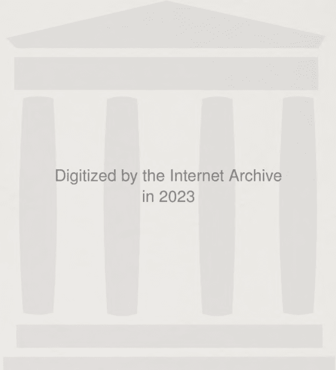

R. S. AKE

损害不承担任何责任。

# 引言

# 什么是 Chromebook

## 使用 Chromebook

## 安装 Linux

## 安装 LXDE

### Synaptic

### LXDE 任务栏

## 打印与扫描

### USB 设备

### CLI

## 安装 i3wm

## 软件

# Chromebook 上的 Linux

默认情况下，启用了 Linux 的 Chromebook 将加载 Penguin，这是一个基于 Debian Linux 的自定义 Linux 容器。WiFi 等功能通过 Chrome OS 实现。如果 Chrome OS 连接到 WiFi，那么 Linux 也会连接到 WiFi。Linux 有多个桌面环境供选择，本书将涵盖 LXDE 和 i3wm。书中将介绍六种软件包管理器，但重点将放在 Synaptic 上。在 Chrome OS 下启动和停止 Linux 与直接运行 Linux 有些不同，但仍然是一个快速且简单的过程。在 Chrome OS 上运行 Linux 具有嵌套结构。Penguin 运行在 Termina 虚拟机内部，而虚拟机又运行在 Chrome OS 内部。

## 嵌套结构

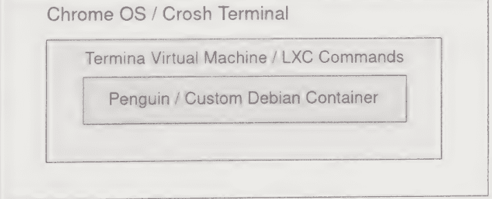

Chrome OS 上 Linux 的嵌套结构

## 使用 Chromebook

使用 Chromebook 与使用其他电脑非常不同。Chromebook 的界面通过特殊的 URL 工作。Chromebook 的键盘虽然非常独特，但功能非常强大。Chromebook 的触控板缺少简单的右键，这非常令人烦恼。

### Chromebook 触控板

要在 Chromebook 上执行右键点击，用两个手指按触控板。使用外部鼠标或触控板可以让你执行右键点击。要执行滚轮操作，用两个手指在触控板上下滑动。

### Linux 鼠标指针

如果 Linux 的鼠标指针消失或在启动时无法显示，按全屏（Fullscreen）键，然后将鼠标指针移向下屏幕。鼠标指针应该会显示，再次按全屏键恢复屏幕。

### 屏幕下方的线条

如果当前屏幕下方有一线（很可能是黑色显示器底部的一条白线），按两次显示窗口（Show windows）键，中间暂停。

### 屏幕撕裂

某些 Chromebook 在运行 Linux 时会出现屏幕撕裂（Screen Tearing）。按两次全屏键可以提供一个快速的临时解决方案。根据需要重复操作。

### 失控的退格键

如果在处理文档时，文档内容开始消失，就像一直按了退格（Backspace）键一样。按下 Esc 键，并尝试使用程序的撤销（undo）功能恢复丢失的内容，或尝试 Ctrl + Z。

### Chrome OS 功能键

在本书编写时，完全使用所有 F1 到 F12 功能键需要设置标志。打开 Chrome OS 浏览器。访问 URL：`chrome://flags`。在搜索框中输入 improved keyboard shortcuts 应该是一个标志。如果该功能停止工作（可能在更新后发生）：启用该标志并重启，然后禁用该标志并再次重启。

在 Linux 桌面环境中，Chrome OS 的键盘控制可能不可用。按“显示窗口”键再按一次。Chromebook 键盘顶部从左到右的键是：Esc、上一页、下一页、刷新页面、全屏、显示窗口、调暗屏幕、亮度亮度、静音、音减、音量。搜索键上有一个放大镜。Chromebook 与外部键盘配合良好。USB-C 端口只需要 USB-C 适配器或 USB-C 集线器。

### Chrome OS 键盘

Esc 经常用于快速退出。

- Esc
- 上一页 (Previous Page) - F1
- 下一页 (Next Page) - F2
- 刷新页面 (Reload Page) - F3
- 全屏切换 (Fullscreen Toggle) - F4
- 虚拟桌面与应用屏幕 (Virtual Desktops & App Screens) - F5
- 调暗屏幕 (Dim Display) - F6
- 亮度亮度 (Brighten Display) - F7
- 关闭声音 (Turn off sound) - 静音 (Mute) - F8
- 音量减 (Volume Down) - F9
- 音量加 (Volume Up) - F10
- 系统锁定 (System Lock) - Win + L
- 显示所有快捷键 (Show all shortcut keys) - Alt + Ctrl + /
- 镜像到第二个显示器 (Mirror to Second Display) - Ctrl + 全屏 (Fullscreen)
- 切换主次显示 (Swap Primary & Secondary Display) - F4
- 放大 (Zoom In) - Ctrl + Shift +
- 缩小 (Zoom Out) - Ctrl + Shift -
- 任务管理器 (Task Manager) - 搜索 + Esc Win + Esc
- 文件应用 (File App) - Alt + Shift + M
- 通知 (Notifications) - Alt + Shift + N
- 打开 Crosh - Chrome OS 终端 - Alt + Ctrl + T
- 功能键 F1 到 F12 - Search + 1 至 F12
- 删除 (Delete) - Alt + Backspace
- 大写锁定 (Caps Lock) - Alt + Search
- 向上页 (Page Up) - Alt + 光标向上 Page Up
- 向下页 (Page Down) - Alt + 光标向下 Page Down
- 终端向上页 Page Up - Alt + Shift + 光标向上 Shift Page Up
- 终端向下页 Page Down - Alt + Shift + 光标向下 Shift Page Down
- 虚拟桌面向左移动 - Search + [ Win + [
- 虚拟桌面向右移动 - Search + ] Win + ]

### 慢速的键重复率

在打字时，大多数用户期望在按住空格键等键时有相当快速的响应。Chrome OS 的重复率决定了 Linux 的键重复率，必须在 Chrome OS 设置中设置。

Chrome OS 设置 → 设备 (Device) → 键盘 (Keyboard)

重复率设置位于启用自动重复（Enable auto-repeat）部分。

### Chrome 浏览器 URL

Chrome 浏览器是进入 Chrome OS 的直接界面。除了检查 `chrome://history`、登录 `google.com` 和检查您的隐私设置外，`file:///` URL 可以让整个 URL 运行。

```
chrome://about - URL 列表
chrome://flags - OS 标志设置
chrome://history - 历史记录包含包含 Linux
chrome://os-settings - 系统设置
chrome://system - 系统信息
file:///home/chronos/user/MyFiles/
file:///home/chronos/user/Downloads/
安装 Linux 后：
  chrome-untrusted://crosh - Chrome OS 终端
  chrome-untrusted://terminal - Linux 终端
```

### 设置

使用设置搜索栏查找设置。

### 屏幕超时

- 搜索 "power" 或直接搜索 "po"

### 在线存储数据即同步与 Google 服务

- 搜索 "sync" 或直接搜索 "sy"

### Linux 安装

- 搜索 "linux" 或直接搜索 "li"

### 作为应用的 Linux 程序

Linux 程序通常可以作为 Chrome OS 应用运行。Linux 应用应该会出现在 Chrome OS 应用抽屉的 Linux 应用文件夹中。如果没有，尝试在终端中运行命令 `sudo apt update`。然后再次检查。Linux 程序并非设计为作为 Chrome OS 应用运行。如果你的程序完全无法运行、运行不正常或显示异常，请尝试在全 Linux 桌面环境中运行。接下来的章节将涵盖 LXDE 和 i3wm Linux 桌面。这两个桌面互不冲突，可以同时安装甚至同时运行。

Linux 程序也可以从终端命令行启动。当在桌面环境之外运行时，程序可能无法正常缩放。可以使用 `sommelier` 控制缩放（第 105 页）。缩放因而异。从终端：

```
sommelier -X --scale=2 --glamor <program>
```

### 硬件推荐

寻找性价比时，务必检查在线商城、百货商店和你经常去的电脑折扣店。年底假期和开学季是寻找优惠的好时机。

- 单用途适配器，例如：
  - USB-C 转 MicroSD 卡 $2 到 $9
- VAVA 7合一 USB-C 集线器：
  - VA-UC017 大约 $30
- Nekteck 100W GaN USB-C 充电器：
  - 大 $30
- 360 度防浪保护插板：
  - 插座可以旋转，有助于解决大型变压器问题。
  - 原版没有壁挂孔，使用 L 型支架和魔术贴。大约 $19 到 $40
- USB 线批量购买更便宜。
  - 注意伪造的编织线。
  - USB-C 线有 24 根线。
- Logitech K400 键盘：
  - 无线范围长，集成触控板。
  - 从 $12 到 $35
- 海信 40 英 电视作为第二个显示器。
  - 寻找 $100 到 $150 的优惠。
  - 开启图形或直接（显示器）模式。
- Creality Ender 3，开源 3D 打印机：
  - 大约 $200

## 安装 LINUX

在支持 Linux 的 Chromebook 上安装和卸载 Linux 是一个简短且简单的过程。修复 Linux 桌面使其能够正常运行不需要对 Chromebook 进行 root 或是进行任何深度破解。

### 安装 Linux

Chromebook 在 Chrome OS 下的虚拟机容器（Container）中安装 Linux。Crosh 会话运行在容器外部。Terminal（终端）会话运行在容器内部。可以通过 Crosh 会话手动启动 Terminal 会话。要安装 Linux，Chromebook 必须连接到互联网。在“设置”中导航到 Linux 开发环境。在设置搜索栏中输入 `linux` 并按回车。或者，在“设置”中：高级 → 开发者 → Linux 开发环境。

Google Linux Chromebook指南

### 开启 Linux

开发者

Linux 开发环境

在您的 Chromebook 上运行 Linux 工具、编辑器和 IDE。了解更多

开启

#### 点击“开启”按钮

在 Linux 开发环境面板中，点击“开启”按钮。

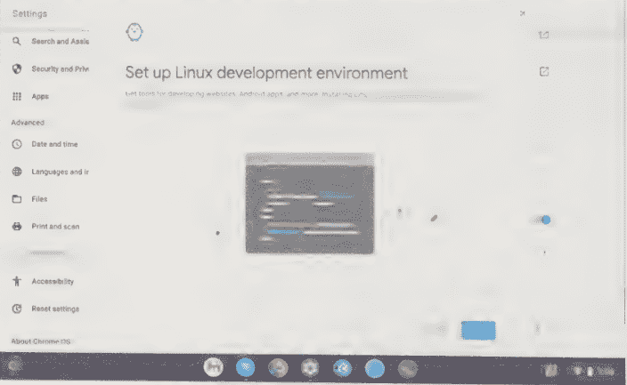

点击“下一步”按钮。

将打开设置 Linux 开发环境面板，点击“下一步”按钮。

### 选择选项

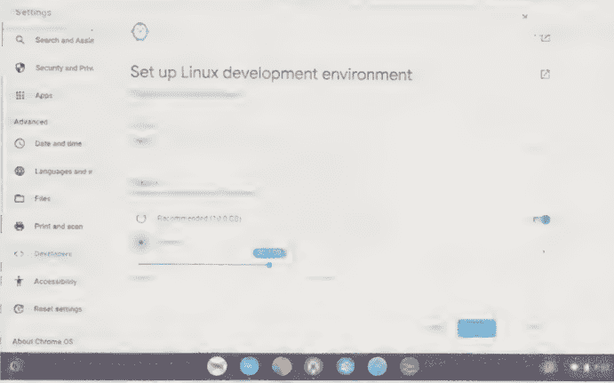

点击安装按钮继续。

输入用户名并选择分配给 Linux 的磁盘大小。用户名可以是任何名称。磁盘大小可以随时更改。

### 卸载 Linux

一旦安装完成，可以随时删除 Linux。在 Linux 开发环境面板中，找到删除 Linux 开发环境部分，点击删除按钮。

### 完成安装

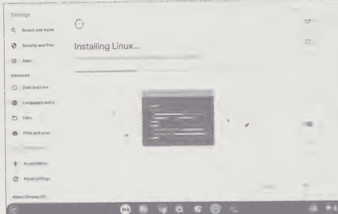

安装应该在几分钟内完成。

“安装 Linux”面板将显示安装进度。

安装完成后，Terminal App 将自动打开。将显示命令提示符：`<user-id>@penguin:$`

将 Terminal App 固定到任务栏是方便的。右键点击 Terminal 图标并选择“固定”。再次打开 Terminal 图标菜单并选择“设置”或 `Ctrl + Shift + P`。在这里可以更改 Terminal 应用的外观。

# Google Linux Chromebook指南


```
zen@penguin: $ uname -a
Linux 5.4.157-17185-gbd27b903c738 #1 SMP PREEMPT Sat Jan 1
19:17:16 PST 2022 aarch64 GNU/Linux
zen@penguin: $ hostname
Static hostname: penguin
Icon name: computer-container
Chassis: container
Machine ID: a820b1bd557d66f0101d70b46165a979
Boot ID: 20de4b6cb515d41381c31d10e02f8c2f
Virtualization: lxc
Operating System: Debian GNU/Linux 11 (bullseye)
Kernel: Linux 5.4.157-17185-gbd27b903c738
Architecture: arm64
zen@penguin: $ cat /etc/os-release
PRETTY_NAME="Debian GNU/Linux 11 (bullseye)
VERSION_ID="11"
VERSION=11 (bullseye)
VERSION_CODENAME=debian
ID=debian
```

安装完成后，Terminal 会打开。

输入以下五个命令来了解更多系统信息：

- `uname -a`
- `hostnamectl`
- `cat /etc/os-release`
- `cat /etc/debian_version`
- `getconf LONG_BIT`

从这些可以看出 Google 容器的名称是 Penguin。实际的发行版是 Debian 11 Bullseye。架构也很重要，可能是 AMD / Intel 或 ARM。`getconf LONG_BIT` 将显示系统是以 32 位还是 64 位系统运行。

现在设置用户和 root 密码。密码命令拼写很独特，是 `passwd`。每个 ID 都需要输入两次。

```
sudo passwd <user-id>
sudo passwd root
```

## 安装 LXDE

LXDE 是一个功能丰富的桌面，资源占用低且易于装饰和配置。它提供了一套完整的工具、卓越的程序集成和控制，包括高级打印和扫描功能。

安装 LXDE 桌面、nano 编辑器和嵌套 X 服务器 Xephyr。LXDE 将提供桌面环境。Xephyr 保持桌面的完整性。Nano 是用于创建 LXDE 启动脚本的编辑器。安装 LXDE 可能需要 20 到 50 分钟。在 Terminal App 中：

```bash
sudo apt update -y
sudo apt dist-upgrade -y
sudo apt install task-lxde-desktop -y
sudo apt install nano -y
sudo apt install xserver-xephyr -y
```

### LXDE 启动脚本

```bash
#!/bin/bash
gol.sh * 
Xephyr -br -fullscreen -resizeable :20 &
sleep 5
DISPLAY=:20 startlxde &
```

Nano：`^` 是 Ctrl 键的缩写。

使用 Nano 创建文件 `gol.sh`。从 Terminal App 启动 Nano 并输入四行脚本：

```
nano gol.sh
```

```bash
#!/bin/bash
Xephyr -br -fullscreen -resizeable :20 &
sleep 5
DISPLAY=:20 startlxde &
```

完成后，按 Ctrl + O，按 Enter 保存。按 Ctrl + X 退出。

### LXDE 桌面

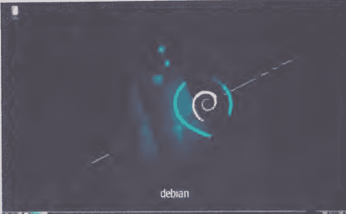

`chmod` 使 `gol.sh` 脚本具有可执行性。“./” 告诉 Linux 从当前目录运行脚本。`ls` 列出文件。`pwd` 打印工作目录，`/home/<user-id>` 是用户的家目录。`echo $PATH` 列出可执行文件的搜索路径。“No session for pid . . .” 错误消息弹出框可以安全地忽略，点击 Ok 按钮。

```bash
chmod +x gol.sh
ls -l g*
pwd
echo $PATH
./gol.sh
```

### LXDE 启动与关闭

启动：

- 运行 **Terminal** 应用。
- 从 Terminal 菜单中选择 **Penguin**。
- `./gol.sh`

关闭：

- 运行 **Terminal** 应用。
- 从 Terminal 菜单中选择 **Penguin**。
- `./gol.sh`

在 Chromebook 上，通过 Crosh 运行的：

- 在 Chrome 浏览器中，访问 URL：

`chrome://about`

### 截图

LXDE 截图文件默认保存存在用户主目录下的图片文件夹中，即 `~/Pictures`：

菜单 → 附件 → 截图

Chrome OS 截图文件保存在 Chrome OS 的下载文件夹中：Ctrl + 显示窗口

### LXDE 字体设置

LXDE 字体设置可以在几个地方找到：

- 菜单 → 偏选项 → 自定义外观和感觉

  小部件标签页：默认字体

- 窗口边框标签页：

    标题栏子标签页：

      活动窗口标题字体

      非活动窗口标题字体

  其他子标签页：

    菜单头部字体

    菜单项目字体

    屏幕显示字体

    非活动屏幕显示字体

- 在任务栏上右键点击 → 面板设置

  外观 标签页：

  字体

- 在桌上右键点击 → 桌面偏好设置

  外观 标签页：

  文本

### Apt

Apt 是一个命令行软件包管理器。`apt-get` 提供精确匹配。"update" 会更新软件链接。"dist-upgrade" 会升级核心操作系统。"history" 显示之前的命令列表。按下键盘上的光标上箭头键可以回上一个命令，然后进行编辑。添加 `-y` 会在“是否想要安装”的问题时自动回答 y。无需重新输入命令，只需回想并编辑之前的命令。使用退格键和光标键（键盘右下角）编辑之前的命令。在终端中输入以下：

```
sudo apt update -y
sudo apt dist-upgrade -y
sudo apt search info
sudo apt search ^info$
sudo apt install ^info$ -y
sudo apt install ^htop$ -y
sudo apt install ^neofetch$ -y
sudo apt install ^screenfetch$ -y
history
```

Linux 拥有多个帮助系统。大多数程序也提供帮助屏幕。`man` 是 manual（手册）的缩写。`apt` 显示 apt 的手动手册，使用光标上/下键滚动查看文档，按 Q 退出。`info` 是一个类似电子书的帮助，Q 退出，H 查看帮助。`htop` 是一个系统监控器，Q 退出。`neofetch` 和 `screenfetch` 提供系统信息。`env` 将显示 Linux 环境信息。

在终端中输入以下：

```
apt -h
man apt
Q
info
H
Q
htop
Q
neofetch
screenfetch
env
```

### 超级用户访问

访问文件系统的某些区域需要超级用户权限。LXDE 文件管理器 `pcmanfm` 可以通过 `sudo`（超级用户执行 运行）启动，或者从 root id 运行以获得访问。在选中文件或目录时按下 Alt + 退格键，将将其发送到垃圾桶。从 `pcmanfm` 编辑文件的方便方法是在文件上右键点击并选择 Mousepad。要设置权限，请在文件上右键点击并选择“属性”，然后选择“权限”标签页。以超级用户权限运行 `pcmanfm`。从 LXDE 菜单中选择“运行”并输入：

```
sudo pcmanfm
```

### SYNAPTIC (同步器)

LXDE 包含了 Synaptic 软件包管理器，它可以方便地访问数千个程序。在某些 Chromebook 上，Synaptic 需要对其菜单启动命令进行简单更改才能正常工作。将 Linux 程序保留在 Linux 桌面面上需要对程序的菜单启动命令进行不同的更改。

**注意：** 要使用 Chromebook 的触控板执行右键点击，请用两个手指按触控板。

在某些 Chromebook 上，Synaptic 存在无法进行重复搜索等问题。以下更改将防止 Synaptic 出错。

### 修复 Synaptic

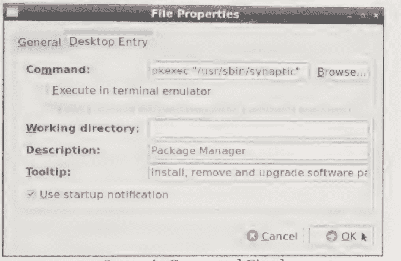

修复的 Synaptic 命令

菜单 → 偏选项 — Synaptic 软件包管理器

在 Synaptic 软件包管理器上右键点击。

选择“属性”。

选择“桌面项”标签页。

更改命令：

从：

`synaptic-pkexec`

到：

`pkexec "/usr/sbin/synaptic"`

### 向面板添加插件

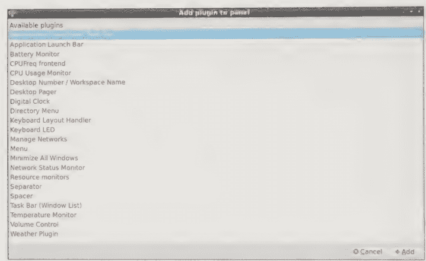

点击**添加**按钮将打开**向面板添加插件**面板，该面板显示任务栏小组件插件的完整列表。选择一个小组件并点击**添加**按钮将其添加到任务栏。

### 应用程序启动栏

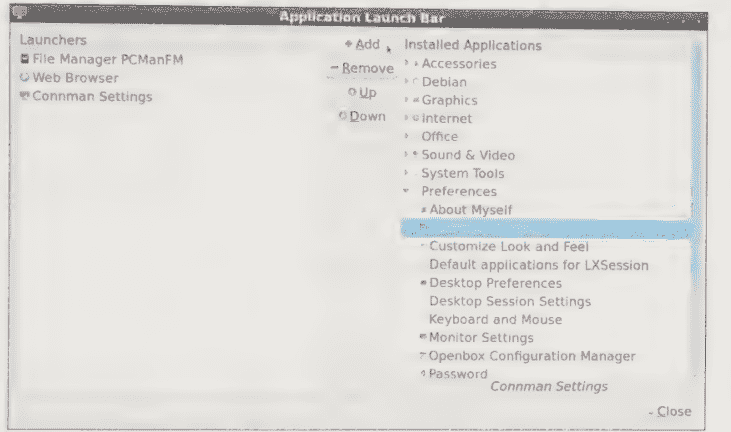

### 应用程序启动栏编辑器

可以在应用程序启动栏中添加/固定或移除/取消固定程序。从面板首选项（Panel Preferences）的“面板小组件”（Panel Applets）选项卡中，在左侧选择应用程序启动栏并点击首选项（Preferences）按钮。应用程序启动栏面板将打开。要固定，从右侧选择一个应用程序，然后按添加按钮。要取消固定，从左侧选择一个应用程序，然后按移除按钮。

### 将 Connman 添加到任务栏

将**Connman Settings**程序固定到应用程序启动栏中。

- 从**应用程序启动栏**面板中：
- 展开右侧的**首选项**（Preferences）。
- 选择**Connman Settings**。
- 点击**添加**（Add）按钮。
- 点击**关闭**（Close）按钮。

将**网络状态监控**（Network Status Monitor）小添加到任务栏。

- 从**向面板添加插件**面板中：
- 选择**Network Status Monitor**。
- 点击**添加**按钮。
- 点击**关闭**按钮。


Linux 通过桥接软件连接到外部，从而连接到 Chromebook。网络状态监控图标会闪烁，因为 Linux 正在与 Chromebook 通信。Linux 无法关闭 Chromebook 的网络连接，但它可以关闭与桥接软件网络的连接。

**注意：** Connman 连接配置文件位于：`/var/lib/connnman/<profile-folder>`

### Connman

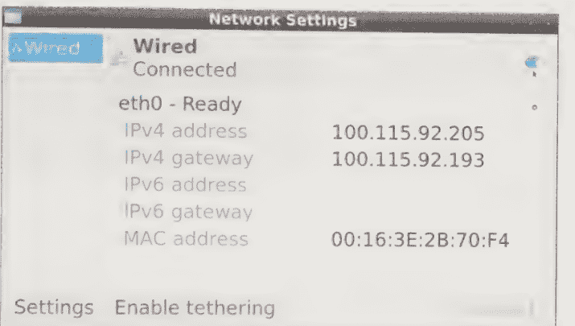

Connman，网络设置

Connman 网络控制：

- 启动 **Connman**。
- 从**网络设置**窗口中：
  - 点击右上角的开关。
  - **网络状态监控**将停止闪烁。
  - Linux 现在已断开网络连接。
  - 点击开关开启网络。
- 关闭**网络设置**窗口。

## 更改程序图标

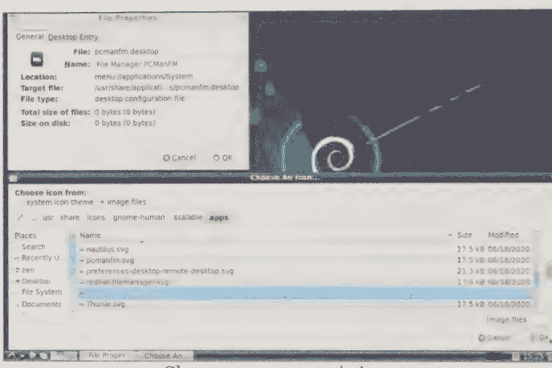

更改程序的图标。

要更改程序的图标，右键点击菜单项并选择**属性**（Properties）。在**文件属性**窗口中点击程序图标，将打开**选择图标**（Choose An Icon）窗口。选择一个图标并点击确定按钮。

`/usr/share/icons` 目录包含大量图标。通常需要深入几个目录才能找到图标。

`/usr/share/images` 中的其他目录也可能包含图标。**images** 目录包含几个 Debian 图标。

## 打印与扫描

打印机和扫描仪设置是自动的，同时也允许手动设置和配置。可以通过浏览器访问 CUPS 打印机界面。Xsane 可以扫描多页文档，并允许对扫描质量和类型进行详细控制。Chromebook 和扫描仪/打印机应该处于同一个网络中。从 Synaptic 安装：

```
cups
printer-driver-cups-pdf
```

使用 `whoami` 验证用户 ID，然后用 `usermod` 将用户 ID 添加到打印机管理组。从 LXTerminal：

```
whoami
sudo usermod -aG lpadmin <user-id>
```

关闭并重启 Linux 以应用更改。

### 使用 CUPS 打印

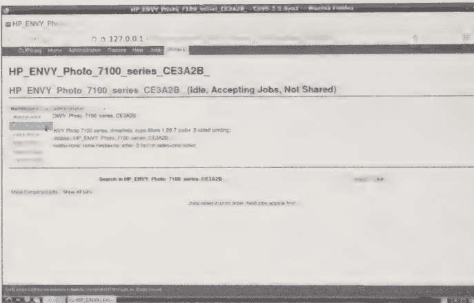

打开 Firefox，然后访问并书签 URL：

`127.0.0.1:631`（即 `localhost:631`）

可以在此处手动添加打印机。打印机可以暂停和重启。输出可以重定向。可以在此处设置打印机默认。CUPS 在“首页”标签页打开。点击“打印机”（Printers）选项卡。点击打印机名称。从“维护”（Maintenance）下拉菜单中选择“打印测试页”（Print Test Page）。要设置默认选项：打印机 → 选择打印机 - 管理下拉菜单 → 设置默认选项（Set Default Options）。

### 使用 Xsane 扫描

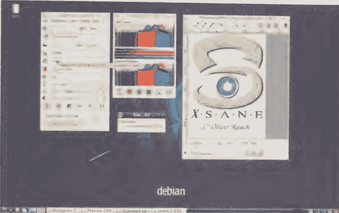

启动时的 Xsane。

启动 Xsane：

LXDE 菜单 → 图形 → Xsane

Xsane 启动时会打开四个窗口，但只需要两个。从主窗口的“窗口”（Window）菜单中，取消勾选“显示直方图”（Show histogram）和“显示标准选项”（Show standard options）。

悬停在选项上会弹出描述该选项的提示框。可能的选项设置更改包括：扫描模式（Scan Mode）从线条图改为彩色，扫描分辨率（Scan Resolution）从 75 改为 300。

按下“获取预览”（Acquire preview）按钮将扫描并显示整个图像或选定的任何部分。按下“扫描”（Scan）按钮会扫描图像，然后图像将在查看器窗口（Viewer Window）中打开，可以在其中保存文件。

多页扫描是一个两个步骤的过程。扫描将保存为单独的文件，并在完成后追加到所需的文件类型。按下 `Ctrl + M` 或将“目标”（Target）选项更改为“多页”（Multi-page）（右上），多页项目窗口。按下“扫描”按钮添加页面。完成后，在多页项目窗口中点击“保存多页文件”（Save multipage file）按钮。将扫描页数（Number of pages）设置为 1（主窗口左上）。

## 嵌入式 Web 服务器

使用互联网打印协议（IPP）的打印机通常具有嵌入式 Web 服务器（EWS）。打印机可能没有使用 IPP 或没有 EWS。如果有，这将是一个非常有用的功能。

从 LXTerminal：

```
ippfind
```

如果 `ippfind` 命令返回类似：`ipp://HPo068EBCE3A2B.local:631/ipp/print` copy（使用 `Ctrl + Shift + C`）`ipp://` 和 `:631` 之间的所有内容，在此例中：`HPo068EBCE3A2B.local`，将其粘贴到浏览器的搜索栏中。

### 在 Chromebook 上打印

在 **Chrome OS 设置**中，在**高级**（Advanced）下，选择**打印和扫描**（Print and scan）。在**打印和扫描**面板中选择**打印机**（Printer）。Chrome 将搜索打印机。当打印机出现时：

点击**保存**（Save）按钮。

### 在 Chromebook 上扫描

在 **Chrome OS 设置**中，在**高级**下选择**打印和扫描**。在**打印和扫描**面板中选择**扫描**（Scan）。Chrome 将搜索扫描仪。当扫描仪出现时，进行任何选择并点击**扫描**按钮进行扫描。

### 可打印物品

谷歌搜索**可打印纸质模型**（printable paper models）会产生无尽的结果页面。制作通常需要彩色打印机、剪刀、卡纸板和胶水。PosteRazor（第 84 页）可放大图像。LibreOffice Draw 和 Gimp（第 76 页）可用于创建和编辑图像。可以使用磁性名片制作海报和其他物体使其具有磁性。一些打印的材料可以涂上聚氨酯或其他材料使其更耐用。

### USB 设备

Chromebook 对 USB 设备有严格的控制。必须在 Chrome OS 设置的 Linux 开发环境面板中启用 Linux 访问。

适用于 Chrome OS 的键盘会自动适用于 Linux。在某些情况下可能需要 USB 转 USB-C 适配器或集线器。

将 USB 设备连接到 Chromebook 并进入 Linux 环境面板。点击“管理 USB 设备”，开启访问。

USB 存储将在 Linux 中显示：

`/mnt/chromos/removable/`

要停止与 Linux 共享任何存储，进入 Linux 环境。点击“管理共享文件夹”，点击不再共享的目录旁的 X。

如果文件夹无法与 Linux 共享，请停止共享所有文件夹。然后添加要共享的文件夹。如果共享仍然失败，请停止共享所有文件夹并重启。然后添加要共享的文件夹。

### 备份 Linux

FAT32 格式的存储设备不支持大于 4GB 的文件，应将其重新格式化为 exFAT。关闭 Linux 进入 **Linux 开发环境**。点击**备份与恢复**。点击**备份**按钮。选择存储备份的位置，可以更改名称。点击**保存**按钮开始备份。请参快速参考部分中的最佳实践（第 164 页）。这种备份 Linux 的方法**不会**备份共享的 Chrome OS 目录。可以使用 Chrome OS 的文件应用程序复制共享目录。

如果已启用**管理额外容器**（第 151 页）并已创建了容器，则需要从下拉菜单中选择要备份的容器。

### 恢复 Linux

关闭 Linux 并进入 **Linux 开发环境**。点击**备份与恢复**。点击**恢复**按钮。将弹出**确认恢复**面板，点击**恢复**按钮继续。选择要使用的备份文件并点击**打开**按钮。恢复将开始。

如果已启用**管理额外容器**（第 151 页）并已创建了容器，则需要从下拉菜单中选择要恢复的容器。

### CLI

界面有两种主要的风格：GUI（图形用户界面）和 CLI（命令行界面）。对于某些任务，CLI 是执行任务的唯一方式。对于某些任务，CLI 也速度更快。

### 运行脚本

可以在 Linux 终端中输入的命令可以输入文件中并作为脚本运行，通常称为 BASH 脚本。`help` 为内置命令（本身不是程序的命令）提供帮助。在 LXTerminal 中执行：

```
help
bash -c help
help -help
man bash
Q
which bash
```

```
sudo su
```

```
Tab Tab
```

```
Y
```

按住 Enter 键或 Q 退出

```
exit
```

`echo` 打印到终端。`>` 将输出发送到文件。`>>` 将输出追加到文件。`$HOME` 是一个持有用户主目录的变量。`~` 是 `$HOME` 的缩写。`rm` 移除、删除文件。`cp` 复制文件。`mv` 移动或重命名文件。在 LXTerminal 中输入以下内容：

```
echo "neofetch" > test.sh
echo "neofetch" > test.sh
echo "screenfetch" >> test.sh
cat test.sh
bash test.sh
./test.sh              将失败。
chmod +x test.sh      设为可执行。
./test.sh               将成功。
pwpd
echo $HOME
echo ~
~/test.sh
ls
cp test.sh test2.sh
ls
mv test.sh test2.sh
rm test2.sh
ls
```

### 目录

目录也称为文件夹，为组织文件提供了分级结构。**cd** 切换目录命令用于在目录之间移动。**cd ..** 用于移动到目录结构的上级。**mkdir** 用于创建目录。当目录名包含空格时，使用单引号或双引号。**rm -r** 将删除目录及其其中的任何文件或目录。**touch** 将创建一个空文件。

在 LXTerminal 中执行：

```
mkdir numbers
ls
cd numbers
touch one
touch "two three"
ls
cd ..
ls
rm -r numbers
ls
```

### 网络

现代网络为设备分配地址，就像公寓楼有地址一样。设备端口号就像公寓房号。应用程序可以使用计算机地址的一个或多个端口。如 `http`、`data`、`file` 和 `https` 这样的 URL 前缀是 URI 方案，定义了 URL 的用途。`https://127.0.0.1:631` 是 IPv4 格式的地址，告诉浏览器在本地机器（`127.0.0.1` 表示机器本身）的端口 631 上查找网页（`https`），该端口由 CUPS 使用。IPv6 是 IP 网络协议的新版本。要查看从互联网看到的你的 IP 地址，请访问 `google.com` 或 `start.duckduckgo.com` 等搜索引擎并搜索“my ip”。搜索引擎将显示你从互联网看到的 IP。在搜索处搜索“my user agent”。用户代理是你的浏览器和操作系统信息。Firefox 允许手动设置用户代理，最好不要更改此。

从 Firefox 显示用户代理：Firefox 菜单 → 更多工具 → 开发者工具 选择控制台标签卡 输入：

```
navigator.userAgent
```

Linux 通过桥接软件连接到 Chromebook 网络。Chromebook 可能连接到路由器或通过其他设备连接。不同层的网络可能使用不同的 IP 地址。`hostname -I` 显示主机的网络地址。`ip add show` 将显示所有网络地址。`lsof` 可显示所有打开的端口。`|` 将 `lsof` 的输出管道到 `grep` 用于过滤输出。

Chromebook Google Linux 指南

在 LXTerminal 中执行：

```
hostname -I
ip add show
sudo lsof -i -P -n | grep LISTEN
```

使用 `dig` `whois` 查找更多关于网站的信息。`traceroute` 显示到达站点需要多少跳数和花费多久。“Webhet”可以提供网站的详细技术信息，并拥有超过 900 个插件。“Net-cat”是一个强大的网络多功能工具，有很多 YouTube 专门介绍它。从 Synaptic 加载以下内容：

```
bind9-dnsutils
whois
traceroute
```

在 LXTerminal 中执行：

```
dig google.com
whois google.com
traceroute google.com
```

需要时 `Ctrl + C`。

查看 Chromebook 侧的网络。从 Chrome OS Chrome 浏览器访问 URL：

```
chrome://system
Ctrl + F - 查找 ifconfig
```

点击展开按钮

### 查看日志

**dmesg** 可以显示当前日志消息。可以使用 **journalctl** 命令查看系统日志。**--list-boots** 将列出启动日志。之前的启动项将在行开头显示负偏移量，配合 **-b** 选项使用。在接后的示例将使用零，负数可以查看之前的启动。**-x** 选项提供解释和可能的消息。使用向上/向下箭头滚动并按 Q 退出。在 LXTerminal 中执行：

```
sudo su
dmesg
journalctl --list-boots
Q
journalctl -b 0
Q
journalctl -b 0 -x
Q
journalctl --help
Q
exit
```

检查程序的 man 页面，程序可能会保留自己的日志文件。从命令行启动程序可能有所帮助。从 LXDE 菜单复制程序的启动命令。**菜单** → 右键点击**应用** → **属性** → **启动标签页**，复制 **Ctrl** + C **命令** 并将其 **Ctrl** + Shift + **V** 粘贴到 LXTerminal 中。任何错误都可能显示在 LXTerminal 中。

### 故障排除

并不是所有程序都能在所有计算机上运行。有时在互联网上搜索无法提供帮助，man 文件和日志文件没有提供线索，甚至从 LXTerminal 启动程序也不会提供有用的信息。`strace` 记录系统调用，`-o` 将输出发送到文本文件，`-C` 显示摘要。可以使用任何编辑器查看文件。`cat` 是快速查看文件的快捷方法。将输出管道到 `less`，`less` 允许使用向上/向下箭头滚动文件，按 Q 退出。

从 Synaptic 安装：

```
manpages-dev
strace
```

在 LXTerminal 中执行：

```
man syscalls
Q
man strace
Q
strace -C -o st.txt cmatrix
Q
cat st.txt | less
Q
```

Chrome OS 有它自己的跟踪程序。在 Chrome OS 浏览器中，输入 URL：

```
chrome://tracing
```

## 安装 i3wm

平铺窗口管理器在效率方面是无与伦比的。它们非常节省系统资源，同时提供了强大的功能。它们通常通过编辑少量配置文件进行配置。i3 参考卡大约半页长。可以在 `i3wm.org` 网站的 Screens 下找到教程视频链接。YouTube 上有 Aline Abler 为 Linux Days 做的精彩演示。本章将介绍安装和配置 i3wm。i3wm 窗口可以安装并与 LXDE 并运行。

检查 Chrome OS 设置以适用于 LXDE 的屏幕尺寸。本章将使用 1080x675。i3wm 窗口不像 LXDE 那样动态调整大小：Chrome OS 设置 → 设备 → 显示

`Shift + Search + Q` 将关闭活动窗口。

### i3wm 文档

尚未安装，从 Synaptic 安装：

```
i3
xterm
qpdfview
cups
printer-driver-cups-pdf
```

将网页打印为 PDF 是保存网页的方便方法。打开 Firefox 并访问 `i3wm.org` 选择 Docs 然后选择 i3 参考卡。

使用 `Ctrl + P` 打开打印对话框向下滚动并点击“使用系统对话框 . .”

在通用标签页：

选择 PDF

在页面设置标签页上：

选择纸张大小：US Letter

选择方向：横向

点击打印按钮。

PDF 将保存在用户主目录下的 PDF 文件夹中，`~/PDF`。创建带有分类文件夹的自己的电子书目录是一个好习惯。

打开 LXDE 文件管理器并导航到 PDF 文件夹。右键点击 i3 参考卡 PDF，选择属性。弹出文件属性对话框。从打开方式：下拉菜单选择

`qpdfview`。这告诉 `pcmanfm`，未来的 PDF 文档应该用 QPDFviewer 打开。PDF 也可以重命名为更用户友好的名称，保留末尾的 `{dot}.pdf`。

双击 i3 参考卡片 PDF，它将在 QPDFviewer 中打开。如果需要，旋转图像：View → Rotate right（向右旋转）。适应页面宽度：View → Fit to page width。

回到 Firefox 和 `i3wm.org`，选择 Docs（文档）然后选择 User's Guide（用户指南）。将文档打印为 PDF，这次使用纵向（Portrait）。

### i3wm 启动脚本

使用 LXDE 设置 i3wm。打开 Mousepad：

Menu（菜单）→ Accessories（附件）→ Mousepad

使用 Mousepad 创建 `~/goi.sh`，**File → Save As...（文件→另存为...）**，输入名称：**goi.sh**。点击**Save（保存）**按钮。


Mousepad 有许多实用功能。在 **View（视图）** 下勾选（开启 **Line Numbers（行号）、Toolbar（工具栏）、Statusbar（状态栏）**），并选择一个 **Color Scheme（配色方案）**。字体大小可以在 **Edit → Preferences（编辑→选项）** 下设置，勾选 **Highlight current line（高亮当前行）** 和 **Highlight matching brackets（高亮匹配括号）**，取消勾选 **Use system monospace（使用系统等宽字体）**，然后选择字体大小。

使用 Mousepad 编辑 `~/goi.sh`，向 `goi.sh` 添加以下四行并保存文件。使用 **Chrome OS 设置中的屏幕尺寸**。文件头的 `#!` sha-bang 告诉程序加载器使用什么解释器程序。BASH 是 Bourne Again Shell 的缩写。

`~/goi.sh`：

```bash
#!/bin/bash
Xephyr -br -screen 1080x675 -resizeable :30 &
sleep 5
DISPLAY=:30 i3 &
```

关闭 LXDE 中任何运行中的程序，并正常从 Terminal（终端）关闭 Linux。

### i3wm 配置

删除 i3 目录将重置 i3wm 配置且不会对 i3wm 造成伤害。生成配置的问题需要重新回答。i3wm 配置文件位于：

`~/.config/i3/config`

需要在家目录下创建 Xresources 文件：

`~/.Xresources`

重启 Linux，从 LXDE 运行文件管理器 `pcmanfm`。选择 Home Folder（主文件夹）。隐藏文件夹并不是真的隐藏，它们只是以 `.` 点开头。如果 `.config` 文件夹不可见，选择 View（视图）→勾选 Show Hidden（显示隐藏文件）或按 `Ctrl + H`。打开 `.config` 文件夹，然后打开 i3 文件夹。在 `config` 文件上点击右键，选择 Open With...（用...打开...），然后展开 Accessories（附件）并选择 Mousepad。将文件保存为 `config.bak`。关闭 Mousepad 并再次用 Mousepad 重新打开配置文件。

对配置文件的更改将覆盖 i3 参考卡片文档中的设置。在配置文件中，`$mod` 表示 Chromebook 的 Search 键或 Windows 键盘上的 Windows 键。`mod+1` 是 Alt 键。

### i3/config

对 `~/.config/i3/config` 进行以下更改。使用 `Ctrl + F` 或 Search → Find（搜索→查找）找到位置：

```text
Find: pango:m
From: font pango:monospace 8
To: font pango:monospace 12
```

```text
Find: sen
From: exec i3-sensible-terminal
To: exec xterm
```

```text
Find: dmenu_run
From: --no-startup-id dmenu_run
To: --no-startup-id i3-dmenu-desktop
```

```text
Find: mod+h $mod+h split h
From: bindsym mod1+Ctrl+h split h
```

```text
Find: mod+v
From: bindsym $mod+v split v
To: bindsym mod1+Ctrl+v split v
```

```text
Find: Shift+sp
From: bindsym $mod+Shift+space floating toggle
To: bindsym mod1+Ctrl+space floating toggle
```

在文件底部添加：

`exec xrdbb -merge ~/.Xresources && xterm`

保存文件并关闭 Mousepad。

### i3wm 菜单修复

i3wm 菜单需要向 `i3-dmenu-desktop` 添加一行代码，以保持应用程序在桌面上。使用命令 `which` 查找菜单的位置。为了访问此文件位置，请用 `sudo` 运行 `pcmanfm`。从 LXDE 打开 LXTerminal：

```bash
which i3-dmenu-desktop
sudo pcmanfm
```

导航到 `/usr/bin`，用 Mousepad 打开 `i3-dmenu-desktop`。由于这是一个不同的用户，Mousepad 需要重新配置，每个用户仅需执行一次。将文件保存为 `i3-dmenu-desktop.bak`。关闭 Mousepad。再次用 Mousepad 打开 `/usr/bin/i3-dmenu-desktop`：

```text
Find: "$exec
From:
  }
  $cmd = qq|exec nosn "$exec"|;
}
To:
  }
  $exec = "env GTK_BACKEND=x11 ${$exec}";
  $cmd = qq|exec nosn "$exec"|;
}
```

保存文件并关闭 Mousepad、Pcmmanfm 和 LXTerminal。

### i3wm Xresources

`.Xresources` 文件被 XTerm 等程序使用。必须运行命令 `xrdb -merge ~/.Xresources` 来加载来自 Xresources 的更改。使用 Mousepad 在家目录下创建 `~/.Xresources`：

```text
xterm*saveLines: 2000
xterm*loginShell: true
xterm*selectToClipboard: true
xterm*faceName: Monospace
xterm*faceSize: 12
xterm*Foreground: SlateBlue
xterm*pointerColor: red3
xterm*cursorColor: red3
```

保存文件并退出 Mousepad。

有许多 YouTube 和网页专门介绍 XTerm 及其如何配置它。

### i3wm 启动和关闭

#### 启动

从 Terminal 中：

从 Terminal 菜单中选择 Penguin。

`./goi.sh`

如果需要，按 Fullscreen（全屏）。

#### 关闭

退出任何运行中的 Linux 程序。

右键点击 Terminal 图标并选择 Shut down Linux（关闭 Linux）。

### i3wm 快捷键

i3wm 启动时带有一个 XTerm 会话。退出 XTerm 使用 `exit`。参阅 i3wm 参考卡片获取完整的快捷键列表。在本章较早之前，快捷键在 `~/.config/i3/config` 文件中被重新定义，以避免与 Chrome OS 冲突。它们可以随时更改。

- Search + Enter - 打开一个终端窗口
- Alt + Ctrl + H - 下一个水平分屏
- Alt + Ctrl + V - 下一个垂直分屏
- Search + D - 显示右上角的菜单
- Alt + Ctrl + Spacebar - 浮动切换
- Search + F - 全屏

### i3wm 浮动窗口

Floating Window 

i3wm 允许窗口浮动。

浮动窗口：

- `exit`
- Search + D
- `sy`
- Enter gal
- Enter

### i3wm 分屏格式

分屏窗口：

- Search + Enter / `htop`
- Search + Enter / `neofetch`
- Alt + Ctrl + V
- Search + Enter / `cmatrix`

我知道吧！

退出程序：

- Q

`exit`

### i3wm 工作区

由于 Chromebook 使用 Search (o-9) 功能键，i3wm 工作区需要重新定义。切换到工作区并移动活动窗口到工作区。编辑 `config`：

```text
### 切换到工作区:
From: bindsym $mod+1
To: bindsym ctrl1
```

```text
### 移动活动窗口到工作区:
From: bindsym $mod+Shift+1
To: bindsym mod1+shift1
```

工作区编号显示在左下角。通过 Alt+9 访问工作区，0 是第 10。

### i3wm 参考

i3wm.org：

文档：

- **User's Guide（用户指南）** - 有用但具有技术性。
- **i3 reference card（i3 参考卡片）** - 配置覆盖。

屏幕：

- i3wm YouTube 链接，从这里开始。

YouTube 搜索：

- **i3wm Alx Booker** - 三部分教程
- **Aline Abler Linux Days** - 平铺窗口管理器
- **i3wm** - 关于 i3wm 的视频

有很多优秀的桌面环境供 Linux 用户探索。在做出更改之前务必备份 Linux。

### i3wm 屏幕保护

**Screen Saver（屏幕保护）** 可以通过 XTerm 关闭：**q** 显示，**s off** 关闭。

```bash
xset q
xset s off
```

## 软件

Debian 提供了超过 50000 个软件包。外部仓库可以添加到 Debian 仓库列表中。许多 Linux 软件提供商直接从其网站提供最新版本的软件。`.deb` 文件可以下载并直接安装。

在标记“Prefix”的地方，建议在 LXDE 菜单启动命令前加上该“Prefix”。CLI 意味着程序通过类似 LXTerminal 或 Xterm 的终端运行。对于缓慢或出现故障的程序，尝试使用 Sommelier，在本章稍后部分介绍（第 105 页）。

### 全屏快捷键

全屏模式可以让屏幕更易阅读和操作。在 Chromebook 键盘上，功能键 F1 至 F12 通过以下组合实现：

Search（搜索键） + (1 至 =)。F10 = Search + o（数字 0），F11 = Search + -（破折号），F12 = Search + - =

- i3wm 全屏切换：Chromebook 键盘：Search + F
- LXDE 全屏切换：Chromebook 键盘：Alt + Search + -（破折号）
- Windows 键盘：Win + F

如果 LXDE 全屏切换切换不起作用，请确保已禁用“改进的快捷键（improved keyboard shortcuts）”标记（flag）。

通过 Chrome OS 的 Chrome 浏览器：

访问 URL：`chrome://flags`

在搜索框中输入：

`improved keyboard shortcuts`

应该会看到一个标记。禁用该标记并重启。如果该功能停止工作（可能在更新后出现）：启用该标记并重启，然后再次禁用该标记并重启。

### 键盘快捷键（又热键）

要查看或编辑键盘快捷键：

LXDE：菜单 → 偏好 → 设置热键

i3wm：编辑文件：`~/.config/i3/config`

### Blender – 动画

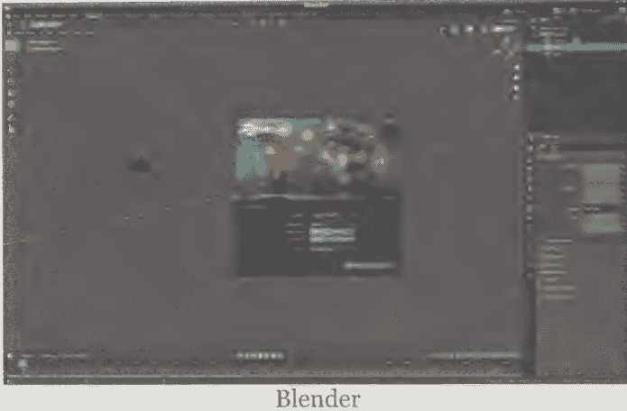

**安装：** `blender`

**描述：** 创建 2D 和 3D 动画。Blender 已用于制作电影。

**文档：** 帮助菜单。有很多专门 Blender 的书籍、网站和 YouTube 频道。如果 Blender 运行缓慢或出现故障，请尝试使用 Sommelier（在本章稍后介绍，第 105 页）。

**LXDE：** 菜单 → 图形 → Blender

**i3wm：** `bl` - Blender

## Chromebook Google Linux 指南

### FreeCAD – CAD

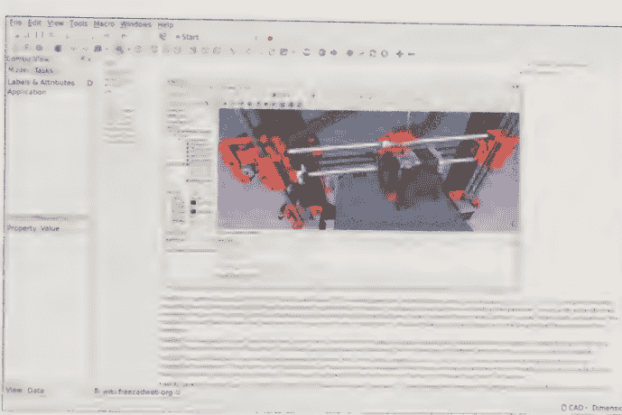

#### FreeCAD

**安装：** `freecad`

**描述：** FreeCAD 是一个完整的 CAD 系统，可以通过插件进行扩展。FreeCAD 适用于切片软件和 3D 打印机。

**文档：** 帮助菜单（? Help F1 无效，其他帮助功能可用）。有很多专门 FreeCAD 的书籍、网站和 YouTube 频道。如果 FreeCAD 运行缓慢或出现故障，请尝试使用 Sommelier（在本章稍后介绍，第 105 页）。

**LXDE：** 菜单 → 图形 → FreeCAD

**i3wm：** `fr` - FreeCAD

### Gimp - 位图编辑

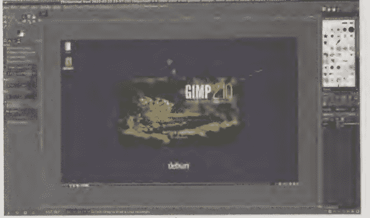

#### Gimp

**安装：** `gimp`, `gimp-data-extras`, `gimp-gap`, `gimp-help-en`, `gimp-lensfun`, `gimp-plugin-registry`, `gimp-texturize`

**描述：** 编辑照片和其他位图图形。

**文档：** 帮助菜单。有很多专门 Gimp 的书籍、网站和 YouTube 频道。

**LXDE：** 菜单 → 图形 → GNU Image Manipulation Program（GNU 图像处理程序）

**i3wm：** `gn` - GNU Image Manipulation Program

## Chromebook Google Linux 指南

### Flowblade - 视频编辑器

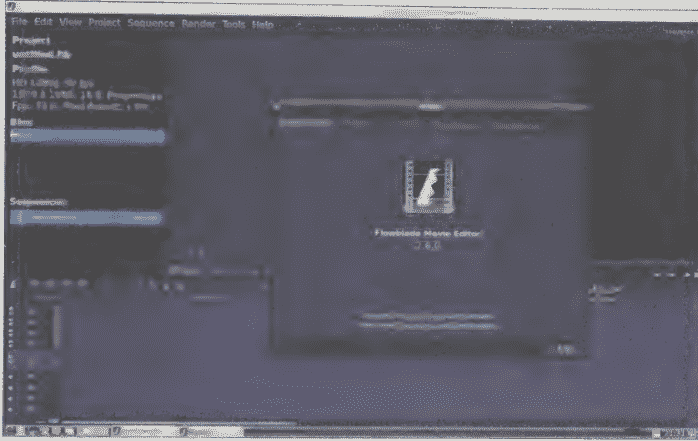

#### Flowblade

**安装：** `flowblade`

**描述：** Flowblade 是一个视频编辑器。Flowblade 的一个关键特性是使用渲染技术，它允许在低分辨率下编辑视频，然后以高分辨率进行渲染。

**文档：** YouTube 是学习 Flowblade 的最佳方式。如果 Flowblade 运行缓慢或出现故障，请尝试使用 Sommelier（在本章稍后介绍，第 105 页）。

**前缀：** `env GDK_BACKEND=x11`

**LXDE：** 菜单 → 音频与视频 → `flowblade`

**i3wm：** `flo` - `flowblade`

### LMMS - 音乐工作室

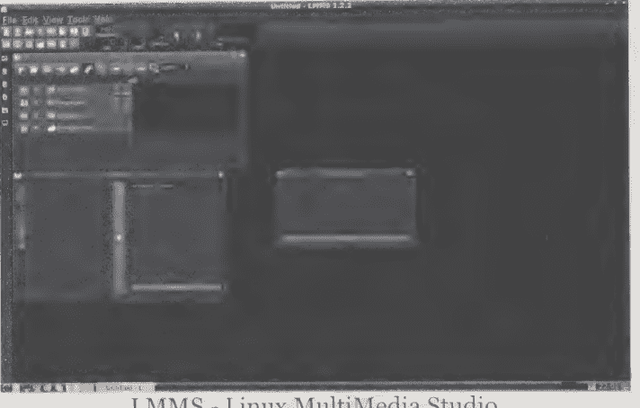

**安装：** `lmms`

**描述：** LMMS 是一个完整的音乐工作室。

**文档：** 帮助菜单。有很多专门 LMMS 的 YouTube 频道。如果 LMMS 运行缓慢或出现故障，请尝试使用 Sommelier（在本章稍后介绍，第 105 页）。

**LXDE：** 菜单 → 音频与视频 → LMMS

**i3wm：** `l1` – LMMS

## Chromebook Google Linux 指南

### Qtikz - 图表编辑器

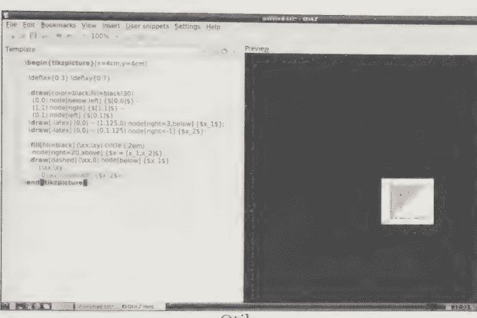

#### Qtikz

**安装：** `qtik`

**描述：** Qtikz 是一个 TikZ 图表编辑器。

**文档：** 帮助菜单 → Qtikz 手册。有很多专门 TikZ 的网站和 YouTube 频道。

搜索“Tikz diagrams”。

**示例：** `texample.net/tikz/`

**示例：** `pgfplots.net`

**LXDE：** 菜单 → 办公 → Qtikz

**i3wm：** `qti` - Qtikz

## Chromebook Google Linux 指南

### wxMaxima - 数学 CAD

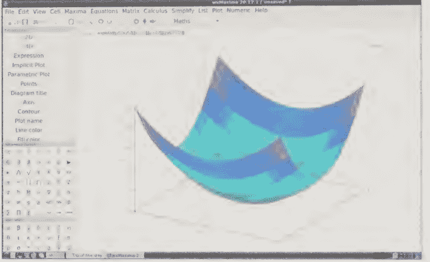

#### wxMaxima

**安装：** `wxMaxima`

**描述：** 数学 CAD

**文档：** 帮助 → wxMaxima 帮助。有很多专门 wxMaxima 的网站。

**前缀：** `env GDK_BACKEND=x11`

**LXDE：** 菜单 → 教育 → wxMaxima

**i3wm：** `w` - wxMaxima

### GeoGebra - 数学 CAD


#### GeoGebra

**安装：** `geog`

**描述：** GeoGebra

**文档：** `geog.org`，有很多专门 GeoGebra 的网站和 YouTube 频道。视频：`youtube.com/user`

**LXDE：** 菜单 → 教育 → GeoGebra

**i3wm：** `ge` - GeoGebra

### Audacious - 音乐播放器

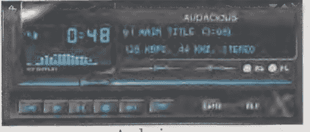

#### Audacious

**安装：** `audacious`

**描述：** Audacious 播放器播放 MP3、Ogg、FLAC、WMA 等格式。

**文档：** 自定义、颜色、字体、位置、大小、速度、播放列表。点击托栏设置。

**LXDE：** 菜单 → 音频与视频 → Audacious

**i3wm：** `au` - Audacious

## Chromebook Google Linux 指南

### Pidgin - 聊天


#### Pidgin

**安装：** `pidgin`

**描述：** Chromebook Google Linux 指南

**文档：** 从相同的，TCP 等。通过“打开方式”，这只需设置一次。

**LXDE：** 菜单 → 网络 → Pidgin

**i3wm：** `pi` - Pidgin

### PosteRazor - 图像放大器

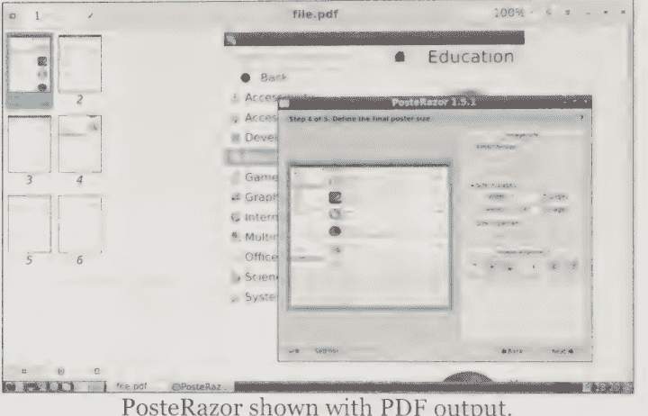

#### PosteRazor

**安装：** `poster`

**描述：** PosteRazor 接受 BMP、GIF、ICO、JPG、PNG、TIFF 格式。

**文档：** 格式。

**LXDE：** 菜单 → 图形 → PosteRazor


# i3wm：po - PosteRazor

## Onboard - 屏幕键盘

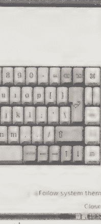

Onboard

安装：`onboard`

描述：Onboard 是屏幕键盘。它有多种主题、布局。

文档：从菜单中。

LXDE：菜单 → 通用功能 → Onboard

i3wm：on - Onboard

## Screenkey - 击键横幅

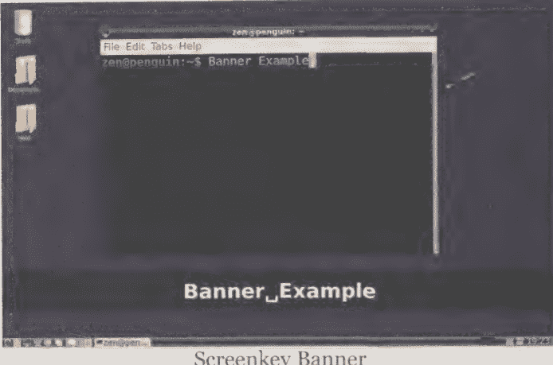

Screenkey

安装：`screenkey`

描述：Screenkey 在横幅中显示按键。

文档：从菜单中。

LXDE：菜单 → 应用程序 → Screenkey

i3wm：scr - Screenkey

## MPV - 媒体播放器

描述：MPV 是一个随 LXDE 安装的高效视频播放器。根据 Chromebook 的性能，可以将屏幕调整为观众喜好的尺寸。从 `pcmanfm` 中，右键点击视频文件并选择**属性**。在**打开方式**下拉菜单中选择“mpv Media Player”，这只需设置一次。现在双击文件将将在 MPV 中打开。**不要**修改启动命令。将 Chrome OS 任务栏设置为“自动隐藏底架”。如果视频消失，按下显示窗口键并选择视频。

## Kazam - 屏幕录制

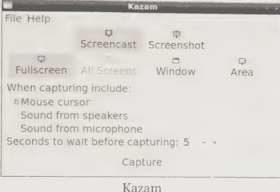

安装：`kazam`

描述：Kazam 是一个屏幕录制工具，可以录制全屏、窗口或区域。文件 → 选项可以设置偏。视频保存在用户目录的 Videos 文件夹中。要退出，左键点击托盘图标并选择退出 或 结束录制。

文档：`man kazam`, `kazam --help`

前缀：`env GDK_BACKEND=x11`

LXDE菜单 → 声音与视频 → Kazam

i3wm: ka - Kazam

## vokoscreenNG - 屏幕录制

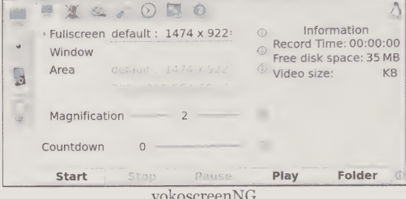

vokoscreenNG

**安装：** `vokoscreenNG`

**描述：** vokoscreenNG 是一个屏幕录制工具，可以录制全屏、窗口或区域。视频保存在用户目录的 **Videos** 文件夹中。要退出，右键点击托盘图标并选择 **退出**。

**文档：** `man vokoscreenNG`, `vokoscreenNG --help`

**前缀：** `env GDK_BACKEND=x11`

LXDE菜单 → 声音与视频 → vokoscreenNG

i3wm: vo - vokoscreenNG

## 媒体转换

**FFmpeg - 描述：** FFmpeg 是领先的多媒体框架，能够解码、编码、转码、封装、解封装、流化、过滤和播放人类和机器的几乎任何内容。它支持从最冷门的 ffmpeg 格式到最前端的格式。

**安装：** `ffmpeg`, `ffmpeg-doc`

**文档：** `man ffmpeg`, `ffmpeg --help` 从 ffmpeg，右键点击：`/usr/share/doc/ffmpeg/manual/ffmpeg.html` 并选择 Firefox。有许多网站和 YouTube 频道致力于 FFmpeg。

**CLI：** 从 LXTerminal, XTerm, Terminal 运行。

**ImageMagick - 描述：** 一个位图图像合成器和转换器。

**安装：** `imagemagick`

**文档：** `imagemagick.org/index.php` 有许多网站和 YouTube 频道致力于 ImageMagick，`man convert`, `convert --help`

**CLI：** 从 LXTerminal, XTerm, Terminal 运行。

## 磁盘分析器

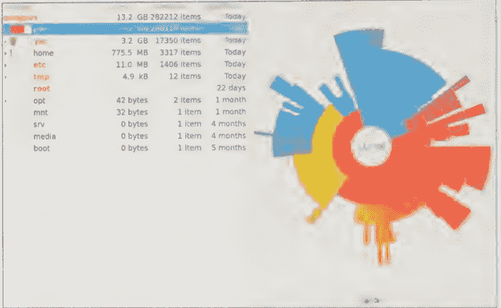

**安装：** `baobab`

**描述：** 磁盘分析器是一个图形菜单驱动的应用程序。由于 Chromebook 的设计，实际数字并不精确，但很有参考价值。

**文档：** `man baobab`, `baobab --help`

**前缀：** `env GTK_BACKEND=x11`

LXDE：菜单 → 系统工具 → 磁盘分析器

i3wm: disk - 磁盘分析器

## Update Alternatives (更新选项)

**描述：** Update Alternatives 控制几个重要的 Debian 设置。其中一个较小的设置是浏览器偏好。许多程序在默认浏览器中打开基于 HTML 的帮助文件。默认设置会导致进程失败。

将默认浏览器强制设置为 Firefox。

```
从 LXTerminal:
sudo su
update-alternatives --get-selections
cd /usr/bin
ls *
cp garcon-url-handler garcon-url-handler.bak
nano garcon-url-handler
```

**修改 exec 行：**

```
从：
exec /opt/google/cros-container/bin/garcon...
改为：
exec /usr/bin/firefox-esr --client --url "$@"
Ctrl + O
Enter
Ctrl + X
重启系统
```

**文档：** `man update-alternatives`, `update-alternatives --help`

**CLI：** 从 LXTerminal, XTerm, Terminal 运行。

## Python – 编程

**安装：** `idle-python3.9` - (3.9 或更高数字) `python3-pip`, `python3-pipdeptree`, `python3-examples`, `python3-doc` (可选：Thonny Python IDE)

**描述：** 编程的高需求、高薪领域，在 AI 中被广泛使用。

**配置 IDLE：**

Options → Configure IDLE → **General** 标签

点击 **Auto-Squeeze Min. Lines** 复选框。

改为 **5000**。

点击 **Apply** 然后点击 Ok 按钮。

**其他帮助来源**

点击 **Add** 按钮。

名称：**Local Copy**

帮助文件路径：

`/usr/share/devhelp/books/python3.9/index.html`

点击 **Ok** 按钮。

点击 **Apply** 然后点击 **Ok** 按钮。

**文档：** `python.org`, YouTube, books

Help → Local Copy

Help → Turtle Demo

点击 **Example**，选择一个并按 **Start**。

LXDE：菜单 → 编程 → IDLE

i3wm: i - IDLE (使用 Python 3.9)

## SQLite – 数据库

**注意：** Python 自带了 SQLite 库 (`import sqlite3`)。R SQLite 库可以从 Synaptic (`r-cran-rsqlite`) 或从 CRAN (`install.packages("SQLite")`) 安装。

**安装：** `sqlite3`, `sqlite3-doc`

**描述：** SQLite 是一个以库形式实现的无服务器数据库。`sqlite3` 是一个基于文本的 SQLite 查询工具，`.help` 查看帮助。`.exit` 退出。

**文档：** `sqlite.org/index.html`, `/usr/share/doc/sqlite3/index.html`, `man sqlite3`, `sqlite3 --help`

**CLI：** `sqlite3` - `.help` `.exit`

**安装：** `sqlitebrowser`

**描述：** DB Browser for SQLite 是一个基于 GUI 的 SQLite 浏览器编辑器。

**文档：** `man sqlitebrowser` `sqlitebrowser --help`

LXDE：菜单 → DB Browser for SQLite

i3wm: db - DB Browser for SQLite

## Clipart – LibreOffice

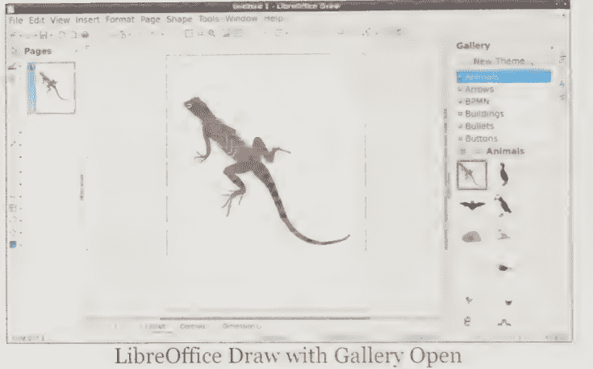

安装：`openclipart-libreoffice`

描述：LibreOffice 随 LXDE 安装。可以从“视图”或“插入”菜单添加剪贴画：

视图 → 画廊

插入 → 图像...

文件位置：位置：`/usr/share/openclipart/png/`

## 文本浏览器

文本浏览器极快，能够高效地利用系统资源。

文本浏览器极快，能够高效地利用系统资源。

文本浏览器极快，能够高效地利用系统资源。

文本浏览器极快，能够高效地利用系统资源。

文本浏览器极快，能够高效地利用系统资源。

文本浏览器极快，能够高效地利用系统资源。

文本浏览器极快，能够高效地利用系统资源。

文本浏览器极快，能够高效地利用系统资源。

文本浏览器极快，能够高效地利用系统资源。

文本浏览器极快，能够高效地利用系统资源。

文本浏览器极快，能够高效地利用系统资源。

文本浏览器极快，能够高效地利用系统资源。

文本浏览器极快，能够高效地利用系统资源。

文本浏览器极快，能够高效地利用系统资源。

文本浏览器极快，能够高效地利用系统资源。

文本浏览器极快，能够高效地利用系统资源。

文本浏览器极快，能够高效地利用系统资源。

文本浏览器极快，能够高效地利用系统资源。

文本浏览器极快，能够高效地利用系统资源。

文本浏览器极快，能够高效地利用系统资源。

文本浏览器极快，能够高效地利用系统资源。

文本浏览器极快，能够高效地利用系统资源。

文本浏览器极快，能够高效地利用系统资源。

文本浏览器极快，能够高效地利用系统资源。

文本浏览器极快，能够高效地利用系统资源。

文本浏览器极快，能够高效地利用系统资源。

文本浏览器极快，能够高效地利用系统资源。

文本浏览器极快，能够高效地利用系统资源。

文本浏览器极快，能够高效地利用系统资源。

文本浏览器极快，能够高效地利用系统资源。

文本浏览器极快，能够高效地利用系统资源。

文本浏览器极快，能够高效地利用系统资源。

文本浏览器极快，能够高效地利用系统资源。

文本浏览器极快，能够高效地利用系统资源。

文本浏览器极快，能够高效地利用系统资源。

文本浏览器极快，能够高效地利用系统资源。

文本浏览器极快，能够高效地利用系统资源。

文本浏览器极快，能够高效地利用系统资源。

文本浏览器极快，能够高效地利用系统资源。

文本浏览器极快，能够高效地利用系统资源。

文本浏览器极快，能够高效地利用系统资源。

文本浏览器极快，能够高效地利用系统资源。

文本浏览器极快，能够高效地利用系统资源。

文本浏览器极快，能够高效地利用系统资源。

文本浏览器极快，能够高效地利用系统资源。

文本浏览器极快，能够高效地利用系统资源。

文本浏览器极快，能够高效地利用系统资源。

文本浏览器极快，能够高效地利用系统资源。

文本浏览器极快，能够高效地利用系统资源。

文本浏览器极快，能够高效地利用系统资源。

文本浏览器极快，能够高效地利用系统资源。

文本浏览器极快，能够高效地利用系统资源。

文本浏览器极快，能够高效地利用系统资源。

文本浏览器极快，能够高效地利用系统资源。

文本浏览器极快，能够高效地利用系统资源。

## 极限 Tux Racer – 游戏


Extreme Tux Racer

安装：`extremetuxracer`

描述：3D 下坡滑雪游戏。使用方向键左/右键转弯，向上键加速，向下键减速，空格键跳跃，P 暂停，R 重启，Esc 退出。

文档：内置帮助

LXDE：菜单 → 游戏 → Extreme Tux Racer

i3wm：ex - Extreme Tux Racer

## Sommelier - Wayland 合合器

**描述：** Sommelier 是一个 Wayland 合合器，它处理连接到 Linux 的会话。没有一种方案方案适用于所有程序。Sommelier 可以作为程序的包装器运行，允许对该程序进行自定义设置。缩放比例会有不同。

**文档：** `sommelier --help`

### 三种推荐的前缀选项：

- 1) 无前缀。

- 2) `env GDK_BACKEND=x11 <program-name>`

- 3) `sommelier -X --scale=.5 --glamor --frame-color=#000000 <program-name>`

小写 `sommelier`，空格、横杠、大写 X，空格、横杠、横杠、小写 `scale`，等号、点 5，空格、横杠、横杠、小写 `glamor`，空格、横杠、横杠、小写 `frame`、横杠、`color`、等号、六零、程序名。当 `sommelier` 用作前缀时，程序将在桌面之外运行，但看起来是在桌面上运行。点击桌面会导致程序消失，按下“显示窗口”并选择程序即可恢复。

缩放比例将根据 Chromebook 显示设置、屏幕尺寸和程序而变化。高分辨率的良好起点是比例 .5，低分辨率的良好起点是比例 1.2。数字越大，屏幕越小。如果 .3 稍微大了一而 .4 稍微小了，尝试 .35。尝试全屏键，有时有效。

边框颜色（Frame Color）使用两位十六进制红绿蓝编码方案。`000000` 是黑色，`FFFFFF` 是白色，`FF0000` 是红色，`00FF00` 是绿色，`FF00FF` 是紫色。十六进制使用 0 加上 A、B、C、D、E 和 F。2A 十进制 = 2x16+10 = 42。FF=255，所以有 255 的三次可能的颜色，超过 1600 万种颜色。

要编辑 LXDE 菜单项，右键点击它，选择属性，Desktop Entry 选项卡，编辑 Command:，这也会修复 i3wm。 `~/.local/share/applications/<name>.desktop` 是覆盖文件，可以手动编辑或删除而不影响任何内容。

当菜单项被编辑时，它将从 `/usr/share/applications/` 复制到 `~/.local/share/applications/`

请检查程序的文档以获取命令行选项。还要检查程序的设置。如果程序运行异常，尝试降低其分辨率并可能关闭某些功能。大多数程序在它们的设置中都有全屏选项。

在使用 Linux 时隐藏 Chrome OS 任务栏，请右键点击 Chrome OS 任务栏并选择“自动隐藏显示层”。按下“显示窗口”，右键点击任务栏并从菜单中选择“始终显示显示层”以恢复。

以下六个程序均使用 `sommelier` 前缀运行。你的比例设置可能会不同。完整的启动命令将代替前缀显示。

## 冰冻泡泡 – 游戏


**安装：** `sommelier-bubble`

**描述：** 解谜射击游戏。方向键左/右，向上键射击，Esc 退出。

**文档：** `man frozen-bubble`, `frozen-bubble --help`

**启动：** `sommelier -X --scale=.55 --glamor --frame-color=#000000 frozen-bubble`

LXDE：菜单 → 游戏 → Frozen-Bubble

**i3wm：** fro - Frozen-Bubble

## Powermanga – 游戏

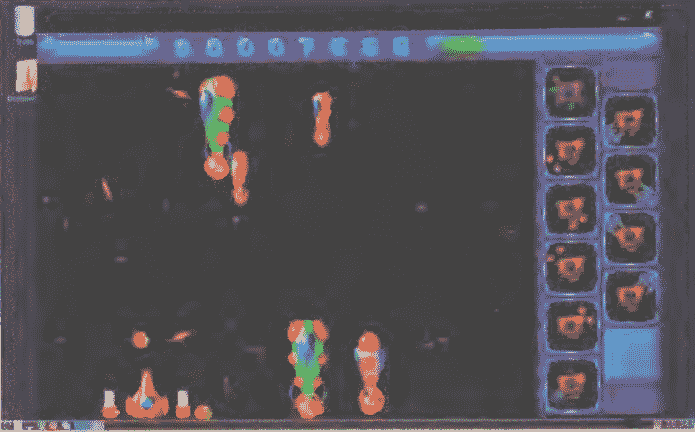

Powermanga

**安装：** `powermanga`

**描述：** 2D 滚屏射击游戏。首次运行 Powermanga 时按 Esc 然后按 F – 全屏（居中并放大屏幕，窗口内按 Esc）。方向键移动，空格键射击，P 暂停，Esc 退出。

**文档：** `man powermanga`, `powermanga --help`

**启动：** `sommelier -X --scale=.45 --glamor --frame-color=#000000 powermanga`

**LXDE：** 菜单 → 游戏 → Powermanga

**i3wm：** pow - Powermanga

## SuperTux 2 – 游戏


**安装：** `supertux`

**描述：** 2D 跳跃跑酷卷轴游戏。屏幕设置在 Options 菜单中。方向键左/右移动，空格键跳跃，Esc 暂停或退出。启动时，使用空格键或鼠标选择。

**文档：** `man supertux2`, `supertux2 --help`

**启动：** `sommelier -X --scale=.6 --glamor --frame-color=#000000 supertux2`

**LXDE：** 菜单 → 游戏 → SuperTux 2

**i3wm：** su - SuperTux 2

Chromebook Google Linux 指南

## SuperTuxKart - 游戏


SuperTuxKart

**安装：** `supertuxkart`

**描述：** 3D 街机赛车。方向键左/右转弯，向上加速，向下后退，空格键鸣喇，Esc 暂停或退出。忽略“您的屏幕分辨率太低，无法运行 STK。”

**文档：** `man supertuxkart`, `supertuxkart --help`


**启动：** `sommelier -X --scale=.5 --glamor --frame-color=#000000 supertuxkart`

**LXDE：** 菜单 → 游戏 → SuperTuxKart

**i3wm：** `su - SuperTuxKart`

## GLtron – 游戏


GLtron

**安装：** `gltron`

**描述：** 像 Tron 一样的 3D 游戏。

**文档：** `man gltron`、`gltron --help`

**启动：** `sommelier -X --scale=.5 --glamor --frame-color=#000000`

**LXDE：** 菜单 → 游戏 → GLtron

**i3wm：** `gl - GLtron`

## Scratch – 编程

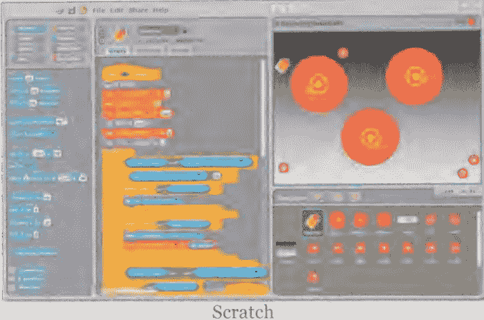

**安装：** `scratch`

**描述：** Scratch 是由 MIT 创建的模块语言。拖拽式。

**文档：** `scratch.edu`

**启动：** `sommelier -X --scale=.7 --glamor --frame-color=#000FF`

**LXDE：** 菜单 → 教育 → Scratch

**i3wm：** `scr - Scratch`

## APT – 软件

**描述：** APT 是软件包工具。除了从 Debian 仓库搜索和下载，还可以直接安装本地 deb 文件：

```bash
sudo apt install <file-name>.deb
```

**常用的，带 `sudo` 前缀：**

- `apt update` 更新列表
- `apt dist-upgrade` 升级操作系统
- `apt upgrade` 更新所有
- `apt full-upgrade` 完全升级
- `apt list <name>` 按名称列表
- `apt search <desc>` 搜索
- `apt show <name>` 显示包详情
- `apt install <name>` 安装包
- `apt remove <name>` 移除
- `apt satisfy <name>` 满足依赖

## Task Select – 软件

**安装：** `tasksel`（以及任何需要的 tasks）

**描述：** Task Select 是一个半图形界面软件安装器，可以从命令行启动。在 Synaptic 中搜索“tasksel”，有很多可以添加到 tasksel 中的任务提供软件选择。

**文档：** `man tasksel`

**命令行：** `tasksel`

## GDebi – 软件

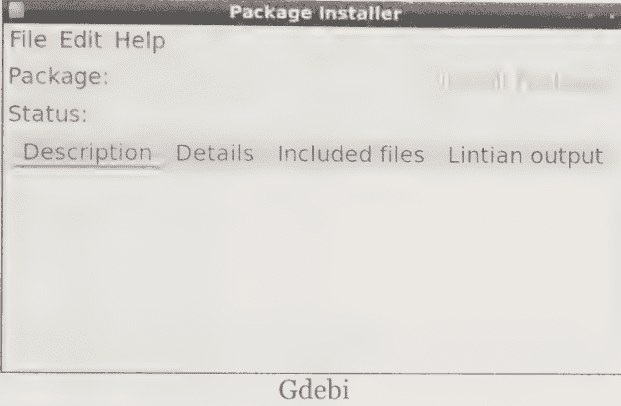

**安装：** `gdebi`

**描述：** 像 apt 一样，GDebi 可安装本地 deb 包并解析安装依赖项。与 apt 不同，它还可以解析并安装远程（http 和 ftp）包的依赖项。

**前缀：** `env GDK_BACKEND=x11`

**LXDE：** 菜单 → 系统工具 → GDebi 包安装器

**i3wm：** `g - Gdebi 包安装器`

## Gnome Software – 软件

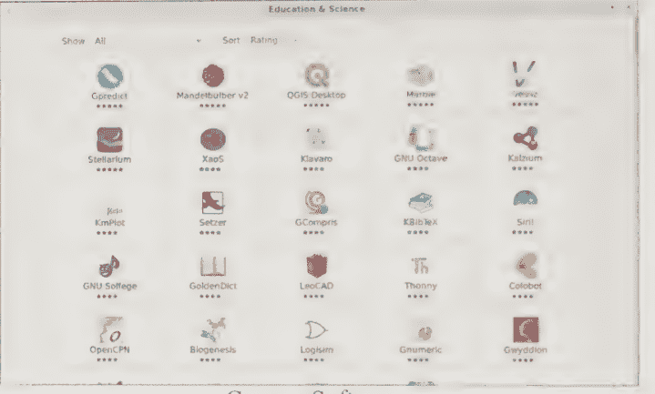

**安装：** `gnome-software`、`gnome-packagekit`

**描述：** 对于 LXDE 和 i3wm，请在命令行中执行 `sudo apt update` 并在安装后重启。如果 Gnome Software 没有加载软件，请根据需要重复 `apt update` 并重启。

**前缀：** `env GDK_BACKEND=x11`

**LXDE：** 菜单 → 选项 → 软件

**i3wm：** `so - Software`

# Chromebook Google Linux 指南

## KDE Plasma Discover – 软件

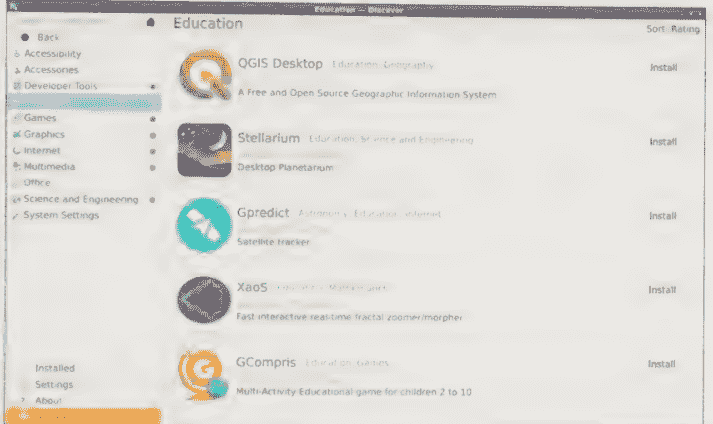

### KDE Plasma Discover

**安装：** `plasma-discover`

**描述：** 对于 LXDE 和 i3wm，请在命令行中执行 `sudo apt update` 并在安装后重启。如果 KDE Plasma Discover 没有显示软件，请根据需要重复执行 `apt update` 并重启。

**前缀：** `env GDK_BACKEND=x11`

- **LXDE：** 菜单 → 系统工具 → Discover
- **i3wm：** `di - Discover`

## 电子笔记本（ENNOTEBOOKS）

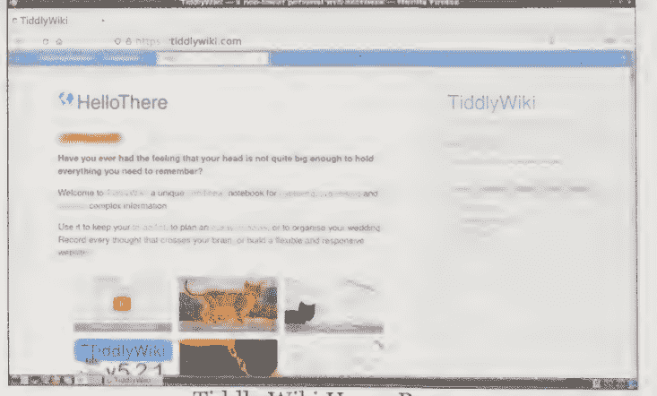

Tiddly Wiki 是一个运行在任何设备上的电子笔记本。它非常适合学校笔记、食谱、相册，以及任何可以用纸质笔记本完成的内容。Tiddly Wiki 支持关键词搜索且易于样式化。Tiddly Wiki 是一个在浏览器中运行的自编辑 HTML 页面。Tiddly 保存会发送到下载文件夹。空的 wiki 约 2M，Tiddly Wiki 网站 wiki 约 6M。Tiddly Wiki 不需要联网即可运行。使用 Firefox 访问 `tiddlywiki.com`。右上角：


创建 Tiddler（词条）、控制面板、保存更改。

点击 Tiddly Wiki 标题下的加号。保存更改图标将变为红色。


保存更改图标变为红色。

点击保存更改图标将 Tiddly Wiki 网站 wiki 保存到下载文件夹。


下载空白按钮。

向下滚动页面到 **Download Empty**（下载空白）按钮并点击它，将空的 Tiddly Wiki 下载到下载文件夹。关闭 Firefox。

如果尚未安装，通过 Synaptic 安装：

- `cups`
- `printer-driver-cups-pdf`
- `pdftk`
- `imagemagick`

## Firefox 打印对话框修复

系统打印对话框比 Firefox 打印对话框更好。打开 Firefox。

在搜索栏输入 `about:config`。点击 **Accept the Risk and Continue**（接受风险并继续）按钮。在 **Search preference name bar**（搜索偏好名称栏）中输入：

`print.tab`

将显示 **print.tab_modal.enabled** 开关。点击切换设置为 `false`。

## Tiddly Wiki 设置

创建一个 Blank Wiki 项目文件夹模板。这些最佳实践有助于防止数据丢失。

1. 创建一个名为 Blank Wiki 的项目文件夹。
2. 从下载文件夹将空的 html 和 `tiddlywiki.html` 文件复制到 Blank Wiki 项目文件夹中。
3. 将 `tiddlywiki.html` 重命名为 `Help.html`。
4. 在 Blank Wiki 文件夹中创建两个文件夹：Archive 和 Images。
5. 要开始新项目，复制 Blank Wiki 文件夹并重命名文件夹以及编辑 wiki。
6. 在开始编辑会之前，复制 Blank Wiki 文件夹并重命名文件夹，将 wiki 复制到 Archive 文件夹。使用日期前缀重命名。年日月日 YYYYMMDD 是一个很好的格式。2022/3/10 的 `pets.html` 应该是 `20220310pets.html`。
7. 编辑时经常保存。保存会发送到下载文件夹并命名为 `pets(1).html`、`pets(2).html`、`pets(3).html`，数字最大的就是最新的。
8. 完成后，从下载文件夹将当前保存复制到项目文件夹。然后删除旧的 wiki 并重命名新 wiki 以移除（数字）。

## Tiddly Wiki 战演示

复制 Blank Wiki 项目文件夹并将文件夹重命名为 Pets。将 `empty.html` 文件重命名为 `Pets.html`。

在 Image 文件夹中放入图片，任何图片均可。

双击 `Pets.html`，它应该会在 Firefox 中打开。如果不是从 pcmanfm 打开的，右键点击 `Pets.html`，选择 **Properties**（属性）并确保设置为 **Open with**（打开方式）Firefox。

将打开 **GettingStarted** Tiddler。点击 Tiddler 右角的 X 将其关闭。

点击 **My TiddlyWiki** 下的加号创建一个新的 Tiddler。

默认的 **New Tiddler** 名称将被高亮。将名称更改为 **Dogs**。

在 Tiddler 名称下方输入 **tag name**（标签名称）。输入 **Dogs** 并点击 **Add**（添加）按钮。

在底部将 **Type**（类型）设置为 **TiddlyWiki 5(text/vnd.tiddlywiki).**。

# Chromebook Google Linux 指南

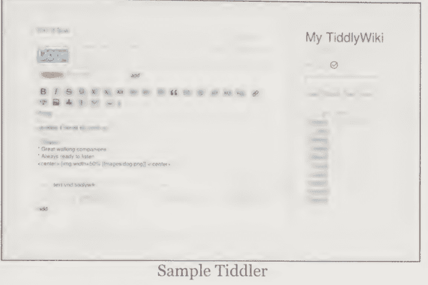

在 **Type the text for this tiddler**（为此词条输入文本）部分，输入以下内容。在 **width** 前有一个空格，在 **50%** 后有一个空格。在 `</p>` 之后有一个空行，使用你的图片名称代替 **dog.png**：

```text
!Dogs

---

<p>一生的好朋友！</p>

- 顽皮
- 极好的散步伴侣
- 随时准备倾听

<center> [img width=50% [Images/dog.png]] </center>
```

## Dogs

## My TiddlyWiki

## Dogs

一生的好朋友！

- 顽皮
- 极好的散步伴侣
- 随时准备倾听


渲染后的 Tiddler。

点击 Tiddler 右角的 **Check Mark**（勾钩）。Tiddler 将渲染。点击红色保存更改图标将 wiki 保存到下载文件夹。等待下载完成，在关闭 wiki 之前检查下载进度。记得保存会被送到下载文件夹。

在 Firefox 中打开 `Help.html` 文件。在右侧，点击 **Contents**（内容）标签页。选择 **Working with TiddlyWiki**（使用 TiddlyWiki），这是一个很好的地方。点击 Tiddler 右上角的勾钩。Tiddler 将渲染。点击红色保存更改图标将 wiki 保存到下载文件夹。给下载留一点时间，在关闭 wiki 之前检查下载进度。记得保存会被送到下载文件夹。

在 Firefox 中打开 `Help.html` 文件。在右侧，点击 **Contents**（内容）标签页。选择 **Working with TiddlyWiki**（使用 TiddlyWiki），这是一个很好的地方。点击 Tiddler 右上角的勾钩。Tiddler 将渲染。点击红色保存更改图标将 wiki 保存到下载文件夹。给下载留一点时间，在关闭 wiki 之前检查下载进度。记得保存会被送到下载文件夹。

在 Firefox 中打开 `Help.html` 文件。在右侧，点击 **Contents**（内容）标签页。选择 **Working with TiddlyWiki**（使用 TiddlyWiki），这是一个很好的地方。点击 Tiddler 右上角的勾钩。Tiddler 将渲染。点击红色保存更改图标将 wiki 保存到下载文件夹。给下载留一点时间，在关闭 wiki 之前检查下载进度。记得保存会被送到下载文件夹。

在 Firefox 中打开 `Help.html` 文件。在右侧，点击 **Contents**（内容）标签页。选择 **Working with TiddlyWiki**（使用 TiddlyWiki），这是一个很好的地方。点击 Tiddler 右上角的勾钩。Tiddler 将渲染。点击红色保存更改图标将 wiki 保存到下载文件夹。给下载留一点时间，在关闭 wiki 之前检查下载进度。记得保存会被送到下载文件夹。

在 Firefox 中打开 `Help.html` 文件。在右侧，点击 **Contents**（内容）标签页。选择 **Working with TiddlyWiki**（使用 TiddlyWiki），这是一个很好的地方。点击 Tiddler 右上角的勾钩。Tiddler 将渲染。点击红色保存更改图标将 wiki 保存到下载文件夹。给下载留一点时间，在关闭 wiki 之前检查下载进度。记得保存会被送到下载文件夹。

在 Firefox 中打开 `Help.html` 文件。在右侧，点击 **Contents**（内容）标签页。选择 **Working with TiddlyWiki**（使用 TiddlyWiki），这是一个很好的地方。点击 Tiddler 右上角的勾钩。Tiddler 将渲染。点击红色保存更改图标将 wiki 保存到下载文件夹。给下载留一点时间，在关闭 wiki 之前检查下载进度。记得保存会被送到下载文件夹。

在 Firefox 中打开 `Help.html` 文件。在右侧，点击 **Contents**（内容）标签页。选择 **Working with TiddlyWiki**（使用 TiddlyWiki），这是一个很好的地方。点击 Tiddler 右上角的勾钩。Tiddler 将渲染。点击红色保存更改图标将 wiki 保存到下载文件夹。给下载留一点时间，在关闭 wiki 之前检查下载进度。记得保存会被送到下载文件夹。

## 换页（Page Breaks）

在打印时使用换页来控制布局。

换页功能需要在主题基础 Tiddler 中添加。

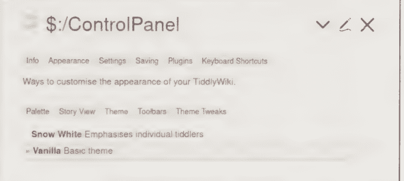

控制面板 → 外观 → 调色板标签页。

换页功能需要在主题基础 Tiddler 中添加。

主题基础 Tiddler：

| 打开 | 常用 | 工具 |
|---|---|---|
| 全部 | `$:/Advanced` | |
| 常用 | `$:/Search` | |
| 标签 | `$:/AnimationDuration` | |
| 草稿 | `$:/AutoSave` | |
| 留 | `$:/BitmapEditor/Colour` | |
| 类型 | `$:/ImageSizes` | |
| 系统 | `$:/LineWidth` | |
| 阴影 | `$:/LineWidths` | |
| 探索 | `$:/Opacity` | |
| 插件 | `$:/DefaultSidebar` | |
| | `$:/DownloadSaver` | |

**More** 顶部标签页 → **Shadows** 侧边标签页。

点击主题基础：

```text
$:/temp/search
$:/themes/tiddlywiki/snowwhite/base
$:/themes/tiddlywiki/vanilla/base
$:/themes/tiddlywiki/vanilla/metrics/bodyfontsize
```

滚动到主题基础 Tiddler。

# `pdftk` - PDF 工具包

PDF Toolkit 是一个用于 PDF 的工具包。

PDF Toolkit 帮助文档：

`pdftk --help`

合并章节 PDF 以创建一个名为 book 的 PDF 文件：

`pdftk ch1.pdf ch2.pdf output book.pdf`

将 PDF 书籍拆分为独立的 PDF 页面：

`pdftk book.pdf burst`

# ImageMagick

ImageMagick 是一个强大的位图处理工具。它也可以用于拆分和合并 PDF。

ImageMagick 帮助文档：

`convert --help`

合并章节 PDF 以创建一个名为 book 的 PDF 文件：

`convert -density 300 ch1.pdf ch2.pdf book.pdf`

将 PDF 书籍拆分为 PDF 页面：

`convert book.pdf page%03d.pdf`

# Firefox 记事本

在 Firefox 搜索栏中输入以下行，将 Firefox 作为记事本。点击屏幕并输入。要保存笔记，按 Ctrl + P 并打印为 PDF。要编辑 PDF 笔记，在 Firefox 中打开 PDF 并将文本复制回记事本。记事本可以收藏以便方便使用。PDF 文件保存在用户主目录下的 PDF 文件夹中。

```html
data:text/html,<html contenteditable="true">
<Title>Notepad</Title>
```

对于某些旧版浏览器，略有不同。仍然是单行，添加 `remove="true"`。

```html
data:text/html,<html contenteditable="true">
<Title>Notepad</Title>
```

# Firefox 文件浏览器

在 Firefox 搜索栏中输入以下行，将 Firefox 作为文件浏览器。浏览器可以收藏以便方便使用。进入首页，`<user-name>`。

```text
file://
```

# 浏览器配置

浏览器通常具有没有明显入口的高级功能。要访问这些设置，请在搜索栏中输入以下。

## Firefox

```text
about:about
```


# 浏览器

## Chrome

```text
chrome://about
```

## Edge

```text
edge://about
```

## Firefox 缩放修复

如果 Firefox 在工作时跳变缩放级别：

在搜索栏中输入`about:config`。

点击`Accept the Risk and Continue`（接受风险并继续）按钮。

在`Search preference name`（搜索偏好名称）栏中输入：

`mousewheel.with_control.action`

将值从`3`改为`0`（零）。

# Jupyter Notebook

Jupyter Notebook 是基于浏览器的交互式笔记本，利用 Python 和 Markdown（md）文本格式。Jupyter Notebook 有许多插件和修改。访问 jupyter.org 了解更多信息。YouTube 上也有许多相关视频。

如果尚未安装，通过 Synaptic 安装：

- `idle-python3.9` -（3.9 或最高数字）
- `python3-pip`
- `python3-pipdeptree`
- `python3-examples`
- `python3-doc`
- `jupyter`
- `python3-matplotlib`
- `python3-numpy`
- `python3-pandas`

R 是可选的，要在没有 R 的情况下继续，请第 135 页。

## 安装 R

从 LXTerminal：

```bash
sudo su
update-alternatives --get-selections
update-alternatives --config x-terminal-emulator
Select: 6 for /usr/bin/xterm
exit
```

在用户主目录下，创建文本文件：

`.Renviron`

在`.Renviron`文件中输入以下内容：

```text
R_LIBS_USER="/usr/local/lib/R/site-library"
```

通过 Synaptic 安装：

- `r-base`
- `r-cran-curl`
- `r-cran-rgl`
- `r-cran-rcmdr`
- `r-cran-multcomp`

从 LXTerminal：

```bash
sudo R
```

```r
library(Rcmdr)
```

点击`Yes`按钮安装包。

点击`Ok`按钮，加载时面板将保持显示。

退出 R Commander：

`File → Exit → From Commander and R`

关闭 LXTerminal。

重新打开 LXTerminal：

```bash
sudo R
install.packages('IRkernel')
IRkernel::installspec(user = FALSE)
q()
```

回复 n 保存工作区 ...

## R 命令行

从 LXTerminal：

```r
R
demo()
光标上/下，Q 退出。
demo(graphics)
Ctrl + C 退出。
help.start()
q() 退出
```

回复 n 保存工作区 ...

## R Commander

`Menu → Education → R Commander`（请稍候。）

- 设置字体大小：

  `Tools → Options... → Fonts`标签页

  点击`Restart R Commander`按钮。

- `Tools → Save Remdr options...`
- `Help → help menu`
- `File → Exit → From Commander and R`

点击`Exit`按钮。

## Jupyter Notebook 配置

从 LXTerminal：

```bash
cd ~
mkdir myynotebook
cd myynotebook
jupyter notebook --help
jupyter notebook --help-all
jupyter notebook --version
jupyter notebook --generate-config
```

使用 Mousepad 编辑：

`~/.jupyter/jupyter_notebook_config.py`

查找：`p.br`

源：

```python
# c.NotebookApp.browser = ' '
```

改为：

```python
c.NotebookApp.browser = '/usr/bin/firefox'
```

## Jupyter Notebook Markdown

关于 Markdown 有许多网络资源，包括许多 YouTube。

- daringfireball.net/projects/markdown/
- markdownguide.org/basic-syntax/
- itsfoss.com/markdown-guide/

## Jupyter Notebook 示例

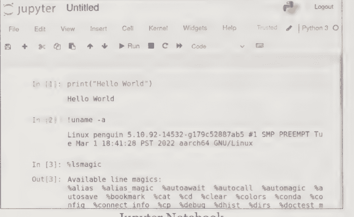

从 LXTerminal：

```bash
cd ~/mynotebook
jupyter notebook
```

在右侧`Quit`下，点击`New`，选择`Python 3`。

打开一个 Python Notebook：

```python
print("Hello World")
```

按下`Run`按钮。

```text
!uname -a
```

按下`Run`按钮。

```text
%lsmagic
```

按下`Run`按钮。

### Jupyter Notebook 帮助

点击`Help`：

- 进行`User Interface Tour`（用户界面之旅）。
- 查看`Keyboard shortcuts`（快捷键）。
- 关闭`Keyboard shortcuts`。
- 选择`Home Page`（首页）标签页。
- 点击`ipynb`文件左侧的框。
- 点击红色垃圾桶按钮。
- 点击`Delete`。
- 点击`Quit`。
- 关闭 Firefox。

如果服务器没有停止，按两次`Ctrl`+`C`。

Firefox 字体大小：

- `Ctrl`+`Shift`+`+`增大字体
- `Ctrl`+`Shift`+`-`缩小字体

# 容器 CONTAINERS

Chrome OS 安装了 Penguin（Google 的自定义 Debian Linux 容器），它包含了自定义桥接软件，允许它与 Chrome OS 顺畅通信。可以下载访客容器、复制容器、备份和恢复访客容器，并同时运行多个容器。破坏容器系统可能需要删除并重新安装 Linux。

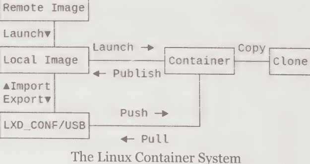

## Chrome OS 上的三层 Linux

### Chrome OS / Crosh Terminal

提示符：`crosh>`

### Termina 虚拟机 / LXC 命令

提示符：`(termina) chronos@localhost ~ $`

### Penguin / 自定义 Debian 容器

提示符：`<user-id>@penguin:~$`

## Crosh Terminal

从 Chrome OS 的 Chrome 浏览器访问 URL：

`chrome-untrusted://crosh`

- `Alt`+`Shift`+光标向上 - 向上滚动
- `Alt`+`Shift`+光标向下 - 向下滚动
- `Tab Tab` - 按下两次显示命令
- `help` - 显示帮助
- `help_advanced` - 高级帮助
- `help_advanced` - 高级帮助
- `help_advanced` - 高级帮助
- `help_advanced` - 高级帮助
- `help_advanced` - 高级帮助
- `help_advanced` - 高级帮助
- `vmc list` - 列出虚拟机
- `vmc start` - 启动 Termina
- `exit` - 返回 Crosh Terminal
- `vsh termina` - 重新连接
- `vmc start` - 启动 Termina

## 启动 Termina

从 Crosh Terminal：

```bash
vmc start
```

## Termina Terminal

显示关于 Termina 的信息：`help` - BASH。

- `uname -a` - 操作系统
- `whoami` - 显示用户名。
- `groups` - 用户所属的组。
- `env` - 环境设置
- `export` - 显示导出变量。
- `stty -a` - 终端信息
- `shopt` - Shell 信息
- `df - h` - 显示文件空间。
- `mount` - 显示挂载。
- `lsblk` - 块设备列表。
- `ps -A` - 列出运行进程。
- `top` - 显示正在运行的内容。- Q 退出。
- `hash` - 列出之前的命令。
- `history` - 列出之前的命令。

文件可以写入`/tmp`目录，但在系统重启时会被删除。

```bash
cd /tmp
cat > test.txt
  this is line 1
  this is line 2
Ctrl + D
ls
cat test.txt
rm test.txt
cd ~
```

## LXC 命令

从`--help` Terminal：

- `lxc --help` - 帮助，配合功能/命令使用。
- `lxc <feature> <command> --help`
- `lxc alias list --help` - 详细帮助示例。
- `lxc version` - 版本
- `lxc info` - 显示容器或服务器信息。
- `lxc info penguin` - Penguin 的信息。
- `lxc remote list` - 列出容器下载站点。
- `lxc network list` - 列出可用网络。
- `lxc profile list` - 列出配置文件。
- `lxc profile show default` - 显示配置。
- `lxc storage list` - 列出存储配置。
- `lxc storage show default` - 显示配置。
- `lxc project list` - 列出项目。
- `lxc project show default` - 项目选项。
- `lxc list` - 列出容器。
- `lxc image list` - 列出本地镜像。
- `lxc image list images:` - 列出远程镜像。
- `lxc image list images: debian/11` - 列出 Debian
- `lxc image list images: arch=arm64`
- `lxc image list images: arch=arm64 os=Ubuntu`
- `lxc image list images: arch=arm64 os=Ubuntu release=focal`

## 可下载容器列表

可下载容器列表位于：

`us.lxd.images.canonical.com`

### 下载 Arch Linux

LXC 启动命令用于下载容器镜像并启动容器。`alias`命令允许为镜像提供更符合用户习惯的别名。在 Termina 终端中：

```bash
lxc list
lxc image list
lxc image list images:
lxc image list images: archlinux/current
lxc launch images:archlinux/current arch
lxc image list
```

为 Arch Linux 镜像创建一个别名。将鼠标指针置于 Archlinux 指纹 ID 前方。按住触控板左键，同时将鼠标拖过指纹以进行高亮。按下`Ctrl`+`Shift`+`C`复制指纹。

```bash
lxc image alias create myarc `Ctrl + Shift + V`
lxc image list
lxc image info myarc
lxc image delete myarc
lxc list
lxc stop arch
lxc list
lxc delete arch
lxc list
```

### 克隆 Penguin

创建一个 Penguin 容器的副本，以 root 身份登录，然后以你的`<user-id>`登录，最后将其删除。这的实际用途是在修改 Penguin 本身之前，在“Penguin 副本”上测试软件或配置更改。如果安装了大量程序，Penguin 可能会很大，你可能想跳过此示例。在 Termina 终端中：

```bash
lxc list
如果 penguin 正在运行，停止它：
lxc stop penguin
lxc list
lxc copy penguin testbird
lxc list
lxc start testbird
lxc list
lxc exec testbird -- bash
whoami
ls /home
exit
lxc exec testbird su - <user-id>
whoami
exit
lxc list
lxc stop testbird
lxc list
lxc delete testbird
lxc list
```

### 编辑配置文件

Termina 没有内置编辑器（`Ctrl`+`X`、`Ctrl`+`E`）。为了编辑配置文件，必须将配置文件复制到变量或文件中。在 Termina 终端中：

```bash
env | grep EDITOR
ls /usr/bin/v*
lxc profile create test
lxc profile list
```

到变量：

```bash
HOLDTXT=$(EDITOR=cat lxc profile edit test)
lxc profile show test
echo "$HOLDTXT"
echo "$HOLDTXT" | lxc profile edit test
```

到文件（使用你的用户`<id>`）：

```bash
cd /tmp
EDITOR=cat lxc profile edit test > h.txt
cat h.txt
lxc file push /tmp/h.txt penguin/home/<id>/h.txt
lxc exec penguin su - <id>
ls
nano h.txt
Ctrl + X
exit
lxc file pull penguin/home/<id>/h.txt /tmp/h2.txt
ls
cat h2.txt | lxc profile edit test
lxc profile delete test
lxc stop penguin
ls
rm h*
cd ~
```

### 下载 Ubuntu Apache2

下载一个 Ubuntu 容器并启动 Apache2 服务器。该服务器可以通过其他 Linux 容器和 Chrome OS Chrome 浏览器访问。它无法从 Android 应用或任何外部系统访问。在 Termina 终端中：

```bash
lxc image list images: ubuntu
lxc image list images: ubuntu/jammy
lxc launch images:ubuntu/jammy ubj
lxc exec ubj - ubuntu
sudo apt update -y
sudo apt install apache2 -y
sudo systemctl start apache2
exit
lxc list
```

复制 Ubuntu 的 IPv4 地址。

打开另一个 Chrome 浏览器标签页。

在搜索栏中粘贴地址。

显示 Apache2 欢迎页面。

```bash
lxc stop ubj
lxc list
lxc delete ubj
lxc list
lxc image list
lxc image delete <Ubuntu-fingerprint>
lxc image list
```

### Penguin 备份与恢复

Chrome OS 内置的 Linux 备份系统无法用于备份或恢复虚拟机容器。

#### 备份容器到 Penguin

将容器（示例中的 sam）发布（publish）到镜像文件。然后将镜像导出为压缩文件（`.tar.gz`）。最后将压缩文件推送到 Penguin 容器（使用你的用户`<id>`）。在管理额外容器页面或使用`lxc copy penguin sam`创建一个名为 sam 的容器。

```bash
lxc publish sam --alias backup
lxc image export $LXD_CONF/backup
lxc file push $LXD_CONF/backup.tar.gz penguin/home/<id>/backup.tar.gz
```

清理文件：

```bash
lxc image list
lxc image delete backup
lxc image list
cd $LXD_CONF
ls
rm backup.tar.gz
lxc list
lxc delete sam
cd ~
```

#### 恢复容器从 Penguin

从 Penguin 容器拉取压缩文件（`.tar.gz`）。然后从镜像文件启动容器。插入 USB 磁盘。打开 Chrome OS 文件应用，右键点击该磁盘并选择“与 Linux 共享”。在 Termina 终端中：


```
cd /mnt/shared
```

磁盘挂载可能需要一些时间。使用`ls`检查`removable`目录。进入`removable`目录，使用`ls`找到`<drive-name>`。

```
ls
cd removable
ls
lxc import /mnt/shared/removable/<drive-name>/backup.tar.gz --alias sue
lxc image list
lxc launch sue sam
lxc list
```

停止与 Linux 共享。在开发环境中，管理共享文件夹，点击`<drive-name>`处的 X 停止共享。

清理文件：

```
lxc image list
lxc image delete backup
lxc image list
lxc list
lxc delete sue
lxc image list
```

## 备份容器到 USB 磁盘

```
lxc image list
lxc image delete backup
lxc image list
lxc list
lxc delete sue
lxc image list
```

## 存储位置

**容器和镜像文件：**

`/mnt/stateful/lxd/storage-pools/default`

**压缩文件 .tar.gz：**

```
echo $LXD_CONF
cd $LXD_CONF
```

**USB 磁盘：**

`/mnt/shared`

## Google 桥接软件

容器需要桥接软件与外部世界正常通信。Google 的容器桥接软件称为`cros-container-guest-tools`。使用 Bazel 构建桥接软件。没有适用于所有发行版的`cros-container-guest-tools`安装程序。各个发行版可能在自己的网站上提供特定说明，某些发行版也有 YouTube 视频。Penguin 已经包含了桥接软件，可以轻松地克隆以创建特殊用途容器。

## Docker 容器 Kubernetes

Docker 用于运行应用程序。容器用于运行操作系统。Kubernetes 用于运行大量的 Docker，并像 Beowulf 集一样经常使用计算机集群。

## 管理额外容器

正在开发中的“管理额外容器”可以通过 Allow multiple Crostini containers 标志启用，并从 Linux 开发环境访问。从 Chrome OS Chrome 浏览器转到 URL：

```
chrome://flags
搜索 on : crostini multi
将 Flag 设置为: Enabled
```

容器是从下载的镜像文件创建的（`lxc image list`）。当镜像文件不再需要时，可以删除（`lxc image delete <fingerprint>`）。

只需输入容器名即可创建 Penguin 容器。用户的电子邮件 ID 将作为其用户 ID。

非 Penguin 容器可以通过输入容器名并使用高级拉取菜单创建。对于镜像服务器输入：

```
https://images.linuxcontainers.org
```

镜像别名（Image Alias）输入有效的别名，例如：`archlinux/current`

在管理额外容器中，可以对容器进行停止、删除、备份和恢复。终端可启动通过管理额外容器安装的 Penguin 容器。非 Penguin 容器没有桥接软件，可以从终端手动启动：

```
vmc start termina
lxc start <container-name>
lxc exec <container-name> -- bash
```

Linux 的自由开放特性使其能够根据需要进行演变，并且往往同时向多个方向发展。如果你不喜欢它，可以对其进行分叉（fork）。Linux 有两个触及几乎每个系统的大趋势。从 X.org 到 Wayland 的迁移解决了许多 X.org 的问题。Wayland 还阻止了 GUI root 会话，这导致了创建绕过限制的复杂方法。目前已经从 initd 到 Systemd 的迁移。Systemd 是一个更健壮的系统自动化工具。Systemd 遭受了城市扩张的影响，并使用二进制文件代替传统的 Unix/Linux 文本文件。

- X.org 到 Wayland - 接口、显示等。
- init 到 Systemd - 启动、关、自动化。

## 待完成事项

### 设置密码

由于 Linux 容器（Linux Containers）的设计，你永远不会被锁定在 Linux 之外，并且可以随时重置你的 Linux 密码。从终端（Terminal）：

列出容器：

```
lxc list
```

启动 Linux 容器，例如 penguin：

```
lxc start penguin
```

以 root 身份运行 BASH：

```
lxc exec penguin -- bash
```

更改 root 密码。注意拼写。

```
passwd
```

更改用户密码：

```
ls /home
```

```
passwd <user-id>
```

## 网页链接

### 所有 Chrome 相关事物的起点：

`chromium.org`

### Debian 网站：

`debian.org`

### 更多软件源：

- `docker.com`
- `snapcraft.io`
- `flatpak.org`
- `store.steampowered.com`

教育类：

- `grow.google/certificates`
- `grasshopper.app`
- `developers.google.com/machine-learning/crash-course`
- `tensorflow.org`
- 在 `youtube.com` 搜索：电影围围棋

### 实现无纸化：

`myboogieboard.com`

- `getrocketbook.com`

## 在安卓上安装 Linux

从 Play 商店安装 Userland（不需要 root）。使用 APT 安装软件，没有声音。一些运行正常的程序：LibreOffice, Gimp, Inkscape, Python, R, Firefox, Tiddly Wiki, Xpad, Powermanga。键盘可能需要 USB-C 转 USB 或 Micro USB 转 USB 的适配器。对于小屏设备，屏幕投屏、屏幕放大镜或放大镜很有帮助。

### Userland 主界面：

Section 菜单位于 Userland 主界面的底部。Apps 部分用于安装 Debian。Sessions 部分用于启动 Debian（长按，选择）和停止 Debian（长按，选择 Stop Session）。Filesystems 部分用于：备份 Debian（长按，选择 Export（导出）—— 务必长按并选择 Edit（编辑）在截图时显示密码，恢复时需要）。删除 Debian（长按，选择 Delete（删除））。点击右上角的 +（加号）进行恢复。

### 安装 Debian 和 LXDE：

- 从 Apps 部分：
- 选择 Debian。
- 授予按照 Userland 请求的权限。
- 请选择连接类型：
- 选择 Graphical（图形化）并点击 Continue（继续）。
- 安装完成后：
- 内置的 VNC 屏幕将打开。
- 内部将打开一个 Linux 终端。
- 从 Linux 终端安装 LXDE：

```
sudo apt update -y
sudo apt dist-upgrade -y
sudo apt install task-lxde-desktop -y
```

### 配置键盘配置面板：

按 Tab 键到 `<Ok>` 并按空格键。配置 wicd-daemon 面板：

按空格键选择 userland。按 Tab 键到 `<Ok>` 并按空格键。startlxde:

屏幕看起来会非常混乱，关闭 Userland。启动 Userland：

从 Userland 菜单，右上角选择 Settings（设置）：选择 Default Landing Page（默认落地页），选择 Sessions。点击屏幕底部的 Sessions。长按 Debian，如果正在运行，选择 Stop Session。点击 Debian 启动 Debian。

### LXDE 桌面启动：

从 Linux 终端启动 LXDE：`startlxde &` 让 LXDE 桌面启动。保存历史弹出框，点击 No（否）。退出

VNC 浮动菜单出现在桌面上方。最左侧的图标允许移动 VNC 菜单。从 VNC 菜单（最右侧的图标）：

- 如果使用键盘，选择 Disable Extra Keys（禁用额外键）。输入模式：Direct（直接），保持缩放：Fit to Screen（适应屏幕）

注意：如果安卓阻止了对 CPU 使用的访问，右键点击右下角的 CPU 监控，从面板中移除“Usage Monitor”（使用率监控）。

### 设置时区：

- 菜单 → 系统工具 → LXTerminal `sudo apt install dpkg -y` `sudo dpkg-reconfigure tzdata` 遵循指令，然后重启 Debian。

### 通过编辑 `~/.vncrc` 设置屏幕大小：

菜单 → 系统工具 → LXTerminal

```
sudo apt install nano -y
cd ~/
cp .vncrc .vncrc.bak
nano .vncrc
```

停止并重启 Debian。

### 退出：

关闭任何正在运行的程序。

从 VNC 菜单选择 Disconnect（断开）。

长按 Debian，选择 Stop Session。

关闭 Userland，Win + Enter 将关闭 Userland。

### Userland 文件位置：

内部存储：

Debian 内部：`/internal`

安卓系统：`/storage/Android`

外部 SD 卡存储：

Debian 内部：`/sdcard`

安卓系统：`/storage/sdcard`

在安卓上安装 Linux 的方法：

```
sudo apt install -y
```

在安卓上安装 Linux 的方法：

```
sudo apt install -y
```

在安卓上安装 Linux 的方法[img/749](img/749)

### 修复终端

在启动终端时，偶尔会遇到反复出现的错误，例如“无法打开显示器 :2”。要清除此错误请尝试以下操作：

1. 首先尝试：

从 Chrome 浏览器：

从 Crosh 网址：

```
chrome-untrusted://crosh
vmc stop termina
```

2. 如果失败，则尝试：

从 Chrome 浏览器

从 URL：

```
chrome-untrusted://crosh
vmc start termina
lxc stop penguin
exit
vmc stop termina
```

3. 如果仍然失败，最后尝试：

从终端：

从终端菜单选择 Penguin。

```
sudo halt
```

重启终端并选择 Penguin，然后执行：

`Ctrl + C`

从 Chrome 浏览器：

从 Crosh 网址：

```
chrome-untrusted://crosh
vmc stop termina
```

4. 重启 Chromebook，从第一步开始。

### 查找程序快速指南

Synaptic 是查找程序名称和文件位置最简单的方法之一。可以通过 Chrome OS 终端应用启动 Synaptic：

```
pkexec "/usr/sbin/synaptic"
```

找到已安装的程序。点击一次选择它，然后点击“属性”（位于工具栏右上角）。最大化程序的属性弹出窗口。选择“安装的文件”（Installed Files）选项卡。可以在那里找到文件名和位置。

大多数程序都可以从 Chrome OS 终端启动。当程序的启动设置导致桌面崩溃时，这种方法非常有帮助。从终端启动程序并修正设置。如果程序无法修复，可以使用 Synaptic 删除。

程序启动命令可以在`~/.local/share/applications/`和`/usr/share/applications/`目录下的 `.desktop` 文件中找到。

```
cat <name>.desktop | grep Exec
```

### 最佳实践快速指南

最佳实践可以大大减少从问题中恢复所需的时间和工作。

在工作期间，将文件名带有版本号保存通常很有帮助。例如 `myfile1.txt`, `myfile2.txt`, `myfile3.txt`。工作时要频繁保存。

至少在长时间工作后备份项目文件。

每月至少备份一次系统。

在更改配置或安装新软件之前备份系统。

在编辑配置文件之前，将其复制为 `.bak` 文件。根据需要使用版本号，如 `.bak1`, `.bak2`, `.bak3` 等。

使用外部媒体进行备份。交替使用媒体，确保所有当前备份不在同一介质上。

将关键文件保存在 Chromebook 备份之外，以便其他系统读取。

考虑“在容器外保存数据”，见第 49 页。

### 桌面环境快速指南

更新 Debian Linux：

```
sudo apt update -y
sudo apt dist-upgrade -y
```

安装 Nano 编辑器：

```
sudo apt install nano -y
```

安装 Xephyr - 嵌套 X 服务器：

```
sudo apt install xserver-xephyr -y
```

安装 LXDE 和 i3wm 桌面：

```bash
sudo apt install task-lxde-desktop -y
sudo apt install i3 -y
```

LXDE 启动脚本 `~/gol.sh`:

```bash
#!/bin/bash
Xephyr -br -fullscreen -resizeable :20 & sleep 5
DISPLAY=:20 startlxde &
```

i3wm 启动脚本 `~/goi.sh`:

```bash
#!/bin/bash
Xephyr -br -screen 1080x675 -resizeable :30 & sleep 5
DISPLAY=:30 i3 &
```

三个推荐的前名前缀选项：

1. 无前缀。
2. `env GDK_BACKEND=x11 <program-name>`
3. `sommelier -X --scale=.5 --glamor --frame-color=#000000 <program-name>`

### LXDE 启动快速指南

启动：

运行 **Terminal** 应用。

从终端菜单选择 **Penguin**。

```
./gol.sh
```

如有需要按全屏。

关闭（LXDE 随终端关闭）：

退出任何正在运行的 Linux 程序。

右键点击 **Terminal** 图标并选择 **Shut down Linux**。

### 从 Crosh 访问 LXDE 快速指南

从 Chrome OS Chrome 浏览器：

访问 URL：

```
chrome-untrusted://crosh
```

启动：

```
vmc start termina
lxc start penguin
lxc exec penguin su - <user-id>
./gol.sh
```

关闭：

```
exit
lxc stop penguin
exit
vmc stop termina
```

### Chrome 浏览器快速指南

Chrome 浏览器 URL：

`chrome://about` - Chrome URL 完整列表

`file://home/chronos/user/MyFiles/`

`file:///home/chronos/user/Downloads/`

安装 Linux 后：`chrome-untrusted://crosh` - Chrome OS 壳

`chrome-untrusted://terminal` - Linux 终端

`chrome://flags` F1 至 F12 使用 Search + (1 至 =) 实现。F10 = Search + o (零) F11 = Search + - (破折号)，F12 = Search + = 标记：改进的快捷键。禁用该标记并重启。如果此功能失效（可能在更新后发生）：启用标记并重启，然后禁用标记并重启。

管理额外容器：标记：Allow multiple Crostini multi. 启用该标记并重启。

如果 Chromebook 标记设置在更新后损坏，取消设置标记并重启。然后重新设置标记并重启。

### Firefox 浏览器快速指南

Firefox 浏览器 URL：

`about:about` - Firefox URL 完整列表

`file://`

`data:text/html,<html contenteditable="true">`

`<Title>Notepad</Title>`

`about:config`

使用系统打印对话框。

标记：`print.tab_modal.enabled` 设置为 `False`。

设置页眉页脚。

标记：`print.print_head` / `print.print_foot`

空白、静态文本或以下任何内容：

`&P`, `&PT`, `&D`, `&T`, `&U`

在工作时停止随机缩放级别。

标记：`mousewheel.with_control_action`

将值从 `3` 改为 `0`（零）。

使用 IPP 的打印机通常带有嵌入式 Web 服务器。

复制 `ipp://` 和 `:631` 之间的所有内容，将其粘贴到浏览器的搜索栏中。从终端执行：

```
ippfind
```

### CLI 快速指南

- `help`
- `man <command>`
- `env`
- `history`
- `whoami`
- `touch <file>`
- `cp <from> <to>`
- `mv <from> <to>`
- `rm <file>`
- `ls`
- `ls -la`


- `cd <directory>`
- `cd ..`
- `mdir <directory>`
- `pwd`
- `rm -r <directory>`
- `which <program>`
- `cat <file>`
- `cat >> <file>`
- `sudo chmod +x go.sh`
- `sudo pcmanfm`
- `password`
- `sudo passwd <id>`
- `sudo usermod -aG <g> <u>`
- `groups`
- `sudo dmesg`

## BASH 帮助

- 手册帮助
- 环境
- 历史记录
- 显示用户
- 创建文件
- 复制文件
- 移动/重命名文件
- 删除文件
- 列出文件
- 所有详情
- 切换目录
- 返回上级目录
- 创建目录
- 当前目录
- 删除目录
- 显示位置
- 读取文本文件
- 写入文本文件
- 追加 `Ctrl+D`
- 设置可执行
- SU 文件管理器
- 设置密码
- 设置 `<id>` 密码
- 将用户加入组
- 显示用户组
- 显示内核日志
