# Linux 系统管理完整指南（网络）

## 第六章 管理进程
- 定义进程 236
  - Linux 多任务模型 236
  - 创建进程 236
  - 进程状态 237
  - 交换空间 237
- 管理 Linux 进程 238
  - 从 Shell 启动进程 238
  - 通过命令行了解进程 241
  - 控制进程 247
  - 使用图形化进程管理工具 252
- 管理内存 258
  - 理解共享库 258
  - 理解分页内存 260
  - 跟踪内存使用情况 260
  - 查看虚拟内存信息 262
- 调度进程 263
  - 自动化一次性任务 264
  - 自动化重复性任务 268
  - 管理自动化任务 272
- 控制对 at 和 crontab 的访问 274
- 章节摘要 275
- 命令摘要 276
- 关键术语 277
- 复习问题 279
- 实践项目 282
- 案例项目 287

## 第七章 使用网络客户端
- 远程登录 290
  - Telnet 远程登录实用程序 291
  - 使用 r-实用程序进行远程执行 293
  - 安全 Shell（SSH） 295
- 数据服务 298
  - 访问网络 298
  - 访问 FTP 服务器 303
- 网络和网络诊断工具 307
  - 网络简介 307
  - 使用 ping 进行系统测试 309
  - 使用 traceroute 检查路由模式 312
- 章节摘要 314
- 命令摘要 315
- 关键术语 316
- 复习问题 318
- 实践项目 322
- 案例项目 325

## 第八章 安装 Linux 327
- 检查计算机硬件 328
- 了解计算机硬件 328
- 支持的 Linux 硬件 334
- 了解网络 336
- 创建共享系统 338
- 图形系统 341
- 创建系统清单 341
- 配置磁盘空间 348
- 启动系统 349
- 硬盘几何结构 350
- 交换分区 352
- 准备共享硬盘 352
- 安装 Linux 357
- Linux 发行版 357
- Linux 安装概述 358
- 安装源选项 359
- 启动安装的选项 360
- 安装过程 361
- Kickstart 安装 367
- 查看 Kickstart 配置文件 368
- 使用图形化配置工具 370
- 章节摘要 371
- 命令摘要 372
- 关键术语 373
- 复习问题 375
- 实践项目 380
- 案例项目 398

## 第九章 理解系统初始化 401
- 硬件初始化 402
- 启动加载器 403
- 启动内核 406
- 使用启动参数 406
- 配置启动加载器 408
- 使用 LILO 408
- 使用 GRUB 410
- init 及其脚本 412
- 理解运行级别 412
- 理解 rc 脚本 414
- 控制服务 416
- 管理服务 416
- 图形化管理服务 417
- 配置系统服务 418
- 关闭 Linux 419
- 章节摘要 420
- 命令摘要 422
- 关键术语 422
- 复习问题 423
- 实践项目 427
- 案例项目 430

## 第十章 管理软件包和文件系统
- 管理软件包 434
- 图形化管理软件包 434
- 使用 rpm 管理软件包 436
- 自动更新系统 439
- 了解文件系统 443
- 查看文件系统类型 443
- 检查文件系统状态 446
- 文件系统属性 449
- 检查文件系统 451
- 创建新文件系统 452
- 使用 fdisk 实用程序 452
- 格式化文件系统 455
- 挂载新文件系统 457
- 使用网络文件系统 458
- 自动化文件系统挂载 458
- 使用 autofs 挂载服务 461
- 管理交换空间 462
- 设置磁盘使用配额 462
- 章节摘要 463
- 命令摘要 465
- 关键术语 467
- 复习问题 468
- 实践项目 472
- 案例项目 475

## 第十一章 管理用户
- 创建和管理用户账户 478
- 图形化管理用户账户 478
- 在命令行创建新用户 486
- 创建新组 489
- 在命令行修改用户和组账户 489
- 自动化主目录创建 492
- 禁用用户账户 493
- 复杂文件权限 494
- 用户安全问题 499
- 与用户通信 499
- 授予有限的 Root 访问权限 500
- 使用可插拔认证模块 502
- 使用网络信息服务 507
- 章节摘要 509
- 命令摘要 510
- 关键术语 511
- 复习问题 512
- 实践项目 515
- 案例项目 520

## 第十二章 配置网络
- 配置 Linux 网络 522
- 了解 Linux 中的网络设备 522
- 使用命令行实用程序配置网络 523
- 使用图形工具配置网络 528
- 配置 DNS 解析器 533
- 使用路由协议进行动态路由 535
- 配置 DHCP 服务器 538
- 网络打印服务 539
- 使用传统 Linux 打印：LPRng 539
- 使用 LPRng 远程打印 545
- 了解通用 UNIX 打印系统（CUPS） 547
- 管理打印 552
- 章节摘要 557
- 命令摘要 559
- 关键术语 560
- 复习问题 562
- 实践项目 567
- 案例项目 574

## 第十三章 系统和内核管理
- 备份 Linux 系统 576
- 设计备份策略 576
- Linux 备份策略 579
- 硬件和软件问题 583
- 使用 Linux 备份实用程序 585
- 了解冗余磁盘系统和 RAID 587
- 了解逻辑卷管理 593
- 系统日志 595
- syslogd 和 klogd 守护进程 597
- 配置系统日志 597
- 配置文件语法 601
- 使用 logger 实用程序 603
- 分析日志文件 604
- 轮转日志文件 605
- 探索内核组件 606
- Linux 中的时间保持 606
- 使用 `/proc` 文件系统进行内核管理 607
- 使用内核模块 609
- 配置和升级内核组件 612
- 安装内核源代码 613
- 配置内核功能 614
- 编译新内核 617
- 章节摘要 618
- 命令摘要 620
- 关键术语 622
- 复习问题 624
- 实践项目 629
- 案例项目 634

## 第十四章 编写 Shell 脚本
- 脚本基础 636
- 解释和编译程序 636
- 了解编程概念 637
- Shell 脚本的组件 638
- 输入和输出 641
- 脚本中使用变量 643
- 条件和循环结构 646
- 使用 if 语句 647
- 向脚本添加循环 651
- 脚本中使用函数 654
- Shell 脚本调试 655
- 使用 Shell 跟踪 656
- 脚本内部调试 657
- 其他编程方法 657
- 其他脚本语言 658
- 编译语言 660
- 章节摘要 663
- 命令摘要 664
- 关键术语 665
- 复习问题 667
- 实践项目 671
- 案例项目 676

## 第十五章 高级主题和故障排除
- X Window 系统高级配置 677
- 配置 X 678
- 使用 X Window 系统启动脚本 680
- 调整图形应用程序的显示 683
- 使用图形登录屏幕 685
- 远程显示 X 客户端 687
- 安全问题 692
- 安全网络的结构 692
- 安全攻击类型 693
- 安全工具 694
- 病毒和蠕虫 698
- 安全组织 698
- 使用网络服务 699
- 使用 NetFilter 进行防火墙 699
- 设置 DNS 名称服务器 705
- 使用 NFS 进行文件共享 708
- 设置 Samba 服务器 711
- 使用 Squid 创建代理服务器 713
- 使用 Apache 创建 Linux Web 服务器 715
- 配置基本电子邮件服务器 718
- 使用超级服务器进行网络服务 721
- 故障排除和恢复 725
- 故障排除 Linux 安装 727
- 诊断设备状态 729
- 故障排除网络连接 729
- 创建救援磁盘 730
- 章节摘要 731
- 命令摘要 733
- 关键术语 736
- 复习问题 740
- 动手项目 744
- 案例项目 754

## 附录 A
### Red Hat 认证技术员目标 757
- 基于课程 RH 033—Red Hat Linux Essentials 的目标 758
- 第 1 部分：概述 758
- 第 2 部分：命令行文件系统浏览 758
- 第 3 部分：GNOME 和 KDE 桌面 759
- 第 4 部分：Bash Shell 759


- 第 5 部分：用户、组和权限 759
- 第 6 部分：vi 和 vim 编辑器基础及打印 759
- 第 7 部分：Linux 文件系统 760
- 第 8 部分：配置 GNOME、KDE 和基于 X 的工具 760
- 第 9 部分：Bash Shell 和配置 761
- 第 10 部分：用户、组和权限的高级主题 761
- 第 11 部分：vi 和 vim 编辑器的高级使用 762
- 第 12 部分：标准 I/O 和管道 762
- 第 13 部分：字符串处理简介 762
- 第 14 部分：使用正则表达式进行字符串处理 762
- 第 15 部分：进程简介 763
- 第 16 部分：Bash Shell 脚本编写 763
- 第 17 部分：基本网络客户端 763
- 第 18 部分：编程和系统管理 764
- 基于课程 RH 133—Red Hat Linux 系统管理 的目标 764
- 第 1 部分：硬件、设备配置和安装 764
- 第 2 部分：Linux 文件系统管理 765
- 第 3 部分：系统初始化和服务 766
- 第 4 部分：用户管理 766
- 第 5 部分：网络配置 767
- 第 6 部分：系统管理工具 767
- 第 7 部分：RPM、引导加载程序和 Kickstart 768
- 第 8 部分：内核服务和配置 769
- 第 9 部分：X Window 系统 769
- 第 10 部分：故障排除 769

# 附录 B

## Linux 专业学院 LPI 认证—1 级目标

771

- 考试 101 的目标 772
- 主题 101 硬件和架构 772
- 主题 102 Linux 安装和包管理 774
- 主题 103 GNU 和 UNIX 命令 776
- 主题 104 设备、Linux 文件系统和文件系统层次标准 779
- 主题 110 X Window 系统 781
- 考试 102 的目标 782
- 主题 105 内核 782
- 主题 106 引导、初始化、关闭和运行级别 783
- 主题 107 打印 784
- 主题 108 文档 785
- 主题 109 Shells、脚本、编程和编译 786
- 主题 111 管理任务 786
- 主题 112 网络基础 788
- 主题 113 网络服务 790
- 主题 114 安全 792

# 附录 C

## SAIR/GNU 认证 Linux 管理员（LCA）1 级目标 793

- 课程 3X0-101—Linux 安装和配置 794
- 1.1 运行理论 794
- 1.2 基础系统 796
- 1.3 Shells 和命令 797
- 1.4 系统服务 798
- 1.5 应用程序 799
- 1.6 故障排除 800
- 课程 3X0-102：Linux 系统管理 800
- 2.1 运行理论 800
- 2.2 基础系统 801
- 2.3 Shells 和命令 802
- 2.4 系统服务 803
- 2.5 应用程序 803
- 2.6 故障排除 804
- 课程 3X0-103 Linux 网络 804
- 3.1 运行理论 805
- 3.2 基础系统 806
- 3.3 Shells 和命令 807
- 3.4 系统服务 808
- 3.5 应用程序 809
- 3.6 故障排除 809
- 课程 3X0-104 Linux 安全、道德和隐私 810
- 4.1 运行理论 810
- 4.2 基础系统 811
- 4.3 Shells 和命令 811
- 4.4 系统服务 812
- 4.5 应用程序 812
- 4.6 故障排除 813

# 附录 D

## Linux+ 认证目标 815

- 领域 1.0 安装 816
- 领域 2.0 管理 816
- 领域 3.0 配置 818
- 领域 4.0 安全 819
- 领域 5.0 文档 819
- 领域 6.0 硬件 820

# 术语表 821

# 索引 843

# 引言

根据 IDG 和 Gartner Group 等分析师的说法，Linux 现在是世界上增长最快的服务器操作系统，市场份额已超过 Macintosh。数百万个互联网站点和内部服务器运行在 Linux 上，IBM、Hewlett-Packard、Dell、Red Hat Software 等公司因此产生了数十亿美元的 Linux 相关收入。Linux 还继续通过添加高端功能并在全球范围内扩展到新的市场细分领域来提升其技术实力。许多世界政府现在要求在花费资金购买商业替代品之前考虑 Linux 和其他开源软件。由于大多数网络包含多个操作系统，任何计划长期职业生涯的系统管理员都明智地将 Linux 作为核心竞争力提供给潜在雇主，其中许多人已经安装了 Linux 并正在寻找维护人员。

本书指导你了解 Linux 技术的

章节摘要 731

命令摘要 733

关键术语 736

复习问题 740

动手项目 744

案例项目 754

# 附录 A

## Red Hat 认证技术员目标

757

- 基于课程 RH 033—Red Hat Linux Essentials 的目标 758
- Unit 1: Overview 758
- Unit 2: Command-line File System Browsing 758
- Unit 3: GNOME and KDE Desktops 759
- Unit 4: The Bash Shell 759
- Unit 5: Users, Groups, and Permissions 759
- Unit 6: vi and vim Editor Basics and Printing 759
- Unit 7: The Linux File System 760
- Unit 8: Configuring GNOME, KDE, and X-based Tools 760
- Unit 9: The Bash Shell and Configuration 761
- Unit 10: Advanced Topics in Users, Groups, and Permissions 761
- Unit 11: Advanced Uses of the vi and vim Editors 762
- Unit 12: Standard I/O and Pipes 762
- Unit 13: Introduction to String Processing 762
- Unit 14: String Processing with Regular Expressions 762
- Unit 15: Introduction to Processes 763
- Unit 16: Bash Shell Scripting 763
- Unit 17: Basic Networking Clients 763
- Unit 18: Programming and Administration 764
- Objectives Based on Course RH 133—Red Hat Linux System Administration 764
- Unit 1: Hardware, Device Configuration, and Installation 764
- Unit 2: Linux File System Management 765
- Unit 3: System Initialization and Services 766
- Unit 4: User Administration 766
- Unit 5: Network Configuration 767
- Unit 6: System Administration Tools 767
- Unit 7: RPM, Boot Loaders, and Kickstart 768
- Unit 8: Kernel Services and Configuration 769
- Unit 9: The X Window System 769
- Unit 10: Troubleshooting 769

# APPENDIX B

## Linux Professional Institute LPI Certification—Level 1 Objectives

771

- Objectives for Exam 101 772
- Topic 101 Hardware and Architecture 772
- Topic 102 Linux Installation and Package Management 774
- Topic 103 GNU and UNIX Commands 776
- Topic 104 Devices, Linux File Systems, and File System Hierarchy Standard 779


- Topic 110 The X Window System 781
- Objectives for Exam 102 782
- Topic 105 Kernel 782
- Topic 106 Boot, Initialization, Shutdown, and Run Levels 783
- Topic 107 Printing 784
- Topic 108 Documentation 785
- Topic 109 Shells, Scripting, Programming, and Compiling 786
- Topic 111 Administrative Tasks 786
- Topic 112 Networking Fundamentals 788
- Topic 113 Networking Services 790
- Topic 114 Security 792

# APPENDIX C

## SAIR/GNU Certified Linux Administrator (LCA) Level 1 Objectives 793

- Course 3X0-101—Linux Installation and Configuration 794
- 1.1 Theory of Operation 794
- 1.2 Base System 796
- 1.3 Shells and Commands 797
- 1.4 System Services 798
- 1.5 Applications 799
- 1.6 Troubleshooting 800
- Course 3X0-102: Linux System Administration 800
- 2.1 Theory of Operation 800
- 2.2 Base System 801
- 2.3 Shells and Commands 802
- 2.4 System Services 803
- 2.5 Applications 803
- 2.6 Troubleshooting 804
- Course 3X0-103 Linux Networking 804
- 3.1 Theory of Operation 805
- 3.2 Base System 806
- 3.3 Shells and Commands 807
- 3.4 System Services 808
- 3.5 Applications 809
- 3.6 Troubleshooting 809
- Course 3X0-104 Linux Security, Ethics, and Privacy 810
- 4.1 Theory of Operation 810
- 4.2 Base System 811
- 4.3 Shells and Commands 811
- 4.4 System Services 812
- 4.5 Applications 812
- 4.6 Troubleshooting 813

# APPENDIX D

## Linux+ Certification Objectives 815

- Domain 1.0 Installation 816
- Domain 2.0 Management 816
- Domain 3.0 Configuration 818
- Domain 4.0 Security 819
- Domain 5.0 Documentation 819
- Domain 6.0 Hardware 820

# GLOSSARY 821

# INDEX 843

# Introduction

Linux is now the fastest growing server operating system in the world, according to analysts such as IDG and Gartner Group, with a market share that has out paced Macintosh. Millions of Internet sites and internal servers are run on Linux, and billions of dollars are generated in Linux-related revenue for companies like IBM, Hewlett-Packard, Dell, Red Hat Software, and others. Linux also continues to expand its technical prowess by adding high-end features and spreading globally into new market niches. Many world governments now mandate that Linux and other open source software be considered before money is spent on commercial alternatives. Because most networks include multiple operating systems, any system administrator planning for a long term career is well-advised to include Linux as a core competency to offer to potential employers, many of whom have already installed Linux and are looking for staff to maintain it.

This book guides you through the basics of Linux technology and trains you as a system administrator to maintain a Linux server that other users rely on for e-mail, Web, database, networking, or other system services. The book begins by introducing basic Linux concepts that may be unfamiliar to you, and then explains the installation and use of a Linux-based computer from the viewpoint of a system administrator.


# Preface

This book cannot cover everything there is to know about Linux. Instead, it presents the basics of many areas, with enough theory and practice that, after reading it and completing the exercises and review questions included in each chapter, you should feel comfortable working on a Linux system and be able to locate additional utilities, and additional documentation about utilities, to enable you to progress in your knowledge of Linux (and in your career) with a solid foundation. Although this book was designed with a classroom setting in mind, nothing in it requires that setting, and many Linux users (the author included) were self-trained, without the guidance that a good instructor can provide. This book is based on a two-volume set: Guide to Linux Installation and Administration, Second Edition and Guide to Linux Networking and Security. It replaces the first volume and includes most of the core concepts and utilities of the second volume (it's also larger than either one alone); if you need more detailed information about networking and security, you should consult the second volume or another specialized text. This volume assumes you have never seen a Linux system, but that you are familiar with basic computer operation, such as entering commands, using a mouse to selecting graphical items on screen, and working with removable discs and CD-ROMs.

One aim of the material presented here is to prepare you to pass a Linux certification exam, which will demonstrate to potential employers that you have mastered important theoretical and practical knowledge about Linux-based computers. Several certification programs for Linux are currently available. The material in this book maps to three of the most popular Linux certification programs: Red Hat Certified Technician (RHCT), Linux Professional Institute (LPI) Level 1, and Linux+ from CompTIA. It also maps to the first two (of four) exams of the SAIR/GNU Linux Certified Administrator Level 1 certification. The objectives for each certification program, Web site references where you can obtain official information, and cross-references to relevant chapters and sections in this book, are provided in the appendices to this book. These certification exams are generally multiple choice tests that you can take at a testing facility near your home or school after paying a fee. More advanced certification programs are available from Red Hat Software, LPI, and SAIR/GNU, but having any one of these certifications makes a very strong statement to potential employers about your knowledge of Linux.

The Red Hat certifications, which are generally considered the most challenging, are also more expensive and less widely available—they require that you perform hands-on system administration tasks in a lab setting. Because of this, and the market-leading position of Red Hat Software, the focus in this book has been on Red Hat’s products, specifically the Fedora version of Linux. Users will find that nearly all of the knowledge obtained in this book is easily transferred (usually with no modification) to other versions of Linux. The exceptions are Red Hat specific graphical utilities, which the reader may encounter in any event in a future job setting.

The inclusion of Fedora Linux in this book is a compromise of sorts. A more realistic training environment would suggest using Red Hat Enterprise Linux, which is the basis for the Red Hat Software certification exams and which is widely used in large organizations. Though the cost of Red Hat Enterprise Linux doesn’t permit its inclusion here, Fedora is the technology core from which Red Hat Enterprise Linux is taken. Fedora is a completely free operating system that can be downloaded from the Internet (see fedora.redhat.com). Except for technical support options and a few high-end management features (and the color of the installation screens), Fedora is similar enough to Red Hat Enterprise Linux to be considered a clone for training purposes.


This book uses an "onion skin" or layered approach to learning about Linux. Instead of beginning with a subject, such as user accounts, and disgorging all there is to know about them, leaving the reader with no context of when that information is useful (and perhaps little memory of it), this layered approach introduces a number of concepts on a superficial level, so that they fit together in a useful fashion. Other concepts are added, and the text then returns with more depth to explore important concepts that were introduced initially. Thus, for example, user accounts are mentioned in Chapter 1, explored more fully in Chapter 4, and are the subject of a "full" discussion in Chapter 11, once the context for the utilities and policies have been fully set out.

## 目标读者

本书面向需要安装 Linux 并理解基于 UNIX 或 Linux 服务器上的基本系统管理、网络和安全相关任务的学生和专业人士。虽然本书从操作系统概念基础和 Linux 的一些历史笔记开始，但重点在于对系统管理任务的实用、动手描述，以及管理员为完成日常 Linux 服务器管理工作而使用的工具——包括命令行和在可用时图形界面。本书非常适合作为操作系统和系统管理入门课程的教材；它假设读者对 Linux 没有经验，对基于 Windows 的计算机只有最基本的经验。文本和教学特色旨在提供互动式学习体验，以便进一步自学 Linux 文档、互联网文档和计算机行业资源，从而为读者准备更高级的教育或系统和网络管理的工作任务。每章都包含动手项目，以逐步方式引导读者完成各种任务。每章还包含案例项目，使读者扮演问题解决者的角色，需要在可能出现在真实工作环境中的情境中应用本章所介绍的概念。

安装 Linux 的章节已从传统上位于书首的位置移至文本中间。这是为了让学生在处理安装操作系统的更高级任务之前，先熟悉命令行和图形环境。如今大多数计算机都已预装操作系统（Linux 也可以这样购买），大多数初级系统管理员不会立即被要求安装新系统。自行学习的读者可以随时跳到第 8 章安装新的 Linux 系统，如有疑问可回头参考前几章。在大多数较新的计算机上，安装 Linux 只需反复按 Enter 键，大约 15 分钟即可完成（尽管第 8 章并非为 15 分钟版本而写）。

在课堂或实验室环境中，理想的情况是学生开始时使用上一届课程完成的安装工作，直到第 8 章为止。此时对操作系统已有一定熟悉度后，他们将重新安装系统并继续学习本书的更高级章节。下一届使用计算机的班级也可以继续使用这些已安装的系统，直到阅读第 8 章为止。如果实验室网络方便，当然在每个学期开始时重新在每台计算机上安装 Linux 是很方便的，以避免学生因上一学期过于热心的学生所做的更改而出现问题。Fedora 支持 Kickstart 和基于网络的安装技术，这应使在多台系统上重复安装变得相当轻松。

## 章节说明

本书各章讨论以下主题：

第 1 章，“介绍 Linux”介绍了自由软件模式，并提供了 UNIX 和 Linux 的基本历史，与其他操作系统进行一些比较，并描述了 Linux 的特性。然后指导你登录并开始使用 Linux 命令行和图形桌面环境。

第 2 章，“探索桌面”描述了如何使用 GNOME 和 KDE 桌面界面与 Linux 文件和实用程序交互。它说明了基本的桌面配置，并介绍了常用的图形实用程序，如文件管理器、文本编辑器和流行的生产力应用程序。

第 3 章，“使用 Shell”专注于命令行环境，展示使用技巧并介绍 bash shell，包括变量、数据重定向运算符和 vi 文本编辑器。

第 4 章，“理解用户和文件系统”介绍了系统管理工作中的这两个关键领域。用户账户在与文件系统、索引节点、链接和文件权限的关系方面进行了讨论。文件系统管理也已介绍，包括分区、挂载文件系统和归档管理。

第 5 章，“理解文本处理”解释了如何使用一系列命令行实用程序以简单和复杂的方式操作文本文件。正则表达式被教授，sed 和 awk 文本处理程序也是如此。这些信息随后被用作本章末尾对 vi 编辑器进行更高级培训的基础。

第 6 章，“管理进程”在内核和 shell 层面上定义了 Linux 进程，并描述了如何使用命令行和图形实用程序查看和控制这些进程。进程调度也使用 cron 和 at 进行了讨论。

第 7 章，“使用网络客户端”讨论了如何使用多种不同的网络工具远程操作 Linux 系统。工具包括 ssh、r-utilities 和 telnet。数据服务如 rsync 和 FTP 被介绍，基本的网络诊断工具在这些网络客户端操作背景下进行了讨论。

第 8 章，“安装 Linux”首先回顾了 Linux 硬件要求以及如何为 Linux 操作系统配置硬盘空间。文本随后逐步描述安装过程，包括如何选择所呈现的选项，以及安装完成后如何启动和使用系统。

第 9 章，“理解系统初始化”解释了标准 PC 计算机如何启动以及 Linux 内核在启动时如何开始运行。启动内核的引导加载程序被讨论，以及 init 程序和初始化过程中所有 Linux 系统都包含的重要服务控制脚本。

第 10 章，“管理软件包和文件系统”描述了如何使用 RPM 或 Debian 软件包格式安装和管理实用程序和应用程序。图形和命令行实用程序都进行了讨论。然后介绍了高级文件系统管理，包括使用多种文件系统类型、检查现有文件系统的完整性以及在新安装硬件上创建文件系统。

第 11 章，“管理用户”讨论了与用户和组账户相关的日常管理任务，例如创建、禁用和修改账户，以及与资源消耗和用户安全相关的问题。

第 12 章，“配置网络”描述了如何使用命令行或图形实用程序在 Linux 系统上配置网络。介绍了基本路由和名称解析问题，以及 DHCP、IP 别名等更多主题，以及关于 Linux 网络打印的长篇章节。

第 13 章，“系统和内核管理”涵盖了许多系统管理任务，例如维护备份、使用 RAID 和卷管理、监控系统日志以及维护更新的内核。内核模块被介绍，同时也介绍了重新编译内核的基本过程。

第 14 章，“编写 Shell 脚本”教授如何使用 bash shell 创建脚本，包括使用位置变量、条件语句和各种类型的循环。提到了来自已安装系统的 Shell 脚本示例，并介绍了基本调试技术。其他类型编程中使用的工具，如 Perl 和 C++，也略有涉及。

第 15 章，“高级主题和故障排除”讨论了读者在继续学习 Linux 时希望了解的多个主题：高级图形配置，包括远程图形访问；系统安全基础；使用流行网络服务的简单配置；以及故障排除提示和技巧。

附录 A，“Red Hat 认证技术员目标”列出了 Red Hat Software 的 Red Hat 认证技术员（RHCT）项目的全部认证目标，每个目标都映射到本书的章节和标题。

附录 B，“Linux 专业学院 LPI 认证—1 级目标”列出了 Linux 专业学院（LPI）1 级认证项目的全部认证目标，每个目标都映射到本书的章节和标题。

附录 C，“SAIR/GNU Linux 认证管理员（LCA）1 级目标”列出了 SAIR/GNU LCA 1 级认证项目的全部认证目标。提供了全部四项考试的目标，其中前两项考试的每个目标都映射到本书的章节和标题。

附录 D，“Linux+ 认证目标”列出了 CompTIA Linux+ 认证的所有认证目标，并将每个目标映射到本书中的章节和标题。

## 特色

为了帮助您全面理解网络概念，本书包含许多旨在增强学习体验的功能。

- **章节目标。** 每章都以一份详细的待掌握概念清单开始。该清单既可作为章节内容的快速参考，也可作为有用的学习辅助工具。
- **插图和表格。** 众多 Linux 实用程序的插图以及概念图有助于您可视化并更好地理解 Linux 工具和技术概念。此外，所包含的众多表格提供了关于命令选项和在线信息资源等重要主题的简明参考。
- **章节摘要。** 每章正文后都附有该章所介绍概念的摘要。这些摘要提供了一种回顾和重温每章所涵盖思想的便捷方式。
- **命令摘要。** 每章中介绍或讨论的每个 Linux 实用程序在首次介绍时均以斜体粗体显示。这些实用程序在章节末尾以表格形式汇总，并附有实用程序的简要描述和示例命令。


- **关键术语。** 章节中所有以粗体文本引入的概念术语都汇集在章节末尾的关键术语列表中。这为您提供了检查对所介绍所有术语理解程度的方法。

- **复习题。** 包含一份复习题列表，以强化每章所介绍的思想。回答这些问题将确保您已掌握重要概念。

- **动手项目。** 了解 Linux 操作系统的理论固然重要，但没有什么能比得上实际经验。为此，除了详尽的解释外，每章都提供众多动手项目，旨在为您提供实践实施经验和现实世界解决方案。

案例项目。位于每章末尾的案例项目有若干个。要完成这些练习，您必须结合现实世界的常识以及到目前为止书中涵盖的技术知识。每个项目的目标是为与您作为系统或网络管理员在工作中将面临的问题类似的问题提出答案。

## 文本和图形约定

在适当的地方，本书中还添加了额外的信息和练习，以帮助您更好地理解手头的主题。文本中的图标会提醒您注意附加材料。本教材中使用的图标如下所述。


注释图标会引起您对与所描述主题相关的额外有用材料的注意。


本书中的每个动手活动都以动手图标和随后练习的描述为先导。


基于作者经验的提示提供了有关如何解决问题的额外信息或在现实世界情况下该做什么。

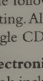

注意图标警告您潜在的错误或问题，并解释如何避免它们。


案例项目图标标记案例项目，即更复杂、基于场景的作业。在这些案例示例中，您被要求独立实施所学内容。

## 教师资源

当本书在课堂环境中使用时，以下补充材料可供使用。本书随附的所有补充材料都提供给教师在一张光盘上。

电子教师手册。随本教材附带的教师手册包括额外的教学材料，以协助课堂准备，包括课堂活动建议、讨论主题和额外项目。

解答。包含所有章节末尾材料的解答，包括复习题，以及在适用情况下的动手项目。

**ExamView®。** 本教材附带 ExamView，这是一款功能强大的测试软件包，允许教师创建和管理印刷版、计算机（局域网）版和互联网考试。ExamView 包含数百个与本教材所涵盖主题相对应的问题，使学生能够生成包含进一步复习页码引用的详细学习指南。计算机化和互联网测试组件允许学生在计算机上参加考试，并可通过自动批改每份考试为教师节省时间。

**PowerPoint 演示文稿。** 本书附带每章的 Microsoft PowerPoint 幻灯片。这些作为课堂演示的教学辅助工具提供，可供学生通过网络进行章节复习，或打印用于课堂分发。教师请随意为课堂上介绍的额外主题添加自己的幻灯片。

**图形文件。** 书中所有的图形都以位图格式复制在教师资源 CD 上。与 PowerPoint 演示文稿类似，这些作为课堂演示的教学辅助工具提供，可供学生复习使用，或打印用于课堂分发。

## 软件 CD-ROM

《Linux 系统管理完全指南》附带 Fedora Core 2 版本的 Linux 操作系统软件。该软件是由 Red Hat Software, Inc. 赞助的免费软件项目，也可作为免费下载提供。您可根据许可协议使用随附的 CD。Fedora 版 Linux 在技术支持选项（Fedora 不提供）和少数高级管理实用程序方面除外，与 Red Hat Enterprise Linux 基本等效。有关 Fedora 项目的更多信息，请访问 http://fedora.redhat.com。有关 Red Hat Software, Inc. 及其 Linux 操作系统产品和培训认证计划的更多信息，请访问 www.redhat.com。

## 实验室要求

本书中的动手项目可帮助您应用所学 Linux 知识。以下部分列出了完成本书所有动手项目的最低硬件要求。除这些要求外，学生必须在其工作站上拥有管理员（root）权限才能完成许多项目。

尽管本书包含 Fedora Core 2 版本的 Linux 副本，但本书所跟踪的 Linux 认证项目并非专门针对 Fedora。书中的信息在大多数情况下适用于所有当前版本的 Linux，例如 SUSE/Novell、Xandros、Debian、TurboLinux、Mandrake 等等。例外情况出现在用作示例的一些实用程序以及目录结构中某些文件的位置。对于准备 Red Hat 认证技术员考试的用户，建议在 Red Hat Software 网站（www.redhat.com）上研究特定于 Red Hat Enterprise Linux 的功能。准备其他认证项目的人员将从本书的信息中受益匪浅，因为其他项目侧重于对 Linux 的更“通用”理解，而非绑定到特定厂商的版本。在任何情况下，动手项目在很大程度上可在其他版本的 Linux 上按原样运行。

## 最低实验室要求

### 硬件

每个学生工作站和每台服务器计算机至少需要 64 MB RAM、运行在 200 MHz 或更高的 Intel Pentium 或兼容处理器，以及硬盘上至少 2.4 GB 的可用空间。更多的内存和硬盘空间是有用的，但这些数值将允许 Linux 按章节正文所述进行安装并流畅运行。如果您可用的空间少于此，您可以对第 8 章中列出的建议安装软件包进行更改，并根据需要修改一些项目以绕过未安装在系统上的软件。例如，重新编译内核需要安装多个大型软件包。在设备非常有限的实验室中，可以创建一个仅文本的工作站，这仍允许学习 Linux 的许多功能，而无需探索图形实用程序或桌面界面。

将实验室中的工作站联网可能很有用，但本书并未提供网络配置的详细说明和故障排除。没有特定的布线系统或速度要求。书中若干动手项目假设有互联网访问或能够与其他工作站通信（这在每个此类项目的介绍中都有说明）。如果在安装了较新计算机和网络硬件的实验室中安装 Linux，则使用第 7 章和第 8 章中的基本说明通常可以非常轻松地设置网络。

在允许工作站通过更大的组织局域网访问互联网时，应注意不要损害安全性。Linux 包含许多实用程序，如果使用不当，很可能会让局域网上的管理员非常不满意。（这些实用程序都不是本书的重点，但它们仍在默认系统中可用。）

## Software

- Fedora Core 2 version of Linux

## ACKNOWLEDGMENTS

本书的想法始于 Course Technology 的执行编辑 Will Pitkin，他认为我们可以从我之前的两本 Linux 书籍中汲取精华，用最新材料对其进行修订，并将其映射到所有流行的 Linux 认证。Linux 世界从不长时间停滞不前，但总的来说，这本书进展相当顺利，这要归功于许多非常熟练的人的耐心和辛勤工作。正如哲学家斯宾诺莎所说，“所有优秀的事物都像它们稀有一样困难”，因此，在我为困难部分作证之后，我希望你会得出结论，我们也实现了稀有这一部分。

这是我与我的好朋友、产品经理 Amy Lyon 和开发编辑 Deb Kaufmann 一起合作的第四本书。两人合作起来总是令人愉快，并且擅长处理所有细节，以便我可以专注于书籍的内容，而不必担心将成品组合在一起所需的无数其他步骤。Amy 在管理所有审阅者和编辑步骤的同时，还愉快地处理了我不断变化的学术和旅行日程安排，在一年非常繁忙的时期（对我们两人而言）我似乎在每封电子邮件中都提供了新的延迟理由。Deb 给我带来了一种困境。 一方面，我看到我的写作技巧在改善，即使我专注于新技术和实用程序，这也是因为她细心的编辑、建设性的评论以及对我经常匆忙的散文的额外努力修正。 另一方面，我可能会很容易得出结论，在这种帮助下工作，我根本不需要任何技能——任何人只要有 Deb 支持，都可以创作一本像样的书。 我非常感谢他们两人。

我与团队的其他成员的直接联系较少——我只是看到了他们的报告并纳入了他们所有的建议。 在写了大约 15 本书之后，我知道没有一家出版商像 Course Technology 的专业人士那样表现出如此细致的关注。 显然他们为自己的工作感到自豪，并且关心最终产品尽可能准确、有用且美观。 生产编辑 Brooke Booth 和校对编辑 Mark Goodin 熟练地处理了我的日程安排和我的散文，使两者都顺畅流动。 MQA（质量保证/测试）团队负责人 John Freitas 领导的团队包括 Marianne Snow、Danielle Shaw、Chris Scriver 和技术编辑 Serge Palladino。 他们的努力往往超出了我认为他们“工作”的范围，因为他们努力节省我的时间并改进你正在阅读的这本书。

Amy 还招募了几位讲师来审阅最初的目录，并在写作过程中审阅每一章。 我认为他们的意见对于根据他们在课堂上多年的经验，将此处介绍的材料调整为满足学生的需求非常宝贵。 我感谢每一位：

Tim Chappell      Dona Ana Branch Community College


Nick LaManna — New England Technical Institute of Technology

Chris Spreitler — Vatterott College

Dave Venable — Boise State University

据我回忆，在撰写这本书时，我完成了法学院的学习，开始了一份新工作，参加了律师资格考试，出售了自己的房子，并带着家人搬到了全国各地。因此，我几乎不可能在不提及我亲爱的妻子 Anne 的耐心的情况下提及我编辑的耐心——鼓励、支持、努力工作、对项目感兴趣……但很高兴它已经完成了。

Nick Wells

# Chapter 1: Introducing Linux

阅读本章并完成练习后，你将能够：

- 描述 Linux 的创建过程以及它与其他操作系统的比较
- 列出当前可用的 Linux 版本
- 概述系统管理员所需技能和面临的挑战
- 登录并开始使用 Linux 系统
- 从命令行探索 Linux 文件系统
- 查找有关你想要使用或了解的命令的额外信息

在本章中，你将了解 Linux 最初是如何创建的，以及它与其它流行操作系统有何不同。这些背景知识为了解 Linux 目前的销售方式及其在更大的信息技术市场中的地位奠定了基础。你还将了解 Linux 认证计划，例如 Red Hat Certified Technician 计划。

然后你将了解作为系统管理员的工作：系统管理员每天做什么，一个优秀的系统管理员具备什么技能，以及每天带来的挑战（技术和非技术）。

在本章最后三个部分中，你开始使用 Linux，登录并使用命令行和图形工具探索文件系统。你还将了解如何查找有关你所学习的命令的帮助。

## A BRIEF HISTORY

如果你像大多数用户一样，你对计算机的体验仅限于在流行的图形计算机上工作，例如 Apple Macintosh 或运行 Microsoft Windows（NT、XP、ME、2000 等）的计算机。Linux 是为那些计算需求需要除大多数人熟悉的平台之外的其他东西的人而开发的替代方案。

要欣赏 Linux 提供的功能和优势，你需要了解什么是操作系统，以及操作系统如何与你在计算机上运行的应用程序（例如你的文字处理器或 Web 浏览器）交互。

### Understanding Operating Systems

早期的计算机是硬连线的，这意味着告诉计算机做什么的指令排列在构成计算机的电线和其他组件中。由于这个原因，计算机只能完成单一任务——它被硬连线执行的任务。例如，一台计算机可能被设计为接受两个数字作为输入并将这两个数字相加。一台为此任务硬连线的计算机如果不通过重新排列计算机内的电线来重建，就无法从一个数字中减去另一个数字。随着更强大的计算机硬件的出现，计算机科学家要求更多的灵活性。一旦计算机同时具备存储信息和电子更改信息的能力，计算机设计师就可以创建软件。软件是一组控制计算机执行任务的指令。与硬连线系统不同，软件可以在不拆卸计算机并用烙铁焊接线路的情况下进行更改。显然，与硬连线系统相比，这是一个真正的进步。

早期的软件程序包含计算机完成给定任务所需的所有指令。不久之后，程序员决定创建可重用的软件会更有效率，该软件提供核心功能，例如从键盘读取按键或向屏幕写入字符。然后可以更快地编写专用程序，利用这些核心功能。

许多程序可以用来控制计算机的一组核心功能称为操作系统。尽管操作系统在过去 50 年中取得了很大进步，但基本目的保持不变：操作系统是帮助其他程序控制计算机硬件并与用户交互的软件。

有了操作系统来处理常见任务，程序员可以更轻松地编写应用程序。应用程序是一种为使用计算机的人提供服务的软件程序，而不是简单地控制计算机硬件。例如，文字处理器和会计软件是应用程序。Web 浏览器和电子邮件阅读器也是如此。在 Web 浏览器的情况下，操作系统管理网络、键盘、屏幕显示以及数十个其他问题。创建该 Web browser is free to focus on problems specific to the browser, such as how to process Web pages or how to store Web page bookmarks.

The operating system controls applications running on the computer. An application cannot act without "permission" from the operating system. But as long as the applications avoid unreasonable requests (such as "delete everything in memory"), the operating system spends most of its time acting on requests of the applications. Figure 1-1 shows the relationship of the user, the application software, the operating system, and the computer hardware.

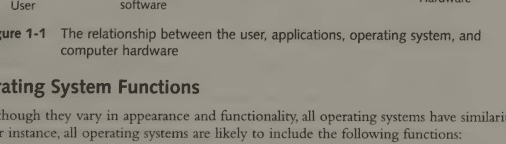

Figure 1-1 The relationship between the user, applications, operating system, and computer hardware

## Operating System Functions

Although they vary in appearance and functionality, all operating systems have similarities. For instance, all operating systems are likely to include the following functions:

- Initialize (or prepare) the computer hardware so that the operating system and other programs can function correctly.
- Allocate system resources, such as memory and processing time, to the programs that are using the operating system.
- Keep track of multiple programs running at the same time.
- Provide an organized method for all programs to use system devices (such as the hard disk, printer, and keyboard).

An operating system consists of multiple parts or components. The most essential part is the kernel. Additional components assist the kernel in managing the computer's resources and in controlling application software. The following is a list of the major components of an operating system:

- Kernel: The core of the operating system, which allocates computer resources such as memory and CPU time between multiple applications
- Device drivers: Software that permits the kernel to access hardware devices such as a keyboard, mouse, hard disk, scanner, or network card
- Shell: Software that accepts input from a user via a command line and processes that input to manage system resources


- Utility programs: Software programs that manage the hardware and operating system features. A utility is similar to an application such as a Web browser, but the purpose of a utility is to manage the computer system rather than perform a task that is independently useful (such as display a Web page or calculate a mortgage payment).
- Graphical user interface (GUI); sometimes called a graphical interface or a desktop interface: Software that provides a mouse- or pointer-driven interface in which graphical applications can operate using menu bars, buttons, and overlapping graphical windows.

The precise line between an operating system component and an application is vague. For example, many utility programs are included when you install an operating system, but they may also fulfill specific needs you have such as searching for a word or downloading e-mail. But this vagueness won’t cause you any problems if you understand the purpose of an operating system and its components as outlined above.

## The UNIX Operating System

UNIX is an operating system originally created at AT&T Bell Labs (now part of Lucent Technologies) in the early 1970s by Ken Thompson and Dennis Ritchie. It was designed to control networked computers that were shared by many users. UNIX development has continued since it was first introduced, and versions of UNIX are currently sold by dozens of large companies, such as IBM, Hewlett-Packard, and Sun Microsystems. The Internet was developed on UNIX and is still based around the UNIX operating system.


> One reason that many versions of UNIX exist is because of government restrictions on what AT&T—being a monopoly at the time—could do with technology that it developed. Today you will sometimes see reference to `*nix` or `unices`, meaning all of the versions of UNIX collectively. If something is compatible with most unices (most versions of UNIX), it is also likely compatible with Linux, as described later in this section.

Ironically, the features and low cost of Linux (which is basically a version of UNIX, as explained shortly) are effectively driving UNIX out of the market. Computer hardware and software companies that formerly based much of their business on selling UNIX are now switching their support to Linux. Two examples are HP and IBM.

## The Free Software Foundation and the GNU Project

In 1983, during the heyday of UNIX popularity, Richard Stallman at the Massachusetts Institute of Technology founded an organization called the Free Software Foundation (FSF). Stallman’s motivating idea was that users should have complete freedom in how they use software—the people selling software shouldn’t control what users could do with that software. He proposed that companies and individuals could make money by charging for services and customization, but that the software itself should not be restricted in its distribution by a standard commercial license agreement. To back up his opinions, Stallman and those working with the FSF created hundreds of utilities that ran on most versions of the UNIX operating system and distributed them freely around the world. This effort was called the GNU Project. (GNU is a recursive acronym that stands for GNU is Not Unix; it is pronounced with a hard g, guh-new.) With the GNU Project, Stallman intended to create a completely free version of UNIX, written from scratch.


One of the best known products of the GNU Project is the C language compiler called `gcc`. This is a software program for converting C language programming instructions into code that a computer can execute. The `gcc` compiler is the most widely used, highly regarded compiler in the world.

For more information about the philosophy of free software and the relationship between GNU and Linux, visit www.fsf.org.


Perhaps more far reaching than the free software produced by Stallman’s efforts has been the software license that Richard Stallman designed for the GNU Project. A software license is a legal definition of who can use a piece of software and how it can be used. Stallman introduced the GNU General Public License. Often abbreviated as the GPL, this license is very different from a standard commercial software license:

- When the author of a piece of software decides to license it under the GPL, the author agrees to give away the source code to the software. The source code is the set of human-readable programming instructions used to create the program. For non-GPL commercial software, only the machine-readable binary code used to execute a program is distributed. By including the source code, the software author makes it possible for anyone to modify the original program.

- Anyone who obtains a copy of the software is licensed to redistribute it in any form they choose (on CD-ROM, via the Internet, in retail stores, and so forth). They can even charge money for it. But they must license everything they distribute under the GPL—they cannot impose restrictions on anyone who obtains the software from them.

- Any modifications to the source code (a derivative work of the original program) must be licensed under the GPL as well.

The last point here is sometimes referred to as the "viral" nature of the GPL—any changes to the code are also "infected" with the GPL. Once you start with software licensed under the GPL, you can’t get away from it. On the other hand, some have mistakenly assumed that any program that is used with GPL software is also infected. That is not the case. For example, if you wrote a business software application for Linux and used a standard commercial license, running on Linux doesn't mean that your software is part of the same collection of source code as Linux itself.

Software called "system libraries" may be shared by both free programs and commercial programs operating in memory at the same time. The use of these libraries is covered by a separate version of the GPL called the Library GPL (or the LGPL).

Software licensed using the GPL is sometimes called copyleft; it is copyrighted material, but using a license that is very different from standard licenses that restrict distribution.

Some software is placed in the public domain by its author. Public domain means that no one has the copyright to the software. Most things produced by the U.S. government are in the public domain because they were produced using tax dollars. If software is in the public domain, anyone can modify it, keep the modifications secret, and copyright the modifications under a standard commercial software license. But the GPL is a type of license, with copyright maintained by the software author. GPL is very different from software in the public domain, though some journalists have confused the two concepts.

The GPL was not the first license to allow free redistribution of software. Nor will it be the last. Other similar licenses are used for the Berkeley version of UNIX (called FreeBSD), the Apache Web server, the PERL programming language, the X Window System, and many other programs.

The name OpenSource is often used to refer to software licensed under the GPL. The OpenSource initiative is a consortium of people who support free software principles, but they have approved many different licenses as being valid expressions of those principles. The Free Software Foundation, which maintains the GPL, makes a distinction between the GPL and the term OpenSource, though in practice they are used synonymously in the Linux industry. For more information, visit `www.opensource.org`.

## Linux Arrives


While the GNU Project was creating utilities for UNIX, a college student in Helsinki, Finland, named Linus Torvalds wanted access to his own UNIX system (UNIX has always been popular on many college and university campuses). But like most students, he couldn't afford the huge computer and expensive software required to run UNIX. Torvalds decided to create a UNIX-like operating system kernel for his IBM-compatible PC as a school project. This in itself would not be different from the efforts of many other students working

为了创造出有用的东西并省下几美元——这也与斯托尔曼的计划相似，只不过托瓦兹是从内核开始而不是从工具开始。

托瓦兹没有试图独自完成这个项目，而是通过互联网征求帮助。很快，世界各地的数百名程序员一起合作创建了一个新的类 UNIX 操作系统内核。（有关托瓦兹的照片，请参见图 1-2。）他们的工作被命名为 Linux，以纪念这个协作软件开发项目的创始人林纳斯。（大多数人用短 i 音读 Linux，lin-ucks；有些人读 lee-nucks；林纳斯的发音与这些都不完全相同，因为它是芬兰语，但他从未在意过它的发音方式。）


图 1-2 Linux 内核的创始人林纳斯·托瓦兹

斯托尔曼从工具开始；托瓦兹从内核开始。斯托尔曼有一个完整的哲学议程；托瓦兹只是不想为 UNIX 付费。两人之间，他们创造了 Linux 快速发展的必要组件。

由于其社区导向的性质，托瓦兹决定以 GPL 发布 Linux 内核。GPL 使 Linux 能够快速发展，因为每个参与项目的人都知道他们将从他人的努力中受益：因为他们都在同一个程序上工作，GPL 保证了每个人的工作都会被共享。结果是在友好、专业的氛围中取得了快速进展。

> TIP 最近，由一家名为 SCO 的 UNIX 公司对 Linux 和 GPL 发起了法律挑战。尽管大多数法律专家认为这些诉讼不太可能成功，但这些法庭斗争凸显了 Linux 的好处，并正在界定 Linux 和其他自由软件程序在未来几年中的使用方式。有关此主题的更多详细信息，请访问 www.grok law.net、www.osdl.org，或 Linux 新闻网站，如 www.linux today.com 或 www.linuxworld.com。

Linux 内核开发遵循数百个自由软件项目使用的标准模式。要开始一个项目，一个人会识别出需求并开始编写程序，就像托瓦兹所做的那样。在某个时候，软件开发者会在互联网上宣布该项目。 对该项目感兴趣的开发者会作出回应，很快他们就开始在项目的不同部分上共同工作。一个程序员或一组程序员可能会开发用户界面，另一个负责网络功能。另一组可能会负责软件的文档。所有个人开发者和作者都通过电子邮件交流，以共享代码、文档以及他们对项目应如何推进的看法。

在被开发的软件达到一定稳定水平后，负责该项目的人会通过互联网发布软件（包括源代码）。近年来，这一过程变得更容易也更规范化。大多数项目都有自己的网站（许多通过 sourceforge.net 网站）并在与自由软件相关的新闻网站上宣布其进展。两个访问量最大的网站是 slashdot.org 和 freshmeat.net。

> 自 Linux 诞生以来，源代码一直通过位于芬兰的互联网站点 `ftp://ftp.funet.fi` 以及世界各地许多其他站点分发。

在软件项目（或其更新）被宣布后，人们会下载源代码并试用该程序。其中一些人会反馈他们遇到的关于问题的信息（软件错误）。开发团队会修复这些错误，有时还会与其他提交了错误修复或特定增强功能的开发者合作。这些修复和增强是下一个软件版本的基础，该版本可能在几天到数月后宣布并发布。

> 2003 年底，一款开源程序中发现了一个安全漏洞。该漏洞在凌晨 2 点被发现。到上午 6 点，多个补丁已在全球范围内分发。

尽管林纳斯·托瓦兹继续担任 Linux 内核开发的领导者，但内核不再仅依赖于他一个人。他有多位关键助手负责维护内核的各个部分，还有数百人定期贡献编程代码或建议。

有时，自由软件项目的参与者会决定他或她不喜欢项目的发展方向。如果更大的项目成员不认同他的观点，那个人就可以基于现有源代码启动一个新项目。这有时被称为分叉源代码。分叉是许多新项目开始的方式。例如，假设一组开发者正在为一块网卡开发驱动程序。同一家公司宣布了一款新卡。其中一位开发者决定他想为该项目开发驱动程序。他成立了一个新团队，以原团队的源代码为起点。因为没有人领取报酬，每个人都可以选择从事自己最感兴趣的工作。

## 激励自由软件开发者

随着 Linux 在商业和计算机出版物中被讨论，那些不熟悉 Linux 和其他自由软件使用的软件开发模式的人会提出一个合理的问题：“为什么这么多人会投入如此多的精力去做一些不期望任何回报的事情？这根本说不通。”

当然，提出这些问题的商业世界主要由金钱驱动，而仅考虑金钱，自由软件开发确实说不通。然而，Linux 开发者有其他动机：

- 创建软件通常能满足开发者的特定技术需求。因为他们可能在某个时候使用过其他自由软件开发者的作品，将自己的作品作为自由软件发布是一种感谢所有让他们生活更轻松的人的方式。
- 创建最高质量、最有用的程序的开发者在自由软件社区的同行中享有很高的声誉。受人尊敬的志同道合的专业人士的尊重是一种强大的激励因素。
- Linux 社区和其他类似的在线社区，例如致力于 Apache Web 服务器等产品的社区，在新闻中非常受欢迎。参与自由软件开发让开发者感受到贡献和社区感。最初为满足开发者自身技术需求而开始的小项目，一年后可能会在《华尔街日报》上被讨论。
- 随着 Linux 等产品获得主流软件供应商（如 IBM 和惠普）的更多支持，Linux 经验是对任何开发者简历的有力提升。将你的名字与一个广为人知的自由软件项目的开发联系在一起，既表明了经过验证的技术能力，也表明了在团队中工作和组织他人工作的能力。

## Linux 的优势

尽管能够免费使用 Linux 是许多人的激励，但大型企业不会仅因这个原因选择 Linux。事实上，企业通常更愿意为软件付费，以换取技术支持、升级和其他服务的提供者。这些组织用户选择 Linux 而非竞争产品，是因为它是一款高质量的操作系统。Linux 备受推崇的一些特性包括：

- **稳定性：** Linux 服务器以能够运行数月甚至数年而无需重启而闻名。（网站 `www.netcraft.com` 有关 Linux 作为 Web 服务器的令人印象深刻的统计数据。）
- **安全性：** 源代码可用意味着开源软件中偶尔出现的安全漏洞比商业产品更快速地被定位和修复。
- **速度：** Linux 对硬件的利用非常高效，从非常小的系统到非常大的系统。（研究 Linux 与 Windows 系统速度比较的优秀资源是 `www.kegel.com/nt-linux-benchmarks.html`。）
- **成本：** Linux 是免费的，但大多数用户为此支付了一些费用，如本章后面部分所述。尽管如此，所支付的价格通常远低于基于商业软件的竞争解决方案。已经对各种产品的**总拥有成本（TCO）**进行了许多研究。TCO 包括软件成本加上维护、支持和升级的持续成本。红帽软件已进行过许多研究，以显示基于 Linux 的商业解决方案的 TCO 优势。
- **多处理和其他高端特性：** 随着 Linux 的流行度增长，它不断增加以前仅在花费数千美元的系统上才有的特性。这些包括能够在具有多个微处理器的计算机上运行（**多处理**）、支持众多新硬件设备，以及本书后面将详细介绍的其他特性。（例如，请参阅 `www.redhat.com/software/rhel/features/` 上的信息。）
- **应用程序：** Linux 现在拥有长长的通用和专业应用程序列表，包括办公套件（类似于 Microsoft Office）、强大的数据库工具和互联网应用程序。许多最大的软件供应商已为其产品创建了 Linux 版本。你也可以使用特殊工具直接在 Linux 上运行许多 Windows 程序。

## LINUX IN THE MARKET

在本节中，你将了解 Linux 如何被打包和销售，包括当前市场领导者红帽软件提供的具体产品。你还将了解 Linux 认证计划。

### Linux 发行版

单独的 Linux 内核并不能提供完整操作系统的功能。要真正实用，一个完整的系统应该包括：

- 硬件驱动程序，使 Linux 能够与打印机、网卡、数码相机和扫描仪、DVD 驱动器等众多外设配合使用
- 安装程序，使用户能够轻松地将所有 Linux 文件设置到计算机上


- 网络和系统管理实用程序，用于监控和配置操作系统的运行方式

- 图形环境（桌面界面），以及用于管理操作系统的图形工具

- 个人生产力应用程序，如文字处理器、计算器、日历、CD 播放器和时钟（也许还有一些游戏）

- 描述如何执行系统管理任务、如何操作图形界面以及许多其他任务的文档

一个包含操作系统内核以及上述许多或全部组件的“产品化” Linux 版本称为 Linux 发行版。Linux 发行版通常包含数千个在 Linux 上运行的独立程序。其中大多数与管理 Linux 系统有关——换句话说，它们是系统实用程序。其中许多系统实用程序取自 GNU 项目。因此，有些人将 Linux 发行版称为 GNU/Linux 操作系统。使用打包的 Linux 发行版，非技术人员可以安装和使用 Linux。图 1-3 显示了不同组件如何被收集到 Linux 发行版中。


图 1-3 许多组件共同构成了一个 Linux 发行版

许多公司都创建了 Linux 发行版。根据 GPL，这些公司在其发行版中包含了 Linux 内核的源代码，以及发行版中大多数其他实用程序的源代码。它们可以自行决定为其 Linux 发行版收取多少费用；由于软件可以从其他来源免费获得，因此一种看法是 Linux 公司本质上充当包装服务，省去了用户下载和配置大量文件的麻烦。

发行版中程序免费这一事实在很大程度上使 Linux 的价格保持在较低水平——通常在 2 美元到 100 美元之间。由于许多 Linux 厂商提供的 Linux 内核和实用程序几乎相同，厂商使用商业组件（如专用实用程序）或服务（如技术支持）来使他们的产品对消费者更具吸引力。稍后描述的 Red Hat Enterprise Linux 就是一个例子。表 1-1 列出了几种 Linux 发行版。您可以通过访问 www.distrowatch.com 找到有关全球数百种 Linux 发行版的详细信息。购买 Linux 发行版廉价 CD 的一个好来源是 www.cheapbytes.com。

### 表 1-1 流行的 Linux 发行版

| Name | Comments | Web site |
|---|---|---|
| Red Hat Linux | The most widely used distribution, from Red Hat Software; currently sold as Red Hat Enterprise Linux, in several versions for different markets and hardware configurations | www.redhat.com |
| Fedora | A distribution based on Red Hat Linux, but entirely free (no commercial version exists) | fedora.redhat.com |
| SUSE Linux | Very popular in Europe; originally produced by SUSE, a German company, which was recently acquired by the networking software company, Novell | www.suse.com |
| Debian | A noncommercial Linux distribution targeted specifically to free software enthusiasts. Debian does not have a company behind it. It is created and maintained by developers of free software | www.debian.org |
| Xandros | Focused on providing a desktop operating system to replace Microsoft Windows | www.xandros.com |
| Linspire (formerly Lindows) | Focused on providing a desktop operating system to replace Microsoft Windows (also the target of a lengthy trademark lawsuit by Microsoft, in which Lindows/Linspire has so far prevailed) | www.linspire.com |

## Red Hat Software

由于本书的目的之一是帮助您通过 Red Hat 认证技术员考试，您应该更详细地了解 Red Hat Software 提供的 Linux 产品。

直到 2003 年底，Red Hat Software 销售的是 Red Hat Professional Linux，这是一款价格相对较低但备受推崇的发行版，到那时已发展到第 9 版。Red Hat Software 然后通过创建 Fedora 发行版作为免费产品和技术试验田来改变其产品线。通过维护 Fedora 发行版，Red Hat 继续为创建 Linux 内核和其他自由软件的许多开发人员提供资金支持。Red Hat Software 的商业重点现在是 Red Hat Enterprise Linux，它有三种不同的配置：

- **WS (workstation):** A product designed for power users who want to use Linux at their Intel or compatible (x86) desktop. This version does not include most of the Internet server technology provided in other Linux distributions, such as a Web server and e-mail server. A separate version called Red Hat Professional Linux is a low-cost version of the Enterprise Linux WS product. It is sold through retail stores and corporate resellers, but you cannot purchase technical support beyond basic installation support.

- **ES (enterprise server):** A midrange server product for Intel x86 and compatible computers that includes Internet server software such as a DNS server and e-mail server

- **AS (application server):** A high-end server product similar to the ES product, but which is available for seven types of hardware, including IBM mainframes (model S/390)

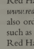

> For simplicity, the term Red Hat Linux is used throughout this book to refer to Linux products from Red Hat Software. Specific products or differences between products are noted when appropriate.

Red Hat Enterprise Linux 以订阅服务的形式出售。假设您通过 Red Hat 网站 www.redhat.com 购买了一份 Red Hat Enterprise Linux ES 并附带了 Basic 服务协议。您可以立即下载并安装操作系统，也可以订购媒体套件（约 25 美元），其中包括 CD-ROM 和基本文档，如安装指南。安装操作系统后，它会通过互联网与 Red Hat Software 保持联系。任何安全修复、软件包升级或其他使系统平稳安全运行所需的信息都会通过此 Red Hat Network (RHN) 服务下载并配置。


您应该通过查看 `www.redhat.com/software` 上提供的详细信息来熟悉不同的 Red Hat 产品。请注意，与 Red Hat Enterprise Linux 捆绑的软件与任何其他 Linux 发行版中包含的软件并没有太大区别。Red Hat 添加了一些强大的实用程序，但其成功的关键在于他们为使用 Linux 的大型公司提供的服务和支持。例如，Enterprise Linux AS 产品，每份价格在 2500 美元到 18000 美元之间，提供关键问题的 1 小时响应时间，全天 24 小时、每周 7 天。本节后面讨论的 Red Hat 培训和认证计划也是考虑使用 Linux 的企业的重要因素，因为它们确保有知识的员工来维护组织的 Linux 系统。

# 硬件要求

Linux 系统可以在非常有限的硬件上运行。您可以使用一台 CPU 为 133 MHz、RAM 为 16 MB、硬盘空间为 100 MB（或更少，具体取决于您想用 Linux 系统做什么）的计算机运行 Linux 系统。然而，像表 1-1 中列出的主要发行版通常建议您的计算机至少有约 1 GB 的可用磁盘空间和 64 MB 的 RAM。这使您能够使用图形系统并安装大量常用的软件包。

现实地说，如果您购买一台更新的计算机，您很可能至少拥有 128 MB 的 RAM 和 20–40 GB 的硬盘空间。更多的硬盘空间使您能够安装更多应用程序，从而可以为服务器添加功能、存储更多数据文件，或只是尝试桌面上的有趣程序。更多的 RAM 通常使系统运行更快，因为 Linux 内核使用额外的内存来存储来自硬盘的信息，从而提高性能。

Red Hat 对 Enterprise Linux 安装提供了具体建议。它建议使用 256 MB 的 RAM（Enterprise Linux ES 最多 8 GB，Enterprise Linux AS 最多 64 GB）、300 MHz 的 CPU 和 800 MB 的可用磁盘空间（最大文件系统大小为 1 TB）。访问 `www.redhat.com/software/rhel/configuration/` 可了解有关 Enterprise Linux 要求的详细信息以及 Linux 功能的有趣总结。

# 版本编号

与 Linux 产品相关的版本号可能令人困惑。Linux 内核的每个版本都被分配一个版本号。Linux 发行版的每个组件也由开发该组件的团队分配一个版本号。Linux 发行版本身也有版本号，这些版本号是出于营销原因选择的，基于发行版更新的频率。

大多数用户选择他们选择的发行版的最新可用版本。例如，截至本文撰写时，Red Hat Enterprise Linux 3 是可用的最新版本的 Red Hat Linux。但 Linux 内核的版本号也很重要，因为它定义了操作系统的一些关键功能，例如支持什么硬件以及使用什么安全模型。内核版本号包括三个部分：

- 一个很少更改的主要版本号。Linux 的主要版本在过去六七年里一直是 2。
- 次要版本号，变化不频繁，大约每 10–18 个月一次。偶数次要版本是稳定的操作系统，用于创建商业 Linux 发行版。奇数次要版本是 Linux 的开发版本，除非是经验丰富的 Linux 用户，否则不应使用，因为它们随时可能崩溃。Linux 的开发版本是临时发布版——它们允许高级用户在新功能稳定之前尝试新功能。
- 补丁级别号，对于 Linux 的开发版本而言变化非常频繁，可能每天或每周一次。对于稳定的 Linux 版本，该数字仅会更改几次（通常一年中有六到十次），因为在定位并修复问题以使稳定的 Linux 内核更加稳定时。

Linux 内核的版本号可能如下所示：`2.6.3`。这是一个稳定的内核发布版（以 6 表示）。它也是补丁级别 3，表明 2.6 内核已进行了几次小更新，以提高稳定性或改进硬件支持。另一个 Linux 内核版本可能如下所示：`2.7.67`。在这种情况下，第二个数是奇数，表示它是内核的开发版本，不应在商业环境中使用。67 表示该版本已发布了 67 个版本，每个版本都由内核开发人员添加了修复或增强功能。在添加并使一定数量的增强功能稳定后，内核开发人员将决定发布内核版本 `2.8.0`。然后，随着他们使用 `2.9` 系列内核添加新功能，流程将重新开始。


> 除非你想尝试可能导致系统崩溃的新功能，否则不要在服务器上运行开发内核。商业 Linux 发行版始终使用稳定的 Linux 内核发布版。

像 Debian、Red Hat Software 和 SUSE 等组织创建的 Linux 发行版由数千个程序组成。产品中包含的 Linux 内核版本很重要，但也可以提及每个组件的单独版本号，例如 Apache Web 服务器的版本号或 gcc 编译器的版本。为了避免需要指定发行版中包含的每个组件的版本，商业 Linux 发行版的供应商会为整个发行版分配一个版本号。例如，Fedora Core 2 发行版包含一个 `2.6.5` Linux 内核。2 这个标识是由组装发行版的团队决定的；它与内核或其他任何软件包的版本无关。然而，它为用户提供了一个简写，任何拥有 Fedora Core 2 的人都可以轻松地通过查阅 Fedora 网站（`fedora.redhat.com`）来确定他们正在使用其他程序的哪个版本。

不要在比较产品时担心发行版的版本号。相反，请查看对你最重要的各个组件的版本，包括 Linux 内核、图形系统以及你需要使用的特定服务。你可以从供应商的网站获取有关所有这些特定版本号的信息。

# Linux 认证

证明你具备 Linux 技能给潜在雇主看的最佳方法之一是获得 Linux 认证。认证为雇主提供了一个衡量你学习了多少的标准。它也让他们确信你拥有一些实践经验，并熟悉典型系统管理员会遇到的各种技术问题。

## 行业认证项目

如前言所述，目前有多个 Linux 认证项目可供选择，包括以下内容：

- Red Hat Software 提供 Red Hat 认证技术员项目，以及更高级的 Red Hat 认证工程师项目。参见 `www.redhat.com/training`。本书附录 A 列出了该项目的目标。
- Linux 专业学院（LPI），一个由软件行业公司组成的联盟（最著名的是 IBM），提供 LPI 认证项目，分为三个级别：LPIC1、LPIC2 和 LPIC3，分别面向初级、中级和高级系统管理员。参见 `www.lpi.org`。本书附录 B 列出了该项目的目标。
- SAIR/GNU，最初由密西西比大学的一位教授开发，提供 Linux 认证管理员（LCA）认证。参见 `www.linuxcertification.org`。本书附录 C 列出了该项目的目标。
- CompTIA 提供 Linux+ 认证项目。参见 `www.comptia.com`。本书附录 D 列出了该项目的目标。
- Novell 提供 Novell 认证 Linux 工程师项目，该项目建立在 LPI 认证（或同等经验）之上。参见 `www.novell.com/training`。

在这些项目中，Red Hat 认证专注于 Red Hat Enterprise Linux 产品；Novell 的项目专注于 SUSE Linux（Novell 现已拥有）及其与 Novell 其他网络软件产品的集成；所有其他认证都是厂商中立的，这意味着它们试图提供适用于任何主要 Linux 发行版的信息。

当然，还有许多其他公司提供 Linux 培训。大多数公司都认识到认证在就业市场上的价值，并将他们的教学与上面列出的其中一个项目挂钩。

## Red Hat 的认证项目

Red Hat 的认证项目备受推崇，部分原因是认证相当难以获得。考试包括选择题和动手练习。基本上，你坐在一个已被“破坏”的系统前。你必须诊断并修复问题。Red Hat 似乎对考生平均约 40% 的失败率感到一种变态的自豪，尽管大多数人在选择题部分表现良好。

结果是，通过 Red Hat 考试的任何人都被认为在 Linux 方面具有非常坚实的技术基础。

Red Hat 培训项目包括三门课程（尽管它们以不同的方式重新配置和捆绑，并使用不同的课程编号）：

- Course 033 Operator。面向没有任何 Linux 或 UNIX 经验的人员的课程
- Course 133 Technician。面向具有 Linux 或 UNIX 经验、达到熟练操作员水平的人员的课程
- Course 253 Engineer。面向经验丰富的 Linux 系统管理员的高级课程。本课程的大部分内容侧重于网络服务和安全。

任何人都可以只要支付费用就可以无限次参加 Red Hat 认证技术员（RHCT）或 Red Hat 认证工程师（RHCE）考试。然而，Red Hat 建议学生在参加 RHCT 考试前应具备相当于课程 033 和 133 的知识，并在参加 RHCE 考试前应具备相当于全部三门课程的知识。由于参加 Red Hat 考试的费用为数百美元，因此强烈建议充分准备。可用的问题和答案列表可在 `www.redhat.com/training/rhce/rhce_faq.html` 获取。

# 系统管理员的工作


尽管大多数 Linux 发行版可以免费下载，但 Linux 越来越多地成为大型组织的信息技术基础设施的一部分。这些组织需要具备 Linux 专业知识的员工来管理、销售和维护这些系统。因此，Linux 知识可以为你开启一条充实且有利可图的职业道路。

## Linux 职业

拥有对 Linux 及其相关技术的深入理解后，你可以从事的工作示例包括：系统管理员、网络管理员、软件工程师、培训师、技术作家、产品营销和业务顾问。

即使你不寻求与 Linux 直接相关的领域的工作，许多公司现在也将 Linux 专业知识视为一般计算机知识强大的标志。此类公司将 Linux 知识列为许多类型工作的合格技能，包括培训、营销、销售和技术管理。

你可以通过访问以下任何网站来研究与 Linux 相关的职位，输入关键词 "Linux"：

- www.dice.com
- www.careerjournal.com

## 系统管理员的职责

在任何组织中，系统管理员的角色很简单：让技术为那些从事组织“真正工作”的人工作，并且持续工作。“真正工作”这一说法并非贬低系统管理员的工作——相反，组织投入的强大技术如果没有系统管理员带来的知识就毫无用处。作为系统管理员，你的目标是让他人能够使用技术所能提供的益处。

当其他人开发具有巨大潜力的软件程序或硬件设备时，系统管理员将硬件和软件整合为完整的、可运行的系统，从而提高生产力、降低成本，或以其他方式使技术使用者受益。

随着新组件的添加、变化的发生，以及重新配置和故障改变了原始系统的面貌，系统管理员保持这些系统高效运行。系统管理员的工作主要是实践性的。它需要毅力、耐心、好奇心、创造力、解决问题的能力以及技术知识。要真正成为一名成功的系统管理员，你必须不断增加技术知识的广度（学科数量）和深度（对某一学科的专业知识）。如果你不这样做，就会出现你不知道如何解决的新问题。同时，你将缺乏将新技术整合到你的系统中的能力，或判断它们如何适用于你的环境的能力。

> 你经常会听到一个术语 MIS，即信息系统管理，或应用于员工时为信息系统经理。

系统管理员通常作为组织的信息系统（IS）或信息技术（IT）部门的一员工作。在大型组织中，该部门向首席信息官（CIO）汇报。在较小的组织中，一组系统管理员可能会咨询其他公司高管以就信息技术做出决策。IS 或 IT 部门通常关注两个领域：

- 内部信息系统：每位员工桌上的电脑、他们安装的软件、连接它们的网络以及员工登录的用户账户。内部系统通常还包括电话，这些电话通常是计算机化的并与其他计算机系统集成。
- 通过互联网供公众查看的组织信息：Web 服务器、FTP 下载服务器、电子邮件服务器以及类似的公共服务

在技术型组织中（如开发软件或销售计算机或电信设备的公司），为他人销售的软件和硬件开发团队不属于 IS 或 IT 部门。图 1-4 显示了系统管理员在典型的小型或大型公司中的位置。

### 小型公司

总裁  
IS 经理/首席系统管理员  
市场营销副总裁  
产品开发副总裁  
销售副总裁  
初级系统管理员员工

### 大型公司

首席执行官  
首席信息官  
总裁  
其他部门  
IS 副总裁  
内部开发经理  
帮助台经理  
系统管理经理  
软件工程师/系统分析师员工  
客户服务代表和系统管理员员工  
系统管理员员工

图 1-4 系统管理员在大型和小型公司中的位置

系统管理员通常拥有计算机科学、信息技术或相关领域的两年或四年制大学学位。少数初级系统管理员是自学成才或完成了短期的强化技术培训。但大多数雇主更喜欢两年或四年制学位提供的更长时间培训，尤其是在招聘没有工作经验的人时。这样的学位也有助于你在组织内部晋升的机会，无论是晋升到更负责任的系统管理员职位，还是从事编程、系统分析或管理等相关工作。

大多数系统管理员与人打交道的程度与他们与技术打交道的程度一样。他们可能主要与 IT 部门的一组技术同事一起工作，但他们也可能在回答问题、解决技术问题、培训用户、安装软件等方面与组织的绝大多数人互动。组织的员工是系统管理员的客户或用户。

在较大的组织中，与终端用户合作和维护系统的任务被划分为不同的领域。例如，IS 团队可能管理内部服务器，而 Web 团队维护互联网站点，帮助台团队直接为终端用户（即使用计算机系统完成日常工作的人）解决问题。在这种环境中，你作为系统管理员，可以专注于最适合你的兴趣和技能的特定领域，无论是网络、服务器软件、图形化生产力应用程序还是不同类型的计算机硬件。所有这些领域都需要许多相同的技术技能和解决问题的能力。

## 系统管理员执行的典型任务

作为系统管理员，你负责的任务会因以下因素而有很大差异：

- 你的专业知识和具体职位
- 你在组织中的资历
- 组织的规模

下面的列表显示了一些在许多组织中属于系统管理员工作描述的任务。

- 创建新的用户账户并对现有用户账户进行更改，例如在任务发生变化时授予新的访问权限。
- 维护系统硬件，包括安装新硬件以增加系统容量、更换损坏的系统或升级过时的组件。
- 培训终端用户有效使用新系统、软件或程序。
- 执行偶尔或定期执行的任务以保持系统平稳运行。其中一些是例行性的，例如备份文件；其他则需要更多的创造力，例如确定系统响应时间变慢的原因，或追踪来自互联网的入侵者。
- 记录系统，以便其他系统管理员能够理解其配置方式和运行方式。这可能包括告知他人应用程序是如何配置的、备份文件存储在哪里、哪些用户对某些硬件或应用程序有特定问题。此任务通常与下一项相关。
- 定义与你在站点如何管理系统的相关程序和政策。其中其他事项，系统管理员可能需要定义备份程序（参见第 13 章“系统和内核管理”）、用户指南（参见第 11 章“管理用户”）、灾难计划，或隐私和安全政策（参见 2005 年出版的本课程技术配套卷。）
- 从紧急情况中恢复。在停电、硬件故障、员工问题或自然灾害后重新启动系统。
- 规划系统。在小型组织或部门工作，或在大型组织中积累经验后，你可能会被要求决定新的硬件采购，或为未来的系统组件或设计进行规划以满足预期需求。

## 伦理、隐私和法律

作为系统管理员的工作涉及许多一开始可能并不明显的伦理问题。作为系统管理员，你对组织的计算机系统拥有完全或部分控制权。隐含在这项责任中的是公司（其高管、经理和所有者）以及使用你管理的系统的个人员工的很大信任。你如何看待这种信任决定了你作为系统管理员的有效性。例如，如果你在学校考试或认证考试中作弊，或盗版软件（制作未经授权的副本），你就表明你不尊重使雇主感到舒适地信任你的法律和伦理规范。通过此类行为失去的专业声誉很难恢复。

雇主支付你的薪水是为了以有助于其组织成功的方式维护其系统。你的角色对个人用户也有重要影响。虽然你可能大部分时间都在幕后工作（如果一切运行顺利，你最好这样做），但请记住，你的同事依靠你的工作来完成他们的工作。你准备不足或不准确可能会导致公司范围内的停机、文件损坏或丢失、打印机故障等等。因此，其他员工可能无法提高生产力。现代办公室中的每个人每天的工作都依赖于一名优秀系统管理员的工作。

这种对他人工作的控制带来了滥用的可能性。例如，作为 Linux 服务器上的系统管理员拥有`root`权限，你有能力：

- 开一些恶作剧，可能给用户带来麻烦并使他们不信任计算机系统。
- 阅读用户的电子邮件和他们主目录中的文件。
- 修改公司或个人文件。
- 发送伪造的消息，好像它们来自其他用户。
- 删除（“丢失”）系统上的文件。
- 拖延修复系统问题或帮助员工解答简单问题。
- 忽视会保护敏感数据的安全措施。

这些行为不道德，因为它们侵犯了他人隐私并阻碍了雇主的工作。大多数行为也是非法的，会使不择手段的系统管理员面临刑事起诉。但正如你可能怀疑的那样，一些不道德行为很可能不会被发现，特别是如果你是公司中唯一精通 Linux 的人。


关于技术相关法律问题的优秀资源是 www.gigalaw.com。

要作为系统管理员拥有成功的职业生涯，你应该在开始时就为自己与雇主以及你所管理系统的同事之间的关系制定几条准则。你的自定准则可能包括以下陈述：

- 我意识到我对所管理的系统比其他人更了解，但我也意识到他们对自己的工作职能以及他们对计算机系统的需求了解更多。
- 我明白其他员工和管理人员信任我处理他们的技术需求，以便他们能够高效工作。
- 我知道我绝不能阅读不属于我个人的文件，除非我作为法律程序的一部分被要求这样做，或为了遵守公开承认的公司政策。
- 我必须将其他员工视为我的客户。我作为系统管理员的成功取决于他们对我工作的满意度，而不取决于我对技术的了解程度。

偶尔，一个 rogue 系统管理员会决定配置系统，使其他人无法弄清一切是如何组合在一起的。这有时是以工作安全为名进行的：“他们不能解雇我，”这种系统管理员认为，“否则整个公司都必须关闭。”

事实上，作为系统管理员成功的最佳途径（更不用说安心）是通过让雇主成功来实现。这使你能够通过承担额外责任和把握技术机会而在职业上成长。如果你很好地训练自己，就永远不会觉得有必要以“人质”威胁的方式暗示让雇主“人质”，因为你是唯一能维护计算机系统的人。记住以下两条规则：


良好的工作岗位始终为训练有素的技术人员所准备；不要将工作安全建立在单一公司的工作上。相反，建立自己作为技术专家和令人愉快的员工的声誉，以便潜在的未来雇主渴望雇用你，而过去的雇主会为失去你而感到遗憾。

如果你没有很好地训练自己，你就不值得作为员工被保留。你的雇主随后可以用一个不是以“工作安全”为幌子占据地盘的人来取代你。真正的专家总是能够建立高效、标准化、文档完善的系统，并基于管理这些系统建立稳固的职业生涯。

要了解更多关于作为系统管理员工作的信息，请访问系统管理员协会（SAGE）网站 www.sage.org。SAGE 是 USENIX 组织的一部分，该组织是为从事先进计算系统工作的人服务的组织（见 www.usenix.org）。USENIX 和 SAGE 为系统管理员提供了巨大的资源。


关于本节的主题，考虑查阅 SAGE 道德准则 http://sageweb.sage.org/resources/publications/code_of_ethics.html。

## 开始使用 Linux

在本节中，你开始使用 Linux。理想情况下，在阅读这些章节时，你应该可以访问一台已安装 Linux 的计算机。

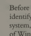

如果你不在教室或实验室工作，你可能需要跳到第 8 章（“安装 Linux”）自行安装 Linux。由于安装是一个相当高级的话题，因此提供了几个基础章节的材料，以便你更好地理解安装过程。

### 登录

在 Linux 中做任何事情之前，你必须登录系统。登录时，你向操作系统标识自己的身份，以便它知道你有权使用系统，以及允许你访问系统的哪些部分。与你可能使用过的一些旧版 Windows 不同，你在未登录的情况下无法访问 Linux 的任何功能。

每个使用 Linux 系统的人通常都有自己的用户账户。用户账户是一组使用系统的权限，并附带关联的用户名和密码。你必须拥有有效的用户名和密码才能登录。如果你正在教室或实验室工作，你的指导老师应为你提供用户名和密码。如果你自行安装了 Linux 系统，你应该在安装 Linux 时创建了用户账户（用户名和密码）。

Linux 以两种模式运行：图形模式和文本模式。文本模式仅提供一个简单的提示符，在该提示符下你输入用户名，按 Enter，然后输入密码并按 Enter。如果使用有效的用户名和密码登录，你会看到如下的命令行提示符：

```
[nwells@inverness nwells]$
```

在此提示符下，你可以输入命令来启动程序或与系统交互。本章后面将提供此提示符每个部分的解释。当你在此模式下工作时，你正在使用控制台。

更常见的是，你使用图形登录屏幕登录 Linux。该屏幕在你打开基于 Linux 的计算机后自动出现（在许多行启动信息滚动后）。当你在提供的文本框中输入用户名和密码时，你会看到一个图形桌面，类似于图 1-5 所示的桌面。此桌面界面是你的主要工作环境。

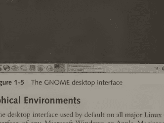

图 1-5 GNOME 桌面界面

### 图形环境

所有主要 Linux 发行版默认使用的桌面界面与任何 Microsoft Windows 或 Apple Macintosh 计算机的界面非常相似。Linux 桌面界面可以在许多方面重新配置（如后续章节所述），但其基本操作很简单。Linux 系统上流行的两种桌面是 KDE 桌面和 GNOME 桌面（guh-NOME）。这两种桌面都包含以下基本功能：

- 跨越屏幕底部的任务栏，包含众多图标
- 主菜单，你通过单击屏幕左下角的图标访问（与 Microsoft Windows 操作系统中的“开始”按钮位置相同）
- 按主题将程序分组的多级菜单
- 你可以双击以访问常用程序的桌面图标
- 多个重叠的窗口，你使用鼠标控制。每个窗口都可以移动、调整大小等。

### 打开终端窗口

从图形桌面（GUI 或桌面）中，你可以启动一个文本模式界面——终端窗口——它类似于控制台。从此窗口你可以从键盘输入命令。

> 终端窗口也以其他名称为人所知：命令行界面（CLI）或 xterm 窗口。Xterm（EX-term）是提供 UNIX 和 Linux 中终端窗口的一种流行程序的名称。

要在 Red Hat Linux 中启动终端窗口，单击桌面左下角的主菜单按钮——它是带有 Red Hat 图标的图标。当菜单出现时，单击 System Tools，然后单击出现的子菜单上的 Terminal。终端窗口会出现。你也可以通过右键单击桌面背景并从出现的上下文菜单中选择 Open Terminal 来打开终端窗口。你可以通过重复这些步骤打开任意多个终端窗口。（见图 1-6。）

## 探索文件系统

无论是作为普通用户还是系统管理员，操作文件和目录都是你在计算机上做的大部分工作。例如，你在目录中搜索文件，打开该文件以查看或更改其内容，并保存文件的更新版本。本节描述了一些基本概念和工具（文本和图形），它们使你能够访问 Linux 系统上的文件。

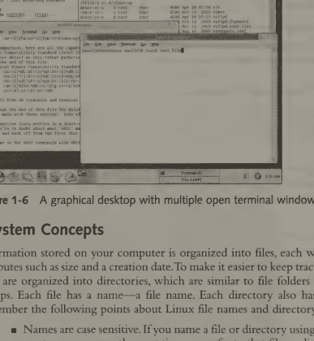

图 1-6 带有多个打开终端窗口的图形化桌面

### 文件系统概念

存储在计算机上的信息被组织成文件，每个文件都有名称以及大小和创建日期等其他属性。为了更方便地跟踪成千上万个文件，它们被组织到目录中，目录类似于文件文件夹，将文件按组排列。每个文件都有一个名称——文件名。每个目录也有名称。你应该记住关于 Linux 文件名和目录名的以下几点：

- 名称区分大小写。如果你使用大写字母为文件或目录命名，下次引用该文件或目录时必须使用大写：文件名 "test"、"Test" 和 "TEST" 可能指的是三个不同的文件。
- 名称可以很长——最长 256 个字符——并且除了大小写字母外，还可以包含多个句点、数字、空格和标点符号。但是，你不能在文件名中使用正斜杠或反斜杠。为了清晰起见，如果文件名包含不寻常的字符，尤其是空格，通常将文件名用引号括起来。（本节后面有示例。）
- 名称可以包含文件扩展名，但这与 Windows 中的重要性不同。例如，Linux 配置文件可能没有扩展名，也可能以 `.conf` 结尾，或以其他文件扩展名结尾。（文件扩展名是句点后文件名中的最后一部分。）Linux 程序文件的名称不包含任何文件扩展名（如 Windows 中的 `.exe` 或 `.com`）。

多个层级的目录以分支状的树形结构排列，其中一个目录通向其他目录。每个目录可以同时包含文件和其他目录。当一个目录包含另一个目录时，这种关系通过称第一个为父目录、第二个为子目录或子目录来表达。子目录也可能是它所包含的另一个目录的父目录——子目录。

目录列表称为路径。路径中的每个子目录都用正斜杠分隔。

> 在 Windows 中，反斜杠（ \ ）用于分隔路径中的目录。在 Linux 中你必须使用正斜杠（ / ）。

你可以以两种方式指定路径：

- 使用绝对路径：从正斜杠开始路径，并包含从根目录开始的每个子目录。
- 使用相对路径：不要从正斜杠开始路径。然后路径被假定为相对于你当前正在工作的目录。

一个例子可以帮助说明绝对路径和相对路径。假设你正在工作在名为 `/home/nwells` 的目录中。你想引用目录 `/home/nwells/documents`。你可以使用绝对路径 `/home/nwells/documents`，或相对路径 `documents`。假设你正在工作在名为 `/usr/share/doc` 的目录中，并想引用 `/home/nwells/documents` 目录。你可以使用绝对路径 `/home/nwells/documents`，或相对路径 `../../home/nwells/documents`。相对路径根据你在文件系统中的工作位置而变化；绝对路径不会变化。你可以根据工作需要决定哪种更方便。

上面的例子中的双句点（ `..` ）指的是父目录。因此路径 `../../home` 指示系统转到你正在工作的目录的父目录，然后转到其父目录，然后在该位置查找 home 目录。

Linux 中的每个文件、目录和设备都作为单个目录结构的一部分进行访问。Linux 没有像 Microsoft Windows 系统中那样单独的驱动器 A:、C: 和 D:。相反，你通过查看不同的子目录来访问不同的硬盘或软盘。这些的父目录是根目录，用单个正斜杠表示：（ `/` ）。所有 Linux 配置文件都位于根目录的子目录中。所有设备也都与位于根目录子目录中的文件名相关联。作为系统管理员，你的大部分工作都包括管理文件和目录的状态、内容和位置。

> `/root` 子目录是 root 用户账户的 home 目录。不要将其与根目录 `/` 混淆。为了清晰起见，有帮助将 `/root` 子目录称为“斜杠-root”，或“root 的 home 目录”。

默认情况下，Linux 在首次安装时包含一套标准子目录。表 1-2 列出了这些子目录。某些版本的 Linux 可能包含根目录的子目录，但未在此列出。例如，多个版本的 Linux 使用 `/opt` 目录来存储可选应用程序。


在新安装的 Linux 系统上，包含最多文件和子目录的目录是 `/usr` 子目录。该子目录包含系统实用程序、图形系统的文件、文档文件等。

标准 Linux 子目录的名称并不直观，但每个都有经过多年 UNIX 和 Linux 开发而完善的独特目的。这种众所周知的目录结构确保程序能够相互交互，因为它们可以在任何 Linux 系统上在常规位置找到文件。随着你使用以下各节中描述的图形和命令行工具探索系统，你将熟悉标准 Linux 文件和目录的排列和用途。

## 表 1-2 根目录的标准 Linux 子目录

| 目录 | 内容 |
|---|---|
| `/bin` | 可执行程序，通常包括系统实用程序 |
| `/boot` | 系统启动时用于初始化 Linux 的文件，例如 Linux 内核 |
| `/dev` | 与硬件资源（设备）链接的文件名 |
| `/etc` | 配置文件，尤其是系统实用程序和网络服务（如电子邮件、Web 和 FTP）使用的配置文件 |
| `/home` | 所有普通用户账户的 home 目录 |
| `/lib` | 系统库（本章后面描述），被许多 Linux 程序使用，尤其是系统实用程序和 Linux 内核 |
| `/root` | `root` 用户（超级用户账户）使用的文件。这是该用户账户的 home 目录。它与 `/home` 目录分开，因此对 `/home` 执行的操作（如后面所述）不会影响 `root` 用户的文件。 |
| `/sbin` | 仅 `root` 用户使用的可执行程序 |
| `/tmp` | 系统中任何用户或程序创建的临时文件 |
| `/usr` | 系统上所有普通用户使用的文件，包括数据、程序和文档 |
| `/var` | 系统实用程序和网络服务创建的可变（变化）信息；示例包括系统日志文件、电子邮件消息和等待发送到打印机的文件 |

## 使用图形实用程序管理文件

你的 Linux 桌面包含一个文件管理器，使管理文件和目录变得容易。你 GNOME 桌面上的文件管理器是一个名为 Nautilus 的图形程序。该程序将目录的内容显示为图标或文件名的集合，并让你使用菜单、鼠标点击和对话框来管理文件和目录。

TIP 此处的描述指的是 GNOME 桌面界面，这是 Red Hat Linux 的默认设置。KDE 桌面在名为 Konqueror 的程序中提供几乎相同的功能。

要打开 Nautilus 窗口，请在主菜单上选择 Browse Filesystem。

文件管理器可以帮助你与 Linux 的许多部分交互。它们通常类似于（并且可以作为）Web 浏览器。要使用 Nautilus 查看根目录中的文件和目录，请在位置文本框中输入正斜杠（ `/` ），然后按 Enter。根目录的内容将在 Nautilus 窗口中显示。你可以通过双击代表该目录或文件的任何图标来更改到新目录或查看许多类型文件的内容。可以在 Nautilus 中执行的一些关键操作在下一节中描述。

除了在位置文本框中输入路径外，你还可以双击目录图标以查看该目录的内容。当你在 Nautilus 的工具栏中单击向上按钮时，你会看到父目录的内容（你在目录树中向上移动一级）。

你在 Linux 中的个人工作区称为你的 home 目录。home 目录是存储所有个人文件以及特定于你用户账户的配置信息和程序设置的子目录。Nautilus 工具栏上的 Home 按钮会带你到你的 home 目录，该目录默认位于 `/home` 目录中，以你的用户名命名的子目录中。Linux 系统上所有普通用户账户的 home 目录都存储在子目录 `/home` 中。例如，如果你的用户名是 `abutler`，你的 home 目录将是 `/home/abutler`。

你可以在目录中以图标形式（默认——见图 1-7）或作为每个文件和目录的详细信息列表的形式查看信息。


当你选择以图标或详细列表查看时，该设置仅影响你正在查看的目录。要更改默认设置，使所有目录都使用详细列表显示，请在“编辑”菜单上选择“首选项”。在“视图”选项卡下，在“默认视图”下，将“使用选项查看新文件夹”更改为“列表视图”。（参见图 1-8。）

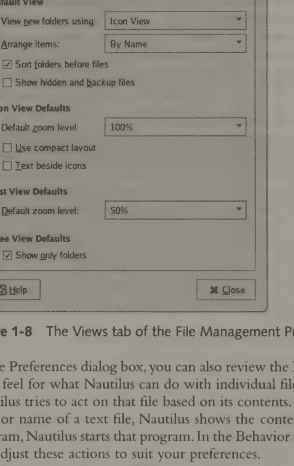

### 图 1-8 Nautilus 中文件管理首选项对话框的“视图”选项卡

在“首选项”对话框中，你还可以查看如图 1-9 所示的“行为”选项卡，以了解 Nautilus 对单个文件可以做什么。每次双击文件时，Nautilus 都会根据其内容尝试对该文件执行操作。例如，如果你双击文本文件的图标或名称，Nautilus 会显示该文件的内容。如果你双击一个程序，Nautilus 会启动该程序。在“首选项”对话框的“行为”选项卡中，你可以调整这些操作以满足你的偏好。

更改为查看新的子目录或双击查看文件后，你可以使用工具栏上的“后退”按钮返回到之前查看的项目，就像在 Web 浏览器中一样。

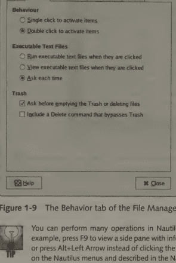

### 图 1-9 Nautilus 中文件管理首选项对话框的“行为”选项卡

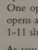

你可以使用键盘快捷键在 Nautilus 中执行许多操作。例如，按 F9 可查看所选项目的侧边信息窗格，或按 Alt+左箭头代替单击“后退”按钮。快捷键显示在 Nautilus 菜单上，并在 Nautilus 在线帮助中描述（你可以通过按 F1 访问）。

当你在 Nautilus 中右键单击任何文件或目录时，会出现一个上下文菜单，列出你可以对该文件或目录执行的大量操作。（参见图 1-10。）其中一些选项对你来说可能不熟悉；它们将在本节和后面的章节中解释。现在值得提及的一个选项是“属性”项。选择此项会打开一个对话框，显示所选文件或目录的信息。图 1-11 显示了文件的“属性”对话框。

随着你对文件系统和命令行实用程序了解更多，返回到 Nautilus 窗口，看看是否可以使用图形文件管理器执行相同的操作。知道如何使用多种工具执行任务可以帮助你更高效地工作。有关在 Nautilus 中执行某些任务的提示，请参阅下面的命令行部分。

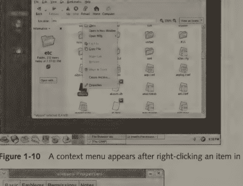

图 1-10 在 Nautilus 中右键单击项目后会出现上下文菜单

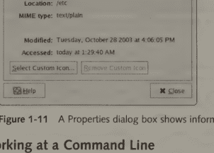

图 1-11 “属性”对话框显示 Nautilus 中文件的信息

## 在命令行工作

尽管 Linux 拥有越来越多的强大的图形实用程序，如 Nautilus，但大多数 Linux 系统管理员都会同意，如果你想真正熟练地管理 Linux 系统，就必须非常习惯在命令行工作。在命令行工作需要你记住命令，但一旦你知道正确的命令，命令行就是执行大多数任务的更快方式。此外，一些任务根本无法使用图形界面完成。

在本节中，你将学习在文件系统中移动的基本命令。要尝试这些命令，你可以在控制台（文本模式登录）或图形桌面中的终端窗口中工作。

### 探索目录

当你首次登录 Linux 或打开终端窗口时，你会被放置在主目录中，并出现提示，例如 `[nwells@london nwells]$` 你可以按如下所示输入 `pwd` 命令来显示当前工作目录，即你正在工作的目录。（命令名称 `pwd` 代表“print working directory”。）第二行显示系统的响应——用户的当前工作目录。

```
[nwells@inverness nwells]$ pwd
/home/nwells
```

> 请记住 Linux 命令区分大小写。几乎所有 Linux 命令——包括本章介绍的所有命令——都必须以小写字母输入。输入命令 `PWD` 会生成错误消息。

`cd` 命令将当前工作目录更改为你指定的目录。但是，它不会在屏幕上打印任何内容——除非发生错误，否则你看不到任何反馈。例如，如果你正在主目录中工作，并希望将当前工作目录更改为 `/usr` 目录，你可以使用以下命令：

```
[nwells@inverness nwells]$ cd /usr
```

输入 `cd` 且不带目录名称。这始终会将你从正在工作的任何目录返回到主目录：

```
[nwells@inverness nwells]$ cd
```

如前所述，双点表示当前工作目录的父目录。因此，以下命令将你的当前工作目录更改为 `/home`：

```
[nwells@inverness nwells]$ cd ..
```

> 在 Microsoft Windows 命令行中，你可以输入命令 `cd..`，在 `cd` 和两个点之间没有空格。这在 Linux 中会生成错误。

有了这些背景知识，你就可以探索命令行上使用的提示。它由四个部分组成：

- 你的用户名（前面的示例中为“`nwells`”）
- 你正在工作的计算机的名称（前面的示例中为“`inverness`”）。在安装 Linux 时会为你的计算机分配一个名称；提示的这一部分通常不会更改。


- 当前工作目录中的最后一个目录名称。（例如，如果你的当前工作目录是 `/home/abutler`，第三项将是“`abutler`”，提示可能是 `[abutler@paris abutler]$`。但如果你在 `/usr/share/doc` 目录中工作，第三项将是“`doc`”，因此提示可能是 `[abutler@paris doc]$`。）

- `$` 字符。每当你以普通用户身份登录时，就会显示 `$` 字符。当你以 root 用户身份登录时，则会显示 `#` 字符代替。

你可以更改提示中提供的信息，但大多数系统管理员不会。现在你了解了提示，后面的示例将不会显示整个提示，而只显示 `$` 字符（如果你必须以 root 用户身份工作以进行示例，则显示 `#` 字符）。

`mkdir` 命令在你指定的位置创建新目录。例如，如果你位于 `/home/nwells` 目录中，你可以使用以下命令创建新子目录 `/home/nwells/documents`：

```
$ mkdir documents
```

如果你正在 `/usr` 目录中工作，你可以使用新目录的绝对路径创建 `/home/nwells/documents` 目录：

```
$ mkdir /home/nwells/documents
```


在 Nautilus 窗口中，你可以通过从“文件”菜单中选择“创建文件夹”，或按 Shift+Ctrl+N 在正在查看的目录中创建新的子目录。

`rmdir` 命令删除（删除）空目录。如果你尝试删除包含文件的目录，你会收到错误消息。要删除整个目录树，你可以使用 `rm -r` 命令，它会删除目录中的所有内容，包括子目录。（请谨慎使用此命令！）


在 Nautilus 窗口中，你可以通过选择目录并按 Delete 键来删除目录。

`ls` 命令列出目录中的文件。`ls` 命令有数十个选项用于显示有关文件和目录的信息。一个常用的选项是 `-l`（连字符后跟小写字母“l”）。输入命令 `ls -l` 会打印每个文件的详细列表，例如文件何时创建以及它包含多少字节。

你可以在大多数 Linux 命令的命令行中包含信息。一些信息定义了命令将操作的对象，例如文件名或目录名。这些称为参数。一些信息改变命令的操作方式。这些称为选项，或命令选项。然而，你会在 Linux 文档中发现，这两个术语可以互换使用。为了理解区别，请考虑适用于 `ls` 命令的两个示例：前面提到的 `-l` 选项（在前一段中提到）控制命令显示的信息。你还可以包含一个参数来控制命令操作的文件。例如，以下命令显示当前目录中以 html 结尾的所有文件的详细信息（通过 `-l` 选项），通过 `*html` 参数。

```
$ ls -l *html
```

在 Red Hat Linux 中，`ll` 命令（小写 LL，而不是一、一）以彩色显示目录内容的列表，并显示目录中每个项目的详细信息。信息包括文件的大小、文件或目录创建的日期，以及指示谁可以访问该项目的权限信息（你将在第 4 章中了解有关文件列表提供的信息的更多信息）。

有关事件发生日期和时间的信息以时间戳的形式存储。Linux 为每个文件和目录维护一组时间戳，定义文件何时创建、何时最后修改以及何时最后访问。`touch` 命令更新文件的最后访问时间戳（即文件最后访问的日期和时间）。如果文件不存在，则会创建为空文件。

例如，要在主目录中创建一个新的空文件，你可以使用以下命令：

```
$ cd
$ touch test.doc
```

如果你然后使用 `ls -l` 命令查看刚刚创建的文件的详细信息，你会通过大小和时间戳看到它确实是一个刚刚创建的空文件。

要复制文件，请使用 `cp` 命令。你可以使用 `cp` 在同一目录中以不同的文件名复制文件，例如：

```
$ cp test.doc test.backup.doc
```

你可以使用 `?` 来匹配单个字符，或使用 `*` 来匹配多个字符，就像你在 Microsoft Windows 中使用通配符一样。例如，如果你的当前工作目录是 `/home/nwells/documents`，则以下命令会将 `/home/nwells/documents` 中的所有文件复制到 `/tmp/nwells`：

```
$ cp * /tmp/nwells
```

你可以使用绝对路径和相对路径名与任何 Linux 命令一起使用。例如，如果你的当前工作目录是 `/home/nwells/documents`，则以下命令会将该目录中的所有文件复制到 `/home/nwells`（即你当前目录的父目录，用 `..` 表示）：

```
$ cp * ..
```

> 在 Nautilus 窗口中，你可以通过在桌面上的另一个 Nautilus 窗口的文件夹中拖放来复制你用鼠标选择的一个或多个文件。你也可以右键单击文件并选择 Cut File 或 Copy File，然后更改目录，再次右键单击并选择 Paste Files。

要删除文件，请使用 `rm` 命令（意为 remove）。使用 `rm` 命令时要非常小心。当你使用 `rm` 删除文件时，该文件无法像图形桌面上的回收站或废纸篓中的文件那样恢复。Linux 图形桌面提供了一个 Trash 图标。当你在 Nautilus 窗口中选择一个项目并按下 Delete 键时，该项目会被删除并移动到 Trash。你可以双击桌面上的 Trash 图标来查看（如果需要可恢复）你使用 Nautilus 删除的任何项目。但是，`rm` 命令不使用回收站——它会永久删除文件。

在 Linux 中，移动和重命名文件这两个操作合并为一个命令，即 `mv` 命令。名称 `mv` 是 move 的缩写；本质上，重命名文件与将其移动到不同的文件名相同。例如，如果你在 `/tmp` 目录中有一个名为 `report` 的文件，你可以用以下命令将其移动到 `/home/nwells` 目录：

```
$ mv /tmp/report.doc /home/nwells
```

你可以在同一时间重命名文件，使用如下包含新文件名的命令：

```
$ mv /tmp/test.doc /home/nwells/test.backup
```

使用 `mv` 命令而不带目录名作为参数会将重命名的文件放在与原始文件相同的目录中。要将文件移动到不同的目录，请包含目录名，并可选择不同的文件名。

> 在 Nautilus 中，你可以通过从一个 Nautilus 窗口拖动文件或目录并将其放到另一个窗口中来将其移动到新位置。你也可以右键单击文件并选择 Cut File，然后更改目录，再次右键单击并选择 Paste Files。当使用 Nautilus 执行移动操作时，你必须单独通过右键单击并选择 Rename 选项来重命名文件。

## Viewing Files

Linux 提供了多种用于查看文件内容的实用程序。其中最简单的是 `cat` 命令，它将文件内容显示到屏幕上。例如，以下命令显示 `test` 文件的内容：

```
$ cat /etc/test
```

`cat` 命令还用于连接，或合并多个文件到一个更大的文件中——这就是该命令名称的由来。`zcat` 命令将压缩文本文件的内容显示到屏幕上。如果文件以字母 `.gz` 结尾，则它已使用 `gzip` 命令进行压缩。要在不先解压缩的情况下查看使用 `gzip` 压缩的文件的内容，请使用 `zcat` 命令。

大多数文件不适合一屏显示，在这种情况下 `cat` 命令工作太快——你只能看到文件中的最后 20 行左右的文本。要查看大文件，请使用 `less` 命令，它一次显示一个屏幕的文件内容。你可以使用箭头键或 Page Up 和 Page Down 在文件中的不同区域移动。要移动到下一屏文本，请按空格键。例如，以下命令一次一屏地显示一个大的配置文件：

```
$ less /etc/termcap
```

输入 `q` 以退出 `less` 命令。`less` 命令类似于 `more` 命令，也用于一次一屏地显示文件内容。`less` 命令比 `more` 命令具有更多功能，但你可以使用其中任何一个来查看文件内容。`less` 和 `more` 命令旨在显示文本文件（具有人类可读内容）。

你可以使用 `file` 命令来确定文件包含的内容。`file` 命令会告诉你文件中包含的数据类型。如果你不熟悉某个特定文件，请在使用 `less` 或 `more` 命令之前使用 `file` 命令查看其内容。例如，以下命令显示所指示文件的类型，结果出现在第二行：

```
$ file /etc/printcap
/etc/printcap: ASCII English text
```

如果你知道某个特定文件存在于你的 Linux 系统上，但记不起它在哪里，请使用 `slocate` 命令（意为 secure-locate）来查找它。例如，假设为了执行某项任务，你需要编辑一个名为 `services` 的配置文件，但你记不起它存储在哪个目录中。使用以下命令显示文件名或目录名中包含的所有 `services` 实例：

```
$ slocate services
```

另一个名为 `locate` 的命令提供与 `slocate` 相同的功能，但 `slocate` 更受青睐，因为它只显示你有权限访问的文件。


`slocate`命令会显示包含你指定的文本字符串的任何内容的完整路径和文件名。你越精确，`slocate`显示的列表就越短（因此越有帮助）。

在使用`slocate`之前，必须对文件和目录进行索引。如果你正在使用新安装的 Linux 系统，或一台不连续开机的系统，则可能尚未创建此索引。要创建它，你必须以`root`身份登录并执行`updatedb`命令。

本节介绍了你可以使用命令行管理文件和目录的几个 Linux 命令。这些命令和本章介绍的其他命令在章节末尾的 Command Summary 中进行了总结。在本章末尾的项目中，你可以练习使用这些命令。

## FINDING COMMAND HELP

本书向你介绍了作为 Linux 系统管理员工作所需了解的最重要主题和技能。你可以学习到比本书容纳的更多细节，并使用本节所述的资源探索额外的 Linux 主题。

### Reading Linux Documentation

由于 Linux 和其他自由软件项目的开发者完全通过互联网工作，他们通过电子或在线文档共享其软件的描述。这些文档通常在项目分发时被纳入其中，供大家使用。大多数 Linux 发行版都包含所有这些文档——数千页的材料，你可以使用几个简单的命令快速访问。

阅读 Linux 文档时，请记住其中许多是由软件开发者编写的。正因如此，Linux 软件的大量文档是假设你已经阅读了系统上的所有其他文档而编写的。你可以找到大量有用的细节，但作为 Linux 新手，你应该预期会读到许多最初不理解的内容。稍后重新阅读这些材料会使一切变得更清晰。

### The Linux Documentation Project

Linux Documentation Project（LDP）由 Matt Welsh 在 1990 年代初期创立，当时 Linux 刚刚在技术圈中为人所知。LDP 是最早记录 Linux 工作原理的努力之一，至今仍提供 Linux 文档

以多种格式提供。LDP 目前包含超过 6000 页的文档，所有文档均可在网上免费获取，采用适用于文档的 GPL 修改版本。LDP 由几种类型的文档组成。其中一些，例如 Network Administrator's Guide 和 Kernel Hacker's Guide，是完整的在线参考手册。

最初，你可能会发现 HOWTO 文档是 LDP 中最有用的部分。HOWTO 涵盖特定主题，例如在 Windows XP 和 Linux 之间共享系统，或维护网络安全。大多数文档由一位对该主题有专长的人撰写。称为 mini-HOWTO 的文档比常规 HOWTO 更专注于较窄的主题。HOWTO 文档通常由软件开发者撰写，但它们面向不熟悉所讨论主题的读者。

LDP 和所有 HOWTO 文档都包含在许多 Linux 发行版中，尽管由于其大小，通常默认不安装。你也可以在许多网站上阅读它们。

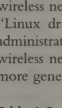

> 开始研究作为 LDP 一部分提供的文档的一个好地方是 www.tldp.org。

### Linux on the Internet

Linux 在互联网上诞生，互联网仍然是了解更多关于 Linux 的好地方。每天，开发者发布新软件，公司发布关于 Linux 产品的公告，各种用户提供新的或修订的信息。当你遇到具有挑战性的问题时，一个有效的方法是访问 www.google.com 并输入问题的关键词。例如，假设你刚刚获得了一张新的无线网络卡，想知道 Linux 是否支持它。输入类似 “Linux driver D-Link DWL-2100AP” 的内容很可能会找到几条 Linux 管理员讨论如何使用该产品的消息。（如果你好奇的话，Linux 确实支持无线网络，并且新驱动程序定期可用。）表 1-3 列出了一些更通用的网站，在你探索 Linux 世界时可能会有用。

### Table 1-3 Linux-related Web Sites

| Web site | Description |
|---|---|
| www.linuxjournal.com | 与月刊印刷杂志配套的网站；包含额外的 Linux 链接和信息（大多偏技术） |
| www.linuxmagazine.com | 与月刊印刷杂志配套的网站；包含额外的 Linux 链接和信息，既有商业也有技术导向 |

## 表 1-3 Linux 相关网站（续）

| 网站 | 描述 |
|---|---|
| www.linuxworld.com | 一本面向商业的在线杂志（现在也有印刷版），包含访谈、链接、技术报告和其他最新信息 |
| www.slashdot.org | 一个关于自由软件和其他主题（如星球大战、新音乐技术、密码立法等）的新闻集合，这些主题对自由软件开发者感兴趣 |
| www.linuxhq.com | 关于 Linux 内核工作的信息集合，提供通往许多其他网站和 Linux 资源的有用链接 |
| www.lwn.net | Linux Weekly News，关于 Linux 和其他自由软件的新闻集合 |
| www.linuxtoday.com | 关于 Linux 和其他自由软件的最新新闻 |
| www.linuxgazette.com | 关于 Linux 和其他自由软件的最新新闻 |

表 1-1 中列出的每个 Linux 发行版的网站也是了解 Linux 的绝佳资源。

## 软件包附带的文档

随 Linux 发行版一起提供的软件包大多至少提供一些文档。此文档与软件本身一起安装在您的系统上。您通常可以在文本编辑器或 Web 浏览器中查看文档。在大多数 Linux 发行版中，文档存储在文件系统的 `/usr/doc` 或 `/usr/share/doc` 子目录中。Red Hat Linux 将每个软件包的文档存储在 `/usr/share/doc` 的单独子目录中。需要注意的是，文档的质量参差不齐。一些软件包提供一个包含软件最新更改的单个文件；其他软件包则提供多种格式的完整手册。

## Linux 命令信息

正如您已经感受到的，Linux 包含许多不同的命令，每个命令都有众多选项。记住所有命令和选项意义不大，因为您只会定期使用其中一小部分。当您确实需要使用新命令或选项时，可以通过在线提供的 Linux 命令特定信息来了解它。此信息以两种格式提供。您可以使用 `man` 命令访问大多数 Linux 命令的在线手册页（称为 man 页）。

例如，要了解有关 `ls` 命令的所有信息，您可以输入以下命令：

```
$ man ls
```

会出现一份冗长的文档，描述 `ls` 的所有可用选项。您可以使用箭头键、Page Up 和 Page Down 在此文档中移动。阅读完毕后，输入 `q` 退出 man 页查看器。每个 man 页都有标准格式。与 Linux 的许多其他部分一样，它们乍一看可能显得晦涩难懂，但一旦您熟悉它们，就能轻松找到所需命令的信息。

对于某些 Linux 命令，权威的信息来源是第二种格式：info 页。您可以使用 `info` 命令查看 info 页。例如，您也可以使用以下命令查看有关 `ls` 命令的详细信息：

```
$ info ls
```

info 页不如 man 页广泛使用，尽管 info 页格式在某些方面更具吸引力（例如，info 页通常包含更多示例，这对学习新命令的用户很有帮助）。

## 章节摘要

- 操作系统为计算机硬件和用户运行的应用程序之间提供接口。
- 在最基本的形式中，操作系统管理内存、CPU 时间和其他系统资源的使用。完整的操作系统还包括许多其他功能，以提供额外的硬件支持、图形环境和实用程序。
- Linux 内核基于 UNIX 技术（但不是 UNIX 源代码），由世界各地许多才华横溢的个人在 Linus Torvalds 的领导下创建，他至今仍在维护 Linux 内核。
- 自由软件基金会在 Richard Stallman 的领导下，作为其 GNU 项目的一部分创建了数百个软件程序。这些程序与 Linux 内核一起包含在每个完整的 Linux 操作系统发行版中。
- GNU 通用公共许可证（GPL）在很大程度上负责 Linux 在过去几年中的惊人增长。它要求随 Linux 内核的每个副本（以及许多其他自由软件项目）一起分发源代码。GPL 所谓的“病毒式”特性意味着任何更改 Linux 内核一部分的人也必须在 GPL 下赠送他们的工作。
- 各种公司已创建了围绕 Linux 内核和 GNU 软件构建的商业产品。这些被称为发行版。
- Linux 具有稳定性、速度、安全、灵活性、低成本等重要特性。
- 典型的 Linux 安装需要约 1 GB 的硬盘空间，尽管更小和更大的安装并不少见。更多的 RAM 可提供更好的性能，因为 Linux 内核可以将经常使用信息存储在内存中以实现更快的访问。
- Red Hat Software、LPI、SAIR/GNU 和 CompTIA 提供多个 Linux 认证项目。Red Hat 认证技术员和 Red Hat 认证工程师项目要求申请人通过动手考试。


## Linux 概述

Red Hat Enterprise Linux 以 `WS`、`ES` 和 `AS` 等多个版本出售。Fedora 是一个独立项目，面向那些更喜欢免费软件产品而不是商业支持产品的人。

Linux 职业包括系统管理员、软件开发人员、技术作家、行业分析师等。

系统管理员在组织内担任重要的受信任职位，但一个好的系统管理员对他或她所使能的人员的生产力来说几乎是隐形的。

大多数用户将依赖图形界面登录和使用 Linux，尽管也提供纯文本模式。命令可以在命令行输入或通过 `GNOME` 或 `KDE` 等桌面界面的众多图形实用程序启动程序。

一个名为 `Nautilus` 的图形文件管理器提供了一种简单的方式来浏览文件系统并执行大多数常见的文件管理任务。

Linux 中的信息存储在以根目录 `/` 开始的目录结构中。子目录和父目录有助于组织大量文件。`pwd`、`cd`、`mkdir` 和 `rmdir` 等命令管理目录。

Linux 文件和目录以倒置的树结构组织，正斜杠（`/`）代表根（树的顶部）。所有 Linux 资源都在目录中访问；Linux 不使用驱动器号。

Linux 文件名、目录名和命令区分大小写。

命令中需要路径时可以使用绝对路径或相对路径。

基本文件管理使用 `ls`、`cp`、`rm`、`mv`、`cat`、`less` 和 `more` 等命令。您可以通过查看其 `man` 页或 `info` 页了解有关任何命令的更多信息。

Linux 文件可以包含文件扩展名，但很少有 Linux 程序依赖文件扩展名来定义文件的内容。

有关 Linux 的信息可作为 Linux 文档项目（`LDP`）的一部分在线获得，其中包含许多关于特定主题的 `HOWTO` 文档。Linux 命令的在线文档包含在每个 Linux 副本中。许多出版物和网站维护关于 Linux 和自由软件世界发生的每日新闻更新。

## 命令摘要

| 命令 | 描述 | 示例 |
|---|---|---|
| `cat` | 在屏幕上显示文件的内容 | `cat /etc/printcap` |
| `cd` | 更改到不同目录 | `cd /usr/share` |
| `cp` | 将文件复制到新位置或新文件名 | `cp report.doc report.backup` |
| `file` | 显示文件包含的内容或其用途的描述 | `file /etc/printcap` |
| `info` | 显示给定命令的 info 页；类似于 man 页 | `info ls` |
| `less` | 一次一屏地在屏幕上显示文件的内容 | `less /etc/termcap` |
| `ls` | 列出目录的内容 | `ls -l` |
| `man` | 显示给定命令的在线手册页（man 页） | `man slocate` |
| `mkdir` | 创建新目录 | `mkdir /tmp/documents` |
| `more` | 一次一屏地在屏幕上显示文件的内容 | `more /etc/termcap` |
| `mv` | 重命名文件或将文件移动到新位置（可能使用新名称） | `mv testfile testfile.old` |
| `pwd` | 显示当前工作目录 | `pwd` |
| `rm` | 删除（删除）文件 | `rm report.old` |
| `rmdir` | 删除（擦除）空目录 | `rmdir /tmp/documents` |
| `slocate` | 在系统任何位置显示匹配的文件和目录名 | `slocate services` |
| `touch` | 创建一个新空文件，或更新现有文件的 |  |
| `updatedb` | 创建或更新 `slocate` 命令使用的文件和目录名索引（必须以 root 身份运行） | `updatedb` |
| `zcat` | 在屏幕上显示压缩文件的内容 | `zcat /tmp/report.gz` |

## 关键术语

`absolute path` — 从文件系统根目录到所需子目录或文件的完整访问描述。它必须以正斜杠开头。另见 `relative path`。

`application` — 为使用计算机的人提供服务（例如文字处理器或电子表格）的程序，而不是仅仅管理计算机资源。

`binary code` — 用于执行程序的机器可读指令。

`首席信息官 (CIO)` — 组织中负责确定信息系统在组织内如何使用以有效实现其目标或使命的高级主管。

`子目录` — 父目录的子目录。

`命令行界面 (CLI)` — 通过在提示符下输入文本命令与操作系统通信的方法。

`控制台` — 操作系统的纯文本界面，提供命令行界面。不是图形用户界面的一部分。

`copyleft` — 一个讽刺性术语，指 GNU 通用公共许可证（`GPL`），表示与标准版权有根本性背离。

`当前工作目录` — 你正在工作的目录。使用 `pwd` 命令显示。

`桌面界面` — 参见图形用户界面 (`GUI`)。

`设备驱动程序` — 提供对额外硬件的访问的软件，超出内核提供的核心设备支持。

`终端用户` — 在组织中使用计算机系统完成分配任务的个人，但通常依赖系统管理员使这些系统平稳运行。

`文件扩展名` — 文件名的最后一部分，传统上是最后三个字母，由句点与文件名其余部分分隔。在某些情况下用于指示文件包含的信息类型，例如特定格式的文档或图形图像。

`文件管理器` — 用于管理文件和子目录的图形实用程序。`GNOME` 桌面中的 `Nautilus` 是一个例子。`Konqueror` 是 `KDE` 桌面的默认文件管理器。

`分叉` — 基于现有项目启动一个新的自由软件项目。

`自由软件基金会 (FSF)` — 由 Richard Stallman 创立的组织，旨在推广其自由可用软件的理念并创建和分发该软件。

`gcc` — 一种 C 语言编译器。GNU 项目最著名的产品之一。

`GNOME 桌面 (guh-NOME)` — 许多 Linux 发行版使用的图形界面，包括 Red Hat Linux。

`GNU 通用公共许可证 (GPL)` — Richard Stallman 为 GNU 项目创建的程序制定的自由软件许可证，由自由软件基金会制定。

`GNU 项目` — 自由软件基金会为创建自由类 UNIX 操作系统而进行的努力。每个 Linux 发行版中的许多程序都来自 GNU 项目。

`图形用户界面 (GUI)` — 提供鼠标驱动应用程序的软件，具有菜单栏、按钮等。

`硬连线` — 计算机功能安排在构成计算机的线路和其他组件中。硬连线功能不易更改。

`帮助台` — 许多组织中提供的服务，帮助终端用户解决与信息技术相关的问题。

`home directory` — 文件系统中特定用户被允许存储数据的区域。每个普通用户账户都有一个关联的主目录，以用户账户登录名命名。这些通常是 Linux 中 `/home` 目录的子目录。

`HOWTOs` — Linux 文档项目中涵盖特定主题的文档。

`info page` — 许多 Linux 命令的信息来源。使用 `info` 命令访问。另见 `man page`。

`信息系统 (IS) 部门` — 许多组织中的一个部门。IS 员工负责为其他员工维护计算机和信息系统。（在某些组织中 IS 被称为 IT。）另见信息技术 (`IT`) 部门。

`KDE 桌面` — 许多 Linux 发行版使用的图形界面。

`kernel` — 操作系统的核心。内核直接与计算机硬件交互并管理计算机内存、分配给系统上运行的每个程序的时间以及其他系统资源。

`LGPL (Library GPL)` — GNU 通用公共许可证的特殊版本，旨在规范自由和商业软件对软件库的使用。

`Linux 发行版` — Linux 操作系统产品，包括 Linux 内核以及许多软件组件、安装工具、文档等。

`Linux 文档项目 (LDP)` — 记录 Linux 用法的最早努力之一。由 Matt Welsh 发起。

`log in` — 向操作系统标识自己，以便它知道你有权使用系统，以及允许你访问系统的哪些部分。

`man page` — Linux 命令的在线手册页。`man` 页使用 `man` 命令访问。

`MIS (信息系统管理或信息系统经理)` — IS 或 IT 部门或在该部门工作或管理的员工的另一个术语。

`多处理` — 在单台计算机中使用多于一个 CPU 运行（例如双 Pentium 系统）。

`Nautilus` — `GNOME` 桌面提供的图形文件管理器。

`OpenSource` — 一个商标名称，常用于指根据 `GPL` 许可的软件。

`operating system` — 为其他程序提供与计算机硬件协作和与用户交互的核心功能集的软件。

`option` — 添加到命令以确定命令如何操作的信息。

`parameter` — 添加到命令以定义命令操作对象的信息，例如文件名或目录名。

`parent directory` — 位于另一个目录之上，更接近文件系统根目录的目录。

`path` — 文件系统层次结构中所有子目录的描述，通过它访问特定子目录或文件。路径的每个部分——每个子目录——都用正斜杠分隔。另见相对路径、绝对路径。

`public domain` — 无人拥有版权所有权利益的创作作品（例如软件程序）。


Red Hat Network (RHN) — Red Hat Software 通过订阅提供的服务，使用互联网。该服务自动提供任何安全修复、软件包升级或其他信息，以保持 Red Hat Linux 系统平稳安全运行。

relative path — 如何访问所需子目录或文件的描述，相对于文件系统中的另一个位置（通常是当前工作目录）指定，而不是从文件系统根目录（使用绝对路径）指定。相对路径不以正斜杠开头。另见绝对路径。

SAGE (System Administrators Guild) — 系统管理员的专业组织。

shell — 在终端窗口中提供命令行界面的命令解释器。

software — 控制物理计算机组件的指令，但可以更改，因为它们驻留在可更改的介质上，例如硬盘。

software license — 对谁可以使用软件以及如何使用软件的法律定义。

source code — 用于创建软件的一组人类可读的编程指令。

Stallman, Richard — 自由软件基金会和 GNU 项目的创始人。

subdirectory — 包含在另一个目录中，因此离文件系统根目录更远的目录。

system utilities — 用于管理 Linux 系统的程序。另见 utility programs。

terminal window — 图形桌面中的命令行界面。

timestamp — 事件发生日期和时间的记录。

Torvalds, Linus — Linux 内核的创始人；以前是芬兰赫尔辛基的学生。

总拥有成本 (TCO) — 提供技术解决方案涉及的所有成本的总和，包括购买软件和所需硬件的初始成本、支持合同、管理员、程序员和终端用户的培训、升级费用以及技术意外失败时的恢复成本等组成部分。

UNIX — 约 30 年前由 Ken Thompson 和 Dennis Ritchie 在 AT&T Bell Labs（现为 Lucent Technologies 的一部分）创建的操作系统。UNIX 仍被广泛使用，并为 Linux 提供了技术基础。

user account — 使用系统的权限集，具有关联的用户名和密码。

utility programs — 提供管理硬件和操作系统功能帮助的软件（与执行其他类型工作如文字处理相反）。另见 system utilities。

# 复习题

X Window System — 几乎所有 UNIX 和 Linux 操作系统使用的图形软件环境。

xterm window — 一种终端窗口。泛指图形桌面界面中的命令行窗口。

1. 操作系统不执行以下哪项操作：

   a. 分配系统资源，如内存和 CPU 时间。

   b. 初始化计算机硬件以便计算机上运行的软件可以使用。

   c. 跟踪同时运行的多个程序。

   d. 为用户提供文字处理功能。

2. 列出四个对 Linux 知识要求很强的职业发展方向。

3. Linus Torvalds 开始创建 Linux 的原因是：

   a. 他被一家大型公司聘为操作系统顾问。

   b. 他想要一个功能强大的操作系统但买不起。

   c. 他的教授要求每个学生创建一个基本操作系统。

   d. 他认为这会是一次良好的职业发展。

4. 自由软件基金会致力于以下理念：

   a. 没有公司应该能够为任何软件收取费用。

   b. 软件的真正价值在于定制，而不是销售大量生产的副本。

   c. Richard Stallman 的 C 编译器是世界上最好的。

   d. Linux 是操作系统发展中的重要进展。

5. GNU 项目对 Linux 很重要，因为：

   a. 它提供了 Linux 使用的大多数系统实用程序。

   b. GNU 软件是唯一与 Linux 兼容的软件。

   c. GNU 项目产生的媒体关注使 Linux 变得流行。

   d. Richard Stallman 是 Linux 运动的坚定支持者。

6. GPL 包含以下所有方面，除了：

   a. GPL 软件必须包含源代码。

   b. 对 GPL 许可软件的修改也必须在 GPL 下许可。

   c. 在 GPL 操作系统上运行的软件必须免费赠送。

   d. 公司不能为 GPL 许可的软件收取费用。

7. 在一般用法中，“开源软件”一词指的是：

   a. 仅在 GPL 下明确许可的程序

   b. 不包含源代码的程序

   c. 包含源代码并遵循开源联盟倡导的一套一般原则的软件

   d. 仅作为 GNU 项目一部分发布的程序

8. 在 Linux 内核版本 2.6.10 中，第二位数字 6 表示：

   a. 主内核发布号

   b. 稳定内核的次要内核发布号

   c. 开发内核的次要内核发布号

   d. 补丁发布号

9. Linux 发行版的版本号不跟踪 Linux 内核版本号，因为：

   a. 发行版包含许多组件，因此供应商为整个软件集合分配版本号。

   b. Linux 内核开发者希望通过使用相同的编号方案避免与任何单个 Linux 供应商过于紧密的联系。

   c. Linux 内核版本变化太快，标准零售周期跟不上。

   d. 并非所有内核都是稳定的，没有商业发行版希望给人留下稳定性差的印象。

10. HOWTO 文档讨论各种具体主题。它们是为以下人群编写的：

    a. 软件开发者

    b. 记者

    c. 讨论主题的新手

    d. 计算机新手

11. ________ 目录是 Linux 目录结构的开始——倒置树的顶部。

    a. `/`

    b. `/root`

    c. `/home`

    d. `/dev/hda`

12. `pwd` 命令用于：

    a. 处理网络上的可写域。

    b. 控制 Linux 系统使用的电源。

    c. 在屏幕上显示当前工作目录。

    d. 列出系统上可写设备的摘要。

13. 命令`Ls -l`无效，因为：

    a. Linux 命令不能包含连字符。

    b. Linux 命令区分大小写。

    c. `ls`是一个脚本名称，而不是命令。

    d. `ls`命令不支持`-l`选项。

14. 以下哪项任务不太可能分配给你作为系统管理员？

    a. 使用 C 编程开发新的收银系统。

    b. 在 Linux 服务器中安装新的硬盘。

    c. 教新用户如何访问他们的电子邮件帐户。

    d. 参加有关提高系统安全的会议。

15. Linux 文件名可以包含：

    a. 字母和数字，但不能包含标点符号或任何特殊字符

    b. 字母和数字，加上空格

    c. 字母、数字、部分标点符号，但没有空格

    d. 字母、数字、标点符号和许多特殊字符

16. `rm` 命令在 Linux 中用于：

    a. 从文件名中删除特殊字符。

    b. 从硬盘中删除文件。

    c. 删除大小写敏感设置。

    d. 管理正则表达式。

17. Linux 图形桌面上的回收站设施与 `rm` 命令的不同之处在于：

    a. 放入回收站的文件在清空回收站之前不会被删除，但 `rm` 删除的文件会立即被删除。

    b. 放入回收站的文件会立即被删除，但 `rm` 删除的文件在系统重新启动之前不会真正被擦除。

    c. `rm` 命令在删除文件时会覆盖数据，但回收站设施在存储在该空间中的文件被删除时只是将硬盘的某些部分标记为可用。

    d. 任何用户都可以将文件放入回收站，但只有 root 才能使用 `rm` 命令。

18. 每个答案包含多个由分号分隔的路径。哪个答案只包含绝对路径？

    a. `../home/abutler/`; `/etc`; `documents`

    b. `/documents`; `share/doc`; `nwells/data`

    c. `/var/named`; `/etc/samba`; `/home/abutler`

    d. `/etc/sysconfig`; `printcap`; `../.../reports/`

19. 在 Nautilus 文件管理器中，您可以通过以下方式查看所选文件或目录的属性：

    a. 从 Preferences View 选项卡中选择 IconView

    b. 为文件或目录所在的文件夹选择 ListView

    c. 按 F9

    d. 右键单击文件或目录并从上下文菜单中选择 Properties 项目

20. 在 Nautilus 文件管理器中，按 Shift+Ctrl+N 等同于哪个命令？

    a. `mkdir`

    b. `rm -f`

    c. `ls -l`

    d. `cp *`

21. 以下哪个命令最有可能在屏幕上产生以下输出？ `/home/abutler`

    a. `cd`

    b. `cp * /tmp`

    c. `pwd`

    d. `man ls`

22. 你在 `ls -l` 的输出中看到一个不熟悉的文件。你想知道它包含什么。你的第一步应该使用哪个命令？

    a. `file`

    b. `cat`

    c. `less`

    d. `zcat`


23. 如果 `slocate` 命令无法按预期运行，很可能是因为：

a. 你没有权限使用它。

b. 文件和目录名称的索引尚未使用 `updatedb` 创建。

c. `slocate` 的 `man` 手册未安装。

d. 你以大写字母输入了该命令。

24. 在 Red Hat Linux 中，专用于每个已安装软件包的文档文件存储在：

a. `/usr/share/doc` 目录中

b. `/documents` 目录中

c. 作为 `man` 页面或 `info` 页面，但永远不会同时存在

d. 压缩格式中

25. Red Hat Enterprise Linux 产品线包括以下几个版本，例如

a. WS, WA, WE

b. WS, ES, 和 Fedora

c. WS, ES, AS, 和 Professional Workstation

d. Core 1 和 Core 2

## 动手项目

### Project 1-1

在本项目中，你浏览 Red Hat Software 的网站以了解其产品和认证计划。要完成此项目，你应该拥有一台可访问互联网的计算机和一个功能正常的 Web 浏览器。

1. 启动一个 Web 浏览器。从 Red Hat Linux 中的 GNOME 桌面，你可以通过单击带有地球仪图标的图标来启动 Mozilla 浏览器，该图标位于带有红色帽子的主菜单按钮右侧。
2. 前往网站 `www.redhat.com`。
3. 单击主页上的 Software 链接。
4. 单击 Software 页面（`www.redhat.com/software`）上的链接，查看 Enterprise Linux ES 和 Enterprise Linux AS。这两个版本的主要区别是什么？
5. 查看 Enterprise Linux AS 页面。可用技术支持选项提供的最快响应时间是多少？
6. 探索 Red Hat Network 和 Red Hat Application 页面，以查看可用于支持 Red Hat Enterprise Linux 产品的软件和服务。


7. 点击网页顶部 的 Training 链接。
8. 点击培训页面左侧 的 RHCE/RHCT Program 链接。
9. 查看 RHCT 程序 所显示表格中的信息。点击表格内 的 RH202 课程链接。 （这实际上是 RHCT 考试。） 考试费用是多少？ 完成考试需要多长时间？
10. 查看考试可提供的城市。
11. 返回上一页并选择 RH302 课程。 （这实际上是 RHCE 考试。） 查看考试可提供的城市、考试费用以及完成所需时间。
12. 浏览至 `http://fedora.redhat.com`。
13. 找到 FAQs 链接并点击它。
14. Red Hat Software 是否为 Fedora Project 的 Linux 发行版提供正式的技术支持？

### Project 1-2


在本项目中，你将查看一些不同的 Linux HOWTO。 要完成本项目，你需要一台可访问互联网的计算机和一个功能正常的 Web 浏览器。

1. 打开你的 Web 浏览器并连接到互联网。
2. 前往 Linux 文档项目 `www.tldp.org`。
3. 点击 HOWTOs 链接，然后点击 Alphabetical index 链接以浏览 HTML 格式的 HOWTO 文档标题。
4. 打开一份你感兴趣的 HOWTO 文档。 查看目录。 注意作者和 HOWTO 最后更新的日期。
5. 阅读 HOWTO 的一个章节。 返回到 Contents 页面并选择另一个章节进行查看。 总结该文档的主要要点。
6. 使用浏览器上的 Back 按钮返回到 HOWTO 文档索引。 选择第二份 HOWTO 文档进行查看。 注意最后更新的日期。 是否提供了链接以便你联系作者获取更 recent 的信息？

### Project 1-3


在本项目中，你使用 Linux 命令来管理文件和目录。 要完成此活动，你应拥有已安装的 Linux 系统和一个有效的用户账户。

1. 使用你的用户账户名和密码登录 Linux。
2. 如果你使用图形登录屏幕登录，请通过点击桌面左下角的图标打开主菜单，然后选择 System Tools，然后选择 Terminal 来打开一个终端窗口。 一个终端窗口打开。
3. 输入 `pwd` 命令以显示当前工作目录。 由于你刚刚登录，这应显示你的主目录。
4. 使用命令 `mkdir archive` 在你的主目录内创建一个名为 "archive" 的新子目录。
5. 通过输入 `cd archive` 切换到你刚刚创建的新子目录。
6. 使用此命令创建一个名为 "report" 的新文件： `touch report`。
7. 输入 `ls -l` 以查看 archive 子目录中文件的详细列表。 你能看到 report 文件的大小吗？
8. 使用 `mv report oldreport` 将 report 文件重命名为 "oldreport"。
9. 使用 `ls` 命令验证 report 文件已不再存在——它已被重命名为 oldreport。
10. 复制 oldreport 文件，在同一目录中制作文件的第二个副本，使用命令 `cp oldreport oldreport2`。
11. 使用此命令将这两个文件移动到你的主目录： `mv * ..`
12. 输入 `pwd` 命令以检查你的当前工作目录是否仍为你的主目录的 archive 子目录。
13. 使用相对路径通过输入 `rm ../oldreport` 从你的主目录中删除其中一个文件。
14. 使用 `ls` 命令列出当前目录中的所有文件。
15. 使用 `cd` 命令返回到你的主目录。
16. 由于 archive 子目录为空，你可以使用 `rmdir` 命令通过输入 `rmdir archive` 来删除它。
17. 使用 `ls -l` 检查你的主目录的内容。 你应该看到大小为零的 `oldreport2` 文件。
18. 复制 termcap 配置文件（其用途与本项目无关）到你的主目录并将其命名为现有文件，通过输入 `cp /etc/termcap oldreport2`。
19. 再次使用 `ls -l` 命令。 发生了什么？
20. 通过输入 `rm oldreport2` 删除该文件。

### Project 1-4

在本项目中，你探索 Linux 命令的在线文档。 要完成此活动，你应拥有已安装的 Linux 系统和一个有效的用户账户。 本项目假设你正在图形桌面环境中工作。


1. 使用你的用户账户名和密码登录 Linux。
2. 通过点击桌面左下角的图标打开主菜单，然后选择 System Tools，然后选择 Terminal 来打开一个终端窗口。 一个终端窗口打开。
3. 重复步骤 2 以打开第二个终端窗口。
4. 在第二个窗口的命令提示符下，输入 `man ls` 以查看 `ls` 命令的手册页。
5. 按 Page Down 浏览 `ls` 手册页中的信息。 你注意到了哪些部分标题？
6. 搜索 `ls` 命令的命令选项。 有超过 50 个选项。 其中一些选项有什么作用？
7. 使用 Page Up 键、向上箭头或按 1 然后 Shift+G 将光标移动到手册页顶部。
8. 要搜索单词 color，请按 / 然后输入 color，然后按 Enter。 你发现了什么？
9. 通过点击窗口内部任意位置切换到另一个打开的终端窗口。
10. 通过输入 `info ls` 打开 info 页面。
11. 使用箭头键滚动到页面底部。 你注意到该页面有什么特点？
12. 在此 info 页面底部附近，使用上下箭头键将光标放在 * Sorting the output:: 行上： 按 Enter。 发生了什么？
13. 按 Backspace 返回到之前的 info 页面。
14. 输入 `q` 退出 info 页面查看器。 你可以输入命令 `info info` 以阅读有关如何控制 info 页面查看器的更多信息。
15. 通过点击窗口内任意位置切换到另一个打开的终端窗口（包含 `ls` 手册页）。
16. 通过输入 `q` 键退出手册页查看器。
17. 关闭两个终端窗口。

## CASE PROJECTS

## Evaluating Linux


基于你的热情和强大的分析能力，你刚刚被一家大型国际咨询公司 McKinney and Co. 聘为顾问。由于你对技术感兴趣，你的老板解释说，在未来几个月里，你将被分配到多个信息技术项目。虽然你目前是初级顾问，但你的责任让你感到压力很大。你意识到公司将根据你的建议花费数百万美元，而成千上万的人将要么过上高效的生产生活，要么很快被裁员，这取决于你如何使他们的公司取得成功。

你的第一个项目分配是与一家名为 PixelDust 的小型科技初创公司合作，该公司在线销售数字照片服务。与公司总裁交谈后，你确定该公司没有太多技术采购预算，但公司的整个声誉取决于其成功的在线存在。

### 1
对于主 Web 服务器，你的客户正在考虑多个平台，包括运行在 `RS/6000` 小型计算机上的 `IBM AIX` 系统（`UNIX` 的一个版本）、运行在大型 `Pentium` 系统上的 `Windows XP`，以及同样运行在大型 `Pentium` 系统上的 `Linux`。你倾向于 `Linux`，但总裁犹豫不决，因为她担心 `Linux` 的开发方式。（她刚刚在 `BusinessWeek` 上读到相关内容。）她要求你解释为什么 `Linux` 比其他系统更稳定和安全，以及公司如何能在免费软件上运行新的 Web 服务器。写一份简短的报告总结你对此事的看法。你可能会在表 `1-1` 所列的供应商网站上找到什么有用的信息？此时可能仍有哪些未解决的担忧？

### 2
`PixelDust` 的总裁已开始将 `Linux` 用作新的 Web 服务器，一切进展顺利。你在 McKinney 的经理通知你，`PixelDust` 已签订了一项新的咨询协议，你的团队将为其 Web 服务器创建新的软件以添加某些数据库功能。在规划项目时，你意识到你需要做的许多工作已经通过免费软件完成。你正在考虑使用此软件来加快项目的开发。什么因素会影响你的决定？如果你决定使用免费软件并且由于 `GPL` 必须将自己的项目免费提供，你会向 `PixelDust`（为你支付软件开发费用）和 McKinney 管理层提供什么理由？这两个方面可能会有什么担忧？在什么情况下你认为软件不应使用 `GPL`？

### 3
在过去几个月里，你在麦金尼的多个项目中使用了 `Linux`。随着 `Linux` 变得越来越商业化、流行，并出现主流应用、广告等，你是否预见到未来会出现问题？这可能会如何影响自由软件开发者的态度？如果你参与 `Linux` 开发，你会对 `Linux` 越来越受欢迎有什么感受？商业 `Linux` 厂商可以做些什么来缓解潜在问题？作为依赖 `Linux` 的顾问，你能做什么？

# CHAPTER 2

## Exploring the Desktop

阅读本章并完成练习后，你将能够：

- 了解 `Linux` 使用的图形系统
- 配置 `GNOME` 和 `KDE` 桌面界面的基本功能
- 使用图形实用程序，如编辑器、终端和浏览器
- 使用生产力应用，如电子邮件、日历和文字处理

在上一章中，你了解了开源和自由软件开发，这是 `Linux` 内核以及操作系统其他组件创建的基础。你还了解了登录 `Linux` 的基本信息，以及如何使用图形文件管理器或命令行界面来探索 `Linux` 文件系统。

在本章中，你将更详细地探索图形界面。你首先学习 `Linux` 图形的基础——`X Window System`。然后你学习桌面界面以及如何配置它们。最后，你将学习许多图形应用程序，这些应用程序是大多数 `Linux` 发行版的一部分，包括文本编辑器、Web 浏览器、电子邮件阅读器以及文字处理器和电子表格等办公生产力软件。

## Linux Graphical Desktops

`Linux` 中的图形显示是可选的，尽管大多数在桌面上使用 `Linux` 的用户选择使用 GUI。图形显示的基础称为 `X Window System`。其他组件，例如 `GNOME` 桌面或图形应用程序，都依赖于 `X Window System`。这些组件之间的交互将在本节后面描述。

### Understanding the X Window System

当 `Microsoft Windows` 在 20 世纪 80 年代中期确立市场地位时，`UNIX` 已被广泛使用多年。它极其稳定——全球数百万家企业使用 `UNIX`。但它不被认为易于使用或用户友好。麻省理工学院（`MIT`）和数字设备公司（`DEC`，现通过其收购 `Compaq Computer Corporation` 成为惠普的一部分）的一个团队开始合作为 `UNIX` 开发图形环境。他们的目标包括使 `UNIX` 更易于使用，并鼓励竞争的商业 `UNIX` 版本之间开发图形标准。该开发过程被称为雅典娜计划。

雅典娜计划的工作最终被称为 `X Window System`，假设 `X` 将被更具描述性的名称取代。但 `X` 这个名字保留下来并沿用至今。

> NOTE
>
> `X Window System` 有时被称为 `X Windows`（这被认为是不正确的名称）或只是 `X`（这是常用说法）。

`X Window System` 于 1985 年作为公共领域软件发布。这使得许多 `UNIX` 厂商能够开始创建基于 `X` 的产品，并且它迅速成为整个 `UNIX` 市场的默认图形系统。`GPL`（`Linux` 发布所依据的许可证）直到 1992 年才由自由软件基金会的理查德·斯托尔曼开发，因此 `X` 在不同的法律安排下发布。通过将软件置于公共领域，开发者（`MIT` 和 `DEC`）放弃了对软件的版权，让他人可以自由创建衍生作品并对其进行版权保护。其结果是一个碎片化的市场，用户可以从基于雅典娜计划原始工作的各种图形系统 中选择。由于 `UNIX` 市场本身已高度碎片化，并且不依赖于与 `Microsoft Windows` 相关的大众市场经济，因此 `X` 的多种变体的存在并不被认为有问题。

1988 年，开放软件基金会（`OSF`）接管了雅典娜计划的工作，并继续开发 `X` 的更新、更好的版本。非营利性的 `OSF`（现称为开放集团）继续维护 `X`。然而，由于 `X` 是公共领域软件，其源代码可供任何人使用。（有关更多信息，请访问 `www.x.org`。）

尽管开放集团管理着 `X Window System` 作为公共领域软件的开发，但没有一个 `X` 版本是自由可用的；它仅作为 `IBM` 和惠普等厂商的昂贵 `UNIX` 系统的一部分包含在内。这些版本的 `X` 通常运行在昂贵的微型计算机上，例如 `IBM RS/6000` 和惠普基于 `PA-RISC` 的系统。

`XFree86` 项目作为一个非营利组织启动，致力于为基于 `Intel` 的 `UNIX` 版本创建 `X`。`XFree86` 项目软件受到了 `Linux` 开发者的欢迎，因为它为图形界面提供了基础，与所有其他类 `UNIX` 操作系统使用的界面相似。`X`很快被纳入每个主流 `Linux` 发行版。你可以在 `www.xfree86.org` 阅读更多关于 `XFree86` 项目的信息。

### How the X Window System Functions

`Macintosh` 和 `Microsoft Windows` 图形环境之所以成功，是因为它们运行在广泛可用的计算机硬件上。特别是，`Microsoft Windows` 的开发者努力确保 `Windows` 能够使用任何流行的视频卡；同样，随着 `Windows` 本身变得极其流行，视频卡制造商争相确保他们创建软件以帮助 `Microsoft Windows` 与其硬件协同工作。

源自 `UNIX` 的 `X` 开发者采取了不同的方法。他们没有将视频卡规范嵌入驱动程序中，而是设计了一个基于文本的配置文件，让用户基本上为市场上任何视频卡编写驱动程序。对于这种潜在的技术能力，结果是 `X` 在 `Linux` 上配置起来非常困难。

幸运的是，`XFree86` 项目和 `Linux` 厂商的最新发展意味着几乎所有视频卡现在都可由 `Linux` 安装程序自动配置。本章后面你将学习如何使用配置实用程序设置或完善图形配置。

### Components of the X Window System

`X` 的开发者使用了巧妙的设计，使 `X` 在首次发布 15 多年后仍能作为可行的技术继续存在。这种设计将视频卡的控制（向计算机硬件发送信号）与屏幕上程序信息的管理分开。以下组件列表显示了 `X Window System` 设计的模块化特性：

- 一个 `X server` 是与视频卡通信的程序，发送有关屏幕上应出现哪些图像的最基本指令。它类似于视频卡驱动程序，但 `X server` 还与图形环境中使用的键盘和鼠标进行交互。`X server` 依赖其他组件来告诉它显示什么以及处理键盘和鼠标输入。

一个 `X client` 是任何图形应用程序，例如图形文字处理器、图形配置实用程序或图形游戏程序。`Linux` 中的图形应用程序不会直接控制屏幕显示。相反，应用程序（`X client`）请求 `X server` 显示某些内容或收集键盘和鼠标输入。`X server` 将指令发送到视频卡并收集键盘和鼠标输入。通过分离 `X server` 和 `X client` 功能，每个 `X client` 都不需要知道如何与每种类型的视频卡、键盘和鼠标交互。与图形应用程序相关的窗口和对话框是 `X server` 的输出，根据 `X client` 的请求。`X client` 不会直接与视频卡、键盘或鼠标通信。


一个 `window manager` 是一个特殊用途的图形应用程序（即特殊用途的 X client）。它控制 GUI 中窗口的位置和操作。窗口管理器在普通用户应用程序和 X server 之间运行；每个应用程序都不需要实现窗口绘制和管理功能，因为窗口管理器负责这些事情。几乎每个图形应用程序都使用窗口管理器提供的功能。`GNOME` 和 `KDE` 桌面界面都包含自己的窗口管理器。

图形库是 X client 可以用来更高效地管理图形环境元素的编程函数集合。一些库与特定环境相关，例如 `KDE` 或 `GNOME`；其他则更广泛使用。

桌面界面是一个图形应用程序，提供全面的用户界面，包括菜单、桌面图标，通常还有几个集成应用程序。桌面界面允许应用程序更好地协同工作，因为它们可以对其他程序的功能做出假设。这允许拖放和复制粘贴等功能。`GNOME` 和 `KDE` 是桌面界面的例子，但还有其他几种可用。

### X 组件概念

`Figure 2-1` 显示了 X 组件的概念性排列。


`Figure 2-1` Components of the X Window System

阅读关于 X 客户端和 X 服务器的资料，你可能会意识到，在这种情况下所使用的“服务器”和“客户端”术语，其含义与通常的含义正好相反。也就是说，你通常会认为运行程序的中心位置是服务器，而终端用户使用的计算机或程序是客户端。X Window System 允许你将客户端和服务器分离到两台不同的计算机上，因此这些术语可能会变得更加令人困惑。在大多数情况下，服务器会根据客户端对数据的请求提供数据。多个远程客户端可以请求集中存放的数据。然而，当你使用 X 时，服务器（靠近每个终端用户的部分）会向客户端提供键盘点击和鼠标移动，而客户端则是运行在中心位置的应用程序。

作为 Linux 安装过程的一部分，`XFree86` X 服务器程序会被安装。其他 Linux X 服务器可从 Xi Graphics（`www.xig.com`）等公司获得。尽管 `XFree86` X 服务器享有很高的声誉，但商业服务器可能支持 `XFree86` 服务器不支持的显卡；在某些情况下，它们也可能提供更高的性能（更快的视频）。

由于 X Window System 将显卡的控制（位于 X 服务器中）与用户所看到的显示（由窗口管理器和桌面界面呈现）分开，因此 X Window System 允许你在图形系统的任何“层级”中使用不同的组件。例如，除了前面提到的使用不同的 X 服务器外，你还可以使用不同的窗口管理器和不同的桌面界面。

`GNOME` 和 `KDE` 桌面界面各自包含一个窗口管理器。窗口管理器和桌面是集成的，因此除非你在配置其功能（将在下一节中描述）时，否则你很少会直接与窗口管理器交互。

一种在大多数 Linux 发行版上都可用的基本窗口管理器称为 `twm`。`twm` 不包含桌面界面——它仅提供一个最小的界面来帮助你启动其他图形应用程序。当只有 `twm` 在运行时，你会看到一个带有颜色图案的空白屏幕和一个鼠标指针。按下鼠标按钮会打开一个菜单，从中你可以启动程序或执行其他功能来控制图形环境。

### Linux 上可用的窗口管理器

- `twm` (Tab Window Manager)：一种经典的 UNIX 窗口管理器，已使用多年，随大多数 Linux 版本一起提供，并作为 Red Hat Linux 和 Fedora 的一部分安装
- `fvwm` (Feeble Virtual Window Manager)：由 Robert Nation 开发，该程序在成熟的桌面界面流行之前是 Linux 最常见的窗口管理器。它包含与 `twm` 相同的许多特性，但所需的内存约为运行 `twm` 所需内存的一半。`fvwm` 的最新版本称为 `fvwm2`。你可以在 `www.fvwm.org` 上找到有关 `fvwm` 的更多信息。
- `um2`：一种需要很少内存且允许很少配置的最小窗口管理器
- `Window Maker` 和 `AfterStep`：模拟 NeXT 计算机界面的窗口管理器，但没有随 NeXT 操作系统一起提供的众多应用程序
- `mwm` (Motif Window Manager)：一种通常随商业 UNIX 工作站一起提供的商业窗口管理器。在 Linux 桌面流行之前，许多窗口管理器都试图模仿这种商业窗口管理器。
- `olwm` (OpenLook Window Manager)：一种模拟由 Sun Microsystems 创建的 OpenLook 风格界面的窗口管理器，`olwm` 主要在 Linux 上被开发者使用，他们希望模拟 Sun UNIX 工作站的外观和感觉。
- `kwm`：`KDE` 使用的窗口管理器。`kwm` 在 `KDE` 中很少被直接提及；其众多配置选项与控制桌面和图形登录的 `KDE` 首选项集成在一起。（这些选项显示在 `KDE` 主菜单的“首选项”子菜单上，并在下一节中讨论。）

### 图形库

还有许多图形库可用于 X。图形库像其他任何应用程序一样安装在 Linux 系统上。但图形库不会直接启动——它只为其他应用程序提供工具。你应该了解的两个图形库是与 `GNOME` 和 `KDE` 桌面相关的库：

- `Qt` 库是 `KDE` 桌面的基础，`KDE` 是 Linux 上使用最广泛的图形环境。（有关更多信息，请参阅 `www.kde.org`。）
- `GTK+` 库由 Spencer Kimball 和 Peter Mattis 在加州大学伯克利分校开发，作为 `GIMP` 图像处理应用程序的基础。（`GIMP` 是一种类似于 Adobe Photoshop 的程序。）随后，`GTK+` 被用于创建 `GNOME` 桌面。（有关更多信息，请参阅 `www.gnome.org`。）

Red Hat Linux 和 Fedora 中默认的桌面界面都是 `GNOME`。除非你只安装 `KDE`，否则在登录新安装的 Red Hat Linux 或 Fedora 系统后会显示 `GNOME`。（你可以按照下一节所述在已安装的桌面界面或窗口管理器之间切换。）

## 启动 X

几乎所有商业上可用的 Linux 发行版默认都配置为在你启动系统后显示第 1 章“介绍 Linux”中描述的图形登录屏幕。如果你更喜欢在没有图形界面的情况下工作，你可以使用命令行，并在需要使用图形程序时再启动 X Window System。

有关设置默认启动选项的更多信息，请参阅第 9 章“了解系统初始化”。

从命令行启动 X Window System 的标准命令是 `startx`：

```
$ startx
```

该命令会自动执行一系列其他命令，启动 X 服务器并运行构成你系统上配置的图形环境的程序。

## 桌面界面

桌面界面是一种图形环境，提供一系列功能和实用程序，使那些没有记住许多命令的用户更容易使用计算机。此外，一些类型的信息在图形格式中可能更容易处理。你可以使用桌面界面来：

- 在屏幕背景上放置图标（在没有其他窗口可见的地方）。点击这些图标会启动应用程序或显示用户常用访问的数据文件。
- 使用多个独立窗口、工具栏和键盘控件高效管理多个应用程序。
- 使用菜单访问常用实用程序和应用程序。你可以根据自己的具体要求自定义这些菜单。
- 使用随桌面一起提供的一组基本应用程序，例如文本编辑器、计算器、日历、记事应用程序、音频 CD 播放器等。
- 使用方便的集成文件管理实用程序来查看和操作文件。
- 使用专门为桌面界面创建的应用程序。这些应用程序依赖于一组共同的功能，创建环境的一致外观和感觉，减少系统资源需求（由于功能共享），并通过拖放和剪切粘贴功能与其他应用程序交互。

像 `fvwm` 这样简单的窗口管理器包含上述一些功能，但像 `GNOME` 或 `KDE` 这样的桌面界面包含所有这些功能，并且类似于 Microsoft Windows 或 Apple Macintosh 系统上的用户所遇到的环境。通过使用桌面界面，不熟悉 Linux 或对计算机不熟悉的用户可以轻松学会在没有操作系统的专业知识的情况下完成简单任务（你正在本书中学习的此类知识）。

## KDE 界面

1996 年，Matthias Ettrich 开始为 Linux 创建一个功能齐全的图形环境。他将该项目命名为 K Desktop Environment（`KDE`）。`KDE` 现在是 Linux 系统上使用最广泛的桌面环境。当你安装大多数 Linux 发行版（Red Hat Linux 或 Fedora 除外）时，`KDE` 会默认安装，并附带一套完整的 `KDE` 兼容应用程序。这些应用程序使用与桌面本身相同的图形工具包，因此可以共享诸如通用对话框和拖放功能之类的功能。

`KDE` 包含用于 Internet 访问、系统维护、个人生产力（组织器、计算器、音乐播放器）以及许多其他基本任务的应用程序套件。`KDE` 在屏幕底部包含一组称为 Panel 的图标。点击 Panel 上的图标会启动应用程序。你可以配置 Panel 以包含你常用的每个应用程序的图标。你在 `KDE` 中启动的每个应用程序都会作为按钮出现在单独的任务栏或 Panel 上。这类似于 Microsoft Windows 中屏幕底部为每个打开的应用程序出现的按钮。你可以使用任务栏上的相应按钮在应用程序之间切换或打开最小化的应用程序。`KDE` 默认桌面包含一些标准图标；每个用户都可以添加其他图标。图 2-2 显示了一个基本的 `KDE` 桌面。


> 图 2-2 中显示的 KDE 桌面与你将在本书中使用的 GNOME 桌面非常相似，以至于可能很难看出你使用的是 GNOME 还是 KDE。Panel 上项目的外观和主菜单的细微差异可以提供线索，但你可能需要一些时间才能识别这些差异。（举两个例子，“搜索文件”项出现在 GNOME 主菜单上，但未出现在 KDE 主菜单上；此外，GNOME 桌面包含你主目录的图标，但 KDE 桌面默认不包含。）

## GNOME 桌面

当 KDE 首次流行时，Linux 社区中的一群开发者担心 KDE 基于的图形库并非使用 GPL 许可。虽然整个 KDE 项目现在使用的是开源许可，但由于这种担忧，一个基于 GPL 的新桌面项目成立了：GNU Object Model Environment（几乎总是简称为 GNOME）。

GNOME 是一种与 KDE 非常相似的桌面界面。它包含一个带有集成任务栏的 Panel（包含每个正在运行应用程序的按钮）。桌面上的图标可让你启动常用应用程序或数据文件。主菜单可快速访问数十个为利用 GNOME 的外观和功能而编写的应用程序。随 GNOME 提供的应用程序与 KDE 提供的应用程序相似。它们包括功能强大的文件管理器、个人生产力应用程序和系统维护实用程序。


Figure 2-2 The KDE desktop in Fedora

从一开始，GNOME 项目就获得了 Red Hat Software 的鼓励和资金支持。因此，Red Hat Linux 是少数几个默认安装 GNOME 的主要 Linux 发行版之一。由于 Red Hat 是最大的 Linux 分销商，GNOME 在 Linux 用户中享有广泛的支持。

在下面的章节中，你将了解更多关于 GNOME 和 KDE 随附的实用程序和个人生产力应用程序的信息。请记住，Red Hat Software 已努力使这两种桌面界面看起来非常相似。在 Red Hat Linux 和 Fedora 中，GNOME 和 KDE 都使用一个名为 `Bluecurve` 的主题（这些主题将在后面描述）。`Bluecurve` 主题设计为在 KDE 和 GNOME 上看起来完全相同，因此你可以使用任一桌面而无需重新学习事物的位置。如果你在使用不同版本的 Linux（例如 Debian 或 SUSE）上使用 KDE，桌面可能与本章（以及整本书）中显示的屏幕不同。界面的颜色选择、窗口轮廓和其他功能可以根据你的偏好进行配置，如下所述。

另请注意，当你安装 Red Hat Linux 或 Fedora（参见第 8 章“安装 Linux”）时，你可以选择同时安装 GNOME 和 KDE。如果你这样做，GNOME 仍将是默认的桌面界面，但 KDE 应用程序也会被安装，并且可以从 GNOME 中执行。

## The Graphical Login Screen

当你第一次打开 Linux 系统时看到的图形登录屏幕由一个名为 X 显示管理器 的程序提供。该程序称为 `xdm`；特定于 KDE 和 GNOME 的版本分别称为 `kdm` 和 `gdm`，不过当你使用桌面界面时不会看到这些术语——这些是单独的程序，其配置选项与桌面界面本身的配置集成在一起。

当用户使用图形登录屏幕登录时，显示管理器会根据用户选择的会话选择要启动的程序。会话定义了用户登录时运行的一组图形程序。例如，会话可能定义为 KDE 或 GNOME 桌面，或仅在最小窗口管理器中打开单个终端窗口以进行故障排除。标签“`Session`”出现在 Red Hat Linux 和 Fedora 的图形登录屏幕底部。通过单击该标签，你可以选择登录时要启动的会话类型。

每当用户退出图形环境时，显示管理器会自动重新启动以再次提供图形登录屏幕。因此用户永远不会遇到字符模式屏幕——这一事实可以让新用户对 Linux 感到更加舒适。

## Working with Graphical Windows

与你可能熟悉的其他图形环境一样，你可以使用鼠标和键盘来操作 Linux 图形桌面上打开的图形窗口。

使用鼠标，你可以执行以下操作。 （这些描述假设你使用的是 Red Hat Linux 或 Fedora 中默认版本的 GNOME 桌面——其中每个都可以根据你的偏好进行更改。）

- 窗口顶部横跨的彩色条称为标题栏。双击标题栏可最大化窗口，使其填满整个屏幕。当你双击已最大化的窗口的标题栏时，窗口会恢复到原来的大小。
- 每个窗口的右上角（在标题栏上）有三个图标。单击小的“x”图标可关闭窗口。单击“x”左侧的小正方形图标可最大化窗口，使其填满桌面上的所有可用空间。最大化窗口后，你可以再次单击同一按钮将其恢复到原来的大小。单击最大化图标旁边的水平条可最小化窗口——使其从桌面上消失，仅作为屏幕底部面板上的项目出现。
- 单击窗口标题栏左侧的向下箭头图标可打开窗口控制菜单。从该菜单中，你可以选择最小化、最大化和调整大小等操作。此菜单与窗口中运行的应用程序无关——它仅控制窗口本身的显示。
- 单击并按住鼠标左键在窗口的非常角落（不在标题栏上）可调整该窗口的大小。 （单击窗口的边缘——注意鼠标指针形状何时发生变化。）当窗口达到你喜欢的大小时释放鼠标按钮。

单击并按住鼠标左键在标题栏上可移动窗口，将其拖动到桌面上的新位置。释放鼠标按钮时，窗口位于你想要的位置。

`X` 还有一个内部“剪贴板”。每当你在窗口中单击并拖动以选择文本时，该文本就会复制到剪贴板。 （许多应用程序（如文本编辑器）在其每个编辑菜单上也都有复制功能。此功能可能作用于不同的内部剪贴板。）如果你切换到另一个窗口，可以通过从编辑菜单中选择粘贴项（如果它使用默认的 X 剪贴板）或单击鼠标中键来粘贴剪贴板中的信息。如果你只有两个按钮的鼠标，同时按下两个鼠标按钮以“模拟”第三个或中间鼠标按钮。如果你已在 X 配置中启用此功能，则可以使用复制和粘贴功能与任何应用程序一起使用，包括那些没有内置复制和粘贴功能的应用程序。当你在此类应用程序中粘贴（同时单击两个鼠标按钮）时，文本会被插入，就好像它是在键盘上键入的一样。

在桌面上同时打开多个窗口是很常见的。标题栏的颜色指示哪个窗口具有焦点。具有焦点的窗口是接收任何键盘输入的窗口。在默认的 GNOME 桌面中，具有焦点的窗口标题栏为蓝色；其他窗口标题栏为灰色。你可以通过按住 `Alt` 键并重复按 `Tab`，然后在想要的窗口可见时同时释放两个键来在打开的窗口之间切换焦点。

在大多数 Linux 桌面界面中，包括 GNOME，通常有四个工作区。这些有时称为虚拟桌面。工作区是你可以打开应用程序窗口的空白背景。通过提供四个工作区，你可以用不同的应用程序填充背景，并在它们之间轻松切换，而无需不断最小化和最大化窗口。例如，你可能在一个工作区上打开 Web 浏览器，在另一个工作区上打开电子邮件阅读器，在另一个工作区上打开文字处理器。通过最大化每个应用程序窗口，你可以在工作区之间切换以使用不同的应用程序。

在 GNOME 中，面板底部屏幕上中央会出现一组四个小方块。这是工作区切换器（见图 2-3）。工作区切换器在面板上显示的方块内包含每个工作区上任何打开窗口的轮廓。单击面板上的四个方块之一即可切换到该工作区。你还可以使用该窗口的控制菜单上的项目将任何打开的窗口移动到任何工作区。

除了使用鼠标在应用程序之间导航和操作打开的窗口外，许多高级用户喜欢使用键盘快捷键。应用程序（如 Web 浏览器和文字处理器）支持各种操作的键盘快捷键。桌面界面本身也提供快捷键。在某些情况下，这些快捷键可能与你正在使用的应用程序的键盘快捷键冲突，在这种情况下，你需要更改桌面界面的配置以使用键盘快捷键来控制桌面。GNOME 中一些有用的键盘快捷键列在表 2-1 中。

### 图 2-3 GNOME 面板上的工作区切换器


### 表 2-1 GNOME 键盘快捷键

| Keyboard shortcut | Description |
|---|---|
| `Alt+Tab` | Rotate focus among all windows |
| `Ctrl+d` | Exit from a command-line window, closing that window |
| `PrtSc` (Print Screen) | Copy the current screen to the desktop clipboard. You can then use the paste function in most graphical drawing tools to paste the screen image. |
| `Alt+Left mouse button` | Move the window; with Alt pressed, you can click anywhere in a window and drag it to a new location instead of clicking and dragging using the title bar |


| Alt+Right mouse button | Display the window control menu by clicking anywhere in a window except on its title bar |
| Ctrl+Alt+Backspace | Emergency exit from the X Window System. This immediately returns you to the graphical login prompt or to text mode. If you have any open windows with unsaved documents (such as a text editor), the information in those windows will be lost. |
| Alt+F1 | Display the GNOME main menu |
| Alt+F4 | Close the active window |
| Alt+F5 | Return a maximized window to its previous size |
| Alt+F7 | Move the active window; use the arrow keys to move the window (the current screen location is shown in the middle of the window), then press Enter when you're done moving |
| Alt+F8 | Resize the active window; use the arrow keys to adjust the size (the current size is shown in the middle of the window), then press Enter when you're done resizing |
| Alt+F9 | Minimize the current window |
| Alt+F10 | Maximize the current window |
| F1 | Open a window displaying the online help system |

# CONFIGURING GNOME AND KDE

GNOME 和 KDE 都是高度可配置的。在本节中，您将了解如何访问桌面配置实用程序，并探索一些示例配置更改。

## Switching Between Desktop Interfaces

尽管 Red Hat Linux 和 Fedora 中的默认桌面界面是 GNOME，但许多用户喜欢可以选择使用的界面。您可以使用桌面切换器实用程序来选择登录时显示的桌面。

要使用此实用程序，您在终端窗口中输入命令 `switchdesk`，后跟要切换到的桌面的名称（例如 GNOME 或 KDE）。请记住，您可以右键单击桌面并选择打开终端来打开终端窗口。例如，此命令将您的默认桌面更改为 KDE（如果您已安装 KDE 软件包）：

```
$ switchdesk KDE
```

还有一个名为桌面切换器的图形版本（使用 `switchdesk-gui` 命令启动），如图 2-4 所示。相应的软件包默认情况下未安装，因此，如果您想尝试此程序而不是使用命令行版本，则需要从 Fedora CD 安装该软件包——如第 10 章“管理软件包和文件系统”中所述。

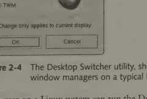

图 2-4 桌面切换器实用程序，显示典型 Fedora 系统上可用的桌面界面和窗口管理器

Linux 系统上的每个用户都可以独立运行桌面切换器或 `switchdesk` 来选择他或她喜欢使用的桌面界面。当您在桌面切换器中选择一个可用的桌面或使用命令行上的 `switchdesk` 时，您必须退出 X Window System 并再次登录才能使更改生效。为此，请使用 GNOME 主菜单上的最后一项注销。当您再次登录时，您选择的桌面将运行。

> 如果您尝试使用 `twm` 等窗口管理器，您应该计划从命令行使用 `switchdesk` 命令将设置改回 GNOME。

## Saving Your Configuration Between Logins

每次注销时，GNOME 都可以记录哪些应用程序窗口处于打开状态，以便下次登录时自动打开相同的应用程序。（但这些应用程序中的文档不会自动加载。）当您正在处理大量窗口并且需要注销一天时，这很有用。下次登录时，您从 GNOME 中打开的所有终端窗口、浏览器和其他应用程序都将按您离开时的状态打开。

要保存登录之间的配置，请在选择 GNOME 菜单上的注销时出现的消息框中选择保存当前设置复选框。此复选框默认未选中，因为在必须处理应用程序窗口时，注销和登录需要额外的时间。您可以更改此设置，以便每次注销时默认保存当前设置。下一节将介绍如何更改此设置。

## Configuring the Graphical Login Screen

您可以使用 GNOME 提供的实用程序根据自己的喜好设置图形登录屏幕。由于图形登录屏幕供系统上的所有用户使用，因此您必须以 root 身份登录或输入 root 密码后才允许配置图形登录屏幕的大部分内容。

要配置图形登录屏幕，请在 GNOME 主菜单上选择系统设置，然后选择登录屏幕。（您也可以从终端窗口运行 `gdmsetup` 命令。）如果您未以 root 身份登录（您通常不应以 root 身份登录），则在运行此实用程序之前必须输入 root 密码。

在 GDM 设置实用程序的常规选项卡上（如图 2-5 所示），您可以选择基本选项，例如系统启动时是否应自动登录用户，或是否在您指定的延迟后自动登录用户。您的选择当然取决于您情况所需的便利性和安全性水平。例如，空闲 10 分钟后自动登录非常方便，但如果您经常在工作时让系统无人看管，也会带来很大的安全风险。

> 图形登录提示的所有配置选项都无法在 GDM 设置实用程序中访问。您也可以通过编辑文件 `/etc/X11/gdm/gdm.conf` 来更改配置设置，但这是一个相当高级的操作。

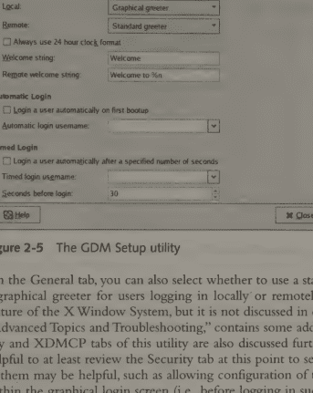

## 图 2-5 GDM 设置实用程序

在常规选项卡上，您还可以选择对本地或远程登录的用户使用标准问候程序（登录屏幕）还是图形问候程序。远程登录是 X Window System 的强大功能，但本书中未详细讨论。 第 15 章“高级主题和故障排除”包含一些额外信息。此实用程序的安全性和 XDMCP 选项卡也在第 15 章中进一步讨论，尽管此时至少查看安全选项卡是有帮助的，以了解它提供的选项；其中一些可能很有帮助，例如允许在图形登录屏幕内（即成功登录之前）配置图形登录屏幕。

单独的选项卡配置标准和图形问候屏幕。图形问候程序默认用于本地用户（坐在计算机前面的用户）。在图形问候程序选项卡上，您会看到图形登录屏幕的主题列表。主题是一组颜色、字体和图像，为显示提供特定的外观和感觉。您可以为桌面界面的其他部分设置主题，如下一节所述。在图形问候程序选项卡中，您可以从图 2-6 所示的列表中选择已安装的主题之一，或单击安装新主题按钮，将您从 Internet 站点下载或自行创建的主题添加到列表中。

图形登录屏幕的面部浏览器功能使其为每个用户显示一个小图形图像。如果您为图形问候程序选择的主题包含面部浏览器，或者在标准问候程序选项卡上选择了面部浏览器选项（窗口底部左侧的杂项部分下），则可以通过选择 GNOME 主菜单上的首选项，然后选择登录照片来配置您自己的图形图像（您的面部或您选择的任何图像）。

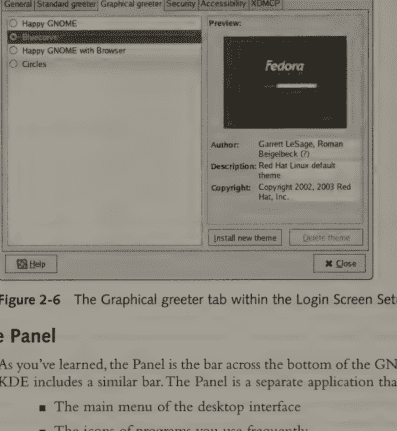

Figure 2-6 The Graphical greeter tab within the Login Screen Setup window

## The Panel

正如你所学到的，Panel 是 GNOME 桌面界面底部的一条栏。KDE 也包含类似的一条栏。Panel 是一个独立的应用程序，显示以下内容：

- 桌面界面的主菜单
- 你经常使用的程序的图标
- 工作区切换器
- 每个打开窗口的带标签按钮（你可以点击任意按钮使该窗口处于活动并可见状态）
- 日期和时间指示器
- 其他信息项

当你右键单击 Panel 上的任何图标时，会出现一个菜单，你可以在其中移动该项目在 Panel 上的位置，完全从面板中移除该项目，或查看该项目的属性（例如，查看图标打开的是哪个应用程序）。图 2-7 显示了当你右键单击 Panel 上的 Launcher 图标并选择 Properties 时出现的 Launcher Properties 对话框。

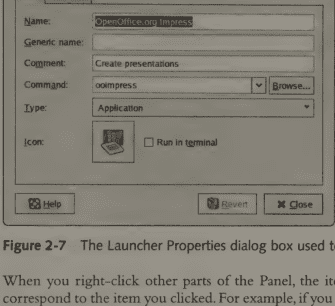

Figure 2-7 The Launcher Properties dialog box used to configure the Panel


当你右键单击 `Panel` 的其他部分时，上下文菜单中显示的项目对应于你单击的项目。例如，如果你右键单击工作区切换器，菜单中会包含 `Preferences` 项目。选择该项目会打开图 2-8 所示的工作区切换器首选项对话框。在此对话框中，你可以设置工作区切换器的功能，包括提供的 `workspace` 数量以及每个 `workspace` 的标签。

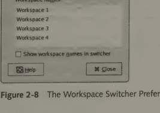

Figure 2-8 The Workspace Switcher Preferences dialog box

如果你右键单击日期和时间信息，上下文菜单中包含 `Copy time` 和 `Copy date`，可将时间或日期作为文本复制到剪贴板，以及 `Adjust Date & Time`，可打开图 2-9 所示的 Date/Time Properties 对话框。

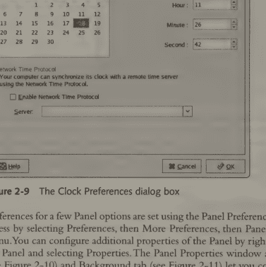

Figure 2-9 The Clock Preferences dialog box

`Panel` 的一些选项的首选项是通过 `Panel Preferences` 对话框设置的，你可以通过在 `GNOME` 主菜单中选择 `Preferences`，然后选择 `More Preferences`，然后选择 `Panel` 来访问。你还可以通过右键单击 `Panel` 的空白区域并选择 `Properties` 来配置 `Panel` 的其他属性。`Panel Properties` 窗口会出现。`General` 选项卡（见图 2-10）和 `Background` 选项卡（见图 2-11）让你可以配置 `Panel` 在桌面上的出现位置、大小以及 `Panel` 背景的外观等配置选项。例如，如果你在 `Background` 选项卡上选择 `Background image` 字段，你就可以使用 `Browse` 按钮选择一个图形图像作为 `Panel` 的背景。（当然，有些图像会使 `Panel` 上的信息变得难以阅读。）

你可以在桌面上同时拥有多个 `Panel`。右键单击 `Panel` 的空白部分并从上下文菜单中选择 `New Panel`，即可在桌面上添加另一个 `Panel`。

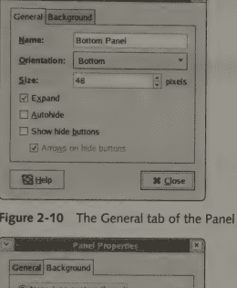

Figure 2-10 The General tab of the Panel Properties dialog box

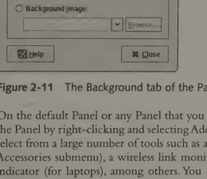

Figure 2-11 The Background tab of the Panel Properties dialog box

在默认 `Panel` 或你添加到桌面的任何 `Panel` 上，你可以通过右键单击并选择 `Add to Panel` 来向 `Panel` 添加新项目。在出现的子菜单中，你可以从大量工具中选择，例如股票行情或天气报告（都在 `Accessories` 子菜单下）、无线链路监视器、音量控制或电池电量指示器（适用于笔记本电脑）等。你还可以添加一个图标来启动 `GNOME` 主菜单上的任何项目。只需选择 `Launcher from menu` 子菜单即可。这会显示整个 `GNOME` 主菜单及其所有子菜单。但从此上下文菜单中，选择一个项目时，`Panel` 并不会启动该应用程序，而是添加一个图标，以便点击该图标会启动你选择的应用程序。图 2-12 显示了如果你想向 `GNOME Panel` 添加 `CD Player` 图标时出现的众多菜单。


## Configuring Other GNOME Features

你可以使用 `GNOME` 主菜单的 `Preferences` 子菜单上的项目配置桌面界面的许多其他功能。例如：

- `Accessibility` 更改诸如按键重复长度、鼠标操作以及为身体受限用户提供的其他设置等首选项。
- `Desktop Background` 让你选择桌面背景图像以及该图像的显示方式，例如平铺、居中或缩放。（见图 2-13。）你可以点击 `Add Wallpaper` 来浏览并找到新的图像用作桌面背景。
- `CD and DVD` 让你确定 `GNOME` 在插入不同类型的新光盘（音频 CD、数据 CD、空白 CD 或 DVD）时如何反应。
- `Font` 让你选择应用程序、桌面本身以及终端窗口中默认使用的字体类型。示例字体会显示以帮助你选择。（见图 2-14。）
- `Keyboard Shortcuts` 让你配置控制桌面操作的键组合（如果你不喜欢表 2-1 中列出的默认设置或想对其进行补充）。
- `Menus and Toolbars` 让你定义 `GNOME` 兼容应用程序中菜单和工具栏的显示方式。你可以在工具栏上的图标下方包含文本标签，并在菜单项旁边包含小图标（这些是默认设置）。
- `Mouse` 让你选择左手鼠标（适用于将鼠标放在键盘左侧的用户——此时左右鼠标按钮与默认设置相反）。你还可以指定定义双击的延迟，以及速度阈值和鼠标指针的外观。`Mouse Preferences` 对话框的 `Cursors` 选项卡上有一个有趣的功能，可在按下 `Control` 键时显示一个弹出框以突出显示鼠标指针。（这在阳光充足的房间中使用笔记本电脑时非常有用。）

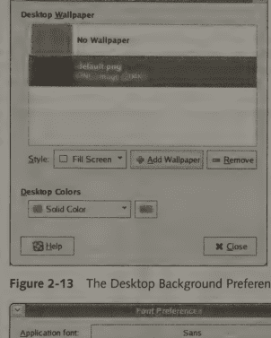

Figure 2-13 The Desktop Background Preferences dialog box


Figure 2-14 The Font Preferences dialog box

- `Screensaver` 让你在数十种图形屏幕保护程序中进行选择，或随机轮换屏幕保护程序（在 `Display Modes` 选项卡的 `Mode` 字段中选择——见图 2-15）。你选择计算机空闲多长时间后激活屏幕保护程序、每个屏幕保护程序使用多长时间（如果你使用 `Random Screen Saver` 模式），以及计算机空闲多长时间后锁定屏幕。如果选择 `Lock screen` 选项，用户必须在屏幕保护程序关闭前输入其密码。（对于屏幕保护程序首选项窗口左侧列表中的每个屏幕保护程序，你可以选中 `Settings` 按钮来配置该屏幕保护程序的确切运行方式。）屏幕保护程序首选项窗口的 `Advanced` 选项卡有几个有用的选项，可帮助你管理监视器的节能功能并确定屏幕保护程序的运行方式。

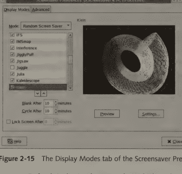

Figure 2-15 The Display Modes tab of the Screensaver Preferences window

- `Preferred Applications` 让你选择桌面在需要访问终端窗口、文本编辑器或 Web 浏览器时使用的应用程序。
- `Windows` 让你定义有关桌面上每个窗口如何被控制的几项内容。例如，你可以选择只要鼠标指针经过窗口，该窗口就会变为活动状态（而不是必须点击窗口或使用 `Alt+Tab` 使其处于活动状态）。
- `Theme` 打开 `Theme Preferences` 窗口，在其中你可以为桌面选择主题。桌面主题包括菜单和应用程序中使用的字体、背景图像、`Panel` 上使用的颜色或图像、描绘每个窗口的图形设计以及

items such as folders, graphics files, and Web pages. Figure 2-16 shows the Theme Preferences window. When you choose Theme Details in the Theme Preferences dialog box, you see a Theme Details dialog box in which you can select a specific style for controls, icons, and window borders (in the corresponding tabs—see Figure 2-17). As you select any item listed, the entire desktop changes immediately to reflect your selection. From the Theme Preferences dialog box, you can also select Install Theme to add a theme that you have downloaded or created.

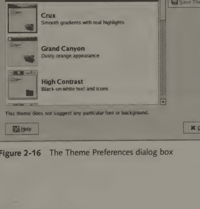

Figure 2-16 The Theme Preferences dialog box

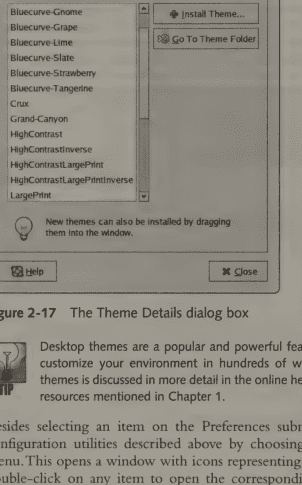


## Figure 2-17 The Theme Details dialog box


Desktop themes are a popular and powerful feature of GNOME that let you customize your environment in hundreds of ways. Creating and managing themes is discussed in more detail in the online help and in many Internet Linux resources mentioned in Chapter 1.

Besides selecting an item on the Preferences submenu, you can also access all of the configuration utilities described above by choosing Control Center on the Preferences menu. This opens a window with icons representing each configuration tool. You can then double-click on any item to open the corresponding preferences window. The Control Center showing all of the icons remains open. (See Figure 2-18.)

KDE includes very similar preference settings to those described here for GNOME. All can be accessed via the Control Center on the KDE main menu.

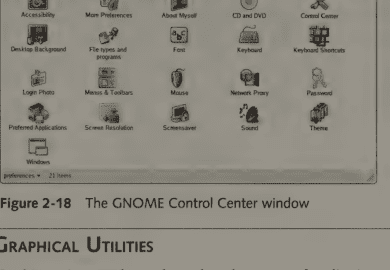

Figure 2-18 The GNOME Control Center window

## CORE GRAPHICAL UTILITIES

In this section you learn about three key types of applications that are included with the GNOME and KDE desktop interfaces: a file manager, a text editor, and a Web browser. Remember as you work that graphical utilities are located in different submenus depending on which version of Linux you are using. The information provided here is based on Red Hat Linux and Fedora.

### Configuring the Nautilus File Manager

In Chapter 1, you learned about the basic operation of the Nautilus file manager provided with GNOME. You can configure how Nautilus operates using the Preferences item on the Edit menu of Nautilus itself, or by selecting Preferences, More preferences, File management on the GNOME main menu. (The File types and programs item on the Preferences submenu also has related configuration options.)

> NOTE
>
> The KDE desktop includes a powerful file manager called Konqueror that is similar to Nautilus.

Within Nautilus, you can choose Backgrounds and Emblems on the Edit menu to open a window in which you select patterns and colors to apply to the background of the Nautilus window. You can click on the Patterns or Colors buttons to select a palette of items from which to choose. Click on any item in the Backgrounds and Emblems dialog box and drag it over to the Nautilus window, dropping it on the background of the window. The pattern or color fills the window. (See Figure 2-19.)

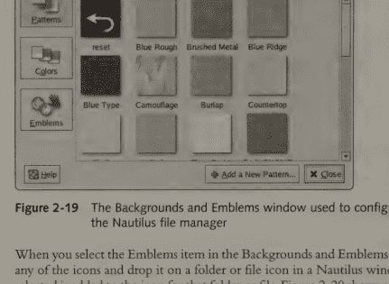

Figure 2-19 The Backgrounds and Emblems window used to configure the appearance of the Nautilus file manager

When you select the Emblems item in the Backgrounds and Emblems window, you can drag any of the icons and drop it on a folder or file icon in a Nautilus window. The emblem you selected is added to the icon for that folder or file. Figure 2-20 shows a folder with a standard folder icon and two other folders to which different emblems have been added. You can also right-click any icon and select the Properties item from the context menu. When the Properties window appears, choose the Emblems tab. On that tab, you can select or deselect any available emblems for that particular folder or file.

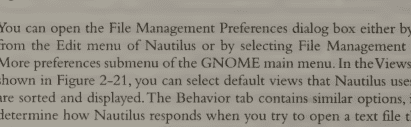

Figure 2-20 Folder icons in Nautilus; standard and with emblems added

You can open the File Management Preferences dialog box either by selecting Preferences from the Edit menu of Nautilus or by selecting File Management from the Preferences, More preferences submenu of the GNOME main menu. In the Views tab of this dialog box, shown in Figure 2-21, you can select default views that Nautilus uses, as well as how items are sorted and displayed. The Behavior tab contains similar options, including options that determine how Nautilus responds when you try to open a text file that contains programming instructions (a script file—see Chapter 14, “Writing Shell Scripts”).

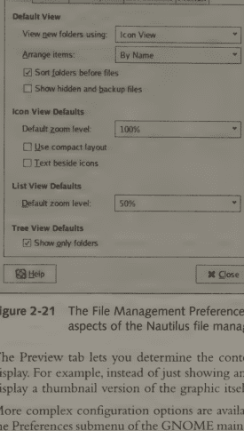


Figure 2-21 The File Management Preferences dialog box used to configure several aspects of the Nautilus file manager

The Preview tab lets you determine the contents of which files Nautilus will be able to display. For example, instead of just showing an icon indicating a graphic file, Nautilus can display a thumbnail version of the graphic itself. (See Figure 2-22.)

More complex configuration options are available by selecting File types and programs on the Preferences submenu of the GNOME main menu. In the File Types and Programs dialog box, shown in Figure 2-23, you can select a type of file, then review or define how GNOME operates on files of that type. For example, if you click on the arrow next to Images and double-click JPEG image, a window opens in which you can select the icon used to display all JPEG-format images, the programs to use to display these images if they are opened in Nautilus (using the Default action field of the Edit file type window), and several other features. You rarely need to modify anything in these windows, however, because GNOME includes hundreds of default settings that should handle virtually every file type you are likely to encounter.

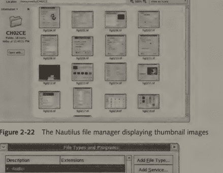

Figure 2-22 The Nautilus file manager displaying thumbnail images

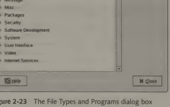

Figure 2-23 The File Types and Programs dialog box

### Configuring the Use of Other Utilities

When you open a text file in Nautilus or double-click its icon on the GNOME desktop or in some other application, GNOME attempts to open the text file in the default text editor. As shown in Figure 2-24, you can set the default text editor in the Text Editor tab of the Preferred Applications window (choose Preferred Applications on the Preferences submenu). By default, GNOME uses the `gedit` text editor, a graphical text editor that includes basic features and is very easy to use. You can also select other popular editors as the default, including `vi` (described in Chapter 3, "Using the Shell") or `Emacs`.

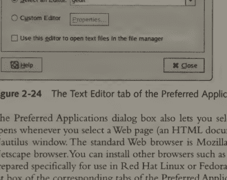

Figure 2-24 The Text Editor tab of the Preferred Applications dialog box

The Preferred Applications dialog box also lets you select a Web browser that GNOME opens whenever you select a Web page (an HTML document) on your desktop or within a Nautilus window. The standard Web browser is Mozilla—the open source version of the Netscape browser. You can install other browsers such as Opera or Lynx. If these have been prepared specifically for use in Red Hat Linux or Fedora, they may appear as options in the list box of the corresponding tabs of the Preferred Applications dialog box. If not, you need to provide the correct command for GNOME to use when starting that application.

## Popular Graphical Programs

The previous sections have discussed how to configure your desktop interface and commonly used utilities such as the file manager and text editor. In this section you learn about several graphical personal productivity applications for Linux.

### OpenOffice.org

OpenOffice.org is an office suite similar to Microsoft Office. OpenOffice.org is the official name of the application, though people refer to it casually as OpenOffice or OO.o. OpenOffice.org began as StarOffice, an application suite developed by a German company called StarDivision, to compete with Microsoft Office. Sun Microsystems purchased StarDivision in 1999 and continued to upgrade the StarOffice product. They also started an Open Source project that became OpenOffice.org. You can purchase a copy of StarOffice from Sun for between $50 and $80 per user, or you can download OpenOffice.org for free at www.openoffice.org.

OpenOffice 是一个令人印象深刻的办公套件，包含以下应用程序：

- Writer，一个功能齐全的文字处理器，具有段落样式、拼写检查和同义词库
- Calc，一款电子表格，内置数百种函数，同时提供数据透视表和图表
- Impress，一个演示工具，包含图形和文本功能以及众多模板
- Draw，一个绘图工具，支持矢量图形（如 Adobe Illustrator）和位图图形（如 Adobe Photoshop 或 GIMP，一款 Linux 应用程序）


- 数据库集成，允许用户与多种不同的数据库交互。对 MySQL 提供了强大的支持，MySQL 是一款流行的开源数据库。

这些应用程序的一些关键特性包括：

- 所有应用程序都可用于多个操作系统（Linux、Solaris、Windows），因此组织可以在多个平台上使用相同的办公套件。这使得系统管理和用户培训变得更简单。
- 支持 Microsoft Office 文件格式，因此 OpenOffice.org 用户可以与使用 Microsoft Office 的同事交换文件。
- 应用程序还可以导出为 Adobe PDF 和 MacroMedia Flash 格式。
- 宏记录器可让您记录重复性任务。
- 开发工具允许其他公司创建集成到 OpenOffice.org 菜单中的附加功能。
- OpenOffice.org 可提供超过 30 种语言，从巴斯克语和中文到阿拉伯语和土耳其语。

由于 OpenOffice.org 是一个大型程序（超过 70 MB），您应尽可能从 Linux 光盘安装。例如，在安装 Red Hat Linux 或 Fedora 时，您可以选择同时安装 OpenOffice.org。然后，各种应用程序会出现在桌面 Office 子菜单上。

## OpenOffice.org Writer

要启动 OpenOffice.org Writer 文字处理器，请从 GNOME 主菜单中选择 Office，然后选择 OpenOffice.org Writer，或单击默认 GNOME 面板上从左数第四个图标。（从左起，图标分别为主菜单、网页浏览器、电子邮件客户端，然后是文字处理器。）

Writer 的主窗口出现，工具栏位于空白文档上方和左侧，还有一个单独的窗口列出段落样式。该窗口称为 Stylist——您可以通过 Format 菜单切换 Stylist 的显示。当您输入文本时，可以单击列表中的段落样式，将整个段落设置为该样式。例如，如果单击 Heading 1，段落将被更改为大号粗体字体。段落样式也可在文档窗口上方的工具栏中使用。

开始新文档的一个便捷方法是选择 File，然后选择 AutoPilot，然后选择要创建的文档类型。会出现一系列对话框，您在其中输入有关正在创建的文档的信息；文档随后会在编辑窗口中出现，您的信息已正确放置。图 2-25 显示了用于创建传真的 AutoPilot 信息窗口之一。

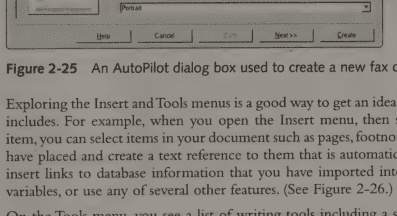

图 2-25 用于在 Writer 中创建新传真文档的 AutoPilot 对话框

探索 Insert 和 Tools 菜单是了解 Writer 包含哪些功能的好方法。例如，当您打开 Insert 菜单，然后选择 Cross-reference 项目时，您可以从文档中选择页面、脚注或您放置的书签等项目，并为其创建自动更新的文本引用。您还可以插入链接到已导入到文本文档的数据库信息、创建变量或使用其他多项功能。（参见图 2-26。）

在 Tools 菜单上，您会看到包括拼写检查器、同义词库、连字符词典、自动更正和自动格式（在您工作时修复常见拼写错误）以及大纲工具在内的写作工具列表。通过选择此菜单上的项目，您还可以记录宏或使用 Configure 和 Options 对话框为 Writer 的操作设置数百种首选项（图 2-27 显示了 Options 对话框）。

## OpenOffice.org Calc

OpenOffice.org Calc 程序是一款功能齐全的电子表格，类似于 Microsoft Excel。您可以从 GNOME 主菜单或面板图标启动它，就像启动 Writer 一样。

### 图 2-26 用于在 Writer 中输入交叉引用数据的 Fields 对话框

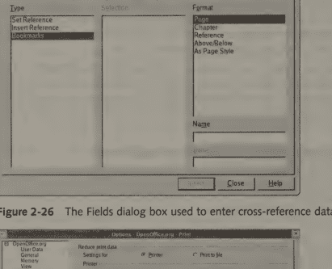

### 图 2-27 Writer 中的 Options 对话框

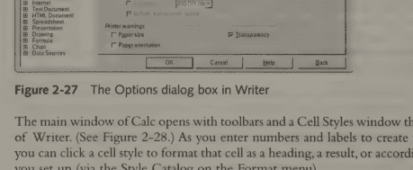

Calc 的主窗口打开，工具栏和一个类似于 Writer 的 Cell Styles 窗口。（参见图 2-28。）当您输入数字和标签来创建电子表格时，可以单击单元格样式，将该单元格格式化为标题、结果或您设置的其它样式（通过 Format 菜单上的 Style Catalog）。

电子表格的主要目的是处理公式。为了尝试一个简单示例，在两个不同的单元格中输入一个数字（使用 A1 和 A2），然后在 A3 中输入类似 `"=A1+A2"` 的公式。更常见的是，用户依靠函数来计算电子表格中的值。在 Calc 中，您可以从 Insert 菜单选择 Function 以打开 Functions AutoPilot。从此窗口中，如图 2-29 所示，您可以选择 Calc 提供的近 400 个函数中的任何一个。

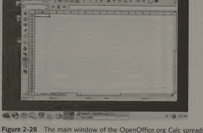

图 2-28 OpenOffice.org Calc 电子表格程序的主窗口


图 2-29 Calc 电子表格中的 Functions AutoPilot


如果您先从 Category 字段中选择函数类别，例如 Database 或 Statistical，则更容易选择合适的函数，这样列出的函数数量会更少。

当您从 Function 列表中选择一个函数时，该函数的描述会出现在 Function 列表的右侧。当您选择所需函数后，单击 Next 按钮。会出现与您选择的函数所需相匹配的字段列表。您在字段中输入信息（例如数字、单元格引用或其他函数），并查看 Result 字段以确认函数是否按预期工作。输入信息后，单击 OK 关闭 AutoPilot 并将您定义的函数插入到活动单元格中。

Calc 还具有拼写检查器、自动更正以及记录宏和从数据库源导入信息的能力。Data 菜单上提供了一套专门的数据库类功能。

## 使用电子邮件客户端

如果您将 Linux 作为主要工作环境，您可能需要定期使用电子邮件阅读器（电子邮件客户端）。默认的 Linux 安装提供了多个功能强大的图形电子邮件客户端。在本节中，您将了解其中两个的基本信息：Evolution 和 Mozilla。许多其他电子邮件客户端使用类似的设计，因此当您对其中两个电子邮件客户端越熟悉时，您将能够识别并理解其他电子邮件客户端的功能。

## Evolution

Evolution 是一款电子邮件客户端和日历调度程序，类似于 Microsoft Outlook。Evolution 由名为 Ximian 的公司创建，该公司现归 Novell 所有（参见 www.ximian.com）。您可以使用 GNOME 面板上的图标启动 Evolution（默认面板上从左数第三个），或从 GNOME 主菜单的 Internet 子菜单中选择 Evolution Email。当您第一次启动 Evolution 时，它会向您展示几个设置窗口，帮助您设置电子邮件帐户信息。配置此信息后，Evolution 即可联系您的互联网服务提供商或其他电子邮件服务器以检索和发送您的电子邮件消息。

当第一个欢迎窗口出现时，单击 Forward 继续。在 Identity 窗口中，输入您的全名和电子邮件地址。（参见图 2-30。）如果需要，您还可以包含不同的 Reply-To 地址和组织名称。单击 Forward 继续。

在 Receiving Mail 窗口中，您定义一个电子邮件帐户。您选择的选项取决于电子邮件消息的存储位置和存储方式。最广泛使用的系统可能是 POP 格式，其中您的电子邮件消息存储在 ISP 的电子邮件服务器上，您将其检索到本地系统以阅读。如果您不确定应选择哪一项，请咨询您的系统管理员或 ISP。Server

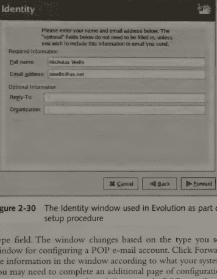

## Figure 2-30 The Identity window used in Evolution as part of the new e-mail account setup procedure

类型字段。窗口会根据您选择的类型的不同而变化。图 2-31 显示了配置 POP 电子邮件账户的窗口。按照系统管理员提供的说明填写完窗口中的信息后，单击“Forward”。根据您选择的服务器类型，您可能还需要完成额外的配置选项页面。例如，POP 电子邮件账户可以指定多久检查一次电子邮件服务器是否有新邮件，以及在下载到 Evolution 时是否从服务器上删除邮件。例如，如果您暂时在远程站点工作，您可能希望将所有邮件保留在电子邮件服务器上，在远程站点阅读它们，并在返回主工作系统时再将其下载到您的主工作系统。

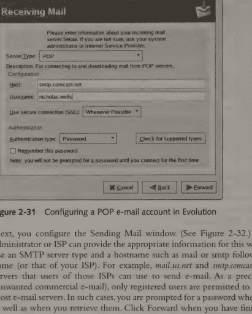


## Figure 2-31 Configuring a POP e-mail account in Evolution

接下来，您配置“发送邮件”窗口。参见图 2-32。同样，您的系统管理员或 ISP 可以为此窗口提供适当的信息。通常，您使用 SMTP 服务器类型和主机名，例如 `mail` 或 `smtp` 后跟您的域名或 ISP 的域名。例如，`mail.us.net` 和 `smtp.comcast.net` 就是那些 ISP 用户可以用来发送电子邮件的两个电子邮件服务器。为了防止垃圾邮件，只有注册用户才被允许通过大多数电子邮件服务器发送电子邮件。在这种情况下，在发送邮件时以及在检索邮件时都会提示您输入密码。完成后单击 `Forward`。

在“账户管理”窗口中，您可以为此账户定义一个名称。Evolution 允许您设置多个电子邮件账户。默认情况下，电子邮件地址用作账户名称，但您可以在“名称”字段中输入任何内容，例如“school e-mail”、“family account”或“office—main account”。单击 `Forward` 后，您会看到“时区”窗口，在其中选择您的时区。这使 Evolution 能够正确确定电子邮件消息的发送时间，并确定要显示的天气信息。再次单击 `Forward` 后，会出现“完成”窗口，您可以在其中单击 `Apply` 关闭“设置向导”——片刻后，Evolution 的主窗口就会出现，如图 2-33 所示。默认情况下会显示“摘要”窗口。

Figure 2-32 Configuring how e-mail messages are sent within Evolution

Figure 2-33 The main window of Evolution

“摘要”窗口默认包含天气信息、Red Hat Linux 和 Fedora 的关键更新通知，以及电子邮件、约会和任务的摘要。通过单击 Evolution 窗口左侧的相应图标切换到“日历”窗口参见图 2-34或“任务”窗口，您可以管理约会或任务列表。您可以按优先级创建任务类别，或创建一次性或重复约会。


Figure 2-34 The Calendar window of Evolution

当您单击“收件箱”图标时，您会看到电子邮件查看窗口，如图 2-35 所示。邮件列在窗口的上半部分；所选邮件的文本显示在窗口的下半部分。通过单击左上角 `New` 按钮旁边的箭头并选择 `Folder`，您可以创建新的电子邮件文件夹来帮助您整理邮件。选择 `View`，然后选择 `Folder Bar` 以显示可用文件夹列表，以便您可以将电子邮件拖放到不同的文件夹。

当您查看电子邮件收件箱窗口时，您可以单击 `New` 按钮不是其右侧的箭头来创建新的电子邮件消息。参见图 2-36。Evolution 窗口顶部的其他按钮可让您回复、打印、复制、删除或转发邮件等。 `Send/Retrieve` 按钮检查电子邮件服务器是否有新邮件，并发送已暂时存储在计算机上等待活动 Internet 连接的任何邮件。

## Mozilla E-mail

Mozilla 是一个 Web 浏览器，但它还包含一个功能齐全的电子邮件客户端，与您刚才在 Evolution 中看到的类似。在使用面板图标显示地球仪启动 Mozilla，或在 GNOME 主菜单中选择“Internet”，然后选择“Mozilla Web Browser”后，您可以选择 `Window`，然后选择 `Mail & Newsgroups` 以打开 Mozilla 电子邮件阅读器。

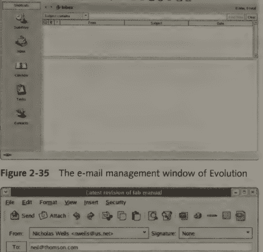

Figure 2-35 The e-mail management window of Evolution

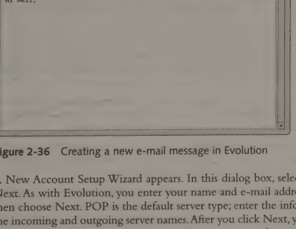

Figure 2-36 Creating a new e-mail message in Evolution

会出现“新账户设置向导”。在此对话框中，选择 `Email account` 并单击 `Next`。与 Evolution 类似，您在 `Identity` 窗口中输入您的姓名和电子邮件地址，然后选择 `Next`。`POP` 是默认的服务器类型；输入所需的信息，例如传入和传出服务器名称。单击 `Next` 后，您将被依次提示输入用户名和账户名称。根据需要，您将被提示输入密码以访问您已定义的账户的检索和发送功能。Mozilla 的收件箱窗口如图 2-37 所示。文件夹显示在左侧，邮件列在顶部部分，所选邮件的文本显示在下方。您可以使用工具栏上的按钮或菜单项来管理您的电子邮件。

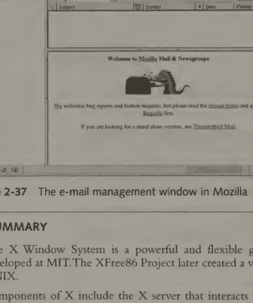

Figure 2-37 The e-mail management window in Mozilla

## CHAPTER SUMMARY

- X Window System 是一种功能强大且灵活的图形环境，由 MIT 开发。XFree86 项目后来为基于 Intel 的 Linux 和 UNIX 创建了一个版本。
- X 的组件包括与显卡交互的 X 服务器，以及使用 X 服务器服务的图形应用程序 X 客户端。Linux 上有可用的商业 X 服务器。它们为额外的显卡提供支持，并可能提供更高的性能。
- 在 X Window System 中使用的“客户端”和“服务器”术语与典型的“客户端-服务器”计算中的含义相反。在 X 中，服务器提供键盘点击和鼠标移动，而不是典型服务器提供的数据。
- 窗口管理器或桌面界面为 X 提供用户界面。较旧的基础窗口管理器如 `fvwm` 和 `twm` 仍在使用，但大多数 Linux 系统依赖于 KDE 或 GNOME 等完整的桌面界面。
- 图形库通过让应用程序共享编程代码和系统资源，使创建新的图形应用程序变得更容易。两种最广泛使用的图形库是 `Qt` KDE 基于此和 `GTK+` GNOME 基于此。
- KDE 和 GNOME 各自提供了一个方便的桌面界面，带有图标、菜单和任务栏。它们还包括许多图形应用程序，用于配置桌面界面、管理系统资源和处理个人信息。
- 图形登录提示由 `xdm` 程序提供，或如果使用 KDE 或 GNOME，则由 `kdm` 或 `gdm` 程序提供。这后两个程序可以使用 KDE 和 GNOME 中的实用程序进行图形配置。
- 图形窗口可以使用鼠标操作进行操作，例如单击和拖动或选择窗口标题栏上的图标。许多窗口操作也支持键盘快捷键。
- KDE 和 GNOME 都具有使用多个工作区或虚拟桌面的功能，其中可以打开不同的应用程序窗口。这使得同时管理许多打开的窗口变得容易。
- GNOME 和 KDE 可以保存桌面界面的当前状态，并在同一用户下次登录时恢复它，以便应用程序和其他窗口与用户注销时处于相同位置。
- GNOME 和 KDE 提供了数百种配置选项。可以通过主菜单的“Preferences”子菜单访问，或通过右键单击界面的各个部分访问。
- GNOME 和 KDE 包含用于常见系统管理和管理任务的图形实用程序。这些包括 GNOME 中的 `Nautilus` 文件管理器、KDE 中的 `Konqueror` 文件管理器、简单的文本编辑器、Web 浏览器和终端窗口程序。您可以为这些功能中的每一个选择首选程序。
- OpenOffice.org 是一款功能齐全的办公套件，类似于 Microsoft Office。它包含在大多数 Linux 发行版中或可免费下载。它包括 `Writer`、`Calc`、`Impress`，并支持许多数据库功能。
- Linux 提供了几个电子邮件阅读器。Evolution 类似于 Microsoft Outlook，包含电子邮件功能、日历功能、任务列表和联系人管理器。Mozilla Web 浏览器还包含一个完整的电子邮件阅读器。
- 要使用任一电子邮件阅读器，您必须先设置电子邮件账户，以便电子邮件阅读器知道在哪里查找邮件以及如何发送新邮件。

## 命令摘要

| 命令 | 描述 | 示例 |
|---|---|---|
| `gdmsetup` | 启动一个图形实用程序，用于配置图形登录屏幕 | `gdmsetup` |
| `startx` | 从命令行启动 X Window System 会话 | `startx` |
| `switchdesk` | 启动一个图形实用程序，用于在系统上安装的桌面界面之间切换 | `switchdesk` |

## 关键术语

`face browser` — 图形登录屏幕的一个功能，会导致它为每个用户显示一个小图形图像。

`graphical libraries` — X 客户端可以用来更有效地创建和管理图形环境元素的编程函数集合。

`Panel` — 在 GNOME 或 KDE 桌面界面底部显示的一条栏，其中包含常用应用程序的图标、访问主菜单的按钮以及其他信息或管理功能。

`Project Athena` — 由 DEC 和 MIT 赞助的项目，旨在为 UNIX 创建图形环境或窗口系统。

`session` — 定义用户登录时运行的一组图形程序的配置。


- theme — 一组颜色、字体和图像，使显示具有某种外观和感觉的集合。
- window manager — 一个特殊用途的图形应用程序（X 客户端），控制图形用户界面中窗口的位置和操作。
- workspace — 桌面界面上的空白背景，您可以在其中打开应用程序窗口。
- X client — 一个图形应用程序。
- X server — 与显卡通信以在屏幕上创建图像的程序。

## 复习问题

1. X Window System 的历史起源于：

   - a. Project Athena
   - b. Microsoft Windows 的早期版本
   - c. Apple Macintosh 计算机
   - d. XFree86 项目

2. 为什么一个人可能会选择购买商业 X server 而不是使用随 Linux 每个副本免费提供的 XFree86？

3. 描述 X Window System 中 X server 的功能。

4. A(n) ________ 是在 X Window System 中运行的任何图形应用程序的另一个名称。

   - a. window manager
   - b. X client
   - c. X server
   - d. Panel launcher

5. 命名四个可以在 Linux 上与 X Window System 一起使用的窗口管理器。

6. 窗口管理器最好描述为：

   - a. 一个提供其他 X 客户端核心图形功能的特殊用途 X 客户端
   - b. 管理底层 X server 的管理工具
   - c. 直接与显卡通信以便在计算机屏幕上创建窗口的程序
   - d. 用于改善某些图形应用程序外观的可选组件

7. 命名 Linux 的两个主要桌面环境使用的两个图形库。

8. 图形库最好描述为：

   - a. 控制显卡的函数
   - b. 任何图形程序都可以使用的一组函数，以创建统一的外观和感觉
   - c. 用于设置 X 的配置程序
   - d. 绘制所有窗口并处理鼠标和键盘输入的 X 客户端

9. 选择不运行 X：

   - a. 是没有意义的，因为它无论如何都在后台运行
   - b. 会导致基于服务器的系统出现配置问题
   - c. 节省了 X server 和图形程序会消耗的系统资源
   - d. 对于用作 Internet 服务器的 Linux 系统来说是不合理的

10. ________ 命令通常用于在不使用图形登录的情况下启动 X Window System。

    - + a. xinit
    - b. startx
    - c. xdm
    - d. xinitrc

11. 要在 GNOME 桌面上使用默认设置最小化活动窗口，您可以：

    - + a. 按 Alt+F9 或从窗口控制菜单中选择 Minimize。
    - + b. 单击标题栏最右侧的小“x”或按 Alt+F2。
    - + c. 单击标题栏上的小条形图标或按 F9。
    - + d. 双击标题栏或按 Alt+F9。

12. 描述在同一个图形窗口中单击并拖动以突出显示文本，然后选择另一个窗口并同时单击两个鼠标按钮的目的。

13. GNOME 中的 Workspace Switcher 允许您：

    - + a. 保存打开窗口的记录，以便下次登录时自动打开相同的窗口和应用程序。
    - + b. 更改桌面上 Panel 的位置或向 Panel 添加新图标。
    - + c. 选择新的桌面主题。
    - + d. 在四个桌面背景之间移动，每个背景可以有不同的窗口。

14. 要启用每次退出 GNOME 时保存桌面设置的功能，您将在 Preferences 子菜单中探索哪一项？

    - + a. Panel
    - + b. CD and DVD
    - + c. Sessions
    - + d. Keyboard shortcuts

15. 描述 GNOME 中 Alt+Tab 和 Alt+F1 键组合的默认操作。

16. Desktop Switcher 实用程序允许您：

    - + a. 在 GNOME 和 KDE 之间切换桌面。
    - + b. 在实用程序可以在系统上找到的任何已安装的窗口管理器或桌面环境之间切换桌面。
    - + c. 在 GNOME 和 twm 之间切换桌面。
    - + d. 在不同的工作区之间切换，就像 GNOME Panel 中间显示的小方块一样。

17. 选择桌面主题让您控制：

    - a. 您桌面界面大多数方面的外观和感觉
    - b. 当 Linux 计算机上的驱动器中插入数据 CD、音频 CD、空白 CD 或 DVD 时如何处理
    - c. 图形应用程序默认使用的语言
    - d. 分配给窗口和按钮的颜色

18. 定义 Nautilus 文件管理器中使用的 emblem。

19. 当您在 GNOME 的 Preferred Application 窗口中选择文本编辑器时：

    - a. 您定义 Linux 系统上安装了哪些文本编辑器。
    - b. 您使用活动窗口中的文本文件启动该文本编辑器。
    - c. 您选择 GNOME 或 Nautilus 在您想要查看文本文件时启动的文本编辑器。
    - d. 您定义 GNOME 中 Web 浏览器如何显示文本（非 HTML）文档。

20. OpenOffice.org 由以下组成：

    - a. 文字处理器、项目管理、电子表格、数据库和演示软件
    - b. 文字处理器、电子表格和演示软件
    - c. 文字处理器、电子邮件阅读器、日历管理、项目管理、电子表格和数据库软件
    - d. 文字处理器、电子表格、绘图程序、演示软件和数据库工具

21. OpenOffice.org 可用于哪些平台？

22. Evolution 是：

    - a. 一个包含电子邮件、日历、任务列表和联系人管理功能的程序，类似于 Microsoft Outlook
    - b. OpenOffice.org 套件的一个组件，提供电子邮件和日历功能
    - c. Mozilla Web 浏览器中的电子邮件管理窗口
    - d. 可通过合理费用下载或在许多零售软件商店购买

23. 在设置 POP 电子邮件帐户时，Evolution 和 Mozilla 不同之处在于：

    - a. 一个要求您输入有效的电子邮件地址，另一个仅使用您的用户名。
    - b. 一个支持将邮件保留在电子邮件服务器上，另一个不支持。
    - c. 一个允许您在设置过程中输入密码，另一个不允许，但在需要时提示您输入密码。
    - d. 一个与 GNOME 主菜单集成，另一个没有。

24. 列出 Evolution 通过其 Summary 窗口或 Summary 窗口左侧的标准图标提供的四个功能。

25. 在 Nautilus 文件管理器中，侧边窗格用于：

    - a. 警告您配置文件中的更改。
    - b. 显示在窗口左侧部分中选择的对象的有关基本信息，包括例如图形文件的缩略图图像，如果在文件管理首选项窗口的 Preview 选项卡中进行了相应配置。
    - c. 显示在窗口左侧部分中选择的任何文件的名称、创建日期、上次修改日期和上下文。
    - d. 选择对象（文件和目录）在 Nautilus 窗口主部分中的显示方式。

## 实践项目

### Project 2-1

在本项目中，您将使用鼠标和键盘在 GNOME 桌面上试验窗口操作。要完成本项目，您应该安装了 Red Hat Linux 或 Fedora，并且正在运行 GNOME 桌面。这里的步骤假设您正在系统控制台工作。如果您使用 X server 远程工作，控制键序列（如 Alt+F1）可能无法工作。如果您在 Microsoft Windows 系统上使用 X Server，则尤其如此。

1. 登录并等待 GNOME 桌面出现。

2. 按 Alt+F1。GNOME 主菜单出现。从主菜单中选择 System Tools，然后选择 Terminal。终端窗口出现。

3. 按 Shift+Ctrl+N。新的终端窗口出现。再次按相同的键。第三个窗口出现。

4. 单击并拖动活动（蓝色）标题栏，将其向下移动到桌面的底部，使其不与其它打开的窗口重叠。

5. 按住 Alt 键并按两次 Tab。释放 Alt 键。您打开的第一个窗口现在处于活动状态。

6. 按 Alt+F10 最大化此窗口。

7. 单击最大化窗口左上角的图标（标题栏最左端）以显示窗口控制菜单。选择“移动到另一个工作区”，然后在控制菜单中选择“工作区 2”。

8. 在桌面底部边缘的面板中央找到“工作区切换器”。单击右上角的方块以激活工作区 2。通过单击窗口中的任意位置激活最大化的窗口。按 Alt+F5 将此窗口恢复到原来的大小（取消最大化）。

9. 注意面板中央的工作区切换器。右上角的方块比其他方块阴影更深，表示您当前正在查看该工作区（您刚刚移动了终端窗口的工作区 2）。

10. 在工作区切换器上的左上角工作区方块中，您可以看到其他终端窗口的轮廓。单击该方块切换到工作区 1。

11. 单击非活动终端窗口中的任意位置以使该窗口处于活动状态。

12. 通过按 Alt+F9 最小化该窗口。

13. 找到面板上对应于工作区中窗口的按钮。您注意到按钮有什么特点？单击其中一个按钮。

14. 单击其中一个终端窗口使其处于活动状态。按 Ctrl+d 关闭该窗口。

15. 单击另一个终端窗口。按 Alt+F4 关闭该窗口。

16. 您可以配置面板以包含所有工作区的按钮，但默认情况下，仅在当前查看的工作区中的窗口会显示在面板上。单击工作区切换器的右上角方块以显示工作区 2。


17. 以步骤 15 和 16 中未列出的一种不同方式关闭工作区 2 上的终端窗口。注销您的计算机。

## Project 2-2

在本项目中，您将配置 GNOME 的一些功能。要完成本项目，您应已安装 Red Hat Linux 或 Fedora 并运行 GNOME 桌面。

1. 登录并等待 GNOME 桌面出现。
2. 在 GNOME 主菜单中，选择“首选项”，然后选择“窗口”。
5. 在主题列表中向下滚动并单击“Ocean Dream”主题。注意所有窗口的边框和面板上的按钮立即发生变化。
6. 单击“主题详细信息”按钮。
7. 在“主题详细信息”窗口中单击“图标”选项卡。单击列表中的第一个项目“Bluecurve”，将所有图标更改回默认设置（与 Bluecurve 默认主题中显示的相同）。注意面板上的图标立即发生变化。
8. 切换回“控件”选项卡并在列表中单击“Metal”选项。
9. 单击“关闭”以关闭“主题详细信息”窗口。主题首选项窗口列表顶部列出了“自定义”主题。此主题代表您刚刚从多个预配置主题中选择的元素的自定义组合。
10. 在主题首选项窗口中选择“保存主题”以保存此主题的副本。在出现的“保存主题到磁盘”对话框中，在“主题名称”字段中输入“Practice Theme”并单击“保存”。您的新主题按字母顺序列在主题首选项窗口中。
11. 如需返回默认设置，请单击“Bluecurve”主题，然后单击“关闭”以关闭主题首选项窗口。
12. 在 GNOME 主菜单中，选择“首选项”，然后选择“桌面背景”。
13. 单击“添加壁纸”按钮。文件浏览窗口出现。
14. 您可以浏览文件系统的任何位置，但在该目录（`/usr/share/backgrounds/images`）中包含了一些 Red Hat Linux 和 Fedora 的背景图像。双击 `in_flight.jpg` 文件名。文件选择窗口关闭，背景发生变化，桌面背景首选项窗口显示您选择的图像。
15. 在面板上找到工作区切换器并单击其右下角。这会显示一个空桌面，以便您可以在没有窗口遮挡的情况下查看所选图像。查看图像后，单击工作区切换器的左上角返回到可以看到桌面背景首选项窗口的位置。
16. 如果您没有找到喜欢的图片，您可以选择使用纯色背景。单击桌面背景首选项窗口中间最右侧的“无壁纸”图标。
17. 在“桌面颜色”字段中，选择“水平渐变”。两个颜色按钮显示用于创建渐变的两种颜色。您可以单击一个或两个来为渐变选择新颜色。
18. 要返回默认背景，请单击 `default.png`。
19. 单击“关闭”以关闭桌面背景首选项窗口。
20. 在 GNOME 主菜单中，选择“首选项”，然后选择“屏幕保护程序”。
21. 确保已选择“显示模式”选项卡。在“模式”字段中，选择“仅一个屏幕保护程序”。
22. 花点时间探索不同的屏幕保护程序（但不要太久——可供选择的屏幕保护程序几乎有 200 个）。暂时选择 SBalls 屏幕保护程序。
23. 单击“设置”按钮。用于配置 SBalls 屏幕保护程序的对话框出现。
24. 将“速度”滑块移动到“慢”，并将“速度”滑块下方的字段更改为“Plane”。
25. 单击“确定”关闭配置窗口并返回到屏幕保护程序首选项窗口。
26. 单击“预览”按钮查看屏幕保护程序的外观。查看后，按 `Esc` 退出。
27. 如果您想稍微提高系统的安全性，请单击“锁定屏幕后”复选框并选择屏幕保护程序锁定系统后的分钟数。屏幕保护程序锁定系统后，您必须输入 Linux 用户密码才能退出屏幕保护程序。
28. 单击“关闭”以关闭屏幕保护程序首选项窗口。注销您的计算机。

## Project 2-3

在本项目中，您将使用 OpenOffice.org Writer 程序。要完成本项目，您应已安装 Linux 并可使用 OpenOffice.org Writer 程序。

1. 登录并等待桌面出现。
2. 启动 OpenOffice.org Writer。如果您使用的是 Red Hat Linux 或 Fedora，则可以通过在 GNOME 主菜单中选择“办公”，然后选择“OpenOffice.org Writer”来完成此操作。
3. 在 Writer 菜单栏中，选择“文件”，然后选择“自动导览”，然后选择“备忘录”。
4. 在“自动导览备忘录”窗口中查看显示的信息，然后单击“下一步”。
5. 在出现的下一个窗口中，单击“日期”复选框（不必担心显示的日期不正确——它只是为了让您选择日期格式）。
6. 在“主题”行复选框右侧的文本输入字段中，输入“Change to Travel Policy on Airline Ticket Purchases”。单击“下一步”继续。
7. 查看出现的下一个窗口中的元素。取消选中“保密级别”复选框，因为您希望每个人都能看到此备忘录。单击“下一步”继续。
8. 查看下一个窗口，然后单击“下一步”继续。
9. 单击“创建”按钮，根据您输入的信息创建备忘录。

## Chapter 2 Exploring the Desktop

10. 片刻后，备忘录出现。如果您的系统未配置个人信息，请单击备忘录顶部“发件人”后的行并输入您的姓名。
11. 单击备忘录顶部“收件人”后的行并输入“All employees”。
12. 三次单击备忘录正文中标记为 [Please enter your text here] 的行。这会选择整个段落，以便您在输入时，您的信息会替换此说明。
13. 选择“工具”，然后选择“拼写检查”。注意“自动拼写检查”默认处于激活状态。此功能会用波浪红线标记任何无法识别的单词。
14. 输入以下内容：
effective immediately, all employees may travel in Business Class when business takes them overseas. please continue to seek the lowest fare possible.
15. 注意在您输入时，Writer 会将每个句子的第一个字母改为大写（在“Effective”和“Please”这两个词中）。还要注意单词“employees”下面有一条波浪红线。
16. 按 `F7` 启动拼写检查实用程序（或在菜单栏中选择“工具”，然后选择“拼写检查”，然后选择“检查”）。启动拼写检查后，可能会出现一个对话框询问是否要从文档开头开始检查。单击“是”。
17. 拼写检查对话框出现，显示“employees”的替代方案，它已将其识别为无法识别的单词。正确的拼写已在“建议”字段中选中，因此按 Enter 或单击“替换”继续。
18. 消息框指示拼写检查已完成。单击“确定”关闭该消息框。
19. 选择“文件”，然后选择“页面预览”以查看备忘录打印时的外观。完成预览后查看后，选择“文件”，然后再次选择“页面预览”以返回标准编辑视图。
20. 选择“文件”，然后选择“退出”以退出 Writer。系统提示保存或丢弃您正在处理的文档时，您可以选择“丢弃”。

## CASE PROJECTS

## Exploring Desktop Utilities and Applications

1. 您在一家约有 2500 名员工的小型航空航天工程公司工作，所有员工都使用计算机进行日常工作。作为该公司的系统管理员，您正在考虑建议将工程员工（约占员工总数的三分之二）切换到 Linux 作为桌面平台。请讨论指导您做出决定的因素。
2. 要么在同时安装了 GNOME 和 KDE 的 Linux 系统上使用，要么通过浏览网站 `www.gnome.org` 和 `www.kde.org` 上提供的信息和屏幕截图，确定哪种桌面界面更吸引你。写一份一页的摘要，说明影响你决策的功能。分别指出每种情况下该功能是美观的（与桌面的外观和感觉相关）还是功能的（与桌面使用的程序、实用程序或操作方法相关）。
3. 从你的讲师或朋友那里获取一个或多个使用 Microsoft Office 创建的文档。如果你决定通过搜索互联网来查找文档，请尝试获取一个文字处理文档（来自 Word）和另一个使用 Excel（电子表格）或 PowerPoint（演示文稿软件）创建的文件。你可以在 Microsoft 网站上找到示例文档，但请务必小心不要从不可信的网站下载文档，因为它们可能包含病毒，如果在运行 Microsoft Office 程序的 Microsoft Windows 计算机上打开，可能会感染你的计算机。
一旦你获得了 一个或多个示例文件，请使用本章所述的 OpenOffice.org 程序打开它们。注意你遇到的任何问题。OpenOffice 对 Microsoft Office 文档的支持程度如何？你对这个问题的回答可能会如何影响你在上面的案例项目 1 中的决定？

# CHAPTER

3

## Using the Shell

阅读本章并完成练习后，你将能够：
- 使用 shell 的常用功能在命令行工作
- 在 shell 中操作变量以控制你的工作环境
- 在命令行重定向数据
- 使用 vi 编辑器编辑文本
- 从命令行打印基本文件


在上一章中，你学习了 Linux 中的图形环境，包括如何配置 GNOME 和 KDE 桌面界面的基本功能，以及如何使用常见的实用程序和个人生产力应用程序。

在本章中，你再次关注命令行。你学习如何更高效地输入命令并使用 shell 的功能一起执行多个命令。

Linux 中较为复杂的部分之一是 vi 文本编辑器。在本章中，你学习该编辑器的基本操作以及为什么你需要学习使用它很重要。最后，你学习如何从命令行执行简单命令来打印文件。

### EXPLORING THE BASH SHELL

正如你在第一章中学到的，Linux 中的命令行环境由一个名为 shell 的程序控制。Shell 是一个**命令解释器**，意味着 shell 只是一个接受键盘输入并使用该输入运行命令或以其他方式控制计算机系统的程序。当你通过图形登录屏幕登录到 Linux 时，不会启动 shell——没有命令解释器在运行，因为用户没有地方在键盘上输入命令。当你打开一个终端窗口时，会启动一个 shell 程序来提供界面（命令提示符）并解释你在键盘上输入的内容。

如果你以文本模式登录到 Linux，则会启动一个 shell，以便你有控制系统的方法，因为没有使用图形界面。每个用户账户的定义的一部分是登录时启动的登录 shell 的名称，该用户在文本模式控制台登录时启动它。然而，在你登录之前，已经运行了许多程序，但没有 shell 在运行。如果你将基于 Linux 的计算机用作服务器（例如作为电子邮件服务器），它可能在数天或数周内工作而从未运行过 shell。

在 shell 中工作——无论是从文本模式登录控制台还是在图形桌面上的终端窗口——的优点是具有很大的灵活性：你可以与你有权访问的任何文件交互，你可以启动系统上的任何程序，并且你可以使用 shell 的特殊功能（稍后描述）更高效地工作。一些用户更喜欢使用图形环境，因为它需要的培训较少。然而，在图形环境中立即可用的功能是有限的。例如，图形桌面的用户只能启动菜单和子菜单中包含的程序，并且无法访问典型 Linux 系统中包含的数百个其他程序。你是否需要使用 shell 或其他方式与 Linux 内核交互取决于你想要执行的任务和你偏好的桌面环境。

### The Shell Prompt

图 3-1 显示了在通过文本模式登录提示登录到 Linux 后或在图形环境中启动 shell 后出现的标准 shell 提示。**shell 提示**是一组指示 shell 已准备好接受你输入的命令的单词或字符。回想一下第一章中，默认的 shell 提示看起来像这个例子。你看到的提示取决于你的用户名（此处的 nwells）和你的主机名（此处的 inverness）。

```
[nwells@inverness nwells]$
```

标准 Linux shell 中使用的 shell 提示的最后一个字符是美元符号，$。其他 shell，如下所述，使用不同的提示字符，例如百分号，%。在所有 shell 中，当你以 root（超级用户）身份登录时，提示字符会更改为井号，#。这样可以更轻松地在工作中确定你是否具有 root 权限。

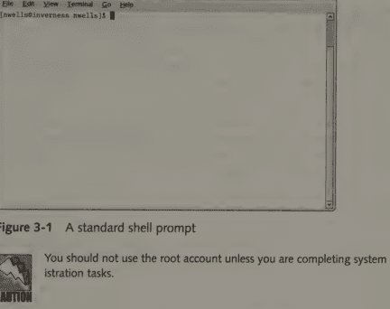

## Figure 3-1 A standard shell prompt

> 你不应使用 root 账户，除非你正在完成系统管理任务。

有时你执行的命令会提供自己的提示，在其中你可以输入命令，类似于 shell 环境。当你退出该程序时，你会返回到 shell 本身。提供自己提示的程序使用不同的字符，以便你可以分辨你不在 Linux shell 中工作。例如，当你运行 `at` 命令（在第 6 章“管理进程”中描述）时，提示会更改为 > 字符。

### The Functions of a Shell

shell 的目的是让用户在 Linux 中轻松运行程序并处理文件。这一简单的定义并不能完全概括 shell 的功能，但它解释了每个 shell 设计背后的基本原理。

shell 的主要目的是运行程序。当你使用 `ls` 命令查看目录中的文件，或使用 `mv` 命令重命名文件，或使用 `less` 命令查看文件时，你实际上是在运行执行这些任务的程序。shell 处理在键盘上输入的信息并使用它来启动程序。在许多情况下，你在命令行上输入的信息包括参数，例如要复制的文件名和要复制到的位置。shell 将这些参数传递给正在启动的程序。例如，在 shell 提示符下输入以下命令会导致 shell 启动 `cp` 命令，并向其传递两个参数 `report.doc` 和 `report.doc.bak`。在此示例中，`cp` 命令必须决定如何处理参数，或者如果无法确定如何处理参数则返回错误消息。

```
$ cp report.doc report.doc.bak
$
```

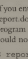

> 如果标准 Linux 命令在没有任何错误的情况下完成，shell 提示符会返回且没有任何反馈。这起初令人困惑，但在你创建脚本或命令以自动执行时效果很好（第 14 章“编写 Shell 脚本”的主题）。规则是，没有消息就是好消息。

如果你在 shell 提示符下输入以下命令，shell 会尝试启动名为 `report.doc` 的程序，并向该程序传递参数 `report.doc.bak` 和 `cp`。因为不存在名为 `report.doc` 的程序，shell（`bash`）会返回错误消息，指出它无法找到请求的命令：

```
$ report.doc report.doc.bak cp
bash: report.doc: command not found
$
```

除了启动程序的能力外，shell 还有许多内置功能，可帮助你在 Linux 系统上处理文件和命令。例如，从 shell 中，你可以使用键盘快捷键快速输入长命令，并且可以控制从 shell 提示符启动的多个程序。此外，你可以定义变量（将数字或字符串分配给名称）以使你的 shell 环境更易于使用，或提供其他程序在需要时可以访问的信息（变量的值）。

Linux shell 的一个特别重要的功能是它使用户能够编写 shell 可以执行的脚本。脚本就像程序或宏一样。（宏是一组可以通过引用宏的名称来执行的命令。）脚本本质上是存储在文本文件中的命令列表。无需在命令行上逐一输入这些命令，你可以使用脚本自动执行一系列命令。你将在第 14 章学习如何创建自己的 shell 脚本。

### Different Types of Shells

当 UNIX 最初创建时，其开发人员决定 shell 应与操作系统分离。这意味着 shell 可以在不影响操作系统的情况下更改。shell 与 Linux 内核没有任何特殊关系——它就像任何其他程序一样，只是其目的是启动其他程序。UNIX 的原始 shell 由 Stephen Bourne 编写，称为 Bourne shell。Bourne shell 程序称为 `sh`（代表“shell”）。尽管 Bourne shell 是所有 UNIX 和 Linux 系统的标准，但它是一个功能有限的老程序（它几乎在 30 年前首次编写）。

忠实于 UNIX 开发人员的远见，其他开发人员修改或增强了 Bourne shell 以提供新功能。这些后代 shell 今天在 UNIX 和 Linux 系统上使用。表 3-1 显示了 Linux 上常用的 shell。

## 表 3-1 Linux Shell

| Shell 名称 | 程序名称 | 描述 |

|---|---|---|

| Bourne shell | `sh` | 最初的 UNIX shell。Linux 上的 `sh` 程序通常指的是 `bash` 程序。`bash` 包含所有 `sh` 功能，外加交互式功能，如历史记录和 Tab 补全（本章后面会描述）以及通过 shell 脚本文件进行 shell 编程。 |

| Bourne Again shell (bash) | `bash` | GNU 项目为在许多类 UNIX 操作系统上使用而创建的 Bourne shell 的增强和扩展版本。常被称为 bash shell，而不是其全名；`bash` 是默认的 Linux shell。 |

| C shell | `csh` | 由 Bill Joy 在 1970 年代开发的 shell。他专注于为在 shell 提示符下进行交互式工作添加易于使用的功能。C shell 是第一个包含历史记录和 Tab 补全等功能（本章后面会描述）的 shell；这些功能后来也被添加到 `bash` shell 和其他 shell 中。C shell 使用比 Bourne 和 `bash` shell 更复杂的语法进行 shell 编程。因此，它不适合 shell 编程，但其交互式功能使其在不创建 shell 程序的用户中很受欢迎。 |

| TENEX/TOPS C shell（也称为 TC shell） | `tcsh` | C shell 的增强版本。这是 Linux 系统上常用的 C shell 版本。 |


| Shell | 命令 | 描述 |
|---|---|---|
| Korn shell | `ksh` | 由 David Korn 编写的专有（不可自由获得）shell。Korn shell 是 Bourne shell 的修订版，包含了 C shell 的交互式功能，但保持了 Bourne shell 编程语法，该语法被认为比 C shell 编程语法更容易使用。 |
| 公共领域 Korn shell | `pdksh` | 可自由获得的 Korn shell 版本。（该 shell 在 Linux 系统上通常使用名为 `ksh` 的程序访问。） |
| Z shell | `zsh` | 一个最近开发的 shell，它结合了 Korn shell 的交互式功能和 C shell 编程风格（对于喜欢 C shell 更复杂语法的用户）。 |

所有 Linux 系统的默认 shell 都是 `bash`。Linux 系统上的用户通常只使用 `bash` shell 就很满意。一些经验丰富的 UNIX 用户、大量编写 shell 脚本的用户，或需要其他 shell 功能的用户可能会使用其他 shell 程序。（C shell 和 TC shell 都使用与 `bash` 不同的 shell 编程方法。）

Shell 可以根据所使用的 shell 编程命令类型大致分为两组。两组为：

- 遵循 Bourne shell 编程风格的（基于一种非常古老的编程语言 ALGOL）。

- 遵循 C shell 编程风格的（基于广泛使用的 C 编程语言）。

进一步的 shell 衍生版本结合了不同 shell 的功能，使得这种分组变得不那么明显。例如，Z shell 包含了 `bash` shell 的许多流行功能，但使用 C shell 风格的编程。但这两组之间的总体区别仍然有效。

> 表 3-1 中的并非所有 shell 都默认安装或甚至包含在所有 Linux 发行版的 CD 上。请联系您的 Linux 供应商或互联网下载站点，例如 www.freshmeat.net 或 rpmfind.net，以获取未包含在您的 Linux CD 上的特定 shell

在 Linux 中，为每个用户启动的 shell 由用户账户配置文件中的设置决定。第 11 章“管理用户”描述了如何设置或修改此配置文件。如果您想要使用的 shell 已安装在 Linux 系统上，使用第 11 章中描述的 `usermod` 命令更改默认 shell 非常容易。系统上的每个用户都可以独立于其他用户选择首选 shell。

要立即运行已安装在您正在使用的 Linux 系统上的不同 shell，请输入该 shell 程序的名称。例如，如果您正在标准 `bash` shell 中工作但想改用 C shell，请输入以下命令：

```
$ csh
```

## 输入命令

现代 shell 如 `bash` 和 Korn shell 包含旨在简化输入命令和命令参数过程的功能。其中两个最有用的功能是 Tab 补全和命令历史。

### 使用 Tab 补全

Tab 补全是 shell 的一个功能，让您可以输入文件或目录名称的一部分，按 Tab 键，然后让 shell 填入名称的剩余部分。使用 Tab 补全可以更轻松地输入长或复杂的目录路径和文件名。这很有帮助，因为 Linux 文件名可能很长，有时包含标点符号、多个数字或句点，以及大小写混合。由于 Tab 补全是 shell 的功能，因此无论您输入哪个命令，只要在 shell 提示符下输入文本时都可以使用。只要 shell 判断您正在尝试输入命令名称、文件名或目录名称，您就可以使用 Tab 补全。

例如，假设您想使用 `ls` 命令显示 `/etc` 目录中配置文件的信息。您知道您想了解的文件名如下所示（该文件默认安装在 Fedora 上）：

```
webalizer.conf.sample
```

要查看此文件的信息，您切换到 `/etc` 目录并输入 `ls` 命令后跟文件名。但对于本示例，假设您只输入以下内容：

```
$ cd /etc
$ ls web
```

要在此处使用 Tab 补全，请按 Tab 键。shell 会查看 `/etc` 目录中与您输入的字母（web）匹配的文件或子目录。如果 shell 找到与您输入的字母匹配的文件名，它会填入该文件名的剩余部分。按下 Tab 后，您会立即在命令行看到以下内容：

```
$ ls webalizer.conf
```

shell 也会发出蜂鸣声。在这种情况下，`/etc` 目录包含两个相似的文件名：`webalizer.conf` 和 `webalizer.conf.sample`。shell 尽可能填入，然后发出蜂鸣声以表示有多个文件名以这些字母开头。快速连续按两次 Tab，shell 会显示两个匹配的文件名：

```
$ ls webalizer.conf
webalizer.conf webalizer.conf.sample
$ ls webalizer.conf
```

由于您知道您想要其中的第二个，您可以输入您想要的文件的第一个字符，在本例中为句点：

```
$ ls webalizer.conf.
```

现在再次按 Tab，shell 会填入完整的文件名 `webalizer.conf.sample`，因为该目录中唯一以 `webalizer.conf.` 开头的文件名就是它。


> 根据您使用 Tab 补全的情况，shell 会尝试判断您想要访问哪些项目。例如，在某些情况下，只有可执行文件才与您输入的文本进行比较。

当您第一次使用 Tab 补全时，您可能会认为不断按 Tab 并在文件名不唯一时输入更多字母比值得的工作更多。但经过一些练习后，使用 Tab 补全输入长文件名或路径会成为自动反应——比键入完整的文件或目录名容易得多。

当您输入的名称的第一部分是目录时，Tab 补全会填入目录名，以正斜杠结尾。这意味着您可以立即开始键入该目录中的子目录或文件名。

### 使用历史记录功能

第二个节省时间的 shell 功能是命令历史。命令历史记录了您在 shell 提示符下输入的每个命令。您可以快速调出并重复历史列表中的任何命令，而无需再次键入命令。最近输入的命令列表称为历史列表。

访问最近执行的命令最简单的方法是在命令提示符下按向上箭头键。要在显示命令后执行它，请按 Enter。重复按向上箭头键会依次显示每个先前输入的命令（历史列表中的命令）。按住向上箭头键可以看到 shell 提示符下闪过的数十个命令（历史列表的全部内容）。按向下箭头键可显示历史列表中更靠下的命令（最近输入的那些）。

当您想要重复的命令是在很久以前输入的时，使用向上箭头键在庞大的历史列表中定位它可能会很乏味。在这种情况下，`history` 命令很有用。`history` 命令会显示整个历史列表，通常至少包含 1000 个命令。以下显示了历史列表的最后几行。（当然，您系统上的历史列表中的命令和数字与此示例输出不同。）

```
33  who
34  vi /etc/passwd
35  gimp
36  cd /etc
37  cd X11/
38  cd xdm
39  more Xsession
40  rpm -qa |grep XFree
41  mount -t ext2 /dev/hda3 /mnt/openlinux/
42  mcopy /mnt/openlinux/etc/XF86Config-4 A:
43  file Xwrapper
44  umount /mnt/cdrom
45  type fvwm
46  exit
47  clear
48  mv ch05/ch04fig.zip ch04/
49  mv ch04/ch04fig.zip course_ch04/
50  cd course_ch04/
```

历史列表的长度可能使快速定位您想要重用的命令变得困难。您可以使用以下方法之一来定位先前执行的命令：

- 使用历史编号。

- 使用命令的开头部分。

- 搜索历史列表。

术语“history number”指的是历史列表中每个条目左侧的编号。例如，在前面的历史列表中，第一项的历史编号为 33。

你可以通过在命令编号前加上感叹号来执行历史列表中的任意一条命令。感叹号在 UNIX 和 Linux 中有时被称为 bang。因此，要执行我们示例中最新的 `mount` 命令，你输入 `!41`（读作“bang forty-one”）。

Shell 会显示与该编号匹配的命令并立即执行它。如果你已经知道要执行的命令的编号，就不需要先查看历史列表再使用此技巧。但请注意，随着你输入新的命令，编号会发生变化。

要使用命令名重复一条命令，请使用感叹号后跟上你想要重复的命令的第一部分。在所示的示例历史输出中，你可以使用以下命令执行最新的 `mount` 命令：

```
## !mou
```

执行此命令时，shell 会搜索最近以字母 “mou” 开头的命令并执行它。

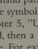


使用上述三种方法中的任何一种从历史列表执行命令时，请记住，命令都是从你当前的工作目录执行，这可能与它们最初被执行时的目录不同。如果一条命令不包含完整路径名，你可能会看到意外的结果。在使用部分命令名方法重新执行命令而不检查命令的完整文本时，尤其要小心。

你也可以在不重新执行命令的情况下搜索历史列表，以查看命令参数是什么或你是如何完成某项任务的。此方法需要使用管道符号（`|`）和`grep`命令，这些内容将在本章后面以及第 5 章“Understanding Text Processing”中讨论。要使用此方法，输入`history`命令，然后是管道符号，然后是`grep`命令和你想要查找的命令名。例如，在前面所示的示例历史输出中，假设你想搜索`mount`命令以查看它包含哪些参数。以下命令会显示历史列表中包含`mount`命令的所有条目。然后你可以查看显示的输出以了解之前执行的命令。

```
history | grep mount
```

`bash` shell 支持执行命令的额外技巧。但这里所示的关于使用 Tab 补全和`history`命令的示例应该能帮助你在 Linux 中更高效地输入命令。要了解有关这些功能的更多信息，请通过输入`man bash`查看`bash` shell 的在线手册页。

## The Shell Start-up Process

登录 Linux 或启动新的 shell 时会执行多个脚本。这些脚本会初始化（或配置）你环境中的各个部分。

当用户首次登录 Linux 系统时，会执行脚本`/etc/profile`。`/etc/profile`脚本包含适用于系统上每个用户的配置信息。每个用户的 home 目录可以包含另一个名为`.profile`（以句点开头）的启动脚本。用户登录时也会执行用户 home 目录中的`.profile`脚本，但`.profile`脚本特定于单个用户。每个用户的 home 目录可以包含不同的 profile 脚本。只有`root`用户可以更改`/etc/profile`脚本；任何用户都可以更改其 home 目录中的`.profile`脚本。


> Linux 中以句点开头的任何文件名都是隐藏文件。这与其说是安全功能，不如说是一种方便的方式，让很少更改的文件保持在视线之外。要查看包含所有隐藏文件的列表，请使用`ls`命令的`-a`选项。在你的 home 目录中，命令`ls -a`会生成一份包含大量隐藏配置文件 的长列表。

在某些系统上，用户登录时还会执行额外的脚本。例如，在 Red Hat Linux 中，`/etc/profile.d`目录中的一组脚本由`/etc/profile`脚本启动。`/etc/profile.d`目录中的脚本为许多不同的 Linux 程序添加特定的配置信息。Red Hat Linux 还使用名为`.bash_profile`的文件，而不是每个用户 home 目录中的标准`.profile`脚本。

`profile`脚本在用户登录时执行；启动 shell 时会执行额外的脚本。因为用户在文本模式屏幕登录时 shell 会立即启动，所以这些额外的脚本通常在`profile`脚本之后立即执行。在图形环境中工作的用户可以在不再次登录 Linux 的情况下启动多个`bash` shell。当已登录的用户启动新 shell 时，下文所述的额外脚本（如`/etc/bashrc`）会被执行；但是`profile`脚本不会再次执行。

一些 Linux 发行版，包括 Red Hat Linux，提供了一个`/etc/bashrc`脚本，该脚本在每次为系统上的所有用户启动`bash` shell 时都会执行。其他 Linux 发行版则依赖`/etc/profile`脚本来进行应适用于所有用户的配置设置，但该脚本仅在用户登录时执行。

每个用户的 home 目录包含一个名为`.bashrc`的脚本。每次用户启动`bash` shell 时都会执行`.bashrc`脚本。用户希望添加到其环境中的任何配置信息都可以放在`.bashrc`文件中。某些 Linux 发行版有时会使用名称相似的额外脚本。示例包括以下内容：

- `.bash_default`，每次启动`bash` shell 时都会执行

- `.bash_login`，每次启动`bash` shell 时都会执行

- `.bash_logout`，每次用户关闭`bash` shell 时都会执行

你可能会在 Linux 发行版上找到其他名称相似的脚本。一般来说，这些文件的名称描述了它们的使用时机。如果你不确定文件的使用方式，请咨询你的 Linux 厂商或尝试在每个文件中放置测试命令（请参阅第 14 章了解说明）。图 3-2 显示了用户登录 Linux 时典型的启动脚本执行序列。

```
/etc/profile → ~/.profile → /etc/bashrc → ~/.bashrc
                or
                ~/.bash_profile
```

### Figure 3-2 The process of executing start-up shell scripts


X Window System 启动时还会执行额外的脚本。例如，用户 home 目录可能包含一个名为`.xclients`或`.xinitrc`的脚本文件，X Window System 在图形系统启动时会检查并执行它。需要注意的一个关键区别是，当用户登录或启动 shell 时，系统范围的脚本文件（如`/etc/profile`）会先执行，然后执行用户 home 目录中对应的文件。但在启动 X Window System 时，系统默认文件（如`/etc/X11/xinit/xinitrc`）只有在用户 home 目录中未找到对应文件时才会被执行。第 15 章“Advanced Topics and Troubleshooting”更深入地描述了这些问题。

这里描述的脚本适用于启动`bash` shell 时。选择使用 C shell、Korn shell 或其他 shell 时也会执行类似的文件。例如，用户 home 目录可能包含一个名为`.cshrc`或`.kshrc`的文件。这些脚本分别在每次启动 C shell 或 Korn shell 时执行。因为每种 shell 的脚本格式不同，所以需要不同的脚本文件来初始化每种 shell。这些配置脚本可以共存于用户的 home 目录中（以及`/etc`目录中用于系统范围配置的文件），每个脚本仅在对应的 shell 启动时执行。

## Using Aliases

别名是一个在 shell 提示符下被替换为另一串字符的字符串。`alias`命令让你定义 shell 如何将你在 shell 提示符下输入的一个文本串替换为另一个文本串。`alias`命令的一般格式如下：

```
alias <string entered by user>=<string substituted by the shell>
```

例如，假设你不断地把`mount`命令误输入为`mmount`。你可以创建一个别名来自动纠正你的输入错误：

```
alias mmount=mount
```

在该别名生效的情况下，每次你在 shell 提示符下输入字符串`mmount`时，shell 都会将其替换为字符串`mount`。

在你创建别名后，每次你在命令提示符下输入别名文本时，shell 都会用你定义的其他字符字符串替换它。在创建使用现有命令名的别名时，你必须小心。例如，输入命令`alias more=less`将使`more`命令失效，因为每次你输入`more`时，shell 都会将其替换为字符串`less`。许多 Linux 发行版会在`/etc/profile`或`/etc/bashrc`脚本中放置一些别名作为默认配置的一部分。要查看当前生效的别名列表，只需输入`alias`命令且在其后不加任何文本即可。

当 shell 替换的字符串包含空格时，必须用引号将其括起来。例如：

```
alias ll="ls -la"
```

`alias`命令在多种情况下很有用，包括此处列出的情况：

- 别名可以缩短长命令。例如，如果你经常输入一个带有很多选项的命令，可以创建一个别名，以便你只需输入两三个字符即可输入该命令。

- 别名可以纠正输入或拼写错误。例如，如果你总是输入`route`而不是`route`，你可以创建一个别名使`ruote=route`。别名可以帮助刚接触 Linux 的人使用系统，而无需完全掌握所有命令。

- 别名可以通过在用于删除文件的命令中自动插入选项来保护你免于擦除或损坏文件。例如，命令`alias cp="cp -i"`会导致 shell 总是以`-i`选项执行`cp`命令，这可以防止在复制时覆盖文件。

- 别名可以添加你喜欢使用的命令名，但这些命令名不是 Linux 默认的一部分。例如，你可以使用别名将字符串`mv`替换为`rename`。


当然，使用别名来实现这些目的并不会帮助你掌握 Linux 命令，也无法提高你的打字技能。但明智地使用别名，可以使你在 Linux 命令行工作时任务进展更快。


输入 `alias` 命令会使该别名仅在当前 shell 中处于活动状态。如果你决定使用一些额外的别名命令，可以将它们添加到你主目录中的 `.bashrc` 文件中（或你使用的 shell 的启动文件，例如 `.pdksrc`），以便每次启动 shell 时都执行它们。

## 命令行展开

别名是 shell 将命令行上输入的文本替换为其他内容的示例之一。事实上，shell 可以进行多种不同的替换，包括以下内容：

- 别名导致 shell 将一个文本字符串替换为另一个文本字符串。
- 变量（在下一节中描述）导致 shell 将变量的值替换为该变量的名称。
- 命令替换导致 shell 执行一个命令并将 resulting 输出放置到另一个命令的中间。
- 特殊字符由 shell 解释，其含义与字面字符不同。

考虑以下示例，其中几个使用了 `echo` 命令。`echo` 命令将文本写入屏幕；它经常在脚本中使用（将在第 14 章中讨论）。对于每个示例，输出显示在命令之后。第一个示例显示了标准的 `echo` 命令。

```
$ echo Your file has been processed

Your file has been processed
```

现在假设你想在 `echo` 命令的输出中包含日期。你可以用命令替换来实现这一点。将你想要执行的命令用反引号字符括起来，或放在美元符号前面的括号之间。

```
$ echo Your file was processed on `date +%m/%d/%y`

Your file was processed on 07/15/05
```

`date` 命令首先由 shell 执行，然后该命令的输出被放置在命令行中 `date` 命令所在的位置。

组合 `\n` 对 shell 具有特殊含义。它表示“换行”（有时称为回车）。当 shell 检测到 `\n` 组合时，它将其解释为单个换行字符。你需要在命令行上使用特殊格式来使 shell 识别换行和类似的特殊字符组合：将组合用单引号括起来（不是反引号），并在前面加上美元符号：

你之前学过，你可以使用 `?` 和 `*` 通配符字符来匹配多个文件名。当你在命令行上输入一个 `*` 时，shell 实际上会替换所有匹配的文件名并将它们传递给你输入的命令。例如，假设你正在工作的目录中有三个文件：`file1`、`file2` 和 `file3`。当你输入此命令时：

```
$ cp file* /tmp
```

shell 会检查当前工作目录，查看哪些文件名与 `file*` 模式匹配。生成的文件列表会传递给 `cp` 命令。因此，在此示例中传递给 copy 的参数实际上将是：

```
file1 file2 file3 /tmp
```

## 防止命令行展开

尽管这些示例展示了 shell 执行的命令行展开的强大功能，但你可能并不总是希望 shell 展开你输入的内容。例如，假设你想使用 `echo` 命令输出分号字符，而不是让它创建一个复合命令。或者假设你需要你正在执行的命令处理 `*` 字符，而不是像前面的 `cp` 命令示例那样从 shell 接收文件列表。在这些以及许多类似的情况下，你希望避免命令行展开。

shell 提供了三种防止命令行展开的方法：转义单个字符、单引号和双引号。

shell 中的转义字符是反斜杠（`\`）。当你在特殊字符前加上反斜杠时，该字符会被字面解释而不是作为特殊字符。例如，假设你想输出一个星号。如果你使用此命令：

```
$ echo *** Do not run this script while logged in as root! ***
```

shell 会将 `***` 展开以匹配当前目录中的每个文件，因此此命令可能会列出大量你不想要的信息。你可以在每个星号前加上反斜杠以获得所需输出：

```
$ echo \*\*\* Do not run this script while logged in as root! \*\*\*
```

当你有多个想要转义的字符时，可以将整个表达式用单引号括起来。这会导致单引号内的所有内容都被字面解释：

```
$ echo '*** Do not run this script while logged in as root! ***'
```

不要将用于防止命令行替换的前向单引号（`'`）与用于引起命令替换的反向单引号（`` ` ``）混淆。前向单引号通常位于键盘上的 Enter 或 Return 键旁边；反向单引号的位置各不相同，但可能位于数字 1 旁边的左上角，或空格键的两端附近。

防止不需要的命令行替换的第三种形式是使用双引号——标准引号。效果几乎与单引号相同，但某些特殊字符仍会被 shell 解释而不是字面使用。当你使用单引号时，它们之间的所有内容都会被字面解释；当你使用双引号时，它们之间的所有内容都会被字面解释，除了以下内容：

- `$` 用于表示变量的开始
- `` ` `` 用于表示命令替换的开始
- `\$` 用于输出 `$` 字符
- `` \` `` 用于输出 `` ` `` 字符
- `\"` 用于输出 `"` 字符
- `\\` 用于输出 `\` 字符

因此，例如，以下命令的某些部分被解释为特殊字符，某些部分被字面解释，如输出所示：

```
$ echo "$USER has entered a \"value\" over \$500;
this is not a valid entry."

James has entered a "value" over $500; this is not a valid entry.
```

将上述示例与使用单引号而不是双引号时的输出进行比较：

```
$ echo '$USER has entered a \"value\" over \$500;
this is not a valid entry.'

$USER has entered a \"value\" over \$500;
this is not a valid entry.
```

弄清楚 shell 如何在复杂的命令行语句中替换各种字符可能具有挑战性，即使对于经验丰富的系统管理员也是如此。通过尝试不同的组合，你可以学习如何获得预期的结果。尽管它没有很多示例来指导你，但一个有价值的参考是 `bash` shell 的 man 手册。你可以通过输入命令 `man bash` 来查看它。

# SHELL VARIABLES

在 Linux shell 中使用的 shell 变量，是一个可以为其分配值的名称。该值可以是数字或文本字符串，尽管 shell 使用的大多数变量都由文本组成。变量通常使用全部大写字母创建，尽管它们不必如此。（它们是区分大小写的，因此在引用您创建的变量时请保持一致。）

环境变量是在初始化操作系统或用户正在使用的特定 shell 的过程中通常已定义（分配值）的变量。您可以根据需要定义其他环境变量。任何程序（或在命令行执行的任何命令）都可以根据需要访问环境变量的值。一些环境变量特定于系统上的每个用户；其他变量对所有用户都相同。例如，`HOME` 环境变量的值是用户主目录的路径，而 `USER` 环境变量的值是当前用户账户名。但 `OSTYPE` 环境变量保存字符串 "Linux"，这对系统上的所有用户都相同。

许多程序使用环境变量来获取有关您的环境的信息或关于特定程序应如何运行的信息。例如，程序可能会使用 `HOME` 变量来确定在何处查找用户的数据文件。程序还可能期望某些环境变量已专门为该程序的使用而设置。例如，数据库程序的文档可能说明在启动程序之前，您必须定义一个名为 `DB_DIR` 的环境变量，该变量定义数据库文件所在的目录。如果您在先设置此环境变量之前执行数据库程序，程序将无法正常运行。（程序通常会显示错误消息以指出问题。）当程序需要某些环境变量设置时，您应该在系统范围的启动脚本中或在特定用户的启动脚本中（如果只有一名用户运行该程序）包含设置这些变量的命令。

您可以使用 `env` 命令以非当前环境一部分的环境变量设置启动程序。该变量仅用于您启动的程序。例如，假设您想执行一个数据库程序。该程序要求环境变量 `DB_DIR` 设置为 `/data` 目录，但该变量未在您的环境中设置，并且您不想永久设置它，因为您只是试验数据库程序。您可以使用以下命令以所需的环境变量设置启动数据库程序（假设它名为 `dbprogram`）。（您可以在程序名称 `dbprogram` 之后加上数据库程序所需的任何选项。）

```
$ env DB_DIR=/data dbprogram
```

在 Linux 启动或用户登录时运行的初始化脚本或启动脚本会创建许多环境变量并为其分配值。每次用户启动程序时，该新程序的环境都取自（继承自）启动它的程序。当您在图形环境中打开 shell 时，shell 会继承该图形环境的所有环境变量。如果您从 shell 启动程序，该程序会继承 shell 的所有环境变量。


# 环境变量

## `set` 命令

`set` 命令会显示当前环境中定义的所有环境变量的列表。下面显示了在 Red Hat Linux 上普通用户（非 root）的 `set` 命令的示例输出。`set` 列出的许多变量由您尚未熟悉的系统进程使用，但您会认出其中一些。例如，`PWD` 变量包含当前工作目录的值。当您执行 `pwd` 命令时，此环境变量的值会显示在屏幕上。当您使用 `cd` 命令时，此环境变量的值会被更新。

```
$ set
BASH=/bin/bash
BASH_VERSIONINFO=[0]="2" [1]="05b" [2]="0" [3]="1" [4]="release" [5]="vi386-redhat-linux-gnu"
BASH_VERSION='2.05b.0(1)-release'
COLORS=/etc/DIR_COLORS.xterm
COLORTERM=gnome-terminal
COLUMNS=80
DESKTOP_SESSION=default
DESKTOP_STARTUP_ID=
DIRSTACK=()
DISPLAY=:0.0
EUID=500
GDMSESSION=default
GNOME_DESKTOP_SESSION_ID=Default
GROUPS=()
GTK_RC_FILES=/etc/gtk/gtkrc:/home/nwells/.gtkrc-1.2-gnome2
G_BROKEN_FILENAMES=1
HISTFILE=/home/nwells/.bash_history
HISTFILESIZE=1000
HISTSIZE=1000
HOME=/home/nwells
HOSTNAME=localhost.localdomain
HOSTTYPE=i386
IFS=$' \t\n'
INPUTRC=/etc/inputrc
LAMHELPFILE=/etc/lam/lam-helpfile
LANG=en_US.UTF-8
LANGVAR=en_US.UTF-8
LESSOPEN='| /usr/bin/lesspipe.sh %s'
LINES=24
LOGNAME=nwells
LS_COLORS='no=00:fi=00:di=00;34:ln=00;36:pi=40;33:so=00;35:bd=40;33;01:cd=40;33;01:or=01;05;37;41:mi=01;05;37;41:ex=00;32:*.cmd=00;32:*.exe=00;32:*.com=00;32:*.btm=00;32:*.bat=00;32:*.sh=00;32:*.csh=00;32:*.tar=00;31:*.tgz=00;31:*.arj=00;31:*.taz=00;31:*.lzh=00;31:*.zip=00;31:*.z=00;31:'
*.bz2=00;31:*.bz2=00;31:*.tz=00;31:*.rpm=00;31:*.cpio=00;31:*.jpg=00;35:*.gif=00;35:*.bmp=00;35:*.xbm=00;35:*.xpm=00;35:*.png=00;35:*.tif=00;35:
MACHETYPE=1386-redhat-linux-gnu
MAIL=/var/spool/mail/nwells
MAILCHECK=60
OLDPWD=/home/nwells
OPTERR=1
OPTIND=1
OSTYPE=linux-gnu
PATH=/usr/kerberos/bin:/usr/local/bin:/usr/bin:/bin:/usr/X11R6/bin:/home/nwells/bin
PIPESTATUS=[0]=0'
PPID=1349
PROMPT_COMMAND='echo -ne "\033]0;${USER}@${HOSTNAME}:: ${PWD/#$HOME/~}\007"'
PS1='[\u@\h \W]\$ '
PS2='>'
PS4='+ '
PVM_ROOT=/usr/share/pvm3
PVM_RSH=/usr/bin/rsh
PWD=/etc
QTDIR=/usr/lib/qt-3.1
SESSION_MANAGER=local/localhost.localdomain:/tmp/.ICE-unix/1206
SHELL=/bin/bash
SHELLOPTS=braceexpand:emacs:hashall:histexpand:history:interactive-comments:monitor
SHLVL=2
SSH_AGENT_PID=1259
SSH_ASKPASS=/usr/libexec/openssh/gnome-ssh-askpass
SSH_AUTH_SOCK=/tmp/ssh-pNMW1206/agent.1206
SUPPORTED=en_US.UTF-8:en_US:en
TERM=xterm
UID=500
USER=nwells
WINDOWID=33554507
XAUTHORITY=/home/nwells/.Xauthority
XMODIFIERS=@im=none
XPVM_ROOT=/usr/share/pvm3/xpvm
=set
i=/etc/profile.d/xpvm.sh
```

## 查看单个环境变量

您可以使用 `echo` 命令查看单个环境变量的值。要查看环境变量的值，请执行 `echo` 后跟环境变量名称，并在其前加上美元符号。美元符号是特殊字符，表示 shell 应在该点替换变量的值。例如，要将 `HOME` 变量的值打印到屏幕，请使用以下命令：

```
$ echo $HOME
```

## `export` 命令

`export` 命令使新创建的环境变量可供从该环境运行的其他程序使用。例如，要定义数据库程序所需的新环境变量 `db_data`，然后使该变量可供 shell 本身以外的其他程序（包括数据库程序）使用，请使用以下两个命令：

```
$ DB_DIR=/usr/local/db_data
$ export DB_DIR
```

`shell` 本身依赖于许多环境变量。`bash` shell 的在线手册页列出了 shell 使用（或如果您设置它们则可以使用）的数十个变量来控制或选择 shell 的功能。这里作为示例描述了其中两个变量。

### `PATH` 环境变量

`PATH` 环境变量包含 Linux 系统上 shell 在每次执行命令时搜索的目录列表。当您在 shell 提示符下输入要运行的程序名称时，shell 会在 `PATH` 变量值中列出的每个目录中搜索。如果在第一个目录中未找到程序，则会搜索第二个目录，以此类推。查看 `PATH` 值的命令是 `echo $PATH`。Red Hat Linux 上此命令的示例输出如下所示。（`PATH` 的值取决于您是以 root 身份登录还是以普通用户身份登录。以下是普通用户账户的输出。）

```
$ echo $PATH
/usr/kerberos/bin:/usr/local/bin:/usr/bin:/bin:/usr/X11R6/bin:/home/nwells/bin
```

假设您想执行一个程序，但程序所在的目录不是 `PATH` 变量的一部分。您必须向 shell 提供文件的完整路径。例如：

```
$ /tmp/downloads/screensaver-sample
```

如果您只输入 `screensaver-sample`，shell 会在 `PATH` 目录中查找但无法找到程序。一个有趣的练习是在空的 shell 提示符行上按两次 Tab 键。shell 会尝试使用制表符补全，但由于您未输入任何字符，可能的匹配列表非常大——它包括 `PATH` 变量中列出的每个目录中的所有可执行程序。当您这样做（按两次 Tab）时，shell 会请求确认并显示类似以下的消息：

```
Display all 3636 possibilities? (y or n)
```

按 "y" 键表示 "yes" 会导致 shell 列出它可以在 `PATH` 目录中找到的所有可执行程序。

### `PS1` 环境变量

`shell` 使用的另一个环境变量是 `PS1`。此变量定义 `bash` 的 shell 提示符。请注意默认值：

```
$ echo $PS1
```

```
[\u@\h \W]\$
```

`\u`、`\h` 和 `\w` 参数分别指代用户名、主机名和工作目录。你可以通过更改此变量的值来更改 shell 提示符。这在本章末尾作为动手项目 3-1 呈现。

## 数据重定向

Linux 中大多数输入和输出操作都是使用标准通道执行的。输入通常来自键盘，输出通常发送到屏幕。然而，Linux 中的通信通道可以使用重定向运算符进行重定向。重定向功能为你使用 Linux 命令行实用程序提供了极大的灵活性。

当程序期望输入例如一行文本时，它会从标准输入通道读取该信息（缩写为 `STDIN`）。通常，内核提供的 `STDIN` 数据来自键盘。但你可以重定向输入，以便内核将程序的数据从文件或另一个程序传递，而不是从键盘传递。

类似地，当程序生成输出时，它通常会将其发送到标准输出通道（缩写为 `STDOUT`），以便在屏幕上显示该信息。系统通常会将发送到 `STDOUT` 通道的内容写入程序启动的窗口中的屏幕。`STDOUT` 数据可以被重定向，以便程序发送到 `STDOUT` 的任何内容都直接写入文件或发送到另一个程序。


第三个标准通道称为标准错误（缩写为 `STDERR`）。错误消息会单独写入标准错误，而与 `STDOUT` 分开，以防 `STDOUT` 已被重定向。当然，`STDERR` 的输出也可以重定向到新位置，例如错误日志文件。

用于在程序之间重定向通信的特殊工具称为管道。管道将一个命令的输出通道连接到另一个命令的输入通道。管道用于将一个应用程序的输出连接到另一个应用程序的输入。图 3-3 从概念上展示了其工作原理。

要查看管道的实际操作，请考虑两个命令：`ls`，用于列出目录的内容；`sort`，用于对文件中的所有行进行排序。`ls` 命令通常将输出写入屏幕，而 `sort` 通常需要文件名作为参数。但你可以通过在 Linux 命令提示符下输入以下内容来组合 `ls` 和 `sort` 命令：

```
$ ls /etc | sort
```

此 `ls` 命令的输出不会写入屏幕。相反，它会被发送（管道传输）到 `sort` 命令。虽然 `sort` 命令通常需要文件名，但在这种情况下，它从 `ls` 命令接收要排序的项目名称。结果是 `sort` 将 `ls` 的行按每行第一个单词排序后写入屏幕。

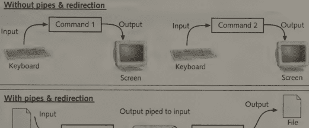

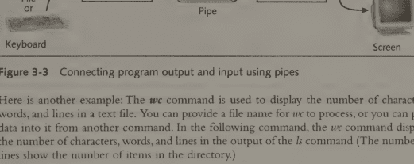

### 图 3-3 使用管道连接程序输出和输入

这里是另一个例子：`wc` 命令用于显示文本文件中的字符数、单词数和行数。你可以为 `wc` 提供要处理的文件名，也可以从另一个命令将数据通过管道传输到它。在以下命令中，`wc` 命令显示 `ls` 命令输出中的字符数、单词数和行数（行数显示目录中的项目数。）

```
$ ls /etc | wc
```

通过结合 `STDIN`、`STDOUT` 和 `STDERR` 的功能以及重定向这些通信通道和使用管道的能力，每个 Linux 实用程序都可以与其他实用程序和文件交互，以为用户和系统管理员处理复杂任务。表 3-2 显示了在 Linux 命令行上用于指示 shell 重定向程序之间通信的特殊字符。

## 表 3-2 重定向输入和输出

| 命令语句中使用的符号 | 描述 | 命令行示例 |
|---|---|---|
| `> filename` | 将 `STDOUT` 输出写入给定的文件名 | `ls -l > savelisting` |
| `>> filename` | 将 `STDOUT` 输出追加到给定的文件名（添加到现有文件内容的末尾） | `cat newfile >> existing_file` |
| `< filename` | 将来自给定文件名的數據作为 `STDIN` 发送，而不是从键盘读取 | `my_script < input_codes` |
| `<< word` | 发送文本行作为标准输入，直到出现 `word` 为止。（`EOF` 是通常选择的结束词的典型示例。）这称为“here document”，并在 shell 脚本中使用，将特定文本馈送给从 `STDIN` 读取的程序。有关更多详细信息，请参阅 `bash` 手册页。 | `program << EOF`<br>`input line 1`<br>`input line 2`<br>`input line 3`<br>`EOF` |
| `program` | `program` | 在两个程序之间创建管道，以便管道符号左侧命令的 `STDOUT` 输出用作管道符号右侧命令的 `STDIN` 输入 | `ls | sort` |

精明的系统管理员了解命令选项，并且能够组合基本实用程序，通过输入单个连接命令字符串提供各种有用信息。这里展示了几个如何做到这一点的示例。

假设你一直在处理一个大型数据文件。你获得了一组较小的信息，你想将其添加到较大的文件中。你知道可以使用 `cat` 命令将任何文件的内容写入屏幕（到 `STDOUT`）；使用追加运算符，你可以将小文件添加到大文件的末尾：

```
$ cat small_file >> large_file
```

如果你不使用追加运算符，而是使用基本重定向运算符，则 `cat` 命令的输出（`small_file` 的内容）会创建一个名为 `large_file` 的新文件，覆盖现有的 `large_file`：

```
$ cat small_file > large_file
```

假设现在你有一个包含姓名和地址记录的小文件。你想对这些记录进行排序，但你也想在屏幕上看到排序后的结果。`tee` 命令允许你将输出重定向到文件并同时发送到屏幕。例如，以下命令显示 `sort` 命令的输出并将其写入文件 `sorted_data`。

```
$ sort data_file | tee sorted_data
```

你可以通过添加 `-a` 选项使 `tee` 命令将数据追加到命名文件的末尾：

```
$ sort data_file | tee -a sorted_data
```

接下来，假设你想通过电子邮件将一个或多个命令的输出发送给用户，无论是系统上的另一用户还是通过互联网发送给某人。`mail` 命令是一个基本的电子邮件客户端，你可以从命令行使用它来创建电子邮件消息（或读取消息，尽管它对于该任务来说不是很用户友好）。`mail` 命令用于发送消息时的基本格式是：

```
mail -s "subject line" e-mail_address
```

在你输入上述命令并按 Enter 后，你可以输入要发送的消息文本。当你按 `Ctrl+D` 表示已完成输入文本时，消息将被发送。（根据系统的配置，你可能需要在 `CC:` 行上按一次 Enter。）有了这一介绍，你就可以使用管道通过电子邮件将任何 Linux 命令的输出发送给某人。例如，以下命令将 `ps` 命令的输出（列出系统上运行的所有程序）通过管道传输到 `mail` 命令，将输出通过电子邮件发送到地址 `nwells@comcast.net`

```
$ ps -aux | mail -s "ps output sample" nwells@comcast.net
```

在命令行上使用 shell 变量并执行复杂的重定向操作提供了在配置用户环境时极大的灵活性。但 Linux 环境的许多部分——几乎所有 Linux 程序——都必须通过编辑文本文件手动配置。虽然存在一些用于执行这些任务的有效图形工具，但熟练使用文本编辑器是系统管理员必须具备的最基本能力之一。下一节将介绍如何使用最广泛使用的 Linux 编辑器 `vi`。

## 使用 VI 编辑文本

任何系统管理员最重要的实用程序就是文本编辑器。这是因为 Linux 系统上发生的绝大多数事情都由文本配置文件控制。有时提供图形配置实用程序来协助配置，但称职的 Linux 系统管理员也可以使用任何文本编辑器修改配置文件。这提供了在特殊配置实用程序不可用时更新或修复 Linux 系统的灵活性。

Linux 可用的文本编辑器有很多种。一些文本编辑器是图形化的，例如 GNOME 中的 `gedit` 程序。你不需要特殊培训即可使用图形文本编辑器，因为菜单栏和对话框会指导你完成任何需要执行的编辑任务。图形编辑器的缺点是你必须使用 X Window System。X 可能不可用，因为你正在通过网络连接管理服务器，或者你选择不在 Linux 服务器本身上安装 X。每当图形环境不可用时，你都可以使用文本模式文本编辑器。

一些常用的文本模式编辑器在此列出。并非所有编辑器都包含在每个版本的 Linux 中，但其中几个可能在您使用的 Linux 系统上可用。

- `vi`：名称代表“visual editor”（可视编辑器），不过第一次与 `vi` 交互时你可能会怀疑这个名称是否合适。它没有任何关于如何使用编辑器功能的视觉提示。这是 UNIX 和 Linux 系统上使用最广泛的编辑器。本节将详细介绍它。`vi` 的不同版本，例如 `vim` 和 `elvis`，通常使用命令 `vi` 启动。

- `emacs`：这个功能强大的编辑器提供宏、编程工具、自定义以及数百个键盘快捷键。有一个名为 `xemacs` 的图形版本。`emacs` 在 UNIX 和 Linux 爱好者中拥有大量拥护者，但在系统管理员中并不像 `vi` 那样普遍流行。`emacs` 需要大量的硬盘空间。

- `pico`：这个简单的编辑器在屏幕上显示用于执行编辑功能的 Control 键序列信息。

- `joe`：这是另一个简单的文本编辑器，具有屏幕命令帮助功能。

`vi` 是一个非常强大的程序，可在几乎所有 Linux 系统上使用。虽然 `vi` 不易使用，但作为 Linux 系统管理员工作时，你必须学会使用 `vi` 的至少基本功能。这意味着你必须记住按键序列，并在没有任何屏幕提示指导你的情况下工作。一旦你学会了一些命令，控制 `vi` 的模式就会开始显现，学习新命令就会变得更容易。

> 因为 `vi` 假设你知道自己在做什么，如果在熟悉 `vi` 命令之前就编辑真实的配置文件，你很容易覆盖重要信息。编辑文件前备份文件是一个很好的预防措施。

要启动 `vi`，在任何 Linux shell 提示符下输入命令 `vi`。你可以在程序名后加上要编辑的文件名，例如 `vi /etc/profile`，或仅输入 `vi` 开始创建新文件。当你打开新文件（或小文件）时，你会在屏幕左侧看到波浪字符（~）。这些表示不属于文件（因为新文件是空的）的行。图 3-4 显示了使用小文件编辑时 `vi` 的情况。


`vi`是一个模式编辑器。在模式编辑器中，你的按键根据你工作的模式被不同地解释。例如，如果你处于命令模式并按下某个键，该键被解释为命令；如果你处于编辑模式并按下某个键，该键被解释为数据输入并添加到文档中。`vi`有几种模式。你立即需要了解的最重要的模式是：

- **命令模式：** 按键被解释为编辑文件的命令，例如删除行或搜索文本。
- **插入模式：** 按键被插入到你正在编辑的文档中。
- **替换模式：** 按键被添加到你正在编辑的文档中，覆盖开始输入位置的任何现有文本。

当你打开`vi`时，你开始于命令模式。你始终可以通过按 Esc 键返回命令模式。当你处于命令模式时，`vi`仅显示你正在编辑的文档。当你处于插入模式或替换模式时，你会在屏幕底部看到一条消息行，文字为 `--INSERT--` 或 `--REPLACE--`。（你将在本节后面学习如何在模式之间切换。）

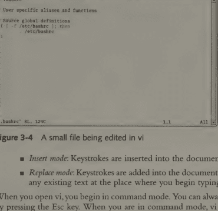

## Figure 3-4 A small file being edited in `vi`


对于`vi`中的许多命令，你必须输入多个按键。下面的表格使用符号`Ctrl+X`表示“按住 Control 键同时按下 X 键”。符号`1, Ctrl+g`表示“按下 1 键，然后按住 Control 键同时按下 g 键”。所有`vi`命令区分大小写。符号`Ctrl+g`表示小写的`g`。符号`Ctrl+Shift+G`表示大写的`G`。

你可以使用箭头键和 Page Up 和 Page Down 在编辑文档时在屏幕上移动。这些键在你处于插入模式或替换模式时通常有效。表 3-3 显示了在命令模式下移动大文档时可使用的额外命令。

## Table 3-3 `vi` Commands Used for Moving around a Document in Command Mode

| Keystroke | Description |
|---|---|
| `j` | Move the cursor one line down |
| `k` | Move the cursor one line up |
| `h` | Move the cursor one character left |
| `l` | Move the cursor one character right |
| `w` | Move the cursor one word forward |
| `b` | Move the cursor one word backward |
| `Shift+G` | Move to the last line of the file |
| `1. Shift+G` | Move to the first line of the file |
| `10. Shift+G` | Move to the tenth line of the file |
| `Ctrl+g` | Display a status line at the bottom of the screen to indicate the line number where the cursor is positioned and the name of the file being edited |
| `H` | Move the cursor to the top line of the screen |
| `L` | Move the cursor to the bottom line of the screen |
| `0` (zero) | Move the cursor to the first character of the current line |
| `$` | Move the cursor to the last character of the current line |


如果你通过网络连接在 Linux 上工作（例如，使用 Microsoft Windows Telnet 程序），`vi`可能无法正确显示文本。问题的第一个迹象通常是箭头键无法正常工作。你仍然可以使用表 3-3 中的命令在文档中移动，但你可能想调查获取更好的 Windows 系统终端程序，例如 PowerTerm Pro。（参见 www.eric.com。）当你在 GNOME 上的终端窗口或 Linux 系统上的文本模式控制台之外运行`vi`时，你可能需要重置`TERM`环境变量的值，以便 shell 能够正确解释用于控制`vi`的特殊字符。`bash`手册页对此主题有更多信息。

除了在文档中从一个位置移动到另一个位置外，你还可以在命令模式下更改文本。表 3-4 显示了可在`vi`命令模式下使用的一些常见编辑命令。从这里给出的命令中，你可以推导出其他类似命令。例如，如果命令`10yy`将 10 行复制到剪贴板，则命令`20yy`将 20 行复制到剪贴板。在`vi`中，你可能称之为剪贴板的存储区域被称为缓冲区。你可以像使用剪贴板一样使用基本缓冲区，但`vi`有许多不同的缓冲区，如果你想同时复制和移动多个文本块，可以按名称引用它们。

## Table 3-4 Standard `vi` Editing Commands

| Keystroke | Description |
|---|---|
| `x` | Delete one character to the right of the cursor |
| `5x` | Delete five characters to the right of the cursor |
| `dw` | Delete one word to the right of the cursor |
| `5dw` | Delete five words to the right of the cursor |
| `dd` | Delete the current line |
| `D` | Delete from the cursor position to the end of the current line |
| `u` | Undo the previous command (use repeatedly to undo several commands) |
| `yy` | Copy the current line into a buffer (the letter "y" refers to "yank," which is how `vi` refers to copying text to a buffer) |
| `p` | Put the line(s) from the standard buffer below the current line |
| `J` | Join the next line to the end of the current line (remove the end-of-line character at the end of the current line) |
| `.` | Repeat the last edit command |

## Table 3-4 Standard `vi` Editing Commands (continued)

| Keystroke | Description |
|---|---|
| `dd` | Delete the current line |
| `D` | Delete from the cursor position to the end of the current line |
| `u` | Undo the previous command (use repeatedly to undo several commands) |
| `yy` | Copy the current line into a buffer (the letter "y" refers to "yank," which is how `vi` refers to copying text to a buffer) |
| `p` | Put the line(s) from the standard buffer below the current line |
| `J` | Join the next line to the end of the current line (remove the end-of-line character at the end of the current line) |
| `.` | Repeat the last edit command |


你可以使用几种不同的命令进入插入或替换模式，具体取决于你想开始输入文本的位置。表 3-5 显示了此类最常用的命令。当你（在命令模式下）输入这些命令中的任何一个时，你会在 vi 屏幕底部看到 `--INSERT--` 或 `--REPLACE--` 指示符。一旦你进入插入或替换模式，你输入的文本会出现在文档中，而不是被解释为 vi 命令。

## Table 3-5 vi Commands to Enter Insert or Replace Mode

| Keystroke | Description |
|---|---|
| `i` | Begin inserting text to the left of the current cursor position |
| `a` | Begin inserting text to the right of the current cursor position |
| `I` | Begin inserting text at the beginning of the current line |
| `A` | Begin inserting text at the end of the current line |
| `o` (the letter "o") | Insert a blank line after the line that the cursor is on, place the cursor on the new line, and begin inserting text |
| `O` | Insert a blank line above the line that the cursor is on, place the cursor on the new line, and begin inserting text |
| `r` | Replace one character with the next character entered |
| `R` | Enter replace mode; all text entered will overwrite existing text beginning at the current cursor position |

到目前为止显示的所有命令都会影响你正在编辑的文档，但在输入命令字符时不会显示任何内容。许多 vi 命令在输入时确实会显示你输入的文本，使输入这些命令更容易。表 3-6 显示了在命令模式下输入的这些命令中的几个。大多数以冒号或正斜杠开头，并在按下 Enter 时完成。在你输入冒号或正斜杠后，你会在屏幕底部看到你输入的命令字符。对于大多数这些命令，你必须按 Enter 来表示你已完成输入命令。

## 表 3-6 附加 vi 命令

| Command | Description |
|---|---|
| `:w <Enter>` | 保存当前文档 |
| `:w filename <Enter>` | 将当前文档另存为 `filename` |
| `:q <Enter>` | 退出 vi |
| `:q! <Enter>` | 退出 vi，丢弃对当前文档所做的任何更改 |
| `:wq <Enter>` | 保存当前文档并退出 vi |
| `/searchtext <Enter>` | 搜索 `searchtext` |
| `/ <Enter>` | 再次搜索最近的 `searchtext` |
| `n` | 再次搜索最近的 `searchtext` |
| `:!commandname <Enter>` | 执行 `commandname` 并返回到 vi |

尽管前述表格中的命令似乎太多而难以记住，但你很快就会熟悉至少添加或删除文本所需的基本命令，然后保存更改并退出 vi。


> 使用命令 `:h` 在 vi 内查看帮助。阅读帮助后，使用命令 `:q` 退出帮助并返回到你的文档。鉴于 vi 中帮助系统的复杂性，更简单的方法来获取一些初始帮助是可以在 www.google.com 上搜索 "vi command reference" 并找到一份方便的命令列表供你打印出来复习。

### 从命令行打印

第 12 章“配置网络”更详细地描述了 Linux 中的打印服务，但在本节中，你将学习如何快速配置连接到并行端口的打印机，然后直接从命令行打印文件。由于许多图形应用程序不允许你精确控制打印选项，因此熟悉命令行打印实用程序是一个好主意。

### 设置打印机

要通过 GNOME 桌面界面设置打印机，请选择 系统设置，然后选择 打印。系统提示时必须输入 root 密码才能执行打印机配置实用程序。一旦该实用程序出现（见图 3-5），请按 新建 按钮开始设置打印机。

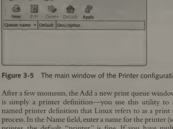

## 图 3-5 GNOME 中打印机配置实用程序的主窗口

片刻之后，添加新打印队列 窗口出现。Linux 中的打印队列只是一个打印机定义——你使用此实用程序将物理打印机与 Linux 称为打印队列的有名称的打印机定义关联起来。单击 向前 开始该过程。在 名称 字段中，输入打印机的名称（见图 3-6）。如果你只有一个打印机，默认的“printer”是可以的。如果你有多台设备或在拥有许多打印机的网络上工作，你可能想要更有创意。例如，你可以将打印队列命名为“hp4100”或“dave-print”以指示打印队列所指的物理打印机。 如需输入简短描述，然后单击 向前。

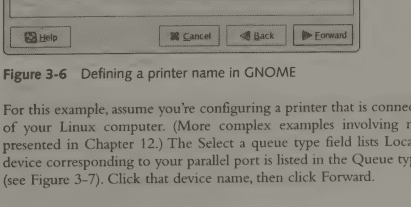

## 图 3-6 在 GNOME 中定义打印机名称

对于本示例，假设你正在配置一台连接到 Linux 计算机并行端口的打印机。（涉及网络打印机的更复杂示例将在第 12 章中介绍。）选择队列类型 字段列出了 本地连接，并且与你的并行端口对应的设备在 队列类型 窗口中列为 `/dev/lp0`（见图 3-7）。单击该设备名称，然后单击 向前。

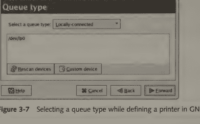

## 图 3-7 在 GNOME 中定义打印机时选择队列类型

在 打印机型号 窗口中，单击标记为 `Generic` 的行并从出现的列表中选择打印机制造商。片刻之后，Linux 明确支持的该制造商的所有型号都会列出（见图 3-8）。选择合适的型号，然后单击 向前。

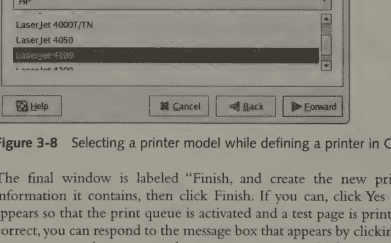

## 图 3-8 在 GNOME 中定义打印机时选择打印机型号

最后一个窗口标记为“完成，并创建新的打印队列”。查看其中包含的信息，然后单击 完成。如果可以，请在出现的消息框中单击 是，以便激活打印队列并打印测试页。如果文本页看起来正确，你可以响应出现的消息框，单击 是。如果无法打印文本页，或测试页未正确格式化（例如，因为计算机上未连接打印机），则在提示时单击 否。你会看到打印队列，名为“printer”或你输入的名称，列在主窗口中（见图 3-9）。选择 操作，退出。如果系统提示消息框，请单击 保存 以保存打印机配置。你现在可以打印文档了。


图 3-9 一个新定义的打印机

### 从命令行打印

从命令行打印文件的命令是 `lpr`。你可以使用以下命令格式将文件打印到默认打印机：

```
$ lpr filename
```


> 另一个打印命令 `lp` 在历史上是一些 UNIX 系统的一部分，并且包含在 Linux 中。`lp` 支持的选项与 `lpr` 支持的选项相似。如果有理由使用 `lp` 而不是 `lpr`，请参阅 `lp` 命令的手册页以获取更多详细信息。

`lpr` 命令使用基于你要打印的文件类型的系列过滤器，因此相同的命令适用于 PostScript 文件、PDF 文件、图像或纯文本文件等。`lpr` 命令在你想要更精确地控制打印作业而不是依赖系统默认值时变得更加复杂。表 3-7 显示了可以与 `lpr` 命令一起使用的基本选项，以多种不同的方式处理文件。（当你在命令行上包含一个或多个这些选项时，它们适用于特定的打印作业，而不是发送到打印机的所有打印作业。在第 12 章中你将了解更多关于如何控制打印的信息。）

## 表 3-7 lpr 的基本命令选项

| Option | Description | Example |
| -C | 为打印作业设置优先级类别。优先级范围从 A 到 Z。默认值为 A。较低优先级的打印作业在所有较高优先级的打印作业之后打印。 | `lpr -C D stats.txt` |
| -h | 不要为此打印作业使用横幅或页眉页 | `lpr -h stats.txt` |

## 表 3-7 lpr 的基本命令选项（续）

| Option | Description | Example |
|---|---|---|


## 使用 lpr 命令

| 选项 | 描述 | 示例 |
|---|---|---|
| `-J` | 为此打印作业分配一个名称；该名称出现在横幅页上以帮助用户识别打印作业。 | `lpr -J "Weekly statistics" stats.txt` |
| `-#` | 指定要打印的文件副本数；请注意，`#` 选项与数值之间没有空格 | `lpr -#3 stats.txt` |
| `-m` | 如果打印过程中出现错误，向指定用户账户发送电子邮件；如果用户账户位于同一系统上，则只需要用户的账户名，如本示例所示 | `lpr -m mwells stats.txt` |
| `-P` | 通过名称指定非默认打印机，当定义了多个打印机时；不要在 `P` 和打印机名称之间放置空格 | `lpr -P hplj5 stats.txt` |

根据你安装的打印系统，还可能支持许多其他选项。你可以在单个命令行上将多个 `lpr` 选项与要打印的文件名组合在一起，文件名位于命令的末尾。如果你经常使用多个选项，你应该使用 `lpoptions` 命令来“保存”它们，以便每次使用 `lpr` 时，相同的选项集都会应用于命令。例如，要将介质设置为 `legal` 并将横幅页设置为 `confidential` 用于所有未来的打印作业，请使用以下命令：

```
$ lpoptions -P hplj -o media=legal -o job-sheets=confidential
```

你可以创建应用某些选项的打印机实例，然后打印到该实例以使用你设置的选项。实例就像具有特定选项设置的打印机定义版本。例如，你可以使用 `lpoptions` 命令为 `hplj` 打印队列创建一个名为“briefs”的实例：

```
$ lpoptions -P hplj/briefs -o media=legal -o job-sheets=confidential
```

然后你可以使用以下命令将文件打印到 `hplj` 的该实例：

```
$ lpr -P hplj/briefs williams.doc
```

你也可以使用管道符号（`|`）打印文件，以便 `lpr` 从另一个程序的输出收集数据。例如，此命令将 `sort` 命令的输出打印到默认打印机：

```
$ sort namelist | lpr
```

使用管道符号打印，意味着打印作业在稍后你将学习的打印作业管理工具中没有与其关联的明确文件名。

## 章节摘要

- shell 是一个用于启动程序的命令解释器。它并不总是运行在 Linux 上，但在图形桌面内或从控制台屏幕登录后可以启动一个或多个 shell。
- 可用的 shell 有很多，例如 `bash`、`Korn shell` 和 `C shell`。所有 shell 主要用于启动其他程序，包括系统管理实用程序。
- Tab 补全可以帮助你快速输入长的文件和目录名。
- 命令历史让你可以快速重新输入之前输入过的命令。历史记录可以通过使用方向键、`history` 命令或在命令提示符下使用 `!` 字符来访问。
- 当用户登录时，某些 shell 脚本会被执行；每次启动 shell 时，其他脚本也会被执行。
- shell 中的别名会导致 shell 在尝试执行命令之前，先用不同的文本替换命令行条目上的文本。
- shell 以多种方式扩展命令行文本，包括替换变量值、执行命令替换、转换别名等。各种字符具有特殊含义，例如 `$` 字符，用于表示变量的开始。
- 命令行扩展可以使用反斜杠（转义字符）、单引号或双引号在适当时加以阻止。反斜杠转义单个字符。单引号会导致 shell 忽略所有特殊字符。双引号会导致 shell 忽略大多数但不是全部特殊字符。
- 环境变量存储程序可以访问的值。你可以从 shell 提示符查看环境变量的值或设置新的环境变量。
- `TERM` 和 `PATH` 等变量定义 shell 中的设置，使程序能够正确交互。`set` 命令显示当前配置的所有变量。
- Linux 程序通过称为 `STDOUT`、`STDIN` 和 `STDERR` 的通信通道进行通信。数据在程序之间的流动可以使用命令行上的重定向运算符来改变。这些运算符可以使数据在程序之间以及与文件之间流动。
- 在命令行上使用重定向运算符允许系统管理员将多个简单命令组合成复杂的语句。
- Linux 支持众多文本编辑器。最广泛可用的是 `vi`，这是一个功能强大的工具，需要你记住命令。现代 Linux 桌面包含图形编辑器，但掌握 `vi` 仍然是系统管理员的关键技能。
- `vi` 是一个模式编辑器——按键的解释取决于你正在使用的模式。命令模式和插入模式是 `vi` 新用户最常用的模式。

设置打印机后，你可以使用 `lpr` 命令从命令行打印文件。

## 命令摘要

| 命令 | 描述 | 示例 |
|---|---|---|
| `alias` | shell 内的命令，将一组字符分配给替代字符组 | `alias ll="ls -la"` |
| `echo` | 将文本打印到屏幕 | `echo "Hello"` |
| `env` | 使用不属于当前环境的环境变量设置启动程序 | `env DB_DIR=/data dbprogram` |
| `export` | 使新创建的环境变量可供同一环境中运行的其他程序使用 | `export PS1="$ "` |
| `history` | 显示历史列表中存储的所有命令 | `history` |
| `lpoptions` | 为 `lpr` 命令设置一个或多个选项，以便将来更易于使用 | `lpoptions -P hplj -o media=legal -o job-sheets=confidential` |
| `lpr` | 打印文件或管道输入（将数据发送到打印队列，从中发送到打印机） | `lpr .bashrc` |
| `mail` | 用于发送或读取电子邮件消息的命令行实用程序 | `mail -s "My bashrc file" nwell@comcast.net < ~/.bashrc` |
| `set` | 显示当前环境中定义的所有环境变量的列表 | `set` |
| `tee` | 将输出同时发送到文件和屏幕 | `sort data_file \| tee sorted_data` |
| `vi` | 启动 `vi` 命令文本编辑器；表 3-3 至 3-6 显示 `vi` 命令 | `vi /etc/webalizer.conf.sample` |
| `wc` | 显示文本文件中的字符数、单词数和行数 | `wc /usr/share/dict/linux.words` |

## 关键术语

`.bashrc` — 每次用户启动 `bash` shell 时都会执行的配置脚本。

`.profile` — 可位于每个用户主目录中的配置脚本。每次系统上的任何用户启动 `bash` shell 时都会执行的脚本。此脚本并非默认包含在所有 Linux 发行版中，但如果需要可以创建。

`/etc/profile` — 包含适用于 Linux 系统上每个用户的配置信息的脚本。

`alias` — 当输入命令时，shell 用另一组字符替换的一组字符。使用 `alias` 命令在 shell 中创建。

`bang` — 在 Linux 术语中，感叹号字符。

`bash` — Bourne Again shell 的缩写，是 GNU 项目为许多类 UNIX 操作系统创建的 `Bourne shell` 的增强和扩展版本。`bash` 是默认的 Linux shell。

`Bourne shell` — 由 Stephen Bourne 编写的 UNIX 的原始 shell。

`C shell` — 由 Bill Joy 在 1970 年代开发的 shell。他专注于为在 shell 提示符下进行交互式工作添加易于使用的功能。（其中大多数功能后来也被添加到 `bash` shell 中。）`C shell` 因其语法比 Bourne、bash 和 Korn shell 更复杂而不受 shell 编程的欢迎。

`command history` — shell 的一个功能，它在列表（历史列表）中记录你在 shell 提示符下输入的每个命令。

`command interpreter` — 一个从键盘接收输入并使用该输入启动命令或以其他方式控制计算机系统的程序。

`emacs` — 一个功能强大的编辑器，提供宏、编程工具、自定义和数百个键盘快捷键。

`environment variable` — 由 Linux shell 定义的变量，以便所有程序都可以访问其值。

`history list` — 包含最近执行的命令的列表。（通常历史列表中包含至少 100 个命令。）

`instance` — 打印机定义的一个版本，具有特定的选项设置。

`Korn shell` — `Bourne shell` 的修订版，包含 `C shell` 的交互式功能，但保持 `Bourne shell` 编程风格。Korn shell 由 David Korn 编写。

`macro` — 一组命令，可以通过引用宏的名称一次性执行。

`modal editor` — 使用多种模式来编辑文本并输入对该文本应用的命令的文本编辑器。

`PATH` — 包含 Linux 系统上的一组目录的环境变量，shell 在每次执行命令时都会搜索这些目录。


`pico` — 一个简单的文本编辑器，包含有关用于执行编辑功能的 Control 键序列的屏幕信息。

`pipe` — 两个命令之间的连接（由 `|` 字符表示），导致一个命令的输出被用作第二个命令的输入。

`print queue` — 与物理打印机关联的打印机定义。

`redirection` — 更改 Linux 程序接收输入的位置或发送输出的位置的行为。

`script` — 存储在文本文件中的命令列表。无需在命令行逐条输入每个命令，脚本可自动执行一系列命令。

`shell prompt` — 表示 shell 已准备好在键盘上接受命令的一组单词或字符。

`shell variable` — Linux shell 中使用的名称，可以为其分配值。

`standard error` (`STDERR`) — 大多数 Linux 程序用于发送程序执行错误信息的通信通道。

`standard input` (`STDIN`) — 大多数 Linux 程序用于收集输入（通常来自键盘）的通信通道。

`standard output` (`STDOUT`) — 大多数 Linux 程序用于写入输出（通常到屏幕）的通信通道。

`tab completion` — shell 的一个功能，让你输入文件或目录名的一部分，并让 shell 填入名称的其余部分。

`TENEX/TOPS C shell` (`TC shell`) — C shell 的增强版。这是 Linux 系统上常用的 C shell 版本。

`vi` — （代表 "visual editor"）UNIX 和 Linux 系统上使用最广泛的文本编辑器。`vi` 的不同版本，例如 `vim` 和 `elvis`，通常使用命令 `vi` 启动。

## 复习问题

- 1. Linux 使用的默认 shell 是：
  a. Bourne shell
  b. Bourne Again shell (`bash`)
  c. TC shell
  d. Z shell

- 2. 以 root 登录时，shell 提示符通常会更改为显示：
  a. `%`
  b. `#`
  c. 根目录
  d. `$`

- 3. shell 的主要功能是：
  a. 跟踪 root 的内核资源
  b. 提供方便的编程环境
  c. 补充桌面界面
  d. 启动程序

- 4. 命名四个不同的 shell 并简要描述它们之间的差异。

- 5. Tab 补全在你需要时很有用：
  a. 重复之前使用过的命令。
  b. 重新初始化环境变量。
  c. 在 shell 提示符下输入长文件名或目录名。
  d. 创建简短的 shell 程序。

- 6. `history` 命令用于：
  a. 显示先前输入的命令列表。
  b. 执行先前使用过的命令。
  c. 更改控制 Tab 补全的环境变量。
  d. 编辑现有文本文件。

- 7. 在 `bash` shell 中输入命令 `!f` 会执行以下哪项操作：
  a. 因为命令名不完整而导致错误
  b. 重新执行最近一次以 "fi" 开头的命令。
  c. 执行 `free` 命令以显示系统内存。
  d. 在 `vi` 编辑器中搜索模式 "fi"。

- 8. 为了使命令在任何用户登录到 Linux 系统时每次都执行，你应将命令放在以下哪个文件中：
  a. `/etc/profile`
  b. `/etc/.profile`
  c. `~/profile`
  d. `/etc/bashrc`

- 9. 如果某个目录包含文件名 `micron` 和 `microscope`，并且你输入 `micro` 然后按一次 Tab，会发生什么？
  a. shell 打印所有匹配的名称，`micron` 和 `microscope`。
  b. shell 填入第一个按字母顺序的匹配项，`micron`。
  c. shell 发出蜂鸣声。
  d. `micron` 命令被执行。

- 10. 以下哪一个是用于执行 `mv` 命令的正确别名？
  a. `alias ren mv`
  b. `alias ren=mv -i`
  c. `alias mv=ren`
  d. `alias ren="mv -i"`

- 11. 命令 `echo $HOME` 显示：
  a. 单词 HOME
  b. 当前用户的默认 shell
  c. `HOME` 环境变量的值
  d. 请求主目录路径的提示

- 12. 描述 `PATH` 环境变量的内容。

### 13. 当使用 `export` 命令时，环境变量：
- a. 可用于在同一 shell 中执行 `export` 的其他程序
- b. 仅对 shell 本身可用
- c. 对同一用户运行的任何程序都不可用
- d. 对系统上的所有用户都可用

### 14. 至少列出三种可能随 Linux 发行版一起包含的非图形化文本编辑器。

### 15. 认为 `vi` 编辑器的知识是必备技能的原因是：
- a. 记忆的 `vi` 命令对应于其他 Linux 命令选项。
- b. `vi` 编辑器几乎总是在完成系统管理任务时可用。
- c. 其他编辑器不可靠或不易使用。
- d. `vi` 的开发者也开发了 Linux 的一部分。

### 16. 假设你输入命令 `vi my_file` 然后按下以下键：
```
itest<Esc>yy p:wq<Enter>
```
描述结果。

### 17. 当你运行名为 `gather_data` 的程序时，它通常会读取键盘输入的行。如果使用命令 `gather_data < input_text` 运行该程序，会发生以下哪种情况？
- a. `gather_data` 命令执行，然后执行 `input_text` 命令。
- b. `gather_data` 程序通常会从键盘读取的输入改为从 `input_text` 文件中获取。
- c. `input_text` 程序先运行，收集数据，然后通过管道传递给 `gather_data` 程序。
- d. `gather_data` 和 `input_text` 都作为并发进程从键盘作为 `STDIN` 读取。

### 18. 管道是一种连接的方法：
- a. 进程与守护进程
- b. 一个程序的输出通道与另一个程序的输入通道
- c. 线程
- d. 已删除的文件名与其在硬盘上的数据

### 19. 命令 `ls | sort` 导致以下哪种情况发生？
- a. `ls` 命令的输出发送到 `sort` 命令。结果打印到屏幕。
- b. 在没有关于下一个要执行的命令的信息的情况下无法确定。
- c. `ls` 命令的输出写入名为 `sort` 的文件。
- d. `ls` 命令的输出根据当前工作目录中名为 `sort` 的文件中的选项进行过滤。

### 20. 使用 `lpoptions` 命令，你可以
- a. 从命令行配置打印机。
- b. 将一组 `lpr` 打印选项与一个名称关联起来（称为实例），以便将来更方便地使用这些选项。
- c. 检查现有打印作业的状态，以确定分配给这些打印作业的任何选项是否未被提交打印作业时生效的打印机配置所允许。
- d. 设置一个环境变量，该变量确定当前用户使用的默认打印机。

### 21. 以下哪个命令显示 `USER` 环境变量的当前值？
- a. `echo "You are currently logged in as $USER."`
- b. `echo 'You are currently logged in as $USER.'`
- c. `echo You are currently logged in as $USER.`
- d. `echo 'You are currently logged in as "$USER".'`

### 22. 以下文本如何在命令行上执行？
```
echo 'This script has detected an error; please check your data.'; date; "Thank you."
```
- a. 作为两个命令，然后出现错误消息
- b. 作为三个命令
- c. 作为一个命令
- d. 作为两个命令

### 23. 以下文本如何在命令行上执行？
```
echo "This script has detected an error\n"; please check your data."; date; "Thank you."
```
- a. 作为两个命令，然后出现错误消息
- b. 作为三个命令
- c. 作为一个命令
- d. 作为两个命令

### 24. 以下文本如何在命令行上执行？
```
echo This script has detected an error.
Please check your data.$'\n'date$'\n'Thank you.
```
- a. 它会生成错误。
- b. 作为三行文本，但会生成错误
- c. 作为三行文本
- d. 它取决于分配给 `date` 变量的值。

### 25. 以下文本是否会生成 shell 错误？是否会打印当前日期？
```
echo 'This script has detected an error.
Please check your data.$'\n'date$'\n'Thank you.'
```
- a. 它会导致错误，但也会打印日期。


- b. 它会导致错误，并且不会打印日期。
- c. 它不会导致错误，也不会打印日期。
- d. 它不会导致错误，但会打印日期。

## Hands-On Projects

### Project 3-1

在本项目中，你使用 Tab 补全来探索 Linux 文件系统并在 shell 中更改环境变量。要完成此活动，你应该有一个可用的 Linux 系统和一个有效的用户账户。本活动中描述的文件名取自 Red Hat Linux，但步骤也应适用于其他 Linux 版本。

- 1. 使用你的用户名和密码登录 Linux。
- 2. 如果你使用的是图形环境，打开一个终端窗口以获得 shell 提示符。
- 3. 使用命令 `cd /bin` 更改到目录 `/bin`。
- 4. 使用命令 `ls *sh` 列出系统上安装的 shell。你能识别列出的所有 shell 吗？
- 5. 使用命令 `cd /etc` 更改到目录 `/etc`。
- 6. 输入命令 `ls -l host` 但不要按 Enter。
- 7. 按两次 Tab 键。第一次按 Tab 时 shell 会发出蜂鸣声。第二次时它会显示 `/etc` 中以 host 开头的文件列表。
- 8. 输入 `s.` （包括句点，以便命令行包含 `ls -l hosts`），但不要按 Enter。
- 9. 按两次 Tab 键。shell 会发出蜂鸣声，然后显示 `/etc` 中以 hosts 开头的所有文件（包括句点）。列表比步骤 7 的输出短，因为你添加了更多字符进行搜索。
- 10. 输入 `a` 并按 Tab。shell 会填入完整的文件名，使该行读取为 `ls -l hosts.allow`。
- 11. 按 Enter 完成 Tab 键已填入的 `ls` 命令。
- 12. 通过输入命令 `cd` 更改到你的主目录。
- 13. 输入命令 `ls` 以执行你在步骤 11 中输入的最新的 `ls` 命令。为什么现在命令会显示错误？
- 14. 输入命令 `echo $PS1` 以显示标准 shell 提示符的格式。
- 15. 输入命令 `man bash` 以查看 `bash` shell 的手册页。
- 16. 输入文本 `\W` 以搜索字符串 `\W`，该字符串是你在步骤 14 中看到的 `PS1` 值的一部分。
- 17. 使用箭头键查看可用于重新定义 `PS1` 环境变量的参数列表。找到 `\d` 选项。
- 18. 按 `q` 退出手册页查看器。
- 19. 输入命令 `export PS1="\d$PS1"`。发生了什么？命令末尾的 `$PS1` 表示什么？
- 20. 输入命令 `bash` 以启动新的 shell。shell 提示符如何变化？为什么？
- 21. 输入 `exit` 命令以离开你在步骤 20 中启动的新 shell。然后再次输入 `exit` 以关闭你在步骤 2 以来一直在使用的 shell。
- 22. 打开一个新的 shell。提示符看起来如何？为什么？关闭 shell 并注销。

### Project 3-2

在本项目中，你使用 `vi` 编辑器对 shell 启动脚本进行更改。要完成本项目，你应拥有一个可用的 Linux 系统和一个有效的用户账户。

- 1. 使用你的用户名和密码登录 Linux。
- 2. 如果你使用的是图形环境，请打开一个终端窗口以获得 shell 提示符。
- 3. 输入 `pwd` 命令并检查以确保你位于主目录中。
- 4. 在编辑 `.bashrc` 文件之前先备份它：`cp .bashrc .bashrc.bak`（如果在编辑文件时遇到问题，你可以退出 `vi` 并从备份副本中恢复 `.bashrc` 文件）。
- 5. 输入 `vi .bashrc` 以在文本编辑器窗口中显示 `.bashrc` 文件。
- 6. 按 `Shift+G` 移至文件末尾。
- 7. 按 `o` 键开始插入新行文本。
- 8. 输入文本 `TEST_VAR="This is a test"` 并按 Enter。
- 9. 在下一行输入文本 `export TEST_VAR` 并按 Enter。
- 10. 在下一行输入文本 `alias tv="echo $TEST_VAR"`。
- 11. 按 `Esc` 返回 `vi` 到命令模式。
- 12. 输入 `:wq`，然后按 Enter 保存文件并退出 `vi`。
- 13. 输入 `tv`。结果是什么？为什么？
- 14. 通过输入命令 `bash` 启动一个新的 shell。
- 15. 输入 `tv`。结果是什么？为什么？
- 16. 输入 `exit` 命令以退出你在步骤 14 中启动的 `bash` 的额外副本。
- 17. 输入命令 `vi .bashrc` 开始编辑与之前步骤中相同的。
- 18. 按 `j` 和 `k` 键根据需要（或使用上下箭头键）直到光标位于包含 `TEST_VAR="This is a test"` 的行上。
- 19. 输入 `3`，然后按两次 `d` 删除你输入的三个行。


如果在编辑此文件时出现错误，请反复按 `u` 以撤消编辑更改。


- 20. 输入 `:wq` 并按 Enter 保存文件并退出。

### Project 3-3

在本项目中，你使用 `vi` 编辑器创建一个新的文本文件并使用本章介绍的许多命令对其进行修改。要完成本项目，你应拥有一个可用的 Linux 系统和一个有效的用户账户。

- 1. 使用你的用户名和密码登录 Linux。
- 2. 如果你使用的是图形环境，请打开一个终端窗口以获得 shell 提示符。
- 3. 输入 `vi assignment`。
- 4. 按 `i` 进入插入模式。
- 5. 输入以下文本并按 Enter：

  `I will not dip Jane's ponytail in the ink wells.`
- 6. 你仍处于插入模式。按 `Esc` 更改为命令模式。
- 7. 使用箭头键移动到 Jane 中的 `j`。
- 8. 按 `Shift+R` 进入替换模式。
- 9. 输入 `Meg`。
- 10. 按 `Esc` 退出替换模式。
- 11. 将光标移动到 `Meg` 后的剩余 `e`。
- 12. 按 `x` 删除 `e`。
- 13. 将光标移动到 `dip` 中的 `d`。
- 14. 按 `5dw` 删除光标右侧的五个词。
- 15. 按 `u` 撤消该更改。
- 16. 按 `d$` 删除从光标到行尾的内容。
- 17. 按 `i` 进入插入模式。按空格键。
- 18. 输入 `melt John's crayons on the radiator but` 不要按 Enter。
- 19. 按 `Esc` 返回命令模式。
- 20. 输入 `yy` 将当前行存储到主缓冲区中。
- 21. 输入 `1000p` 在当前行后粘贴主缓冲区的 1000 份副本。
- 22. 按 `Shift+G` 将光标移动到文件的最后一行。注意位置指示器（在显示的底部行上，在窗口的右侧）如何更改以显示行号为 1001。
- 23. 按字母 `o` 在当前行下方的新行上更改为插入模式。
- 24. 输入你的名字。
- 25. 按 `Esc` 返回命令模式。
- 26. 输入 `:wq` 并按 Enter 保存文件并退出 `vi`。关闭 shell 并注销。

### Project 3-4

在本项目中，你使用重定向运算符来改变程序和文件之间信息默认的流向。要完成本项目，你应拥有一个可用的 Linux 系统和一个有效的用户账户。

- 1. 使用你的用户名和密码登录 Linux。
- 2. 如果你使用的是图形环境，请打开一个终端窗口以获得 shell 提示符。
- 3. 使用以下命令创建两个文件，每个文件包含一行文本：

  `echo "Test file 1" > file1`

  `echo "Test file 2" > file2`
- 4. 使用以下命令查看你创建的第一个文件的内容：

  `cat file1`
- 5. 将 `file1` 的内容追加到 `file2`，然后使用以下命令查看 `file2`：

  `cat file1 >> file2`

  `cat file2`
- 6. 执行 `ls` 命令列出 `/etc` 目录，按排序后的文件列表存储到你主目录中名为 `etc_files` 的文件中，如下所示：

  `ls /etc | sort > etc_files`
- 7. 使用以下命令查看 `etc_files` 文件的内容。按 `q` 退出 `less` 命令。

  `cat etc_files | less`
- 8. 使用以下命令再次查看 `etc_files` 文件的内容：

  `less etc_files`


- The `less` program checks to see if there is input from the `STDIN` channel, as in Step 7. If so, `less` uses that input to operate on. If there is no input, then `less` checks for a file name on the command line that started the program, using the data in that file to operate on. Press `q` to exit the `less` command.

9. 执行以下命令列出`/etc`目录的内容，按字母顺序排序，使用`grep`命令在每一行中搜索字符串`"conf"`，使用`wc`命令计算该列表中包含的行数，并将该计数写入文件`conf_count`：

   ```
   ls /etc | sort | grep conf | wc >conf_count
   ```

   关闭 shell 并注销。如步骤 8 和 9 所示，你一次可以使用任意数量的重定向运算符。随着你学习更多命令并尝试它们如何交互，你会发现自己经常使用重定向运算符将 Linux 的简单但基本命令组合起来执行复杂任务。

## CASE PROJECTS

## Using the Shell

McKinney & Co. 已派遣你前往拉斯维加斯，就与大型旅行社 Global Worldwide Vistas 的项目进行咨询。Global 为约 70 名员工配备了 Linux 工作站。员工使用工作站访问几种类型的文本模式预订系统。他们还使用 Linux 系统上的浏览器查看与旅行和旅行目的地相关的网站，并与客户交换电子邮件。

1. Jill，一位技术思维较强的旅行代理，向你提出了一些请求和建议。似乎员工使用的某些程序要求设置某些环境变量。Jill 一直在教员工在启动相关程序前在命令行设置变量，但她希望这些变量能自动设置，这样用户就不必每次启动程序时都输入值。你会如何做？如果每个员工都在单一的中央 Linux 服务器上运行相关程序，会更困难还是更容易？

2. Thor，另一位旅行代理，自学了使用基本的 `vi` 命令创建文本文件。他问你是否可以安装功能更好的文本编辑器。你如何回应？你是否看到不批准此请求的任何理由？哪些因素会影响你的决定？你可能会考虑为 Thor 和其他员工设置哪些文本编辑器或其他程序？

3. 查看 `bash` 手册页以找到 shell 默认设置的用于程序在 shell 中运行或控制 shell 本身的环境变量列表。评论你发现的任何特别有趣的变量以及它们在你自己的系统管理工作中的帮助方式。

4. 本章描述了命令行替换和防止替换的基础知识。这些主题很重要，因为理解它们使系统管理员能够编写复杂而强大的命令（和脚本），而且误解这两个主题通常是编写脚本时出现看似无法解决的问题的原因（参见第 14 章）。为了在这些主题上成为专家的先行一步，请查看 `bash` shell 的手册页，研究这些功能如何操作以及 `bash` 使用哪些特殊字符来指示各种形式的替换。

# 第4章

## 理解用户和文件系统

阅读本章并完成练习后，你将能够：

- 创建和管理用户和组账户
- 查看并设置文件和目录的访问权限
- 理解文件系统如何配置和访问
- 执行基本的文件压缩和归档任务

在上一章中，你学习了更多关于使用 Linux shell 启动程序的知识，包括如何控制 shell 的特殊功能，如别名、命令行展开、变量和数据重定向。你还尝试了 `vi` 编辑器，这是一个强大的工具，你将有许多机会使用它。

在本章中，你将学习 Linux 如何依赖用户账户来控制对系统本身以及系统上文件的访问。用户还可以组成组以帮助管理访问；本章将介绍如何创建和管理用户账户和组账户。

此外，本章还讨论了文件系统——Linux 用于在文件中记录信息的结构化方法，通常在磁性存储介质上，如 3.5 英寸磁盘或硬盘。你将学习文件系统的类型、文件信息如何在文件系统中排列、如何控制对文件的访问权限，以及如何使用基本的压缩和归档实用程序。

### Linux 用户和组

要在 Linux 中执行任何操作，一个人必须首先使用有效的用户账户名和密码登录。设置和维护这些用户账户是系统管理员工作的重要组成部分。一般来说，你的 Linux 系统上的用户账户越多，保持它们平稳运行所需的工作就越多。用户越多意味着安全风险越大——因此，正确管理并跟踪用户账户对于保持系统安全高效运行至关重要。


> 当远程用户通过某些网络服务（如 Web 服务器）访问你的系统时，他们不需要在你的系统上拥有用户账户。相反，他们使用 Web 浏览器要求 Web 服务器执行任务。Web 服务器随后通过为 Web 服务器程序指定的用户账户完成任务。

### 用户账户类型

你已经使用过自己的用户账户，并且可能在 Linux 上使用 root 账户登录过。但 Linux 还有许多其他预配置的用户账户。这些账户在系统上具有特殊用途，与普通用户账户相比具有不同的特征。以下各节将更详细地讨论不同类型的用户账户。

### root 账户

Linux 系统上的管理员账户（超级用户）名为 root。该账户在你安装 Linux 时创建。root 用户可以在 Linux 系统上执行任何操作。Linux 上的 root 用户类似于 NetWare 服务器上的 admin 用户。请记住，文件系统上还有一个 root 目录，用正斜杠（`/`）表示。


> Linux root 账户类似于 Windows 2000/2003/XP 中的 Administrator 用户账户。然而，Windows Administrator 账户无法无限制地访问所有系统文件和资源；Windows 2000/2003/XP 没有真正等同于 Linux root 用户的用户账户。

由于 root 用户可以在系统上执行任何任务，你不应以 root 身份登录进行日常工作。即使你是系统管理员，root 也不是你的主要账户。始终创建一个单独的账户（通常基于你的姓名），并使用此账户以普通用户身份登录进行日常工作。当你需要执行需要超级用户权限的管理任务（如创建新用户账户）时，暂时切换到 root 用户。任务完成后，返回到你的普通用户账户。

如果你正在使用 GNOME 桌面，你可以用普通用户账户登录，仍然可以从 GNOME 主菜单启动任何图形化管理实用程序。如果该实用程序只能由 root 使用，你会被提示输入 root 密码。图 4-1 显示了当你未以 root 身份登录但尝试启动图形化用户和组管理实用程序（本节后面会讨论）时出现的消息框示例。


图 4-1 输入 root 密码以运行受限程序

如果你在命令行工作，可以使用 `su` 命令暂时切换到 root 用户账户。`su` 命令（substitute user 的缩写）会暂时将你的访问权限更改为另一个用户的权限。除非你已以 root 身份登录，否则你必须输入你想要假设其访问权限的用户的密码。

如果你不带任何参数输入 `su`，你将切换到 root 账户。如果你输入 `su` 后跟用户名，你将切换到该用户的访问权限。该实用程序有时用于假设另一个普通用户的权限，但更常见的是系统管理员暂时成为 root。（通常，用户不应知道任何其他用户的密码。）在 `su` 命令后加上连字符会导致命令运行登录脚本并将你置于你所假设其权限的用户的登录目录中。

```
$ su -
Password:
#
```


> 在某些版本的 Red Hat Linux 中，使用 `su -` 获得 root 访问权限时不会添加管理实用程序的路径。为了解决这个问题（Fedora 中不存在此问题），你可能必须包含只能由 root 使用的某些实用程序的完整路径名——这些实用程序主要存储在 `/sbin` 中。

如果你省略连字符，你不会被置于用户的 home 目录中。如果你以 root 身份登录并使用 `su` 假设另一个用户的访问权限（例如，为该用户创建文件），使用 `su` 时不会提示你输入密码。

### 普通用户

普通用户账户供用户（实际人员）在键盘上登录并使用 Linux 系统。虽然普通账户可以与组织中的角色相关联（如“经理”或“设计师”），但用户账户通常与具名个人相关联。普通用户账户名通常使用名字或首字母和姓氏或首字母的组合。用户账户名可以很长，例如“Franklin Delano Roosevelt”，但较短的名称，如“franklin”，更方便。

在组织内部定义将真实姓名转换为用户名的标准方法很常见。这有助于员工根据姓名“猜测”某人的电子邮件地址（如果你的电子邮件地址是你的用户名）。例如，管理员可能会始终使用用户的名字和姓氏首字母来创建用户名。（重复的用户名可能需要偏离你定义的任何组织标准。）

### 特殊用户


除了 `root` 用户和普通用户账户外，Linux 还包含 Linux 程序使用的几个默认用户账户。通过使用特殊用户账户，这些程序可以控制文件权限并确保系统安全。大多数特殊用户账户在安装 Linux 时创建；其他账户可能由你安装的程序创建。

你的系统上的特殊用户账户因你安装的服务而异。例如，如果你安装了 PostgreSQL 数据库包，你的系统将包含一个 `postgres` 用户；否则，你的系统不包含此用户。尽管这些用户账户对特定程序有用，但它们没有密码或默认 shell 定义。这意味着一个人无法使用这些账户登录。

### Linux 组

Linux 允许你将用户账户组织成组。组是用户账户的集合，可以集体授予对文件和目录的访问权限（访问文件和目录的权限是本章下一节的主题）。将用户分配到组可以更轻松地管理对系统不同区域的访问。例如，你可能有一个工作目录，其中一组员工正在共享项目的文档。通过使所有这些员工成为 Linux 组的成员，你可以轻松地授予每个人对项目目录的权限。

Linux 中的每个用户都被分配到一个主组。用户主组的名字与用户账户信息一起存储。用户也可以是许多其他组的成员。每个已定义组的成员都列在 `/etc/group` 文件中。

为了更好地理解组的本质，假设你创建了一个名为“chrislee”的新用户账户。由于你的系统采用用户私有组，该用户的首要组就是名为 chrislee 的组。用户 chrislee 还被分配到以下组：projectleads、salesteam 和 hrcommittee。 （参见图 4-2。）现在假设你想让销售团队的所有成员都能访问某个目录或一组文件。你只需将 salesteam 指定为该目录或文件的所属组，并根据该组成员应有的访问权限授予组权限即可。


图 4-2 一个用户作为多个组的成员

## 用户和组文件

用户账户信息存储在文件 `/etc/passwd` 中。在 Linux 的早期版本中，每个用户的密码信息也存储在此文件中，因此得名。由于过去存在安全问题，密码信息不再存储在此文件中。但是，文件仍包含有关每个用户的其他信息。以下是一台新安装的 Red Hat Linux 系统的 `/etc/passwd` 文件示例，其后是每个冒号分隔字段的说明。

> NOTE
>
> 在新 Linux 系统上创建的确切用户列表取决于你使用的 Linux 版本以及你选择安装或激活的功能。

```
root:x:0:0:root:/root:/bin/bash
bin:x:1:1:bin:/bin:/sbin/nologin
daemon:x:2:2:daemon:/sbin:/sbin/nologin
adm:x:3:4:adm:/var/adm:/sbin/nologin
lp:x:4:7:lp:/var/spool/lpd:/sbin/nologin
sync:x:5:0:sync:/sbin:/bin/sync
shutdown:x:6:0:shutdown:/sbin:/sbin/shutdown
halt:x:7:0:halt:/sbin:/sbin/halt
mail:x:8:12:mail:/var/spool/mail:/sbin/nologin
news:x:9:13:news:/var/spool/news:
uucp:x:10:14:uucp:/var/spool/uucp:/sbin/nologin
operator:x:11:0:operator:/root:/sbin/nologin
games:x:12:100:games:/usr/games:/sbin/nologin
gopher:x:13:30:gopher:/var/gopher:/sbin/nologin
ftp:x:14:50:FTP User:/var/ftp:/sbin/nologin
nobody:x:99:99:Nobody:/sbin/nologin
vcsa:x:69:69:virtual console memory owner:/dev:/sbin/nologin
mailnull:x:47:47:/var/spool/mqueue:/dev/null
rpm:x:37:37::/var/lib/rpm:/bin/bash
ntp:x:38:38::/etc/ntp:/sbin/nologin
rpc:x:32:32:Portmapper RPC user::/sbin/nologin
xfs:x:43:43:X Font Server:/etc/X11/fs:/bin/false
gdm:x:42:42::/var/gdm:/sbin/nologin
rpcuser:x:29:29:RPC Service User:/var/lib/nfs:/sbin/nologin
nfsnobody:x:65534:65534:Anonymous NFS User:/var/lib/nfs:/sbin/nologin
nscd:x:28:28:NSCD Daemon::/bin/false
ident:x:98:98:pident user::/sbin/nologin
radvd:x:75:75:radvd user::/bin/false
apache:x:48:48:Apache:/var/www:/bin/false
squid:x:23:23::/var/spool/squid:/dev/null
johnl:x:500:500:John Lim:/home/johnl:/bin/bash
```

以下列表描述了上面输出中每一行的字段。文件的最后一行（用户 `johnl`）是一个用作示例的普通用户账户。

- 用户账户名（`johnl`）：用户登录 Linux 时使用的名称。此字段不能包含大写字母或空格。
- 密码（`x`）：每个用户的加密密码过去存储在此字段中。此字段中的 `x` 表示正在使用 Shadow Password Suite，此时加密密码存储在 `/etc/shadow` 中。你将在本节后面了解有关 shadow 密码的更多信息。
- 用户 ID 号，或 UID（第一个 500）：在该 Linux 系统上唯一标识该用户的 0 到 65,535 之间的数字。该数字是任意的，通常由用于创建新用户账户的实用程序自动分配。0 到 100 的数字保留用于特殊系统用途（`root` 的 UID 始终为 0）。新普通用户账户通常从 500 开始。
- 组 ID 号，或 GID（第二个 500）：在该 Linux 系统上唯一标识该用户账户主组的 0 到 65,535 之间的数字。GID 必须与 `/etc/group` 文件中定义的一个组相对应（稍后将描述）。
- 用户的真实姓名（John Lim）：用户的完整姓名。在文档中，这正式称为注释字段。此字段允许使用空格。如果用户账户是为组织中的某个角色创建的，则可以改在此处放置其他文本，例如“Database Administrator”。
- 主目录（`/home/johnl`）：用户首次登录时用作当前工作目录的 Linux 文件系统中的位置。每当用户在命令行上使用波浪号（~）时，就会使用此目录。 （例如，`cd ~` 会将你的当前目录更改为你的主目录。）
- 默认 shell（`/bin/bash`）：用户登录时自动运行的程序。此字段的默认设置是 `/bin/bash`，它运行 bash shell。如果用户偏好不同的 shell（例如 Korn shell 或 C shell），则可以更改此字段以适应。如果需要限制用户操作，此字段也可以用于启动非 shell 程序。

虽然你可以直接在文本编辑器中编辑 `/etc/passwd` 文件，但如果可能有多位系统管理员通过网络同时操作该文件，这并不是一个好主意。此外，少量输入错误可能导致一个或多个用户账户无法访问。不要使用文本编辑器，而应使用以下各节中描述的程序来更新 `/etc/passwd`。如果需要使用文本编辑器来纠正文件中的问题，请使用特殊编辑命令 `vipw`。

Linux 系统上的组在 `/etc/group` 文件中定义。如有必要，你可以使用 `vigr` 命令编辑此文件。以下是 Red Hat Linux 中的文件一部分，其字段（再次在每行中以冒号分隔）在以下列表中进行了描述。

```
root:x:0:root
bin:x:1:root,bin,daemon
daemon:x:2:root,bin,daemon
sys:x:3:root,bin,adm
adm:x:4:root,adm,daemon
tty:x:5
disk:x:6:root
lp:x:7:daemon,lp
...
ident:x:98:
radvd:x:75:
apache:x:48:
squid:x:23:
wine:x:66:
nwells:x:500:
rsolomon:x:501:
authors:x:502:rsolomon,nwells
```

- 组名：此字段不能包含大写字母或空格。与用户名一样，越短通常越好；避免使用超过 10 或 12 个字母的名称。
- 组密码：此字段为空或包含 `*x*`（表示密码存储在其他位置）。组密码允许知道该组密码的人使用 `newgrp` 命令临时承担该组的访问权限；此功能很少使用。


- 组 ID（GID）号：此数字唯一标识该组。创建新组时会自动分配组号，不过你也可以指定一个数字。

- 组的成员：此字段标识组的成员。请注意，在示例文件中，许多组未定义成员用户。程序可能能够使用系统调用（编程指令）承担组的权限，但没有用户因登录而成为该组的成员。其中一些组（例如 `sys` 和 `adm`）将用户以逗号分隔的列表作为最后一个字段。除了本示例文件中的两个用户私有组（`nwells` 和 `rsolomon`）之外，还在此默认安装中添加了一个名为 `authors` 的组。


> 某些 UNIX 系统采用一个名为 `wheel` 的特殊组，它具有特殊的管理员权限；它本质上是 `root` 账户的简化版本。在某些系统上，用户必须成为 `wheel` 组的成员才能使用 `su` 命令更改为 `root` 账户权限。虽然 Linux 默认包含一个 `wheel` 组（`root` 是唯一成员），但在 Linux 中 `wheel` 组不适用任何特殊功能或特权。

## Shadow 密码

所有程序和用户可能都需要访问存储在 `/etc/passwd` 中的用户列表。每个用户的密码过去也以加密形式存储在此文件中。但如果每个人都可以读取文件中的用户名，那么每个人也可以读取加密密码。拥有这些密码，即使是以这种加密形式，也是严重的泄密，可能会允许未经授权使用账户。

为防止此问题，加密密码很少存储在 `/etc/passwd` 文件中。相反，它们通常存储在一个名为 `/etc/shadow` 的文件中。使用此文件的系统依赖于 Shadow Password Suite，这是一组已修改为识别 `/etc/shadow` 文件的密码相关程序。此文件只能由 `root` 用户和 `login` 程序等某些实用程序读取。

第二个字段中的星号表示该账户没有密码；任何人都无法使用该账户登录。

```
ftp:* :10815:0:99999:7::
nobody:* :10815:0:99999:7::
gdm:!:10815:0:99999:7::
xfs:!:10815:0:99999:7::
nwells:$1$3gWKUoUqSL7XUsJwPIwtqLuOwmVvN1:10816:0:99999:7:-1:-1:134538436
rsolomon: l042Wuip3dYAH$1pvNMAVK$UsrD6O90:10817:0:99999:7:-1:-1:134538412
```

> NOTE
>
> Linux 支持超出影子密码之外的许多密码安全功能。有关更多信息，请参阅《Guide to Linux Networking and Security》（Course Technology，ISBN 0-619-00094-5）第 9 章。

## Changing User Passwords

当以 `root` 身份登录时，您可以更改系统上任何用户账户的密码。您使用 `passwd` 命令来定义或更改用户的密码。 （该命令与 `/etc/passwd` 文件同名。）以 `root` 身份使用此命令时，请包含您要定义密码的用户账户名称。您必须输入两次新密码，以确保没有输入错误。

假设您的系统包含一个名为 `lizw` 的用户账户。要更改她的密码，请执行以下操作：

1. 确保您已以 `root` 身份登录（通常使用 `su` 命令）。
2. 输入命令 `passwd lizw`。屏幕上随后会出现以下文本：
   - `Changing password for user lizw`
   - `New password:`
3. 输入 Linux 用户账户的新密码并按 Enter。输入时屏幕上不会显示任何内容，因此请仔细操作。按 Enter 后会出现以下文本：
   - `Retype new password:`
4. 第二次输入新密码，必须与第一次输入完全相同。这验证了密码已按您打算的方式输入。第二次按 Enter 后，会出现以下文本：
   - `passwd: all authentication tokens updated successfully`

如果您输入的密码选择不佳（例如“password”、用户名或字典中的简单单词），您会看到 `BAD PASSWORD` 消息。虽然此消息应促使您重新考虑密码，但密码仍会被更改。对于新账户的临时密码，几乎任何内容都可以使用。常见的选择包括用户的账户名（本例中为 `lizw`）、单词 `password`、`change.me` 或类似内容。

标准做法是系统管理员使用上述步骤（或使用图形用户管理工具）为新账户分配初始密码。管理员将密码告知新用户，新用户应立即选择一个 `root` 用户或其他用户不知道的新密码。

用户可以使用 `passwd` 且不带任何参数来更改自己的密码：

```
$ passwd
```

`root` 用户可以更改任何用户的密码；当普通用户更改自己的密码时，适用不同的规则：

- 用户必须在输入新密码（两次）之前输入该账户的当前密码。
- 如果输入“坏密码”（例如字典单词），会显示警告消息且密码不会被更改。

作为系统管理员，您必须向用户解释在开始使用账户后立即更改密码的重要性。大多数系统管理员认为密码应每月更改一次，即使 Linux 系统不强制频繁更改（它可以强制——请参阅第 11 章）。这降低了他人发现用户密码并继续使用它的危险。良好的密码具有以下特征：

- 长度至少为五个字符，尽管 7 到 10 个字符的密码更安全。
- 包含数字或标点符号。
- 以非标准方式混合大小写字母。
- 账户所有者容易记住，但对其他人难以猜测——即使是了解账户所有者的人也难以猜测。
- 不是从字典中查找到的单词或人名、地名的简单改动而创建的。

难以记住的密码可能难以被他人发现，但如果密码写在贴在计算机显示器上的便条上，对安全性帮助不大。


作为系统管理员，您会处理许多不同的密码。这些包括 `root` 密码、个人账户密码、特殊管理工具的密码，以及您生活中的其他部分密码，例如银行账户、网页和语音邮件代码。如果这些密码和代码相同或相似，泄露其中一个密码可能会危及您工作和个人生活的许多不同领域的

> NOTE
>
> 您可以通过运行 `authconfig` 实用程序来更改 Red Hat Linux 使用的密码安全系统。此高级安全工具在《Guide to Linux Networking and Security》（Course Technology，ISBN 0-619-00094-5）中进行了描述。

## User Information Commands

Linux 包含多个命令，可帮助您在登录时确定当前状态。`id` 命令显示您的有效用户 ID（UID）。例如，假设您使用普通用户账户 `jtaylor` 登录，其用户 ID（在 `/etc/passwd` 文件中）为 507。然后您使用 `su` 命令切换到 `root`。您的有效用户 ID 此时为 0（`root`）。然后您使用 `su` 命令切换到用户 ID 为 510 的用户 `cjones`。那时就是您的有效用户 ID。您的有效 UID 决定了您对文件和目录的访问权限。`id` 命令的输出如下所示：

```
$ id
uid=500(nwells) gid=500(nwells) groups=500(nwells)
```

即使您使用 `su` 命令更改了用户，您也可以始终通过执行 `logname` 命令查看您用于登录的用户名。另一个常用的显示当前有效 UID 用户名的命令是 `whoami` 命令。`groups` 命令列出您所属的所有组。

您可以使用其他命令列出当前登录系统的用户以及他们正在做什么。`who` 命令列出系统上的所有普通用户，以及他们登录的位置。位置是终端名称；每个终端可以是终端窗口、控制台或网络连接（例如通过以太网或调制解调器）。您将在后续章节中了解更多关于终端的信息。`who` 命令的输出如下所示：

```
$ who
root      tty3      Mar 26 10:33
nwells    :0        Mar 26 10:29
nwells    pts/1     Mar 26 10:30 (:0.0)
```

`w` 命令提供了更多信息，如下所示。除了用户登录的终端外，您还可以看到他们登录的时间、他们正在运行的程序（名称的一部分经常被截断，如输出所示），以及用户消耗的系统资源信息。输出第一行的总计指示 CPU 的平均负载和当前登录的用户数。`man` 手册更详细地描述了 `w` 命令的输出。任何用户都可以执行此命令。


```
$ w
10:35:40 up 34 min,  3 users,  load average: 0.12, 0.16, 0.09
USER     TTY      FROM     LOGIN@   IDLE   JCPU   PCPU  WHAT
root     tty3     -        10:33am  1:44   0.01s  0.01s -bash
nwells   :0       -        10:29am  ?      0.00s  0.93s /usr/bin/gnome-
nwells   pts/1    :0.0     10:30am  0.00s  0.23s  1.65s gnome-terminal
```

## FILE PERMISSIONS

Linux 中的每个文件和每个目录都被分配一个所有者——所有者是系统上拥有账户的用户之一。每个文件和目录也分配有一个组——该组必须是 `/etc/groups` 文件中命名的组之一。Linux 根据所有者是谁以及分配给该对象的组来确定谁可以访问文件或目录。文件权限定义了授予文件或目录的访问权限。 （目录实际上是一种特殊类型的文件，因此术语“文件权限”通常同时适用于目录和文件。）文件权限也称为文件的访问模式。

可以分配三种不同的权限，每种权限由单个字母表示：读（`r`）、写（`w`）和执行（`x`）。

- **读权限（`r`）：** 可以读取文件的内容
- **写权限（`w`）：** 可以在文件中添加或更改信息或在目录中创建新文件
- **执行权限（`x`）：** 可以将文件作为程序启动或在目录中查看文件。对于文件，此权限仅用于可作为程序运行的程序或脚本。


请注意目录权限分配的这个不寻常特征：除非您对父目录具有执行权限，否则您无法查看目录中的文件（使用 `ls` 命令），也不能访问这些文件——即使文件本身授予您权限。


Linux 文件权限足以控制对文件和目录的访问，但不如其他操作系统提供的详细。Linux 2.6 内核支持一种扩展的文件权限类型，称为访问控制列表（ACLs）。使用 ACL 时，您可以为许多单个用户指定权限，而不是仅基于三个组（所有者、组和其他用户）分配权限。ACL 目前尚未在标准 Linux 发行版中使用，但不久后将会使用。

这三种权限中的每一种都可以以三种不同的方式分配：

- **用户权限**适用于文件或目录的所有者。
- **组权限**适用于分配给文件或目录的组成员。
- **其他权限**适用于 Linux 系统上除所讨论文件或目录的所有者以及未分配给该文件或目录的组成员之外的所有用户。

分配给三个用户组的三个权限构成了可以在 Linux 中分配给任何文件或目录的总共九个权限。这些九个权限显示在左侧 side of the output of the `ls -l` command, as shown in the following example. (The far left character of the output is a type indicator, which is discussed in the next section.)

```
-rw-rw-r-- 1 nwells nwells 231723 Mar 19 09:14 file2
```

Although this list of characters can seem cryptic at first, only a few arrangements of permissions are commonly used. Table 4-1 describes the permission settings you are likely to see throughout Linux.

### Table 4-1 Commonly Used File Permission Settings

| Permissions | Description | Use |
|---|---|---|
| `rwxr-xr-x` | The owner can read, write (change), or execute the program; everyone else can read or execute it | For program files that everyone should be able to use, such as system utilities |
| `rw-rw-r--` | The owner and group members can alter the file, everyone (including the owner) can read the file | For data files to which everyone on the system should have access; these are the default permissions granted to a file that you create |
| `r-x------` | The owner can read and execute the program | For system utilities that only the owner (typically root) is permitted to execute |
| `rw-r--r--` | The owner can read and change the file; everyone else can read it | For configuration files. root can change the files, but all users need to read the configuration information |

You can examine the permissions of a file or directory in a graphical desktop by right-clicking the object and choosing Properties from the context menu. Figure 4-3 shows the Permissions tab of the Properties dialog box for a file within the Nautilus file manager in GNOME. (The numbers shown on the Permissions tab are another method of representing permissions; this method is discussed later in this chapter.)

## Changing Ownership

You can change the user and group assigned to a file or directory by using the `chown` command. But you can only use this command when logged in as root; regular users can't change ownership, even of files that they own. To use `chown`, type the command, followed by the user name and group (separated by a period or semicolon) that you want to assign to the file or directory, followed by the name of the file or directory. For example, the following command changes the owner of the file `report.doc` to `jtaylor` and the group assigned to that file to `managers`:

```
## chown jtaylor.managers report.doc
```

## Figure 4-3 The Permissions tab of the Properties dialog box in Nautilus

You can also change just the owner of a file by leaving off the period and group name. The user and group that you assign to a file must already exist on the Linux system.


If you are logged in as `root`, you can use a graphical file manager to change the owner of a file. In Figure 4-3 you can see the owner and group listed; if you are logged in as `root` you can select a different user and group from drop-down lists. Note, however, that using the graphical interface you can only change the owner and group for one item at a time; using the `chown` command, you can change the ownership of many files and directories at once. For example, you could change the owner of every file in a directory (using `*` as a wildcard character that matches all files) with this command:

```
chown jtaylor *
```

If you add the `-R` option to the `chown` command, the command is recursive, meaning that it changes the owner on any files in subdirectories of the current directory that match the file name given.

If you only want to change the group assigned to a file or directory, rather than the owner, use the `chgrp` command. It uses the same format as `chown`, but you only include a group name. For example, to assign the group `managers` to the file `report.doc`, but leave the owner unchanged, you use this command:

```
chgrp managers report.doc
```

## Changing File Permissions

You can change file permissions using the `chmod` (change mode) command. As a regular user, you can alter the permissions assigned to any file or directory that you own. If you are logged in as `root`, you can use `chmod` to change the permissions of any file or directory on the system.

To use the `chmod` command, include the type of permissions you want to change (`user`, `group`, or `other`, entered as `u`, `g`, or `o`), followed by a plus, minus, or equal sign to add, remove, or set all permissions, followed by the permissions you want to set (`r`, `w`, or `x` for read, write, or execute). For example, to add the read permission for other users to the file `report.doc`, use this command:

```
chmod o+w report.doc
```

Using a plus or minus sign in a `chmod` command adds or removes permissions from what is already assigned; using an equal sign sets specific permissions (overriding the previously assigned file permissions). For example, suppose the `report.doc` file has `r-x` permissions set for the group. The following command changes those permissions to `rwx`:

```
chmod g+w report.doc
```

But the following command changes the group permissions to be only `rw`, removing the `x` permission:

```
chmod g=rw report.doc
```

System administrators normally use a shortcut syntax with the `chmod` command. This alternative syntax is easier to use once you are familiar with it, but it's more challenging to learn. In this alternative syntax, each of the sets of three permissions (for user, group, and other) is represented by a number from 0 to 7. The three possible permissions (read, write, and execute) are assigned values of 4, 2, and 1, respectively. Now suppose that a system administrator wanted to grant read (4) and write (2) permission for the user, read (4) permission to the group, and no permissions to other users. The first digit used in `chmod` is for the user. In this case it is 6, the sum of 4 and 2. The second digit is for the group. In this case it is 4. The third digit is for other; here it is 0 (no permissions are granted). So the command looks like this (with the resulting permissions shown by `ls` after the `chmod` command):

```
chmod 640 report.doc
ls -l report.doc
```

Using the same method, if the system administrator wants to assign read (4), write (2), and execute (1) permissions to the user, and read (4) and execute (1) permissions to the group and to other users for a program file, the command looks like this (again with the results from `ls` shown after the `chmod` command):

```
chmod 755 program_file
ls -l program_file
```


Although this method may appear strange at first, you should become familiar with it; you will see it used often by experienced system administrators on all UNIX systems. You will also discover that only a few combinations of file permissions are commonly used. Some of these are shown in Table 4-2. Once you are familiar with the three-digit code for those commonly used sets of permissions, using the three digits is easier than entering all the letters with a plus, minus, or equal sign.

## Table 4-2 Numeric Values of Commonly Used File Permissions

| Permissions | Description | Numeric mode |
|---|---|---|
| `rwxr-xr-x` | The owner can read, write (change), or execute the program; everyone else can read or execute it | `755` |
| `rw-rw-r--` | The owner and group members can alter the file; everyone (including the owner) can read the file | `664` |
| `r-x------` | The owner can read and execute the program | `500` |
| `rw-r--r--` | The owner can read and change the file; everyone else can read it | `644` |

Until those codes become familiar, a graphical environment such as GNOME or KDE provides an easy method of setting file permissions and seeing what the corresponding numeric code is. Within the Properties dialog box described previously, the Permissions tab includes check boxes in which you can activate or remove any of the nine permissions described in this section. Figure 4-3 shows the Permissions tab in the Properties dialog box of the Nautilus file manager. Note how the numeric and text-based indications of the file permissions are shown. Review these as you use the graphical interface to help you understand the different methods of representing Linux file permissions.

## Default File Permissions

When the `bash` shell creates a new file because of actions you take at the command line (such as using the `touch` command or redirecting command output to a file), it creates the file with these permissions:

```
rw-rw-rw-
```

Other programs running in Linux may use other default settings, though these permissions are typical. The `umask` command defines a mask—a blocking mechanism—to stop certain permissions from being granted by default when files are created. The `umask` command is executed automatically when you log in to Linux. You can alter the permissions that can be assigned to a new file by executing the `umask` command again at any time. The `umask` command uses the same three-digit permission codes as the `chmod` command (4 for read, 2 for write, and 1 for execute), but they define permissions that are permitted on newly created files.

The value you give as a parameter to the `umask` command disables one or more of the existing default permissions. Using the `-S` option on `umask` is helpful because it shows which permissions are currently allowed on new files:

```
$ umask -S
```

If you enter this next command, all permissions are permitted on new files:

```
$ umask 000
```

If you enter the following command, no permissions at all are permitted for other on new files:

```
$ umask 007
```

In most cases, you have no need to change the default `umask` setting.

## Introducing the File System

In addition to creating and managing user accounts and assigning file permissions, managing the file system is a basic task for system administrators. In this section you learn basic information about file systems in Linux. More detailed information is provided in Chapter 8, "Installing Linux," and Chapter 10, "Managing Software Packages and File Systems."

### Partitions and File Systems

A partition is a distinct area of a hard disk that has been prepared to store a particular type of data. For example, a computer that only contains Windows normally has only one partition on its hard disk. That partition is marked with a code indicating that the partition contains Windows data. Linux files are stored on a partition that is marked with a code used for Linux data.


# Partitions and File Systems

You can think of a partition as an empty space on the disk with a label attached to it. Before a partition can hold information, it must be arranged based on the requirements of a particular file system type. A file system is an arrangement of information on a device such as a hard disk; the term is also used to refer to a particular partition or device on which Linux data is stored. For example, an administrator might refer to the file system contained on the first hard disk, saying "Our root file system is 24 gigabytes." The organization of a file system is composed of files and directories.

Figure 4-4 shows how three partitions might be arranged on a hard disk, with marks indicating the file system type and a file system format inside each partition. Linux typically uses one of two default file system types: `ext3` (extended file system version 3, used by Red Hat Linux, Fedora, and many others) or `ReiserFS` (used by SUSE, Lindows/Linspire, Gentoo, and a few others). The default file system type for older versions of DOS and Windows is called `FAT` (File Allocation Table). Windows NT and newer versions of Windows use `NTFS` (NT File System) or `FAT32` (32-bit File Allocation Table). You will learn more about these file system types in Chapter 8.


Figure 4-4 Partitions and file systems on a hard disk

When Linux is first installed, the installation program formats a partition to create a Linux file system. The system's files are then stored within that file system. You can see the status of all currently accessible file systems using the `df` command (display file systems). The output shows you the device on which the file system resides, the total storage space, the amount of free space, and other information.

```
$ df
Filesystem     1K-blocks      Used Available Use% Mounted on
/dev/hda1       6198404    342228   5541304  6% /
none             257280         0    257280  0% /dev/shm
/dev/hdb1      10082852   5184900   4385764 55% /usr
/dev/hdb3      107086944  8204708  93442440  9% /mnt/winnt
```

> TIP
>
> The output of the `df` command is often easier to read if you use the `-h` option, which displays file system sizes and available space in MB and GB (with M or G) rather than in KB.

## Inodes and Links

Within an `ext2` or `ext3` file system, a fixed number of entries are defined to hold information about files. Each of these entries is called an `inode` (pronounced eye-node). A file system typically contains more than enough inode entries for all the files you might possibly create on that file system. Each inode has an associated number and contains information such as

the ID number for the owner and group assigned to the file, the file permissions of the file, the file size, the time the file was created, and numeric pointers to the areas of the hard disk that contain the file's data.

An inode controls the file to which it points, but it does not contain a file name. File names are stored separately. Each file name entry also includes an inode number, which is used to access the file via its associated inode. You can view the inode number associated with each file by using the `ls` command with the `-i` option.

A file record contains a file name and the inode number for that file; the file record is an indirect pointer to the file's data, through the inode. Every subdirectory is just a list of file records. Specifically, a directory record is a file that contains a list of files with corresponding inode numbers.

A link allows two or more file records to refer to the same physical data stored in a file system. For example, a link makes it possible for two users to have two different file names listed in their home directories, but actually be working with the same data when they edit those two files. Links are of two types: symbolic and hard.


A symbolic link (also called a soft link) is a file that refers to another file or directory, rather than containing data itself. For example, suppose several employees in a company want to work on the same file. The system administrator can place the file in a directory and then create a symbolic link in each user's home directory to access the real file. If the real file is `/tmp/report.doc`, the symbolic links might be `/home/nwells/report.doc`, `/home/davis/report.doc`, and `/home/laura/report.doc`.

Assuming the real file, `/tmp/report.doc`, has sufficient file permissions, all three users can access it by opening the respective files in their home directories. The file system follows the symbolic link to the file to which it points and opens that file. When users make changes after opening the file in their home directories, they are all changing the same file. Figure 4-5 illustrates a symbolic link.

Symbolic links are used when the same data must be accessed from two locations in the directory structure, or by two (or more) different names. Using a symbolic link takes only a few bytes of hard disk space—enough to store the file name to which the link refers. Symbolic links are commonly used in directories such as `/lib` and `/usr/lib`, where a system file must be referred to by several names in order for programs to find it.

To create a symbolic link, use the `ln` command with the `-s` option. The syntax of this command is:

```
ln -s <existing file> <symbolic link to be created>
```

For example, if you wanted to make a link from the `/etc/profile` file to your home directory under the name `main_profile`, use the following command:

```
$ ln -s /etc/profile /home/nwells/main_profile
```

In the command above, you might decide to use relative path names, depending on your current working directory.

### Figure 4-5 A symbolic link


> Don't confuse shell aliases and symbolic links. An alias causes the shell to substitute a different string in text that you enter. A symbolic link causes the file system to pass a request for one file to a different file in the directory structure.

In more technical terms, a symbolic link is a file record that includes a path and file name, but not an inode number. When a user refers to a symbolic link, Linux looks at the path and file name given in the symbolic link's file record. The file record for that path and file name includes an inode, which is used to access the file data for the symbolic link.

A hard link is a file record that includes a file name and inode, just like a regular file record. But a hard link refers to an inode that already has a file record pointing to it. The hard link is a second file record pointing to the same physical data. A single inode can have numerous file records (hard links) pointing to it. After a hard link is created, it is equal to the first file record that points to the same inode. If the first file record is deleted, the second file record (created as a hard link) is unaffected—it still refers to the same file data.

Both symbolic and hard links are used often in a Linux file system. Whenever you use the `ls -l` command, any symbolic links are indicated as extra file names in the right column of the output. An example of a symbolic link in Red Hat Linux is the `view` command. This output illustrates how you can use the `ls -l` command to show the `view` command:

```
$ ls -l /bin/view
lrwxrwxrwx 1 root root 2 Aug 12 13:36 /bin/view -> vi
```

The arrow in the right column indicates that the file named `view` is a symbolic link to the file named `vi` (located in the same directory; because no path name is included). The letter `l` in the far left column of the screen output also indicates that the file is a symbolic link.

从左边数第二列的数字（本例中为 `1`）表示引用与此文件记录相同 inode 的文件记录数。

`zcat` 文件名（同样在 Red Hat Linux 中）是硬链接的一个例子。`zcat` 文件记录引用了一个 inode，而另外两个文件记录也引用了该 inode。`ls -l` 命令再次显示了这一点：


```
$ ls -l /bin/zcat
-rwx-r-xr-x  3 root root  63555 Mar 25 13:28 /bin/zcat
```

在此示例屏幕输出中，从左边数第二列的数字 `3` 表示保存文件名 `zcat` 的文件记录引用了一个 `inode`，而另外两个文件记录也引用了该 `inode`（总共三个）。

图 4-6 说明了符号链接和硬链接之间的区别。在此图中，一种名为 `Perl` 的编程语言存储在一个名为 `perl5.6.1` 的文件中，其中 `5.6.1` 表示精确的版本号。其他文件记录也使用不同的文件名指向相同的信息（`inode`）。这允许可能不知道精确版本号的用户访问 `perl` 编程语言文件。


图 4-6 比较硬链接和符号链接

## 文件类型

到目前为止你处理过的大多数文件都是标准数据文件，但你也接触过其他类型的文件，例如符号链接。由于 Linux 中几乎所有内容都是通过文件系统访问的，因此使用不同类型的文件来执行不同的功能。表 4-3 列出了 Linux 使用的七种文件类型。其中几种主要由程序使用——你在命令行工作中不会遇到它们，本书中也不会更详细地讨论。

### 表 4-3 Linux 文件类型

| 文件类型 | `ls -l` 输出最左侧使用的符号 | 描述 |
|---|---|---|
| 普通文件 | `-` | 标准数据文件 |
| 目录 | `d` | 目录记录，包括子目录，其中包含文件记录列表和相关 `inode` 或符号链接指针数据 |
| 链接 | `l` | 指向另一个文件记录的符号链接（软链接） |
| 特殊文件/字符设备 | `c` | 字符型设备，如鼠标或键盘，数据以一个字符一次的方式读写 |
| 特殊文件/块设备 | `b` | 块型设备，如硬盘，数据以块为单位读写（例如一次 512 个字符） |
| 套接字 | `s` | 用于基于文件系统权限在程序之间通信的进程间套接字 |
| 命名管道 | `p` | 程序之间通信的另一种方式，与套接字类似 |

你可以使用 `stat` 命令了解有关任何文件的众多细节。此命令将文件名与 `inode` 关联起来，并显示诸如 `inode` 编号、文件存储的设备、最近访问时间以及分配的文件权限等信息。示例输出如下所示：

```
$ stat /etc/profile
  File: '/profile'
  Size: 842          Blocks: 8          IO Block: 4096   regular file
Device: 30lh/769d Inode: 225362       Links: 1
Access: (0644/-rw-r--r--)  Uid: (   0/ root)   Gid: (   0/ root)
Access: 2004-05-27 12:03:50.000000000 -0400
Modify: 2002-03-11 12:50:05.000000000 -0500
Change: 2004-04-29 04:46:47.000000000 -0400
```

## 访问可移动介质

虽然你在 Linux 中使用的文件大多位于硬盘上，但有时你可能需要使用 CD-ROM、3.5 英寸磁盘或其他可移动介质。为了使用任何文件系统，包括位于可移动存储介质上的文件系统，必须挂载该文件系统。

挂载文件系统时，你指示 Linux 如何访问它——它位于何处以及包含何种类型的数据。CD-ROM 和 3.5 英寸磁盘的默认信息已存储，因此使用它们很简单。从命令行，你可以使用 `mount` 命令挂载 CD-ROM：

```
$ mount /mnt/cdrom
```

> 在许多 Linux 系统上，只有 `root` 才能挂载文件系统，包括 CD-ROM 或 3.5 英寸磁盘。在 Red Hat Linux 中，普通用户被允许挂载这些可移动介质。

`/mnt/cdrom` 目录是挂载点——在目录结构中访问文件系统数据的路径。你使用 `mount` 命令使新的文件系统通过挂载点可访问；你也可以使用 `mount` 列出系统当前可用的所有文件系统。不带任何参数使用 `mount` 命令会显示当前已挂载的文件系统列表。

执行上述 `mount` 命令后，你可以通过切换到 `/mnt/cdrom` 目录并像使用系统上的任何其他文件一样使用该目录来访问 CD-ROM 上的数据。当你在许多版本的 Linux 中插入 CD-ROM 时，甚至不必执行 `mount` 命令——图形桌面会检测到已插入 CD-ROM 并自动挂载它，并可能显示一个窗口询问你如何操作。

可移动磁盘不会自动检测。在尝试访问 3.5 英寸磁盘之前，你可以使用以下命令挂载它：

```
$ mount /mnt/floppy
```

在完成向软盘或从软盘复制文件，或从 CD-ROM 复制文件后，在使用 `umount` 命令卸载介质之前，不应弹出磁盘——你无法弹出 CD-ROM。注意该命令是 `umount`，而不是 `unmount`。在卸载文件系统之前，必须切换到不在该文件系统中的目录；如果你的工作目录是 `/mnt/cdrom` 或其子目录之一，则无法卸载 CD-ROM。以下两个示例展示了如何卸载 CD-ROM 或 3.5 英寸磁盘：

```
$ umount /mnt/floppy
$ umount /mnt/cdrom
```

用于处理软盘的另一个有用命令是 `fdformat`，它允许你格式化 3.5 英寸磁盘。在几乎所有基于 Linux 的 PC 上，3.5 英寸磁盘驱动器使用设备名 `/dev/fd0` 访问。`fdformat` 命令的使用方式如下：

```
$ fdformat /dev/fd0
```

`fdformat` 命令的手册页提供了额外的示例，如果此标准版本的命令无法定位和格式化软盘。

## 使用 find

在大型文件系统中，定位你想要处理的文件或目录可能具有挑战性。`find` 命令可帮助你找到完全符合你所查找的对象。`find` 命令不使用 `slocate` 命令所使用的预建索引；它在你运行命令时检查你的文件系统，因此可能比 `slocate` 工作得更慢。但它提供的选项比 `slocate` 多得多。

`find` 的最简单用法是搜索匹配特定模式的文件并在屏幕上显示它们。在以下示例中，搜索应开始的路径是 `/home`；要搜索的文件名是 `report.doc`，而对每个匹配的文件名采取的操作是显示（打印）名称在屏幕上（显示到屏幕是默认操作，因此此处显示的 `-print` 选项并非严格必要，但它说明了更复杂 `find` 操作的格式）：

```
## find /home -name "report.doc" -print
```


`find` 命令使用完整单词作为选项，但前面仅有一个连字符而不是两个。

NOTE

`find` 选项让你能够在 Linux 系统上执行复杂的信息搜索。例如，使用单个（复杂）`find` 命令，你可以执行以下任何任务：

- 创建一个包含过去 24 小时内修改过的所有文件的归档文件。
- 删除 Linux 系统上由特定用户拥有​​的所有文件。
- 创建一个包含所有大于特定大小的文件的列表。
- 创建一个包含具有特定访问权限的所有文件的列表。
- 创建一个包含所有没有有效所有者的文件的列表。

在后面的章节中，你将看到 `find` 在执行此类特定任务的示例中使用。就目前而言，请考虑 `find` 的另一个示例。以下命令搜索 `/tmp` 目录（及其所有子目录）中由用户 `wilsonr` 拥有、具有 `.jpg` 文件扩展名且大于 50 KB 的文件。所有匹配的文件名都会在屏幕上显示，并且文件会立即被删除。

```
## find /tmp -name "*.jpg" -size 50k -user wilsonr -print -exec rm {} \;
```

## 管理文件归档

系统管理员经常处理包含压缩数据或以归档格式存储的多个文件的文件。他们这样做是为了管理自己负责的数据，也是下载和安装新软件的一部分。

### 压缩文件

在 Linux 中压缩文件是一种有用的方法，可以为很少访问的数据节省空间，或在通过网络传输之前使文件变小。你可以使用 `gzip` 命令在 Linux 中压缩任何文件。例如，要压缩文件 `large.doc`，请使用以下命令：

```
$ gzip large.doc
```

前面的命令将文件 `large.doc` 转换为名为 `large.doc.gz` 的压缩文件。`gunzip` 命令用于解压缩使用 `gzip` 压缩的文件。例如，要解压缩 `large.doc.gz` 文件，请使用以下命令：

```
$ gunzip large.doc.gz
```

 resulting file is named `large.doc`.

`gzip` 程序压缩文件的程度取决于文件中包含的数据类型。文本文件和某些类型的图形文件可能被压缩 70% 到 90%。也就是说，1 MB 的文件可能被压缩到仅 100 KB 到 300 KB。其他类型的数据，如 JPG 图形文件或程序文件，可能只能被压缩 5% 到 10% 或更少。


### 表 4-4 Linux 中的压缩实用程序

| 压缩/解压缩实用程序 | 描述 |
|---|---|
| `zip` 和 `unzip` | 将多个文件压缩成一个文件，很像压缩的 `tar` 归档。与其他操作系统上的 `pkzip` 和 `WinZip` 兼容。使用此程序与非 Linux 系统上的用户共享文件。压缩文件的文件扩展名为 `.zip`。 |
| `compress` 和 `uncompress` | 与 `gzip` 相比压缩效果较差（使用 `compress` 命令压缩的文件不会像使用 `gzip` 那样小）。它是一个较旧的实用程序，几乎所有 UNIX 系统都支持。压缩文件具有扩展名 `.Z`。 |
| `gzip` 和 `gunzip` | 目前 Linux 中使用最广泛的压缩实用程序。提供良好的压缩。压缩文件具有扩展名 `.gz`。 |

### 表 4-4 Linux 中的压缩实用程序（续）

| 压缩/解压缩实用程序 | 描述 |
|---|---|
| `bzip2` 和 `bunzip2` | 提供极佳的压缩（创建非常小的文件），但它是一个较新的实用程序，目前尚未广泛使用。仅限于与你知道拥有 `bzip2` 的人共享文件。压缩文件具有扩展名 `.bz2`。 |

## 使用 `tar` 和 `cpio` 进行文件归档

传输一组文件的一种常见格式称为 `tar` 归档。`tar` 归档是一个可以包含其他文件以及应重新组装这些文件的目录结构的文件。你可以使用 `tar` 命令创建 `tar` 归档（也称为 `tarball`）。（命令名称来自“tape-archive”一词，因为数据过去仅备份到磁带驱动器。）你通常给 `tar` 归档一个 `.tar` 文件扩展名；当你使用 `tar` 命令的压缩选项时，通常使用 `.tgz` 或 `.tar.gz` 文件扩展名。 resulting file 有时称为 gzipped tarball。

`tar` 归档是将数千个文件“转储”到存储设备（如磁带驱动器）上以制作该数据备份副本的一种简便方法。这种 `tar` 归档也是向他人发送多个文件的便捷方式——而不是将几十个文件作为电子邮件附件发送，你可以创建一个 `tarball` 并仅附加一个。`tar` 归档只是将许多文件存储在单个文件中的集合。`tar` 归档的一个优点是它们几乎在世界上的每个 UNIX 和 Linux 系统上都受支持，因此它们提供了通过 Internet 跨系统共享文件的便捷方法。当你探索包含 Linux 程序的 Internet 站点时，你会看到许多 `tar` 归档。

当你下载 `tar` 归档或需要处理他人提供给你的 `tar` 归档时，你可以使用 `tar` 命令提取其内容。例如，要提取名为 `program.tgz` 的归档文件的内容，请使用以下命令（请注意，`tar` 命令的选项不使用连字符）：

```
$ tar xzvf program.tgz
```

> 当你使用 `tar` 命令提取 `tar` 归档的内容时，`tar` 归档保持完整。当你使用 `gzip` 或 `gunzip` 命令压缩或解压缩文件时，原始文件会被更改（压缩或解压缩），其名称也会相应更改。

`tar` 命令和一个名为 `cpio`（代表 copy in and out）的类似命令在 Linux 中用于创建系统上文件的备份。有时其他实用程序在后台依赖这些程序，但使用图形界面使配置和选择备份选项变得更容易。流行的商业备份实用程序包括为你跟踪磁带、为你执行的每个备份保留在线索引以及自动化无人值守备份的计划等功能。

除了创建单独的归档文件外，`tar` 和 `cpio` 都可以直接在磁带盒、3.5 英寸软盘或其他备份设备上创建归档，而无需先在硬盘上创建文件。

`tar` 和 `cpio` 命令的操作方式不同。使用 `tar` 命令时，你必须在命令行上指定要包含在备份归档中的文件。相比之下，`cpio` 总是从 `STDIN` 通道读取要包含在归档中的文件名。`tar` 命令将数据写入你提供的文件名或设备；`cpio` 命令始终将数据写回 `STDOUT`。为了比较这两种操作方式，请考虑以下两个创建 `/home` 目录完整备份的示例。你可以假设对于此示例，设备 `/dev/tape` 配置为磁带驱动器。（请注意，你直接引用磁带驱动器设备；你无需先挂载它。）

```
## tar cf /dev/tape /home
```

如果要归档的文件集很小，你可以将归档发送到 3.5 英寸软盘：

```
## tar cf /dev/fd0 /boot
```

这两个示例命令使用 `tar` 的 `c` 选项创建新的归档。`f` 选项（代表 filename）后跟设备名称表示归档数据将被存储的位置。最后一个参数 `/home` 表示要归档的文件。因为该参数是目录名，所以 `tar` 包含该目录内的所有文件。等效于上述 `tar` 命令的 `cpio` 命令是：

```
## find /home -print | cpio -o > /dev/tape
```

此 `cpio` 命令依赖于 `find` 命令生成文件列表（每行一个文件名）供 `cpio` 备份。那些文件名通过管道符号发送给 `cpio`，因为 `cpio` 从 `STDIN` 读取文件名。`>` 重定向操作符将归档文件发送到设备 `/dev/tape`。`cpio` 上的 `-o` 选项表示归档正在输出——即数据正在写出。`cpio` 的一个更简单的示例可以使用 `ls` 命令生成要归档的文件列表，将单个目录的内容归档到本地文件：

```
## ls | cpio -o > /tmp/archive.cpio
```


> 你可能已经注意到 `tar` 选项通常不包含前导连字符；`cpio` 命令的选项则包含。

`v` 选项通常添加到 `tar` 和 `cpio` 中，以便命令的输出是详细输出，这意味着命令会将有关其正在执行的操作的详细信息打印到屏幕上。添加该选项后，最后一个示例如下所示：

```
## ls | cpio -ov > /tmp/archive.cpio
```

你使用带有不同选项的类似命令来使用 `tar` 或 `cpio` 提取文件。如果你曾使用 `tar` 在 3.5 英寸软盘上创建过归档，你可以使用以下命令将磁盘的内容恢复到当前目录（`x` 选项代表“extract”，`v` 选项用于查看有关命令进度的详细消息）：

```
## tar xvf /dev/fd0
```

`cpio` 命令使用 `-i` 选项进行输入，再次将备份介质的内容提取到当前目录。`-d` 选项也在这里添加，以便 `cpio` 根据需要创建数据中存在过的子目录，以重建原始数据组织。当使用 `-i` 选项使用 `cpio` 命令时，`cpio` 从 `STDIN` 通道读取归档数据；因此 `<` 重定向操作符与文件名或归档设备名称一起使用。

```
## cpio -idv < /dev/fd0
```

这些是 `tar` 和 `cpio` 的非常基本的示例。每个命令支持数十个选项，用于压缩文件、保留文件属性、控制磁带设备、设置归档数据的 timestamps 以及许多其他功能。你可以查阅每个命令的 `man` 和 `info` 页面以了解更多信息。

`tar` 和 `cpio` 都依赖于其他 Linux 命令来帮助你创建增量或多级备份。其中最有用的是上一节提到的 `find` 命令。例如，以下 `find` 命令使用 `-mtime` 参数的值为 1 打印 `/home` 目录（及其子目录）中在最近一天内被修改过的所有文件列表：

```
## find /home -mtime 1 -print
```

通过使用此命令生成的文件列表作为 `cpio` 或 `tar` 的归档列表，你可以轻松创建仅包含最近修改过的文件的备份。以下两个命令说明了如何使用 `cpio` 或 `tar` 来实现这一点：

```
## find /home -mtime 1 -print | cpio -ov > /dev/tape
```

```
## tar cf /dev/tape `find /home -mtime 1 -print`
```

`find` 命令提供的选项使其成为 `tar` 和 `cpio` 的强大伴侣。使用 `find`，你可以创建由特定用户拥有、修改或访问时间在特定时限内的、具有特定文件权限的文件列表，或许多其他标准的文件列表。

## 章节总结

- 用户账户构成了 Linux 中文件系统安全的基础。一个人必须拥有有效的用户账户才能登录 Linux 并访问系统资源。
- Linux 包含多种类型的用户账户，例如普通用户、root 用户以及仅由实用程序或其他程序使用但不能正常登录的特殊用户账户。
- 你可以使用 `su` 命令更改正在使用的用户（从而更改你的有效 UID）。这是获取 root 权限的正常方法，因为持续以 root 身份工作是不安全的。
- 每个用户可以属于多个 Linux 组，如 `/etc/group` 中所定义。每个用户有一个主组，并在 `/etc/passwd` 中该用户的定义中列出。用户私有组将一个用户分配给一个组以提高文件系统安全性。
- 加密密码存储在 `/etc/shadow` 文件中，因此只有 root 和少数特殊程序（如 `login`）可以读取此信息。访问加密密码是一个安全隐患。


`passwd` 命令用于更改用户账户的密码。`id`、`w` 和 `who` 等命令可告知用户当前使用的账户、当前登录的其他用户以及用户所属的组。

Linux 文件安全性由九个权限控制（三个权限的三组）。三个权限是读、写和执行；三组权限分别是所有者、分配的组或系统上的其他用户。只有少数几种排列的这九个权限是常用的。

`chown` 和 `chgrp` 命令更改文件或目录的所有者和分配的组。`chmod` 命令使用字符或数字代码更改模式——文件或目录的文件权限。

`umask` 命令更改新创建的文件或目录的默认文件权限。

文件系统是在硬盘分区内创建的有组织的集合数据。在 Linux 文件系统中，`inode` 是包含有关该文件系统上存储的所有文件的信息的数据结构。

硬链接和软链接（符号链接）分别直接和间接地引用一个 `inode`，而 `inode` 又引用文件中的数据。`ln` 命令用于创建这两种类型的链接。

Linux 使用文件系统访问许多类型的数据，包括设备、管道和常规数据文件。文件类型由 `ls -l` 输出最左侧的代码字母指示。

可移动介质必须在 Linux 目录结构中访问之前先挂载。在安全移除之前也必须先卸载。默认挂载点使挂载 CD-ROM 和软盘变得简单。

`find` 命令有助于查找具有指定特征的文件。它是一个有价值的工具，因为典型的 Linux 文件系统包含数万个文件。

Linux 包含用于压缩文件的多个实用程序。其中最广泛使用的是 `gzip`，尽管 `bzip2` 程序提供更好的压缩，并且 `zip` 格式与其他操作系统兼容。压缩也用于数据备份和下载的归档文件的一部分。

下载的归档文件通常使用 `tar` 命令创建和访问。`cpio` 命令是一个较新的实用程序，与 `tar` 一起用于在 Linux 中创建简单的备份文件。

通过使用 `find` 命令与 `tar` 或 `cpio`，可以使用单个命令创建复杂的文件归档。

## COMMAND SUMMARY

| Command | Description | Example |
|---|---|---|
| chgrp | 更改分配给文件或目录的组；只有 root 可以使用此命令 | `chgrp managers report.doc` |
| chmod | 使用字符代码或数值更改文件或目录的访问模式（文件权限） | `chmod g=rw report.doc` |
| chown | 更改分配给文件或目录的所有者以及可选的组，只有 root 可以使用此命令 | `chown j.taylor.managers report.doc` |
| cpio | 创建归档；还读取由 tar 命令创建的归档文件 | `cpio -idv < /dev/fd0` |
| df | 显示文件系统摘要信息，如设备、挂载点、使用百分比和总容量 | `df -h` |
| fdformat | 格式化 3.5 英寸磁盘 | `fdformat /dev/fd0` |
| find | 在文件系统中搜索匹配给定特征的文件 | `find /home -name "report.doc" -print` |
| groups | 列出当前有效 UID（当前用户）所属的所有组 | `groups` |
| gunzip | 解压缩使用 gzip 压缩的文件 | `gunzip archive.gz` |
| gzip | 压缩 Linux 系统上的文件 | `gzip archive` |
| id | 显示当前有效 UID、GID 以及有效 UID 所属的组 | `id` |
| ln | 创建硬链接或符号链接（软链接） | `ln -s /etc/profile /home/nwells/main_profile` |
| logname | 显示用于登录 Linux 的用户名（可能与 whoami 或 id 命令显示的当前有效 UID 不同） | `logname` |
| mount | 使逻辑或物理设备（如 CD-ROM 或 3.5 英寸软盘）作为文件系统在 Linux 目录结构中可用 | `mount /mnt/cdrom` |
| newgrp | 暂时更改已登录用户的有效组，类似于 su 命令，但针对组成员身份而不是用户身份 | `newgrp managers` |
| stat | 显示有关文件或目录的信息，取自相应的 inode，例如文件大小、权限、上次访问和修改时间以及文件存储的设备 | `stat /etc/profile` |
| su | 更改你的有效 UID，承担与登录时使用的用户不同的用户身份； （代表 substitute user） | `su -` |
| tar | 创建包含许多其他文件的一个文件，通常压缩以节省空间 | `tar cvzf home_archive.tgz /home` |
| umask | 阻止在创建新文件或目录时默认分配的文件权限 | `umask -S` |
| umount | 卸载当前作为 Linux 目录结构一部分可访问的文件系统 | `umount /mnt/cdrom` |
| vigr | 安全地编辑 /etc/group 文件 | `vigr` |
| vipw | 安全地编辑 /etc/passwd 文件 | `vipw` |
| w | 列出当前登录的所有用户，并显示每个用户正在运行的程序的详细信息 | `w` |
| who | 列出当前登录的所有用户，并显示每个用户登录来源的详细信息 | `who` |
| whoami | 显示当前有效 UID | `whoami` |

## Key Terms

`/etc/group` — 存储组信息（组名和成员列表）的配置文件。

`/etc/passwd` — 存储用户账户信息的配置文件。

`/etc/shadow` — 存储加密用户密码和密码配置数据的配置文件。

`access mode` — 分配给文件或目录的文件权限；允许对该对象访问的权限。

`directory record` — 一种特殊类型的文件，包含其他文件的文件名和 inode 号码。

`effective UID` — 用于确定用户被允许对文件系统访问权限的用户 ID。`su` 命令更改有效 UID。

`execute permission (x)` — 允许用户启动文件作为程序或在目录中查看文件的权限。用字母 "`x`" 表示。

`FAT (File Allocation Table)` — 旧版本 DOS 和 Windows 操作系统使用的文件系统类型。

`file permissions` — 定义用户对 Linux 系统上的文件或目录具有何种类型访问权限的访问权限。也称为文件或目录的访问模式。

`file record` — Linux 文件系统中的一条记录，包含文件名和 inode 号码，或者，如果是符号链接，则包含文件名和链接引用的另一个文件名。

`file system` — 存储设备上，通常是硬盘上的有组织的信息集合。

`group` — 由一组用户组成的命名账户。组的每个成员都可以访问该组拥有的文件。

`group permissions` — 可授予分配给文件或目录的组成员的三组文件权限（r、w 和 x）。

`hard link` — 指向已被至少一个其他文件记录指向的 inode 的文件记录。

`inode` — 由文件系统内唯一的号码标识的数据记录，其中包含通常称为“文件”的数据块集的详细信息。

`link` — 引用与另一个文件记录相同的物理文件数据的记录。参见 symbolic link 和 hard link。

`mount point` — 文件系统在 Linux 目录结构中被访问的路径。

`NTFS (NT File System)` — 近期 Windows 操作系统如 Windows NT、2000、2003 和 XP 使用的文件系统类型。Linux 支持对此文件系统的读取访问。

`other permissions` — 可授予 Linux 系统上除文件或目录所有者以及未分配给文件或目录的组成员之外的所有用户的一组三项文件权限（r、w 和 x）。

`owner` — 分配给文件或目录的用户，通常是创建该对象的人。

`partition` — 硬盘上准备用于存储特定类型数据的独立区域。

`read permission (r)` — 允许用户读取文件内容或浏览目录中的文件的权限。用字母 "`r`" 表示。

`root` — 每个 Linux 系统上的超级用户或管理员账户。

`Shadow Password Suite` — 一组密码相关实用程序，实现了用于限制对 `/etc/shadow` 中加密密码文本访问的安全系统。

`superuser` — 系统管理员账户；`root` 账户。

`symbolic link` — 一个指向另一个文件名而不是直接指向文件中的数据（通过其 inode）的文件。也称为软链接。

`tar archive` — 由 `tar` 命令创建的文件。

`user permissions` — 可授予文件或目录所有者的三组文件权限（r、w 和 x）。

`User Private Group` — 一种安全模型，在用户首次创建时为其创建一个仅包含该用户的新组。

`wheel` — 一个特殊的系统管理员组，在 Linux 中未正式使用。

`write permission (w)` — 允许用户在文件中添加或更改信息或在目录中创建文件的权限。用字母“`w`”表示。


## REVIEW QUESTIONS

1. 描述在执行 `su` 命令时包含连字符的效果。

2. 用户的主组可以是 User Private Group。正确或错误？解释。

3. `/etc/passwd` 文件不包含以下哪个字段：

a. 用户账户的名称

b. 用户的文件权限

c. 用户的默认 shell

d. 用户的 UID 和 GID

4. 解释 `/etc/group` 文件中这一行的含义：

`webmasters:x:710:rthomas,cyang`

5. 要在任何用户账户上创建或更改密码，以下使用的是：

a. `useradd` 实用程序

b. 使用文本编辑器编辑 `/etc/shadow` 文件

c. `passwd` 命令

d. 用户的 UID 和 GID

6. `/etc/passwd` 中的第四个字段包含什么？

7. 为什么不应使用标准文本编辑器向 `/etc/passwd` 添加用户？

8. 如果你为一个用户账户输入一个容易猜到的新密码，消息 BAD PASSWORD 出现并且密码是：

a. 除非你是 root，否则不更新

b. 除非你是 root，否则更新

c. 只有当你以普通用户身份登录时才更新

d. 如果密码不是常见单词词典的一部分则更新

### 9. 一个已挂载的文件系统是指：

a. 已作为 Linux 目录结构的一部分包含

b. 已为在 Linux 中使用而正确格式化

c. 允许任何用户运行其上的程序

d. 包含至少一个 root 用户账户

### 10. Shadow Password Suite 通过以下方式增强 Linux 安全：

a. 在用户登录时验证 wheel 组成员

b. 将加密密码隐藏在只有 root 可以读取的文件中

c. 检查为用户输入的新密码是否容易猜测

d. 阻止未经授权的用户访问 root 账户

### 11. `df` 实用程序提供以下哪一项的信息？

a. 哪些用户挂载了文件系统

b. 存储在所有已挂载文件系统上的虚拟内存使用情况

c. 文件系统容量、设备名称和已使用状态百分比

d. 按目录使用情况和文件系统挂载点

### 12. 如果你尝试卸载已挂载的文件系统并收到错误消息，最可能的原因是：

a. 文件系统最初挂载不正确。

b. `df` 命令正在计算文件系统统计信息。

c. 物理介质上存在 Linux 无法解释的错误。

d. 一个或多个用户正在该文件系统的目录中工作。

### 13. 描述别名和符号链接之间的区别。

### 14. 哪个命令用于创建符号链接？

a. `sh`

b. `ln`

c. `set`

d. `sed`

16. 文件的拥有者和组由以下哪个命令显示？

a. `chown`

b. `ls -l`

c. `newgrp`

d. `id`

17. 在文件上执行权限是必需的：

a. 将该文件作为程序启动。

b. 创建具有匹配名称的目录。

c. 允许其他用户读取文件。

d. 使用 `su` 命令查看受限文件的内容。

18. `tar` 命令创建的归档文件最常由 ________ 命令压缩：

a. `bzip`

b. `compress`

c. `zip`

d. `gzip`

19. `tar` 实用程序与 `cpio` 实用程序的不同之处在于：

a. `cpio` 总是读写 STDIN 和 STDOUT，而 `tar` 使用命令行参数。

b. `cpio` 是商业实用程序，而 `tar` 是自由软件。

c. `cpio` 广泛用于 Internet 归档文件，而 `tar` 不用于。

d. `cpio` 是较旧的格式，与更新的 `tar` 归档不兼容。

20. 描述为什么 `find` 命令通常与 `tar` 或 `cpio` 一起用于备份。

21. ________ 选项导致 `tar` 命令从归档文件或设备中提取文件。

a. `a`

b. `x`

c. `c`

d. `e`

22. 描述 `newgrp` 命令与 `/etc/group` 文件中每条记录的第二个字段的关系。

### 23. `id` 命令的输出包括：

a. 有效 UID、有效 GID 以及有效 UID 用户所属的组列表

b. 当前用户正在工作的所有终端的列表

c. 用于登录的用户名

d. 有效 UID 和有效 GID

### 24. 如果 `ls -l` 命令输出的最左列显示字符“s”，你会知道该行上的对象是：

a. 具有基于 `su` 的超级用户访问的常规文件

b. 特殊块设备文件

c. 特殊字符设备文件

d. 套接字

### 25. 哪个实用程序通常提供最高的压缩比（从给定的数据文件创建最小的压缩文件）？

a. `zip`

b. `bzip2`

c. `compress`

d. `gzip`

## HANDS-ON PROJECTS

## Project 4-1

在本项目中，你使用 `su` 命令和各种用户信息命令来查看有效 UID 如何变化。要完成此项目，你需要有一个普通用户账户和对 Linux 系统的 root 访问权限。

1. 使用你的普通用户账户登录 Linux。

2. 如果你使用图形登录窗口登录，请打开一个命令行窗口。

3. 在 `$` 提示符下，输入 `id` 命令以查看你当前的有效 UID。

4. 通过输入 `touch newfile` 在你的主目录中创建一个名为 `newfile` 的文件。

5. 使用 `ls` 命令通过输入 `ls -l newfile` 查看此文件分配的所有者和组。你看到了什么？

6. 输入 `su`（不带连字符）以更改为 root 账户，并在提示时提供 root 密码。

7. 再次使用 `id` 命令查看你的有效 UID 如何变化。

8. 输入 `logname`。你看到了什么？

9. 通过输入 `touch newfile2` 创建另一个名为 `newfile2` 的新文件。

10. 输入 `ls -l newfile2` 查看此文件分配的用户和组。你看到了什么？

11. 假设你正在终端窗口中工作，按 Shift+Ctrl+N 打开一个额外的终端窗口。

12. 在其中一个窗口中，输入 `w` 查看谁已登录。你注意到了什么？

13. 更改回你作为 root 工作窗口。 （按 Alt+Tab 直到正确窗口出现或在面板中单击适当的按钮。）

14. 按 Ctrl+D。你退出 `su` 命令并返回以普通用户身份工作。

15. 使用 `whoami` 验证你的身份。

16. 通过反复按 Ctrl+D 关闭每个终端窗口（在每个窗口获得焦点时）。


## Project 4-2

在本项目中，你使用命令行和图形界面查看和更改文件权限。你还测试 `umask` 命令。要完成此项目，你需要一个具有普通用户账户的 Linux 系统。

1. 使用你的普通用户账户登录 Linux。

2. 如果你使用图形登录窗口登录，请打开一个命令行窗口。

3. 在 `$` 提示符下通过输入 `touch xyz` 创建一个名为 `xyz` 的新文件。

4. 输入 `ls -l xyz` 查看此文件的权限和所有者/组。

5. 输入 `ls -i xyz` 查看文件的 inode 编号。

13. 更改到权限选项卡。研究该选项卡中提供的信息。

14. 单击几个权限复选框并注意对话框底部数字模式如何变化。

15. 当你完成查看此信息后，关闭对话框并退出 Nautilus。

16. 在命令行中，通过输入 `umask` 查看当前的 `umask` 设置。此设置允许或不允许什么？

17. 输入 `umask 077` 使得当创建新文件时永远不会授予组或其他任何权限。

18. 为测试此操作，输入 `touch abc` 从而创建另一个名为 `abc` 的新文件，然后通过输入 `ls -l abc` 检查其权限。

19. 通过输入 `umask 002` 将 `umask` 设置改回默认值。

20. 输入 `chown root abc` 将此文件的拥有者更改为 root。你注意到了什么？

21. 通过输入 `rm abc xyz` 删除你的测试文件。


## Project 4-3

在本项目中，你使用 `tar` 命令创建一个简单的数据归档文件，然后将该文件的内容提取到另一个目录。要完成此活动你应具有具有 root 访问权限的工作 Linux 系统。

1. 使用你的普通用户账户登录 Linux。

2. 如果你使用图形登录窗口登录，请打开一个命令行窗口。

3. 使用 `su` 命令更改为 root。输入 root 密码进行提示。

4. 通过输入更改到 `/etc/init.d` 目录

```
cd /etc/init.d
```

5. 通过输入查看此目录中各种配置文件的文件名和文件权限

```
ls -l | less
```

6. 当你完成查看 `ls` 命令的输出后按 q 退出 `less` 命令。通过输入创建 `/etc/init.d` 目录中配置文件的 `tar` 归档


`tar cf /tmp/testing.tar /etc/init.d/*`

因为你同时包含了 `testing.tar` 归档文件和你想要归档的信息所在的目录的路径名，所以你可以从系统上的任何位置执行此命令。

## 项目 4-4

在本项目中，你将尝试 `cpio` 归档实用程序。要完成此活动，你必须拥有一台具有 `root` 访问权限的正在运行的 Linux 系统。示例中使用的目录名称假定你正在运行 Red Hat Linux，但这些命令在任何版本的 Linux 上都适用。

- 1. 使用你的常规用户账户登录 Linux。
- 2. 如果你使用图形登录窗口登录，请打开一个命令行窗口。
- 3. 使用 `su` 命令切换到 `root`。提示时输入 `root` 密码。
- 4. 使用以下命令创建一个小子目录的 `cpio` 归档：

```
find /usr/share/doc/pam-0.77/ -print | cpio -oVH ustar > ~/archive.cpio
```

- 5. 查看 `cpio` 的 `man` 手册以了解 `V` 和 `H` 选项的作用。
- 7. 输入类似的命令，这次包含 `v` 选项，如

```
tar cvf /tmp/testing2.tar /etc/init.d/*
```

执行此命令后，你会在屏幕上看到 `/etc/init.d` 目录中的所有文件列表，因为每个文件都被添加到归档文件中。

- 8. 通过输入 `cd` 命令切换到你的主目录 (`/root`)。
- 9. 使用 `ls` 命令检查主目录的内容。确保你的主目录中没有名为 `network` 的文件。（你不应该有，但如果从之前的练习中存在，请将其重命名为其他名称以完成本项目。）
- 10. 使用 `tar` 命令的 `x` 选项从你刚刚创建的 `tar` 归档中提取单个文件，输入

```
tar xvf /tmp/testing2.tar etc/init.d/network
```

文件被放置在当前目录中。由于 `v` 选项，文件名在提取时会被打印到屏幕上。

- 11. 使用 `ls` 命令查看主目录的内容。你是否看到一个名为 `network` 的文件？查找名为 `etc` 的目录。
- 12. 输入 `cd etc/init.d`（不带初始正斜杠）以切换到你的 `/root` 目录的 `etc/init.d` 子目录。`tar` 命令会在你发出从归档中提取文件的命令时，从当前目录开始创建请求文件所在的子目录。
- 13. 再次使用 `ls` 命令查看主目录的 `etc/init.d` 子目录中的 `network` 文件。
- 14. 关闭命令行窗口并注销。

```
tar cvf /tmp/testing2.tar /etc/init.d/*
```

```
tar xvf /tmp/testing2.tar etc/init.d/network
```

```
find /usr/share/doc/pam-0.77/ -print | cpio -oVH ustar > ~/archive.cpio
```

- 6. 使用以下 `tar` 命令查看你创建的归档的内容：

```
tar tvf ~/archive.cpio | less
```

- 7. 注意，每个文件的完整目录路径都包含在内。除了文件名之外，每个文件还包含哪些信息？在你完成查看 `ls` 命令的输出后，按 `q` 退出 `less` 命令。
- 8. 你可以使用什么选项来更改与每个文件一起存储的所有权？（参见 `cpio man` 手册。）
- 9. 通过输入以下命令确定你归档的子目录的大小

```
du /usr/share/doc/p* | grep 77s.
```

- 10. 通过输入 `ls -l ~/archive.cpio` 查看 `cpio` 归档文件的大小。
- 11. 这两者相比如何？
- 12. 使用此命令将另一个目录添加到归档文件：

```
find /usr/share/doc/bash-2.05b/ -print | cpio -oAVH ustar -O ~/archive.cpio
```

- 13. 再次查看 `cpio man` 手册以确定 `A` 和 `O` 选项的用途。
- 14. 现在通过输入 `ls -l ~/archive.cpio` 检查归档文件的大小。
- 15. 通过输入 `gzip ~/archive.cpio` 压缩归档文件。输入 `ls -l` 命令并注意压缩后归档文件的大小。
- 16. 通过输入以下命令解压缩归档以便使用

```
gunzip ~/archive.cpio.gz
```

许多磁带驱动器和备份实用程序会自动压缩未压缩的数据，因此将 `cpio` 文件直接存储到磁带盒中而不使用 `gzip` 所占用的空间不会像未压缩文件在硬盘上占用的空间那么多。

- 17. 通过输入以下命令从其原始位置删除你归档的一个文件（提示时确认删除）

```
rm /usr/share/doc/bash-2.05b/CHANGES
```

- 18. 通过输入以下命令从你的 `cpio` 归档中提取该文件的备份版本

```
cpio --extract /usr/share/doc/bash-2.05b/CHANGES < ~/archive.cpio
```

- 19. 通过输入以下命令确保文件已恢复

```
ls /usr/share/doc/bash-2.05b/CHANGES
```

- 20. 通过输入以下命令删除你的归档文件（提示时确认删除）

```
rm ~/archive.cpio
```

- 21. 关闭命令行窗口并注销。

## 案例项目


## 文件压缩、权限和归档

你最近的 McKinney & Co. 咨询项目涉及以压缩形式归档大量数据并授予特定用户访问归档数据的权限。你需要做一些研究来回答出现的问题。

- 1. 查看 Linux 中可用的压缩工具列表（见表 4-4。所有这些都包含在 Red Hat Linux 和 Fedora 中。通过压缩一组文本文件、程序文件和图像文件来测试这些实用程序中的每一个。（你可以使用 `find` 命令在系统上定位其中一些。）确定每个工具的平均压缩比（压缩文件占原始大小的百分比）。还请注意压缩速度，通过在每次测试之前和之后输入 `date` 命令。（你可能需要使用大文件以使计时数据合理易于收集。）
- 2. 尝试 `touch` 和 `umask` 命令以确定你认为在不同情况下为新创建的归档文件授予的最佳默认文件权限。创建一个网格，概述不同的设置和要使用的默认权限，以及实现每个设置的 `umask` 命令。
- 3. 研究 `find man` 手册以创建一个单一的 `find` 命令，列出 `/usr/bin` 目录中所有文件权限设置为 `755` 且硬链接数超过三个的文件。`find` 命令应将每个匹配文件的最后访问时间、1K 块中的大小和文件名打印到 `STDOUT`（屏幕），这三项之间用制表符分隔。请记住第 3 章“使用 Shell”中关于防止命令行扩展的信息，以便你输入的参数完整传递给 `find` 命令而不是由 `shell` 扩展。

## 理解文本处理

阅读本章并完成练习后，你将能够：

- 在各种情况下使用正则表达式
- 使用多个命令行实用程序以复杂的方式操作文本文件
- 使用 `vi` 编辑器的高级功能
- 使用 `sed` 和 `awk` 文本处理实用程序

在上一章中，你学习了 Linux 文件和目录的访问如何由用户和组账户控制，以及如何使用命令行和图形实用程序管理文件或目录的特定权限。你还学习了一些关于 Linux 文件系统的基本信息，包括挂载可移动媒体以及理解 `inode` 和硬链接和符号链接。

在本章中，你将学习更多关于在命令行上使用实用程序以处理命令的输出或存储在文本文件中的数据。许多这些任务的基础是学习如何编写正则表达式；你将学习这些强大的技术来定义 Linux 中的模式。你然后学习如何在 `vi` 编辑器中以及在特殊程序 `sed` 和 `awk` 中使用这些技术。

## 正则表达式

系统管理员任务经常涉及信息模式。这些模式可能适用于文件名、Web 服务器上的信息、数据库文件中的信息，或许多其他位置和情况。在第 1 章和第 3 章中，你看到 Linux 可以使用 `*` 字符作为通配符来匹配任何文件名。这是许多计算机系统的常见功能。`*` 字符实际上只是定义模式的更强大的系统的一部分，称为“正则表达式”。正则表达式是编码许多类型复杂模式的灵活方式。你可以在许多情况下使用正则表达式来定义模式：作为大多数 Linux 命令的参数、在 `vi` 编辑器内以及在编程语言中，包括 `shell` 脚本（你将在第 14 章“编写 Shell 脚本”中学习）。

正则表达式用于文本——命令的输出或文件中的纯文本。它们对于二进制文件并不是很有用。但你在 Linux 中的许多工作都涉及文本，无论你是在解析命令、搜索配置文件、创建 `shell` 脚本，还是在阅读新程序的冗长文档。

作为正则表达式强大功能的简单示例，单个正则表达式可以描述以下句子中的每个模式：

- 包含单词“President”或“president”的行（大写或小写“P”）
- 文件名中包含数字“18”后跟任意其他数字
- 以“Cruise”或“cruise”开头并在同一行中稍后包含单词“ship”的行的开头文本


- 以`TIFF`、`TIF`、`Tif`、`Tiff`、`tif`或`tif`结尾的文件名

你可能已经有使用通配符来描述文件名的经验。例如，你可以使用通配符表达式`*.doc`来引用所有以`.doc`扩展名结尾的文件。`*`字符作为通配符具有特殊含义。正则表达式以相同的方式操作；它们可以像`*.doc`那样简单，但也可以包含更复杂的语句，因为它们可以包含许多具有特殊含义的字符。表 5-1 列出了你可以包含在正则表达式中的一些特殊字符。掌握正则表达式对 Linux 系统管理员非常有用——只需几个击键，你就可以执行否则需要复杂程序或似乎无法自动化的任务。

## 表 5-1 Linux 中的常见正则表达式

| 表达式语法 | 语法含义 |
|---|---|
| `*` | 匹配零个或多个字符 |
| `.` or `?` | 匹配零个或一个字符 |
| `+` | 匹配前一个模式的一个或多个字符 |
| `^` | 匹配行的开头文本 |
| `$` | 匹配行尾的文本 |
| `[abc]` | 匹配括号中的其中一个字符 |
| `[^abc]` | 排除括号中的所有字符 |
| `\` | 转义其后字符的特殊含义 |
| `|` | （管道符号）分隔备选选择 |
| `[n]` | 匹配前一个模式的 n 次出现 |
| `{n,}` | 匹配前一个模式至少出现 n 次 |
| `{n,m}` | 匹配前一个模式至少出现 n 次，但不超过 m 次 |

可接受的正则表达式语法——以及其中一些特殊字符的含义——会因使用表达式的位置而在细微但重要的方面有所不同。在 shell 脚本中，作为某些实用程序的参数、在`vi`中以及其他地方使用时，你必须注意含义的细微变化。最好在一种可以撤销结果（或重试）的方式下测试你的正则表达式，以便在学习不同特殊字符的作用时了解其确切效果。当然，不同实用程序的文档描述了正则表达式的处理方式。一旦你熟悉了正则表达式的基本功能，理解程序之间的差异就很简单了。

再举几个例子可以帮助你理解表 5-1 中的晦涩描述，并了解正则表达式是如何构造的。首先注意同一个字符在不同位置可能有不同的含义。例如，`^`字符通常表示“将此模式绑定到行首”，但当放在括号内时，`^`表示“非”，用于排除括号内的所有字符。

假设你有一个目录，里面全是图像文件。每个文件的名称都是`reunion`后跟一个数字。文件编号从 00 到 45（`reunion00` 到 `reunion45`）。你可以使用多个正则表达式来匹配`ls`、`zip`或`gimp`（图像编辑程序）等命令中的所有这些文件：

```
reunion*
```

匹配它们全部。但如果其中一些文件以大写“R”保存，则不匹配全部。你可以使用这个：

```
*union*
```

但它不够精确。例如，如果同一目录中还有其他文件名包含“union”的文件，它也会匹配它们。更精确的模式是：

```
[Rr]eunion*
```

这仅匹配以“R”或“r”开头，后跟“eunion”，后跟任意文本的文件。假设你只想包含前二十张图像的模式。你使用这个正则表达式：

```
[Rr]eunion [01] [0-9]
```

这仅匹配在“reunion”（或“Reunion”）后第一位为 0 或 1，且第二位为任意数字 0 到 9 的文件。因此`reunion00`到`reunion19`的文件匹配。

如果这些文件有`.jpg`或`.tif`等文件扩展名，你希望在正则表达式中包含它。以下匹配全部 45 个文件并假定它们也有文件扩展名。

```
[Rr]eunion [0-9] [0-9] .jpg
```

更紧凑的表达方式使用大括号来表示模式的重复。请注意上面`[0-9]`是重复的。为了指定我们只想要“reunion”后有两个数字的文件，我们使用这个表达式：

```
[Rr]eunion [0-9] {2} .jpg
```

现在假设你的文件命名为`reunion-a`到`reunion-z`。你可以用这个表达式匹配所有这些文件：

```
reunion- [a-z] .jpg
```

你可以在任何正则表达式中使用`0-9`、`a-z`和`A-Z`等范围。如果大小写混用，你可能需要修改上述表达式以匹配两者：

```
reunion- [a-zA-Z] .jpg
```

如果“reunion”后有多个字母，你可以使用一组大括号精确控制匹配的数量。如果你想匹配除`reunion-d.jpg`之外的所有这些文件，你使用这个表达式：

```
reunion- [^d] .jpg
```

接下来，假设多个个人保存图像文件并使用了略有不同的名称。有些人使用“reunion”，但其他人使用“reun”，而一个人只使用“r”。你可以通过在括号内使用管道符号（`|`）来匹配所有这些。正常情况下，方括号中的一组字符仅匹配一个字符（方括号中的任意一个字符），但当使用管道符号时，表达式匹配交替的字符集：

```
r [union|un] - [a-zA-Z] .jpg
```

请注意第一个方括号集合中的最后一个管道符号后面什么都没有，因为它匹配诸如`r-b`和`r-c`这样的文件名。

这里给出的示例不包括（`^`）或（`$`）字符，因为在命令行上匹配文件名时它们没有用处。本章后面，你将看到多个使用这些字符与其他正则表达式字符结合的例子，用于在文本文件中查找模式。可以想象，正则表达式可能变得非常复杂，表达式的每个字符都很重要。在学习它们在不同情况下如何操作时，请检查你的工作并测试你的表达式。

## 操作文件

在本节中，你将学习有关命令行实用程序的知识，这些实用程序对于搜索、排序、重新组织以及以其他方式处理文本文件非常有用。这些命令通常组合使用，通过管道符号连接在单个命令行上；它们也通常依赖于正则表达式，要么选择要操作的文件，要么选择先前执行的命令输出中的文本，要么匹配文本文件中的文本。本节中的描述使用你 Linux 系统上的文档或配置文件来探索每个命令的功能，但你也可以将它们用于需要处理的任何文本文件。


由文字处理或办公套件程序（如 OpenOffice.org、Word 或 Excel）创建的文件不是文本文件。它们包含许多特殊代码，可能会干扰使用本节所述命令进行处理。你通常可以将数据从这些文字处理程序以文本格式导出（例如使用“另存为”命令）。这可能会使数据可用于你想要进行的分析。你甚至可能能够稍后将文本信息重新导入程序（格式信息通常会丢失）。网页是用 HTML 编写的，这是一种文本格式，因此这里的实用程序在处理它们时可能很有用。

### 使用 grep 搜索模式

你已经学会如何使用`locate`和`find`命令来定位具有特定特征的文件。然而，要搜索文件的内容，你应该使用`grep`命令。`grep`可以快速扫描文件以查找你指定的模式，并打印出包含与模式匹配的文本的行。然后，你可以通过使用管道将`grep`与其他过滤命令连接起来，对这些匹配的行采取进一步的操作。

作为`grep`的简单示例，假设你想知道某个用户账户`wilsonr`使用的是哪个 shell。无需打开用户管理工具（如第 11 章“管理用户”中所述）或在文本编辑器中查看`/etc/passwd`文件，你可以输入此命令并立即看到包含所需信息的`/etc/passwd`行：

```
$ grep wilson /etc/passwd
wilsonr:x:564:564::/home/wilsonr:/bin/csh
```

输出行的最后一项表示用户`wilsonr`当前默认 shell 为 C shell（`csh`）。请注意，`grep`命令仅搜索`wilson`，而不是`wilsonr`。如果系统上有多个用户名包含字符串`wilson`，`grep`会为每个匹配项显示一行。作为系统管理员，你会学会何时走捷径——在用户很少的系统上，搜索模式“wil”可能与“wilson”一样有效。由于任何人都可以读取`/etc/passwd`文件，你也可以使用自己的用户名尝试此`grep`示例。

使用`grep`命令在文本文件中搜索，而不是在二进制格式的数据中搜索，例如程序可执行文件和图像文件。

再看一个例子：假设你有一个目录，里面全是文本文件，你想查看包含`ThomasCorp`的字符串模式的所有出现情况。下面的命令会列出所有这些出现情况，显示包含该字符串的文件名以及包含该字符串的完整文本行：

```
$ grep Thomas[cc]orp *txt
```

如果你在`grep`命令中使用的正则表达式包含 shell 可能会尝试展开的字符，你应该用反斜杠对其进行转义。例如，如果你想使用`grep`搜索美元金额，你不能在命令行中包含`$`，否则 shell 会将其解释为变量并用值替换它。相反，你使用`\$`来将`$`字符传递给`grep`进行搜索。

第一个参数——`Thomas[cc]orp`——是一个定义`grep`查找什么文本的正则表达式。使用`grep`命令时，字符串模式的开头或结尾永远不需要星号（例如`ThomasCorp *`），因为`grep`会在字符串出现的任何位置定位它。上面`grep`的示例会找到以下字符串的实例：

- `Thomascorp`


- `ThomasCorporation`
- `ThomasCorps`

但以下字符串找不到：

- `Thomas Corporation`
- `Thomas corporation`
- `Thomas Nast`

传递给 `grep` 的第二个参数也是一个正则表达式。它定义要搜索哪些文件。命令中的星号表示应搜索当前目录中以 "`txt`" 结尾的所有文件。`shell` 会展开该参数，以便将所有匹配的文件交给 `grep` 进行搜索。

`grep` 命令的结果可能包含如下行：

- `Annual_report.txt`: As news of `ThomasCorporation` reaches customers around the world, we are pleased to . . .
- `memo0518.txt`: that Rachel and I think `Thomascrop` should be looking seriously at acquiring an interest in . . .
- `meetingsummary.txt`: Discussed needs of `ThomasCorp` to diversify plastics manufacturing capacity for . . .

`grep` 命令通常在管道的末尾使用，这样 `grep` 搜索的是另一条命令的输出而不是文件。例如，你可以将 `locate` 命令的输出通过管道传递给 `grep` 以细化搜索。假设你想在系统上搜索所有 `.tif` 图像文件以查找你的机身图像，但你记不起使用的确切文件名（可能是 `airframe.tif`、`airframes.tif`、`old_air_frame.tif` 或类似名称）。你可以使用如下命令：

```
$ locate tif | grep frame
```

在这种情况下，`grep` 仅使用一个参数——要搜索的模式。与其包含文件名来定义要搜索的文本，`locate` 命令的输出将被搜索。结果打印到 `STDOUT`——屏幕。

## Examining File Contents

Linux 包含许多用于告诉你有关文件信息的命令。你已经学过其中的一些，例如 `file` 命令，它会告诉你文件包含什么类型的数据。在本节中，你将学习检查文件内容的更详细命令。

`head` 和 `tail` 命令分别显示文件的开头几行和最后几行。默认情况下，`head` 打印文件的前 10 行，`tail` 打印文件的最后 10 行。两者都将输出打印到 `STDOUT`，你可以根据需要重定向输出。要更改输出的行数，请在 `head` 或 `tail` 命令中添加 `-n` 选项。例如，要输出名为 `README` 的文件的最后 20 行，请使用以下命令：

```
$ tail -n 20 README
```

`tail` 命令包含一个功能，可让你在文件被添加行时查看这些行。当你使用 `-f` 选项时，`tail` 会显示文件的最后 10 行，但它不会返回到命令提示符——相反，它会“跟随”文件，将其他程序添加到文件中的新行打印出来。这对于跟踪日志文件非常有用。例如，假设你不确定在插入时你的 USB 设备是否被检测到。（USB 设备可能是扫描仪、硬盘或数码相机等。）系统日志文件 `/var/log/messages` 会显示 Linux 内核在检测到任何新设备时发出的消息。因此，要查看你的 USB 设备是否被检测到，你可以输入以下命令，然后插入 USB 设备，并观察屏幕，看看文件末尾是否出现新消息。图 5-1 显示了此命令的示例输出（你的输出会根据系统当前运行的情况而有所不同）。

```
$ tail -f /var/log/messages
```

消息由另一个程序写入文件，但 `tail` 命令会监视它们并将它们写入 `STDOUT`。当你想结束 `tail` 命令（停止跟随文件）时，按 `Ctrl+C`。

### Figure 5-1 The output of the tail -f command


你可以使用 `wc` 命令（word count，词数统计）计算文件中的字符数、单词数和行数。当你使用文件名输入此命令时，输出包括三个数字和文件名。如果你使用正则表达式与命令一起使用，你会看到每个匹配文件的统计信息。例如，如果你输入此命令，你会看到当前目录中每个 HTML 文件的计数：

```
$ wc *html
1050  7742  62670  index.html
453   3298  21054  products.html
```

上面的示例行说明了 `wc` 如何显示信息：显示的数字是行数、单词数和字符数。你可以在命令行上使用选项仅显示其中的部分信息。

本章讨论的命令旨在帮助你处理文本文件，但有时你需要了解有关二进制文件或其他数据文件的信息。`strings` 命令从包含二进制和其他非文本数据的文件中提取文本字符串。这在你需要查看二进制文件中存储的文本字符串或从特殊格式的数据文件中剥离非字符信息时很有用。执行此操作时，你可能会看到很多对你无用的信息，但该命令提供了一种方便的方式来检查可能无法以其他方式获得的信息。图 5-2 显示了 `strings` 命令检查系统库文件内容时的输出。


> 如果你使用 `strings` 命令从文字处理器文件（例如 Word 文件）中提取数据，请注意文字处理器通常会在文件中间存储修改。例如，如果用户更改了文档文件中的一行文本，使用 `strings` 时原始行和更改后的行都可能出现。


## Manipulating Text Files

有时你想通过根据复杂规则或模式添加、删除或更改文件中的数据来修改文本文件的一部分。这种修改称为过滤。虽然一些功能强大的文本编辑器（如 `vi` 或 `Emacs`）可以执行许多过滤操作，但许多系统管理任务如果使用命令行程序来过滤文本文件会更容易。这在你想使用 `shell` 脚本自动执行过滤操作时尤其如此，在这种情况下交互式文本编辑器是不合适的。

Linux 提供了许多用于过滤文本文件的命令。一个简单的例子是 `sort` 命令。你可以使用 `sort` 命令对文本文件中的所有行进行排序，按字母顺序或根据你提供给命令的选项写出。下面的简单示例按用户名对 Linux 系统上的所有用户进行排序并打印列表。图 5-3 显示了此命令的输出；你的输出会根据系统上的用户账户而有所不同：

```
$ sort /etc/passwd | more
```

`sort` 命令的其他选项允许你合并和排序多个文件的内容、根据文件中每行的不同字段进行排序，或检查文件是否已排序。

当你对文件进行排序时，你可能想要删除重复的行。`uniq` 命令可以做到这一点。例如，如果你有一个包含姓名和地址的文件，以下命令会排序该文件并删除任何重复条目。结果写入新文件。（如果没有最后的重定向到文件，`uniq` 命令会将它们全部写入 `STDOUT` 以便在屏幕上显示。）

```
$ sort addresses | uniq > addresses_sorted
```

### 图 5-3 简单 sort 命令的输出

当你有文件的多个版本时，Linux 提供了多个命令来帮助你查看这些版本之间的差异。这些命令最常用于编程——查看源代码做了哪些更改——但对于配置文件、网页和文档也很有用。

`diff` 命令是这些比较命令中最广泛使用的。当你在 `diff` 命令行中包含两个文件名时，它会显示两个文件之间的差异。`diff` 的输出格式初看很奇怪，但它是一种标准格式，被成千上万的程序员和系统管理员所理解。假设，例如，你对名为 `smb.conf` 的配置文件（该文件控制 Samba 服务器，本书未讨论）做了备份副本，然后编辑了原始文件。如果你更改了该文件中的工作组名称并添加了一条描述所做更改的注释（这是良好的做法），以下 `diff` 命令将显示你的更改：

```
$ diff oldsmb.conf smb.conf
18c18,19
< workgroup = MYGROUP
---
> #Changed MYGROUP to HOME on 5-23-05
> workgroup = HOME
```

输出的第一行指示找到差异的行号——第 18 行和第 19 行。以 `<` 开头的行表示在第二个文件中未找到的行；以 `>` 开头的行表示在第一个文件中未找到的行。另一种理解方式是，如果命令行上列出的第二个文件是更新的文件，则 `<` 和 `>` 分别表示与旧文件相比已被删除和插入的行。`diff` 命令的输出可以手动查看，但它也被许多编程命令用于使用 `patch` 命令自动更改源代码文件。此操作将在第 13 章“系统和内核管理”中更详细地讨论。

`cmp` 命令可以快速检查两个文件是否相同。如果不同，命令会显示文件中首次出现差异的行号和字节号。`comm` 命令用于比较已排序的文件以查看它们是否有所不同。通过添加 `-3` 选项，`comm` 命令只列出两个已排序文件之间不同的行：

```
$ comm -3 addresses newaddresses
```


虽然我们大多数人使用电子邮件阅读器或文字处理器来撰写消息或信件，但在其他时候我们也希望检查工作的拼写错误。`ispell` 拼写检查器使用大型词典检查文本文件，每当文件中出现词典中找不到的单词时都会提示你提供建议。虽然 `ispell` 非常有用，但目前也提供了一个改进的拼写检查器 `aspell`。在 Red Hat Linux 上，未提供 `ispell` 的文档（如 `man` 页面或 `info` 页面）；`aspell` 的文档位于目录 `/usr/share/doc/aspell` 中。

要启动 `ispell`，请提供你想要拼写检查的文件名：

```
$ ispell /usr/share/doc/bash-2.05b/article.txt
```

`ispell` 程序使用整个终端窗口。顶部部分显示 `ispell` 找到但不识别的单词；底部部分显示替代选择的列表。编号的选择是 `ispell` 建议你用来替换它不识别的单词的单词；几个字母选择表示控制 `ispell` 操作的选项。（参见图 5-4。）表 5-2 显示了你在 `ispell` 中工作时可以使用命令。


图 5-4 `ispell` 编辑窗口

## 表 5-2 `ispell` 中的命令键

| Command key | Description |
| --- | --- |
| `Numbers` | Change the unrecognized word selected by `ispell` to be the word next to the number you press |
| `r` | Change to an editing mode in which you enter the word you want to replace the unrecognized word |
| `R` (uppercase) | Change to an editing mode and replace all occurrences of the word with the text you enter |
| `i` | Ignore the unrecognized word (don't make any changes to the file) |
| `I` (uppercase) | Ignore this and all future occurrences of the word in the document |
| `a` | Add the word to the dictionary that `ispell` uses—you use this for a word that is common in many of your documents but that isn't in the main dictionary |
| `x` | Exit from `ispell` |

另一组过滤命令将文本文件的每一行视为由空格、逗号或你指定的任何字符分隔的字段集合。例如，假设你有一个文本文件，其中每一行都有姓名、地址、电话号码和电子邮件地址，所有内容均以分号分隔。你可以使用单个 Linux 命令从每一行中提取姓名和电话号码并将它们放在单独的文件中。表 5-3 描述了 Linux 中一些有用的文本过滤命令。你可以通过查看其 `man` 页面来了解有关特定命令的更多信息。

## 表 5-3 Linux 文本过滤命令

| Command | Description |
| --- | --- |
| `cut` | Remove sections (fields) from each line of a file |
| `expand` | Convert tabs to spaces |
| `fmt` | Format text files (standardize spaces, set a line width, indent lines, etc.) |
| `join` | Merge lines from two different files based on a matching field within the files |
| `nl` | Add line numbers to each line of a file |
| `od` | Display the contents of a file in a numeric format, such as hexadecimal |
| `paste` | Merge lines from two files |
| `split` | Split a single file into two or more smaller files |
| `tac` | Reverse the lines in a file (outputting the last line of the file first); notice that this command is the reverse of `cat` |
| `tr` | Transpose all occurrences of one character with another character |
| `unexpand` | Convert spaces to tabs |

## 使用 `sed` 和 `awk`

更复杂的文本修改命令包括完整的编程语法来定义如何过滤文本文件。这些复杂过滤程序的示例是 `sed`。`awk` 命令通常用于格式化输出。它在下面的部分中描述。

### 使用 `sed` 过滤和编辑文本

`sed` 命令（“流编辑器”）根据一系列命令行选项处理文本文件中的每一行（如果选项很长，可以存储在单独的文件中）。而不是使用表 5-3 中的命令来转置字符、打印每一行中的字段或格式化输出，你可以使用 `sed` 处理一个或多个文本处理命令。

以下示例 `sed` 命令打印 `/tmp/names` 文件中包含文本 “`lincoln`” 的所有行到屏幕。你可能希望将此输出通过管道传输到另一个命令或重定向到文件，但这里仅显示基本命令：

```
$ sed -n '/lincoln/p' /tmp/names
```

`sed` 使用的命令用单引号括起来。两个正斜杠之间的模式（上例中的 “`lincoln`”）是一个正则表达式。默认情况下，`sed` 命令将每一行打印到 STDOUT（屏幕）；此命令中的 `p` 使其明确，`-n` 选项导致 `sed` 仅打印匹配模式的行。作为另一个 `sed` 示例，以下命令打印 `/tmp/names` 文件中除包含 “`lincoln`” 的行之外的所有行到屏幕。（`d` 表示“从输出中删除匹配的行”。）

```
$ sed '/lincoln/d' /tmp/names
```

下一个示例显示如何将 `/tmp/names` 文件中模式 “`lincoln`” 的所有出现替换为字符串 “`Abraham Lincoln`”。注意这种指定搜索和替换操作的方法与你为 `vi` 学到的语法相匹配。

```
$ sed 's/lincoln/Abraham Lincoln/' /tmp/names
```

`sed` 中替换命令的更通用语法如下所示：

```
/pattern1/s/pattern2/pattern3/g
```

这意味着 `sed` 会监视包含 `pattern1` 的行。在包含 `pattern1` 的任何行中，`sed` 将 `pattern2` 的出现替换为 `pattern3`。默认情况下，替换命令只替换每一行中 `pattern2` 的第一次出现。命令末尾的 `g` 选项导致 `sed` 在每一行中全局替换所有出现。下一个示例显示了替换命令。

如果要使用 `sed` 执行多个操作，可以全部从命令行执行，也可以将它们放在一个文件中，然后让 `sed` 使用包含命令的文件名。例如，假设你经常需要减少同事写作中的“拉丁语表达”。你想执行以下 `sed` 命令来过滤文本文件：

```
s/etc\./and so forth/g
s/i\.e\./that is/g
s/e\.g\./for example/g
```

要一次执行全部三个操作，可以使用 `-e` 选项，如下所示：

```
$ sed -e s/etc\./and so forth/g -e s/i\.e\./that is/g -e s/e\.g\./for example/g news-article
```

你也可以将上面显示的三个行放在一个文件中作为 `sed` 脚本。如果你的 `sed` 脚本文件名为 `nolatin`，并且你想将此脚本应用于名为 `news-article` 的文件，则使用以下命令：

```
$ sed -f nolatin news-article > new_news-article
```

正如你在 `vi` 中看到的，你可以在大多数 `sed` 命令前面添加行号范围。例如，如果你只想在文件的 100 到 500 行中将 “`lincoln`” 替换为 “`Abraham Lincoln`”，则使用以下命令（默认行范围是 `1,$` 指定整个文件）：

```
$ sed '100,500s/lincoln/Abraham Lincoln/' /tmp/names
```


当你在一个 `sed` 命令中使用正则表达式匹配复杂模式时，你可能希望将匹配的文本作为替换的一部分使用。你可以使用 `( & )` 操作符来实现这一点。`sed` 命令中的 `( & )` 操作符指的是语法描述中 `pattern2` 匹配的文本。假设，例如，你正在处理一个包含数字的文件，这些数字本意是美元金额，但文件中没有使用美元符号。你可以使用正则表达式搜索本意为美元金额的数字，例如：

```
/[0-9]*\.[0-9][0-9]/
```

要在此匹配的每个表达式前插入美元符号，可以使用此 `sed` 表达式：

```
s/[0-9]*\.[0-9][0-9]/\$&/g
```

假设你有一个名为 `my_letter` 的文件，其中包含以下文本：

```
David has picked 45 bushels of apples, which we hope to sell at
8.50 per bushel.
That is better than last year's price of 7.50 per bushel, but
not as much as the 9.00 we had
hoped for. Still, given the 8.25 per bushel that our
competitors have been getting,
we can't complain.
```

然后你使用了以下命令：

```
$ sed 's/[0-9]*\.[0-9][0-9]/&$/' my_letter > new_letter
```

`new_letter` 文件的内容将如下所示：

```
David has picked 45 bushels of apples, which we hope to sell at $8.50 per bushel.
That is better than last year's price of $7.
50 per bushel, but not as much as the $9.00 we had
hoped for. Still, given the $8.
25 per bushel that our competitors have been getting,
we can't complain.
```

请注意，数字 `45` 没有受到影响，因为它与正则表达式中的格式不匹配（后面跟着句点和两位数字）。你可以尝试在命令末尾去掉 `g` 来查看 `9.00` 数字未受影响（只有该行的第一个匹配模式会被更改）。

`sed` 通常作为 Linux 命令管道的一部分很有用，就像你会使用其他文本处理命令如 `grep` 或 `sort` 一样。`sed` 的优势在于它允许你在文本行内执行自动替换，并将多个操作组合起来对单个文件执行。其他 Linux 命令的输出通常就是你想要使用 `sed` 命令处理的文本。例如，你可以处理 `df`、`ls -l` 等命令的输出，这些命令将在后面的章节中学习。

在 `sed` 的 `info` 页面中，你可以了解有关以多种额外方式追加、插入和更改文本的命令。

## 使用 awk 格式化

`awk` 命令在某些方面与 `sed` 相似。它处理文本，根据你在命令行或脚本文件中提供的信息提取文件的一部分并格式化文本。但是虽然 `sed` 通常用于逐行编辑文本流，但 `awk` 更常用于根据文本行中的字段格式化输出。一个很好的例子是 `ls` 命令的输出，或包含地址和电话号码信息的文件。通常你可以用 `sed` 或 `awk` 执行相同的功能；一旦你熟悉每个命令，你就可以决定为出现的不同系统管理任务使用哪个命令。

**TIP**

如果你好奇的话，`awk` 实用程序使用 Awk 编程语言。这种计算机语言的名称取自编写原始程序版本的三个人的姓氏：Aho、Kernighan 和 Weinberger（它们总是按此顺序列出，尽管程序的名称是 `awk` 而不是 `akw`）。

在 `awk` 中，每行上的每个字段通常由空白分隔，意味着一个或多个空格或一个或多个制表符。你可以更改 `awk` 用于分隔字段的字符。例如，你可能有一个文件，其中每一行包含一个名称和一个电子邮件地址，由逗号分隔。在这种情况下，你希望将 `awk` 命令的字段分隔符定义为逗号，以便 `awk` 能够正确地将文件每一行上的两个信息分开。

一旦 `awk` 将正在处理的文本行上的字段分开，第一个字段由 `$1` 表示，第二个由 `$2` 表示，第三个由 `$3` 表示，以此类推。`awk` 命令的基本格式如下：

```
/pattern/ { actions }
```

你可以为一个模式设置多个操作，并且你可以有多行这样的内容，以匹配文件中的不同模式。`awk` 尝试将每个模式与文件的每一行匹配，如果找到模式，则对该行执行操作。如果你希望某些操作仅执行一次——在处理文本文件中的任何行之前或之后——你可以使用 `BEGIN` 和 `END` 关键字而不是模式。例如，如果你的 `awk` 脚本包含以下行，`awk` 只打印一次欢迎消息，在开始处理你交给 `awk` 处理的每个文本文件行之前。

```
BEGIN { print "The address filter has started." ; }
```

一些使用 `awk` 的示例可以帮助你看到其强大功能。假设你正在处理 `ls -l` 命令的输出，其中一部分看起来像这样：

```
-rw-rw-r-- 1 syoung users 878786 Mar 19 10:20 fig-1.tif
-rw-rw-r-- 1 ycho users 878786 Mar 19 10:22 fig-2.tif
-rw-rw-r-- 1 nwells users 279532 Mar 19 10:23 fig-3.tif
-rw-rw-r-- 1 nwells users 471570 Mar 19 10:23 fig-4.tif
-rw-rw-r-- 1 nwells users 471570 Mar 19 10:23 fig-5.tif
```

你可以看到每一行的第一个字段是文件类型和文件权限，第二个是硬链接数，第三个是文件所有者，第四个是分配的组，等等。每一行包含九个字段（时间戳由空白分隔为三个字段）。

你可以使用 `awk` 仅打印每一行的所有者和文件名字段，使用以下命令。此示例没有使用模式，只有操作。分号表示操作的结束；如果需要，你可以包含多个操作。

```
$ ls -l | awk '{ print $3, $9 ; }'
```

你可以包含正则表达式（模式）来选择 `awk` 在输出中包含哪些行。例如，要仅从 `ls -l` 的输出中选择符号链接，使用以下命令：

```
$ ls -l | awk '/^l/ {print $3, $9 ; }'
```

上面的示例输出不包含任何符号链接，但你也可以仅选择由 `ycho` 拥有的文件，只打印每个文件的名称：

```
$ ls -l | awk '/ycho/ {print $9 ; }'
```

当然，还有其他方法可以执行这两个任务，例如使用 `ls` 列出符号链接或使用 `find` 列出具有特定所有者的文件。使用更复杂的 `awk` 命令可以让你使用变量、进行比较并执行非常类似于你在第 14 章“编写 Shell 脚本”中将学习到的其他复杂功能。

要在 `awk` 命令中使用变量或比较，你将其放在命令的开头，而不是模式。例如，假设你想检查 `ls` 命令的输出，仅显示文件具有超过三个符号链接的行。链接数是 `ls -l` 输出的第二个字段，因此你可以在 `awk` 中使用比较运算符仅打印第二个字段大于三的行。与仅打印部分字段不同，在这种情况下你希望打印整行。为此，你可以使用 `$0` 变量，它指的是 `awk` 正在处理的文本整行：

```
$ ls -l | awk '$2 > 3 {print $0 ; }'
```

当你处理一个大文件时，你通常希望使用多个 `awk` 命令。你希望检查每一行的不同模式或比较，并根据结果采取不同的操作。你可以创建一个包含多个命令的 `awk` 脚本文件，然后使用包含多个 `awk` 命令的文件名执行 `awk`：

```
$ awk -f awk_command_list text_file
```

当你使用多个 `awk` 命令——在脚本文件或命令行中——来处理一个大的文本文件时，`awk` 处理文本文件的每一行使用脚本中的每个命令可能需要一些时间。例如，假设你正在执行几个比较，替换如下：

```
$2 > 9 {print $0, "OVER 9" ; }
$2 > 7 {print $0, "OVER 7" ; }
$2 > 5 {print $0, "OVER 5" ; }
$2 > 3 {print $0, "OVER 3" ; }
```

在这种情况下，任何匹配第一个比较的行也匹配接下来的三个比较，导致该行被多次打印并浪费处理时间。解决此问题的办法是 `awk` 中的 `next` 命令。当你有多个 `awk` 命令用于处理单个文件时，你知道如果一个命令被使用（模式匹配或比较为真），则你不希望对当前文本行处理任何其他命令。对于前面的示例，你希望使用 `next` 命令修改行，如下所示，以便如果一行匹配第一个比较，则不对该行应用其他命令。


```
$2 > 9 {print $0, "OVER 9" ; next; }
$2 > 7 {print $0, "OVER 7" ; next; }
$2 > 5 {print $0, "OVER 5" ; next; }
$2 > 3 {print $0, "OVER 3" ; }
```

本章末尾的 Project 5-4 显示了一个完整的示例，说明如何使用 `awk` 处理 Linux 命令的输出。

# 更高级的文本编辑

在第 3 章“使用 Shell”中，你学习了使用 `vi` 编辑器创建和修改文本文件。凭借本章所学的信息，你已完全准备好使用 `vi` 的一些更高级功能。本节描述了 `vi` 的若干附加功能，包括使用正则表达式搜索模式的功能。

## vi 中的文件操作

你可以在命令行中不输入文件名就打开 `vi`。在这种情况下，你开始在空的未命名文件上工作。当你准备保存工作时，按 `Esc`（如果尚未处于命令模式），然后输入 `:w`，然后输入空格，然后输入你想赋予正在创建的文本文件的名称。按 `Enter` 后，文件将被保存，你可以在 `vi` 中继续工作。如果你通过在启动 `vi` 时在命令行中输入文件名来在 `vi` 中编辑现有文件，你始终可以通过在命令模式下输入 `:w` 将文件写入磁盘。事实上，如果你开始编辑一个文件并想更改该文件的名称，你也可以使用 `:w file name`。


> 请记住，`vi` 中的所有命令，无论是标准命令还是出现在屏幕底部（例如以冒号开头的命令），都是区分大小写的。

如果需要在正在编辑的文件中插入另一个文件，请在命令模式下输入 `:r file name`。所命名的文件将在当前文件中的该点插入。你始终可以按 `"u"` 来撤消插入操作。

当你使用 `:w` 命令写入正在编辑的文件时，系统可能会向 `vi` 指示你无法写入该文件——即无法更新它。这可能是因为该文件由另一用户拥有，你只有读权限（没有写权限），或者因为该文件未设置写权限，即使你拥有它。`vi` 在你使用 `:w` 命令时会通知你这一点。你可以尝试覆盖警告——即使你通常无法写入，也可以通过在命令模式下输入 `:w!` 来保存文件。这会在你以 root 身份工作或以普通用户身份工作并且拥有正在编辑的文件时使 `vi` 保存文件。

同样，当你使用 `:q` 命令退出 `vi` 时，如果你已对文件进行了更改但尚未保存（你未使用 `:w`），`vi` 会警告你。在这种情况下你有几个选择：
- 在命令模式下输入 `:wq` 同时写入文件（保存它）并退出（退出 `vi`）。
- 在命令模式下按 `ZZ`。这与输入 `:wq` 相同，但速度稍快一些。但要注意不要养成使用 `ZZ` 的习惯，因为有时你可能并不真的想保存所做的更改！
- 输入 `:q!` 以覆盖安全功能并在不保存工作的情况下退出 `vi`——丢弃你的更改。

## 屏幕重新定位

除了箭头键（以及在命令模式下模仿箭头键的 `h`、`j`、`k` 和 `l` 键）以及 `Page Up` 和 `Page Down` 之外，`vi` 还支持许多在正在编辑的文件文本中定位光标的额外方法。当你编辑（或仅查看）非常大的文本文件时，这些方法尤其有用。

在图 5-5 中，注意屏幕右下角的 92,20。这些数字分别表示行号和该行上的光标位置。你可以在文件中移动时观察它们的变化。


图 5-5 `vi` 中的光标位置信息

当你编辑包含文档的文件时，可以使用括号和大括号一次向前或向后移动一个句子或段落。例如，如果你反复按 `)`，光标会向前跳到文本中每个句子的末尾。反复按 `}` 会使光标一次向前跳一个段落。 `(` 和 `{` 键会使光标向后移动。

`Ctrl+F` 和 `Ctrl+B` 组合键分别向前和向后移动一屏。按 `Shift+G` 可以跳转到文件中的任意行。当你处于命令模式时，输入你想前往的行号，然后按 `Shift+G`。这的一种常见用途是通过按 `1`、`Shift+G` 返回到文件顶部，而不是反复按 `Page Up` 直到到达文件顶部。按 `Ctrl+L` 会在屏幕底部显示一行，显示当前文件名和行号。

随着你对正在编辑的文件越来越熟悉，你可能想使用标记。标记就像书签——它在文本文件中“保存你的位置”。标记不会写入文件中，但 `vi` 会在你编辑时记住它。在放置标记后，你可以使用该标记返回文件中的某个位置，或执行编辑功能。`vi` 支持 36 个标记，你可以使用 26 个字母和数字 0 到 9 来引用它们。要在命令模式下在当前行插入标记，请按 `m` 后跟你想设置的标记。例如，要将标记 “a” 设置为当前行，请在命令模式下按 `ma`。

在设置一个或多个标记后，你可以使用单引号向前引用它们。例如，要跳转到 “a” 标记，请在命令模式下按 `'a`。单引号通常指的是你在文件中的上一个位置，因此按两次单引号（ `''` ）会将你移动到按 `'a` 之前的那个位置。反复按 `' '` 会在文件中的这两个位置之间切换。

很多时候，程序员使用 `vi` 来创建或审查用 C++ 等语言编写的程序。`vi` 可以通过在匹配的括号、方括号或大括号之间自动跳转来帮助你检查程序源代码。只要将光标放在括号、方括号或大括号（开或闭）上，你就可以按 `%` 跳转到匹配项。`vi` 会跟踪所有 intervening 的括号集等，这在复杂程序中手动完成是一项真正的挑战。

在处理编程源代码时，另一个有用的键组合是 `Shift+J`，它连接两行（删除当前行末尾的换行符）。

## 更多行编辑命令

你在 `vi` 中输入的许多命令在输入时不会显示。例如，当你按 `dd` 时，一行会被删除，但你看不到屏幕上出现字母 “dd”。其他命令会出现在屏幕上。这些命令通常以冒号或正斜杠开头。冒号启动的命令示例是你已经见过的 `:w` 和 `:q` 命令。当你在 `vi` 的命令模式下输入冒号时，你将切换到行编辑方法输入命令——你输入的命令会显示在窗口的最后一行。

你可以输入 `:h` 来查看 `vi` 帮助文件。在帮助文件中，你可以找到对其他帮助文件的引用（这些实际上是超链接）。当光标位于这些引用上时，你可以按 `Ctrl+]` 跳转到该文件。按 `Ctrl+T` 返回到上一个位置（就像在 Web 浏览器中按后退按钮）。在查看帮助文件时，输入 `:q` 退出并返回到自己的文件工作。

要从当前光标位置向前搜索，请在命令模式下按正斜杠。斜杠会出现在底行。输入你想搜索的模式，然后按 `Enter`。你可以使用正则表达式作为搜索模式；将模式绑定到行开头或结尾的位置指示符在 `vi` 中搜索时很有用。例如，要搜索以小写或大写 “C” 开头的行中出现的单词 “configuration”，你按 `/` 然后输入 `^[cC]onfiguration]` 并按 `Enter`。然后你会被移动到与你输入的正则表达式匹配的第一个出现位置；屏幕上会突出显示其他匹配项。

要移动到你输入的模式的下一个匹配出现位置，请按 `n` 键（在命令模式下）。

你也可以通过在输入搜索模式前在命令模式下按 `?` 而不是 `/` 来从当前光标位置向后搜索。无论你使用 `/` 还是 `?` 输入搜索模式，你也可以按 `N` 向后搜索模式的其他出现位置（无需重新输入正则表达式）。

比仅仅搜索模式更复杂的是 `vi` 中可以执行的搜索和替换操作。这些操作使用冒号 (`:`) 启动，形式如下：

```
:line-number-range s/search-pattern/replacement text/flags
```

虽然这比你平均的文字处理器更复杂，但它也更强大、更灵活（通常也快得多）。

行号范围让你仅在文件的一部分上执行此任务（或你将在学习 `vi` 时了解到的许多其他任务）。因为通常需要在整个文件上执行操作，所以你经常使用范围 `1,$`，这意味着“从第 1 行到文件的最后一行”。`s/ /` 组合表示搜索和替换操作。虽然可能不直观，但你至少会觉得熟悉——你会在本章后面其他程序中看到相同的技术，以及你可能遇到的其他情况，例如 Perl 编程语言。`Perl` 是一种编程语言，开发人员使用它来创建用于处理文本文件和完成其他复杂任务的脚本。

你现在应该立即知道的唯一标志是 `g` 标志，表示全局。没有此标志，替换每个行只发生一次。有 `g` 标志时，指定范围内的所有实例都会受到影响。

```
:1,$ s/^configure/Configure/
```

如果犯了错误，请记住你可以通过按 `u` 来撤销你的编辑。

在任何时候使用 `vi` 时，你都可以像在 shell 提示符下一样执行另一个 Linux 命令。这有时被称为 shell out。要做到这一点，输入 `:!` 后跟你想要输入的命令。例如，假设你在编辑一个文件并意识到你需要检查 `/etc/samba` 目录中的确切文件名。要做到这一点，输入以下内容：

```
:!ls /etc/samba
```

目录列表会出现在屏幕上，其后是一条提示按 `Enter` 继续的消息。当你按 `Enter` 时，输出会消失并且你返回到 `vi`。请注意，当你在 `vi` 中输入命令时，不能使用 Tab 补全或正则表达式。

## 设置 vi 选项

`vi` 的众多功能由配置设置控制，你可以使用 `set` 命令查看和更改这些设置。要查看 `vi` 当前设置的所有选项，输入以下内容：

```
:set all
```


图 5-6 显示了此命令的示例输出。多次按空格键以查看所有设置的屏幕。全部显示后，你将返回到正在编辑的文档。使用不带 `all` 词的 `:set` 会显示当前用户设置的所有选项。这是一个较短的列表；它包括作为启动脚本的一部分自动设置的内容。


图 5-6 vi 中的 set 选项

你可以使用选项的全名或选项的两个字母缩写来设置任何选项。例如，要打开行号，以便在文件中的每一行旁边显示一个数字，输入以下内容：

```
:set nu
```

要再次关闭该选项，输入：

```
:set nonumber
```

随着你成为 `vi` 的更高级用户，你可能会发现一些你希望每次使用 `vi` 时都设置或取消设置的选项。你可以通过两种方式自动执行这些设置。首先，你可以定义一个名为 `EXINIT` 的环境变量，其中包含每次启动 `vi` 时想要执行的 `set` 命令。例如，假设你想要包含行号但关闭“智能缩进”功能，该功能会根据前几行的缩进自动缩进新行上的文本（在创建计算机程序时这可以节省大量时间）。你可以在主目录中的 `.bash_profile` 脚本中输入以下行，以便每次启动 shell 时执行：

```
EXINIT='set nu nosmartindent'
```

然后 `vi` 每次启动时都会执行此命令，建立你首选的设置。请注意，你可以在 `set` 命令后输入多个项目——你也可以在 `vi` 内部这样做。

定义 `vi` 设置的第二种方法是将它们放在名为 `.exrc` 的文件中。`vi` 每次启动时都会检查此文件以及 `EXINIT` 变量。`.exrc` 文件会覆盖 `EXINIT` 变量中的信息。通过将设置放在 `.exrc` 文件中，你可以在不同目录中以不同方式控制 `vi` 设置。例如，如果你有一个包含文档文件的目录，你可能希望的 `vi` 选项与包含 HTML 网页或编程源代码的目录不同。`vi` 有设置可以使处理每种类型的文件更容易，例如在 HTML 或编程语言中突出显示关键字。在这种情况下，你可以在每个目录中创建一个 `.exrc` 文件，其中包含不同的设置。然后 `vi` 在从该目录加载文件时可以应用这些设置。一个示例 `.exrc` 文件可能如下所示：

```
set nu
set nosmartindent
```

## vi 命令摘要

你现在可能已经感受到 `vi` 的强大——以及使用它可能有多复杂。但随着你使用它，模式也应该开始出现。例如，你已经了解到 `d` 键用作删除命令的一部分；`)` 键可以指句子的末尾，而 `$` 字符有时指文件的末尾。你还见过在第 3 章（表 3-4）中的示例，即在命令开头添加一个数字以多次执行它。你可以组合这些元素来执行你想要的任务。例如：

- 按 `d$` 从当前位置删除到行尾
- 按 `d)` 从当前位置删除到句子末尾
- 按 `3d)` 删除接下来的三个句子

表 5-4 总结了本章介绍的附加 `vi` 命令。请参考本表结合第 3 章表 3-3 至 3-6，以熟悉 `vi`。

### 表 5-4 附加 vi 命令

| 命令 | 描述 |
|---|---|
| `:w!` | 保存文件，即使文件权限不允许写入（如果你因为是文件所有者或以 root 身份工作而有此权限） |
| `:q!` | 退出 `vi`，丢弃对文件所做的但未保存的任何更改 |
| `:r file name` | 在当前文件中插入另一个文件 |
| `:w file name` | 以不同名称保存当前文件 |
| `:wq` | 以当前名称保存当前文件并退出 `vi`；等同于按 `ZZ` |
| `( )` | 向后或向前移动一个句子 |
| `{ }` | 向后或向前移动一个段落 |
| `Ctrl+F` | 向前移动一屏（通常约为 25 行） |
| `Ctrl+B` | 向后移动一屏（通常约为 25 行） |
| `1, Shift+G` | 转到文件中的第 1 行；在按 `Shift+G` 之前输入任意行号以跳转到该行 |
| `Shift+G` | 转到文件末尾；这等同于按 `$, Shift+G` |
| `Ctrl+g` | 在 `vi` 窗口底部显示当前文件名和行号 |
| `ma` | 在当前行设置内部标记为 "a" 的标记；任何字符或数字都可用于定义多达 36 个不同的标记 |
| `'a` | 跳转到内部标记为 "a" 的行 |
| `"` | 跳转到上一个光标位置；重复按 `"` （`"`）可在两个位置之间切换 |
| `%` | 当光标放在 `(`, `{` 或 `[` 上时，此命令跳转到匹配的元素（打开跳转到关闭；关闭跳转到打开） |
| `J` | 将下一行连接到当前行末尾，删除当前行末尾的换行符 |
| `:h` | 查看 `vi` 帮助文件 |
| `Ctrl+]` | 在帮助文件中跟随超链接 |
| `Ctrl+T` | 在跟随超链接后返回到先前的文档（在 `vi` 帮助文件中） |
| `/` | 从当前位置向前开始搜索模式 |
| `?` | 从当前位置向后开始搜索模式 |
| `n` | 跳转到最近使用 `/` 或 `?` 输入的搜索模式的下一个出现位置 |

### 表 5-4 附加 vi 命令（续）

| 命令 | 描述 |
|---|---|
| `N` | 跳转到最近使用 `/` 或 `?` 输入的搜索模式的上一个出现位置 |
| `:1,$ s/Configure/configure/g` | 在 1 到文件末尾的行范围内，搜索模式 "Configure" 并将其替换为文本 "configure"，对每一行的所有出现进行替换（`g` 标志表示全局替换） |
| `:!command` | 执行 Linux 命令 |
| `:set nu` | 打开行号；使用 `:set nonumbers` 撤销；使用 `:set all` 查看所有当前设置；使用 `EXINIT` 环境变量或 `.exrc` 文件自动配置 `vi` 设置 |

## 章节总结

- 正则表达式在 Linux 的许多地方用于定义信息模式。它们可用于几乎所有命令行实用程序以及 `vi` 编辑器等许多程序中。
- 正则表达式使用 `*`、`?`、`^`、`$` 和 `\` 等特殊字符来在定义模式时表示特殊含义。特殊字符可以使用反斜杠转义，以便不带特殊含义地解释。
- `grep` 命令用于在文本文件或另一命令的输出中（通过重定向管道）搜索包含使用正则表达式定义模式的文本行的内容。
- 许多 Linux 命令可帮助你了解文件的内容，通过显示文件的一部分或确定文件的数据，例如它包含多少个词。
- 文件中的数据可以使用 `sort` 和 `uniq` 等命令以及众多其他命令进行操作，这些命令检查、格式化、提取或修改文本文件的一部分。
- `ispell` 实用程序提供了一种拼写检查文本文件的方法。
- `sed` 和 `awk` 命令支持一种复杂的脚本语言，其中包含正则表达式。`sed` 和 `awk` 中的大部分语法与在其他命令行实用程序或 `vi` 等程序中使用的语法相似。
- 在 `vi` 中，你可以使用复杂的命令组合重新定位文本中的光标。这些包括匹配括号、按句子或段落移动，或跳转到文件中的特定行号或用户定义的标记。
- `vi` 编辑器支持使用类似于 `sed` 的语法进行搜索和替换操作，其中正则表达式定义要搜索的模式。
- 从 `vi` 内部，用户可以通过输入 `:! command_name` 来 shell out 以执行任何 Linux 命令。
- `vi` 中的 `set` 命令定义了编辑器的设置。这些设置可以通过在 `EXINIT` 环境变量中包含信息或通过在任何包含文本文件的目录中放置一个 `.exrc` 文件来自动为每个用户设置。

## 命令摘要

| 命令 | 描述 | 示例 |
|---|---|---|
| `awk` | 用于创建处理文本文件和完成其他复杂任务的脚本；基于 Awk 编程语言 | `ls -l awk '{print $3,$9}'` |
| `cmp` | 确定两个文件是否相同。如果不相同，则显示第一个差异的位置。不提供其他信息。 | `cmp addresses newaddresses` |
| `comm` | 确定两个已排序的文件是否相同 | `comm -3 addresses newaddresses` |
| `diff` | 确定两个文本文件之间的差异，以标准化（有些晦涩）的格式显示这些差异，该格式被其他命令用于管理源代码和执行其他系统管理任务 | `diff oldsmb.conf smb.conf` |
| `grep` | 在文本文件或命令输出中搜索信息模式 | `grep wilson /etc/passwd` |
| `head` | 显示文本文件的前几行（默认为 10 行） | `head /etc/passwd` |
| `sed` | 根据用户提供的一系列命令处理文本文件中的每一行 | `sed -n '/lincoln/p' /tmp/names` |
| `sort` | 对文本文件中的所有行进行排序，按字母顺序或根据提供给命令的选项写出 | `sort /etc/passwd` |
| `strings` | 从二进制或其他不可读的数据文件中提取可读的文本字符串 | `strings /bin/ls` |
| `tail` | 显示文本文件的最后几行（默认为 10 行）。在“跟随”模式下，命令会继续显示新行，因为它们被添加到文本文件的末尾 | `tail -f /var/log/messages` |


| 命令 | 描述 | 示例 |
| --- | --- | --- |
| `uniq` | 从已排序的文本文件中删除重复行 | `sort addresses \| uniq > addresses_sorted` |
| `vi` | 启动 `vi` 命令行编辑器；有关基本命令，请参阅第 3 章中的表 3-3 至 3-6；表 5-4 提供了其他命令 | `vi /etc/profile` |
| `wc` | 显示文本文件中字符、单词和行的数量 | `wc /usr/share/dict/linux.words` |

## 关键术语

`.exrc` — `vi` 的配置文件，可以存储在任何目录中。此文件中存储的任何 `vi` 设置在用 `vi` 编辑同一目录中的任何文本文件时都会应用。

filtering — 根据复杂规则或模式添加、删除或更改文本文件中的数据的过程。

mark — 在 `vi` 中编辑的文本文件中的占位符。类似于 Web 上的书签。设置标记可让您立即返回文件中的该位置。

Perl — 开发人员用于创建处理文本文件和完成其他复杂任务的脚本的编程语言。

regular expression — 使用具有特殊含义的字符（例如 `*` 或 `^`）来定义 Linux 程序中字符或数字模式的格式。

shell out — 从另一个程序（例如 `vi` 编辑器）中像在 Linux 命令行（shell）中工作一样启动程序。

whitespace — 一个或多个空格或一个或多个制表符的序列。

## 复习问题

### 1. 正则表达式用于：

- a. 定义 shell 可以执行的程序列表。
- b. 为变量分配值。
- c. 定义字符或数字的可能复杂的模式。
- d. 使用专用文件扩展名构建文件名。

### 2. 正则表达式 `[cC]hapter0[12345]*` 不匹配以下哪个文件？

- a. chapter01
- b. Chapter03.doc
- c. Chapter1.doc
- d. Chapter02

### 3. 以下哪个正则表达式匹配文本 “Reunion-2004”？

- a. `[Rr]eunion[0-9][0-9][0-9][0-9]`
- b. `[Rr]eunion-\{4\}[0-9]`
- c. `Reunion[-0-9]{4}`
- d. `[Rr]eunion[0-9][0-9]`

### 4. `grep` 命令对于以下哪一项没有用？

- a. 搜索匹配模式的所有文件名
- b. 确定当前正在使用的目录
- c. 查找包含特定单词的文本行
- d. 在另一个命令的输出中定位特定信息

### 5. 搜索文字处理程序创建的文档不是使用 `grep` 命令的适当用途，因为：

- a. 文字处理文档通常比 `grep` 设计处理的类型大。
- b. 其他 Linux 命令不能与文字处理文档一起使用；因此，使用 `grep` 与这些文档一起使用的用处有限。
- c. 使用 `grep` 会干扰存储在这些文件中的格式信息。
- d. 文字处理文档包含不可读的代码（非文本信息）。

### 6. 如果您在不提供要搜索的一个或多个文件名的情况下执行 `grep` 命令，您应该：

- a. 使用另一个实用程序通过管道提供输入。
- b. 确保指定定义要搜索模式的正则表达式。
- c. 使用作为 `grep` 命令一部分提供的正则表达式，依赖 shell 确定使用的数据流。
- d. 期待错误消息。

### 7. 您需要实时跟踪文本文件的输出，因为另一程序正在向该文件添加行。您使用哪个命令？

- a. `head -f`
- b. `tail -f`
- c. `awk {print $last}`
- d. `| grep $`

### 8. Linux 中有几个命令可用于比较两个或多个文件以确定它们的不同。其中一个程序特别被程序员和系统管理员广泛使用，并且是 Linux 系统上用于协助修改源代码的常用工具。哪一个？

- a. `diff`
- b. `cmp`
- c. `tac`
- d. `comm`

### 9. 以下哪个功能默认不被 `ispell` 支持？

- a. 将在文档中常见但不在默认词典中的新单词添加到 `ispell` 词典
- b. 查看建议单词列表以更正 `ispell` 不识别的单词，然后通过按单个键选择其中一个单词将其插入文档
- c. 轻松跳过 `ispell` 认为拼写错误但您不想在文本文件中更改的单词
- d. 输入一个被拼错的单词的新拼写，但正确的拼写未作为建议提供，并且每次在文档其余部分中拼错该单词时自动插入该正确拼写

### 10. `wc` 命令显示：

- a. 文件中的行数、单词数和字符数
- b. 文件的所有者
- c. 文件中每一行的特定字段
- d. 文件中与搜索字符串匹配的文本

### 11. 命名五个可在 Linux 中用于过滤文本文件的程序。

### 12. 命令 `ls | sort` 导致以下哪一项发生？

- a. `ls` 命令的输出发送到 `sort` 命令。结果打印到屏幕上。
- b. 如果没有关于要执行的下一个命令的信息，则无法确定。
- c. `ls` 命令的输出写入名为 `sort` 的文件。
- d. `ls` 命令的输出根据文件 `sort` 中包含的正则表达式进行过滤。

### 13. 当您运行名为 `gather_data` 的程序时，它通常会读取用户在键盘上输入的文本。如果您使用命令 `gather_data < input_text` 运行该程序，会发生以下哪一项？

- a. 执行 `gather_data` 命令，然后执行 `input_text` 命令。
- b. `gather_data` 程序通常从键盘读取的输入改为从 `input_text` 文件中获取。
- c. `input_text` 程序首先运行，收集数据，然后通过管道传递给 `gather_data` 程序。
- d. `gather_data` 和 `input_text` 同时运行，从 `STDIN` 读取键盘。

### 14. 哪个独立的 Linux 命令用固定数量的空格替换文本文件中的制表符？

- a. `tabs`
- b. `unexpand`
- c. `expand`
- d. `:1,$ s/\t/ /g`

### 15. 脚本文件的名称可以使用哪个命令行选项提供给 `sed` 或 `awk`？

- a. `-f`
- b. `/file name/`
- c. `'file name'`
- d. `{file name}`

### 16. 在 `vi` 中使用 `!` 与标准 `write` 命令一起会导致编辑器：

- a. 尝试写入文件，尽管文件权限本身不允许写入文件，但只有在编辑文件的人是该文件的所有者或以 root 身份工作时才能这样做。
- b. 在将修订后的文件写入磁盘后退出编辑器。
- c. 在 `vi` 窗口底部显示 `write` 命令而不是简单地执行它。
- d. 在正在编辑的文件所在的目录中存储设置到单独的文件中。

### 17. 以下哪一项在 `vi` 中在当前行创建标记，以便您可以快速跳转到文件中的该行？

- a. `:mb`
- b. `'a`
- c. `mv`
- d. `yy`

### 18. `vi` 编辑器会检查环境变量并检查正在编辑的文件所在的目录中的隐藏初始化文件。这些分别称为：

- a. `SET`, `.vrc`
- b. `EXINIT`, `.exrc`
- c. `$VI`, `initrd`
- d. `EX`, `.bash_vi`

### 19. 描述在 `vi` 中搜索和替换命令开头作为范围运算符的 `1,$` 的含义。

### 20. 描述 `vi` 中以下四个搜索命令之间的区别：`/` `?` `n` `N`。

## 动手项目

### 项目 5-1

在本项目中，你使用多个基本过滤命令来修改一个文本文件。要完成本项目，你需要一台运行正常的 Linux 系统并拥有有效的用户账户。本项目在任何带有标准工具集的 Linux 版本上都应能运行。

1. 使用你的用户名和密码登录 Linux。

2. 如果你使用的是图形环境，请打开一个终端窗口以获得 shell 提示符。

3. 使用以下命令将 `/etc/passwd` 文件复制到你的主目录作为名为 `data1` 的测试文件（我们使用此文件是因为它包含按字段分隔的行）：

   `cp /etc/passwd ~/data1`

4. 通过输入以下命令确保你正在主目录中工作：

   `cd`

5. 使用此命令查看你的工作文件以了解其组织方式和格式：

   `less data1`

6. 此文件中的每一行都使用冒号分隔成字段。按 `q` 退出 `less` 命令。现在使用下面所示的 `cut` 命令从每一行中提取第一个和第七个字段（用户名和关联的默认 shell）：

   `cut -d : -f 1,7 data1 > data2`

7. 使用 `less` 命令按如下所示查看 `data2` 的内容：

   `less data2`


- 8. 按 `q` 退出 `less` 命令。使用 `tr` 命令将 `data2` 中每一行剩余的两个字段之间的冒号 (`:`) 字符转换为制表符字符，如下所示，并将结果存储在 `data3` 中：

  ```
  tr ":" "\t" < data2 > data3
  ```

- 9. 使用以下命令将 `data3` 文件中的行按字母顺序排序并将结果存储在 `data4` 中：

  ```
  sort data3 > data4
  ```

- 10. 你决定应该按相反顺序对文件进行排序。使用 `tac` 命令按如下所示反转 `data4` 文件中的所有行，并将结果存储在 `data5` 中：

  ```
  tac data4 > data5
  ```

- 11. 使用以下命令在 `data5` 文件中每一行的开头添加行号并将结果存储在 `data6` 中。

  ```
  nl data5 > data6
  ```

- 12. 使用以下 `less` 命令查看这些命令的结果：

  ```
  less data6
  ```

- 13. 按 `q` 退出 `less` 命令。

- 14. 从步骤 3 中你复制的 `data1` 文件开始，使用管道在单条命令行上再次执行所有这些过滤操作，如下所示，将结果排序到 `data_new`：

  ```
  cut -d : -f 1,7 data1 | tr ":" "\t" | sort | nl | tac > data_new
  ```


### 项目 5-2

在本项目中，你练习使用正则表达式以及以各种方式重定向输入和输出。要完成本项目，你需要任何运行正常的 Linux 系统并拥有普通用户账户。示例文件 `linux.words` 给出的文件位置基于 Red Hat Linux，在其他 Linux 发行版中可能不同，但你可以使用 `locate` 在大多数其他版本的 Linux 上找到该文件。

- 1. 使用你的用户名和密码登录 Linux。

- 2. 如果你使用的是图形环境，请打开一个终端窗口以获得 shell 提示符。

- 3. Linux 使用约 45,000 个词的词典来检查新密码，如果新输入的密码或其简单变体在词典中，则拒绝该密码。使用以下命令将此词典文件复制到你的主目录作为工作文件：

  ```
  cp /usr/share/dict/linux.words ~/words
  ```

- 7. 使用以下命令查找所有以 “w” 开头并以 “w” 结尾的单词。在此模式中，句点 (`.`) 匹配任意单个字符，而 `*` 表示匹配前一个字符零次或多次。

  ```
  grep ^w.*w$ words
  ```

- 8. 使用如下所示的 `-c` 选项统计有多少个单词以 “s” 开头。有多少个？（这实际上显示了匹配该模式的行数；因为此文件中的每一行都包含一个单词，所以这里的结果也给出了匹配单词的数量。）

  ```
  grep -c ^s words
  ```

- 9. 有多少个单词以 “st” 或 “sm” 开头？（使用单个命令确定答案。）

- 10. 如果你输入的 `grep` 命令在命令行上没有找到要搜索的文件，它会尝试搜索 STDIN。你可以直接在键盘上输入数据或将另一个数据源通过管道传输到 `grep`。使用以下命令将 `cat` 命令的输出发送为 STDIN。未为 `grep` 指定文件名，因此它读取由 `cat` 提供的 STDIN。

  ```
  cat words | grep ^w | less
  ```

- 11. 你也可以在不使用 `cat` 的情况下指定一个文件作为 STDIN。

  ```
  grep w$ < words
  ```

  在这种情况下，命令看起来与不使用重定向的命令（`grep w$ words`）非常相似，因为 `grep` 首先尝试使用文件名，然后依赖 STDIN。有些程序始终从 STDIN 查找输入，在这种情况下，你只能使用 `< words` 方法将该数据作为输入传递给程序。

### 项目 5-3

在本项目中，你练习使用 `sed` 命令。本项目使用 `httpd.conf` 配置文件，该文件默认安装在大多数 Linux 系统上。在 Red Hat Linux 和 Fedora 上，它位于 `/etc/httpd/conf`，如项目所述。在其他版本的 Linux 上，你可能需要在步骤 2 中将其放在不同的目录中查找。无论如何，文件的内容都应能很好地工作。项目中提到了一些 Web 服务器配置方面的内容，只是为了提供文本处理操作的理由，但你不需要学习这些内容。

- 1. 使用你的用户名和密码登录 Linux 并打开一个终端窗口。

- 2. 使用以下命令将 Web 服务器配置文件 `httpd.conf` 复制到你的主目录作为本项目的 working copy。

  ```
  cp /etc/httpd/conf/httpd.conf ~
  ```

- 3. 使用以下 `less` 命令浏览此配置文件以了解其包含的内容。以 `#` 开头的行是注释。

  ```
  less ~/httpd.conf
  ```

- 4. 按 `q` 退出 `less` 命令。

- 5. 假设你在一台内存非常少的系统上运行 Web 服务器。你想从 `httpd.conf` 配置文件中删除所有注释。尝试此 `sed` 命令：

  ```
  sed '/#/d' httpd.conf | less
  ```

- 6. 按 `q` 退出 `less` 命令以查看输出。你会看到 `sed` 命令删除了所有注释，但保留了所有空白行。尽管这使配置文件更难阅读，但你希望删除除实际配置参数之外的所有内容。每个参数都以字母或 `"<"` 字符开头。使用此 `sed` 命令：

  ```
  sed -n '/[^A-Za-z<]/p' httpd.conf > httpd2.conf
  ```

- 7. 为了检查你对正则表达式和 `sed` 的理解，请描述步骤 6 中 `sed` 命令单引号之间的每个字符的用途。

- 8. 配置文件包含定义 Web 服务器为不同文件类型使用的图标的语句。这些语句以 `AddIcon` 关键字开头。你已将图标移动到与默认位置不同的目录，因此需要将每行包含 `AddIcon` 关键字的 `/icons` 目录名更改为 `/newicons`。使用此 `sed` 命令修改上一个版本的配置文件：

  ```
  sed -n '/AddIcon/s/\/icons/\/newicons/p' httpd2.conf | less
  ```

- 9. 按 `q` 退出 `less` 命令以查看输出。你注意到此命令的输出有什么问题？尝试这个：

  ```
  sed '/^AddIcon/s/\/icons/\/newicons/p' httpd2.conf | less
  ```

- 10. 按 `q` 退出 `less` 命令以查看输出。假设你注意到某些 `AddIcon` 行未被更改，因为它们被拼错为 `AddIcan`。此 `sed` 命令也会更改这些行：

  ```
  sed '/^AddIc[oa]n/s/\/icons/\/newicons/p' httpd2.conf | less
  ```

- 11. 按 `q` 退出 `less` 命令以查看输出。Web 服务器具有使其能够处理多种语言的配置信息。这部分由 `AddLanguage` 行配置，其中包含文件扩展名以定义不同的语言（如 `.ru` 表示俄语）。假设标准已更改，你需要在每个 `AddLanguage` 文件扩展名前插入字符 `".int"`。你使用此 `sed` 命令：

  ```
  sed '/^AddLanguage/a/\. [a-z] [a-z]\.int &/p' httpd2.conf | less
  ```

- 12. 按 `q` 退出 `less` 命令以查看输出后。`AddLanguage` 包含 `.cs` 扩展名的行上你注意到什么问题？

- 13. 尝试以下命令来修复该问题：

  ```
  sed '/^AddLanguage/s/\.[a-z]\.[a-z]\/.ints/gp' httpd2.conf
  | less
  ```

- 14. 按 `q` 退出 `less` 命令以查看输出后。

- 15. 删除此项目中的两个工作文件，必要时在提示确认删除时按 `y`：

  ```
  rm httpd.conf httpd2.conf
  ```

## Project 5-4

在本项目中，你使用 `awk` 命令处理各种 Linux 命令的输出。要完成本项目，你需要任何具有普通用户账户的可用 Linux 系统。

- 1. 登录 Linux 并打开一个终端窗口。

- 2. 按所示执行 `df` 命令，查看输出在你的系统上是什么样子的。输出根据你使用的文件系统而有所不同。请注意，输出可能包含交换分区，并可能包含网络文件系统。

  ```
  df
  ```

- 3. 假设你想使用 `awk` 只显示 `df` 输出中常规本地文件系统的行。每一行都以诸如 `/dev/hda1` 这样的设备名开头，因此你可以使用匹配初始正斜杠的正则表达式。尝试以下命令：

  ```
  df | awk '/^\/ { print ; }'
  ```

- 4. 尽管这可以隔离常规文件系统，但在某些情况下它可能仍然给你提供的信息比你想要的更多。假设你只想查看每个常规文件系统的可用空间和挂载点。尝试以下命令：

  ```
  df | awk '/^\/ { print $4, $6 ; }'
  ```


### 5. 接下来，假设你只想为剩余存储空间少于 300 MB 的常规文件系统打印一行。300 MB 在 `df` 输出的 Available 列中表示为 `300000`（字段 `$4`）。尝试以下命令：

```
df | awk '$4 < 300000 { print $4, $6 ; }'
```

（你看到的结果取决于文件系统的状态。调整命令中的数字（`300000`），以便至少看到一行输出。如果你有大文件系统，可能想使用 `>` 比较运算符而不是 `<` 比较运算符。）

### 6. 你可以使用 `&&` 运算符在一个 `awk` 命令中使用多个模式或比较。这意味着你指定的两个条件都必须匹配。在以下命令中，一行必须以 `/` 字符开头，并且字段 `$4` 也必须小于 `300000`，否则该行不会被打印（括号不是严格必需的，但有助于使复杂语句更易于阅读）：

`df | awk '/^\/ && ($4 < 300000) { print $4, $6 ; }'`

### 7. 你在本章中了解到可以更改 `awk` 使用的默认字段分隔符。一种方法是设置 `MYFS` shell 变量。你也可以在启动 `awk` 时在命令行上指定字段分隔符。例如，要处理 `/etc/passwd` 文件，你需要将字段分隔符设置为冒号。使用以下命令显示每个用户账户的用户名和默认 shell。请注意，这里没有要匹配的模式或要进行的比较，因为你想从每一行打印第一和第七个字段：

`awk -F: '{print $1, $7 ; }' /etc/passwd`

### 8. 在许多 Linux 版本中（包括 Red Hat Linux 和 Fedora），普通用户账户的 UID 为 500 或以上。要仅显示有关普通用户账户的信息，尝试以下命令：

`awk -F: '$3 >= 500 {print $1, $7 ; }' /etc/passwd`

### 9. 如果你想使用多个比较或检查与 `awk` 一起使用，你可以有几种方法。你可以创建一个脚本文件，如第 14 章所述。你也可以在命令行提示符下输入多行。输入以下内容并按 Enter：

`ls -l /lib | awk '`

### 10. 会出现一个 `>` 提示，表明 shell 知道你尚未完成输入命令（因为开始的单引号）。输入以下每一行。在最后一条行上按 Enter 后，shell 识别你已完成并处理你输入的所有内容：

`BEGIN {print "OWNER INFO      FILE";}`

`/^l/ {print $3, "-SYM LINK-", $9 ; }`

`/^d/ {print $3, "-DIRECTORY-", $9 ; }`

`$5 > 1000000 {print $3, "-BIG FILE!-", $9 ; }`

`' | less`

### 11. 在前面的示例中，文件的每一行都由 `awk` 命令中的三行处理（`BEGIN` 行之后的三个行）。你也可以使用管道使用多个 `awk` 命令。例如，假设你只想包含 `df` 输出中的某些行，然后对这些行进行比较。要删除行，再次尝试以下命令，如步骤 4 中所用：

`df | awk '/^\/ { print $4, $6 ; }'`

### 12. 假设你的目标不是为所有常规文件系统打印信息，而是仅为使用超过其存储空间 90% 的文件系统打印信息。首先，你使用 `awk` 删除所有非常规文件系统：

```
df | awk '/^\/ { print ; }'
```

### 13. 接下来，你想删除 “%” 字符，以便你可以将每个文件系统的使用百分比与 90 的阈值进行数值比较。`sed` 命令非常适合此任务，因为它不涉及行内的字段。尝试以下组合命令：

```
df | awk '/^\/ { print ; }' | sed 's/%//'
```

### 14. 接下来，你想比较输出的第五个字段与 90。如果该字段高于 90，你可能需要处理文件系统以创建更多存储空间。使用 `awk` 检查第五个字段，并在需要警告时打印消息（在输入时将所有内容输入在一行，并在下一行换行）：

```
df | awk '/^\/ { print ; }' | sed 's/%//' | awk '$5 >90 {print "WARNING: CHECK", $6 ;}'
```

### 15. 因为你的文件系统可能没有超过 90% 使用，所以你可能没有从上一个命令看到任何输出。按向上箭头键并使用左箭头键编辑之前输入的命令，将 90 改为 10，然后再次按 Enter。这让你测试命令是否有效。然后你可以将数字改回 90 并创建一个命令，例如每小时自动运行一次，并在必要时通过电子邮件向系统管理员发出警告。

## Case Projects

### Text Processing and Database Files

1. 在你最近的咨询任务中，你为一个向公民（其“客户”）提供天气数据的政府机构工作。他们要求你协助整理他们众多天气信息来源的信息，以帮助为不同客户提供定制信息，当客户通过网页请求数据时。正如你研究该机构的设置时，你注意到有几个数据库以无协调的方式使用：

- □ 一个数据库包含可获得天气数据的地点列表。
- □ 第二个数据库包含天气来源列表，其中该来源具有天气数据的地点列为与源名称在同一行上的字段。
- □ 第三个数据库包含其他网站的名称，这些网站具有不同地点的天气或旅行资源信息；位置列在 Web 地址之后在同一行上。


机构员工一直在手动从数据库中筛选信息，以便在客户请求更新或他们定期检查天气的地点相关的旅行信息时向客户发送电子邮件。机构员工希望实施一个自动化的数据库解决方案，通过电子邮件向每个用户发送天气和旅行更新，但他们担心这需要你花费很长时间才能建立。实际上当然不会花很长时间，但为了向他们展示他们对你的信任是多么有根据，你决定使用基本的文本过滤命令为他们生成一些列表。

假设所有数据库信息都存储为文本文件，并且每条记录都包含在一行上。

描述你将使用的命令，以组合来自三个数据库的数据，生成包含一个地点、该地点的天气来源以及该地点旅行信息的网页的输出。

2. 在 `google.com` 等网站上搜索 `vi` 的命令参考图表。使用该图表和第 3 章和本章中的表格，创建你自己的 `vi` 参考图表，以便在你使用 `vi` 编辑文件时可以快速查看。

3. 研究 `vi`、`bash` 和 `grep` 的文档。写一份简短的报告，概述这三个程序处理正则表达式的差异。

# 第6章

## 管理进程

阅读本章并完成练习后，你将能够：

- 定义 Linux 内核所使用的进程
- 使用命令行和图形实用程序查看和控制正在运行的进程
- 理解并管理 Linux 进程如何使用内存
- 安排进程的延迟执行

在上一章中，你学习了如何使用各种命令行实用程序处理文本文件。其中一些实用程序很简单，例如 `wc` 命令用于提供文件的词数统计；其他则非常复杂，例如 `sed` 和 `awk` 程序，它们在单独的脚本文件中支持复杂的语法。你还学习了如何在 `vi` 编辑器中配置设置并执行一些更高级的操作。其中一些在语法上与使用 `sed`、`awk`、`grep` 或其他实用程序可以执行的操作相似。贯穿文本处理讨论的一个共同主题是使用正则表达式来定义实用程序或编辑器将操作的文本模式的重要性。

在本章中，你将学习有关 Linux 上的进程——程序——的知识。由于典型的 Linux 系统同时运行数十个或数百个进程，学习如何管理这些进程是一项关键的系统管理技能。你将学习启动进程的不同技术，如何查看当前正在运行的进程的状态信息，以及可以使用哪些实用程序来控制和更改进程的状态。管理的一部分包括学习如何安排进程在稍后时间执行，这样你就不必坐在电脑前才能在特定时间启动任务。

## 定义进程

在关于 Linux 的随意对话中，进程只不过是在 Linux 上运行的程序。但为了更好地理解 Linux 如何运行，以及如何管理其资源，你还应熟悉一个更技术上正确的定义。

### Linux 多任务模型

Linux 进程是在系统上运行的程序。它可以从命令行、图形桌面、内核本身或另一个进程启动。内核维护有关该程序的一组信息，包括程序最近执行的部分、它存储数据的位置、它试图使用哪些资源等等。通过维护有关在 Linux 上运行的所有进程的信息，内核可以保持效率和安全性。

正如你所知，Linux 是一个多任务操作系统。它可以同时运行许多进程。当然，单个微处理器实际上一次只能执行一个任务。为了“多任务”，Linux 内核让一个进程拥有一个时间片——几微秒——来完成其工作。然后内核“暂停”该进程并让另一个进程工作几微秒。时间片分配是所有没有多个微处理器的操作系统的共同特征。通过仔细控制每个进程被允许做什么，并通过强制执行诸如文件权限之类的东西，Linux 内核能够防止每个进程对其他进程产生不良影响。例如，内核防止一个进程访问分配给不同进程的系统内存。虽然你将在第 13 章“系统和内核管理”中更多地了解 Linux 内核，但你可以从这次讨论中感受到内核所做的很大一部分是安排不同进程的活动并维护系统资源分配的完整性（例如系统内存和对文件系统的访问）。

### 创建进程


当 Linux 第一次启动时，内核启动一个名为 `init` 的进程。（第 9 章“理解系统初始化”专门讨论启动序列和初始化。）Linux 上的每个进程都被分配一个进程 ID（PID），它是一个唯一标识 Linux 内核中进程的数字。`init` 进程被分配进程 ID 号 1。`init` 程序随后启动其他进程，而这些进程又启动其他进程。Linux 上运行的每个进程都是 `init` 进程的“后代”。例如，`init` 启动图形登录屏幕，图形登录屏幕启动图形桌面，图形桌面启动终端窗口，终端窗口启动 `bash` shell，在其中你输入命令。本章后面你将学习显示从 `init` 开始的进程层次结构的命令。

要在 Linux 中创建新进程，程序会分叉。分叉会创建另一个进程，该进程可能以多种方式与父进程相关。例如，一个进程可能会启动另一个进程并返回到它正在做的事情，或者它可能会等待它启动的进程完成所有任务并退出。

当进程结束时，称其为退出。当进程退出时，内核维护的有关该进程的信息将被丢弃，并且内核已分配给该进程的所有资源将被释放，以便可以分配给其他进程。

请注意，内核维护的有关进程的信息与进程本身或其维护的数据不同。例如，如果你在 shell 中启动 `ls` 命令，内核会维护有关 `ls` 命令作为进程的信息。但命令本身——构成 `ls` 实用程序的可执行编程代码——位于内存中单独的位置，就像 `ls` 命令可能需要处理其创建的文件列表的数据一样。

### 进程状态

Linux 上每个进程的状态都由内核仔细监视。你可以使用下一节中描述的实用程序查看这些状态。可能的状态包括：

- **运行中：** 进程正在执行，尽管它必须等待其分配的时间片，并在执行步骤之间暂停几微秒。

- **睡眠中：** 进程正在等待某些事情发生，而这不依赖于内核给予它另一个时间片。例如，它可能正在等待来自设备的某些输入。当进程处于睡眠状态时，它不会消耗任何 CPU 处理时间，尽管内核和程序本身仍为其分配了内存。

- **已停止：** 进程在正常退出前被暂停；这通常只在你调试正在编写的程序时才会看到。

- **僵尸：** 僵尸进程是一个不再活动的进程——例如程序本身已关闭——但 Linux 内核仍在维护有关该进程的信息并为其分配资源。内核会定期清除任何僵尸进程并释放其资源。

### 交换空间

有时内核需要分配的系统内存资源形式超过系统实际拥有的资源。在这种情况下，内核会将一些信息从内存复制到交换空间——通常是称为交换分区的单独硬盘分区。交换空间也称为虚拟内存，因为它像内存一样起作用：它以充当系统 RAM 扩展的方式保存 Linux 内核使用的程序和数据。当你查看有关进程的信息时，你可以看到哪些进程被交换出。当内核这样做时，进程在再次交换入之前无法运行。在非常繁忙的系统或系统内存不足的系统上，随着状态的变化，进程会不断地被交换进和交换出。当内核花费大量时间将进程移入和移出交换空间以至于内核和进程变慢且工作效率低下时，就会发生抖动。你甚至可能会注意到这一点，如果你在等待系统响应时听到磁盘驱动器工作（或看到指示磁盘活动的指示灯）很长时间。当这种情况发生时，你应该添加更多内存或关闭一些进程。

> NOTE
>
> 在第 8 章“安装 Linux”中，你将在安装 Linux 时更多地了解交换空间。

## 管理 Linux 进程

在本节中，你将学习如何查看有关 Linux 进程的信息，然后根据需要控制这些进程的状态以管理 Linux 系统的资源。

### 从 Shell 启动进程

虽然你可能会花很多时间在图形桌面上使用 Linux，但也会有时候你想在终端窗口或文本模式控制台中同时启动多个程序。例如，你可能会启动一个未包含在图形菜单中的系统管理实用程序，然后再查看一个 `man` 手册页或启动 `vi` 编辑器来处理配置文件。Linux shell 包含许多用于管理从命令行启动的进程的工具。

> NOTE
>
> 由于 Linux 的默认 shell 是 `bash`，本节中描述的命令适用于 `bash` shell。类似的功能在其他 shell 如 `ksh`、`csh`、`tcsh` 和 `zsh` 中也可用。

当你启动一个程序时，该程序接管你正在工作的命令行。父进程暂停以等待新进程完成。例如，如果你输入命令：

```
$ man ls
```

`ls` 的 `man` 手册页会出现，你不再看到可以输入额外命令的提示。一些命令不像 `man` 页面查看器那样显示屏幕输出，但它们仍然让你没有活动的提示来输入额外命令。例如，如果你使用以下命令从终端窗口启动 GIMP 图形程序，命令提示符不会重新出现，直到你关闭图形程序或按 `Ctrl+c` 从终端窗口关闭。在图形程序运行时，shell 有效地“忙于”运行你输入的命令。

```
$ gimp
```

如果你在命令名称后输入一个与号（&），shell 会分叉一个新进程而不暂停自身。这称为将进程置于后台。换句话说，你启动的程序和 shell 本身继续运行——shell 不会“忙”运行它更长时间。这意味着你可以立即开始另一个命令。例如，如果你在一个图形命令行窗口中工作并输入命令：

```
$ gimp &
```

GIMP 图形程序会出现，但命令行提示符也会重新出现在终端窗口中，因此你可以在启动 GIMP 的同一 shell 中输入其他命令。从单个 shell 启动的多个进程称为作业。作业是与 shell 关联的进程。`jobs` 命令列出作为当前 shell 后代运行的所有作业或进程。（这些也可以称为 shell 的子进程。）

你可以使用 `Ctrl+z` 键组合来挂起 shell 正在忙于运行的作业。例如，如果你没有使用 & 启动 GIMP，你可以按 `Ctrl+z` 来挂起 GIMP，使你返回到活动的 shell 提示符。然后你使用 `bg` 命令在后台运行被挂起的程序。

被挂起的作业并未结束——它不会退出。但它停止正常运行——其状态变为 `stopped`，同时等待进一步的指令再恢复正常执行。`jobs` 命令列出当前被挂起的进程。

`jobs` 命令的输出包括 shell 分配的作业号。Linux 内核分配的进程 ID 号不会由 `jobs` 命令显示。当作业被挂起时，你可以将其置于后台（重新启动它而不向当前控制台显示输出）或置于前台（允许它再次控制屏幕）。要将作业置于前台，请使用 `fg` 命令。你指定一个作业号（由 `jobs` 命令给出）以便将作业召回前台。

以下过程使用 `gedit` 图形编辑器来说明如何使用 `bg` 和 `fg`：

1. 在图形环境中打开一个 Linux 命令行。
2. 启动 `gedit` 程序：

   ```
   $ gedit
   ```

   此命令在前台运行并占用命令行，因此你无法输入其他命令。
3. 单击命令行窗口使其处于活动状态，然后按 `Ctrl+z` 暂停前台命令（`gedit`）。
4. 输入 `jobs` 命令。你会看到 `gedit` 被列出，可能为作业号 1。
5. `gedit` 当前处于暂停或挂起状态。通过输入以下命令将其作为后台进程恢复：

   ```
   $ bg %1
   ```

   命令行现在可以运行其他程序。
6. 输入命令 `man ls`。`ls` 命令的手册页出现。
7. 按 `Ctrl+z` 暂停 `man` 命令。
8. 输入命令 `man ps`。`ps` 命令的手册页出现。
9. 按 `Ctrl+z` 暂停第二个 `man` 命令。
10. 输入命令 `jobs`。你会看到输出显示两个 `man` 命令和 `gedit` 命令。
11. 注意第一个 `man` 命令的作业号。输入命令 `fg %2`。（如果需要，请使用第一个 `man` 命令的编号代替 2。）`ls` 手册页再次出现。
12. 按 `q` 结束 `man ls` 命令。
13. 再次输入 `jobs` 命令。你会看到 `man ls` 命令不再被列出。


> 有些命令（包括 `man` 命令）仅用于显示信息。使用 & 启动手册页或在查看手册页时使用 `bg` 会自动挂起该命令。它仅在前台运行时运行。

在下一节中，你将学习如何查找正在运行进程的进程 ID（PID）号。你可以使用该号码代替作业号在执行 `fg` 或 `bg` 时使用。PID 可能很有用，因为它在整个系统范围内是唯一的（而作业号仅在单个 shell 内唯一），并且在许多情况下 PID 可以自动确定，因此不需要两个命令（一个用于确定 PID，一个用于对其执行操作）。要使用 PID，请在不使用与作业号一起使用的百分号的情况下包含 PID。例如，假设你在当前 shell 中启动的进程是作业号 3，其 PID 为 725。你可以使用以下任一命令将进程带到前台：

```
$ fg %3
$ fg 725
```

## 使用虚拟控制台

正如你在第 2 章“探索桌面”中所学到的，你可以在图形环境中打开多个命令行窗口。你也可以在 Linux 中使用虚拟控制台，同时在多个文本模式会话中工作。虚拟控制台只是一种登录屏幕类型。你可以通过在键盘上按组合键来访问 Linux 虚拟控制台。拥有多个虚拟控制台允许你在同一台计算机上启动多个基于文本的登录会话。


> 网络化 Linux 系统允许许多用户使用网络连接登录。虚拟控制台提供相同类型的登录功能，但无需网络连接——来自单个键盘。


当 Linux 开始运行时，它可能会启动一个图形登录屏幕——这对大多数系统来说是常态。但它也启动了多个虚拟控制台，这些控制台只是等待有人登录。虚拟控制台分配给功能键，通常为 `F1` 到 `F6`。（有些系统可能有超过六个控制台，但六个是标准。）图形环境（`X`）作为虚拟控制台 `F7` 运行。

如果你使用文本模式控制台而不是图形登录屏幕登录，你将在第一个虚拟控制台中开始工作。你通过按 `Alt+F2` 访问第二个虚拟控制台。这会显示一个新的登录提示，你可以使用任何有效的用户名和密码登录。从此虚拟控制台启动的任何命令都独立于其他虚拟控制台上的命令运行。每个控制台都启动 `bash` shell 的单独副本，因此 `jobs` 命令仅列出在一个虚拟控制台中启动的作业，即使你使用相同的用户名登录。


> 如果你坐在控制台前（实际的 Linux 系统，而不是通过网络远程访问 Linux），你可以通过按 `Ctrl+Alt+F1` 进入第一个虚拟控制台，`Ctrl+Alt+F2` 进入第二个，依此类推，直到 `Ctrl+Alt+F6` 进入第六个虚拟控制台进行文本模式虚拟控制台之间的切换。一旦你查看文本模式虚拟控制台，请使用 `Alt+Fx` 更改到另一个虚拟控制台。要切换回图形桌面，请按 `Alt+F7`。

## 通过命令行了解进程

`ps` 命令列出当前在 Linux 系统上运行的进程。进程列表可以很简短，也可以包含大量信息。通过向 `ps` 命令添加选项，你可以控制进程列表中包含哪些信息以及如何组织这些信息。`ps` 命令的基本格式不使用参数，并列出你在当前 shell 中启动的程序（这通常是一个简短的列表，如下所示）：

```
$ ps
PID   TTY      TIME     CMD
576   tty1     00:00:00 login
584   tty1     00:00:00 bash
741   tty1     00:00:00 ps
```

在此列表中，第一个字段是 `PID`（进程 ID）。你必须在管理进程的多个命令中使用此号码。第二个字段显示进程用于输出的终端（`tty1` 是第一个文本模式控制台屏幕）。第三个字段显示进程迄今为止使用的 CPU 时间。第四个字段显示启动进程的命令。

`one`)。`a` 和 `x` 选项可显示所有用户启动的进程、系统在启动时启动的进程，或没有控制终端的其他进程（尝试）。

使用 `a` 和 `x` 选项的 `ps` 输出比单独使用 `ps` 的输出长得多。它包括你在 Linux 上工作时在后台运行的所有守护进程。守护进程是后台进程，没有屏幕输出，但等待某些系统活动然后对其采取行动。例如，在其他虚拟控制台上运行的多个登录命令、Web 服务器（称为 `httpd`）、系统日志守护进程，以及图形桌面的许多其他守护进程和组件都包含在典型的列表中。通过添加 `u` 选项，你可以看到每个进程如何使用你的 Linux 系统。`ps` 使用这三个选项的前几行如下所示（使用 `less` 因为列表很长，跨越多个屏幕）：

```
$ ps aux | less
USER       PID %CPU %MEM   VMZ   RSS TTY  STAT START   TIME COMMAND
bin        381  0.0  0.9   840   300  ?    S    13:32   0:00 rpc.portmap
daemon     451  0.0  1.9  1156   596  ?    S    13:32   0:00 lpd
daemon     471  0.0  1.0   828   324  ?    S    13:32   0:00 atd
nobody     845  0.0  2.5  1384   784  ?    S    13:32   0:00 httpd -f
nobody     846  0.0  2.5  1384   784  ?    S    13:32   0:00 httpd -f
root         1  0.0  1.0   828   332  ?    S    13:31   0:04 init
root         2  0.0  0.0     0     0  ?    SW   13:31   0:00 [kflushd]
root         3  0.0  0.0     0     0  ?    SW   13:31   0:00 [kpiod]
```


> `ps aux` 命令的一些输出直到你了解更多关于内存管理的内容后才有意义，这是本章下一节的主题。

输出的第一行包含列标题，指示哪个用户启动了进程，进程使用的 CPU 时间和内存百分比、进程运行的终端、当前状态和其他信息。同样，要管理进程，你需要注意从左数起第二列的 `PID`。

你可以使用 `f` 选项显示不同进程之间的关系，显示哪些进程启动了其他进程。如前一小节所述，`init` 进程始终是此列表中的第一个进程。基于 `a`、`x` 和 `f` 选项的部分列表如下所示：

```
$ ps axf
PID TTY      STAT TIME COMMAND
1   ?        S    0:04 init
2   ?        SW   0:00 [kflushd]
3   ?        SW   0:00 [kpiod]
535 ?        S    0:00 sendmail: accepting connections: p
550 ?        S    0:00 gpm -t ps/2
564 ?        S    0:00 httpd
```

```
568 ?      S   0:00 \_ httpd
571 ?      S   0:00 \_ httpd
577 ?      S   0:00 \_ httpd
594 ?      S   0:00 xfs
638 tty2   S   0:00 login -- root
664 tty2   S   0:00 \_ -bash
676 tty2   T   0:00     \_ man ls
677 tty2   T   0:00     \_ sh -c /bin/gunzip
678 tty2   T   0:00         \_ /bin/gunzip
679 tty2   T   0:00         \_ /usr/bin/less -is
680 tty2   T   0:00 \_ top
686 tty2   R   0:00 \_ ps axf
639 tty3   S   0:00 /sbin/mingetty tty3
642 tty6   S   0:00 /sbin/mingetty tty6
644 ?      S   0:00 update (bdflush)
```

进程以树状图的形式呈现。例如，输出左侧列中所示的进程 ID（`PID`）638 是 `login` 命令，其中用户已作为 `root` 登录。`login` 进程启动了一个 `bash` shell（输出中的下一行，进程 664）。`root` 用户在 shell 中启动了多个命令，包括 `man ls`（`PID` 676）和 `ps` 命令（`PID` 686）。`man` 命令启动了其他命令来解压缩 `man` 手册页文件。许多进程是在系统启动时由 Linux 内核启动的。这些进程没有树状结构显示。

每个进程都有一个父进程——即启动它的进程。一个父进程可以有多个子进程。

为了有效管理你的系统，你经常需要显示特定进程的详细信息。`ps` 命令有许多选项可让你选择命令输出中包含哪些进程。它还有选项可让你选择要显示每个进程的哪些信息。表 6-1 列出了用于选择要显示哪些进程的 `ps` 选项。


> 也许把一个大型电子表格想象成每个进程占一行，每条进程信息占一列会有所帮助。表 6-1 中的 `ps` 选项让你选择要显示哪些行。表 6-2 和表 6-3 中的 `ps` 选项让你选择要显示哪些列。你可以在一个 `ps` 命令中同时组合这两种类型的选项，以查看你需要的确切信息。

### 表 6-1 用于选择要显示的进程的 ps 选项

| Option | Description |
|--------|-------------|
| `-A` | 选择系统上的所有进程 |
| `T` | 选择当前终端上运行的所有进程 |
| `x` | 选择所有未从终端正常启动的进程（此列表包括系统初始化脚本和网络服务） |

### 表 6-1 用于选择要显示的进程的 ps 选项（续）

| Option | Description |
|---|---|
| `r` | 将输出限制为正在运行的进程（未休眠的进程）；此选项与另一个选择选项一起使用 |
| `-C` | 按启动进程时使用的命令选择进程；使用此选项时，需要在其后跟上命令的名称 |
| `-p` | 按 PID 号选择进程；要查看单个进程的信息，请输入其 PID 号作为选项后的值 |


- `--user`：按用户名选择进程；使用此选项时，在选项后输入用户名
- `--group`：选择属于以选项命名的组成员的用户的所有进程

例如，在以 root 登录时（注意 `#` 提示符），你可以使用以下命令列出用户 jtaylor 拥有的所有进程：

```
## ps --user jtaylor
```

你可以通过添加表 6-2 中所示的命令行选项来选择 `ps` 为每个进程显示哪些信息（有时称为字段）。描述列中的许多不熟悉的术语（例如“nice 级别”）将在本章后面讨论。其中一些仅用于特殊故障排除或编程任务——有关这些的更多信息，请参阅 `ps` 手册页。

## 表 6-2 可从 `ps` 获得的进程信息字段

| Display code (column heading in ps output) | Description | Command-line option |
|---|---|---|
| `PID` | 进程 ID | `pid` |
| `PGID` | 进程组 ID | `pgid` |
| `SID` | 会话 ID | `sess` |
| `TTY` | 控制终端 | `tty` |
| `TPGID` | 运行该进程的终端所有者的进程组 ID | `tpgid` |
| `USER` | 进程所有者 | `user` |
| `PRI` | 分配给进程的可能时间片剩余时间 | `pri` |
| `NICE` | Nice 级别 | `nice` |
| `PLCY` | 调度策略 | `plicy` |
| `RPRI` | 实时优先级 | `rpri` |
| `MAJFLT` | 从文件系统加载信息时发生的重大故障次数 | `majflt` |
| `MINFLT` | 次要故障次数（不涉及磁盘访问） | `minflt` |
| `TRS` | 程序使用的文本大小（以 kB 为单位） | `trs` |
| `DRS` | 程序使用的数据大小（以 kB 为单位） | `drs` |

## 表 6-2 可从 `ps` 获得的进程信息字段（续）

| Display code (column heading in ps output) | Description | Command-line option |
|---|---|---|
| `SIZE` | 进程的虚拟映像大小（以 KB 为单位） | `size` |
| `SWAP` | 该进程在交换设备上使用的空间（以 KB 为单位） | `swap` |
| `RSS` | 程序驻留在内存中的千字节数 | `rss` |
| `SHARE` | 共享内存大小（以 KB 为单位） | `share` |
| `DT` | 脏信息页数（尚未更新到硬盘） | `dt` |
| `STAT` | 进程状态 | `stat` |
| `FLAGS` | 进程标志 | `flags` |
| `WCHAN` | 进程休眠时内核函数的位置 | `wchan` |
| `UID` | 该进程所有者的用户 ID | `uid` |
| `%WCPU` | 加权 CPU 时间消耗百分比 | `wpcpu` |
| `%CPU` | 自上次更新以来使用的 CPU 百分比 | `pcpu` |
| `%MEM` | 使用的内存百分比 | `pmem` |
| `START` | 进程启动的时间 | `start` |
| `TIME` | 自进程启动以来进程累计使用的 CPU 时间总量 | `time` |
| `COMM` | 启动进程的命令行（缩写） | `comm` |
| `CMDLINE` | 启动进程的命令行（完整） | `cmd` |

要指定表 6-2 中的字段，请使用该表右列中的参数与 `o` 选项一起使用。例如，要显示 jtaylor 拥有的进程并仅显示每个进程的命令行和 `PID`（表 6-2 中的选项 `comm`），请使用以下命令：

```
## ps -user jtaylor o "comm pid"
```

与其列出你想要的确切字段，通常使用表 6-3 中的选项之一。这些选项各自定义了一组相关的字段。

## 表 6-3 可从 `ps` 获得的进程信息字段组合

| Command-line option | Description |
|---|---|
| `l` | 显示与 shell 中控制作业相关的字段 |
| `s` | 显示与每个进程处理的信号相关的字段 |
| `u` | 显示定义每个进程所有者如何使用系统资源的字段 |
| `v` | 显示详细说明每个进程如何使用虚拟内存的字段 |

## 表 6-3 可从 `ps` 获得的进程信息字段组合（续）

| Command-line option | Description |
|---|---|
| `l` | 显示系统管理员在跟踪进程时认为感兴趣的众多字段，但彼此之间没有关联（如上述作业控制、虚拟内存等分组为相关字段组） |
| `o` or `--format` | 用户定义格式（显示选项后列出的所有字段；要包含在输出中的每个字段均由表 6-2 右列中的代码定义） |

作为系统管理员，你必须管理由许多用户启动的众多进程。你需要跟踪这些进程如何消耗系统资源——特别是 CPU 时间和内存。`ps` 命令输出中的 `%CPU` 和 `TIME` 字段在跟踪进程如何使用 CPU 时间方面特别有用。

`%CPU` 字段将进程使用的 CPU 时间量与自上次计算 `%CPU` 字段以来经过的总时间进行比较，以百分比形式表示。Linux 内核跟踪一小段时间片（例如一秒），然后确定在此一秒内进程使用了多少 CPU。那次计算为 `ps` 命令输出的 `%CPU` 字段创建了一个百分比。`%CPU` 字段不显示进程自启动以来使用的平均 CPU 时间量。`%WCPU` 字段经过加权以显示进程使用的 CPU 时间百分比的 30 秒平均值。此字段更有助于显示进程的整体使用模式。

`TIME` 字段提供了进程消耗的 CPU 时间量的累积度量。自系统启动以来一直运行的进程可能仍具有 0:00 的 `TIME` 值，因为它们是几乎没有活动可监控的后台进程——它们大部分时间都在休眠，等待某些事件发生，例如相关的网络流量。但一些刚刚启动的进程可能显示较大的 `TIME` 值（例如 5:30 表示五分半钟），表明它们正在大量使用 CPU 时间。`START` 字段告诉你进程开始运行的时间。当进程在运行很短时间后具有较大的 `TIME` 值时，你可能需要更改该进程的优先级以防止其减慢其他进程的速度。章节“控制进程”描述了如何执行此操作。

## 在 `/proc` 中查看进程信息

`/proc` 文件系统是一组关于 Linux 内核的信息，你可以像访问存储在 `/proc` 子目录中的实际数据文件一样访问它。第 15 章更详细地描述了此文件系统中的信息，但与本节相关的一个方面是，`/proc` 包含有关 Linux 上运行的每个进程的详细信息。这些信息会随着进程状态的变化而不断更新。`ps` 命令和下一节描述的 `top` 命令都使用来自 `/proc` 的信息来生成其列表。

在你能够访问 `/proc` 中关于特定进程的信息之前，你需要使用 `ps` 命令找到该进程的 `PID` 号。

假设使用 `ps` 命令，你发现某个进程的 `PID` 为 1066。你就可以在目录 `/proc/1066` 中查找有关该进程的信息。这些信息中的大部分直接使用起来比较困难，因为它们只是没有解释的数字——你使用 `ps` 等管理实用程序以有意义的方式显示这些进程数据。不过，进程数据中有一部分是可读的，那就是 `cmdline` 文件，它会告诉你启动该进程时使用的命令。此命令显示了启动进程 1066 时输入的行（结果表明使用 `gedit` 启动了该进程）：

```
## cat /proc/1066/cmdline
gedit
```

你可以在 Linux 系统上的进程信息目录 `/proc/1066` 的其他子目录中进行探索，以查看有哪些类型的进程相关信息可用。

## 使用 `top` 查看处理器使用情况

`top` 实用程序以每个进程使用多少 CPU 时间为依据，按顺序列出正在运行的进程。消耗 CPU 时间最多的进程显示在列表顶部，并且 `top` 的输出会定期更新（默认每五秒一次，但你可以配置更新间隔）。

你可以运行 `top` 并将其留在屏幕上，以观察不同进程的活动情况，并查看哪些进程使用了大量 CPU 时间。如果某个进程开始占用超过其应有的 CPU 时间（作为系统管理员的你判断），你可以采取纠正措施，如本节后面所述。

`top` 通常不带任何选项启动，如下所示：

```
$ top
```

启动 `top` 后，它会占用你正在使用的文本窗口。你不能在后台运行 `top`（使用命令后加 `&` 符号），因为 `top` 会立即将输出发送到屏幕上。不过，你可以使用重定向（例如 `>` 运算符）将 `top` 的输出发送到文件。图 6-1 显示了终端窗口中的 `top`。下一节中的表 6-4 描述了你在 `top` 中可使用的几个键盘控制。


> 你可能会在 `top` 的输出中看到 `top` 命令本身。当 `top` 程序列在输出顶部附近时，你可以确定系统没有承受重负载。

## 控制进程

你可以使用 `jobs`、`fg` 和 `bg` 命令来控制在单个 shell 中启动的进程（作业）。使用 `kill` 命令，你可以控制系统上的任何进程。该命令的名称有些不幸：虽然它经常被用来杀死或结束进程，


## 图 6-1 top 实用程序

它实际上是将信号发送给进程。其中一些信号会结束进程；其他信号则有不同的用途，例如挂起进程或使程序重新读取其配置文件。

> 你必须以 root 身份登录才能控制你没有启动的进程。请注意，本节中的大多数示例命令都以 `#` 提示符开头。

信号是进程之间可以发送的消息。大约有 30 种不同的信号可用，但其中大多数并不经常使用。每个信号都有一个名称和一个关联的数字。要查看所有信号的列表，请使用带 `-l` 选项（list）的 `kill` 命令：

```
$ kill -l
```

编写程序时，软件开发人员决定程序响应哪些信号。有些程序只响应一两个信号。其他程序可能会响应更多信号，具体取决于程序的目的。例如，设计用于在停电时控制计算机的程序会响应电源指示主电源已断开的信号。其他程序不会响应此信号。

请求程序自行关闭，给程序一个清理工作、关闭任何打开文件等机会，然后再结束。当你使用 `SIGKILL` 时，进程会在它能做这些事情之前被切断。然而，当进程不响应 `SIGTERM` 时，`SIGKILL` 非常有用。

因为你始终可以通过发送 `SIGKILL` 信号来停止任何进程，所以流氓程序几乎永远不会导致 Linux 内核崩溃。你可能遇到的唯一潜在问题是程序故障导致屏幕、鼠标和键盘无法使用，从而无法实际运行 `kill` 命令。在这种情况下，你有时可以通过网络登录系统并杀死出现故障的进程，因此你仍然必须重新启动 Linux。

作为使用 `kill` 命令发送信号的示例，假设你的 Linux 系统上的某个用户启动了一个名为 `myeditor` 的程序。该程序已停止响应用户命令（它“卡住了”），但它仍然出现在屏幕上。你可以在另一个终端窗口中使用 `ps` 查看进程状态：

```
## ps ax | grep myeditor
```

此命令的输出会显示 `myeditor` 程序的 `PID` 号。利用此信息，你可以向该进程发送信号。（这里我们假设你以 root 身份登录；启动 `myeditor` 的用户也可以使用 `kill` 命令发送信号）：

```
## kill -15 1482
```

此命令向 `myeditor` 发送关闭请求。该命令也可以使用信号名称编写：

```
## kill -SIGTERM 1482
```

如果程序未响应终止请求（它仍然出现在 `ps ax` 的输出中并出现在屏幕上），你可以发送 `SIGKILL` 信号，使 Linux 内核立即结束该进程：

```
## kill -9 1482
```

`kill` 命令的一种特殊形式是 `killall`。此命令向由给定命令启动的所有进程发送信号。当程序启动自己的副本的速度比你定位 `PID` 并使用 `kill` 关闭它们的速度更快时，这尤其有用。例如，如果 `myeditor` 程序以这种方式运行，你可以使用以下命令：

```
## killall -9 myeditor
```


> 小心不要在多个程序副本运行时使用 `killall`，而你只想结束其中一个。在这种情况下，使用带有适当 `PID` 的 `kill`。

## 更改进程优先级

每个进程在启动时都会自动分配一个优先级。此优先级决定了内核在为所有进程分配时间片时授予该进程多少 CPU 时间。通常，所有进程具有相同的优先级——也就是说，所有进程都被分配相等的时间片。进程优先级的另一个名称是 nice 级别。名称“nice”背后的想法是，如果系统上的用户决定某个程序不敏感于时间，用户可以使该程序对其他用户的程序“更友好”，通过放弃一些 CPU 时间。系统管理员可以使任何进程更友好，无论启动它的用户是否慷慨。

`ps` 命令输出中的 `PRI` 是 `Priority` 的缩写，但此字段实际上表示进程如何使用分配给它的 CPU 时间。请注意，对于给定的进程，此字段会定期变化，因为进程在不同时刻使用 CPU 时间。

`ps` 和 `top` 命令输出中的 `NICE` 或 `NI` 字段表示分配给进程的 nice 级别或优先级级别。nice 级别是分配给进程的固定值。此值决定进程相对于系统上运行的其他进程是获得额外的 CPU 处理时间还是更少的 CPU 处理时间。你可以更改 nice 级别以改变进程的相对优先级。

标准 nice 级别为 `0`，表示进程与其他未更改 nice 级别的进程具有同等优先级。任何用户都可以提高他或她启动的进程（并且拥有的进程）的 nice 级别，使其对其他程序更友好。最高的 nice 级别为 `20`，这会使程序运行最慢。root 用户可以使任何进程更友好，但 root 也可以通过降低其 nice 级别使程序不那么友好。root 用户可以将进程的 nice 级别降低到 `-20`，这会给该进程大量额外的 CPU 时间。例如，如果 root 用户试图在不完全中断用户工作的情况下进行紧急数据备份，这可能是必要的。

你可以使用 `nice` 和 `renice` 命令更改进程的优先级。你使用 `nice` 命令在启动进程的同时为其分配非标准优先级。如果仅使用要启动的程序的名称使用 `nice` 命令，`nice` 会以比默认值（零）高 10 的 nice 级别启动程序。你也可以将 nice 级别指定为选项。例如，要以 nice 级别 `5` 启动名为 `analyze` 的脚本，请使用以下命令：

```
$ nice -5 analyze
```

如果你以 root 身份登录，你也可以使用负 nice 值启动命令，使其比默认情况下获得更多的处理器时间：

```
$ nice --15 analyze
```

`renice` 命令更改已在运行的进程的 nice 级别。要使用 `renice`，你必须知道要影响的进程的 `PID`。root 用户可以使用 `renice` 执行更复杂的任务。这些任务需要有关进程所有者的用户 ID（`UID`）等附加信息。

作为第一个示例，假设你启动了一个名为 `analyze` 的复杂脚本。在启动脚本后，你决定可以在午餐回来之前等待脚本的结果，从而让其他用户的程序更高效地运行。你可以使用 `renice` 命令通过正在运行脚本的 `PID` 来更改进程的 nice 级别。例如，如果 `analyze` 脚本的 `PID` 为 `1776`，则此 `renice` 命令会将正在运行脚本的优先级更改为 `10`，使其完成时间更长。

```
## renice +10 1776
```

接下来，假设作为系统管理员，你发现某个用户 `jtaylor` 运行了几个计算密集型程序，这些程序减慢了其他用户的系统响应速度。在与该用户核实后，你得知这些程序是系统资源的有效使用，但它们不是时间关键的。为了让其他用户的使用更顺畅，你提高了 `jtaylor` 运行的所有进程的 nice 级别，使其运行更慢。此命令将 `jtaylor` 所拥有的所有正在运行进程的优先级更改为 `5`：

```
## renice +5 -u jtaylor
```

> 使用 `nice` 或 `renice` 更改进程的优先级级别会影响进程分配的 CPU 时间，但不会影响可能对程序运行速度产生更大影响的其他因素。两个主要例子是硬盘访问和网络速度，CPU 都无法加速这些。

## 在 top 中控制进程

在使用 `top` 查看进程信息时，你可以使用许多键盘选项来控制信息的显示以及 Linux 进程的状态。例如，你可以通过按 `r` 键并输入进程的 `PID` 后跟新的 nice 级别来 `renice` 一个进程。例如，假设 `top` 中进程列表的前几行如下所示：

`PID USER PRI NI SIZE RSS SHARE STAT LIB %CPU %MEM TIME COMMAND`

`1066 jtaylor 17 0 1012 1012 820 R 0 4.7 3.2 0:00 analyze`

`1 root 0 0 100 52 36 S 0 0.0 0.1 0:04 init`

`2 root 0 0 0 0 0 SW 0 0.0 0.0 0:00 kflushd`

`3 root 0 0 0 0 0 SW 0 0.0 0.0 0:00 kpiod`

`4 root 0 0 0 0 0 SW 0 0.0 0.0 0:00 kswapd`

要更改进程 `1066` 的 nice 级别（`analyze` 命令，如最右列所示），请按以下步骤操作：

- 1. 按 `r` 键。进程列表上方会出现一条消息，提示你输入要 `renice` 的进程的 `PID`。
- 2. 你输入进程的 `PID`（本例中为 `1066`）。
- 3. 出现一条消息，提示你为此进程分配的新值。对于本例，nice 级别被提高到 `10`；如果以 root 身份运行，也可以从 `0` 降低到负数。输入 `10`。
- 4. 观察进程列表的 `NI` 列，查看 nice 级别值是否发生变化。由于 nice 级别更高，进程在片刻后会在进程列表中向下移动，因为其 CPU 使用率下降（除非系统没有其他竞争 CPU 时间的情况，在这种情况下进程列表可能不会有太大变化）。


在查看 `top` 命令的输出时，你可以使用表 6-4 中列出的键来控制 `top`。`top` 的其他命令行选项可以在首次启动该实用程序时指定。这些选项控制 `top` 中的排序信息、显示或隐藏某些信息字段，以及更改某些字段（如 `%CPU`）的计算方式。有关更多详细信息，请参阅 `top` 命令的手册页。

### 表 6-4 `top` 中的交互式命令

| Description | Press this key | Notes |
|---|---|---|
| Update the process list display immediately | Spacebar | |
| Show a help screen with a command listing | h or ? | |
| Kill a process | k | You will be prompted for the PID |
| Change the number of processes included in the display | n or # | You will be prompted for the number of processes to include |
| Quit the top program | q | |
| Renice a process | r | You will be prompted for the PID and new nice level |
| Change the automatic update interval | s | You will be prompted for a value (in seconds) for the update interval |

## 使用图形化进程管理工具

Linux 有多个图形化进程管理工具可供使用。本节简要介绍如何找到其中一些工具以及如何使用它们。

KDE System Guard 实用程序以图形方式显示进程列表，并让你与该列表交互以重新排列或终止进程。你可以通过在桌面上的命令行中输入 `ksysguard` 来启动此程序。


> 如果你执行命令 `kpm`，则会出现 KDE System Guard 的精简版本，你可以在其中管理进程但不能管理系统的其他部分，如 KDE System Guard 的图中所示。

图 6-2 显示了 KDE System Guard 窗口，其中选择了 Process Table 选项卡。如果你在窗口底部的列表框中选择 All Processes，你会看到类似于 `ps aux` 命令输出的列表。选中 Tree 复选框即可查看类似于 `ps` 带 f 选项的输出，其中显示了进程之间的父子关系。


### 图 6-2 KDE System Guard 实用程序 Process Table 选项卡

在 KDE System Guard 中，单击任意列标题即可使用该列对进程列表进行排序。

KDE System Guard 中的进程列表也类似于 `top` 命令的输出。每个进程都显示信息字段。列表每隔几秒更新一次。你可以单击进程列表下方的列表框来选择要显示哪些进程。这相当于使用表 6-1 中的其中一个选择选项。你还可以单击 Refresh 按钮来更新进程信息，如果更新速度不够快的话。在你单击某个进程进行选择后，你可以单击列表下方的 Kill 按钮来结束该进程。你也可以右键单击某个进程执行以下任何操作：

- 更改为所有进程显示的信息字段。

- 从列表中选择某些进程。

- 向进程发送信号（请记住，SIGTERM 和 SIGKILL 是通常用于停止程序的信号）。

- Renice 一个进程。选择此项时，会出现一个对话框，你可以使用滑块控件调整进程的 nice 级别（将滑块向左移动以降低 nice 级别会产生更高的优先级和更快的运行进程）。

图 6-3 显示了 KDE System Guard，其中选择了 System Load 选项卡。还请注意窗口左侧的传感器浏览器信息。你可以使用该实用程序的这些部分来管理系统的其他部分，包括管理系统内存和虚拟内存（本章下一节讨论）。


### 图 6-3 KDE System Guard 实用程序 System Load 选项卡

如果你使用的是 GNOME 桌面，你可以使用 GNOME System Monitor 以图形方式管理进程。要启动此实用程序，请在 GNOME 主菜单中选择 System Tools，然后选择 System Monitor，或输入命令 `gnome-system-monitor`。图 6-4 显示了 GNOME System Monitor 的主窗口，其中选择了 Process Listing 选项卡。

在此窗口中，你可以选择要显示哪些进程（默认情况下选择 All Processes）。选择 More Info 按钮以显示所选进程的信息字段。End process 按钮可让你终止任何所选进程。你可以右键单击任何进程并选择 Change Priority 来设置该进程的 nice 级别。


> 如果你终止一个具有子进程的进程，则在大多数情况下，这些子进程也会退出。

资源监视器选项卡，如图 6-5 所示，显示了 CPU 的当前负载以及内存使用信息。

除了 KDE System Guard 和 GNOME System Monitor 之外，你还可以安装另一个名为 GKrellM 的程序，它可以让你在桌面上持续查看系统状态信息。此程序默认未安装，但你可以从 Fedora CD-ROM 安装此软件包。（第 10 章“管理软件包和文件系统”描述了如何在系统上安装额外的软件包。）GKrellM 程序不列出单个进程，但它提供汇总的 CPU 负载信息，以及有关磁盘使用情况、内存使用情况、电池状态（笔记本电脑）和其它系统信息的数据。你可以通过在终端窗口中输入 `gkrellm` 来启动此程序，或


### 图 6-4 GNOME 系统监视器实用程序

通过从 GNOME 主菜单中选择系统工具、更多系统工具，然后选择 GKrellM 系统监视器来使用该工具（在从 Fedora CD-ROM 安装该软件包之后）。图 6-6 显示了该实用程序。右键单击实用程序的任何部分即可打开配置窗口，在其中可以配置该实用程序的该部分。

作为跟踪 CPU 负载的另一种有用的选项，您可以在 GNOME 面板上放置一个小程序，以每隔几秒更新一次 CPU 负载的图表。要激活此小程序，请右键单击 GNOME 面板上的空白部分，单击添加到面板，然后单击实用程序，然后单击系统监视器。

## 积极监控 CPU 负载

您已经了解了几种用于查看进程信息和更新一个或多个进程状态的工具。但如何将这些知识应用到有效地管理您的 Linux 系统呢？

许多系统管理员在工作时开始将 CPU 负载监视器保持在面板上可见。当 CPU 负载持续很高时，您可以开始检查可能需要关注的进程。当您开始在新的 Linux 系统上工作时，您可以根据用户评论判断 CPU 监视器上的负载水平与用户响应时间缓慢相对应


### 图 6-5 GNOME 系统监视器实用程序 资源监视器选项卡

根据他们正在运行的程序。非常快的 CPU 可以容忍较高的负载水平，同时仍提供可接受的响应时间。

当您决定调查高负载的原因时，首先使用 `top` 或其中一个图形实用程序，看看是否有单个进程使用了高比例的 CPU 时间。用户启动的“失控进程”可能是重负载的原因。在这种情况下，您可以更改进程的优先级，与启动该进程的用户交谈，并在必要时终止该进程。随着您对系统正常负载的熟悉程度提高，您将能够从面板上的小负载图形中判断出单个进程是否突然失控（例如，由于传入的网络流量或编程错误）。

当许多合法进程导致 CPU 负载过重时，`ps` 和 `top` 命令选项（或图形实用程序）可以帮助您确定是一组程序（例如 Web 服务器）、一种类型的程序（例如 shell 脚本）还是一个用户的程序导致了重负载。在每种情况下，当您了解详细信息后，您就可以通过基于命令名称或用户名对一组进程进行 `renice` 来采取纠正措施。


### 图 6-6 GKrellM 系统监视器窗口

> TIP

> 即使您无法立即修复响应缓慢的系统，也应考虑向终端用户解释情况。让终端用户不知情是失去他们支持的最快方式，只要他们知道您理解他们的担忧并正在解决问题，大多数人都会非常配合。


在某些情况下，一切似乎都很正常，没有任何进程占用过度的 CPU 时间，也没有麻烦的应用程序，但系统可能仍然非常繁忙。当这种情况持续数天或数周时（取决于您组织的 IT 策略），您需要增加系统容量。按规则来说，您未来总是需要更多的一切。跟踪 CPU 使用情况并采取行动纠正异常进程，只是让您推迟在真正需要额外计算能力之前花费金钱。为此，您可以通过多种方式降低 CPU 负载。以下是一些想法：

- 提高众多用户进程的 `nice` 级别，使它们不会在同一级别竞争。当然，除非 CPU 足够快以充分运行他们的应用程序，否则用户会抱怨系统的缓慢。您必须确定各种任务的重要性，然后判断不同用户和任务允许的性能水平。也许您的 Web 服务器至关重要，因为它产生销售，但用户不会注意到他们的文字处理器运行稍慢一些。或者也许 Web 服务器只是提供信息，而用户在文字处理器中运行重要的宏。您必须确定哪些进程最关键。

- 在具有此功能的情况下，您可以添加第二个微处理器。（检查您使用的 Linux 版本——Red Hat Enterprise Linux AS 支持多处理器，但 WS 和 ES 版本不支持。Linux 内核本身可能已针对您的发行版配置为支持多处理器，也可能未配置。）添加处理器会显著降低服务器的负载，但可能很昂贵，并且可能需要您升级 Linux 以使用启用了多处理的内核。

- 将一些任务转移到另一台计算机。您可能有一台较旧的系统，处理大量用户账户太慢，但作为电子邮件服务器运行效果很好。将电子邮件服务器功能从主服务器中移除，可以减少足够的负载，让用户的程序运行更快。

- 增加内存。这通常会降低繁忙系统的 CPU 负载，因为 CPU 在交换空间中移动数据的次数减少。习惯于 Linux 的系统管理员为它可以用 64 MB 内存良好运行而感到自豪，但拥有 2 GB RAM 的系统具有明显的优势。

- 使用更高性能的外设。许多系统似乎很慢，因为 CPU 在等待网络连接或慢速硬盘等组件。升级这些组件可以显著提高整体系统吞吐量。

## 管理内存

上一节描述了如何跟踪和管理进程使用系统 CPU 的方式。本节描述如何管理其他关键系统资源：物理内存（RAM）和虚拟内存（交换空间）。更多的 RAM 总是会带来繁忙系统的更好性能，因为 Linux 内核和 Linux 程序只能与存储在 RAM 中的信息交互。存储在硬盘上的信息（即使在交换分区——虚拟内存中）必须在被操作或呈现给用户之前加载到 RAM 中。

管理内存的一个方面是注意到在 Linux 系统上运行的众多应用程序如何共享内存以更有效地使用这一有限资源。虽然这主要由编写您运行的程序的开发人员决定，但了解共享库的工作原理可以帮助您管理系统上的应用程序。

### 了解共享库

Linux 系统包含大量包含编程代码但不是您在命令行执行的任何程序一部分的文件。这些文件是编程库。库包含任何程序都可以使用预先编写的功能。创建库的开发人员发布每个库部分的功能列表，以及其他程序如何与其交互。例如，Linux 包含用于访问文件、创建网络连接、显示文本以及数百种其他功能的库。通过依赖库，程序员可以在更短的时间内、更少的错误下、并提供更标准化的选项来创建新应用程序，而无需自行编写整个系统。

Linux 中的库类似于 Microsoft Windows 中的 DLL。DLL 代表动态链接库，尽管您在使用 Microsoft Windows 应用程序时遇到的大多数 DLL 都是仅由特定应用程序使用的那些。

当您运行使用库创建的程序时，库必须已安装在您的系统上或包含在程序本身中。这两个类别定义了库与使用它的程序之间的关系：

- **静态链接应用程序**将库函数包含在主程序中。它们不需要 Linux 系统上的任何额外库文件。每个应用程序的副本在加载到系统内存时会加载所有使用的库函数的重复副本。

- **动态链接应用程序**假定任何需要的库文件都可在 Linux 系统上使用。库功能不包含在程序本身中。动态链接应用程序使用**共享库**。这意味着多个应用程序可以使用已加载到内存中的单个库副本。（这也意味着如果 Linux 系统上未加载正确的库，动态链接应用程序将无法运行。）

运行多个动态链接到相同库的应用程序所需的内存比运行多个静态链接应用程序所需的内存少。如果您加载一个应用程序及其附带的库，然后加载第二个应用程序，该应用程序动态链接到相同的库，则不会第二次加载库。相反，第二个应用程序与第一个应用程序“共享”库。如果 10 个应用程序使用一个共享库，该库仍只加载到内存中一次，而不是 10 次。动态链接应用程序在应用程序使用相同库的情况下节省了大量内存。

大多数 Linux 应用程序都是动态链接的，使用默认安装在 Linux 系统上的共享库集。例如，如果您在 GNOME 桌面上运行众多图形应用程序，则每个应用程序的大部分功能都包含在所有 GNOME 应用程序共享的库中。

您可以使用 `ldd` 命令列出程序所需的所有库。例如，使用此命令查看 `ls` 命令使用的库（您必须始终使用程序的完整路径作为参数）：

```
$ ldd /bin/ls
```

### 理解分页内存

你在本章前面学到过，当 Linux 内核没有足够的内存来容纳它正在管理的进程时，它会暂时将信息复制到交换空间，同时使用内存执行其他任务。然后它会从交换空间将信息复制回来以继续处理第一个任务。

当你学习 Linux 交换空间时，自然的假设是内核一次将一个应用程序移入或移出交换空间。事实上，信息是在更小的单元之间传输到和传输自交换空间，这些单元被称为页。内存页是 4 KB RAM 的一块。

> 你会看到有关应用程序被交换的引用。如果你理解内核实际上并没有交换完整的应用程序；它交换的是应用程序内存中足够多的页以创建其他进程所需的空闲量，那么使用这种表达方式是可以的。

当一个应用程序需要额外且不可用的 RAM 时，Linux 内核会定位另一个正在休眠、停止或等待某个事件发生的应用程序（例如软盘响应）。内核随后会将第二个应用程序内存空间中内存页的数据移动到交换空间。内核仅移动足够的数据以释放第一个应用程序所需内存量的空间。复制的数据可能取自非活动应用程序内存的中间部分。内核会跟踪哪些内存页被移动到交换空间，并将释放的内存提供给第一个应用程序。

当一个非活动的程序再次变得活跃时，内核会将交换的数据从交换空间移回它们被取出的同一内存页。因为内核在应用程序再次变得活跃之前就恢复了内存，所以应用程序无法察觉到其内存曾在一段时间内被另一个应用程序使用。

交换单个内存页（而不是完整的应用程序）显著提高了 Linux 在负载较重服务器上的性能。如果 Linux 交换完整的应用程序（而不是单个内存页），系统资源可能会浪费在将非常大的应用程序复制到交换空间，而实际上只有一小部分内存被另一个程序需要。

### 跟踪内存使用情况

`free` 命令显示有关 RAM 和虚拟内存的信息。

```
## free
             total       used       free     shared    buffers   cached
Mem:       191260     182144      9116          0      28840     49196
-/+ buffers/cache:     104108     87152
Swap:      265064          0     265064
```

`free` 显示的所有信息均以千字节为单位。你可以使用命令行开关将显示更改为字节或兆字节。`free` 输出中的信息列在此处描述：

- `Mem` 行指的是物理内存（RAM）。

- `-/+ buffers/cache` 行指的是分配给应用程序存储的数据或从硬盘缓存的数据的 RAM。

- `Swap` 行指的是交换空间（位于你的交换分区上）。

- `total` 列表示 Linux 可用的总内存量。示例输出显示了一个小型系统，大约有 192 MB RAM 和 256 MB 交换空间。

- `used` 列表示当前用于 RAM 和交换空间两者的总内存中有多少在使用中。

- `free` 列表示 RAM 和交换空间两者可用的空闲空间。

- `shared` 列不再被 Linux 内核使用，但为与期望内核提供此信息的旧程序保持兼容而保留。你应该忽略这个数字。

- `buffers` 列表示用于缓冲区的内存量。缓冲区是应用程序用于数据存储的内存。（例如，电子表格等应用程序使用缓冲区在你编辑时保存文档。）

- `cached` 列表示用于存储来自硬盘的数据的内存，假设应用程序可能需要它。如果运行的应用程序很少，Linux 会将大部分可用 RAM 用作磁盘缓存以提高性能。随着启动更多应用程序，用于磁盘缓存的内存会减少。

第一次看到 `free` 的输出时，数字可能意义不大。随着经验的积累，你将通过查看这些数字来理解 Linux 正在做什么。`free` 输出中需要关注的一些指标包括以下内容：

- 如果 `free` 列的最后一行（`Swap` 行）很小，你就有耗尽物理和虚拟内存的危险。如果发生这种情况，内核将会崩溃。随着你越来越接近内存耗尽，性能会显著下降。


- 如果在 RAM 不多的系统上同时运行许多应用程序，系统就会出现抖动。抖动会磨损硬盘并显著降低应用程序性能。抖动表明某个应用程序出现问题或你需要更多 RAM。
- `Mem`行的`free`列的第一行通常非常小。这是因为 Linux 试图使用所有可用 RAM 来缓存硬盘信息。如果启动更多应用程序，缓存的信息就会减少。如果`free`列的`Mem`行显示的值接近零，你仍然可以在不使用交换空间的情况下启动几个应用程序。检查`cache`列的值以查看可能可用于额外应用程序的内存量。

`ps`命令输出的几个字段也提供了有关内存使用情况的信息：

- `%MEM`字段显示进程使用的可用系统内存百分比。
- `STAT`字段（状态）显示应用程序是否正在休眠（用`S`表示）。如果需要为另一个进程提供内存，可以将休眠应用程序的页交换到硬盘。`STAT`字段在进程的页已被交换到硬盘时会显示`W`。如果进程的页已被交换到硬盘，启动进程的命令行（`COMMAND`字段）会用方括号括起来。
- `RSS`（常驻集大小）字段显示进程当前使用的 RAM 量。该值以千字节为单位给出。

## 查看虚拟内存信息

你系统上交换空间（虚拟内存）的总体状态由`free`命令显示，并由本节所述的实用程序中的图表和数字显示显示，例如 KDE 系统监视器和 GNOME 系统监视器。

你也可以使用`vmstat`命令查看交换空间使用情况的详细信息。`vmstat`命令的输出在你熟悉其显示的字段的缩写标签之前是晦涩的。当`vmstat`作为常规命令运行时，其输出基于自系统启动以来经过时间平均的信息。你也可以像使用`top`一样运行`vmstat`，每隔几秒更新一次显示。在这种情况下，信息是自上次更新以来计算的，而不是自系统启动以来计算的。要将`vmstat`作为常规命令运行，只需输入`vmstat`。示例输出如下所示：

```
## vmstat
procs memory      swap            io    system     cpu
r  b  swpd free  buff  cache   si   so   bi   bo   in   cs us sy wa id
0  0  0 308620 13628 107396  0    0   77   21   111  73  2  1  0 97
```

`vmstat`输出中显示的字段在以下列表中解释。在`procs`主标题下：

- `r`：等待运行时间的进程数
- `b`：处于不可中断睡眠状态的进程数

在`memory`主标题下你会看到与`free`输出镜像的字段：

- `swpd`：使用的虚拟内存量（KB）
- `free`：空闲 RAM 量（也称为空闲内存）（KB）
- `buff`：用作缓冲区的 RAM 量（KB）
- `cache`：用于缓存硬盘数据的 RAM 量（KB）

在`swap`主标题下：

- `si`：数据从磁盘交换到 RAM 的速度（平均值，以每秒 KB 为单位）
- `so`：数据从 RAM 交换到磁盘的速度（平均值，以每秒 KB 为单位）

在`io`主标题下：

- `bi`：数据发送到块设备（硬盘）的速度，以每秒块为单位测量
- `bo`：数据从块设备接收的速度（每秒块）

在`system`主标题下：

- `in`：每秒中断数，包括时钟
- `cs`：每秒上下文切换数（活动进程之间的变化）

在`cpu`主标题下，每个项目表示总 CPU 时间的四个区域的百分比：

- `us`：用户时间，致力于内核之外的功能
- `sy`：系统时间，致力于内核内的功能
- `wa`：空闲时间，等待 I/O（例如来自硬盘的信息）
- `id`：空闲时间，CPU 等待执行某事时

要像使用`top`一样以交互模式运行`vmstat`命令，使其输出定期更新，请在命令后包含一个数字以指示更新之间的延迟。例如，以下命令每两秒显示一行更新的信息：

```
$ vmstat 2
```

`vmstat`提供的信息对于定位与硬盘性能、内存不足或特定应用程序问题相关的系统瓶颈很有用。

## 调度进程

到目前为止，当你启动进程时，你要么从菜单中选择一个项目，要么在终端窗口中输入命令。Linux 还允许你定义一个任务并使其自动执行，无论你是在系统上做其他工作，还是离开系统（例如在半夜）。

`at`命令让你定义一个或多个要在将来某个时间执行的命令。`crontab`命令让你定义一个或多个要在你指定的间隔重复执行的命令。`at`命令依赖于一个名为`atd`的后台进程；`crontab`命令依赖于一个名为`crond`的后台进程。这两个后台进程每分钟检查一次是否有任何计划任务应该执行。

A scheduled task is often called a job (just as a process executed in a shell can be called a job). The terms `at` job and `cron` job refer to commands or scripts that you have scheduled to be executed at a specific time using the `at` or `cron` commands, as described in the sections that follow.

### Automating One-time Tasks

Sometimes you want to perform a task automatically at some future time. For example:

- You need to start a backup operation after all employees have left for the evening.
- You want to start a large database query during lunch, but you need to leave the office early.
- You need to remind several users on the network (and yourself) of a 3:00 meeting.

In each of these cases, you can use the `at` command to schedule the task for future execution.

#### Using the `at` Command

To automate a task with the `at` command, you can either enter commands directly at the command line, or you can list them in a file. For complex tasks that require several commands, it's best to list them in a file so you can review them carefully before scheduling them using the `at` command.

After you create a list of commands to execute in a file, you can schedule execution using this syntax:

```
at -f <filename> <time specification>
```

For example, suppose you created a file called `usage_report` containing the following lines:

```
logger Starting du to create disk usage report on /home
du /home > /var/log/du_report
logger Completed disk usage report
```

If you want these commands to execute at 11:30 p.m., you would enter this command:

```
$ at -f usage_report 23:30
```


> When you give a file name to the `at` command, each of the lines in that file will be executed as if you had entered it at the shell prompt.


The `atd` daemon will check once per minute for any jobs that have been scheduled using the `at` command. At 11:30 p.m., the job scheduled by the command above will be executed. Any results from the command (that is, text that would normally be written to the screen) are e-mailed to the user who scheduled the `at` job. In this example, the commands in `usage_report` do not generate any screen output—it has been redirected to a file.

The time specification in the `at` command is very flexible. You can include a standard 24-hour format, such as `23:30` in the previous example; you can also include items such as the words "now," "minutes," "hours," "days," or "months." You can include the words "today," "tomorrow," "noon," "midnight," and even "teatime" (4:00 p.m.). Table 6-5 shows several examples of specifying a time with the `at` command.

### Table 6-5 Example Time Specifications Using the at Command

| Time specification | Description |
|---|---|
| `at -f file now + 5 minutes` | Execute the commands in `file` five minutes after the `at` command is entered |
| `at -f file 4pm + 5 days` | Execute the commands in `file` at 4:00 p.m., five days from now |
| `at -f file noon Jul 31` | Execute the commands in `file` at noon on July 31 |
| `at -f file 10am 08/15/05` | Execute the commands in `file` at 10:00 a.m. on 15 August 2005 |
| `at -f file 5:15 tomorrow` | Execute the commands in `file` at 5:15 a.m. tomorrow |

Here are some points to remember about specifying times within the `at` command:

- Each item in the time specification is separated by a space.
- You cannot combine multiple phrases (such as "4 hours" and "25 minutes").
- When you use the word "now," it should be the first word of the time specification.
- When a specific clock time is used (such as `11:00`), the command file is processed the next time the system clock reaches the indicated time. For example, if it is currently 9:00 a.m. and you want to schedule a task for 11:00 a.m. tomorrow, you must indicate tomorrow in the time specification or the task is executed at 11:00 a.m. today (because 11:00 a.m. has not occurred yet today).
- If the `at` command cannot understand the time specification, you see a message stating "Garbled time," and the command is not accepted for processing.

When you enter an `at` command with a valid file name and a valid time specification, you see a message such as the one shown here:

```
warning: commands will be executed using /bin/sh
job 9 at 2005-10-21 05:15
```

The job number and the time displayed depend on the state of your Linux system. This message reminds you that the commands in the file will be executed using the `/bin/sh` program. (On most Linux systems this is another name for the `bash` shell.) It also indicates the exact date and time when the commands will be executed.

## Using at Interactively

To use the `at` command as shown in the preceding section, you must prepare a file containing the commands you want to execute. If you prefer, you can enter commands at the shell prompt instead of preparing a separate file in advance. The only disadvantage of entering commands interactively is that you cannot alter a command after it has been edited; you have to cancel the `at` job and reenter it.

To use the `at` command interactively, simply omit the `-f filename` portion of the `at` syntax. For example, enter a command such as this:

```
at now + 5 hours
```

When you press Enter after typing such a command, you see a special prompt: `at>`. At this prompt you enter the command that you want the `atd` daemon to execute (5 hours from now, in this example). You can enter shell scripting commands, as described in Chapter 14, "Writing Shell Scripts."


After entering all the commands that you want the `atd` daemon to execute, you indicate that you have finished by pressing `Ctrl+d`. This key combination sends a special character that signifies the end of your input. You see `<EOT>` on the last line containing the `at>` prompt, followed by a message indicating the job number and time that the `atd` daemon will execute the command.

When you enter a series of commands at the `at>` prompt, any results that would have been displayed onscreen when the commands are executed are e-mailed to you, just as they are when you specify a command file using the `-f` parameter. The e-mail message that the `atd` daemon sends you has a subject such as "Output from your job 11," where the number at the end of the message is the job number assigned by `at` when you finished entering commands at the `at>` prompt.


Your Linux system must be turned on at the time an `at` job is scheduled to run. For example, if you schedule an `at` job to run in four hours, but your computer is not turned on in four hours, the command is not executed then (obviously), nor will it be executed when the system is turned on again. The `atd` daemon does not check for commands that should have been executed previously but were not.

Sometimes you want the output from a command to appear onscreen instead of being e-mailed to you. For example, if you need to send yourself a reminder, having it sent to your e-mail won't be much help. If you remember to check for the e-mail message, you'll remember the event of which you were to be reminded. As an alternative, you can use the `tty` command to send output from a command to the terminal in which you are currently logged in. The `tty` command returns the name of the terminal device to which you are currently working. For example, if you have logged in on the first virtual console of a Linux system and you enter the command `tty`, you see the device name `/dev/tty1` displayed onscreen. You can use the output of this command to redirect output of a command that you submit to the `at` command. For example, suppose you submitted an `at` job as follows (notice that the `tty` command at the end of this command is enclosed in single backward quotation marks; you press `Ctrl+d` on the second `>` prompt to end the `at` command):

```
$ at 3:45
> echo Go to your 401k meeting in conference room 6! > 'tty'
> $
$
```

When the `atd` daemon processes this line, the `tty` command is executed first, and the output from the `tty` command (such as `/dev/tty1`) is substituted for the `'tty'` text. The `echo` command then sends the line of text to the terminal where you are working (such as `/dev/tty1`). Any error messages will still be sent to standard output (and thus e-mailed to you). You can also redirect the Standard Error (`STDERR`) channel using this format:

```
echo Go to your 401k meeting in conference room 6! 2>&1 > 'tty'
```

The Standard Error channel is channel number `2`. The above statement redirects channel `2` to channel `1`, which is Standard Output. Standard Output is then redirected to the device name given by the `tty` command: the device to which you are logged in.


> If you are working in multiple graphical terminal windows, the `tty` command might not allow the `atd` daemon to send the output to the precise window in which you are working.

## Using the batch Command


A command similar to the `at` command, and which also relies on the `atd` daemon, is the `batch` command. Rather than running commands at a specified time, the `batch` command runs your commands when the system load average drops below 0.8. (You can see the system load by using the `top` command.) If you enter multiple commands at the same time using the `batch` command, to avoid overloading the system the `batch` command only starts one command at a time. The `batch` command is useful for times when you want to run a CPU-intensive or time-consuming program but the system is currently very busy with other tasks. In this case, you can use the `batch` command to enter the name of the program you want to run. As soon as the system is no longer so busy, the command is executed. As with the `at` command, the results of commands run by `batch` are e-mailed to you.

For example, suppose you need to start a time-consuming task such as reconfiguring the Linux kernel using the `make` command (as described in the next section). You can enter the `batch` command as shown below. Notice that no time parameters are included; the commands run as soon as the system load permits. You can include the `-f` option with the `batch` command, or just use the command name and then enter commands at the `at>` prompt, as you would when using the `at` command.

## batch

```
at> cd /usr/src/linux
at> make dep; make clean; make bzImage
at><EOT>
```

与 `at` 命令类似，当你完成输入想要 `batch` 处理的命令后，按下 `Ctrl+d`。只要系统负载足够小，`batch` 就会执行你输入的命令。

## Automating Recurring Tasks

你可以使用 `crontab` 命令按固定间隔自动执行命令。你可能在需要定期执行以下操作时使用 `crontab`：

- 创建一份很久未被访问的文件列表，以检查是否可以删除或归档。
- 创建所有活动文件（最近访问过的文件）的备份副本。
- 编译系统上所有目录的列表，按大小排序，以帮助你识别使用大量硬盘空间的区域。
- 删除核心文件或其他未使用文件以释放大量硬盘空间。
- 删除 `/tmp` 目录中最近未使用过的文件。
- 轮转日志文件以防止它们变得过大。
- 运行安全扫描软件（例如，检查电子邮件附件中的病毒或在系统日志文件中搜索多次登录失败）。
- 存储 `ps` 或 `df` 命令的结果，以便在不同时间对系统状态进行快照。

许多 Linux 发行版包含一种无需使用 `crontab` 命令即可自动化任务的简单方法。在 Red Hat Linux 中，`/etc` 目录包含名为 `cron.hourly`、`cron.daily`、`cron.weekly` 和 `cron.monthly` 的子目录。你可以在这些子目录中的任何一个中放置一个文件。该文件中的命令会根据你放置脚本的目录每小时、每天、每周或每月执行一次。这不允许你为脚本指定精确的时间，但大多数系统管理任务不需要精确的执行时间。


> 你放置在 `/etc` 的 cron 相关子目录中的文件可以是 shell 脚本，也可以是像使用 `at` 命令时那样的命令列表。

你也可以创建自己的 `crontab` 命令，以在更精确的时间执行命令，或者当你的系统不提供像 Red Hat Linux 那样使用特定 crontab 目录来自动化任务的方法时。每个 Linux 系统都应包含一个 `/etc/crontab` 文件，其中说明了 `crontab` 命令的标准条目的格式。Red Hat Linux 中的 `/etc/crontab` 文件如下所示。此示例文件使用了一个名为 `run-parts` 的特殊脚本，该脚本随 Red Hat Linux 和 Fedora 提供。

```
SHELL=/bin/bash
PATH=/sbin:/bin:/usr/sbin:/usr/bin
MAILTO=root
HOME=/
```

```
## run-parts
01 * * * * root run-parts /etc/cron.hourly
02 4 * * * root run-parts /etc/cron.daily
22 4 * * 0 root run-parts /etc/cron.weekly
42 4 1 * * root run-parts /etc/cron.monthly
```

在此 `/etc/crontab` 文件中：

- `SHELL` 变量定义 `crond` 守护进程用于执行文件中列出的命令和脚本的 shell。
- `MAILTO` 变量定义在 Linux 系统上接收包含文件中定义的所有 cron 作业输出的电子邮件消息的用户。
- `HOME` 和 `PATH` 变量定义工作目录和系统命令所在目录。这些变量由此文件中列出的所有命令和脚本使用（因此也由 `cron.daily` 到 `cron.monthly` 子目录中的所有脚本使用）。
- 以子目录名称结尾的行（例如 `cron.daily`）包含用户名 `root`。放置在 `cron.daily` 及相关目录中的所有 cron 作业都通过 `root` 用户账户执行。它们由一个名为 `run-parts` 的管理实用程序执行，该实用程序仅在此文件中使用。

如果你想比将脚本放在 `/etc/cron.daily` 等目录中更精确地指定自动化任务，你可以创建自己的 cron 作业，类似于 `/etc/crontab` 中列出的作业。`crontab` 的灵活性可能会使其使用变得具有挑战性。

Red Hat Linux 和 Fedora 中的 `/etc/crontab` 文件包含数字和星号，用于定义该行上的命令（对于大多数 `/etc/crontab` 来说是 `run-parts`）何时执行。每个 `crontab` 规范以五个字段开头，按每行 `crontab` 从左到右的顺序描述如下（另见图 6-7）：

- 小时中的分钟：此字段的范围为 0 到 59。
- 一天中的小时：此字段的范围为 0 到 23。
- 月中的日期：此字段的范围为 0 到 31，但请注意使用 29、30 或 31 的日期：二月份不会发生任何事情；如果你使用 31，则二月、四月、六月、九月或十一月也不会发生任何事情。
- 一年中的月份：此字段的范围为 0 到 12。你也可以使用月份名称的前三个字母（大小写均可）。
- 一周中的日期：此字段的范围为 0 到 7（0 和 7 都是星期日；1 是星期一）。你也可以使用星期几名称的前三个字母（大小写均可）。


## Figure 6-7 An example crontab specification for the first day of every month at 2:15 am

`crond` 守护进程每分钟检查这五个字段一次。如果五个字段都与当前时间匹配，`crond` 就会执行该行上的命令。在字段中使用星号表示“无论此字段的当前值如何都执行此命令”。要执行命令，五个字段都必须与当前时间和日期匹配。例如，根据以下时间规范，`crond` 会在每小时的 10 分钟后、每天执行该行上的命令。该规范不受特定星期几或月份的限制。

```
10 * * * * du /home > /tmp/disk_usage
```


> NOTE 如果你在时间规范后未包含用户名，`crond` 会以提交 cron 作业的用户的身份执行命令。只有 root 才需要包含用户名，因为普通用户无法提交以其他用户身份运行的作业。

根据以下时间规范，`crond` 会在每个月的第一天凌晨 2:15 执行该行上的命令：

```
15 2 1 * * du /home > /tmp/disk_usage
```

任何字段都可以包含多个值，要么用逗号分隔（逗号后不要加空格），要么用连字符分隔的范围定义。例如，此时间规范会导致 cron 在每个月的 1 日、10 日和 20 日凌晨 1:00 执行该行上的命令：

```
0 1 1,10,20 * * du /home > /tmp/disk_usage
```

> TIP 要查看示例并了解有关为 `crontab` 形成复杂时间规范的更多信息，请查看 `crontab` 配置文件的 `man` 手册页，输入 `man 5 crontab`。

要使用 `crontab` 提交自己的 cron 作业，你需要创建一个包含时间规范和要执行的命令的文件。与 `at` 命令不同，你必须创建包含此信息的文件；你不能交互式地输入 cron 作业命令。假设，例如，你想在每天凌晨 1:00 运行 `du` 命令对 `/home` 进行操作并对结果进行排序。你通过执行以下步骤来实现：

1. 创建一个包含时间规范和要执行的命令的文本文件。对于此示例，文件包含以下行（你需要以 root 身份提交此 cron 作业，以便 `du` 命令可以访问所有主目录）：

   ```
   0 1 * * * du /home | sort > /root/disk_usage
   ```

2. 使用 `crontab` 命令将文件提交给 `crond` 守护进程。如果你在步骤 1 中创建的文件名为 `du_nightly`，则命令如下所示：

   ```
   # crontab du_nightly
   ```

请注意，步骤 1 中显示的命令适合单行。

如果你需要执行更复杂的任务，可以创建两个文件：一个 shell 脚本和一个 cron 作业规范。你不能在单个 cron 作业规范中使用多条命令行。

假设，例如，你已经开发了一系列 shell 脚本，通过检查日志文件、检查网络活动和监视用户登录活动来检查 Linux 系统的安全性。如果执行所有这些活动的脚本名为 `secure_system`，你可以通过在提交文件使用 `crontab` 命令之前将此行添加到你的 `du_nightly` 文件中，使该脚本每天凌晨 1:30 运行：

```
30 1 * * * /sbin/secure_system
```

包含脚本的完整路径名，以便 `crond` 守护进程在尝试执行此作业时能够找到脚本。

在前面显示的 `/etc/crontab` 文件中，你看到了文件开头的环境变量。你也可以在自己创建的 `crontab` 规范文件中包含环境变量。例如，假设你希望 `du_nightly` cron 作业通过 root 用户账户执行，以便它可以访问所有主目录，但你希望电子邮件消息发送到你的普通用户账户，这样你就不必以 root 身份登录来阅读消息。为此，你可以在 `du_nightly` 文件顶部包含一个 `MAILTO` 变量。现在 `du_nightly` 文件如下所示：

```
MAILTO=ewells
0 1 * * * du /home | sort > /root/disk_usage
30 1 * * * /sbin/secure_system
```

```
## crontab -u jtaylor du_nightly
```

## 管理自动化任务

在你使用 `at` 或 `crontab` 提交了未来执行的命令后，你可以查看等待执行的命令，并在必要时将其删除。你必须以 root 身份登录才能管理你未提交的 `at` 作业和 cron 作业。root 用户可以使用之前所示的 `-u` 选项以任何用户身份提交作业，也可以查看或修改系统上任何用户提交的作业。

## 检查作业状态

两个守护进程 `atd` 和 `crond` 在你使用 `/etc/rc.d/init.d` 中的标准服务脚本启动 Linux 时启动。你可以使用这些脚本在需要时停止和重新启动守护进程，但由于这些守护进程会仔细检查文件的日期以查看何时提交了新的 cron 作业，因此你永远不需要重新启动守护进程。

你使用 `at` 或 `crontab` 提交的所有命令都存储在 `/var/spool` 的子目录中。使用 `at` 提交的作业存储在 `/var/spool/at` 目录中；使用 `crontab` 提交的作业存储在 `/var/spool/cron` 目录中。然而，这两种类型的作业存储方式不同。`atd` 守护进程的作业包含 shell 执行 `at` 作业所需的所有环境变量和相关信息，与任何其他进程无关。cron 作业存储的信息量更少，因为它们是在 `crond` 守护进程为提交 cron 作业的用户定义的环境中执行的。

假设你使用 `at` 命令输入了一个 `du` 命令。当你输入此命令时，它可能在屏幕上显示如下：

```
## at now + 10 minutes
at> du /home > /tmp/du_save
at> <EOT
```

如果你查看 `/var/spool/at` 目录的内容，你会看到一个奇怪的文件名，例如 `a000d00f08407`。此文件名由 `at` 命令自动生成。查看此文件的内容，你可以看到许多环境变量。这些变量记录了通过 `at` 命令输入命令时 shell 的状态。这使得在稍后时间执行命令时可以复制相同的 shell 环境。文件的最后一行是指定时间实际执行的命令。

然而，`/var/spool/at` 目录中的信息并不能指示命令将何时执行。由于这些文件的复杂格式以及它们与 `atd` 守护进程的交互，你不应直接修改 `/var/spool/at` 目录中的文件。相反，使用 `atq` 和 `atrm` 命令来管理等待执行的 `at` 作业。

`atq` 命令列出所有排队的 `at` 作业——等待 `atd` 执行的作业。对于每个作业，此命令列出作业编号以及作业将执行的日期和时间：

```
## atq
6    2005-08-15 10:00 a root
9    2005-12-21 05:15 a root
12   2005-12-31 11:45 p root
```


你也可以使用带 `-l` 选项（列表）的 `at` 命令来查看与 `atq` 命令相同的输出。

使用 `atrm` 命令取消你使用 `at` 提交的命令。你也可以使用 `at` 命令的 `-d` 选项（删除）从待处理的 `at` 作业列表中删除作业。要使用 `atrm` 或 `at -d`，你必须包含作业编号。你可以使用 `atq` 或 `at -l` 获取作业编号。例如，要删除作业 11，你可以使用以下任一命令：

```
## atrm 11
## at -d 11
```

你可以使用类似的一组命令来管理 cron 作业。首先，你会注意到存储在 `/var/spool/cron` 中的文件与存储在 `/var/spool/at` 中的文件不同。`/var/spool/cron` 目录为每个使用 `crontab` 提交作业的用户包含一个单独的文件。例如，如果你以 root 身份登录时使用 `crontab` 提交了作业，则文件 `/var/spool/cron/root` 存在。如果你以 jtaylor 身份登录时使用 `crontab` 提交了作业，则文件 `/var/spool/cron/jtaylor` 存在。`/var/spool/cron` 中以你的用户名命名的文件包含你提交的所有 cron 作业的组合。例如，当你提交了一个 cron 作业时，文件看起来像这样：

```
## DO NOT EDIT THIS FILE - edit the master and reinstall.
## (secure_cron installed on Mon Oct 20 18:12:16 2005)
## (Cron version - $Id: crontab.c,v 2.13 1994/01/17 03:20:37
## vixie Exp $)
30 1 * * * /sbin/security_scan
```

与 `/var/spool/at` 目录的内容一样，你不应直接编辑 `/var/spool/cron` 中的 `crontab` 文件。相反，使用 `crontab` 命令提供的选项，摘要如下：

- `crontab -l` 列出你用户账户的 cron 作业。
- `crontab -r` 删除你的 `crontab` 文件。谨慎使用此选项，因为它会删除整个文件；你提交的任何 cron 作业都会丢失。

`crontab -e` 在文本编辑器中打开你的 `crontab` 文件，以便你可以更改为你的 cron 作业定义的次数或命令。重要的是你使用 `crontab` 命令的 `-e` 选项而不是使用常规编辑器会话（例如 `vi /var/spool/cron/jtaylor`）来更改你的 `crontab` 文件。使用 `crontab -e` 可防止文件锁定冲突，这些冲突可能会导致 `crond` 守护进程出现问题。

## 控制对 `at` 和 cron tab 的访问


# at 和 cron tab 访问控制

大多数 Linux 系统上的默认设置允许任何用户使用 `at` 或 `cron tab` 提交未来执行的命令。你可以限制对 `at` 和 `cron tab` 的访问，以便只有特定用户可以使用这些命令。执行此控制的文件是：

- `/etc/cron.allow`：包含允许使用 `cron tab` 命令的用户名（每行一个）
- `/etc/cron.deny`：包含不允许使用 `cron tab` 命令的用户名（每行一个）
- `/etc/at.allow`：包含允许使用 `at` 命令的用户名（每行一个）
- `/etc/at.deny`：包含不允许使用 `at` 命令的用户名（每行一个）


在某些 Linux 系统上，上面列出的文件可能位于 `/var/spool/cron` 和 `/var/spool/at` 子目录中，在这种情况下它们仅命名为 `allow` 和 `deny`。

在大多数 Linux 系统上，这四个文件都不存在，这意味着任何用户都可以使用 `at` 和 `cron tab`。（在某些系统上，然而，没有这些文件可能意味着只有 `root` 可以使用 `at` 和 `cron tab`。）当你尝试使用 `at` 或 `cron tab` 命令时，命令会按以下顺序检查权限文件：

- 如果 `/etc/cron.allow` 文件存在，用户必须列在该文件中才能使用 `cron tab` 命令。`at` 命令的 `/etc/at.allow` 规则相同。
- 如果 `cron.allow`（或 `at.allow`）文件不存在，但 `cron.deny` 文件存在，则列在 `cron.deny`（或 `at.deny`）中的任何用户都不能使用 `cron tab` 命令（或 `at` 命令）。

通过控制繁忙的 Linux 系统上对 `at` 和 `cron tab` 命令的访问，你可以使普通用户在你需要进行系统管理工作或安排业务关键任务时更难消耗系统资源。

## 章节摘要

- Linux 是一个多处理操作系统。每个进程都由 Linux 内核管理，内核可以为进程分配资源，并在必要时结束进程。CPU 时间以时间片分配。
- 新进程通过分叉现有进程创建。Linux 中的进程具有父子关系。
- 每个进程的状态由内核跟踪，可以使用命令行或图形实用程序查看。如果进程不活跃，内核可以将其部分数据移动到交换空间，交换空间充当虚拟内存以允许同时管理更多进程。
- 可以从单个 shell 启动多个进程。使用与号启动进程会在后台运行程序。
- 在 shell 内部，`jobs` 命令管理在该 shell 中启动的多个进程。你还可以使用 `fg` 和 `bg` 命令将作业置于前台或后台。
- 虚拟控制台让你可以在多个独立的文本模式屏幕上登录。
- `ps` 命令可以根据命令行选项显示每个进程的许多不同字段的信息，包括进程之间的父子关系。你还可以使用命令行选项选择要显示哪些进程。
- `kill` 命令在必要时向进程或 Linux 内核发送信号以结束进程。
- 你可以在 `/proc` 文件系统内或使用许多实用程序（例如 `ps` 和 `top`）查看进程信息。
- Linux 中的每个进程都被分配一个优先级，称为 `nice` 级别。你可以提高 `nice` 级别以使进程运行更慢（对其他进程更友好）。`root` 用户可以更改任何进程的优先级；其他用户可以提高他们启动的进程的 `nice` 级别。
- `nice` 和 `renice` 命令设置进程的 `nice` 级别；其他命令行和图形程序也让你更改进程的 `nice` 级别。
- `top` 命令根据进程使用的 CPU 时间列出进程。`top` 的输出每隔几秒更新一次。`top` 还可用于通过发送信号来控制进程。
- `KDE System Guard` 和 `GNOME System Monitor` 是两个有用的图形进程管理实用程序。每个都显示每个进程的许多字段信息，并可用于向进程发送信号。
- 许多系统管理员喜欢在桌面面板上显示 CPU 负载监视器，以便他们可以关注系统负载。
- 共享库让许多 Linux 程序在不多次将其加载到内存的情况下访问相同的编程功能。
- 动态链接的应用程序使用共享库；静态链接的应用程序在其自身中内置了所需的编程库的副本。
- `free` 和 `vmstat` 命令显示有关 RAM 和虚拟内存使用情况的信息。
- 如果系统 RAM 不足，可能会出现抖动现象，因为应用程序会反复在交换空间之间移动。
- `at` 命令安排一个任务由 `atd` 在未来的某个时间点执行。任务可以使用包含一个或多个命令的文件名来定义，也可以通过直接输入特定命令来定义。
- 使用 `at` 安排的任务可以使用 `atq` 和 `atrm` 命令进行管理。能够使用 `at` 安排任务的能力可以通过 `/etc` 中的 `at.allow` 和 `at.deny` 文件进行管理。
- `batch` 命令接受没有固定时间的未来执行任务。它们在系统不繁忙时执行。
- `crontab` 命令安排定期执行的任务，例如每天或每周。一个复杂但灵活的时间规范指示任务应执行的时间。`crontab -e` 命令让你编辑为定期执行而安排的所有用户的任务。

## COMMAND SUMMARY

| Command | Description | Example |
|---|---|---|
| `at` | 让你输入一个或多个命令，以便由 `atd` 守护进程在未来的某个时间执行一次（请参阅表 6-5，了解示例时间规范） | `at 5:00 report_script` |
| `atq` | 列出 `atd` 等待执行的每个作业，包括作业编号以及作业将执行的时间和日期 | `atq` |
| `atrm` | 从 `atd` 用于执行命令的队列中删除（移除）一个作业 | `atrm 14` |
| `batch` | 当系统负载平均值降至 0.8 以下时执行计划任务 | `batch` |
| `bg` | 将作业（进程）置于后台（通过挂起它或防止其输出出现在当前 shell 的终端窗口中），从而使 shell 提示符重新激活 | `bg` |
| `crontab` | 让你输入一个或多个命令，以便由 `crond` 守护进程在你指定的间隔内重复执行 | `crontab du_script` |
| `fg` | 将在 shell 中运行的作业（进程）带到前台，以便作业控制 shell 的终端窗口 | `fg %4` |
| `free` | 显示空闲和已用内存（物理和虚拟）的数量，并提供有关该内存使用情况的基本信息 | `free` |
| `jobs` | 列出在当前 shell 环境中启动的作业（进程） | `jobs` |
| `kill` | 向进程发送信号，通常通过 `SIGTERM` 或 `SIGKILL` 信号结束它们 | `kill -9 1433` |
| `killall` | 向所有与命令名匹配而非 PID（`kill` 中使用）的进程发送信号 | `killall vim` |
| `ldd` | 列出程序所需的所有库 | `ldd /bin/ls` |
| `nice` | 在启动 Linux 进程时设置其 `nice` 级别 | `nice -5 analyze` |
| `ps` | 显示系统上当前运行的进程（请参阅表 6-1、6-2 和 6-3，获取命令选项列表） | `ps aux` |
| `renice` | 更改已在运行的 Linux 进程的 `nice` 级别 | `renice +10 1776` |
| `top` | 显示 Linux 上某一时刻 CPU 使用最集中的进程，以及这些进程的相关信息（请参阅表 6-4，了解 `top` 内的键盘控制） | `top` |
| `tty` | 返回你当前正在使用的终端设备的名称 | `tty` |
| `vmstat` | 显示交换文件系统的详细使用信息（以及有关 RAM 使用情况的基本信息） | `vmstat` |

## Key Terms

`/proc` 文件系统 — 一组关于 Linux 内核和其他系统资源的信息，你可以像文件系统一样访问它。

`at` 作业 — 你使用 `at` 命令安排在未来特定时间执行的命令或脚本。

`buffer` — 应用程序用于数据存储的内存。

子进程 — 由另一个进程启动的进程。所有进程都是 `init` 进程的子进程，有些比其他进程更远。

**动态链接应用程序** — 不在其自身中包含运行所需库函数的 Linux 程序。库必须作为共享库安装在应用程序执行的 Linux 系统上。

**`fork`** — 在 Linux 中通过在现有进程内部启动它来创建新进程的方法。

**`GNOME` 系统监视器** — 用于 `GNOME` 桌面的图形实用程序，用于监视和控制 Linux 上运行的进程。

**`jobs`** — 在 shell 中，作为该 shell 的子进程启动的进程。

**`KDE` 系统监视器** — 显示进程列表的图形实用程序，让你与该列表交互以重新排列或终止进程。

**`library`** — 包含任何程序都可使用的预写编程功能的。

**`nice` 级别** — 分配给 Linux 进程的优先级级别，决定该进程与其他进程相比分配多少 CPU 时间。

**`page`** — 4 KB 的内存块。页面是 Linux 内核在交换空间之间移动数据的内存单位。

**`priority`** — 在进程管理上下文中，分配给 Linux 上运行的进程的值，决定授予该进程多少 CPU 时间。也称为 `nice` 级别。


# 术语

`process` — 通过 Linux 内核启动的程序，内核为其维护数据以控制该程序并分配系统资源（尤其是 CPU 时间和系统内存）。

`进程 ID（PID）` — Linux 内核在进程首次启动时分配给每个进程的 1 到约 65,000 的数字。PID 在许多实用程序中用于定义该实用程序可以影响哪个进程。

`shared library` — 加载到内存中供多个动态链接应用程序使用的函数库的单个副本。

`signal` — 可以发送给任何进程的消息（由 Linux 内核定义的一组固定消息），进程会根据其编写方式做出响应。

`静态链接应用程序` — 包含库函数于程序本身中的 Linux 程序，因此它们不依赖于 Linux 系统上加载的库。

`swap out` — Linux 内核将占用 RAM 部分的数据复制到交换空间的动作，以便 RAM 在一段时间内可被其他应用程序使用。

`swap space` — 存储空间——通常在硬盘上——Linux 内核在 RAM 不足或进程不活跃时用作额外内存。也称为虚拟内存。

`time slice` — Linux 内核分配给进程的 CPU 时间分配。用于实现多任务处理。

`thrashing` — 进程在 RAM 和交换空间之间过度移动，导致系统性能下降和硬盘过度磨损。

`virtual console` — 你通过按键盘上的键组合访问的单独登录屏幕。它允许你在同一台计算机上启动多个基于文本的登录会话。

`virtual memory` — 参见 `swap space`。

## REVIEW QUESTIONS

- 1. 命令 `ps -A xo comm` 显示以下信息：

  a. 命令无效；它显示错误消息。

  b. 由执行 `ps` 命令的用户启动的所有进程，以及与该用户相关的标准字段集

  c. 系统上运行的所有进程；为每个与字符串 `comm` 匹配的进程请求修订的 nice 值。

  d. 系统上运行的所有进程，包括没有控制终端的进程，并为每个进程显示命令行字段

- 2. `ps` 命令输出中的 ________ 字段定义了进程自启动以来累计使用的 CPU 时间。

  a. `TIME`

  b. `%CPU`

  c. `RSS`

  d. `START`

- 3. `ps` 命令输出的 `CMDLINE` 字段显示：

  a. 用于启动 `ps` 命令的命令（包括应用于当前输出的所有 `ps` 命令选项）

  b. 用于启动每行所示进程的命令行

  c. 发送到控制每行进程的最后一个信号

  d. `vmstat` 命令的等效输出

- 4. 以下哪个命令如果由普通用户运行则无效？

  a. `renice -10 1035`

  b. `renice 10 1035`

  c. `vmstat 5`

  d. `renice 5 1035`

- 5. 以下哪个程序不允许你更改正在运行进程的 nice 级别？

  a. GNOME 系统监视器

  b. `free`

  c. KDE 系统监视器

  d. `top`

### 6. 要更新 `top` 命令显示的进程数据，你按下哪个键？

- a. `r`

- b. `spacebar`

- c. `u`

- d. `n`

### 7. 动态链接的应用程序因其更好的内存使用而被偏好，除非：

- a. 静态链接的应用程序也可用。

- b. 多个用户需要同时运行同一个应用程序。

- c. 运行应用程序所需的库未安装在 Linux 系统上。

- d. `free` 命令指示只有虚拟内存可用。

### 8. 抖动发生在：

- a. 短时间内有过量的信息在交换分区中移动。

- b. `top` 和 `ps` 命令同时尝试访问进程信息。

- c. 物理内存和虚拟内存在程序数据应存储的位置上发生死锁。

- d. 多个瓶颈限制了 Linux 系统的速度。

### 9. 命令 `vmstat 4` 执行以下哪一项？

- a. 如果位于虚拟内存中，则列出 PID 为 4 的进程信息。

- b. 将虚拟内存进程的默认 nice 级别设置为 4。

- c. 每四秒在新行上显示虚拟内存状态的连续更新。

- d. 启动四个虚拟内存管理模块实例。

### 10. 如何在文本和图形环境中在多个虚拟控制台之间切换？

### 11. 描述命令 `ps auxf` 提供的至少四个信息字段。

### 12. 通过从一个 shell 启动多个作业，你可以：

- a. 为你启动的每个进程节省资源。

- b. 防止交换空间抖动。

- c. 使用 `jobs`、`fg` 和 `bg` 命令管理这些作业。

- d. 快速杀死任何不需要的进程。

### 13. 简要说明 `at` 和 `crontab` 命令的时间规范格式的差异。

### 14. 使用 `at` 和 `cron` 提交命令的管理后台进程是：

- a. `/etc/cron.allow` 和 `/etc/cron.deny`

- b. `crond` 和 `bash`

- c. `atd` 和 `crond`

- d. `init.d` 和 `xconfig`

### 15. 当使用 `at` 命令交互式地输入计划在未来执行的命令时，你通过按下以下哪个键来表示已完成命令输入：

- a. `Ctrl+d`

- b. `Ctrl+c`

- c. `Esc`

- d. `Ctrl+x`

### 16. `batch` 命令用于安排作业以便：

- a. `at` 和 `crontab` 的作业不会同时执行。

- b. DOS 环境中使用的命令可以由 Linux 执行。

- c. 系统不会因计划任务而过载。

- d. 普通用户可以安排任务。

### 17. `root` 调度重复的系统管理任务的一个简单方法是：

- a. 以交互模式使用 `at` 命令。

- b. 将脚本添加到 `/etc/cron.daily` 或 `/etc/cron.weekly` 等目录。

- c. 使用带 Tk 扩展的 Python 创建图形程序。

- d. 调试系统上现有的 shell 脚本。

### 18. `cron` 作业的输出通常通过 _____________ 发送给提交 `cron` 作业的用户或由包含 `cron` 作业的文件中 _____________ 变量定义的用户。

- a. e-mail，`MAILTO`

- b. e-mail，`USERLOG`

- c. tty，`MAILTO`

- d. standard output，`USERLOG`

### 19. 从左到右依次列出 `crontab` 时间规范的字段，并给出每个字段的有效数值范围。

### 20. 作为 `cron` 作业一部分执行的命令的输出不能使用标准重定向操作符重定向到文件，因为创建 `cron` 作业时的环境在作业执行时可能不存在。正确还是错误？

### 21. ___________ 文件可以包含用户名以便拒绝该用户访问 `crontab` 命令。

- a. `/etc/cron.allow`

- b. `/etc/cron.deny`

- c. `/usr/local/bin/deny`

- d. `/etc/at.deny`

### 22. 命名可替代 `at -l` 和 `at -d` 的两个单独命令。

### 23. Linux 中除 `init` 进程（PID 1）外的所有进程都是由以下方式创建的：

- a. 使用标准命令行参数或脚本

- b. 当另一个进程 `fork` 时

- c. 使用 `at`、`batch` 或 `cron`，由 `atd` 和 `crond` 支持

- d. 无论 `vmstat` 显示的交换空间是否当前可用

### 24. 一个僵尸进程是：

- a. 不响应键盘或鼠标控制

- b. 不是当前工作环境的子进程

- c. 与任何打开的终端窗口无关

- d. 已不存在，但 Linux 内核仍维护其信息，好像它存在一样

### 25. 描述为什么你应该先尝试 `SIGTERM` 再使用 `SIGKILL`。

## 实践项目

### Project 6-1

在本项目中，你探索使用 `kill` 命令发送的信号如何与正在运行的进程交互。完成本项目你应拥有带 `root` 访问权限的已安装 Linux 系统。

- 1. 以 `root` 登录并打开一个命令行窗口。

- 2. 通过按 `Ctrl+Alt+F3` 切换到第三个虚拟控制台，如果你正在图形环境中工作，或按 `Alt+F3` 如果你正在文本模式下工作。

- 3. 使用普通用户账户登录到虚拟控制台 3。

- 4. 在虚拟控制台 3 中通过使用以下命令查看 `man` 手册页：

```
$ man mount
```

- 5. 通过按 `Alt+F1` 或 `Alt+F7` 切换回步骤 1 登录的位置。以 `root` 登录。


- 6. 查看 Linux 上运行的进程的结构化列表并定位在 `tty3` 上运行的进程（在 `TTY` 列下查找 `tty3`）：

```
# ps axf | less
```

- 7. 对每个进程，记下 PID（最左边）和命令名（最右边）。同时注意它们显示的树状结构。

- 8. 按 `q` 退出 `less` 命令。使用 `kill` 命令和适当的 PID 请求在第三个虚拟控制台上运行的 `man` 命令关闭（你使用的 PID 取决于你在上一步观察到的内容）：


# kill -15 1114

- 9. 切换到虚拟控制台 3。你看到什么结果？

- 10. 启动一个新的 `man` 命令：

  `$ man mount`

- 11. 切换回你的原始控制台。

- 12. 执行相同的 `ps` 命令并记下 `tty3` 的相同信息：

  `# ps axf | less`

- 13. `man` 命令的 PID 改变了吗？

- 14. 在上一个 `ps` 命令的输出中，找到似乎是 `tty3` 上运行进程的父进程的 `login` 命令（它可能将其 TTY 列为 `?`）。记下该 `login` 进程的 PID。

- 15. 按 `q` 退出 `less` 命令。杀死该终端上的 `login` 进程：

  `# kill -SIGTERM [PID]`

- 16. 切换到虚拟控制台 3。你看到什么结果，你得出什么结论？

- 17. 切换回你的原始虚拟控制台并注销。

### Project 6-2

在本项目中，你使用 GNOME 系统监视器探索查看进程信息的不同方式。此活动中显示的任务也可以使用任何 Linux 命令行上的 `ps` 命令完成，但图形界面提供了一种在无需记住众多命令选项的情况下与大量系统信息交互的好方法。完成本项目你需要安装了 GNOME 桌面的 Red Hat Linux。

- 1. 登录 Linux 并在必要时启动 GNOME 桌面。

- 2. 启动一个可监控的程序。在 GNOME 主菜单中选择 Accessories，然后选择 Calculator。

- 3. 通过点击系统工具，然后在 GNOME 主菜单上点击系统监视器启动 GNOME 系统监视器。系统监视器工具的主窗口出现。

- 4. 在进程列表上方的视图列表框中，确保选择了我的进程，以仅列出用户名为所有者的进程。

- 5. 通过点击编辑菜单上的首选项打开首选项对话框。

- 6. 在首选项对话框中向下滚动进程字段列表。

- 7. 勾选 Nice 复选框以显示每个进程的 nice 级别。点击关闭关闭首选项对话框。

- 8. 你在步骤 2 中启动的计算器称为 `gcalc` tool。在列表中找到该进程并右键单击它。

- 9. 在出现的弹出菜单中点击更改优先级。

- 10. 在更改优先级对话框中，使用滑块将该进程的 nice 级别提高到 20 并点击更改优先级。你会在 Nice 字段中看到新的 nice 值。该字段显示 19，因为内部 nice 值表示为 -19 到 +19。

- 11. 再次右键单击 `gcalc` tool 并点击内存映射。

- 12. 查看计算器应用程序所依赖的库列表。无需试图理解对话框中的所有内容，查看信息以了解哪些部分看起来熟悉。

- 13. 关闭对话框并退出 GNOME 系统监视器。关闭计算器应用程序并注销。

### Project 6-3

在本项目中，你在处理多个应用程序时跟踪虚拟内存（交换空间）的状态。通常你不会如此仔细地跟踪你在个人使用应用程序时的虚拟内存。相反，你的工作更容易，即在其他用户使用程序时观察系统监控工具。完成本项目你应拥有已安装的 Linux 系统。以下步骤中使用了 Mozilla 浏览器，但你可以用系统上的任何大型程序替代。

- 1. 登录你的 Linux 系统并启动图形系统。

- 2. 打开一个命令行窗口。

- 3. 输入此 `vmstat` 命令以交互模式每两秒显示一次更新的状态行：

  `$ vmstat 2`

- 4. 通过点击面板上 GNOME 主菜单图标旁边的图标打开 Mozilla Web 浏览器，或通过点击互联网，然后在 GNOME 主菜单上点击 Web 浏览器。

5. 观察浏览器程序启动时 `vmstat` 输出中的值变化。你看到了哪些字段在变化？

6. 打开第二个终端模拟器窗口并输入以下命令，以每两秒更新一次查看物理和虚拟内存信息：

`$ free -g 2`

7. 启动另一个大型程序，例如 Mozilla 的第二个副本，或 OpenOffice.org 或 KOffice 应用程序之一（全部位于 GNOME 主菜单下的 Office 子菜单中）。

8. 观察 `free` 命令输出中的值变化。`vmstat` 中的值是否也在变化？你可以在 `vmstat` 输出中看到哪些额外信息？如果你打开了 Mozilla 或 Netscape 的第二个副本，两个相同程序副本使用的共享库在启动第二个副本时如何影响内存使用？（请回忆项目 6-2 中，你可以使用 GNOME 系统监视器查看 Mozilla 进程使用的共享库信息。）

9. 单击其中一个命令行窗口（你正在运行 `vmstat` 或 `free` 的窗口）以激活该窗口。然后按 `Ctrl+c` 结束该窗口中显示的命令的输出。输入命令 `top` 并查看输出，以查看当前哪些进程已被换出（存储在交换分区上）。`STAT` 列中的字母 `W` 表示进程已被换出。

10. 当你阅读这些系统管理工具的输出时，你能得出关于这些工具如何影响系统性能的什么结论？你会对使用本章中提到的图形系统监控工具的价值做出什么评论？

11. 关闭所有打开的窗口并注销。

## Project 6-4

在本项目中，你使用 `at` 命令提交一个稍后执行的作业。本项目使用 shell 脚本命令，这些命令要到第 14 章才会讨论，但它们很好地展示了如何使用 `at` 在稍后时间执行任务。要完成本项目，你必须安装 Linux 并拥有一个普通用户账户。

- 1. 使用你的普通用户名和密码登录 Linux。

- 2. 如果你使用的是图形环境，请打开一个命令行窗口。

- 3. 按如下方式输入带有时间指定的 `at` 命令：

`$ at now + 15 minutes`

- 4. 在 `at>` 提示符下，输入此循环命令：

`at> for i in /etc/*conf`

- 5. 在下一个 `at>` 提示符下输入 `do` 命令。

- 6. 在下一个 `at>` 提示符下输入 `wc -w $i`。

7. 在下一个 `at>` 提示符下输入 `done`。你的屏幕现在应如下所示：

```
$ at now + 15 minutes
at> for i in /etc/*conf
at> do
at> wc -w $i
at> done
at>
```

8. 按 `Ctrl+d` 完成你想要自动化的命令的输入。你看到了什么消息？指定了什么时间？它是相对时间还是基于你输入的时间指定的绝对时间？

9. 输入 `atq` 命令。你看到了关于你刚刚输入的作业的什么信息？注意你的 `at` 作业的作业号。

10. 如果你愿意，使用 `atrm` 根据 `atq` 命令给出的作业号将作业从 `at` 队列中移除。例如：

```
$ atrm 15
```

11. 如果你决定不移除你输入的 `at` 作业，那么在 `at` 命令指定的时间（当你用 `Ctrl+d` 完成输入时）会发生什么？等待 15 分钟，然后使用邮件阅读器（如 `mail`、`elm`、`pine` 或 Netscape）查看你的 `at` 作业的输出作为电子邮件消息。

12. 关闭所有打开的窗口并注销。


## Project 6-5

在本项目中，你使用 `cron` tab 提交一个稍后执行的作业。要完成本项目，你必须安装 Linux 并拥有一个普通用户账户和 root 访问权限。（如果你没有 root 访问权限，就无法完成所有步骤。）

- 1. 使用你的普通用户名和密码登录 Linux。

- 2. 如果你使用的是图形环境，请打开一个命令行窗口。

- 3. 启动 `vi` 或其他文本编辑器，并在你的主目录中创建一个名为 `du_job` 的文件，其中包含这一行：

`30 2 * * * du /home > /tmp/du_output`

保存文件并关闭文本编辑器。

```
30 2 * * * du /home > /tmp/du_output
```

- 4. 描述你在 `du_job` 文件中输入的时间指定。

- 5. 由于你以普通用户身份工作，`du_job` 文件中输入的命令可能会出现什么问题？

- 6. 将你创建的文件作为新的 `cron` 作业提交：

```
$ crontab du_job
```

- 7. 查看你普通用户账户的 `crontab` 文件内容：

```
$ crontab -l
```

8. 你看到了什么？它与你在 `du_job` 文件中输入的信息有何关系？你能看到 `du_job` 文件名以及使用 `crontab` 提交时的指示吗？

9. 输入 `su` 切换到 root 账户。

10. 在提示时输入 root 密码。

11. 打开文本编辑器创建名为 `/etc/cron.deny` 的新文件。

12. 在新的 `cron.deny` 文件中输入一行，其中包含你在步骤 1 中用于登录的普通用户账户名。例如，文件可能包含如下单行：

```
jtaylor
```

13. 保存你输入的文本并退出文本编辑器。

14. 从 root 账户切换回普通用户账户：

```
## exit
```

15. 输入 `crontab -r` 删除你普通用户账户的 `crontab` 文件。会发生什么？为什么？

16. 输入 `su` 切换回 root 账户，在提示时输入 root 密码。

17. 输入类似以下命令以删除普通用户账户的 `crontab` 文件（替换为你自己的普通用户账户名）：


```
## crontab -u jtaylor -r
```

18. 删除 `cron.deny` 文件，以便将来所有用户账户都可以访问 `crontab` 命令（除非你出于某种原因希望在此 Linux 系统上限制它）：

```
## rm /etc/cron.deny
```

19. 输入 `exit` 注销 `root` 账户。

20. 关闭所有打开的窗口并注销。

## CASE PROJECTS

### Running Cron Jobs and Understanding Processes

Starwood 电影工作室请求你的帮助。制作下一部特写电影的计算机图形专家希望自动化一些 CPU 密集型图形命令，以便在午餐时间或下班后安排它们运行。你设置了 `/etc/cron.allow` 文件以允许此操作，但几天后，很明显你的培训课程是不够的：


- 1. 用户提交的一个 cron 作业如下所示：

`* * * * 1-5 grep html `ls -r /` > ~/Webpages`

描述此命令的作用并解释为什么它会导致系统上每个用户都出现问题。

- 2. 重写 cron 时间指定，使命令每天早上 3:34 执行。

- 3. 使用 `ldd` 命令查看你使用的一些程序使用了哪些共享库。查看 `ldd` 手册页以开始。检查一些命令行实用程序和一些图形程序的共享库。

- 4. 在命令行中，探索 `/proc` 目录的内容，查看为每个进程提供了什么信息，以及不同目录中的信息与 `ps` 和 `top` 等实用程序提供的信息有何关系。使用 `cat` 命令查看 `/proc` 子目录中文件的内容。

# CHAPTER 7

## Using Network Clients

阅读本章并完成练习后，你将能够：

- 通过网络连接登录到 Linux 系统

- 使用命令行工具用于常见的网络服务，如 FTP 和 Web

- 执行简单的网络诊断检查

在上一章中，你学习了如何使用各种命令行和图形实用程序在 Linux 上管理进程。你学习了启动进程的不同技术，如何查看当前正在运行的进程的状态信息，以及你可以使用哪些实用程序来控制和更改进程的状态。你还学习了如何安排进程在稍后时间执行，这样你就不必坐在电脑前才能在特定时间启动任务。

在本章中，你将学习作为系统管理员可以通过网络连接访问系统的基本网络客户端。介绍了多种方法，包括安全且推荐的方法，以及可能被广泛使用但保护性很差的方法。你还将学习流行的网络数据服务，如 FTP 和 Web，你可以使用它们来更新系统或查找你需要的软件。为了帮助你有效地访问远程连接并利用网络数据服务，你还将学习简单的网络诊断工具，这些工具可以帮助你识别——有时修复——网络问题。

### 远程登录

当你通过文本模式控制台或图形登录提示登录 Linux 时，Linux 内核会启动一个 shell 或图形桌面供你使用，以与内核通信并启动其他程序来完成工作。由于网络功能已集成到内核中，你可以轻松地通过网络登录，并在远程执行几乎与坐在 Linux 系统前完全相同的工作。

当你使用程序（如 Web 浏览器）访问另一台计算机时，你就是在与另一台计算机上的 Web 服务器通信。该 Web 服务器程序控制你远程可以做什么——它允许你下载某些文件（网页），但不允许你在远程计算机上运行你选择的任何程序。

Linux 上运行的另外一些程序则允许你做到这一点。在 Linux 系统上运行的程序会监听网络上的连接。这种类型的程序称为服务器。它根据另一程序发出的请求向另一程序提供信息。发出请求的程序称为客户端。图 7-1 说明了客户端与服务器之间的关系。


图 7-1 客户端/服务器交互以检索网页

当客户端尝试与服务器建立此类连接时，服务器必须确定客户端是否被允许连接，然后必须根据客户端提供的诸如安全信息等因素确定客户端可以执行哪些操作。

Linux 支持几种客户端/服务器通信方法，让你可以通过网络在 Linux 上执行命令，就像坐在 Linux 计算机前一样。本节描述了三种主要方法。在了解它们时，请记住这里提到的警告！

- `Telnet` 是最基本的远程登录功能。它得到广泛支持且不需要特殊的安全配置。但它在 Red Hat Linux 上默认未设置，因为它完全没有保护。这意味着在两台计算机（客户端和服务器）之间通信的所有信息，包括你登录时输入的密码，都对任何懂得使用简单网络工具（Linux 中包含）的网络用户可见。你只有在信任网络上每台计算机都能访问系统上的所有信息时才应使用 `Telnet`。

- `r-utilities`（r 代表“remote”远程）旨在让你在受信任的网络环境中访问远程计算机以运行程序、传输文件或执行其他功能。这套实用程序的设计注重便利性而非安全性。当你在单一本地网络（LAN）中的多个系统上拥有用户账户时，它们会非常有用。你只有在防火墙保护下工作并信任网络上的其他所有人时才应使用 `r-utilities`。

- Secure Shell（`SSH`）与 `Telnet` 类似，但软件包中还包含类似 `r-utilities` 的其他程序。`SSH` 程序使用加密，因此通过网络传输的所有内容对其他用户都是不可读的。你应尝试对所有远程命令都使用 `SSH`。即使你信任系统上的其他用户，使用 `SSH` 也是更好的选择，尽管它可能比 `Telnet` 或 `r-utilities` 需要更多的配置。

### Telnet 远程登录实用程序

`Telnet` 是一个终端仿真程序。它允许你像坐在那台计算机键盘前一样登录到远程计算机。登录后，你可以查看用户账户允许你查看的任何文件。你还可以执行任何命令，包括更改或删除文件，或重新启动系统。

要使用 `Telnet`，你必须拥有一个请求与计算机建立连接的 `Telnet` 客户端，以及一个接受并管理该连接的 `Telnet` 服务器。`Telnet` 客户端程序默认安装在 Red Hat Linux 及大多数其他 Linux 系统上。如果你可以访问运行 `Telnet` 服务器程序的远程计算机，你可以通过输入远程系统的主机名使用 `telnet` 命令访问它：

```
$ telnet paris.mydomain.org
```

如果可以建立连接——即该主机上的 `Telnet` 服务器接受你的连接请求——那么你会被提示输入用户名和密码。登录后，你会看到命令提示符，就像坐在远程计算机前一样。


> 当你开始使用 `Telnet` 或 `SSH` 时，你会更好地理解 Linux 中默认命令行提示符的目的。主机名包含在内，以便你可以分辨处理你输入命令的计算机是哪一台。

登录后，当你输入命令时，该命令会在远程计算机上执行。例如，如果你输入 `ls`，你会看到远程计算机上主目录的列表，而不是你在工作的计算机上的列表。`Telnet` 并非设计用于在计算机之间传输任何信息，除了你在输入时的击键和屏幕上显示的字符。

许多使用基于文本的程序的公司，例如数据库管理工具、零售销售软件或办公管理应用程序（如医生办公室）可能会在 Linux（作为服务器）上运行其软件，但让 Microsoft Windows 客户端通过 `Telnet` 访问该程序。这允许办公室工作人员使用 Windows 程序和 Linux 程序。

如果你想使用 Microsoft Windows 作为客户端尝试 `Telnet` 会话，请启动随大多数 Windows 版本附带的文本模式 `Telnet` 程序。还有其他可免费下载的 Windows `Telnet` 程序。受欢迎的选择是 `PuTTY` 程序，可在 `www.chiark.greenend.org.uk/~sgtatham/putty/download.html` 获取。它支持 `Telnet` 以及本章后面描述的 `ssh` 和 `rsync` 命令。

要使用图形 `Telnet` 程序，你通常需要知道以下信息：

- 你想要连接的远程主机。对于此字段，你可以输入主机名，例如 `paris.mydomain.org` 或 IP 地址，例如 `192.168.100.43`。

- 你想要连接的端口号。默认情况下，使用 `Telnet` 端口——23。

- 你希望软件仿真的终端类型。标准选择是 `VT100` 终端。虽然存在数百种终端型号，但 `VT100` 是最广泛支持的。

- 用户名和密码。你通常必须输入用户名和密码，该信息作为登录的一部分发送到远程主机（服务器）。图形 `Telnet` 程序通常允许你保存此信息，这样你每次连接到同一远程主机时就不必重复输入。图 7-2 显示了在 Windows 中启动的 `Telnet` 会话。（根据你的 Windows 版本，程序可能与图中所示略有不同。）


图 7-2 Windows `Telnet` 程序正在进行会话

`Telnet` 服务器程序 `telnetd` 可用于 Linux，但在 Red Hat Linux 上默认不运行，因为它存在严重的安全隐患。你可以按照第 9 章“理解系统初始化”中所述启动此服务器程序。

## 使用 r-Utilities 进行远程执行


`r-utilities` 现在已不常用了，尽管如果你在受信任的网络中操作多台计算机，它们可能非常有用。`r-utilities` 在多个计算机上设置配置文件且你在其上拥有用户账户时效果最佳。然后你可以在网络上执行许多功能而无需输入密码。这很方便，但也是它们不常用原因之一。

尽管 `r-utilities` 假设你在远程系统上拥有与本地主机用户名匹配的账户，你也可以指定在远程主机上使用的不同登录名。远程主机上的一个简单配置文件列出了允许使用该用户账户运行 `r-utilities` 的主机和用户名称。`r-utilities` 及其功能在表 7-1 中列出。

## 表 7-1 常见的 `r-utilities`

| 实用程序名称 | 描述 |
|---|---|
| `rwho` | 列出已激活 `r-utilities` 网络功能并连接到本地网络的所有主机上已登录的用户 |
| `ruptime` | 列出连接到本地网络的所有主机（使用 `r-utilities`）及其运行时间（自系统重启以来该系统运行了多长时间） |
| `rlogin` | 登录到远程主机；与 Telnet 非常相似，但使用本节所述的 `r-utilities` 身份验证方法 |
| `rsh` | 在远程计算机上执行命令而无需登录（执行命令但你永远不会看到来自远程计算机的登录提示） |
| `rcp` | 在不同计算机之间复制文件（本地计算机和远程计算机之间，或两台远程计算机之间） |


`r-utilities` 依赖于远程过程调用（RPC）网络，由 Red Hat Linux 中的 `portmap` 网络服务管理。该服务通常默认安装并运行。

几个示例可以说明 `r-utilities` 的使用方式以及如何配置它们。要使这些示例在你的网络上工作，远程计算机必须配置为允许 `r-utilities` 连接。在 Red Hat Linux 系统上，你可以通过编辑文件 `/etc/xinetd.d/rlogin` 或 `/etc/xinetd.d/rsh`，将行 `"disable = yes"` 更改为 `"disable = no"` 来实现。（如果你编辑此文件，你必须使用 `service` 命令，如第 9 章所述，在更改生效之前。）这些更改允许 `in.rshd` 和 `in.rlogind` 服务器程序接受来自授权客户端的连接。


> 在某些 Linux 系统上，`r-utilities` 未设置；你可能需要安装额外的软件包。

假设你在主机 `stockholm` 上有一个名为 `nwells` 的用户账户，在主机 `oslo` 上有一个名为 `nicholas` 的用户账户。（你可以使用完整的域名并访问不同网络段上的主机，但考虑到这些实用程序的安全隐患，最好就近使用。）假设以下条件已满足：

- `r-utilities` 网络支持（`rpc`）在客户端和服务器上均已启用。
- `r-utilities` 服务器程序（如 `in.rlogind`）已按上述说明安装在服务器上。
- `r-utilities` 客户端实用程序（如 `rlogin`）已安装在客户端上。
- 你拥有服务器上账户的有效用户名和密码。

现在，只要你登录到 `stockholm`，你就可以使用 `-l` 选项输入 `rlogin` 命令来指定要在 `oslo` 上使用的账户名。系统会提示你输入该账户的密码。初始交互如下所示：

```
[nwells@stockholm nwells] $ rlogin -l nicholas oslo
password:
[nicholas@oslo nicholas] $
```

登录到 `oslo` 后，你可以输入命令并像坐在 `oslo` 前一样操作。你输入 `exit` 命令即可终止 `rlogin` 会话。

虽然 `rlogin` 在你需要在远程主机上使用交互式程序时非常好用，但你可以使用 `rsh` 命令在远程主机上执行程序而无需登录，或使用 `rcp` 在两台主机之间复制文件。

你可以继续使用 `-l` 选项并在每次命令时输入密码，但这些实用程序提供了便利——也带来了安全风险。你可以在 `oslo` 上设置一个配置文件，允许你在不输入密码的情况下运行 `rsh` 和 `rcp`。如果你在 `oslo` 上拥有 `root` 权限，你可以创建一个名为 `/etc/hosts.equiv` 的文件，其中包含所有被允许使用 `r-utilities` 访问此系统（`oslo`）的主机和用户名。作为普通用户，你可以在主目录中创建一个名为 `.rhosts` 的隐藏文件，其中包含你希望允许在无需密码的情况下访问你的账户的主机和用户名列表。`oslo` 上 `.rhosts` 文件的示例可能如下所示：

```
stockholm nwells
helsinki wells
```

有了这个文件，下面的部分将回顾几个使用 `rsh` 和 `rcp` 命令可以做什么的额外示例。登录到 `stockholm` 时，你可以使用以下命令在不“登录”到 `oslo` 的情况下显示 `oslo` 上正在运行的进程列表：

```
$ rsh oslo ps aux
```

该命令的输出显示在 `stockholm` 的屏幕上。如果你想将结果存储在 `oslo` 上的文件中，命令应包含用单引号括起的重定向操作符，这样你的本地 `shell` 就不会解释它并在 `stockholm` 上创建文件：

```
$ rsh oslo ps aux '>1 processlist
```

`rcp` 命令让你在运行 `r-utilities` 的任意两台计算机之间复制文件。你只需将主机名作为文件规范的一部分包含在内。例如，登录到 `stockholm` 时，你可以使用以下命令将名为 `processlist` 的文件从 `oslo` 复制到 `stockholm`：

```
$ rcp oslo:processlist /home/nwells/
```

你也可以在两台其他计算机之间复制（而不是你当前所在的计算机）。例如，登录到 `stockholm` 时，你可以使用以下命令将文件从 `oslo` 复制到 `helsinki`（假设 `oslo` 和 `helsinki` 上的 `.rhosts` 文件都包含 `stockholm` 主机名并将 `nwells` 作为用户名）：

```
$ rcp oslo:processlist helsinki:/temp/processlist_backup
```

## Secure Shell (SSH)

对 Secure Shell（SSH）最简单的描述是，它是 Telnet 的加密版本——它让你以与 Telnet 相同的方式访问远程主机，但没有网络上所有人都能看到你传输内容的危险。SSH 发送的所有内容都被编码，只有授权接收者才能读取它。这一简单的解释隐藏了 SSH 的强大功能：与 Telnet 不同，SSH 可以充当完整的网络工具包。

例如，FTP 和 X Window 系统的远程会话等协议完全不受保护。然而，你可以启动一个 SSH 会话并将 FTP 或 X 会话绑定到它，使得 FTP 或 X 连接的所有流量都通过 SSH 传输——并且完全加密。

与其他 Linux Internet 服务一样，`ssh` 由客户端实用程序（`ssh` 或 `slog in`）和服务器程序（`sshd`）组成。此外，SSH 包还包括 `scp` 等实用程序，其作用类似于 `rcp`，让你可以在网络上的任意两台计算机之间复制文件并全程加密。SSH 可作为商业产品提供——见 www.ssh.com。Linux 发行版依赖于 SSH 的免费版本，称为 OpenSSH——见 www.openssh.org。OpenSSH 已默认安装在许多 Linux 系统上，包括 Red Hat Linux。

SSH 只是安全网络通信的一部分。其他工具如 IPsec 和 Cryptographic IP Encapsulation（CIPE）也发挥作用，尽管它们超出了本书的范围。

OpenSSH 实现的 SSH 被大多数 Linux 发行版使用。在 Red Hat Linux 上，它默认作为五个独立的软件包安装：`openssh`、`openssh-clients`、`openssh-server`、`openssh-askpass` 和 `openssh-askpass-gnome`。OpenSSH 程序拥有冗长的 `man` 手册，描述了程序的技术和每个程序支持的选项。特别是 `ssh` 和 `sshd` 手册很有用。

OpenSSH 最初为 OpenBSD 操作系统编写，现在可用于许多 UNIX、Linux、Windows、Macintosh、Java、PalmOS 等变体。这意味着你可以使用 SSH 在这些操作系统之间安全通信。


# SSH 验证与公钥加密

SSH 可以通过多种方式验证连接。（验证是指向计算机证明某人或程序确实是它声称的那个人或程序。）最不安全的方法，这里不讨论，依赖于 r-utilities 文件，如 `/etc/hosts.equiv` 和 `~/.rhosts`。（除非你已配置 r-utilities，否则你不会看到这些文件。）SSH 文档建议不要使用 r-utilities 方法，原因如前所述。第二种替代方案是依赖用户密码。虽然使用密码比 rhosts 方法或未加密的 Telnet 会好得多，但它仍然不能提供会话的公钥认证。公钥加密是使用 SSH 的第三种也是最好的方法。公钥加密是一种加密（编码）信息的方法，可以在不通过网络连接以损害连接安全的方式发送密钥（想想“密码”）的情况下建立安全连接。

要使用密码认证的 SSH，请确保要连接的系统上正在运行 `sshd` 守护进程。`sshd` 守护进程在文件 `/etc/ssh/sshd_config` 中配置。Red Hat Linux 中的默认配置应该足以让你开始使用。要检查 `sshd` 服务器程序的状态，请在服务器上以 root 身份登录时使用以下命令：

```
## service sshd status
```

如果服务器已准备好接受客户端连接，你应该能够在客户端上使用以下命令连接到服务器上的 `sshd`：

```
$ ssh -l username server
```

`-l` 选项表示要在服务器上连接使用的用户账户（“l”代表“login name”）。由于服务器此时对客户端一无所知，你会收到警告，称服务器没有客户端的主机密钥。如果你不太担心复杂的攻击，这不应成为问题；你可以输入“yes”继续。然后系统会提示你输入用户名的密码

你输入了你在服务器上输入的内容。此时你已登录到远程系统（运行 `sshd` 的系统）。

要在 OpenSSH 中使用公钥加密，你必须先设置加密密钥对。密钥对包括公钥，你可以将其分发给他人，以及从不透露的私钥。通过使用你的公钥和私钥，加上另一用户账户的公钥和私钥，连接可以在不通过网络发送任一私钥的情况下建立。`sshd` 服务器将密钥对存储在目录 `/etc/ssh` 中。例如，文件 `ssh_host_rsa_key.pub` 包含一个公钥。要为自己的用户账户创建密钥对，你必须使用 `ssh-keygen` 程序并使用 `-t` 选项指定 RSA 或 DSA 的密钥类型。（RSA 和 DSA 是 `ssh` 支持的两种加密类型。）默认密钥长度为 1024 位，但你可以使用 `-b` 选项更改该长度（还支持许多其他选项——请参阅 `ssh-keygen` 的 man 手册）。设置你自己的密钥对的示例命令如下：

```
$ ssh-keygen -t rsa -b 2048
```

片刻之后，密钥对被生成，你会被提示输入密钥对应保存的文件。如果按 Enter 接受默认值，你的私钥将存储在 `~/.ssh/id_rsa` 中，你的公钥将存储在 `~/.ssh/id_rsa.pub` 中。你还必须输入两次密码短语（passphrase）来保护此密钥对。你也可以选择按 Enter 留下密钥对不使用密码短语保护；这样你就可以创建使用 `ssh` 而无需暂停请求密码短语的脚本。此决定取决于还有谁在使用你的计算机以及你打算如何使用 `ssh` 访问远程系统上的账户。

一旦你在某个账户上生成了密钥对，你应该将该账户的公钥放置在每个你想使用 `ssh` 登录的系统上的 `authorized_keys` 文件中。例如，假设你在你的主要计算机（称为 stockholm）上有名为 alvarez 的账户。你还在另一台计算机（称为 oslo）上有名为 sarah 的账户，你想使用 `ssh` 安全地访问它。你可以按照以下两个步骤来促进此操作：以 alvarez 身份登录 stockholm 时，使用 `ssh-keygen` 生成密钥对；接下来，使用你选择的任何方法（`scp`、`FTP`、`rcp`、电子邮件或软盘），将 stockholm 上的文件 `/home/alvarez/.ssh/id_rsa.pub` 复制到 oslo 上的文件 `/home/sarah/.ssh/authorized_keys`。（这假设你使用了 RSA 密钥类型；如果你使用了 DSA，文件名是 `id_dsa.pub`。）

如果你只有这两个账户，`authorized_keys` 文件尚不存在，你可以从 stockholm 使用如下命令复制密钥文件：

```
$ scp -l sarah ~/.ssh/id_rsa.pub system2:~/.ssh/authorized_keys
```

要完成此命令，你需要输入 oslo 上 sarah 账户的密码。如果你有多个账户并且已经创建了 `authorized_keys` 文件，你可以使用如下命令将另一个密钥添加到 `authorized_keys` 文件的末尾（请记住 `>>` 运算符会将数据追加到现有文件的末尾）：

```
$ ssh -l sarah system2 cat ~/.ssh/id_rsa.pub >> system2:~/.ssh/authorized_keys
```

一旦你将一个账户的公钥列为另一个账户的授权用户，你就可以使用 `ssh` 登录或使用 `scp` 复制文件而无需输入密码。密钥在后台交换以验证你的身份。

> 如果你打算在多台系统上使用 SSH 套件，请查看 `ssh-agent` 命令。此命令提供了在多个 SSH 启用系统之间管理密钥对和身份验证的有用工具。

## 数据服务

在第 2 章“探索桌面”中，你了解了一些 Linux 中使用的流行电子邮件客户端。你还使用过 Mozilla 等 Web 浏览器，它是一个开源浏览器，几乎包含在每个 Linux 发行版中。在本节中，你将了解访问 Web 和电子邮件的其他工具，以及其他基于网络的数据服务。

## 访问 Web

Lynx 是一个基于文本的浏览器，让你可以在没有图形界面的系统上访问网站。它也非常快，部分原因是它不会尝试下载任何闪烁的广告横幅。Lynx 支持填写表单，但在复杂表格、Java 和许多其他高级功能上可能会卡住。Lynx 未默认安装，但你可以通过切换到 root、插入 Fedora CD 1 并输入以下命令将其添加到你的系统：

```
## rpm -Uvh /mnt/cdrom/Fedora/RPMS/lynx*
```

与本节介绍的其他 Linux 浏览器相比，Lynx 是一个小型程序，可以从任何命令行窗口运行。图 7-3 显示了 Lynx 屏幕。与图形浏览器相比，Lynx 键盘命令需要更多练习才能有效使用，但一旦你熟悉 Lynx，使用该程序导航网页就会变得非常快。

要启动 Lynx，在任何命令行中输入 `lynx`，后跟网页地址。例如：

```
$ lynx www.yahoo.com
or
$ lynx http://www.yahoo.com
```

使用上下箭头键在网页上的链接之间移动。当你选择要跳转的链接时，使用右箭头前往那里（就像在图形浏览器中单击它）。使用左箭头键就像图形浏览器中的后退箭头。要在不参考页面链接的情况下在文本屏幕之间移动，请使用 Page Up 和 Page Down。

### 图 7-3 Lynx 文本型 Web 浏览器


Lynx 屏幕底部显示了许多用于不同浏览器功能的键。要退出 Lynx，你可以使用 `q` 键（然后用 `y` 确认）或直接按 Ctrl+c。

你也可以使用 Lynx 自动下载页面，就像打开本地 HTML 格式的文本文件一样。要做到这一点，请使用 `-dump` 选项。这会使 Lynx 充当命令行实用程序，将页面的 HTML 代码打印到 STDOUT 而不是将其显示为格式化的页面。例如，以下命令将指示的页面保存为文件 `nasa_home_page.html`：

```
$ lynx -dump http://www.nasa.gov/lb/home/index.html > nasa_home_page.html
```

你可以将 `-dump` Lynx 选项与其他命令（如 `grep`）结合使用，以搜索网页的内容或比较网页的版本以查看是否已进行更新。

### 下载网页

如果你需要从命令行访问大量网页，你还应该熟悉 `wget` 命令。此命令让你可以像使用 `lynx -d` 方法一样下载网页，但 `wget` 专为命令行下载网页而设计，而不是交互式查看。

要下载网页，请使用以下基本格式：

```
$ wget http://www.gnu.org/philosophy/philosophy.html
```

`wget` 的真正强大之处在于它支持的选项。假设，例如，你想下载一个网页，但包含所有允许文件在本地显示（无需访问互联网）的支持文件。为此，你可以添加 `-p` 选项。`-k` 选项将页面上的所有链接转换为引用 `wget` 已下载到你的系统上的文件而不是互联网位置的链接。因此，使用此命令后，你可以完全离线查看命名的 HTML 页面：

```
$ wget -k -p http://www.gnu.org/philosophy/philosophy.html
```


如果你需要下载一个大型网页，你可以通过在末尾加上 `&` 将 `wget` 置于后台运行（正如你在第 4 章“理解用户和文件系统”中所学）。即使你注销系统，程序仍会继续运行（它仍将文件存储在你的主目录中）。如果你的连接缓慢或容易中断，你可以包含 `-t` 选项来指示 `wget` 应该重试连接多少次以确保获取网页的所有部分：

```
$ wget -t 40 -k -p http://www.gnu.org/philosophy/philosophy.html &
```

在某些情况下，你可能希望不仅检查网页本身，还检查 Web 服务器发送的信息，以便更好地了解服务器正在做什么。每一页 Web 页面都会发送多行信息（称为标头）。你可以使用 `-S` 或 `-s` 选项分别查看这些信息或将其保存到文件中。

`wget` 最强大的功能是其递归下载能力。递归过程是可以无限重复自身的程序。在此上下文中，递归下载意味着 `wget` 可以下载你指示的网页，加上该页面引用的所有页面（所有链接页面），加上从这些页面链接到的所有页面，等等。你可以使用 `-r` 选项打开递归下载并使用 `-l` 选项设置递归级别数来限制递归级别数。例如，包含选项 `-r -l 3` 下载三级网页。使用下面列出的选项，你可以让 `wget` 尝试收集站点上的所有网页。`wget` 实用程序能够转换链接以便在本地（在你的系统上）使用，并进行其他调整以使页面在你的系统上正确工作。

此复制整个网站或 FTP 站点的过程称为镜像。镜像是许多 FTP 站点的重要工具——为了减轻 FTP 服务器的负载（将在下一节讨论），系统管理员会找到另一个受信任的站点来镜像信息。这允许用户从多个位置访问相同的信息，减少每个位置的带宽需求并为站点用户提供更好的服务。网站通常不会出于同样的原因被镜像，但很多时候用户或管理员喜欢镜像网站。这可能有用的原因有几个：

- 在没有活动互联网连接的情况下阅读站点的页面
- 研究整个站点的组织方式以学习网页设计技术
- 使用 Linux 文本处理工具分析站点上的信息
- 为了在本地服务器上缓存信息以减少用户在您所在位置定期从某个网站下载页面时产生的网络负载

要镜像整个网站，可以使用以下 `wget` 命令：

```
$ wget -m -k -K -E http://www.gnu.org/ -o /tmp/gnu_site_log &
```

`-m` 选项设置镜像，这会启用递归下载；`-k` 和 `-K` 选项转换链接以在本地系统中使用；`-E` 选项强制下载的页面以 `.html` 结尾，这在服务器使用 `.asp` 或 Linux 不常用的其他格式提供页面时很有用；`-o` 选项定义一个日志文件，`wget` 生成的进度和任何错误都会写入该文件。（表 7-2 总结了本节中描述的基本 `wget` 选项。）

### 表 7-2 基本 wget 选项

| wget 命令行选项 | 描述 |
|---|---|
| `-p` | 下载所有支持文件以允许在 `wget` 命令行中引用的网页在本地显示 |
| `-k` | 转换下载的网页中的链接，使其引用下载的支持文件（如图像） |
| `-t 40` | 如果因任何原因（如糟糕的互联网连接）中断网页（或支持文件）的下载，则重试指定的次数 |
| `-S` | 在下载页面和其他文件时查看网页头信息 |
| `-s` | 将下载的网页头信息保存到文件中 |
| `-r` | 使用递归下载（下载指定的网页以及该页面链接的所有页面）；与 `-l` 选项一起使用 |
| `-l 3` | 设置递归下载的层数；与 `-r` 选项一起使用 |
| `-E` | 强制下载的文件以 `.html` 结尾，以便标准 Linux 网页浏览器正确处理 |
| `-m` | 使用递归下载网页来镜像网站 |
| `-o logfile` | 定义一个日志文件，用于存储有关下载的信息以供以后查看 |

您可以使用第 6 章“管理进程”中介绍的 `cron` 功能，通过例如刚刚给出的命令自动更新网站或 FTP 站点的镜像。一些网站管理员可能不喜欢您镜像其网站的想法，尽管他们是为公众使用而提供该网站。如果您担心这一点，可以在 `wget` 命令中添加 `--random-wait` 选项。此选项会导致 `wget` 在每次页面之间暂停 0 到约 2 秒之间的随机时间，这样服务器 Web 日志的统计分析就不会表明有人使用 `wget` 之类的程序来镜像该站点。

请注意，`wget` 示例中给出的 URL 包括 `http://` 协议指示符。您也可以使用 `ftp://` 指示符让 `wget` 从 FTP 站点下载文件，甚至镜像 FTP 站点。`wget` 的 `man` 手册包含大量特定于 FTP 站点的选项。

使用 `wget`、`KGet` 或类似程序时，请记住，从 Web 下载大量文件会迅速消耗大量硬盘空间。还请记住，您必须遵守下载材料的版权法——仅仅能够访问信息并不意味着您有权以您选择的任何方式使用该信息。请阅读您想要重新发布或以阅读自己以外的其他方式使用的网站上的法律声明。

如果您想下载网页，但不需要 `wget` 可以支持的那么复杂的需要，请考虑用于下载网页的 `KGet` 图形实用程序。该实用程序是 KDE 桌面的一部分，让您可以输入一个或多个 URL，并在您做其他工作时在后台将它们下载到您的系统。这在网络连接缓慢时非常有用——您可以在查看时无需等待每个文件加载即可下载查看网站所需的所有文件。图 7-4 显示了 `KGet` 界面。如果您已在 Red Hat Linux 上安装了此程序，可以通过在 GNOME 主菜单上选择 Internet，然后选择 More Internet Applications，然后选择 `KGet` 来启动它。


图 7-4 KGet 图形网页下载管理器

尽管 `wget` 对大多数用户来说更有用，但您也可以使用 `fetchmail` 命令行实用程序从基于 POP 或 IMAP 的电子邮件服务器下载电子邮件消息。下载到本地系统后，您可以使用基于文本的电子邮件阅读器（如 `elm`、`pine` 或 `mail`），或使用图形电子邮件阅读器（如 `Evolution` 或 `Mozilla`（参见第 2 章））来查看和发送电子邮件消息。

## 使用 rsync

如果您需要在两台或多台计算机之间定期镜像大量信息，您还应该学习如何使用 `rsync` 实用程序。该实用程序并非专门为镜像 Web 或 FTP 站点而设计，尽管如果您在两个系统上都有足够的访问权限，也可以用于此目的。相反，它适用于您有一组文件（如软件开发文件或文档）希望在两个或多个系统上保持更新的情况。`rsync` 程序使用 SSH 在系统之间传输文件，但在第一次将文件复制到远程系统后，`rsync` 会检查远程文件以查看需要更新哪些更改。

例如，假设您有一组数百个文档文件（类似于 Red Hat Linux 中的 `/usr/share/doc` 子目录）。您已将该文件集合复制到用户访问文档的另一台服务器。但您继续在系统上添加文件和编辑文档。当您使用 `rsync` 更新远程服务器时，只会将您所做的更改发送到远程系统，而不是每次想要更新时都发送整个集合。这意味着您可以定期更新文件集合（例如，每天凌晨 2:15），而不会浪费网络带宽或计算机时间在已在远程位置的文件上。使用 `rsync` 需要一些设置，并且它支持数百个选项，但作为一个简单的示例，请考虑以下命令，该命令使用 `oslo`（执行 `rsync` 命令的系统）上的文件更新任何已对存储在 `stockholm` 上的原始文件所做的更改。使用了压缩（`-z` 选项）以减少通过网络发送的数据量；使用了递归以更新命名目录中的所有文件：

```
## rsync -avz stockholm:docs/ /data/docs
```

## 访问 FTP 服务器

文件传输协议（FTP）是在 Internet 上计算机之间移动文件的标准方法。虽然您经常使用 Web 为 Linux 系统下载文件，但 FTP 服务器是一个非常有用的资源。事实上，网页通常包含使用 FTP 的下载链接。例如，如果网页包含如下链接，点击该链接会让您的网页浏览器使用 FTP 下载文件：

`ftp://ftp.xmission.com/pub/linux/ppp_conf-v1.1.tar.gz`

FTP 服务器可以用两种方式使用。首先，大多数公开可见的 FTP 服务器支持匿名访问。也就是说，它们旨在让公众使用标准的“访客”帐户登录并下载（有时上传）文件。要以这种方式使用 FTP 服务器，您必须使用用户名 `anonymous` 或 `ftp` 登录。对于密码，您输入您的电子邮件地址。当您使用网页浏览器访问此类站点时，浏览器会在后台自动提供此登录信息，然后显示来自匿名 FTP 站点的信息。例如，如果您在网页浏览器中输入 URL `ftp://ftp.ibiblio.org/pub/Linux`，您会看到图 7-5 中出现的列表。您可以点击文件下载它，或点击子目录浏览到该目录。


几乎所有匿名 FTP 服务器的第一层都包含一个 `pub` 子目录，用于存放“公共”文件。开始浏览时请更改到此子目录。


## 图 7-5 在网页浏览器中查看的 FTP 站点


访问 FTP 服务器的第二种方法是使用您在服务器上的用户名和密码。FTP 服务器的管理员必须允许这种类型的连接，因为它存在一定的安全风险。登录后，您将被放置在您的主目录中，而不是“匿名”用户区域。使用网页浏览器，您可以使用如下 URL 访问您拥有帐户的 FTP 服务器（其中 n wells 是 FTP 服务器上的用户帐户名）：

```
ftp://n wells@ftp.xmission.com/pub
```

网页浏览器启动连接并提示您输入密码以传递给 FTP 服务器。然后您会在网页浏览器窗口中看到您主目录的内容。

尽管网页浏览器可以作为客户端从 FTP 服务器检索信息，但如果您有大量文件需要处理，图形 FTP 客户端通常是更好的选择。当您使用网页浏览器浏览 FTP 站点时，浏览器可能会在您选择每个链接后断开与 FTP 服务器的连接（例如，当您进入新子目录时）。这是一种使用 FTP 的低效方式。此外，使用大多数网页浏览器，您一次只能下载一个文件。

有几个图形 FTP 客户端可用。一个令人印象深刻的程序是 IglooFTP Pro，您可以从 www.iglooftp.com 下载（点击 Linux 链接以访问正确版本）。另一个强大的程序是 gFTP，您可以通过切换到 root，插入 Fedora CD 2，并输入以下命令来安装它：

```
## rpm -Uvh /mnt/cdrom/Fedora/RPMS/gftp*
```

在 Red Hat Linux 中，您可以通过在 GNOME 主菜单上选择 Internet，然后选择 More Internet Applications，然后选择 gFTP 来启动 gFTP 程序。在 gFTP 窗口中，您输入要访问的计算机的主机名（如果没有 a host name）。端口、用户名和密码都会被使用，因此除非你连接到的是需要用户名和密码的服务器（而不是使用匿名 FTP 访问），否则可以留空这些字段。

要发起连接，请点击窗口菜单栏上方左侧的两个电脑图标。使用图形化 FTP 客户端的巨大优势（并且请注意 gFTP 实际上可以使用多种协议访问数据，包括 HTTP）在于，你可以看到系统上和远程系统上所有可用的文件，可以轻松更改目录，并通过拖放文件来管理涉及大量文件的下载。图 7-6 显示了 gFTP，窗口左侧为本地文件系统，右侧为远程文件系统（FTP 站点）。你可以在右侧选择一个或多个目录或文件并将它们拖到左侧以下载文件。按住 Ctrl 键同时点击每个项目以在拖动前选择多个项目。如果你有上传文件的权限（例如，如果你在 FTP 服务器上有常规用户账户），你可以将文件从左侧拖放到右侧以上传它们。当然，你也可以使用菜单项执行这些相同的操作。


## 图 7-6 使用 gFTP 更轻松地进行 FTP 下载

尽管 Web 浏览器和图形化 FTP 客户端都很方便，但你也应该熟悉基本的文本模式 FTP 客户端，以便在没有图形界面时可以下载文件。


这里描述的所有 FTP 客户端——图形化、Web 浏览器和文本模式程序——都与 FTP 服务器通信时不会加密用户名和密码。如果你使用常规用户账户通过 FTP 访问文件，这可能构成严重的威胁。在这种情况下，你应该使用`ssh`连接到你的 FTP 服务器。

用于 FTP 访问的标准文本模式实用程序是`ftp`程序。你通常使用要访问的 FTP 服务器的名称启动此程序，并在提示时输入适当的用户名和密码，例如：

```
$ ftp ftp.ibiblio.org
```

启动`ftp`程序后，提示符会变为`ftp>`。在`ftp>`提示符下，你可以输入一些与 Linux shell 中使用的命令类似的命令。例如，你使用`cd`更改到不同的工作目录，使用`ls`列出目录中的文件。如果你使用的是 FTP 服务器上的常规用户账户（而不是依赖匿名 FTP 访问），你也可以使用诸如`rm`、`rmdir`、`mkdir`和`cp`等命令来处理存储在 FTP 服务器上的文件。

`ftp`程序可以在文本模式或二进制模式下传输文件。你应该始终以二进制模式执行传输，因为文本模式会损坏你下载的任何程序文件（如新的 Linux 软件包）。要将`ftp`设置为二进制模式，请输入`bin`命令。

要使用`ftp`下载文件，使用`get`命令；要上传文件（如果你有权限），使用`put`命令。这些命令不允许使用正则表达式——你必须指定单个文件。你可以使用`mget`和`mput`命令一次性下载或上传多个文件。使用这些命令时，`ftp`会提示你确认每个要下载或上传的文件。你可以使用`prompt`命令打开或关闭此行为。


`ftp`程序被用于许多操作系统，包括 UNIX 和 Microsoft Windows XP。本节讨论的命令在任何平台上几乎完全相同。

要退出`ftp`程序，你输入`bye`命令。表 7-3 显示了文本模式 FTP 客户端`ftp`中最常用的命令。

## 表 7-3 常用 ftp 命令

| `ftp`程序中的命令 | 描述 |
|---|---|
| `bin` | 打开二进制模式。此模式可能默认设置，但应用于所有下载和上传。替代模式 ASCII 会损坏二进制文件（如程序或图像）。 |
| `bye` | 退出`ftp`程序。 |
| `cp` | 从 FTP 服务器上的一个位置复制文件到另一个位置；通常需要 FTP 服务器的常规用户访问权限（而不仅仅是匿名访问）。 |
| `get filename` | 下载一个文件（不能与正则表达式一起使用）。 |
| `ls` | 列出 FTP 服务器上当前目录包含的文件。 |
| `mget expression` | 使用正则表达式（如`*.tgz`）下载多个文件。 |

## 表 7-3 常用 ftp 命令（续）

| `ftp`程序中的命令 | 描述 |
|---|---|
| `mkdir` | 在 FTP 服务器上创建新目录；通常需要 FTP 服务器的常规用户访问权限（而不仅仅是匿名访问）。 |
| `mput expression` | 使用正则表达式（如`*.html`）上传多个文件。 |
| `prompt` | 打开或关闭使用`mget`或`mput`命令时对单个文件下载或上传的提示。 |
| `put filename` | 上传一个文件（不能与正则表达式一起使用）。 |
| `rm` | 删除 FTP 服务器上的文件；通常需要 FTP 服务器的常规用户访问权限（而不仅仅是匿名访问）。 |
| `rmdir` | 删除 FTP 服务器上的目录；通常需要 FTP 服务器的常规用户访问权限（而不仅仅是匿名访问）。 |

许多 Linux 管理员更喜欢`ncftp`程序而不是`ftp`程序。`ncftp`程序具有更清晰的用户界面，使用起来可能更容易。所有刚才提到的命令都以相同的方式运行，但`ncftp`还提供诸如文件名制表符补全（像`bash` shell 一样）、下载进度指示器以及在中断时重新启动下载等功能。你可以尝试使用`ftp`和`ncftp`来看看你更喜欢哪个。

`ncftp`软件包还包括另外两个实用程序，`ncftpget`和`ncftpput`，其功能类似于`wget`实用程序。两者都旨在用于 shell 脚本或其他自动化情况下的非交互式下载和上传。当然，`wget`也可执行 FTP 下载，但`ncftpget`是另一个可能提供你所需功能的工具。

## 网络和网络诊断工具

当你使用本章讨论的网络工具时，你偶尔会遇到无法访问网络的问题。通过了解网络的一些基础知识并使用一些标准实用程序，你通常可以解决基本网络问题。

### 网络简介

Linux 中网络的核心是 Internet 协议（IP）。该协议使用各种类型的网络硬件在网络上传输信息包。网络硬件可能是以太网（最广泛使用的网络硬件类型）、令牌环，或 802.11b 等无线方法。

每个使用 IP 的计算机都必须分配一个地址。IP 地址允许计算机在网络上相互定位。用于高效地通过网络传输信息包以到达正确目的地的许多技术。这个过程的通用术语是路由。只有当你有多个需要通信的网络时才需要路由。在连接到其他网络的任何网络上，至少有一台计算机被指定为网关。网关或路由器是连接到多个网络的计算机（例如，它可能有两个以太网网卡），通过它，一台网络上的计算机可以到达其他网络。

IP 地址表示为四个数字的序列，每个数字从 0 到 255。例如，一个 IP 地址是`198.60.70.5`。IP 地址还与之关联一个网络掩码。网络掩码在形式上看起来像 IP 地址，但其功能不同：掩码帮助系统在多个网络之间正确路由数据包。一个标准掩码是`255.255.255.0`。


许多不同的协议使用 IP 进行通信。最广为人知的是传输控制协议（TCP）。TCP 为两台计算机之间的 Web 浏览或 FTP 文件下载等提供稳定的连接。术语“TCP/IP”指的是 TCP 使用 IP 作为通信的基础——两个协议协同工作，各自完成部分工作。还有许多其他协议也使用 IP 作为网络通信的基础。

你通常不会直接引用 IP 地址，当然。相反，你使用诸如 `www.course.com` 之类的域名。域名必须在实用程序访问你试图到达的计算机之前转换为 IP 地址。这种转换使用域名系统（DNS）协议完成。诸如 Web 浏览器之类的程序联系 DNS 服务器，提供域名并获得相应的 IP 地址作为回报。

由于所有 IP 地址必须是唯一的，你不能随意选择一个地址并开始使用它。当你在系统上配置网络时，你必须输入由系统管理员或你的 Internet 服务提供商提供的 IP 地址，或者你可以指定系统应自动获取 IP 地址。要自动获取 IP 地址——连同网络掩码、网关的 IP 地址、DNS 服务器的 IP 地址，甚至如果需要主机名——计算机可以使用动态主机配置协议（DHCP）请求 IP 地址。如果同一网络上存在 DHCP 服务器，它会看到请求并提供 IP 地址和其他信息。接收到 IP 地址的计算机然后可以作为网络上的独立实体进行通信。

网络是大多数用户使用 Linux 时体验的核心部分，因此你的系统可能已经设置好以访问 Internet 或至少是本地网络上的其他系统。你可以输入 `ifconfig` 命令（接口配置）来查看活动的网络接口。通常，你在 Linux 客户端上看到两个网络接口。一个是本地接口，缩写为 `lo`。这是一个通常称为回环接口的内部网络工具。它始终具有 `127.0.0.1` 的 IP 地址。第二个是以太网接口，缩写为 `eth0`（第二个以太网卡将是 `eth1`）。`ifconfig` 命令的示例输出如下所示：

```
eth0      Link encap:Ethernet  HWaddr 00:01:02:76:FC:69
          inet addr:192.168.8.18  Bcast:192.168.8.255  Mask:255.255.0
          UP BROADCAST RUNNING MULTICAST  MTU:1500  Metric:1
```

```
RX packets:6 errors:0 dropped:0 overruns:0 frame:0
TX packets:40 errors:0 dropped:0 overruns:0 carrier:0
collisions:0 txqueuelen:1000
RX bytes:890 (890.0 b)  TX bytes:3376 (3.2 Kb)
Interrupt:11 Base address:0x1080
```

```
lo
Link encap:Local Loopback
inet addr:127.0.0.1  Mask:255.0.0.0
UP LOOPBACK RUNNING  MTU:16436  Metric:1
RX packets:3037 errors:0 dropped:0 overruns:0 frame:0
TX packets:3037 errors:0 dropped:0 overruns:
0 carrier:0
collisions:0 txqueuelen:0
RX bytes:2779522 (2.6 Mb)  TX bytes:2779522 (2.6 Mb)
```

在上面的输出中，注意 `eth0` 和 `lo` 部分。分配给每个接口的 IP 地址在对应部分第二行标记为 `inet addr`。单独使用 `ifconfig` 命令会列出活动的网络接口。此实用程序可与众多参数一起使用来设置接口，尽管在启动 Linux 时这些操作在幕后完成。（第 9 章对此过程进行了一些详细描述。）

您也可以使用图形工具来设置或更改网络配置。Red Hat Linux 中的主要工具是 `redhat-config-network`，您可以通过在 GNOME 主菜单中选择系统设置，然后选择网络来运行它。第 12 章“配置网络”对网络实用程序和配置进行了更详细的讨论，尽管您将在第 8 章“安装 Linux”中接触到此过程的基础知识。

## 使用 ping 进行系统测试

当您的网络连接似乎无法工作时，用于诊断问题的最简单工具是 `ping`。`ping` 实用程序向您指定的计算机发送诊断数据包。如果另一台计算机可以通过网络到达，您就知道这两个系统之间的网络连接正在工作。

> TIP
>
> 词语“ping”用作动词：“我将 ping DNS 服务器，看看它是否响应。”系统管理员还将“ping”作为更一般的动词，意思是联系人：“你 ping 过 Jim 了吗，看看他是否会来吃午饭？”

要使用 `ping`，请包含您要联系的主机名或地址。例如：

```
$ ping 198.60.22.20
```

`ping` 命令向 IP 地址为 198.60.22.20 的主机发送一系列 64 字节的数据包。如果主机可以通过您与它之间的路由器到达，该主机上的 IP 堆栈会响应一条“我在这里”的消息，并且您的系统会在屏幕上打印一条消息以显示远程主机“存活”。每隔一秒发送另一个数据包，直到您停止 `ping` 程序。 resulting output looks like this:

```
PING 198.60.22.20 from 64.24.90.213 : 56(84) bytes of data.
64 bytes from 198.60.22.20: icmp_seq=0 ttl=244 time=319.537 msec
64 bytes from 198.60.22.20: icmp_seq=1 ttl=244 time=299.984 msec
64 bytes from 198.60.22.20: icmp_seq=2 ttl=244 time=299.994 msec
64 bytes from 198.60.22.20: icmp_seq=3 ttl=244 time=300.008 msec
64 bytes from 198.60.22.20: icmp_seq=4 ttl=244 time=280.005 msec
64 bytes from 198.60.22.20: icmp_seq=5 ttl=244 time=280.006 msec
64 bytes from 198.60.22.20: icmp_seq=6 ttl=244 time=279.998 msec
--- 198.60.22.20 ping statistics ---
7 packets transmitted, 7 packets received, 0% packet loss
round-trip min/avg/max/mdev = 279.998/291.298/319.537/10.805 ms
```

当您按 `Ctrl+c` 结束 `ping` 程序时，它会计算并打印出列表末尾的统计信息。常见的做法是使用一系列 `ping` 命令来测试网络。通过按此处给出的顺序使用这些命令，您可以确定网络问题发生在哪一点。


> Windows 系统上的 `ping` 命令发送四个回显数据包然后停止。在 Linux 中，`ping` 会一直继续，直到您按 `Ctrl+c`。

- 首先，`ping 127.0.0.1` 以检查内部网络堆栈是否正常工作，并且 Linux 内核中已启用网络。如果此操作不成功，则表示您的系统上尚未激活网络。
- 接下来，`ping` 您自己的 IP 地址以检查网络卡是否配置正确。您可以通过查看 `ifconfig` 命令的输出来找到以太网或其他网络接口分配的 IP 地址。
- 接下来，`ping` 本地网络段上另一台主机的 IP 地址，以检查以太网卡和电缆是否正常工作。（您可能需要询问邻居他的或她的 IP 地址，或使用您已知的网关地址。）
- 接下来，`ping` 附近另一网络上主机的 IP 地址，以检查默认网关或基本路由指令是否配置正确。如果此操作不成功，则问题出在您的路由或网关上。
- 接下来，`ping` 您组织之外的 IP 地址（例如互联网上的 Web 服务器），以检查远端路由器是否能够与您组织中的路由器协同工作，将流量在互联网或其他远端网络之间传输。
- 最后，`ping` 一个主机名（例如 `www.cisco.com`）。这证明了您的 DNS 服务器（或其他名称解析系统）是否正常工作，以及前面提到的其他网络协议。

您也可以使用主机名使用 `ping`：

```
$ ping ftp.xmission.com
```

在测试网络时，一个好的做法是先 `ping` 您自己的主机名，看看它是否可以解析（转换为 IP 地址）。然后 `ping` 本地网络上另一台主机的主机名，然后是远端主机或互联网站点的名称。如果所有主机名 `ping` 都不工作，但使用 IP 地址时 `ping` 命令有响应，那么您就知道您的系统无法将域名转换为 IP 地址，因为它无法访问正常工作的 DNS 服务器。


这些 `ping` 操作的基本思路是 `ping` 到离您系统越来越远的主机。如果某处停止工作，您就知道错误发生在哪里。例如，如果您可以 `ping` 本地网络段内的其他主机，但不能 `ping` 其他段上的主机，您就知道数据包无法离开本地段。


> 关于 `ping` 互联网站点的警告是必要的：由于有几种类型的攻击依赖于 `ping` 命令，一些系统配置为完全忽略 `ping` 数据包。这意味着当您 `ping` 互联网上的某些服务器时，即使网络连接正常，您也看不到任何响应！

一种基于 `ping` 的安全攻击的例子是“洪水 `ping`”，它以极快的速度从多个主机发送大量 `ping` 命令，使尝试响应的服务器不堪重负。另一个例子是“死亡 `ping`”，其中向服务器发送单个具有非常大有效载荷的 `ping` 命令；有效载荷会溢出为 `ping` 数据包分配的内存空间并破坏服务器内存的其他部分。

为了避免因系统不响应 `ping` 而浪费时间，请找到几个会响应的互联网站点（大学是不错的选择），然后使用这些站点进行偶尔的 `ping` 测试。

现在注意之前显示的列表中 `ping` 输出的部分。它们包括：

- 数据包中发送的字节数。您可以使用 `ping` 的参数更改此设置，如果您需要的话。
- 您正在 `ping` 的主机的主机名（如果您包含了一个）和 IP 地址。
- 序列号，从 0 开始。数字每增加 1，直到您按 `Ctrl+c` 结束 `ping`。
- `ping` 数据包的生存时间 `ttl`。这是可以穿过路由器之前被丢弃的路由器数量。这里的默认值 224 非常高，表明您确实想到达主机。
- 发送 `ping` 数据包和收到其返回之间经过的时间。在此示例中，您看到大约 280 毫秒的时间（显示为 `msecs`）。在快速连接上，您经常看到低于 100 毫秒的时间；尝试在本地网络内 `ping`，您经常会看到十几毫秒的时间。请注意，`ping` 在每次发送数据包之间等待一秒，即使响应在更短的时间内返回。
- 按 `Ctrl+c` 后显示的统计信息包括获得响应的最小、最大和平均时间，以及未收到响应的数据包数量（如果您在没有问题的情况下到达主机，通常为零百分比）。

`ping` 命令有许多命令行选项，可让您设置在自动停止之前发送的数据包数量、每次数据包之间的等待时间（默认为一秒）、发送的数据包大小（默认为 64 字节）以及用于调试路由问题的其他专用功能。例如，`-R` 选项列出您的 `ping` 数据包到达目标主机时经过的所有中间路由器。 （这类似于接下来描述的 `traceroute` 命令。）

## 使用 traceroute 检查路由模式

当 `ping` 提供的信息不足以帮助您找出网络问题时，`traceroute` 是您可以尝试的另一个实用程序。`traceroute` 命令仔细跟踪您与目标主机之间的每个路由器（每个跳数）。这使您可以确切地看到数据包的去向以及每个跳数花费多长时间。命令 `traceroute 198.60.22.77` 的示例输出如下所示：

```
1 192.168.100.5 (192.168.100.5) 2.922 ms 9.798 ms 19.928 ms
2 wdc2-dial7.popsite.net (64.24.80.232) 219.817 ms 199.408 ms 199.944 ms
3 wdc2-dial7.popsite.net (64.24.80.232) 199.930 ms 209.430 ms 199.942 ms
4 wdc2-core1.popsite.net (64.24.80.225) 199.995 ms 199.461 ms 199.923 ms
5 wdc1-core1-p1-0.starnetsusa.net (64.24.80.1) 200.004 ms 199.437 ms 189.952 ms
6 wdc3-core1-pou2-0.starnetsusa.net (216.126.145.122) 199.987 ms 199.401 ms 199.952 ms
7 jay1-core1-a3-0-2.starnetsusa.net (216.126.145.105) 220.021 ms 949.325 ms 500.048 ms
8 chi1-core1-s4-0.starnetsusa.net (216.126.145.113) 1619.974 ms 3579.417 ms *
9 * ejcl-core1-a3-0-2.starnetsusa.net (216.126.146.118) 204.692 ms 319.424 ms
10 paol-core1-p6-0.starnetsusa.net (216.126.145.97) 360.012 ms 319.415 ms 339.969 ms
11 xmission-paix.xmission.com (198.32.176.42) 289.961 ms 1049.435 ms 949.921 ms
12 xmission.paix.xmission.com (204.228.132.29) 819.957 ms 309.562 ms 309.941 ms
13 core-border.xmission.com (166.70.4.10) 309.973 ms 309.580 ms 309.887 ms
14 ftp.xmission.com (198.60.22.77) 309.989 ms 319.627 ms 309.934 ms
```

每行都是编号的。在此示例中，从我们的系统到服务器 `ftp.xmission.com` 共经过了十四跳。每个路由器沿途的 IP 地址都显示出来，如果 `traceroute` 能找到，则显示该机器的主机名。每个路由器 IP 地址后显示三个计时值。`traceroute` 发送三个“探测数据包”并显示每个数据包响应的时间长度。如果列表中出现星号 (*)，则表示路由器在默认的五秒时限内未响应。`traceroute` 最多尝试 30 跳以到达目的地，尽管您可以使用命令行参数更改该数字。

`traceroute` 让你一步步穿过 Internet 到达你感兴趣的主机。由于并非所有系统都遵循标准做法，`traceroute` 输出中的某些行可能只包含三个星号。在大多数情况下，`traceroute` 是诊断以下这类问题的非常有用的工具：

- 数据包在哪里停止。你尝试访问某个主机，但由于路由信息错误，它到达 Internet 上的某一点后就不再继续。`traceroute` 的输出会显示数据包到达的最后一个路由器。
- 数据包在哪里变慢。你对某个站点的连接似乎异常缓慢。`traceroute` 会显示从每个路由器接收响应的时间。响应时间异常长的那个值得特别关注。

当然还可能存在其他问题，但这两种是 `traceroute` 的常见用途。`traceroute` 中的命令行选项包括设置尝试的最大路由器数量以及限制等待每个响应的时间。

Red Hat Linux 和 Fedora 通过 My `traceroute` 程序为 `traceroute` 提供了基本图形界面。你可以通过输入命令 `xmtraceroute` 启动此程序。在你提供要到达的主机名称后，此程序提供的与命令行程序相同的信息，但以图形窗口形式呈现。图 7-7 显示了此实用程序。


图 7-7 My `traceroute` 图形实用程序

## 章节摘要

- 你可以使用多种不同的工具和协议远程访问 Linux 系统。在此过程中，一个系统充当服务器——提供数据，另一个系统充当客户端——请求数据。
- 访问 Linux 系统远程的三种知名方法是 `Telnet`、`r-utilities` 和 `SSH` 实用程序套件。前两种被认为是不受保护且高度脆弱的，除非在完全受信任的网络上为了方便而使用，否则不应使用。
- `Telnet` 提供登录提示，就像你坐在正在访问的远程计算机前一样。
- `r-utilities` 允许你在远程系统上配置适当文件的情况下甚至无需输入密码即可访问远程系统。`r-utilities` 中的命令包括用于类似 `Telnet` 的远程访问的 `rsh` 和 `rlogin`，以及用于在两个系统之间复制文件的 `rcp`，类似于 `cp` 命令。
- `hosts.equiv` 配置文件允许 `r-utilities` 在不使用密码的情况下运行。`r-utilities` 需要 RPC 网络（通过 `portmap` 功能），以及各种服务器程序的支持。
- 安全 Shell 协议（`SSH`），在 `OpenSSH` 包中实现，提供 `Telnet` 的加密替代品，以及许多其他协议的加密通信。
- `SSH` 可以使用三种方法进行通信：基于 `r-utilities` 文件（不推荐），使用密码（更好），或使用公钥加密（最好）。`SSH` 使用公钥加密在计算机系统之间进行通信，而无需交换秘密信息。
- Linux 中提供了许多命令行实用程序来下载网页和访问 FTP 站点。`Lynx` 浏览器是文本模式的网页浏览器，可快速访问简单的网页。
- `wget` 程序是一个功能强大的实用程序，可以下载整个网站以供本地浏览。提供与 `wget` 类似基本功能的更简单程序是 `KGet` 图形实用程序。


- `rsync` 程序用于在两个或多个计算机之间同步一组文件。它支持压缩，并且能够仅更新传输文件中发生变化的部分。
- FTP 服务器可以使用大多数网页浏览器访问。匿名和普通用户账户都可以通过这种方式访问。
- 当执行除非常基本的下载之外的任何操作时，图形 FTP 客户端比网页浏览器更方便。gFTP 和 IglooFTP Pro 是图形 FTP 客户端的两个示例。
- 基于文本的 `ftp` 和 `ncftp` 程序允许你在命令行与 FTP 服务器交互，下载或上传文件，并在 FTP 服务器上根据你的用户账户被授予的权限管理文件。
- Linux 中的网络基于 Internet 协议（IP）；它最常与 TCP 协议一起使用。要使用 IP，计算机必须具有 IP 地址和额外的配置信息。
- IP 地址可以由配置系统的人员显式分配，也可以使用 DHCP 动态获取。
- 计算机通过依赖路由信息并通过路由器或网关发送数据包在多个网络之间通信。以太网是最广泛使用的网络硬件类型。
- 常用主机名和域名由 DNS 服务器转换为 IP 地址。客户端必须请求 DNS 服务器解析域名，然后才能访问该名称所指的计算机。
- `ifconfig` 实用程序显示 Linux 中的网络接口。许多图形实用程序可用于配置网络，包括 `redhat-config-network` 实用程序。
- `ping` 命令向网络位置发送测试数据包，以确定该位置是否可以通过网络到达。虽然这是一个非常有用的网络测试工具，但某些系统（包括许多 Web 服务器）不响应 `ping` 命令。
- 通过 `ping` 越来越远的位置，你可以找到网络连接中断的点。
- `traceroute` 命令通过显示数据包在你的系统和你想要到达的系统之间经过的计算机（路由器）提供了比 `ping` 更丰富的信息。`traceroute` 提供的信息有助于排查与连接缓慢或无法连接到远程主机相关的问题。

## 命令摘要

| 命令 | 描述 | 示例 |
|---|---|---|
| `fetchmail` | 使用 POP 等协议从邮件服务器检索电子邮件消息，并将其本地存储以供文本模式或图形邮件阅读器查看 | `fetchmail -u brent mail.us.net` |
| `ftp` | 启动 `ftp` 文本模式实用程序，用于下载和管理 FTP 服务器上的文件（表 7-3 列出了 `ftp` 程序中常用的命令） | `ftp ftp.ibiblio.org` |
| `ifconfig` | 显示当前配置的网络接口或配置新的网络接口 | `ifconfig` |
| `kget` | 启动用于管理网页下载的 KGet 图形实用程序 | `kget &` |
| `lynx` | 启动 Lynx 文本模式网页浏览器 | `lynx www.yahoo.com` |
| `ncftp` | `ftp` 实用程序的更高级版本 | `ncftp ftp.ibiblio.org` |
| `ncftpget` | 用于从 FTP 站点非交互式下载的实用程序。 | `ncftpget ftp://ftp.ncftp.com/pub/ncftp/ncftp.tar.Z` |
| `ncftpput` | 用于向 FTP 站点非交互式上传的实用程序 | `ncftpput -R pikachu.nintendo.co.jp /incoming /tmp/stuff` |
| `ping` | 在系统之间发送数据包进行网络测试 | `ping www.cisco.com` |
| `rcp` | 允许用户在两个主机之间复制文件。`rcp` 执行的主机之一或两者都可能相对于执行 `rcp` 的主机是远程的 | `rcp oslo:processlist /home/nwells/` |
| `rlogin` | 允许用户登录到另一台主机，类似于 `telnet` 命令 | `rlogin oslo` |
| `rsh` | 允许用户在不登录到该主机的情况下在远程主机上执行命令 | `rsh oslo ps aux` |
| `rsync` | 同步存储在两个或多个系统上并需要在文件更改时保持一致的文件集 | `rsync -avz stockholm:docs/ /data/docs` |
| `ssh` | 通过 SSH 协议使用加密提供安全的网络连接；`telnet` 的更安全等价物 | `ssh -l sarah system2` |
| `telnet` | 允许用户登录到远程计算机，就像坐在该计算机键盘前一样；不安全 | `telnet paris.mydomain.org` |
| `traceroute` | 列出数据包在源主机和目标主机之间经过的每个路由器（每个跳） | `traceroute 198.60.22.77` |
| `wget` | 从 Web 或 FTP 服务器下载文件，将其本地存储以供以后查看（表 7-2 包含常用的 `wget` 选项列表） | `wget -k -P http://www.gnu.org/philosophy/philosophy.html` |

## 关键术语

`.rhosts` — 存储在用户主目录中的文件，用于确定谁被允许通过 `rsh` 和 `rcp` 等 r-utilities 命令访问该用户的账户。另见 `/etc/hosts.equiv`。
`/etc/hosts.equiv` — 系统范围的远程主机和用户名的数据库，这些主机和用户名被允许使用 r-utilities 访问主机。另见 `.rhosts`。
authenticate — 向计算机证明某人或程序确实是其声称的那个人或程序。
client — 请求信息或服务的程序或计算机。另见 server。
DHCP server — 响应网络上主机请求的计算机，为其提供 IP 地址和其他网络配置信息。
DNS server — 响应需要将域名转换为（解析为）IP 地址的客户端请求的服务器。
Domain Name System (DNS) — 用于将 www.course.com 等域名转换为 198.60.22.5 等 IP 地址的协议。
Dynamic Host Configuration Protocol (DHCP) — 客户端和 DHCP 服务器之间使用的协议，用于向网络上的计算机提供 IP 地址和其他网络配置数据。另见 DHCP server。
Ethernet — 使用最广泛的网络硬件类型。
File Transfer Protocol (FTP) — 设计用于在服务器和一个或多个客户端计算机之间传输文件的协议。
gateway — 连接两个或多个网络的计算机，使得一个网络上的计算机可以通过向网关计算机发送数据包来访问其他网络。
Internet Protocol (IP) — Linux 中用于所有网络通信的协议。与 TCP 等其他协议配合使用。
IP address — 如 198.60.45.5 这样的数字地址，与网络上的某台计算机唯一关联。
KGet — 用于管理网页下载的图形化实用程序。
Lynx — 文本模式的 Web 浏览器。
mirroring — 通常通过网络连接制作 Web 站点、FTP 站点或其他文件集合的副本。
network mask — 类似于 IP 地址的数字代码。用于在不同网络之间正确路由数据包。
OpenSSH — 大多数 Linux 发行版中包含的 SSH 工具的免费版本。
public key encryption — 使用公钥和私钥加密信息的方法，使得私钥永远不会通过网络发送。
recursive — 对连续的数据集或层级重复一个过程。
resolve — 使用 DNS 协议将域名转换为 IP 地址。
router — 连接两个或多个网络并在这些网络之间传输数据包以到达其正确目的地的计算机。也称为网关。
routing — 根据发送者的 IP 地址和网络掩码等因素确定在网络上将数据包发送到何处的过程。
r-utilities（“remote utilities”的缩写） — 允许用户访问远程主机以运行程序、传输文件或在受信任网络内执行其他功能的程序。
Secure Shell (SSH) — 一种协议，提供相当于 Telnet 的加密版本网络连接，并提供额外支持以允许加密其他协议。
server — 为另一个程序或计算机提供数据或服务的计算机或程序。另见 client。
`ssh-agent` — SSH 套件的一部分，有助于在多个 SSH 启用系统之间管理密钥对和身份验证。
Telnet — 终端仿真程序，允许用户登录到远程计算机，就像坐在该计算机的键盘前一样。
Transmission Control Protocol (TCP) — 与 Internet Protocol (IP) 配合工作的协议，为 Web 或 FTP 等数据传输服务提供稳定连接。
VT100 — 支持最广泛的哑终端标准。

## Review Questions

- 1. 命名 Linux 支持的三种远程连接类型并解释为什么其中一种优于另外两种。

- 2. Telnet 的一个优点是：

  a. 它在任意两个 Internet 主机之间提供安全连接。

  b. 它提供图形界面以便更易使用。

  c. 它可以在许多不同平台上使用，包括 Linux 和 Windows。

  d. 其他协议如 FTP 可以使用 Telnet 以获得更大稳定性。


- 3. 命名`r-utilities`套件中的三个实用程序并解释各自的功能。

- 4. `rcp`程序能够在以下之间复制文件：

  a. 两个远程系统

  b. 本地系统和已配置`.rhosts`的远程系统

  c. 任何递归目录

  d. 任何两个配置为使用`r-utilities`程序的计算机

- 5. 命名 SSH 连接到远程系统时可以使用的三种身份验证类型。哪一种被认为是最安全的？

- 6. 哪个实用程序用于准备使用 SSH 中的公钥加密所需的一组密钥？

  a. `sshd`

  b. `ssh-keygen`

  c. `ssh-agent`

  d. `slogin`

- 9. 如果你已安装并配置了`r-utilities`，那么在你的`.rhosts`文件中包含主机名和用户名将允许使用`rcp`命令的另一台主机上的用户：

  a. 在不输入密码的情况下复制文件到或从你的主目录。

  b. 也可以在不输入密码的情况下使用登录。

  c. 如果`/etc/host.equiv`也列出了远程主机，则执行命令。

  d. 查看`rlogind`守护进程的输出。

- 10. SSH 通常被用于替代 Telnet 因为：

  a. SSH 提供了一个更不易受安全攻击的安全通信通道。

  b. Telnet 专利在未来几年内不会到期。

  c. SSH 严格是开源的而 Telnet 不是。

  d. SSH 协议使用比 Telnet 更强大的加密算法。

- 11. 使用 Telnet 时你可能会提到 VT100 因为它是：

  a. Telnet 使用的标准协议 designation

  b. 连接到 Telnet 服务器时默认使用的端口

  c. 使用最广泛的终端仿真标准

  d. 终端仿真连接通常处理的速率

- 12. Telnet 被认为很危险因为：

  a. 它提供了对网络栈的访问，而只有 root 用户应有权访问。

  b. 它在不加密的情况下传输数据——包括密码——因此网络上的任何人都可以借助特殊软件看到它们。

  c. 它通过向本地网络段广播消息来增加网络流量，从而导致以太网冲突数量增加。

  d. 它要求用户提供密码以访问远程系统。

- 13. 使用`wget`命令时，你应包含`http://`标识以下载网页，这样：

  a. 程序知道在访问服务器时使用哪个协议。

  b. 程序可以将 Web 链接转换为本地访问。

  c. 整个网站将被下载。

  d. `wget`不在后台使用。

- 14. 假设你想将一个 Web 站点镜像到你的本地计算机以便研究其包含的信息。你打算每月更新一次镜像以查看站点网页的变化。你担心如果网站管理员意识到你是在镜像整个站点而不是使用常规浏览器访问它，他会阻止访问。为了降低`wget`程序引起怀疑的可能性，你可以：

  a. 使用`-k`选项与`wget`，以便将来自远程网站的信息转换为本地使用。

  b. 使用`traceroute`查看数据包如何到达 Web 服务器。

  c. 使用`--random-wait`选项与`wget`。

  d. 使用`-m`选项与`wget`以启用镜像。

- 15. `rsync`程序最适合：

  a. 同步文件集合，如软件开发文件

  b. 镜像 FTP 站点

  c. 镜像 Web 站点

  d. 下载大量电子邮件

- 16. 在一个公开可用的匿名 FTP 服务器上，你在定位要下载的文件时几乎总是应该进入的第一级子目录是：

  a. `/anonymous`

  b. `/ftp`

  c. `/bin`

  d. `/pub`

- 17. 图形化 FTP 客户端比文本模式 FTP 客户端如`ncftp`更方便，因为：

  a. 图形程序允许你在以普通用户账户登录到 FTP 服务器时对远程服务器执行标准文件操作。

  b. 图形程序让你可以查看本地和远程的文件列表并在系统之间拖放多个文件。

  c. `ncftp`不支持诸如文件名制表符补全等功能。

  d. 图形程序总是默认安装而文本模式程序可能在某些系统上不可用。

- 18. `ncftp`包包含一个与`wget`功能相似的实用程序。该实用程序称为：

  a. `ncftpget`

  b. `ncftppput`

  c. `mget`

  d. `kget`

### 19. 如果在配置网络时未显式分配 IP 地址，则必须使用 _____________ 从网络上的服务器自动获取一个。

- a. DHCP

- b. 本地网关

- c. TCP

- d. DNS

### 20. 解析域名的过程：

- a. 确定应使用哪个路由器来访问该域名所指的计算机

- b. 通过联系 DNS 服务器确定与该域名关联的 IP 地址

- c. 使用`ifconfig`命令查看上次访问该域名时使用的网络接口

- d. 使用`traceroute`命令查看如何到达该域名

### 21. `ping`用于通过以下方式测试网络连接：

- a. 尝试联系与你的主机距离越来越远的系统，以查看是否出现任何网络问题

- b. 向网络发送大量流量以查看其是否具有足够的带宽

- c. 测试远程服务器是否配置为响应`ping`数据包

- d. 记录当系统响应其处于活动状态时数据包所经过的路由

### 22. `traceroute`是一个有用的故障排除工具，因为：

- a. `traceroute`发送的所有数据都经过完全加密，因此可以在不受信任的网络上安全使用。

- b. 它报告与之联系的每个系统所知道的所有路由信息。

- c. 它报告数据包到达远程计算机时经过的每个路由器，以及到达该路由器所需的时间。

- d. 它使用 TCP 来报告可能配置错误且会减慢数据包在大型网络中传输速度的间歇性路由器的 IP 栈生成的错误。

### 23. 如果你无法使用该系统的 IP 地址`ping`本地网络上的主机，你可能不会费心检查：

- a. 是否可以`ping` Internet 上的主机

- b. 你自己的计算机上的电缆连接

- c. 是否可以`ping`你自己的系统的 IP 地址

- d. 是否可以使用该系统的域名或主机名`ping`该系统

### 24. 以下哪一项不包含在`traceroute`命令的输出中？

- a. 到达每个路由器的所需时间

- b. 用于到达目的地的每个路由器的域名

- c. 用于到达目的地的每个路由器的 IP 地址

- d. `traceroute`发送的测试数据包的大小

### 25. DHCP 服务器可以响应 DHCP 客户端请求向网络上的主机提供什么信息？

- a. 仅 IP 地址

- b. IP 地址、网络掩码、网关地址、DNS 服务器地址和主机名等

- c. IP 地址和 DNS 服务器地址

- d. 仅网络掩码和网关地址

## 实践项目

### Project 7-1

在本项目中，你配置一个密钥对并使用`ssh`命令。你应与另一名学生或同事作为搭档。步骤中提到的两个系统是你的系统（你在以下命令中为`user1`）和你的搭档的系统（他或她为`user2`——在步骤中将`user1`和`user2`替换为适当的用户名）。要完成本项目，你需要两台安装了`OpenSSH`软件包的 Linux 系统。（这些软件包在 Red Hat Linux 上默认已安装。）

- 1. 以普通用户身份登录第一台系统，在命令中称为`system1`。如有必要，打开一个命令行窗口。

- 2. 为你的普通用户账户生成密钥对：

```
$ ssh-keygen -t rsa -b 2048
```

按 Enter 接受密钥的默认文件名，然后在提示输入密码短语时按两次 Enter。

- 3. 将你刚刚生成的公钥复制到你正在合作的另一用户授权密钥列表中。

```
$ scp ~/.ssh/id_rsa.pub user2@system2:/home/user2/.ssh/authorized_keys
```

你必须输入`user2`的密码才能完成此命令。如有必要，在询问是否继续时输入 yes。

- 4. 如果`user2`已在`authorized_keys`文件中列出了密钥，此命令会通过创建新的`authorized_keys`文件来覆盖它们。为防止这种情况发生，将密钥复制到`system2`上的单独文件（例如，你可以将其保存在名为`saved_key`的文件中）。然后使用`system2`上的此命令将该文件追加到`authorized_keys`文件：

```
$ cat saved_key >> /home/user2/.ssh/authorized_keys
```

```
$ ssh-keygen -t rsa -b 2048
```

```
$ scp ~/.ssh/id_rsa.pub user2@system2:/home/user2/.ssh/authorized_keys
```

```
$ cat saved_key >> /home/user2/.ssh/authorized_keys
```

- 5. 现在尝试从`system1`使用`ssh`命令登录到`system2`。

```
$ ssh system2
```

为什么这不能按预期工作？

- 6. 尝试此命令登录：


```
$ ssh -l user2 system2
```

7. 假设你并不总是想在远程系统上输入登录名（或你使用多个系统，无法记住多个用户名），请查阅 `ssh` 的 `man` 手册，以确定如何设置 `~/.ssh/config` 文件，以便在执行 `ssh` 时不必包含 `-l user2` 参数。配置文件中你会使用哪一行？

8. 关闭所有窗口并注销。

## Project 7-2

对于本项目，你需要一台运行中的 Linux 系统，具有 root 访问权限和 Internet 访问权限。从第 3 步开始，思考每一步成功完成的情况表明你的网络是什么情况。要完成最后几步（如指示），你需要得到你的讲师的许可，因为这些步骤可能会对你的网络造成沉重负载。

1. 使用普通用户账户登录 Linux。

2. 如果你正在图形桌面中工作，打开一个命令行窗口。使用 `su -` 命令切换到 root 访问权限。（如果你忘记了连字符，你将没有完整的 root 环境，也无法访问所需的命令。）

3. 运行 `ifconfig` 命令查看你的网络设备。检查你是否同时配置了 `lo` 和 `eth0` 设备。这表明你已激活网络并且以太网卡工作正常。在某些系统上，可能会显示不同类型的网络设备，例如 token ring 卡的 `tr0`。

4. 使用 `ping 127.0.0.1` ping 你的环回设备。这表明网络已正确配置。如果 `ifconfig` 显示 `lo` 接口，此步骤几乎肯定会成功。按 Ctrl+c 退出 `ping` 命令。

5. Ping 你自己的 IP 地址，该地址你在第 3 步的 `ifconfig` 命令输出中看到过（查看 `eth0` 接口）。这表明你的以太网卡具有有效的 IP 地址。

6. 如果你正在教室或计算机实验室工作，请向邻座询问他的 IP 地址，然后 `ping` 他的主机。这表明系统之间的电缆连接完好，并且没有任何东西干扰从你的计算机发出的数据包。

7. 使用 `-f` 选项，即 flood，重新 ping 你的邻居。此选项会尽可能快地发送 ping。执行此命令后屏幕上打印的每个句点都表示一个丢弃的数据包（因为被 ping 的主机无法足够快地响应）。这粗略地表明了你的网络速度，但也表明具有快速网络连接的人如何通过使用 `ping` 造成麻烦。

8. 让正在被你 ping 的邻居尝试完成一项网络任务，例如打开浏览器窗口并从 Internet 下载网页。洪泛 `ping` 会对网络造成沉重负载，应谨慎使用。这就是为什么一些系统管理员会阻止 `ping`。

9. 关闭所有窗口并注销。


## Project 7-3

要完成本项目，你需要一台功能正常的 Linux 系统，已安装 `Lynx` 浏览器（在某些系统上默认未安装）。你还应具有 Internet 访问权限并有权在本地系统上写入文件。你不需要 root 访问权限。

1. 登录 Linux 并打开一个命令行窗口。

2. `Lynx` 有几十个命令行选项控制其功能。使用 `-dump` 选项启动 `Lynx` 浏览器以将引用的网页转储到 `STDOUT`。包含重定向运算符以将网页存储到文件中。以下是示例，但你可以选择任何你想要的 URL：

```
lynx -dump http://www.gnu.org/philosophy/philosophy.html > ~/gnu_philosophy.html
```

3. 再次使用 `-dump`，但不要将结果存储到文件中，而是将其通过管道传输到另一个 Linux 命令。例如，使用 `grep` 搜索特定单词。以下是一个示例，搜索 FreshMeat 开源开发者网站主页上的单词 `wget`。如果 FreshMeat 主页上列出了 `wget` 软件包的更新，则会在屏幕上打印一行文本；否则，什么也不出现：

```
lynx -dump http://www.freshmeat.net | grep wget
```

4. 使用以下 URL 再次启动 `Lynx`：

```
lynx www.yahoo.com
```

5. 使用 Page Up 和 Page Down 查看文档。

6. 按 `/`（正斜杠）键启动搜索。输入单词 `movies`。

7. 按 Enter 或右箭头键跳转到此网页上选定的 Movies 链接。（如果看到询问是否可以将所选网站的 cookie 存储在系统上的问题，请选择 Yes。）

8. 扫描页面后，按左箭头返回到上一页（类似于图形浏览器中的后退按钮）。

9. 按 Ctrl+c 退出 `Lynx`。

10. 使用 `wget` 将自由软件基金会网站的一部分下载到你的本地系统。根据网络连接的速度，你可能需要将递归级别选项 (`-l`) 从 3 降低到 2。

```
wget -p -k -r -l 3 http://www.gnu.org/ -o gnu_log &
```

11. 使用图形化 Web 浏览器访问你使用 `wget` 下载的网页。

12. 关闭所有窗口并注销。

## CASE PROJECTS


### Working with Network Clients and Connections

你正在研究一个为所在地区学校提供太空科学信息的项目。有人建议你将 NASA 网站复制到学区的一个本地服务器上。学生经常访问 NASA 网站，但该网站非常繁忙，有时速度很慢。

1. 简要浏览网站 `www.nasa.gov`。关于镜像该网站你会有哪些顾虑？鉴于镜像该网站的目标，你如何克服其中一些顾虑？

2. 其中一个最大的 FTP 站点是 `ftp.ibiblio.org`。学校也希望为了用户方便而镜像该站点。你对这样做的顾虑与问题 1 中的顾虑相比如何？

3. 你会使用 `rsync`、`wget` 还是其他工具来镜像 `ibiblio.org` FTP 站点的一部分？在 `freshmeat.net` 和 `sourceforge.net` 等网站上查找其他可能的工具，以帮助你维护一个大型 FTP 站点镜像。

4. 在组织中使用 FTP 时，你担心使用 FTP 传输的所有信息都是未受保护的——具有基本网络知识的人可以看到数据在网络中传输时的全部内容。你决定使用 `ssh` 来加密此 FTP 数据。查看 `ssh` 和 `sshd` 的 `man` 手册，以及 `www.openssh.org` 提供的文档，了解如何使用 `ssh` 为 `ncftp` 程序创建一个安全的通信通道。

# CHAPTER 8

## Installing Linux

阅读本章并完成练习后，你将能够：

- 了解计算机系统的硬件组件
- 配置硬盘空间以容纳新的 Linux 安装
- 安装 Linux
- 自动化多个系统的安装

在上一章中，你学习了作为系统管理员可以用来通过网络连接访问系统的基本网络客户端。介绍了多种方法，包括 Telnet、r-utilities 和 Secure Shell (SSH)。你还学习了用于访问网络数据服务如 FTP 和 Web 的命令行和图形化实用程序；这些工具允许自动下载 Web 信息以及同时下载多个 Web 或 FTP 站点。为了帮助你有效地访问远程连接并利用网络数据服务，你还学习了有关网络的基础知识，并看到了 `ping` 和 `traceroute` 网络诊断实用程序。

在本章中，你将学习如何准备并安装新的 Linux 操作系统。到目前为止，你一直在使用别人安装的系统。现在你有了足够的背景知识来理解新 Linux 安装周围的问题。本章讨论了这些问题——包括硬件兼容性、准备硬盘以及创建双启动系统——然后引导你完成 Red Hat Software 的 Fedora Linux 的实际安装（本书附带的软件产品）。安装新系统后，你将学习有关安装后配置的问题。最后，你将学习可以让你在多个系统上执行类似安装的实用程序，或在安装过程中无需输入任何信息即可执行安装。

### Reviewing Your Computer's Hardware

你使用或自行购买的大多数计算机系统可能已经预装了操作系统。你不必考虑操作系统是如何最终存储在计算机硬盘上，或如何配置以使用鼠标、视频显示功能和键盘等组件。

虽然你可以购买预装 Linux 的计算机，但通过自行安装操作系统，你可以学到很多关于计算机系统以及 Linux 的运行方式的知识。

在安装 Linux 之前，你必须规划安装，以便有效利用硬件并防止安装过程中出现问题。为了规划安装，你必须收集有关计算机硬件的信息，以便在安装过程中回答出现的问题。你还必须确定在计算机上组织 Linux 的最佳方式——本章后面将介绍如何完成这两项任务。

虽然本章中的信息对于在单台计算机上安装 Linux 很有用，但在多台计算机上安装 Linux，或在具有多个硬盘和高级硬件组件的大型服务器上安装 Linux 时，了解安装规划问题就更加重要。

你很快就会发现 Linux 非常容易安装，尤其是在较新的计算机上，Linux 可以自动确定有关系统的许多所需信息。但你对安装过程的工作方式了解得越多，就越能处理出现的问题，并且在出现复杂的安装场景时，你将拥有更多的灵活性。


## Understanding Computer Hardware

正如你已经在硬盘方面看到的那样，Linux 将计算机硬件视为一组设备。信息存储在硬盘设备上，输出写入视频卡设备，输入从键盘设备读取，等等。Linux 必须配置为使用计算机系统上的所有设备才能正常运行。有时配置硬件的任务具有挑战性，尽管通常你几乎不需要做任何事情。


> Linux 可用于许多类型的计算机，包括使用不同类型微处理器（CPU）的计算机，例如 Alpha、SPARC、PowerPC 和 Xeon。本章的讨论仅限于使用 Pentium 级 Intel 和 Intel 兼容微处理器的计算机——换句话说，标准 PC。

不同类型的硬件设备以不同的方式与操作系统通信。这意味着在安装 Linux 之前，你可能需要收集有关计算机系统的各种信息。本章后面“Creating a System Inventory”部分解释了如何找到所需的信息。由于 Linux 安装程序已变得如此自动化，为计算机收集硬件信息可能更多是练习而非必要，但本节提供的背景材料将在出现硬件问题时帮助你。

你应该首先学习描述计算机硬件的几个常用术语。计算机系统上的空间或容量以字节为单位测量。一个字节足以存储一个字符。每个字节通常由八位组成。一位代表二进制数字；它可以保存 1 或 0 的值。八位一起——一个字节——代表一个与字符对应的数字代码。

由于计算机存储了许多字符，空间通常以兆字节为单位测量，缩写为 MB。一个兆字节是 1,048,576 字节，或足以存储大约 100 万个字符的空间。另一个常用术语是千兆字节，缩写为 GB。一个千兆字节是 1024 MB，或大约足以存储 10 亿个字符的空间。相比之下，本章大约有 120,000 个字符。一个 400 页的小说可以包含大约 600,000 个字符，或不到 1 MB。

## Storing Information

计算机的电子存储器称为随机存取存储器，或 RAM。RAM 中的信息仅在计算机打开时可用。当你关闭计算机时，RAM 中存储的所有内容都会丢失。RAM 通常以 MB 为单位测量，大多数较新的计算机具有 128 MB 到 512 MB 的 RAM。用作服务器的计算机可能具有 1–4 GB 的 RAM。

计算机中的另一个电子组件称为只读存储器，或 ROM。ROM 存储控制计算机如何启动以及计算机设备如何配置的指令。与 RAM 一样，ROM 存储在计算机芯片上，但计算机关闭时 ROM 中的信息不会丢失；它是永久的，或非易失性的。存储在 ROM 中的关键事物之一是基本输入/输出系统，或 BIOS，它为操作系统提供使用计算机上设备的指令。BIOS 本身无法更改——它是永久的。但计算机还包含一种特殊的 RAM 类型，用于存储控制计算机配置部分的参数。你可能会听到这种特殊存储被称为其技术名称 CMOS RAM。CMOS RAM 依赖于一个微型电池来在计算机关闭时维护配置数据。你可以使用 BIOS 的一部分实用程序更改 CMOS RAM 中的设置。BIOS 实用程序存储在 CMOS RAM 中的信息可能包括计算机时钟的设置、每个磁盘驱动器的结构信息、启动密码以及许多其他细节。

> CMOS RAM 是 Complementary Metal Oxide Silicon Random Access Memory 的缩写，通常读作“sea-moss-ram”。该术语描述了制造这些存储芯片所使用的技术。

你通常可以通过在计算机启动时按下一个键或键组合来访问一个菜单，以查看和重新配置与 BIOS 相关的设置。要了解是哪个键，请在打开计算机时观察屏幕。你应该会看到类似“Press Del for Setup.”的信息。然后在系统启动期间你有几秒钟的时间按下指定的键，此时计算机会显示 BIOS 配置菜单而不是启动操作系统。在安装 Linux 之前，你很少需要更改 BIOS 设置。（例外情况是你可能需要更改 BIOS 尝试从设备启动的顺序——CD-ROM、可移动磁盘等——这取决于你决定如何启动安装程序。）

硬盘是用于存储数据（如操作系统和你创建的数据文件）的磁性存储空间。你可以将磁性存储想象成信用卡背面的磁条，只不过典型新计算机中的硬盘可容纳数十亿个字符（40 GB 到 250 GB 的数据）。硬盘存储不是永久性的；你可以更改硬盘上的信息。但它也是非易失性的——当计算机关闭时，硬盘上的存储保持完整。当你打开计算机时，存储在 ROM（BIOS）中的指令会将信息从硬盘加载到 RAM 中以进行常规操作。当计算机关闭时，RAM 中的信息会被丢弃，但硬盘上的数据仍然保留，准备在下次打开计算机时重新加载。表 8-1 突出了 RAM、ROM（BIOS 存储在其中）和硬盘之间的差异。

## Table 8-1 Computer Storage Components

| Component | Permanent (cannot be changed by a computer user) | Volatile (disappears when the power is turned off) |
|---|---|---|
| RAM | No | Yes |
| ROM | Yes | No |
| Hard disk space | No | No |

一台计算机可以有多个硬盘。每个硬盘都配置为一个单独的设备。在 Windows 等操作系统中，两个磁盘驱动器称为 `C:` 和 `D:`。在 Linux 中，命名方案不同。通过 IDE 接口连接到计算机的硬盘被标识为第一个硬盘为 `/dev/hda`，第二个为 `/dev/hdb`，第三个为 `/dev/hdc`，第四个为 `/dev/hdd`。

使用 SCSI 接口的硬盘使用类似的命名模式，但用字母“sd”代替“hd”。例如，第一个 SCSI 硬盘是 `/dev/sda`。使用 USB 接口的硬盘在 Linux 中也通过 SCSI 设备名称访问。

你使用这些相同的设备名称来引用连接到系统 IDE 或 SCSI 控制器卡上的 CD-ROM 驱动器。例如，CD-ROM 驱动器通常是第三个 IDE 设备（即第二个 IDE 控制器的第一个设备）。因此，可以通过引用 `/dev/hdc` 来访问 CD-ROM（尽管 `/dev/cdrom` 是更常用的术语）。Linux 安装程序通常会在无需你输入的情况下定位包含安装文件的 CD-ROM。

> 当本章中提到 Windows 时，除非另有说明，否则该引用适用于所有版本的 Windows（95、98、ME、NT、2000、XP）。

## Communicating with Devices

许多计算机设备通过中断请求与微处理器和软件程序通信。中断请求，或 IRQ，是设备向操作系统发送以请求服务的编号信号。PC 只有 16 个 IRQ，编号从 0 到 15。使用即插即用（PnP）标准的新设备会自动将正确的 IRQ 号传达给 Linux；为了配置某些设备，尤其是较旧的设备，你可能必须确定设备使用的 IRQ 并为 Linux 指定它。本章后面你将学习如何确定设备使用的 IRQ。对于较新的设备，BIOS 和设备协商配置信息。然后 Linux 通过查询 BIOS 来了解设备。

一旦设备向处理器发送 IRQ 信号，设备和 CPU 就可以在它们之间通信数据和状态信息。这通过两种方法完成：直接内存访问和端口映射输入/输出。

直接内存访问（DMA）通道允许设备直接读写计算机的 RAM，而不是要求微处理器为设备执行该操作。DMA 允许诸如声卡之类的设备比微处理器参与每次数据事务时更快地向内存读写信息。

只有少数设备，如声卡，使用 DMA。大多数设备使用端口映射输入/输出（端口映射 I/O）——一种使用专门用于设备访问的内存地址范围作为设备发送和接收数据的位置的技术。从本质上讲，每个设备特定的地址都像一个邮政信箱。设备将数据放在称为 I/O 端口的特定位置；软件程序使用特殊的 CPU 命令从该位置检索数据并在其中放置新数据。设备随后可以检索由软件放置的数据。为了使用端口映射 I/O，设备必须分配一个端口号。大多数设备可以使用多个不同的端口，因此你可以配置计算机以避免两个设备尝试使用相同端口的冲突。少数设备，包括声卡，同时使用 DMA 通道和 I/O 端口，但这种情况不常见。

> 当你学习 Linux 中的网络时，你会看到对网络端口号的引用。这些比你在这里学习的 I/O 端口更常被讨论。

要引用设备的 I/O 端口，你使用一种特殊的编号系统，这是由于字节存储信息的方式。你可能听说过二进制数，其中一切都由零和一表示（回想一下，每个位存储一个二进制数字：零或一）。另一种与计算机硬件一起使用的编号系统称为十六进制。十六进制编号是一种基数 16 的计数系统。它使用字母 A 到 F（通常大写）来计数 10 到 15 的数字。使用十六进制（通常称为 hex）数字起初很奇怪。现在，请记住，当你遇到包含字母的奇怪数字时，它们只是十六进制数字。务必仔细写下它们，并在 Linux 中以你看到的格式输入，包括所有字母。


十六进制数通常以 `0x` 前缀书写，以标识它们为基数 16 的数字。例如，你可能会看到数字 `0x220` 用作 I/O 端口地址。`0x` 表示这是一个十六进制数。你不需要将其转换为普通（十进制，或基数 10）数字。只需按原样在 Linux 中使用它即可。

> IRQ 号从 0 到 15 的范围可以用单个十六进制数字表示。十六进制中的可能 IRQ 号为 0、1、2、3、4、5、6、7、8、9、A、B、C、D、E、F。

## Hard Disk Devices

计算机中的硬盘必须使用电子接口与微处理器通信，该接口控制数据的发送和接收。PC 中用于硬盘的接口有几种：IDE/ATA（集成驱动电子器件/高级技术附件）、SCSI（小型计算机系统接口）、USB（通用串行总线）、Serial-ATA（一种更新的高速接口）和 FireWire（也称为 IEEE-1394）。你可能熟悉其他存储格式，例如可作为硬盘使用的 CompactFlash 和 SecureDigital 记忆卡。虽然这些设备像硬盘一样存储信息，但它们必须使用某种读卡器，该读卡器使用上面列出的技术之一与计算机通信。

IDE 是一种低成本、易于管理的接口，用于将几乎所有新计算机中的硬盘和 CD-ROM 连接到 CPU。标准新 PC 总是包含一个 IDE 硬盘。IDE 控制器是一种处理硬盘与微处理器之间通信的设备。IDE 控制器通常集成在系统板中，而不是单独的扩展卡。为了使用 IDE 控制器卡连接到 CPU，硬盘必须与 IDE 接口兼容。此类硬盘称为 IDE 硬盘。每个 IDE 控制器可以连接到两个 IDE 设备，例如硬盘和 CD-ROM 驱动器。许多计算机配备了两个 IDE 控制器。图 8-1 显示如何将两个 IDE 控制器，每个控制器使用单独的电缆，连接到硬盘和 CD-ROM 设备。


图 8-1 多个 IDE 接口上的硬盘和 CD-ROM 设备

在查看较新计算机的硬件时，您会看到对 EIDE、IDE-U、UltraIDE 和 ATA-100 的引用。这些术语都指的是 IDE 兼容设备。IDE 的最新版本（如 UltraIDE）提高了 IDE 接口的速度和配置灵活性。所有这些都应得到 Linux 的支持。在查看 IDE 硬盘的规格时，请注意，更快的型号转速为 7200 rpm；较慢的型号转速为 5400 rpm，但价格更低。

较新的 Serial-ATA 标准与较新 PC 中标准的增强型 IDE 控制器不同，但 Serial-ATA 也得到 Linux 的支持。一些附加 IDE 控制器卡 however 提供对超过标准四个 IDE 设备的支持。其中一些附加控制器未得到 Linux 支持。

SCSI 是一种高性能接口，用于将许多类型的设备连接到计算机。SCSI 的性能设计优于 IDE。单个 SCSI 控制器最多可支持 15 个设备，并且随着新设备的添加，性能不会下降，而 IDE 控制器则会下降。但 SCSI 设备比 IDE 设备贵得多，随着 USB 的日益普及，SCSI 在台式 PC 中很少见。SCSI 设备包括硬盘、扫描仪、绘图仪、磁带备份驱动器和其他设备。与 IDE 一样，SCSI 控制器卡提供 SCSI 兼容设备与计算机 CPU 之间的连接。单个 SCSI 控制器卡最多可连接 15 个设备，每个设备通过电缆连接，如图 8-2 所示。


## 图 8-2 多个 SCSI 设备通过电缆连接在一起

USB 接口用于从扫描仪和数码相机到硬盘和 DVD 驱动器等各种设备。最近版本的 Linux 对 USB 的支持非常好，尤其是因为内核可以在设备插入后自动检测 USB 设备并立即使其可用。虽然 USB 支持通常默认设置好（如本章后面安装的 Fedora Linux），但您也可以参考 `www.linux-usb.org` 以了解有关 Linux 中 USB 支持的更多信息。

## 支持的 Linux 硬件

Linux 可与数千种不同的硬件设备配合使用，从非常旧的专用 CD-ROM 驱动器到最新的高速网络卡。但并非所有设备都与 Linux 兼容。虽然 Linux 越来越受欢迎，但并非所有设备制造商都提供支持其产品在 Linux 上运行的软件。相反，他们有时依赖自由软件社区创建该软件，通常基于制造商提供的技术信息。因此，如果没有自由软件开发者对您需要的硬件产品感兴趣提供支持，该产品可能在 Linux 中不受支持。事实上，硬件设备越新，Linux 支持它的可能性就越小，因为 Linux 开发者自产品发布以来还没有时间获取规格并创建设备驱动程序。例外的是相对较少的积极支持 Linux 平台的公司。

用于在 Linux 中支持硬件设备的软件通常称为驱动程序，或设备驱动程序。您必须拥有适当的驱动程序才能使用任何硬件设备，包括键盘这样简单的设备。许多设备驱动程序已标准化并默认包含在 Linux 中；只有少数设备需要特别努力才能找到驱动程序软件。

然而，这夸大了问题，因为几乎所有您可能感兴趣的硬件设备都得到 Linux 支持。Linux 支持的硬件列表太长，无法收录在这本书中。但在开始 Linux 安装之前，最好在 Linux 供应商的网站上检查一下您希望包含在 Linux 系统中的硬件是否受支持。

探索 Linux 硬件兼容性的最全面站点之一位于 `http://hardware.redhat.com`。虽然该站点由 Red Hat Software 运营，但您在此找到的信息适用于所有 Linux 发行版。这是因为硬件支持是通过 Linux 内核提供的，而所有版本的 Linux 都依赖于本质上相同的内核。图 8-3 显示了该硬件兼容性站点上的示例网页。


## 图 8-3 Red Hat Software 网站上的 Linux 硬件兼容性信息

## 理解网络

在第 7 章“使用网络客户端”中，您学习了有关网络的基本信息。本节提供有关网络概念的更多详细信息。如果您的系统管理员已在您的网络上设置了 DHCP 服务器，则在安装 Linux 时配置网络很容易：您只需指定“使用 DHCP”或“使用动态配置”等选项。

如果您的网络上没有 DHCP 服务器，并且您计划在网络上使用 Linux，则在安装 Linux 时需要定义基本网络参数。即使您首次安装使用 DHCP，作为 Linux 系统管理员，您对网络概念的基本了解对于您的工作也至关重要。

为了有效相互通信，计算机系统使用网络协议。协议是有组织的信号或单词模式。Linux 网络涉及许多不同的协议，其中一些您在第 7 章中看到过。一个协议提供网络适配器（计算机中提供计算机与网络之间接口的硬件）之间基本通信。另一个让 Web 浏览器与 Web 服务器通信。总的来说，Linux 支持数十种网络协议，每种协议都为不同目的而设计。其中一些最重要的协议在以下各节中讨论。

## IP 网络

请记住，为了配置网络，每台计算机必须有一个唯一的 IP 地址，要么显式分配，要么由 DHCP 服务器分配。IP 地址在世界各地使用，但如果任何两个用户具有相同的 IP 地址，他们的网络可能会出现故障。为了避免这些问题，您只能使用分配给您安装 Linux 的计算机的 IP 地址。通常，如果您不依赖 DHCP，您的讲师或您的 Internet 服务提供商（ISP）会从他们被分配的地址范围内为您分配一个 IP 地址。

> NOTE
>
> 还有一个较新的 IP 版本称为 IPv6（版本 6），或 IPng（下一代），目前尚未广泛使用。IPv6 地址是常规 IP 地址（有时称为 IPv4，即版本 4）的四倍大。地址更大意味着 IPv6 可以支持更多网络设备。IPv6 还具有许多其他高级功能来改进 Internet。IPv6 是一个高级主题，本书中未讨论，但 Linux 完全支持 IPv6 网络。您可以通过访问 `www.6bone.net` 了解更多信息。

单个网络上的所有 IP 地址都相关；例如，它们的头三个数字可能相同。设置 Linux 网络时与之关联的几个特殊 IP 地址，以便数据包可以在网络上传输。这些特殊 IP 地址是：

- 一个网络掩码，告诉 Linux 中的网络系统如何识别属于本地网络的 IP 号码，而不是分配给本地网络外部计算机的 IP 号码。
- 一个网络地址，标识计算机所属的本地网络。此地址用于确定数据如何路由到其预期目的地。
- 一个广播地址，标识一个特殊的 IP（Internet 协议）地址，将数据包发送到本地网络上的所有计算机。
- 一个网关地址，标识可以发送数据包到本地网络外部、到 Internet 或到组织中其他网络的计算机。

大多数 Linux 安装程序如果您输入分配的 IP 地址，将计算上述地址的默认值。如果您依赖 DHCP 服务器，它将提供所有这些值。在安装 Linux 时检查屏幕上的值，并确保它们与您的系统管理员或讲师提供的信息相匹配。如果您只收到一个 IP 地址，请接受安装程序提供的默认值。

## 域名和主机名


分配给组织用于标识其计算机集合的名称称为域名。域名示例有 `ibm.com`、`linux.org` 和 `nasa.gov`。大型组织内的域名可能比这更长。例如，在 IBM 内部，您可能会找到 `marketing.ibm.com`、`sales.ibm.com` 和 `research.ibm.com` 等域。域名的最后一个词始终是标准顶级（最通用）域名之一。表 8-2 显示了您可能会看到的几个顶级域。并非列出所有顶级域名，因为每个国家都有单独的顶级域名。此外，还偶尔添加其他顶级域名，例如 `.info` 和 `.biz`。您可以通过访问 `www.iana.net` 了解有关当前域名的更多信息。

### 表 8-2 顶级域

| Name | Description |
|------|-------------|
| .com | Commercial/business entities |
| .org | Noncommercial organizations |
| .net | Organizations whose work relates to the Internet |
| .edu | Educational institutions, usually colleges and universities in the United States |
| .gov | U.S. government organizations |
| .mil | U.S. military organizations |
| .us | Top-level domain for networks in the United States; used mostly for local governments and schools |
| .de | Top-level domain of Germany (Deutschland) |
| .uk | Top-level domain of the United Kingdom |

## 域名系统 (DNS)

对于本地网络上的计算机，你可能会决定维护一个文件，其中列出每个主机名及其对应的计算机 IP 地址。对于小型网络来说这很方便，但随着网络规模的扩大，很快就会变得难以管理。即使在小型网络中，更改一个主机名也意味着你必须在网络上的每台计算机上更新配置文件。

对于大型网络和整个互联网来说，更好的方法是域名系统 (DNS)，这是一种专门用于将人类可读的域名和主机名映射到特定网络和计算机的 IP 地址的网络服务。DNS 服务器就是实际执行这种转换的计算机。其工作原理如下：当你在 Web 浏览器中输入地址 `www.ibm.com` 时，浏览器会向 DNS 服务器发送一个网络数据包，请求 `www.ibm.com` 的 IP 地址。一旦 DNS 服务器返回该地址，Web 浏览器就可以使用 IP 地址建立到 IBM Web 服务器的连接。

当你安装 Linux 时配置网络时，你必须提供 DNS 服务器的 IP 地址，或依赖 DHCP 为你提供。这允许你的 Linux 系统使用 DNS 将主机名和域名转换为 IP 地址。

## 创建共享系统

你可以在已经使用其他操作系统（如 `Windows XP`）的系统上安装 Linux。这使你能够尝试 Linux 并利用其功能，同时仍使用另一个操作系统来满足其他需求，例如运行 Linux 上不可用的应用程序。安装了多个操作系统的系统称为双启动系统（即使它安装了两个以上的操作系统）。

尝试 Linux 的另一种方法是使用 Linux 的 Live CD 版本。这种类型的 Linux 发行版从 CD-ROM 启动并使用系统内存（RAM）作为存储，但它永远不会向你的硬盘写入任何信息。当你关闭计算机并取出 Linux CD 时，你就会回到安装在硬盘上的操作系统。当然，使用 Live CD 版本无法尝试 Linux 的所有方面。诸如管理文件系统和虚拟内存之类的重要的系统管理任务在不使用硬盘时是不可能的。最知名的 Linux Live CD 版本是 Knoppix (`www.knoppix.com`)。

如果你决定创建双启动系统，一个名为启动管理器的程序可以让你在每次启动计算机时选择一个操作系统。Linux 发行版常用的两个流行启动管理器是 `GRUB` 和 `LILO`（Linux Loader）。安装 Linux 启动管理器是每次 Linux 安装的一部分。

要创建双启动系统，你必须决定计算机的硬盘上每个操作系统驻留在何处。有两个基本选项：

- 将每个操作系统存储在单独的硬盘上。
- 将多个操作系统存储在单个硬盘上。

将每个操作系统存储在单独的硬盘上使安装变得简单。在安装过程中，你指定 Linux 应安装在哪个硬盘上。如果你使用外部硬盘，包括 USB 或 FireWire 硬盘，这会非常方便。

将多个操作系统存储在单个硬盘上是一个更复杂的过程。你必须首先决定每个操作系统需要多少空间。计算机上安装的第一个操作系统（通常是 Microsoft Windows 的某个版本）可能已经占用了大量空间。你可以按如下方式确定 Windows 系统上使用的硬盘空间量：

- 1. 双击 Windows 桌面上的我的电脑图标。
- 2. 右键单击硬盘图标。（这通常有一个名称，后跟 C:，表示它是驱动器 C:。）上下文菜单打开。
- 3. 单击属性。属性对话框打开。
- 4. 查看属性对话框常规选项卡上的信息，如图 8-4 所示。此窗口显示已用空间和可用空间。
- 5. 单击取消关闭属性对话框。


图 8-4 Windows 属性对话框中的硬盘信息

一旦你知道 Windows 存储所在的硬盘上可用多少空间，你就可以决定可以为你的 Linux 操作系统使用多少可用空闲空间。

与其他操作系统一样，你需要安装的确切组件取决于你打算用 Linux 做什么。你添加的组件越多，硬盘上需要的空间就越多。每个 Linux 发行版都提供不同的标准安装选项。通常你可以选择标准安装（例如桌面或服务器），也可以更精确地选择要安装的软件包。如果你熟悉 Linux 软件，你可能想要指定一个或多个要安装的软件包；否则，你应该只指示一种一般的安装类型，例如桌面或服务器系统。

### 表 8-3 典型的 Linux 安装选项

| 安装类型 | 通常需要的硬盘空间 | 注释 |
|---|---|---|
| 无图形支持的服务器安装 | 300–600 MB | 服务器系统不需要图形支持，这可以节省硬盘空间。所需空间取决于提供的网络服务（例如，电子邮件服务器、Web 服务器、文件服务器等）。对于许多服务器，你还应计算数据存储所需硬盘空间（例如 Web 页面或电子邮件消息）。其他服务器（DNS）需要的硬盘空间非常少。 |
| 带有图形和常用实用程序的标准桌面/工作站安装 | 600–900 MB | 如果你不打算将系统用作服务器，工作站安装是一个不错的选择。它包括图形桌面、一些网络功能、常用实用程序和文档。 |
| 开发人员工作站 | 700 MB–1.3 GB | 开发人员通常使用标准图形工作站，但会添加许多有助于软件开发的软件包。 |
| 完整安装 | 1.3 GB–6+ GB | “完整安装”结合了图形工作站、开发人员、网络服务器等的全部软件包。然而，它通常不会安装发行版中的所有软件包，因为有些是实验性的、高度专业化的，或相互冲突的（即，你只能选择其中一个而不能同时选择两者）。如果你有充足的硬盘空间，完整安装是一种不错的方式，可以让你在探索 Linux 时几乎可以使用你可能想要使用的所有内容。 |

除了表 8-3 中显示的操作系统空间外，你还必须加上安装 Linux 后想要可用的硬盘空间。该空间将用于数据文件。这些包括用户文档、电子邮件消息、网页、图形文件、数据库存档或系统维护数据。

对于新的 Linux 用户来说，一个基本指导原则是至少有 1.5 GB 的可用硬盘空间，以便舒适地进行工作站安装并留出足够的磁盘空间来尝试系统。如果你有 6 GB 或更多的可用硬盘空间，你通常可以进行完整安装，并有充足的空间用于尝试和处理数据文件。如果你想将 Linux 用作桌面系统，你可能需要根据你在系统上执行的操作计划更多的磁盘空间。例如，如果你存储大量数字音乐或数码照片，你需要的空间就比如果你只是阅读电子邮件并使用文字处理器创建标准商务文档要多。

## 图形系统

多年来，安装 Linux 最具挑战性的部分是配置视频硬件以提供图形界面。幸运的是，当前的安装程序会自动检测你安装的显卡，并在无需你输入的情况下进行配置。

> TIP
>
> 安装 Linux 到笔记本电脑上时，图形配置容易的唯一例外。在这种情况下，你可能希望查阅网站 `www.linux-laptop.net`，看看拥有与你相同型号笔记本电脑的 Linux 专家是如何让 Linux 正常运行的。


尽管安装步骤简单，但了解一些显卡概念仍然是个好主意，以防安装不像计划的那样顺利。显卡本质上是一个具有挑战性的主题，因为几乎没有标准——每个厂商都试图使用专有技术创造更新更好的产品，这需要为每个新产品提供特殊的软件。虽然一些显卡厂商致力于支持 Linux，但大多数厂商将 Linux 市场置之不理，只提供偶尔的技术帮助。

## 创建系统清单

Linux 安装程序（在下一节中描述）可能会检测到你的所有硬件并顺利进行。然而，作为系统管理员工作时，你肯定会遇到 Linux 无法识别的几个系统组件。本节中的信息帮助你了解你的计算机系统，以应对这些情况。你对硬件的了解越多，就越能帮助安装顺利进行，通过回答问题并找到 Linux 支持你的硬件所需的任何额外软件。

## 查找手册

大多数计算机系统都包含某种类型的印刷手册，描述如何设置和使用系统。不幸的是，这些文档通常被归档在某个被遗忘的角落。虽然手册似乎每年都在变小，但你的手册很可能至少包含系统几个关键规格。如果你能找到计算机的手册，请执行以下操作：

- 在索引中查找你想要了解更多信息的任何硬件组件的名称。
- 检查目录中是否有名为“规格”或“故障排除”的章节。
- 查看系统设置部分的头几页。它可能包含有关硬件的其他细节。

大多数计算机都附带每个组件的单独手册；这些手册中的每一个都由不同的制造商提供。（有时这些手册被塞在装有设备软件的 CD-ROM 的套筒内。）请查找以下项目的单独手册：

- 主系统（CPU）
- 显示器
- 鼠标
- 显卡
- 调制解调器
- CD-ROM 驱动器
- 声音卡

如果找不到印刷手册，请尝试在线查找。访问组件制造商的网站。在产品、技术支持或相关主题下搜索。在庞大的网站上查找技术信息可能耗时，但这些信息通常是免费的。图 8-5 显示了一个显示东芝笔记本电脑规格的示例网页。

## 查看 BIOS 设置

有时，你可以通过查看计算机本身的 BIOS 来找到印刷或在线文档中不明显的信息。不同的系统使用各种方法访问 BIOS 配置菜单，在那里你可以了解系统状态和设备。通常在计算机首次启动时，会显示一条屏幕消息解释如何进入设置或 BIOS 信息屏幕。根据你的系统，你可能需要按 `F2`、`Del`、`Esc` 或其他键或键组合进入 BIOS 菜单。如果没有看到解释如何进入 BIOS 菜单的消息，请查阅系统文档。


### 图 8-5 一个基于 Web 的规格表示例

由于每个制造商都使用不同的界面来配置 BIOS，这里没有给出探索 BIOS 菜单的确切步骤。图 8-6 显示了 BIOS 配置的示例屏幕。


### 图 8-6 BIOS 配置菜单

在检查 BIOS 菜单以获取硬件信息时，请记住以下几点：

- 大多数 BIOS 配置包含许多与安装 Linux 无关的选项。这些包括诸如进入低功耗模式前等待的时间以及是否包含开机密码等内容。你可以忽略这些选项，专注于查找在 Linux 中需要配置的设备的信息。
- 不同菜单中可能提供不同级别的信息。你对复杂 Linux 配置所需的详细信息更可能在 BIOS 配置的高级部分找到。大多数用户不需要知道这些信息即可使用已运行的系统。
- 你可以在退出 BIOS 设置实用程序时对 BIOS 中的设置进行更改并保存。除非你已研究过系统文档并熟悉你要更改的功能，否则不要这样做。在退出 BIOS 菜单时要仔细观察，确保你不会意外选择保存并退出选项，除非你有意为之。如果进行更改，请写下你更改的设置，以便在计算机无法按预期运行时将其改回原始值。

在查看 BIOS 设置时，你应该找到以下信息：

- 系统上的 RAM 容量
- 硬盘接口类型和每个硬盘的大小
- 系统上可用的串行端口以及每个端口使用的 IRQ
- 其他设备使用的 IRQ 号码，这些设备可能与声音卡或网络适配器等设备冲突（你通常无法在 BIOS 菜单中看到这些设备使用的 IRQ。）
- SCSI 卡的品牌和型号
- USB 端口信息

无需访问 BIOS，你可以使用相关方法来查找系统信息：只需在系统启动时仔细观察屏幕即可。许多设备——包括 SCSI 卡、显卡和附加 IDE 卡——在系统启动时初始化时会将识别信息打印到屏幕上。其中一些设备还会在其初始化过程中提示你在其设置实用程序中按一个键。你可能需要多次开关机才能阅读这些信息，但你通常可以从这些打印在屏幕上的小“广告”中获得许多有用的信息。

## 研究 Microsoft Windows

如果你的计算机已经运行 Microsoft Windows 操作系统，你可以利用 Windows 已经发现的设备信息。在安装 Linux 之前，你可以启动计算机进入 Microsoft Windows 并写下在安装 Linux 时可能需要使用的所有配置信息。

在较新的 Microsoft Windows 版本中，例如 Windows XP Professional，你可以使用系统信息实用程序来探索有关计算机硬件的详细信息。在“开始”菜单中，选择“所有程序”，然后“附件”，然后“系统工具”，然后“系统信息”。在出现的窗口左侧，你可以选择想要了解的硬件类型。详细信息显示在右侧，如图 8-7 所示。


图 8-7 Microsoft Windows XP Professional 中的系统信息实用程序

设备信息也可以通过任何版本的 Microsoft Windows 的控制面板获得。你可以通过单击“开始”，然后“控制面板”（或在某些 Windows 版本中“开始”，然后“设置”，然后“控制面板”）打开控制面板。你也可以双击桌面上的“我的电脑”图标，然后单击“控制面板”（在某些系统上可能被隐藏）。Windows 控制面板（显示为经典视图）如图 8-8 所示。每个 Microsoft Windows 系统上的图标略有不同，具体取决于你安装的硬件和软件；因此你的屏幕可能与图示不同。


图 8-8 Microsoft Windows 控制面板

不同版本的 Windows（例如 98、NT、XP、ME 和 2000）在控制面板中以不同的方式排列信息。你可以通过双击看起来包含有用信息的图标来探索控制面板的多个部分。例如，你可以尝试双击以下一个或多个控制面板图标（并非每个图标在每个 Windows 版本中都可用）：

- 设备
- 显示器，通过“设置”选项卡（选择“显示类型”或“高级设置”按钮）
- 多媒体，通过“设备”选项卡
- 网络，通过“适配器”选项卡
- 端口
- 打印机
- SCSI 适配器
- 系统

在各种设备列表中，在某些情况下你可能能够看到制造商和型号名称。在某些 Windows 对话框中，你可以通过选择硬件设备并单击对话框底部的“属性”按钮或通过从右键单击上下文菜单中选择“属性”来进一步研究系统的硬件。

你也可以使用 Windows 查找有关网络配置的详细信息。由于计算机不能同时运行 Windows 和 Linux，因此你通常可以使用与 Windows 相同的网络信息用于 Linux。

在 Windows 控制面板中，网络图标打开一个对话框，其中显示网络配置详细信息。网络对话框中的“标识”选项卡包含一个“计算机名”字段，其中包含系统的名称。此名称与 Windows 网络相关联，但在安装 Linux 时你可能希望将其用作主机名。请向系统管理员寻求建议。

在某些 Windows 版本中，网络对话框的“配置”选项卡列出了许多不同的 Windows 网络组件。其中一项标记为 TCP/IP，后跟你的网络设备的名称（这通常是 Ethernet 网络适配器）。图 8-9 显示了网络对话框。TCP/IP 项目通常位于网络组件列表的末尾（它未出现在图中）。


## 图 8-9 Microsoft Windows 中网络对话框的配置选项卡

- 在网关选项卡上，已安装网关项提供了您在安装 Linux 时应用作网关地址的 IP 地址。
- 在 DNS 配置选项卡上，DNS 服务器搜索顺序列表中包含至少一个 IP 地址。如果显示多个地址，您应该全部写下来。DNS 服务器搜索顺序列表上方的主机和域名是用于 Windows 网络的主机名和域名。除非另有指示，否则您在安装 Linux 时应使用这些作为主机名和域名。如果已选择禁用 DNS 选项，则此对话框中的信息可能无效，或可能不会按所述显示。在这种情况下，请向您的系统管理员或 ISP 询问此处提到的 DNS 相关信息。


在较新的 Microsoft Windows 版本中，您可以通过在命令行窗口中输入命令 `ipconfig` 来查找 Windows 使用的 IP 地址信息。 （不要将其与 Linux 命令 `ifconfig` 混淆。）要以图形方式查看信息，请选择网络连接（在控制面板的经典视图中），或网络和 Internet 连接，然后网络连接（在控制面板的类别视图中）。当网络连接窗口出现时，右键单击本地连接并选择属性。在属性对话框的常规选项卡中，您应该在列表中看到一个名为 Internet 协议（TCP/IP）的项目。单击此项目，然后单击项目列表下方的属性按钮。在出现的对话框中，您会看到您的系统自动获取网络配置，或者您会看到可用于配置 Linux 时的 IP 地址和 DNS 服务器信息。

> 通过选择取消按钮退出此处描述的所有 Windows 对话框。这样您就不会意外更改 Windows 设置并导致硬件或网络配置出现问题。

## 提问网络问题

如果您不依赖 DHCP 自动配置网络，获得正确的网络设置的唯一方法就是询问分配这些设置的人员（或组织）。例如，您不能简单地选择一个网络地址，也不能猜测网关或其他服务器的网络地址。您需要询问最初设置您的网络连接的负责人——也就是说，您需要咨询您的讲师、系统管理员或 ISP。

在某些情况下，您可以为 Linux 安装选择一个主机名。您可以为主机名选择任何简短的名称。系统管理员通常使用名称模式来设置多台计算机，例如动物的名称、城市、食物、颜色或类似的东西。名称是任意的，但您必须将名称提供给管理您网络上 DNS 名称服务器的人员，以便电子邮件和其他服务可以定向到您的计算机。

## 配置磁盘空间

您必须在硬盘上的专用分区中安装 Linux。回顾第 4 章“了解用户和文件系统”，分区是硬盘上准备用于存储特定类型数据的独立区域。例如，只包含 Windows 的计算机通常其硬盘上只有一个分区。该分区被标记为包含 Windows 数据。要安装 Linux，您必须准备另一个标记为包含 Linux 数据的分区。

无论您计划建立双启动系统还是仅在计算机上安装 Linux，都必须创建 Linux 分区。对于共享一个硬盘的双操作系统双启动系统，您必须在启动安装程序之前为 Linux 准备空间。对于其他安装，您可以使用 Linux 安装程序来准备硬盘分区。


> 如前所述，Knoppix 发行版等专用 Linux 版本可以直接从 CD 运行，而无需安装到硬盘上。其他版本的 Linux 完全在 Microsoft Windows 系统上的单个文件中运行。这些产品很有趣，但工作系统管理员不会依赖它们作为服务器或工作站。请访问 www.distrowatch.com 了解更多关于可用的各种 Linux 发行版的信息。

图 8-10 显示了硬盘上三个分区可能如何排列，并标明了每个分区内的文件系统类型和文件系统格式。大多数 Linux 版本使用 `ext3`（扩展文件系统版本 3）作为默认文件系统类型。旧版本 DOS 和 Windows 的默认文件系统类型称为 `FAT`（文件分配表）或 `FAT16`。Windows NT、2000 和 XP 使用 `NTFS`（NT 文件系统）或 `FAT32`（文件分配表，32 位）。


### 图 8-10 硬盘上的分区和文件系统

由于多年前硬盘设计方面的限制，每个硬盘只能有四个分区。这些称为主分区，编号为 1 到 4。为了避免四个主分区的限制，您可以在单个主分区内设置多个逻辑分区。逻辑分区编号从 5 开始。就操作系统而言，逻辑分区与主分区相同，但用于配置硬盘的软件必须以不同于主分区的方式设置逻辑分区。

一些 Linux 发行版如 Red Hat Linux 默认使用逻辑分区，这样在大型硬盘上的复杂 Linux 安装就不会使用所有可用分区。

在硬盘上的所有分区中，其中一个可以被标记为主动分区，或可启动分区。如果您没有修改默认设置，BIOS 会将控制权传递给存储在此分区上的操作系统。

在下一节中，您将了解在安装过程中可用于创建 Linux 分区的工具。要使用这些工具，您必须在硬盘上拥有可用空间。以下信息将帮助您了解如何在安装中使用分区工具以及如何在最初仅用于 Microsoft Windows 的硬盘上创建可用空间。

## 启动系统

当您打开计算机时，BIOS 初始化系统上的设备，然后将控制权传递给位于第一个硬盘上的一个小区域中的程序，该区域称为主引导记录，或 `MBR`。`MBR` 包含一个小程序，用于决定如何启动操作系统。通常，`MBR` 通过将控制权传递给位于活动分区引导记录上的程序来实现这一点。引导记录是每个分区上的一个小区域，包含用于启动该分区上操作系统的引导管理器程序。对于包含 Linux 的分区，引导记录包含 `GRUB`、`LILO` 或商业引导管理器的副本。

Linux 引导管理器可以存储在 `MBR` 上，也可以存储在活动分区的引导记录上。Linux 分区上的引导管理器可以包含将控制权传递给另一个分区的指令，例如包含 Windows 操作系统的分区。这创建了一个双启动系统，您每次打开计算机时都可以选择要启动的操作系统。

图 8-11 显示了硬盘如何布置以包含 `MBR` 和多个分区上的引导记录，其中一个分区被标记为主动分区。有时引导记录被称为分区的引导扇区，或根扇区。


### 图 8-11 具有 MBR 和每个分区引导记录的硬盘

## 硬盘几何结构

存储在硬盘上的操作系统根据该分区使用的文件系统来排列信息。每个操作系统都有一个默认文件系统。但硬盘本身是根据硬盘的物理特性设计来存储信息的。有时您需要了解磁盘驱动器布局才能正确配置系统。

硬盘由多个存储磁性数据的平面盘片组成。这些盘片堆叠在一起，小型设备在盘片之间移动以读取每个盘片上的数据。盘片上的每个同心圆称为磁道。当您格式化硬盘时，每个磁道被分成多个扇区。扇区是硬盘上的数据存储单元。通常扇区包含 512 字节。扇区通常被分组为更大的单元，称为簇或块。Linux 中的默认硬盘块是一个包含 1024 字节的硬盘空间单元，即两个扇区。图 8-12 显示了硬盘的单个盘片，说明了磁道、扇区和块。


### 图 8-12 硬盘盘片上的磁道、块和扇区

将每个盘片上相同位置的所有磁道合在一起称为一个柱面。如果想象一个柱面穿过一叠盘片，柱面穿过盘片时所相交的所有磁道 collectively 称为一个柱面。图 8-13 说明了这一概念。


### 图 8-13 硬盘上的一个柱面

图 8-12 和 8-13 说明了硬盘布局背后的概念，但它们多少有些具有误导性。硬盘通常在每个盘片上都有超过 1000 个柱面，或同心磁道。

这是一个重要点。如果使用非常旧的 BIOS 的计算机，拥有许多柱面的硬盘可能会导致 Linux 安装出现问题。安装程序会警告您任何潜在问题。

## 交换分区

Linux 操作系统和你在 Linux 中创建的文件都存储在 `ext3` 分区上。除此分区外，你还应创建一个单独的分区用作 Linux 内核虚拟内存的交换分区，如第 4 章所述。

使用由 Linux 内核控制的单独分区可以使虚拟内存功能非常快速地工作，而不会干扰读取或写入存储常规数据文件的 Linux 分区的其他硬盘操作。交换分区通常大小为 64 MB 到 1 GB，具体取决于你拥有的硬盘空间以及 Linux 系统的繁忙程度，可以更小或更大。

> TIP
>
> 如果你的系统中有多个硬盘，请将交换分区配置在与大部分数据文件不同的硬盘上。这可以更高效地访问虚拟内存和数据文件，因为它们可以独立访问，而不必相互等待。

你创建交换分区的方式与创建常规 Linux 分区相同，使用安装程序提供的工具。交换分区大小的一个基本指导原则是，它应为你的 RAM 的两倍大小；如果你的 RAM 为 256 MB，则应有约 512 MB 的交换分区。

## 准备共享硬盘

要创建运行 Linux 和 Microsoft Windows（或其他操作系统）的双启动系统，你必须有一个 Linux 将要安装在其上的单独硬盘，或者必须使用当前被 Windows 占用的硬盘空间的一部分来安装 Linux。如果你选择后一种方法，你必须使用一个实用程序来“缩小”Windows 分区，以便为 Linux 留出空闲空间。有时这是通过将单个 Windows 分区拆分为两个 Windows 分区来实现的，第二个为空。然后你可以重新配置该空分区供 Linux 使用。Fedora Linux 不包含磁盘分区实用程序，因为它主要面向将只使用 Linux 的用户。但有几个实用程序可帮助完成此任务。请记住，如果你正在创建双启动系统，你只需要其中一个实用程序。Linux 安装程序本身会为你创建 Linux 分区。


# 分区工具概述

- `FIPS` 是一个免费实用程序，包含在一些 Linux 发行版中。你可以从 `www.igd.fhg.de/~aschaefer/fips/` 下载 `FIPS`。其使用方法在本节中描述。`FIPS` 相当可靠，但自 1998 年以来未更新。因此，它不能与 `NTFS` 分区一起使用（Windows 2000/2003 和 Windows XP 上的默认文件系统）。

- `parted` 分区编辑器。这也是另一个免费实用程序，但它也不能与 `NTFS` 分区一起使用。（有关更多信息或下载此程序，请参阅 `www.gnu.org/software/parted`。）

- `PartitionMagic`，可从 Symantec（`www.symantec.com`）获得，是一款流行的商业产品，提供图形界面来创建新分区，并在更改硬盘之前帮助你备份数据。它也支持 `NTFS`，因此你可以使用它在 Linux 和更新版本的 Windows 之间共享单个硬盘。

- `QtParted` 是一个图形分区编辑器，旨在成为 `PartitionMagic` 的克隆。`QtParted` 尚未稳定，因此你应非常谨慎地使用它。信息可在 `http://qtparted.sourceforge.net/` 获得。

> 在使用任何修改分区信息的程序之前，你应通过将其复制到磁盘、磁带或网络服务器来备份 Microsoft Windows 系统上的任何重要数据。

## 使用 FIPS 准备分区

`FIPS` 程序是一个文本模式程序，包含在一些 Linux 发行版中，通常位于名为 `/utils/`、`/dstools` 或类似的单独目录中。

在使用 `FIPS` 或大多数其他分区实用程序之前，你应安排 Windows 分区上的所有数据使其集中在一起。这会在硬盘的一端留下连续的空闲区域。为此，你必须对 Windows 系统进行碎片整理。碎片整理是一种将硬盘上的每个文件排列成文件的所有部分彼此相邻的程序（与文件的部分被碎片化或分散在整个硬盘上相反）。当你对 Windows 系统进行碎片整理时，所有文件都将被放置在硬盘的开头。图 8-14 从概念上显示了碎片整理操作前后 Windows 分区的排列方式。

> 在某些 Windows 系统上，碎片整理硬盘后，即使大多数文件已整理，仍会在磁盘各处留下少量数据块。根据这些块的位置，你可能无法使用 `FIPS` 创建足够大的空分区来安装 Linux。在这种情况下，你需要依赖比 `FIPS` 更高级的软件来创建双启动系统，即使是较旧版本的 Windows。考虑使用前面提到的 `PartitionMagic` 产品。

> 碎片整理也称为优化硬盘，因为某些操作系统（如 Windows）在你定期对硬盘进行碎片整理时工作效率更高（更优）。Linux 硬盘不受碎片化影响，因为 Linux 的数据排列方式与 Windows 不同。

大多数 Windows 版本都包含用于碎片整理 Windows 分区的实用程序。碎片整理 Windows 分区的步骤根据你使用的 Windows 版本而有所不同。以下针对 Windows XP 的程序应可让你入门（但请记住 `FIPS` 不能分割 Windows XP 分区）：

1. 双击 Windows 桌面上的我的电脑图标。
2. 找到你稍后将安装 Linux 的硬盘（在 Windows 中通常为 `C:`）。
3. 右键单击该硬盘的图标。会出现一个上下文菜单。
4. 单击属性。所选硬盘驱动器的属性对话框打开。
5. 单击工具选项卡以显示图 8-15 中所示的选项。单击工具选项卡上的第二个项目以打开碎片整理实用程序。


## 图 8-15 Windows XP 中硬盘属性对话框中的工具选项卡

6. 选择你想要碎片整理的文件系统的驱动器号。
7. 单击分析（屏幕底部附近）。片刻后，你会看到一个消息框，告知此文件系统的状况。
8. 如果消息框指示文件系统需要碎片整理，请单击消息框中的碎片整理。碎片整理过程开始。

如果消息框指示文件系统不需要碎片整理，你可以单击消息框中的关闭，然后退出碎片整理程序。但是，你仍可能决定单击碎片整理，因为此过程可以将数据移动到 Windows 文件系统的开头，并可能提供更多空间来创建 Linux 分区。

碎片整理大型硬盘可能需要数小时。如果你使用的是 Windows XP 之前的 Windows 版本，在运行碎片整理实用程序之前可能需要重新启动 Windows 进入安全模式。图 8-16 显示了碎片整理程序正在运行。


## 图 8-16 Windows XP 中的磁盘碎片整理程序窗口

在 Windows 分区上安排好空闲空间后，你可以运行 `FIPS` 程序将较旧的 Windows 分区（如 Windows 98）拆分为两部分。要运行 `FIPS`，请按照以下步骤操作：

1. 准备两张 3.5 英寸软盘。
2. 启动 Windows 并将 `FIPS` 程序从 Fedora CD 1 复制到其中一个可移动磁盘上。该程序位于 `\dosutils\fips.exe`。

如果您使用的是其他版本的 Linux，则 Linux CD 上的位置会有所不同，但程序名称通常仍为 `fips.exe`。
3. 在 Windows 中单击“开始”按钮，单击“关闭”或“关闭计算机”（取决于您使用的 Windows 版本）。然后单击“重新启动”。
4. 系统重新启动时，按 `F8` 键以安全模式启动 Windows。
5. Windows 重新启动后，打开“开始”菜单，选择“所有程序”，然后选择“附件”，再选择“命令提示符”以打开命令行窗口。
6. 在 `C:\` 提示符下，使用命令 `fips` 启动 `FIPS` 程序，并在其前加上可移动磁盘驱动器的驱动器号（例如，`A:/fips`）。

必须在 Windows 的安全模式下运行 `FIPS`，以避免与其他程序冲突。由于 CD-ROM 驱动器在安全模式下通常不可用，因此必须将 `FIPS` 程序复制到可移动磁盘上。

7. 阅读屏幕上的消息，然后按任意键继续。
8. 使用步骤 1 中提到的第二个可移动磁盘，按照屏幕上的说明备份您的磁盘信息。（在您完成 Linux 安装并确认可以启动 Windows 和 Linux 之后，请保留此磁盘。）
9. 如果您有多块硬盘，请选择您希望 `FIPS` 修改的那一块。
10. 硬盘的分区表会显示出来。您可以查看这些信息，但无需对其做任何操作。按任意键继续。
11. `FIPS` 会显示两个数字，左侧为当前 Windows 分区的大小，右侧为新的 Windows 分区的大小。使用上下箭头键调整每个分区的空间。由于您正在更改分区分割点，一个数字增加时另一个数字会减少。右侧的数字（以 MB 为单位）应足够容纳您的 Linux 分区和交换分区。


> `FIPS` 不会允许您将原始 Windows 分区缩小到小于该 Windows 分区上数据所需的大小。如果左侧表示原始 Windows 分区大小的数字无法降低到足以在删除第二个 Windows 分区后为 Linux 留出空间，则说明您尚未有效地将所有数据移动到 Windows 分区的最前面。或者 Windows 分区可能已太满，无法在同一台计算机上存储 Linux。

12. 按 `Enter` 键接受您的设置。
13. 分区表再次显示，显示 `FIPS` 更新后的样子。如果您对显示的大小感到满意，请按 `C` 确认要将此信息写入硬盘。您可以按 `Ctrl+C` 退出 `FIPS`，而不对硬盘进行任何更改。
14. 正常重新启动计算机，以便系统重新读取更新后的硬盘信息。

使用 `FIPS` 后，您应该拥有一个较小的 Windows 分区，其中包含 Windows 操作系统和 Windows 数据；您还拥有一个不包含数据的第二个 Windows 分区。在 Linux 安装过程中，您会删除这个第二个空的 Windows 分区，并将由此产生的硬盘上的空闲空间配置为 Linux 分区和 Linux 交换分区。

# 安装 Linux

本节介绍如何安装 Red Hat Software 的 Fedora Linux。您在完成安装过程中学到的信息适用于几乎所有版本的 Linux，尽管每个发行版的安装程序安排略有不同，并且一些安装可能会在安装过程中提出此处未涵盖的高度技术性问题。（通常，安装程序越灵活，完成它所需的知识就越多。）本章末尾的项目 8-2 将指导您使用本书附带的 CD 完成 Fedora Linux 的完整安装。


> 如果您准备参加 Red Hat 认证技术员考试，请注意该考试基于 Red Hat Enterprise Linux 产品，而不是本书附带的 Fedora Linux。然而，Red Hat Enterprise Linux 的安装与 Fedora 的安装几乎完全相同。两个产品中的一些软件包有所不同（配色方案也不同），但主要区别在于产品更新和技术支持选项，如第 1 章所述，并在 `www.redhat.com` 上更详细地介绍。

## Linux 发行版

人们喜欢有偏好：一人坚持福特卡车更好；另一人只买雪佛兰。一个人总是喝可乐；另一个人每次都选择百事可乐。产品之间的差异可能很小，但它们激发的忠诚度却不小。Linux 用户对他们选择的版本或发行版也常有类似的感受。一人坚持 Debian Linux 是唯一合理的选择；另一人只使用 Red Hat/Fedora 或 SUSE。

虽然有偏好是可以的，但请记住，Linux 发行版在技术上非常相似。每个发行版都从互联网上的同一位置获取 Linux 内核，并且都使用相同的支持实用程序。创建发行版的组织或个人通常有一个特定的目标，决定了发行版中哪些部分被突出显示，或向基本 Linux 软件中添加了哪些额外项目。例如，一些发行版侧重于易用性，一些侧重于安全性，一些侧重于完整性；还有一些侧重于特定的技术用途，例如创建完美的电子邮件服务器。

Red Hat Software 的软件工程师已将来自更新内核（2.6）的功能移植到仍随 Red Hat 产品提供的旧内核（2.4）中。这有时会令人困惑，并让一些 Linux 开发者感到不满，但这仅与高级或专业功能有关，不会影响您作为初级系统管理员的工作。

表 1-1（第 1 章）列出了一些较为知名的发行版。这些发行版的区别在于其安装程序、默认安装的软件、配置文件的存储位置以及其他因素。

Fedora Linux 附带本书。Fedora Linux 基于 Red Hat Linux，并构成了 Red Hat Enterprise Linux 的技术核心。虽然还有许多其他优秀的发行版，但 Red Hat 一直是 Linux 市场中稳定、长期参与者。

如果您有兴趣使用其他版本的 Linux，您可以通过下载或购买获得副本，可以是低成本的 CD 套装（访问 `www.cheapbytes.com` 或 `www.linuxcentral.com`），也可以是完整零售套装（访问您当地的电脑商店或 `www.cdu.com`）。

## Linux 安装概述

在计算机上安装操作系统与安装文字处理器等应用程序不同。当您安装应用程序时，现有的操作系统为安装过程提供了基础。当您安装新的操作系统时，只有硬件可用——没有其他软件可以帮助安装程序。新的操作系统必须以某种方式自行初始化，以便在计算机上安装自己。

当您启动 Linux 安装程序时，一般流程如下：

1. 用户通过从 Linux CD 或可移动磁盘启动计算机来启动安装程序。
2. 安装程序在计算机的 RAM 中运行一个 Linux 副本。
3. 安装程序确定安装文件的所在位置，要么通过询问用户，要么通过自动探测系统。
4. 安装程序确定 Linux 操作系统应安装在何处，同样，要么通过询问用户，要么通过自动探测系统以查找可用空间。目标硬盘分区（目标分区）是 Linux 将安装在系统硬盘上的位置。
5. 用户回答安装程序提出的问题，关于应安装哪些软件包以及核心系统服务应如何配置。（例如，用户创建管理员密码并输入要使用的网络地址。）
6. 安装程序将 Linux 软件包从安装源（即 Linux 安装所用的文件集合）复制到目标分区。
7. 用户回答有关初始系统配置的几个剩余问题。
8. 安装程序根据用户的输入配置系统并安装引导管理器，以便可以启动 Linux。
9. 用户通过按某个键或重新启动计算机来启动新安装的 Linux 操作系统。

## 安装源选项

本书中的程序假定您是从 CD-ROM 安装 Linux。但 Linux 支持其他安装方法。如果您的安装源文件存储在其他介质或位置，您可以在开始安装程序时指定此项。最常见的安装源是：

- **CD-ROM：** 使用安装 Linux 的系统所附带的 CD-ROM 驱动器中的文件。
- **硬盘：** 使用安装 Linux 的系统内部硬盘上存储的文件。这必须是与 Linux 将要安装的位置不同的硬盘分区或硬盘。系统管理员会将文件从 Linux CD-ROM 复制或从 Internet 站点下载，将其存储在硬盘上以方便使用，或克服使其他安装方法不切实际的技术问题。
- **网络安装：** 使用位于与安装 Linux 的计算机相同网络上的服务器上的文件。根据您安装的 Linux 版本，您可能能够使用以下任一网络协议连接到存放文件所在的服务器：FTP（标准 Internet 格式）；SMB（由 Microsoft Windows 服务器使用）；NFS（网络文件系统协议，常见于所有 Linux 和 UNIX 系统）。执行网络安装需要在提供安装源的服务器上进行额外配置，但此方法允许系统管理员从单个网络安装源复制中安装多个 Linux 系统。

要执行网络安装，您必须准备另一台计算机以便其可以提供安装数据。将网络文件服务器设置起来以执行此操作超出了本书的范围，但许多 Linux 版本（包括 Fedora）都支持网络安装。有关网络配置和网络服务的更多信息，请参阅第 12 章“配置网络”。

## 开始安装的选项

当您打开计算机时，BIOS 会检查系统的状态，然后根据其配置将控制权传递给其中一个磁盘驱动器。通常，它首先检查是否插入了可移动磁盘；在较新的计算机上，也可能会检查 CD-ROM/DVD 驱动器或 USB 驱动器。如果两者均不包含可启动磁盘，控制权将传递到第一块硬盘的主引导记录（MBR）中包含的程序。

要启动 Linux 安装程序，您必须直接将控制权传递给位于软盘或 CD-ROM 上的 Linux 安装程序，以便 BIOS 永远不会将控制权传递给 MBR 并启动已安装的操作系统。您可以通过从 Linux CD-ROM 上提供的数据文件创建启动磁盘来实现这一点。启动磁盘是可启动计算机并初始化安装程序的可移动磁盘。大多数用户可以依赖具有可启动 CD-ROM 驱动器的较新计算机。可启动 CD-ROM 驱动器是可以直接从 CD-ROM 启动操作系统（或其他程序）的驱动器。

大多数 Linux 产品（包括 Fedora Linux）都提供可启动 CD-ROM。要查看您的 CD-ROM 驱动器是否可启动，请尝试将安装或第一个 Linux CD-ROM 插入 CD-ROM 驱动器，然后重新启动计算机。如果安装程序出现在屏幕上，则您的 CD-ROM 驱动器是可启动的。


> 如果安装程序未从安装 CD-ROM 启动，您的 CD-ROM 驱动器仍可能可启动，但 BIOS 配置为在检查 CD-ROM 驱动器之前尝试从硬盘启动操作系统。您可以通过重新配置 BIOS 来更改启动时检查设备的顺序，如前所述。

如果您无法启动 Linux CD-ROM，通常必须创建启动磁盘（某些厂商也称其为安装磁盘）。您发行版中的第一个 Linux CD-ROM 通常包含一个启动磁盘的磁盘映像。磁盘映像是一个包含软盘精确副本的单个文件。创建启动磁盘最简单的方法是使用 Windows 中的 `rawwritewin` 程序，或在现有 Linux 系统上使用 `dd` 实用程序，将磁盘映像从 CD 复制到可移动磁盘。您可以从 `http://uranus.it.swin.edu.au/~jn/linux/rawwrite.htm` 下载 `rawwritewin` 程序。

Fedora Linux 不包含用于在旧系统上安装所需的实用程序——它提供直接从 CD 或 DVD 启动的能力，以及一个非常大的磁盘映像，您可以将其复制到钥匙链式 USB 驱动器，然后从该驱动器启动，前提是您的 BIOS 支持该选项。此 USB 启动映像位于 CD 1 的 `/images` 目录中，名为 `diskboot.img`。在较旧版本的 Fedora 和许多其他版本的 Linux 中，您会找到一个类似名称的文件，旨在复制到 1.44 MB 的可移动磁盘上。将此文件复制到可移动磁盘会创建一个可用于启动安装的启动磁盘。在某些旧计算机上，安装期间访问硬件所需的驱动程序未包含在 `bootdisk.img` 文件中。如果安装过程中出现问题，您可能需要从 `images` 子目录中的其他映像创建磁盘。由于 Fedora 仅从 CD、DVD 或 USB 驱动器启动，因此不需要额外的磁盘映像——所有内容都适合于用于从这些设备启动的单个大映像。


`/images` 子目录还包括一个 `boot.iso` 文件。这是一个 CD-ROM 映像文件，您可以用它创建可启动 CD。

## 安装过程

在大多数情况下，Linux 安装会顺利完成；许多用户甚至在开始之前都不阅读任何文档，他们只需从 Linux CD 开始并回答屏幕上提出的几个问题。本节描述了幕后发生的情况以及您对屏幕问题的回答如何影响最终的 Linux 系统。


本章末尾的项目 8-3 和 8-4 提供了安装 Fedora 的逐步说明。

## 回答初始问题

在从可启动 CD-ROM、DVD、USB 设备或可移动驱动器启动安装程序后，您需要回答有关如何与安装程序交互的问题。例如，您必须选择键盘布局和安装语言。根据您使用的 Linux 版本，在选择安装源和目标分区之前，您可能还会被询问有关鼠标、时区、显卡或其他详细信息。

在许多版本的 Linux 中，您可以在安装程序开始向硬盘写入数据之前返回以更改之前问题的答案。您也可以在任何内容写入硬盘之前随时关闭计算机以放弃安装；您硬盘上之前存储的数据不受影响。

## 准备硬盘分区

在上一节中，您了解到必须将包含 Microsoft Windows 的硬盘分区划分，以便 Linux 可以安装在同一台计算机上。在本节中，您将学习如何使用该空闲空间，或任何硬盘上的空闲空间，为安装 Linux 做准备。

在 Linux 安装程序内部，您配置 Linux 存储的分区。您必须设置一个交换分区和一个或多个数据分区。要设置分区，您需要编辑分区表，这是一个存储在硬盘上的小型数据表，用于定义硬盘上每个分区的大小和文件系统类型。

> NOTE
>
> 如果您不是创建双启动系统，一些安装程序（包括 Fedora Linux）会自动为您设置分区。这次，为了帮助您学习 Linux，您应该手动执行此任务。

大多数 Linux 厂商提供图形界面来配置分区。在第 10 章“管理软件包和文件系统”中，您将学习一个功能强大的文本模式实用程序 `fdisk`（fixed disk，即硬盘）。您可以在某些安装程序中使用 `fdisk` 实用程序来创建和配置分区，但在本章中我们重点介绍使用图形工具。

请记住，要在 Linux 中引用硬盘，您使用文件系统结构中的设备名称：第一块 IDE 硬盘是 `/dev/hda`；第二块是 `/dev/hdb`。要引用一个分区，您可以在设备名称后添加分区号。例如，第二块 IDE 硬盘上的第一个分区表示为 `/dev/hdb1`。SCSI 或 USB 设备使用类似的命名模式，但使用字母“sd”而不是“hd”。例如，第一块 SCSI 硬盘是 `/dev/sda`。第二块 SCSI 硬盘上的第二个分区是 `/dev/sdb2`。

> TIP
>
> 您使用这些相同的设备名称来引用连接到系统 IDE 或 SCSI 控制器卡上的 CD-ROM 驱动器。例如，CD-ROM 驱动器通常是第三个 IDE 设备（即第二个 IDE 控制器的第一个设备）。因此，可以通过引用 `/dev/hdc` 来访问 CD-ROM。（CD-ROM 不像硬盘那样具有多个分区。）Linux 安装程序通常无需您输入即可找到包含安装文件的 CD-ROM。

## 决定挂载点

在 Windows 中，您可能有两个硬盘，分别作为 C: 和 D: 访问。Linux 不使用驱动器号来引用存储设备。相反，不同的设备使用单个目录结构的子目录进行访问。Linux 为不同的文件系统或存储设备定义挂载点。挂载点是通过其访问一组数据的子目录。在安装 Linux 时，您可能会决定为文件系统的不同部分创建单独的分区，或将不同的信息存储在单独的硬盘上。决定如何在分区和硬盘上安排信息是安装大型或复杂 Linux 系统的重要组成部分。

要完成安装，您必须为新的 Linux 文件系统指定挂载点。也就是说，您必须定义哪个硬盘设备对应于 Linux 安装的目录。每个 Linux 文件系统的开始点是根目录，`/`。因此，对于

例如，你可以在安装期间定义“/”目录应对应于 `/dev/hda1` 分区；Linux 文件系统在此分区上创建，并且所有 Linux 文件都安装在此分区上。

你也可以指定诸如 `/home` 或 `/usr` 等目录存储在单独的分区或单独的硬盘上。以不同的方式安排数据可以提高访问速度，使备份数据更容易，使升级操作系统或在操作系统之间共享数据更容易，或者只是使用你可用的各种存储设备。`/boot` 目录是一个特殊目录，其中包含 Fedora Linux 中的 Linux 内核。为了在某些硬件上正确启动，该目录需要存储在单独的（小型）分区上。安装程序会告知你此情况是否适用于你的系统。

除了上面刚描述的数据目录的挂载点之外，你还必须指定用于交换空间（交换分区）的分区。此分区在目录结构中不可见，因为它仅由内核直接用作虚拟内存。

对于你的第一次 Linux 安装，你可以计划仅选择一个交换分区和一个用于 `/` 目录的分区。然后所有操作系统文件都安装在单个分区上。在你对 Linux 有更多了解之后，你可以尝试更复杂的多个分区安装。

## 选择要安装的内容

每个 Linux 发行版都包含数千个不同的程序，例如 Linux 内核、Apache Web 服务器、GNU 项目实用程序、编程语言、编译器、图形系统、游戏等等。安装 Linux 时，你必须决定安装其中哪些组件。你在决定安装什么方面的灵活性因发行版而异。

一些发行版将许多可能的组件分组为几种不同的安装类型。你选择的安装类型决定了安装哪些 Linux 软件；适合你系统的正确安装类型取决于系统将如何使用。例如，你可以选择安装最小系统（仅包括最基本的组件）、安装标准系统（包括普通用户最有可能使用的组件），或从 CD 安装所有内容。然而，通常你对想要安装哪些软件组件有更多选择。

大多数 Linux 系统将许多相关文件收集到单个软件包中。例如，所有 Linux 产品都以软件包的形式提供 Apache Web 服务器，该服务器由数十个文件组成。软件包是一个包含安装和使用应用程序或一组相关应用程序所需的所有文件的文件。用于在软件包中存储多个文件的特殊数据格式。Red Hat Package Manager（`rpm`）是创建软件包最流行的数据存储格式；它被许多不同的发行版使用。另一种众所周知的软件包格式来自 Debian 发行版。使用此格式存储的软件包使用 `.deb` 文件扩展名，并使用 `dpkg` 实用程序进行管理。

你将在第 10 章了解更多关于 `rpm` 格式的内容。典型的 Linux 产品包含 400 到 2500 个软件包。为了简化问题，这些软件包被分组为功能类别，例如文本处理、网络实用程序或软件开发工具。一些 Linux 安装还根据 Linux 系统的广泛使用类别进行进一步概括。例如，单个选择，例如 Web 服务器安装或桌面系统，可能会定义要安装的所有类别、软件包和文件。在安装期间，你可以指定要安装哪些软件包集或哪种类型的系统。不同的 Linux 发行版允许在此选择过程中具有不同的详细程度。图 8-17 从概念上说明了从通用安装类型到特定文件的各种分组。


### 图 8-17 Linux 文件和软件包的分类级别

Fedora Linux 提供三种安装类型，外加一个自定义安装选项。当你选择自定义时，你会看到大约 30 个软件包组供你选择要安装的内容。表 8-4 显示了 Fedora Linux 在自定义安装期间提供的软件包组。建议你安装左列带有星号（*）的软件包组。这些软件包总计约 3.4 GB。如果没有这么多可用空间，请删除开发部分中的所有项目以及 Office/Productivity 项目。这会将安装大小减少到约 2.0 GB。

### 表 8-4 Fedora Linux 中的软件包组

| Package group | Comments |
|---|---|
| Desktops | |
| *X Window System | The foundation for all graphical applications in Linux; required to use the GNOME or KDE desktop |
| *GNOME | The GNOME desktop interface |
| *KDE | The KDE desktop interface |

### 表 8-4 Fedora Linux 中的软件包组（续）

| Package group | Comments |
|---|---|
| Applications | |
| *Editors | Text editors; recommended |
| Engineering and Scientific | Engineering and scientific applications, such as scientific calculators and graphing programs |
| *Graphical Internet | Graphical Web browsers, e-mail readers, and similar tools; recommended |
| *Text-based Internet | Text-based Web browsers, e-mail readers, and similar tools; recommended to complete Chapter 7 |


| *Office/ Productivity | Office suites, contact manager (Evolution) and other personal productivity applications. Recommended if space is available. This item adds 350 MB to the install size. |

| *Sound and Video | Utilities to listen to sound and music (including music CDs), view video clips, and in some cases, edit sound and music files |

| Authoring and Publishing | High-end tools for working in specialized document formats |

| *Graphics | Graphical editing tools such as the GIMP (a program similar to Adobe Photoshop) |

| Games and Entertainment | Dozens of strategy, card, and action/arcade games, as well as desktop diversions |

| Servers | |

| *Server Configuration Tools | Red Hat Software's graphical configuration tools; recommended |

| *Web Server | Apache Web server; recommended if you intend to experiment with server functionality |

| Mail Server | Various e-mail servers |

| *Windows File Server | The Samba Windows-compatible file and print server. Permits Linux to act as a file and print server on a Windows network. Recommended if you intend to experiment with server functionality or use Linux for network-based installation using the SMB protocol. |

| DNS Name Server | The BIND name server |

| *FTP Server | The FTP server; recommended if you intend to experiment with server functionality or use Linux for network-based installation using the FTP protocol |

| SQL Database Server | A complete client/server database |

| News Server | A newsgroup server |

| *Network Servers | Various small server programs, including the DHCP server; recommended if you intend to experiment with server functionality |

## 表 8-4 Fedora Linux 中的软件包组（续）

| Package group | Comments |
|---|---|
| Development | |
| *Development Tools | Software development tools such as compilers and debugging utilities. Use this item if you intend to download source code and compile it on your system. Tools for specific types of development follow—select any that apply to the type of development you intend to do (the types of programs you intend to download as source code). All five items in this section add about 900 MB to the installation size. |
| *Kernel Development | Linux kernel source code and configuration utilities; the Development Tools item and this item are needed to complete all tasks outlined in Chapter 13, "System and Kernel Management" |
| *X Software Development | Tools and libraries for graphical software development and compiling graphical programs from source code |
| *GNOME Software Development | Tools and libraries for software development (and compiling from source code) of programs that rely on elements of the GNOME desktop |
| *KDE Software Development | Tools and libraries for software development (and compiling from source code) of programs that rely on elements of the KDE desktop |
| System | |
| *Administrative Tools | System administration tools; recommended |
| *System Tools | Additional system administration tools; recommended |
| *Printing Support | Servers and utilities to permit printing from Linux applications; recommended |
| Miscellaneous | |
| Everything | Install all software packages that do not conflict with one another. This includes more packages than all of the other items in this table. When this item is selected, all other items are unavailable. Install size for this option is approximately 6.2 GB. |
| Minimal | Install only enough packages to create a basic working Linux system. When this item is selected, all other items are unavailable. Install size for this option is 510 MB. |


> Fedora Linux 还允许你选择要安装的单个软件包，但从数百个软件包中进行选择需要比大多数人愿意在安装过程中投入的更多精力。你会发现安装 Linux 时安装软件包组通常要容易得多。然后你可以在完成安装后轻松添加或删除单个软件包。

## 用户账户

Linux 安装过程会创建 root 用户账户。在安装期间，你必须为 root 账户指定一个密码。仔细选择此密码并防止任何人发现它。因为 root 账户功能强大，所以你应该只使用它来完成系统管理工作。在安装 Linux 期间或安装后立即，您还应为非系统管理工作创建一个普通用户账户。您需要选择一个简短的用户名（例如 thomasj、jane 或 rms）。您还必须输入该用户账户的全名和密码。

## 配置启动管理器


在 Linux 安装过程中，您可能有在多个位置安装 Linux 启动管理器的选项。您选择的选项取决于您在计算机上配置的其他操作系统的方式。一般来说，一个安全的选择是接受安装程序作为默认值提供的选项。该选项是根据安装程序在您的硬盘上找到的内容选择的。以下列表解释了为启动管理器选择每种可能位置的一些原因：

- **主引导记录：** 将启动管理器放置在 `MBR` 上可确保在全新安装后 Linux 能够正确启动，因为控制权直接从 BIOS 传递到 Linux 启动管理器。但是，如果您在同一台计算机上安装了其他操作系统，则必须配置 Linux 启动管理器以启动它们。

- **Linux 安装所在的分区引导扇区：** 如果 `MBR` 完好无损，则这是 Linux 启动管理器的首选位置。控制权从 BIOS 传递到 `MBR`，然后传递到 Linux 启动管理器，前提是 Linux 分区被标记为活动分区（由安装程序完成）。Linux 启动管理器可以将控制权传递给另一个分区上的启动管理器以根据需要启动其他操作系统。

- **软盘：** 这允许您保持 `MBR` 完好无损并将另一个分区（例如包含 Windows 的分区）保留为活动分区。要启动 Linux，您必须插入已安装 Linux 启动管理器的可移动磁盘。这可以根据使用您系统的人员增加一小部分安全性或易用性。但它也需要更长的时间来启动系统，如果您在测试环境中经常重新启动，这是一个问题。

安装 Linux 后，您可以重新启动计算机并开始使用操作系统。

## KICKSTART 安装

前一节中描述的内容概述了基本的 Linux 安装。当然，它们涵盖了很多您可能不需要完成 Linux 安装的信息——大多数时候，您只需反复单击“下一步”，安装就会顺利进行而不会出现任何问题。

但也有其他时候，您需要超出前一节中概述的功能或本章末尾项目 8-2 中提供的功能。其中一些，例如设置网络安装服务器和准备多磁盘文件系统，将留到后面的章节。本节描述的一项高级功能是使用 Red Hat 的 `Kickstart` 工具。

**Kickstart** 是一种自动化安装选择的方法，这样您就可以在不输入项目 8-2 中讨论的所有信息的情况下重新安装系统，或安装多个相同的系统。相反，安装程序依赖于包含完成安装所需的所有设置的配置文件。

使用 `Kickstart` 的基本流程如下：

1. 使用图形化 `Kickstart` 配置实用程序创建 **kickstart 配置文件**，或使用安装 Linux 时创建的 kickstart 配置文件（首次使用 `Kickstart` 时选择此方法更安全）。

2. 将 kickstart 配置文件复制到名为 `ks.cfg` 的可移动磁盘上。

3. 插入 Fedora CD 并在想要使用 kickstart 配置文件控制安装的系统上启动 Linux 安装程序。

4. 在第一个屏幕上，不要只按 Enter 开始安装程序，而是输入文本 `linux ks=floppy` 并按 Enter。

5. 读取 kickstart 配置文件并用于控制该文件中定义的所有安装方面。假设配置文件完整，安装完成后系统会自行重新启动，无需您进行任何干预。

### 查看 Kickstart 配置文件

当您在项目 8-2 中完成安装时，会根据您在该过程中做出的选择创建一个 kickstart 配置文件。该文件为 `/root/anaconda-ks.cfg`。您可以按照刚才给出的步骤使用该文件立即尝试 `Kickstart`，但最好先查看文件的内容。项目 8-4 使用此文件作为 `Kickstart` 安装的基础。

以下是供参考的一个系统的文件内容。请注意，此文件与您系统上的文件不同，因为每个系统使用不同的分区，具有不同的硬件，并且需要安装不同的软件包。您可以使用任何文本编辑器查看系统上的 kickstart 配置文件。

尽管您可能尚未自行安装 Linux，但有人安装了您的系统。如果您有 root 访问权限，可以使用任何文本编辑器查看现有的 kickstart 配置文件。尝试在图形终端窗口中输入此命令：`gedit /root/anaconda-ks.cfg`。您应该会看到类似于以下内容的内容：

```
## Kickstart file automatically generated by anaconda.
install
cdrom
lang en_US.UTF-8
langsupport --default en_US.UTF-8 en_US.UTF-8
keyboard us
mouse genericwheelps/2 --device psaux
xconfig --card "Matrox Millennium G200" --videoram 8192 --hsync 31-64 --vsync 60-60 --resolution 1024x768 --depth 24 --startxonboot --defaultdesktop gnome
network --device eth0 --bootproto dhcp --hostname inverness.xmission.com
rootpw --iscrypted $1$00.JLHNK$yhkMOJSwuAmbq8kcOU3i1
firewall --enabled --port=http:tcp --port=ftp:tcp --port=ssh:tcp
authconfig --enableshadow --enablemd5
timezone --utc America/New_York
bootloader --location=mbr --append hdc=ide-scsi rhgb
## The following is the partition information you requested
## Note that any partitions you deleted are not expressed
## here so unless you clear all partitions first, this is
## not guaranteed to work
#clearpart --linux
#part / --fstype ext3 --size=100 --grow
#part swap --onpart hdb2
#part /usr --fstype ext3 --onpart hdb1
%packages
@ kde-software-development
@ office
@ kde-desktop
@ network-server
@ web-server
@ x-software-development
@ server-cfg
@ dialup
@ sound-and-video
@ editors
@ admin-tools
@ system-tools
@ base-x
@ gnome-desktop
@ gnome-software-development
@ graphics
@ ftp-server
@ kernel-development
@ smb-server
@ development-tools
@ printing
@ text-internet
```

```
@ graphical-internet
kernel
grub

%post
```

### 使用图形化配置工具

您可以在任何文本编辑器中从头创建 kickstart 配置文件，也可以使用图形化 `Kickstart` 配置工具。要在 GNOME 中启动此工具，请选择系统工具，然后选择 `Kickstart`。从命令行输入 `system-config-kickstart`，同时以 root 身份登录。

您可以在未以 root 身份登录的情况下探索此实用程序，但除非您以 root 身份登录，否则无法访问安装 Fedora 时生成的 `/root/anaconda-ks.cfg` 文件。由于此文件是一个很好的工作样本，因此以 root 身份登录很有帮助。

`Kickstart` 配置器窗口如图 8-18 所示。此实用程序分为几个主题，您可以通过在窗口左侧选择一个项目来选择。每个主题对应于您正在研究的安装过程中的一个部分。


图 8-18 `Kickstart` 配置器

此实用程序用作创建 kickstart 配置文件的工具。您可以使用文件菜单上的打开文件项来使用现有的 kickstart 配置文件。您可以通过在文件菜单上选择预览来随时查看正在定义的文件的外观。使用完实用程序后，选择文件菜单上的保存文件以创建 `ks.cfg` 文件。该文件是您必须复制到启动磁盘并用于控制安装过程的文件。

您无需在 `Kickstart` 配置中（或在 kickstart 配置文件中）定义每个选项，`Kickstart` 即可控制安装。`Kickstart` 配置器为您创建文件时，会提示您输入未定义的任何关键项目；对于未定义的选项，安装程序只需使用默认设置。有关 `Kickstart` 配置器中任何主题的更多信息，您可以在帮助菜单上选择内容。

## 章节总结


- 大多数 Linux 安装程序可以为您检测计算机的硬件，但了解计算机硬件有助于在 Linux 安装不顺利时解决问题。
- 在 Linux 中，计算机的组件称为设备。每个设备都由称为驱动程序的软件控制。
- 内存和硬盘空间以字节为单位测量，通常以兆字节或千兆字节为单位。
- 设备使用中断、直接内存访问或端口映射输入/输出与计算机的 CPU 通信。有时必须向 Linux 内核提供有关这些技术的信息才能正确使用设备。
- Linux 支持数千种硬件组件（设备）。最好研究您想要使用的特定设备以查看它们是否受支持。
- 要使用 Linux 网络，您必须为计算机分配 IP 地址，或者有 DHCP 服务器提供动态网络配置。
- 可能需要其他网络信息，例如网络掩码和网关系统的 IP 地址。系统管理员、讲师或 ISP 可以提供此信息。
- 协议定义设备和操作系统各部分如何相互通信。Linux 使用许多不同的协议。
- 您可以通过参考计算机文档、供应商的网站或在 Windows 中检查计算机设置（如果 Linux 将要安装的计算机上已安装 Windows）来编制详细的系统清单。
- 硬盘由盘片组成，每个盘片分为磁道和扇区。垂直对齐的多个盘片上的磁道称为柱面。柱面用于定义分区。
- 您可以通过设置双启动系统在同一台计算机上使用 Linux 和另一个操作系统。每次启动此类系统时，您都会选择要启动的操作系统。
- 如果你打算创建双启动系统，你必须在开始安装 Linux 之前准备好硬盘。你使用 `parted`、`FIPS` 或 `PartitionMagic` 等工具为 Linux 文件系统和交换分区创建分区。
- BIOS 通过将控制权传递给 MBR 来控制启动过程，而 MBR 又可以包含 GRUB 或 LILO 等 Linux 启动管理器，也可以将控制权传递给活动分区的引导记录。
- 有许多 Linux 发行版可供选择，每个发行版都有略微不同的技术侧重点，并且通常以不同的终端用户作为主要客户。商业发行版的厂商通过提供文档、技术支持、额外的软件包或相关服务来区分其产品。
- Linux 安装由启动磁盘或可启动的 CD-ROM、DVD 或 USB 设备启动。用户定义 Linux 文件的来源以及它们将被存储的目标分区。用户还在安装过程中回答一系列问题，以定义将安装哪些软件以及如何配置它。
- 吸引人的图形化安装程序是 Linux 商业版本的标准。在许多系统上，完整的 Linux 安装只需大约 15 分钟，外加将文件复制到硬盘所需的时间。
- 你可以从 CD-ROM、存储在硬盘上的文件或通过网络连接安装 Linux。CD-ROM 选项使用最广泛，除非同时在大量系统上安装 Linux，在这种情况下更可能使用网络安装。
- Linux 的各个组件有时会被安排在不同的硬盘分区上，以便使系统管理任务更轻松。你可以在 Linux 安装程序中配置这些分区。
- 安装程序通常提供多种安装类型，让你定义作为 Linux 一部分想要安装的程序类型。例如，服务器、图形工作站或软件开发工作站可能会定义随基本操作系统一起安装的不同应用程序集。
- 软件包使用特殊的文件格式进行管理，例如 Red Hat Package Manager 格式（`rpm`）。
- 使用 Kickstart 方法可以更轻松地安装多个相同的系统或多次重新安装同一系统，该方法使用配置文件保存所有安装选择。
- Kickstart 安装使用名为 `ks.cfg` 的文本配置文件。该文件存储在启动磁盘上。它可以手动创建，也可以使用 `Kickstart Configurator` 图形实用程序创建。

## COMMAND SUMMARY

本章未介绍新的 Linux 命令。

## Key Terms

**active partition** — 可启动分区；如果 MBR 本身不包含启动管理器，则 MBR 将控制权传递给的分区。

**BIOS (Basic Input/Output System)** — 存储在 ROM 中的信息，为操作系统提供使用计算机上设备的指令。

**bit** — 二进制数字；一位可以保存 1 或 0 的值。

**block** — 硬盘空间的单位；通常包含 1024 字节，或两个扇区。

**boot disk** — 可启动操作系统的可移动磁盘，尤其是启动 Linux 安装程序的磁盘。

**boot manager** — 一个程序，让你每次启动计算机时启动一个或多个操作系统。（示例包括 GRUB 和 LILO。）

**boot record** — 每个分区上的一个小区域，包含启动该分区操作系统的程序。

**bootable CD-ROM drive** — 可直接从 CD 启动操作系统（或其他程序）而无需访问硬盘的 CD-ROM 驱动器。（此 CD-ROM 驱动器的功能必须由 BIOS 启用。）

**broadcast address** — 发送数据包到网络上所有计算机的 IP 地址。

**byte** — 足以存储一个字符的存储空间；八位。

**CMOS RAM** — 存储计算机配置细节的特殊存储芯片。数据由微型电池维护，并根据需要使用 BIOS 实用程序进行修改。

**cylinder** — 硬盘所有盘片上同一位置的一组磁道。

**defragment** — 一种将每个文件排列使其各部分在硬盘上彼此相邻的程序；将组成文件的所有扇区放置到连续的磁盘位置。

**device driver** — 用于与硬件组件通信或控制硬件组件的软件。

**direct memory access (DMA) channel** — 计算机内部的一种通信方法，允许设备直接读写计算机的 RAM，而无需先经过微处理器。

**disk image** — 包含软盘的精确副本的单个文件。

**domain name** — 分配给网络上的一组计算机的名称。

**dual-boot system** — 允许用户每次启动计算机时选择启动哪个操作系统的计算机。

**FAT** — （文件分配表）旧版 Windows（如 Windows 3.1）使用的文件系统类型。

**FAT32** — （文件分配表，32 位）某些版本的 Windows（如 Windows 98）使用的文件系统类型。

**FIPS** — 一个程序，可从现有的 Windows 分区创建两个单独的分区。用于创建可删除的空分区，并将由此产生的空闲空间用于安装 Linux。不能与 NTFS 文件系统（Windows NT、2000、XP 或 Server 2003）一起使用。

**gigabyte (GB)** — 计算机上的空间度量，等于 1024 兆字节，大约足以存储 10 亿个字符。

**GRUB** — Linux 启动管理器；Red Hat Linux 和 Fedora 发行版默认使用。

**hexadecimal (hex)** — 使用基数 16 的编号系统。十六进制使用 0 到 9，加上字母 A 到 F（通常大写）来计数 10 到 15 的数字。

**I/O ports** — 设备用于端口映射 I/O 的特殊地址（类似于内存地址）。

**IDE** — 大多数计算机用来将硬盘和 CD-ROM 驱动器连接到 CPU 的低成本、易于管理的接口。

**IDE controller** — 用于在 IDE 兼容的硬盘或其他 IDE 设备与微处理器之间通信的硬件组件。

**install disk** — 用于启动某些 Linux 发行版的 Linux 安装程序的磁盘。参见 boot disk。

**installation source** — Linux 安装的文件集。这些文件通常存储在 Linux CD-ROM 上。

**installation type** — 指定要安装哪些 Linux 软件的规范；适当的安装类型取决于 Linux 系统的用途。

**interrupt request (IRQ)** — 设备向操作系统发送以请求服务的编号信号。

**Kickstart** — 使用预建的配置文件控制 Red Hat Linux 或 Fedora 的安装的方法，而不是在安装过程中通过键盘回答问题。

**kickstart configuration file** — 用于控制 Kickstart 安装的文本文件，名为 `ks.cfg`。

**LILO (Linux Loader)** — Linux 启动管理器。

**live CD** — 包含可在计算机内存中运行并使用 CD-ROM 上的数据而无需执行传统 Linux 安装的 Linux 发行版的 CD-ROM。永远不会向硬盘写入信息。

**logical partition** — 存在于硬盘可传统管理的四个分区之一内的硬盘分区。逻辑分区编号从 5 开始。另见 primary partition。

**Master Boot Record (MBR)** — 硬盘上第一个硬盘上的一个小区域，包含决定如何启动操作系统的程序。控制权从 BIOS 传递到 MBR 中的程序，当计算机首次启动时。

**megabyte (MB)** — 计算机上的空间度量，等于 1,048,576 字节，或足以存储大约 100 万个字符的空间。

**mount point** — 通过该子目录访问诸如硬盘分区等数据集。

**network address** — 标识计算机所属本地网络的地址。此地址用于确定数据如何路由到其预期目的地。


# Glossary

`NTFS` (`NT file system`) — Windows NT、Windows 2000、Windows XP 和 Windows Server 2003 的默认文件系统类型。

`parted` — 可用于更改分区大小的免费分区编辑工具，包括更改旧的 Windows 分区的大小以腾出空间给 Linux。与 `FIPS` 实用程序相当，但功能更强大且更新更近。

`partition table` — 硬盘上的信息，定义了该硬盘上每个分区的大小和文件系统类型。

`port-mapped input/output` (`port-mapped I/O`) — 一种设备通信技术，使用称为 I/O 端口的单独内存地址范围作为设备发送和接收数据的位置。本质上，每个设备特定的端口地址就像一个邮政信箱。

`primary partition` — 传统硬盘电子设备能够有效管理的四个分区之一。另见 `logical partition`。

`protocol` — 用于高效通信的信号或词语的有序模式。

`random access memory` (`RAM`) — 计算机内的易失性电子存储。

`read-only memory` (`ROM`) — 计算机内的非易失性电子存储。用于存储有关计算机如何启动以及计算机中设备配置的信息。

`Red Hat Package Manager` (`rpm`) — 软件包的数据存储格式。

`SCSI` — 许多类型设备用于连接到计算机的高性能接口。

`sector` — 硬盘上的数据存储单元。通常一个扇区包含 512 字节。

`software package` — 一个包含安装和使用应用程序或一组相关应用程序所需的所有文件的文件。用于在单个软件包中存储多个文件的特殊数据格式。

`target hard disk partition` — 系统硬盘上安装 Linux 的位置。也称为 `target partition`。

`track` — 硬盘每个盘片上的众多同心数据存储区之一。

`USB` (`Universal Serial Bus`) — 将外设，包括存储驱动器，连接到计算机的方法。USB 设备通常通过外部电缆连接。

## Review Questions

1. A byte is enough space to store:
  a. one character
  b. one hexadecimal digit
  c. one sector
  d. one megabyte

2. When you see a value in gigabytes, it probably refers to:
  a. an IRQ number
  b. a monitor refresh rate
  c. hard disk size
  d. RAM size

3. Which of the following cannot be changed by a user?
  a. magnetic data on a hard disk
  b. electronic storage in RAM
  c. the configuration settings in the BIOS
  d. the BIOS stored in ROM

4. Which of the following is not part of the communications scheme between devices and the CPU?
  a. IRQ
  b. FIPS
  c. I/O ports
  d. DMA channel

5. The __________ numbering system is often used to refer to information about computer hardware.
  a. hexadecimal
  b. MBR
  c. binary
  d. SCSI

6. Which of the following is not a valid hexadecimal digit?
  a. E
  b. D
  c. A
  d. H

7. The __________ interface is a high-cost, high-performance method of connecting hard disks to a computer.
  a. LILO
  b. SCSI
  c. IDE
  d. MBR

8. Which is not a valid IP address?
  a. 0.0.0.0
  b. 12.456.27.198
  c. 207.198.27.1
  d. 10.10.255.255

9. Name four items of information about the network that may be required to complete a Linux installation.

10. By using DHCP, a Linux system can:
  a. Convert a domain name to an IP address.
  b. Pass packets outside the local network to the Internet.
  c. Send broadcast messages to all computers on the network.
  d. Obtain an IP address from a server on the network.

11. Name four methods of obtaining system hardware specifications prior to installing Linux.

12. The Windows ______________ can provide many hardware details about a computer.
  a. Search dialog box
  b. FIPS program
  c. Start menu
  d. Control Panel

13. Assuming a Windows system is using TCP/IP networking, which networking information is not included in any Windows dialog boxes accessible through Control Panel?
  a. the IP address of the system
  b. the IP address of one or more DNS servers
  c. the IP address of the NFS server to use for installation
  d. the IP address of one or more gateway servers

14. Explain why you must receive an IP address assignment rather than simply choosing one you like (as you may be able to do with a host name).

15. A file system resides within a:
  a. partition
  b. track
  c. block
  d. sector

16. DMA is one method of device communication, but most devices communicate with the CPU using special addresses called:
  a. channels
  b. ports
  c. active partitions
  d. blocks

17. The `parted` or `FIPS` program is used to:
  a. Split a single Windows partition into two Windows partitions.
  b. Create a partition marked for the ext2 file system.
  c. Combine two Windows partitions into a single Windows partition.
  d. Resize ext2, ext3, or Linux swap partitions once Windows data has been successfully defragmented.

18. When a file system is defragmented, the files are arranged so that:
  a. They are alphabetical in the directory structure.
  b. All parts of a file are next to each other on the hard disk.
  c. Compatible files are next to each other on the hard disk.


d. Linux can easily use the files from Windows.

## 19
The installation program included with a Linux distribution is usually created by:

a. the company, or vendor, that sells the Linux distribution

b. the team of developers that created the kernel

c. the Gnu project of the Free Software Foundation

d. Linus Torvalds

## 20
Explain why installing a new Linux system is different from installing an application such as a spreadsheet or a database package.

## 21
The target hard disk partition is where:

a. a dual-boot Windows system resides

b. the Linux operating system will be installed

c. backup data must be stored for Linux to access it

d. the Linux installation program is stored

## 22
Possible locations for the installation source data do not include which of the following:

a. the target hard disk partition

b. a local CD-ROM

c. a local hard disk

d. a networked server using the SMB protocol

## 23
When you turn on a computer, __________ sends control to the `MBR` of the first hard disk, or to another device such as a bootable CD-ROM drive or a floppy drive.

a. Linux

b. the `fdisk` utility

c. the boot manager

d. the BIOS

## 24
The boot disk is not needed if:

a. You are using DHCP for the Linux installation.

b. You have a bootable CD-ROM drive.

c. You are using a network-based installation.

d. You have already created two partitions using FIPS.

## 25
In which circumstance do you need a boot disk to start the Linux installation program?

a. when the computer does not have a bootable CD-ROM drive or similar device

b. when installing on a laptop

c. when the hard disk has become corrupted

d. when installing from a network installation source

## 26
Name the utility used in Windows to copy a disk image to a removable disk.

## 27
The device name `/dev/hda3` refers to:

a. the third partition on the first IDE hard disk

a. the third partition on the first SCSI hard disk

c. the third IDE hard disk

d. the swap partition stored on a boot disk

## 28
Name three reasons why you might place different parts of the Linux file system on different hard disk partitions.

## 29
The partition table is located on the hard disk and contains:

a. a list of Linux device names for everything on the system

b. boot parameters to help Linux locate and correctly use the different hardware

c. a copy of the boot manager

d. a data table with the size and type of each partition on the hard disk

## 30
The surest way to have the Linux boot manager correctly start Linux is to install it on:

a. the `MBR`

b. the boot sector of the active partition

c. a networked server

d. the installation source partition

# Hands-On Projects


## Project 8-1

In this project, you use Windows Control Panel to learn about your computer system. To complete this activity you need a computer with Windows installed. You can complete this activity as an exercise even if you do not install Linux on the same computer later on. The steps here apply to Microsoft Windows XP. If you are using an older version (such as Windows 95), you need to experiment and explore the options provided in your Control Panel.

1. Click Start, then click My Computer on the Windows Desktop. The My Computer window opens.

2. Click Control Panel under the Other Places heading.

3. Double-click System in the Control Panel window. The System Properties dialog box opens. (If you are working in the Category view of Control Panel, click the Performance and Maintenance icon, then the System icon.)

4. You see the General tab. On that tab, locate the amount of system memory in your computer. Convert this number to MB if it is displayed in another form (such as KB).

5. Change to the Hardware tab of the System Properties dialog box.

6. Click Device Manager. Scroll down to the item labeled Ports (COM & LPT) and click the + (plus symbol) to the left of that item.


7. Double-click the item Communications Port (`COM1`). You see a dialog box describing how the `COM1` serial port is configured to transmit and receive data.

8. Click the Resources tab. You see the I/O port address (labeled I/O Range) and the Interrupt Request Line (IRQ) currently used by this serial port.

A serial port can nearly always use default values for the I/O port address and IRQ, so you rarely change these fields. But you can see here how a device can use different values for these parameters if needed to avoid a conflict with other devices on the computer.

9. 单击 Cancel 关闭 Communications Port (`COM1`) Properties 对话框。选择 File，然后选择 Exit 关闭设备管理器。单击 Cancel 关闭系统属性对话框。

10. 在控制面板中双击显示图标。（如果您使用的是类别视图，请单击返回按钮，然后单击外观和主题，然后单击显示。）

11. 在显示属性对话框中单击设置选项卡。

12. 注意您当前 Windows 显示的颜色数和分辨率。Linux 可以在相同级别运行，或者可能更好（更高的分辨率或更多的颜色），具体取决于计算机上的硬件。

13. 在对话框右下角单击高级按钮。显示的信息取决于计算机中安装的视频硬件类型。在许多情况下，可用的适配器选项卡包含有关视频卡的详细信息，包括制造商、型号名称和已安装的视频内存量。

14. 使用取消按钮关闭所有打开的对话框，以便再次只看到控制面板。关闭控制面板。

## 项目 8-2

在本项目中，您安装 Fedora 发行版。要完成此活动，您应该拥有一台具有可启动 CD-ROM 驱动器的 Intel 或兼容型计算机。计算机应至少有 32 MB 内存（Red Hat Software 将 256 MB 列为 Red Hat Enterprise Linux 的最低要求，但最小安装不需要这么多内存）。安装需要 510 MB 到 6.3 GB 的硬盘空间。表 8-4 中标记的软件包组需要约 3.4 GB 的硬盘空间。如果您没有这么多硬盘空间可用，请参阅表 8-4 中的注释。

安装 Linux 是本书中最复杂的项目。由于可用的计算机硬件存在许多变化，您需要遵循的步骤可能与本项目中给出的步骤略有不同。已尽最大努力提醒您注意重要的变化并准备好回答可能出现的问题。

这些步骤假设您在台式计算机（不是笔记本电脑）上安装 Linux，在 IDE 硬盘上安装，并且不需要额外的特殊硬件驱动程序（尽管提供了有关此类驱动程序的注释）。

1. 将 Fedora CD 1 插入您的 CD-ROM 驱动器并打开计算机。

2. 经过几秒钟后，欢迎屏幕出现。

  a. 按 Enter 立即以图形模式开始安装。

  b. 如果您以前在图形模式下遇到过问题，请键入单词 `text` 并按 Enter。

  c. 如果您以前尝试过安装并且系统在启动阶段似乎崩溃，您可以尝试输入 `linux noprobe` 并按 Enter。这可以防止安装程序探测硬件，这在少数系统上会导致问题。

3. 假设您按下了 Enter 而没有键入任何文本或只是等待，系统会暂停几秒钟，然后探测您的显卡和显示器。经过几秒钟后，图形安装程序开始，您会看到图 8-19 所示的 CD Found 屏幕。（在步骤 2 按 Enter 后到达此第一个屏幕可能需要长达四分钟，具体取决于计算机的速度。）


### 图 8-19 CD Found 屏幕

4. 由于许多人从下载 Fedora 或从下载服务公司购买 CD，您有选项在此第一个屏幕上验证您的 Fedora CD。此过程需要几分钟——如果您没有遇到 CD 问题，可以使用 Tab 键选择 Skip 并按 Enter 继续。如果您通过网络安装，则看不到此屏幕。相反，您需要输入有关如何访问本地网络上安装源的信息。例如，您需要输入文件所在的服务器的 IP 地址。

5. 在测试 CD 之后（或跳过该步骤时），第一个图形安装屏幕出现。屏幕左侧显示帮助文本。您可以在安装过程中随时查看此区域，以了解该安装阶段所提供选择的详细信息。发布说明按钮还包含有关产品的最新信息，您应查看该信息。

屏幕右下角有两个按钮，分别标记为 Back 和 Next。您使用这些按钮在安装程序中导航，选择 Next 进入下一屏幕，或选择 Back 如果您希望返回到上一个屏幕以进行更改或查看内容。

如果您使用的是文本模式安装程序而不是图形安装程序（这些步骤的重点），您会看到 Back 和 Next 按钮。您可以使用 Tab 键在按钮之间导航。

如果您使用的是图形安装程序但鼠标不起作用（它通常立即起作用），您可以使用 Tab 和 Enter 键选择 Next 按钮；安装程序的第四个屏幕可让您正确配置鼠标。

6. 选择 Next 按钮继续通过欢迎屏幕。语言选择窗口出现，其中列出语言选项。如果合适，请单击除美国英语以外的其他语言，然后选择 Next。语言会立即更改以匹配您的选择。

7. 键盘配置窗口出现。如果您使用的是非美国键盘或特殊键盘（如 Microsoft Natural 键盘），请选择适合您键盘的项目。选择 Next 继续。

8. 鼠标配置窗口出现。（图 8-20）您的鼠标可能已经可以工作，但如果未正确自动检测并突出显示，您可以从所示列表中选择您的型号。如果您选择的鼠标型号使用串行端口接口，您可以然后在鼠标型号列表下方的框中选择适当的串行端口。列表中同时包括 Linux 设备名称（右侧）和更常见的端口名称（左侧）。单击适当的行进行选择。

您可能还希望选中此窗口底部的模拟 3 个按钮复选框。Linux 中的某些功能使用三键鼠标的中间按钮。如果您使用的是双键鼠标，选中此框会导致 Linux 在您同时按下两个鼠标按钮时表现得好像您按下了中间鼠标按钮。单击 Next 继续。

如果您在第一次看到鼠标配置窗口时鼠标无法工作，在单击 Next 时它应该开始工作。如果没有，请使用以下屏幕上的返回按钮返回到鼠标配置屏幕并重新配置鼠标。

> 注意 根据您使用的显示器类型，您可能会在鼠标配置窗口后看到显示器配置窗口。查看此屏幕上的信息，但在几乎所有情况下，显示的默认信息是可以接受的，您只需单击 Next 继续。


### 图 8-20 鼠标配置窗口

9. 如果您在已安装 Fedora 的系统上安装 Fedora，则会出现升级检查窗口。尽管您可以选择升级现有安装选项，但请选择安装 Fedora Core 选项以从头开始执行完整安装。单击 Next 继续。

10. 安装类型窗口出现。（参见图 8-21。）选择个人桌面、工作站或服务器可使安装更简单。但为了帮助您了解更多信息，请选择自定义，以便稍后向您显示要选择的软件包组列表。单击 Next 继续。

11. 磁盘分区设置窗口出现。（参见图 8-22。）此窗口告诉您安装程序可以自动在系统上设置分区，也可以让您手动确定 Linux 的安装方式。如果您在新计算机或硬盘上没有重要数据的计算机上安装 Linux，自动选项可使安装非常容易。但再次，为了了解更多信息，请选择第二个项目，使用 Disk Druid 手动分区。然后单击 Next 继续。

12. 磁盘设置窗口出现。屏幕顶部显示硬盘的表示形式，作为一条水平条，分为标记的分区。屏幕底部部分按其 Linux 设备名称（如 `/dev/hda1`）列出分区，并提供其大小、分区类型和其他信息。在这两个区域之间是可用于设置分区的按钮。

  a. 如果您在任何时候感到困惑或选择了错误的内容，请单击重置按钮。分区表将从硬盘重新读取。在您单击 Next 按钮并确认分区更改之前，硬盘上不会写入任何内容。


### Figure 8-21 The Installation Type window


### Figure 8-22 The Disk Partitioning Setup window


b. If you have an empty Windows partition that you intend to use for Linux, click on that partition in the list and click `Delete` to remove it from the partition table.

c. Once you have sufficient free space on your hard disk, click the `New` button. A dialog box appears in which you define the partition. (See Figure 8-23.) Choose `swap` from the `File System Type` drop-down list. In the `Size` field, enter a size in megabytes for the swap partition (this should be from about 128 MB to 1 GB). Make certain that `Fixed size` is selected in the `Additional Size Options` section of the dialog box. Click `OK` to add this partition to the new partition table you are defining.


### Figure 8-23 Defining a partition in Disk Druid

d. Click `New` again. A dialog box appears. Enter `/` in the `Mount Point` field or select it from the drop-down list. Choose `ext3` from the `File System Type` drop-down list. You can enter a size if you prefer, but you might want to just choose `Fill to maximum allowable size` in the `Additional Size Options` section. Click `OK` to add this partition.

When you click `OK`, the installation program analyzes the partition you have created for the root file system. If that partition might not function correctly with your BIOS, you see a warning message stating that the partition "may not meet booting constraints for your architecture. Creation of a boot disk is highly encouraged." You can then select either `Modify Partition` or `Continue`. If you select `Modify Partition`, create a separate, small partition (85 MB) for the `/boot` subdirectory that is located near the beginning of the hard disk (with smaller cylinder numbers). Then you can create a second, larger partition for the root file system. If you select `Continue` instead of `Modify Partition`, you should be sure to create a boot disk later in the installation process. If booting Linux directly from your hard disk fails because the BIOS cannot work with your Linux partitions, you can still boot the system from the boot disk.

You must have at least two partitions to install Linux: a swap partition and a Linux partition for the root file system (`/`).

e. If you want to make a change in your new partition structure, use the `Edit` or `Delete` buttons, then use `New` again to re-create the partition definition. The diagram at the top of the window illustrates the partitions as you create them. Click `Next` to continue.

f. Depending on your preexisting hard disk configuration, you might see a dialog box listing the partitions that will be formatting during the installation of Linux. If such a dialog box appears, verify that these partitions are not partitions that contain information you want to retain (such as on an existing Windows partition). Then click `Yes` to confirm use of the partitions.

### 13. The Boot Loader Configuration window appears
You should accept the default selections in this window and simply click `Next` to continue unless told differently by an instructor or system administrator.

If you are using this system for both Linux and Windows, you can click the `Add` button to add a boot option. You must assign a name and define the partition where the other operating system is stored. (See Figure 8-24.)


Figure 8-24 Adding an operating system to the boot loader configuration

You can also select `Configure advanced boot loader options` to select which part of the hard disk the boot manager is installed on. You can explore this option (see Figure 8-25), but should not need to alter the default setting the installation program selects.

After reviewing the available options, click `Next` to continue.

### Figure 8-25 Selecting where to install the boot loader

### 14. The Network Configuration window appears
(See Figure 8-26.) If you are relying on DHCP for assigning network information, simply click `Next` to continue.


## Figure 8-26 The Network Configuration window

If you have been given a host name for your computer, select manually under the Set the hostname field and enter the host name.

If you have been given an IP address, click the Edit button, deselect the Configure using DHCP check box, then enter the information you were given in the dialog box (see Figure 8-27), Click OK to continue, then enter any other information you were given in the Miscellaneous Settings area. Then click Next to continue.


Figure 8-27 Manually configuring the network interface

15. The Firewall Configuration window appears. (See Figure 8-28.) The items on this window are important but are beyond the scope of this book. This project assumes you are working in a lab environment, but for safety's sake, make certain that Enable firewall is selected. Then select the first three boxes, WWW, FTP, and SSH. Click Next to continue.

16. The Additional Language Support window appears. In this window you can choose to install documentation and interface text (for dialog boxes and menus) for a number of languages beyond the English that is installed by default. Check the box next to any of these that you wish to install, but note that each one takes up many megabytes of hard disk space. If you do select additional languages, you should also select the default language for your installation from the drop-down list at the top of the window (it only lists languages that you have checked below). Click Next to continue.

## Figure 8-28 The Firewall Configuration window

17. The Time Zone Selection window appears. (See Figure 8-29.) Begin by selecting the time zone where you are located, either by locating it in the list at the bottom half of the screen or by clicking on your location in the map.


## Figure 8-29 The Time Zone Selection window

If you are running only Linux on your computer, you should select the System clock uses UTC check box. Computers that also have Windows installed should not use this option.

Click Next to continue.

18. The Set Root Password window appears. Select a password for the root account, then enter that password in the Root Password and Confirm text fields. Click Next to continue.

19. The Package Group Selection window appears. (See Figure 8-30.) This window appears as the result of selecting Custom for your installation choice. Package groups are listed as shown in Table 8-4. Select the packages that you want to install. (Those recommended for this book are marked with an asterisk in the left column of Table 8-4.)


## Figure 8-30 The Package Group Selection window

The total hard disk space required to install the packages you have selected is shown below the list of package groups. Anytime you select a package group, the number to the right of that item changes. For example, it might change from "0/42" to "39/42." This means that when the group is not selected, zero packages from that group will be installed. When you first select it, 39 of 42 packages in that group will be installed. You can click the Details link to the right of the package group name to display a list of all the packages in that group. In this dialog box (shown in Figure 8-31), you can select or deselect specific packages. Unless you are familiar with specific package names, you should only select package groups, rather than individual packages, but it is instructive to review the details dialog boxes.

Click Next to continue.


## Figure 8-31 Viewing a detailed list of packages

20. The About to Install screen appears. If you are ready to begin the installation, click Next to continue.


If you fear you may have made a selection during the installation that will erase existing data on your computer, you can simply turn your computer off at this point. Nothing has been changed on your hard disk until you press Next on the About to Install window.

## 21.
If you are installing from CDs, a message informs you which CDs are required based on the packages that you selected to install. Click Continue to go on.

## 22.
Several messages appear as the installation program works, then the Installing Packages window appears (see Figure 8-32). This window includes a progress bar at the bottom indicating the progress of the installation. The name of each software package is listed below as it is installed. This screen will remain visible for 10 to 60 minutes as all packages are installed. (The time required for installing packages depends on the speed of your CPU and your CD-ROM drive.) When prompted, insert the requested CD in the CD-ROM drive, then click OK.

### 图 8-32 安装软件包窗口

## 23.
恭喜窗口出现。（参见图 8-33。）取出 CD-ROM 并点击 Reboot 以启动新安装的 Linux。

### 图 8-33 恭喜窗口

系统重启后，会执行新安装系统配置的几个方面。这些内容在项目 8-3 中描述。

## 项目 8-3

在本项目中，你开始使用在项目 8-2 中安装的新 Linux 系统。要完成此活动，你应刚完成项目 8-2 并准备好在新安装的系统上工作。

- 1. 从计算机中取出任何光盘。
- 2. 如果你的计算机在项目 8-2 结束时重启后尚未开机，请打开它并等待片刻。图 8-34 所示的欢迎屏幕会出现。点击 Next 继续。


图 8-34 欢迎窗口

- 3. 许可协议窗口出现。查看许可文本。如果您对条款感到满意，请选择 Yes, I agree to the License Agreement 按钮并点击 Next 继续。
- 4. 日期和时间窗口出现（见图 8-35）。在日期部分，选择当前日期。在时间部分，使用 24 小时制选择当前时间（下午 1:00 为 13:00，等等）。网络时间协议部分允许您定义可提供高度准确时间更新的网络服务器。除非您已获得此信息或自行研究了合适的服务器（见 www.ntp.org），否则请将此部分留空。点击 Next 继续。如有必要，选择您希望在出现的屏幕中使用的分辨率和颜色深度，然后再次点击 Next。


### 图 8-35 定义日期和时间

- 5. 用户账户窗口出现，如图 8-36 所示。在 Username 字段中输入账户的用户名（例如 jthomas 或 jamest）；在 Full Name 字段中输入您的全名（例如 James Thomas）；在 Password 和 Confirm Password 字段中输入此账户的密码。点击 Next 继续

在第 10 章中，您将学习如何设置额外的用户账户。

- 6. 如果 Linux 能够检测到系统上的声卡，则会出现如图 8-37 所示的声卡窗口。（如果未检测到声卡，请跳至步骤 9。）列出了声卡的详细信息。点击 Play test sound 按钮测试声音。
- 7. 根据您听到的声音，在声音测试对话框中点击 Yes 或 No。如果您点击 No，则会告知您的声卡在 Linux 中无法正常工作。点击 OK 关闭该对话框。
- 8. 在声卡窗口中点击 Next 继续。
- 9. 附加 CD 窗口出现。您不太可能需要使用此屏幕添加软件包，但如果需要，请点击 Install 按钮并按照屏幕说明操作。否则，点击 Next 继续。
- 10. 完成设置窗口出现。点击 Next 继续。片刻后，您会看到图形登录提示，表示您可以登录 Linux 并开始使用新安装的系统。


图 8-36 创建普通用户账户


图 8-37 测试声卡配置

## 项目 8-4

在本项目中，您使用 Kickstart 功能安装 Fedora。要完成此活动，您应该拥有完全安装的 Fedora 或 Red Hat Linux 系统。（例如，如果您刚完成项目 8-2 和 8-3，您就可以完成本项目。）您还需要对安装的 Linux 系统具有 root 访问权限（确保您知道 root 密码）。

最后，您必须拥有一块标准格式的可移动磁盘（磁盘不应使用 ext2 文件系统格式化）。此处所示的步骤使用随本书记带的 Fedora 安装 CD-ROM，并要求您拥有可启动的 CD-ROM 驱动器。

> 使用此程序重新安装 Linux 会擦除 Linux 分区上的任何数据。它还会擦除标准安装（通过项目 8-2 和 8-3）过程中创建的普通用户账户。完成本项目后，您需要系统管理员或讲师创建普通用户账户（或者您可以转到第 11 章“管理用户”，了解如何使用 `useradd` 命令创建基本用户账户）。

- 1. 启动 Linux 并以 root 身份登录。如果您正在使用图形桌面，请打开一个命令行窗口。
- 2. 将磁盘插入可移动磁盘驱动器。
- 3. 使用以下命令将标准安装期间创建的 kickstart 配置文件（在项目 8-2 和 8-3 中）复制到磁盘。名称必须更改为安装程序期望的 kickstart 配置文件名称。
- 4. 将您的 Fedora CD-1 插入 CD-ROM 驱动器。弹出磁盘，以便您的计算机不会尝试从磁盘启动，而是从 Fedora CD 启动。
- 5. 重启您的计算机。
- 6. 片刻后，初始启动屏幕出现。将软盘插入软盘驱动器。通过定义 kickstart 文件的位置来开始 Kickstart 安装。在启动提示符处输入以下文本：

```
mcopy /root/anaconda-ks.cfg A:ks.cfg
```

您可以使用 Kickstart Configurator 程序创建或修改此文件，但使用安装期间创建的文件可确保文件能正常工作。

```
linux ks=floppy
```

> 此过程中出现的确切窗口取决于您的硬件以及创建 kickstart 配置文件的标准安装期间所做的选择。此处所示的步骤反映了相当标准的安装。如果出现除所注以外其他屏幕，请参考项目 8-2，了解如何响应这些屏幕的说明。可以在 kickstart 配置文件中包含额外的配置信息以消除本项目中出现的屏幕，但将本项目与项目 8-2 和 8-3 进行比较，可以很好地了解基于 Kickstart 的安装如何简化系统管理员的任务。

- 7. 几分钟后，磁盘分区设置窗口出现，如图 8-22 所示。确保选择了 Automatically partition 并选择 Next。
- 8. 自动分区窗口出现。选择 Remove all Linux partitions on this system。（如果您没有其他操作系统与 Linux 共享此计算机，您也可以选择 Remove all partitions on this system。）
- 9. 确保未选中 Review (and modify if needed) the partitions created 复选框。通过保持未选中，您可以避免安装过程中的额外步骤，但您只有在不担心破坏此计算机上任何分区上的信息时才会这样做。
- 10. 点击 Next 继续。在出现的消息框中点击 Yes 以确认您希望按 kickstart 配置文件中的配置创建分区。安装过程开始。此过程需要 10 分钟到 60 分钟不等，具体取决于硬件速度。
- 11. 安装过程完成后，点击 Reboot。


进入`/path/to/xxx`目录，找到`xxx.json`。

在表达式`cvar = avar + bvar`中，加法运算符（`+`）将`avar`与`bvar`相加，得到它们的和`cvar`

在`List.of(arg0, arg1, arg2)`中，`List`接口的工厂方法`of()`接受一系列的元素，返回包含它们的只读列表。

之后我们这样调用`cmd`命令：`cmd arg0 arg1 arg2`。

```
if (condVar > someVal) {console.log("xxx")}
```
[/content]

Wait that's example. Need actual text.

Let's produce final.

[content]
- 12. 片刻后，图形登录屏幕出现。您可以以 root 身份登录并开始正常使用系统（您应该让系统管理员或讲师创建一个普通用户账户，以便您不必每次登录时都使用 root 账户。）

## 案例项目


## 准备安装 Linux

您的下一个咨询任务是帮助一家名为 PixelDust 的公司升级其用于在线数字照片服务的 Web 服务器。

- 1. Web 服务器在未来 12-18 个月内需要更多的硬盘空间才能高效工作。登录网上研究可用的硬盘。确定 IDE、SCSI 或 USB 驱动器是否是本项目的更好选择？成本、以后升级的能力（可扩展性）、Linux 支持和可靠性对您的决定有何影响？

- 2. 在决定了硬盘类型后，您现在必须确定向服务器添加多少硬盘空间。您了解到 PixelDust 处理的每张照片平均为 0.8 MB。他们有 560 名现有客户，每人每周平均处理三张新照片。他们还预计在未来一年内每周获得 50 名新客户，每人处理的照片数量相同。如果 PixelDust 希望添加足够的硬盘空间以满足未来 12 个月的需求，并留有 15% 的安全余量（多出那么多空间），您需要提供多少硬盘空间？您的答案可能会如何改变您对上面第 1 题的决定？

- 3. PixelDust 想知道是否可以使用他们在市场上找到的一些旧计算机作为其 Web 服务器集合的一部分。可能存在哪些担忧

你对使用它们有什么看法？你如何确定自己是否真的可以使用它们？

最近又有其他咨询提案到达了你的办公桌：

## 4.

一家潜在客户管理着一个统称为 Lakewood Resorts 的度假村集团。Lakewood Resorts 最近开始通过向全国各地的度假者推广其度假村来扩大其业务。为了支持这一扩张，他们安装了一个呼叫中心，约有 100 台计算机来处理有关信息和预订的来电。每台计算机都由一名代表负责，可以回答问题并进行预订或发送度假村宣传册。你建议所有计算机都运行 Linux 并连接到位于另一办公室的大型预订计算机。你和你的技术人员将为所有系统安装 Linux。基于本章中你学到的选项，你会使用本地 CD-ROM 驱动器为每个系统安装还是将安装源文件放在网络服务器上？解释你选择的理由。详细描述你希望在 Linux 发行版或安装程序中看到的额外功能（超出本章明确讨论的功能），以支持你在该项目上的工作。访问多个 Linux 厂商的网站，看看能找到哪些符合你标准的特性。对于像这样的项目来说，拥有这些特性有多重要？如果必须在 2500 台计算机上安装 Linux 呢？

## 5.

你也在考虑为 Lakewood 项目使用哪种 Linux 发行版。在准备安装 Linux 到呼叫中心计算机的计划时，哪些技术或非技术特性对你很重要？鉴于本章提到的 Linux 发行版的标准成本范围，Linux 产品的成本在你的决策中重要程度如何？

## 6.

假设呼叫中心的所有计算机都已安装了 Microsoft Windows。你被要求让每台计算机都成为双启动系统，以便代表在必要时偶尔使用 Windows 软件。这项要求会改变你选择的 Linux 产品吗？你会向 Lakewood 推荐这种模式吗？通过互联网或 Linux 厂商进行研究，查找可以帮助你安装（或准备安装）Linux 系统的商业 Windows 软件。假设 Linux 系统已经安装，而后来你被要求向每台系统添加 Windows，你对 Linux 分区的安排（以及可能的多挂载点）将如何影响你执行对系统的所要求更改的能力？有些可能的未来需求是否成本过高而无法现在准备？

# CHAPTER 9

## UNDERSTANDING SYSTEM INITIALIZATION

阅读本章并完成练习后，你将能够：

- Describe how standard PC hardware starts an operating system
- Configure how the LILO or GRUB boot loader starts the Linux kernel
- Configure the init program and the scripts used to start system services
- Manage system services after start-up

在上一章中，你学习了如何准备然后安装新的 Linux 操作系统。你学习了硬件兼容性、准备硬盘以及创建双启动系统。然后你逐步完成了 Fedora 的实际安装，并学习了如何完成许多安装后配置选项。

在本章中，你将学习 Linux 内核如何初始化以及系统启动时开始了哪些进程。你将学习控制这些核心进程的脚本和命令，以及如何修改用于启动 Linux 系统的默认配置。

## HARDWARE INITIALIZATION

“启动计算机”这个短语来自“自举”一词，或“提着靴带把自己拉起来”。计算机必须从零开始启动自己。CPU 在打开计算机电源时立即“控制”一切，但 CPU 需要遵循的指令。引导的基本过程是 CPU 开始在 BIOS（并存储在各种其他硬件组件中）中执行命令；BIOS 将控制权传递给引导加载程序；引导加载程序将控制权传递给 Linux 内核。一旦内核运行，它必须在运行常规程序之前执行各种步骤。

> “传递控制”一词的意思是一个程序可以将另一个程序加载到内存中并告诉 CPU 开始执行该程序而不是它自己。

更熟悉这些步骤中的一些可以帮助你管理系统并理解 Linux 内核的各种特性。以下是启动 PC 型计算机后发生的事情的更详细概述：

- 1. CPU（例如 Intel Pentium IV 处理器）初始化自身并开始向控制计算机其他部分的部件发送信号。
- 2. BIOS 执行加电自检（POST），在此期间它检查内存和其他硬件，例如检测连接到系统的存储设备类型。在 POST 阶段，如果发现任何错误，系统会发出蜂鸣声若干次，蜂鸣次数对应于发现的硬件问题。这让你在视频卡尚未激活、屏幕显示尚未可见时就能诊断问题。
- 3. BIOS 向 SCSI 控制器卡（如果已安装）发送信号，指示其初始化自身。SCSI 控制器通常包含自己的 BIOS。随着主系统 BIOS 激活 SCSI 控制器，SCSI BIOS 确定系统如何查看连接到 SCSI 控制器的设备。你可以通过在 SCSI BIOS 初始化序列期间按一个键来配置 SCSI BIOS（屏幕上的消息会告诉你何时按哪个键）。
- 4. 其他硬件组件，例如特殊的 IDE 卡、USB 扩展卡或网络卡，可能被指示初始化自身。在步骤 3、4 和 5 期间，你可能会在屏幕上看到消息，提示你可以按一个键进入某种类型的设置菜单。在该菜单中，你可以控制该设备的工作方式。第 8 章“安装 Linux”讨论了 BIOS 设置菜单。其他设备也可能提供类似的菜单。
- 5. 根据其配置（你通常可以更改），BIOS 确定要搜索操作系统的设备。它可能会先从 3.5 英寸磁盘驱动器开始，然后检查 CD-ROM 驱动器，然后是第一个 IDE 硬盘。一些系统允许你从 USB 设备或通过网络传输的信息启动。在此步骤中，BIOS 将引导加载程序加载到内存中并将控制权传递给该程序。此时，BIOS 不再控制计算机。

Figure 9-1 illustrates the steps of initializing system hardware. Notice how the last step of Figure 9-1 meshes with the first step in Figure 9-2.


Figure 9-1 Initializing system hardware at boot time

## The Boot Loader

BIOS 对其启动的程序并不挑剔。它在特定位置查找可执行程序，将找到的内容加载到内存中，并将控制权传递给该程序，以便它可以向 CPU 发送指令。在某些情况下，BIOS 实际上加载操作系统的第一部分（例如 Linux 内核）。这适用于从 3.5 英寸磁盘运行的一些 Linux 系统。在几乎所有情况下，BIOS 会加载一个名为引导加载程序或引导管理器的微小程序，正如你在第 8 章中所学到的。在 Linux 系统上常用的两个引导加载程序称为 LILO（Linux Loader）和 GRUB（Grand Unified Boot Loader）。GRUB 是一个更高级的程序，是大多数系统的默认程序。两者在下一节中讨论。

BIOS 在 3.5 英寸磁盘或 CD-ROM 的第一个扇区中查找可执行程序。如果它找不到可启动的磁盘或可启动的 CD-ROM，它通常会检查第一个 IDE 硬盘的第一个扇区。此位置称为主引导记录（MBR）。

传统上，MBR 包含一个非常小的程序，该程序检查分区表以确定哪个分区被标记为主动分区，然后加载该分区的第一个扇区并将控制权传递给该程序。事情变得更加复杂，但该基本场景仍然准确。计算机用于加载操作系统的过程，如第 8 章中简要讨论的那样，在 Figure 9-2 中说明，并在以下段落中更详细地讨论。


## Figure 9-2 A typical process for booting an operating system stored on a hard disk

由于现代 PC 可以运行许多不同的操作系统，引导加载程序让你每次打开计算机时都能控制启动哪个操作系统。

如第 8 章所述，引导加载程序可以存储在 `MBR` 上，也可以存储在任何分区的引导记录上。如果 `MBR` 未被修改以包含引导加载程序，而是简单地指向活动分区，那么引导加载程序必须包含在该分区的引导记录上，否则永远找不到它。

由于引导加载程序可以位于多个位置，你可以使用链式引导加载程序。这意味着当一个引导加载程序将控制权传递给另一个程序时，它实际上是将控制权传递给另一个引导加载程序而不是操作系统。考虑以下链式引导加载程序的示例：假设你有一台装有两块大硬盘的计算机，每块硬盘包含多个分区。第一块硬盘安装了多个版本的 Linux；第二块硬盘安装了多个版本的 Microsoft Windows。然后你可以在 `MBR` 上安装一个引导加载程序，其中包含以下选项：

- Windows 操作系统
- Linux 操作系统

如果启动计算机的人选择第一个选项，引导加载程序会将控制权传递给第二块硬盘的第一个分区的引导记录。该引导记录包含另一个引导加载程序，它会显示以下选项：

- Windows XP Professional
- Windows 2000
- Windows 98

根据在此菜单上所做的选择，第二个引导加载程序会将控制权传递给第二块硬盘上的其中一个分区，以启动所选的操作系统。

如果在第一个引导加载程序菜单中选择了第二个选项，引导加载程序可以将控制权传递给第一块硬盘上其中一个分区的引导记录。该引导加载程序可能有一个菜单列出可以启动的多个 Linux 版本。

如果你一直在使用基于 Windows 的计算机，你可能认为操作系统内核是文件系统其余部分之外的某个隐藏组件。它在 Windows 中是隐藏的，但在 Linux 中，内核只是一个普通文件，通常存储在 `/boot` 子目录中。当引导加载程序启动 Linux 内核时，它只需将内核文件加载到内存中并将控制权传递给它。（你很快就会了解该复杂步骤的更多细节。）内核随后会使用某个分区作为其根文件系统。

由于这种简单的结构，系统管理员经常尝试使用多个 Linux 内核，通过启动不同的内核来尝试不同的硬件配置或不同的内核功能。引导加载程序可以轻松配置为启动五个不同的“操作系统”，实际上是存储在单个分区的同一子目录中的五个不同内核。所有这些内核都配置为使用该分区作为其根文件系统。


> 内核通常是 `/boot` 目录中名为 `vmlinuz` 的文件。

你也可以使用引导加载程序启动你安装在单独分区上的不同版本的 Linux——例如 SUSE、Red Hat、Debian 和 Slackware。

启动 Linux 版本后，你可以使用 `uname` 命令查看你正在使用确切的哪个版本。当同一系统上存在多个 Linux 版本时，这非常有帮助。此命令显示当前内核的完整版本号：

```
$ uname -a
```

以下命令显示内核的时间戳，显示其编译时间。当你通过添加补丁或重新编译来修改内核时，这很有帮助（在第 13 章“系统和内核管理”中讨论）。

```
$ uname -v
```

## 启动内核

一旦引导加载程序找到要启动的 Linux 内核，它就会加载内核的第一部分并将控制权传递给它。内核的这一初始部分将内核的其余部分加载到内存中并对其进行解压缩。你经常会看到屏幕上的消息指示内核正在被加载然后解压缩。

当整个内核被加载并解压缩后，内核会初始化系统内存并开始检查硬件组件，以便能够与它们通信。例如，内核会初始化 PCI 总线，设置网络协议，并初始化设备驱动程序，以便能够与相应的设备通信。最后，内核确定硬盘的排列并挂载文件系统。

内核执行所有这些任务时，会向屏幕写入消息。你会看到这些消息在滚动，因为每个硬件部件被定位并初始化。当此过程完成后并且你已登录到 Linux 后，你可以执行 `dmesg` 命令来查看内核在启动过程中存储的消息。`dmesg` 命令显示内核环形缓冲区的內容，这是一块存储来自内核的消息的内存区域。如果内存空间填满，最旧的消息将被丢弃。如果你不在计算机启动后立即使用 `dmesg` 命令，`dmesg` 命令可能只会显示内核在硬件初始化后生成的消息。在这种情况下，你可以使用 `less` 或文本编辑器查看文件 `/var/log/dmesg` 的内容。此文件存储系统启动后立即的内核环形缓冲区的内容。图 9-3 显示了此信息的外观示例。


> 在 Red Hat Linux 或 Fedora 系统上，系统启动期间生成的额外消息存储在文件 `/var/log/boot.log` 中。

## 使用引导参数

当引导加载程序启动 Linux 内核时，它可以向该内核传递信息，就像你可以向命令行实用程序传递选项或参数一样。这些引导参数是指示 Linux 如何操作或如何访问计算机系统硬件部分的编码。


## 图 9-3 系统启动后存储在 `/var/log/dmesg` 中的内核消息；启动后可使用 `dmesg` 命令查看

如果你使用的是 `GRUB` 引导加载程序，请在看到操作系统选择列表时按“a”。这允许你在启动 Linux 之前输入引导参数。如果你使用的是 `LILO`，输入你想要启动的系统的名称，然后输入空格，然后输入要传递给 Linux 内核的引导参数。


> 在 `LILO` 中，你可以按 Tab 键查看可用操作系统的名称列表。`GRUB` 会自动为你列出选项。

你可以使用引导参数来激活 Linux 的功能。例如，通过使用引导参数 `single`，你以特殊的单用户维护模式启动 Linux：

```
linux single
```

另一个例子是 `mem=` 引导参数。内核在某些超过 64 MB RAM 的系统上难以识别正确的系统内存量。（请记住，`free` 命令会显示内核所知的内存量。）你可以使用 `mem=` 引导参数告诉 Linux 你实际拥有的内存量。（请注意，如果你告诉内核你拥有的内存比实际多，它最终会尝试访问不存在的内存而崩溃。）例如，如果你的系统有 512 MB RAM，你可以这样启动 Linux：

```
linux mem=512M
```

`mem=` 参数支持多种格式，并且你可以同时包含多个参数。Linux 内核支持数十个引导参数，不过除非你正在使用高端或不寻常的硬件，或需要临时使用特殊功能，否则你不太可能需要其中大多数。要查看引导参数的完整列表，输入命令 `man bootparam`。

## 配置引导加载程序

当你安装 Linux 时，会为你配置一个引导加载程序。正如你在第 8 章中学到的那样，Red Hat Linux 和 Fedora 的安装程序允许你将其他操作系统添加到引导加载程序配置中，以便在双启动系统上安装 Linux 后仍可启动这些操作系统。

安装程序创建的配置文件让你可以检查引导加载程序的工作方式。除非你安装其他操作系统或创建 Linux 内核的新版本，否则你不需要更改引导加载程序配置。然而，一些系统管理员依赖 `GRUB` 或商业引导加载程序在一台计算机上管理十几个操作系统。

> 第 13 章“系统和内核管理”讨论了在安装或创建 Linux 内核的新版本后如何更新引导加载程序配置。

### 使用 LILO

`LILO` 引导加载程序比 `GRUB` 简单，功能和配置选项更少。`LILO` 的标准配置文件是 `/etc/lilo.conf`。在 Fedora 和 Red Hat 系统上，会创建一个名为 `/etc/lilo.conf.anaconda` 的文件作为示例配置文件，尽管默认情况下不使用 `LILO`。

要在安装 Linux 后使用 `LILO`，你需要创建一个描述你希望 `LILO` 能够启动的操作系统的配置文件。然后你必须运行 `lilo` 命令，该命令会检查 `lilo.conf` 文件并将适当的信息存储在 `MBR` 或你指定的引导记录中。（只要你对 `lilo.conf` 文件进行任何更改，就必须再次运行此命令。）由于 `lilo` 命令会检查 Linux 内核在文件系统中的确切位置，如果你对 Linux 内核文件进行任何更改（例如向其添加更新），你必须再次运行 `lilo` 命令，以便 `LILO` 可以启动该内核。（`GRUB` 不需要此步骤。）

> 你必须以 `root` 身份登录才能对本节讨论的文件进行任何更改。

A sample `lilo.conf` file is shown here:


## Using LILO

```
boot = /dev/hda
 delay = 10
 image = /boot/vmlinuz
   root = /dev/hda1
   label = linux
   read-only
other = /dev/hda3
   label = windows
```

Because LILO is designed for booting Linux kernels, each version of Linux is referred to as a boot image. Other operating systems use the term `other` and must have their own "start-up code." The `lilo.conf` file shown above has two lines that apply to the entire file, followed by two sections, one that boots a Linux kernel located on the first partition, and a second that passes control to a Windows operating system located on the third partition. The lines of the configuration file are examined in more depth here:

- `boot = /dev/hda`: This line tells the `lilo` command where to store the boot loader. This example refers to the MBR. If the device name `/dev/hda2` were used, the boot loader would be stored on the boot record of the second partition.

- `delay = 10`: This line determines how long LILO waits until it starts an operating system. LILO typically prints a prompt like this example and waits for the user to either press Enter to start the default (first listed) operating system, or else enter the name of one of the systems (as defined by the two `label =` lines). After 10 seconds, LILO starts the default operating system without any input from the user.

- `image = /boot/vmlinuz`: This line defines a Linux kernel that LILO lists as an option to boot to. The `/boot/vmlinuz` refers to a file in the `/boot` subdirectory. When you execute the `lilo` command, it stores the exact location of the kernel image on the disk within the MBR, or boot record so that it can start it at boot time. The three indented lines that follow this line define information about the Linux kernel. `root = /dev/hda1` defines the partition that the kernel should be told to use as its root file system. `label = linux` defines the name that LILO will use to refer to this image. This text is displayed when a user presses the Tab key after seeing the boot prompt displayed by LILO. The user can then enter this text to select this operating system. The `read-only` line indicates that the file system should be mounted in a read-only mode. This is typically done in order to check the integrity of the file system; it is then remounted in read-write mode for normal use.

- `other = /dev/hda3`: This line defines a non-Linux operating system. The label indicated (`windows`) defines the text that LILO will use to refer to this operating system. If a user selects this item, LILO passes control to the boot record of the third partition on the first IDE hard disk (`/dev/hda3`).

## Using GRUB

The GRUB boot loader is installed by default when many versions of Linux are installed. If you want to add GRUB to a system that is using a different boot loader, you first create a GRUB configuration file and then use the `grub-install` program to copy GRUB to the appropriate location. For example, to copy GRUB to the boot sector of the second partition of the first SCSI hard disk, you use this command:

```
## grub-install /dev/ada2
```

The configuration file for GRUB (the default boot manager in Red Hat Linux) is `/boot/grub/grub.conf`. This file is quite similar in layout and syntax to the `lilo.conf` file. A sample GRUB configuration file for a dual-boot Linux system is shown here (without comments that the file includes):

```
default=0
timeout=10
splashimage=(hd0,1)/boot/grub/splash.xpm.gz
title Red Hat Linux (2.4.18-3)
    root (hd0,1)
    kernel /boot/vmlinuz-2.4.18-3 ro root=/dev/hda2
    initrd /boot/initrd-2.4.18-3.img
title DOS
    rootnoverify (hd0,0)
    chainloader +1
```

The `grub.conf` file includes global configuration details as well as a configuration for one or more operating systems. The lines of this sample file are described here. Complete information about using GRUB is available by entering `info grub`.


- `default=0`: This line defines which of the defined operating systems are started automatically if the user does not make a selection. The first option (Red Hat Linux in this case) is numbered 0.
- `timeout=10`: This line defines how long GRUB waits for user input before starting the default operating system.
- `splashimage=...`: This line defines a graphic image that GRUB displays at start-up. The `.xpm` file extension refers to a very simple graphical file format. To see (or alter) this image, enter the following command within GNOME: `gimp /boot/grub/splash.xpm.gz`.
- `title Red Hat Linux...`: This line assigns a text label to an operating system choice. Red Hat products include the kernel version number so you can identify which version you will be running, though the text can be anything you choose. The next three indented lines define how GRUB can start that operating system. The `root` line defines the root partition to use for this operating system (the second partition (the first is number 0) of the first hard disk—GRUB does not distinguish between IDE and SCSI disk drives). The `kernel` line defines the kernel file that should be booted, with the boot parameters that it uses (`ro` and `root=/dev/hda2` to define the partition for the root file system). The `initrd` line defines a special file that GRUB loads first to help get the kernel loaded.
- `title DOS`: This line assigns a text label to an operating system choice. The two indented lines that follow define a root working partition for GRUB (the MBR in this case). In this case, the `rootnoverify` indicates that GRUB should not try to understand what is contained on the partition indicated (because it’s not an operating system that GRUB works with directly), but instead assume that a chained boot loader is present on the first sector of that partition, and pass control to it when this operating system is selected.

The `grub.conf` configuration file is used to define the menu options (and splash screen) presented when you start your computer. You can also install GRUB on the MBR of a computer without using any configuration file by running the `grub` command as root and using the `setup` command within GRUB’s interactive shell. Figure 9-4 shows the GRUB shell after executing the `help` command to list all the commands that GRUB supports.


Figure 9-4 The GRUB shell, listing all GRUB commands

If you install GRUB in this way, then the next time you start your computer, instead of starting an operating system, you will see a GRUB shell prompt. At that point, you can enter a command to start the operating system that you select. Using a configuration file simplifies the use of GRUB.

When you start your system after installing Red Hat Linux or Fedora, you see a menu that lists operating systems that GRUB can start. At that point you can also start using the GRUB shell to control your system more precisely or modify the GRUB configuration. Just press `"c"` while viewing the list of options.

## INIT AND ITS SCRIPTS

After the Linux kernel is loaded and has initialized the system's hardware components, it starts a program called `init`. The `init` program is a master control program that starts many other programs, such as the program that provides a login prompt. The `init` program also runs many scripts that initialize the system services you have installed. Many of these system services are network servers, such as an FTP server or Web server. Other services manage system logging, or various aspects of security or user management. These services operate in the background, watching for activity that they need to handle. A background process that behaves in this way is often called a daemon.


The `init` program is controlled by the `/etc/inittab` configuration file. This file contains pointers to the scripts that `init` runs to initialize the Linux system each time it is turned on. The `/etc/inittab` file is different in each version of Linux, but after reviewing the file on one system, you should be able to recognize features on other Linux systems. Most of the files referred to in `/etc/inittab` are in the `/etc/rc.d` subdirectory on Red Hat Linux and Fedora. Three main configuration files located in `/etc/rc.d` are listed here.

- `rc.sysinit`: The main system initialization script for Red Hat Linux and Fedora. It includes commands for setting up how the keyboard is used, which environment variables are needed, and many other hardware-specific configuration details that are not handled by the Linux kernel.

- `rc`: Script that starts system services such as networking, printing, automated script execution, and many others. The specific services that are started depend on how the system is configured. The `rc` script is used to set up services according to run level, as described in the next section.

- `rc.local`: Script executed after other initialization scripts. It is initially empty (it has only a few comments but no commands). You can place commands in `rc.local` that you want to have executed each time the system is turned on.

## Understanding Run Levels

A run level is a numbered mode of operation in which a preconfigured set of services is activated. Table 9-1 shows the run levels used by Red Hat Linux and Fedora; many other versions of Linux use very similar settings.

### 表 9-1 Linux 中的运行级别

| 运行级别 | 名称 | 描述 |
|---|---|---|
| 0 | Halt | 当系统不会重启时关闭所有服务 |
| 1 | 单用户模式 | 用于系统维护。不需要使用用户名和密码登录——以 `root` 方式运行。不提供网络功能。 |
| 2 | 未启用网络的多用户模式 | 除系统维护或测试外很少使用 |
| 3 | 普通多用户网络模式 | 标准多用户文本模式操作；非图形系统（如网络服务器）在此模式下进行正常操作 |
| 4 | - | 未使用 |
| 5 | 图形登录 | 与运行级别 3 相同，只是使用图形登录 |
| 6 | Reboot | 关闭所有服务以便系统可以重启 |

`init` 程序在 Linux 启动时开始的运行级别在 `/etc/inittab` 文件中定义。对于典型的 Red Hat Linux 或 Fedora 系统，默认运行级别是 5，表示系统应在多用户模式下启动，并启用网络，使用图形登录屏幕。

`/etc/inittab` 文件中的 `id:` 行定义 `init` 使用的默认运行级别。你可以将 5 改为 3 并重启计算机，以查看非图形登录的外观。`/etc/inittab` 文件中以 `x:` 开头的最后一行，定义了 `init` 启动以提供图形登录屏幕的程序。

通过使用 `init` 或 `telinit` 命令（它们是等效的），你可以告诉 `init` 程序更改为不同的运行级别。这通常只用于重启或停止系统。例如，输入以下命令即可重启系统：

```
## telinit 6
```

你在第 6 章“管理进程”中学习了关于虚拟控制台的内容。每个都在 `/etc/inittab` 中定义。`/etc/inittab` 中有类似以下行的六行：

```
1:2345:respawn:/sbin/mingetty tty1
```

此行告诉 `init` 它应启动 `mingetty` 程序，该程序提供登录提示。此程序被赋予参数 `tty1`，即第一个虚拟控制台。`init` 程序在 `mingetty` 程序退出时重新生成（重启）该程序，因此虚拟控制台保持活动状态。第一个 `1` 只是一个标签；第二个数字集 `2345` 表示此行将被使用的运行级别——除特殊用途级别 0、1 和 6 之外的所有级别。项目 9-3 描述了如何编辑 `/etc/inittab` 文件以添加额外的虚拟控制台。

## 理解 rc 脚本

> NOTE
> 当你在 `/etc/inittab` 文件中进行更改时，执行命令 `telinit q` 以使 `init` 重新读取其配置文件并激活更改。务必备份 `/etc/inittab` 并仔细进行更改！

运行 `rc.sysinit` 脚本后，`init` 程序启动位于 `/etc/rc.d` 目录中的 `rc` 脚本，并带有一个包含要使用的运行级别的参数。然后 `rc` 脚本根据所选运行级别启动适当的系统服务。

每个运行级别都与一个子目录相关联。这些子目录位于 `/etc/rc.d` 目录中。例如，目录 `/etc/rc.d/rc5.d` 和 `/etc/rc.d/rc6.d` 包含控制运行级别 5 和 6 中使用的系统服务的文件。运行级别子目录包含文件，指示在该运行级别下操作 Linux 时应启动或停止哪些服务。

运行级别目录中的每个文件都以 `K` 或 `S` 开头，后跟两位数字。数字表示服务启动或停止的顺序。以 `K` 开头的服务被停止（杀死）；以 `S` 开头的服务被启动。运行级别目录中包含的文件取决于你在 Linux 系统上安装了哪些服务。`/etc/rc.d/rc5.d` 目录的典型列表如下所示：

```
K01yum K70bcm5820 S28autofs
K05sa1authd K74ntpd S40smartd
K15shtpd K74ypsrv S44acpid
K20nfs K74ypxfrd S55cups
K24irda S00microcode_ctl S55sshd
K25squid S05kudzu S56rawdevices
K34ypasswd S08iptables S56xinetd
K35smb S09isdn S80sendmail
K35vncserver S10network S85spm
K35winbind S12syslog S90crond
K36lisa S13irqbalance S90xfs
K45named S13portmap S95anacron
K50snmpd S14nfslock S95atd
K50snmptrapd S20random S97messagebus
K50tux S24pcmcia S97rhnsd
K50vsftpd S25netfs S99local
K70aep1000 S26apmd
```

第一个 `S` 项（中间列，编号最低为 `00`）是 `microcode_ctl` 服务，它对 CPU 应用所需的补丁（微码）。接下来，`kudzu` 服务（编号 `05`）启动，检查系统上的新硬件；接下来，`rc` 脚本启动 `iptables`（编号 `08`）。还有许多其他服务被启动，最后以 `local` 服务结束，该服务运行 `rc.local` 脚本。此目录中以 `K` 开头的项表示已安装在系统上的服务，但未处于活动状态，因为它们不需要或尚未配置为使用。


/etc/rc.d/rc0.d 目录包含类似的服务列表，但在大多数文件名之前是 `K` 而不是 `S`，因为运行级别 0 用于关闭系统。运行级别 0 目录中少数与停止系统相关的服务以 `S` 开头。对于运行级别 0 和 6（分别用于关闭和重启），数字大致按相反顺序排列：第一个服务（例如网络访问）构成了整个系统的基础，因此是最后被停止的服务。

每个运行级别中服务的初始化还包括另一个复杂性。你在运行级别子目录中看到的文件不是普通文件——它们是停止和启动服务的脚本的符号链接。查看一个示例应该能阐明这一点。如果你使用 `ls -l` 命令查看 `/etc/rc.d/rc5.d` 子目录中文件的长列表，你会看到 `S10network` 文件实际上是一个指向 `/etc/rc.d/init.d/network` 的符号链接。因为 `/etc/rc.d/rc5.d` 子目录中的文件（链接）以 `S` 开头，所以 `rc` 脚本使用单词 `start` 在其后执行此脚本。因此，`rc` 脚本实际上执行以下命令来启动网络服务：

```
/etc/rc.d/init.d/network start
```

NOTE

`/etc/rc.d/init.d` 中的脚本作为它们控制的软件包的一部分安装。你不需要创建——也不应修改——这些脚本。例外情况是当你使用未使用完整软件包安装的服务时（如第 10 章“管理软件包和文件系统”中所述）。在这种情况下，你无法使用本节讨论的结构来控制服务，而需要在 `rc.local` 脚本（或类似的启动脚本）中添加条目，或从命令行手动启动服务。

图 9-5 显示了本节中描述的初始化组件如何相互关联。各个运行级别目录中的每个文件都以与上面描述的 `S10network` 链接相同的方式运行。它们都指向存储在 `/etc/rc.d/init.d` 目录中的脚本。此目录中的脚本提供了启动和停止系统服务的有序方法。


图 9-5 Linux 初始化过程


本节中描述的系统初始化过程称为 System V（“系统五”）初始化。它基于 System V 版本的 UNIX 多年来使用的模型。

## 控制服务

运行级别目录中列出的许多服务与网络有关，本书中未详细讨论。但系统初始化的概念很重要，因为这些脚本使你能够在不重启计算机的情况下更改 Linux 系统上的几乎任何内容（除使用新的 Linux 内核外）。例如，假设你重新配置了打印系统（如第 12 章“配置网络”中所述）。而不是重启系统以使更改生效，你可以调用管理打印功能的脚本，通过执行以下两个命令重新初始化打印：

```
## /etc/rc.d/init.d/lpd stop
```

```
## /etc/rc.d/init.d/lpd start
```

Red Hat Linux 和少数其他 Linux 系统支持此组合命令：

```
## /etc/rc.d/init.d/lpd restart
```

几乎所有 Linux 网络服务——以及许多其他服务——都使用此系统。

## 管理服务

`service` 命令让你无需引用目录名称即可执行此任务。只要你知道要控制的服务名称（如 `/etc/rc.d/init.d` 目录中列出的），你就可以使用 `service` 命令来控制该服务。只需包含服务名称和要采取的操作。以下示例重启打印服务：

```
## service lpd restart
```

同样，假设你刚刚在系统上配置了 DNS 名称服务器。该服务最初未激活。要启动它，请使用以下命令：

```
## service named start
```

使用 `service` 命令只会更改服务的当前状态。您也可以使用 `chkconfig` 命令来修改运行级别目录中的文件，以便在系统启动时启动或停止某个服务。要使用此程序，您需要指定要配置的服务以及 `on` 或 `off` 来表示该服务是否应被激活。默认情况下，该实用程序会更改运行级别 2、3、4 和 5 的设置。您可以包含 `--level` 选项来定义要受影响的其他运行级别。例如，如果您希望在启动系统时激活 `named` DNS 服务器，您将使用以下命令：

```
## chkconfig named on
```

为了使用 `service` 或 `chkconfig`，您必须知道要配置的服务名称，该名称在 `/etc/rc.d/init.d` 子目录中出现。

## 管理服务图形化

您也可以使用图形化实用程序来配置系统服务。Red Hat Linux 和 Fedora 包含服务配置实用程序。您可以在 GNOME 中通过选择系统设置，然后服务器设置，然后主菜单上的服务来启动此程序。或者，您可以在命令行窗口中输入 `serviceconf`。此程序的主窗口列出了系统上可用的服务（由 `/etc/rc.d/init.d` 的内容决定）。对于当前运行级别为“ S ”的活动服务，将在旁边显示复选标记。您可以通过从编辑运行级别菜单中选择一个运行级别（支持 3、4 和 5），然后在要激活的服务旁边放置复选标记来更改服务的配置。单击菜单栏下方的保存按钮以将您对系统配置所做的更改存储起来。

> 除非您了解该服务的作用，否则请勿从默认情况下处于活动状态的服务中删除复选标记。许多不熟悉的服务提供了重要的后台功能。

虽然对于大多数管理员来说，命令行并不方便，但服务配置实用程序是了解系统上安装的服务的有效方法。通过在窗口左侧选择一个服务，您可以看到该服务的描述以及有关该服务的状态信息。例如，图 9-6 显示了所选的 `iptables` 服务。该服务管理防火墙功能。窗口的状态部分显示了 `iptables` 当前使用的防火墙设置。

在服务配置窗口左侧选择任何服务后，您可以使用菜单栏下方的启动、停止和重新启动按钮来管理该服务。


## 图 9-6 服务配置实用程序

## 配置系统服务

`/etc/rc.d/init.d` 中的初始化脚本在安装 Linux 时提供。如果您为 Internet 服务器或系统服务或守护进程安装了新的软件包，通常会在正确的目录中放置一个脚本，并配置为在启动时激活该服务。

`/etc/rc.d/init.d` 中的初始化脚本通常使用位于 `/etc/sysconfig` 目录及其子目录中的配置信息。`/etc/sysconfig` 中的文件以服务命名，每个文件包含定义该服务配置选项的名称值对。例如，Fedora 系统上的 `/etc/sysconfig/network` 文件可能如下所示：

```
NETWORKING=yes
HOSTNAME=incline.xmission.com
GATEWAY=192.168.100.5
```

这些行由脚本 `/etc/rc.d/init.d/network` 用于控制网络的设置方式。（有关特定网络设备配置的信息，例如以太网卡的 IP 地址，位于 `/etc/sysconfig` 的 `network-scripts` 子目录中。）

您可以直接编辑 `/etc/sysconfig` 中的文件，但由于这些文件的内容通常不直观，因此最好依靠为配置特定服务而设计的实用程序（如果有），以避免配置问题，如本书其他部分所述。例如，您可以使用 `system-config-network` 实用程序来配置 `/etc/sysconfig/network` 文件和 `/etc/sysconfig/network-scripts` 中的文件，并且 `system-config-securitylevel` 实用程序会根据您的防火墙选择更改 `/etc/sysconfig/system-config-securitylevel` 文件。

尽管 `/etc/sysconfig` 中的文件可以配置 `/etc/rc.d/init.d` 中的系统服务脚本，但服务本身通常在 `/etc` 目录中还有另一组配置文件。例如，文件 `/etc/sysconfig/httpd` 可以使用 `/etc/rc.d/init.d/httpd` 脚本来定义启动 Web 服务器的参数，但 Web 服务器本身使用文件 `/etc/httpd/conf/httpd.conf` 进行配置。当您详细探索特定服务时，您将了解这些其他配置文件（例如，第 12 章“配置网络”描述了 Linux 打印，它使用 `/etc` 中的多个文件进行配置）。

## 关闭 Linux

当您使用 GNOME 或 KDE 桌面界面时，您会选择菜单项来关闭计算机。现在您已经了解了足够多的 Linux 初始化过程，可以理解为什么不能简单地关闭 Linux 系统：即使您没有在桌面上使用程序，仍有数十个系统服务在后台运行。由于 Linux 进程将硬盘数据缓存到内存中，因此在不以有序方式关闭 Linux 计算机的情况下关闭它可能会导致数据丢失。


近年来的一项重大改进是 Linux 中添加了日志文件系统：ext3 文件系统。日志文件系统跟踪每个磁盘操作，以确保其要么完成，要么根本不执行。保留一个日志，允许操作系统在磁盘操作未成功完成时“回滚”。使用日志文件系统意味着，虽然如果计算机突然断电，您仍可能丢失数据，但文件系统不太可能因断电而损坏。这也节省了在意外关闭后重新启动系统所需的大量时间。重新启动因断电而丢失电源的大型服务器可能需要数小时，因为操作系统会检查大型文件系统的完整性。有了日志记录，操作系统就可以依赖每个磁盘事务的日志。您将在第 10 章“管理软件包和文件系统”中了解有关这些磁盘完整性检查和管理 ext3 文件系统的更多信息。

Linux 的有序或有条不紊的关闭也称为优雅关闭。这意味着所有 Linux 服务都已停止，并且所有数据都已写入磁盘。然后您可以安全地重新启动或关闭计算机。当您优雅地关闭系统时，内核会更改为运行级别 0 或 6，以便所有服务都停止，其他进程可以优雅地退出。您可以优雅地关闭 Linux：

- 输入 `reboot` 命令。`reboot` 命令通过更改为运行级别 6 来关闭所有服务，然后重新启动计算机。

- 输入 `halt` 命令。`halt` 命令通过更改为运行级别 0 来关闭所有服务，然后停止计算机并显示“System halted”消息。当您在屏幕上看到此消息时，可以安全地关闭计算机。

- 输入 `shutdown` 命令。`shutdown` 命令采用一个参数来指示在关闭系统之前等待多长时间，以及一个参数来指示系统是否应重新启动或停止。例如，要在五分钟后停止系统，请使用命令 `shutdown -h 5`。要在三分钟后重新启动系统，请使用命令 `shutdown -r 3`。

- 按 Ctrl+Alt+Del。这会执行一个 `shutdown` 命令，立即重新启动系统。（当您按 Ctrl+Alt+Del 时，系统执行的确切 `shutdown` 命令在 `/etc/inittab` 文件中配置。）

- 输入命令 `telinit 0` 以停止系统，或输入命令 `telinit 6` 以重新启动系统（在两种情况下都先关闭所有服务）。

如果您正在图形桌面中工作，您可以使用 GNOME 或 KDE 主菜单上的注销项。此项会打开一个对话框，您可以在其中选择注销、关闭系统或重新启动系统。如果您选择注销，则图形登录屏幕会在几秒钟后出现，以便系统安全，您（或其他用户）可以登录。您也可以从图形登录提示中选择重新启动或关闭系统。


> 尽管了解如何关闭 Linux 很重要，但许多 Linux 系统在重新启动之间会运行数周或数月（甚至数年）。除非您正在计算机实验室的机器上工作，或者需要更改内核或安装新硬件，否则您可以让系统运行很长时间。（在离开之前，请询问您的讲师或实验室管理员系统是否应关闭。）

在服务器或多用户 Linux 系统上，只有系统管理员才应被允许关闭系统。通过使用启动参数或从 3.5 英寸磁盘启动系统，用户可以在重新启动期间破坏系统的安全性。系统管理员应注意未经授权的重新启动的证据，以确保系统未被不当操作。在第 13 章中，您将学习如何读取系统日志文件，其中存储了有关系统重新启动的信息。

## 章节摘要

- 计算机的 CPU、BIOS 和其他硬件组件必须在尝试加载任何操作系统之前先初始化自己。这些组件可能具有设置菜单，允许您设置配置选项。

- 初始化后，BIOS 会尝试从诸如可移动磁盘、CD-ROM 或硬盘等设备加载程序——引导加载程序或操作系统。

- 如果 BIOS 尝试从硬盘加载信息，它会加载主引导记录并将控制权传递给它在那里找到的程序。

- 启动加载程序通常是 Linux 系统上加载的第一个软件。启动加载程序的目的是加载 Linux 内核或将控制权传递给另一个启动加载程序或操作系统。

- 一个系统上可以安装多个启动加载程序并将其链接起来以实现特定的配置目标。必须小心确保所有已安装的操作系统都可以启动。

- Linux 系统上通常使用两种启动加载程序。LILO 是一个较旧的程序；GRUB 是一个更新的启动加载程序，具有许多附加功能。GRUB 是 Red Hat Linux、Fedora 和许多其他 Linux 版本的默认启动加载程序。

- 启动加载程序可以包含在 MBR 中，或包含在任何分区的引导记录中。在后一种情况下，必须由另一个程序（如存储在 MBR 中的另一个启动加载程序）将控制权传递给引导记录。

- 内核启动后生成的消息存储在内核环形缓冲区中。这些消息可以使用 `dmesg` 命令查看。

- 启动 Linux 内核时，启动加载程序可以向 Linux 内核传递参数，指示其如何操作或如何与特定硬件组件配合工作。

- LILO 和 GRUB 各自使用存储在 `/boot` 目录中的文本配置文件进行配置。修改 `lilo.conf` 文件后必须运行 `lilo` 命令。

- `grub.conf` 文件是可选的；如果提供（默认设置），它会在启动时创建选择菜单；如果未提供，则在启动时会出现 GRUB 命令行界面。从该界面，用户可以选择要启动哪个操作系统。

- `lilo.conf` 和 `grub.conf` 都包含全局参数和定义如何启动一个或多个操作系统的部分。

- `init` 程序是由 Linux 内核启动的第一个进程。它运行多个脚本以启动众多守护进程。这些脚本位于大多数 Linux 系统的 `/etc/rc.d` 子目录中。

- 运行级别是一种操作模式，定义了启动时启动哪些进程。运行级别 5 是 Linux 在桌面系统上使用的正常图形模式。

- 脚本根据运行级别目录中的设置启动或停止服务。符号链接以 K 开头表示停止服务，或以 S 开头表示在该运行级别启动服务。

- `service` 命令更改服务的当前状态；`chkconfig` 命令更改服务作为一个或多个运行级别配置的永久状态。服务配置实用程序（`serviceconf`）允许您在图形窗口中执行类似任务。

- 位于 `/etc/rc.d/init.d` 的许多服务脚本依赖于配置文件中的信息。这些文件位于 `/etc/sysconfig` 中。还使用其他配置文件。

- 为了避免数据丢失，您必须使用 `reboot`、`halt` 或 `shutdown` 等命令优雅地关闭 Linux。

## 命令摘要

| 命令 | 描述 | 示例 |
|---|---|---|
| `chkconfig` | 配置启动 Linux 时默认启动哪些服务；修改 `/etc/rc.d/rc5.d` 等运行级别目录的内容 | `chkconfig named on` |
| `dmesg` | 用于查看内核环形缓冲区；通常用于查看内核在启动过程中存储的消息 | `dmesg` |
| `grub-install` | 安装 GRUB 启动加载程序 | `grub-install /dev/sda2` |
| `halt` | 用于切换到运行级别 0 以关闭所有服务，然后停止计算机并显示消息“System halted” | `halt` |
| `init` | 管理 `init` 程序，以便例如将系统切换到不同的运行级别或重新读取 `/etc/inittab` 配置文件 | `init q` |
| `reboot` | 切换到运行级别 6 以关闭所有服务然后重新启动计算机 | `reboot` |
| `service` | 通过执行位于 `/etc/rc.d/init.d` 子目录中的脚本来更改系统服务的当前状态；与服务名称和 stop、start 或 restart 等参数一起使用 | `service network restart` |
| `shutdown` | 优雅地关闭 Linux | `shutdown -r 5` |
| `telinit` | 将系统切换到不同的运行级别或在修改后重新加载 `/etc/inittab` 文件（使用 q 选项） | `telinit q` |
| `uname` | 显示有关操作系统的信息，包括内核版本 | `uname -v` |

## 关键术语

boot image — 可由启动加载程序启动的 Linux 内核。

boot parameter — 提供给启动加载程序的参数，随后在启动时传递给 Linux 内核，以控制内核的操作方式或帮助内核与硬件组件配合工作。

chained boot loaders — 多个相互引用的启动加载程序，位于单台计算机的一个或多个硬盘的不同位置，例如位于 MBR 上，以及一个或多个不同分区的引导记录上。

graceful shutdown — 在关闭或重新启动计算机之前，以有序的方式停止所有 Linux 服务并关闭所有文件访问所使用的技术。

init program — 启动许多其他系统进程的主控程序，例如提供登录提示的进程。Linux 内核加载并初始化后启动的第一个进程。

journaling file system — 跟踪每个磁盘操作以确保其要么完成要么根本不执行的的文件系统。保留一个日志，允许操作系统在磁盘操作未成功完成时“回滚”。Linux 支持多个日志文件系统，包括默认使用的 ext3 文件系统。

kernel ring buffer — Linux 内核内部的内存区域，用于存储部分内核消息。当缓冲区已满时，最旧的消息会被丢弃以写入新消息。缓冲区的内容可以使用 `dmesg` 命令查看。


run level — 定义哪些 Linux 系统服务被激活的操作模式。

## 复习问题

1. 计算机启动时，以下哪一项最先发生？

   - a. BIOS 显示配置选项的设置菜单。
   - b. 内核启动 `init` 程序。
   - c. BIOS 加载 MBR。
   - d. CPU 开始执行 BIOS 中找到的命令。

2. 在较新的计算机上，BIOS 通常可以从以下哪些设备启动？

   - a. 硬盘、CD-ROM 驱动器、可移动磁盘、网络连接或 USB 设备
   - b. 硬盘或 CD-ROM 驱动器
   - c. 硬盘、CD-ROM 驱动器或可移动磁盘，以及 USB 设备
   - d. 硬盘或网络连接

3. 使用 LILO 而不是 GRUB 时，在进行配置更改后，为了使更改在下次启动 Linux 时生效，您必须执行以下哪一项？

   - a. 无需操作；更改在配置文件中进行后立即生效。
   - b. 以 `root` 身份运行 `lilo` 命令。
   - c. 使用 LILO shell 更新 MBR 或适当分区的引导记录。
   - d. 使用图形实用程序检查计算机上安装的所有操作系统是否仍可由 LILO 启动。

4. 假设标准配置，BIOS 在尝试查找启动加载程序或操作系统时，首先会在硬盘的以下哪个位置查找？

   - a. MBR（第一块 IDE 硬盘的第一个扇区）
   - b. 第一块 IDE 硬盘上活动分区的引导记录
   - c. 第一块 IDE 硬盘上第一个分区的引导记录
   - d. 启动加载程序所指的默认映像所在的分区，无论其位于何处

5. 为了使用链接启动加载程序，您必须确保：

   - a. 计算机上正确安装了至少三个不同的操作系统
   - b. 您使用 GRUB 而不是 LILO 作为链中的第一个启动加载程序。
   - c. BIOS 可以找到第一个启动加载程序，并且每个操作系统都可以通过其中一个链接的启动加载程序到达。
   - d. MBR 包含第一个启动加载程序，并且每个操作系统都存储在活动分区上。

6. Linux 内核是一个文件，其名称以 ______________ 开头，通常存储在 ______________ 子目录中。

   - a. `vmlinuz`, `/boot`
   - b. `vmlinuz`, `/etc/rc.d/inittab`
   - c. `inittab`, `/boot`
   - d. `grub.conf`, `/boot/grub`

7. GRUB 具有但 LILO 不具备的功能是？

   - a. 在可启动系统列表中包含非 Linux 操作系统
   - b. 在启动管理器实际运行时，在启动时更改启动管理器配置
   - c. 处理启动参数以更改 Linux 内核功能
   - d. 提供系统管理员可在 Linux 文件系统中查看的文本配置文件

8. 描述 `uname` 命令的输出。

9. GRUB 启动管理器可以在您启动系统时直接重新配置，但也受此配置文件控制：

   - a. `/boot/grub.conf`
   - b. `/etc/boot`
   - c. `/boot.conf`
   - d. `/boot/grub/grub.conf`

10. 关于启动参数的以下陈述中哪一项是准确的？

    - a. 它们由启动加载程序传递给 Linux 内核。
    - b. 它们仅用于帮助内核配置硬件设置。
    - c. 它们受 GRUB 支持但不受 LILO 支持。
    - d. 它们必须包含在适当的 GRUB 或 LILO 配置文件中。

11. `/etc/rc.d/init.d` 中的脚本由以下提供：

    - a. 安装 Linux 的系统管理员
    - b. `rc` 脚本，该脚本在任何 `init.d` 脚本之前运行
    - c. 安装该脚本所控制服务的软件包
    - d. 内核本身

12. 解释存储在 `/etc/sysconfig` 目录中文件内的配置数据与存储在 `/etc` 的其他子目录中的特定于服务的配置数据之间的区别。

13. ______________ 实用程序显示系统启动过程中内核硬件配置消息。

    - a. `init`
    - b. `sysconfig`
    - c. `dmesg`
    - d. `uname`

14. `init` 程序依赖于以下配置文件：

    - a. `/etc/lilo.conf`
    - b. `/etc/inittab`
    - c. `/etc/rc.d/init.d/inittab`
    - d. `/etc/rc.d/rc`

15. 命名通常用于运行基于 Linux 的计算机的两个运行级别，并描述这两个运行级别之间的区别。

16. `/etc/rc.d/init.d` 中的文件可用于：

    - a. 自动插入内核模块。
    - b. 停止和重新启动 Linux 中大多数标准服务。
    - c. 重新配置启动管理器。
    - d. 设置 `root` 用户的默认文件权限。

17. 命名三个可用于开始优雅关闭 Linux 的命令。

18. 启动加载程序可以配置为启动使用相同分区作为其根文件系统的多个 Linux 内核。正确还是错误？

19. GRUB 配置中的 `timeout=` 参数和 LILO 配置中的 `delay=` 参数都指的是：

    - a. 启动默认操作系统所需的平均时间
    - b. BIOS 在寻找下一个链式启动加载程序之前等待的时间
    - c. 启动加载程序在假设发生错误而重新启动系统之前等待内核加载的时间
    - d. 启动加载程序在启动默认操作系统之前等待用户输入的时间

20. `service` 命令用于：

    - a. 通过位于 `/etc/rc.d/init.d` 的脚本查看或更改服务的当前状态。
    - b. 更改通过位于 `/etc/rc.d/init.d` 的脚本控制的服务的启动状态。
    - c. 修改 `/etc/sysconfig` 子目录中文件内存储的设置。
    - d. 显示系统上运行的任何守护进程的当前状态。

21. `chkconfig` 命令用于：

    - a. 通过位于 `/etc/rc.d/init.d` 的脚本查看或更改服务的当前状态。
    - b. 更改通过位于 `/etc/rc.d/init.d` 的脚本控制的服务的启动状态。
    - c. 修改 `/etc/sysconfig` 子目录中文件内存储的设置。
    - d. 显示系统上运行的任何守护进程的当前状态。

22. 命名 Red Hat Linux 和 Fedora 提供的图形配置实用程序，可用于替代命令行实用程序 `service` 和 `chkconfig`。

23. 如果日志文件系统可防止部分写入的信息导致 Linux 中的文件系统损坏，为什么仍然有必要使用优雅的关闭技术而不是直接关闭系统电源？

24. 通常在按下 `Ctrl+Alt+Del` 键组合时执行哪个命令，以及该命令在哪里配置？

25. 你使用什么命令使 `init` 程序在你对其配置文件进行更改后重新读取其配置文件？

## 动手项目

### 项目 9-1

在本项目中，你将了解系统上运行的 Linux 内核。要完成本项目，你应已安装 Linux 系统。

1. 登录到 Linux。
2. 如果你使用图形登录屏幕登录，请打开一个终端窗口。使用 `su` 命令切换到 `root` 访问。
3. 输入命令 `uname -r` 以查看计算机上运行的 Linux 内核版本。你运行的是哪个内核版本？
4. 输入命令 `uname -v` 以查看 Linux 内核的时间戳。
5. 输入命令 `cat /proc/version`。显示的信息与 `uname` 命令的输出相比如何？将此输出与 `uname -a` 命令的输出进行比较。
6. 通过输入命令 `less /boot/grub/grub.conf` 查看 `grub.conf` 文件的内容。
7. 找到以 "kernel," 开头的缩进行，并记下它所指的目录和文件名。你在 `kernel` 行上看到任何启动参数吗？
8. 按 `q` 退出 `less` 命令。
9. 输入命令 `cd /boot` 更改到内核所在的目录。
10. 输入命令 `ls -l` 以查看启动目录中的文件。你能找到 `grub.conf` 中 `kernel` 行命名的文件吗？该文件是 Linux 内核。文件有多大？为什么？实际的内核大小是多少？
11. 输入命令 `dmesg | less` 以查看内核启动消息。你在输出中识别出系统的哪些硬件部分？此输出如何帮助你管理系统的硬件？
12. 按 `q` 退出 `less` 命令。
13. 关闭所有打开的窗口并注销 Linux。

### 项目 9-2

在本项目中，你将回顾 Linux 系统的初始化过程。要完成本项目，你应已安装 Linux 系统。

1. 登录到 Linux。 （不要使用 `root` 账户，即使你有该密码。）
2. 如果你使用图形登录屏幕登录，请打开一个终端窗口。
3. 输入命令 `cat /etc/sysconfig/network`。你在输出中识别出哪些配置选项？
4. 更改到 `rc.d` 初始化目录：`cd /etc/rc.d`。
5. 输入 `ls` 命令。你从本章讨论中认识哪些文件名？
6. 列出 `init.d` 子目录中的文件：`ls init.d`。你能识别出与此目录中文件名匹配的任何网络或其他服务吗？
7. 列出 `rc5.d` 子目录中的文件：`ls rc5.d`。此目录中的文件如何对应于 `init.d` 子目录中的文件？


8. 更改到 `init.d` 子目录：`cd init.d`。

9. 使用 `ls -l` 命令查看 `syslog` 脚本：`ls -l syslog`。注意分配给脚本的文件权限。谁被允许读取脚本？（`syslog` 脚本控制第 10 章中描述的系统日志程序。）

10. 使用命令 `./syslog restart` 执行 `syslog` 脚本。等待片刻，观察屏幕上出现的消息。如果你厌倦了等待，可以按 Ctrl+c 停止脚本，因为命令提示符可能需要几分钟才能返回。你能从允许每个人读取脚本的文件权限中得出什么结论？

11. 使用 `less` 命令查看脚本的内容：`less syslog`。通过查看系统上的现有脚本，你可以学到很多关于创建脚本的知识。（第 14 章“编写 Shell 脚本”描述了如何创建自己的脚本。）按 q 退出 `less` 命令。

12. 使用命令 `cd` 且无参数返回到你的主目录。（这始终会将你返回到主目录。）

13. 输入 `pwd` 以验证你确实在主目录中。

14. 关闭所有打开的窗口并注销 Linux。

## 项目 9-3

在本项目中，你修改 `init` 程序的配置文件以向系统添加额外的虚拟控制台。要完成本项目，你应已安装具有 root 访问权限的 Linux 系统。

1. 使用你的常规用户账户登录到 Linux。

2. 如果你使用图形登录屏幕登录，请打开一个终端窗口。

3. 通过输入 `su -` 并在提示时输入 root 密码更改为 root 访问。

4. 制作 `init` 程序配置文件的备份副本：`cp /etc/inittab /etc/inittab.backup`

5. 使用 `inittab` 文件打开文本编辑器：`vi /etc/inittab`


6. 在文件末尾附近，找到读取为：`6:2345:respawn:/sbin/mingetty tty6` 的行

7. 在你最初找到它的位置正下方复制该行（在 `vi` 中，按 `yyp` 执行此操作）。

8. 编辑副本（两个相同行中的第二个），使两个六都变为八：`8:2345:respawn:/sbin/mingetty tty8`

9. 保存 `inittab` 文件并退出文本编辑器。

10. 通过按 Ctrl+Alt+F1，然后按 Alt+F2、Alt+F3 等来测试系统上当前配置的虚拟控制台。每个控制台看起来都相同，因此屏幕似乎不会发生变化，但如果你愿意，可以登录到每个虚拟控制台。（如果你按 Alt+F7，你将切换回图形桌面。）

11. 按 Alt+F8。注意没有登录提示。

12. 切换回图形桌面或你已登录的任何虚拟控制台。

13. 导致 `init` 重新读取 `inittab` 文件以使你的更改生效：`telinit q`

14. 按 Alt+F8 或 Ctrl+Alt+F8 切换到虚拟控制台 8。注意该控制台上现在有登录提示。

15. 通过按 Alt+F7 返回到你的工作终端。

16. 编辑 `/etc/inittab` 并删除你添加的行。

17. 再次导致 `init` 重新读取 `/etc/inittab` 文件：`telinit q`

18. 关闭所有打开的窗口并注销 Linux。

## 项目 9-4

在本项目中，你以单用户模式启动系统以更改 root 的密码，当它丢失或忘记时。要完成本项目，你应已安装具有 root 访问权限的 Linux 系统。这些步骤假设你使用的是 GRUB 启动加载程序。LILO 使用类似的程序。

1. 使用你的常规用户账户登录到 Linux 并打开一个命令行窗口。

2. 通过在命令窗口中输入 `reboot` 重新启动系统。

3. 仔细观察屏幕。当列出操作系统的 Fedora 启动屏幕出现时，你通常会按 Enter 立即启动 Linux。如果什么都不做，Linux 将在几秒钟后自动启动。对于本项目，请按 a。

4. 屏幕上出现一系列启动参数。你看到的确切参数取决于你安装 Linux 的硬件。按空格键，然后按 s 添加另一个启动参数。然后按 Enter。`s` 参数表示 Linux 应以运行级别 1 启动：单用户模式。

5. 观察系统启动过程。请注意，由于系统启动的服务比正常情况少，因此启动时间更短。片刻之后，你会在屏幕底部看到一个文本模式命令行。现在你可以在 Linux 中工作了，尽管既没有多个虚拟终端，也没有网络可用。请注意，你从未输入过密码。

6. 输入 `whoami` 以发现你当前使用的是哪个用户账户。

7. 输入 `passwd` 命令以更改 root 密码。

8. 按照提示输入 root 的新密码。再次按照提示重复输入。root 密码现已更改。

9. 输入 `exit` 以退出单用户模式。你会立即看到系统切换到运行级别 5 的消息。片刻之后，图形登录屏幕出现。

## CASE PROJECTS


### Booting the System and Managing Services

1. 多次重新启动你的计算机，并列出所有出现的设置菜单。进入每一个菜单并探索其允许设置的选项。注意不同硬件组件初始化的顺序。你是否看到了可能想要更改的任何配置选项？你是否看到了任何可能影响你的 Linux 系统性能或安全性的选项？

2. 在 Hands-On Project 9-4 中，你以单用户模式启动系统以重置 root 密码。总结一份一页的报告，说明单用户模式的作用、在 Linux 实验室中它带来的安全隐患，以及你如何利用所学到的硬件配置知识来防范这些隐患。查阅你已安装的引导加载程序的 man 手册（LILO 或 GRUB），并添加有关引导加载程序如何配置以防止这些或类似安全问题的评论。

3. 使用 `/etc/rc.d/init.d`（或类似名称的目录）中的多个脚本来启动和管理服务的方法称为 System V 初始化，名称源自首次使用该模型的 System V UNIX 系统。你认为使用这种方法有哪些优点和缺点？使用互联网或其他来源研究使用不同方法控制守护进程的其他 UNIX 相关操作系统。特别是，你可以查看 UNIX 的 BSD 版本（你可以从 www.freebsd.org 或 www.netbsd.org 开始）。你看到了哪些其他方法，以及在你看来它们如何比较？

4. 回顾你之前完成的其中一个案例项目，或你在工作中遇到的一种情况，检查运行级别 3 目录（通常为 `/etc/rc.d/rc3.d`）中包含的服务列表，并确定为了使系统以最少的服务运行应删除哪些服务。使用 `chkconfig` 配置你的系统（仔细记录你所做的更改），然后更改 `/etc/inittab` 文件，使其默认以运行级别 3 启动并重新启动系统。探索与默认安装相比的差异，然后将系统恢复到之前的状态。

# CHAPTER 10

## Managing Software Packages AND File Systems

阅读本章并完成练习后，你将能够：

- 管理使用 `rpm` 格式的软件包
- 使用 Red Hat Network 更新 Red Hat Linux 或 Fedora 安装
- 管理和安装新的文件系统

在上一章中，你学习了 Linux 内核如何初始化以及系统启动时启动了哪些进程。你学习了控制这些核心进程的脚本和命令，以及如何修改用于启动 Linux 系统的默认配置。你还学习了如何使用命令行实用程序关闭 Linux 系统。

在本章中，你将学习有关软件包的知识：如何下载、安装和管理使用特殊格式创建的应用程序，以便于管理。安装和管理的一部分通常涉及升级 Linux 系统上的现有软件包。这有时可以使用 Red Hat Network 等自动更新工具来完成，本章将对此进行讨论。最后，你将更深入地了解文件系统，包括有关管理分区、设置挂载选项以及在向计算机添加设备时创建新文件系统的更多详细信息。

### MANAGING PACKAGES

在第 8 章“Installing Linux”中，你了解到 Linux 将相关文件分组为软件包以便于管理。在本节中，你将更深入地了解如何管理这些软件包。软件包是一个包含安装和使用应用程序或一组相关应用程序所需的所有文件的文件。用于存储软件包中许多文件以及有关软件包应如何安装和如何使用的信息的特殊数据格式。

Red Hat Package Manager 格式（缩写为 `rpm`）是创建软件包最流行的数据存储格式；它被许多不同的发行版使用，并在本节中更详细地讨论。其他格式也由各种 Linux 发行版使用。例如，Slackware 发行版依赖于标准压缩的 `tar` 归档文件（文件扩展名为 `.tar.gz` 或 `.tgz`）。


另一种知名软件包格式是 Debian 软件包格式，由 Debian Linux 发行版使用。使用此格式存储的软件包具有 `.deb` 文件扩展名。你可以使用 `dselect` 实用程序以菜单驱动的文本模式界面管理 Debian 软件包。`dselect` 实用程序是命令行实用程序 `dpkg` 的前端，后者类似于本节后面更详细讨论的 `rpm` 命令。然而，与其对所有软件包交互都使用 `dpkg` 命令，`dpkg-reconfigure` 命令用于在软件包安装后更改其设置。


Debian Linux 中包含的一个有用实用程序是 `alien` 实用程序。该实用程序可以在 `.tgz`、Debian 和 Red Hat 打包格式之间进行转换，让你能够以在系统上非标准的格式安装软件包。（当然，软件包中包含的一些文件的位置对于你的系统来说仍然可能不合适。）

## Managing Packages Graphically

安装 Linux 时，你可以选择自定义安装。如果这样做，你可以选择要安装哪些类型的软件包。你可以使用 Red Hat Linux 或 Fedora 中的图形实用程序来更改已安装的内容，其视图与安装过程中使用的视图非常相似。在尝试此实用程序后，你将学习图形程序背后的命令行实用程序。


一个使用 2.9 GB 硬盘空间的相当完整的 Fedora Linux 安装包含 768 个独立的软件包。

要启动图形实用程序，在终端窗口中输入 `system-config-packages`。你必须输入 `root` 密码才能使用此程序。出现的窗口类似于安装 Red Hat Linux 或 Fedora 时使用的选择屏幕（参见图 10-1）。在此窗口中，你可以选中任意软件包类别旁边的复选框以添加该类别的软件包。


### Figure 10-1 The main window of system-config-packages

`system-config-packages` 实用程序并未代表安装程序的所有功能。例如，你无法选择 Minimal 或 Everything。你也不能卸载 GNOME 或 KDE 桌面，因为那样会使实用程序本身无法运行。要进行此类重大更改，你可以使用下一节中描述的命令行实用程序，或者重新安装 Linux 并选择不同的选项。

每个类别右侧都有一个 Details 链接。通过选择此链接，将打开一个窗口，列出该类别中包含的各个软件包。并非所有这些软件包在你选中类别旁边的复选框时默认都会被安装。例如，当你选择 Editors 时，该类别中七个软件包中只有三个默认会被安装。如果你选择 Details 链接，你可以然后选中该类别中你想要安装的其他软件包旁边的复选框。（参见图 10-2。）

当你浏览完所有不同的类别并选择了想要安装的其他软件包后，你在实用程序的主窗口中单击 Update。这会导致实用程序准备安装你选择的所有软件包，包括为安装你选择的软件包所需的所有其他软件包。对话框会通知你此过程何时完成，你可以单击 Continue 开始安装。你应该准备好 Red Hat Linux 或 Fedora 光盘（或来自光盘的文件）以继续进行。你会被提示在需要时安装相应的光盘。

## 图 10-2 在 system-config-packages 中选择要安装的其他软件包

## 使用 rpm 管理软件包

`system-config-packages` 实用程序以及可在 Linux 上找到的其他图形化软件包管理工具，都依赖于命令行实用程序在后台执行其操作。通过了解这些实用程序，您可以更好地管理系统上安装的软件。

`rpm` 命令行实用程序维护一个数据库，列出系统上安装的所有软件包，以及每个包包含的文件列表、哪些包依赖于哪些其他包以及其他信息。您可以查询此数据库以了解已安装了哪些软件、您使用的是哪个版本的软件包、谁创建了该包等等。您还可以使用 `rpm` 命令安装新的软件包或从系统中删除软件包。

您在 CD-ROM 上看到的包文件名称包含版本信息。例如，文件名可以是 `gedit-2.4.0-3.i386.rpm`。`gedit` 文本编辑器的版本为 2.4.0，包的发布代码为 3，其创建的平台为 `i386`（Intel PC），文件格式为 `rpm`。安装到系统后，您应仅使用包名称（不带版本信息）来引用它。前例对应的包名称就是简单的 `gedit`。在后续示例中您会看到这两种用法。

`rpm` 命令支持的数百个选项可分为几类：

- 使用 `-q` 选项查询数据库以了解包（已安装的包或尚未安装的包）。
- 使用 `-i` 或 `-U` 选项在您有要添加到系统的新的 `rpm` 文件时安装或升级包。
- 使用 `-e` 选项从系统中删除（卸载）`rpm` 包。

这些选项可以组合使用。例如，要查询 `rpm` 数据库以列出包中包含的所有文件，您可以将 `-q` 选项与 `-l` 选项组合：

```
$ rpm -ql setup
```

要查看系统中安装的所有包的列表，请使用 `-q` 和 `-a` 选项：

```
$ rpm -qa
```

`-q` 和 `-a` 选项通常与 `grep` 命令一起使用，以便在不确定确切名称或包是否已安装时搜索包。例如，如果您想查看已安装的与 Web 服务器相关的包，并且您知道 Web 服务器程序为 `httpd`，您可能会使用以下命令来列出所有包名称中包含字符串 "http" 的列表：

```
$ rpm -qa | grep http
```

如果您在系统上看到一个文件并且需要知道它属于哪个包，请使用 `-q` 选项与 `-f` 选项（您必须使用要了解的文件的完整路径）。

```
$ rpm -qf /etc/services
```

您可以从 Linux CD-ROM 安装新的 `rpm` 文件，也可以从 Internet 下载它们。假设您已从 `rpmfind.net` 下载了 Z shell 的更新 `rpm` 文件。您下载到 `/tmp` 目录的文件名为 `zsh-4.2.0-1.i386.rpm`。您想将其安装到系统上。此命令即可完成：

```
## rpm -Uvh /tmp/zsh-4.2.0-1.i386.rpm
```


> 您可以在以任何用户登录时使用 `rpm` 查询有关包的信息，但只有 `root` 才能安装、升级或删除包。

如果您下载了一组需要一起安装的包，您可以使用正则表达式指定包名称。`rpm` 实用程序检查每个匹配的包名称并确定包需要安装的正确顺序。例如，假设您之前未安装 `gimp` 图像处理程序，但现在想安装。此程序由五个不同的包组成（用于文档、扩展等）。如果您已将全部五个包下载到一个目录或全部位于 CD-ROM 上，您可以使用以下命令按正确顺序全部安装它们：

```
## rpm -Uvh gimp*
```

前例中的 `-U` 选项升级指定的包或包。这是安装包更安全的方式，以防您已安装了更新版本的包。`-v` 选项在出现问题时显示详细消息，`-h` 选项在屏幕上显示一系列井号（######）以显示安装正在进行。


每个 `rpm` 文件都可以包含一个数字签名，指示创建该包的人员或组织。当您从 Internet 下载 `rpm` 时，有很小的几率有人可能以某种方式更改了原始文件。通过检查 `rpm` 文件上的数字签名是否与创建该包的人员或组织的签名匹配，您可以大大提高系统的安全性。

为了确定是否识别 `rpm` 文件上的数字签名，`rpm` 实用程序维护一个内部密钥数据库。密钥是用于数字签名 `rpm` 文件的加密信息的一部分。如果您安装了 Fedora，几个相关密钥位于 `/usr/share/rhn`。您可以使用以下命令（以 `root` 登录）将它们导入 `rpm` 数据库：

```
## rpm --import /usr/share/rhn/RPM-GPG-KEY-fedora
## rpm --import /usr/share/rhn/RPM-GPG-KEY-fedora
## rpm --import /usr/share/rhn/RPM-GPG-KEY-fedora-test
```

其他密钥可从 Linux 厂商或为 Linux 创建重要软件包的个人处获得（例如 Apache Web 服务器或 Linux 内核更新）。一旦您在 `rpm` 数据库中有了相关密钥，您就可以检查任何 `rpm` 文件的数字签名，以查看 `rpm` 实用程序是否识别该文件上的签名。使用此命令：

```
## rpm --checksig -v packagefilename
```

安装包后，您可以使用 `rpm` 命令验证系统上安装的文件是否与软件包中的内容匹配。为此，请使用 `-V` 选项。要使用此选项，您应该在系统上拥有 `rpm` 文件（在 `rpm` 命令中提供文件名）并且该包已安装在系统上。

```
## rpm -V /tmp/zsh-4.2.0-1.i386.rpm
```


## `rpm` 命令

`rpm` 命令会通知您包与系统上安装内容之间的任何差异。

`rpm` 文件是许多文件的集合。当您安装 Linux 时，`rpm` 文件中的数据会从 Linux CD-ROM 或其他安装介质复制到基于 Linux 的硬盘上。`rpm` 包文件本身不会被复制；如果复制了，您实际上会有每个包的两份副本：已安装的文件和未安装的包。

这意味着如果您从系统中删除包文件（具有 `rpm` 文件扩展名的文件），您必须再次在 Linux CD 或网站上找到 `rpm` 文件才能重新安装该包。`-e`（删除）选项的示例如下所示：

```
## rpm -e zsh
```

`rpm` 命令包含数十个更复杂的选项，您可以通过输入不带任何选项的 `rpm` 命令或查看 `rpm` 手册页来查阅。

## 自动更新系统

微软 Windows 的常用功能是 Windows Update 客户端，它会自动查找并下载操作系统更新并通知您它们已准备好安装。Red Hat Linux 使用非常相似的模型来下载系统上安装的关键操作系统包的升级或安全修复。这些可能包括网络客户端的安全修复、核心系统实用程序的更新以及内核本身的更新。所有这些都使用 Red Hat Network 完成。您可以订阅 Red Hat Network 服务，或者，根据您购买的 Red Hat Linux 版本，您可能有权获得购买时包含的年度订阅。个人只需注册即可免费使用基本的 Red Hat Network 功能。

Red Hat Network 在 GNOME 或 KDE 的面板上使用一个图标来指示其状态。图标是一个蓝色圆圈中的勾号（表示一切正常或您尚未注册）或红色圆圈中闪烁的感叹号（表示您需要安装更新）。如果图标不在面板上（或已被移除），您可以点击 GNOME 主菜单上的 System Tools，然后选择 Red Hat Network Alert icon 来添加该图标。图 10-3 显示了面板上的此图标。


图 10-3 GNOME 面板上的 Red Hat Network Alert 图标

如果您尚未注册 Red Hat Network，您可以双击面板上的 Network Alert 图标。该服务会发现您未注册，并出现一个消息框，其中包含一个按钮，您可以点击该按钮开始使用 Internet 进行注册过程。

series of configuration windows appear. The first is shown in Figure 10-4. The main purpose of this tool is to let you read the terms of use for Red Hat Network and to enter a proxy or authentication information if needed to access Red Hat Network from your location. (These are usually not necessary.)


Figure 10-4 Starting to configure the Red Hat Network service for your system

To configure the overall settings for Red Hat Network, choose System Tools, then Red Hat Network on the GNOME main menu. A window with three tabs appears. The General tab is shown in Figure 10-5. In this tab, you see the name of the Red Hat Network server that the program will periodically check for updates. Click Refresh to update from the Internet the list of servers available for updates. You can use the fields below the server name if you must connect to Web servers through a proxy; you can provide the proxy server name and any user name and password that you must use to access the proxy server.

On the Retrieval/Installation tab, shown in Figure 10-6, you define what the Red Hat Network utility does with software package updates after they are retrieved from Red Hat Software. In the Package Retrieval Options section, you can specify that packages are not installed or upgraded after being downloaded (the default is to install them). Also by default, however, packages are not upgraded if you have made changes to the default configuration file. This avoids overwriting your configurations. Such packages are stored in the Package storage directory named at the bottom of the window, from which you can install them yourself after backing up any modified configuration files. You can also choose to download the source code `rpm` as well as the binary RPM. Typically only developers want to download these packages.


Figure 10-5 The General tab of the Red Hat Network Configuration tool


Figure 10-6 The Retrieval / Installation tab of the Red Hat Network Configuration tool

By default, all packages are verified using GPG—this is essentially the same as using the `--checksig` option on the `rpm` command as discussed in the previous section. Finally, in the Package Installation Options section of this tab, you can select to have the `rpm` files saved after installation (this takes extra disk space, of course—the default is to erase them after they have been installed). And you can enable `rpm` rollbacks, also at the cost of additional disk space. Rollbacks are useful if you are experimenting with a Linux system and are concerned that updates might interrupt your work.


Finally, in the Package Exceptions tab (see Figure 10-7), you can identify packages or files that you don’t want to have automatically updated by Red Hat Network. By default, the list includes only packages beginning with “kernel,” with the assumption that you don’t want your kernel upgraded without making that decision yourself. You can add other packages or even individual files based on which services you consider critical or don’t want to have altered without explicit action on your part.


Figure 10-7 The Package Exceptions tab of the Red Hat Network Configuration tool

When you click OK in this configuration window, you are taken to the Red Hat Network update windows, where the server is contacted and upgrades to packages installed on your system are identified and downloaded.

The basic Red Hat Network service described here is part of a larger Red Hat Network architecture that Red Hat Software provides at an extra cost to customers who purchase Red Hat Enterprise Linux products. In addition to the basic service, Red Hat Software highlights the Management and Provisioning products within Red Hat Network’s offering.

By purchasing access to these services, you can add capabilities such as those in the following list to help keep your systems secure and up to date. The great advantage in these pay services is the ability to work with multiple Linux servers through a single interface, rather than trying to log in to multiple systems, collect data about what is installed or needing upgrading, and then coordinating it from a central location. Red Hat Network automates all of these functions:

- Manage upgrades across multiple systems, with timed deployment and different upgrade models and permissions assigned to the administrators of different Linux servers.
- Compare what is installed on one system against a default system profile or against another Linux system.
- Build systems from "bare metal" using a preconfigured set of packages and configuration files (only available through the Provisioning product).
- Use rollback features to maintain multiple levels of status so that you can take a system back to any point in time (only available through the Provisioning product).
- Provide complete automated updates for all applications rather than just critical operating system files (only available through the Provisioning product).


For more information on the technology and products behind Red Hat Network, visit `www.redhat.com/software/rhn/`.

Managing software packages, either directly or through an update system such as Red Hat Network, is only a part of managing files in Linux. In the next section, you learn more about the underlying structure and utilities you can rely on to manage entire file systems in Linux.

## UNDERSTANDING THE FILE SYSTEM

When you installed Linux, the installed program created a root file system in which the operating system files were stored. The root file system may have been created on several partitions—for example, one for the `/boot` directory, one for the `/home` directory, one for the `/usr` directory, and another as the root directory, `/`. Linux uses ext3 or a similar file system as the default file system type for these partitions. After installation is completed, you might need to modify or add new Linux partitions or hard disks, or you might need to access data stored using non-Linux file system types. This section discusses how Linux file systems are constructed, how to create and manage Linux file systems, and how to access other types of file systems.

### Reviewing File System Types


You learned in Chapter 4, "Understanding Users and File Systems," that a file system is a collection of data structured in a certain way so that it can be efficiently accessed. A file system must include information about the data it is storing in order to permit efficient access. For example, you have learned about inodes and using the `stat` command to view inode information and other details about an existing file. Each inode contains information about a single file in the file system. The file system arranges inodes on the storage media to provide efficient access to that information, as well as to the data the inode refers to. The ext2 and ext3 file systems include a collection of information about the file system as a whole called the superblock. The superblock contains details such as the size of each block on the file system, the volume label, the date of the last integrity check, the amount of space reserved for the root user, and several other pieces of information. A duplicate copy of the superblock is stored at dozens of locations in a large file system. If a complete copy of the superblock cannot be found, the file system cannot be accessed.

The ext2 and ext3 file systems do not place files one after another, filling up each area of a hard disk in order. Instead, they place files at various points located throughout the entire area of the file system. This permits a file to grow in size without being as likely to be broken into pieces because it "runs into" space taken by another file. This means that the fragmentation problem of some other file systems, such as FAT, FAT32, and NTFS, is not present in ext2 and ext3 file systems—you never need to defragment your Linux file system.

The ext3 file system is just like the ext2 file system except that ext3 is a journaling file system: it stores information about each disk operation so that if an error occurs (such as the system being shut down), the file system does not become corrupted. This journaling adds a small amount of overhead, but is much better than risking file system corruption.

Two other journaling file systems are available for Linux. The Reiser file system (typically called ReiserFS), is the default file system on the SUSE, LinuxWorks/Linspire, Gentoo, and other Linux distributions. ReiserFS is in many ways similar to ext3, but uses a method of deciding where to place files that is reputed to be more efficient, leading to faster access times, especially when dealing with large numbers of files (such as a million files in a single directory). A good technical description of ReiserFS is available at www.namesys.com/v4/v4.html.

Another journaling file system available for Linux is called the Journaling File System (JFS). This file system was developed by IBM and is now distributed under the GPL—the same license as Linux itself. JFS was designed for IBM enterprise servers. It currently ships as part of most commercial Linux distributions. You can learn more about JFS by visiting http://oss.software.ibm.com/developerworks/opensource/jfs/.

The Linux kernel uses a virtual file system model. This is a method of accessing data that separates the file system type from the operation a program wants to perform. Virtually all programs want to perform the same types of operations on a file system: display the contents of a directory, open a file, read from a file, write to a file, and so on. When a program requests that the Linux kernel perform one of these operations, the kernel determines the type of the file system for which the operation has been requested. The kernel then has the driver for the appropriate file system type perform the operation. This model means that Linux can support any new file system type for which a driver is available. Dozens of file system types are supported, though Linux itself relies on those mentioned here for hard disk storage of regular files. Later in this section you will see how to work with different file system types.


查看 `/proc` 子目录的各个部分时，可以获得有关内核的信息。表 10-1 显示了 Linux 在标准系统中可使用的多个文件系统。其中一些位于系统内存中；其他则存储在硬盘上（例如在 `ext3` 文件系统内），但使用不同的实用程序访问，以提供某种特殊服务。

## 表 10-1 Linux 中使用 的文件系统

| 文件系统类型 | 挂载点 | 描述 |

|---|---|---|

| `binfmt_misc` | `/proc/sys/fs/binfmt_misc` | 用于注册不同类型的程序（旧版 Linux、新版 Linux、Java、DOS、Windows）的文件系统，以便 Linux 内核在命令行给出该类型程序时可自动执行它们 |

| `devpts` | `/dev/pts` | 内核用于与伪终端交互的文件系统（在图形环境中运行的程序以及某些其他情况） |

| `proc` | `/proc` | 提供有关内核和 Linux 上运行的所有进程的最新信息 |

| `root` | `/` | 作为运行中 Linux 系统的基础；除非先关闭 Linux，否则根文件系统无法卸载 |

| `swap` | 无挂载点，Linux 内核使用的特殊文件系统 | 用于创建虚拟内存，使 Linux 内核仿佛可用系统内存为 RAM 与所有交换空间之和 |

| `tmpfs` | `/dev/shm` | 程序用于访问共享内存资源的文件系统 |

| `usbdevfs` | `/proc/bus/usb` | 用于访问 USB 设备的文件系统 |

你之前使用 `mount` 命令使诸如可移动磁盘或 CD-ROM 驱动器之类的新文件系统在 Linux 中可用。每个文件系统都必须挂载，以便内核知晓它并能准备好访问该文件系统上存储的信息所需的正确资源。当你不带任何参数执行 `mount` 命令时，会看到当前已挂载文件系统的列表。以下是一个示例：

```
$ mount
/dev/hda2 on / type ext3 (rw)
none on /proc type proc (rw)
usbdevfs on /proc/bus/usb type usbdevfs (rw)
none on /dev/pts type devpts (rw,gid=5,mode=620)
none on /dev/shm type tmpfs (rw)
/dev/hdb2 on /usr type ext3 (rw)
none on /proc/sys/fs/binfmt_misc type binfmt_misc (rw)
/dev/fd0 on /mnt/floppy type vfat (rw,nosuid,nodev)
```

`mount` 命令的输出包含未标记的字段，从左到右按以下列表描述：

- 文件系统所在设备（如输出第一行中的 `/dev/hda2`，指代硬盘分区）

- 文件系统的挂载点（可在目录结构中访问文件系统的路径，如输出第一行中的 `/`）

- 文件系统的类型（以“type”一词为前缀）；表示文件系统上存储的数据格式（`ext3` 为上面第一行的类型）

- 适用于文件系统的选项（本章后面会描述）；输出第一行中的选项为 `rw`，表示文件系统以读写方式挂载

管理 Linux 文件系统对于运行高效的 Linux 系统至关重要。尽管文件系统通常不需要太多日常维护，但使用 Linux 系统的人越多以及该系统上存储的数据越关键，就越需要密切关注和维护文件系统。 （就此而言，请特别注意备份你的文件系统，详见第 13 章“系统和内核管理”。）


一种无需先挂载磁盘即可与可移动磁盘交互的有用方法是使用 `mdir`、`mdel` 和 `mcopy` 命令。这些命令映射了旧的 MS-DOS 命令 `dir`、`del` 和 `copy`。这些命令在后台挂载可移动磁盘，并在命令行上使用“老式”的驱动器号。例如，要查看可移动磁盘的内容，请插入磁盘并输入 `mdir A:`。要将文件从主目录复制到磁盘，请输入 `mcopy ~/myfile A:`。这些命令都是 `mtools` 包的一部分，该包默认安装在 Red Hat Linux 和 Fedora 上。

## 检查文件系统状态

Linux 内核崩溃的极少数情况之一是根文件系统已满。同样，如果存储用户文件的位置已满，用户将无法完成工作。

你在第 4 章中学到的 `df` 命令会显示当前已挂载的每个文件系统的空间使用信息。 （`df` 仅显示常规文件系统的信息，不显示 `swap` 分区和 `/proc` 等特殊文件系统。）以下来自 `df` 的示例输出中，前两个文件系统已危险地满：

```
$ df
File system   1k-blocks     Used   Available  Use%  Mounted on
/dev/hda4     956173      895614    11160     99%   /
/dev/hda3     1018329     901074    64643     93%   /opt
sundance:/a   2017438     1210459   806979    60%   /a
```

`df` 命令输出的字段，从左到右按以下列表描述：

- 文件系统存储的设备；这通常是硬盘设备名称或网络位置（如示例输出的最后一行所示，表示名为 `sundance` 的主机上的远程文件系统）

- 设备上的 1 KB 块数。这表示文件系统的总体大小。例如，在示例输出中，目前已挂载的三个设备的大小大约分别为 1 GB、1 GB 和 2 GB。

- 设备上已使用的 1 KB 块数

- 设备上可用的 1 KB 块数

- 设备已达到的容量百分比（已满百分比）

- 该设备的挂载点

对于大型文件系统，改变默认的大小显示可以使读取 `df` 的输出变得更容易。例如，要以兆字节显示文件系统大小和可用空间，请使用此命令：

```
$ df -B M
```

要以千兆字节显示数据，请使用此命令：

```
$ df -B G
```

如果文件系统即将满，你可能没有关闭 Linux 系统来弄清楚该怎么办的奢侈时间。你的 Linux 系统越繁忙，文件系统填满的速度就越快，因为多个用户下载文件、创建新文档并备份现有文件。

在大型 ISP 服务器上执行 `df` 命令类似于以下示例。查看此输出后，你应该能够看出为什么更大的系统需要更仔细的维护程序才能顺畅运行。

| File system | 1024-blocks | Used | Available | Capacity | Mounted on |

|---|---|---|---|---|---|

| `/dev/dsk/c0t3d0s0` | 225610 | 110187 | 119423 | 48% | `/` |

| `/dev/dsk/c0t3d0s6` | 306954 | 245175 | 61779 | 80% | `/usr` |

| `/dev/dsk/c0t0d0s0` | 5783718 | 3378119 | 2405599 | 58% | `/var` |

| `/dev/dsk/c0t10d0s7` | 2663048 | 1983612 | 679436 | 75% | `/space1` |

| `/dev/dsk/c0t10d0s6` | 533992 | 232744 | 301248 | 44% | `/usr/local` |

| `nfs.isp.com:/home` | 69837128 | 42182331 | 27654197 | 60% | `/home` |

| `mail.isp.com:/var/mail` | 10766840 | 8172635 | 2594205 | 76% | `/var/mail` |

如果发现文件系统接近 100% 容量，可以立即通过执行以下列表中的一个操作来释放空间。但是，请记住，你必须在文件系统挂载的目录中释放空间。例如，如果你有一个单独的分区挂载为 `/home` 目录并且该分区几乎已满，则必须在 `/home` 或其子目录中释放空间。在 `/tmp` 中释放空间无济于事。

- 查看 `/tmp` 目录中可以删除的大型或众多文件（如果它是即将填满的文件系统的一部分）。

- 查看 `/var` 子目录中的大型或众多文件，尤其是在 `/var/tmp/` 和 `/var/spool/` 中。

- 将系统日志文件（`/var/log/messages`）移动到另一个不太满的文件系统。 （有关管理日志文件的更多信息，请参阅第 13 章。）

- 查看是否有任何用户子目录使用异常大量的磁盘空间。 （请记住，你可以使用 `find` 命令配合用户名来确定某个用户是否消耗了过多的磁盘空间。）

- 考虑删除已备份的未使用归档文件，甚至可以稍后在空间不严重短缺时重新安装的应用。

尽管删除文件时需要非常小心，但你可能需要迅速应对过于满的文件系统。 `du`（磁盘使用）实用程序可以提供很大帮助。 `du` 实用程序列出目录及其所有子目录的大小。以下是 `du` 输出的几行示例：


```
## du /home/lizo
22      ./public_html
2228    ./Public/shell_programming
2229    ./Public
2       ./Desktop/Autostart
2       ./Desktop/Trash
8       ./Desktop/Templates
13      ./Desktop
1       ./kde/share/apps/kfm/tmp
1       ./kde/share/apps/kfm/bookmarks
6       ./kde/share/apps/kfm
1       ./kde/share/apps/kppp/Rules
1       ./kde/share/apps/kppp/Log
3       ./kde/share/apps/kppp
10      ./kde/share/apps
15      ./kde/share/config
1       ./kde/share/icons/mini
2       ./kde/share/icons
1       ./kde/share/applink
1       ./kde/share/mimelnk
30      ./kde/share
31      ./kde
1       /archive
2337    /home/lizo
```

最左边数字表示子目录使用的 1 KB 块数。每个子目录单独显示，并显示父目录的总计。例如，显示 `/Desktop` 目录使用 13 KB 的行包括 `/Desktop/Autostart` 目录、`/Desktop/Trash` 目录和 `/Desktop/Templates` 目录的总和，以及 Desktop 目录本身中的任何文件。通过查看最后一行，你可以看到整个目录树使用的空间。更重要的是，如果你需要管理 how space is used on a file system, you can see which subdirectories are consuming space, even if they are buried deep in the directory structure.

As with the `df` command, you can change the display of `du` so that megabytes or even gigabytes are displayed. The man page has complete details, but an example of displaying size in megabytes instead of kilobytes is shown here. Note that both `df` and `du` round up, so a directory with only a few small files is listed as 1 MB in size. The final line of `du` output shows the most accurate information in this situation, as the actual sizes (not the rounded up amounts) are used to complete each directory total.

```
$ du -B M /home/lizo
```

Suppose you wanted to see if any single home directory consumed more than 100 MB of space. The default output of the `du` command is given in KB, so you calculate that 100 MB is equal to roughly 100,000 KB of space. The following commands change you to the `/home` subdirectory and then list any directories containing over 100 MB of data:

```
## cd /home
## du | grep ^.....[0-9]
```

If any line of the output of `du` starts with a number with more than five digits, `grep` displays that line, showing you the oversized subdirectory. The output of the above command might look like this:

```
172529 ./nwells/images/NASA_mars/
110218 ./nwells/database/archive/
121749 ./rsolomon/doc/HTML/
```

Running `du` on the root directory of a large system can take some time (and slow down everyone else's work). Any directory that contains thousands of files or hundreds of subdirectories requires some time for the `du` command to process.

To avoid drains on the system, consider using the `du` command in the middle of the night to update a file containing the output of `du`. Then you can quickly search that file for overly large directories—directories that may require your attention if space becomes scarce.

In addition to the `df` and `du` commands, you can use various graphical tools and system administration scripts to check the status of file systems. For example, on the GNOME main menu, you can choose System Tools, then Hardware Browser (or enter `hwbrowser` at a command line). When the Hardware Browser opens, click the Hard Drives item on the left side of the main window. If you have installed KDE, you can also use the KDiskFree program. From the GNOME main menu, choose System Tools, then More System Tools, then KDiskFree (or enter `kdf` at a command line).

## File System Attributes

The ext3 file system assigns a set of attributes to each file. These attributes are not displayed by the `ls` command, nor are they often used, but they can be very helpful in some circumstances.


Use the `lsattr` command to list the attributes of files in a directory. By default, most files have no attributes set. You can use the `chattr` command to change the attributes of one or more files. To use this command, determine the code letter for the attributes you want to add or remove from a file. Use a plus sign (`+`) or minus sign (`-`), respectively, to add or remove those attributes. To assign the entire set of attributes for a file, use an equals sign (`=`). (The use of `+`, `-`, and `=` for `chattr` is very similar to their use as part of the `chmod` command.) You can add the `-R` option to make your action recursive to the contents of all subdirectories in the named directory if you are setting attributes for multiple files. The possible attribute values are listed in Table 10-2. Note carefully which are supported and which are not yet supported.

### Table 10-2 File Attributes in Linux

| File attribute code letter | Description |
|---|---|
| `A` | Do not update the `atime` field of a file's inode when the file is accessed; this reduces the disk activity on laptops |
| `a` | The file can only be appended to—no part of the file can be overwritten; only root can set this attribute on a file |
| `c` | The file is automatically compressed by the kernel before being written to disk (this attribute is not yet supported and has no effect) |
| `D` | Used for directories; write changes to files in this directory immediately instead of waiting for the disk cache to fill up; this reduces the efficiency of disk operations but also reduces the chance that a change is not written to disk in case of a system failure |
| `d` | Skip this file when using certain commands to back up the system |
| `E` | Indicates that a compression error has occurred. This attribute cannot be changed with `chattr`, but is displayed by `lsattr`. It is used by developers working on kernel compression features. |
| `I` | Indicates that a directory has been indexed in a particular way (using hashed trees); this attribute may not be set or reset using `chattr`, but is displayed by `lsattr` |
| `i` | The file is immutable. It cannot be modified, deleted, appended to, or renamed. No link can be created to this file. Only root can set or clear this attribute. |
| `j` | Use journaling for the file. If you are using ext3, all files use journaling by default, so this attribute is not needed. Only root can set or clear this attribute. |
| `s` | Safe delete this file; when the file is deleted, its contents are all written as zeros, rather than simply marking its space as free |
| `S` | Write changes to this file immediately to disk; the equivalent for a file of the `D` attribute on a directory |
| `T` | A special purpose directory attribute used by the Orlov block allocator algorithm |

### Table 10-2 File Attributes in Linux (continued)

| File attribute code letter | Description |
|---|---|
| `t` | Extra data at the end of this file (that would fill only part of a disk block) will not be merged with similar partial-block data from other files). This feature is called tail-merging. It is not yet supported by ext3, but this attribute will be needed when support is fully implemented. |
| `u` | When the file is deleted, save its content so it can be undeleted later if needed (this attribute is not yet supported) |
| `X` | Used by developers working on kernel compression; it cannot be changed using `chattr`, but it is displayed by `lsattr` |
| `Z` | Used by developers working on kernel compression; it cannot be changed using `chattr`, but it is displayed by `lsattr` |

For example, to change the attributes of a file named `timesheet` to be immutable (unchangeable), you can use this command:

```
## chattr +i timesheet
```

To cause all files in a directory and its subdirectories to not have their `atime` field updated when they are accessed, you can use this command:

```
## chattr -R +A *
```

## Checking File Systems


The `fsck` utility (usually pronounced FIZZ-check) checks the integrity of your file systems, making certain that each inode is correctly linked to a file, that the blocks of each file can be found, and so forth. The `fsck` utility can also repair minor file system problems. `fsck` is a front end that uses checking programs specific to the file system type that you want to check. For example, if you run `fsck` on a standard `ext3` file system, `fsck` uses the program `fsck.ext2` to check the file system (`ext2` and `ext3` are so similar that the same program is used for both).

In older Linux systems, the `fsck` program was run automatically after a file system had been mounted a certain number of times (20 was the default). That is no longer the case, and `fsck` does not check your file systems unless you explicitly start it yourself. It's a good idea to do this every few months on a busy system to make certain no hard disk errors are creeping in.

The challenge is that `fsck` must be run on a file system that is not mounted. In order to check your root Linux file system, you must start your computer from a removable disk and run `fsck`. Conversely, if you have multiple data partitions (for example, a separate partition for the `/home` directory), you might be able to unmount and check that file system when users are unlikely to need access to it.

Creating a removable disk that you can use for this type of system check or other troubleshooting needs is described in Chapter 15, “Advanced Topics and Troubleshooting.”

To use `fsck`, you simply supply the device name you want to have checked. For example:

```
fsck /dev/hda1
```

If you don’t supply a device name, `fsck` tries to check all of the file systems listed in the `/etc/fstab` file, which is described later in this section. The superblock of an `ext3` file system maintains information about how many times the file system has been mounted since it was last checked by `fsck` and the last date and time it was checked.

## Creating New File Systems

As a Linux system grows, it often requires additional storage space. As you will learn in Chapter 13, you can use backup systems to remove unused information and store it on compact disc, streaming tape, or other devices. Nevertheless, the amount of “live” storage needed often grows to exceed an administrator’s original expectations. In fact, part of planning a Linux system in an organization is knowing in advance what steps to take when the system must be expanded. If these steps are outlined in advance, a system administrator is less likely to make choices that create obstacles to efficient system upgrades later on.

Adding a file system generally means adding a hard disk device to your system and making that hard disk available to Linux by formatting and mounting it. This is done for the root file system as part of the Linux installation process. But in that case, the installation utility takes care of most of the details. In this section you will learn how to set up additional file systems stored on a hard disk, CD-ROM, or other devices.

You can install new file systems that are permanent (loaded each time you start Linux) or temporary (loaded only occasionally, as needed). File systems can be stored on a device with removable media (such as a cartridge) or fixed media (such as a hard disk).

To install a new hard disk or other peripheral device, consult your hardware manual. Once the hard disk or other device is installed, you can use the Linux `fdisk` command described in the next section to examine its partitions, creating new Linux partitions as needed. Before any hard disk can be used as a native Linux file system, it must have Linux partitions defined.

## Using the fdisk Utility

Almost all file system devices use either an IDE or SCSI interface to communicate with your computer (this includes file systems stored on USB hard disks, which use the SCSI device names in Linux, such as `/dev/sda4`).


To manage partitions in Linux after the operating system is installed, you typically must use the `fdisk` utility. This text-mode utility is not hard to use, but it can make new users nervous because it modifies hard disk partitions, and a small error can make everything on the hard

磁盘不可访问，只需记住你在 `fdisk` 中所做的任何操作在退出 `fdisk` 之前都不会写入分区表。你对分区表的修改只有在使用 `w` 命令写入磁盘并退出 `fdisk` 时才生效。

假设你刚刚在 Linux 系统上安装了第二块 IDE 硬盘。你可以使用以下命令开始使用 `fdisk` 在该硬盘上设置分区（注意没有给出分区号；`fdisk` 操作的是整个硬盘设备）：

```
## fdisk /dev/hdb
```

### 表 10-3 fdisk 命令

| Command | Description |
|---|---|
| `m` | 列出所有 `fdisk` 命令 |
| `p` | 显示当前分区表 |
| `n` | 开始定义一个新分区 |
| `t` | 在现有分区上定义文件系统类型标记 |
| `d` | 删除分区表中当前存在的分区 |
| `b` | 将选定分区设为活动分区（可启动） |
| `w` | 将 `fdisk` 内的分区表更改写入磁盘，然后退出 `fdisk` |
| `q` | 退出 `fdisk`，放弃对分区表的任何编辑 |

图 10-8 显示了 `fdisk` 中 `p` 命令的示例输出，显示分区信息在屏幕上的显示方式。以下步骤展示了如何在新安装的硬盘上定义 Linux 分区。


图 10-8 fdisk 命令的示例输出

1. 使用新硬盘的设备名启动 `fdisk`：

   `fdisk /dev/hdb`

2. 输入 `p` 列出当前在硬盘上定义的分区。（在新硬盘上可能没有。）

3. 如果你使用的是包含现有分区数据的旧硬盘，输入 `d`，然后在提示时输入分区号，以删除硬盘上的每个分区。（记住，你只是在分区表的内存副本中删除了定义；如果你对正在做的事情感到不确定，可以按 Ctrl+c 退出 `fdisk`。）

4. 输入 `n` 开始创建新分区。

5. 输入 `p` 表示主分区。（你可以使用扩展分区或逻辑分区在硬盘上创建超过四个分区，但你通常不需要这样做。）

6. 为你要创建的分区输入分区号。对于此值，输入硬盘上下一个空闲分区。在全新的硬盘上，你输入的号码应为 1。

7. 通过输入其第一个柱面来开始定义新分区的大小，如请求的那样。硬盘上可用柱面的范围列在括号中，如下所示：

   `First cylinder (1-1526, default 1):`

8. 完成分区的大小定义。为此你可以输入大小或柱面号。示例大小你可以输入的是 `+900M` 表示 900 MB 分区，或 `+4G` 表示 4 GB 分区。要将整个硬盘用作单个分区，输入 `fdisk` 提示中显示的最后一个柱面号。

9. 通过输入 `t` 指定分区类型。分区类型告知查看分区表的任何操作系统分区上的数据格式。

10. 输入 Linux 原生分区的类型代码，即 83。（此时你可以输入 `l`（小写字母“L”），表示“list”，以查看分区类型代码列表，这很有趣。）

> NOTE
>
> 如果你指定柱面号而不是大小来完成分区定义，你只能通过使用 `p` 命令列出分区及其大小来了解分区的实际大小。

> NOTE
>
> 当你为新 Linux 系统创建分区时，你还会创建类型为 82 的 Linux 交换空间分区。你还希望使用 `a` 命令将其中一个分区定义为活动分区（可启动）。可启动分区在 `p` 命令的输出中以星号显示。当在额外的硬盘上创建 Linux 分区时，无需将任何分区标记为活动，因为系统不是从那里启动的。

11. 使用 `p` 命令查看分区现在是如何定义的。

12. 如果你对分区配置满意，通过输入 `w` 表示写入，将分区表写入硬盘并退出 `fdisk`。

如果你不想将新的分区表写入硬盘（你希望在 `fdisk` 中放弃你的工作），输入 `q` 退出 `fdisk`。

## 格式化文件系统

一旦你将分区标记为包含某种类型的数据（Linux，类型 83），你必须使用适当的文件系统格式化该分区。举个类比，想象一个文件柜。将分区标记就像在文件抽屉上贴标签。格式化分区就像用带标签的文件夹填充抽屉。抽屉随后就可以以有用的方式存放数据。

要创建新的 ext2 或 ext3 文件系统，使用 `mke2fs`（“make ext2 file system”的缩写）。此命令格式化分区，擦除其上的所有信息，并组织空间以记录数据，以便 Linux 可以使用该分区。因为你通常希望创建 ext3 文件系统，使用 `-j` 选项添加日志功能。包含使用 `fdisk` 创建的分区设备名：

```
## mke2fs -j /dev/sdb2
```

如果你想创建 JFS 或 ReiserFS 文件系统而不是 ext3 文件系统，你使用 `mkfs.jfs` 或 `mkreiserfs` 代替 `mke2fs`。这些实用程序分别位于 `jfsutils` 和 `reiserfs-utils` 包中，这些包在 Fedora 中使用第 8 章推荐的选项默认情况下未安装。两个实用程序的使用方式与 `mke2fs` 类似：

```
## mkfs.jfs /dev/sdb2
## mkreiserfs /dev/sdb2
```

> TIP
>
> 你可以输入 `mk` 然后在 root 登录时按两次 Tab 键，以查看所有相关文件系统命令。

在使用这些命令中的任何一个创建文件系统时，你可以添加选项来控制文件系统的格式化方式。例如，你可以更改默认块大小，改变文件系统中分配的 inode 数量，添加卷标，为 root 预留文件系统的一定百分比，或设置 `man` 页面中概述的其他选项。

> 如果你使用 RAID 或卷管理系统，如第 8 章“安装 Linux”中讨论的那样，你可能对这里提到的格式化选项以外的附加格式化选项感兴趣。有关使用这些专用文件系统的信息，请参阅 `man` 页面。

当你格式化文件系统时，屏幕上会显示许多行输出，因为程序列出正在写入设备的所有结构信息。在任何情况下，格式化即使是大型硬盘也非常快。在快速的 Pentium 系统上，使用 `mke2fs` 创建 40 GB 文件系统只需几分钟。

你可以使用 `fdformat` 命令格式化 3.5 英寸磁盘。格式包括软盘驱动器的设备名：

```
## fdformat /dev/fd0
```

此外，图形化可移动磁盘格式化程序 `gfloppy` 可以通过在 GNOME 主菜单中选择系统工具，然后选择软盘格式化程序来启动。（参见图 10-9。）


### 图 10-9 gfloppy 软盘格式化程序

在用 `mke2fs` 格式化 ext3 文件系统后，你可以使用 `tune2fs` 实用程序检查文件系统的超级块并对文件系统参数进行小幅更改。并非所有文件系统参数都可以使用 `tune2fs` 修改。例如，你不能在不重新格式化文件系统的情况下更改文件系统使用的块大小。

使用 `-l` 选项（表示“list”）使用 `tune2fs` 显示文件系统的超级块：

```
## tune2fs -l /dev/hda1 | less
```

虽然默认设置对大多数系统管理员来说已经足够，但了解文件系统的构造以及如何查看和更改其特性可以帮助你在 Linux 系统变得更大、更复杂时排除磁盘问题并更有效地使用磁盘存储。

专为软件开发人员和高级系统管理员设计的实用程序是 `debugfs` 实用程序。（该实用程序用于 ext2 和 ext3 文件系统；`debugreiserfs` 实用程序用于 ReiserFS 文件系统。）使用 `debugfs`，你可以修改 inode，更改文件名和 inode 之间的链接，并执行其他需要完全理解文件系统结构的高级维护操作。在使用此实用程序进行实验时请谨慎。

## 挂载新文件系统

在你格式化文件系统后，你可以将其作为 Linux 目录结构的一部分挂载并开始在上面存储数据。要访问文件系统，你使用 `mount` 命令，指定文件系统所在的设备和文件系统应在目录结构中可访问的目录（挂载点）。当你之前挂载可移动磁盘或 CD-ROM 时，你只使用挂载点，如下所示：

```
## mount /mnt/cdrom
```

这是可能的，因为 Linux 系统能够确定使用该文件系统所需的其他参数。当你创建新文件系统时，你必须提供所有所需的信息。例如，如果你将新硬盘格式化为办公室的文档档案，你可以创建一个名为 `/archive` 的目录，然后挂载新文件系统使其在此点可访问。这两个命令实现了这一点：

```
## mkdir /archive
## mount -t ext3 /dev/sdb2 /archive
```


此 `mount` 命令表示：挂载位于设备 `/dev/sdb2` 上的类型为 `ext3` 的文件系统，并使其在 `/archive` 目录下可访问。

现在当你进入 `/archive` 目录时，你会看到一个名为 `lost+found` 的子目录。`lost+found` 目录放置在所有新的 `ext2` 和 `ext3` 文件系统开始处。该目录最初为空，但在你使用 `fsck` 时，文件可能会创建在 `lost+found` 目录中。你很少会在此目录中看到任何内容，但无论如何不要删除该目录。`lost+found` 目录的存在表明新文件系统已成功挂载。

文件系统在使用中时不能卸载。如果 Linux 系统上的任何用户正在使用该文件系统上的文件，或任何用户的当前工作目录位于该文件系统内，`umount` 命令会失败，提示文件系统正忙。Linux 内核存储有关每个已挂载文件系统的信息，其中包括当前正在访问的文件数。所有用户必须停止使用该文件系统上的文件并将其当前工作目录更改到该文件系统之外

当可移动介质（如 CD-ROM）被挂载时，驱动器的弹出功能会在设备被卸载前被禁用。对于可移动磁盘驱动器则并非如此，这意味着用户可以在磁盘仍处于挂载状态时弹出可移动磁盘。这可能导致轻微问题，甚至导致数据丢失。例如，文件仍会被标记为打开状态，即使它们无法访问。

## 使用网络文件系统

尽管对网络文件系统的完整讨论超出了本书的范围，但你应该知道，许多 Linux 网络使用这些文件系统通过网络透明地共享数据。有关更多信息，请参阅第 15 章“高级主题和故障排除”。

> 对网络文件系统的更完整讨论包含在《Guide to Linux Networking and Security》（Course Technology 2003, ISBN 0-619-00094-5）的第 5 章中。

你已经知道，可以使用 Web 浏览器、FTP 客户端或各种命令行实用程序来访问位于另一台计算机上的数据。你也可以使用 `mount` 命令使另一台计算机上的目录作为本地文件系统的一部分出现。这类似于 Microsoft Windows 中“映射网络驱动器”的概念，其中你将 Windows 共享分配给一个驱动器号。由于 Linux 不使用驱动器号，你可能会猜到你将网络文件系统挂载到一个子目录中以便访问。

Linux 中的网络文件系统通常使用网络文件系统（NFS）或服务器消息块（SMB）协议进行访问。例如，系统管理员可能会告诉你，你可以通过 NFS 访问位于名为 `glasgow` 的服务器上 `/doc_archive` 目录中的网络文件系统。你决定在自己的计算机上将该文件系统挂载到子目录 `/glasgow_docs` 中，你已使用 `mkdir` 创建了该目录。然后你可以使用以下命令挂载网络文件系统，如果提示输入密码，则输入管理员提供的密码（通常不需要密码）：

```
## mount -t nfs glasgow:/doc_archive /glasgow_docs
```

## 自动化文件系统挂载

作为系统管理员，你希望尽可能自动化所有操作，以便你的时间可以用于需要新分析和解决问题的任务。正如你之前所见，几种类型的文件系统在启动 Linux 时会自动挂载。从额外的硬盘或其他设备创建的新文件系统也可以在启动时自动挂载。

实现文件系统自动挂载的关键是 `/etc/fstab` 配置文件。该文件包含每一行你希望在 Linux 启动时自动挂载的文件系统。它还包含一行用于你在启动 Linux 后希望挂载的文件系统，而无需在 `mount` 命令中提供所有文件系统信息（如你在挂载 CD-ROM 或可移动磁盘时所做的）。以下是 Fedora 的默认 `fstab` 配置文件示例（确切值取决于你在系统上安装 Linux 的位置）：

```
LABEL=/             /               ext3    defaults                1 1
none                /dev/pts        devpts  gid=5,mode=620          0 0
none                /proc           proc    defaults                0 0
none                /dev/shm        tmpfs   defaults                0 0
LABEL=/usr          /usr            ext3    defaults                1 2
/dev/hda3           swap            swap    defaults                0 0
/dev/cdrom          /mnt/cdrom      iso9660 noauto,owner,kudzu,ro  0 0
/dev/cdrom1         /mnt/cdrom1     iso9660 noauto,owner,kudzu,ro  0 0
/dev/fd0            /mnt/floppy     auto    noauto,owner,kudzu     0 0
```

该配置文件的字段从左到右按以下列表描述：

- 位于文件系统的设备，或如果使用 `LABEL`，则为用于此文件系统的硬盘上的卷标。标签可以提供对分区的快捷引用；你可以让标签指向不同的分区而无需编辑 `fstab` 文件。
- 在挂载后访问设备的目录结构中的挂载点。每个文件系统都有一个挂载点目录，除了交换空间，它仅由 Linux 内核使用。
- 文件系统类型 `iso9660` 是 CD-ROM 标准；`proc` 和 `swap` 是特殊文件系统类型的示例。
- 挂载此文件系统时适用的选项。你将在本节后面了解有关这些选项的更多信息。
- 文件系统是否可以响应 `dump` 命令（现在已很少使用）。此字段中的 `1`（数字一）表示 `dump` 命令可用于打印文件系统结构的信息。只有 `ext2` 或 `ext3` 分区应将此字段设置为 `1`。
- Linux 启动时检查文件系统的顺序。每次 Linux 启动时，它都会在挂载文件系统之前检查 `fstab` 中的文件系统状态。根文件系统应编号为 `1`；其他 `ext2` 或 `ext3` 文件系统应编号为 `2`。如果使用 `0`，则不检查文件系统。所有未自动挂载的文件系统都可以在此字段中使用 `0`。

用于挂载文件系统的选项是提高安全性和简化系统管理工作的有效方法。你可以在 `/etc/fstab` 中的一行上使用的选项取决于正在挂载的文件系统类型。例如，可以对 NFS（网络挂载）文件系统使用许多选项，这些选项不适用于其他类型的文件系统。Table 10-4 中描述了有用的选项。

### Table 10-4 Option Field Settings for the mount Command

| Mount option | Description |
|---|---|
| `async` | 指定对文件系统的所有读写操作应为异步的——换句话说，信息会被缓冲（存储在内存中）以提高访问速度 |
| `auto` | 指定文件系统应在启动时或使用 `-a` 选项使用 `mount` 命令时自动挂载 |
| `dev` | 将文件系统指定为 `/dev` 目录中的特殊设备 |
| `exec` | 允许在文件系统上存储的程序被执行 |
| `noauto` | 表示此文件系统不应自动挂载；相反，文件系统必须通过显式的 `mount` 命令挂载 |
| `noexec` | 表示文件系统上存储的程序不能被执行 |
| `nousers` | 指定没有普通用户可以挂载文件系统；只有 `root` 可以挂载它 |
| `ro` | 以只读方式挂载文件系统，这意味着无法向其写入数据 |
| `rw` | 以读写方式挂载文件系统——可以向文件系统写入数据的标准模式 |
| `suid` | 允许在此文件系统上使用特殊用户 ID 权限 |
| `user` | 允许普通用户挂载文件系统；如果你在运行桌面 Linux 系统并且不想切换到 `root` 用户账户来挂载可移动磁盘或 CD-ROM，这很有用 |
| `users` | 与 `user` 选项功能相同，只是任何用户都可以卸载设备 |
| `defaults` | 包含选项 `rw`、`suid`、`dev`、`exec`、`auto`、`nouser` 和 `async` |

`mount` 命令的手册页中描述了其他选项。

你可以在执行 `mount` 命令时添加选项，而不是依赖 `/etc/fstab` 中的选项。如果你这样做，如本示例命令所示，命令行上给出的选项将覆盖 `/etc/fstab` 中列出的任何选项。

```
## mount -t ext3 -o defaults /dev/sdb2 /archive
```

考虑两个在你希望通过添加一行到 `/etc/fstab` 来自动化文件系统挂载的示例。假设你设置了一块大型 SCSI 硬盘来存放数据库应用程序。你希望在启动 Linux 时自动挂载数据库文件系统。用户不应能够从数据库文件系统运行程序。对于这种情况，`fstab` 行可能如下所示：

`/dev/sdb2 /opt/db ext3 defaults,noexec 1 2`


作为第二个示例，假设你将 Linux 用作桌面工作站并安装了一个新的 DVD 驱动器。该设备不应在启动时挂载，因为你通常不会在驱动器中保留 DVD 光盘，但你希望能够在不切换到 root 用户账户的情况下挂载该设备。你还希望保护任何可写 DVD 光盘免受数据损坏。你可能会在 `fstab` 文件中使用以下行：

```
/dev/hdd /mnt/dvd iso9660 ro,noauto,user 0 0
```

设置好 `fstab` 文件后，你可以使用 `mount` 命令仅指定设备名称或挂载点。`mount` 命令会查找 `fstab` 文件中挂载文件系统所需的所有额外信息。这就是为什么你只需使用挂载点的名称就能挂载 CD-ROM：

```
## mount /mnt/cdrom
```

命令行上不需要额外信息，因为 `mount` 会从 `fstab` 文件中获取所有其他内容。如果你使用 `mount` 命令而信息不足（并且该信息也不在 `fstab` 文件中），`mount` 会显示错误消息并且文件系统不会被挂载。

## 使用 autofs 挂载服务

有时你希望用户能够访问文件系统而无需持续挂载它。同时，你可能不希望用户能够（或必须）在需要访问时手动挂载文件系统。解决这一难题的方法是 `autofs` 服务。该服务是一个守护进程，监视用户是否进入配置为 `autofs` 挂载点的目录。当用户进入该目录时，`autofs` 守护进程会在后台挂载所需的文件系统，以便用户可以访问其上的数据。

`autofs` 服务由 `/etc/rc.d/init.d` 目录中的脚本操作，因此你可以使用 `service` 和 `chkconfig` 命令来管理它。默认情况下，`autofs` 不会自动挂载任何文件系统，但你可以根据需要配置任意多个自动挂载文件系统。你应该在 `/etc/auto.master` 文件中配置 `autofs` 应监视用户进入的所有挂载点的列表。例如，如果你希望 `autofs` 在用户进入 `/misc` 时挂载文件系统，请在 `/etc/auto.master` 文件中添加此行：

```
/misc      /etc/auto.misc
```

然后你必须创建一个名为 `/etc/auto.misc` 的文件，其中包含 `autofs` 挂载文件系统到 `/misc` 时使用的选项。这些选项基本上与 `/etc/fstab` 文件中包含的选项相镜像；它们在 `autofs`、`automount` 和 `auto.master` 的手册页中有描述。

修改 `/etc/auto.master` 文件后，必须重新启动 `autofs` 服务器，以便它了解应监视的挂载点。首次向 `/etc/auto.master` 添加条目时，使用此命令：

```
## service autofs start
```

如果你向 `/etc/auto.master` 文件添加更多挂载点或删除挂载点，请使用此命令：

```
## service autofs reload
```

## 管理交换空间

你在安装 Linux 时设置的交换空间是一种特殊的你不直接管理的文件系统——只有内核访问该空间，并且仅在系统运行时使用。即，下次系统启动时，交换空间中的内容不会被重用。

不过，你可以通过确保拥有足够的交换空间并且交换空间放置高效来影响系统性能。例如，如果你有多个硬盘，将交换空间放在与常用数据存储的硬盘不同的硬盘上，可以让两个硬盘同时工作，从而提高系统速度。相反，如果你将交换空间放在包含所有数据的同一硬盘上，硬盘必须“轮流”访问内核的交换空间和程序的数据分区。许多系统管理员在大型系统上使用多个交换分区，为内核提供充足的快速访问磁盘存储。有些人甚至关注诸如将交换分区放置在每个硬盘的中心附近，在那里平均访问时间更短等细节。

如果你决定向系统添加交换分区，可以使用 `mkswap` 命令格式化使用 `fdisk` 设置的分区（并标记为类型 82）。这类似于使用 `mke2fs` 命令格式化 `ext2` 或 `ext3` 分区。只需使用类似以下命令将分区格式化为交换空间：

```
## mkswap /dev/hda2
```

格式化分区为交换空间后，你可以向 `/etc/fstab` 添加一行，告诉 Linux 如何在启动时激活交换空间。前面显示的示例文件包含此行：

```
/dev/hda3  swap  swap  defaults  0 0
```

交换空间由系统初始化脚本中 `/etc/rc.d` 的 `swapon` 命令激活。

你也可以在另一个文件系统中创建一个特殊文件作为交换空间。这效率要低得多，但作为练习很有趣。你在项目 10-3 中创建交换文件。

## 对磁盘使用设置配额

你可以通过对任何用户或组可使用的硬盘空间量施加限制来管理文件系统。这些限制称为磁盘配额。例如，如果你为用户定义了 100 MB 的配额，并且该用户在已使用 100 MB 磁盘空间后尝试创建新文件（他是该文件的拥有者），系统不允许他创建该文件。

设置配额需要四个步骤：

- 1. 通过在挂载文件系统时包含 `usrquota` 或 `grpquota` 选项来启用文件系统的配额（例如，在 `/etc/fstab` 文件中包含它）。

- 2. 使用 `edquota` 命令为一个或多个用户或组建立配额。

- 3. 使用 `quotaon` 命令激活配额系统。

- 4. 使用 `repquota` 命令查看文件系统的当前磁盘使用情况，或使用 `quota` 命令查看特定用户或组的磁盘使用情况。

配额在企业办公室中并不常用（除非是在电子邮件服务器上），但在许多用户共享 Linux 系统的学校或其他机构中可能非常有帮助。你可以通过查看本节所述命令的手册页来了解有关磁盘配额的更多信息。

类似的功能让你可以对用户的操作施加额外的限制。`ulimit` 命令是 bash shell 的一部分。通过将此命令添加到用户的启动脚本中（例如，在 `/home/nwells/.profile` 中），你可以限制用户从该 shell 可以访问的系统资源。可通过 `ulimit` 命令控制的资源包括并发运行的进程数、使用的虚拟内存量、文件系统存储消耗量以及可使用的 CPU 时间秒数。

要查看这些值的当前状态，请使用此命令：

```
$ ulimit -a
```

你可以使用额外的 `ulimit` 命令更改自己的值，因此此方法不适合限制高级用户活动，但足以为普通用户设置基本资源限制。例如，以下命令将 shell 可消耗的文件系统空间（创建的新文件）限制为一兆字节（1024 个块）：

```
$ ulimit -f 1024
```

使用磁盘配额和 `ulimit` 命令是一种文件系统记账方式。这些功能让你能够控制和监控用户对文件系统资源的使用。

## 章节总结

- 软件包是单个文件，包含安装应用程序或实用程序集合所需的所有文件和说明。Linux 上最流行的软件包格式是 Red Hat Package Manager 格式（使用 `.rpm` 文件扩展名）和 Debian 软件包格式（使用 `.deb` 文件扩展名）。

- `dpkg` 实用程序用于通过命令行管理 Debian 软件包。

- `system-config-packages` 实用程序用于在 Red Hat Linux 或 Fedora 系统上以图形方式管理 rpm 软件包。`rpm` 命令用于通过命令行管理 rpm 软件包。它包含用于验证、查询、安装和删除软件包的选项。`rpm` 命令维护有关当前已安装软件包的信息数据库。

- Red Hat Network 服务允许通过 Internet 自动更新 Red Hat Linux 和 Fedora 发行版的操作系统文件。该服务通过 `up2date` 图形实用程序和 GNOME 面板上的图标进行管理。

- Red Hat Network 的高级服务需付费提供，适用于需要集体管理的拥有许多 Linux 服务器的大型组织。

- Linux 使用虚拟文件系统模型支持多种文件系统类型。默认情况下在 Linux 上使用的流行日志文件系统包括 ext3、ReiserFS 和 JFS。

- ext3 文件系统的信息存储在超级块中。你可以使用 `tune2fs` 命令查看或更改超级块参数。

- `mount` 命令尝试使用 `/etc/fstab` 中存储的信息来确定如何挂载文件系统，如果命令行上未提供所有所需参数。

- `/etc/fstab` 文件包含系统在启动时挂载的所有文件系统的列表，以及可能稍后挂载的文件系统。

- `df` 和 `du` 命令有助于监控繁忙的 Linux 系统上磁盘空间的使用情况。`df` 命令显示整个文件系统的信息；`du` 显示目录使用的磁盘空间。

- 每个文件和目录都可以分配属性，例如“不可变”。大多数这些属性不经常使用，但可以使用 `lsattr` 和 `chattr` 分别查看和设置。

- `fsck` 实用程序检查文件系统以查看其内容是否未损坏。如果发现错误，`fsck` 也可以修复它们。

- 你可以通过使用 `fdisk` 实用程序设置分区，然后使用 `mke2fs` 或类似实用程序格式化新创建的分区来向 Linux 添加新文件系统。新文件系统可以直接使用 `mount` 命令手动挂载，或者可以列在 `/etc/fstab` 中，并使用选项使其在每次系统启动时自动挂载。

- `fdisk` 实用程序配置硬盘上的分区数据。应谨慎使用。


Linux 使用 NFS 和 SMB 等协议支持网络文件系统。这些文件系统使用 `mount` 命令和服务器名称作为参数进行访问。

`autofs` 服务一旦使用 `/etc/auto.master` 配置好，就可以在用户进入尚未挂载的文件系统的命名目录挂载点时自动挂载文件系统。

交换空间与常规文件系统类似，使用 `mkswap` 和 `swapon` 命令创建，但仅由内核使用。

磁盘配额使用 `edquota` 命令为指定了 `usrquota` 或 `grpquota` 选项的任何文件系统进行配置。这些配额限制用户允许消耗的磁盘空间量。`ulimit` 命令是 bash shell 的一部分，也允许你限制用户可以访问的系统资源。

## 命令摘要

| 命令 | 描述 | 示例 |
|---|---|---|
| `alien` | 安装或转换软件包到不同格式，例如将 rpm 格式包转换为 Debian 格式包 | `alien --to-deb gimp-1.1.7-3.i386.rpm` |
| `chattr` | 更改分配给文件或目录的属性（另请参见 `lsattr`） | `chattr +i timesheet.doc` |
| `debugfs` | 使用交互式 shell 调试 ext2 或 ext3 文件系统的底层文件系统细节 | `debugfs /dev/hdb1` |
| `debugreiserfs` | 使用交互式 shell 调试 ReiserFS 文件系统的底层文件系统细节 | `debugreiserfs /dev/hdb1` |
| `df` | 显示当前已挂载的每个文件系统的空间使用信息 | `df` |
| `dpkg` | 管理使用 Debian 包格式创建的软件包 | `dpkg --install gimp_1.1.7-2_i386.deb` |
| `dpkg-reconfigure` | 更改已安装在系统上的 Debian 格式软件包的配置 | `dpkg-reconfigure gimp` |
| `dselect` | 用于管理 Debian 格式软件包的基于文本的菜单驱动前端；依赖于 `dpkg` 命令行实用程序 | `dselect` |
| `du` | 显示目录及其子目录中所有文件的磁盘空间使用情况 | `du /home` |
| `edquota` | 编辑分配给用户的磁盘空间配额 | `edquota` |
| `fdformat` | 格式化可移动磁盘 | `fdformat /dev/fd0` |
| `fdisk` | 用于查看和更改硬盘分区的交互式实用程序 | `fdisk /dev/hdb` |
| `fsck` | 检查文件系统的完整性，可选择修复发现的错误 | `fsck /dev/hda2` |
| `gfloppy` | 用于格式化可移动磁盘的图形程序 | `gfloppy` |
| `lsattr` | 列出分配给文件或目录的属性 | `lsattr *` |
| `mcopy` | 在 Linux 文件系统和未挂载的 DOS 格式可移动磁盘之间复制文件 | `mcopy ~/my_file A:` |
| `mdel` | 删除位于未挂载的 DOS 格式可移动磁盘上的文件 | `mdel A:my_file.doc` |
| `mdir` | 列出未挂载的 DOS 格式可移动磁盘的内容 | `mdir A:` |
| `mke2fs` | 在标记为类型 83 的现有分区内格式化（创建）ext2 或 ext3 文件系统 | `mke2fs -j /dev/hdb3` |
| `mkfs.jfs` | 在标记为类型 83 的现有分区内格式化（创建）JFS 文件系统 | `mkfs.jfs /dev/hdb3` |
| `mk reiserfs` | 在标记为类型 83 的现有分区内格式化（创建）ReiserFS 文件系统 | `mk reiserfs /dev/hdb3` |
| `mkswap` | 将标记为类型 82 的现有分区（或文件）格式化为交换空间 | `mkswap /dev/hda4` |
| `quotaon` | 使配置了 `usrquota` 或 `grpquota` 选项的文件系统开始跟踪并执行磁盘空间配额 | `quotaon` |
| `system-config-packages` | 用于在 Red Hat Linux 和 Fedora 中管理 rpm 格式软件包的图形实用程序 | `system-config-packages` |
| `repquota` | 报告文件系统上每个用户的磁盘使用情况 | `repquota /dev/hda1` |
| `rpm` | 管理 rpm 格式软件包以及跟踪已安装软件包的系统数据库 | `rpm -q gedit` |
| `swapon` | 激活已格式化的交换分区或交换文件 | `swapon` |
| `tune2fs` | 显示或更改 ext2 或 ext3 文件系统超级块中的参数 | `tune2fs /dev/hda2` |
| `ulimit` | 对在 shell 中工作的用户施加资源限制，限制诸如可运行的进程数或可使用的文件系统存储量等项目 | `ulimit -f 1024` |
| `up2date` | 使用 Red Hat Network 服务下载已升级的操作系统软件包；仅在 Red Hat Linux 或 Fedora 系统上可用 | `up2date` |

## 关键术语

`/etc/fstab` — 包含文件系统表的文件配置，其中包含设备、挂载点、文件系统类型和选项。由 `mount` 命令使用。

`autofs` — 一个系统服务，监视用户进入配置的挂载点，然后自动挂载相应的文件系统。通过 `/etc/rc.d/init.d` 中的 `autofs` 脚本进行管理。使用 `/etc/auto.master` 文件进行配置。

`disk quotas` — 分配给每个用户或组的限制，限制用户或组在文件系统上可消耗的总空间量。

`grpquota` — 可在 `/etc/fstab` 文件中使用的选项，导致文件系统跟踪每个组的磁盘空间配额。与 `quotaon` 和 `edquota` 命令一起使用。

`Journaling File System (JFS)` — 由 IBM 开发的高性能日志文件系统，可在大多数 Linux 系统上使用。

`Management` — Red Hat Network 功能的中级级别（需付费）。允许额外的升级服务，例如比较两个系统以查看它们是否安装了相同的软件包。

`Provisioning` — Red Hat Network 功能的最高级别（需付费）。允许额外的升级服务，例如升级应用程序以及操作系统文件，以及从“裸机”同时升级多个系统。

`Red Hat Network` — 由 Red Hat Software 提供的一项服务，用于自动更新使用 Red Hat Linux 或 Fedora 的系统。两个高级服务级别（Red Hat Software 收费）称为 Management 和 Provisioning。

`Red Hat Package Manager (rpm)` — 由 Red Hat Software 开发的软件包格式，被众多 Linux 发行版使用。

`ReiserFS` — 提供高性能和日志功能的 文件系统类型。默认用于多个 Linux 系统，包括 SUSE 和 Gentoo。

`software package` — 一组多个文件，以及描述信息、安全数据和安装说明。允许用户使用单个命令安装或升级应用程序或一组实用程序。Red Hat Package Manager (rpm) 格式和 Debian 格式是 Linux 上两种广泛使用的软件包格式。

`superblock` — 包含 ext2 或 ext3 文件系统详细状态信息的记录。存储在每个 ext2 或 ext3 文件系统的多个位置。使用 `tune2fs` 查看或更改。

`usrquota` — 可在 `/etc/fstab` 文件中使用的选项，导致文件系统跟踪每个用户的磁盘空间配额。与 `quotaon` 和 `edquota` 命令一起使用。

`virtual file system` — Linux 内核使用的一种方法，将程序对文件数据的访问进行通用化，以便内核可以支持多种模块化文件系统类型。

## 复习问题

1. 名称 Linux 上两种广泛使用的软件包格式，每个类型的使用的文件扩展名以及用于管理每个的命令行实用程序。

2. 在 `system-config-packages` 实用程序中，选择详细信息并检查软件包名称：

   a. 导致该软件包立即被安装

   b. 验证该软件包是否已正确安装

   c. 将软件包标记为将在选择 Update 按钮后安装的软件包，在对其他类别的软件包进行可能的更改审查后

   d. 没有任何效果，因为该实用程序仅反映在自定义安装期间所做的选择。

3. `rpm` 命令的哪个选项用于验证加密签名，以便您确切知道给定 rpm 文件的创建者或组织？

   a. `--checksig` or `-K`

   b. `-V`

   c. `-qa`

   d. `-Uvh`


### 4. 如果您知道软件包的名称，您可以使用此命令查看该软件包包含的所有文件列表：
- a. `rpm -qf packagename`
- b. `rpm -Uvh packagename`
- c. `rpm -ql packagename`
- d. `rpm -e packagename`

### 5. 如果您在系统上存储了一个 rpm 格式文件，然后使用 rpm 命令安装该软件包，rpm 文件将不再在您的系统上。正确还是错误？

### 6. 当使用 `-q` 选项查询已安装的软件包时，您使用 ______________ ；当使用 `-U` 选项安装 rpm 文件时，您使用
- a. 仅软件包名称；包含所有版本号和文件扩展名的完整文件名
- b. 仅软件包名称；仅软件包名称
- c. 包含所有版本号和文件扩展名的软件包名称；`ls` 列表中显示的完整文件名
- d. 仅软件包名称；同时使用 `-h` 选项以在安装过程中检查不兼容性

### 7. 命令 `rpm -q packagename` 执行以下哪项操作：
- a. 确定 `packagename` 是否已安装在系统上
- b. 在 CD-ROM 上定位 `packagename`
- c. 如果 `packagename` 当前已安装则将其删除
- d. 汇总 `packagename` 用户的磁盘配额

### 8. 文件系统的卷标为：
- a. 使用 `fsck` 进行更改
- b. 使用 `mke2fs` 进行查看
- c. 存储在 `/etc/fstab` 中
- d. 存储在超级块中

### 9. 碎片整理，即将文件的所有部分收集到硬盘上的一个连续部分的过程：
- a. 在 Linux 中使用 `fsck` 实用程序执行
- b. 在 Linux 中不需要，因为 `ext2`、`ext3` 和其他 Linux 文件系统安排文件的方式
- c. 应该作为每次启动的一部分执行，尽管它通常由 `/etc/rc.d/` 启动脚本自动完成
- d. 如果在 `ext3` 文件系统上执行会导致数据丢失

### 10. Linux 内核能够支持多种文件系统类型，因为它使用：
- a. 一个虚拟文件系统，将标准磁盘操作与执行这些操作的驱动程序分离
- b. `/etc/fstab` 文件来列出要挂载的文件系统的文件系统类型
- c. Red Hat Network 的管理和配置方面
- d. 交换分区或交换文件中的虚拟内存

### 11. 当 `mount` 命令不带参数或选项输入时，其输出中未提供以下哪项信息？
- a. 每个已挂载文件系统的挂载点
- b. 每个已挂载文件系统的文件系统类型
- c. 每个已挂载文件系统的大小
- d. 每个已挂载文件系统所使用的选项，如 `/etc/fstab` 文件中定义或在 `mount` 命令中定义，如果文件系统是手动挂载的（不参考 `etc/fstab`）

### 12. 以下哪个列表仅包含用于了解文件系统状态的命令？
a. `df`, `du`, `fsck`, `tune2fs`, `mount`
b. `df`, `du`, `tune2fs`, `mount`, `mke2fs`, `fdisk`
c. `fsck`, `tune2fs`, `mount`, `swapoff`
d. `df`, `du`, `mount`, `rpm`, `dpkg`

### 13. `_____________` 命令用于显示分配给文件或目录的属性。
a. `dmesg`
b. `lsattr`
c. `chmod`
d. `chattr`

### 14. 列出 `ext3` 文件系统当前支持的两个属性，以及两个尚未支持或目前仅供开发人员使用的属性。

### 15. 用于格式化 Linux `ext3` 硬盘分区的 Linux 命令是：
a. `mke2fs`
b. `fdisk`
c. `fsck`
d. Linux 不使用格式化的分区。

### 16. 磁盘配额让您可以管理用户消耗的磁盘空间，但必须首先启用：
a. 根据标准文件权限设置按组启用
b. 在用户主目录中的启动脚本内
c. 在您希望配额适用的文件系统上（在 `/etc/fstab` 中）
d. 通过为每个受影响的用户在 `/etc/passwd` 文件中添加一个选项

### 17. 已挂载的文件系统定义为：
a. 已作为 Linux 目录结构的一部分包含
b. 已使用受支持的 Linux 文件系统类型正确格式化
c. 允许任何用户运行其上的程序
d. 至少包含一个 root 用户账户

### 18. `fdisk` 实用程序用于：
a. 格式化 Linux 分区
b. 配置引导加载程序
c. 建立用于保存 Linux 文件系统的正确类型的分区
d. 配置交换空间

### 19. `df` 实用程序提供以下哪一项的信息？
- a. 哪些用户挂载了文件系统
- b. 存储在所有已挂载文件系统上的虚拟内存使用情况
- c. 每个已挂载文件系统的文件系统容量、设备名称和已使用百分比状态
- d. 按目录使用情况和文件系统挂载点

### 20. 描述 `/etc/fstab` 文件配置行中的 `defaults` 选项的效果。

### 21. 描述将交换空间位于与 Linux 数据分区不同的硬盘上的主要优势。

### 22. 如果您尝试卸载已挂载的文件系统并收到错误消息，最可能的原因是：
- a. 文件系统最初没有正确挂载。
- b. `df` 命令正在计算文件系统统计信息。
- c. 物理介质上存在 Linux 无法解释的错误。
- d. 一个或多个用户正在该文件系统上工作。

### 23. `autofs` 服务用于：
- a. 允许用户访问未挂载的文件系统，当用户进入配置的目录（挂载点）时自动挂载它们。
- b. 在适当间隔自动对每个文件系统运行 `fsck`，以避免传播损坏的文件系统数据。
- c. 帮助 `df` 和 `du` 处理磁盘使用数据。
- d. 为设置了 `usrquota` 或 `grpquota` 选项的任何文件系统提供磁盘配额服务。

### 24. 内核要使用的虚拟内存空间必须位于单个单独的分区上，该分区可以位于与根文件系统相同的硬盘或不同的硬盘上。正确还是错误？

### 25. 当为文件系统启用磁盘空间配额时，用于为用户建立配额的命令是哪个？
- a. `usrquota`
- b. `quotaon`
- c. `repquota`
- d. `edquota`

## HANDS-ON PROJECTS


## Project 10-1

在本项目中，您将探索系统上的 rpm 包数据库。要完成本项目，您应该安装了运行 Red Hat Linux 或 Fedora 的 Linux 系统。您需要 root 访问权限来完成本项目，因为您使用 `redhat-config-packages` 命令；项目的第二部分中您使用 `rpm` 命令行实用程序查询包数据库，不需要以 root 身份登录。

- 1. 登录到 Linux 并打开一个命令行窗口。使用 `su -` 命令切换到 root 访问权限。（不要忘记 `su` 后面的连字符，否则您将无法自动访问所有管理实用程序。）
- 2. 输入命令 `system-config-packages` 启动图形包管理工具。
- 3. 实用程序启动后，向下滚动直到看到 Office/Productivity 类别，然后单击该标签右侧的 Details 链接。
- 4. 查看显示的包列表。如果您在安装 Linux 时选择了此类别，则其中只有一些默认被选中。选中一个您感兴趣的包，该包在您首次打开对话框框时未被选中。
- 5. 单击对话框框底部的 Close 按钮。
- 6. 单击实用程序主窗口底部的 Update 按钮。
- 7. 片刻后，会出现一个消息框，告诉您您已选择添加的所有包（本例中只有一个）已准备就绪。单击 Continue。
- 8. 程序开始尝试安装该包。片刻后，它会提示您插入它期望找到要安装的新包的适当 CD-ROM。单击 Cancel 以取消此更新过程并退出实用程序。
- 9. 在命令行中，使用 `rpm` 命令确定 `zsh` 包（Z shell，是 bash shell 的增强版本）是否已安装在您的系统上：
- 10. 使用类似的命令确定 `bash` 是否已安装。注意 shell 的版本号：

```
$ rpm -q zsh
```

```
$ rpm -q bash
```

11. 列出 `bash` 包中包含的所有文件，使用 `less` 命令以便您可以使用箭头键上下滚动列表。根据它们在文件系统中的位置，此包包含的大多数文件是什么？

```
$ rpm -ql bash | less
```

12. 输入 `q` 返回到命令提示符。搜索系统上安装的所有 shell。每个 shell 通常包含字符 "sh"，因此尝试搜索包含这些字符的所有包。您可以在命令输出中发现哪些 shell？

```
$ rpm -qa | grep sh
```

13. 假设您看到文件 `/etc/profile` 并想知道哪个包包含该文件。使用以下命令查看该信息：

```
$ rpm -qf /etc/profile
```

14. 查看 `setup` 包的包信息：

```
$ rpm -qi setup
```

15. 退出您正在使用的命令行窗口。注销 Linux。

## Project 10-2


在本项目中，您练习在 Linux 中访问文件系统。要完成本项目，您应该安装了具有 root 访问权限的 Linux 系统以及一个格式化的可移动磁盘。该项目的目录配置基于 Red Hat Linux 和 Fedora，但大多数 Linux 系统与此处描述的相同。

1. 登录到 Linux 并打开一个命令行窗口。使用 `su -` 切换到 root 访问权限。
2. 将可移动磁盘插入计算机的驱动器中。
3. 挂载磁盘：

```
mount /mnt/floppy
```

4. 将文件复制到磁盘：

```
cp /etc/login.defs /mnt/floppy
```

5. 列出磁盘的内容：

```
ls /mnt/floppy
```

6. 卸载磁盘：

```
umount /mnt/floppy
```

7. 再次尝试列出磁盘的内容：

```
ls /mnt/floppy
```

为什么文件没有出现？

### 8. 查看 `/etc/fstab` 中让你无需指定设备名即可挂载此文件系统的那一行：

```
grep floppy /etc/fstab
```

### 9. 移除磁盘挂载时应用了哪些选项？在 `mount` 的 man 手册中查找每个选项。

> 你在步骤 8 的输出中可能会看到 “kudzu” 这一选项。此实用程序会自动管理 Red Hat 和 Fedora 系统中新增或更改的硬件。你很少直接与 kudzu 交互。它作为 `/etc/fstab` 中的一个选项出现，表明 kudzu 将在检测到相关设备时管理将该设备添加到或从 `/etc/fstab` 中移除。你可以在 kudzu 的 man 手册中阅读更多内容。

### 10. 注意步骤 8 输出中的文件系统类型。使用 `tune2fs` 命令查看软盘文件系统的超级块。你看到了什么结果？为什么？

### 11. 移除软盘并退出 Linux

## Project 10-3

在本项目中，你创建一个交换文件。要完成本项目，你应拥有一个已安装的 Linux 系统并具有 root 访问权限。

1. 登录到 Linux 并打开一个命令行窗口。使用 `su -` 切换到 root 访问权限。
2. 使用 `df` 命令查看文件系统的状态。你是否看到了在安装 Linux 时创建的交换分区？
3. 查看 `/etc/fstab` 文件的内容以定位当前用于交换空间的分区（如果使用多个，选择其中任意一个）。记下分区设备名（例如 `/dev/hda2`——具体设备取决于系统的安装方式）。

```
grep swap /etc/fstab
```

4. 使用 `fdisk` 确定你的交换分区的大小：
   a. 使用适当的硬盘设备启动 `fdisk`，例如（注意没有分区号，因为 `fdisk` 操作整个硬盘）：

```
fdisk /dev/hda
```

   b. 通过输入 `p` 并按 Enter 列出硬盘上的分区。
   c. 在 `fdisk` 的 `p` 命令输出中注意你的交换分区的大小。
   d. 通过按 Ctrl+c 退出 `fdisk`。
5. 在根目录下创建一个全零的文件作为实验用的 64 MB 交换文件。

```
dd if=/dev/zero of=/swap bs=1024 count=65536
```

6. 格式化你刚刚创建的交换文件：

```
mkswap /swap
```

7. 在文本编辑器中编辑 `/etc/fstab` 文件：

```
vi /etc/fstab
```

8. 在 `/etc/fstab` 文件末尾添加此行：

```
/swap   swap   swap   defaults   0 0
```

9. 保存 `/etc/fstab` 文件并退出文本编辑器。
10. 激活 `/etc/fstab` 文件中列出的所有交换空间（包括你新添加的条目）：

```
swapon -a
```

11. 你的原始交换分区和实验交换文件现在都可作为交换空间供内核使用。为证明这一点，使用以下命令显示内核的交换空间表：

```
cat /proc/swaps
```

12. 再次编辑 `/etc/fstab` 文件并删除你为交换文件添加的额外行。你是否期望此步骤立即影响交换空间的当前状态？
13. 关闭实验交换文件：

```
swapoff /swap
```

14. 删除交换文件，并在提示时确认删除：

```
rm /swap
```

15. 退出 Linux。

## CASE PROJECTS

## Designing File Systems

你的雇主 McKinney & Co. 已获得一份合同，帮助进行一项对外援助项目。你已被要求领导该项目，听说该地附近有美丽的海滩，你慷慨地将当前项目交给同事并接受了这一具有挑战性的新任务。你的任务是帮助 Cylonica 政府司法部将他们所有的最高法院案件和各种其他法律材料在线发布。项目的第一个技术方面之一是设计数据所驻留的文件系统。

1. 法律数据包括法规（法律）和法院案件，一旦加载后永不更改。预计最终项目将有数百 GB 的数据。法律研究人员可以为案件添加自己的笔记，创建个人学习项目数据库。几个后台应用程序用于管理数据库，


执行搜索，对新加载的材料进行索引，并与用户交互（聊天、向部长办公室发送电子邮件等）。预计有数百名用户将在系统完成后立即开始使用；随着更多人了解该系统，使用量将会增加。

2. 设计该系统将驻留的 Linux 服务器的文件系统布局。展示你将如何设置分区或单独的硬盘和设备以满足上述提到的每个需求。准备 `fstab` 文件的示例条目，显示你将可能为每个挂载的文件系统使用的选项。包括你将如何在所选设备上配置交换空间的信息。

3. 英国的一次国际会议引发了对法律研究网站的兴趣远超预期。你某天注意到 `df` 命令显示一个文件系统使用率超过 95%。描述你可能采取的一些步骤来补救此问题。你的行动将如何根据使用率达到 95% 的文件系统而有所不同？

4. 完成本项目并返回家后，你得知台风席卷了 Cylonica。由此产生的电力波动导致其中一个硬盘崩溃。当然，你的计划包括定期备份。 你设计的 文件系统安排中哪些因素使得重新运行系统变得更容易？

# CHAPTER 11

## Managing Users

阅读本章并完成练习后，你将能够：

- 创建和管理用户账户
- 管理复杂的文件权限
- 审查高级用户安全问题

在上一章中，你学习了软件包：如何下载、安装和管理使用特殊格式创建以便于管理的应用程序。因为安装和管理的一部分通常涉及升级 Linux 系统上的现有软件包，你还学习了名为 Red Hat Network 的自动更新工具。最后，你学习了有关文件系统的更多知识，包括管理分区、设置挂载选项，以及在向计算机添加设备时创建新的文件系统。

在本章中，你将学习更多关于在系统上管理用户账户的知识。这涉及创建新账户和对该账户进行更改等基本操作。它还涉及涉及特殊文件权限的账户的异常更改以及使用远程用户数据库。最后，本章讨论了可以帮助你确定如何管理大量终端用户的策略考虑。

## CREATING AND MANAGING USER ACCOUNTS

要在 Linux 中完成任何操作，一个人必须首先使用有效的用户账户名和密码登录。设置和维护这些用户账户是系统管理员工作的重要组成部分。在第 3 章“使用 Shell”中，你学习了如何管理用户账户的初始化文件，例如 `.profile` 和 `.bashrc`。在第 4 章“理解用户和文件系统”中，你学习了用户账户信息存储的位置。在本节中，你学习如何创建新账户并对这些账户进行更改。一般来说，创建新用户账户的过程如下所示，尽管你需要执行的确切步骤因创建的用户数量、工作系统配置和其他因素而异：

1. 将你希望成为每个用户主目录一部分的默认文件添加到 `/etc/skel` 目录（本章后面将描述此目录的功能）。
2. 为所有用户创建主目录。通常，这是 `/home`，它默认安装在大多数 Linux 系统上，但你也可以为用户账户组创建子目录，例如 `/home/CS185` 和 `/home/CS110`。
3. 配置将为所有用户使用的默认设置，要么在 `/etc/login.defs` 中，要么在 `/etc/default/useradd` 中（将在本章后面讨论）。
4. 创建组，以便你可以将成员资格分配给你创建的用户账户。
5. 使用本节中描述的命令行或图形实用程序为每个人创建一个用户账户。
6. 为每个用户创建一个有效密码并将该密码交给用户，以便他或她可以开始使用账户。

一般来说，你的 Linux 系统上的用户账户越多，你花费在管理它们上的时间就越多。更多的用户也意味着更多的安全风险——因此，正确管理并跟踪用户账户对于保持系统安全至关重要。

## Managing User Accounts Graphically

回想一下，`/etc/passwd` 文件中的每一行都包含定义新用户账户的字段。一个示例行可能如下所示：

```
john1:x:500:500:John Lim:/home/john1:/bin/bash
```


字段包括（从左到右）：用户名、密码（或`x`表示使用 shadow 密码系统）、`UID`、`GID`、注释字段（用于常规用户账户的完整姓名）、用户的主目录和用户的默认 shell。

你已经学习了`vipw`命令，你可以使用它直接编辑`/etc/passwd`文件来定义新用户账户。向`/etc/passwd`添加一行后，你需要使用`passwd`命令定义密码，然后创建主目录并添加任何默认情况下包含你想要为该用户包含的文件。新的用户就可以登录并开始使用系统了。然而，创建用户账户有更好的方法，尤其是在新系统上需要创建数十个或数百个账户时。

你可以使用多种不同的实用程序来创建新的用户账户。如果你正在图形桌面工作，你可能更喜欢使用图形工具；如果你需要创建许多用户账户，命令行实用程序会高效得多，尤其因为它可以在脚本中使用。（当你阅读第14章“编写Shell脚本”时，想想如何使用脚本和数据文件，结合本节介绍的实用程序，自动创建用户账户。）

尽管有许多实用程序可用于创建和管理用户账户，但很少有实用程序能让你访问所有可能的用户账户配置选项。熟悉你所使用的工具的局限性，以便知道何时需要使用其他工具来完成复杂或不寻常的任务。

大多数商业版Linux至少包含一个用于创建和管理用户账户的图形实用程序。例如，SUSE Linux 包含 YaST 管理程序，其中包含创建和管理用户账户的工具。一些发行版依赖于可自由下载的 Webmin 程序（见 www.webmin.com），其包含用户和组管理模块。

Red Hat Linux 和 Fedora 包含`system-config-users`实用程序，你可以从任何图形窗口启动它。默认情况下，此实用程序会显示系统上的所有用户账户（`/etc/passwd`文件的全部内容）。在大多数情况下，你不想处理所有用户账户，而只想处理代表组织中真实个人或角色的普通用户账户。要将显示更改为仅包含这些用户，请打开 Preferences 菜单并选择 Filter system users and groups。图 11-1 显示了`system-config-users`程序，仅列出普通用户。

如果系统上有大量普通用户账户，你可以在 Search filter 字段中输入正则表达式并单击 Apply filter，以仅显示匹配的用户名称。例如，如果你知道想要编辑用户账户 Thomas，但窗口中列出了 1200 个用户名，你可以在 Search filter 字段中输入`tho*`，单击 Apply filter，窗口将更新为仅显示以`tho`开头的用户名，这很可能是一个非常小的数量，从而可以非常快速地在屏幕上找到你需要的账户。要再次查看所有用户，请从 Search filter 字段中删除所有文本并再次单击 Apply filter。

此窗口中以列的形式显示了`/etc/passwd`文件中的所有信息（加密密码除外）。你可以使用此实用程序编辑这些字段中的每一个，以及存储在`/etc/shadow`中的密码信息。


图 11-1 `system-config-users` 的主窗口

## 编辑用户信息

要开始编辑用户，请双击用户名或单击用户名然后单击用户列表上方的 Properties 按钮。图 11-2 所示的对话框会出现，你可以在其中更改每个选项卡中每个字段的信息。User Data 选项卡中的大多数字段引用存储在`/etc/passwd`中的信息。你可以更改以下信息：

- **User Name:** 仅在极其谨慎的情况下更改用户名。Linux 的许多部分，如文件权限，都与用户 ID 绑定，而你无法使用此实用程序更改它。但有些东西，如用户的电子邮件地址和用户主目录的名称，都与用户名绑定。此字段不能包含空格或特殊字符。大多数系统管理员将用户名保持在 10 个字符或更少。虽然它们可以更长，但长的用户名往往会给用户带来更多工作，并可能干扰某些操作。

- **Full Name:** 这是存储在`/etc/passwd`的注释字段中的信息。大多数管理员存储用户的全名或账户角色的描述（如 Print Server Administrator）。此字段长度可达 255 个字符。

- **Password and Confirm Password:** 这些字段让你为用户设置密码。虽然你可以使用此实用程序重置密码，但你也应告知用户尽快更改其密码，以免他们使用系统管理员发放的标准密码。

- **Home Directory:** 除非你已将所有主目录移动到新位置或更改了用户名，否则不应更改此字段。

- **Login Shell:** 该实用程序包含一个下拉列表，显示系统上所有可用的 shell，可供选择。


图 11-2 User Data 选项卡：在 `system-config-users` 中编辑用户账户

在图 11-3 所示的 Account Info 选项卡上，你可以启用账户过期并锁定本地密码。如果你启用账户过期，你将输入账户过期的年、月、日。有几种方法可以在组织中员工出现问题时禁用账户（这些将在下一小节中讨论）；账户过期功能用于例如学校系统上学生在学期结束时账户过期，或 ISP 订阅者的账户在月底过期，但每次收到新付款时过期日期都会更新。


图 11-3 Account Info 选项卡：在 `system-config-users` 中编辑用户账户

当选中 Local password is locked 复选框时，密码不能由用户更改。这在你拥有密码在多个系统之间同步的用户或用户信息是更大共享网络数据库的一部分时很有用。通过阻止用户更改账户密码，你可以保持用户使用单个密码在多个系统间工作的能力。

Password Info 选项卡如图 11-4 所示。此选项卡的顶行显示用户上次更改密码的时间。你也可以在此启用密码过期。让密码过期是非常好的安全实践，尽管大多数用户讨厌它。这意味着他们必须不时想出新密码并记住它。这有时会导致用户只是将当前密码写在桌子旁的便签上，这违背了要求新密码的目的。然而，通过一些培训，你可以帮助用户理解过期密码的好处：如果其他人发现了某人的密码，他们的未经授权访问将在密码更改时结束。


图 11-4 Password Info 选项卡：在 `system-config-users` 中编辑用户账户

许多安全专家建议密码每 30 到 60 天过期一次。要求新密码的第二天，一些用户会尝试改回他们偏好的密码，因此 Days before change allowed 字段让你可以防止他们在一定时间过去之前再次更改密码。Days before change required 字段是过期时间（也许是 30 到 60 天）。Days warning before change 字段在用户登录时提供警告，提示其密码即将过期。Days before account inactive 确定账户过期后用户多久后不能再使用过期密码登录系统。所有这些信息都存储在`/etc/shadow`文件中。

作为如何使用这些字段的示例，假设你希望设置系统，使用户必须每 60 天（约八周半）更改一次密码。你不介意他们在约六周后随时更改，但你希望在最后一周开始提醒他们。他们可以在账户不可用之前使用过期密码进行有时称为“宽限登录”的三次登录。要设置此项，你在 Days before change allowed 字段中输入 45，在 Days before change required 字段中输入 60，在 Days warning before change 字段中输入 7，在 Days before account inactive 字段中输入 3。

> 大多数系统管理员希望给予几天宽限期登录。如果用户账户因密码过期而无法访问，则意味着系统管理员需要额外的工作来设置新密码以重新启用该账户。

用户属性对话框的 Groups 选项卡如图 11-5 所示。在此选项卡中，系统中在`/etc/group`文件中定义的所有组都列出了两次：一是在每个组名旁边带有复选框的列表中，二是在 Primary Group 字段的下拉列表中。正如你所学到的，每个用户都被分配一个主组。该组的组 ID 包含在`/etc/passwd`中该用户的记录中，并且该组被分配为用户创建的任何文件的组。


Figure 11-5 The Groups tab: Editing a user account in `system-config-users`

一些 Linux 发行版，包括 Red Hat Linux 和 Fedora，使用 User Private Group 模型，其中用户的主组是一个与用户名同名且仅包含该用户作为成员的组。其他 Linux 发行版将所有用户放在名为“users”或类似名称的组中。


在查看用户的主组（该组是在创建用户账户时分配的）之后，你可以通过选中该选项卡上部任意的复选框来赋予用户其他组的成员资格。例如，假设一位用户被分配到一个新项目工作，需要访问系统上不同的一组文件。你可能会使用此实用程序取消选中用户已完成工作的组，并选中新的组名，以便用户成为该组的成员并有权访问项目文件。

## Creating a New User

在 `system-config-users` 实用程序中，你可以通过单击菜单栏下方的 `Add User` 按钮来创建新的用户账户。图 11-6 所示的对话框会出现。在此对话框中，你输入用户名、姓名和密码（两次）。对于大多数用户，你只需单击 `OK` 即可创建用户账户。极少数情况下你可能会在 `Login Shell` 字段中选择非标准的 shell。


Figure 11-6 Creating a new user in system-config-users

用于创建新用户的设置存储在 `/etc/login.defs` 文件中。你可以在任何文本编辑器中查看此文件，但在大多数情况下你无需更改此文件中的任何内容。文件中的注释描述了设置，这些设置对应于你在上一小节中学习到的用于编辑用户账户的字段。

默认情况下，实用程序会根据你输入的用户名为你创建一个主目录。例如，如果你创建一个名为 `amoffett` 的账户，主目录将为 `/home/amoffett`。) 实用程序还为用户创建一个用户私有组，并将其分配为用户的主组。例如，一个名为 `amoffett` 的组，仅该用户为成员。) 创建用户账户后，你可以使用实用程序的 `Edit` 功能使用户成为其他组的成员。你也可以手动指定 `User ID (UID)`，但除非你试图修复之前使用过且具有特定 UID 的账户，否则不建议这样做。否则，你可能会有两个用户账户具有相同的 UID，这会导致文件系统出现许多问题。

> 在多个系统上具有匹配的 UID 在使用 `r-utilities` 远程访问网络资源时很重要，但这些服务并不安全，对于大多数网络而言，其使用是不鼓励的。

当你完成填写字段后，单击 `OK` 以创建新的用户账户。

## Creating a New Group

创建新组比创建新用户更直接。单击 `Add Group` 按钮，然后在 `Group Name` 字段中输入组名（见图 11-7）。与用户一样，除非你有充分的理由，例如试图恢复对已分配特定 GID 的文件访问，否则不应尝试手动指定组 ID。单击 `OK` 以创建新组。


Figure 11-7 Creating a new group in system-config-users

你可以通过将主窗口切换到 `Groups` 选项卡，然后双击任何组名来编辑该组的成员列表，从而查看系统上的所有组。

## Deleting a User

你可以在 `system-config-users` 中轻松删除用户账户，只需在 `Users` 选项卡上选择用户名，然后单击菜单栏下方的 `Delete` 按钮即可。会弹出一个对话框，提示你确认是否要删除账户以及是否要同时删除用户的主目录。

系统管理员对此有两种看法。一些人认为删除账户是保持系统“干净”的最佳方式。他们认为从 `/etc/passwd` 和 `/etc/shadow` 中删除用户账户，并删除用户主目录可以为其他人释放存储空间。

另一组系统管理员认为删除用户账户可能会引起比永久禁用它们更多的麻烦。他们可能会从命令行删除或归档用户主目录（使用诸如 `tar` 之类的命令），但保留 `/etc/passwd` 中的用户账户完好无损。这样做的原因是为了防止出现以下问题：

- 创建一个与已删除用户同名的新用户，且发给前一个用户的电子邮件会被放入新用户的邮箱中。

- 创建一个与前一个用户具有相同 UID 的新用户，而一些来自前一个用户的文件仍然存在且其所有者列为该 UID。具有相同 UID 的新用户将有权访问这些文件（实际上，他或她将拥有这些文件）。

你可以考虑这些问题并自行决定是否删除用户账户或只是禁用它们（稍后将描述）。

## Creating New Users at the Command Line

创建新用户的命令行基本实用程序是 `useradd`。使用此实用程序，你可以使用许多不同的选项创建新账户，甚至可以在脚本中自动化用户创建。

> 在某些 Linux 系统中，包括 Red Hat Linux 和 Fedora，可用一个名为 `adduser` 的命令。这只是指向 `useradd` 命令的符号链接。

要使用 `useradd` 添加用户，你必须以 `root` 身份登录。你将新用户账户的名称作为参数提供。例如，要添加一个名为 `rSolomon` 的新账户，你使用以下命令：

```
## useradd rSolomon
```

使用系统默认值创建账户和主目录。这些系统默认值存储在 `/etc/login.defs` 文件和 `/etc/default/useradd` 文件中。

你可以向 `useradd` 命令添加选项以覆盖系统默认设置或在账户配置中包含更多用户信息。例如，如果你想在注释字段中包含用户的全名（通常是个好主意），你可以使用 `-c` 选项。`-g` 选项为新用户定义主组。结合这两个选项的命令如下所示：

```
## useradd -g sales -c "Raley Solomon" rSolomon
```

> 包含空格的值，例如上述示例中的 `"Raley Solomon"`，必须用引号括起来，以便 `useradd` 命令不会将空格后的部分（`Solomon`）解释为命令参数。

Table 11-1 显示了执行 `useradd` 时可用的选项。

## Table 11-1 useradd Command Options

| Option | Description | Example |
|---|---|---|
| `-c` | Defines a user's full name or other comment for this account | `useradd -c "Jose Carrera" josec` |
| `-d` | Specifies the home directory path (useful mostly for special user accounts that use a nonstandard home directory location) | `useradd -d /usr/home/ josec` |
| `-e` | Specifies the date this user account expires (and is disabled automatically); used for temporary accounts | `useradd -e 03/15/01 josec` |
| `-f` | Specifies the number of days after the password expires until the account is disabled | `useradd -f 7 josec` |
| `-g` | Specifies the primary group for the new user (either the group's name or its unique GID number can be used) | `useradd -g ops josec` |
| `-G` | Adds a list of additional groups of which the new user should be made a member (this information is stored in the `/etc/group` file, not in `/etc/passwd`) | `useradd -G teamlead, party,emt josec` |
| `-m` | Forces creation of the user's home directory, even if the default settings do not include creating a home directory | `useradd -m josec` |
| `-M` | Does not create a home directory, even if the default is set to include one | `useradd -M josec` |
| `-n` | Disables the User Private Group feature so that a group matching the new user name is not created | `useradd -n josec` |


| `-s` | Sets the user's login shell. The default shell in Linux is bash. The complete path to another shell program can be used with this option. | `useradd -s /bin/zsh josec` |

| `-u` | Sets a specific numeric value for the user ID of the new user (normally a UID is selected automatically—use this option if you need to force the use of a specific UID number) | `useradd -u 509 josec` |

要显示 `useradd` 命令的默认设置，请使用 `-D` 选项。`-D` 选项的典型输出如下所示：

```
## useradd -D
GROUP=100
HOME=/home
INACTIVE=-1
EXPIRE=
SHELL=/bin/bash
SKEL=/etc/skel
```

`-D` 选项返回的信息在以下列表中描述：

- `GROUP`：新用户被放置的组（作为主组）的组 ID 号，如果在创建用户时未指明其他组
- `HOME`：为新用户创建主目录的路径
- `INACTIVE`：用户密码过期后账户被禁用的天数。将此字段的值设为 `-1`（负一）可禁用此选项（密码不会过期）。
- `EXPIRE`：新用户账户的过期日期
- `SHELL`：每个新用户账户使用的默认 shell（命令行解释器）的路径和程序名
- `SKEL`：用于用基本文件填充新主目录的骨架目录的路径（本节后面会讨论该目录）

你可以通过编辑文件 `/etc/default/useradd` 来更改 `useradd` 的默认值。你也可以使用 `useradd -D` 选项来更改它们。例如，要更改默认 shell，使所有新用户使用 C shell 而不是 bash shell，请使用以下命令：

```
## useradd -D -s /bin/csh
```

在任何人能够使用新创建的账户登录之前，必须为该账户分配密码。创建新用户账户时，`useradd` 不会定义密码，除非你使用 `-p` 选项。（但在大多数情况下使用 `-p` 选项并不实用，因为它要求你以加密形式输入密码——就像它在 `/etc/shadow` 文件中出现的那样。）

系统管理员也可以选择使用 `passwd` 命令，该命令你之前学过，来定义或更改用户的密码。（该命令与 `/etc/passwd` 文件同名。）使用此命令作为 root 时，包含你想要定义密码的用户账户名称。例如，要更改账户 rSolomon 的密码，请使用以下命令（在输入密码时屏幕上不会显示任何内容）：

```
## passwd rSolomon
```

如果你以 rSolomon 登录，你只能更改自己的密码，方法是输入以下命令：

```
$ passwd
```

你也可以使用 `passwd` 命令通过 `-l`（连字符小写 L）选项暂时禁用用户账户：

```
## passwd -l thomas
```

要解锁已使用 `-l` 选项锁定的账户，请使用 `-u` 选项：

```
## passwd -u thomas
```

## 创建新组

虽然在文本编辑器中修改 `/etc/group` 文件的危险性不如编辑 `/etc/passwd` 大，但添加新组的首选方法是使用 `groupadd` 命令。该命令的使用方式与 `useradd` 命令类似，但支持的选项较少。

> NOTE
>
> 用于创建用户的图形工具通常也允许你创建组。如果你喜欢在图形环境中工作，这些工具很有用。然而，你应该学习 `groupadd` 命令作为备份和故障排除之用。

要添加新组，请将组名作为参数包含在内，如下所示：

```
## groupadd managers
```

如果需要为新组使用特定的 GID 号，可以使用 `-g` 选项包含它。例如：

```
## groupadd -g 919 managers
```

## 在命令行修改用户和组账户

在设置用户和组账户后不久，你可能需要修改账户信息。为此，请使用 `usermod`（用户修改）命令或 `groupmod`（组修改）命令。`usermod` 命令使用与 `useradd` 命令相同的选项，但它操作的是现有用户账户。要使用 `usermod` 命令更新用户的账户信息，输入 `usermod`，后跟其中一个 `usermod` 参数以及该参数的值。例如，假设 lizw 结婚并希望将其全名从 Liz Walters 改为 Liz Osowski，以便在她的雇佣记录和用户账户中体现。使用 `-c` 选项，如同 `useradd` 命令更改用户账户的注释字段一样，更新 lizw 账户以包含新名称的命令为：

```
## usermod -c "Liz Osowski" lizw
```

你可以使用 `-l` 选项将用户的登录名从 lizw 改为 lizo：

另一个例子，假设你为新员工创建了一个账户，使用默认设置，然后发现新员工（Steve Rubenstein）希望使用不同的登录 shell，并且需要成为多个附加组的成员以适应他的工作职责。更新其账户的命令可能如下所示：

```
## usermod -G taskforce,marketing -s /bin/tcsh srubenst
```

与你使用 `usermod` 修改用户的方式类似，你可以使用 `groupmod` 修改组。不同之处在于组可修改的方面较少。`groupmod` 命令支持两个选项：使用 `-g` 选项和组 ID 来更改指定组的 GID；使用 `-n` 选项和新名称来更改指定组的名称。例如，假设你有一个名为 "managers" 的现有组，其中包含 10 个用户作为成员。你想将组名更改为 "teamlead" 以匹配用户的职位名称。你还想将 GID 从当前号码更改为 600，以便与另一台 Linux 系统上的类似组匹配。你可以用以下命令同时进行这两种更改：

```
## groupmod -g 600 -n teamlead managers
```

这 10 个用户随后将成为组 teamlead 的成员，GID 为 600。然而，任何将 managers 列为其组的 files 仍然具有之前的 GID。`groupmod` 命令不会更改分配给文件的 GID。你使用 `find` 和 `chmod` 命令来做出该更改。

修改组后，你可以执行 `grpck` 命令来检查 `/etc/group` 和 `/etc/gshadow` 文件的完整性。该命令会告诉你发现的任何不一致，例如在组中列出但不是实际用户账户的成员，或导致组账户功能不正确的错位逗号或冒号。当你使用组密码允许用户切换其当前组以便访问其他文件时，这尤其有用。（这是通过用户输入 `newgrp` 或 `sg` 命令，后跟密码，如果组使用 `gpasswd` 命令分配了密码，则输入密码来完成的。）`grpck` 命令不使用任何参数：

```
## grpck
```

## 设置密码选项

一个更复杂的实用程序是 `chage` 命令，你可以使用它来更改密码老化信息，例如密码何时过期或用户在过期前被警告的天数。你可以用三种方式使用此实用程序。首先，你可以使用 `-l` 选项列出当前设置。任何用户都可以这样做来查看其密码何时过期：

```
$ chage -l nwells
```

以 root 登录时，你可以提供命令行选项来指定你想要为系统上任何账户更改的每个参数。支持的选项包括以下内容：

- `-m days`: 指定用户必须等待的最少天数才能更改其账户密码。如果将其设置为 0，用户可以随时更改密码。
- `-M days`: 指定用户在密码过期前可以等待的最大天数。你可以使用此选项或 `-E` 选项。使用此选项时，你指定天数，例如 30 或 60 天。当你使用 `-E` 选项时，你给出过期的具体日期。
- `-d lastday`: 密码最后更改的时间。你可以指定此日期来控制用户下次必须更改密码的时间。例如，如果你指定密码是在 90 天前更改的，并且你已将 `-M` 选项设置为最大 60 天，则用户在下次登录时会被提示更改密码。使用格式 YYYY-MM-DD 指定此选项。
- `-I days`: 指定密码过期后在账户被锁定之前的不活动天数。将此作为预防措施来锁定不活跃的账户，以防止有人尝试使用该账户入侵系统。如果用户的密码过期并且在几天后没有要求你再次激活其账户，让系统使用此功能锁定账户。
- `-E expiredate`: 使用格式 YYYY-MM-DD 指定密码过期的日期。
- `-W days`: 指定系统在密码过期前警告用户更改密码的天数。

你使用 `chage` 命令的第三种方式是交互模式。对于此模式，你不必记住任何选项。只需提供你想要查看或修改的用户账户即可。例如，以 root 登录时，输入如下命令：

```
## chage jthomas
```

系统会依次显示每个密码过期参数。对于每个参数，当前设置显示在方括号中。你可以按 Enter 键保留该设置，或输入新设置。图 11-8 显示了 `chage` 命令在此模式下的使用。


如果你正在使用一个较旧的 Linux 系统，该系统默认不使用 `shadow` 密码系统，则所有用户的加密密码都存储在 `/etc/passwd` 中。你可以使用 `pwconv` 实用程序将旧的 `/etc/passwd` 密码存储转换为 `/etc/shadow` 密码存储。相反，如果你需要将使用 `/etc/shadow` 的现有系统（大多数新 Linux 系统的默认设置）转换为旧的 `/etc/passwd` 系统以与其他系统兼容，你可以使用 `pwunconv` 实用程序。如果你使用组密码并且需要在旧系统和新系统之间转换，或反之亦然，执行这些转换的相应实用程序是 `grpconv` 和 `grpunconv`。


图 11-8 在交互模式下使用 `chage`

完成密码编辑任务后，您可以使用 `pwck` 命令检查密码文件（`/etc/passwd` 和 `/etc/shadow`）的有效性。此命令会告知您导致账户无法使用的格式错误。所有这些命令——`pwconv`、`pwunconv`、`grpconv`、`grpuncnv` 和 `pwck`——都可以在没有任何命令行选项的情况下使用。

## 自动化主目录创建

您通常希望在创建的每个新用户的主目录中包含基本配置文件。此信息可能包括：

- 公司文档模板和日历
- 环境变量设置以访问部门打印机和服务器
- 终端设置使 Linux 能与台式 PC 良好配合
- 命令（脚本）以自动化基本任务，并在用户每次登录时设置用户的系统

`/etc/skel` 中包含的文件在您创建账户时会自动复制到每个用户的主目录中，无论您使用的是 `system-config-users` 等图形实用程序还是 `useradd` 命令创建。作为系统管理员，您应在首次安装 Linux 时将文件放在 `/etc/skel` 中，以便使用 `useradd` 创建的每个用户的主目录中自动放置这些文件。`/etc/skel` 中的许多文件都是隐藏的配置文件。使用 `ls -la` 命令列出 `/etc/skel` 的内容。以下是其中一个版本：

```
$ ls -la /etc/skel
total 28
drwxr-xr-x  3 root root  4096 Sep 18 17:11 .
drwxr-xr-x 58 root root  4096 Oct 17 08:07 ..
-rw-r--r-- 1 root root   24 Apr 12 2002 .bash_logout
-rw-r--r-- 1 root root  191 Apr 12 2002 .bash_profile
-rw-r--r-- 1 root root  124 Apr 12 2002 .bashrc
-rw-r--r-- 1 root root  118 Apr 15 2002 .gtkrc
drwxr-xr-x  3 root root  4096 Sep 18 17:08 .kde
```

这里显示的文件用于图形界面（如 KDE）和 bash 默认 shell。如果您希望在每个用户的主目录中包含其他文件，只需将这些文件复制到 `/etc/skel` 即可。

当您向 `/etc/skel` 添加文件时，它们不会添加到现有用户账户的主目录中；它们只会复制到在新文件添加后创建的用户账户的主目录中。对于现有账户，您必须使用 `cp` 手动将额外文件复制到每个主目录。

## 禁用用户账户

您可以暂时或永久禁用用户账户。您可能需要这样做，因为：

- 员工已离开组织（永久删除账户）。
- 员工正在休假（作为安全预防措施暂时禁用）。
- 访客用户未支付账户或计算机时间费用（暂时，可能以后永久）。
- 员工正在接受纪律处分，不允许访问公司信息（暂时，可能以后永久）。

要暂时禁用用户的账户，请使用 `passwd` 命令更改密码，以便用户无法再登录。

如果您担心仅使用新密码作为安全措施而账户仍然处于活动状态，您可以使用命令 `passwd -l [username]` 来锁定账户。然后使用 `passwd -u [username]` 解锁账户，以便用户可以再次登录。同样，您可以在文本编辑器中编辑 `/etc/shadow` 文件，并在加密密码前放置一个星号。（您必须以 root 身份登录，并在保存更改到文件时覆盖文件的只读状态。）这会保存密码，因为您只需稍后删除星号即可重新启用账户。但只要星号是密码的一部分，Linux 就不允许任何人登录到用户账户。编辑 `/etc/shadow` 前的行可能如下所示：

```
nwells:$12$tJhxV02kUgVU2/o0434jj0:10799:0:99999:7:-1:-1:134538468
```

编辑后它看起来像这样：

```
nwells:*$12$tJhxVO2kUgVU2/o0434jj0:10799:0:99999:7:-1:-1:134538468
```

禁用用户账户的另一种简单方法是，在 `/etc/passwd` 中定义该用户账户的行开头放置一个 `#`，使该行成为注释。

要永久删除用户账户，请使用 `userdel` 命令并加上用户账户名。例如：

```
## userdel lizo
```

此命令将名为 `lizo` 的用户从 `/etc/passwd` 中删除。用户无法再登录，因为用户账户已不存在。但 `userdel` 不会删除用户的主目录或其内容。您通常希望审查和归档已删除用户账户的主目录。（如果员工离开组织，由于共同的组 membership，例如，前员工的主目录的一部分可能被朋友或同事访问。）

与 `userdel` 类似的命令是 `groupdel`。使用此命令很简单。例如，要删除名为 `teamlead` 的组，请使用此命令：

```
## groupdel teamlead
```

使用此命令时，组条目将从 `/etc/group` 文件中删除。您应谨慎删除组。当您删除一个组时，任何在 `/etc/passwd` 中将已删除组的 GID 列为其主要组的用户账户仍会列出该数字，即使它现在无效（它引用的是不存在的组）。您应使用 `system-config-users`、`vigr` 或其他用户管理工具在 `/etc/passwd` 中更改这些 GID 数字。此外，任何具有该组 GID 作为所有者的文件仍将具有该 GID，但它将无效。您应使用 `chown` 和 `find` 命令定位此类文件并将其组所有者更改为有效组。

除了更改 UID 或用户或删除用户或组账户时出现的文件权限问题外，还有几个更专门的文件权限问题也与用户和组账户相关。这些将在下一节中讨论。

## 复杂文件权限

在第 4 章中，您了解了 Linux 中的基本文件权限：读、写和执行权限，您可以将其授予文件和目录的所有者、组或其他系统用户。这是通过 `chmod` 命令或各种图形工具（例如 Nautilus 文件管理器中的属性窗口）完成的。

在了解这些权限之前，您还应熟悉一种称为粘滞位的文件权限。粘滞位在旧的 UNIX 系统上用于控制程序文件如何处理交换空间——即它是否始终保留在交换空间中以便内核快速访问。粘滞位不再用于程序文件——Linux 内核会忽略它。但粘滞位对目录有特殊用途。当目录上设置了粘滞位时，该目录中的文件只能由拥有它们的用户或 root 重命名或取消链接。如果未设置此权限，任何可以写入目录的用户也可以删除或重命名该目录中的文件。粘滞位通常用于您希望所有用户都能创建文件的目录，例如 `/tmp`。这些功能将在本节后面与目录的组权限一起进一步讨论。

要设置粘滞位，您可以使用 `chmod` 命令并将权限设为字母 `t`。稍后本节中还显示了数字方法：

```
## chmod a+t /tmp
```

设置用户 ID 权限——通常称为 SUID 或 SUID 位——可以添加到已设置执行权限的文件中。当添加 SUID 时，它会导致执行该文件的用户采用文件所有者的文件权限

例如，文件 `/bin/bash` 是在执行时提供 shell 提示符的程序。如果某人以 `chris` 登录然后执行 `/bin/bash`，则该人在 bash 中工作时具有用户 `chris` 的权限。但如果文件 `/bin/bash` 由 root 拥有并且设置了 SUID 权限，则无论 `chris`（或其他任何用户）执行 `/bin/bash`，该用户在与程序 `/bin/bash` 工作时都将具有文件所有者（本例中为 root）的权限。

此功能对少数专用程序非常有用。例如，您刚刚了解的 `chage` 命令必须访问 `/etc/shadow` 文件，而只有 root 可以读取它。由于任何用户都被允许查看其密码何时过期，因此 `chage` 命令必须能够“充当 root”并在由普通（非 root）用户执行命令时读取 `/etc/shadow`。您可以通过执行此命令看到这一点。`/bin/chage` 的权限包括文件权限 `s`，其中通常为 `x`。

```
$ ls -l /usr/bin/chage
```


典型的 Linux 系统上只有大约 10 个命令设置了 SUID 权限。如果在您不信任的程序上使用此权限，它非常危险。例如，假设您系统上的用户递给您一张包含实用程序程序的磁盘并要求您以 root 身份安装该程序。他告诉您该程序需要 SUID，就像 `chage` 一样才能正常运行。但用户可能已修改该程序，使其允许使用 root 权限执行任何操作，而不仅仅是您期望该实用程序提供的功能。事实上，SUID 可能如此危险，以至于 Linux 内核会忽略在脚本文件上使用的 SUID 权限。

要设置 SUID 权限，请使用 `chmod` 命令向用户权限添加 `s` 权限：

```
## chmod u+s file
```

文件必须同时设置执行权限以及 SUID 权限。

权限并不总是乍看之下那样。例如，假设工作目录中有两个文件。其中一个仅供你使用——组和其他用户均未授予权限。第二个文件应由你创建的管理员组中的其他用户读取，因此其组权限设置为可读。由于其他管理员有时会在此工作目录中创建文件，因此目录对组设置了执行权限，允许组成员中的任何人都在目录中创建文件。两个文件的列表如下所示（使用 `ls -l` 命令）（注意列表左侧的权限）：

```
-rw------- 1 nwells users 23411 Jun 22 21:40 private_report
-rw-r--r-- 1 nwells users 21390 Jun 22 21:40 public_report
```

包含这两个文件的目录的列表如下所示（在父目录中使用 `ls -ld` 命令）：

```
drwxrwx-- 2 nwells users 4096 Jun 22 21:40 reports
```

现在，假设管理员组的另一名成员尝试读取 `private_report` 文件：

```
$ less private_report
```

她无法做到这一点，因为她没有读取权限。只有文件所有者才有读取权限。假设她尝试使用以下命令覆盖该文件：

```
$ cp public_report private_report
```

再次，系统报告不允许这样做，这次是因为她没有对 `private_report` 的写入权限，而使用复制覆盖文件需要该权限。但假设她改用 `mv` 命令，如下所示：

```
$ mv public_report private_report
```

这时，系统会检查她是否有权限在该目录中创建或重命名文件，这由父目录的执行权限控制。在这种情况下，其他管理员是被授予执行权限以便在目录中创建新文件的组的成员。由于该权限也允许重命名文件，因此操作被允许。她无法读取 `private_report`，但她已将其删除。

你无法为组的成员设置一个目录以供创建和共享文件而不产生这种后果，但你需要了解它确实存在。

下面几段描述了另外两种与组相关的技术，以帮助你管理文件安全。

## 复杂的文件权限

回想一下，Set User ID 位（在文件所有者的执行位字段中显示为 `s`）会导致执行程序的用户承担该文件所有者的权限。该位通常称为 SUID。SUID 位对于某些类型的程序是必要的，例如 `su` 实用程序。但它带来了真正的安全隐患——如果黑客能够将其他系统文件设置为激活 Set User ID 位，他们只需运行一个常见的系统实用程序即可获得对系统的 root 访问权限。

你也可以向文件或目录添加 Set Group ID 权限——通常称为 SGID。这会导致执行程序文件的人在执行程序时具有文件的组权限。要设置此权限，请在 `chmod` 中使用组设置时的 `s`：

```
## chmod g+s file
```

SUID 和 SGID 权限也可以用数字设置。回想一下，常规文件权限可以使用 3 位数字设置，其中每个权限分配值为 4、2 或 1。每个权限集的值相加得到用户、组或其他的数字。要为文件或目录设置 SUID 或 SGID，你需要添加第四位数字。4 表示 SUID，2 表示 SGID，1 表示粘滞位。因此，例如，要将程序文件的权限设置为用户可读和执行，并设置 SUID 权限，但其他权限均无，你可以使用以下命令：

```
## chmod 4500 program_file
```

不使用数字的相同命令是：

```
## chmod u=rxs
```

这些权限由 `ls -l` 显示如下：

```
-r-s-----
```

如果你在 `ls -l` 的列表中看到文件权限为 `S`（大写 `S`），这表示已设置 SUID 权限，但未设置执行权限。没有执行权限的 SUID 没有意义。

SGID 权限用处不大，你很少会听说 SGID 用于程序文件。但将 SGID 添加到目录会起到特殊作用。

首先考虑，当用户创建新文件时，分配给该文件的组通常是该用户在 `/etc/passwd` 中定义的初始组。例如，在使用前面描述的 User Private Group 系统的 Linux 系统上，新文件列出用户和组名称相同，如以下示例所示：

```
-rw-rw-r-- 1 nwells nwells 3971 Jun 22 21:44 test1
```

你可以通过使用 `touch` 命令创建空文件，然后使用 `ls -l` 查看文件的所有权和权限来自行尝试。但是，当你在目录上设置 SGID 时，在该目录内创建的任何文件都将被分配目录的组，而不是创建文件的用户。这是一种方便的方法，可以为一组应被允许创建文件并读取彼此文件的用户创建工作空间，而无需系统管理员干预以允许访问每个单独的文件。

要了解其工作原理，假设你已经创建了一个名为 `managers` 的组，其中包含多名用户。然后你以 root 身份执行以下命令：

```
$ mkdir /workspace
$ chgrp managers /workspace
$ chmod g+rws /workspace
```

现在假设用户 `thomas` 登录。在他的主目录中，他创建一个测试文件，然后查看其权限和所有权：

```
$ cd
$ touch test2
$ ls -l test2
-rw-rw-r-- 1 thomas thomas 3971 Jun 22 21:44 test2
```

然后 `thomas` 更改到 `/workspace` 目录，创建测试文件并查看其权限和所有权：

```
$ cd /workspace
$ touch test3
$ ls -l test3
-rw-rw-r-- 1 thomas managers 3971 Jun 22 21:44 test3
```

由于 `thomas` 创建的文件 `test3` 由组 `managers` 拥有，组中的其他任何人都可以读取和编辑其内容。由组 `managers` 的任何成员创建的文件具有相同的特征。

第二种技术允许你拒绝组成员的访问。请记住，文件或目录上的“其他”权限仍然要求用户登录到 Linux。因此，此技术允许你说“所有者具有一定的访问级别，系统上的其他每个人具有一定的访问级别，但该组的成员不能访问文件或目录。”

要设置此项，你可能会使用如下一系列命令，假设你创建了一个名为 `no_finance` 的组，不希望其访问特定目录：

```
$ mkdir /finance_data
$ chmod 705 /finance_data
$ chgrp no_finance /finance_data
$ ls -l /finance_data
drwx---r-x 2 nwells no_finance 4096 Jun 22 21:40 finance_data
```

组 `no_finance` 的成员都无法使用 `cd` 命令进入 `/finance_data` 目录或列出其中包含的文件。这是有效的，因为 Linux 首先通过检查请求访问的用户是否为所有者以及所有者的权限是否允许请求的访问来计算访问权限。如果用户不是所有者，Linux 会检查请求用户是否为分配给该文件或目录的组的成员。如果是，则使用文件或目录的组权限来分配访问权限（或在这种情况下拒绝它）；永远不会考虑分配给其他用户的权限。

在下一节中，你将了解几个其他用于安全管理 Linux 系统用户访问以及与已登录用户的通信的命令。

## 用户安全问题

文件权限是用户安全的重要组成部分。它们控制普通用户可以访问哪些文件和目录，并确定用户对这些文件和目录可以执行的操作（执行它们、在目录中创建文件等）。本节描述了 Linux 中的一些其他通信和用户安全机制。

### 与用户通信

在图形桌面成为 Linux 用户标准之前，流行两种与用户通信的方法。了解这些在某些情况下仍然可能对你有用。

在拥有许多用户的系统上，你通常需要就计划的系统维护或人们使用计算机系统的其他方面与系统上的所有用户进行通信。在 Linux 中，每次用户登录时，`/etc/motd` 文件的内容都会在 `shell` 启动之前显示。该文件，即“每日消息”，有时用于有趣的说法或引语，或（在更严肃的环境中）用于即将进行的维护、更改密码或备份文件的要求，或用户需要了解的其他系统管理功能。但是，`/etc/motd` 文件不会出现，除非用户打开命令行或在文本模式控制台登录。


与用户通信的第二种方法是 `wall` 命令（`write all` 的缩写）。当你需要向已登录到系统的所有用户传达即时消息时使用此命令。此命令会在所有在文本模式下工作或打开终端窗口的用户命令行上显示广播消息。根据你当天的状况，你可以用此消息发送诸如“休息室有免费贝果”或“3 分钟后紧急系统关闭——保存你的工作！！！”之类的消息。格式很简单。以下是 `root` 用户输入的示例：

```
## wall Meet in the conference room in 5 minutes for an
announcement from Evelyn
```

使用 `/etc/motd` 和 `wall` 命令是向每个用户发送电子邮件的替代方案。每种方法都有优点和缺点。

除了与用户通信外，你还可以使用 `fuser` 命令了解用户正在做什么。回想一下，当你挂载文件系统时，如果有任何用户正在该文件系统中工作，就无法卸载文件系统。例如，如果用户打开了该文件系统中的文件，甚至将该文件系统中的目录作为其当前工作目录，

你无法卸载该文件系统。如果你尝试使用 `umount` 命令卸载文件系统，但系统告知你文件系统正在使用中，你可以使用 `fuser` 命令来了解是哪个用户在使用该文件系统。然后你可以要求该用户停止正在进行的操作，或者在紧急情况下以 `root` 身份终止该进程。


> 在用户打开文件的情况下杀死用户的进程要小心，因为这可能会导致该人员丢失未保存的数据！

使用 `fuser` 的最简单方法是列出你想要了解的文件系统：

```
## fuser /home
```

`fuser` 命令也可以引用串行端口甚至网络连接：

```
## fuser /dev/ttyS1
```

```
## fuser telnet/tcp
```

使 `fuser` 杀死所有使用指定挂载文件系统的进程的命令（`-k` 选项，使用 `-m` 选项指定的挂载文件系统，在此示例中为 `/home`）是：

```
## fuser -km /home
```

## 授予有限的 Root 访问权限

虽然你必须非常谨慎地保护 Linux 系统的 `root` 账户，但系统管理员甚至普通用户可能偶尔需要执行只有 `root` 允许处理的任务。`sudo` 命令允许你为任何用户账户分配权限，以便该用户只能执行 `sudo` 配置指定的程序。以下是此功能有用的示例：

- 系统管理员在无需 `su` 到 `root` 的情况下完成常见的系统管理任务
- 用户在没有 `root` 访问权限的系统上挂载和卸载可移动磁盘或 CD-ROM 光盘
- 用户能够杀死崩溃或停止响应的程序
- 没有 `root` 访问权限但管理特定服务（如打印或 Samba）的用户可以访问这些程序的配置工具

`sudo` 命令使用 `/etc/sudoers` 配置文件来确定哪些用户可以执行哪些任务。不幸的是，此文件的语法可能非常复杂。如果你没有正确遵循语法，`sudo` 将完全拒绝执行。 （相反，你可能使用正确的语法编辑配置文件，但没有完全理解文件允许的操作，从而造成安全漏洞。）`sudoers` 的 `man` 手册详细描述了语法，但对于 `sudo` 的新手来说，跳到 `man` 手册末尾并查看带解释的示例，而不是阅读所有可能配置的语法图会更简单。配置行的基本格式是：

```
user host = command_list
```

配置 `sudo` 的强大之处（也可能造成混淆）在于你可以定义别名，通过一个单词代表以下任意一项：

- 被授予权限的用户集合
- 授予一个或多个用户权限的主机集合
- 授予一个或多个用户权限的程序集合
- 应用于上述任意集合的 `sudo` 选项集合。

要编辑 `/etc/sudoers` 文件，你必须使用 `visudo` 程序。此程序可防止多个打开文件之间的冲突（假设你的系统上有多个用户具有 `root` 访问权限），并在退出时检查 `/etc/sudoers` 配置文件的语法。在 Red Hat 和 Fedora Linux 上，你必须包含此命令的路径才能执行它：

```
## /usr/sbin/visudo
```

默认的 `/etc/sudoers` 文件包含可列出各种类型别名的部分，以及一些示例。假设，例如，你希望所有用户都能挂载和卸载 CD-ROM 驱动器。`/etc/sudoers` 中的以下行允许这样做：

```
%users ALL=/sbin/mount /cdrom, /sbin/umount /cdrom
```

`%users` 指的是系统上名为 "`users`" 的组；你必须创建该组或确保所有用户都是其成员，此配置才能正确工作。当在 `/etc/sudoers` 中使用时，`ALL` 关键字始终匹配，因此此示例中的主机字段不受控制。最后，用户可以执行的两个命令是 `/sbin/mount /cdrom` 和 `/sbin/umount /cdrom`。用户可以这样执行 `mount` 命令：

```
$ sudo /sbin/mount /cdrom
```

在检查 `/etc/sudoers` 文件后，`sudo` 命令会执行作为参数给出的命令。为使此操作正常工作，你必须在 `/etc/fstab` 中有条目，以便 `/cdrom` 挂载点被正确定义。例如，`/etc/fstab` 应该将 CD-ROM 定义为挂载在 `/mnt/cdrom`。因为 `mount /mnt /cdrom` 未列在 `sudoers` 中，用户将无法挂载 CD-ROM。这指出了需要仔细测试 `sudo` 配置，不仅要检查语法（`visudo` 会处理此问题），还要检查实际效果。

使用对单个命令的访问来获得对其他命令的访问。假设，例如，你在 `/etc/sudoers` 中加入了以下行以允许用户编辑打印配置文件：

```
jamesg    ALL=vi /etc/printcap
```

一旦 `jamesg` 以 `root` 权限使用 `vi` 编辑此文件，他只需输入 `:bash`，`vi` 就会运行一个 `bash` 命令 `shell`——具有 `root` 权限。许多程序都以这种方式支持 `shell` 外部操作，或至少在一定程度上能够从原始程序内部执行其他程序。`sudo` 程序无法预见或控制所有这些情况。系统管理员必须谨慎授予 `sudo` 权限。

再考虑另一个例子：`Sarah` 帮助系统管理员完成一些需要 `root` 访问权限的基础 Web 服务器管理任务。系统管理员创建一个包含 `Sarah` 需要使用的命令的符号链接的子目录，并使 Web 用户 `www` 成为这些程序（实际上是符号链接）的所有者。使用 `/etc/sudoers`，以下行授予 `Sarah` 在本地机器上以用户 `www` 身份运行该目录中任何命令的权限：

```
sarah    myhost = (www) /usr/local/webcommands
```

单行配置可以分配对多个命令的访问权限，每个命令都以不同的用户身份运行。默认情况下，用户必须输入密码来验证其身份，然后 `sudo` 才会执行请求的命令。这可以在 `/etc/sudoers` 中针对一个或多个特定命令进行覆盖。数十种其他选项让你可以控制用户可以执行哪些任务以及如何执行。

## 使用可插拔认证模块

你所了解的 Linux 密码架构（包括 `/etc/passwd` 和 `/etc/shadow` 文件）为许多站点提供了足够强大的安全性。然而它对所有站点来说都不够强大，也不能提供其他操作系统长期以来提供的配置灵活性。此外，将 Linux 添加到其他系统（如 Windows NT/2000/Server 2003）的网络中可能会给系统管理员带来真正的负担，因为他必须使用两套配置文件来更新用户信息，而不是一套。

你可能已经看到 PAM 在运行。如果你使用的是标准的 Red Hat Linux 或 Fedora 安装，PAM 默认已配置。作为其操作的一个示例，当你更改密码时，如果你输入一个短词（例如三个字符），除非你是 `root`，否则你无法输入。相反，你会看到一条消息，告诉你密码“太短了！”并且密码不会被更改。此消息来自 Red Hat Linux 默认配置的 PAM 模块，用于阻止用户输入不安全的密码。

要使用 PAM，你选择希望控制特定程序活动的 PAM 模块。你在该程序的配置文件中列出这些模块，并设置参数来确定模块的行为。一些示例将帮助你了解如何操作。

PAM 使用单个配置文件 `/etc/pam.conf` 或 `/etc/pam.d` 目录中的一系列配置文件进行配置。 （编译软件的人员选择使用哪种配置样式。）Red Hat Linux 和 Fedora 使用目录方法，因为它使软件包能够简单地向你的系统添加文件以配置新添加的程序。`/etc/pam.d` 目录包含一个与正在配置的程序名称匹配的文件。例如，文本文件 `/etc/pam.d/login` 配置 `login` 程序。每个文件包含 PAM 在运行该程序时使用的一个或多个模块的列表。如果程序尝试使用 PAM 但在 `/etc/pam.d` 中找不到特定配置文件，则使用名为 "`other`" 的文件。`/etc/pam.d` 中文件的每一行的语法如下所示。每个元素在下面进行描述。

```
module_type  control_flag  module_path  argumentscode
```


> 在处理 PAM 配置文件时要小心。例如，如果你删除了 `/etc/pam.d/login` 文件，你将无法登录到你的系统，甚至作为 root！

为了讨论这些元素，有一个示例文件供参考会有所帮助。下面是 Fedora 默认的 `/etc/pam.d/login` 文件。行号仅供下面参考；这些数字不是实际文件的一部分。

```
1 #%PAM-1.0
2 auth required /lib/security/pam_securetty.so
3 auth required /lib/security/pam_stack.so service=system-auth
4 auth required /lib/security/pam_nologin.so
5 account required /lib/security/pam_stack.so service=system-auth
6 password required /lib/security/pam_stack.so service=system-auth
7 session required /lib/security/pam_selinux.so multiple
8 session required /lib/security/pam_stack.so service=system-auth
9 session optional /lib/security/pam_console.so
```

每行上的第一个元素是 `module_type`，它定义了模块的使用时间。可能的类型包括：

- `auth:` 身份验证模块用于识别用户，通常通过提示密码来完成。
- `account:` 这些模块在身份验证模块确认用户身份后管理用户的账户，通常用于限制访问权限，例如仅在特定时间段内允许访问。
- `session:` 这些模块管理用户的当前会话，通常处理在用户被允许工作前必须完成的任务，例如创建日志文件或挂载用户需要的文件系统。
- `password:` 这些模块在用户需要更改密码（或其他身份验证凭证）时执行。


完整的 PAM 文档及各个模块的详细说明位于 `/usr/share/doc/pam-0.77`（在 Red Hat Linux 和 Fedora 中）。

当执行一个 PAM 兼容程序（如 `login` 或 `passwd`）时，它会检查为该任务配置了哪些适用的模块。例如，当用户首次登录时，`login` 会将控制权交给 PAM，PAM 必须按顺序运行所有列为 `auth` 模块的模块（如上例中的第 2、3、4 行）。当同一类型的模块有多个时，它们被视为“堆叠”（stacked）。除非 `control_flag` 指示 otherwise，PAM 按顺序执行堆叠中列出的所有模块，并根据各模块的结果返回 Access Permitted（准入允许）或 Access Denied（准入拒绝）。`control_flag` 元素决定了如何处理堆叠中的模块。它有两种形式：

- `required:` 模块必须成功才能使最终结果为 Access Permitted。由于后续模块也会被执行，用户无法判断是哪个模块失败，但只要有任何 `required` 模块失败，最终结果即为 Access Denied。
- `requisite:` 模块必须成功才能使最终结果为 Access Permitted。如果 `requisite` 模块失败，后续模块不会被执行；如果 `requisite` 模块成功，后续模块也会被执行。
- `sufficient:` 即使该模块失败，最终结果仍可能为 Access Permitted；但如果该模块成功，则已足够获得 Access Permitted。如果 `sufficient` 模块成功，则不会执行其他模块；如果在堆叠中之前的 `required` 模块未失败，PAM 会立即返回 Access Permitted。如果 `sufficient` 模块失败，后续模块仍会被执行，且对 previous 结果不作考虑。
- `optional:` 可选模块的结果不影响模块堆叠的最终结果。可选模块用于执行与访问控制无关的任务（如记录日志），对系统管理或用户需求有帮助。

除了上述四种形式，`control_flag` 还可以采用更复杂的语法：可以在 `test=action` 的形式中包含一组或多组指令（用空格分隔），其中 `test` 是 30 种代码之一（如 `user_unknown`、`acct_expired`），`action` 可以是 `ignore`、`done`、`bad` 等六种代码，或是一个数字，表示在当前堆叠中跳过多少后续模块。此语法可用于创建更复杂的模块堆叠并根据前序模块结果控制执行顺序。默认配置文件中大多数系统并未启用此高级语法，但可在 PAM 文档中查阅详细说明。

PAM 配置文件的最后两个元素是 `module_path` 和 `arguments`。`module_path` 是要执行的完整路径及模块名称。`arguments` 是在执行该模块时传递给它的信息。第 2、4、9 行是不带参数的示例；除第 1 行（注释）外，其他行（如 `pam_stack`）均有一个参数 `service=system-auth`。

`pam_stack` 模块是一种特殊的“包含”模块。`pam_stack` 后的 `service` 表示另一个位于 `/etc/pam.d` 的配置文件，该文件中的所有模块在此点被执行。例如，下面的几行来自登录配置文件（行号仅作示例，非文件本身内容）：

```
2 auth required /lib/security/pam_securetty.so
3 auth required /lib/security/pam_stack.so service=system-auth
4 auth required /lib/security/pam_nologin.so
```

`/etc/pam.d/system-auth` 包含由 `authconfig` 自动生成的模块配置行，依据所选安全措施：

```
auth required /lib/security/$ISA/pam_env.so
auth sufficient /lib/security/$ISA/pam_unix.so likeauth nullok
auth required /lib/security/$ISA/pam_deny.so

account sufficient /lib/security/$ISA/pam_succeed_if.so uid < 100
account required /lib/security/$ISA/pam_unix.so

password requisite /lib/security/$ISA/pam_cracklib.so retry=3
password sufficient /lib/security/$ISA/pam_unix.so nullok use_authtok md5 shadow
password required /lib/security/$ISA/pam_deny.so

session required /lib/security/$ISA/pam_limits.so
session required /lib/security/$ISA/pam_unix.so
```

基于这两个文件，`login` 命令在登录过程中会按以下顺序执行这些模块（`auth` 堆叠）：

- `pam_securetty.so`（来自 `/etc/pam.d/login`）
- `pam_stack.so`（来自 `/etc/pam.d/login`——该模块仅启动后续三个模块）
- `pam_env.so`（来自 `/etc/pam.d/system-auth`）
- `pam_unix.so`（来自 `/etc/pam.d/system-auth`）
- `pam_deny.so`（来自 `/etc/pam.d/system-auth`）
- `pam_nologin.so`（来自 `/etc/pam.d/login`）

`/usr/share/doc/pam-0.77/html/pam-6.html`（在 Red Hat Linux 或 Fedora 中）提供每个模块的参考信息，包括示例和所有受支持参数的描述。这些描述会根据模块支持的四种类型（`auth`、`account`、`session`、`passwd`）给出特定信息。例如，`pam_unix` 可以用于 `auth`、`account`、`session` 或 `passwd`。


> 尽管您需要查阅 PAM 文档以了解每个模块的工作原理和可用选项，但阅读示例配置文件和最常用模块有助于理解如何根据自身网络需求配置 PAM。请注意，PAM 配置可能相当复杂，配置不当的系统可能会以意想不到的方式允许或阻止访问。学习 PAM 时，建议逐行修改配置文件，并在每次更改后测试结果，以观察变化。


下面给出`halt`命令的示例 PAM 配置文件：`/etc/pam.d/halt`。（已删除注释行。）此命令用于关闭所有 Linux 服务，以便安全地切断电源。


> 当您按下 Ctrl+Alt+Del 来重启或关闭 Linux 系统时，`init`程序会执行重启命令。通常会执行`shutdown`命令（可在`/etc/inittab`配置文件中看到）。您也可以在命令行使用`halt`或`reboot`命令来关闭或重启系统。

```
## $PAM-1.0
auth    sufficient    pam_rootok.so
auth    required      pam_console.so
#auth   required      pam_stack.so service=system-auth
account required      pam_permit.so
```

`halt`命令的`auth`堆叠包含`rootok`和`console`两个模块，工作方式如下：

1. `rootok`模块检查执行`halt`命令的用户是否为`root`（通常通过检查用户 ID 是否为 0 实现）。如果是，PAM 认为条件已满足，直接返回 Access Permitted，因此`root`可以执行`halt`。

2. 如果用户不是`root`，`console`模块检查用户是否在本地控制台（而非通过网络或调制器等远程连接登录）。如果用户在控制台，则可以执行`halt`；否则 PAM 拒绝访问，命令不会执行。

假设您允许其他用户在控制台操作，但不让他们以`root`身份登录。您不希望他们运行`halt`命令。由于 PAM 的默认行为是如果没有模块明确允许访问则拒绝，您可以通过删除或注释掉上述示例文件中的第二行来实现只允许`root`运行`halt`。这样一来，如果`rootok`模块失败（因为用户不是`root`），`halt`命令将无法执行，后续检查也不会进行。

## 使用网络信息服务（NIS）

网络信息服务（NIS）是一个让系统管理员为多个 Linux（或 UNIX）服务器管理单一配置文件集的程序。例如，如果您有 10 台 Linux 服务器，每台服务器为 25 名用户提供文件和打印服务，通常需要在每台服务器上独立管理用户账户。如果有用户需要在其他服务器上获得访问权限，则必须在额外服务器上创建专门的用户账户。

通过 NIS，您可以在一个文件中管理全部 250 名用户（10 台服务器，每台 25 名用户）。该文件位于其中一台系统（NIS 服务器）上，当用户在其他任何服务器上登录时，该服务器会联系 NIS 服务器查询该用户是否拥有有效账户。

NIS 服务有时称为黄页服务（YP），在`/etc/rc.d/init.d`目录中可以看到多个支持 NIS 客户端和服务器的程序，包括`ypserv`、`ybind`、`yppasswd`、`ypxfrd`等。

NIS 通常以更新版本 NIS+ 或 NISplus 提供。您可以通过运行`authconfig`程序来让系统使用 NIS 服务器。该程序（如图 11-9 所示）允许您输入 NIS 域名和服务器名称。设置自己的 NIS 服务器超出本书范围，但使用 Linux 完全可以实现。


### 图 11-9 authconfig 程序

使用 NIS 时会配置的一个重要文件是`/etc/nsswitch.conf`文件。该文件指示 Linux 中的各种系统程序在何处查找所需的配置信息。例如，`/etc/nsswitch.conf`文件中的一行看起来像这样：

```
passwd: files
```

此行指示需要读取密码信息的程序参考本地系统上的`/etc/passwd`。`/etc/nsswitch.conf`中`passwd`行上可以列出的其他选项包括 NIS 服务器的`yp`或`nis`，NIS+ 服务器的`nis+`或`nisplus`，数据库文件的`db`，或 DNS 服务器的`dns`。这些并非全部都用于密码信息，但`/etc/nsswitch.conf`文件包含查找多种类型信息的说明。就目前的讨论而言，你应该知道用户账户信息可以位于 NIS 服务器或其他位置，而不仅仅是`/etc/passwd`。

`/etc/nsswitch.conf`中的配置行通常包含多个选项。例如，`passwd`行可能看起来像这样：

```
passwd: nis+, nis, files
```

这意味着程序应尝试通过联系 NIS+ 系统来查找用户的密码信息；如果找不到，则尝试使用 NIS 系统；如果仍找不到，则检查本地文件`/etc/passwd`。这样，你就可以集中管理众多用户账户，同时为特殊情况提供灵活性。

## 章节摘要

- 用户账户可以使用`system-config-users`、`Webmin`、`YAST`或各种 Linux 发行版中的类似工具进行图形化管理。用户账户也可以从命令行非常有效地进行管理。
- 在更改 UID 或 GID 时，必须小心不要留下分配了旧 UID 或 GID 的文件。在删除用户或组账户时，必须小心不要无意中重用用户或组名。
- `useradd`命令用于在命令行上创建用户账户。它依赖于可通过`-D`选项查看的默认设置。`groupadd`命令用于创建新组。
- `usermod`命令用于修改现有用户账户。`groupmod`命令用于修改现有组账户。
- 密码过期详细信息可以使用`chage`命令配置，也可以使用大多数图形用户配置工具进行配置。
- 当创建新的用户账户时，`/etc/skel`目录的内容会被复制到用户的新主目录中。`/etc/login.defs`文件还为新用户账户定义了一些默认信息。
- 用户账户可以使用`passwd`命令禁用，或使用`userdel`命令删除。一些系统管理员更喜欢永远不删除用户账户，而只是禁用它们并删除用户的文件。
- SUID 和 SGID 权限会导致用户在执行该程序时假设可执行文件所有者的权限。这些特殊权限很有用，但在不受信任的程序文件上使用时可能非常危险。
- 粘滞位和几种其他特殊文件权限安排允许系统管理员仔细控制多个用户如何在共享目录中处理文件。
- 要设置粘滞位、SUID 或 SGID，可以使用`chmod`，在数字模式下使用额外的一位数字，或在字母模式下使用`s`或`t`。
- 系统管理员可以使用`wall`、使用`/etc/motd`文件或通过电子邮件与用户通信，选择最适合传递消息的方法。
- `sudo`程序允许普通用户执行需要`root`权限的任务。该程序使用`/etc/sudoers`文件进行配置，必须使用`visudo`命令进行编辑。
- `/etc/sudoers`中的每一行都为用户或组配置了在特定计算机系统上使用某些命令的权限。示例配置使基本设置易于配置，但`sudo`配置错误可能导致严重的 安全漏洞。
- 可插拔认证模块（PAMs）为系统管理员提供了一种灵活而强大的方式，通过依赖各个模块执行不同的安全任务来精确配置用户安全性的处理方式。
- 多个系统可以通过使用 NIS 或 NIS+ 服务器来共享用户文件，例如`/etc/passwd`和`/etc/shadow`。如果网络上存在此类服务器，可以通过使用`authconfig`程序配置系统来使用它。

## 命令摘要

| 命令 | 描述 | 示例 |
|---|---|---|
| `authconfig` | 在 Red Hat Linux 和 Fedora 中以文本模式菜单驱动程序配置 shadow 密码、NIS 和其他身份验证和安全功能。 | `authconfig` |
| `chage` | 查看或更改密码老化信息。 | `chage -l nwells` |
| `fuser` | 显示哪些用户正在使用文件系统上的任何文件、其他设备或网络连接。 | `fuser /home` |
| `gpasswd` | 分配或更改组的密码，允许知道该密码的人使用`newgrp`命令临时成为该组的成员。 | `gpasswd journalists` |
| `groupadd` | 创建新组。 | `groupadd journalists` |
| `groupdel` | 删除现有组。 | `groupdel journalists` |
| `groupmod` | 更改现有组的名称或 GID。 | `groupmod -n press journalists` |
| `grpck` | 检查`/etc/group`和`/etc/gshadow`文件的完整性。 | `grpck` |
| `grpconv` | 将包含组密码的现有`/etc/group`文件转换为更新的格式（大多数 Linux 系统的默认格式），其中组密码信息存储在`/etc/gshadow`中。 | `grpconv` |
| `grpunconv` | 将现有`/etc/group`和`/etc/gshadow`密码信息转换为旧格式，其中组密码信息仅存储在`/etc/group`中。 | `grpunconv` |


| 命令 | 描述 | 示例 |
| --- | --- | --- |
| `newgrp` | 临时更改用户的主要组。如果为用户想要更改的组配置了组密码，则可能需要输入组密码。 | `newgrp journalists` |
| `pwck` | 验证 `/etc/passwd` 和 `/etc/shadow` 文件的完整性。 | `pwck` |
| `pwconv` | 将包含加密密码的现有 `/etc/passwd` 文件转换为更新的格式（大多数 Linux 系统的默认格式），其中所有加密密码都存储在 `/etc/shadow` 中。 | `pwconv` |
| `pwunconv` | 将现有 `/etc/passwd` 和 `/etc/shadow` 密码信息转换为旧格式，其中所有加密密码都存储在 `/etc/passwd` 中。 | `pwunconv` |
| `sg` | 临时更改为不同的组；与 `newgrp` 命令相同。 | `sg journalists` |
| `sudo` | 根据 `/etc/sudoers` 中的配置信息允许访问通常保留给 `root` 的命令。 | `sudo mount /mnt/cdrom` |
| `system-config-users` | 使用此 Red Hat Linux 和 Fedora 提供的图形实用程序查看和编辑用户账户和组信息。 | `system-config-users` |
| `useradd` | 创建新用户账户。 | `useradd cmoffett` |
| `userdel` | 删除现有用户账户。 | `userdel cmoffett` |
| `usermod` | 修改存储在 `/etc/passwd` 中的现有用户账户的各个部分。 | `usermod -c "Liz Osowski" lizw` |
| `visudo` | 编辑 `/etc/sudoers` 文件以配置 `sudo` 命令。 | `visudo` |
| `wall` | 写给所有人——向系统中所有已登录的用户发送广播消息。 | `wall Meet outside for lunch in 10 minutes` |

## 关键术语

`/etc/login.defs` — 存储用于创建新用户账户的默认信息的文件。

`/etc/motd` — 可存储每日消息的文件。大多数 Linux 系统默认为空，登录到基于文本的控制台或在终端窗口中启动 shell 时会显示此文件的内容。

`/etc/nsswitch.conf` — 定义在何处搜索各种系统信息的文件，例如密码和网络配置详细信息。支持将程序定向到本地文件、NIS 或 NIS+ 服务器或其他集中信息存储库。

`/etc/skel` — 一个目录，其中包含在创建新用户账户时复制到新用户主目录的文件。

`/etc/sudoers` — 确定普通用户使用 `sudo` 命令被允许执行哪些操作的配置文件。必须使用 `visudo` 命令进行编辑。

Network Information Service (NIS) — 一种网络服务，可在多个 Linux 或 UNIX 系统之间提供（其中包括）集中化的用户和密码管理。

NIS+ — Network Information Service 的更新版本。参见 NIS。

可插拔认证模块（PAM） — Linux 支持的一种安全系统，允许每个需要安全功能的程序使用众多模块独立配置，每个模块提供一种特定的安全检查。程序使用位于 `/etc/pam.d` 中的文件进行配置。

设置组 ID（SGID） — 一种特殊用途的文件权限，会导致执行程序的用户采用分配给程序文件的组的权限。也用于允许对目录进行特殊访问权限。

设置用户 ID（SUID） — 一种特殊用途的文件权限，会导致执行程序的用户采用程序文件所有者的文件权限。

粘滞位 — 一种特殊用途的文件权限，现在使用于文件时被忽略，使用于目录时授予特殊访问权限；只有文件所有者或 `root` 才允许重命名或删除设置了此权限的目录中的文件。

## 复习问题

- 1. 命名控制 `useradd` 命令使用的默认值的命令和对应文件。

- 2. 当你向 `/etc/skel` 目录添加一个文件时，该文件会在用户的家目录中添加：

  a. 在此之后创建新用户时

  b. 立即

  c. 当下一次执行 `usermod` 命令时

  d. 基于 `/etc/shadow` 文件中为每个用户设置选项

- 3. 在 `system-config-users` 中用户属性对话框的哪个选项卡上配置密码老化信息？

  a. User Data

  b. Account Info

  c. Password Info

  d. Groups

- 4. 为什么 `system-config-users` 中用户属性对话框的 Groups 选项卡包含系统上所有组的两个列表？

- 5. 这个命令有什么问题：`useradd -g sales -c "Ralph Barrow"`

  a. 它没有包含用户名。

  b. 它使用了无效的选项。

  c. 它不是一个有效的命令。

  d. 它缺少创建新用户账户所需的选项。

6. 用于显示 `useradd` 在创建新用户账户时所依赖的默认设置的命令是什么？

7. `usermod` 命令的哪个选项用于定义用户应为其成员的多个组列表？

  a. `-g`

  b. `-c`

  c. `-M`

  d. `-G`

8. `chage` 命令的 `-M` 选项的用途是什么？

  a. 它定义用户是否存在家目录。

  b. 它设置用户必须更改其密码的两次之间最大天数。

  c. 它定义用户必须更改其密码的两次之间最小天数。

  d. 它导致命令显示普通用户密码的当前状态（即何时需要更改）。

9. 这个命令有什么问题：`moduser -c "Ralph W. Barow" ralph`

  a. 它没有包含有效的用户名。

  b. 它使用了无效的选项。

  c. 它不是一个有效的命令。

  d. 它缺少修改用户账户所需的选项。

10. 描述一种在不使用 `passwd` 或 `usermod` 命令的情况下禁用用户账户的方法。

11. 哪个数字模式包含设置用户 ID 权限？

  a. 4644

  b. 2755

  c. 2600

  d. 1666

12. 哪个数字模式包含设置组 ID 权限？

  a. 4644

  b. 2755

  c. 5600

  d. 1666

### 13. `ls -l` 命令的输出中分别使用哪些字符来显示 SUID 和 SGID 权限？

- a. s, t

- b. s, s

- c. t, s

- d. s, xg

### 14. 你刚刚意识到根文件系统几乎已满，必须立即关闭服务器以清理一些空间，防止内核崩溃。为了让每个人都知道他们应立即保存工作并注销，你使用：

- a. `shutdown` 命令

- b. `/etc/motd` 文件

- c. 一封电子邮件

- d. `wall` 命令

### 15. PAM 模块的堆叠是指：

- a. 按顺序执行同一模块类型的多个模块

- b. 列在给定 PAM 配置文件中的所有类型的模块集合

- c. 将 PAM 数据放在其他程序可以访问的固定内存位置

- d. 用户确定 PAM 模块执行的顺序以自定义登录安全

### 16. PAM 配置文件中 `required` 和 `requisite` 控制标志之间有什么区别？

### 17. 当程序文件上设置了 SUID 位时，Linux：

- a. 使文件完全不可更改，直到 `root` 移除该位

- b. 仅允许程序所有者执行该文件

- c. 使用程序文件所有者的文件权限执行程序

- d. 允许该程序仅使用 `root` 权限运行

### 18. PAM 配置文件中的 `auth` 关键字指的是：

- a. 表示命名模块如何被使用的模块类型

- b. 定义模块与调用程序交互的 control_flag

- c. 传递给模块的参数

- d. 用户是否必须经过授权才能执行 PAM 模块

## 实践项目

### Project 11-1

在本项目中，你将练习管理用户和组账户。要完成本项目，你需要安装了 Linux 系统并具有 `root` 访问权限。此过程应适用于任何版本的 Linux，尽管默认设置假设你正在 Red Hat Linux 或 Fedora 上工作。

- 1. 登录 Linux，打开命令行窗口并使用 `su -` 切换到 `root` 访问。

- 2. 创建一个名为 "webmasters" 的新组：

  `groupadd webmasters`

- 3. 显示组文件并查看输出最后一行的新组：

  `cat /etc/group`

- 4. 查看 `useradd` 的默认设置：

  `useradd -D`

  注意 `SHELL=` 设置指的是 `bash` shell。

- 5. 将默认 shell 更改为 `tcsh`，以供此后创建的所有用户使用：

  `useradd -D -s /bin/tcsh`

- 6. 查看 `/etc/skel` 目录的内容：

  `ls /etc/skel`

  为什么没有列出任何内容？

- 7. 再次查看 `/etc/skel` 目录的内容：

  `ls -a /etc/skel`

19. `sudo` 的行为由文件控制：

  a. `/etc/sudo.conf`

  b. `/etc/visudo`

  c. `/etc/sudoers`


d. `/etc/sudo/visudoers.conf`

20. `visudo` 程序：

    a. 为普通用户创建 `sudo` 执行的默认配置
    b. 让你安全地编辑 `sudo` 的配置文件
    c. 必须由每个想要访问 `sudo` 功能的用户配置
    d. 在未先设置 `/etc/sudoers.conf` 之前无法访问

8. 检查默认的 `.bash_profile` 脚本，你可以在其中放置环境变量或别名，这些将成为用户环境的一部分：

    `cat /etc/skel/.bash_profile`

9. 创建一个具有主组分配、过期日期以及注释字段中全名的新用户账户：

    `useradd -g webmasters -e 12/31/07 -c "Haley Mendez" hmendez`

10. 显示用户账户文件并查看输出最后一行的新用户账户信息：

    `cat /etc/passwd`

11. 查看新用户的家目录内容并与你在 `/etc/skel` 中查看的内容进行比较：

    `ls -a /home/hmendez`

12. 为新用户账户设置密码：

    `passwd hmendez`

13. 按提示输入两次新密码。

14. 使用替代用户命令切换到新用户账户：

    `su - hmendez`

    无需密码，因为你已以 root 登录。

15. 显示新用户生效的别名：

    `alias`

16. 检查你当前使用的 shell：

    `echo $SHELL`

17. 返回 root 账户：

    `exit`

18. 使用以下 `usermod` 命令更改 `hmendez` 账户使用的 shell：

    `usermod -s /bin/bash hmendez`

19. 更改创建新用户账户时使用的默认 shell：

    `useradd -D -s /bin/bash`

20. 通过按 Ctrl+Alt+F2 切换到另一个虚拟控制台，如果你正在图形环境中工作，或按 Alt+F2 如果你正在文本模式控制台中工作。

21. 使用你创建的新账户和你分配的密码登录。

22. 通过按 Alt+F7 返回到图形模式下的先前虚拟控制台，或按 Alt+F1 返回到第一个文本模式控制台。注销。

## Project 11-2

在本项目中，你为用户账户设置密码控制信息。要完成本项目，你应安装 Red Hat Linux 或 Fedora 并具有 root 访问权限，且至少有一个普通用户账户已创建。这些步骤应适用于大多数 Linux 系统，尽管某些系统可能需要不同的命令来配置用户账户和密码，如本项目所示。

1. 使用你的普通用户账户登录以确认其正常运行。

2. 使用 `su` 命令切换到 root 访问。

3. 查看 `/etc/shadow` 文件中你的普通用户账户的条目。注意加密密码的第一个字符是什么（该行第一个冒号后的第一个字符）。

4. 锁定你的普通用户账户。

    `passwd -l user name`

5. 使用 `exit` 命令退出 root 访问并尝试使用你的普通用户账户登录。

6. 使用 `su` 再次切换到 root 并查看你的加密密码中的第一个字符。你在那里看到的字符会修改加密并使你输入以登录的密码无效。

7. 解锁账户。

    `passwd -u user name`

8. 再次检查 `/etc/shadow` 文件以确认额外字符已消失。你现在可以使用原始密码登录。

9. 如果你处于实验室环境，尝试使用 `-d` 选项禁用你的普通账户，然后再次查看 `/etc/shadow`。

    `passwd -d user name`

10. 设置密码必须保持的最小天数，之后用户才能更改它为 100（这只是实验；通常，你将最小值设为一两天，最大值设为大约 30 到 60）。

    `chage -m 100 user name`

    你能在 `/etc/shadow` 中你的普通账户所在的行上找到这个存储的字段吗？

11. 注销并再次使用你的普通用户账户登录。尝试使用 `passwd` 更改你的密码。

12. 注销，然后如果愿意再次以 root 登录并将两次密码更改之间的最小天数改回 0，这允许你随意更改密码。注销。

## 项目 11-2

在本项目中，你为系统实用程序配置 PAM 设置。要完成本项目，你应已安装 Red Hat Linux 或 Fedora 并具有 root 访问权限。在完成本项目之前，你应使用以下命令备份你要编辑的文件：`cp /etc/pam.d/system-auth /etc/pam.d/system-auth.backup`。如果你在完成项目时遇到困难，可以恢复文件的备份副本。

1. 使用 `su -` 命令以 root 访问权限登录并在文本编辑器中打开文件 `/etc/pam.d/system-auth`。

2. 找到引用 `pam_cracklib` 模块的行。

3. 将 `retry` 参数更改为 5 并添加 `minlen` 参数，其值为 12。该行应如下所示：

   ```
   password requisite /lib/security/$ISA/pam_cracklib.so retry=5 minlen=12
   ```

   （请注意，最小长度值在密码包含多种符号、大小写混合和数字时会给予“信用”。因此，一个格式良好的密码不必长达 12 个字符。）

4. 在以 `password` 开头的行中（最左列），找到带有 `pam_unix` 模块的行。添加参数 `remember=15`。这会导致系统为每个用户记录之前的 15 个密码，以便它们不能再次使用。

5. 注销并使用你的普通用户账户登录。

6. 尝试使用各种长度更改你的密码并重复使用以前的密码，以查看这些设置如何影响你可以执行的操作。注销。

## 项目 11-3

在本项目中，你通过更改实用程序的 PAM 配置的 `control_flag` 设置继续使用 PAM。要完成本项目，你应已安装 Red Hat Linux 或 Fedora 并具有 root 访问权限，并且刚刚完成了项目 11-3。此处的步骤假定你正在图形界面中工作。只有在你在一个不关心系统安全性的实验室中工作时才应完成本项目。在完成本项目之前，你应备份你要编辑的每个文件（请参阅项目 11-3 说明中的示例）。如果你在完成项目时遇到困难，可以恢复这些文件的备份副本。

1. 使用 `su -` 命令以 root 身份登录。

2. 编辑文件 `/etc/pam.d/login`。将 `pam_securetty` 行上的 `control_flag` 从 `required` 改为 `sufficient`。

3. 保存文件。

4. 通过按 Ctrl+Alt+F3 切换到虚拟控制台。在该虚拟控制台上，以 root 登录。发生了什么以及为什么？

5. 通过按 Alt+F7 切回图形界面。再次编辑 `/etc/pam.d/login` 文件并将 `sufficient` 改回 `required`。保存文件。

6. 现在在文本编辑器中打开 `/etc/pam.d/system-auth` 文件。

7. 在以 `password` 开头的行上方插入此行，然后保存文件。

   ```
   password optional /lib/security/$ISA/pam_issue.so issue=/etc/printcap
   ```

   （你可以参考你选择的任何简短文本文件而不是 `/etc/printcap` 文件；此文件仅用作说明。）

8. 通过按 Ctrl+Alt+F3 切换到虚拟控制台。在该虚拟控制台上，注销（如果你仍已登录）然后再次登录。你看到任何差异吗？

9. 通过按 Alt+F7 切回图形界面。再次编辑 `/etc/pam.d/system-auth` 文件。

10. 在以 `auth` 开头的行下方插入此行，然后保存文件。

    ```
    auth optional /lib/security/$ISA/pam_issue.so issue=/etc/printcap
    ```

11. 通过按 Ctrl+Alt+F3 切换到虚拟控制台。如果你仍已登录，则注销。

12. 通过输入你的用户名登录，但输入错误的密码。

    你看到了什么？

13. 你会被再次提示登录。使用正确的用户名和密码。你可以成功登录。现在在虚拟控制台上通过输入命令 `exit` 注销。

14. 通过按 Alt+F7 切回图形界面。编辑 `/etc/pam.d/system-auth` 并删除你添加的额外行。保存更改并关闭文本编辑器。为什么第一个额外行没有任何效果？（请参阅该模块的文档以获取答案。）

    为什么这里使用 `optional` `control_flag` 是合适的？

15. 注销。

## 案例项目

### 在用户管理中考虑安全


- 1. 正在日益流行的一种安全系统——Kerberos——在 PAM 模块的讨论中未被提及。事实上，Linux PAM 对 Kerberos 具有非常好的支持。查阅此功能的文档，该文档位于 Red Hat Linux 上的单独目录中（`/usr/share/doc/pam_krb5-2.0.10`），以及 `http://www.us.kernel.org/pub/linux/libs/pam/modules.html` 下列出的 Kerberos 信息。写一份 1 页的摘要，说明 PAM 如何实现 Kerberos，以及这种实现对你提出的益处或关注点。

- 2. 编写一份关于在大型公司中使用 `sudo` 的政策声明，该公司依赖多个系统管理员执行特定的网络任务，例如打印管理、文件服务器维护和电子邮件服务器维护。你可能希望查阅 `sudo` 和 `sudoers` 手册页以及你在互联网上找到的示例安全策略。

- 3. 描述你将如何指导和影响企业或学术部门的用户关于其密码的选择和保护。请注意，你可能比你寻求影响（和保护）的用户更年轻、专业经验更少、薪水更低。

- 4. 查看 `/etc/login.defs` 文件的内容，注意你认识的文件部分以及在系统上创建用户时你可能想要更改为默认值的部分。

# 章节

12

## 配置网络

阅读本章并完成练习后，你将能够：

- 使用命令行和图形实用程序配置网络接口

- 设置简单的 DHCP 服务器

- 管理网络打印服务

在上一章中，你学习了如何在系统上创建和管理用户账户。这涉及创建新的用户和组账户以及更改这些账户的基本操作。它还涉及管理特殊文件权限，使用户能够出于特殊目的访问文件或目录。你学习的用于管理用户的策略包括授予 root 级访问权限等安全考虑，以及使用各种系统为网络范围内的用户账户提供数据库以便于管理。

在本章中，你将学习更多关于使用底层命令行实用程序和使基本配置任务更简单的图形实用程序来配置网络设备的内容。你还将学习如何设置 DHCP 服务器以向网络上的其他计算机提供 IP 地址和相关信息。最后，你将学习如何设置和管理复杂的打印服务，这些服务包括使用 Linux 支持的传统和较新的打印系统进行网络打印。

## 配置 Linux 网络

在第 7 章“使用网络客户端”中，你学习了关于网络的基本信息，以便使用网络客户端程序，如 Web 浏览器或电子邮件客户端。你还在第 8 章“安装 Linux”中了解了一些用于联网计算机的协议和技术。在本节中，你将学习更多关于网络协议和配置的知识。

### 了解 Linux 中的网络设备

正如你所知，Linux 中的设备通常通过文件系统的 `/dev` 子目录访问，其中列出了数百个设备名称。并非所有命名的设备都实际存在于你的系统上；名称是为了方便在你安装相应设备时使用。你可能会期望 Linux 网络设备出现在 `/dev` 目录中并与其他设备类似地配置。然而，Linux 网络设备不会显示在 `/dev` 目录中，事实上，在适当的设备驱动程序安装到 Linux 内核之前，它们在系统上“不存在”。

物理网络设备很容易识别：路由器、集线器、NIC 等等。但这可能会帮助你将 Linux 中的网络设备视为一个命名的通道，网络流量可以通过该通道通过。一些 Linux 网络设备指的是物理以太网卡；另一些指的是逻辑网络通道，例如你在第 7 章中看到的回环接口。

由于网络由 Linux 内核处理，所有网络的设备驱动程序实际上都是内核模块。内核模块是内核的一部分，可以在 Linux 运行期间加载或卸载，但大多数系统管理员配置其系统以便在系统启动时立即加载网络模块。（第 13 章“系统和内核管理”深入讨论内核模块。）当适当的内核模块被加载时，它会定位网络设备，例如以太网卡，并激活该卡以便内核可以使用它。网络“设备”然后在系统上可用。安装在系统上的第一块以太网卡是 `/dev/eth0`。

安装网络设备通常是无事发生：系统在安装期间检测你的网络卡并配置正确的内核模块。第 13 章描述了如果你在安装 Linux 后添加网络硬件，如何加载和测试内核模块。

每块以太网卡都有制造商分配的唯一地址，称为其媒体访问控制（MAC）地址，或简单地称为其硬件地址。当以太网网络上的一个主机想要与另一个主机通信时，它必须获取目标以太网卡的 MAC 地址。为了获取此 MAC 地址，一台主机使用地址解析协议（ARP）向整个网络段广播一条消息。该消息实际上说：“我需要具有 IP 地址 aa.bb.cc.dd 的计算机的 MAC 地址。”网络段上的所有主机都会看到 ARP 请求；具有所请求 IP 地址的主机将直接向发送 ARP 请求的计算机（源主机）响应其 MAC 地址。源主机然后存储或缓存该 MAC 地址与 IP 地址之间的对应关系，以便它不必重复 ARP 请求

稍后。拥有正确的 MAC 地址后，系统可以准备数据包并通过以太网卡将其发送到网络上。

你可以使用 `arp` 命令来显示 ARP 缓存，即 IP 地址到硬件地址的映射。`arp` 命令主要用于排除网络连接故障。大多数 ARP 缓存条目是动态的，如果在两分钟内未被引用就会被丢弃。

## 使用命令行实用程序配置网络

大多数 Linux 发行版使用非常相似的一组命令和脚本来配置网络。事实上，两个核心命令行程序在所有版本的 Linux 上都相同：`ifconfig` 和 `route`。这些命令由脚本 `/etc/rc.d/init.d/network` 使用，你在第 9 章“理解系统初始化”中已了解过它。在这里你将学习这些底层网络实用程序的工作原理。

你在第 7 章中使用过 `ifconfig` 来查看现有的网络配置。相同的实用程序用于在 Linux 内核中设置该配置。此命令在启动时由系统启动脚本使用，不过如果需要，你也可以用它手动重新配置网络。`ifconfig` 使用的参数至少包括网络接口（如 `eth0`）、分配给接口的 IP 地址以及网络掩码。这三项信息允许发送数据包。数据包是网卡传输的数据单元。还可以使用 `ifconfig` 配置的其他参数包括广播地址（将数据包发送到同一网络部分所有计算机的地址）、最大传输单元或 MTU（接口支持的数据包最大尺寸），以及各种特殊功能，如点对点连接和 IPv6 地址（本章不讨论）。

当你在 Linux 命令行工作时，可以输入 `ifconfig` 命令并加上接口名如 `eth0` 来查看该接口的状态：

```
$ ifconfig eth0

eth0      Link encap:Ethernet  HWaddr 00:01:02:76:FC:69
          inet addr:192.168.100.3  Bcast:192.168.100.255  Mask:255.255.255.0
          inet6 addr: fe80::201:2ff:fe76:fc69/64 Scope:Link
          UP BROADCAST RUNNING MULTICAST  MTU:1500  Metric:1
          RX packets:0 errors:0 dropped:0 overruns:0 frame:0
          TX packets:16 errors:0 dropped:0 overruns:0 carrier:3
          collisions:0 txqueuelen:1000
          RX bytes:0 (0.0 b)  TX bytes:3012 (2.9 Kb)
          Interrupt:11 Base address:0x1080
```

通过在 `ifconfig` 命令中指定接口如 `eth0`，你可以启动接口（“启用它”）或停止它（“禁用它”）。为此，在接口名后加上 `up` 或 `down`。例如，要停止以太网接口，输入此命令：

```
## ifconfig eth0 down
```

要再次启动它，输入此命令：

```
## ifconfig eth0 up
```

你不应该需要直接使用此命令（下一节会解释原因）。如果你确实使用它，请注意，你仍需手动配置路由，否则接口无法按预期与网络上的其他计算机协同工作。`ifconfig` 命令的基本语法如下：

```
ifconfig device ip_address netmask address broadcast address
```

在命令行配置以太网卡的真实示例可能如下所示：

```
## ifconfig eth0 192.168.100.1 netmask 255.255.255.0 broadcast 192.168.100.255
```

第二个核心网络命令是 `route`，它允许你查看或配置 Linux 内核内的路由表。路由表告诉网络软件将非本地网络的数据包发送到何处。事实上，它甚至包含本地网络，如你将看到的。

与 `ifconfig` 类似，`route` 命令在启动时由 Linux 系统在网络初始化时执行。你始终可以手动使用它来查看或更改配置的路由。但除非要快速查看内核当前配置，否则不建议定期使用 `ifconfig` 和 `route`。

不带参数使用 `route` 命令会显示内核路由表。示例输出如下所示：


## route

```
Kernel IP routing table
Destination     Gateway         Genmask         Flags Metric Ref Use Iface
192.168.100.0   *               255.255.255.0   U     0      0   0   eth0
127.0.0.0       *               255.0.0.0       U     0      0   0   lo
default         192.168.100.5   0.0.0.0         UG    0      0   0   eth0
```

下一节将带你逐一了解此输出的每个部分，该输出由实用程序本身标记为“Kernel IP routing table”。此主机的输出由三行组成（列标题之后）：

- 一行定义 `192.168.100.0` 网络的流量应发送到何处（这是与 `eth0` 设备 IP 地址关联的网络）
- 一行定义 `127.0.0.0` 网络的流量应发送到何处（这是 `localhost` 或回环网络地址）
- 一行定义将任何目标地址在上述两个网络之外的网络的数据包发送到何处；这些数据包必须发送到网关，因为此系统不知道如何到达任何其他网络

检查 `route` 命令输出中的列，你会看到：

- **Destination:** 路由表条目适用的网络。如果 IP 数据包的目的地址属于某行列出的网络，则使用该条目来路由数据包。
- **Gateway:** 应接收发往指定网络的数据包的计算机。由于此输出来自主机（而非作为专用路由器运行的机器），`Gateway` 字段包含星号 (`*`) 表示网络是主机所属的网络（无需路由）或默认网关（将所有非本地流量发送到指定的 IP 地址）。
- **Genmask:** 指定用于识别该行所标识的目的网络中任何 IP 地址的网络 ID 部分的网络掩码
- **Flags:** 九个单字母标志指示有关此路由表条目的信息。`U` 表示路由已启用；`G` 表示路由引用网关。大多数其他标志（你可以在 `route` 命令的在线手册页中通过输入 `man route` 查看）用于使用动态路由协议的专用路由器，如本节后面所述，而不是单个主机，并指路由是如何通过路由守护进程创建或更新的。（路由守护进程，如你将在本节后面了解的，是一种程序，它根据通过网络经由专用路由信息协议接收的信息自动生成路由表条目。）
- **Metric:** 到达指定网络所需的跳数（路由器数量），Linux 内核不使用
- **Ref:** 对此路由的引用次数，Linux 内核不使用
- **Use:** 路由软件查找此路由的次数。这大致衡量有多少流量发往指定网络。
- **Iface:** 应发送发往指定网络的数据包的网络接口。

与 `ifconfig` 类似，你不应该计划使用 `route` 来初始设置路由表；让下一节所述的脚本或图形工具为你完成。随着配置更复杂的网络，你需要根据系统的排列方式更改这些默认设置。添加路由的示例命令可能如下所示：

```
route add -net 192.168.100.0 netmask 255.255.255.0 dev eth0
```

此示例通过指定该网络的网络掩码以及应发送数据包以到达该网络的设备 `eth0`，添加一条到达网络 `192.168.100.0` 的路由。以下是另一个示例。此命令添加默认网关路由，表示对未设置路由的任何网络的流量都应发送到网关系统，后者知道如何处理它。

```
route add default gw 192.168.100.5
```

随着你处理比迄今为止描述的更复杂的网络，你会发现熟悉 `route` 命令的输出和选项很有帮助。有时你可能需要修改或添加路由，以使你的 Linux 系统在具有多个网关或使用需要手动配置的网络前缀的更大网络中按预期运行。

请回忆你通常使用 `service` 命令来启动或停止网络，并且该命令依赖于脚本 `/etc/rc.d/init.d/network`。该脚本反过来依赖于存储在文件 `/etc/sysconfig/network` 中的信息以及位于目录 `/etc/sysconfig/network-scripts` 和 `/etc/sysconfig/networking/devices` 中的文件。在后者目录中，你会看到每个网络设备的配置文件，例如 `ifcfg-eth0`。`ifcfg-eth0` 文件的内容可能如下所示：

```
3Com Corporation |3c905B 100BaseTX [Cyclone]
DEVICE=eth0
BOOTPROTO=none
BROADCAST=192.168.100.255
HWADDR=00:01:02:76:FA:79
IPADDR=192.168.100.25
NETMASK=255.255.255.0
NETWORK=192.168.100.0
ONBOOT=yes
TYPE=Ethernet
DHCP_HOSTNAME=inverness.xmission.com
USERCTL=no
PEERDNS=no
```


如果你使用 DHCP 来获取 IP 地址信息，你的 `ifcfg-eth0` 文件将与此处显示的不同。

所有这些文件的内容都由 `/etc/rc.d/init.d/network` 脚本在执行 `ifconfig` 和 `route` 命令时使用。要更改计算机的 IP 地址或其他网络参数，你只需更改 `/etc/sysconfig/network-scripts/ifcfg-eth0` 中的信息，然后执行以下命令：

```
service network restart
```


你不应随意更改网络设置。它们不仅可能使你的系统无法工作，还可能干扰其他用户的系统。

如果你想管理单个接口而不是系统上配置的所有网络接口，你可以使用 `ifup` 和 `ifdown` 脚本代替 `service` 命令。这两个脚本位于目录 `/etc/sysconfig/network-scripts`。你可以使用这些脚本来“启动”或“关闭”特定的网络接口，而不会影响其他接口。使用这些脚本通常比直接使用 `ifconfig` 命令更好，因为脚本可以仔细查看管理接口所需的所有参数和相关功能。作为示例，你可以使用以下命令停止以太网接口 `eth0`（假设你位于 `/etc/sysconfig/network-scripts` 目录中）：

```
./ifdown eth0
```

在修改以太网配置后，你可以使用以下命令再次启动接口：

```
./ifup eth0
```

通常，只有 root 账户可以使用网络配置命令和脚本。你可以在设备文件中修改 `USERCTL` 字段，以便普通用户可以使用 `service`、`ifup` 或 `ifdown` 命令启动或停止网络接口。你也可以使用下一节中描述的图形实用程序来配置此功能。

为了了解此系统及其众多脚本和配置文件的灵活性和实用性，请考虑你将如何手动添加新接口。假设你需要为以太网卡分配第二个 IP 地址。这称为 IP 别名，当单个物理接口分配有多个 IP 地址时——例如在单台机器上托管多个网站时，这是一个有用的功能。IP 别名是通过在物理接口名称后添加数字来引用的。因此，如果接口是 `eth0`，第一个附加 IP 地址将引用 `eth0:1`，第二个引用 `eth0:2`，以此类推。

要创建你需要的 IP 别名，你只需在 `/etc/sysconfig/network-scripts` 目录中创建一个名为 `ifcfg-eth0:1` 的新文件。最简单的方法是复制现有的 `ifcfg-eth0` 文件。然后将 `DEVICE` 和 `IPADDR` 行的值更改为引用 `eth0:1` 和你想要分配给以太网卡的第二个 IP 地址。然后你重新启动网络以使附加的 IP 地址自动激活。每次启动 Linux 时，附加的 IP 地址都会启动。要删除此 IP 别名，你只需删除创建的附加文件并重新启动网络。你可以在本章末尾的动手项目中练习创建 IP 别名。

一些系统具有两个或多个物理网络设备。例如，你可能有两个以太网卡，或一个以太网卡和一个 DSL Internet 连接。通过拥有两个设备，你可以同时连接到两个网络。这说明了网关的目的：通过一个网络设备到达网关计算机的数据包需要通过另一个网络设备离开计算机才能到达其预期目的地。为此，你必须启用 IP 转发。IP 转发是 Linux 内核的一项功能，允许数据包在网络接口之间传递。IP 转发是任何路由器的必需功能。要启用 IP 转发，你可以使用以下命令：

```
echo 1 > /proc/sys/net/ipv4/ip_forward
```

## 使用图形工具配置网络


一个优秀的系统管理员知道事物在“幕后”是如何工作的，而不是仅仅依赖图形工具。通过了解网络脚本以及 `ifconfig` 和 `route` 命令，你将更好地掌握如何诊断网络上出现问题的任何问题。然而，一旦你了解了这些，就没有理由不使用让生活更轻松的工具。每个主要版本的 Linux 都包含图形实用程序来帮助你设置和管理网络。

Red Hat Linux 和 Fedora 包含 `system-config-network` 程序。你可以从命令行启动此程序，或通过在 GNOME 主菜单中选择 System Settings，然后选择 Network 来启动。图 12-1 显示了此实用程序的 Devices 选项卡。正如选项卡中的文字所述，多个 Linux 网络设备可以与单个物理硬件相关联。


图 12-1 `system-config-network` 的 Devices 选项卡

> NOTE

> 本节仅讨论 Hardware 和 Devices 选项卡。Hosts 和 DNS 选项卡将在本章后面讨论。

在 Devices 选项卡上，你会看到每个 Linux 网络设备名称及其关联的硬件驱动程序类型列表。你可以使用对话框顶部区域的 New 按钮来配置许多类型的网络接口，尽管远不及 Linux 实际支持的那么多。图 12-2 显示了在点击 New 后引导你创建新设备的对话框。


图 12-2 在 `system-config-network` 中开始创建新设备

你可以使用此工具轻松设置 IP 别名，为单个以太网卡添加另一个 IP 地址。只需选择 Ethernet 作为设备类型，然后在第二个对话框中选择相同的以太网卡。当提示输入地址信息时，输入新的（第二个）IP 地址。 （参见图 12-3。）实用程序会自动为其分配适当的设备名称（例如 `eth0:1`），你在完成配置后在 Devices 选项卡中可以看到它。

如果你选择现有设备并点击 Edit，你可以查看和更改该设备的配置。图 12-4 显示了在选择以太网设备并点击 Edit 时出现的对话框。General 选项卡让你决定是否使用 DHCP 获取 IP 地址或分配静态 IP 地址。你还可以定义普通用户是否可以激活网络设备、设备是否应在启动时启动，以及 DHCP 提供哪些部分配置（DNS 服务器、主机名或仅 IP 地址）。


图 12-3 IP 别名的以太网设备


图 12-4 在 `system-config-network` 中编辑以太网设备

在 Route 选项卡中，您可以使用 Add、Delete 和 Edit 按钮来管理内核路由表中的条目。在大多数情况下，您可以依赖此选项卡中默认配置的信息。在 Hardware Device 选项卡中，您可以查看与您正在编辑的逻辑设备关联的是哪个物理设备。同样，您不太可能需要更改此信息。

Network Configuration 窗口中的 Hardware 选项卡（见图 12-5）列出了安装在系统上的物理设备。查看此选项卡时，您可以使用 New 按钮来帮助您定位并为自安装 Linux 以来添加的任何网络硬件配置正确的内核模块。


Figure 12-5 The Hardware tab in `system-config-network`

在 Hardware 选项卡中选择 New 后，您选择要添加的网络硬件类型并单击 OK。然后会出现一个 Network Adapters Configuration 对话框。（见图 12-6。）在 Adapter 字段中，您可以从受支持设备的下拉列表中选择要安装的硬件类型。如有必要，您也可以在此对话框中输入其他信息。当您选择 OK 时，该实用程序会尝试安装适当的内核模块并激活该设备。您会看到一条消息告知此操作是否成功，或者因找不到设备而失败。在这种情况下，您可能需要提供额外信息或选择不同的设备并重试操作。

您可以在 GNOME 主菜单中选择 System Tools，然后选择 `Network Device Control`，以启动一个更简单的实用程序，该实用程序可让您激活或停用在 `system-config-network` 的 Devices 选项卡中看到的网络设备。图 12-7 显示了此实用程序。在此实用程序中选择 Configure 按钮会启动 `system-config-network` 实用程序。


Figure 12-6 Configuring a new network adapter in `system-config-network`


Figure 12-7 The `Network Device Control` utility

还有其他图形工具可用于帮助您在不同版本的 Linux 中配置网络。例如，`YAST2` 实用程序用于 SUSE Linux；其他版本使用 `Webmin` 工具（见 www.webmin.com）。关键点在于图形工具可以帮助您配置网络，但您仍应了解后台发生了什么以及如何在需要进行故障排除时深入系统。保持警惕，选择您喜欢使用的工具，并在您工作的网络环境中节省时间。

## Configuring the DNS Resolver

您之前了解到，域名服务用于将主机和域名（如 www.google.com）转换为 IP 地址（如 128.54.12.4）。该服务由支持域名服务（DNS）的服务器实现。客户端可以向 DNS 服务器发送请求说：“我需要联系域名 `X`；对应的 IP 地址是什么？” DNS 服务器随后会（如果可以）用 IP 地址进行响应。客户端也可以向 DNS 服务器发送 IP 地址并请求对应的域名。这是一种称为反向 DNS 的功能，有助于防止互联网上的某些类型的安全漏洞。解析是将域名转换为 IP 地址或反之的过程。

解析器是 DNS 的客户端部分：它向 DNS 服务器发出请求，以便系统上的其他程序可以使用给定服务器的 IP 地址建立网络连接。网络程序（如 Web 浏览器）在 Linux 中会自动使用解析器将域名解析为 IP 地址。

如果您在安装 Linux 时包含了 DNS 服务器地址，则解析器应该已经配置好。如果您使用 DHCP，DNS 服务器的地址也可能由分配给您的计算机 IP 地址的 DHCP 服务器提供。您可以通过使用主机名而不是 IP 地址 ping 另一台系统来测试解析器。例如，输入 `ping www.novell.com`。

在 Linux 中，解析器由单个文件配置：`/etc/resolv.conf`（请注意，文件名中“resolve”缺少一个“e”）。您可以通过在 `resolv.conf` 文件中存储一个或多个 DNS 服务器的 IP 地址，并在其前面加上关键字 `nameserver` 来配置解析器。关键字只是一个程序读取配置文件时赋予特殊含义的词。您可以使用互联网上允许您访问的任何 DNS 服务器，但服务器越靠近您的本地网络段，对解析器请求的响应就越快。您可以在 `resolv.conf` 中包含最多三个 DNS 服务器，每行一个。解析器会按您列出的顺序尝试联系每个服务器，直到请求成功为止。

您还可以在 `resolv.conf` 中包含其他项目，例如您的主机所属的域名。此信息指导解析器确定它应该解析的确切主机名。因为 DNS 服务器通常维护多个域的信息（包括您来自的域名），包含此信息可以使搜索更快。您可以使用 `search` 关键字包含多个要搜索的域名。它们必须全部在一行上，否则只有最后一个会被使用。在大多数 Linux 系统上，您最多可以列出六个要搜索的域。以下是 `resolv.conf` 文件的示例：

```
domain xmision.com
nameserver 198.60.22.2
nameserver 10.21.105.1
```

您可以在任何文本编辑器中更改 `resolv.conf` 文件。此配置文件在每次查询前都会被检查，因此如果您对 `/etc/resolv.conf` 进行了更改，则无需采取其他操作即可使更改生效。

您可以查看 `resolv.conf` 的 `man` 手册页以了解 `options` 关键字，您可以包含它来控制诸如解析器等待名称服务器响应的时间长度以及在放弃之前重试的次数等内容。另一个关键字 `rotate` 会导致解析器轮流使用列出的每个名称服务器，而不是总是尝试第一个列出的服务器。这会在多个名称服务器之间分配负载，在某些设置中可能是合适的。


Linux 包含许多用于研究 DNS 问题的实用程序。这些包括 `dnsquery`、`nslookup`、`dig`、`whois` 和 `host`。其中最强大的 `dig` 在第 15 章“高级主题和故障排除”中与设置 DNS 服务器相关联时有更详细的讨论。

## The hosts File

DNS 解析器实际上是将 IP 地址转换为域名的更复杂方法。更简单的方法是将 IP 地址和对应的域名存储在主机上的文本文件中。此信息可以存储的文件称为 `/etc/hosts`。默认情况下，它仅包含主机名 `localhost` 和您自己的主机名（在某些 Linux 版本上）。可以在同一行上列出可用于引用所列 IP 地址的所有可能名称，以空格分隔。示例文件可能如下所示：

```
127.0.0.1   sundance.xmission.com localhost
```

当您拥有小型网络时，您可以创建一个包含每个主机及其 IP 地址的 `hosts` 文件。通过将该文件安装在每个主机的 `/etc` 目录中，您可以避免使用 DNS 服务器的需要。每次解析器需要将域名转换为 IP 地址时，它都可以从本地硬盘上找到所需的信息，而无需依赖网络连接，后者速度要慢得多。

然而，即使您拥有小型网络并且希望在 `/etc/hosts` 文件中包含所有本地主机的名称和 IP 地址，您也可能希望通过向 DNS 服务器请求来解析非本地域名。您可以通过两种方式配置此操作。较旧的方法是设置 `/etc/host.conf` 文件以指定解析器应按什么顺序咨询资源来将主机名解析为 IP 地址。此文件通常包含一行：

```
order hosts,bind
```

解析器。它告诉解析器在何处查找以解析 IP 地址和域名。`/etc/nsswitch.conf` 中用于控制解析器行为的一个示例行可能如下所示：

```
hosts:      files nisplus dns
```

该行表示解析器应首先查看 `/etc/hosts` 文件，然后尝试使用可用的 NIS+ 服务器，最后使用 `/etc/resolv.conf` 中配置的 DNS 服务器。

## 图形化配置 DNS 解析器

如果你想避免使用文本编辑器来配置 Linux，可以使用 `system-config-network` 来设置解析器。在此实用程序中，选择 DNS 选项卡，如图 12-8 所示。在此选项卡上，你可以配置系统的主机名，该主机名实际上与解析器无关（它存储在 `/etc/sysconfig/networking` 中）。你还可以输入最多三个 DNS 服务器的 IP 地址。


图 12-8 `system-config-network` 的 DNS 选项卡

## 使用路由协议进行动态路由

前面描述的路由称为静态路由。Linux 内核中的路由表由启动脚本中的条目或你输入以更新或修改路由表的 `route` 命令组装而成。这对于小型、可靠的网络来说很简单有效，但静态路由并不是大型网络和不可靠连接的最佳选择。在大多数路由情况下，使用的是动态路由。动态路由是

使用专门的路由协议，通过网络自动构建和修改路由表的过程，基于路由器之间共享的信息，无需持续的人为干预。

要了解动态路由的价值，请考虑图 12-9 所示的网络配置。主机 Abe 想访问主机 Bill。如果使用静态路由，路由器 1 将有一个条目，显示直接连接到路由器 2 的以太网卡是到达主机 Bill 的正确方式。然而，如果路由器 1 和路由器 2 之间的网络连接出现问题——例如电话连接中断，或有人在服务器机房拔掉了错误的网线——主机 Abe 就无法访问主机 Bill，即使主机 Bill 可以通过路由器 3 和路由器 4 到达。使用静态路由，路由器 1 无法发现这一点；系统管理员需要了解问题，确定替代路由，并在命令行中输入信息。稍后，当问题修复后，原本直接到路由器 2 的路由需要重新输入到路由器 1 的路由表中，以便网络尽可能高效地运行。


### 图 12-9 需要动态路由

另一方面，如果图 12-9 中的四个路由器都使用路由协议，它们可以经常交换有关它们能够到达的网络的信息。在一分钟之内，路由器 3 就会通知路由器 1，将发往网络 B 的数据包发送给它，经由路由器 4，然后是路由器 2。即使在大型网络中，经过良好配置的路由协议也能在一两分钟内重新建立主机 Abe 与主机 Bill 之间的连接，而无需管理员采取任何操作。

有许多路由协议可用，但只有少数被广泛使用。路由协议分为两类：内部和外部。虽然乍一看区别似乎模糊，但粗略地说，内部路由协议是为在你控制下的网络之间路由数据包而设计的；它们基于数学模型进行路由（尽管你不需要任何数学知识即可实现它们）。外部路由协议是为在不同组织控制的网络之间路由数据包而设计的；它们基于管理策略进行路由，通常由对特定组织路由信息的信任程度控制。

所有路由协议都旨在在路由器之间交换信息。它们使用广播消息或其他技术通知其他路由器它们知道如何到达的网络。例如，一个路由器可能会使用路由协议发送一条消息，内容为：“我可以在五跳内到达网络 198.60.12.0。”如果另一个路由器看到该消息并且不知道如何在四跳或更少跳内到达该命名网络，它会将该信息复制到其路由表中。然后它可以向其他路由器广播：“我可以在六跳内到达网络 198.60.12.0。”（它会加上从接收到信息的路由器到达该路由器的一个跳数。）

## 路由信息协议（RIP）

一种内部路由协议，是目前仍在广泛使用的最古老的路由协议。它的用途仅限于较小的网络或路由不高度复杂的网络。`RIP` 除 `RIP` 版本 2 外不支持无类 IP 地址，并且只能处理源和目标之间最多 15 跳的路由。


本书中未详细讨论的一个路由主题是 IP 地址类。基本上，IP 地址块可以以不同的方式分组以帮助路由决策；A 类、B 类和 C 类通常被提及。还定义了其他类。无类地址提供了更大的灵活性，但需要在路由器中提供更多的智能（以及系统管理员的更多工作）。

`RIP` 在 Linux 中使用 `routed` 守护进程实现，该守护进程包含在大多数 Linux 发行版中，但通常默认不安装。`routed` 守护进程易于配置和运行，是大多数维护 Linux 网络路由器网络管理员的选择。然而，由于 `RIP` 的限制，它并不是大型网络的强有力解决方案。

## 开放最短路径优先（OSPF）和 gated

开放最短路径优先（`OSPF`）协议是一种内部路由协议，旨在即使在非常大的网络中也能有效工作。`OSPF` 使用一种称为泛洪的技术。运行 `OSPF` 的路由器会定期向网络泛洪其所知道的所有邻居主机信息。其他 `OSPF` 路由器会看到来自其他路由器的信息，并利用这些数据在路由器内部智能地构建一个“图表”，定义到达各个网络的最佳方式。这就像 `OSPF` 试图让每个路由器感知到远端网络的脉搏，以便 `OSPF` 能够确定从 A 点到 B 点的最有效连接应使用哪条路由。

相对较少的 Linux 网络管理员需要使用 `OSPF`。`OSPF` 设计的大型、通常是全国性的网络通常依赖于 Cisco Systems 等提供的专用路由器硬件。尽管如此，Linux 仍使用 `gated` 支持 `OSPF`。此路由守护进程包含在许多 Linux 发行版中，包括 Red Hat Linux 和 Fedora，但默认不安装。

`gated` 是一款功能强大的工具，支持多种路由协议，并可将这些协议提供的路由信息结合起来做出最智能的路由决策。`gated` 守护进程的主页是 www.gated.org。`gated` 守护进程支持 `RIP`（包括 `RIP` 版本 2）、`OSPF` 以及一种名为边界网关协议（`BGP`）的外部路由协议。

`BGP` 专为在主要国家网络之间路由而设计。即使是 `BGP` 的初始配置也不是很难——也就是说，配置文件并不长——但在这一级别，管理数据包路由变得非常复杂。事实上，一些最专业化（也是薪资最高的）互联网职业专注于有时枯燥的让路由器高效运行的任务。

## 配置 DHCP 服务器

你已经多次读到 `DHCP` 服务器可以自动为计算机提供 IP 地址和其他信息。虽然本书不侧重于 Linux 服务器功能，但设置一个基本的 `DHCP` 服务器是一项简单而重要的任务，你经常需要执行。

> `DHCP` 与长期以来被无盘工作站用于获取网络配置指令的 `BOOTP` 协议向后兼容。你可以将 `BOOTP` 和 `DHCP` 视为可互换的术语，尽管它们实际上是两个独立的协议。几乎所有现代系统都使用 `DHCP`。


DHCP 服务器默认安装在许多 Linux 系统上。配置此服务器涉及创建`/etc/dhcpd.conf`文件（位置可能因 Linux 版本而异）。此文件指示 DHCP 服务器哪些 IP 地址范围可供请求地址的 DHCP 客户端使用。它还可能定义 DNS 名称服务器的地址、广播地址、客户端可使用地址的最长时间以及许多其他选项。每次客户端请求 IP 地址时，DHCP 服务器据说将地址租给客户端一段时间。到期后，客户端必须请求续租，这可能涉及获取不同的 IP 地址。一旦配置完成，整个安排对客户端主机上的用户来说是透明的。以下是`dhcpd.conf`文件的示例：

``` 
## Sample /etc/dhcpd.conf
default-lease-time 600;
max-lease-time 7200;
option subnet-mask 255.255.255.0;
option broadcast-address 192.168.1.255;
```

``` 
option routers 192.168.1.254;
option domain-name-servers 192.168.1.1, 192.168.1.2;
option domain-name "mydomain.org";

subnet 192.168.1.0 netmask 255.255.255.0 {
    range 192.168.1.10 192.168.1.100;
    range 192.168.1.150 192.168.1.200;
}
```

该文件在 192.168.1.0 网络内定义了两个地址范围。在这些范围内，IP地址会随机分配给任何请求地址的客户端。你可以通过使用该主机以太网卡的 MAC 地址，将特定的 IP 地址绑定到特定主机。配置文件中该部分看起来像这样：

``` 
host haagen {
    hardware ethernet 08:00:6b:3a:29:7f;
    fixed-address 192.168.1.5;
}
```

`dhcpd.conf`支持许多额外的选项。你可以参考手册页获取这些选项的列表。一旦配置好 DHCP 服务器，你可以使用`/etc/rc.d/init.d`中的标准脚本启动它，或运行以下命令：

``` 
## service dhcpd start
```

DHCP 客户端可以在任何操作系统上运行。只要它“会说”DHCP，它就可以从 Linux DHCP 服务器获取 IP 地址。然而，Windows DHCP 客户端并不遵循 DHCP 标准，并且要求你在 Linux 上添加一条路由，以便它们可以使用 Linux DHCP 服务器（根据需要将`dev`从`eth0`改为匹配你的网络设备）：

``` 
## route add -host 255.255.255.255 dev eth0
```

## 网络打印服务

在第 3 章“使用 Shell”中，你学习了如何使用图形实用程序设置本地打印机，如何使用`lpr`命令从命令行打印文件，以及如何使用`lpoptions`设置基本的打印选项。在本节中，你将了解有关 Linux 打印功能的更多信息，包括 Linux 打印的网络功能。

## 使用传统 Linux 打印：LPRng

传统的 Linux 打印系统基于 BSD 版本的 UNIX，称为 LPRng。 （该名称指的是 LPR 打印系统的“下一代”，尽管 LPRng 此时已相当老旧。）LPRng 打印允许多个用户同时向本地或网络打印机打印文件。

在 Linux 中用户能够打印文件之前，系统管理员必须定义系统支持的打印机。管理员创建一个或多个打印机定义，描述打印机的类型以及在该打印机上打印时使用的功能，例如分辨率或颜色设置以及哪些用户可以打印到它。这些打印机定义也称为打印队列定义，通常简称为打印队列。当你谈论打印文件时，你通常说将其发送到某个打印机，尽管我们实际上将其发送到打印队列：与物理打印机相关联的一组属性。

在 LPRng 系统中打印文件的过程包括以下步骤：

- 1. 应用程序根据用户的指示提交要打印的文件。提交打印的文件称为打印作业，可能包含各种选项来描述打印方式，例如使用哪台打印机以及打印多少份。

- 2. 打印作业由打印过滤器处理。打印过滤器将来自 Linux 应用程序的信息转换为在打印机上产生所需输出的格式化代码。打印系统根据提交打印作业时指定的打印机配置信息来选择使用哪个打印过滤器。

- 3. 在将打印作业发送通过打印过滤器后，打印实用程序将打印作业存储在打印 spool 目录中，该目录是文件系统中专门用于存放等待打印的文件的位置。LPRng 系统的默认打印 spool 目录为`/var/spool/lpd`。在该目录内，为每个打印队列创建子目录。例如，如果你创建了一个名为`hplj`的打印机定义，提交到该打印队列的打印作业将存储在`/var/spool/lpd/hplj`中。

- 4. 打印服务器程序`lpd`跟踪系统中所有打印队列中的所有打印作业。当打印机可用时（例如，它完成了正在打印的内容或被重新激活），`lpd`将下一个打印作业发送到打印机。

- 5. 在打印作业提交后任何时间，用户或系统管理员都可以使用各种实用程序查看哪些打印作业正在等待打印或正在打印，并修改打印队列的内容或`lpd`打印服务器的行为。


> 打印 spool 目录`/var/spool/lpd`在许多用户打印的系统上可能会消耗大量磁盘空间。用户提交打印文件的速度远快于打印机处理的速度；请确保你有足够的硬盘空间来存放等待打印的打印作业。

打印队列与物理打印机之间的对应关系并不总是 一对一的。也就是说，一个打印队列可能用于向多台打印机发送打印作业。相反，多个打印队列可能都指定同一台物理打印机。

要理解为什么 LPRng 打印机定义可能与物理打印机没有一一对应关系，请考虑两个例子。首先，想象一个大型网络，许多用户需要打印文件。通过配置一个发送打印作业到多台打印机的单个打印队列，用户可以向单个位置发送文件，而不必尝试发现当前哪台打印机不忙。`lpd`打印服务器将来自单个打印队列的打印作业发送到任何可用的打印机。这种安排如图 12-10 所示。


### 图 12-10 一个打印队列可以引用多台物理打印机

图 12-10 中的安排也可以使用本章后面描述的通用 UNIX 打印系统 CUPS 中的类来实现。

作为第二个例子，假设你只有一台打印机。小办公网络上的系统管理员为信封、彩色打印、法律尺寸文档和标准打印配置了单独的打印队列。网络上的用户根据要打印的文档类型提交文件到打印队列。维护打印机的人员只会在装入法律尺寸纸张并准备好打印时才激活法律尺寸文档的打印队列（并禁用所有其他打印队列）。当信封装入单台打印机时，可以激活信封队列，依此类推。此方法要求有人主动维护打印机，除非打印机具有多个纸盒，并且用户必须等待每个队列依次处理。但这可能比在其他人打印报告时尝试打印信封要方便得多。图 12-11 显示了这种安排。


### 图 12-11 多个打印队列可以引用一台物理打印机

> 图 12-11 中的安排也可以使用本章后面描述的 CUPS 中单个打印队列的多个实例来实现。

## 理解打印过滤器和驱动程序

为了从 Linux 应用程序向各种打印机设备打印不同类型的文档，Linux 使用称为打印过滤器的特殊程序，如前所述。Linux 打印过滤器本质上与其它操作系统中的打印机驱动程序相同：它将文档或图像转换为打印机可用的格式。

每台打印机使用一种页面描述语言来指导其打印内容。页面描述语言是一组特殊代码，用于确定图形元素、文本字体以及打印页面上出现的所有内容。最广泛使用的页面描述语言是 PostScript 和打印机控制语言 PCL。例如，如果打印机使用 PostScript，则发送到该打印机的一切都必须以 PostScript 页面描述语言编写。

你在文本编辑器、文字处理器、电子表格和其他 Linux 程序中创建的文档并非以 PostScript、PCL 或任何其他页面描述语言编写。打印过滤器将你想要打印的每个文档转换为使用你想要使用的打印机适当的页面描述语言的指令。

PostScript 由 Adobe 开发，被许多类型的打印机广泛使用。PCL 由 Hewlett-Packard 开发，受大多数 Hewlett-Packard 打印机以及许多其他打印机支持。许多打印机支持多种页面描述语言。

> 如果你想看看 PostScript 长什么样，请使用`cat`或`less`命令查看 Red Hat Linux 或 Fedora 上的文件`/usr/share/doc/HTML/en/kdvi/aboutkdvi.ps`。使用命令`locate .ps`查看系统上还有哪些 PostScript 文件。


大多数 Linux 发行版使用一种“超级打印过滤器”或魔术过滤器，可以将文档转换为适用于多种不同打印机的格式。这使得在 Linux 上支持数百种打印机变得很方便，但通常不允许 Linux 使用每台打印机的专用功能。例如，如果你曾在 Microsoft Windows 系统上使用过昂贵的激光打印机，你会看到图形化配置实用程序，让你访问并配置特定打印机的数十种功能。很少有厂商目前为 Linux 提供此类工具（下一节中提到的惠普是一个例外），尽管 Linux 打印架构使得在这些工具出现时很容易使用它们。

Red Hat Linux 和 Fedora 都是大多数 Linux 发行版如何处理打印过滤器的良好示例。当你配置打印队列（如下一节所述）时，配置实用程序会让你从受支持设备列表中选择一台打印机。你选择的打印机型号会被存储在打印机配置文件中，并用于指导打印过滤器。

Red Hat Linux 和 Fedora 中的主要打印过滤器是一个名为`/usr/share/printconf/util/mf_wrapper`的脚本。你可以在任何文本编辑器中查看此脚本，但不要修改它！该脚本使用描述应为其生成输出的打印机的参数启动`magicfilter-t`程序。要查看`magicfilter-t`背后的一些细节，输入以下命令：

```
$ magicfilter-t --dump
```

`magicfilter-t`程序（有时也称为魔术过滤器）接受许多不同的打印选项并为许多不同的打印机生成输出。你在下一节配置打印机时可以看到魔术过滤器支持的打印机列表。魔术过滤器使用多个其他程序，如`gs`、`enscript`和`newsprint`，将文档转换为各种格式。


另一个管理多个打印机型号过滤器的流行工具是`foomatic`。你可以在`www.linuxprinting.org`上了解更多关于此程序的信息。

除了无法访问所有打印机功能外，使用多个解释程序将每个打印作业转换为适当的页面描述语言，比使用单一专用程序要慢得多。本节后面你将了解到 PostScript Printer Description（PPD）文件，它是对这里描述的打印过滤器系统的巨大改进，但 LPRng 不使用它。

事实上，对于你可能使用的许多打印机，制造商已经创建了过滤器或驱动程序，旨在利用该打印机的特定功能。例如，数十种 Lexmark 打印机可通过从`www.lexmark.com`获取的专用 Linux 驱动程序完全支持。从 Lexmark 网站你可以下载驱动程序以及一份超过 100 页的 UNIX 和 Linux 打印用户指南。惠普创建了一个专门的网站用于 Linux 相关打印解决方案。参见`http://hpinjet.sourceforge.net`和`www.linuxprinting.org`，在那里你可以阅读有关改进 Linux 打印的努力。HP 甚至创建了一个基本的图形界面，让你选择要应用于提交作业的可用功能。它没有集成到图形应用程序中，但无疑是朝着正确的方向迈出的一步。

尽管主要打印机厂商取得了所有这些进展，你仍然必须依赖本章描述的打印架构。例如，Lexmark 令人印象深刻的用户指南仍然描述了如何使用以下各节中描述的命令行和图形工具设置打印机并打印文件。

除了 Lexmark 和 HP，还有几个团体正在开发高质量的 Linux 打印机驱动程序，可替代通用的魔术过滤器。IBM 创建了一个多用途打印机驱动程序`Omni`；`GIMP`图形程序有一个面向图形的驱动程序，支持许多打印机。一些厂商（例如 Canon）对 Linux 毫无作为，但其他厂商，如 Epson，正在努力但没有提供官方的 Linux 相关软件支持。访问`www.epkowa.co.jp/english/index_e.html`并点击 Linux 链接，即可获取支持几款高端 Epson 彩色打印机的非官方驱动程序。有关 Epson 打印机的更多信息，以及 Linux 打印的几个有用链接，可在非官方网站`www.epsondevelopers.com`上找到。最后，尝试`Xwtools`，这是一套实用程序，可在 Epson、Canon 和一些 HP 喷墨打印机上实现高质量彩色打印。参见`xutools.automatix.de/`。

## 配置本地打印机定义

当你安装大多数 Linux 系统时，打印系统已配置并运行。你只需在打印文档之前定义一个或多个打印机即可。在某些 Linux 系统上，你在安装操作系统时配置打印机。

每个 LPRng 打印机定义都作为`/etc/printcap`配置文件中的打印队列条目创建。`/etc/printcap`（打印机捕获）文件使用复杂的格式，可为每个打印队列包含数十个选项。因此，你很少手动配置`printcap`文件（在文本编辑器中）。相反，你使用本章后面描述的图形工具之一来设置它。

`printcap`条目的格式由打印队列名称组成，后跟适用于该打印机的系列 2 字符选项代码。每个选项由两个冒号分隔。在下面的示例文件中，其中一个冒号位于每行的末尾，第二个位于下一行的开头。多个选项可以列在同一行，因此你会看到两个冒号在一起；你在这里看到的是此文件的标准格式化方法。许多选项后面跟着特定的参数。例如，参数`lp=/dev/lp0`指定物理打印机连接到第一个并行端口。为了便于阅读，每个选项通常放在文件的单独一行中，并在每个选项后加上反斜杠，以指示在处理文件时应忽略换行符。取自 Red Hat Linux 的基本 printcap 条目如下所示：

```
local:\
:ml#0:\
:mx0:\
:sd=/var/spool/lpd/local:\
:af=/var/spool/lpd/local/local.acct:\
:sh:\
:lp=/dev/lp0:\
:lpd bounce=true:\
:if=/usr/share/printconf/util/mf_wrapper:
```

你在第 3 章中学习了如何使用 Red Hat Linux 和 Fedora 中的`printconf-gui`命令创建基本的`printcap`条目。其他 Linux 发行版提供不同的图形工具，如`Webmin`或`YaST`。没有任何这些图形工具能让你设置所有可能的选项，但它们通常能让你立即开始打印。

## 使用 LPRng 远程打印

当你在第 3 章中定义打印机时，你创建了一个“本地”打印机——连接到你的计算机的打印机。你也可以定义远程打印机，以便`lpd`打印服务器守护进程将打印作业发送到另一台计算机，而不是发送到连接到你的计算机的打印机。

为此，你在系统上定义一台打印机，该打印机引用远程计算机和远程系统上的打印队列。你的计算机上的`lpd`守护进程与远程计算机上的`lpd`程序通信，传输打印作业。此安排如图 12-12 所示。

一旦打印作业已使用`lpd`发送到远程系统，你就无法直接控制它。如果你想查看打印作业的状态，你必须有权登录远程打印机并使用该系统上的打印机管理工具。

在`/etc/printcap`文件中，一个简单的远程打印机定义如下所示：

```
lp:\
:sd=/var/spool/lpd/lp:\
:mx#0:\
:sh:\
:rm=brighton.xmission.com:\
:rp=lexmark:
```


### 图 12-12 使用`lpd`打印到远程打印机

这里需要注意的关键选项是`rm`，其中指定远程系统，以及`rp`，其中指定远程打印队列。

在`printconf-gui`工具中，你可以在定义打印机的向导中选择 Networked UNIX（LPD）。然后输入远程系统和队列名称。参见图 12-13。


### 图 12-13 在`printconf-gui`中配置远程打印机

`lpd`守护进程由`/etc/lpd.conf`中的选项配置。通常，在安全性是主要考虑的环境中不会使用`lpd`，因为它不被认为高度安全。但你可以使用`/etc/lpd.perms`为众多`lpd`功能设置权限。`lpd.conf`和`lpd.perms`都有完整的`man`手册，描述`lpd`配置选项。

`lpd`守护进程通常仅在 Linux 和 UNIX 系统上使用，尽管它也可用于其他操作系统。由于此限制，你仅在两个 Linux 或 UNIX 系统之间共享打印机时才使用`lpd`。

在你定义了远程打印机后，你可以像使用本地打印机一样向关联的打印队列打印。`lpd`守护进程负责将打印作业提交到远程计算机。

## 了解通用 UNIX 打印系统（CUPS）

LPRng 打印系统和`lpd`守护进程已使用多年。但它们缺乏系统管理员希望在多用户、具备网络功能的打印系统中拥有的关键特性。


要了解 LPRng 缺少什么，请考虑其他一些操作系统如何管理打印。在 Windows 和 NetWare 系统中，用户可以“浏览”网络以查看有哪些打印机可用。找到合适的打印机后，用户可以直接向该打印机发送打印作业，而无需先定义一个引用它的本地打印机。系统管理员可以使用单一的打印管理实用程序查看和控制多台计算机上的打印作业。而且他们可以从网络上安装有相应实用程序的任何位置执行此操作，而无需在每台系统上创建额外的用户帐户。

这些就是通用 UNIX 打印系统（CUPS）为 Linux 和 UNIX 提供的功能。CUPS 是一个相对较新的开发。它为 Linux 打印提供了一种新架构，让用户和系统管理员可以浏览网络以查找并打印到网络打印机和其他设备。它还让系统管理员能够跨网络管理打印机定义和打印作业。

LPRng 和其他基于 lpd 的打印系统的一个不太明显的问题是，每个 UNIX 厂商都生产了打印软件的略有不同版本。管理着多个 UNIX 和 Linux 系统网络的系统管理员面临着众多配置障碍，以为用户提供便捷的打印服务。使用 CUPS 克服了这个问题，因为相同的架构可用于所有版本的 UNIX 和 Linux。

CUPS 在 Red Hat Linux 和 Fedora 中默认以六个软件包的集合形式安装。主要的打印服务器守护进程是 `cupsd`，由 `/etc/rc.d/init.d` 中的 `cups` 脚本控制。许多配置文件包含在 `/etc/cups` 子目录中。你可以使用命令行实用程序与 CUPS 服务器交互以提交打印作业或管理服务器。许多系统管理员更喜欢使用本节所述的基于浏览器的管理界面。

> 你可以在 www.cups.org 了解更多关于 CUPS 的信息。CUPS 实现了名为 Internet Printing Protocol（IPP）的广泛支持的打印协议，你可以在 www.pwg.org/ipp 了解它。关于 Linux 中打印各个方面的宝贵资源是 www.linuxprinting.org，它提供了指向 CUPS、LPRng、众多打印机驱动程序和过滤器等文章和其他网站的链接，以及更多内容。

## 在 CUPS 中配置打印机

`cupsd` 打印服务器守护进程的操作方式与 Web 服务器类似。它使用与 Web 服务器相同的 HTTP 协议，并接受通过网络发送的请求并处理打印作业。它还使用 Web 浏览器界面管理打印机。此界面在 Red Hat Linux 和 Fedora 中默认配置。在其他系统上，你可能必须安装正确的软件包并启用网络才能使用此处所述的 CUPS 功能。

CUPS 架构使用网络端口 `631` 在 CUPS 启用的打印服务器之间通信。端口就像网络计算机上应用程序的地址。某一台计算机上的 `cupsd` 守护进程通过将其发送到预定义的端口地址 `631` 向另一台计算机上的 `cupsd` 守护进程发送消息，你可以通过在要联系的 CUPS 服务器名称后添加 `:631` 来指示该地址。

你可以通过启动 Web 浏览器在 Red Hat Linux 或 Fedora 中启动 CUPS 用户界面（例如，在 GNOME 中单击主菜单图标旁边的“世界”图标以启动 Mozilla）。然后输入此 URL：`http://localhost:631/`。你会看到 CUPS 管理实用程序的主菜单，如图 12-14 所示。


图 12-14 CUPS 基于浏览器的界面的主页面

如果你想管理网络上任何运行 CUPS 的另一台系统上的打印机或打印作业，你输入该系统的名称加上 CUPS 端口 `631`。例如，假设你正在主机 `arizona` 上工作，并且想管理主机 `colorado` 上的 CUPS。你只需在任何浏览器中输入此 URL：`http://colorado:631`。

> 在执行任何管理任务（例如定义新打印机）之前，你应在提示时以 `root` 身份登录。即使你在管理本地系统上的 CUPS 时也是如此。

`cupsd` 程序的配置方式与流行的 Apache Web 服务器非常相似。文件 `/etc/cups/cupsd.conf` 包含指定每个活动服务器选项设置的指令。此文件中的数百条注释描述了当前选项，以及受支持但未激活的选项。例如，此文件可以配置 CUPS 以：

- 使用多种身份验证系统来确定哪些用户可以配置或管理打印。
- 使用加密技术保护你在管理网络打印服务器时使用的用户和密码信息。
- 管理主机如何浏览网络以查看每个打印服务器上的打印机。
- 限制网络上哪些主机可以使用某些打印机。

要从 CUPS 界面的第一页配置新打印机，请选择 `Manage Printers` 链接或页面顶部栏上的 `Printers` 项目。出现的页面显示你已定义的任何 CUPS 打印机。这些取自 `/etc/printcap` 文件，并且 CUPS 默认在你使用 CUPS 进行更改时生成修订后的 `/etc/printcap` 文件。（打印机信息也保存在单独的文件 `/etc/cups/printers.conf` 中。）要定义新打印机（添加新的打印机定义或打印队列），请单击 `Add Printer` 按钮。提示时输入 `root` 用户名和密码。然后，在随后的页面上，像为 `printconf-gui` 和 KDE 控制中心工具那样输入打印机信息：你输入名称、位置和描述；你为打印机选择设备和设备 URI；你选择制造商、型号和打印过滤器。完成定义后，你定义的打印机将出现在 `Printers` 页面上，如图 12-15 所示。

在 CUPS 后台，许多打印机都是使用 PostScript Printer Description（PPD）文件配置的。每个 PPD 文件使用标准语言描述打印机的功能。通过查阅打印机型号的 PPD 文件，图形打印配置实用程序或 OpenOffice.org 或 GIMP 等图形应用程序可以显示特定打印机的所有支持选项。适当的图形对话框是根据 PPD 文件中的信息“即时”构建的。通过依赖 PPD 文件，打印机制造商可以轻松创建基于文本的配置文件，允许其打印机使用标准实用程序进行图形配置。


## 图 12-15 CUPS 基于浏览器的界面的 Printers 页面

PPD 文件有时可从打印机制造商或免费软件站点获得，在这种情况下 PPD 是由除打印机制造商之外的其他人创建的。尽管名称如此，PPD 文件用于所有类型的打印机，而不仅仅是 PostScript 打印机。

此外，一些专用程序可以根据从标准打印过滤器获取的信息创建 PPD 文件。一个例子是 `PPD-O-Matic` 程序，你可以在 www.linuxprinting.org 了解更多关于它的信息。

作为系统管理员，你永远不需要探索 PPD 文件的内容，尽管你可能需要搜索 PPD 文件以支持未安装在你的 Linux 系统上的打印机型号。你也可以通过查看系统上的一个文件来探索 PPD 文件以了解它们是如何构造的。Red Hat Linux 和 Fedora 各自默认在 `/usr/share/cups/model` 中安装了超过 1000 个 PPD 文件。大多数 PPD 文件位于以不同制造商命名的子目录中。你可以使用以下命令查看示例文件：

```
$ zcat /usr/share/cups/model/laserjet.ppd.gz | less
```

有关 PPD 文件的更多信息可在 Linux Printing 网站上的 www.linuxprinting.org/ppd-doc.html 获取。

## 设置 CUPS 类

当许多用户共享多台打印机时，他们可能会争先恐后，试图在另一用户打印非常长的文档时尽快完成自己的打印作业。类是解决此问题的比图 12-10 所示的 LPRng 系统更优雅的解决方案。

CUPS 类是一组打印机，用户可以将打印作业提交到该组中。类中哪个打印机最先可用，就使用该打印机来打印作业。

例如，假设你管理一个繁忙办公室的打印工作，该办公室有三台高容量激光打印机，你已将其定义为 `lexmark1`、`lexmark2` 和 `lexmark3`。在没有类的情况下，用户会尝试猜测将打印作业发送到哪台打印机，以便不必等待另一项长时间作业完成；礼貌的用户可能会发送一封部门范围的电子邮件：“380 页作业发送到 lexmark2。” 你决定使用 CUPS 并创建一个名为 `lexmarks` 的类，其中包含所有三个 lexmark 打印队列。现在用户将所有打印作业发送到 `lexmarks`。每次三台打印机中的任意一台完成打印作业时，CUPS 就会将下一个打印作业发送到该打印机。用户获得最快的服务。作为交换，他们必须检查三台不同的打印机才能看到打印作业输出在哪台上。（类中的打印机通常位于办公室相邻的位置。）

要在 CUPS 中创建类，请在 CUPS 页面顶部单击 `Classes` 按钮，然后在 `Classes` 页面上单击 `Add Class` 按钮。出现的页面让你定义名称、位置和描述。你必须至少包含一个名称，例如“lexmarks”。在拥有许多用户或打印机的较大部门中，输入位置和描述也是一个好主意，例如“Robin 的隔间楼下”和“主要部门激光打印机”。


当你选择 Continue 时，你会看到 CUPS 中定义的所有打印机的列表。你选择应包含在正在定义的类中的所有打印机。然后选择 Continue。确认页面显示类已成功完成。如果通过单击页面顶部的 Classes 返回到 Classes 页面，你会看到你的类显示出来，其选项与普通打印机的大部分相同，只是图标显示多个打印机，并且许多按钮不同。图 12-16 显示了 Classes 页面。


图 12-16 CUPS 配置中的 Classes 页面

用户仍可以将打印作业发送到属于类的单个打印机（例如前例中的 lexmark2）。但类提供了一种在繁忙网络且有多用户和多台打印机的情况下更有效地分配打印作业的方法。

## 管理打印

你在第 3 章中学习了如何从命令行提交打印作业。从图形应用程序打印甚至更简单：你通常从 File 菜单中选择 Print，并在出现的对话框中选择 Print。

尽管提交打印作业很简单，但作为系统管理员，你可能会花费大量时间管理打印。打印机有许多活动部件，比计算机内部的任何东西更容易出现故障。打印还会消耗纸张和墨粉等资源，即使系统正常工作也必须补充。（一些公司指定一名员工负责这些事情，而不管理打印的其他方面。）由于所有这些原因，许多组织制定打印策略：简要说明打印资源如何使用以及打印机应如何管理的规则声明。

Linux 包含多个用于帮助你管理打印资源的实用程序。其中之一是 `lpc` 实用程序。此命令行实用程序让你控制 LPRng 或 CUPS 打印，指定如何接受和处理打印作业。

> 许多 Linux 系统管理员更喜欢使用本节后面描述的图形实用程序之一，而不是 `lpc`。

尽管在第 3 章中并不明显，Red Hat Linux 和 Fedora 使用一种替代打印系统，该系统根据你使用的打印系统将输入的命令映射到不同的程序：LPRng 或 CUPS。你可以使用 `alternatives` 命令查看和配置此系统。实际的符号链接维护在 `/etc/alternatives` 目录中。`lpr` 命令和 `lpc` 命令实际上都是符号链接。例如，`lpc` 命令是 `/etc/alternatives/print-lpc` 的链接，后者又指向 LPR 或 CUPS 打印系统的适当控制程序。在 Fedora Core 2 中，此链接引用的默认控制程序是 `/usr/sbin/lpc.cups`。如果切换到 LPRng 打印系统，链接将被更改，这在 Fedora 中是不寻常的，因为更新的 CUPS 系统是默认设置。LPR 和 CUPS 的控制程序提供类似的功能，但作用于不同的底层系统。

使用 `lpc` 你可以：

- 阻止新打印作业被打印队列接受。
- 阻止打印作业被发送到打印机。
- 取消当前正在打印的打印作业。
- 查看任何打印机的状态（例如它是否已启用，对应的打印队列是否包含任何打印作业，或当前文档已发送到打印机的程度）。

你必须以 root 用户身份登录才能使用 `lpc`。你可以将 `lpc` 命令作为参数包含在命令行中。此命令显示默认打印机的状态：

```
## lpc status
```

你也可以交互式地使用 `lpc` 来输入多个命令。要开始以交互模式使用 `lpc`，请在不带任何参数的情况下输入实用程序名称：

```
## lpc
lpc>
```

表 12-1 列出了你可以在 `lpc` 提示符下使用或作为 `lpc` 命令的参数使用的命令（如果你不希望对某些任务使用交互模式）。

对于所示的每个命令，`lpc` 作用于默认打印机（`printcap` 文件中列出的第一个打印机），除非你指定打印机名称。例如，如果 `printcap` 中的第一台打印机是 `hp`，使用此命令会关闭 `hp` 打印机：

```
## lpc down
```

如果 `printcap` 文件包含另一个名为 `stylus` 的打印机定义，你可以使用此命令关闭 `stylus` 打印机：

```
## lpc down stylus
```

### 表 12-1 lpc 命令

| Command | Description | Example (noninteractive mode) |
|---|---|---|
| help | Display a list of all lpc commands | lpc help |
| status | Display status of the lpd printer daemon and the print queue indicated (or the default if none is indicated) | lpc status |
| abort | Cancel the print job currently being printed (use the start command to restart printing) | lpc abort |
| stop | Stop sending print jobs to the printer after the current print job has finished printing | lpc stop |
| start | Start sending print jobs to the printer (used after abort or stop) | lpc start |
| disable | Prevent users from submitting new print jobs | lpc disable |
| enable | Allow users to submit new print jobs | lpc enable |
| down | Stop sending print jobs to the printer and prevent new print jobs from being submitted (equivalent to using stop and disable) | lpc down |
| up | Begin sending print jobs to the printer and allow new print jobs to be submitted (equivalent to using start and enable) | lpc up |

### 表 12-1 lpc 命令（续）

| Command | Description | Example (noninteractive mode) |
|---|---|---|
| exit or quit | Exit the lpc program | Used only in interactive mode |
| restart | Attempt to restart the lpd printer daemon (equivalent to using the command `/etc/rc.d/init.d/lpd restart`) | lpc restart |
| clean | Remove any temporary, data, or control files that could not be printed | lpc clean |
| topq | Move a print job to the top of the named print queue; this command requires a printer name (where the print job is placed) and the print job number (which you can obtain using the `lpq` command) | lpc topq hpj 16 |

在使用任何 `lpc` 命令（`topq` 除外）时，你可以使用 `all` 指代所有打印机。例如，要完全关闭打印，以便无法提交任何打印作业，并且在当前打印作业完成后所有打印都停止，请使用此命令：

```
## lpc down all
```

> 注意 你之前学习的 `lpr` 命令使用 `-P` 参数来定义打印机名称。对于 `lpc` 命令，你只需将打印机名称作为附加参数添加。

图 12-17 说明了一些关键 `lpc` 命令如何影响打印过程。图中使用的相同术语也在 `lpc` 手册页和图形打印管理工具中使用。


图 12-17 使用 `lpc` 控制打印过程

你也可以使用 `lpstat` 命令来快速查看每台打印机正在执行的操作。

## 跟踪打印作业

要查看默认打印队列中的打印作业，请输入命令 `lpq`。`lpq` 实用程序列出打印队列中的每个打印作业，并提供以下信息：

- 打印作业的状态，例如 `active`（正在打印）、`ready` 或 `error`
- 所有者（提交打印作业的用户）
- 打印作业的类别（其优先级；通常为 `A`，除非使用 `lpr` 命令的 `-C` 选项）
- 打印服务器分配的作业编号
- 文件的大小（以字节为单位，即字符数）
- 打印作业提交的时间


任何用户都可以使用`lpq`查看当前的打印作业。以下是`lpq`命令的示例：

```
$ lpq -P hplj
```

如果你在一个打印队列包含许多文档的服务器上工作，你可能希望使用`-s`选项，以为每个打印作业显示更简短的格式，或者在`lpq`命令中添加作业 ID。作业 ID 指的是打印服务器分配的打印作业编号，并在上面的示例`lpq`输出中显示在 Job 字段下。要查看用户 alexv 提交的所有打印作业，请输入此命令：

```
$ lpq alexv
```

如果你之前使用`lpq`识别了大打印作业的作业编号，请使用该编号查询作业状态，如以下示例所示：

```
$ lpq 572
```

你可以从任何打印队列中删除打印作业。如果你以 root 身份登录，你可以删除任何人的打印作业，或将打印作业移动到另一个打印队列或移动到打印队列顶部，以便接下来打印。`lprm`命令从队列中删除打印作业。在使用`lprm`删除特定打印作业之前，你需要从`lpq`获取作业 ID。例如，如果你在查看`lpq`的输出后决定打印作业编号 491 应该在打印前被删除，请使用以下命令将其从 hplj 打印队列中移除：

```
$ lprm -P hplj 491
```

你可以通过引用用户名来删除某个用户的所有打印作业。每个用户都可以以这种方式删除自己的打印作业；root 可以删除任何人的打印作业：

```
## lprm nwells
```

你也可以通过使用`-`（连字符）参数来删除队列中的所有打印作业：

```
## lprm -P hplj -
```

当你使用 CUPS 时，`cancel`命令的工作方式与`lprm`命令完全相同。

## 使用图形打印管理实用程序

除了`lpc`、`lpq`和`lprm`之外，你还可以选择 GNOME 主菜单上的 System Tools，然后选择 Print Manager。当 Print Manager 的主窗口出现时，双击你想要管理的打印队列。会出现一个列出该打印队列中当前所有打印作业的对话框框。（参见图 12-18。）


在该对话框中，你可以查看每个打印作业的信息并取消任何导致问题的打印作业。

KDE 还包括用于管理打印的图形实用程序。如果安装了 KDE，你可以启动 KDE 控制中心（在命令行中输入`kcontrol`），然后打开控制中心左侧的 Peripherals 项目，选择 Printers，然后选择控制中心右侧的 Jobs 选项卡。（参见图 12-19。）你也可以使用控制中心的这一部分来配置打印队列。


## 图 12-19 在 KDE 控制中心管理打印作业

当你使用 CUPS 进行打印时，你可以在创建和修改打印机定义时使用的同一界面中管理打印作业。在使用地址`localhost:631`启动浏览器后，选择 Jobs 链接以查看打印作业。你可以使用该页面上的选项根据需要控制每个打印作业。

CUPS 的设计允许你在`cups.conf`配置文件中被授予权限的任何网络系统上管理打印作业。将其与`lpd`相比，对于`lpd`，你必须拥有具有 root 访问权限的系统的 shell 帐户才能管理打印作业，然后可能只能使用命令行实用程序来执行此操作。

## 章节摘要

- Linux 网络硬件与其他设备不同——在适当的内核模块安装到内核并配置物理网络设备之前，它们不可用。
- 每张以太网卡都包含一个唯一的 MAC 地址。该地址由地址解析协议使用，以便计算机能够定位同一网络部分上的其他计算机和路由器。
- `ifconfig`命令用于在 Linux 内核中配置网络接口。其他脚本也用于在系统配置文件中包含足够详细信息时启动或停止网络设备。这些脚本包括`ifup`、`ifdown`和`/etc/rc.d/init.d`中的`network`脚本。
- `route`命令修改内部路由表，该表指示 Linux 内核如何处理计算机接收到的并非 intended for that system 的数据包。必须启用 IP 转发才能使 Linux 在两个网络接口（从而在两个网络之间）之间路由数据包。
- 每张以太网卡可以分配多个 IP 地址，用于例如在同一系统上托管多个网站。这称为 IP 别名，可以通过手动使用配置文件或通过使用`system-config-network`或其他实用程序图形方式完成。
- `system-config-network`实用程序是 Linux 每个版本提供的图形工具之一，可帮助你轻松配置网络设备。
- DNS 解析器使用`/etc/resolv.conf`进行配置。名称解析还由`/etc/hosts.conf`和`/etc/nsswitch.conf`控制，它们决定解析器在何处查找名称解析，是本地`/etc/hosts`文件、配置的 DNS 服务器，还是其他模式，例如 NIS+。
- `route`命令提供静态路由。Linux 也支持路由协议，以便为大型复杂网络提供动态变化的路由信息。RIP、OSPF 和 BGP 是路由协议的三个示例。所有这些都在 Linux 中由`routed`或`gated`守护进程支持。
- 在 Linux 上设置 DHCP 服务器需要使用可以分配的 IP 地址和一些其他基本参数配置`/etc/dhcpd.conf`文件。让 Windows 系统使用 Linux 作为其 DHCP 服务器需要额外的`route`命令来弥补 Windows 的非标准 DHCP。
- Linux 打印依赖于打印机定义，通常称为打印队列。打印作业提交到这些队列并存储在目录中，直到打印服务器将打印作业发送到物理打印机。在 UNIX 打印中，多个用户可以打印到多个打印机，无论是本地还是跨网络。
- 传统上，UNIX 使用名为 LPRng 的打印系统和名为`lpd`的打印服务器守护进程。该系统使用诸如`lpr`、`lpc`、`lprm`和`lpq`等命令来管理打印。
- 一个更新的 UNIX 打印系统称为 CUPS，允许在没有许多系统上单独用户帐户的情况下，更轻松地在网络范围内管理打印机和打印作业。CUPS 使用 Web 浏览器界面来管理打印。
- Red Hat Linux 和 Fedora 使用替代打印系统同时支持 LPRng 和 CUPS 打印。标准打印命令使用符号链接来引用 LPRng 或 CUPS 底层命令，具体取决于用于设置打印的配置工具。
- UNIX 中的打印依赖于打印过滤器和打印机描述文件，以简化支持数千种不同打印机型号的任务。制造商刚刚开始为 Linux 打印提供强大的支持。
- 打印作业可以使用命令行进行管理，使用诸如`lpc`、`lpstat`、`lpq`和`lprm`等实用程序。图形实用程序也非常有用。其中包括 GNOME Print Manager 和 KDE 控制中心。

## 命令摘要

| Command | Description | Example |
|---|---|---|
| `alternatives` | 配置或查看符号链接以在替代打印或邮件服务器系统之间进行选择 | `alternatives --config print` |
| `arp` | 显示使用地址解析协议创建的 MAC 到 IP 地址映射的内部缓存 | `arp` |
| `cancel` | 在使用 CUPS 打印时从打印队列中移除（删除）待处理的打印作业 | `cancel -P hpj 491` |
| `cupsd` | 控制 CUPS 打印系统的守护进程；类似于 LPRng 打印中的`lpd`守护进程 | `cupsd` |
| `gated` | 用于复杂路由的网关守护进程；支持 OSPF 和 BGP 路由协议（以及较旧的 RIP 协议） | `gated` |
| `ifconfig` | 显示当前配置的网络接口或配置新的网络接口 | `ifconfig` |
| `ifdown` | 用于停止指定网络接口的脚本。位于`/etc/sysconfig/network-scripts` | `ifdown eth0` |
| `ifup` | 用于启动指定网络接口的脚本；位于`/etc/sysconfig/network-scripts` | `ifup eth0` |
| `lpc` | 管理基于 LPRng 的打印，显示状态，允许或停止队列提交和物理打印，并执行其他打印相关任务；表 12-1 显示`lpc`选项 | `lpc status` |
| `lpq` | 显示一个或多个打印队列中的打印作业；可以显示单个打印作业编号、由指定用户提交的所有作业，或一个或所有打印队列中的所有打印作业的状态 | `lpq -P hpj` |
| `lprm` | 从打印队列中移除（删除）待处理的打印作业；可以删除单个打印作业编号、指定用户的所有作业，或指定打印队列中的所有打印作业 | `lprm -P hplj 491` |
| `lpstat` | 显示打印队列的当前状态 | `lpstat` |


## 路由命令

| `route` | 显示内核的路由表或通过添加或删除网络路由来修改该表 | `route add -net 192.168.100.0 netmask 255.255.255.0 dev eth0` |
| `routed` | 使用 RIP 协议进行基本网络路由的守护进程 | `routed` |

## 关键术语

`/etc/dhcpd.conf` — 用于定义 DHCP 服务器守护进程 `dhcpd` 运行的配置文件。

`/etc/host.conf` — 指定解析器应按何种顺序查询资源以将主机名解析为 IP 地址的配置文件。许多 Linux 系统中不再使用，因为改用 `/etc/nsswitch.conf`。

`/etc/hosts` — 存储主机 IP 地址及其对应域名配置文件的配置文件，通常是本地网络上经常访问的主机。

`/etc/printcap` — 定义打印队列的配置文件，专门用于 LPRng 打印系统。

`/etc/resolv.conf` — 通过列出计算机的域名和一个或多个 DNS 名称服务器的 IP 地址来配置 Linux 解析器的配置文件。

`Address Resolution Protocol (ARP)` — 一种向整个网络段广播消息以获取主机的 MAC 地址，或如果已知 MAC 地址则获取主机 IP 地址的协议。

`alternatives printing system` — Red Hat Linux 和 Fedora 中使用的一种方法，允许 LPRng 和 CUPS 打印系统共存于同一 Linux 系统中，使用符号链接用于常用的打印命令。

`ARP cache` — ARP 协议维护的 IP 地址到硬件映射列表，用于协助路由数据包。可使用 `arp` 命令查看。

`BOOTP` — 无盘计算机用于获取配置信息的协议。现在很少使用，但与 DHCP 类似，DHCP 向后兼容 BOOTP。

`Border Gateway Protocol (BGP)` — 一种广泛使用的外部路由协议。

`broadcast address` — 网络上的计算机可用来向该网络上的所有计算机发送数据包的 IP 地址。

`Common UNIX Printing System (CUPS)` — 一种允许基于浏览器的配置和打印管理的打印系统。旨在最终取代 LPRng 打印系统。

`dynamic routing` — 使用 RIP、OSPF 或 BGP 等路由协议自动收集和更新路由表信息。

`exterior routing protocols` — 为不同组织控制的网络之间路由数据包而设计的路由协议；数据包基于管理策略进行路由，通常由特定组织路由信息的信任程度控制。

`interior routing protocols` — 为单一组织控制的网络之间路由数据包而设计的路由协议；数据包基于数学模型进行路由。

`IP aliasing` — 一种网络功能，允许单个物理接口分配多个 IP 地址。

`IP forwarding` — Linux 网络的一项功能，需要充当路由器时，指示 Linux 内核将网络数据包发送到路由表指定的网络接口上。没有 IP 转发，数据包只能在同一接口上进出。

`kernel modules` — Linux 内核的一部分但可独立于内核其他部分添加或删除的小程序。用于设备驱动程序、网络支持、文件系统支持和其他内核功能。

`lease` — DHCP 服务器为客户端分配 IP 地址一段特定时间的操作。

`LPRng` — 基于 BSD 版本 UNIX 的传统 Linux 打印系统。

`magic filter` — 可将待打印文档转换为多种格式以在特定打印机型号上打印的程序。

`maximum transmission unit (MTU)` — 给定网络接口可传输或接收的数据包最大尺寸。

`Media Access Control (MAC) address` — 分配给每张以太网卡的唯一硬件地址。在路由数据包过程中使用。使用 `Address Resolution Protocol (ARP)` 获取。

`Open Shortest Path First (OSPF)` — 一种内部路由协议，即使在非常大的网络中也能有效工作。

`packet` — 网络传输的数据集，由以太网或 IP 等特定协议的参数定义。

`page description language` — 一组特殊代码，用于确定打印页面的图形元素、文本字体以及信息在打印页上显示方式的所有内容。PostScript 和 PCL 是页面描述语言的示例。

`port` — 一种网络参数，允许一个应用程序与网络计算机上的特定应用程序通信。

`PostScript Printer Description (PPD)` — 包含可由不同操作系统上几种打印架构使用的标准化打印机描述的文件。PPD 文件用于描述多种类型的打印机，而不仅仅是 PostScript 打印机。

`print filter` — 包含使用特定打印机所需的页面描述语言格式化文档的指令的脚本。打印过滤器由 `lpr` 程序使用以准备文件发送到物理打印机。

`print job` — 通过 `lpr` 命令或图形对话框提交以进行打印的文件。

`print queue` — 打印机定义；也是文件存储在其中等待打印服务器守护进程（如 `lpd`）逐个检索并发送到打印机的子目录。也称为打印 spool 目录。

`print spool directory` — 提交到打印队列的打印作业存储在其中的目录，直到它们被发送到打印机。

`printing policy` — 简要说明打印资源如何使用以及如何在组织内管理的文档。

`remote printer` — 连接到网络上另一台计算机或网络本身的打印机，而不是连接到您正在使用的计算机。

`resolver` — DNS 的客户端部分，向 DNS 服务器发出请求，以便主机上的其他程序可以使用命名服务器的 IP 地址建立网络连接。

`resolving` — 将域名转换为 IP 地址，或反之的过程。

`reverse DNS` — 使用 DNS 的一种方法，客户端向 DNS 服务器发送 IP 地址并请求对应的域名。

`routing daemon` — 根据通过网络接收的信息自动生成路由表条目的程序，这些信息通过专门用于传输路由信息的协议传输。

`Routing Information Protocol (RIP)` — 一种内部路由协议；仍在广泛使用的最古老的路由协议。

`routing table` — 路由器内部的列表，包含将数据包发送到另一个网络所需的信息，当数据包的目的地不是其源网络时。

`static routing` — 通过启动脚本中的条目或手动输入的 `route` 命令组装路由表。

`Webmin` — 一种基于浏览器的配置实用程序，可安装在任何版本的 Linux 上，并在某些版本中默认包含。

`YAST2` — SUSE Linux 提供的配置实用程序。

## 复习问题

1. 路由协议的目的是：
   a. 在多个网络段之间路由数据包。
   b. 在路由器之间促进路由表条目的交换。
   c. 使在多个主机上配置静态路由更容易。
   d. 避免在较大网络中使用 DNS。

2. 转发数据包是指：
   a. 将它们从源段传输到它们所寻址的不同段
   b. 将数据包存储在路由器中，直到被目标主机请求
   c. 使用路由协议缓存数据包 ID
   d. 配置以太网卡以在同一本地网络段上处理多种网络数据类型

3. 每张以太网卡都有制造商分配给它的一个号码，称为：
   a. NIC 头校验和
   b. 以太网循环冗余校验
   c. 数据链路协议
   d. `Media Access Control (MAC) address`

4. 名称服务如 DNS 用于：
   a. 在人类可读的域名和 IP 地址之间进行转换。
   b. 在网络架构各层之间转换头。
   c. 为应用程序发起的每个网络会话分配数据包编号。
   d. 定位 Internet 上可用的服务。

5. 默认路由通常在 Linux 网络在任何主机上配置时同时定义。这允许 Linux：
   a. 累积由 RIP 等路由协议传递的路由表信息。
   b. 避免重复的数据包被发送到本地段和正确的远程段。
   c. 自动响应 ISP 对路由信息的请求。
   d. 将寻址到其他段的数据包发送到本地段外的“网关”。

6. 如果 IP 栈没有需要通信的系统的 MAC 地址，它必须：
   a. 将相关数据包发送到默认路由器，后者具有该系统的 MAC 地址。
   b. 查阅路由引擎表以获取正确的 IP 地址，其中也包括 MAC 地址。
   c. 使用 DNS 获取 MAC 地址。
   d. 使用 ARP 直接获取 MAC 地址，并为将来与同一远程系统的通信进行缓存。

7. 端口用于：
   a. 为 IP 数据包附加安全信息。
   b. 自动配置网络协议信息。
   c. 通过特定以太网硬件地址识别远程主机。


+   d. 为网络数据包提供应用程序到应用程序的路径。

## 8. Linux 解析器：

- a. 将主机名或域名解析为 IP 地址，反之亦然
- b. 解析同一主机上多个 IP 地址之间的冲突
- c. 解析同一台计算机中多个以太网卡之间的争用
- d. 解析 X 客户端的授权问题

## 9. 以下哪个不是本章提到的有效配置文件？

- a. `/etc/host.conf`
- b. `/etc/nsswitch`
- c. `/etc/resolv.conf`
- d. `/etc/hosts`

## 10. 只有在以下情况下，`/etc/hosts` 文件才会在联系 DNS 服务器之前被检查：

- a. `/etc/host.conf` 或 `/etc/nsswitch` 文件指示先使用 `/etc/hosts`。
- b. 无法联系到 DNS 服务器。
- c. `/etc/resolv.conf` 中的搜索关键字指示为本地域名。
- d. 使用图形工具同时配置了 `/etc/resolv.conf` 和 `/etc/hosts`。

## 11. 网络设备与其他 Linux 设备不同之处在于：

- a. 网络设备使用与其他不依赖内核模块的设备不同的主设备号和次设备号集。
- b. 网络设备可以比其他类型的设备更快地传输数据。
- c. 网络设备在 `/dev` 子目录中不可直接看到，而是在加载网络设备模块到内核时动态创建。
- d. 网络设备只能通过 shell 脚本访问。

## 12. 以下哪个不是有效的 `ifconfig` 命令？

- a. `ifconfig eth0 up`
- b. `ifconfig eth0 192.168.100.1 netmask 255.255.255.0 broadcast 255.255.255.0`
- c. `ifconfig`
- d. `ifconfig eth0 ifup`

## 13. 以下哪个信息字段不是 `route` 命令输出的一部分？

## 14. 关于以下命令的说法哪个是正确的：

```
route add -net 192.168.20.0 netmask 255.255.255.0 gw 192.168.10.1 dev eth0.
```

- a. 它是有效的，并定义了可以到达网络 192.168.20.0 的路由器。
- b. 它是有效的，并为所有未发往网络 192.168.20.0 的流量定义了默认网关。
- c. 它是无效的，因为它没有指定要路由的数据包源的主机 IP 地址。
- d. 格式无效，因为命令行选项前缺少所需破折号。

## 15. 你会使用 `arp` 命令来：

- a. 根据 ARP 协议请求向远程主机发送硬件地址。
- b. 打开和关闭网络的 ARP 功能。
- c. 为本地网络上的每个主机收集主机名到 IP 地址的映射。
- d. 查看或修改包含硬件地址到 IP 地址映射的 ARP 缓存。

## 16. 对第一块以太网卡的 IP 别名的正确设备命名是：

- a. `eth00`
- b. `eth0:1`
- c. `Ethernet II`
- d. `eth1:0`

## 17. IP 转发由以下命令启用：

- a. `ifconfig eth0 ip_forward`
- b. `arp ip_forward`
- c. `route add default ip_forward -net 192.168.10.0 netmask 255.255.255.0`
- d. `echo 1 > /proc/sys/net/ipv4/ip_forward`

## 18. 每次用户打印一个文件时，都会创建一个 ______________。

## 20. 打印机定义，或打印队列定义，存储在哪个文件中？

a. `/var/spool/lpd/lp`
b. `/var/adm/acct`
c. `/etc/printcap`
d. `/etc/lpd.conf`

## 21. Red Hat Linux 和 Fedora 中提供的用于配置打印机定义的图形实用程序是：

a. `printconf-gui`
b. `lpc`
c. `cupsd`
d. `lpoptions`

## 22. 打印过滤器用于：

a. 在打印图像之前转换图形格式。
b. 将文档准备为打印机特定的格式。
c. 从文档中删除无法打印的字符。
d. 在传输到远程打印服务器之前压缩打印作业文件。

## 23. `printcap` 文件中的多个选项由以下分隔：

a. 等号
b. 两个冒号
c. 回车/换行
d. 制表符

## 24. CUPS 打印架构不允许系统管理员：

a. 在不同的 UNIX 和 Linux 系统上使用相同的打印系统。
b. 使用基于浏览器的界面检查远程服务器上的打印作业状态。
c. 使用包含特定打印选项的打印机多个实例。
d. 图形化配置特定打印机型号的特性，例如双面打印或每英寸点数设置。

## 25. 解释 `lpc` 命令 `up`、`enable` 和 `start` 之间的区别。

## 26. CUPS 管理是通过以下方式完成的：

a. 使用端口 631 联系 Web 服务器类型服务器
b. 使用浏览器访问 `linuxprinting.org`
c. 使用 `printconf-gui` 或 KDE 控制中心端口 631
d. 使用安装了 `cupsd` 和适当 PPD 文件的系统上的任何标准 Web 服务器

## 27. _____________ 实用程序显示打印作业的所有者、大小和提交时间。

a. `lpq`
b. `lprm`
c. `lpc`
d. `lpd`

## 28. CUPS 类允许你：

a. 聚合多个打印机的打印作业，使用单个名称以提高终端用户便利性。
b. 指定当你将类名指定为所选打印机时适用于打印机定义的选项。
c. 指定打印机型号支持的功能，例如双面打印、彩色打印选项、缩放或多个纸盒。
d. 控制提交到远程打印机的打印作业。

## 29. 哪个 `lpc` 命令停止当前打印作业的打印？

a. `lpc abort`
b. `lpc cancel`
c. `lpc stop`
d. `lpc disable`

## 30. 描述 LPRng 和 CUPS 如何可以通过 `lpr` 和 `lpq` 等相同命令得到支持。

## 动手项目

### 项目 12-1

在本项目中，你将探索地址解析协议 ARP。完成本项目时，你应具有至少一个网络连接配置，并且网络上至少有一台其他主机。最后部分使用了 Internet 连接，但并非严格必要。

- 1. 登录 Linux 并打开一个命令行窗口。使用 `su -` 命令切换到 root 访问。
- 2. 输入命令 `arp -a` 以显示 Linux 系统上 ARP 缓存的内容。结果可能为空——如果你在过去几分钟内没有进行任何网络操作，缓存此时可能为空。每个条目仅保存约两分钟。
- 3. 如果 ARP 缓存不为空，请仔细记下其内容。看看你是否能在网络上识别出一个邻居（例如在你的计算机实验室中），该邻居未列在命令输出中。获取该邻居的 IP 地址。
- 4. 使用如下命令 ping 你的邻居（将 `192.168.100.45` 替换为邻居的 IP 地址）：

  ```
  ping 192.168.100.45
  ```
- 5. 按 `Ctrl+c` 退出 ping 命令。再次运行 `arp` 命令：

  ```
  arp -a
  ```

  你应该会看到你的邻居系统被列出（以你识别的 IP 地址表示）。
- 6. Ping 一个 Internet 站点，例如 `155.99.1.2` 或 `192.20.4.70`。按 `Ctrl+c` 退出 ping 命令。
- 7. 再次运行 `arp -a`。为什么没有为你 ping 的新站点添加额外条目？关闭所有窗口并注销。


### 项目 12-2

在本项目中，你通过向以太网卡添加第二个 IP 地址来创建一个 IP 别名。完成本项目时，你必须使用静态 IP 地址（非 DHCP）连接到以太网网络，并且你的讲师或系统管理员已为本项目分配了第二个 IP 地址。你必须以 root 身份登录才能完成本项目。

- 1. 登录 Linux 并打开一个命令行窗口。
- 2. 输入 `su -` 以切换到 root 访问。
- 3. 输入 `ifconfig` 不带任何参数，以查看你是否已正确配置以太网（`eth0`）接口。
- 4. 使用以下命令更改到 `/etc/sysconfig/networking/devices` 目录：

  ```
  cd /etc/sysconfig/network-scripts
  ```
- 5. 复制 `eth0` 接口的配置文件作为创建名为 `eth0:1` 的新接口的基础，该接口将是同一物理以太网卡的 IP 别名：

  ```
  cp ifcfg-eth0 ifcfg-eth0:1
  ```
- 10. 从你在每个网络配置目录中创建的新设备定义创建链接，网络管理脚本期望在这些目录中找到它们。在 `/etc/sysconfig/network-scripts` 目录中仍工作时，输入以下两个命令：

  ```
  ln ifcfg-eth0:1 ../networking/device/
  ```


`ln ifcfg-eth0:1 ../networking/profiles/default`

- 11. 通过输入 `service network restart` 重新启动网络。
- 12. 运行 `ifconfig | less` 命令。注意你现在有一个新的、第三个接口：`eth0:1`。
- 13. Ping 你的 `eth0` 接口的 IP 地址。Ping 你的 `eth0:1` 接口的 IP 地址。你现在可以使用这些独立接口在同一台计算机上设置两个独立的 Web 站点或 FTP 服务器。
- 14. 删除你创建的三个文件，如果提示则确认删除（这些命令假设你仍在 `/etc/sysconfig/network-scripts` 目录中工作）：

```
rm ifcfg-eth0:1
rm ../networking/device/ifcfg-eth0:1
rm ../networking/profiles/default/ifcfg-eth0:1
```

- 15. 再次重新启动网络：`service network restart`
- 16. 运行 `ifconfig` 命令以验证你现在只剩下两个网络设备：`lo` 和 `eth0`。关闭所有窗口并注销。

## 项目 12-3

在本项目中，你使用 `ping` 命令探索 Linux 解析器如何与本章中你学到的配置文件协同工作。完成本项目时，你需要 Internet 访问权限以及对 Linux 系统 root 帐户的访问权限。对于本项目中描述的每个 `ping` 命令，你只需要让两到三行响应出现以验证命令是否有效，然后按 Ctrl+c 中断 `ping` 并继续下一步。

- 1. 登录 Linux 并打开一个命令行窗口。
- 2. 输入 `su -` 以切换到 root 访问。
- 3. 选择一个允许你 `ping` 的站点并执行 `ping` 命令以查看其是否存活。我们已使用犹他大学（互联网的奠基成员之一）作为示例：

```
ping www.utah.edu
```

- 4. 当 `ping` 数据包返回时，注意每行上显示的域名和对应的站点 IP 地址。写下该 IP 地址。
- 5. 按 Ctrl+c 退出 `ping` 命令。在文本编辑器中打开 `/etc/hosts` 文件，并在文件末尾添加类似下面这样的行。然后保存文件并关闭文本编辑器。 （如果您愿意，可使用步骤 3 和 4 中选择的域名和 IP 地址。）

```
155.99.1.2 www.utah.edu
```

- 6. 再次 `ping` 同一个站点。这次 IP 地址取自 `/etc/hosts` 文件而不是 DNS。你知道为什么吗？

```
ping www.utah.edu
```

- 7. 按 Ctrl+c 退出 `ping` 命令。再次打开 `/etc/hosts` 并更改你在步骤 5 中输入的 IP 地址，使其不正确。保存文件并关闭文本编辑器。例如，将该行更改为如下所示：

```
155.99.255.255 www.utah.edu
```

- 8. 第三次 `ping` 该站点。这次不起作用；`/etc/hosts` 文件被引用而不是 DNS 服务器，但 `/etc/hosts` 文件中的信息不正确，因此无法联系到服务器。
- 9. 最后一次打开 `/etc/hosts` 并删除你添加的那一行。保存文件并关闭文本编辑器。
- 10. 最后一次 `ping` 该站点。由于 `/etc/hosts` 中没有对该站点的引用，解析器必须联系 DNS 服务器以获取 IP 地址，因此 `ping` 再次正常工作。

```
ping www.utah.edu
```

- 11. 按 Ctrl+c 退出 `ping` 命令。关闭所有窗口并注销。

## Project 12-4

在本项目中，你使用图形实用程序创建一个新的打印队列，并查看它如何影响文本配置文件。要完成本项目，你需要拥有 Red Hat Linux 或 Fedora 系统的 root 访问权限。

- 1. 登录 Linux 并打开一个命令行窗口。
- 2. 输入 `su -` 以切换到 root 访问权限。
- 3. 在命令行启动 `printconf-gui` 程序，或在 GNOME 主菜单中选择 System Settings，然后选择 Printing。
- 4. 当实用程序出现时，注意是否已配置任何本地打印机（可能来自第 3 章，如果你自完成该章节以来未重新安装 Linux。）如果已定义本地打印机，请删除它：
  - a. 通过单击它来选择打印机。
  - b. 选择 Delete 按钮。
  - c. 在实用程序的 Action 菜单上选择 Quit。
  - d. 在提示保存更改时选择 Save。
  - e. 实用程序退出后，如步骤 3 中所述重新启动它。
- 5. 单击 New 按钮开始创建新的打印机定义。会出现 Add a new print queue 窗口。
- 6. 单击 Forward 继续。会出现 Queue name 窗口。
- 7. 在 Name 字段中输入 `lex`，并在 Short description 字段中输入 Project 12-4 test。
- 8. 单击 Forward 继续。会出现 Queue type 窗口。
- 9. 确保在 Select a queue type 字段中选择了 Locally-connected（它是默认值）。
- 10. 从显示的列表中选择一个设备。你通常会看到 `/dev/lp0` 并且可以选择此设备。你也可以单击 Custom Device 并输入特定的设备名称，例如 `/dev/ttyS1` 用于第二个串行端口，但你不会使用此队列进行打印，因此你选择的设备并不重要。
- 11. 单击 Forward 继续。会出现 Printer model 窗口。
- 12. 下拉列表显示 Generic（单击以选择制造商）。单击该标签右侧的箭头并选择 Lexmark。
- 13. 受支持的 Lexmark 打印机型号列表出现。向下滚动然后单击 5700。然后单击 Forward 继续。
- 14. 出现标题为 Finish 的窗口，并创建新的打印队列。单击 Finish 完成打印机定义。
- 15. 出现一个消息框询问你是否要打印测试页。单击 No。你定义的打印机现在列在 `printconf-gui` 的主窗口中。
- 16. 在 `printconf-gui` 的主窗口中单击 `lex`。
- 17. 单击 Edit 按钮打开 Edit a print queue 对话框。
- 18. 单击 Driver options 选项卡。片刻后，针对此打印机的选项列表出现。这些选项取自 Lexmark 提供的 `lex5700` Linux 驱动程序，并包含在 Red Hat Linux 和 Fedora 中。
- 19. 将 Resolution 设置为 1200x1200 dpi。
- 20. 查看对话框中的其他选项卡以了解可用的选项。
- 21. 选择 OK 关闭 Edit a print queue 对话框。
- 22. 在 `printconf-gui` 的 Action 菜单上选择 Quit。
- 23. 在提示时选择 Save 以保存所做的更改。片刻后，实用程序关闭。
- 24. 如果尚未打开，请打开一个命令行窗口。
- 25. 查看 `/etc/printcap` 文件：

```
less /etc/printcap
```

你能看到你创建的 `lex` 打印队列吗？请注意，此文件包含一个注释，引导你到 `/etc/cups/printers.conf` 文件，因为 CUPS 是更新、首选的打印系统。
- 26. 按 `q` 退出 `less` 命令。查看另一个配置文件的内容：`less /etc/cups/printers.conf`。将文件滚动到底部并查看 `<DefaultPrinter lex>` 部分。
- 27. 按 `q` 退出 `less` 命令。关闭所有窗口并注销。

## Project 12-5

在本项目中，你创建一个远程打印队列以访问你在项目 12-4 中创建的打印队列。要完成本项目，你需要一个具有 root 访问权限的正常工作的 Red Hat Linux 或 Fedora 系统。在本项目中，你应与另一台计算机上的另一人组成团队工作。你应在其中一台计算机（在本项目中称为服务器）上完成项目 12-4，并另外有一台计算机（在本项目中称为客户端）。两个系统必须正确配置网络。

- 1. 在服务器上登录 Linux 并打开一个命令行窗口。
- 2. 输入 `su -` 以切换到 root 访问权限。
- 3. 在服务器计算机上显示计算机的主机名：

```
echo $HOSTNAME
```

注意此命令的输出。
- 4. 登录客户端计算机，打开一个命令行窗口，并输入 `su -` 以切换到 root 访问权限。
- 5. 在客户端计算机上输入 `printconf-gui`。
- 6. 单击 New 开始定义新的打印队列。会出现 Add a new print queue 窗口。
- 7. 单击 Forward 继续。会出现 Queue name 窗口。


8. 在 Name 字段中输入 `remote-lex`，然后在 Short description 字段中输入 Project 12-5 test。
9. 单击 Forward 继续。会出现 Queue type 窗口。
10. 在 Select a queue type 字段中选择 Networked CUPS (IPP)。
11. 在 Server 字段中输入你在本项目步骤 3 中确定的服务器计算机的主机名。
12. 在 Path 字段中输入 `/printers/lex`，以引用你在项目 12-4 中在服务器计算机上定义的打印队列。
13. 单击 Forward 继续。会出现 Printer model 窗口。
14. 下拉列表显示 Generic（单击以选择制造商）。单击该标签右侧的箭头并选择 Lexmark。
15. 受支持的 Lexmark 打印机型号列表出现。向下滚动，单击 5700，然后单击 Forward 继续。
16. 出现标题为 Finish 的窗口，并创建新的打印队列。单击 Finish 完成打印机定义。
17. 出现一个消息框询问你是否要打印测试页。单击 No。你创建的 `remote-lex` 打印机定义现在列在 `printconf-gui` 的主窗口中。
18. 在 `printconf-gui` 的 Action 菜单上选择 Quit。
19. 在提示时选择 Save 以保存所做的更改。片刻后，实用程序关闭。
20. 仍在客户端计算机上工作，将文件打印到你刚刚定义的远程打印队列：

    ```
    lpr -P remote-lex /etc/termcap
    ```
21. 在客户端计算机上，使用命令 `lpc status` 查看你的打印队列内容。注意输出中 `remote-lex` 打印队列没有打印作业。除非发生网络问题，否则打印作业已发送到服务器，并且不再与客户端系统上的任何内容相关联。
22. 在服务器计算机上，通过在 GNOME 主菜单上选择 System Tools，然后选择 Print Manager 启动 GNOME 打印管理器。
23. 当实用程序打开时，双击 `lex` 打印机图标。会出现一个单独的对话框，列出该打印队列中的打印作业。请注意，你从客户端提交的打印作业已列出。
24. 在对话框中单击 Printer, Close。
25. 单击 Printer, Quit 退出 GNOME Print Manager。
26. 仍在服务器上，查看你的打印队列内容：

    ```
    lpc status
    ```

    请注意 `lex` 打印队列包含一个打印作业。
27. 删除服务器计算机上的所有打印作业：

    ```
    lprm -P lex
    ```
28. 关闭客户端和服务器上的所有窗口并注销。

## 案例项目


### 网络和打印

你受雇于位于阿拉斯加费尔班克斯的 Snow、Sleet 和 Hale 律师事务所担任顾问。该事务所已经营多年，但现在才意识到需要升级其信息技术基础设施。该事务所共有三个办公室，费尔班克斯两个，朱诺一个。费尔班克斯总部最大，有 40 名律师，外加助理律师、秘书、图书管理员等支持人员。他们分为两个业务组，一个从事环境工作，另一个从事与石油、天然气、地热和水电相关的能源工作。两个组的工作很少交叉，尽管两个组的律师偶尔会有共同的客户。所有员工当然共享电子邮件，并且偶尔需要访问相同的文件。费尔班克斯的第二个办公室位于总部约两英里外。由 10 名律师组成，他们也几乎完全从事能源工作，为同一栋大楼里的一家大公司服务。朱诺办公室相对较新，专注于州首府的政府相关工作。由七名律师和几名支持人员组成。该事务所经营良好，员工流动率非常低。由于网络信息相对静态，你正在考虑采取一些措施来减轻系统管理员的负担。

1. 你是否会考虑对该事务所使用 `/etc/hosts` 文件而不是 DNS 服务器？对于单个办公室呢？这样做的成本和收益是什么？
2. 你是否会考虑使用 DHCP 而不是静态分配 IP 地址？你会在整个事务所都这样做吗？如果是，你是否会在每个办公室使用单独的 DHCP 服务器？在决定此事时，你必须考虑哪些权衡？
3. 律师事务所正在准备一起涉及大量证据的法庭案件——他们将在法庭上向陪审团展示的演示文稿。他们希望这些演示文稿看起来尽可能好。你希望 Linux 看起来尽可能好。为帮助实现这两个目标，使用本章正文中描述的网络资源，定位一台具有良好 Linux 支持的最高端彩色打印机。哪些功能使你选择一个型号而不是另一个？对于高端彩色打印机，你能找到什么水平的 Linux 支持？
4. 你为律师事务所挑选了两台非常不错的彩色打印机并安装了它们。管理团队对结果非常满意，但一个月后他们打电话给你表示担忧：他们在新打印机上的耗材花费是一笔小小的巨款。他们已为员工制定了一套限制打印的规则，但希望你使这些规则生效。查阅 LPRng 和 CUPS 的文档（在 `/usr/share/doc/cups-1.1.20` 中检查）。确定在每个系统中可用的跟踪打印机使用情况的方法，并撰写一份一页的报告，说明你认为可能合适的系统和政策。注意任何你认为应突出显示以实施你的计划的技术方面。（提示：这种类型的跟踪通常称为打印会计，因此你可能需要在文档中搜索该术语。）

# 章节 13：系统和内核管理

阅读本章并完成练习后，你将能够：

- 建立 Linux 备份策略
- 配置和审查系统日志文件
- 了解内核模块的使用以及高端内核的功能
- 升级和重新编译 Linux 内核

在上一章中，你学习了如何使用命令行实用程序和使基本配置任务更简单的图形实用程序来配置网络设备。你还学习了如何设置 DHCP 服务器以向网络上的其他计算机提供 IP 地址和相关信息。最后，你学习了如何设置和管理复杂的打印服务，其中包括使用 Linux 支持的传统和较新的打印系统进行网络打印机。

在本章中，你将学习如何建立 Linux 备份策略以保护系统数据免受不可预见的问题的影响。你还将学习 Linux 系统日志如何配置以及如何理解这些日志中的信息。Linux 内核是本章的最后一个主题。你将学习如何使用内核模块向正在运行的内核添加功能，以及如何通过 `/proc` 文件系统直接或使用命令行实用程序查看或修改内核信息。你还将学习几种可用于修改内核的方法，如果有必要的话，通过修改源代码并在编译源代码以创建新内核之前使用配置实用程序。

## 备份 Linux 系统

**备份**只是计算机系统上数据的副本。对关键数据进行备份是一种保险形式。系统管理员承担额外的费用和工作来备份数据，其理解是系统有时会失败；备份的小额定期成本好于系统故障时意想不到的、昂贵的、会抹去你的数据的成本。

### 设计备份策略

备份由数十或数百名用户拥有的数千个文件可能是一个复杂的过程。**备份计划**是一份书面文件，概述了何时、如何以及可能为何备份、存储各种文件，并在必要时恢复。顾名思义，实施备份计划通常由系统管理员负责。

> NOTE
>
> 本节作为备份计划一部分描述的信息通常包含在组织制定的更广泛的计划中，例如安全计划或灾难计划。计划的名称远不如步骤和理由被写下来然后付诸实施重要。

除其他事项外，备份计划通常指定组织使用的备份媒体类型。**备份媒体**是保存备份数据的项目，例如磁带盒、可写 CD 或 DVD，甚至 3.5 英寸磁盘。备份计划还指定如何恢复丢失的数据。**恢复**数据是将数据从备份媒体（例如磁带盒）复制回文件系统，其中该数据通常使用，并且数据是从该文件系统丢失的。

为你的组织制定一个行之有效的备份策略是一个持续的过程。作为系统管理员，你可以预期要处理许多类型的计算机系统、各种应用程序和数据存储需求，以及计算机用户，其偏好和行为很少可预测。本节讨论你在制定备份计划时应考虑的一些问题。

在制定备份计划时，考虑以下一些问题：

- **应备份哪些文件？** 备份系统上的所有内容是一个值得称赞的目标，但时间和成本限制可能使其不切实际。你应评估系统的各个部分，以确定哪些数据可以从厂商 CD 轻松恢复，例如操作系统或应用程序。如果你资源不足，这些项目可以从其原始来源重新创建（然后重新配置），而不是从你创建的备份中恢复。
- **谁将备份文件？** 如前所述，此任务通常由系统管理员负责。然而，你可能会决定网络系统上的用户应自行承担其中一部分责任。例如，你可以通知用户，只有放置在某个目录区域的数据每晚才会备份。多个系统管理员也可以分担备份的责任，以减轻一个人的工作负担，或使备份在需要恢复数据时更易于访问。
- 文件位于何处？你可能随口就知道 Linux 系统上不同类型数据的位置。更彻底的审查让你确定系统上哪些特定目录正在积极使用，哪些包含易于重建的数据，哪些保存了不值得定期备份的临时文件。这些只是你在审查存储数据的各种文件系统和设备时可能分配给系统各部分的类别的三个示例。


应如何执行备份？这个问题可能由你购买的设备以及你的组织如何运行其计算机系统决定。许多系统管理员必须在非工作时间备份数据。此过程在大多数情况下可以使用 `cron` 作业或其他专用实用程序进行自动化。你可能还希望某些事件触发定期备份，或触发与通常情况不同的备份类型。例如，你可能希望在安装新的硬件设备（如 `SCSI` 适配器）之前备份整个系统。

你必须在特定时间内恢复数据吗？当出现问题时（并且会发生），有几个因素影响你恢复丢失数据到系统的速度。这些因素包括丢失文件的大小和位置以及备份数据所存储的媒体格式。你的备份计划应反映你组织中的时间价值。在某些组织中，立即恢复丢失数据的能力至关重要。在其他组织中，速度并不那么关键。

理想情况下，你的备份计划应防止在危机中不得不查找文件并弄清楚如何重建损坏或丢失数据的头痛。设计良好的备份计划使你能够定期备份系统数据并根据组织的需要恢复文件变得容易和方便。它还有助于你向管理层证明使你的备份计划有效的设备和时间成本的合理性。

## 确定数据的价值

你在创建备份策略时做出的许多决策应基于你正在备份的数据的价值。数据的创建、获取或完善成本越高，你就应花费越多来保护其完整性。某些数据可能仅对组织中的一个人有价值，但如果该人的时间需要用来重新创建任何丢失的数据，则该数据对整个组织仍有价值。

例如，对组织持有的数据的价值进行研究可能会确定一组文件需要该公司员工 4000 小时的工作来创建。另一个估计可能说明，鉴于当前的经验和事实，数据可以在大约 2000 小时内重新创建。如果参与该项目的员工的平均工资约为每小时 40 美元，则数据价值为 80,000 美元。但研究并不止于此。

涉及员工薪酬的数据成本计算应包括支付给员工的福利。当一家公司每年向员工支付 6 万美元的薪水时，公司还需支付税费、保险、退休福利以及其他费用，这些费用会使该员工对公司的总成本提高 35% 至 100%——一名年薪 6 万美元的员工实际花费公司总计 8.1 万美元至 12 万美元。这被称为员工的负担成本。

2000 小时的估算——大约一个工作年——是基于一名经验丰富的员工重新创建数据。如果这位训练有素的员工花费时间重新创建丢失的数据，那么他或她将无法完成哪些当前工作？这就是机会成本。员工可能放弃一个价值数倍于 8 万美元的项目，以便重新创建丢失的数据。机会成本甚至延伸得更远。丢失的数据本打算如何使用？它是多百万美元广告活动的一部分？还是某个财务合并？由于数据在需要时不可用，可能损失大量资金。即使可以投入 8 万美元来重新创建它，需要数据的机会时刻可能已经过去。

本讨论未涉及员工因必须重新创建部分或完全完成的项目而产生的愤怒或士气低落。这些因素也可能影响组织的财务健康，值得作为为可靠的备份策略花钱的理由来考虑。

## 确定何时备份数据

一旦您创建了重要数据的初始备份或归档，就会产生如何经常刷新备份的问题——也就是说，如何经常再次备份系统以考虑自上次备份以来数据的变化。拥有至少一次数据备份总比没有好，但在大多数组织中，数据经常发生变化。定期备份系统中存储的最新信息是大多数系统管理员工作的重要组成部分。

何时备份数据的问题与数据对组织有多有价值有关。您可以先问：“数据多久变化一次？”以及“数据的变化是否会影响数据的价值？”

这些问题的答案因您评估的 Linux 系统的哪个部分而异。操作系统本身在初始配置后可能变化很少。安装在系统上的应用程序也不太可能定期变化。相比之下，用户数据、日志文件和电子邮件归档每天都会变化，通常是频繁备份的重点。这些数据构成了您组织内用户的日常工作。通过保持定期备份，即使整个系统崩溃或硬盘被毁，也不太可能有人会丢失超过几个小时的工作。

常用的有几种备份策略。您可以根据系统上数据的变化频率以及每块增量数据的价值或重要性来选择策略。以下讨论描述了 Linux 中广泛使用的备份策略。

## Linux 备份策略

不同的备份策略在始终保持数据完整备份的愿望与创建和维护备份的便利性需求之间取得平衡。这里描述的方法是许多 Linux 和 UNIX 系统的标准使用。您可以根据系统上数据的变化频率调整时间框架。

### 使用备份级别

该策略依赖于多个备份级别。备份级别定义了与另一个备份级别相比要备份多少数据。给定备份级别的备份操作会存储自上次执行前一级别备份以来更改的所有数据。例如，级别一备份存储自上次级别零备份以来更改的所有文件；级别二备份存储自上次级别一备份以来更改的所有文件。一种常用的安排使用三个级别，如下所述：

- 级别零是完整备份（也称为 epoch 备份）。系统上的所有内容都会被备份。级别零备份可能在每月第一天执行。
- 级别一备份可能每周执行一次。自上次级别零备份（本月第一天）以来被修改的每个文件都包含在级别一备份中。仅存储自完整备份以来更改的文件称为差异备份。
- 级别二备份然后可以每天执行。自本周第一天（上次级别一备份）以来被修改的每个文件都包含在级别二备份中。这也视为差异备份。

图 13-1 说明了刚才描述的三级备份。


图 13-1 备份级别

另一个重要的备份术语是增量备份。在这种多级方案中，差异备份和增量备份之间的区别可能令人困惑。差异备份存储自最近一次完整备份以来被更改的所有文件。增量备份仅存储自最近一次增量备份或差异备份以来被更改的文件。要使用差异备份恢复系统，您只需要最近一次完整备份和最近一次差异备份，但要从增量备份恢复，您需要完整备份加上所有增量备份，因为每个备份包含不同的更改集。如下一节所述，此处的三级方法使用了两级差异备份，因此要完全恢复系统，您需要每个级别最近一次的备份。

与备份级别相关的时间是任意的。级别零备份通常是完整备份，其中每个文件都会被备份，但其他级别可以根据您选择的情况存储每月、每周、每天或每小时更改的数据。每个级别始终记录自前一级别备份以来的所有更改。

使用备份级别的优点是您可以频繁备份数据，如果系统出现故障，数据丢失很少，但每次备份时不必备份整个系统。

### 从三级备份中恢复文件

假设您已使用刚才描述的系统备份了数据。一名用户来找您，需要您恢复一个被意外删除的文件。用户记不清文件上次修改时间，但“最近”修改过。您可以按以下步骤定位文件：

- 1. 检查最近的级别二备份。如果文件在其中，则它在最近一天内被更改。与整个系统大小相比，此备份可能不包含很多文件，因此很容易搜索文件。如果文件不在其中，则它在过去 24 小时内未被修改，请继续步骤 2。
- 2. 检查最近的级别一备份。如果文件在其中，则它在上周第一天之后，但在过去 24 小时内未被更改。此备份包含更多文件，因此搜索需要稍长时间。如果文件未找到，请继续步骤 3。
- 3. 检查最近的级别零备份。文件一定包含在此备份中，因为完整备份包含系统上的每个文件。搜索此备份可能耗时，因为它相当大。

> NOTE
>
> 备份介质如磁带驱动器和光盘始终具有其内容的目录，以帮助您尽可能快速地定位文件，但磁带盒必须倒带到文件存储的位置。因此，从磁带盒恢复单个文件可能耗时。

您可能会想，为什么不从级别零备份开始搜索文件，因为它肯定是该备份的一部分。您应始终从最近的备份开始搜索，以便找到文件的最新版本。如果文件在当月第一天之后被更改，文件的最新副本将不会在级别零备份上。

如果一个文件在同一天创建并删除，它就不会包含在任何每天晚上备份数据的备份计划中。如果用户在这种情况下寻求帮助，你需要依赖 `undelete` 工具在硬盘上查找已删除的文件。这些工具的例子包括 `e2undel`、`R-Linux`（见 `www.r-tt.com`）和 `recover`。

## 三级备份方法的优点包括：

- 创建二级每日备份所需系统管理员的时间很少，因为在任何给定的一天只有少数文件被修改。
- 没有用户会丢失超过一天的工作，因为文件系统每天的变化都记录在二级备份中。
- 很少更改的文件仍然会被备份并可用，但不需要系统管理员进行日常维护。

一些备份实用程序明确使用术语“备份级别”来指代数据的备份方式以及如何跟踪备份介质。然而，这一概念可以应用于任何备份实用程序。为了使系统良好运行，你需要保持仔细的记录并清晰地标记备份介质。

如果必须使用采用三级方法准备的备份介质集来恢复整个系统，系统管理员将遵循以下程序：

- 1. 从最近的零级备份中恢复所有内容。
- 2. 从最近的一级备份中恢复所有内容。
- 3. 从最近的二级备份中恢复所有内容。

图 13-2 说明了该程序如何导致所有最新信息都被包含在恢复的文件系统中。（将图 13-1 中显示的备份级别与图 13-2 中显示的恢复操作进行比较。）


## 图 13-2 从三级备份介质集恢复数据

## 管理和存储备份介质

当你制定一个指定适合组织需求的备份级别和时间的备份计划时，你必须确定每个级别需要多少备份介质（磁盘、磁带、盒式磁带）。也就是说，零级完全备份可能需要五盘磁带盒，但典型的二级备份只需要一个盒式磁带（因为每天修改的文件相对较少）。例如，前述的三级备份可能包括以下内容：

- 三个月的零级备份；每个月需要五盘磁带盒，共计 15 盘。
- 五周的一级备份（某些月份有五周）；每个月需要三盘磁带盒，共计 15 盘。


- 五到七天的二级备份（某些组织每周运行七天）；每个需要一盘磁带盒，共计五到七盘。

因此，对于标准工作周，该计划总共需要 35 盘磁带盒。图 13-3 说明了这种安排。仔细标记每盘磁带盒的重要性怎么强调都不为过。如果你无法识别任何给定级别的最新的备份介质，当出现严重问题时，你的大部分备份工作将毫无用处。


图 13-3 用于三级备份计划的多个磁带

大多数组织会将每月（零级）备份介质的一套以及最近的每周（一级）备份介质存放在异地。异地存储的策略取决于数据的关键程度以及有人愿意承担将备份介质运送到选定的安全地点（如银行金库）的责任的频率。

大多数备份介质设计为可重复使用。例如，根据制造商的说法，可重写 CD 可使用约 1000 次。但你仍应计划定期更换备份介质，以避免因产品老化、过时而出现问题。

使用刚刚概述的计划，你可以每月重复使用同一套一级每周磁带盒，从最旧的开始使用。二级磁带盒也适用。例如，在任何一个星期三下午，你应该有五盘二级磁带盒，包含以下内容：

- 上周三的备份，你今晚将用新数据覆盖它
- 上周四的备份，你明天晚上将用新数据覆盖它
- 上周五的备份
- 星期一的备份（两天前）
- 星期二的备份（昨晚）

除了管理起来相对容易外，该系统还提供数据冗余。如果你在这一特定星期三遇到问题并需要恢复文件，你首先检查昨晚制作的星期二备份。如果该磁带盒出现问题，你也可以检查星期一早上的 一级备份、星期一晚上的二级备份，甚至上周五的备份。如果无法使用最近的备份，单个用户可能会丢失更多工作，但组织不会丢失所有数据，因为数据的多个副本存在于不同的介质上。

## 备份根文件系统

根文件系统在你的备份计划中需要特别注意，因为它包含你通常用来恢复损坏数据的工具，例如已删除的文件或损坏的硬盘分区数据。你应该考虑如果根文件系统损坏该如何应对，无论是由硬盘故障还是由阻止 Linux 操作系统内核启动的损坏配置文件引起。

当你准备备份计划时，你会想要考虑用于实施该计划的硬件和软件。以下部分描述了你在进行硬件和软件选择时面临的一些关键问题。

## 硬件和软件问题

一旦你确定了为什么、何时以及如何备份你的 Linux 系统，你必须确定完成工作的最佳工具。Linux 包含许多备份任务所需的必要软件实用程序。你也可以购买商业备份软件。本章后面将描述这两种选择。

标准 PC 中硬盘的大小正在迅速增长。几年前，500 MB 的硬盘被认为非常大，但今天 80 到 250 GB 的硬盘很常见，并且可以以几百美元的价格购买。存储空间通常根据每兆字节或每千兆字节的成本来衡量。例如，如果 80 GB 硬盘的成本为 300 美元，则每千兆字节的成本约为 3.75 美元（约每兆字节 0.375 美分）。同样，如果用于备份系统的磁带盒的成本为 90 美元且容量为 200 GB，则每千兆字节的成本为 45 美分。

你通常在不同时间对系统上的数据有多个副本。备份介质（如磁带盒）的成本远低于硬盘，但你使用多个磁带盒（前例中为 35 个）来备份系统。光学介质也很受欢迎，成本非常低——一张可容纳近 5 GB 数据的空白 DVD 价格不到 5 美元——但对于备份大型系统来说不合适，因为你每 5 GB 就需要更换一次磁盘。

## 验证、权限和压缩

一旦备份系统运行起来，问题很少见，但你应定期验证备份。几乎所有备份实用程序都会创建记录其操作的日志文件。这尤其重要，因为它们通常在半夜运行。你应养成在备份实用程序运行后每天早上检查备份日志的习惯，以查看夜间是否出现任何问题。然后你可以立即采取行动备份自动备份操作中遗漏的任何文件。

验证备份有时作为备份实用程序的一部分完成，如本章后面所述，但你始终可以使用以下步骤自行验证：

1. 选择一盘备份磁带或磁盘，可以随机选择，也可以根据合理的计划进行。例如，你可能决定每周测试一盘随机选择的一级备份磁带。
2. 通过查询备份介质的内容来检查磁带上的文件列表。（这相当于使用 `ls` 命令查看备份介质的内容。对于某些介质，你实际上可以使用 `ls` 命令；对于其他介质，你需要使用备份实用程序。）
3. 将随机选择的文件恢复到 Linux 系统的 `/tmp` 目录，以确保文件中的数据可以检索和重新组装而不会出错。如果可能，请在备份数据后立即执行此步骤（按照常规计划），然后将恢复的文件与备份的原始文件进行比较，以查看大小和内容是否匹配。（使用 `diff` 命令比较两个文件的内容。）

除了验证数据外，你还应确切知道备份了哪些信息。备份是否包含每个文件的内容？每个文件的拥有者和文件权限呢？许多时候，系统管理员在恢复大量文件后遇到问题，因为文件和目录的拥有者或组，或文件和目录权限，未作为备份的一部分存储。如果此信息未以一致的方式备份和恢复，则所有用户可能都会被拒绝访问所有文件，或被授予访问所有文件的权限。无论哪种情况，你都必须手动为每个文件分配新的文件权限。

备份实用程序通常必须以 root 权限运行，因为只有 root 才能访问系统上所有用户的文件以及备份设备本身。必须保护对备份实用程序和已备份数据的访问，以便未被授权查看系统上数据的用户也无法将其作为备份操作的一部分或在备份媒体上访问。大多数系统管理员将所有备份媒体保存在上锁的柜子或储藏室中。

备份实用程序通常包含维护或忽略文件所有权和权限的选项。通常你希望维护此信息，并在通过恢复选定文件来验证备份时仔细检查它。

在大多数备份实用程序中，你还可以选择是否对已备份数据使用压缩功能。磁带驱动器通常列出标准容量和压缩容量；备份命令包括在归档数据时压缩数据的选项。你应该使用这些功能吗？可能应该，但你也应该意识到它们的局限性。按定义，当你压缩数据时，你去除了其中的冗余。也就是说，压缩数据可以通过使用既定规则恢复冗余信息来以其原始形式重建。

为了更好地理解压缩，请考虑以下示例。当你看到“hllo my nm is Nchlas”这些词时，即使部分信息缺失，你也可能理解其含义。缺失的信息是冗余的——你理解句子并不需要它。你也可以使用标准规则（英语语法和拼写）重建原始句子：“Hello my name is Nicholas。”

使用压缩的危险在于，从一组信息中移除了所有冗余之后，就需要所有信息和规则才能重建数据。例如，如果你英语不好，缺少字母的英语单词就很难破译。同样，如果压缩数据的任何一小部分丢失，原始数据就无法轻松重建。通过在备份的数据中保留冗余，你可能会更容易修复备份媒体上发生的任何问题。

大多数备份媒体格式都非常可靠，但在年龄、环境因素如热量和灰尘以及常规磨损与老化与你精心保存的数据作对时，你应该考虑压缩是否总是必要的。

## 使用 Linux 备份实用程序

有许多实用程序可用于以安全且有组织的方式备份 Linux 系统的数据。在第 4 章“理解用户和文件系统”中，你学习了 `tar` 和 `cpio` 命令，这两者都被广泛用于简单的备份。还有两个额外的命令行实用程序是 `dump` 和 `restore`，你可以用它们分别备份和恢复文件。这些命令旨在与前面描述的多级备份方法一起使用。它们功能强大且灵活，并且易于在 shell 脚本中使用（参见第 14 章“编写 Shell 脚本”），但由于有许多质量上乘且更易于使用的图形化实用程序，它们的使用已不如过去广泛。还有另一个有时用于备份操作的命令是 `dd`。`dd` 命令在任意两个设备或文件之间进行“数据转储”。

本节后面列出的许多用于备份系统的图形化实用程序在后台依赖于 `tar`、`cpio` 或 `dump` 和 `restore`。流行的商业备份实用程序包括为你跟踪磁带、保存你执行过的每个备份的在线索引，以及自动化无人值守备份的计划（类似于 `crontab` 命令提供的选项）。

使用 Linux 备份实用程序跨网络是很常见的——一台配备磁带驱动器或其他备份设备的系统用于备份网络上各台机器上的文件系统。你可以使用许多技术来实现这一点，例如使用 NFS 或 Samba 软件远程挂载文件系统，或使用 Linux FTP 服务器软件下载文件。大多数功能齐全的备份实用程序在要备份的机器上安装的软件组件与磁带驱动器所在机器之间创建自己的网络连接。特定实用程序的文档描述了其网络功能；下一节中描述的基本 Linux 实用程序依赖于诸如 NFS 之类的服务来访问网络数据。


诸如 NFS、Samba、FTP 等网络主题以及更多内容在《Guide to Linux Networking and Security》（Course Technology 2003，ISBN 0-619-00094-5）中有所介绍。

命令 `tar`、`cpio`、`dump` 和 `restore` 可以与磁带驱动器一起操作，也可以与依赖于标准 Linux 文件系统或标准挂载操作的备份设备一起操作，例如 Iomega Jaz 驱动器或可写 DVD 驱动器。当你使用不可随机访问的磁带驱动器（如 CD）时，你可能希望使用额外的工具来管理磁带索引、磁带倒带和搜索等。一个用于管理数据备份操作的图形化工具是 `ark`，它是 KDE 桌面的一部分。

维护大量备份媒体以处理大量数据所带来的复杂性很久以前就促使制造商创建了专门的软件来帮助完成这项任务。幸运的是，其中几种工具已进入 Linux 平台：


- `BRU`（Backup and Restore Utility）来自 Enhanced Software Technologies，多年来在 Linux 用户中很受欢迎。它提供多级数据验证、无人值守操作与计划备份，以及对众多类型备份设备的支持。参见 `www.bru.com`。

- `Arkeia` 是另一个流行的 Linux 备份工具。`Arkeia` 是一种企业网络备份解决方案，旨在从单一位置控制对多个远程系统的备份，可从网络上的任何位置保存或恢复数据。参见 `www.arkeia.com`。图 13-4 显示了一个示例 `Arkeia` 屏幕。

- `Storix` 提供专为 IBM AIX 和 Linux 操作系统设计的系统备份和灾难恢复。你可以在 `www.storix.com` 了解更多信息。


## 图 13-4 Arkeia 商业备份程序

- `HyperTape` 来自 BridgeHead Software，提供对本地或网络磁带驱动器的自动无人值守备份。参见 `www.BridgeHeadSoftware.com`。

- `AMANDA` 是一种可自由获得的备份系统，可协调从网络上的多个服务器到单一主服务器的数据备份。参见 `www.amanda.org`。

- `Legato`，这家在 UNIX 市场中传统上实力雄厚的厂商，现在在多种 Linux 平台上提供其高端数据管理和备份/恢复软件。参见 `www.legato.com`。

- 诸如 Hewlett-Packard、IBM、Quantum 和 MTI 等磁带设备厂商越来越多地为 Linux 提供支持选项，甚至提供 Linux 软件实用程序。

还有许多其他备份实用程序可用——免费和商业的、图形化和命令行式的。

## 理解冗余磁盘系统和 RAID

Linux 内核中通常不使用内核模块实现的两个部分是 RAID 和逻辑卷管理。这两种磁盘管理技术通常在安装 Linux 时设置。本节和下一节将介绍 Linux 的这些高端功能。

计算机系统中最脆弱的部分之一是硬盘。它包含许多活动部件，并且经常承受持续的重度使用。如果硬盘上的数据因故障而无法使用，整个计算机系统就毫无用处。因此，人们投入了大量精力使硬盘冗余。虽然专门的冗余硬盘几十年来一直可用于大型机，但大多数用户现在依赖一组硬盘，即廉价磁盘冗余阵列，通称 RAID 子系统或 RAID 阵列。

RAID 的思想很简单：与其试图创建一个永不失败的单个硬盘（这代价昂贵），不如使用一组廉价硬盘。假设是如果一个磁盘发生故障，其他磁盘可以在故障磁盘被更换之前接管。RAID 利用了这样一个统计事实：多个硬盘同时发生故障的可能性不大。

你可以使用后面描述的单独硬件设备添加 RAID，也可以通过完全依赖 Linux 内核中的功能来实现。它可以包含任意数量的磁盘，以达到所需的存储容量。RAID 系统没有特定的硬盘数量、特定的存储容量，甚至没有特定的平台。RAID 系统被所有操作系统使用。相反，不同形式的 RAID，即 RAID 级别，是通过存储数据的技术来区分的，如以下各节所述。

在 Linux 内核中，RAID 能力实现为一个名为 `/dev/md0` 的设备（"md" 代表 meta-disk）。`/dev/md0` 可能由多个实际硬盘分区组成。Linux 内核处理对 `/dev/md0` 的请求，使其到达正确的物理硬盘分区。

在 Linux 中设置 RAID 并不是困难的。你可以使用在安装 Red Hat Linux 或 Fedora 时使用的 Disk Druid 实用程序（见第 8 章"安装 Linux"）。

## 定义 RAID 级别

RAID 可以以多种形式或级别实现。级别在提供的容错能力（防止意外故障的保护）、读写数据的速度以及实施成本方面有所不同。下一节介绍最流行的 RAID 级别并定义与 RAID 相关的术语和技术。


> 厂商在不同 RAID 级别上关联的功能各不相同。在查看 RAID 技术或产品时，请寻找具体功能，而不仅仅是 RAID 级别。在选择硬盘以创建自己的软件 RAID 阵列时，请使用相同类型、尺寸和制造商的硬盘。

RAID-Linear 让你将多个物理设备组合成一个逻辑设备。这允许一个逻辑 Linux 文件系统跨越多个磁盘驱动器或分区，这在你希望文件系统大于单个硬盘时很有用。例如，假设你需要一个巨大的文件系统用于 `/home` 目录。通过将此文件系统存储在多个磁盘驱动器上，你避免了购买一个非常大（昂贵）的硬盘。相反，你可以购买多个更常见尺寸的磁盘。但由于 RAID-Linear，`/home` 目录仍可作为单个文件系统进行管理。

RAID-Linear 并不是真正的 RAID 级别，因为它不提供任何冗余或容错，也不会像某些 RAID 级别那样提高系统性能。事实上，RAID-Linear 降低了容错性：如果 RAID-Linear 阵列中的任何一块磁盘发生故障，整个文件系统将无法使用。RAID-Linear 在图 13-5 中进行了说明。

## Without RAID-Linear


## With RAID-Linear


Figure 13-5 RAID-Linear

RAID-0 使用一种称为条带化的数据存储技术，其中单个数据块被分割成片段并存储在多个硬盘上。这可以实现更快的访问，因为两个磁盘驱动器可以同时协同工作来收集任何请求信息的各个部分。如果每个硬盘使用单独的硬盘控制器，则性能增益会更大（例如，使用两张 SCSI 卡）；多个硬盘控制器可以防止从硬盘到 CPU 的通信出现瓶颈。然而，如果 RAID-0 配置中的任一硬盘发生故障，整个文件系统将无法使用。因此，在本章所述的其他措施之外使用 RAID-0 会显著降低容错性。图 13-6 说明了条带化。

RAID-1 将数据镜像到多个硬盘上。镜像是指包含相同信息的两个或多个硬盘的系统。每次更新一块硬盘时，副本或副本（镜像）也会被更新。如果一块硬盘发生故障，镜像硬盘将继续无中断地响应数据请求。双工是指位于单独控制器卡上的镜像硬盘，这可以提高性能并降低硬件故障的脆弱性。

镜像和双工硬盘在从硬盘读取时可以提高性能，因为多个硬盘可以同时响应数据请求。这种技术还可以提高容错性：如果一块硬盘发生故障，重复的磁盘将继续无中断地响应。但使用镜像或双工有两个缺点。首先，写入文件到硬盘所需的时间会增加，因为数据必须写入每个磁盘

## Without RAID-0 striping


File A contents

Now is the time

File B contents

We hold these truths

File C contents

Four score and seven

## With RAID-0 striping


Figure 13-6 RAID-0 or data striping

instead of just one. Second, these techniques 需要额外的硬盘仅用于镜像——它们不提供额外的存储容量。例如，如果你想要 120 GB 的镜像硬盘存储，你必须支付 240 GB 的硬盘空间。随着今天硬盘价格的降低，这可能是一项非常好的投资，但在规划具有大量存储的系统（例如数千 GB 的数据）时，这可能是一个限制因素。图 13-7 显示了一个镜像硬盘系统。

RAID-0（条带化）提高了性能，但使系统更容易受到故障的影响。RAID-3 结合了将数据条带化到多个硬盘上的性能优势，但通过使用奇偶校验提供了对其中一块硬盘故障的额外保护。奇偶校验是一种技术，它允许使用在存储数据时创建的额外信息来重建损坏的数据。奇偶校验信息为数据块提供了冗余。在 RAID-3 中，此额外信息存储在奇偶校验条带中。如果其中一块硬盘发生故障，系统可以使用奇偶校验信息重建存储在该磁盘上的数据。图 13-8 说明了 RAID-3 系统。

RAID-3 由于奇偶校验条带而提供了良好的容错性。如果硬盘发生故障，数据仍然可用；当故障硬盘被更换时，数据会自动重建到新硬盘上。RAID-3 还可以提高执行大量磁盘读取的系统的性能。RAID-3 阵列中的所有硬盘都可以并行工作，以同时响应多个请求。与等待单个磁盘相比，很有可能有一块未忙碌的硬盘可以立即开始处理读取请求。此外，与磁盘镜像不同，RAID-3 中只有一块硬盘（包含奇偶校验信息的硬盘）不可用于数据存储。例如，要在 RAID-3 系统中拥有 200 GB 的可用存储空间，你需要购买约 250 GB 的硬盘。RAID-3 的一个缺点是写入性能变差，因为必须计算奇偶校验信息，并且每次写入操作都需要多个硬盘存储信息。


## Figure 13-7 RAID-1 with mirrored hard disks


## Figure 13-8 RAID-3, striping with parity

虽然 RAID-2 和 RAID-4 在某些 RAID 定义中被列出，但它们未在生产系统中使用，因此此处未介绍。这两个 RAID 级别只是使用其他 RAID 级别实现的技术不同组合。

RAID-5 与 RAID-3 类似，只是 RAID-5 将奇偶校验信息和存储的数据都条带化到多个硬盘上。这具有提高读取性能的优点，但使写入性能比 RAID-3 更差。与 RAID-3 一样，如果一块硬盘发生故障，奇偶校验信息允许在磁盘被更换后重建信息。在此期间，数据仍然可用。图 13-9 说明了 RAID-5 如何在多个硬盘上分散信息。许多销售 RAID-5 硬件系统（见下一节）的厂商使用内置写入缓存来存储

File A contents

We hold these truths

File B contents

Four score and seven

File C contents

Ask not what

your country can

do for you


## Figure 13-9 RAID-5, parity and striping over multiple disks

Table 13-1 compares the characteristics of the different RAID levels. By understanding these characteristics, a system administrator can select which system is the best choice for each file system.

### Table 13-1 Comparing RAID Levels

| Level | Fault tolerance | Speed: reading data | Speed: Writing data | Comments |
|---|---|---|---|---|
| RAID-L | Poor | Possible improvement over non-RAID | Good | Useful for managing multiple disk drives as one volume |
| RAID-0 (striping) | Poor | Good | Good | |
| RAID-1 (mirroring) | Good | Good | Fair | |
| RAID-3 | Very good | Very good | Poor | Data striping with parity information |
| RAID-5 | Very good | Very good | Poor | Similar to RAID-3 but stripes the parity information across all drives |

## Using Hardware-based RAID

A RAID system can be implemented as a separate device that connects to your Linux computer, such as an external printer or CD-ROM drive. This is called hardware-based RAID because the control and management of the disk array depends on a separate hardware system (called a RAID subsystem). Hardware-based RAID devices include

RAM, a CPU, and other components besides the array of hard disks; it is practically a separate computer with the sole purpose of providing data redundancy to your main system. The main advantage of using a hardware-based RAID system is that all of the special technology is contained in the RAID device. For example, a huge RAID subsystem connected to your Linux server by a SCSI controller appears to Linux as a single SCSI disk drive. No special utilities or management are needed on Linux.

Another advantage of hardware-based RAID systems is that they often allow **hot-swapping** disks, meaning that you can pull out and replace a failed hard disk without turning off the RAID subsystem. A system administrator normally keeps one or two spares on a shelf and swaps them with a failed hard disk when necessary. Hot-swapping is an expensive feature; it is also available as part of high-end Linux-based servers from companies such as Hewlett-Packard and IBM.

> TIP
>
> A hardware-based RAID system may include utilities that run on the host operating system and that are designed to manage or configure the RAID device. Check whether such utilities can be used on a Linux platform.

The main disadvantage of hardware-based RAID is its cost. Because the RAID system includes a CPU and other electronics to manage the hard disks, plus a separate case and software utilities, hardware-based RAID is much more expensive than simply using the RAID capabilities of the Linux kernel.

## Understanding Logical Volume Management

Another important feature of Linux that has been added in recent years is the **Logical Volume Manager (LVM)**. Like RAID, the LVM is used to manage large hard disks. Also like RAID, you typically set up LVM during the installation of Linux, using the Disk Druid utility in Red Hat Linux or Fedora. LVM is designed to solve a simple problem: previously when you set up your system, you arranged disk partitions based on the amount of space you had. As the system grew, you needed to add more hard disk space, but doing so required you to back up a file system, install and configure new hard disks, then restore data onto the newly configured file systems.


Using a Logical Volume Manager avoids this problem. By separating the management of physical hard disks from the management of partitions, the LVM lets you add hard disks (and thus storage space) to a file system without doing the backup-reformat-restore procedure that can be so time consuming.

Figure 13-10 shows the basic concept of the LVM. You use the Disk Druid to set up "real" partitions on multiple hard disks. These are referred to as **physical volumes**. Multiple physical volumes are grouped together into a **logical volume group**. The logical volume group is then treated as you would normally treat a regular hard disk—you can partition it into separate file systems as needed for your data and operating system needs.


## 图 13-10 逻辑卷管理器结构

引导加载程序（LILO 或 GRUB）无法直接与 LVM 或逻辑卷组协同工作，因此如果你希望根文件系统成为 LVM 的一部分（这种情况并不少见），你需要创建一个单独的 `/boot` 分区来存放 Linux 内核。该分区不会是 LVM 工具管理的逻辑卷组的一部分。

假设你有三块硬盘要用于作为 Web 服务器的 Linux 系统。你创建了 `/boot` 和 swap 分区，但将三块磁盘上的大部分空间用于两个分区：`/` 和 `/www`。操作系统将存储在 `/` 上，而所有 Web 服务器数据将存储在 `/www` 上。

使用系统数月后，你意识到需要为 Web 服务器添加更多存储空间。首先，你必须关闭服务器并安装第四块硬盘。重新启动后，你可以使用 Linux 随附的 LVM 工具将第四块硬盘添加到逻辑卷组。然后你可以在不重新格式化或丢失任何数据的情况下增大 `/www` 分区的大小。这是旧式硬盘管理工具无法实现的功能。

如果你在安装 Linux 时在 Disk Druid 中创建逻辑卷组，你就可以使用 LVM 工具集合来管理逻辑卷组并进行如前例所述的更改。`lvm` 程序是主要工具；输入命令 `apropos lvm` 以查看相关工具列表。

## 系统日志

在任何船上，船长都会记录每天的信息日志，包括船舶航行路线、货物以及任何值得注意的事件。日志不仅为船长和船员提供记录，也为可能需要船舶详细信息的其他人提供记录。

同样，Linux 会详细记录系统内的事件。这些记录称为日志文件，由许多程序创建。作为系统管理员，你可以参考日志文件来确定系统的状态、监视入侵者，或查找特定程序或事件的数据。表 13-2 列出了一些常见记录事件及其对应的日志文件位置。本节重点介绍主系统日志，通常位于 `/var/log/messages`。

## 表 13-2 常见记录事件及其日志文件

| 事件 | 日志的路径和文件名 |
|---|---|
| 主系统消息 | `/var/log/messages` |
| Web 服务器传输 | `/var/log/httpd/access_log` |
| FTP 服务器传输 | `/var/log/xferlog` |
| 电子邮件服务器信息 | `/var/log/maillog` |
| 自动脚本执行 | `/var/log/cron` |

许多不同的程序都会向 `/var/log/messages` 写入消息。消息是对程序内部发生情况的描述。消息可能报告信息（有人已登录）、警告（有人登录失败）或严重错误，表明程序即将崩溃。本节后面展示了几个示例消息。多个守护进程——例如 Web 服务器、电子邮件服务器和登录安全程序——都会写入该文件，Linux 内核本身也会写入。该文件中的内核消息会告诉你有关低级系统活动的消息，例如设备首次初始化时以及内核启动守护进程时。

messages 文件使用标准格式。文件的每一行构成一条单独的日志消息。每条消息依次包含以下信息：

- 记录事件发生时的日期和时间（通常称为时间戳）

- 事件发生的系统的主机名（或计算机名）

- 生成日志消息的程序名称

- 消息文本本身，可能有多行长

下面展示了来自 messages 日志文件的几行示例。请注意，这些消息的主机名均为 brighton，是某台计算机的名称。还请注意，这里展示的日志消息由多个不同的程序生成，包括 Linux 内核、httpd 守护进程（Web 服务器）、声音系统和其他程序。

```
Oct 26 06:42:29 brighton kernel:
Installing knfsd (copyright (C) 1996 ok
Oct 26 06:42:29 brighton nfs: rpc.nfsd startup succeeded
Oct 26 06:42:29 brighton keytable: Loading keymap:
Oct 26 06:42:30 brighton keytable: Loading /usr/lib/kbd/keymaps/1386/qwe
Oct 26 06:42:30 brighton keytable: Loading systemfont:
Oct 26 06:42:30 brighton rc: Starting keytable succeeded
Oct 26 06:42:30 brighton gpm: gpm startup succeeded
Oct 26 06:44:57 brighton rpc.statd[451]:
gethostname error for brighto
Oct 26 06:45:01 brighton httpd: Cannot determine local host name.
Oct 26 06:45:01 brighton httpd:
Use the ServerName directive to set it
Oct 26 06:45:01 brighton httpd: httpd startup failed
Oct 26 06:45:01 brighton sound: Starting sound configuration:
Oct 26 06:45:01 brighton sound: sound
Oct 26 06:45:01 brighton rc: Starting sound succeeded
Oct 26 06:45:02 brighton PAM_pwdb[582]:
(su) session opened for user xfs
Oct 26 06:45:03 brighton PAM_pwdb[582]:
(su) session closed for user xfs
Oct 26 06:45:03 brighton xfs: xfs startup succeeded
Oct 26 06:45:05 brighton rc: Starting local succeeded
Oct 26 06:45:08 brighton PAM_pwdb[629]: check pass; user unknown
Oct 26 06:45:09 brighton login[629]:
FAILED LOGIN 1 FROM (null) FOR root, User not known to the
underlying authentication module
```

现在你不必理解上面日志文件行中的所有内容。但你应该熟悉日志行的格式。

如果你在日志行中看到不认识的程序，可以使用 `whatis` 命令来了解它。该命令会查看程序描述数据库并打印出你询问的程序的一行描述。有时结果并不太有帮助，但它可以为你提供一个起点，并指引你查阅可能提供更多信息的 man 手册。


`whatis` 命令使用内部数据库来查找查询的答案。该数据库应自动准备好，但如果不可用，你可以通过运行命令 `makewhatis` 来创建它。

## `syslogd` 和 `klogd` 守护进程

Linux 程序员可以依赖名为 `syslog` 的编程函数向 `/var/log/messages` 文件或稍后所述的其他配置位置写入消息。所有对 `syslog` 函数的调用都由 `syslogd` 系统日志守护进程管理。


syslogd 守护进程监视程序提交的消息；另一个名为 `klogd`（内核日志守护进程）的守护进程监视 Linux 内核提交的消息。`klogd` 守护进程将内核消息记录到 `/var/log/messages`（或其他配置位置）。`klogd` 和 `syslogd` 都写入同一个日志文件。图 13-11 显示了记录日志消息时各部分如何协同工作。


图 13-11 `syslogd` 和 `klogd` 协同工作以处理日志消息

`syslogd` 和 `klogd` 守护进程由系统初始化脚本 `/etc/rc.d/init.d` 中的脚本在每次启动 Linux 系统时启动。你永远不需要手动启动这些程序。

## 配置系统日志

你可以配置 `syslogd` 和 `klogd` 将哪些信息存储在主系统日志（默认为 `/var/log/messages`）中，以及将哪些信息存储在其他文件中。`syslogd` 和 `klogd` 都依赖于单个配置文件：`/etc/syslog.conf`。图 13-12 显示了 `syslog.conf` 文件中每一行的格式。图中的各部分在下方进行描述。

### 图 13-12 `/etc/syslog.conf` 中每一行的格式

`facility.priority ;facility.priority Action`

Selector Optional additional selectors

与大多数配置文件一样，以井号（`#`）开头的行在 `/etc/syslog.conf` 中为注释，会被日志守护进程忽略。

`syslog.conf` 文件中的每一行包含两部分：

- 选择器，一组代码词，用于选择要记录哪些事件
- 操作，一个文件名或用户名，用于确定描述事件的消息写入哪个文件，或消息出现在哪个用户的屏幕上（操作也可以引用网络日志记录中所述的远程计算机）

每个描述要记录事件的选择器由两部分组成：

- `facility`，一个代码词，指定要选择的程序类型（提供日志条目的程序类别）
- `priority`，一个代码词，指定要记录的消息类型

考虑以下日志配置行示例：

```
daemon.info    /var/log/messages
```

该行的左侧包含一个选择器：`daemon.info`。该选择器的 `facility` 为 `daemon`。`priority` 为 `info`。因此，来自任何守护进程程序且优先级为 `info` 或更高的消息都会被这些代码词选中。右侧，该行包含一个操作：`/var/log/messages`。该操作是一个文件名，指定由 `daemon.info` 选择器选中的消息写入文件 `/var/log/messages`。

### Facilities

当 Linux 程序想要记录消息时，它会向 `syslog` 函数发出编程调用。作为该调用的一部分，程序会指明其类型或类别。例如，当 `login` 程序记录用户登录系统的消息时，`login` 程序会指定该消息来自身份验证（安全相关）程序。`syslogd` 守护进程使用此类别信息根据 `syslog.conf` 配置确定将消息写入何处。写入日志文件的不是程序的实际名称（`login`，在此示例中），而是类别（在此示例中为身份验证）。表 13-3 列出了可以分别配置日志记录的不同的 `facilities`，或程序类型。

### 表 13-3 `syslog.conf` 中用于指定设施的代码词

| 设施描述 | 设施名称 |
|---|---|
| 来自用户认证实用程序（如 `login`）的消息 | `auth` (formerly called security) |
| 特定用途（私有）用户认证消息 | `auth-priv` |
| 来自 `cron` 程序的消息（用于控制自动化、计划任务） | `cron` |
| 来自此处未另行列名的所有标准守护进程或服务器的消息 | `daemon` |
| 内核消息（通过 `klogd`） | `kern` |
| 打印机服务器消息 | `lpr` |
| 邮件服务器消息（来自邮件传输代理） | `mail` |
| 新闻服务器消息 | `news` |
| 关于系统日志进程本身的消息（如启动日志程序） | `syslog` |
| 来自终端用户启动的程序的消息 | `user` |
| 来自 `uucp` 程序的消息（很少使用） | `uucp` |
| Linux 发行版或程序员可为未被其他类别覆盖的特定需求定义的八个特定用途类别 | `local0` through `local7` |


在许多情况下，多个程序使用相同的设施。特别是 `daemon` 设施，被许多程序使用。

### 优先级

所有 Linux 程序都会生成不同类型的消息。一些消息是信息性的；例如，它们可能会描述程序如何使用系统资源。其他消息表明存在潜在问题。还有其他消息表明存在严重或关键问题，这可能会损坏数据或关闭程序。每个程序都可以根据事件的严重程度生成具有不同优先级的消息。您可以配置系统，使不同优先级的消息以不同的方式记录。

### 表 13-4 `syslog.conf` 中使用的消息优先级

| 优先级描述 | 优先级名称 |
|---|---|
| 无优先级 | `none` |
| 程序员或测试程序工作方式的人员使用的调试消息 | `debug` |
| 关于程序正在做什么的信息性消息 | `info` |

### 表 13-4 `syslog.conf` 中使用的消息优先级（续）

| 优先级描述 | 优先级名称 |
|---|---|
| 关于程序执行时发生的值得注意事件的信息 | `notice` |
| 关于程序潜在问题的警告 | `warning` (formerly called warn) |
| 关于程序内部发生的错误通知 | `err` (formerly called error) |
| 描述可能导致程序关闭事件的严重错误消息 | `crit` |
| 会导致程序关闭并可能影响其他程序的错误消息 | `alert` |
| 关于可能导致系统崩溃事件的消息 | `emerg` (formerly called panic) |

当软件开发人员编写程序时，他或她会决定哪些事件与哪些优先级级别相关。例如，开发人员可能会设计一个程序，使某个事件生成优先级为 `warning` 的消息。另一位程序员可能会决定同一事件应生成优先级为 `notice` 的消息。因此，程序本身决定它们属于哪个设施，以及单个事件或消息应具有什么优先级。作为系统管理员，您只需根据其设施和优先级确定消息记录的位置。

### 操作

一旦设置了选择器（由设施和优先级组成），您可以为该选择器分配一个操作。操作决定 `syslogd` 和 `klogd` 对选择器定义的消息做什么。可能的操作如下列出：

- 使用给定的文件名将消息写入常规文件。（这是最常用的操作。）
- 将消息写入指定的终端。这可以是标准虚拟终端名称，从 `/dev/tty1` 到 `/dev/tty6`，或控制台设备 `/dev/console`。
- 将消息写入任何已登录用户的屏幕，该用户来自给定的用户列表。例如，如果操作是 `root,lsnow`，则选择器中的消息会写入用户 `root` 和 `lsnow` 的屏幕，前提是他们已登录。这可确保 `root` 以及可能的其他用户在发生可能导致程序关闭的严重错误时立即得到通知。
- 将消息写入远程系统上的日志文件。这是通过操作中的符号 `@` 完成的。例如，您可以将操作指定为 `@incline.xyz.com`，以将给定选择器的日志消息发送到名为 `incline.xyz.com` 的系统上运行的 `syslogd` 守护进程。

将消息写入远程系统的选项在以下几种情况下很有用：

- 整合重要消息：组织中的许多系统可以将日志消息发送到单个系统，以便作为一个整体进行归档和研究。
- 保护故障系统上的信息：当系统因硬件故障而崩溃时，存储在硬盘上的任何系统日志文件都可能损坏，或至少在系统恢复之前无法访问。通过将日志文件存储在另一台系统上，您可以确保即使生成它们的系统发生故障，这些消息也可以被审查。
- 增强安全性：将日志文件远程存储使得入侵者更难删除可能存储在系统日志文件中的其活动记录。

### 配置文件语法

以下示例列表显示了 `syslog.conf` 文件中的行。注释行（以 `#` 字符开头）位于每个配置行之前并解释其目的。


```
## Log anything (except mail) of level info or higher.
## Don't log private authentication messages!
* info;mail.none;authpriv.none          /var/log/messages
## The authpriv log file has restricted access.
authpriv.*                             /var/log/secure
## Log all the mail messages in one place.
mail.*                                  /var/log/maillog
## Everybody gets emergency messages
* emerg                                 *
## Save boot messages also to boot.log
local7.*                                /var/log/boot.log
```

即使阅读了关于设施和操作的内容，配置文件语法的一些方面仍然不明显：

- 作为设施或优先级使用的星号（`*`）分别匹配所有设施或所有优先级。例如，选择器 `*.emerg` 选择来自任何设施的所有具有 `emerg` 优先级的消息。
- 作为操作使用的星号（`*`）意味着所有已登录的用户都可以在其屏幕上看到匹配的消息（如果他们有可接收消息的命令行）。上面的示例行中的 `*.emerg` 选择器将（`*`）用作操作。
- 设施和优先级由句点分隔。
- 多个选择器可以通过分号（`;`）分隔包含在同一配置行中。
- 可以使用逗号分隔列表同时指定多个设施或优先级。例如，`uucp,news.crit` 匹配来自 `uucp` 或 `news` 设施的优先级为 `crit` 的消息。
- 关键字 `none` 作为优先级会排除来自指定设施的所有消息。例如，指定 `*.info;mail.none` 匹配来自任何设施的优先级为 `info` 或更高的消息，但排除来自 `mail` 设施的所有消息。
- 对于选择器中指定的任何优先级，所有该优先级以及所有更高优先级（更严重问题）的消息都包含在内。
- 同一消息可以通过在多行中包含相同的选择器并使用不同的操作，将其记录到多个位置。例如，关键的内核消息可能会显示在 `/dev/console` 设备上，并同时记录到远程机器以供以后分析，使用如下配置行：

  `*.crit    /dev/console,@logging_host`

- `syslog.conf` 中的配置行不会覆盖之前的配置行；`syslog.conf` 中一行配置的每个操作都会添加到已配置的所有内容中。

除了 `syslog.conf` 语法的这些基本规则外，偶尔还会使用几个特殊符号来更精确地指定设施或优先级。`syslog.conf` 的 man 手册对这些很少使用的功能有完整细节。

## 表 13-5 示例 `syslog.conf` 配置行

| 示例配置行 | 配置行的效果 |
|---|---|
| `#kern.* /dev/console` | 无；此行以注释字符开头 |
| `kern.* /dev/console` | 将所有内核消息（任何优先级）记录到控制台（计算机屏幕） |
| `*.info,mail.none,authpriv.none /var/log/messages` | 将来自任何设施、优先级为 `info` 或更高的所有消息记录到文件 `/var/log/messages`，但排除所有设施为 `mail` 或 `authpriv` 的消息，无论其优先级如何 |
| `authpriv.* /var/log/secure` | 将来自 `authpriv` 设施的所有消息记录到文件 `/var/log/secure` |
| `uucp,news.crit /var/log/spooler` | 将设施为 `uucp` 或 `news` 且优先级为 `crit` 或更高的任何消息写入文件 `/var/log/spooler` |
| `*.emerg *` | 在所有已登录用户的屏幕上显示优先级为 `emerg` 的任何消息 |
| `mail.* /var/log/maillog` | 将来自 `mail` 设施的所有消息记录到文件 `/var/log/maillog` |
| `*.emerg @loghost` | 将所有优先级为 `emerg` 的消息（来自所有设施）发送到名为 `loghost` 的计算机上运行的 `syslogd` 守护进程 |

更改 `syslog.conf` 配置文件后，您必须告诉 `syslogd` 和 `klogd` 重新读取配置文件，以便您的更改在系统上生效。您可以使用 `service` 命令执行此操作（`syslog` 服务会重启两个日志守护进程）：

```
## service syslog restart
```

另一个需要了解的有用方法是向日志守护进程发送重新配置信号。多个 Linux 守护进程会在文件中存储其进程标识符（PID），以便在需要向进程发送信号时使用。以下命令显示 `syslogd` 的 PID：

```
## cat /var/run/syslogd.pid
```

以下命令显示 `klogd` 的 PID：

```
## cat /var/run/klogd.pid
```

使用这些命令返回的 PID 与 `kill` 配合使用，向每个守护进程发送 `SIGHUP` 信号。此信号会告知守护进程重新读取其配置文件。您也可以使用单引号反引号执行 `cat` 命令并将 resulting 文本作为参数插入到 `kill` 命令中。（请务必使用单引号反引号而不是正引号。）以下命令会使 `syslogd` 重新读取 `syslog.conf` 配置文件：

```
## kill -HUP `cat /var/run/syslogd.pid`
```

类似地，您可以使用以下命令使 `klogd` 重新读取配置文件：

```
## kill -HUP `cat /var/run/klogd.pid`
```

向日志守护进程发送信号的另一种可接受方法是使用 `killall` 命令并指定守护进程的名称，如以下两个命令所示：

```
## killall -HUP syslogd
## killall -HUP klogd
```

## 使用 `logger` 实用程序

`logger` 实用程序可让您向 `syslog` 函数发送消息，就像程序所做的那样。您可以在命令行或脚本中使用 `logger` 实用程序（在第 14 章“编写 Shell 脚本”中描述）。您可以使用 `logger` 命令仅带一条消息。例如，假设您创建了一个自动压缩文件的脚本。该脚本可以包含如下简单的 `logger` 命令：

```
$ logger Compression utility started
```

这会使用默认选择器 `user.notice` 记录该消息。消息会被记录在 `syslog.conf` 文件配置为匹配该选择器的位置（通常在 `/var/log/messages` 中）。由于未指定其他信息，因此运行脚本的用户名称会作为提供日志消息的程序名称包含在日志文件中。resulting 日志条目看起来像这样（时间戳、机器名称和用户名在您的系统上会有所不同）：

```
Oct 26 11:42:25 brighton rajw: Compression utility started
```

您也可以使用 `logger` 命令指定其他选择器。例如，要将一条消息记录到 `mail` 设施，优先级为 `info`，并将压缩脚本的名称作为日志文件的一部分，请使用以下命令：

```
$ logger -p mail.info -t compressor Mail folders compressed
```

这会记录类似于以下的消息：

```
Oct 26 11:46:13 brighton compressor: Mail folders compressed
```

## 分析日志文件

日志文件需要关注，因为它们包含了有关 Linux 系统上发生情况的宝贵记录。您可以使用日志文件中的信息检查各种问题、监视入侵者以及计算系统统计信息。与此同时，日志文件可能会变得非常大，最终填满繁忙系统上的硬盘。

系统管理员应定期检查日志文件，以寻找故障迹象。通过定期审查日志文件并在问题变得严重之前定位问题，您可以节省大量时间和费用，用于排除安全漏洞和程序故障的故障排除和恢复。随着您定期审查日志文件，您会逐渐习惯什么是正常，什么是异常。表 13-6 列出了一些示例日志文件条目及其可能的解释。为简洁起见，表中仅显示程序名称和消息文本；日志条目中的时间戳和计算机主机名已被删除。

### 表 13-6 解释示例日志文件条目

| 示例日志条目 | 系统管理员考虑事项 |
|---|---|
| `login: FAILED LOGIN 3 FROM(null) for nwells, Authentication failure` | 有人尝试以用户 `nwells` 登录并连续三次输入了错误的密码。如果在短时间内反复发生这种情况，有人可能正在尝试使用该用户帐户入侵 |


| `login: ROOT LOGIN ON tty1` | 有人以 root 登录，但时间戳（此处未显示）表明登录发生在凌晨 2 点。如果该时间无人预期在工作，有可能是入侵者获得了系统访问权限。 |

| `syslogd 1.3-3: restart` | `syslog` 守护进程已被重新启动。如果您未作为系统管理员执行此操作，有人可能已更改日志配置以试图规避安全检查或掩盖安全入侵。 |

| `kernel: eth0: NE2000 Compatible: port 0x300, irq 5, hw_addr 00:E0:98:05:77:B2` | 内核在系统启动时成功定位了以太网卡。用于访问该卡的参数显示在内核日志消息中。 |

| `named[339]: Ready to answer queries` | DNS 服务器已成功启动，能够响应客户端解析域名到 IP 地址的请求。 |

### 表 13-6 解释示例日志文件条目（续）

| 示例日志条目 | 系统管理员考虑事项 |

|---|---|

| `modprobe: can't locate module block-major-48` | `modprobe` 命令（在本章下一节中描述）无法初始化设备。系统上的某个设备可能未正确配置。 |

| `kernel: cdrom: open failed` | 用户尝试挂载或访问 CD-ROM 设备，但使用了错误的挂载命令或犯了其他错误。用户可能需要使用 CD-ROM 设备的指导。 |

| `--MARK--` | `syslogd` 程序已插入标记以指示已过去固定时间（默认为 20 分钟）。这有助于您确定每个时段写入日志文件的消息数量，但并非所有系统都使用此功能。（例如，Red Hat Linux 和 Fedora 不使用。） |

您可以使用标准 Linux 工具如 `grep` 在日志文件中搜索信息。例如，要搜索 `/var/log/messages` 中所有包含程序名称 `login:` 的行，请使用以下命令：

```
grep login: /var/log/messages
```

您也可以使用特殊的日志管理实用程序来监视日志文件中的指定条件并通过电子邮件通知您问题。其中一个更好的日志管理工具是 LogCheck，是 Sentry Tools 包的一部分，您可以从 `www.soundforge.net` 下载。

## 轮转日志文件

随着时间的推移，日志文件变得过大而无法保留在系统上。系统管理员的职责之一是定期轮转日志文件，以便它们可以被审查然后归档或丢弃。轮转日志文件的过程可能包括：

- 删除旧日志文件以释放磁盘空间供新的日志信息使用

- 压缩日志文件并将其存储在归档介质上，作为系统活动的长期记录

- 重命名并压缩日志文件，以便将来可以研究

常见的日志轮转系统会保存一个月的日志文件，每个星期一个单独的归档文件。您特定的情况必须决定您是使用每天、每周还是每月的单独文件，以及维护多少个此类文件。日志文件通常会移动到另一个目录并且经常移动到另一个文件系统（另一个硬盘或硬盘分区）以释放根分区上的空间。

例如，假设您想维护 `/var/log/messages` 日志的四周归档数据。每个星期一早上您将使用以下过程轮转日志文件：

1. 重命名所有旧的日志轮转文件。例如，`week4` 被删除，`week3` 重命名为 `week4`，`week2` 重命名为 `week3`，`week1` 重命名为 `week2`。

2. 将 `/var/log/messages` 文件重命名为 `week1`。

3. 使用 `touch` 命令创建一个名为 `/var/log/messages` 的新文件（最初文件为空）。

4. 向 `syslogd` 和 `klogd` 程序发送 `SIGHUP` 信号，以便它们可以开始使用新的 `/var/log/messages` 文件。（此信号会使它们找到新的 `/var/log/messages` 的 inode，而不是继续写入现在已重命名为 `week1` 文件的先前有效的 inode。）

您可以创建脚本来完成这些任务，但 Red Hat Linux 和 Fedora 提供了一个名为 `logrotate` 的实用程序，可为您完成所有这些（以及更多）工作。此实用程序在您安装 Red Hat Linux 或 Fedora 时默认配置为每周运行。如果您查看 `/var/log` 目录的内容，您会看到以数字结尾的文件（如 `messages.2`）。这些是消息日志和其他日志的每周归档。

配置文件 `/etc/logrotate.conf` 定义了日志文件如何轮转。此实用程序管理许多类型的日志文件，而不仅仅是系统日志。特定说明包含在 `/etc/logrotate.d` 目录中的单独文件中。如果您想修改系统的默认配置，请查看 `logrotate` 的 man 手册页。其他 Linux 发行版可能不包含 `logrotate`，但通常包含类似的实用程序或脚本。

## 探索内核组件

在本节中，您将了解 Linux 如何跟踪时间。您还将了解 `proc` 文件系统，其中包含有关内核的详细信息。本节还讨论了处理内核模块以及 Linux 内核的几个高级功能。如果您在大型 Linux 服务器上工作或维护大量用户的数据，您可能希望尝试这些功能。

### Linux 中的时间保持

每台基于 Intel 的计算机都包含一个带小型电池的电子时钟。此时钟即使在计算机关闭时也能保持正确时间。在 Linux 社区中，这被称为硬件时钟。每次您打开 Linux 系统时，内核都会从硬件时钟检索时间并设置其自己的内部时钟，称为系统时钟。系统时钟用于几乎所有需要时间和日期的情况。系统时钟在内部维护为一个单一数字：自 1970 年 1 月 1 日以来的秒数。幸运的是，该数字被转换为更易读的

`format` by several utilities; you would only use the raw number stored in the system clock if you were working as a software developer.

You can see the current date and time, as recorded in the system clock, using the `date` command. You can see the current date and time, as recorded in the hardware clock, using the `hwclock` command. Neither command requires any parameters.

You can also use the `hwclock` command to change the time and date stored in the hardware clock. This has no effect on the system clock (the Linux kernel or any activities of the kernel or Linux programs) until the system is restarted. Unfortunately, if the system clock is inaccurate because the hardware clock was incorrectly set, it is dangerous to change the value of the system clock directly, though it can be done using the `date` command or other programming commands. Doing so is dangerous because so many parts of the Linux system rely on the system clock, and expect it to continue its forward progression.


Most system administrators working on a larger network with access to the Internet use a network time server. A network time server is a computer that maintains highly accurate time based on atomic clocks or radio clocks. Using the Network Time Protocol (NTP), a Linux system can contact a network time server regularly and adjust the system clock (and, as needed, the hardware clock) without disturbing the operation of the kernel. By using NTP, many Linux systems located around the world can keep precisely the same time. This becomes important for coordinating various network events, time-stamping files and e-mails, and in other situations.

The NTP server is installed by default on Red Hat Linux and Fedora. To use it, you must add the name of a network time server to the `/etc/ntp.conf` file. You can read more about this protocol and how time servers are organized worldwide, plus find a time server near you, at www.ntp.org. After you have added the name of the network time server to your configuration file, you can start the NTP service using this command:

```
## service ntpd start
```

## Kernel Management Using the `/proc` File System

As you work at your graphical desktop or command-line interface, the Linux kernel and many other programs are managing the system in the background. For example, while the kernel is managing memory and network traffic, one program might be sending files to a printer, and another logging many activities for later review.

In Chapter 6, "Managing Processes," you learned that you can view detailed information about any process running on a Linux system by looking in `/proc` and referring to the PID for a running program. The `/proc` file system provides much more information about what the kernel is doing. You can also set parameters within the kernel directly from the command line.

The `/proc` file system is similar to the `/dev` directory in that you use it to interact with system resources as if they were files. For example, you can read information within `/proc` or its subdirectories using a command such as `cat`. But the information you see from `/proc` is not stored on a hard disk. When you query a file name in `/proc`, the Linux kernel responds with live information about the status of a process, memory, or other resource. This information can change from moment to moment.

For example, you can query `/proc` to see the memory capacity of your system and how it is being used:

```
## cat /proc/meminfo
```

You can query `/proc` to learn about many parts of your system hardware. This information can be useful as you configure devices or software services. Table 13-7 lists the paths in your Linux directory structure where you can access various hardware information.

### Table 13-7 Hardware Information Accessible through `/proc`

| Hardware information | Path |
|---|---|
| Battery information for systems using advanced power management (APM) software | `/proc/apm` |
| CPU information | `/proc/cpuinfo` |
| Direct memory access (DMA) channels used by system devices | `/proc/dma` |
| Interrupts configured for system devices | `/proc/interrupts` |
| Ports (memory addresses) used to communicate with system devices | `/proc/ioports` |
| File systems currently available to the Linux kernel | `/proc/mounts` |
| Disk partitions known to the Linux kernel | `/proc/partitions` |
| Information on all PCI devices in your system, such as video cards and hard disk controllers | `/proc/pci` |
| Information on all SCSI devices in your system | `/proc/scsi` and its subdirectories |
| Swap device information | `/proc/swaps` |

Many Linux system administration utilities use information from `/proc`. For example, utilities such as `free`, `ps`, and `vmstat`, described in Chapter 6, obtain information from `/proc` and present it in a format that is easier to read than the `/proc` files themselves.


You can also write information to some file names in `/proc`. For example, you can write a value to `/proc/sys/fs/file-max` to change the number of file handles that can be used at one time in Linux. (A file handle is an internal storage mechanism that allows a single file to be opened and used in Linux.) This command displays the number of file handles currently configured in the Linux kernel:

```
## cat /proc/sys/fs/file-max
19660
```

This command changes the number of file handles available in the Linux kernel to 48000:

```
## echo 48000 > /proc/sys/fs/file-max
```

The preferred method of viewing and updating many kernel parameters is to use the `sysctl` command. This command displays the value of a kernel parameter, or sets the parameter to a new value that you specify. Initial values of kernel parameters are set when the kernel is first compiled, but they can also be modified at startup by any values that are stored in the file `/etc/sysctl.conf`.

The `sysctl` command operates on values stored in `/proc/sys`. This directory contains numerous subdirectories. Some of these, such as `/proc/sys/net/ipv4`, contain dozens of kernel parameters that are very complex—you are unlikely to ever need to change most of these. A few parameters can be very helpful, however. For example, if you were operating a very large Web server, you might want to increase the maximum number of files that the kernel can have open at the same time by increasing the maximum number of file handles permitted, as shown by the previous parameter, `/proc/sys/fs/file-max`.

As another example, suppose that you have installed two Ethernet cards in your computer and want it to act as a router. To do this, you must enable IP forwarding, so that network packets can be transferred between the two Ethernet cards. You saw in Chapter 12, "Configuring Networks," how to do this using a `cat` command. The preferred method is to use the `sysctl` command. First, you might query the current status of the parameter. A period is used to separate levels of subdirectories when using `sysctl`. For example, to query a parameter stored in the `net/ipv4` subdirectory under `/proc/sys`, you add `net.ipv4.` before the parameter name. The IP forward query would look like this:

```
## sysctl net.ipv4.ip_forward
```

If the value reported back to you is 0 then you know that IP forwarding is not enabled. You can enable it using this command:

```
## sysctl -w net.ipv4.ip_forward=1
```

If you want to have IP forwarding enabled each time your system is booted, you can add this line to the `/etc/sysctl.conf` file:

```
net.ipv4.ip_forward=1
```

## Using Kernel Modules

One of the most useful features of Linux is its ability to add and remove parts of the kernel without restarting the computer. Linux kernel modules are files containing computer code that can be loaded into the kernel or removed from the kernel as needed. Many features of Linux can be created either as built-in parts of the kernel or as modules that can be inserted on the fly. Examples include:

- Support for a network adapter card
- Support for a SCSI hard disk controller card
- Networking features such as special firewall capability
- The ability to access other types of file systems
- Support for a sound card

内核模块可以根据你在 Linux 安装期间设置的配置自动加载。`lsmod` 命令列出已安装在 Linux 内核中的模块。大多数模块的名称并不十分有帮助，但有些是可以识别的。例如，`sound` 模块用于声卡支持，而 `ssi` 模块是 SCSI 硬盘控制器支持的一部分（声音和 SCSI 支持都需要多个模块）。标准的 Red Hat Linux 或 Fedora 系统默认包含约 30 个内核模块。当你在 `lsmod` 的输出中看到任何模块列出时，你可以使用 `modinfo` 命令来了解有关该模块的更多信息。例如，使用如下命令查看有关 `ext3` 模块的信息（你需要以 root 身份登录才能使用所有模块相关命令）：

```
## modinfo ext3
```

每个内核模块都作为硬盘上的一个文件存储。当模块被添加到内核时，它会被从硬盘复制到内存中作为内核的一部分。

## 添加和删除模块

在大多数情况下，用于与计算机硬件通信所需的内核模块会自动加载。但当你探索更高级的 Linux 功能时，你可能需要手动添加一个模块。你可以使用 `modprobe` 命令来完成此操作，它会连同所需的支持模块一起加载一个模块。例如，如果你使用命令 `modprobe sb` 来加载 SoundBlaster 模块，其他模块也会自动加载，以便声卡功能正常工作。


`modprobe` 依赖于由 `depmod` 命令创建的模块依赖关系表。该命令在每次启动系统时执行。除了 `modprobe` 之外，你还可以使用 `insmod` 命令将模块插入（添加）到正在运行的 Linux 内核中。但 `insmod` 命令不会自动加载依赖模块，因此你必须确切知道要加载哪些额外模块以及加载顺序。

`rmmod` 命令从内核中删除一个模块。该模块仍然保留在硬盘上，以便你以后可以再次加载它。

某些模块需要特定的硬件信息才能正常工作。例如，当你添加一个模块来支持网络适配器卡时，你可能需要包含有关卡的 IRQ（中断请求线）的信息。模块参数为模块提供定位系统资源所需的信息。在使用 `insmod` 或 `modprobe` 命令时，你在模块名称之后添加模块参数。例如，要支持 NE2000 网络适配器，你必须加载 `ne2` 模块。以下命令包含硬件的 IRQ 和 I/O 端口地址：

```
## modprobe ne2 irq=11 io_port=0x330
```

前例中最后一个数字开头的 `0x` 表示十六进制值。

当你执行 `insmod` 或 `modprobe` 命令时，模块在加载时会尝试与任何相关的系统硬件通信。如果模块成功加载，屏幕上不会有任何反馈。如果出现问题，你会看到一条消息，说明模块无法加载或无法初始化。这样的消息意味着你为硬件选择了错误的模块，或者模块参数不正确或不充分。

## 定位模块

当你看到一个模块名称（例如 `sb` 或 `aic7xxx`）时，很难知道该模块支持哪些设备或内核功能。此外，每个模块支持的参数也很难找到。你可以尝试不同的模块，直到最终找到适用于硬件不正常工作的正确模块。但更有效的方法是联系你的 Linux 系统或硬件供应商，并询问技术支持代表应使用哪个模块和参数。（你仍需根据计算机的硬件配置确定所需参数的值。）

每个模块源代码中的注释都包含有关该模块支持哪些设备和参数的详细信息。要探索源代码，请安装 `kernel-source` 软件包，如下一节所述。

模块文件存储在 `/lib/modules/version/kernel` 中，其中 `version` 是系统上 Linux 内核的版本号（例如，`/lib/modules/2.6.5-1.358/kernel`）。在此目录下有用于网络相关模块、设备驱动程序和其他模块类型的子目录。例如，子目录 `net/ipv4/netfilter` 包含 50 个专用于 Linux 内核防火墙功能的模块。子目录 `drivers/Bluetooth` 包含多个模块以支持蓝牙无线设备通信。

当你输入 `insmod` 或 `modprobe` 命令时，命令会搜索所有模块子目录以查找你输入的模块名称。`modprobe` 的 `-t` 选项甚至允许你指定一个子目录，让 `modprobe` 引用该子目录，尝试其中的所有模块，直到有一个模块在没有错误的情况下加载。

在大多数情况下，Red Hat Linux 或 Fedora 的内核会在系统管理员的帮助下加载任何必要的内核模块。虽然你应该了解模块，以便可以手动设置复杂设备，但你很少需要使用 `modprobe` 命令。

一旦你确定了所需的内核模块以及适用于你的硬件的参数，你希望该模块在每次启动系统时都能加载。某些 Linux 版本会为你自动执行此过程。例如，Red Hat Linux 和 Fedora 会检测到所需的模块未加载并为你加载它。其他系统则依赖于 `/etc` 中的一个配置文件，其中列出了启动时要加载的每个模块的名称。在任何情况下，你都需要指定在系统加载模块时应包含的任何模块参数（例如 IRQ 号）。

在 Red Hat Linux 和 Fedora 中，对于每次加载时需要内核参数的每个内核模块，你必须在 `/etc/modprobe.conf` 中包含一个 `options` 行。（在某些 Linux 发行版中，配置文件是 `/etc/conf.modules`。）`/etc/modprobe.conf` 中的两行示例可能如下所示，具体取决于你使用的网络硬件：

```
alias eth0 3c59x
options 3c59x irq=15 io=0x300
```

## 配置和升级内核组件

标准 Linux 内核（例如作为 Red Hat Linux 或 Fedora 的一部分安装的内核）提供了许多流行功能并支持许多类型的硬件。Red Hat Software 和其他供应商配置内核的可用功能，以吸引广泛的用户群。这些供应商中的许多还包含多个版本的内核，并根据你在安装期间所做的选择或检测到的硬件来选择要安装的版本。

偶尔，Linux 供应商（如 Red Hat Software 或 SUSE）会发布新内核以修复发现的安全漏洞。此类漏洞通常是服务器程序（如 DNS 服务器）的一部分，但当内核需要升级时，供应商可以发布一个新的 `rpm` 文件来按需升级你的系统。如果你使用第 10 章“管理软件包和文件系统”中讨论的 Red Hat Network 服务，这些更新可以为你自动下载。但是，内核更新默认情况下不会自动安装。

你可以通过插入内核模块来向内核添加功能。但某些内核功能不可作为模块使用；你只能在从源代码编译内核时配置它们时使用它们。重新编译 Linux 内核的情况很少见。可能需要这样做的一些情况包括：

- 你想要激活 Linux 内核包含但在你的 Linux 供应商的默认内核中未激活的功能。例如，你可能想要激活无法作为模块添加的实验性网络功能。
- 你想要禁用默认内核中包含但不需要的功能。例如，知道你没有任何 SCSI 设备，你可能会决定删除所有 SCSI 设备支持以使你的内核更小。
- 你需要将对硬件设备的支持编译进内核，而不是作为模块加载。
- 你想要使用更新版本的 Linux 内核来添加新功能或修复当前版本中发现的安全问题。

出于以上任何原因，你都可以从源代码重新编译 Linux 内核，创建新的内核。文件 `vmlinuz-2.6.5-1.358` 包含启动系统时使用的 Linux 内核。它通常位于 `/` 目录或 `/boot` 目录中。

当你从源代码创建新内核时，该内核存储在 `/usr/src/linux` 的子目录中（基于你正在使用的内核版本号）。创建新内核涉及三个步骤：

1. 确保内核源代码和支持软件包已安装在你的系统上。
2. 配置你希望新内核具有的功能。
3. 执行命令使用你选择的特性编译源代码。

### 安装内核源代码

在重新编译内核之前，你必须在系统上安装多个软件包，例如源代码本身、编译器和许多支持软件包。在 Red Hat Linux 和 Fedora 中，源代码在一个名为 `kernel-source` 的单个（175 MB）`rpm` 中。你可以使用 `rpm` 命令配合 `-q` 选项来查看此软件包是否已安装：

```
## rpm -q kernel-source
```

如果此软件包未安装，你可以使用 `rpm` 命令安装它，但你可能会看到在安装 `kernel-source` 软件包之前需要其他支持软件包。出于这个原因，在第 8 章中内核源代码被列为推荐安装的类别。如果你需要在安装 Linux 后安装内核源代码，请使用 `rpm` 命令安装所需的其他软件包，然后安装 `kernel-source` 软件包。

> 你可以随时从 www.linuxhq.com 下载原始源代码（非 rpm 格式的软件包）。

一旦源代码安装完成，你可以浏览 `/usr/src/linux-2.6.5-1.358` 目录中的源代码文件。当你重新编译源代码以创建新的内核文件时，你并没有改变内核的版本。你只是改变了内核中激活的功能。重新编译内核后，你创建的内核的时间戳与系统默认安装的内核不同。

除了厂商提供包含更新 Linux 内核的新 `rpm` 文件外，你可能还需要向内核添加一小段额外的源代码。这通常以补丁的形式完成。补丁文件是一个小文件，其中包含新源代码以及说明该源代码应插入或替换现有源代码位置的指令。`patch` 命令用于根据补丁文件的内容插入和更改行。此操作很少需要；当你从 Linux 厂商下载补丁文件时提供的信息描述了使用补丁升级内核源代码时应使用的确切步骤和命令。

### 配置内核功能

一旦源代码已安装并根据需要打过补丁，你就可以选择要为系统包含或激活哪些内核选项。Linux 内核支持数千种不同的选项。内核源代码软件包包含不同的实用程序来帮助你配置要在创建的内核中包含的选项。

有三种实用程序可用。它们都创建或编辑 `/usr/src/linux-2.6.5-1.358` 中的 `.config` 文件。此文件中的数据基于你在配置实用程序中的选择，以及存储在 `configs` 子目录（`/usr/src/linux-2.6.5-1.358/configs`）中的信息。每种配置文件都用于不同类型的系统；配置实用程序检测你拥有的 CPU 类型并使用适当的配置文件。这三种实用程序是：

- `config`: 纯文本的问答会话
- `menuconfig`: 基于文本菜单的程序
- `xconfig`: 图形程序（在 Red Hat 和 Fedora Linux 中重命名为 `qconf`）


你使用 `make` 命令启动这些实用程序中的每一个。`make` 命令是一个编程实用程序，它使用配置文件（称为 `Makefile`）中的指令执行一系列指令。通过在 `make` 后使用内核配置实用程序的名称，你告诉 `make` 在 `Makefile` 中使用哪一部分进行内核配置。你必须在源代码目录（`/usr/src/linux-2.6.5-1.358`）中，然后使用以下三个命令中的任意一个运行配置实用程序：

```
## make config
## make menuconfig
## make xconfig
```

输入这些命令中的任何一个后，你会看到大量奇怪的文本行在屏幕上滚动，因为 `make` 命令启动编译器来准备你请求的配置实用程序。

图 13-13 显示了 `make config` 呈现的文本模式问题。此模式对高级用户很有用，因为你可以使用输入重定向（`<` 运算符）将配置选项馈送到配置程序。然而，大多数用户可能不希望使用此实用程序。


### 图 13-13 用于设置内核选项的 config 实用程序


所有三个内核配置实用程序都提供对完全相同的选项的访问；它们只是为你提供不同的界面来访问这些选项。

图 13-14 显示了基于文本菜单的配置工具 `menuconfig`。使用箭头键和其他键按此界面指示选择你想要激活的内核功能。2.6 内核中有超过 1000 个选项。此界面的一个优点是，你可以在没有安装 X Window System 的情况下使用它。

图 13-15 显示了使用前面所示的 `make xconfig` 命令启动的图形配置工具 `qconf`。`menuconfig` 和 `qconf` 都包含帮助按钮。每个选项旁边的按钮提供该选项的描述，并建议何时可能使用该选项以及何时应避免使用。三个实用程序的帮助文本是相同的。

除了外观之外，`qconf` 实用程序是学习内核编译的良好选择，因为它显示选项的方式。许多内核功能可以内置（编译到内核本身）或构建为模块（你可以在任何时候加载到内核中）。模块的优点是你可以拥有数百个功能可用，并且只在以后决定需要时使用它们。内置功能的优点是你不必担心管理模块以激活功能。除此之外，一些功能只能内置。例如，`ext3` 文件系统必须编译到内核中；它不能作为模块构建。这种内核组件之间的关系可能在 `qconf` 界面中更容易看到。

### 图 13-14 用于设置内核选项的 menuconfig 实用程序


### 图 13-15 用于设置内核选项的 qconf 实用程序


即使你不需要重新编译内核，探索内核功能并阅读 `qconf` 程序中的帮助文本也是了解 Linux 能力的极佳方式。许多帮助屏幕还包含 Web URL，引导你获取相关主题的更多信息。

当你退出 `config`、`menuconfig` 或 `qconf` 时，实用程序会保存你对配置文件所做的任何更改。如果你决定想恢复到当前内核的原始配置，请从 `/usr/src/linux-2.6.5-1.358` 中输入此命令：

```
## make mrproper
```

## 编译新内核

在选择新的内核配置后，你就可以将内核源代码编译成可用于启动系统的新的内核文件。为此，你执行一系列 `make` 命令来准备所有源代码文件，然后将它们编译成内核映像。你还作为单独操作编译并安装新内核的新模块。运行所有这些命令需要 30 分钟到三小时不等，具体取决于系统的速度。这些命令通常放在同一命令行中，用分号分隔，这样你就可以输入一条命令行，然后在所有命令完成后返回计算机。一个典型的命令字符串是：

```
## make dep; make bzImage; make modules; make modules_install
```

你也可以使用 `make bzdisk` 代替 `make bzImage` 来创建包含新 Linux 内核的启动磁盘。这是一种安全地尝试新内核的方法，因为你的原始内核保持完整：你可以通过从 3.5 英寸磁盘启动来尝试新内核，或弹出磁盘并返回默认内核。然而，内核的默认配置太大而无法放入软盘。你需要停用几个功能才能使用启动磁盘进行实验。

`make bzImage` 命令在目录 `/usr/src/linux-2.6.5-1.358/arch/i386/boot` 中创建一个名为 `bzImage` 的压缩内核映像。要使用该内核，你应该备份 `/boot` 中的当前内核，然后将 `bzImage` 文件复制到 `/boot`。在 Red Hat Linux 或 Fedora 中，`/boot/vmlinuz-2.6.5-1.358` 文件是实际内核文件的符号链接（包含冗长的版本和发行号）。你可以使用以下命令设置新内核：

```
## cd /boot
## cp /usr/src/linux-2.6.5-1.358/arch/i386/boot/bzImage ./vmlinuz-new
## ln -s vmlinuz-new
```

如果使用 LILO 启动管理器，你还必须运行 `lilo` 命令以使用有关新内核文件的信息更新启动管理器。如果你使用默认的 GRUB 启动管理器，则不需要此步骤。GRUB 可以仅基于文件名定位所需的信息。

重启系统后，将使用新的 `vmlinuz` 文件。重启后，执行 `uname -v` 命令以查看正在运行的内核的时间戳。

> NOTE
>
> 重新编译内核可能比这里概述的要复杂得多。如需进一步研究，请参阅 `/usr/src/linux-2.6.5-1.358` 中的 `README` 文件、配置实用程序中的帮助屏幕，以及 `/usr/src/linux-2.6.5-1.358/Documentation` 和 `www.linuxhq.com` 提供的丰富文档。

## Chapter Summary

- 备份计划有助于系统管理员建立一个有序的系统，以定期备份 Linux 数据，并在需要时恢复丢失的数据。
- 备份计划必须解决诸如谁负责维护备份、每个 Linux 文件系统的哪些部分在何种间隔内备份以及备份频率等问题。
- 存储在你的 Linux 系统上的数据价值和时间敏感性决定了你可以在创建备份计划上证明合理的费用。数据的价值包括除员工创建数据所支付的金钱之外的多个因素。
- 三级备份方法通常被使用。所有数据每月备份一次（零级），已更改的文件每周备份一次（一级）和每天备份一次（二级）。多级备份系统在便利性和低成本与保护数据之间提供了合理的权衡。
- 备份根文件系统和准备恢复关键应用程序是备份计划中可能需要特别注意的部分。
- 备份应定期验证，以确保数据可以从备份介质中恢复。
- 文件权限必须是有效备份的一部分，以避免文件恢复时出现问题。
- 压缩在备份数据时通常被使用，但会增加数据损坏时的脆弱性。
- 命令行实用程序 `tar`、`cpio`、`dump` 和 `restore` 通常用于简单备份。
- 有许多免费和商业实用程序可帮助系统管理员管理其备份策略。其中大多数是图形应用程序，并包括网络范围备份、管理大量备份介质以及从备份介质验证或恢复文件的功能。
- 日志文件记录 Linux 程序的活动。内核和许多守护进程使用的主要系统日志是 `/var/log/messages`。
- 系统和内核消息由 `syslog` 和 `klogd` 守护进程使用 `/etc/syslog.conf` 中的配置进行记录。
- `syslog.conf` 中的每一行都定义了一组消息以及对这些消息采取的操作。消息使用选择器定义，选择器由设施和优先级组成。设施定义生成消息的程序类型；优先级定义消息的严重性或类型。
- `syslog.conf` 中的特殊字符让你可以定义多个设施或优先级，使用多个选择器，或实现其他特殊功能。
- `logger` 实用程序让你可以从任何命令行或脚本向系统日志守护进程发送消息。
- 日志文件必须通过轮换来维护。这通常使用 `logrotate` 命令完成。分析日志文件可以帮助系统管理员发现安全或性能问题。
- Linux 内核中的系统时钟维护系统事件的时间和日期。该时钟最初从硬件时钟设置，但可以使用依赖于网络时间协议的网络时间服务器更准确地维护。`date` 和 `hwclock` 命令分别显示系统时钟和硬件时钟的日期和时间。
- `/proc` 文件系统让你可以查看有关内核、正在运行的进程和其他系统信息 的详细信息。你可以使用 `/proc` 或使用 `ps` 和 `top` 等其他实用程序查看进程信息。
- `/proc/sys` 中的内核参数可以使用 `sysctl` 命令查看和更改。存储在 `/etc/sysctl.conf` 中的参数值在启动时自动配置。
- Linux 内核支持可加载模块，这些模块使用 `lsmod`、`insmod`、`rmmod` 和 `modprobe` 命令进行管理。模块参数定义有助于模块正确加载和操作的信息。
- RAID 系统让你可以根据选择的配置提高速度、容错性或两者兼有。基于硬件的 RAID 系统让你可以在不将 RAID 配置为 Linux 内核的一部分的情况下使用 RAID，但它们价格昂贵。


RAID 级别包括诸如镜像和双工以使数据冗余、条带化以使数据访问更快，以及奇偶校验信息以在阵列中的一个磁盘发生故障时重建数据的功能。

使用逻辑卷管理器，你可以将多个物理硬盘组合成一个单一的逻辑卷组，然后将其拆分为用于单独文件系统的分区。这些分区可以通过向系统添加物理存储来扩展，而不会破坏现有文件系统上的数据。

Linux 内核有时由 Linux 供应商通过新的 `rpm` 文件进行更新。你也可以通过添加补丁文件或下载内核源代码的新版本来修改内核源代码。

- 你可以修改 Linux 内核的配置（而不更改其源代码）以激活或停用功能，包括将功能设为内置而不是可加载模块。

- 内核源代码可作为 `rpm` 包或从 www.linuxhq.com 获取原始源代码。该站点还提供补丁以让你升级到更新版本的内核，尽管这很少必要。

- 支持三种内核配置实用程序：`config`、`menuconfig` 和 `xconfig`（`xconfig`）。每个都使用相同的帮助文本和相同的选项，但每个界面的优缺点各不相同。

- 内核配置实用程序使用 `make` 命令启动，该命令在配置完成后也用于启动实际的内核编译过程。此过程在较慢的机器上可能需要数小时。

- 新的内核位于 `/usr/src/linux-2.6.5-1.358/arch/i386/boot`。它必须复制到 `/boot` 才能使用，并且可能需要你更新或修改引导管理器以使用新内核。你也可以使用 `make bzdisk` 创建引导软盘，尽管默认的内核配置无法放入软盘。

## COMMAND SUMMARY

| Command | Description | Example |
|---|---|---|
| `apropos` | 显示包含指定术语信息的任何手册页。 | `apropos lvm` |
| `ark` | 图形备份（归档）实用程序；KDE 桌面的一部分。 | `ark` |
| `config` | 使用交互式命令行条目配置 Linux 内核的选项；必须与 `make` 命令一起使用，同时位于适当的 Linux 内核源代码目录中（如 `/usr/src/Linux-2.6.5-1.358`）。 | `make config` |
| `date` | 显示系统时钟存储的日期和时间。 | `date` |
| `dd` | 从一个设备复制数据到另一个设备，命令不对数据进行任何处理。 | `dd if=/mnt/cdrom/images/bootdisk.img of=/dev/fd0` |
| `depmod` | 创建列出系统上所有可用内核模块之间依赖关系的<|message|>，用于 `modprobe` 命令。通常仅作为系统启动脚本的一部分执行。 | `/sbin/depmod -a` |
| `dump` | 存储用于备份的文件。 | `dump -0u -f /dev/st0 /home` |
| `hwclock` | 显示硬件时钟存储的日期和时间，或更新这些值。 | `hwclock` |
| `insmod` | 将内核模块添加到正在运行的内核。`modprobe` 命令通常代替此命令使用，因为 `modprobe` 会自动添加所请求模块的先决条件模块。 | `insmod ne2000` |
| `klogd` | 用于根据 `syslog.conf` 配置文件中的配置记录内核消息的守护进程；由启动时的脚本启动。 | `klogd` |
| `logger` | 一个程序，让你向 syslog 功能发送消息；消息根据 `syslog.conf` 中的配置写入日志文件。 | `logger -p mail.info -t compressor Mail folders compressed` |
| `logrotate` | 一个程序，根据 `logrotate.conf` 配置文件以定期间隔管理多个日志文件的轮换。 | `logrotate /etc/logrotate.conf` |
| `lsmod` | 列出当前安装在 Linux 内核中的所有模块。 | `lsmod` |
| `lvm` | 逻辑卷管理器实用程序；仅在已配置逻辑卷组时使用。 | `lvm` |
| `make` | 执行 `Makefile` 中定义的操作，通常将一组源代码编译成完成的二进制程序并准备或安装该程序。 | `make xconfig` |
| `makewhatis` | 为 `whatis` 命令使用创建手册页信息的内部数据库。 | `makewhatis` |
| `menuconfig` | 使用基于文本的菜单系统配置 Linux 内核的选项；必须与 `make` 命令一起使用，同时位于适当的 Linux 内核源代码目录中（如 `/usr/src/Linux-2.6.5-1.358`）。 | `make menuconfig` |
| `modinfo` | 显示有关指定内核模块的信息。 | `modinfo ext3` |
| `modprobe` | 将内核模块添加到正在运行的内核中，包括任何先决条件模块。 | `modprobe ne2000` |
| `patch` | 使用包含对一个或多个源代码文件修改的补丁文件更新源代码文件。 | `patch -p0 < patch_file` |
| `restore` | 恢复使用 `dump` 命令归档的文件。 | `restore rf /dev/st0` |
| `rmmod` | 从内核中删除内核模块。 | `rmmod ne2000` |
| `sysctl` | 通过 `/proc` 文件系统查看或修改内核参数。 | `sysctl -w net.ipv4.ip_forward=1` |

| 命令 | 描述 | 示例 |
|---|---|---|
| `syslogd` | 管理所有对 syslog 函数的调用的守护进程，根据 `syslog.conf` 配置写入日志消息；由启动脚本在启动时启动。 | `syslogd` |
| `whatis` | 显示有关查询项的任何手册页的一行描述。 | `whatis lvm` |
| `xconfig` | 使用图形实用程序配置 Linux 内核的选项（在 Red Hat 和 Fedora 中称为 `qconf`）；必须在适当的 Linux 内核源代码目录中（如 `/usr/src/Linux-2.6.5-1.358`）与 `make` 命令一起使用。 | `make xconfig` |

## 关键术语

`/etc/ntp.conf` — Network Time Protocol (NTP) 服务器使用的配置文件。

action — syslog.conf 配置文件中的一个字段，用于确定对与该行选择器匹配的消息应执行什么操作。

backup — 计算机系统上数据的副本。

backup level — 描述备份操作中存储了多少数据的描述。备份级别只有在与其他备份级别进行比较时才相关。在给定级别执行备份操作时，会记录自上次执行前一级别备份以来发生更改的所有数据。

backup media — 可以存储数据的设备，例如磁带盒、可写 CD 或 DVD，或软盘。

backup plan — 一份书面文件，概述何时、如何以及为何备份、存储各种文件和文件系统，并在必要时将其恢复，以防止永久数据丢失。

differential backup — 一种备份过程，存储自上次完整备份以来更改过的所有文件。

duplexing — 一种冗余技术，其中硬盘通过不同的硬盘控制器进行访问。与“mirroring”相比，后者提供两个文件系统上的相同信息，但没有冗余磁盘控制器。

epoch backup — 完整备份，包含系统上的所有数据。

facility — 分配给系统消息的类别，用于标识提供消息的程序类型。设施在 `syslog.conf` 中使用。

fault tolerance — 在发生意外硬件或软件故障时优雅响应的能力，以防止系统完全关闭。

file handle — Linux 中允许单个文件被打开并使用的内部存储机制。

hardware-based RAID — 包含在单独硬件设备（RAID 子系统）中的 RAID 阵列，并由与 Linux 系统的 CPU 分开的 CPU 和其他组件控制。

**hardware clock** — 每台基于 Intel 的 PC 硬件中的时钟。Linux 内核在启动时使用它来初始化系统时钟。

**hot-swapping** — 在不关闭设备电源的情况下移除和更换故障硬盘或其他组件。

**incremental backup** — 一种备份过程，存储自上次增量或差异备份以来更改过的所有文件。

**kernel modules** — 包含可根据需要加载到内核或从内核中移除的计算机代码的文件。

**log file** — 包含 Linux 系统活动详细记录的文件。

**logical volume group** — 物理卷（实际硬盘分区）的集合，这些卷被组合在一起供逻辑卷管理器实用程序使用，以提供抽象层，便于以后向文件系统添加空间。

**Logical Volume Manager (LVM)** — Red Hat Linux 和 Fedora 的一项功能，提供一组实用程序，允许将多个物理存储设备作为单个存储卷进行管理，按需将其划分为文件系统，并在无需重新格式化硬盘的情况下向这些文件系统添加空间。

**message** — 程序中正在发生情况的描述。


## 术语表

**messages file** — Linux 中主要的系统日志文件，通常存储在 `/var/log` 目录中。

**mirroring** — 一种冗余技术，其中两个文件系统的内容包含相同的信息。镜像可提高数据访问速度，并在其中一个文件系统发生故障时提供容错能力。

**module parameters** — 模块所需的信息，用于定位系统资源。使用 `insmod` 或 `modprobe` 命令时，参数在模块名称之后添加。

**Network Time Protocol (NTP)** — 用于在网络或互联网上的服务器之间协调高度精确的时间保持的协议。

**network time server** — 依靠无线电钟、原子钟或类似设备来保持准确时间的计算机，并可使用 Network Time Protocol (`NTP`) 为其他联网服务器提供准确时间。

**parity** — 一种冗余技术，允许使用存储数据时创建的额外信息（奇偶校验信息）重建损坏的数据。

**parity stripe** — 作为 RAID-3 或 RAID-5 系统的一部分存储的奇偶校验信息。

**patch file** — 包含对一个或多个源代码文件的更新以及应如何更新这些源代码文件的说明的文本文件。`patch` 命令用于将补丁文件应用于现有源代码文件。

**physical volumes** — 逻辑卷管理器使用的底层物理分区。多个物理卷一起构成逻辑卷组，该组被划分为标准分区数据存储。

**priority** — 指示提交用于记录的消息严重性的标签。优先级在 `syslog.conf` 中使用。

**RAID (redundant arrays of inexpensive disks)** — 使用多个廉价硬盘按预定义模式（阵列）排列的存储技术，以提高性能、增加容错能力或两者兼而有之。

## 复习问题

- 1. 备份计划通常不包括以下内容：

  - a. 磁带驱动器价格清单
  - b. 执行备份的时间
  - c. 系统上关键文件的位置
  - d. 建议何时用新磁带盒替换旧磁带盒的时间

`RAID-0` — 使用条带化提高磁盘性能但不提供任何容错能力的 RAID 级别。

`RAID-1` — 使用磁盘镜像显著提高容错能力的 RAID 级别。磁盘读取性能也得到改善，但磁盘写入性能下降。

`RAID-3` — 使用带奇偶校验信息的条带化来提高性能并增加容错能力的 RAID 级别。

`RAID-5` — 条带化与奇偶校验分布在 RAID 阵列中的所有磁盘上的 RAID 级别（与 `RAID-3` 相比，后者将奇偶校验信息存储在单个硬盘上）。

`RAID-Linear` — 将多个物理设备组合成单个逻辑设备的存储技术。

`RAID subsystem` — 包含 CPU 和其他组件来控制硬盘阵列的硬件控制 RAID 设备。

`redundant arrays of inexpensive disks` — 参见 `RAID`。

`restore` — 将数据从备份位置（例如磁带盒）复制到文件系统上，该数据通常在该文件系统上使用，并且从中意外丢失。

`rotating log files` — 将现有日志文件移动到另一个文件名和位置以进行归档或审查的过程。

`selector` — `syslog.conf` 文件中的一个字段，用于确定正在记录哪些事件。选择器由设施和优先级组成。

`SIGHUP` — 发送给日志守护进程的信号，指示守护进程重新读取其配置文件和写入的日志文件。有时称为 HUP。

`striping` — 一种数据存储技术，将文件的一部分写入多个磁盘以提高性能。参见 `RAID-3` 和 `RAID-5`。

`syslog.conf` — 用于控制 `syslogd` 和 `klogd` 如何以及在何处记录消息的配置文件。

`system clock` — Linux 内核在系统打开时维护的内部时钟。基于硬件时钟初始化。在大型网络上，通过依赖使用 Network Time Protocol (`NTP`) 的网络时间服务器来保持准确。

`timestamp` — 正在记录的事件发生的日期和时间。

`write caching` — 一些存储系统的功能，其中要写入文件系统（特别是 RAID 文件系统）的信息暂时存储在内存中，以提高文件系统的整体读写性能。

2. 解释文件恢复速度需求如何影响备份计划。

3. 为什么你可能需要备份操作系统文件以及用户数据文件？

4. 命名 Linux 系统中可能每天都会变化的两个部分。

5. 解释为什么一级备份被称为增量备份。

6. 使用备份级别的优点是：

a. 减少备份整个文件系统所需的时间

b. 使恢复数周未更改的文件变得更容易

c. 允许系统管理员花费更少的时间进行备份，但仍能非常频繁地备份数据

d. 使所有系统备份都可以通过单个文件索引访问

7. 使用标准的三级备份计划以及章节正文中描述的时间间隔，用户预计永远不会丢失超过 ______________ 的工作量。

a. 一周的

b. 一天的

c. 一小时的

d. 20 MB

8. 解释为什么系统管理员必须使用来自三次备份的备份媒体才能完全恢复使用三级备份的系统。

9. 作为一般规则，磁带盒可以容纳比光学媒体多得多的内容。正确还是错误？

10. 员工的负担成本包括：

a. 员工必须为福利支付的费用，例如健康保险

b. 雇主必须支付但不属于员工薪水的费用

c. 员工为组织创建但因备份未验证而丢失的数据价值

d. 员工薪水的两到三倍

11. 解释冗余如何与压缩数据相关以及为什么这与数据备份操作相关。

12. ______________ 实用程序是一种商业备份实用程序。

a. `BRU`

b. `kdat`

c. `Arkeia`

d. `mke2fs`

13. 描述在硬件故障后恢复 Linux 根文件系统时必须采取的特殊考虑。

14. 从长远来看，备份媒体可能比用于访问它们的备份设备花费更多。正确还是错误？

15. 日志文件通常不用于以下哪个任务？

a. 监视安全问题

b. 计算系统使用统计信息

c. 计算应用程序的内存使用情况

d. 确定系统故障的原因

16. 给定日志条目，

`Oct 26 06:45:01 brighton httpd:`

`Cannot determine local host name`

单词 `httpd` 指的是以下哪一项？

a. 记录事件发生的系统名称

b. 生成正在记录事件的程序

c. 处理事件记录的守护进程

d. 用于控制此事件记录的配置文件

17. 解释 `syslogd` 和 `klogd` 日志守护进程之间的区别。

18. `syslogd` 和 `klogd` 日志守护进程依赖于哪个配置文件？

a. `logrotate.conf`

b. `syslog.conf`

c. 它们是内部配置的，不使用配置文件。

d. 由各个应用程序调用的 syslog 函数

19. 由一个设施和一个优先级组成配置对称为：

a. 一个动作

b. 时间戳

c. 一个选择器

d. 一个 `SIGHUP` 信号

20. 如果在日志配置文件中出现 `*.info`，则以下内容将被记录：

a. 所有设施优先级为 info 或更高的消息

b. 未分配设施且优先级为 info 的消息

c. 设施为 info 且任何优先级的消息

d. info 命令的消息，这些消息发布在所有登录到系统的用户屏幕上

21. 以下哪个不是有效的设施名称？

a. `auth`

b. `httpd`

c. `user`

d. `mail`

22. 此配置行

```
*.emerg @brighton
```

导致以下哪种情况发生？

- a. 所有设施为 emerg 的消息都记录到与系统名称匹配的文件中（主机名）。
- b. 所有优先级为 emerg 或更低的消息都记录到配置为 brighton 别名的文件。
- c. 所有优先级为 emerg 的消息都发送到名为 `brighton` 的机器进行记录。
- d. 所有任何优先级但 emerg 的消息都显示在用户 `brighton` 的屏幕上，如果该用户已登录。

23. 此配置行

```
*.info:mail,news.none:authpriv.none  -/var/log/messages
```

无效的原因是：

- a. 不能使用冒号分隔多个选择器。
- b. 每个选择器只能包含一个设施。
- c. `none` 关键字不能用作优先级。
- d. 连字符只能在与一组用户名关联时在操作字段中使用。

24. 描述为什么系统日志守护进程必须使用 HUP 信号重新初始化才能访问新的配置文件。

25. `logger` 实用程序执行以下哪一项？

27. 如果你看到消息

`login:`

`FAILED LOGIN 3 FROM (null) for rajw, Authentication failure`

你可能会合理地假设以下任何一项，除了：

a. 有人正在尝试使用 `rajw` 账户入侵你的系统。

b. 用户 `rajw` 忘记了他的密码。

c. 登录程序已损坏。

d. 系统上的用户正在尝试入侵 `rajw` 拥有的文件。

28. `modprobe` 命令加载的模块文件位于以下哪个子目录中：

a. `/etc/modules`

b. `/lib/modules`

c. `/usr/lib/modules`


d. `/boot/modules`

29. 命名四个用于处理内核模块的命令。

30. 廉价冗余磁盘阵列（RAID）用于提供：

a. 比单个磁盘更低成本的系统

b. 冗余超级块信息

c. 提高可靠性

d. 高效多处理

31. 条带化指的是以下哪一项？

a. 将单个文件分布在多个硬盘上

b. 在多个硬盘上复制文件信息

c. 向文件添加纠错码

d. 复制 inode 数据

32. 定义使用热插拔磁盘驱动器的优点和缺点。

33. 哪个 RAID 级别以最高成本提供冗余和容错？

a. RAID-0

b. RAID-1

c. RAID-3

d. RAID-5

34. 使用逻辑卷管理器时，可以分割成逻辑分区供单个文件系统使用的物理卷集合称为：

a. 逻辑卷组

b. 物理卷

c. 镜像分区

d. 分区模块

35. 以下哪个陈述是正确的？

- a. 用于配置内核的图形实用程序与另外两个实用程序相比提供了额外的配置选项访问。
- b. 用于配置内核的命令行实用程序与另外两个实用程序相比提供了额外的配置选项访问。
- c. 用于配置内核的三个可用配置实用程序仅在选择内核选项的界面上有所不同。
- d. 在配置内核选项时，你必须确定 Linux 供应商在你的系统上预安装了哪个配置实用程序，因为尝试使用不受支持的实用程序配置内核可能会损坏内核配置，并且在极端情况下可能需要重新安装操作系统。

## Hands-On Projects

## Project 13-1

在本项目中，你将尝试 KDE 图形归档实用程序 Ark。要完成此活动，你必须拥有安装了 KDE 和 GNOME 的正在运行的 Linux 系统。第 8 章“安装 Linux”中推荐的安装包括 GNOME 和 KDE，并包括 Ark 实用程序。添加文件到归档时所采取的步骤假设你正在运行 Red Hat Linux 或 Fedora 并使用 GNOME 桌面，但任何标准版本的 KDE 都包含 Ark 程序。

- 1. 登录 Linux 并打开一个命令行窗口。
- 2. 通过在 GNOME 主菜单上选择浏览文件系统来打开 Nautilus 窗口。
- 3. 在窗口的位置字段中，输入此目录名称：

  `/usr/share/doc/pam-0.77/txts`
- 4. 通过在命令行输入 `ark &` 启动名为 Ark 的 KDE 归档实用程序。等待 Ark 窗口打开。
- 5. 在 Nautilus 窗口中，单击并拖动以选择你在步骤 3 中指定的目录中的若干文本文件。
- 6. 单击 txts 窗口中选定的项目之一并将鼠标拖动到 Ark 窗口中间的空白区域，然后释放鼠标按钮。
- 7. 系统会询问你是否要使用这些文件创建新的归档文件。单击是。
- 8. 一个文件浏览窗口出现，允许你选择要创建新归档文件的目录并为该归档文件输入名称。默认显示的是你的主目录，对于本项目来说是可以的。在“创建新归档 – Ark”窗口的“位置”字段中，输入 `testark.tgz`。然后单击“保存”。你拖放的文件列在 Ark 主窗口中。标题栏也会更改以显示你创建的归档文件的名称，`testark.tgz`。
- 9. 在 Ark 窗口中，打开“操作”菜单并单击“添加文件夹”。
- 10. 使用该窗口中的目录浏览器（或在目录浏览器下方的文本字段中输入）选择目录 `/usr/share/dict`，然后单击“确定”。该目录下的所有文件都添加到 `testark.tgz` 文件中，并在屏幕上列出。
- 11. 在 Ark 主窗口中右键单击任何文件名。归档中任何文件的可用选项是什么？
- 12. 从 Ark 的菜单中选择“文件”，然后选择“退出”。如果提示选择“保存”、“丢弃”或“取消”，请单击“保存”。
- 13. 通过在命令行输入以下命令删除你创建的归档文件：

```
rm ~/testark.tgz
```

- 14. 如果提示确认删除，请确认，然后关闭命令行窗口并注销。


## Project 13-2

在本项目中，你观察系统日志文件，当 `syslogd` 守护进程向其中写入新消息时。完成本项目需要一个具有图形界面的 Linux 系统和 root 访问权限。

- 1. 登录 Linux 并打开两个命令行窗口。
- 2. 在两个命令行窗口中，均使用 `su -` 切换到 root 访问权限。
- 3. 在一个命令行窗口中，输入以下命令以显示系统日志文件的最后 15 行，并每隔几秒更新显示

  ```
  tail -f /var/log/messages
  ```
- 4. 在第二个命令行窗口中，输入以下命令重启 `syslogd` 守护进程：

  ```
  killall -HUP syslogd
  ```

  注意第一个窗口中添加了一条消息，说明 `syslogd` 程序已被重启。
- 5. 在第二个窗口中，输入 `killall -HUP cron` 以重启调度守护进程。有任何消息被添加吗？
- 6. 尝试找到其他会向第一个窗口中显示的系统日志写入信息的动作。例如，尝试打开一个 Web 浏览器、重启其他系统服务（使用 `service` 命令）、更改用户密码，或切换到虚拟控制台并登录。你认为为什么有些操作会写入日志文件而其他操作不会？
- 7. 按 `Ctrl+c` 退出第一个命令行窗口中的 `tail` 命令。关闭所有打开的窗口并注销。

## Project 13-3

在本项目中，你使用 `logger` 命令向 `/var/log/messages` 发送消息。完成本项目需要一个具有图形界面的 Linux 系统和 root 访问权限。

- 1. 登录 Linux 并启动图形环境。
- 2. 打开两个命令行窗口。在两个窗口中，均使用 `su –` 命令切换到 root 访问权限。
- 3. 在其中一个窗口中，输入以下命令以显示系统日志文件的最后 15 行，并每隔几秒更新显示：

  ```
  tail -f /var/log/messages
  ```
- 4. 在第二个窗口中，输入以下命令：

  ```
  logger -p user.info -t TESTING This is a logging test.
  ```
- 5. 注意 `/var/log/messages` 文件中添加的消息，该文件在第一个窗口中显示。
- 6. 使用你已学过的设施和优先级名称，尝试使用 `logger` 程序发送一条或两条其他消息。特别是，尝试发送一条优先级为 `emerg` 的消息。例如，你可以使用以下命令：

  ```
  logger -p user.emerg -t TESTING Emergency message test.
  ```

  你注意到与你输入的其他 `logger` 命令相比，此命令的处理方式有何不同？你能根据 `syslog.conf` 文件中的信息解释原因吗？
- 7. 按 `Ctrl+c` 退出第一个命令行窗口中的 `tail` 命令。关闭所有打开的窗口并注销。

## Project 13-4

在本项目中，你使用图形配置工具练习选择内核配置选项。完成本项目需要一个安装了 `kernel-source` rpm 和支持包的 Linux 系统。（如果你在第 8 章中选择了所有推荐的包，你就拥有了所有需要的包。）你还需要 root 访问权限。如果你想完成编译新内核映像的最后步骤，可能需要一个小时或更长时间来编译内核（尽管在此期间你不需要坐在电脑前）。

> NOTE
>
> 你在配置实用程序中看到的配置不一定与你当前运行的内核相匹配。你的安装程序可能会根据你的安装选择和硬件从各种内核中选择，但 `kernel-source` 包有一组默认选项，当你开始配置内核时可以看到这些选项。

- 1. 登录 Linux 并启动图形环境。
- 2. 打开一个命令行窗口并使用 `su -` 切换到 root 访问权限。
- 3. 更改到内核源代码目录：

  `cd /usr/src/linux-2.6.5-1.358`
- 4. 启动图形内核配置实用程序：

  `make xconfig`

  随着实用程序的准备和启动，会滚动显示许多行文本。片刻之后，实用程序应该出现。（在较旧的系统上，这可能需要长达 3-4 分钟。）
- 5. 在出现的实用程序的主窗口中，该窗口标记为 `qconf`，在 `qconf` 窗口左侧的“选项”面板中定位“处理器类型和特性”项。此项是列表中第四个顶级项。单击该项。
- 6. 在 `qconf` 窗口的右侧，会出现“处理器类型和特性”的选项列表。定位标记为“处理器系列”的部分并查看内核可以优化的处理器。选择你计算机中的处理器（如果已知）。如果不知道，请保持此字段不变。（当你单击任何项时，窗口右下角会出现与该项相关的简要帮助屏幕。）
- 7. 再次查看 `qconf` 窗口左侧的列表。定位“文件系统”项并单击它。
- 8. 在 `qconf` 窗口的右侧，确保“配额支持”已选中（该项旁边的复选框中应有勾选）。


## 9. 在窗口左侧仍选择“文件系统”项时，在右侧定位标记为“Reiserfs 支持”的项。如果该选项旁边的框中看到一个点而不是一个勾选标记，这表示 Reiserfs 文件系统的支持将作为可加载的内核模块创建，而不是在内核本身中。假设你希望你的根文件系统基于 Reiserfs 而不是 ext3。单击该选项旁边的复选框，将点更改为复选框。

## 10. 默认情况下，挂载的 Reiserfs 文件系统的信息不包含在 `/proc` 文件系统中。确保“Stats in /proc/fs/reiserfs”旁边的复选框也已勾选。

## 11. 再次查看 qconf 窗口左侧，单击“文件系统”项下方的 **网络文件系统**。

## 12. 选择“网络文件系统”后，查看窗口右侧并定位 SMB 文件系统支持（用于挂载 Windows 共享等）。单击该项旁边的复选框，使其包含勾选。

## 13. 在左侧，在“网络文件系统”项下方，单击 **本地语言支持。**

## 14. 在窗口右侧滚动列表以查看 Linux 内核支持哪些字符集。默认情况下，大多数作为内核模块创建。选择列表顶部附近的一个包含标签“Codepage”并带有数字的项。记下该项的代码页编号。

## 15. 在窗口左侧，单击列表底部附近的 **加密选项**。

## 16. 默认情况下，没有加密选项编译到内核中，但内核可以支持多种加密网络流量的方法。查看列出的选项。

## 17. 在 qconf 窗口的菜单中选择“文件”，然后选择“退出”。

## 18. 提示时，单击 **保存更改** 以基于你所做的选择创建新的配置文件。

## 19. 你创建的内核配置存储在 `/usr/src/linux-2.6.5-1.358` 目录中的 `.config` 文件中。使用以下命令在文本编辑器中打开该文件：

```
vi .config
```

## 20. 搜索文本 `CONFIG_NLS_CODEPAGE` 以找到本地语言支持选项列表。在 vi 中，输入 `/` 然后输入搜索文本并按 Enter。当你找到文件中的该部分时，定位与你在步骤 16 中选择的 code page 匹配的行。

## 21. 随意探索 `.config` 文件，然后退出文本编辑器。

## 22. 如果你有足够的时间并得到讲师的许可，通过在 `/usr/src/linux-2.6.5-1.358` 目录中输入以下命令编译基于你配置的新内核：

```
make dep; make bzImage; make modules
```

随着内核的编译，会滚动显示数百行。记住新内核文件正在创建，但这不会影响你正在运行的内核（包括下次重启时）。完成的内核存储为文件 `bzImage`，位于目录 `/usr/src/linux-2.6.5-1.358/arch/i386/boot`。

# 案例项目

## 备份与复杂文件系统

选择你在前一章中完成的一个案例项目。利用你在该项目上的工作作为你在问题 1 和 2 中的决策依据。

+ 1. 基于你所选项目的需求，你将使用什么基本备份策略？具体来说，你将多久运行一次完整备份？你将多久执行一次差异（二级）备份？你会定期备份应用程序和操作系统配置，还是专注于用户数据？为你的每个回答提供业务上的理由。

+ 2. 确定你必须备份的数据量，对你所选项目中使用的硬盘大小做出合理的假设。访问 `www.cdw.com` 等网站并查看可用的磁带设备。基于你对上一个问题的回答以及客户的业务环境，你将选择什么磁带设备？该设备以及实施备份计划所需的一整套介质的总成本是多少？为未来 12 个月准备一份备份程序预算，并根据保护客户数据提供简要但具体的理由。

+ 3. 如果你熟悉安装 Linux，在 Linux 识别你的硬件方面几乎没有困难，并且有几个小时的时间进行实验，请执行以下操作。重新安装 Linux，但不要创建基本的交换和根分区，而是使用 `Disk Druid` 实用程序将硬盘划分为多个逻辑分区。定义 RAID 设备或 LVM 设置。完成 Linux 的安装并探索你的文件系统的特性，包括使用可用的 RAID 或 LVM 实用程序，以及标准的 `df`、`mount` 和 `tune2fs` 等实用程序。

# 章节

## 14

# 编写 Shell 脚本

阅读本章并完成练习后，你将能够：

+ - 理解 shell 脚本的工作原理
+ - 从脚本中收集用户输入并向屏幕写入内容
+ - 使用测试和循环控制命令执行
+ - 调试 shell 脚本
+ - 了解 Linux 上可用的其他编程类型

在上一章中，你学习了建立 Linux 备份策略以保护系统数据免受不可预见问题的侵害。你还学习了 Linux 系统日志的配置以及这些日志中包含的信息。你还学习了使用内核模块为正在运行的内核添加功能，以及通过 `/proc` 文件系统直接或使用命令行实用程序查看或修改内核信息。最后，你学习了通过修改源代码或使用配置实用程序在编译源代码以创建新内核之前激活不同的内核功能，从而更改内核的几种方法。

在本章中，你将学习如何在任何文本编辑器中创建 shell 脚本。这些脚本可以包含你在命令行上执行的任何命令，以及许多通常只在脚本中才有的特殊命令。你将学习如何在脚本中管理输入和输出，以及如何基于测试和各种循环结构控制脚本中哪些部分被执行。你还将学习如何调试 shell 脚本以查找语法或逻辑问题。最后，你将进一步了解 Linux 上的其他编程方法以及支持这些方法的开发工具。

## 脚本基础

作为 Linux 系统管理员，你经常在 shell 中输入一系列命令来完成管理任务。在许多情况下，你输入的命令与你最近输入的命令相同或几乎相同。你可以通过创建 shell 脚本来自动化输入常用命令的过程。Shell 脚本是一个可执行文件，其中包含与你在命令行上输入的文本行相同的内容，包括用于控制文件中各行执行顺序的特殊命令。要执行 shell 脚本中的命令，你只需像执行任何其他程序一样执行该 shell 脚本。

Shell 脚本在每个 Linux 系统上都使用。你已经学习过许多 shell 脚本：

+ - `/etc/rc.d` 子目录中的系统初始化脚本（如 `rc` 和 `rc.local`）
+ - 启动系统服务（如网络或系统日志守护进程）的 `/etc/rc.d/init.d` 中的脚本
+ - Linux 每次登录时执行的 `/etc/profile` 和 `/etc/bashrc` 脚本
+ - X Window System 用于启动初始图形程序的脚本（例如，`/etc/X11/xinit/xinitrc` 和 `/etc/X11/xdm/Xsession`）

这些脚本中的所有功能都可以使用下一节所述的标准 Linux 程序来实现，而不是使用 shell 脚本。但 shell 脚本对你作为系统管理员有两个优势。首先，它们让你能够研究 Linux 系统上发生的事情，因为你可以查看控制各种系统事件的脚本内容。其次，你只需更改相关的 shell 脚本即可改变系统上任何事物的发生方式。

## 解释和编译程序

在创建 shell 脚本之前，你需要熟悉一些基本的编程概念。有两种基本类型的计算机程序：解释型程序和编译型程序。两者都使用计算机语言编写。计算机语言或编程语言，是一组单词和语法规则，可以以预定义的方式排列，以使计算机执行语言使用者定义的操作。计算机语言中使用的单词通常称为关键字，因为它们在计算机程序中使用时具有特殊含义。例如，后面你将学习关键字 `for`，它在 shell 脚本中使用时定义某些操作。

软件开发人员或程序员使用计算机语言编写计算机程序，将关键字和相关编程存储在文件中。该文件称为程序的源代码。构成计算机语言的关键字是人类可读的，尽管你必须熟悉计算机语言才能理解程序的作用。计算机不能直接对计算机语言的关键字采取行动。关键字必须首先转换为计算机 CPU 可以处理的数字代码。数字代码的集合称为二进制文件或可执行文件。要使用程序，用户运行相应的可执行文件。

将计算机语言关键字转换为计算机可读的数字代码的过程可以有两种方式：

+ - 当计算机语言是编译语言时，源代码在程序员编写源代码后立即转换为二进制文件。二进制文件被提供给想要使用程序的人。 （Linux 及相关程序的特殊之处在于源代码也可用，但很少有人需要访问它。）编译语言是指源代码在用户运行程序之前转换为二进制文件。编译器是一个特殊的程序，将编译语言的源代码转换为二进制文件。
+ - 当计算机语言是解释语言时，源代码在用户运行程序的瞬间转换为数字代码。这种转换在用户每次运行程序时都会发生。源代码被提供给想要使用程序的人。运行程序的用户必须有一个解释器来将解释语言的源代码转换为数字代码。

由于解释语言在程序执行期间进行数字代码转换，因此解释语言比编译语言慢。

Shell 脚本是一种解释型程序，即用解释语言编写的程序。本章中你学习的命令是 bash shell 解释语言的一部分。Shell 是对 shell 脚本中包含的关键字进行操作的解释器。所有这些关键字也可以在 shell 提示符下使用。因此，脚本是一个文本文件，可以由另一个程序解释或执行。你在第 5 章“理解文本处理”中读到过 awk 和 sed 解释器；本章末尾还提到了其他解释器。

## 理解编程概念

编写 shell 脚本虽然并不过于困难，但实际上是计算机编程。为了编写有效的 shell 脚本，了解一些编程概念是有帮助的。


计算机程序一次执行一个命令。执行通常从程序的第一行开始，到最后一行结束。程序中的每个命令也称为语句。语句通常是一个关键字，但语句也可以是一组关键字和其他元素，这些元素是计算机语言语法要求或允许一起使用的。其中一个关键字在本章后面描述，即 `if`。你永远不能在不使用另外两个关键字 `then` 和 `fi` 的情况下使用 `if` 关键字。

你可以定义一组语句，这些语句根据程序中其他地方发生的情况执行一次、多次或根本不执行。当你将多个语句组合在一起并使用关键字控制它们的执行方式时，语句组通常被称为块，或语句块。语句块通常包含许多语句。它们甚至可以包含其他语句块。这称为嵌套，即一个语句块包含另一个语句块。

## Shell 脚本的组成部分

你可以在任何文本编辑器中创建 shell 脚本，包括 `vi`、`Emacs`，或 KDE 或 GNOME 中的图形编辑器。只要符合以下三条基本规则的任何文本文件都被视为 shell 脚本：

- 文本文件的第一行必须指明应使用哪个 shell（或其他程序）来解释脚本。
- 文本文件必须为用户、组或其他类别（你希望能够运行脚本的类别）设置执行文件权限。
- 文本文件必须包含解释器可以识别的有效命令。

> `shell` 脚本有时也称为 shell 程序。编写 shell 脚本的过程也称为 shell 编程，因为你必须遵守 shell 的编程语法。

当你执行一个 shell 脚本时，你正在运行一个程序。该程序只是包含在人类可读的文本文件而不是二进制文件中。但对 shell 来说，运行 shell 脚本和运行诸如 Web 浏览器之类的程序都需要类似的过程。为了使 shell 将文本文件识别为可执行脚本，必须设置执行文件权限。以下两个示例命令都允许任何人执行脚本 `stock_quote`（记住，只有文件所有者或 `root` 才能更改文件权限）：

```
$ chmod ugo+x stock_quote
```

或

```
$ chmod 755 stock_quote
```

使用上述任一 `chmod` 命令后，文件的权限如下所示，表示 shell 该文件可以作为程序执行：

`-rwxr-xr-x`

运行 shell 脚本与运行 Web 浏览器等程序之间的一个区别是，shell 必须启动另一个程序来解释 shell 脚本。这就是为什么 shell 脚本的第一行必须包含执行脚本的解释器的名称。

当你通过在 shell 提示符下输入脚本名称来执行 shell 脚本时，shell 会检查文件第一行并启动其中命名的解释器，以你指定的文件作为参数。如果你在运行 `bash` shell 并启动一个需要 `bash` 的 shell 脚本，shell 会启动第二个 `bash` 副本来执行该 shell 脚本。

shell 脚本第一行的格式由井号（`#`）组成，后跟感叹号，后跟解释器的完整路径。例如，为 `bash` shell 编写的脚本的第一行如下所示（所示路径是大多数 Linux 系统上的标准路径）：

```
#!/bin/bash
```

相反，为 TC shell 编写的 shell 脚本的第一行如下所示：

```
#!/bin/tcsh
```


> 如果你在脚本的第一行中不包含解释器的名称，你的默认 shell 会尝试自行执行脚本。如果脚本是为不同 shell 或编程语言创建的，这可能会产生意外的结果。

本章中的许多脚本示例都使用 `echo` 命令。`echo` 命令将你在 `echo` 命令后输入的文本打印到 `STDOUT` 通道——除非输出已被重定向，否则打印到屏幕。例如，要将消息 "Hello world" 打印到屏幕，你使用命令 `echo Hello world`。如果 `echo` 命令后的文本包含特殊字符，例如单括号或星号，你应该用引号将文本括起来，以便 shell 不会尝试赋予字符特殊含义。

假设你创建了一个名为 `testscript` 的文件，其中包含以下行（你可以在任何文本编辑器中执行此操作）：

```
#!/bin/bash
echo This is a sample shell script.
```


> 你为 shell 脚本使用的文件名无关紧要。你可以使用任何文件名和任何文件扩展名，只要遵守前面列出的三条规则即可。

要测试新脚本，请在 Linux 命令行中将文件名作为命令输入。在文件名前使用点和正斜杠（`./`）来告诉 shell 文件位于当前目录中，而不是 `PATH` 环境变量中的目录的一部分。例如：

```
$ ./testscript
```

在命令行输入 `./testscript` 后，会发生以下步骤：

- 1. 你正在使用的 shell 查看 `testscript` 文件的第一行并看到 `#!/bin/bash`。
- 2. 你正在使用的 shell 启动一个新的 `bash` shell，并将文件名 `testscript` 作为参数。实际上，shell 会为你执行以下命令：

      `bash ./testscript`
- 3. 新的 `bash` 副本加载 `testscript` 文件并执行文件中的每一行，就好像它们是在 shell 提示符下输入的一样，将命令的输出打印到屏幕上。
- 4. 当新的 `bash` 副本到达 `testscript` 文件的末尾时，它会退出，将屏幕控制权返回给 shell 脚本最初启动的 shell。

当任何程序退出时，它会向启动它的程序返回一个数字代码。该代码称为退出代码或退出状态。你可以在命令行或脚本中使用变量 `$?` 来引用此代码。如果程序在没有任何问题的情况下完成其任务，退出代码通常为零。非零退出代码通常表示某种类型的问题或错误。例如，假设你在命令行工作并使用命令 `mkdir data_dir` 成功创建了一个名为 `data_dir` 的新目录。退出代码将为零，尽管你看不到该代码。如果随后再次执行相同的命令 `mkdir data_dir`，该命令会返回非零退出代码——发生了错误，因为你尝试创建的目录已存在。同样，你看不到退出代码，但它会传递给 shell。

退出代码在创建 shell 脚本时很重要，因为它们让你可以检查脚本中执行的命令的状态。你可以确定命令是否正确完成或产生错误，并可以根据结果选择在脚本中采取哪些操作。脚本也会返回退出代码。此代码是脚本中执行的最后一个命令的退出代码，或 `exit` 关键字指示的代码。例如，如果你在脚本中确定某个命令失败，你可以使用以下命令作为脚本的最后一行：

    `exit 1`

启动脚本的程序（可能是另一个脚本）可以检查退出代码并确定下一步做什么。

以下各节描述了如何基于 `bash` shell 编程语法创建 shell 脚本。正如你在第 3 章“使用 Shell”中回忆的那样，其他 shell 使用不同的编程语法规则。`bash` shell 编程在 Linux 系统上比其他类型的 shell 编程更常见，但请注意你正在使用的 shell 和用于执行脚本的 shell 可能不同。

例如，假设你更喜欢在 TC shell 中工作，因为它具有交互式 shell 功能，但你想执行为 `bash` 编写的 shell 脚本。这是可以的，只要脚本的第一行包含 `#!/bin/bash` 并且你的系统上安装了 `bash`。与上面步骤 2 中一样，TC shell 将启动 `bash` shell 的副本以执行 shell 脚本。当 shell 脚本完成后，`bash` shell 将退出，你将再次在 TC shell 中工作。

## 输入和输出

一些 Linux 命令主要在 shell 脚本中使用，而不是直接在命令行中使用。本节描述了其中一些命令并解释了如何在简单的 shell 脚本中使用它们。例如，考虑以下包含在名为 `clean` 的文件中的示例 shell 脚本：

```
#!/bin/bash
#
## Author:       dave lambert, dave@xyz.org
## Date:         12 October 2005
## Description:  Collect info on core dump files
## and create file with directory sizes
#
find /home -name core -exec rm {} \;
du /home >/tmp/home_sizes
```

此脚本第二行的目的是在所有用户的主目录中查找并删除所有名为 `core` 的文件。在第三行中，`du` 命令创建 `/home` 下每个子目录大小的摘要，并将该信息存储在名为 `home_sizes` 的文件中。此脚本并不长，但命令很长。通过将这些行存储在脚本中，你可以通过输入一个简单的脚本名称来执行这两个复杂命令，例如：

`./clean`


前述脚本找到的名为 `core` 的文件是在 Linux 程序意外结束时产生的。这些称为 `core dump` 文件，它们可能非常大（超过 1 MB）。它们包含程序意外退出或出现错误时系统存在的许多类型的信息。通过查看 `core dump` 文件，软件开发人员可以确定程序为何结束并修复程序。`core dump` 文件在有人排查重复出现的问题时才需要；因此删除系统上的任何 `core` 文件可以节省磁盘空间。

上面的 `clean` 脚本不会在屏幕上产生任何输出。脚本中的所有命令都直接与文件一起工作。其他脚本会将信息写入屏幕或需要从键盘输入以处理脚本中的语句。以下名为 `filesize` 的脚本使用 `read` 命令。`read` 命令会导致 `shell` 暂停以等待用户在键盘上输入信息。输入的信息会被分配给 `read` 命令提供的变量。变量，即内存中保存值的命名位置，随后可以被引用以检索其值。

```bash
#!/bin/bash
#
## Author:       dave lambert, dave@xyz.org
## Date:         12 October 2005
```

## 描述：使用 READ 读取文件名；

## 使用 wc 处理文件大小信息

#
`echo` 输入要处理的文件名：
`read THEFILE`

`echo $THEFILE` 中的行数为：
`wc -l $THEFILE`

`echo $THEFILE` 中的单词数为：
`wc -w $THEFILE`

`echo $THEFILE` 的处理结束

你之前已经学习过环境变量。你可以在脚本中创建自己的变量来存储值。你可以通过简单地将值赋给自己选择的名字来定义变量。例如，在脚本中包含这一行就定义了一个名为 `MYFILE` 的新变量，并将其值赋为 `index.html`：

```
MYFILE="index.html"
```

之前的脚本使用 `read` 命令使用了变量。该命令会使脚本暂停以等待键盘输入。用户在键盘上输入的文本将被分配为 `read` 命令中给出的变量的值。一旦通过这两种方法之一（直接赋值或使用 `read` 命令）将值赋给变量，脚本就可以在其他命令中引用该变量。在刚才提到的示例脚本中，脚本在执行 `wc` 命令时引用了变量 `THEFILE`。与环境变量一样，当你在变量名前面使用 `$` 符号时，`shell` 会检索该变量的值。

如果上面的脚本存储在一个名为 `filesize` 的文件中，任何对该文件具有执行权限的用户都可以使用以下命令启动脚本：

```
./filesize
```

`filesize` 脚本的输出如下所示。脚本在显示输出的第一行后会暂停，以便用户可以输入文件名。显示的文件名 `report.txt` 是由运行脚本的用户输入的。

```
Enter a filename to process:
report.txt
The number of lines in report.txt is:
453 report.txt
The number of words in report.txt is:
3215 report.txt
End of processing for report.txt
```

虽然 `read` 命令对于收集用户输入很有用，但你应该确保你的脚本测试用户输入的值的有效性。例如，如果运行 `filesize` 脚本的用户输入了一个系统上不存在的文件名，脚本中的其他命令（本例中的 `wc` 命令）将生成错误消息。本章后面你将学习如何创建可以测试用户输入值的脚本。

由于脚本使用写入屏幕的标准 Linux 命令，因此它们也可以使用 Linux 重定向运算符来改变信息的流向。如你在第 3 章中所学，你可以使用重定向运算符来改变任何命令的标准输入和标准输出的处理方式。例如，假设你使用以下命令启动 `filesize` 脚本：

```
./filesize > /tmp/output
```

由于 `>` 重定向运算符，正常写入屏幕的所有数据改为写入文件 `/tmp/output`。当你查看 `/tmp/output` 文件的内容时，你会看到与不使用重定向运算符运行 `filesize` 命令时在屏幕上看到的完全相同的内容。

你可以在 `shell` 脚本中使用任何 Linux 重定向运算符（`<`、`>`、`>>`、`<<` 或 `|`）。通过使用这些运算符，你可以将 `shell` 脚本视为任何常规 Linux 命令，使用管道将脚本与其他命令连接，将脚本输出存储到文件等等。本章后面你将看到使用重定向运算符的其他示例。

## 在脚本中使用变量

上一节中的 `filesize` 示例脚本使用变量来存储用户输入的信息。在 `shell` 脚本中以这种方式使用的变量有时称为 `shell` 变量，尽管 `shell` 变量和环境变量本质上是同一回事。`shell` 变量通常由编写 `shell` 脚本的人定义；环境变量由随操作系统提供的脚本或在 Linux 上运行的程序预先定义。当你在 `shell` 脚本中定义变量时，应通过将其赋值为零或 `""`（空字符串）等值来初始化变量。

在编写 `shell` 脚本时，你可能会引用许多变量。例如，你的 `shell` 脚本中的一个命令可能需要将文件复制到运行 `shell` 脚本的用户的 `home` 目录。为此，你可以引用 `HOME` 环境变量。以下示例命令将文件 `report.txt` 复制到用户的 `home` 目录：

```
cp /tmp/report.txt $HOME
```

代替 `HOME` 环境变量，你可以在脚本中使用以下命令，但这种类型的命令仅在用户 `rajw` 运行脚本时才有效。

```
cp /tmp/report.txt /home/rajw/
```

通过使用 `HOME` 环境变量，你确保脚本对启动脚本的任何用户都有效。作为系统管理员，你应使用此类技术来创建尽可能灵活的 `shell` 脚本。这允许脚本被不同的系统管理员和用户安全使用。然而，并非所有用户都可以执行每个脚本。一些脚本访问只有 `root` 用户才能访问的系统部分。如果其他用户运行此类脚本，就会发生错误；即使用户对脚本文件本身具有执行权限，他或她也可能无权访问脚本尝试访问的文件。

`Shell` 脚本经常使用特殊的变量，称为位置变量。与在脚本中分配给它的值不同，位置变量（或位置参数）根据用户在命令行中包含的信息取值。如果前面显示的 `filesize` 脚本合并了一个位置变量，用户就可以在执行脚本的命令中输入文件名。例如，用户将输入以下命令来处理文件 `report.txt`：

```
./filesize report.txt
```

在脚本中，你使用美元符号和数字来表示位置变量。符号 `$0` 表示命令行上的第一项（脚本名：上面的示例中为 `./filesize`）。`$1` 表示命令行上的第二项（上面的示例中为 `report.txt`）。`$2` 表示命令行上的第三项，以此类推。要将命令行输入的文件名作为脚本中的数据合并，你可以按如下所示重写 `filesize` 脚本。与上一个版本相比，注意 `read` 命令未使用。相反，执行脚本的用户必须在命令行上提供文件名。`shell` 在启动脚本时将命令行上的文件名分配给变量 `$1`。`$1` 位置变量在整个脚本中代替 `THEFILE` 变量使用。

```bash
#!/bin/bash
#
## Author:       dave lambert, dave@xyz.org
## Date:         12 October 2005
## Description:  Read filename from command line;
## process file size information with wc
#
echo The number of lines in $1 is:
wc -l $1
echo The number of words in $1 is:
wc -w $1
echo End of processing for $1
```


> 使用位置参数从命令行读取数据的脚本使系统管理员更容易执行你的脚本，但检查命令行上的信息并在未提供时提示用户会使脚本更易于使用。

在处理位置变量时，了解运行脚本的用户在命令行中包含多少项很有帮助。例如，你可能希望在脚本继续执行之前验证命令行上是否包含正确数量的项。每次执行脚本时，`shell` 都会定义一个名为 `$#` 的特殊变量，其中包含用于执行脚本的命令行上的项数。稍后你将学习如何测试 `$#` 的值以确定用户在启动脚本时在命令行上提供了多少项。以下 `filesize` 版本报告 `$#` 的值，但不会根据该值更改其操作：

```bash
#!/bin/bash
## Author:       dave lambert, dave@xyz.org
## Date:         12 October 2005
## Description:  Read multiple filenames from command line;
## process each with wc
#
echo The script you are running is $0
echo The number of filenames you provided is $#
echo The number of lines in file $1 is:
wc -l $1
```


`echo` The number of lines in file `$2` is:
`wc -l $2`
`echo` The number of lines in file `$3` is:
`wc -l $3`
`echo` The number of lines in file `$4` is:
`wc -l $4`

Suppose you ran the script above with this command:

```
./filesize data1 data2 data3 data4
```

The shell assigns the name of the script—the first item on the command line—to the positional variable `$0`. The shell also assigns the file names included on the command line to the positional variables `$1`, `$2`, `$3`, and `$4`, respectively. Finally, the shell assigns the value of 4 to the `$#` variable (which you see on the third line of the script) because the command line used to execute this script contains four items besides the name of the script.

The output of the script would look like this (depending on the size of the data files):

```
The script you are running is filesize
The number of filenames you provided is 4
The number of lines in file data1 is:
123
The number of lines in file data2 is:
11241
The number of lines in file data3 is:
2321
The number of lines in file data4 is:
3159
```

Positional variables are a useful way to provide information to the commands in a script. But the previous example expected precisely four file names. You can make a more flexible script by testing the value of a variable and taking action based on the results of the test.

## CONDITIONAL AND LOOPING STRUCTURES

The real power of a computer program lies in its ability to decide which parts of the program to execute based on factors that the program itself examines. For example, if you make a shell script that retrieves a stock price from the Web, you could cause the script to execute one set of statements if the stock price is over a certain value, and another set of statements if the price is below that value. This is done with a selection statement. A selection statement lets a computer programmer determine which parts of a program will execute according to values that are determined as the program is executed. Using a selection statement means that all lines in a shell script are not necessarily executed when the script is run—the results of the tests in the selection statements determine which steps are executed. Figure 14-1 illustrates a selection based on the results of a test.


Figure 14-1 A selection statement chooses among alternative options

Most shell scripts include selection statements. They can be very complex, with many options, or very simple, with only a single test such as "if this number is 4, do this; otherwise, don't." The tests performed in shell scripts (and in any computer programming language) only have two possible outcomes (values): true or false. You must design your script to respond to these two possible values. Tests used in a shell script usually check the status of a file or the value of an environment variable. They are not designed for mathematical computations, though you can perform math functions using Linux commands within the script.

The `test` command creates a type of selection statement that lets you determine if a condition is true or false. For example, you can test:
- Whether a file name entered by a user or included on the command line actually exists
- Whether two numeric values are identical
- Whether a file is empty
- Whether the number of parameters on the command line is correct, so the script can function as intended

## Using if Statements


A test statement uses a rule to examine a file or variable, returning a result of true or false. The script chooses which commands to execute according to the test result. The `if` command introduces a test in a shell script. An `if` command must be followed by a `then` command, which lists the commands to be executed if the test succeeds (returns a value of true). The `fi` command marks the end of the `if` statement. When the `if` test succeeds (returns true), all the commands between `then` and `fi` are executed. When the test fails (returns false), none of those commands are executed. The `test` command evaluates parameters you provide and returns either true (a value of 1) or false (a value of 0). The results of the `test` command are evaluated by the `if` command. An example of an `if` command used with a `test` command is shown here (the parameters after `test` are described shortly):

```
if test $1 -eq report
```

Instead of the `test` keyword, you often use square brackets around the parameters of the `test`, followed by a semicolon, like this:

```
if [ $1 -eq report ];
```

Figure 14-2 shows conceptually how an if-then statement is organized.


Figure 14-2 Structure of an if-then statement

Each test includes either one or two items being tested and a test operator that defines what aspect of the item you want to test. Table 14-1 lists the test operators available in `bash`.

## Table 14-1 File-testing Operators in the bash Shell

| Test operator | Description |
|---|---|
| `-d` | Test whether the item is a directory name |
| `-e` | Test whether the file name exists |
| `-f` | Test whether the file exists and is a regular file |
| `-h` or `-L` | Test whether the file exists and is a symbolic link |
| `-r` | Test whether the file exists and is readable |
| `-w` | Test whether the file exists and is writable |
| `-x` | Test whether the file exists and is executable |
| `-lt` | Test whether the numeric variable on the left (of the operator) is less than the numeric variable or value on the right |
| `-gt` | Test whether the numeric variable on the left (of the operator) is greater than the numeric variable or value on the right |
| `-le` | Test whether the numeric variable on the left (of the operator) is less than or equal to the numeric variable or value on the right |
| `-ge` | Test whether the numeric variable on the left (of the operator) is greater than or equal to the numeric variable or value on the right |
| `-eq` | Test whether the numeric variable on the left (of the operator) is equal to the numeric variable or value on the right |
| `-ne` | Return a value of true if the numeric variable on the left (of the operator) is not equal to the numeric variable or value on the right |

An if-then-else statement is another kind of selection statement. It specifies that if a test returns a value of true, then one set of commands should be executed; if a test returns a value of false, then another set of commands should be executed.

The `else` command extends the capability of an if-then statement by adding a block of commands that are only executed if a test returns a value of false (that is, if the test fails). You can use an `else` command only as part of an if-then statement. The structure of an if-then-else statement is shown in Figure 14-3. Notice especially that the `else` block of commands is skipped if the test returns a value of true.

The following sample statement shows how if-then-else is used. As with a simpler if-then statement, the `fi` keyword ends the entire statement. The commands between `then` and `else` are executed only if the test succeeds. The commands between `else` and `fi` are executed only if the test fails. Commands after `fi` (none are shown here) are executed regardless of the results of the test.

```
if [ -f /etc/samba/smb.conf ];
then
    echo The Samba server appears to be configured.
else
    echo The Samba server cannot be started.
fi
```


## Figure 14-3 The structure of an if-then-else statement


The indentation of lines using tabs and spaces is a convention designed to make the script easier for a person to read. Tabs and spaces included in a program are called white space. White space between commands or lines has no effect on a shell script's operation.

The `exit` command stops the execution of a script immediately and returns the exit code that is provided with the `exit` command. You should generally avoid using `exit` within a loop. Good programming style demands that you finish each loop and conditional statement that you begin, using appropriate tests to exit them (and the entire script) as needed without "skipping" from the middle of a loop or if-then-else statement. But `exit` is sometimes used as a crutch to exit when a difficult situation develops.


A comment is a line within a script that is not processed by the shell, but is only included to help someone reading the file understand the purpose of the script or how it functions. To include a comment, begin a line with a hash mark, `#`. (The first line of a script that begins with `#!` is a special case and is not a comment.)

The following script includes a test using the `-ne` (not equal) operator within an if-then statement to determine whether the `$#` variable has a value of 2 or not. This script includes several comment lines. You should include numerous comments to help other system administrators understand the scripts you write (and to remind yourself how and why you created a script when you review it months later).

```
#!/bin/bash
## Author: dave lambert, dave@xyz.org
## Date: 12 October 2005
## Description: Add a user for database access
```

```
## Requires a user name and database table name on the
## command line
#
if [ $# -ne 2 ];
then
    echo You must provide a user name and a database table name.
    exit
fi
## Begin processing:
## Store command line parameters in shell variables
DB_USER=$1
DB_TABLE=$2
```

如果查看`/etc/rc.d/init.d`中的脚本，你会看到使用多个环境变量的复杂测试表达式。研究这些脚本是学习 shell 脚本编写的好方法，尽管你可能不会立刻理解所看到的一切。参考`bash`手册页以了解 shell 脚本可用的更高级的测试类型。

尽管每个测试只能返回真或假，但你通常需要确定一个变量或文件名的取值，而该取值可能有若干种可能的值。你可以使用多个 if-then-else 语句来检查不同的值，如下所示。当你使用 if-then-else 语句并且 else 块中的第一个命令是另一个 if-then-else 语句时，可以使用`elif`关键字代替 else，如下所示：

```
if [ $# = 4 ] ; then
echo "Ready to process four files."
elif [ $# = 3 ] ; then
echo "Ready to process three files."
elif [ $# = 2 ] ; then
echo "Ready to process two files ."
elif [ $# = 1 ] ; then
echo "Ready to process one file."
else
echo "No filenames to process."
fi
```

`case`语句是更优雅的做法。`case`语句允许你为一个变量指定若干可能的值，并为每个匹配的值提供一个要执行的语句块。在`case`语句的所有语句块中，只有一个会被执行。之前的代码可以用`case`语句重写如下：

```
case $# in
4)
echo "Ready to process four files." ;;
3)
echo "Ready to process three files." ;;
2)
echo "Ready to process two files." ;;
1)
echo "Ready to process one file." ;;
```

```
echo "Invalid number of filenames provided." ;;
esac
```

在上面的示例中，如果`$#`变量与之前的任何`case`（4、3、2 或 1）都不匹配，则执行跟在`*)` case 之后的语句块。双分号（`;;`）表示每个`case`的语句块结束。`esac`关键字（“case”倒写）用于表示`case`语句的结束。在执行了`case`语句中的一个语句块之一（例如`echo "Ready to process four files."`）之后，执行的下一条语句是`esac`关键字之后的那一行。

`/etc/rc.d/init.d`中的脚本是查看`case`语句示例的好地方。

## 为脚本添加循环

选择语句用于确定计算机程序的某部分是否应该被执行。循环语句用于确定计算机程序的某部分是否应该被执行多次。循环语句包含几个部分：

- 一个计数变量，每次循环重复时被赋予不同的值；计数变量通常称为循环的索引，因为它跟踪循环已执行语句列表的次数
- 应赋给计数变量的值列表
- 每次循环时要执行的语句列表

循环语句使一组命令重复执行一定次数或直到满足条件为止。你可以在`bash` shell 脚本中定义几种类型的循环。

`for`命令创建`for`循环，它对列表中的每个项目重复执行一次语句块。你可以在编写脚本时包含项目列表，也可设计循环以便在脚本执行时从命令行提供列表项。`for`命令的语法如下所示。关键字`for`、`in`、`do`和`done`都是`for`循环的一部分：

```
for <counting variable> in <list of items>
do
    <statement block>
done
```

`<statement block>`会对`<list of items>`中的每个项目执行一次。每次通过循环称为一次迭代。每次执行`<statement block>`时，`<counting variable>`都会被赋予`<list of items>`中下一个项目的值——每次迭代。`do`和`done`命令是用于开始和结束`for`循环中语句块的关键字（也在其他地方使用，如你将看到的）。

`<list of items>`可以是以下内容中的任意一种（为每种情况展示`for`循环的第一行示例）：


# Shell 循环与函数

## for 循环

- 数字：`for COUNT in 1 2 3 4 5 6 7`
- 单词：`for NAME in george ali maria rupert kim`
- 用于匹配文件名的正则表达式：`for db_filename in *html`
- 下面描述的特殊变量 `$@`：`for db_filename in $@`

当你使用正则表达式（例如 `*c`）作为 `for` 循环中的 `<list of items>` 时，shell 会用所有匹配的文件名替换该正则表达式。以 `*html` 为例，shell 会用当前目录中以字母 “html” 结尾的所有文件名进行替换。此替换在 shell 执行 `for` 循环之前发生。

`for` 循环中使用的一个特殊变量是 `$@`。该变量包含在执行脚本时命令行上包含的所有参数。如果你在命令行上包含正则表达式，例如 `*txt` 或 `*html`，shell 会找到所有匹配的文件名，并在脚本执行时将它们作为 `$@` 的一部分包含在内。通过将 `$@` 用作 `for` 循环中的 `<list of items>`，你会自动包含命令行上的所有项目。

下面的示例脚本展示了一个 `for` 循环，对命令行给出的每个文件名进行压缩：

```
#!/bin/bash
## Author:      dave lambert, dave@xyz.org
## Date:        12 October 2005
## Description: Compress each filename given on the command line
#
for counter in $@
do
    gzip $counter
done
```

假设上面的脚本存储在名为 `squash` 的文件中，并且你使用以下命令行启动脚本：

`./squash phoebe.tif charon.tif europa.tif`

`for` 循环将执行 `do` 和 `done` 之间的命令（本例中的 `gzip` 命令）三次，对应命令行上的每个文件名。计数变量 `counter` 在 `do` 和 `done` 包围的语句块的三次迭代中依次取三个文件名的值。

## while 循环

```
while <test>
do
    <statement block>
done
```

`while` 循环使用与 `if-then` 语句相同的测试。例如，考虑以下 `while` 循环：

```
DB_FILE=""
while [ ! -f $DB_FILE ] ;
do
    echo Please enter the database file to archive:
    read DB_FILE
done
```

首先，`DB_FILE` 变量被初始化为空字符串。这可以防止在第一次测试变量时 `while` 循环出现意外行为。然后循环开始测试由 `DB_FILE` 定义的文件名是否存在。此测试使用 `-f` 运算符来测试文件是否存在，并使用 `!` 字符来反转测试结果。你可以把这个测试读作“当 `DB_FILE` 不存在时”，或“只要存储在 `DB_FILE` 中的文件名不存在”。只要满足此条件，`do` 和 `done` 之间的语句块就会被执行，要求用户输入文件名。

使用此循环的原因是确保用户在脚本继续并尝试使用该文件之前输入有效的文件名。循环将无限重复语句块，直到用户输入有效的文件名。


你通常可以通过按 `Ctrl+c` 退出任何 shell 脚本。

当你使用 `for` 或 `while` 创建循环时，有时希望在语句块中间而不是其末尾退出循环。其他时候，你可能希望返回到循环顶部（执行循环的下一次迭代或再次运行 `while` 测试），而不执行语句块中的其余语句。`break` 和 `continue` 命令可以让你做到这一点。

例如，假设你想处理命令行提供的若干文件名。你需要在处理文件之前测试每个文件名是否有效。如果名称有效，你想处理该文件，否则，你想跳到下一个文件名。下面的 `continue` 命令会导致如果文件名无效，脚本执行 `for` 循环的下一次迭代。

```
for NEXTFILE in $@
do
if [ ! -f '$NEXTFILE' ] ; then
echo "$NEXTFILE cannot be found!"
continue
```

```
fi
## Everything looks OK for the current file name.
## Begin processing it
done
```


本节中的脚本是嵌套控制结构的示例，例如包含 `if-then` 语句的 `for` 循环，或包含 `case` 语句的 `while` 循环。

类似地，你可以使用 `break` 命令完全退出循环。此处的示例使用了一个没有任何测试的 `while` 循环。这创建了一个无限循环——不存在的测试永远不会失败，因此循环会一直继续，直到用户按下 `Ctrl+c` 或执行 `break` 命令为止。请注意，在下面的脚本片段中，用户无需按下 `Ctrl+c` 即可退出脚本。脚本不会基于 `while` 语句中测试的值而退出，但如果用户输入 `q` 或 `Q`，则会因 `case` 语句中的 `break` 命令而退出。

```
while :
do
echo "Enter a file to see how many lines it contains (q to quit):"
read NEXTFILE
case $NEXTFILE in
[qQ]) break ;;
*) wc -l $NEXTFILE ;;
esac
done
```

## 脚本中使用函数

如果你编写了许多 shell 脚本（作为系统管理员，这很可能就是这种情况），你会发现需要反复执行相同的任务。通过创建函数，你可以创建一个小型 shell 脚本，给它命名，然后从其他位置引用该脚本。例如，假设你经常编写操作一组数据库文件的脚本。在这些脚本中，你希望设置用于引用数据库文件的某些变量。你可以创建一个设置这些变量的函数，然后将该函数包含在每个脚本中。该函数可能如下所示：

```
init_db_files() {
DB_FILE="/data/newport/users.db"
ADMIN="nwells"
SQL_MODE="standard"
}
```

要定义一个函数，你可以像变量一样选择任意名称，但在名称后加上 `()`（圆括号）以表示这是一个函数。用大括号 `{ }` 括起来的所有语句都被视为函数的一部分。如果你已在脚本开头包含上述函数，你就可以在脚本后面的位置通过名称引用它。此时，构成该函数的全部命令都会被执行。使用函数有以下几个优点：

- 你可以将函数从一个脚本复制到另一个脚本，并确切知道它会做什么，并且它已经编写正确（没有错误），因为你之前使用过它。
- 你可以在单个脚本中多次调用同一个函数，因此无需一遍又一遍地重写和重新测试相同的命令。
- 你可以将脚本的操作分成组，使脚本更易读，如下一个示例所示。

以之前的函数为例，脚本的第一部分可能如下所示：

```
#!/bin/bash
## Author:        dave lambert, dave@xyz.org
## Date:          12 October 2005
## Description:   Database analysis, main script
#
init_db_files() {
DB_FILE="/data/newport/users.db"
ADMIN="nwells"
SQL_MODE="standard"
}
## Main part of script
## First, initialize the database variables
init_db_files
## Now, let’s begin reading data from the database file and
## making calculations
```

## SHELL 脚本调试

当你使用本章中的示例脚本时，很容易定位出现的任何问题——脚本很短，设计也很简单。当你创建或检查更长的脚本时，你会发现很难快速发现语法错误或逻辑问题。语法错误是指语句输入方式的错误——shell 无法理解你的意思，因为你拼错了关键字、漏掉了分号或做了类似的事情。逻辑错误指的是命令试图完成的工作。例如，你的脚本有一个删除临时文件的命令，该文件由变量名引用，但你从未设置该变量的值，因此删除命令无法正确运行。

为了查找和修复这两种类型的错误，你可以使用 shell 的调试功能。请回忆，当你输入脚本名称时，会启动 shell 的另一个副本并运行该脚本。你也可以自己启动 shell 的另一个副本，包含调试选项并提供要调试的脚本名称。例如，假设你创建了一个名为 `startnet` 的长脚本。你可以使用以下命令启动该脚本：

```
$ bash ./startnet
```

在执行任何你编写的大型脚本之前，你应该检查脚本是否不包含语法错误。这些错误 shell 本身很容易识别。通过检查语法错误，你可以在脚本执行前修复它们。为此，在启动脚本时使用 `-n` 选项：

```
$ bash -n ./startnet
```


当你使用`-n`调试选项时，shell 会查看脚本的每一行，并在发现语法错误时打印消息，但它不会实际执行脚本中的任何命令。如果脚本不包含语法错误，则上述命令没有任何输出。

你也可以使用`-v`选项让脚本在读取时显示脚本的每一行。这在使用`-n`选项时很有帮助，可以看到 shell 在语法检查期间的进展情况：

```
$ bash -nv ./startnet
```

### 使用 Shell 追踪

shell 追踪功能提供了更深入的调试帮助。shell 追踪会在屏幕上显示脚本执行时的每一行。这与`-v`选项不同，`-v`选项是在脚本文件中显示每一行。请回忆，shell 在执行命令时必须基于正则表达式、变量值等进行大量替换。shell 追踪会显示每个命令以及实际使用或操作的数据。

shell 追踪通过`-x`选项激活。例如，假设你的`startnet`脚本中的一行如下所示：

```
for loopvar in $@
```

你需要调试脚本，因此使用`-x`选项和你希望脚本处理的文件名启动它：

```
bash -x ./startnet *conf
```

`-x`选项会导致 shell 在执行前打印每一行。因此，当 shell 到达`for`语句时，它会以已展开的形式显示该行，包含`$@`变量中的所有匹配名称。如果你的工作目录包含四个匹配`*conf`模式的文件，则 shell 会打印类似以下内容：

```
for loopvar in eth0.conf lo.conf eth1.conf ppp.conf
```

shell 追踪让你可以看到脚本是否真的在使用你期望的值，以及它是否按你期望的顺序执行命令。

### 脚本内部调试

尽管使用`-x`选项启动脚本非常有用，但大型脚本会产生大量输出，可能使定位错误变得困难。因此，通常更有帮助的是在脚本似乎工作不正常的地方在脚本内部打开调试。你可以使用`set`命令配合`-x`选项来实现。例如，如果你的脚本包含一个`for`循环，其功能不符合预期，你可以将该循环用两个`set`命令包围，启用然后禁用 shell 追踪调试功能。这样，调试信息仅针对导致问题的循环显示，更容易发现问题：

```
set -x
for loopvar in $@
do
## process each file name that was provided on the command line
done
set +x
```

编写许多脚本的软件开发人员或系统管理员通常会创建调试函数，可以从脚本的不同位置调用。他们的脚本，或有时是调试函数本身，可能依赖于环境变量。例如，开发人员可能会编写一个包含多个调试功能的大型脚本。但默认情况下没有任何调试功能处于活动状态。但是当任何用户在执行脚本之前将名为`DEBUGME`的环境变量（由开发人员选择的随机变量名）设置为 true 时，脚本的行为会发生变化，自动提供调试信息。将`DEBUGME`环境变量重置为 false 会使脚本恢复正常，不显示任何调试信息。

你可以使用`set -x`命令和脚本中的各种函数进行不同排列的实验，看看哪种排列对你最有帮助。检查经验丰富的管理员和开发人员编写的脚本（包括你在标准 Linux 系统上找到的脚本）是了解不同任务是如何完成的绝佳方式。

## 其他编程方法

你已经学习了创建 shell 脚本的基础知识，但在 Linux 中使用着许多其他类型的脚本和编译语言。shell 脚本中的语句必须遵循测试、循环等的特定语法规则。其他类型的脚本使用不同的计算机语言编写，并由不同的解释器解释（而不是`bash` shell）。脚本必须遵循的具体语法规则取决于将执行脚本的解释器。

## 其他脚本语言

不同的脚本语言用于不同的目的。随着你了解更多可用的脚本类型，你可以决定哪种类型最适合给定的编程任务。

表 14-2 列出了 Linux 中使用的一些流行脚本语言。这些语言的解释器都包含在大多数 Linux 发行版中。有许多书籍可供学习如何使用这些脚本语言编写程序。

### 表 14-2 流行脚本语言

| Language | Comments |
| --- | --- |
| Awk | 用于系统管理工作，通常与 `sed` 程序一起处理文本文件（参见第 5 章）。Linux 上最广泛使用的 `awk` 解释器是 GNU 项目的 `gawk` 程序。输入 `man awk` 以了解更多信息。 |
| Perl | 广泛用于处理 Web 服务器上的数据。非常流行且知名。参见 www.perl.org |
| PHP | 一种非常流行的脚本语言，用于管理网站上的动态内容。参见 www.php.org |
| Python | 一种较新开发的语言，流行于创建图形程序。Red Hat Software 使用它在 Red Hat Linux 和 Fedora 中创建许多系统管理实用程序。参见 www.python.org |
| Tcl/Tk | 一种用于创建图形应用程序的流行语言。参见 www.scriptics.com |

按照惯例，脚本通常使用标准化的文件扩展名来帮助用户识别它们。例如，perl 脚本通常以 `.pl` 结尾，Python 脚本以 `.py` 结尾，Tcl/Tk 脚本以 `.tcl` 结尾。这些文件扩展名是为了方便，但不影响解释器运行脚本的能力。接下来的两个部分更详细地描述了其中一些脚本语言。

### Perl 脚本

perl 编程语言由著名的自由软件开发者 Larry Wall 开发。perl 特别适合处理文本字符串，多年来一直是管理 Web 页面表单提交数据的流行工具。当你通过 Web 页面提交信息时，Web 服务器上的 perl 脚本会检查你的输入并基于此返回新的 Web 页面。尽管许多 Web 服务器现在使用 PHP 或 ColdFusion 等专用 Web 程序，perl 在这一领域仍然是一个可靠的 workhorse。

> TIP
>
> perl 脚本的第一行通常包含以下行，尽管在某些 Linux 发行版上 perl 解释器的确切位置会有所不同：
>
> `#!/usr/bin/perl`

perl 脚本和其他语言编写的脚本使用一种称为通用网关接口，即 CGI 的通信标准进行与 Web 服务器的交互。CGI 使用标准输入和标准输出通道来允许两个程序之间的通信。以下步骤概述了 perl 脚本和 Web 服务器如何使用 CGI 交互：

1. 运行 Web 浏览器的用户在表单中输入数据，例如用户的姓名和电子邮件地址。

2. 浏览器将用户的数据发送到运行在 Linux 上的 Web 服务器。

3. Web 服务器启动一个设计用于处理表单数据的 perl 脚本。

4. perl 脚本检索浏览器提交的表单数据并对其进行操作（也许将其添加到文件中或向用户发送电子邮件）。

5. perl 脚本根据用户输入的数据为用户创建自定义响应，并将该响应文本写入标准输出。

6. Web 服务器收集 perl 脚本的所有输出并将其作为文档发送回浏览器。

perl 脚本与 Web 服务器在步骤 5 和 6 之间的交互遵循 CGI 标准。通过使用 CGI 标准，Web 服务器可以依赖标准通信通道作为两个程序之间的网关。其他处理 Web 服务器数据的方法可以提供更高的性能，因为它们不需要运行单独的 perl 解释器。但 CGI 允许 Linux Web 服务器与任何其他 Linux 程序通信。

### 图形程序脚本

诸如 Tcl/Tk 和 Python 之类的脚本语言让你可以创建包含对话框和菜单的图形程序。用脚本语言创建图形程序比使用 C 或 C++ 等编译语言更容易，但解释型图形程序的执行速度要慢得多。

Tcl/Tk 是由 John Ousterhout 开发的脚本语言。名称 Tcl/Tk 代表 tool command language/toolkit。单词 toolkit 指的是图形工具包，一组编程函数，你可以在 Tcl/Tk 脚本中使用它来创建图形界面。（Tcl/Tk 通常被称为 "tickle-tee-kay。"）

Tcl/Tk 编写的脚本由一个名为 `wish` 的解释器执行。Tcl/Tk 脚本的第一行包含类似以下的行（取决于你的 Linux 发行版的配置）：

```
#!/usr/bin/wish
```

Python 脚本语言使用与 Tcl 相同的 Tk 图形编程工具包。Python 是一种面向对象的语言，这意味着 Python 程序的一部分可以在另一个程序中以最小的努力重复使用。Python 由 Guido van Rossum 开发。你可以使用 Tcl/Tk 或 Python 创建功能强大且复杂的图形程序脚本。图 14-4 显示了用 Python 编写的图形程序示例。


图 14-4 使用 Python 脚本语言编写的程序

## 编译语言

脚本语言对许多任务很有用，但 Linux 内核和你在 Linux 中定期使用的实用程序是用编译语言编写的。Linux 上最广泛使用的编译语言是 C 和 C++，尽管 Linux 支持数十种其他语言。你可能听说过的 Linux 支持的一些语言有：

- Pascal

- Java

- FORTRAN

- Smalltalk

- Lisp


## Objective C

每种 Linux 发行版都包含一套基本编程工具。这些工具使任何用户都能够从随 Linux 程序提供的源代码中修改和重建软件。工具包括以下内容：

- `gcc` — 一种 C 语言编译器
- `g++` — 一种 C++ 语言编译器
- `gdb` — C 和 C++ 程序的调试工具
- `gnumake` — `make` 程序（你在第 13 章“系统和内核管理”中简要了解过）
- `configure` — 一种编程工具，根据系统参数和用户信息为 `make` 实用程序创建配置文件
- `bash` 和其他 shell
- `vi`、`Emacs` 和其他编辑器
- 各种其他编程和分析实用程序

一旦你了解了所用编程语言的语法，并熟悉了创建编译程序所使用的工具，编写简单的计算机程序并不难。例如，以下几行，放在一个文本文件（称为 `hello.c`）中，是一个完整的 C 语言程序的源代码：

```
#include <stdio.h>

int main()
{
printf("Hello world\n");
exit(0);
}
```

如果你将上述内容创建为文本文件，然后执行以下命令，你将把源代码编译成二进制程序，使该程序可执行并执行它。（该程序依赖于一组库函数，在上述源代码中以 `stdio.h` 术语引用。）

```
$ gcc -o hello hello.c
$ chmod a+x hello
$ ./hello
```

从这里开始，事情很快就会变得更加复杂。即使是简单的程序也可能涉及数千行源代码。需要仔细调试才能完成这样的程序。它们通常依赖于数十或数百个在库中可以找到的函数，你必须熟悉这些函数才能正确使用它们。图形程序和与网络或 Linux 内核交互的程序有特殊的需要，你必须学习这些需要。然而，创建这样的程序可以是非常有回报的。特别是在使用开源软件时，你有查看现有程序以了解某些事情是如何完成的优势，然后复制该程序的一部分并对其进行修改以满足自己的需求。

有几种非常强大的工具可以帮助你创建大型、复杂的软件项目。这些工具有时被称为集成开发环境（IDEs），因为它们在一个单一的（通常是图形的）界面中集成了文本编辑器、编译器的输出跟踪、调试器、常用文档和其他功能。有多个免费和商业 IDE 可用于 Linux。其中一个包含在 KDE 桌面中（如果你按照第 8 章“安装”中的建议安装了 Red Hat Linux 或 Fedora，则已安装在你的 Linux 系统上）

Linux"), 被称为 `KDevelop`。该工具如图 14-5 所示；你可以通过在 GNOME 主菜单中选择 Programming，然后选择 `KDevelop` 来启动它。


图 14-5 `KDevelop` 编程 IDE

另一种类型的编程工具被称为快速应用开发（RAD）工具。RAD 软件包通过提供预写模块、帮助你跟踪项目的多个部分并重用已编写的软件部分，以及使用许多其他高级技术，来简化复杂软件项目开发。Linux 上一个强大的 RAD 软件包示例是 `OmniStudio`，目前由 Raining Data Corporation 营销（参见 www.rainingdata.com）。

你可以通过查阅随 Linux 发行版提供的文档，使用 C、C++ 或其他解释型或编译型语言学习 Linux 编程。但初学计算机编程指南或课堂培训通常能提供更好的学习体验。Red Hat Software 为初学 Linux 软件开发人员提供 5 天编程课程，或为更高级的开发人员提供关于将应用程序从其他系统转换为 Linux、为设备编程、为 Linux 内核编程等相关主题的课程。这些课程的信息可在 www.redhat.com/training 获取。

许多独立培训公司也为在职专业人士提供编程课程。至少对 Linux 中常用语言的计算机编程有基本了解，是希望在职业生涯中晋升的系统管理员的重要技能。

## 章节摘要

- Shell 脚本让你通过输入单个脚本名称来执行一组复杂的命令。脚本可以包含控制语句和测试，以确定脚本文件中哪些命令被执行。每个 Linux 系统都包含数十个 shell 脚本示例。
- 每个脚本都使用编程语言的关键字。解释器在运行脚本时将脚本源代码转换为可执行格式。编译器在程序执行前执行类似转换。`bash` shell 解释器常用于 shell 脚本。
- 每个脚本文件必须以一行开头，标识用于该脚本的解释器；必须设置执行权限；并且必须仅使用针对所用解释器正确形成的语句。
- 环境变量和位置变量在脚本中经常被引用。你还可以创建 shell 变量来保存脚本处理所需的信息。
- 当程序意外关闭时，操作系统会创建系统在程序结束时的状态记录，并将此信息存储在名为 `core` 的文件中。这些 `core dump` 文件可供开发人员诊断导致程序结束的原因。
- 编写良好的脚本包含大量注释，以帮助开发人员理解脚本的设计方式以及其每个部分的作用。
- `read` 命令等待用户在键盘上输入信息并将该信息分配给变量。
- `if-then-else` 语句测试一个条件，并在条件存在时执行语句。
- `case` 语句是提供对变量进行多次测试的更简洁方法，为每个匹配值提供要执行的语句块。
- 使用 `for` 和 `while` 的循环根据固定迭代次数或被测试的条件重复执行语句块。
- 循环的正常流程可使用 `break` 语句（立即退出循环）或 `continue` 语句（立即开始循环的下一次迭代）来改变。
- 函数让程序员创建一组用于完成特定任务的命令，为这些命令分配名称，然后在脚本或程序的后面通过引用名称来完成任务。复杂的脚本大量使用函数。
- Shell 脚本可使用 shell 选项进行调试，以检查语法，或打印脚本的每一行，要么在从脚本文件读取时打印，要么在 shell 执行时打印（在 shell 进行所有替换之后）。后一种方法称为 shell 追踪。
- Linux 系统上使用多种脚本语言，包括 `perl`、`PHP`、`Python` 和 `Tcl/Tk`。有些适用于通过 CGI 与 Web 服务器一起使用；有些适用于创建图形程序。
- Linux 支持许多计算机语言。C 和 C++ 语言使用最广泛。两者都依赖编译器将源代码转换为可执行文件。IDE 和 RAD 程序通常用于简化大型程序开发的复杂性。
- 对编程语言和工具的了解对高级系统管理员非常有用。

## 命令摘要

| 命令 | 描述 | 示例 |
|---|---|---|
| `break` | 在 `for` 或 `while` 循环内使用，立即退出循环 | `{qQ} break ;` |
| `case` | 引入一个测试，将其与一组值进行比较，每个值后面跟随一个在值与被测试变量匹配时执行的语句块 | `case $# in` |
| `configure` | 根据各种参数为 `make` 命令创建配置文件 | `configure` |
| `continue` | 在 `for` 或 `while` 循环内使用，立即开始循环的下一次迭代（返回到循环顶部） | `continue` |
| `do` | 与 `done` 命令一起使用，将语句块作为 `for` 循环或 `while` 循环的一部分括起来 | `do` |
| `done` | 与 `do` 命令一起使用，将语句块作为 `for` 循环或 `while` 循环的一部分括起来 | `done` |
| `elif` | 引入一个 `if-then-else` 语句，该语句是另一个 `if-then-else` 语句的 `else` 块中的第一个语句。用作 `else if` 的替代 | `elif [ $# = 3 ]; then` |
| `else` | 通过添加仅在其后的测试返回 false 值（即测试失败）时执行的语句块，扩展 `if-then` 语句的功能 | `else` |
| `esac` | 结束 `case` 语句块 | `esac` |
| `exit` | 立即停止脚本的执行；可选择包含退出代码 | `exit 1` |
| `fi` | 标记 `if-then` 或 `if-then-else` 语句块的结束 | `fi` |
| `for` | 对列表中的每个项目重复执行一次语句块 | `for NEXTFILE in $@` |
| `if` | 在 shell 脚本中引入测试。`if` 命令始终后跟 `then` 命令。 | `if [ ! -f "$NEXTFILE" ];` |
| `in` | 作为 `for` 循环的一部分使用，位于要用作每次循环迭代变量值的项目列表之前 | `for NEXTFILE in $@` |
| `perl` | 启动 `perl` 语言解释器 | `perl ./myscript.pl` |
| `read` | 暂停等待用户在键盘上输入数据并将该输入分配给变量 | `read FILENAME` |
| `set` | 查看或设置环境变量或 shell 选项 | `set -x` |
| `test` | 评估命令名后提供的参数并返回 true（值为 1）或 false（值为 0） | `if test $1 -eq report` |
| `then` | 开始在 `if` 命令引入的测试成功（返回 true 值）时执行的命令语句块 | `then` |


## while
基于测试创建循环。只要测试返回 `true`，循环就会执行语句块。`while [ ! -f $DB_FILE ] ;`

## wish
启动 Tcl/Tk 语言解释器 `wish ./myscript.tcl`

## 关键术语

`$@` — 一个特殊的 shell 变量，包含命令行上的所有参数。

`binary file` — 参见 `executable file`。

`comment` — 脚本或源代码中不被解释器或编译器处理的行，仅包含以帮助阅读文件的人理解脚本或源代码的目的或操作。Shell 脚本和许多其他语言中的注释通过以 `#` 字符开头一行来创建。

`Common Gateway Interface (CGI)` — 使用标准输入和标准输出通道在两个程序之间通信的方法。

`compiled language` — 源代码在程序执行前被转换为二进制文件的计算机语言。

`compiler` — 将编译语言的源代码转换为二进制文件的程序。

`computer language` — 一组单词和语法规则，可按预定义方式排列以使计算机执行语言使用者定义的操作。

`if-then-else 语句` — 用于确定脚本中其他命令是否执行的命令集。`if-then-else` 语句是一种选择语句。

`index` — 在循环语句中使用的计数变量。索引充当标记，用于计算循环执行命令列表的次数。

`initialize` — 将变量设置为预定义值，例如零或 `""`（空字符串），以便脚本在使用变量时不会对其初始值产生不确定性。

`集成开发环境 (IDE)` — 一个程序（通常是图形化的），通过集成程序员经常使用的许多工具，如文本编辑器、编译器、调试器和文档，为程序员提供方便的工作环境。

`解释型语言` — 一种语言，其程序的源代码在用户运行程序时被转换为数字代码。这种转换在用户每次运行程序时都会发生。

`解释型程序` — 一种计算机程序，在执行程序时将其从人类可读形式转换为计算机可用的格式（数字代码）。

`解释器` — 一种将用解释型语言编写的源代码转换为计算机可执行的数字代码的程序。

`iteration` — 事件或过程的发生，该事件或过程可以或必须多次执行。

`keyword` — 在计算机语言中用于定义特定任务或含义的单词。

`libraries` — 包含可被任何程序使用的编程函数的 文件；预构建的编程功能。

`logic error` — 由程序或脚本整体的设计以及命令的排列引起的编程错误。与语法错误相比，语法错误是由格式错误的命令引起的。

`loop statement` — 用于确定计算机程序的某部分是否应执行多次的语句。

`nesting` — 一种编程方法，其中一个选择或循环语句包含另一个选择或循环语句。

`Perl` — 由 Larry Wall 开发的流行编程语言。

`positional variable` — 在 shell 脚本中使用的变量，其中包含在启动脚本时在命令行中包含的数据。也称为位置参数。

`programming language` — 参见 `computer language`。

`Python` — 由 Guido van Rossum 开发的脚本语言。常用于创建图形程序。

`快速应用开发 (RAD)` — 一种软件程序，通过提供预写模块、帮助跟踪项目的多个部分、允许软件部件重用以及使用许多其他高级技术，简化复杂软件项目的发展。

`selection statement` — 允许计算机程序员根据程序执行时通过测试计算出的值来确定程序的哪些部分被执行的语句。`if-then` 语句是 shell 脚本中使用的选择语句的示例。

## Review Questions

`shell script` — 包含文本行的可执行文件，这些文本行与你在命令行中输入的行相同，并带有特殊命令来控制文件中各行的执行顺序。

`shell trace` — 调试 shell 脚本的一种方法，在 shell 执行时将每个命令显示在屏幕上。

`shell variable` — 在 shell 脚本中使用的变量，用于存储脚本使用的信息。

`source code` — 程序员使用计算机语言的关键字和语法规则编写的文件。

`statement` — 计算机程序中的命令。语句通常是一个关键字，但该术语也可能指计算机语言语法要求或允许一起使用的关键字组。

`statement block` — 由选择或循环语句控制的命令（或语句）列表。

`syntax error` — 由计算机语言使用的结构、关键字或标点符号的误用引起的脚本或源代码文件中的错误。语法错误可以在执行程序之前找到。

`Tcl/Tk` — 由 John Ousterhout 开发的脚本语言；常用于创建图形程序。

`white space` — 包含在程序或脚本文件中使脚本更易于人阅读但对解释器或编译器处理文件方式没有影响的制表符或空格。

- 1. 名称四个包含在标准 Linux 系统上的 shell 脚本，并描述每个脚本的用途。

- 2. 标准 shell 脚本的第一行必须包含：

  a. 定义创建脚本的人的用户名的注释

  b. 你将从命令行输入的有效命令

  c. 用于执行脚本的 shell 的路径和文件名

  d. 脚本将被执行的 时间规范

- 3. 为了被任何用户（包括 root）执行，shell 脚本必须具有 __________ 文件权限设置。

  a. `execute`

  b. `write`

  c. `other`

  d. `owner`

4. 以下哪个语句包含标准的位置变量？

a. `gzip $file`

b. `gzip $1`

c. `gzip /tmp/listing 2>&1`

d. `gzip HOME`

5. 以下哪两个命令涉及 true 或 false 的测试值？

a. `if` and `while`

b. `while` and `for`

c. `for` and `do`

d. `exit` and `break`

6. `test` 命令等同于在测试表达式周围使用方括号，但 `test` 命令使用得较少。True or False？

7. 简要解释为什么注释是任何 shell 脚本的重要组成部分。

8. 描述 `for` 循环和 `while` 循环之间的控制方法差异。

9. 以命令 `for i in 2 4 6 8` 开始的循环将被执行多少次？

a. eight

b. four

c. the preset value of `i`

d. It cannot be determined without knowing what files are in the current working directory.

10. 名称三种非 shell 脚本语言。包括每种语言的用途、特征或作者的说明。

11. CGI 对于以下哪个目的很受欢迎？

a. creating Web servers

b. interfacing between scripts and Web servers

c. automating system administration work

d. creating graphical programs

12. 以下哪个列表只包含解释型语言？

a. `perl`, `C++`, `Tcl/Tk`, `C`, `Java`

b. `perl`, `bash`, `Tcl/Tk`, `Python`

c. `C++`, `FORTRAN`, `C`, `Java`

d. `perl`, `bash`, `Objective C`

13. 解释为什么编译型程序通常比解释型程序快得多。

14. 如果一个 `if-then` 语句块包含另一个 `if-then` 语句块，而该块又包含一个简单的 `while` 循环，所有这些语句加在一起是以下哪个的良好示例：

a. recursion

b. RAD

c. iterations

d. nesting

15. 以下哪个不是脚本文件的有效第一行？

a. `#!/bin/bash`

b. `#!/bin/tcsh`

c. `!#/bin/perl`

d. `#!/bin/wish`

16. 如果 `bash` shell 脚本中未使用 `exit` 命令，则脚本向启动脚本的程序提供的退出代码是：

a. the exit code of the last command executed as part of the script

b. `0`

c. undefined

d. dependent on the value of the `set` command when the script was started

17. 当程序崩溃时，操作系统会创建一个名为 __________ 的文件；该文件称为 __________。

a. `core`; debugging output

b. `set`; shell trace

c. `break`; statement block

d. `core`; core dump

18. 使用 `case` 语句是以下哪个的良好替代方案？

a. multiple `if-then` statements

b. a `for` loop

c. a `while` loop


d. using `break` and `continue` repeatedly

### 19. 关于 `for` 循环，以下哪个陈述是正确的？

- a. 项目列表可以是数字或文本，但不能包含正则表达式或任何类型的变量。
- b. 计数变量的值在循环的每次迭代中保持不变，但可以在 `do` 和 `done` 之间封闭的语句块中引用。
- c. 计数变量在循环的每次迭代中从 `for` 命令中的项目列表中获取新值。
- d. 语句块必须包含项目列表以定义循环的迭代次数。

### 20. 以下 `case` 语句中存在什么语法错误？

```
case $NEXTFILE in
  [qQ]) break ;
  *) wc -l $NEXTFILE ;
esac
```

- a. 结束关键字不正确。
- b. 每个 `case` 末尾的分号不正确。
- c. `case` 关键字后引用的变量不应有 `$`。
- d. `*)` `case` 无效，因为它是一个正则表达式，而必须提供固定值。

### 21. 以下哪个是定义名为 `init_db_files` 的 shell 脚本函数的有效第一行？

- a. `init_db_files() {`
- b. `init_db_files {`
- c. `$init_db_files {`
- d. `init_db_files= {`

### 22. 要以 shell 追踪激活的状态启动名为 `network` 的 `bash` shell 脚本，你使用以下哪个命令？

- a. `bash -x ./network`
- b. `bash -n ./network`
- c. `bash -xv ./network`
- d. `bash set x ./network`

### 23. Linux 随附的标准 C 语言编译器称为：

- a. `make`
- b. `g++`
- c. `gcc`
- d. `wish`

## 实践项目

### 项目 14-1

24. 查看下面来自 `bash` shell 脚本的一行，`!` 符号表示什么？

```
if [ ! -f '$NEXTFILE' ] ; then
```

- a. 括号中指示的测试应该执行两次。
- b. 测试的值应该被反转（取反）。
- c. 只有当变量包含有效的文件名（基于 `-f` 操作符）时，才应执行测试。
- d. 语法错误

25. 以下这一行是以下哪种的示例？

`DB_FILE=""`

- a. 变量初始化
- b. 函数定义
- c. 计数变量
- d. 选择语句

在本项目中，你将回顾默认 Linux 安装的一部分脚本。你必须安装了 Linux 系统才能完成本项目。这里的步骤专门针对 Red Hat Linux 或 Fedora 系统上找到的脚本，尽管类似的脚本是几乎每个流行 Linux 发行版的一部分。

1. 使用你的常规用户账户登录 Linux。

2. 如果你正在使用图形桌面，打开一个命令行窗口。

3. 使用以下命令更改目录：`cd /etc/rc.d/init.d`

4. 列出此目录中的文件：`ls`。它们都是 shell 脚本。

5. 你以普通用户登录时无权更改这些脚本，但仍可以查看它们。打开一个文本编辑器中的 `functions` 脚本：`vi functions`

6. 搜索 `daemon` 函数。在 `vi` 中，按 `/` 然后输入 `daemon`。你如何判断这是一个函数？

7. 查看此函数中的命令，特别是冗长的 `case` 语句以及其后 `if-then` 语句中使用的测试。


8. 退出你的文本编辑器。

9. 在你的文本编辑器中打开 `anacron` 脚本，该脚本用于启动 `cron` 守护进程：`vi anacron`

10. 在此文件中搜索单词 `daemon`，如有必要。注意 `daemon` 函数是从另一个名为 `start` 的函数内部调用的。还要注意，在调用 `daemon` 函数的地方，后面有几个参数。这些参数在之前查看的 `daemon` 函数中用作位置参数。

11. 因为 `daemon` 函数是从 `start` 函数内部调用的，所以搜索单词 `start` 以查看该函数在哪里被调用。注意 `start` 函数在多个地方被调用，包括用户启动此守护进程时以及用户重启此守护进程时（在 `case` 语句中，你会看到 `start` 和 `restart` 的情况都包含对 `start` 函数的调用）。

12. 退出你的文本编辑器。

13. 在你的文本编辑器中打开 `network` 脚本：`vi network`

14. 使用向下箭头或 Page Down 键在 `network` 脚本中向下滚动。如果你正在使用标准图形桌面，注释应该以蓝色文本显示。（关键字、变量和其他文本也以不同的颜色显示。）这些注释对你有多有帮助？你希望看到更多注释吗？如果是，请在编写自己的脚本时记住这一点。

15. 在你完成探索 `network` 脚本后退出文本编辑器。关闭命令行窗口并注销。

### 项目 14-2

在本项目中，你创建一个简单的 shell 脚本，然后在命令行执行该脚本。要完成此活动，你应该安装了 Linux。

1. 使用你的常规用户名和密码登录 Linux。

2. 如果你使用的是图形环境，打开一个命令行窗口。

3. 确保你位于主目录，然后使用你将创建的脚本的名称启动 `vi`（或其他文本编辑器）：`cd; vi fileinfo`

4. 如果你使用 `vi`，按 `i` 切换到插入模式。

5. 在 `vi` 中输入以下行：

```bash
#!/bin/bash
if [ $# -lt 1 ] then
echo You must include a filename on the command line.
exit
fi
echo Beginning to process files.
for i in $@
do
    echo Number of lines in $i
    wc -l $i
    echo Number of words in $i
    wc -w $i
done
```

6. 按 `Esc` 返回到命令模式。

7. 输入 `:wq` 并按 `Enter` 退出 `vi` 并保存文件。如果你使用的是不同的文本编辑器，例如 `gedit`，将你输入的文件保存为 `fileinfo` 并关闭文本编辑器。

8. 更改 `fileinfo` 的文件权限以包含执行权限：`chmod 755 fileinfo`

9. 通过使用 `-n` 选项执行它来检查文件的语法：`bash -n ./fileinfo`

10. 程序在找到语法错误时停止。从 shell 的输出中很难判断出了什么问题。尝试同时使用 `verbose` 选项，以便在检查语法时看到脚本的行：`bash -nv ./fileinfo`

这次你可以看到来自脚本的行。仍然不容易，但因为 shell 似乎认为 `fi` 是意外的，你可能会猜测 `if` 语句没有正确结束，所以 shell 认为它还不应该看到 `fi`。（经验有助于你识别语法错误的位置。）

11. 启动你的文本编辑器，并在 `if` 语句的闭合括号后添加一个分号，使该行看起来像这样：`if [ $# -lt 1 ]; then`

12. 保存文件并退出文本编辑器。

13. 再次运行语法检查：`bash -n ./fileinfo`

如果看不到任何输出，你就知道程序中每个命令的语法都是正确的。

14. 输入 `./fileinfo` 在没有任何参数的情况下执行命令。会发生什么？脚本第二行的测试返回什么结果？你还可以使用什么其他方法来测试命令行参数是否存在？如果删除 `if-then` 测试但在命令行上不包含任何文件名会发生什么？

15. 输入 `./fileinfo /etc/syslog.conf` 在带参数的情况下执行命令。会发生什么？`for` 循环执行了多少次？

16. 使用此处显示的参数执行命令：`./fileinfo /etc/m*conf`

会发生什么？你如何修改脚本以在在 `wc` 命令中使用之前测试提供的每个文件名的有效性？（提示：使用表 14-1 中的 `-r` 文件测试。）

17. 将较长输出的结果通过管道传输到 `less` 以查看脚本是否使用 STDOUT：`./fileinfo /etc/[ms]*conf | less`

18. 退出命令行窗口并注销。（不要删除脚本文件，因为你将在下一个项目中使用它。）


### 项目 14-3

在本项目中，你继续使用在项目 14-2 中创建的 `fileinfo` 脚本，尝试调试功能并修改脚本。要完成此活动，你应该安装了 Linux。

1. 使用你的常规用户账户登录 Linux 并打开一个命令行窗口。

2. 使用以下参数运行你的脚本：`./fileinfo /etc/[ms]*conf`

3. 现在再次运行脚本，但使用 shell 跟踪选项：`bash -x ./fileinfo /etc/[ms]*conf`


你会看到以 `+` 符号开头的行是 shell 跟踪，显示脚本的一行正如 shell 执行它时（例如，用文件名代替正则表达式或变量名）。在每个以 `+` 开头的行之后，你会看到该命令的输出，如果该命令产生了任何屏幕输出。

### 6. 在 `for` 循环中，在 `do` 行之后、第一个 `echo` 命令之前，插入以下行以仅对以 `w` 开头的文件名打开 shell 跟踪：

```
case $i in
  w*) set -x ;;
  *) set +x ;;
esac
```

### 7. 保存你的文件并退出文本编辑器。

### 8. 测试你的脚本的语法。你应该看不到任何输出：

```
bash -n ./fileinfo
```

### 9. 现在你可以不使用命令行上的 `-x` 选项运行脚本，因为你在脚本内部设置了 shell 跟踪功能。尝试此命令：

```
./fileinfo /etc/[msw]*conf > scripts save
```

你看不到任何 shell 跟踪输出，尽管你认为你已经设置了脚本以对以 `w` 开头的文件名打开它。

### 10. 在一番思考后，你意识到你使用的文件名都以 `/etc/` 开头——脚本不知道你指的是文件名中没有路径的部分。你可以添加命令来去掉这些信息，但你现在选择采用更简单的方法。首先，切换到 `/etc` 目录，这样你就可以在不包含 `/etc/` 的情况下引用配置文件：

```
cd /etc
```

### 11. 现在在你的主目录中执行脚本：

```
~/fileinfo [msw]*conf > ~/scripts save
```

你会在屏幕上看到仅对以“w”开头的文件名进行 shell 跟踪输出。脚本的其余输出存储在你的主目录中的 `scripts save` 文件中。

### 12. 退出命令行窗口并注销。

## CASE PROJECTS

## Writing Shell Scripts

Starwood 电影工作室向你寻求帮助。制作下一部影片的计算机图形专家希望自动化一些 CPU 密集型的图形命令，以便安排它们在午餐时间或下班后运行。你教职员如何提交 cron 作业来实现这一点，但在几天后，很明显你的培训课程是不够的：

1. 编写一个 shell 脚本，要求用户输入一条单行命令，该命令希望每周执行一次。要求用户输入希望执行该命令的星期几。将他们的命令以正确格式提交为 cron 作业。 （你可能需要复习第 6 章“管理进程”的最后一部分，以刷新你对如何使用 cron 和 crontab 的记忆。）

2. 作为为多个客户进行的更大项目的一部分，你需要帮助 Starwood 系统管理员为可能的系统故障做好准备。编写一个脚本，从 `/proc` 文件系统、`uname` 命令、`dmesg` 的输出以及系统上的其他可能来源查询相关系统信息。脚本应将这些信息收集到变量中，对其进行格式化，然后将其存储在文本文件中。 （系统管理员将运行此脚本，然后将它创建的文件交给你，以便你为每个站点制定灾难恢复计划。）

3. Starwood 的导演要求你准备一个特殊的游戏，作为工作室员工的技能培养工具。该游戏在屏幕上显示一系列随机数字或字母，短暂时间后清除屏幕并要求用户输入他们看到的内容。该游戏培养短期记忆和视觉敏锐度。熟练的“玩家”可以在一秒钟内查看 12 位数字并准确重新输入。创建一个脚本来实现此游戏，使用 `RANDOM` 变量（参见 bash 手册页）、`sleep` 命令暂停一段时间以及 `clear` 命令在暂停后清除屏幕。格式化随机字符串以便于阅读，读取用户的响应并将其与显示的字符串进行比较，然后报告用户的表现。创建基本版本后，你可以扩展脚本以允许用户定义字符串的长度（也许从三位数字开始，如果用户得分良好则增长）；在屏幕上显示评分信息并将其保存到文件中以便与以后的进度进行比较；跟踪用户在哪些类型的字符串上表现最好；或选择是否仅包含数字或同时包含数字和字母，等等。如果你认为游戏有用，你可以随着时间的推移添加功能，使其可以通过网络与其他用户一起玩并使其图形化。这最后两个功能可以通过使用 Python、Tcl/Tk 或其他语言创建脚本来添加。


# CHAPTER

15

## Advanced Topics and Troubleshooting

阅读本章并完成练习后，你将能够：

- 理解 X Window System 脚本和远程访问
- 实现基本系统安全
- 使用常见网络服务的简单功能
- 排除常见的硬件和软件问题

在上一章中，你学习了如何在文本编辑器中创建 shell 脚本。这些脚本用于自动化你可能在命令行中执行的命令，并且还包括通常仅在脚本中才找到的特殊命令。你学习了在脚本中管理输入和输出，以及根据测试和各种循环结构控制脚本的哪些部分被执行。你还学习了调试 shell 脚本来查找语法或逻辑问题。最后，你学习了一些关于在 Linux 上进行其他编程方法以及支持这些方法的开发工具的知识。

在本最后一章中，你将学习几个高级主题以及 Linux 中的一些基本故障排除技术和工具。首先，你将更深入地了解 X Window System，包括启动时使用的脚本，以及更重要的是，如何使用 X 提供远程图形访问。你还将学习基本系统安全以及 Linux 管理员通常使用的安全问题和工具。关于网络服务的大部分内容介绍了最广泛使用的 Linux 网络服务，例如 Web 服务器、DNS 服务器和电子邮件服务器。你将学习足够多的知识，以便在实验室环境中运行这些服务并执行基本配置步骤。最后，你将学习一些故障排除和救援技巧。

## X Window System Advanced Configuration

近年来安装程序和 XFree86 X 服务器的改进意味着配置图形系统的挑战很少。你的显卡要么受支持，要么不受支持。如果受支持，你的安装程序会配置它并将你置于图形桌面；如果不受支持，除非购买新的显卡，否则你无法让 X 运行。以前的 Linux 版本包含用于设置 X 的特殊配置实用程序。这些包括 `Xconfigurator`（在 Red Hat Linux 中）、`xf86config`、`XF86Setup`、`SaX`（在 SUSE Linux 中）、`lizardx`（在 Caldera OpenLinux 中）等。你很少会在较新的 Linux 系统上找到这些实用程序，因为它们不再需要。

在本节中，你将了解 X Window System 背后发生的事情，包括如何调整视频配置以及 X Window System 的单独启动文件如何运行。

### Configuring X

当你安装 Linux 时，XFree86 X 服务器已安装在你的硬盘上。此外，你还有许多支持的 XFree86 软件包，例如窗口管理器和桌面界面。


> 在任何 Linux 系统上，你可以选择不运行 X 以节省系统资源（内存和 CPU 处理时间）。为此，请确保你正在运行级别 3 中工作，如第 9 章“理解系统初始化”所述。

X 软件通常位于目录 `/usr/X11R6` 中。该目录有时称为 X-root 目录。文件名 `X11R6` 指的是 X 版本 11，发布版 6。XFree86 服务器的配置文件位于 `/etc/X11` 目录中，或位于 `/usr/X11R6/lib/X11` 目录中。 （Red Hat Linux 和 Fedora 使用前者位置。）配置文件称为 `xorg.conf`。过去，如果你遇到视频配置问题，你必须手动理解和编辑此文件。现在这几乎永远不需要，但你可以查看配置文件以了解 X 的运行方式。


> 如果你尝试不同的视频配置设置并最终得到空白或混乱的屏幕，请尝试按键盘组合 `Ctrl+Alt+Backspace` 退出 X 并返回字符模式。

如果你购买了商业 X 服务器，该程序使用不同格式的不同配置文件。例如，Xi Graphics 的 Accelerated-X 服务器使用配置文件 `/etc/Xaccel.ini`。商业 X 服务器包括图形配置工具，类似于你在安装 Linux 时看到的工具。在使用商业 X 服务器时，你应查阅随产品提供的文档以了解如何使用产品的配置实用程序准备配置文件。

较新的 Linux 系统通常确实包含用于调整视频显示的实用程序，即使初始配置由安装程序处理。`xvidtune` 程序是 X Window System 的一部分。它允许你调整显示的细节，但如果使用不当可能会损坏你的显示器（启动程序时会显示警告消息）。图 15-1 显示了 `xvidtune` 程序的主窗口。


## Figure 15-1 The xvidtune graphical adjustment utility


即使你的视频显示看起来不错（因此不需要 `xvidtune`），你可能仍想更改屏幕分辨率以满足你的偏好。例如，如果安装程序将屏幕设置为 800x600 分辨率，你可能更喜欢使用 1024x768。如果你安装了 KDE，你可以在 KDE 控制中心更改分辨率设置。在控制中心左侧的“外设”类别下，选择“显示”项，然后确保“大小和方向”选项卡已选中。图 15-2 显示了此窗口。在大多数系统上，你只能更改大小，而不是方向。

此外，KDE 可能不允许你更改到你可能喜欢的分辨率。它会自我限制以保护你的显示器免受损坏，因为在过去，不良配置的 X Window System 可能会损坏显示器。


**图 15-2 在 KDE 控制中心设置显示选项**

在使用 Red Hat Linux 或 Fedora 时，你也可以使用系统配置程序 `system-config-display` 来配置屏幕，如图 15-3 所示。在该程序中，你可以在“设置”选项卡上配置屏幕分辨率和颜色数。可用的选择取决于你的显卡和视频内存的大小。在“硬件”选项卡上，你会看到视频卡和显示器按当前配置列出。如果需要的话（这种情况很少见），你可以单击“配置”来从受支持硬件列表中选择不同的视频卡或显示器。

**图 15-3 使用 system-config-display 设置显示选项**

## 使用 X Window System 启动脚本

如果你在安装 Linux 时配置了 X 并使用了图形登录提示的默认设置，则每次在图形提示下登录时，X Window System 都会自动启动。（这是因为默认情况下你处于运行级别 5 中，如 `/etc/inittab` 文件中配置的那样。）

如果你没有使用图形登录提示，启动 X 的标准方法是登录到 Linux 的字符模式控制台，然后执行 `startx` 命令。该命令会自动执行一系列其他命令来启动 X 服务器并运行构成图形环境的程序。

`startx` 程序实际上是一个位于 `/usr/X11R6/bin` 的脚本。该脚本启动另一个名为 `xinit` 的程序，该程序会在 Linux 目录结构中的多个位置查找几个脚本，包括 `~/.xinitrc`、`~/.Xclients`、`/etc/X11/xinit/xinitrc` 和 `/etc/X11/xinit/Xclients`。系统管理员可以将脚本放在用户的家目录中（`~/.xinitrc` 和 `~/.Xclients`）以定义该用户的独特图形配置。这里列出的所有脚本都指定了应随 X 一起启动的程序。大部分情况下，这些程序是 X 客户端。（请记住，X 客户端是在 X 中运行的应用程序。）

每个 X 客户端都作为后台应用程序启动。后台应用程序是指不会阻止启动它的程序（本例中为 `xinit` 程序）继续执行其他任务（启动其他 X 客户端）的应用程序。在这种情况下，`xinit` 脚本可以启动一个 X 客户端，然后继续启动另一个（再一个，再一个，等等），而无需等待第一个完成执行。`xinit` 从初始化脚本启动的 X 客户端包括窗口管理器，以及文件管理器和包含桌面主菜单的工具栏等桌面应用程序。

窗口管理器是 `xinit` 程序启动的最后一个 X 客户端。窗口管理器负责控制图形屏幕，其功能被所有在窗口管理器之前启动的 X 应用程序使用；其他 X 应用程序会等待窗口管理器启动后再尝试在屏幕上显示任何信息。

一个非常简单的脚本，`xinit` 可以用它来启动一个 X 客户端和一个窗口管理器，可能看起来像这样：

```
xterm &
fvwm
```

如果 `xinit` 使用此脚本启动 X，则一个 `xterm`（命令行窗口）将出现在空白背景上。（背景由 `fvwm` 窗口管理器提供，该管理器还管理键盘和鼠标。）

实际上，Linux 发行商创建了复杂的脚本来检查默认窗口管理器的可用性，查看各种配置文件，并启动大量 X 客户端以为用户提供方便的工作环境。标准启动过程概述如下，并在图 15-4 中说明。有关列表中最后几项的详细信息将在本节后面提供。

```
startx → xinit → ~/.xinitrc → ~/.Xclients
if ~/.xinitrc does not exist
→ /etc/X11/xinit/xinitrc → /etc/X11/xinit/Xclients
or
xdm → ~/.xsession
if ~/.xsession does not exist
→ /etc/X11/xdm/xsession
```

**图 15-4 X Window System 使用的启动脚本**

1. 用户在图形登录提示下登录或执行 `startx` 命令。
2. `startx` 命令或图形登录提示（显示管理器，在下一节中描述）启动 `xinit` 命令。
3. `xinit` 命令启动 X 服务器程序。
4. `xinit` 命令尝试启动位于用户主目录中的名为 `.xinitrc` 的脚本。
5. 如果找到该文件，则 `xinit` 会执行 `.xinitrc` 中的命令。该脚本通常会执行其他脚本中的命令，特别是 `.Xclients` 脚本，该脚本也可以位于每个用户的主目录中，如果系统管理员为每个用户实现不同的图形配置。
6. 如果在用户主目录中找不到 `.xinitrc` 文件，`xinit` 程序会查找文件 `/etc/X11/xinit/xinitrc`。（请注意，此文件名不以句点开头，如用户主目录中的文件那样。）
7. 如果找到第 6 步中提到的 `/etc/X11/xinit/xinitrc` 文件，则 `xinit` 会执行其中的命令。`/etc/X11/xinit/xinitrc` 脚本通常会执行其他脚本中的命令，特别是 `/etc/X11/xinit/Xclients` 脚本。（同样，文件名没有初始句点。）这两个脚本（位于 `/etc/X11/xinit`）是系统范围的图形配置脚本，用于任何没有在其主目录中拥有如步骤 4 和 5 中所述文件的用户。

脚本 `xinitrc`、`.xinitrc`、`Xclients` 和 `.Xclients` 通常包含调用执行其他脚本（如 `Xclients_default`）的指令。这些附加脚本的名称和排列因 Linux 发行版而异，但你可以通过查看 `xinitrc` 或 `.xinitrc` 文件的内容来了解更多信息。所有标准脚本（如 `xinitrc`）以及特定 Linux 发行版可能使用的附加脚本都是 shell 脚本。

请注意在前面的步骤中，你可以在每个用户的主目录中使用单独的配置文件，以便每个用户使用不同的图形配置。一个用户可能选择使用 `fvwm` 作为窗口管理器；另一个用户可能选择 GNOME 或 KDE 作为图形环境。

## 调整图形应用程序的显示

你可以使用 X Window System 提供的多个实用程序来调整应用程序的显示方式以及 X 在不同情况下的行为。

每个图形应用程序都使用多个独立的屏幕元素，例如滚动条、文本字体、鼠标指针以及窗口或对话框的标题栏。这些元素中的每一个都称为 X 资源。这是程序员使用的术语，但你应该熟悉它，因为作为系统管理员，你可以配置每个应用程序中使用的 X 资源的显示外观。

一组默认的 X 资源设置适用于所有 X 应用程序。这些默认设置控制应用程序中窗口的显示方式、使用哪些颜色和字体，以及应用程序启动时哪些功能处于活动状态。你还可以设置仅在特定用户运行特定应用程序时才适用的附加 X 资源设置。这些资源设置编译到资源数据库文件中。综合起来，该文件中的信息定义了 X 资源在屏幕上应如何显示。

一旦 `xterm` 程序运行，这些相同的功能也可以设置或更改，但当用户创建 X 资源数据库时，应用程序会已启用用户的首选项启动。

```
XTerm*cursorColor: gold
XTerm*multiScroll: on
XTerm*jumpScroll: on
XTerm*reverseWrap: on
XTerm*curses: on
XTerm*Font: 6x10
XTerm*scrollBar: on
XTerm*scrollbar*thickness: 5
XTerm*multiClickTime: 500
XTerm*charClass: 33,48,37,48,45-47,48,64,48  XTerm*cutNewline: off
XTerm*cutToBeginningOfLine: off
XTerm*titleInhibit: on
XTerm*ttyModes: intr ^C erase ^? kill ^U XLoad*Background: gold
```

X 资源数据库文件在诸如 `.xinitrc` 或 `.Xclients` 之类的启动脚本之一中使用 `xrdb` 命令激活。`xrdb` 命令加载初始 X 数据库资源文件或从诸如 `.Xresources` 之类的文件添加资源配置详细信息。以下所示的 `xrdb` 命令是前面描述的 X 启动脚本的一部分：

```
xrdb -load $HOME/.Xresources
```


当需要加载附加资源设置时，使用 `-merge` 选项而不是 `-load` 选项。你很少需要设置 `xrdb` 命令，因为它是在安装 X 时默认配置的一部分。但你可能希望向 `.Xresources` 文件添加信息以配置应用程序的外观。图形应用程序的在线手册页会告诉你可以通过 X 资源配置的选项。

> NOTE
>
> Linux 桌面环境（如 KDE 和 GNOME）包含一个 X 资源数据库，旨在为你运行的所有程序提供标准的外观和感觉。桌面环境不使用 `.Xresources` 文件来配置桌面的外观和选项，而是使用自己的配置工具，通常在“首选项”菜单上或控制中心窗口中，如第 2 章“探索桌面”中所述。

你可以使用 `xfontsel` 命令查看 X Window System 支持的字体。字体由字体服务器（称为 `xfs`）处理以供每个应用程序使用，该服务器接收来自应用程序的字体信息请求。在 `xfontsel` 程序中，单击两个按钮下方的每个类别以从可用项目的下拉列表中进行选择。在 KDE 和 GNOME 等现代桌面界面中，不使用 `xfontsel` 程序，因为它们依赖于单独的首选项窗口，在其中选择图形应用程序的显示字体。

虽然到目前为止所描述的配置文件和脚本控制着 X 的许多方面，但你也可以使用 `xset` 命令调整 X 的行为以适应自己的偏好。在任意命令行执行 `xset`，即可看到可用该命令控制 X 的选项列表，其中包括：

- 打开或关闭按键提示音。
- 设置按键提示音的音量。
- 选择键盘自动重复设置。
- 激活兼容显示器的能源之星（EnergyStar）特性。
- 设置鼠标加速级别。
- 设置字体位置及其他字体设置。
- 更改 X 屏幕保护器（screen blanker）的属性（这与 GNOME 或 KDE 的屏幕保护程序 screen saver 是分开的）。

例如，假设你发现系统在闲置几分钟后屏幕完全变黑。要关闭此功能，可执行以下命令：

```
$ xset s noblank
```

要查看 `xset` 所控制的所有功能的当前设置，请使用以下命令：

```
$ xset q
```

## 使用图形登录屏幕

如果安装程序能够成功配置显卡，大多数 Linux 发行版都会以运行级别 5 而非运行级别 3 启动系统。Linux 启动并初始化后，会立即切换到图形模式并显示图形登录屏幕。一旦输入用户名和密码，系统便会打开 GNOME 或 KDE 等标准图形环境。


> 要更改 Linux 系统启动时默认使用的运行级别，请设置 `/etc/inittab` 文件中 `initdefault` 行的值。

图形登录屏幕由 X 显示管理器提供。该程序称为 `xdm`；针对 KDE 和 GNOME 的版本分别称为 `kdm` 和 `gdm`。它们的工作方式大体相同。`xdm` 由 `init` 程序在 Linux 启动时启动。每当用户退出图形桌面时，`xdm` 都会自动重新启动，以提供图形登录屏幕。因此，用户永远不会遇到字符模式屏幕——这一点可以让新用户对 Linux 感到更加舒适。`xdm` 程序是 X Window System 的一部分。

当用户通过 `xdm` 图形登录屏幕登录时，`xdm` 会根据用户选择的会话类型来决定启动哪些程序。会话定义了一组在用户登录时运行的图形程序。

名为 `Xsession` 的配置文件指定了特定会话名称会启动哪些程序。当 `xdm` 启动 X 时（用户登录后），它会执行 `/etc/X11/xdm/Xsession` 文件来确定要运行哪些 X 客户端。`Xsession` 文件包含一组指令，这些指令与为 `xdm` 定义的会话名称相匹配。例如，如果用户选择 failsafe 会话，`Xsession` 脚本只会启动一个 `xterm` 程序；如果用户选择 KDE 会话，`Xsession` 会启动所有标准 KDE 组件。用户可以将名为 `.xsession`（全小写，以句点开头）的个人配置文件放在主目录中，以控制该用户可使用的会话。然而，可用的会话类型通常对所有用户都是通用的，因此在家目录中使用 `.xsession` 文件并不常见。

你可以通过 `/etc/X11/xdm` 子目录中的各种文本文件来配置 `xdm` 的功能。大多数用户依赖 `kdm` 或 `gdm`，你可以使用 KDE 和 GNOME 中的图形工具对这两者进行配置。在 KDE 或 GNOME 中，选择“系统设置”（System Settings），然后选择“登录屏幕”（Login Screen）来设置登录屏幕。（在 Red Hat 和 Fedora 之外的 Linux 版本上，KDE 菜单中配置工具的位置可能有所不同。）图 15-5 显示了“登录屏幕”配置窗口中的一个示例配置界面。


图 15-5 GNOME 登录屏幕配置窗口

## 远程显示 X 客户端

X Window System 实际上使用自己的协议（X 协议）在 X 服务器与各个 X 客户端之间进行通信。该协议可以用于网络连接。也就是说，你可以使用一台 X 服务器来显示网络中任何一台计算机上运行的 X 客户端的窗口。例如，假设你在某台计算机（称为计算机 A）上安装了 StarOffice（X 客户端）。其他计算机（本例中的 B、C 和 D）上的许多不同用户可以通过网络登录到计算机 A，并启动一个 StarOffice 实例。所有 StarOffice 实例实际上都在计算机 A 上运行，但所有用户实际所在的计算机 B、C 和 D 上的 X 服务器程序会将这些 X 客户端应用程序显示在那些计算机上，如图 15-6 所示。计算机 B、C 和 D 上的 X 服务器接收来自计算机 A 上 X 客户端（StarOffice）的请求，以显示窗口并收集键盘和鼠标输入。


图 15-6 远程显示 X 客户端

任何类型的计算机都可以运行 X 服务器来显示窗口并为 X 客户端收集输入。例如，在一台 Microsoft Windows 计算机上安装 X 服务器后，你就可以在 Linux 计算机上打开应用程序，并在 Windows 计算机前使用该应用程序。适用于 Windows 的两个商业 X 服务器示例是 X-Win32（www.starnet.com）和 Exceed（www.hummingbird.com——请使用该网站的搜索功能查找 Exceed，这是一个较老的产品，不容易找到。）。

每次启动图形应用程序时，该应用程序都会决定使用哪个 X 服务器——也就是说，它决定在哪里显示窗口并收集键盘和鼠标输入。默认情况下，它使用执行 X 客户端的同一台计算机上的 X 服务器。但你也可以通过两种方式指定其他 X 服务器：

- 将 `DISPLAY` 环境变量设置为希望 X 客户端使用的、其 X 服务器所在计算机的名称。该计算机名称的格式包含所有 Linux 系统用来确定 X 服务器行为的一个特殊代码：`:0.0`。例如，要将此变量设置为在主机 nevada 上显示图形应用程序，命令如下：

```
DISPLAY=nevada:0.0
export DISPLAY
```

- 在要执行的命令中添加 display 选项。例如，以下命令启动 GIMP 应用程序并将其显示在主机 oregon 上：

```
gimp display oregon:0.0
```

系统上的每个用户都有不同的环境变量集，因此所有用户都可以登录，并让其所运行的程序显示在不同的远程主机上。`display` 选项会覆盖 `DISPLAY` 环境变量。

## 配置远程显示安全性

在 X 客户端能够将窗口显示在远程主机上之前，必须将远程主机上的 X 服务器配置为允许其他计算机在它上面显示程序。有两种方法：一种简单但不安全，另一种更费事但更安全。简单的方法是在远程主机上执行 `xhost` 命令。该命令指定允许使用本地 X 服务器的远程计算机的名称。之后，该远程计算机上的任何用户都可以在运行了 `xhost` 的计算机上显示应用程序。例如，如果该命令在主机 idaho 上执行，那么主机 oregon 上的任何用户都可以启动应用程序并将其显示在 idaho 上：

```
## xhost +oregon
```

有些用户甚至会使用下面这条极不安全的命令，允许任何人使用自己的 X 服务器：

```
## xhost +
```

更安全的系统使用 `xauth` 命令。使用该系统，你可以将远程系统上拥有特定令牌（一个长数字）的用户限制为能够使用 X 服务器。这个令牌通常称为 cookie。`xauth` 命令使用的 cookie 也称为 MIT Magic Cookie。


> 在工作环境中，应将 `xauth` 程序与 `SSH` 结合使用，以便安全信息不会未经加密就在网络上传输。

使用 `xauth` 系统时，程序会遵循以下过程：


1. 假设你在主机 oregon 上启动一个程序，该程序要由主机 nevada 上的 X 服务器来显示。你在 oregon 上执行的程序会检查你在 oregon 上主目录中的 `.Xauthority` 文件，看是否给出了针对远程主机 nevada 的令牌。

2. 假设令牌可用（你自己必须将其放在那里，稍后你将看到），当 oregon 尝试发起连接以使用 nevada 上的 X 服务器时，该令牌会通过网络发送到 nevada。

3. nevada 上的 X 服务器会在其 `.Xauthority` 文件中查找与主机 oregon 对应的令牌。如果找到，则允许连接继续。如果找不到，则拒绝连接，并且 oregon 上的程序无法运行（因为该程序已被指示使用 nevada 进行显示，而 nevada 不允许这样做）。

此过程中提到的 `.Xauthority` 文件存储在用户的主目录中。因此，每个用户都必须具有使用其他用户 X 服务器所需的令牌。当然，最常见的情况是你在两个系统上都有账户，并在主目录之间复制令牌，这样就可以在你可访问的任何系统上运行和显示程序。无论如何，`xauth` 被设计为一个用户对用户的（user-to-user）安全系统，而不是主机对主机的（host-to-host）安全系统。

你可以使用 `ls -a` 命令查看主目录中的 `.Xauthority` 文件（它是一个隐藏文件）。要查看或修改该文件的内容，可以使用 `xauth` 程序，你可以从任意命令行启动它。启动 `xauth` 后，你会看到一个提示符，可以在其中交互式地输入命令来管理令牌。

几个有用的命令包括：`help` 显示所有 `xauth` 命令，`list` 列出当前存储的所有令牌，`add` 将一个令牌放入授权文件中供远程主机使用。例如，如果在此处显示的 `add` 命令在 oregon 上执行，它将允许 oregon 使用 nevada 上的 X 服务器（该命令中的信息首先是从 nevada 获取的）：

```
add nevada:0 MIT-MAGIC-COOKIE1 6da29c0a7399aa179c90cba39426dd5f
```

`.Xauthority` 文件应始终包含一个针对你当前所在主机的令牌。每次登录 X 时都会生成一个新令牌。如果你的文件不包含针对本地主机的令牌，请使用 `xauth` 中的 `generate` 命令创建一个。在此，你会看到 `xauth` 启动，随后是 `list` 命令，以显示主机 nevada 上所有已知的令牌：

```
[thomasj@nevada thomasj]# xauth
Using authority file /home/thomasj/.Xauthority
xauth> list
```

```
nevada/unix:0  MIT-MAGIC-COOKIE-1  da29c0a7399aa179c90cba39426dd5f
nevada:0  MIT-MAGIC-COOKIE-1  6da29c0a7399aa179c90cba39426dd5f
xauth>
```

如果你有这样一个文件，并且你希望主机 oregon 能够使用 nevada 作为 X 服务器（即在上面显示程序），你必须将此文件中的信息获取到 oregon 上的 `.Xauthority` 文件中。完成此操作后，oregon 将拥有一个有效的令牌发送给 nevada，以便 nevada 允许 oregon 连接以进行远程程序显示。

> NOTE
>
> 你可以通过多种方式在系统之间传输 `xauth` cookie。通常，你使用 `telnet`、`rlogin` 或 `ssh` 等网络程序通过网络连接到远程计算机，然后在两个窗口之间复制并粘贴信息。

不要对第一次尝试远程显示图形应用程序无法正常工作感到惊讶。X 的众多组件可能使配置变得困难。如果遇到问题，请确保你的 `DISPLAY` 变量设置正确。请向系统管理员确认 X 是否使用 `-nolisten tcp` 参数启动，这会阻止它监听远程连接。确保你指定的主机名在网络上可达（例如尝试 `ping`）。再次检查两个 `.Xauthority` 文件中的令牌是否匹配，并且不存在令牌过期等问题的干扰。最后，查阅手册页（针对 X、`xauth` 等）和与 X 相关的 HOWTO 文档，以了解可能阻止你的设置按预期运行的其他原因。

## 远程图形登录

一种特殊的远程显示情况是，你希望某个人能够登录到你的 Linux 系统并使用图形环境，就好像他们坐在 Linux 系统前一样。这通常在公司员工在大型中央服务器上运行图形应用程序，但工作于独立的图形工作站时完成。当工作站打开时（这也适用于运行 X 服务器（如前面提到的 Exceed）的 Microsoft Windows 系统），工作站使用 `xdm` 控制协议（XDMCP）与 Linux 服务器通信。Linux 服务器提供一个图形登录屏幕，远程用户可以在此登录。登录后，整个图形环境（如 GNOME）将提供给远程用户。

使用 XDMCP 需要对远程用户软件进行一些配置、对 Linux 服务器进行配置以运行 XDMCP，以及适当的


图 15-7 GNOME 登录屏幕配置对话框的 Security 选项卡


图 15-8 GNOME 登录屏幕配置对话框的 XDMCP 选项卡

## 安全问题

你已经学习了数百种实用程序、协议和系统管理任务，其中安全主题只是其中之一，被放在本书的最后一章。然而，随着你熟悉日常工作的实用程序和任务，安全问题会变得更加突出。事实上，你在系统管理技能方面越精通，你就越可能处于需要将维护组织网络及其所包含信息的安全作为最大关切的位置。在此介绍之后，本节仅通过介绍一些通用准则和使用的术语来触及计算机安全的表面。更多信息可在 Course Technology 的《Linux Networking and Security 指南》和《Firewalls and Network Security 指南》以及类似的计算机安全专著中找到。

## 安全网络的结构

安全大致可分为四个领域。通过关注这四个领域的挑战，你更有可能消除可能威胁网络的安全漏洞。

- **物理安全：** 攻击者能否获得用于网络的硬件的访问权限？这通常通过将服务器锁在机柜中来解决。只有系统管理员有访问权限，因为能够接触到服务器的人可以用软盘重新启动它们以更改操作系统选项、移除硬盘以在其他位置提取数据，或简单地关闭服务器以扰乱人们的工作。

- **用户安全：** 每个用户都有一个带密码的账户。维护强密码并教育用户不要泄露密码可确保只有有权使用用户名和密码的人才能使用。攻击者有时使用**社会工程**——巧妙的谎言或说服技巧——来说服用户泄露其密码。例如，攻击者可以冒充系统管理员或安全官，要求提供密码以“测试”用户的账户。用户安全还涉及设置用户在系统上可以执行的操作的资源限制，例如他们可以使用多少磁盘空间以及他们可以在一天中的什么时间登录。虽然网络（本列表中的第四项）是更广为人知的安全问题，但员工造成了组织中大多数安全漏洞。

- **文件安全：** 这涉及在文件和目录上维护准确的文件权限，以便当用户安全正常工作时，用户只能访问他们有权限的信息。文件安全还涉及跟踪文件的状态，以便如果对文件进行可能表明安全问题的更改，系统管理员会注意到该更改并进行调查。一种用于捕获文件未经授权更改的流行工具称为 Tripwire（见 www.tripwire.com）。

- **网络安全：** 网络使计算机系统更有用，但也更容易受到攻击，因为远处的人可以尝试破坏你的安全。网络安全涉及许多问题，并且可以在许多层面上进行。在本章下一节中，你将阅读有关在 Linux 中提高网络安全的几种方法，包括 NetFilter 数据包过滤、TCP Wrappers 和特定于应用程序的访问控制。网络安全也可以简单到使用 `/etc/nologin` 文件，这会阻止任何人远程登录，或编辑 `/etc/securetty` 文件，这定义了 root 可以从何处登录。

## 安全攻击的类型

安全攻击有多种形式。由于与用户和文件安全相关的许多安全主题已在前几章中讨论，本节的其余部分主要致力于更深入地探讨网络安全。安全攻击的类别包括以下内容：

- **密码破解**是一种攻击者获取用户密码的技术，要么使用一个程序检查数百万个密码直到找到正确的密码，要么基于对用户的个人了解进行猜测（永远不要使用你的宠物的名字作为密码）。一旦攻击者手握有效密码，他们就可以登录到你的系统（通常是远程的）而没有任何可疑活动的迹象。

- **特洛伊木马**攻击发生在你运行从不可信来源获得的程序或由攻击者在你不知情的情况下安装在你的机器上的程序时。该程序似乎正常运行，但实际上执行隐藏任务，使你的系统不安全并允许破解者获得访问权限。电子邮件病毒是特洛伊木马程序进入计算机系统的常见方式，尽管由于 Linux 多任务操作的方式，这些病毒本身很少对 Linux 服务器构成问题。在 Linux 服务器上更常见的是以 root 权限运行的特洛伊木马，看起来像是有效的系统实用程序或内核模块。


> 如果你不熟悉“特洛伊木马”一词，它指的是大约公元前 1200 年希腊围攻特洛伊时，希腊人建造了一匹大型木马。他们将最优秀的士兵藏在里面，并将木马作为礼物赠送给特洛伊人。特洛伊人将木马拉入城堡，随后因这一诡计而被击败。故事在荷马的《伊利亚特》中有所记载，也是“当心带来礼物的希腊人”这句话的由来，或如在此语境中所说，“当心带来礼物的极客”。

- **缓冲区溢出攻击**依赖于程序设计中的弱点。这些弱点通常很难找到，因为它们基于大型程序（如 DNS 服务器）内部的复杂逻辑。然而，一旦被熟练的攻击者发现，利用缓冲区溢出作为安全漏洞通常并不困难，攻击者可能会将问题告知他人。攻击者必须找到特定的步骤序列，或提供给网络程序的特定输入，以使程序感到困惑并尝试不当使用计算机内存：为程序的一部分保留的缓冲区，或内存空间溢出。其结果可能是系统数据损坏、服务器崩溃，甚至直接获得 root 访问权限，这些都可能是攻击者的目标。

- **拒绝服务 (DoS)** 攻击试图使服务器不堪重负，以使合法用户无法访问它。这通常是通过攻击众多不安全的系统并同时使用所有这些系统向服务器发送请求来实现的。这称为 **分布式 DoS (DDoS)** 攻击。DNS 和 Web 等服务都容易受到这种类型的攻击。由于服务器设计为接受任何传入连接，因此这种类型的攻击很难预测和防止，尽管现代路由器和新协议中的功能使预防变得更容易。

- **端口扫描** 是一种技术，既被攻击者使用，也被系统管理员用于检查其网络的安全性。Linux 中的网络应用程序通常（但并非总是）通过使用端口与其他系统通信。**端口** 是一个数字，如地址，与计算机上运行的应用程序相关联。许多端口号是为标准服务预定义的；其他端口号是按需使用的。端口扫描程序向服务器发送数据包，以根据其响应获取有关服务器的信息。端口扫描通常涉及向许多端口发送数据包或发送畸形数据包，以获取主机无意共享的知识。

> 如果你是负责特定网络安全的网络管理员，欢迎使用端口扫描和数据包嗅探工具来了解你网络的弱点并提高安全性。对于任何其他网络，请在行动前征求许可，否则你可能会给自己和另一位网络管理员带来许多问题。

- **数据包嗅探**（也称为 **网络流量分析**）是攻击者和研究网络的熟练网络管理员都使用的另一种技术。嗅探让你可以看到网络上每个数据包的头和数据，而不仅仅是发往你自己的主机的那些数据包。

## 安全工具

最广泛使用的端口扫描实用程序是 **nmap**，网络映射器。**nmap** 是一个功能强大的命令行实用程序，可以使用多种不同的扫描方法。**nmap** 默认安装在 Red Hat Linux 和 Fedora 上。

**nmap** 实用程序的主页是 www.insecure.org/nmap，在那里你还可以找到许多非常有趣的安全相关文章。其中最有价值的是对数百名网络管理员进行的调查中列出的 75 种最常用的安全实用程序。你可以在 www.insecure.org/tools.html 找到此列表。使用 `nmap` 扫描主机的简单示例如下所示：

```
## nmap -sS www.myplace.net
```

虽然 `nmap` 不难使用，但 `nmapfe` 实用程序提供了一个不错的图形界面，在你学习使用该实用程序时以及当你期望收集大量数据而在图形环境中更易于查看时都很有用。图 15-9 显示了该实用程序，它是 Nmap Front End 软件包的一部分，位于 Fedora CD 3 上（该软件包默认未安装）。


### 图 15-9 nmapfe 端口扫描实用程序

`IPTraf` 程序是查看 LAN 上网络活动的流行工具。它不显示数据包中的数据，而是显示各个网络连接，并为每个连接列出协议和其他数据。它还按协议、接口、主机名或 IP 地址显示统计信息。你可以设置过滤器以仅跟踪某些协议、某些主机名或某些 IP 地址。`IPTraf` 的主页是 http://cebu.mozcom.com/~riker/iptraf/，但它包含在 Fedora 的 CD 3 上（默认未安装）。使用命令 `iptraf` 启动它。图 15-10 显示了 `IPTraf` 中的一个配置菜单。

`tcpdump` 命令行实用程序提供与 `IPTraf` 程序类似的功能，但它还包含有关网络上数据包的更详细信息。此实用程序默认安装在 Red Hat Linux 和 Fedora 上，使用第 8 章“安装 Linux”中推荐的类别。使用 `tcpdump`，你可以检查每个数据包的头并将该信息保存到文件中以供以后分析。你还可以将数据包中的数据保存到文件中，让 `tcpdump` 充当网络嗅探器。


### 图 15-10 IPTraf 网络流量分析程序

最好的数据包嗅探工具之一是 `Ethereal`，这是一个图形网络流量分析工具。虽然它默认未安装在 Red Hat Linux 或 Fedora 上，但你可以通过从 Fedora CD 3 安装以下两个软件包将其添加到你的系统：`ethereal` 和 `ethereal-gnome`。

这两个软件包中的第一个包含文档；第二个包含实际的 `Ethereal` 程序以及 GNOME 图形桌面的设置说明。如果你运行的是其他版本的 Linux，打包好的二进制文件也可能适用于你的系统。访问 `Ethereal` 主页 www.ethereal.com 或你喜欢的 Linux 下载站点（如 rpmfind.net 或 freshmeat.net）。要启动程序，请从任何图形命令行窗口执行 `ethereal` 命令。图 15-11 显示了 `Ethereal` 窗口。


`Ethereal` 软件包还包含一个文本模式版本，称为 `tethereal`。

一种特殊类型的安全软件称为入侵检测系统（IDS）。IDS 监视网络是否存在可能表明攻击者正在寻找进入你的服务器的方法的活动。例如，当某人使用 `nmap` 程序对你的服务器执行端口扫描时，入侵检测程序会看到某些网络活动来自端口扫描器，这表明攻击者的存在。

一个可自由获得的 IDS 是 Linux 入侵检测系统（LIDS）。LIDS 使用起来具有挑战性，但提供的保护水平很难与其他大多数工具相匹配。LIDS 向 Linux 内核添加了一个模块，该模块阻止所有用户（包括 root）访问资源，除非由 LIDS 配置。你可以从 www.lids.org 下载 LIDS。LIDS 的具体功能包括：


### 图 15-11 Ethereal 网络流量分析程序

- 内核中的端口扫描器检测
- 能够完全隐藏文件或使其对 root 也是只读
- 能够完全隐藏进程或阻止哪些其他进程可以向其发送信号（有效地阻止使用 `kill` 命令停止或重新启动应用程序）
- 访问控制列表（ACLs）（定义谁可以访问各个目录和程序的数据结构）
- 基于时间的限制，说明任务只能在一天中的特定时间执行或文件只能在特定时间访问（这类似于 Pluggable Authentication Modules 等服务提供的功能，但 LIDS 直接在 Linux 内核中执行此操作）

在你开始使用安全工具后，你可以通过执行安全审计来测试服务器的安全性，即审查或测试你的系统实际有多安全以及需要做什么来提高其安全性。这种审计可以采取多种形式。例如，如果你在一个有明确安全策略的组织工作，一种安全审计类型将是对该策略进行仔细审查，以查看系统、系统管理员、管理团队或最终用户在实施该策略方面存在哪些不足。软件也可以用来使用已知弱点和典型的攻击者技术对你的服务器执行自动攻击。

安全管理员集成网络工具（SAINT）是一个实用程序，它使用 Web 浏览器界面来管理对你的网络的“攻击”并向你报告它发现的漏洞。它类似于使用端口扫描器来定位可能开放的网络 ports；SAINT 使用不同的方法并寻找与 `nmap` 工具不同的漏洞。要了解 SAINT，请访问其主页 www.saintcorporation.com。

## 病毒和蠕虫

病毒和蠕虫是设计用于在安装到系统后自我复制的安全威胁。病毒通常试图作为另一个程序的一部分进行复制（例如作为电子邮件附件），而蠕虫则试图自行渗透到其他系统。Linux 很少成为病毒攻击的对象，因为在 Linux 上运行的程序只能基于运行该程序的用户权限访问系统资源。除非程序以 root 身份运行并且不是以安全性为导向（在 Linux 中这种情况很少见），否则病毒无法造成多大损害。此外，由于 Linux 缺乏对常见病毒“载体”如 Microsoft Word 和 Excel 的支持，很少有病毒能在 Linux 上运行，而且能够运行的病毒很难影响其他程序（除非你以 root 身份运行所有内容，而这应始终避免）。

蠕虫比病毒构成更大的威胁，因为它们是独立的程序，而不是附加到其他程序或宏的文件。蠕虫就像自动攻击者：如果您通过定期更新网络服务来保护系统免受攻击者侵害，如第 10 章“管理软件包和文件系统”中所述，蠕虫将难以在您的系统上找到漏洞。


## 安全组织

为了帮助您了解更多关于计算机安全的信息，有几个组织可作为安全相关信息、培训中心和专业顾问的集散地。`CERT`协调中心（`CERT/CC`）是由卡内基-梅隆大学运营的美国联邦政府资助的软件工程研究所。它以前被称为计算机应急响应团队，专注于处理计算机安全事件；大多数安全专家可能仍以此来理解它。`CERT/CC`网站 www.cert.org 维护着安全漏洞、警报、事件报告等信息清单。

系统管理、网络和安全（`SANS`）研究所（或简称 `SANS`）是一家享有盛誉的教育和研究组织。其成员包括该国大多数领先的计算机安全专家。要利用 `SANS` 的信息，请先访问网站 www.sans.org。您可以订阅各种平台的安全警报邮件列表。您还可以查阅关于 `SANS` Storm Center 的信息，网址为 www.incidents.org。这是来自全球 60 多个国家 3000 多个防火墙的攻击情况的统计摘要。通过分析这些攻击，`SANS` 安全专家能够在新攻击变得普遍之前为其他网络管理员提供指导。

TIP

`SANS` 还与 `FBI` 合作提供攻击计算机系统的 20 大最常用策略清单。您可以查阅此清单以确保您的系统已针对已知安全威胁得到保护。

`SANS` 网站上的信息不断更新，其中包括许多 Linux 特定的安全资源。除此之外，`SANS` 还维护着备受推崇的安全专业人员实践认证项目：全球信息保证认证（`GIAC`）项目。与此相关，`SANS` 投入了大量精力在世界各地的城市提供技术会议。这些会议令人惊叹，顶尖安全专家向每天面临安全威胁的网络管理员教授实践课程。

TIP

其他包含计算机安全信息的有用网站包括 www.securityfocus.com 和 www.securitymanagement.com。

## 使用网络服务

在之前的几章中，您已经了解了网络的许多方面。在本节中，您将介绍在 Linux 上通常运行的多种不同的网络服务。其中大多数默认已安装，并使用 `/etc/rc.d/init.d` 目录中的脚本控制，或使用 `service` 命令控制（如第 9 章所述）。尽管本节为每项服务提供的细节程度有限，但应足以让您熟悉该服务、启动它，并使用引用的命令和文档探索其操作方式。阅读本节后，您应期望在准备在生产服务器上实施这些服务之前进行实验和学习——每个主题都值得一本书。

## 使用 NetFilter 进行防火墙

防火墙是防止非预期网络访问的硬件设备或软件程序。包过滤器是一种防火墙，它通过检查每个数据包中存储的信息并根据防火墙规则建立的规则决定如何处理该数据包来实现此功能。Linux 内核包含过滤网络数据包的能力。旧版 Linux 内核中的数据包过滤功能称为 `IP chains`，您仍可在各种 Linux 文档中看到有关此功能的资料。

最新的 Linux 内核使用名为 `NetFilter` 的功能，其中包含 `IP chains` 系统的增强版，称为 `IP tables`。`IP chains` 和 `IP tables` 都允许您定义一组规则（分别为链或表）。每个网络数据包都会与您定义的规则进行比较，内核据此决定如何处理它：丢弃它、转发到另一系统、更改数据包中的信息并传递它，等等。尽管 `NetFilter` 系统比某些商业防火墙产品更难配置，但它提供了一个非常强大的防火墙。一旦您熟悉 `NetFilter` 的配置，您就可以使用单独的 Linux 系统作为防火墙，与购买专用硬件防火墙相比可节省数千美元。

数据包在计算机之间传输的旅程中由内核在不同阶段处理。在每个阶段，内核都会处理为该阶段定义的规则。数据包处理的主要阶段如下列出。可以为每个阶段分配一组规则，您还可以为特殊目的创建额外的命名表，其中包含单独的规则列表：

- Input：从执行规则的系统外部传入的数据包
- Forward：从执行规则的系统外部传入并需要路由到另一台计算机的数据包
- Output：从执行规则的系统内部发出并 destined for 其他系统的数据包

`IP table` 的基本操作如图所示 15-12 所示。表中的每条规则指定一个或多个参数。如果数据包匹配这些参数，则数据包将按规则指示处理。如果数据包不匹配规则中的参数，则尝试下一条规则。如果没有任何规则匹配，则默认策略定义数据包的处理方式。

您使用 `iptables` 命令创建和管理表中的规则。规则可以简单也可以复杂。一条简单的规则可能表示输入表的默认策略为 `DROP`，这意味着如果传入数据包不匹配表中的一条规则，则应拒绝它且不向发送方发送响应。此规则如下所示：

```
## iptables -P INPUT DROP
```

表中的规则可以对数据包执行以下基本操作之一：`ACCEPT`、`DROP`、`QUEUE` 和 `RETURN`。`DROP` 表示数据包被完全忽略。`QUEUE` 和 `RETURN` 执行的操作取决于包含该规则的表的默认策略。与允许 `NetFilter` 执行复杂路由任务的特殊类型表相关联的更复杂操作。以下是 `iptables` 命令定义的一个基本规则示例：

```
iptables -A INPUT -p udp -s 0/0 --sport 67:68 -d 0/0 --dport 67:68 -i eth0 -j ACCEPT
```

上面的命令向输入表添加一条规则，说明如果使用 `UDP` 协议、通过 `eth0` 网络接口到达，并且源和目标地址都使用 67 或 68 端口，则应接受来自任何源 IP 地址并 destined for 任何 IP 地址的数据包。

您可以使用 `-L` 选项列出所有表中的规则（`-n` 选项告诉命令如果 IP 地址无法通过 DNS 解析则继续）：

```
## iptables -n -L
```


## 图 15-12 IP 表中存储的规则的基本操作

规则是按照你在链中放置的顺序执行的。例如，假设你有以下两条规则。第一条允许来自单个网络的数据包；第二条拒绝所有网络的数据包。

```
## iptables -A INPUT -s 192.168.10.0/0 -j ACCEPT
## iptables -A INPUT -j DROP
```

与你见过的某些其他配置文件一样，规则的顺序很重要。如果你将上述两条规则的顺序颠倒，来自 192.168.10.0 网络的数据包将在更具体的规则允许其访问之前被拒绝。

通常，防火墙规则应从最具体开始，到最一般结束，最后以“捕获”规则结尾，以确保没有任何东西意外通过。

在系统启动时，在网络激活之前，由 `iptables` 服务激活在你的系统上配置的 `NetFilter` 规则。文件 `/etc/sysconfig/iptables` 包含你在系统上配置的规则。在安装 Red Hat Linux 或 Fedora 时，你会回答有关要实施的防火墙保护级别的问题。你选择的级别——低、中或高——决定了每次启动 Linux 系统时执行的 `iptables` 命令。这些命令通常只构成防火墙的开始；一个将组织连接到 Internet 的服务器可能使用数百条 `iptables` 命令来设置其网络访问。

表 15-1 列出了 `iptables` 命令最常用的选项。所有选项都区分大小写。有了本表中的信息，你应该能够查看默认安装中找到的 `iptables` 命令，并在你的网络上练习新的配置。有关更完整的列表，请参阅 `iptables` 手册页。

## 表 15-1 iptables 命令的常用选项

| Option | Description |
|---|---|
| `-A table` | Append a rule to the end of the named table |
| `-D table index` | Delete rule number index from the named table |
| `-F table` | Flush (delete) all rules from the named table, or from all tables if no table is named |
| `-L table` | List all the rules from all tables, or from the named table if given |
| `-P table policy` | Set the default policy of the named table to the named policy |
| `-s address port` | Define a source IP address against which to compare a packet; you can include a port number after the address to indicate which TCP or UDP port should match the rule. |
| `-d address port` | Define a destination IP address against which to compare a packet; a port number can be included as with the -s option |


| 选项 | 描述 |
| --- | --- |
| `-i interface` | Specify the network interface (such as `eth0`) that a packet must use to match the rule |
| `-p protocol` | Indicate the protocol field of the IP address that will match the rule; the protocol can be `TCP`, `UDP`, or `ICMP` (The protocol specification is not case sensitive) |
| `-j target` | Define an action for packets matching the packet specifications (such as the `-p` and `-s` options) |

## 网络地址转换

IP 表功能提供了一种称为网络地址转换 (NAT) 的特殊路由功能。这是一种更改数据包中的地址或其他信息的路由技术。一种流行的 NAT 类型是 IP 伪装，这是一种网络地址转换类型，其中来自 LAN 上许多计算机的数据包被更改，看起来像是来自一台计算机。这种技术对于连接到 Internet 的组织或家庭网络非常有用，如图 15-13 所示。

使用 IP 伪装，单个 IP 地址可以使整个 LAN 连接到 Internet 或更大的组织网络。DSL 和电缆路由器通常使用这种技术来允许多台计算机访问 Internet。IP 伪装几乎就像一个


### 图 15-13 IP 伪装

防火墙，因为远程计算机无法连接到伪装 LAN 内的客户端。如果你仔细配置路由器，IP 伪装有效地隐藏了你的整个网络。

设置 IP 伪装需要一条规则，其含义是：“来自此网络的所有网络流量都应被伪装。”假设你有一个使用设备 `eth0` 的 LAN，其网络地址为 `192.168.100.0`，你通过电缆调制解调器将其连接到 Internet。使用以下命令在服务器上，所有来自内部网络的网络流量将被伪装；LAN 上的所有客户端然后将能够访问 Internet（尽管 ISP 会将所有流量视为来自网关系统）。`nat` 表（根据 `-t` 选项）指的是网络地址转换表；`-A POSTROUTING` 选项将此规则附加到在做出其他路由决策后使用的规则列表中。

```
iptables -t nat -A POSTROUTING -o eth0 -j MASQUERADE
```

## 图形防火墙配置实用程序

虽然一旦你习惯了，`iptables` 命令的语法就很直接，但图形实用程序在设置 Linux 防火墙时仍然非常有帮助。


> 在图形实用程序能够帮助你配置安全防火墙之前，你需要了解 IP 表和网络协议的工作原理。

Red Hat Linux 和 Fedora，像许多其他 Linux 发行版一样，包含基本的防火墙配置工具，帮助新用户为系统提供一定程度的保护。当你安装 Red Hat Linux 或 Fedora 时，你会回答有关网络安全的基本问题。这些问题使用 `system-config-securitylevel` 程序提出，你可以随时从命令行执行该程序。（执行相同任务的文本模式程序是 `system-config-securitylevel-tui`；你也可以使用其旧名称 `lokkit` 启动此程序。）

图 15-14 显示了图形 `system-config-securitylevel` 程序的屏幕。此程序不询问你“规则”，而是根据你希望系统的安全性以及你希望保持更开放的任何特定协议设置合理的规则。（请记住，“更安全”意味着“更难使用”，如果你处于受信任的环境中，例如测试实验室，在那里你希望在不为每个服务重新配置防火墙的情况下运行许多网络服务。）


### 图 15-14 `system-config-securitylevel` 程序

由于此程序仅设置概括的“安全级别”，因此系统管理员最好下载（或根据需要购买）更完整的图形解决方案，如果仅使用 `iptables` 命令似乎效率低下。以下是一些示例：

- GNOME 程序 Firestarter 包含一个防火墙创建向导，帮助你设置基本防火墙。然后你可以在图形界面中根据需要修改基本的 `iptables` 规则。你还可以观看实时监视器，以查看数据包何时匹配特定规则。你可以通过 `firestarter.sourceforge.net` 上的下载链接找到此程序。
- Mason 是一种防火墙工具，采用不同的方法，适用于经验较少的 Linux 管理员。不是在开始时定义规则，你启动 Mason，然后启动服务器上要支持的所有其他服务。Mason 准备一份规则列表，智能地仅允许这些服务并阻止所有其他服务。有关更多信息，请访问 `http://mason.stearns.org`。
- KMyFirewall 是一种基于 KDE 的程序，让你可以设置“个人防火墙”或使用 IP 表保护更大的网络。它包含一个针对经验较少用户的设置向导，以及一个更高级的界面，帮助你创建复杂规则。你可以将防火墙规则的副本保存到单独的文件中，然后使用该文件轻松配置运行 KMyFirewall 的其他防火墙，当应应用相同规则时。有关信息，请访问 `http://kmyfirewall.sourceforge.net`。
- Linux 上最功能齐全的防火墙配置实用程序之一是 GuardDog。GuardDog 可以使用图形界面或其自己的命令行实用程序。详情请参阅 `www.simonzone.com/software/guarddog/`。

## 设置 DNS 名称服务器

在第 12 章“配置网络”中，你学习了如何使用 `/etc/resolv.conf`、`/etc/hosts`、`/etc/host.conf` 和 `/etc/nsswitch.conf` 等配置文件配置 DNS 解析器。在本节中，你将学习如何在 Linux 上创建 DNS 服务器，其他系统可以依赖它来解析主机名和 IP 地址。

你可以将 DNS 中的信息视为 Internet 范围内的倒置层次树，如图 15-15 所示。树的顶部称为根，用句点“.”表示。根通常仅在提及根名称服务器时才被提及——DNS 服务器由运营 Internet 的组织指定为 DNS 查询的起点。更常见的是，你会看到域名最后部分被称为顶级域名，例如 .org、.com、.edu 和 .net，以及许多其他域名。


### 图 15-15 DNS 的结构

要解析主机名或 IP 地址，客户端会向 DNS 服务器请求所需信息（例如，“www.google.com 的 IP 地址是什么？”）。DNS 服务器要么可以找到另一个已缓存该信息的 DNS 服务器，要么可以找到 google.com 管理员正式定义其服务器 IP 地址的服务器。找到官方的 google.com DNS 服务器需要更长时间，但 google.com 地址已缓存在许多 DNS 服务器中，因此很少需要这样做。

如果您运营自己的域名，您可以设置一台 DNS 服务器，为您网络上或其他互联网上的其他用户提供有关您域名的信息。这将是您域名的主 DNS 服务器或主 DNS 服务器。通常，如果您在他们那里注册域名，您的 ISP 会为您提供此服务。您或您的 ISP 还会在从属 DNS 服务器或辅助 DNS 服务器上保存一份您 DNS 信息的备份副本。

即使您没有需要维护的自己的域名，您也可以通过设置一台仅缓存从其他 DNS 服务器收集的信息的 DNS 服务器来加快您网络上用户的速度。当 DNS 查询结果存储在您网络内的机器上时，每个 DNS 查询所需的平均时间可以显著下降。

## 创建一个基本名称服务器

实现 DNS 服务器的程序称为 `named`，即名称守护进程。该程序在大多数 Linux 系统上都可以在 BIND 包中找到，包括 Red Hat Linux 和 Fedora。BIND（Berkeley Internet Name Domains）是实现 DNS 协议的一组程序的名称。如果您在安装 Red Hat Linux 或 Fedora 时选择了名称服务器组件，您还拥有 `system-config-bind` 程序，这是一个图形化配置实用程序。

缓存名称服务器是指对域没有预配置信息（除本地主机外，如下所述）的服务器。也就是说，它不是任何域的主服务器或从服务器。相反，它只是查询其他 DNS 服务器并缓存结果。通过在您的网络上运行缓存 DNS 服务器，您可以确保所有查询都缓存在靠近您的用户的位置。如果您通常通过缓慢的网络连接连接，这可以与所有名称服务器位于连接的远程一侧相比，显著减少连接上的流量。

> TIP


# DNS 服务器配置

## 缓存名称服务器 dnscache

一个只能作为缓存名称服务器运行（不能作为主服务器或从服务器）的程序是 `dnscache`，是 `djbdns` 包的一部分。您可以在 `http://cr.yp.to` 上找到该包。由于 `dnscache` 比 `named` 小得多且更快，因此不需要响应外部 DNS 查询的网络可能会选择 `dnscache` 而不是 `named`。

`named` 守护进程使用 `service` 命令进行控制。`BIND` 程序（包括 `named`）的最新版本是 9。但许多服务器仍运行较旧的版本 4。您可以通过 `BIND` 版本 4 使用 `/etc/named.boot` 配置文件来识别版本 4。`BIND` 版本 8 或 9 使用 `/etc/named.conf` 配置文件。如果您发现运行 `BIND` 4 的服务器，请尝试将其升级到 `BIND` 9 以防止安全漏洞。

`/etc/named.conf` 文件决定了 `named` 守护进程的运行方式，例如定义它作为哪个域的主 DNS 服务器，以及哪些客户端被允许查询 DNS 服务器获取信息。当 DNS 服务器维护至少部分域的信息时，该部分称为区域。除了 `/etc/named.conf` 文件外，作为主服务器或从服务器运行的 `named` 守护进程必须配置区域信息文件，这些文件定义主机名和对应的 IP 地址。这使得 DNS 服务器能够在查询到达时做出响应。区域信息文件中的每一行称为资源记录，定义了 DNS 服务器所知网络上的主机的一项内容。例如，资源记录可能会定义主机名的 IP 地址，或用于发送到给定主机名的邮件的邮件服务器，或主机可以被识别的别名。

在 Fedora CD 3 上安装缓存名称服务器包是尝试 DNS 服务器的好方法。该包仅包含配置文件。它将您的系统设置为主机缓存名称服务器，以便客户端可以查询您的计算机获取 DNS 信息。安装此包后，您网络上的其他计算机可以在其 `/etc/resolv.conf` 文件中配置您的 IP 地址。您可以查看存储在 `/var/named` 中的区域信息文件，以查看资源记录的示例。（例如，参见 `named.ca` 和 `localhost.zone` 文件。）由于这些记录有非常精确的格式要求，使用 `system-config-bind` 实用程序配置 DNS 服务器会很有帮助。这降低了小的排版错误导致问题的风险。

安装缓存名称服务器包后，如果您启动 `redhat-config-bind` 程序，您会看到为 `localhost` 存储了基本信息。参见图 15-16，其中已打开 `localhost` 域的配置对话框。


图 15-16 `system-config-bind` 程序

`rndc` 实用程序是 `bind` 包的一部分，用于从命令行控制 `named` 守护进程。`rndc` 可以通过网络连接运行，但默认情况下仅在本地使用。您使用 `rndc` 命令重新加载配置文件、写入状态文件或执行其他相关任务。您最有可能使用的命令是此命令，用于重新加载 `/etc/named.conf` 配置文件和所有区域信息文件：

```
## rndc reload
```

## 使用其他命令行实用程序

一旦您拥有正在运行的 DNS 服务器，您通常希望对其进行测试，以查看其是否按预期响应查询。您可以使用 `dig` 实用程序查询任何 DNS 服务器（包括同一台机器上运行的服务器）以从其区域信息文件中收集数据。

> 一个名为 `nslookup` 的程序与 `dig` 命令类似，但通常更喜欢 `dig`。

一个简单的 `dig` 查询如下所示：

```
$ dig www.npr.org
```

一个更复杂的查询如下所示：

```
$ dig @ns.xmission.com www.xmission.com any
```

此查询直接访问 DNS 服务器 `ns.xmission.com`，而不是 `/etc/resolv.conf` 中配置的 DNS 服务器，并查找有关 `www.xmission.com` 的信息。它返回该地址的所有类型的资源记录。

一个相关的实用程序是 `whois`。此实用程序会告诉您有关注册域名的人或组织的信息。项目 15-3 探讨了如何使用此实用程序。

## 使用 NFS 进行文件共享

网络文件系统（NFS）让您可以像它们是本地目录结构的一部分一样，使用位于整个本地网络（甚至远程网络）上的硬盘。因此，例如，当您执行诸如 `ls /data/aircraft` 这样的命令时，您实际上可能正在查看位于隔壁房间或隔壁县的主机上的 `/parts/data/reports/aircraft` 目录的内容。

正如您在第 10 章“管理软件包和文件系统”中所学，`mount` 命令可用于使用如下命令访问位于 NFS 服务器上的文件系统，该命令使服务器上位于 `/data/aircraft` 的文件系统内容出现在 Linux 上的目录 `/data/aircraft` 中：

```
## mount -t nfs parts:/data/reports/aircraft /data/aircraft
```

在本节中，您将学习如何将 Linux 设置为 NFS 服务器，以便其他计算机（客户端）可以远程访问您 Linux 服务器上的文件系统。


NFS 的一个流行用途是通过网络连接在众多系统上安装 Linux。这比在每个工作站上徘徊并交换 CD-ROM 更容易、更快。如果 NFS 服务器已设置好 Linux 操作系统文件可供远程访问（如本节后面所述），您可以通过启动安装程序、选择 NFS 安装方法，然后输入适当的 NFS 服务器名称和文件系统路径以到达 Linux 安装文件来通过 NFS 安装 Linux。

NFS 协议由多个守护进程实现，每个守护进程处理不同的任务。这些守护进程在 Linux 中默认不会启动。您应该在按照本节所述配置 NFS 系统后自行启动它们并设置它们自动启动。`rpc.mountd` 守护进程让客户端建立新的连接以使用 NFS 挂载您服务器上的文件系统。一旦挂载，`nfsd` 守护进程根据 `rpc.mountd` 守护进程验证的设置处理文件传输。一些系统（包括 Red Hat Linux）在这两个程序之外添加了一个或两个外围程序来帮助管理 NFS 挂载的文件系统。第一个是 `rpc.rquotad`，它允许跟踪远程挂载文件系统的用户磁盘空间配额，就像您可以在本地 Linux 文件系统上一样。第二个是 `rpc.statd`，它有助于在远程 NFS 服务器崩溃（或以其他方式中断其连接）然后再次启动时管理 NFS 挂载的文件系统。

所有这些程序通常由 `/etc/rc.d/init.d` 目录中的脚本启动。在某些 Linux 版本中，它们按名称单独列出；在其他版本中，它们由几个脚本分组管理。例如，在 Red Hat Linux 和 Fedora 中，您可以使用以下命令启动三个标准守护进程 `rpc.mountd`、`nfsd` 和 `rpc.rquotad`。（您使用同一目录中的 nfs lock 服务启动 `rpc.statd` 守护进程。）

```
## service nfs start
```

## 使用 NFS 导出文件系统

要使您文件系统的部分内容通过网络对其他系统可访问，您必须运行 NFS 守护进程（如前所述），并且必须允许 NFS 流量在两个主机之间通过（防火墙不会阻止它）。除这些要求外，您必须设置 `/etc/exports` 文件以定义您希望对远程用户可访问的本地目录（即导出的目录）以及每个目录的使用方式。

一旦您仔细设置了 `/etc/exports`，运行 `exportfs` 命令以激活 `/etc/exports` 的内容，然后使用 `/etc/rc.d/init.d` 中的脚本启动 NFS 守护进程。

使用 IP 地址，既可以用于单个主机，也可以用于网络或网络的一部分。`exports` 手册页列出了所有可能的排列组合。

一个 `/etc/exports` 文件可以简单到如下：

```
/projects
```

这个 `/etc/exports` 文件允许任何可以通过 NFS 访问你的主机的人挂载 `/projects` 目录，因为没有指定主机名或访问选项。好吧，几乎是这样。当你使用 NFS 客户端访问远程文件系统时，NFS 服务器必须决定把你当作哪个用户，因为你在使用 NFS 客户端时永远不会“登录”或提供密码（正如你在第 10 章讨论 `mount` 命令时所看到的）。默认操作是 `mount` 命令在客户端发送你的用户 ID 和组 ID，然后 NFS 服务器在服务器系统上使用相同的用户 ID 和组 ID。你的文件权限与对应的用户和组的权限相匹配。这是为了在单个用户在多个系统上拥有账户，且每个系统上的用户 ID 和组 ID 相同的情况下设计的。（这很像你在第 7 章“使用网络客户端”中了解到的 `rlogin`、`rsh` 和 `rcp` 命令。）

这种安排并不总是容易实现，也并不总是合适。因此，你通常会在 `/etc/exports` 中包含选项，将传入客户端的用户和组 ID 映射到 NFS 服务器上的用户和组 ID。


NFS 使用一种称为压缩的安全概念，以防止用户仅仅因为在 NFS 客户端上具有相同的 ID 就获得对 NFS 服务器上用户账户的访问权限。其中最重要的是压缩 root 账户：你不应该仅仅因为在 NFS 客户端上拥有 root 访问权限就获得 NFS 服务器上的 root 访问权限！除非使用 `no_root_squash` 选项，否则 root 账户的压缩是自动完成的。压缩传入客户端用户 ID 的一种方法是定义一个匿名用户账户，并告诉 NFS 将所有传入用户映射到该账户。因此，所有 NFS 客户端只能访问你已明确授予此“匿名”用户的区域。查看几个示例应能使该系统的用途变得清晰：

```
/
    scout (rw,no_root_squash)
```

这一行显示了一个非常受信任的主机 `scout`，对其不使用压缩（记住，`root_squash` 是默认操作）。因此，root 用户可以对 NFS 服务器上的 `/` 目录拥有 root 访问权限。这种类型的条目适用于受信任的网络，其中单个系统管理员希望通过 NFS 完全访问多个主机的文件系统。

下一个示例假设 `myplace.net` 域上的每个人在 NFS 服务器上都有一个匹配用户 ID 的用户账户。他们都被允许访问 `/projects` 目录，根据 NFS 服务器上 `/projects` 中的文件权限进行读写。

```
/projects    *.myplace.net(rw)
```

## 访问远程 NFS 文件系统

当你需要访问之前所示的远程 NFS 文件系统时，你可以将其所有需要的选项放在命令行上，也可以为 NFS 服务器在 `/etc/fstab` 中创建条目。挂载 NFS 服务器上的文件系统时大约有 20 个特殊选项可用。其中一些最有用的选项列于此处：

- `-rsize=8192,wsize=8192`—一起使用时，这些选项会更改 NFS 传输的默认缓冲区大小。使用这些选项可以避免 Linux 上 NFS 有时出现的速度问题。
- `-ro` 和 `rw`—你可以将文件系统挂载为只读（`ro`）或读写（`rw`）。
- `hard` 或 `soft`—你可以硬挂载 NFS 文件系统，这意味着你的程序会无限期地等待 NFS 服务器响应。如果远程服务器宕机然后一段时间后重新启动，你的程序会毫无问题地继续。或者，你可以软挂载 NFS 文件系统，这意味着 NFS 会等待一段时间然后放弃。文档建议除非你使用的 NFS 服务器相当不可靠，否则不要使用 `soft` 选项。
- `noauto`—此选项会导致 NFS 文件系统在系统启动时不自动挂载。

以下 `/etc/fstab` 中的示例行显示了 NFS 选项在该文件中的外观：

```
rome:/home/public  /mnt/rome
nfs  rsize=8192,wsize=8192,rw,noauto 0 0
```

## 设置 Samba 服务器

Samba 套件是一组使用 SMB 和 CIFS 协议实现文件和打印共享的程序，这些协议是 Microsoft Windows 操作系统使用的标准。Samba 包含两个服务器守护进程：`nmbd`，它实现了 NetBIOS 名称服务；`smbd`，它处理文件和打印服务。这两个守护进程都必须运行。在 Red Hat Linux 和 Fedora 上，你可以将这些守护进程一起作为 `smb` 服务进行管理；在某些 Linux 发行版中，该服务称为 Samba。在你按照本节所述设置配置文件并创建适当的 `user` 账户后，你可以在 Red Hat Linux 或 Fedora 上使用以下命令启动 Samba 服务：

```
## service smb start
```

一旦你配置了 Samba，你可以使用 `chkconfig` 命令使其在每次启动 Linux 时自动启动。

Samba 配置文件通常存储在 `/etc/samba` 中，尽管在不同的 Linux 发行版中位置可能有所不同。主要的配置文件是 `smb.conf`。提供了一个示例或默认的 `smb.conf` 文件。它包含许多注释，但不足以理解所有配置选项。尽管如此，你仍应在运行 Samba 服务器之前查看该文件并添加自己的设置。以下是非常基本的 `smb.conf` 文件示例：

```
[global]
workgroup = MYPLACE
netbios name = sundance
server string = Samba on Linux posing as Windows 2000
hosts allow = 192.168.100.
printcap name = /etc/printcap
load printers = yes
printing = lprng
log file = /var/log/samba.log
max log size = 0
security = user
encrypt passwords = yes
smb passwd file = /etc/samba/smbpasswd
socket options = TCP_NODELAY SO_RCVBUF=8192 SO_SNDBUF=8192
dns proxy = no

[homes]
comment = User home directories
browseable = no
writable = yes

[printers]
comment = Linux printers
path = /var/spool/samba
browseable = no
guest ok = no
printable = yes
```

`smb.conf` 文件分为几个部分。`[global]` 部分定义了服务器的整体运行方式。其他部分定义了服务器如何处理共享资源：打印机或特定的文件系统共享（你想要共享的目录）。`[homes]` 和 `[printers]` 部分是标准名称，分别指每个登录用户的 home 目录和 Linux 打印机。你可以创建其他部分来定义其他共享。

## 创建 Samba 用户

尽管上面示例配置文件的设置足以启动一个基本 Samba 服务器，但推荐的用户基于安全模型要求每个用户在使用 Samba 服务器上的共享之前必须使用有效的用户名和密码登录。允许拥有 Linux 用户账户的每个人也可以通过 Samba 登录是很常见的。Samba 套件中包含的几个实用程序使这变得很容易实现。假设你已创建了所有 Linux 用户账户，以下命令为所有 Linux 用户创建 Samba 密码文件：

```
## cat /etc/passwd | mksmbpasswd.sh > /etc/samba/smbpasswd
```

此过程中不会传输密码；你必须使用 `smbpasswd` 命令为每个用户输入密码（两次）。例如，此命令可让你在 `smbpasswd` 文件中为用户 `nwells` 设置 Samba 密码：

```
## smbpasswd nwells
```

用户 `nwells` 然后可以使用输入的密码从 Windows 系统访问 Samba 服务器上的共享。（Samba 服务器简单地作为 Windows 网络的一部分出现——在激活 Samba 服务器后，Windows 系统显示它可能需要一些时间。）

如果你在设置 Samba 后向系统添加 Linux 用户，可以使用带 `-a` 选项的 `smbpasswd` 命令将它们添加到 `smbpasswd` 文件中。此命令对系统上的 Linux 用户没有影响。例如，你可以使用以下命令添加新的 Samba 用户并为该用户定义密码（在提示时）：

```
## smbpasswd -a abutler
```

Samba 的更全面的用户管理实用程序是 `pdbedit` 实用程序。要使用此实用程序添加 Samba 用户，可以使用以下格式：

```
## pdbedit -a -u abutler
```

## 使用 SWAT 配置 SMB

前面描述的示例 `smb.conf` 配置文件仅包含 Samba 支持的数百个选项中的一小部分。探索它们所有可能具有挑战性，尤其是如果你是 Windows 网络新手。一种可以帮助你配置 Samba 并了解其选项的图形工具是 SWAT，这是一个基于浏览器的图形界面，可设置 `smb.conf` 文件，重新启动 Samba 服务器，并提供有关服务器使用情况的一些状态信息。

SWAT 作为由 superserver 管理的网络服务运行，该 superserver 在本节末尾讨论。在你的 superserver 配置中启用 SWAT（在 `/etc/inetd.conf` 或 `/etc/xinetd.d/swat` 中）后，你可以从任何系统使用浏览器访问 SWAT 并管理你的 Samba 服务器。然而，SWAT 传输未加密，因此除非你使用 SWAT 在同一台机器上管理 Samba，否则你可能会将 root 密码暴露给在网络上嗅探的人。（你可以配置 `ssh` 来保护你免受这种危险并允许安全远程管理。）

要在配置好网络功能后访问 SWAT，启动你的 Web 浏览器并输入 URL `http://localhost:901/`（假设你正在自己的机器上配置 SWAT。）系统会提示你输入用户名和密码。你必须输入用户名 `root` 和主机的 root 密码。

## 使用 Squid 创建代理服务器


# 代理服务器的功能

代理服务器的功能与本节前面讨论的网络地址转换和 IP 伪装功能相似。代理允许一个服务器代表另一个服务器发出请求。这通常是为了提高效率或安全性而完成的

network as a whole. As two examples, a proxy server that requests Web pages for hundreds of clients in a large company can cache many of the pages that it retrieves so that they are returned more quickly if another client requests the same page (such as `www.cnn.com`). A proxy that retrieves Web pages can also be configured to block client access to any Web server (such as `www.espn.com`).

The Apache Web server discussed in the next section can act as a proxy Web server, retrieving Web pages for clients. But the most widely used Linux proxy server is Squid. This proxy server is installed on Fedora if you selected the recommended software categories in Chapter 8. It is managed using the `service` command as the Squid service, but it requires significant configuration before use. Typically, you first configure Squid and then you configure each client on your network to use a proxy server, referring to the server name where Squid was installed and the port number that you had configured it to use.

An alternative to this standard configuration is to use the transparent proxy feature of IP tables. Transparent proxy lets you redirect a network packet based on the port to which the packet is addressed. This lets you leave all client Web browsers unchanged, but effectively "catch" their Web requests as they pass through the server on the way to the Internet, redirecting them to the Squid proxy server for processing. This extra step is transparent to the client.

To configure Squid, you edit the file `/etc/squid/squid.conf` (on Red Hat Linux and Fedora systems). This file initially contains over 3200 lines of comments; none of the roughly 190 configuration options is active by default. The Squid Web site at `www.squid-cache.org` contains a lot of useful reference information, including quick-start and comprehensive configuration guides. To use Squid in standard Web proxy mode (for which you must configure client Web browsers with the appropriate server name and port number), you can search for and configure (or uncomment) the following four options in the `squid.conf` file:

- Define a directory where Web pages will be stored. You must create the directory and should specify the maximum size to which the cache can grow (100 MB is the default). A sample line for a 500 MB cache is: `cache_dir ufs /squid-cache 500`

- Define the port that Squid will use. This is the port that clients should be configured to use for proxy access. A sample line is: `http_port 3128`

- Define who can use your Squid server. By default, localhost can access Squid. You can use this line for testing to let all other computers on your local network use Squid: `http_access allow all`

- Define the user and group that Squid operates as, if Squid is started by root (which is typical). A Squid user and a Squid group are created by default in Red Hat Linux and Fedora. You should create these accounts if they do not exist on your system, then use these configuration lines: `cache_effective_user squid` `cache_effective_group squid`

# Creating a Linux Web Server with Apache

The most widely used Web server in the world is Apache. Apache is included with Red Hat Linux and is installed as part of Fedora if you selected the software categories listed in Table 8–4. Some of the features of Apache that make it popular include:

- A regular development cycle that keeps up with Web technology and provides a very reliable product

- Virtual hosting, which allows a single Web server to provide documents for multiple Web sites (multiple domain names)

- A modular design that lets Web administrators add and remove functionality to meet their site’s needs

- Many security options and performance tuning settings

- A broad support base, despite being free software (for example, see `www.apacheweek.com`)


# Apache Server Management

The Apache server runs as a daemon named `httpd`. Although you can control it using the `service` utility, the preferred method is to use the `apachectl` program. For example, after you have configured Apache as described in this section, you can check that the syntax of your configuration file is valid by entering this command:

```
## apachectl -t
```

Start the server using this command:

```
## apachectl -k start
```

## Configuration Files

Apache configuration files are stored in `/etc/httpd.conf`. The main configuration file, `/etc/httpd/conf/httpd.conf`, contains hundreds of configuration options, along with comments describing most of them. Each configuration option in this file is called a directive. Whenever you change the configuration file, you should restart Apache using this command:

```
## apachectl -k restart
```

Because the configuration file contains examples of all the directive types you are likely ever to need for Apache, exploring that file and reading the comments it contains can give you a solid understanding of what Apache is capable of and how to take advantage of those capabilities. The online documentation provided at `www.apache.org` is also worth researching when you have questions about specific directives that you are considering using. But more immediately, you can start your Web browser, choose Open File on the File menu, and browse to the directory `/var/www/manual/`. Within that directory, the files ending with the `.en` file extension are English language documentation files that you can view directly in your browser.

## DocumentRoot

The `DocumentRoot` directive in `httpd.conf` defines where the server looks for documents that are returned to clients. If a client requests a document from the root of the server (without giving a path name in the URL), that document actually comes from the directory specified by the `DocumentRoot`. The documents that the server sends to clients are stored in `/var/www/html` by default on Red Hat Linux and Fedora; other Linux systems may store them in `/home/http` or `/usr/htpd`. If you configure virtual hosting on your Web server, you can define multiple `DocumentRoot` directives, each of which will appear as a separate Web server on the network, though they are being processed by the same copy of Apache, and data is being retrieved from the same hard disk (or wherever you specify).

To experiment with the server, you can change the `DocumentRoot` directive from its default (on Red Hat Linux and Fedora) of `/var/www/html` to be `/var/www/manual`. Restart Apache, then start your Web browser and enter the URL `http://localhost/`. The Apache manual is delivered to your browser by the Apache server running on the same computer, even though the files you view are stored locally.

The directives in the first part of `httpd.conf` affect the global operation of Apache. Directives in the latter part of `httpd.conf` control features that are specific to one directory of the document collection, or to one virtual host. Many of the directives are fine with their default values, but if you are concerned about the security of your Web server, or are trying to create a Web server to receive a large number of client requests, then you should learn more about the directives and make adjustments based on the requirements of your server.

> Do not casually start a Web server and make it available on the Internet unless the computer contains no private data. Apache is not configured initially to be highly secure, and setting up adequate security features is a complex process.


# Apache 模块与配置

## 可加载模块

Many features of Apache are implemented as loadable modules; you define what your copy of Apache can do by which modules you select for inclusion. Each module is controlled by various directives that you include in the `httpd.conf` configuration file. Much like the Linux kernel, Apache modules can be included when you compile Apache from source code or can be loaded on the fly as shared objects. This is equivalent to using `modprobe` to load a kernel module, but you must list the modules for Apache in the `httpd.conf` file and include the module itself in a subdirectory. You can learn more about all available Apache modules by visiting `modules.apache.org`.

## 配置容器

Much of the `httpd.conf` file is organized into containers. A container is a special type of directive that activates other directives only if a condition is met or only within a particular context. One container example that appears several times in `httpd.conf` is the `<directory>` container. Each directory container starts with a `<directory>` line and ends with a `</directory>` line, similar to some HTML tags. The container defines how Apache handles requests for files within the named directory. Security features or access restrictions are often configured within containers.

### 默认文档根目录的 `<Directory>` 容器

The standard `<directory>` container for the default document root of Apache is shown here:

```
<Directory "/var/www/html">
    Options Indexes FollowSymLinks
    AllowOverride None
    Order allow,deny
```

```
Allow from all
</Directory>
```

## Options 指令

The `Options` line defines what types of files can be accessed in this directory.

- `Indexes` means that a Web page listing the contents of the directory is generated by Apache if no `index.html` file is available. (`DirectoryIndex` directive defines the default file name `index.html`, which you can add to or change.)
- `FollowSymLinks` lets Apache follow a symbolic link in this directory to a file in another directory.
- `"Includes"` allow Apache to process special statements within the text of files in this directory. These are called server-side includes (or server-parsed documents) and allow Apache to alter documents dynamically (as they are requested). This feature can add significantly to the load of a Web server. (It also presents security issues, as do many of the features listed here. See Chapter 12 for more information.)
- `ExecCGI` allows Apache to run a script in this directory and return the output of the script to the requesting browser.
- You could also use the `None` or `All` keywords after `Options` to use all the above (for very open access) or none of the above (for very restrictive access).

## AllowOverride 指令

The `AllowOverride` line defines which parts of the directory access information defined in this container can be changed if a configuration file called `.htaccess` (by default—you can change this) is present in the named directory. Using `.htaccess` lets you allow multiple users to control their own subdirectories on a Web site, but `AllowOverride` lets you also limit their freedom to choose settings that might endanger the rest of the site. `AllowOverride` can use any of these keywords:

- `FileInfo`: Defines how different data types are handled
- `Options`: As described for the `Options` directive above
- `AuthConfig`: Controls the authentication options by which a user must provide a user name and password before accessing a file
- `Limit`: A separate container that can be included within a `<directory>` container to limit access to a file or to a set of host names or IP addresses
- `None` or `All`: Provides a blanket answer, giving `.htaccess` no ability to change the configuration or letting it set everything differently

## 访问控制指令

The `Order`, `Allow`, and `Deny` directives (`Deny` is not shown above) define which hosts can access files in this directory. `Order` defines which is processed first—`Allow` directives or `Deny` directives. This is similar to what you have learned about the `/etc/hosts.allow` and `/etc/hosts.deny` files. For example, the following lines permit access only by hosts on the `192.168.0.0` network:


```
Order deny,allow
Allow from 192.168.
Deny from all
```

The following lines allow access to everyone except clients from the trouble.net domain:

```
Order allow,deny
Allow from all
Deny from trouble.net
```

Think carefully about what you want to achieve when you set up your access statements. Besides `httpd.conf`, the only access control mechanism for your Web server will be any firewalls that block packets at the network level.

In `httpd.conf` you see several other examples of `<directory>` containers, `<limit>` containers, and other containers to help you understand how these are used. The information in a `<directory>` container applies to all subdirectories of the named directory unless another `<directory>` container defines different settings for the subdirectory.

The version of Apache included with Red Hat Linux and Fedora includes dozens of directives for Secure Socket Layer (SSL) operation, though these are not activated by default. SSL allows a Web server to communicate securely with a browser for e-commerce or similar applications. For more information on the SSL features of Apache, visit www.apache.org.

## Configuring a Basic E-mail Server

E-mail is one of the most important services provided by Internet servers. To provide e-mail service, a Mail Transfer Agent (MTA) moves mail between e-mail servers; the MTA is commonly referred to as the e-mail server program. A Mail Delivery Agent (MDA) examines messages and delivers them to a user's mailbox file (such as `/var/spool/mail/nwells`). A Mail User Agent (MUA) such as Netscape, Evolution, Kmail, elm, or pine lets a user view the messages stored in the mailbox and create new messages that are handed to the MTA for delivery to the recipient.

E-mail servers rely on DNS servers to determine which MTA should receive e-mail for a given recipient. Once the correct e-mail server is located, your e-mail server can initiate a connection using the SMTP protocol and begin sending all messages to the destination e-mail addresses that are handled by that e-mail server.


> The SMTP protocol has been extended since its original introduction, so you may see occasional references to the Extended Simple Mail Transport Protocol, ESMTP. Most administrators just refer to SMTP.

A number of e-mail servers are available for Linux. The most popular are `sendmail` (the most widely known e-mail server in the world (see www.sendmail.com or www.sendmail.org)); `Qmail`, popular because of its enhanced security compared to `sendmail`; `Postfix`; and `Smail`, a smaller e-mail server based on `sendmail`.

Fedora CD 3. These are not installed automatically, but contain needed configuration files and documentation for the program.

`Sendmail` is managed using a standard script in `/etc/rc.d/init.d`. You can use the `start`, `stop`, `restart`, and `status` commands to control the daemon. The start-up parameters of `sendmail` are controlled by information stored in the `/etc/sysconfig/sendmail` file. For example, the parameter `QUEUE=1h` tells `sendmail` to attempt to send out stored messages each hour.

Starting `sendmail` takes a few moments. If the start-up script hesitates rather than starting up `sendmail`, check that your host name is correctly defined in your `/etc/hosts` file. By default, `sendmail` uses this to determine the host on which it is operating, information that it must have.


The operation of `sendmail` is configured using the file `/etc/sendmail.cf`. You should review this file briefly in a text editor, being careful not to change its contents. The `sendmail.cf` file is widely considered to be the single most difficult Linux configuration file to master. You can study the comments in this file and the documentation for `sendmail` to learn how the file is organized and operates; some administration tasks may require you to edit this file directly. The file `README.cf` acts as an online manual for the `sendmail.cf` file. It contains over 3000 lines of text. In Red Hat Linux or Fedora, this file is located at `/usr/share/doc/sendmail` after you have installed the `sendmail-doc` package.

Most e-mail administrators prefer to rely on the `m4` program to configure `sendmail`. The `m4` program uses a text file containing configuration parameters and generates a complete `sendmail.cf` file based on those parameters. The `m4` parameters are stored in `sendmail.mc`. To create a new `sendmail.cf` file, you edit the `sendmail.mc` file and then execute this command:

```
m4 /etc/mail/sendmail.mc > /etc/sendmail.cf
```

The default configuration provided with Red Hat Linux and Fedora provides a workable `sendmail` environment, but you must make a few changes to use it as an Internet e-mail server.


> Setting up a `sendmail` configuration file is difficult, but managing any e-mail server is an ongoing challenge because of such issues as trying to get e-mail from various operating systems to interoperate, dealing with spam, and numerous potential security threats.

You can review the `README.cf` file to learn about key options in the `sendmail.mc` file. After making a backup copy of `sendmail.mc`, you can experiment by making changes to that file and creating a new `sendmail.cf` file using the `m4` command.

## Using Forwarding and Aliases

Several techniques are available in `sendmail` to route mail among different e-mail accounts without sending a message to a different e-mail server. One of the more popular is the `/etc/aliases` file. An e-mail alias is another name that can deliver e-mail messages to a user. (Don't confuse this with a shell alias that replaces text you type with different text.)

`aliases` 文件包含邮件可能发往的备用名称或电子邮件地址列表。此文件中每个电子邮件别名后面都跟着一段文本，用于定义 `sendmail` 对发往该地址的邮件应如何处理。例如，假设你的电子邮件地址是 `kcarver@myplace.net`。由于不同公司对电子邮件地址使用特定的格式，你还希望使用以下电子邮件地址接收邮件：`kim.carver@myplace.net`、`kim_carver@myplace.net` 和 `kimc@myplace.net`。使用电子邮件别名可以实现这一点，只要你在 `/etc/aliases` 中包含以下行：

```
kim.carver: kcarver
kim_carver: kcarver
kimc: kcarver
```

别名也常用于将主题性电子邮件分配给特定个人。例如，你可以定义一个 `webmaster` 别名，将邮件发送给 Kim Carver 和 Thomas Jennings 的账户，他们在一家帮助管理你的 Web 服务器的公司工作：

```
webmaster: kcarver, tjennings@webstuff.com
```

每次你在 `/etc/aliases` 中进行更改时，都必须运行 `newaliases` 命令来创建 `sendmail` 可用的别名数据库。这在每次启动 `sendmail` 时会自动完成，但你可以在任何时候使用 `newaliases` 重建数据库，而无需重新启动 `sendmail`。

个人用户无法更改 `/etc/aliases` 文件，但他们可以在自己的主目录中创建 `.forward` 文件。如果 `sendmail` 在用户主目录中找到 `.forward` 文件，则该用户的邮件将根据 `.forward` 中的文本进行处理，而不是简单地发送到 `/var/spool/mail` 中的用户标准收件箱。`.forward` 的常见用途包括在你希望在另一台主机接收邮件时将邮件转发到另一系统（此方法要求你在邮件服务器上拥有用户账户），以及将邮件通过邮件过滤器管道传输以删除垃圾邮件或分类邮件。例如，如果你在一个月内被派往子公司工作，你可以在 `.forward` 文件中包含以下行：

```
kcarver@myplace_germany.net
```

所有本应投递到你邮箱的邮件都将被转发到给定的电子邮件地址。

## 观察 `sendmail` 的工作

`sendmail` 守护进程会创建大量日志记录其操作。收到的每条消息和发出的每条消息都会被记录在案，同时还会记录有关服务器配置、启动和停止等的守护进程特定消息。这些消息会根据 `/etc/syslog.conf` 中的配置写入标准系统记录器 `syslogd`。Red Hat Linux 和 Fedora 中的默认设置是将任何邮件服务器的消息存储在 `/var/log/maillog` 中。

除了通过查看日志文件了解 `sendmail` 活动外，你还可以使用多个其他程序来了解邮件服务器的状态，例如：

- `hoststat`：显示最近向你的 `sendmail` 守护进程发送邮件的主机的状态。默认情况下，主机的信息会被保留 30 分钟。
- `mailq`：显示等待发送的邮件列表。邮件在队列中等待的原因可能是你未连接到互联网、`sendmail` 等待域名解析，或消息未被远程邮件服务器接受（默认情况下，`sendmail` 稍后会重试）。
- `mailstats`：显示 `sendmail` 处理的电子邮件流量的摘要。`mailstats` 输出中的字段包括收到的消息、收到的字节数、发送的消息、发送的字节数、被拒绝的消息和被丢弃的消息。

## 使用超级服务器提供网络服务


# 超级服务器

在提供众多网络服务的 Linux 系统上，同时运行 30 多个不同的服务会造成浪费。许多服务仅偶尔才需要。然而你仍然希望客户端对每个服务的请求都能得到处理，而无需你介入启动所需服务。解决方案是超级服务器（也称为元服务器），它监听多个网络端口，并在客户端为该端口建立连接时启动适当的服务。最广泛使用的超级服务器程序称为 `inetd`，即 Internet 守护进程。另一个日益流行的超级服务器是 `xinetd`，即扩展 Internet 守护进程。`xinetd` 是 Red Hat Linux 和 Fedora 的默认使用程序。


> 有些网络服务不依赖超级服务器机制；它们设计为独立模式运行，而不会在新的客户端请求到达时由 `inetd` 或 `xinetd` 启动。

通常依赖超级服务器的网络服务示例有 `FTP`、`Telnet`、`SSH` 和标准电子邮件服务器。服务到默认端口号的映射通过 `/etc/services` 文件完成。

许多不同的程序都引用 `/etc/services` 来确定特定网络服务应使用哪个端口。超级服务器守护进程使用 `/etc/services` 中的端口号来确定应监视哪些端口以等待客户端连接。当客户端尝试连接到给定端口号时，超级服务器会启动适当的网络服务来处理客户端的请求。请求处理完毕后，网络服务会退出，从而将其资源释放给其他程序。唯一需要始终运行的程序是超级服务器本身。

`inetd` 和 `xinetd` 都使用 `/etc` 中的文本文件进行配置。配置文件指示超级服务器应监听哪些端口，以及如果客户端请求到达这些端口之一，超级服务器应启动哪个程序。`xinetd` 具有更复杂的配置模型和更好的安全性，而 `inetd` 在结合下一节中将学习的某些安全措施使用时也完全足够。

## 使用 xinetd

`xinetd` 程序是 `inetd` 的修订版，重点在于创建更安全的环境，并且其配置架构也更健全。随 Red Hat Linux 和 Fedora 一起提供的 `xinetd`（不包含 `inetd`）包含一个配置文件 `/etc/xinetd.conf`，该文件引用 `/etc/xinetd.d` 目录的内容。在该目录中，每个服务都由单独的文件配置。示例文件 `/etc/xinetd.d/wu-ftpd` 如下所示：

```
## default: on
## description: The wu-ftpd FTP server serves FTP connections.
It uses \
#normal, unencrypted usernames and passwords for authentication.
service ftp
{
socket_type= stream
wait= no
user= root
server= /usr/sbin/in.ftpd
server_args= -l -a
log_on_success+= DURATION USERID
log_on_failure+= USERID
nice= 10
disable= yes
}
```

`/etc/xinetd.d` 中每个文件的格式都命名一个服务，如上面的 `service` 行所示。方括号随后包含适用于该服务的选项。其中一些选项与下一节中描述的 `inetd.conf` 文件中的选项相匹配，例如 `socket_type`、`user` 和 `server`。还有几个选项扩展了 `xinetd` 的功能，超出了旧的 `inetd` 程序所提供的功能。例如，提供了各种日志选项来确定 `xinetd` 在尝试连接时写入系统日志的信息，以及多个安全选项来控制对服务的访问。例如，参数 `only_from`、`no_access`、`access_time` 和 `deny_time` 决定哪些主机可以访问服务以及何时可以访问。

`xinetd.conf` 的详细 man 手册描述了其可用选项。其中一个特别需要注意的选项是 `disable` 选项。Red Hat Linux 中的多个服务已完全配置但处于禁用状态，因此不接受任何连接。你可以通过将相应配置文件中的行更改为 `disable=no` 来启用它们。默认情况下，Red Hat Linux 中位于 `/etc/xinetd.d/` 的配置文件包含 `disable=yes` 行，以便服务在你手动更改此默认设置之前不处于活动状态（对客户端可用）。

对配置文件进行任何更改后，你还应重新启动 `xinetd`：

```
## service xinetd restart
```

## 使用 inetd

`inetd` 程序使用 `/etc/inetd.conf` 进行配置。以下是此文件的几行示例：

```
ftp      stream  tcp     nowait  root    /usr/sbin/tcpd in.ftpd -l -a
telnet   stream  tcp     nowait  root    /usr/sbin/tcpd in.telnetd
```

```
pop3    stream  tcp    nowait  root    /usr/sbin/tcpd ipop3d
imap    stream  tcp    nowait  root    /usr/sbin/tcpd imapd
telnet  stream  tcp    nowait  root    /usr/sbin/tcpd in.telnetd
```

你只需要关注 `inetd.conf` 中这些行的两个字段，即第一个和最后一个。最左边的第一个字段是服务名。该名称必须与 `/etc/services` 中的一个服务名相对应。服务名告诉 `inetd` 要监听哪个端口。每行最右边的项目定义了当客户端请求到达对应端口时 `inetd` 启动的服务器程序。

## TCP Wrappers

如果你回顾一下来自 `inetd.conf` 的示例行，你会注意到每行最后一部分，在要启动的服务器名称之前，包含文本 `/usr/sbin/tcpd`。这是一种安全机制。对于 `inetd` 管理的几乎每项服务，`inetd` 实际启动的程序都是 `tcpd`。`tcpd` 是一种名为 TCP Wrappers 的安全程序，它检查传入的网络连接并将其与配置文件进行比较，以确定是否允许该连接。如果允许，则启动“真正的”程序（如 `in.ftpd` 或 `in.telnetd`）。如果不允许，则简单地丢弃请求连接的数据包。

TCP Wrappers——`tcpd`——是一个应用级访问控制程序。它不是传统意义上的防火墙，因为它仅针对特定应用运行。理论上，TCP Wrappers 的安全性不如防火墙，因为相关的数据包已经在你的系统上运行的软件中被检查了。话虽如此，TCP Wrappers 提供了在已使用防火墙保护的系统上增加安全性的一种好方法。如果你对谁访问你的 Linux 系统有任何担忧，应该同时使用两者。

TCP Wrappers 由两个文件配置：`/etc/hosts.allow` 和 `/etc/hosts.deny`。这两个文件在控制对网络服务的访问时的交互关系如图 15-17 所示。开始使用这些文件很容易，但请注意，在依赖它之前应仔细测试配置。这种配置的灵活性意味着你可能并非按你所想的那样进行配置！格式很简单。你列出一个服务，后跟应允许或拒绝访问该服务的主机名或 IP 地址。还支持一些关键字，例如 `ALL` 和 `EXCEPT`。例如，假设 `hosts.deny` 文件包含以下行：

```
in.telnetd ALL
```

而 `hosts.allow` 文件包含以下行：

```
in.telnetd 192.168.
```


## 图 15-17 通过 hosts.allow 和 hosts.deny 控制访问

你可以创建分配的复杂性。`ALL` 和 `EXCEPT` 关键字（以及其他几个）也可以在服务名字段中使用，以同时保护多个字段。例如，`hosts.deny` 文件可以包含以下行以阻止所有用户访问所有服务：

```
ALL ALL
```

每当你在 `inetd.conf` 文件中进行更改时，必须使用类似以下命令的系统脚本重新启动 `inetd` 程序：

```
## /etc/rc.d/init.d/inetd restart
```

请注意，`tcpd` 的默认操作是允许访问。首先检查 `hosts.allow` 文件，如果找到与待处理连接请求匹配的条目，则接受连接。如果未找到条目，则检查 `hosts.deny`。如果在那里找到条目，则拒绝连接；否则，接受连接。因此，对 TCP Wrappers 最安全的配置是先阻止所有用户访问所有服务，然后在 `hosts.allow` 中明确允许用户可以访问的任何服务，并对应 IP 地址、主机，甚至 `ALL` 指定。要了解这些选项，请仔细查阅 `hosts_access` 手册页。


除了 `man` 命令外，你还可以使用 `pinfo` 命令查看 info 和 man 页面，该命令以彩色编码格式并附带超文本链接到其他参考文档来呈现 info 或 man 页面。该程序首先查找 info 页面，然后查找你在命令行上命名的实用程序的 man 页面。其他提供更美观的 info 或 man 页面查看界面的类似程序包括 `xman`、`xinfo` 和 `tkman`。其中，只有 `pinfo` 默认包含在 Red Hat Linux 和 Fedora 中。

## 故障排除与恢复

你在 Linux 中排除故障的成功很大程度上取决于你对问题所涉及的服务和协议的理解程度，以及你对本书记述的实用程序（以及你自己了解的其他实用程序）的熟悉程度。尽管如此，采用适当的方法可以更轻松地定位和修复问题。同样，任何方法的成功在一定程度上取决于你对系统服务及其控制的实用程序和配置文件理解得如何。否则，你将无法在任何合理的故障排除方法中回答提出的问题。

Linux 故障排除的基本方法可能提出以下问题：

- 这是硬件故障、硬件配置、内部错误、软件配置还是用户错误造成的？
- 哪个系统或服务导致了这个问题？
- 我能否排除其他可能原因以缩小问题的范围？

从最不复杂的元素或可能导致问题的最低公分母开始，检查该项目的状态，以便将其排除为故障原因。然后转到下一个最复杂的项目。

通过一两个示例可以说明这一过程。假设当你打开 Linux 服务器时，它似乎无法启动。你可能会通过以下一系列询问来定位故障：

- 1. 系统昨天启动了吗？启动了，所以你知道操作系统已正确安装。如果没有，也许从未在这个系统上安装过（或正确安装）操作系统。
- 2. 电源线是否连接到系统？是的，打开时你能听到风扇在吹。系统的其他部分仍可能出现故障，因此如果没有找到其他原因，你将希望检查硬件组件，例如硬盘。
- 3. 电源线是否连接到显示器？是的，你可以看到显示器底部有灯。否则，系统可能已正常启动，你只是无法在屏幕上看到任何证据。
- 4. 系统最近是否被移动过？没有。否则，系统中的松动扩展卡可能导致其启动失败。
- 5. 硬盘是否正在被访问以查找 Linux 的启动管理器？似乎没有，因为屏幕上没有显示启动管理器的显示。
- 6. 是否使用不同设备而不是硬盘来启动系统？是的，软盘驱动器中不小心遗留了一张软盘，因此系统正尝试从该磁盘启动。当你取出该磁盘并重新启动时，系统正常启动。

经验丰富的系统管理员会考虑所有这些问题，而无需真正思考它们。只有不太常见的问题，或涉及不熟悉的系统的问题，才需要更正式地排除问题的可能原因。

再考虑另一个例子：你正尝试使用 Web 浏览器，但无法连接到你的主页 www.yahoo.com。你可能会想到以下问题：

- 1. 网络电缆是否正确连接到我的系统？
- 2. 我使用的 DNS 服务器是否不可用，因此我的浏览器无法将 www.yahoo.com 解析为 IP 地址？
- 3. 我对 Internet 的连接是否不可用？
- 4. 我的本地网络上的软件是否阻止了我对该站点的连接？
- 5. 我的本地网络是否使用代理或其他服务，我需要在系统上进行配置后才能访问 Internet？
- 6. Yahoo! 服务器是否宕机？

你可以根据每种情况的可能性以及检查每项所需的工作量来调查所有这些问题。随着经验的积累，你将学会在不同情况下提问的顺序。例如，你可能会回忆起可以通过尝试使用 IP 地址而不是域名建立网络连接来测试你的 DNS 服务器是否出现问题（使用 Web 浏览器或 `ping` 命令）。或者，你组织的某人可能在网络上进行了更改（如添加代理服务器），而你并不知情。

在尝试更复杂的解决方案之前，请先检查网络电缆。由于 Linux 使用非常广泛，一旦你缩小了问题的范围，通常可以通过在线搜索找到解决方案。你可以搜索特定的站点，例如 Red Hat Software 网站上的文档（www.redhat.com/docs/），或 Linux 文档项目站点（www.tldp.org）。你通常可以通过在 Google 搜索引擎 www.google.com 上输入关键词来找到解决方案。

## Linux 安装故障排除

Linux 安装可以毫无问题地完成，大约需要 15 分钟，外加从 CD-ROM 复制文件到硬盘所需的时间。但并非总是如此。以下各节提供了在困难的 Linux 安装过程中可能遇到的一些常见问题的解决思路。

### 安装程序无法启动

如果 Linux 安装程序无法启动，可能的原因如下：

- 启动盘创建不正确。尝试使用新的磁盘并使用 `rawwritewin` 或 `dd` 程序重新创建启动盘。如果你不熟悉 Linux 工具，`dd` 程序更可能导致麻烦。
- BIOS 配置为从硬盘启动操作系统，而不先检查软盘或 CD-ROM（你尝试使用的介质）。这是一些系统默认实现的有用的安全功能；它也节省时间，因为大多数人都是从硬盘启动系统。按需编辑 BIOS 设置。
- 如果安装程序启动但随后似乎崩溃，安装程序可能无法检测到你的显卡。尝试在文本的第一屏幕输入单词 `text` 来启动安装。

### 安装 Linux 后系统无法启动

安装 Linux 后，系统有时无法启动到新安装的 Linux 系统。以下是一些可能的原因：

- 你可能已将启动管理器安装在活动分区上（默认选择），但 MBR 中安装的另一个启动管理器会导致控制权传递到另一个分区（不是活动分区）。使用安装结束时创建的启动盘启动到新的 Linux 系统——启动盘“知道”你的系统上哪个分区包含 Linux。你也可以重新安装 Linux，将 Linux 启动管理器放置在 MBR 上。
- 系统可能难以识别安装过程中未检测到的系统硬件。在这种情况下，通过启动参数指定有关硬件的信息可能会有所帮助。启动管理器使用此参数附加启动 Linux 内核。这些参数既用于影响 Linux 识别硬件设备的方式，也用于更改操作系统的启用功能。

### 图形界面无法工作

有时即使安装程序似乎在没有抱怨的情况下检测到你的视频硬件，图形界面也无法工作。在这种情况下，你可能选择了 Linux 驱动程序不支持的颜色深度或分辨率。即使在 Windows 上支持更高的分辨率，这也可能是真的——Linux 驱动程序可能仍在开发中，或者开发人员缺乏使显卡发挥其能力的关键技术信息。

一些 XFree86 不支持的显卡可由你可以在安装 Linux 后购买并添加到 Linux 系统的商业 X Window System 产品支持。其中一个服务器可从 Xi Graphics 获得（见 www.xig.com）。在极少数情况下，如果你的卡不受任何这些产品的支持，你只能以文本模式使用 Linux。这对于许多服务器安装来说是典型的，但如果你想使用图形桌面，你需要投资不同的显卡。

### 设备或内存部分不可用

有时在 Linux 供应商网站的支持硬件列表中包含的硬件，在启动 Linux 后仍然不可用。这通常是因为硬件未正确配置。与无法启动的系统一样，配置有时可以通过在启动 Linux 时添加启动参数来纠正。例如，一些运行 Linux 的计算机无法正确访问 CD-ROM 驱动器，除非将设备名称作为启动参数添加，如下所示：

```
linux cdrom=/dev/hdc
```

或者，由于计算机 BIOS 的限制，Linux 可能无法访问所有可用的系统 RAM。(`free` 命令显示 Linux 可用的内存量。）你可以使用以下格式告诉 Linux 系统上的 RAM 量：

```
linux mem=<amount of memory>M
```

因此，要指示 512 MB 的 RAM，你使用以下命令：

```
linux mem=512M
```

请确保使用计算机上 RAM 量的正确值，否则 Linux 在尝试使用不存在的内存时会崩溃。

你可以在单个行上用空格分隔组合多个启动参数。例如：

```
linux cdrom=/dev/hdc mem=512M
```

### 诊断设备状态

Linux 包含许多实用程序，可帮助你了解连接到系统的设备并将这些设备配置为在 Linux 中使用。其中一些需要对相关硬件有相当详细的了解。

`/proc` 文件系统的目录可以提供有关许多设备的信息。例如，查看 `/proc/interrupts`、`/proc/ioports`、`/proc/pci` 或 `/proc/dma` 会显示有用的设备信息。Linux 还包含特定的实用程序，以有用的格式显示此和其他设备信息。这些实用程序包括 `lspci`、`setserial` 和 `usbmodules`。

类似的信息也可以通过 Red Hat Linux 和 Fedora 中的硬件浏览器以图形方式获得（在 GNOME 主菜单上选择系统工具，然后选择硬件浏览器）。

### 网络连接故障排除

网络可能变得非常复杂；网络越大，使用技术越多样化，故障排除就越困难。表 15-2 列出了一些常见的网络问题，你可以使用所学工具进行诊断和故障排除。

表 15-2 基本网络故障排除回顾

| Trouble | Things to check |
|---|---|


| Networking doesn't appear to function at all | Use the `ifconfig` command to see whether networking is up and running; if not, try the `network` script in `/etc/rc.d/init.d`. (Remember to check things that seem too obvious: Is the cable plugged into the Ethernet card? Is an Ethernet card installed? Is the cable plugged into the wall or a hub?) |

| The network script doesn't appear to work | Use the `lsmod` command to see whether any network modules are installed in the kernel; if not, use `modprobe -t` or a graphical utility to install the right kernel module for your networking card |

| Can't ping any other systems on the local network segment | Check the cables; check with `ifconfig` to see whether a valid IP address has been assigned; check the routing tables to see that a route is listed for the local network |

| Can't ping any system on another segment within the organization | Check the cables at the hub or server room; check with `ifconfig` to see if a valid IP address is assigned and how that address compares or conflicts with those on the other network segment; does the routing table include a route for the other network that refers to an intermediate router, if necessary? |

### 表 15-2 基本网络故障排除回顾（续）

| Trouble | Things to check |
|---|---|

| Traffic to another segment seems very slow | Check the routing table to see whether the most direct route is defined, and check whether another system has the same IP address assigned. Review the output of the `ifconfig` command to see whether a large number of collisions are occurring—if so the network may be overloaded. Check `ifconfig` output to see whether a large number of errors are occurring—if so the NIC may be defective. Review whether fragmentation problems between the two segments could be slowing down traffic; use `traceroute` to see at what point along the way the transmission slows down significantly. |

## 创建救援磁盘

相当常见的系统故障是硬盘问题或其他启动系统的问题。有时这表现为完全崩溃，在这种情况下，你可能必须从备份归档将所有数据恢复到新的硬盘。在其他情况下，磁盘的一部分已损坏，系统无法启动。有时硬盘问题甚至可能是系统管理员对系统所做的操作造成的。在许多硬盘故障的情况下，你无法从硬盘正常启动 Linux 系统；你必须从可移动磁盘或可启动 CD-ROM 启动，然后才能访问硬盘并解决问题。

救援磁盘是一个 3.5 英寸磁盘，你可以用它启动基于 Linux 的计算机。它可能只有启动管理器和足够的信息来定位硬盘上的 Linux 分区。通常，它包含一个最小版本的 Linux 和足够的系统实用程序来诊断和修复硬盘文件中的问题。启动系统后，你可以挂载安装有 Linux 的硬盘以纠正问题。一个流行的预配置救援磁盘是 Tom's Boot disk，你可以从 www.toms.net/rb 下载。

一些系统管理员始终从 3.5 英寸磁盘启动其服务器。这比从硬盘启动花费更多时间，但由于服务器很少重新启动，启动速度并不是真正的问题。通过这样做，系统管理员可以控制系统如何启动，并在出现问题时轻松维护可移动磁盘的备份。当启动磁盘或硬盘故障时，会使用单独的救援磁盘。

理想情况下，你在安装 Linux 时为系统创建启动磁盘，如第 8 章所述。这保证了启动磁盘和计算机硬盘上的启动管理器信息兼容。你也可以在系统运行时使用 `mkbootdisk` 命令创建启动磁盘。

当你使用 Red Hat Linux 或 Fedora 并遇到系统启动问题，或硬盘崩溃或其他严重的硬盘问题时，你可以使用 Fedora CD 1 启动系统进入救援模式。启动该 CD 后，输入 `linux rescue` at the first prompt. 系统从 CD 启动，然后提示你选择语言、键盘，以及是否启动网络设备（你可能需要根据需要访问以修复系统）。之后，系统会告知它将搜索 Fedora 安装。你可以选择 `Continue` 以将安装挂载到 `/mnt/sysimage` 下，选择 `Read-Only` 使该文件系统只读，或选择 `Skip` 以不挂载任何文件系统。在任何情况下，你随后都会看到一个文本模式 shell 提示符。在此 shell 提示符下，你可以使用适当的任何实用程序来诊断和修复问题。如果你进入救援模式时在上一个提示中选择了 `Skip`，则需要在访问 Fedora 安装上的任何数据之前手动挂载正确的磁盘分区。在救援 shell 中输入 `exit` 会导致系统重新启动。

## CHAPTER SUMMARY

- X Window System 配置由 Linux 安装程序处理，但可使用 `xvidtune` 和 `system-config-display` 等图形工具进行调整。
- X Window System 使用许多脚本来确定在启动图形环境时应启动哪些程序。当使用 GNOME 或 KDE 等桌面时，这些脚本的相关性较低。
- X 的资源、字体和鼠标交互等功能都可使用简单的命令行实用程序进行配置。某些功能与 GNOME 等桌面界面控制的功能重叠，这些功能也可以使用桌面中的图形首选项工具进行配置。
- 图形登录屏幕由名为 `xdm` 的程序处理，或在 GNOME 和 KDE 中使用 `gdm` 和 `kdm`。此屏幕可使用 `XDMCP` 协议远程访问。
- Linux 中的图形程序可以显示到安装了 X 服务器的任何系统。这一功能的安全性由 `xhost` 或 `xauth` 安全提供，后者配置更困难但安全性更高。远程应用程序通常通过 `SSH` 连接运行以防止安全漏洞。
- 计算机安全通常分为物理安全、用户安全、文件安全和网络安全等类别。
- 安全攻击的示例包括密码破解、特洛伊木马、缓冲区溢出攻击、DoS 和 DDoS 攻击、病毒和蠕虫。
- 攻击者和系统管理员都使用各种安全软件工具。这些包括用于端口扫描的工具（如 `nmap`）、用于数据包嗅探的工具（如 `tcpdump` 和 `Ethereal`）、IDS 程序以及安全审计工具如 `SAINT`。
- 有几个组织支持计算专业人员维护安全系统。其中最重要的两个是 `CERT/CC` 和 `SANS`。
- Linux 使用名为 `NetFilter` 的防火墙和数据包过滤系统，它使用 `IP tables` 定义用于处理网络数据包的规则。Linux 的这一功能支持 IP 伪装、透明代理和其他高级路由和数据包控制功能。
- Linux 上的 DNS 服务器使用 `named` 守护进程实现，区域信息文件存储在主或从 DNS 服务器上，以响应客户端请求提供数据。缓存名称服务器不充当任何域的主服务器或从服务器，而只存储信息以便更快地本地访问。
- NFS 允许远程用户将 NFS 服务器上的文件系统作为其目录结构的一部分挂载。可用的目录在服务器的 `/etc/exports` 文件中定义。


- Samba 套件使用 SMB 和 CIFS 协议提供与 Microsoft Windows 兼容的文件和打印服务。Samba 服务器可以通过手动编辑`smb.conf`文件或使用基于浏览器的配置工具`SWAT`进行配置。
- Squid 是一个代理服务器，为本地网络上的客户端提供缓存和许多其他功能。
- Apache 是一个 Web 服务器，包含在大多数 Linux 发行版中。它使用`httpd.conf`文件进行配置，并使用`apachectl`程序进行控制。它支持虚拟主机和模块化架构等高级功能。
- 最受欢迎的 MTA（电子邮件服务器）是`sendmail`。配置具有挑战性，但提供转发和别名等许多有用功能。`m4`程序通常用于简化`sendmail`的配置。
- `inetd`和`xinetd`等超级服务器通常用于管理多个网络服务。这些程序仅在客户端请求该服务时才启动所需的网络服务。这些程序使用内置安全机制来控制谁可以访问每个网络服务，或者它们依赖于 TCP Wrappers 程序，后者又使用`hosts.allow`和`hosts.deny`文件来确定应允许哪些连接用于特定网络服务。
- 系统地消除可能的问题是故障排除的可靠方法。你对底层技术和有用的实用程序的了解越多，定位和修复问题就越容易。
- Linux 包含许多实用程序来帮助你了解和配置硬件。网络问题可能非常具有挑战性，但`ping`和`traceroute`等基本程序可以帮助隔离问题。
- 启动盘或救援盘在系统崩溃时可以节省大量时间。当这些不可用时，使用 Red Hat Linux 或 Fedora CD 进入救援模式也很有用。在此模式下，你可以挂载硬盘分区并使用各种系统实用程序来追踪和修复问题。

## COMMAND SUMMARY

| Command | Description | Example |
|---|---|---|
| `apachectl` | 用于管理 Apache Web 服务器的控制程序 | `apachectl -k start` |
| `dig` | 用于查询特定 DNS 服务器的特定资源记录的实用程序 | `dig @ns.xmission.com www.xmission.com any` |
| `dnscache` | 一个极简的 DNS 缓存服务器 | `dnscache` |
| `ethereal` | 显示网络数据包的内容和统计信息的图形程序；数据包嗅探器 | `ethereal` |
| `exportfs` | 导致 NFS 守护进程使用更新的（最近编辑过的）`/etc/exports` 文件 | `exportfs` |
| `hoststat` | 显示最近向你的 `sendmail` 守护进程发送电子邮件的主机的状态 | `hoststat` |
| `inetd` | 一个广泛使用的超级服务器程序 | `inetd` |
| `iptables` | 配置 Linux 内核中 IP tables（数据包过滤/防火墙）部分内的规则；常用选项列于表 15-1 | `iptables -A INPUT -p udp -s 0/0 --sport 67:68 -d 0/0 --dport 67:68 -i eth0 -j ACCEPT` |
| `iptraf` | 一个流行的“数据包嗅探”程序，用于查看 LAN 上的网络活动 | `IPTraf` |
| `lokkit` | 一个文本模式程序，根据所需的保护安全级别设置基本防火墙规则 | `lokkit` |
| `lspci` | 列出系统上 PCI 设备的信息 | `lspci` |
| `m4` | 将包含配置参数的文本文件转换为完整的 `sendmail.cf` 文件的程序 | `m4 /etc/mail/sendmail.mc > /etc/sendmail.cf` |
| `mailq` | 显示等待发送的消息列表 | `mailq` |
| `mailstats` | 显示 `sendmail` 处理的电子邮件流量的摘要 | `mailstats` |
| `mkbootdisk` | 创建启动盘 | `mkbootdisk --device /dev/fd0 2.4.22` |
| `named` | 实现 DNS 协议以创建 DNS 服务器的 Linux 程序；属于 BIND 程序集合的一部分 | `named` |
| `newaliases` | 在对该文件进行更改后重新配置存储在 `/etc/aliases` 中的别名（别名）；与 `sendmail` 电子邮件服务器一起使用 | `newaliases` |
| `nfsd` | NFS 用来向远程客户端提供对本地文件系统访问的主要守护进程 | `nfsd` |
| `nmap` | 最广泛使用的端口扫描实用程序 | `nmap -sS www.myplace.net` |
| `nmapfe` | 一个充当 `nmap` 命令图形前端的实用程序；需要 GNOME 桌面 | `nmapfe` |
| `nmbd` | Samba 套件程序的 Windows 名称服务器组件 | `nmbd` |
| `nslookup` | 用于查询 DNS 服务器资源记录的实用程序 | `nslookup www.xmission.com` |
| `pdbedit` | 编辑 Samba 用户账户数据库 | `pdbedit -a -u abutler` |
| `pinfo` | 提供 `info` 和 `man` 页面的彩色显示 | `pinfo bash` |
| `rmdc` | 用于管理 `named` 守护进程的控制程序 | `rmdc reload` |
| `rpc.mountd` | NFS 用来允许远程客户端挂载本地文件系统的守护进程 | `rpc.mountd` |
| `rpc.quotad` | 跟踪远程挂载文件系统的用户磁盘空间配额的守护进程 | `rpc.quotad` |
| `rpc.statd` | 当远程 NFS 服务器崩溃时管理 NFS 挂载文件系统的守护进程 | `rpc.statd` |
| `setserial` | 用于显示和配置串口设置 | `setserial /dev/ttyS0` |
| `smbd` | Samba 套件的文件和打印共享守护进程 | `smbd` |
| `startx` | 从文本模式提示符启动 X Window System | `startx` |
| `system-config-bind` | 用于配置 `named` DNS 服务器的图形实用程序 | `system-config-bind` |
| `system-config-display` | 用于更改屏幕分辨率或颜色深度的图形程序 | `system-config-display` |
| `system-config-securitylevel` | 用于在 Red Hat Linux 和 Fedora 中配置整体安全级别的图形实用程序 | `system-config-securitylevel` |

| Command | Description | Example |
|---|---|---|
| `system-config-securitylevel-tui` | 用于在 Red Hat Linux 和 Fedora 中配置整体安全级别的文本和菜单式实用工具 | `system-config-securitylevel-tui` |
| `tcpd` | 实现 TCP Wrappers 的守护进程 | `tcpd in.ftpd` |
| `tcpdump` | 命令行网络流量分析实用工具 | `tcpdump` |
| `ethereal` | 类似于 Ethereal 的基于文本的程序，用于显示和分析网络数据包的内容；一种数据包嗅探器 | `ethereal` |
| `tkman` | 手册页的图形显示工具（未包含在 Red Hat Linux 和 Fedora 中） | `tkman bash` |
| `usbmodules` | 用于 USB 设备的信息和配置工具 | `usbmodules` |
| `whois` | 查询 Internet 数据库以了解特定域名管理人员的实用工具 | `whois www.law.gw.edu` |
| `xauth` | 用于通过共享称为 cookie 的数字令牌来管理远程计算机上图形程序显示的安全系统；也是 Linux 中用于管理该安全系统及其相关数字 cookie 的程序 | `xauth` |
| `xfontsel` | 显示 X Window System 中可用字体并让您选择用于标题栏、菜单等的默认字体的图形程序 | `xfontsel` |
| `xhost` | 可以控制 X 客户端访问 X 服务器以显示图形程序的程序；`xhost` 不是安全系统 | `xhost +` |
| `xinetd` | 具有扩展配置选项的超级服务器；Red Hat Linux 中标准使用，代替更常见的 `inetd` 程序 | `xinetd` |
| `xinfo` | info 页面的图形显示工具（未包含在 Red Hat Linux 和 Fedora 中） | `xinfo ls` |
| `xinit` | 启动 X 服务器的程序；由 `startx` 脚本调用 | `xinit` |
| `xman` | 手册页的图形显示工具（未包含在 Red Hat Linux 和 Fedora 中） | `xman nmap` |


## X 工具

| `xrdb` | 管理图形程序的 X 资源数据库信息 | `xrdb -load $HOME/.Xresources` |
| `xset` | 设置 X Window System 中的选项 | `xset s noblank` |
| `xvidtune` | 调整 X Window System 显示特征的图形实用工具 | `xvidtune` |

## Key Terms

`.forward` — 放置在用户主目录中的配置文件，用于定义 `sendmail` 应将电子邮件转发到何处。

`.Xauthority` — 包含 `xauth` 程序使用的令牌（cookie）的配置文件，用于启用图形程序的远程显示。

`/etc/exports` — 包含使用 NFS 提供本地文件系统和目录的描述的文件。

`/etc/hosts.allow` — 定义 TCP Wrappers 应允许访问的服务和主机的配置文件。

`/etc/hosts.deny` — 定义 TCP Wrappers 应拒绝访问的服务和主机的配置文件。

`/etc/nologin` — 其存在会阻止除 `root` 之外的所有用户登录系统的文件。尝试登录的普通用户会看到文件 `/etc/nologin` 的内容。

`/etc/securetty` — 列出 `root` 允许登录的位置的配置文件。用于防止 `root` 通过远程连接（如调制解调器）登录。

`/etc/services` — 将服务名称映射到端口号的配置文件。被许多程序使用，包括超级服务器 `inetd` 和 `xinetd`。

`Access Control Lists (ACLs)` — 定义谁可以访问各个目录和程序的数据结构。

`Apache` — 一种流行的 Web 服务器程序。

`Apache modules` — 可以独立加载到 `Apache` Web 服务器中的程序代码。

`background application` — 不会阻止启动它的程序立即与用户进一步交互的应用程序。

`buffer overflow attack` — 通过利用计算机程序设计上的弱点来获取计算机系统访问权限的技术。当黑客遵循特定步骤序列或向程序提供特定输入时，程序会变得混乱并尝试不当使用计算机内存；因此，为程序的一部分保留的缓冲区或内存空间会溢出。其结果可能是系统数据损坏、服务器崩溃，甚至直接获得 `root` 访问权限。

`caching name server` — `缓存名称服务器` — 一种 DNS 服务器，其中不包含有关域的预配置信息（除 `localhost` 外），但只是查询其他 DNS 服务器并缓存结果。

`CERT Coordination Center (CERT/CC)` — `CERT 协调中心（CERT/CC）` — 一个联邦资助的软件工程研究所，重点关注计算机安全问题，并向世界各地的安全和系统管理专业人员提供信息；由卡内基梅隆大学运营。

`container` — `容器` — 一种特殊的 `Apache` 配置指令，仅在满足条件或仅在特定上下文中时才激活其他指令。

`cookie` — `cookie` — 程序用来识别有关主机或用户的信息的数字令牌。

`denial of service (DoS)` — `拒绝服务（DoS）` — 黑客活动，使被攻击的服务器或特定程序因大量虚假网络流量而无法响应有效请求。

`distributed DoS (DDoS)` — `分布式拒绝服务（DDoS）` — 一种特殊的拒绝服务攻击类型，其中黑客渗透许多系统并安装一个程序，该程序在黑客命令下对指定目标执行 DoS 攻击。

`e-mail alias` — `电子邮件别名` — 可用于向用户帐户发送电子邮件的替代名称。

`Ethereal` — `Ethereal` — 一种强大的图形网络流量分析工具。

`firewall` — `防火墙` — 根据其特征和一组规则过滤（阻止）IP 数据包的程序。

`gdm` — 随 GNOME 提供的显示管理器；用于提供图形登录提示。

`Global Information Assurance Certification (GIAC)` — `全球信息保证认证（GIAC）` — 由 SANS Institute 运营的动手安全认证计划。

`hard mount` — `硬挂载` — 挂载 NFS 文件系统的方法，其中程序将无限期等待 NFS 服务器响应。

`intrusion detection system (IDS)` — `入侵检测系统（IDS）` — 帮助网络入侵检测的软件类型。

`IP chains` — `IP 链` — Linux 内核中使用的旧式数据包过滤（防火墙）技术。

`IP masquerading` — `IP 伪装` — 一种网络地址转换类型，其中 LAN 上许多计算机的数据包被更改，看起来像是来自一台计算机。

`IP tables` — `IP 表` — 与 NetFilter 架构在网络堆栈中提供的编程挂钩之一相关联的规则列表。

`kdm` — 随 KDE 提供的显示管理器；用于提供图形登录提示。

`Linux Intrusion Detection System (LIDS)` — `Linux 入侵检测系统（LIDS）` — 一种复杂的入侵检测系统，通过修改 Linux 内核来移除 `root` 对 Linux 系统的全面访问权限。

`Mail Delivery Agent (MDA)` — `邮件投递代理（MDA）` — 将电子邮件放置在用户邮箱中以便阅读的程序。此功能通常由 MTA 承担。

`Mail Transfer Agent (MTA)` — `邮件传输代理（MTA）` — 将电子邮件消息从 Internet 上的一个服务器移动到另一个服务器的程序。也称为电子邮件服务器。

`Mail User Agent (MUA)` — `邮件用户代理（MUA）` — 为用户显示和管理电子邮件消息的程序。

`map` — `映射` — 一种技术，其中传入客户端请求的帐户信息分配给处理该请求的服务器上的用户帐户。

`master DNS server` — 主 DNS 服务器 — 区域的权威名称服务器，通常包含提供该区域内主机 IP 地址的数据库文件。

`metaserver` — `metaserver` — 参见 `superserver`。

`MIT Magic Cookie` — `MIT 魔法 Cookie` — `xauth` 程序用于 X 显示身份验证的 cookie 的名称。

`NetFilter` — `NetFilter` — Linux 2.4 和 2.6 内核中的数据包过滤和高级路由架构。

`network address translation (NAT)` — `网络地址转换（NAT）` — 一种路由技术，其中数据包在路由过程中其地址或其他标头信息被更改。

`Network File System (NFS)` — `网络文件系统（NFS）` — 一种网络服务，允许远程用户将文件系统作为其目录结构的一部分挂载和使用。

`network traffic analysis` — `网络流量分析` — 参见 `packet sniffing`。

`packet filter` — `数据包过滤器` — 一种技术，其中网络数据包根据其内容进行处理，通常基于构成防火墙的一系列规则。在 Linux 内核中使用 `iptables` 命令定义规则来处理。

`packet sniffing` — `数据包嗅探` — 一种网络活动，其中网络上所有数据包的标头和有效负载都被捕获和检查（也称为网络流量分析）。

`password cracking` — `密码破解` — 黑客活动，黑客通过使用检查数百万个密码直到找到正确密码的程序，或基于对用户的个人了解进行猜测来获取有效用户帐户的密码。

`port` — `端口` — 与网络功能应用程序相关联的数字。

`port scanning` — `端口扫描` — 一种网络活动，其中发送到主机的包被分析以了解该主机。

`primary DNS server` — `主 DNS 服务器` — 参见 `master DNS server`。

`proxy server` — `代理服务器` — 接收 intended for 另一台服务器的客户端请求的服务器。代理服务器然后好像代理服务器本身就是客户端一样发出请求；当 intended 服务器响应时，代理服务器将响应发送给客户端。

`安全审计` — 对系统实际安全性进行审查或测试，以及需要采取哪些措施来提高其安全性。

`sendmail` — 最广泛使用的 Linux 电子邮件服务器。

`服务器解析文档` — 参见服务器端包含。

`服务器端包含` — 文本文件中包含的语句，当请求该文档时，Web 服务器会在运行时对其进行处理。

`会话` — 定义了用户登录时运行的一组图形程序的配置。

`从属 DNS 服务器` — 主 DNS 服务器的备份，包含与主 DNS 服务器相同的数据库文件。

`共享` — Microsoft Windows 中指通过网络共享的资源这一术语。


# 术语

### 社会工程学
攻击者用来违反用户安全措施的方法，通常通过巧妙的谎言或说服力让用户泄露密码或其他关键系统信息。攻击者通常冒充系统管理员或类似人员。

### 软挂载
挂载 NFS 文件系统的一种方法，如果发出数据请求而 NFS 服务器未响应，NFS 会等待一段时间，然后客户端会放弃。

### 压缩
通过防止在某一系统上拥有 root 访问权限的用户因挂载导出的 NFS 目录而自动获得 NFS 服务器上的 root 访问权限，从而在 NFS 中保护用户安全的一种方法。

### Squid
最广泛使用的 Linux 代理服务器。

### 独立模式
在没有 `xinetd` 或 `inetd` 等超级服务器支持的情况下使用网络程序。

### 超级服务器
监听多个网络端口的程序，当客户端连接到达该端口时启动适当的网络服务守护进程。也称为元服务器。示例包括 `inetd` 和 `xinetd`。

### SWAT
用于设置和管理 Samba SMB 服务器的基于浏览器的图形配置界面。

### 系统管理、网络和安全（SANS）研究所
一个享有盛誉且备受推崇的教育和研究组织，其成员包括该国大多数领先的计算机安全专家。也简称为 SANS。

### TCP Wrappers
一种应用级访问控制（安全）程序，当由超级服务器请求时检查传入的网络连接，然后将连接详细信息与配置文件进行比较，以确定是否允许连接。

### 透明代理
一种网络技术，其中数据包被重定向到同一台计算机上的不同端口。

### 特洛伊木马
通过让系统管理员执行看似正常但实际上为黑客创建安全漏洞或在运行时破坏主机数据的程序，从而获得对计算机系统访问的一种技术。

### 虚拟主机
Apache Web 服务器的一项功能，允许单个 Apache 副本为多个网站（多个域名）提供文档。

### X 资源
图形应用程序的独立屏幕元素，例如滚动条、文本字体和标题栏。

### xdm
在 Linux 中提供图形登录屏幕的程序。在 GNOME 中被非常相似的程序 `gdm` 取代，或在 KDE 中被 `kdm` 取代。

### XDMCP
一种协议，允许远程主机使用运行在 Linux 系统上的 X 来提供图形登录显示。

### 区域
DNS 域树的某个部分，特定 DNS 服务器有权提供有关该部分的信息。

### 区域信息文件
`named.conf` 中引用的文件，包含有关特定区域的详细信息：DNS 查询所寻求的信息。

## 复习问题

1. 描述使用 `xauth` 而不是 `xhost` 的至少一个优点和一个缺点。

2. `DISPLAY` 环境变量：
   a. 仅由 `xhost` 使用，而不由 `xauth` 使用
   b. 必须与 `--display` 命令行选项一起使用
   c. 仅在通过 Telnet 或 SSH 连接时使用
   d. 通常包含 0.0 规范

3. `inetd` 超级服务器通常启动：
   a. TCP Wrappers
   b. 互联网服务守护进程，例如 `in.ftpd`
   c. `xinetd`
   d. 独立服务，例如 Web 服务器

4. TCP Wrappers 使用以下配置：
   a. `/etc/hosts`
   b. `/etc/inetd.conf`
   c. `/etc/hosts.allow` 和 `/etc/hosts.deny`
   d. `/etc/services`

5. 选择 `/etc/hosts.allow` 中 `in.telnetd 192.168.0` 行的含义：
   a. 拒绝所有网络 ID 以 192.168.0 开头的网络上的主机访问 Telnet 服务。
   b. 允许所有网络 ID 以 192.168.0 开头的网络上的主机访问 Telnet 服务。
   c. 拒绝除网络 ID 以 192.168.0 开头的网络上的主机之外的任何主机访问 Telnet 服务。
   d. 允许除网络 ID 以 192.168.0 开头的网络上的主机之外的所有主机访问 Telnet 服务。

6. 使用服务器的独立模式是指：
   a. 依赖 `/etc/services` 中的信息，以便 `inetd` 正确启动它
   b. 不使用超级服务器控制服务器
   c. 通过仅连接到 localhost 来重启服务器
   d. 依赖 TCP Wrappers 进行安全保护，而不是内置安全功能

7. “元服务器”一词指的是什么？

8. 描述 DoS 攻击和 DDoS 攻击之间的区别。

9. Linux 防火墙由 ______________ 组成，组织成 ______________ 或 ______________。
   a. 命令、数据包、数据报
   b. 实用程序、安全、不安全
   c. 链、协议、过滤器
   d. 规则、链、表

10. IP tables 使用的三个默认规则集是：
    a. INPUT, FORWARDING, OUTPUT
    b. INPUT, FORWARD, OUTPUT
    c. DENY, REJECT, ACCEPT
    d. NETFILTER, IPTABLES, SSH

11. IP tables 可以指定以下操作：
    c. `-i MASQUERADE`
    d. `-A FORWARD`

14. 通过使用透明代理配置，系统管理员可以：
    a. 使用多种密码套件通过互联网安全传输数据包
    b. 隐藏日志和其他安全功能，防止用户通过 LAN 发送数据包
    c. 将发往远程系统给定端口的数据包重定向到路由器上的不同端口
    d. 在路由器中缓存数据包，以为 LAN 上所有用户提供更高的性能

15. __________ 实用程序是用于查询名称服务器以进行管理或故障排除的首选工具。
    a. `nslookup`
    b. `named`
    c. `dig`
    d. `host.conf`

16. 模块允许 Apache Web 服务器：
    a. 与 Linux 内核干净地交互。
    b. 通过重新编译 Apache 加载和卸载功能。
    c. 在运行时使新功能成为 Apache 的一部分。
    d. 使用 `LoadModule` 指定在用户请求特定 Web 文档时加载的程序。

17. 服务器解析文档是：
    a. 存储在 Web 服务器上的文档，Apache 在客户端请求时检查或处理它们
    b. Apache 在服务器启动时检查或处理的模块信息文件
    c. Apache 可以预加载到内存中以加快对浏览器查询响应的文档文件
    d. 虚拟托管文档的另一种名称

18. 主机的计算机安全通常分为四个关注领域：
    a. 物理、用户、文件和网络
    b. 网络、防火墙、VPN 和隧道
    c. 物理、用户、防火墙、入侵检测
    d. 特洛伊木马、缓冲区溢出、密码破解、蠕虫和病毒

19. `/etc/nologin` 的用途是什么？

20. X Window System 文件通常位于 Linux 中的哪个子目录？
    a. `/etc/X`
    b. `/usr/share`
    c. `/opt/kde`
    d. `/usr/X11R6`

21. 选择不运行 X：
    a. 是没有意义的，因为它无论如何都在后台运行
    b. 可能导致基于服务器的系统出现配置问题
    c. 节省 X 服务器本会消耗的系统资源
    d. 在用作互联网服务器的 Linux 系统上是不合理的

22. _____________ 程序提供了一种不安全但易于使用的方法，允许其他计算机使用您的 X 服务器。
    a. `xhost`
    b. `xauth`
    c. `Xsession`
    d. `xinit`

23. 图形程序使用的是 X 服务器：
    a. 由命令的 `--display` 选项定义，除非 `DISPLAY` 变量定义了不同的 X 服务器
    b. 总是与正在运行的程序位于同一系统上
    c. 由 `DISPLAY` 环境变量定义，或如果与命令一起包含则由 `--display` 选项定义
    d. 列在 `xinitrc` 脚本文件中

24. 从运行级别 3 的文本模式提示符下通常用于启动 X Window System 的命令是：
    a. `xinit`
    b. `startx`
    c. `xdm`
    d. `xinitrc`

25. `xdm`、`gdm` 或 `kdm` 显示管理器最初由 _____________ 程序（或脚本）启动。
    a. `init`
    b. `startx`
    c. `xinit`
    d. `xrlb`

## 动手项目


## Project 15-1

在本项目中，你将试验 `xauth` 程序以远程显示图形应用程序。要完成本项目，你需要一台具有图形（X）显示的工作 Linux 系统，以及教室或实验室中拥有类似系统的朋友。你将作为团队完成本项目。

- 1. 登录到 Linux。与章节正文所述交互式使用 `xauth` 命令不同，请使用此处所示的命令行选项开始。首先使用列表选项（无连字符）将存储在你的 `.Xauthority` 文件中的 cookie 倾倒到屏幕上：

      `xauth list`

- 2. 现在使用 `nextract` 选项创建可在合并到另一个 `.Xauthority` 文件的 `cookielist` 文件中的输出。你必须包含正在提取 cookie 的显示，通常在大多数系统上为 `:0`。`DISPLAY` 环境变量是命令中引用当前显示的一致方式：

      `xauth nextract cookielist $DISPLAY`

- 3. 将此文件交给你的可信朋友（通过电子邮件发送，使用 FTP，复制到磁盘，或你喜欢的任何方式）。

- 4. 移动到你的朋友的计算机并将包含来自你系统的 cookie 的文件复制到你的朋友的主目录中。（如果尚未设置好网络服务，最简单的方法是使用 `mcopy` 命令将文件传输到可移动磁盘，然后再从磁盘传输到另一台主机。）

- 5. 在你的朋友的计算机上，执行此命令，插入包含来自你系统的 cookie 的文件名。此命令将命名文件中的 `xauth` cookie 合并到你的朋友系统上的 `.Xauthority` 文件中：

      `xauth merge cookielist`

- 6. 在你的朋友的系统上，执行此命令以启动图形程序。你可以使用安装的任何图形程序，但务必将命令中说的主机名替换为你自己的主机名：

      `gedit -display hostname:0.0`

- 7. 你和你的朋友都应该在你的系统上看到程序出现。

- 8. 返回到你的系统并执行此命令，如果你在第 6 步使用了不同的程序，请替换程序名：

      `ps aux | grep gedit`

- 9. 你会看到出现在你系统屏幕上的程序并未在你的系统上运行；它在你的朋友的系统上运行。

- 10. 通过在你的朋友的系统上按 `Ctrl+c` 或在你的屏幕上从文件菜单中选择退出（在 `gedit` 中）关闭程序。

- 11. 虽然你信任你的朋友，但下次你注销 X 并再次登录时，会自动生成新的 `xauth` cookie，因此除非你再次交出 cookie，否则你的朋友无法将你的系统用作 X 服务器。注销。

## Project 15-2

在本项目中，你将试验 `nmap` 端口扫描实用程序。你应该在实验室中进行本项目。在步骤中，使用了主机名 `target.edu`；请将其替换为计算机实验室中任意一台系统的 IP 地址或主机名。要完成本项目，你应安装 Linux 并具有 root 访问权限。项目的第二部分需要 Nmap Front End 包，该包只能在 Red Hat Linux 或 Fedora（或使用 GNOME 桌面的其他系统）上使用。

> 不要在生产网络上完成本项目；仅在隔离的实验室环境中工作。

- 1. 登录到 Linux，打开命令行窗口，并切换到 root 访问权限。使用此扫描确定本地网络上哪些主机正在“监听”：

```
nmap -sP target.edu/24
```

此扫描可能需要几分钟才能完成，具体取决于 LAN 的大小。你会看到一份报告，列出网络上似乎正在运行的每个系统。这为你提供了开始审查每个主机提供的服务所需的信息。

- 2. 使用以下命令确定网络中其中一台主机的操作系统，并查看通过基本端口扫描发现为开放的端口列表。此扫描需要几分钟才能完成：

```
nmap -O target.edu
```

- 3. 如果你担心默认扫描可能会提醒服务器你的操作并阻止你后续的访问，你可能希望尝试更隐蔽的扫描。在这种情况下，你可以尝试以下扫描。结果列表应看起来相同：你可以看到哪些端口似乎是开放的，以便你可以基于它们为网络提供的服务来攻击它们：

```
nmap -sN target.edu
```

- 5. 你决定以随机顺序扫描 LAN 中的主机，因此改用此命令：

```
nmap -randomize_hosts -sS -p 53 target.edu/24
```

- 6. 因为你担心有人运行端口扫描监控工具可能会阻止你的扫描，你决定放慢扫描速度，希望没有人能检测到它们。尝试此命令：

```
nmap -randomize_hosts -T 0 -sS -p 53 target.edu/24
```

- 7. 当你厌倦等待时，按 `Ctrl+c` 并阅读 `nmap` 的 `man` 手册，以了解在使用 `-T 0` 时序选项时 `nmap` 在发送每个数据包之间等待多长时间。

- 8. 如果尚未安装，请从 Fedora CD 3 加载 Nmap Front End 包（它不是第 8 章推荐包的一部分）。

- 9. 启动图形实用程序：

```
nmapfe
```

- 10. 使用 `nmapfe` 完成前面步骤中给出的六次扫描中的任意三次。你可以通过查看输出窗口下方 `nmap` 的命令行输出（标记为 `Command` 的字段）来检查你对该实用程序的使用是否正确，以查看它是否与你试图从上述步骤中复制的命令匹配。（参数的顺序不重要，可能有所不同。）注销。

## Project 15-3

在本项目中，你使用 `whois` 来查找有关域名的信息。要完成本项目，你需要一台工作正常的 Linux 系统和 Internet 连接。

对于本项目，你正在帮助朋友设置位于弗吉尼亚州北部亚历山大高中的新计算机实验室。因为这是一个小型实验室，你希望在需要为维护而停止本地 DNS 服务器的情况下，可以包含几个备用 DNS 服务器。你决定北弗吉尼亚社区学院（NVCC）可能不会介意你将你的二级和三级 DNS 服务器指向他们的站点。

1. 登录到 Linux 并打开命令行窗口。假设你看到了 NVCC 站点的两个不同 URL。尝试第一个，`nvcc.vccs.edu`，进行 `whois` 查询。你看到了什么结果？

```
whois nvcc.vccs.edu
```

2. 如果这不起作用，也许你需要引用特定于 `.EDU` 域的 `whois` 服务器。使用 `whois.educause.net` 并再次查询 `nvcc.vccs.edu`。

```
whois -h whois.educause.net nvcc.vccs.edu
```

3. 如果这仍然不起作用，请考虑地址本身。它显然指的是 VCCS 内的 NVCC——可能是弗吉尼亚社区学院系统，或类似的东西。基于这一理论，尝试向 Educause-whois 服务器查询仅 `vccs.edu`。你看到了什么结果？

```
whois -h whois.educause.net vccs.edu
```

4. 你担心 VCCS 的人员可能没有直接管理 NVCC 服务器的权限，因此你决定尝试另一个 NVCC 地址，看看是否能找到该学校的人。运行对 `nv.cc.va.us` 的 `whois` 查询（你可能希望先在 Web 浏览器中查看 `www.nv.cc.va.us` 和 `www.nvcc.vccs.edu`，以检查它们是否是有效域名。）你在哪里查询了 `nv.cc.va.us`？你看到了什么结果，为什么会得到该结果？

```
whois -h whois.educause.net nv.cc.va.us
```

5. 担心你仍未找到 NVCC 的联系人，你决定尝试弗吉尼亚大学的站点，`uva.edu`。进行此 `whois` 查询。有时直接查询 `whois.internic.net` 可以直接连接到另一个 `whois` 服务器，如 `educause.net`。其他时候你可能需要指定 `Educause.net` 作为你的 `whois` 服务器。

```
whois -h whois.educause.net uva.edu
```

6. 从列出的信息中，获取 DNS 服务器的 IP 地址以及联系人的姓名、电话和电子邮件地址。在引用他们的 DNS 服务器之前，你应礼貌地与联系人核实。注销。

## Project 15-4

在本项目中，你试验 NFS 协议。步骤描述了在 Red Hat Linux 和 Fedora 上的过程，但对于任何 Linux 发行版都应基本等效。要完成本项目，你应安装 NFS 守护进程。请注意，如果你在安装 Linux 时使用了高安全性设置，或以其他方式设置了防火墙，该过程可能无法工作。如果你在安全的实验室环境中，可以在以 root 登录时发出以下命令删除系统上的所有防火墙规则并将所有默认防火墙策略设置为 `ACCEPT`：

```
iptables -F
iptables -P INPUT ACCEPT
iptables -P FORWARD ACCEPT
iptables -P OUTPUT ACCEPT
```

对于本项目，你应以团队工作；一台 Linux 系统应指定为 NFS 服务器，另一台为 NFS 客户端。你应同时拥有两台系统的 root 访问权限。


# Project 15-5

登录到服务器，打开命令行窗口并切换到 `root` 访问权限。然后编辑 `/etc/exports` 文件并添加以下行，将其中指示的主机名替换为你的客户端系统的名称：

`/usr/share/doc client_host(all_squash,rw)`

## Project 15-5

In this project, you set up and test a caching name server using the standard packages provided with Red Hat Linux and Fedora. To complete this project, you should have Fedora installed, with networking established, root access to the system, and an Internet connection.

### 1. 登录与环境检查

1. Log in to Linux, open a command-line window, and change to root access.

2. Check that the necessary packages are installed using the following commands:

`rpm -q bind`

`rpm -q bind-utils`

`rpm -q caching-nameserver`

You will probably need to install the last package from Fedora CD 3 using this command (after mounting the CD and changing to the appropriate directory):

```
rpm -Uvh caching-nameserver*
```

3. Start the name server:

`service named start`

### 2. NFS 服务器配置

2. Also on the server, edit the `/etc/hosts.deny` file by adding this line:

`portmap client_host`

3. What steps need to be taken to activate these two changes?

4. On the client, log in as root and create a mount point directory for the NFS server. Here is an example:

`mkdir /mnt/server_hostname`

5. Edit the `/etc/fstab` file on the client by adding this line:

`server_hostname:/usr/share/doc /mnt/server_hostname nfs o=ro,rsize=8192,wsize=8192 0 0`

6. Use the mount command on the client to mount the NFS file system you exported:

`mount /mnt/server_hostname`

Why did it not work?

7. On the server, edit `/etc/hosts.deny`, removing your addition.

8. On the client, try the mount command again.

9. Change to the mount point directory that you created.

10. Noting that the directory is exported as `rw` on the server, create a new directory in that directory:

`mkdir mydocs`

11. Give three reasons why this didn't work. Log off.


### 3. 缓存域名服务器测试

4. Use this command to query for a domain name. You have not changed your `/etc/resolv.conf` file, so your previously configured DNS server can still be used.

```
dig www.sony.com
```

5. Notice the Query time and SERVER lines in the last part of the output of `dig`.

6. Now, try out your caching name server with this command:

```
dig @localhost www.sony.com
```

7. Notice the same two lines at the end of the output. How do they differ? Why was the time not faster when the response was already cached at your preconfigured name server?

8. Open the `/etc/named.conf` file in a text editor.

9. Within the options section near the top of the file, right after the line `directory "/var/named"`, insert the following lines. Substitute the IP address of your primary DNS name server at your ISP for the IP address shown here:

```
forward first;
forwarders {
    198.60.22.2;
};
```

10. Save the file and exit the editor.

11. Run the `named-checkconf` command to see whether any syntax errors were introduced as you edited the configuration file. If so, correct them.

12. Reload the configuration using this command (you may see a warning message about the name key, which you can safely ignore for this project):

```
rndc reload
```

13. Select another domain name for testing. You should select one that others in your class have not selected and that you would not expect to have been visited often; a somewhat obscure domain name is better for this test. Use `dig` with your localhost to query for the domain you selected:

```
dig @localhost www.cern.org
```

14. Notice how long the query time is, given near the end of `dig`’s response.

15. Perform the same query again. How does the query time differ? From where is the information being taken? What advantage does forwarding have over simply using a caching name server?

16. If you wish, you can have your system always use the local DNS server (the daemon running on the same computer) for name resolution. To do this, edit your `/etc/resolv.conf` file to contain only this line (plus any comment lines you choose to include):

```
nameserver 127.0.0.1
```


## Project 15-6

In this project, you check the contents of remote name servers using the `dig` command. To complete this project, you should have Linux installed (any version that includes the `dig` utility), with networking established, and an Internet connection.

Sometimes the results you receive from a name resolution are unexpected. This can be caused by several problems, such as a poorly configured DNS server, a DNS server without a slave that temporarily goes down, or slow propagation of a change in a DNS file. In this project, you query step by step through several name servers to get a complete name resolution. This project uses the sample domain name `ftp.hq.nasa.gov`, but feel free to experiment on any domain name you choose once you understand the process being illustrated.

- 1. Log in to Linux, open a command-line window, and change to root access.
- 2. Query your ISP's name server for the address you want to find. Instruct the DNS server not to search "down the tree," but to give you only the first piece of information that it has, using the "norecurse" option (to stop recursion) to arrive at the requested domain:
  `dig ftp.hq.nasa.gov NS +norecurse`
- 3. The result is a list of the addresses of authoritative DNS servers for the `.gov` domain, unless the server you queried happens to have cached the authoritative servers for `nasa.gov` as well. In that case, you might choose to use this command to get the `.gov` NS records specifically:
  `dig gov NS +norecurse`
- 4. The `dig` command shows a list of name servers that manage the `.gov` top-level domain. From that list of servers, choose any three and write them down.
- 5. To each of those three name servers, make the following query to check the next part of the domain:
  `dig @gov-ns-server nasa.gov NS +norecurse`
7. If so, continue as follows. Execute the command below. Where you see `nasa-ns-server` below, insert one of the server names that you wrote down in Step 6 from the output of the three commands you executed in Step 5. (Many domains do not have three name servers, but NASA has a huge network and so includes numerous name servers.)
```
dig @nasa-ns-server hq.nasa.gov NS +norecurse
```
8. The output of the `dig` command you executed in Step 7 shows you a list of name servers that have information about `hq.nasa.gov` servers. Each of the name servers is listed with an "NS" after it. One of the name servers listed is probably `mx.ns1.nasa.gov` (though these name servers can change over time within an organization). Query that name server, or one of the others listed with "NS" in the output of Step 7 using this `dig` command (substitute a different name server for `mx.ns1.nasa.gov` if you choose to try a different name server):
```
dig @mx.ns1.nasa.gov ftp.hq.nasa.gov
```
Below is the output from the above command. The exact output that you see may differ.
```
; <<>> DiG 9.1.3 <<>> @mx.ns1.nasa.gov ftp.hq.nasa.gov
;; global options: printcmd
;; Got answer:
;; ->>HEADER<<- opcode: QUERY, status: NOERROR, id: 49505
;; flags: qr aa rd ra; QUERY: 1, ANSWER: 1,
;; AUTHORITY: 4, ADDITIONAL: 4

;; QUESTION SECTION:
;ftp.hq.nasa.gov. IN A

;; ANSWER SECTION:
ftp.hq.nasa.gov. 86400 IN A 198.116.65.46

;; AUTHORITY SECTION:
hq.nasa.gov. 86400 IN NS ns3.hq.nasa.gov.
hq.nasa.gov. 86400 IN NS mx.ns1.nasa.gov.
hq.nasa.gov. 86400 IN NS ns1.hq.nasa.gov.
hq.nasa.gov. 86400 IN NS ns2.hq.nasa.gov.

;; ADDITIONAL SECTION:
ns3.hq.nasa.gov. 86400 IN A 198.116.65.241
mx.ns1.nasa.gov. 3600 IN A 128.102.18.31
ns1.hq.nasa.gov. 86400 IN A 131.182.230.28
ns2.hq.nasa.gov. 86400 IN A 131.182.1.28

;; Query time: 290 msec
;; SERVER: 128.102.18.31#53(mx.ns1.nasa.gov)
;; WHEN: Tue Apr 23 22:09:43 2002
;; MSG SIZE rcvd: 188
```
9. Look at the SERVER line, third from the bottom. This identifies which name server responded to the query. See if you can locate this address in the ADDITIONAL section.

What is the host name of the responding name server?


## 10. Look in the AUTHORITY section. Is the responding name server listed as being authoritative for the `hq.nasa.gov` domain?

What does this process tell you about the quality of the information you just obtained? How could you use this process if you were seeing unexpected results from standard DNS operations?

## 11. Log off.

# Project 15-7

In this project, you experiment with e-mail aliases and sendmail. To complete this project, you should have Linux installed, with root access to the system. For simplicity's sake, the directory names referred to are specific to Red Hat Linux and Fedora, but most distributions should use the same location for the files named.

- 1. Log in to Linux, open a command-line window, and change to root access.
- 2. View the mail log using this command (this will occupy this text window for the duration of this project):

```
tail -f /var/log/maillog
```
- 3. Use a text editor to add the following lines to the end of the `/etc/aliases` file:

```
supervisor:root
spam:/tmp/spamcan
```
- 4. Save the file, then execute the following command:

```
newaliases
```
- 5. Use a mail program to send a message to the address "supervisor". The following command is one way to do this, sending the contents of a text file as the body of the message:

```
mail -s "testing aliases" supervisor < /etc/syslog.conf
```
- 6. Watch the window where the maillog is displayed. When you see a line indicating that your message has been delivered, open an e-mail reading program to see that the message addressed to supervisor was delivered to root.
- 7. Send another e-mail message to spam. An example command to do this is shown here:

```
mail -s "still testing aliases" spam </etc/syslog.conf
```
- 8. Watch the window where the maillog is displayed to see when the message has been delivered by sendmail.
- 9. 查看 `/tmp` 目录，确认 `spamcan` 文件是否已创建。
- 10. 输入命令 `mailstats` 查看 sendmail 服务器的活动摘要。是否有任何消息被丢弃（参见 `msgdis` 列）？如果没有，发送给 `spam` 的邮件发生了什么？注销。


# Project 15-8

在本项目中，你创建一个启动磁盘并使用它启动计算机。要完成本项目，你必须拥有一个可用的 Linux 系统并具有 root 权限，一张空白 3.5 英寸软盘，以及 Internet 访问。

- 1. 登录到 Linux。
- 2. 使用面板上的图标或菜单项启动你的 Web 浏览器。
- 3. 在浏览器的地址栏中输入 `www.toms.net/rb` 然后按 Enter。`tomsrtbt` 网页会出现。
- 4. 点击下载 `tomsrtbt` 的链接。
- 5. 点击其中一个镜像站点。片刻后，你会看到文件列表。
- 6. 点击文件 `tomsrtbt-2.0.103.tar.gz` 或最新版本的同名文件。提示时，将文件保存到你的硬盘上并记下保存位置。 （使用 `/tmp` 是一个不错的选择。）
- 7. 解压缩你刚刚下载的文件。阅读 `tomsrtbt.FAQ` 文件并记下安装说明。
- 8. 按照 `tomsrtbt.FAQ` 文件中的说明，通过输入 `cd /tomsrtbt` 切换到适当的目录，然后在命令提示符下输入 `./install.s` 并按照屏幕上的指示安装程序。
- 9. 关闭你的 Linux 系统。
- 10. 插入软盘后，重新启动系统。启动磁盘应加载操作系统并最终显示登录提示。
- 11. 以 root 身份登录。屏幕上的说明会告诉你需要密码以及密码是什么。
- 12. 你现在已登录到一个真正的 Linux 操作系统。随意探索此单盘版 Linux 包含的文件系统和实用程序。
- 13. 实验结束后，取出 3.5 英寸软盘并重新启动系统。你的常规 Linux 系统将恢复。

```
tar xvfz /tmp/tomsrtbt-2.0.103.tar.gz
```

# CASE PROJECTS

## The Future of Network Security

1. Snow, Sleet & Hale 的最大法律客户之一是一家在阿拉斯加荒野运营石油管道的能源公司。最近，一群反全球化抗议者横穿全国来到管道的偏远地区并破坏了它，然后将由此产生的石油泄漏公之于众。Snow, Sleet & Hale 正在处理针对该抗议团体因财产损失和清理费用而提起的诉讼。与此同时，他们正试图追究刑事责任并处理公关灾难，而能源公司正在清理石油泄漏。

由于律所在此案中的参与和公众曝光，来自世界各地反全球化组织的抗议者开始攻击律所的服务器。你刚刚注意到这种活动。

你认为抗议者攻击系统的目标是什么？使用安全审计工具是否太晚了？你最担心哪些可能的攻击或漏洞？哪些最不担心？你可能会采取哪些网络配置、服务或日常实践措施来帮助你度过这次攻击？你会保持“围城模式”多久？在持续预期严重攻击的情况下运营的主要成本和缺点是什么？（请考虑作为系统管理员的你，以及对公司和公司网络终端用户的货币成本的利弊。）

2. 事实证明，在费尔班克斯办公室工作的法律秘书之一是最大反全球化抗议团体的秘密支持者。虽然他因害怕丢工作而不参与示威，但他似乎觉得可以通过使你的网络更容易受到网络攻击来为事业做出贡献。

你设计良好的安全策略的哪些部分可以保护你的网络免受此员工的侵害？如果他试图从公司内部攻击网络，你的安全措施能否检测到他的行为并加以防范？你如何在不过度降低每个人的易用性以及不创造一个因过度偏执而无人愿意工作的环境的情况下保护网络免受内部攻击者侵害？

3. 灰尘落定，抗议者离开，诉讼开始（它们将持续多年），你处理这一困难情况的成功引起了计算机行业杂志报道后许多人的注意。因此，你被要求加入由国家基础设施保护中心（见 `www.nipc.gov`）和 SANS Institute 共同运营的总统委员会。该委员会将研究网络安全当前格局以及影响全球范围内网络使用增加所带来的企业和政府风险的未来趋势。

作为行业领袖，你的首要任务是为在参议院情报特别委员会（见 `www.intelligence.senate.gov`）听证会上准备简短的发言稿。

特别委员会希望听取：(a) 基于当前技术，你认为企业和政府组织应最关注的网络安全问题是什么；(b) 即将推出的新安全相关技术及其对企业和政府安全工作的可能影响；(c) 国际标准化安全协议和加强加密技术的努力如何可能影响美国情报机构（如中央情报局）的工作；(d) 你建议采取何种政府行动，如果有的话，以使计算机网络在未来更安全。（你可能需要回顾 NIPC 向国会提交的声明清单。见 `www.nipc.gov/pressroom/pressroom2.htm`。）

# APPENDIX

## A


## Red Hat Certified Technician Objectives

本附录包含 Red Hat Certified Technician（RHCT）项目的目标。这里列出的目标基于 Red Hat Software 建议你参加以通过 RHCT 考试的两个课程的大纲。考试仅由 Red Hat Software 及其附属测试中心管理。访问 www.redhat.com/training 以找到测试中心并报名参加 RHCT 考试。

Red Hat Software 还提供更高级的认证，包括 Red Hat Certified Engineer 项目（RHCE）和 Red Hat Certified Architect 项目（RHCA）。本附录中提到的两个课程 033 和 133 也是这些更高级认证课程的一部分。

## Objectives Based on Course RH 033—Red Hat Linux Essentials

### Unit 1: Overview

| Description of Objectives | Location in This Book (Chapter, Heading) |
|---|---|
| UNIX 历史和原则 | Chapter 1, "A Brief History" |
| GNU 项目、FSF 和 GPL | Chapter 1, "A Brief History" |
| Linux 起源和优势 | Chapter 1, "A Brief History" |
| Red Hat 产品 | Chapter 1, "Linux in the Market" |
| 推荐硬件要求 | Chapter 8, "Reviewing Your Computer's Hardware" |
| 登录 | Chapter 1, "Starting to Use Linux" |
| 运行命令 | Chapter 1, "Starting to Use Linux" and "Exploring the File System" |
| Red Hat 图形环境 | Chapter 2, "Linux Graphical Desktops" |

### Unit 2: Command-line File System Browsing

| Description of Objectives | Location in This Book (Chapter, Heading) |
|---|---|
| Linux 文件层次结构概念 | Chapter 1, "Exploring the File System" Chapter 4, "Introducing the File System" |
| 当前工作目录 | Chapter 1, "Exploring the File System" |
| 更改目录 | Chapter 1, "Exploring the File System" |
| 列出目录内容 | Chapter 1, "Exploring the File System" |
| 主目录 | Chapter 1, "Exploring the File System" |
| 绝对路径名 | Chapter 1, "Exploring the File System" |
| 相对路径名 | Chapter 1, "Exploring the File System" |
| 文件名 | Chapter 1, "Exploring the File System" |
| 复制文件和目录 | Chapter 1, "Exploring the File System" |
| 复制文件和目录：目标 | Chapter 1, "Exploring the File System" |
| 移动和重命名文件和目录 | Chapter 1, "Exploring the File System" |
| 移动和重命名文件和目录：目标 | Chapter 1, "Exploring the File System" |
| 删除和创建文件 | Chapter 1, "Exploring the File System" |
| 创建和删除目录 | Chapter 1, "Exploring the File System" |
| 查看整个文本文件 | Chapter 1, "Exploring the File System" |
| 逐屏查看文件 | Chapter 1, "Exploring the File System" |
| `slocate` | Chapter 1, "Exploring the File System" |
| 获取帮助：`man` 手册页 | Chapter 1, "Finding Command Help" |
| 其他帮助实用程序 | Chapter 1, "Finding Command Help" |

## Unit 3: GNOME 和 KDE 桌面

| 目标描述 | 本书中的位置（章节、标题） |
|---|---|
| X Window 系统 | 第 2 章，“Linux 图形桌面” 第 15 章，“X Window 系统高级配置” |
| GNOME 和 KDE | 第 2 章，“配置 GNOME 和 KDE” |
| 启动 `XFree86` | 第 2 章，“Linux 图形桌面” 第 15 章，“X Window 系统高级配置” |
| 在 GNOME 和 KDE 之间切换 | 第 2 章，“配置 GNOME 和 KDE” |
| `nautilus` 文件管理器 | 第 2 章，“核心图形实用程序” |
| 图形终端、编辑器和浏览器 | 第 2 章，“核心图形实用程序” |
| `OpenOffice.org` 办公套件 | 第 2 章，“流行的图形程序” |
| X 中的实用按键 | 第 2 章，“Linux 图形桌面” 第 15 章，“X Window 系统高级配置” |

## Unit 4: Bash Shell

| 目标描述 | 本书中的位置（章节、标题） |
|---|---|
| Shell 历史记录 | 第 3 章，“探索 Bash Shell” |
| 命令行快捷方式 | 第 3 章，“探索 Bash Shell” |
| 命令行展开和防止展开 | 第 3 章，“探索 Bash Shell” |
| 命令行历史记录和编辑技巧 | 第 3 章，“探索 Bash Shell” |

## Unit 5: 用户、组和权限

| 目标描述 | 本书中的位置（章节、标题） |
|---|---|
| 用户、组和 root 用户 | 第 4 章，“Linux 用户和组” |
| Linux 安全模型：文件和进程安全 | 第 4 章，“文件权限” 第 15 章，“安全问题” |
| 检查权限 | 第 4 章，“文件权限” |
| 文件权限类型 | 第 4 章，“文件权限” |
| 修改权限：符号和数字方法 | 第 4 章，“文件权限” |

## Unit 6: vi 和 vim 编辑器基础及打印

| 目标描述 | 本书中的位置（章节、标题） |
|---|---|
| 启动 `vi` 和 `vim` | 第 3 章，“使用 vi 编辑文本” 第 5 章，“更高级的文本编辑” |
| `vi` 和 `vim` 的三种模式 | 第 3 章，“使用 vi 编辑文本” |

## Unit 7: Linux 文件系统

| 目标描述 | 本书中的位置（章节、标题） |
|---|---|
| 分区和文件系统 | 第 4 章，“介绍文件系统” 第 8 章，“查看计算机硬件” 第 10 章，“理解文件系统” |
| inode、目录以及 `cp`、`mv` 和 `rm` 命令 | 第 4 章，“介绍文件系统” |
| 符号链接和硬链接 | 第 4 章，“介绍文件系统” |
| 七种基本文件类型 | 第 4 章，“介绍文件系统” |
| 检查可用空间 | 第 4 章，“介绍文件系统” |
| 查找和处理文件 | 第 4 章，“介绍文件系统” |
| 挂载可移动媒体 | 第 4 章，“介绍文件系统” |
| 格式化软盘 | 第 4 章，“介绍文件系统” |
| 归档文件 | 第 4 章，“管理文件归档” |
| 压缩文件 | 第 4 章，“管理文件归档” |
| 压缩归档 | 第 4 章，“管理文件归档” |
| 将 `tar` 写入未格式化的软盘 | 第 4 章，“管理文件归档” 第 13 章，“备份 Linux 系统” |

## Unit 8: 配置 GNOME、KDE 和 X 工具

| 目标描述 | 本书中的位置（章节、标题） |
|---|---|
| X Window 系统的分层视图 | 第 12 章，“Linux 图形桌面” 第 15 章，“X Window 系统高级配置” |
| 窗口管理器 | 第 12 章，“Linux 图形桌面” 第 15 章，“X Window 系统高级配置” |
| 目标描述 | 本书中的位置（章节、标题） |
|---|---|


## 光标移动相关

| 光标移动 | 第 3 章，“使用 vi 编辑文本” |
| 进入和离开插入模式 | 第 3 章，“使用 vi 编辑文本” |
| 更改、删除、 yank 和粘贴文本 | 第 3 章，“使用 vi 编辑文本” |
| 撤销更改 | 第 3 章，“使用 vi 编辑文本” 第 5 章，“更高级的文本编辑” |
| 搜索文本 | 第 5 章，“更高级的文本编辑” |
| 保存和退出 | 第 3 章，“使用 vi 编辑文本” 第 5 章，“更高级的文本编辑” |
| Linux 中的打印 | 第 3 章，“从命令行打印” 第 12 章，“网络打印服务” |

## Unit 9: Bash Shell 和配置

| 目标描述 | 本书中的位置（章节、标题） |
|---|---|
| `bash` Shell 和配置 | 第 3 章，“探索 Bash Shell” |
| 变量 | 第 3 章，“Shell 变量” |
| 配置 Shell：本地变量 | 第 3 章，“Shell 变量” |
| 常见本地变量 | 第 3 章，“Shell 变量” |
| 别名 | 第 3 章，“探索 Bash Shell” |
| 其他 Shell 配置方法 | 第 3 章，“探索 Bash Shell” |
| 配置命令：环境变量 | 第 3 章，“Shell 变量” |
| 常见环境变量 | 第 3 章，“Shell 变量” |
| `TERM` 和 `PATH` 环境变量 | 第 3 章，“Shell 变量” |
| Shell 如何展开命令行 | 第 3 章，“探索 Bash Shell” |
| Shell 启动脚本 | 第 3 章，“探索 Bash Shell” 第 14 章，“脚本基础” |
| 登录 Shell | 第 4 章，“Linux 用户和组” 第 11 章，“创建和管理用户账户” |

## Unit 10: 用户、组和权限的高级主题

| 目标描述 | 本书中的位置（章节、标题） |
|---|---|
| 用户和组 ID 号 | 第 4 章，“Linux 用户和组” 第 11 章，“创建和管理用户账户” |
| `/etc/passwd`、`/etc/shadow` 和 `/etc/group` 文件 | 第 4 章，“Linux 用户和组” 第 11 章，“创建和管理用户账户” |
| 系统用户和组 | 第 4 章，“Linux 用户和组” |
| 更改身份 | 第 4 章，“Linux 用户和组” |
| 用户信息命令 | 第 4 章，“Linux 用户和组” |
| 默认文件权限 | 第 4 章，“文件权限” |
| 特殊权限 | 第 11 章，“复杂文件权限” |

## Unit 11: vi 和 vim 编辑器的高级用法

| 目标描述 | 本书中的位置（章节、标题） |
|---|---|
| 文件和屏幕定位 | 第 5 章，“更高级的文本编辑” |
| 过滤 | 第 5 章，“更高级的文本编辑” |
| 搜索和替换 | 第 5 章，“更高级的文本编辑” |
| 高级读写 | 第 5 章，“更高级的文本编辑” |
| 配置 vi 和 vim | 第 5 章，“更高级的文本编辑” |
| 扩展词汇 | 第 5 章，“更高级的文本编辑” |

## Unit 12: 标准 I/O 和管道

| 目标描述 | 本书中的位置（章节、标题） |
|---|---|
| 重定向输入、输出和错误 | 第 3 章，“数据重定向” |
| 覆盖或追加 | 第 3 章，“数据重定向” |
| 使用管道连接进程 | 第 3 章，“数据重定向” |
| `tee` 命令 | 第 3 章，“数据重定向” |
| 管道输入到 `mail` 命令 | 第 3 章，“数据重定向” |

## Unit 13: 字符串处理入门

| 目标描述 | 本书中的位置（章节、标题） |
|---|---|
| 显示文件的开头和结尾 | 第 5 章，“操作文件” |
| 统计单词、行和字符数 | 第 5 章，“操作文件” |
| 排序数据 | 第 5 章，“操作文件” |
| 打印文件的唯一行 | 第 5 章，“操作文件” |
| 重新排列列和字段 | 第 5 章，“操作文件” |
| 版本比较 | 第 5 章，“操作文件” |
| 拼写检查 | 第 5 章，“操作文件” |
| 格式化工具 | 第 5 章，“操作文件” |

## Unit 14: 使用正则表达式进行字符串处理

| 目标描述 | 本书中的位置（章节、标题） |
|---|---|
| 使用正则表达式进行模式匹配 | 第 5 章，“正则表达式” |
| 通配符、修饰符和锚点 | 第 5 章，“正则表达式” |
| 正则表达式组合使用 | 第 5 章，“正则表达式” |
| 在文件中搜索模式 | 第 5 章，“操作文件” |
| 修改数据流 | 第 5 章，“操作文件” |
| 分页器和编辑器中的正则表达式 | 第 5 章，“操作文件” |
| 扩展正则表达式 | 第 5 章，“正则表达式” |
| 使用 `awk` | 第 5 章，“使用 sed 和 awk” |

## Unit 15: Introduction to Processes

| Description of Objectives | Location in This Book (Chapter, Heading) |
|---|---|
| What is a Process? | Chapter 6, "Defining Processes" |
| How Processes Are Created: Process Ancestry | Chapter 6, "Defining Processes" |
| Process States | Chapter 6, "Defining Processes" |
| Viewing Processes | Chapter 6, "Managing Linux Processes" |
| Sending Signals to Processes | Chapter 6, "Managing Linux Processes" |
| Terminating Processes | Chapter 6, "Managing Linux Processes" |
| Altering Process Scheduling Priority | Chapter 6, "Managing Linux Processes" |
| Running a Process in the Foreground and Background | Chapter 6, "Managing Linux Processes" |
| Suspending a Process | Chapter 6, "Managing Linux Processes" |
| Listing and Resuming Background and Suspended Jobs | Chapter 6, "Managing Linux Processes" |
| Compound Commands | Chapter 6, "Managing Linux Processes" |
| Scheduling a Process to Execute Later | Chapter 6, "Scheduling Processes" |
| Scheduling Periodic Processes | Chapter 6, "Scheduling Processes" |

## Unit 16: Bash Shell Scripting

| Description of Objectives | Location in This Book (Chapter, Heading) |
|---|---|
| Scripting Basics | Chapter 14, "Scripting Basics" |
| Creating Shell Scripts | Chapter 14, "Scripting Basics" |
| Making Scripts Executable | Chapter 14, "Scripting Basics" |
| Generating Output | Chapter 14, "Input and Output" |
| Handling Input | Chapter 14, "Input and Output" |
| Using Positional Parameters | Chapter 14, "Input and Output" |
| Using Functions in Shell Scripts | Chapter 14, "Conditional and Looping Structures" |
| Exit Status | Chapter 14, "Scripting Basics" |


| File and String Tests | Chapter 14, "Conditional and Looping Structures" |

| Control Structures and Conditional Execution | Chapter 14, "Conditional and Looping Structures" |

| Selection Structures: if and case Statements | Chapter 14, "Conditional and Looping Structures" |

| Repetition Structures: for and while Loops | Chapter 14, "Conditional and Looping Structures" |

| Breaking Out of Loops | Chapter 14, "Conditional and Looping Structures" |

| Shell Script Debugging | Chapter 14, "Shell Script Debugging" |

## Unit 17: Basic Networking Clients

| Description of Objectives | Location in This Book (Chapter, Heading) |

|---|---|

| Logging into Remote Computers Securely | Chapter 7, "Remote Login" |

| Secure Network Copying | Chapter 7, "Remote Login" |

| Insecure Protocols: telnet and the "r" Service | Chapter 7, "Remote Login" |

| FTP, Web, and Email Clients | Chapter 7, "Data Services" Chapter 15, "Using Network Services" |

| Keeping Files Synchronized Across the Network | Chapter 7, "Data Services" |

| Mirroring Web Sites | Chapter 7, "Data Services" |

| Network Diagnostic Tools | Chapter 7, "Networking and Network Diagnostic Tools" Chapter 15, "Using Network Services" |

## Unit 18: Programming and Administration

| Description of Objectives | Location in This Book (Chapter, Heading) |

|---|---|

| Programming Tools | Chapter 14, "Other Programming Methods" |

| Programming Languages | Chapter 14, "Other Programming Methods" |

| Integrated Development Environment (IDE) | Chapter 14, "Other Programming Methods" |

| Red Hat Programming Classes | Chapter 14, "Other Programming Methods" |

| System Administrator Duties | Chapter 1, "The Work of a System Administrator" |

| Red Hat Administration Classes | Chapter 1, "Linux in the Market" |

## OBJECTIVES BASED ON COURSE RH 133—RED HAT LINUX SYSTEM ADMINISTRATION

## Unit 1: Hardware, Device Configuration, and Installation

| Description of Objectives | Location in This Book (Chapter, Heading) |

|---|---|

| Hardware Compatibility and Resources | Chapter 8, "Reviewing Your Computer's Hardware" |

| CPU and Memory | Chapter 8, "Reviewing Your Computer's Hardware" |

| Filesystem Device Nodes and Device Node Table | Chapter 8, "Reviewing Your Computer's Hardware" |

| Block Device Support | Chapter 8, "Reviewing Your Computer's Hardware" |

| System and Hot-swappable Bus Support | Chapter 8, "Reviewing Your Computer's Hardware" |

| Peripheral Device Ports | Chapter 8, "Reviewing Your Computer's Hardware" |

| Laptops | Chapter 8, "Reviewing Your Computer's Hardware" |

## Unit 2: Linux File System Management

| Description of Objectives | Location in This Book (Chapter, Heading) |

|---|---|

| Console and Graphics | Chapter 8, "Reviewing Your Computer's Hardware" |

| Disk Partitioning | Chapter 8, "Reviewing Your Computer's Hardware" |

| Block Devices and Filesystem Schemes | Chapter 8, "Reviewing Your Computer's Hardware" Chapter 10, "Understanding the File System" |

| Red Hat Installer Features | Chapter 8, "Installing Linux" |

| Red Hat Linux Installation | Chapter 8, "Installing Linux" |

| Partitioning Hard Drives | Chapter 8, "Installing Linux" |

| Configuring Software RAID at Installation | Chapter 13, "Backing up a Linux System" |

| Configuring Flexible Filesystems with LVM | Chapter 13, "Backing up a Linux System" |

| Network Configuration and Firewall Setup | Chapter 8, "Installing Linux" Chapter 15, "Using Network Services" |

| Package Selection | Chapter 8, "Installing Linux" Chapter 10, "Managing Packages" |

| Validating the Installation | Chapter 8, "Installing Linux" |

| Serial Console Installation | Chapter 15, "Troubleshooting and Recovery" |

| Noprobe Mode | Chapter 15, "Troubleshooting and Recovery" |

| Driver Disks | Chapter 8, "Configuring Disk Space" (these disks are not used in Fedora) |

| Post-Install Configuration | Chapter 8, "Installing Linux" |

| Description of Objectives | Location in This Book (Chapter, Heading) |


| Description of Objectives | Location in This Book (Chapter, Heading) |
|---|---|
| System Initialization: Device Recognition | Chapter 9, "Hardware Initialization" |
| Managing Partitions | Chapter 10, "Understanding the File System" |
| Filesystem Basics and Attributes | Chapter 10, "Understanding the File System" |
| Filesystem Creation | Chapter 10, "Understanding the File System" |
| Ext3: Journaling for Ext2 Filesystems | Chapter 10, "Understanding the File System" |
| ReiserFS and JFS | Chapter 10, "Understanding the File System" |
| The Filesystem Hierarchy | Chapter 1, "Exploring the File System" |
| Mount options and configuration | Chapter 10, "Understanding the File System" |
| Connecting Network Resources | Chapter 10, "Understanding the File System" Chapter 15, "Using Network Services" |
| Unmounting Filesystems | Chapter 4, "Introducing the File System" Chapter 10, "Understanding the File System" |
| The Auto-Mounter | Chapter 10, "Understanding the File System" |
| Virtual Memory Files | Chapter 10, "Understanding the File System" |
| Filesystem Maintenance | Chapter 10, "Understanding the Fedora System" |

## Unit 3: System Initialization and Services

| Description of Objectives | Location in This Book (Chapter, Heading) |
|---|---|
| BIOS Initialization | Chapter 9, "Hardware Initialization" |
| The Boot Sequence | Chapter 9, "Hardware Initialization" |
| The Boot Loader | Chapter 9, "Hardware Initialization" |
| Kernel Initialization | Chapter 9, "Hardware Initialization" Chapter 13, "Exploring Kernel Components" |
| init Initialization | Chapter 9, "init and its Scripts" |
| Run Levels | Chapter 9, "init and its Scripts" |
| Daemon Processes | Chapter 9, "init and its Scripts" |
| The rc.sysinit Script | Chapter 9, "init and its Scripts" |
| System V Run Levels | Chapter 9, "init and its Scripts" |
| The rc.local Script | Chapter 9, "init and its Scripts" |
| Virtual Consoles | Chapter 9, "init and its Scripts" |
| System Shutdown and Reboot | Chapter 9, "Controlling Services" |
| Controlling Services | Chapter 9, "Controlling Services" |

## Unit 4: User Administration

| Description of Objectives | Location in This Book (Chapter, Heading) |
|---|---|
| User Policy Considerations | Chapter 4, "Linux Users and Groups" Chapter 15, "Security Issues" |
| The User Account Database | Chapter 4, "Linux Users and Groups" Chapter 11, "Creating and Managing User Accounts" |
| Adding a New User Account | Chapter 11, "Creating and Managing User Accounts" |
| Modifying/Deleting Accounts | Chapter 11, "Creating and Managing User Accounts" |
| Password Aging Policies | Chapter 4, "Linux Users and Groups" Chapter 11, "Creating and Managing User Accounts" |
| Authentication Configuration | Chapter 4, "Linux Users and Groups" Chapter 11, "User Security Issues" Chapter 15, "Security Issues" |
| NIS Configuration | Chapter 8, "Installing Linux" Chapter 11, "User Security Issues" |
| Group Administration | Chapter 4, "Linux Users and Groups" Chapter 11, "Creating and Managing User Accounts" |
| Switching Accounts | Chapter 4, "Linux Users and Groups" |
| File Ownership | Chapter 4, "Linux Users and Groups" |
| Linux File Permission | Chapter 4, "File Permissions" |
| SUID / SGID Executables | Chapter 11, "Complex File Permissions" |

| Description of Objectives | Location in This Book (Chapter, Heading) |
|---|---|
| Determining Filesystem Usage | Chapter 4, "Introducing the File System" Chapter 10, "Understanding the File System" |
| Adding a Drive | Chapter 10, "Understanding the File System" |

## Unit 5: 网络配置

| 目标描述 | 本书中的位置（章节、标题） |
|---|---|
| 粘滞位和 Setgid 访问模式 | 第 11 章，“复杂文件权限” |
| 默认文件权限 | 第 4 章，“文件权限” |
| 用户私有组 | 第 4 章，“Linux 用户和组” |

| 目标描述 | 本书中的位置（章节、标题） |
|---|---|
| 网络设备识别 | 第 7 章，“网络和网络诊断工具” |
| 网络接口 | 第 7 章，“网络和网络诊断工具” 第 8 章，“安装 Linux” |
| 地址解析协议 | 第 15 章，“使用网络服务” |
| 启动和关闭网络接口 | 第 15 章，“使用网络服务” |
| 接口配置文件 | 第 7 章，“网络和网络诊断工具” 第 15 章，“使用网络服务” |
| 配置实用程序 | 第 7 章，“网络和网络诊断工具” 第 15 章，“使用网络服务” |
| 多个 NIC | 第 15 章，“使用网络服务” |


| 绑定多个 IP 地址 | 第 15 章，“使用网络服务” |

| DHCP/BOOTP | 第 15 章，“使用网络服务” |

| 允许用户控制网络接口 | 第 11 章，“用户安全问题” |

| 基本 IP 路由 | 第 15 章，“使用网络服务” |

| 系统默认路由 | 第 15 章，“使用网络服务” |

| IP 转发 | 第 15 章，“使用网络服务” |

| 全局网络参数 | 第 8 章，“安装 Linux” |

| 名称解析 | 第 7 章，“网络和网络诊断工具” 第 8 章，“安装 Linux” 第 15 章，“使用网络服务” |

| DNS 客户端配置 | 第 7 章，“网络和网络诊断工具” 第 15 章，“使用网络服务” |

| DNS 和网络诊断与故障排除 | 第 15 章，“使用网络服务” |

## Unit 6: 系统管理工具

| 目标描述 | 本书中的位置（章节、标题） |

|---|---|

| 使用 Alternatives 系统 | 第 12 章，“网络打印服务” |

| 打印系统用户界面 | 第 12 章，“网络打印服务” |

| LPRng/CUPS 配置 | 第 12 章，“网络打印服务” |

| LPRng/CUPS 队列管理 | 第 12 章，“网络打印服务” |

| 使用 at 和 cron 进行任务自动化 | 第 6 章，“调度进程” |

| 控制对任务自动化的访问 | 第 6 章，“调度进程” |

## Unit 7: RPM、引导加载程序和 Kickstart

| 目标描述 | 本书中的位置（章节、标题） |

|---|---|

| crontab 格式 | 第 6 章，“调度进程” |

| 系统 crontab 文件 | 第 6 章，“调度进程” |

| 使用 anacron | 第 6 章，“调度进程” |

| 使用 tmpwatch | 第 6 章，“调度进程” |

| 配置、维护和监控系统日志 | 第 13 章，“系统日志” |

| 管理 whatis 数据库 | 第 1 章，“查找命令帮助” |

| 系统监控和进程控制 | 第 6 章，“调度进程” |

| 磁带备份 | 第 13 章，“备份 Linux 系统” |

| 使用 tar、dump/restore 和 cpio 进行归档 | 第 4 章，“管理文件归档” 第 13 章，“备份 Linux 系统” |

| 远程备份 | 第 13 章，“备份 Linux 系统” |

| 目标描述 | 本书中的位置（章节、标题） |

|---|---|

| 使用 RPM 安装和删除软件 | 第 10 章，“管理软件包” |

| RPM 查询和验证 | 第 10 章，“管理软件包” |

| RPM 实用程序和功能 | 第 10 章，“管理软件包” |

| 企业中的 Red Hat Network | 第 10 章，“自动更新系统” |

| Red Hat Network 注册 | 第 10 章，“自动更新系统” |

| up2date 实用程序 | 第 10 章，“自动更新系统” |

| 远程管理 | 第 10 章，“自动更新系统” |

| 引导加载程序组件 | 第 9 章，“配置引导加载程序” |

| LILO 和 lilo.conf | 第 9 章，“配置引导加载程序” |

| GRUB 和 grub.conf | 第 9 章，“配置引导加载程序” |

| 启动引导过程 | 第 9 章，“配置引导加载程序” |

| 多引导系统 | 第 8 章，“配置磁盘空间” 第 9 章，“配置引导加载程序” |

| 配置 Red Hat Linux 网络安装服务器 | 第 8 章，“安装 Linux” 第 15 章，“使用网络服务” |

| 使用 Kickstart 自动化安装 | 第 8 章，“Kickstart 安装” |

| Kickstart 配置文件 | 第 8 章，“Kickstart 安装” |

## Unit 8: 内核服务和配置

| 目标描述 | 本书中的位置（章节、标题） |

|---|---|

| 内核模块及其配置 | 第 13 章，“探索内核组件” |

| 更新内核 RPM | 第 10 章，“管理软件包” 第 13 章，“配置和升级内核组件” |

| /proc 文件系统 | 第 13 章，“探索内核组件” |

| 使用 sysctl 进行 /proc/sys 配置 | 第 13 章，“探索内核组件” |

| Linux 配额系统 | 第 10 章，“理解文件系统” |

| 软件 RAID 配置和恢复 | 第 13 章，“备份 Linux 系统” |

| 使用 LVM 的灵活文件系统 | 第 13 章，“备份 Linux 系统” |

## Unit 9: X Window 系统

| 目标描述 | 本书中的位置（章节、标题） |

|---|---|

| X 协议 | 第 15 章，“X Window 系统高级配置” |

| X 安全 | 第 15 章，“X Window 系统高级配置” |

| 使用 ssh 的 xauth | 第 15 章，“X Window 系统高级配置” |

| X 模块化 | 第 2 章，“Linux 图形桌面” |

| X 可扩展性 | 第 15 章，“X Window 系统高级配置” |

| 窗口管理器 | 第 2 章，“Linux 图形桌面” 第 15 章，“X Window 系统高级配置” |

| 显示管理器 | 第 2 章，“Linux 图形桌面” 第 15 章，“X Window 系统高级配置” |

| XFree86 启动 | 第 15 章，“X Window 系统高级配置” |

| X 服务器配置 | 第 15 章，“X Window 系统高级配置” |

| X 字体服务器 | 第 15 章，“X Window 系统高级配置” |

## Unit 10: 故障排除

| 目标描述 | 本书中的位置（章节、标题） |

|---|---|

| X 故障排除 | 第 15 章，“故障排除和恢复” |

| 服务故障排除 | 第 15 章，“故障排除和恢复” |

| 网络故障排除 | 第 15 章，“故障排除和恢复” |

| 引导问题故障排除 | 第 15 章，“故障排除和恢复” |

| 文件系统损坏和恢复 | 第 10 章，“理解文件系统” 第 15 章，“故障排除和恢复” |

| 恢复运行级别 | 第 9 章，“init 及其脚本” |

| 引导软盘 | 第 15 章，“故障排除和恢复” |

| 救援环境实用程序 | 第 15 章，“故障排除和恢复” |

| 救援环境详情 | 第 15 章，“故障排除和恢复” |

# APPENDIX

B

## Linux Professional Institute

LPI 认证—第 1 级

目标

本附录包含 Linux Professional Institute（LPI）认证、第 1 级—LPIC 1、初级管理员的官方测试目标（参见 www.lpi.org）。该认证要求通过两门考试（编号为 101 和 102）。更高级的 LPI 认证—LPIC 2 和 LPIC 3—也可用或计划中。

本书讨论了 LPIC 2 和 LPIC 3 高级认证中涵盖的许多（但并非全部）目标。本附录仅包含 LPIC 1 的目标。有关高级主题的更多信息可在配套书籍《Guide to Linux Networking and Security》（ISBN 0-619-00094-5）中获得。

在下面的图表中，每个目标都分配了一个权重。权重范围为 1 到 10；权重越高，表示该主题将被更多考试题目覆盖。目标的编号不是连续的（例如，前两个目标是 1.101.1 和 1.101.3）。这是因为自原始发布以来目标发生了变化。此处的信息反映了截至本文撰写时最新可用的版本。

## 考试 101 目标

### 主题 101 硬件和架构

#### 1.101.1 配置基本 BIOS 设置

| 权重 | 目标描述 | 本书中的位置（章节、标题） |

|---|---|---|

| 1 | 考生应能够通过在系统 BIOS 中进行正确的设置来配置基本系统硬件。此目标包括对 BIOS 配置问题的正确理解，例如在大于 1024 个柱面的 IDE 硬盘上使用 LBA、启用或禁用集成外设，以及配置带（或不带）外部外设（如键盘）的系统。它还包括为所有 BIOS 管理的端口设置正确的 IRQ、DMA 和 I/O 地址以及错误处理设置。关键文件、术语和实用程序包括：`/proc/ioports`、`/proc/interrupts`、`/proc/dma`、`/proc/pci` | 第 8 章，“查看计算机的硬件”和“安装 Linux” 第 15 章，“故障排除和恢复” |

#### 1.101.3 配置调制解调器和声卡

| 权重 | 目标描述 | 本书中的位置（章节、标题） |

|---|---|---|


| 1 | 考生应确保设备满足兼容性要求（特别是调制解调器不是 win 调制解调器），验证调制解调器和声卡是否使用唯一的正确 IRQ、I/O 和 DMA 地址；如果声卡是 PnP，则安装并运行 `sndconfig` 和 `isapnp`，配置调制解调器用于外拨拨号，配置调制解调器用于外拨 PPP | SLIP | CSLIP 连接，将串行端口设置为 115.2 Kbps。 | 第 8 章，“查看计算机的硬件” 第 15 章，“故障排除和恢复” |

### 1.101.4 设置 SCSI 设备

| 权重 | 目标描述 | 本书中的位置（章节、标题） |
|---|---|---|
| 1 | 考生应能够使用 SCSI BIOS 以及必要的 Linux 工具配置 SCSI 设备。他们还应能够区分各种类型的 SCSI。此目标包括操作 SCSI BIOS 以检测已使用和可用的 SCSI ID 并为不同设备设置正确的 ID 号，特别是引导设备。它还包括管理计算机 BIOS 中的设置以确定期望的引导顺序，如果同时使用 SCSI 和 IDE 驱动器。关键文件、术语和实用程序包括：SCSI ID、`/proc/scsi/`、`scsi_info`。 | 第 8 章，“查看计算机的硬件” 第 13 章，“探索内核组件” 第 15 章，“故障排除和恢复” |

### 1.101.5 设置不同的 PC 扩展卡

| 权重 | 目标描述 | 本书中的位置（章节、标题） |
|---|---|---|
| 3 | 考生应能够为各种扩展插槽配置各种卡。他们应了解 ISA 和 PCI 卡在配置问题方面的差异。此目标包括卡的 IRQ、DMA 和 I/O 端口的正确设置，特别是避免设备之间的冲突。它还包括如果卡是 ISA PnP 设备则使用 `isapnp`。关键文件、术语和实用程序包括：`/proc/dma`、`/proc/interrupts`、`/proc/ioports`、`/proc/pci`、`pnpdump(8)`、`isapnp(8)`、`lspci(8)`。 | 第 8 章，“查看计算机的硬件” 第 13 章，“探索内核组件” 第 15 章，“故障排除和恢复” |

### 1.101.6 配置通信设备

| 权重 | 目标描述 | 本书中的位置（章节、标题） |
|---|---|---|
| 1 | 考生应能够安装和配置不同的内部和外部通信设备，如调制解调器、ISDN 适配器和 DSL 交换机。此目标包括验证兼容性要求（如果调制解调器是 winmodem 则尤其重要），内部设备的必要硬件设置（IRQ、DMA、I/O 端口），以及加载和配置合适的设备驱动程序。它还包括通信设备和接口配置要求，例如 115.2 Kbps 的正确串行端口，以及外拨 PPP 连接的正确调制解调器设置。关键文件、术语和实用程序包括：`/proc/dma`、`/proc/interrupts`、`/proc/ioports`、`setserial(8)`。 | 第 8 章，“查看计算机的硬件” 第 13 章，“探索内核组件” 第 15 章，“故障排除和恢复” |

### 1.101.7 配置 USB 设备

| 权重 | 目标描述 | 本书中的位置（章节、标题） |
|---|---|---|
| 1 | 考生应能够激活 USB 支持，并使用和配置不同的 USB 设备。此目标包括正确选择 USB 芯片组和相应的模块。它还包括了解 USB 层模型的基本架构以及不同层中使用的不同模块。关键文件、术语和实用程序包括：`lspci(8)`、`usb-uhci.o`、`usb-ohci.o`、`/etc/usbmgr/`、`usbmoules`、`/etc/hotplug`。 | 第 8 章，“查看计算机的硬件” 第 13 章，“探索内核组件” 第 15 章，“故障排除和恢复” |

## 主题 102 Linux 安装和包管理

### 1.102.1 设计硬盘布局

| 权重 | 目标描述 | 本书中的位置（章节、标题） |
|---|---|---|
| 5 | 考生应能够为 Linux 系统设计磁盘分区方案。此目标包括将文件系统或交换空间分配给单独的分区或磁盘，并根据系统的预期用途定制设计。它还包括将 `/boot` 放置在符合 BIOS 引导要求的分区上。关键文件、术语和实用程序包括：`/`（根）文件系统、`/var` 文件系统、`/home` 文件系统、交换空间、挂载点、分区、柱面 1024。 | 第 8 章，“配置磁盘空间” 第 10 章，“理解文件系统” |

### 1.102.2 安装引导管理器

| 权重 | 目标描述 | 本书中的位置（章节、标题） |
|---|---|---|
| 1 | 考生应能够选择、安装和配置引导管理器。此目标包括提供替代引导位置和备份引导选项（例如，使用引导软盘）。关键文件、术语和实用程序包括：`/etc/lilo.conf`、`/boot/grub/grub.conf`、`lilo`、`grub-install`、MBR、superblock、第一阶段引导加载程序。 | 第 8 章，“安装 Linux” 第 9 章，“配置引导加载程序” |

### 1.102.3 从源代码制作和安装程序

| 权重 | 目标描述 | 本书中的位置（章节、标题） |
|---|---|---|
| 5 | 考生应能够从源代码构建和安装可执行程序。此目标包括能够解包源文件。考生应能够对 `Makefile` 进行简单自定义，例如更改路径或添加额外的包含目录。关键文件、术语和实用程序包括：`gunzip`、`gzip`、`bzip2`、`tar`、`configure`、`make`。 | 第 14 章，“其他编程方法” |

### 1.102.4 管理共享库

| 权重 | 目标描述 | 本书中的位置（章节、标题） |
|---|---|---|
| 3 | 考生应能够确定可执行程序依赖的共享库，并在必要时安装它们。考生应能够说明系统库存储的位置。关键文件、术语和实用程序包括：`ldd`、`ldconfig`、`/etc/ld.so.conf`、`LD_LIBRARY_PATH`。 | 第 6 章，“管理内存” |

### 1.102.5 使用 Debian 包管理

| 权重 | 目标描述 | 本书中的位置（章节、标题） |
|---|---|---|
| 8 | 考生应能够执行 Debian 包管理。此目标包括能够使用命令行和交互式工具安装、升级或卸载软件包，以及查找包含特定文件或软件的软件包（这些软件包可能已安装也可能未安装）。此目标还包括能够获取软件包信息，如版本、内容、依赖关系、软件包完整性和安装状态（软件包是否已安装）。关键文件、术语和实用程序包括：`unpack`、`configure`、`/etc/dpkg/dpkg.cfg`、`/var/lib/dpkg/*`、`/etc/apt/apt.conf`、`/etc/apt/sources.list`、`dpkg`、`dselect`、`dpkg-reconfigure`、`apt-get`、`alien`。 | 第 10 章，“管理软件包” |

### 1.102.6 使用 Red Hat 软件包管理器 (RPM)

| Weight | Description of Objective | Location in This Book (Chapter, Heading) |
|---|---|---|
| 8 | 考生应能够在用于软件包分发的 Linux 发行版上执行软件包管理。此目标包括能够安装、重新安装、升级和删除软件包，以及获取软件包的状态和版本信息。此目标还包括获取软件包信息，如版本、状态、依赖关系、完整性和签名。考生应能够确定软件包提供的哪些文件，以及找到特定文件来自哪个软件包。关键文件、术语和实用程序包括：`/etc/rpmrc`、`/usr/lib/rpm/*`、`rpm`、`grep`。 | Chapter 10, "Managing Packages" |

## Topic 103 GNU and UNIX Commands

### 1.103.1 Work on the Command Line

| Weight | Description of Objective | Location in This Book (Chapter, Heading) |
|---|---|---|
| 5 | 考生应能够使用命令行与 shell 和命令进行交互。这包括输入有效的命令和命令序列；定义、引用和导出环境变量；使用命令历史和编辑功能；在路径中和路径外调用命令；使用命令替换；通过目录树递归应用命令；以及使用 man 来了解命令。关键文件、术语和实用程序包括：`bash`、`echo`、`env`、`exec`、`export`、`man`、`pwd`、`set`、`unset`、`~/.bash_history`、`~/.profile`。 | Chapter 1, "Starting to Use Linux" and "Exploring the File System" Chapter 3, throughout |

### 1.103.2 Process Text Streams Using Filters


| Weight | Description of Objective | Location in This Book (Chapter, Heading) |

|---|---|---|

| 6 | 考生应能够对文本流应用过滤器。任务包括将文本文件和输出流通过文本实用程序过滤器发送以修改输出，以及使用 GNU textutils 包中包含的标准 UNIX 命令。关键文件、术语和实用程序包括：`cat`, `cut`, `expand`, `fmt`, `head`, `join`, `nl`, `od`, `paste`, `pr`, `sed`, `sort`, `split`, `tac`, `tail`, `tr`, `unexpand`, `uniq`, `wc`。 | Chapter 5, "Manipulating Files" |

## 1.103.3 Perform Basic File Management

| Weight | Description of Objective | Location in This Book (Chapter, Heading) |

|---|---|---|

| 3 | 考生应能够使用基本的 UNIX 命令复制、移动和删除文件和目录。任务包括高级文件管理操作，例如递归复制多个文件、递归删除目录，以及移动符合通配符模式的文件。这包括使用简单和高级的通配符规范来引用文件，以及使用`find`根据类型、大小或时间查找和操作文件。关键文件、术语和实用程序包括：`cp`, `find`, `mkdir`, `mv`, `ls`, `rm`, `rmdir`, `touch`, `file globbing`。 | Chapter 1, "Exploring the File System" |

|  |  | Chapter 4, "Introducing the File System" |

|  |  | Chapter 5, "Regular Expressions" |

## 1.103.4 Use Streams, Pipes, and Redirects

| Weight | Description of Objective | Location in This Book (Chapter, Heading) |

|---|---|---|

| 5 | 考生应能够重定向流并连接它们以便高效处理文本数据。任务包括重定向标准输入、标准输出和标准错误，将一个命令的输出通过管道传输到另一个命令的输入，使用一个命令的输出作为另一个命令的参数，以及将输出同时发送到`stdout`和文件。关键文件、术语和实用程序包括：`tee`, `xargs`, `<`, `<<`, `>`, `>>`, `\|` | Chapter 3, "Data Redirection" |

## 1.103.5 Create, Monitor, and Kill Processes

| Weight | Description of Objective | Location in This Book (Chapter, Heading) |

|---|---|---|

| 5 | 考生应能够管理进程。这包括知道如何在前台和后台运行作业，将作业从后台调至前台以及反之亦然，启动一个在注销后仍运行且不连接终端的进程，以及发出信号使程序在注销后继续运行。任务还包括监控活动进程，选择和排序进程以显示，发送信号给进程，杀死进程，以及识别并杀死在 X 会话关闭后未终止的 X 应用程序。关键文件、术语和实用程序包括：`&`, `bg`, `fg`, `jobs`, `kill`, `nohup`, `ps`, `top`。 | Chapter 6, "Defining Processes" and "Managing Linux Processes" |

## 1.103.6 Modify Process Execution Priorities

| Weight | Description of Objective | Location in This Book (Chapter, Heading) |

|---|---|---|

| 3 | 考生应能够管理进程执行优先级。任务包括以更高或更低的优先级运行程序，确定进程的优先级，以及更改正在运行进程的优先级。关键文件、术语和实用程序包括：`nice`, `ps`, `renice`, `top`。 | Chapter 6, "Managing Linux Processes" |

## 1.103.7 Search Text Files Using Regular Expressions

| Weight | Description of Objective | Location in This Book (Chapter, Heading) |

|---|---|---|

| 3 | 考生应能够使用正则表达式操作文件和文本数据。此目标包括创建包含若干记号元素的简单正则表达式。它还包括使用正则表达式工具在文件系统或文件内容中执行搜索。关键文件、术语和实用程序包括：`grep`, `regexp`, `sed`。 | Chapter 5, "Manipulating Files" |

## 1.103.8 Perform Basic File-editing Operations Using `vi`

| Weight | Description of Objective | Location in This Book (Chapter, Heading) |

|---|---|---|

| 1 | 考生必须能够使用`vi`编辑文本文件。此目标包括`vi`导航、基本的`vi`节点、插入、编辑、删除、复制和查找文本。关键文件、术语和实用程序包括：`vi`, `/`, `?`, `h`, `j`, `k`, `l`, `G`, `H`, `L`, `i`, `c`, `d`, `dd`, `p`, `o`, `a`, `ZZ`, `:w!`, `:q!`, `:e!`, `:!` | Chapter 3, "Editing Text with `vi`" |

|  |  | Chapter 5, "More Advanced Text Editing" |

## Topic 104 Devices, Linux File Systems, and File System Hierarchy Standard

## 1.104.1 Create Partitions and File Systems

| Weight | Description of Objective | Location in This Book (Chapter, Heading) |

|---|---|---|

| 3 | 考生应能够配置磁盘分区，然后在诸如硬盘等介质上创建文件系统。此目标包括使用各种`mkfs`命令设置分区为各种文件系统，包括`ext2`, `ext3`, `reiserfs`, `vfat`, 和 `xfs`。关键文件、术语和实用程序包括：`fdisk`, `mkfs`。 | Chapter 4, "Introducing the File System" |

|  |  | Chapter 8, "Configuring Disk Space" |

|  |  | Chapter 10, "Understanding the File System" |

## 1.104.2 Maintain the Integrity of File Systems

| Weight | Description of Objective | Location in This Book (Chapter, Heading) |

|---|---|---|

| 3 | 考生应能够验证文件系统的完整性，监控可用空间和`inode`，并修复简单的文件系统问题。此目标包括维护标准文件系统所需的命令，以及与日志文件系统相关联的额外数据。关键文件、术语和实用程序包括：`du`, `df`, `fsck`, `e2fsck`, `mke2fs`, `debugfs`, `dumpe2fs`, `tune2fs`。 | Chapter 10, "Understanding the File System" |

## 1.104.3 Control Mounting and Unmounting File Systems

| Weight | Description of Objective | Location in This Book (Chapter, Heading) |

|---|---|---|

| 3 | 考生应能够配置文件系统的挂载。此目标包括能够手动挂载和卸载文件系统，在启动时配置文件系统挂载，以及配置用户可挂载的移动文件系统，如磁带驱动器、软盘和 CD。关键文件、术语和实用程序包括：`/etc/fstab`, `mount`, `umount`。 | Chapter 4, "Introducing the File System" |

|  |  | Chapter 10, "Understanding the File System" |

## 1.104.4 Managing Disk Quotas


| 3 | 考生应能够为用户管理磁盘配额。此目标包括为文件系统设置磁盘配额，编辑、检查和生成用户配额报告。关键文件、术语和实用程序包括：`quota`, `edquota`, `repquota`, `quotaon`。 | Chapter 10, "Understanding the File System" |

## 1.104.5 Use File Permissions to Control Access to Files

| Weight | Description of Objective | Location in This Book (Chapter, Heading) |
|---|---|---|
| 5 | 考生应能够通过权限控制文件访问。此目标包括常规文件和特殊文件以及目录的访问权限。还包括 `suid`、`sgid` 和粘滞位等访问模式，使用组字段为工作组授予文件访问权限，不可变标志，以及默认文件创建模式。关键文件、术语和实用程序包括：`chmod`, `umask`, `chattr`。 | Chapter 4, "File Permissions" |
|  |  | Chapter 11, "Complex File Permissions" |

## 1.104.6 Manage File Ownership

| Weight | Description of Objective | Location in This Book (Chapter, Heading) |
|---|---|---|
| 1 | 考生应能够控制文件的所有者和组。此目标包括能够更改文件的所有者和组所有者，以及新文件的默认组所有者。关键文件、术语和实用程序包括：`chmod`, `chown`, `chgrp`。 | Chapter 4, "File Permissions" |

## 1.104.7 Create and Change Hard and Symbolic Links

| Weight | Description of Objective | Location in This Book (Chapter, Heading) |
|---|---|---|
| 1 | 考生应能够为文件创建和管理硬链接和符号链接。此目标包括能够创建和识别链接，通过链接复制文件，以及使用链接文件支持系统管理任务。关键文件、术语和实用程序包括：`ln`。 | Chapter 4, "Introducing the File System" |

## 1.104.8 查找系统文件并将文件放置在正确的位置

| Weight | Description of Objective | Location in This Book (Chapter, Heading) |
|---|---|---|
| 5 | 考生应彻底熟悉文件系统层次结构标准，包括典型文件位置和目录分类。本目标包括在 Linux 系统上查找文件和命令的能力。关键文件、术语和实用程序包括：`find`, `locate`, `slocate`, `updatedb`, `whereis`, `which`, `/etc/updatedb.conf`。 | 第 1 章，“探索文件系统”和“查找命令帮助” |

## Topic 110 The X Window System

## 1.110.1 安装和配置 XFree86

| Weight | Description of Objective | Location in This Book (Chapter, Heading) |
|---|---|---|
| 5 | 考生应能够配置和安装 X 和 X 字体服务器。本目标包括验证视频卡和显示器是否受 X 服务器支持，以及为视频卡和显示器定制和调整 X。它还包括安装 X 字体服务器、安装字体并配置 X 使用字体服务器（可能需要在“Files”部分手动编辑 `/etc/X11/XF86Config`）。关键文件、术语和实用程序包括：`XF86Setup`, `xf86config`, `xvidtune`, `/etc/X11/XF86Config`, `Xresources`。 | 第 2 章，“Linux 图形桌面” |
|  |  | 第 15 章，“X Window System 高级配置” |

## 1.110.2 设置显示管理器

| Weight | Description of Objective | Location in This Book (Chapter, Heading) |
|---|---|---|
| 3 | 考生应能够设置和自定义显示管理器。本目标包括打开或关闭显示管理器并更改显示管理器问候语。本目标包括更改显示管理器的默认位图。它还包括为 X 工作站配置显示管理器。本目标涵盖显示管理器 XDM（X Display Manager）、GDM（Gnome Display Manager）和 KDM（KDE Display Manager）。关键文件、术语和实用程序包括：`/etc/inittab`, `/etc/X11/xdm/*`, `/etc/X11/kdm/*`, `/etc/X11/gdm/*` | 第 2 章，“Linux 图形桌面” |
|  |  | 第 15 章，“X Window System 高级配置” |

## 1.110.4 安装和自定义窗口管理器环境

| Weight | Description of Objective | Location in This Book (Chapter, Heading) |
|---|---|---|
| 5 | 考生应能够自定义系统范围的桌面环境和/或窗口管理器，以展示对窗口管理器菜单和/或桌面面板菜单自定义程序的理解。本目标包括选择和配置所需 X 终端（`xterm`, `rxvt`, `aterm` 等），验证和解决 X 应用程序的库依赖问题，并将 X 显示导出到客户端工作站。关键文件、术语和实用程序包括：`.xinitrc`, `.Xdefaults`, `xhost`, `DISPLAY` 环境变量。 | 第 2 章，“Linux 图形桌面”和“配置 GNOME 和 KDE” 第 15 章，“X Window System 高级配置” |

## OBJECTIVES FOR EXAM 102

## Topic 105 Kernel

## 1.105.1 管理/查询运行时内核和内核模块

| Weight | Description of Objective | Location in This Book (Chapter, Heading) |
|---|---|---|
| 4 | 考生应能够管理和/或查询内核和内核可加载模块。本目标包括使用命令行实用程序获取有关当前正在运行的内核和内核模块的信息。它还包括根据需要手动加载和卸载模块。它还包括能够确定何时可以卸载模块以及模块接受哪些参数。考生应能够配置系统以使用除其文件名之外的名称加载模块。关键文件、术语和实用程序包括：`/lib/modules/kernel-version/modules.dep`, `/etc/modules.conf` & `/etc/conf.modules`, `depmod`, `insmod`, `lsmod`, `rmmod`, `modinfo`, `modprobe`, `uname`。 | 第 13 章，“探索内核组件” |

## 1.105.2 重新配置、构建和安装自定义内核和内核模块

| Weight | Description of Objective | Location in This Book (Chapter, Heading) |
|---|---|---|
| 3 | 考生应能够从源代码自定义、构建和安装内核和内核可加载模块。本目标包括自定义当前内核配置、构建新内核以及根据需要构建内核模块。它还包括安装新内核以及任何模块，并确保引导管理器可以找到新内核和相关文件（通常位于 `/boot` 下，另见目标 1.102.2 了解有关引导管理器配置的更多详细信息）。关键文件、术语和实用程序包括：`/usr/src/linux/*`, `/usr/src/linux/.config`, `/lib/modules/kernel-version/*`, `/boot/*`; `make`, `make` targets, `config`, `menuconfig`, `xconfig`, `oldconfig`, `modules`, `install`, `modules_install`, `depmod`。 | 第 13 章，“配置和升级内核组件” |

## Topic 106 Boot, Initialization, Shutdown, and Run Levels

## 1.106.1 引导系统

| Weight | Description of Objective | Location in This Book (Chapter, Heading) |
|---|---|---|


| 3 | 考生应能够引导系统通过启动过程。这包括向引导加载程序发出命令并在启动时向内核提供选项，并检查日志文件中的事件。关键文件、术语和实用程序包括：`dmesg`, `/var/log/messages`, `/etc/conf.modules` 或 `/etc/modules.conf`, `LILO`, `GRUB`。 | 第 9 章，“硬件初始化”和“配置引导加载程序” 第 13 章，“探索内核组件” |

## 1.106.2 更改运行级别并关闭或重新启动系统

| Weight | Description of Objective | Location in This Book (Chapter, Heading) |
|---|---|---|
| 3 | 考生应能够管理系统的运行级别。本目标包括更改为单用户模式、关闭或重新启动系统。考生应能够在切换运行级别前提醒用户，并正确终止进程。本目标还包括设置默认运行级别。关键文件、术语和实用程序包括：`shutdown`, `init`, `/etc/inittab`。 | 第 9 章，“init 及其脚本” |

## Topic 107 Printing

## 1.107.2 管理打印机和打印队列

| Weight | Description of Objective | Location in This Book (Chapter, Heading) |
|---|---|---|
| 1 | 考生应能够管理打印队列和用户打印作业。本目标包括监控打印服务器和用户打印队列并排除一般打印问题。关键文件、术语和实用程序包括：`lpc`, `lpq`, `lprm`, `lpr`, `/etc/printcap` | 第 3 章，“从命令行打印” 第 12 章，“网络打印服务” |

## 1.107.3 打印文件

| Weight | Description of Objective | Location in This Book (Chapter, Heading) |
|---|---|---|
| 1 | 考生应能够管理打印队列和操作打印作业。本目标包括向配置的打印机队列添加和删除作业以及将文本文件转换为 PostScript 以便打印。关键文件、术语和实用程序包括：`lpr`, `lpq`, `mpage`。 | 第 3 章，“从命令行打印” 第 12 章，“网络打印服务” |

## 1.107.4 安装和配置本地和远程打印机

| Weight | Description of Objective | Location in This Book (Chapter, Heading) |
|---|---|---|
| 1 | 考生应能够安装打印机守护进程，并安装和配置打印过滤器（例如，`apsfilter`, `magicfilter`）。本目标包括使本地和远程打印机可供 Linux 系统访问，包括 PostScript、非 PostScript 和 Samba 打印机。关键文件、术语和实用程序包括：`lpd`, `/etc/printcap`, `/etc/apsfilter/*`, `/var/lib/apsfilter/*/`, `/etc/magicfilter/*/`, `/var/spool/lpd/*/`。 | 第 3 章，“从命令行打印” 第 12 章，“网络打印服务” |

## Topic 108 Documentation

## 1.108.1 使用和管理本地系统文档

| Weight | Description of Objective | Location in This Book (Chapter, Heading) |
|---|---|---|
| 4 | 考生应能够使用和维护 `man` 设施以及 `/usr/share/doc/` 中的材料。本目标包括查找相关 `man` 页面、搜索 `man` 页面部分、查找与之相关的命令和 `man` 页面，以及配置对 `man` 源和 `man` 系统的访问。它还包括使用存储在 `/usr/share/doc/` 中的系统文档并确定在 `/usr/share/doc/` 中保留哪些文档。关键命令和术语：`man`, `apropos`, `whatis`, `MANPATH`。 | 第 1 章，“查找命令帮助” |

## 1.108.2 在互联网上查找 Linux 文档

| Weight | Description of Objective | Location in This Book (Chapter, Heading) |
|---|---|---|
| 3 | 考生应能够查找和使用 Linux 文档。本目标包括使用 Linux Documentation Project（LDP）、厂商和第三方网站、新闻组、新闻组存档和邮件列表等来源的 Linux 文档。 | 第 1 章，“查找命令帮助” |

## 1.108.5 通知用户系统相关问题

| Weight | Description of Objective | Location in This Book (Chapter, Heading) |
|---|---|---|
| 1 | 考生应能够通知用户有关系统相关问题的当前情况。本目标包括通过登录消息等自动化通信过程。关键文件、术语和实用程序包括：`/etc/issue`, `/etc/issue.net`, `/etc/motd`。 | 第 11 章，“用户安全问题” |

## Topic 109 Shells, Scripting, Programming, and Compiling

### 1.109.1 Customize and Use the Shell Environment

| Weight | Description of Objective | Location in This Book (Chapter, Heading) |
|---|---|---|
| 5 | 考生应能够根据用户需求自定义 shell 环境。本目标包括在登录时或启动新 shell 时设置环境变量（例如 `PATH`）。还包括为经常使用的命令序列编写 bash 函数。关键文件、术语和工具包括：`~/.bash_profile`、`~/.bash_login`、`~/.profile`、`~/.bashrc`、`~/.bash_logout`、`~/.inputrc`、`function`（Bash 内置命令）、`export`、`env`、`set`（Bash 内置命令）、`unset`（Bash 内置命令）。 | Chapter 3, "Exploring the Bash Shell" and "Shell Variables" |

### 1.109.2 Customize or Write Simple Scripts

| Weight | Description of Objective | Location in This Book (Chapter, Heading) |
|---|---|---|
| 3 | 考生应能够自定义现有脚本，或编写简单的新的（ba）sh 脚本。本目标包括使用标准 sh 语法（循环、测试）、使用命令替换、测试命令返回值的测试、测试文件状态，以及有条件地向超级用户发送邮件。本目标还包括确保脚本第一行（`#!`）调用正确的解释器。本目标还包括管理脚本的位置、所有权、执行权限和 suid 权限。关键文件、术语和工具包括：`while`、`for`、`test`、`chmod`。 | Chapter 14, "Scripting Basics," "Input and Output," "Conditional and Looping Structures," and "Shell Script Debugging" |

## Topic 111 Administrative Tasks

### 1.111.1 Manage Users and Group Accounts and Related System Files

| Weight | Description of Objective | Location in This Book (Chapter, Heading) |
|---|---|---|
| 4 | 考生应能够添加、删除、暂停和更改用户账户。任务包括添加和删除组，以及在 `passwd`/`group` 数据库中更改用户/组信息。本目标还包括创建特殊用途和受限账户。关键文件、术语和工具包括：`chage`、`gpasswd`、`groupadd`、`groupdel`、`groupmod`、`grpconv`、`grpuncnv`、`passwd`、`pwconv`、`pwunconv`、`useradd`、`userdel`、`usermod`、`/etc/passwd`、`/etc/shadow`、`/etc/group`、`/etc/gshadow`。 | Chapter 11, "Creating and Managing User Accounts" |

### 1.111.2 Tune the User Environment and System Environment Variables

| Weight | Description of Objective | Location in This Book (Chapter, Heading) |
|---|---|---|


| 3 | 考生应能够修改全局和用户配置文件。这包括设置环境变量、为新用户账户维护`skel`目录，以及使用正确的目录设置命令搜索路径。关键文件、术语和工具包括：`env`、`export`、`set`、`unset`、`/etc/profile`、`/etc/skel`。 | Chapter 3, "Shell Variables" Chapter 11, "Creating and Managing User Accounts" |

### 1.111.3 Configure and Use System Log Files to Meet Administrative and Security Needs

| Weight | Description of Objective | Location in This Book (Chapter, Heading) |
|---|---|---|
| 3 | 考生应能够配置系统日志。本目标包括管理记录的信息类型和级别、手动扫描日志文件以查找值得注意的活动、监控日志文件、安排日志的自动轮转和归档，以及追踪日志中记录的问题。关键文件、术语和工具包括：`logrotate`、`tail -f`、`/etc/syslog.conf`、`/var/log/*` | Chapter 13, "System Logs" |

### 1.111.4 Automate System Administration Tasks by Scheduling Jobs to Run in the Future

| Weight | Description of Objective | Location in This Book (Chapter, Heading) |
|---|---|---|
| 4 | 考生应能够使用`cron`或`anacron`按固定间隔运行作业，并使用`at`在特定时间运行作业。任务包括管理`cron`和`at`作业，以及配置用户对`cron`和`at`服务的访问权限。关键文件、术语和工具包括：`at`、`atq`、`atme`、`crontab`、`/etc/anacrontab`、`/etc/at.deny`、`/etc/at.allow`、`/etc/crontab`、`/etc/cron.allow`、`/etc/cron.deny`、`/var/spool/cron/*` | Chapter 6, "Scheduling Processes" |

### 1.111.5 Maintain an Effective Data Backup Strategy

| Weight | Description of Objective | Location in This Book (Chapter, Heading) |
|---|---|---|
| 3 | 考生应能够规划备份策略并自动将文件系统备份到各种介质。任务包括将原始设备转储到文件或反之、执行部分和手动备份、验证备份文件的完整性以及部分或完全恢复备份。关键文件、术语和工具包括：`cpio`、`dd`、`dump`、`restore`、`tar`。 | Chapter 13, "Backing Up a Linux System" |

### 1.111.6 Maintain System Time

| Weight | Description of Objective | Location in This Book (Chapter, Heading) |
|---|---|---|
| 4 | 考生应能够正确维护系统时间并通过 NTP 同步时钟。任务包括设置系统日期和时间、将 BIOS 时钟设置为正确的 UTC 时间、为系统配置正确时区以及配置系统以校正时钟漂移以匹配 NTP 时钟。关键文件、术语和工具包括：`date`、`hwclock`、`ntpd`、`ntpdate`、`/usr/share/zoneinfo`、`/etc/timezone`、`/etc/localtime`、`/etc/ntp.conf`、`/etc/ntp.drift`。 | Chapter 13, "Exploring Kernel Components" |

## Topic 112 Networking Fundamentals

### 1.112.1 Fundamentals of TCP/IP

| Weight | Description of Objective | Location in This Book (Chapter, Heading) |
|---|---|---|
| 4 | 考生应展示对网络基础的正确理解。本目标包括对 IP 地址、网络掩码及其含义的理解（即根据子网掩码以“点分四段”或简写表示法确定主机的网络和广播地址，或根据给定的 IP 地址和位数确定网络地址、广播地址和网络掩码）。还涵盖对网络类别和无类别子网（CIDR）的理解以及为私有网络使用保留的地址。它包括对默认路由的功能和应用的理解。它还包括对基本 Internet 协议（IP、ICMP、TCP、UDP）的理解以及更常见的 TCP 和 UDP 端口（20、21、23、25、53、80、110、119、139、143、161）。关键文件、术语和工具包括：`/etc/services`、`ftp`、`telnet`、`host`、`ping`、`dig`、`traceroute`、`whois`。 | Chapter 7, "Networking and Network Diagnostic Tools" Chapter 8, "Installing Linux" Chapter 12, "Configuring Linux Networking" |

### 1.112.3 TCP/IP Configuration and Troubleshooting

| Weight | Description of Objective | Location in This Book (Chapter, Heading) |
|---|---|---|
| 7 | 考生应能够查看、更改和验证各种网络接口的配置设置和运行状态。本目标包括接口和路由表的手动和自动配置。这尤其意味着添加、启动、停止、重启、删除或重新配置网络接口。它还意味着更改、查看或配置路由表并手动纠正设置不当的默认路由。考生应能够将 Linux 配置为 DHCP 客户端和 TCP/IP 主机，并调试与网络配置相关的问题。关键文件、术语和工具包括：`/etc/HOSTNAME` 或 `/etc/hostname`、`/etc/hosts`、`/etc/networks`、`/etc/host.conf`、`/etc/resolv.conf`、`/etc/nsswitch.conf`、`ifconfig`、`route`、`dhcpcfg`、`dhclient`、`pump`、`host`、`hostname`（`domainname`、`dnsdomainname`）、`netstat`、`ping`、`traceroute`、`tcpdump`、系统初始化期间运行的网络脚本。 | Chapter 7, "Networking and Network Diagnostic Tools" Chapter 8, "Installing Linux" Chapter 12, "Configuring Linux Networking" Chapter 15, "Troubleshooting and Recovery" |

### 1.112.4 Configure Linux as a PPP Client

| Weight | Description of Objective | Location in This Book (Chapter, Heading) |
|---|---|---|
| 3 | 考生应了解 PPP 协议的基础知识，并能够配置和使用 PPP 进行外拨连接。本目标包括定义用于连接的`chat`序列（给定登录示例）以及在建立 PPP 连接时自动运行的设置命令。它还包括使用调制解调器、ISDN 或 ADSL 初始化和终止 PPP 连接，以及在断开连接时设置 PPP 自动重连。关键文件、术语和工具包括：`/etc/ppp/options.*`、`/etc/ppp/peers/*`、`/etc/wvdial.conf`、`/etc/ppp/ip-up`、`/etc/ppp/ip-down`、`wvdial`、`pppd`。 | Chapter 12, "Configuring Linux Networking" Chapter 15, "Using Network Services" |

## Topic 113 Networking Services

### 1.113.1 Configure and Manage `inetd`, `xinetd`, and Related Services

| Weight | Description of Objective | Location in This Book (Chapter, Heading) |


## 1.113.2 Operate and Perform Basic Configuration of sendmail

| Weight | Description of Objective | Location in This Book (Chapter, Heading) |
|---|---|---|
| 4 | 考生应能够修改 `sendmail` 配置文件中的简单参数（包括必要时“智能主机”参数），创建邮件别名，管理邮件队列，启动和停止 `sendmail`，配置邮件转发，并对 `sendmail` 进行基本故障排除。本目标包括检查并关闭邮件服务器上的开放中继。它不包括 `sendmail` 的高级自定义配置。关键文件、术语和实用程序包括：`/etc/sendmail.cf`、`/etc/aliases` 或 `/etc/mail/aliases`、`/etc/mail/*`、`~/.forward`、`mailq`、`sendmail`、`newaliases`。 | Chapter 15, "Using Network Services". |

## 1.113.3 Operate and Perform Basic Configuration of Apache

| Weight | Description of Objective | Location in This Book (Chapter, Heading) |
|---|---|---|
| 4 | 考生应能够修改 Apache 配置文件中的简单参数，启动、停止和重启 `httpd`，并在启动时安排 `httpd` 自动重启。不包括 Apache 的高级自定义配置。关键文件、术语和实用程序包括：`apachectl`、`httpd`、`httpd.conf`。 | Chapter 15, "Using Network Services" |

## 1.113.4 Properly Manage the NFS, smb, and nmb Daemons

| Weight | Description of Objective | Location in This Book (Chapter, Heading) |
|---|---|---|

| 4 | 考生应知道如何使用 NFS 挂载远程文件系统，配置 NFS 以导出本地文件系统，启动、停止和重启 NFS 服务器。使用包含的 GUI 工具或直接编辑 `/etc/smb.conf` 文件安装和配置 Samba（注意：这特意排除了高级 NT 域问题，但包括简单地共享主目录和打印机，以及正确将 `nmbd` 设置为 WINS 客户端。关键文件、术语和实用程序包括：`/etc/exports`、`/etc/fstab`、`/etc/smb.conf`、`mount`、`umount`。 | Chapter 15, "Using Network Services" |

## 1.113.5 Set up and Configure Basic DNS Services

| Weight | Description of Objective | Location in This Book (Chapter, Heading) |
|---|---|---|

| 4 | 考生应能够配置主机名查找并排查仅缓存本地名称服务器的问题的问题。需要理解域名注册和 DNS 翻译过程。需要理解 `bind` 4 和 `bind` 8 配置文件的关键差异。关键文件、术语和实用程序包括：`/etc/hosts`、`/etc/resolv.conf`、`/etc/nsswitch.conf`、`/etc/named.boot` (v.4) 或 `/etc/named.conf` (v.8)、`named`。 | Chapter 12, "Configuring Linux Networking" |

|  |  | Chapter 15, "Using Network Services" |

## 1.113.7 Set up Secure Shell (OpenSSH)

| Weight | Description of Objective | Location in This Book (Chapter, Heading) |
|---|---|---|

| 4 | 考生应能够获取并配置 OpenSSH。本目标包括基本的 OpenSSH 安装和故障排除，以及配置 `sshd` 在系统启动时启动。关键文件、术语和实用程序包括：`/etc/hosts.allow`、`/etc/hosts.deny`、`/etc/nologin`、`/etc/ssh/sshd_config`、`/etc/ssh/known_hosts`、`/etc/sshrc`、`sshd`、`ssh-keygen`。 | Chapter 7, "Remote Login" |

|  |  | Chapter 15, "Using Network Services" |

## Topic 114 Security

## 1.114.1 Perform Security Administration Tasks

| Weight | Description of Objective | Location in This Book (Chapter, Heading) |
|---|---|---|

| 4 | 考生应知道如何审查系统配置以确保主机安全符合本地安全策略。本目标包括如何配置 TCPWrappers、查找设置了 SUID/SGID 位的文件、验证软件包、设置或更改用户密码和密码 aging 信息，以及根据 CERT、BUGTRAQ 和/或发行版的安全警报更新二进制文件。包括对 `ipchains` 和 `iptable` 的基本知识。关键文件、术语和实用程序包括：`/proc/net/ip_fwchains`、`/proc/net/ip_fwname`、`/proc/net/ip_masquerade`、`find`、`ipchains`、`passwd socket`、`iptables`。 | Chapter 15, "Security Issues" and "Using Network Services" |

## 1.114.2 Set up Host Security

| Weight | Description of Objective | Location in This Book (Chapter, Heading) |
|---|---|---|

| 3 | 考生应知道如何设置基本的主机安全。任务包括 `syslog` 配置、影子密码、为 root 邮件设置邮件别名，以及关闭所有未使用的网络服务。关键文件、术语和实用程序包括：`/etc/inetd.conf` 或 `/etc/inet.d/*`、`/etc/nologin`、`/etc/passwd`、`/etc/shadow`、`/etc/syslog.conf`。 | Chapter 11, "Creating and Managing User Accounts" and "User Security Issues" | Chapter 13, "System Logs" | Chapter 15, "Security Issues" |

## 1.114.3 Set up User-level Security

| Weight | Description of Objective | Location in This Book (Chapter, Heading) |
|---|---|---|

| 1 | 考生应能够配置用户级安全。任务包括对用户登录、进程和内存使用的限制。关键文件、术语和实用程序包括：`quota`、`usermod`。 | Chapter 10, "Understanding the File System" | Chapter 11, "Creating and Managing User Accounts" and "User Security Issues" |

# APPENDIX C

## SAIR/GNU CERTIFIED LINUX ADMINISTRATOR (LCA) LEVEL 1 OBJECTIVES


本附录包含 SAIR/GNU Linux 认证管理员（LCA）一级的官方测试目标。这些目标称为能力，可在 `www.linuxcertification.org` 上在线获取，另有关于 SAIR/GNU LCA 认证计划的附加信息。本认证要求你通过四项考试：安装、管理和网络、安全。本书并未涵盖网络和安全考试的所有要求，但大多数至少已足够涵盖你需要了解的概念。有关这些高级主题的更多详细信息，可在同系列 Course Technology 书籍《Guide to Linux Networking and Security》（ISBN 0-619-00094-5）中找到。

在下面的表格中，通常仅为每个三级标题（例如 1.1.10）提供章节和标题引用。读者应假定更细粒度的标题（例如 1.1.50.1.d）包含在最近提供的三级标题引用中。


尽管本书已尽最大努力提供及时且相关的信息以确保读者能够通过所有适用的认证考试，请注意，此处提供的能力虽直接取自 SAIR/GNU 网站，但在许多情况下指的是市场上已不再可用的旧技术。熟悉类似的当前技术应能使应试者轻松通过每项考试。


此处列出的能力编号并非在所有情况下都是连续的。没有能力缺失——SAIR/GNU 网站上出现的编号也不是连续的。

## Course 3X0-101—Linux Installation and Configuration

### 1.1 Theory of Operation

| Competency | Location in This Book (Chapter, Heading) |
|---|---|
| 1.1.10 History of Open Source and Free Software | Chapter 1, "A Brief History" and "Linux in the Market" |
| 1.1.10.1 Describe the historical trends in free software | |
| 1.1.10.2 Define the cost of free software | |
| 1.1.10.3 Describe the advantages and disadvantages of free software | |
| 1.1.20 The GNU General Public License (GPL) | Chapter 1, "A Brief History" and "Linux in the Market" |
| 1.1.20.1 Briefly explain the history of the GNU GPL | |
| 1.1.20.2 Define the use of copyright to enforce copyleft | |
| 1.1.30 Third-party Analysis of open source software | |
| 1.1.30.1 Describe the Microsoft Halloween memos and conclusions | |
| 1.1.40 Living with Free Software | Chapter 1, "Linux in the Market" and "The Work of a System Administrator" |
| 1.1.40.1 Describe the nature of free software development | |
| 1.1.40.2 Explain the business of selling free software | |
| 1.1.40.3 Compare and contrast free software warranty issues with those of proprietary software | |
| 1.1.50 Linux System Concepts | See below |
| 1.1.50.1 Explain the modular structure of Linux | Chapter 1, "A Brief History" |
| 1.1.50.1.a Describe the modular concepts of the Linux kernel | Chapter 13, "Exploring Kernel Components" |
| 1.1.50.1.b Explain the modular nature of the Linux networking subsystem | Chapter 12, "Configuring Linux Networking" |
| 1.1.50.1.c Describe the role of the init process in Linux | Chapter 9, "Init and its Scripts" |
| 能力 | 本书中的位置（章节、标题） |
|---|---|
| 1.1.50.1.d 描述 Linux 操作系统中的守护进程的作用 | 第 9 章，“Init 及其脚本” |
| 1.1.50.1.e 解释用户级进程与内核级进程的区别 | 第 6 章，“定义进程” |
| 1.1.50.1.f 描述 X Windows 系统的模块化组件以及它们与 Linux 整体的关系 | 第 15 章，“X Window 系统高级配置” |
| 1.1.60 主板配置问题 | 第 8 章，“查看计算机硬件”和“安装 Linux” 第 13 章，“探索内核组件” |
| 1.1.60.1 描述 IBM-PC 总线系统架构 | |
| 1.1.60.1.a 识别并描述各种系统总线 | |
| 1.1.60.1.b 解释配置外设 I/O 地址的程序 | |
| 1.1.60.1.c 解释配置外设 IRQ 的程序 | |
| 1.1.60.1.d 描述 DMA 或共享内存 | |
| 1.1.60.2 根据特定的系统使用场景识别 RAM 需求和配置问题 | |
| 1.1.60.3 根据适当的标准确定 PCBios、内核和外设设备的设置 | |
| 1.1.60.5 外设配置问题 | |
| 1.1.60.5.1 识别需要主分区或扩展分区并适当地配置它们 | |
| 1.1.60.5.2 识别需要多启动系统并适当地配置它们 | |
| 1.1.60.5.3 描述可能影响使用旧式 CD-ROM 控制器安装的问题 | |
| 1.1.60.5.4 描述查找受支持的图形适配器并适当地配置它的过程 | |
| 1.1.60.5.5 定义分辨率及其与视频内存的关系 | |
| 1.1.60.5.6 描述刷新率以及与分辨率的权衡 | |
| 1.1.60.5.7 识别显示器的特性并适当地配置图形适配器 | |
| 1.1.60.5.8 识别需要厂商维护软盘的需要并使用它们来正确配置适配器卡 | |
| 1.1.70 网络配置 | 第 8 章，“查看计算机硬件”和“安装 Linux” 第 12 章，“配置 Linux 网络” |
| 1.1.70.1 识别并配置正确的 IP 地址 | |
| 1.1.70.2 识别并配置正确的网络掩码 | |
| 1.1.70.3 识别并配置正确的网关 | |
| 1.1.70.4 识别并配置正确的域名服务（DNS）地址 | |

### 1.2 基础系统

| 能力 | 本书中的位置（章节、标题） |
|---|---|
| 1.2.10 安装介质 | 第 8 章，“安装 Linux” 第 15 章，“使用网络服务” |
| 1.2.10.1 描述使用 CD-ROM 介质的安装程序 | |
| 1.2.10.2 描述使用安装在 MS-DOS 分区上的源的安装程序 | |
| 1.2.10.3 描述使用软盘的安装程序 | |
| 1.2.10.4 描述使用通过 FTP 远程挂载的源的安装程序 | |
| 1.2.10.5 描述使用通过 NFS 远程挂载的源的安装程序 | |
| 1.2.10.6 描述使用通过 Samba 远程可访问的源的安装程序 | |
| 1.2.20 组件兼容性和配置责任 | 第 8 章，“了解计算机硬件” |
| 1.2.20.1 识别默认配置的 Linux 支持的组件 | |
| 1.2.30 描述六种 Linux 发行版及其权衡 | 第 1 章，“Linux 在市场中” |
| 1.2.40 安装 Linux | 第 8 章，全文 |
| 1.2.40.1 描述适当的硬盘分配策略 | |
| 1.2.40.2 描述所有 Linux 安装共有的步骤 | |
| 1.2.40.3 使用 `fdisk` 或类似实用程序创建分区 | |
| 1.2.40.4 配置引导加载程序，如 `LILO` | |


| 1.2.40.5 在安装过程中配置网络参数 |  |
| 1.2.40.6 在安装过程中配置 X Windows 系统 |  |
| 1.2.50 比较和对比六种不同的 Linux 发行版 | 第 1 章，“Linux 在市场中” |
| 1.2.60 启动和关闭序列 | 第 9 章，“硬件初始化”和“控制服务” |
| 1.2.60.1 描述和配置 Linux 引导加载程序（`LILO`） |  |
| 1.2.60.2 描述启动内核初始化和 `init` 进程 |  |
| 1.2.60.3 识别不同的运行级别并描述它们之间的差异 |  |
| 1.2.60.4 描述登录和注销的过程 |  |
| 1.2.60.5 描述应用于关闭 Linux 系统的过程 |  |
| 1.2.70 文件系统层次结构 | 第 1 章，“探索文件系统” 第 4 章，“介绍文件系统” |
| 1.2.70.1 描述传统的 UNIX 文件系统布局 |  |
| 1.2.70.2 描述挂载和卸载文件系统的程序 |  |
| 1.2.70.3 列出挂载可移动介质时的注意事项 |  |
| 1.2.70.4 解释 `MTOOLS` 套件用于快速访问软盘驱动器的优点 |  |
| 1.2.70.5 描述并给出文件系统抽象（`/dev`、`/proc`）的使用示例 |  |
| 1.2.80 基础系统导航 | 第 1 章，“开始使用 Linux”和“探索文件系统” 第 2 章，“Linux 图形桌面” |
| 1.2.80.1 描述区分大小写 |  |
| 1.2.80.2 描述 `cd` 和 `ls` 命令的使用 |  |
| 1.2.80.2 a 描述文件权限 |  |
| 1.2.80.3 确定正在运行的程序（`ps` 命令） |  |
| 1.2.80.4 演示进程管理（`kill`、`nice` 等） |  |
| 1.2.80.5 确定谁在使用系统（`w` 和 `who` 命令） |  |
| 1.2.80.6 描述超级用户账户的正确使用 |  |
| 1.2.80.7 启动 X11 显示或窗口管理器（例如 `kdm` & KDE） |  |
| 1.2.80.8 描述 X Window 系统初始化文件 |  |
| 1.2.80.9 描述 X Window 系统图形用户界面 |  |
| 1.2.80.9 a 虚拟显示 |  |
| 1.2.80.9 b X Window 滚动条 |  |
| 1.2.80.9 c 窗口调整大小 |  |
| 1.2.80.9 d X Windows 复制和粘贴 |  |
| 1.2.80.9 e X Windows 字体 |  |
| 1.2.80.10 识别 GUI 管理实用程序 |  |
| 1.2.90 管理用户账户 | 第 11 章，“创建和管理用户账户” |
| 1.2.90.1 创建用户账户 |  |
| 1.2.90.2 使用 `adduser` |  |
| 1.2.90.3 使用以下用户管理实用程序：`Useradd`、`userdel` 和 `newusers` |  |
| 1.2.90.4 使用 `Linuxconf`、`YaST` 和 `Lisa/COAS` 添加账户 |  |

| 能力 | 本书中的位置（章节、标题） |
|---|---|
| 1.2.80.2 描述 `cd` 和 `ls` 命令的使用 |  |
| 1.2.80.2 a 描述文件权限 |  |
| 1.2.80.3 确定正在运行的程序（`ps` 命令） |  |
| 1.2.80.4 演示进程管理（`kill`、`nice` 等） |  |
| 1.2.80.5 确定谁在使用系统（`w` 和 `who` 命令） |  |
| 1.2.80.6 描述超级用户账户的正确使用 |  |
| 1.2.80.7 启动 X11 显示或窗口管理器（例如 `kdm` & KDE） |  |
| 1.2.80.8 描述 X Window 系统初始化文件 |  |
| 1.2.80.9 描述 X Window 系统图形用户界面 |  |
| 1.2.80.9 a 虚拟显示 |  |
| 1.2.80.9 b X Window 滚动条 |  |
| 1.2.80.9 c 窗口调整大小 |  |
| 1.2.80.9 d X Windows 复制和粘贴 |  |
| 1.2.80.9 e X Windows 字体 |  |
| 1.2.80.10 识别 GUI 管理实用程序 |  |
| 1.2.90 管理用户账户 | 第 11 章，“创建和管理用户账户” |
| 1.2.90.1 创建用户账户 |  |
| 1.2.90.2 使用 `adduser` |  |
| 1.2.90.3 使用以下用户管理实用程序：`Useradd`、`userdel` 和 `newusers` |  |
| 1.2.90.4 使用 `Linuxconf`、`YaST` 和 `Lisa/COAS` 添加账户 |  |

## 1.3 Shell 和命令

| 能力 | 本书中的位置（章节、标题） |
|---|---|
| 1.3.10 Shell | 第 3 章，“探索 Bash Shell”、“Shell 变量”和“数据重定向” 第 6 章，“管理 Linux 进程” |
| 1.3.10.1 描述 shell 初始化文件 |  |
| 1.3.10.1 a 系统范围的初始化文件 |  |
| 1.3.10.1 b 个人用户初始化文件 |  |
| 1.3.10.2 环境和 shell 变量 |  |
| 1.3.10.3 `path` 变量 |  |
| 1.3.10.4 将特殊字符传递给 shell |  |
| 1.3.10.5 命令历史和 Tab 补全 |  |
| 1.3.10.6 命令别名 |  |
| 1.3.10.7 I/O 重定向 |  |
| 1.3.10.8 程序到程序的 I/O 通道（管道） |  |
| 1.3.10.9 后台程序创建 |  |
| 1.3.20 使用 `stty` 的单字符命令（中断、擦除等） | 第 1 章，“探索文件系统” |
| 1.3.30 `ls` 命令 - 目录列表 | 第 1 章，“探索文件系统” |
| 1.3.30.1 文件系统安全（权限） |  |
| 1.3.40 `cd` 命令 - 更改目录 | 第 1 章，“探索文件系统” |
| 1.3.50 `more` 和 `less` 命令 - 分页实用程序 | 第 1 章，“探索文件系统” |
| 1.3.60 `cp` 命令 - 复制文件 | 第 1 章，“探索文件系统” |
| 1.3.70 `ln` 命令 - 复制目录或文件名 | 第 4 章，“介绍文件系统” |
| 1.3.80 `mv` 命令 - 移动或重命名文件 | 第 1 章，“探索文件系统” |
| 1.3.90 `mkdir` 命令 - 创建目录 | 第 1 章，“探索文件系统” |
| 1.3.100 `rm` 命令 - 删除文件 | 第 1 章，“探索文件系统” |
| 1.3.110 `rmdir` 命令 - 删除目录 | 第 1 章，“探索文件系统” |
| 1.3.120 `head` 和 `tail` 命令 - 查看文件开头或结尾 | 第 5 章，“操作文件” |
| 1.3.130 `file` 命令 - 查看文件类型 | 第 4 章，“介绍文件系统” |
| 1.3.140 `grep` 命令 - 在文件中搜索目标字符串 | 第 5 章，“操作文件” |
| 1.3.150 `du` 和 `df` 命令 - 显示磁盘使用情况和可用空间 | 第 4 章，“介绍文件系统” |
| 1.3.160 `tar` 命令 - 将多个文件放入一个归档 | 第 4 章，“管理文件归档” |
| 1.3.170 `gzip`、`gunzip` 和 `zcat` - 压缩/解压缩实用程序 | 第 4 章，“管理文件归档” |
| 1.3.180 `mtools` - 快速读写 MS-DOS 文件 | 第 4 章，“介绍文件系统” |
| 1.3.190 `find` 和 `locate` - 在文件系统中搜索名称 | 第 1 章，“探索文件系统” |
| 1.3.200 `Vi` 编辑器 | 第 4 章，“使用 `vi` 编辑文本” |

## 1.4 系统服务

| 能力 | 本书中的位置（章节、标题） |
|---|---|
| 1.4.10 设备驱动程序实用程序 | 第 8 章，“安装 Linux” 第 13 章，“探索内核组件” |
| 1.4.20 打印机配置 | 第 12 章，“网络打印服务” |
| 1.4.20.1 Linux 打印机驱动程序 |  |
| 1.4.20.2 `lpd` 服务器和 `lpr` 客户端 |  |

| 能力 | 本书中的位置 (章节, 标题) |
|---|---|
| 1.4.20.3 使用 GUI 工具配置打印机 (`YaST`, `Printtool` 等) | |
| 1.4.20.4 `/etc/printcap` 文件 | |
| 1.4.20.5 打印机过滤器 | |
| 1.4.20.6 打印机请求 (`lpr`) | |
| 1.4.20.7 打印机控制 (`lpq`, `lprm`, `lpc`) | |


## 1.4.30 X Window 系统架构

| 1.4.30 X Window 系统架构 | 第 2 章, "Linux 图形桌面" 第 15 章, "X Window 系统高级配置" |
| 1.4.30.1 系统架构的概念概述 |  |
| 1.4.30.2 X Window 系统的组件 |  |
| 1.4.30.3 用于 MS-Windows 的 X32 |  |
| 1.4.30.4 Xhosts 和 `DISPLAY` shell 变量 |  |
| 1.4.30.5 X11 配置文件的位置 |  |
| 1.4.30.6 `XF86Config` 文件的格式 |  |
| 1.4.30.7 X11 配置实用程序 |  |
| 1.4.30.7.a `SuperProbe` - 确定显卡芯片组 |  |
| 1.4.30.7.b `xf86config`, `XF86Setup`, `Xconfigurator`, `SaX` |  |
| 1.4.40 窗口管理器 | 第 2 章, "Linux 图形桌面" 第 15 章, "X Window 系统高级配置" |
| 1.4.40.1 AfterStep |  |
| 1.4.40.2 KDE |  |
| 1.4.40.3 Window Maker |  |
| 1.4.40.4 FVWM 和 FVWM95 |  |
| 1.4.40.5 Enlightenment |  |
| 1.4.40.6 Blackbox |  |

## 1.5 应用

| 能力 | 本书中的位置 (章节, 标题) |
|---|---|
| 1.5.10 收集信息 | 第 1 章, "查找命令帮助" |
| 1.5.10.1 帮助开关 (`--help`, `-h` 等) |  |
| 1.5.10.2 手册页 |  |
| 1.5.10.3 `locate` 命令 |  |
| 1.5.10.4 `find` 命令 |  |
| 1.5.10.5 `Info` 命令 |  |
| 1.5.10.6 `Xman`, `xinfo`, `tkman` |  |
| 1.5.10.7 从在线来源收集信息 |  |
| 1.5.10.7.a Linux 文档项目 |  |
| 1.5.10.7.b Deja News |  |
| 1.5.10.7.c 搜索引擎 |  |
| 1.5.10.7.d Linux 实时新闻 (`slashdot.org`, `linuxhq.com`, `freshmeat.org`) |  |
| 能力 | 本书中的位置 (章节, 标题) |
|---|---|
| 1.5.20 网络应用 | 第 2 章, "流行的图形程序" 第 7 章, "数据服务" |
| 1.5.20.1 WWW 浏览器软件 |  |
| 1.5.20.2 FTP 客户端 |  |
| 1.5.20.3 Telnet 客户端 |  |
| 1.5.20.4 邮件客户端 |  |
| 1.5.30 文本处理程序 | 第 2 章, "流行的图形程序" 第 5 章, "操作文件" |
| 1.5.30.1 WordPerfect |  |
| 1.5.30.2 StarOffice 套件 |  |
| 1.5.30.3 Applix Ware 套件 |  |
| 1.5.30.4 WYSIWYG 与 标记式文字处理 |  |
| 1.5.30.5 `Ispell` - 拼写检查器 |  |
| 1.5.40 图形应用 | 第 2 章, "流行的图形程序" |
| 1.5.40.1 GNU 图像处理程序 (`GIMP`) |  |
| 1.5.40.2 X-Fig - 交互式矢量绘图工具 |  |
| 1.5.40.3 ImageMagick |  |

## 1.6 故障排除

| 能力 | 本书中的位置 (章节, 标题) |
|---|---|
| 1.6.10 安装故障排除 | 第 15 章, "故障排除与恢复" |
| 1.6.10.1 读错误或文件未找到错误 | 第 15 章, "故障排除与恢复" |

## 课程 3X0-102: Linux 系统管理

## 2.1 运行原理

| 能力 | 本书中的位置 (章节, 标题) |
|---|---|
| 2.1.10 文件系统结构 | 第 4 章, "介绍文件系统" |
| 2.1.10.1 描述 Inodes |  |
| 2.1.10.2 描述挂载卷的概念 |  |
| 2.1.20 解释详细的文件系统层次标准 (`FHS`) | 第 1 章, "探索文件系统" |
| 能力 | 本书中的位置 (章节, 标题) |
|---|---|
| 2.1.30 给出备份的设计权衡 | 第 13 章, "备份 Linux 系统" |
| 2.1.40 解释调度批处理 (`cron`) 作业 | 第 6 章, "调度进程" |
| 2.1.50 解释客户端/服务器打印设计权衡 | 第 12 章, "网络打印服务" |
| 2.1.60 描述系统调优的基础知识 | 第 13 章, "配置和升级内核组件" |
| 2.1.70 描述标准紧急程序 | 第 15 章, "故障排除与恢复" |
| 2.1.70.1 详细说明创建救援软盘的过程 |  |
| 2.1.70.2 描述如何以 root 读写访问磁盘进行单用户启动 |  |
| 2.1.70.3 描述修复文件系统的过程 |  |
| 2.1.70.4 解释如何从备份恢复 |  |
| 2.1.80 给出压缩和归档的权衡 | 第 4 章, "管理文件归档" |
| 2.1.90 解释监控系统资源 | 第 6 章, "定义进程" 和 "管理内存" |
| 2.1.90.1 描述 CPU、内存、I/O、网络 |  |

## 2.2 基础系统

| 能力 | 本书中的位置 (章节, 标题) |
|---|---|
| 2.2.10 描述添加和删除用户过程 | 第 11 章, "创建和管理用户账户" |
| 2.2.10.1 解释默认账户配置 |  |
| 2.2.10.2 解释影子密码 |  |
| 2.2.20 描述组管理 | 第 11 章, "创建和管理用户账户" |
| 2.2.10.1 描述组创建 |  |
| 2.2.10.2 解释组切换 |  |
| 2.2.10.3 解释如何创建访问控制列表 |  |
| 2.2.30 解释如何更改文件所有权 | 第 4 章, "文件权限" |
| 2.2.40 描述添加电子邮件账户 | 第 2 章, "流行的图形程序" |
| 2.2.50 解释创建邮件别名 | 第 15 章, "使用网络服务" |
| 2.2.60 解释运行级别 (`/etc/inittab`) | 第 9 章, "`init` 及其脚本" |
| 2.2.70 解释 `fstab` 和卷挂载 | 第 10 章, "理解文件系统" |
| 2.2.80 描述如何重新编译内核 | 第 13 章, "配置和升级内核组件" |

## 2.3 Shell 和命令

| 能力 | 本书中的位置 (章节, 标题) |
|---|---|
| 2.2.90 描述系统关机技术 | 第 9 章, "控制服务" |
| 2.2.100 描述各种文件权限 | 第 4 章, "文件权限" |
| 2.2.110 解释启动过程 | 第 9 章, "硬件初始化" |
| 2.2.120 描述系统启动文件 | 第 9 章, "`init` 及其脚本" |
| 2.2.130 解释良好维护 | 第 15 章, "安全问题" |
| 2.2.140 描述有效硬盘管理 | 第 10 章, "理解文件系统" |
| 能力 | 本书中的位置 (章节, 标题) |
|---|---|
| 2.3.10 描述何时使用超级用户账户 | 第 1 章, "探索文件系统" |
| 2.3.10.1 描述如何以其他用户身份运行 "`su – account`" |  |
| 2.3.10.2 描述如何更改用户密码 |  |
| 2.3.20 描述与用户通信的各种方法 | 第 10 章, "用户安全问题" |
| 2.3.30 描述从 DOS/WIN 迁移到 Linux 使用的不同工具 | 第 8 章, "配置磁盘空间" |
| 2.3.40 描述和配置 `make` 命令 | 第 14 章, "其他编程方法" |
| 2.3.50 解释各种 shell 脚本的目的 | 第 9 章, "`init` 及其脚本"; 14, 全文 |
| 2.3.50.1 使用简单命令编写脚本 |  |
| 2.3.50.2 描述 shell 变量 |  |
| 2.3.50.3 解释 `for` 循环的使用 |  |
| 2.3.50.4 解释 `while` 循环的使用 |  |
| 2.3.50.5 解释命令行参数的使用 |  |
| 2.3.50.6 解释 `if` 语句的使用 |  |
| 2.3.50.7 解释 `case` 语句的使用 |  |
| 2.3.60 描述系统消息日志 `/var/log` 文件 | 第 13 章, "系统日志" |
| 2.3.70 描述文件系统特定命令的使用 | 第 10 章, "理解文件系统" |
| 2.3.80 解释系统管理员使用的各种命令 | 第 1 章, "探索文件系统" |

## 2.4 系统服务

| 能力 | 本书中的位置 (章节, 标题) |
|---|---|


| 能力 | 本书中的位置 (章节, 标题) |
|---|---|
| 2.4.10 归档实用程序 | 第 4 章, "管理文件归档" |
| 2.4.10.1 描述 `Gzip`、`tar` 和库 | |
| 2.4.20 备份技术 | 第 13 章, "备份 Linux 系统" |
| 2.4.20.1 描述 Epoch 备份技术 | |
| 2.4.20.2 描述增量备份 | |
| 2.4.20.3 描述差异备份 | |
| 2.4.20.4 描述文件 ghost 备份 | |
| 2.4.30 卷完整性 | 第 10 章, "理解文件系统" |
| 2.4.30.1 解释可移动媒体完整性问题 | |
| 2.4.30.2 描述 `fsck` 的功能 | |
| 2.4.40 进程管理 | 第 6 章, "管理 Linux 进程" |
| 2.4.40.1 描述 `ps`、`top`、`kill`、`nice` 和 `nohup` 命令 | |
| 2.4.50 描述文件系统记账 | 第 10 章, "理解文件系统" |
| 2.4.60 描述打印机配置和重启 | 第 12 章, "网络打印服务" |
| 2.4.60.1 描述后台行式打印机守护进程 (`lpd`) 服务器 | |
| 2.4.60.2 描述前台行式打印机请求器 (`lpr`) 客户端 | |
| 2.4.60.3 描述使用 `/etc/printcap` 的详细控制 | |
| 2.4.60.4 描述队列管理 | |
| 2.4.70 描述软件包管理 | 第 10 章, "管理软件包" |
| 2.4.70.1 描述 Red Hat RPMS | |
| 2.4.70.2 描述 Debian `dselect` | |
| 2.4.70.3 描述软件包安装示例 | |

## 2.5 应用

| 能力 | 本书中的位置 (章节, 标题) |
|---|---|
| 2.5.10 AMANDA | 第 13 章, "备份 Linux 系统" |
| 2.5.20 ORl's VNC | 第 13 章, "备份 Linux 系统" |
| 2.5.30 邮件交换和虚拟电子邮件 | 第 15 章, "使用网络服务" |
| 2.5.30.1 系统邮件别名 | |
| 2.5.30.2 用户邮件别名 | |
| 2.5.40 新闻 | 第 2 章, "流行的图形程序" |
| 2.5.50 Apache Web 服务器 | 第 15 章, "使用网络服务" |
| 2.5.50.1 配置文件 | |
| 2.5.50.2 模块 | |
| 2.5.50.3 虚拟主机 | |
| 2.5.50.4 虚拟电子邮件 | |
| 2.5.60 X Window 桌面配置 | 第15章，“X Window 系统高级配置” |
| 2.5.60.1 fvwm95 | |
| 2.5.60.2 AfterStep | |
| 2.5.60.3 Window maker | |
| 2.5.60.4 KDE | |
| 2.5.60.5 Gnome | |
| 2.5.70 基准测试 | 第15章，“安全问题” |

## 2.6 故障排除

| 能力 | 本书中的位置（章节、标题） |
|---|---|
| 2.6.10 守护进程 | 第15章，“故障排除与恢复” |
| 2.6.20 文件系统 | 第15章，“故障排除与恢复” |
| 2.6.30 硬件 | 第15章，“故障排除与恢复” |
| 2.6.40 日志文件 | 第15章，“故障排除与恢复” |
| 2.6.50 核心转储控制 | 第15章，“故障排除与恢复” |
| 2.6.60 `bash` 中的 `Ul` 限制 | 第15章，“故障排除与恢复” |
| 2.6.70 `tcsh` 或 `rlimit` `ksh` 中的限制 | 第15章，“故障排除与恢复” |

## 课程 3X0-103 Linux 网络


如本附录开头所述，本书不涵盖这些目标。它们仅提供信息。有关这些高级主题的更多详细信息，请参阅 Course Technology 的《Linux 网络与安全指南》。

## 3.1 运行原理

### 3.1.10 LAN/WAN 与互联网

- 3.1.10.1 对比 LAN 与点对点传输
- 3.1.10.2 描述铜缆与光纤电缆的速度/距离权衡
- 3.1.10.3 描述 LAN/WAN 边界和互联网子网特征

### 3.1.20 通信技术

- 3.1.20.1 定义 IPv4 地址格式
- 3.1.20.2 描述 IPv4 地址类别及设计权衡
- 3.1.20.3 描述 IPv4 无类地址节约
- 3.1.20.4 对比 IPv4 与 IPv6 的设计权衡

### 3.1.30 网络物理与逻辑拓扑

- 3.1.30.1 定义以太网单播、多播和广播路由
- 3.1.30.2 描述带显式路由的存储转发点对点网络
- 3.1.30.3 描述点对点模拟广播及其权衡
- 3.1.30.4 定义子网寻址和逻辑与物理广播
- 3.1.30.5 对比多播协议和网络拓扑

### 3.1.40 互联网架构网络协议

- 3.1.40.1 描述 IP 主机到主机寻址
- 3.1.40.1 描述主机相对端口或程序到程序寻址
- 3.1.40.2 对比 TCP 与 UDP 的功能
- 3.1.40.3 描述边界区域的作用并对比网络 IP、ICMP 和 ARP

### 3.1.50 网络适配器与软件关系

### 3.1.60 域名服务（DNS）

- 3.1.60.1 描述 `boot.named` 配置文件的作用和总体结构
- 3.1.60.2 描述记录查找机制并解释点（.）操作符的作用
- 3.1.60.3 对比 A、CNAME、PTR 和 NS 资源记录
- 3.1.60.4 对比权威资源记录、非权威资源记录和名称更新

### 3.1.70 手动地址分配

- 3.1.70.1 描述反向名称查找和路由表配置问题
- 3.1.70.2 对比添加主机、子网和网关
- 3.1.70.3 描述路由多个子网时默认路由的创建

### 3.1.80 UUCP 子系统

- 3.1.80.1 描述使用 UUCP 的总体设计和权衡
- 3.1.80.2 对比 `uucico` 和 `uucp`

### 3.1.90 短消息块（SMB）

- 3.1.90.1 描述 SMB 的总体设计
- 3.1.90.2 对比 `smbd` 和 `nmbd` 服务器
- 3.1.90.3 描述 `smb.conf` 文件的总体结构

### 3.1.100 描述 IPX 的总体设计和 Novell 兼容性

- 3.1.100.1 描述通用 IPX 接口配置和检测问题
- 3.1.100.2 描述使用 RIP 和 SAP 协议的通用 IPX 路由器规范

### 3.1.110 描述网络文件系统（NFS）的总体设计

- 3.1.110.1 对比 `/etc/fstab` 与 `exports` 配置文件的作用
- 3.1.110.2 显示并解释 NFS 统计信息
- 3.1.110.3 显示 NFS 服务器的挂载信息

## 3.2 基础系统

### 3.2.10 网络设备配置

- 3.2.10.1 描述 BIOS 设备启用
- 3.2.10.2 描述如何确认内核识别网络设备
- 3.2.10.3 描述运行时的网络设备驱动安装
- 3.2.10.4 描述逻辑设备名称与网络驱动之间的关系
- 3.2.10.5 描述 `ifconfig` 和 `route` 工具的作用

### 3.2.20 网络接口

- 3.2.20.1 对比 ISDN、DSL、有线调制解调器和 T1 数字服务
- 3.2.20.2 对比串行与并行计算机到计算机互连
- 3.2.20.3 描述如何确认串口操作和配置
- 3.2.20.4 定义 PPP，描述 `vmdial` 和 `pppd`
- 3.2.20.5 描述以太网设备，并对比逻辑地址和物理地址

### 3.2.30 逻辑网络地址配置

- 3.2.30.1 描述 ARP 表的作用，并解释如何解释其内容
- 3.2.30.1.a 描述如何将路由快捷方式安装到 ARP 表中
- 3.2.30.2 描述路由表的作用
- 3.2.30.2.a 描述如何将新网络设备安装到路由表中
- 3.2.30.2.b 描述如何向路由表添加子网
- 3.2.30.2.c 描述如何向路由表添加默认路由
- 3.2.30.2.d 描述如何添加使用一个默认路径的额外子网

### 3.2.40 描述代理 IP 防火墙的总体操作

- 3.2.40.1 对比 `ACCEPT`、`DENY`、`REJECT`、`MASQ`、`REDIRECT` 和 `RETURN` 操作符
- 3.2.40.2 对比传入、伪装和传出表

### 3.2.50 私有网络

- 3.2.50.1 描述建立私有网络的 `ipchains` 命令
- 3.2.50.2 描述如何配置组合的多私有和多公共子网
- 3.2.50.3 描述如何允许从互联网访问私有网络服务器

### 3.2.60 代理应用服务器

- 3.2.60.1.a 描述 `squid` 的作用并给出其设计权衡
- 3.2.60.1.b 描述 `samba` 的作用并给出其设计权衡

### 3.2.70 描述 IGMP 多播

## 3.3 Shell 与命令


### 3.3.10 对比域名服务、`named` 和配置

### 3.3.20 描述使用 `nslookup` 进行主机名查找

### 3.3.30 解释 DNS 和网络故障排除的问题

### 3.3.40 解释 `netstat` 的输出以描述网络连接状态

### 3.3.50 描述如何构建网络连接

### 3.3.60 解释如何查看和操作路由

### 3.3.70 解释如何查看和操作逻辑到物理地址转换

### 3.3.80 解释如何将网络地址附加到设备驱动程序

### 3.3.90 解释如何加载 NIC 设备驱动程序

### 3.3.100 描述使用 `/etc/resolv.conf` 进行 DNS

### 3.3.110 描述使用 `/etc/hosts` 进行简写名称

### 3.3.120 解释如何配置防火墙和私有网络

### 3.3.130 解释点对点协议（PPP）配置

## 3.4 系统服务

### 3.4.10 描述域名服务（DNS）并给出其权衡

#### 3.4.10.1 顶级域名和根服务器

#### 3.4.10.2 SOA 和正向与反向名称

#### 3.4.10.3 多个域（区域）和传输

#### 3.4.10.4 主、次和三级服务器

### 3.4.20 FTP

#### 3.4.20.1 匿名

#### 3.4.20.2 入站

#### 3.4.20.3 `/etc/ftpaccess`

### 3.4.30 NFS

#### 3.4.30.1 `/etc/exports`

### 3.4.40 互联网超级服务器

#### 3.4.40.1 `daemon`（`inetd`）

#### 3.4.40.2 `/etc/inetd.conf`

#### 3.4.40.3 `/etc/services`

#### 3.4.40.4 TCP/UDP 包装器

### 3.4.50 Samba

- 3.4.50.1 服务器文件/打印机共享
- 3.4.50.2 客户端文件/打印机访问

### 3.4.60 Sendmail、smail、qmail

#### 3.4.60.1 `/etc/aliases`

#### 3.4.60.2 邮件列表

#### 3.4.60.3 邮件循环

#### 3.4.60.4 `newaliases`

### 3.4.70 Pop3、Imap

### 3.4.80 新闻

#### 3.4.80.1 INN

#### 3.4.80.2 `cnews`

### 3.4.90 邮件列表服务器

#### 3.4.90.1 Listproc

#### 3.4.90.2 Majordomo

#### 3.4.90.3 Smartlist

#### 3.4.90.4 Listserve

### 3.4.100 Apache 服务器

#### 3.4.100.1 CGI 脚本

#### 3.4.100.2 模块

#### 3.4.100.3 虚拟主机

### 3.5 应用

#### 3.5.10 邮件、`pine`

#### 3.5.20 浏览器

#### 3.5.30 Netscape

#### 3.5.40 Lynx

### 3.6 故障排除

#### 3.6.10 `Ping`

#### 3.6.20 `Netstat`

#### 3.6.30 `Traceroute`

## 课程 3X0-104 Linux 安全、伦理与隐私

## 4.1 运行理论

- 4.1.10 为什么需要安全？
  - 4.1.10.1 安全的几个定义
  - 4.1.10.2 来自 CERT/CC 统计的几点结论
  - 4.1.10.3 关注点
- 4.1.20 伦理
- 4.1.30 隐私
- 4.1.40 政策与指南
- 4.1.50 安全 -- 定义和类型
- 4.1.60 物理安全
  - 4.1.60.1 清理屏幕，锁定系统，并在必要时在计算机上贴上便条
- 4.1.70 相信我
- 4.1.80 密码 -- 头号弱点
- 4.1.90 守护进程作为超级用户及缓冲区溢出问题
- 4.1.100 攻击的常见形式（概述）
- 4.1.110 CERT/CC
- 4.1.120 美国法律
- 4.1.130 一般建议
  - 4.1.130.1 安全、士气与完成工作之间的权衡
  - 4.1.130.2 防御系统和基本预防措施的一般步骤
- 4.1.140 网络课程的新保护方案
- 4.1.150 每日系统检查

## 4.2 基础系统

- 4.2.10 启动时间
- 4.2.20 从 shell 脚本设置超级用户状态
- 4.2.30 文件系统
  - 4.2.30.1 Umask
  - 4.2.30.2 在目录中设置 GUID 以用于 ACL
  - 4.2.30.3 隐蔽文件名
- 4.2.40 影子密码
- 4.2.50 Access.conf
- 4.2.60 日志记录
- 4.2.70 升级 -- 保持最新
- 4.2.80 系统访问
  - 4.2.80.1 `/etc/securetty` 和以超级用户登录
  - 4.2.80.2 `/etc/hosts.lpd`
  - 4.2.80.3 `/etc/ftpuser` 和以超级用户进行文件传输
  - 4.2.80.4 使用 `/etc/syslog.conf` 的系统日志记录
  - 4.2.80.5 `/etc/pam` - 可插拔认证模块
- 4.2.90 备份
- 4.2.100 常见漏洞

## 4.3 Shell 和命令

- 4.3.10 root 访问
  - 4.3.10.1 `Sudo` - 多重 root 访问
  - 4.3.10.2 为每个用户设置单独密码
  - 4.3.10.3 为每个具有 root 访问权限的人员设置单独账户
  - 4.3.10.4 用于扫描密码文件的脚本
  - 4.3.10.5 Bash
- 4.3.20 账户设置和访问
  - 4.3.20.1 检查用户的 UID 是否已设置为 0
- 4.3.30 Finger
- 4.3.40 Setuid shell 脚本不起作用

### 4.3.50 特洛伊木马和 shell 脚本

#### 4.3.50.1 `su` 命令 -- 使用完整路径

### 4.3.60 基线和监控 -- 每日系统检查

### 4.3.70 CGI 应用

## 4.4 系统服务

#### 4.4.10 防火墙

#### 4.4.20 TCP Wrappers

#### 4.4.30 IPCHAINS/IPFWADM/IP Filters

#### 4.4.50 UUCP

#### 4.4.60 TCP/IP

#### 4.4.70 WWW

#### 4.4.80 PPP

#### 4.4.90 Telnet

#### 4.4.100 FTP

#### 4.4.110 SMTP

#### 4.4.120 邮件

#### 4.4.130 NIS、RPC、NIS+ 和 Kerberos

#### 4.4.140 守护进程

##### 4.4.140.1 禁用系统上运行的所有不必要的守护进程

## 4.5 应用

#### 4.5.10 特洛伊木马

#### 4.5.20 蠕虫

#### 4.5.30 病毒

#### 4.5.40 加密

##### 4.5.40.1 MD5 校验和

#### 4.5.50 Samba

#### 4.5.60 Apache

#### 4.5.70 隐藏日志文件备份

#### 4.5.80 安全工具

##### 4.5.80.1 `cops`, `crack`, `Tripwire`, `Tiger`, `Gabriel`, `TCP/Wrappers`, `Satan`, `Kerberos`

## 4.6 故障排除

#### 4.6.10 不要惊慌

#### 4.6.20 了解你的敌人

##### 4.6.20.1 每日 cron 检查

##### 4.6.20.2 查看分类法

#### 4.6.30 拒绝服务攻击

#### 4.6.40 入侵检测

##### 4.6.40.1 隐藏日志文件备份

##### 4.6.40.2 `Find -cnewer suspect-file`

##### 4.6.40.3 `Find -mtime -x break-in time`

##### 4.6.40.4 `Find -perms 4000`

#### 4.6.50 入侵移除

#### 4.6.60 清理系统的步骤的更详细说明

#### 4.6.70 如何联系 CERN

# 附录 D

LINUX+ 认证目标

本附录列出了 CompTIA（计算技术行业协会）Linux+ 认证的目标。撰写时此处列出的目标被视为“beta”，但预计将成为官方 Linux+ 目标。如需查看这些目标及任何可能的更新，以及了解 Linux+ 认证考试的报名信息，请访问 `www.comptia.com`。

Linux+ 的目标分为六个知识领域。CompTIA 建议每个领域在 Linux+ 考试中所占比例如下：

| 领域 | 考试百分比 |
|---|---|
| 1.0 安装 | 19% |
| 2.0 管理 | 26% |
| 3.0 配置 | 20% |
| 4.0 安全 | 21% |
| 5.0 文档 | 6% |
| 6.0 硬件 | 8% |
| 总计 | 100% |

对于每个领域，下表指示了本书中该主题所在的章节和章节内的标题。对于需要比本书提供的更多深入的网络服务和安全主题的覆盖，请参阅 Course Technology 的《Linux 网络与安全指南》（ISBN 0-619-00094-5）或《防火墙与网络安全指南：入侵检测与 VPN》（ISBN 0-619-13039-3）。

## 领域 1.0 安装

| 目标描述 | 本书中的位置（章节，标题） |
|---|---|
| 1.1 识别所有所需系统硬件（例如 CPU、内存、驱动空间、可扩展性）并检查与 Linux 发行版的兼容性 | 第 8 章，“安装 Linux” |


## 1.0 安装

| 1.2 根据环境确定适当的安装方法（例如启动磁盘、CD-ROM、网络（HTTP、FTP、NFS、SMB）） | 第 8 章，“安装 Linux” |
| 1.3 安装多媒体选项（例如视频、声音、编解码器） | 第 8 章，“安装 Linux” |
| 1.4 根据预先确定的客户需求确定 Linux 机器的用途（例如设备、桌面系统、数据库、邮件服务器、Web 服务器等） | 第 8 章，“安装 Linux” |
| 1.5 确定应安装哪些软件和服务（例如工作站的客户端应用、所需任务的服务器服务） | 第 8 章，“安装 Linux” 第 15 章，“使用网络服务” |
| 1.6 使用 `fdisk` 根据预安装计划进行分区（例如 `/boot`、`/usr`、`/var`、`/home`、Swap、RAID/卷、热修复） | 第 8 章，“配置磁盘空间” 第 10 章，“理解文件系统” 第 13 章，“备份 Linux 系统” |
| 1.7 配置文件系统（例如 `ext2` 或 `ext3` 或 REISER） | 第 10 章，“理解文件系统” |
| 1.8 配置引导管理器（例如 LILO、ELILO、GRUB、多重引导选项） | 第 8 章，“配置磁盘空间” 和 “安装 Linux” 第 9 章，“配置引导加载程序” |
| 1.9 在安装操作系统后管理软件包（例如使用 `RPM`、`tar`、`gzip` 安装、卸载、更新） | 第 4 章，“管理文件归档” 第 10 章，“管理软件包” |
| 1.10 选择适当的 Linux 安装网络配置和协议（例如 `inetd`、`xinetd`、调制解调器、以太网） | 第 7 章，“网络和网络诊断工具” 第 8 章，“安装 Linux” 第 12 章，“配置 Linux 网络” |
| 1.11 为 Linux 安装选择适当的参数（例如语言、时区、键盘、鼠标） | 第 8 章，“安装 Linux” |
| 1.12 根据需要配置外设（例如打印机、扫描仪、调制解调器） | 第 8 章，“安装 Linux” 第 12 章，“网络打印服务” 第 15 章，“故障排除和恢复” |

## 领域 2.0 管理

| 目标描述 | 本书中的位置（章节，标题） |
|---|---|
| 2.1 使用 CLI 命令管理本地存储设备和文件系统（例如 `fsck`、`fdisk`、`mkfs`） | 第 10 章，“理解文件系统” |
| 2.2 使用 CLI 命令挂载和卸载各种文件系统（例如 `Samba`、`NFS`） | 第 4 章，“介绍文件系统” 第 10 章，“理解文件系统” 第 15 章，“使用网络服务” |
| 2.3 使用 CLI 命令创建文件和目录并修改文件 | 第 1 章，“探索文件系统” 第 5 章，“操作文件” |
| 2.4 使用 `find` 和 `grep` 执行内容和目录搜索 | 第 4 章，“介绍文件系统” 第 5 章，“操作文件” |
| 2.5 使用 CLI 命令创建链接文件 | 第 4 章，“介绍文件系统” |
| 2.6 使用 CLI 命令修改文件和目录权限及所有权（例如 `chmod`、`chown`、粘滞位、八进制权限、`chgrp`） | 第 4 章，“文件权限” 第 11 章，“用户安全问题” |
| 2.7 使用 CLI 命令识别和修改文件和目录的默认权限（例如 `umask`） | 第 4 章，“文件权限” |
| 2.8 执行并验证备份和恢复（`tar`、`cpio`） | 第 4 章，“管理文件归档” 第 13 章，“备份 Linux 系统” |
| 2.9 访问并向可记录介质写入数据（例如 `CDRW`、硬盘、`NVRAM`） | 第 10 章，“理解文件系统” |
| 2.10 从 CLI 和配置文件管理运行级别和系统初始化（例如 `/etc/inittab` 和 `init` 命令、`/etc/rc.d`、`rc.local`） | 第 9 章，“init 及其脚本” |
| 2.11 识别、执行、管理并终止进程（例如 `ps`、`kill`、`killall`、`bg`、`fg`、`jobs`、`nice`、`renice`、`rc`） | 第 6 章，“管理 Linux 进程” |
| 2.12 区分核心进程与非关键服务（例如 `PID`、`PPID`、`init`、`timer`） | 第 6 章，“定义进程” |
| 2.13 修复软件包和脚本（例如解决依赖关系、文件修复） | 第 10 章，“管理软件包” |
| 2.14 监控和故障排除网络活动（例如 `ping`、`netstat`、`traceroute`） | 第 7 章，“网络和网络诊断工具” 第 15 章，“使用网络服务” |
| 2.15 执行文本操作（例如 `sed`、`awk`、`vi`） | 第 3 章，“使用 vi 编辑文本” 第 5 章，全文 |
| 2.16 管理打印作业和打印队列（例如 `lpr`、`lprm`、`lpq`） | 第 3 章，“从命令行打印” 第 12 章，“网络打印服务” |
| 2.17 执行远程管理（例如 `rmon`、`ssh`） | 第 7 章，“远程登录” |
| 2.18 执行 NIS 相关域管理（`yppasswd`、`yppinit` 等） | 第 11 章，“用户安全问题” |
| 2.19 创建、修改并使用基本的 shell 脚本 | 第 14 章，全文 |
| 2.20 使用 CLI 实用程序创建、修改和删除用户和组账户（例如 `useradd`、`groupadd`、`/etc/passwd`、`chgrp`、`quota`、`chown`、`chmod`、`grpmod`） | 第 11 章，“创建和管理用户账户” |

## DOMAIN 3.0 CONFIGURATION

| Objective Description | Location in This Book (Chapter, Heading) |
|---|---|
| 2.21 Manage mail queues (e.g., `sendmail`, `postfix`, `mail`, `mutt`) using CLI utilities | Chapter 7, "Data Services"<br>Chapter 15, "Using Network Services" |
| 2.22 Schedule jobs to execute in the future using `at` and `cron` daemons | Chapter 6, "Scheduling Processes" |
| 2.23 Redirect output (e.g., piping, redirection) | Chapter 3, "Data Redirection" |

| Objective Description | Location in This Book (Chapter, Heading) |
|---|---|
| 3.1 Configure client network services and settings (e.g., settings for TCP/IP) | Chapter 7, "Networking and Network Diagnostic Tools"<br>Chapter 8, "Installing Linux"<br>Chapter 15, "Using Network Services" |
| 3.2 Configure basic server network services (e.g., DNS, DHCP, SAMBA, Apache) | Chapter 15, "Using Network Services" |
| 3.3 Implement basic routing and subnetting (e.g., `/sbin/route`, `ip` forward statement) | Chapter 15, "Using Network Services" |
| 3.4 Configure the system and perform basic makefile changes to support compiling applications and drivers | Chapter 13, "Configuring and Upgrading Kernel Components"<br>Chapter 14, "Other Programming Methods" |
| 3.5 Configure files that are used to mount drives or partitions (e.g., `fstab`, `mtab`, SAMBA, nfs, syntax) | Chapter 10, "Understanding the File System"<br>Chapter 15, "Using Network Services" |
| 3.6 Implement DNS and describe how it works (e.g., edit `/etc/hosts`, edit `/etc/host.conf`, edit `/etc/resolv.conf`, `nslookup`, `dig`, `host`, `named`) | Chapter 15, "Using Network Services" |


| Objective Description | Location in This Book (Chapter, Heading) |
| --- | --- |
| 3.7 Configure a Network Interface Card (NIC) from a command line | Chapter 7, "Networking and Network Diagnostic Tools"<br>Chapter 15, "Using Network Services" |
| 3.8 Configure Linux printing (e.g., `cups`, BSD LPD, SAMBA) | Chapter 12, "Networked Printing Services" |
| 3.9 Apply basic printer permissions | Chapter 12, "Networked Printing Services" |
| 3.10 Configure log files (e.g., `syslog`, remote log file storage) | Chapter 12, "System Logs" |
| 3.11 Configure the X Window system | Chapter 2, "Linux Graphical Desktops"<br>Chapter 15, "X Window System Advanced Configuration" |
| 3.12 Set up environment variables (e.g., `$PATH`, `$DISPLAY`, `$TERM`, `$PROMPT`, `$PS1`) | Chapter 3, "Shell Variables" |

## DOMAIN 4.0 SECURITY

| Objective Description | Location in This Book (Chapter, Heading) |
| --- | --- |
| 4.1 Configure security environment files (e.g., `hosts.allow`, `sudoers`, `ftpusers`, `sshd_config`) | Chapter 7, "Remote Login" Chapter 11, "User Security Issues" 15, "Using Network Services" |
| 4.2 Delete accounts while maintaining data stored in that user's home directory | Chapter 11, "Creating and Managing User Accounts" |
| 4.3 Given security requirements, implement appropriate encryption configuration (e.g., blowfish 3DES, MD5) | Chapter 15, "Security Issues" |
| 4.4 Detect symptoms that indicate a machine's security has been compromised (e.g., review log files for irregularities or intrusion attempts) | Chapter 15, "Security Issues," "Using Network Services," and "Troubleshooting and Recovery" |
| 4.5 Use appropriate access level for login (e.g., root level vs. user-level activities, `su`, `sudo`) | Chapter 11, "User Security Issues" |
| 4.6 Set process and special permissions (e.g., SUID, GUID) | Chapter 11, "Complex File Permissions" |
| 4.7 Identify different Linux Intrusion Detection Systems (IDS) (e.g., Snort, PortSentry) | Chapter 15, "Security Issues" and "Using Network Services" |
| 4.8 Given security requirements, implement basic IP tables/chains (note: requires knowledge of common ports) | Chapter 15, "Using Network Services" |
| 4.9 Implement security auditing for files and authentication | Chapter 15, "Security Issues" and "Using Network Services" |
| 4.10 Identify whether a package or file has been corrupted / altered (e.g., checksum, Tripwire) | Chapter 10, "Managing Packages" Chapter 15, "Security Issues" and "Using Network Services" |
| 4.11 Given a set of security requirements, set password policies to match (complexity / aging / shadowed passwords) (e.g., convert to and from shadow passwords) | Chapter 11, "Creating and Managing User Accounts" and "User Security Issues" |
| 4.12 Identify security vulnerabilities within Linux services | Chapter 15, "Security Issues" and "Using Network Services" |
| 4.13 Set up user-level security (i.e., limits on logins, memory usage, and processes) | Chapter 11, "User Security Issues" Chapter 15, "Security Issues" |

## DOMAIN 5.0 DOCUMENTATION

| Objective Description | Location in This Book (Chapter, Heading) |
| --- | --- |
| 5.1 Establish system performance baseline | Chapter 1, "Finding Command Help" |
| 5.2 Create written procedures for installation, configuration, security, and management | Chapter 1, "Finding Command Help" Chapter 8, "Installing Linux" Chapter 15, "Security Issues" |
| 5.3 Document installed configuration (e.g., installed packages, package options, TCP/IP assignment list, changes, configuration and maintenance) | Chapter 1, "Finding Command Help"<br>Chapter 10, "Managing Packages" |
| 5.4 Troubleshoot errors using systems logs (e.g., `tail`, `head`, `grep`) | Chapter 5, "Manipulating Files"<br>Chapter 15, "Troubleshooting and Recovery" |
| 5.5 Troubleshoot application errors using application logs (e.g., `tail`, `head`, `grep`) | Chapter 5, "Manipulating Files"<br>Chapter 15, "Troubleshooting and Recovery" |


| 5.6 Access system documentation and help files (e.g., `man`, `info`, `readme`, Web) | Chapter 1, "Finding Command Help" |

## DOMAIN 6.0 HARDWARE

| Objective Description | Location in This Book (Chapter, Heading) |
|---|---|
| 6.1 Describe common hardware components and resources (e.g., connectors, IRQs, DMA, SCSI, memory addresses) | Chapter 8, "Reviewing Your Computer's Hardware" |
| 6.2 Diagnose hardware issues using Linux tools (e.g., `/proc`, disk utilities, `ifconfig`, `/dev`, `knoopix`, `BBC`, `dmesg`) | Chapter 8, "Reviewing Your Computer's Hardware"<br>Chapter 15, "Troubleshooting and Recovery" |
| 6.3 Identify and configure removable system hardware (e.g., PCMCIA, USB, IEEE1394) | Chapter 8, "Reviewing Your Computer's Hardware"<br>Chapter 15, "Troubleshooting and Recovery" |
| 6.4 Configure advanced power management and Advanced Configuration and Power Interface (ACPI) | Chapter 8, "Reviewing Your Computer's Hardware"<br>Chapter 15, "Troubleshooting and Recovery" |
| 6.5 Identify and configure mass storage devices and RAID (e.g., SCSI, ATAPI, tape, optical recordable) | Chapter 8, "Reviewing Your Computer's Hardware"<br>Chapter 13, "Backing up a Linux System" |

# Glossary

`/etc/dhcpd.conf` — Configuration file used to define the operation of the DHCP server daemon, `dhcpd`.

`/etc/exports` — File containing a description of local file systems and directories to be made available using NFS.

`/etc/fstab` — A configuration file that contains a file system table with devices, mount points, file system types, and options. Used by the `mount` command.

`/etc/group` — A configuration file in which group information (group names and membership lists) is stored.

`/etc/hosts` — Configuration file that stores IP addresses and corresponding domain names for hosts, usually those frequently accessed on a local network.

`/etc/hosts.allow` — Configuration file that defines services and hosts that should be permitted access by TCP Wrappers.

`/etc/host.conf` — Configuration file that specifies the order in which the resolver should consult resources to resolve the host name to an IP address. Not used in many Linux systems because `/etc/nsswitch.conf` is used instead.

`/etc/hosts.deny` — Configuration file that defines services and hosts that should be denied access by TCP Wrappers.

`/etc/hosts.equiv` — A systemwide database of remote hosts and user names that are permitted to access the host using r-utilities. See also `.rhosts`.

`/etc/login.defs` — File in which default information used to create new user accounts is stored.

`/etc/motd` — File in which a message of the day may be stored. Empty by default on most Linux systems, the contents of this file are displayed on a user's system when logging in to a text-based console or starting a shell in a terminal window.

`/etc/nologin` — A file whose existence prevents all users except root from logging in to the system. Regular users attempting to log in see the contents of the file `/etc/nologin`.

`/etc/nsswitch.conf` — File that defines where to search for various system information such as password and networking configuration details. Supports directing programs to local files, NIS or NIS+ servers, or other centralized information repositories.

`/etc/ntp.conf` — Configuration file used by the Network Time Protocol (NTP) server.

`/etc/passwd` — A configuration file in which user account information is stored.

`/etc/printcap` — Configuration file that defines print queues, specifically used for the LPRng printing system.

`/etc/profile` — A script containing configuration information that applies to every user on the Linux system.

`/etc/resolv.conf` — Configuration file that configures the Linux resolver by listing the computer's domain and the IP address of one or more DNS name servers.

`/etc/securetty` — Configuration file that lists locations from which root is permitted to log in. Used to prevent root from logging in via a remote connection, such as a modem.


`/etc/services` — Configuration file that maps service names to port numbers. Used by many programs, including the superservers `inetd` and `xinetd`.

`/etc/shadow` — A configuration file in which encrypted user passwords and password configuration data are stored.

`/etc/skel` — A directory containing files that are copied to a new user's home directory at the time a new user account is created.

## /etc/sudoers

确定普通用户使用 `sudo` 命令被允许执行哪些操作的配置文件。必须使用 `visudo` 命令进行编辑。

## /proc 文件系统

关于 Linux 内核和其他系统资源的信息集合，以文件系统的形式访问。

## $@

一个特殊的 shell 变量，包含命令行上的所有参数。

## .bashrc

每次用户启动 `bash` shell 时都会执行的配置脚本。

## .exrc

`vi` 的配置文件，可以存储在任何目录中。此文件中存储的任何 `vi` 设置在同一目录中的任何文本文件使用 `vi` 编辑时都会应用。

## .forward

放置在用户主目录中的配置文件，用于定义 `sendmail` 应将电子邮件消息转发到何处。

## .profile

可以位于每个用户主目录中的配置脚本。每次系统上的任何用户启动 `bash` shell 时都会执行的脚本。此脚本并非默认包含在所有 Linux 发行版中，但如果需要可以创建。

## .hosts

存储在用户主目录中的文件，用于确定哪些用户可以通过 `rsh` 和 `rlogin` 等 r-utilities 命令访问该用户帐户。另请参阅 `/etc/hosts.equiv`。

## .Xauthority

包含 `xauth` 程序使用的令牌（cookies）的配置文件，用于启用图形程序的远程显示。

## 绝对路径

从文件系统根目录到所需子目录或文件的完整访问描述。它必须以正斜杠开头。另请参阅相对路径。

## action

`syslog.conf` 配置文件中的一个字段，用于确定对与该行选择器匹配的消息应执行什么操作。

## 活动分区

可引导分区；如果 MBR 本身不包含引导管理器，则 MBR 将控制权传递给该分区的分区。

## 地址解析协议 (ARP)

一种向整个网络段广播消息以获取主机的 MAC 地址，或如果已知 MAC 地址则获取主机 IP 地址的协议。

## alias

当输入命令时，shell 将其替换为另一串字符的字符串。 使用 `alias` 命令在 shell 中创建。

## alternatives 打印系统

Red Hat Linux 和 Fedora 中使用的一种方法，允许 LPRng 和 CUPS 打印系统共存于同一 Linux 系统，使用符号链接用于常用的打印命令。

## Apache

流行的 Web 服务器程序。

## Apache 模块

可独立加载到 Apache Web 服务器中的程序代码。

## application

为使用计算机的人提供服务（而非仅仅管理计算机资源）的程序（例如文字处理器或电子表格）。

## ARP 缓存

ARP 协议维护的 IP 地址到硬件映射列表，用于协助路由数据包。使用 `arp` 命令查看。

## 后台应用程序

不会阻止启动它的程序立即与用户进一步交互的应用程序。

## backup

计算机系统上数据的副本。

## 备份级别

描述备份操作中存储了多少数据的描述。备份级别只有在与其他备份级别比较时才相关。在给定级别执行备份操作时，会记录自上次执行前一级别备份以来更改的所有数据。

## 备份介质

可以存储数据的设备，例如磁带盒、可写 CD 或 DVD，或软盘。

## 备份计划

一份书面文件，概述了何时、如何以及为何备份、存储各种文件和文件系统，并在必要时将其恢复以防止永久数据丢失。

## bang

在 Linux 行话中，感叹号字符。

## bash

Bourne Again shell 的缩写，是 GNU 项目为许多类 UNIX 操作系统创建的 Bourne shell 的增强和扩展版本；`bash` 是默认的 Linux shell。

## binary file

参见 executable file。

## binary code

用于执行程序的机器可读指令。

## BIOS（基本输入/输出系统）

存储在 ROM 中的信息，为操作系统提供使用计算机上设备的指令。

## bit

二进制数字；位可以保存 1 或 0 的值。

## block

硬盘空间的单位；通常包含 1024 字节，或两个扇区。

## 可引导 CD-ROM 驱动器

可以直接从 CD 启动操作系统（或其他程序）而无需访问硬盘的 CD-ROM 驱动器。（CD-ROM 驱动器的此功能必须由 BIOS 启用。）

## boot disk

可启动操作系统的可移动磁盘，尤其是启动 Linux 安装程序的磁盘。

## boot image

可由引导加载程序启动的 Linux 内核。

## boot manager

每次启动计算机时可让你启动一个或多个操作系统的程序。（例如 GRUB 和 LILO。）

## boot parameter

提供给引导加载程序的参数，随后在启动时传递给 Linux 内核，以控制内核的操作或帮助内核与硬件组件配合。

## BOOTP

磁盘less 计算机用于获取配置信息的协议。现在很少使用，但与 DHCP 类似，后者与 BOOTP 向后兼容。

## boot record

每个分区上的一个小区域，包含启动该分区操作系统的程序。

## 边界网关协议 (BGP)

一种广泛使用的外部路由协议。

## Bourne shell

由 Stephen Bourne 编写的 UNIX 的原始 shell。

## broadcast address

计算机在网络上可用于向该网络上的所有计算机发送数据包的 IP 地址。

## buffer

应用程序用于数据存储的内存。

## 缓冲区溢出攻击

通过利用计算机程序设计上的弱点来获取对计算机系统的访问的技术。当黑客遵循特定步骤序列或向程序提供特定输入时，程序会变得混乱并尝试不当使用计算机内存；因此，为程序的一部分保留的缓冲区或内存空间会溢出。其结果可能是系统数据损坏、服务器崩溃，甚至直接获得 root 访问权限。

## byte

足以存储一个字符的存储空间；八位。

## C shell

由 Bill Joy 在 1970 年代开发的 shell。他专注于为在 shell 提示符下进行交互式工作添加易于使用的功能。（其中大多数功能后来也被添加到 `bash` shell 中。）C shell 不适合 shell 编程，因为其语法比 Bourne、`bash` 和 Korn shell 更复杂。

## 缓存名称服务器

一种 DNS 服务器，其中不包含有关域的预配置信息（除 localhost 外），但只是查询其他 DNS 服务器并缓存结果。

## CERT 协调中心 (CERT/CC)

一个联邦资助的软件工程研究所，重点关注计算机安全问题，并向世界各地的安全和系统管理专业人员提供信息；由卡内基梅隆大学运营。

## 链式引导加载程序

多个相互引用的引导加载程序，位于单台计算机的一个或多个硬盘的不同位置，例如位于 MBR 上，以及一个或多个不同分区的引导记录上。

## 首席信息官 (CIO)

组织中确定信息系统如何在组织内使用以有效实现其目标或使命的高级主管。

## 子目录

父目录的子目录。

## 子进程

由另一个进程启动的进程。所有进程都是 `init` 进程的子进程，只是有些更远一些。

## client

请求另一程序或计算机提供信息或服务的程序或计算机。另请参阅 server。

## CMOS RAM

一种特殊存储芯片，用于存储计算机配置详细信息。数据由微型电池维护，并根据需要使用 BIOS 实用程序进行修改。

## 命令历史

shell 的一个功能，将你在 shell 提示符下输入的每个命令记录在列表（历史列表）中。

## 命令解释器

从键盘接受输入并使用该输入启动命令或以其他方式控制计算机系统的程序。

## 命令行界面 (CLI)

通过在提示符下输入文本命令与操作系统通信的方法。

## comment

脚本或源代码中不被解释器或编译器处理的行，仅包含以帮助阅读文件的人理解脚本或源代码的目的或操作。shell 脚本和许多其他语言中的注释都是以 `#` 字符开头一行创建的。

## 通用网关接口 (CGI)

使用标准输入和标准输出通道在两个程序之间通信的方法。

## 通用 UNIX 打印系统 (CUPS)

一种允许基于浏览器的配置和打印管理的打印系统。旨在最终取代 LPRng 打印系统。

## 编译语言

源代码在程序执行前被转换为二进制文件的计算机语言。


## compiler

将编译语言的源代码转换为二进制文件的程序。

## computer language

可按预定义方式排列以使计算机执行语言使用者定义的任务的单词和语法规则集。

## console

操作系统提供的纯文本界面，提供命令行界面。不是 GUI 的一部分。

## container

一种特殊的 Apache 配置指令，仅在满足条件或仅在特定上下文中时才激活其他指令。

## cookie

程序用来识别有关主机或用户的信息的数字令牌。

## copyleft

一个讽刺性的术语，指 GNU 通用公共许可证（GPL），表示与标准版权有根本性的背离。

## core dump

当程序意外结束（崩溃）时，操作系统创建的诊断文件（名为 core）。

## cron job

你已安排在未来特定时间重复执行的命令或脚本。

## current working directory

你正在工作的目录。使用 `pwd` 命令显示。

## cylinder

硬盘所有盘片上同一位置的一组磁道。

## daemon

一种通常没有屏幕输出的后台进程，等待特定系统活动然后对其做出反应。

## defragment

一种将每个文件排列使其各部分在硬盘上彼此相邻的程序；将组成文件的所有扇区放置到连续的磁盘位置。

## denial of service (DoS)

一种黑客活动，用大量虚假网络流量占用被攻击的服务器或特定程序，使其无法响应有效请求。

## direct memory access (DMA) channel

计算机内部的一种通信方法，允许设备直接读写计算机的 RAM，而无需先经过微处理器。

## directory record

一种特殊类型的文件，包含其他文件的文件名和 inode 编号。

## disk image

包含软盘精确副本的单个文件。

## disk quotas

分配给每个用户或组的限制，限制用户或组在文件系统上可消耗的总空间量。

## distributed DoS (DDoS)

一种特殊的拒绝服务攻击类型，其中黑客渗透多个系统并安装程序，在黑客命令下对指定目标执行 DoS 攻击。

## DNS server

响应客户端请求的服务器，这些客户端需要将域名转换为（解析为）IP地址。

## Domain Name System (DNS)

用于将 www.course.com 等域名转换为 198.60.22.5 等 IP 地址的协议。

## dynamically linked applications

不包含自身所需库函数的 Linux 程序。库必须作为共享库安装在应用程序执行的 Linux 系统上。

## dynamic routing

使用 RIP、OSPF 或 BGP 等路由协议自动收集和更新路由表信息。

## effective UID

用于确定用户被允许对文件系统访问权限的用户 ID。`su` 命令会更改 effective UID。

## emacs

一种功能强大的编辑器，提供宏、编程工具、自定义功能和数百个键盘快捷键。

## e-mail alias

可用于向用户账户发送电子邮件的替代名称。

## end user

在组织中使用计算机系统完成分配任务的个人，但通常依赖系统管理员使这些系统平稳运行。

## environment variable

由 Linux shell 定义的变量，以便所有程序都可以访问其值。

## epoch backup

包含系统上所有数据的完整备份。

## Ethereal

一种功能强大的图形网络流量分析工具。

## Ethernet

最广泛使用的网络硬件类型。

## executable file

包含计算机可执行的数字代码的文件。由编译器从源代码文件创建，可执行文件是用户可以运行的程序。

## execute permission (x)

允许用户将文件作为程序启动或在目录中查看文件的权限。用字母 `x` 表示。

## exit code

程序或 shell 脚本提供的数字代码，用于指示预期操作成功或失败。

## exterior routing protocols

为不同组织控制的网络之间路由数据包而设计的路由协议；数据包基于管理策略路由，通常由对特定组织路由信息的信任程度控制。

## face browser

图形登录屏幕的一个功能，使其为每个用户显示一个小图形图像。

## facility

分配给系统消息的类别，标识提供消息的程序类型。设施在 `syslog.conf` 中使用。

## FAT (File Allocation Table)

DOS 和旧版 Windows 使用的文件系统类型。

## FAT32

（32 位 FAT）某些版本的 Windows（如 Windows 98）使用文件系统类型。

## fault tolerance

在发生意外硬件或软件故障时优雅响应的能力，以防止系统完全关闭。

## File Transfer Protocol (FTP)

为在服务器和一个或多个客户端计算机之间传输文件而设计的协议。

## file extension

文件名的最后一部分，传统上是最后三个字母，由句点与文件名的其余部分分隔。在某些情况下用于指示文件包含的信息类型，例如特定格式的文档或图形图像。

## file handle

允许在 Linux 中打开并使用单个文件的内部存储机制。

## file manager

用于管理文件和子目录的图形实用程序。GNOME 桌面中的 `Nautilus` 是一个例子。`Konqueror` 是 KDE 桌面的默认文件管理器。

## file permissions

定义用户对 Linux 系统上的文件或目录的访问类型的访问权限。也称为文件或目录的访问模式。

## file record

Linux 文件系统中的记录，包含文件名和 inode 编号，或者如果是符号链接，则包含文件名和链接引用的另一个文件名。

## file system

存储设备，通常是硬盘上信息的有序集合。

## filtering

根据复杂规则或模式在文本文件中添加、删除或更改数据的过程。

## FIPS

从现有的 Windows 分区创建两个单独分区的程序。用于创建可删除的空分区，并将 resulting 空闲空间用于安装 Linux。不能与 NTFS 文件系统（Windows NT、2000、XP 或 Server 2003）一起使用。

## firewall

根据其特征和一组规则过滤（阻止）IP 数据包的程序。

## for loop

根据 `for` 命令提供的参数重复执行的命令列表。

## fork

在 Linux 中通过在现有进程内部启动来创建新进程的方法。

## forking

基于现有项目启动新的自由软件项目。

## Free Software Foundation (FSF)

由 Richard Stallman 创立的组织，旨在推广其自由软件理念并创建和分发该软件。

## function

一组被命名并可在以后通过引用该名称执行命令的集合。

## gateway

连接到两个或多个网络的计算机，使得一个网络上的计算机可以通过向网关计算机发送数据包来访问其他网络。

## gcc

一种 C 语言编译器。GNU 项目最著名的产品之一。

## gdm

随 GNOME 提供的显示管理器；用于提供图形登录提示。

## gigabyte (GB)

计算机上的空间度量，等于 1024 MB，大约足以存储 10 亿个字符。

## Global Information Assurance Certification (GIAC)

由 SANS Institute 运营的实践安全认证计划。

## GNOME desktop (guh-NOME)

许多 Linux 发行版，包括 Red Hat Linux 使用的图形界面。

## GNOME System Monitor

GNOME 桌面的图形实用程序，用于监视和控制 Linux 上运行的进程。

## GNU General Public License (GPL)

Richard Stallman 为 GNU 项目创建的程序开发的自由软件许可证。

## GNU Project

自由软件基金会为创建自由的类 UNIX 操作系统而进行的努力。每个 Linux 发行版中的许多程序都来自 GNU 项目。

## graceful shutdown

在关闭或重新启动计算机之前，以有序的方式停止所有 Linux 服务并关闭所有文件访问的技术。

## graphical libraries

X 客户端可用于更有效地创建和管理图形环境元素的编程函数集合。

## graphical user interface (GUI)

提供鼠标驱动应用程序、菜单栏、按钮等的软件。

## group

由一组用户组成的命名账户。组的每个成员都可以访问该组拥有的文件。

## group permissions

一组三个文件权限（`r`、`w` 和 `x`），可授予分配给文件或目录的组成员。


`grpquota` — 可在 `/etc/fstab` 文件中使用的选项，会导致文件系统为每个组跟踪磁盘空间配额。与 `quotaon` 和 `edquota` 命令一起使用。

GRUB — Linux 启动管理器；Red Hat Linux 和 Fedora 发行版默认使用。

hard link — 一个指向由至少一个其他文件记录指向的 inode 的文件记录。

hard mount — 挂载 NFS 文件系统的一种方法，程序会无限期地等待 NFS 服务器响应。

hard wired — 计算机功能由构成计算机的线路和其他组件安排而成。硬连线功能不易更改。

hardware-based RAID — 包含在单独硬件设备（RAID 子系统）中的 RAID 阵列，由与 Linux 系统 CPU 分开的 CPU 和其他组件控制。

hardware clock — 每台基于 Intel 的 PC 硬件中的时钟。Linux 内核在启动时使用它来初始化系统时钟。

help desk — 许多组织中的一项服务，帮助终端用户解决与信息技术相关的问题。

hexadecimal (hex) — 使用基数 16 的计数系统。十六进制使用 0 到 9，加上字母 A 到 F（通常大写）来计数 10 到 15 的数字。

history list — 包含最近执行的命令的列表。（历史记录列表中通常至少包含 100 条命令。）

home directory — 文件系统中允许特定用户存储数据的区域。每个常规用户账户都有一个关联的主目录，以用户账户登录名命名。在 Linux 中，这些通常是 `/home` 目录的子目录。

hot-swapping — 在不关闭设备电源的情况下移除和更换故障硬盘或其他组件。

HOWTOs — Linux 文档项目中涵盖特定主题的文档。

IDE — 一种低成本、易于管理的接口，大多数计算机使用它将硬盘和 CD-ROM 驱动器连接到 CPU。

IDE controller — 用于在 IDE 兼容硬盘或其他 IDE 设备与微处理器之间通信的硬件组件。

if-then-else statement — 用于确定脚本中其他命令是否执行的命令集。if-then-else 语句是一种选择语句。

incremental backup — 一种备份过程，存储自上次增量或差异备份以来更改过的所有文件。

index — 循环语句中使用的计数变量。索引充当标记，用于计算循环执行命令列表的次数。

info page — 许多 Linux 命令的信息来源。使用 `info` 命令访问。另见 man page。

Information Systems (IS) department — 许多组织中的一个部门。IS 员工负责为其他员工维护计算机和信息系统。（在某些组织中，IS 被称为 IT。）

Information Technology (IT) department — 参见 Information Systems (IS) department。

`init` program — 主控制程序，在系统上启动许多其他进程，例如提供登录提示的进程。Linux 内核加载并初始化后启动的第一个进程。

initialize — 将变量设置为预定义值，例如零或 ""（空字符串），以便脚本在使用变量时不会对其初始值产生不确定性。

inode — 文件系统中由唯一编号标识的数据记录，其中包含通常称为“文件”的数据块集的详细信息。

installation source — Linux 安装的文件集。这些文件通常存储在 Linux CD-ROM 上。

installation type — 指定要安装的 Linux 软件的规范；适当的安装类型取决于 Linux 系统的用途。

install disk — 用于启动某些 Linux 发行版的 Linux 安装程序的磁盘。参见 boot disk。

instance — 具有特定选项设置的打印机定义版本。

Integrated Development Environment (IDE) — 程序（通常是图形化的），通过集成程序员经常使用的工具，如文本编辑器、编译器、调试器和文档，为程序员提供方便的工作环境。

interior routing protocols — 为在单一组织控制的网络之间路由数据包而设计的路由协议；数据包基于数学模型进行路由。

Internet Protocol (IP) — Linux 中所有网络通信使用的协议。与 TCP 等其他协议一起使用。

interpreted language — 源代码在用户运行程序时转换为数字代码的语言。每次用户运行程序时都会进行此转换。

interpreted program — 在执行程序时从人类可读形式转换为计算机可使用的格式（数字代码）的计算机程序。

interpreter — 将用解释型语言编写的源代码转换为计算机可执行的数字代码的程序。

interrupt request (IRQ) — 设备向操作系统请求服务的编号信号。

intrusion detection system (IDS) — 帮助网络入侵检测的软件类型。

I/O ports — 设备用于端口映射 I/O 的特殊地址（类似于内存地址）。

IP address — 唯一的网络地址，例如 `198.60.45.5`，与网络上的某台计算机唯一关联。

IP aliasing — 网络功能，允许单个物理接口分配多个 IP 地址。

IP chains — Linux 内核中使用的旧式数据包过滤（防火墙）技术。

IP forwarding — Linux 网络的一项功能，需要充当路由器，指示 Linux 内核将网络数据包发送到路由表指定的网络接口上。没有 IP 转发，数据包只能从接收到的网络接口发送出去。

IP masquerading — 一种网络地址转换类型，来自 LAN 上多台计算机的数据包被修改，使其看起来像是来自一台计算机。

IP tables — 与 Netfilter 架构在网络栈中提供的编程钩子相关联的规则列表。

iteration — 事件或过程的发生，可或必须多次执行。

jobs — 在 shell 中，作为该 shell 子进程启动的进程。

journaling file system — 跟踪每个磁盘操作以确保其要么完成要么根本不执行的文件系统。保留的日志允许操作系统在磁盘操作未成功完成时“回滚”。Linux 支持多个日志文件系统，包括默认使用的 ext3 文件系统。

Journaling File System (JFS) — IBM 开发的高性能日志文件系统，可在大多数 Linux 系统上使用。

KDE desktop — 许多 Linux 发行版使用的图形界面。

KDE System Guard — 显示进程列表并允许您与该列表交互以重新排列或终止进程的图形实用程序。

`kdm` — KDE 中包含的显示管理器；用于提供图形登录提示。

kernel — 操作系统的核心。内核直接与计算机硬件交互，管理计算机内存、分配给系统上每个程序的时间以及其他系统资源。

kernel modules — Linux 内核的一部分的小程序，可以独立于内核的其他部分添加或删除。用于设备驱动程序、网络支持、文件系统支持和其他内核功能。

kernel ring buffer — Linux 内核中的内存区域，存储部分内核消息。当缓冲区满时，最旧的消息会被丢弃以写入新消息。缓冲区的内容可使用 `dmesg` 命令查看。

keyword — 在计算机语言中用于定义特定任务或含义的词。

KGet — 用于管理网页下载的图形实用程序。

kickstart configuration file — 用于控制 Kickstart 安装的文本文件，名为 `ks.cfg`。

Kickstart — 使用预建配置文件控制 Red Hat Linux 或 Fedora 的安装方法，而无需在安装期间对键盘上的问题作出响应。

Korn shell — Bourne shell 的修订版，包含 C shell 的交互式功能，同时保持 Bourne shell 编程风格。Korn shell 由 David Korn 编写。

lease — DHCP 服务器为客户端分配 IP 地址一段特定时间的操作。

LGPL (Library GPL) — GNU 通用公共许可证的特殊版本，旨在规范自由软件和商业软件对软件库的使用。

library — 包含任何程序都可使用的预写编程功能的档案。

LILO (Linux Loader) — Linux 启动管理器。

link — 引用与另一个文件记录相同的物理文件数据的档案记录。参见 symbolic link 和 hard link。

Linux distribution — Linux 操作系统产品，包含 Linux 内核、许多软件组件、安装工具、文档等。

Linux Documentation Project (LDP) — 记录 Linux 用法的最早努力之一。由 Matt Welsh 发起。

Linux Intrusion Detection System (LIDS) — 一种复杂的入侵检测系统，通过修改 Linux 内核来移除 root 对 Linux 系统的全面访问权限。


live CD — 包含可在计算机内存中运行并使用 CD-ROM 上的数据而无需执行传统 Linux 安装的 Linux 发行版的 CD-ROM。绝不会向硬盘写入信息。

log file — 记录 Linux 系统上活动详细记录的文件。

log in — 向操作系统标识自己的身份，以便系统知道你有权使用系统，并允许你访问系统的哪些部分。

logic error — 由程序或脚本整体设计以及命令的排列引起的编程错误。与语法错误相对，后者是由格式错误的命令引起的。

Logical Volume Manager (LVM) — Red Hat Linux 和 Fedora 的一项功能，提供一组实用程序，允许将多个物理存储设备作为单个存储卷进行管理，根据需要将其划分为文件系统，并在无需重新格式化硬盘的情况下为这些文件系统添加空间。

logical partition — 存在于硬盘可传统管理的四个分区之一内的硬盘分区。逻辑分区编号从 5 开始。另见 primary partition。

logical volume group — 物理卷（实际的硬盘分区）的集合，这些物理卷被组合在一起供 Logical Volume Manager 实用程序使用，以提供抽象层，便于以后向文件系统添加空间。

loop statement — 用于确定计算机程序的某部分是否应执行多次的语句。

LPRng — 基于 UNIX BSD 版本的传统 Linux 打印系统。

`Lynx` — 文本模式 Web 浏览器。

macro — 一组可通过引用宏名称一次性执行的命令。

magic filter — 可将待打印文档转换为可在特定打印机型号上打印的多种格式之一的程序。

Mail Delivery Agent (MDA) — 将电子邮件放入用户邮箱以便阅读的程序。此功能通常由 MTA 承担。

Mail Transfer Agent (MTA) — 将电子邮件消息从互联网上的一个服务器移动到另一个服务器的程序。也称为电子邮件服务器。

Mail User Agent (MUA) — 为用户显示和管理电子邮件消息的程序。

Management — Red Hat Network 功能的中间层级（需付费）。允许额外的升级服务，例如比较两个系统是否安装了相同的软件包。

`man` page — Linux 命令的在线手册页。`man` 页通过 `man` 命令访问。

map — 一种技术，其中传入客户端请求的 user account 信息被分配给处理该请求的服务器上的 user account。

mark — 在 `vi` 中编辑的文本文件中的占位符。类似于 Web 上的书签。设置标记可让你立即返回文件中的该位置。

Master Boot Record (MBR) — 硬盘上第一个扇区的小区域，包含用于决定如何启动操作系统的程序。计算机首次启动时，控制权从 BIOS 传递到 MBR 中的程序。

master DNS server — 区域的权威名称服务器，通常包含提供该区域内主机 IP 地址的数据库文件。

maximum transmission unit (MTU) — 给定网络接口可以传输或接收的数据包的最大大小。

Media Access Control (MAC) address — 分配给每个以太网卡的唯一硬件地址。在路由数据包过程中使用。使用 Address Resolution Protocol (ARP) 获取。

megabyte (MB) — 计算机上的空间度量，等于 1,048,576 字节，或足以存储大约 100 万个字符的空间。

message — 程序中正在发生情况的描述。

messages file — Linux 中主要的系统日志文件，通常存储在 `/var/log` 目录中。

metaserver — 参见 superserver。

mirroring — （1）一种冗余技术，其中两个文件系统的内容包含相同的信息。镜像可提高数据访问速度，并在其中一个文件系统失败时提供容错能力。（2）制作 Web 站点、FTP 站点或其他文件集合的副本，通常通过网络连接进行。

MIS (management of information systems or manager of information systems) — IS 或 IT 部门或在该部门工作或管理的员工的另一称呼。

MIT Magic Cookie — `xauth` 程序用于 X 显示身份验证的 cookie 的名称。

NetFilter — Linux 2.4 和 2.6 内核中的数据包过滤和高级路由架构。

Network File System (NFS) — 一种网络服务，允许远程用户将文件系统作为其目录结构的一部分挂载并使用。

Network Information Service (NIS) — 一种网络服务，可提供（其中包括）跨多个 Linux 或 UNIX 系统的集中用户和密码管理。

Network Time Protocol (NTP) — 用于在网络或互联网上的服务器之间协调高度精确的时间保持的协议。

network address — 标识计算机所属本地网络的地址。此地址用于确定数据如何路由到其预期目的地。

network address translation (NAT) — 一种路由技术，其中数据包在路由过程中其地址或其他头部信息被更改。

network mask — 与 IP 地址类似的数字代码。用于在不同网络之间正确路由数据包。

OpenSource — 常用于指代根据 GPL 许可的软件的商标名称。

OpenSSH — 大多数 Linux 发行版中包含的 SSH 实用程序的免费版本。

operating system — 为其他程序提供一组核心功能以使用计算机硬件并与用户交互的软件。

option — 添加到命令中的信息，用于确定命令的运行方式。

other permissions — 可授予 Linux 系统上除文件或目录所有者以及未分配给该文件或目录的组成员之外的所有用户的三项文件权限（r、w 和 x）集合。

owner — 分配给文件或目录的用户，通常是创建该对象的用户。

packet — 由网络传输的数据集，由以太网或 IP 等特定协议的参数定义。

packet filter — 一种技术，其中网络数据包根据其内容进行处理，通常基于构成防火墙的一系列规则。在 Linux 内核中，使用 `iptables` 命令定义规则来处理。

packet sniffing — 一种网络活动，其中网络上所有数据包的头部和有效载荷被捕获并检查（也称为网络流量分析）。

page — 4 KB 内存块。页是 Linux 内核在交换空间之间移动数据的内存单元。

page description language — 一组特殊代码，用于确定打印页面上图形元素、文本字体以及有关信息如何显示的所有内容。PostScript 和 PCL 是页面描述语言的示例。

Panel — 显示在 GNOME 或 KDE 桌面界面底部的栏，其中包含常用应用程序的图标、访问主菜单的按钮以及其他信息或管理功能。

parameter — 添加到命令中的信息，用于定义命令操作的对象，例如文件名或目录名。

parent directory — 位于另一目录之上，更接近文件系统根目录的目录。

parity — 一种冗余技术，允许使用存储数据时创建的额外信息（奇偶校验信息）重建损坏的数据。

parity stripe — 作为 RAID-3 或 RAID-5 系统的一部分存储的奇偶校验信息。

`parted` — 免费的分区编辑工具，可用于更改分区大小，包括更改旧 Windows 分区的大小以腾出 Linux 空间。与 FIPS 实用程序相当，但功能更强大且更新更近。

partition — 硬盘上准备用于存储特定类型数据的独立区域。

partition table — 硬盘上的信息，定义该硬盘上每个分区的大小和文件系统类型。

password cracking — 黑客活动，通过使用程序检查数百万个密码直到找到正确的密码，或基于对用户的个人知识进行猜测，来获取有效用户帐户的密码。

patch file — 包含对一个或多个源代码文件的更新以及应如何更新这些源代码文件的说明的文本文件。`patch` 命令用于将补丁文件应用于现有源代码文件。

path — 文件系统层次结构中访问特定子目录或文件所经过的所有子目录的描述。路径的每个部分——每个子目录——都用正斜杠分隔。另见相对路径、绝对路径。

`PATH` — 一个环境变量，其中包含 Linux 系统上的一系列目录，shell 在每次执行命令时都会搜索这些目录。

Perl — 由 Larry Wall 开发的一种流行的编程语言，开发人员使用它来创建用于处理文本文件和完成其他复杂任务的脚本。

physical volumes — 逻辑卷管理器使用的底层物理分区。多个物理卷共同构成一个逻辑卷组，该卷组被划分为用于数据存储的标准分区。

`pico` — 一个简单的文本编辑器，屏幕上显示使用 Control 键序列执行编辑功能的说明信息。

pipe — 两个命令之间的连接（用 (`|`) 字符表示），使一个命令的输出用作第二个命令的输入。


### Pluggable Authentication Modules (PAM)
Pluggable Authentication Modules (PAM) — Linux 支持的一种安全系统，允许每个需要安全功能的程序使用多个模块进行独立配置，每个模块提供一种特定的安全检查。程序使用位于 `/etc/pam.d` 中的文件进行配置。

### port
`port` — 与网络应用程序相关联的数字。

### port scanning
`port scanning` — 一种网络活动，其中发送到主机的数据包被分析以了解该主机。

### port-mapped input/output (port-mapped I/O)
`port-mapped input/output (port-mapped I/O)` — 一种设备通信技术，使用称为 I/O 端口的单独内存地址范围作为设备发送和接收数据的场所。基本上，每个设备特定的端口地址就像一个邮政信箱。

### positional variable
`positional variable` — shell 脚本中使用的变量，其中包含在启动脚本时在命令行中包含的数据。也称为位置参数。

### PostScript Printer Description (PPD)
`PostScript Printer Description (PPD)` — 包含可由不同操作系统上的多种打印架构使用的标准化打印机描述的文件。PPD 文件用于描述许多类型的打印机，而不仅仅是 PostScript 打印机。

### primary DNS server
`primary DNS server` — 另见 master DNS server。

### primary partition
`primary partition` — 传统硬盘电子设备可以有效管理的四个分区之一。另见逻辑分区。

### print filter
`print filter` — 包含使用特定打印机所需的页面描述语言格式化文档的指令的脚本。打印过滤器由 `lpr` 程序使用，以准备文件发送到物理打印机。

### print job
`print job` — 通过 `lpr` 命令或图形对话框提交以进行打印的文件。

### print queue
`print queue` — 与物理打印机关联的打印机定义；也指存储文件的子目录，以便打印服务器守护进程（如 `lpd`）逐一检索它们并发送到打印机。也称为打印 spool 目录。

### print spool directory
`print spool directory` — 提交到打印队列的打印作业存储在该目录中，直到它们被发送到打印机。

### printing policy
`printing policy` — 一份简要文件，描述打印资源如何在组织内使用和管理。

### priority
`priority` — （1）指示提交用于记录的消息严重性的标签。优先级在 `syslog.conf` 中使用。（2）在进程管理上下文中，分配给 Linux 上运行的进程的值，决定分配给该进程的 CPU 时间多少。也称为 `nice` 级别。

### process
`process` — 通过 Linux 内核启动的程序，内核为控制该程序和分配的系统资源（尤其是 CPU 时间和系统内存）而维护有关该程序的数据。

### process ID (PID)
`process ID (PID)` — Linux 内核在进程首次启动时分配给每个进程的 1 到约 65,000 的数字。PID 在许多实用程序中用于定义实用程序可以影响哪个进程。

### programming language
`programming language` — 另见 computer language。

### Project Athena
`Project Athena` — 由 DEC 和 MIT 赞助的项目，旨在为 UNIX 创建图形环境或窗口系统。

### protocol
`protocol` — 用于高效通信的信号或单词的有组织模式。

### Provisioning
`Provisioning` — Red Hat Network 功能的最高级别（需付费）。允许额外的升级服务，例如升级应用程序以及操作系统文件，以及从“裸机”同时升级多个系统。

### proxy server
`proxy server` — 接收 intended for 另一台服务器的客户端请求的服务器。代理服务器随后好像代理服务器本身就是客户端一样发出请求；当目标服务器响应时，代理服务器将响应发送给客户端。

### public key encryption
`public key encryption` — 使用公钥和私钥加密信息的方法；私钥永远不会通过网络发送。

### public domain
`public domain` — 无人拥有版权所有权的创作作品（如软件程序）。

### Python
`Python` — 由 Guido van Rossum 开发的脚本语言。常用于创建图形程序。

### RAID (redundant arrays of inexpensive disks)
`RAID (redundant arrays of inexpensive disks)` — 使用多个廉价硬盘按预定义模式（阵列）排列的存储技术，以提高性能、增加容错性或两者兼而有之。

### RAID subsystem
`RAID subsystem` — 包含 CPU 和其他组件来控制硬盘阵列的硬件控制 RAID 设备。

### RAID-0
`RAID-0` — 使用条带化提高磁盘性能但不提供任何容错性的 RAID 级别。

### RAID-1
`RAID-1` — 使用磁盘镜像显著提高容错性的 RAID 级别。磁盘读取性能也得到改善，但磁盘写入性能下降。

### RAID-3
`RAID-3` — 使用带奇偶校验信息的条带化来提高性能和增加容错性的 RAID 级别。

### RAID-5
`RAID-5` — 条带化与奇偶校验分布在 RAID 阵列的所有磁盘上的 RAID 级别（与 RAID-3 相比，RAID-3 的奇偶校验信息存储在单个硬盘上）。

### RAID-Linear
`RAID-Linear` — 将多个物理设备组合成单个逻辑设备的存储技术。

### random access memory (RAM)
`random access memory (RAM)` — 计算机内的易失性电子存储器。

### Rapid Application Development (RAD)
`Rapid Application Development (RAD)` — 简化复杂软件项目开发的软件程序，通过提供预写模块、帮助跟踪项目的多个部分、允许软件部分的重复使用以及使用许多其他高级技术。

### read-only memory (ROM)
`read-only memory (ROM)` — 计算机内的非易失性电子存储器。用于存储有关计算机如何启动以及计算机中设备如何配置的信息。

### read permission (r)
`read permission (r)` — 文件权限，允许用户读取文件的内容或浏览目录中的文件。用字母“`r`”表示。

### recursive
`recursive` — 在连续的数据集或级别上重复一个过程。

### Red Hat Network (RHN)
`Red Hat Network (RHN)` — Red Hat Software 通过订阅提供的服务，使用互联网。该服务自动提供任何安全修复、软件包升级或其他信息，以保持 Red Hat Linux 系统平稳、安全运行。

### Red Hat Package Manager (rpm)
`Red Hat Package Manager (rpm)` — 由 Red Hat Software 开发的软件包格式，被众多 Linux 发行版使用。

### redirection
`redirection` — 更改 Linux 程序接收输入的位置或发送输出的位置的行为。

### redundant arrays of inexpensive disks
`redundant arrays of inexpensive disks` — 另见 RAID。

### regular expression
`regular expression` — 使用具有特殊含义的字符（如 `*` 或 `?`）来定义 Linux 程序中字符或数字模式的格式。

### ReiserFS
`ReiserFS` — 提供高性能和日志记录的文件系统类型。被多个 Linux 系统默认使用，包括 SUSE 和 Gentoo。

### relative path
`relative path` — 如何访问所需子目录或文件的描述，相对于文件系统中的另一个位置（通常是当前工作目录）指定，而不是从文件系统的根目录（使用绝对路径）指定。相对路径不以正斜杠开头。另见绝对路径。

### remote printer
`remote printer` — 连接到网络上另一台计算机或网络本身的打印机，而不是连接到你正在工作的计算机。

### rescue disk
`rescue disk` — 专门创建用于在系统故障时启动 Linux 系统的磁盘。包含最有可能有助于诊断和修复故障系统问题的软件工具。

### rescue mode
`rescue mode` — Red Hat Linux 中的一种操作模式。用于修复阻止正常启动和操作的系统故障。

### resolve
`resolve` — 使用 DNS 协议将域名转换为 IP 地址。

### resolver
`resolver` — DNS 的客户端部分，向 DNS 服务器发出请求，以便主机上的其他程序可以使用命名服务器的 IP 地址建立网络连接。

### resolving
`resolving` — 将域名转换为 IP 地址，或反之的过程。

### resource database
`resource database` — 定义 X 资源在屏幕上如何显示的文件。

### resource record
`resource record` — DNS 区域信息文件中的一行，定义 DNS 服务器应如何解析给定的主机或 IP 地址，或提供相关信息。

### restore
`restore` — 将数据从备份位置（例如磁带盒）复制到文件系统上，该文件系统通常使用该数据，并且该数据是从中意外丢失的。

### reverse DNS
`reverse DNS` — 使用 DNS 的方法，客户端向 DNS 服务器发送 IP 地址并请求相应的域名。

### root
`root` — 每个 Linux 系统上的超级用户或管理员用户账户。

### root name servers
`root name servers` — 指定为 DNS 查询起点的 DNS 服务器。

### rotating log files
`rotating log files` — 将现有日志文件移动到另一个文件名和位置以进行归档或审查的过程。

### router
`router` — 连接两个或多个网络的计算机，用于在这些网络之间传输数据包以到达正确的目的地。也称为网关。

### routing
`routing` — 根据发送者的 IP 地址和网络掩码等因素确定在网络上发送数据包去向的过程。

### routing daemon
`routing daemon` — 一种程序，可根据通过专门用于传输路由信息的协议在网络上接收到的信息自动生成路由表条目。

### Routing Information Protocol (RIP)
`Routing Information Protocol (RIP)` — 一种内部路由协议；目前仍广泛使用的最古老的路由协议。

### routing table
`routing table` — 路由器内包含的信息列表，用于在数据包的目的地不是其源网络时发送数据包到另一个网络所需的信息。

### run level
`run level` — 定义哪些 Linux 系统服务被激活的操作模式。


`r-utilities (for "remote utilities")` — 允许用户访问远程主机以运行程序、传输文件或在受信任网络内执行其他功能的程序。

`SAGE (System Administrators Guild)` — 面向系统管理员的专业组织。

`Samba` — 一组在 Linux 及其他各种操作系统上模拟 Microsoft 网络功能（客户端和服务器）的程序。

`script` — 存储在文本文件中的命令列表。与在命令行逐条输入每个命令相比，脚本可自动化执行一系列命令。

`SCSI` — 许多类型的设备用于连接到计算机的高性能接口。

`secondary DNS server` — 参见 slave DNS server。

`sector` — 硬盘上的数据存储单元。通常一个扇区包含 512 字节。

`Secure Shell (SSH)` — 一种协议，提供相当于 Telnet 的加密版本网络连接，并提供额外支持以允许对其他协议进行加密。

`Secure Socket Layer (SSL)` — 一种协议，允许 Web 服务器与浏览器安全通信，用于电子商务或类似应用。

`Security Administrator's Integrated Network Tool (SAINT)` — 一种流行的安全审计程序。

`security audit` — 对系统实际安全性以及需要采取哪些措施来提高其安全性的审查或测试。

`selection statement` — 允许计算机程序员根据程序执行时通过测试计算出的值确定程序中执行哪些部分的语句。`if-then` 语句是 shell 脚本中使用的选择语句的示例。

`selector` — `syslog.conf` 文件中的一个字段，用于确定正在记录哪些事件。选择器由设施和优先级组成。

`sendmail` — 使用最广泛的 Linux 电子邮件服务器。

`server` — 为另一个程序或计算机提供数据或服务的计算机或程序。另见 `client`。

`server-parsed documents` — 参见 `server-side includes`。

`server-side includes` — 文本文件中在 Web 服务器在请求该文档时即时处理的语句。

`session` — 定义用户登录时运行的一组图形程序的配置。

`Set Group ID (SGID)` — 一种特殊用途的文件权限，会导致执行程序的用户采用分配给程序文件的组的权限。也用于允许对目录进行特殊访问权限。

`Set User ID (SUID)` — 一种特殊用途的文件权限，会导致执行程序的用户采用程序文件所有者的权限。

`Shadow Password Suite` — 一组密码相关实用程序，实现一种安全系统，用于限制对 `/etc/shadow` 中加密密码文本的访问。

`share` — Microsoft Windows 中指通过网络共享的资源的术语。

`shared library` — 一个函数库的单一副本，已加载到内存中供多个动态链接应用程序使用。

`shell` — 提供终端窗口中命令行界面的命令解释器。

`shell out` — 从另一个程序（例如 `vi` 编辑器）内部像在 Linux 命令行（shell）中工作一样启动程序。

`shell prompt` — 一组指示 shell 已准备好在键盘上接受命令的单词或字符。

`shell script` — 包含与在命令行输入的文本行相同的可执行文件，并包含控制文件中各行执行顺序的特殊命令。

`shell trace` — 调试 shell 脚本的一种方法，在 shell 执行时将每个命令显示在屏幕上。

`shell variable` — shell 脚本中使用的变量，用于存储脚本使用的信息。

`SIGHUP` — 发送给日志守护进程的信号，指示守护进程重新读取其配置文件和写入的日志文件。有时称为 HUP。

`signal` — 内核定义的一组固定消息之一，可发送给任何进程，并根据该程序的编写方式作出响应。

`slave DNS server` — 主 DNS 服务器的备份，包含与主 DNS 服务器相同的数据库文件。

`social engineering` — 攻击者用来违反用户安全措施的方法，通常通过巧妙的谎言或说服让用户泄露密码或其他关键系统信息。攻击者通常冒充系统管理员或类似人员。

`soft mount` — 挂载 NFS 文件系统的一种方法，如果发出数据请求，NFS 会等待一段时间，如果 NFS 服务器未响应，则客户端会放弃。

`software` — 控制物理计算机组件的指令，但可以更改，因为它们存储在可更改的介质（如硬盘）上。

`software license` — 对谁可以使用某件软件以及如何使用进行法律定义的许可。

`software package` — 多个文件、描述信息、安全数据和安装说明的集合。允许用户通过单个命令安装或升级应用程序或一组实用程序。Red Hat Package Manager（`rpm`）格式和 Debian 格式是 Linux 上广泛使用的两种软件包格式。

`source code` — 程序员使用计算机语言的关键字和语法规则编写以创建软件的文件。

`squashing` — 在 NFS 中保护用户安全的一种方法，防止在某一系统上具有 root 访问权限的用户因挂载导出的 NFS 目录而自动获得 NFS 服务器上的 root 访问权限。

`Squid` — 使用最广泛的 Linux 代理服务器。

`ssh-agent` — SSH 套件的一部分，有助于在多个 SSH 启用系统之间管理密钥对和身份验证。

`Stallman, Richard` — 自由软件基金会和 GNU 项目的创始人。

`standalone mode` — 在没有 `xinetd` 或 `inetd` 等超级服务器支持的情况下使用网络程序。

`standard error (STDERR)` — 大多数 Linux 程序用于发送程序执行错误信息的通信通道。

`standard input (STDIN)` — 大多数 Linux 程序用于收集输入（通常来自键盘）的通信通道。

`standard output (STDOUT)` — 大多数 Linux 程序用于写入输出（通常到屏幕）的通信通道。

`statement` — 计算机程序中的命令。语句通常是单个关键字，但该术语也可能指计算机语言语法要求或允许一起使用的关键字组。

`statement block` — 由选择或循环语句控制的命令（或语句）列表。

`statically linked applications` — 包含库函数在程序本身中的 Linux 程序，因此不依赖于 Linux 系统上加载的库。

`static routing` — 通过启动脚本中的条目或手动输入的 `route` 命令组装路由表。

`sticky bit` — 一种特殊用途的文件权限，现在在文件上使用时被忽略，在目录上使用时授予特殊访问权限；只有文件所有者或 root 才能重命名或删除具有此权限设置的目录中的文件。

`striping` — 一种数据存储技术，将文件的一部分写入多个磁盘以提高性能。参见 RAID-3 和 RAID-5。

`subdirectory` — 包含在另一个目录中的目录，因此离文件系统的根目录更远。

`superblock` — 包含 ext2 或 ext3 文件系统详细状态信息的记录。存储在每个 ext2 或 ext3 文件系统的多个位置上。用 `tune2fs` 查看或更改。

`superserver` — 监听多个网络端口的程序，当客户端连接到达该端口时启动适当的网络服务守护进程。也称为 metaserver。示例包括 `inetd` 和 `xinetd`。

`superuser` — 系统管理员账户；root 账户。

`swap out` — Linux 内核将占用 RAM 部分的数据复制到交换空间，以便 RAM 暂时可供其他应用程序使用的操作。

`swap space` — 存储空间——通常在硬盘上——Linux 内核在 RAM 不足或进程不活动时用作额外内存。也称为虚拟内存。

`SWAT` — 用于设置和管理 Samba SMB 服务器的基于浏览器的图形配置界面。

`symbolic link` — 指另一个文件名而不是直接指向文件中的数据（通过其 inode）的文件。也称为软链接。

`syntax error` — 因误用所用计算机语言所需的结构、关键字或标点符号而在脚本或源代码文件中产生的错误。语法错误可在执行程序前发现。

`syslog.conf` — 用于控制 `syslogd` 和 `klogd` 如何以及在何处记录消息的配置文件。

## 系统管理、网络和安全（SANS）研究所

— 一个享有盛誉的、备受推崇的教育和研究组织，其成员包括该国大多数领先的计算机安全专家。也简称为 SANS。

## 系统时钟

— Linux 内核在系统开启时维护的内部时钟。基于硬件时钟初始化。在大型网络上通过使用网络时间协议（NTP）的网络时间服务器来保持准确。

## 系统实用程序

— 用于管理 Linux 系统的程序。另见实用程序。

## 标签补全

— shell 的一个功能，允许你输入文件或目录名称的一部分，然后由 shell 补全其余名称。

## tar 归档


— 由 `tar` 命令创建的文件。

## 目标硬盘分区

— Linux 安装在系统硬盘上的位置。也称为目标分区。

## Tel/Tk

— 由 John Ousterhout 开发的脚本语言；常用于创建图形程序。

## TCP Wrappers

— 一种应用级访问控制（安全）程序，当被超级服务器请求时检查传入的网络连接，然后将连接详细信息与配置文件进行比较以确定是否允许连接。

## Telnet

— 一种终端仿真程序，允许用户像坐在该计算机键盘前一样登录到远程计算机。

## TENEX/TOPS C shell（TC shell）

— C shell 的增强版。这是 Linux 系统上常用的 C shell 版本。

## 终端窗口

— 图形桌面中的命令行界面。

## 主题

— 一组颜色、字体和图像，使显示具有一定的外观和感觉。

## 颠簸

— 进程在 RAM 和交换空间之间过度移动，导致系统性能下降并对硬盘造成过度磨损。

## 时间片

— Linux 内核分配给进程的 CPU 时间分配。用于实现多任务处理。

## 时间戳

— 记录正在记录的事件发生日期和时间的记录。

## Torvalds, Linus

— Linux 内核的创始人；曾是芬兰赫尔辛基的学生。

## 拥有成本（TCO）

— 提供技术解决方案涉及的所有成本的总和，包括购买软件和所需硬件的初始成本；支持合同；为管理员、程序员和终端用户提供的培训；升级费用；以及技术意外失败时的恢复成本。

## 柱面

— 硬盘每个盘片上许多同心数据存储区域之一。

## 传输控制协议（TCP）

— 与互联网协议（IP）一起工作的协议，为 Web 或 FTP 等数据传输服务提供稳定的连接。

## 透明代理

— 一种网络技术，其中数据包被重定向到同一台计算机上的不同端口。

## 特洛伊木马

— 通过让系统管理员执行一个看似正常但实际上为黑客创建安全漏洞或在运行时破坏主机数据的程序，从而获得对计算机系统访问的一种技术。

## UNIX

一种约 30 年前由 Ken Thompson 和 Dennis Ritchie 在 AT&T Bell Labs（现为 Lucent Technologies 的一部分）创建的操作系统。UNIX 至今仍被广泛使用，并为 Linux 提供了技术基础。

## USB（通用串行总线）

一种将外设（包括存储驱动器）连接到计算机的方法。USB 设备通常通过外部电缆连接。

## 用户账户

一组使用系统的权限，具有关联的用户名和密码。

## 用户权限

一组三个文件权限（r、w 和 x），可以授予文件或目录的所有者。

## 用户私有组

一种安全模型，在用户首次创建时创建一个包含一个用户的新的组。

## usrquota

可在 `/etc/fstab` 文件中使用的选项，导致文件系统为每个用户跟踪磁盘空间配额。与 `quotaon` 和 `edquota` 命令一起使用。

## 实用程序

提供协助管理硬件和操作系统功能（而不是执行诸如文字处理之类的其他类型工作）的软件。另见系统实用程序。

## vi

（代表“visual editor”）UNIX 和 Linux 系统上使用最广泛的文本编辑器。`vi` 的不同版本，如 `vim` 和 `elvis`，通常使用命令 `vi` 启动。

## 虚拟主机

Apache Web 服务器的一个功能，允许单个 Apache 副本为多个网站（多个域）提供文档。

## 虚拟控制台

通过按键盘上的键组合访问的单独登录屏幕。它允许你在同一台计算机上启动多个基于文本的登录会话。

## 虚拟文件系统

Linux 内核使用的一种方法，以概括程序对文件数据的访问，以便内核可以支持多种模块化文件系统类型。

## 虚拟内存

参见交换空间。

## VT100

最广泛支持的哑终端标准。

## Webmin

一种基于浏览器的配置实用程序，可以安装在任何版本的 Linux 上，并在某些版本中默认包含。

## wheel

一个特殊的系统管理员组，在 Linux 中未正式使用。

## 空白字符

包含在程序或脚本文件中使脚本更易于人阅读但对解释器或编译器处理文件没有影响的制表符或空格。

## 窗口管理器

一种特殊用途的图形应用程序（X 客户端），控制图形用户界面中窗口的位置和操作。

## 工作区

桌面界面上的空背景，你可以在其中打开应用程序窗口。

## 写缓存

某些存储系统的功能，其中要写入文件系统（特别是 RAID 文件系统）的信息暂时存储在内存中，以提高文件系统的整体读写性能。

## 写权限（w）

一种文件权限，允许用户向文件中添加或更改信息或在目录中创建文件。由字母“w”表示。

## X 客户端

图形应用程序。

## X 资源

图形应用程序的单独屏幕元素，如滚动条、文本字体和标题栏。

## X 服务器

与显卡通信以在屏幕上创建图像的程序。

## X Window 系统

几乎所有 UNIX 和 Linux 操作系统使用的图形软件环境。

## xdm

提供 Linux 中图形登录屏幕的程序。在 GNOME 中被非常相似的程序 `gdm` 取代，或在 KDE 中被 `kdm` 取代。

## XDMCP

一种协议，允许远程主机使用运行在 Linux 系统上的 X 来提供图形登录显示。

## xterm 窗口

一种终端窗口类型。泛指图形桌面界面中的命令行窗口。

## YAST2

SUSE Linux 提供的配置实用程序。

## 区域

DNS 域树的某个部分，特定 DNS 服务器有权提供该部分的信息。

## 区域信息文件

`named.conf` 中引用的文件，包含有关特定区域的详细信息：DNS 查询所寻求的信息。

# 索引

`$#` 变量, 644, 649

`$@` 变量, 652, 665

A

- 绝对路径, 27, 36, 43
- 使用 `hosts.allow`、`hosts.deny` 进行访问控制（图）, 724
- 访问控制列表（ACL）描述, 736
- 文件权限扩展, 166
- 访问模式, 186
- 访问
  - FTP 服务器, 303–307
  - 远程 NFS 文件系统, 711
  - 可移动媒体, 176–178
  - root 账户, 500–502
- 账户
  - 电子邮件，设置 Evolution, 90–92
  - Linux，摘要, 182–183
  - 用户类型, 156–158
  - 用户。参见用户账户
  - Windows 管理员, 156
- ACL。参见访问控制列表
- `action` 字段，`syslog.conf`, 622
- 活动分区, 349, 373
- 添加
  - 使用追加运算符添加文件, 130
  - 向脚本添加循环, 651–654
  - 内存, 258
  - 向内核添加模块, 610
  - 新组, 489
  - 软件包, 434–435
  - 交换分区, 462
- 地址解析协议。参见 ARP
- 地址
  - 广播，描述, 373
  - IP。参见 IP 地址
  - MAC。参见 MAC 地址
  - 网络，描述, 373
- 管理账户, 187
- AfterStep, 62
- Aho, 211
- `alias` 命令, 119–120, 142
- 别名
  - 描述，使用, 119–120, 143
  - 电子邮件, 719, 737, 752–753
  - IP，创建, 568
- IP 别名。参见 IP 别名
- `alien` 实用程序, 434
- `alternatives` 打印系统, 552, 560
- AMANDA 备份系统, 587
- ampersand (&) 分叉进程, 238
- 分析日志文件, 604–605
- Apache Web 服务器
  - 创建 Linux Web 服务器, 715–718, 736
  - 与软件开发, 9
  - 版本编号, 15
- `apachectl` 程序, 715–718
- `app-defaults` 资源数据库文件, 683
- 追加运算符，添加文件, 130
- 应用程序窗口和工作区, 67
- 应用程序
  - 后台, 681, 736
  - 描述, 2, 43
  - 动态链接, 278
  - 静态、动态链接, 259, 278
  - 交换, 260
- `apropos lvm` 命令, 595
- 归档
  - Ark 实用程序, 629
  - `cpio` 实用程序, 193–194
  - `tar`, 180, 187, 192–193
- Ark（Arketa）备份工具, 586–587, 629–630
- ARP（地址解析协议）
  - 缓存, 523, 560, 568
  - 描述，使用, 522–523, 560, 567–568
- `arp` 命令, 523
- AS（应用服务器）Red Hat Linux 配置, 13
- `aspell` 命令, 207
- `*`（星号）通配符, 122, 198
- `at` 命令, 263–273, 274, 285–286
- `at` 作业, 277
- `atd` 进程, 263


- `atq`、`atrm` 命令, 272–273, 286

- 攻击

  - 参见安全

  - 缓冲区溢出, 736

  - 拒绝服务。参见 DoS 攻击

`ping of death`, `flood ping`, 311

社会工程学, 692, 739

类型, 693–694

属性, Linux 文件系统（表）, 450–451

审计, 安全, 697, 739

`authconfig` 程序, 507–508

认证

描述, 316

SSH（安全外壳）, 296

使用可插拔模块, 502–507

自动更正, 自动格式化

OpenOffice, 87, 90

`autofs` 挂载服务, 461, 467

自动化

主目录创建, 492–493

安装程序, 368

系统更新, 439–443

任务, 264–274, 285–286

AutoPilot 对话框, Writer（图）, 87

`awk` 命令, 211–214, 231–233

B

后台

应用程序, 681, 736

后台运行进程, 239–240

背景

Nautilus 窗口, 82

壁纸桌面, 76–77

备份

修改分区前备份数据, 353

编辑代码前备份文件, 132

Linux 系统, 576–595

反斜杠（\ ）

命令语法, 121–123

与 `grep` 一起使用, 202

Windows 子目录路径分隔符, 27

备份媒体, 580, 576, 622

备份实用程序, 使用其创建归档, 180

备份

描述, 622

差异备份, 579

历元, 579, 622

增量, 579, 623

验证, 权限, 压缩, 584–585

感叹号, Linux 命令语法, 116, 143

`bash`, 143

`bash` shell

另见 shells

描述, 114–118

从中启动进程, 238–240

`.bashrc` 脚本, 118–119, 142

基本输入/输出系统。见 BIOS

批处理命令, 267–268

`bg` 命令, 239

BGP（边界网关协议）, 538, 560

`bin` 命令, 306

`/bin/sh` 程序, 265

二进制代码, 5, 43

二进制文件, 637, 665

BIOS（基本输入/输出系统）

与启动过程, 402–404

描述, 329, 373

查看设置, 342–344

设置, 330

位, 329, 373

块

硬盘上, 350–351, 373

语句。见语句块

启动磁盘, 350–351, 360, 617–618, 753

启动映像和 Linux 版本, 409, 422

启动加载器

链式, 404, 422

配置, 408–412, 430

在 Linux 中的功能, 402–408

LILO、GRUB 和 LVM, 594

摘要, 421

启动管理器

配置, 367, 373

创建双启动系统, 338

启动参数, 406–408, 422

启动记录, 349, 373

可启动 CD-ROM 驱动器, 360, 373

启动系统, 349–350, 402–403, 727–728

`boot.iso`, 361

BOOTP 协议, 538, 560

边界网关协议（BGP）, 538

Bourne shell, 112, 143

`break` 命令, 653

广播地址, 337, 373, 560

浏览器

face。见 face 浏览器

Lynx, 使用其访问 Web, 298–299

与服务器, 290

BRU（备份和恢复实用程序）, 586

缓冲区溢出攻击, 693–694, 736

缓冲区

描述, 277

内核环, 406, 422

内存, 261

`vi`, 134

错误修复, 8

总线, 通用串行。见 USB

`bye` 命令, 306

字节, 329, 373

`bzImage` 命令, 617

`bzip2` 程序, 183

C

C 语言, `gcc` 编译器, 44

C shell 描述, 113, 143

缓存, 写, 591-592, 624

缓存名称服务器, 706, 748

计算程序, OpenOffice.org, 86-88

Calendar 窗口, Evolution（图）, 94

`cancel` 命令, 556

Linux 职业生涯, 17-18, 22, 42

插入号（^）在正则表达式中, 199

案例项目

高级主题, 故障排除, 754-755

配置网络, 574

探索桌面, 106-107

安装 Linux, 398-399

Linux 简介, 55-56

进程管理, 287-288

shell 脚本, 676

系统和内核管理, 634

系统初始化, 430-431

文本处理, 233-234

用户管理, 520

用户和文件系统, 195

使用网络客户端, 325

使用 shell, 153-154

`cat` 命令, 37, 130

CD 和 DVD, GNOME 桌面首选项, 76

`cd` 命令, 33, 125, 306

CD-ROM

访问可移动媒体, 176-178

从中安装 Linux, 359

CERT 协调中心（CERT/CC）, 698, 737

认证, Linux, 16-17, 41, 52

CGI（通用网关接口）, 659, 665

链式启动加载器, 404, 422

更改

另见 修改

文件属性, 450

文件权限, 167-171, 191-192

密码, 163-165, 429

进程优先级, 250-251

root 用户账户, 157, 472

通道, 直接内存访问（DMA）, 331, 373

章节摘要

高级主题, 故障排除, 731-732

配置网络, 557-558

探索桌面, 96-97

文件系统管理, 463-464

安装 Linux, 371-372

Linux 简介, 41-43

进程管理, 275-277

shell 脚本, 663-664

软件包管理, 463-464

系统和内核管理, 618-620

系统初始化, 420-422

文本处理, 221-222

用户管理, 509-510

使用网络客户端, 314-316

使用 shell, 141-142

字符

在文本文件中显示数字, 129

转义, 122

换行, 插入, 121

特殊, 解释, 123

`chattr` 命令, 450

检查

另见 监控

文件系统完整性, 451-452

文件系统状态, 445-449

密码文件有效性, 492

`chgrp` 命令, 168, 183

首席信息官（CIO）, 17, 44

子目录, 27, 44

子进程, 239-240, 254, 277

`chkconfig` 命令, 417

`chmod` 命令, 169-170, 450, 494, 497-499, 638

`chown` 命令, 167-168, 183

CIO（首席信息官）, 17, 44

CIPE（加密 IP 封装）, 296

CLI（命令行界面）, 44

客户端

描述, 317

Microsoft Windows, 292

网络。见 网络客户端

使用电子邮件, 90–96

X。见 X 客户端

剪贴板, 与 X Window 系统, 67

Clock Preferences 对话框, 74

CMOS RAM（互补金属氧化物半导体随机存取存储器）, 329–330, 373

`cmp` 命令, 207

代码

二进制, 43

换行字符,

插入, 121

源代码。见 源代码

冒号（:）, 视觉编辑器命令, 214

`comm` 命令, 207

命令历史功能, 116–118, 143

命令解释器, 110, 143

命令行

在命令行创建用户账户, 486–488

通过命令行了解进程, 241–247

从命令行配置网络, 523–528

从命令行打印, 136–140

远程使用, 291

使用通配符, 35–36

与从 shell 输入命令相比, 121–122

在命令行工作, 32–38, 110–111

命令行界面（CLI）描述, 44

打开终端窗口, 25

命令摘要

高级主题, 故障排除（表）, 733–735

配置网络（表）, 559–560

桌面命令（表）, 98

探索桌面（表）, 96–97

文件系统管理（表）, 465–466

Linux 简介（表）, 43

进程管理, 276–277

shell 脚本（表）, 664–665

系统和内核管理（表）, 620–622

系统初始化（表）, 422

用户和文件系统（表）, 184–185

使用网络客户端（表）, 315–316

`vi`（视觉编辑器）, 219–222

命令

另见 特定命令 和 别名, 119–120

文档, 在线, 53–54

查找帮助, 38–41

Linux 摘要（表）, 43

Linux 文本过滤（表）, 208

远程, 291

调度, 自动化, 260–268

shelling out, 218, 223


# 索引

用户信息, 165

用户管理（表）, 510–511

在 shell 中使用, 114–118

vi 编辑器（表）, 134–136

脚本中的注释, 649, 665

通用网关接口。见 CGI

通用 UNIX 打印系统。见 CUPS

与用户通信, 499

公司, 系统管理员在其中的职位, 17–18

比较命令, 206

编译语言, 637, 660–662, 665

编译器, 665

编译新内核, 617–618

压缩文件, `gzip`, 37

压缩文件, 179–180, 195

压缩和备份, 584–585

CompTIA, 16

计算机硬件, 理解, 328–334

计算机语言。见 编程语言

Linux 提供的计算机名称, 34

计算机

启动, 重启, 402–403, 430

Linux 支持的, 328

远程登录, 290–298

关机, 419

存储组件（表）, 330

条件和循环结构, 646–655

`config` 实用程序, 614–615

配置文件

另见 特定配置文件 和 启动加载器, 408

`.exrc`, 219, 223

`grub.conf`, 411

`kickstart`, 368–370, 373

PAM（可插拔认证模块）, 503–507

语法, 601–603

配置脚本, 使用, 118–119

配置, 在登录之间保存, 70

`configure` 编程工具, 661

配置

基本电子邮件服务器, 718–721

BIOS, 342–344

启动加载器, 408–412

启动管理器, 367

DHCP 服务器, 538–539

DNS 解析器, 533–538

Evolution 电子邮件账户, 91–92

Fedora 安装, 394–395

GNOME 桌面, 67–81

KDE 桌面, 67–81

内核组件, 612–618, 631–633

密钥对, 322–323

GNOME 桌面界面的键盘快捷键, 76

Mozilla 电子邮件账户, 95–96

网络, 522–523, 528–532

GNOME、KDE 桌面界面的面板, 72–76

打印机定义, 544–545

CUPS 中的打印机, 548–550

GNOME 中的打印, 136–139

r-实用程序, 293–294

Red Hat Network 设置, 440–443

屏幕保护程序, 78

使用服务器配置实用程序配置服务, 417–418

使用 SWAT 配置 SMB, 713

Squid, 714

系统日志, 597–601

系统服务, 418–419

X Window 系统, 678–692

使用 `gFTP` 连接到服务器, 305

连接, 故障排除, 725–731

控制台

添加, 428–429

使用, 24, 44

虚拟。见 虚拟控制台

容器 描述, 716, 737

Nautilus 中的上下文菜单（图）, 32

`continue` 命令, 653

Control 键和 `vi` 编辑器, 132

控制面板, Windows, 345–346, 380–381

控制器, IDE。见 IDE 控制器

控制

对 `at`、`crontab` 的访问, 274

进程, 247–252

服务, 416–420

在 Debian 和 Red Hat 包装格式之间转换, 434

`cookie` 和 X 服务器令牌, 688, 737

`copy` 命令, 643

复制

文件, 35, 294

镜像站点, 300–301

`copyleft`, 6, 44

版权和公共领域, 6

核心转储, 641, 665

成本

员工, 和丢失数据, 578

Linux 的, 10, 12

`cp` 命令, 35, 111, 643

`cpio` 命令, 180–182, 193–194

CPU 时间, 内存

减少负载, 257–258

跟踪, 242, 246

查看进程使用情况, 247, 250

创建

启动磁盘, 753

目录, 35

防火墙, 699–705

组, 485

硬件系统清单, 341–348

安装磁盘, 磁盘映像, 360

`kickstart` 配置文件, 370–371

Linux Web 服务器, 715–718

新文件系统, 452

打印队列, 572–574

进程, 236–237

代理服务器, 713–714

救援磁盘, 730–731

共享硬盘, 352–357

共享系统, 338–341

交换文件, 474–475

用户账户, 478–494

`cron` 守护进程, 671–672

`cron` 作业, 277, 287–288

`crond` 进程, 263, 269–271

`crontab` 命令, 263–264, 268, 273–274, 286–287, 586

加密 IP 封装（CIPE）, 296

CUPS（通用 UNIX 打印系统）

使用其配置打印机, 547–552

描述, 560

`cupsd` 打印服务器守护进程, 547–548

当前工作目录, 44

光标

首选项, 76–77

在文件中重新定位, 215

硬盘上的柱面, 351, 373

## D

守护进程

`atd`, 264, 266

`crond`, 270

描述, 277

`klogd`, 597

`named`, 706–707

`nfsd`, 709

进程描述, 242

路由, 525, 537, 562

`rpc.mountd`, 709

`sshd`, 296

系统日志, 597, 630

数据重定向工具, 128–131

使用数据服务, 298–307

OpenOffice.org 中的数据库程序, 86

`date` 命令, 121, 607

`dd` 命令, 586

Debian, Linux 发行版（表）, 12

`debugfs`, `debugreiserfs` 实用工具, 457

调试

另见故障排除

shell 脚本, 655–657

碎片整理程序, 353–357, 373

删除

组, 494

用户, 485–486

拒绝服务（DoS）攻击, 694, 737

`depmod` 命令, 610

桌面界面

一般, 57–58, 96–97

X Window System。另见 X Windows System

桌面切换实用工具, 69

检测 USB 设备, 203

设备驱动程序, 3, 44, 335, 373

设备

另见特定设备

更改启动顺序, 360

文档, 342

IDE 兼容, 333

即插即用（PnP）, 331

查看设置, 342–347

声卡, 331

故障排除, 728–730

`df` 命令, 445–446, 474

DHCP（动态主机配置协议）, 308

DHCP 服务器

配置, 538–539

描述, 317

与 IP 地址转换, 308

诊断设备状态, 729

诊断工具, 308–312

`diff` 命令, 206–207

差异备份, 579, 622

`dig` 实用工具, 708, 750

Digital Equipment Company（DEC）和 Project Athena, 58

数字签名 包括 `rpm` 文件, 438

直接内存访问（DMA）

通道设备通信, 331, 373

目录

子目录, 44

创建, 35

当前工作目录, 44

从命令行浏览, 33–36

主目录, 29, 45

`lost+found`, 457

管理, 52–53

命名, 26

父目录, 45

根目录, 27

指定文件位置, 363

子目录, 46

摘要, 42

目录记录, 173, 186

禁用用户账户, 485–486, 493–494

Disk Defragmenter 窗口, Windows XP（图）, 355

创建磁盘映像, 360, 373

磁盘配额, 467

Linux 安装前配置磁盘空间, 348–357

磁盘使用情况

设置配额, 462–463

实用工具, 448

磁盘

创建启动盘, 753

使用 `gfloppy` 格式化, 456

安装, 373

救援盘。另见救援磁盘

显示

调试信息, 657

将文件内容显示到屏幕, 37

文件系统空间使用信息, 446–447

文本文件的首行和末行, 203

内核信息, 405

内存信息, 260–261

文件中的字符、单词、行数, 129

使用 `ps` 命令显示进程信息, 241–246

shell, 可用, 481

系统上的用户账户, 479

X 客户端远程显示, 687–691

分布式 DoS（DDoS）攻击, 694, 737

Linux 发行版, 357–358

DLL（动态链接库）, 259

`dmesg` 命令, 406, 421

设置 DNS 名称服务器, 705–707

配置 DNS 解析器, 533–538

DNS 服务器

Linux 安装前配置, 347

描述, 308, 317

主服务器, 738

`dns` 缓存程序, 706

文档

随软件包提供, 40

Linux 手册, 342


# 阅读 Linux, 38–39

## 美元符号（`$`）

在 shell 提示符中, 110
在目录中使用, 34
变量, 213

## 域名系统（DNS）

配置解析器, 533–538
与 IP 地址转换, 308
网络服务, 338
协议, 317
反向 DNS。另见反向 DNS

### 域名

描述, 373
与主机名, 337
与 `whois` 实用工具, 708, 746–747

### 域

公共, 46
顶级（表）, 337

## DoS（拒绝服务）攻击, 694, 737

## 双引号（"）

命令语法, 123

## 下载站点

另见网站
`FIPS`, 352
`IglooFTP Pro`, 304
Linux 包, 358
`OpenOffice.org`, 85
`shells`, 114
`SSH`（安全 Shell）, 295
`Telnet` 程序, 292

## 下载

使用 `fetchmail` 实用工具收邮件, 302
使用 `gFTP` 从 FTP 站点下载, 305
自动下载更新、安全修复, 439–443
使用 `KGet` 程序下载, 302
网页, 299–302

## `dpkg-reconfigure` 命令, 434

使用 `dpkg` 实用工具, 434

## 拖放文件、目录, 36, 60

## 绘图程序

`OpenOffice.org`, 86

## 可启动 CD-ROM 驱动器, 373

## 使用 `dselect` 实用工具, 434

## `d u` 命令, 271, 447–448

## 创建双启动系统, 338–341, 352–357, 373

## `dump` 备份和恢复实用工具, 585–587

## 双工和 RAID, 589, 622

## 挂载 DVD 驱动器, 333, 460–461

## 动态主机配置协议（DHCP）

描述, 317
服务器。另见 DHCP 服务器

## 动态路由, 535–538, 560

## 动态链接应用程序, 259

## E

### 电子邮件

别名, 718, 737
使用客户端, 90–96
配置基本服务器, 718–721
`Evolution` 电子邮件客户端, 90–94
`Mozilla`, 94–96
通过邮件接收错误消息, 267
使用 `mail` 命令发送, 131
`tarball` 附件, 180

### `echo` 命令, 121, 126, 142, 267, 639

### 编辑

使用模式编辑器, 132
使用 `sed` 命令编辑文本, 209–210
使用可视编辑器编辑文本, 131–136, 151–152

### 编辑用户信息, 480–483

### 编辑器

Linux 支持, 141
模式描述, 143
文本。另见文本编辑器
`vi`。另见 `vi`（可视编辑器）

### 有效 UID。另见用户 ID

### `elif` 关键字, 649

### `else` 命令, 648

### `emacs` 文本模式编辑器描述, 132, 143

### 使用 Nautilus 窗口的 emblems, 82

### 紧急恢复, 21

### 加密密码, 183

### 加密, 公钥, 296, 317

### 终端用户和帮助台团队, 20, 44

### `env` 命令, 124, 142

使用环境变量, 124–128, 143

### `epoch` 备份, 579, 622

### 错误消息

错误密码, 163
发送到标准输出, 267

### 错误

调试 shell 脚本, 655–657
逻辑, 666
标准（STDERR）, 128, 144
语法描述, 667
故障排除, 725–731

### ES（企业服务器）, Red Hat Linux 配置, 13

### 转义字符, 122

### `/etc/crontab`, 269

### `/etc/dhcp.conf`, 538–539, 560

### `/etc/exports`, 709, 736

### `/etc/fstab`, 467

### `/etc/fstab` 配置文件, 458–459

### `/etc/group` 配置文件, 161–162, 185

### `/etc/host.conf`, `/etc/hosts`, 560

### `/etc/hosts.allow`, `/etc/hosts.deny`, 723–725, 736

### `/etc/hosts.equiv`, 294, 316, 534

### `/etc/login.defs`, `/etc/motd` 文件, 511

### `/etc/nologin`, 693, 736

### `/etc/nsswitch.conf`, 508, 511

### `/etc/npt.conf`, 607, 622

### `/etc/pam.d/login` 配置文件, 503–507

### `/etc/passwd` 配置文件, 159–161, 185

### `/etc/printcap` 配置文件, 544–545

### `/etc/profile` 脚本, 118, 142

### `/etc/resolv.conf`, 533, 560

### `/etc/security`, 693

### `/etc/security` 配置文件, 736

### `/etc/services` 配置文件, 721, 736

### `/etc/shadow` 配置文件, 163, 186

### `/etc/skel`, 511

### `/etc/sudoers`, 511

### `/etc/Xaccess.ini`, 679

### `Ethereal` 抓包器, 696–697, 737

### 以太网

描述, 307, 317
IP 别名, 527, 568

### 系统管理员的伦理、隐私和法律, 21–23

### `Etttrich`, `Matthias`, 64

### 事件, 常用日志文件（表）, 595

### `Evolution` 电子邮件客户端, 90–94

### `ex2` 文件系统, `ex3` 文件系统, 444, 457

### 考试

Linux 认证, 16–17, 41, 52
Red Hat 认证技术员（RHCT）, 357

### `Exceed`（Microsoft）, 690

### 感叹号（!）, 命令语法, 117

### 可执行文件, 665

### 执行权限（x）, 166, 169, 186

在远程主机上执行程序, 294

### 退出代码, 640, 665

### 退出

`ftp` 程序, 306
`ping` 程序, 310
进程, 237
关闭计算机, 419–420
Windows 对话框, 347

### 设置密码过期, 482

### `export` 命令, 126, 142

### `exports` 命令, 709

### 正则表达式, 198–199, 210, 223

### `.exe` 配置文件, 在其中定义 `vi` 设置, 219

### `ext3` 文件系统, 419, 444

### 扩展简单邮件协议（ESMTP）, 718

## F

### 配置 `face browser`, 71, 98

### 文件分配表。另见 FAT

### `file` 命令, 37

### 文件扩展名, 26, 44

### 文件句柄, 608, 622

### 文件管理首选项对话框（Nautilus）, 30–32, 83–84

### 文件管理器

使用文件管理器管理文件, 28–32, 44
配置 Nautilus, 81–82
`vi` 中的文件操作, 214–215

### 文件权限

更改, 191–192
复杂, 494–499
描述、使用, 166–171, 186
常用数值（表）, 170

### 文件记录, 173, 186

### 文件安全, 692

使用 NFS 文件共享, 708–711

### 文件系统

属性, 449–451
检查状态, 445–449
在命令行工作, 32–33
描述, 186
浏览, 25–26, 33–36
使用图形界面管理, 28–32
查看类型, 443–446
查看文件, 36–38

### 文件系统

访问, 473–474
检查, 451–452
描述, 148–149, 171
格式化, 455–457
硬盘上的（图）, 349
介绍, 155–156
日志描述, 419, 422
Linux 内的（表）, 445
挂载新文件系统, 457–458
NTFS。另见 NTFS
`/proc` 文件系统, 277
使用网络文件系统, 458–461
虚拟, 444, 467

### 文件传输协议。另见 FTP

### 文件类型, 175–176

### 文件类型和首选项对话框（Nautilus）, 84

### 文件

二进制, 665
压缩, 179–180, 183, 195
复制, 35
删除, 36
目录列表, 34–35
检查内容, 203–205
可执行, 665
inode 信息文件, 172–173
一般操作, 201
管理, 52–53
使用表达式匹配, 199–200
移动、重命名, 36
命名, 26
资源数据库, 683
运行级别目录, 414
查看, 37–38
区域信息, 740

### 过滤

描述, 223
文本文件, 205, 227–228
使用 `sed` 命令过滤文本, 209–210

### 过滤器

魔术打印, 543, 561
数据包。另见数据包过滤器
打印机, 139, 542–544, 561

### `find` 命令, 178, 181, 183, 184, 195

### `FIPS` 实用工具, 352, 355–357, 373

使用 NetFilter 防火墙, 699–705, 737

### `flood ping`, 311

### 格式化软盘, 177–178, 456

### 字体

显示 X Window System, 684


- 为桌面界面选择, 76–77
- `for` 循环, 651, 665
- 前台运行进程, 239–240
- `fork` 方法描述, 9, 44, 278
- 进程 `fork`, 236, 238–239
- 格式化命令, 211–214
- 格式化文件系统, 455–457
- 输入 Calc 电子表格公式, 88
- `.forward` 配置文件, 720, 736
- 正斜杠（`/`）
- Linux 子目录路径分隔符, 27
- 与根目录, 156
- 转发，IP，528，719–720
- `free` 命令，260–261
- 自由软件基金会 (FSF)，5–6，44
- FreeBSD，6
- 释放内存，447–448
- 使用 `fck` 实用程序，451–454
- FTP（文件传输协议）说明，317
- 和文件下载，303
- 和 SSH，295
- `ftp` 程序，306–307
- 访问 FTP 服务器，303–307
- 函数
- 数据库，89
- 说明，665
- 在脚本中使用，654–655
- Functions AutoPilot，Calc 电子表格（图），89
- `fuser` 命令，499–500
- `fvwm`（Feeble Virtual Window Manager），61，63

### G

- `g++` 编译器，660
- 网关地址，337
- 网关
- 在 Linux 安装前配置，347
- 说明，308，317
- GB（千兆字节），329，373
- `gcc` 编译器，44，660
- `gdb` 调试工具，660
- `gdm` 显示管理器，685，737
- `GDM` 设置实用程序，70–71
- `gdmsetup` 命令，71–72，98
- `gedit` 程序（GNOME）说明，131，436
- 显示 `bg` 和 `fg` 命令，239–240
- `gfloppy`，磁盘格式化工具，456
- `gFTP` 程序，304–305
- GIAC（全球信息保障认证），699，737
- 千兆字节（GB），329，373
- `gkellm` 命令，254
- `GKrellM` 程序，254–255
- 全球信息保障认证（GIAC），699，737
- GNOME 桌面
- 配置，67–81，103–105
- 配置登录，686
- Control Center 窗口（图），81
- 说明，使用，44，64–65
- Ethereal，696
- 功能，24–25
- 设置文件权限，170
- Firestarter，704
- `gedit` 文本编辑器，131
- Hardware Browser，449
- 键盘快捷键（表），67
- 登录账户，156–157
- Preferences 子菜单，76–81
- 打印管理，556–557
- Red Hat Linux，Fedora，62
- Security，XDMCP 选项卡，Login Screen 配置（图），691
- 在上面设置打印机，136–137
- 启动 `gFTP` 程序，304–305
- 摘要，96–97
- 使用 System Monitor，283–284
- 窗口管理器，61
- 使用键盘和鼠标操作窗口，102–103
- 工作区，67–68
- GNOME System Monitor 实用程序，254–255，275，278
- GNU 通用公共许可证（GPL），44
- GNU/Linux 操作系统，11
- GNU 项目说明，5–6，44
- `gnumake` 程序，661
- `gpasswd` 命令，490
- GPL（GNU 通用公共许可证），5–6，41，44
- 优雅关闭，419，422
- 图形库和 X Windows 系统，60，98
- 图形登录屏幕，65–66，71–72
- 图形系统，配置
- 视频硬件，341
- 图形工具，使用图形工具配置网络，528–532
- 图形用户界面（GUI），4，44
- 图形实用程序
- 使用图形工具管理文件，28–32
- Nautilus 文件管理器，配置，81–82
- 图形窗口，操作，66–68
- `grep` 命令，117，201–203，228，229，437
- 组账户，修改和管理 489–492，515–516
- 组权限，分配，166，186
- 组
- 创建新组，485，489
- 说明，分配，158–159，186
- 修改，490
- User Private Group 模型，483
- `groups` 命令，165
- `grpck` 命令，490
- `grpconv` 命令，491
- `grpquota` 选项，462–463，467
- `grupnonconv` 命令，491
- GRUB（Grand Unified Boot Loader）
- 引导管理器说明，338，373
- 在 Linux 中的功能，403
- 存储，349–350
- 使用，407，410–412，617
- `grub-install` 程序，410
- GuardDog，705
- GUI（图形用户界面）说明，4，44
- 《Guide to Linux Networking and Security》（Course Technology），163，458
- `gunzip` 命令，179，194
- `gzip` 命令，37，179，183

### H

- `:h` 命令，136
- `halt` 命令，419，506
- 句柄，文件，608，622
- 动手项目
- 高级主题，故障排除，744–753
- 配置网络，567–573
- 探索桌面，102–106
- 安装 Linux，380–398
- Linux 简介，51–54
- 进程管理，282–287
- Shell 脚本，671–675
- 系统和内核管理，629–633
- 系统初始化，427–430
- 文本处理，227–233
- 用户管理，515–519
- 用户和文件系统，190–194
- 使用网络客户端，322–325
- 使用 Shell，148–153
- 硬盘设备，332
- 硬盘
- 在上面排列分区，348–349
- 创建共享硬盘，352–357
- 说明，330
- 几何结构，350–352
- 从上面安装 Linux，359
- 分区和文件系统（图），172
- 在 Linux 安装前准备分区，361–362
- Windows 属性对话框信息（图），339
- 硬链接，174，183，186
- 硬挂载，711，737
- 硬连线，2，44
- 硬件
- 备份问题，583–585
- 基于硬件的 RAID，592–593，622
- 配置视频，341
- 创建系统清单，341–348
- 文档，342
- 通过 `/proc` 可访问的信息（表），608
- Linux 支持的硬件，334–335
- Linux 系统要求，14
- 故障排除，728–730
- 了解计算机，328–334
- X Window 系统（图），60
- Hardware Browser（GNOME），449，729
- 硬件时钟，606，623
- `head` 命令，203
- 帮助
- 退出 `vi` 的帮助，136
- 查找命令，38–41
- 在线文档，53–54
- `help` 命令，411
- 帮助台，和 Linux 职业，20，44
- Hewlett-Packard 和 Project Athena，58
- 十六进制（hex）和 I/O 端口分配，332，373
- 目录层次结构，26–27
- `history` 命令，116，142
- `history` 列表，116，143
- 主目录
- 自动创建，492–493
- 默认，基于用户名，484
- 说明，29，45
- 跳数和 `traceroute` 命令，312
- 主机名，为 Linux 安装选择，348
- 虚拟主机，716
- 热插拔磁盘，和 RAID，593，623
- LDP 中的 HOWTO 文档，39，45
- `httpd`，242
- `httpd` 守护进程，715
- `hwclock` 命令，607
- HyperTake 备份软件，587

### I

- I/O 端口，设备的用途，331–332，373
- IBM 日志文件系统（JFS），467
- `id` 命令，190
- IDE 控制器，330，332–333，373
- IDE（集成开发环境）工具说明，661–662，666
- IDS（入侵检测系统）说明，类型，696–698，737
- Linux 入侵检测系统（LIDS），737
- `if-then-else` 语句，648，666
- `if-then` 语句，647–651
- `ifconfig` 命令，308，523，568–569
- `ifup`，`ifdown` 脚本，527
- IglooFTP Pro，304
- 增量备份，579，623
- 循环的索引，651，666
- `inetd` 超级服务器程序，721–723
- `info` 命令，41
- `info` 页面，Red Hat Linux 文档，41，45
- 信息系统（IS）部门，17，45
- 信息技术（IT）部门，17
- `init` 程序，使用脚本运行，412–416，422，428–429
- 初始化
- 脚本，124，418–419
- 系统。参见系统初始化
- 变量的，643
- `initialize` 说明，666
- 初始化
- 系统硬件在启动时（图），403
- 使用脚本初始化系统服务，413
- inode 和文件信息，172–173，186
- 输入
- 重定向，129–130，228–229
- 标准输入（STDIN）说明，128，144
- `insmod` 命令，610，611
- 创建安装磁盘，360，373
- 安装
- Linux 程序，11
- 来源，373


- 故障排除，727–731
- 类型，363，373
- 安装
  - 内核源代码，613–614
  - Kickstart 安装，367–371
  - Linux。参见安装 Linux
  - 新 rpm 文件，437
  - r-实用程序，293–294
  - SSH（安全 Shell），296
- 安装 Linux
  - 章节摘要，371–372
  - 配置磁盘空间，348–357
  - 一般，327
  - kickstart 安装，367–371，396–398
  - 概述，358–359
  - Red Hat Linux Fedora，357–367，381–393
  - 查看计算机的硬件，328–348
  - 脚本，审查，671–672
  - 源选项，359
  - 启动选项，安装过程，360–366
  - 典型选项（表），340–341
- 打印机实例，140，143
- 集成开发环境。参见 IDE
- 内部路由协议，536
- 互联网
  - 在线 Linux 文档，42
  - UNIX 和，4
- Internet 协议。参见 IP
- 解释型语言，637
- 解释型程序，666
- 解释器，110，143，637，666
- 中断请求（IRQs）说明，330，373
- 查看 BIOS 设置，344
- 入侵检测系统。参见 IDS
- 盘点硬件系统，341–348
- IP（Internet 协议）说明，317
  - 和 TCP，308
- IP 地址
  - 分配，371
  - 说明，317
  - 名称解析。参见 DNS
  - 网络使用，307
  - 使用 `ping` 测试，310–311
- IP 别名，527，561，568–569
- IP 链，699，737
- IP 转发，528，561
- IP 伪装，702
- IP 网络，336–337
- IP 表，699–702，737
- `ipconfig` 命令，347
- IPng，336
- IPsec，296
- `iptables` 命令，700–703，747
- IPTraf 网络分析程序，695
- IPv6，336
- IRQs。参见中断请求
- `ispell` 程序，使用，207–208
- 脚本中循环的迭代，651，666

### J

- 作业
  - 自动化，272–274，285–286
  - 和进程，239
- 日志文件系统（JFS），419，444，467

### K

- KDE 桌面
  - 配置，67–81
  - 配置登录，686
  - Control Center 窗口，80–81
  - 说明，使用，24–25，29，45，64–65，96–97
  - 文件管理器，81
  - 设置文件权限，170
  - 打印管理，556–557
  - 窗口管理器，61
- KDE System Guard 实用程序
  - 说明，使用，252–255，275，278
- `kdm` 显示管理器，685，737
- 内核
  - 配置组件，功能，606–618，631–633
  - 说明，3，45，427
  - 功能，启动，405–406
  - 使用 `/proc` 文件系统管理，607–609
  - 模块，522，561，609–612，623
  - 项目，7–8
  - 环形缓冲区，406，422
  - 摘要，41
  - 时间片分配，236
  - 版本号，14–15
- Kernel Harker's Guide（LDP），39
- 密钥对，配置，322–323
- 键盘快捷键
  - 配置，76
  - GNOME 桌面（表），67
- 关键字说明，666
- KGet 程序，302，317
- kickstart 配置文件，368–370，373
- 使用 Kickstart Configuration 工具，370–371，373，396–398
- `kill` 命令，247–248，282–283
- `killall` 命令，248
- 杀死用户进程，500
- `klogd` 守护进程，597，600
- KMyFirewall，705
- Knoppix 发行版，348
- Konqueror 桌面程序，29，81
- Korn shell 说明（表），113，143
- `kssygard` 命令，252
- `kvm`，62

### L

- Launcher Properties 对话框（图），73
- `ldd` 命令，259，288
- 租约，DHCP，538，561
- 法律
  - 对 Linux 的挑战，7
  - 系统管理员的法律、伦理和隐私，21–23
- Legato 备份软件，587
- `less` 命令，37，111，227–229，428
- LGPL（Library GPL），6，45
- 库
  - 和调试，661
  - 说明，278
  - 图形库和 X Windows 系统，60，98
  - 编程，666
  - 共享库，说明，258–259，278
- 许可证
  - GNU 通用公共许可证，5
  - 软件。参见软件许可证
- LIDS（Linux 入侵检测系统），696–697，737
- LILO（Linux Loader）
  - 说明，338，373，617
  - 在 Linux 中的功能，403
  - 存储，349–350
  - 使用，408–409
  - 使用引导参数，407
- Lindows Linux 发行版（表），12
- line numbers，添加，228
- 链接
  - 说明，186
  - 和文件系统，173
  - 硬链接 vs. 符号链接，173–175，183，186，187
- Linsipire Linux 发行版（表），12
- Linux
  - 备份系统，576–595
  - 认证，16–17，41
  - 命令信息，40–41
  - 压缩实用程序（表），179–180
  - 发行版，357–358
  - 文件系统。参见文件系统
  - 文件类型（表），176
  - Linux 支持的硬件，334–335
  - Linux 的历史和发展，2–4
  - 关于 Linux 的信息，42
  - 安装。参见安装 Linux
  - 介绍，1
  - kernel. See kernel
  - 加载器（LILO），373
  - 手册，342
  - 在市场上，10–17
  - 进程。参见 processes
  - （表）中的正则表达式，198–199
  - （表）中的运行级别，413
  - shell。参见 shells
  - 关闭系统，419–420
  - 开始使用，23–25
  - 优点，10
  - （表）文本过滤命令，208
  - 故障排除问题，725–731
  - 用户账户。参见 user accounts
  - Linux 发行版，11–12，45
  - Linux 文档项目（LDP），38，45，727
  - Linux 入侵检测系统（LIDS），696–697，737
  - Linux 多任务模型，236
  - Linux 专业学院（LPI），16
  - Linux Web 服务器，Apache。参见 Apache Web server
- `list` 命令，34
- 列出
  - 目录中的文件属性，450
  - GRUB 支持的命令，411
  - 程序所需的库，259–260
  - 当前正在运行的进程，241
- Linux 的 live CD 版本，338，373
- `lizardx` 设置实用程序，678
- `ln` 命令，173
- `locate` 命令，38，203
- 日志文件
  - 分析、轮转，604–606，624
  - 说明，623
  - 与系统事件，595
  - 使用 `logger` 实用程序，603–604，631
- 注销，420
- 逻辑错误，655–657，666
- 逻辑分区，373，349
- 逻辑卷组，593，623
- 逻辑卷管理器（LVM）
  - 说明、使用，593–595，623
- 登录屏幕设置窗口，图形化登录程序选项卡（图），72
- 登录屏幕和虚拟控制台，240–241
- 登录
  - 在登录时显示系统消息，499–500
  - 优雅，483
  - 图形化登录屏幕，65–66
  - 登录到 Linux 系统，23–24，45
  - 与 PAM 兼容的程序，504
  - 远程，290–298，322–323，690–691
  - root 账户，156
  - 在登录之间保存配置，70
  - 设置用户账户以登录，478
  - X Window 系统，685–686
- `logname` 命令，165
- 向脚本添加循环语句，651–654，666
- 循环和条件结构，646–655
- `lost+found` 目录，457
- `lp` 命令，139
- `lpc` 实用程序，552–554
- `lpd` 守护进程，545–546
- `lpoptions` 命令，140，142
- `lpq` 命令，555
- `lpr` 命令，139，142，554
- LPRng 打印，539–545，539–547，561
- `ls` 命令，34，111，115，128，129，166，174，190，237
- `lsattr` 命令，450
- `lsmod` 命令，610
- `lspci` 实用程序，729
- `lvm` 程序，595
- 使用 Lynx 浏览器，298–299，317，324–325

### M

- MAC 地址，522，561
- 宏说明，112，143
- `mail` 命令，131，142，752
- 邮件投递代理（MDA），718，737
- 邮件传输代理（MTA），718
- 邮件用户代理（MUA），718，737
- `make` 命令，267，614
- `Makefiles`，614
- `makewhatis` 命令，596
- `man` 命令，40，240
- `man` 手册页
  - cron tab，271
  - 说明，45，195
  - Red Hat Linux 文档，40
- 管理产品，Red Hat Network，442，467
- 信息系统管理（MIS），17，45
- 管理
  - 自动化任务，272–274
  - 备份媒体，582
  - 文件、目录，28–32，52–53
  - 过滤器和打印，543
  - 组账户，515–516
  - Linux 进程，238–258


内存，258–263

打印，543，552–557

进程总体，235

服务，416–418

软件包，433–439

交换空间，462

用户账户，478–486，515–516

操作文件，201–208

Linux 手册，342

map 技术说明，710，737

使用标记，在编辑时，216，223

Linux 在市场中，10–17

网络掩码，说明，170–171，308，317，337

Mason 防火墙工具，704

麻省理工学院（MIT）和雅典娜项目，58

主引导记录（MBR），349，367，373，404

主 DNS 服务器，706，738

使用表达式匹配文件，199–200

最大传输单元（MTU），523，561

MB（兆字节），329，373

MDA（邮件投递代理），718，737

`mdir`、`mdel`、`mcopy`命令，446

媒体

备份，说明，576，622

可移动，访问，176–178

媒体访问控制地址。参见 MAC 地址

兆字节（MB），329，373

内存

限制硬盘空间，462–463

加载程序到内存中，402

管理，258–263

Linux 安装所需，341

释放空间，447

计算机中的空间，329

跟踪使用情况，260–262

查看虚拟内存 278，285

`menuconfig`实用程序，614–616

菜单

GNOME 面板中的级联菜单（图），76

与桌面界面，63

Nautilus 上下文（图），32

消息

说明，595，623

在登录时显示系统消息，499–500

电子邮件。参见 e-mail

文件，595，623

启动期间生成，406–407

信号，247–248

Microsoft Windows。参见 Windows

镜像

说明，300–301，317，623

与 RAID，589

MIS（信息系统管理），17，45

MIT Magic Cookie，688，738

`mkbootdisk`命令，730

`mkdir`命令，34

`mke2fs`命令，455

`mkfs`，455

`mkreiserfs`实用程序，455

`mkswap`命令，462

模态编辑器和 `vi`，132–133，143

修改

另见 changing

组，490

用户和组账户，489–492

`modinfo`、`modprobe`命令，610，611

模块参数，610，623

Apache 模块，716

监控

另见 checking、tracking

CPU 负载，255–257

作业状态，272–274

Motif 窗口管理器（`mwm`），62

`mount`命令，117，120，177，445，457，460

挂载点

与文件系统访问，177

决定，362–363

说明，186，373

挂载新文件系统，457–458

鼠标功能，配置，76

`move`命令，37

移动

文件，36

在屏幕上向前和向后移动，216

`vi`文档命令（表），134

Mozilla 电子邮件，94–96

MTA（邮件传输代理），718

MTU。参见 最大传输单元

MUA（邮件用户代理），718，737

多处理和 Linux，10，45，258

`mv`命令，111

`mwm`（Motif 窗口管理器），62

My traceroute 程序，313

N

`named`守护进程，706–707

名称

计算机，34

在 GNOME 中定义打印机，137

域，337

用户账户，478

命名文件和目录，26，36

NASA 网站，325

NAT（网络地址转换）路由技术，702–703，738

Nautilus

配置文件管理器，81–82

程序说明、使用，29–32，42，45

`ncfip`程序，307

`ncfipget`、`ncfipput`实用程序，307

嵌套说明，638，666

使用 NetFilter 进行防火墙，693，699–705，738

网络地址转换（NAT），702–703，738

网络地址，337，373

网络管理员指南（LDAP），39

网络客户端，一般使用，289，290

Linux 中的网络设备，522–523

网络文件系统（NFS）

访问，711

说明，458，738，747

使用 NFS 文件共享，708–711

网络信息服务（NIS），507–508，511

网络掩码，308，317，337

网络时间协议（NTP），607，623

网络时间服务器，607，623

网络流量分析，694。参见 packet sniffing

网络化文件系统，458–461

网络化打印服务，539–557

网络

使用命令行实用程序配置、了解，346

介绍，307–309，336

IP，336–337

网络

使用命令行实用程序配置，523–528

使用图形工具配置，528–532

新账户设置向导（Mozilla），95

`newaliases`命令，720，752

`newgrp`命令，162，490

插入换行符，121

NeXT 操作系统界面，62

NFS（网络文件系统），708–711，738

`nfd`守护进程，709

`nice`命令，250

`nice`级别和进程优先级，250，278

NICs（网络接口卡），使用 `ping` 测试，310

NIS+，511

NIS（网络信息服务），507–508，511

`nl`命令，228

Nmap Front End，695

`nmap`端口扫描实用程序，694–695，745–746

`nmapfe`实用程序，695

Novell Ximian，90

`nslookup`程序，708

NTFS（NT 文件系统），186，348，373

NTP（网络时间协议），607，623

O

`olwm`（OpenLook 窗口管理器），62

开放最短路径优先（OSPF），537，561

开放软件基金会（OSF）和雅典娜项目，58

打开

Nautilus 窗口，29

终端窗口，25

OpenLook 窗口管理器（`olwm`），62

OpenOffice.org 办公套件说明，85–86，97

OpenOffice.org Writer，85–86，106–107

OpenSource，6，45

OpenSSH

说明，295–296，317

使用公钥加密，297

操作系统（OSs）

创建共享系统，338–341

说明，45

GNU/Linux，11

Linux。参见 Linux

NeXT，62

原理、功能，2

从硬盘典型启动过程（图），404

操作

来自图形窗口的操作，66–68

数据重定向，128–131

操作符

（`&`），在 `sed` 中，210

追加，130

`bash` shell 中的文件测试操作符（表），648

重定向，128，152

选项

命令，35，45

Linux 安装源，359

`rpm`命令，437

典型 Linux 安装（表），340–341

选项对话框，Writer（图），88

`OSTYPE`环境变量，124

其他权限，186

输出

重定向（表），129–130

标准输出（STDOUT），128，144

文件和目录的所有者，167，186

P

数据包过滤器，738

数据包嗅探，694，738

数据包

使用 `tcpdump` 分析，695

说明，523，561

页面描述语言，542，561

内存页，260，278

使用 PAM（可插拔认证模块），502–507，512，518–519

面板

说明、配置，72–76

在 GNOME 或 KDE 桌面界面中，98

在 KDE 桌面中，64

面板属性，配置，74–75

Linux 命令中的参数，35，45

父目录，27，45

奇偶校验条带和 RAID，590–591，623

`parted`分区编辑器，353，374

分区表，362，374

PartitionMagic，353

分区

活动，349，373

添加交换分区，462

在硬盘上排列，348–349

在新硬盘上定义，453–454

说明，171，186

逻辑，349，373

Linux 安装前准备，361–362

主分区，349，374

交换分区，352

传递控制，402

`passwd`命令，163，183，488，493，504，508

密码破解，693，738

密码

另见 permissions

分配，488

认证。

参见 authentication

更改用户密码，163–165，517–518

编辑用户信息，480

加密，183

过期，启用，482

与 FTP 站点访问，304

组密码，162

设置选项，490–492

root 密码，使用，156–157

设置用户账户，478

影子密码，162–163

用户信息存储，159–161

用于登录，23

与 Telnet 使用，292

`patch`命令，207，614

补丁文件，614，623

`PATH`变量，127，143

路径

绝对和相对，27，36，43，46

说明，46

PCs。参见 computers


`pbedit` 实用程序，713

脚本文件中的句点（.` .`），118

Perl

编程语言，6，223，666

使用 Perl 编写脚本，217，658–659

权限

另见密码

分配用户、组、其他，166–167

以及备份，584–585

执行 (x)，说明，186

文件，166–171，186，191–192，195，494–499

组，158，186

其他，186

读 (r)，186

SUID（设置用户 ID），495–497

摘要，183

用户，187

写 (w)，187

权限选项卡，Nautilus 中的属性对话框（图），168

物理卷，593，623

`pico` 文本编辑器，132，143

PID（进程 ID），236，240，278

`ping`，系统测试，308–312，569–570

死亡 ping，311

管道 (|) 字符

命令语法，117

说明，143

使用其打印文件，140

重定向通信，使用，128–129

在正则表达式中使用，200

规划

Linux 备份，576–579，622

Linux 安装，328–329

系统，21

Linux 的平台，328

即插即用 (PnP) 设备，331

可插拔认证模块 (PAM)，502–507，512

策略，打印，552，562

POP 电子邮件账户

为 Evolution 配置，91

为 Mozilla 配置，95–96

端口映射输入/输出（端口映射 I/O）技术

说明，331–332，374

端口扫描，694，738，745

`portmap` 网络服务，293

端口

说明，694，738

I/O。参见 I/O 端口

打印机，548，561

位置变量，644，666

PostScript 打印机描述 (PPD) 文件，543，549，561

PostScript 打印，542–544

PowerTerm Pro，134

PPD-O-Matic 程序，550–551

PPD（PostScript 打印机描述）文件，543，549，561

主分区，349，374

打印队列，137，143，540–542，570–573

打印 spool 目录，561

印刷手册，342

打印机

使用 CUPS 配置，548–550

远程，562

设置，136–137

打印

使用 `awk` 命令，212

从命令行，136–140

LPRng，539–545

管理，552–557

远程，545–547

跟踪作业，555–556

将变量值打印到屏幕，126

网页，299

网络打印服务，539–557

优先级

更改进程，250–251

说明，278，623

`syslog.conf` 中的消息优先级（表），599–600

特权

另见权限

分配给用户，500–502

root 的功能，21–22

`/proc` 文件系统，246–247，277

进程 ID (PID)，236，240，278

进程状态，237

进程

子进程，239–240，277

说明，278

使用 `ps` 选项显示（表），243–246

通过命令行了解，241–247

列出当前正在运行的，241

一般管理，235

失控，256

调度，263–264

从 shell 启动，238–240

摘要，276–277

处理器，多处理器支持，258

`.profile` 脚本，118，142

编程 bash shell，114

编程语言

Awk，211

编译型，660–662，665

Perl，217，223

程序

另见进程

认证，16–17

解释型说明，666

在后台、前台运行，239

描述的实用程序，4

Project Athena，58，98

项目

案例。参见案例项目

动手。参见动手项目

提示符，shell，110–111

Nautilus 中的属性文件，32

协议

另见特定协议

说明，374

DNS，317

外部、内部路由，536，560

网络，336

OSPF，537

Red Hat Network 的 Provisioning 产品，442，467

代理，透明，714，739

创建 Squid 代理服务器，713–714，738

`ps` 命令，241–246，250，256

PS1 变量，127

公共领域，6，46

公钥加密

说明，317

在 OpenSSH 中使用，297

与 SSH 一起使用，296

`put` 命令，306

PuTTY 程序，292

`pwck` 命令，492

`pwconv` 命令，491

`pwd` 命令，53，125

`pwnconv` 实用程序，491

Python 脚本语言，659–660，666

Q

`:q` 命令，136

`qconf` 实用程序，615–616

QtParted，353

?（问号）通配符，122

队列，打印，540–542，561

`quotaon` 命令，463

设置磁盘使用配额，462–463

引号 ("），命令语法，123

R

用于远程执行的 r-实用程序，291，293–295，317

RAID（快速应用开发），662，666

RAID（廉价磁盘冗余阵列）

说明，623

说明，使用，587–593

基于硬件，622

Linux 安装，附加选项，456

RAID-0、-1、-3、-5，624

子系统，624

RAID-Linear，588–589，624

RAM（随机存取存储器）

在计算机中，329

管理，258，260

查看 BIOS 设置，344

跟踪使用情况，260–262

随机存取存储器。参见 RAM

快速应用开发 (RAID)，662，666

`rc` 脚本，414–416

`rcp` 命令，294

`read` 命令，641

读权限 (r)，166，169，186

`reboot` 命令，419，506

重新启动系统，430，506

从紧急情况恢复，21

递归过程，300，317

Red Hat 认证工程师 (RHCE)，17

Red Hat 认证技术员 (RHCT)，17，357

Red Hat 企业版 Linux，357

Red Hat Linux

管理实用程序路径，157

认证计划，16–17

文档，40–41

Linux 发行版（表），12

Red Hat 提供的 Linux 产品，13–14

`portmap` 网络服务，293

用户私有组，158

网站回顾，51

Red Hat Linux Fedora 安装，357–367，381–393

Red Hat Network (RHN)

说明，13，46

下载更新、安全修复，439–443

更新服务，467

Red Hat 软件包管理器 (`rpm`)

说明，363–364，467，472–473

格式说明，434

使用管理软件包，436–439

重定向操作，128，143，152，228–229

正则表达式

说明，223

在 Linux 中（表），198–199

与 `sed` 一起使用，210

普通用户账户，157–158

ReiserFS

文件系统类型，467

日志文件系统，444

用户、应用程序和计算机之间的关系（图），3

相对路径，27，36，46

远程执行，常见 r-实用程序（表），293

远程登录

说明，使用，71，290-298

X 客户端，686

远程打印机，545，562

远程过程调用 (RPC)，293

远程用户和用户账户，156

描述远程实用程序，317

可移动介质

访问，176-178

挂载，183，446

删除

另见删除

从内核中删除模块，610

待处理作业，273

软件包，434-435

重命名文件，36

`renice` 命令，250-251

重新定位屏幕，215-216

`repquota`，463

创建救援磁盘，730-731，738

救援模式，730-731，738

`resolve`，以及 IP 地址转换，311，317

解析器，DNS，533-538，562，569

资源数据库文件，683

资源记录，707

`restore` 实用程序，585-587

恢复

数据，576，624

文件，580-582

限制对 `at`、`crontab` 的访问，274

反向 DNS，533，562

复习问题

高级主题、故障排除，740-743

配置网络，562-567

探索桌面，98-102

安装 Linux，374-380

Linux 简介，47-51

进程管理，279-282

shell 脚本，667-671

系统和内核管理，624-629

系统初始化，423-426

文本处理，223-226

用户管理，512-515

用户和文件系统，187-190

使用网络客户端，318-322

使用 shell，144-148

`.rhosts`

文件说明，316

隐藏文件说明，294

方法说明，296

RIP（路由信息协议），537，562

Ritchie，Dennis，4

`rlogin` 命令，294

`rm` 命令，36

`rmdir` 命令，34

`rmmod` 命令，610

`rndc` 实用程序，707


ROM（只读存储器）在计算机中，329，374

root 账户，授予访问权限，156，429-430，500-502

根目录，27

根文件系统，备份，583

根名称服务器，705-707，738

root 特权和系统管理，21-22

root 用户账户，27，186

轮换日志文件，605-606，624

`route` 命令，524

路由器说明，308，317

路由

守护进程，525，537

说明，307-308，317

使用协议动态路由，535-538

使用 traceroute 检查模式，312-313

协议，560

路由信息协议 (RIP)，537，562

路由表，524，562

`rpc.mountd` 守护进程，709

rpm。参见 Red Hat 软件包管理器

`rpm` 命令，472，613

`rsh` 命令，294-295

`rsync` 实用程序，302-303

规则，在防火墙中创建，700-702

运行级别

说明，412，421，422

在 Linux 中（表），413

`run-parts` 脚本，269

正在运行的进程，237

S

SAGE（系统管理员协会），46

SAINT（安全管理员集成网络工具），697-698，738

SAIR/GNU 认证计划，16

Samba

说明，738

设置服务器，711–713

SANS Institute，698，739

保存配置

在登录之间，70

SaX 设置实用程序，678

使用 at 命令安排自动化任务，264–268

SCI 卡，初始化，344

SCO，对 Linux 的法律挑战，7

`scp` 命令，297

屏幕重新定位，215–216

屏幕保护程序，配置，78，105

脚本

基础，636–640

流行的语言（表），658

脚本

向其中添加循环，651–654

注释，665

配置。参见配置脚本

说明，112，143

用于图形程序，659–660

初始化。参见初始化脚本

Perl，217

rc，运行，414–416

`run-parts`，269

使用 init 程序运行，412–416

和 `service` 命令，699

shell。参见 shell 脚本

启动，124

在其中使用函数，654–655

用 Perl 编写，658–659

SCSI

说明，使用，333–334

接口，使用，330，374

搜索

域名信息，746–747

使用 `find` 命令搜索文件系统，178

使用 `slocate` 命令搜索文件，37–38

历史列表，117

内核模块，611

使用 `grep` 命令搜索模式，201–203

二级 DNS 服务器，706，738

硬盘扇区，350–351，374

安全 Shell。参见 SSH

安全套接层 (SSL)，718，738

安全

审计，697，739

攻击类型，693–694

自动更新修复，439–443

FTP 下载，305

HOWTO 文档信息，39

Linux 的安全性，10

组织，698–699

密码功能，162–163

ping 测试，311

安全网络结构，692–693

用户问题，499–508

病毒、蠕虫，698

安全管理员集成网络工具 (SAINT)，697–698，738

`sed` 命令，209–210，229–230

选择语句，646，666

`syslog.conf` 选择器字段，624

分号 (;)，shell 语法，121

使用 `mail` 命令发送电子邮件，131

`sendmail` 电子邮件服务器，718–719，739

Serial-ATA 标准，333

服务器消息块 (SMB) 协议，458

服务器解析文档，717，739

服务器端包含，717

服务器

缓存名称，706，737，748–750

说明，317

DHCP。参见 DHCP 服务器

DNS。参见 DNS 服务器

电子邮件，配置基本，718–721

功能，290

代理。参见代理服务器

Samba。参见 Samba 服务器

从属 DNS，739

SMTP，92

X。参见 X 服务器

`service` 命令，416，421，526，699

使用 Service Configuration 实用程序，417–418

服务

另见特定服务

控制，416–420

使用网络服务，699–725

会话

说明，66，98，686，739

Telnet 会话进行中（图），292

`set` 命令，125，142，218–219，657

设置组 ID (SGID) 权限，497–499，512

设置用户 ID (SUID) 权限

set, 495, 512

`setserial` 实用程序, 729

设置

Evolution 电子邮件账户, 90–92

打印机, 136–137

Samba 服务器, 711–713

设置

常用文件权限 (表), 167

密码选项, 490–492

`sg` 命令, 490

SGID (设置组 ID) 权限, 497–499

Shadow Password Suite 实用程序, 186

shadow 密码, 162–163, 491

share, 作为资源, 739

共享库, 使用, 258–259, 278

shell out, 218, 223

shell 提示符, 110, 127, 143

shell 脚本

组件, 638–640

创建, 672–674

调试, 655–657

描述, 636, 667

退出代码和, 640

输入和输出, 641–645

shell trace 调试, 656

shell 变量, 124, 143, 642–645, 667

shells

和别名, 120

bash, 114, 149

Bourne, 描述, 112, 143

C, 描述, 143

命令行展开, 121–123

命令, 输入, 114–116

描述, 使用, 3, 46, 109–111

显示可用, 481

功能, 109–111

GRUB, 列出所有命令 (图), 411

Korn, 描述, 143

脚本. 参见 shell 脚本

从中启动进程, 238–240

摘要, 141–142

标签补全, 114–115

TC, 描述, 144

类型, 111–114

使用命令历史功能, 116–118

快捷键. 参见键盘快捷键

`shutdown` 命令, 420, 506

shutdowns, 优雅的, 419, 422

SIGHUP 信号, 603, 624

进程间的信号, 247–248, 278

签名, 数字, 包含在 rpm 文件中, 438

系统管理员的技能, 17

斜杠

反斜杠. 参见反斜杠

正斜杠. 参见正斜杠

子目录路径分隔符, 27

从属 DNS 服务器, 706, 739

睡眠进程, 237

`slocate` 命令, 37–38, 178

`smbpasswd` 命令, 713

SMTP (简单邮件传输协议), 718

SMTP 服务器, 配置 Evolution 电子邮件账户, 92

快照, 系统状态的, 268

社会工程, 692, 739

软挂载, 711, 739

软件

备份问题, 583–585

描述, 46

开发项目, 8–9

设备驱动程序, 335

随包附带的文档, 40

早期程序, 2

许可证, 5, 46

程序. 参见应用程序

项目开发, 8

X Window 系统 (图), 60

软件包

描述, 363, 374, 467

分类级别 (表), 364

管理, 434–439

`sort` 命令, 128, 130, 205, 227

声卡, 331

SoundBlaster 模块, 610

源代码

描述, 5, 46, 636, 667

使用 vi 检查, 216

安装内核, 613–614

Linux, 分发站点, 8

sourceforge.net, 8

空格, 空白, 649, 667

速度

编译型与解释型语言, 637

Linux 的, 10

拼写检查器, 87, 90, 106, 120, 207

电子表格, 使用, 88–89

squashing, 访问控制, 710, 739

Squid, 使用创建代理服务器, 713–714, 739

`ssh-agent` 命令, 298

ssh-agents, 317

`ssh` 命令, 322–323

SSH (安全 Shell) 程序 描述, 使用, 291, 295–298, 317

sshd 守护进程, 296

SSL (安全套接层), 718, 738

Stallman, Richard, 5, 7, 41, 46, 58

独立模式, 721, 739

标准错误 (STDERR), 128, 144

标准输入 (STDIN), 128, 144

标准输出 (STDOUT), 128, 144

StarOffice, 85, 687

启动脚本, 124, 415, 680–683

启动

内核, 406

Mozilla 电子邮件, 94


从 shell 启动进程, 238–240

使用环境变量启动程序, 124

使用 shell 启动程序, 112

开始使用 Linux, 23–25

虚拟控制台, 241

X Window 系统, 62–63

`startx` 命令, 63, 98, 680

`stat` 命令, 443

语句块, 638, 667

程序中的语句, 637, 666

静态路由, 562

静态链接应用程序, 259, 278

粘滞位 (文件权限), 495, 512

停止

子进程, 254

进程, 247–249

服务, 计算机, 419

存储

备份介质, 582–583

单硬盘中存储多个操作系统, 339

Storix 备份工具, 586

Linux 备份策略, 576, 579–583

流编辑器, 209–210

字符串, 使用 grep 匹配, 201–203

`strings` 命令, 204–205

条带化, RAID, 589, 624

结构

条件和循环, 646–655

目录, 26–27

DNS (图), 705

安全网络, 692–693

`su` 命令, 157, 183, 190

子目录

描述, 27, 46

根目录的标准 Linux 子目录 (表), 28

`sudo` 命令, 500–502

SUID (设置用户 ID) 权限集, 495–497

Sun Microsystems, 85

超级块, 444, 467

超级服务器, 721–725, 739

超级用户账户, 156, 187

SUSE Linux

和认证, 16

Linux 发行版 (表), 12

YaST 管理程序, 479

挂起命令, 240

`swap` 文件, 创建, 474–475

`swap` out 描述, 278

`swap` 分区, 352

`swap` 空间

描述, 278

和内核资源分配, 237–238

管理, 462

查看使用情况, 262–263

`swapon` 命令, 462

SWAT, 739, 713

`switchdesk` 命令, 69–70, 98

切换桌面界面, 69–70

符号链接, 173–174, 183, 187

语法错误, 调试, 655–657, 667

`syslog.conf`, 597–603, 624

`syslogd` 守护进程, 597, 630

系统管理、网络和安全 (SANS) 研究所, 698, 739

系统管理员

伦理、隐私和法律, 21–23

关闭系统, 420

任务管理. 参见管理 跟踪进程, 246

典型任务, 20–21

工作和职责, 17–23

系统时钟, 606, 624

`system-config-bind` 程序, 706

`system-config-display` 程序, 680

`system-config-network` 程序, 528–532

`system-config-packages` 命令, 434–435, 472

`system-config-securitylevel` 程序, 703–705

`system-config-users` 实用程序, 编辑用户信息, 480–483

系统初始化

配置引导加载程序, 408–412

控制服务, 416–419

一般, 401

硬件初始化, 402–408

`init` 程序和脚本, 412–416

摘要, 420–422

System V, 430

系统日志 描述, 使用, 595–606

System Monitor, Gnome, 283–284

系统要求, Linux 配置, 14

系统服务

配置, 418–419

初始化, 414

系统, 自动更新, 439–445

系统实用程序, Linux, 11–12, 46

系统管理员协会 (SAGE), 23, 46

## T

标签补全, shell 功能, 114–115, 144

Tab Window Manager (`twm`), 61

`tail` 命令, 203–204, 752

`tar` 归档 创建, 180, 187, 192–194

`tar` 命令, 180–182, 184

目标硬盘分区, 358, 374

任务

自动化一次性, 264–268

自动化周期性, 268–272

管理自动化任务, 272–274

Tcl/Tk 脚本语言, 659, 667

TCO. 参见总拥有成本

TCP/IP (传输控制协议/互联网协议), 308, 346

TCP (传输控制协议), 308, 318

TCP Wrappers, 693, 723–725, 739

`tcpdump` 实用程序, 695

`tee` 命令, 142

`telinit` 命令, 413, 420

Telnet

描述, 318

和远程登录, 290–293

和 vi 显示, 134

`telnetd`, 293

TENEX/TOPS C shell (TC shell), 113, 144

终端设备, 显示名称, 266

终端窗口

描述, 46

`ispell` 程序在, 207

打开, 25

shell 的, 110

`test` 命令, `if`, 647

测试

新脚本, 639–640

使用 ping 测试系统, 308–312

tethered, 696

文本, 使用 sed 命令过滤和编辑, 209–210

文本编辑器

在 OpenOffice 中, 86

设置 GNOME 桌面默认, 84–85

vi. 参见 vi (visual editor)

文本文件

操作, 205–208

使用过滤命令修改, 227–228

文本过滤命令 (表), 208

文本处理, 197

主题

配置图形登录器, 71

配置首选项, 78–80

Gnome 桌面, 98, 103–104

同义词词典, 87

Thompson, Ken, 4

thrashing 描述, 261, 278

时间片, 和进程, 236, 278

Linux 系统时间保持, 606–607

时间戳, 35, 46, 595, 624

切换桌面界面, 69–70

`top` 实用程序

在其中控制进程, 251–252

交互命令 (表), 252

使用查看进程的 CPU 时间, 247

Torvalds, Linus, 6, 7, 8, 41, 46

总拥有成本 (TCO) of Linux, 10, 46

`touch` 命令, 35

`traceroute` 命令, 使用检查路由模式, 312–313

跟踪

参见 监控

内存使用, 260–262

打印作业, 555–556

硬盘上的磁道, 350–351, 374

培训, 认证, 16–17

传输控制协议. 参见 TCP

透明代理, 714, 739

特洛伊木马, 693, 739

故障排除

DNS 问题, 534

网络问题, 348

Linux 中的问题, 725–731

`tty` 命令, 266–267

`tune2fs` 实用程序, 456

`twm` (Tab Window Manager), 61

## U

`ulimit` 命令, 463

`umask` 命令, 170–171, 183, 191–192

`umount` 命令, 177

`uname` 命令, 405, 427

解压缩文件, 194

`uniq` 命令, 205–206

UNIX

描述, 4–5, 46

和 X Windows 系统, 58

`unmount` 命令, 457, 500

`up2date` 实用程序, 439

`updateb` 命令, 38

更新

文档集合, 303

镜像站点, 301

系统自动, 439–443

升级内核组件, 612–618

USB (通用串行总线)

描述, 374

设备, 检测, 203

接口, 使用, 334

`usbmodules`, 729

USENIX 网站, 23

用户账户

分配权限, 500–502

在命令行创建, 486–488

安装时创建, 366–367

创建新, 484–485

删除, 485–486

描述, 46

禁用, 485–486, 493–494

信息存储, 159–160

Linux, 23

管理, 478–486, 515–516

修改, 489–493

密码信息,

更改, 517–518

常规, 特殊, 157–158

`root`, 27

摘要, 182–183

类型, 156–158

用户信息命令, 165

用户 ID (UID)

创建新用户, 484

有效, 186

用户名, 使用 Telnet, 292

用户密码, 更改, 163–165

用户权限, 分配, 166, 187

用户私有组安全模型, 158–159, 187, 483

用户安全, 692

`useradd` 命令实用程序, 486–488

`userdel` 命令, 494

`usermod` 命令, 114, 489

用户

账户类型, 156–158

终端用户, 描述, 44

组. 参见组

Samba, 712–713

安全问题, 499–508


## 实用程序

参见 特定实用程序

`alien`, 使用, 434

`debugfs`, `debugreiserfs`, 457

描述, 4, 46

`Desktop Switcher Utility`, 69

磁盘使用, 448

`dsselect`, 使用, 434

`fdisk`, 362

`fetchmail`, 302

`fick`, 451

`GDM` 设置实用程序, 70–71

图形防火墙配置, 703–705

`KGet`, 302

`Kickstart` 配置工具, 370–371

`Linux` 压缩 (表), 179–180

使用图形实用程序管理文件, 28–32

`mkfs`, `mkreiserfs`, 455

`ncfptget`, `ncftpput`, 307

`OpenSSH`, 317

`r-`, 描述, 317

`rsync`, 302–303

`Service Configuration`, 417–418

系统, 描述, 46

`Telnet`. 参见 `Telnet`

`top`, 247–252

`tune2fs`, 456

`up2date`, 439

## V

### 变量

环境，使用，124–128，143

位置，666

`shell`，124，143，667

在脚本中使用，642–645

与 `awk` 命令一起使用，213

### 验证软件包安装

`Linux` 产品版本号，14

### vi（可视编辑器）

使用进行文本编辑，131–136，144，151

`.exrc` 配置文件，223

其中的文件操作，214–215

设置选项，218–219

更改启动脚本，150

视频卡，341

### 查看

内核环形缓冲区内容，406

环境变量值，126

文件，37–38

`man` 手册页，282

正在运行命令的进度，272

交换空间使用情况，262–263

`vigr`、`vipw` 命令，161

虚拟控制台，240–241，278

虚拟文件系统，444，467

虚拟主机，716，739

虚拟内存，查看，285

病毒、蠕虫，698

`visudo` 程序，501

`vmlinuz` 文件，405

`vmstat` 命令，262–263，284–285

卷，物理，623

`VT100` 终端描述，292，318

## W

`:w` 命令，214

`w` 命令，165

`wall` 命令，499

壁纸，桌面背景，76–77，104

`wc` 命令，129，142，204

`Web` 浏览器和服务器，290

### 网页

检索的客户端/服务器交互（图），290

下载，299–302

### 网站

另见下载站点

`CERT` 协调中心（`CERT/CC`），698

计算机安全信息，699

当前域名，337

`Ethereal`，696–697

`Firestarter`，704

`IPTraf` 网络分析程序，695

`IPv6`，336

`LDP` 文档，39

与技术相关的法律问题，22

`Linux` 认证程序，16

`Linux` 硬件兼容性，335

`Linux` 内核重新编译，618

`Linux` 相关（表），39–40

`Linux` 源代码，8

`Mason` 防火墙工具，704

镜像，301

`nmap` 端口扫描实用程序，694

`Red Hat Network` 产品，443

`SANS Institute`，698

系统管理员协会（`SAGE`），23

`XFree86` 项目，59

`webalizer.conf`，115

`Webmin` 工具，532，562

`Weinberger`，211

`wget` 命令，299–302

`whatis` 命令，596

`wheel`，`UNIX` 组，使用，162，187

`while` 命令，652

`while` 循环，654–655

### 空白字符

与 `awk` 命令，212

描述，223，649，667

`who` 命令，165

`whoami` 命令，165

`whois` 实用程序，708，746–747

### 通配符

`?` 和 `*`，122

在 `Linux` 命令行中，35–36

在正则表达式中使用，198

`Window Maker`，62

### 窗口管理器

可用于 `Linux`，61–62，98

与 `X Windows` 系统，60

### 窗口

`Gnome` 桌面，操作，102–103

图形，工作，66–68

`OpenOffice.org Calc` 中的主窗口，89

`Nautilus`，打开，29

终端。参见终端窗口

### Windows

比较 `Linux` 与 `Windows` 的速度，10

控制面板，380

`Linux` 安装前获取配置信息，344-345

引用，330

在控制面板中查看设备信息，345-346

`Windows` 管理员账户，156

`Windows` 属性对话框，硬盘信息（图），339

`Windows Update` 客户端，439

`Windows XP`，碎片整理，354

`Windows XP Professional`，344

`wm2` 窗口管理器，62

文字处理器 `OpenOffice.org Writer`，86-87

工作区描述，67，98

工作区切换器，72，73

工作站（`WS`），`Red Hat Linux` 配置，13

蠕虫，病毒，698

写入缓存，591-592，624

写权限（`w`），166，169，187

`WS`（工作站）`Red Hat Linux` 配置，13

## X

### X 客户端

描述，98

远程显示，687-691

与 `X Windows` 系统，60

`X` 显示管理器，65

`X` 资源，683，740

### X 服务器

商业，688

与 `X Windows` 系统，59，98

### X Window 系统

调整显示，683-685

配置 `X`，678-680

描述，4，47，96-97

远程显示 `X` 客户端，687-691

功能、组件，59-62

历史和发展，58-59

脚本，119

与 `SSH`，295

启动，62-63

使用图形登录屏幕，685-686

使用启动脚本，680-683

与 `vi`，131

`xauth` 命令，688，689-690，744-745

`.Xauthority` 配置文件，689，736

`xconfig` 实用程序，614

`xdm` 程序，740

`xdm`（`X` 显示管理器），65，685

`XDMCP` 协议，690，740

`xf86config`、`XF86Setup` 实用程序，678

`xfontsel` 命令，684

`XFree86` 项目，59，678

`XFree86 X` 服务器程序，61

`xhost` 命令，688

`Ximian`（`Novell`），90

`xinetd` 程序，721-722

`xinit` 程序，681

`xrdb` 命令，684

`xset` 命令，685

`xterm` 窗口，25，47

`xvidtune` 程序，679

## Y

`YaST` 管理程序，532，562

## Z

`Z shell` 描述（表），113，114

僵尸进程，237

区域信息文件，706，740

区域，`DNS` 服务器域，706，740

本书旨在与四张 `CD-ROM` 一同出售。如果本书未附带四张 `CD-ROM`，您将无法获得购买的全部价值。

如果随书附带的磁盘/`CD-ROM` 缺失或包装已被打开，则本书不可退货。打开并破坏此包装的封条，即表示您同意受以下协议约束：

随本产品提供的软件可能受版权保护，在这种情况下，所有权利均由各自的版权持有人保留。您被许可在单台计算机上使用由出版商及其许可方版权所有的软件。您可根据需要复制和/或修改软件，以便在单台计算机上使用。复制软件用于任何其他目的均违反美国版权法。

本软件按“原样”出售，不提供任何明示或暗示的保证，包括但不限于适销性和特定用途适用性的暗示保证。出版商及其经销商或分销商不对使用该程序产生的任何索赔或实际损害承担责任。（某些州不允许免除暗示保证，因此该排除可能不适用于您。）

## 《Linux 系统管理完全指南》

*《Linux 系统管理完全指南》* 是一本实用、动手指南，可用于掌握安装和管理 `Linux`，为参加以下三种流行的 `Linux` 认证考试做准备：`Red Hat` 认证技术员、`CompTIA` 的 `Linux+` 或 `Linux` 专业学院一级认证。本书还映射到 `SAIR/GNU LCA` 认证的前两项考试。本书通过简要介绍 `Linux` 运动的历史来介绍操作系统概念，然后转向用户导向的任务，如登录、使用图形界面和导航文件系统。对命令行进行了全面覆盖，包括 `vi`、`shell` 脚本编写、文本处理以及高级进程管理和文件系统工具。还介绍了更高级的管理任务，包括用户账户管理、文件系统创建和管理、备份策略、系统初始化、网络配置和故障排除以及重新配置 `Linux` 内核。每个主题都由彻底的解释、实际示例、复习问题、动手项目和广泛的案例项目支持。

## 《Linux 系统管理完全指南》的主要特点：

+   - 完全映射到 `Red Hat` 认证技术员（`RHCT`）考试、`CompTIA` 的 `Linux+` 考试以及 `Linux` 专业学院（`LPI`）一级认证考试。
+   - 解释基本命令行实用程序，包括 `shell` 脚本编写和文本处理命令，以及最新的图形管理与生产力应用程序。
+   - 包含广泛的学习工具，包括复习问题、动手项目和案例项目，使学生能够在学习时练习技能。


+ 附带一张包含 Fedora Core 2 版本 Red Hat® Linux® 的免费 CD-ROM。

## 关于作者

Nicholas Wells 已撰写了十多本关于 Linux、网络安全、Apache Web 服务器及相关主题的书籍。他为 Thomson Course Technology 撰写的作品包括《Linux 安装与管理指南》、《Linux 网络与安全指南》以及《MCSE/MCSA 指南：实施和在 Microsoft Windows 2000 网络上管理安全》。Wells 于 1980 年开始在软件行业工作，并于 1993 年开始使用 Linux。他在盐湖城从事知识产权和技术法律工作。


Guide to Linux

Networking and Security

ISBN: 0-619-00094-5

By Nicholas Wells


Guide to Operating Systems,

Third Edition

ISBN: 0-619-21347-7

By Michael Palmer and

Michael Walters


Guide to Operating Sys

Security

ISBN: 0-619-16040-3

By Michael Palmer
