# Linux 编码完全手册 - 第18版，2023年


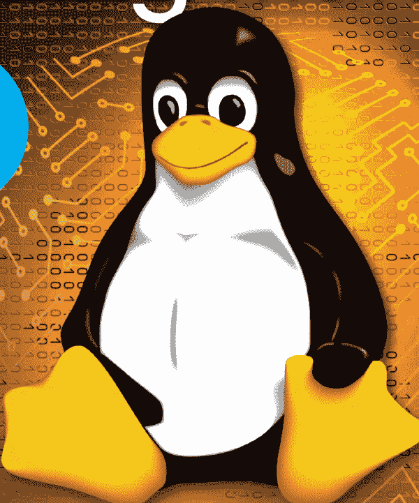


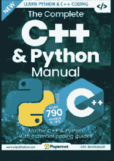
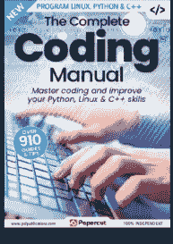


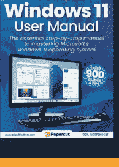


Linux 无处不在。它作为 Web 服务器背后的主操作系统驱动着互联网，驱动航天器，是世界上最快超级计算机的操作系统，并被用于智能电视和移动设备。为什么？因为它极其稳定、运行速度极快，且完全免费。

然而，Linux 的意义远仅仅是一个免费使用的操作系统。它独特的配置允许用户将操作系统定制化和个性化为他们希望的任何形式。Linux 用户可以在一天之内更改操作系统的外观和体验，安装成千上万个免费提供的应用程序和程序，并重新获得对电脑的控制权。

Linux 关乎自由。远离其他限制性操作系统的“围墙花园”模式，自由地在计算机上选择你想要的内容，自由地修改并按你的意愿使用。它是由志同道合的用户组成的全球性社区，他们都致力于从这个不可信的操作系统中获得最佳开发体验。

通过这本书，你可以成为 Linux 用户开放社区的一部分。这些页面中的教程将帮助你熟悉 Linux，向你展示它的原理、你可以用它做什么以及你如何通过编写代码将你的 Linux 体验提升到新的高度。发现 Linux，发现自由。


- 用户交互

Linux 编程

| 页码 | 主题 |
| :--- | :--- |
| 8 | 为什么 Linux? |
| 10 | 最佳 Linux 发行版 |
| 12 | 你需要的设备 |
| 14 | 桌面环境 |
| 16 | 哪种发行版? |

为什么 Linux?

对于许多用户来说，Linux 意味着自由。远离其他操作系统的“围墙花园”模式，自由地按你的意愿更改和使用操作系统。关于许可，Linux 比你想象的要多。

### 免费且开源

Linux 是那些想要不同事物的人的极佳选择。首先需要知道的是，一种名为 Linux 的操作系统。事实上，Linux 是操作系统的内核组件。谈到 Linux 时，你可能已经听说过它的许多版本，如 Ubuntu、SUSE、Debian 等。这些发行版提供了不同的用户界面。初学者在开始学习时会有很多问题。事实证明，Linux 是一个多功能且强大的操作系统，但你应该从哪里开始呢？在本节中，你可以学习 Linux 是什么，什么是发行版，以及它是如何工作的。

（此处省略大量重复的 C 代码头文件，已去重）


目前有很多版本的 Linux 可用，被称为发行版（Distributions）。每个发行版都有不同的理念和方法。以下是五个非常值得尝试的发行版以及你可以在哪里获取它们。

## 开始使用 LINUX

大多数发行版的安装过程都是相似的。你从网站下载磁盘镜像，将其刻录到光盘或创建 USB 闪存盘安装器。只需注意为你的硬件选择正确的发行版，并仔细阅读说明即可。

## LINUX MINT

到目前为止，最流行的 Linux 发行版是 Linux Mint。Mint 诞生于 2006 年，作为最流行的 Ubuntu 的替代方案。虽然它基于 Ubuntu 的长期支持版（LTS），但 Linux Mint 采取了不同的方向，为用户提供了更好的整体体验。

Linux Mint 发布的每个操作系统版本都提供三个主要的桌面版本。这初看起来可能有些困惑，但其实非常简单。目前，Linux Mint 使用 Cinnamon 桌面环境作为其旗舰型号，但也提供了更现代的替代方案。

Cinnamon 是一个图形丰富的桌面环境，MATE 消耗的资源更少，且在更多类型的桌面系统中更稳定，而 Xfce 是一个极其精简的桌面环境，为速度和极致稳定而构建。

在本教程中，我们将使用 Cinnamon 环境；不过，你可以根据意愿尝试任何其他桌面环境。事实上，我建议你花时间尝试不同的环境，甚至是不同的发行版，看看哪一个最适合你和你的电脑。

```
www.linuxmint.com
```

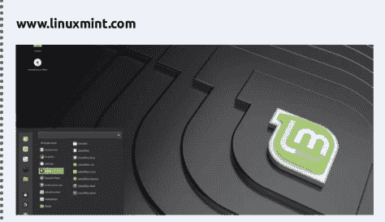

## UBUNTU

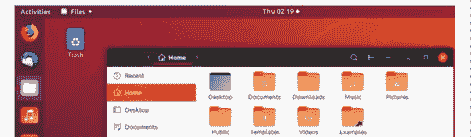

Ubuntu 自此后做出了改进，并正在缓慢爬回 Linux 榜。该操作系统的最新版本使用了 GNOME 3 桌面环境，这是一项令人深刻的改进，尽管对于 Windows 用户来说可能有点困惑，而且对系统资源的消耗也较大，特别是如果你计划在旧电脑上安装它时。

Ubuntu 尽管有很多缺点，但是一个很好的入门实验性 Linux 发行版。它的界面简洁，易于使用，并为用户提供了完整的 Linux 体验。

www.ubuntu.com

## ARCH

Arch 是运行最久的 Linux 发行版之一，许多其他 Linux 版本的的基础。既然可以安装 Arch，为什么还要安装 Mint 或 Ubuntu 呢？很多用户确实这么做了，这对初学者来说并不理想。Ubuntu 和 Mint 都提供了更简单的安装路径，并附带了启动所需的软件软件包。


另一方面，Arch 是一个更加“精简”的选择。Arch 致力于自由软件，其仓库包含超过 50,000 个可以安装的应用，包括多种不同的桌面环境，就像你使用任何发行版一样使用它们。

Arch 是在你对 Linux 更加熟悉后使用的发行版。你从命令行之外一无所有开始，必须手动分区硬盘、设置操作系统，最后安装带有你想要的所有应用的桌面环境。

然而，在付出了这些努力之后，好处是你拥有了一个自己亲手创建的发行版。它包含了你预先安装的所有必要文件和应用；它是为你身定制的。

www.archlinux.org

## RASPBERRY PI DESKTOP

毫无疑问，你听说过树莓派（Raspberry Pi）。它并不难获得，因为这台不起的微型电脑自从推出以来在过去的六年里一直风靡技术界。


树莓派的几个方面使其成为计算世界中备受追捧的产品。因为它便宜，大约25 英镑就能买到一台本质上功能完整的电脑；它很小，比信用卡大得多，你可以使用完全可编程的接口构建电子产品；而且它自带 Raspberry，这是它定制的基于 Debian 的操作系统，其中包含办公套件以及许多不同的编程语言和教育资源。

Raspian 是树莓派专有的，因为树莓派使用 ARM 处理器。不过，树莓派后来发布了 Raspberry 的 PC 版本。

就像 Pierre 一样，Raspberry Pi Desktop 包含了你所需的所有编码和其他应用。它快速、稳定且运行出色。如果你对扩展 Linux 体验感兴趣，那么这无疑是顶级的发行版之一。

大多数 Linux 发行版分为两类。有一类像 Ubuntu 和 Mint 那样拥有最新功能，另一类像 Debian 那样拥有新功能但又有强大的可靠性。

同时，openSUSE 兼顾了这两个方面。openSUSE 是一个极其可靠的系统，由社区与 SUSE 用户共同开发，他们开发了企业级操作系统；SUSE 为伦敦证券交易所等机构提供支持。它是为“没有不稳定空间”的任务关键型环境设计的。如果你觉得这些都合适，可以尝试带有所有最新功能的 openSUSE Tumble 版本，尽管偶尔会崩溃。

openSUSE 是备受尊敬的 Linux 发行版，它的许多核心贡献者在 Linux 内核、LibreOffice、Gnome 以及其他 Linux 领域工作。简而言之，openSUSE 是专业人士聚集的地方。

www.raspberry.org/downloads/raspberry-pi

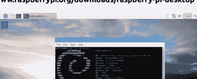


桌面环境（Desktop Environment）是你用于与核心系统交互的图形界面。就像 Windows 10 的图形桌面也被称为 Fluent Design（流畅设计）一样，Linux Mint 为用户提供了发行版版本的选择：Cinnamon、MATE 和 Xfce。虽然这对于初学者来说听起来有些困惑，但每个版本都包含相同的 Linux 结构和内核，内核是操作系统的核心，负责处理软件和硬件之间所有的指令。

那么，为什么要费力不同的桌面环境呢？简单来说，这取决于个人喜味。有些用户偏好 MATE；MATE 是经典 GNOME 2 的分支（Fork），更以菜单为中心，并且是一个更现代的环境，在旧硬件上运行得更好，并具有一些前端的桌面特性。相比之下，Xfce 是一种轻量级桌面环境，由于其对可用资源的占用极低，在旧硬件上运行良好。

每个版本都是一个略有不同的桌面环境，即你用于与操作系统交互的图形用户界面（GUI）。每个环境使用不同的应用程序来访问或使用系统，例如用于浏览操作系统的文件管理器，或启动其他程序的方式。再次强调，核心生产力工具和图形套件是相同的，且功能也一样。


img/21ee864cf339a60c696b7da13_0


除了外观和感受之外，Cinnamon 还有许多优点，尽管这些是重要的因素。在这里我们列出了几个特性，帮助你判断它是否适合你的桌面环境。


它在现代系统上表现优异，但比以前稳定得多，而且不再是以前那样的资源大户了。因此，如果你正在使用旧电脑安装 Linux Mint，不要被 Cinnamon 吓跑。


Cinnamon 有可配置的“热角”（Hot Corners），点击桌面的每个角落都可以执行特定任务，例如显示工作空间、显示所有窗口或运行命令。热角允许你在不同的视图之间切换，并帮助让桌面更高效。

img/21ee864cf339a60c696b7da14_0


MATE 是一个简单直观的、快速且稳定的桌面环境。与 Cinnamon 相比，它看起来有点过时，但那只是表面现象。MATE 有许多人喜欢的地方。


MATE 是旧电脑的极佳桌面环境。它与大量硬件组件的兼容性通常比 Cinnamon 好，但同样能够提供精美的桌面和个性化定制。

img/21ee864cf339a60c696b7da14_1


由于高度的可配置性，MATE 可以进行非常细致的定制。对于要求桌面环境的用户来说，有很多选项可用，包括 Compiz 设置，你可以在其中配置各种桌面特效，甚至是立方体桌面。


Xfce 起于 1996 年的通用桌面环境（CDE）。从那时起它更改了几次，现在简单称为 Xfce，绰号为“零胆固醇桌面”。


Xfce 确实是一个快速的桌面，发挥了 Linux 作为快速操作系统的最佳特性。事实上，我们从页面顶部到这里只需将其安装到新电脑上；几百字后，你就在使用新的操作系统了。不坏。


因为它快速且轻量，并不意味着 Linux Mint Xfce 不是一个完整的桌面系统。就像我们提供的其他环境一样，你可以获得最新的 Firefox、LibreOffice、Gimp、聊天应用，甚至是一个 Torrent 客户端。

img/21ee864cf339a60c696b7da14_2


到目前，我们主要看了 Linux Mint，但还有其他 Linux 发行版可以尝试。有数千个 Linux 发行版可以下载安装，所以你应该决定使用哪一个呢？


“发行版跳”（Distro Hopping）是社区使用的术语，指那些从不固定于某一个发行版的人，相反，他们在不同发行版之间来回跳，测试每一个，并在它们之间或与新发布的发行版之间切换使用。

发行版跳并没有坏处，它是了解现有内容以及其他可能不符合你口味的系统的一种好方法。问题是，你今天应该用哪一个？

例如，Linux Mint 是一个理想的起点。它是一个容易安装和使用的发行版，开箱即用了日常所需的所有软件，并温和地引导你进入 Linux 的独特世界，以及它是如何运作和运行的。

Ubuntu 提供了类似的体验，但方式略有不同。通常情况下，使用 Ubuntu 的经验比 Linux Mint 少。另一个值得考虑的点是，当你卡壳时，Ubuntu 用户提供的内容和帮助信息量，你永远不会离帮助太远。


## 开始使用 Linux

> “在真正的开源世界中，你拥有控制自己命运的权利。”
> —林斯·托尔兹斯（Linux 内核开发者）


谈论优秀的 Linux 固然很好，但你如何把它安装到电脑上呢？安装 Linux 其实非常简单，但你有多种选项供选择。本节将介绍如何下载 Linux ISO 镜像、将其作为主操作系统安装在 PC 上，甚至还会介绍如何安装虚拟环境。

通过虚拟环境，你可以在继续使用主操作系统（无论是 Windows 或 macOS）的同时运行 Linux。感兴趣吗？继续读下去了解更多信息。


## 在 Windows 上创建 Linux 安装程序

在将 Linux 安装到电脑之前，你需要将下载的 Linux ISO 传输到 DVD 或 U 盘中。这将是一个现场环境（live environment），允许你在安装之前测试该操作系统，但首先你需要创建一个启动介质。


我们正在使用一台 Windows 10 PC 将 ISO 传输到 DVD。如果你使用的是 Windows 7 及更高版本，该过程非常简单。


快速访问 Dropbox (Team BDM) OneDrive 此电脑 CD 驱动器 (E:) HiSuite 网络 linuxmint-19.1-cinnamon-64bit


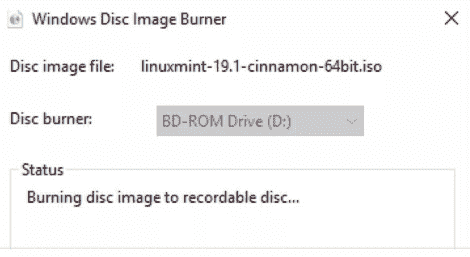


USB 介质比 DVD 快且通常更方便，因为大多数 PC 都没有安装光驱。传输映像的过程非常简单，但你需要一个第三方应用程序和一个容量为 4GB 或以上的 U 盘。


打开网页浏览器并访问 rufus.ie。下载一下并进入“下载”页面查找 Rufus 的最新版本。点击链接开始下载。

| 驱动器属性 | |
| --- | --- |
| ubuntu-20.04.6-desktop-amd64.iso | |
| MBR 或 UEFI | |

- 显示高级属性


状态


下载的可执行文件。遵循 Windows 系统检查更新。当 Rufus 启动时，它应该已经识别了你的 盘；如果没有，请拔掉并重启。

| 驱动器属性 | |
| --- | --- |
| Linux Mint 19 Cinnamon 64-bit (4.1 GB) | |
| ISO (映像) 选择 | 选择 |

- 显示高级属性
- 显示高级选项

| 格式选项 | |
| --- | --- |
| 文件系统 簇 | |
| FAT32 (默认) | |


状态


起初 Rufus 会让你有点困惑，别担心，这很简单。要开始，点击按钮选择“磁盘”或“映像”模式。这将启动 Linux，你可以在其中找到并选择 ISO。从互联网下载的文件将下载到当前目录并自动重组。


当你准备好时，点击 Rufus 应用的“开始”按钮。可能会打开另一个对话框让你下载并使用新版本的 Syslinux。Rufus 是启动加载集合，允许你的 PC 从 U 盘启动。这是必要的，所以如果询问，请点击“是”继续。不同版本的 Syslinux 看起来可能不同。


下一步询问你想要将 Linux ISO 写入 U 盘，通常推荐使用“映像”模式。确保选择了此选项并点击“确定”继续，然后点击“确定”确认操作。你选择的映像是“ISOHybrid”。这意味着它可以以 ISO（文件模式）或 DD（磁盘映像）写入。Rufus 只写入分区，这样你在写入后就可以访问盘。如果你在启动过程中遇到错误，可以尝试重新写入映像。请选择你想要写入的模式：


ISO 现在已传输到你的 盘。该过程不需要太长时间，特别是取决于你找到的 U 盘的速度。Rufus 在过程中会在 Windows 资源管理器中自动启动 盘；完成后，如果你想，可以点击按钮。

| 驱动器属性 | |
| --- | --- |
| Linux Mint 19 Cinnamon 64-bit (4.1 GB) | |
| 启动选择 | |

- 显示高级属性

| 格式选项 | |
| --- | --- |
| 文件系统 簇 | |
| FAT32 (默认) | |

状态

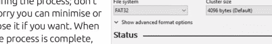

准备就绪 | 开始

## 在 PC 上安装 Linux

大多数发行版以现场环境提供。通过这种方式，你可以从创建的 DVD 或 USB 启动实际且完全工作的发行版。让我们看看它是如何工作的，以及如何从那里安装 Linux。


统一扩展固件接口 (UEFI) 用于在启动过程中识别并保护 PC。它取代了传统的 BIOS 并可能导致安装 Linux 时出现问题。


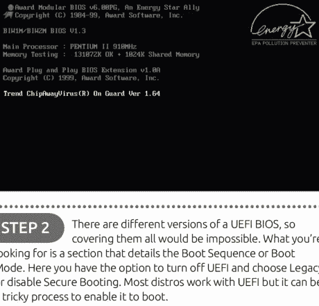


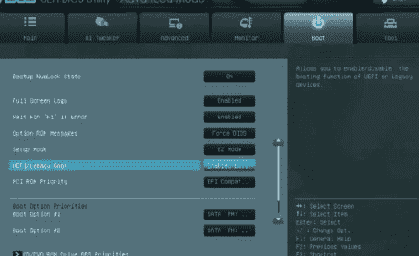

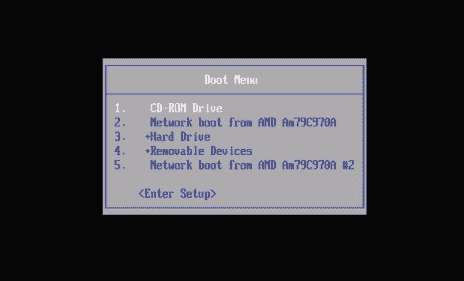


当现场环境（Live Environment）启动后，请查看将发行版安装到你的计算机上的选项。环顾四周，在你准备好后，寻找桌面上的“安装”（Install）选项。

如果你已连接到网络（如果没有，请先连接）并且正处于现场环境，请双击桌面上的 `Install Mint` 图标开始安装过程。其他发行版当然会显示它们自己的名称，但过程是相同的。准备就绪后点击“继续”（Continue）。


在安装过程开始之前，系统会询问你是否选择确保硬盘擦除是正确的。这是你最后退出的机会。如果你确定不介意清空所有内容并重新安装 Linux Mint，请点击“继续”。如果你需要从 Linux 光盘/USB 盘中备份文件，请重启并重新开始。


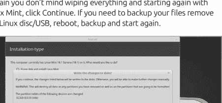

虽然大多数 Linux 发行版的安装过程非常相似，但某些版本在安装期间会提供不同的问题。这些问题并不困难，没有太技术性，例如“安装第三方软件……”。在这种情况下，你可以点击“继续”，但如果你不确定，请准备好一台连接了互联网的设备以便咨询任何问题。


最后你会被要求设置用户名和密码。输入你的名字以开始，并设置“计算机名称”（Computer Name），它是网络上的标识。接下来选择一个“用户名”（Username），然后是密码。你可以点击“自动登录”（Login Automically）选项，但暂时留留“进入主目录”（Entry Home Folder）选项。

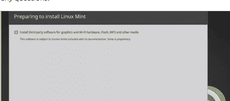

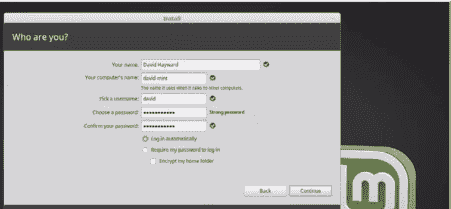

安装新操作系统时，建议擦除旧操作系统并替换为新系统。在安装过程接近此阶段时，确保选择了“擦除磁盘并安装 Linux”（Erase disk and install Linux）。**注意：** 这将完全清空你计算机上的 Windows 10，请确保你已备份所有个人文件和数据。


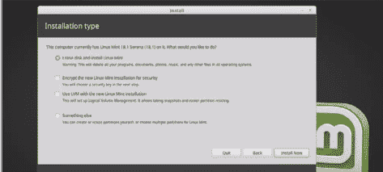

安装过程可能很快，可能会有更多问题需要回答，也可能只是根据你的偏好安装 Linux。之后，你将被要求“测试现场环境”（Testing the Live Environment）或“重启到新安装的操作系统”（Restarting to the newly installed OS）。如果你准备好使用 Linux，请点击“重启”（Restart）。


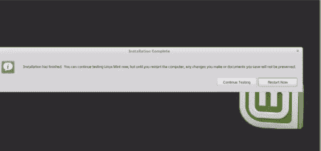


虚拟机是一个模拟的计算机。使用虚拟机（Virtual Machine），你可以模拟标准 PC 并向其安装整个操作系统，而不影响原有的系统。这是在使用 Linux 的同时将 Windows 10 作为主操作系统的极佳方法。


使用虚拟机（VM）会消耗计算机的资源：内存、硬盘空间、处理器使用率等。在开始之前，确保你有足够的资源。

- **第二步** 接下来，在同一个 VirtualBox 下载页面，找到 VirtualBox 扩展包（VirtualBox Extension pack）。该扩展包支持 USB 设备以及许多帮助让虚拟机环境更像真实计算机模拟的额外功能。
- **第三步** 在下载好正确的包后，在安装它们之前，你需要确保你正在使用的计算机可以作为主机。重启计算机并进入 BIOS。当计算机启动时，按下 F2 或任何必要的键进入“设置”（Setup）。

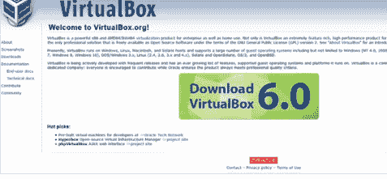

每个 BIOS 的布局都不同，在个人示例中很难判断该看哪里。但根据一般原则，你应该在 BIOS 的“高级”（Advanced）部分寻找“Intel 虚拟化”（Intel Virtualisation）或直接寻找“虚拟化”（Virtualisation）。找到后，启用它，保存设置并重启计算机。

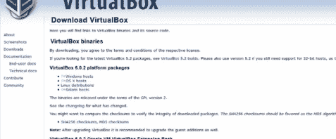

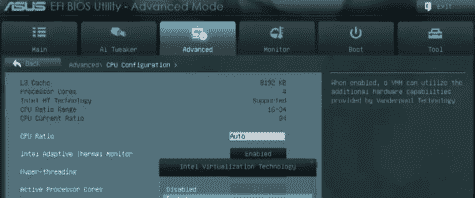


 安装 VirtualBox 时，你的网络连接会短暂禁用。

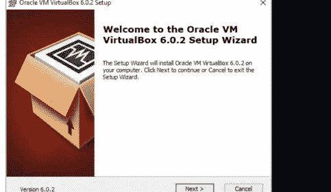

- 第 8 步 安装 VirtualBox 时，你的网络连接会短暂禁用。

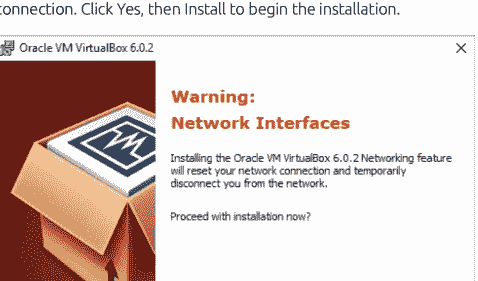


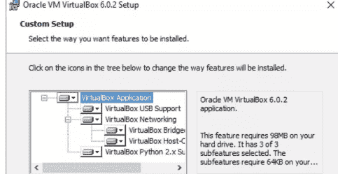


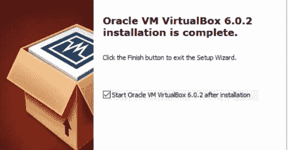


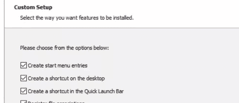


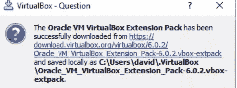


当 Oracle VirtualBox 运行后，下一个任务是创建一个安装 Linux 的虚拟机（VM）环境。此过程不会影响你当前安装的操作系统，这就是为什么虚拟机是一个极佳的选择。


在创建虚拟机时，有很多选项可以选择。现在，我们设置一个能够运行 Cinnamon 且性能良好的虚拟机。


# 了解 Linux

> “任何人都可以构建出快速处理器。秘诀在于构建一个快速系统。”
>– 塞摩尔·克雷（电气工程师，Cray 超计算机的设计师/创始人）


我们在这里使用 Linux Mint 作为指南，因为它是一个易于使用的发行版，非常适合以前的 Windows 用户。它也是开发最成熟、文档最详尽的 Linux 发行版之一，并拥有出色的配置选项。

在本节中，我们将介绍 Linux Mint 的 Cinnamon 菜单和桌面环境、它的工作原理以及你可以如何对其进行自定义。想要创建另一个用户，甚至想发现如何在网上实现匿名吗？请继续阅读。


现在你已经安装了 Linux，是时候好好观察一下了。不过，如果你正在使用 Virtualbox，你会收到一个关于“软件渲染”（Software Rendering）的通知；这里是修复方法。


你已经查看了列表函数，使用了 `.insert`、`.remove` 和 `.pop`，但也有适用于字符串的函数。

**步骤 1** 在我们开始之前，假设你正在 Virtualbox 中运行此操作。软件渲染消息出现在桌面的右上角。要修复此，点击 Virtualbox 窗口中的“设备”（Devices），然后点击“插入客户增强 CD 映像”（Insert Guest Additions CD image）。

**步骤 3** 一过几秒钟，你会自动进入命令行视图，在 Linux 中称为“终端”（Terminal）。这详细说明了新 VirtualBox 驱动程序的安装过程，删除了检测到的任何旧驱动并安装了最新版本。这不会花费长时间，完成后将要求你重启终端。

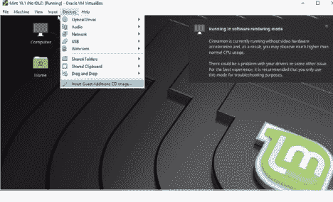

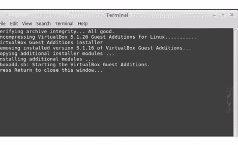

**步骤 2** 客户增强 CD 包含 Virtualbox 的驱动程序，包括视频硬件。当它加载时，你会收到“软件需要运行”的通知，有两个选项：取消（Cancel）和运行（Run）。点击“运行”按钮并输入你的密码。

**步骤 4** VirtualBox 增强 CD 在桌面上，因此右键点击它，然后向下滚动菜单点击。你现在可以通过点击左侧的菜单图标，点击“重启”（Restart）按钮来重启 Linux。这会重启 Mint 问题就解决了。

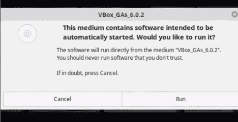


现在 Virtualbox 的软件渲染问题已经解决了，让我们来看看菜单以及它是如何工作的。请记住，这仅适用于 Cinnamon，其他发行版的外观和行为会有所不同。

**步骤 1** 首先，你可能已经注意到了登录时弹出的欢迎屏幕。花点时间浏览一下这些选项。完成后，点击窗口右上角的“X”关闭。

**步骤 4** 再次打开菜单，这次将鼠标指针悬停在“图形”（Graphics）上，然后点击“GNU Image Manipulation”（GIMP）。GIMP 是一个强大的应用程序，效果与 Photoshop 相当，但需要花一点时间掌握。不过，它值得花时间学习。

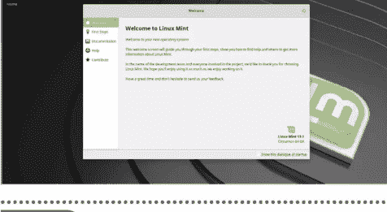

**步骤 2** 你已经使用菜单重启了系统，当你第一次使用环境时，点击菜单并悬停在“办公”（Office）上。这会改变右侧列中安装的应用程序。

**步骤 5** 如果你正在寻找特定功能（例如设置打印机），点击菜单顶部的搜索框。输入你需要的应用程序或功能（如打印机），菜单将显示相关选项。这适用于任何现代发行版。


每个桌面环境的行为都不同。有些桌面提供可以自定义并放置在桌面上的组件，而另一些选择简洁的外观以保持一切尽可能运行。让我们看看 Cinnamon 桌面提供了什么。


Cinnamon 桌面环境是风格与性能的完美融合。关于它的知识很多，这就是为什么它是一个流行的桌面环境。

**步骤 1** 双击图标开始探索 Cinnamon。这带出了 Cinnamon 中使用的文件管理器。“计算机”（Computer）图标打开根级文件系统，带有光光驱动器（如果你安装了）、硬盘和核心 Linux 文件系统的访问。

**步骤 3** Nemo 有许多不同的功能、视图和方式，让你查看和管理文件及文件夹。例如，如果你在“图片”文件夹中有图像，可以使用 Nemo 右下角的标记为“调整缩放级别”（Adjust Zoom Level）的滑块来选择图像缩放。


**步骤 2** Linux 文件系统对于 Windows 用户来说可能令人困惑，在你更熟悉它的工作原理之前，我们建议你专注于桌面上的“主”（Home）图标。这里有与用户账户相关的一切：你存储图片、视频、音乐、文档、下载项等。

**步骤 4** 就像任何良好的文件管理器一样，右键点击任何文件或文件夹你都会获得丰富的选项。在 Cinnamon 的情况下，默认允许你播放或编辑文件。

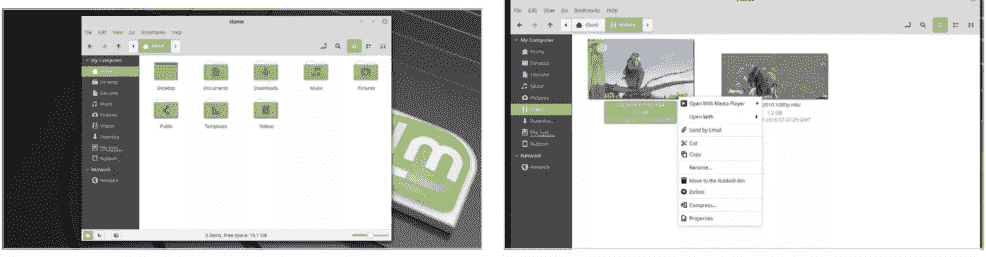


**步骤 5** 在桌面底部，我们已经查看了面板之一。如果你在面板的任何地方点击右键，可以添加不同的方式。

**步骤 8** 从该桌面右键菜单中，选择“自定义”（Customise），然后点击“桌面”（Desktop）链接。这会打开一个可以在其中编辑图标的新窗口。如果你使用多个显示器的设置，还可以选择哪个显示器显示图标。

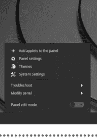

**步骤 6** 例如，如果你点击“修改面板”（Modify Panel），你可以移除、移动面板、添加新面板，并清除当前存在的任何组件（Applets）。顺便说一下，组件是一种设计用于工作并契合 Cinnamon 面板的应用程序。

**步骤 7** 如果你在 Cinnamon 桌面的任何地方点击右键，你会看到一组允许你进一步添加或编辑桌面内容的选项。它与 Windows 非常相似，这也是为什么 Mint 是前 Windows 用户的良好选择。

- 系统设置
- 故障排除
- 修改面板
- 添加面板
- 复制组件配置
- 粘贴组件配置
- 清除所有组件

- 创建新文档
- 添加桌面组件
- 更改桌面背景
- 在此处创建新启动器...
- 在终端中打开
- 以根身份打开
- 自定义
- 粘贴


Linux Linux Mint 是一个开箱即用的精美发行版，但与大多数 Linux 发行版一样，可以通过进行一些调整来改进它的运行方式。虽然这些是针对 Mint 的特定调整，但大多数也适用于其他发行版。


这些安装后的操作某些是强烈建议的，而另一些只是实用的补充，仅用于调优系统或添加自定义功能。

- **第 1 步** 第一步也是最重要的安装后操作是更新系统。点击桌面右下角、时间和日期旁边的面板上的图标。这将启动更新管理器。

- **第 3 步** 点击 OK 按钮，你就可以看到几个准备好安装的更新。在更新之前，点击蓝色的 OK 按钮切换到本地镜像。这将打开“软件源”选项。在“镜像”部分，点击“主（Main）”和“基础（Base)”下拉菜单，选择距离你当前位置最近的服务器。

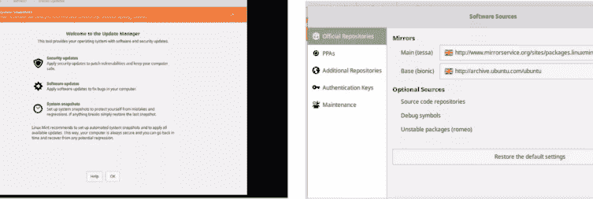

- **第 2 步** Linux Mint 为用户提供三种更新策略：不要弄坏我的电脑、优化稳定性和安全性以及始终更新一切。推荐的选项是“优化稳定性和安全性”，它只更新不影响操作系统关键元素的安全、基本补丁。阅读下方的描述，选择中间的那个，这是被推荐的。

- **第 4 步** 点击“更新缓存”按钮并关闭“软件源”窗口。回到更新管理器，点击“安装更新”图标并输入你的密码。更新将自动安装并重新启动更新管理器，这次会有更多的更新。再次点击“安装”，查看任何消息并等待它们完成。

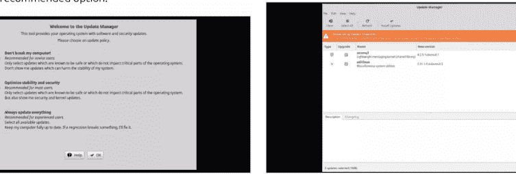

- **第 5 步** 更新按级别分类，1 级为低级更新，5 级为危险更新。坚持使用 3 级更新，或者咨询我们；对于任何关于覆盖配置文件的问题，点击“回复”。对于软件渲染问题以及非 VirtualBox 用户缺少驱动程序的问题，点击菜单并在搜索框中输入“driver”。

- **第 8 步** 当要求接受更改时，输入 Y；当要求配置 libvdi 时，确保 OK 并 并 Enter，然后对任何后续问题回答 Yes。接下来，仍在终端中：cat /proc/sys/vm/swappiness，结果应为 0。如果你的电脑内存少于 4GB，则输入：sudo xed /etc/sysctl.conf。

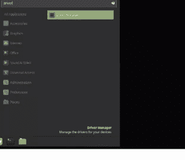

- **第 6 步** 点击搜索结果出现的“驱动管理器”应用并输入你的密码。Mint 需要一些时间来分析可用内容，并为你检测到的硬件提供一系列驱动程序选择。对于这些图形驱动（例如软件渲染），应该选择使用最新的推荐驱动程序。

- **第 9 步** 这一调整可以加速内存小于 4GB 的系统。滚动到你刚刚打开的文件底部，并添加以下行：

`# 将交换使用降低到更合理的水平
vm.swappiness=10`

点击文件->保存，然后文件->退出。重启 Linux Mint，你应该会注意到性能略微提升。

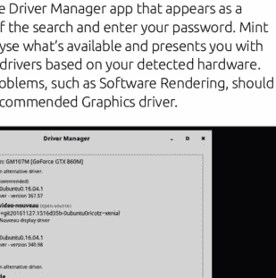

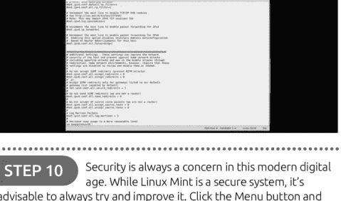

- **第 7 步** 此时你需要重启 Linux Mint，现在就去。重启后点击菜单，然后是“终端”。终端图标位于左栏。打开“文件”图标，然后输入：sudo apt-get install libvdi-pkg

- **第 10 步** 安全在数字时代始终是一个关注的问题。Linux Mint 是一个安全的系统，建议始终尝试改进它。点击菜单并搜索“防火墙”；点击防火墙配置并输入你的密码。在防火墙窗口中，将状态设为“开启”。

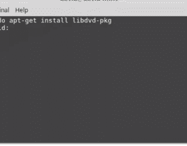

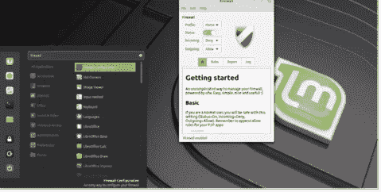


你知道吗...
1969 年 7 月 20 日被认为是人类历史上的转折点，人类首次登上月球。当时帮助船员执行任务的软件并不，必须从零开始。使用一种名为内存的新存储方法，MIT 的工程师用特殊的汇编填充了内存。

难以置信，代码可以在 GitHub 上免费查看。由研究人员于 2003 年上传，你可以访问 www.github.com/chrisgarry/Apollo-11/ 查看代码。注意代码片段，特别是带有“Goodbye”注释的。很快见。看看你能发现什么。

| 变量 | 名字 | 描述 |
| :--- | :--- | :--- |
| PABILITY | SUBSCRIPTION TO ERSE COUNTER |
| GAIN | INCREMENTS ON WHEELS, ON JETS |
| RATE | INCREMENTS ON BUFFERS |
| TURN | TURNING COUNTER |
| MASK | SET ON DESCENT STATUS |
| FLAM | YES, FOR-TOGGLE MODE |
| EXIT | EXIT CODE |
| COUNTER | AUTO-MESSAGE_RETURN |
| RUNNING | POSITIVE BOUNDLESS PURPOSES |
| PABILITY | POSITIVE ON RESET |
| FLT | POSITIVE HERMETIC |
| TURN | TURNING |
| SERGE | SERVICE COUNTER |
| SET | SET |
| TAGS | TAGS |
| BORN | BORN-BIT |
| DATA | DATA-64 |
| VALUE | VALUE-2-MAX |

程序员并没有幽默感。看看那里还有什么。人类的一大步。


来源：阿波罗 1 号/NASA


安装 Linux Mint 时，它为你配置了一个用户。虽然全家人共享账户没有问题，但可能某时你需要创建拥有独立文件夹的用户。不同的用户意味着每个用户都可以访问其在系统上的区域。在其他操作系统中，文档、图片、视频等是分开的。


- **第 3 步** 输入新用户的姓名，然后是用户名。确保用户名全为小字母 a-z 和 0-9。如果需要，可以使用点、下划线或连字符。准备好继续时，点击“添加”按钮。

- **第 4 步** 新用户按字母顺序出现在当前 Linux Mint 用户列表中。目前没有设置密码，因此点击用户列表中的用户，点击用户名下的“无密码”。

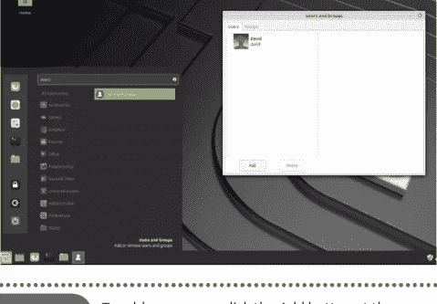

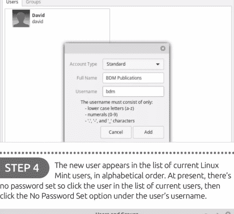

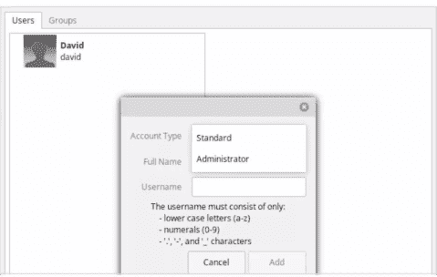

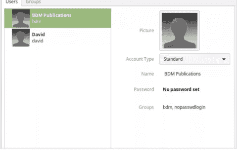

- **第 5 步** 你现在可以为新用户输入密码，或者点击新密码文本框末尾的弯曲箭头为你生成并显示密码。自然地，准备一个强密码是个好主意。完成后，点击“更改”按钮。

- **第 6 步** 你可以关闭用户和组控制台，新用户已创建。如果你点击菜单并“注销”，你将看到 Mint 登录界面。新用户出现在当前用户列表中。点击列表中的用户登录他们。

- **第 7 步** 此时你需要重启 Linux Mint，现在就去。重启后点击菜单，然后是“终端”。终端图标位于左栏。打开“文件”图标，然后输入：sudo apt-get install libvdi-pkg

- **第 8 步** 你可以创建需要的所有账户，并在需要时它们之间切换。最好只拥有能够安装新软件的账户，这样你就可以跟踪系统上有什么。

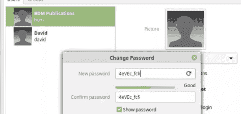

```bash
david-Mint: $ sudo apt-get installpak
```


正如你预期的，你也可以在命令行中创建新用户。在主（用户）管理员账户下打开终端会话。

- **第 1 步** 从命令行添加新用户的过程相对简单。使用 `sudo adduser <username>`，其中 `<username>` 是新用户的登录名。将被要求为用户创建密码，以及全名和其他信息。确认这些信息并创建用户账户。

- **第 2 步** 你可以在用户和组内部查看新用户的详情和账户类型。如果你想从 Mint 中删除用户，可以在终端中输入 `sudo deluser <username>` 或在组中删除用户。

```
$ sudo adduser david
添加用户 `david` (新组: `david`)
添加新用户 `david` (UID 1001) 来自组 `david`
创建家目录 '/home/david'...
创建新用户。
david 的密码: ****
密码更新成功。
输入新密码: ****
Full Name []: David Smith
Room Number \|_{
Work Phone \|_{
Home Phone \|_{
Other \|_{
正确吗? Y
```


自定义操作系统桌面是让它独具特色的一种方式：创建一个个性化的工作空间，帮助你工作、激发灵感或展示公司标志。无论你拥有自己桌面的原因如何，这里是操作方法。


Linux 可能是世界上定制程度最高的操作系统之一。只需少量的调整、安装一两个额外的程序并发挥想象力，你就能创造出惊不起的东西。


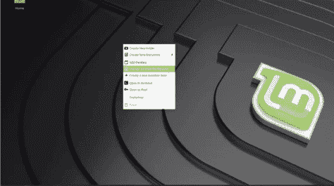


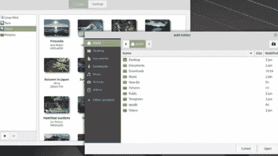


- 第 5 步：如果没有任何可用壁纸符合你的心意，可以打开浏览器并搜索你喜欢的背景图像类型。当你找到想要作为桌面壁纸的图像时，右键点击它并从选项列表中选择“设置为桌面背景”。当“设置桌面背景”控制台打开时，点击“设置桌面背景”按钮。

- 第 6 步：点击菜单按钮搜索 '/desktop’并点击“桌面设置”结果。桌面控制台允许你选择所需的布局、桌面图标和多显示器支持选项。你可以根据自己的口味尝试各种选项以获得最佳设置。

- 第 7 步：除了更改桌面壁纸和图标显示方式，你还可以更改 Linux Mint 的整体主题。从 Mint 菜单（Mint Menu）中搜索“themes”（主题），并点击搜索结果中的“主题”。

- 第 8 步：主题允许你更改 Mint 桌面的某些外观：窗口框、图标、控件、鼠标指针和桌面。在“设置”标签页中，你可以通过几个开启/关闭开关扩展选项。


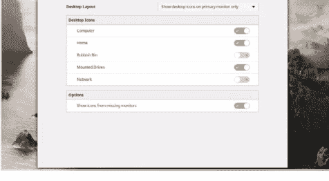


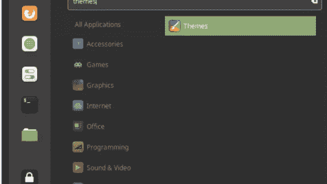
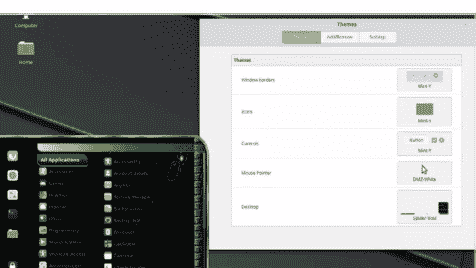


数字时代带来了通信领域的许多巨大进步；然而，它也带来了一个间谍和窥探的新时代。我们大多数人对政府、秘密组织和地下黑客破坏我们隐私的频繁新闻并不陌生，但你该如何对抗这一点呢？
## 使用 MINT 实现匿名

虽然要变得完全匿名几乎是不可能的，但你可以采取措施来确保你的隐私处于最佳状态。

- 第 1 步：从基础开始，浏览时使用 HTTPS 而不是标准的 HTTP。这意味着通过 HTTPS 传输的任何内容都是安全的（因此结尾的 S 代表 Secure）并经过加密的。

- 第 2 步：浏览时，考虑使用浏览器的“无痕模式”或“隐私浏览模式”。这将禁用历史记录和网页缓存，让你的浏览记录不会被他人存储。然而，这并不能阻止任何数据追踪。

- 第 3 步：尽管 Google 可能是现代搜索的显之选择，但它会记录个人的所有的搜索。考虑一种替代搜索引擎，例如 DuckDuckGo，这种搜索引擎不会存储个人数据或追踪你。


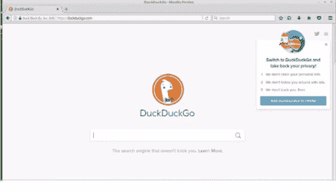

- 第 4 步：如果你经常上网，考虑安装一些浏览器插件。例如，对于 Firefox，使用 Ghostery、NoScript 和 AdBlock Plus 来阻止追踪器、广告和其他数据挖掘。


之前的步骤可以帮助你的在线隐私，要真正变得匿名，你需要虚拟专用网络（VPN）和 Tor。

- 第 1 步：VPN 是一个远程服务器或服务器集群，与你的计算机建立连接。结果是你的计算机在互联网上的身份隐藏在 VPN 服务器之后；因此你可以不带 IP 地址使用。

- 第 2 步：大多数优秀的 VPN 需要月费或年费，但它是值得的。CyberGhost 支持 Windows、Mac、Mint（以及其他 Linux发行版）、Android 和 iOS。详情可以在 cyberghost.com/us/articles/read-me-first/ 找到。

- 第 3 步：另一个选项是使用 Tor。Tor 是一个开放网络，你可以连接到全球的节点来隐藏 IP 地址。它非常容易安装和使用。访问 torproject.org/download/easy.html 并点击 Linux 版本。

- 第 4 步：下载完成后，进入终端并进入 Downloads 文件夹。输入 ls 检查是否存在 .xz 文件，然后输入：tar -xzf tor-browser-linux64-8.0.tar.xz（如果你的版本不同，按 Tab 键自动补全文件名）。解压文件后，使用 cd tor-browser-en/ 进入目录。

- 第 5 步：快速安装几个文件：一个 Browser 文件夹和一个 start-browser.desktop 文件。要启动设置，使用 ./start-browser.desktop。此命令会启动 Tor 安装，并提供两个选项：连接或配置。准备好后点击“下一步”。

- 第 6 步：连接建立后，Tor 会启动。从这里你可以在不被查看或追踪的情况下自定义 Firefox。将 VPN 和 Tor 结合可以实现极其安全且私密的在线连接。


Linux 命令行——终端（Terminal），是一个极其强大的环境。通过它，你可以让操作系统瘫痪，也可以将其更新为令人惊叹的状态。你可以黑入远程计算机、查看 ASCII 火火、安装新的应用和程序、观看从荷兰服务器播放的《星大战》，并编写自动化脚本。

– 匿名（发布在 comp.software.testing）

在本节中，你将探索终端的复杂性以及它如何与 Linux 工作。你将学习如何从终端操作 Linux 文件系统，并将发现一些在终端中可以做的奇有趣的事情。

终端在 Linux 世界中至高无上。学会它的工作，你就能获得所有的力量。


| | |
| :--- | :--- |
| 50 | 通过终端安装应用 – 第 1 部分 |
| 54 | 你知道吗...Linux 内核 0.01 |
| 58 | 创建和删除目录 |
| 62 | 终端中的更多趣事 |


大多数操作系统使用两种类型的界面：GUI（图形用户界面），即 Windows、macOS 和 Linux Mint 启动后进入的桌面；命令行。虽然现代操作系统逐渐远离了命令行，但 Mint 使用终端（Terminal）让用户对系统拥有更大的控制权。


命令行，或终端，是一个极其强大的界面。你在桌面上可以进行的所有操作都可以在终端内完成。让我们先看看它是如何工作的。

- **步骤 1** 可以通过点击面板（Panel）上的终端图标访问终端，该图标位于 Firefox 和文件（Files）图标之间；或者通过打开菜单从左侧的快速启动栏中选择它。

- **步骤 3** 你目前在终端中看到的是你的登录用户名，后面跟着计算机名称；这是你在第一次安装 Mint 时在设置时命名的。该行以当前文件夹名称结尾；起初只是一个波浪号 `~`，代表你的主目录（Home folder）。


- **步骤 2** 终端让你访问 Linux Mint 的 Shell，称为 Bash，它让你能够访问底层操作系统。Mint 中的所有内容，包括桌面和 GUI，都是从命令行运行的模块。

- **步骤 4** 行最末端闪烁的光标是输入基于文本命令的地方。你可以开始尝试一个简单的命令：打印工作目录（Print Working Directory，简称 `pwd`），它会在屏幕上输出你当前所在的文件夹。输入 `pwd` 并按回车。

```
david@david-mint ~ $ pwd
david@david-mint ~ $
```

## 终端基础知识

步骤 5 你输入的所有命令都以相同的方式工作：你输入命令，包含任何用于扩展命令用途的参数，然后按回车执行你入的命令。在终端中输入：`uname -a` 并按回车。这将显示有关 Mint 的系统信息。

步骤 8 “查看和搜索”（View and Search）选项允许你开启终端窗口的大小调整，当然，还可以在终端内搜索特定的关键词。


步骤 6 在我们输入命令之前，让我们花点时间看看终端提供哪些功能。菜单（Menu）选项允许你打开一个新的终端，创建一个新的配置（profile），你还可以更改终端的大小、颜色和行为，添加新标签页并关闭所有活动会话。

步骤 9 “终端”（Terminal）条目进入配置编辑和尺寸调整界面，允许你更改字符编码。有趣的是，你还可以将其设置为“只读”（Read Only）模式，这会阻止你向终端输入命令；这在你需要显示命令时非常有用。


步骤 7 “编辑”（Edit）选项允许你在终端与其他源之间进行复制和粘贴命令；当你想要从网页上复制一个很长且复杂的命令时，你也可以编辑你的配置偏好。

步骤 10 最后，“帮助”（Help）选项显示终端的帮助内容和版本号，或者更准确地说，未来我们将简单地将其称为 Terminal。“内容”（Contents）部分值得快速读一遍，以帮助熟悉终端的工作原理。


## 通过终端更新 Mint


## 使用 APT-GET

要更新和升级终端，你需要使用 APT（高级软件包工具）命令。其强大的命令根据其用途组合了不同的元素。

- **步骤 1** 从打开一个新的终端开始，或者如果你已经打开了一个终端，请使用 `clear` 命令。这会从一个干净的状态开始。

- **步骤 3** `apt-get` 用于升级 Mint 中的软件，以及 Ubuntu 和其他基于 Debian 的发行版。使用“更新”（Update）元素会获取新软件包并更新源文件列表。“升级”（Upgrade）会下载并对文件的最新版本执行升级。要启动升级过程，输入：`sudo apt-get upgrade`，然后输入你的密码。


- **步骤 2** 在终端中输入 `apt-get`。这会列出常用命令列表以及命令的作用。如果现在看起来还不太清楚，那么值得一看。

- **步骤 4** 注意到新增的 `sudo` 命令。`sudo` 命令让使用超级用户（Super User）变得容易得多。这意味着管理员用户（超级用户）使用 APT（高级软件包工具）来获取任何。现在尝试这个：`sudo apt-get upgrade`。

```
File Edit View Search Help
apt-get 1.2.7 (ubuntu)
apt-get install [command]
apt-get remove [pkg-name]
```

```
File Edit View Search Help
apt-get 1.2.7 (ubuntu)
apt-get update
Reading package lists...
Building dependency tree:
Fetching: http://archive.ubuntu.com/ubuntu InRelease [196 kB] [Get]
Fetching: http://archive.ubuntu.com/ubuntu-security InRelease [214 kB] [Get]
Fetching: http://archive.ubuntu.com/ubuntu focal/main amd64 Packages [12.5 MB] [Get]
Reading package lists...
Building dependency tree:
You have 45 packages which can be upgraded, 0 have been installed.
Run 'sudo apt-get --upgrade' to continue the process.
```

## 通过终端更新 Mint

步骤 5 根据更新的类型，你可能需要等待 `sudo apt-get upgrade` 命令的结果。然后你可以尝试接受并继续。这里发生的情况是 apt-get 有一些更新的软件要应用到 Mint，你又恢复正常了。步骤 7 你的系统现在根据 apt-get 命令提供的可用列表是最新的。如果你愿意，可以再次运行该过程。总结一下：`sudo apt-get update`，然后输入 `sudo apt-get upgrade` 并按回车。

```
File Edit View Search Help
Reading packages: Done
Building dependency tree: Done
Get:1 http://archive.ubuntu.com/ubuntu focal main [112 kB]
Get:2 http://archive.ubuntu.com/ubuntu universe [86 kB]
Get:3 http://archive.ubuntu.com/ubuntu-security main [112 kB]
Get:4 http://archive.ubuntu.com/ubuntu-security universe [112 kB]
Get:5 http://archive.ubuntu.com/ubuntu focal-updates [112 kB]
Get:6 http://archive.ubuntu.com/ubuntu focal-security [86 kB]
Get:7 http://archive.ubuntu.com/ubuntu-backports [86 kB]
Get:8 http://archive.ubuntu.com/ubuntu focal-proposed [86 kB]
Get:9 http://archive.ubuntu.com/ubuntu focal-updates [112 kB]
Get:10 http://archive.ubuntu.com/ubuntu focal-updates [86 kB]
Get:11 http://archive.ubuntu.com/ubuntu focal-updates [112 kB]
Get:12 http://archive.ubuntu.com/ubuntu focal-security [86 kB]
Get:13 http://archive.ubuntu.com/ubuntu focal-updates [112 kB]
Get:14 http://archive.ubuntu.com/ubuntu focal-security [86 kB]
Reading lists... Done
Reading package lists... Done
Calculating: Done
Calculating upgrade: Done
Checking dependencies... Done
Reading state... Done
Building package list... Done
Reading package lists... Done
The following packages will be upgraded:
0 following packages are no longer supported, falling back to defaults
Setting up group-core (32-2:ubuntu3.1)
Setting up group-dev (32-2:ubuntu3.1)
Setting up group-base (32-2:ubuntu3.1)
Setting up group-common (32-2:ubuntu3.1)
Setting up group-audio (32-2:ubuntu3.1)
Setting up group-crypt (32-2:ubuntu3.1)
Setting up group-devel (32-2:ubuntu3.1)
Setting up group-extra (32-2:ubuntu3.1)
Setting up group-font (32-2:ubuntu3.1)
Setting up group-info (32-2:ubuntu3.1)
Setting up group-lib (32-2:ubuntu3.1)
Setting up group-media (32-2:ubuntu3.1)
Setting up group-recommended (32-2:ubuntu3.1)
Setting up group-shell (32-2:ubuntu3.1)
Setting up group-video (32-2:ubuntu3.1)
Setting up group-work (32-2:ubuntu3.1)
Setting up group-bin (32-2:ubuntu3.1)
Setting up group-config (32-2:ubuntu3.1)
Setting up group-docs (32-2:ubuntu3.1)
Setting up group-error (32-2:ubuntu3.1)
Setting up group-help (32-2:ubuntu3.1)
Setting up group-kernel (32-2:ubuntu3.1)
Setting up group-libs (32-2:ubuntu3.1)
Setting up group-man (32-2:ubuntu3.1)
Setting up group-network (32-2:ubuntu3.1)
Setting up group-perl (32-2:ubuntu3.1)
Setting up group-sel (32-2:ubuntu3.1)
Setting up group-utils (32-2:ubuntu3.1)
Processing triggers for archive-utils (0s)
Processing triggers for deb-archive (0s)
Processing triggers for deconf-archive (0s)
Processing triggers for man-archive (0s)
Processing triggers for locales-archive (0s)
Processing triggers for tzdata (0s)
Processing triggers for update-ids (0s)
Processing triggers for font-archive (0s)
Processing triggers for help-archive (0s)
Processing triggers for info-archive (0s)
Processing triggers for kernel-archive (0s)
Processing triggers for libc-base (0s)
Processing triggers for libc-bin (0s)
Processing triggers for media-archive (0s)
Processing triggers for recommended-archive (0s)
Processing triggers for shell-archive (0s)
Processing triggers for sel-archive (0s)
Processing triggers for video-archive (0s)
Processing triggers for utils-archive (0s)
Unpacking deb-archive (6.1-13ubuntu1)
Setting up deb-archive (6.1-13ubuntu1)
Setting up deconf-archive (6.1-13ubuntu1)
Setting up man-archive (6.1-13ubuntu1)
Setting up locales-archive (6.1-13ubuntu1)
Setting up tzdata (2023a1-1)
Setting up update-ids (6.1-13ubuntu1)
Setting up font-archive (6.1-13ubuntu1)
Setting up help-archive (6.1-13ubuntu1)
Setting up info-archive (6.1-13ubuntu1)
Setting up kernel-archive (6.1-13ubuntu1)
Setting up libc-base (2.31-0-9ubuntu22.4)
Setting up libc-bin (2.31-0-9ubuntu22.4)
Setting up media-archive (6.1-13ubuntu1)
Setting up recommended-archive (6.1-13ubuntu1)
Setting up shell-archive (6.1-13ubuntu1)
Setting up sel-archive (6.1-13ubuntu1)
Setting up video-archive (6.1-13ubuntu1)
Setting up work-archive (6.1-13ubuntu1)
Done
```

### 步骤 6
很可能是你完成终端时可能需要的物品列表。升级的文件已经下载、解压并设置完毕。


# 通过终端安装应用 – 第一部分

在 Linux 上有多种方法可以安装应用和程序。你可以选择图形化界面，使用“软件管理器”，也可以使用终端（Terminal）。通常，终端能对正在安装的软件提供更好的控制，而且有时，你别无其他选择。

## 命令行安装

使用终端安装应用可能需要一些巧妙的键盘操作，但它可以让你更清楚地了解正在安装什么以及安装在何处。

- **第 1 步** 从终端安装应用相对简单。首先，你需要确保系统是最新的。为此，请打开终端并输入：`sudo apt-get update && sudo apt-get upgrade`。输入你的密码并接受任何必要的更新。

- **第 2 步** 正如你看到的，`sudo apt-get update/upgrade` 等命令旨在升级系统上已经安装的软件。如果你想安装更多应用，这非常简单。首先，如果你需要安装某个应用进行安装，我们以 Stella 为例。输入：`sudo apt-get install stella`。

- **第 3 步** 你需要输入 y 来确认安装，这将占用系统里约 5.5MB 的存储空间。一旦 Stella 安装完成，你会看到 Mint 自动在菜单中创建了“游戏（Games)”类别以及该应用的快捷方式。

```
File Edit View Search Terminal Help
david@linuxmint: $ sudo apt-get update && sudo apt-get upgrade
Reading package lists... Done
Building dependency tree... Done
Fetching: http://archive.ubuntu.com/ubuntu focal In
Get: http://archive.ubuntu.com/ubuntu Release
Fetching: http://archive.ubuntu.com/ubuntu focal-updates In
Get: http://archive.ubuntu.com/ubuntu focal-updates Release
Fetching: http://archive.ubuntu.com/ubuntu focal-security In
Get: http://archive.ubuntu.com/ubuntu focal-security Release
Reading package lists... Done
Building dependency tree... Done
Reading state information... Done
0 upgraded, 0 newly installed, 0 not to upgrade.
```


- **第 4 步** 有时候，在安装软件时，你需要添加应用的软件源（Repository）。软件源（简称 repo）是存放软件的远程位置，以及它所有的依赖项（运行所需的虚拟库和书籍）。要开始此操作，输入：`sudo apt-get-repository ppa:peter-levi/ppa`。在提示添加 PPA（个人包归档）时按回车键。

```
File Edit View Search Terminal Help
david@linuxmint~: $ sudo apt-get install stella
```

```
File Edit View Search Terminal Help
david@linuxmint~: $ sudo apt-get-repository ppa:peter-levi/ppa
Adding packages for the Variety package changer
More info: https://launchpad.com/archive/ubuntu/ppa
Press Enter to continue or cancel.
```

- **第 6 步** 现在来安装 Variety，输入：`sudo apt-get install variety`。按 y 接受并确认安装，一旦安装完成，你可以在终端中输入 variety 来运行它。

```
sudo apt-get update
sudo apt-get install variety
sudo add-apt-repository ppa:variety77/ppa
sudo apt-get update
sudo apt-get install variety

# 要移除 ppa，使用：
sudo add-apt-repository --remove ppa:variety77/ppa
sudo apt-get update
sudo apt-get remove variety

# 要完全移除 variety：
sudo apt-get purge variety
sudo apt-get autoremove
```

```
Setting up variety (latest version)
Reading package lists... Done
Reading dependency information...
Checking dependencies...
Building dependency tree... Done
The following packages will be installed
0 newly installed, 0 to remove and 0 not to upgrade
Do you want to continue? [Y/n] y
```

## 移除应用

除了安装之外，`apt` 命令还可以用于移除任何应用并保持你的系统资源空闲充足。

- **第 1 步** 要卸载或移除 Variety 应用，请输入：`sudo apt-get remove variety`。输入 y 继续卸载应用；同时注意，系统会告知你由于移除该应用，在硬盘上释放了多少可用空间。

- **第 2 步** 虽然 `purge` 命令会卸载所有内容，但它不会移除应用附带的额外内容，例如配置文件。要完全移除 variety，输入：`sudo apt-get purge`。

```
david@linux-mint $ sudo apt-get remove variety
Reading package lists... Done
Reading dependency information... Done
Checking dependencies...
Building dependency tree... Done
The following packages will be REMO
variety, libvariety-slideshow
0 newly installed, 2 to remove and 0 not to upgrade
After 12.4 MB disk space will be freed.
Do you want to continue? (Y/n) y
```

```
david@linux-mint $ sudo apt-get autoremove
Reading package lists... Done
Reading dependency information... Done
Checking dependencies...
Building dependency tree... Done
The following packages will be removed
libvariety-slideshow libvariety-python3-slideshow
0 newly installed, 2 to remove and 0 not to upgrade
After 1.16 MB disk space will be freed.
Do you want to continue? (Y/n) y
```

- **第 3 步** 当你从系统删除删除包时，自动安装的包将不再需要。你已经在处理过程中看到，可以使用 `apt-get autoremove` 命令，然后按 y 接受该过程。

```
david@linux-mint $ sudo apt-get purge variety
Reading package lists... Done
Reading dependency information... Done
Checking dependencies...
Building dependency tree... Done
The following packages will be REMOVED
variety libvariety-slideshow
0 newly installed, 0 to remove and 0 not to upgrade
```

```
david@linux-mint $ sudo apt-get
Reading package lists... Done
Reading dependency information... Done
Checking dependencies...
Building dependency tree... Done
The following packages will be installed
0 newly installed, 0 to remove not to upgrade
```

- **第 4 步** 最后，为了清理系统中所有未使用的包并移除那些由 `autoremove` 命令删除的包，输入：`sudo apt-get autoclean`。最后几步是为了让你的 Mint 保持良好状态并关闭不必要的安装。

```
david@linux-mint $ sudo apt-get autoclean
Reading package lists... Done
Reading dependency information... Done
Checking dependencies...
Building dependency tree... Done
The following packages will be
```

# 通过源码安装应用 – 第二部分

在 Linux 上有多种方法安装应用和程序。你可以选择图形化路径，使用“软件管理器”，也可以使用终端。通常，终端能对正在安装的软件提供更好的控制，而且有时，你别无其他选择。

# 通过源码安装应用 – 第二部分

在 Linux 上有多种方法安装应用和程序。你可以选择图形化路径，使用“软件管理器”，也可以使用终端。通常，终端能对正在安装的软件提供更好的控制，而且有时，你别无其他选择。

# 通过源码安装应用 – 第二部分

从源码安装应用通常比使用包管理器更复杂，因为你需要手动编译它。

- **第 1 步** 源码安装应用可能需要一些复杂的键盘操作，但它可以让你更清楚地了解正在安装什么以及安装在何处。

- **第 2 步** 下载源码包。首先，你需要从官方网站（如 GitHub 或项目网站）下载源码包。通常是一个 `.tar.gz` 或 `.tar.bz2` 压缩包。

- **第 3 步** 解压下载的包。

# 通过源码安装应用 – 第二部分

在 Linux 上有多种方法安装应用和程序。你可以选择图形化路径，使用“软件管理器”，也可以使用终端。通常，终端能对正在安装的软件提供更好的控制，而且有时，你别无其他选择。

# 通过源码安装应用 – 第二部分

在 Linux 上有多种方法安装应用和程序。你可以选择图形化路径，使用“软件管理器”，也可以使用终端。通常，终端能对正在安装的软件提供更好的控制，而且有时，你别无其他选择。

# 通过源码安装应用 – 第二部分

从源码安装应用通常比使用包管理器更复杂，因为你需要手动编译它。

- **第 1 步** 源码安装应用可能需要一些复杂的键盘操作，但它可以让你更清楚地了解正在安装什么以及安装在何处。

- **第 2 步** 下载源码包。首先，你需要从官方网站（如 GitHub 或项目网站）下载源码包。通常是一个 `.tar.gz` 或 `.tar.bz2` 压缩包。

- **第 3 步** 解压下载的包。

# 通过源码安装应用 – 第二部分

在 Linux 上有多种方法安装应用和程序。你可以选择图形化路径，使用“软件管理器”，也可以使用终端。通常，终端能对正在安装的软件提供更好的控制，而且有时，你别无其他选择。

# 通过源码安装应用 – 第二部分

在 Linux 上有多种方法安装应用和程序。你可以选择图形化路径，使用“软件管理器”，也可以使用终端。通常，终端能对正在安装的软件提供更好的控制，而且有时，你别无其他选择。

# 通过源码安装应用 – 第二部分

从源码安装应用通常比使用包管理器更复杂，因为你需要手动编译它。

- **第 1 步** 源码安装应用可能需要一些复杂的键盘操作，但它可以让你更清楚地了解正在安装什么以及安装在何处。

- **第 2 步** 下载源码包。首先，你需要从官方网站（如 GitHub 或项目网站）下载源码包。通常是一个 `.tar.gz` 或 `.tar.bz2` 压缩包。

- **第 3 步** 解压下载的包。

# 通过源码安装应用 – 第二部分

在 Linux 上有多种方法安装应用和程序。你可以选择图形化路径，使用“软件管理器”，也可以使用终端。通常，终端能对正在安装的软件提供更好的控制，而且有时，你别无其他选择。

# 通过源码安装应用 – 第二部分

在 Linux 上有多种方法安装应用和程序。你可以选择图形化路径，使用“软件管理器”，也可以使用终端。通常，终端能对正在安装的软件提供更好的控制，而且有时，你别无其他选择。

# 通过源码安装应用 – 第二部分

从源码安装应用通常比使用包管理器更复杂，因为你需要手动编译它。

- **第 1 步** 源码安装应用可能需要一些复杂的键盘操作，但它可以让你更清楚地了解正在安装什么以及安装在何处。

- **第 2 步** 下载源码包。首先，你需要从官方网站（如 GitHub 或项目网站）下载源码包。通常是一个 `.tar.gz` 或 `.tar.bz2` 压缩包。

- **第 3 步** 解压下载的包。

# 通过源码安装应用 – 第二部分

在 Linux 上有多种方法安装应用和程序。你可以选择图形化路径，使用“软件管理器”，也可以使用终端。通常，终端能对正在安装的软件提供更好的控制，而且有时，你别无其他选择。

# 通过源码安装应用 – 第二部分

在 Linux 上有多种方法安装应用和程序。你可以选择图形化路径，使用“软件管理器”，也可以使用终端。通常，终端能对正在安装的软件提供更好的控制，而且有时，你别无其他选择。

（注：由于提供的待翻译文本存在大量重复的段落，以上翻译已针对提供的唯一有效内容完成处理。）


内核命令行：block2mtd.block2mtd=/dev/hda2,131072.rootfs root=/mtdblock0 rootstype=jffs2 init=/etc/preinit nointrtd console=tty0 console=ttyS0,3840n reboot-bios
找到并启用本地 APIC：
正在启用快速 FPU 保存和恢复... 完成。
启用未掩码 SIMD FPU 异常支持... 完成。
初始化 CPUwm0
PID 哈希表项：32 (顺序: 5, 128 bytes)
检测到 i486_657 MHz 处理器。
控制台：彩色 VGA+0x25
控制台 [tty0] 已启用
控制台 [ttyS0] 已启用
Dentry缓存哈希表项：1024 (顺序: 0, 4096 bytes)
Inode缓存哈希表项：1024 (顺序: 0, 4096 bytes)
内存：512K/812K 可 (1497k 内内核代码, 262k 预留, 597k 数据, 196kit init. OK 高内存)
虚拟内核内存布局：
fixmap : 0xfffff9000 - 0xffffff (280 KB)
vmalloc : 0xc1000000 - 0xfffb7000 (1007 MB)
lowmem : 0xc0000000 - 0xc07f0000 (7 MB)
.init : 0xc0313000 - 0xc0344000 (196 KB)
.data : 0xc027653c - 0xc030bcfc (597 KB)
.text : 0xc0100000 - (1497 KB)
.check : 0xc027653c
检查此处理器是否在监控器模式下也遵守 WP 位...Ok。
使用特定定时器的例程校准延迟... 4047.64 BogoMIPS (lp)-202382210

# Linux 内核 0.01

```
/*
 * console.c
 * 此模块实现了控制台函数
 *
 * int init_console(void) {
 *    console with(tty_queue *queue);
 * * 希望这是一个完整的 VT12 实现。
 * */

 * 注意：我们有时会短时间禁用并启用中断
 * （为了放置视频 IO），但这仅对键盘
 * 中断有效。在获取键盘中断时，我们的中断是未开启的，
 * 因为我们使用了 try_gate。希望一切正常。
 * }

#include <linux/sched.h>
#include <linux/tty.h>
#include <linux/fs.h>
#include <linux/interrupt.h>

#define SCREEN_START 0xB800
#define SCREEN_END 0xB0000
#define LINES 25
#define COLUMNS 80
#define HELP

static unsigned long void keyboard_interrupt(void) {
    static unsigned long start_end=SCREEN_START+LINES*COLUMNS;
    static unsigned long top=BOTTOM_LINES;
    static unsigned long lines=LINES,columns=COLUMNS;
    static unsigned long state=0;
    static unsigned long queue=0;
    static unsigned char attr=0x07;
```

你知道吗... 由 Linus Torvalds 编写的首个 Linux 内核仅占了 65KB 内存？而从 0.01 版本开始，Linux 内核现在已经拥有超过 1800 万行代码。对于一个现在运行着纽约证券交易所并为美国国防部的核潜艇舰队提供动力的大学项目来说，这并不简单。

## 使用终端创建文件

使用终端，你可以创建文件夹、文件甚至运行 Mint 应用。事实上，即使你没有图形界面（GUI），仍然可以在终端完成这些操作。

## 更多终端操作

使用终端创建内容并不像看起来那么困难。对于新手来说，终端可能看起来令人望畏，但一旦掌握了，它非常直观。

- **步骤 1** 打开终端，确保你在自己的主目录中。如果不是，使用 `cd` 命令从当前任何位置返回主目录。

```
文件 编辑 查找 帮助
david@david-mint $ cd ~
```

- **步骤 2** 让我们在主目录下创建一个新文件夹，并命名为 Test。你需要的命令是 `mkdir Test`。输入命令后按回车，然后输入 `cd Test` 将你的目录切换到新创建的文件夹。

- **步骤 3** 你的命令行应该切换到 Test 文件夹，如果你在文件夹内输入内容，就创建了。`mkdir` 命令通俗易懂：Make Directory（创建目录），后面跟着你选择的名字。

```
文件 编辑 查找 帮助
david@david-mint $ mkdir Test
david@david-mint $ cd Test
david@david-mint $ ls
```

- **步骤 4** 要创建一个名为 `Test.txt` 的空文件，在终端输入：`touch Test.txt`。这个标准命令允许你在无需打开文本编辑器的情况下创建文件并关闭它。

```
文件 编辑 查找 帮助
david@david-mint $ mkdir Test
david@david-mint $ cd Test
david@david-mint $ ls
david@david-mint $ touch Test.txt
david@david-mint $ $ ~
```

## 使用终端创建文件（继续）

- **步骤 5** 假设你现在想创建一个名为 Test.txt 的文件，并包含一些内容。所以：`cat > Test2.txt`。这将创建 **Test.txt** 文件并将终端进入编辑模式。

- **步骤 6** 你会注意到光标在 `cat > Test2.txt` 命令下方闪烁。输入文本，然后按 **Ctrl+D** 保存并退出。

- **步骤 7** 当然，你并不总是需要使用终端打开文件。Mint 自带了一个名为 Xed 的编辑器，类似于 Windows。要在 Xed 中查看之前创建的文件，在终端输入：`xed Test2.txt` 并按回车。

- **步骤 8** Xed 是一个 GUI 应用，你可以使用应用的主窗口保存文件或其他文件，使用**文件 > 保存** 或 **文件 > 另存为** 功能。通过打开 **Test2.txt** 来尝试它，会在屏幕底部看到一个菜单。按 **Ctrl+X** 遵循屏幕指令。

```
$ cat > Test2.txt
Hello world!
$ (Ctrl+D 保存)
```

- **步骤 9** 如果你你更倾向于留在终端内编辑/保存/创建文件，你可以使用 Nano。Nano 是一个基于终端的文本编辑器。通过打开 **Test2.txt** 来尝试它，会在屏幕底部看到一个菜单。按 **Ctrl+X** 遵循指令。

- **步骤 10** 我们已经使用终端启动了 Mint 应用 Xed，但任何应用都可以从终端启动。例如，输入 **firefox** 并按回车返回终端。只要提供应用名称，它就可以从终端运行。此外，输入 **firefox** 允许你启动 Firefox，同时让你继续使用终端。

291087_56_2.png 
291087_56_3.png

## 创建和删除目录

和在终端中创建文件一样，如果你喜欢，也可以创建和删除目录或文件夹。目录构成了文件系统的结构，没有逻辑目录，文件系统将陷入彻底混乱。

## 管理文件夹

学习如何在终端中创建和删除文件夹是掌握 Mint（实际上是整个 Linux）的一项重要技能。以下是供你尝试的基础知识。

- **步骤 1** 打开终端后，输入 `cd -` 确保你在自己的主目录中。现在按回车查看你存放在主目录中的当前文件夹。你会注意到文件夹用 Mint 的颜色（青蓝色）标记。让我们开始创建一个新目录：`mkdir testdir`。

- **步骤 2** 如果现在再次回车，你会看到新目录 testdir 已经在主区域的其他目录旁边被创建了。显然，mkdir 命令就是它所创建的，你已经猜到了目录代表 Make Directory（创建目录）。

- **步骤 3** 如果你再次输入命令 `mkdir testdir`，将收到一条消息：无法创建目录 'testdir'：mkdir 是区分大小敏感的；如果不说明这一点，你在当前目录下只能有一个唯一的同名目录。然而，由于 Linux 是区分大小敏感的，你可以拥有 testdir、TESTdir 等。

img/21ee864cf339a60c96b7bda291087_56.png

```
文件 Dd 查看 查找 帮助
david-david-mint $ ls
Desktop  Downloads  Music Pictures Public Templates Test Videos
david-david-mint $ ls
david-david-mint $ mkdir testdir
```
img/21ee864cf339a60c96b7bda291087_57_1.png

- **步骤 4** 你可以在已创建的目录内创建目录。例如，对于 testdir，使用 `cd testdir/` 查看文件夹结构。自然地里面什么都没有，因为你通过 `cd -` 返回主目录并输入 `mkdir testdir/reports`。回到 testdir，`cd _` 并再次 ls。

img/21ee864cf339a60c96b7bda291087_57_2.png

```
david-david-mint $ cd testdir/
david-david-mint $ ls
david-david-mint $ mkdir reports
david-david-mint $ cd reports
david-david-mint $ ls
```


## 创建和删除目录

### 第 5 
创建目录的命令是逻辑性的，因此你将创建该目录以及其中的任何子目录。然而，如果你想在一个命令中创建一个目录和一个子目录，请确保你输入的是 `mkdir -p Temp/finances`。现在，`cd Temp/` 并列出目录。

### 第 8 
现在我们已经创建了一些目录，让我们来看看如何删除它们。通过进入目录并列出其内容 `cd testdir` 然后 `ls`。之前创建的 `reports` 子目录存在。现在删除它的的一种方法是 `rmdir reports`，然后执行 `ls` 确认它已不存在。

```
File Edit Search Terminal Help
david@david-mint ~temp
david@david-mint $ mkdir -p Temp/finances
cd Temp
ls
mkdir finances
ls
finances
```

```
File Edit Search Terminal Help
david@david-mint ~temp
david@david-mint $ cd testdir
ls
rmdir reports
ls
rmdir testdir
mkdir testdir
```

### 第 6 
`-p` 选项使得 `mkdir` 能够同时创建子目录和父目录。在 Linux 中，命令遵循相同的结构：命令、选项和参数。在之前的示例中，命令是 (`mkdir`)，选项是 (`-p`)，参数是 (`Temp/finances`)。

### 第 9 
快速警告：在终端中删除目录不会将其放入 Nemo 文件管理器的 Mint 垃圾箱中。对于任何文件也是如此，如果你从终端中删除一个目录，那么它就彻底消失了。

```
File Edit Search Terminal Help $ david@david-mint $ mkdir -p Temp/finances
```

```
File Edit Search Terminal Help
david@david-mint ~ cd testdir
ls
david@david-mint ~ rmdir reports
ls
david@david-mint ~ rmdir testdir
david@david-mint ~ mkdir testdir
```

### 第 7 
如果你想深入研究 `mkdir` 命令可用的各种选项，可以在终端中输入 `mkdir --help`。这将提供一个关于选项以及命令结构工作原理的快速指南。

### 第 10 
`rmdir` 只会删除空目录。如果包含子目录甚至文件，你需要使用带有 `-R` 选项的 `rm` 命令。例如，在 `Temp` 目录上，使用 `rm -R Temp`。快速查看显示该文件夹及其所有内容已被删除。

```
File Edit Search Terminal Help
david@david-mint $ mkdir --help
usage: mkdir [OPTIONS] [DIRECTORY...]

options:
  --parents, -p      根据需要创建父目录
  --no-ctime         不更新文件访问时间
  --mode=MODE, -m    设置文件权限
  --verbose, -V      打印正在执行的操作
  --preserve=ROOT    不删除以根为前缀的目录
  --output-directory -n 输出已创建内容的列表
  --context=CONTEXT  如果 SELinux 策略数据库指定，则设置 SELinux 安全上下文
  --help             显示帮助信息并退出
  --version          显示版本并退出
```

```
File Edit Search Terminal Help
david@david-mint $ rm -R Temp
```


GNU coreutils help - http://www.gnu.org/software/coreutils/
通过 man info 可用的所有命令列表：(coreutils) invocation/

www.pcpublications.com 59

## 终端中的趣味趣事

尽管操作系统是严肃的，但 Linux 社区对趣味并不陌生。多年来，开发者在终端中创建并插入了各种有趣和奇特的元素。

## 终端乐趣

在接下来的部分中，你将完全在终端中工作，所以让手指活动活动吧。毕竟，俗言所说，只有工作没有玩耍……

- **步骤 1** 我们将要使用的第一个命令是 `sl`，它默认没有安装。使用 `sudo apt-get install` 安装。运行 `sl` 时，屏幕上会显示一辆蒸汽机车火车。

- **步骤 3** 如果你曾想让电脑读出随机的幸运格言，那么你幸运了。大多数发行版都需要你安装 `fortune`，但 Linux Mint 预装了它。你只需要在终端中输入 **fortune** 命令即可。


```
File Edit Search Terminal Help
david@david-mint ~
You are about to become the commandant of the fighting men of department of transportation.
david@david-mint ~ $ 
  | 
  | ( )
```

- **步骤 2** 黑大战粉丝在终端方面也有收获。通过 `telnet` 命令连接到远程服务器，你可以看到《黑客新希望》以 ASCII 形式播放。要查看此，输入 `telnet localhost`。

- **步骤 4** **rev** 命令确实有趣，起初看起来对系统毫无用处。它可以用于创建一些破解的密码。输入 **rev**，现在输入一些文本，当你按下 **Enter** 时，一切都会被反转。按 **Ctrl+C** 退出。


```
File Edit Search Terminal Help
david@david-mint ~
rev is used for creating passwords with:
david@david-mint ~ $
```

- **步骤 5** 如果你卡在计算任何数字可能的因数上，只需输入数字。例如，`factor 7` 提供的不多，而 `factor 60` 显示的更多。

```
File Edit Search Terminal Help
david@david-mint $ factor 7
7 is prime
david@david-mint $ factor 60
60 is prime
```

- **步骤 8** 如果出于什么原因，你想扩展整个世界，那么将其传递给它；`fortune | cowsay`，对于图形牛总有 `cowsay`。尝试一下……这太酷了。


- **步骤 6** 在相当酷和非常奇怪之间有一条界限。拥有一个 ASCII 牛可能会掉入后者。输入 `cowsay Linux Mint is cool!`！事实上，你甚至可以通过 `ls | cowsay` 输出 `ls`。

```
File Edit Search Terminal Help
david@david-mint $ install Linux Mint is cool!
ls | cowsay
|  |
(oo)
david@david-mint $ ls | cowsay
cd Desktop/Pictures/Videos/
david-mint $
```

- **步骤 9** 我们承认，`toilet` 命令并没有给人信心。然而，它并没有开始时那么糟糕。通过 `sudo apt-get install toilet` 安装它。安装后，输入类似的内容：`ls | toilet` 列出当前文件夹的内容。

```
File Edit Search Terminal Help
david@david-mint $ toilet
david@david-mint $ # toilet
# toilet
# toilet
# toilet
# toilet
# toilet
# toilet
david@david-mint $
```

- **步骤 7** 为了跟随牛的图形化的（即非终端的），你可以通过 `apt-get install cowsay` 安装它；安装后使用 `cowsay` 输出某些内容，例如：`cowsay | Publications`。

```
File Edit Search Terminal Help
david@david-mint $ toilet -f metal
david@david-mint $ toilet
david@david-mint $
```

- **步骤 10** 通过扩展 `toilet`，你可以用它生成密集的图形。例如，尝试 `toilet -f metal`。你可以输入 `toilet --help` 获取进一步扩展的命令参数列表。


## 使用终端

## 终端中的更多趣味趣事

如果之前的终端中趣味且非常古怪的活动列表让你想要更多，那么你幸运了。我们为你准备了另一批一些有用和一些没用的命令供你尝试。

更多乐趣，万岁
既然终端会话已经打开，你的手指也已经热热了，这里有另外两页的终端胡话。

- **步骤 1** 记得 ZX Spectrum 的计算梦想，当你输入 `echo` 来打印 "Hello"，是的，在 Linux Mint 中你也可以这样做。只需输入一些文本，例如：`echo Linux is cool`。它会一直持续直到你按下 **Ctrl+C**。

- **步骤 3** 让一只小小白猫在桌面上追踪你的鼠标指针听起来像是浪费时间。但奇怪的是，事实如此。`sudo apt-get install oneko`，然后输入 `oneko` 让小猫出现。你的“鼠标”光标会在屏幕上移动，猫会追逐它。

```
File Edit Search Terminal Help
david@david-mint ~
echo Hello
david@david-mint ~
```

- **步骤 2** 《黑客帝国》是被复制次数最多的电影之一；Linux Mint 有一个版本的黑客代码。通过 `sudo apt-get install matrix` 安装。完成后输入 `matrix` 并跟随白兔，墨。与真实的 Matrix 不同，你可以按 **Ctrl+C** 退出。

- **步骤 4** 这一条比之前的要严肃一点。它被称为“叉炸弹”，它的原理是不断复制直到用尽所有可用系统资源，导致你的电脑崩溃。你不需要尝试它，但它确实有趣。只需输入 `:(){}:` 准备好重启。

```
File Edit Search Terminal Help
david@david-mint ~$ :() { :(); };
```


## 第 5 步
将多个命令连接起来并通过管道传递给其他命令，这就是脚本编写成为操作系统如此强大元素的原因。例如，将命令与 `toilet` 使用，可以产生此类令人深刻的结果。
输入：`while true; do echo "$(date '+80 WT' | toilet -f term -f border --matrix)"; sleep 1; done`

## 第 8 步
`bb` 命令曾用于 Amiga 和 DOS 时代的音乐演示，它让我们回想起软盘上运行各种 Demo Demo 的美好时光。我们已经通过上一步安装了 `bb`，只需输入 `bb` 即可。遵循屏幕上的说明，并调大音量。

```
$ man --search 'toilet --help'
$ man 5 while true, do echo "date '+80 WT'
$ while true; do echo "$(date '+80 WT' | toilet -f term -f border --matrix)"; sleep 1; done
```


## 第 6 步
语音命令是 80 年代的狂热；期待“Hello, this is Linux Mint”让电脑向你读出里面的文本。确保调大音量并尝试以下：`ls > folders.txt && speak -f folders.txt`。这将让 Mint 回读其命令的内容。

## 第 9 步
此条目包含两个部分：当你需要获取必要的软件包时：`sudo apt-get install libascii-perl`。完成后，使用 `wget http://search.cpan.org/CPAN/authors/id/K/KBXIAOM/Term-Animation-2.4.tar.gz && tar - xf Term-Animation-2.4.tar.gz && cd Term-Animation-2.4/; then perl Makefile.Pl && make && make test sudo make install`

```
Edit View Search Terminal Help
david-mint $ ls > folders.txt && speak -f folders.txt
```
```


## 第 7 步
一个咆哮的 ASCII 图并不是你手头最用的命令；使用 `apt-get install libascii-bin`，安装后：使用 `afire`。它并不完全是在热身，但你明白意思。要扩展上述内容，享受 `sudo apt-get install bb caca-utils`，然后输入 `cacarea`。

## 第 10 步
在下一行的那个小点之后：输入`wget http://www.robobny.com/projects/asciiquarium/asciiquarium.tar.gz && tar xf asciiquarium.tar.gz && cd asciiquarium && chmod +x asciiquarium`。提供后，输入：`./asciiquarium` 并享受你自己的 ASCII 鱼缸。

```
$ search asciiquarium
$ wget http://www.robobny.com/projects/asciiquarium/asciiquarium.tar.gz
$ tar xf asciiquarium.tar.gz
$ cd asciiquarium
$ chmod +x asciiquarium
$ ./asciiquarium
```
```


# Linux 技巧与技巧

正如你所见，Linux 终端是一个非常特别的环境。通过安装几个额外的应用程序，并具备一点命令知识，就可以完成不可思议且往往很奇怪的事情。

## 掌握命令

世界上有无数的 Linux 技巧、秘密、黑客技巧和方法。有些非常古老，源于 Linux 的传统，而另一些是 Linux 最近添加的。这里是我们最喜欢的技巧和窍门：

### 彩蛋
Emacs 文本编辑器是非常棒的软件，但你知道它还包含一个隐藏的彩蛋吗？在安装 `sudo apt-get install emacs` 后进入终端并输入：`emacs -l dunnet`
Dunnet 是 Ron Schnell 在 1982 年创作的一个冒险游戏，自 1994 年起隐藏在 Emacs 中。

## 终端浏览
曾经想过通过终端浏览互联网吗？这并不实用，但是一个迷人的事物。要这样做，输入：`sudo apt-get install elinks` 进入你想访问的网站。


### 月球 Bug
基于 1982 年经典街机游戏《Moon Patrol》，Moon Bug 出现在 1985 年的家用电脑上并广受好。它是一款 Atari 游戏，可以通过在 Linux 终端输入 `sudo apt-get install moon-bug` 然后输入：`moon-bug` 来运行。

## 让雪落下
在终端控制台中看到雪可能每天发生。如果你感兴趣，输入：`wget https://gist.githubusercontent.com/somtek/1508483/raw/7d02716a5769fb52632fee0942275361ca2/snowjob.sh` `chmod +x snowjob.sh` `./snowjob.sh`


# Linux 技巧与技巧

### 内存大户
如果你需要查看哪些应用程序在 Linux 上消耗最多的内存，只需输入：`ps aux --sort -rn` 这按系统内存排序输出。

### BBS
在拨号上网时代，整个世界由公告板系统（BBS）组成。这些远程服务器供用户聊天、交换代码、玩游戏。使用 Telnet 我们仍然可以连接到活跃的 BBS：`telnet allbbs.org` 有无数可用 BBS，你可以查看 https://www.telnetbbs.com/bbs/detail/ 了解更多。


### 粉碎
如果你想创建一个可以安全并永久删除某个文件的机会，请使用：`shred -u NAMEFILE.txt` 将 NAMEFILE 替换为要删除的文件。

### 目录树
如果你想创建一个完整的命令（或目录树），可以使用：`mkdir -p New-Dir/{subfolder1,subfolder2,subfolder3,subfolder4}` 这将创建一个四个文件夹的 New-Dir。


### 遗忘命令
记住所有的 Linux 命令并不容易。坦率说，当把这种描述应用于某些图像时，它可以帮助我们。然而，很难做到完美。你可以使用你拥有的图像创建一些棒的 ASCII：`img2txt NAMEEOF` 将 NAMEEOF 替换为系统上的实际文件名。安装后，使用：`sudo apt-get install caca-utils`


### ASCII
`img2txt NAMEEOF`


# Linux 编码与编程

使用终端和 Linux 碰撞粒子，以便我们可以理解宇宙是如何工作的。

你你知道吗...
Linux 是大型对撞撞机（LHC）背后科学的核心。科学家和工程师选择了 Red Hat Linux 和 CentOS（一种基于 Red Hat 核心的超稳定发行版）作为发行，创建了 SL - Scientific Linux。以 SL 为基础，CERN 的聪明人们开发了自定义发行版的不同版本，以帮助 LHC 的各个方面。最著名的 SLC，或 Scientific CERN，也称为 CERN。根据报告，有超过 36000 个系统运行 SLC，超过 15000 个系统运行 SLC。


# 创建 Bash 脚本 – 第一部分

最终，随着你在 Mint 终端中学习，你将想要开始创建自己的自动化任务和程序。这些本质上是脚本，准确来说是 Bash Shell 脚本，它们的工作方式与 DOS 文件或其他编程语言相同。

## 脚本

Bash 脚本仅仅是 Mint 将运行以完成特定任务的一系列命令。它们可能非常复杂，取决于情况。

- **第 1 步** 你在接下来的页面中将在终端中使用文本编辑器工作。有其他替代方案，我们稍后会看到，但为了方便起见，我们将在 Xed 中进行示例。在之前，运行更新检查：`sudo apt-get update && sudo apt-get upgrade`

- **第 2 步** 我们可以使用多种文本编辑器创建 Bash 脚本：Xed、Vi、Nano、GNU Emacs 等。最后取决于个人喜好。使用 Xed 纯是为了便于阅读下方看到的脚本。

- **第 4 步** Windows 用户知道，为了批处理文件能够运行并执行其中的程序，它们需要 BAT 扩展名。Linux 是一个没有扩展名的操作系统，但惯例是给它一个 sh 脚本。


# 创建 Bash 脚本 – 第一部分

第 5 步让我们从一个简单的脚本开始，向终端输出一些内容。输入 `nano helloworld.sh`。这将启动 nano器并创建一个名为 `helloworld.sh` 的文件。在 nano 中，输入以下内容：`#!/bin/bash`，然后起新一行输入：`echo Hello World!`

第 8 步当你再次输入 `ls` 时，你会发现 `helloworld.sh` 现在从白色变成了绿色，这意味着它现在是一个可执行文件。运行该脚本，换句话说就是让它执行你输入的内容，输入：`./helloworld.sh`

```
File Edit View Search Terminal Help
daviddaid-mint --scripts nano helloworld.sh
daviddaid-mint --scripts [] 
helloworld.sh
```

```
File Edit View Search Terminal Help
daviddaid-mint --scripts nano helloworld.sh
daviddaid-mint --scripts ls
helloworld.sh
daviddaid-mint --scripts chmod +x helloworld.sh
helloworld.sh
daviddaid-mint --scripts ./helloworld.sh
daviddaid-mint --scripts $
```

```
File Edit View Search Tools Documents Help
*helloworld.sh x
#!/bin/bash
echo Hello World!
```

第 6 步 `#!/bin/bash` 这一行告诉系统你将成为什么，在本例中是 Bash。井号（#）和感叹号（!）表示注释行，系统会忽略它，这意味着注释会被跳过，并强制脚本将该后的行作为命令执行。这被称为 Hash-Bang（释 Bash 符号）。

第 9 步虽然这并不特别有趣，但“Hello World!”这些单词将显示在终端中。`echo` 命令负责在终端中输出其后的单词，或者你让命令输出到其他任何地方。

```
File Edit View Search Tools Documents Help
*helloworld.sh x
#!/bin/bash
daviddaid-mint ./helloworld.sh
daviddaid-mint ./helloworld.sh
daviddaid-mint echo Hello World
echo Hello World! This is my first script in Linux Mint!
```

第 7 步你可以保存文件，点击 Save（保存），并返回终端。输入 `ls` 将显示文件夹中的脚本。要让任何脚本变得可执行并能够运行，你需要赋予它权限。使用 `chmod +x helloworld.sh` 执行此操作。创建的每个脚本都需要这样做。

第 10 步将 `echo` 想象成旧的 BASIC `print` 命令。它显示文本、数字或存储在系统中的任何变量，例如当前日期。尝试这个命令：`echo Hello World! Today is $(date +A)`。日期（%A`）是存储今天日期的系统变量。

```
File Edit View Search Terminal Help
daviddaid-mint --scripts nano helloworld.sh
daviddaid-mint --scripts ls
helloworld.sh
daviddaid-mint --scripts chmod +x helloworld.sh
daviddaid-mint --scripts $
```

```
File Edit View Search Tools Documents Help
Hello World Today is $(date +A)
#!/bin/bash
echo Hello World! Today is $(date +A)
```

Linux 编码与编程 69

# 创建 Bash 脚本 – 第二部分

之前我们查看了如何创建第一个 Bash 脚本“Hello World”并添加系统变量。现在你可以扩展这些内容，看看当你开始尝试创建自己的独特变量时可以做什么。

# 变量 (VARIABLES)

就像其他编程语言一样，Bash 脚本可以存储和调用系统中的某些变量，无论是通用的还是创建的。

- 第 1 步让我们开始创建一个名为 hello 的新脚本：`nano hello.sh`。在编辑器中输入：`#!/bin/bash`，然后是 `echo hello $1`。保存文件并退出 nano。在终端中让脚本变为可执行：`chmod +x hello.sh`。

- 第 2 步由于脚本现在是可执行的，使用 `./hello.sh` 运行它。现在，正如你预期的，终端中显示了简单的“Hello”。然而，如果你接着使用带有变量的命令，事情变得有趣起来。例如，尝试 `./hello.sh David`


- 第 3 步输出现在将是 Hello David。这是因为 Bash 会自动为用户分配变量，这些变量会被持有并传递给脚本。变量 `$1` 保存了“Hello David”。你可以通过输入不同的内容来更改变量：`./hello.Mint`

- 第 4 步你可以重命名变量。使用以下内容修改 hello 脚本：`firstname=$1, surname=$2, echo Hello $firstname $surname`。每个语句放在新行。保存脚本并返回终端。


# 创建 Bash 脚本 – 第二部分（重复）

第 5 步当你运行脚本时，现在可以使用自定义变量了：`./hello.sh David`。自然地改变看看当你开始尝试创建自己的独特变量时可以做什么。

# 变量 (VARIABLES)

就像其他编程语言一样，Bash 脚本可以存储和调用系统中的某些变量，无论是通用的还是创建的。

- 第 1 步让我们开始创建一个名为 hello 的新脚本：`nano hello.sh`。在编辑器中输入：`#!/bin/bash`，然后是 `echo hello $1`。保存文件并退出 nano。在终端中让脚本变为可执行：`chmod +x hello.sh`。

- 第 2 步由于脚本现在是可执行的，使用 `./hello.sh` 运行它。现在，正如你预期的，终端中显示了简单的“Hello”。然而，如果你接着使用带有变量的命令，事情变得有趣起来。例如，尝试 `./hello.sh David`


- 第 3 步输出现在将是 Hello David。这是因为 Bash 会自动为用户分配变量，这些变量会被持有并传递给脚本。变量 `$1` 保存了“Hello David”。你可以通过输入不同的内容来更改变量：`./hello.Mint`

- 第 4 步你可以重命名变量。使用以下内容修改 hello 脚本：`firstname=$1, surname=$2, echo Hello $firstname $surname`。每个语句放在新行。保存脚本并返回终端。


# 创建 Bash 脚本 – 第二部分（重复）

第 5 步当你运行脚本时，现在可以使用自定义变量了：`./hello.sh David`。自然地改变看看当你开始尝试创建自己的独特变量时可以做什么。

（注：后续原文内容存在大量逻辑混乱和重复，已按原文顺序字面翻译如下：）

第 8 步当你再次输入 `ls` 时，你会发现 `helloworld.sh` 现在从白色变成了绿色，这意味着它现在是一个可执行文件。运行该脚本，换句话说就是让它执行你输入的内容，输入：`./helloworld.sh`

（代码块保持不变...）

```
File Edit View Search Tools Documents Help
*helloworld.sh x
#!/bin/bash
echo Hello World!
```

第 6 步 `#!/bin/bash` 这一行告诉系统你将成为什么，在本例中是 Bash。井号（#）和感叹号（!）表示注释行，系统会忽略它，这意味着注释会被跳过，并强制脚本将该后的行作为命令执行。这被称为 Hash-Bang。

第 9 步虽然这并不特别有趣，但“Hello World!”这些单词将显示在终端中。`echo` 命令负责在终端中输出其后的单词，或者你让命令输出到其他任何地方。

```
File Edit View Search Tools Documents Help
*helloworld.sh x
#!/bin/bash
daviddaid-mint ./helloworld.sh
daviddaid-mint ./helloworld.sh
daviddaid-mint echo Hello World
echo Hello World! This is my first script in Linux Mint!
```

第 7 步你可以保存文件，点击 Save（保存），并返回终端。输入 `ls` 将显示文件夹中的脚本。要让任何脚本变得可执行并能够运行，你需要赋予它权限。使用 `chmod +x helloworld.sh` 执行此操作。创建的每个脚本都需要这样做。

第 10 步将 `echo` 想象成旧的 BASIC `print` 命令。它显示文本、数字或存储在系统中的任何变量，例如当前日期。尝试这个命令：`echo Hello World! Today is $(date +A)`。日期（%A`）是存储今天日期的系统变量。

```
File Edit View Search Terminal Help
daviddaid-mint --scripts nano helloworld.sh
daviddaid-mint --scripts ls
helloworld.sh
daviddaid-mint --scripts chmod +x helloworld.sh
daviddaid-mint --scripts $
```

```
File Edit View Search Tools Documents Help
Hello World Today is $(date +A)
#!/bin/bash
echo Hello World! Today is $(date +A)
```

Linux 编码与编程 69

# 创建 Bash 脚本 – 第二部分

（注：此处起原文开始重复且逻辑混乱，已按原文字面翻译）

之前我们查看了如何创建第一个 Bash 脚本“Hello World”并添加系统变量。现在你可以扩展这些内容，看看当你开始尝试创建自己的独特变量时可以做什么。

# 变量 (VARIABLES)
...（后续重复内容略）


# 循环

你可以使用 `FOR`、`WHILE` 和 `UNTIL` 语句对数据进行循环。当你需要批量命名、复制或运行需要计数器的脚本时，这些语句会非常有用。

步骤 1 创建名为 `count.sh` 的新脚本。输入下方截图中的文本，保存并赋予可执行权限。这创建了一个变量 `count`，它在脚本开始时赋值为 0。然后是 `WHILE` 循环，当 `count` 小于（`lt` 部分） 100 时，`echo` 命令将打印 `count` 的当前值。

```
count.sh
File Edit View Search Tools Documents Help
count.sh
#!/bin/bash
count=0
while [ $count -lt 100 ]; do
echo $count
let count=$((count+1))
done
```

步骤 2 执行 `count.sh` 脚本将在终端列出 0 到 99 的数字；当达到 100 时，脚本将结束。使用 `FOR` 语句修改脚本使其更容易以相同的方式使用。为了编写脚本，请将截图中的文本输入 `count.sh` 中。

步骤 3 我们在这里添加的内容是：`for count in {0..100}; do`。意味着：对于变量 `count` 在从零到一百的数字中，开始循环。脚本的其他部分相同。运行此脚本，输出应该出现在终端中。

步骤 4 `UNTIL` 循环的工作方式与 `WHILE` 循环非常相似，通常是反向的。我们使用 `UNTIL` 计数到一百，直到：`[ $count -gt 100 ]`；区别在于，`UNTIL` 在 `count` 大于（`gt` 部分）一百时继续循环。

步骤 5 你并不局限于数字到一百。在循环内部，你可以设置任何喜欢的命令集，并根据所需的循环次数执行它们。例如，重命名文件、创建五个文件夹，此脚本将使用 `FOR` 循环创建名为 1 到 100 的文件夹。

```
count.sh
File Edit View Search Tools Documents Help
count.sh
#!/bin/bash
for count in {0..100}; do
echo $count
let count=$count+1
done
```

步骤 6 再次使用 `FOR` 语句，我们可以通过操作 (0-100) 部分来执行计数序列。这段代码集实际上意味着 开始-增量；如果没有增量，它只是从一个数字到结束。例如，我们使用循环每隔 2 位数到 1000：`for count in {0..1000..2}; do`。

``` evencount.sh
File Edit View Search Tools Documents Help
count.sh
#!/bin/bash
for count in {0..100..2}; do
echo $count
let count=$count+1
done
```


# 创建 Bash 脚本 – 第 4 部分

你已经遇到过脚本的交互，询问用户的姓名等。你还查看了在脚本内部创建循环以进行计数或简单地执行多次操作。让我们结合并进一步扩展。

## 选择与循环

让我们引入另一个命令 `CHOICE`，以及一些嵌套的 `IF` 和 `ELSE` 语句。从创建一个新脚本 `mychoice.sh` 开始。


### 步骤 1 `mychoice.sh` 脚本开始变得复杂。我们这里有一个四个选择的列表，其中三个是嵌套的。选项：Mint，如果用户提供了正确的选项，将会显示。如果不是，菜单将显示第四个选项。


### 步骤 2 如果你遵循脚本就能掌握发生了什么。通过 `IF` 和 `ELSE`，循环将运行选项，并在你选择错误选项时带你回到。


### 步骤 3 你可以使用方向键和回车键在脚本菜单中。每个选择都是反馈信息的命令。尝试命令和选择，你可以得到。这比我们看过的要多一点。


### 步骤 4 你当然可以通过 `IF` 语句增加选择的数量。脚本可以很快变成一个忙碌的屏幕来查看。这个长脚本是另一种显示菜单的方式，带有漂亮的配色。


# 创建 Bash 脚本 - 部分

## 创建备份脚本

我们之前看到的备份脚本可以进一步修改以包含选择、关于备份文件复制位置的选择等。自动化任务是 Bash 脚本的主要优点之一，简单的脚本可以从很多方面帮助你。

### 步骤 1 一个非常基本的备份脚本看起来如下：
#!/bin/bash
tar cvf ~/backups/my-backup.tgz ~/Documents
这将创建一个 Documents 文件夹的压缩文件，并将其中的所有内容放入 `~/backups` 文件夹中。

### 步骤 2 完美地，我们可以让脚本更具交互性。从定义一些变量开始。

### 步骤 3 之前的脚本允许你创建备份的时间。我们现在创建一个 `dest` 变量，并添加一些代码检查 `~/backups` 是否存在，如果不存在则创建。

### 步骤 4 一旦创建了 `~/backups` 文件夹，我们现在可以在开头创建一个子文件夹。`mkdir -p $DEST`。

### 步骤 5 有了这一切，现在进入实际备份程序。结合变量，我们使用：`tar cvf $DEST/$(date)/Backup.tgz`。在截图，我们添加了方便的“备份...”

### 步骤 6 最后，你可以添加一条友好的消息：`echo "Backup complete..."` 完成的脚本现在变得复杂了，可以轻松自定义包含 Home 下的任何文件夹以及 Home 本身。


# 创建 Bash 脚本 – 第 5 部分

我们之前看到的备份脚本可以进一步修改以包含选择、关于备份文件复制位置的选择等。自动化任务是 Bash 脚本的主要优点之一，简单的脚本可以从很多方面帮助你。

## 简单自动化与实用脚本

逐行输入命令来获取系统信息、查找文件或重命名批量文件？脚本是更好的答案。

### 步骤 1 让我们尝试创建一个脚本来显示 Mint 系统信息；这是必备的。创建一个名为 `sysinfo.sh` 的新脚本并进入 Nano 或文本编辑器。

```bash
#!/bin/bash

# 信息：
echo "Hostname: $(hostname)"

## 文件系统使用情况
echo "Disk usage: $(df -h)"

## 空闲和已内存
echo "Memory: $(free -m)"

## 运行时间和性能
echo "Uptime: $(uptime)"

## 当前登录用户
echo "Users: $(who)"

## 系统使用的前五个进程
top -n1 | head -n 6
```

### 步骤 2 我们在这个脚本中包含了一些额外内容。第一个是 `echo` 的 `-e` 扩展，这将启用解释新行的额外细节以及特殊字符。前面的 `\033;37m` 元素用于前景和背景颜色。

```bash
david@david-mint:~/scripts$ ./sysinfo.sh
hostname: david-mint
Kernel: 5.4.0-101-generic
Machine: Sub3c275b37d4d3b3ee99ffcc37be718
Build: 61ceaa89f9469c-5fac890abe718el
Virtualization: none
Operating System: Linux Mint 20.1
Architecture: x86_64
pu: x86_64
```

### 步骤 3 每个部分都运行不同的终端命令，在适当的标题下输出结果。你可以包含更多内容，例如系统当前使用的别名、当前时间和日期等。此外，你还可以将所有信息重定向到一个方便的 HTML 文件，准备在浏览器中查看。

```bash
david@david-mint:~/scripts
david@david-mint:~/scripts > ./sysinfo.html
```


# 创建 Bash 脚本 – 第 5 部分

### 步骤 5
当执行脚本时，它会等待用户输入，在这种情况下是文件扩展，如 jpg、mp4 等。这并不友好。让我们让它变得友好一点。在命令之前，使用 `echo "请输入你正在查找的文件扩展名: "`。

### 步骤 8
当然，`colours.sh` 的输出会混合在一起，根据你想要输出的内容产生不同的效果。例如，红色背景上的白色文字（或闪烁）。闪烁效果在所有终端上均不可用，因此你可能需要切换到不同的终端。

```bash
#!/bin/bash
target=

echo "Please enter the extension of the file you're looking for:"

output=$(ls -1 -name "*.$target" 2>/dev/null)
if [ -z "$output" ]; then
	echo "No match found"
fi
```

| 正常文本 | 默认输出 |
| :--- | :--- |
| 默认黑色 | |
| 红色 | |
| 默认黄色 | |
| 默认洋红色 | |
| 默认浅灰色 | |
| 默认浅绿色 | |
| 默认浅蓝色 | |
| 默认青色 | |
| 默认洋红色 | |
| 默认黑色 | |
| 默认绿色 | |
| 默认橙色 | |
| 默认浅灰色 | |
| 默认浅洋红色 | --scripts |

### 步骤 6
这里有一个使用 `app install` 的有趣脚本。安装 `speak`，然后使用 `sudo apt-get` 将文本输入新脚本中。如你所见，这是我们写的第一个在脚本输出中使用变量的脚本。

```bash
#!/bin/bash
echo "Hello, what is your name?"
echo "Thank you, and what is your surname?"
read name surname
speak "Hello $name $surname, how are you on this fine day"
```

我们简要查看了在脚本中加入一些颜色。要深入探讨颜色选项的话就太长了，这里有一个名为 `colours.sh` 的新脚本，它会输出文本（见下框）。

### 步骤 9
在我们制作花哨脚本时，如何使用 Zenity 输出图形界面呢？将你想的内容输入新的脚本 `zenity.sh` 中。使其具有可执行权限并运行。如果你有几个对话框，按以下内容：

```bash
#!/bin/bash
firstname=$(zenity --entry --title "What is your first name?")
surname=$(zenity --entry --title "What is your surname?")
echo "$firstname $surname"
```

```bash
#!/bin/bash
echo "Hello"
echo -e "red"
echo -e "green"
echo -e "yellow"
echo -e "magenta"
echo -e "blue"
echo -e "cyan"
echo -e "white"
echo -e "white on red"
echo -e "white on green"
echo -e "white on yellow"
echo -e "bold black"
echo -e "light gray"
echo -e "red"
echo -e "green"
echo -e "yellow"
echo -e "light gray"
echo -e "light green"
echo -e "light blue"
echo -e "light magenta"
echo -e "light cyan"
echo -e "bold magenta"
echo -e "bold white"
```

虽然编写 bash 脚本并不经常被教授，但它是完全可能的，尽管有点基础。如果你在玩游戏，获取 `wget http://jenkins.regnet.co/linux/houseka/houseka.sh`。使其具有可执行权限并运行。它是用 Python 编写的，在这里：提示在


# Pi x Linux = 完美组合

树莓派是一个卓越的硬件，为了发挥它的潜力，它需要一个卓越的操作系统。率地说，Linux 是树莓派默认且推荐的操作系统，它们组成了一个冠军组合。

当树莓派处于开发阶段时，其设计者需要确保他们创建的硬件不仅仅是一个廉价、小型的电脑。

树莓派在功能上需要是灵活的，它需要成长为更具雄心的项目和想法，并且需要以尽可能易用的方式来实现。目标是创建一个通用的学习平台，让任何年龄的学生在学习编程、电子学和计算等新概念的同时进行创作。自然地，一旦硬件准备就绪，操作系统的唯一选择就是核心 Linux。

Linux 的多功能性是传奇。这个惊人的操作系统如此具有塑性，它可以引导向计算的任何方面，从超级计算到机器人，从太空工业到更多的陆地工程；教育和科学、制造业和互联网。思考一个行业，你可能会在后台某处发现一个 Linux 安装维持着这一切。


Raspbian OS 是树莓派推荐的操作系统，这是一个基于 Debian 的定制发行版，配备了一系列实用工具，满足编码、电子学和通用计算任务。此外还预装了应用以帮助你充分利用其价值，包括你可以学习使用的编程语言，以及允许你为供电并使用树莓派独特硬件项目的硬件模块。例如，有 Python 模块与树莓派的 40 个 GPIO 交互，允许你为任何顶部设备创建内容。这种组合使得树莓派成为学习不仅是编码而且通用 Linux 的绝佳基础。树莓派基于 Debian，将能够运行书中列出的任何 Linux 命令，Linux Mint 和 Ubuntu 也是基于 Debian 的。而且由于成本很低，你能够拥有普通的 Windows 或 Mac 电脑，并将树莓派作为无头电脑（不需要键盘或显示器的设备）连接，学习如何使用 Linux 和编码。


# 哪种 PI？

有几种树莓派型号可用，每个都不同。最新发布的是 Raspberry Pi 3+，虽然它比其他型号贵，但功能最强大。总的来说，最好从 Pi 3+ 开始，然后在开发技能和专注于特定项目时转向其他型号，例如 Pi Zero，它的占地面积更小且带有 WiFi 连接。


# 超越 RASPBIAN：PI、LINUX 与编码

如前提到的，树莓派是一个极佳的代码库，通过骨干你能够开始学习多种不同的编程语言，如 Python、C++ 以及基于 Debian 的工具。有 Raspberry Pi OS、Pi OS 和 Nano——这样一旦你完成了对 Linux 的实验，就可以进入桌面版本的 Linux，访问树莓派上的 GPIO 引脚并控制 LED 甚至硬件。

Bash 非常有用，因为树莓派是 Linux，并且你可以轻松地编写脚本来涵盖树莓派的大部分功能。从创建备份脚本，你还可以创建访问树莓派 GPIO 引脚的脚本并控制硬件。

Python 是初学者最流行的编程语言之一，树莓派预装了充分利用体验所需的一切。有无数预装模块，以及该语言的最新版本。

C++ 是要学习的最强大的编程语言之一。它被用于游戏、应用甚至操作系统。树莓派带有一个非常好用的 C++ 编辑器，易于使用并可以帮助你开发内容。无论你决定如何开启编码和 Linux 之之旅，树莓派都是一个极佳的起点平台。


# 命令行快速参考

当你全职使用 Linux 时，你会很快发现 Ubuntu、Mint 等图形化界面对于很多任务很棒，但并非适用于所有任务。理解如何使用命令行不仅能建立你对 Linux 的理解，还能提高你对通用编码和编程的知识。我们的命令行快速参考指南旨在帮助你更快地精通 Linux。

## 前 10 命令

这些可能不是所有人最常用的，但它们无疑对许多 Linux 和命令行用户来说经常出现。

- `cd` 是你在 Linux 命令行中最常用的命令之一。它允许你更改工作目录。使用它在文件系统的层次结构中移动。你也可以使用 `chdir`。
- `mv` 将文件移动到不同位置或重命名文件。例如，`mv sub` 将原始文件重命名为，`mv sub ~/Desktop` 将文件 'sub' 移动到目录但不重命名它。重命名文件必须指定一个新文件名。
- `ls` 显示当前目录下的文件。通过某些选项，它可以让你查看文件大小、位置和创建权限。例如，`ls -l` 显示你主目录中的权限。
- `chown` 更改给定文件的用户和组所有者。如果只给所有者（名称或数字 ID），它将更改每个文件的所有者，而不更改文件的组。
- `cp` 用于复制文件和目录。例如，`cp file sub` 为你想要的文件创建一个精确副本并将其命名为 sub，但第一个文件仍将以原名存在。
- `chmod` 更改列出文件的权限。权限基于简单模型。你可以为用户、组和世界设置权限，你可以设置他们是否读取、写入和执行。
- `pwd` 打印当前工作目录的完整路径（pwd 意为“打印目录”）。注意终端在其窗口标题栏中显示此信息。
- `rm` （删除）文件和目录。删除过程是从文件系统中解除文件与存储设备的链接并将空间标记为未来使用。换句话说，删除文件会增加磁盘可用空间。
- `clear` 如果可能则清除屏幕。查看环境变量中的终端类型，然后查看终端手册以确定如何清除屏幕。在使用 bash shell 时等同于按下 Ctrl-L。
- 对于“创建目录”，mkdir 用于在文件系统中创建目录，如果该目录不存在。例如，mkdir 创建工作目录。调用 mkdir 时可以指定多个目录。


# 命令行快速参考


## 有用的帮助/信息命令

当你尝试进一步了解 Linux 中正在操作的系统或程序时，以下命令非常有用。你可能不会每天都使用它们，但当你需要时，它们将是无价之。

- `free` 命令显示系统中物理内存和交换内存的总量及已量。例如，`free -m` 以兆字节为单位显示信息。

- `sed` 命令打开流编辑器。流编辑器用于对输入流（文件或来自管道的输入）进行转换。

- `df` 显示所有分区的系统磁盘空间使用情况。`df -h` 命令可能是最有用的（`-h` 表示人类可读格式）。

- `adduser` 向系统添加新用户。类似地，`addgroup` 命令向系统添加新用户组。

- `top` 程序提供运行中系统的动态实时视图。它可以显示系统信息以及进程列表。

- `deluser` 命令从系统中删除用户。要删除用户的文件和主目录，你需要添加 `-remove`选项。

- `uname` 命令配合 `-a` 提供所有系统信息，包括机器名、内核版本和其他一些细节。

- `delgroup` 命令从系统中删除用户组。你不能删除作为用户主要组的组。

- `ps` 允许你查看运行在机器上的所有进程。每个操作系统的 `ps` 版本略有不同，但功能相同。

- `man` 命令调出命令的手册条目，这是使用该命令时开始的绝佳起点。

- `grep` 命令允许你在多个文件中搜索特定的搜索模式并打印匹配的行。例如：`grep blah file`。

- 命令内部的 `man intro` 特别有用。它显示了《用户命令介绍》，这是对 Linux 命令的一个编写得很好且相当简洁的介绍。

# Linux 命令 A-Z

Linux 命令实际上有数以千计，这里并不是一个完整的 A-Z 列表，但它包含了你最可能需要的许多命令。你可能会发现自己最终会反复使用一小部分命令集，但拥有整体知识仍然非常有用。

| 命令 |or |
| --- | --- |
| adduser | 添加新用户 |
| arch | 打印机器架构 |
| awk | 在文件中查找并替换文本 |
| dd | 数据转储、转换和复制文件 |
| diff | 显示两个文件之间的差异 |
| dname | 将全路径名转换为路径 |
| du | 估算文件空间使用情况 |
| gawk | 在文件中查找并替换文本 |
| grep | 搜索文件中匹配模式的行 |
| groups | 打印用户所属的组名 |
| zip | 压缩或解压命名文件 |
| bc | 任意精度计算器 |
| echo | 在屏幕上显示消息 |
| ed | 行式文本编辑器 (edlin) |
| egrep | 搜索文件中匹配扩展的行 |
| env | 显示或删除环境变量 |
| expand | 将制表符转换为空格 |
| expr | 表达式求值 |
| hostname | 打印或设置系统名称 |
| cat | 在标准输出上连接文件 |
| chdir | 更改工作目录 |
| chgrp | 更改文件的所有组 |
| ccksum | 打印 CRC 校验和字节计数 |
| cmp | 比较两个文件 |
| comm | 按行比较两个排序的文件 |
| cp | 将一个或多个文件复制到另一个位置 |
| crontab | 调度命令在稍后运行 |
| split | 将文件拆分为上下文决定的部分 |
| cut | 将文件分成若干部分 |
| date | 显示或更改日期和时间 |
| dc | 桌面计算器 |
| factor | 打印质因数 |
| fdisk | Linux 分区表操作器 |
| fgrep | 搜索匹配固定字符串的文件 |
| find | 搜索符合标准的字段 |
| fmt | 重新格式化段落文本 |
| fold | 按指定宽度将文本封装文件 |
| format | 格式化磁盘或磁带 |
| fsck | 文件系统一致性检查和修复 |
| join | 按公共字段连接行 |
| id | 打印用户和组 ID |
| info | 帮助信息 |
| install | 复制文件并设置属性 |
| kill | 停止进程运行 |
| less | 一次显示一屏输出 |
| ln | 在文件之间创建链接 |
| locate | 查找文件 |

| hostname | rcp | 在两台机器之间复制文件 | U | 卸载设备 |
|---|---|---|---|---|
| | 打印当前登录名 | | unmount | |
| lp | 行打印机控制程序 | rm | 删除文件 | unexpand | 将空格转换为制表符 |
| lpr | 离打印 | rmdir | 删除文件夹 | uniq | 合并文件 |
| lpm | 从打印队列中删除作业 | rpm | 远程包管理器 | units | 将单位从一个比例尺转换为另一个 |
| | | rsync | 远程文件复制（同步树状文件） | unshar | 解包存档文件 |
| M | 查看帮助手册 | S | | useradd | 创建用户 |
| mkdir | 创建新文件夹 | screen | 终端窗口 | usermod | 修改用户 |
| mkfifo | 创建 FIFOs (命名管道) | sdiff | 合并两个文件 | users | 列出当前用户 |
| more | 一次显示一屏输出 | seq | 接受序列 | vdir | 详细列出条目 |
| mount | 挂载文件系统 | sleep | 等待指定时间 | watch | 定期执行程序 |
| nl | 为文件编号并写入 | sort | 排序文件 | wc | 打印字节、行数 |
| nice | 设置命令或顺序优先级 | su | 切换用户 | which | 在用户路径中定位文件 |
| nohup | 运行忽略挂断的命令 | symlink | 为文件创建新名称 | who | 打印当前用户 |
| | | sync | 同步磁盘数据 | whoami | 打印当前用户 ID |
| paste | 合并文件行 | tac | 反向连接文件 | xargs | 执行工具，参数列表 |
| path | 检查名称移植性 | tail | 输出文件的最后部分 | tee | 将输出重定向到多个文件 |
| printcap | 打印机通道数据库 | tar | 归档 | Y | 打印字符串直到中断 |
| printf | 格式化并打印数据 | test | 评估条件表达式 | |
| Q | | time | 测量程序使用 | |
| quota | 显示磁盘使用情况和限制 | touch | 修改文件时间戳 | top | 列出系统运行的进程 |
| quotacheck | 扫描文件系统磁盘使用情况 | traceroute | 跟踪路由路由 | tr | 翻译、压缩或删除字符 |
| quoctl | 设置磁盘配额 | tsort | 拓扑排序 | |
| R | | | | |
| ram | 内存磁盘设备 | | | |


# 你知道吗...

NASA 基于 Linux 的超级计算机 Pleiades 目前位居全球第 11 强力超级计算机。


# 对 NASA 来说足够

# Linux 上的 Python

> “Python 是一场关于程序员需要多少自由的实验。自由太多，没有人能读懂别人的代码；自由太少，表达能力就会受到威胁。”
– Guido van Rossum（Python 编程语言开发者）


# Linux 上的 Python


Python 是一门极好的编程语言，它将易用性和强大的功能结合在一起，允许用户创建微型工具，也可以处理性能密集型的计算任务。

然而，Python 不仅仅是另一种编程语言。它的背后有一个充满活力且活跃的社区，他们分享知识、代码、项目想法，以及未来版本的 Bug 修复。

我们在本书的这一部分使用了树莓派（Raspberry Pi），因为它基于 Linux，并且是可用最佳编程平台之一。树莓派的特性和功能使其成为完美的 Python 编程伙伴，让我们让我们开始吧。

- 88 为什么选择 Python？
- 90 如何在 Linux 中安装 Python
- 92 首次启动 Python
- 94 你的第一行代码
- 96 保存并执行你的代码
- 98 从终端执行代码
- 100 你知道吗...太空侵入者
- 102 数字与表达式
- 104 使用注释
- 106 变量操作
- 108 用户输入
- 110 创建函数
- 112 条件与循环
- 114 Python 模块
- 116 你知道吗...调试

## 为什么选择 Python？

现代计算机有许多不同的编程语言，对于旧的 8 位和 16 位计算机也是同样可用的。其中一些语言是为科学工作设计的，其他是为了移动平台等等。在所有语言中，你为什么选择 Python 呢？

## Python 的力量

从最早的家用电脑出现开始，爱好者、用户和专业人士就一直辛勤工作数小时，奴命于过热的电路堆中，只为创造出某种类似魔法的东西。

这些开辟新疆域的先驱们，通过微小的斗争让字母 'A' 能够在屏幕上滚动。对于习惯了超高定义图形和开放世界多人游戏的一代人来说，这听起来可能并不令人兴奋。但在四十年前，这一切都是令人目舌的精彩。

无论你使用的是 Android 设备、iOS 设备、PC、Mac、Linux、智能电视、游戏机、MP3 播放器、内置 GPS 的设备、机盒或其他数千种其他连接的“智能电器”，它们的背后都是编程。

自然地，这些卧室里的程序员帮助奠定了我们今天使用的每项数字技术的基础。有些人继续推动现有硬件成为软件公司的开发人员，另一些人则推向了极限，并建立了价值十亿英镑的帝国。

所有上述数字设备都需要指令来告诉它们做什么，并允许与其交互。这些指令构成了设备的编程核心，并可以使用多种编程语言构建。

它们使用的语言取决于情况、设备以及设备将如何与用户交互


交互。操作系统，如 Windows、macOS 和 Linux 通常是 C++、C# 和某些视觉化语言的组合。Python 创建于二十六年前，已演变为学习编程的理想语言。它对于爱好者、学生以及那些想要创建自己的交互的人来说非常完美。更通用的编程用于创建程序、应用程序以及你想要的一切。它们在所有平台被广泛使用，几乎可以想象。有些比其他的运行更快，有些更容易学习。Python 是世界上最顶级的语言之一，并且在硬件和开发周期中不断演进。等等，文字说：为什么是 Python？它是免费的、易学习的、极其强大的、被广泛接受的、高效的教学工具。

```java
import java.lang.reflect.*;

class Invoke {
    public static void main(String[] args) {
        try {
            Class c = Class.forName(args[0]);
            Method m = c.getMethod(args[1]);
            Object result = m.invoke(null, null);
            System.out.println("Invoked method - + args[1] + " with result: " + result);
        } catch (ClassNotFoundException e) {
            System.out.println("Class not found");
        } catch (NoSuchMethodException e) {
            System.out.println("Method not found");
        } catch (IllegalAccessException e) {
            System.out.println("Do not have permission to invoke method");
        } catch (InvocationTargetException e) {
            System.out.println("Exception while invoking method");
        }
    }
}
```

```basic
40 py=15 n=10
70 FOR w=1 TO 10
90 y=w+(RND*28)
110 GET=y
130 FOR i=1 TO n
150 PRINT i, ": - " + y
170 PRINT i, ": - " + y
190 IF y<30 THEN y=y+10
210 PRINT i, ": score: " + s
230 NEXT i
250 NEXT w
```

Java 是一门强大的语言，用于网页、机盒和电视等每种情况。

```python
def main():
    length = len(word)
    guess = [""] * length
    while length is not None and not guessed:
        guess = input("Guess the word: ".format(word))
        if len(guess) != length:
            print("Wrong length. Try again.")
            continue
        try:
            player = input("Select a letter A-Z or 'X' to quit: ")
            if not player.isalpha():
                print("Not valid input. Try again.")
                continue
            if player.upper() == 'X':
                break
            if player not in word:
                print("The letter is not in guess. Try again.")
                continue
            if guess.count(player) > 1:
                print("Letter is more than one letter. Try again.")
                continue
            # (Logic for setting guessed = True)
            guessed = True
        except Exception:
            print("An error occurred.")

    for i in range(len(word)):
        letter = input("Enter a letter: ")
        if letter not in word:
            print("The letter is not in word. Try again.")
            continue
        if word[i] == letter:
            guess[i] = letter

    if all(guess):
        print("You won!")
    else:
        print("You lost.")
```


BASIC 是创建早期 8 位计算机用户的入门语言。

Python 不仅仅是 BASIC；它简单，是理想的初学者编程语言。

# 如何在 Linux 中设置 Python

虽然树莓派的操作系统包含了最新、 Python 版本，但其他 Linux 发行版并没有预装 Python 3。如果你没有选择树莓派路线，那么这里是在 Linux 上检查和安装 Python 方法。

# Python 企鹅

Linux 是一个多功能的操作系统，因此通常很难确定某事的唯一方法。不同的发行版以不同的方式安装软件，因此我们在本教程中坚持使用 Linux Mint。

- **步骤 1** 首先需要确定你的 Linux 系统当前安装了哪个版本的 Python。要开始，从你发行版的菜单进入终端会话，或按下 Ctrl+Alt+T。
- **步骤 3** 在我们的案例中，我们同时拥有了 Python 2 和 3。


## 如何在 Linux 中安装 Python

## 第 5 步
然而，如果你想要最新、最前沿的版本，你需要从源码编译 Python。首先，在终端中输入这些命令：

```
sudo apt-get install build-essential checkinstall
sudo apt-get install libreadline1-dev libsqlite3-dev libncursesw5-dev tk-dev libbz2-dev liblz1-dev libdbm-dev libdb662-dev
```

David-Hertz


## 第 8 步
在 Python 路径下，输入：
```
./configure
sudo make altinstall
```

取决于你电脑的速度，这可能需要一些时间。完成后，运行 `python3.7 --version` 来检查你是否正确安装了 Python 以及其他 Python 3.x 和 Python 2。


如果你想要带有所有稳定优化的（-O2 等）的发布版本，运行 `./configure --enable-optimizations`

David-Hertz: Downloads/Python-3.7.2 make altinstall

## 第 6 步
打开你的网络浏览器并访问 Python 下载页面：www.python.org/downloads。点击“Downloads”，然后点击“Python Source code”。该网站提供一个下载包；选择一个位置并开始下载过程。


## 第 9 步
对于 GUI，你需要在终端中输入命令：
```
sudo apt-get install idle3
```
然后使用命令 `idle3` 启动 IDE。注意，IDE 运行的版本与你从源码安装的版本不同。

## 第 7 步
在终端中，进入你下载 Python 源码的目录： 
```
cd ~/
tar -xvvf Python-3.7.Y.tar.xz
```
（将 Y 替换为你下载的版本号）。现在进入解压后的文件夹 Python-3.7.Y/。

## 第 10 步
你还需要 PIP（Pip Install Packages）来帮助你安装更多模块和扩展功能。
```
sudo apt-get install python3-pip
```

安装 PIP 后，使用以下命令检查最新更新：
```
pip3 install --upgrade pip
```
完成后，你将通过你发行版菜单中的“Programming”（编程）部分可以使用终端和 Python 3.x。


# 首次启动 Python

我们将使用树莓派作为我们的 Python 3 硬件平台。最新的 Raspian 版本预装了 Python 3，具体版本为 3.4.2，所以只要你有一个版本 3 的 Shell，我们所有的代码都可以运行。

## 启动 Python

我们不会详细介绍如何让树莓派运行起来，关于这个主题有很多材料可用。然而，一旦你准备好了，就启动你的树莓派并准备好编码。

- **第 1 步** 树莓派桌面加载后，点击“Menu”（菜单），然后点击“Programming > Python 3 IDLE”。这会打开 Python 3 Shell。Windows 和 Mac 用户可以通过 Windows 开始菜单以及通过 Finder（访达）找到 Python 3 IDLE Shell。

- **第 3 步** 例如，在 Shell 中输入：`2+2`。按下回车键后，下一行将显示答案：4。基本上，Python 已经处理了“代码”并产生了相应的输出。


```
Python 3.4.2 Shell
Python 3.4.2 (default, Oct 19 2014, 13:31:11) on Linux
>>> type('copyright', 'license')
>>> 2+2
4
```

- **第 2 步** Shell 是你可以输入代码并看到你编写到其中的代码响应和输出的地方。这是一个沙箱，你可以在其中尝试一些简单的代码和处理。

- **第 4 步** Shell 的作用非常像计算器，因为代码基本上是与系统的一系列数学交互。整数（无限数字序列）可以很容易地进行加、减、乘等操作。

```
3.4.2 Shell
Python 3.4.2 (default, Oct 19 2014, 13:31:11) on Linux
>>> type('copyright', 'license')
>>> 2+2
4
>>> 3*4
12
```

- **第 5 步** 虽然这很有趣，但并不特别令人；相反，尝试这个：
```python
print("Hello!")
```
像你在之前的步骤中做的那样将其输入 IDE 中。

- **第 6 步** 像你已经在之前的步骤中做的那样，在 IDE 中输入 `print("Hello!")`。这非常有趣。

- **第 7 步** 在 IDE 中显示不同的颜色：

| 颜色 | 元素 |
| :--- | :--- |
| 黑色 | 字符串 |
| 绿色 | 变量 |
| 蓝色 | 函数 |
| 橙色 | 错误信息 |
| 红色 | 语法 |
| 紫色 | 高亮 |

- **第 8 步** 在 IDE 中显示不同的颜色。

- **第 9 步** IDE 运行的是与你从源码安装的版本不同的版本。

- **第 10 步** 你的第一段代码。


## 第 5 步

你在这里的操作是为字母 a 和 b 赋值：2 和 2。它们现在是变量，只要这些数字保持不变，就可以调用 Python 进行输出、加法、减法、除法等操作。尝试一下：

```
print(a)
print(b)
```

```
Python 3.4.2 Shell
Python 3.4.2 (default, Oct 19 2014, 13:31) [GCC]
Type "help" or "license" for more information.
>>> name="David"
>>> print(name)
>>> a=2
>>> b=2
>>> print(a+b)
4
>>> print(a-b)
0
>>> print(a*b)
4
>>>
```

## 第 6 步

上一步的输出包含了 a 和 b 的单独值，正如你要求打印它们的那样。如果你想将它们相加，可以使用以下：

```
print(a+b)
```

这段代码简单地获取 a 和 b 的值，将它们相加并输出结果。

```
Python 3.4.2 Shell
Python 3.4.2 (default, Oct 19 2014, 13:31) [GCC]
(GCC 4.9.2) on Linux
Type "help" or "license" for more information.
>>> name="David"
>>> print(name)
>>> surname="Howard"
>>> print(surname)
howard
>>> print(name+surname)
DavidHoward
>>>
```

## 第 7 步

你可以尝试不同类型的变量和 Print 函数。例如，你可以为某些名字赋值变量：

```
name="David"
print(name)
```

```
Python 3.4.2 Shell
Python 3.4.2 (default, Oct 19 2014, 13:31) [GCC]
(GCC 4.9.2) on Linux
Type "help" or "license" for more information.
>>> name="David"
>>> print(name)
>>> surname="Howard"
>>> print(surname)
howard
>>> print(name+surname)
DavidHoward
>>>
```

## 第 8 步

现在我们加上姓氏：surname="Howard",

```
print(surname)
```

你有两个包含名字和姓的变量，你可以独立地打印它们。

```
Python 3.4.2 Shell
Python 3.4.2 (default, Oct 19 2014, 13:31) [GCC]
(GCC 4.9.2) on Linux
Type "help" or "license" for more information.
>>> name="David"
>>> print(name)
>>> surname="Howard"
>>> print(surname)
howard
>>> print(name+surname)
DavidHoward
>>>
```

## 第 9 步

如果我们像之前一样使用相同的程序和 `+` 号，名字在 Shell 中将无法正确显示。尝试一下：

```
print(name,surname)
```

你需要在它们之间加一个空格，将它们定义为独立的值，而不是让你进行数学上的运算。

```
Python 3.4.2 Shell
Python 3.4.2 (default, Oct 19 2014, 13:31) [GCC]
(GCC 4.9.2) on Linux
Type "help" or "license" for more information.
>>> name="David"
>>> print(name)
>>> surname="Howard"
>>> print(surname)
howard
>>> print(name,surname)
David Howard
>>>
```

## 第 10 步

在 Python 3 中，你可以用逗号空格分隔两个变量：

```
print(name, surname)
```

或者，你可以自己添加空格：

```
print(name + " " + surname)
```

正如你所看到的，使用逗号让变得简单得多。祝喜，你刚刚迈出了进入 Python 世界的第一步。

```
Python 3.4.2 Shell
Python 3.4.2 (default, Oct 19 2014, 13:31) [GCC]
(GCC 4.9.2) on Linux
Type "help" or "license" for more information.
>>> name="David"
>>> print(name)
>>> surname="Howard"
>>> print(surname)
howard
>>> print(name, surname)
David Howard
>>>
```

Linux 编码与编程 95

# 保存并执行你的代码

在 Shell 中工作对于短代码片段是完美的，但它并不是为较长的程序设计的。在本节中，你将接触编辑器，从现在起你将在那里工作。

## 编辑代码

你最终会达到一个需要在 Shell 中输入单行代码阶段。相反，编辑器将允许你保存并执行 Python 代码。

- **第 1 步** 首先，当 Python Shell 打开时，点击 File > New File。这将打开一个名为 Untitled 的新窗口。这就是编辑器，你可以在其中输入所需的代码。
- **第 2 步** 编辑器从任何意义上说都是具有 Python 特性的简单文本编辑器；就像 Sublime 一样。你可以在 Shell 中这样输入代码，参考上一个教程的示例：
- **第 3 步** 你可以看到编辑器中的颜色编码是一样的，这让你更好地理解代码中的内容。然而，要执行代码，你需要先保存。按下 F5 打开保存对话框。img/21ee86cf339a60c6bda91087_95_0.png
- **第 4 步** 在保存对话框中点击 OK 按钮，选择保存所有 Python 代码的路径。目的地可以是名为 Python 的文件夹或任何地方。记得保持整洁，以后方便使用。
```
print("Hello world!")
```
img/21ee86cf339a60c6bda91087_95_1.png
- **第 5 步** 为你的代码输入名称'print hello' 保存代码并点击 Save 按钮。一旦执行，输出将在 Shell 中详细显示。在这种情况下，单词是 'Hello everyone!'。
- **第 6 步** 绝大部分 Python 代码将在编辑器中进行。进入编辑器，F5 保存代码并查看 Shell 中的输出。有时会有不同，取决于你请求窗口，但基本上这是你在书中使用的过程。
- **第 7 步** 如果你打开保存的 Python 代码，可以看到它以 .py 结尾。这是默认的文件名。从互联网下载的任何代码将是 .py。只需确保代码编写正确。
- **第 8 步** 扩展代码并输入上一个教程中的几个示例：
```
a=2
b=2
name="David"
surname="Howard"
print(name, surname)
print(a+b)
```
img/21ee86cf339a60c6bda91087_96_0.png
- **第 9 步** 如果你点击 OK 按钮，文件将被新条目覆盖并在 Shell 中执行。对于几行代码这不是问题，但如果你编辑大文件，覆盖可能会变成问题。使用 File > Save As 创建新文件。
- **第 10 步** 现在创建一个新文件。关闭编辑器，从 Shell 打开新实例（File > New File）。输入以下内容并保存为 hello.py。
```
a="Python"
b="3"
c="hello"
print(a, b, c)
```
你将在教程中使用这段代码。
img/21ee86cf339a60c6bda91087_96_3.png

Linux 编码与编程 97

# 从终端执行代码

尽管我们在书中通过 GUI IDLE 操作，但值得看看 Python 的命令行处理。我们已经知道有一个命令行版本的 Python，它也被用于执行代码。

## 命令行代码

使用我们在上一个教程中创建的代码（命名为 hello.py 的那个），看看如何在命令行级别运行在 GUI 中创建的代码。

- **第 1 步** Linux 下 Python 有两种通过命令行执行代码的方法。一种是使用 Python 2，另一种使用 Python 3 库等。首先，进入你操作系统的命令行或终端（Terminal）。
- **第 2 步** 像之前一样树莓派：Windows 正在使用 Windows 的用户需要点击开始按钮，然后点击命令行搜索；macOS 用户可以通过点击 Go > Utilities > Terminal 访问他们的命令行。
- **第 3 步** 现在你处于命令行界面，我们可以启动 Python。对于 Python 3，你需要输入命令 `python` 并按回车。这将让你进入命令行版本的 Shell，带有熟悉的右向箭头作为光标 (=>)。
img/21ee86cf339a60c6bda91087_97_0.png
- **第 4 步** 从这里，你可以输入之前看过的代码，例如：
```
print(a)
```
你可以看到它的工作原理完全一样。
img/21ee86cf339a60c6bda91087_97_1.png


# 从终端执行代码

第 5 步 现在输入：`exit()` 以以退出命令行会话并返回命令提示符。进入你从上一个教程中保存代码的文件夹，并列出其中的可用文件；希望你看到了 `hello.py`。

第 8 步 在 Python 2 命令行中运行 Python 3 代码的结果显而易见。它没有以任何方式报错，但由于 Python 3 处理 Print 命令的方式与 Python 2 存在差异，结果并不符合你的预期。使用 Sublime 进行监控，打开 `hello.py`。

```
pi@rasberrypy:~/Python Code $ 
File Edit Tabs Help
Python 4.2 (default) Oct 19 2014, 13:31:17)
print('copyright', 'credits' or 'license' for more information.
print('hello')
exit()
ls -d Documents
pi@rasberrypy:~/Documents cd Python Code
pi@rasberrypy:~/Documents/Python Code $ python3 hello.py
hello
python3 hello.py
pi@rasberrypy:~/Python Code $
```

```
C:\Users\Documents\hello.py - Sublime Text (UNREGISTERED)
File Edit Selection Find View Goto Project Preferences Help
hello.py
1 a="Python"
2 b="is"
3 c="cool"
4 print(a, b, c)
```

第 6 步 在在你要运行的代码所在的同一个文件夹中，输入以下内容
`python3 hello.py`

第 9 步 既然树莓派不支持 Sublime Text，你将暂时离开树莓派一下，并使用一个不需要使用 Python IDE 的示例。打开 `hello.py` 文件，将其内容如下所示：

这将执行我们创建的代码，提醒你：
a="Python"
b="is"
c="cool"
print(a, b, c)

name="What is your name?"
print("hello,", name)

```
pi@rasberrypy:~/Python Code $ 
File Edit Tabs Help
Python 4.2 (default) Oct 19 2014, 13:31:17)
print('copyright', 'credits' or 'license' for more information.
print('hello')
exit()
ls -d Documents
pi@rasberrypy:~/Documents cd Python Code
pi@rasberrypy:~/Documents/Python Code $ python3 hello.py
hello
python3 hello.py
pi@rasberrypy:~/Python Code $ 
pi@rasberrypy:~/Documents cd hello.py
```

```
C:\Users\Documents\hello.py - Sublime Text (UNREGISTERED)
File Edit Selection Find View Goto Project Preferences Help
hello.py
1 a="Python"
2 b="is"
3 c="cool"
4 print(a, b, c)
5 name="What is your name?"
6 print("hello,", name)
```

第 7 步 自然地，由于这是 Python 3，使用了 Python 3 特有的语法和布局，如果你尝试通过输入以下内容用 Python 2 来运行：
`hello.py`

第 10 步 保存 `hello.py` 文件并回到命令行。现在运行新保存的

`python3 hello.py`
结果将是原始的 Python 3 代码，加上添加的询问姓名的输入命令，并在窗口中显示它。

```
pi@rasberrypy:~/Python Code $ 
File Edit Tabs Help
pi@rasberrypy:~/Documents/Python Code $ python3 hello.py
What is your name?
Hello, David
$ pi@rasberrypy:~/Documents/Python Code $
```

# 太空侵入者

得分 1,337


你知道吗...
当《太空侵入者》的创造西冈广彦（Tomohiro Nishikado）在编写该游戏时，他必须创建自己的硬件和开发工具来编写游戏。此外，他随后发现，由于编码和自定义硬件的结果，屏幕上的入侵者越少，处理器的渲染速度越快。因此，当你杀掉更多入侵者时，它们就会变得越快。所以，他并没有设计游戏来补偿速度的增加，而是将其保留作为一种挑战性的游戏机制。

# 数字与表达式

我们已经看到了 Python 的一些基础数学表达式，如简单的加法等。现在让我们扩展一下，看看 Python 作为计算器到底有多强大。你可以在 IDLE Shell 或编辑器中进行，随你喜好。

# 伙计，全是数学

你可以利用 Python 的数学能力获得令人印象深刻的结果；对于大多数（甚至所有）编程语言来说，数学都是代码背后的动力。

- **第 3 步** 你可以使用所有常用的数学运算：除法、乘、括号等。练习几次，例如：
1/2
6/2
2*3
(1+2)*(3*4)

```
Python 3.4.2 Shell
Edit Shell Debug Options windows help
Python 3.4.2 (default, Oct 19 2014, 13:31:11)
>>> type("copyright, credits" or "license") for more information.
'str'
>>> 1/2
0.5
>>> 6/2
3.0
>>> 2*3
6
>>> (1+2)*(3*4)
36
```


```
Python 3.4.2 Shell
Edit Shell Debug Options windows help
Python 3.4.2 (default, Oct 19 2014, 13:31:11)
>>> type("copyright, credits" or "license") for more information.
'str'
>>> 1/2
0.5
>>> 6/2
3.0
>>> 2*3
6
>>> (1+2)*(3*4)
36
```

- **第 2 步** 在 Shell 中输入以下内容：
`2+2`
你可以看到加法的运算。

- **第 5 步** 你还可以使用除法来处理数字。例如：
`10/3`
将显示除法的结果。

- **第 6 步** 接下来我们使用了幂运算符。为了计算某些值，可以使用：
`2**3`

- **第 9 步** 一个逻辑语句为真或假。我们可以使用这些来比较数据是否等于、小于或大于。

- **第 7 步** 数字和表达式并不止于此。Python 有许多内置函数来计算绝对值、复数以及转换为二进制，使用：
`bin(3)`

- **第 10 步** 执行第 9 步的代码，你可以看到 True 或 False 的序列。

# 使用注释

在编写代码时，代码的流程、每个变量的作用以及整个程序的运行方式都在你脑子里。另一个程序员可以逐行查看代码。

## 注释！
程序员通过对某些部分进行注释来保持代码的可读性。如果使用了变量，程序员会注释它的用途，例如。

- **第 1 步** 首先创建一个 IDLE 编辑器（文件 > 新文件），并创建一个简单的变量和打印命令：
`a = 10`
`print("The value of A is,", a)`

保存文件并执行代码。

```
Comments.py - Documents/PythonCode/Comments.py (3.4.2) - x
File Edit Format Options Debug Windows Help
a = 10
print("The value of A is,", a)
```

- **第 3 步** 解析执行代码。你可以看到 IDLE Shell 中的输出与之前一样，尽管添加了额外的行。简单来说，井号符号（#）表示程序员可以插入的文本，以告知他人发生的情况，而用户不会察觉。

- **第 2 步** 运行代码将返回行：The value of A is, 10 到 IDLE Shell 窗口，这是我们预期的。现在，添加你在代码中常见的注释：

- **第 4 步** 假设我们创建的变量是游戏中的生命值。每当玩家死亡时，值就会减少 1。程序员可以插入如下例程：
`a = a - 1`
`print("You've just lost a life!")`
`print("You now have.", "lives left!")`
```


# 使用注释

第 5 步 虽然我们知道变量 A 是 10，且玩家失去了一条生命，但偶然的观众或检查代码的人可能会漏掉这一点。想象一下，如果代码有两万行而不是只有七行。你会看到注释有多么方便。

第 8 步 行内注释是紧跟在代码段后面的注释。我们采用上面的示例，不再将代码插入到简单的行中，而是使用：

```python
a = 10 # 将 A 的值设置为 10
print("The value of A is,") # 打印 A 的当前值
a = 1 # 玩家失去了一条生命！
print("You've just lost a life!")
print("You now have,", "lives left!") # 通知玩家，并显示 A（生命）的当前值
```

```python
# Python 3.2 Shell

# Edit View Settings Columns Python
# (default) Oct 10 12:13
# [Python 3.2.2 final]

输入 "help", "credits" 或 "license" 获取更多信息。

################################################
A = 10
################################################
print("The value of A is,")

################################################
a = 1
################################################
print("You've just lost a life!")

print("You now have,", "lives left!")
```

第 6 步 本质上，新代码结合注释可能如下：

```python
# 将 A 的初始值设置为 10
# 打印 A 的当前值
print("The value of A is,")
a = 1
# 玩家失去了一条生命！
# 通知玩家，并显示 A（生命）的当前值
print("You've just lost a life!")
print("You now have,", "lives left!")
```

第 9 步 注释符号井号 # 也可以用于注释掉你不想执行的代码段。例如，如果你想移除第一条语句，可以使用：

```python
# ("The value of A is,")
```

```python
# Edit Format View Options Windows Help
# 将 A 的初始值设置为 10
# 打印 A 的当前值
print("The value of A is,")
# 玩家失去了一条生命！
# 通知玩家，并显示 A（生命）的当前值
print("You've just lost a life!")
print("You now have,", "lives left!")
```

第 7 步 你可以使用不同的方式使用注释。例如，块注释是一段解释代码的大段文本，用于告诉读者你正在做什么。

第 10 步 你也可以使用三引号来注释掉一个代码块或多行代码。在想要注释的区域前后放置它们即可：

```python
# 这是一个最棒的游戏，是由的一群连续几周没睡觉、没洗澡的 Python 专家共同开发的。尽管非常困倦，但代码运行得良好。
```

```python
# Edit Format View Options Windows Help
"""
这是一个最棒的游戏，是由一群连续几周没睡觉、没洗澡的 Python 专家共同开发的。尽管非常困倦，但代码运行得良好。
"""
# 将 A 的初始值设置为 10
# 打印 A 的当前值
print("The value of A is,")
# 玩家失去了一条生命！
# 通知玩家，并显示 A（生命）的当前值
print("You've just lost a life!")
print("You now have,", "lives left!")
```

```python
"""
这是一个最棒的游戏，是由一群连续几周没睡觉、没洗澡的 Python 专家共同开发的。尽管非常困倦，但代码运行得良好。
"""
```

Linux 编码与编程 105

# 变量操作

我们在 Python 代码中看到了一些变量的示例，但回顾一下它们的工作方式以及 Python 如何创建并为变量赋值总是值得的。

## 各种变量

你将在教程中使用 Python 3 Shell 进行操作。如果你还没有，打开 Python 3 或关闭之前的 IDLE Shell 以清理代码。

在编程语言中，你需要使用美元符号来表示字符串，这是一个由多个字符组成的变量，例如名字。在 Python 中这不是必要的。例如，在 Shell 中输入：`name = "David"`（除非你的名字叫 David）。

你之前见过变量之间可以用加号连接。在我们的示例中，我们可以使用 `print(name + " " + title)`，由于变量之间没有空格，所以我们需要手动添加。


```
Edit Shell Debug Windows Help
Oct 19 2014, 13:31:11
[GCC 4.9.2] on linux
type("help" or "license") for more information.
>>> name="DavidHoward"
>>> print(name)
DavidHoward
>>> print(name)
```


```
Edit Shell Debug Windows Help
Oct 19 2014, 13:31:11
[GCC 4.9.2] on linux
type("help" or "license") for more information.
>>> name="DavidHoward"
>>> print(name)
DavidHoward
>>> print(name)
```

你可以通过发布 `type()` 命令并将变量名放在括号内来检查变量的类型。例如这将：`type(name)`。添加一个新字符串：`title="from Vikings"`。

你还可以在另一个变量组合变量。例如，将 name 和 title 合并为一个新变量，我们使用：


```
Edit Shell Debug Windows Help
Oct 19 2014, 13:31:11
[GCC 4.9.2] on linux
type("help" or "license") for more information.
>>> name="DavidHoward"
>>> print(name)
DavidHoward
>>> print(name)
```


```
Edit Shell Debug Windows Help
Oct 19 2014, 13:31:11
[GCC 4.9.2] on linux
type("help" or "license") for more information.
>>> name="DavidHoward"
>>> print(name)
DavidHoward
>>> print(name)
```

然后输出新变量的结果为：

```python
print(name)
```

数字以不同变量的形式存储：

```python
age=44
```

正如我们知道的，它们是整数。

# 操作变量

第 5 步 然而，你不能在同一命令中组合字符串和整数变量，因为你需要将其中一个转换为另一种或反之。当你尝试组合两者时，你会收到错误消息：当你想要处理用户未输入的数字时，这会产生一些问题。`age + 10` 由于一个是字符串变量一个是整数而无法工作。相反，你需要输入：

```python
int(age) + 10
```

```python
Python 3.4.2 (default, Oct 19 2014, 13:31:11)
>>> type("help" or "license") for more information.
>>> name = 'David Hawkins'
>>> type(name)
<class 'str'>
>>> age = '44'
>>> type(age)
<class 'str'>
>>> print(name + age)
Traceback (most recent call last):
  File "input.py", line 1, in <module>
TypeError: can't concatenate str to str ("int") implicitly
```

这将 age 转换为可以操作的整数。

第 6 步 这是一个被称为类型转换（Casting）的过程。Python 代码：

第 9 步 这种类型转换在处理浮点算术时也很重要；数字有小数点。例如，输入：

```python
print(name + " is " + str(age) + " years old.")
```

或者你可以使用：注意在最后一个示例中，你不需要引号内单词之间的空格，因为逗号单独处理每个参数。现在输入 `type(shirt)`，你会发现 Python 将数字处理为“float”（浮点），它包含小数点。

```python
print(name, "is", age, "years old.")
```

```python
>>> (name + age)
>>> name = 'David Hawkins'
>>> type(name)
<class 'str'>
>>> age = 44
>>> type(age)
<class 'int'>
>>> print(name, "is", age, "years old.")
David Hawkins is 44 years old.
```

```python
Python 3.4.2 (default, Oct 19 2014, 13:31:11)
>>> type("help" or "license") for more information.
>>> shirt = 'cotton'
>>> type(shirt)
<class 'str'>
>>> type(shirt)
<class 'float'
```

第 7 步 另一种类型转换的示例是从用户处输入时，例如我的：

第 10 步 当整数转换为浮点，但应该是浮点时，值得注意的是 Python 不会返回精确的值。组合时，整数允许向下取整到最近的整数，截断；所以不是 19.9 而是 19。

输入：

```python
age = input("How old are you?")
```

所有输入数据都存储为字符串变量。

```python
Python 3.4.2 (default, Oct 19 2014, 13:31:11)
>>> type("help" or "license") for more information.
>>> age = input("How old are you?")
44
>>> type(age)
<class 'str'>
```


# Linux 版 Python

## 用户输入

在之前的几个示例中，我们已经看到了一些基础的代码用户交互，因此现在是专注于如何从用户那里获取信息并将其展示的好时机了。

## 用户友好

你想要从用户那里获得的输入类型很大程度上取决于你正在编写的程序类型。例如，游戏可能会询问角色名字，而数据库则可能会询问个人详情。

- 步骤 1 如果尚未打开，请打开 Python 3 IDLE Shell，并在编辑器中新建一个新文件（New File）。让我们从简单的内容开始，输入：

```python
print("Hello")
firstname=input("What is your first name?")
print("Thanks.")
surname=input("And what is your surname?")
```

- 步骤 3 现在我们已经将用户名存储在两个变量中，我们可以随时需要调用它们：

```python
print("Welcome", firstname, surname, ". I hope you're well today.")
```


- 步骤 4 运行代码，你会发现一个轻微的问题：姓氏后的句号后面跟着一个空格。为了消除这个问题，你可以在代码中添加一个加号：

```python
print("Welcome", firstname, surname + ". I hope you're well today.")
```


Linux 编码与编程

## 用户输入

- 步骤 5 你并不总是要在 `input` 命令中包含引号文本。例如，你可以询问用户的名字，并在下一行进行输入：

```python
print("Hello. What's your name?")
name=input()
```

```
userInput.py /home/pi/Documents/PythonCode/userinput.py
File Edit Format Bun Options Windows Help
print("Hello. What's your name?")
name=input()
```

- 步骤 8 你在这里创建的是一种条件，我们很快就会涵盖它。简而言之，我们正在使用 `input` 并将其作为一个条件进行测量。所以，如果用户输入 David 作为名字，卫兵将允许他们无无地通过。否则，如果他们输入了 David 以外的名字，卫兵会挑战他们战斗。

```python
userInput.py /home/pi/Documents/PythonCode/userinput.py
File Edit Format Bun Options Windows Help
if name == "David":
    print("Welcome, good sir. May you pass.")
else:
    print("I know you not. Prepare for battle!")
```

- 步骤 6 上一步的代码通常被认为不如在 `input` 命令中包含长段文本要好，但这并不是一个铁成不变的规则，所以你可以根据情况随心所欲。扩展代码，如下所示：

```python
print("Halt! Who goes there?")
name=input()
```

```
userInput.py /home/pi/Documents/PythonCode/userinput.py (3.4.2)
File Edit Format Bun Options Windows Help
print("Halt! Who goes there?")
name=input()
```

- 步骤 9 正如你之前学到的那样，任何输入自动都是字符串，因此你需要应用类型转换（TypeCast）将其转换为其他类型。这让 `input` 命令变得非常有趣。例如：

```python
# 计算速率和距离
print("Input a rate and a distance")
rate = float(input("Rate "))
```

```
userInput.py /home/pi/Documents/PythonCode/userinput.py (3.4.2)
File Edit Format Bun Options Windows Help
# 计算速率和距离
print("Input a rate and a distance")
rate = float(input("Rate "))
```

- 步骤 7 这是一个文本冒险的好开始，不是吗？现在你可以扩展它并使用原始输入来完善卫兵逻辑：

```python
name=input()
if name == "David":
    print("Welcome, good sir. May you pass.")
else:
    print("I know you not. Prepare for battle!")
```

- 步骤 10 完成速率和距离的计算

保存并执行代码，输入一些数字。使用 Float 告诉我们输入的内容是浮点数而不是字符串。

```
userInput.py /home/pi/Documents/PythonCode/userinput.py (3.4.2)
File Edit Format Bun Options Windows Help
print("Halt! Who goes there?")
name=input()
if name == "David":
    print("Welcome, good sir. May you pass.")
else:
    print("I know you not. Prepare for battle!")
```

```python
userInput.py /home/pi/Documents/PythonCode/userinput.py (3.4.2)
File Edit Format Bun Options Windows Help
# 计算速率和距离
print("Input a rate and a distance")
rate = float(input("Rate "))
distance = float(input("Distance: "))
print("Time: "), (distance / rate))
```

Linux 编码与编程 109

## 创建函数

现在你已经掌握了变量和用户输入，下一步是处理函数。你已经使用了一些函数，例如 `print` 命令，但 Python 允许你定义自己的。

## 函数

函数是执行特定任务的代码块。

- 步骤 1 要定义函数，你使用 `def` 关键字：

```python
def hello():
    print("Hello")
```

- 步骤 2 要调用函数，你使用函数名并加上括号：

```python
hello()
```

- 步骤 3 要向函数传递参数，将它们放在括号内：

```python
def greet(name):
    print("Hello, " + name)

greet("David")
```

- 步骤 4 要从函数返回值，使用 `return` 关键字：

```python
def add(a, b):
    return a + b
```


# Linux 上的 Python

## 条件与循环

条件和循环让程序变得有趣；它们可以很简单，也可以相当复杂。你如何使用它们很大程度上取决于程序试图实现的目标；它们可以是游戏中剩余的生命值，或者仅仅是显示一个倒计时。

### 真条件

从开始保持条件简单会让学习编程变成一种更有趣的体验。让我们先检查某事是否为真，如果不是，则执行某些操作。

- **步骤 1** 让我们创建一个新的 Python 程序，要求用户输入一个单词，然后检查它是否是一个四个字母的单词。

```python
word=input("Please enter a four-letter word: ")
```


- **步骤 3** 现在你可以使用 `if` 语句来检查单词长度是否等于四，如果符合规则，则打印一个友好的确认信息：

```python
word=input("Please enter a four-letter word: ")
word_length=len(word)
if word_length == 4:
    print(word, "is a four-letter word, well done.")
```

双等号 (==) 意味着“如果某物等于”。


- **步骤 2** 现在我们可以创建一个新变量，然后使用函数并将单词通过它来获取用户输入的字母总数：

```python
word=input("Please enter a four-letter word: ")
word_length=len(word)
```


- **步骤 4** `if` 结尾的冒号告诉 Python 冒号后的语句是真实的。接下来，将光标移回编辑器的开头：

```python
word=input("Please enter a four-letter word: ")
word_length=len(word)
if word_length == 4:
    print(word, "is a four-letter word, well done.")
else:
    print(word, "is not a four-letter word.")
```


**步骤 5**
按下 F5 并保存代码以执行。在 Shell 中输入一个四个字母的单词，应该会返回该单词是四个字母的消息。现在再次按 F5 运行程序，这次输入一个五个字母的单词。Shell 将显示它不是四个字母的单词。

**步骤 6**
现在扩展代码包含另一个条件。最终，它可能会变得非常复杂。我们添加了一个三个字母单词的条件：

```python
word=input("Please enter a four-letter word: ")
if len(word) == 4:
    print(word, "Is a four-letter word. Well done.")
elif len(word) == 3:
    print(word, "is a three-letter word. Try again.")
else:
    print(word, "is not a four-letter word.")
```


# 循环

循环看起来和条件相似，但它们的操作方式有些不同。循环将运行代码块若干次，通常带有条件的支持。

**步骤 1**
让我们从一个简单的 `while` 循环开始。如果（if），它将检查某事是否为真，然后返回缩进的代码：

**步骤 3**
`For` 循环是另一个例子。`For` 用于遍历一组数据范围，使用方括号内的变量。例如：

```python
x = 0
while x < 10:
    print(x)
    x = x + 1
```

```python
words=["Cat", "Dog", "Unicorn"]
for word in words:
    print(word)
```


**步骤 2**
`if` 和 `for` 之间的区别是 `while` 和 `for` 在到达缩进代码的结尾时会返回并检查语句仍然真实。在每次循环中，它打印 x 的当前值，然后加一。当 x 等于 10 时，它退出。

**步骤 4**
`For` 循环也可以通过 `range` 函数用于倒计时。

```python
for x in range(1, 10):
    print(x)
```

x 不包含在内，因为 `range` 函数在第一个数字和最后一个数字之间创建一个列表。


## Python 模块

我们之前提到过模块（Math 模块），但模块是获取 Python 的大部分内容，值得在它们上多花一点时间。在此例中，我们使用 Python 3。

## 掌握模块

将模块视为导入到你的 Python 代码中的扩展。有无数模块可用，正如我们所见，你可以创建自己的。

- **步骤 1** 尽管很好，但 Python 内置函数是有限的。使用模块允许我们制作更复杂的程序。正如你所知，脚本是通过 `import` 导入的。

- **步骤 2** 某些模块（特别是 Raspberry Pi 上的）是默认包含的，Math 模块就是一个例子。遗憾的是，其他并不总是可用。非 Pi 平台的例子是 `pygame` 模块，它包含许多函数来帮助创建它们。

- **步骤 3** IDLE Shell 中的结果是 Pygame 模块未被识别。要安装模块我们可以使用 PIP。关闭 IDLE Shell 进入命令提示符或终端。作为管理员提示符，输入：

```bash
pip install pygame
```

- **步骤 4** `PIP` 安装需要高权限。Windows 用户可以搜索开始按钮并点击以管理员身份运行。Linux 和 Mac 用户可以使用 `sudo` 命令配合 `sudo install`。

```
Python 3.6.2 (default: Jul 8 2017, 04:14:24) [MSC v1900 32 bit (Intel)] on windows
>>> Type "copyright" or "license" for more information.
>>> import pygame
Traceback (most recent call last):
  File "<stdin>", line 1, in <module>
ImportError: No module named 'pygame'
```

```
Microsoft Windows [Version 10.0.15863]
(C) 2019 Microsoft Corporation. All rights reserved.
Collecting pygame
  Downloading pygame-1.9.3-cp37-cp37-win_amd64.whl (6.1 MB)
Installing collected packages: pygame-1.9.3
Successfully installed pygame-1.9.3
C:\WINDOWS\system32>
```


**步骤 5**
关闭命令提示符或重启 IDE Shell。现在当你输入 `import pygame`，模块将无问题地导入代码中。你会发现大多数从互联网下载或复制的代码都包含模块，执行时的错误通常是因为它们缺失。

**步骤 8**
你的代码中可以导入多个模块。为了扩展你的示例，使用：

```python
import random
import math

for i in range(5):
    print(random.randint(1, 25))

print(math.pi)
```


**步骤 6**
模块包含了在你的代码中实现特定结果所需的额外代码，正如我们之前解释过的。例如：

`import random` 引入了来自随机数生成器的代码。你现在可以使用这个模块来创建东西：

```python
for i in range(10):
    print(random.randint(1, 25))
```

**步骤 9**
是一串随机数，后面跟着从 Math 模块提取的 Pi 值。你也可以使用 `from` 和 `import` 命令从模块中提取函数，如：

`from random import randint`

```python
for i in range(5):
    print(randint(1, 25))
```


**步骤 7**
这段代码在保存并执行后将显示 1 到 25 的随机数。你可以更多或少，以及更大或更小的范围。例如：

`import random`

```python
for i in range(25):
    print(random.randint(1, 100))
```

**步骤 10**
这有助于创建更简洁的编程方法。你也可以导入模块*，尽管这通常被视为资源的浪费，但它仍然有效。模块可以作为别名导入：

`import math as m`

```python
print(m.pi)
```

当然，添加注释有助于告诉他人正在发生什么。


# Linux 上的 Python


> 格蕾斯·霍珀将将（Admiral Grace Hopper），自 40 年代起进行计算机调试


# 调试

计算机术语中的“调试”（debugging）一词源于格蕾斯·霍珀将将，她在 40 年代当时处理一台单体式的哈佛 II 型机电计算机。根据传说，霍珀发现一只飞蛾卡在继电器中，导致系统停止工作。因此，移除这只飞蛾的过程被称为“调试”。

你知道吗...

目录

# Linux 上的 C++

> “软件开发中最重要的单一方面是明确你正试图构建什么。”
— 雅恩·斯特斯特斯特普（Bjarne Stroustrup，C++ 的开发者和创始人）

# Linux 上的 C++

C++ 是一种优秀的高级编程语言，被用于许多技术。从你喜欢的移动应用、主机游戏和 PC 游戏到整个操作系统，都是以 C++ 为核心开发的，并辅以一系列开发工具包（SDK）和自定义库。

C++ 是你日常使用的大部分功能背后的动力，这使其成为一种非常复杂且极其强大的语言。它是 Linux 本身的代码，也是大多数（如果不是所有）操作系统的后台驱动程序、库文件和控制元素。

本节将向你如何使用树莓派在 Linux 上开始编写 C++ 代码。从那里，你可以开始创造伟大的事物。

| | |
|---|---|
| 120 | 为什么选择 C++？ |
| 122 | 你的第一个 C++ 程序 |
| 124 | C++ 程序的结构 |
| 126 | 编译与执行 |
| 128 | 你知道吗...病毒？ |
| 132 | 变量 |
| 136 | 字符串 |
| 138 | C++ 数学 |
| 140 | 用户交互 |
| 142 | 你知道吗...霍比特人 |
| 144 | 常见代码编码错误 |


# 为什么选择 C++？

C++ 是目前最流行的编程语言之一。它最初被称为“带类的 C 语言”，在 1983 年更名为 C++。它是原始 C 语言的扩展，是一个通用的面向对象（OOP）环境。

# 一切

由于该语言可能非常复杂，以及其强大的功能和性能，C++ 常用于开发游戏、设备驱动程序甚至整个操作系统。

追溯到 1979 年（家用计算时代的开启），C++ 或者确切说是丹麦科学家雅恩·斯特斯特鲁普（Bjarne Stroustrup）的心血。他的计划是改进原始的 C 语言，而 C 语言自 70 年代初以来被广泛应用于计算实验室以及无法访问大型机和大型计算数据中心的普通人。

C++ 证明在 80 年代的开发者中非常受欢迎，因为它是一个更容易上手的环境，更重要的是，它与原始 C 语言有 99% 的兼容性。这意味着它可以被主流市场使用。

C++ 对数字世界的影响是巨大的。许多程序、应用程序、游戏甚至操作系统都是使用 C++ 编写的。例如，Adobe 的所有主要应用程序（如 Photoshop 等）都是用 C++ 开发的。你会发现你上网的浏览器是用 C++ 编写的，同样的 Windows 10、Microsoft Office 以及 Google 搜索引擎的骨干。Apple 的 macOS 大部分是用 C++ 编写的（带有一些...

> C++ 代码比 Python 快得多。

```cpp
#include <iostream>
using namespace std;
void main() {
    char ch;
    cout<<"输入一个字符检查是否为元音：";
    cin>>ch;
    switch (ch) {
        case 'a': case 'A':
            cout<<"是一个元音";";
            break;
        case 'e': case 'E':
            cout<<"是一个元音";";
            break;
        case 'i': case 'I':
            cout<<"是一个元音";";
            break;
        case 'o': case 'O':
            cout<<"是一个元音";";
            break;
        case 'u': case 'U':
            cout<<"是一个元音";";
            break;
        default:
    }
}
```


# 为什么选择 C++？

安装 - Visual Community 2017 (15.0.2623.1)，一个异步

| 工作负载 | 个人组件 | 语言包 |
| --- | --- | --- |
| Windows (38) | 通用平台开发，使用 C#VB 或 .NET Framework 构建 WPF、Windows Forms 和控制台应用程序 | | |
| 桌面开发 | 使用 C++ 工具集、ATL 和其他库如 MFC 构建经典应用程序 | | |
| Web & 云 (4) | 使用 ASP.NET Core、HTML、JavaScript 和 CSS 构建 Web 应用程序、云开发和创建资源 | | |
| Node.js 开发 | 使用 Node.js 构建可扩展的网络应用程序、事件驱动运行时 | | |
| 数据存储和处理 | 使用 SQL Server、Azure Lake 或 Azure ML 开发和测试解决方案 | | |

Microsoft Visual Studio 是学习 C++ 的极佳环境。NASA、SpaceX 和 CERN 等机构使用 C++ 用于各种应用程序、程序和计算任务。C++ 极其高效，并且是开发板以及核心语言的简单补充。与 Python 等语言相比，C++ 具有更高的性能，使其成为现代计算的理想开发环境。因此，虽然 Python是一门很好的语言，但 C++ 让开发者学习一个更广泛的世界。通过掌握 C++，你可以发现自己正在为 Microsoft 等机构编写代码。由于其灵活性，C++ 开发者通常比其他语言开发者薪更高，可以在工作之间切换而无需重新学习特定。然而，C++ 是一个更容易入门的语言。如果你是编程完全新手，我们推荐

# 使用 C++ 开发...

- Visual C++ 核心功能
- C++ 2017 工具 (x86, x64)
- C++ 调试工具
- Windows SDK (10.0.14363.0)
- Visual C++ 工具
- Windows 对 C++ 的支持
- MFC 和 ATL 库
- C/C++ 编译器
- 标准库

通过继续，你同意使用 Visual Studio 并了解如何使用 Visual Studio。该软件是免费设置的，并且。你也可以选择从 Python 开始，花一些时间通过编程解决问题。你可以愉快地启动电脑编写一个 Python 程序，然后转向另一个。当然，如果你觉得自己胜任，没有什么可以阻止你进入 C++，去吧。

使用 C++ 和 Python一样简单，但你需要正确的工具与计算机通信并开始你的旅程。C++ IDE 是免费的，强大的 Visual Studio 可下载和使用。你可以从任何操作系统（无论是 macOS、Windows 还是移动平台）进入 C++。

就像 Python 一样，回答为什么 C++ 是快速、高效并由你经常使用的大多数应用程序开发的。它是一门前沿且精的语言。事实上，你正在使用的操作系统是用 C++ 编写的。


# 你的第一个 C++ 程序

树莓派是学习 C++ 的极佳代码基础。你不需要任何复杂的第三方 IDE 或安装任何额外组件。你入门所需的一切已经内置在树莓派中了。

# 你好，世界！

在编程中，传统的第一个输入代码是在屏幕上输出“Hello, World!”单词。有趣的是，这可以追溯到 1968 年使用一种名为 BCPL 的语言。

- 步骤 1 你可以使用 Geany 程序员编辑器在树莓派上编写、编译和执行你的 C++ 代码。你可以在树莓派主菜单的“编程”部分找到 Geany。点击 Geany 图标打开并开始编码。

- 步骤 2 Geany 编辑器非常强大且易于使用。你输入的所有代码都会显示在主窗口中并编号以便跟踪代码。现在，在第 1 行：

```cpp
#include <iostream>
```

- 步骤 3 目前看起来没什么特别，但你可以了解 C++ 头文件命令的含义。Geany 使用语法高亮，这意味着它根据语言对代码进行编码。激活此功能，通过点击文件 > 保存 保存代码。现在将代码命名为 helloworld.cpp 并点击保存。


- 步骤 4 颜色在编码时很有帮助。现在按回车并在第 3 行开始一个新命令。输入以下：

```cpp
int main()
```

注意：括号之间没有空格。


# 你的 C++ 程序

第 5 步：在 `int main()` 下方的下一行，输入一个大括号：

这可以通过英文 UK 键盘布局上按下 Shift 键和 `P` 右侧的键来实现：

```cpp
#include <iostream>
int main() {
    
```

第 6 步：注意 Geany 自动创建了微小的缩进。这是由于 C++ 的结构导致的，这也是输入代码主体的地方。现在输入：

```cpp
// My first C++ program
```

第 7 步：再次注意颜色编码的变化。在上一步行的末尾按 Return（回车键），然后输入：

```cpp
std::cout << "Hello, world!";  
```

第 8 步：现在你需要结束代码，插入相反的大括号。在第 7 行输入：

请注意，你不需要通过退格键回到行首来删除缩进，只需输入大括号，Geany 就会跳转到行的右侧，从而结束代码块。

```cpp
}
```

第 9 步：本质，这些是你进入 C++ 世界的第一步。我们将在接下来的几页中详细查看代码的结构；现在，点击代表带有绿色向下箭头的文件柜的保存按钮。

第 10 步：如果你还没有这样做，建议创建一个空白文件，你可以在其中保存所有的 Python 和 C++ 代码，或者简单用一个文件夹代码，取决于你的喜好。这不是必须的，只是一个良好的习惯。


Linux 编码与编程 123

* 下一步

# C++ 程序的结构

C++ 有非常明确的结构和做事方式。漏掉任何内容，即使是一个小分号，你的整个程序将无法编译和执行。许多专业程序员都因为疏散的结构而栽过头。

## INCLUDE <C++ 结构>

学习编程基础，你开始理解程序的结构。命令在不同语言之间可能不同，但你可以开始看到代码是如何运作的。

```cpp
C++ 由丹麦学生 Bjarne Stroustrup 于 1979 年发明，作为他博士论文的一部分，当时他将其称为“带有类的 C++”，这为已经流行的 C 语言语言增加了功能，同时通过新结构使其成为一个更易于用户的环境。
```

```cpp
int main() 启动了名为 'main' 的函数声明，这是一组代码语句，无论它们位于代码的哪个位置。所有的 C++ 代码都从 main 函数开始。
```

```cpp
helloworld.cpp ×
1 #include <iostream>
2
3 int main()
4
5
```

Bjarne Stroustrup，C++ 的发明者。

### C++ 程序的结构非常精确。每一段 C++ 代码都以一个指令 `#include <` 开头。该指令指示预处理器包含标准的 C++ 代码。例如：`#include <iostream>` 包含了 iostream 头文件以支持输入/输出操作。

### 大括号
左大括号（括号）可能是你以前没有遇到过的，特别是如果你习惯了 Python 的话。左大括号表示主函数的开始，包含了所有属于该函数的代码。

```cpp
helloworld.cpp ×
1 #include <iostream>
2
3 int main()
4 {
5
6
7
8
```


### 注释
以双斜杠开头的行是注释。这意味着它们不会被执行，并且会被编译器忽略。注释旨在帮助你或查看你代码的另一个程序员解释发生了什么。注释有两种类型：`//` 用于多行注释，`/* */` 用于单行注释。

### <<
在这里使用的尖括号是插入运算符。这意味着尖括号后的任何内容都将插入到代码中：例如`std::cout`。在这种情况下，它们是 "Hello, world!"，在编译和执行代码时将显示在屏幕上。

```cpp
helloworld.cpp
#include <iostream>
int main() {
    //My first C++ program
}
```

```cpp
helloworld.cpp
#include <iostream>
using namespace std;
int main() {
    //My first C++ program
    cout <<;
}
```

### STD
Std 代表一个完全不同的含义，在 C++ 中它意味着 Standard（标准）。它是 C++ 标准命名空间（Standard Namespace）的一部分，涵盖了许多不同的语句和命令。你可以在代码中省略 std 部分，但必须在开头使用 `using namespace std` 声明，二者不可并存。例如：

### 输出
接下来，“Hello, world!" 是你希望在代码执行时出现在屏幕上的内容。你可以输入任何喜欢的内容，只要它在引号内。根据编译器的不同，有时需要括号。`\n` 表示换行。

```cpp
#include <iostream>
using namespace std;
int main() {
    //My first C++ program
}
```

```cpp
helloworld.cpp

#include <iostream

using std;
int main() {

//My first C


cout << "Hello,n"
```

```cpp
#include <iostream>
using namespace std;
int main() {
    //My first C++ program
    std::cout << "Hello, world!";
}
```

### COUT
在这个示例中我们使用了 `cout`，它是标准命名空间（Standard Namespace）的一部分，这就是为什么它在那里，你可以从那个特定的命名空间使用它。Output 将内容打印到屏幕上。如果你省略了它，必须在代码开头声明它。所有的 C++ 语句末尾必须有一个分号。最后一行有大括号表示 main 函数结束。

```cpp
#include <iostream>
using namespace std;
int main() {
    //My first C++ program
    cout <<;
}
```

```cpp
#include <iostream>
using namespace std;
int main() {
    //My first C++ program
    cout << "Hello, world!";
}
```

Linux 编码与编程 125

# 编译与执行

你已经创建了第一个 C++ 程序，现在理解了结构的基本知识。让我们动起来，编译并执行，或者如果你愿意，运行程序看看样子。

# 来自 C++ 的问候

在 Geany 中编译和执行代码非常简单，只需点击几个图标并查看结果。这是操作方法：

- **第 1 步**：如果还没有打开 Geany，加载之前保存的 Hello World 代码。确保没有可见错误，例如 `std::cout` 行末尾缺少分号。
- **第 2 步**：如果你的代码已就绪，查看菜单栏的图标。注意中间有一个 Build 图标。这是编译，运行 C++ 标准查看是否有阻止其运行的错误。
- **第 3 步**：点击 Build 图标，Geany 界面下方显示结果。如果顺利，你将看到编译成功；否则 Geany 会在错误行给出错误。
- **第 4 步**：代码编译成功，现在是执行它了。Build 旁边有一个纸飞机图标，这是 Run。你不能运行之前没有编译或有错误的代码。点击 Run 图标。


```cpp
#include <iostream>
int main() {
    // My first C++ program
    std::cout << "Hello, world!\n";
}
```


第 5 步：当你点击时，C++ 代码执行并出现一个简单的 Terminal 窗口显示代码结果。在这个简单代码的情况下，你可以在窗口中看到单词：Hello, world!正如你已经学到的，代码正在输出 `std::cout` 中引号之间的内容。

第 8 步：如前所述，如果你已经在代码开头声明了标准命名空间，就不需要使用 `std::cout`。现在，让我们故意制造一个错误看看会发生什么。删除该行的分号，它将变为：

```cpp
cout << "Hello, world!"
```


第 6 步：在命令行框中按 Return/Enter，它会稍微关闭，返回 Geany。让我们修改 include 行，输入：

第 9 步：现在再次尝试编译代码。注意面板显示了一个错误，关于缺少分号。注意错误在第 8 行，第一个字符大括号处。这是因为在闭括号之前预期有一个分号。

```cpp
using namespace std;
```

然后，删除 `cout` 行的 `std::` 部分；例如：

```cpp
cout << "Hello, world!"
```


为了应用新更改，你需要保存过程、编译并再次执行。浏览代码，你不需要更改文件名（除非你想改的话），然后点击 Build 图标，

第 10 步：替换分号并在 `cout` 下方为代码添加新的一行：

```cpp
cout << "And greetings from C++"
```

`\n` 为输出文本行添加一个新行。编译并运行代码，显示你的标题头。


# Linux 上 C++

# 病毒！

你你知道吗……

最早的在受控系统之外（即进入野外）传播的程序化病毒之一被称为 Elk Cloner，它是由 15 岁的少年 Rich Skrenta 在 1982 年编写的。

Elk Cloner 设计用于感染 Apple DOS 3.3 操作系统，并附带在一个游戏中。当游戏被运行五十次时，病毒就会被激活，它不再显示游戏，而是会破坏屏幕并显示一首诗：

Elk Cloner：一个有个性的程序

它会进入你所有的磁盘
它会渗透你的芯片
是的，它是 Cloner！

它会像胶水一样粘着你
它还会修改内存
让 Cloner 来吧！

```
0110100110111010101
0100100110111010100
10011001101110100000
10000000101110100011
00111111111111111011
00001100101110111010
10101011101010100000
00001000101110111011
00001000101110111011
00000000101110101000
00000000101110101011
00101010101110101011
00101010101110101011
00101010101110101011
00101010101110101011
00101010101010101011
00101010101010101011
00101010101010101000
00101000101010101010
00101010101010101010
00101010101010101010
00101010101010101010
00101010101010101010
00101010101010101010
00101010101010101010
00101010101010101010
00101010101010101010
00101010101010101010
00101010101010101010
00101010101010101010
00101010101010101010
00101010101010101010
00101010101010101010
00101010101010101010
00101010101010101010
00101010101010101010
00101010101010101010
00101010101010101010
00101010101010101010
00101010101010101010
00101010101010101010
00101010101010101010
11000110101110111011
01101011101010101010
00101010101010101010
00101010101010101010
00101010101010101010
01101010101010101010
01101010101010101010
00101010101010101010
00101010101010101010
00101010101010101010
00101010101010101010
00101010101010101010
00101010101010101010
00101010101010101010
00101010101010101010
00101010101010101010
00101010101010101010
00101010101010101010
00101010101010101010
00101010101010101010
00101010101010101010
00101010101010101010
00101010101010101010
00101010101010101010
00101010101010101010
00101010101010101010
00101010101010101010
00101010101010101010
00101010101010101010
00101010101010101010
00101010101010101010
00101010101010101010
00101010101010101010
00101010101010101010
00101010101010101010
00101010101010101010
00101010101010101010
00101010101010101010
00101010101010101010
00101010101010101010
00101010101010101010
00101010101010101010
00101010101010101010
00101010101010101010
00101010101010101010
00101010101010101010
00101010101010101010
00101010101010101010
00101010101010101010
00101010101010101010
00101010101010101010
00101010101010101010
00101010101010101010
00101010101010101010
00101010101010101010
00101010101010101010
00101010101010101010
00101010101010101010
00101010101010101010
00101010101010101010
00101010101010101010
00101010101010101010
00101010101010101010
00101010101010101010
00101010101010101010
00101010101010101010
00101010101010101010
00101010101010101010
00101010101010101010
00101010101010101010
00101010101010101010
00101010101010101010
00101010101010101010
00101010101010101010
00101010101010101010
00101010101010101010
00101010101010101010
00101010101010101010
00101010101010101010
00101010101010101010
00101010101010101010
00101010101010101010
00101010101010101010
00101010101010101010
```

# 你你知道吗……

最早的在受控系统之外（即进入野外）传播的程序化病毒之一被称为 Elk Cloner，它是由 15 岁的少年 Rich Skrenta 在 1982 年编写的。

Elk Cloner 设计用于感染 Apple DOS 3.3 操作系统，并附带在一个游戏中。当游戏被运行五十次时，病毒就会被激活，它不再显示游戏，而是会破坏屏幕并显示一首诗：


# 使用注释

虽然注释对于许多构成游戏、应用程序甚至整个操作系统的数行代码来说，可能看起来只是一个微不足道的元素，但事实上，它们可能是最重要的因素之一。

## 注释的重要性

代码内部的注释基本上是人是可读的描述，详细说明了代码在特定位点正在做什么。它们听起来并不特别有趣，但没有注释的代码是行、段或单个元素中最令人沮丧的地方之一，除非你是一个专业人士或刚刚起步。

简而言之，所有代码都应该以这种方式注释，以有效地描述某行、某个部分或某个元素的目的。你应该养成尽可能多注释的习惯，这样完全不懂编程的人也可以通过通过阅读你的代码来理解它将要做什么。

在专业环境中，注释对代码的成功以及最终对公司或项目的成功至关重要。在一个组织中，许多程序员与工程师、其他开发人员、硬件分析师等合作工作。如果你是为公司编写软件的团队成员，那么当出现问题时，你的注释将帮助节省大量时间，另一个团队成员能够指出问题所在。

> 设你自己是某人的工作是找出程序中的错误。该程序有 800,000 行代码，分布在几个不同的模块中。你很快就会体会到原始程序员提供的良好注释是多么需要的帮助。


最好的注释总是简洁的，并在逻辑上连接代码，详细说明程序遇到某一行或某部分时发生了什么。你不需要对每一行进行注释。类似 `if x=0` 这样的内容不需要你注释如果 x 等于零则什么都不做；这对读者来说是显而易见的。如果 x 的值会对用户的程序产生巨大变化（例如越界），那么它确实需要注释。

如果代码是你的，当你打算将其分享给他人时，你应该编写注释。这样你就可以回到代码，理解你做了什么，或者哪里出了错了，或者哪些部分运行得非常出色。

注释是一种良好的习惯，一旦你学会了何时需要添加注释，你就会发现这成了你的本能。

```
DEFS 24h, 25h, 26h, 27h, 28h, 29h, 30h, 31h, 32h, 33h, 34h, 35h, 36h, 37h, 38h, 39h, 40h, 41h, 42h, 43h, 44h, 45h, 46h, 47h, 48h, 49h, 50h, 51h, 52h, 53h, 54h, 55h, 56h, 57h, 58h, 59h, 60h, 61h, 62h, 63h, 64h, 65h, 66h, 67h, 68h, 69h, 70h, 71h, 72h, 73h, 74h, 75h, 76h, 77h, 78h, 79h, 80h, 81h, 82h, 83h, 84h, 85h, 86h, 87h, 88h, 89h, 90h, 91h, 92h, 93h, 94h, 95h, 96h, 97h, 98h, 99h
```

```
TSSCC:
DEFS 10h, 11h, 12h, 13h, 14h, 15h, 16h, 17h, 18h, 19h, 20h, 21h, 22h, 23h, 24h, 25h, 26h, 27h, 28h, 29h, 30h, 31h, 32h, 33h, 34h, 35h, 36h, 37h, 38h, 39h, 40h, 41h, 42h, 43h, 44h, 45h, 46h, 47h, 48h, 49h, 50h, 51h, 52h, 53h, 54h, 55h, 56h, 57h, 58h, 59h, 60h, 61h, 62h, 63h, 64h, 65h, 66h, 67h, 68h, 69h, 70h, 71h, 72h, 73h, 74h, 75h, 76h, 77h, 78h, 79h,
```

```
; save
LD AX
DEFS 00, DEFS 01, DEFS 02, DEFS 03, DEFS 04, DEFS 05, DEFS 06, DEFS 07, DEFS 08, DEFS 09, DEFS 0A, DEFS 0B, DEFS 0C, DEFS 0D, DEFS 0E, DEFS 0F, DEFS 10, DEFS 11, DEFS 12, DEFS 13, DEFS 14, DEFS 15, DEFS 16, DEFS 17, DEFS 18, DEFS 19, DEFS 20, DEFS 21, DEFS 22, DEFS 23, DEFS 24, DEFS 25, DEFS 26, DEFS 27, DEFS 28, DEFS 29, DEFS 30, DEFS 31, DEFS 32, DEFS 33, DEFS 34, DEFS 35, DEFS 36, DEFS 37, DEFS 38, DEFS 39, DEFS 40, DEFS 41, DEFS 42, DEFS 43, DEFS 44, DEFS 45, DEFS 46, DEFS 47, DEFS 48, DEFS 49, DEFS 50, DEFS 51, DEFS 52, DEFS 53, DEFS 54, DEFS 55, DEFS 56, DEFS 57, DEFS 58, DEFS 59, DEFS 60, DEFS 61, DEFS 62, DEFS 63, DEFS 64, DEFS 65, DEFS 66, DEFS 67, DEFS 68, DEFS 69, DEFS 70, DEFS 71, DEFS 72, DEFS 73, DEFS 74, DEFS 75, DEFS 76, DEFS 77, DEFS 78, DEFS 79,
```

```
; Initial count
LD AX
DEFS 00, DEFS 01, DEFS 02, DEFS 03, DEFS 04, DEFS 05, DEFS 06, DEFS 07, DEFS 08, DEFS 09, DEFS 0A, DEFS 0B, DEFS 0C, DEFS 0D, DEFS 0E, DEFS 0F, DEFS 10, DEFS 11, DEFS 12, DEFS 13, DEFS 14, DEFS 15, DEFS 16, DEFS 17, DEFS 18, DEFS 19, DEFS 20, DEFS 21, DEFS 22, DEFS 23, DEFS 24, DEFS 25, DEFS 26, DEFS 27, DEFS 28, DEFS 29, DEFS 30, DEFS 31, DEFS 32, DEFS 33, DEFS 34, DEFS 35, DEFS 36, DEFS 37, DEFS 38, DEFS 39, DEFS 40, DEFS 41, DEFS 42, DEFS 43, DEFS 44, DEFS 45, DEFS 46, DEFS 47, DEFS 48, DEFS 49, DEFS 50, DEFS 51, DEFS 52, DEFS 53, DEFS 54, DEFS 55, DEFS 56, DEFS 57, DEFS 58, DEFS 59, DEFS 60, DEFS 61, DEFS 62, DEFS 63, DEFS 64, DEFS 65, DEFS 66, DEFS 67, DEFS 68, DEFS 69, DEFS 70, DEFS 71, DEFS 72, DEFS 73, DEFS 74, DEFS 75, DEFS 76, DEFS 77, DEFS 78, DEFS 79
```

```

; Clear screen bitmap
LD DX
DEFS 00, DEFS 01, DEFS 02, DEFS 03, DEFS 04, DEFS 05, DEFS 06, DEFS 07, DEFS 08, DEFS 09, DEFS 0A, DEFS 0B, DEFS 0C, DEFS 0D, DEFS 0E, DEFS 0F, DEFS 10, DEFS 11, DEFS 12, DEFS 13, DEFS 14, DEFS 15, DEFS 16, DEFS 17, DEFS 18, DEFS 19, DEFS 20, DEFS 21, DEFS 22, DEFS 23, DEFS 24, DEFS 25, DEFS 26, DEFS 27, DEFS 28, DEFS 29, DEFS 30, DEFS 31, DEFS 32, DEFS 33, DEFS 34, DEFS 35, DEFS 36, DEFS 37, DEFS 38, DEFS 39, DEFS 40, DEFS 41, DEFS 42, DEFS 43, DEFS 44, DEFS 45, DEFS 46, DEFS 47, DEFS 48, DEFS 49, DEFS 50, DEFS 51, DEFS 52, DEFS 53, DEFS 54, DEFS 55, DEFS 56, DEFS 57, DEFS 58, DEFS 59, DEFS 60, DEFS 61, DEFS 62, DEFS 63, DEFS 64, DEFS 65, DEFS 66, DEFS 67, DEFS 68, DEFS 69, DEFS 70, DEFS 71, DEFS 72, DEFS 73, DEFS 74, DEFS 75, DEFS 76, DEFS 77, DEFS 78, DEFS 79
```

```
;
 Title screen bitmap
LD DX
DEFS 00, DEFS 01, DEFS 02, DEFS 03, DEFS 04, DEFS 05, DEFS 06, DEFS 07, DEFS 08, DEFS 09, DEFS 0A, DEFS 0B, DEFS 0C, DEFS 0D, DEFS 0E, DEFS 0F, DEFS 10, DEFS 11, DEFS 12, DEFS 13, DEFS 14, DEFS 15, DEFS 16, DEFS 17, DEFS 18, DEFS 19, DEFS 20, DEFS 21, DEFS 22, DEFS 23, DEFS 24, DEFS 25, DEFS 26, DEFS 27, DEFS 28, DEFS 29, DEFS 30, DEFS 31, DEFS 32, DEFS 33, DEFS 34, DEFS 35, DEFS 36, DEFS 37, DEFS 38, DEFS 39, DEFS 40, DEFS 41, DEFS 42, DEFS 43, DEFS 44, DEFS 45, DEFS 46, DEFS 47, DEFS 48, DEFS 49, DEFS 50, DEFS 51, DEFS 52, DEFS 53, DEFS 54, DEFS 55, DEFS 56, DEFS 57, DEFS 58, DEFS 59, DEFS 60, DEFS 61, DEFS 62, DEFS 63, DEFS 64, DEFS 65, DEFS 66, DEFS 67, DEFS 68, DEFS 69, DEFS 70, DEFS 71, DEFS 72, DEFS 73, DEFS 74, DEFS 75, DEFS 76, DEFS 77, DEFS 78, DEFS 79
```

```
; Attributes for the last room
(top third)
```

```
; Attributes for title screen
(bottom two-thirds)
```

```
8621:
LD AX
OR AX, (C)
LD BX
SUB #20
SOH
AND AX
JE #8=0
LD A,1
```

Linux 与编程

# C++ 注释

在 C++ 中注释涉及使用双斜杠 `//` 或斜杠加星号 `/*`。你已经看到过简短的示例，但这是它的工作原理。

- 步骤1 使用 Hello World 为例，你可以使用双斜杠对代码的不同部分进行注释：

```cpp
// 我的第一个 C++ 程序
cout << "Hello, world!"

helloworld.cpp
#include <iostream>
using namespace std;
int main() {
    // 我的第一个 C++ 程序
    cout << "Hello, world!"
    cout << "And Greetings from C++!"
}
```

- 步骤4 注释时要小心，特别是块注释。很容易忘记添加结束的星号和斜杠，从而抵消注释块内的任何代码。

```cpp
helloworld.cpp
#include <iostream>
using namespace std;
int main() {
    // 第一个 C++ 程序
    cout << "Hello, world!"; // 这行输出单词 'hello, world'
    // 这个注释
    注释行
    而不需要添加更多斜杠
}
out << "And Greetings from C++!"
```

- 步骤2 然而，你也可以在行末尾添加注释，以更好地描述其内容：

`cout << "Hello, world!"; // 这行输出单词 'hello, world.' \n 表示一个新行。`

注意，你不要在注释末尾加分号。这是因为这是被编译器忽略的行。

```cpp
helloworld.cpp
#include <iostream>
using namespace std;
int main() {
    // 我的第一个 C++ 程序
    cout << "Hello, world!"; // 这行输出单词 'hello, world.' \n 表示一个新行。
    // 这个注释
    注释行
    而不需要添加更多斜杠
}
out << "And Greetings from C++!"
```

- 步骤5 显然，如果你尝试编译代码时报错，提示缺少大括号 `}` 仅仅几次，那么可能是时候回去纠正了。代码编辑器中的颜色有助于你识别注释所在。

```cpp
helloworld.cpp
#include <iostream>
using namespace std;
int main() {
// 我的第一个 C++ 程序
    // 这个注释
    注释行
    而不需要添加更多斜杠
}
out << "And Greetings from C++!"
```

- 步骤3 你可以使用斜杠加星号来注释掉几行：

> // 这个注释
> 覆盖几行
> 而不需要添加更多斜杠 /*

只需记住用相反的星号和斜杠结束块即可。

- 步骤6 对于块注释，在 C++ 中一个良好的习惯是在注释的每个新行都添加一个星号，以便在继续代码之前关闭块：

> // 这个注释
> 覆盖几行
> 而不需要添加更多斜杠 /*

幸运的是，Geany 会自动执行此操作，但在使用其他 IDE 时要小心。

> / 这个注释可以
> 覆盖几行
> 而不需要添加更多斜杠 /*


## 变量

与 Python 相比，C++ 中变量的使用略有不同。在 Python 中，你可以简单地声明 'a' 等于 10 并为变量赋值。然而，在 C++ 中，变量在使用之前必须先根据类型进行声明。

## 变量的声明

你可以通过代码中的语句来声明 C++ 变量。你可以声明几种不同类型的变量。以下是其工作原理。

- 第 1 步：打开一个新的空白 C++ 文件，并输入通常的代码头文件：

```cpp
#include <iostream>
using namespace std;
int main()
{}
```

- 第 2 步：从创建变量 `a` 和 `b` 开始，其中一个值为 10，另一个值为 15。使用数据类型 `int` 来声明这些变量。在大括号内：

```cpp
int a;
int b;
a = 10;
b = 5;
```

```cpp
int result;
result = a + b;
cout << result;
```

将上述内容按照截图所示插入到代码中。

| Variables.cpp |
| :--- |
| #include <iostream><br>using namespace std;<br>int main()<br>{<br>int a;<br>int b;<br>a = 10;<br>b = 5;<br>}<br>cout << a;<br>cout << "\n";<br>cout << b; |


- 第 3 步：构建并运行代码，但它不会做什么，除了将变量 10 和 5 存储在整数 `a` 和 `b` 中。忽略关于变量设置但未使用的警告，代码仍然可以运行。输出变量的内容，添加：

```cpp
cout << a;
cout << "\n";
cout << b;
```

`cout << "\n";` 部分在 10 和 5 的输出之间放置了一个新行。

- 第 5 步：一旦声明变量，就可以为变量赋值。你输入的代码可能看起来如下：

```cpp
int a = 10;
int b = 5;
int result = a + b;
```

```cpp
cout << result;
```

- 第 8 步：之前的步骤创建了变量 `StartLives`，这是一个全局变量。例如，在游戏中，玩家的生命值会根据表现的好坏增加或减少。当玩家重新开始游戏时，`StartLives` 回到它的默认状态 3。在这里我们赋值了 3 行，然后减去 2 点剩余生命：

```cpp
Variables.cpp
#include <iostream>
using namespace std;
int StartLives = 3;
int main() {
int a = 10;
int b = 5;
int result = a + b;
cout << "program exited with code: " << result << endl;
return 0;
}
```

```cpp
Variables.cpp
#include <iostream>
using namespace std;
int StartLives = 3;
int main() {
StartLives -= 1;
cout << "program exited with code: " << result << endl;
return 0;
}
```

- 第 6 步：C++ 特有的，你也可以使用以下方法在声明变量时立即为其赋值：

```cpp
int a (10);
int b (5);
```

然后，从 C++ 2011 开始，使用大括号：

```cpp
int result {a+b};
```

- 第 9 步：现代 C++ 编译器比你为它声明的大多数程序员都要智能得多。尽管如此，你实际上可以使用它的所有功能：

```cpp
#include <iostream>
using namespace std;
auto pi = 3.141593;
int main()
```

```cpp
double area, radius = 1.5;
area = pi * radius;
cout << area;
```

```cpp
Variables.cpp
#include <iostream>
using namespace std;
auto pi = 3.141593;
int main() {
double area, radius = 1.5;
area = pi * radius;
cout << area;
}
```

- 第 7 步：你可以创建全局变量，它们在函数外部声明并在任何函数中使用。你到为止使用的都是在函数内部使用的局部变量。例如：

```cpp
#include <iostream>
using namespace std;
int StartLives = 3;
int main()
{
StartLives -= 1;
cout << StartLives;
```

```cpp
#include <iostream>
using namespace std;
int StartLives = 3;
int main() {
StartLives -= 1;
cout << StartLives;
}
```

- 第 10 步：尽管我们说忽略第 3 步中的警告，但警告和错误之间是有区别的。在这种情况下，只是一个新值。数据类型，双精度浮点值，代码可以产生的是结果。本质上，你可以处理 `double` 但不能处理错误。

```cpp
Variables.cpp
#include <iostream>
using namespace std;
auto pi = 3.141593;
int main() {
double area, radius = 1.5;
area = pi * radius;
cout << area;
}
```

# 数据类型

正如你所见，变量存储信息。数据类型

在 C++ 中有许多不同的类型供程序员选择，例如整数、浮点等。

## 值的

正如你所见，变量存储信息。数据类型

在 C++ 中有许多不同的类型供程序员选择，例如整数、浮点等。

| 类型 | 描述 |
| :--- | :--- |
| 整数 | int |
| 浮点数 | float |
| 字符 | char |
| 双精度 | double |
| 布尔值 | bool |
| 字符串 | string |

正如你所见，变量存储信息。数据类型

在 C++ 中有许多不同的类型供程序员选择，例如整数、浮点等。


# 字符串

字符串是表示和持有字符序列的实例。例如，你可以在代码中有一个通用的问候语 'Welcome'，并将其赋值为字符串，在程序的任何地方调用它。

## 字符串理论

创建字符字符串有多种方法，这些方法在历史上都源自于原始的 C 语言并由 C++ 支持。

- 步骤 1 要创建一个字符串，请使用 `char` 函数。打开一个新的 C++ 文件并从常用的头文件开始：

```cpp
#include <iostream>
using namespace std;
int main() {
    char greet[] = "Welcome";
    cout << greet << "\n";
}
```

- 步骤 2 很容易将字符串与数组混淆。在这里，它可以用空字符结尾：

```cpp
#include <iostream>
using namespace std;
int main() {
    char greet[] = {'W', 'e', 'l', 'c', 'o', 'm', 'e', '\0'};
    cout << greet << "\n";
}
```

- 步骤 3 编译并运行代码，屏幕上会出现 'Welcome'。虽然这完全没问题，但它并不是字符串。字符串是一个类，它定义了可以表示为字符流的对象，并且像数组那样终止。因此，代码可以表示为：

```cpp
#include <iostream>
using namespace std;
int main() {
    char greet[] = "Welcome";
    cout << greet << "\n";
}
```

- 步骤 4 在 C++ 中也有字符串类型，它的工作方式相同。使用问候代码，

```cpp
#include <iostream>
using namespace std;
int main() {
    string greet = "Welcome";
    cout << greet << "\n";
}
```

# 字符串

- 步骤 5 还有许多可以应用于 `string` 函数的不同操作。例如，要获取字符串的长度，你可以使用：

- 步骤 8 正如你预期的那样，你可以将整数和要存储的内容与字符串混合。我们创建了 `int length`，它存储 `string size()` 的结果并输出给用户：

```cpp
#include <iostream>
using namespace std;
int main() {
    string greet = "Welcome";
    cout << "The length of the string is: " << greet.size() << "\n";
}
```

```cpp
#include <iostream>
using namespace std;
int main() {
    int length;
    string greet1 = "Hello";
    string greet2 = " world!";
    string greet3 = greet1 + greet2;
    length = greet3.size();
    cout << "The length of the combined strings is: " << length << "\n";
}
```

```cpp
#include <iostream>
using namespace std;
int main() {
    string greet = "Welcome";
    cout << "The length of the string is: " << greet.size() << "\n";
}
```

- 步骤 6 你可以使用 `greet.size()` 输出字符串内容的长度，即字符的数量。自然地，如果你调用的是除了 `greet` 的其他内容，那么你需要更改方法来反映这一点。始终是 `string`。编译并运行代码以查看结果。

- 步骤 9 使用可处理字符串的可用操作，你可以操纵字符串的内容。要从字符串中删除字符，你可以使用

```
the length of the string is: ?
```

```cpp
int main() {
    string str = "Hello is a long sentence in a string";
    cout << str << "\n";
    str.erase(10,5);
    cout << str << "\n";
    str.erase(str.begin(8));
    cout << str << "\n";
    str.erase(str.begin(9),str.end());
    cout << str << "\n";
}
```

- 步骤 7 你可以将字符串相加，或者将它们组合成字符串：

```cpp
#include <iostream>
using namespace std;
int main() {
    string greet1 = "Hello";
    string greet2 = " world!";
    string greet3 = greet1 + greet2;
    cout << greet3 << "\n";
}
```

- 步骤 10 花时间在处理数字上是值得的，无论命中什么，练习都很完美。查看代码的结果。

| 文件 编辑 |
| :--- |
| 这是一个字符串中的一个长句子。 |
| 这是一个字符串中的句子。 |
| 这是一个字符串。 |

```cpp-cpp
(program exited with code: 0)
return to continue
```

# C++ 数学

编程本质上是数学性的，正如你所预期的，C++ 提供了许多内置范围来处理数学。C++ 在许多其他语言中可能非常复杂。然而，通过使用 `Math` 库，你也可以计算平方根、幂等。

- 步骤 1 C++ 的数学操作遵循学校里教的模式，即加法和减法。你也可以修改它们，创建一个新文件。

```cpp
#include <iostream>
using namespace std;
int main() {
    float numbers = 100;
    numbers = numbers + 10; // 给 100 加 10
    cout << numbers << "\n";
    numbers = numbers - 10; // 从 100 减去 10
    cout << numbers << "\n";
}
```

- 步骤 3 乘法和除法可以这样应用：注意我们使用了 `float`。如果你使用小数，就需要将其改为 `double`。运行代码并查看结果。

```cpp
#include <iostream>
using namespace std;
int main() {
    float numbers = 100;
    numbers = numbers * 10; // 将 100 乘以 10
    cout << numbers << "\n";
    numbers = numbers / 10; // 将 100 除以 10
    cout << numbers << "\n";
}
```

- 步骤 2 虽然，它得到了旧的数学。注意我们使用了 `float`。如果你乐意使用整数，这取决于准确性。

```cpp
(program exited with code: 0)
return to continue
```

# C++ 数学

- 步骤 5 当你调用 C++ `Math` 库时，会出现有趣的数学内容。这个头文件包含了许多数学函数以及其他操作。Pi 的值。你可以调用该头文件：

- 步骤 8 计算数字的幂可以这样做：

```cpp
#include <iostream>
#include <cmath>
using namespace std;
int main() {
    float number = 12;
    cout << "The power of 2 is: " << pow(number, 2) << "\n";
    cout << "The power of 3 is: " << pow(number, 3) << "\n";
    cout << "The power of 0.8 is: " << pow(number, 0.8) << "\n";
}
```

- 步骤 6 从获取数字的平方根开始：

```cpp
#include <iostream>
#include <cmath>
using namespace std;
int main() {
    float number = 134;
    cout << "The square root of " << number << " is: " << sqrt(number) << "\n";
}
```

- 步骤 9 在这里我们创建了一个值为 12 的 float 数字，`pow(variable,power)` 是计算的地方。你可以使用变量计算幂和平方根。例如，`pow(12,2)` 输出的值与代码的第一行相同：

```cpp
#include <iostream>
#include <cmath>
using namespace std;
int main() {
    float number = 12;
    cout << "The power of 2 is: " << pow(number, 2) << "\n";
    cout << "The power of 3 is: " << pow(number, 3) << "\n";
    cout << "The power of 0.8 is: " << pow(number, 0.8) << "\n";
}
```

- 步骤 10 Pi 的值也存储在 `cmath` 库中。可以使用 `M_PI` 函数调用它，或者用它来计算：

```cpp
#include <iostream>
#include <cmath>
using namespace std;
int main() {
    double area, radius = 1.5;
    area = M_PI * radius;
    cout << area << "\n";
}
```

- 步骤 7 我们创建了一个 float 数字并使用 `sqrt()` 函数显示变量值 134 的平方根。编译并运行你的代码，得到答案 11.5758。

```cpp
#include <iostream>
#include <cmath>
using namespace std;
int main() {
    float number = 134;
    cout << "The square root of " << number << " is: " << sqrt(number) << "\n";
}
```


# 用户交互

没有什么比编写一个对你做出响应的程序更令人有成就感的。这种基础的用户交互是任何语言中最常教授的内容之一，通过它，你可以做的远不止是简单的名字问候用户。

## 你好，戴夫

在之前的代码中已经使用了 `cout`（标准输出流）。现在你将使用 `cin`（标准输入流）来产生响应。

- **第 1 步** 任何你想让用户输入程序的内容都必须存储在系统内存的某处，以便检索和使用。因此，任何输入必须首先声明为一个变量，以便供用户使用。从创建一个包含头文件的 C++ 文件开始。

- **第 2 步** 变量的数据类型必须与你想要从用户处的输入类型匹配。例如，要询问他们的年龄，你可以使用如下输入：

```cpp
#include <iostream>
using namespace std;
int main() {
    int age;
    cout << "What is your age: ";
    cin >> age;
    cout << "\nYou are " << age << " years old.\n";
}
```

- **第 3 步** `cin` 命令的工作方式与 `cout` 命令相反。在第一行 `cout` 中，如尖括号 `>` 所示，你正在输出到屏幕。`cin` 使用反向的尖括号 `>>` 表示输入。输入被放入整数变量中并在第二个 `cout` 命令中进行输出。构建并运行代码。

```cpp
userinteraction.cpp
#include <iostream>
using namespace std;
int main() {

}
```

```sh
File Edit Tabs Help
what is your age: 45
You are 45 years old.
program exited with code: 0
return to continue
```

- **第 4 步** 如果你在提问，则将将输入存储为字符串；要询问他们的用户名，你可以：

```cpp
#include <iostream>
using namespace std;
int main() {
    string name;
    cout << "What is your name: ";
    cin >> name;
    cout << "\nHello, " << name << ". I hope you're well today!\n";
}
```


## 第 5 步

原理与之前的代码相同。用户的输入（姓名）存储在字符串中，因为它包含多个字符，并在第二个 `cout` 行中被检索。由于变量 `name` 不改变，因此你可以在代码中随时调用它。

```cpp
// What is your name: David
// David. I hope you're well today
int main() {
    // experiment with code: 0
    return 0;
}
```

你可以向用户输入请求，但只需确保你开始时有一个有效的变量来存储输入。假设你想输入两个整数：

## 第 6 步

```cpp
#include <iostream>
using namespace std;

int main() {
    int num1, num2;
    cout << "Enter two numbers: \n";
    cin >> num1 >> num2;
    cout << "You entered " << num1 << " and " << num2 << " \n";
}
```

## 第 7 步

同样，一旦你将输入数据存储在字符串中，就可以对其进行处理。例如，用户输入两个数字并进行一些数学计算：

```cpp
#include <iostream>
using namespace std;

int main() {
    float num1, num2;
    cout << "Enter two numbers: \n";
    cin >> num1 >> num2;
    cout << num1 << " + " << num2 << " is: " << num1 + num2 << " \n";
}
```

## 第 8 步

虽然 `cin` 适用于大多数输入任务，但它有一个局限性。它总是将空格视为单词边界而非多个单词。然而，获取 `cin` 作为第一个参数并将变量作为第二个：

```cpp
#include <iostream>
using namespace std;

int main() {
    string name;
    cout << "Enter a sentence: \n";
    getline(cin, name);
    cout << "Your sentence is: " << name << " long.\n";
}
```

## 第 9 步

构建并执行代码，然后输入一个带有空格的句子。如果你用 `cin >>` 代替 `getline` 读取代码行并重试，结果将显示到第一个空格处的字符。

Your sentence is: 53 characters long.

## 第 10 步

`getline` 是 C++ 程序员忘记使用的命令。终止空白符消失了，你无法继续。

```cpp
#include <iostream>
using namespace std;

int main() {
    string name;
    cout << "Enter a sentence: ";
    getline(cin, name);
    cout << "Your sentence is: " << name << " long.\n";
}
```


# 用户错误

用户输入往往是代码中的用户级错误。例如，用户本应该在这里输入一个数字，但他们输入了字母。用户经常向输入中输入过多的内容导致溢出，从而引起代码崩溃。留意这些用户输入，并清晰地说明你需要他们提供什么。

```
Enter an integer
You have entered wrong input
You have entered wrong input
sdfdf213213123
You have entered wrong input
12232423232323232323
12
The number is 12
Process returned (0x0) execution time : 21.49 s
Press any key to continue.
```

# 备份

始终备份你的工作，并对你所做的更改进行二次备份。如果有良好的备份可以回溯，错误就可以纠正。如果出现问题，从离开的地方开始比从头开始容易得多。


# 重造轮子

你可以花费几天时间尝试通过编写代码来实现某个给定结果，这既令人沮丧又耗时。虽然自己解决问题同样很有成就感，但通常互联网上已经有了现成的相同代码。不要尝试重造轮子，看看是否已经有人做过它。


# 数据安全

如果你正在编写处理用户名、密码或其他敏感数据的代码，请确保数据不是明文形式的。学习在将数据馈到可以传输或存储在他人可能查看的路由之前，先创建一个函数来加密敏感数据。


# 求助！

寻求帮助是我们大多数在过去中挣扎过的人都会做的。人们会嘲笑我们吗？现在是提问的时机吗？默默忍受是一个常见的错误。只要你的方式得当，遵守任何规则或保持礼貌，你的问题并不愚蠢！

# 数学

如果你的代码进行计算，那么你需要确保背后的数学逻辑是可靠的。有数千个程序由于糟糕的数学编码提供了错误的数据，这会对代码要设置的结果产生灾难性的影响。简而言之，双检你的代码方程。

```
set variable x
max = 5
y = 3
set complex (x, y) = (x, y), z = x + y
set complex (x, y) = (x, y), z = x + y
set string (x, y) = (x, y), z = x + y
set integer (x, y) = (x, y), z = x + y
set float (x, y) = (x, y), z = x + y
set array (x, y) = (x, y), z = x + y
set list (x, y) = (x, y), z = x + y
set list (x, y) = (x, y), z = x + y
set object (x, y) = (x, y), z = x + y
set null (x, y) = (x, y), z = x + y
```


# # 完整手册系列

可在 Readily 上获取


# # 想要精通代码吗？
那么不要错过我们 Readly 上的新书！


# 完整手册系列
编码与编程
出版商：Paperback Limited
© Wiley & Sons, Inc. 2023
保留所有权利

