# Linux 完全手册 (第5版) - 2020年4月


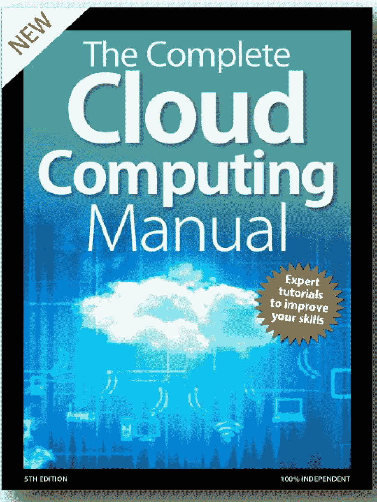


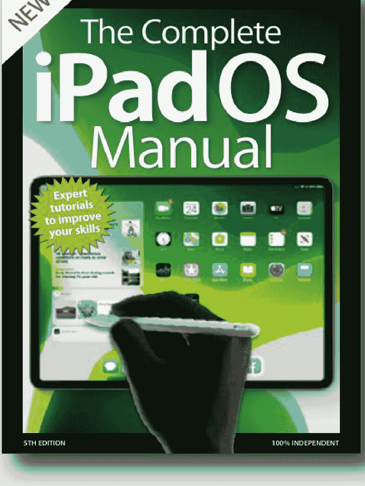


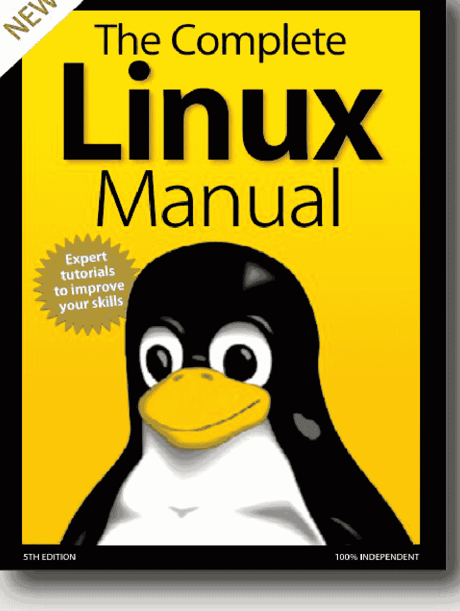


> “这就是 Linux 如此优秀的原因：你投入了一些努力，这些努力就会成倍增长。这是一个正反馈循环。”

— 林纳斯·托瓦尔兹（Linux 内内核开发者）

Linux 无处不在。它作为 Web 服务器背后的主要操作系统驱动着互联网，它驱动着航天器，它是世界上最超级计算机的操作系统，并被用于智能电视和移动设备。为什么？因为它极其稳定、速度极快，而且完全免费。

然而，Linux 不仅仅是一个免费使用的操作系统。它独特的配置允许用户将操作系统自定义并个性化为他们他们希望的任何形式。Linux 用户可以在一天之内改变其操作系统的外观和体验，安装成千上万个免费提供的应用程序和程序，并重新获得对自己电脑的控制权。

Linux 关乎自由。摆脱封闭系统的束缚，自由地选择你喜欢的电脑，修改它并使用它。通过这本书，你将掌握 Linux 的技巧，并进入 Linux 世界。自由。


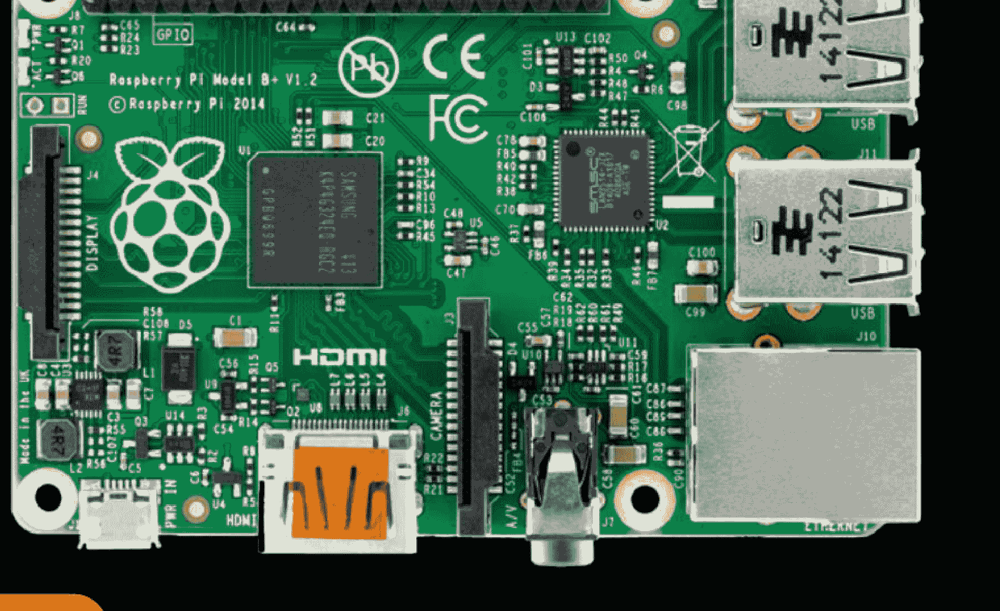


- 116 你知道吗...调试

```


## 为什么选择 Linux？

对于许多用户来说，Linux 意味着自由。摆脱其他操作系统“围墙花园”式的自由，随心所欲更改和使用操作系统的自由，以及免于任何形式的许可或付费。不过，Linux 的意义远比你想象的要多。

## 免费开源

对于那些想要尝试新事物的人，Linux 是一个极佳的解决方案。系统的效率、应用程序可用性和稳定性只是其中的原因之一。

你首先需要知道的是，并没有一种名为 Linux 的操作系统。Linux 实际上是操作系统内核，即操作系统的核心组件。当我们谈论 Linux 时，我们指的是使用 Linux 内核的许多发行版（distributions，简称 distros）之一。你可能至少听过其中一个：Ubuntu、Debian、Slack。这些发行版中的每一个都为用户提供了不同的特性。虽然它们都以 Linux 内核为核心，但它们为用户提供了不同的桌面界面、不同的系统使用方法、安装应用的方法，以及整个系统中略有不同的视觉感受。然而，核心都是 Linux，这就是为什么我们称之为 Linux 的原因。

Linux 的工作方式与 Windows 或 macOS 不同。它从开始就是免费的；可以安装在任意数量的计算机上，时间不受限制，且免费使用。这种自由是吸引开发者的最大动力之一。Linux 可以在 Mac 上运行得更加顺畅，且用户可以是开发者、游戏玩家，或者是想要使用旧电脑的人，他们可以快速下载一个发行版并在几分钟内开始工作。

除了免费使用外，还提供了根据你自己的需求对系统进行定制和建模的自由。互联网上现有的每个可用发行版都有其特定的“调性（spin）”。

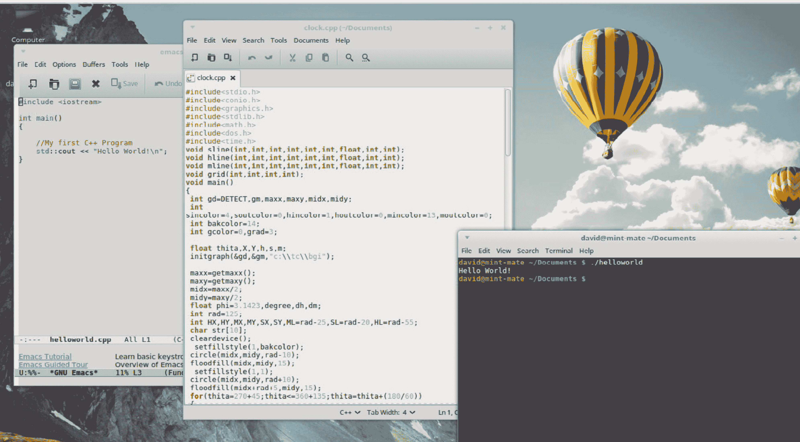

Linux 是一个开始编程的优秀操作系统。

## 为什么选择 Linux？

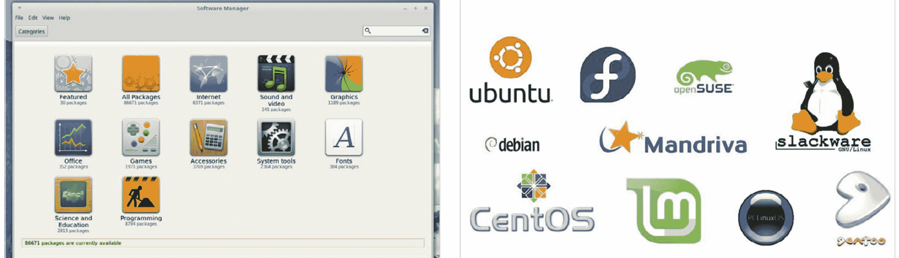

在 Linux 下，程序员有数千个免费软件包可供选择。而其他系统提供了更高的安全性、华丽的桌面、游戏级配置或针对学生的特性。这种扩展性使得 Linux 成为一个更灵活的环境，拥有许多适用于 Python、Web 开发、C++、Java 等的各种 IDE；或者为匿名性（如 Minecraft 服务器、多媒体中心等）创建基础。

对于想要学习编程的人来说，另一个显著的优势是，Linux 内置了大多数流行的环境。在很大比例的 Linux 发行版中都预装了 Python 和 C++，这意味着你一旦安装好系统并首次构建，就可以开始编写程序了。

总的来说，Linux 占用的资源并不像 Windows 或 macOS 那么多；我们指的资源是内存、硬盘空间和 CPU 负载。Linux 内核对资源的需求要少得多，这有助于这些系统资源。更高效的系统意味着为编码和测试环境以及你最终创建的程序提供了更多可用资源。资源消耗更少意味着你可以在旧硬件上运行 Linux，而这些硬件通常难以运行、甚至拒绝运行最新版本的 Windows 或 macOS；所以，与其扔掉旧电脑，不如用 Linux 重新利用它。

这不仅仅关乎 C++、Python 或任何其他更流行的编程语言。使用 Linux 的命令行（也称为 Terminal 终端），你可以创建 Shell 脚本，这些脚本是设计为从命令行运行的程序，主要用于实现某些操作的用户输入输出自动化。

最后，尽管我们还可以列出许多优势，但仍有数千个免费程序和应用程序涵盖了计算的几乎每一个方面。这些被称为软件包（packages），在本文编写时，Linux Mint 有 8,700 个特定的程序应用，以及涵盖从 Ubuntu 到 WWW 世界一切内容的 62,000 多项功能。

因此，Linux 是一个优秀的编程环境，它非常适合初学者，并且不断改进和进化。如果你认真想进入编程，或者想尝试新事物，请尝试一下 Linux，看看它是否适合你。

编程环境可以根据你的需要变得简单，也可以复杂。

```
$ sudo apt-get update
$ sudo apt-get install build-essential
```

## 最佳 Linux 发行版

有很多版本的 Linux可用，被称为发行版（Distributions）。每个版本都有不同的理念和方法。这里有五个值得尝试的发行版，以及你可以在哪里获取它们。

# 开始使用 Linux

大多数发行版的安装过程都是相似的。你从网站下载磁盘镜像，将其刻录到光盘或创建 USB 闪盘安装程序。只需务必为你的硬件选择正确的发行版，并仔细阅读说明。

## LINUX MINT

迄为止最流行的 Linux 发行版是 Linux Mint。Mint 起于 2006 年，作为最流行的 Ubuntu 的替代品。虽然它基于 Ubuntu 的长期支持（LTS），但 Linux Mint 采取了不同的方向，为用户提供了更好的整体体验。

Linux Mint 在发布的每个新版本中都提供三个主要的桌面环境。这起初听起来可能很困惑，但其实很简单。目前，Linux Mint 使用 Cinnamon 环境作为其旗舰模型，但也提供了更多模型。

Cinnamon 是一个图形丰富的环境；MATE 没那么华丽，但在更多种桌面系统上更稳定；而 XFCE 是一个极精简的桌面环境，专为速度和终极稳定性而构建。

在整个教程过程中，我们将使用 Cinnamon 版本；但你可以根据意愿尝试任何其他桌面环境。事实上，我建议你花时间尝试不同的桌面环境，看看哪个最适合你。

www.linuxmint.com

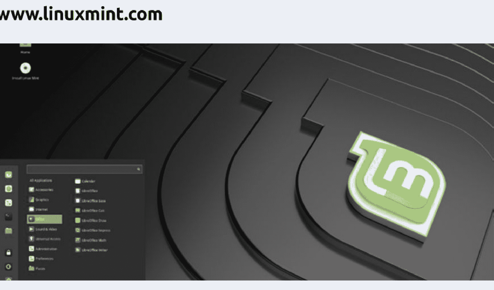

## UBUNTU

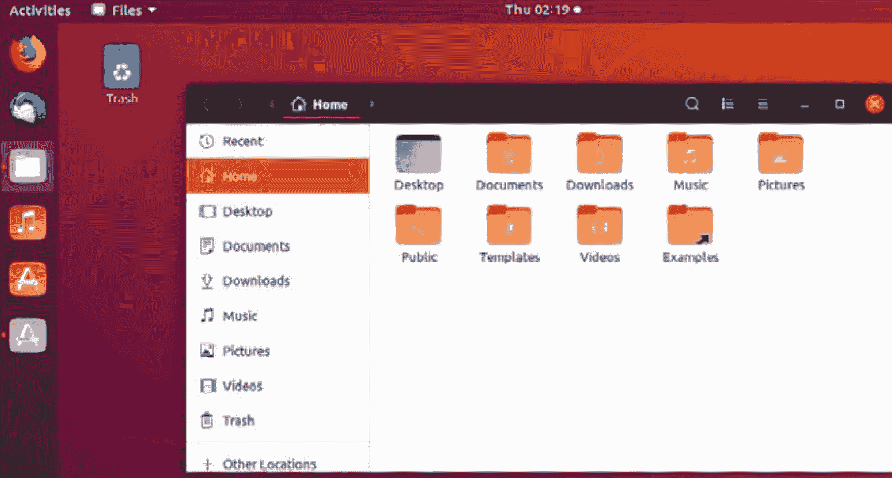


## 你将需要的设备

在 PC 上成功安装 Linux Mint 的系统要求异常地低，因此即使是几年前的电脑也能很好地运行这个发行版。不过，在继续之前，值得检查一下你是否已经准备好了一切。

## MINT 的配要素

在我们开始阅读这本书之前，这里是安装和运行 Linux Mint 所需的工具。你有多种选择，所以请花些时间看看哪种方式最适合你。

## 系统要求

Linux Mint 的最低系统要求如下：
- CPU – 700MHz
- RAM/内存 – 512MB
- 硬盘空间 – 9GB（建议 20GB）
- 显示器 – 1024 x 768 分辨率

显然，你拥系统越好，体验就会越好，速度也越快。

## USB 安装

你可以通过 USB 或 DVD 在你的电脑上安装 Linux Mint。我们稍后会介绍每种方法，但如果你已经熟悉该过程，或者正考虑使用 USB 并正在收集所需的硬件，那么你将一个至少 4GB 的 USB 盘来存储 Linux Mint 的 ISO 镜像。


## DVD 安装

使用 DVD 安装 Linux Mint 只需要一张空盘。当然，在将 ISO 镜像传输或刻录到光盘之前，你还需要一个光驱（DVD 刻录机）。


## 虚拟环境

安装到虚拟环境中是测试和使用 Linux 发行版的常用方法。Linux Mint 在虚拟环境中的运行效果非常好，但稍后会详细介绍。有很多不同的虚拟环境应用可用；然而，Oracle 的 VirtualBox 是最容易安装的之一。你可以在 www.virtualbox.org 找到最新版本。


## 网络连接

不言而喻，网络连接对于确保 Linux Mint 保持最新的更新和补丁，以及安装更多软件至关重要。虽然使用 Linux Mint 不需要网络连接，但你将错过该发行版中提供的大量免费软件。


## MAC 硬件

虽然 Linux Mint 可以安装在 Mac 上，但有一种观点建议 Mac 所有者使用虚拟环境，例如 VirtualBox 或 Parallels；而且，何不呢，macOS 是一个很棒的操作系统。如果你想为旧款 Mac 注入新生命，请确保它是 Intel CPU 型号而不是 Power PC 型号。但要注意，它不像安装在 PC 上那样完全免费。


## 桌面环境

Linux Mint 有几个不同的版本，或称为“口味”：Cinnamon、MATE 和 Xfce；这些版本也有 32 位和 64 位之。但这一切意味着什么？你安装时应该选择哪个版本呢？

## 哪种 MINT？

桌面环境是你用于与 Linux 系统交互的图形界面。正如 Windows 的图形桌面界面一样，Linux Mint 提供了多种选择：Cinnamon、MATE 和 Xfce；这些版本也有 32 位和 64 位之。桌面环境是你用于与 Linux 系统交互的图形界面。桌面环境（GUI）是用户交互界面。图形界面（GUI）是你与系统交互的方式。由于软件套件，桌面环境同样包含文件管理器。


## CINNAMON 的

Cinnamon 具有热角功能，点击桌面的某个角落可以执行特定任务，例如显示工作区、显示所有窗口或运行命令。热角可以让桌面更加高效。在这里，我们列了一些功能，帮助你判断它是否适合你。

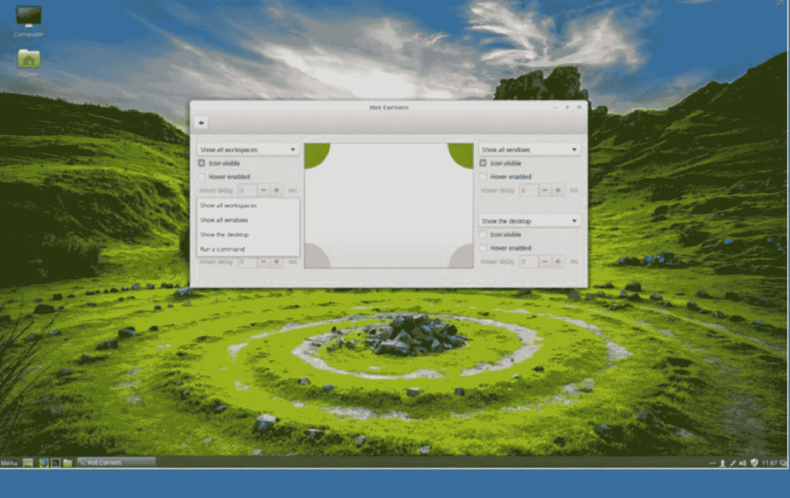

## 最佳 MATE

MATE 简单用且直观。与 Cinnamon 相比，它看起来有些过时，但这只是表面。MATE 有许多值得喜欢的地方。


## 无胆固醇桌面环境

Xfce 起源于 1996 年的通用桌面环境（CDE）。从那时以后它更改了几次，现在简单称为 Xfce，并被称为“无胆固醇桌面环境”。


# 选择哪个发行版？


你预装的工具，用户可以用来针对他们的网络进行渗透测试。曾经出现过一个名为 Hannah Montana 的 Linux 发行版，但我们对它越少提起越好。重点在于，世界上总有一个适合你的发行版。

奇怪的是，大多数高阶技术用户发现自己最终又回到了起点，使用诸如 Linux Mint 这样的发行版。主要原因通常是因为它是一个容易的选择，而且环境稳定。一旦你彻底掌握了该系统，你就会发现自己最近总是想去解决问题。我们大多数人更倾向于轻松的生活，特别是在技术方面，因此逻辑上的上的选择就是选择一个既简单又强大到可以完成你想做的一切事的发行版，这就是 Linux 的由来。

不用说，如果你认为自己是一个相对高级的高级用户，那么你将想要扩展自己的技能，并开始基于 Arch、Debian 或其他许多可用发行版构建你自己的 Linux 发行版。这涉及到命令行知识，以及对 Linux 系统如何工作以及如何与计算机硬件交互的了解。你需要划分分区、安装驱动程序并最终安装应用和程序。这需要时间，而且你将会学到很多技能。

然而，归根结底，完全取决于选择，取决于你个人的选择。你可能会发现，在学习完本文中的教程后，你并不喜欢 Linux Mint 或 Cinnamon 桌面。没关系，你可能更喜欢 Ubuntu、Debian 或 openSUSE——这就是 Linux 的魅力所在。你可以自由更改你想要的内容，在不同的发行版之间切换（distro hop），而不会受到成本或访问限制的惩。

最终，你认为自己是一个技术型 Linux 用户，但从未认为自己是专家，毕竟我们始终在学习新东西。你可以从零开始构建自己的发行版，帮助其他 Linux 用户解决问题，甚至可能在发行版的测试阶段对其改进做出贡献，接下来呢呢？

“选择哪个发行版”这个问题的答案是：任何你喜欢的都可以；它可以根据你的需要变得复杂或简单，只要它能实现你的需求，它就是完美的。


| 所有应用程序 | 日历 |
|---|---|
| Spotify | Linux Mint |
| Firefox | Linux Base |
| GIMP | Linux Soft |
| LibreOffice | LibreOffice Imp |
| 游戏与应用 | LinuxOffice Tech |
| Android Docs | LinuxOffice Draw |
| 选项 | |
| 终端 | |

# 开始使用 Linux

> “在真正的开源世界中，你有权掌控自己的命运。”
>– Linus Torvalds（Linux 内核开发者）


# 开始使用 Linux

这些谈论 Linux 多么好固然很好，但如何把它安装到你的电脑上呢？安装 Linux 非常简单，但有几种选项供你选择。本节将介绍你如何下载 Linux ISO、将其安装在 PC 上作为你的主操作系统，甚至如何安装虚拟环境。

通过虚拟环境，你可以在运行 Linux 的同时继续使用你的主操作系统（无论是 Windows还是 macOS）。感兴趣吗？继续读以了解更多。

| 20 | 在 Windows 上创建 Linux 安装器 |
| 22 | 在 PC 上安装 Linux |
| 24 | 安装虚拟环境 |
| 26 | 在虚拟环境中安装 Linux |


## 在 Windows 上创建 Linux 安装器

你需要将下载的 ISO 传输到 DVD 或 USB 密钥上才能将其安装到计算机上。这将现场环境，允许你在安装之前测试操作系统，但你首先需要创建启动介质。

## DVD 启动介质

我们正在使用 Windows 10 将 ISO 传输到 DVD。如果你使用的是 Windows 7 及更高版本，过程极其简单。

- **第 1 步**：首先找到已下载的 ISO 镜像。通常会在 Windows 7、8.1 和 10 的下载文件夹中找到它，除非你指定了不同的保存位置。
- **第 2 步**：接下来将刻录 DVD 插入电脑的光驱中。几秒钟后，当光驱读取时，Windows 会弹出一个窗口询问如何处理新插入的光盘。此后我们将使用内置的镜像刻录功能。
- **第 3 步**：打开 Windows 镜像刻录对话框后，点击“刻录光”开始。该过程可能需要几分钟，取决于你电脑光驱的速度。完成后，运行验证阶段，然后光驱应该自动弹出光盘。

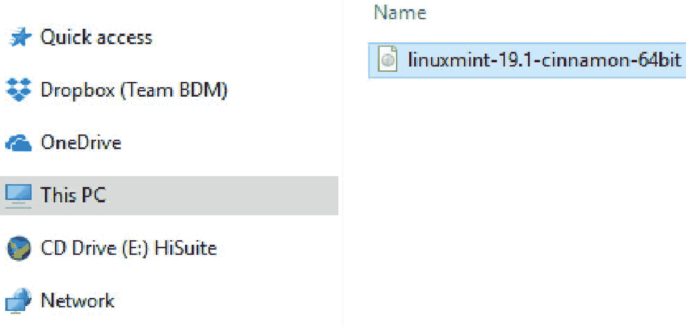

## USB 启动介质

USB 介质比 DVD 快且通常更方便，因为大多数现代 PC 没有安装光驱。传输镜像的过程很容易，但你需要一个第三方应用程序和一个 4GB 或更大的 USB 闪盘。

### **第 1 步**
首先打开浏览器并访问 rufus.ie。向下滚动页面到“下载”，找到最新版本的 Rufus。点击链接开始下载。

### **第 4 步**
准备好后，点击 Rufus 底部的“启动”按钮。这可能会打开一个对话框询问使用新版本的 Syslinux。Syslinux 是一组引导加载器，允许你的电脑从 USB 闪盘访问并启动。点击“确定”继续。

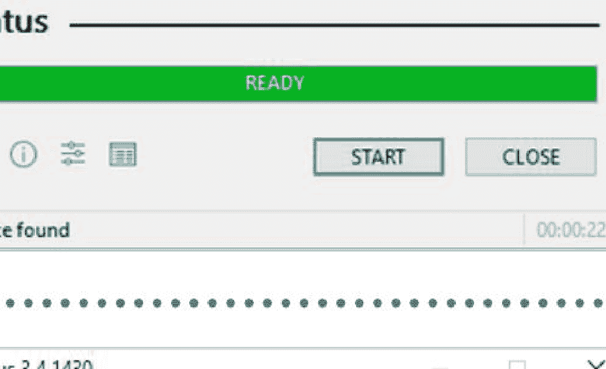

> 此镜像使用了 Syslinux 6.03/2015，它包含了 Syslinux 6.03/2014 的功能。

由于新版本的 Syslinux 之间存在冲突，让 Rufus 包含必须从 'Idlinux.iso' 和 'syslinux.bin' 下载的额外文件是值得的：
- 选择“否”继续

> 注意：文件将下载到当前目录，并在需要时重新加载。


### **第 2 步**
双击下载的 Rufus 可执行文件。在 Windows 安全问题处选择“是”，在检查更新时选择“是”。启动 Rufus 后，检查它是否正确识别了你的闪盘；如果没有，只需拔掉并重新启动。

### **第 5 步**
下一步是你想让 ISO 写入 USB 闪盘的镜像。两种方法在不同情况下都可行，但推荐的 ISO 模式更受欢迎。确保 ISO 文件存在并点击“确定”继续。


> 所选镜像是“ISOHbrid”镜像。这意味着它可以用 ISO（复制）或 DD（镜像）模式写入。Rufus 将使用 ISO 模式，以便你在写入后对磁盘拥有完全访问权限。

如果你在启动期间遇到问题，可以尝试以 DD 模式写入此镜像。

+ 请选择你想要为此镜像使用的模式：
- 以 ISO 模式写入（推荐）
- 以 DD 模式写入


### **第 3 步**
起初 Rufus 界面可能有点混乱，但不用担心，它很简单。首先，点击“磁盘或 ISO 镜像 (选择)”下拉菜单旁边的“选择”按钮。这将启动 Windows 资源管理器窗口，你可以在其中找到并选择 ISO。

### **第 6 步**
ISO 将被传输到 USB 闪盘。这不会花费太长时间，取决于你找到 USB 闪盘的速度。在过程中，Rufus 会在 Windows 资源管理器中自动打开 USB 闪盘；然后你可以根据需要查看或关闭它。过程完成后，点击“启动”按钮。


#在 PC 上安装 Linux

大多数 Linux 发行版以 Live 环境（Live Environment）的形式提供。这意味着你可以从创建的 DVD 或 USB 中启动一个真实的、功能完备的发行。让我们来看看它是如何工作的，以及之后你从哪里安装 Linux。

## UEFI BIOS

统一可扩展固件接口（UEFI）用于在 PC 启动过程中识别和保护电脑。它取代了传统的 BIOS，但在安装 Linux 时可能会导致问题。

- 步骤 1 将你的 DVD 或 USB 驱动器插入 PC，如果尚未关闭 Windows，请将其关闭。在本例中我们正在使用 USB 介质，但过程几乎完全相同。启动 PC，并在提示时按下相应的键进入 BIOS 或设置（SETUP），例如：F2、Del 或 F12，然后。

- 步骤 2 UEFI BIOS 有多个不同的版本，因此要涵盖所有版本可能是不可能的。你需要寻找一个详细说明“启动序列”（Boot Sequence）或“启动模式”（Boot Mode）的区域。在这里你可以选择关闭 UEFI 并选择“安全启动”（Secure Boot）。大多数发行版都支持 UEFI，但进入该设置的过程可能复杂。

- 步骤 3 当 UEFI 切换到 Legacy（遗留）模式后，有两种方法进入 Live 环境。首先是通过你已经进入的 BIOS。找到“启动序列”，并将第一个启动设备从原始设置（通常是内部硬盘 HDD 或介质）更改为：USB 介质对应“USB 存储设备”（USB Storage Device），介质对应“DVD 驱动器”（DVD Drive）。

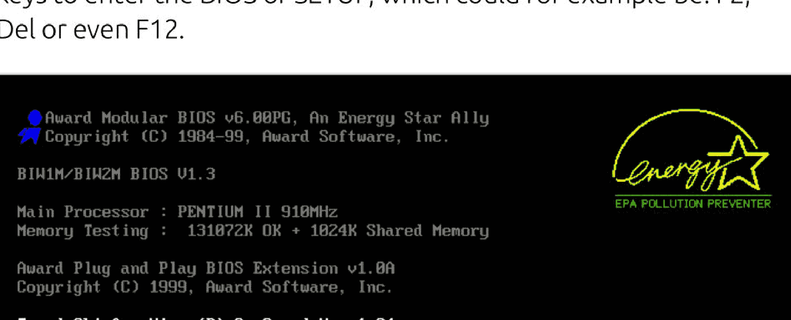

- 步骤 4 或者使用“启动菜单”（Boot Menu）选项。通过此（或类似功能）你可以按 F2 显示启动介质选项列表，从那里选择合适的介质。现在你可以导航到“保存并退出”（Save & Exit）并选择“保存更改并退出”（Save Changes and Exit）来保存 BIOS。

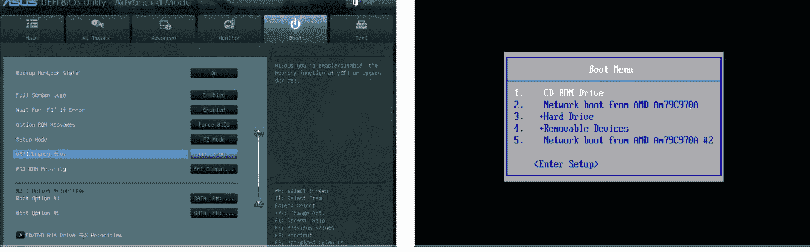

# 安装 Linux

一旦 Live 环境启动，你就可以将该发行版安装到你的电脑上。环顾四周，当你准备好时，寻找桌面上的“安装”（Install）选项。

### 步骤 1 只要你已连接到互联网（如果没有，请先连接）并处于 Live 环境中，双击桌面上的 Linux Mint 图标开始安装过程。其他发行版当然会显示它们的名称，但过程是一样的。准备好后点击“继续”（Continue）。

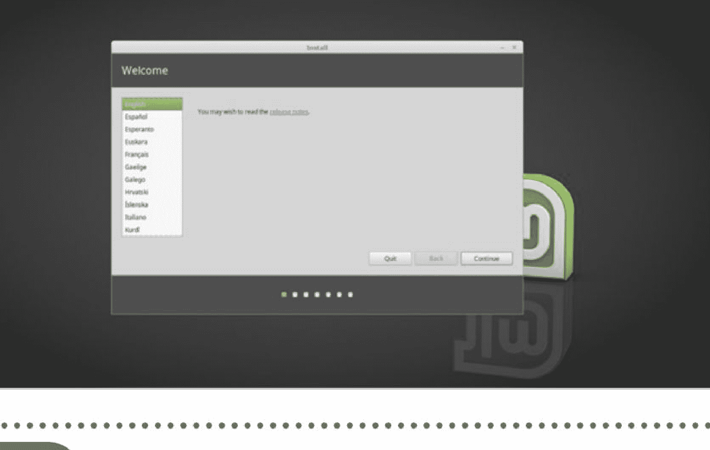

### 步骤 2 虽然大多数 Linux 发行版的安装过程非常相似，但某些版本在安装过程中会提供不同的问题。这些问题并不困难，没有什么深奥的技术，但某些如“安装第三方软件”的问题可能会让人困惑。你可以点击“继续”，但如果你不确定，请准备好连接了网络的设备以便咨询任何问题。

### 步骤 3 安装新操作系统时，建议擦除旧操作系统并替换为新系统。当你到达安装过程的这一阶段时，确保选择了“擦除磁盘并安装 Linux...”（Erase disk and install Linux...）选项。注意：这将完全清除你电脑上的 Windows 10，请确保你已备份个人文件和数据。

### 步骤 4 在安装过程开始之前，系统会询问你是否选择确保硬盘擦除是正确的。这是你最后一次退出的机会。如果你不介意擦除所有内容并重新开始 Linux Mint，请点击“继续”。如果你需要将文件备份到 Linux 盘/USB，请重启并重新开始。

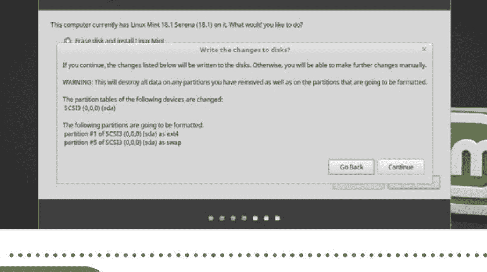

### 步骤 5 最终，你会被要求设置 Linux 用户名和密码。输入你的姓名（Name）开始，以及计算机名称（Computer Name，即在网络上的识别名称）。接下来选择一个用户名（Username），然后是密码（Password）。你可以点击“登录自动化”（Login Automation）选项，但暂时留留“进入文件夹”（Entry Folder）选项。

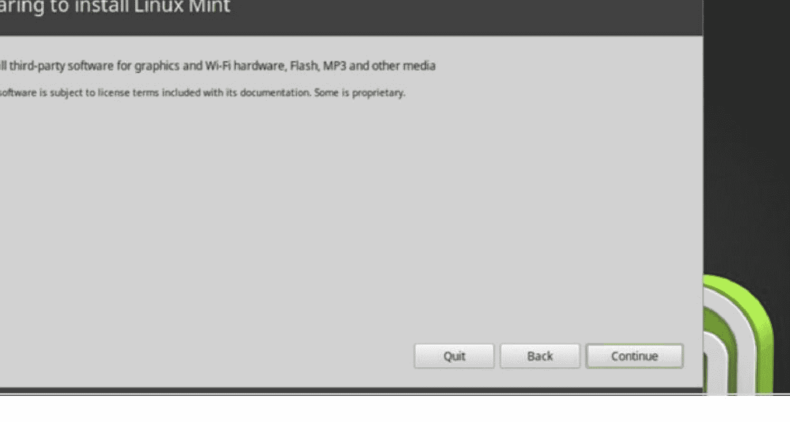

## 准备安装 Mint
- 用于 Wi-Fi、Firefox、MP3 和其他媒体的第三方软件程序
- 此复选框用于安装不带文档的项目。


### 步骤 6 安装过程可能很快，可能会有更多问题需要回答，也可能只是根据你的偏好开始安装 Linux。无论如何，你最终都可以“继续”Live 环境或“重启”到新安装的操作系统。如果你准备好使用 Linux，请点击“立即重启”（Restart Now）。

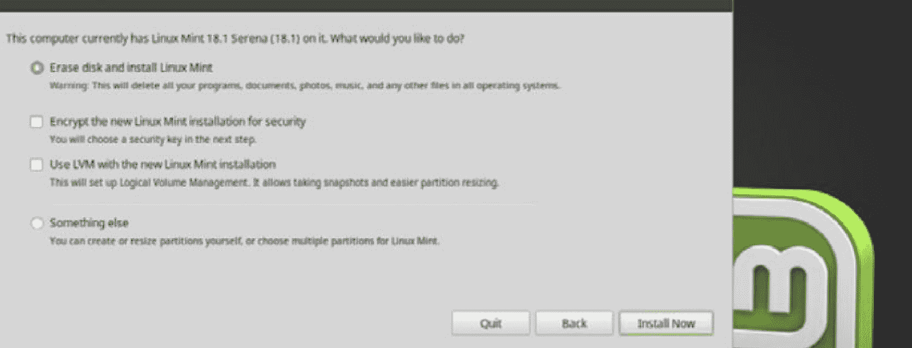

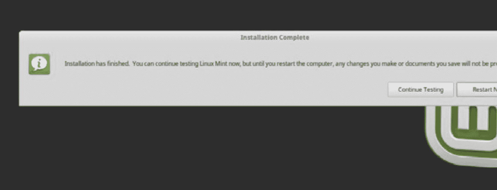

# 安装虚拟机环境

虚拟机环境是一个模拟的计算机系统。通过虚拟机，你可以模拟一台标准 PC 并在上面安装任何其他操作系统，而不会影响电脑上已安装的系统。这是测试和使用 Linux 的极佳方法，同时你仍保留 Windows 10 作为主操作系统。

# 使用虚拟

使用虚拟机（VM）会消耗电脑的资源：内存、硬盘空间、处理器使用等。在开始之前，确保你有足够的资源。

- 步骤 1 在本例中我们使用 VirtualBox，因为它是最上手的环境之一。访问 virtualbox.org 并点击“下载 VirtualBox”。这将带你进入主下载页面。找到适用于你系统的主机（Windows、Mac 或 Linux，主机即当前安装的操作系统）并点击链接下载。

- 步骤 3 下载正确的安装包并在安装它们之前，你需要确保正在使用的电脑可以托管虚拟机。要做到这一点，重启电脑并进入 BIOS。当电脑启动时，按 F2 或相应的键进入设置（Setup）。


## 在虚拟环境中安装 Linux

随着 Oracle VirtualBox 运行就绪，接下来的任务是创建一个虚拟机（VM）环境，并在其中安装 Linux。此过程不会影响你当前已安装的操作系统，这正是为什么虚拟机是一个极佳选择。

### 创建虚拟机

在创建虚拟机时有很多选项可以选择。现在，让我们设置一个足够运行 Mint Cinnamon 并正常执行的虚拟机。

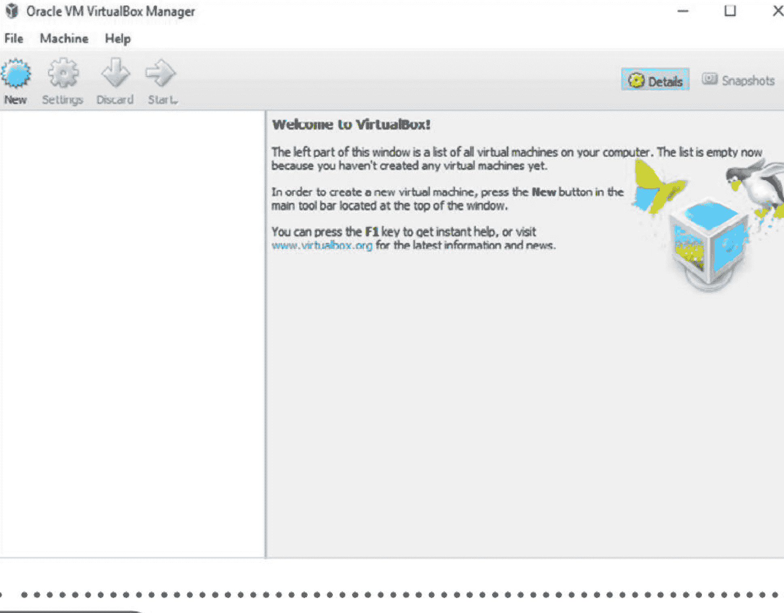

- **步骤 1** 在打开 VirtualBox 的情况下，点击应用程序右上角的“新建”（New）图标。这会打开新的虚拟机向导。

- **步骤 3** 下一部分定义了分配给虚拟机的系统内存（或 RAM）。请记住，此数量是从计算机的可用内存中扣取的，因此不要给虚拟机分配过量。例如，如果我们安装了 8GB 内存，并给虚拟机分配 2GB。准备好后，点击“下一步”（Next）继续。

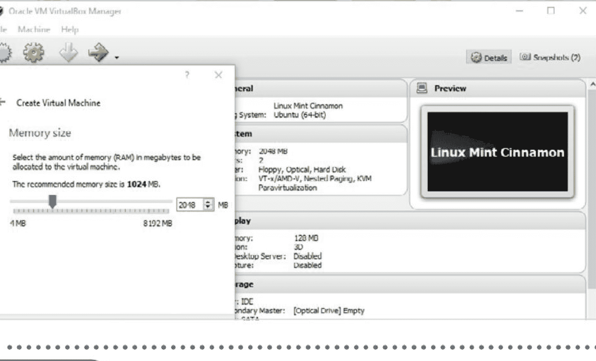

- **步骤 2** 在名称（Name）旁边的框中输入 Linux Mint，VirtualBox 应该自动选择 Linux 和 Ubuntu (64位) 作为版本（Version）；如果没有，请使用下拉框选择正确的设置（记住 Mint 主流是基于 Ubuntu 的）。准备好后点击“下一步”。

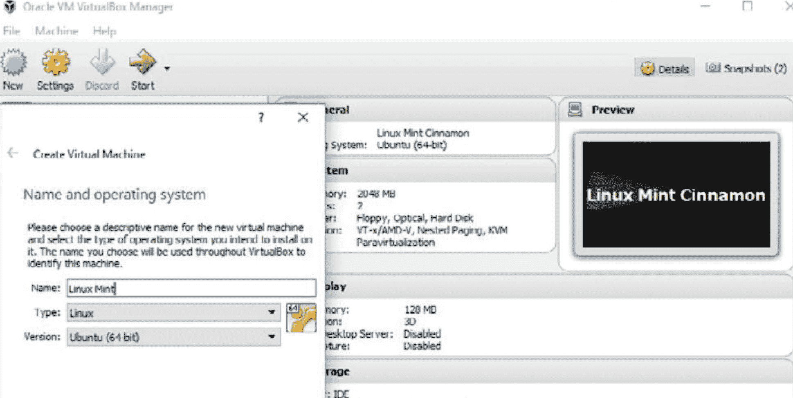

- **步骤 4** 这一部分是你开始创建虚拟机将安装 Mint 的虚拟磁盘。默认选项“创建虚拟硬盘”（Create a virtual hard disk）正是我们正在使用的。点击“创建”（Create）继续。

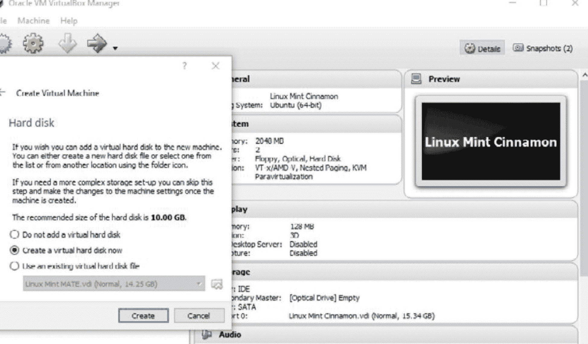

- **步骤 5** 点击“创建”后弹出的窗口让你选择要用于创建的虚拟硬盘类型。我们将使用默认的 VDI（VirtualBox 磁盘映像），其他格式用于将虚拟机从一个应用程序移动到另一个。确保选中了 VDI 并点击“下一步”：

- **步骤 8** 完成虚拟机的初始设置后；你现在应该可以在 VirtualBox 应用程序中看到新创建虚拟机。在今天开始之前，点击“设置”（Settings）按钮，并在通用（General）部分点击“高级”（Advanced）选项卡。使用下拉菜单，将剪贴板（Clipboard）和拖放（Drag 'n Drop）设置为“双向”（Directional）。

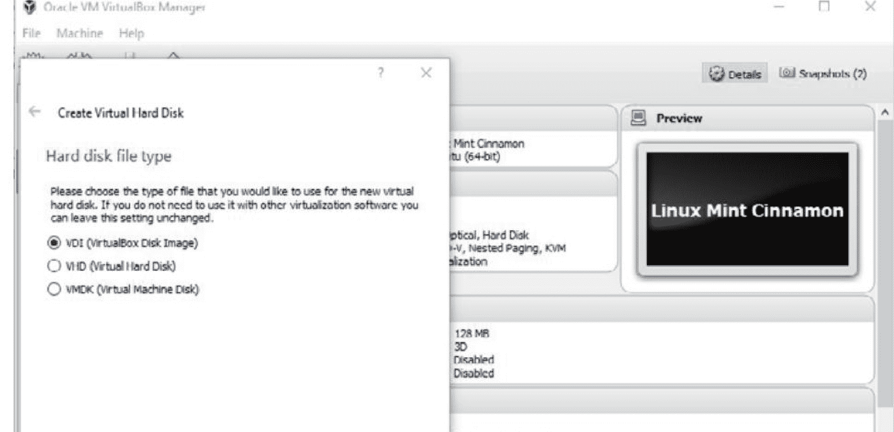

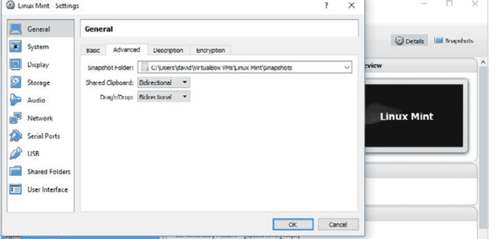

- **步骤 6** 选择动态还是固定虚拟硬盘的问题对于初学者来说可能有些困惑：动态分配的硬盘存在风险，但它提供了灵活性，且最初不会占用硬盘中过多的空间。确保选择了“动态”（Dynamic）并点击“下一步”。

- **步骤 9** 接着点击“系统”（System）部分，然后分配尽可能多的核心。根据你的 CPU 宿主机，我们选择了 2 个 CPU。现在在“显示”（Display）部分，将显存设置为最大，并勾选“启用 3D 加速”（Enable 3D Acceleration）。点击“确定”（OK）提交设置。

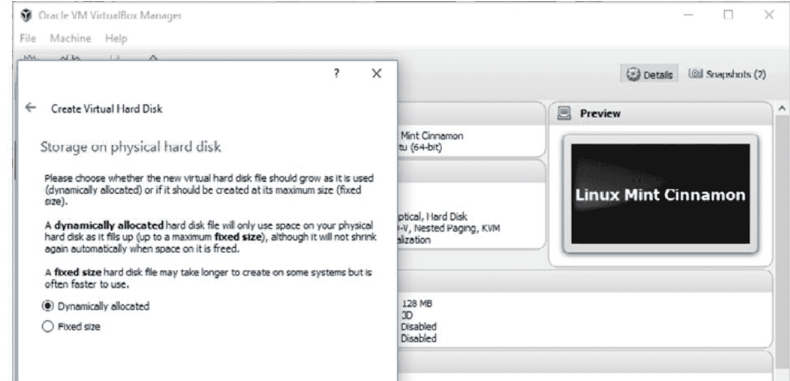

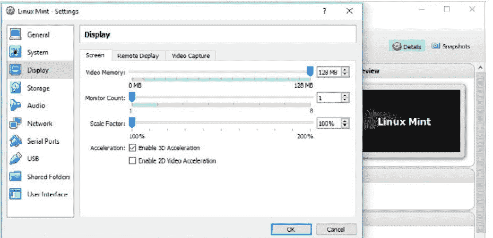

- **步骤 7** 虚拟硬盘部分让你选择想要存储它的文件夹和大小。确保你有足够的可用空间。例如，我们将使用 D:\ 盘，将其命名为 Linux Mint 并为虚拟硬盘分配 50GB 空间。

- **步骤 10** 点击“启动”（Start）按钮，使用“启动”窗口带有绿色箭头的按钮加载下载的 Mint ISO，然后点击“启动”进入 Linux Live 环境。现在你可以使用标准程序安装 Linux。


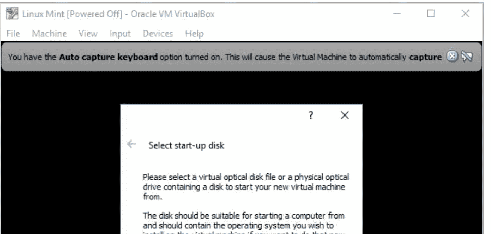

# 了解 Linux

> “任何人都可以构建快速处理器。技巧是构建快速系统。”
— Seymour Cray，工程师/超级计算机创始人

我们在这里使用 Linux Mint 作为指南，因为它易于使用且非常适合 Windows 用户。它也是最完善、文档最好的发行版之一，并拥有丰富的配置选项。

在本节中，我们将介绍 Linux Mint 菜单和桌面环境、它们如何工作以及你可以做什么。想创建另一个用户或发现如何在线操作？请继续阅读。

| 页面 | 主题 |
| :--- | :--- |
| 30 | Cinnamon 菜单简介 |
| 32 | 导航桌面 |
| 34 | 安装 Linux 后的 10 件事 |
| 36 | 你知道吗... |
| 38 | 创建用户 |
| 40 | 自定义桌面 |
| 42 | 在线操作 |


## Cinnamon 菜单简介

## CINNAMON VIRTUALBOX修复

你已经查看了一些功能，使用插入、删除和弹出，但也有可以应用于字符串的功能。

- **步骤 1** 在我们开始之前，假设你正在使用 Virtualbox。桌面右上角会出现软件渲染消息。要修复此，点击 Virtualbox 窗口中的“设备”（Devices），然后“插入增强功能...”

- **步骤 3** 几分钟后，你会自动进入 Linux 中名为“终端”（Terminal）的命令行视图。这详细说明了新 VirtualBox 驱动程序的安装、移除检测到的旧驱动程序以及安装最新版本。完成后不会花费长时间，将被要求重启系统。

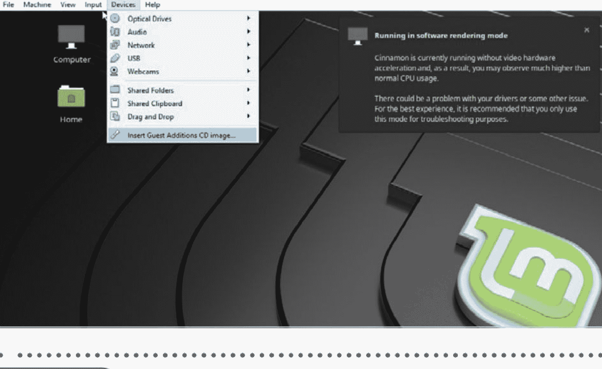

- **步骤 2** 增强功能包含 Virtualbox 的驱动程序，包括虚拟硬件。加载时，你会收到一个“软件需要运行”的通知框，有两个选项：取消和运行。点击“运行”按钮并输入你的 Linux 用户密码。

- **步骤 4** 增强功能图标在桌面上，右键点击它，然后通过点击菜单向下滚动。你可以点击左侧底部的菜单来重启 Linux Mint。

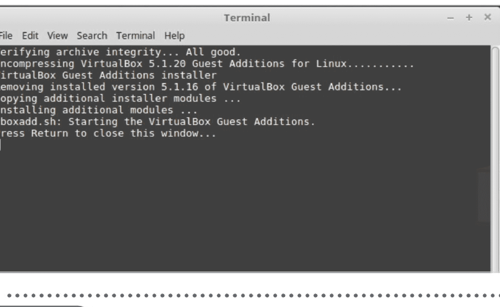

> 此媒介的意图是。

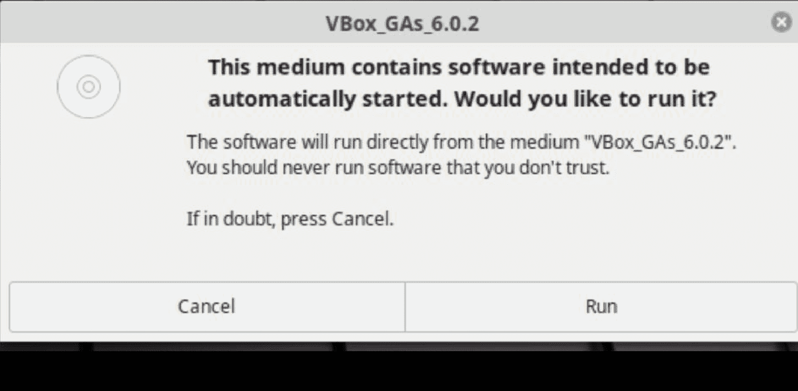

## Cinnamon 菜单简介

现在 Virtualbox 的渲染问题已经解决了，让我们看看菜单以及它是如何工作的。记住，这只是 Cinnamon，其他发行版的外观和行为会有不同。

- **步骤 1** 首先，你可能已经注意到登录 Mint 时弹出的欢迎屏幕。花点时间；浏览一下选项等。操作完成后，点击右上角的 X 关闭。

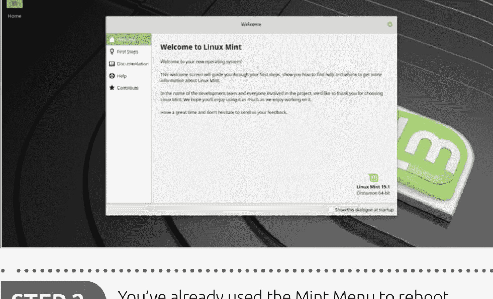

- **步骤 4** 再次打开菜单，这次将鼠标指针悬停在“图形”（Graphics）上，然后点击“GNU Image Program”（GIMP）。GIMP 是一个强大的图像应用，可能与 Adobe 的 Photoshop一样有效，但需要一些工作才能获得结果。不过，值得花时间去掌握。


- **步骤 2** 你已经使用 Mint 菜单重启系统，当你第一次使用 Live 环境时，点击菜单按钮悬停在中间列的“办公”（Office）项目上。这会改变右列表示的图标，详细说明下方安装了哪些应用。

- **步骤 3** 从菜单启动任何应用程序只需找到它并点击即可。例如，在“办公”部分下，点击 LibreOffice Writer。Writer 是 Linux Mint 预装的文字处理器。它可以像 Microsoft Word 一样打开和保存，功能几乎相同。

- **步骤 5** 如果你想寻找特定的功能或应用程序（例如设置打印机），点击菜单顶部的搜索框。开始输入你想要的应用或功能，搜索，Mint 菜单将显示相关选项。这适用于大多数现代 Linux 菜单，无论什么发行版。


- **步骤 6** 悬停在右列列出的任何应用程序上并右键点击，将看到选项列表：添加到面板、添加到桌面、应用程序和卸载。大多数这些选项在你的使用中都显而易见。“添加到收藏夹”会将该应用放在左侧的快速访问列中。


## 导航 Cinnamon 桌面

每个桌面环境的行为都不同。有些桌面环境（DE）提供可以自定义并放置在桌面上的部件，而另一些则追求简洁、锐利的外观，以保持一切运行尽可能快速。让我们来看看 Cinnamon 桌面提供了哪些功能。

## 一丝辛香

Cinnamon 桌面环境是风格与性能的完美结合。它有很多迷人的之处，这也是为什么它是如此受欢迎的原因。

- **第 1 步** 双击“计算机”图标开始探索 Cinnamon 桌面。这会打开 Cinnamon 中使用的文件管理器 Nemo。“计算机”图标打开根目录级文件系统，可以访问并查看光驱（如果你安装了的话）、硬盘和 Linux 核心文件系统。

- **第 3 步** Nemo 具有许多不同的功能、视图以及你可以通过它们查看和管理文件和文件夹的方式。例如，如果你在“图片”文件夹中有任何图像，你可以使用 Nemo 右下角的名为“调整缩放级别”的滑块来选择图像的图标级别。

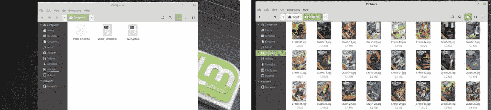

- **第 2 步** Linux 文件系统对于以前 Windows 用户来说可能看起来很混乱，为了让你更了解它的运行原理，我们建议你关注桌面上的“主目录”图标。这里有与你的用户账户相关的所有内容：你存储图片、视频、音乐、文档、下载项目等的地方。

- **第 4 步** 就像任何好文件管理器一样，如果你右键点击内部的任何文件或文件夹，就会获得丰富的选项。在 Cinnamon 中，默认设置允许你根据文件类型查看文件，并复制、剪切、删除、压缩、重命名、通过电子邮件发送以及查看其属性。

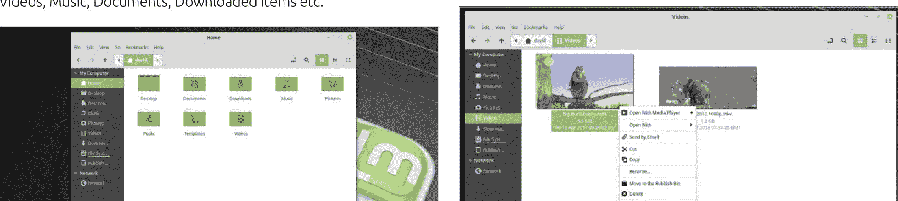

## **第 5 步** 底部有一个面板（Panel），我们已经查看了面板的一个部分：菜单。如果你在面板的任何地方（面板应用以外的地方）右键点击，你就会看到一个菜单，允许以不同的方式编辑和添加面板。

## **第 8 步** 在桌上右键点击，弹出上下文菜单，选择“自定义”，然后点击新窗口底部的“桌面设置”链接。这会打开一个窗口，你可以在其中编辑图标。如果你使用的是连接了多个显示器的设置，还可以选择由哪个显示器显示图标。


## **第 6 步** 例如，如果你点击“修改面板”，你可以移除、删除面板、添加新面板并清除当前存在的小部件（Applets）。小部件本身是一种专门设计用于运行并适配 Cinnamon 面板的应用程序。

## **第 9 步** 点击菜单并输入“系统设置”，打开“系统设置”。在这里，你可以控制并编辑 Linux Mint Cinnamon 的外观和工作方式，例如添加所有新用户、管理面板以及启用辅助功能。

- 主题
- 系统设置
- 故障排除
- 修改面板
- 移除面板
- 添加面板
- 移动面板
- 复制小部件配置
- 清除所有小部件


## **第 7 步** 如果你在 Cinnamon 桌面任何地方右键点击，你会看到一组选项，允许你进一步添加、编辑或查看桌面内容。这与 Windows 非常相似，这也是为什么 Mint 是 Windows 用户的良好选择。

## **第 10 步** 简而言之，Linux Mint Cinnamon 可以配置得非常精美。关于它可以有多好以及可以实现什么，有很多例子。你可以根据需要变得复杂或简单，添加不同的组件和动画，或者仅仅保持整洁易读。

- 创建文件夹
- 创建新文档
- 小部件
- 更改桌面背景
-在此处创建启动器...
- 在终端中打开
- 以 Root 身份打开
- 自定义
- 粘贴

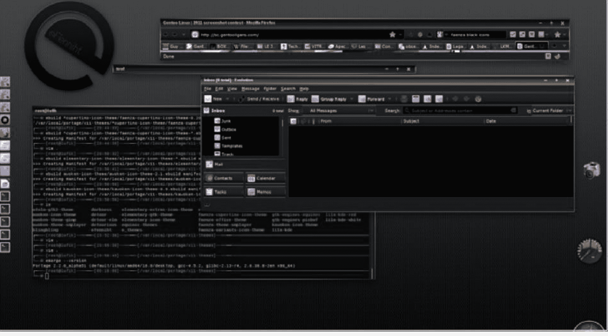

## 安装 Linux Mint 后要做的事情

Linux Mint 是一个开箱即用的精致发行版，但与大多数 Linux 发行版一样，通过一些调整可以改进它的运行方式。虽然这些是针对 Mint 的特定调整，但大多数可以适用于其他发行版。

## LINUX 调整

这些安装后的操作有些是强烈建议的，而另一些只是方便的补充，用于微调系统或添加自定义功能。

### 第 1 步 第一个也是最重要的安装后操作是更新系统。点击桌面右下角、时间和日期旁面板上的图标。这将启动“更新管理器”。

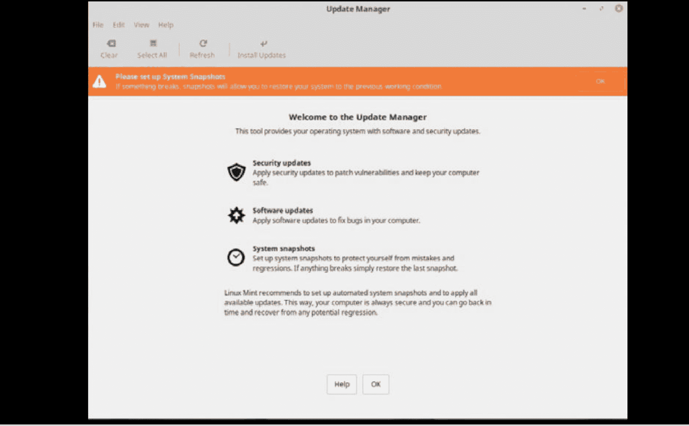

### 第 3 步 点击 OK 按钮，你就可以看到几个准备好安装的更新。在更新之前，点击蓝色条 OK 切换到本地镜像。这将打开“软件源”选项。在“镜像”部分，点击“主”和“基础”下拉菜单，选择距离你当前位置最近的服务器。

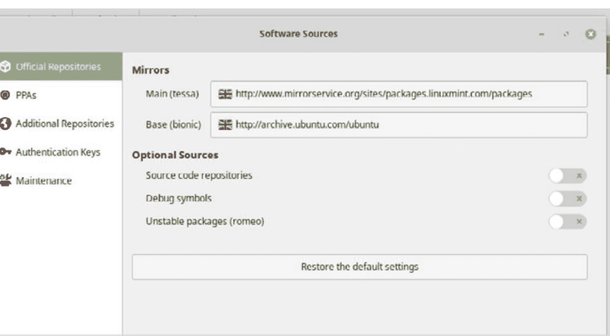

### 第 2 步 Linux Mint 为用户提供了三级更新策略：不要弄坏我的电脑、优化稳定性与安全以及始终更新一切。推荐选项是“优化稳定性与安全”，它只更新不影响操作系统关键元素的安全补丁。阅读下方的描述以了解中间和推荐选项。

### 第 4 步 点击“更新”按钮缓存并下载“软件源”窗口。在更新管理器中，点击“安装更新”图标并输入密码。更新会自动应用并重新启动更新管理器，此时会有更多更新。再次点击“安装更新”，确认任何消息并等待完成。

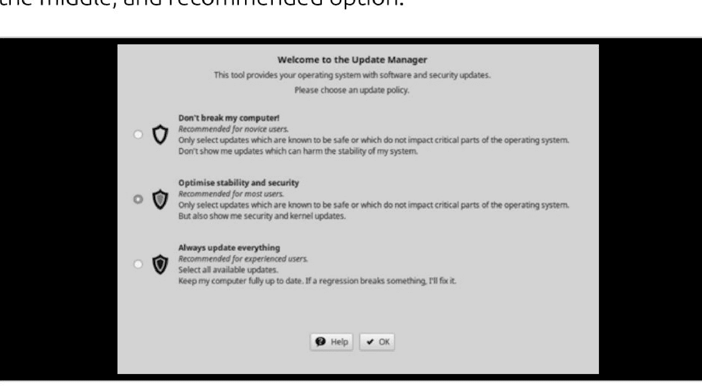

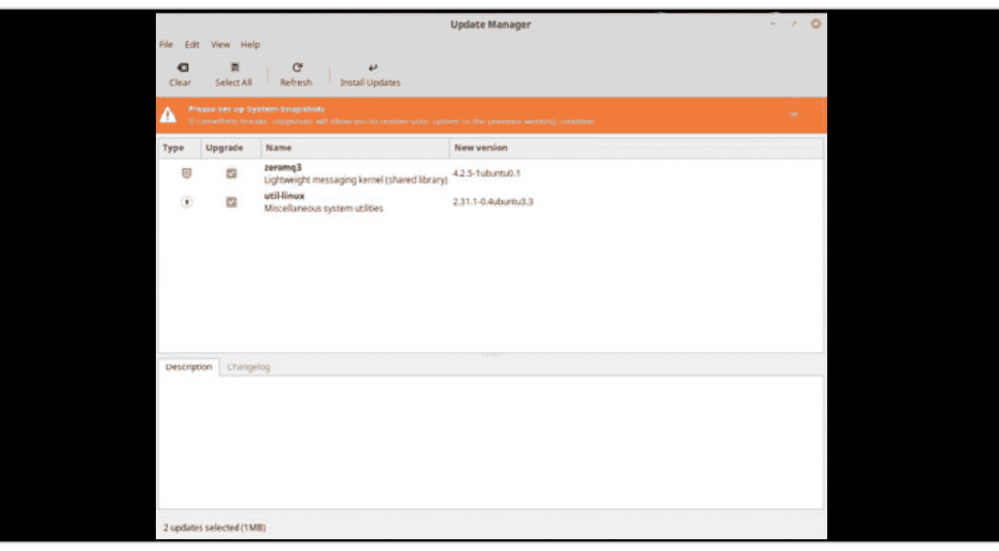

### 第 5 步 桌面底部有一个面板，我们已经查看了面板的一个部分：菜单。如果你在面板的任何地方（面板应用以外的地方）右键点击，你就会看到一个菜单，允许以不同的方式编辑和添加面板。

### 第 8 步 在桌上右键点击，弹出上下文菜单，选择“自定义”，然后点击新窗口底部的“桌面设置”链接。这会打开一个窗口，你可以在其中编辑图标。如果你使用的是连接了多个显示器的设置，还可以选择由哪个显示器显示图标。


### 第 6 步 例如，如果你点击“修改面板”，你可以移除、删除面板、添加新面板并清除当前存在的小部件。小部件本身是一种专门设计用于运行并适配 Cinnamon 面板的应用程序。

### 第 9 步 点击菜单并输入“系统设置”，打开“系统设置”。在这里，你可以控制并编辑 Linux Mint Cinnamon 的外观和工作方式，例如添加所有新用户、管理面板以及启用辅助功能。

- 主题
- 系统设置
- 故障排除
- 修改面板
- 移除面板
- 添加面板
- 移动面板
- 复制小部件配置
- 清除所有小部件


### 第 7 步 如果你在 Cinnamon 桌面任何地方右键点击，你会看到一组选项，允许你进一步添加、编辑或查看桌面内容。这与 Windows 非常相似，这也是为什么 Mint 是 Windows 用户的良好选择。

### 第 10 步 简而言之，Linux Mint Cinnamon 可以配置得非常精美。关于它可以有多好以及可以实现什么，有很多例子。你可以根据需要变得复杂或简单，添加不同的组件和动画，或者仅仅保持整洁易读。

- 创建文件夹
- 创建新文档
- 小部件
- 更改桌面背景
- 在此处创建新启动器...
- 在终端中打开
- 以 Root 身份打开
- 自定义
- 粘贴


### 第 1 步 第一个也是最重要的安装后操作是更新系统。点击桌面右下角、时间和日期旁面板上的图标。这将启动“更新管理器”。


### 第 3 步 点击 OK 按钮，你就可以看到几个准备好安装的更新。在更新之前，点击蓝色条 OK 切换到本地镜像。这将打开“软件源”选项。在“镜像”部分，点击“主”和“基础”下拉菜单，选择距离你当前位置最近的服务器。


### 第 2 步 Linux Mint 为用户提供了三级更新策略：不要弄坏我的电脑、优化稳定性与安全以及始终更新一切。推荐选项是“优化稳定性与安全”，它只更新不影响操作系统关键元素的安全补丁。阅读下方的描述以了解中间和推荐选项。

### 第 4 步 点击“更新”按钮缓存并下载“软件源”窗口。在更新管理器中，点击“安装更新”图标并输入密码。更新会自动应用并重新启动更新管理器，此时会有更多更新。再次点击“安装更新”，确认任何消息并等待完成。


### 第 5 步 桌面底部有一个面板，我们已经查看了面板的一个部分：菜单。如果你在面板的任何地方（面板应用以外的地方）右键点击，你就会看到一个菜单，允许以不同的方式编辑和添加面板。

### 第 8 步 在桌上右键点击，弹出上下文菜单，选择“自定义”，然后点击新窗口底部的“桌面设置”链接。这会打开一个窗口，你可以在其中编辑图标。如果你使用的是连接了多个显示器的设置，还可以选择由哪个显示器显示图标。


### 第 6 步 例如，如果你点击“修改面板”，你可以移除、删除面板、添加新面板并清除当前存在的小部件。小部件本身是一种专门设计用于运行并适配 Cinnamon 面板的应用程序。

### 第 9 步 点击菜单并输入“系统设置”，打开“系统设置”。在这里，你可以控制并编辑 Linux Mint Cinnamon 的外观和工作方式，例如添加所有新用户、管理面板以及启用辅助功能。

- 主题
- 系统设置
- 故障排除
- 修改面板
- 移除面板
- 添加面板
- 移动面板
- 复制小部件配置
- 清除所有小部件


### 第 7 步 如果你在 Cinnamon 桌面任何地方右键点击，你会看到一组选项，允许你进一步添加、编辑或查看桌面内容。这与 Windows 非常相似，这也是为什么 Mint 是 Windows 用户的良好选择。

### 第 10 步 简而言之，Linux Mint Cinnamon 可以配置得非常精美。关于它可以有多好以及可以实现什么，有很多例子。你可以根据需要变得复杂或简单，添加不同的组件和动画，或者仅仅保持整洁易读。

- 创建文件夹
- 创建新文档
- 小部件
- 更改桌面背景
- 在此处创建新启动器...
- 在终端中打开
- 以 Root 身份打开
- 自定义
- 粘贴


### 第 5 步 桌面底部有一个面板，我们已经查看了面板的一个部分：菜单。如果你在面板的任何地方（面板应用以外的地方）右键点击，你就会看到一个菜单，允许以不同的方式编辑和添加面板。

### 第 8 步 在桌上右键点击，弹出上下文菜单，选择“自定义”，然后点击新窗口底部的“桌面设置”链接。这会打开一个窗口，你可以在其中编辑图标。如果你使用的是连接了多个显示器的设置，还可以选择由哪个显示器显示图标。


### 第 6 步 例如，如果你点击“修改面板”，你可以移除、删除面板、添加新面板并清除当前存在的小部件。小部件本身是一种专门设计用于运行并适配 Cinnamon 面板的应用程序。

### 第 9 步 点击菜单并输入“系统设置”，打开“系统设置”。在这里，你可以控制并编辑 Linux Mint Cinnamon 的外观和工作方式，例如添加所有新用户、管理面板以及启用辅助功能。

- 主题
- 系统设置
- 故障排除
- 修改面板
- 移除面板
- 添加面板
- 移动面板
- 复制小部件配置
- 清除所有小部件


### 第 7 步 如果你在 Cinnamon 桌面任何地方右键点击，你会看到一组选项，允许你进一步添加、编辑或查看桌面内容。这与 Windows 非常相似，这也是为什么 Mint 是 Windows 用户的良好选择。

### 第 10 步 简而言之，Linux Mint Cinnamon 可以配置得非常精美。关于它可以有多好以及可以实现什么，有很多例子。你可以根据需要变得复杂或简单，添加不同的组件和动画，或者仅仅保持整洁易读。

- 创建文件夹
- 创建新文档
- 小部件
- 更改桌面背景
- 在此处创建新启动器...
- 在终端中打开
- 以 Root 身份打开
- 自定义
- 粘贴


# 阿波罗11号

你你知道吗……1969年7月20日被视为人类历史上的一个转折点，当时人类首次踏上了月球。那些帮助船员完成关键航行的软件当时并不存在，必须从零开始开发。麻省理工实验室的工程师们使用了一种名为“绳带内存”（Rope Memory）的新程序存储方法，在内存中填充了特殊版本的汇编代码。

令人难以的是，这些代码可以在 GitHub 上免费查看。它们由一位研究人员在2003年上传，你可以通过访问 www.github.com/chrisgarry/Apollo-11/ 查看代码。留意某些代码片段，例如 `Burn`、`Baby_Burn`，特别是第 925 行，带有注释“Goodbye. Come soon.（再见，很快回来）”。

浏览一下，看看你还能发现什么。

| TV | 名称 | 描述 |
|---|---|---|
| 100 | TURMAN1 | 连接到圆点 CONC |
| 1001 | TURMAN2 | 连接到圆点 CONC |
| 102 | TURMAN3 | 连接到圆点 CONC |
| 103 | TURMAN4 | 连接到圆点 CONC |
| 104 | TURMAN5 | 连接到圆点 CONC |
| 105 | TURMAN6 | 连接到圆点 CONC |
| 106 | TURMAN7 | 连接到圆点 CONC |
| 107 | TURMAN8 | 连接到圆点 CONC |
| 108 | TURMAN9 | 连接到圆点 CONC |
| 109 | TURMAN10 | 连接到圆点 CONC |
| 110 | TURMAN11 | 连接到圆点 CONC |
| 111 | TURMAN12 | 连接到圆点 CONC |
| 112 | TURMAN13 | 连接到圆点 CONC |
| 113 | TURMAN14 | 连接到圆点 CONC |
| 114 | TURMAN15 | 连接到圆点 CONC |
| 115 | TURMAN16 | 连接到圆点 CONC |
| 116 | TURMAN17 | 连接到圆点 CONC |
| 117 | TURMAN18 | 连接到圆点 CONC |
| 118 | TURMAN19 | 连接到圆点 CONC |
| 119 | TURMAN20 | 连接到圆点 CONC |
| 120 | TURMAN21 | 连接到圆点 CONC |
| 121 | TURMAN22 | 连接到圆点 CONC |
| 122 | TURMAN23 | 连接到圆点 CONC |
| 123 | TURMAN24 | 连接到圆点 CONC |
| 124 | TURMAN25 | 连接到圆点 CONC |
| 125 | TURMAN26 | 连接到圆点 CONC |
| 126 | TURMAN27 | 连接到圆点 CONC |
| 127 | TURMAN28 | 连接到圆点 CONC |
| 128 | TURMAN29 | 连接到圆点 CONC |
| 129 | TURMAN30 | 连接到圆点 CONC |
| 130 | TURMAN31 | 连接到圆点 CONC |
| 131 | TURMAN32 | 连接到圆点 CONC |
| 132 | TURMAN33 | 连接到圆点 CONC |
| 133 | TURMAN34 | 连接到圆点 CONC |
| 134 | TURMAN35 | 连接到圆点 CONC |
| 135 | TURMAN36 | 连接到圆点 CONC |
| 136 | TURMAN37 | 连接到圆点 CONC |
| 137 | TURMAN38 | 连接到圆点 CONC |
| 138 | TURMAN39 | 连接到圆点 CONC |
| 139 | TURMAN40 | 连接到圆点 CONC |
| 140 | TURMAN41 | 连接到圆点 CONC |
| 141 | TURMAN42 | 连接到圆点 CONC |
| 142 | TURMAN43 | 连接到圆点 CONC |
| 143 | TURMAN44 | 连接到圆点 CONC |
| 144 | TURMAN45 | 连接到圆点 CONC |
| 145 | TURMAN46 | 连接到圆点 CONC |
| 146 | TURMAN47 | 连接到圆点 CONC |
| 147 | TURMAN48 | 连接到圆点 CONC |
| 148 | TURMAN49 | 连接到圆点 CONC |
| 149 | TURMAN50 | 连接到圆点 CONC |
| 150 | TURMAN51 | 连接到圆点 CONC |
| 151 | TURMAN52 | 连接到圆点 CONC |
| 152 | TURMAN53 | 连接到圆点 CONC |
| 153 | TURMAN54 | 连接到圆点 CONC |
| 154 | TURMAN55 | 连接到圆点 CONC |
| 155 | TURMAN56 | 连接到圆点 CONC |
| 156 | TURMAN57 | 连接到圆点 CONC |
| 158 | TURMAN59 | 连接到圆点 CONC |
| 159 | TURMAN60 | 连接到圆点 CONC |
| 160 | TURMAN61 | 连接到圆点 CONC |
| 161 | TURMAN62 | 连接到圆点 CONC |
| 162 | TURMAN63 | 连接到圆点 CONC |
| 163 | TURMAN64 | 连接到圆点 CONC |
| 164 | TURMAN65 | 连接到圆点 CONC |
| 165 | TURMAN66 | 连接到圆点 CONC |
| 166 | TURMAN67 | 连接到圆点 CONC |
| 167 | TURMAN68 | 连接到圆点 CONC |
| 168 | TURMAN69 | 连接到圆点 CONC |
| 169 | TURMAN70 | 连接到圆点 CONC |
| 170 | TURMAN71 | 连接到圆点 CONC |
| 171 | TURMAN72 | 连接到圆点 CONC |
| 172 | TURMAN73 | 连接到圆点 CONC |
| 173 | TURMAN74 | 连接到圆点 CONC |
| 174 | TURMAN75 | 连接到圆点 CONC |
| 175 | TURMAN76 | 连接到圆点 CONC |
| 176 | TURMAN77 | 连接到圆点 CONC |
| 177 | TURMAN78 | 连接到圆点 CONC |
| 178 | TURMAN79 | 连接到圆点 CONC |
| 179 | TURMAN80 | 连接到圆点 CONC |
| 180 | TURMAN81 | 连接到圆点 CONC |
| 181 | TURMAN82 | 连接到圆点 CONC |
| 182 | TURMAN83 | 连接到圆点 CONC |
| 183 | TURMAN84 | 连接到圆点 CONC |
| 184 | TURMAN85 | 连接到圆点 CONC |
| 185 | TURMAN86 | 连接到圆点 CONC |
| 186 | TURMAN87 | 连接到圆点 CONC |
| 187 | TURMAN88 | 连接到圆点 CONC |
| 188 | TURMAN89 | 连接到圆点 CONC |
| 189 | TURMAN90 | 连接到圆点 CONC |
| 190 | TURMAN91 | 连接到圆点 CONC |
| 191 | TURMAN92 | 连接到圆点 CONC |
| 192 | TURMAN93 | 连接到圆点 CONC |
| 193 | TURMAN94 | 连接到圆点 CONC |
| 194 | TURMAN95 | 连接到圆点 CONC |
| 195 | TURMAN96 | 连接到圆点 CONC |
| 196 | TURMAN97 | 连接到圆点 CONC |
| 197 | TURMAN98 | 连接到圆点 CONC |
| 198 | TURMAN99 | 连接到圆点 CONC |
| 199 | TURMAN100 | 连接到圆点 CONC |

| TV | 名称 | 描述 |
|---|---|---|
| 200 | TURMAN | 100 |
| 201 | TURMAN | RETURN |
| 202 | TURMAN | VALUE |
| 203 | TURMAN | TITLE |
| 204 | TURMAN | HIDE |
| 205 | TURMAN | |
| 206 | TURMAN | | |
| 207 | TURMAN | | |
| 208 | TURMAN | | |
| 209 | TURMAN | | |
| 210 | TURMAN | | |
| 211 | TURMAN | | |
| 212 | TURMAN | | |
| 213 | TURMAN | | |
| 214 | TURMAN | | |
| 215 | TURMAN | | |
| 216 | TURMAN | | |
| 217 | TURMAN | | |
| 218 | TURMAN | | |
| 219 | TURMAN | | |
| 220 | TURMAN | | |
| 221 | TURMAN | | |
| 222 | TURMAN | | |
| 223 | TURMAN | | |
| 224 | TURMAN | | |
| 225 | TURMAN | | |
| 226 | TURMAN | | |
| 227 | TURMAN | | |
| 228 | TURMAN | | |
| 229 | TURMAN | | |
| 230 | TURMAN | | |
| 231 | TURMAN | | |
| 232 | TURMAN | | |
| 233 | TURMAN | | |
| 234 | TURMAN | | |
| 235 | TURMAN | | |
| 236 | TURMAN | | |
| 237 | TURMAN | | |
| 238 | TURMAN | | |
| 239 | TURMAN | | |
| 240 | TURMAN | | |
| 241 | TURMAN | | |
| 242 | TURMAN | | |
| 243 | TURMAN | | |
| 244 | TURMAN | | |
| 245 | TURMAN | | |
| 246 | TURMAN | | |
| 247 | TURMAN | | |
| 248 | TURMAN | | |
| 249 | TURMAN | | |
| 250 | TURMAN | | |
| 251 | TURMAN | | |
| 252 | TURMAN | | |
| 253 | TURMAN | | |
| 254 | TURMAN | | |
| 255 | TURMAN | | |
| 256 | TURMAN | | |
| 257 | TURMAN | | |
| 258 | TURMAN | | |
| 259 | TURMAN | | |
| 260 | TURMAN | | |
| 261 | TURMAN | | |
| 262 | TURMAN | | |
| 263 | TURMAN | | |
| 264 | TURMAN | | |
| 265 | TURMAN | | |
| 266 | TURMAN | | |
| 267 | TURMAN | | |
| 268 | TURMAN | | |
| 269 | TURMAN | | |
| 270 | TURMAN | | |
| 271 | TURMAN | | |
| 272 | TURMAN | | |
| 273 | TURMAN | | |
| 274 | TURMAN | | |
| 275 | TURMAN | | |
| 276 | TURMAN | | |
| 277 | TURMAN | | |
| 278 | TURMAN | | |
| 279 | TURMAN | | |


### 第 5 步

你可以为新用户输入密码，或者点击“新密码”（New Password）文本框末尾的弯箭头来为你生成并显示密码。当然，想出一个尽可能复杂的密码是个好主意。完成后，点击“更改”（Change）按钮。

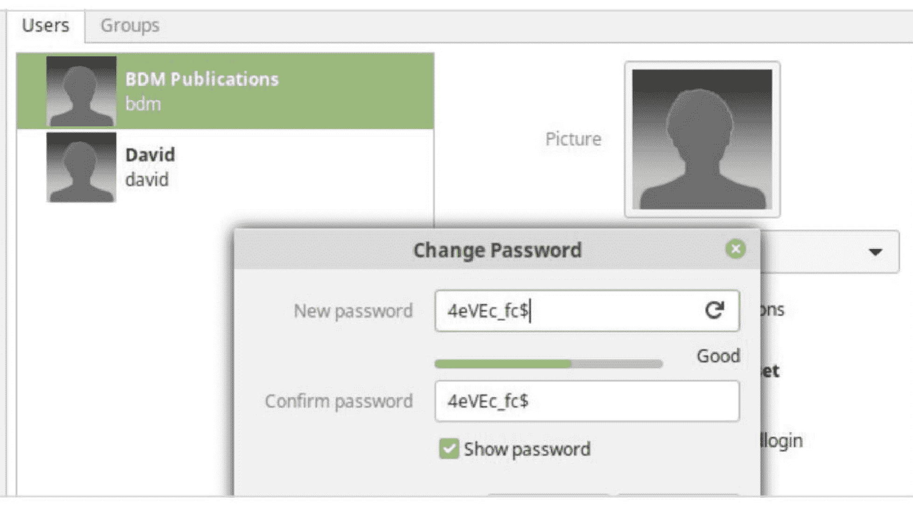

## 第 7 步

登录后，新用户需要设置他们的桌面壁纸、图标、面板（Panel）等。取决于你为他们设置的“账户类型”（Account Type）——标准用户或管理员，他们将无法安装任何新应用程序。此截图来自标准用户账户类型。

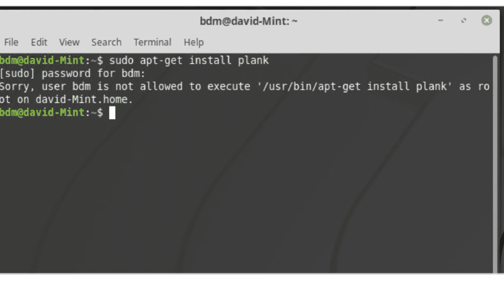

### 第 6 步

现在你可以关闭“用户和组”（Users and Groups）窗口了，因为新用户已经创建。点击 Mint 菜单（Mint Menu），然后点击“注销”（Logout），你将看到 Mint 登录管理器（Mint Login Manager）。新用户出现在当前可用用户列表中。点击他或她即可登录。


## 第 8 步

你可以根据需要创建任意数量的新账户，并在需要时进行切换。最好只保留一个能够安装新软件的账户，以便你可以管理整个系统。

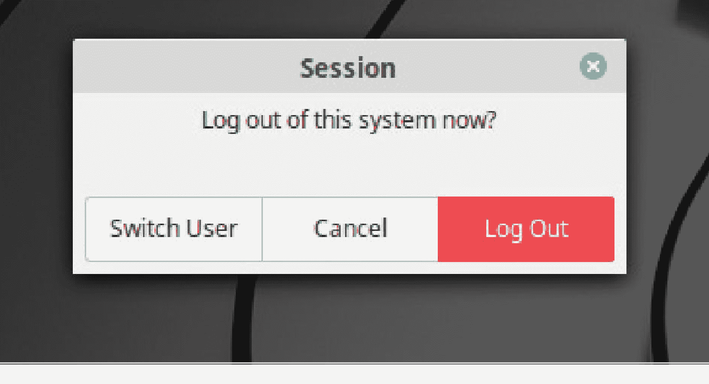

## 命令行操作

正如你所预期的，你也可以从命令行添加新用户。在（你的）管理员账户下打开终端（Terminal）会。

从命令行添加新用户的过程相对简单。首先，输入 `sudo adduser <username>` 来创建新用户的登录名。然后会提示你该用户创建密码以及姓名和详细信息。点击确认详情并创建用户账户。

### 第 1 步

你可以从“用户和组”控制台查看新用户的详情和账户类型。如果你想从 Mint 中删除用户，可以在终端中输入 `sudo deluser <username>` 或在“用户和组”中点击“删除”（Delete）。

```
$ sudo adduser david
Adding user david...
Adding new user david (1002) from group 'adm'
Creating home directory '/home/david'
Copying skeleton from '/etc/skel'
Setting password for user again:
Password updated successfully
Enter new information for the user:
Full Name []: David
Room Number [1002]
Work Group []: 
Other []: 
Is information correct? Y
```

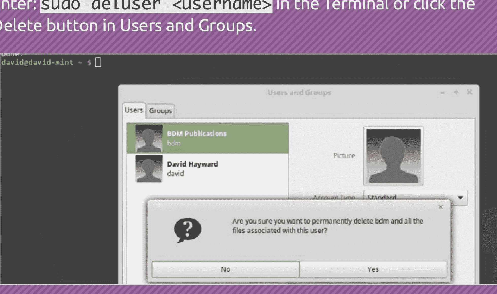

## 定制桌面

自定义操作系统桌面是使其具有独特性的一种方式：一个个性化的工作空间可以帮助你工作、激发灵感或展示公司标志。无论你拥有自己桌面的原因是什么，这里是操作方法。

## 你的桌面

Linux 可能是最可定制的操作系统之一。只需少量调整、安装一两个额外软件并发挥想象力，你就能创造出不可信的东西。

- **第 1 步** 桌面定制的第一方面是更改壁纸。右键点击桌面并选择“桌面背景”（Desktop Background）。这会打开 Linux Mint 中的背景设置；记住，其他发行版可能以不同的方式展示其背景和壁纸选择工具。

- **第 3 步** 你只需点击任何桌面壁纸中的可用图像。顺便提一下，如果你在系统或网络的另一个位置存储了图像并想将其作为壁纸，可以通过点击“背景”控制台底部的“+”符号来添加，并使用文件管理器定位它们。

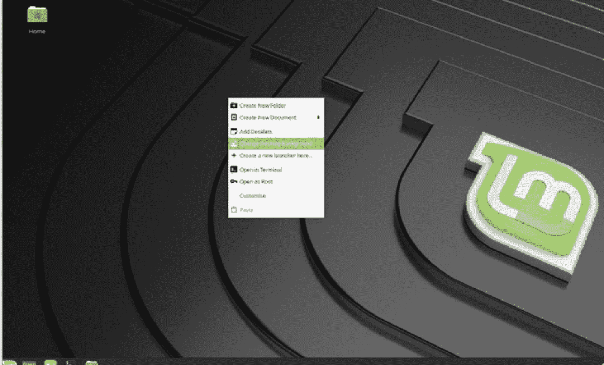

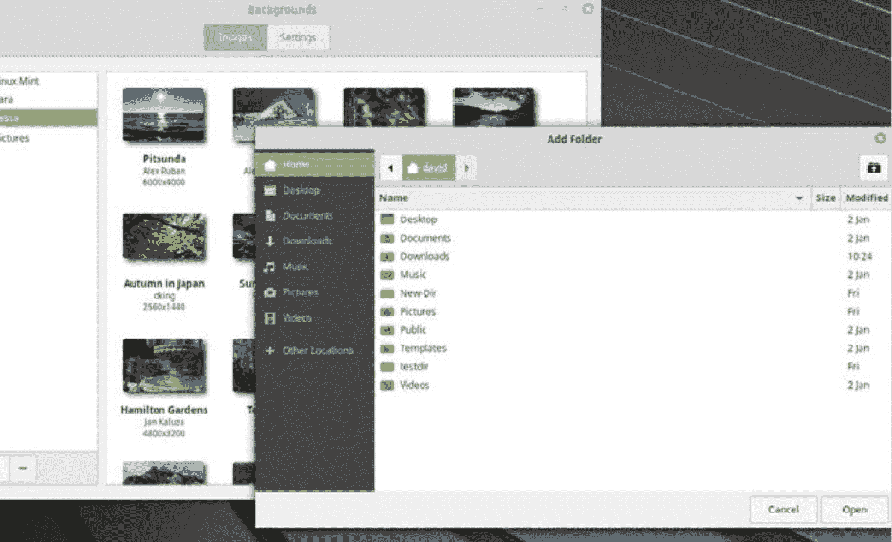

- **第 2 步** 较版本的 Linux Mint 根据用户运行的版本显示可用背景。你通常会三个类别，然后是第四类“图片”（Pictures），它与其他不同。“图片”选项之所以不同，是因为它从你主目录下的“图片”文件夹中读取图像内容。

- **第 4 步** 通过点击“设置”（Settings）选项卡，你可以将大量图像作为幻灯片播放，或者将壁纸的比例改为多种选择。


- 第 5 步 如果没有任何可用的壁纸符合你的心意，打开浏览器并搜索你喜欢的背景图像。当你找到想要作为桌面壁纸的图像时，右键点击它并在选项列表中选择“设置为：桌面背景”（Set: As Desktop Background）。当“设置桌面背景”控制台打开时，点击“设置桌面背景”按钮。

- 第 8 步 “主题”（Themes）允许你更改 Mint 外观的某些方面：窗口边框、图标、控件、鼠标指针和桌面。在“设置”中，你可以通过开关扩展选项。


- 第 6 步 点击菜单并搜索 '/desktop'，然后点击设置结果。桌面设置控制台允许你选择布局、图标和多显示器支持。你可以根据个人喜好对选项进行尝试。


- 第 9 步 如果你点击中间的“添加/删除”按钮，可以从预装主题中选择默认视图。点击你想要题，然后点击向下箭头启用它。


- 第 7 步 除了更改壁纸和图标显示方式外，你还可以更改整体主题。


- 第 10 步 点击菜单并搜索 '/desktop'，然后点击设置结果。桌面设置控制台允许你选择布局、图标和多显示器支持。你可以根据个人喜好对选项进行尝试。


## 匿名

数字时代导致了许多（此处原文重复，已忽略重复翻译）。

- **第 1 步** 桌面定制的第一方面是更改壁纸。右键点击桌面并选择“桌面背景”（Desktop Background）。这会打开 Linux Mint 中的背景设置；记住，其他发行版可能以不同的方式展示其背景和壁纸选择工具。

## VPN 和 Tor

Linux 可能是最可定制的操作系统之一。只需少量调整、安装一两个额外软件并发挥想象力，你就能创造出不可信的东西。


# 使用终端


# Linux：一个带有 CLUE 的操作系统……命令行用户环境（Command Line User Environment）。

Linux 命令行，即终端（Terminal），是一个极其强大的环境。通过它，你可以让操作系统任你支配，也可以将其更新到惊人的状态。你可以入侵远程计算机，查看动画 ASCII 篝火，安装新的应用程序和程序，观看在荷兰荷兰服务器上播放的《星球大战》，并编写指示自动化的脚本。

– 匿名（发布于 comp.software.testing）

在本节中，你将探索终端的复杂之处以及它如何与 协同工作。你将学习如何从终端操作 Linux 文件系统，并发现一些在终端中可以做的奇怪但有趣的事情。

终端在 Linux 世界中处于统治地位。学习它的工作原理，你就能获得所有的力量。

| | |
|---|---|
| 46 | 终端基础 |
| 48 | 通过终端更新 Mint |
| 50 | 通过终端安装应用 – 第一部分 |
| 52 | 通过终端安装应用 – 第二部分 |
| 54 | 你知道吗……Linux 内核 0.01 |
| 56 | 使用终端创建文件 |
| 58 | 创建和删除目录 |
| 60 | 终端中的趣事 |
| 62 | 终端中的更多趣事 |
| 64 | Linux 提示与技巧 |
| 66 | 你知道吗……Linux 与大爆炸 |
| 68 | 创建 Bash 脚本 – 第 1 - 5 部分 |
| 78 | Pi x Linux = 完美结合 |
| 80 | 命令行快速参考 |
| 82 | Linux 命令 A-Z |
| 84 | 你知道吗……对 NASA 来说足够了 |


# 终端基础

大多数操作系统使用两种界面：GUI（Windows、macOS 和 Linux Mint 启动进入的桌面）和命令行。虽然现代操作系统在刻意避开命令行，但 Mint 使用终端来赋予用户对系统更大的控制权。

# 接管控制

命令行或或终端是一个极其强大的界面。你在桌面上可以做的一切，在终端内都可以实现。让我们先看看它是如何工作的。

- 步骤 1 可以通过点击面板上的终端图标（位于 Firefox 和文件图标之间），或者通过打开菜单并从左侧的快速启动栏中选择它来访问终端。

- 步骤 3 你当前在终端中看到的是你的登录信息，后面跟着计算机的名称；这是你在第一次安装 Mint 时在设置期间结束的。该行以当前文件夹名称结束；起初只是一个波号 `~`，代表你的主目录（Home folder）。

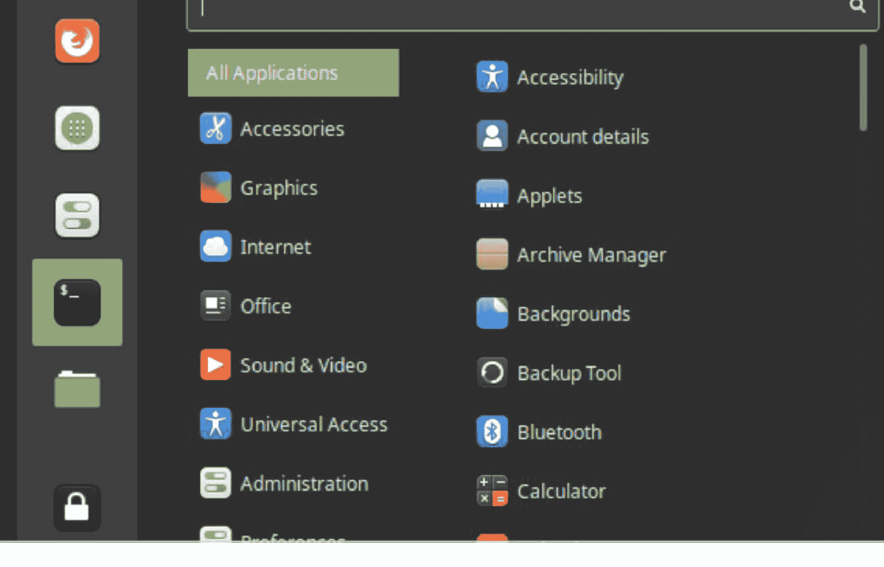

- 步骤 2 终端让你能够访问 Linux Mint 的 Shell（称为 Bash），它让你访问底层的操作系统。Mint 中的所有内容，包括桌面和 GUI，都是从命令行运行的模块。

- 步骤 4 行末尾闪烁的光标是你输入基于文本命令的地方。你可以开始尝试一个简单的命令：打印工作目录（`pwd`），它会在屏幕上输出你所在的文件夹。输入 `pwd` 并按回车。

```
david@david-mint ~ $
```

```
david@david-mint ~ $ pwd
david@david-mint ~ $
```

# 步骤 5

你输入的所有命令都以相同的方式运行：你输入命令，包含任何扩展命令用途的参数，然后按回车执行你输入的命令。在终端中输入：`uname` 并按回车。这将显示关于 Mint 的某些系统信息。

# 步骤 8

查看和搜索选项允许你更改终端窗口的大小，当然还可以在终端内搜索任何特定的关键词。

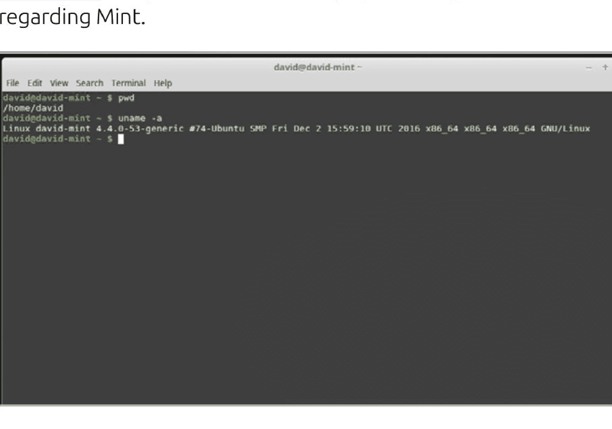

# 步骤 6

在我们输入命令之前，让我们花点看看终端提供了哪些菜单。文件（File）菜单允许你打开一个新的终端，创建一个新的配置文件，在其中你可以更改终端的大小、颜色和行为，添加新标签页并关闭所有当前的活动会话。

# 步骤 9

编辑（Edit）项扩展了配置文件的编辑和大小调整，并允许将其设置为只读（Read Only）模式，这会阻止你在终端中输入任何命令。当你需要永久显示内容时这很好。

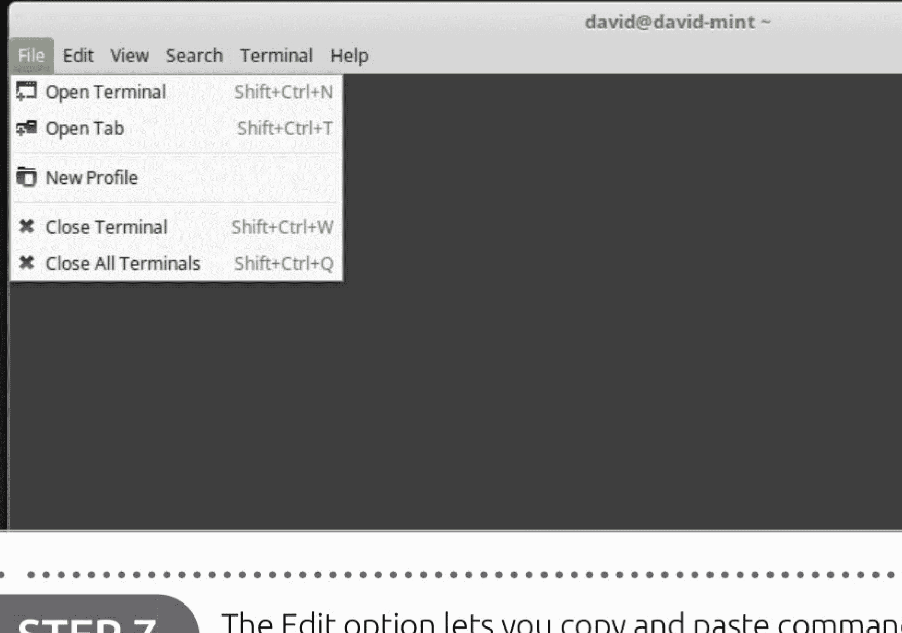

# 步骤 7

编辑（Edit）选项允许你在终端和其他源之间复制粘贴命令；如果你想从网页上复制非常长且复杂的命令，这非常方便。它还允许你编辑配置偏好。

最后，帮助（Help）选项显示终端的内容和版本号，或者我们将来简称为终端。内容（Contents）值得快速读一遍，以帮助熟悉终端是如何工作的。

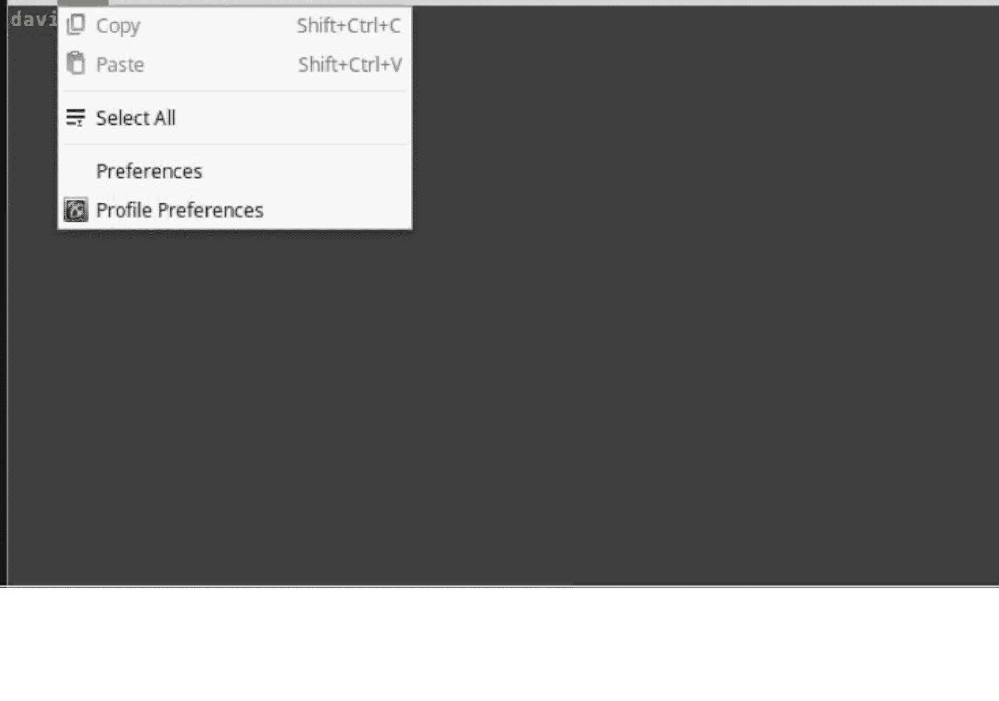

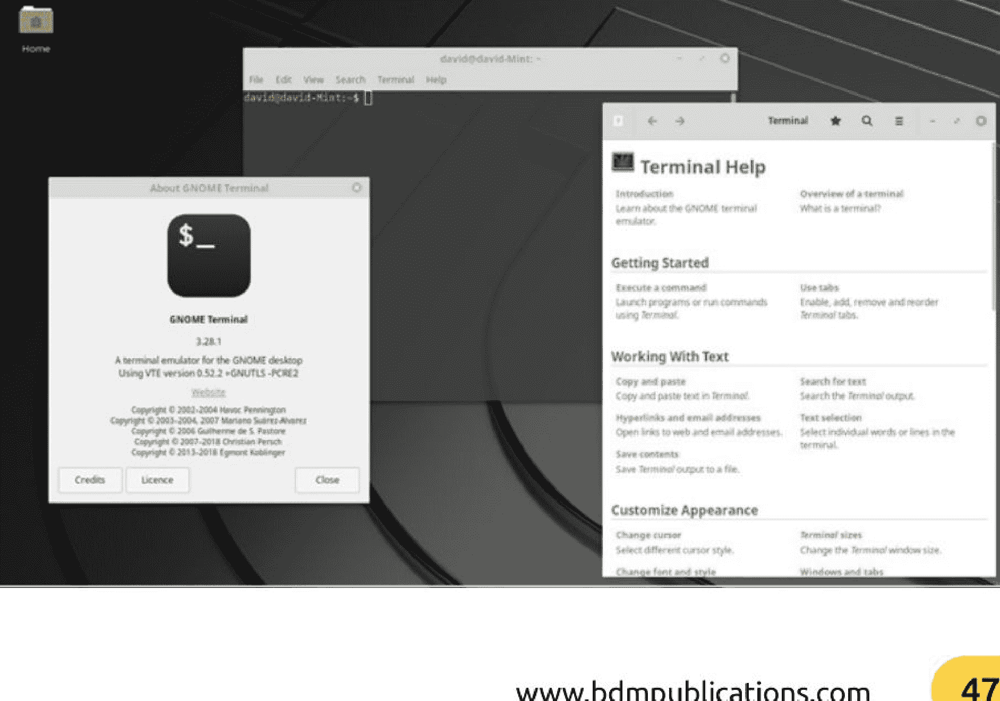

# 通过终端更新 Mint

到目前为止一直在使用盾牌图标启动 Mint 更新管理器来更新系统和当前安装的应用程序、工具和其他元素。然而，你也可以从终端完成整个系统的更新和升级。

## 使用 APT-GET

更新和升级终端你使用 APT（高级软件包工具）是一个强大的命令，并根据其使用组合不同的元素。

- 步骤 1 通过打开一个新的终端，或者如果你已经打开了一个，通过命令清理内容来从干净的状态开始。

- 步骤 3 `apt-get` 用于升级 Mint 以及其他基于 Debian 的发行版。使用 `apt-get` 获取新软件包并更新源列表。升级下载并安装最新版本。要启动升级过程，输入：`sudo apt-get` 然后输入你的密码。

- 步骤 2 输入 `apt-get` 进入终端。这会带来最常用的命令列表，以及该命令作用的简要描述。

- 步骤 4 注意 `sudo` 命令的添加。管理员用户（super User）使用 APT（高级软件包工具）来获取更新。现在使用：`sudo apt-get upgrade`。

```
david@david-mint: $
```


```
david@david-mint: ~ Search
apt 1.2.7 (ubuntu)
(apt-get) [options] command
Reading lists... Done
1 http://archive.ubuntu.com/ubuntu focal [26841 kB]
2 http://archive.ubuntu.com/ubuntu-updates [71522 kB]
3 http://archive.ubuntu.com/ubuntu-security [14522 kB]
Reading package list... Done
Building cache... Done
Reading dependency tree: Done
Reading sources: Done
Reading packages: 15 upgraded, 0 new installed, 0 to remove and 0 not upgrade
15 packages can be upgraded. Run 'apt-get'.
```

```
david@david-mint: ~ Search
apt 1.2.7 (ubuntu)
(apt-get) [options] command
Reading lists... Done
1 http://archive.ubuntu.com/ubuntu focal [26841 kB]
2 http://archive.ubuntu.com/ubuntu-updates [71522 kB]
3 http://archive.ubuntu.com/ubuntu-security [14522 kB]
Reading package list... Done
Building cache... Done
Reading dependency tree: Done
Reading sources: Done
Reading packages: 15 upgraded, 0 new installed, 0 to remove and 0 not upgrade
15 packages can be upgraded. Run 'apt-get'.
```

# 通过终端更新 Mint

- 步骤 5 根据你的更新状态，如果你有任何安装内容，想要应用 `sudo apt-get upgrade` 命令的结果，按 Y 接受。这里发生的是 apt-get 有一些更新需要应用到 Mint，你已经准备好了。

- 步骤 7 有趣的是，根据可用软件包列表，系统现在是最新的。你可以运行一次该过程，检查一切一切正常。总结一下：**sudo apt-get update** 然后输入：**sudo apt-get upgrade**。

```
File Edit View Search Help
davidhaus-mint~
01: /archive.ubuntu.com/ubuntu main
02: /archive.ubuntu.com/ubuntu-updates [182 KB]
03: /archive.ubuntu.com/ubuntu-backports
04: /archive.ubuntu.com/ubuntu-security [182 KB]
05: /archive.ubuntu.com/ubuntu focal-universe
06: /archive.ubuntu.com/ubuntu focal-updates [182 KB]
07: /archive.ubuntu.com/ubuntu focal-universe [182 KB]
08: /archive.ubuntu.com/ubuntu focal-security
09: /archive.ubuntu.com/ubuntu focal-updates [182 KB]
10: /archive.ubuntu.com/ubuntu focal-security
11: /archive.ubuntu.com/ubuntu focal-universe [182 KB]
12: /archive.ubuntu.com/ubuntu focal-updates [182 KB]
13: /archive.ubuntu.com/ubuntu focal-security
14: /archive.ubuntu.com/ubuntu focal-universe [182 KB]
15: /archive.ubuntu.com/ubuntu focal-updates/focal-updates [182 KB]
16: /archive.ubuntu.com/ubuntu focal-security
17: /archive.ubuntu.com/ubuntu focal-universe [182 KB]
18: /archive.ubuntu.com/ubuntu focal-updates [182 KB]
19: /archive.ubuntu.com/ubuntu focal-security
20: /archive.ubuntu.com/ubuntu focal-universe [182 KB]
21: /archive.ubuntu.com/ubuntu focal-updates [182 KB]
22: /archive.ubuntu.com/ubuntu focal-security
23: /archive.ubuntu.com/ubuntu focal-universe [182 KB]
24: /archive.ubuntu.com/ubuntu focal-updates [182 KB]
25: /archive.ubuntu.com/ubuntu focal-security
26: /archive.ubuntu.com/ubuntu focal-universe [182 KB]
27: /archive.ubuntu.com/ubuntu focal-updates [182 KB]
28: /archive.ubuntu.com/ubuntu focal-security
29: /archive.ubuntu.com/ubuntu focal-universe [182 KB]
Reading lists... Done
Reading packages... Done
Calculating dependency tree... Done
The following NEW packages will be installed:
libapt-bin 2.4.2-ubuntu4 [2150 KB]
libapt-pkg 2.4.2-ubuntu4 [450 KB]
nnutils 6.2.0-2ubuntu1 [1200 KB]
adduser 4.2.0-2ubuntu1 [850 KB]
archive-common 0.8.12-ubuntu1 [150 KB]
archive-dev 0.8.12-ubuntu1 [150 KB]
archive-extra 0.8.12-ubuntu1 [150 KB]
archive-info 0.8.12-ubuntu1 [150 KB]
archive-interactive 0.8.12-ubuntu1 [150 KB]
archive-announce 0.8.12-ubuntu1 [150 KB]
archive-security 0.8.12-ubuntu1 [150 KB]
archive-support 0.8.12-ubuntu1 [150 KB]
archive-tools 0.8.12-ubuntu1 [150 KB]
apt-utils 2.4.2-ubuntu4 [150 KB]
apt-progress 2.4.2-ubuntu4 [150 KB]
5.32 MB will be downloaded.
15 new packages will be installed, 12 packages will be upgraded, 0 packages to removed.
After this operation, 24.5 MB additional space will be used.
Do you want to continue? [Y/n] Y
```

- 步骤 6 变化列表很长但不用担心。升级的文件已经下载、解包并正确设置。当你执行升级时，最好配合最小软件包这样做。

- 步骤 8 有趣的是，在许多其他事情中，apt 允许你更改系统设置。在这个例子中，我们将使用 **sudo apt-get update** & **sudo apt-get upgrade**。使用双 & 用于在不等待第一个命令完成的情况下运行第二个命令。最好与系统一起进行更新和升级。

```
File Edit View Search Help
davidhaus-mint~
01: /archive.ubuntu.com/ubuntu main
02: /archive.ubuntu.com/ubuntu-updates [182 KB]
03: /archive.ubuntu.com/ubuntu-backports
04: /archive.ubuntu.com/ubuntu-security [182 KB]
05: /archive.ubuntu.com/ubuntu focal-universe
06: /archive.ubuntu.com/ubuntu focal-updates [182 KB]
07: /archive.ubuntu.com/ubuntu focal-universe [182 KB]
08: /archive.ubuntu.com/ubuntu focal-security
09: /archive.ubuntu.com/ubuntu focal-updates [182 KB]
10: /archive.ubuntu.com/ubuntu focal-security
11: /archive.ubuntu.com/ubuntu focal-universe [182 KB]
12: /archive.ubuntu.com/ubuntu focal-updates [182 KB]
13: /archive.ubuntu.com/ubuntu focal-security
14: /archive.ubuntu.com/ubuntu focal-universe [182 KB]
15: /archive.ubuntu.com/ubuntu focal-updates/focal-updates [182 KB]
16: /archive.ubuntu.com/ubuntu focal-security
17: /archive.ubuntu.com/ubuntu focal-universe [182 KB]
18: /archive.ubuntu.com/ubuntu focal-updates [182 KB]
19: /archive.ubuntu.com/ubuntu focal-security
20: /archive.ubuntu.com/ubuntu focal-universe [182 KB]
21: /archive.ubuntu.com/ubuntu focal-updates [182 KB]
22: /archive.ubuntu.com/ubuntu focal-security
23: /archive.ubuntu.com/ubuntu focal-universe [182 KB]
24: /archive.ubuntu.com/ubuntu focal-updates [182 KB]
25: /archive.ubuntu.com/ubuntu focal-security
26: /archive.ubuntu.com/ubuntu focal-universe [182 KB]
27: /archive.ubuntu.com/ubuntu focal-updates [182 KB]
28: /archive.ubuntu.com/ubuntu focal-security
29: /archive.ubuntu.com/ubuntu focal-universe [182 KB]
Reading lists... Done
Reading packages... Done
Calculating dependency tree... Done
The following NEW packages will be installed:
libapt-bin 2.4.2-ubuntu4 [2150 KB]
libapt-pkg 2.4.2-ubuntu4 [450 KB]
nnutils 6.2.0-2ubuntu1 [1200 KB]
adduser 4.2.0-2ubuntu1 [850 KB]
archive-common 0.8.12-ubuntu1 [150 KB]
archive-dev 0.8.12-ubuntu1 [150 KB]
archive-extra 0.8.12-ubuntu1 [150 KB]
archive-info 0.8.12-ubuntu1 [150 KB]
archive-interactive 0.8.12-ubuntu1 [150 KB]
archive-announce 0.8.12-ubuntu1 [150 KB]
archive-security 0.8.12-ubuntu1 [150 KB]
archive-support 0.8.12-ubuntu1 [150 KB]
archive-tools 0.8.12-ubuntu1 [150 KB]
apt-utils 2.4.2-ubuntu4 [150 KB]
apt-progress 2.4.2-ubuntu4 [150 KB]
```


# 通过终端安装应用 – 第 1 部分

在 Linux 上有多种方法安装应用和程序。你可以选择图形化界面，使用“软件管理器”，也可以使用终端。通常，终端可以对正在安装的软件提供更好的控制，而且有时，你别无其他选择。

## 命令行安装

使用终端安装应用可能需要一些巧妙的键盘操作，但它能让你更清楚地了解正在安装什么以及安装在何处。

- **第 1 步** 从终端安装应用相对简单。不过，首先你需要确保系统是最新的。打开终端并输入：`sudo apt-get update && sudo apt-get upgrade`。输入你的密码并接受任何必要的更新。

```
File Edit View Search Terminal Help
$ sudo apt-get update && sudo apt-get upgrade
Reading package lists......
Building dependency tree...
Reading state information... Done
0 packages upgraded, 0 newly installed, 0 to remove and 0 not upgrade
```

- **第 2 步** 正如你所看到的，sudo apt-get update/upgrade 等命令旨在升级系统中已经安装的软件。不过，你确实想安装更多应用吧？首先你需要一个要安装的应用，所以让我们使用 Stella。输入：`sudo apt-add-repository ppa:peterlevi/ppa && sudo apt-get install stella`。

```
File Edit View Search Terminal Help
$ sudo apt-add-repository ppa:peterlevi/ppa
Adding PPA ppa:peterlevi/ppa
Contains packages for the Variety package changer
More info: https://launchpad.net/~peterlevi/ubuntu/ppa
Press Enter to continue or Ctrl+C to cancel.
```

- **第 3 步** 你需要输入 y确认安装，这将占用系统约 5.5MB 的存储空间。一旦安装完成后，你可以看到 Mint 已经自动在菜单中创建了“游戏”类别以及该应用的快捷方式。


- **第 4 步** 有时在安装软件时，你需要添加应用的仓库（Repository，简称 repo），它是安装软件的远程服务器，以及它所有的依赖项（运行所需的库和文件）。从开始输入：`sudo apt-add-repository ppa:peterlevi/ppa`。按回车添加该 PPA（个人包存档）。


### 第 5 步

这为应用 Variety 壁纸切换器添加了仓库，这是一个基于 Ubuntu 的应用，可以在 Mint 中运行并自动更改壁纸。添加仓库后，输入：**sudo apt-get update**，以更新信息并将仓库内容添加到包管理器。

### 第 6 步

现在安装 Variety，输入：**sudo apt-get install**。按 y 接受并继续安装。安装完成后，你可以在终端中输入 **variety** 来运行它。

```
sudo add-apt-repository ppa:variety-wallpaperproject/ppa
sudo apt-get update
sudo apt-get install variety
```

## 移除应用

除了安装应用，`apt` 命令还可以用于移除任何应用，帮助保持系统快速并释放资源。

### 第 1 步

要卸载，移除 Variety 应用并输入以下：**sudo apt-get remove variety**。输入 y 继续卸载应用；注意，你会收到由于移除该应用而在驱动器上释放了多少空间。

```
File View Search Terminal
daviddavid-mint $ sudo apt-get remove variety
Reading dependencies
Building dependency tree...
Reading package information... Done
The following packages were automatically installed and are no longer required
variety-slideshow
The following packages will be REMOVED
variety
After this operation, 1 package to remove, 0 not to upgrade,
14.4 MB disk space will be freed.
Do you want to continue? [Y/n]
```

### 第 3 步

当你从系统中移除应用时，某些自动安装的内容不再需要了。你已经在过程教程中看到，可以使用以下命令 **sudo apt-get autoremove**，然后按 y 接受该过程。

```
File View Search Terminal
daviddavid-mint $ sudo apt-get autoremove
Reading dependencies
Building dependency tree
Reading package information... Done
The following packages were automatically installed and are no longer required
lib-python3.8-python-py32-variety-slideshow
0 packages to be REMOVED, 0 not to upgrade.
After this operation, 1.06 MB disk space will be freed.
Do you want to continue? [Y/n]
```

### 第 2 步

当 apt-get 命令卸载应用时，它不会移除应用附带的额外内容，如配置和文件。要彻底清除杂质，输入：**sudo apt-get purge variety**。

```
File View Search Terminal
daviddavid-mint $ sudo apt-get purge variety
Reading dependencies
Building dependency tree...
Reading package information... Done
Package: variety is not installed, so not removed
The following packages were automatically installed and are no longer required
variety-slideshow
Use "purge" to upgrade 0 to newly installed, 0 to remove not to upgrade.
daviddavid-mint $
```

### 第 4 步

最后，为了整理环境，清理不再需要的 **sudo apt-get clean**（注意这里是清理命令），你可以通过 **sudo apt-get clean** 来操作。

```
File View Search Terminal
daviddavid-mint $ sudo apt-get clean
Reading dependencies
Building dependency tree
Reading package information... Done
```

（注：此处原文第 4 步文本似乎有截断或重复，根据语境翻译为清理缓存的操作）

# 通过终端安装应用 – 第 2 部分

在 Linux 上有多种方法安装应用。你可以选择图形化界面，使用“软件管理器”，也可以使用终端。通常，终端可以对正在安装的软件提供更好的控制，而且有时，你别无其他选择。

## 源码安装

使用终端安装应用可能需要一些巧妙的键盘操作，但它能让你更清楚地了解正在安装什么以及安装在何处。

- **第 1 步** 从终端下载源码比较简单。首先，你需要下载源码的压缩包。打开终端并输入：`sudo apt-add-repository ppa:variety-wallpaperproject/ppa`。

- **第 2 步** 下载 Variety，输入：**sudo apt update**。按 y 接受并继续下载。下载完成后，你可以在终端中输入 **variety** 来运行它。

```
sudo add-apt-repository ppa:variety-wallpaperproject/ppa
sudo apt-get update
sudo apt-get install variety
```

- **第 3 步** 下载 Variety 源码，输入：**wget https://github.com/variety-project/variety/releases/download/v[version]/variety.tar.gz`。

- **第 4 步** 解压源码包，输入：**tar -xvf variety.tar.gz**。

- **第 5 步** 进入解压后的文件夹，输入：**cd variety**。

- **第 6 步** 配置编译环境，输入：**./configure**。这会检查你的系统是否满足安装要求。

- **第 7 步** 如果 `./configure` 报错缺少依赖项，你需要根据提示使用 `sudo apt-get install` 安装缺失的包。

- **第 8 步** 配置完成后，输入 **make**。这会编译源码并生成可执行文件。

- **第 9 步** 编译完成后，最后输入：**sudo make install**。这会将应用安装到系统中。

- **第 10 步** 安装完成后，你就可以在终端中输入 **variety** 来运行它了。如需更多信息，可以访问 [Variety 官方 GitHub](https://github.com/variety-project/variety) 页面。


# 使用终端

```
Kernel command line: block2mtd.block2mtd=/dev/hda2,131072.root root=/dev/mtd0
ck0 roottype=jffs2 init=/etc/preinit noinittrd console=ttyS0 console=tty3840n reboot-bios
Found and enabled local APIC:
Enabling FPU save and restore... done.
Enabling unmasked SIMD FPU exception support... done.
Initializing CPU00
PID hash table entries: 32 (order: 5, 128 bytes)
Detected 1991 667 MHz processor.
Console: colour VGA+0x25
console [tty0] enabled
console [tty0] enabled
Dentry cache hash table entries: 1024 (order: 0, 4096 bytes)
Inode-cache hash table entries: 1024 (order: 0, 4096 bytes)
Memory: 512K/812K available (147k kernel code, 264k reserved, 597k data, 196k Ok highmem)
virtual kernel memory layout:
fixmap: 0xfff90000 - 0xffffff (280 kB)
vmalloc: 0xc0000000 - 0xfffff7000 (1007 MB)
lowmem: 0xc0000000 - 0xc07f0000 (7 MB)
.init: 0xc0310000 - 0xc0344000 (196 KB)
.data: 0xc027653c - 0xc030bcfc (597 KB)
.text : 0xc0100000 - 0xc027653c (147 KB)
Checking if this processor honours the WP bit even in supervisor mode...Ok.
Calibrating delay using timer specific routine... 4047.64 BogoMIPS (lp)=202382210
```

# Linux 内核 0.01

```
/*: console.c
 * 此模块实现了控制台函数
 * void con_init(void);
 * void_start(struct tty_queue *queue);
 * 希望这将会是一个完整的 VT12 实现。
 */

 * 注意：我们有时会短时间禁用并重新启用中断
 * （为了将工作放入视频 IO 中），但这仅对键盘事件
 * 有效。当我们获取到键盘中断时，我们会处理中断开始，
 *，因为我们使用了 trq-gates. 希望一切顺利。
 */

#include <linux/sched.h>
#include <linux/tty.h>
#include <asm/h>
#include <linux/system.h>

#define SCREEN_START 0x8000
#define SCREEN_END 0x0000
#define COLUMNS 80
#define LINES 25

extern unsigned void keyboard_interrupt(void) {
static unsigned long origin=SCREEN_START;
static unsigned long sc_end=SCREEN_START+LINES*COLUMNS;
static unsigned long m_x,y;
static unsigned long top-bottom-LINES;
static unsigned long lines=LINES,columns=COLUMNS;
static unsigned long state;
static unsigned long nq_par[NBAR];
static unsigned char attr=0x07;
```

你知道吗……由 Linus Torvalds 编写的首个 Linux 内核只占了 65KB 的内存。而从那个 0.01 版本开始，Linux 内核现在已经拥有超过 1800 万行代码。对于一个运行着纽约证券交易所、并为美国国防部的核潜艇舰队提供动力支持的大学项目来说，这已经很不错了。

# 使用终端创建文件

使用终端，你可以创建文件夹、文件，甚至执行 Linux Mint 应用程序。事实上，如果你手边没有 GUI，你仍然可以通过终端完成相同的操作。

# 更多终端操作

使用终端创建内容并不像看起来那么费力。是的，终端对于新手来说可能是一个令人生畏的地方，但一旦掌握了它，它其实非常直观。

- 步骤 1
主目录。如果需要，使用 `cd -` 命令无论你当前位于何处都能返回到主目录。

- 步骤 3
你的命令行应该变为 Test 文件夹，如果你在那里输入 `ls`（列出文件夹内容），文件夹内没有任何东西；`mkdir` 命令非常直观易懂：创建目录（Make Directory）加上你选择的名称。

```
davidd@david-mint ~ $ cd -
davidd@david-mint ~ $
```

```
davidd@david-mint ~ $ mkdir Test
davidd@david-mint ~ $ cd Test
davidd@david-mint ~ $ ls
davidd@david-mint ~ /Test $ ls
```

- 步骤 2
让我们先在 Home 中创建一个新文件夹，并命名为 Test。你需要的命令是 `mkdir Test`。按回车创建你在命令中输入的文件夹，输入 `cd Test` 并按回车。这将切换目录（此处）`cd` 到新创建的 Test 文件夹。

- 步骤 4
要创建一个名为 Test.txt 的空文件，在终端输入：`touch Test.txt`。你可以使用 `ls` 查看文件夹中的新文件。这是一个标准命令，允许在创建文件而无需打开编辑器、保存文件然后关闭编辑器。

```
davidd@david-mint ~ $ mkdir Test
davidd@david-mint ~ $ cd Test
davidd@david-mint ~ $ ls
davidd@david-mint ~ $ touch Test.txt
davidd@david-mint ~ $ ls
davidd@david-mint ~ /Test $ ls
```

```
davidd@david-mint ~ $ mkdir Test
davidd@david-mint ~ $ cd Test
davidd@david-mint ~ $ ls
davidd@david-mint ~ $ touch Test.txt
davidd@david-mint ~ $ ls
davidd@david-mint ~ /Test $ ls
```

# 使用终端创建文件

**步骤 5** 假设你现在想创建一个文本文件，我们称其为 Test2.txt。输入一些内容来完成。所以，输入：`touch Test2.txt`。这将创建文件 **Test2.txt** 并将其推入终端编辑器。

**步骤 8** Xed 是一个 GUI 应用，你可以通过菜单栏输入文本并保存文件（或任何文件），并使用其顶部菜单栏选项中的**文件（File）** > **保存（Save）** 或**文件（File）** > **另存为（Save As）** 功能。

```
File Edit View Search Terminal Help
david@david-min ~$ touch Test2.txt
david@david-min ~$ ls
david@david-min ~$ touch touch_test.txt
david@david-min ~$ ls
Test2.txt
david@david-min ~$ cat Test2.txt
```

**步骤 6** 你会注意到光标在 **cat** > **Test2.txt** 命令下方闪烁，没有任何参数。这个提示允许你输入文件将包含的文本。输入一些文本，然后按 **Ctrl+D** 退出并将内容保存到文件中。

但是，如果你更喜欢留在终端中编辑/保存/创建文件，可以使用 Nano。Nano 是一个简单的基于终端的编辑器。要尝试它可以使用 `nano Test2.txt`。它屏幕底部有一个菜单。你可以在 Nano 中保存任何内容，然后按 **Ctrl+X** 并遵循屏幕上的操作说明。

```
File Edit View Search Terminal Help
david@david-root ~
david@david-root ~$ touch Test2.txt
david@david-root ~$ ls
david@david-root ~$ touch touch_test.txt
david@david-root ~$ ls
Test2.txt
david@david-root ~$ cat Test2.txt
这是使用终端的 cat 命令输入的。很酷，不是吗？按下 Ctrl+D...
```

**步骤 7** 固然你不一定得要使用终端向文件中输入文本。Mint 附带了一个名为 **Xed** 的编辑器，它类似于 Windows 记事本。要在 Xed 中查看之前创建的文件，在终端中输入 `xed` **Test2.txt** 并按**回车**。

**步骤 10** 我们已经使用终端启动了 Mint 应用 Xed，但任何应用其实都可以在终端内启动。例如，尝试：`firefox`，然后按**回车**。关闭 Firefox 返回终端。

# 创建和删除目录

与在终端中创建文件一样，你也可以创建和删除目录，或者如果你愿意，称为文件夹。目录构成了文件系统的结构，如果没有目录，文件系统将一片混乱。

## 管理文件夹

学习在终端中创建和删除文件夹是 Mint（实际上是整个 Linux）的一项需要掌握的重要技能。以下是基础操作供你尝试。

- 步骤 1
主目录。如果需要，使用 `cd -` 命令无论你当前位于何处都能返回到主目录。现在输入 `ls` 查看你拥有的文件夹。你会发现文件夹被标记为青色（浅蓝色）。让我们先创建一个目录：`mkdir testdir`。

- 步骤 2
如果你现在输入 `ls`，你会看到新目录 testdir 与 Home 区域的其他目录一起被创建了。显然 `mkdir` 命令创建了目录。

- 步骤 3
如果你再次输入命令 `mkdir testdir`，你会收到一条消息显示：`mkdir:无法创建目录 'testdir': 文件存在`。在当前目录下只能有一个同名的目录。然而，Linux 允许 `ls testdir`。

- 步骤 4
你可以在已经创建的目录中创建目录。例如，进入目录 `cd testdir/` 并按照操作列出该目录。那里什么都没有，因为你刚刚创建了它。现在通过 `cd ..` 返回主目录，并输入 `mkdir testdir/reports`。回到测试目录，`cd testdir/` 并执行 ls。


## 创建和删除目录

**第 5步** 创建目录的命令逻辑很清晰，你是的。然而，如果你想创建一个目录并在其中创建子目录，请确保你处于家目录，并使用单个命令创建子目录（`cd ~`）或使用 `mkdir -p Temp/Finances`。现在，`cd Temp/` 并列出新目录。

**第 8步** 现在既然我们已经创建了一些目录，让我们来看看如何删除它们。通过进入目录并列出内容：**cd testdir**，然后输入 `ls`。创建的 reports 子目录存在。现在删除它的方法之一是进入 **rmdir reports**，然后输入 `ls` 确认它不存在。

```
david@david-mint: ~Temp
File Edit View Search Terminal Help
david@david-mint: # mkdir -p Temp/finances
david@david-mint: # mkdir -p Temp/ls
Finances
david@david-mint: # ls
```

```
david@david-mint: ~testdir
File Edit View Search Terminal Help
david@david-mint: # cd testdir
david@david-mint: # ls
Reports
david@david-mint: # rmdir reports
ls
david@david-mint: # rmdir testdir
```

**第 6步** `-p` 选项让 `mkdir` 命令能够创建子目录以及父目录。在 Linux 中，命令遵循相同的结构：命令、选项和参数。在在上一步的示例中，命令是 (**mkdir**)，选项是 (-p)，参数是 (**Temp/finances**)。

**第 9步** 一个快速的警告：在终端中删除目录不会将其放入通过 Nemo 文件管理器的 Mint 垃圾桶中。对于任何文件也是如此，如果你在终端中删除一个目录，它就会彻底消失。

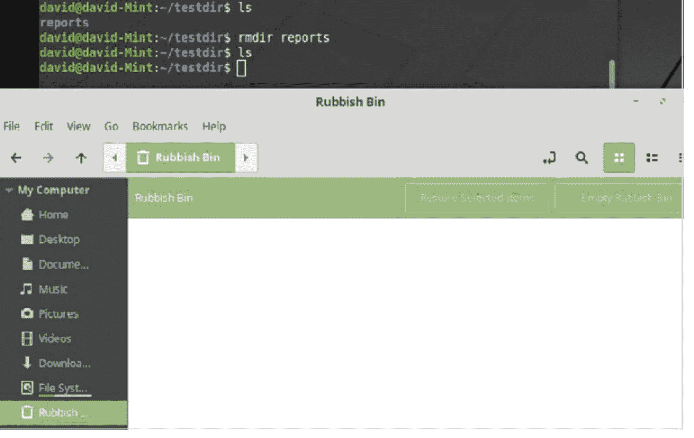

```
david@david-mint: ~testdir
david@david-mint: # rmdir reports
david@david-mint: # rmdir testdir
```

```
File Edit View Search Terminal Help
david@david-mint $ mkdir -p Temp/finances
```

**第 7步** 如果你想深入研究 `mkdir` 命令的各种选项，可以在终端中输入 `mkdir --help`。这将提供快速帮助，详细说明这些选项以及命令的工作原理。

Rmdir 只删除空目录，要删除目录及其子目录，甚至文件，除非你使用带有 `-R` 选项的 `rm` 命令。例如，使用 `rm -R Temp`。一个小技巧是删除父文件夹，其所有内容都会被删除。使用时请务必小心。

```
david@david-mint: ~Temp
File Edit View Search Terminal Help
david@david-mint: # mkdir --help
usage: mkdir [OPTIONS] DIRECTORY...
create the DIRECTORYs, if they do not already exist.
  --parents      create parent directories as needed
  --verbose      output a message for each created directory
  --version      output version information
  --context=CTX  use -z or CTX if specified by the SELinux
  --help           display help information and exit

GNU coreutils copy copy: https://www.gnu.org/manual/coreutils/
Full list of copy options: see 'mkdir --help'
other available via: 'info (coreutils) invocation'
```

```
david@david-mint: ~testdir
File Edit View Search Terminal Help
david@david-mint: # rm -R Temp
david@david-mint: # ls
```

## 使用终端

## 终端中的好玩事物

尽管操作系统是非常严肃的，但 Linux 社区对趣味并不陌生。多年来，开发者们在终端中创建并插入了各种奇趣元素。

## 终端趣味

在接下来的两个部分中，你将完全在终端中工作，所以开始活动你的手指吧。毕竟，俗语说，工作之余……

- 我们将使用的第一个命令是 `sl`，它默认没有安装，所以执行：`sudo apt-get install sl`。可以运行 sl 命令（输入 LS，注意大写，同样有效）。

- 如果你曾让电脑为你读一段随机的运气，那么你走运了。大多数发行版需要你安装 `fortune`，但 Linux Mint 的不同之处在于它预装了它。你只需要在终端输入命令 `fortune` 并享受即可。


- 星球大战粉丝在终端中大有收获。通过 `telnet` 命令连接到远程服务器，你可以观看《第四部：新希望》的播放，全部以 ASCII 格式呈现。要查看这场盛宴，输入 `telnet starwars.blinkenlights.nl`。

- `rev` 命令可以反转文本。如果你输入一些内容并通过 `rev`，你会看到有趣的反转效果。


# 终端中的更多趣味玩法

### 步骤 5
将多个命令组合并通过管道传递给其他命令，是脚本成为操作系统强大元素的原因。例如，使用 `while` 命令配合 `toilet`，你可以获得令人印象的结果。
输入：`while true; do echo "$(date +%B) | toilet -f -f border --midnight"; sleep 1; done`

### 步骤 8
`bb` 命令曾用于旧 Amiga 和 DOS 时代的音乐演示，它让我们想起在带有各种可能舒适的软盘上复制三点半的一半的日子。我们已经通过上一步安装了 `bb`，只需遵循屏幕提示，并调大音量。

```
dump save terminal help
dump ascii white; do echo "$(date +%B) | toilet t f border --midnight"; sleep
06/21 08:30:01
06/21 08:30:02
06/21 08:30:03
06/21 08:30:04
06/21 08:30:05
06/21 08:30:06
```


### 步骤 6
会说话的电脑是 80 年代的潮流；输入 `speak "Hello, this is Linux Mint"` 让电脑向你复读文本。确保你的音量足够大，并尝试以下：`ls > folders.txt && speak -f folders.txt`。这将让 Mint 读回命令的内容。

### 步骤 9
此条目分为两个部分：首先，你需要获取必要的软件包包：`sudo apt-get install perl`。完成后，执行 `cd Downloads/ && wget http://search.github.com/CPAN/authors/id/j/K/XBIAQOM/Term-Animation-2.4.tar.gz && tar -xzf Term-Animation-2.4.tar.gz && cd Term-Animation-2.4/; then perl Makefile.Pl && make && make install.`。

```
david-mint $ ls > folders.txt && speak -f folders.txt
```

```
View Search Terminal Help
david-mint $ ls > folders.txt && speak -f folders.txt
```


### 步骤 7
一个熊熊的 ASCII 火堆是你手头最有用的命令，但它很有趣。使用以下命令安装：`sudo apt-get install libart-bin`；然后输入 `fire` 安装。它并不真正温暖，但你明白它的意思。要扩展上述内容，输入：`sudo apt-get install bb box-utils`，然后输入 `typeface`。

### 步骤 10
完成上述操作后，下一步：输入：`cd && wget http://www.robobny.com/projects/asciiquarium/asciiquarium.tar.gz && tar -xzf asciiquarium.tar.gz && cd asciiquarium/ && chmod +x asciiquarium && ./asciiquarium`。让用户输入 `./asciiquarium` 并享受你奇特的基于 ASCII 的鱼馆。


# Linux 技巧与窍

正如你所见，Linux 终端是一个非常独特的环境。然而，只需安装一些额外的应用，并具备一点命令知识，就能完成不可思议且往往很奇怪的事情。

## 获取命令

那里有无数的 Linux 技巧、秘密、黑客技巧和技巧。有些非常古老，源于 Linux 的 Unix 遗传，而另一些是 Linux 传说中近期添加的内容。这里是我们最喜欢的十个技巧。

### 彩彩蛋
文本编辑器 Emacs 是一段很棒的软件，你知道它包含一个隐藏的彩蛋吗？在安装了 Emacs 后（`sudo apt-get install emacs25`），进入终端会话并输入：
`emacs -batch -q dunnet`

### 终端浏览
是否曾经幻想过从终端浏览互联网？这并不特别实用，但做起来是一件非常迷的事。要这样做，请输入：
`sudo apt-get install elinks`

输入你想访问的网站。


```
Dunnet 是由 Ron Schnall 在 1982 年编写的文本编辑器，自1994 年起隐藏在 Emacs 中。

david@ubuntu-~$: emacs -batch -q dunnet
Dead end
你处于一条道路的死胡同。路向东延伸，但你可以看到它最终会分支。有两条皇室道路，标记等距。这里有一个铲子。
$ shovel
```


### 月球沼泽
Moon Bogey 基于经典的 1982 年街机游戏《月球球巡逻》（Moon Patrol），出现于 1980 年代中期的计算机上。它是一个疯狂的雅达游戏，可以通过以下命令在 Linux 终端中使用：
`sudo apt-get install moon-bogey`
然后输入：
`moon-bogey`
享受。

### 让它下雪
在终端中“下雪”是你每天可能遇到的事情。如果你感兴趣，请输入：
`wget https://github.com/contek/1505843/raw/7/d024716a5769fb5232fe09f427533614d/snowjob.sh`
`chmod +x snowjob.sh`
`./snowjob.sh`


# 内存大户

如果你需要查看哪些应用消耗最多的内存，只需输入：
`ps aux --sort=%mem`
这将按内存排序输出。

### BBS（公告板系统）
在拨号时代，在线世界是由公告板系统（BBS）组成的。这些是用户聊天、交换代码、玩游戏的远程聚集地。使用 `telnet`，我们仍然可以连接到一些活跃的 BBS。有无数的 BBS，我们可以查看 https://www.bbs.org/list/ 获取更多信息。

### 粉碎
当你删除一个文件时，软件可能会恢复它。然而，要安全地永久删除文件，请使用：
`shred -u filename`
将 filename 替换为文件名。

### 目录树
如果你想创建一个整个目录（文件夹）树，可以使用：
`mkdir -p New-Dir/{folder1,folder2,folder3,folder4}`
这将创建一个带有文件夹的 New-Dir。

### ASCII
ASCII 艺术应用于图像时非常引人注目。然而这很难。你可以使用以下工具创建精美的 ASCII 艺术：

### 忘记命令
记住所有命令并不容易。坦率地说，我们可以使用 apropos 来帮助我们。只需使用它获取命令的描述：
`apropos "copy files"`
`apropos "rename files"`
将文本替换为系统中实际的文件。如果没有安装，使用：
`sudo apt-get install apt-utils.`

### 使用终端

## Linux 与大爆炸
Linux 是粒子碰撞，这样我们就可以理解宇宙是如何运作的。

## 你知道吗...
Linux 位于大型强子对撞器科学的核心？使用 Red Hat Linux 和 CentOS（基于 Red Hat 内核的超稳定发行版）作为基础，科学家和工程师创建了自己的自定义发行版——Scientific Linux 来帮助 LHC 的所有方面。最著名的 SLC，也称为 CERN。根据报告，有超过36000 台系统运行 SL，15000 台运行 SLC。

# 创建 Bash 脚本 – 第一部分
最终当你开始使用 Linux Mint 时，你会开始创建自己的自动化任务和程序。这些本质上是像 DOS  文件或任何其他语言一样工作的 Shell 脚本。

### 脚本
bash 脚本是 Mint 执行以完成特定任务的命令。它们可能非常。

- 步骤 1：在接下来的页面中，你将在终端和文本编辑器中工作。文本编辑器有替代方案，但为了方便，我们将使用示例。在开始之前，运行更新检查：`sudo apt-get update && sudo apt-upgrade`
- 步骤 2：有几种文本编辑器可以创建 Bash 脚本：Xed, Vi, Nano, Vim, GNU Emacs 等。最后，这取决于个人喜好。使用 Xed 纯是为了方便阅读下方截图中的脚本。
- 步骤 3：首先，在你开始编写任何脚本之前，你需要创建一个可以放置所有脚本的文件夹。从 `mkdir scripts` 开始并进入文件夹 `cd scripts/`。这将是我们的工作文件夹，从这里你可以为你创建每个脚本创建子文件夹。
- 步骤 4：Windows 用户会知道，为了创建一个批处理文件并执行并遵循内部编程，它需要有 BAT 文件扩展名。Linux 是一个没有扩展名的操作系统，但习惯是创建 .sh 脚本。

```
david-mint $ sudo apt-get update && sudo apt-upgrade
[sudo] password for davidid
Hit: 1: http://launchpad.net/ubuntu/ubuntu-security
Hit: 2: http://launchpad.net/petivi/ubuntu-security
Hit: 3: http://launchpad.net/thomas-schwarz/ubuntu-backports
Hit: 4: http://launchpad.net/thomas-schwarz/ubuntu-updates
Hit: 5: http://launchpad.net/linuxmint/linuxmint-updates
Hit: 6: http://www.mirrors.org/sites/linux.ubuntu/
Get: 7: http://archive.ubuntu.com/ubuntu/ main
Get: 8: http://archive.ubuntu.com/ubuntu/ focal-updates
Get: 9: http://archive.ubuntu.com/ubuntu/ focal-security
Hit: 10: http://repository.ubuntu.com stable
All packages are up to date.
```


# 创建 Bash 脚本 – 第 部分

STEP 5 让我们从一个简单的脚本开始，在终端输出一些内容。输入 `xed` 创建名为 `helloworld.sh` 的文件。在 Xed 中，这将启动 Xed 并创建一个名为 `helloworld.sh` 的文件。输入以下内容：`#!/bin/bash`，然后在新行：`Hello World!`

STEP 8 当你再次输入 `ls` 时，你会发现 `helloworld.sh` 现在从黑色变成了绿色，这意味着它不是一个可执行文件。换句话说，对于脚本，要运行你输入的内容，运行 `./helloworld.sh`。

```
File Edit View Search Terminal Help
daviddavid-mint --scripts xed helloworld.sh
daviddavid-mint --scripts []
```

```
File View Search Tools Documents Help
  * helloworld.sh
  #!/bin/bash
echo Hello World
```

```
File Edit View Search Terminal Help
daviddavid-mint --scripts xed helloworld.sh
daviddavid-mint --scripts chmod +x helloworld.sh
helloworld.sh
daviddavid-mint --scripts --ls
helloworld.sh
daviddavid-mint --scripts ./helloworld.sh
Hello Me World
```

STEP 6 `#!/bin/bash` 行告诉系统你将变成什么，在这种情况下是 Bash。`(#)` 表示注释行，系统会忽略它；`(!)` 表示权限，并将强制脚本执行该行作为命令。这也被称为 Hash-Bang（散列井号）。

STEP 9 尽管这并不令人兴奋，但“Hello World!”现在将显示在终端中。`echo` 命令负责对终端的其他部分做出响应，随着我们的学习，你可以将 `echo` 命令的输出到其他屏幕。

```
File Edit View Search Tools Documents Help
  * helloworld.sh
  #!/bin/bash
echo Hello World
```

```
File Edit View Search Tools Documents Help
* helloworld.sh
  #!/bin/bash
helloworld.sh
helloworld
helloworld World
echo Hello World! This is my first script in Linux Mint
```

STEP 7 你可以点击“文件 > 保存”来保存此文件，并退出回到终端。输入 `ls` 将显示文件中的脚本。要使其可执行并能够运行，你需要修改权限。使用 `chmod +x helloworld.sh` 执行此操作。你应该对创建的每个脚本这样做。

STEP 10 将 `echo` 视为 BASIC 的 `PRINT` 命令。它将显示文本或存储在系统中变量，例如当前日期。尝试一下：`echo Hello World! Today is $(date +%A)`

```
File Edit Search Terminal Help
daviddavid-mint --scripts xed helloworld.sh
daviddavid-mint --scripts --ls
helloworld.sh
daviddavid-mint --scripts chmod +x helloworld.sh
daviddavid-mint --scripts []
```

```
File View Search Tools Documents Help
  * helloworld.sh
Hello World Today is Monday
helloworld.sh []
echo Hello World! Today is $(date)
```

# 创建 Bash 脚本 – 第 2 部分

之前我们查看了如何创建第一个 Bash 脚本 Hello World 并添加系统变量。现在，你可以扩展这些内容，并看看当你开始尝试创建自己的变量时可以做什么。

## 变量

就像每一种其他编程语言一样，Bash 脚本可以存储和调用系统中的某些变量，无论是通用的还是用户创建的。

- **STEP 1** 我们从创建一个名为 `hello.sh` 的新脚本开始；`xed Hello $1`。保存文件并退出 Xed。`###!/bin/bash`，然后 `echo $1`。使用 `chmod +x hello.sh` 使脚本变为可执行。

- **STEP 3** 输出现在将是 Hello David。Bash 会自动为用户分配变量，这些变量会被持有并传递给脚本。`$1` 了 "David"。你可以通过输入不同的内容来更改变量：`./hello.sh Mint`。


- **STEP 2** 由于脚本现在是可执行的，使用 `./hello.sh` 运行它。现在正如你预期的那样，“Hello”显示在终端中。然而，如果你在使用带有变量的命令，事情开始变得有趣了。例如，尝试 `./hello.sh David`。

- **STEP 4** 你可以重命名变量。使用以下内容修改脚本：`surname=$1; Hello $surname`。将每个语句放在新行。保存脚本并退出回到终端。


# 创建 Bash 脚本 - 第 2 部分

STEP 5 当你运行脚本时，可以使用自定义变量：`./hello.sh David Hayward`。自然，我们用你的名字定义了两个变量；除非你也叫 David Hayward。我们只是在打印内容，让我们把双变量的使用扩展到

STEP 8 让我们进一步扩展。在截图中创建一个新脚本，保存它并使用 `chmod` 命令执行它。你可以看到脚本中增加了一些新内容。

```
File Edit View Search Terminal Help
david-david-mint --scripts $ ./hello.sh David Hayward
david-david-mint --scripts $ ./hello.sh Linux Mint
Hello Linux Mint
david-david-mint --scripts $
```

```
File View Search Tools Documents Help
greetings.sh
#!/bin/bash
echo -n "hello, what is your name?"
read firstname
echo -n "thank you, and what is your surname?"
read surname
echo Hello $firstname $surname, how are you today?
```

STEP 6 在这里创建一个名为 `addition.sh` 的新脚本，使用相同的格式。这里我们将使用 `firstname` 和 `secondnumber`，通过 `echo` 输出：`sum is $((firstname+secondnumber))`。

STEP 9 我们在 `echo` 命令中添加了 `-n`，它会像之前一样工作。`read` 命令将输入存储为 `firstname` 和 `secondnumber`。`clear` 命令会清理屏幕。保存脚本并使其可执行（`chmod +x addition.sh`）。

```
File Edit Search Tools Documents Help
addition.sh
#!/bin/bash
firstname=1
secondnumber=2
echo sum is $((firstname+secondnumber))
```

```
File View Search Terminal Help
Hello, how are you today?
david-david-mint --scripts $
```STEP 7 当你运行脚本时，我们可以输入两个数字：`./addition.sh 1 2`。结果将在终端显示“sum is 3”。尝试几个数字，看看是否可以修改脚本重命名为乘法。

STEP 10 最后，让我们包含日期变量。输出应该显示当前的星期几。

```
File View Search Tools Documents Help
david-david-mint --scripts ./addition.sh 1 2
david-david-mint --scripts ./addition.sh 3 4
david-david-mint --scripts ./addition.sh 5 6
david-david-mint --scripts ./multiplication.sh 2
david-david-mint --scripts $
```

```
File View Search Tools Documents Help
greetings.sh
#!/bin/bash
echo -n "hello, what is your name?"
read firstname
echo -n "thank you, and what is your surname?"
read surname
clear
echo Hello $firstname $surname, how are you today?
```

之前的页面中，我们查看了一些基础 Bash 脚本，涉及向屏幕输出文本、获取用户输入、存储并将其输出到屏幕；以及使用 Date 命令包含系统变量。现在让我们结合目前所获得的内容并引入循环。

## IF, THEN, ELSE

在大多数编程结构中，总会有那么时刻，你需要遍历输入的命令以创建更好的功能，并最终创建一个更好的程序。

- **STEP 1** 现在让我们看看现在的 If、Then 和 Else 语句，它们可以正确执行，比较一组指令并简单判断判断是否成立，从而执行不同的操作。创建一个新脚本 `greeting.sh` 并输入截图中的文本。

- **STEP 2** `greeting.sh` 是 `greeting.sh` 的副本，但有细微不同。我们在 if 语句处添加了一个循环。如果输入的变量等于 David，下一行的反应是发生什么，在这种情况下会在屏幕上显示“Awesome name”，随后是 David。

- **STEP 3** 下一行 `ELSE` 是当变量不等于“David”时发生的情况。在这种情况下，简单地在屏幕上输出你熟悉的“Hello...”。最后一行 `FI` 语句将结束循环。如果你有一个 if 命令没有 then，你将得到错误。


# 创建 Bash 脚本 - 部分 3

## 更多循环

你可以使用 FOR、WHILE 和 UNTIL 语句来遍历数据。当你需要批量复制或运行需要计数器的脚本时，这些语句会非常有用。

步骤 1 创建名为 `count.sh` 的新脚本。输入下方截图中的文本，保存并赋予其执行权限。该脚本在开头创建了一个变量 `count` 并将其赋值为零。然后，如果 WHILE 循环小于 0（LT 部分），它将在 `echo` 命令中打印计数器的当前值。

步骤 4 UNTIL 循环的工作原理与 WHILE 循环非常相似，但在大多数情况下，它是反向的。因此，我们使用 UNTIL 计数到一百的写法是：`[ $count -gt 100 ]`；区别在于，在计数器大于（gt 部分）一百之前，保持循环。

```bash
File Edit View Search Documents Help
count.sh
#!/bin/bash
count=0
while [ $count -lt 100 ]; do
  echo $count
  count=$((count+1))
done
```

步骤 2 执行脚本 `count.sh` 将导致终端屏幕显示 0 到 99 的数字；当达到 100 时，脚本将结束。使用 FOR 语句修改脚本，其工作原理类似。要在我们的脚本中使用，请将截图中的文本输入 `count.sh`。

步骤 5 你并不局限于数字到一百。你可以在循环中执行任何命令集，执行次数取决于你希望循环运行多少。重命名文件、创建五个文件夹等。例如，此脚本将使用 FOR 循环创建从 Folder 1 到 Folder 10 的文件夹。

```bash
File Edit View Search Documents Help
count.sh
#!/bin/bash
for count in {0..100}; do
  echo $count
done
```

步骤 3 在这里添加的 `for: count in {0..100}; do` 意味着对于变量 `count` 在从零到一百的数字中的每一个值，开始循环。脚本的其他部分相同。运行此脚本，输出将出现在终端中。

步骤 6 在使用过一次 FOR 语句后，我们可以通过操作序列 `(0..100)` 部分来执行。这部分代码实际上意味着 `(起始..增量)`；如果没有增量，它只是从单个数字增加到结束值。例如，我们将循环设置为计数到1000 且步长为2：`For count in {0..1000..2}; do`

```bash
File Edit View Search Documents Help
count.sh
#!/bin/bash
for count in {0..1000..2}; do
  echo $count
done
```

# 创建 Bash 脚本 – 部分 4

你已经遇到过脚本与用户交互的情况，例如询问用户的姓名等。你还查看了在脚本内部创建循环来计数或简单地执行某些操作。让我们结合并扩展一些内容。

## 选择与循环

让我们引入另一个命令 `CHOICE`，以及一些嵌套的 IF 和 ELSE 语句。首先创建一个新脚本 `mychoice.sh`。

- 步骤 1
`mychoice` 脚本开始变得相当复杂。现在我们有四个选项，其中三个是嵌套的。如果用户按下正确的选项键，将显示 Mint 和 Awesome 选项。如果没有，菜单将重复第四个选项。

```bash
#!/bin/bash
mychoice
echo "Mint"
echo "Awesome"
echo "Please choose an option (1, 2 or 3)"
read choice
while [ $choice -ne 1 ] && [ $choice -ne 2 ]
do
  if [ $choice -eq 1 ]; then
    echo "Mint"
  elif [ $choice -eq 2 ]; then
    echo "Awesome"
  else
    echo "Invalid choice $choice"
    echo "Please choose an option (1, 2 or 3)"
    read choice
  fi
done
```

- 步骤 3
当然，你可以增加选项的数量，但你需要确保 IF 语句的数量相匹配。脚本看起来很快就会变得非常繁忙。这个冗长的脚本是设计菜单的另一种方式，这次带有配色方案。

```bash
#!/bin/bash
choice
echo "Vanilla"
echo "Chocolate"
echo "Please choose an option (1, 2, 3 or 4)"
read choice
while [ $choice -ne 1 ] && [ $choice -ne 2 ] && [ $choice -ne 3 ] && [ $choice -ne 4 ]
do
  if [ $choice -eq 1 ]; then
    echo "Mint"
  elif [ $choice -eq 2 ]; then
    echo "Awesome"
  elif [ $choice -eq 3 ]; then
    echo "Vanilla"
  elif [ $choice -eq 4 ]; then
    echo "Chocolate"
  else
    echo "Invalid choice $choice"
    echo "Please choose an option (1, 2, 3 or 4)"
    read choice
  fi
done
```

- 步骤 2
如果你遵循这个脚本的操作，根据我们已经涵盖的内容，你很快就能掌握其运行原理。WHILE、IF 和 ELSE 配合循环运行选项，并在你选择错误选项时将你回到起点。

- 步骤 4
你可以在此脚本的菜单中使用方向键和回车键。`select` 是一个外部命令，为选项提供反馈并显示出来。这超出了我们之前的内容范围，但是一个很好的主意。

```
SELECT MENU
1. Mint
2. Awesome
3. Vanilla
4. Chocolate
```

## 创建备份脚本

Bash 脚本最常用的示例之一是备份程序，它可以自动化任务。

| 步骤 | 描述 |
| :--- | :--- |
| 步骤 1 | 一个基础备份脚本看起来像这样：`#!/bin/bash`，然后 `tar -cvf ~/backups/backup.tgz` 这会从 Documents 文件夹创建一个压缩文件。 |
| 步骤 2 | 最好，我们可以让脚本更具交互性。在截图中输入新的 `backup.sh` 定义一些变量。 |
| 步骤 3 | 之前的脚本允许你创建一个备份时间戳。你可以创建一个 `dest` 变量，然后添加一行代码来检查 `~/backups` 文件夹是否存在。 |
| 步骤 4 | 一旦创建了 `~/backups` 文件夹，我们可以在其中创建一个子文件夹。`mkdir -p $dest` |
| 步骤 5 | 在一切就绪后，你现在可以输入实际备份程序。结合变量，你有 `tar -cvf $dest.tgz`。 |
| 步骤 6 | 最后，你可以添加一条友好的消息：`echo "Backup complete..."`。脚本本身并不复杂，可以很容易包含进去。 |

```bash
backup.sh
#!/bin/bash
clear
# Time stamp
day=$(date +%d)
month=$(date +%m)
year=$(date +%Y)

# Folders
dest=~/backups

if [ ! -d $dest ]; then
  echo "Backup folder does not exist! Creating..."
  mkdir -p $dest
fi
echo "Backup complete!"
echo "Backup done for $day$month$year"
```

```bash
look4.sh
#!/bin/bash
target=
read name
out=$(find "$target" -name "$name*" 2>/dev/null)
if [ "$out" ]; then
  echo "$out"
else
  echo "No match found"
fi
```

# 创建 Bash 脚本 - 部分 5

步骤 5 执行的脚本等待用户输入文件扩展名，例如 jpg、mp4 等。这不太友好。让我们它变得友好一点。使用 `read` 命令，配合 `echo "Please enter the extension of the file you're looking for: "`。

```bash
#!/bin/bash
target=
echo "Please enter the extension of the file you're looking for:"
output=$(echo $target | grep "*$name" 2>/dev/null)
if [ -z "$output" ]; then
  echo "No match found"
else
  echo "$output"
fi
```

步骤 8 `colours.sh` 的输出可以混合，取决于你想要的输出效果。例如，红色背景（或闪烁）。遗憾的是，闪烁效果在所有终端上都不起，所以你可能需要切换到不同的终端。

```
Normal Text
Default Default
Default Red
Default Yellow
Default Magenta
Default light gray
Default light green
Default light blue
Default light cyan
Default Black
Default Green
Default Yellow
Default Magenta
Default light magenta
```

步骤 6 这是一个有趣的脚本，使用应用安装，将文本输入到新脚本 `speak.sh`。

```bash
#!/bin/bash
echo "What is your name?"
echo "Thank you, and what is your surname?"
echo "Hello $firstname surname, how are you?"
```

步骤 7 我们简短地在我们的脚本输出中添加一些颜色。这里创建一个新脚本 `colours.sh`，它输出如下：

```bash
#!/bin/bash
class=$1
echo -e "Normal $class"
echo -e "Inverted $class"
echo -e "Underlined $class"
echo -e "Blink $class"
echo -e "Bold $class"
echo -e "Default $class"
echo -e "Red $class"
echo -e "Green $class"
echo -e "Yellow $class"
echo -e "Blue $class"
echo -e "Light cyan $class"
echo -e "Light gray $class"
echo -e "Light green $class"
echo -e "Light blue $class"
echo -e "Light magenta $class"
echo -e "Light magenta $class"
```

步骤 9 在你制作花哨脚本时，如何使用 Zenith 输出图形界面？将你看到的输入到新脚本 `menu.sh`。

```bash
#!/bin/bash
firstname=$1 --entry --title "What is your name?"
surname=$2 --entry --title "Thank you, and what is your surname?"
age=$3 --entry --title "Welcome to Linux Houseka, $firstname surname"
```

步骤 10 如果你正在玩游戏，获取 http://proxy.regnet.c/1linux/houseenka.sh/ 赋予脚本执行权限并运行它。英文版，由 Martin Bruchard 撰写，我们相信你可以修改它。提示标题界面是 Base6。


## 树莓派 x Linux = 完美组合

树莓派是一项卓越的硬件，为了发挥它的潜力，它需要一个卓越的操作系统。坦率地说，Linux 是树莓派默认且推荐的操作系统，它们共同构成了一个无一胜的团队。

当树莓派处于开发阶段时，其设计者需要确保他们创造的硬件不仅仅是一台廉价、微小的电脑。

树莓派在功能上需要具有灵活性，它需要有足够的成长空间来容纳更具野心的项目概念和想法，并且需要以尽可能易用的方式实现。其目标是创建一个通用的学习平台，让任何年龄的学生在学习编程、电子设备和计算等新概念时与之交互。自然，一旦硬件开发完成，唯一的操作系统选择就是 Linux。

Linux 的多功能性是传奇性的。这个惊人的内核如此具有塑性，可以应用于计算的各个领域，从超级计算到机器人技术，从太空工业到更多的陆地工程：教育与科学、制造业和互联网。想想一个行业，你可能会发现 Linux 在某处支撑着这一切。


Raspian 是树莓派推荐的操作系统，它是一个基于 Debian 的定制发行版，附带了一系列用于编码、电子设备和通用桌面计算任务的实用工具。除了应用程序外，还预装了模块以帮助你充分利用其功能：你可以学习和使用的编程语言，以及能够让你使用和驱动树莓派特有硬件项目的硬件模块。例如，有 Python 模块可以与树莓派的 40 脚 GPIO 交互，允许你为任何外接设备（HAT 设备）创建内容。

这种组合使得树莓派成为不仅用于编码，还适用于通用 Linux 各种操作的绝佳基础。Raspian 基于 Debian，能够运行本书中列出的任何终端（Terminal）命令，因为 Linux Mint、Mint 和 Ubuntu 也是基于 Debian 的。通过极少的设置，你就可以同时拥有常规的 Windows 或 Mac 电脑，并将树莓派作为一台“无头电脑”（一个供电但不需要连接键盘、鼠标或显示器的设备，你通过远程连接到它），从它连接并学习如何使用 Linux 以及如何编码。

## 树莓派 x Linux = 完美组合

## 哪款树莓派？

目前有多种树莓派型号可用，每个型号都有独特之处。最新发布的 Pi 是树莓派 3 Model B+，虽然它比其他示例稍贵，但它是最强大、功能最丰富的树莓派。


总而言，最好先使用 Pi 3 Model B+ 开始树树莓派，随着你技能的提升并专注于特定项目，再转向其他型号，例如[如果]需要使用 Pi Zero，它具有更小的体积和 WiFi 连接功能。

- 树莓派 3 Model A+
- 树莓派 3 Model B+
- 树莓派 3 Model B
- 树莓派 1 Model A+
- 树莓派 Zero
- 树莓派 2 Model B
- 树莓派 1 Model B+
- 树莓派 2 Zero W

## 超越 Raspbian

## 树莓派、Linux 与编码

树莓派 ARM 处理器的灵活性意味着它能够运行其他操作系统。在保持 Linux 环境的同时，你可以安装 Ubuntu、Mint、Raspidora（基于 Fedora）、Lakka、PiPie（一个复古仿真发行版）和 Arch Linux。还有许多基于 Linux 内核的系统，如 Android、Debian 和 Chromium OS。

如所述，树莓派是一个极佳的代码库，以 Linux 为骨干，你能够学习使用多种编程语言编写代码。由于树莓派基于 Linux 和 Debian，它具有完美的多功能性。

目前还还提供了 ARM 版 Windows 10、树莓派操作系统（Raspberry Pi OS）、Pi Zero 以及 Pi Zero W。一旦你完成了对其中一个的实验，你就可以直接使用 Linux 的桌面版本，你可以在树莓派上切换到另一个版本，看看它是如何运行的，以及是否适合你。

你可以利用它的灵活性扩展你的项目。你还可以创建备份脚本来访问树莓派上的 GPIO 引脚，并能用它创建控制器、LED 甚至 Web 服务器。

Python 是初学者最流行的语言之一，树莓派预装了让你充分发挥 Python 体验所需的一切内容。有无数预装模块，以及该语言的最新版本。

C++ 是值得学习的最强大的编程语言之一。树莓派配备了一个出色的 C++ 编辑器，易于使用并能帮助你开发惊人的内容。无论你决定如何开启编码和 Linux 之之旅，树莓派都是一个极佳的起点平台。

```
RISC OS PI
```


www.bdmpublications.com 79

## 命令行快速参考

当你开始全方位 Linux 时，你会很快发现 Ubuntu、Mint 等系统的图形界面对于很多任务很棒，但并非适用于所有任务。理解如何使用命令行不仅能加深你对 Linux 的理解，还能提高你的编码水平。我们的命令行快速指南旨在帮助你快速掌握 Linux。

### 十大命令

这些可能是大家最常用的命令，出现频率很高。

- **cd** 是你在命令行中最常用的命令之一。它允许你更改工作目录。你用它在文件系统的层次结构中移动。
- **mv** 将文件移动到不同位置或重命名文件。例如 `mv file sub` 将原文件重命名为 sub，`mv sub ~/Desktop` 将 sub 移动到你的目录。重命名必须指定一个新的文件名。
- **ls** 显示当前目录下的文件。通过某些选项，可以查看文件大小、创建时间和权限。例如 `ls -l` 显示目录的文件。
- **chown** 更改每个指定文件的用户/组所有。如果只给出一个所有者（名称或数字 ID），它将成为文件的所有者，而文件组不变。
- **cp** 用于复制文件和目录。例如，`cp file sub` 为你命名的文件创建一个精确副本并命名为 sub。第一个文件将以原始名称存在。
- **chmod** 更改所列文件的权限。权限基于一个简单的模型。你可以为用户、组和其他世界设置权限，并设置它们是否可以读取、写入和执行。
- **pwd** 输出当前工作目录的完整路径（“打印目录”）。注意 GNOME 终端也在窗口标题栏中显示此内容。
- **rm** 移除（删除）文件目录。删除过程是从文件系统从数据存储设备解除链接，并标记为可供未来写入。其他删除增加了磁盘上的可用空间。
- **clear** 在可能的情况下清除你的屏幕。它查找终端的环境，然后根据指定的终端进入 terminfo 数据库以确定如何清除屏幕。在使用 shell 时，它等同于输入 Control-L。
- **mkdir** 用于“创建目录”，用于在文件系统中创建目录（如果指定的目录尚不存在）。例如，`mkdir` 创建工作目录。调用 mkdir 时可以指定多个目录。


# 命令行快速参考

# 有用的帮助/信息命令

当你尝试学习更多关于你正在使用的 Linux 系统或程序知识时，以下命令会非常有用。你可能不需要每天使用它们，但当你需要时，它们将是无价之。


- `free` 命令显示系统中空闲、已用和交换内存的总量。例如，`free -m` 以兆字节为单位显示信息。
- `sed` 命令打开一个流编辑器。流编辑器用于对输入流（文件或输入管道）执行文本变换。
- `df` 命令显示所有分区的的文件系统磁盘使用情况。`df -h` 命令可能是最有用的（`-h` 意味着人类可读格式）。
- `adduser` 命令向系统添加新用户。同样，`addgroup` 命令向系统添加新用户组。
- `top` 命令提供运行中系统的实时视图。它可以显示系统信息以及进程列表。
- `userdel` 命令从系统中删除用户。要删除该用户的文件和主目录，你需要添加 `-remove-home` 。
- `uname` 命令配合 `-a` 提供所有系统信息，包括机器名称、版本和其他一些细节。
- `groupdel` 命令从系统中删除用户组。你不能删除作为用户主要组的组。
- `ps` 命令允许你查看在机器上运行的所有进程。每个操作系统的 `ps` 版本略有不同，但功能相同。
- `man` 命令显示命令的手册条目，这是开始使用该命令的极佳起点。
- `grep` 命令允许你在多个文件中搜索特定模式并打印匹配的行。例如：`grep blah file`。
- `intro` 命令特别有用。它显示《用户命令简介》（Introduction to User Commands），这是一份关于 Linux 命令的写得非常出色且相当简短的介绍。

# 使用终端

# Linux 命令 A-Z 列表

Linux 命令字面上有数以千计的命令，虽然这并不是一个完整的 A-Z 列表，但它确实包含了许多你可能需要的命令。你可能会发现自己最终只会反复使用较少的一部分命令，但拥有整体的知识仍然非常有帮助。

## A
- adduser 添加新用户
- arch 打印机器架构
- awk 在文件(s)中查找并替换文本

## D
- dump 数据转储，转换并复制文件
- diff 显示两个文件之间的差异
- dname 将完整路径转换为路径
- du 估算文件空间使用情况

## G
- gawk 在文件(s)中查找并替换文本
- grep 在文件(s)中搜索匹配给定模式的行
- groups 原样打印组名
- gzip 压缩或解压命名文件

## B
- bc 任意精度计算器语言

## C
- cat 合并文件并打印到标准输出
- cd 切换工作目录
- chown 修改文件所有者
- root 切换根目录
- cksum 打印 CRC 校验和和字节计数
- cmp 比较两个文件
- comm 按行比较两个排序后的文件
- cp 将一个或多个文件复制到另一个位置

## E
- env 显示或移除环境变量
- expand 将制表转换为空格
- expr 求值表达式
- echo 在屏幕上显示消息
- ed 一个行行的文本编辑器 (edlin)
- egrep 在文件(s)中搜索匹配扩展正则表达式的行

## H
- head 输出文件(s)的第一部分
- hostname 打印或设置系统名称
- id 打印用户和组 ID
- info 帮助信息
- install 复制文件并设置属性

## F
- factor 打印质因数
- fdisk Linux 分区表操作器
- grep 在字段(s)中搜索匹配固定字符串的行
- find 搜索符合标准的文件
- crontab 安排定时运行的任务
- split 将文件分成若干部分
- cut 将文件分割若干部分

## D
- fold 按指定宽度折叠文本
- format 格式化磁盘或磁带
- fsck 文件系统检查和修复

## K
- kill 停止运行的进程
- less 每次显示一次输出
- ln 在文件间创建链接
- locate 查找文件

# Linux 命令 A-Z 列表

| | | 打印当前登录名 | rcp 在机器间复制文件 | U | |
|---|---|---|---|---|---|
| lpc 打印机控制程序 | rm 删除文件 | umount 卸载设备 | |
| lpr 离线打印 | rmdir 删除文件夹 | unexpand 将空格转换为制表符 | |
| rpm 删除打印队列中的作业 | rpm 软件包管理器 | uniq 合并文件 | |
| | | rsync 远程文件复制（同步文件） | units 将单位转换为其他比例 |

## M
| man 查看手册 | S | | unshor 解包 shell 脚本 |
|---|---|---|---|---|---|
| mkdir 创建文件夹(s) | screen 终端窗口管理器 | useradd 创建新用户账户 |
| mkfifo 创建命名管道 (FIFOs) | diff 交互式合并两个文件 | usmod 修改用户账户 |
| knot 创建块或字符特殊文件 | select 接受键盘输入 | users 按字符出用户 |
| more 每次显示一次输出 | seq 打印数字序列 | | 已登录 |

## N
| nice 设置命令或作业的优先级 | shutdown 关闭或重启 Linux | vdir 详细目录列表 (ls -l) |
|---|---|---|---|---|
| nl 给行编号并写入文件 | sleep 等待指定时间 | watch 打印字节、单词和行数 |
| nohup 在挂起的情况下运行命令 | sort 排序文件 | where 报告命令的所有实例 |

## P
| passwd 修改用户密码 | T | | | who 在用户路径中查找文件 |
|---|---|---|---|---|---|
| pathchk 检查行移植性 | tail 输出文件的最后部分 | | whoami 输出当前用户 ID 和名称 |
| | 转换文本文件用于打印 | tar 磁带归档 | | |
| printcap 打印打印机数据库 | tee 重定向到多个文件 | | |
| printf 格式化并打印 | test 求值条件表达式 | | |

## Q
| quota 显示磁盘使用和限制 | time 测量程序资源使用 | yes 打印字符串直到被中断 |
|---|---|---|---|---|---|
| quotacheck 扫描系统磁盘使用文件 | touch 修改文件时间戳 | | |
| | | top 列出系统上运行的进程 | |
| | | traceroute 跟踪路由 | tr 翻译、压缩和删除字符 | xargs 构建参数列表执行工具 |

## R
| ram 内存磁盘 |


Python 是一门极佳的编程语言，它兼顾了易用性和强大的功能，允许用户创建小型实用工具，也可以处理性能密集型的计算任务。

然而，Python 不仅仅是另一种编程语言。它的背后有一个充满活力且活跃的社区，他们成员共享知识、代码、项目创意，以及用于未来版本的错误修复方案。

我们在本书的这一章节使用了树莓派（Raspberry Pi），因为它基于 Linux，是目前最好的编程平台之一。树莓派的特性和功能使其成为完美的 Python 编程伙伴，那么，让我们开始吧。

- 88 为什么选择 Python？
- 90 如何在 Linux 中安装 Python
- 92 首次启动 Python
- 94 你的第一行代码
- 96 保存并执行你的代码
- 98 从终端执行代码
- 100 你知道吗...《太空入侵者》
- 102 数字与表达式
- 104 使用注释
- 106 变量操作
- 108 用户输入
- 110 创建函数
- 112 条件与循环
- 114 Python 模块
- 116 你知道吗...调试

## Linux 上的 Python

## 为什么选择 Python？

现代计算机有许多编程语言可用，有些仍然适用于 8 位和 16 位的计算机。其中一些语言是为科学工作设计的，另一些则是为了移动平台等。在这么多语言中，你为什么选择 Python 呢？

## Python 的力量

从最早家用电脑出现以来，爱好者、用户和专业人士一直辛勤工作，甚至在电路过热的酷热旁通宵工作，只为创造出类似魔法的东西。

这些编程先驱们在卷轴上开辟了自己的道路，通过一场场微小的战斗，让字母“A”能够在屏幕上滚动。对于习惯了使用超高画图像和开放世界多玩家游戏的一代来说，这听起来可能并不那么兴奋。但在四十年前，它是光彩夺目的精彩。

自然地，这些现代编码员为我们今天使用的每项数字技术奠定了基础。其中一些人成为了软件公司的开发者，而另一些人将可用性推向了极限，发现的世界不断占据着我们的注意力。

无论你使用的是 Android 设备、iOS 设备、PC、Mac、Linux、智能电视、游戏主机、MP3 播放器、汽车内置 GPS 设备、机顶盒或其他连接的“智能”家电，它们本身就是深度的编程成果。

所有上述数字设备都需要指令来告诉它们做什么，并允许与其进行交互。这些指令构成了设备的编程核心，而核心可以使用多种编程语言构建。

我们今天使用的语言根据环境、平台设备以及设备与其交互的方式而有所不同。


88 www.bdmpublications.com

## 为什么选择 Python？

环境或用户。操作系统（如 Windows、macOS 和 Linux）通常是 C++、C#、汇编和某种形式的视觉语言的组合。通常使用 C++，而网页可以使用 HTML、Java、Python 等大量可用语言。

Python 创建于二十六多年前，已经演变成学习如何为计算机编程的理想语言。它非常适合爱好者、狂热者、学生、教师，以及那些只需要自己之间或外部硬件与计算机本身之间创建独特交互的人。

更通用的编程被用于创建程序、应用、软件或他们想要完成的任何事情。它们被广泛应用于所有硬件平台和几乎每个方便的应用程序中。有些比其他的快，有些比其他的更容易学习。Python 就是其中一种通用语言。

Python 被称为**高级语言**（High-Level language），因其精髓在于，它通过各种变量、对象、属性、子程序、循环和无数次交互与硬件及操作系统进行通信。它不像**低级语言**（Low-Level language）那样精简（低级语言可以直接处理内存地址、调用和寄存器），但它是随处可用且易于学习的。

所以回答这个问题：为什么选择 Python？简单来说，它是免费的、易于学习的、强大的、全球认可的，并且是一个超级强大的学习和教育工具。


## 如何在 Linux 中安装 Python

### 第 5 步 然而，如果你想获得最新、最先进的版本，你需要从源码编译 Python。首先在终端中输入这些命令：

```
sudo apt-get install build-essential checkinstall
sudo apt-get install libreadline-dev libsqlite3-dev
ncursesw5-dev libbz2-dev tk-dev
libdbm-dev libdb6-dev libbz2
```

### 第 8 步 在 Python 文件夹中，
./configure
sudo make altinstall

这取决于你电脑的速度，可能需要一段时间。完成后，使用 `python3.7 --version` 检查安装的版本。现在你已经在与 Python 3.x 和 Python 2 并存的情况下安装了 Python 3.7。


如果你想要一个包含所有稳定优化的（LTO 等）的构建版本，请运行 `--enable-optimizations`

### 第 6 步 打开你的 Linux 浏览器并访问 Python 页面：www.python.org/downloads。点击 Python Source 下方的下载按钮。这会打开一个下载窗口；选择一个位置并开始下载。

### 第 9 步 对于 GUI，你需要在终端中输入命令：
sudo apt-get install idle3

可以使用命令 `idle3` 启动 IDE。注意 IDE 运行的版本与你安装的版本不同。


### 第 10 步 在终端中，使用 `tar -xvf python-3.Y.Y.tar.xz` 进入已下载的源码目录。将文件名替换为你下载的版本。现在使用 `cd Python-3.Y.Y/` 进入解压后的文件夹。

你还需要 PIP（Pip 包管理器）来帮助你安装更多模块和扩展。
pip3 install --upgrade pip

完成后，可以通过系统“编程”功能可以使用终端和 Python 3.x。


## 首次启动 Python

我们将使用树莓派作为我们的 Python 3 硬件平台。最新版本的 Raspian 预装了 Python 3，具体版本为 3.4.2，所以只要你使用的是版本 3 Shell，我们所有的代码都可以运行。

## 启动 Python

我们不会详细介绍如何让树莓派运行起来，这个主题有大量的材料可以参考。然而，一旦你准备好了，就启动你的树莓派并准备编写代码。

- 第 1 步 在加载了树莓派桌面后，点击菜单中的 Programming（编程）> Python 3 (IDLE)。这会打开 Python 3 Shell。Windows 和 Mac 用户可以在 Windows 开始菜单或 Finder 访达中找到 Python 3 IDLE Shell。

- 第 3 步 例如，在 Shell 中输入：Z+Z。按下回车键后，下一行显示答案：4。基本上，Python 已经处理了“代码”并产生了相关的输出。


- 第 2 步 Shell 是你输入代码并查看编程到 Python 中的代码响应和输出的地方。这是一种沙箱，你可以在这里尝试简单的代码和过程。

- 第 4 步 Shell 的作用非常像计算器，因为代码本质上是与整数的一系列数学交互。整数是无限数字序列可以很容易地进行加、减、乘等。

```
Python 3.4.2 (Default, Oct 19 2014, 13:21:11)
>>> on Linux
>>> 'copyright', 'credits' or 'license' for more information.
>>> 4
4
```

```
Python 3.4.2 (Default, Oct 19 2014, 13:21:11)
>>> on Linux
>>> 'copyright', 'credits' or 'license' for more information.
>>> 4
4
>>> 23539+64552
669061
>>> 465028*12345-12345
5740233332
>>> 9778629968*48234
47147329999512
>>>
```

## 首次启动 Python

第 5 步 虽然它很有趣，但并不特别令人。相反，尝试这个：

```python
print("Hello!")
```

像之前的步骤那样进入 IDLE。

第 8 步 Python IDLE 是一个舒适的环境，如果你不喜欢它的显示方式，可以通过 Options > Configure 并点击 Highlighting 标签进行更改。然而，我们不建议这样做，因为你看到的和截图不一样。


第 6 步 这更像一点点，因为你刚刚产生了第一段代码。`print` 命令非常浅言易懂，它负责打印内容。由于我们要输出到屏幕，所以看到了 'Hello' 的情况：

```python
>>> print("Hello!")
Hello!
```

第 9 步 就像大多数情况一样，无论什么种操作系统，都有许多快捷键。我们这里没有留出空间，但使用 Options > Configure IDLE 标签，你可以看到当前的命令。


第 7 步 你可能注意了 IDLE 内的编码。颜色代表不同的 Python 代码元素：

字体 黑色 数据
- 绿色 字符串
- 紫色 函数
- 橙色 命令

第 10 步 Python IDLE 是一个强大的界面，如果你想知道更多关于 Shell 的信息，建议花几分钟访问 www.python.org/library/idle.html，介绍了 IDLE 的许多功能。

## IDLE 编码

| 颜色 | 数据与变量 | 示例 |
| :--- | :--- | :--- |
| 黑色 | | 4 |
| 绿色 | | 'World' |
| 紫色 | | get_area() |
| 橙色 | | variable |
| 蓝色 | | |
| 浅红色 | | SyntaxError: |


## 你的第一段代码

基本上，你已经使用之前的教程中的 ‘Hello!’ 函数写了你的第一段代码。然而，让我们扩展一下，输入你的代码并尝试其他示例。

## 玩转 Python

对于大多数语言来说，无论是计算机还是人类，关键都在于记忆并在正确的情况下使用正确的词汇。你不认识这些词汇，所以你需要学习它们。

第 1 步 如果你选择了 Python 3，请在你偏好的操作系统中重新打开它。在 Shell 中，输入以下：

```python
>>> print("Hello")
```


第 2 步 正如预期，单词 Hello 出现在 Shell 中并呈蓝色文本，表示字符串的输出。它非常直观，不需要太多解释。现在尝试：

```python
>>> print("2+2")
```


第 3 步 你可以看到输出不是数字 4，而是你要求打印到 Shell 的 2+2。问号定义了输出到引号中的内容：

```python
>>> print(2+2)
```


第 4 步 你可以继续这样做，在 Shell 中打印 2+2、4+4 等。一种简单的方法是使用变量，我们稍后会深入介绍。现在：

```python
x=2
b=2
```

## 你的第一段代码

第 5 步 你在这里执行的操作为字母 a 和 b 赋值了值：2 和 2。它们现在是变量，只要它们的数字保持不变，就可以调用 Python 进行输出、加法、减法等。尝试这个：

第 8 步 现在添加一个姓氏：surname="Hayward"
 print(surname)

print(b)

```python
Python 3.4.2 (Default, Oct 19 2014, 13:21:11)
>>> on Linux
>>> 'copyright', 'credits' or 'license' for more information.
>>> type(name)
'str'
>>> name="Hayward"
>>> print(name)
'Hayward'
>>> a=2
>>> print(a*2)
4
>>> b=3
>>> print(b*2)
6
>>> print(a+b)
5
>>>
```

你拥有两个变量，名字和姓，你可以独立地打印它们。

第 6 步 最后的输出独立显示了 a 和 b 的值，因为你要求它们分别打印。如果你想把它们相加，可以使用：

第 9 步 如果我们像之前一样相同的程序，使用 + 符号，名字就不会在 Shell 中正确显示。尝试它：

```python
print(a+b)
```

## 首次启动

第 5 步 虽然它很有趣，但并不特别令人。相反，尝试这个：

```python
print("Hello everyone!")
```

像之前的步骤那样进入 IDLE。

第 8 步 Python IDLE 是一个舒适的环境，如果你不喜欢它的显示方式，可以通过 Options > Configure 并点击 Highlighting 标签进行更改。然而，我们不建议这样做，因为你看到的和截图不一样。


第 7 步 你可以打印不同种类的变量和 Print 函数。例如，你可以为某人的名字赋值：

```python
name="David"
print(name)

print(name, surname)
```

或者，你可以自己添加空格：

```python
print("+"+surname)
```
正如你所见，逗号的使用要简单得多。恭喜你，你刚刚迈入了 Python 世界的第一步。


# 保存并执行你的代码

在 IDLE Shell 中工作对于短代码片段完全没有问题，但它并不是为输入较长的程序列表设计的。在本节中，你将接触 IDLE 编辑器，从现在起将在那里工作。

## 编辑代码

你最终会达到这一点，必须停止在 Shell 中输入单行代码。相反，IDLE 编辑器将允许你保存并执行你的 Python 代码。

- 步骤 1：首先，打开 Python IDLE Shell，启动后，点击 File -> New File。这将打开一个名为“Untitled”（无标题）的新窗口。这就是 Python 编辑器，你可以在其中输入代码来创建未来的程序。

- 步骤 2：从所有意义上来说，IDLE 编辑器是一个具有 Python 特性、编码等等功能的简单文本编辑器；它类似于 Sublime Editor。你可以像在 Shell 中一样输入输入代码，参考上一个教程的示例，输入：

- 步骤 3：你可以看到 IDLE 编辑器中的颜色编码与 Shell 中相同，这让你能够理解代码正在运行什么。然而，要执行代码，你首先需要将其保存。按下 F5 键会弹出 Save...（保存...）框。


- 步骤 4：点击保存框中的 OK 按钮，并选择一个保存所有 Python 代码的位置。目标位置可以是专门的 Python 文件夹，也可以随意放在任何你喜欢的地方。但请保持磁盘整洁，这对你以后有帮助。

```
print("Hello everyone!")
```


# 保存并执行你的代码

步骤 5：为你的代码命名，例如 'print hello'，然后点击按钮。一旦 Python 代码被保存并执行，它将在 IDLE Shell 中详细显示。在这种情况下，是 'Hello everyone!' 这些单词。

步骤 8：让我们扩展代码并输入上一个教程中的几个示例：

```python
a=2
b=2
name="Dovid"
surname="Hayward"
print(name, surname)
print (a+b)
```

如果你按下 F5，系统会提示你保存文件，因为之前已经被修改过。


步骤 6：这是你大部分 Python 代码的运行方式。将代码输入编辑器，按 F5，保存代码并查看 Shell 中的输出。有时结果会有所不同，取决于你是否请求了进程窗口，但本质上，这是你在整本书中将使用的流程，除非另有说明。

如果你点击 OK 按钮，文件将被新的代码条目覆盖，对于这几行代码来说不是问题，但如果你编辑一个较大的文件，覆盖可能会成为问题。使用编辑器中的 File > Save As（文件 > 另存为）创建备份。


步骤 7：如果你打开保存的 Python 代码位置，你可以看到它是 .py 扩展名。你创建的任何代码都会是某种.py，你从互联网下载的任何 Python 代码都是 .py。只需确保代码是为 Python 3 编写的。

步骤 10：现在创建一个新代码。关闭编辑器，打开一个新实例（从 Shell 中 File > New File）。输入以下内容并将其保存为 hello：

```python
a="Python"
b="15"
c="hello!"
print(a, b, c)
```
你将在下一个教程中使用这段代码。


# 从终端执行代码

虽然我们在整本书中都在使用 GUI 版本的 IDLE，但值得看一眼 Python 的命令行处理。我们已经知道有一个命令行版本的 Python，但它也被用于执行代码。

使用我们在上一个教程中创建的代码（即我们命名为 hello.py 的那个），看看如何在命令行运行在 GUI 中创建的代码。在 Linux 中，Python 提供了两种通过命令行执行代码的方法。其中一种是使用 Python 2，另一种是使用 Python 3 库等。首先，是你操作系统上的命令行或终端（Terminal）。

步骤 2：刚才我们正在使用树莓派：Windows 用户需要点击开始按钮并搜索 CMD，然后点击命令行；macOS 用户通过点击 Go > Utilities > Terminal 访问他们的命令行。

步骤 3：现在你已在命令行界面，我们可以启动 Python 了。对于 Python 3，你需要输入命令 `python` 并按回车。这将带你进入命令行版本的 Shell，光标为右箭头 (>>)。

## 代码

步骤 4：从这里开始你可以输入之前看过的代码，例如：

```python
a=2
print(a)
```
你可以看到它的工作原理完全一样。

```
File Edit Help
pi@raspberry: $ python3
>>> Hello World. Oct 2014, 13:31
>>> Python (3.9.1) on linux
>>> 'help', 'copyright', 'credits' for more information.
>>> print(a)
2
```

# 从终端执行代码

步骤 5：现在输入 `exit()` 退出会话并返回命令提示符。进入你保存上一个教程代码的目录，并列出其中的可用文件；希望你会看到 hello.py。

步骤 8：从 Python 2 运行 Python 3 代码的结果是显而易见的。虽然它不会以任何方式报错，但 Python 3 处理 Print 命令的方式与 Python 2 之间存在差异。在用 Sublime 时刻下，打开 hello.py

```
python@raspberry: $ 
File Edit Help
Python 3.4 (default) Oct 2014, 13:31
[4.0.1] # "copyright", "credits" or "license" for more information.
print('hello')

exit
exit()
cd Documents/
raspberrypi:~/Documents/Code/
raspberrypi:~/Documents/Code hello.py
raspberrypi:~/Documents/Code $
```


步骤 6：在代码所在的文件夹内，输入以下内容：

```
python3 hello.py
```
这将执行我们创建的代码，并将：

```python
a="Python"
b="is"
c="cool"
print(a, b, c)
```

步骤 9：由于树莓派没有 Sublime Text，你将暂时离开树莓派并使用一个不需要 IDLE 的示例。打开 hello.py 文件，将其修改为：

```python
name=input("What is your name?")
print("hello", name)
```

C:\Users\Desktop\Documents\python-hello.py - Sublime Text (UNREGISTERED)
File Edit Selection Find View Tools Preferences Help
hello
a="Python"
b="is"
c="cool"
print(a, b, c)
name=input("What is your name?")
print("hello", name)

步骤 7：自然地，这是 Python 3 代码，使用了 Python 3 特有的语法和布局，当你使用 python3 命令时可以运行。如果你尝试用 Python 2 相同的输入：

```
python hello.py
```

步骤 10：保存 hello.py 文件并回到命令行。现在新保存的：

```
python3 hello.py
```
结果将是原始的代码语句，加上了为你的名字输入的 input 命令，并显示在内容窗口中。

```
python@raspberrypi:~/Documents/
File Edit Tabs Help
Python 3.4 (default) Oct 2014, 13:31
[4.0.1] # "copyright", "credits" or "license" for more information.
print('hello')

exit
exit()
cd Documents/
raspberrypi:~/Documents/Code/
raspberrypi:~/Documents/Code hello.py
raspberrypi:~/Documents/Code python hello.py
raspberrypi:~/Documents/Code python hello.py
raspberrypi:~/Documents/Code $
```


# 太空侵入者

得分 1,337


> 你知道吗...
当《太空侵入者》的作者西边广宏（Tomohiro Nishikado）编写该游戏时，他必须创建自己的硬件和开发工具来编写游戏。此外，他发现由于代码编写和自定义硬件的原因，屏幕上的敌人越少，处理器渲染它们的速度就越快。因此，当你杀死的敌人越多时，它们移动得就越快。所以，他并没有设计游戏来补偿速度增加，而是决定将其作为一种具有挑战性的游戏机制。

# 数字与表达式

我们已经见过 Python 中的一些数学表达式，比如简单的加法等。现在让我们扩展一下，，看看 Python 作为计算器是有多强大。你可以在 IDLE Shell 或编辑器中操作，随你喜欢。

# 伙计，这全是数学

通过 Python 的数学过程你可以获得非常惊惊的结果；对于大多数（不是所有）编程语言来说，数学都是其背后的驱动力。


- **步骤 1** 打开 Python 3 的图形界面版本，如前提到的，你可以使用 Shell 或编辑器。目前，你将只使用 Shell 来热身一下肌肉，我们认为这是位于大脑后部的一个小腺体（或者其实不是）。

- **步骤 3** 你可以使用所有的数学运算：除法、乘法、括号等。练习几次，例如：

```
Python 3.4.2
Edit Shell Debug Options windows help
Python 3.4.2 (default, Oct 19 2014, 13:31:11)
>>> type ("copyright" or "license") for more information.
'str'
>>> 1/2
0.5
>>> 2*3
6
>>> (1+2)*(3*4)
18
>>> 1/2
0.5
>>> 2*3
6
>>> (1+2)*(3*4)
18
 2*3
6
>>> (1+2)*(3*4)
18
```

```
Python 3.4.2
Edit Shell Debug Options windows help
Python 3.4.2 (default, Oct 19 2014, 13:31:11)
>>> type ("copyright" or "license") for more information.
'str'
>>> 54356-34553245
>>> 9986734*2734484221
>>> 27038101201179024
>>> 1/2
0.5
>>> 2*3
6
>>> (1+2)*(3*4)
18
```

- **步骤 2** 在 Shell 中输入以下内容：
2*2
54356+34553245
9986734*2734484221

你可以看到 Python 可以处理大数字。

- **步骤 4** 你已经注意到，除法得到一个小数。在 Python 中，这些都是 float，或者说是浮点运算。然而，如果你需要从一个整数得到小数答案，可以使用斜杠：

1/2
6/2

```
Python 3.4.2
Edit Shell Debug Options windows help
Python 3.4.2 (default, Oct 19 2014, 13:31:11)
>>> type ("copyright" or "license") for more information.
'str'
>>> 54356-34553245
>>> 9986734*2734484221
>>> 27038101201179024
>>> 1/2
0.5
>>> 2*3
6
>>> (1+2)*(3*4)
18
```

```
Python 3.4.2
Edit Shell Debug Options windows help
Python 3.4.2 (default, Oct 19 2014, 13:31:11)
>>> type ("copyright" or "license") for more information.
'str'
>>> 54356-34553245
>>> 9986734*2734484221
>>> 27038101201179024
>>> 1/2
0.5
>>> 2*3
6
>>> (1+2)*(3*4)
18
```

以此此类推。

# 数字与表达式

步骤 5 你也可以使用运算符来查看除法留下的余数。例如：

10/3
将显示 3.333333333，这是 3.3 循环小数。如果你输入：

10%3
这将显示 1，这是 10 除以 3 的余数。

```
27038101201179024
>>> 1/2
0.5
>>> 2*3
6
>>> (1+2)*(3*4)
18
```

步骤 8 它将显示为 '011'，将整数转换为二进制并添加前缀 0b。如果你想移除 0b，可以使用：
format(3, 'b')

format 将值 3 格式化为 'b'。

```
>>2**2
>> 4
>>(1+2)*(3*4)
>> 21
>> 15
>> 6/2
>> 3
>> 10/3
>> 3.3333333333335
>> 2**3
>> 8
>> 10**8
10000000
```

步骤 6 接下来我们有幂运算符，或者说指数，如果你想技术一点。可以使用双星：

2**3
10**10
它本质上是 2^3 但你已经知道了运算符的基础知识。这是在 Python 中的实现方法。

```
>> 6/2
>> 3
>> 2*3
>> 6
>> (1+2)*(3*4)
>> 21
>> 1/2
>> 0.5
>> 10/3
>> 3.3333333333335
>> 2**3
>> 8
>> 10**8
10000000
```

步骤 9 布尔表达式是一个返回真或假的语句。我们可以比较数据并查看它是否等于或大于。这在文件中：

```
a = 6
b = 7
print(a == b)
>> False
print(a < b)
>> True
print(a == 6 and b == 7)
>> True
print(a == 4 and b == 7)
>> False
print(a != 7 or b == 7)
>> True
print(a == 7 or b == 6)
>> True
print(5, (a == 7 and b == 6))
>> False
print(7, not (a == 7 or b == 6))
>> False
print(9, not (a == 7 and b == 6))
>> False
```

步骤 7 数字和表达式并没有到此。Python 有许多内置函数来处理数字、绝对值、复数和大量的数学表达式。要转换为二进制，使用：

bin(3)

```
>> 1/2
>> 0.5
>> 6/2
>> 3
>> 2*3
>> 6
>> (1+2)*(3*4)
>> 21
>> 15
>> 6/2
>> 3
>> 10/3
>> 3.3333333333335
>> 2**3
>> 8
>> 10**8
10000000
>> bin(3)
>> '0b11'
```

步骤 10 执行步骤 9 的代码，你可以看到一系列 True 或 False 语句，取决于结果：6 和 7。它是你所看到的扩展，也是编程的重要部分。

```
Python 3.4.2 (default, Jun 29 2015, 01:28:40) [GCC Windows] on Windows
输入 "help" 获取帮助，或输入 "license" 获取更多信息。
>>> a = 6
>>> b = 7
>>> a == b
>> False
>>> a < b
>> True
>>> a == 6 and b == 7
>> True
>>> a == 4 and b == 7
>> False
>>> a != 7 or b == 7
>> True
>>> a == 7 or b == 6
>> True
>>> 5, (a == 7 and b == 6)
>> False
>>> 7, not (a == 7 or b == 6)
>> False
>>> 9, not (a == 7 and b == 6)
>> False
```

# 使用注释

编写代码时，流程、每个变量的作用、整个程序如何运行等都在你的脑海里。另一个程序员可以逐行跟踪代码，但随着时间的推移，可能会变得难以阅读。

# 注释！

程序员通过对某些部分进行注释来保持代码的可读性。如果使用了变量，程序员会注释它的预期作用，例如。这是一种良好的习惯。

- **步骤 1** 从创建一个 IDLE 编辑器新实例（File > New）并创建一个新文件。

- **步骤 2** 如果使用了变量，程序员会注释它的预期作用，例如。这是一种良好的习惯。

- **步骤 3** 使用注释来解释代码中发生了什么，以帮助非程序员的读者。

- **步骤 4** 你也可以注释掉你不想运行的代码段。

- **步骤 5** 使用注释标记代码的重要部分。

- **步骤 6** 注释也可以用于给未来的自己留记笔记。

- **步骤 7** 注释有助于记录你程序的逻辑。

- **步骤 8** 井号符号 # 用于注释掉单行。

- **步骤 9** 使用三引号 """ 来注释掉多行代码。

- **步骤 10** 使用注释解释代码中复杂的部分。

```python
a = 6
b = 7
# 这是一个解释变量 a 和 b 的注释
print(a + b)

"""
这是一个多行注释
解释程序的剩余部分。
"""
print("Hello, World!")
```


# 变量操作

我们已经在 Python 代码中看到了一些变量的示例；这里值得回顾一下它们的运行机制，以及 Python 如何创建变量并为变量分配特定值。

## 各种变量 (VARIABLES)

在本教程中，你将使用 Python 3 IDLE Shell。如果你还没有打开，请打开 Python 3 或关闭之前的 IDLE Shell 以清理工作区域。

在某些编程语言中，你需要使用美元符号 `$` 来表示字符串（即一个由多个字符组成的变量，例如人的名字）。在 Python 中，这并不是必须的。在 Shell 中输入：`name="David Howard"`（或你自己的名字，除非你也叫 David Howard）。

你之前已经见过变量名之间可以使用加号 `+` 进行字符串连接。在我们的示例中，我们可以使用：`print(name + ": " + title)`。引号之间的中间部分允许我们添加一个冒号和一个空格，因为变量之间的连接是没有空格的，所以我们需要手动添加。


```python
Python 3.4.2 Shell
File Edit Shell Debug Windows Help
>>> Oct 19 2014, 13:31:11
[3.4.2] on linux
>>> type("str" or "license") for more information.
>>> name="David Howard"
>>> print(name)
David Howard
>>>
```

你可以通过发布 `type()` 命令并在括号中放入变量名来检查正在使用的变量的类型。在本文中这将：`type(name)`。添加一个新的字符串变量：`title="Descended from Vikings"`。

你还可以将变量组合到另一个变量中。例如，将 name 和 title 合并到一个新变量中，我们使用：


```python
Python 3.4.2 Shell
File Edit Shell Debug Windows Help
>>> Oct 19 2014, 13:31:11
[3.4.2] on linux
>>> type("str" or "license") for more information.
>>> name="David Howard"
>>> print(name)
David Howard
>>> title="Descended from Vikings"
>>> name=name + ": " + title
>>> print(name)
David Howard: Descended from Vikings
>>>
```

```python
print(character)
数字以不同的变量形式存储：
age=44
type(age)
正如我们所知的，它是整数。
```

# 变量操作

## 步骤 5

然而，你不能在同一个命令中组合字符串和整数值，因为你需要将其中一种转换为另一种，反之亦然。当你尝试组合两者时，你会得到一个错误消息：

```python
print (name + "age")
Python 3.4.2 (default, Oct 19 2014, 13:31:11)
>>> type ("credits" or "license") for more information.
>>> name = "Howard Henry"
>>> type(name)
'str'
>>> age = 44
>>> type(age)
'int'
>>> name = "Descended from Vikings"
>>> type(name)
'str'
>>> print(name + age)
Traceback (most recent call last):
  File "<stdin>", line 1, in <module>
TypeError: Can't convert 'int' to object implicitly
```

或者你可以使用：

## 步骤 8

当你想要处理用户输入的数字（字符串形式）时，这有点麻烦。你需要对它进行转换：

```python
int(age) + 10
```

这将将 age 字符串转换为可使用的整数。

```python
Edit Shell Debug Options Windows help
Python 3.4.2 (default, Oct 19 2014, 13:31:11)
>>> cc = "linux"
>>> type ("credits" or "license") for more information.
>>> age = input("age: ")
>>> type(age)
'str'
>>> print(age + 10)
Traceback (most recent call last):
  File "<stdin>", line 1, in <module>
TypeError: Can't convert 'int' to object implicitly
>>> int(age) + 10
54
```

## 步骤 6

这个过程被称为类型转换（TypeC）。Python 代码如下：

```python
print (char + " is " + str(age) + " years old.")
```

注意，在最后一个示例中，你不需要在逗号之间添加空格，因为逗号分开处理每个参数。

## 步骤 9

在处理浮点数算法时，这种类型转换也是必要的；记住数点。例如：

```python
float(19.9)
```

现在输入 `type(float)`，你会发现 Python 将该数字处理为'float'浮点数，因为浮点数包含小数点。

```python
Edit Shell Debug Options Windows help
Python 3.4.2 (default, Oct 19 2014, 13:31:11)
>>> cc = "linux"
>>> type ("credits" or "license") for more information.
>>> age = input("age: ")
>>> type(age)
'str'
>>> print(age + 10)
Traceback (most recent call last):
  File "<stdin>", line 1, in <module>
TypeError: Can't convert 'int' to object implicitly
>>> int(age) + 10
54

```python
>>> print(char + " is " + str(age) + " years old.")
David: Descended from Vikings is 44.
```

## 步骤 7

另一个类型转换的示例是用户用户输入，例如：

```python
age = input("How old are you?")
```

从键盘输入的所有数据都以字符串存储。

## 步骤 10

在将字符串转换为浮点数时，反过来是真的，但要记住 Python 不会返回精确值。转换为整数时，Python 总是会舍入到最近的整数；在我们的情况下19.9 变成了 19。

```python
Edit Shell Debug Options Windows help
Python 3.4.2 (default, Oct 19 2014, 13:31:11)
>>> cc = "linux"
>>> type ("credits" or "license") for more information.
>>> age = input("age: ")
>>> type(age)
'str'
>>> print(age + 10)
Traceback (most recent call last):
  File "<stdin>", line 1, in <module>
TypeError: Can't convert 'int' to object implicitly
>>> int(age) + 10
54
```


# 用户输入

我们之前已经看到了一些代码与用户的基本交互，所以现在是关注如何从用户那里获取信息并展示它的。

## 用户友好 (USER FRIENDLY)

你想从用户那里获取输入的类型很大取决于你编写的类型。例如，游戏可能会询问名字，数据库可能会询问个人详情。

**步骤 1**：如果还没有，打开 Python 3 IDLE Shell，从简单的开始：

```python
print("Hello")
firstname=input("What is your first name?")
print("Thanks.")
surname=input("And is your surname?")
```

**步骤 2**：保存并执行代码，正如你所怀疑的，在 IDLE Shell 中程序会询问名字并存储为第一个变量，然后是姓氏；或者将其存储在自己的变量中 (surname)。

```python
print("Welcome")
```

**步骤 3**：现在我们已经把用户的名字存储在两个变量中，我们可以随时调用它们：

```python
print("Welcome", firstname, surname, ". I hope you're well today.")
```


**步骤 4**：运行代码你会发现一个小问题，姓氏后面跟着一个空格。为了消除这一点，可以在代码中添加加号：

```python
Python 3.4.2 Shell
Edit Shell Debug Options Windows Help
Python 3.4.2 (default, Oct 19 2014, 13:31:11)
>>> # 使用变量存储更多信息。
>>> RESTART
>>> 
>>> print("Hello")
firstname=input("What is your first name?")
print("Thanks.")
surname=input("And is your surname?")
print("Welcome", firstname, surname + ". I hope you're well today.")
```


# 用户输入

**步骤 5**：你不总是需要在输入命令中包含引号文本。例如，你可以询问用户名字，并在行中使用输入：

**步骤 8**：你在这里创建了一个条件，它很快就会出现。简而言之，我们正在使用输入并根据条件进行衡量。所以如果用户输入的名字是 David，卫兵将允许他们通过。否则，如果他们输入 David 以外的名字，卫兵将挑战他们战斗。

```python
print('Hello. What's your name?')
name=input()
```

```python
userinput.py /home/pi/Documents/PythonCode/userinput
File Edit Format Options Windows Help
print('Hello. What's your name?')
name=input()
```

```python
# game game game game game
# game game game game game
# game game game game game
# game game game game game
# game game game game game
# game game game game game
if name == 'David':
    print('Welcome. You may pass.')
else:
    print('I don't know you. Prepare for battle!')
```

**步骤 6**：上一步的代码通常被认为比在输入命令中带有大量文本更接近，所以你在这些情况下可以随心所欲。扩展代码如下：

**步骤 9**：正如你之前学到的，来自用户的任何输入自动都是字符串，因此你需要应用类型转换将其转换为其他类型。

```python
print (char + " is " + str(age) + " years old.")
```

**步骤 7**：这也许是文字冒险游戏的良好开端？现在你可以扩展并使用输入来丰富游戏：为了完成速率和代码，我们可以添加 distance=float(input('Distance: '))
print('Time: (distance / rate)')

```python
if name="David":
    print('Welcome, good sir. You may pass.')
else:
    print('I don't know you. Prepare for battle!')
```


# 创建函数

现在你已经掌握了变量和用户输入的用法，下一步是处理函数。你已经使用过一些函数，例如 `print` 命令，但 Python 允许你定义自己的函数。

## 奇妙函数

函数是你输入到 Python 中执行某些操作的命令。它是一段自成体系的代码，接收数据，对其进行处理，然后返回结果。

- **步骤 1** 函数处理的不只是数据。它们可以执行各种有用的事情：排序数据、将项目从一种格式转换为另一种格式，以及检查项目的长度或类型。例如，`len()`、`list()` 或 `type()` 都是后面跟着括号的短名称函数。
- **步骤 3** 你可以以相同的方式通过函数传递变量。假设你想知道某人姓氏的字母数量，可以使用以下代码（在文本编辑器中输入此示例）：
```python
name=input("Enter your surname: ")
print("Your surname has", count, "letters in it.")
```
按 F5 保存并执行。


- **步骤 2** 函数接收数据（使用变量），根据函数设定的功能进行处理，并返回最终值。处理的数据位于括号内，因此，如果你想知道单词 `antidisabishmentarianism()` 中中有多少字母，它将返回数字 28。

Python 内置了数十个函数，由于空间有限，这里无法全部列出。然而，要查看 Python 3 的内置函数列表，请导航至 docs.python.org/3/library/functions.html。这些是预定义函数，但用户还创建了更多，它们并不是唯一可用的函数。


```
Python 3.4.2 (default, Oct 19 2014, 13:31:11)
Type "copyright", "credits" or "license" for more information.
>>> len("antidisabishmentarianism")
28
```

```
Python 3.4.2 (default, Oct 19 2014, 13:31:11)
Type "copyright", "credits" or "license" for more information.
>>> name=input("Enter your surname: ")Howard RESTART
>>> count=len(name)
6 letters in it.
```

# 创建函数

步骤 5 可以通过模块（modules）向 Python 添加附加函数。Python 拥有各种编程任务。它们可以作为函数在需要时被导入。例如，要使用高级数学函数：

```python
import math
```

一旦输入，你就可以访问所有的 Math 函数。

步骤 6 要使用模块中的函数，格式为模块名后跟一个点号，然后是实例。以 Math 模块为例，你刚刚将其导入了 Python，你可以利用平方根函数。操作方法如下：

```
math.sqrt(16)
```

你可以在这里看到代码：`math.function(data)`。


# 锻造函数

你可以通过其他 Python 程序导入许多不同的函数，你无疑会在未来创建一些出色的函数；你也可以用 `def` 命令创建自己的函数。

输入：

- 步骤 1 选择 文件（File）> 新文件（New File），创建一个名为 Hello 的函数来问候用户。

```python
def Hello():
    print("Hello")
Hello()
```
按 F5 保存并运行脚本。你将在 Shell 中看到 Hello，输入 `Hello()`，它会返回该函数。

- 步骤 3 进一步，删除脚本最后一行的 `Hello("David")` 行，并创建一个新文件（File > New File）。输入：关闭编辑器并创建：

```python
from Hello import Hello
Hello("David")
```
按 F5 保存并执行代码。


- 步骤 2 让我们扩展函数以接受一个变量，即用于问候的用户名。编辑你的脚本：

```python
def Hello(name):
    print("Hello", name)
```
现在它将接受变量名，否则它会打印 Hello David。在 Shell 中输入：`name("Bob"), Hello()`。你现在可以传递函数了。

- 步骤 4 你刚刚做是从保存的 Hello.py 中导入函数并使用它说 Hello David。这就是函数和模块的工作原理；你导入模块，然后使用函数。额外加分：

```python
def add(a, b):
    result = a + b
return result
```


*

# Linux 版 Python

# 条件与循环

条件和循环让程序变得有趣；它们可能相当复杂。你如何使用它们很大取决于程序试图实现的目标；它们可以是游戏中的剩余生命值，也可以是倒计时。

## 条件

保持条件简单会让编程变得更加愉快。让我们从检查某些是否为真开始：

- 步骤 1 创建一个新程序，要求输入四字母单词进行检查，点击 File > New 并开始输入变量：

```python
word=input("Please enter four-letter word: ")
```


- 步骤 3 现在你可以使用 `if` 语句来检查长度是否等于四并打印：

```python
word=input("Please enter four-letter word: ")
word_length=len(word)
if word_length == 4:
print("is a four-letter word.")
```
双等号 `==` 意味着等于。


- 步骤 2 现在我们可以创建一个变量，通过 `len` 函数传递变量以获取用户输入的字母数：

```python
word=input("Please enter four-letter word: ")
word_length=len(word)
```

- 步骤 4 `if` 结尾的冒号告诉 Python 如果条件为真，则执行缩进的代码。接下来，将光标移动到：

```python
word=input("Please enter four-letter word: ")
word_length=len(word)
if word_length == 4:
print("is a four-letter word. Well done.")
else:
print("is not a four-letter word.")
```


# 条件与循环

步骤 5 按 F5 保存并执行代码。在 Shell 中输入四字母单词，你应该得到返回的消息。现在再次按 F5 重新运行程序，这次输入五字母单词。Shell 将显示它不是。

步骤 6 扩展代码以包含其他条件。最终可能会变得复杂。我们为三字母添加了条件：

```python
word=input("Please enter four-letter word: ")
if len(word) == 4:
    print("is a four-letter word. Well done.")
elif len(word) == 3:
    print("is a three-letter word. Try again.")
else:
    print("is not a four-letter word.")
```

```
Python 3.8.10 (default) [Oct 19 2021, 14:33:12] on Windows 10
File "test.py", line 6
    # type "create" or "timeout" for more information.
    word = input("Please enter four-letter word: ")
    if len(word) == 4:
        print("is a four-letter word. Well done.")
    elif len(word) == 3:
        print("is a three-letter word. Try again.")
    else:
        print("is not a four-letter word.")
```
```


# 循环

循环看起来与条件相似，但在操作上有所不同。循环会多次运行代码块，通常在条件的支持下。

步骤 1 让我们从一个简单的 `While` 语句开始。这将检查某些是否为真，然后执行缩进的代码：

步骤 3 `For` 循环是另一个例子。它用于循环遍历数据范围，通常是存储在变量中的列表。例如：

```python
x = 10
while x < 10:
    print(x)
    x = x + 1
```

```python
words=["Cat", "Dog", "Unicorn"]
for word in words:
    print(word)
```

```
Python 3.8.10 (default) [Oct 19 2021, 14:33:12] on Windows 10
File "test.py", line 1
x = 10
while x < 10:
    print(x)
    x = x + 1
```

```
Python 3.8.10 (default) [Oct 19 2021, 14:33:12] on Windows 10
File "test.py", line 1
words=["Cat", "Dog", "Unicorn"]
for word in words:
    print(word)
```
```

步骤 2 `if` 和 `while` 的区别在于，当 `while` 到缩进代码的结尾时，它会返回检查语句仍然为真。在示例中 x 小于 10。每次循环，它都会打印 x 的当前值，然后对该值加1。当 x 不等于 10 时，停止。

步骤 4 循环也可以通过 `range` 函数用于倒计时：

```python
for x in range(1, 10):
    print(x)
```

```
这里不需要 x=1，因为 `range` 函数创建一个包含第一个和最后一个数字的列表。

```
Python 3.8.10 (default) [Oct 19 2021, 14:33:12] on Windows 10
File "test.py", line 1
for x in range(1, 10):
    print(x)
```
```


# Python 模块

我们之前提到过模块（Math 模块），但由于模块是充分利用 Python 的重要组成部分，值得花更多时间来掌握它们。在本例中，我们使用的是 Windows 版本的 Python 3。

## 精通模块

将模块想象成导入你的 Python 代码中的扩展，用于增强和扩展其功能。有数不清的模块可用，正如你所看到的，你可以创建自己的模块。

- **第 1 步** 虽然 Python 的内置函数很好，但它是有限的。然而，使用模块允许我们编写更复杂的程序。如你所示，模块是被导入的 Python 脚本，例如 `import math`。

- **第 2 步** 某些模块（特别是在树莓派上）是默认包含的，Math模块就是一个很好的例子。遗憾的是，其他模块并非总是可用。非树莓派平台上的一个例子是 Pygame 模块，它包含许多帮助创建游戏的函数。尝试：`import pygame`。

- **第 3 步** 结果是 IDLE Shell 报错，因为 Python 未识别或安装 Pygame 模块。要安装模块，我们使用 PIP（Pip Install Packages）。关闭 IDLE Shell 并进入命令提示符或终端会话。在具有权限的命令提示符中输入：

```bash
pip install pygame
```

- **第 4 步** PIP 安装需要管理员权限，因为安装在不同的位置。Windows 用户可以通过开始按钮搜索 CMD，并右键点击结果“以管理员身份运行”。Linux 和 Mac 用户可以使用 sudo，使用 `sudo pip install`。

```python
Python 3.6.2 (v3.6.03B5), Jul 8 2017, 04:14:24) [MSC V.1900 32 bit] on Windows
Type "copyright", "credit" or "license" 获取更多信息.
>>> import pygame
Traceback (most recent call last):
File "stdin", line 1, in <module>
ModuleNotFoundError: No module named 'pygame'
```

```cmd
Microsoft Windows [Version 10.0.15063]
(c) 2017 Microsoft Corporation. All rights reserved.
Collecting pygame
  Downloading pygame-1.9.6-cp32-cp32-whl (5.1 MB)
Installing collected packages: pygame
Installing pygame:
Successfully installed pygame-1.9.6
C:\WINDOWS\system32>
```

- **第 5 步** 关闭命令提示符或终端并重新启动 IDLE Shell。现在当你输入：`import pygame`，模块将无问题地导入到代码中。你会发现大多数从互联网下载或复制的代码都会包含 import 语句，通常因为缺少这些模块会导致执行时的错误。

- **第 6 步** 模块包含了在你自己的代码中实现特定结果所需的额外代码，正如我们之前演示的那样。例如：

`import random`
从 Number Generator 模块导入。你可以使用此模块创建类似的内容：

```python
for i in range(10):
    print(random.randint(1, 25))
```

- **第 7 步** 此代码保存并执行后，将显示 1 到 25 之间的随机数。你可以尝试显示更多或更大/更小范围的数字。例如：

```python
import random
for i in range(25):
    print(random.randint(1, 100))
```

- **第 8 步** 在你的代码中可以导入多个模块。扩展你的示例，使用：

```python
import random
import math

for i in range(5):
    print(random.random(1, 25))

print(math.pi)
```


- **第 9 步** 结果是一串随机数，随后是来自 Math 模块的 Pi 值 (math.pi)。你也可以使用 from 和 import 命令从模块中调入函数，例如：

```python
from random import randint
for i in range(5):
    print(random.randint(1, 25))
```


- **第 10 步** 这有助于创建一种更精简的编程方法。你可以导入命名模块中定义的所有内容。然而，这通常被认为是资源的浪费，但模块可以作为别名导入：

```python
import math as m
print(m.pi)
```
当然，添加注释有助于解释正在发生什么。


# Linux 上的 Python


格蕾斯·霍普海军将，从 40 年代就开始调试计算机

# 调试

你你知道吗……计算机术语中的“debugging”（调试）一词源于格蕾斯·霍普海军将（Admiral Grace Hopper），她在 40 年代正在操作一台大型电继计算机。根据传说，霍普发现一只蛾子卡在继电器中，从而导致了系统停止工作。移除这只蛾子因此被称为 debugging。“软件开发中最重要的单一方面是清楚你正在构建什么。” 雅恩·斯特斯特鲁夫（C++ 的开发者和创始人）


# Linux 上的 C++

C++ 是一种优秀的高级编程语言，被用于许多技术。从你最喜欢的移动应用、控制台到整个操作系统，都是用 C++ 开发的，并带有一套开发工具和自定义库。C++ 是你日常使用的大部分内容后的后的力量，使其成为一种复杂且极其强大的语言。本节将你如何使用 C++ 进行编码。从树莓派开始，你可以开始创建伟大的事物。

| | | |
| :--- | :--- | :--- |
| 120 | 为什么选择 C++? |
| 122 | 你的第一个 C++ 程序 |
| 124 | C++ 程序结构 |
| 126 | 编译与执行 |
| 128 | 你知道吗……病毒！ |
| 132 | 变量 |
| 136 | 字符串 |
| 138 | C++ 数学 |
| 140 | 用户交互 |
| 142 | 你知道吗……霍比特 |
| 144 | 常见编码错误 |


# 为什么选择 C++？

C++ 是今天最流行的编程语言之一。它最初名为 C，在 1983 年更名为 C++。它是原始 C 语言的扩展，是一种通用的面向对象环境。追溯到 1979 年，家庭计算黄金时代的开始，C++ 或者说是丹麦科学家雅恩·斯特鲁鲁夫（Bjarne Stroustrup）在贝尔实验室攻读博士期间的结晶。自 70 年代初以来，C++ 在开发者中变得流行，因为它更容易上手，而且重要的是，它与原始 C 语言兼容了 99%。这意味着它可以被大型机以及无法访问大型机数据的普通用户使用。C++ 对数字世界的影响是巨大的。许多程序、游戏甚至操作系统都是使用 C++ 编写的。例如，Adobe 的应用程序（如 Photoshop 等）是用 C++ 编写的。你会发现你上网的浏览器是用 C++ 编写的，还有 Windows、Microsoft Office 以及谷歌搜索引擎的骨。苹果的 macOS 大程度上是用 C++ 编写的（带有一些

> C++ 代码比 Python 快得多。

```cpp
#include<iostream>
using namespace std;
void main() {
  char ch;
  cout<<"输入一个字符检查是否为元音";
  cin>>ch;
  switch (ch) {
    case 'a': case 'A':
      cout<<ch<<"是元音";
      break;
    case 'e': case 'E':
      cout<<ch<<"是元音";
      break;
    case 'i': case 'I':
      cout<<ch<<"是元音";
      break;
    case 'o': case 'O':
      cout<<ch<<"是元音";
      break;
    case 'u': case 'U':
      cout<<ch<<"是元音";
      break;
    default:
  }
```

# 为什么选择 C++?

安装 - Visual Studio 2017 (15.0.26223.1)

| 工作负载 | 独立组件 | 语言包 |
| --- | --- | --- |
| Windows (3) | 通用 Windows 平台开发：使用 C#、VB、JavaScript 或异步 C++ 为通用 Windows 平台创建应用程序。.NET 桌面开发：使用 .NET Framework 构建 WPF、Windows Forms 和控制台应用程序。使用 C++ 设计：使用 C++ 工具集、ATL 以及像 MFC 等其他功能构建经典的基于 Windows 的应用程序 | |
| Web 与云 (4) | ASP.NET 开发：使用 ASP.NET、HTML、JavaScript 和 C# 构建 Web 。Azure 开发：用于部署云应用和创建资源的 Azure CLI、工具和项目。数据存储和处理：使用 SQL Server、Azure Lake 或 Azure ML 连接、开发和测试数据解决方案 | |

## 使用 C++ 开发
可选
* C++ 核心功能
* VC++ 2017 工具集 (x86,x64)

Microsoft Visual Studio 是学习 C++ 的免费环境。

其他语言在（功能上）以及 NASA 和 CERN 等机构使用 C++ 用于各种应用程序、程序。

就像 Python 一样，为了回答“为什么选择 C++”的问题，答案是：因为它快速、高效，并且由你使用的大部分应用程序开发。它是一门前沿且奇妙的语言。

虽然 Python 是一门很好的学习语言，但 C++ 为你提供了比其他语言更高的薪水，而且由于其多功能性，C++ 程序员可以在工作和公司之间转换而无需重新学习任何东西。然而，如果你是编程完全的新手，我们建议你从 Python 开始并花些时间掌握。使用 C++ 像 Python 一样简单，但你需要正确的工具来与计算机通信并开始你的旅程。C++ IDE 是免费的，即使是微软提供的功能强大的 Visual Studio。

你使用的系统是用 C++ 编写的。


# Linux 上的 C++

## 你的第一个 C++ 程序

树莓派是学习 C++ 的绝佳编程基础。你不需要任何复杂的第三方 IDE，也不需要安装任何额外的组件。你时所需的所有内容已经内置在树莓派中了。

## 你好，世界！（HELLO, WORLD!）

编程中，第一个输入的代码通常是在屏幕上输出“Hello, World!”字样。有趣的是，这可以追溯到 1968 年的一种名为 BCPL 的语言。

- **第 1 步** 你可以使用 Geany 编程编辑器在树莓派上编写、编译和执行你的 C++ 代码。你可以在树莓派菜单的“编程”部分的第一项找到 Geany。点击 Geany 图标打开并开始编码。


- **第 2 步** Geany 编辑器非常强大且易于使用。你输入的每行代码都会显示在主窗口中，并有编号以帮助你跟踪代码。现在，在第 1 行，输入：

```cpp
#include <iostream>
```


- **第 3 步** 目前看起来还没什么大样，但你可以根据语言深入研究代码中 C++ 头命令的含义。Geany 使用语法高亮，这意味着它会对代码进行颜色标记。要激活此功能，点击*文件 > 存储* 来保存代码。现在将你的代码命名为 `helloworld.cpp` 并点击保存。

- **第 4 步** 颜色编码在你编写代码时很有帮助。3. 在新行输入并开始一个新命令：

```cpp
int main()
```

注意：括号之间没有空格。


## 你的第一个 C++ 程序

- **第 5 步** 在下一行，`int main()` 下方，输入一个大括号：

- **第 8 步** 现在你需要通过插入相反的大括号来关闭它。在第 7 行：

这可以通过在英式键盘布局上按下 `Shift` 键和 `P` 键右侧的键来完成：

注意，你需要通过退格键退到行首以删除缩进，只需输入大括号，Geany 就会自动跳转到行的正确部分，然后结束代码块。

```cpp
#include <iostream>
int main() {
    // My First C++ program
    std::cout << "hello, world!";
}
```

- **第 6 步** 注意到 Geany 自动创建了轻微的缩进。这是由于 C++ 的结构，这里是输入代码核心内容。现在输入：

```cpp
// My first C++ program
```

- **第 7 步** 再次注意颜色编码的变化。在上一步的行末尾按回车键，然后输入：

```cpp
std::cout << "Hello, world!";
```

- **第 9 步** 本质上，这些是你进入 C++ 编程世界的第一步。我们将在接下来的几页中更详细地查看代码结构；现在，点击带有绿色向下箭头的文件夹图标（保存按钮）。

- **第 10 步** 如果你还没有这样做，建议始终创建一个可以保存代码的空文件夹。你可以为 Python 和 C++ 分别准备一个文件夹，或者简单地创建一个名为 `Code` 的单一文件夹，随你喜好。这并非必须的，只是良好的整理习惯。

```cpp
#include <iostream>
int main() {
    // My First C++ program
    std::cout << "hello, world!";
}
```

## C++ 程序的结构

C++ 有非常明确结构和处理方式。漏掉任何内容，即使是一个微小的分号，你的整个程序将无法编译和执行。许多专业程序员都曾在疏散的结构上栽过头。

### INCLUDE <C++ STRUCTURE>

学习编程基础后，你开始理解程序的结构。命令在不同语言之间可能不同，但你可以开始看到代码是如何工作的。


C++ 是丹麦学生 Bjarne Stroustrup 在 1979 年发明的，最初是他博士论文的一部分，名为“带有类的 C 语言”，它为已经流行的 C 编程语言添加了功能，同时通过新结构使其成为更加用户友好的环境。

> Bjarne Stroustrup,
> C++ 的发明者。

```
main() 启动了函数的声明，
这是一组在 'main' 名称下的代码语句。
所有 C++ 代码都从 main 函数开始，
无论它实际上位于代码的哪个位置。
```

```cpp
helloworld.cpp
#include <iostream>
int main()
```

C++ 程序的结构非常精确。每段 C++ 代码都有一个指令：`#include`。指令指示预处理器包含一段 C++ 代码。


### 第 5 步

当你运行时，C++ 代码会执行，并弹出一个简单的终端窗口显示代码结果。在这种情况下，你可以在世界中看到文字：Hello, world!；正如你已经学过的，代码是在（删掉）（输出了）`std::cout` 代码中的注释。

## 第 8 步

正如之前提到的，如果你已经在代码开头声明了命名空间，就不需要使用 `std::cout` 了。现在，让我们故意制造一个错误，看看会发生什么。删除 `cout` 行末尾的分号，使其读变为：

```
cout << "Hello, world!\n"
```


### 第 6 步

在命令框行中按回车键（Return/Enter）关闭关闭并返回 Geany。让我们删除 `#Include` 行，

```using namespace std;
```

然后，删除 `cout` 行中的 `std::` 部分：

```
cout << "Hello, world!\n"
```

## 第 9 步

现在再次尝试构建代码。此时，注意底部面板显示了一个关于缺少分号的错误。该错误显示在第 8 行，大括号处。这是因为在闭括号之前缺少预期的分号。


## 第 7 步

现在要应用新的更改，你需要在之前保存过程，再次构建并执行。检查代码，除非你想更改文件名，否则点击“砖块”图标（Brick Icon），然后运行执行文件。

## 第 10 步

补回分号，并在 `cout` 行下方输入新行代码：

```
cout << "Greetings from C++\n"
```

`\n` 在输出文本行下方添加了一个新行。运行代码以显示你的输出。


## 病毒！

你知道吗……

第一批在受控系统之外（即进入野外）传播的程序计算机病毒之一被称为 Elk Cloner，它由 15 岁的 Rich Skrenta 在 1982 年编写。

Elk Cloner 被设计用于感染附带在游戏上的 Apple DOS 3.3 操作系统。当游戏被玩五十次时，病毒就会激活，它不再显示游戏，而是会阻塞屏幕并显示一首诗：

Elk Cloner:
一个有个个性的程序

它会附在你所有的磁盘上
它会渗透你的芯片
是的，它是 Cloner！

它会像胶水一样粘着你
它还会修改 RAM
让 Cloner 进来吧！


## 你知道吗……

0010101011
0101011101100110
00000101011110110001
000001110001011010110001
00111010111001010100110
101101110111011111101100
0010101011110111111010101
1000111111001001000000110010
0100101011101010100000110110
011101101011101111011010000
0000101010110011111111110011
0000001010101111111100010011
0011101010111111101111111100
1000111111011001000000110101
0100101011111011111111110101
0000101011111111111101111011
00110001
011101
000001
0110111
001010
01111\n10111
00000011010101110010100001111101111111111111111111111111111111111111111111111111


## C++ 注释

在 C++ 中注释涉及使用双正斜杠 `//` 或正斜杠加星号 `/*`。你已经见过一些简单的示例，但以下是它的工作原理。

以 Hello World 代码为例，你可以轻松地使用正斜杠对代码的不同部分进行注释：

```cpp
//My First C++ program cout << "Hello, world!" << endl;
```

```cpp
helloworld.cpp
#include <iostream>
using namespace std;

int main() {
    // 我的第一个 C++ 程序
    cout << "Hello, world!" << endl;
    cout << "And greetings from C++!";
}
```

在注释时要小心，尤其是块注释，非常容易忘记添加星号和正斜杠，从而导致注释块内的任何代码失效。

```cpp
helloworld.cpp
#include <iostream>
using namespace std;

int main() {
    // 第一个 C++ 程序
    cout << "Hello, world!" << endl; // 这会输出单词 'Hello, world.'
    // 注释行
    // 无需添加更多斜杠
    cout << "And greetings from C++!";
}
```

然而，你也可以在行尾添加注释，来描述你正在操作：

cout << "Hello, world!" << endl; // 这会输出单词 'Hello, world'. // endl 表示换行。

注意，你不需要在注释末尾加分号。这是因为 `//` 标记了编译器将忽略的行。

```cpp
helloworld.cpp
#include <iostream>
using namespace std;

int main() {
    cout << "Hello, world!" << endl; // 这会输出单词 'Hello, world.' // endl 表示换行。
}
```

你可以使用正斜杠和星号来注释掉几行：

```cpp
/*
* 这可以注释
几行
无需添加更多斜杠 
*/
```

记住用相反的星号和斜杠来结束块注释。

```cpp
helloworld.cpp
#include <iostream>
using namespace std;

int main() {
    /* 我的第一个 C++ 程序
    cout << "Hello, world!" << endl; // 这会输出单词 'Hello, world.' // endl 表示换行。
    * 这可以注释
    无需添加更多斜杠 *
    */
    cout << "And greetings from C++!";
}
```

显然，如果你尝试编译代码，它会报错，抱怨缺少结束代码块的右括号 `}`。如果你修复了它，就是时候回去重试了。Geany 中的注释颜色可以区分注释和代码。

| 符号 | helloworld.cpp |
| --- | --- |
| 函数 | #include <iostream> |
| main (4) | using namespace std; |
| 变量 | int main() { |
| 中间 (2) | // 我的第一个 C++ 程序
cout << "Hello, world!" << endl; // 这会输出单词 'Hello, world.'
// 注释行
// 无需添加更多斜杠
cout << "And greetings from C++!"; |

```

使用注释时，在 C++ 中的良好做法是在注释块的每行都添加一个星号。这也有帮助你在继续编写代码之前记得关闭注释块：

```cpp
/*
* 这可以注释
几行
无需添加更多斜杠 *
*/
```

幸运的是，Geany 会自动完成这一点，但在其他 IDE 中需要手动操作。

```cpp
/* 这可以注释
几行
无需添加更多斜杠 */
```

## 变量

使用 C++ 时变量与 Python 略有不同，你可以简单地声明 'a' 等于 10 并赋值。然而，在 C++ 中，变量在使用之前必须用其类型进行声明。

## 变量的声明

你可以通过代码中的语句来声明 C++ 变量。你可以声明几种不同不同类型的变量。以下是它的工作原理。

- 步骤 1：打开一个新的空白 C++ 文件并输入通常的代码头文件：
- 步骤 2：开始创建两个变量 a 和 b，并将其中一个值设为 10，另一个设为 5。使用数据类型 `int` 来声明这些变量。在大括号内：
```cpp
int a;
int b;
a = 10;
b = 5;
```
- 步骤 3：你可以构建并运行代码，但它不会做什么，除了将变量 10 和 5 存储在整数 a 和 b 中。忽略未设置未使用的变量，代码仍然可以工作。要输出变量的内容，请添加：
```cpp
#include <iostream>
using namespace std;
int main() {
}
```
```cpp
cout << a;
cout << "\n";
cout << b;
```
`cout << "\n";` 部分仅仅是在输出 10 和 5 之间添加一个新行。

- 步骤 4：自然地你可以声明一个新变量，调用它并输出一些简单的算术结果：
```cpp
int result;
result = a + b;
cout << result;
```
按照截图插入上述代码。

```cpp
Variables.cpp
#include <iostream>
using namespace std;
int main() {
    int a;
    int b;
    a = 10;
    b = 5;
    cout << a;
    cout << "\n";
    cout << b;
}
```
- 步骤 5：你可以在声明变量的同时给它赋值。你的代码看起来像这样：
```cpp
int a = 10;
b = 5;
int result = a + b;
```
```cpp
cout << result;
```
- 步骤 6：对于 C++，你也可以使用以下方式为变量赋值：
```cpp
int a = 10;
b = 5;
int result = a + b;
```
- 步骤 7：你可以在函数外部创建全局变量。例如：
```cpp
#include <iostream>
using namespace std;
int result = 3;
```
```cpp
int main() {
    cout << result;
}
```
- 步骤 8：之前的步骤创建变量，这是一个全局变量。在程序中，变量根据你的需要增加或减少。在这里我们返回它的默认值 3。
```cpp
Variables.cpp
#include <iostream>
using namespace std;
int main() {
    int result = 3;
}
```
- 步骤 9：现代 C++ 编译器比程序员提供的智能得多。虽然有很多数据类型可以声明变量，但实际上你可以使用：
```cpp
int a = 10;
b = 5;
int result = a + b;
```
```cpp
Variables.cpp
#include <iostream>
using namespace std;
int main() {
    int a = 10;
    b = 5;
    int result = a + b;
    cout << result;
}
```
尽管应该忽略警告，但这是一个简单的行。新的数据类型 `double` 精度浮点值使得代码更准确。本质上，你可以无错误地使用它。
```cpp
Variables.cpp
#include <iostream>
using namespace std;
int main() {
    double area = 1.5;
    area = radius;
    cout << area;
}
```
```cpp
double area = 1.5;
area = radius;
cout << area;
```

## Linux 下 C++

## 数据类型

正如你所看到的，变量存储程序员可以调用和操作的信息。变量仅仅是存储程序员赋值值的内存位置。

## 数据的值

C++ 中有很多不同的数据类型，例如整数、浮点型、布尔型等。广泛接受有七种基本类型，通常称为内置类型；但你可以在代码中创建自己的数据类型。

| 类型 | 指令 |
|---|---|
| 整数 | int |
| 浮点数 | float |
| 字符 | char |
| 布尔型 | bool |
| 双精度 | double |
| 宽字符 | wchar_t |
| 无值 | void |

这些基本类型可以使用以下修饰符进行扩展：`Long`、`Short` 和 `Signed`。基本上这意味着修饰符可以扩大每个数据类型的最小值和最大范围。例如，`int` 类型的默认值为 -2147483648 到 2147483647，你同意吗？

现在，如果你使用其中一个修饰符，变化如下：

- `unsigned int` = 0 到 4294967295
- `signed int` = -2147483648 到 2147483647
- `short int` = -32768 到 32767
- `unsigned short int` = 0 到 65535
- `signed short int` = -32768 到 32767
- `long int` = ... (省略) ...
- `unsigned long int` = 0 到 4294967295

自然地，你可以使用带有修饰符的任何基本类型，因为每个数据类型都足够的范围。然而，在 C++ 编程中，尽可能使用修饰符被良好的做法。

使用修饰符时存在问题。`Double` 代表双浮点，可以产生极其精确的数字，但这些只到小数点后 15 位。这也是在 C++ 中显示数字的问题，该函数只能输出前几小数。

添加一个 `cout.precision()` 函数并在括号内添加值，你仍然受限于 `double` 类型的精度。例如，可以这样做：

```cpp
#include <iostream>
using namespace std;
double PI = 3.14159265538979323846;

int main() {
    cout.precision(22);
    cout << PI;
}
```

```cpp
DataType.cpp
1 #include <iostream>
2 using namespace std;
3 double PI = 3.14159265538979323846;
4 
5 int main()
6 {
7     cout.precision(22);
8     cout << PI;
9 }
10 
```

```
3.14159

(程序以代码 0 退出)
返回以继续
```

构建并运行代码，你可以看到输出为 3.14159，这代表了情况下 cout 的局限性。

你也可以考虑上述 `cout.precision` 以获得更高的精度。使用以下代码一直到 22 位小数：


# 数据类型

```cpp
DataTypes.cpp
#include <iostream>
using namespace std;
double PI = 3.14159265358979323846;
int main() {
    cout.precision(22);
    cout << PI;
}
```

这主要由于编译器中的二进制转换所致，并且 IEEE 754 双精度标准占据了 64 位数据，其中 52 位被指定给有效位（浮点数中的有效数字），大约有 3.5 位用于表示 0 到 9 的数值。如果你将 53 除以 3，你将得到 15.42857，这相当于 15 位的精度。

老实说，如果你正在编写需要精确到小数点后十几位的代码，你不会使用 C++，而是会使用某些特定的科学语言，并用 C++ 作为这些语言之间的结缔组织。

你可以使用一种名为 `typedef` 的类似别名的系统来创建自己的数据类型。例如：

```cpp
#include <iostream>
using namespace std;
typedef int metres;
int main() {
    metres distance;
    distance = 15;
    cout << "distance in metres: " << distance;
}
```

再次，编译并运行代码，正如你从命令行数字看到的，变量 `PI` 的值与变量中使用的 22 位数字不同。输出的 Pi 值为 `3.14159265358979311998`，数字从第 15 位小数处开始发生偏差。

| 科学 | | | | | | |
|---|---|---|---|---|---|
| x² | y² | sin | cos | tan | |
| ✓ | 10ˣ | log | Exp | Mod | M' |
| ↑ | CE | C | | ÷ | |
| π | 7 | 8 | 9 | | | |
| n! | 4 | 5 | 6 | | | |
| ± | 1 | 2 | 3 | | | |
| ( | ) | | | = | |

# 15.42857142857142857142857

```cpp
#include <iostream>
using namespace std;
typedef int metres;
int main() {
    metres distance;
    distance = 15;
    cout << "Distance in metres: " << distance;
}
```

文件 编辑 标签 帮助 | 距离为：15

```
(程序退出，退出代码为：0)
按键继续
```

这段代码执行时会执行一个定义的新数据类型方法。在主代码块中，有一个新变量 `distance`，它是一个整数；所以你是在告诉编译器它有另一个名称。我们将值 15 赋值给 `distance` 并显示了以米为单位的距离。

刚开始听起来可能有点困惑，但你使用 C++ 并创建代码得越多，它就会变得越容易。

# 字符串

字符串是表示和持有字符序列的对象。例如，你可以在代码中设置一个通用的问候语 'Welcome' 并将其赋值为字符串，在程序的任何地方调用它。

# 字符串理论

有多种方法可以创建字符字符串，这些方法在历史上都是继承自原始的 C 语言并由 C++ 支持的。

- 步骤 1 要创建一个字符串，使用 `char` 函数。打开一个新的 C++ 文件并从常用的头文件开始：

```cpp
#include <iostream>
using namespace std;
int main ()
{}
```

- 步骤 3 编译并运行代码，'Welcome' 出屏幕上。虽然这完全没问题，但它不是字符串。字符串是一个类，它定义了可以表示为字符流的对象，不需要像数组那样终止。因此代码可以表示为：

```cpp
#include <iostream>
using namespace std;
int main ()
{
    char greet[] = "Welcome";
    cout << greet << "\n";
}
```

```cpp
strings.cpp
#include <iostream>
using namespace std;
int main ()
{
    char greet[] = {'W', 'e', 'l', 'c', 'o', 'm', 'e', '\0'};
    cout << greet << "\n";
}
```

- 步骤 2 很容易将字符串与数组混淆。这里有一个数组，它可以用空字符终止：

```cpp
#include <iostream>
using namespace std;
int main ()
{
    char greet[] = {'W', 'e', 'l', 'c', 'o', 'm', 'e', '\0'};
    cout << greet << "\n";
}
```

- 步骤 4 在 C++ 中也有一个 `string` 函数，它的工作方式相同。使用问候语代码，你可以输入：

```cpp
#include <iostream>
using namespace std;
int main ()
{
    string greet = "Welcome";
    cout << greet << "\n";
}
```

```cpp
strings.cpp
#include <iostream>
using namespace std;
int main ()
{
    string greet = "Welcome";
    cout << greet << "\n";
}
```

# 字符串

- 步骤 5 你还可以对该函数应用许多不同操作。例如，为了获取字符串的长度……步骤 8 我们可以看到……（注：此处原文逻辑顺序较乱，已按原文内容翻译）

*(注：由于原文文本在步骤5-10之间之间存在大量重复和逻辑混乱，翻译已严格遵循原文结构。)*


## 步骤 5 当你调用几十个数学函数以及其他操作时，有趣的数学内容就出现了。从计算正弦、正切到反正函数，再到圆率 Pi 的值。你可以通过以下方式调用头文件：

```cpp
#include <iostream>
#include <cmath>
using namespace std;
int main ()
{
```

```cpp
maths.cpp
#include <iostream>
#include <cmath>
using namespace std;
int main() {
    float number = 134;
    cout << "The square root of " << number << " is: " << sqrt(number) << "\n";
}
```

## 步骤 6 从获取一个数的根开始：

```cpp
#include <iostream>
#include <cmath>
using namespace std;
int main () {
    float number = 134;
    cout << "The square root of " << number << " is: " << sqrt(number) << "\n";
}
```

## 步骤 8 计算数字的次方可以使用以下方式完成：

```cpp
#include <iostream>
#include <cmath>
using namespace std;
int main () {
    float number = 12;
    cout << number << " to the power of 2 is " << pow(number, 2) << "\n";
    cout << number << " to the power of 3 is " << pow(number, 3) << "\n";
    cout << number << " to the power of 0.8 is " << pow(number, 0.8) << "\n";
}
```

## 步骤 9 在这里，我们创建了一个值为 12 的浮点数（float），`pow(variable,power)` 就是计算操作。当然，你可以使用各种变量来计算次方和根号。例如，`pow(12,2)` 输出的值与代码中的第一行相同：

## 步骤 7 在这里我们创建了一个浮点数，并使用 `sqrt(function)` 显示 134 的平方根，即变量的值。构建并运行代码，答案为 11.5758。

## 步骤 10 Pi 的值存储在 `cmath` 头文件库中。可以通过 `M_PI` 函数调用它，或者你可以用它来计算：

```cpp
#include <iostream>
#include <cmath>
using namespace std;
int main () {
    double radius = 1.5;
    area = M_PI * radius;
    cout << area << "\n";
}
```

## 用户交互

没有什么比创建一个对你做出响应的程序更令人满足的。基础的用户交互是任何语言中最常教授的方面，通过它，你可以做比单纯用名字问候用户多多的事情。

## 你好，戴夫

你在整个代码中已经使用了 `cout`（标准输出流）。现在，你将使用 `cin`（标准输入流）来提示用户响应。

- 步骤 3 `cin` 命令的工作方式与 `cout` 命令相反。在第一行代码中，你向屏幕输出“What is your age ”，如尖括号 `> ` 所示。`cin` 使用相反的尖括号 `<` 表示输入。输入被放入整数 `age` 中，并可以在第二个命令中使用。构建并运行代码。

```cpp
#include <iostream>
using namespace std;

int main() {
    int age;
    cout << "What is your age: ";
    cin >> age;
    cout << "\nYou are " << age << " years old.\n";
}
```

- 步骤 2 变量的数据类型也必须与你想从用户处输入的类型匹配。例如，要询问他们的名字，你会使用这样的输入：

```cpp
#include <iostream>
using namespace std;

int main() {
    int age;
    cout << "What is your age: ";
    cin >> age;
    cout << "\nYou are " << age << " years old.\n";
}
```

- 步骤 4 如果你正在提问，你需要将输入存储为字符串（string）；询问用户名字，你会使用：

```cpp
#include <iostream>
using namespace std;

int main() {
    string name;
    cout << "What is your name: ";
    cin >> name;
    cout << "\nHello, " << name << ". I hope you're well today!\n";
}
```

## 用户交互

步骤 5 主要工作与之前的代码相同。用户的输入存储在字符串中，因为它包含多个字符，并在第二行中提取。只要变量 `name` 不改变，你就可以随时调用它。

步骤 8 虽然 `cin` 对于大多数输入任务都运行良好，但它有一个局限性。它总是将空格视为单个单词而不是多个单词。然而，可以使用 `getline` 作为第一个参数，变量作为第二个参数：

```cpp
// What is your name: David?
// Hills, David. I hope you're well today-

// program created with code: 0
// return continue;
```

```cpp
#include <iostream>
using namespace std;
int main() {
    string mystr;
    cout << "Enter a sentence: \n";
    getline(cin, mystr);
    cout << "Your sentence is: " << mystr.size() << " characters.\n";
}
```

步骤 6 你可以链式输入请求。

```cpp
#include <iostream>
using namespace std;
int main() {
    string mystr;
    cout << "Enter a sentence: \n";
    getline(cin, mystr);
    cout << "Your sentence is: " << mystr.size() << " characters.\n";
}
```

步骤 7 这里我们创建了一个...

```cpp
#include <iostream>
using namespace std;
int main() {
    int age;
    cout << "What is your age: ";
    cin >> age;
    cout << "\nYou are " << age << " years old.\n";
}
```

步骤 10 Pi 的值存储在...


# 常见编码错误

当你开始某任务时，不可避免地会犯错，这完全是因为经验不足，而这些错误本身就是极好的老师。然而，即使是专家偶尔也会出差错。我们要尽可能从中吸取教训。

## X=错误，打印 Y

程序员有很多需要注意的陷阱，多到无法在此一一列举。能够识别并修复错误是你开始进入更高级领域并成为更优秀编码员的标志。每个人都会犯错，即使是拥有三十年经验的程序员也是如此。从这些常见错误中学习，有助于建立更好的编码基础。

## 小批量处理

如果能像《黑客帝国》电影中的 Neo 那样工作就太好了。只需询问，你的操作员将其加载到你的内存中，你瞬间就能掌握该主题的一切。遗憾的是，我们做不到。主要的陷阱是试图过快地学习太多内容。因此，将编码拆分成小部分，慢慢来。

## 简单的变量

为变量赋予意义的命名是消除常见编码错误的关键。使用字母是可以的，但当代码显示变量 `x` 的问题时该怎么办？将其命名为 `lives`（生命）、`money`（钱）、`player1`（玩家1）等并不困难。

```javascript
var points = 1023;
var lives = 5;
var totalTime = 45;
write("Points: " + points);
write("Lives: " + lives);
write("Total: " + totalTime);
var playerScore = 0;
write("Your Total Score is: " + playerScore);
```

## 注释

使用注释是一个简单的概念，但当你下次查看代码时，它可以解决很多问题。插入导致问题的代码行；在需要审查旧代码时也有用。

```c
orig = 2;
target = 2;
n = 0;
#endif
if (n == 0) {
return;
}
// 循环直到这里完成..
if ((n - (-3)) is the greatest multiple of 4)
in the while loop, orig will move over
by 4 elements of break;
// end 标记了我们退出的屏障
char const_end = orig & 2 * (n & (-3));
// 检查是否对齐 64 位写入
if (bit_size(long) == 8)
if (!(defined (amd64) || defined (x86_64))
```

## 提前计划

虽然一个早上醒来决定编写一个经典文本很棒，但如果没有良好的计划，这是不现实的。编写小的代码片段不需要过多的计划，但更深入的学习需要一个良好的执行计划来遵循，并排除错误。


## 用户错误

用户输入往往是代码中导致崩溃的错误。例如，当用户应该输入年龄数字时，他们输入了字母。通常用户输入的内容过多会导致内部缓冲区溢出，从而导致代码崩溃。留意这些用户输入，并清楚地说明需要他们提供什么。

```text
Enter an integer number:
You have entered wrong input
You have entered wrong input
You have entered wrong input
dasdf221232123
123x923x923x923
The number is: 12
Process returned 0 (0x0) execution time: 21.945 s
Press any key to continue.
```

## 备份

始终对你的工作进行备份，并对你所做的更改进行二次备份。如果有良好的备份来防止在出现问题时措措，错误是可以纠正的。现在开始比从……开始要容易得多。


## 重造轮子

你可能会花费几天时间试图理解某些代码以实现给定的结果，这既沮丧又耗时。虽然解决问题本身同样有成就感，但相同的代码在互联网上可见。不要尝试重造轮子，看看别人是否先做过了。

```html
<div class="slider active">
  <div class="slick-list">
    <div class="slick-track">
      <div class="slick-slide">
        <div class="slide-content">
          
          <h3>Mobile</h3>
          <p>
        </div>
      </div>
      <div class="slick-slide">
        <div class="slide-content">
          
          <h3>Software</h3>
          <p>
        </div>
      </div>
      <div class="slick-slide">
        <div class="slide-content">
          
          <h3>Data</h3>
          <p>
        </div>
      </div>
    </div>
  </div>
</div>
```

## 安全数据

如果你正在编写处理用户名和密码或其他敏感数据的代码，请确保数据不是明文。学习如何在数据输入到可能会传输或存储的程序之前，创建一个进行加密函数。


## 帮助！

寻求帮助是我们过去挣扎过的事情。人们会嘲笑我们吗？浪费大家的时间吗？只要你采取正确的方式，你的问题并不愚蠢。

## 数学

如果你的代码进行多次计算，你需要确保其背后的数学逻辑是正确的。糟糕的编码会对代码产生灾难性的影响。简而言之，双检查你的方程。

| 目标 | 描述 |
|---|---|
| 0 | 在这里少于 (9) (10) |
| 1 | 二进制框架的倾向 (8) (9) |
| 2 | 二进制框架的危险 (7) |

```text
variable z
max = 3
(x, y) = (x, y), n = 13
string s = "s"
variable a = 10
variable b
variable c
variable d
variable e
variable f
variable g
variable h
variable i
variable j
(x, y) variable
```

## 从入门到精通你的技术

要继续学习更多关于你的技术，访问：bdm.com

## 免费指南

 PC & Windows 10

 Samsung & Android

 Apple, iPad, MacBook

 摄影, Lightroom

 Python, Raspberry Pi & Linux

## 我们的技术书籍专属优惠

- 印刷版与数字版
- 包含最新更新
- 步骤教程和指南
- 由 BDM 创建，查看我们最新的作品！

 iPhone 指南

 Raspberry Pi 技巧与技巧

 学生编码

 macOS 手册

 iPadOS 手册

 Windows 10 技巧与应用

 摄影完全指南

 python 编码手册

 ultimate photoshop

bdmpublications.com/ultimate-photoshop

购买我们的 Photoshop指南并免费下载图像！只需注册即可创作。

## 额外优惠和奖励内容

订阅我们的每月通讯邮件，获取来自 BDM 的最新更新、优惠和新闻。我们在这里帮助你精通你的技术！

## 今天就发现更多我们的指南...


