# 完整 Linux 手册 – 提升技能的专家教程，第7版 2020年10月


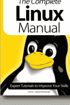

> “这就是 Linux 如此出色的原因：你投入一些东西，这种努力就会成倍增长。这是一个正反馈循环。”
> —— 林纳斯·托瓦兹（Linux 内核的开发者）

Linux 无处不在。它作为网络服务器背后的主要操作系统推动着互联网，它为航天器提供动力，它是世界上最快超级计算机的操作系统，也用于智能电视和移动设备。为什么？因为它超稳定、速度极快且完全免费。

然而，Linux 的意义远不止于免费使用的操作系统。其独特的配置允许用户将操作系统定制和个性化为他们想要的任何形式。Linux 用户可以从一天到下一天改变操作系统的外观和感觉，安装数千个免费的应用程序和程序，并重新掌控自己的计算机。

Linux 代表自由。摆脱其他限制性操作系统的围墙花园做法的自由，选择自己想要在计算机上使用的东西的自由，自由地更改它并按自己的意愿使用它。这是一个志同道合的用户组成的全球社区，都致力于为这个令人难以置信的操作系统获得最佳发展。

有了这本书，你也可以成为 Linux 用户开放社区的一员。这些页面中的教程将帮助你掌握 Linux，展示它是如何工作的，你可以用它做什么，以及如何用它来编码，将你的 Linux 体验提升到更高的高度。

发现 Linux。发现自由。

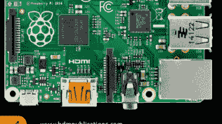


## 向 Linux 问好

> “你怎么知道这么多关于电脑的事？”
> “我不知道，这是第一台。”
> —— 格蕾丝·霍珀上将（先驱程序员）
> 在大卫·莱特曼采访时

为什么选择 Linux？它是什么？我在哪里可以获得它？为什么它有这么多不同的版本？大多数初学者在入门时会问这些以及更多问题。Linux 确实是一个功能强大且用途广泛的操作系统，但你从哪里开始呢？幸运的是，你可以在本节中找到答案。

你可以用 Linux 做很多事情，但你需要知道从哪里开始；我们在这里帮助你。在本节中，你可以了解 Linux 是什么，发行版是什么，桌面环境是什么。你还可以开始探索 Linux 如何工作以及它如何为你服务。

- 8 为什么选择 Linux？
- 10 最佳 Linux 发行版
- 12 你需要的设备
- 14 桌面环境
- 16 选择哪个发行版？

## 为什么选择 Linux？

对于许多用户来说，Linux 意味着自由。摆脱其他操作系统的围墙花园做法的自由，自由地更改和使用操作系统的方式，以及免于任何形式的许可或付费的自由。Linux 远不止你想象的那么简单。

### 免费且开源

Linux 对于想要有所不同的人来说是一个绝佳的选择。系统的效率、应用程序的可用性和稳定性只是几个很好的理由。

首先你需要知道的是，并没有一种叫做 Linux 的操作系统。Linux 实际上是操作系统内核，是操作系统的核心组件。当我们和其他人谈论 Linux 时，我们指的是使用 Linux 内核的众多发行版，或称发行版之一。毫无疑问，你至少听说过当前流行的其中一个发行版：Ubuntu、Linux Mint、Fedora、openSUSE、Debian、Raspbian，等等。这些发行版中的每一个都为用户提供一些不同的东西。虽然每个发行版的核心都是 Linux 内核，但它们为用户提供不同的桌面环境外观、不同的预装应用程序、不同的系统更新方式和安装更多应用的方式，以及整个系统略有不同的外观和感觉。然而，核心是 Linux，这就是我们说 Linux 的原因。

Linux 的工作方式与 Windows 或 macOS 截然不同。首先它是免费的：免费下载，免费安装在任意多台计算机上，免费无限期使用，免费升级和扩展，并可使用同样免费的程序和应用程序进行扩展。这种免费使用的特性是开发人员最大的吸引力之一。虽然 Windows 许可证可能要花费高达 100 英镑，而 Mac 则要贵得多，但用户，无论是开发人员、游戏玩家还是想要利用旧电脑的人，都可以迅速下载一个发行版并在几分钟内开始工作。

除了免费使用之外，还提供了一定程度的自由来定制和塑造系统以满足自己的需求。互联网上提供的每个发行版都有其特定的“风格”

Linux 是一个开始编码的绝佳操作系统。

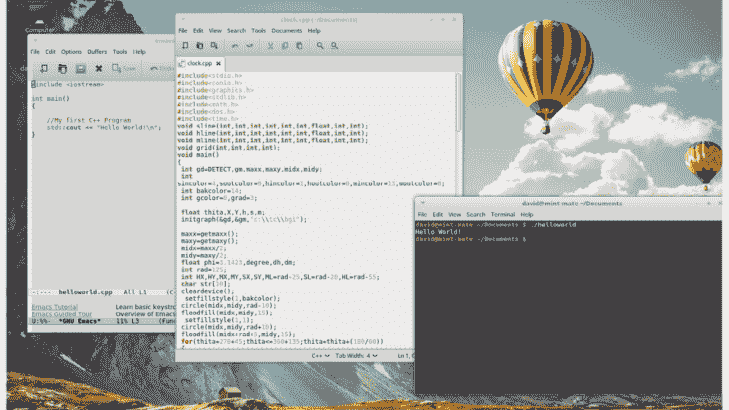
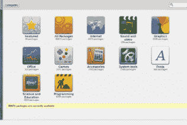


### 对于程序员来说，Linux 下有成千上万个免费软件包可用。

在其中，有些提供更高的安全性、精美的桌面外观、专为游戏设计的版本，或是面向学生的版本。这种可扩展性使得 Linux 成为一个更受欢迎的平台，因为你可以快速将系统塑造成一个开发基础，包括为 Python、网页开发、C++、Java 等提供各种不同的 IDE；或创建一个用于在线匿名的基础，比如作为 Minecraft 服务器、媒体中心等等。

对于想要学习编程的人来说，另一个显著的优势是 Linux 自带了大多数流行的编程环境。Python 和 C++ 在绝大多数可用的 Linux 发行版中都是预装的，这意味着你几乎在安装系统并首次启动后就能开始编程。

总体而言，Linux 占用的系统资源比 Windows 或 macOS 少；这里所说的系统资源是指内存、硬盘空间和 CPU 负载。Linux 代码经过精简，且没有占用系统资源的第三方“臃肿软件”。一个更高效的系统当然意味着为编程和测试环境以及你最终创建的程序提供更多可用资源。资源使用更少也意味着你可以在老旧硬件上使用 Linux，而这些硬件通常难以运行或甚至无法运行 Windows 或 macOS 的最新版本；因此不必丢弃旧电脑，可以用 Linux 发行版重新使用它。

### Linux 编程环境可以简单也可以复杂，完全取决于你的需求。

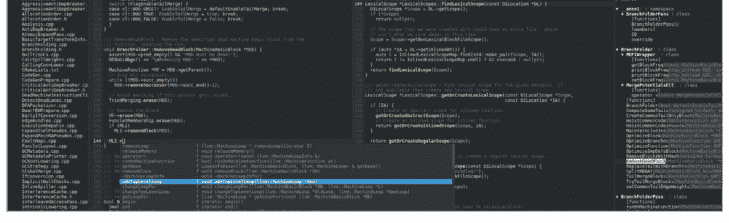

### 每个发行版都为用户提供独特的东西，但所有发行版的核心都是 Linux。

这并不是全部关于 C++、Python 或其他更流行的编程语言。使用 Linux 的命令行，也称为终端，你能够创建 Shell 脚本，这些程序设计用于从命令行运行，由脚本语言组成。它们主要用于自动化任务，或为用户提供某种形式的输入和输出以执行特定操作。

最后，虽然我们还可以列出更多优势，但有成千上万个免费程序和应用可供使用，涵盖了几乎所有计算方面。被称为软件包，目前截至撰写时，仅在 Linux Mint 上就有超过 8,700 个特定的编程应用，而总体上超过 62,000+ 个软件包，涵盖从业余无线电到 WWW 工具等一切内容。

因此，Linux 是一个很棒的编程资源和环境。它非常适合开发者，并且不断改进和演进。如果你认真想进入编程领域，或只是想尝试新事物，不妨试试 Linux，看看它是否适合你。

## 最佳 Linux 发行版


有许多版本的 Linux 可用，被称为发行版。每个发行版都有不同的理念和方法。以下是五个很棒的发行版可供尝试，以及获取它们的途径。

## 安装 Linux

大多数发行版的安装过程相似。你从网站下载磁盘映像并刻录到光盘或制作一个 USB 闪存驱动器安装盘。只需注意选择适合你硬件的正确发行版并仔细阅读说明。

## LINUX MINT

当之无愧最受欢迎的 Linux 发行版是 Linux Mint。Mint 于 2006 年诞生，是当时最受欢迎发行版 Ubuntu 的替代品。虽然基于 Ubuntu 的长期支持版本构建，但 Linux Mint 走了不同的方向，为用户提供了更好的整体体验。

Linux Mint 在每次发布核心操作系统新版本时都提供三个主要桌面版本。这乍听起来可能令人困惑，但其实很简单。目前，Linux Mint 使用 Cinnamon 桌面环境作为其旗舰型号；还有 MATE 和 Xfce 型号可供选择。

Cinnamon 是一个图形丰富的桌面环境，MATE 使用更少的花哨图形，在更广泛的桌面系统上更稳定，而 Xfce 是一个极其精简的桌面环境，专为速度和终极稳定性而构建。

在本书中我们将使用 Cinnamon 版本；不过，你可以随意尝试其他桌面环境。事实上，建议你花一些时间尝试不同的环境，甚至不同的发行版，以找到最适合你和你的电脑的方案。

www.linuxmint.com


## UBUNTU

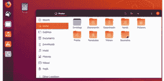

第二受欢迎的发行版是 Ubuntu，它是一个古老的非洲词汇，意为“对他人的仁爱”。Ubuntu 在其十四年生命周期中受欢迎程度有所波动。曾经它是世界上使用最广泛的基于 Linux 的操作系统，但由于在呈现方面的一些错误选择，以及涉及隐私的一些不利且有争议的元素，不幸地使其跌落第一的位置。

话虽如此，Ubuntu 此后已做出弥补，并正缓慢地在 Linux 排行榜上回升。操作系统的最新版本使用 GNOME 3 桌面环境，这是一个令人印象深刻的环境，尽管对前 Windows 用户来说可能有点令人困惑，并且在系统资源方面有点重，尤其如果你计划在老电脑上安装它。

Ubuntu 尽管有缺点，仍是一个很好的 Linux 发行版供你开始尝试。它界面简洁、易于使用和安装，并为用户提供完整的 Linux 体验。

www.ubuntu.com

## ARCH

Arch 是运行时间最长的 Linux 发行版之一，也是许多其他 Linux 版本的基础。为什么要安装 Mint 或 Ubuntu，而不安装 Arch？许多用户确实就是这样做的，但这对初学者来说并不理想。Ubuntu 和 Mint 都提供更简单的安装路径，并附带软件包帮助你入门。

Arch 另一方面则更“精简”。Arch 致力于自由软件，其软件仓库包含超过 50,000 个可安装的应用，包括多种不同的桌面环境，可像使用任何其他发行版一样使用。

Arch 适合你对 Linux 更有经验时使用。你从只有命令行开始，从那里必须手动分区硬盘、设置安装文件位置、创建用户、设置操作系统区域设置，最后安装桌面环境以及你想要的应用。

优势在于，经过所有这些努力后，你得到的是一个由你创建的发行版。这意味着你的 Arch 发行版不会包含其他发行版预装的所有不必要文件和应用；它是为你、由你定制的。

www.archlinux.org


## RASPBERRY PI DESKTOP

毫无疑问你听说过 Raspberry Pi。很难没听说过，因为这款出色的迷你电脑自推出以来六年里席卷了科技界。

Raspberry Pi 有几个方面使其成为计算世界中备受追捧的产品。首先它很便宜，价格约为 25 英镑，本质上是一个完全可用的电脑。它很小，大小不超过信用卡。你可以用它构建电子设备，使用完全可编程的接口；并且它附带 Raspbian，这是一个专为其定制的、基于 Debian 的操作系统，包含办公套件以及多种编程语言和教育资源。

Raspbian 专用于 Pi 硬件，因为 Raspberry Pi 使用 ARM 处理器驱动。然而，Raspberry Pi 基金会随后发布了 Raspbian 的 PC 版本：Raspberry Pi Desktop。

就像 Pi 版本一样，Raspberry Pi Desktop 附带你所需的所有编程、教育和其他应用。它快速、稳定且运行出色。如果你有兴趣拓展你的 Linux 体验，那么这绝对是值得考虑的顶级发行版之一。

www.raspberrypi.org/downloads/raspberry-pi-desktop

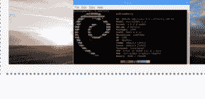

## OPENSUSE

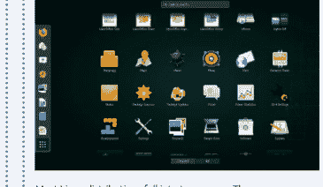

大多数 Linux 发行版可分为两类。一类是像 Ubuntu 和 Mint 这样拥有最新功能和技术的发行版，另一类是像 Debian 这样功能较少但可靠性极强的发行版。

与此同时，openSUSE 试图兼顾两者。open Leap 是坚如磐石的系统。它由社区与 SUSE 员工共同开发，后者开发企业级操作系统 SUSE；该系统为伦敦证券交易所等提供动力。它专为任务关键型环境设计，容不得不稳定。如果你觉得这太稳重，openSUSE Tumbleweed 是一个滚动发布版本，拥有所有最新功能，并偶尔崩溃。

openSUSE 是一个备受尊敬的 Linux 发行版，其许多核心贡献者参与了 Linux 内核、LibreOffice、Gnome 等关键 Linux 领域的工作。简而言之，openSUSE 是专业人士聚集的地方。

www.openSUSE.org

## 你将需要的设备

成功将 Linux Mint 安装到 PC 上的系统要求出奇地低，因此即使是几年前的电脑也能顺畅运行这个发行版。不过，在继续之前，值得先确认你已准备好所需的一切。

## MINTY INGREDIENTS

在开始阅读本书之前，这里列出了安装和运行 Linux Mint 所需的内容。你有多种选择，因此不妨花点时间看看哪种最适合你。

## SYSTEM REQUIREMENTS

Linux Mint 的最低系统要求如下：

- CPU – 700MHz
- RAM/Memory – 512MB
- Hard Drive space – 9GB (20GB recommended)
- Display – 1024 x 768 resolution

显然，系统越好，体验就越好，也越快。


## USB INSTALLATION

你可以通过 USB 或 DVD 将 Linux Mint 安装到电脑上。我们稍后会分别介绍，但如果你已经熟悉该流程，或正在考虑使用 USB 并只是收集所需的硬件，那么你需要至少一个 4GB 的 USB 闪存驱动器来存储 Linux Mint ISO。


## DVD INSTALLATION

Linux Mint 的 DVD 安装只需一张空白 DVD-R 光盘。当然，你还需要一个光驱（DVD 刻录机），才能将 ISO 镜像传输或刻录到光盘上。


## VIRTUAL ENVIRONMENT

安装到虚拟环境是测试和使用 Linux 发行版的常用方法。Linux Mint 在虚拟环境中使用效果极佳，但稍后再详细介绍。有许多不同的虚拟环境应用可用；不过，来自 Oracle 的 VirtualBox 是其中最易于使用的一种。你可以在 www.virtualbox.org 找到最新版本。


## INTERNET CONNECTION

毋庸置疑，互联网连接对于确保 Linux Mint 保持最新更新和补丁，以及安装更多软件至关重要。虽然你不需要互联网连接也能使用 Linux Mint，但你会错过该发行版可用的大量免费软件。


## MAC HARDWARE

虽然 Linux Mint 可以安装到 Mac 上，但有一种观点建议 Mac 用户使用虚拟环境，例如 Virtualbox 或 Parallels；而且为什么不呢，macOS 本身已是一个出色的操作系统。如果你想为旧 Mac 注入新活力，请确保它是 Intel CPU 型号，而不是 Power PC 型号。要注意的是，安装到 Mac 上并没有安装到 PC 上那么无痛。


## Desktop Environments

Linux Mint 有多个不同的版本，或称“风格”：Cinnamon、MATE 和 Xfce；这些还有 32 位和 64 位版本。这到底意味着什么，又该为你的安装选择哪个版本呢？

## WHICH MINT?

桌面环境是你用来与核心 Linux 系统交互的图形界面。就像 Windows 10 的图形桌面也被称为 Fluent Design 一样。

Linux Mint 为用户提供多种发行版版本选择：Cinnamon、MATE 和 Xfce。虽然这对新手来说可能有点令人困惑，但本质上，每个可用版本都包含相同的核心 Linux 结构和内核，内核是操作系统的核心，负责处理软件和硬件之间的所有指令。

那么为什么要使用不同的桌面环境呢？简单来说，这取决于个人喜好。有些用户更喜欢 MATE，因为 MATE 是经典 GNOME 2 环境的一个分支，界面更偏向菜单中心，并在旧电脑上运行良好。其他人更喜欢 Cinnamon，它是一个更现代的环境，在较新的硬件上运行更好，并具有一些前沿的桌面代码。Xfce 另一方面则是一个轻量级桌面环境，由于其对可用系统资源的极低占用，在旧硬件上运行良好。

每个版本本质上只是不同的桌面环境，即你用来与操作系统交互的图形用户界面（GUI）。每个桌面环境使用不同的应用来访问或使用系统，例如文件管理器用于浏览操作系统文件结构，或启动其他应用的方式。同样，核心可用的生产力、视频和图形套件是相同的，并且功能方式也相同。

简而言之，Cinnamon 是 Linux Mint 的旗舰桌面环境。MATE 与更广泛的硬件兼容。举例来说，Windows 只提供一个桌面环境供使用，而 Linux 则提供许多。Linux Mint 因此选择为用户提供丰富的选择。


## A DASH OF CINNAMON

Cinnamon 的优点远不止外观和手感，尽管这些也是重要因素。在这里，我们概述了一些功能，帮助你判断它是否适合你。

## FAB FEATURE 1

它在较现代的系统上表现出色，但比以前稳定得多，也不再像过去那样占用资源。因此，即使你使用的是旧电脑来安装和测试 Linux Mint，也不要被 Cinnamon 吓退。

## FAB FEATURE 2

Cinnamon 具有可配置的热角功能，桌面每个角落都可以点击以执行特定任务，例如显示工作区、显示所有窗口或运行命令。热角是切换不同视图的绝佳方式，有助于使桌面环境更高效。


## BEST MATE

MATE 是一个简单易用且直观的 DE，速度快且稳定。与 Cinnamon 相比，它看起来有点过时，但这只是表面现象。MATE 有很多值得喜欢的地方。

## FAB FEATURE 1

MATE 是旧电脑的绝佳桌面环境。它与 Cinnamon 通常支持的硬件组件相比，能更好地兼容更多硬件，同时也能提供同样出色的桌面外观以及高级自定义功能。

## FAB FEATURE 2

由于其高度可配置的特性，MATE 可以精细地进行自定义。对于要求桌面环境提供更多功能的用户来说，有大量选项可用，包括 Compiz 设置，在其中你可以配置各种桌面特效，甚至 3D 桌面立方体。


## CHOLESTEROL FREE DESKTOP

Xfce 起源于 1996 年的 Common Desktop Environment（CDE）。此后它改过几次名字，现在简单称为 Xfce，外号为“无胆固醇桌面环境”。

## FAB FEATURE 1

Xfce 确实是一个快速的桌面，能发挥 Linux 作为快速操作系统的最佳性能。事实上，它带我们从页面顶部一路来到这里，在新电脑上安装它；写了几百个字，我们就使用了一个全新的操作系统。不错。

## FAB FEATURE 2

快速和轻量并不意味着 Linux Mint Xfce 不是一个完整的桌面操作系统。就像提供的其他环境一样，你可以获得最新的 Firefox、Libreoffice、VLC、Gimp、聊天应用甚至 BitTorrent 客户端。

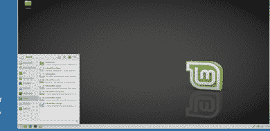

## Which Distro?

到目前为止，我们主要讨论了 Linux Mint，但还有其他 Linux 发行版可供尝试。说实话，有数千个 Linux 发行版可供下载和安装，那么你应该选择哪一个使用呢？

## DISTRO HOPPING

Distro hopping 是社区用来形容那些从不坚持使用单一发行版的人的术语。他们在不同的发行版之间跳来跳去，测试、使用，然后转向另一个或新发布的发行版。

例如，Linux Mint 是一个理想的起点。它易于安装和使用，日常使用的所有软件都已开箱即用，并温和地引导你进入 Linux 的独特世界，了解其工作原理和性能。

Distro hopping 并无不妥，因为它是一种了解外面有哪些东西的好方法，并发现一个发行版相对于另一个发行版的某些元素是否吸引你。当然，问题在于你最终会使用哪一个？

Ubuntu 提供大致相同的体验，但方式略有不同。与 Linux Mint 相比，Ubuntu 预装的软件较少，因此你需要手动自行安装。另一个值得考虑的点是，针对 Ubuntu 用户的海量内容和帮助页面。当你遇到问题时，你永远不会离解决方案太远。

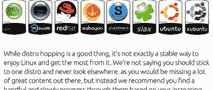

继续前进，随着你对 Linux 越来越自信，你可能会尝试 openSUSE、Fedora 或 Debian 等。这些都是优秀的发行版，每个都为用户提供了系统运行方式的略微不同视角。有些在 Linux 技能要求上更苛刻，但本质上它们各自都有宝贵的经验可供用户学习。

虽然 distro hopping 是好事，但它并不是享受 Linux 并充分利用它的稳定方式。我们并不是说你应该坚持使用一个发行版永不涉足他处，因为那样你会错过大量精彩内容，但我们建议你挑选几个，然后根据你不断增长的 Linux 技能逐步探索。

你可能会发现自己转向某个特定发行版，因为它提供了与常态截然不同的东西。例如，Tails Linux 就是一个专为在线匿名而设计的发行版。它包含复杂的军用级加密工具，以及帮助你在不被检测、追踪或监控的情况下浏览网页的工具和浏览器。Kali Linux 专为安全专业人员设计，包含多种不同类型的道德黑客工具

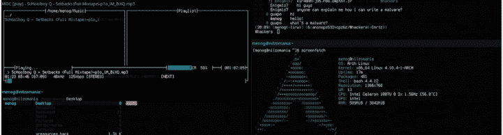


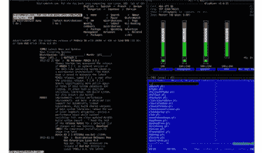

预装了工具，用户可以对其网络进行渗透测试的发行版。曾经甚至还有一个汉娜·蒙塔娜 Linux 发行版，但越少谈论它越好。重点是，有适合你的发行版。

不用说，一旦你将 Linux 掌握到相对较高的程度，大约是高级用户的能力，那么你就会想要扩展你的技能，并开始基于 Arch、Debian 或其他众多可用的发行版之一构建自己的 Linux 发行版。做到这一点需要大量的命令行知识，以及对 Linux 系统如何工作以及与计算机硬件交互的了解。你需要自行分区硬盘，安装桌面环境，最终安装你想要的应用程序和程序。做到这一点需要时间，而且你需要学习很多技能。

最终你可以认为自己是技术型 Linux 用户，但永远不要认为自己是专家，毕竟我们总是在学习新东西。你可以从头开始构建自己的发行版，帮助其他 Linux 用户解决问题，甚至可能在发行版的测试阶段或构建过程中为其改进做出贡献。那下一步呢？

奇怪的是，大多数高端技术用户发现自己又回到了原点，使用像 Linux Mint 这样的发行版。主要原因通常是因为它是一个简单易用的选择，而且环境稳定。只因为你对系统了如指掌，并不意味着你总是想修复潜在问题。我们大多数人更喜欢轻松的生活，尤其是在技术方面，所以合乎逻辑的选择是选择一个简单但仍然足够强大以完成你想要的所有任务的发行版，因此是 Linux Mint。

然而，最终，这完全取决于选择，你自己的个人选择。你可能会发现，在阅读完本标题中的教程后，你不喜欢 Linux Mint 或 Cinnamon 桌面。没关系，你可能更喜欢 Ubuntu、Debian 或 openSUSE：这就是 Linux 的美妙之处。自由地改变你想要的东西，在一个发行版和另一个发行版之间进行发行版跳跃，而不会因成本或缺乏访问权限而受到惩罚。

问题的答案，哪个发行版是：任何你喜欢的！它可以像你需要的那样复杂或简单，只要它能做你想做的事情，那么它就是完美的。


## Getting Started


with Linux

> "In real open source, you have the right to control your own destiny."

> – Linus Torvalds (developer of the Linux kernel)

说 Linux 很好当然没错，但你如何把它安装到你的电脑上？安装 Linux 非常简单，但你有几个选择。本节介绍如何下载 Linux ISO，将其安装到 PC 上作为主要操作系统，甚至如何安装虚拟环境。

使用虚拟环境，你可以在仍使用主要操作系统（无论是 Windows 还是 macOS）的同时运行 Linux。感兴趣吗？继续阅读，了解更多。

- 20 Creating a Linux Installer on Windows
- 22 Installing Linux on a PC
- 24 Installing a Virtual Environment
- 26 Installing Linux in a Virtual Environment

## Creating a Linux Installer on Windows

你需要在能够将其安装到计算机上之前，将下载的 Linux ISO 传输到 DVD 或 USB 密钥。这将是一个实时环境，允许你在安装前测试操作系统，但首先你需要创建可启动介质。

### DVD BOOTABLE MEDIA

我们在这里使用 Windows 10 PC 将 ISO 传输到 DVD。如果你使用的是 Windows 7 及更高版本的 Windows，过程非常简单。

**STEP 1** 首先找到你已下载的 Linux ISO 映像。你通常可以在 Windows 7、8.1 和 10 计算机的下载文件夹中找到它，除非你在保存时指定了其他位置。

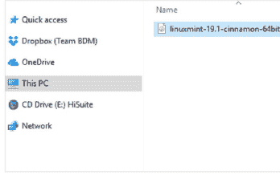

**STEP 2** 接下来将可刻录 DVD 光盘插入计算机的光驱。几秒钟后，在读取光盘时，Windows 会显示弹出消息询问你对新插入的光盘做什么。忽略它，因为我们将使用内置的映像刻录功能。

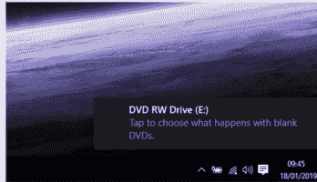

**STEP 3** 右键单击 Linux ISO 并从菜单中选择 Burn Disc Image。根据 PC 的速度，可能需要几秒钟才会发生任何事情。不要太担心，除非它花费超过一分钟，在这种情况下可能值得重新启动 PC 并重试。祝你好运，Windows Disc Image Burner 应该会启动。

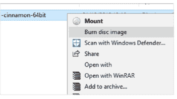

**STEP 4** 打开 Windows Disc Image Burner 对话框后，单击“Verify disc after burning”复选框，然后单击 Burn 按钮。过程应需要几分钟，具体取决于 PC 光驱的速度。完成后它会进行验证阶段，完成后光驱应自动弹出光盘供你使用。

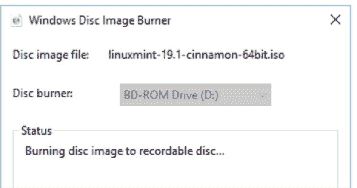

### USB BOOTABLE MEDIA

USB 介质比 DVD 更快，通常更方便，因为大多数现代 PC 都没有安装光驱。传输映像的过程很容易，但你首先需要第三方应用程序和 4GB 或更大的 USB 闪存驱动器。

**STEP 1**
首先打开网络浏览器并访问 `www.rufus.akeo.ie/`。向下滚动页面一点，你会看到一个下载标题，其下是 Rufus 的最新版本。左键单击链接开始下载。

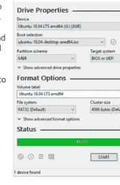

**STEP 4**
准备就绪后，单击 Rufus 应用底部的 Start 按钮。这可能会打开另一个对话框，询问你是否下载并使用新版本的 SysLinux。SysLinux 是一组引导加载程序，用于允许现代 PC 访问并从 USB 闪存驱动器启动。这是必要的，因此如果被询问，请单击“是”继续。

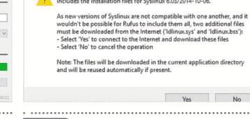

**STEP 2**
双击下载的 Rufus 可执行文件并单击“是”以回答 Windows 安全问题，然后单击“是”以检查更新。启动 Rufus 后，它应该已经识别出你插入的 USB 闪存驱动器；如果没有，只需移除并重新插入即可。

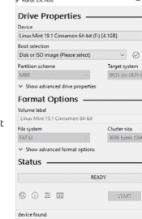

**STEP 5**
下一步询问你希望 Linux ISO 以何种映像模式写入 USB 闪存驱动器。两种方法都适用于不同的情况，但通常，推荐的 ISO 映像模式更受欢迎。确保此模式已预先选中，然后单击 OK 继续，然后再次单击 OK 确认操作。

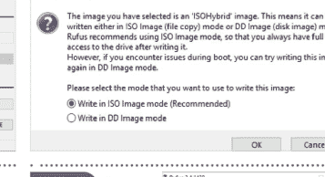

**STEP 3**
乍一看 Rufus 界面可能看起来有点令人困惑，但不用担心，它其实非常简单。首先，单击“Disk or ISO Image (Please select)”下拉菜单旁边的 SELECT 按钮。这会启动 Windows 资源管理器窗口，你可以在其中找到并选择 Linux ISO。

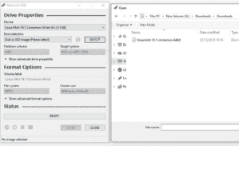

**STEP 6**
Linux ISO 现在已传输到 USB 闪存驱动器。过程不应花费太长时间，再次取决于 USB 设备和 PC 的速度。你可能会发现 Rufus 在过程中自动在 Windows 资源管理器中打开 USB 驱动器；不用担心，如果你愿意，可以最小化或关闭它。过程完成后，单击 Close 按钮。

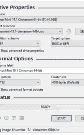

## Installing Linux on a PC

大多数 Linux 发行版都作为实时环境提供。这意味着你可以直接从你刚刚创建的 DVD 或 USB 启动一个实际的、完全工作的发行版。让我们看看这是如何工作的，以及你如何从那里安装 Linux。

### UEFI BIOS

统一可扩展固件接口（UEFI）用于识别硬件并在 PC 启动过程中保护 PC。它取代了传统的 BIOS，但在安装 Linux 时可能会导致问题。

**STEP 1** 将你的 DVD 或 USB 闪存驱动器插入 PC，如果尚未关闭，请关闭 Windows。在此实例中，我们使用的是 USB 启动介质，但过程几乎相同。启动 PC，并在提示时按适当的键进入 BIOS 或 SETUP，例如：`F2`、`Del` 甚至 `F12`。

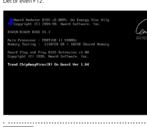

**STEP 3** 将 UEFI 切换为 Legacy 模式后，现在有两种启动到实时环境的方法。第一种是通过你已在其中的 BIOS。找到启动顺序并将第一个启动设备从其原始设置，通常是内部硬盘或类似设置，改为：`USB Storage Device` 用于 USB 介质选项，或 `DVD Drive` 用于 DVD 介质选项。

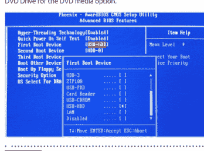

**STEP 2** UEFI BIOS 有不同版本，因此涵盖所有版本是不可能的。你要找的是详细说明启动顺序或启动模式的部分。在这里，你可以选择关闭 UEFI 并选择 Legacy 或禁用安全启动。大多数发行版都可以使用 UEFI，但启用其启动可能是一个棘手的过程。

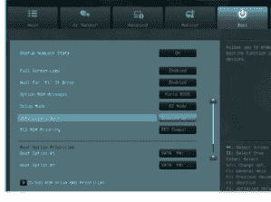

**STEP 4** 或者使用启动选项菜单。使用此选项，你可以按 `F12`（或类似键）显示启动介质选项列表；从那里，你可以选择适当的启动介质。无论哪种方式，你现在都可以通过导航到“保存和退出”选项并选择“保存更改并退出”来保存并退出 BIOS。

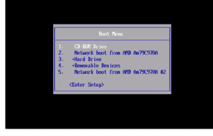

## 安装 Linux

一旦 Live 环境启动完成，你会看到将发行版安装到计算机的选项。先随意浏览一下，准备好后在桌面上查找安装选项。

### 第 1 步

如果已连接到互联网（如果没有，现在请连接），并且处于 Live 环境中，请双击桌面上的 Install Linux Mint 图标开始安装过程。其他发行版会显示其自己的名称，当然，但过程是相同的。准备好后点击 Continue。

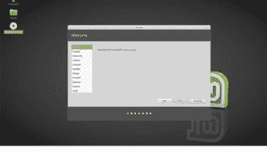

### 第 2 步

虽然安装过程在大多数 Linux 发行版中非常相似，但有些发行版在安装期间会提出不同的问题。通常这些问题并不太困难，没有什么很技术性的内容，但有些例如“安装第三方软件...”可能会让人困惑。在这种情况下你可以点击 Continue，但如果不确定，请确保手边有一台联网设备以便提问。


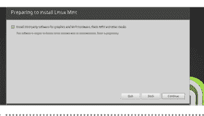

### 第 3 步
安装新操作系统时，建议擦除旧操作系统并用新系统替换。当安装过程进行到此阶段时，请确保已选择`Erase disk and install Linux...`选项。注意：这会完全从你的计算机中擦除 Windows 10，因此请确保已备份所有个人文件和数据。

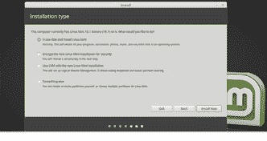

### 第 4 步
在安装过程开始之前，会询问你有关硬盘擦除选择的决定是否正确。这是你最后一次退出安装的机会。如果你确定不介意擦除所有内容并重新开始使用 Linux Mint，请点击 `Continue`。如果需要备份文件，请取出 Linux 光盘/USB，重新启动，备份后再重新开始。

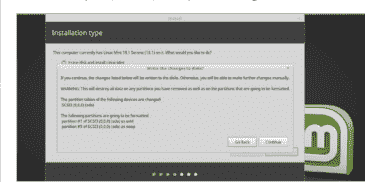

### 第 5 步
最终会要求你设置 Linux 用户名和密码。首先输入你的姓名，然后输入计算机名称，即在网络上识别它的名称。接下来选择一个用户名，然后设置一个良好的密码。你可以勾选 `Login Automatically` 选项，但暂时保留 `Encrypt Home Folder` 选项。

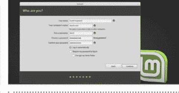

### 第 6 步
安装过程可能很快，并且可能还有更多问题需要回答，或者它可能根据你之前的回答直接开始安装 Linux。无论如何，最后会要求你 `Continue Testing the Live Environment` 或 `Restarting to use the newly installed OS`。如果准备好使用 Linux，请点击 `Restart Now`。

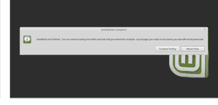

## 安装虚拟环境
虚拟环境是一个模拟的计算机系统。使用虚拟机，你可以模拟一台标准 PC 并在其上安装整个操作系统，而不会影响计算机上已安装的操作系统。这是一个在仍以 Windows 10 为主要操作系统的同时测试和使用 Linux 的好方法。

## 虚拟化
使用虚拟机（VM）会占用计算机的资源：内存、硬盘空间、处理器使用等。在开始之前请确保每项资源都足够。

### 第 1 步
我们在此使用 VirtualBox，因为它是上手最简单的虚拟环境之一。

进入 `www.virtualbox.org` 并点击`Download VirtualBox`。这会带你到主下载页面。找到适合你系统的正确主机：Windows 或 Mac，主机即当前已安装的操作系统，然后点击链接开始下载。


### 第 3 步
下载了正确的软件包后，在安装任何内容之前，你需要确保正在使用的计算机能够承载 VM。为此，请重新启动计算机并进入 BIOS。计算机启动时，按 `Del`、`F2` 或其他必要的键以 `Enter Setup`。


### 第 2 步
接下来，仍在 VirtualBox 下载页面上，找到 VirtualBox Extension Pack 链接。扩展包支持 USB 设备以及众多其他附加功能，可帮助使 VM 环境更准确地模拟“真实”计算机。

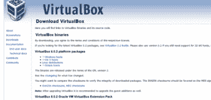

### 第 4 步
每个 BIOS 的布局都不同，很难评估在每个个人示例中应查找的位置。然而作为一般经验法则，你正在寻找 Intel Virtualisation Technology，或简单地 Virtualisation，通常位于 BIOS 的 Advanced 部分。当你找到它时，启用它，保存设置，退出 BIOS 并重新启动计算机。

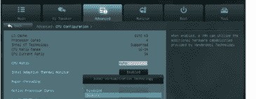

### 第 5 步
计算机重新启动后，找到已下载的主 VirtualBox 应用程序并双击以开始安装过程。准备好后点击 `Next` 继续。

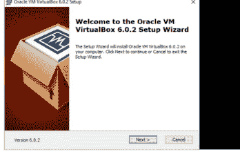

### 第 6 步
VirtualBox 的默认安装位置应能满足大多数用户需求，但如果你有特殊位置要求，请点击`Browse`按钮并更改安装文件夹。然后，确保 VirtualBox 功能树中的所有图标都被选中，即它们旁边没有红色 X。点击 `Next` 继续。

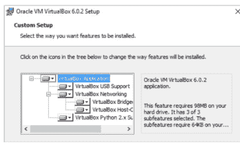

### 第 7 步
如果愿意，本节可以保留默认设置。它只是让处理 VM 时变得更轻松一些，尤其是在处理未来可能遇到的已下载 VM 时。再次点击 `Next` 即可进入下一阶段。

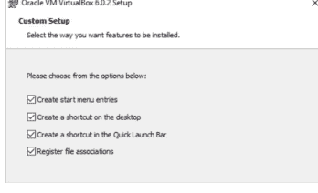

### 第 8 步
安装 VirtualBox 时，你的网络连接会短暂中断一段时间。这是因为 VirtualBox 正在创建一个链接的虚拟网络连接，以便任何已安装的 VM 都能通过计算机已建立的网络连接访问互联网和家庭网络资源。点击 `Yes`，然后点击 `Install` 开始安装。

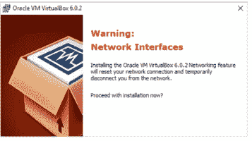

### 第 9 步
Windows 很可能会要求你接受安全通知。对此点击 `Yes`，你可能会遇到一个对话框要求你信任来自 Oracle 的安装；再次点击 `yes` 并接受 VirtualBox 应用程序的安装。完成后，点击 `finish` 启动 VirtualBox。

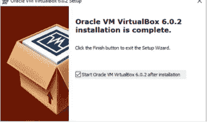

### 第 10 步
VirtualBox 运行后，你现在可以安装 VirtualBox Extension Pack。找到已下载的插件并双击。VirtualBox 分析插件时可能会有短暂暂停，但最终会收到安装提示；显然点击 `Install` 开始该过程，滚动下一屏幕以接受协议并点击 `I Agree`。

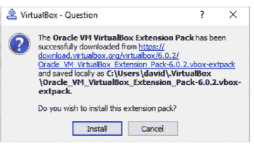

## 在虚拟环境中安装 Linux
Oracle 的 VirtualBox 现在已运行，接下来任务是创建将安装 Linux 的虚拟机（VM）环境。此过程不会影响你当前已安装的操作系统，这就是 VM 是一个绝佳选择的原因。

## 创建 VM
创建 VM 时有许多选项可供选择。现在，让我们设置一个足以运行 Mint Cinnamon 并良好运行的 VM。

### 第 1 步
打开 VirtualBox 后，点击应用右上角的 `New` 图标。这将打开新 VM 向导。

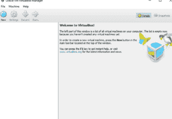

### 第 3 步
下一部分定义 VM 分配的系统内存或 RAM 的数量。请记住该数量是从计算机上已安装的可用内存中扣除的，因此不要给 VM 分配太多。例如，我们安装了 8GB 内存，并给 VM 分配了 2GB。准备好后，点击 `Next` 继续。

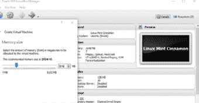

### 第 2 步
在 `Name` 旁边的框中，输入 Linux Mint，VirtualBox 应该会自动选择 Linux 作为 `Type` 和 `Ubuntu (64-bit)` 作为 `Version`；如果没有，请使用下拉框选择正确的设置（请记住 Mint 主流版本基于 Ubuntu）。准备好继续时点击 `Next`。

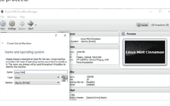

### 第 4 步
本节是你开始创建 VM 用于安装 Mint 的虚拟硬盘的位置。默认选项`Create a virtual hard disk now`是我们使用的选项。点击 `Create` 继续。

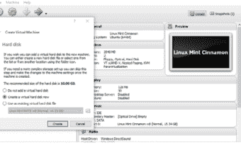

## 安装 Linux 在虚拟环境中

### 步骤 5
点击`创建`后弹出的窗口询问您想要创建何种类型的虚拟硬盘。我们在此使用默认的 `VDI`（VirtualBox 磁盘映像）格式，因为其他格式通常用于在不同虚拟机软件之间迁移虚拟机。请确保选择 `VDI` 并点击`下一步`。

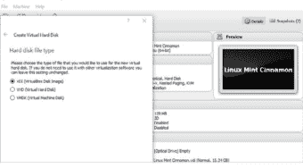

### 步骤 8


点击“创建”后，虚拟机的初始设置即完成；您现在应能在 VirtualBox 应用程序中看到新建的虚拟机。在此之前，请点击“设置”按钮，在“常规”部分点击“高级”选项卡。使用下拉菜单，分别为“共享剪贴板”和“拖放”选择“双向”。

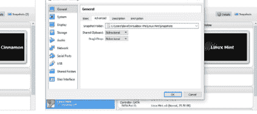

## 步骤 6

是否选择“动态”或“固定”大小的虚拟硬盘可能对新手来说有些令人困惑。动态分配的虚拟硬盘是一种更灵活的存储管理方式，初始时不会占用您的物理硬盘太多空间。请确保选择“动态分配”，然后点击“下一步”。

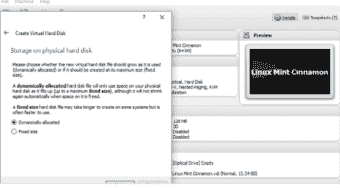

## 步骤 9

接着点击“系统”部分，然后选择“处理器”标签页。根据您的 CPU，尽可能多开启 CPU 核心数，但不要影响宿主系统性能；我们选择了两个 CPU。现在点击“显示”部分，将“视频内存”滑动至最大值，并勾选“启用 3D 加速”。点击“确定”保存新设置。

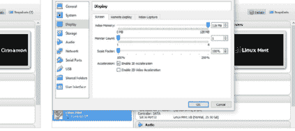

## 步骤 7

虚拟硬盘是一个单一文件夹，大小上限由本节所指定。请确保虚拟硬盘所在的位置在您的计算机上有足余的可用空间。例如，我们在 D: 驱动器上使用了更大的存储空间，命名为“Linux Mint”，并为虚拟硬盘分配了 25.50GB 的空间。

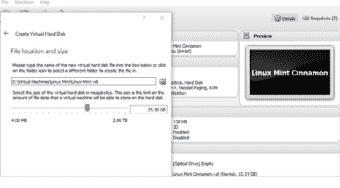

## 步骤 10

点击“开始”按钮，在“选择启动磁盘”窗口中使用文件夹图标（绿色箭头）定位已下载的 Mint ISO 文件，然后点击“开始”启动虚拟机进入 Linux Mint Live 环境。您现在可以按照标准 PC 安装要求安装 Linux。

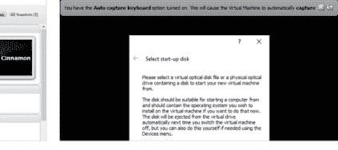

## 了解 Linux

> “任何人都能构建一个高速处理器。真正的技巧在于构建一个高速系统。”  
> — Seymour Cray（电气工程师，Cray Supercomputers 设计师/创始人）

我们以 Linux Mint 为参考，因为它易用，适合前 Windows 用户，也是最成熟、文档最丰富且拥有出色配置选项的发行版之一。

本节介绍 Linux Mint Cinnamon 菜单和桌面环境的工作方式以及自定义方法。想要创建另一个用户或了解如何在线保持匿名？请继续阅读。

- 30 介绍 Cinnamon 菜单  
- 32 浏览 Cinnamon 桌面  
- 34 安装 Linux Mint 后十件事  
- 36 小知识：阿波罗 11  
- 38 创建用户  
- 40 自定义桌面  
- 42 在线保持匿名  


## 介绍 Cinnamon 菜单

现在 Linux 已安装，是时候好好探索一下。不过，如果您使用的是 VirtualBox，可能会收到关于“软件渲染”的通知；下面说明如何解决。

### CINNAMON VIRTUALBOX FIX

您已经了解了一些列表函数，如插入、删除和弹出，但字符串也可以应用相应的函数。

## STEP 1

我们假设您在 VirtualBox 中遇到此问题。顶部右侧会出现“软件渲染”消息。解决方法是：在 VirtualBox 窗口中点击“设备”，随后选择“插入 Guest Additions 磁盘镜像”。

## STEP 3

几秒钟后，您会自动进入命令行界面（Linux 中称为终端）。该界面会显示新 VirtualBox 驱动的安装过程，移除已检测到的旧驱动，并安装最新版本。安装过程不会很长，完成后会提示您按回车键退出终端。


## STEP 2

Guest Additions 磁盘包含 VirtualBox 的驱动，包括虚拟视频硬件。加载后，会弹出“需要运行的软件”通知框，提供“取消”和“运行”两个选项。点击“运行”，并输入您的 Linux 用户密码。


## STEP 4

Guest Additions 磁盘图标位于桌面，右键单击它并向下滚动菜单，选择“弹出”。随后，您可以通过点击菜单（左下角条状区域的最下方图标），选择“重新启动”来重启 Linux Mint，问题即告解决。


### CINNAMON ON THE MENU

软件渲染问题已解决，现在我们来看看 Mint 菜单的工作方式以及它的功能。请注意，这仅适用于 Mint Cinnamon，其他发行版的外观和行为会有所不同。

## STEP 1

登录后，您可能会看到欢迎屏幕。请花点时间浏览选项，阅读“初步步骤”等内容。浏览完毕后，点击窗口右上角的“X”关闭它。


## STEP 4

再次打开菜单，将鼠标悬停在“图形”项上，然后点击“GNU 图像处理程序”。GIMP 是功能强大的图像处理软件，效果可与 Adobe Photoshop 媲美，但要获得满意结果需要更多操作。值得一提的是，它值得您投入时间去掌握。


## STEP 2

使用菜单时，点击菜单按钮并悬停在中间列的“办公”项上，右侧列的图标将会变化，显示该类别下已安装的应用程序。


## STEP 5

如果您想查找特定功能或应用（例如设置打印机），请在菜单顶部的搜索框中输入关键词，如“打印机”，即可看到相关选项。此搜索功能在大多数现代 Linux 菜单中均适用，无论发行版如何。


## STEP 6

从菜单中启动应用非常简单：找到目标应用并点击即可。例如，在“办公”类别下点击“LibreOffice Writer”。Writer 是 Linux Mint 预装的文字处理程序，文件格式兼容 Microsoft Word，功能与其几乎相同。


## STEP 7

在右侧列的应用上右键单击，会出现选项列表：添加到面板、添加到桌面、添加到收藏夹、卸载。大多数选项显而易见。选择“添加到收藏夹”可将应用放入左侧的快速访问栏中。


## 浏览 Cinnamon 桌面

每个桌面环境的行为各不相同。有些提供可自定义的桌面小部件，有些则追求简洁、高效的外观。下面我们来看看 Cinnamon 桌面提供了哪些功能。

### A TOUCH OF SPICE

Cinnamon 桌面环境是风格与性能的完美融合，深受用户喜爱，因而成为最受欢迎的桌面环境之一。

## STEP 1

通过双击“计算机”图标开始探索 Cinnamon 桌面。这将打开 Nemo，Cinnamon 使用的文件管理器。双击“计算机”图标会显示根文件系统，并提供对光驱（如有安装）、硬盘以及核心 Linux 文件系统的访问和视图。


## STEP 2

对前来自 Windows 的用户而言，Linux 文件系统可能显得有些复杂，因此在尚未完全了解其工作原理前，我们建议您关注桌面上的“主页”图标。这里存放了与您的用户账户相关的所有内容：图片、视频、音乐、文档、下载项等。


## STEP 3

Nemo 提供多种查看和管理文件夹的方式。例如，如果您在“图片”文件夹中有图片，可以使用 Nemo 右下角的滑块（标记为“调整缩放级别”）来调节图片的缩放级别。


## STEP 4

正如任何优秀的文件管理器，右键单击文件或文件夹即可获得大量操作选项。在 Cinnamon 中，默认选项允许您根据文件类型播放或查看文件，以及复制、剪切、删除、压缩、重命名、通过电子邮件发送、查看属性等。


## STEP 5


桌面底部是面板。我们已经看过面板的一个部分，即菜单。如果你右键单击面板上的任意位置（面板应用除外），会看到一个菜单，允许你以不同的方式编辑、添加和设置面板。


## STEP 8

从该桌面右键单击上下文菜单，选择自定义，然后在新打开窗口底部选择桌面设置链接。这会打开一个新窗口，你可以在其中编辑当前存在的桌面图标。如果使用连接了多台显示器的设置，你还可以选择哪个显示器显示哪些图标。


## STEP 6

例如，如果你点击修改面板选项，你可以移除、移动、移除面板、添加新面板并清除当前存在的任何小程序。顺便说一下，小程序是一个设计用于在 Cinnamon 面板中工作并适配其中的应用。


## STEP 9

点击菜单并输入系统设置并打开 resulting 图标。这会带你进入系统设置选项。从这里你可以控制和编辑 Linux Mint Cinnamon 的外观和工作方式，以及添加新用户、管理防火墙和启用辅助功能选项。


## STEP 7

如果你右键单击 Cinnamon 桌面上的任意位置，会看到一组选项，允许你进一步添加、编辑或以不同方式查看桌面内容。这与 Windows 非常相似，这也是 Mint 成为前 Windows 用户不错选择的原因。


## STEP 10

简而言之，Linux Mint Cinnamon 可以配置成看起来相当非凡。有很多例子展示了它能达到多好以及可以实现什么。你可以让它变得复杂或简单，添加不同的组件和动画，或只是保持简洁易读。


## 10 Things to do After Installing Linux Mint

安装 Linux Mint 后要做的 10 件事

Linux Mint 在开箱即用时已经相当完善，但与大多数 Linux 发行版一样，可以应用一些调整来改善其工作方式。虽然这些是 Mint 专属的调整，但大多数也可以应用于其他发行版。

## LINUX TWEAKS

其中一些安装后操作是强烈推荐的，而其他只是方便的附加项，仅仅调整系统或添加自定义。

## STEP 1

第一个，也是最重要的，安装后操作是更新系统。点击面板上的盾牌图标，位于桌面底部右侧，时间日期旁边。这会启动更新管理器。


## STEP 3

点击确定按钮，你可以看到一些准备安装的更新。在更新之前，先点击蓝条上的确定按钮切换到本地镜像。这会打开软件源选项。在镜像部分，点击主和基础下拉菜单并选择离你当前位置最近的服务器。


## STEP 2

Linux Mint 为用户提供三种级别的更新策略：不要破坏我的电脑、优化稳定性和安全性以及始终更新所有内容。推荐的选项是优化稳定性和安全性，它只更新安全、必要的补丁，不会影响核心操作系统的关键元素。阅读描述，但选择中间的、推荐的选项。


## STEP 4

点击更新缓存按钮并关闭软件源窗口。回到更新管理器，点击安装更新图标并输入你的密码。更新会自动应用并重新启动更新管理器，这次会有更多更新。再次点击安装更新，确认任何消息并等待完成。


## STEP 5

更新按级别分级，1 为低级别更新，5 为危险的。我们建议坚持使用 3 级更新；对于覆盖配置文件相关的任何消息，点击替换。关于软件渲染问题以及非 VirtualBox 用户缺乏驱动程序，点击菜单并在搜索框中输入“driver”。


## STEP 8

当要求接受更改时，输入 Y，并在要求配置 `libdvd` 时也输入。确保已突出显示确定并按 Enter，然后对任何进一步问题回答是。接下来，仍在终端中，输入：`cat /proc/sys/vm/swappiness`；结果应为 60。如果你的电脑内存小于 4GB，则输入：`gksudo xed /etc/sysctl.conf`。


## STEP 6

点击搜索结果中出现的驱动管理器应用并输入你的密码。Mint 会花一点时间分析可用内容，并根据检测到的硬件为你提供潜在驱动程序的选择。图形问题（如软件渲染）的用户应选择使用最新的、推荐的图形驱动程序。


## STEP 9

此调整有助于加速内存小于 4GB 的系统。滚动到你刚刚打开的文件底部并添加以下新行：

```
## Decrease swap usage to a more reasonable level
vm.swappiness=10
```

点击文件 > 保存，然后文件 > 退出。重新启动 Linux Mint，你应该会注意到性能略有提升。


## STEP 7

此时你可能需要重新启动 Linux Mint，所以现在就做。重新启动后再次点击菜单按钮，然后点击终端。终端图标位于左侧列中，文件图标上方。终端打开后，输入：`sudo apt-get install libdvd-pkg`，按 Enter 并输入你的密码。这将启用加密 DVD 播放。


## STEP 10

在这个现代数字时代，安全始终是关注点。虽然 Linux Mint 是一个安全的系统，但建议始终尝试改进它。点击菜单按钮并搜索防火墙；点击防火墙配置图标并输入你的密码。在防火墙窗口中，点击状态滑块至开启。


## Apollo 11

你知道吗... 1969 年 7 月 20 日被铭记为人类历史的转折点，人类首次踏上月球。帮助机组人员完成这次关键旅程的软件当时甚至还不存在，必须从零开始开发。使用一种名为绳状存储器 的新型程序存储方法，麻省理工学院仪器实验室的工程师们用一种特殊的汇编版本填充了内存。

令人难以置信的是，该代码可以自由查看在 GitHub 上。由研究人员于 2003 年上传，你可以通过访问 `www.github.com/chrisgarry/Apollo-11/` 查看代码。留意代码片段，例如 `Burn_Baby_Burn`，特别是第 925 行，注释为“Goodbye. Come again soon.”

浏览一下，看看还能找到什么。


```
Code listing excerpt from Apollo 11 guidance software
```

> 程序员并非没有幽默感。看看里面还有什么。

一次人类伟大的飞跃，也是一次编程的飞跃。

Credit: Apollo 11/NASA

## Creating Users

创建用户

你第一次安装 Linux Mint 时，它是为单用户使用而配置的。虽然与全家人共享一个用户账户是可以的，但可能有一天你需要创建具有各自唯一主文件夹的独立用户。

## NEW USERS

拥有不同用户意味着每个用户都可以访问系统上的自己的区域。文档、图片、视频等都是分开的，就像其他操作系统中的多用户一样。

## STEP 1

点击 Linux Mint 菜单并输入“users”开始搜索相关控制台。从搜索结果中选择用户和组并输入你的密码。用户和组控制台看起来很基础，但使用起来很简单。起初，你只能看到安装 Linux Mint 时自己的用户名。


## STEP 3

输入新用户的全名，然后输入他们在登录 Linux Mint 时需要的用户名。确保用户名全部为小写，仅包含 a-z 和 0-9 字符。你也可以使用句点、下划线或连字符。当准备继续时点击添加按钮。


# 创建用户

## STEP 2

要添加新用户，点击控制台底部的添加按钮。你可以创建两种类型的用户，标准用户和管理员。除非新用户需要安装新应用或访问其主文件夹之外的文件系统部分，否则选择标准账户类型。否则，使用管理员账户类型。


## STEP 4

新用户会按字母顺序出现在当前 Linux Mint 用户列表中。目前尚未设置密码，因此点击当前用户列表中的用户，然后点击用户名字符串下方的未设置密码选项。


## STEP 5

你现在可以为新用户输入密码，或点击“新密码”文本框末端的卷曲箭头为你生成密码并显示出来。自然地，尽可能设置一个强密码是个好主意。完成后，点击“更改”按钮。


## STEP 6

现在可以关闭“用户和组”控制台窗口了，因为新用户已经创建。如果点击 Mint 登录菜单，然后选择注销，你会看到 Mint 登录管理器。新用户现在已出现在当前可用用户列表中。点击他/她以登录。


## STEP 7

登录后，新用户需要自行设置桌面壁纸、图标、面板、菜单等。取决于你为其设置的账户类型，标准用户或管理员，他们将无法安装任何新应用。此截图来自标准用户账户类型。


## STEP 8

你可以根据需要创建任意多个新账户，并在需要时在它们之间切换。最好只保留一个能够安装新软件的账户，这样你就能跟踪系统上的内容。


# COMMAND LINE ACCOUNTS

正如你所期望的，你也可以在命令行中创建新用户。在主（你的）管理员账户下打开一个终端会话。

## STEP 1

从命令行添加新用户的过程相对简单。首先，输入：`sudo adduser <username>` 其中 `<username>` 是新用户的登录名。然后系统会要求你为用户创建新密码，以及全名和其他详细信息。点击 `y` 以确认详细信息并创建用户账户。


## STEP 2

你可以在“用户和组”控制台中查看新用户的详细信息和账户类型。如果你想从 Mint 中删除用户，可以在终端中输入：`sudo deluser <username>` 或在“用户和组”中点击“删除”按钮。


# Customising the Desktop

自定义操作系统桌面是一种让它成为你自己的方式：一个个性化的工作空间，可以帮助你工作、激励你或展示公司标志。不论你自定义桌面的原因是什么，以下是操作方法。

### YOUR DESKTOP

Linux 可能是最可自定义的操作系统之一。只需进行一些小调整，安装一两个额外组件并发挥想象力，你就能创造出令人惊叹的效果。

## STEP 1

桌面自定义的第一方面是更改壁纸。右键单击桌面并选择“更改桌面背景”。这将在 Linux Mint 中打开“背景”应用；请记住，其他发行版可能以不同的方式呈现其背景、壁纸选择工具。


## STEP 3

你只需点击任意位置提供的可用图片，即可将其设为桌面壁纸。顺便说一下，如果你的系统或网络上其他位置存储了图片，你可以通过点击“背景”控制台底部的加号符号，使用文件管理器找到它们来添加它们。


## STEP 2

较新的 Linux Mint 版本会根据用户运行的版本显示可用的背景。通常你会得到三个类别，然后是第四个“图片”，它与其他类别分开。因为“图片”选项不同，它会从你主目录中的“图片”文件夹读取图像内容。


## STEP 4

点击“设置”选项卡，你可以改为播放多张图片作为幻灯片，或将壁纸的纵横比更改为多种选择。


## STEP 5

如果没有一个可用的壁纸吸引你，打开浏览器并搜索你喜欢的背景图片类型。当你找到想要作为桌面壁纸的图片时，右键单击它并从选项列表中选择“设为桌面背景”。当“设置桌面背景”控制台打开时，点击“设置桌面背景”按钮。


## STEP 8

“主题”允许你更改 Mint 桌面某些方面的外观：窗口边框、图标、控件、鼠标指针和桌面。在“设置”选项卡中，你还可以用几个开关滑块按钮扩展选项。


## STEP 6

点击“菜单”按钮并搜索“desktop”，然后点击“桌面设置”结果。桌面控制台允许你选择布局、桌面图标以及多显示器支持的选项。你可以根据个人喜好尝试选项以获得最佳设置。


## STEP 9

如果你点击三个可用选项中央的“添加/删除”按钮，你可以从多个预装主题中选择默认视图。点击你想要的主题，然后点击“安装”（向下指向的箭头）按钮以启用它。


## STEP 7

除了更改桌面壁纸和图标显示方式外，你还可以更改 Linux Mint 的整体主题。从 Mint 菜单中搜索“themes”并点击搜索结果中出现的“主题”应用。


## STEP 10

点击返回“主题”，然后点击“桌面”，你就可以找到新安装的主题并将其应用到桌面。已安装的主题也可以通过“添加/删除”按钮卸载。花一些时间按你想要的方式个性化桌面是值得的，而且也有一些令人难以置信的主题可用。


# Becoming Anonymous Online

数字时代带来了许多通信方面的伟大进步；然而，它也带来了新的监视和窥探时代。我们大多数人都对政府、秘密组织和地下黑客侵犯隐私的频繁新闻报道并不陌生，但你如何应对这一点？

### ANONYMITY WITH MINT

虽然在网上完全匿名几乎是不可能的，但你可以采取措施确保我们的隐私处于最佳状态。

## STEP 1

从基础开始，浏览时使用 HTTPS 而不是标准的 HTTP。这意味着通过 HTTPS 传输的任何内容都是安全的（因此末尾的 S 部分）并且是加密的。


## STEP 3

虽然使用 Google 似乎是现代互联网搜索的明显选择，但该公司确实会跟踪个人的所有搜索。相反，考虑使用替代搜索引擎，例如 DuckDuckGo，一个不存储个人数据也不跟踪你的搜索引擎。


## STEP 2

浏览时，考虑使用浏览器中可用的无痕或隐私浏览模式。这会禁用你的网页历史记录和网页缓存，让你可以在不为他人日后审查而存储详细信息的情况下浏览。然而，它并不会阻止任何数据或搜索跟踪。


## STEP 4

如果你经常上网，考虑安装一些增强隐私的浏览器插件。例如，对于 Firefox，使用 Ghostery、NoScript 和 Adblock Plus 来阻止跟踪器、广告和其他数据挖掘技术。


# VPNS AND TOR

之前的步骤可以帮助你的在线隐私，但要真正匿名，你需要虚拟专用网络和 Tor。

## STEP 1

VPN 是一个远程服务器或服务器集群，它与你的计算机建立连接。最终结果是你的计算机在互联网上的身份被隐藏在 VPN 远程服务器后面；因此你可能住在英国，但拥有属于冰岛的 IP 地址（计算机在线身份）。

### How VPN works?


## STEP 2

大多数优质 VPN 会收取每月或每年的费用，但这笔开销是值得的。我们使用 CyberGhost，www.cyberghostvpn.com，它为 Windows、Mac、Mint（以及其他 Linux 发行版）、Android 和 iOS 设备提供 VPN 连接。每个操作系统的详细信息可在 www.support.cyberghostvpn.com/hc/en-us/articles/213190329-Read-me-first 中找到。


## STEP 3

另一个选择是使用 Tor。Tor 是一个开放网络，你可以连接到它来隐藏你的 IP 地址在世界各地的无数节点之后。它适用于 Windows、Mac 和 Linux 计算机，安装和使用非常容易。首先导航到 www.torproject.org/download/download-easy.html.en 并点击“下载 Linux 64 位”按钮。


## STEP 4

下载完成后，进入终端并进入“下载”文件夹，`cd Downloads/`。输入`ls`以检查`tar.xz` Tor 文件是否存在，然后输入：`tar -xf tor-browser-linux64-8.0.4_en-US.tar.xz`（Tor 会定期更新，因此如果你的版本不同，请按 Tab 自动补全`tor-browser-`文件名）。文件解压后，使用`cd tor-browser_en-US/`进入新文件夹。


## STEP 5

快速`ls`会显示几个条目：一个名为`Browser`的文件夹和一个名为`start-tor-browser.desktop`的文件。要启动 Tor 设置，输入`./start-tor-browser.desktop`。此命令启动 Tor 设置，其中提供两个选项：连接或配置。对于大多数用户，连接选项就足够了。准备好后点击“连接”。


## STEP 6

连接建立后，Tor 浏览器启动。这是一个定制的 Firefox 版本，从这里你可以安全地浏览互联网而无需担心被查看或跟踪。混合使用 VPN 和 Tor 可为在线世界提供极其安全和私密的连接。


## 使用终端


> “Linux：拥有线索的操作系统……命令行用户环境。”

> — 匿名（发布于 comp.software.testing）

Linux 命令行，即终端，是一个极其强大的环境。从中，你可以让操作系统瘫痪，也可以将其更新到令人惊艳的状态。你可以入侵远程计算机，观看动画 ASCII 营火，安装新的应用和程序，从荷兰的服务器观看《星球大战》播放，以及编写复杂的自动化脚本。

在本节中，你将探索终端的复杂性，以及它如何与 Linux 协同工作。你将学习如何从终端操作 Linux 文件系统，并会发现一些奇怪但有趣的终端操作。

终端在 Linux 世界中至高无上。学会它如何工作，你就能访问所有这些强大功能。

- 46 终端基础
- 48 通过终端更新 Mint
- 50 通过终端安装应用 – 第 1 部分
- 52 通过终端安装应用 – 第 2 部分
- 54 你知道吗...Linux 内核 0.01
- 56 使用终端创建文件
- 58 创建和删除目录
- 60 终端中可以做的有趣事情
- 62 终端中更多有趣的事情
- 64 Linux 技巧和窍门
- 66 你知道吗...Linux 与大爆炸
- 68 创建 Bash 脚本 – 第 1 - 5 部分
- 78 Pi x Linux = 完美组合
- 80 命令行快速参考
- 82 Linux 命令 A-Z
- 84 你知道吗...好到足以用于 NASA

### 终端基础

大多数操作系统使用两种界面，GUI，即 Windows、macOS 和 Linux Mint 启动进入的桌面，以及命令行。虽然现代操作系统远离命令行，但 Mint 使用终端来让用户更好地控制系统。

#### 接管命令

命令行或终端是一个极其强大的界面。桌面上能做的所有事情都可以在终端内完成。让我们先看看它是如何工作的。

#### 第 1 步

可以通过点击面板上的终端图标访问终端，该图标位于 Firefox 和文件图标之间，或通过打开菜单并从左侧快速启动条中选择它来启动。


#### 第 2 步

终端为你提供了访问 Linux Mint 底层操作系统 Bash 的权限，Bash 可让你访问桌面和 GUI，是从命令行运行的模块。


#### 第 3 步

你现在在终端中看到的是你的登录名，后跟计算机的名称；这是你在首次安装 Mint 时在设置期间命名的。随后该行以当前文件夹名称结束；起初这只是一个波浪号`~`，表示你的主文件夹。


#### 第 4 步

行末的闪烁光标是输入基于文本的命令的位置。你可以从一个简单的命令开始实验，打印工作目录（`pwd`），它会将你当前所在的文件夹输出到屏幕上。输入`pwd`并按 Enter。


#### 第 5 步

你输入的所有命令都以相同的方式工作：输入命令，包含任何参数以扩展命令的使用，然后按 Enter 执行输入的命令行。输入到终端：`uname -a` 并按 Enter。这会显示有关 Mint 的一些系统信息。


#### 第 6 步

在我们开始输入命令之前，让我们花点时间看看终端提供了哪些菜单。文件菜单选项允许你打开新的终端，创建新配置文件，在其中可以更改终端的大小、颜色和行为，添加新标签，并关闭所有当前活动的终端会话。


#### 第 7 步

编辑选项让你可以复制和粘贴命令到终端和其它来源；当你想从网页复制一个很长且复杂的命令时非常方便。它还允许你编辑当前配置文件首选项。


#### 第 8 步

视图和搜索选项让你可以更改终端窗口的大小，当然也可以在终端中搜索任何特定关键词。


#### 第 9 步

终端条目扩展了配置文件编辑和调整大小，并允许你更改字符编码。有趣的是，你还可以将其设置为只读模式，这会阻止你在终端中输入任何命令；当你需要永久显示终端内容时这很有用。


#### 第 10 步

最后，帮助选项会显示终端的帮助内容和版本号，或者更准确地说，GNOME 终端；我们今后将简单地称其为终端。内容值得快速阅读一下，以帮助你熟悉终端的工作方式。


### 通过终端更新 Mint

到目前为止，你一直在使用盾牌图标启动 Mint 更新管理器来更新系统并升级当前安装的应用、工具和其他元素。然而，你也可以从终端完成完整的系统更新和升级。

#### 使用 APT-GET

要通过终端更新和升级，你使用 APT（高级打包工具）命令。这是一个功能强大的命令，并且根据使用方式结合不同的元素。

#### 第 1 步

首先打开一个新的终端，或者如果你已经打开了一个，使用`clear`命令清除其内容。这让你从一个干净的画布开始工作。


#### 第 3 步

`Apt-get` 用于更新和升级 Mint、Ubuntu 以及其他基于 Debian 的发行版中的软件。使用`Update`元素会检索新的软件包列表并更新源文件列表。`Upgrade`会下载并执行对这些文件的最新版本的升级。要开始整个升级和更新过程，输入：`sudo apt-get update`，然后输入你的密码。


### 第 2 步

在终端中输入：`apt-get`。这会列出最常用的`apt-get`命令，以及命令的简要说明。它值得一看，即使现在还不完全明白。


### 第 4 步

注意现在`sudo`命令的添加。`sudo`命令曾经意为 Super User Do；如今更常被接受为 Substitute User Do。它的意思是管理员用户（超级用户）使用 APT（高级打包工具）来获取任何更新。现在试试这个：`sudo apt-get upgrade`。


### 第 5 步

根据你的更新状态，如果有等待安装的更新，可能会被要求是否要应用`sudo apt-get upgrade`命令的结果。你可以按 y 接受并继续。这里发生的是`apt-get`有一些要应用到 Mint 的更新软件，而你正在许可该操作。


### 第 6 步

终端窗口中可能会填满一大串看起来像乱码的内容，但不用担心。升级所需的`<|message|>` 已下载、准备、解包、处理、安装并正确设置。即使是最小的软件包，执行升级时也有很多事情在进行。


### 第 7 步

本质上，这就是全部，你的系统现在已根据`apt-get update`命令提供的可用软件包列表进行了更新。你可以再运行一次该过程，以检查一切是否顺利进行。回顾一下，输入：`sudo apt-get update`，按 Enter，然后输入：`sudo apt-get upgrade` 并按 Enter。


### 第 8 步

有趣的是，Linux Mint 在其他发行版中提供了将多个命令链接在一起的能力。因此，在此示例中，我们可以使用`sudo apt-get update && sudo apt-get upgrade`。双与号（`&&`）就是将命令组合起来的内容，并且只要前一个命令顺利执行，它就能完美工作。建议在每次会话开始时使用更新和升级组合。


### 终端 vs 更新管理器？

为什么要使用终端而不是更新管理器来更新和升级，无论你使用的是哪个发行版？一些用户非常喜欢使用终端来更新他们的 Linux 系统和相关应用，认为这样更好。然而，这并不总是如此。

使用终端，`apt-get upgrade`，并不处理软件包版本之间依赖关系的更改，因此如果软件包的依赖文件从一个版本更改到另一个版本，则升级会被阻止。

更新管理器或软件管理器（取决于发行版）通常会分阶段进行更新，并将具有更改依赖关系的软件包标记为待更新。然而，这里 Linux 经常令人困惑，有时它并不会这样做。

一切都取决于被更新的软件包的开发者，以及该软件包在发行版存储库中的保存方式，以及更新是否被归类为稳定。在本质上，从用户的角度来看，如果你定期使用终端和更新管理器进行更新和升级，那么你将尽可能保持最新，并获得基本且必要的稳定版本的软件包和核心软件。如果你正在寻找前沿的软件包更新，那么最好选择滚动发布发行版。

## 通过终端安装应用 – 第 1 部分

在 Linux 上安装应用和程序有不同的方法。你可以选择图形化路线，使用软件管理器，或者使用终端。通常，终端能更好地控制正在安装的软件，有时你别无选择。

### 命令行安装

使用终端安装应用可能需要一些熟练的键盘操作，但你能更好地了解安装了什么以及安装在哪里。

### STEP 1

从终端安装应用通常相对简单。首先，你需要确保系统是最新的。为此打开终端并输入：`sudo apt-get update && sudo apt-get upgrade`。输入你的密码并接受必要的更新。

### STEP 3

你需要输入`y`来确认安装，该安装在系统中占用约 5.5MB 的存储空间。安装 Stella 后，你可以看到 Mint 已自动在菜单中创建了游戏类别以及应用快捷方式。


### STEP 2

就像你看到的那样，`sudo apt-get update/upgrade` 等命令旨在升级系统已安装的软件。那如何安装更多应用呢？它其实非常简单。首先你需要一个要安装的应用，所以我们再次使用 Stella。输入：`sudo apt-get install stella`。

### STEP 4

有时，安装软件时需要添加应用的存储库。存储库，或 repo，仅仅是软件及其所有依赖项（使其正常运行所需的重要库等）存放的远程服务器位置。先输入以下命令：`sudo add-apt-repository ppa:peterlevi/ppa`。当被询问时按 Enter 并添加 PPA（个人软件包档案）。


### STEP 5

这会添加壁纸更换器 Variety Wallpaper Changer 的 repo，这是一款基于 Ubuntu 的应用，可在 Mint 中运行并自动更改壁纸。现在 repo 已添加，输入：`sudo apt-get update`，以更新新信息并将 repo 的内容添加到软件包数据库中。


### STEP 6

现在要安装 Variety，输入：`sudo apt-get install variety`。按`y`确认并接受安装，然后继续安装。安装完成后，你可以输入`variety`到终端来运行该应用。


## 移除应用

除了安装应用之外，`apt`命令也可以用来移除任何应用，有助于保持系统整洁并释放资源。

### STEP 1

要卸载或移除 Variety 应用，输入以下命令：`sudo apt-get remove variety`。输入`y`继续卸载应用，注意你也会被告知由于移除应用而释放了多少硬盘空间。


### STEP 3

当你从系统中移除应用时，自动安装的且不再需要的应用也会被移除。你在之前的教程中已经看到，可以使用以下命令整理：`sudo apt-get autoremove`，然后按`y`接受该过程。


### STEP 2

虽然`apt-get remove`命令会卸载应用，但它不会清除随应用而来的额外杂物，例如配置和库文件。要彻底清除杂物，输入：`sudo apt-get purge variety`。


### STEP 4

最后，要清理系统中所有未使用的软件包，并移除`autoremove`命令未移除的元素，你可以输入：`sudo apt-get autoclean`。这些最后几步对于保持你的 Linux Mint 设置良好运行并修剪安装和升级造成的多余部分至关重要。


## 通过终端安装应用 – 第 2 部分

大多数时候你会使用标准的`apt-get`命令从终端安装应用。然而，有时一个应用需要更多的工作。这意味着从源代码安装应用，这听起来并不像最初那么可怕。

### 来自源代码

你需要熟悉的命令是`Configure`、`Make`和`Install`。你会发现很多应用使用从源代码安装，所以这绝对是值得投入时间的技能。

### STEP 1

Linux 的源代码文件通常以`.TAR.GZ`或`.TAR.BZ2`的形式出现。两者都是压缩文件，包含创建应用所需的所有核心文件。开始本教程时，在`Home`中创建一个新文件夹：`mkdir Vim`


### STEP 3

`wget`命令从互联网检索内容，在此例中是`Vim`的`.BZ2`文件。为检查文件是否成功下载，输入：`ls`。根据 Mint 的文件系统颜色键，压缩文件应以红色显示。


## STEP 2

顺便说一下，`Vim`是一个高级文本编辑器，我们将以它为例进行安装。进入新文件夹，`cd Vim`，然后在新的`Vim`文件夹内，将以下命令输入到终端：`wget ftp://ftp.vim.org/pub/vim/unix/vim-7.4.tar.bz2`。


## STEP 4

我们现在需要解压缩文件的内容，因此输入：`tar -xf vim-7.4.tar.bz2`到终端。注意：你可以输入`tar -xf v`并按`Tab`键自动补全剩余的文件名。


## STEP 5

如果你再次输入`ls`，你会注意到已创建一个新文件夹：`vim74`；在`Mint`中以浅蓝色文本表示文件夹。创建主应用的根文件夹总是很有帮助的，然后当你通过此方法升级应用时，每个单独的版本都会有自己的文件夹。


## STEP 6

输入`cd vim74`进入文件夹，再次`ls`查看其内容。很可能存在相当数量的文件，其中大部分是应用的核心文件，而其他文件将被标记为`README`或`INSTALL`。明智的做法是先阅读这些文件，因为它们提供了有关安装的重要信息。


## STEP 7

安装的第一部分需要你输入`./configure`。`./configure`命令会检查你的系统是否存在与应用相关的任何缺失依赖项。如果收到关于`C`编译器的错误，则输入：`sudo apt-get install build-essential`。第三方应用`Ncurses`被记录为缺失。我们需要使用以下命令安装它：`sudo apt-get install libncurses5-dev libncursesw5-dev`。


## STEP 8

你可能需要继续安装新的依赖项，具体取决于应用。每次安装新的依赖项后，重新运行`./configure`，当它不再报告错误时，你可以继续安装的下一阶段。注意：你可能需要在线搜索某些错误信息。


## STEP 9

成功运行`./configure`后，系统会创建一个`Makefile`。这需要通过输入：`make`到终端来“制作”。这可能需要一段时间，具体取决于应用的大小。


## STEP 10

最后，你需要在终端输入：`sudo make install`。这将安装应用，并使其在系统中可供使用。完成后，你可以执行该应用，在此例中通过在终端输入`vim`或通过`Dash`搜索它。


## 使用终端

```
Kernel command line: block2mtd.block2mtd=/dev/hda2,131072.rootfs root=/dev/mtdblock0 rootfstype=jffs2 init=/etc/preinit  noinintrd console=tty0 console=ttyS0,38400n8 reboot=bios
Found and enabled local APIC!
Enabling fast FPU save and restore... done.
Enabling unmasked SIMD FPU exception support... done.
Initializing CPU#0
PID hash table entries: 32 (order: 5, 128 bytes)
Detected 1991.657 MHz processor.
Console: colour VGA+ 80x25
console [tty0] enabled
console [ttyS0] enabled
Dentry cache hash table entries: 1024 (order: 0, 4096 bytes)
Inode-cache hash table entries: 1024 (order: 0, 4096 bytes)
Memory: 5112k/8128k available (1497k kernel code, 2624k reserved, 597k data, 196k init, 0k highmem)
virtual kernel memory layout:
    fixmap  : 0xffffb000 - 0xfffff000   ( 280 kB)
    vmalloc : 0xc1000000 - 0xffff7000   (1007 MB)
    lowmem  : 0xc0000000 - 0xc07f0000   ( 7 MB)
      .init : 0xc0313000 - 0xc0344000   ( 196 kB)
      .data : 0xc027653c - 0xc030bcfc   ( 597 kB)
      .text : 0xc0100000 - 0xc02753c   (1497 kB)
Checking if this processor honours the WP bit even in supervisor mode...Ok.
Calibrating delay using timer specific routine.. 4047.64 BogoMIPS (lpj=20238210)
```

## Linux Kernel 0.01

## Did You Know...

```
console.c

/*
 * This module implements the console I/O functions
 * Linux console driver
 *
 * Hopefully this will be a rather complete VT102 implementation.
 */

/* NOTE: We sometimes disable and enable interrupts for a short while
 * to put a word in video RAM, but this will work even for keyboard
 * interrupts. We know interrupts aren't enabled when getting a keyboard
 * interrupt, as we use trap-gates. Hopefully all is well.
 */

#include <linux/sched.h>
#include <linux/tty.h>
#include <asm/io.h>
#include <asm/system.h>

#define SCREEN_START 0xb8000
#define SCREEN_END   0xbffff
#define LINES 25
#define COLUMNS 80
#define SPAR 16

extern void keyboard_interrupt(void);

static unsigned long origin=SCREEN_START;
static unsigned long scr_end=SCREEN_START+LINES*COLUMNS*2;
static unsigned long pos;
static unsigned long top;
static unsigned long bottom=LINES;
static unsigned long lines=LINES*COLUMNS;
static unsigned long state;
static unsigned long spar_pos=SPAR;
static unsigned long spar_char;
static unsigned long spar_attr=0x07;
```


DID YOU KNOW... that the first Linux kernel, as programmed by Linus Torvalds, only occupied 65KB of memory? And that since version 0.01, the Linux kernel now boasts over 18 million lines of code. Not bad for a university project that now runs the New York Stock Exchange, and powers the US Department of Defence’s fleet of nuclear submarines.

## Creating a File Using the Terminal

Using the Terminal, you’re able to create folders, files and even execute Linux Mint apps. In truth, if you didn’t have the GUI at hand, you could still accomplish the same from the Terminal.

### MORE TERMINAL WORK

Creating content using the Terminal isn’t quite as strenuous as it may first appear. Yes, the Terminal can look a daunting place for the newcomer, but once mastered it’s really quite intuitive.

### STEP 1
Open up the Terminal, and make sure you’re in the Home folder. If not use the `cd ~` command to return you to the Home folder from wherever you’re currently located.


### STEP 3
Your command line should change to the Test folder and if you enter `ls` `List folder contents` there’ll be nothing within the folder, as you’ve just created it. The `mkdir` command is fairly self explanatory: Make Directory followed by the name of your choosing.


### STEP 2
Let’s start by creating a new folder within Home, and call it Test. The command you’ll need is `mkdir Test`. Press Enter to create the folder when you’ve typed in the command, then `cd Test` and press Enter. This will Change Directory `hence CD` to the newly created Test folder.


### STEP 4
To create an empty text file, called Test.txt, enter in the Terminal: `touch Test.txt`. You can then use `ls` to view the new file in the folder. Touch is a standard Linux command that allows the creation of files without the need to open a text editor, save the file, then close the editor.


### STEP 5
Let’s say you now wanted to create a text file, we’ll call it Test2.txt, complete with some content. To do so, enter: `cat > Test2.txt`. This will create the file Test2.txt and put the Terminal into an editing mode.


### STEP 6
You’ll notice that the cursor is flashing below the `cat > Test2.txt` command, without the usual prompt. This editing mode will allow you enter the text that the file will contain. Enter some text, then press `Ctrl+D` to exit and write the contents to the file.


### STEP 7
Of course you don’t always have to use the Terminal to enter text into a file. Mint comes with a text editor called Xed, which is similar to Windows’ Notepad. To view the previously created file in Xed, type into the Terminal: `xed Test2.txt`, and press Enter.


### STEP 8
Xed is a GUI app, and you can enter text and save the file, or any file, accordingly by using the app’s main window, and the File > Save, or File > Save As functions from its top menu bar options.


### STEP 9
If, however, you prefer to remain working in the Terminal to edit/save/create files, you can use Nano. Nano is a simple Terminal-based text editor. To try it with the example, enter: `nano Test2.txt`. There’s a menu along the bottom of the screen. To edit and save any content in Nano, press `Ctrl+X` and follow the on-screen instructions.


### STEP 10
We’ve used the Terminal to launch a Mint app, Xed, but any app can be launched from within the Terminal. For example, try: `firefox`, and press Enter. Close Firefox to return to the Terminal. Providing you know the name of the app, it can run from the Terminal. Additionally, entering `firefox&` opens Firefox, AND lets you still use the Terminal.


## Creating and Removing Directories

As with creating files in the Terminal, you can also create and delete directories, or folders if you prefer. Directories form the structure of your file system, without logical directories the filing system would be in utter chaos.

### MANAGING FOLDERS

Learning how to create and delete folders in the Terminal is an important Mint, and indeed Linux overall, skill to master. Here's the basics for you to try out.

#### STEP 1

With the Terminal open enter `cd ~` to make sure you're in your own Home directory. Now enter `ls` to view the current folders you have housed in the Home directory. You'll notice that folders are labelled in Mint in cyan (light blue). Let's start by creating a new directory. Enter: `mkdir testdir`.


#### STEP 3

If you were to enter the command again, `mkdir testdir`, you'll receive a message stating: `mkdir: cannot create directory 'testdir': File exists`. It goes without saying then, that you're only able to have one uniquely named directory within the current directory. However, as Linux is case-sensitive, you can have `Testdir`, `TestDir`, `testDir` and so on.


#### STEP 2

If you now enter `ls` again, you'll see that the new directory, `testdir`, has been created alongside the other directories in the Home area. Obviously the command `mkdir` is what creates the directory, and no doubt you've already guessed it stands for Make Directory.


#### STEP 4

You can create directories within directories you've already created. For example, enter the `testdir` directory with `cd testdir/` followed by `ls` to list the folder structure. Naturally there's nothing present, as you've just created the directory. Now drop back to Home with `cd -`, and enter `mkdir testdir/reports`. Go back to the `testdir`, `cd testdir/`, and `ls` again.


#### STEP 5

The command to create directories is quite logical, therefore. You’ll create the directory, and any sub-directories within. However, what if you want to create a directory and a sub-directory in a single command? Make sure you’re at Home (`cd ~`) and enter: `mkdir -p Temp/finances`. Now, `cd Temp/`, and `ls` to list the new directory.


#### STEP 6

The `-p` option is what enables the `mkdir` command to create the sub-directory as well as the parent directory. In Linux, commands always follow the same structure: Command, Option, and Argument. In the previous step example, command (`mkdir`), option (`-p`), and argument (`Temp/finances`).


#### STEP 7

If you want to drill down into the various options available for the `mkdir` command, you can enter `mkdir --help` into the Terminal. This will provide a quick help guide detailing the options and how the command structure works.


#### STEP 8

Now that we’ve created some directories, let’s see about removing them. Start by entering the `testdir` directory and listing its contents: `cd testdir/`, then `ls`. The previously created `reports` sub-directory is present. One way to remove it is to enter: `rmdir reports`, then `ls` again to confirm it’s not there.


#### STEP 9

A quick warning: removing a directory in the Terminal doesn’t place it in the Mint Rubbish Bin, via Nemo file manager. The same goes for any files, too. If you remove a directory from the Terminal command then it’s gone for good.


#### STEP 10


`Rmdir` will only remove empty directories, to remove directories containing sub-directories, or even files, you’ll need to use the `rm` command with the `-R` option. For example, on the `Temp/finance` directories, use `rm -R Temp`. A quick `ls` reveals that the parent folder and all of its contents are removed. Careful when using this command.


## 终端中的有趣事情

尽管操作系统很严肃，Linux 社区对于一点乐趣也绝不陌生。多年来，开发者们在终端中创建并插入了各种有趣和奇特的元素。

### 终端乐趣

接下来的两个部分你将完全在终端中工作，所以开始活动一下手指吧。毕竟，全部工作不玩耍……正如俗话所说。

#### STEP 1

我们要用的第一个命令是 `sl`，它默认未安装，所以输入：`sudo apt-get install sl`。命令可以用 `sl` 运行，执行后会显示一辆蒸汽机车在屏幕上行驶（因此得名 `sl`）。输入 `LS`，注意大写，也有效。


#### STEP 3

如果你曾想让电脑读出随机的命运给你，那么你很幸运。大多数发行版需要你安装 `fortune` 应用，然而 Linux Mint 有所不同，它已预先加载。你只需在终端中输入命令 `fortune`，然后尽情享受。


#### STEP 2

星球大战的粉丝在终端中也能得到满足。通过 `telnet` 命令链接到远程服务器，你可以观看《Episode IV：新希望》以 ASCII 形式播放。要查看这一奇观，输入：`telnet towel.blinkenlights.nl`。


#### STEP 4

`rev` 命令确实很有趣，一开始看起来像是操作系统中相当无用的添加。然而，它可以用来创建看似不可破解的密码。输入：`rev`，然后输入一些文本，下一次按下 Enter 时，你输入的内容会被反转。按 Ctrl+C 退出。


#### STEP 5

如果你卡在要算出某个特定数字的所有可能因子，只需输入 `factor` 后跟该数字即可。例如，`factor 7` 输出不多，而 `factor 60` 则显示更多。


#### STEP 6

在相当酷和真的很奇怪之间有一条细线。让 ASCII 牛重复文本给你听可能更偏向后者。输入 `cowsay` 后跟你想要的任何文本，例如：`cowsay Linux Mint is ace!`。事实上，你甚至可以通过牛输出 `ls` 命令，输入：`ls | cowsay`。


#### STEP 7

为了进一步扩展牛元素，甚至还有一个图形化的，即非终端的，牛可用。用以下命令安装：`sudo apt-get install xcowsay`，然后安装完成后输入类似 `cowsay` 的内容，例如：`xcowsay BDM Publications`。


#### STEP 8

如果你出于某种原因真的想扩展整个牛主题，那么将 `fortune` 命令通过管道传输到它：`fortune | cowsay`；对于图形化牛的等价物：`fortune | xcowsay`。此外，还有 `cowthink`。试试：`cowthink ...This book is awesome`。


#### STEP 9

`toilet` 命令并不让人很有信心，我们承认。然而，它没那么糟糕。先用以下命令安装：`sudo apt-get install toilet`。然后安装完成后，输入类似：`toilet David`。或者也许将当前文件夹的内容列出通过它：`ls | toilet`。


#### STEP 10

扩展 `toilet` 命令，你实际上可以通过它生成一些看起来不错的图形。例如，试试这个：`toilet -f mono12 -f metal David`。你可以输入 `toilet --help`，获取命令行参数列表以进一步扩展。


## 更多终端中的有趣事情

如果之前的有趣且相当古怪的终端事情清单让你想要更多，你很幸运。我们准备了另一批一些有用和一些不太有用的命令供你尝试。

### 更多乐趣，耶

由于终端会话已经打开，你的键盘数字键也暖和起来了，这里还有另外两页终端胡闹。

#### STEP 1

还记得老 ZX Spectrum 时代的计算，当时你可以输入 `10 print "Hello", 20 goto 10` 然后 Hello 会一直列在屏幕上？好吧，在 Linux Mint 中你可以做同样的事。只需输入 `yes` 后跟一些文本，例如 `yes Linux is ace`。它会一直持续直到你按下 Ctrl+C。


#### STEP 3

让一只小白猫追着你的鼠标指针在桌面上跑听起来像是浪费时间。奇怪的是，它并不是。输入：`sudo apt-get install oneko`，然后输入 `oneko` 让猫出现。移动你的‘鼠标’光标在屏幕上，猫会追它。使用 Ctrl+C 退出操作。


#### STEP 2

《黑客帝国》是有史以来被图形复制最多的电影之一；甚至有 Matrix 代码的版本可用于 Linux Mint。用以下命令安装：`sudo apt-get install cmatrix`。完成后输入：`cmatrix` 然后跟随白兔。Neo。不像真正的 Matrix，你可以按 Ctrl+C 退出。


#### STEP 4

这一项比之前的更严肃一些。它被称为 Fork Bomb，它所做的基本上是不断复制自身，直到用完所有可用系统资源，从而导致你的电脑崩溃。你不必尝试它，但它很有趣。只需输入 `:(){ :|:& };` 并准备好重启。


#### STEP 5

串联多个命令并将它们通过管道传输到其他命令正是脚本成为操作系统强大元素的原因。使用 `while` 命令，例如，结合 `toilet`，可以产生令人印象深刻的结果。

```
Enter: while true; do echo "$[date '+%D %T']" | toilet -f term -F border --metal"; sleep 1; done.
```


#### STEP 6

会说话的电脑是 80 年代的风潮，输入：`espeak "Hello, this is Linux Mint!"` 让电脑重复引号内的文本给你听。确保你的音量已打开，并尝试以下：`ls > folders.txt && espeak -f folders.txt`。这将让 Mint 读回 `ls` 命令的内容。

```
espeak "Hello, this is Linux Mint!"
```


#### STEP 7

咆哮的 ASCII 火不是你拥有的最有用的命令，但很有趣。用以下命令安装：`sudo apt-get install libaa-bin`，然后安装后使用：`aafire`。它并不真正温暖，但你明白了。为了扩展上述内容，输入：`sudo apt-get install bb caca-utils`，然后，`cacafire`。

```
sudo apt-get install libaa-bin
```

```
sudo apt-get install bb caca-utils
```


## STEP 8

`bb`命令用作老 Amiga 和 DOS 时代的音乐演示，提醒我们当年拿到装满各种 demoscene 好东西的 3.5 英寸软盘的情景。我们已经从上一步安装了 `bb`，所以只需输入 `bb`。按照屏幕上的说明进行，并调大音量。


## STEP 9

这一项分为两部分。首先你需要获取必要的软件包：`sudo apt-get install libcurses-perl`。完成后输入：`cd Downloads/ && wget http://search.cpan.org/CPAN/authors/id/K/KB/KBAUCOM/Term-Animation-2.4.tar.gz && tar -xf Term-Animation-2.4.tar.gz && cd Term-Animation-2.4/`。然后：`perl Makefile.PL && make && make test && sudo make install`。

```
sudo apt-get install libcurses-perl
```


## STEP 10

完成这些小事后，进入下一步。输入：`cd .. && wget http://www.robobunny.com/projects/asciiquarium/asciiquarium.tar.gz && tar -xf asciiquarium.tar.gz && cd asciiquarium_1.1/ && chmod +x asciiquarium`。如果一切顺利，输入 `./asciiquarium` 即可享受你自己的 ASCII 水族馆。

```
cd .. && wget http://www.robobunny.com/projects/asciiquarium/asciiquarium.tar.gz && tar -xf asciiquarium.tar.gz && cd asciiquarium_1.1/ && chmod +x asciiquarium
```


## Linux 技巧与窍门

正如你所见，Linux 终端是一个相当非凡的环境。安装几个额外的应用程序，再加上一点点命令知识，就能完成令人难以置信的、而且往往相当奇怪的事情。

## 掌控命令

网上有无数 Linux 技巧、秘诀、黑客方法和窍门。有些非常古老，源自 Linux 的 Unix 传承，而另一些则是 Linux 传说的最新增添。这里是我们最喜欢的十个技巧和窍门。

## 复活节彩蛋

`Emacs` 文本编辑器是一款很棒的软件，不过，你知道它还包含一个隐藏的复活节彩蛋吗？安装 `Emacs` 后（`sudo apt-get install emacs25`），切换到终端会话并输入：

```
emacs -batch -l dunnet
```

`Dunnet` 是一款由 Ron Schnell 于 1982 年编写的文字冒险游戏，自 1994 年起就隐藏在 `Emacs` 中。


## 终端浏览

你是否想过能够从终端浏览互联网？虽然不是特别实用，但看到它确实相当引人入胜。要做到这一点，请输入：

```
sudo apt-get install elinks
elinks
```

输入你想要访问的网站。


## 月球载具

基于经典的 1982 年街机游戏 Moon Patrol，Moon Buggy 于 1985 年在众多赞誉中出现在家用电脑上。这是一款出色的 Atari 游戏，你可以在 Linux 终端中通过输入以下命令来使用它：

```
sudo apt-get install moon-buggy
```

然后：

`moon-buggy`

尽情享受。


## 下雪吧

在终端控制台下雪并不是每天都能遇到的事情。如果你感兴趣的话，请输入：

```
wget https://gist.githubusercontent.com/sontek/1505483/raw/7d024716ea57e6f9fb52632fee09f42 753361c4a02/snowjob.sh
chmod +x snowjob.sh
./snowjob.sh
```


## 内存占用大户

如果你需要查看 Linux 上哪些应用程序消耗了最多的内存，只需输入：

```
ps aux | sort -rnk 4
```

这会按系统内存使用情况对输出进行排序。


## BBS

在拨号连接的时代，网络世界由公告板系统组成。这些远程服务器为用户提供聊天、交换代码、玩游戏等活动的场所。使用 Linux 中的 `telnet`，我们仍然可以连接到一些活跃的 BBS：

```
telnet battlestar.bbs.dyndns.org
```

有无数个正在运行的 BBS 可用，查看 `https://www.telnetbbsguide.com/bbs/list/detail/`，了解更多信息。


## 碎纸机

当你删除一个文件时，有可能拥有合适软件的人能够将其恢复。然而，要安全且永久地删除文件，请使用 `Shred`：

```
shred -zvu NAMEOFFILE.txt
```

将 `NAMEOFFILE` 替换为要删除的文件名。


## 目录树

如果你想用一条命令创建整个目录（或文件夹）树，可以使用：

```
mkdir -p New-Dir/{subfolder1,subfolder2,subfolder3,subfolder4}
```

这将在 `New-Dir` 中创建四个子文件夹。


## ASCII 艺术

ASCII 艺术在应用于某些图像时效果相当惊人。然而，通常很难做到完美。你可以使用 `img2txt` 从你拥有的图像中创建出色的 ASCII 艺术：

```
img2txt NAMEOFIMAGEFILE.png
```

将 `NAMEOFIMAGEFILE` 替换为系统上图像文件的实际名称。如果未安装 `img2txt`，请使用：`sudo apt-get install caca-utils`。


## 遗忘的命令

很难记住所有可用的 Linux 命令。幸运的是，我们可以使用 `apropos` 来帮助我们。只需使用它，并加上命令的描述：

```
apropos "copy files"
apropos "rename files"
```


## Linux 与大爆炸

Linux 正在碰撞粒子，因此我们可以了解宇宙是如何运作的。

## 你知道吗...

Linux 是大型强子对撞机科学核心的一部分吗？使用 Red Hat Linux 和 CentOS（基于 Red Hat 核心构建的超稳定发行版）作为首选基础发行版，科学家、开发者和工程师们创建了 SL – Scientific Linux。

以 SL 为基础，CERN 的聪明人们开发了几种他们自己的定制 Linux 发行版，以帮助 LHC 的各个方面。最著名的是 SLC，或 Scientific Linux CERN，也称为 CERN6。据报道，运行 SL 的系统超过 36,000 台，运行 SLC 的系统超过 15,000 台。

## 创建 Bash 脚本 – 第 1 部分

随着你在 Linux Mint 上的进步，你最终会想要开始创建自己的自动化任务和程序。这些本质上是脚本，更准确地说是 Bash Shell 脚本，它们的工作方式与 DOS 批处理文件或任何其他编程语言相同。

## 开始脚本编写

Bash 脚本只是一系列 Mint 将运行以完成特定任务的命令。它们可以很简单，也可以相当复杂，这完全取决于情况。


# 创建 Bash 脚本 – 第 1 部分

## 步骤 1
在接下来的几页中，你将在终端和文本编辑器中工作。文本编辑器有替代方案，我们稍后会介绍，但为了方便起见，我们的示例将在 `Xed` 中进行。在开始之前，请先进行常规的更新检查：`sudo apt-get update && sudo apt-get upgrade`。

## 步骤 3
首先，在开始编写任何脚本之前，你需要创建一个文件夹来存放我们的所有脚本。从 `mkdir scripts` 开始，然后进入文件夹 `cd scripts/`。这将是我们的工作文件夹，从这里你可以为你创建的每个脚本创建子文件夹。


## 步骤 2
我们可以使用多种文本编辑器来创建 Bash 脚本：`Xed`、`Vi`、`Nano`、`Vim`、`GNU Emacs` 等等。最终一切都取决于个人喜好。我们使用 `Xed` 纯粹是为了让你在下面截图中看到的脚本更容易阅读。

## 步骤 4
Windows 用户会知道，为了使批处理文件能够工作，即执行并遵循其中的编程，它需要有 `.BAT` 文件扩展名。Linux 是无扩展名的操作系统，但惯例是给脚本 `.sh` 扩展名。


## 步骤 5
让我们从一个简单的脚本开始，向终端输出内容。输入 `xed helloworld.sh`。这将启动 `Xed` 并创建一个名为 `helloworld.sh` 的文件。在 `Xed` 中，输入以下内容：`#!/bin/bash`，然后在新的一行输入：`echo Hello World!`


## 步骤 6
`#!/bin/bash` 行告诉系统你将使用什么 Shell，在本例中是 Bash。井号（`#`）表示注释行，系统会忽略它，感叹号（`!`）表示注释被绕过，并将强制脚本将该行作为命令执行。这也被称为 Hash-Bang。


## 步骤 7
你可以保存此文件，点击 `File > Save`，然后返回终端。输入 `ls`，将显示文件夹中的脚本。要使任何脚本可执行并能够运行，你需要修改其权限。用 `chmod +x helloworld.sh` 来完成。你需要对创建的每个脚本都这样做。


## 步骤 8
再次输入 `ls` 时，你可以看到 `helloworld.sh` 脚本现在已从白色变为绿色，这意味着它现在是一个可执行文件。要运行脚本，即让它执行你输入的内容，请输入：`./helloworld.sh`。


## 步骤 9
虽然不是特别令人兴奋，但“Hello World!” 的字样现在应该显示在终端中。`echo` 命令负责在终端中输出它后面的文字，随着我们继续，你可以让 `echo` 命令输出到其他来源。


## 步骤 10
把 `echo` 想象成旧的 BASIC Print 命令。它会显示文本、数字或系统存储的任何变量，例如当前系统日期。试试这个例子：`echo Hello World! Today is $(date +%A)`。`$(date +%A)` 是调用存储当前星期几的系统变量。


# 创建 Bash 脚本 – 第 2 部分

之前我们看了如何创建你的第一个 Bash 脚本 Hello World，以及添加系统变量。现在你可以扩展这些内容，并在开始使用自己独特的变量进行尝试时看看能做什么。

## 变量
正如其他所有编程语言一样，Bash 脚本可以从系统中存储和调用某些变量，无论是通用变量还是用户创建的变量。

### STEP 1
让我们开始创建一个名为 `hello.sh` 的新脚本；`x ed hello.sh` 在其中输入：`#!/bin/bash`，然后，`echo Hello $1` 保存文件并退出 `Xed`。回到终端中，使用以下命令使脚本可执行：`chmod +x hello.sh`


### STEP 2
由于脚本现在可执行，使用 `./hello.sh` 运行它。现在，正如你可能预期的那样，终端中会显示简单的‘Hello’。然而，如果你随后带上变量发出命令，就会变得有趣起来。例如，尝试 `./hello.sh David`。


### STEP 3
输出现在将是 Hello David。这是因为 Bash 会自动为用户分配变量，然后将它们保存并传递给脚本。因此变量‘`$1`’现在保存‘David’。你可以通过输入不同的内容来更改变量：`./hello.sh Mint`。


### STEP 4
你甚至可以重命名变量。用以下内容修改 `hello.sh` 脚本：`firstname=$1`, `surname=$2`, `echo Hello $firstname $surname`。将每个语句放在新的一行。保存脚本并退出回到终端。


## 创建 Bash 脚本 – 第 2 部分

### STEP 5
当你现在运行脚本时，可以使用两个自定义变量：`./hello.sh David Hayward`。自然地用你自己的名字更改这两个变量；除非你也叫 David Hayward。目前我们只是打印内容，所以让我们稍微扩展一下这两个变量的使用。


### STEP 6
使用与 `hello.sh` 脚本相同的格式创建一个名为 `addition.sh` 的新脚本，但更改变量名。这里我们添加了 `firstname` 和 `secondnumber`，并使用 `echo` 命令通过放置整数表达式来输出一些简单的算术，`echo The sum is $(($firstnumber+$secondnumber))`。保存脚本，并使其可执行（`chmod +x addition.sh`）。


### STEP 7
当你现在运行 `addition.sh` 脚本时，我们可以输入两个数字：`./addition.sh 1 2`。结果希望是 3，终端会显示 `The sum is 3`。用几个不同的数字试试看会发生什么。也可以尝试修改脚本并将其重命名为做乘法和减法。


### STEP 8
让我们进一步扩展。创建一个名为 `greetings.sh` 的新脚本。输入屏幕截图中如下的脚本内容，保存它并使用 `chmod` 命令使其可执行。你可以看到脚本现在有一些新的添加内容。


### STEP 9
我们在这里在 `echo` 命令中添加了 `-n`，这将使光标停留在与问题同一行，而不是新的一行。`read` 命令将用户的输入存储为变量 `firstname` 和 `surname`，以便稍后在最后的 `echo` 行中读回。而 `clear` 命令会清除屏幕。


### STEP 10
作为最后的补充，让我们包含上一节中使用的 `date` 变量。将脚本的最后一行修改为：`echo Hello $firstname $surname, how are you on this fine $(date +%A)?` 输出应显示当前星期几，从系统变量中调用。


# 创建 Bash 脚本 – 第 3 部分

在之前的页面中，我们看了一些非常基础的 Bash 脚本编写，涉及向屏幕输出文本、获取用户输入、存储它并将其输出到屏幕；以及使用 `Date` 命令包含系统变量。现在让我们结合你迄今为止取得的成果并引入循环。

## IF, THEN, ELSE
在大多数编程结构中，总会有一个需要遍历你输入的命令以创建更好功能，最终创建更好的程序的时候。


## STEP 1

让我们现在来看`If`、`Then`和`Else`语句，当正确执行时，它们构成一组指令，简单地判断`IF`存在某物，`THEN`做某事，`ELSE`做不同的事情。创建一个名为`greeting2.sh`的新脚本并输入下方屏幕截图中的文本


## STEP 2

`Greeting2.sh`是`greeting.sh`的副本，但略有不同。这里我们在`if`语句处添加了一个循环。这意味着，如果输入的变量等于 David，则下一行，`THEN`，是对发生的事情的反应，在本例中它将向屏幕输出‘Awesome name,’ 后跟变量（即 David）。


## STEP 3

下一行，`ELSE`，是如果变量不等于‘David’时会发生什么。在本例中它只是输出现在熟悉的‘Hello...’。最后一行，`Fi`语句，是将结束循环的命令。如果你有`If`命令而没有`Fi`命令，则会出错。


## STEP 4

你显然可以稍微玩一下脚本，更改触发响应的名字变量；或者甚至在名字和姓氏变量匹配特定变量时发出响应。


## 更多循环

你可以使用`FOR`、`WHILE`和`UNTIL`语句对数据进行循环。如果需要计数器进行批量命名、复制或运行脚本时，这些会很有用。

### STEP 1

创建一个名为`count.sh`的新脚本。输入下方屏幕截图中的文本，保存并使其可执行。这会创建变量`count`，脚本开始时等于零。然后开始`WHILE`循环，只要`WHILE count`小于（LT 部分）100，就会打印`echo`命令中`count`的当前值。

```
#!/bin/bash

count=0

while [ $count -lt 100 ]; do
echo $count
let count=count+1
```

### STEP 2

执行`count.sh`脚本将导致数字 0 到 99 列出在终端屏幕上；当达到 100 时脚本将结束。使用`FOR`语句修改脚本，其工作方式大致相同。要在我们的脚本中使用它，请将屏幕截图中的文本输入到`count.sh`脚本中。

```
#!/bin/bash

for count in {0..100}; do
echo $count
let count=count+1
done
```

### STEP 3

我们在这里添加的是：`for count in {0..100}; do`。意思是：`FOR` 变量 `count` `IN` 从零到一百的数字，然后开始循环。脚本的其余部分相同。运行此脚本，终端中应出现相同的输出。

```
#!/bin/bash

for count in {0..100}; do
echo $count
let count=count+1
done
```

### STEP 4

`UNTIL`循环的工作方式与`WHILE`循环非常相似，只是更经常地是反向的。因此，我们使用`UNTIL`计数到一百，将是：`until [ $count -gt 100 ]; do`。不同之处在于，`UNTIL count`大于（gt 部分）一百，继续循环。

```
#!/bin/bash

until [ $count -gt 100 ]; do
echo $count
let count=count+1
done
```

### STEP 5

你不仅限于数字零到一百。你可以在循环中拥有任何你喜欢的命令集，并根据你希望循环运行的次数执行它们多次。例如，重命名一百万个文件，创建五十个文件夹等。例如，此脚本将使用`FOR`循环创建十个名为`folder1`到`folder10`的文件夹。

```
#!/bin/bash

for count in {0..10}; do
mkdir Folder$count
let count=count+1
done
```

### STEP 6

再次使用`FOR`语句，我们可以通过操作`{0..100}`部分来执行计数序列。代码的这一部分实际上意味着`{START..END..INCREMENT}`。如果没有增量，则只是从开始到 END 的单个数字。例如，我们可以让循环以 2 为步长计数到 1000：`for count in {0..1000..2}; do`。

```
#!/bin/bash

for count in {0..1000..2}; do
echo $count
let count=count+1
done
```

## 创建 Bash 脚本 — 第 4 部分

你已经接触过脚本与用户的交互，例如询问用户的姓名等等。你也已经了解如何在脚本中创建循环来计数或重复执行某项操作。让我们在此基础上进行组合和扩展。

## 选择与循环

让我们引入另一个命令`CHOICE`，并配合一些嵌套的`IF`和`ELSE`语句。首先创建一个名为`mychoice.sh`的新脚本。

### 第 1 步

`mychoice.sh`脚本开始变得更加复杂。我们这里有一个包含四个选项的列表，其中有三个可能的选项。选项：Mint、Is 和 Awesome 将在用户按下正确的选项键时显示。如果不是，则菜单会重新出现，这是第四个选项。


### 第 3 步

当然，你可以增加选项的数量，但你需要确保选项数量与`IF`语句的数量相匹配。脚本很快就会变得非常拥挤。这段冗长的脚本是另一种显示菜单的方式，这次还带有精美的配色方案。


### 第 2 步

如果你逐步跟随脚本，很快就会明白其中的原理，这基于我们已经学过的内容。`WHILE`、`IF`和`ELSE`，以及用于关闭循环的`FI`语句会遍历选项，如果你选择了错误的选项，就会带你回到起点。


### 第 4 步

你可以在脚本中设置的菜单中使用方向键和`Enter`。每个选项都是一个外部命令，会反馈各种信息。尝试使用命令和选项，看看你能想出什么。这有点超出我们所涉及的内容，但它很好地说明了可以实现什么。


## 创建备份任务脚本

Bash 脚本最常用的示例之一就是创建备份例程，它可以自动化任务，并在过程中添加一些自定义设置。

### 第 1 步

一个非常基本的备份脚本看起来大致如下：`#!/bin/bash`，然后是`tar cvfz ~/backups/my-backup.tgz ~/Documents/`。这将创建`~/Documents`文件夹及其全部内容的压缩文件备份，并将其放在名为`/backups`的文件夹中，名称为`my-backup.tgz`。

### 第 2 步

虽然完全可行，但我们可以让简单的脚本变得更加交互。让我们从定义一些变量开始。将屏幕截图中的文本输入到新的`backup.sh`脚本中。请注意，我们将 `source` 拼写为 `sauce`，这是因为已经存在一个内置命令叫做 `source`，因此我们做了不同的拼写。

### 第 3 步

之前的脚本条目允许你创建时间戳，以便你知道备份是在何时进行的。你还创建了一个 `dest` 变量，即备份文件将被创建的文件夹（`/backups`）。现在你可以添加一段代码，首先检查`~/backups`文件夹是否存在，如果不存在，则创建它。

### 第 4 步

一旦`~/backups`文件夹创建完成，我们就可以在其内部基于你在开始时设置的时间戳变量创建一个新的子文件夹。添加`mkdir -p $dest/"$day $month $year"`。备份文件与该天/月/年相关，将放在这里。

### 第 5 步

在一切就绪后，你现在可以输入实际的备份例程，基于第 5 步的`tar`命令。结合变量，你有：`tar cvfz $dest/"$day $month $year"/DocumentsBackup.tgz $sauce`。在屏幕截图中，我们添加了一个方便的 “Now backing up…” `echo` 命令。

### 第 6 步

最后，你可以添加一条友好的信息：`echo “Backup complete. All done…”`。完成的脚本并不过于复杂，可以轻松自定义以包含 Home 区域内的任何文件夹，甚至整个 Home 区域本身。

## 创建 Bash 脚本 — 第 5 部分

我们之前查看的备份脚本可以进一步修改，以加入选择、用户交互，关于备份文件将被复制到何处等等。自动化任务是 Bash 脚本的主要好处之一，一个简单的脚本可以在很多方面帮助你。

## 简单自动化和实用脚本

一行一行输入命令来检索系统信息、查找文件或重命名一批文件？脚本是更好的答案。


### 第 1 步

让我们开始创建一个脚本来帮助显示 Mint 系统信息；这总是很有用的。创建一个名为 `sysinfo.sh` 的新脚本，并将以下内容输入到 Xed 或你选择的文本编辑器中。


### 第 2 步

我们在这个脚本中加入了几个额外的命令。第一个是 `echo` 的 `-e` 扩展，这意味着它将启用 `echo` 对换行符的其他实例以及其他特殊字符的解释。随后的 `31;43m` 元素为前景和背景启用颜色。


### 第 3 步

每个部分都运行不同的终端命令，并在适当的标题下输出结果。你可以加入更多内容，例如系统中当前使用的别名、当前时间和日期等等。此外，你还可以将所有这些信息通过管道传输到一个方便的 HTML 文件中，以便在浏览器中查看。


### 第 4 步

虽然有简单的终端命令可以帮助你查找特定文件或文件夹，但创建脚本来帮助你通常更有趣。此外，你可以将该脚本用于其他非技术用户。创建一个名为 `look4.sh` 的新脚本，输入下面的屏幕截图中的内容。


### 第 5 步

执行时脚本会等待用户输入，在本例中是文件扩展名，例如 `jpg`、`mp4` 等等。它并不是很友好。让我们让它更友好一些。在 `read` 命令之前添加一个 `echo`，使用 `echo -n "Please enter the extension of the file you’re looking for: "`。

```
#!/bin/bash
target=~
read name
output=$( find "$target" -iname "*$name*" 2> /dev/null )
if [[ "$output" ]]; then
  echo "$output"
else
  echo "No match found"
fi
```

### 第 6 步

这是一个有趣的脚本，使用了 app `espeak`。用 `sudo apt-get install espeak` 安装 `espeak`，然后将下面的文本输入到名为 `speak.sh` 的新脚本中。如你所见，它是对我们第一次运行的问候脚本的重制。不同之处在于，这次它使用了 `espeak` 输出中的变量。

```
#!/bin/bash
echo "Hello, what is your first name?"
read firstname
echo "Hello $firstname, and what is your surname?"
read surname
espeak "Hello $firstname $surname, how are you on this fine $(date +%A)?"
```

### 第 7 步

我们简要地查看了在脚本输出中加入一些颜色。虽然深入研究颜色选项太长了，这里有一个输出可用选项的脚本。创建一个名为 `colours.sh` 的新脚本并将文本（见下文）输入其中。

```
#!/bin/bash
clear
echo "\e[0m Normal\t\e[1m Bold\t\e[4m Underlined"
echo "\e[0m Normal\t\e[1m Bold\t\e[4m Underlined"
... [colour output script]
```

### 第 8 步

`colours.sh` 的输出当然可以混合在一起，根据你想要输出的内容带来不同的效果。例如，红色背景上的白色闪烁（或闪烁）文本。可惜闪烁效果并非在所有终端上都有效，因此你可能需要切换到不同的终端。


### 第 9 步

既然我们在制作花哨的脚本，不如使用 Zenity 来输出图形界面？将下面看到的内容输入到名为 `menu.sh` 的新脚本中。使其可执行然后运行它。你应该会看到几个对话框出现，然后是一条最终消息。

```
#!/bin/bash
firstname=$(zenity --entry --title "Your Name" --text "What is your first name?")
surname=$(zenity --entry --title "Your Name" --text "What is your surname?")
zenity --info --title "Greetings" --text "Hello $firstname $surname, ..."
```

### 第 10 步

虽然在 Bash 脚本中进行游戏并不是经常涉及的内容，但完全可以实现，尽管有点基础。如果你想玩游戏，输入 `wget http://bruxy.regnet.cz/linux/housenka/housenka.sh`，使脚本可执行并运行它。它是用波兰语编写的，由 Martin Bruchanov 编写，但我们相信你可以修改它。提示：标题屏幕是 Base64 编码的。


## Pi x Linux =

完美的组合

树莓派是一款令人惊叹的硬件，而要发挥其潜力，它需要一款同样出色的操作系统。幸运的是，Linux 是树莓派的默认推荐操作系统，两者结合堪称制胜组合。

在树莓派开发阶段，其设计师需要确保打造的不仅是一款便宜但小巧的电脑，而是一款功能更强大的硬件。

树莓派需要具备灵活的功能，需要有成长空间以支持更雄心勃勃的项目概念和创意，并且需要在尽可能易用的方式下实现这一目标。目标是创建一个通用的学习平台，让任何年龄的学生都能在此基础上扩展和 tinkering，同时学习编程、电子和计算等新概念。自然地，一旦硬件开发完成，唯一真正合适的操作系统选择当然是 Linux。

Linux 的多功能性是传奇的。这种令人难以置信的核心操作系统如此可塑，可以引导到几乎任何计算领域，从超算到机器人，从太空工业到更传统的工程；教育和科学、制造和互联网。想一个行业，你很可能会在后台找到一个 Linux 安装在支撑着一切。


Raspbian 是树莓派推荐的操作系统，这是一款定制化的基于 Debian 的发行版，内置了一套实用的工具，可满足编码、电子和通用桌面计算需求。除了应用之外，还预装了模块以帮助你充分利用你决定学习和使用的每种编程语言，以及软件到硬件模块，可让你为和 Pi 独有的硬件特定项目供电并使用它们。例如，有 Python 模块可与树莓派的 40 针 GPIO 交互，让你为任何堆叠在上方的硬件设备创建内容。


这种组合使得树莓派成为学习不仅是编码，而且是 Linux 本身的绝佳基地。Raspbian 基于 Debian，可以运行本书中列出的任何终端命令，因为 Linux Mint 甚至 Ubuntu 也是基于 Debian 的。而且由于树莓派体积小、设置成本低，你可以同时拥有常规的 Windows 或 macOS 电脑，并拥有一台树莓派作为无头计算机 [一台无需键盘、鼠标或显示器连接的供电设备，因为你可以远程连接它]，从中你可以连接并学习如何使用 Linux 和如何编码。

## WHICH PI?

有多种树莓派型号可供选择，每款都提供与其他型号略有不同的功能。最近发布的 Pi 是 Raspberry Pi 3 Model B+，虽然该型号比其他一些型号略贵，但它是功能最强大、功能最丰富的 Pi。总的来说，最好先使用 Pi 3 Model B+ 开始尝试树莓派，然后随着技能的提升和对特定项目的关注，再转向其他型号，例如需要使用体积更小且支持 WiFi 连接的 Pi Zero 型号。


## BEYOND RASPBPIAN


树莓派 ARM 处理器的灵活性意味着它能够运行除 Raspbian 之外的其他操作系统。仍然坚持使用 Linux，你可以改装 Ubuntu MATE、Pidora [基于 Fedora 的发行版]、Lakka、PiPlay [复古模拟发行版] 和 Arch Linux ARM。还有一些松散基于 Linux 内核的系统，如 Android、Minibian 和 Chromium OS。

还有 Windows 10 IoT Core、FreeBSD、RISC OS Pi、Plan 9 以及令人惊讶的 AROS —— 一个 Amiga OS 克隆。毋庸置疑，一旦你完成了对一个 Linux 版本的实验，就像使用桌面版 Linux 一样，你可以在树莓派上切换到另一个版本，看看它是如何工作的，以及它是否适合你。


## PI, LINUX AND CODING

如前所述，树莓派是一个极佳的代码基础，有了 Linux 作为骨干，你就可以开始学习多种不同的编程语言。

Bash 脚本完美运行，因为 Raspbian 是 Linux，且基于 Debian，你可以轻松扩展脚本以涵盖 Pi 的大部分功能。除了创建备份脚本之外，你还可以创建可访问 Pi 上 GPIO 引脚的脚本，从而能够控制 LED，甚至更复杂的 HAT。

Python 无疑是初学者的最受欢迎选择，Raspbian 预装了你需要的一切，以充分利用你的 Python 体验。有无数预装模块，以及该语言最新的稳定版本。

C++ 是最强大的编程语言之一。它用于游戏、应用，甚至整个操作系统。树莓派附带了一个很棒的 C++ 编辑器，易于使用，可以帮助你开发出惊人的内容。不管你如何决定进行你的编码和 Linux 之旅，树莓派都是一个极佳的起点平台。


## Command Line Quick Reference

当你开始全职使用 Linux 时，你会很快意识到 Ubuntu、Mint 等的图形界面对于许多任务来说很棒，但并非所有任务都适用。了解如何使用命令行不仅能加深你对 Linux 的理解，还能提高你对编码和编程的整体知识。我们的命令行快速参考指南旨在帮助你更快掌握 Linux。

### TOP 10 COMMANDS

这些可能不是每个人最常用的命令，但它们对于许多 Linux 和命令行用户来说肯定会经常出现。

`cd`

`cd` 命令是你将在 Linux 命令行上使用最多的命令之一。它允许你更改工作目录。你用它在文件系统的层级结构中移动。你也可以使用 `chdir`。

`mv`

`mv` 命令将文件移动到不同位置或重命名文件。例如 `mv file sub` 将原始文件重命名为 `sub`。`mv sub ~/Desktop` 将文件 'sub' 移动到你的桌面目录但不重命名它。你必须指定新文件名才能重命名文件。

`ls`

`ls` 命令显示当前目录中的文件。配合某些选项使用，它可以让你查看文件大小、文件创建时间和文件权限。例如，`ls -s` 显示你在主目录中的文件。

`chown`

`chown` 命令更改每个给定文件的用户和/或组所有权。如果只给出一个所有者 [用户名或数字用户 ID]，该用户将被设为每个给定文件的所有者，且文件的组不会更改。

`cp`

`cp` 命令用于复制文件和目录。例如，`cp file sub` 会制作你输入的文件的精确副本并将其命名为 `sub`，但第一个文件仍将以其原始名称存在。

`chmod`

`chmod` 命令更改所列文件上的权限。权限基于一个相当简单的模型。你可以为用户、组和世界设置权限，并且可以设置每个是否可以读取、写入和/或执行文件。

`pwd`

`pwd` 命令打印当前工作目录的完整路径名 [`pwd` 代表 "print working directory"]。请注意，GNOME 终端也在其窗口的标题栏中显示此信息。

`rm`

`rm` 命令删除 [删除] 文件或目录。删除过程会将文件系统中的文件名与存储设备上的数据解除链接，并将该空间标记为可供未来写入使用。换句话说，删除文件会增加磁盘上的可用空间。

`clear`

`clear` 命令如果可能的话会清除你的屏幕。它会在环境中查找终端类型，然后在 terminfo 数据库中查找如何清除屏幕。这相当于在 bash shell 中输入 Control-L。

`mkdir`

`mkdir` 是 "make directory" 的缩写，用于在文件系统上创建目录，如果指定的目录尚不存在。例如，`mkdir work` 创建一个 `work` 目录。调用 `mkdir` 时可以指定多个目录。

## 有用的帮助/信息命令

以下命令在你尝试了解正在 Linux 中使用的系统或程序时很有用。你可能不需要每天使用它们，但在需要时它们将非常宝贵。

`free`

`free` 命令显示系统中物理内存和交换内存的总空闲量和已用量。例如，`free -m` 以兆字节为单位给出信息。

`sed`

`sed` 命令打开一个流编辑器。流编辑器用于对输入流执行文本转换：文件或管道的输入。

`df`

`df` 命令显示所有分区的磁盘空间使用情况。命令 `df -h` 可能最有用（`-h` 表示人类可读）。

`adduser`

`adduser` 命令向系统添加新用户。同样，`addgroup` 命令向系统添加新组。

`top`

`top` 程序提供正在运行系统的动态实时视图。它可以显示系统摘要信息，以及进程列表。

`deluser`

`deluser` 命令从系统中删除用户。要删除用户的文件和主目录，你需要添加 `-remove-home` 选项。

`uname -a`

带有 `-a` 选项的 `uname` 命令打印所有系统信息，包括机器名称、内核名称、版本和其他一些详细信息。

`delgroup`

`delgroup` 命令从系统中删除组。你不能删除是任何用户主组的组。

`ps`

`ps` 命令允许你查看机器上运行的所有进程。每个操作系统的 `ps` 版本略有不同，但都做同样的事情。

`man man`

`man man` 命令调出 `man` 命令的手册条目，这是使用它的一个很好的起点。

`grep`

`grep` 命令允许你在多个文件中搜索特定搜索模式，然后打印匹配的行。一个例子是：`grep blah file`。

`man intro`

`man intro` 命令特别有用。它显示用户命令简介，这是一篇写得很好、相当简短的 Linux 命令行介绍。

## Linux 命令 A-Z

Linux 命令 literally 有成千上万个，所以虽然这不是完整的 A-Z，但它确实包含了你最有可能需要的许多命令。你可能会发现你最终反复使用一小部分命令，但拥有整体知识仍然非常有用。

### A

- `adduser` 添加新用户
- `arch` 打印机器架构
- `awk` 在文件(中)查找和替换文本

### B

- `bc` 一种任意精度计算器语言

### C

- `cat` 连接文件并打印到标准输出
- `chdir` 更改工作目录
- `chgrp` 更改文件的所有组
- `chroot` 更改根目录
- `cksum` 打印 CRC 校验和和字节计数
- `cmp` 比较两个文件
- `comm` 按行比较两个已排序文件
- `cp` 将一个或多个文件复制到另一个位置
- `crontab` 安排命令在稍后时间运行
- `csplit` 将文件拆分为上下文确定的片段
- `cut` 将文件分成几个部分

### D

- `date` 显示或更改日期和时间
- `dc` 桌面计算器
- `dd` 数据转储，转换和复制文件
- `diff` 显示两个文件之间的差异
- `dirname` 将完整路径名转换为仅路径
- `du` 估计文件空间使用量

### E

- `echo` 在屏幕上显示消息
- `ed` 一种行式文本编辑器 (edin)
- `egrep` 搜索与扩展表达式匹配的行
- `env` 显示、设置或删除环境变量
- `expand` 将制表符转换为空格
- `expr` 评估表达式

### F

- `factor` 打印质因数
- `fdisk` Linux 的分区表操作工具
- `fgrep` 搜索与固定字符串匹配的行
- `find` 搜索符合所需条件的 文件
- `fmt` 重新格式化段落文本
- `fold` 将文本换行以适应指定宽度
- `format` 格式化磁盘或磁带
- `fsck` 文件系统一致性检查和修复

### G

- `gawk` 在文件(中)查找和替换文本
- `grep` 搜索与给定模式匹配的行
- `groups` 打印用户所在的组名
- `gzip` 压缩或解压缩命名文件

### H

- `head` 输出文件的前部
- `hostname` 打印或设置系统名称

### I

- `id` 打印用户和组 ID
- `info` 帮助信息
- `install` 复制文件并设置属性

### J

- `join` 在公共字段上连接行

### K

- `kill` 停止进程运行

### L

- `less` 一屏一屏地显示输出
- `ln` 在文件之间创建链接
- `locate` 查找文件

### M

- `man` 查看帮助手册
- `mkdir` 创建新文件夹
- `mkfifo` 创建 FIFO（命名管道）


- `mknod` 创建块或字符特殊文件
- `more` 一屏一屏地显示输出
- `mount` 挂载文件系统

### N
- `nice` 设置命令或作业的优先级
- `nl` 编号行并写入文件
- `nohup` 运行不受挂断影响的命令

### P
- `passwd` 修改用户密码
- `paste` 合并文件行
- `pathchk` 检查文件名可移植性
- `pr` 将文本文件转换为打印格式
- `printcap` 打印机功能数据库
- `printenv` 打印环境变量
- `printf` 格式化并打印数据

### Q
- `quota` 显示磁盘使用量和限制
- `quotacheck` 扫描文件系统以获取磁盘使用量
- `quotactl` 设置磁盘配额

### R
- `ram` 内存盘设备

### S
- `screen` 终端窗口管理器
- `sdiff` 交互式合并两个文件
- `select` 接受键盘输入
- `seq` 打印数字序列
- `shutdown` 关闭或重启 linux
- `sleep` 延迟指定时间
- `sort` 对文本文件排序
- `split` 将文件拆分为固定大小的片段
- `su` 替换用户身份
- `sum` 为文件打印校验和
- `symlink` 为文件创建新名称
- `sync` 将磁盘上的数据与内存同步

### T
- `tac` 串联并以相反顺序写入文件
- `tail` 输出文件的最后部分
- `tar` 磁带归档器
- `tee` 将输出重定向到多个文件
- `test` 评估条件表达式
- `time` 测量程序资源使用情况
- `touch` 更改文件时间戳
- `top` 列出系统上运行的进程
- `traceroute` 追踪到主机的路由
- `tr` 翻译、压缩和/或删除字符
- `tsort` 拓扑排序

### U
- `umount` 卸载设备
- `unexpand` 将空格转换为制表符
- `uniq` 使文件唯一化
- `units` 将单位从一种尺度转换为另一种尺度
- `unshar` 解包 shell 归档脚本
- `useradd` 创建新用户账户
- `usermod` 修改用户账户
- `users` 列出当前登录的用户

### V
- `vdir` 详细列出目录内容（`ls -l -b`）

### W
- `watch` 定期执行或显示程序
- `wc` 打印字节、词和行数
- `whereis` 报告命令的所有已知实例
- `which` 在用户路径中定位程序文件
- `who` 打印当前登录的所有用户名
- `whoami` 打印当前用户 ID 和名称

### X
- `xargs` 执行实用程序，传递构造的参数列表

### Y
- `yes` 打印字符串直到中断


你知道吗... NASA 的最先进超算集群 Pleiades 由 Linux 提供动力？Pleiades 由 160 个机架（11,440 个节点）、245,536 个 CPU 核心、总内存 935TB、184,320 个 NVIDIA CUDA 核心组成，并拥有超过六英里的光纤电缆。

其核心是一个复杂的 SUSE Linux Enterprise Server 设置，以及许多定制的开发包和其他 NASA 项目特有的软件。NASA 高级超算部门使用 Pleiades 的项目有：开普勒任务 – 寻找类地系外行星；CFD（计算流体动力学）建模以帮助创建更高效的航天发射系统；暗物质研究和模拟；以及地球洋流的可视化，为 ECCO（估计海洋环流和气候）项目构建数据。

NASA 的 Linux 驱动超級計算機 Pleiades。目前在世界上排名第 11 位最強大的超級計算機。

## 足夠好用於 NASA

## Python

在 Linux 上

> “Python 是一項關於程式設計師需要多少自由的實驗。自由太多，沒人能讀懂別人的代碼；自由太少，表現力就會受損。”

> 
> — Guido van Rossum（Python 程式語言的開發者）


Python 是一種出色的程式語言，結合了易用性和充足的強大功能，讓使用者既能創建小型實用工具，也能處理性能要求高的計算任務。

然而，Python 的價值不僅僅在於它只是一種程式語言。它背後擁有一個充滿活力且生機勃勃的社群，分享知識、代碼和項目想法，以及未來版本的錯誤修復。

我們在本書的這一節中使用了 Raspberry Pi，因為它基於 Linux，並且是目前最好的編程平台之一。Pi 的特性和功能使其成為完美的 Python 編程夥伴，讓我們開始吧。

- 88 為什麼選擇 Python？
- 90 如何在 Linux 中設置 Python
- 92 首次啟動 Python
- 94 你的第一段代碼
- 96 保存和執行你的代碼
- 98 從終端執行代碼
- 100 你知道嗎...太空入侵者
- 102 數字和表達式
- 104 使用註釋
- 106 使用變量
- 108 用戶輸入
- 110 創建函數
- 112 條件和循環
- 114 Python 模塊
- 116 你知道嗎...調試

## 為什麼選擇 Python？

現代計算機可用的程式語言有很多，一些甚至仍可用于較舊的 8 位和 16 位計算機。這些語言中的一些是為科學工作設計的，其他則是為移動平台等設計的。那麼為什麼在眾多語言中選擇 Python 呢？

### PYTHON POWER

自從最早的家用電腦問世以來，愛好者、用戶和專業人士就一直廢寢忘食，奴役於一堆過熱的電路之上，創造出類似魔法的東西。

這些編程先驅開闢了新的前沿，打造了小型例程，使字母 'A' 能在屏幕上滾動。對於習慣了超高清圖形和開放世界多人線上遊戲的世代來說，這可能聽起來並不令人興奮。然而，四十多年前，這是令人驚豔的。

無論你使用的是 Android 裝置、iOS 裝置、PC、Mac、Linux、智能電視、遊戲主機、MP3 播放器、內建於汽車的 GPS 裝置、機上盒或成千上萬其他連接的“智能”家電，它們背後都有編程。

自然地，這些臥室編碼者幫助奠定了我們今天使用的每件數位科技的基礎。有些人後來成為頂級軟體公司的首席開發者，而另一些人則將可用硬體推向極限，創立了不斷讓我們驚嘆的十億英鎊遊戲帝國。

所有上述數位裝置都需要指令來告訴它們該做什麼，並允許與之互動。這些指令構成了裝置的編程核心，而該核心可以使用多種程式語言來構建。

目前使用的語言取決於情況、平台、裝置用途以及裝置將如何與其


環境或用戶互動。作業系統，例如 Windows、macOS 等，通常是 C++、C#、組合語言和某種視覺化語言的組合。遊戲通常使用 C++，而網頁可以使用眾多可用的語言，例如 HTML、Java、Python 等。

更通用的程式設計用於創建程式、應用、軟體或你想稱之為任何東西。它們廣泛應用於所有硬體平台，幾乎適用於任何可想像的應用。有些運行速度更快，有些則更容易學習和使用。Python 就是這樣一種通用語言。

Python 被稱為高階語言，因為它使用各種數組、變量、對象、算術、子例程、循環以及無數其他交互來“對話”硬體和作業系統。雖然它不如可以直接處理記憶體位址、呼叫堆疊和暫存器的低階語言那麼精簡，但其優勢在於它具有通用可訪問性且易於學習。

Python 在二十六年前創建，並不斷演進，成為學習電腦編程的理想入門語言。它非常適合業餘愛好者、愛好者、學生、教師以及那些只需創建自己與電腦本身或外部硬體之間獨特互動的人。

Python 可免費下載、安裝和使用，可用於 Linux、Windows、macOS、MS-DOS、OS/2、BeOS、IBM i 系列機器，甚至 RISC OS。它曾被評為全球前五大程式語言之一，並不斷在硬體和網際網路發展曲線之前演進。

那麼要回答這個問題：為什麼選擇 python？簡單來說，它是免費的、易於學習、功能異常強大、被普遍接受、有效且是出色的學習和教育工具。


```
//File: Invoke.java
import java.lang.reflect.*;

class Invoke {
public static void main( String [] args ) {
try {
Class c = Class.forName( args[0] );
Method m = c.getMethod( args[1], new Class [] {"I"} );
Object ret = m.invoke( null, null );
System.out.println(
"Invoked static method: " + args[1]
+ " of class: " + args[0]
+ " with no args/results: " + ret );
} catch ( ClassNotFoundException e ) {
// Class.forName() can’t find the class
} catch ( NoSuchMethodException e2 ) {
// that method doesn’t exist
} catch ( IllegalAccessException e3 ) {
// we don’t have permission to invoke that method
} catch ( InvocationTargetException e4 ) {
// an exception occurred while invoking that method
System.out.println(
"Method threw an: " + e4.getTargetException() );
}
}
}
```

Java 是一種功能強大的語言，用於網頁、機上盒、電視甚至汽車。


```
40 LET PY=15
50 FOR W=1 TO 10
70 CLS
80 LET BY=INT (RND*28)
90 LET BX=0
100 FOR d=1 TO 20
110 PRINT AT PX,PY;"U"
120 PRINT AT BX,BY;"O"
130 IF INKEY$="P" THEN LET PY=P
140 IF INKEY$="O" THEN LET PY=P
135 FOR n=1 TO 100: NEXT n
140 IF PY>2 THEN LET PY=2
150 IF PY<2 THEN LET PY=27
160 LET SX=SX+1
185 PRINT AT BX-1,BY;""
190 NEXT d
200 IF PY=1 THEN LET S=S+1
210 PRINT AT 10,10;"SCORE=";S
500 FOR V=1 TO 1000: NEXT V
560 NEXT W
@ OK, Q:1
```

BASIC 曾經是早期 8 位家用電腦用戶學習的入門語言。

```
print(HANGMAN)
attempts = len(HANGMAN) - 1

while (attempts != 0 and "_" in word_guessed):
    print("You have {} attempts left".format(attempts))
    joined_word = " ".join(word_guessed)
    print("Current word: " + joined_word)

try:
    player_guess = str(input("Please select a letter between A-Z: ")).lower()
    except: print("That is not valid input. Please try again.")
    continue

if not player_guess.isalpha(): # check the input is a letter. Also checks a
    print("That is not a letter. Please try again.")
    continue

elif len(player_guess) > 1: # check the input is only one letter
    print("That is more than one letter. Please try again.")
    continue

elif player_guess in guessed_letters: # check if letter hasn’t been guessed
    print("You have already guessed that letter. Please try again.")
    continue

guessed_letters.append(player_guess)

for letter in range(len(chosen_word)):
    if player_guess == chosen_word[letter]:
        word_guessed[letter] = player_guess # replace all letters in the chosen

if player_guess not in chosen_word:
```

Python 是對 BASIC 的更現代詮釋，易於學習，是理想的初學者程式語言。

## 如何在 Linux 上设置 Python

虽然树莓派的操作系统包含最新、稳定的 Python 版本，但其他 Linux 发行版并不预装 Python 3。如果你不走树莓派路线，那么这里是如何检查和安装 Linux 的 Python。

## PYTHON PENGUIN

Linux 是一种如此多功能的系统，以至于很难确定做某件事的唯一方法。不同的发行版以不同的方式安装软件，因此本教程我们坚持使用 Linux Mint。

### STEP 1

首先你需要确定当前在 Linux 系统中安装了哪个版本的 Python。开始时，从发行版的菜单中进入终端会话，或按 `Ctrl+Alt+T` 键。


### STEP 3

在我们的例子中我们同时安装了 Python 2 和 3；只要安装了 Python 3.x，那么我们的教程中的代码就会工作。最好检查一下发行版是否已更新到最新版本，因此输入：`sudo apt-get update && sudo apt-get upgrade` 来更新系统。


### STEP 2

接下来在终端屏幕中输入 `python --version`。你应该在显示中看到与 Python 2.x 版本相关的输出。默认情况下，大多数 Linux 发行版都同时提供 Python 2 和 3，因为仍有大量代码可用于 Python 2。现在输入：`python3 --version`。


### STEP 4

更新和升级完成后，再次输入：`python3 --version` 来查看 Python 3.x 是否已更新或甚至已安装；只要你有 Python 3.x，你就运行的是最新主要版本。3 之后的数字表示补丁和进一步的更新。它们通常是不必要的，但可能包含至关重要新元素。


### STEP 5

然而，如果你想要最新、最前沿的版本，你需要从源代码构建 Python。开始时在终端中输入以下命令：

```
sudo apt-get install build-essential checkinstall
sudo apt-get install libreadline-gplv2-dev
libncursesw5-dev libssl-dev libsqlite3-dev tk-dev
libgdbm-dev libc6-dev libbz2-dev
```


### STEP 6

打开你的 Linux 网络浏览器并前往 Python 下载页面：`www.python.org/downloads`。点击 Downloads 然后点击 Python Source 窗口下的按钮。这会打开一个下载对话框；选择一个位置并开始下载过程。


### STEP 7


在终端中，通过输入 `cd Downloads/` 进入 `Downloads` 文件夹。然后使用以下命令解压下载的 Python 源代码的内容：`tar -xvf Python-3.Y.Y.tar.xz` 用你下载的版本号替换 `Y`。现在使用 `cd Python-3.Y.Y/` 进入新解压的文件夹。


## STEP 8

在 Python 文件夹内，输入：

```
./configure
sudo make altinstall
```

这可能需要一段时间，具体取决于你的计算机速度。完成后，输入：`python3.7 --version` 来检查已安装的最新版本。你现在已安装 Python 3.7，与旧的 Python 3.x.x 和 Python 2 并存。


## STEP 9

对于 GUI IDLE，你需要在终端中输入以下命令：

```
sudo apt-get install idle3
```

然后可以使用命令 `idle3` 启动 IDLE。请注意 IDLE 运行的版本与你从源代码安装的版本不同。


## STEP 10

你还需要 PIP（Pip Installs Packages），这是一个帮助你安装更多模块和扩展的工具。

输入：`sudo apt-get install python3-pip`

PIP 安装后，使用以下命令检查最新更新：

`pip3 install --upgrade pip`

完成后，关闭终端，Python 3.x 将通过发行版菜单中的编程部分可用。


## 首次启动 Python

我们将使用树莓派作为我们的 Python 3 硬件平台。最新版本的 Raspbian 预装了 Python 3，具体版本为 3.4.2，因此只要你有一个版本 3 Shell，我们所有的代码都将工作。

## STARTING PYTHON

我们不会详细介绍如何让树莓派运行起来，关于这个主题已有大量资料。然而，一旦准备就绪，启动你的 Pi 并准备好进行编码。

## STEP 1

Raspbian 桌面加载后，点击菜单按钮然后选择 Programming > Python 3 (IDLE)。这将打开 Python 3 Shell。Windows 和 Mac 用户可以从 Windows 开始按钮菜单和 Finder 中找到 Python 3 IDLE Shell。


## STEP 3

例如，在 Shell 中输入：`2+2` 按下 Enter 后，下一行显示答案：`4`。基本上，Python 已将“代码”并产生了相关输出。


## STEP 2

Shell 是你可以输入代码并查看你编程到 Python 中的代码的响应和输出的地方。这是一种沙盒，你可以在其中尝试一些简单的代码和流程。


## STEP 4

Python Shell 非常像计算器，因为代码基本上是一系列与系统进行数学交互。整数，即无限的整数序列，可以很容易地进行加、减、乘等操作。


## STEP 5

虽然这很有趣，但并不特别令人兴奋。试试这个：

```
print("Hello everyone!")
```

像之前步骤一样将其输入到 IDLE 中。


## STEP 6

这更像一点，因为你刚刚制作了你的第一段代码。Print 命令解释起来相当简单，它打印东西。Python 3 需要括号以及引号才能将内容输出到屏幕，在本例中为“Hello everyone!”部分。

```
>>> print("Hello everyone!")
Hello everyone!
>>>
```

## STEP 7

你可能已经注意到 Python 代码中元素的颜色编码。颜色代表不同的

Black – Data and Variables

Green – Strings

Purple – Functions

Orange – Commands

Blue – User Functions

Dark Red – Comments

Light Red – Error Messages

## IDLE Colour Coding

| Colour | Use for | Examples |
| Black | Data & variables | 23.6 area |
| Green | Strings | "Hello World" |
| Purple | Functions | len() print() |
| Orange | Commands | if for else |
| Blue | User functions | get_area() |
| Dark red | Comments | #Remember VAT |
| Light red | Error messages | SyntaxError! |

## STEP 8

Python IDLE 是一个可配置的环境。如果你不喜欢颜色的表示方式，你可以通过 Options > Configure IDLE 并点击 Highlighting 选项卡随时更改它们。然而，我们不建议这样做，因为你将看不到与我们的屏幕截图相同的效果。


## STEP 9

就像大多数程序一样，无论操作系统如何，都有许多快捷键可用。这里没有空间列出全部，但在 Options > Configure IDLE 下的 Keys 选项卡中，你可以看到当前绑定的列表。


## STEP 10

Python IDLE 是一个强大的界面，而且实际上是用 Python 使用其中一个可用的 GUI 工具包编写的。如果你想了解 Shell 的诸多细节，我们建议你花几分钟查看 `www.docs.python.org/3/library/idle.html`，其中详细介绍了 IDLE 的许多功能。


## 你的第一段代码

本质上，你已经通过上一教程中的 `print("Hello everyone!")` 函数编写了你的第一段代码。然而，让我们扩展它并查看输入代码以及尝试一些其他 Python 示例。

## PLAYING WITH PYTHON

对于大多数语言，无论是计算机还是人类，都在于记住并在正确情况下应用正确的词语。你不是生来就知道这些词语，所以你需要学习它们。

## STEP 1

如果你已关闭 Python 3 IDLE，在你偏好的操作系统版本中重新打开它。在 Shell 中输入熟悉的以下内容：

```
print("Hello")
```


## STEP 3

你可以看到输出不是数字 4，而是你要求打印到屏幕的 2+2。引号定义了输出到 IDLE Shell 的内容；要打印 2+2 的总和，你需要去掉引号：

```
print(2+2)
```


## STEP 2

正如预测的那样，单词 Hello 以蓝色文本出现在 Shell 中，表示来自字符串的输出。这相当直接，不需要太多解释。现在试试：

```
print("2+2")
```


## STEP 4

你可以继续这样，打印 2+2、464+2343 等到 Shell。更简单的方法是使用变量，这将在后面更深入地介绍。现在输入：

```
a=2
b=2
```


## STEP 5

你在这里所做的是给字母 `a` 和 `b` 分别赋值为 2 和 2。它们现在是变量，可以被 Python 调用以输出、相加、相减、相除等，只要它们的数值保持不变即可。试试这个：

```
print(a)
print(b)
```


## STEP 6

上一步的输出分别显示了 `a` 和 `b` 当前的值，就像你要求分别打印它们一样。如果你想把它们加起来，可以使用以下代码：

```
print(a+b)
```

这段代码只是取出 `a` 和 `b` 的值，将它们相加并输出结果。


## STEP 7

你可以尝试不同种类的变量和 `print` 函数。例如，你可以为某人的名字分配变量：

```
name="David"
print(name)
```


## STEP 8

现在让我们加上姓氏：

```
surname="Hayward"
print(surname)
```

你现在有两个变量，分别包含名字和姓氏，可以独立打印它们。


## STEP 9

如果我们像之前那样使用 `+` 符号应用同样的流程，名字在 Shell 中的输出将不会正确显示。试试看：

```
print(name+surname)
```

你需要在两者之间加一个空格，将它们定义为两个独立的值，而不是数学上可以随意操作的。


## STEP 10

在 Python 3 中，你可以使用逗号在两个变量之间分隔出一个空格：

```
print(name, surname)
```

或者，你也可以自己加上空格：

```
print(name+" "+surname)
```

使用逗号的方式要简洁得多，如你所见。恭喜你，你已经迈出了进入 Python 广阔世界的第一步。


## Saving and Executing Your Code

虽然在 IDLE Shell 中工作对于小段代码片段来说完全没问题，但它并不适合输入更长的程序列表。在本节中，你将了解到 IDLE 编辑器，从现在开始你将在其中工作。

## STEP 5

你在这里所做的是给字母 `a` 和 `b` 分别赋值为 2 和 2。它们现在是变量，可以被 Python 调用以输出、相加、相减、相除等，只要它们的数值保持不变即可。试试这个：

```
print(a)
print(b)
```


## STEP 6

上一步的输出分别显示了 `a` 和 `b` 当前的值，就像你要求分别打印它们一样。如果你想把它们加起来，可以使用以下代码：

```
print(a+b)
```

这段代码只是取出 `a` 和 `b` 的值，将它们相加并输出结果。


## STEP 7

你可以尝试不同种类的变量和 `print` 函数。例如，你可以为某人的名字分配变量：

```
name="David"
print(name)
```


## STEP 8

现在让我们加上姓氏：

```
surname="Hayward"
print(surname)
```

你现在有两个变量，分别包含名字和姓氏，可以独立打印它们。


## STEP 9

如果我们像之前那样使用 `+` 符号应用同样的流程，名字在 Shell 中的输出将不会正确显示。试试看：

```
print(name+surname)
```

你需要在两者之间加一个空格，将它们定义为两个独立的值，而不是数学上可以随意操作的。


## STEP 10

在 Python 3 中，你可以使用逗号在两个变量之间分隔出一个空格：

```
print(name, surname)
```

或者，你也可以自己加上空格：

```
print(name+" "+surname)
```

使用逗号的方式要简洁得多，如你所见。恭喜你，你已经迈出了进入 Python 广阔世界的第一步。


## Saving and Executing Your Code

虽然在 IDLE Shell 中工作对于小段代码片段来说完全没问题，但它并不适合输入更长的程序列表。在本节中，你将了解到 IDLE 编辑器，从现在开始你将在其中工作。

## EDITING CODE

你最终会达到必须停止向 Shell 输入单行代码的阶段。相反，IDLE 编辑器将允许你保存和执行 Python 代码。

## STEP 1

首先，打开 Python IDLE Shell，打开后点击 `File > New File`。这将打开一个名为 Untitled 的新窗口。这就是 Python IDLE 编辑器，你可以在其中输入创建未来程序所需的代码。


## STEP 3

你可以看到 IDLE 编辑器中的颜色编码与 Shell 中的相同，有助于你更好地理解代码的运行情况。然而，要执行代码，你需要先保存它。按下 `F5` 就会弹出一个 Save... 对话框。


## STEP 2

IDLE 编辑器本质上是一个简单的文本编辑器，具有 Python 功能、颜色编码等；与 Sublime 类似。你可以像在 Shell 中一样输入代码，例如，取自上一教程的示例，输入：

```
print("Hello everyone!")
```


## STEP 4

点击 Save 对话框中的 OK 按钮并选择保存所有 Python 代码的目的地。目的地可以是一个名为 Python 的专用文件夹，也可以随意放置。记住要保持磁盘整洁，以方便日后使用。


## STEP 5

为你的代码输入一个名称，例如 'print hello'，然后点击 Save 按钮。一旦 Python 代码保存，它就会被执行，输出将显示在 IDLE Shell 中。在本例中，就是 'Hello everyone!'。


## STEP 6

这就是绝大多数 Python 代码的执行方式。将其输入编辑器，按下 `F5`，保存代码，然后在 Shell 中查看输出。有时情况会有所不同，取决于你是否请求单独的窗口，但本质上这就是流程。除非另有说明，否则本书中将使用此流程。


## STEP 7

如果打开保存的 Python 代码的文件位置，你会看到它以 `.py` 扩展名结尾。这是默认的 Python 文件名。你创建的任何代码都将是 `whatever.py`，从众多互联网 Python 资源站点下载的代码也将是 `.py`。只需确保代码是为 Python 3 编写的。


## STEP 8

让我们扩展代码并输入一些来自上一教程的示例：

```
a=2
b=2
name="David"
surname="Hayward"
print(name, surname)
print(a+b)
```

现在按下 `F5`，你会被要求再次保存文件，因为它与之前不同。


## STEP 9

如果点击 OK 按钮，文件将使用新的代码条目覆盖并执行，输出显示在 Shell 中。对于这几行来说不是问题，但如果你编辑的是更大的文件，覆盖可能会成为问题。相反，使用编辑器中的 `File > Save As` 来创建备份。


## STEP 10

现在创建一个新文件。关闭编辑器，并从 Shell 打开一个新实例（`File > New File`）。输入以下内容并保存为 `hello.py`：


```
a="Python"
b="is"
c="cool!"
print(a, b, c)
```

你将在下一教程中使用这段代码。


## Executing Code from the Terminal

虽然我们全书都使用 GUI IDLE 工作，但值得了解一下 Python 的命令行处理。我们已经知道有 Python 的命令行版本，但它也用于执行代码。

### COMMAND THE CODE

使用我们在上一教程中创建的代码，即我们命名的 `hello.py`，让我们看看如何从命令行级别运行在 GUI 中制作的代码。

### STEP 1

在 Linux 中，Python 提供了两种通过命令行执行代码的方式。其中一种使用 Python 2，另一种使用 Python 3 库等。首先，切换到操作系统的命令行或终端。


### STEP 3

现在你在命令行中，我们可以启动 Python。对于 Python 3，你需要输入命令 `python3` 并按 Enter。这会将你带入命令行版本的 Shell，光标为熟悉的三个右向箭头（`>>>`）。


### STEP 2

正如之前一样，我们使用的是 Raspberry Pi。Windows 用户需要点击开始按钮并搜索 CMD，然后点击搜索返回的命令行；macOS 用户可以通过点击 Go > Utilities > Terminal 来访问命令行。


### STEP 4

从这里你可以输入之前查看过的代码，例如：

`a=2`

`print(a)`

你可以看到它工作得完全一样。


## Executing Code from the Terminal

### STEP 5

现在输入：`exit()` 以离开命令行 Python 会话并返回到命令提示符。进入保存上一教程代码的文件夹并列出其中的可用文件；你应该能看到 `hello.py` 文件。


### STEP 8

从 Python 2 命令行运行 Python 3 代码的结果是显而易见的。虽然不会以任何方式报错，但由于 Python 3 与 Python 2 处理 Print 命令的方式不同，结果与我们预期不符。暂时使用 Sublime 打开 `hello.py` 文件。


### STEP 6

在你要运行代码的同一文件夹中，在命令行输入以下内容：

`python3 hello.py`

这将执行我们创建的代码，提醒你一下，它是：

```
a="Python"
b="is"
c="cool!"
print(a, b, c)
```


### STEP 9

由于 Sublime Text 不适用于 Raspberry Pi，你将暂时离开 Pi，使用 Sublime 作为示例，说明你不一定需要使用 Python IDLE。使用 `hello.py` 文件将其修改为包含以下内容：

```
name=input("What is your name? ")
print("Hello,", name)
```


### STEP 7

自然地，由于这是 Python 3 代码，使用 Python 3 独有的语法和布局，它只有在使用 `python3` 命令时才有效。如果你愿意，可以尝试用 Python 2 输入：

`python hello.py`


### STEP 10

保存 `hello.py` 文件并返回到命令行。现在使用以下命令执行新保存的代码：

`python3 hello.py`

结果将是原来的 Python is cool! 语句，加上新增的 `input` 命令，要求你输入名字，并在命令行窗口中显示它。


## Space Invaders

SCORE 1,337


LIVES

### DID YOU KNOW...

that when Space Invaders creator, Tomohiro Nishikado, was coding Space Invaders, he had to create his own hardware and development tools to write the game. Furthermore, he then discovered that as a result of the coding and the custom hardware, the fewer Invaders on-screen the faster the processor was able to render them. Thus, as you kill more Invaders, the faster they become. So rather than design the game to compensate for the speed increase, he decided to keep it as a challenging gameplay mechanism.

> It was pure accident that the Invaders got faster the less of them there were.

## Numbers and Expressions

We've seen some basic mathematical expressions with Python, simple addition and the like. Let's expand on that now and see just how powerful Python is as a calculator. You can work within the IDLE Shell or in the Editor, whichever you like.

### IT'S ALL MATHS, MAN

You can get some really impressive results with the mathematical powers of Python; as with most, if not all, programming languages, maths is the driving force behind the code.

### STEP 1

Open up the GUI version of Python 3, as mentioned you can use either the Shell or the Editor. For the time being, you're going to use the Shell just to warm our maths muscle, which we believe is a small gland located at the back of the brain (or not).


### STEP 3

You can use all the usual mathematical operations: divide, multiply, brackets and so on. Practise with a few, for example:

`1/2`

`6/2`

`2+2*3`

`(1+2)*(3*4)`


### STEP 2

In the Shell enter the following:

`2+2`

`54356+34553245`

`99867344*27344484221`

You can see that Python can handle some quite large numbers.


## STEP 4

You've no doubt noticed, division produces a decimal number. In Python these are called floats, or floating point arithmetic. However, if you need an integer as opposed to a decimal answer, then you can use a double slash:

`1//2`

`6//2`

And so on.


## STEP 5

You can also use an operation to see the remainder left over from division. For example:

```
10/3
```

Will display 3.333333333, which is of course 3.3-recurring. If you now enter:

```
10%3
```

This will display 1, which is the remainder left over from dividing 10 into 3.


## STEP 6

Next up we have the power operator, or exponentiation if you want to be technical. To work out the power of something you can use a double multiplication symbol or double-star on the keyboard:

```
2**3
10**10
```

Essentially, it's 2x2x2 but we're sure you already know the basics behind maths operators. This is how you would work it out in Python.


## STEP 7

Numbers and expressions don't stop there. Python has numerous built-in functions to work out sets of numbers, absolute values, complex numbers and a host of mathematical expressions and Pythagorean tongue-twisters. For example, to convert a number to binary, use:

```
bin(3)
```


## STEP 8

This will be displayed as '0b11', converting the integer into binary and adding the prefix `0b` to the front. If you want to remove the `0b` prefix, then you can use:

```
format(3, 'b')
```

The `format()` command converts a value, the number 3, to a formatted representation as controlled by the format specification, the 'b' part.


## STEP 9

A Boolean Expression is a logical statement that will either be true or false. We can use these to compare data and test to see if it's equal to, less than or greater than. Try this in a New File:

```
a = 6
b = 7
print(1, a == 6)
print(2, a == 7)
print(3, a == 6 and b == 7)
print(4, a == 7 and b == 7)
print(5, not a == 7 and b == 7)
print(6, a == 7 or b == 7)
print(7, a == 7 or b == 6)
print(8, not (a == 7 and b == 6))
print(9, not a == 7 and b == 6)
```


## STEP 10

Execute the code from Step 9, and you can see a series of `True` and `False` statements, depending on the result of the two defining values: 6 and 7. It's an extension of what you've looked at, and an important part of programming.


## Using Comments

When writing your code, the flow, what each variable does, how the overall program will operate and so on is all inside your head. Another programmer could follow the code line by line but over time, it can become difficult to read.

## #COMMENTS!

Programmers use a method of keeping their code readable by commenting on certain sections. If a variable is used, the programmer comments on what it's supposed to do, for example. It's just good practise.

## STEP 1

Start by creating a new instance of the IDLE Editor (File > New File) and create a simple variable and `print` command:

```
a=10

print("The value of A is,", a)
```

Save the file and execute the code.


## STEP 3

Resave the code and execute it. You can see that the output in the IDLE Shell is still the same as before despite the extra lines being added. Simply put, the hash symbol (`#`) denotes a line of text the programmer can insert to inform them, and others, of what's going on without the user being aware.


## STEP 2

Running the code will return the line: The value of A is, 10 into the IDLE Shell window, which is what we expected. Now, add some of the types of comments you'd normally see within code:

```
# Set the start value of A to 10

a=10

# Print the current value of A
```


`print("The value of A is,", a)`


## STEP 4

Let's assume that the variable `A` that we've created is the number of lives in a game. Every time the player dies, the value is decreased by 1. The programmer could insert a routine along the lines of:

`a-=1`

`print("You've just lost a life!")`

`print("You now have", a, "lives left!")`


## STEP 5

Whilst we know that the variable `A` is lives, and that the player has just lost one, a casual viewer or someone checking the code may not know. Imagine for a moment that the code is twenty thousand lines long, instead of just our seven. You can see how handy comments are.


## STEP 6

Essentially, the new code together with comments could look like:

```
# Set the start value of A to 10
a=10
# Print the current value of A
print("The value of A is,", a)
# Player lost a life!
a=a-1
# Inform player, and display current value of A (lives)
print("You've just lost a life!")
print("You now have", a, "lives left!")
```


## STEP 7

You can use comments in different ways. For example, Block Comments are a large section of text that details what's going on in the code, such as telling the code reader what variables you're planning on using:

```
# This is the best game ever, and has been developed by a crack squad of Python experts
# who haven't slept or washed in weeks. Despite being very smelly, the code at least
# works really well.
```


## STEP 8

Inline comments are comments that follow a section of code. Take our examples from above, instead of inserting the code on a separate line, we could use:

```
a=10 # Set the start value of A to 10
print("The value of A is,", a) # Print the current value of A
a=a-1 # Player lost a life!
print("You've just lost a life!")
print("You now have", a, "lives left!") # Inform player, and display current value of A (lives)
```


## STEP 9

The comment, the hash symbol, can also be used to comment out sections of code you don't want to be executed in your program. For instance, if you wanted to remove the first print statement, you would use:

```
# print("The value of A is,", a)
```


## STEP 10

You also use three single quotes to comment out a Block Comment or multi-line section of comments. Place them before and after the areas you want to comment for them to work:

```
'''
This is the best game ever, and has been developed by a crack squad of Python experts who haven't slept or washed in weeks. Despite being very smelly, the code at least works really well.
'''
```


## 使用变量

我们已经在 Python 代码中看到了一些变量的例子，但了解它们的工作方式以及 Python 如何为变量创建和分配特定值总是很有价值的。

### 各类变量

在本教程中，你将使用 Python 3 IDLE Shell。如果尚未打开，请打开 Python 3 或关闭之前的 IDLE Shell 以清除旧代码。

## STEP 1

在某些编程语言中，你需要使用美元符号来表示字符串，即由多个字符组成的变量，例如一个人的名字。在 Python 中这不是必需的。例如，在 Shell 中输入：`name="David Hayward"`（或使用你自己的名字，除非你也叫 David Hayward）。


## STEP 2

你可以通过发出 `type()` 命令来检查正在使用的变量类型，将变量名放在括号内。在我们的示例中，这将是：`type(name)`。添加一个新的字符串变量：`title="Descended from Vikings"`。


## STEP 3

你之前看到过，变量可以使用变量名之间的加号进行连接。在我们的示例中，我们可以使用：`print(name + ":" + title)`。引号之间的中间部分允许我们在添加冒号和空格，因为变量连接时没有空格，所以我们需要手动添加它们。


## STEP 4

你也可以在另一个变量中组合变量。例如，要将 `name` 和 `title` 变量组合成一个新变量，我们使用：`character=name + ": " + title`

然后输出新变量的内容为：`print(character)`

数字存储为不同的变量：

`age=44`

`Type(age)`

正如我们所知，它们是整数。


## 使用变量

## STEP 5

然而，你不能在同一命令中同时组合字符串和整数类型变量，就像一组相似的变量一样。你需要将其中一个转换为另一个或反之亦然。当你尝试组合两者时，你会收到错误消息：

```
print (name + age)
```


## STEP 6

这是一个称为 `TypeCasting` 的过程。Python 代码为：

```
print (character + " is " + str(age) + " years old.")
```

或者你也可以使用：

```
print (character, "is", age, "years old.")
```

再次注意，在最后一个示例中，你不需要在引号中的单词之间加空格，因为逗号将每个 `print` 的参数单独处理


## STEP 7

`TypeCasting` 的另一个例子是当你要求用户输入时，例如名字。例如，输入：

```
age= input ("How old are you? ")
```

从 `Input` 命令存储的所有数据都存储为字符串变量。


## STEP 8

当你想处理用户输入的数字时，这会带来一些问题，因为 `age + 10` 不会工作，因为它是一个字符串变量和一个整数。相反，你需要输入：

```
int(age) + 10
```

这将把 `age` 字符串 `TypeCast` 为可以操作的整数。


## STEP 9

使用 `TypeCasting` 在处理浮点运算时也很重要；记住：带小数点的数字。例如，输入：

```
shirt=19.99
```

现在输入 `type(shirt)` 你会看到 Python 已将该数字分配为 ‘float’，因为该值包含小数点。


## STEP 10

当组合整数和浮点数时，Python 通常会将整数转换为浮点数，但如果反过来应用，值得记住的是 Python 不会返回精确的值。转换浮点数到整数时，Python 总是向下舍入到最接近的整数，称为截断；在我们的例子中，19.99 变成了 19。


## 用户输入

我们已经从之前的一些示例中看到了代码与用户的一些基本交互，所以现在是时候专门关注如何从用户获取信息然后存储和展示它了。

### 用户友好

你希望从用户获得的输入类型将极大地取决于你正在编码的程序类型。例如，游戏可能会询问角色的名字，而数据库可以询问个人详细信息。

## STEP 1

如果尚未打开，请打开 Python 3 IDLE Shell，并在编辑器中开始一个新文件。让我们从非常简单的事情开始，输入：

```
print("Hello")
firstname=input("What is your first name? ")
print("Thanks.")
surname=input("And what is your surname? ")
```


## STEP 3

现在我们将用户的名字存储在几个变量中，我们可以随时调用它们：

```
print("Welcome", firstname, surname, ". I hope you're well today.")
```


## STEP 2

保存并执行代码，正如你可能已经怀疑的那样，在 IDLE Shell 中，程序会要求你输入名字，将其存储为变量 `firstname`，然后是你的姓氏；也存储在其自己的变量中（`surname`）。


## STEP 4

运行代码，你可以看到一个小问题，姓氏后的句号后面跟着一个空格。为了消除它，我们可以在代码中用加号代替逗号：

```
print("Welcome", firstname, surname+". I hope you're well today.")
```


## STEP 5

你并不总是需要在 `input` 命令中包含引号文本。例如，你可以询问用户的名字，并在下一行输入：

```
print("Hello. What's your name?")
name=input()
```


## STEP 8

你在这里创建的是一个条件，我们很快会介绍。在简短地说，我们使用用户的输入并将其与条件进行衡量。因此，如果用户输入 David 作为他们的名字，守卫会让他们不受阻碍地通过。否则，如果他们输入的名字不是 David，守卫会挑战他们进行战斗。


## STEP 6

上一步的代码通常被认为比在 `input` 命令中包含大量文本更简洁，但这并不是一成不变的规则，所以在这些情况下请随意。扩展代码，试试这个：

```
print("Halt! Who goes there?")
name=input()
```


## STEP 9

正如你之前学到的，任何来自用户的输入自动都是字符串，所以你需要应用 `TypeCast` 将其转换为其他东西。这为 `input` 命令增加了一些有趣的补充。例如：

```
# Code to calculate rate and distance
print("Input a rate and a distance")
rate = float(input("Rate: "))
```


## STEP 7

这是一个不错的文本冒险游戏的开始，也许？现在你可以扩展它并使用用户的原始输入来丰富游戏：

```
if name=="David":
    print("Welcome, good sir. You may pass.")
else:
    print("I know you not. Prepare for battle!")
```


## STEP 10

为了完成速率和距离代码，我们可以添加：

```
distance = float(input("Distance: "))
print("Time:", (distance / rate))
```

保存并执行代码并输入一些数字。使用 `float(input` 元素，我们告诉 Python 任何输入的内容都是浮点数而不是字符串。


## 创建函数

现在你已经掌握了变量和用户输入的使用，下一步是处理函数。你已经使用了几个函数，例如 `print` 命令，但 Python 允许你定义自己的函数。

### FUNKY FUNCTIONS

函数是你输入到 Python 中以执行某项操作的命令。它是一小段自包含的代码，接收数据，对其进行处理然后返回结果。

## STEP 1

函数处理的不仅仅是数据。它们可以在 Python 中执行各种有用的操作，例如排序数据、将项目从一种格式更改为另一种格式以及检查项目的长度或类型。基本上，函数是一个简短的词，后面跟着括号。例如，`len()`、`list()` 或 `type()`。


## STEP 3

你可以用几乎相同的方式通过函数传递变量。假设你想要一个人的姓氏中的字母数，你可以使用以下代码（为此示例进入文本编辑器）：

```
name=input("Enter your surname: ")
count=len(name)
print("Your surname has", count, "letters in it.")
```

按 `F5` 并保存代码以执行它。


## STEP 2


函数接收数据，通常是变量，根据函数被编程要执行的操作对其进行处理并返回最终值。被处理的数据进入括号内，因此如果你想知道单词 antidisestablishmentarianism 中有多少个字母，那么你会输入：`len("antidisestablishmentarianism")` 并返回数字 28。


## STEP 4

Python 内置了数十个函数，数量太多，无法在此有限的空间中全部介绍。然而，要查看 Python 3 可用的内置函数列表，请导航到 `www.docs.python.org/3/library/functions.html`。这些是预定义的函数，但由于用户创建了更多函数，它们并不是唯一可用的函数。


## STEP 5

可以通过模块为 Python 添加额外的功能。Python 有大量可用的模块，可以涵盖众多编程任务。它们添加了函数，并且可以根据需要随时导入。例如，要使用高级数学函数请输入：

```
import math
```

输入后，你就可以访问 Math 模块的所有函数。

## STEP 6

要从模块中使用函数，输入模块名称后跟一个句点，然后是函数名称。例如，使用 Math 模块，既然你刚刚将其导入到 Python 中，你就可以使用平方根函数。为此，输入：

```
math.sqrt(16)
```

你可以看到代码以 `module.function(data)` 的形式呈现。


## FORGING FUNCTIONS

你可以导入许多由其他 Python 程序员创建的不同函数，将来你肯定会遇到一些优秀的例子；你也可以使用 `def` 命令创建自己的函数。

## STEP 1

选择 File > New File 进入编辑器，我们来创建一个名为 `Hello` 的函数，向用户问候。输入：

```
def Hello():
print("Hello")

Hello()
```

按 F5 保存并运行脚本。你可以在 Shell 中看到 `Hello`，输入 `Hello()` 它会返回新的函数。

## STEP 3

要进一步修改它，删除 `Hello("David")` 行，即脚本中的最后一行，然后按 Ctrl+S 保存新脚本。关闭编辑器并创建一个新文件（File > New File）。输入以下内容：

```
from Hello import Hello

Hello("David")
```


## STEP 2

我们现在扩展函数以接受一个变量，例如用户的姓名。编辑你的脚本使其读取：

```
def Hello(name):
print("Hello", name)

Hello("David")
```

这将现在接受变量 `name`，否则它会打印 Hello David。在 Shell 中，输入：`name=("Bob")`，然后：`Hello(name)`。你的函数现在可以通过它传递变量。

## STEP 4

你刚才所做的就是从保存的 `Hello.py` 程序中导入 `Hello` 函数，然后使用它向 David 问好。这就是模块和函数的工作方式：你导入模块然后使用函数。试试这个，并为额外加分进行修改：

```
def add(a, b):
result = a + b
return result
```


## Conditions and Loops

条件和循环让程序变得有趣；它们可以很简单也可以相当复杂。你如何使用它们在很大程度上取决于程序试图实现的目标；它们可能是游戏中剩余的生命数，或只是显示倒计时。

## TRUE CONDITIONS

一开始保持条件简单会让学习编程变得更有趣。那么让我们开始检查某物是否为 TRUE，然后如果不是就做其他事情。

## STEP 1

让我们创建一个新的 Python 程序，它会要求用户输入一个单词，然后检查它是否为四字母词。开始时选择 File > New File，并从输入变量开始：

```
word=input("Please enter a four-letter word: ")
```


## STEP 3

现在你可以使用 if 语句检查 `word_length` 变量是否等于四，如果符合规则则打印友好的确认信息：

```
word=input("Please enter a four-letter word: ")
word_length=len(word)
if word_length == 4:
    print (word, "is a four-letter word. Well done.")
```

双等号（`==`）表示检查某物是否等于另一物。


## STEP 2

现在我们可以创建一个新变量，然后使用 `len` 函数并将 `word` 变量传递给它，以获取用户刚刚输入的字母总数。

```
word=input("Please enter a four-letter word: ")
word_length=len(word)
```


## STEP 4

IF 末尾的冒号告诉 Python 如果此语句为真，则执行冒号后缩进的所有内容。接下来，将光标移回编辑器的开头：

```
word=input("Please enter a four-letter word: ")
word_length=len(word)
if word_length == 4:
    print (word, "is a four-letter word. Well done.")
else:
    print (word, "is not a four-letter word.")
```


## STEP 5

按 F5 保存代码以执行它。先在 Shell 中输入一个四字母词，你应该会得到返回消息，说明该词是四个字母。现在再次按 F5 重新运行程序，但这次输入一个五字母词。Shell 将显示它不是一个四字母词。


## STEP 6

现在扩展代码以包含另一个条件。最终，它可能会变得相当复杂。我们添加了三字母词的条件：

```
word=input("Please enter a four-letter word: ")
word_length=len(word)
if word_length == 4:
    print (word, "is a four-letter word. Well done.")
elif word_length == 3:
    print (word, "is a three-letter word. Try again.")
else:
    print (word, "is not a four-letter word.")
```


## LOOPS

循环看起来与条件非常相似，但在操作上却有所不同。循环会多次运行同一块代码，通常在条件的支持下。

## STEP 1

让我们从一个简单的 While 语句开始。像 IF 一样，它会检查某物是否为 TRUE，然后运行缩进的代码：

```
x = 1
while x < 10:
    print (x)
    x = x + 1
```


## STEP 3

For 循环是另一个例子。For 用于遍历一系列数据，通常是存储在方括号内的列表变量。例如。

```
words=["Cat", "Dog", "Unicorn"]
for word in words:
    print (word)
```


## STEP 2

`if` 和 `while` 之间的区别在于 `while` 到达缩进代码的末尾时，会返回并检查语句是否仍然为真。在我们的示例中 `x` 小于 `10`。每次循环它都会打印 `x` 的当前值，然后给该值加一。当 `x` 最终等于 `10` 时它会停止。


## STEP 4

`For` 循环也可以通过使用 `range` 函数在倒计时示例中使用：

```
for x in range (1, 10):
    print (x)
```

这里不需要 `x=x+1` 部分，因为 `range` 函数会在第一个和最后一个数字之间创建一个列表。


## Python Modules

我们之前提到过模块，（`Math` 模块），但由于模块是充分利用 Python 的重要组成部分，值得花更多时间来研究它们。在此实例中我们使用的是 Windows 版本的 Python 3。

## MASTERING MODULES

把模块想象成导入到你的 Python 代码中以增强和扩展其能力的扩展。有无数个模块可用，正如我们所见，你甚至可以自己制作。

## STEP 1

虽然内置函数不错，但 Python 中的内置函数是有限的。然而，使用模块允许我们制作更复杂的程序。正如你所知，模块是导入的 Python 脚本，例如 `import math`。

## STEP 3

结果是 IDLE Shell 中出现错误，因为 `Pygame` 模块未被识别或未安装在 Python 中。要安装模块，我们可以使用 PIP（Pip Installs Packages）。关闭 IDLE Shell 并进入命令提示符或终端会话。在具有提升管理员权限的命令提示符下，输入：

```
pip install pygame
```


## STEP 2

一些模块，尤其是在 Raspberry Pi 上，默认包含，`Math` 模块就是一个主要例子。可惜，其他模块并不总是可用。非 PI 平台上的一个很好的例子是 `Pygame` 模块，它包含许多帮助创建游戏的函数。尝试：`import pygame`。

## STEP 4

`PIP` 安装需要提升的权限，因为它会在不同位置安装组件。Windows 用户可以通过开始按钮搜索 `CMD`，右键单击结果然后点击以管理员身份运行。Linux 和 Mac 用户可以使用 `Sudo` 命令，使用 `sudo pip install package`。


## STEP 5

关闭命令提示符或终端并重新启动 IDLE Shell。现在当你输入：`import pygame`，模块将被导入到代码中而不会出现任何问题。你会发现从互联网上下载或复制的大多数代码都包含一个模块，主流的独特模块，这些通常是由于缺少它们而导致执行出错的来源。

```
import pygame
```


## STEP 6

模块包含在你自己的代码中实现特定结果所需的额外代码，正如我们之前所实验的那样。例如：

```
import random
```

引入随机数生成器模块中的代码。然后你可以使用此模块创建类似的东西：

```
for i in range(10):
    print(random.randint(1, 25))
```


## STEP 7

此代码在保存并执行后，将显示 1 到 25 之间的十个随机数。你可以随意调整代码以显示更多或更少，以及来自更大或更小的范围。例如：

```
import random
for i in range(25):
    print(random.randint(1, 100))
```


## STEP 8

可以在你的代码中导入多个模块。为了扩展我们的示例，使用：

```
import random
import math
for i in range(5):
    print(random.randint(1, 25))
print(math.pi)
```


## STEP 9

结果是一串随机数，后面跟着从 `Math` 模块使用 `print(math.pi)` 函数提取的 Pi 值。你也可以通过使用 `from` 和 `import` 命令从模块中提取某些函数，例如：

```
from random import randint
for i in range(5):
    print(randint(1, 25))
```


## STEP 10

这有助于为编程创造更简化的方式。你也可以使用 `Import module*`，它将导入在命名模块中定义的所有内容。然而，这通常被认为是一种浪费资源的做法，但它确实有效。最后，模块可以作为别名导入：

```
import math as m
print(m.pi)
```

当然，添加注释有助于告诉其他人正在发生什么。


海军上将格蕾丝·霍珀，自 40 年代起调试计算机

## Debugging

你知道吗... 在计算术语中，调试这个词来自海军上将格蕾丝·霍珀，她在 40 年代时正在研究一台庞大的哈佛 Mark II 电机械计算机。据传说，霍珀发现一只蛾子卡在继电器中，从而使系统无法工作。移除蛾子因此被称为调试。

你知道吗...

## C++ on Linux

> "软件开发中最重要的一方面是明确你试图构建什么。"
>
> – Bjarne Stroustrup（C++ 的开发者和创造者）


`C++` 是一种出色的高级编程语言，被用于多种技术。从你最喜欢的移动应用、主机和 PC 游戏到整个操作系统，都以 `C++` 为核心开发，再加上各种软件开发工具包和自定义库。

`C++` 是你日常使用的大多数事物背后的驱动力，这使得它成为一种复杂且极其强大的语言。Linux 本身就是用它编写的，以及大多数幕后驱动程序、库文件和大多数，如果不是全部，操作系统的控制元素。

本节向你展示如何使用树莓派在 Linux 上开始用 `C++` 编码。从那里，你可以开始创造伟大的事物。

- 120 为什么选择 C++？
- 122 你的第一个 C++ 程序
- 124 C++ 程序的结构
- 126 编译和执行
- 128 你知道吗... 病毒！
- 132 变量
- 136 字符串
- 138 C++ 数学
- 140 用户交互
- 142 你知道吗... 《霍比特人》
- 144 常见编码错误

## Why C++?

`C++` 是今天最受欢迎的编程语言之一。最初称为 `C with Classes`，该语言于 1983 年更名为 `C++`。它是原始 `C` 语言的扩展，是一种通用面向对象（OOP）环境。

### C EVERYTHING

由于该语言可能很复杂，并且具有强大的性能，`C++` 通常用于开发游戏、程序、设备驱动程序甚至整个操作系统。

可以追溯到 1979 年，家庭计算的黄金时代开始，`C++`，或更确切地说是 `C with Classes`，是丹麦计算机科学家 Bjarne Stroustrup 在攻读博士论文时提出的。Stroustrup 的计划是进一步发展自七十年代初就被广泛使用的原始 `C` 语言。

计算实验室以及没有访问主frame和大型计算数据中心的普通人。

`C++` 在 80 年代的开发者中很受欢迎，因为它是一个更容易掌握的环境，更重要的是，它与原始 `C` 语言 99% 兼容。这意味着它可以超越主流使用


C++ 在数字世界中的影响是巨大的。许多程序、应用程序、游戏甚至操作系统都是用 C++ 编写的。例如，Adobe 的所有主要应用程序，如 Photoshop、InDesign 等，都是用 C++ 开发的。你会发现你用来冲浪互联网的浏览器是用 C++ 编写的，以及 Windows 10、Microsoft Office 和 Google 搜索引擎的骨干。苹果的 macOS 大部分是用 C++ 编写的（根据功能混合了一些其他语言），而像 NASA、SpaceX 甚至 CERN 都使用 C++ 用于各种应用程序、程序、控制和无数的其他计算任务。

C++ 代码比 Python 快得多。

```
#include<iostream>
using namespace std;
void main()
{
char ch;
cout<<"Enter a charater to check it is vowel or not";
cin>>ch;
switch(ch)
{
case 'a': case 'A':
cout<<ch<<" is a Vowel";
break;
case 'e': case 'E':
cout<<ch<<" is a Vowel";
break;
case 'i': case 'I':
cout<<ch<<" is a Vowel";
break;
case 'o': case 'O':
cout<<ch<<" is a Vowel";
break;
case 'u': case 'U':
cout<<ch<<" is a Vowel";
break;
default:
```

## Why C++?

安装 - Visual Studio Community 2017 (15.0.26228.1)

### Workloads Individual components Language packs

#### Windows (3)

- **Universal Windows Platform development**：使用 C#、VB、JavaScript 或可选的 C++ 为通用 Windows 平台创建应用程序。
- **.NET desktop development**：使用 .NET Framework 构建 WPF、Windows Forms 和控制台应用程序。
- **Desktop development with C++**：使用 Visual C++ 工具集、ATL 以及可选的 MFC 等功能构建经典的基于 Windows 的应用程序。

#### Web & Cloud (4)

- **ASP.NET and web development**：使用 ASP.NET、ASP.NET Core、HTML、JavaScript 和 CSS 构建 Web 应用程序。
- **Azure development**：用于开发云应用和创建资源的 Azure SDK、工具和项目。
- **Node.js development**：使用 Node.js 构建可扩展的网络应用程序，Node.js 是一个异步事件驱动的 JavaScript 运行时。
- **Data storage and processing**：使用 SQL Server、Azure Data Lake、Hadoop 或 Azure ML 连接、开发和测试数据解决方案。

### Summary

- **Desktop development with C...** 微软的 Visual Studio 是一个很棒的、免费的环境，可以在其中学习 C++。

其他语言混合在其中，具体取决于功能）和像 NASA、SpaceX 甚至 CERN 都使用 C++ 用于各种应用程序、程序、控制和无数其他计算任务。

C++ 也极其高效，并且在各个方面表现良好，同时也是对核心 C 语言的更容易添加。这比其他语言如 Python、BASIC 等更高的性能水平，使其成为现代计算的理想开发环境，因此上述公司广泛使用它。

虽然 Python 是一种很棒的编程语言可以学习，但 C++ 将开发者置于更广阔的编码世界。通过掌握 C++，你可能会为微软、苹果等公司开发代码。一般来说，C++ 开发者的薪水高于某些其他语言的程序员，并且由于其多功能性，C++ 程序员可以在不同工作和公司之间移动而无需重新学习任何特定内容。然而，Python 是一种更容易开始的语言。如果你完全是编程新手，我们建议你

先从 Python 开始，花一些时间掌握编程结构以及通过编程找到问题解决方案的许多方式和手段。一旦你能毫不费力地启动计算机并用一只手绑在身后写出一个 Python 程序，然后再转向 C++。当然，没有什么能阻止你直接跳入 C++；如果你觉得自己能胜任，就去做吧。

使用 C++ 与使用 Python 一样容易，你只需要一套合适的工具来用 C++ 与计算机通信，你就可以开始你的旅程。C++ IDE 是免费的，甚至是功能强大的 Visual Studio 也可免费下载和使用。你可以从任何操作系统进入 C++，无论是 macOS、Linux、Windows 甚至移动平台。

就像 Python 一样，回答为什么选择 C++ 的答案是因为它快、高效，并且由你经常使用的应用程序开发。它是前沿的，是一种很棒的语言可以掌握。

事实上，你正在使用的操作系统是用 C++ 编写的。


## 你的第一个 C++ 程序

Raspberry Pi 是一个学习 C++ 的绝佳编程基础。你不需要任何复杂的第三方 IDE 或安装额外的组件。开始所需的一切都已内置于 Pi 中。

### HELLO, WORLD!

在编程中，输入的第一段代码传统上会向屏幕输出‘Hello, World!’。有趣的是，这可以追溯到 1968 年，使用一种名为 BCPL 的语言。

### STEP 1

你可以使用内置的 Geany 程序编辑器在 Raspberry Pi 上编写、编译和执行你的 C++ 代码。你可以在主 Raspberry Pi 菜单的编程部分中找到 Geany，它是第一个条目。点击 Geany 图标以打开并开始编码。


### STEP 3

目前看起来没什么特别，但你可以在稍后了解 C++ 头文件命令的含义。Geany 使用语法高亮，意味着它会根据语言对代码进行颜色编码。要激活此功能，请通过点击 File > Save As 保存代码。现在将代码命名为`helloworld.cpp`并点击保存按钮。


### STEP 2

Geany 编辑器功能强大，同时易于使用。你输入的所有代码都显示在主窗口中，并按行编号以帮助你跟踪代码。现在，在第 1 行输入：

```
#include <iostream>
```


### STEP 4

颜色编码在编码时非常有帮助。现在按 Enter 并在第 3 行开始一个新的命令。输入以下内容：

```
int main()
```

注意：括号之间没有空格。


### STEP 5

在下一行，`int main()` 下方，输入一个大括号：`{`

这可以通过按 Shift 和英式英语键盘布局上 P 右侧的键来完成。


### STEP 8

现在你需要通过插入相反的、闭合的大括号来结束代码。在第 7 行输入：`}`

请注意，你不需要退格回到行首，删除缩进，只需输入大括号，Geany 就会自动跳转到行的正确位置，从而结束代码块。


### STEP 6

注意 Geany 已自动创建了轻微的缩进。这是由于 C++ 的结构所致，也是代码主体输入的位置。现在输入：

```
//My first C++ program
```


### STEP 9

基本上，这些是你进入 C++ 编程世界的最初步骤。我们将在接下来的几页中更详细地介绍代码的结构；现在，点击由带绿色向下箭头的档案柜表示的保存按钮。


## STEP 7

再次注意颜色编码的变化。在上一步行的末尾按 `Return`，然后输入：

```
std::cout << "Hello, world!\n";
```


## STEP 10

如果尚未创建，建议始终创建一个空白文件夹来保存所有代码。你可以为 Python 和 C++ 各创建一个，或只创建一个名为 `Code` 的单个文件夹，视你喜好而定。这不是必需的，只是良好的整理习惯。


## C++ 程序的结构

C++ 有非常明确的结构和做法。遗漏任何东西，即使是小到分号，你的整个程序也无法编译和执行。许多专业程序员都因结构松散而吃过亏。

### #INCLUDE <C++ STRUCTURE>

学习编程的基础时，你开始理解程序的结构。命令可能因语言而异，但你可以开始了解代码的工作原理。

C++

C++ 由丹麦学生 `Bjarne Stroustrup` 于 1979 年在其博士论文的一部分中发明。最初 C++ 被称为 `C with Classes`，它在已经流行的 C 编程语言的基础上添加了功能，同时通过新的结构使其成为更用户友好的环境。

`Bjarne Stroustrup`，C++ 的发明者。


### INT MAIN()

`int main()` 启动了一个名为 `'main'` 的函数声明，该函数是一组代码语句。所有 C++ 代码都从 `main` 函数开始，无论它在代码中的实际位置如何。

```
helloworld.cpp
1 #include <iostream>
2
3 int main()
4
5
```

### #INCLUDE

C++ 程序的结构相当精确。每个 C++ 代码都以指令开始：`#include <>.` 该指令指示预处理器包含标准 C++ 代码的一个部分。例如：`#include <iostream>` 包含 `iostream` 头文件以支持输入/输出操作。

```
helloworld.cpp
1 #include <iostream>
2
3
4
```

### BRACES

大括号（花括号）是你可能以前没有遇到过的东西，尤其是如果你习惯了 Python。打开的大括号表示 `main` 函数的开始，并包含属于该函数的所有代码。

```
helloworld.cpp
1 #include <iostream>
2
3 int main()
4 {
5
6
7 }
8
```

## C++ 程序的结构

### COMMENTS

以双斜杠开头的行是注释。这意味着它们不会在代码中执行，并且会被编译器忽略。注释旨在帮助你或查看你代码的另一位程序员解释正在发生的事情。有两种类型的注释：`/*` 涵盖多行注释和 `//` 单行注释。

```
helloworld.cpp
1 #include <iostream>
2
3 int main()
4 {
5     //My first C++ program
6
7 }
8
```

### <<

这里使用的两个尖括号是插入运算符。这意味着尖括号之后的内容将被插入到 `std::cout` 语句中。在这种情况下，它们是‘Hello, world’这些词，当你编译和执行代码时它们将被显示在屏幕上。

```
helloworld.cpp
1 #include <iostream>
2 using namespace std;
3
4 int main()
5 {
6     //My first C++ program
7     cout << |
8 }
9
```

### STD

虽然 `std` 代表完全不同的东西，但在 C++ 中它表示 Standard。它是 C++ 中的标准命名空间的一部分，涵盖了许多不同的语句和命令。你可以从代码中省略 `std::` 部分，但必须在开头声明：`using namespace std;` 不能同时使用两者。例如：

```
#include <iostream>
using namespace std;
```

```
helloworld.cpp
1 #include <iostream>
2
3 int main()
4 {
5     //My first C++ program
6     std::cout << "Hello, world!\n";
7 }
8
```

### OUTPUTS

接下来，“Hello, world!” 部分是你希望在代码执行时出现在屏幕上的内容。你可以输入任何你喜欢的内容，只要它在引号内即可。有时根据编译器的不同需要括号。`\n` 部分表示要插入新行。

```
//My first C++ program
cout << "Hello, world!\n"|
```

### COUT

在这个例子中我们使用 `cout`，它是标准命名空间的一部分，因此它在那里，因为你要求 C++ 从该特定命名空间使用它。`Cout` 表示 Character OUTput，它将内容显示或打印到屏幕上。如果你省略 `std::`，你必须在代码开头声明它，如前所述。

```
helloworld.cpp
1 #include <iostream>
2 using namespace std;
3
4 int main()
5 {
6     //My first C++ program
7     cout |
8 }
9
```

### ; AND }

最后你可以看到函数代码块内的行（注释除外）以分号结尾。这标志着语句的结束；C++ 中的所有语句都必须在末尾有一个，否则编译器无法构建代码。最后一行有闭合大括号，表示 `main` 函数的结束。

```
helloworld.cpp
1 #include <iostream>
2 using namespace std;
3
4 int main()
5 {
6     //My first C++ program
7     cout << "Hello, world!\n";
8 }
9
```

## 编译和执行

你已经创建了第一个 C++ 程序，并且现在理解了其结构背后的基本原理。让我们开始编译并执行，或运行如果你更喜欢这样，程序并看看它是什么样子的。

## 来自 C++ 的问候

在 Geany 中编译和执行代码非常简单，只需点击几个图标即可看到结果。方法如下。

### 第 1 步

打开 `Geany`，如果你还没有打开，并加载之前保存的 Hello World 代码。确保没有可见的错误，例如 `std::cout` 行末缺少分号。


### 第 3 步

当你点击 `Build` 图标时，`Geany` 界面底部的面板会显示一些结果。如果一切正常，你会看到成功的编译，如果不正常，则 `Geany` 会发出错误并指出错误所在的行。


### 第 2 步

如果你的代码已准备就绪，请查看 `Geany` 窗口顶部菜单栏。注意在图标行中间有一个红砖图标。这就是 `Build`，点击它会遍历代码，检查它是否符合 C++ 标准，看看是否有阻止运行的错误。


### 第 4 步

代码成功构建后，现在是时候执行它了。在 `Build` 图标旁边有一个纸飞机图标，这就是 `Run` 图标。你不能运行尚未构建或存在错误的代码。点击 `Run` 图标。


## 编译和执行

### 第 5 步

当你点击 `Run` 时，C++ 代码会执行并出现一个简单的终端窗口显示代码的结果。对于这个简单的代码，你可以看到窗口中显示的文字：`Hello, world!`；正如你已经学到的，代码正在 `couting`（输出）`std::cout` 行中引号之间的内容。


### 第 6 步

在命令行框中按 `Return`/`Enter` 会关闭它，使你返回到 `Geany`。让我们稍微修改一下代码。在 `#include` 行下方输入：

```
using namespace std;
```

然后，删除 `Cout` 行中的 `std::` 部分；如下所示：

```
cout << "Hello, world\n";
```


### 第 7 步


为了应用新的更改，你需要保存文件、构建它并再次执行它。按照之前的过程进行，你不需要更改文件名，除非你想更改，当然，然后点击 Brick 图标，然后点击 Aeroplane 图标。


## 第 8 步

正如之前提到的，如果你已经在代码开头声明了标准命名空间，就不需要 `std::cout` 了。现在，让我们故意制造一个错误，看看会发生什么。删除 `cout` 行的分号，使其读取为：

```
cout << "Hello, world\n"
```


## 第 9 步

现在再次尝试构建代码。这次，注意底部面板显示了一个错误，关于缺少分号。注意错误显示在第 8 行，第一个字符，闭合大括号。这是因为在闭合括号之前缺少预期的分号。


## 第 10 步

替换分号并在 `cout` 行下方输入代码的新行：

```
cout << "And greetings from C++\n";
```

`\n` 只是为输出的最后一行添加一个新行。构建并运行代码，以显示你的成果。


## 病毒！

## 你知道吗...

第一个在受控系统之外传播，即进入野外的编程计算机病毒之一叫做 Elk Cloner，它是在 1982 年由 15 岁的学生 Rich Skrenta 编写的。

Elk Cloner 被编程为感染 Apple DOS 3.3 操作系统，并附带一个游戏。当游戏被玩了五十次时，病毒会被激活，游戏不会显示，病毒会清空屏幕并显示一首诗：

Elk Cloner:

The program with a personality

It will get on all your disks

It will infiltrate your chips

Yes, it's Cloner!

It will stick to you like glue

It will modify RAM too

Send in the Cloner!


## 你知道吗...


Elk Cloner 于 '82 年作为恶作剧开发，是野外最早被记录的病毒之一。

## 使用注释

虽然注释似乎是构成游戏、应用程序甚至整个操作系统的众多代码行中的一个次要元素，但实际上它们可能是最重要的因素之一。

### 注释的重要性

代码中的注释基本上是人类可读的描述，详细说明代码在该特定点正在做什么。它们听起来可能并不特别重要，但没有注释的代码是编程中令人沮丧的众多领域之一，无论你是专业人士还是刚刚入门。

简而言之，所有代码都应以有效描述行、部分或单个元素目的的方式进行注释。你应该养成尽可能多地注释的习惯，通过想象一个对编程一无所知的人可以拿起你的代码并仅通过阅读你的注释就理解它将做什么。

在专业环境中，注释对代码的成功以及最终公司或项目的成功至关重要。在一个组织中，许多程序员与工程师、其他开发人员、硬件分析师等一起在团队中工作。如果你是为公司编写定制软件的团队的一员，那么你的注释在出现问题时可以节省大量时间，因为另一名团队成员必须接手并追踪以找出问题所在。

把自己置于一个人的鞋子里，他的任务是找出程序出了什么问题。该程序有超过 800,000 行代码，分布在多个不同的模块中。你很快就能体会到从原始程序员那里获得一点帮助的需求，即良好的注释。


最好的注释总是简洁的，并逻辑地链接代码，详细说明程序到达某行或某部分时会发生什么。你不需要注释每一行。诸如：`if x==0` 之类的内容不需要你注释如果 x 等于零则执行某事；这对读者来说是显而易见的。然而，如果 x 等于零会极大地改变用户对程序的体验，例如，他们用完了生命值，那么它肯定需要被注释。

即使代码是你的，你也应该像要与他人公开分享一样编写注释。这样你就可以返回到那段代码并始终理解你做了什么或你做错了什么，或者什么效果非常好。

注释是良好的实践，一旦你理解了在需要时添加注释的方法，你很快就会像第二天性一样做到这一点。

```
DEFB 26h,30h,32h,24h,30h,32h,0,0,32h,72h,73h,32h,72h,73h,32h
DEFB 60h,61h,32h,24h,40h,32h,92h,99h,32h,42h,73h,32h,73h,32h
DEFB 32h,32h,32h,32h,32h,32h,32h,32h,32h,32h,32h,32h,32h,32h
DEFB 34h,32h,33h,24h,32h,92h,92h,92h,32h,41h,32h,42h,42h,47h,44h
DEFB 32h,32h,32h,32h,32h,32h,32h,32h,32h,32h,32h,32h,32h,32h
DEFB 13h,0,15h,0,19h,0,81h,0,81h,32h,0CFFh

TSSSC:
DEFB 80h,72h,64h,60h,50h,58h,50h,51h,58h,51h,51h,51h,54h,46h
DEFB 54h,56h,72h,64h,60h,50h,58h,64h,50h,51h,51h,51h,51h,51h
DEFB 54h,56h,72h,64h,60h,50h,58h,64h,50h,51h,51h,51h,51h,51h
DEFB 51h,51h,64h,60h,50h,58h,72h,72h,64h,60h,56h,56h,40h
DEFB 58h,60h,64h,60h,58h,50h,58h,56h,56h

; Game restart point
START: XOR A
LD (PENSET),A
LD (PENSET),A
LD (B4859h),A
LD (B4859h),A
LD A,7
LD B,7
SET 0,(IY)
LD HL,SCREEN+1
LD DE,SCREEN+1
LD BC,1FFFh
LDIR
LD HL,0
LD DE,SCREEN
LD BC,509E
LD HL,SCREEN + 800h * 1*32 + 20
LD DE,SCREEN+44
LD C,0
CALL DEFPIX
LD HL,0F000h ;Attributes for the last room
LD DE,ATTR
LD BC,768
LDIR
LD HL,0E000h ;Attributes for title screen
LD BC,512
LDIR
LD HL,0
LD BC,31

B821: IN A,(C)
OR A
OR A
AND 1
JR NZ,B8621 ;J>07
JP A,1
```

## C++ 注释

在 C++ 中注释使用双斜杠 `'//'` 或斜杠加星号 `'/*'`。你已经见过一些简短的示例，但它们的工作方式如下。

### STEP 1

以 Hello World 代码为例，你可以使用双斜杠轻松地对代码的不同部分进行注释：

```
//My first C++ program cout << "Hello, world!\n";
```


### STEP 4

在注释时要小心，特别是块注释。很容易忘记添加闭合的星号和斜杠，从而使注释块内的任何代码失效。


### STEP 2

不过，你也可以在代码行的末尾添加注释，以更好地描述正在发生的事情：

```
cout << "Hello, world!\n"; //This line outputs the words 'Hello, world!'. The \n denotes a new line.
```

注意，注释末尾不需要加分号。因为编译器会忽略它这一行代码。


### STEP 5

显然，如果你尝试构建和执行代码，它会报错，抱怨缺少大括号 `'}'` 来结束代码块。如果你多次犯此错误，则可能需要花费大量时间返回并纠正。幸运的是，Geany 中的颜色编码有助于区分注释和代码。


## STEP 3

你可以使用斜杠和星号注释多行：

```
/* This comment can
 cover several lines
 without the need to add more slashes */
```

只需记住用相反的星号和斜杠结束块注释。


## STEP 6

对于块注释，在 C++ 中在注释块的每一行添加星号是一种良好的做法。这也有助于你记住在继续编写代码之前关闭注释块：

```
/* This comment can
 * Cover several lines
 * Without the need to add more slashes */
```

幸运的是，Geany 会自动执行此操作，但在其他 IDE 中使用时请注意这一点。

```
/* This comment can
 * cover several lines
 * without the need to add more slashes */
```

## 变量

使用 C++ 时变量与使用 Python 时略有不同。在 Python 中，你只需说明 `a` 等于 10，变量就会被分配。然而，在 C++ 中，变量在使用前必须先声明其类型。

### THE DECLARATION OF VARIABLES

你可以通过代码中的语句声明 C++ 变量。你可以声明几种不同的变量类型。它的工作原理如下。

## STEP 1

打开一个新空白 C++ 文件并输入通常的代码头：

```
#include <iostream>
using namespace std;

int main()
{
}
```


## STEP 2

先从简单开始，创建两个变量 `a` 和 `b`，一个值为 10，另一个为 5。你可以使用数据类型 `int` 声明这些变量。在大括号内输入：

```
int a;
int b;

a = 10;
b = 5;
```


## STEP 3

你可以构建并运行代码，但它不会做太多事情，只是将值 10 和 5 存储到整数 `a` 和 `b` 中。忽略关于变量设置但未使用的警告，代码仍然有效。要输出变量的内容，请添加：

```
cout << a;
cout << "\n";
cout << b;
```

`cout << "\n"`; 部分只是在输出 10 和 5 之间放置一个新行。


## STEP 4

自然地，你可以声明一个新变量，称为 `result` 并输出一些简单的算术运算：

```
int result;

result = a + b;
cout << result;
```

按照屏幕截图将以上内容插入代码中。


## STEP 5

你可以在声明变量时立即为其赋值。你输入的代码可以如下所示：

```
int a = 10;
int b = 5;
int result = a + b;

cout << result;
```


## STEP 6

特定于 C++，你也可以使用以下方法在声明变量时立即为其赋值：

```
int a (10);
int b (5);
```

然后，从 C++2011 标准开始，使用大括号：

```
int result {a+b};
```


## STEP 7

你可以创建全局变量，即在任何函数之外声明并在整个代码中的任何函数中使用的变量。到目前为止你使用的是局部变量：在函数内部使用的变量。例如：

```
#include <iostream>
using namespace std;
int StartLives = 3;

int main ()
{
    StartLives = StartLives - 1;
    cout << StartLives;
```


## STEP 8

上一步创建了变量 `StartLives`，它是一个全局变量。例如在游戏中，玩家的生活取决于他们表现的好坏。当玩家重新开始游戏时，`StartLives` 会返回到其默认状态 3。在这里我们分配了 3 条生命，然后减去 1，剩下 2 条生命。


## STEP 9

现代 C++ 编译器比大多数程序员给予它的信用更智能。虽然你可以为变量声明许多数据类型，但实际上你可以使用 `auto` 功能：

```
#include <iostream>
using namespace std;
auto pi = 3.141593;

int main()
{
    double area, radius = 1.5;
    area = pi * radius * radius;
    cout << area;
```


## STEP 10

虽然我们说在第 3 步中忽略警告，但警告和错误之间存在区别。在这种情况下，它只是一个简单的警告。新的数据类型 `double` 表示双精度浮点值，这使得代码更准确。结果应为 7.06858。从本质上讲，你通常可以处理警告，但不能处理错误。


## 数据类型

变量，如你所见，存储程序员稍后可以调用并根据需要操作的信息。变量只是保留的内存位置，存储程序员根据使用的数据类型分配的值。

### THE VALUE OF DATA

在 C++ 中，程序员可用的数据类型有很多，例如整数、浮点数、布尔值、字符等等。人们普遍认为有七种基本数据类型，通常称为原始内置类型；然而，如果代码中需要，你也可以创建自己的数据类型。

| Type | Command |
|---|---|
| Integer | int |
| Floating Point | float |
| Character | char |
| Boolean | bool |
| Double Floating Point | double |
| Wide Character | wchar_t |
| No Value | void |

通过添加 `cout.precision()` 函数并在括号内添加值，但即使这样你仍然受限于 `double` 数据类型的精度。例如，尝试以下代码：

```
#include <iostream>
using namespace std;
double PI = 3.141592653589793238463;
```

```
int main()
{
    cout << PI;
}
```


这些基本类型还可以使用以下修饰符进行扩展：Long、Short、Signed 和 Unsigned。基本上，这意味着修饰符可以扩展每种数据类型的最小和最大范围值。例如，`int` 数据类型的默认值范围为 -2147483648 到 2147483647，你会同意这是一个相当大的值。

现在，如果你使用其中一个修饰符，范围就会改变：

`Unsigned int` = 0 to 4294967295

`Signed int` = -2147483648 to 2147483647

`Short int` = -32768 to 32767

`Unsigned Short int` = 0 to 65,535

`Signed Short int` = -32768 to 32767

`Long int` = -2147483647 to 2147483647

`Signed Long int` = -2147483647 to 2147483647

`Unsigned Long int` = 0 to 4294967295

自然地，你可以使用没有修饰符的基本类型，因为每种数据类型都提供了足够的范围。然而，使用修饰符被认为是良好的 C++ 编程实践。


使用修饰符时也有问题。`Double`表示双精度浮点值，你可以用它表示非常精确的数字，但这些数字仅精确到小数点后第十五位。还有一个问题是使用`cout`函数在 C++ 中显示此类数字时，`cout`默认只输出前五位小数。你可以通过

构建并运行代码，你可以看到输出仅为`3.14159`，这代表了此示例中`cout`的限制。

你可以更改代码，包括前面提到的`cout.precision`函数，以获得更高的精度。将精度提高到小数点后 22 位，使用以下代码：

```
#include <iostream>
using namespace std;
double PI = 3.141592653589793238463;
```

```
int main()
{
    cout.precision(22);
    cout << PI;
}
```

```
#include <iostream>
using namespace std;
double PI = 3.141592653589793236463;

int main()
{
    cout.precision(22);
    cout << PI;
}
```

`3.141592653589793115998`

(program exited with code: 0)

Press return to continue

再次构建并运行代码；正如你从命令行窗口所看到的，由变量`PI`表示的数字与你告诉 C++ 在变量中使用的数字不同。输出将`PI`的值读取为`3.141592653589793115998`，从第十五位小数开始数字就出现了偏差。

这主要是由于编译器中的二进制转换以及 IEEE 754 双精度标准占用 64 位数据，其中 52 位用于有效位（浮点数中的有效数字），大约 3.5 位用于保存 0 到 9 的值。如果将 53 除以 3.5，则得到 15.142857 循环小数，即 15 位精度。

说实话，如果你创建的代码需要超过十五位小数那么精确，那么你就不会使用 C++，你会使用某种科学专用语言，并以 C++ 作为两种语言之间的连接层。

你可以使用一种类似别名的系统`typedef`来创建自己的数据类型。例如：

```
#include <iostream>
using namespace std;
typedef int metres;

int main()
{
    metres distance;
    distance = 15;
    cout << "distance in metres is: " << distance;
}
```


```
#include <iostream>
using namespace std;
typedef int metres;

int main()
{
    metres distance;
    distance = 15;
    cout << "Distance in metres is: " << distance;
}
```

Distance in metres is: 15

(program exited with code: 0)

Press return to continue

执行此代码时，会创建一个名为`metres`的新`int`数据类型。然后，在`main`代码块中，有一个名为`distance`的新变量，它是一个整数；因此，你是在告诉编译器`int`的另一个名称。我们将值 15 分配给`distance`并显示输出：distance in metres is 15。

乍一看可能有点令人困惑，但随着你使用 C++ 并创建自己的代码，变得越来越容易。

## Strings

字符串是表示并保存字符序列的对象。例如，你可以在代码中有一个通用问候语 ‘Welcome’ 并将其分配为一个字符串，以便在程序中随处调用。

### STRING THEORY

创建字符字符串的方式有很多种，这些方式历史上都源自原始的 C 语言，并且仍然被 C++ 支持。

## STEP 1

要创建字符串，你使用`char`函数。打开一个新的 C++ 文件并以通常的头开始：

```
#include <iostream>
using namespace std;

int main()
{
}
```


## STEP 2

很容易将字符串与数组混淆。这里有一个数组，可以以空字符结尾：

```
#include <iostream>
using namespace std;

int main()
{
    char greet[8] = {'W', 'e', 'l', 'c', 'o', 'm', 'e', '\0'};
    cout << greet << "\n";
}
```


## STEP 3

构建并运行代码，‘Welcome’ 会出现在屏幕上。虽然这完全没问题，但它不是一个字符串。字符串是一个类，它定义的对象可以表示为字符流，并且不需要像数组那样终止。因此，代码可以表示为：

```
#include <iostream>
using namespace std;

int main()
{
    char greet[] = "Welcome";
    cout << greet << "\n";
}
```


## STEP 4

在 C++ 中还有一个`string`函数，其工作方式大致相同。再次使用问候语代码，你可以输入：

```
#include <iostream>
using namespace std;

int main()
{
    string greet = "Welcome";
    cout << greet << "\n";
}
```


## STEP 5

使用`string`函数，你还可以应用许多不同的操作。例如，要获取字符串的长度，你可以使用：

```
#include <iostream>
using namespace std;

int main ()
{
    string greet = "Welcome";
    cout << "The length of the string is: ";
    cout << greet.size() << "\n";
}
```


## STEP 6

你可以看到我们使用了`greet.size()`来输出长度，即字符串内容中字符的数量。当然，如果你将字符串命名为`greet`以外的名称，则需要更改命令以反映这一点。始终是`stringname.operation`。构建并运行代码以查看结果。


## STEP 7

当然，你也可以将字符串加在一起，或者说将它们组合起来形成更长的字符串：

```
#include <iostream>
using namespace std;

int main ()
{
    string greet1 = "Hello";
    string greet2 = " , world!";
    string greet3 = greet1 + greet2;

    cout << greet3 << "\n";
}
```


## STEP 8

正如你所期望的那样，你可以混合使用整数并存储与字符串相关的某些内容。在此示例中，我们创建了`int length`，它存储`string.size()`的结果并将其输出给用户：

```
#include <iostream>
using namespace std;

int main ()
{
    int length;
    string greet1 = "Hello";
    string greet2 = " , world!";
    string greet3 = greet1 + greet2;

    length = greet3.size();
    cout << "The length of the combined strings is: " << length << "\n";
}
```

## STEP 9

使用`string`函数附带的可用操作，你可以操作字符串的内容。例如，要从字符串中删除字符，你可以使用：


```
#include <iostream>
using namespace std;

int main ()
{
    string strg ("Here is a long sentence in a string.");
    cout << strg << '\n';

    strg.erase (10,5);
    cout << strg << '\n';

    strg.erase (strg.begin()+8);
    cout << strg << '\n';

    strg.erase (strg.begin()+9, strg.end()-9);
    cout << strg << '\n';
}
```

## STEP 10

值得花一些时间玩弄数字，即字符串中的字符位置。有时是否能正确得到结果可能取决于运气，所以熟能生巧。查看屏幕截图以查看代码的结果。


# C++ Maths

编程本质上是数学的，正如你所期望的那样，有大量内置的范围可用于进行相当激烈的数学运算。C++ 为将数学模型实现到代码中的人提供了很多选择。它可以极其复杂，也可以相对简单。

## C++ = MC2

基本数学符号在 C++ 中与其他大多数编程语言一样适用。但是，通过使用 C++ 数学库，你还可以计算平方根、幂、三角函数等。

## STEP 1

C++ 的数学运算遵循与学校教授相同的模式，即乘法和除法优先于加法和减法。你也可以改变这一点。现在，创建一个新文件并输入：

```
#include <iostream>
using namespace std;

int main ()
{
    float numbers = 100;

    numbers = numbers + 10; // This adds 10 to the initial 100

    cout << numbers << "\n";

    numbers = numbers - 10; // This subtracts 10 from the new 110

    cout << numbers << "\n";
}
```


## STEP 2

虽然简单，但它确实让旧的数学肌肉热身起来。请注意，我们对 `numbers` 变量使用了 `float`。虽然你完全可以使用整数，但如果你突然开始使用小数，你就需要更改为 `float` 或 `double`，具体取决于所需的精度。运行代码并查看结果。


## STEP 3

乘法和除法可以这样应用：

```
#include <iostream>
using namespace std;

int main ()
{
    float numbers = 100;

    numbers = numbers * 10; // This multiplies 100 by 10

    cout << numbers << "\n";

    numbers = numbers / 10; // And this divides 1000 by 10

    cout << numbers << "\n";
}
```


## STEP 4

同样，执行简单的代码并查看结果。虽然不是特别有趣，但它是 C++ 数学的介绍。我们在这里使用了 `float`，因此你可以随意使用代码乘以小数位，以及进行除法、加法和减法。


## STEP 5

有趣的数学内容出现在你调用 C++ 数学库时。该头文件包含数十个数学函数以及其他运算。从计算余弦到带两个参数的反正切，再到 Pi 的值。你可以用以下方式调用该头文件：

```
#include <iostream>
#include <cmath>
using namespace std;

int main()
{ 
}
```


## STEP 6

首先获取一个数的平方根：

```
#include <iostream>
#include <cmath>
using namespace std;

int main()
{
    float number = 134;
    cout << "The square root of " << number << " is: " << sqrt(number) << "\n";
}
```


## STEP 7

这里我们创建了一个名为 `number` 的新 `float`，并使用 `sqrt(number)` 函数来显示 134 的平方根，即变量 `number` 的值。构建并运行代码，你的答案为 11.5758。


## STEP 8

计算数的幂可以用：

```
#include <iostream>
#include <cmath>
using namespace std;

int main()
{
    float number = 12;
    cout << number << " to the power of 2 is " << pow(number, 2) << "\n";
    cout << number << " to the power of 3 is " << pow(number, 3) << "\n";
    cout << number << " to the power of 0.8 is " << pow(number, 0.8) << "\n";
}
```


## STEP 9

这里我们创建了一个名为 `number` 的 `float`，其值为 12，而 `pow(variable, power)` 就是计算发生的地方。当然，你可以在不使用变量的情况下计算幂和平方根。例如，`pow(12, 2)` 输出的值与代码中第一个 `cout` 行相同。


## STEP 10

Pi 的值也存储在 `cmath` 头文件库中。它可以用 `M_PI` 函数调用。输入 `cout << M_PI;` 到代码中，你会得到 3.14159；或者你可以用它来计算：

```
#include <iostream>
#include <cmath>
using namespace std;

int main()
{
    double area, radius = 1.5;
    area = M_PI * radius * radius;
    cout << area << "\n";
}
```


# User Interaction

没有什么比创建一个响应你的程序更令人满意的了。这种基本的用户交互是任何语言中最常教授的方面之一，有了它，你就能做得远不止简单地按名字问候用户。

## HELLO, DAVE

你已经在我们的代码中贯穿始终地使用了 `cout`，标准输出流。现在你将使用 `cin`，标准输入流，来提示用户响应。

## STEP 1

你希望用户输入到程序中的任何内容都需要存储在系统内存中的某个位置，以便检索和使用。因此，任何输入都必须首先声明为变量，以便用户可以使用。先创建一个空白的 C++ 文件并添加头文件。

```
userinteraction.cpp
1 #include <iostream>
2 using namespace std;
3 
4 int main()
5 {
6 
7 
8 
9 }
10
```

## STEP 2

变量的数据类型还必须与你希望从用户那里获得的输入类型相匹配。例如，要询问用户的年龄，你会使用这样的整数：

```
#include <iostream>
using namespace std;

int main ()
{
    int age;
    cout << "what is your age: ";
    cin >> age;
    cout << "\nYou are " << age << " years old.\n";
}
```


```
userinteraction.cpp
1 #include <iostream>
2 using namespace std;
3 
4 int main()
5 {
6     int age;
7     cout << "What is your age: ";
8     cin >> age;
9     
10    cout << "\nYou are " << age << " years old.\n";

12 
13 }
14
```

## STEP 3

`cin` 命令的工作方式与 `cout` 命令相反。使用第一个 `cout` 行，你将‘What is your age’输出到屏幕上，如尖括号所示。`Cin` 使用相反方向的尖括号，表示输入。输入被放入整数 `age` 中，并在第二个 `cout` 命令中调用。构建并运行代码。


## STEP 4

如果你要提问，就需要将输入存储为字符串；要询问用户的姓名，你会使用：

```
#include <iostream>
using namespace std;

int main ()
{
    string name;
    cout << "what is your name: ";
    cin >> name;
    cout << "\nHello, " << name << ", I hope you're well today?\n";
}
```

```
userinteraction.cpp
1 #include <iostream>
2 using namespace std;
3 
4 int main()
5 {
6     string name;
7     cout << "What is your name: ";
8     cin >> name;
9     
10    cout << "\nHello, " << name << ", I hope you're well today?\n";
11 
12 }
13 

14
```

## STEP 5

原理与之前的代码相同。用户的输入，即他们的姓名，被存储在一个字符串中，因为它包含多个字符，并在第二个 `cout` 行中检索。只要变量 `name` 不改变，你就可以在代码中的任何地方调用它。


## STEP 6

你可以将输入请求链接给用户，但只要确保一开始有有效的变量来存储输入即可。假设你希望用户输入两个整数：

```
#include <iostream>
using namespace std;

int main ()
{
    int num1, num2;

    cout << "Enter two whole numbers: ";
    cin >> num1 >> num2;

    cout << "you entered " << num1 << " and " << num2 << "\n";
}
```


## STEP 7

同样，一旦你将数据存储在变量中，就可以对其进行操作。例如，询问用户两个数字并对它们进行一些数学运算：

```
#include <iostream>
using namespace std;

int main ()
{
    float num1, num2;

    cout << "Enter two numbers: \n";
    cin >> num1 >> num2;

    cout << num1 << " + " << num2 << " is: " << num1 + num2 << "\n";
}
```


## STEP 8

虽然 `cin` 对于大多数输入任务都适用，但它确实有一个限制。`Cin` 总是把空格视为终止符，所以它设计用于单个单词而不是多个单词。然而，`getline` 将 `cin` 作为第一个参数，变量作为第二个参数：

```
#include <iostream>
using namespace std;

int main ()
{
    string mystr;
    cout << "Enter a sentence: \n";
    getline(cin, mystr);
    cout << "Your sentence is: " << mystr.size() << " characters long.\n";
}
```


## STEP 9

构建并执行代码，然后输入一个带空格的句子。完成后，代码会读取字符数。如果你删除 `getline` 行并用 `cin >> mystr` 替换它然后再试一次，结果会显示到第一个空格为止的字符数。


## STEP 10

`Getline` 通常是新 C++ 程序员忘记包含的命令。当你无法弄清楚为什么代码无法工作时，终止空白会很烦人。简而言之，最好以后使用 `getline(cin, variable)`：

```
#include <iostream>
using namespace std;

int main ()
{
    string name;
    cout << "Enter your full name: \n";
    getline(cin, name);
    cout << "\nHello, " << name << ".\n";
}
```

## The Hobbit

你知道吗...

1982 年为各种平台发布，Melbourne House 的《霍比特人》是一项编程天才之作。由 Philip Mitchell 和 Dr. Veronika Megler 开发，《霍比特人》独特地使用了一种名为‘Inglish’的解析器，允许玩家输入完整的句子，例如“Take sword from Gandalf, and kill goblin with it.”

此外，游戏中每个对象都有特定的大小、重量和坚固度；所以如果你坐在凳子上，而有人拿起凳子或扔掉它，那么你的角色也会随之被带走。

character would be taken along with it. 此外，在游戏的早期版本中，非玩家角色经常在地图上移动，并在玩家甚至还没有到达该阶段之前就互相捕获并杀死对方。游戏开始时还设置了一个随机事件，任何角色都可能从任何位置拿起随机对象。这意味着，潜在地，Thorin 可以把你捡起来并在整个冒险中携带你。对于一个占用内存不到 38KB 的游戏来说，这真是令人惊叹。


### sinclair

### 48K ZX Spectrum

### The Hobbit

THE HOBBIT 是一款开创性的超级程序，是计算机软件的里程碑。你将在文字和图形中面对危险、激情和冒险。遇见《霍比特人》中的所有角色，并用普通英语与他们交谈！THE HOBBIT 程序带给你未来，带来激动人心且富有挑战性的幻想！

### MELBOURNE HOUSE

霍比特人，1982 年的先进编程杰作。

## Common Coding Mistakes

当你开始做新事物时，你不可避免地会犯错误，这纯粹是由于缺乏经验，而这些错误本身就是很好的老师。然而，即使是专家也会偶尔出现失误。关键在于，尽可能从中吸取教训。

### X=MISTAKE, PRINT Y

程序员需要注意的陷阱有很多，太多无法在此全部列出。能够识别错误并修复它，是你开始进入更高级领域并成为更好的编码者的标志。每个人都会犯错，即使是有三十多年经验的编码者也是如此。从这些基本、常见的错误中学习有助于建立更好的编码基础。

### SMALL CHUNKS

能够像《黑客帝国》电影中的尼奥那样工作真是太好了。只需询问，你的操作员就会将其加载到你的记忆中，你瞬间就能掌握该主题的一切。可惜的是，我们做不到。第一个主要陷阱是有人试图学得太多、太快。所以请以小块的方式学习编码，慢慢来。


### EASY VARIABLES

对变量进行有意义的命名是消除常见编码错误的关键。字母表中的字母是可以的，但当代码指出 `x` 变量有问题时会发生什么。给变量命名为 `lives`、`money`、`player1` 等等并不困难。


```
1 var points = 1023;
2 var lives = 3;
3 var totalTime = 45;
4 write("Points: " +points);
5 write("Lives: " +lives);
6 write("Total Time: " +totalTime+ " secs");
7 write("----------------");
8 var totalScore = 0;
9 write("Your total Score is: " +totalScore);
```

## //COMMENTS

使用注释。这是一个简单的概念，但在你下次查看代码时，注释可以节省很多问题。插入注释行可以帮助你快速筛选出导致问题的代码段；如果需要回顾旧代码也很有用。

```
53 orig += 2;
54 target += 2;
55 --h;
56 #endif
57 if (n == 0)
58 return;
59
60 //
61 // Loop unrolling.
62
63
64 // (n & (-3)) is the greatest multiple of 8 r
65 // In the while loop ahead, orig will move ov
66 // increments (4 elements of 2 bytes).
67 // end marks our barrier for not falling outs
68 char const * const end = orig + 2 * (n & (-3))
69
70 // See if we’re aligned for writing in 64 or
71 #if ACE_SIZEOF_LONG == 8 &&
72 //((defined( __amd64__) || defined( __x86_64
```

## PLAN AHEAD

早上醒来决定编写一个经典的文字冒险游戏固然很棒，但如果没有一个好的计划，这并不总是切实可行的。无需太多思考和计划就可以编写小的代码片段，但更长、更深入的代码需要一个良好的工作计划来坚持并帮助消除错误。


## USER ERROR

用户输入往往是代码中令人瘫痪的错误。例如，当用户应该输入年龄的数字时，却用字母输入。通常用户可以输入大量内容到输入中，导致某些内部缓冲区溢出，从而导致代码崩溃。注意那些用户输入，并清楚地说明他们需要什么。

```
Enter an integer number
aswdadf
You have entered wrong input
5
You have entered wrong input
f"t"!"!
You have entered wrong input
sdfsf121213123
You have entered wrong input
12342342342342324
You have entered wrong input
12
the number is: 12

Process returned 0 (0x0)   execution time : 21.495 s
Press any key to continue.
```

## BACKUPS

始终备份你的工作，并为你所做的任何更改做二次备份。如果有良好的备份可以恢复，那么错误是可以纠正的，尤其是在出现问题时。继续从你离开的地方开始，要比从头开始容易得多。


## RE-INVENTING WHEELS

你很容易花费数天时间试图弄清楚一段代码以实现给定结果，这令人沮丧且通常浪费时间。虽然自己解决问题同样令人满意，但通常同样的代码在互联网上的某个地方已经存在。不要试图重新发明轮子，看看是否有人已经先做了。


## SECURE DATA

如果你编写代码来处理用户名和密码或其他敏感数据，那么请确保数据不是明文。学习如何创建函数来加密敏感数据，然后再将其输入到可能传输或存储它的例程中，以免有人能够查看它。


## HELP!

寻求帮助是大多数人在过去挣扎过的事情。我们询问的人会嘲笑我们吗？我是在浪费大家的时间吗？有人默默忍受是一个常见的错误。然而，只要你以正确的方式提问，遵守任何论坛规则并保持礼貌，那么你的问题就不是愚蠢的。


## MATHS

如果你的代码进行多次计算，那么你需要确保其背后的数学是正确的。有成千上万的实例，程序因糟糕的数学编码而提供不正确的数据，这可能产生灾难性的后果，具体取决于代码的用途。总之，请仔细检查你的代码方程。

```
set function v2
set output
max = 5
min = 0

comp = (x, y) = (x, y) + (0, 1)
... [code snippet]
```

## Master Your Tech From Beginner to Expert

要继续了解更多关于你的技术，请访问我们：

www.bdmpublications.com

## FREE Tech Guides

Apple iPhone, iPad, Mac, MacBook & Watch

PC & Windows 10

Samsung & Android

Photography, Photoshop & Lightroom

Coding Python, Raspberry Pi & Linux

## EXCLUSIVE Offers on our Tech Guidebooks

- Print & digital editions
- Featuring the very latest updates
- Step-by-step tutorials and guides
- Created by BDM experts

今天就查看我们的最新标题！

## ultimate photoshop

bdmpublications.com/ultimate-photoshop

购买我们的 Photoshop 指南并免费下载教程图片！只需注册即可发挥创意。

## PLUS SPECIAL DEALS and Bonus Content

订阅我们的月度新闻通讯，获取 BDM 的最新更新、优惠和新闻。我们在这里帮助你掌握你的技术！

## Discover more of our guides today...


