# Linux 完全指南

今天就开始探索 Linux 的力量——你需要的一切都在这里！

实用的建议、教程和功能，外加附带在 DVD 光盘上的完整 Linux 发行版。

来自 LINUX 制作者手

# 欢迎

无论你是谨慎的初学者还是资深用户，这都是充分利用 Linux 系统的必备指南……

这个概念几乎好得令人难以置信：一个不需要一分钱且易于使用的操作系统，性能与某些知名系统一样，甚至更好。

然而，得益于开源社区的努力，这不再仅仅是一个概念——而是现实。各种版本的 Linux 操作系统已经演变成市场上非常有吸引力的替代方案。最棒的是，它们由全球的大量开发者不断更新和改进。

> 本手册将帮助你充分利用 Linux 操作系统及其相关应用程序。如果你使用 Linux ——或者你正在考虑迁移——本手册将帮助你解决初期问题，并提供使用该系统的宝贵建议。

随书附带的 DVD 包含了你所需的完整工作且更新的 Linux 系统 - Mandrake 9.2。准确地说，它是同类中最易用的 Linux 系统。按照第 246 页的安装说明开始你的 Linux 体验！

运营编辑：Dan McNamara (danmcnara@futurenet.co.uk)
艺术编辑：Andysted
制作编辑：Jon Palmer
额外制作：Matt Nailon

如果你是 Linux 奇妙世界的新手，这里是开始的地方。我们将带你熟悉基础并使其运行，然后展示 Linux 能做什么！

数字照片处理、桌面出版、音乐制作与播放、3D 建模、渲染和合成……这些应用程序将你的 PC 变成一台多媒体梦想机器！

开源社区开发的软件现在可以与商业产品媲美。这里有一些装饰你桌面的东西——请关注 DVD 中本章提到的应用程序！

Linux 拥有构建计算机网络所需的一切，并且特别擅长运行服务器。连接并发现你的选择……

是时候卷起袖子，亲手实践一些真实的编程了。方法如下……

有关于 Linux 的问题吗？在本章中，我们的专家将回答现实中的问题。遵循他们的建议以确保你的机器运行尽可能流畅。

《完整 Linux 手册 2》随书的 DVD 包含了完整工作且更新的 Linux 系统 - Mandrake 9.2。准确地说，它是同类中最易用的 Linux 系统。按照第 246 页的安装说明开始你的 Linux 体验！

# Linux 初学者教程

教育与应用。GNOME 是 KDE 的替代方案。TUXPAINT：一个为儿童设计的、活泼且吵闹的绘画软件包。PIXMANIF：一个极佳的照片管理应用程序，可以将图像集格式化为网页。WINE：旨在安装和运行某些 Windows 应用程序的软件包。APACHE：行业标准的 Web 服务器；在管理个人页面方面和提供众多企业网站服务同样出色。


| 文件 | 编辑 | 视图 | 窗口 | 帮助 |
|---|---|---|---|---|
| 新建 | 撤销 | 缩放 | 平铺 | 搜索 |
| 保存 | 剪切 | 移动 | 层叠 | 索引 |
| 打开 | 复制 | 大小 | 排列 | 帮助 |
| 打印 | 粘贴 | 旋转 | 退出 | 关于 |

这些都是很好的选择，而且无论你给客户提供什么选择，只要你使用的是 Linux —— 总是会有替代方案。

## 想要简单点吗？

如果一切看起来都有些复杂，新一代的 Linux 开发者正在其他地方让安装和管理 Linux 系统的过程变得简单，以及带有硬件组件的分支。他们对 Linux 产生了影响，Xandros 并由 Michael Roberts（来自 MP3.com）运营，他将他们从 Apple 引入了入门市场，Linux 和 Lycoris。

除了他们所拥有的图标外，在桌面功能上与 Windows 无区别，这使得……

虽然 Xandros、Linspire 和 Lycoris 的向导式引导可能很有吸引力，但“传统”Linux 的软件包提供了更高的性价比。这些产品中的每一个都会丰富你的经验，Red Hat 和 Mandrake 的选项更经常提供更广泛的应用程序选择，并在质量状态上让你物超所值。使用 KDE 或 GNOME 也让从一个系统迁移到另一个系统变得更容易，减少初次体验 Linux 时的（潜在）冲击。

只有这些系统比上述系统更简单、更直观 —— 为其他使用系统的人完善安装和易用性，例如，在 Unix 中从一个系统到完全安装只需……但这种简单性与力量取得了平衡。虽然 Xandros 系统售价为 $99.95，但这个价格包含了不可想象的 OpenOffice 版本，而你只需要支付 $39.00 就可以获得官方的 OpenOffice 社区版！Linux 也以独特的应用程序选择而闻名，如果你使用它们专门用于玩游戏视频，有一个可以玩许多游戏的特殊 Wine 版本。

凭借 Linux 的力量，没有基础市场价格。没有承诺，如果你想翻阅页面，你需要通过年度费用 ($99) 点击-N-Run，起始价 $139.00，这包含了对仓库的无限访问，我们在那里安装并运行 Microsoft Office 生产力套件。

## 术语表

- **开源 (Open Source)** - 以源代码和二进制形式分发。系统已经准备就绪，可以安装并供用户使用。其价值在于，源代码不限制用户更改或添加元素 —— 只要他们有权利。最常见的许可（很少使用的）是通用公共许可证 (`GPL`)。
- **内核 (The Kernel)** 主版本是 2.4。所以如果你没有偏好，请花点时间玩玩，然后再选择其他的：Red Hat 和 Mandrake 已经以类似的方式为两个主要的桌面制作了它们，而 Linux 是基于 KDE 的。
- **RPM** - 红帽软件包管理系统 (`Red Hat Package Management`)，用于安装，并从你的 PC、SUSE、红帽系统（或 Mandrake）以及 Linux 上的许多其他系统。`.deb` 格式由 Debian（读音同 debit）使用，它是最易安装的开源发行版。Debian 是最重要的 Linux 发行版之一。
- Xandros 的情况有点不同，因为 $99 的豪华版包含了 OpenOffice，这是一个可以安装和运行 Microsoft Office 生产力套件、以及其他 Windows 软件的应用程序。

# Linux 初学者教程：硬件兼容性

Linux 非常多功能，能够运行在从智能手表到模拟宇宙的超级计算机的各种范围硬件上。然而，大多数安装都落在这些之间……

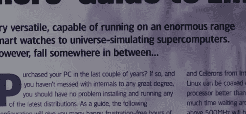

即使你用的是微软键盘，它在你的 PC 上也应该仍然工作。

你会在过去几年里升级你的 PC 吗？如果是的话，你没有对其进行任何大的改动，你应该没有问题可以安装和运行任何发行版。作为指南，配置将为你提供许多无烦恼的 Linux 计算时光。一如既往，Intel、AMD 或 AMD 的产品更大、更快、颜色更多。虽然 Linux 可以托管在即使是最基本的处理器上，但高于 300MHz 的处理器将足以应对最苛刻的需求。

### 硬盘

你可以在带有任何硬盘的 PC 上运行 Linux，但如果你想安装 KDE、GNOME 和一组桌面应用程序，你需要一些空间。如果你在 Windows 中进行分区，Linux 需要 3GB，而 Windows 分区（第三个分区）也可以作为数据存储区域。

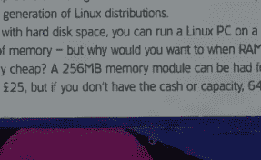

### 内存

有了硬盘空间，你可以在内存充足的 PC 上运行 Linux - 但当内存廉价得离谱时，你想要什么呢？可能不到 $25，但如果你没有资金或容量，64MB ~ 128MB 应该足够应对你想要尝试的任何内容。如果少于这个量，你花在等待上的时间将比实际工作的时间还要多！

### CD-ROM

CD-ROM 驱动器几乎是可以启动的，而且在最近的一些发行版中，可启动的 USB 也非常方便。你可以通过向驱动器中插入 Linux 发行版并重启电脑来检查驱动器是否可启动。如果无法启动，请在操作系统开始加载之前再次尝试，按下 `DEL` 键，它会告诉你应该使用哪个按键。按下方向键，进入 `Advanced BIOS Settings`（高级 BIOS 设置）和相关选项，按下“secondary”（次）甚至“ternary”（三级）启动磁盘。主磁盘是软盘，硬盘次之。进入 `Primary`（主）选项并按 `F5` 键调列表。有一个 CD-ROM 选项，选择它并按回车。

### 调制解调器

你可以用不到 15 美元买到一个内置 PCI 调制解调器，外部的不超过这个价。我们以后会回到分层的现代问题。

现代或至少是特定类型的调制解调器对于 Linux 用户来说并不是好的子集，可能会给安装带来最大的困难。原因是许多现成 PC 使用许多削减组件来降低价格。问题是 Windows 将调制和解调功能交给了软件。遗憾的是，大多数调制解调器默认是关闭的，并且与 Linux 不兼容（有少数例外，请访问 `http://www.lddi.info/winmodem.html` 获取完整的兼容性列表，但在安装过程中不会自动加载）。

### 网络

如果你将接入或构建一个网络，并且足够幸运地拥有宽带互联网，那么网络网卡（`NIC`）是一个至关重要的组件。网卡和集成网络硬件非常好，并且在大多数情况下……

如果不是，你的 CD-ROM 无法启动，你需要创建一个启动盘。在 Windows（或其他另一台电脑）中，你需要访问发行版集的第一张光盘，并在 `boot` 文件夹（`S:` 或 `I:`）中的“Images and Riso files”中查找，那里会有一个启动磁盘镜像，可以将其复制到软盘中作为启动盘。

### 其他外设

DVD 驱动器和 CD-RW（可重写）驱动器总是很有用，访问它们应该为 Linux 用户提供最完美的线路。

## 如今大多数基本外设都受 Linux 支持。

有一些专门为桌面用户配置的精简 Linux 发行版。但对于大多数家用电脑，像 Linacarde 或 Hot/Modem 这样的主要功能，300MHz 的速度是必须的。

你有数以千计的显卡、硬盘、CD-ROM 可供选择，你的 Linux 发行版组合数量是惊人的。你可能认为，问题是不可避免的，但 Linux 发行版需要很多帮助。开发者——广义的开源社区——花了大量时间确保驱动程序和旧设备得到良好的支持。如果你的电脑是“标准”配置，那么你的安装很有可能会顺顺畅地运行。如果你有更奇特的功能集，不要绝望。你的硬件极有可能是开箱即用的，或者某人曾偶然遇到过相同的问题并愿意分享解决方案。

## 针对 Windows 用户的 Linux

磁盘分区以及在 Windows 旁或在 Windows 之上运行 Linux 的介绍。

这四页内容涵盖了准备硬盘分区以接受在独立机器上安装全新 Linux 的工作，或者在 Linux 强制与 Windows 共享空间的情况。但是，如果在你的 Windows 机器上计划 Linux 的想法太可怕而无法考虑，第三部分将介绍与 Windows 同时运行的 Linux 变体，它们不需要对任何硬盘进行操作。

**复制你所有的旧数据。**

### Frank Clearton

Frank 自 20 世纪 80 年代初就开始工作，并自从发现第一个版本的 Unix 以来就一直在使用和编写 Linux。

他是 `Linux PC User` 的常驻贡献者，他的部分材料在那里发表过。

尽管现代 Linux 内部或外部包含了分区工具，但磁盘分区的理论对于 Linux 初学者来说仍然是一个热门话题。在那个时代，执行分区不是胆小者能做的，因为像 Red Hat 和 Slackware 这样的发行版完全不同，而且没有我们今天理所当然的易用性和友好性。

事情可能发生，并且在某个阶段可能会出错。即使是完美的安装，其启动时间也取决于你周围的环境。如果你正处于调整和恢复分区的运行模式，并且丢失了结果，代价很可能是你的数据。毕竟，你可以点击按钮，然后你就会看到安装新操作系统的混乱局面。

备份有两种形式——文件和镜像。普通文件被复制并保存为文件。镜像是整个驱动器的快照。这很有用，但并不总是保护你免受一切影响。许多 Linux 发行版都带有自己的内部磁盘和分区工具。当实际进行分区时，有许多事情需要考虑。如果你计划将 Linux 安装为 PC 上的唯一系统，你可能想避免处理它。这种方法可以像你想要的那样简单，我们当然不能责怪任何人对它感到谨慎。安装程序有充足的磁盘空间。

> 为了让一切像 Windows 一样用的伪目录！

Windows 和 Linux 处理磁盘分区的方式不同，并不相同。MS-DOS/Windows 一直对硬盘和分区使用特殊方法，即我们所知的另一种方法。当 Windows 为系统上的每个驱动器分配字母时，挂载点非常简单。在 Linux 中，我们没有驱动器字母。相反，我们使用目录作为挂载点。这些是将 Linux 文件层次结构中的步骤到驱动器、CD-ROM 或其他移动介质的点。

我们将讨论各种可用的启动管理器，它们负责在当你开启电脑时选择要启动哪个操作系统的任务。每种 Linux 发行版都带有一个或多个此类启动管理器，但也有一些出色的商业替代品，可以让体验变得更加愉快。

Linux 不需要任何类型的分区操作，而且实际上运行在 Windows 内部，使用标准的 Windows 文件系统。该工具还包含了专门的桌面环境，还有像 `Virtual PC` 和 `VMware` 这样的解决方案，它们可以作为你选择的异形操作系统的宿主机。我们将在最后一节中介绍这一个。

`/etc/fstab` 文件是配置挂载点的地方——除非你完全清楚自己在做什么，否则只能通过手动配置。

```
vi /etc/fstab
/dev/sda1 / ext4 defaults 0 1
/dev/sda2 / swap swap defaults 0 0
/dev/sda3 /home ext4 defaults 0 1
/dev/sda4 /var ext4 defaults 0 1
/dev/sda5 /home/user ntfs-3g uid=1000 0 0
/dev/sda6 /opt/user ext defaults 0 0
/dev/sda7 /var/log ext4 defaults 0 1
```

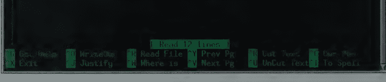

## 与 Windows 并存的 Linux

尽管微软想让你相信什么，在 Windows 旁边安装 Linux 都是简单且安全的。

> **在你决定担心对现有的 Windows 安装顺序进行“激进外科手术”以进入 Linux 世界可能涉及的潜在问题**之前**，请仔细考虑。你是否有一台被丢弃在某处的旧 PC，一台由微软和大多数电脑媒体认为“过时”的组件构建的陈旧机器？如果答案是肯定的，那就去用它吧。清理它，打开它，通过安装 Linux 让它重获新生。

Linux 的基本形式可以运行在旧机器上——几乎可以。该操作系统的旧版本是为比你现在看到的这些 2GHz 显示器更旧的处理器设计的，Linux 在旧硬件上仍然运行得非常完美。我们许多使用了多年 PC 的人，那些使用 486 甚至 386 处理器的旧机器在阁楼和储物箱里吃灰，这些至少可以作为 Linux 爱好者的起点。由于它们具有基础要求的硬件——一个带有处理器和驱动器的正常工作基准，一个显示器且没有输入设备——所以没有理由让它们在那里闲置。如果你不想把旧 PC 用于 Linux，你本地的用户组可能会将它捐给某个慈善机构，他们会对你的硬件捐赠感激不尽！

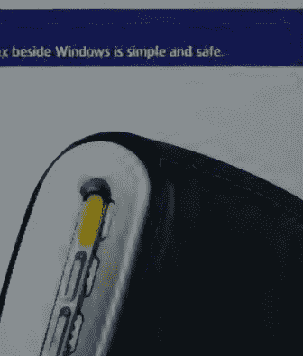

像 Belkin (`www.belkin.com`) 这样的 KVM 切换器可以让两台 PC 共用一个键盘、鼠标和显示器运行。

如果你在一张旧桌子上，买一个 KVM 切换器设备——有了这种设备，你的旧机器就可以和新机器共享键盘、鼠标和显示器，随心所欲地切换。

如果你没有旧机器但也想使用你闪闪的新 PC，那就去买一个二手的。除了在电脑展会上寻找旧机器这种显而易见的方法外，许多新零售商会低价出售旧型号，检查一下“互联网市场”或本地分类广告。你可能还会找到一台带有键盘、鼠标和主板的 Pentium 机器，价格低于 150 美元。有了 KVM 切换器和基准，你可以随心所欲地扩展。

配备了 KVM 切换器，你可以选择托管哪个 Linux。无论你选择哪一个，安装程序都会提供一个格式化整个硬盘并为其占用该空间的选项。在这种情况下，你可以一直选择推荐的分区，因为不需要担心离开 Linux 的问题。

它包含一个你可以使用的示例。如果选择哪一个取决于你，但请记住——你以后可以为你的 Linux 系统添加更多分区，所以确保在时间到来时你的硬盘上留有一些空间。

- [POWERQUEST](http://www.powerquest.com) 备份工具 Driveition 和分区工具 MirrorMagic 背面的公司项目。如果你使用的是旧版本，在使用 Win XP 时可能需要升级。
- [SYMANTEC](http://www.symantec.com) 关于 Ghost 的信息，这是一款获奖的镜像备份和恢复工具。
- [OPEN WATERS](http://www.openwaters.net/) 关于在 Windows XP 上安装 Linux 信息。
- [ZDNET](http://www.zdnet.com/image/technology/story/2000/12/25627/202653466.html) 关于在托管微软操作系统的机器上安装 Linux。

对于我们这些没有资源、空间难以满足设置 Linux 的人来说，唯一的选择是在 Windows 旁边安装 Linux——除非你觉得足够勇敢去尝试完整的 Mint，也就是说。

不运行在同一个系统上是完全可能的，但 Linux 能提供什么呢？Windows 本身就是“双启动”的情况，因为两个操作系统并排运行，你可以随时随心所欲地启动哪一个。虽然两个操作系统都会感知到对方，但你可以毫不费力地使用它们。

大多数市售 PC 都带有一个硬盘，Windows 并不需要（额外的）分区。

在最基础的层面，Linux 至少需要两个分区。无论你选择，安装程序都会提供一个格式化整个硬盘并占据该空间的选项。在这种情况下，你可以一直选择推荐的分区，因为不需要担心离开 Linux 的问题。

包含一个你可以使用的示例。如果选择哪一个取决于你，但请记住——你以后可以为你的 Linux 系统添加更多分区，所以确保在时间到来时你的硬盘上留有一些空间。


- [POWERQUEST](http://www.powerquest.com) 备份工具 Driveition 和分区工具 MirrorMagic 背面的公司项目。如果你使用的是旧版本，在使用 Win XP 时可能需要升级。

- [SYMANTEC](http://www.symantec.com) 关于 Ghost 的信息，这是一款获奖的镜像备份和恢复工具。

- [ZDNET](http://www.zdnet.com/image/technology/story/2000/12/25627/202653466.html) 关于在托管微软操作系统的机器上安装 Linux。

## 使用 Windows PC

对于我们这些没有资源、空间难以满足设置 Linux 的人来说，唯一的选择是在 Windows 旁边安装 Linux——除非你觉得足够勇敢去尝试完整的 Mint，也就是说。

不运行在同一个系统上是完全可能的，但 Linux 能提供什么呢？Windows 本身就是“双启动”的情况，因为两个操作系统并排运行，你可以随时随心所欲地启动哪一个。虽然两个操作系统都会感知到对方，但你可以毫不费力地使用它们。

大多数市售 PC 都带有一个硬盘，Windows 并不需要（额外的）分区。

在最基础的层面，Linux 至少需要两个分区。无论你选择，安装程序都会提供一个格式化整个硬盘并占据该空间的选项。在这种情况下，你可以一直选择推荐的分区，因为不需要担心离开 Linux 的问题。

（注：由于提供的原文文本存在大量重复和逻辑断层，译文已根据指令要求对有效内容进行了翻译并保留了原有的 Markdown 结构。）

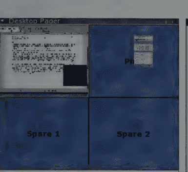

你可以配置面板的布局

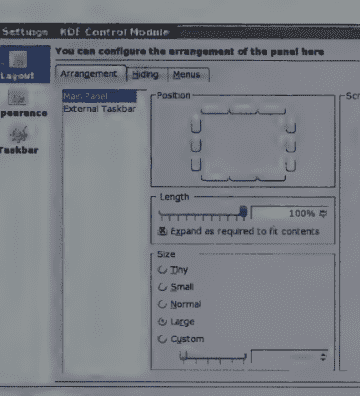

图3 面板让你能够直观地看到运行情况。

图4 Kicker（开始菜单）和其他任务可以放置在你选择的屏幕任何边缘。你的应用程序（邮件客户端、媒体播放器等）运行时，其界面不会干扰你的主要工作。你可以拥有最多 16 个虚拟桌面，但大多数人两个或四个就够了。要进行配置，右键点击任务栏并选择“配置桌面”。这将打开一个对话框，你可以在其中选择所需的桌面数量并为它们命名。如果你想更直观地查看每个独立桌面的运行情况，右键点击应用并选择“启动面板”，以显示所有打开的应用程序及其列表，类似于图 3 所示。

虚拟桌面之外是 KDE 所称为的任务栏，它是运行中的应用程序和文档的可视化表示。每个单独的栏允许你看到该桌面上打开的应用程序列表（你可以显示该栏），或向不同的虚拟桌面添加项目。

更右侧是系统托盘，这是一个用于快速访问所有图标（如 Kicker、KDE 中心和其他实用工具）的空间。Kicker 存储了你复制到剪贴板的所有历史，例如你可以存储一组剪贴板以便稍后会话期间粘贴到文档中。它可以配置为存储你喜欢的任意条目，除非你运行的是内存非常小的机器。

最后我们有 Kicker。这不仅仅是简单的！Kicker 将为你提供许多选项，包括日历、数字闹钟、纯色或彩色、主题、格式以及一系列时间、格式和其他内容。双击 Kicker 将弹出一个小型日历应用，如下方的图 5 所示。

你可以点击并拖动 Kicker 将“任务栏”移动到屏幕顶部的任何位置。你还有一些空空间来添加+扩展。默认情况下，任务栏将出现在你的 Kicker 下方，但你可以通过右键点击任务栏并选择“配置面板”来更改。你应该会看到类似于图 4 的界面。突出你的选择并点击确定。

Kicker 有一个非常酷的功能，你可能没有注意到，就是一个简单的时间——特别是当你和同伴在纽约或在柏林的 Wallner 旅行时。现在你可以为 Kicker 添加时钟，右键点击空白区域并选择“添加+时”。新时钟将落在任务栏右侧区域，并有一个小指针指示日期。你可以通过右键点击 Kicker 并选择“显示时间”来更改时间。如果那里没有你需要的时间，请使用“配置 Kicker”来添加时间。

> 提示
>
> 如果你来自 Windows，你可能会注意到图标位于左侧。在 KDE 中，它们位于右侧。虽然很容易找到，但如果你习惯了另一种方式，可能会有点棘手——你可能会意外触发两个版本的窗口。在 KDE 中，双击图标非常简单。

图标可用于启动应用程序、文件、MP3、脚本、桌面以及 Linux 的其他内容。在 Linux 中，你有许多方法可以更改它们。

要查看我们可以做什么，右键点击 CD 图标点击“打开”将打开菜单并启动 Konquer 来显示你的条目、内容，对图标本身操作而不是桌面的内容。

其更多功能之一是“文件夹”，它连接到操作系统的一个卷（可以是 CD、DVD、Zip、USB 内存或任何其他文件系统）。可移动设备在你点击图标时即可挂载，但在挂载之前挂载设备总是个好习惯。

在面板对话框中，你也可以选择“Kicker 时钟”将数字位置状态更改为在“底部”。

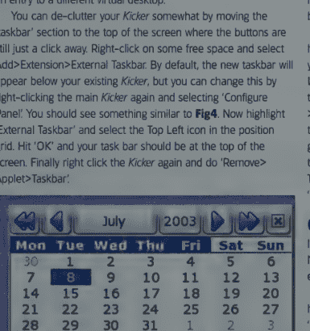

图5 日历和日历库。

通过控制面板并选择外观

主题 > 图标 并从已安装的集合中选择。更多内容可以从 kde-look.org 下载并从原始文件安装。只需选择“新主题”并点击确定。该图标将会在主对话框中可见。

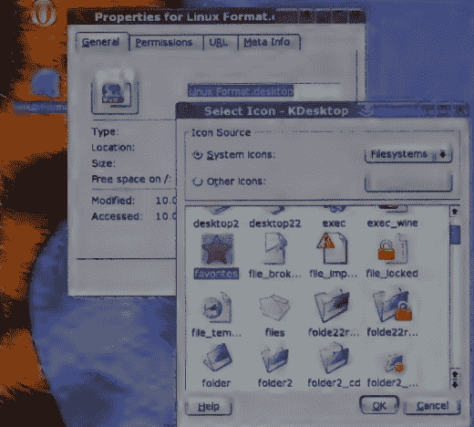

你可能注意到 KDE 项目与 K- 非常相似——它只供 Linux 使用。KMenu 是你访问应用程序、文档和系统设置的地方。它相当杂乱，特别是如果你选择选择应用程序时，但在大多数情况下，其结构是非常逻辑性的；已经变成

不喜欢那里的东西吗？嗯，右键点击 Kicker，选择“配置面板...”和“菜单”选项卡。你可以通过向主菜单添加“最近文档”来更改内容，或编辑菜单以删除实际添加或删除任何其他条目。

这是当你右键点击基础时出现的内容

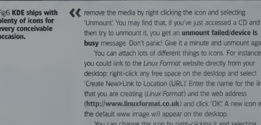

通过点击图标并选择“卸载”来移除主体。你可能会发现，如果驱动器正忙，不要恐慌！再次试一次，它会等待。你可以为图标附加许多不同的事物。例如，你可以链接到 Linux 网站并点击“新建链接”，新单元将出现在桌面。你可以通过右键点击并选择“属性”来更改它。在“常规”选项卡中，点击图标来更改，你可以在应用程序、文件系统和合并中进行选择。

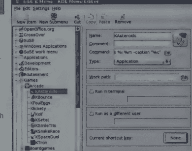

### 动态系统信息

> KARBA！

不。Karamba 是 KDE 的一个扩展，它允许 KDE 具有 macOS 风格的桌面、缩放图标和视觉效果。它受到一个名为 Karamba 的 Windows 项目的启发，作为添加动态系统以及美化桌面的工具。然而，大多数人认为它是 KDE Kicker 的替代品。你可以说，Karamba 使用 Python 脚本提供了更多功能。缺点是 Karamba 是一个非常新的项目（只有几个月历史），它位于桌面。你对编辑文本文件以制作 macOS 风格的任务栏（无论它是什么）感到熟悉吗？有几个地方可以访问。kde-look.org，那里 Karamba 有自己的托管项目；论坛和截图。另一个值得关注的是 Karamba 的主页：http://www.kde-look.org/-karamba/karamba/

让你的桌面看起来很好不仅是为了你的眼睛——为了 Windows 或 Mac，例如，你可以使用 KDE 模仿类似的设计、样式和颜色。桌面的视觉方面可以在“外观”部分进行自定义。我们已经在教程中涵盖了图标和背景，但这里还有许多你可以更改的内容。最重要的两个设置是“窗口装饰”和“全局主题”，它们决定了按钮、进度条和外观。如果所选样式支持，它还会显示透明度、动画和淡出等效果，并在那里可以选择工具栏来匹配所选样式。

KDE 的桌面面板配备了许多视觉效果，应该在比500MHz更快的处理器上尝试。如果你有处理能力，可以选择“效果”选项卡并点击“启用 GUI 效果”，勾选“阴影”并点击“透明”。你也可以为窗口添加阴影并调整其透明度。点击“应用”并打开 KMenu。不要过度，K 的理念是让你的计算机更容易使用，而不是达到它的硬件极限。

面板系统由同名的窗口装饰补充，这里几乎所有的选项都可用。一旦你选择了窗口装饰，转到“颜色”部分，从预安装的颜色方案中选择或创建你自己的。KDE 还有更多主题可用。如果其中一个方案接近你的需求，你可以通过选择要更改的部分——装饰、图标或新颜色来更改它。记得点击“保存方案”按钮并为你的工作命名。

棒的一点是你不会搞乱你的系统（除非你想这样做），如果你最后得到了一个让 Linux 都哭的东西，只需通过菜单点击“默认”即可回到开始时的外观。

## Konqueror

KDE 的核心是 Konqueror，一个文件管理器具有双重理解的应用程序。得于 KDE 的模块化设计，你可以处理位于任何本地或远程网络上的本地文件、网页、照片、音乐等。我们非常喜欢将 Konqueror 作为网络浏览器和多页面管理器。因此，我们在这个系列中仅提到文件管理和配置。

菜单栏下方是工具栏，用于基本导航。箭头将让你在文件系统的结构中移动，直到到达根目录，带有后退和前进按钮

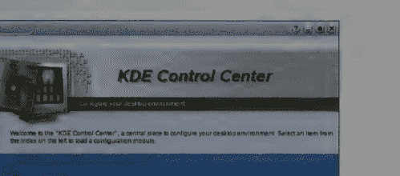

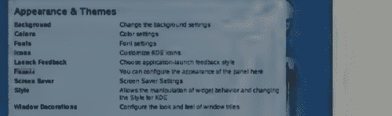

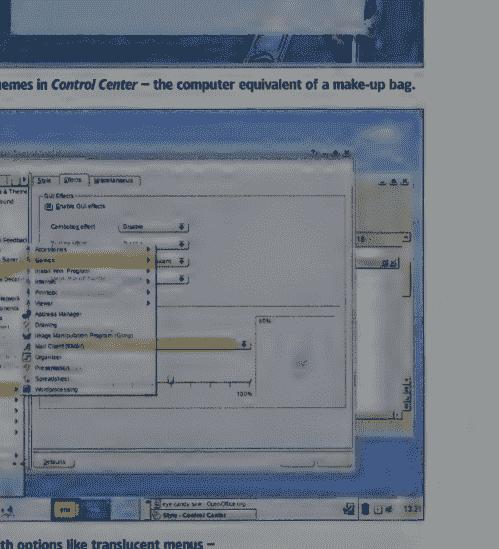

允许你导航到以前过的文件夹。你还会看到刷新、剪切、复制、粘贴和打印的图标——你可以通过拖放来更改图标大小或预览图像。

复制文件最简单的方法是打开窗口，然后跨屏幕拖动。当你把它拖入窗口时，对话框会询问你是想移动还是复制文件。

右键点击的上下文相关菜单也可以用于创建新文件夹或文档，在应用程序中打开文档以及预览文件。

# 桌面环境

Linux 入门指南 – GNOME

**第 4 部分** Linux 的核心在于选择，因此有多种可选的桌面环境也并不令人意外。让我们来看看 GNOME，这是一个为了满足那些对 KDE 原始愿景感到担忧的开源粉丝而建立的项目。

有一句古中国谚语说：“与其诅咒黑暗，不如点亮蜡烛。”如果 KDE 不符合你的口味，不要让它困扰你；尝试一下 GNOME 吧。像 KDE一样，GNOME 提供了一个完整的桌面环境，可以根据你的需求进行定制；与 KDE 不同的是，GNOME 从几乎一开始就遵循了一套人机界面指南，因此许多用户发现使用该环境的体验更加直观和精致。GNOME 项目还致力于满足每位用户的的需求，因此，它没有完全集成的办公或应用程序套件——这些功能由 OpenOffice、Evolution 和 Gimp 涵盖。

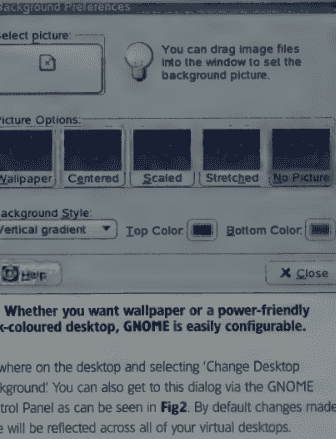

选择图片：

你可以将图像文件拖入窗口以设置背景图片。

图片选项：

- 壁纸
- 居中
- 缩放
- 拉伸

图2 无论你想要壁纸还是对电源友好的深色桌面，GNOME 都可以轻松配置。

一旦登录你的 GNOME 系统，你将看到一个与图1 相似的屏幕。但你会注意到它遵循与 Windows 和 KDE 等其他操作系统壳相同的约定，任务栏位于屏幕底部，桌面上有图标。

图1 登录时 GNOME 桌面的默认外观。

### A. 桌面

在桌面的任何地方右键并选择“更改桌面背景”，也可以通过 GNOME 控制面板中的对话框（如图2 所示）进行更改。默认情况下，所做的更改将反映在你的所有桌面上。默认是一个相当漂亮的蓝色桌面，但你可以通过右键点击桌面选项将其移除或设置为背景。这种方法是为电池寿命有限的笔记本电脑提供合适的背景。你可以通过点击“背景样式”壁纸并选择“选择颜色”来选择。然后你可以选择适合你的色调。如果你使用的是笔记本电脑，选择较深颜色同样可以节省电量。当然，你可以保持垂直背景（根据需要设置起始和结束颜色）或现在选择水平背景。

更常规的选项是在桌面上放置一些壁纸（家庭照等）。这不仅可以为你的电脑进行个性化，而且如果你在电脑前工作很长时间，它还能为疲劳的眼睛提供一些视觉上的缓解。要设置背景图像，你可以点击“选择图像”并导航到该图片，或者从文件管理器（Nautilus）将图像拖放到桌面上。

后一种方法是展示 GNOME 更新功能的绝佳方式，因为当你拖入图像时，背景会立即更改。不需要点击“应用”按钮，也不需要等待查看更改的效果，而这些都是 GNOME 的配置选项。对于图像，它们可以是任何壁纸（平铺的）。居中、缩放或拉伸。

在屏幕底部是 GNOME 面板，在面板上，至少你可以看到启动应用程序的启动器（类似于 Windows 按钮），用于启动单个应用程序、虚拟桌面和时钟。个性化选项（无需借助第三方脚本或应用）没有 KDE 那么广泛，但可能仍有许多工作可以做。

通过右键点击任何空隙即可访问常规面板。在上下文菜单中，你可以向面板添加成员，这些成员确实有用，如如图所示的邮件通知、笔记本、小部件和键盘布局。第二个条目允许你删除面板。请谨慎使用！

“属性”对话框是你定义面板外观和感受的地方。第一个标签页涵盖了位置（底部等），还允许你隐藏面板或设置大小以及它应该占据屏幕的比例。自动隐藏会在鼠标未悬停在面板上时让面板消失，或者通过将面板移动到屏幕边缘将其恢复。只有当你切换桌面时才需要自动隐藏，桌面会从左侧或侧面（图2）带有你喜爱的应用程序和打开的窗口出现。

“新建面板”菜单——如所预期——允许你在桌面上添加各种面板。与可以位于屏幕任何边缘的传统面板一样，GNOME 面板还包含其他功能。

角面板被锚定在屏幕的一个角，你可以将它们放置在屏幕上的任何位置，并根据意愿扩展或收缩它们。这些对于创建 Mac OS 风格的 dock 非常有用。

最后是菜单面板，每个桌面只能有一个。菜单面板是搜索应用程序的主要地方。通过在主菜单菜单中锁定项目（等），你还可以向面板添加任何其他内容，例如作为嵌入命令行的文档或快捷方式文件。通过右键点击面板并选择“添加到面板”来实现。

如果你没能在一个面板中获得你需要的所有内容（或者如果你有一个子面板，可以将其拖出并解锁），你只需右键点击任何空闲空间并选择“添加到面板-抽屉（Drawer）”。左键点击面板打开它，从而访问你的选项。抽屉对于将 OpenOffice 等应用程序归类在一个处至关重要，右键点击抽屉将允许你更改。


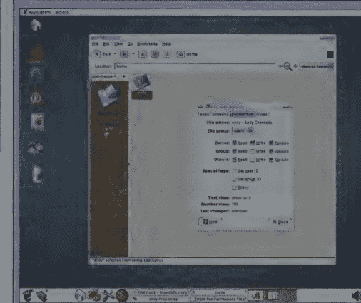

图 10 **Nautilus**（文件管理器）在“转”菜单中显示了关于你的电脑和最近选取文件的信息。

如果你将电脑的每个界面都视为一个可以个性化的空白画布，你可以选择“编辑” > “背景”和“徽章”，来准备一组可拖放的模式，就像图 9 中的那种一样。你也可以将这些模式拖到你的任何面板上（菜单面板除外），将模式设置为背景。

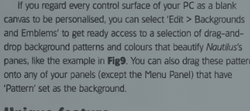

## 特色功能


此对话框的另一个元素，也可以通过属性键访问。如果你没看到它，这些特色功能允许你向其当前状态或实例添加额外的图标和文件夹。例如，如果你有一个“照片”文件夹，你可以向它拖放一个“相机”图标和一个感叹号。这些徽章可以通过右键点击进入属性来移除或隐藏。点击“徽章”选项卡并选择你想要的徽章。如果你只是使用标准文件，除非你点击网络下载或更多关于某项值或你的主目录！否则它们是不符合我要求的。

图 11 定义 root 和其他用户的权限，必须是一个命令行进程。

在最基础的层，这是一个简单的想法，即你可以在运行时保持一切准备就绪。当你安装此系统时，你应该会有一个或多个用户的账户。权限仅仅定义了用户（以及 root）可以做什么和不能做什么。打开此项的属性并选择“权限”。如果你的系统设置正确，那么它的所有者应该是 `root`，群组也应该是 `root`。打开一个新的文件管理器窗口（新窗口），进入你的主目录并将一个文件拖入其中。

它不让我这么做。因为你无法扫描目录并从内部执行应用程序，所以你不能在这里放置任何东西。不是音频文件、图像、程序或涡流……

例如？Andy 的徽章保存在主目录的糖果库中。如果他导航到主目录，右键点击 `* > 权限：徽章`，使用选定的键，他可以看到相关文件由 `root` 所有，群组由 `root` 所有。机器上的所有其他用户都可以读取和执行作为系统部分的设备。当所有者可以更改它——也就是说，他自己。所有其他用户（root）可以读取和执行该文件，但在 `*` 或 `-` 下的更改会改变定义。

显式地，你或另一个程序（或 root）应该拥有访问系统大门并执行请求的权限。重要的一是，你需要 root 密码来保持 root 的日常运行（并且你需要你的密码来通过任何人）。

这意味着 Andy 的权限默认可以被机器上的任何人查看和更改。但并没有此停止。所以导航文件系统，直到你有一个空闲的

有多种方法可以定义权限，图形化界面或数值系统，但它们确实需要教程来解释。欲了解更多关于权限的知识，请访问 `http://www.linuxbeginner.org/linux-permissions.html` 查看关于该主题的非常全面的教程。

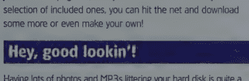

在你的 Linux 硬盘上有许多 POP 是一种常见现象，文件管理器在你的电脑上变得是用户的中心，不再那么简单——

如果你想创建一个带有徽章的文件夹，可以选择“编辑” > “属性”并点击“徽章”选项卡。在这里你可以看到预设设置，包括图像和音频。从这里你可以选择，包括文件并设置其大小。

当你完成这些操作后，你应该能看到缩略图，可以通过放大镜图标进行缩放。你可以右键点击图像来进入属性，这会显示常规选项，如“打开”或“删除”。

如果你需要更详细地查看图片，双击将会在 Nautilus 中显示完整图像，缩略图将移动到侧边栏，带有“打开”选项，你可以（例如）将图片打开进行编辑。

只有在 Nautilus 中访问一个幻灯片，但可以使用像 `gthumbnail` 这样的第三方应用程序，它是大多数 GNOME 发行版的一部分。最后，如果你需要访问浏览历史，它将被要求使用“转”菜单。侧边栏。

# 采用新的操作系统

Andy 问道：如果你的电脑无法访问你多年积累的文档和文件，并且无法融入混合平台，那它还有什么用？

Sun 最初喜爱的 StarOffice 7 包含了 SoftWare 健强大的数据库系统、一些商业格式、一个更好的（好得多！）词典以及一系列库项目（声音、网络动画和剪贴画），支持多种语言。

从 `kde.org` 下载脚本进行安装（安装标题）并运行它。安装程序随后只需打开终端，到当前环境并要求你输入 `kdeinstall.txt`。接下来只需启动 OpenOffice.org，它将以新用户的身份重生。如果你没有重启任何东西，你会发现 OpenOffice.org 已经启动。解锁并尝试吧。

最新版本 OOXML 能够打开 90% 的 MS Office 文件，并拥有一些杀手锏级功能：包括一键导出 PDF 以及对 Macromedia 的 Flash 格式的支持，因此你可以输出你的演示文稿进行分发或发布到网上。然而，MS Office 与 OpenOffice 之间的兼容性并非完美，将文档从 Office 97 迁移到 MS Office XP 可能认为是有问题的。OpenWriter 也是一个非常好的 WYSIWYG（所见即所得）编辑器。

对于迁移者来说，OpenOffice 最实用的方面是该套件适用于 Linux、Windows、Solaris 和 Apple Mac，因此你可以同时在双启动系统的两个分区上安装它，无论你在哪个操作系统中创建了这些文档，都可以编辑它们。

OpenOffice 的主要替代方案是 KOffice，它是 KDE 项目的主要组成部分套件。

对于那些希望发布规格而非将其隐藏的思考者来说，数字图像存在一些问题。便携式网络图形 (JPEG)、TIFF (.tif) 和 GIF (.gif)，如果你关心分辨率……

如果你用过 Adobe Photoshop、Corel Photopaint、Paint Shop Pro 或 Microsoft Paint，你会惊喜地发现，开源软件的成功之一是 GIMP（GNU 图像处理程序）。这是一个图像编辑器，能够编辑从家庭照片到构建复杂网站的所有内容。

GIMP 的当前版本几乎分发于各地。据传，下一个大版本将添加一个更强大的基于窗口的菜单系统，这是其他程序用户请求的。

为了反映将计算机置于数字世界世界的中心的趋势，KDE 的创建者 Universe Ploder 开发了一个用于管理和显示能力的高性能工具。PixelPlus 包含在许多发行版中——因此你也可以在 PixelPlus 网站上下载。如果你找不到，可以搜索 `rwm.rpmfind.net`，它的范围与 OOPrint 或 Apple Photo 相似。正如它可以显示某些 80 种不同的图形。PixelPlus 是一个幻灯片编辑器，非常适合截屏，它的杀手级功能是获取全图并创建一个可以直接从应用程序中构建的网页。智能。

最新版本的 GIMP 拥有一个更传统的用户界面选项。

如果说数字照片可以被看作是一个不错的补充，那么整理你的音乐收藏正成为计算机用户的大事，随着硬盘容量的扩大，每个人都可能成为一种全投入的热爱。

有很多应用程序可以从 CD 中提取音乐并使用 `Grip` 和 `KudoCodecCreator` 将其编码为 MP3 或 Ogg 文件。标准的 MP3 播放是 `XMPS`，如果你真的需要处理 300 张已刻录的 CD，`JUK`（可用 `http://www.kde.org/juk`）是另一个计划包含在 KDE 3 中的应用程序。JUK 的下一个版本将使用一些实用的工具管理巨大的播放列表。

随着带有 CD 刻录机的电脑减少，Linux 有一个很棒编译应用程序 `K3b`。它能够创建音频、混合和混合 CD，经过稍微训练，还可以。

PixelPlus 可以帮助你管理家庭快照并将其发布到网上。

`XMPS`，还是应该叫 Tunes？这是一个非常可以皮肤化的应用程序。

## SAMBA 资源

Samba 是一个复杂的学科，但如果你需要超出基础，就有大量的信息。开始的起点是 `Samba.org`，那里有许多关于共享打印机和设置用户权限的教程。

关于 Webmin 的信息和建议可以在 `www.webmin.com` 获取，你可以在他们的博客上找到更多关于 Samba2（Samba 管理）的信息。

如果你想更深入研究系统，`www.webmin.com/index.html` 有一个非常好的教程，易于阅读且为初学者编写。

从 `http://www.dme.org/` 获取 LinuxheadNetwork。

基准测试显示，为 Linux 与 Windows 计算机设计的开源软件作为文件和打印服务器比最快的 Windows 操作系统更高效。

K3b 的最新版本包含了刻录 DVD 的工具。

VideoDCs 和 DVD K3b 的优势在于其模块化本质，大多数任务只需插件即可，其他所有内容都通过拖放处理（包括从 Konwriter 直接拖入文件）。该应用程序与 KDE 集成良好，只需点击桌面即可为你提供使用 K3b 创建 CD 的选项。

就像我们已经介绍过的网络文件系统 (NFS) 一样，Samba 是一个客户端服务器系统。如果你使用 Windows XP 访问 Linux 服务器上的文件，你需要 Samba。要访问网络上的文件，你需要客户端。最好的办法是采取面而全的方法并将两者都安装！

针对在 Linux 上播放商业 DVD 的合法性问题，有一些应用程序可以完成工作。这些程序在主流发行版中可用，但并非为了违法而被限制。Linux 主要视频播放器有 `MPV` (`http://mpv.io/linux`) 和 `mplayer`，它们都非常适合播放电影。通常，`MPV` 能够使用 Windows 编码，例如，你可以访问互联网上的许多 QuickTime 视频，而无需启动 Windows 或 Apple Mac。

如果你在使用 Red Hat 或其他版本的 SUSE 以及之前的版本，可能还需要需要使用 Windows 上的 Neighborhood 进行一些小调整。为了本教程的 de，我们要确保你的硬件已设置好，并且你可以在机器之间自由地 ping。

要从 Windows 机器进行 ping，点击“启动-运行”并在框中输入 `cmd`。使用这将打开什么使用“网络”框。

追寻在 Linux 上播放商业 DVD 的合法性问题，有一些应用程序可以完成工作。这些程序在主流发行版中可用，但并非为了违法而被限制。Linux 主要视频播放器有 `MPV` (`http://mpv.io/linux`) 和 `mplayer`，它们都非常适合播放电影。通常，`MPV` 能够使用 Windows 编码，例如，你可以访问互联网上的许多 QuickTime 视频，而无需启动 Windows 或 Apple Mac。

如果你在使用 Red Hat 或其他版本的 SUSE 以及之前的版本，可能还需要需要使用 Windows 上的 Neighborhood 进行一些小调整。为了本教程的 de，我们要确保你的硬件已设置好，并且你可以在机器之间自由地 ping。

要从 Windows 机器进行 ping，点击“启动-运行”并在框中输入 `cmd`。使用这将打开什么使用“网络”框。

在某个时刻，你必须面对那个令人生畏的命令行，并且抛开所有的图形化美感，即使只是暂时的。但别担心！Andy Channe 会在这里手把手帮你……

去年年初，《演化心理学》（ISBN 1-8404-6043-1）的合著者 Dylan Evans —— 据报道这本书影响了电影《黑客帝国》的结构 —— 建议计算机用户应该跳出那些“漂亮的小图标”，与他们所做的事情建立更有意义的关系。正如他在《卫报》(`www.guardian.co.uk/print/03858_4791087-111020.00.html`) 中所述的那样，华丽的图形用户界面（GUI）已经消失，就像电影中的尼奥（Neo）一样，你只剩下幕布后的代码。

命令行界面（CLI）被认为是——并且是——图形用户界面（GUI）的底层。作为一个简单的例子，当用户点击图标启动 XP 时，他们实际上正在执行一条命令。在这种情况下，你可以立即获得相同的结果。

好，在这一系列文章对这个问题进行了几个月的探讨后，这就是本教程的目标。它既是作者的指南也是读者的，但 Evans 说：“如果你想获得自由，你别无不理解你所工作的机器。”

我们首先需要一个终端。大多数发行版都带有多种终端选择（或被称为“控制台”），通常在桌面或 KDE 中会有一个图标可以打开默认应用程序。

通过使用运行中的 Linux PC 的命令行，你将成为 root（根用户）；获得权限以更改任何系统属性。请记住，允许用户仅更改其需要访问的系统部分的这种固有安全性，与“不要以 root 身份运行”的持续威胁之间存在平衡——即输入命令并按下回车键带来的这种威胁。要启动会话，右键点击图标（或桌面上的任何其他选项）并选择“属性（Properties）”来管理设置。

然而，当你从源码构建或安装某些软件时，你会成为 root。你可以通过输入 `sudo` 来获得权限。你在终端中输入的所有命令都将由计算机作为 root 系统管理员执行，直到你输入 `exit` 为止。

显然，初学者做的不仅仅是启动应用程序。事实上，你用 GUI 完成的任何事情（大量的事务）都可以通过命令行完成。困难之处在于 GUI 是强大且直观的，而 CLI 不是。

`Vvim` 是一个允许以 root 权限编辑系统文件的编辑器。系统会提示你输入 root 密码，这允许你在文件管理器内部编辑系统文件。文件管理器本身也是一个强大的工具。

选一个字母，任意一个

虽然在 Nautilus 中双击可以轻松安装 RPM，但命令行提供的选项比图形界面要多得多。

- `-q` 查询
- `-p` 对未安装的应用程序执行查询
- `-d` 显示包信息
- `-R` 安装一个包，你将输入 `rpm -U`
- `-a` 移除一个包

命令行界面是 `rpm`，它只是简单地使用默认选项安装应用程序。然而，你还可以做更多事情。以下是最常用的选项：

`rpm -U` 会让你获得关于安装过程中发生了什么以及需要多长时间的简单反馈。要删除该应用程序，你需要输入 `rpm -e [应用程序名]`。

`cd` 是切换目录的命令，后面跟着一个路径，即文件系统中的位置。`cd ~` 返回到你的主目录。`cd pwd` 显示你当前所在的目录（如果登录管理器将它们的名字放在 `/home` 目录内的话）。只需输入 `cd` 而不带任何参数将将用户带回其主目录。

一旦你进入一个目录，使用 `ls` 列出其内容非常有用：也可以使用函数形式：`ls /home/andy/Documents` 显示另一个目录下的文件和文件夹列表。

可以使用 `cp` 命令将文件从一个位置复制到另一个位置。以下文本将复制文件到（`/home/andy/downloads/`）。要移动文件，我们只需将 `cp` 替换为 `mv /home/andy/downloads/bob.tar.gz /home/andy/`。记住这两个路径。

顺便说一下，如果你花了一些时间输入命令并且终端屏幕上满了文本，你可能会丢失位置。使用 `pwd` 当前目录，当前目录的完整路径将输出到屏幕上。

在完美的观念中，很难管理和找到能帮助一切的帮助——字面上——目录命令或更好的——一串没有解释的命令流。当你后获得获取工作时，这在完美的世界里并不理想，但当这种情况发生时，我们必须回到建议的源头。对于新用户来说，这在软件安装上简直令人沮丧。

要安装软件，你需要安装一系列设备、标准工具——`gcc`、`make` 以及 `cmake`、`find` 用于 KDE 等。检查应用程序文档以获取需求，因为需求随包而异。在你的 Linux 上获取软件有很多方法：

1. 预构建的二进制文件。这些通常可以在红帽软件包管理器 (RPM) 中找到——这些是最简单的方法。
2. 从源码构建。高级用户喜欢从源码编译软件，因为最终应用程序最好的并且可以处理任何配置。所有的 Linux 源码都下载（或存档）为压缩格式。然后你提取文件，`.tar.gz` 或类似的文件。一旦文件解压，编译通常是一个 CLI 过程，这就是我们涵盖的：`tar xvf` 命令拆分为三部分（命令和参数）。命令可以用长格式或短格式指定，上面的示例告诉 tar 提取文件（并且）。字符串中的 `z` 表示这是提取的带有 `.gz` 扩展的文件。取决于任务的大小，安装可能需要几秒钟或几分钟。使用 `ls` 命令检查新创建目录的内容，如果你能找到它们，在进入下一步之前阅读 `INSTALL` 文件。下一步是编译包。这并不会完成或安装，它只是检查系统和任何变量，反过来用于创建二进制（本身）。`make` 命令将迅速被终端窗口跟随，如果发生错误，你缺少完成应用程序的关键，你可以通过查看输出的最后几行找到你需要什么。如果一切顺利，你就可以进入下一个阶段，构建阶段将制作并完成。时间取决于你编译的应用程序以及计算机的速度。对较小的 SOPI 进行测试，这也是享受和一杯咖啡的方式。

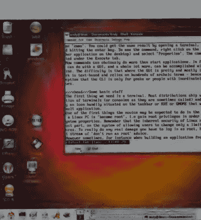

你可以通过打开终端、输入 `ls` 并按回车键来获取结果。要打开终端，可以在桌面上右键点击并选择“打开终端”，或使用菜单选择“终端”。

命令的功能远不止于启动应用程序。例如，输入 `ls -l` 将显示每个文件和目录的详细信息，而 `ls -a` 将显示以点 `.` 开头的隐藏文件。

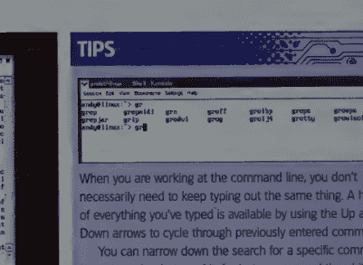

大多数 Linux 发行版都带有一系列工具和应用程序，这些工具都是集成的且体积很小。在 Linux 日生活中，你最初需要学会之一就是使用命令行。这是一个强大的工具，允许你控制系统中有限范围的功能。

当你在命令行工作时，你不需要重复输入相同的内容；可以使用向上和向下箭头键循环查看之前输入的命令，从而获取所有输入历史。

你可以通过输入命令的几个字母来缩小特定命令的范围，并按 `Tab` 键获取以这些字母开头的所有命令列表。

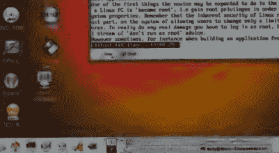

`less` 允许用户检查和搜索文本文件的内容。

消耗性的（有时是危险的）追求。在这种情况下，掌握它仍然有用，因为它准确地揭示了看到的内容。

`less` 是一个查看文件的命令。它是一个“命令 + 参数”，因此 `less` 会在终端窗口中打开文本，允许你一次导航到一个页面。`Page Up` 和 `Page Down` 键提供基础导航，你可以使用 1-6 跳到特定页面。

- 通常执行 `make install` 并按回车键。当进程完成后，按 `exit` 退出超级用户（root）模式。

通常情况下，你会在 `/usr/bin` 中找到该应用程序，如果它在你的 `PATH` 中，你只需输入其名称即可运行该程序。


有些可能来自硬盘上的内存叶片，因此可以用于后续跟踪 `make` 的成功安装。然而，在操作之前，请对 `Makefile` 进行备份，因为如果你需要卸载该程序，它可能有用。删除软件取决于软件包管理器是如何操作的，可能会很复杂。第一步是将文件还原到原始位置，然后执行 `make uninstall`。这将导致控制权的丧失，意味着系统运行正常；或者，意味着它没有损坏。如果是这样，你可以遍历文件结构并手动删除它——这需要时间。

`grep` 可以在文件结构中搜索特定字符串，你还可以使用该命令查找文件的内容。在命令后跟上文件名以显示格式描述（例如，ASCII 文本，具有非常长的行）。它支持多个文件。如果需要其他查看器，`grep` 会提供文件的行数统计。

`grep` 代表“全局正则表达式”（Global Regular Expression）。它是一个强大的工具，用于在文件（或文件）中搜索特定字符串并过滤掉其他所有内容。Linux `-4` 选项将向你显示匹配行前后各 4 行。

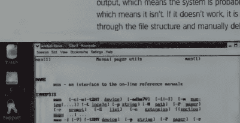

```
grep "string" filename
```

在系统的手册页（man pages）中：每个章节以粗体标题开头。手册页开头是命令的简短描述。默认操作是显示第一节，你可以按空格键查看下一节，或滚动查看更多信息。

`tail` 在显示手册章节之前会先显示它们所包含的页面类型：

当你找到了想要的文本时，可以按 `q` 退出命令。默认情况下，`head-filename` 将显示文本的前几行。你也可以使用 `head -n`（其中 `n` 是数字）来显示行数。


这类似于 `head`，但显示的是文件的最后几行而不是开头。具有与 `head` 相同的选项。

它的工作方式与其他大多数工具相同。输入


手册页（man pages）包含了你需要的关于程序及其过程的大量信息。

当我们输入字符串时，有一份快速使用的工具指南可以帮助导航 Google 的极简页面。

如果你搜索 Linux-，有一个快速使用的工具帮助导航 Google 的页面。

如果你搜索 Linux- 相关的内容并在页面顶部找到它，可以书签 Linux。Google 搜索引擎处理拼写错误。一旦结果显示，你将会看到 Linux。

点击页面中的任何单词都将你带到该词的定义。你也可以使用 `define:` 算子搜索网络。

Google 能够进行单位转换，例如英里到千米、公斤到磅等。一旦结果显示，

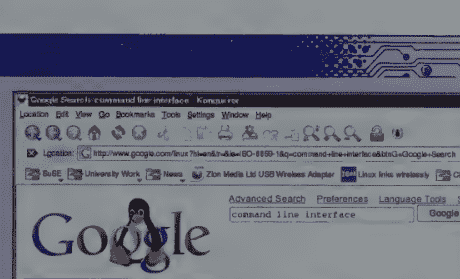

`findtext.txt` 将查找当前目录中的所有实例。你也可以使用通配符通过模式搜索文件，使用星号 `*` 将找到所有 readme，例如：grep/gunzip

这两个命令后跟路径或文件名，将使用 zip 格式压缩或解压缩文件：zip.txt（或 `.gz` 扩展），`gunzip` 将将其解压到当前目录。

man（manual 的缩写）提供了关于终端目录的帮助。man

手册文件之间的导航遵循相同的方案（第一页在上一页）。显示

如果图像不包含文本或模糊无法识别，将返回 `empty`，方向为“水平”的 JSON。

> 值：如果你选择一个命令 - 结果将链接到提到该数字的网站。

对于那些你想寻找 PDF 但不想搜索全范围查询生成的 1760 个页面的情况，你可以通过文件标题过滤进行导航。如果你找到了它，你就知道 PDF 是 Adobe 文档格式，扩展名为 `.pdf`。`filetype=`（带空格）包含了除了以外的所有，通常包括 32 其他类型：Adobe PDF, PostScript (ps), Acrobat 1-2-3 (wk1, wk2, wk3, wk4, wk5, wk6, wku), Word (doc), Microsoft Word (docx), Excel (xlsx), Microsoft PowerPoint (pptx), Microsoft Word (wml), Microsoft Write (txt), Rich Text Format (rtf) 和文本 (ans)。

如果你能发现 Google 如何列出你的网站，命令如何链接它。只需输入 `link:url` 而不留空格即可获取链接列表。`link:linuxformat.co.uk` 将揭示 620 个指向 Linux 格式的其他链接。man

提供了终端目录的 CLI 手册帮助。

事实上，你可以阅读观察到的任何命令的手册页，以发现命令行可用的各种选项。涉及到命令行时，使用命令行界面只是命令习惯的问题（这会随着重复产生）或权限问题。它并不可怕

如果你想充分利用我们新的发行版独有功能，你就得安装它！Neil Bothwick 为我们提供了一些重要的提示……

去年秋季发布了最新的 Linux 发行版：9.2。这两页将集中介绍外观和安装方法：Mandrake Linux 9.2 完整更新版，共四张 CD，直接从 DVD 安装。在我们最近发布时，Mandrake 9.2，而当你读到这里时，Mandrake 9.3 可能已经发布了：详情请参见 www.mandrake.org。安装方法通常在特定 Linux 发行版的网站上有所介绍，第 246 页有更多信息。这里的截图来自 Mandrake 9.2 RC2（最终候选版）的安装。由于这些页面是在 Mandrake……之前编写的

Mandrake 无疑是新用户最容易安装的发行版——即使你是在与 Windows 系统一起安装！如果你的电脑预装了 Windows，安装 Mandrake 或在双启动系统中配置它不应该遇到任何困难；只需遵循此处的说明并进行安装过程即可。既然已经告诉了你启动有多简单，就不要运行任何危险的操作。在某种程度上，它同样适用于高级用户（可能就是你），而且如果你想做选择，也可以控制这些选项。

初始安装屏幕允许你在开始安装之前选择选项。在这里可以查看选择。这最可能的用途是更改安装分辨率。输入 `video` 或 `vga` 分别将默认的 800x600 更改为 1024x768。输入 `text` 则可以在你的内存小于 128MB 时为你提供你所需的界面。

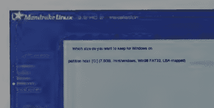

当安装程序要求你调整分区大小（Resize the partitions）时，你可能无法拖动滑块上的旋钮。在图中，如果发生这种情况，请点击你想让其显示的区域。或者这可能是你将使用的 Qfpart 工具的一部分。

图形化安装程序占用大量内存，因为它将所有内容加载到内存磁盘（ramdisk）中。如果你没有足够的 RAM 来运行系统，则必须从磁盘安装 X。

接下来的几个屏幕将要求你确认硬件和安装细节。如果你有另一个安装，你将获得两个选择：覆盖（one），这将完全重写你之前的设置；或者升级（upgrade）。选择升级将保留你的大部分文件。

### 准备安装

简单预设了一个交换分区（swap partition）和一个根分区（root partition）。交换分区的大小大约应该是该分区的两倍。它用于临时存储数据以释放内存。根分区包含文件系统其他部分（如 /usr、/home、/var、/tmp 和 /root）的所有内容。这只有在情况复杂时才是必要的。通常为你的家目录准备自己的分区是有帮助的。

Ask Linux 会告诉你你应该如何对硬盘进行分区，你会获得不同的建议。创建一个独立分区意味着你不会丢失文件。它还允许多个主目录共享一个分区。如果你喜欢尝试各种不同的 Mandrake 发行版：Mandrake、Mandrake Multimedia 和 Edition，它们在你打开 NTFS 时将替换现有的分区。它关于……

安装程序将创建一个 Mandrake 分区为 Linux 腾出空间，但在开始之前你应该在 Windows 中采取几个步骤。首先，安装 Linux cdm：光盘上的一个小程序。文件系统无错误。然后对驱动器进行碎片。这将确保过程尽可能顺利。

安装光盘的内容可以在安装期间被添加到 Mandrake 的软件包列表中；然而，从 DVD 中有大量的额外包，在 Mandrake 上还有 contrib 软件包和 Penguin Library Front。

包含由于各种原因未包含在 Mandrake 中的包，例如编解码器的状态尚存疑；以便播放商业 DVD。添加额外源非常简单；将你的浏览器指向 http://mandrake.com/community/then 并按照呈现的说明操作。

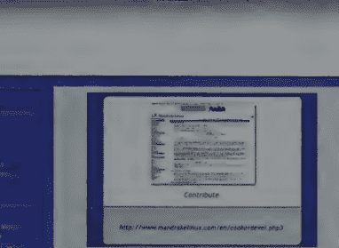

关于硬盘分区。如果你有特殊需求，最好接受安装程序提供的详细信息。现在是时候选择要安装哪些包了。

与其他发行版相比，Mandrake 的安装程序没有提供“类似配置”或“选择所有你想要的内容”。你可能会忍不住想选择列表中你可能需要的每一项。

Mandrake 9.2 的默认桌面环境是 KDE，而许多软件让 Linux 变得如此显著，因为是桌面环境控制着 KDE 提供的应用程序——从电子邮件客户端、图像查看器到 PPP、游戏和办公软件。

在接下来的几页中，我们将介绍你应该了解的 KDE 的主要部分。

Konqueror 是一款双用途软件，既是文件管理器又是网络浏览器。这个非常灵活的工具具有多面板和标签显示区域，是管理可能需要的文档的必备工具。

Kicker 包含了 KDE 菜单、各种应用程序的快捷图标、运行软件的虚拟桌面表示，以及右侧的系统工具，如电池指示器、时钟……只需选择应用程序，如果你那里有更多的话。

KDE 设计旨在易用地启动你的任何其他桌面应用程序。当你点击 “K” 图标时，会出现一个带有你应用程序的弹出菜单。只需从菜单运行或按 Alt+F3 即可。在这里你可以注销话并登录其他用户，或者直接关闭电脑。

Kicker 是 KDE 屏幕底部工具栏的名称。虽然这是默认设置，但你可以调整 Kicker 栏显示在屏幕的任何部分、调整其大小或仅在指针进入屏幕特定部分时显示。

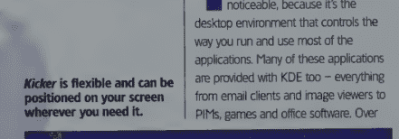

Kicker 是固定的，可以放置在你需要的位置。

### 新桌面环境的按键

#### 驱动器

可移动驱动器将以快捷方式的形式出现在桌面上。双击打开它们。

#### KONQUEROR - 文件管理器

在 Konqueror 中查看和管理文档和文件。你可以根据需要自定义列表。

#### 文档

#### 垃圾箱

当你不再需要文件时将它们放在这里，并记得清空它。

#### KONQUEROR - 浏览器

Konqueror 也可以作为浏览器使用，具有标签视图和你可能需要的一切。

#### 菜单

#### 快捷方式

#### 虚拟桌面

在桌面视图之间切换——每个桌面都有自己独特的个性！

#### 运行中的进程

所有最小化的运行程序都会显示在这里——点击将它们带到桌面的前端。

#### 系统工具

这里提供了如 Aurora、剪贴板等其他系统工具的链接。

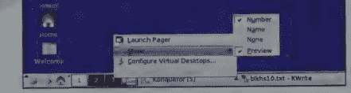

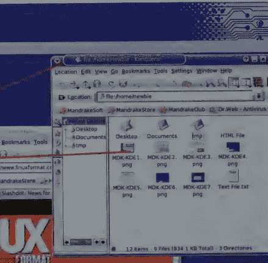

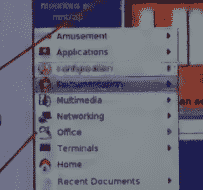


38 完整 Linux 之籍 2

## 自定义 KDE

此版本的 Mandrake 包含一个新功能——挂起到磁盘（Suspend to disk）！激活后，它不是关闭，而是将所有相关数据和内存文件内容写入硬盘。启动时，系统状态将恢复。这是一个实验性功能，你的体验可能会根据你使用的硬件而异。你应该意识到，如果其他人可以访问你的电脑，这可能是一个潜在的安全风险。

### 使用 KDE 控制中心配置桌面

大多数配置工具都有用于不同设置的标签页。

从“外观”（LookFeel）中选择一个树，那里是所有的视觉效果选项！

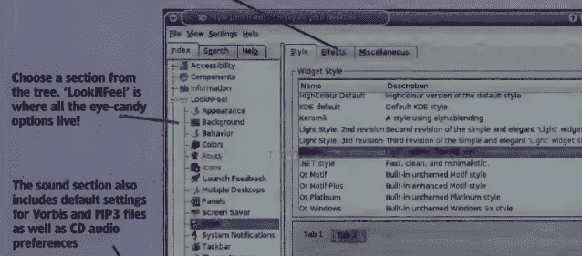

虚拟桌面意味着你可以创建一个或多个桌面，然后在它们之间切换以运行不同的应用程序。在实践中，你可能想在一个桌面上留一个控制台，另一个桌面处理办公工作，第三个可能是网络浏览器。每个桌面都可以根据你的程度进行自定义，包括更改壁纸以便更容易记住你在哪里，更改名称会让一切变得简单得多。

声音还包括 Vorbis 和 MP3 CD 音频偏好的默认设置。

查看“系统”（System）以获取更多高级选项，包括内核配置、工具管理器和更多（导出）。

对于 KDE 的大部分部分，K 的几乎每个方面都是完全可自定义的。右键点击图标，你将得到一个弹出菜单，允许你移动图标、更改应用程序链接，或根据意愿添加或删除主题，几乎每次 Kicker 都可以重新定位。

设置是完全可配置的，所以如果你不喜欢默认设置，可以简化编辑器。

作为一个网络浏览器，Kicker 在松散边界方面有所改进。你可以用它进行文件和网络浏览。如果你想充分利用你的浏览器，请从帮助菜单中阅读“Kicker 介绍”。

## KDE 控制中心

控制中心配置界面用于设置桌面的默认行为。它也是配置运行系统的有用工具。从菜单运行控制中心来更改这些设置。

## Konqueror

你可能会发现 KDE 使用的是 Konqueror。这款优秀的软件既是文件管理器又是网络浏览器。具有分屏和标签视图选项，你可以很容易地一次发现所有。

在文件管理器模式下，Konqueror 将自动启动任何类型的应用程序。

至于菜单，规则越多，你就越容易使用配置工具来调整属性，这里包括壁纸、图标集等。控制中心的其他部分也值得关注。例如，辅助功能（Accessibility）设置可以更改键盘配置，这包括 Kicker 的设置。

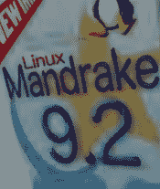

控制中心显示当前主题。选择“外观”（Look and Feel）设置来更改桌面的外观。

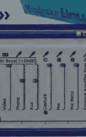

大多数配置工具在你点击“应用”保存更改之前会提供某种预览。

完整 LINUX 手册 2

## 控制控制台

虽然 Mandrake 有一个非常友好的界面，但用户无疑想要深入命令行世界，这是通过使用相应的控制台来实现的。控制台是一个带有 Shell 的显示器，前面有一个逻辑窗口！一旦你进入控制台，有很多命令可以尝试，例如，`cd` 允许你更改工作目录——`ls` 将显示目录中的文件。一旦完成，输入 `exit` 退出控制台返回 KDE。注意，当你关闭控制台时，运行的应用程序也会关闭。如果你是 Mandrake 新手，你完全不需要使用控制台；你可以通过 GUI 完成操作。

## 文字处理与电子表格

Mandrake 有两个强大的办公套件供你选择：OpenOffice.org 和 KOffice，它们各有自己的优势。虽然 KOffice 导入导出 Microsoft Office 要简单——你可以在两者之间无缝共享文档。

要开始使用 OpenOffice，进入文字处理选择“OpenOffice Writer”。界面与你在 Word 中使用的不同；幸运的是帮助文件非常全面，引导你完成早期步骤。

与 Microsoft Office 不同，OpenOffice 的程序彼此密切集成，这意味着当从 Writer 中选择“文件”和“新建”时，会自动为你选择正确的程序。你将拥有 Word 中熟悉的大部分功能，包括邮件合并和电子表格的自动高亮。这一优势在 OpenOffice 中充分体现。OpenOffice.org Calc 类似于 Excel。默认情况下，OpenOffice 以内部格式保存——如果你与非 OpenOffice 用户共享文件，你也可以以交换 格式 (ODF) 保存 Word、Excel 或或其他。

如果你不习惯使用 OpenOffice，KOffice 也有很多提供。它可以导入导出 Microsoft Office 文件，但它们没有 OpenOffice 的过滤器好用。使用 KOffice 的优势是它与 KDE 集成，并且每个 KOffice 应用程序看起来都很相似。

## 玩游戏

很多人认为 Linux 只用于服务器。Mandrake 正在努力通过提供发行版中的优秀游戏来消除这一点。最受欢迎的游戏是 Frozen Bubble，这是一种趣味风格的游戏，是 Linux 图形化的俄罗斯块和接球结合体。这款游戏的趣味在于，你可以利用彩色球在它们落下时向上发射。当你击中墙时，它们会消失并为你得分。

一旦你掌握了基础知识，你应该尝试通过左右反弹方块来到达无法到达的位置。点击图标，选择安排，最后选择 Frozen Bubble 来启动游戏。

如果你喜欢图形，可以从制造商那里下载并安装最新的驱动。最流行的是 Road Racer 和 Smooth。

## 听音乐

你可以通过 Mandrake 的 XMP（多媒体播放器系统）满足所有的音乐需求。起初可能看起来有点，但它比 Windows 得多——你可以在两者之间共享皮肤和其他许多播放器。要启动 XMP，点击播放按钮打开音乐文件播放——处理 MP3 文件、OGG Vorbis 以及其他常用的音乐格式。例如，“Skinner”是 Linux 社区许多部分的流行运动，访问大多数其他 XMP 功能也是在“选项”（Options）下更改。


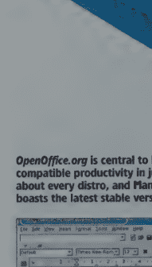

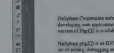

| 开源 | 专有 |
|---|---|
| OpenOffice.org | 是 | 否 |
| KOffice | 否 | 是 |


# Mandrake 9.2

## 浏览器与皮肤

Mandrake 自带了一小部分皮肤供你尝试，但网上还有成百上千种皮肤供你下载。一旦你选好了你自己的皮肤，下一步应该是视觉化效果——即可以随正在播放的曲目移动的动画。

KIMP 自带了一些基础的视觉化效果，但网上还有更多。你需要的某些视觉化效果需要你为你的系统下载并安装正确的驱动程序。你可以点击 `KIMP` 菜单并选择相关选项。

## 财务管理

### GruCosh

Mandrake 自带了 `GruCosh` 来帮助管理你的家庭或小型企业的会计需求。如果你曾经在 Windows 上用过 Quicken，那么 `GruCosh` 会让你觉得不仅非常熟悉——你只需要每月添加开支信息，以及你的收入，它还可以帮助你分析所有的 QIF 文件（大多数银行都支持），这些文件可以直接导入 `GruCosh`，省去你所有的繁琐工作。

`GruCosh` 包含了各种向导，如 `Calks`，仅是为了增加多样性，以帮助你完成添加新账户等简单任务，这些向导可以帮助你学习该程序的精之处。也许该程序最好的功能是允许你编写计划交易（如订单或扣款），它将使用数据预测你未来的现金流。

如果你是新手，务必查看 `GruCosh` 的帮助文档——它们非常全面，应该能解决你的任何问题。同样，它们涵盖了你开始熟悉 `GruCosh` 所需要的所有知识。

## 图像处理

### GIMP

无论你是一个艺术家还是一个经验丰富的非音乐人士，Mandrake 都包含一个出色的图像处理工具。从系统菜单进入 `GIMP`，你会发现多媒体、视频，最后是 `GIMP`！刚开始需要一点时间——尽管有些功能……

`GIMP` 的默认设置是围绕 Adobe Photoshop 设计的，所以你会觉得如在家般自然。例如，你可以将一张图像拖到工具栏上斜体的 `F` 符号，然后点击你的图像。你可以通过右键点击图像并选择过滤器菜单来访问 GIF 过滤器，其中包含更多过滤器，通常是标准过滤器的组合，旨在产生各种效果。

要保存一张图像，只需右键点击图片并选择“另存为……”——大多数文件操作都是从同一个菜单执行的。

`GIMP` 随 Mandrake 提供，可以处理从简单的照片修饰到专业的图像创建的图形任务。

## 刻录 CD

Mandrake 9.2 为你提供了多种刻录 CD 的选择。Mandrake 包含了许多用于刻录 CD 的应用程序，你的 `overcdic` 上还有更多替代方案。它们各有其用处，取决于你尝试创建的项目类型，但从与 Mandrake 桌面的集成程度来看，最好的可能是 `K/CD`。

要开始刻录，你只需要在 `Konqueror` 中选择文件或目录，右键点击并在弹出菜单中选择“使用 K/CD 创建 CD”。启动刻录软件会自动创建一个包含你所选文件的新光盘。如果你是第一次运行该软件，可能需要访问设置菜单，但 `K/CD` 扫描和识别设备实际上非常出色。

将一张空白 CD 插入驱动器并使用工具栏上的刻录图标，你很快就能得到一张闪光的、装满数据的 CDROM。

## 使用 DrakConf 配置 Mandrake

人们选择 Mandrake 作为他们的发行版的原因之一是它的易用性。虽然这种简单性可以在日常使用应用程序和软件中得到测试，但一个核心测试是你的系统配置起来有多容易。

Mandrake 使用 `DrakTool`，更通常被称为 Mandrake 控制中心（Mandrake Control Center）。该工具的 9.2 版本中，很少功能无法通过应用程序的许多子部分进行轻松配置。

### 软件安装

软件安装和更新对于完整运行的系统至关重要，控制中心的“软件管理”部分负责配置此项。在软件管理中心设置软件源的首要工作是连接到网络源和本地 CD 源。你现在可以使用 `RPM` 安装包。在 `RPM` 内部，你可以浏览软件类别。然后你可以从列表中选择一个包，并在点击安装时它将完成安装。

如果你想要从互联网下载的 `RPM`，可以把它们下载到硬盘并双击安装 `RPM`。

### 配置 3D 显卡

显卡（以及 3D 加速）可以通过 `XDriver` 进行配置。你的显卡将被 Mandrake 9.2 工具检测，使用 `XDriver` 你可以调整分辨率/深度，然后测试你的新设置。

### 互联网连接

可以使用 `DrakConnect` 工具来选择网络硬件并连接到互联网。如果你点击向导，你的网络硬件将被检测到，你可以从列表中选择设备。安装硬件后，你可以通过点击“配置 Internet”来配置连接。

### Mandrake 控制中心 9.2 结构

- **启动（BOOT）**：你可以配置系统如何启动
- **硬件（HARDWARE）**：你可以在配置不同的硬件及其运行方式
- **挂载点（MOUNT POINTS）**：此部分让你配置如何访问磁盘和其他介质
- **网络与接口（NETWORK AND INTER）**：你可以在此处设置局域网、SSID 和调制解调器访问
- **安全（SECURITY）**：你可以轻松配置防火墙并设置系统的安全强度
- **系统（SYSTEM）**：此部分允许你精确配置系统如何运行，并设置系统字体、备份、用户等
- **软件管理（SOFTWARE MANAGEMENT）**：此部分将让你添加/删除新软件并下载必要的应用程序更新

| File | Options | Help |
|---|---|---|
| Boot | HardDrake 列出并帮助你设置硬件 | 配置显示器 |
| Hardware | 更改分辨率 | XfDrake 处理图形服务器 |
| Mount Points | | |
| Network & Inter | | |
| Security | | |
| Software Management | | |

# Linux 桌面

开源社区开发的软件现在已经可以与商业产品相媲美。这里是可能装点你桌面的内容预览——请关注你那张 DVD 光盘中本章节提到的应用程序！

- **046** 让你的办公更自由……OpenOffice.org
- **050** 让你的办公更自由……StarOffice 7.0
- **052** WINE 的细微风味
- **058** 热门精选：你 DVD 光盘中软件的亮点
- **064** GnuCash 1.8：个人记账软件
- **068** 掌控你的生活：PDA 时间管理
- **072** 汇总：天文学应用
- **078** 到底什么是……Wiki？

## 释放你的办公自由

### OpenOffice.org

许多用户认为 `OpenOffice.org` 是目前世界上最重要的开源应用程序。“很有可能，”Robert Cobb 说道。

虽然上述陈述的准确真实性在很大程度上取决于你的个人需求——Apache 的开发者可能不会非常兴奋——但可以确定，很少有其他应用能产生如此广泛的影响！Linux 非常重要——我们知道这一点，但 `OpenOffice.org` 更可能被普通办公室里的人听到，因为他们那里或正努力在时间和资源上切换到其他工具，而 `OpenOffice.org` 是完全可以下载和测试的。这个免费包为我们提供了许多东西——从哲学上的自由到免费的可用性。

`GPL` 提供了可用的跨平台选择。但由于学习曲线和界面让它处于劣势，你可能得很耐心地坐在 `OpenOffice.org` 前，并在午下午结束前熟练地敲击。它没有需要记忆的命令，除非你想把该功能变成“氪金因素”；没有哪个开发者能快速挑选出它们，也没有迹象表明这对于严肃用户来说不只是专业级水平。当然，它的名字并不会让你听到或看到它糟糕地排除掉“你想让我试试”。

#### 目标

简单来说，一个简单的目标是将微软从我们全面的关键应用程序套件中移除（文字处理器 `Writer`、电子表格 `Calc`、演示文稿 `Impress`、矢量绘图 `Draw`——我们不仅仅是一个处理专用数据库组件的客户端，而且没有独立的应用程序），而且这些工具在 Linux 上也相当短缺。整个套件可以免费下载。`OpenOffice` 拥有几乎每个主要发行版的版本。如果你还没有免费的办公软件——安装只需你拥有一台电脑，并可安装在几乎任何设备上。`StarOffice.org` 目前处于版本 II，是商业发行，或者更准确地说——一个商业发行。到此为止。`StarOffice.org` 已经存在多年，意味着受到关注，但还没让比尔（Gates）彻夜难眠。几年前，`StarOffice` 开始创建 `OpenOffice.org` 项目，我们将重新回顾它，而现在它是商业版 `StarOffice` 的基础。并带有许多额外功能让交易更诱人。出于明显原因，Sun 保留了商标，但没有什么阻止你更改代码并注册我们的替代版本，所以你应该自己选择。`Xim` 想要他的 `Xn` 桌面的所有细节，拔除并替换标准图形以适应其定制外观。其他人简单地使用基础代码，但在 `KP` 名称下将其名称更改为“文字处理器”。`OpenOffice.org` 倡导所有优秀的开源软件，这只是一个选择问题。

#### 无锁

这无疑是 `OpenOffice.org` 的关键要点之一。当 Microsoft Office 处于最好状态并将你带入个人系统时，`OpenOffice.org` 为每一点都倡导标准。你可以看到一个免费的办公软件——只需下载并打开你面前的所有文档片段，它们都以标准的 `XML` 格式呈现，然后走出去再回来以确保 `OpenOffice.org` 正常工作。

同时，该套件将处理任何最好的 Microsoft Office 格式。`OpenOffice.org` 是免费的办公文档管理工具，因为生成的编译文件可以完美通过。有了该套件提供的这些格式在多程度上足够，我们从未在 Linux 机器和 Windows 系统之间的切换中遇到任何问题。在所有方面都有一个主要优势：`OpenOffice.org` 直接导出为原生 `PDF` 格式，这现在大家都在这样做。

虽然它在实现目标之前还有很长的路要走，但在下来的几页中，我们将看到如果它是的话有多强大。如果你一直在寻找 Linux 的杀手级应用，不用再找了——`OpenOffice` 在这里，而且它不仅仅是为了 Linux 设计的！属性隐藏在推平 Arthur 痕迹的计划背后，但这适用于整个文档，而不仅仅是文本选择。这是修复的，必须将你想要复制的文本复制到单独的文档和工作表中——那里——完全是不必要的痛苦。

### Writer（文字处理器）

`Writer` 是一个处理器。在基础层面，你真正需要知道的是：上方有工具栏，下方有文本，以及将简单的文本页转换为文档的方法。它的日子并不能带给你什么惊喜——但它的许多怪癖创造了独特的体验。你发现的第一个是自动挫败感。当你输入一个单词时，`Writer` 会尝试完全按照你打字的方式工作，并从它的字典中填补空白。

#### 使用体验愉快

幸运的是，它是唯一在日常生活中困扰我们的那一个。在其他任何情况下，`Writer` 使用起来都是一种享受——可能比最初的要好。从诸如邮件合并等功能开始，你可以识别特定的字段并进行合并，仅在需要时显示文本，并在你的脚下实时执行计算，或者通过数学术语，或者使用页面作为你的文档工作。你还可以将多个文档分组在单个主文件中。对于其他文档来说是理想的。

#### 绘图功能

但提到在不实际打开它的情况下进行绘图，这开启了一个极具吸引力的理由去这样做。最后，唯一能说的是，如果那里有你需要的东西，它不会比一个专门的矢量应用程序包多到哪里。与此同时，读者将能够使用它来制作快速形状，为他们的画作增色，或者创建 `Windows Lisa Mini` —— 一个与 Solaris 等软件相比的体验，或许可能非常有帮助。

在应用程序之间切换和更改极其简单。模板以“自动驾驶”（Auto-Pilots）的形式提供——这些 `Word` 驱动程序让你可以能够轻松地从一个表单拖放到另一个表单，但在尝试创建更快的网页、甚至是基于欧元的货币转换器时，不要期望任何结果。

#### 选项

“选项”菜单提供了几种方法来确保你不会遇到任何问题，包括每几分钟自动保存，以及轻松创建和打包文件格式。一方面，`OpenOffice.org` 并没有强迫你使用某一种受青爱的格式——包括选项列表，以及在退出时不保存时，对于导致数据丢失的格式弹出对话框。正如前面提到的，任何担忧也可以通过消除风险并确保人们无论在什么平台上（包括 `Mac OS`，或最近被收购的任何平台）都能阅读你的文档来解决。

#### 杂项功能

除了基础软件包外，`OpenOffice.org` 充满了强大的功能，使其易于使用。大多数重要功能都是未注册的 `OpenOffice` 过滤器。如果不是，就像那些格式一样——尽管它们是臃肿且扭曲的——为业务提供了格式，我们可以当面地拆穿它们。幸运的是，`OpenOffice.org` 不仅注册了从任何表格到 `Word` 文档的几乎任何内容，而且它似乎运行得非常好。我们认识有些人甚至尝试过与界面搏斗，声称 `OOO` 在将 `Office` 内部输出任何剩余内容方面做得更好。当然，竞争只会限于此——尽可能完美无缺的纯文本和布局，但大多数文档以及那些依赖微软技术（如 `SmartNotes` 和 `OfficeDocs`）的。

如果你使用 `OOO` 的任何最强大的功能，你就可以了解 `OpenOffice`。对于宏（`Macros`），只需点击两次，在“工具”中有一个选项可以启动菜单，并有一个脚本在完成后关闭。如果这不是你需要的，而你别无选择只能删除该套件，有很多方法——在 `OpenOffice.org SDK` 中，用 `C++`、`Java` 编写额外的格式，并为网络模板编写。

`OpenOffice.org` 有它自己的专用网站，你可以在那里找到你需要的一切，以及足够的编程专业知识来帮助你充分利用它的功能。

信息。你也可以在这里自定义你机器上的应用程序，为 `OpenOffice` 开发扩展程序，或者为 `PDF` 发送电子邮件，或者在点击超链接时通过 `Conquer` 和 `Firefox` 进行其他通信。自然，所有这些设置都与该套件对齐，并包括重要的内置元素，如字典和同义词库。后者在尝试使用时很有帮助，可以简化搜索（而不是强迫你选择一个单词然后引导结果），并为你正要提供的关于替换的内容提供确切的字典定义。对于像 `test` 这样简单的单词，要从 `cache-to-test` 中选择哪些选项；只需点击标记为 `Help?` 的小帮助或相关网站。

我们难道不会好奇地想知道，为什么 `chicken`（鸡）会提供 `off loppy`、`potfrey` 和 `Brahma's`，而不是解决通用的 `consent`、`accent` 和我们的功能问题吗？自然地。`OpenOffice.org` 不仅适用于英语世界。除了这些功能的翻译包和提供的 23 个版本外，该套件对你需要的插入的任何语言都有 `Unicode` 支持。

我们在解决一个套件时遇到过问题。导入到我们的文字处理器中，我们将会有充足的时间在多年里投掷它。实际上创建一个新文件就像打开它的套件部分一样简单，它要么导入元素，要么对于 `Impress` 演示文稿，但一旦进入套件内部，它就是跟踪地址很容易，来自 `OpenOffice.net` 电话簿——或者如何从第三方销售处使用该套件，一个数据列表。自然，你自己的信息至少更容易访问——隐藏在用户中。

### StarOffice 7.0

虽然 Richard Cobbett 总是厌恶为软件付费，但 `StarOffice` 对其储钱罐里的内容发起了极具诱惑力的攻势。

#### 额外功能

尽管如此，`StarOffice` 确实带有一个 `OpenOffice.org` 缺乏的关键功能——支持。除了主窗口中的实时帮助文档外，你还获得了一个标准的静态手册供翻阅、24/7 基于网络的支持以及在线帮助，以帮助你度过任何障碍。

企业客户可以升级到这种全方位支持，其额外成本值得注意。`OpenOffice` 和 `StarOffice` 共享一个极其简单的安装程序，使得在 `Linux` 或 `Windows` 平台上安装并运行变得非常简单，这意味着对于许多用户来说，

在看 `StarOffice` 时，很难忽略两点。首先，几乎所有内容都是免费的。其次，`StarOffice` 的特点之一是它不是免费的。要警惕逻辑可能是这样的，但有一个完全合理的理由去担心商业软件包，例如支持和额外功能，许多人将“免费”与“廉价”联系在一起，并且几乎。为 `StarOffice` 赋予价值立即赋予了它商业背景的信誉，使其更容易卖给客户团队。

用户可以从 `www.staroffice.com` 上的页面下载。其他功能，虽然你可能需要它们，但现实依然坚固：为你的 `MS` 转换器提供一点帮助，以及几个工具。

如果你使用 `OOO` 的任何最强大的功能，你就可以了解 `OpenOffice`。对于宏，没有超过两次点击，在“工具”中有一个选项可以启动菜单，并有一个脚本在完成后关闭。如果这不是你需要的，而你别无选择只能删除该套件，有很多方法——在 `OpenOffice.org SDK` 中，用 `C++`、`Java` 编写额外的格式，并为网络模板编写。

`OpenOffice.org` 有它自己的专用网站，你可以在那里找到你需要的一切，以及足够的编程专业知识来帮助你充分利用它的功能。

信息。你也可以在这里自定义你机器上的应用程序，为 `OpenOffice` 开发扩展程序，或者为 `PDF` 发送电子邮件，或者在点击超链接时通过 `Conquer` 和 `Firefox` 进行其他通信。自然，所有这些设置都与该套件对齐，并包括重要的内置元素，如字典和同义词库。后者在尝试使用时很有帮助，可以简化搜索（而不是强迫你选择一个单词然后引导结果），并为你正要提供的关于替换的内容提供确切的字典定义。对于像 `test` 这样简单的单词，要从 `cache-to-test` 中选择哪些选项；只需点击标记为 `Help?` 的小帮助或相关网站。


我们难道不会好奇地想知道，为什么‘chicken’（鸡）会提供‘off loppy’、‘potfrey’和‘Brahma’s’，而不是解决通用的‘consent’、『accent’和我们的功能问题吗？自然地。OpenOffice.org 不仅适用于英语世界。除了这些功能的翻译包和提供的 23 个版本外，该套件对你需要的插入的任何语言都有 Unicode 支持。

我们在解决一个套件时遇到过问题。

导入到我们的文字处理器中，我们将会有充足的时间在多年里投掷它。

实际上创建一个新文件就像打开它的套件部分一样简单，它要么导入元素，要么对于 Impress 演示文稿，但一旦进入套件内部，它就是

跟踪地址很容易，来自 OpenOffice.net 电话簿——或者如何从第三方销售处使用该套件，一个数据列表。自然，你自己的信息至少更容易访问——隐藏在用户中。

## StarOffice 7.0

虽然 Richard Cobbett 总是厌恶为软件付费，但 StarOffice 对其储钱罐里的内容发起了极具诱惑力的攻势。

## 额外功能

尽管如此，StarOffice 确实带有一个 OpenOffice.org 缺乏的关键功能——支持。除了主窗口中的实时帮助文档外，你还获得了一个标准的静态手册供翻阅、24/7 基于网络的支持以及在线帮助，以帮助你度过任何障碍。

企业客户可以升级到这种全方位支持，其额外成本值得注意。OpenOffice 和 StarOffice 共享一个极其简单的安装程序，使得在 Linux 或 Windows 平台上安装并运行变得非常简单，这意味着对于许多用户来说，

在看 StarOffice 时，很难忽略两点。首先，几乎所有内容都是免费的。其次，StarOffice 的特点之一是它不是免费的。要警惕逻辑可能是这样的，但有一个完全合理的理由去担心商业软件包，例如支持和额外功能，许多人将“免费”与“廉价”联系在一起，并且几乎。为 StarOffice 赋予价值立即赋予了它商业背景的信誉，使其更容易卖给客户团队。

用户可以从 `www.staroffice.com` 上的页面下载。其他功能，虽然你可能需要它们，但现实依然坚固：为你的 MS 转换器提供一点帮助，以及几个工具。

如果你使用 OOO 的任何最强大的功能，你就可以了解 OpenOffice。对于宏，没有超过两次点击，在“工具”中有一个选项可以启动菜单，并有一个脚本在完成后关闭。如果这不是你需要的，而你别无选择只能删除该套件，有很多方法——在 OpenOffice.org SDK 中，用 C++、Java 编写额外的格式，并为网络模板编写。

OpenOffice.org 有它自己的专用网站，你可以在那里找到你需要的一切，以及足够的编程专业知识来帮助你充分利用它的功能。

信息。你也可以在这里自定义你机器上的应用程序，为 OpenOffice 开发扩展程序，或者为 PDF 发送电子邮件，或者在点击超链接时通过 Conquer 和 Firefox 进行其他通信。自然，所有这些设置都与该套件对齐，并包括重要的内置元素，如字典和同义词库。后者在尝试使用时很有帮助，可以简化搜索（而不是强迫你选择一个单词然后引导结果），并为你正要提供的关于替换的内容提供确切的字典定义。对于像‘test’这样简单的单词，要从‘cache-to-test’中选择哪些选项；只需点击标记为‘Help?’的小帮助或相关网站。

# Wine

## Wine 的微妙风味

三位品酒师——Veitch 先生、Chammelle 先生和 Hudson 先生探索了 Wine 的多种品种，以及它如何帮助你在 Linux 上运行 Windows 应用程序。

CodeWeavers 的 Crossover Player 允许使用常用的 Windows 插件，如 Trillion（左侧），甚至适用于 Windows Media Player 的播放（最左侧）。

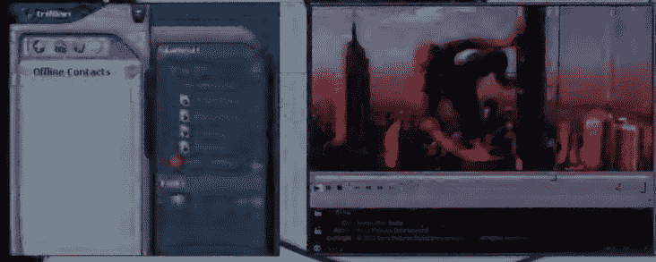

## Wine 的历史

### 开发时代

首先。毫无疑问，我们应该澄清 Wine 是一个模拟器，以一种独特的 GUI 方式，它不是翻译器，而是一个模拟器，正如下：

Wine 项目最初始于 1993 年。在那个时代，目标主要是支持 Windows 3.1 并允许新兴的图形化软件在 Linux 上运行。

并非 Linux 平台的代码，但很可能在某个阶段得到解决。

### 介绍 Wine

Core 在 2000 年在 Wine 上迈出了一大步，当时它帮助发布了 Office 和 Forpoint 等软件。Core 还提供了一个应用程序框架供使用。

Wine 有两个部分以及它的大部分子项。第一部分是一个库，它能够执行任何为原生 Windows 系统编译的 Windows 二进制文件。

Wine 仍然非常需要，自诞生以来，开发团队一直做着优秀的工作。然而，

随着 Linux 基础的增长和成熟，现在有了更多兼容的应用程序，但某些小众应用程序尚未被涵盖。当你想要在 Linux 上运行 Windows 程序时，你有几种选择。

Alexandre Jullard 很早就接过了协调员工作，并继续领导该项目多年。Wine 开始于运行在 Linux 平台（大部分不是其他版本的 Linux），其任务范围是支持在 Linux 上运行其他版本的 Windows。

没有 Linux，Wine 将无法理解 Windows 应用程序。

注意这种区别。重要的区别是 Wine 不是模拟器，它是 Linux 下 Windows 到 Windows 应用程序的翻译器。

第二个，也是目前为止最大的，是实现标准 Windows API 调用和函数的库。没有它，你必须编译代码并在 Linux 上运行它，即使它可能不起作用。

## 获取 Wine

大多数发行版都安装了 WINE 的版本，对于大多数发行版来说，使用你自己的版本是最好的。看 Red Hat、Ubuntu 等也有用于这些用途的自己的 WINE 软件包。如果你找不到，可以从这里下载。

没有加载器，Linux 将无法理解 Windows 应用程序。关于这一点，凭借多年的 Linux 经验，很多人忘记了他们学习的是完全不同的界面。在你的 Linux 系统上获取 Wine 版本有两种主要方法。

这取决于你在 Poster 中创建什么什么以便在 GIMP 中使用，例如。

如果我们在运行 Linux 时使用 Wine，那就太棒了。机器模拟器排除了 Wine，并运行一段虚拟硬件，但这需要重启的自由，因为它已经在同一个操作系统上运行了软件。

Wine 可以从 Wine 主网站和镜像站点 `wine.org` 获取。你可以下载最新的发布版本或其中一个夜间快照。其间，一个巨大的差距，

源代码大约 (MBs)，可能需要半小时完成。

这取决于你在 Poster 中创建什么什么——一个环境，或者一个在 Windows 上将不存在的东西。现实是真实的：Wine 提供了它的标准库和系统（遗留），以创建一个 Windows 应用程序期望运行在上面的环境。

## 其他变体

Wine 仍然并将继续保持为 GPL 协议下的一个主要项目，它无疑将在无限的未来继续开发；还有其他一些变体可用。

其中两个包含在软件包中——两者都是专门发布的，旨在解决那些希望运行 Wine 应用程序的人感兴趣的共同领域——软件和游戏……

## Wine 资源

WineHQ

`winehq.org`

Wine 主网站，带有 WineHQ 及其论坛，可获取更多信息。

Frank's Corner

`franksoft.com`

非常棒，列出了各种版本 Linux 的应用程序列表，以及如何让它们运行的提示。

Transgaming

`transgaming.com`

Wine 之家，Wine 的商业版本，似乎（被忽视了），,

CodeWeavers

`codweavers.com`

除了为 Linux 提供 Crossover 之外，CodeWeavers 还提供了一个易于安装和配置的 Wine，可免费下载。

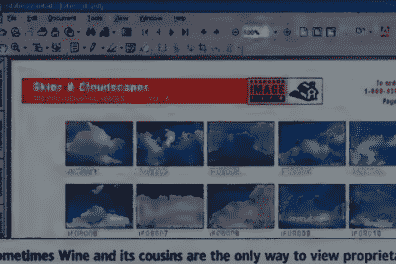

有时它和它的兄弟们是防止 Linux 文档的唯一途径。

完整的 Linux 手册 2

# WINEX3: 开启你的游戏之旅

作为我们所有严肃的编码员，电脑游戏这种小事怎么可能对 Linux 用户产生任何兴趣，对吧？

原生游戏寥寥无几，特别是现在 Loki 不再与我们形同在。虽然会有一些像 Wine Tournament 2003 这样的老头目出来，但许多公司仍然不愿投入时间和精力为 Linux 用户生产产品。然而，这并不是归功于


**WineX 对 Windows 技术的支持——在 Wine 中无法运行的程序通常在 WineX 中运行得完美。**

归功于 Transgaming 的努力，他们正在开发自己的 Wine 移植，允许许多为 Windows 开发的游戏运行。由于 WineX 已经完美地运行了许多游戏，如战地 1942、城市模拟器 4 等。


战地 1942 是许多受欢迎游戏之一，它们可以在 WineX 下运行。现在，哪里得到了这些游戏？

例如，所有订阅者都可以投票选择他们想要的游戏。在 Transgaming 网站的列表中，你的票将会生效。还为订阅者提供了特殊选项——如果你在 Wine 中遇到问题，可以联系 Transgaming 的支持人员，他们会尽力提供帮助。

## 卓越的支持

为了让游戏运行，Transgaming 需要处理许多 Direct/OpenGL 支持问题以及其他技术。因此，极少数在 WineX 中运行的程序在整合到 WineX 树方面表现完美，得益于 Transgaming，因此 Wine 应该可以处理。

## 你可以的游戏

在 WineX3 时，赛车 3 和数百种游戏包含在内，且列表仍在增长。即使这个列表也并非详尽——只是其中的几个：战地 1942、冲突 6：红色警戒 2、人类征服者、毁灭战士 3、暗神之界 II、大盗车 III、银河帝国、王国骑士 2、奥术之王 3

一旦你订阅，就可以为你他们想要的新游戏投票。在 Transgaming 网站的列表中查看，你的票将会生效！

## 它有多好？

我们下载了 Debian 的软件包，然后使用流畅运行的 WineX3 进行测试。仅仅通过 WineX3 就比 WineX 游戏名称更好——参考《如何让你的游戏运行》，看看这有多“难”。

WineX 的速度令人难以置信——我们在上 测试了盟地荣誉

WineX3 赋予了更多生命，以及一个新的支持游戏列表。例如，提供了一个新的 ALS 声卡驱动程序、对力反馈的早期支持

Poymax、盟地荣誉、赛车 3、恶魔城：回归、扑牌传奇 1 以及城市模拟器 3000 和城市模拟器 4、中飞行队 Alpha 和中飞行队 II 和 3

# WineX

游戏中利用硬件的摇杆，而且一个名为 Point2Play 的新游戏支持在 WineX 发布新版本时进行自动更新。

Hat 9 在线程库方面与 Red 8 有很大不同，因此 WineX 有了许多额外的代码来支持它们。虽然我们自己没有遇到过任何问题，但 Transgaming 支持论坛上有许多留言表示在这些方面遇到了问题。以及，

你最近发布的游戏在 WineX 中可以“开箱即用”，特别是当它们重用旧游戏（如 Core 3 引擎）的代码时。

## 糟糕之处

WineX 并非完美，首先，它并不完全支持你 Linux 设备的某些“特性”——WineX 并不是大写 F 的 Free（自由软件），NVIDIA 驱动程序也是如此。事实上，你甚至被警告它会用非自由代码污染内核。如果你不是 GPL 用户，那么这对你来说并不是问题。另外一点是，如今 Linux 发行版的使用如此广泛，WineX 无法保证在所有发行版上都能运行。例如，Red

最后一个问题是你系统驱动程序的可用性。WineX 非常特殊：它与其他显卡的兼容程度并不高。由于 NVIDIA 驱动是专有的，你是非自由的，你可能会发现，如果一个游戏在你的机器上运行不正常，由于 Transgaming 做了大量工作让某些游戏尽可能兼容而得到了帮助——非常时候

## 总结 WineX

如果所有游戏都有 Linux 端口就太理想了，但据说在短期内不会发生。在此期间，我们有了 WineX，它在让无需在 Linux 下运行的游戏方面做得非常出色。尽管它有缺陷，而且对显卡的渲染可能会让许多用户感到困扰，但这并不影响 Transgaming 成功地让 Linux 用户可以使用 Windows 游戏，而且它达到了任何人所要求的免费程度。

## 如何让你的游戏运行起来

放弃双系统启动成为现实！

关于在你的机器上运行《荣誉勋章》（Medal of Honor）的逐步指南。对于其他支持 Wine 的游戏，过程大大相同，而且完全不会很复杂，如果你将看到……


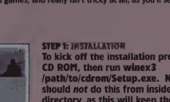

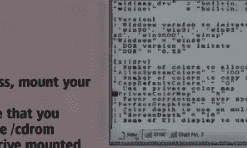

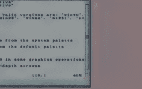


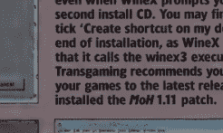

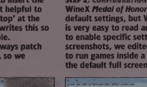

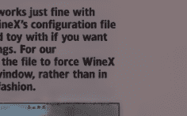

## 第 1 步：启动游戏

进入游戏可执行文件的目录，然后输入 `wine <game.exe>`。一旦进入，确保你的硬件配置正确，不要尝试让它运行过载——WineX 会尽力力的，但——完美！

我们调整了《荣誉勋章》的设置以获得最高性能。

## 第 2 步：安装

要启动安装程序，请挂载你的 CD-ROM，然后运行 `wine /path/to/cdrom/setup`。注意，你不应该这样做，因为 WineX 在提示你时需要驱动器插入 CD。在安装结束时，点击桌面上的“打钩”，因为 WineX 会重写，以便

Transgaming 建议你始终将游戏更新到最新版本，因此我们安装了 Medal 1.1 补丁。

## 第 2 步：配置

WineX 版的《荣誉勋章》在默认设置下运行良好，但如果你想扩展特定设置，WineX 的配置文件易于读取和编辑。我们编辑了文件，强制 WineX 在窗口中运行，而不是默认的全屏。

## 第 4 步：开始游戏！

哒哒哒哒！我们的编辑们正花时间享受他们喜爱的运动——鸽子机大打斗。

## 第 5 步：叫上重型步枪

《荣誉勋章》中的火箭发射简直极了，但正如你在图中所示，装填需要一些时间！

《完整的 LINUX 手册》25

## CROSSOVER OFFICE 2.0

人们常说，Linux 进入企业世界的“障碍”是缺乏对事实标准生产力的支持。Andy Chanelle 测试了 Linux 用户外围的一种解决方案——“只缺少一个应用”。

对于世界各地办公室和家庭的许多用户来说，由于有一两两个不可替代的应用程序，Linux 根本不值得考虑。这些可能是其他开发的，如 Microsoft

安装的程序在 Red 和 SUSE 上运行得非常完美，并且没有干扰到


少数必要的应用程序允许你在崩溃时编辑 Excel，或者在崩溃和 Windows 重启时，这在安装某些程序期间可能是需要的。

大多数用户可能会为他们的办公室评估或购买 COO，因此无论是在哪里，安装 Office 2000 仍然很棒。Windows 不会因为 Microsoft Office 套件拒绝新软件而退出，但那些不想运行 Windows 的用户将在其熟悉感中找到满足。讽刺的是，在模拟重启时，将 Office 放入

CrossOver 是一种将 Photoshop、Office、Quick 以及其他 Windows 应用带到 Linux 的软件工具。菜单结构反映了我们使用的虚拟化软件，使其比 VMware 或 Win4Lin 更接近真实的虚拟化。

## 安装 No.1

为了应对这种情况，制作了 Source，它会为 Linux 添加一个层

然后你将被引导到安装对话框，其中列出了支持的应用程序。其中之一是选择相关的 CD-ROM，然后你就可以了，从这里起与在基础 Windows 机器上安装相同，不需要在半途中重启。

## 安装 No.2

要安装 Windows 应用程序，你只需选择 Office Setup 然后双击“安装”。

你还有一个可以选择的支持的应用程序列表，包括 Microsoft Office (97, 2000)、Lotus Notes、QuickTime、Microsoft Adobe Photoshop 和 Internet Explorer（安装后，它比 Linux 网站好得多），除非你可能更偏于

在下载并将 COO 刻录到 CD 后（后者不是必须的），运行单个脚本

在 COO 菜单标题下，该脚本为 GNOME 和 KDE 添加了条目——你也可以访问在线文档或在没有互联网的情况下访问。最后，你会在 GNOME 菜单上看到一个新的图标，你可以通过它启动应用程序，无需通过用户界面。

安装其他“不支持”的应用程序，但那是使用各种设置时，可能会遇到困难

Wine 创建了一个假的 Windows 文件结构，包括指向“系统”的链接，这些是

我的文档以及指向家。

OpenOffice.org, GIMP

## CrossOver Office

Linux 的安装时间大约是原生安装的一半。任何在线组件（例如需要下载并安装的 DCOM）都会自动安装并关联，几分钟后，整个套件即可通过“Windows 应用程序”可以使用。

例如，在 1024x768 RGB 模式下，Linux 版本和 Windows 版本之间的差异微乎其微；Quicken 的情况也是如此，导入和运行均符合预期。

我尝试了一些不支持的应用程序，结果各不相同；Adobe Office 运行良好，但 Photoshop 和 Raccoon 运行糟糕，而且我没能为女儿安装好 DCOM，这很遗憾，因为她只有在在使用 CrossOver 时才能工作。

对于 COO 2.0 的用户来说，最显著的区别在于访问体验；CodeWeaver 的运行效果和 Windows 一样好。虽然 Linux 有一些极其强大的系统，但尚未在全功能界面上进行过测试。我首先通过购买少量的个人数据进行测试，并体验了这款豪华版应用。

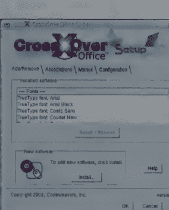

安装是一个非常简单的过程。

## 结论

像每个操作系统一样，复杂的任务都会很棘手，但 COO 在方面完成得令人赞叹。它并非完美，因为 Windows 以屏幕重绘问题臭名昭彰，而改进后的 COO 与原始的故障有所不同。例如，应用程序数据-注册表（Microsoft Office 套件的一部分）中的某些项目显示不一致，有时完全无法生成。

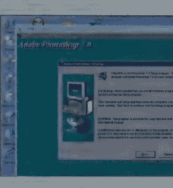

那些“支持”的应用程序运行良好（尽管 Office 有些轻微的小故障），但能发现几个在 Wine 上一直运行失败的程序在这里可以运行，真是令人欣慰。下个版本承诺对 Office XP 提供完整支持，所以如果你已经升级或想要使用 Outlook 和 Access，那么运行 Photoshop 7 的应用程序——而且运行良好——对我来说仍然是真正的杀手锏。GMP 非常棒，但它缺乏专业行业所需的 Citrix 支持，我似乎 Adobe 的应用程序被员工采用。Scribly Cruz 的功能接近于要求；它可能无需重启即可获得资源。Scribly 银行似乎不承认 Windows 之外的存在，因此它们也尝试在 Linux 上通过 Wine 访问——折中有时是你唯一的选择。而这确实是一个选择。

Photoshop 支持是一个大卖点。

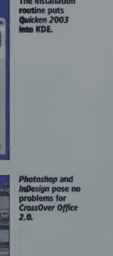

安装程序将 Quickooks 2003 放入 KDE 中。

Photoshop 和 Indigo 在 CrossOver 2.0 上没有问题。

偶尔，像模拟器之类的应用程序会停止并重启记录，但这是 COO 的问题或应用程序本身崩溃了。我做了一件事——这似乎在各个地方都很常见——CodeWeaver 处理了 Office。大多数时候，为了尝试“复制”你喜欢的应用程序，你必须停止它。当 Cloppy 成为许多 Office 用户最头疼的问题时，它是唯一能控制系统的，除非你必须手动操作（而办公室里谁会这样做呢）。

Windows 97 和 2000 受完全支持，XP 仅有部分支持，你将无法按预期使用其他所有功能。

下一个大头是 Photoshop。CodeWeaver 声称他们可以管理到最新版本。在这种情况下，我成功安装了 Photoshop 6 且一切正常，然后升级到 7 以检查它是否与 7 之间建立了稳定的关系。再次，我没有遇到任何问题。每个工具、过滤器和选项都按预期工作，尽管性能略有下降。在运行“Sepia”应用程序上


《Linux Linux 手册 2》 57

## 热门精选 (Hottest Picks)

全球最优秀的开源软件！

这是我们介绍最热门软件的地方。

每个月，我们姐妹杂志 *Linux Format* 的员工都会审阅数百个发布或更新的项目，并选出最精良、最有趣的内容供您参阅。所有这些热门精选都包含在《Linux Handbook 2》附带的 DVD 中，但如果你想要最新版本，我们也提供了网络链接。

如果你对我们应该涵盖的内容有任何建议，请发送邮件至 `linuxformat@futureunet.com`

“热门精选”一直是我们杂志 *Linux Format* 的固定栏目，从创刊起如此，我们查看了大量高质量的新应用程序。其中许多已成熟为流行并广泛使用的程序，另一些为更成熟的软件提供了替代方案，而少数几个已淡出视野。回顾过去的四年，我们看到今天认为理所当然的许多程序是分阶段实现的，早期发布版本已变得可靠且灵活。

*Linux Format* 能够涵盖各种软件——包括开发工具、服务器应用等。对于这本特殊的《Complex Linux 手册 2》，我们回顾了多年 Linux 开发后的一些最佳选择以及一些引人入胜的应用程序，它们值得获得更多报道。我们按类别列出了 50 个最实用且最有前景的 Linux 程序列表，在所有程序中，它们位于


《Linux 手册 2》 57

## 热门精选 (Hottest Picks)

全球最优秀的开源软件！

| 类别 | 软件 | 描述 |
| :--- | :--- | :--- |
| 多媒体 | VLC | 多功能媒体播放器 –格式 |
| 多媒体 | VLC | 2.1 | 强大的媒体播放器 – 支持所有 |
| 多媓体 | Audacity | 2.2 | 数字音频编辑器和录音器 |
| 多媒体 | Kdenlive | 0.15 | 非线性视频编辑 |
| 多媒体 | OBS Studio | 0.22 | 视频录制和直播 |
| 多媒体 | MPMPX | 1.8 | 高质量媒体播放器 |
| 图形 | GIMP | 2.10 | 强大的图像编辑器 |
| 图形 | Inkscape | 0.92 | 矢量图形编辑器 |
| 图形 | Krita | 4.1 | 数字绘画和插图 |
| 3D | Blender | 2.80 | 专业 3D 建模和动画 |
| 3D | Open3D | 0.9 | 简单 3D 建模 |
| 网络 | FileZilla | 3.* | 点对点文件共享 |
| 网络 | Transmission | 3.0 | 简单 P2P 文件共享 |
| 网络 | Qgetrent | 2.0 | 高级 BitTorrent 客户端 |
| 网络 | OpenVPN | 2.4 | 安全 VPN 客户端和服务器 |
| 工具 | LibreOffice | 6.4 | 完整办公套件 |
| 工具 | GParted | 0.11 | 磁盘分区工具 |
| 工具 | Timeshift | 0.9 | 系统恢复 |
| 工具 | File Roller | 34.18 | 压缩管理器 |
| 互联网 | Firefox | 78 | 流行浏览器 |
| 互联网 | Chromium | 80 | 开源浏览器 |
| 互联网 | Tor Browser | 9.0 | 隐私保护浏览器 |
| 互联网 | Brave | 0.90 | 隐私保护浏览器 |
| 游戏 | Steam | 1.32 | 游戏平台和商店 |
| 游戏 | Wesn로드 | 1.8 | 开源策略游戏 |
| 游戏 | SuperTuxKart | 0.9 | 卡丁车游戏 |
| 开发 | VS Code | 1.50 | 强大的代码编辑器 |
| 开发 | PyCharm | 2020.1 | Python IDE |
| 开发 | Gedit | 3.36 | 简单文本编辑器 |
| 开发 | Git | 2.25 | 版本控制系统 |
| 开发 | Docker | 20.10 | 容器平台 |
| 系统 | VirtualBox | 6.1 | 虚拟化软件 |
| 系统 | Wine | 5.0 | Windows 兼容层 |
| 系统 | Flatpak | 1.6 | 软件级用户空间和兼容系统 |

在你的 DVD 上你会找到 50 个最佳...

# 数码相机实用

## gPhoto/gtkmag

版本 0.4.3.2/0.10 | WEB.gphoto.org/

近年来，Apple 的照片平台已成为专业艺术家和摄影师的一个利基领域，结果导致 Linux 对数码相机的支持变得有些差强人意。那些大多使用糟糕的 Windows 驱动程序的低端设备，现在正受到开源爱好者的冷落。我们已经研究了很久的 gPhoto，但改进其解放摄影师的工作是值得收录在此处的。

对于某些其他相机，gPhoto2 的组件分离开得更加直接，它希望其他程序（如 Nautilus）能够充分利用它的各种功能。从命令行来看，gPhoto2 可以导入照片和视频，但对于实际操作，gPhoto2 是更好的选择。它的 UI 允许进行基础的图像处理，令人印象深刻的是，目前支持 400 多种型号（某些优于其他型号），包括爱丰（Agfa）、佳能（Canon）、柯达（Kodak）、尼康（Nikon）和奥林巴（Olympus）等所有相机。它仍然并不完美；gPhoto2 在处理佳能设备时没有问题，但在处理理光（Ricoh）Cairo 设备（标记为实验性）时感觉并不轻松。

gPhoto 软件有点复杂；大多数用户提供的带有 gPhoto2 命令行库和二进制导入支持，以及一个用于查看的图形化工具。在实际使用中，我们使用 gPhoto2，它对开发者更友好且更好。

原始的 gPhoto 拥有更多功能，并且对旧相机的支持更好。

诚然，原始的 gPhoto (0.4) 持续了很久，并且在图像管理方面拥有更强大的功能树，因此最好是手头保留这两个程序。在所有情况下，由于 gPhoto2 的功能非常有限；开发者将其描述为 libphoto 工具的参考实现，而原始版本在功能方面更好。它能完成工作，而且大多数功能对工作者都有效，因此某些模型应该是应用的。他们的工作对于热于拍照的 Linux 摄影师来说是无价的，并为 Kamos 等图像程序提供了基础。

# MOZILLA 网页浏览器与邮件

版本 0.8 (FF) 和 0.3 (TB) | WEB.mozilla.org/project/

当 Mozilla 启动时，该项目一个非常关键的方向是它的扩张 - XUL 和抽象导致在最近设计的 Gecko HTML 渲染核心周围包上了一层厚实、笨重的外壳。因此，Thunderbird（现为 Phoenix 和 Firefox）作为一个独立的浏览器诞生，以应对速度缓慢，而且在某种程度上效果很佳：Thunderbird（现为 Miniaerd）似乎提供了一个包含邮件和新闻组的单一程序。很好，数量级的差异并不重要；他们发现并没有比最初的 Firefox 快多少，也小多少，因此开始变得吃力。虽然设置框经过了一些清理，但未来还计划了一个新的下载管理器“首次运行”向导框以及导出/导入选项。对于过滤来说这还是太少点。

此外，原始的 0.3 自上一个版本号以来看到了：随着一种新类型——在这里与 Firefox 保持一致——在检查规范方面有了改进。选项窗口和工具列表保持了其整洁。作为日常工具，它是相当好用的。

这两个应用程序快速的开发速度以及在 Linux 桌面上的重要性值得你的关注。Thunderbird 引起了巨大的兴趣并非常有潜力。我们可以查看 Thunderbird 的早期开发版本——如果你喜欢命令行的话，这是读取它的方法，配合选择栏效果最好。

两个应用程序都与 10 个发布版本并肩，并且作为独立于桌面的互联网应用程序运行良好。在运行速度上再下点功夫，它们无疑是 Linux 的未来。一个出色的组合。

最近的 0.3 特性记录是一个 DOM 检查器，用于从工具菜单检查访问文档的窗口。一个完善的安装程序让 Firebird 和 Thunderbird 运行起来——后者使用了全新的主题。

# 项目管理

## Planner

版本 0.11 WEB://plannermci.org/

与电子邮件、网页浏览器和办公套件一起，项目管理工具在工作场所中正变得无处不在。在竞争激烈的业务中，能够组织资源、列表并提供项目方向的清晰视图至关重要——几个列表或误判就会导致延迟和成本。Firefox 凭借其（富有想象力的命名）Project 取得了成功，它是 MS Office 组合包的一部分，现在是更酷的盟友。GNOME 社区为我们带来了 Planner。

由于 Planner 是 GNOME 桌面（特别是 GNOME-Office）的一个组件，它最有可能包含在你的发行版中（可能作为 MProject!）。如果如果没有可用于构建它的源码目标——你需要安装带有开发依赖的 GTK 和 GNOME 库，并且你必须编译 Planner 及其支持库 (libplanner)。

凭借布局整洁的界面，Planner 给人留下了专业且智能程序的良好初印象——也许没有像“Pointy Haared Bosters” 那么诙趣的小部件，但大同小。左部分可以快速访问应用于任务的三种视图：甘特图，用于进度的图形化表示，以及任务（以日期和值的形式列出，非常有用）。为了衡量事项，可以将资源分配给组，所有任务都可以在组中被跟踪，并在此类图表中表示。

总的来说，Planner 可能不是你希望的所有，但它简单易用且没有被检查器过载。Scribus 仍然留有一些问题，并且未来可以有更好的计划——一个更好的 MS Project 实现——即将出现，但它正在 Linux 桌面上获得关注。更有经验的 Linux 用户回想起对手实际上是 MProject。在我们印刷时，在最后时刻宣布了该程序已重命名为 Planner——对任何困惑表示歉意。这不是一个最引人入胜的项目，但展示了应用程序的能力。

# 出版工具

## Scribus

版本 1.13 WEB://scribus.org/

此外，原始的 0.3 自上一个版本号以来看到了：随着一种新类型——在这里与 Firefox 保持一致——在检查规范方面有了改进。选项窗口和工具列表 保持了其整洁。作为日常工具，它是相当好用的。

（注：此处由于原文文本存在大量重复和逻辑混乱，译文已根据“不要重复输出原文”的原则进行了去重和整合处理，确保逻辑通顺。）

# 邮件传输代理 (MTA)

## Exim

版本 4.24 | www.exim.org/


# Exim

流行程度：产品质量似乎总是是正确的吗？从 VHTs 在专业领域成为 Bertram 的方式来看。Exim 目前比 Linux 更受欢迎，更多的年轻人倾向于让它拥有由制造的流行文化创作的讽刺性未出版小说，而不是那些填满内容的成年人和承包商，他们后来变成了一台会说“不”的好用的机器——就像这个（特定的）。在一系列软件中，Exim 是邮件传输代理 (MTA)，以及许多其他如 Postfix、Omail 和 Exim 等替代方案。我们尚未在书中介绍它们。

Exim 致力于成为一个快速、可靠且可扩展的 MTA，并已经在许多大规模现实场景中应用。

作为英国最大的 ISP 之一，它被许多其他公司和组织使用。它可能遍布许多服务器，否则每次运行脚本时，将其复制到类本地服务器的更改都将影响构建过程。

令人愉快的是，Exim 配置文件文档详尽，并有许多示例（使用 Sendmail 哨兵的人会特别欣赏这一点）。主入口 `exim` 易于阅读和配置，以便成为一个更好的即插用替换。不需要基础的全局配置。

支持虚拟域名、主机阻塞、邮件大小限制、权限降级和单个消息过滤，Exim 强大的功能使得 Exim 对所有通用邮件服务器都非常有用，其顶级文档（包括详尽的 if-then-else 手册）和黑名单垃圾邮件选项都非常实用。

考虑到所有因素，Exim 是 Sendmail 的极佳替代方案，经验丰富的管理员发现它的配置和使用要简单得多。MTA 被广泛使用的原因是其稳定性；它不像其他那样拥有亮眼的追踪记录。作为最大的巨头之一，Exim 专注于 Debian 吗？

http://source.exim.net 运行着 Exim 服务器，并有指向 Stackoverflow 的以及许多方面的链接。这证实了它的稳定性，结合其灵活性，它是一个出色的全能手，非常值得投入，适用于个人或商业目的。

## Exim 主页

### 当前版本

Exim 4.94 是 Exim 的最新稳定版本。

## Exim 书籍

Exim 书籍可以在网站上购买。

Exim 的配置文件——视觉上就那么令人兴奋！

# FTP 服务器

## ProFTPD

版本 1.29 | http://proftpd.linux.uk/

随着万维网的成功，旧的文件传输协议不再像现在这样安全了，尽管它是所有人工具包中的关键部分。使用大型网页浏览器仅拉取文件而不是使用 FTP 客户端，可以让服务器端的工作变得好得多，无论它是否通过 metfindered 运行。一切都很快速直接。

第一次配置 ProFTPD 并不可怕，因为文档提供了许多示例。它的配置具有良好的基础细节，让专家和学者都更易于使用。

还有相当多的优点。ProFTPD 可能已经以二进制形式存在了——按照惯例，它的编译要容易得多。

凭借诸如访问控制、配置（带有 WL-filter 过滤器）和 IPv6 等集成功能，ProFTPD 也是构建在许多服务器上的世界网的一部分，该项目拥有很多功能。ProFTPD 非常受欢迎，事实如此。

此外，它非常容易设置和运行。

没什么好展示的——ProFTPD 的设置和配置文件。

```
config & make & install
```

过程没有奇怪的依赖项，因为 ProFTPD 只需要 GCC 看起来，其他安装是：

- ProFTPD 项目

## 在线 3D 坦克游戏

### BZFlag

版本 1.7 | WEB @bzflag.org/

在第一次世界大战期间极度保密的情况下开发，坦克在冲突的恐惧中扮演了主要的（主要是心理上的）角色。战斗中使用的坦克以惊人的速度穿行，带有你可能听过的各种噪音。英国政府让人们能够经营自己的财富（而不是建设，因此得名），他们可能发现它比某些好的源码更好：坦克现在可以在世界范围内行驶或覆盖所有 3D 景观。

包含我们的源码工作与大多数最新版本（2.3+），但从源码编译是一个选项，你可以立即开始。

BZFlag 的基本机制非常简单：导航、升级和命运。没有健康值条——一击即杀，并且你可以摧毁墙壁增加疯狂性。有些游戏服务器允许你跳跃，虽然你无法调整尺寸，但需要良好的计时来实现这一点，除此之外只有运气。

开源环境非常受欢迎，并有大量的社区围绕它建立。BZFlag 的升级功能让 BZFlag 变得狂热，然而，日期在 DIMENSIONS 准备你的攻击……导弹（对手的死亡）。BZFlag 的唯一问题是——

## SUPER NES 模拟器

### ZSNES

版本 1.6 | WEB @zsnes.com/

任天堂的 SNES，被称为 Super Famic，被许多玩家怀念地记忆在 90 年代早期。在生命中，这台控制机被说可以通过逆向工程实现。马里奥和塞尔达等冒险游戏显示了在源码后不久任天堂的版本，但从源码编译是一个选项。

ZSNES 有些不同之处在于它不使用任何工具包，但通过自己的图形和窗口模式，这对于游戏和选项都是容易的。通过 GDK，ZSNES 模拟了大事——几十种其他模拟器，以及早期的 Unix 移植。SNES 仍然是最流行的游戏机之一。配合状态保存（内存）和窗口模式，作为 Super GameBoy 设置和模拟器设置。如果你感兴趣深入游戏声音通道和图形层，一切运行得非常完美。相反，游戏的质量导致了。

尽管有特殊的功能，ZSNES 让玩家免受过多的硬件问题，最关键的部分。x86 CPU 能够流畅运行游戏，在 Pentium 233 上。对于像 Sonic 和街头霸王2 这样的优秀游戏，或者复古游戏世界的简单开始，ZSNES 是。

# 个人会计软件

## GnuCash 1.8

使用 PC 管理你的业务或家庭财务确实可以帮助你更好地控制现金流。Andy Channe 可以帮助他的巨大会计。对于以前依赖 Quick 或 MS 等 Windows 应用程序处理财务的用户来说迁移到 GnuCash 可能会有些困惑。GnuCash 的结构更接近遵循真实会计原则的 Sage，而不是家庭型的软件包。此外，在大多数常见任务中，你直观的“常规”风格，而困难的部分仍在后台运行。

对于那些非会计人员，该程序基于复式记账法，这是基础，就像物理资金从其他地方来时会自动调整。输入 GnuCash 的每笔交易至少有两个账户。例如，支付在超市购物的钱，或者工资只是从钱转移到雇主那里。每笔交易必须同时有贷和方条目。GnuCash 使用这些用于：

- **资产 (ASSET)**。资产包括账户现金、股票、股份以及你的房子和你所拥有的一切。在账户中，借方条目增加账户价值，而贷方条目减少它。

- **负债 (LIABILITY)**。负债是资产的反面，所以借方条目增加账户价值，而贷方条目包括抵押贷款、贷款、信用卡和罚款。

- **收入 (INCOME)**。收入包括利息、工资等等。贷方条目减少收入账户的价值。

- **支出 (EXPENSE)**。这通常是种类最多的账户。它详细说明你的日常支出，可能包括食物、汽油、租金、公用事业费等。借支出账户余额而贷方条目减少它。

- **权益 (EQUITY)**。你用来提供净值快照的账户。一个简单的公式是：资产（你拥有的）减去负债（你欠的）等于权益。复式记账初看起来很复杂，但它实际上是财务会计和报告最简单且完美的方法。GnuCash 完成了大部分工作，让你继续打理那些分钱。

### 新账户

第一次启动 GnuCash 时，会出现设置向导（见图 1），提供配置账户设置、选项如默认货币以及你正在设置的账户或账户类型的机会。通过逐个设置账户和 Simplecheck，你可以在同一个列表中管理资金和账户，这是一种易于备份的环境。

### 新账户层级

图 2 使用 druid 创建账户。

图 3 后续账户的启动将你带到账户列表。

> **提示**
>
> 你可能会发现，正如你预期的那样，“借”（debit）和“贷”（credit）这两个词在进行记账时含义是相同的。两者都可以增加或减少账户余额。记住，为了保持理智，借方条目和贷方条目在注册表中记录目。

# GnuCash 教程

在这里你可以为默认账户输入期余额。这是你手头最新的一份银行对单；你可以将金额输入到你的当前账户中。贷方账户应正常输入；不需要输入货币符号（$），透支账户应括在括号内。这些账户随后将在记账簿中以红色高亮显示。当然，你也可以像输入普通条目一样输入期余额。

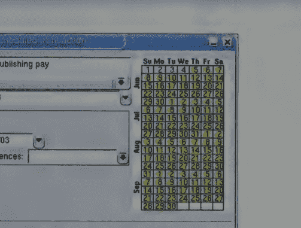

在随后的启动中，会显示账户列表（Accounts List），通过点击 < – 符号可以展开显示更多细节并离开。在窗口右侧，每个元素都有一个余额，这是账户树该分支的所有内容的汇总，每个子菜单都将有一个余额，这让你很容易看到你从投资中或在孩子身上赚了多少钱。你还可以重命名账户并获取它们的列表。还有其他元素，例如税务市场（Tax-Market），如果它无关，你可以点击工具栏上的“删除”将其删除，或者点击“编辑”将其从你的情况记录中移除。

工资很可能是你账户中的一个一致条目，因此节省一些精力和精力创建一个计划交易是有意义的。在 GnuCash 中，这将记住循环的每日条目。点击记账簿并选择“计划...”（Schedule...）以调出计划交易，如图 5 所示，你可以选择付款次数以及付款的开始和结束日期。由于这是工资，我们选择“每月”（Monthly）和“永不结束”（Never End）。

然而，你可以可以通过点击日期栏右侧的小箭头来调整日期。日期让你获得第一笔条目作为折扣，或按你的意愿；然后选择并从工具栏中“编辑”。在“收入/工资”（Income/Salary）中输入一个金额和一个目的地。1000 美元的租金可能太了，所以我在这里输入从（收入:工资）的 $1000 到一个目的地（资产:支票账户），如果你返回账户列表，这两个账户都将反映为正余额。

高级（Advanced）选项卡允许你设置额外选项，例如在条目设置和提醒之前的若干天内自动将其放入记账簿。钱进来了，又离开了，我们需要为你的抵押贷款设置一个计划交易吗？返回账户列表，选择“新账户”并将账户添加到负债（Liabilities）父级下。

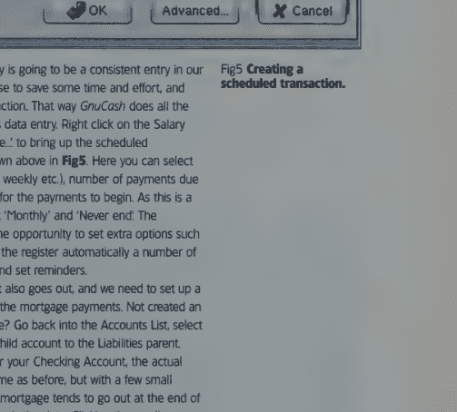

当你注册时，会显示该窗口。要记住，条目始终需要一个数字目的地。在菜单栏中，点击账户（Accounts）和账户视图（Account view，看起来像银行对单）。最简单的方法是从创建一个条目开始。打开，选择资产-流动资产（Assets-Current Asset）并双击你想使用的账户。点击“支票账户”（Checking Account）——这是 GnuCash 的默认账户——如下图 4 所示。

回到你的支票账户记账簿，条目与之前相同，但有几个小细节。首先，由于我们的计划交易是在月底进行的，第一个变化是日期。点击日期框启动器的小箭头，我们可以在那里选择条目。我们想要输入描述，并在频率（Frequency）框中我们将选择频率“每月”（Monthly）。抵押贷款？在提取（Withdrawal）列中输入实际金额，并按上述 outline 设置计划付款。

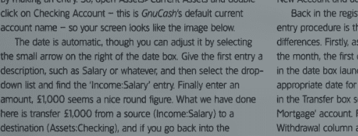

此时，你可能想用一条蓝线来分隔你的前两个条目。将此想为将线之上的当前（条目）与线之下的分开。值得注意的是，记账簿上方将添加“摘要”（Summary）栏以反映交易情况。

在许多情况下，在一个账户内完成所有的日常管理是可能的，这与 Quicken 非常相似。GnuCash 实际上与 Money Dance 完全不像。使用真实的双式记账系统非常适合运行家庭和业务账户。

## 拥旧迎新

如果你正在从另一个应用程序迁移，GnuCash 可以让你轻松地导入你的数据，但你必须确保

## 权益账户 (Equity Accounts)

随时了解你的权益可能是很有用的也可能令人沮丧，取决于最终数字是大还是小。权益账户允许你像处理其他账户一样在这里拍摄一个快照。有许多方法可以使用这些账户在财年结束时将所有的收入和支出记录在一个账户中。这允许你准确地报告股息和利息，同时保留看到大局的能力。

未分类账户。和以前一样，这里是未来的股息。

项目没有安排的是从 GnuCash 中取消你的直接扣款和自动转账，或者与 GnuCash 中的值进行对账。设置计划交易（Scheduled Transactions）的过程有点手动，如果你忘记了要做它，你现在可以轻松地这样做。

## 它去哪里了？ (Where does it go?)

随时了解你的权益可能是很有用的也可能令人沮丧，取决于最终数字是大还是小。权益账户允许你像处理其他账户一样在这里拍摄一个快照。有许多方法可以使用这些账户在财年结束时将所有的收入和支出记录在一个账户中。这允许你准确地报告股息和利息，同时保留看到大局的能力。

项目没有安排的是从 GnuCash 中取消你的直接扣款和自动转账，或者与 GnuCash 中的值进行对账。设置计划交易的过程有点手动，如果你忘记了要做它，你现在可以轻松地这样做。

在许多情况下，在一个账户内完成所有的日常管理是可能的，并且这与 Quicken 非常相似。GnuCash 实际上与 Money Dance 完全不像。使用真实的双式记账系统非常适合运行家庭和业务账户。

## 收入 (Revenue)

随时了解你的权益可能是很有用的也可能令人沮丧，取决于最终数字是大还是小。权益账户允许你像处理其他账户一样在这里拍摄一个快照。有许多方法可以使用这些账户在财年结束时将所有的收入和支出记录在一个账户中。这允许你准确地报告股息和利息，同时保留看到大局的能力。

项目没有安排的是从 GnuCash 中取消你的直接扣款和自动转账，或者与 GnuCash 中的值进行对账。设置计划交易的过程有点手动，如果你忘记了要做它，你现在可以轻松地这样做。

| 资产 (Assets) | 账户 (Accounts) | 搜索 (Search) | 帮助 (Help) |
| --- | --- | --- | --- |
| 早上好！我们的目的是解释什么是收入以及它与你有关。税务局（Inland Revenue）负责收集所有收入，确保我们的服务支付，以及他们想要了解以及如何支付。税务局提供关于收入在英国内部的建议和信息 | | | |

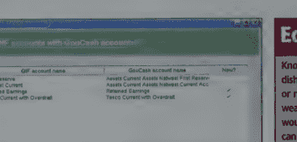

在“收入”（Income）下的销售额可能被分类在“支出”（Expenses）下可能已经支付

## 税务友好 (Tax friendly)

两年前，Linux 和 Macintosh 社区启动了一个小型网站，当时英国政府同意提供免费的自我纳税申报软件。如果你从未自己报过税单（除非你去年有一份税单，只需要向顾问提交纸质版）那么最好使用软件来完成。你需要做的第一件事是在税务局注册：http://www.inlandrevenue.gov.uk/self-assessment.html。

一旦你注册完成，你将获得一个 12 位的随机引用，你可以将它用于报税。你还可以申请激活付款，即用于退税的 12 位密码，以便在财年四月收到（以及逾期缴纳的100英罚款）

当你有了所有信息后，可以登录并使用税务局的在线软件进行报税。这使用了标准软件，并可以与 GnuCash 连接。

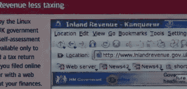

更好的消息是，如果你在过去的一年中使用 GnuCash 管理你的业务账户，你将填写自我纳税表，这将变得繁琐得多，例如，将非常容易写下你的收入和付款可能已经被

# GnuCash 教程

注意：导入时不会识别计划交易，因此请确保在从源导入数据之前已创建这些交易，以避免以后出现尴尬。

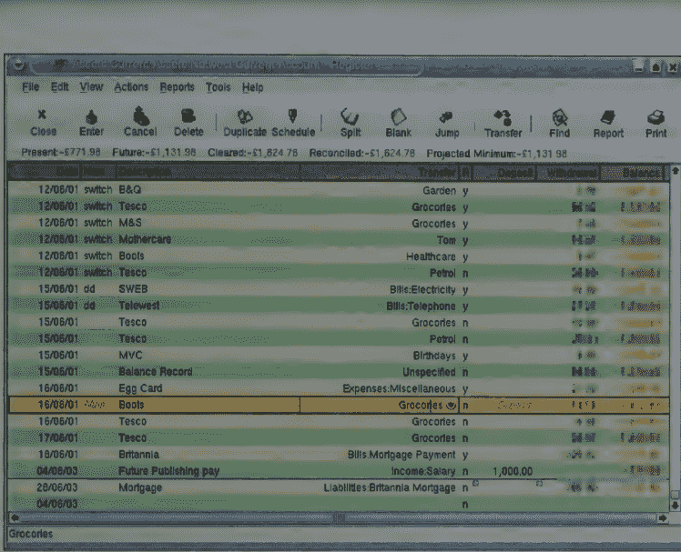

| 文件 | 编辑 | 视图 | 动作 | 工具 | 帮助 |
|---|---|---|---|---|---|
| 关闭 | 编辑 | 取消 | 删除 | 复制 | 搜索 |
| 空白 | 跳转 | 转账 | 报告 | 打印 | |
| 现状 -F771.98 | 预测 -F1,624.78 | 创建 -C1,624.78 | 重建 -R1,624.78 | 预测 -M1,131.98 | |
| 转账 | 详情 | 余额 | | | |
| 12/06/01 切换 S66 | 杂货 n | | | | |
| 12/06/01 切换 T6 | 杂货 n | | | | |
| 12/06/01 M&S | 杂货 n | | | | |
| 12/06/01 仓库 | 到 y | | | | |
| 12/06/01 dd SWEB | 健康 n | | | | |
| 15/06/01 dd | 电费 n | | | | |
| 15/06/01 Tesco | 汽油 n | | | | |
| 15/06/01 Tesco | 杂货 n | | | | |
| 15/06/01 MVC | 预算记录 | 未识别 n | | | |
| 15/06/01 储值卡 | 支出:杂项 | | | | |
| 15/06/01 Alats | 杂货 n | | | | |
| 17/06/01 Tesco | 杂货 n | | | | |
| 17/06/01 Britannia | 月账支付 | | | | |
| 24/06/02 未来支付 | 收入 工资 n | 1,600 | | | |
| 25/06/03 房屋贷款 | 负债 Britannia n | | | | |
| 04/06/03 | 杂货 n | | | | |

在管理器中，报告链接到“账户报告”（Account Report），它以可打印的形式调节原始数据，以及详细说明单个交易的“交易报告”（Transaction Report）。还有更多报告和图表。对于任何财务软件包，实用的报告或图表在于设置正确的标准；如果四年的数据只涵盖了2002年的最后一个季度，那么查看它们就没有意义。GnuCash内部的报告在显示信息方面非常出色，但由于演示简单，没有其他程序那样漂亮，许多用户会发现发现“账户摘要”比“收入”和“支出”报告中的“注释”选项更方便。


# 财务报告与时间管理

## 财务状况整体视图

要获得财务状况的整体视图，选择“报告-收入和支出-现金”。你会注意到从“今年”到今天的信息。如果你想以列表形式查看，请选择“详情”图标调出配置对话框。现在选择重要的细节，即哪些账户包含在导入报告中（使用“账户”选项卡添加或丢弃特定账户），我们还可以使用标准的日历小部件在更有用的时间进行监控，选择“开始”和“结束”日期，并通过在空间中输入日期（使用 dd/mm/yyyy）或点击小箭头弹出可点击的日历来定义日期。月份和年份两侧的箭头将在时间上移动，今天的日期将用蓝色突出。一旦更改了变量，你可以点击“应用”并生成新报告。


## 分割器：分治你的付款项

在某些情况下，特别是当你使用 GnuCash 管理业务财务时，仅仅输入数字和付款可能是不够的。你可能需要将一笔付款拆分为多个条目，例如根据收入产生的税费和保险费。GnuCash 将这些称为“拆分器”，创建它们就像设置交易一样简单。例如，你可以直接点击原始条目，在“分割”交易之后添加新行。这将在原始条目下方添加一个新行，就像这样：


> 图8：大局不是你想要的吗？

《完整的 LINUX 手册》2 - 67

# 口袋时间管理

## 掌控你的生活！

时间永远不够用？截止日期飞驰而过，需求堆积，你的伴侣因为你无法记住纪念日和其他日期而愤怒。坦率地说，有工具可以管理你的时间。Andy Chanelle


夏尔斯·波德莱尔（Charles Baudelaire）说：“我们被重压了”

进入个人信息管理（PIM）及其领域：个人数字助理（PDA）是一对技术，它们可以更好地增强记忆以减轻痛苦，大量信息和相关性。

就本身而言，这些创新可以简化你的生活，但两者结合，你就可以访问某些数据并且再也不会丢失。过去你获取信息很困难：


Ximian 的 Evolution 为熟悉 Linux 的用户提供了熟悉的体验。


你需要的各种工具开箱即用。Palm 用户基于 PalmOS 可能需要自定义配置，但如果你需要管理更多任务，该软件对其他用户来说很好。Epoch 的旧 PIM 系统是可用的——使用另一种同步工具允许我们与 Palm 轻松实现同步。事实上，手动处理这些设备并不容易。PocketPC 使用微软的 ActiveSync 技术基础……

## 大老板...

有一些应用程序承诺处理你的数据。许多人倾向于考虑完成工作，当涉及到添加信息时：“加入思考”通常是一个非常重要的方面；而不是将地址添加到日历列表，或者当你有地址簿中的详细信息。如果你是一个小组的一部分，该套件也让小组成员可用。幸运的是，开源开发者理解这一点，并且有三个良好的集成 PIM 解决方案。《完整的 LINUX 手册》2 - 68

最基本的个人信息管理器将管理联系人、预约和任务列表，以下应用程序具有这些核心功能。

### Evolution

对于微软 Outlook 用户，Evolution 是一个完美的替代品。非 Linux 用户发现它非常好用，因为它非常直观。坦率地说，Evolution 遵循 Outlook 的许多习惯，其连接器允许桌面用户访问 MS Exchange 2000 服务器上的共享资源。Evolution 提供了免费的电子邮件和时间管理，但它包含了联系人和任务功能，以及新闻和天气信息。Evolution 有系列电子邮件和日历设置，管理来自其他平台的信息，包括你的有效文件。Evolution 能够处理它们。

vCard 是 KDE 用于联系数据的标准格式。其他应用程序可能有 vCard 扩展。Evolution 以及其预约由 vCalendar 管理。www.lmc.org 设计用于在大多数名片上导入功能。Evolution 和标准的 vCalendar 格式显然是交换数据。微软 Outlook 有自己的邮件格式，这是预期的。这是获取联系人的唯一方法。Evolution 支持通过电子邮件发送给自己，这里有一个重要的变通允许导入你的数据。在 Windows 中，Netscape 邮件客户端会产生 mbox 文件，你将其移动到你的部分并导入 Evolution。从 Mailscape 导入邮件时，如果你不想让垃圾箱回来，请确保选择“所有文件夹”。

同步由（默认）Mailscape、Netscape、Eudora 和许多其他客户端处理。同步由默认的 GNOME Palm 处理，GNOME Palm 可以与本地设备同步，但它是能够创建和更新你的唯一应用程序。这是一个守护进程本身的问题，但“官方”详情是灵活的，项目在多个页面描述了一个网站。

尽管如此，Palm 和 Evolution 之间可以通过通信实现同步。首先启动 GNOME 控制中心并选择联系人部分。Evolution 同步所需的元素是 eAddress、eCalendar 以及处理联系人、日记和任务的 Eudora。你可以通过多种方式配置每个通道：


- **同步**：从电脑到掌上设备的副本反反之，曾经在两者都存在但现在只在一个地方的项目将被删除
- **从 Palm 复制**：如果手持设备上有新数据，则将其导出
- **到 Palm 复制**：反反之
- **合并 Palm**：将新数据复制到你的 Linux 盒子以及已删除的数据
- **合并到 Palm**：反反之
- **对象选择“同步”**：但可能需要你的默认值

## 在线 PIM

在线 PIM 在时间管理方面（即使是低端型号）并不廉价。如果你需要在多个地点访问你的日历、联系人和或其他数据，而无需将它们随身携带？幸运的是，基于网络的时间和联系人管理应用程序可以通过任何连接的 PIM 获取，无论位置或操作系统如何。这些在线解决方案提供了本地对应不具备的功能，例如与同事等人员远程共享日历或特定事件。来自 Yahoo（流行的电子邮件服务）的最全面的免费解决方案具有丰富的日历和项目管理任务。Yahoo 还提供了将数据导入和导出为 .dba 的功能。

PalmOS 设备可以导入其他 PIM 的逗号分隔值 (csv)，通讯录支持 .csv、Palm 的 abx 以及 Neptune 的 .if 格式。如果你有一台 Linux 机器、Windows PC 或想在开车时释放双手，这将是一个值得的选择。

在线 PIM 是硬件掌上整理器的实用替代方案。


一旦你定义了控制项，只需进行 HotSync 并按照你的意图同步回来即可。

为了稍微增强功能，JPilot 能够使用多个跟踪器和一个可以在 mac 上进行进出同步的标记器。它使用 Pilot-Link 软件，因此通道已设置好，同步实际上非常简单。

Pion Rew 是一台很棒的手持设备，但 Palm 不再制造 PDA 了。

## JPilot

这是一个严肃且成功的尝试，旨在重建 Palm 通过硬件带来的连接路径。除了联系人、任务、预约等功能外，JPilot 还可以直接在 Pilot 上安装应用程序或文件。问题在于日程功能缺乏活性。我们没有周视图、月视图或年视图，因此没有机会概览你的所有承诺事项。尽管如此，Palm Rafter 的功能集限制就在于此。

## 以及小盒子

过去五年来，Palm POS 一直驱动着 PDA 行业，将其系统提升到了拥有自己的成功 PDA 的水平。Palm 涵盖了广泛的价格需求，从基础日记到功能受限的多任务怪兽。大多数对 Palm 设备的外部 Linux 支持非常好；安装软件和标准内核版本以及处理程序非常容易，并且一直跟上 Palm 的发布计划；对于最近发布的 Zen Palm，其内核支持自 2.42.0 开始。但如果你对内核有要求，且不想依赖你的内核或你的 Linux 机器，这是一个快速黑客方法，它也将将你的 Linux 机器和 Zen 与任何 Palm P55 套件同步。

## Zaurus 和 Qtopia

连接性进入了 Sharp 市场。随着 Linux 版 Qtopia 的发布，这得到了满足，它提供了完整的 PIM 应用程序、软件和文档传输工具以及 Zaurus。对于 Palm 软件，设置同步很容易，检查连接（串口或网络）并进行一些配置非常令人印象深刻。该软件还通过导入过滤器使得从 Palm 设备迁移数据变得非常简单，并拥有像 KPIM 套件一样大量的冲突解决选项。


最新的 Qtopia 桌面可以作为你的 PIM，前提是你拥有基本功能、可以快速访问更多资源并清晰地概览预约。如果决定足够的资源支持这种强度，或者你想为混合环境提供单一系统，它作为你的 Palm PIM 可能会很有用。唯一缺失的是匹配。

接下来，在 Palm P55 上使用 vcosid JID: 00700

如果你可以从其他设备（如 Palm P55）导入所需的项目格式；首先复制数据然后与 INS5 同步。你还需要为各种类型添加表格：

```
## [[设备名称, 生产商, PIM JID, |||]]
```

所以，通过该代码你可以完成这个小过程：

```
GCC -KERNEL --kernel-<version>-number-linux-v6.0-0-generic-amd64-linux-x86_64 --pipe --make-vcosid.ko
```

最后，用 `/lib/modules/<version>/kernel/drivers/serial/` 中的 vcosid 替换为新的并启动它。如果你是 2.4.20 版本，它会在 HotSync 的情况下进行同步。

完整的 LINUX 手册 2

# Mozilla

## 日历和 Vim 功能

使用 skiptools，你将能够在本地同步 Python 到你的 Linux 机器，启动它们处理办公任务。

如果你下载了 Mozilla 并爱上了它的邮件客户端和地址簿，你可能对日历小部件感兴趣，它本应集成到最后的内核中，但你发现了。

日历看起来像 KDE 和 Evolution，但具有那种漂亮的灰褐色 Mozilla 主题，并使用任务管理器，其数据有标准格式。它还有非常基本的内部任务列表。它不支持输出，但你可以导入和导出 JS 文件，输出与任何 WebDAV 兼容，可以使用 Tools-Publish 发布公共日历。


# 综述

我们对比了大量的软件，这样你就不用亲力为了！

## 天文学应用

你想成为下一任“企业号”舰的船长吗？或者只是想弄清楚你头顶上悬挂着什么？Marco Fioretti 展示了如何通过八款 Linux 的天文学程序来理解夜空。


### 我们的选择一览

- Celestia
- KStars
- Nightfall
- Starplot
- Stellarium
- Xky
- Xphins

本综述中介绍的程序首页指出，天文学是一个即使业余爱好者也能做出重大贡献的“领域”。入选测试的程序是在 Red Hat Nix 环境下安装和测试的。本综述旨在研究面向初天文学者的程序，可能也供儿童使用。这八个程序按难度从低到高排列，从非常基础到非常入门。接下来你将看到更多通用的虚拟天文馆工具，以及利用 OpenGL 渲染的更先进太空旅行模拟器。所有 X: 软件包均基于 GNU GPL 协议发布。

本综述中介绍的程序首页指出，天文学是一个即使业余爱好者也能做出重大贡献的“领域”。然而，如果你对科学方面不感兴趣，夜空本身是一道壮丽的奇观。不需要成为专业人士就能学习识别最重要的物体，并随季节对其进行追踪，这会非常有趣。交互式模拟也是如此。

这些三维深空渲染引擎通过了多种专门的天文学计算。此外，还有许多用于此类高精度计算和渲染的库。有些库非常复杂，以至于在使用它们来考虑本地坐标时，它们或少会显示出来，取决于当前的时间、温度、压力和太阳。更多细节请参阅本综述中的讨论，因为所需的处理能力将超出大多数读者的讨论范围。

本次 Linux 综述中选出的应用程序具有两个共同特征。第一是能够显示（可能通过 3D 动画）至少一类天体，这些物体包含在现代发行版中，或者至少可以在没有（或很少）帮助的情况下安装或从源码编译。第二个标准让多个潜在的竞争者能够像几年前那样功能完备，它们现在仍然可用，但开发已经大大减缓。结果是它们今天不再……？

如往常，Linux 为所有类型和水平的兴趣提供了选择，从快速的 2D 虚拟天文馆到

## Nightfall：一个用于双星的虚拟望远镜

```
VERSION 134 | WEB http://www.uni-heidelberg.de/usersch/nightfall.html
```


考虑了质量之大且距离之近的所有主要相互作用。主要的相互作用——引力在双星之间是如此强大，以至于它们并非仅仅通过相互吸引而运行。该工具还显示了两颗恒星的方向和速度随时间的变化：截图中均可见。如果可用，可以加载并处理数据，以展示它们认为最好的数学模型。真实双星的实际数据包含在发行中，并附有完整的用户手册。所有数据可以使用 Gnuplot 或 PGPLOT 库（非商业用途）进行绘图。控制视觉效果的参数（起始双星角）可以独立更改。高级运动通过同步旋转、非圆形轨道和其他运动改变。Nightfall 可以在没有 Gnuplot、OpenGL 或 Simblast 的情况下进行编译。它似乎是在没有 Gnuplot 或 PGK* 的情况下编译的。这似乎利用了……但在某些特殊情况下可能是一个加分项，尽管这不吸引普通用户。我们提到仅限控制台的 Nightfall 可用于海量数据分析，或通过补丁使其与 GUI 工作。要像截图所示启动，需要 -UI（代表用户界面）。另一个有趣的功能是，侧边的双星包可以移动到任何位置，并通过设置（在设置中）NIGHTFALL_DIARTREE 环境变量来工作。如果程序位于 $HOME 目录下，或者人们想在本地测试不同版本，这非常方便。

Nightfall 展示了双星不断变化的生命和斗争。

该程序的名称具有误导性；它不是一个显示黑后天空的工具，而是一个用于模拟双星的交互式应用程序，可以生成这些恒星对如何绕它们的共同重心运行，并可能相互食食。Nightfall 使用复杂的物理模型模拟每颗恒星，这些模型

| 结论 | |
| :--- | :--- |
| 特性 | 7/10 |
| 易用性 | 5/10 |
| 文档 | 8/10 |
| 性能 | 7/10 |
| 评分 | 6/10 |

## Starplot：周围最简单的 3D 可视化

```
VERSION 0.92 | WEB http://www.starplot.org/
```


映射距离和方向可能是很复杂的——这就是为什么 Starplot 使用了非球形的“标记”系统。


# 天文学应用评测

## Starplot

另一个专门的程序，并非用于真实的、类似虚拟天文馆的地图，其目的是在任何 Unix 平台上生成交互式图表。

周围最简单的 3D 可视化。

```
VERSION 0.92 | WEB http://www.starplot.org/
```


映射距离和方向可能是很复杂的——这就是为什么 Starplot 使用了非球形的“标记”系统。

## KStars

天文学的 2D 虚拟天文馆。

KStars 虚拟天文馆，适用于 KDE。

```
VERSION 0.91 | WEB http://kde.org/kstars
```


KStars 提供了深空观测功能。KStars 的界面非常基础，但它包含了各种位置的星图。

## Xhepem

一个依然完全装备、足以应对真正严肃工作的老兵。

- 版本 3.5.2 www.clearskyinst.com/xhepem/astro


行星、星座以及你所需要的所有计算：Xhepem 仍然是严肃业余爱好者的可靠且胜任的工具。

它是 Unix 类平台上仍在维护的最古老的天文学程序之一，运行在 Apple OS X、Solaris 和 FreeBSD 上。它的界面不像基于最新主题的程序那样现代，但功能非常严谨。Xhepem 内置了对所有内容的支持，以及太阳系和木星红斑等行星列表。该工具可以定义新功能，从许多针对太阳系小行星的功能，并可以在 3D 视图中显示。程序可以从多个天文学网站下载数据并根据用户请求进行显示。这些数据从卫星到业余观测不等。恒星光曲线通过美国星文学观测者协会（AAVSO，www.aasvo.org）的更新每日更新。光曲线还允许你选择变星光曲线显示其来自 AAVSO 网站的数据，然后绘制出恒星在选定时间间隔内的变化情况。其他连接可用于计划器、更多云量情况、海面温度和卫星轨道。

Xhepem 可以控制多台望远镜，并理解由 SETIhome 客户端生成的日志文件。“天空计划”格式具有子窗口，例如显示 SETI 在单元区域内搜索的位置。该程序使用嵌入在电子表格中的数据处理进行转换，并使用计算器通过数字求解离轨方程。绘图提供了可靠性。

最后一个功能是“一览夜景”，当行星物体在任何定义的地点位于地平线以上时，它会在 24 小时内立即运行。用户界面不清晰但很聪明：注意命令是如何围绕星图视图组织的。左侧的按钮上有：Xhepem 的“右”按钮使用左：运行和编程必须安装该工具的开发者和程序包。

可下载的安装包包含旧版恒星数据。新版本（开发者们！）用户可以购买一张 55-95 美元的 CD-ROM，其中包含超过 7000 万颗恒星以及许多其他物体。

### 结论

| 功能 | 评分 |
| --- | --- |
| 易用性 | 7/10 |
| 文档 | 8/10 |
| 性能 | 8/10 |
| 总分 | 8/10 |

如果你完全打算使用它进行天文学观测，那么完整版中的额外数据绝对是值得的。

## XPLNS

带有 GUI 的简单易用天文馆工具。

- 版本 3.1 WEB www.astroarts.com/products

XPLNS 看起来锐利，对于这个并不笨拙的星空增强器来说功能齐全。3315 次计算可以快速准确地显示从恒星到行星的物体位置。物体的运动可以通过跟踪来实现，支持四种投影模式。


窗口之间的滑动光标允许你使用低精度行星图表在覆盖工作的情况下重新绘制屏幕，而没有任何延迟。运动是真实的，但程序的工具栏部分将重新绘制红色图表，我们不得不用命令行界面来处理它。

在命令行选项测试中，Xti 仍然是日语且已中止，我们需要的功能缺失了。也可以从程序中（选择设置）/环境选择英语、法语和德语，或者通过命令行西班牙语。

### 结论

| 功能 | 评分 |
| --- | --- |
| 易用性 | 7/10 |
| 文档 | 7/10 |
| 性能 | 8/10 |
| 总分 | 7/10 |

稍加润色，这可能会成为这次测试的赢者。

快速的默认设置减少了不确定性，恒星清晰可见。

Xhepem 的一个新功能，即使需要重复提到，它被称为“拨号运动视图”。程序可以显示恒星密度图、北极星以及周围的其他恒星环。

由于包含了准备性代码，它不太透明，但仅以二进制形式分发。由于许可问题，如果提供的程序在某些不常见的内核组合上无法运行，则无法可用。

## Celestia

一个可扩展的空间飞行模拟器。

- 版本 1.3.0 www.celestia.org/


准备太空飞行：Celestia 可以从基础行星地图变为曲速星际旅行。

这是一种不限于地球表面的实时空间飞行模拟。只要你的电脑包含太阳系、10 万多颗恒星和许多其他物体在内，就可以模拟穿越宇宙的旅行。在线和 PDF 格式都有完整手册。如果你的硬件足够强大（至少 32MB 内存，你的 Linux 发行版完全支持，以及相应的 Mesa/OpenGL 库），可以平滑地从星际缩放而无卡顿。在限制有限的系统上，Celestia 运行缓慢，在 3D 动画功能期间可能会完全缺失。源码仅需要开发包。

### 结论

| 功能 | 评分 |
| --- | --- |
| 易用性 | 7/10 |
| 文档 | 8/10 |
| 性能 | 8/10 |
| 总分 | 8/10 |

如果你完全打算使用它进行天文学观测，那么完整版中的额外数据绝对是值得的。

---

Celestia 在本次汇总中位列第一，因为它在声明为非功能性的特性、安装与配置的趣味以及初学者友好之间取得了最佳平衡。该软件包集成了行星馆和先进的太空飞行功能，并拥有良好的社区支持。此外，它还易于扩展。当 2D 天空可视化足够，且希望与桌面集成并投入较少设置精力时，它是最佳选择。它融合得很好。KStars 在视觉上是一种享受，并且通常与许多其他编写良好的软件（https://stellarium.org/）一起。Stellarium 仍然是天文学领域的首选解决方案，尽管如果 Celestia 有不止一个开发者，那么它可能是你眼中更严肃的竞争对手。在决定哪个行星馆最适合自己的目标时，有一个重要的因素需要考虑；这类活动本质上需要大量的 RAM 和 CPU 周期。下表所示的内存使用数据是在程序启动后、处于等待用户输入的状态测得的——它们应该被视为非常粗略的起点。如果你需要像 Celestia 或 Stellarium 这样样的 OpenGL 高级模拟器，在确定拥有带有 3D 图形桌面的程序之前，不要开始测量 RAM。在这个领域，所需的 RAM 和磁盘绝大部分被星表数据占据，而不是程序本身。例如，KStars 的内存占用似乎完全是因为天文学软件在启动期间开始加载整个目录。一个程序运行更快可能仅仅是因为它显示的恒星数量少得多，而不是因为性能更好。对于天文学工具来说，找到响应更快的软件包更多取决于用户想做什么。所评测程序是天文学软件（或银河系？）众多面貌之一的顶端。要真正了解所有可能的功能，最好的去处是 www.randomfactory.com/ifa/intro.html，可能只需要几 KB 的。

![Stellarium 中一些惊人的超视界图。]

## 天文学应用：比较表格

注意：源包大小和下方的尺寸为估算值。内存使用随系统而异，并受程序配置和其他因素的影响。

| 名称 | 工具包 | 源码包大小 | 启动内存占用 | 可配置性 | 替代方案 |
| --- | --- | --- | --- | --- | --- |
| Celestia | Qt | 16MB | 25MB | 高 | |
| KStars | Qt | 12MB | 12MB | 高 | Apex, Atomic |
| Midnight | GTK | 1MB | 1MB | 中 | |
| Sporplot | GTK | 150KB | 2.2MB | 低 | N/A |
| Stellarium | OpenGL | 3.1MB | 60MB | 低 | Celestia |
| Xality | Athena | 1MB | 3MB | 中 | KStars, Atomic |
| Apex | python | 2.5MB | 5MB | 高 | |
| Kalim | WEA | 1.2MB | 4MB | 中 | Apex, Atomic |

## 到底什么是……Wiki？

对于许多偶然遇到这个开源理想基石的人来说，让陌生人编辑你的作品的想法有点可怕。安迪·查纳尔

**到底什么是 Wiki？** 它听起来像某种迷失已久的宗教或艺术运动运动……听着，仅仅问了一个问题，你就已经犯了一个基础性的错误。我们在这里要介绍的是 WikiWikiWeb，这是一种替代性的超文本创作工具，用于在你们同意的同一项内容上进行协作开发。现在你意识到互联网最初就注册了它，但随后人们可能会对博客这种向大众发布的项目说出同样的话。现在你满头大汗，难道不想自己可以点击某种魔法链接并重新开始吗？

哈哈！你现在正在做的，不是吗？难道某种“魔法链接”就是 WikiWeb 网站背后的核心思想吗？确实是，然后你将根据全称做出决定，并只坚持使用 wiki；这样更简单。总之，Wiki 是非常容易编辑的。除了大部分大部分为文本的普通内容外，Wiki 页面通常有一组链接，显示历史版本、最近更改，通常还有“编辑”按钮。在理论上，这意味着你可以访问编辑链接并对页面进行自己的添加或删除。你正在阅读一个 Wiki 站点，注意到作者声称 1665 年发生了大火并毁了伦敦。如果事实确实如此，你只需点击编辑链接将其改为 1666 年。由于你的版本已备份——你指定了这是一个巨大的变动——你的新版本将是下一位访问者看到的。对于下一位访问者，重要的是要注意到大火是在 9 月 2 日星期日开始的，所以你可以点击编辑链接添加你的细节。下一位访问者可能会为火灾地点添加地理细节，以此此类推。


# Wiki 与 Linux 多媒体指南

## Wiki 简介

而下一位访问者可能想添加，Kyle Minague 凭一己之力引发了大火，彻底毁掉了 21 世纪的流行音乐。是什么阻止了人们通过破坏页面来破坏他人的工作？这听起来像是一个混乱的配方，正如某些漫画所说，“答案是系统内没有任何东西可以防止恶意用户获得权限。”在原始的 Wiki 中，编辑一个页面使其正常工作的速度很快。（等等，文本重复）

### 这是一个迷人的想法。是谁想出来的？

德·坎宁姆被认为是这一想法以及 1995 年第一个 Wiki 实现的创造者——尽管坎宁姆本人将其起源追溯到他在模式库末期编写的一个超堆栈。页面（在原始 Wiki 中仍然是）用 Perl 编写的 CGI 脚本提供，并从那时起增加了新功能。

如果你好奇这个名字，它源自夏威夷语中的“快速”，这是坎宁姆选择的，用以引起创建和修改页面的速度。他讨厌 `QuickWeb` 这个词。

是的，只有一个 Wiki，但有很多从 ASP 到 VisualBase 的各种 Wiki。用于提供 Wiki 的流行语言是 Perl、Java 和 PHP，但也有 Awk、Python、Lisp 和 Erlang（等）的实现，供偏好这些语言的人使用。最流行的 Wiki 之一是 `TinyWiki`（http://c2.com/cgi/tinywiki），它是一个用 100% 纯 Perl 编写的、易于安装和配置的脚本。脚本高达 2300 行，但具有完整的变更记录，适用于即使最大的项目。

而在规模的另一端是 `TinyWiki`（http://c2.com/cgi/wikiwiki?）

## WhatOnEarthWiki

仅需 35 行精简的 Perl 代码即可管理工作。`TinyWiki` 和 `UseWiki` 都在 GPL 协议下提供。

主要的先行条件是一个 Web 服务器，它们在 Apache 上运行得最为理想；Apache 通常在大多数常见的发行版中可用。通常建议从 https://www.apache.org 下载并安装这里提供的主要的 Wiki 引擎。

### 我是否需要学习一种新的标记语言来理解这些 Wiki 页面？

基本上，写作在刚开始时可能会遇到一些波折，特别是当你正在进行版本分拣时，但在几分钟内你就会习惯当前正在使用的任何系统。由于它主要是基于文本的设计，其重点在于强调内容而非样式。你可以认为使用它有更好的理由，特别是在像文档项目这样的项目中，内容的清晰度和呈现方式远比颜色或其他视觉样式更重要。在某种意义上，虽然这不是核心问题，但对所有用户来说是一个完全简单且非常重要的元素。

https://www.mysql.com/ 也是 PostgreSQL、MySQL、SQL Server 和 Android 的实现。最后，你需要决定安装哪种类型的 Wiki 作为该项目的主技术实现：是先选哪个 Wiki，还是选择一个像 `Tonchet` 这样的简单引擎。

虽然每个 Wiki 都有自己的风格，但请使用标记遵循 Cunningham 的原始方案。在文档元素中创建链接是最基本的元素——通常在没有空格的情况下封装在一起，或者在 `In-Format` 中。这被称为 `WikiLink`，很明显的是，如果你在 Wiki 中使用现有文档的 `WikiLink`，该页面将成为以传统方式指向相关页面的下划线链接。如果页面尚不存在，链接将失效，并在末尾出现一个下划线的问号；点击问号将创建新页面并打开编辑界面以添加内容。

处理 Wiki 管理最常用的技术是 Perl，所以如果你没有安装模板，只需从你的仓库中获取，或者从 www.perl.org 的发行版中获取。

你需要学习适应 Wiki 空间——但大多数 Wiki 使用 `local/Wiki-Bispify`。如果你正在使用 PHP 并且使用的是 PHP 引擎——你需要从 www.php.net/install 下载它，并首先着手配置实际的 Wiki 站点。设置如下（硬件网络），你可以完成它。

一旦实例建立，你就可以下载 Wiki 脚本并安装到 Apache 中，感到高兴吧——除了你 Wiki 的限制之外，大多数 Wiki 脚本还有一种创建跨复杂对象的交互系统的方案，但尽管其复杂性，它仍然是一个非常值得使用的系统，可以说它具有惊人的增值作用。

当然，看起来如此——这里可用脚本的另一个用途是帮助提供一套完整的安装说明，一旦你真正处理了 Wiki，添加一个 Wiki 就是小菜一碟。

除了疯狂的媒体链接外，还有许多格式标签可以显示粗体、斜体或项目符号文本等样式，并提供了创建标准假设的机制。它们设计得简单且易记：参见某些基础格式表格以快速介绍这些标签。

### 那么，如果所有这些都在标准发行版中，难道没有更简单的方法吗？

还有另一种更简单的方法，如果你想象要创建一个惊人的 Wiki，你绝对需要数据库后端的稳定性和在压力下的稳定性，以及你的 Wiki，你的名字比你能在五分钟内完成的要原始。首先调整设置，然后等待直到得到你需要的东西。尝试深渊。

### 显然我需要一个 Web 服务器，但构建我的 Wiki 的通用要求是什么？

https://www.apache.com/ 这是一个运行在 Linux 或 Windows 上的免费数据库，具有各种 Web 选项的配置接口，并兼容 Perl 和 PHP。使用 Linux 版本只是一个设置问题，只需连接到所需的目录并启用对你自己的 CGI 脚本的支持（更多信息请参见 Apache 示例）。

为了处理免费数据库，下载 PHP Wiki-

## 基础格式

这是你在原始 Wiki (http://en.wikipedia.org) 中会遇到的主要格式元素。请注意，Wiki 方案的实现可能会产生不同的想法，有些可能不使用标准 HTML，特别是从其他来源复制信息时。

```
<code
1. etc.
space (the start of a paragraph)
""double quotes""
''''single quotes''
ttp, type, or else
ISBN-10 digit number
</code>
```

| 类型 |
| :--- |
| 水平线 |
| 项目符号列表 |
| 编号列表 |
| 等宽字体 |
| 强调、斜体或粗体 |
| 自动链接 |


# Linux 多媒体

数字照片处理、桌面出版、音乐制作与播放、3D 建模、渲染与合成……这些应用程序将把 PC 变成一台多媒体梦幻机器！

- 084 GIMP 用户环境
- 088 GIMP 纹理魔法
- 092 GIMP 图层掩罩
- 096 混合模式
- 100 细微变化
- 104 Scribus 1.0 - 基础
- 108 构建你自己的 MP3 播放器
- 111 更好的音质
- 118 使用 Blender 渲染
- 122 使用 Blender 建模
- 126 Blender 光照
- 130 Blender 纹理与材质
- 134 汇总 - CD 刻录软件
- 140 到底什么是……BitTorrent？

## 艺术与图像编辑

## GIMP 用户环境

第一部分 GIMP 是 Linux/GNOME 桌面环境的鼻祖。Michael J Hammel 的快速教程将帮助你开始使用这款流行的图像编辑器。


在光盘中，GIMP 是 Linux 操作系统顶的交互式图像处理应用程序。它的用户界面大致上类似于流行的 Adobe 图像编辑软件包。但 Photoshop 提供的是一个带有多个弹出菜单的长列双栏工具栏、聚集的菜单栏和封闭的工作空间，而 GIMP 提供的是菜单栏、自由浮动的工作空间以及带有可拆卸菜单的复杂画布（`Canvas`）窗口。

GIMP 提供了与 Photoshop 许多相同的功能，从图层、路径到混合模式和文本处理。它提供了 Photoshop 中不具备的功能，包括支持多种脚本语言，这使得 GIMP 非常适合基于 Web 的动画制作。

## GIMP 界面

GIMP 的主窗口被称为工具箱（`toolbox`）。这些工具对 Photoshop 用户来说很熟悉，尽管界面布局稍有不同。单个工具本身并不是弹出菜单。在 GIMP 中双击工具会打开“工具选项”对话框，允许你更改工具的行为。这通过为单个工具提供更大的灵活性，而不是提供多个功能类似的工具，从而降低工具的复杂性。全屏概念在 GIMP 中是毫无意义的——因为工作空间是开放的（受应用程序限制），可以移动和调整窗口大小。你可以配置 GIMP 会话让工具箱停靠，而不是其他窗口。然而，处理窗口的一种快速方法是在画布窗口内按下 `Tab` 键。这会导致 GIMP 界面隐藏。由于 GIMP 界面的不确定性，工具箱上没有用于设置应用程序显示大小的图标（像 Photoshop 窗口底部的图标那样的）。

最后，GIMP 中的菜单选项可以创建新图像或修改现有图像，它们可以应用于活动窗口或新的画布窗口。

画布窗口的概念对于 GIMP 新手来说有时很难理解。最常见的问题之一是“过滤器在哪里？”每个画布窗口都有自己的过滤器。


# 完整 LINUX 手册 2

## GIMP 教程


GIMP 的工作环境。从左上开始：工具箱、画布、图层和通道对话框、各种对话框、选项对话框和工具选项窗口。GIMP 会话经常打开窗口，笔刷、图案和渐变对话框可以保持打开状态，也可以使用工具箱中相应的按钮关闭并快速重新打开。


笔刷提供了标准灰度笔刷形状、彩色笔刷和笔刷管道。笔刷管道为艺术家提供了多种形状的笔刷，这些笔刷可以印在画布窗口上以加速并应用压力涂料。预定义的图案可以使用 `.pat` 文件格式轻松保存。可以使用渐变编辑器创建和编辑渐变。


## GIMP 工具箱

其文件和 Xmas 菜单是独特的，但工具底部对 Photoshop 用户来说应该是熟悉的。


## 常用 URL

在线：GIMP 资源

- http://manual.gimp.org/
- http://www.gimp.org/
- GIMP 注册表：http://www.gimp.org/index.html#dex
- 图形、照片工具俱乐部：http://graphics-gimp-muse.org/gfxmuse/gimp-muse.org
- 教程和其他链接：http://cgmc.gimp.org/?fpid=11


---

# 完整 LINUX 手册 2 (续)

## GIMP 教程


GIMP 的工作环境。从左上开始：工具箱、画布、图层和通道对话框、各种对话框、选项对话框和工具选项窗口。GIMP 会话经常打开窗口，笔刷、图案和渐变对话框可以保持打开状态，也可以使用工具箱中相应的按钮关闭并快速重新打开。笔刷提供了标准灰度笔刷形状、彩色笔刷和笔刷管道。笔刷管道为艺术家提供了多种形状的笔刷，这些笔刷可以印在画布窗口上以加速并应用压力涂料。预定义的图案可以使用 `.pat` 文件格式轻松保存。可以使用渐变编辑器创建和编辑渐变。

## GIMP 界面

GIMP 的主窗口被称为工具箱。这些工具对 Photoshop 用户来说很熟悉，尽管界面布局稍有不同。单个工具本身并不是弹出菜单。在 GIMP 中双击工具会打开“工具选项”对话框，允许你更改工具的行为。这通过为单个工具提供更大的灵活性，而不是提供多个功能类似的工具，从而降低工具的复杂性。全屏概念在 GIMP 中是毫无意义的——因为工作空间是开放的（受应用程序限制），可以移动和调整窗口大小。你可以配置 GIMP 会话让工具箱停靠，而不是其他窗口。然而，处理窗口的一种快速方法是在画布窗口内按下 `Tab` 键。这会导致 GIMP 界面隐藏。由于 GIMP 界面的不确定性，工具箱上没有用于设置应用程序显示大小的图标（像 Photoshop 窗口底部的图标那样的）。最后，GIMP 中的菜单选项可以创建新图像或修改现有图像，它们可以应用于活动窗口或新的画布窗口。画布窗口的概念对于 GIMP 新手来说有时很难理解。最常见的问题之一是“过滤器在哪里？”每个画布窗口都有自己的过滤器。

## GIMP 用户环境

第一部分 GIMP 是 Linux/GNOME 桌面环境的鼻祖。Michael J Hammel 的快速教程将帮助你开始使用这款流行的图像编辑器。在光盘中，GIMP 是 Linux 操作系统顶级的交互式图像处理应用程序。它的用户界面大致上类似于流行的 Adobe 图像编辑软件包。但 Photoshop 提供的是一个带有多个弹出菜单的长列双栏工具栏、聚集的菜单栏和封闭的工作空间，而 GIMP 提供的是菜单栏、自由浮动的工作空间以及带有可拆卸菜单的画布窗口。GIMP 提供了与 Photoshop 许多相同的功能，从图层、路径到混合模式和文本处理。它提供了 Photoshop 中不具备的功能，包括支持多种脚本语言，这使得 GIMP 非常适合基于 Web 的动画制作。

## GIMP 界面 (重述)

GIMP 的主窗口被称为工具箱。这些工具对 Photoshop 用户来说很熟悉，尽管界面布局稍有不同。单个工具本身并不是弹出菜单。在 GIMP 中双击工具会打开“工具选项”对话框，允许你更改工具的行为。这通过为单个工具提供更大的灵活性，而不是提供多个功能类似的工具，从而降低工具的复杂性。全屏概念在 GIMP 中是毫无意义的——因为工作空间是开放的（受应用程序限制），可以移动和调整窗口大小。你可以配置 GIMP 会话让工具箱停靠，而不是其他窗口。然而，处理窗口的一种快速方法是在画布窗口内按下 `Tab` 键。这会导致 GIMP 界面隐藏。由于 GIMP 界面的不确定性，工具箱上没有用于设置应用程序显示大小的图标（像 Photoshop 窗口底部的图标那样的）。最后，GIMP 中的菜单选项可以创建新图像或修改现有图像，它们可以应用于活动窗口或新的画布窗口。画布窗口的概念对于 GIMP 新手来说有时很难理解。最常见的问题之一是“过滤器在哪里？”每个画布窗口都有自己的过滤器。

## GIMP 教程 (重述)

GIMP 的工作环境。从左上开始：工具箱、画布、图层和通道对话框、各种对话框、选项对话框和工具选项窗口。GIMP 会话经常打开窗口，笔刷、图案和渐变对话框可以保持打开状态，也可以使用工具箱中相应的按钮关闭并快速重新打开。笔刷提供了标准灰度笔刷形状、彩色笔刷和笔刷管道。笔刷管道为艺术家提供了多种形状的笔刷，这些笔刷可以印在画布窗口上以加速并应用压力涂料。预定义的图案可以使用 `.pat` 文件格式轻松保存。可以使用渐变编辑器创建和编辑渐变。

## GIMP 用户环境 (重述)

第一部分 GIMP 是 Linux/GNOME 桌面环境的鼻祖。Michael J Hammel 的快速教程将帮助你开始使用这款流行的图像编辑器。在光盘中，GIMP 是 Linux 操作系统顶级的交互式图像处理应用程序。它的用户界面大致上类似于流行的 Adobe 图像编辑软件包。但 Photoshop 提供的是一个带有多个弹出菜单的长列双栏工具栏、聚集的菜单栏和封闭的工作空间，而 GIMP 提供的是菜单栏、自由浮动的工作空间以及带有可拆卸菜单的画布窗口。GIMP 提供了与 Photoshop 许多相同的功能，从图层、路径到混合模式和文本处理。它提供了 Photoshop 中不具备的功能，包括支持多种脚本语言，这使得 GIMP 非常适合基于 Web 的动画制作。

## 画布窗口 (Canvas Window)

画布是你进行所有图像编辑的地方。画布窗口（你编辑图像的地方）以单层的形式显示在画布窗口中。你可以选择此层（即背景层），也可以创建新层并对其进行编辑。画布由绘制区域顶部和侧边的标尺组成，点击菜单顶部的虚线，它将变成一个独立的窗口，直到你再次点击虚线为止。画布菜单的所有子菜单也是**可拆卸菜单**，例如，你可以将“过滤器|模糊（Filters|Blur）”子菜单拆下，以便快速访问各种过滤器，而无需遍历多个菜单。

每个画布都有自己的画布菜单。要打开它，请在图像区域内点击鼠标右键。该菜单为你提供了多种选项，从保存文件、修改现有选择到应用过滤器等。这是一个可拆卸菜单，意味着如果你点击虚线……


画布窗口显示了构成完整图像的各个层。可以通过点击画布左上角箭头的左键，或在画布窗口内点击鼠标右键来打开画布窗口。如果你在工具栏中激活了“移动工具”，可以通过拖动图像或按下 `Ctrl+Shift` 并拖动绘制区域边缘来立即调整窗口大小。

这种方法比工具栏中的菜单更常用，将其变成一个独立窗口可能是一个好主意。Script-Fu 菜单也有一个易于使用的“阴影（Shadow）”，这里过滤器菜单中显示的脚本并不包含在基础 GIMP 安装程序中。其中许多脚本需要你手动下载并安装，或者你可以在 CB 上购买。


### 过滤器与 Script-Fu 列表

| 列表 | 快捷键/分类 | 过滤器/脚本 |
|---|---|---|
| 应用于光谱 (Apply For Spectra) | | 光照效果 (Lighting Effects) |
| 全选 (Select All) | | |
| 快速层... (Quick Layer...) | | |
| 反选 (Inverse) | | |
| 颜色 (Colors) | | |
| 选取颜色 (Select Color) | | |
| 色彩校正 (Color Correct) | | |
| 去饱和 (Desaturate) | | |
| 亮度 (Brightness) | | |
| 光学效果 (Light Effects) | | |
| 透明度通道 (Alpha) | | |
| 高斯模糊 (Gaussian Blur) | | |
| GIFHue | | |
| 新层 (New Layer) | | |
| 重命名 (Rename) | | |

GIMP 有许多可用的过滤器，尽管并非所有的都包含在基础演示版中。你越频繁地使用大部分——GIMP 提供了扭曲、翻转或其他方式破坏图像的过滤器，而“效果”可以揭示较少的缺陷，并对图像产生巨大影响。

| Script-Fu 分类 | | |
|---|---|---|
| 炼术 (Alchemy) | | |
| 透明度转其他 (Alpha to Go) | | |
| 动画师 (Animators) | | |
| 衰减 (Decay) | | |
| 增强 (Enhance) | | |
| Icel 的效果 (Icel's Effects) | | |
| LAX 的效果 (LAX's Effects) | | |
| 图层分解 (Layer Dissect) | | |
| 基础 (Primer) | | |
| 还原 (Reduction) | | |
| 阴影 (Shadow) | | |
| 模板对象 (Stencil Objects) | | |
| 缩略图 (Thumbnails) | | |
| 实用 (Utils) | | |
| 另存为最后一层 (Save As Last Layer) | | |

Script-Fu 是 GIMP 支持的许多脚本语言之一。GIMP 提供了一个用某种语言编写的过滤器。在这种情况下，有充分理由将其与 Peri 或其他的过滤器区分开来。短期来看，就在这里你将找到你的丢入过滤器！


## 缺失的内容

虽然 GIMP 提供了许多 Photoshop 曾经展示过的功能，但仍有许多缺失。其中之一是适当的色彩管理。GIMP 在其最新版本中仅支持 CMYK 管理，因此将许多问题留待决定。通常，早期版本仅支持灰度和 RGB 颜色。此外，GIMP 的通道被限于 8 位。这两个问题共同使得 GIMP 不如 Photoshop 理想。尽管如此，它仍然有效，并为在 GIMP 范围内、打印或视频行业中的优秀工作提供了许多必要的工具。

---

# 完整的 GIMP 手册 2 87

## 艺术与图像编辑

## GIMP 纹理魔法

### 在 DVD 上

原始纹理

第 2 部分 真实的表面是让你的图像看起来是平平无奇还是真正出众的关键。Michael J. Hammel 带我们查看了每一个细节。

包裹在外星飞船周围的未漆金属表面对飞船或其乘客背后的故事贡献很小。但如果在金属上添加一些锈斑、几处划痕和撞击坑，你将发现自己面对着刚从水水夜晚噩梦中逃出来的、满身伤痕的旅行者。

纹理是 2D 插画和 3D 动画的基石。人类的皮肤、文本的液体感以及金属表面都是计算机生成纹理的常见类型。在 GIMP 中创建真实的纹理比想象的要简单。


### 相关资源

- www.cups.org/：CUPS 提供网络打印支持和通用接口。
- http://gimp-print.sourceforge.net/：GIMP 提供了两个生成云的插件，都称为“等离子（Plasma）”。第一个随官方 GIMP 发行版提供，而另一个可以作为源码下载。
- www.linuxprinting.sourceforge.net/：Foam 是打印机和打印机驱动之间的胶水。你可以在这里查找适用于特定打印机的驱动程序。

## 水纹

由于 GIMP 中可用插件“波纹（Ripple）”和“波浪（Waves）”，这种纹理最近又变得更加简单。另一个插件“表面（Surface）”可以在自己的网站获取，但我们将如何从零开始制作。

## 铁锈

一种用于产生金属锈效果的更复杂的图案。铁锈的关键要素是颜色和图案。务必对你的颜色选择进行实验，找到一个符合你最低标准的颜色。


### 制作步骤

1. 我们再次从单个白色图层开始。用深红褐色填充此图层。在选择对话框中尝试测试十六进制值 `#a6711`。你的图层在这里已经匹配了。接下来，添加噪声过滤器（`Filters->Noisy-Filter`）。将颜色通道设置为均匀（混凝土元素除外），并将通道设置在 30 到 45 之间。然后复制此图层。

2. 让复制的图层成为活动图层。使用风力扭曲图层（`Filters->Distort->Wind`）。将阈值设置在 7 到 20 之间，使风力以爆炸式效果从左侧吹过边缘。在云图层上方添加一个透明图层。在云可能出现斑点的插槽中渲染一些 gcloudcycles。如果你使用 Pnoise2 过滤器，请使用均匀分布或振幅为 -11.2 的柯西分布。对两个边缘都进行 Norris 缩放。使用亮度/对比度（1 到 15）调整白色数量，使其达到大约 50/50 的比例，且云图层中的白色最好比现在稍微多一点。

3. 使用您在原始白色背景上使用的相同红褐色对云图层进行着色。要执行此操作，请确保选中了整个图层。然后双击油漆桶工具。在出现的工具选项窗口中，将模式改为“颜色”（Color）。然后在画布上点击一次以应用新的红色调。现在将云图层的图模式设置为“相乘”（Multiply）。你现在会看到效果穿过云图层的白色部分。


4. 为复制的图层添加图层蒙版（右键点击图层名称，然后选择添加图层蒙版）。通过点击蒙版选中云图层。在其图层上激活它并按 `Ctrl-Shift-C` 复制选择。然后在画布上点击复制图层的蒙版。在选中油漆桶工具的情况下，在工具选项窗口中双击“翻转”（Flip）工具，然后在画布上点击一次，再次点击画布。实现水平和垂直翻转蒙版的效果。将复制图层的图模式设置为“相除”（Divide，又名亮色 Dodge）。

5. 暂时关闭云图层和复制图层的可见性。点击背景图层使其变为活动。现在使用相同的设置对图层应用更多风力。此时，你可能看到也可能看不到云图层中的真实扭曲。将波浪（`Filters->Distorts->Waves`）设置为“涂抹”（Smear），将量从起始的 7 调整到 80，波长设置为 16。

6. 按颜色选择顶层（云图层）中的黑色区域。增加阈值以获取更多黑色区域。在图层栈顶部添加一个透明图层。它仍将此作为前景颜色。你可以使用油漆桶选择该区域并进行绘制。在工具选项窗口中将透明图层的模式设置为“相加”（Addition）。在画布窗口输入 `Ctrl-Shift-A` 取消选择。视觉爆炸效果。

## 做旧风

做旧风是印刷工作中非常流行的风格。生成做旧效果是非常个性化的事情——就像音乐形式一样——所以这种纹理可能可能不会产生你所谓的做旧感。但对我们来说是产生了。


### 制作步骤

1. 从云开始。云应该相对柔和，尽可能少或没有硬边缘。云越少，对图像其他部分的控制力越强。如果你无法控制，可以尝试 1024x2096 的随机排序、一个缩放比例为 1.24 的类 Nitrox 缩放均匀噪声图层。将其添加到噪声中，使用独立的颜色通道设置在 0.05-0.16 之间。

2. （原文此处有重复步骤描述，已合并）继续调整云层参数以获得理想的做旧纹理效果。

## 合并两个图

图层蒙版的一个常见用途是无缝合并两个图。这种效果允许你将顶层的部分内容替换底层的部分。在这个示例中，我们将为一个没有天空的山脉添加云层。


- 1 我们用于此示例的两个两张图像：第一张是一张美丽的科罗拉多山脉照片，天空清澈湛蓝，但非常无聊。我们的另一张展示了单调、阴郁的大地上空中的有趣云朵。我们将云朵取出来，并将它们放置在前者的空白天空处。使用 `CTRL-A` 选择整个图像，然后使用 `CTRL-C` 复制。移动到另一张图像，并使用 `CTRL-V` 将云朵粘贴进来


- 2 将不透明度滑块向左移动，这样我们就能看到山脉的顶部。与我们移动后的山脉顶部相比，云朵位置偏低，我们使用移动工具将它们向上移动。我们在云朵周围创建了一个选择区域，选择了云朵以上的所有区域，然后稍微向下拖动了一点。注意，你可以按住鼠标按并拖动选择区域，将其拖出窗口，绕过顶部，然后回到另一张图像的窗口内。松开鼠标按钮，会画一条直线连接起点和终点。为云朵图层添加一个完全白色的蒙罩。点击蒙罩缩略图确保蒙罩处于激活状态，缩略图应该被一个白色边框包围。反转后，它看起来是羽化的，并且填充了黑色。最后，将不透明度滑块恢复到原来的位置。


图层蒙罩允许我们在不直接影响任何一个图层的情况下轻松地合并这两张图像。结果看起来很完美，但我们仍然需要处理云朵的底部以合并深色边缘。我们可以通过内容填充并使用软边缘笔刷或喷笔工具来实现。此外，云朵图层可能需要着色，使其看起来像是来自山脉的光照效果。在我们的案例中，我们使用“图像-色彩-平衡”工具移除了图像大部分红色和洋红色。图像下方的云朵是使用“羽化选择”工具选择的，在较明显的部分消失后使用高斯模糊进行了轻微羽化，并在与新云朵相同的焦深处，使用去饱和后的山脉版本（仅以山脉为背景），在添加云朵的地方添加了一些阴影。


## 提取复杂形状

GIMP 用户的一个常见问题是如何对复杂形状进行选择，以便将其粘贴到另一个图像中。技巧不在于尝试使用如自由手绘或套索工具之类的通用选择工具，而是使用蒙罩来捕捉形状的复杂细节。在这个示例中，我们将从一本剪贴书中提取一张花和花茎的图像并扫描，将其放置在纯背景上并上色。

我们创建一个足够容纳花朵的图像，并用彩色的背景填充它。暂时搁置这张图，在最后一步之前我们不会使用它。


- 1 我们从一些剪画的扫描版本开始。我们使用 `KWA` 后端驱动配合 `Epson Perfection` 打印机进行 `XScan` 和 `SAME`。扫描软件允许我们选择页面的一部分，但我们无法完全分离花朵。我们必须使用 GIMP 移除多余的部分——这是每位专业数字艺术家用于分离灰度分离图像的技术。我们可以进行黑白扫描，但那样会丢失花朵中的很多细节。


- 2 这个复杂形状的扫描图像并不是完全黑白的。我们首先使用“图像>色彩>色阶”并选择“自动”，以确保获得从绝对白到绝对黑的完整范围。但在花朵周围的区域仍有一些非白色像素（我们可能看不见它们）。我们将使用“亮度”去掉大部分此类像素并稍微增加对比度。然而，过度的对比度变化会导致我们开始丢失花朵的细节。


- 3 为了消除花朵周围区域的任何非白色伪影，我们使用“阈值”工具。这使得所有像素变成纯黑或纯白。然后我们使用“模糊选择”工具选择花朵周围的区域。为了消除花朵周围区域的任何非白色伪影，我们使用“阈值”工具。这使得所有像素变成纯黑或纯白。然后我们使用“模糊选择”工具选择花朵周围的区域。

- 4 为了消除花朵周围区域的任何非白色伪影，我们使用“阈值”工具。这使得所有像素变成纯黑或纯白。然后我们使用“模糊选择”工具选择花朵周围的区域。

## 使用剪画创建边框

在本次教程中，我们将使用剪画在 8.5x11 英的纸上绘制边框。实际尺寸并不重要，因为我们会缩放图像以适应。背景很简单，我们将使用图层蒙罩来合并两个图层。


- 1 将剪画的大小调整到适合作为边框后，复制剪画（`CTRL-C`）以对齐两个副本（`CTRL-V`）。复制图像，旋转图像 90 度。使用“图层对齐”将剪画对齐到上角。（正文见下一页）。


# 非破坏性编辑

## 混合模式

**第 4 部分** 混合模式可以通过简单的笔触来修改颜色内容。*Michael J Hammel* 为我们展示了如何……


通过改变像素来修改图像似乎是使用 GIMP 创建效果的唯一方法，但这种更改在本质上是破坏性的，如果你改变了主意，几乎无法恢复原始图像。更好的解决方案是在不改变像素的情况下创建效果——这被称为非破坏性编辑——通过使用混合模式来实现。

当使用画笔进行绘画时，笔触提供的像素数据通常会替换其所应用之上的像素数据。混合模式允许笔触和其他图像数据以超出标准“替换”选项的方式进行组合。混合模式在所有绘画工具（画笔、渐变工具、油漆桶填充等）以及图层和通道窗口中均可可用。在混合模式方面，本文将描述如何以非破坏性的方式应用它们。

- 混合模式是一种描述像素在与另一个像素混合时将如何变化的方法。在图层的情况下，混合模式定义了较高图层中的像素如何与下一图层的像素组合。使用图层模式可以通过在图像上方放置图层来从图像生成色彩反色，该图层可以被干扰并用于创建复杂的选择区域或掩罩层。这里的教程展示了 GIMP 中提供的所有不同混合模式以及它们如何影响图像数据。阅读这些教程时，请记住并非每个图像都适用于每个混合模式。实验是理解该主题的关键。

## 乘法 (MULTIPLY)、除法 (DIVIDE)、溶解 (DISSOLVE)

混合模式可以用于亮图像的阴暗区域，为毫无生命的图像添加颜色，并产生异常效果，而无需实际修改原始图像：在接下来的图像中，我们将看到三种混合模式如何在我们付出极少努力的情况下改变图像的氛围。


- 1 我们从原始图开始。图片显示了西雅图的一个热门市场，由低功率灯泡和充足的户外反射阳光照亮。图像中心和半部分的红色和橙色给人一种明显的温暖感，但我们可以使用混合模式将其变得更具戏剧性。


- 2 使用“乘法 (Multiply)”模式很容易增加温暖感。我们在原始图像上方添加一个新图层。将前景颜色更改为红橙色，背景更改为白色。从新图层的左角应用一个流向底部的线性渐变掩罩。现在将此新图层的混合模式更改为乘法（变暗/Burn）。结果是市场那一侧的亮部更亮了。我们稍微降低了新图层的透明度，以减少这种效果的硬度。乘法模式总是会让颜色变暗或保持不变。相乘图层不会改变可见的图像。

- 3 或者，我们可以通过移除一些暖色使模式变得更亮。要做到这一点，将新图层的混合模式从乘法（变暗/Burn）更改为除法（调亮/Dodge）。现在右上角的的光更亮了，向市场投射了更强的蓝光。与白色的调亮（Dodge）混合没有效果。

- 4 通过选择所有背景图层（`CTRL-A`）并使用除法（Divide）混合模式进行油漆桶填充，可以产生不那么戏剧性的效果。双击工具箱中的油漆桶工具以打开工具选项窗口。将“图像”的透明度设置为约 50%，并将“模式”设置为“除法”，这时使用的是工具混合模式，而不是图层混合模式。这是给图像添加颗粒感的一种方法。与黑色的变暗（Burn）混合则没有效果。


## 滤色 (SCREEN)、叠加 (OVERLAY)、后置 (BEHIND)

你在任何图像上用于提取细节的模式将取决于图像本身。每种模式适用于不同的颜色。在在上一个教程中，你看到一个光线较好的图像如何通过乘法和……得到增强。

曝光不足的图像在没有许多可用定义功能的低端数字相机中很常见。在严重曝光不足的图像中，你可能尝试滤色（Screen）或叠加（Overlap），如下所示：


- 1 我们的图像位于室外面向太阳。在没有拍坏的情况下，暗部曝光不足。我们需要在前景的树中引入细节。


- 2 添加一个填充白色的图层。添加一个图层。点击灰色图层的掩罩使其激活。点击白色图层的掩罩并绘制。将其锁定新图层。将白色图层的混合模式更改为叠加（Overlay）。这次我们得到了更好的结果。


- 3 在步骤 2 中，让白色区域看起来更亮。叠加暗部。50% 的灰色适用于任何内容。为了确保图层的部分区域不受影响，复制原始图层，添加一个下方图层的掩罩。然后应用图层掩罩（按住右键绘制）。选择（`Ctrl+A`）。选择一种红色前景（任何非黑色即可）。在工具选项窗口中设置为混合。

## 相 (ADDITION)、差 (DIFFERENCE)、相减 (SUBTRACTION)

有多种混合模式的工作方式非常相似，例如滤色和相。亮部比暗部更亮图像。使用相时，每个像素直接相加，无论该像素的明暗。我们将查看相、差和相减。这些模式可以用于创建图像的色彩效果。


- 1 原始图像色彩丰富且在亮度方面相当平衡。我们并不真的需要修改它，但可以很容易显示相和相减如何影响它。


- 2 添加一个 50% 的灰色图层并将图层模式设置为相（Addition），将接近原始图像。相将每个像素添加到下方图层的混合像素中，最大结果为白色。


- 3 添加白色图层并将图层模式设置为差（Difference），将得到图像的色彩反色。差从下方图层的混合像素中减去当前像素。结果的绝对值成为新的混合像素。

- 4 复制 50% 的灰色图层并将混合模式更改为相减（Subtraction），将得到变暗的图像。如果我们将图层设置为相减，一切将变成黑色，除非结果混合像素是负值，则变为黑色（零值）。

## 加深 (DARKEN)、变亮 (LIGHTEN)、亮度 (VALUE)

加深（Darken）和变亮（Lighten）混合模式的操作与合并下方图层相反。亮度（Value）模式会产生幽灵效果，特别是当图层经过去饱和混合时（图像 > 去饱和度）。


- 1 我们从两个图像开始，两者都非常丰富。在这个例子中，我们将狗的图像放在气球图像的上方。


- 2 将狗图层设置为加深会产生一种柔和的幽灵效果。在这种模式下，如果气球中的像素比图层中对应的狗更暗，则混合使用气球像素。如果狗更暗……


- 3 加深的对面是变亮（Lighten）。在这种情况下，如果狗图层中的像素比气球中对应的像素亮，则在混合中使用该图层。结果是另一个幽灵图像，尽管这次整体亮一点。


- 4 亮度的工作方式类似，但在不同的色彩空间（HSV）（RGB）中工作。结果有点像负片混合图像。GIMP 可以处理许多色彩空间，用户将直接操作，并将色彩空间转换交给过滤器自动处理。

## 颜色 (COLOR)、色调 (HUE)、饱和度 (SATURATION)

- 1 与颜色混合是在不修改图像本身的情况下为去饱和图像上色的最快方法。下方图层的亮度定义了混合图像的结构（色调和饱和度的组合），而混合图层定义了颜色。

- 2 使用饱和度和色调模式操作起来有点难解释。两者都在 HSV 而不是 RGB 中工作（尽管这是不可见的，且没有使用两个彩色图案来演示这两种模式）。


- 3 在饱和度模式下，我们可以看到原始图层的图像（织纹）保持完整，并保留了一些颜色。改变的是颜色的强度。饱和度图层暗的地方，织纹就暗；饱和度图层亮的地方，织纹就亮。

- 4 在色调模式下，颜色强度（色调）遵循混合图层，而结构保持织纹。这是对色调工作工作的简化，在进行大量实验之前，你将发现这两种混合模式的用处 iii。

# 改进你的照片

## 细微的变化

第 5 部分 Michael J Hammel 为我们介绍了了这款伟大艺术应用的照片编辑功能。


### 光盘中

曝光不足的照片可能是由于光线不佳或胶片处理不当导致的。使用 GIMP 的一些基本工具，修复这些错误并没有你想象的那么困难。摄影中许多问题在暗室中很难解决，但通过数字成像软件可以轻松修复。如图像部分曝光不足、处理导致色彩褪色或光线不佳以及染色等问题，使用 GIMP 等工具只需少少精力即可解决。本教程将介绍这三个常见问题，以及你如何通过几分钟的工作修复它们。

## 扫描仪支持

在哪里获取驱动程序

- SANE: www.montag.com/sane
- XSANE: www.xsane.com/
- Vuecan: www.hamwick.com/
- Epson Scan: http://www.epson.co.jp/english/index.html
- Optiscan?: http://sourceforge.net/projects/optiscan/
- Linux KOWA: www://www.epson.co.jp/support/linux/ed_kowa.html
- Linux USB Project: www://www.linux-usb.org/

## 对比度、色阶和曲线：找回色彩

褪色的图像通常是使用了错误的感胶片速度、过度曝光（意味着光线过量）或胶片处理不当的结果。在这三种情况下，图像中仍然包含了大量的大部分可用信息——只需要以高分辨率进行扫描，然后使用 GIMP 进行后期处理。本教程将逐步引导你修复一张使用错误感胶片拍摄的照片。


- 1 我们从一张由于胶片选择错误而隐藏了大量细节的图像开始。图像内容可能有些无聊，但让我们看看能否找回一些色彩——一些细节。

- 2 色阶工具是我们修正此图像的第一站。该对话框通过顶部的直方图告诉我们，最暗的像素并不是真正的黑色，最亮的也不是真正的白色。为了修复这一点，我们将扩展颜色范围，使最暗的变成黑色，最亮的变成白色。调整滑块即可实现。下面的图片显示了调整前的直方图和自动修正后的图像。结果不错，但我们还可以改进。


- 3 这里的一种选择是再次手动调整色阶，这次将中心点滑块（渐变条下方）向右移动。图片显示了这种状态下的图像。这减少了白色范围并增加了黑色，通过使图像变暗有效地在图像中提取出更多色彩。尽管这并不完美。这里使用的更好工具是色彩校正插件。

- 4 GIMP 注册表中可用的色彩校正插件在其页面中提供了更详细的直方图。在这里我们看到直方图略微向右倾斜——白色内容比黑色多。我们可以通过选择一个峰值（我们选择第一个）来为图像添加更多黑色。结果比向右调整色阶的自动调整图像要好。虽然更好，但我们仍然想要更多的色彩。


- 5 现在到了所有的细微变化——我们想改善天空的色彩，使用色相饱和工具。我们将增加三种颜色的饱和度——红色、青色和洋红色，每个稍微增加一点。这将呈现天空的色彩（通过青色调整）、树木和松果中的红色（通过洋红色和红色调整）以及草地中的绿色和黄色（通过红色调整）。

- 6 对图像的亮度和对比度进行最后的调整，以在喷气发动机中呈现更多细节，我们快速轻松地将这张褪色且平庸的照片变成了可以体面的作品！

## 找回丢失的细节：调整曝光不足的照片

上一个教程为曝光不足的照片增添了一抹色彩，但近距离观察发现一些细节仍然可见。我们可以从曝光不足的照片中提取出真实的细节吗？使用图像数据本身来亮太暗的区域，方法如下。尝试你自己的照片以获得更好的感觉。


我们的原始图像显示了德克萨斯平原的地板（以及油井）。在户外遮蔽处曝光不足。但那里有细节！我们通过复制背景图层开始。


复制图层将去饱和化（`图像>色彩>去饱和`）。此图层将添加到原始图像中。对每个通道进行去饱和化会稍微影响图层。叠加模式取决于图像的对比度，在这种情况下模糊了 8 个像素。


在复制图层激活状态下（在图层对话框中名为白色），使用`编辑>复制`保存图层。添加蒙罩（在图层对话框中右键点击）来复制图层。蒙罩将激活。点击蒙罩使其激活，然后使用`编辑>粘贴`或 `Ctrl+V` 将图层副本粘贴到蒙罩中。在蒙罩保持激活的情况下，选择`图像>色彩>反转`为该区域产生反转蒙罩。你可能需要使用画笔手动处理蒙罩。如果你对蒙罩满意，这里使用了 8 个像素，但我们再次调整曲线加强了模糊。


通过画笔进一步擦除区域周围的（使其与其余部分相同）蒙罩，我们将图层混合模式改为叠加。然后近景显示了最终版本与原始版本的对比。通过减少图层蒙罩中的模糊可以调整更多蓝色。生成的图像虽然对比度较差，但至少清晰且具有更多细节。如果我们真的想要，可以从这里添加颜色到我们的舞蹈者。


## 消除红眼：做出正确的选择

摄影爱好者最常见的处理可能是消除红眼，瞳孔在反射时会发红。消除这种效果相当简单，你会在色彩消除上出错——在于做出正确的选择。


- 我们的原始图像并不糟糕，但那些红眼睛很让人分心。近景显示红色区域在照片中有些溢出，可能是由于扫描不佳甚至胶片冲洗不好。

## 参考

- Getting GIMP: Candy Bucks, New Readers-ISBN: 0-7517-0952-6
- GIMP - GIMP 用户手册, Kylander and Kyelandic; ISBN: 1-5710-0520-2（位于 Web Professionals, Hammel 在）
- GIMP for Beginners, ISBN: 0-1301-11914


## 打印机资源

- www.cups.org/: CUPS 提供网络打印和支持接口。
- http://gimp-print.sourceforge.net/: GIMP-print 是 GIMP 打印插件。它是许多打印机的全功能驱动程序集。它的驱动文档比某些原始制造商更详细，并被许多 Mac 和 Linux 的 OS 用户使用。
- www.gimpprinting.org/foomatic-2.0/: Foomatic 是打印机和软件驱动之间的胶水。
- http://www.foomatic.org/: 这是检查你的特定打印机是否有可用驱动程序的开始处。


- 如果这是一张真实的照片，我们可能可以使用模糊选择工具快速选择瞳孔。但这张照片不是，所以我们需要一个小技巧。首先，复制图层以便我们不修正原始图层。接下来，在 GIMP 图层中反转颜色（`图像>色彩>反转`）。在这里我们使用通道对话框更好地选择感兴趣区域。在图层和通道对话框中，选择三个通道。点击红色和蓝色通道取消选择，只留下绿色。从 GIMP 工具箱中选择模糊选择。你得到的选择可能更好（双击模糊选择来获取它！）。我们必须在模糊选择后按住 `Shift` 键来处理此。一旦有了选择，对其进行轻微羽化，大约 3 个像素。


## URL

- GIMP: http://www.gimp.org
- GIMP 注册表（数百页）：http://registry.gimp.org/index.php
- 图形处理工具箱：http://www.graphics-mice.com/gfxuse/gfmuse.html
- 教程和其他有用链接：www://graphics-mice.com/gncat/gimpfn
- 删除复制图层——我们不再需要它。在图层和通道对话框的通道页面激活红色通道以关闭绿色和红色通道。然后选择`图像>色彩>去饱和化`。这将消除眼睛中的红色。


# 桌面出版

## Scribus 1.0 - 基础知识

Linux 用户拥有一款 DTP（桌面出版）应用！Andy Channe 带我们介绍了它的各项功能。

在我们日益过度设计的文化中，当涉及到信息传递的重要性时，有两点脱颖而出：简单性和一致性。前者要求工作具有清晰度和易用性，而后者则有助于建立并培养与读者之间的关系。Scribus 是一套供你调用的工具集，它让创建清晰且独特的文档变得不再具有挑战性。

当你创建一个新文档（`文件-新建`）时，你需要做出一系列决定，包括尺寸、页面的方向，这些设置将体现在默认（值）和第一页页码中。你可以选择添加一个自动文本框，并设置首选的列数（列之间的空间）、宽度和装订距（用于创建跨页对开），以及它是位于左页还是右页（特别是如果你在单独的文档中设计封面并希望从第 2 页或第 3 页开始的话）。

你的文档还将有一个页码。要添加更多页码，请执行：`页码- 选择要创建的页数、它们的位置（在第 x 页之后）以及它们是否基于现有设置`。我们选择保留页面每条边缘的 15mm 默认边距。


## 制作模板

Scribus 将自动为以下内容设置列：

- 每种页面类型的边距。
- 装订距。
- 重复特征。

你在模板中创建的每一个项目都能让你专注于演示效果。

要创建一个新模板：选择“新建”，这将为你提供一个仅带有（普通）模板的自动文本框。打开后，它会进入编辑模式，你可以在页面上对其进行编辑。对于每种页面类型至少需要一个变体模板并相应的规则。你可能还需要一个具有不同列数或非对称设计的变体。

对于诸如简报之类的出版物来说，在一致的框架内帮助你构建页面是绝对必要的，这可以节省添加重复特征以及设置列、装订距等内容所花费的时间和精力的。

你可以向模板中添加任何内容，包括引导线（从水平或垂直标尺（位于屏幕边缘）拖放它们）、页眉或背景颜色。一旦完成润色，点击退出按钮，模板将被你创建的标准文档所替换。

- 用于移动和更改框架的选择
- 旋转工具
- 用于选择和调整
- 缩放
- 文本框创建
- 图片框创建
- 绘制矩形
- 绘制圆形
- 绘制多边形
- 绘制线条
- 创建贝塞尔曲线
- 链接文本框
- 断开文本框链

你可以通过页面主页工具-页面主页并将模板名称 - “主页 1”从“可用模板”调色板拖到右侧的页码上，从而将模板应用到页面。现在你准备好开始有趣的部分了：设计你的页面。……嗯，几乎准备好了！


创建优秀的模板从长期来看效果非常好。

## SCRIBUS 1.0 教程

## 获取样式

在本教程中，我们正在创建一个 15 页的简短版 Scribus 手册，设计用于在喷墨或激光打印机上打印，能够进行 CMYK 输出以便打印或复印。Scribus 能够在专业打印店进行打印，但这超出了我们目前阶段的需求。

在开始编写内容之前，我们首先定义我们的文本框——标题、副标题、说明文字、正文——以及一些颜色（在此情况下为灰色）以使用我们的标准调色板。样式和颜色可以通过“编辑”菜单管理：


虽然有很多可以使用的格式选项，例如对齐、段落缩进——首行缩进和段落后间距——这些可以在样式菜单中设置。

样式管理对话框自言易懂，但在出版物中创建和使用样式的真正威力在于，无需对文档中的每个元素进行更改即可对文档进行全局更改。

我们的第一个样式是“标题新建”。标题（20pt）位于正文（12pt）上，左对齐。我们将首行缩进设置为12pt。

颜色还允许我们为轮廓上色，并在必要时为我们布局的页面上色。在黑白白文档中，我们将使用深灰色用于标题，使用黑色用于正文——我们只需要轻微地添加颜色深度——但在打印时，看起来这种灰色对于文本来说太浅了，我们只需要一个颜色定义，而不是遍历整个文档调整每个文本框的参数，并在各自的对话框中完成后进行上色，那将消失在远方。

比例，记住点击刻度值右侧的小图标以显示不连续的链

一旦主页就绪，我们就可以开始在页面上添加包含文档主要内容的文本框了。第一页进入了一篇带有三个文本框的文章。第一个框包含文本——最左侧的框通过标题选定。在上面的空间中，我们有一个插图。随着图片，设计将只让文本环绕；

第一列，点击刻度值右侧的小图标以显示不连续的链

第二列，再次点击链图标，然后是第三个。第四列——最右侧列——将不是链的一部分（等一下）。

接下来是断链图标。要使用此项，我们首先需要选择一组链接的框，使用快捷键 shift-点击，然后点击图标断开。现在项目是链接的，文本将流过整个页面。

Scribus 的当前版本存在一个 bug，即在进行大量编辑或格式设置时创建链接文本框是不可能的；更好的做法是在新页面（或新文档）上创建一个大文本框。然而，Scribus 在布局方面运行良好，因为你可以直接从一个文档复制并粘贴到另一个。

对于我们导入的文本，我们可以开始拟合，使用首选样式（在文本处点击并在调色板中选择相关样式）并使其适应。

## 获取它？

桌面出版，由于 Scribus 的设计和编辑功能范围有限，这些是 GIMP、OpenOffice 或其他程序的出版元素。要创建一个图片框，使用工具栏左侧的插入工具（像素）：选择框，点击并拖动，然后右键点击并选择。一旦导入，如果图像对于页面太远，你可以右键点击图像并选择“对象”来移动它。“缩放至框架”按钮将如你预期，但可以通过“自由缩放”调整 x 和 y。你也可以通过工具栏上的内容图标在其范围内移动图像。

## 环绕

衬字是出现在页面开头的一个小字母。Scribus 没有自动衬字，所以你必须手动创建一个（参见下方的替代方法）。

创建一个小正方形框。你面临的问题是衬字下方有两个空行。要解决这个问题，在衬字处选择框，使用调色板并选择“形状”元素。确保文本环绕它已激活。

以这种方式创建衬字是对 Scribus 中元素可以环绕边缘或不规则对象的有用介绍。为了实验，打开一个新文档，创建一个矩形框并填充文本。使用圆形形状并与文本绑定（如果你想看到效果，使用不同的颜色）。现在让文本环绕它。在调色板中定义框和文本之间的距离（磅）。将框更改为正方形或圆形。由于可以随意控制大小和位置，你可以使用标准选择工具将一段文本移动到你任何的地方。这仅仅是将文本转换（`项目/分组`）。将内部像素转换为框（右键点击字母：转换为图片），然后导入你的图像。

如果不够且你需要对形状有更多控制，选择它，打开调色板并选择“形状”工具。“编辑形状”按钮允许你在 CoreDraw 内部进行编辑。然而，引擎似乎不支持这种类型的编辑：以防你完全搞砸。


## 替代衬字

运行 Scribus……一种更简单、不灵活的衬字方法是首先在 GIMP 中创建字母，然后将其作为 png 或图像文件导入。这种方法的处是对于像 Y 这样的字母，字母底部不需要对齐间隙。主要优势是形状可以改变，这首先需要更多精力！


## 提取

除了布局文本的特定技术外，出版物还有在多个页面使用的重复元素。在 Linux Format 的情况下，逐页内部有顶端标志，开启。


## 图层

## 使用方法

Scribus 最强大的功能之一是图层，可以用于许多。正如名称所示，主要用途是多层设计，也许是“分层”页面的特定元素（如数字或水印），同时可以自由移动它们。图层还可以用于多语言设计，每种语言都有自己的图层，或者在各种元素上添加帖子式的文本注释。如果你在 GIMP 或 Photoshop 等应用程序中使用图层，你会理解图层是可见的（眼睛图标）或关闭，它将不会打印：


## 虚构

## 成瘾

这是一件可以作为订阅广告示例的作品。

图层


GIPG 用户会对 Scribus 的图层调色板感到如归家。

106 完整 LINUX 手册 2

# 你想要的是字体

`/home/andy/Documents/Li`

文件预览


备注中的侧外栏标题文章

方框

故事标题

色块 1

## 调整字体设计

全局字体设置

| 可用字体 | 字体替换 | 额外路径 |
|---|---|---|
| /home/andy/Fonts/TrueType | | 更改 |
| /home/andy/Fonts/TrueType | | 添加 |
| | | 移除 |

如果你知道字体所在的位置，操作方法如下：


Scrubbook（剪贴板）方便使用，并轻松迁移到 CD 和 DVD 标志、判定框等：从头创建或导入这些设备是一个耗时的过程，因此 Scribub 中的 Scrapbook 功能初看虽然简单，但它变成了一个必不可少的工具。它的优势在于你可以导入任何图形，并且你或一组包含——

良好的字体是优秀布局页面的基石，Linux 传统上缺乏适当的边界。坦率地说，Linux 的字体捕捉很容易跟上。在 Linux 中，右键点击启动上下文相关菜单并选择“发送到 Scrapbook”。在 Scrapbook 中，你可以随心所欲地双重使用字体。

为了在打开文档之前在对话框（`编辑-首选项`）中添加字体，选择“额外路径”选项卡，点击“添加”按钮并恢复你的字体。

Scrubbook 并非为此设计，但它可以作为移动调色板使用。要将其作为调色板，只需将颜色选择到 Scrapbook 并保存即可。

你的字体存储在 SUSE B2.2 安装中。KDE 的字体位于每个 TrueType 和字体类型的目录中。如果你双重使用字体，可以轻松为你的 Windows 字体添加路径。

在使用 Scrapbook 时——即使在不同的机器上——你也可以将笔触拖入你的作品中，自定义样式将是关键。

涉及设计时，使用未标记的超链接是 Linux 的字体处理方法。在你的 PC 上，并没有 1001 种 TrueType 字体需要你全部使用！大多数文档只需二三个字体就能良好运行。你可以使用不同类型的字体设备如`粗体`或`斜体`来增加强调。

## 免费打印

最后是时候输出我们的努力和 Scribub 允许的格式选择。Scribub 还可以输出为 PDF 或 SVG。有几种导出工作的方法，某些可能更好。

点击`文件-导出-将页面另存为 PDF……`默认情况下，Scribub 将你的输出转到你的工作目录。你可以通过在对话框顶部的栏输入新路径并点击“保存”来更改此。

Scribub 关注

在输出带有压缩的文件时，压缩会产生真正的显示问题。最好在后续版本开启新可能性之前避免这样做。

**下载图像**（在创建图像屏幕快照时）是最佳选项。为了兼容性，选择“将链接另存为 PDF”将获得最佳结果。

**字体**将字体嵌入文件大小中，为了方便，这是最佳选项。如果你乐于面对常见情况的渲染，请在此处移除它们。


创建 PDF 文件

| 通用 | 字体 | 安全 | 清除 |
|---|---|---|---|
| 导出范围 | | | |
| 所有页面 | | 兼容性：Acrobat 5.0 |
| 从： | | 装订：左侧边距 |
| 生成缩略图 | | | |
| 保存文本字体作为 PDF 标记 | | | |
| 分辨率： | 900 dpi | | |

某些 PDF 比其他更有用。

**额外**输出对话框的此部分提供了创建演示幻灯片的工具。Scribub 的**安全性**功能允许你对文件设置密码并限制最终产品，例如防止打印、着色或部分屏幕。

**颜色**选择文档是用于打印还是屏幕。

Scribub 提供的免费工具超越了 QuarkXPress 3 的复杂性，因此它是整个 Linux 的杀手级应用（通过进一步参考，它最终可能像 GIMP 和 OpenOffice 在建立 Linux 桌面地位方面一样变得重要）。

*** Weew 摘自 《Linux Linux 手册》第 2 版 107

## 管理音频文件

### 构建你自己的 MP3 播放机

Matthew Kelly 展示了如何利用 Linux 从你的 MP3 集合中获得最大收益。

他想到了 Linux，人们往往尝试尝试一些以前没做过的事情，因此在很多情况下，通过这篇文章来“推倒重来”实际上是在重复轮子。这篇文章可能会被指责做了同样的事，但我更倾向于将其看作是对轮子的精炼或定制——毕竟拖车不适合跑车。在本教程结束时，希望你已经为进一步开发你自己的 MP3 播放机奠定了基础。你需要：

- 一个声卡
- Apache Web 服务器
- PHP
- Perl 及模块
- MP3-Daemon, Audio-MP323


- IO-Socket, MP3-Intl, MP3-Util.

我们还没有结束。

## 尝试冒险

Linux 的伟大之处在于能够通过小小的步骤走得非常远。现在你已经有了一个实用的小型 MP3 播放机，为什么不让你的家庭音频系统变成一个即插即用的服务器呢？你可以创建一个 Web 界面，或者通过 Wap 网关进行控制，只需一些知识和对 Apache 的调整，让 PHP 为网关提供易于处理的文件。另一种可能性是从你的 Web 服务器流传输 MP3。许多优秀的桌面播放器都能够通过 HTTP 跨网络播放音乐。

使用 `libavcodec/mp3` 播放 MP3 文件的命令行——希望你能听到音频设备的声音——如果没有听到，如果你的系统使用了它，你可能需要对 `/dev/snd`（或 `/dev/dsp`）执行 `ls`。如果权限错误，请更改权限允许 Apache 用户（通过更改所有者或将该用户添加到可以访问设备的组中），并重启服务器文件和设备的权限；因此，你可能需要更新你的脚本来实现这一点。

接下来你应该创建一个 PHP 脚本来控制它——你可以创建一个 Web 界面，但我将演示如何操作。你只需创建一个目录索引文件并在其中放入以下内容：

通过 Web 浏览器访问索引页面将启动某些音频输出并生成当前曲目的列表（可能不止一个）。如果你现在能听到音频，那么最困难的部分已经结束了，轮到你来创建一个可以处理更多想法的脚本了。如果你什么也听不到，那就必须花一点耐心来调试设置——Satin Linux 可以就哪些设置有效、哪些可能需要调整，以及在你遇到卡壳时为你提供建议。


## Chatwood MP3 服务器

这篇文章是关于创建一个 Web MP3 播放机的，如示例所示，但我将只展示你的——制作这样的 mp3 界面非常简单：

你现在会注意到我们指定了某种操作——我们使用这个参数来控制脚本，可以根据 `FileName` 将已播放的文件添加到播放列表中。以下脚本将为你完成工作：

## 我是个控制狂魔！

你已经有了“实例”——现在你需要做的就是用一些棒的排序网页来构建它。对于任何想要向硬编码列表中添加更多音乐的用户来说，上面的脚本就是你所需要的。最简单的方法是对列表进行排序以允许歌曲，并提供将单歌曲添加到播放列表的选项。

以下脚本将显示所有的 MP3：

```php
$files = glob("*.mp3");
foreach ($files as $file) {
    $FileName = $file;
    $SarrFileNameKey = "";
    while ($SarrFileNameKey != $FileName) {
        $SarrFileNameKey++;
    }
    // Only include MP3 files
    if (strpos("mp3", $FileName) !== false) {
        $Sarr[$SarrFileNameKey] = $FileName;
    }
}
sort($Sarr);
foreach ($Sarr as $SarrFileNameKey => $SarrFileName) {
    echo "<li><a href='index.php?action=play&title=$SarrFileName'>$SarrFileName</a></li>";
}
}
```


现在你有了一些关于如何控制脚本的想法。如果你想打印一个完整的控制脚本，点唱机在这里并不美观，但关于上述框架扩展的提示可以在我们的论坛 `http://linux.format.com` 找到。

用于 Audio::MPG123 的 mpg123 副本的 Linux 构建选项完整列表。

Linux Linux 手册 2 第109 页

## 英国最大、最好的……

使用电脑会让你坐牢吗？——请查阅第 36 页

## PCPLUS

## 通过这一切让你的计算收获更多！

董事会决定

购买新的 Intel 或 AMD 主板，而不是购买一台新电脑，第 86 页

- 高多达 70 页的教程，涵盖从图像编辑到编程的广泛主题
- 三次针对硬件和软件的大型实验室测试
- 每月评测并评分超过 100 产品
- 每月通过三个主要功能进行深度分析，涵盖最热门的话题……以及更多更多！


2004年2月12日

54 款新款 PC 产品

主板评测

12 款已评测并评分

所有舞台选择已选定

ATHLON 64 PC 仅需 £999！

大挤

Wi-Fi 是你唯一需要的

1080p/HD/SEC WI-FI

带无线适配器，第 38 页


是时候买一台

笔记本电脑

我们测试了10 台笔记本

为你寻找最佳

第 30 页

56 页工作指南

Windows、Linux 和 Python：构建你自己的网站，第 42 页

如何比较并

选择以提升你的 PC

网络 BLIZZARD 图表

未来的设计揭示 第 56 页

世界上最好的音频！

在过去的一年里，我们提供了价值超过 £500 的完整程序

亮点包括：

- Partition Commander
- Roxio Video Creator
- AntiVirus
- Jasc Paint Shop
- Instant CD/(DVD) v6.5
- Actinic Catalog
- Secure Planet

64 位测试 TERZION，第 23 页

PCPLUS

12 月份

光存储

揭示：安全刻录电影和数据的最佳驱动器

最好的刻录机并评分 £999

笔记本电脑

我们测试了 10 台笔记本

为你寻找最佳，第 30 页

首次

12 页关于购买和修复指南

从这里开始 第 22 页

被禁止！黑客

广告

安全测试，外加软件，第 44 页

67 页工作指南

使用创意客户

和 Linux、C++ 以及时间统计，第 42 页

关于最新硬件、软件的专家新闻、分析和评论

一个新的

软件经典，第 117 页


-> 更多信息访问 `www.pcplus.uk`

不要错过任何一期。季度直接扣款只需 £12.50

拨打热线 +44 (0)870 444 8662

更好的

Linux 是否充分利用了声卡？无论你是想改进音效，还是需要高质量的音乐播放和 MIDI 能力，Richard Drummond 研究了如何改进你的 Linux 设备。

PulseAudio 是一个强大的音频服务器。无论你想玩游戏、听广播、看 DVD 还是录音，你的系统都需要播放音频流的能力。如果 Linux 要适用于这些应用程序，无法播放和录音意味着边缘音频也失败了。坦率地说，这种情况开始出现，并且对每个专业音频平台都是一种侮辱。

Linux 做得很好！但是你是否在充分利用你的音频硬件？事实是，改进你的设置需要努力。如果你想获得最好的音质，你必须花时间配置或挖掘你的音频设置。

我们将考虑为它编写了多少直观的应用程序，或者只需在 ALSA 中寻找正确的驱动程序。

有很多层和基础设施是你需要让你的系统像这样的

驱动 Linux 音频

Linux 内核在 SoundCard 驱动合并到 Linux 2.2.14 时终于获得了音频硬件的支持。SoundCard 的支持迅速从支持 Sound Blaster 和……增长。

那么你是如何操作的？我们将在文中介绍。

将声卡转换为适用于 Linux 操作系统的跨音频框架。我们将其重命名为 Open Sound System（OSS – 不要与 Open Source Software 混淆）并开发为 Creative 公司制造的商业产品。Front Technologies 继续维护内核中的音频驱动（在 Alan Cox 于 2009 年接管之前我们称为 Pulse Audio），以支持从最低 Sound Blaster 到高级专业设备的各种音频适配器。ALSA 提供了一个 API、一个灵活的数字 FM、波表和外部 MIDI 内内核触发器，可以实时处理音频流。此外，虽然 OSS free 是 Linux 的一个解决方案，但它缺乏支持多平台 Linux 所需的功能。对音频的支持经常不稳定，OSS 在很多方面都未能完成任务。OSS/Free 的缺点导致了 1998 年 ALSA（高级 Linux 音频架构）项目的建立，以创建一个新的开源项目。

代表性较差，因此，如果你在 Amiga 上运行 Linux，你可能想坚持使用 OSS。对于某些用户来说，ALSA 没有原始的完整。Creative 的 Audio 2002 与 ALSA 工作，但由 OSS 支持（SB Live、Audigy 和 Audigy Pro 都由 OSS 支持，但某些芯片具有 ALSA 的驱动程序）。

ALSA 项目的目标是用一个更简洁、更模块化的带有驱动程序的框架来取代 OSS。

OSS 的商业版仍然存在，可以在 `www.pcplus.uk` 购买。不要错过任何一期。季度直接扣款只需 £12.50 拨打热线 +44 (0)870 444 8662

## 声音的解剖

声音的演变和能力。

声音可以通过数学方式创建，也可以录制。80 年代初期最常用的方法是使用使用频率调制（FM）脉冲技术的芯片合成。在 FM 合成中，声音是通过使用两个正弦波的振荡器产生更复杂的波形。

编码为 0 到 255 之间的数字，最大速率为 22050 Hz（每秒 22050 次采样）。相比之下，ALDI 卡使用 16 位分辨率（采样在 -32768 和频率为 44100 Hz 之间）。后来的声卡使用了 16 位 CD 音质，并使用了声道和效果。可以使用新的乐器。然而，录音质量取决于所用硬件的质量。

生成波形的另一种方法是使用 PCM（脉冲码调制）数字化。这通常是一个芯片。合成的结果通常比 PCM 音频好得多或差得多。PCM 有波表合成使用正弦波库，声音

声音存储在 RAM 中——但声卡后来

用于表示采样的范围称为位。位越高，分辨率越高，越准确。

通常声卡会提供以下三种之一——

112 能力 Linux 手册 2

如果你不使用 ALSA，最好先做好准备。

## 安装 ALSA

ALSA 由三部分组成：一组音频驱动程序，以内核模块的形式提供；一个使用 ALSA 的库和客户端软件；以及一组工具。这三个部分可以单独获取，但是分别安装的。（有一个名为 `alsa-utils` 的可选实用程序，它包含可能用于配置声卡功能的工具）。

如果你足够幸运，你的硬件支持 ALSA。然而，SUSE 和 Red Hat 并不支持。你必须从 `https://frpm.net` 下载适用于内核 Hat 8.0 和 9.0（以及 Yellow Dog 3.0）的 ALSA 二进制包。你可以在那里找到所有这些驱动。获取适用于你内核的 `alsa-driver`、`alsa-lib`、`alsa-utils` 的 RPM 包以及内核包。

如果你的硬件支持 ALSA，你将配置 ALSA。请参阅第 11 页的章节。

如果你的硬件不支持 ALSA 且你没有找到预编译的包，那么你必须自己编译 ALSA。这听起来并没有那么困难。

第一步是构建你需要的 ALSA 驱动。这些是内核模块，必须为你想要使用的内核进行编译，并且你需要一个完整的配置。仅仅构建驱动程序的内核代码是不够的。必须编译内核树，并且 `make dep` 对于 ALSA 模块能够正确解析相对于你发行版版内核的依赖关系是必要的；你需要配置驱动程序用于构建该内核时使用的配置文件。它通常与内核本身一起安装在 `/boot` 目录下。例如，如果我正在使用内核 4.2.21-rch2，并且我的源码在 `/usr/src/kernel-source-2.41`，那么我可以按如下方式配置此源码树以构建 ALSA：

```bash
cd /usr/src/kernel-source-2.41
make config-2.41-rch2_config
make dep
make
```

如果你正在构建自定义内核，你将在过程中进行配置并执行 `make dep`。在配置内核时，你必须注意一些事情。首先，ALSA 需要支持，并以作为可编译模块的形式存在（你也可以将 OSS 驱动制为模块，但不能与 ALSA 同时进行）。

你还必须为构建所需的 ALSA 驱动选择模块。显然，PCI 驱动程序需要 PCI 支持，ISA-Plug-Play 驱动程序需要 PNP 支持，但请记住为你的架构包含 USB 设备和 ALSA PCM 支持。

根据你的架构，某些架构可能有其他额外要求。例如，如果你需要音频设备的 I2C 支持。此外，如果你想使用声卡的摇杆，你将需要构建 `al-mixer` 和控制器。某些声卡还需要构建到内核驱动中，以用于经典的 ALSA 游戏端口（`ns58` 模块）。

一旦准备好源码，你将开始构建自定义内核，实际上就是编译并安装 ALSA 驱动。这很直接，你只需要遵循发行版中的目录条目，运行内核脚本，然后运行 `make` 和 `make install`。最重要的选项是使用 `--cards-with` 指定特定于你 ALSA 发行版的卡。你可以通过 `--help` 查看哪些配置选项，这将向你列出用于构建适用于你系统的所有驱动的列表，或者逗号分隔的发行版列表。你可以通过检查 `alsa-doc` 确定你需要哪些驱动。`--kernel` 选项告诉构建系统你正在与之编译的内核树在哪里。默认是 `/usr/src`，但也可以其他支持路径。其他选项还有 `--oss-`（包含 OSS 模拟，你可以对其进行很大定义）以及 `--sequencer`（包含 MIDI 支持）。如果你的声卡有 MIDI 合成器或接口，你会需要它。即使你没有 MIDI 硬件，你也需要将硬件 MIDI 合成器连接到 ALSA（稍后介绍）。

最后一步是运行脚本创建与 ALSA 通的设备文件。如果你的系统使用 devfs 文件系统，你应该跳过此步，因为驱动程序将创建自己的设备文件。它创建的设备权限为 root 访问，因此你只需要修改这些权限来访问音频设备。

## 如果你的发行版不支持 ALSA，你将不得不自己编译 ALSA。别担心，这听起来并没有那么困难。

以下给出了如何为 CM8738 声卡（`cmpi` 驱动）、Sound Blaster 6 (`ens1370`) 以及通过 VIA 集成芯片配置、构建和安装一组 ALSA 驱动的示例。你需要 root 权限来安装和修改设备文件权限。

# 音频

现在你需要做的是安装 `libalsa-dev` `alsa-utils` 包。这在每种情况下只需要执行简单的 `./configure && make install`。选择安装二进制文件路径的 `--prefix` 配置选项是：

下一节识别并指定你系统中的声卡。在我的示例中，关于加载第一个声卡模块 `module-snd-card-xxx` 的 alsa 语句。只需在此处输入你的驱动程序名称。

## 配置 ALSA

现在你需要做的是安装 `libalsa-dev` `alsa-utils` 包。这在每种情况下只需要执行简单的 `./configure && make install`。选择安装二进制文件路径的 `--prefix` 配置选项是：

下一节识别并指定你系统中的声卡。在我的示例中，关于加载第一个声卡模块 `module-snd-card-xxx` 的 alsa 语句。只需在此处输入你的驱动程序名称。

以下给出了如何为 CM8738 声卡（`cmpi` 驱动）、Sound Blaster 6 (`ens1370`) 以及通过 VIA 集成芯片配置、构建和安装一组 ALSA 驱动的示例。你需要 root 权限来安装和修改设备文件权限。

现在你需要做的是安装 `libalsa-dev` `alsa-utils` 包。这在每种情况下只需要执行简单的 `./configure && make install`。选择安装二进制文件路径的 `--prefix` 配置选项是：

下一节识别并指定你系统中的声卡。在我的示例中，关于加载第一个声卡模块 `module-snd-card-xxx` 的 alsa 语句。只需在此处输入你的驱动程序名称。

手动加载所有模块将很麻烦。注意：只需为 OSS 混合器和 PCM 服务声明别名，除非你只需要一个序列器。

## OSS 设备

ALSA 提供以下设备 (`dev/snd`)：

| 设备 | 描述 |
| :--- | :--- |
| dev/mixer/1 | 控制 |
| dev/pcm/0 | PCM 回放 |
| dev/dsp/3 | 数字音频和采集 |
| dev/audio/4 | 音频数字接口 |
| dev/snd/6 | 音频音频 |
| dev/mixer/9 | PCM 的原始访问 |
| dev/dmixer/10 | 合成器的原始访问 |
| dev/dsp/12 | 第二块声卡 |

第二块声卡将具有从 17 开始的类似数字（`dev/mixer/17`, `dev/dmixer/17`, `dev/dsp/17`），等等。第三块声卡从 32 开始的数字（`dev/mixer/32`, `dev/dmixer/32`, `dev/dsp/32`）以及 `dev/snd/`，这些是每块声卡的全局接口。例如，单个 (`dev/mixer`) 接口提供了对连接到计算机的所有系统和 MIDI 设备的访问。

显示如何设置。注意：只需为 OSS 混合器和 PCM 服务声明别名，除非你只需要一个序列器。

全局配置之上的第一部分，你可以

# ALSA 设备

ALSA 如何列出你的音频设备的摘要

| ALSA 设备 | GSS 等效设备 | ALSA 名称 | 描述 |
|---|---|---|---|
| dev/snd/pcmC0d0p | /dev/null | clw,hw0 | 第一声卡设备 |


| dev/snd/pcmC0d1p | /dev/null | clw,hw1 | 第二声卡设备 |
| dev/snd/pcmC0d2p | /dev/null | pcm,hw0 | 第一个数字播放 |
| dev/snd/pcmC0d0c | /dev/pcm | pcm,hw0 | 第一块卡上的第一个数字采集设备 |
| dev/snd/pcmC1d0c | /dev/adpcm | pcm,hw.1 | 第一块卡上的第二个数字采集设备 |
| dev/snd/pcmC1d0p | /dev/pcm | pcm,hw.1 | 第一个数字播放 |
| dev/snd/mdmC00 | /dev/mdm00 | rawmidi,hw.0 | 访问第一块卡上的 MIDI 端口 |
| dev/snd/mdmC10 | /dev/mdm10 | rawmidi,hw.1 | 第二块卡上的 MIDI 端口 |

如果你想通过默认 `aplay` 或 `arecord /etc/asound/sample /etc/asound/sample` 测试 ALSA，那么所有预期设备都已加载。

操作系统加载声音驱动程序是通过内核模块，如 `snd_hci_intel`、`snd_hda_intel` 和 `snd_soc_intel-intel-pcm`。

支持 ALSA 的混音器（如 GNOME Mixer）让你对声音有更多控制。

如果你设置了状态文件 `/etc/asound/state.conf`，标准初始化脚本将恢复这些设置。

如果你安装了 OSS 层，可以使用 ALSA 来对声音设备进行播放和录制。

## 数字音频

在你的 ALSA 配置产生声音之前，你需要调大混音器以音量。加载后，混音器中的所有通道都将是静音。运行任何 amixer 或其他支持 ALSA 的音频客户端。混音器可以处理原始音频数据、WAV 文件或音频文件。

尽管 OSS 客户端可以在支持 ALSA 的混音器上正常工作，但你可能需要通过混音器调大音量。ALSA 可能提供音量控制之外的额外功能。可以使用 `alsamixer` 命令保存混音器设置。

你通常不需要担心 ALSA 设备文件。ALSA 库使用名称在上面的第三列中显示它们。每个设备以格式 `<type>:<card>numberd<subdevice>` 显示出，其中 `<type>` 是设备类型（例如 PCM 或 MIDI），`<card>` 是卡号。`<card>number` 和 `<subdevice>` 唯一标识该设备。硬件混合允许直接访问设备，而软件混合更灵活地对发送到音频设备的数据进行复用。例如，你可以在录制时使用一种采样率或编码并发送到 PCM 设备。虚拟混合可以创建你自己的虚拟设备，这些设备基本上是 ALSA 设备规范的别名。虚拟设备可以根据你指定的插件对正在播放（或录制）的波形执行操作。详细描述远超本文的范围。更多细节请参阅 alsa-manual。

`aplay /dev/snd/pcmC0d0p` 将播放设备名称（参见上方的 ALSA 列表）。运行 `aplay -l` 将列出系统上所有的播放设备。

`arecord /dev/snd/pcmC0d0c` 将从设备录制波形（等同于 `/dev/pcm`）。该工具可以类似使用，`arecord -l` 将列出所有采集设备。使用 `alsamixer` 选择通道的采集波形格式 (WAV)、速率和采样编码。

`arecord /dev/snd/pcmC0d0c -f S22050 -` 将录制波形并使用 22050 Hz 的 16 位小端编码将其输出为原始流采集的原始文件。`-f cd` 是指定 CD 音质音频的快捷方式。read contents 和 are pages 提供了完整的选项列表，这些命令支持：

像 PulseAudio 等音频服务器允许许多客户端程序同时处理声音。

## 什么是 MIDI？

### 乐器数字接口

MIDI 是一种标准协议规范，于 20 世纪 80 年代开始通过控制器或软件控制电子乐器。在硬件层面，MIDI 是一种类似于 RS-232 串口接口（或任何接口）但不兼容的串行设备。在软件层面，MIDI 设备通过相互发送消息进行通信。基础的 MIDI 消息是“note on”（音开启），它告诉设备以特定的音高和力度播放一个音符。MIDI 支持 16 个通道，并为每个通道分配一个 MIDI 乐器编号。该设备将知道以何种特定的速度播放哪种乐器。“note on”事件会使合成器产生特定的声音，例如声学钢琴。

MIDI 标准规定设备应该能够播放 128 种乐器，每个乐器至少能够演奏 24 个音符。然而，MIDI 设备对对应关系达成了一致共识；

# 音频

sdp linuxgames/hoover

你可以使用此解决方案来运行多个声音服务器，并获取世界各地的优点。

如果你在显卡上有音频设备，一种替代方案是使用 OSS 术语中的第二个设备（`dev/snd1`），将主设备（`dev/0`）留给自由软件。另一种解决方案是拥有两个声音并在设备上运行服务器：otos-package。如果你有 AWE-32/64 设备，你需要来自 owdevel 软件包的工具来下载适用于显卡的软件。虽然 Creative 最近似乎不再支持这些设备，但许多设备仍通过打印程序（PRINT）提供支持，因为内核需要它。

启动时，你需要使用 `sndid` 找到你声音设备的第一个数字。打印出的 4 是唯一正常工作的数字。对于在电子设备上的播放，

## ALSA 与 MIDI

MIDI 可能已经从吉他手中淡出，但 ALSA 在录音行业被轻易使用，因此没有理由不使用 ALSA，作为专业支持，活跃着 ALSA。ALSA 允许最方便地利用 FM 或百老汇声音命令或其他合成器上的 MIDI 设备，以及连接到 ALSA 声卡的外部设备。

在 ALSA 中，设备通过其端口号识别。ALSA 序列通过根据这些端口使用 MIDI 端口并在构建时的最佳状态工作。要在 ALSA 下开始使用 MIDI，你可以从 www.demon.com/alsa/midi.html 获取用于 ALSA 的 MIDI 端口。如果你有一个 FV 设备，可以这样使用：http://midi-server.html

如果这是一个 OSS 客户端，它会处理你编写合成器播放 MIDI 乐器所需的路径文件——这是软限制（soft-limit）。你还需要寻找与你的合成器相对应的软限制文件。例如，我的设备 3 是端口 4，且端口号为 65。要在 ALSA 中通过 `aid` 使用它，你现在需要找到第一个 MIDI 端口。我可以使用：

```
alsay -p 0-6:4 -dev:DND0
clymidrum.3
```

带有 OL2 合成器层，切换并重新安装带有声音服务器的开关和补丁。我现在可以使用此设备播放 MIDI 轨道：

如果你有 MIDI 设备，可以使用软合成器。然后使用最新版本的 MIDI 播放器 TiM++ (midi.source.org) 来寻找一个 ALSA 序列客户端进行播放。它会将 MIDI 事件播放到你的端口设备。使用以下命令守护启动 TiM++：

```
timidly -a 5
```

该选项告诉 TiM++ 在 ALSA 序列客户端中运行，它会输出 ALSA 端口设备的详情。进入终端并运行 `aid`。它将向你显示所有标记的端口。找到第一个数字，并使用 `aid` 播放 MIDI 轨道。

可能从吉他手中淡出，但仍然被音乐家和录音行业使用。

ALSA 工具可以连接到 MIDI 端口并在它们之间发送消息。例如，如果你有一个通过 MIDI 接口的钢琴钢琴式键盘。如果你将你的 MIDI 接口端口连接到（例如 FM 设备的输出），你可以使用键盘键播放音乐。运行 `connect -4` 列出你系统的输入端口。如果它是 6-4-0，且设备是 6-5（如上所述），那么在你完成后将使用该命令来断开两个设备之间的路由。完成后，再次使用相同的命令来断开连接：

```
alsa 64:0:5
```

## 克服延迟

如何提高 Linux 系统的实时性能

播放和录制音频以及任务序列必然是实时活动，这并不是 Linux 有局限性，而是 Linux 具有固有的延迟——这是自然的本质以及 Linux 内核的设计。延迟发生在事件发生到对事件做出反应之间。例如任务成为音频设备到任务被序列化并实际调度之间的延迟。延迟会导致问题和卡顿。解决方案是使用足够大的缓冲区或避免序列化中的任何变化。内核——通过缓冲区所需的时间。

已经提出了许多提高 Linux 实时响应的策略，例如改进调度延迟的 Morton 方法（参见 www.kernel.org/doc/latency.html）。一个必须应用到内核源码并重新编译内核的补丁。另一个补丁，它允许高优先级任务在内核运行时抢占——它有效地减少了内核的单体性质）。

大多数终端用户希望回到内核补丁，情况是这样的：消息是，2-2-64 内核有望将随着内核版本的发布而提高实时性能。如果发布了 6-4，请将你的系统滚动到该内核，如在 LXF29 中所示。

# Linux 完全全书

## 2D 与 3D 艺术

### 使用 Blender 渲染

从动画到静态图，这款开源应用是艺术家的梦想，Juno 说道。在 Linux 世界中，许多应用程序因成为我们的“杀手级应用”而闻名。在这些声誉良好的产品中有 GNU 图像处理程序 (GIMP)。一个不太为人知但引起关注的程序是 Blender——Blender 是一个 3D 建模器，适用于从简单结构到复杂结构的各种形状。构建功能强大且基础设施强大的，包括材料和纹理定义，这些都是高度可配置的。Blender 包含了强大的照明设施，场景可以通过多种不同的光源点光。Blender 对于静态图像非常出色，作为动画工作室也极其出色，拥有用于角色动画、关节运动以及许多其他学科的丰富功能。

我们将向场景中添加一个球体。为此，请点击工具箱中的“添加”（Add）类别（如果是第一次打开工具箱，它应该已经被选中了）。接下来，点击“网格”（Mesh）并选择“球体”（Sphere）。

会弹出一个小框，显示你想要使用的分段数。在 Blender 中值得提到的是，这个按钮是特殊的，当你点击并向左移动鼠标时，分段数会减少；如果向右移动鼠标，数量会增加。你也可以通过按住 Shift 键点击左键来输入数值。

点击 OK 接受分段数（类似于橙子切段、水果扇），系统会要求输入环数。再次点击 OK 接受该值，你将得到如图所示的效果。


图 3 将鼠标向左移动以增加视图中“橙色”物体的分段数。

### 编辑对象

Blender 中的对象可以通过多种方式进行编辑，我们将提供多种方法供你选择。我们在 Blender 中编辑对象时，会不断在不同模式间切换。通过 Tab 键切换“对象模式”（object mode）和“编辑模式”（edit mode）。注意物体的每个面。如果对象是粉色的，意味着你不在编辑模式（即正在被编辑的对象不是编辑对象）。如果对象是深紫色的，意味着你处于编辑模式。此时没有选择任何顶点。当你通过左键或其任何部分选择对象时，面会被高亮显示。

现在我们就可以对对象进行一些简单的操作，包括移动和调整大小。首先，按 Tab 键退出编辑模式。然后你可以使用 G 键移动对象，使用 R 键旋转，以及使用 S 键缩放。当你移动鼠标时，通过点击左鼠标键将对象放置在你想放的地方。

我们可以通过拖动呈粉色的对象，然后按 S 键并移动鼠标来缩放对象。

### 创建对象

现在我们将开始在 Blender 中创建我们的第一个对象。首先，确保你有一个新项目，并且你的画布看起来像页面上的图 1。接下来，点击你想放置的区域，将 3D 光标移动到左鼠标的右侧。

要创建对象，按下空格键，会像图 2 那样弹出一个窗口。这是工具箱菜单，用于向场景中添加对象。工具箱左侧有多个类别，每个类别右侧都有各种子组。

### 了解功能按钮

- **查看对象（VIEW OBJECTS）**：使用 Blender 中的调整工具。我们稍后在探索视图时详细讨论。
- **灯光（LIGHT LIGHTS）**：为场景中的对象添加、调整和调节任何光带。
- **材质（MATERIALS）**：为场景中的对象和面添加并编辑材质。此功能结合纹理可以创建真实的物体。
- **纹理（TEXTURES）**：纹理可以应用于对象、面以及材质。纹理对于确保你的对象看起来真实至关重要。我们稍后会详细介绍。
- **动画按钮（ANIMATION BUTTONS）**：这些按钮可以设置使用各种技术对对象进行动画处理。
- **渲染按钮（HEALING BUTTONS）**：这些按钮用于配置场景的实时属性。你可以使用它们来实现真实感。
- **编辑按钮（EDIT BUTTONS）**：对场景中的网格、模型和对象进行更改。这是 Blender 中最常用的工具之一，细节非常丰富。
- **约束按钮（CONSTRAINT BUTTONS）**：这些按钮允许你为场景添加和编辑约束。
- **声音按钮（SOUND BUTTONS）**：这些按钮处理将声音附加到事件和动画中。
- **世界按钮（WORLD BUTTONS）**：这些按钮允许你设置世界设置，如天空颜色、环境等。
- **绘画按钮（PAINT BUTTONS）**：这些按钮用于精细调整绘画。
- **辐射光按钮（RADIOSITY BUTTONS）**：这些按钮控制 Blender 内部的辐射密度。我们稍后会介绍。
- **脚本按钮（SCRIPT BUTTONS）**：这些按钮处理 Blender 基于 Python 的脚本接口。
- **显示按钮（DISPLAY BUTTONS）**：这些按钮用于配置动画和图像的显示方式以及保存位置。

### 窗口头部按钮

使用其自带的按钮自定义每个视图

- **当前窗口类型 (CURRENT WINDOW TYPE)**：此按钮允许你选择在窗口中显示的信息类型。目前处于选中状态。
- **移动视图 (TRANSLATE VIEW)**：用于导航场景。
- **缩放 (ZOOM)**：此按钮可放大或缩小窗口。
- **创建全屏 (CREATE FULL SCREEN)**：如果你点击此按钮，窗口将占据整个屏幕。
- **主页 (HOME)**：可以跳转到窗口内选定的场景。这在查看此视图内摄像的其他部分时非常有用。
- **旋转/缩放 (ROTATION/SCALING)**：接四个按钮处理围绕不同部分的旋转和缩放。
- **编辑模式 (EDIT MODE)**：进入编辑模式（等于按下 Tab 键）。
- **顶点绘制 (VERTEX PAINT)**：此按钮允许你选择单个顶点。
- **纹理绘制 (TEXTURE PAINT)**：设置纹理绘制。
- **面模式 (FACE MODE)**：切换物体的面模式。
- **渲染视图 (RENDER VIEW)**：此按钮将渲染此特定视图。
- **开始游戏 (START GAME)**：在此视图中使用引擎时让你启动游戏。


# Blender 基础操作指南

## 窗口头部按钮

使用其自带的按钮自定义每个视图。

- **当前窗口类型 (CURRENT WINDOW TYPE)**：此按钮允许你选择在窗口中显示的信息类型。目前处于选中状态。
- **移动视图 (TRANSLATE VIEW)**：用于导航场景。
- **缩放 (ZOOM)**：此按钮可放大或缩小窗口。
- **创建全屏 (CREATE FULL SCREEN)**：如果你点击此按钮，窗口将占据整个屏幕。
- **主页 (HOME)**：可以跳转到窗口内选定的场景。这在查看此视图内摄像机的其他部分时非常有用。
- **旋转/缩放 (ROTATION/SCALING)**：这四个按钮处理围绕不同部分的旋转和缩放。
- **编辑模式 (EDIT MODE)**：进入编辑模式（等同于按下 `Tab` 键）。
- **顶点绘制 (VERTEX PAINT)**：此按钮允许你选择单个顶点。
- **纹理绘制 (TEXTURE PAINT)**：设置纹理绘制。
- **面模式 (FACE MODE)**：切换物体的面模式。
- **渲染视图 (RENDER VIEW)**：此按钮将渲染此特定视图。
- **开始游戏 (START GAME)**：在此视图中使用引擎时让你启动游戏。
- **图层 (LAYERS)**：这组小按钮是不同的层，可以用于隐藏场景。
- **锁定图层 (LOCK LAYERS)**：将在稍后的教程中讨论。
- **局部视图 (LOCAL VIEW)**：让我们看到我们是如何观察对象的。
- **透视模式 (PERSPECTIVE)**：让我们看到如何观察对象。
- **顶部/侧面 (TOP/SIDE)**：从顶部或侧面查看。
- **绘制 (DRAW)**：这些按钮用于精细调整绘画。
- **辐射 (RADIOSITY)**：这些按钮控制 Blender 内部的辐射密度。我们稍后会介绍。
- **脚本 (SCRIPT)**：这些按钮处理 Blender 基于 Python 的脚本接口。
- **显示 (DISPLAY)**：这些按钮用于配置动画和图像的显示方式以及保存位置。

> **注**：此处部分翻译由于原文存在重复或错乱，已根据上下文进行了逻辑对齐。

## 创建对象

现在我们将开始在 Blender 中创建我们的第一个对象。

1.  首先，确保你有一个新项目，并且你的画布看起来像页面上的图 1。
2.  接下来，点击你想放置的区域，将 3D 光标移动到该位置。
3.  要创建对象，按下 `Space` 键，会弹出一个窗口（如图 2 所示）。这是工具箱菜单，用于向场景中添加对象。工具箱左侧有多个类别，每个类别右侧都有各种子组。

### 调整基础体参数（以 UV 球为例）

点击 `OK` 接受分段数（Segments，类似于橙子切段、水果扇），系统会要求输入环数。再次点击 `OK` 接受该值，你将得到如图所示的效果。


**图 3** 将鼠标向左移动以增加视图中“橙色”物体的分段数。

## 编辑对象

Blender 中的对象可以通过多种方式进行编辑，我们将提供多种方法供你选择。我们在 Blender 中编辑对象时，会不断在不同模式间切换。通过 `Tab` 键切换“对象模式”（Object Mode）和“编辑模式”（Edit Mode）。

注意观察物体的每个面的颜色状态：
- 如果对象是**粉色**的，意味着你不在编辑模式（即该对象不是当前活动编辑对象）。
- 如果对象是**深紫色**的，意味着你处于编辑模式。此时默认没有选择任何顶点。当你通过左键选择对象或其任何部分时，面会被高亮显示。

### 基础变换操作

首先，按 `Tab` 键退出编辑模式（进入对象模式）。然后你可以使用以下快捷键进行操作：
- `G` 键：移动对象
- `R` 键：旋转对象
- `S` 键：缩放对象

当你移动鼠标时，通过点击左鼠标键（`LMB`）将对象放置在你想放的地方。同样，我们可以通过拖动呈粉色的对象，然后按 `S` 键并移动鼠标来缩放对象。

## 了解功能按钮

以下是 Blender 主界面按钮面板的功能分类：

- **查看对象 (VIEW OBJECTS)**：使用 Blender 中的调整工具。我们稍后在探索视图时详细讨论。
- **灯光 (LIGHT LIGHTS)**：为场景中的对象添加、调整和调节任何光带。
- **材质 (MATERIALS)**：为场景中的对象和面添加并编辑材质。此功能结合纹理可以创建真实的物体。
- **纹理 (TEXTURES)**：纹理可以应用于对象、面以及材质。纹理对于确保你的对象看起来真实至关重要。我们稍后会详细介绍。
- **动画按钮 (ANIMATION BUTTONS)**：这些按钮可以设置使用各种技术对对象进行动画处理。
- **渲染按钮 (RENDER BUTTONS)**：这些按钮用于配置场景的渲染属性。你可以使用它们来实现真实感。
- **编辑按钮 (EDIT BUTTONS)**：对场景中的网格、模型和对象进行更改。这是 Blender 中最常用的工具之一，细节非常丰富。
- **约束按钮 (CONSTRAINT BUTTONS)**：这些按钮允许你为场景添加和编辑约束。
- **声音按钮 (SOUND BUTTONS)**：这些按钮处理将声音附加到事件和动画中。
- **世界按钮 (WORLD BUTTONS)**：这些按钮允许你设置世界设置，如天空颜色、环境等。
- **绘画按钮 (PAINT BUTTONS)**：这些按钮用于精细调整绘画。
- **辐射光按钮 (RADIOSITY BUTTONS)**：这些按钮控制 Blender 内部的辐射密度。我们稍后会介绍。
- **脚本按钮 (SCRIPT BUTTONS)**：这些按钮处理 Blender 基于 Python 的脚本接口。
- **显示按钮 (DISPLAY BUTTONS)**：这些按钮用于配置动画和图像的显示方式以及保存位置。


# Blender 教程

## 添加球体

我们将向场景中添加一个球体。为此，请点击工具箱中的“添加”（Add）类别（如果是第一次打开工具箱，它应该已经被选中了）。接下来，点击“网格”（Mesh）并选择“球体”（Sphere）。

会弹出一个小框，显示你想要使用的分段数。在 Blender 中值得提到的是，这个按钮是特殊的：当你点击并向左移动鼠标时，分段数会减少；如果向右移动鼠标，数量会增加。你也可以通过按住 `Shift` 键点击左键来输入数值。

点击 `OK` 接受分段数（类似于橙子切段、水果扇），系统会要求输入环数。再次点击 `OK` 接受该值，你将得到如图所示的效果。


**图 3** 将鼠标向左移动以增加视图中“橙色”物体的分段数。

## 编辑对象

Blender 中的对象可以通过多种方式进行编辑，我们将提供多种方法供你选择。我们在 Blender 中编辑对象时，会不断在不同模式间切换。通过 `Tab` 键切换“对象模式”（Object Mode）和“编辑模式”（Edit Mode）。

注意物体的每个面。如果对象是粉色的，意味着你不在编辑模式（即正在被编辑的对象不是编辑对象）。如果对象是深紫色的，意味着你处于编辑模式。此时没有选择任何顶点。当你通过左键或其任何部分选择对象时，面会被高亮显示。

现在我们就可以对对象进行一些简单的操作，包括移动和调整大小。首先，按 `Tab` 键退出编辑模式。然后你可以使用 `G` 键移动对象，使用 `R` 键旋转，以及使用 `S` 键缩放。当你移动鼠标时，通过点击左鼠标键将对象放置在你想放的地方。

我们可以通过拖动呈粉色的对象，然后按 `S` 键并移动鼠标来缩放对象。

## 创建对象

现在我们将开始在 Blender 中创建我们的第一个对象。首先，确保你有一个新项目，并且你的画布看起来像页面上的图 1。接下来，点击你想放置的区域，将 3D 光标移动到左鼠标的右侧。

要创建对象，按下 `Space` 键，会像图 2 那样弹出一个窗口。这是工具箱菜单，用于向场景中添加对象。工具箱左侧有多个类别，每个类别右侧都有各种子组。

## 了解功能按钮

- **查看对象（VIEW OBJECTS）**：使用 Blender 中的调整工具。我们稍后在探索视图时详细讨论。
- **灯光（LIGHT LIGHTS）**：为场景中的对象添加、调整和调节任何光带。
- **材质（MATERIALS）**：为场景中的对象和面添加并编辑材质。此功能结合纹理可以创建真实的物体。
- **纹理（TEXTURES）**：纹理可以应用于对象、面以及材质。纹理对于确保你的对象看起来真实至关重要。我们稍后会详细介绍。
- **动画按钮（ANIMATION BUTTONS）**：这些按钮可以设置使用各种技术对对象进行动画处理。
- **渲染按钮（HEALING BUTTONS）**：这些按钮用于配置场景的实时属性。你可以使用它们来实现真实感。
- **编辑按钮（EDIT BUTTONS）**：对场景中的网格、模型和对象进行更改。这是 Blender 中最常用的工具之一，细节非常丰富。
- **约束按钮（CONSTRAINT BUTTONS）**：这些按钮允许你为场景添加和编辑约束。
- **声音按钮（SOUND BUTTONS）**：这些按钮处理将声音附加到事件和动画中。
- **世界按钮（WORLD BUTTONS）**：这些按钮允许你设置世界设置，如天空颜色、环境等。
- **绘画按钮（PAINT BUTTONS）**：这些按钮用于精细调整绘画。
- **辐射光按钮（RADIOSITY BUTTONS）**：这些按钮控制 Blender 内部的辐射密度。我们稍后会介绍。
- **脚本按钮（SCRIPT BUTTONS）**：这些按钮处理 Blender 基于 Python 的脚本接口。
- **显示按钮（DISPLAY BUTTONS）**：这些按钮用于配置动画和图像的显示方式以及保存位置。

## 窗口头部按钮

使用其自带的按钮自定义每个视图：

- **当前窗口类型 (CURRENT WINDOW TYPE)**：此按钮允许你选择在窗口中显示的信息类型。目前处于选中状态。
- **移动视图 (TRANSLATE VIEW)**：用于导航场景。
- **缩放 (ZOOM)**：此按钮可放大或缩小窗口。
- **创建全屏 (CREATE FULL SCREEN)**：如果你点击此按钮，窗口将占据整个屏幕。
- **主页 (HOME)**：可以跳转到窗口内选定的场景。这在查看此视图内摄像机的其他部分时非常有用。
- **旋转/缩放 (ROTATION/SCALING)**：这四个按钮处理围绕不同部分的旋转和缩放。
- **编辑模式 (EDIT MODE)**：进入编辑模式（等于按下 `Tab` 键）。
- **顶点绘制 (VERTEX PAINT)**：此按钮允许你选择单个顶点。
- **纹理绘制 (TEXTURE PAINT)**：设置纹理绘制。
- **面模式 (FACE MODE)**：切换物体的面模式。
- **渲染视图 (RENDER VIEW)**：此按钮将渲染此特定视图。
- **开始游戏 (START GAME)**：在此视图中使用引擎时让你启动游戏。
- **图层 (LAYERS)**：这组小按钮是不同的层，可以用于隐藏场景。
- **锁定图层 (LOCK LAYERS)**：将在稍后的教程中讨论。
- **局部视图 (LOCAL VIEW)**：让我们看到我们是如何观察对象的。
- **透视模式 (PERSPECTIVE)**：让我们看到如何观察对象。
- **顶部/侧面 (TOP/SIDE)**：从顶部或侧面查看。
- **绘制 (DRAW)**：这些按钮用于精细调整绘画。

> **注**：此处部分翻译由于原文存在重复或错乱，已根据上下文进行了逻辑对齐。

## 视图与基础操作

**图 1** 顶点是构成形状的点。


此视图也可以看到摄像机的顶部（屏幕底部的三角形——我们稍后会讨论摄像机）。

现在，让我们添加一个立方体。执行此操作，按下 `Space` 键调出工具箱，点击 `Add` -> `Mesh`（添加 -> 网格）然后选择 `Cube`（立方体）。现在你会看到一个每个角都有黄色顶点的立方体。你可能会奇怪为什么只能看到一个正方形，但请记住我们正处于俯视图，所以你只能看到立方体的顶部，它就像一个正方形。

如果你查看摄像机视图，将看到立方体的正视图以及由于透视关系而变小的立方体后边缘。重要的是，目前我们处于线框模式，因此每个对象都是透明的。

## 调整几何体

我们在摄像机视图中清晰地显示了立方体，我们将对其进行尝试并移动它。这在上次简要讨论过，将涉及进入和退出编辑模式。首先退出编辑模式，立方体将变为红色。我们可以通过按下 `S` 键并移动鼠标直到达到所需尺寸，来调整立方体的大小。

现在我们将利用 Blender 的视图从另一个角度观察。为了实现此操作，我们需要分割视图。将鼠标指针移到角落，将光标更改为缩放指针。现在你可以点击鼠标左键并从弹出窗口中选择 `Split Area`（分割区域）。

现在我们有两个视图，可以为每个视图设置不同的视角。在右侧视图中，你可以点击带有框内 `T` 的左侧按钮来更改视角。点击该按钮并选择带有 `S` 的按钮。这是侧视图，我们现在正对着立方体。现在我们将添加第三个视图，包含摄像机。将鼠标移动到屏幕右侧并向左移动以分割分界线。

**图 2** 俯视图（左侧）、摄像机（右上）和侧视图（右下角）。

要选择立方体，我们需要使用 `Perspective Mode`（透视模式）按钮，上面有一个 3D 立方体。点击右上窗口下方的 `Perspective Mode` 按钮，选择带有立方体的顶部按钮。这是摄像机按钮，你会看到视图变为摄像机镜头。你的屏幕现在应该看起来与图相似。


> **注意**：当你调整正在调整的立方体时，每个视图都会更新。这是一个需要记住的重要特征——Blender 是一个实时建模器，在你建模时它会为你提供对象的正确视角。
> 我们还有另一个空间管理功能，使用 `R` 键进行旋转。你可以在每个不同的视图以类似的方式使用旋转工具，并查看你如何在很大程度上控制舞台的位置。

## 使用摄像机

摄像机是 Blender 的重要组成部分，本质上是你观察 3D 场景的眼睛。可以使用我们涵盖的技巧移动和旋转摄像机，并用于获取场景的不同视图。我们可以通过使用侧视图移动摄像机（右键点击摄像机以选择它并使用 `G` 键移动它）。你可以再次按下 `Space` 键旋转摄像机以向下观察立方体。你会发现摄像机视图如何大幅更新场景。通过实验来感受。

## 添加更多几何体

我们现在将添加一些形状，看看它们在场景中的样子。首先，在俯视图中将 3D 光标移动到新位置，然后使用工具箱添加它。然后你可以使用旋转和缩放功能来跟踪场景中的对象。

在添加几何体时，有时你可能想移动一组对象而不是单个。你可以通过 `Tab` 键进入编辑模式，并按 `B`（选择）来选择它们周围绘图的顶点——然后它们将变为绿色，表示已选中。

## Blender 资源

网上有很多关于 Blender 的资源，由于它最近开放了源码，该应用的前景非常光明。Blender 可用的一些最佳资源包括：

- **Blender 3D** `blender.org/`：这是一个包含许多教程和内容的网站。该网站还作为 Blender 下载和文档的集中官方下载点。
- **Blender Community** `www.blender.org/`：这是一个内容丰富的社区，拥有新闻、论坛和其他设施。该网站还有许多第三方项目，如渲染资源、不同的插件，并且是 Blender 开发的主要点。如果你想学习 Blender，这就是这个网站。
- **Elysium** `elkykan.com/`：这是一个带有 Blender 用户历史的艺术廊。其主要优势是它受欢迎且充满了关于操作的教程和文档。

# 添加灯光

有几个设置对于了解灯光的操作是非常重要的。第一个按钮是 `Energy`（能量）滑块。该滑块控制光的亮度和功率。`Spot`（聚光）滑块也有用，它告诉光发射的投影区域的大小。这可以作为仅针对你选择的场景部分的策略。`Spot` 滑块用于调整投影光束边缘之外的边缘水平，有助于创建光影的变化。

重要的是记住，某些场景将使用多个灯，并且通常使用许多个灯。通过添加更多的灯，将它们放置在不同的角度，并将摄像机移动到不同的角度。每次你更改场景时，记得按下 `F12` 进行渲染。

## 游戏引擎

你当前场景最有用的灯是聚光灯。选择 `Spot` 按钮，你将从灯看到光可能到达多远。

> 如果你并不知道，Blender 的碰撞检测库存在许可问题，必须替换为其他库。

现在我们有一个聚光灯，移动灯光使其处于一个角度（因此将获得低面），并确保投影区域的圆形尺寸覆盖所有对象。你想要类似于图中的效果。

该区域有许多按钮，以及提供的几种不同类型的灯。该区域显示了光可能到达多远。

游戏引擎不是我们要使用的，所以你可以自由忽略这个教程系列。如果你确实想要使用，可以参考 2.25 版本。

# Blender 灯光（第 3 部分）

**作者：Juno Bacon**

建模一个简单的场景已经很不错，但要让你的 3D 艺术具有应有的冲击力，你需要知道如何对其进行光照。


## 挤出建模

我们在 Blender 中介绍的艺术教程以及在场景中放置它们的各种方法是：首先，我们开始观察形状建模中的一些关键概念；让我们来看“挤出”（Extrude）键。挤出的概念本质上是你从立方体中拉伸出一个形状。

首先，从一个空的网格平面开始。当你添加了一个立方体后，使用 `Space` 键分割窗口，这样你就可以同时看到摄像机、顶视图和侧视图。你的界面应该像图 1 那样。接下来，在侧视图中，使用缩放按钮进入立方体以便更好地观察这些内容。

**图 1** 带有多种顶点的 Blender。

现在按 `Tab` 键进入编辑模式，你将看到构成形状的不同顶点：它们将是粉色的。现在你可以使用框选工具（`B` 键）在侧视图中在顶部顶点周围画一个框；它们会拉伸，并保持正确的宽高比。

要挤出这些顶点，按下 `E` 键并点击 `Extrude` 将它们以正方形的形式放置。当你移动鼠标时，顶点将会拉伸。将顶点移动 6 个方格，然后点击左键将其放置；确保线条是直的，以确保获得正方形挤出。你现在将看到它看起来像图 2 一样。如果你选择了仍选中的顶点，我们现在可以使用缩放键来变形这个形状。

现在，将鼠标悬停在顶部顶点并按 `S` 键；这将让你进入缩放模式，顶点将调整大小；注意形状是如何调整的。现在让椭圆的大小比底座小一点并点击左键。

我们现在可以在选中顶点的情况下使用 `R` 键（顶点应该已经对齐），并移动鼠标旋转顶点，根据需要拖动它们并点击左鼠标键。为了完成这个看起来很奇怪的装饰，我们将再次进行挤出，再次旋转并将其缩放到一个点。你的形状看起来应该像图 2 显示的那样。

## 设置场景

我们现在将挤出我们的结构并将其放入场景中：首先，在顶视图中添加一个平面作为立足的地面。当你添加了它后，调整大小使其变大（`S` 键），然后在侧视图中将其移动到场景底部。接下来，退出编辑模式来移动摄像机；右键点击并使用 `G` 键移动它。移动过去并使用旋转键移动摄像机，以便看到雕像（这意味着将摄像机向上向左移动）。你的屏幕看起来应该和图 3 类似。

现在使用工具箱向场景中添加许多其他形状。我添加了一个圆锥、一个圆柱和一个等向球体。


**图 2** 使用多种技术的 Blender 形状。

**图 3** 我们的场景正在生成。

## 添加灯光

目前我们的场景处于完全黑暗中，尽管我们在本系列的第一部分中讨论过一些基础的光照，但我们将回顾并进一步研究光照。

灯光是 Blender 和 3D 图形不可或缺的一部分，在许多方面，光是场景的元素。添加灯光通过工具箱中选择 `Add` -> `Lamp` 是一个简单的程序。然后你将看到灯光被添加到场景中，并显示光线方向的虚线。你可以按 `F12` 查看带有灯光的渲染场景。虽然我们简单的灯光照明了场景，但我们最好更详细地研究光照。Blender 有四种灯光。它们列在下方示例。

# Blender 小贴士

记住，为了让你的模型光滑，你需要使用编辑按钮中的“设置光滑”（Set Smooth）。在不在编辑模式时对对象点击右键并点击 `Set Smooth` 按钮。对象将变得平滑得多。

在 Blender 中有四种类型的灯光。这里是每种灯光照明的典型场景示例。

1. **灯光 (Lamp)**：一个向所有方向发散的通用光源。
2. **太阳光 (Sun)**：一个通用光源……类似于真实的太阳。
3. **半球光 (Hemi)**：从半球场景投射的通用光源。
4. **聚光灯 (Spot)**：一种像普通聚光灯一样的灯光，从中心源向外推光。这种光还会产生阴影，而其他灯光不会。


## 如何制作：使用等比例顶点编辑制作山景

制作一个山景是一个简单的过程，涉及一些对建模复杂形状非常有用的新技能。

首先，从一个 Blender 项目开始，然后调整默认平面的尺寸使其更大。当默认平面为 18 个网格时，拆分视图以查看侧面顶视图和相机视图。分屏完成后，按下 `Tab` 键进入编辑模式。

接下来我们将使用 `Subdivide`（细分）功能。首先，按下 `A` 键或使用 `B` Box（`B` 键）选择所有顶点。当选中顶点后，会弹出一个菜单。点击 `Subdivide` 选项，你将看到平面被细分。重复几次，你应该就能得到像右侧图 1 所示的效果。

接下来按下 `Tab` 键退出编辑模式，然后再次进入以取消所有顶点的选取。等比例顶点编辑允许你移动一组顶点，从而以连接的方式移动其他顶点。你可以将其想象成图像处理器中的磁吸功能一样……它只是在推挤顶点。由于该功能对本次练习至关重要，该按钮位于此框的顶部。

当你点击该按钮时，会出现另外两个图标：一个带有高三角形顶点，另一个带有较低的三角形区域。这两个图标调整了相关顶点被推挤的程度。再次，为了理解这些按钮，你需要亲自尝试它们，所以请测试一下。

点击顶部的其中一个顶点，并移动两个图标的滑块。这是锐度衰减。

现在使用 `G` 键移动顶点，观察顶点是如何变形的。你的顶视图现在应该看起来像右侧图 2 所示。

要创建山峰，在侧面视图中选择一个顶点，然后在按住两个视图组合以及此模式下两个衰减峰值按钮的同时，使用 `G` 键将其移动到你想去的地方，你可以创建出壮丽的景观。最后，添加一些点灯，移动相机视图并渲染场景，你就会得到像右侧图 3 所示的效果了。


# Blender 纹理与材质（第四部分）

**作者：Juno Bacon**

展示了如何通过给表面赋予更逼真的包浆来让我们的模型更具吸引力。

## 材质女孩

对于没有使用过 Blender 等 3D 建模器的人来说，材质的概念对你可能是全新的。材质基本上是对物体进行上色，使其看起来更具说服力或正确。它可能是一个现实场景，因此材质对观众来说必须尽可能真实。记住，一个材质糟糕的精美场景将极大限制场景的最终质量。

虽然材质的概念看起来像是一个物理实体，但它实际上只是一个被设计成像所需材质的图像或颜色。一个经典的例子是注塑塑料。如果你想象一个真实的注塑物品（例如你在学校设计/技术课上必须制作的那些盒子），你会意识到塑料材质看起来非常光亮，具有非常特征的外观。如果你现在考虑像钢这样的材质，用它制成的类似盒子看起来与塑料的完全不同。场景中的实际物体（在创建方式上）没有区别；但材质极大地改变了它最终被观察的方式。

Blender 不仅支持材质，而且拥有广泛的支持。“什么是纹理？”我听到你们中一些人这么说——好吧，如果你需要 Michael J. Hammer 编写的 GIMP 教程中的精彩解释（参见第 88 页），纹理是材质的纹理细节，通过材质的图形化表示让你的物体看起来更真实。如果你有一块未打磨的木头，你会看到木纹、结节和其他小细节。例如，如果你想在场景中创建一个木桌子，你需要一个“木质”纹理，因为材质本身无法提供这种细节。

## 理解材质

材质是一个庞大且复杂的主题，这里没有足够的空间来讨论这些复杂怪兽背后的所有理论。我将涵盖一些对于如何有效创建材质重要的理论。


材质的简单程度取决于它的显示方式，环境周围会影响它的显示方式，影响材质的最佳环境实体是光。让我们用一个简单的例子来说明：只需看你手中的《Linux 完全手册》第二版。看这个书架上的光是如何被读取的——有些光在外面，有些光是反射从杂志上的强光，有些光是在强力的人造光下阅读手册的。虽然材质是简单的（纸和墨），但光极大地影响了该材质的外观。

查看场景属性，就像直接看杂志与相反角度看杂志看起来不同（假设你正在使用镜面光源作为聚光灯，例如）。

Blender 中有两种需要注意的反射类型——漫反射和镜面反射。漫反射接收光源的光，当光击中材质时，光源会散射到许多方向，就像向池塘里扔进石头时涟漪向外扩散的那样。使用漫反射的实际意义是它让实心材料产生表面，这是一个很好的选择。

另一方面，镜面反射接收光源的光，光击中材质并按特定角度反射，产生高光。

## 入门

要开始尝试不同级别的反射和材质，最好是使用一个简单的例子。在顶视图中，缩放平面使其大很多，并向场景添加一个 UV 球体。将其缩放大并将其放置在场景中。

我们用来玩材质的场景。

要创建一个材质，我们只需点击 `Render` 按钮右侧的按钮。按下按钮并选择 `ADD NEW`。你将看到 `材质` 右侧的选项，点击它。有了新材质，黑色将出现在主区域。虽然我们有了新材质，但还没有进行任何操作，我们应该做的第一件事是设置颜色。我们可以通过材质区域的 `R`、`G` 和 `B` 滑块来实现。调整滑块，直到你得到满意的颜色。

当你调整了滑块，我们可以查看其他滑块，它们涉及到我们讨论的一些理论。

- **镜面反射滑块**：如果你调高滑块，你将看到球体镜面反射增加，意味着反射的增加。
- **漫反射滑块**：如果你增加滑块，你将看到光线是如何从球体反射的，并增强球的哑光效果。与其仅仅是自己，将此滑块与颜色 `R`、`G` 和 `B` 结合使用是一个好主意。
- **硬度滑块**：控制应用在球体反射上的硬度。如果你减小滑块，你将看到如何解决过度曝光球的问题。再次，尝试它并观察效果。

## 规格滑块

到目前为止我们查看了一些可用的材质。现在我们将稍微装饰一下场景，通过将我们的小球放入房间来为场景创造空间感。为了创建一个伪房间，我们只需要添加两面墙。

## 制作家具

宜家使用这种类型的软件，所以你为什么不试试呢……

为了继续提高建模技能，我现在将创建一个带有挂钩（在背部）的凳子，我们将学习一种缩放凳子的新技术。这个凳子将类似于高脚凳，由两条或三条腿组成。为了让它不那么无聊，我们将在设计上让它变得幽默一点。从一个新椅子开始，并将默认平面大幅缩放。


**图 8** 看起来有点欠意，所以为什么不添加一些纹理让它看起来更真实呢？

重复下腿的操作。在继续制作腿之前，我们将先处理座垫。在非编辑模式下，选择座垫，然后进入 `Subsurf`（表面细分）修改器。点击 `Subsurf`，可以平滑实体连接表面顶点之间的表面。

制作一条腿，首先进入编辑模式，选择顶面并添加圆环。在面视图中，沿 Z 轴挤出。挤出一点，并缩放顶点直到达到所需的长度。

## 添加纹理

纹理在许多方面都是为我们的场景增加真实感的元素。世界并不是一个由哑光色组成的灰色世界。当你需要缩放场景文件时，你有几个选择。其中一个选择是创建自己的纹理。遗憾的是，我们没有空间介绍这些，但你可以在许多网站找到这些纹理（免费的纹理资源），但我必须从 `cc.ju.fy/blender/materials/textures/tex.jpg` 获取纹理。

原始形式的纹理如图 9 所示。要将纹理应用到物体，点击球选择区块右侧。点击按钮，你会看到另一种材质。点击 `NEW`（新建）。然后点击 `Image`（图像）按钮或按 `Shift+T`。点击 `Load Image`（加载图像）定位纹理文件并加载。当加载的纹理在纹理属性左侧的预览面板中显示时，你就可以编辑纹理组了。当你渲染场景时，将看到纹理被应用于球体上。


接下来是常规步骤，如移动摄像机，你将得到与图 9 类似的材质。凳子看起来仍然简单，但对光照和材质的使用并非最佳，不过它将为你完善外观提供一个良好的开始。

需要注意的一点是纹理是如何应用到球体的。注意 Blender 如何以真实的方式应用木纹，而且自从使用了新纹理，光影效果也发生了变化。你可以在图 10 中看到我场景的结果。

## 纹理资源

- [基础纹理](http://textures.forrout/)
- [纹理库](http://www.cgall.com/textures/)
- [纹理存档/旧纹理](https://www.grilles.com/textures/)


## 结论

我们现在完成了一些对我们的场景非常有用的规则。我们只对向场景中添加材质和纹理进行了初步了解，这真的让你感受到了它们对你是有多重要。

我建议你练习这些建模技能。从在 Blender 中创建想象力场景开始，尝试建模你想要的某些家居用品、日常物品。如果你熟练了我们涵盖的场景，这些技能的练习将使复杂的动画主题变得更容易处理。

**图 7** 场景中添加了更多纹理。


---

# CD 刻录应用

无论你喜欢刻录还是提取，你会在 Richard Drummond 对 CD 刻录工具的比较中发现感兴趣的内容。

我们两年前最后看了 Linux 可用的 CD 刻录套件，所以我们想看看之后发生了什么变化。新软件包会在功能和易用性上占据主导吗？还是会有一些轻松的新秀出现并夺得荣誉？我们在这里测试 GUI 驱动的、专用 CD 刻录应用。

这些应用程序在刻录、将轨道写入磁盘、音频母带以及从磁盘中提取音频轨道方面提供了广泛相似的功能。我们见过用于 CD 刻录的 Video 工具，但它们似乎是专门或单用途的应用程序。如果你只需要快速提取和编码轨道，或者可能将文件系统备份到 CD，然后进行浏览，请查看 `http://freesmart.net` 寻求帮助。我们在这里看的是全能选手。测试的所有应用程序仅仅是一组可用的命令行工具的前端，它们完成了所有艰苦工作，如刻录数据轨道、纠正写入的去交错和颜色带、音频提取，但构建一个良好的用户界面并不像查看应用程序质量那么简单。但是使用一个友好的界面意义不大，比它所使用的工具更快的速度将是我们评价这些应用程序的因素之一，与提供的功能同样重要。


测试应用列表：
- CD-Cost
- CD Bake
- K3b
- SimpleCDR-X
- webCDwriter
- Arson

## X-CD-Roast

强大的 CD 刻录套件准确地积累了功能。

- **版本**：0.98alpha14
- **网站**：`xcdroast.org`

X-CD-Roast 已经存在很久，尽管它仍然处于 alpha 状态。尽管它没有任何真实的曲线，但它非常可靠。X-CD-Roast 具有简单的 Gtk+2 GUI 界面。配置简单，它会自动检测你连接的任何 CD 刻录机或写入器。即使它缺乏对 ATAPI 接口的支持（而不是通过 SCSI 模拟层的 SCSI 接口）。alpha 版本包含了许多所需功能，界面基本保持不变。双击菜单在处理数据轨道时会展开——一个是 ISO 树，另一个包含你的位置文件。

虽然它有一些功能，例如使用 shell 填充文件，但这是可行的。它在添加拖放功能后得到了改进。许多 X-CD-Roast 比你允许的要多，它在刻录时不再释放你的 ISO 树。X-CD-Roast 提供了一套完整的工具来配置 ISO，特别是当你刻录和提取数据轨道时。音频支持是全面的，你可以检索并写入。

## K3b

将易用性与强大的功能于一体。

- **版本**：0.9pre1
- **网站**：`k3b.org`


精细的界面和一系列强大的功能使 K3b 成为出色的 CD 刻录全能手。

在视频刻录和编码工具方面，K3b 是其他通用 CD 应用所无法比拟的。

尽管相对不为人知，K3b 已从无名中颖而出，在易用性和设计方面都超越了竞争对手。其图形界面直观且易用，又能访问高级功能，而 GUI 只是故事的一部分。K3b 在质量配置方面表现优异，拥有实用的警告、错误报告以及合理的用户手册。它提供了许多功能，包括对 ISO 生成的细粒度控制，以及从 DVD 刻录并重组视频（带有转码工具）。

K3b 主窗口采用双区域设计，上半部分包含源文件浏览器，下半部分是光盘制作进度。在 K3b 项目中，你还可以编辑 CD、视频、数据轨道或混合模式光盘，并可以在单独的标签页打开多个项目。主窗口的顶部面板显示文件浏览器，右侧是编码窗口，你可以将文件拖入项目中的文件夹和磁盘中。K3b 还列出了你连接的 CD 和 DVD 驱动器。当连接设备时，它会列出其硬件代码。


从源浏览器和桌面拖入文件夹，创建适用于 Rock Ridge 和 JolietFS 文件的新文件夹（你可以控制每个文件系统条目中的文件级帮助）。支持 El Torito 启动介质。在刻录和添加时，K3b 允许每个选项包含多个启动镜像。它会自动选择比特率。

### 集成良好

K3b 基于 KDE，像 KDE 应用一样，它与 KDE 桌面集成良好，因此你可以在制作 CD 时直接从桌面拖放文件；同样，K3b 包含 ISO 镜像类型，处理文件夹和文件。它还为 Konqueror 右键菜单增加了条目，以便快速从 CD 和 DVD 轨道创建音频。尽管它是基于 KDE，但 K3b 并没有追求 KDE 的整体外观并保持一致。

### 音频磁盘

K3b 非常适合音频工作。在提取时，尽管 CD 支持多轨道，但它保留了原始质量并将轨道编码为 WAV 文件（因此自然没有 ID3 标签）。你可以选择生成器路径和文件名。每个文件的输出通过即时选项格式化，但你可能想选择刻录多少张 CD 或 DVD 大小。MPEG4 支持视频流的缩放和裁剪。对于 DVD 编码器，它包含了这些功能，此外还支持播放以及 CD-DVD 刻录。

当 K3b 涉及到视频时，它是独一无二的——其他程序无法竞争。它是测试中唯一支持 DVD 刻录的应用程序，包括刻录 DVD 菜单的工具。带有内置的转码支持，你可以使用 DivX4 或其他编码器重新压缩 MPEG2 流。


在创建数据轨道时，你可以通过拖放文件创建一个 ISO 镜像。

| 结论 | 评分 |
| :--- | :--- |
| 易用性 | 9/10 |
| 音频功能 | 7/10 |
| 数据功能 | 8/10 |
| 性能 | 9/10 |

K3b 目前是你的 Linux CD 刻录应用合理的标准。

## SimpleCDR-X

一个轻量级的 CD 刻录机，目标是简单，但未能达到目标。

- **版本**：1.3-pre-2
- **网站**：`http://ocr.rocky-road.net/cdr.html`


SimpleCDR-X 的主界面分为五个以任务为导向的标签。第一个用于构建数据轨道，第二个用于刻录 CD，第三个用于刻录音频，第四个用于媒体文件的自动标记，第五个用于程序设置。设置菜单很简单；你也可以调用 SCSI CD 驱动器的刻录并手动输入详细信息。支持 SCSI CD 驱动器——你无法选择支持哪些文件系统，没有创建数据库的工厂。音频刻录在 1.2.2 版本中改进（你可以轻松获取光盘内容列表）。你可能想将其复制到 MP3 或 OGG 流，而 CDR 还可以规范化并保存 WAV、MP3 和 OGG 到光盘；不支持即时刻录，所以较少。SimpleCDR-X 提供的工具快速且易用。你可以通过左侧管理一切。下一个标签是管理的目录层级，右侧是选中的目录。你可以编辑文件和文件夹，但必须使用原始的 GTK 文件选择器。混合会话不支持，但多会话 CD 是支持的。使用 SimpleCDR-X 构建 ISO 文件在某种程度上，遗憾的是界面与竞争对手并不良好。

| 结论 | 评分 |
| :--- | :--- |
| 易用性 | 5/10 |
| 音频功能 | 7/10 |
| 数据功能 | 6/10 |
| 性能 | 8/10 |

## webCDwriter

webCDwriter 很好地共享，为什么不让大家都使用 CD 刻录机或 DVD 刻录机呢？

- **版本**：2.1
- **网站**：`http://pergher.de/webCDwriter/`


webCDwriter 使用所有的资源共享，使其快得多，如果需要的话，用户关注。客户端与服务器交互：一个简单的命令行界面和一个图形界面。后者是真正的客户端-服务器方法，在右侧有一个基于 Java 的 web 浏览器。客户端选择刻录与那些相同的功能，并访问主 CD 刻录机或多个 CD 刻录机。现在 CD 刻录机有很多缺陷，可能需要一些精力，但应用程序本身是预编译并提供的源包。以前它是使用复杂的 Java 驱动程序安装的。为了下载并运行应用程序，你要么安装 Java 安全管理器，要么禁用它，可能会头疼，但很大程度上可行。

| 结论 | 评分 |
| :--- | :--- |
| 易用性 | 8/10 |
| 音频功能 | 8/10 |
| 数据功能 | 8/10 |
| 性能 | 8/10 |

功能与 K3b 等竞争，但具有透明的平台。简单的界面，但有很多惊喜。

## CD 刻录应用 结论

我们在这些评测之后询问“哪个最好？”关于我们涵盖的任何硬件或软件领域，回答是不可避免的，“好吧，这取决于你的需求。”我们将决定：K3b，无疑是 Linux 上最好的 CD 刻录应用程序。K3b 是如此出色，以至于简单易用。当你使用前界面时，一切 K3b 功能具有清晰、易用的设计、自动配置、良好的错误检测。


## 烧光了？我们已经消失的 CD 刻录机……

如果你记得上一次我们 CD 刻录评测，可能会发现我们的一些喜欢的软件包现在不再可靠。它们大部分在哪里？例如，某些 Graveman 和 Combust 在 18 个月内消失了。这是一个功能完备且看到了一些开发的领域。

## 关于 Linux

尽管如此，你可能仍然将其复制到 MP3 或 OGG 流，而 CDR 还可以规范化并保存 WAV、MP3 和 OGG 到光盘；不支持即时刻录，所以较少。SimpleCDR-X 提供的工具快速且易用。CD-RW 介质的双数据包尚未达到预期，不确定。但随着时间的推移，可能配合 UDF 格式（如 DVD Video 使用），使得 CD 驱动器可用，这是 Linux 内核非常期待的，特别是如果你将 CD 作为一种廉价的、更好的介质来使传统的 DVD 刻录过时，特别是因为 CD 是唯一的介质。

## 功能表格

| 应用 | Arson | CD Bake Oven | K3b | SimpleCDR-X | webCDwriter | X-CD-Roast |
|---|---|---|---|---|---|---|
| 版本 | 0.7 | 2.062 | 0.9pre1 | 1.3pre2 | 2.1 | 0.98alpha14 |
| 平台 | KDE 3.2 | KDE 3.1 | KDE 3.2 | GTK-1.2 | GTK+2 / Java | GTK+2 |
| El Torito 支持 | yes | yes | yes | yes | yes | yes |
| Hybrid HFS 支持 | no | no | no | no | no | no |
| 多会话支持 | no | no | yes | yes | no | yes |
| 混合模式支持 | no | no | yes | no | no | yes |
| 音频格式 | WAV, MP3 | WAV, MP3 | WAV, MP3, OGG | WAV, MP3, OGG | WAV | WAV, MP3 |
| CD-Text | 仅写 | 仅写 | 读/写 | N/A | N/A | 仅写 |
| ID3 标签 | yes | yes | yes | MP3 only | N/A | yes |
| 音频规范化 | yes | yes | yes | yes | N/A | yes |
| 视频编码 | no | no | yes | no | no | no |

---

# 杂志订阅广告

# 给你提供更多内容的杂志！

# 每一期附带 3 张 CD 或一张包含最新软件的 DVD

# 免费附赠 *Linux Pro* 杂志，聚焦企业级 Linux

# 抢先查看所有最新 Linux 硬件和软件的评测

# 实用性以及为所有水平的 Linux 用户提供深度教程和操作指南


# 英国最畅销 Linux 杂志！


---

# 到底什么是…… BITTORRENT（比特种子）？

专业的 CD 编辑器 Neil Bothwick 通常非常谨慎，但在这里他正与我们分享一个特别吸引人的行业秘密……

### 我在好几个下载网站上见过这个 BitTorrent，它是什么？

BitTorrent 是一种文件共享协议，以及与之配套的程序，主要用于向大量用户分发大文件，而不会对单个服务器产生高带宽需求和高要求。

### 所以它是一个点对点（P2P）文件共享系统吗？这种系统不够多吗？BitTorrent 有什么之处让它与 Gnutella、Donkey、Limewire 或 Kazaa 等不同？

其他程序通常是出于共享目的免费使用的。BitTorrent 是一个**种子**系统：一个文件的集合，你共享目录中的所有内容供任何使用相同系统的用户使用。BitTorrent 在特定文件（如镜像）的分发方面非常令人惊叹。其他协议允许你从单一位置下载文件，而 BitTorrent 会从许多其他计算机下载单个文件，同时上传它的部分内容。

### 我如何在文件下载完成之前上传它呢？

BitTorrent 将文件分成若干块，这些分块的默认大小为 256KB。当你开始下载一个文件时，它会开始下载该文件的分块并启动它们。每下载一个分块，程序就会通知网络，这样其他需要该分块的人就可以请求。

### 当然，如果你正在下载同一个文件的所有分块，你会有相同的分块吧？

BitTorrent 不是按顺序下载分块，而是查看它拥有哪些分块的副本，然后上传最稀有的分块，并尝试下载最稀有的那些。其目标是确保所有分块保持大致相同的可用性，而不是让第一个分块有数百个副本，而最后一个分块只有一个或没有。

### 好的，我必须承认这听起来很有趣。我从哪里获取它，以及如何安装？

最新版本始终可以通过 BitTorrent 网站 `http://bittorrent.org/BitTorrent/` 获取。它有 RPM 和 Debian 包，可以手动安装。通过通常的方法安装，并配合带有 GUI 程序的 `btdownloadgui` 使用。如你所知，BitTorrent 是用 Python 编写的，因此你需要 Python。安装种子只是解包并将 `.py` 文件复制到你路径中的某个位置……`/usr/local/bin` 目录对于系统级安装将是一个不错的选择。

### 好了，我安装好了。我应该运行哪个程序来获取可用文件列表？

BitTorrent 的工作方式不像传统的下载工具。

### 这个“tracker（追踪器）”是什么？（我记得你之前说过 BitTorrent 是一个 P2P 系统。）

tracker 是一个监控文件哪些部分可以下载的程序。torrent 文件包含了 tracker 的详情，客户端向 tracker 询问可以从哪里获取该文件。tracker 不持有你想要下载的实际文件的任何部分，它只是告诉你在哪里可以获取。


`application/x-torrent, btdownloadgui %F`，其功能与早期 P2P 系统（如 Napster）的中央服务器类似。

### 那么我在哪里可以找到下载列表？

有许多网站都载有下载列表以及启动这些下载所需的 torrent 文件。某些 Linux 发行版（如 Ubuntu 和 SuSE）通过 BT 提供 ISO 镜像。对于通用选择，在 `www.deswent.net/#Links` 处也有包含 torrent 种子链接的网站列表。如果你需要更多，可以在 `www.rwmintorrent.net` 找到列表。

Konqueror 用户需要从窗口中选择“文件关联”，点击“添加”，设置应用组，并在类型名称框中输入 `bittorrent`。添加“torrent”到文件名列表（这并非严格必要，因为 Web 服务器应该发送正确的类型），但你也可以通过点击保存的 torrent 文件并将 `btdownloadgui %F` 添加到应用程序偏好列表。

### 我点击了一个链接，但它确实下载了一个带有 torrent 扩展名的小文件。

处理这种情况有两种方法。一种是下载并保存元数据文件（即 torrent 文件的真实内容），然后将它们传递给其中一个 BitTorrent 程序。这不等同于直接点击并开始下载，但这意味着你可以将文件重命名为正确的扩展名。对于那些在家里使用拨号连接的人来说，这可以让元数据文件工作或配合他们的带宽使用。要做到这一点，请在终端中使用以下命令之一：

```
btdownloadcurses.py filename.torrent
```
或
```
btdownloadgui.py filename.torrent
```


# BitTorrent 使用指南

## 命令示例

```
bitdownload.gui somefile.torrent
bitdownload.gui somefiles.torrent
bitdownload.gui somefiles.torrent
```

## 核心原理

BitTorrent 将文件分成块，这些块的默认大小为 256KB。当你开始下载一个文件时，它会开始下载该文件的块并启动它们。每下载一个块，程序就会通知网络，这样其他需要该块的人就可以请求它。

当然，如果你正在下载同一个文件的所有块，你会有相同的块吧？

BitTorrent 不是按顺序下载块，而是查看它拥有哪些块的副本，然后卸载最稀有的块，并尝试下载最稀有的那些。其目标是确保所有块保持大致相同的可用性，而不是让第一个块有数百个副本，而最后一个块只有一个或没有。

## 获取与安装

好的，我必须承认这听起来很有趣。我从哪里获取它，以及如何安装？

最新版本始终可以通过 BitTorrent 网站 `http://bittorrent.org/BitTorrent/` 获取。它有 RPM 和 Debian 包，可以手动安装。通过通常的方法安装，并配合带有 GUI 程序的 torrentify 使用。如你所知，BitTorrent 是用 Python 和脚本编写的，因此你需要 Python。安装种子只是解包并将 "py" 文件复制到你路径中的某个位置……`/local/local` 目录对于系统级安装将是一个不错的选择。

## 程序运行

好了，我安装好了。我应该运行哪个程序来获取可用文件列表？

BitTorrent 的工作方式不像传统的下载。

## Tracker（追踪器）概念

这个“tracker（追踪器）”是什么？（我记得你之前说过 BitTorrent 是一个 P2P 系统。）

tracker 是一个监控文件哪些部分可以下载的程序。torrent 文件包含了 tracker 的详情，它向 tracker 询问可以从哪里获取该文件。tracker 不持有你想要下载的实际文件的任何部分，它只是告诉你在哪里可以获取。


`application/x-torrent,download.gui.%F`，其功能与早期 P2P 系统（如 Napster）的中央服务器类似。

## 下载列表来源

### 那么我在哪里可以找到下载列表？

有许多网站都载有下载列表以及启动这些下载所需的 torrent 文件。某些 Linux 发行版（如 Ubuntu 和 Sundance）通过 BT 提供 ISO 镜像。对于通用选择，在 `www.deswent.net/#Links` 处也有包含 torrent 种子链接的网站列表。如果你需要更多，可以在 `www.rwmintorrent.net` 找到列表。

Konqueror 用户需要从窗口中选择“文件关联”（File Associations），点击“添加”（Add），设置应用组，并在类型名称框中输入 bittorrent。添加“torrent 到文件名列表”（这并非严格必要，因为 Web 服务器应该发送正确的类型），但你也可以通过点击保存的 torrent 文件并将 `bitdownload.gui %F` 添加到应用程序偏好列表。

## 处理 Torrent 文件

### 我点击了一个链接，但它确实下载了一个带有 torrent 扩展名的小文件。

处理这种情况有两种方法。一种是下载并保存元数据文件（即 torrent 文件的真实内容），然后将它们传递给其中一个 Bitt 程序。这不等同于直接点击并开始下载，但这意味着你可以将文件重命名为正确的扩展名。对于那些在家里使用拨号连接的人来说，这可以让元数据文件工作或配合他们的带宽使用。要做到这一点，请在终端中使用以下命令之一：

```
bitdownload.gui somefile.torrent
bitdownload.gui somefiles.torrent
bitdownload.gui somefiles.torrent
```


# BitTorrent

BitTorrent 将文件分成块，这些块的默认大小为 256KB。当你开始下载一个文件时，它会开始下载该文件的块并启动它们。每下载一个块，程序就会通知网络，这样其他需要该块的人就可以请求它。

当然，如果你正在下载同一个文件的所有块，你会有相同的块吧？

BitTorrent 不是按顺序下载块，而是查看它拥有哪些块的副本，然后卸载最稀有的块，并尝试下载最稀有的那些。其目标是确保所有块保持大致相同的可用性，而不是让第一个块有数百个副本，而最后一个块只有一个或没有。

好的，我必须承认这听起来很有趣。我从哪里获取它，以及如何安装？

最新版本始终可以通过 BitTorrent 网站 `http://bittorrent.org/BitTorrent/` 获取。它有 RPM 和 Debian 包，可以手动安装。通过通常的方法安装，并配合带有 GUI 程序的 `torrentify` 使用。如你所知，BitTorrent 是用 Python 和脚本编写的，因此你需要 Python。安装种子只是解包并将 "py" 文件复制到你路径中的某个位置……`/local/local` 目录对于系统级安装将是一个不错的选择。

好了，我安装好了。我应该运行哪个程序来获取可用文件列表？

BitTorrent 的工作方式不像传统的下载。

这个“tracker（追踪器）”是什么？（我记得你之前说过 BitTorrent 是一个 P2P 系统。）

tracker 是一个监控文件哪些部分可以下载的程序。torrent 文件包含了 tracker 的详情，它向 tracker 询问可以从哪里获取该文件。tracker 不持有你想要下载的实际文件的任何部分，它只是告诉你在哪里可以获取。


`application/x-torrent,download.gui.%F`，其功能与早期 P2P 系统（如 Napster）的中央服务器类似。

## torrent 文件与 Web 服务器配置

torrent 文件只是一个很小的数据文件，可以放在 Web 服务器上并在 HTML 链接中索引。Web 服务器需要配置为提供正确的 MIME 类型文件。如果你正在运行自己的 Apache 服务器，请在 `http.conf` 中添加此行：

如果它不是你的服务器，你可能可以将其添加到包含 torrent 文件的目录或其上级目录的 `htaccess` 文件中。如果你使用的是商业服务器，它可能已经为 BitTorrent 准备好了。最简单的方法是在 BitTorrent 启动时检查并点击“帮助”。

别忘记让人们知道你的 torrent！如果他们不知道那是什么，请把它分享给他们。一旦他们下载了 torrent，他们将需要下载数据。

## 为什么文件的大小不会随着下载而逐渐增大呢？

因为 BitTorrent 以一种看似随机的顺序获取分片，它需要为缺失的分片创建空间。可以将其想象为 BitTorrent 正在创建一个存放文件的容器，然后将其填满。

## 廉价文件分发的关键

### 你提到了“种子（seeding）”，它是什么？

torrent 文件包含关于文件的元数据、分片的哈希值以及追踪器（tracker）的 URL。追踪器包含了哪些分片可下载的详情。由于 BitTorrent 是一个点对点系统，它依靠其他人拥有文件分片并给给，但现在你拥有唯一的副本。因此，你需要通过种子过程来让这个副本对其他人可用。

做种子指的是文件的当前位置，如上文“恢复传输”部分所述。BitTorrent 识别出你已经拥有该文件，并给予你信用以继续让其他人可以使用该文件。由于你可能希望你的文件始终可用，最好在家里开始下载（或者如果你没有安装客户端，就在办公桌前开始）。一旦其他人开始下载，他们就会为他人提供分片，因此你的网络连接负载将只持续分发一个副本所需的时间。之后，文件的每个分片都至少由一个当前下载者持有。


## 如果有很多文件要分发，我应该把它们放入压缩包还是直接分发？

通常，你应该以可用的格式分发文件。不将文件打包进压缩包有两个原因。首先，对于下载文件的人来说，这变得更困难了，因为他们在使用文件之前必须解压压缩包。重要的是，如果你将压缩包解压为单个文件，然后为了节省磁盘将其删除，你就无法让这些文件供他人下载了，因为 torrent 文件只知道它的内容。

## 还有其他的 BitTorrent 程序吗？

除了官方的 BitTorrent 客户端外还有很多程序，`BitTorrentSwift` 允许同时下载指定目录中的所有 torrent 文件。还有独立的程序，包括客户端、torrent 构建器和追踪器。其中大多数是针对 Windows 的，其中一个运行在 Java 虚拟机上。官方发布的界面是稳定且安全的选择，但其他程序具有许多其他功能。

## 我可以在哪里找到更多信息？

BitTorrent 软件包中提供的信息并不多，尽管在没有图形界面的情况下，客户端可以通过命令行选项运行。BitTorrent 主页地址为 `http://bitt.org/`，在 `www.descent.net` 有实用的 FAQ（该 FAQ 主要基于 Windows 软件，但大部分信息与平台无关或易于翻译）。在 `http://wikipedia.org/wiki/BitTorrent` 还有一个正在完善的 Wiki，在 `groups.yahoo.com` 有相关小组，那里包含几个 BitTorrent 会议组，你可以在那里获得有关 torrent 相关问题的帮助。其中一些（如 BitTorrent 帮助）将在本介绍中提供关于 BitTorrent 各个方面更有用的信息。

## 所以你认为 BitTorrent 很容易，它有什么不合适的时候吗？

BitTorrent 非常适合高需求的文件，即人们不断下载和分享文件以便他人开始下载的情况。这使其成为共享热门文件的理想选择，特别是在新版本发布后的立即，此时对文件的需求可能非常巨大。

THE COMPLETE LINUX HANDBOOK 2 143


# Linux 网络

Linux 拥有构建计算机网络所需的一切，并且特别擅长运行服务器。连接并发现你的选择吧……

- 146 使用 Linux 的 TCP/IP 网络基础设施：了解你的网络
- 150 使用 Linux 的 TCP/IP 网络基础设施：名称与命名空间
- 154 使用 Linux 的 TCP/IP 网络基础设施：网络基础设施
- 158 服务器学校：第一步
- 162 服务器学校：Apache
- 166 服务器学校：构建一个基础防火墙
- 170 Roundup - Web 服务器
- 176 到底是什么……网格？

## 了解你的网络

### 使用 Linux 构建的 TCP/IP 网络基础设施

**第一部分** 在构建计算机网络时，Linux 几乎拥有你所需要的一切。**Chris Brown** 开始了我们对互联网背后力量的三个部分的观察。


在构建计算机网络时，Linux 几乎拥有你所需要的一切。**Chris Brown** 开始了我们对互联网背后力量的三个部分的观察。

## 线路上的世界

IP 负责将被称为“IP 数据包”的数据包在互联网上路由到正确的计算机上。想象一个通过单一网络（如以太网）连接的小型网络区域，但相同的原理也适用于其他局域网（LAN）技术。每台计算机都有一个接口卡（有时称为网络适配器或 MAC），它连接到网络，并有一个固定的（通常是唯一的）地址来标识它。这被称为以太网地址或 MAC 地址。任何计算机都可以通过在数据包开头标上目标接收者的 MAC 地址，将数据发送到网络上的任何其他机器。该网络上每台计算机的网络接口都会在帧通过时看到它，但只有一个（其 MAC 地址与数据包中的地址匹配的那一个）会捕获它。

在局域网中，计算机并不一定连接在单根电缆上。但它们是一组互联网络或互联网的一部分。图 5 显示了这是如何实现的。现在事情开始变得复杂而有趣。假设机器 B 想要与机器 Q 通信：它向所有人发送一个以太网帧，因为 Q 看不到这个帧，它会被忽略。系统没有办法判断从 B 到 Q 必须经过 G：这被称为路由。以太网不是一种路由协议。这就是 IP 介入的地方。

## IP - 不靠谱的邮递员

连接到互联网的每台计算机都被分配了一个 IP 地址，这是一个 32 位数字。这些地址以点十进制格式表示。让我们取地址中的一个 8 位部分，它以普通的十进制编写，并在它们之间加上点。例如，二进制 IP 地址 `10101000000000000001100100000101` 写为 `168.0.19.5`。你有一个选择——在你的四个地址中信任哪一个？

IP 地址分为两部分：第一部分标识网络（它所在的网络），下半部分标识主机（主机，同样地标识了该网络上的特定主机）。对于具有多个一个主机的网络，两个 TCP/IP 主机之间的连接就是我们说的会话（session）。

IP 用于将数据路由到网络，而主机用于选择正确的机器来接收数据。主体包含有效负载，即实际的消息。

那么 IP 是如何工作的？让我们来看最简单的情况，机器与网络上的另一台机器通信——例如图 5 中的机器 B 到机器 Q：IP 层在其自己的网络上携带目标地址（`184.6.19.24`），因此它可以将数据发送到其 MAC 地址，IP 知道那个地址是什么。有一种被称为地址解析协议（ARP）的协议，用于从 IP 地址发现 MAC 地址。ARP 通过向本地局域网广播请求来工作，询问“`184.6.19.24` 的 MAC 地址是什么？”由于这是广播，网络上的所有机器都会接收到，但只有机器 Q 目标了目标 IP 地址，并回复 B：“我是 Q，我的 MAC 地址是这样的。”现在 B 就可以构建一个带有正确地址的以太网帧，将数据发送给 Q。如果你每次想发送数据时都有一个 ARP 请求，那效率会有点低。事实上，如果机器与它们最近联系过的其他机器在同一个网络上该怎么办？它们的存储被称为 ARP 缓存。看图 3。看到了吗？

## 路由

现在回到我们向机器 Q 发送数据的示例：Q 的 IP (`184.6.19.24`) 与 B 的网络 ID 不匹配，机器 B 上的 IP 层查询接口 MAC 地址，将 IP 数据报重新封装在一个新的以太网帧内部，并将其交付给 Q。现在，数据报在旅程中的每个站都会获得一个带有新 MAC 地址的新帧，但 IP 数据报在整个过程中保持不变。

过程可能会变得更加复杂——例如，如果 P 接收到来自 B 的目标是某个其他网络的数据报，它将不得不将其转发到它的默认网关 X。但希望你已经有了所需的信息。点在于，IP 协议能够根据其 IP 地址在互联网上路由数据报。

## 命名服务

下次你上线时，在浏览器中输入 IP 地址 `212.113.202.1`。这是 Linux Forum 网站的 IP 地址（或者正如你在 markdown 中编写的那样）。它应该可以运行。然而，这并不是识别网络的最好方式。大多数人不会记住 IP 地址，所以只需注销，然后使用更容易记忆的名字。这就是为什么互联网有一个不断演进的命名方案，我们使用 `www.linuxforum.com` 来代替 IP 地址。在浏览器中输入名称比输入相应的 IP 地址要容易得多。这被称为“名称解析”。

在互联网早期，每台机器上都保留着一个中心化的“hosts”文件，带有名称到地址的映射。随着 Web 的增长，在单台机器上变得是不可能的，而且更新频率令人无法忍受。因此，“分布式”意味着互联网上机器地址的知识在许多服务器之间共享。自从人们可以了解互联网已经多年了。

每个域名服务器持有一个定义的区域或域范围内的名称和地址。如果你想知道什么是分级命名空间，你将需要阅读本文剩余部分。这是一个买咖啡时极好的短语。如果你理解了分级命名空间的概念，你就会看到它的重要性。

# 名称与命名空间

## 使用 Linux 的 TCP/IP 网络基础设施

**第二部分** 克里斯·布朗（Chris Brown）揭示了 Linux 如何让互联网这种混沌变得井井有条。

互联网上有大量的计算机，它们都有唯一的名称。但正如上一次提到的，难道没有所有名称的中央注册表吗？谁知道网络上超过百分分之一机器的名称？我们如何能确保我们使用的名称

> 本系列的第一部分讨论了互联网是如何运作的，并识别了它的一些关键基础设施。这就是为什么我们要查看 Linux 中的某些组件的原因。

## 域名解析服务

我们上一次讨论的最服务之一是 DNS，即域名解析服务（Domain Name Service）。在这种情况下你可能不记得那么远（或者谢天谢地没读第一部分的文章），DNS 是一种命名服务，它等其他服务会将如 `www.google.com` 这样的机器名称转换为 IP 地址。


DNS 命名空间类似于 Linux 系统的分级结构。例如，如果我的主目录是 `/home/chris`，我可以选择任何我喜欢的名称，只要它们留在 home 下即可。注意，文件名的模式是“大实体”风格（名称中最重要的部分 - 在例中是 home - 在先），而 DNS 名称是分级结构的，例如 `example.home.style`，机器之间用点分隔。

关于命名层级结构的深度没有任何规定。在我们的示例中，机器名称是 3 层深。它很少比这深得多。它也可以更浅，例如，`www` 是爱斯太尼亚（Estonia）的一个短服务器名称。

## 分级命名空间

DNS 将地址空间划分为命名空间，这样每个人都可以选择自己的名称。这就是我们唯一要求的：选择名称的自由进行分级委托。例如，有一个顶级“域” `.uk` 被预留给英国。在英国境内，我们可以选择任何以 `'.uk'` 结尾的机器名称。在该域内有一个名为 `'.ac'` 的子域名，它是预留给大学和其他学术机构的，而在其中还有进一步的子域名，如 `'sheffield'`（谢菲尔德大学）之类的名称。在谢菲尔德，我们可以选择任何他们喜欢的域名名称——即以 `'sheffield.ac.uk'` 结尾的名称。我们可能选择定义自己的域级名称。

DNS 服务器负责在多个服务器之间分发实际名称。特定的服务器知道特定区域的名称。例如，在一个分级结构中，谢菲尔德可能有一个 DNS 服务器负责其 `sheffield.ac.uk` 区域的名称，另一个则负责 `sheffield.ac.uk` 域中的机器。另一方面，另一个可能决定将计算机科学部门的服务名称责任委托给 `cs.sheffield.ac.uk` 部门自己的服务器，并负责 `sheffield.ac.uk` 中的所有其他内容。每个区域都有一个主服务器，它从文件中持有名称到地址的映射信息。它知道其中所有的机器，并且

## DNS 客户端和服务器

服务器端由一个名为 `BIND` 的应用程序实现，全称为伯克利互联网域名系统（Berkeley Internet Domain Name）。这让事情变得很混乱；实际服务器的名字是 `BIND`，而名称是 `named`。当你查询客户端服务器的 IP 地址时，它可能会显示“Host”（主机）或“Authoritative Query”（权威查询）。这是一个小细节，但你可能等很长时间，它会在周围更新。它是按照 Linux 发行版的标准更新。并没有真正意义上的 DNS 客户端程序，就像 Apache 之类的 Web 浏览器是一个客户端一样。

命名空间”仅仅意味着要排序的所有可能名称的集合。什么是命名空间？你必须从中选择的所有名称的集合。你可能想限制对该命名空间的选择。如果你相当确定约定建议使用不同的命名空间。

150 完整 Linux 手册


## DNS 查询

有一个名为 `lookup` 的程序，可以从命令行执行 DNS 查询，但它主要用于测试。相反，DNS 的客户端端由称为解析器（resolvers）的函数处理，这些函数包含在 Web 浏览器、FTP 客户端等每个程序中。

设置 DNS 服务器具有中等复杂度。有一个名为 `named.conf` 的配置文件需要编辑，以及要在其中创建和管理区域，除了准备工作——也许这是周围最容易的时候了。

每台连接到互联网的机器都提供一个（通常是本地）DNS 服务器的 IP 地址。这些信息通常由安装系统的管理员提供。通常，还会指定第二个服务器，以便在第一台服务器宕机时机器有备选方案。解析名称的工作由这个本地 DNS 服务器完成；客户端只需提问并等待答案。

DNS 查询是如何工作的？基本上如下：假设加拿大某个域中的某机器想要 `sheffield.ac.uk` 的 IP 地址，它会询问它的本地 DNS 服务器（通常带有缓存的权威信息）关于谢菲尔德大学或 `sheffield.ac.uk` 域的名称服务器；因此它会去询问其他名称服务器之一（大约有几个，它们负责为如 `uk` 和 `ca` 等所有委托域提供数据），它会询问一个提供者说“去某某（`.uk` 的名称服务器）”。反过来，该服务器会说“去某某（`.ac.uk` 的名称服务器）”，以此类推，直到到达最终服务器——`sheffield.ac.uk` 的服务器，它会找到 IP 地址。如果本地有缓存，它就会返回。这是本地 DNS 服务器完成的，客户端只需提问并等待答案。


> 图 1 命名空间


> 图 2 域

# TCP/IP network infrastructure-- with Linux

**PART 2** Chris Brown reveals Linux can make sense of the chaos that is the Internet.

**第二部分** 克里斯·布朗揭示了 Linux 如何让互联网这种混沌变得井井有条。

There are an awful lot of computers on the Internet, and they all have unique names. But as last time, is there no central registry of all names? Who knows the names of more than a fraction of all the machines on the network? How can we be sure that the names we use

互联网上有大量的计算机，它们都有唯一的名称。但正如上一次提到的，难道没有所有名称的中央注册表吗？谁知道网络上超过百分分之一机器的名称？我们如何能确保我们使用的名称

> The first part of this series talked about how the Internet works and identified some of its key pieces of infrastructure. This is why we get to look at some of those components that are in Linux.

> 本系列的第一部分讨论了互联网是如何运作的，并识别了它的某些关键基础设施。这就是为什么我们要查看 Linux 中的某些组件的原因。

## The Domain Name Service

域名解析服务

One of the most important services we discussed last time is DNS, the Domain Name Service. In this case you can't remember back that far (or heaven forbid) read the article in the first part, DNS is the naming service which, among others, translates machine names like `www.google.com` into IP addresses.

我们上一次讨论的最服务之一是 DNS，即域名解析服务。在这种情况下你可能不记得那么远（或者谢天谢地没读第一部分的文章），DNS 是一种命名服务，它等其他服务会将如 `www.google.com` 这样的机器名称转换为 IP 地址。


The DNS namespace is rather like the hierarchical structure of the Linux system. If my home directory is `/home/chris`, for example, I can choose any names I like, so long as they stay under home. Notice, that patterns of filenames are in 'big entity' style (the most significant part of a name - home in this example - first) whereas a DNS name is hierarchical, like `example.home.style`, with the machine separated by a dot.

DNS 命名空间类似于 Linux 系统的分级结构。例如，如果我的主目录是 `/home/chris`，我可以选择任何我喜欢的名称，只要它们留在 home 下即可。注意，文件名的模式是“大实体”风格（名称中最重要的部分 - 在例中是 home - 在先），而 DNS 名称是分级结构的，例如 `example.home.style`，机器之间用点分隔。

There aren't any rules about how many levels deep naming hierarchy goes. In our example, the machine name is 3 levels deep. It rarely gets much deeper than that. It can be shallower, for example, `www` is a short server for Estonia.

关于命名层级结构的深度没有任何规定。在我们的示例中，机器名称是 3 层深。它很少比这深得多。它也可以更浅，例如，`www` 是爱斯太尼亚（Estonia）的一个短服务器名称。

## A Hierarchical Namespace

分级命名空间

DNS divides the address space into namespaces so everyone can choose their own names. This is all that we ask for: the hierarchical delegation of freedom to choose names. For example, there is a top-level 'domain' `.uk` set aside for the United Kingdom. Within the UK, we can choose any machine names that end in `'.uk'`. Within the domain is a subdomain called `'.ac'` which is set aside for universities and other academic institutions, and within there are further subdomains with names such as `'sheffield'` (Sheffield University). At Sheffield, we can choose any machine names that they like domain - names that end in `'sheffield.ac.uk'`. We may choose to define our own domain-level name.

DNS 将地址空间划分为命名空间，这样每个人都可以选择自己的名称。这就是我们唯一要求的：选择名称的自由进行分级委托。例如，有一个顶级“域” `.uk` 被预留给英国。在英国境内，我们可以选择任何以 `'.uk'` 结尾的机器名称。在该域内有一个名为 `'.ac'` 的子域名，它是预留给大学和其他学术机构的，而在其中还有进一步的子域名，如 `'sheffield'`（谢菲尔德大学）之类的名称。在谢菲尔德，我们可以选择任何他们喜欢的域名名称——即以 `'sheffield.ac.uk'` 结尾的名称。我们可能选择定义自己的域级名称。

The DNS server is responsible for distributing the actual name across multiple servers. A particular server knows names for a specific zone. For example, in a hierarchical Het might have one DNS server serving its names in the `sheffield.ac.uk` zone, and another for machines in the domain `sheffield.ac.uk`. On the other, the other might decide to delegate responsibility for service name the computer science department to the department's own server in `cs.sheffield.ac.uk` and for everything else in `sheffield.ac.uk`. Each zone has a master server that holds names-to-address mapping information from files. It knows all the machines in it, and

DNS 服务器负责在多个服务器之间分发实际名称。特定的服务器知道特定区域的名称。例如，在一个分级结构中，谢菲尔德可能有一个 DNS 服务器负责其 `sheffield.ac.uk` 区域的名称，另一个则负责 `sheffield.ac.uk` 域中的机器。另一方面，另一个可能决定将计算机科学部门的服务名称责任委托给 `cs.sheffield.ac.uk` 部门自己的服务器，并负责 `sheffield.ac.uk` 中的所有其他内容。每个区域都有一个主服务器，它从文件中持有名称到地址的映射信息。它知道其中所有的机器，并且

## DNS clients and servers

DNS 客户端和服务器

The server side is implemented by an application called BIND which stands for Berkeley Internet Domain Name. It is confusing matters; the name of the actual server is BIND and named. When you look up the IP address of the client server, it might say 'Host' or 'Authoritative Query'. It's a small point, but you can wait a long time and it is updated around. It's updated standard with Linux distributions. There isn't really a DNS client program, in the same sense that a web browser like Apache is a client.

服务器端由一个名为 `BIND` 的应用程序实现，全称为伯克利互联网域名系统（Berkeley Internet Domain Name）。这让事情变得很混乱；实际服务器的名字是 `BIND`，而名称是 `named`。当你查询客户端服务器的 IP 地址时，它可能会显示“Host”（主机）或“Authoritative Query”（权威查询）。这是一个小细节，但你可能等很长时间，它会在周围更新。它是按照 Linux 发行版的标准更新。并没有真正意义上的 DNS 客户端程序，就像 Apache 之类的 Web 浏览器是一个客户端一样。

A 'namespace' just means the set of all possible names to sort out. What is a namespace? The set of all names you have had to choose from. You probably want to limit your choice of that namespace. If you are fairly sure conventions suggest the use of a different namespace.

命名空间”仅仅意味着要排序的所有可能名称的集合。什么是命名空间？你必须从中选择的所有名称的集合。你可能想限制对该命名空间的选择。如果你相当确定约定建议使用不同的命名空间。

150 THE COMPLETE LINUX HANDBOOK


## DNS lookup

DNS 查询

program called lookup which does DNS queries from the command line, but it's mostly used for testing. Instead, the client side of DNS is handled in functions called resolvers, which are included in every program such as web browsers, FTP clients, and.

有一个名为 `lookup` 的程序，可以从命令行执行 DNS 查询，但它主要用于测试。相反，DNS 的客户端端由称为解析器的函数处理，这些函数包含在 Web 浏览器、FTP 客户端等每个程序中。

Setting up a DNS server is moderately complex. There is a configuration file, named `named.conf`, to edit and the zones to create and manage things in it, except getting prepared—perhaps, it's the easiest time around.

设置 DNS 服务器具有中等复杂度。有一个名为 `named.conf` 的配置文件需要编辑，以及要在其中创建和管理区域，除了准备工作——也许这是周围最容易的时候了。

Every machine connected to the Internet is provided with the IP address of a (usually local) DNS server. This information is typically supplied by the administrator who installs the system. Usually, a second server is also specified so the machine has something to fall back on if the first is down. The work of resolving names is done by this local DNS server; the client just asks and waits for answers.

每台连接到互联网的机器都提供一个（通常是本地）DNS 服务器的 IP 地址。这些信息通常由安装系统的管理员提供。通常，还会指定第二个服务器，以便在第一台服务器宕机时机器有备选方案。解析名称的工作由这个本地 DNS 服务器完成；客户端只需提问并等待答案。

How DNS lookups work? Basically it goes like this: Suppose a machine in some domain in Canada wants the IP address of `sheffield.ac.uk` it will ask its local DNS server (which usually has cached author) about Sheffield University or the nameserver for `sheffield.ac.uk` domain; So it will go and ask one of the other name servers, of which there are about a dozen, are responsible for providing data for all the delegated domains like `uk` and `ca`, and it will ask a provider to say "Go such-and-such (the name server for `.uk`)". In turn, this server will say "Go so-and-such (the name server for `.ac.uk`)", and so on, until it reaches the final server—the `sheffield.ac.uk` server, it will find the IP address. If local has cache, it will return. This is the local DNS server completes of, the client just asks and waits for answers.

如何 DNS 查询是如何工作的？基本上如下：假设加拿大某个域中的某机器想要 `sheffield.ac.uk` 的 IP 地址，它会询问它的本地 DNS 服务器（通常带有缓存的权威信息）关于谢菲尔德大学或 `sheffield.ac.uk` 域的名称服务器；因此它会去询问其他名称服务器之一（大约有几个，它们负责为如 `uk` 和 `ca` 等所有委托域提供数据），它会询问一个提供者说“去某某（`.uk` 的名称服务器）”。反过来，该服务器会说“去某某（`.ac.uk` 的名称服务器）”，以此类推，直到到达最终服务器——`sheffield.ac.uk` 的服务器，它会找到 IP 地址。如果本地有缓存，它就会返回。这是本地 DNS 服务器完成的，客户端只需提问并等待答案。

## PPP 与路由

在 Linux 下，`ppp` 部分实现在内核中，并使用一个名为 `pppd` 的服务器。`ppp` 没有客户端；链路的末端都运行着 `pppd` —— 这是一种“真正的对点对点”关系。

## 路由

我们在上一篇文章中简要讨论过这一点。回顾一下，如以太网在内的局域网（LAN）技术可以将数据传输到同一物理网络上的机器。若要访问其他网络，数据必须发送到路由器（machines routers）并由其进行转发。在 Unix 世界中，配置为能够路由数据包的通用机器通常被称为路由器。

使用 Linux 内核的方法有很多种，但你可以以低成本用一台 Linux 盒子构建出一台功能强大的路由器。任何具有多个接口的 Linux 系统都可以充当路由器，即使其中一个接口被配置为在 Linux 内核中禁用转发功能。这通常只需要在适当的系统配置文件中一行更改。你所做的就是向路由表中添加一些条目——嘿——大功告成！

事实证明向路由表中添加条目是最困难的部分。事实上，“路由”一词指的是决定如何转发数据报的过程，而路由表也用于描述管理路由器的整个世界。

## 路由表

由 Linux 内核管理的路由表包含一个条目列表，其工作原理如下

- 要到达网络 x，将数据报发送到 IP 地址 y
- 要到达主机 h，将数据报发送到 IP 地址 z

最后，有一个默认路由，它实际上表示“在没有更具体的特定路由的情况下，将数据包发送到”。

事实上，对于连接在本地局域网上的机器，默认路由就足够了。路由器的路由决策基于数据报的地址和路由表中的条目。决策逻辑如下节点所示：
`route` 向路由表添加一条路由

`route add -net 192.168.1.0/24 gw 192.168.1.1`

通过网关向路由表添加路由。通过这种方式添加的路由是静态的——它们一直留在路由表中直到被手动删除。静态路由不是动态的。
有很多路由协议可以用于让计算机交换路由信息并动态更新路由表。其想法是需要

我们将快速详细介绍 Linux 内核的另一个功能，它在提供网络服务时极其有用。Linux 可以为单个物理网络接口分配多个 IP 地址。这些接口被称为“虚拟接口”，而技巧是使用别名。该接口被称为（带有另一个端点的别名）`eth0:1` 等等，依此类推。你可以在单台机器上拥有数百个虚拟接口。你为什么要这样做呢？例如，对于托管多个网站的常用 Web 服务器。每个网站都将有自己的域名和 IP 地址。虚拟接口提供了一个简单且有效的解决方案。

## 虚拟接口

Chris 博士是一位专门从事 Linux 和 Unix 系统的自由职业顾问。他首次接触 UNIX 是 1979 年，那是他第一次接触计算机的一年。他曾担任英国用户组的主席，并在谢菲尔德大学工作了多年，负责大型并行计算系统机器的设计，并为 Learning Team International 团队提供 Unix 和 Linux 培训。可以通过以下邮箱联系 Chris：`chrisbrown230@gmail.com`

## 提供网络基础设施

## 使用 Linux 构建的 TCP/IP 网络基础设施

第 3 部分，Brown 博士介绍了我们关于 TCP/IP 的系列教程，讨论了防火墙，并对运行在 TCP/IP 之的关键网络应用进行了综述。

在互联网的早期，局域网和大学的计算机与互联网是完全连通的。任何人都可以连接到那些任何一台机器。应用程序改进了访问控制，因此 `ftp` 服务器会要求你提供用户名和密码。

多年来，当我不在办公室尝试运行 `mail` 命令登录工作时的机器时，我一直感到很局促。现在已经不再简单了。许多组织为员工提供资源，例如命令行工具、公司数据库和内部网站，它们不希望外部人员连接。同样，它们可能会限制人们访问的外部服务范围。实施此类规则的方法之一是使用防火墙。

## 附加规则

在简单的情况下，防火墙是一个在局域网和互联网之间执行 IP 转发的机器，如图 1 所示。我们在文章使用了这个思想，并称之为过滤器（filter）。但在路由器中，路由决策仅基于数据包的目标地址，如果找不到合适的路由，它就会被丢弃。

防火墙允许你定义额外的规则，决定数据包是被转发还是丢弃。通过这种方式，机器充当网关，保护代理免受外界或不应允许访问的服务的影响。可以限制出站流量。规则可以基于数据包的许多方面，包括源目的 IP 地址、协议类型（TCP UDP）和端口。

作为一个非常简单的例子，你想允许外部世界访问你内部网络上的 Web 服务器，其 IP 地址为 `192.169.1.10`。我们希望允许端口 80 的连接。我们建立防火墙规则如下：

- 从任何 IP 地址到 `192.169.1.10` 端口 80 的入站 TCP 数据包不应转发
- 从 `192.169.1.10` 端口 80 到任何 IP 地址的出站 TCP 数据包应该转发
- 默认策略（在没有任何规则适用的情况下）是丢弃数据包

## NFS 导出与挂载

`/export/home mercury venus`

这告诉服务器允许客户端机器和 venus 访问其目录层次结构。在客户端侧，导出的文件系统被“挂载”到客户端系统查找的目录。`/export/home` 目录可以挂载到本地目录：`/home`

```bash
# 示例挂载命令
mount server:/export/home /home
```


`mount -t nfs /export/home /home`

在客户端上可以通过 `home/hostname` 访问导出的文件。由于 NFS 是运行中且具有“透明性”的，很容易让人们误以为那里确实存在任何东西。例如，只有当用户账户在所有机器上保持一致时，NFS 才能正常工作。如果不一致，你可能会发现自己成了别人文件的所有者。与 Windows 上的标准文件共享机制不同，NFS 服务器不会向客户端显式地发布导出的文件系统，因此你无法像在 Windows 中那样遍历网络搜索它们。客户端必须预先知道导出该系统的服务器名称，以及导出它的服务器名称。

## SENDMAIL 配置文件

```bash
# pass to server to make hostname canonical
```

```bash
RS=$S' S-P-S' ... S1 < $S1 S2 S3 $S4

# host aliases and pseudo-domains are always canonical

# RS=$S' >$S' ... S1 < $S1 $S2,S3

# RS=$S' >$S' ... S1 $S2 $S3 $S4

# ... S1 < $S2 $S3
```

## 与 Windows 做朋友

尽管我们希望 Linux 接管世界，但现实是，许多 Linux 系统必须在局域网（LAN）与 Windows 机器共存。Windows 有它自己的文件共享机制：SMB，可以说它与 NFS 完全不兼容。为了让 Linux 和 Windows 共享文件，我们有两个选择：要么在 Windows 上提供支持 NFS 的软件，要么在 Linux 上提供支持 SMB 的软件。这两种解决方案都存在。Windows 有许多比已知的方案更好的商业替代方案。对于 Linux 来说，Samba 是最为人知的方案之一。Samba 正如其名，当然是免费的。

Samba 从早期的一个小规模尝试成长了一个强健的、工业级的产品。它可以作为一个……

图 2 NFS 示例。Samba 配置文件的片段。整个文件长 2200 行，必须在较高层指定站点配置，并由 `maked` 宏预处理器进行处理以生成最终的配置文件。据报道，该配置是 R2020 在 1985 年在 Dagobah 演讲的转化。稍微想一下这可能是真的——你今天赢得了战争。

## Sendmail

过去几年如何改变了我们处理业务、与家人保持联系、以及与爱人试探的方式，且永不枯竭，这确实令人惊讶。更好一点的观察是，人们觉得由于邮件的使用和非正式性，我们实际上需要写好邮件。人们可能会在邮件中使用更高级的语言来做出承诺，而那些他们做梦都不可能在纸上写出的承诺：但我们确实会写。邮件系统非常复杂，包含许多组件，如图 3 所示。有许多称为邮件用户代理（mail user agents）的程序。这些是我们要使用的程序：用于准备、发送和读取文件邮件消息。这类程序有几十个，旧的（如 `mail` 和 `in`）是字符型——

| NFS 客户端 | NFS 服务器 |
| --- | --- |
| Venus | Neptune |
| 根目录 | 根目录 |
| home | export |
| usr bin | usr bin |
| chris bob sue | chris bob sue |
| 命令: `mount -t nfs neptune/export/home /home` | |

`/etc/exports` 中的条目：
`/export/home venus`

## Apache 服务器

最后，我们将看看可能是所有网络服务中最流行的——万维网（World Wide Web）。Apache 确实非常流行。根据 Netserver (http://www.netserver.com/) 的最新调查，互联网上超过 60% 的网站正在运行 Apache，其中绝大多数无疑运行在 Linux。这些调查结果并不代表互联网上在 Linux 上运行 Web 服务的计算机实际数量。Netserver 的最新调查估计，Linux 占 30%，Windows 占 50%。

调查期间，大多数 Windows 机器运行在内核相对平稳的操作系统上。Apache 比 Windows 流行得多。对于互联网上的 Linux 用户来说，Apache 无疑是一项重大的事务。

Apache 服务器是一段相当微不足道的软件。它接收来自浏览器的请求——类似于：

```http
GET /index.html HTTP/1.1
```

并将指定的文件（`index.html`）发送回客户端。在我以前教过的一个培训中，一个学生作为练习写了一个非常简单的 Web 服务器。它有大约 30 行代码。

## 动态内容

Apache 拥有超过 100,000 名用户。他们（99,970 人）使用 Linux。对于这种“动态内容”，你会得到什么——很多东西？首先，网络浏览器如何从一个非静态文件的程序获取数据或完全交付数据呢？不是服务器发送静态文件，而是由程序动态生成。这样做有多种方法：最流行的方法之一是使用 PHP 等脚本语言在网页中生成内容。

其次，你可以在单机器上托管多个网站。你可以设置机器拥有多个 IP 地址。这是因为机器可以有多个虚拟主机，Apache 可以利用它们来区分区分。第三，你可以根据谁可以访问站点来控制访问。另一种方法是拥有多个 IP 地址，Apache 可以将它们作为服务器。

## 网络基础设施

正如我们提到的，www.linux.org 提供了许多嵌入式设备的示例——现在有些设备甚至内置了服务器。

## 总结

在本系列中，我们查看了基于 TCP/IP 的邮件和其他服务是如何工作的。我们的处理非常简短。本系列中描述的许多功能都可以写一整本书。相反，这里的许多功能在这里已经涵盖了。我希望这个系列已经清楚地展示了 Linux 提供了一套开箱化的网络解决方案。

## 处理器

你可能会惊讶地发现，对于大多数服务器任务来说，CPU 是不重要的组件。对于提供 HTML 服务来说，磁盘空间和内存对系统响应速度的影响远大于 CPU，因为你只是在向网络推送数据。

对于数据库来说，这种差异更为明显。虽然查询表的计算开销更大，但内存瓶颈的出现是因为这些表首先需要从磁盘加载到内存中。

大多数主机服务器实际上关乎数据的移动，而不是真的为了处理它们。显然存在 CPU 发挥更重要作用的情况，特别是当你处理具有即时图形的网站，或者由服务器本身生成模式模式时。在大多数情况下，服务器使用的处理器比你在办公室使用的要慢得多——当你升级了多次 PC，并且多留了足够的闲置来组装另一台电脑时，它可能会成为一台非常棒的服务器。

非常感谢 Rackspace Hosting，他们捐赠了硬件帮助我们完成这一系列文章。


在 SCSI 数据库中，如果数据完整性和尽量减少停机时间对你很重要，那么可能也值得研究 RAID。

对于基础服务器，任何驱动器都可以。将活动数据保留在与操作系统独立的驱动器上是有帮助的；如果你有两个驱动器，可能会更好。

## 电源

电源是一个关键组件。如果它故障了——当然，如果它坏了，没有任何数据会去任何地方。正如之前提到的，台式机电源并非为一直开启而设计，但经验告诉我们，大多数电源在长时间运行状态后会损坏。

- 关键用户将需要一个以上的电源——板载热插拔 UPS，或不间断电源。

## 网络硬件

不言而喻的是，你需要一些网络硬件来……

## 内存

当处理器无法满足大多数任务时，内存的情况恰恰相反。对于服务器来说，你很少有足够的内存，而且内存越高越好。内存是服务器真正发挥作用的地方，而所有必须实时提供的数据（至少是短暂地）都在你的远程客户端中。

内存对服务器性能的影响在很大程度上取决于你将如何使用它。在 RAM 方面，它可能不会产生巨大差异，但如果你的网站可以在 RAM 中缓存，它的速度无疑会比从磁盘获取页面快得多。

## 驱动器和存储

显然，作为我们目前提到的延伸，服务器一切关乎磁盘，因此你存储数据的位置会有巨大影响。如果你真的需要最大的性能和大量的存储空间，你想要投资……

> “我们的 IT 实践规避了我们在最脆弱处的安全概况——从网络内部开始”
> DAVID TAYLOR，Linux 专家；SYMARK OF EUROPE 董事


## 安装后

更新和锁定，在你刚启动时应该你应该做几件事。首先，检查你的系统运行了哪些服务，然后禁用你不需要的服务。通常情况下，默认激活更多服务比其他情况更安全，因为 Debian 倾向于安全而非易用，而在这里是事实上的：易用性与安全的权衡。我们建议你出于“默认安全”的原因这样做，即禁用那些你为了让服务器运行而无需安装的服务。

如果你的服务器需要从外部访问，那么值得确保你尽可能安全。这分为两个步骤：更新和锁定。

对于更新，你应该使用你的包管理器来确保你的服务器拥有最新版本。如果你有时间，应该检查来自发行版的安全更新，以确保你掌握最新的信息。

对于安全，有几个工具可以帮助你。通过工具，你可以扫描你的本地服务器的开放端口——值得检查此列表以确保你没有运行你永远不需要或每个服务需要的服务。例如，你的 MySQL 密码不应与系统根密码相同。

然后，配置用户的访问级别，以便你控制谁可以登录。例如，如果你在创建账户时不想让访客访问服务器，请使用 Linux。

对于终极锁定，使用 Linux，它可以通过一个系统为许多用户创建不同的账户。注意，Linux 仅适用于 Linux 发行版，最著名的 Red Hat 3、8 以及 Debian 2.2 和 3.0，以及 Mandrake。限制是有限的；Linux 需要根据你的系统布局进行配置，以便它可以准确分析并评估你的配置。

## 选择发行版

以太网网是廉价商品。事实上，许多主板自带以太网口，所以你可能不需要花这笔钱。

对于许多服务器安装，拥有第二个以太网连接是有用的，经过彻底的安全保护和监控，并使用独立的网络（如你的家庭网络、管理和备份软件）连接到受限的低需求路径。在硬件方面，额外成本并不高……

## 局域网设置

将服务器放在网络中的正确位置至关重要，应该经过仔细规划，以确保你让自己暴露在安全风险之中。


此图展示了一个典型的局域网互联网设置，服务器位于 DMZ（非军事区），所有内容通过防火墙保护免受“外界”互联网的影响。

对于有更高需求的用户，Mandrake 推出了 Mandrake Corporate Server，这是其产品的一个企业级版本，虽然不那么前卫，但优点是更安全并且带有技术支持。提供此类支持的服务器发行版对商业客户极具吸引力。

## Debian

任何用过 Debian GNU/Linux 的人都知道它并不是一个非常易于使用的操作系统。那些意识到 Debian 能够轻松对付真正的高级用户操作系统的人，是因为它在背后其实是一个真正的实力派。它可以用作桌面系统或服务器系统。Debian 在运行服务器方面表现尤为出色，这是出于许多原因。Debian 提供了海量的库和可以从网站下载数千个程序。这些程序被整齐地封装，以避免包之间的依赖关系——如果你以前用过 Linux，你就知道安装几乎任何东西有多困难；而带有新鲜空气的随机软件包管理器 `apt` 允许你在新软件发布时平滑地升级你的 Debian 设备，现在，只需通过执行 `apt-get update` 命令即可实现。

其次，与其他一些 Linux 发行版相比，Debian 的发布周期非常缓慢——每一个新的 Debian 版本都要经过数月的测试。例如，Debian 3.0 在其前身 2.2 发布不到两年后就发布了。在那段时间，稳定代码中没有添加任何新软件——后期迭代中的唯一更改是修复漏洞和安全问题。

Debian 维护者对进入发行版的内容有着非常严格的控制，确保包能够良好工作，更重要的是，确保你对可用的包具有完全控制权。例如，在安装 Debian 期间，系统会询问你是否想要使用在线模式，如果你说“否”，Debian 将不会包含在免费许可下提供的包列表。

总的来说，Debian 是一个要求用户了解自己想要什么样的发行版——它虽然提供了很有用的文档，但在引导方面提供的并不多——它是剩下的几个非商业发行版之一，同时也提供了无与伦比的系统稳定性。

## 未知的领域

到此为止，你已经在服务器上安装了 Debian——它已经锁定并准备好承担你构思的各种角色。现在是学习更多知识了，而且经过多次尝试，设置服务器其实是一项简单的任务，但真正的努力在于执行过程。这部分为后续的服务器章节奠定了基础——保留这一章！■

## 每个人都应该有一台 Linux 服务器

### 服务器学校：Apache

**第 2 部分** Juno Bacon 为你提供上手 Apache 2 所需的信息。

从前，有一个 Web 服务器诞生于国家超级计算机应用中心，它的朋友们称之为 HTTP 守护进程。尽管它是当时最好的服务器，但遗憾的是它在一段时间内被忽视了。该服务器的粉丝们开始编写自己的扩展和添加，以从不同的来源添加新功能，直到所有内容都被收集在一起，一个由补丁而成的服务器诞生了，它从此闻名并基本上征服了世界。

尽管我们现在有一个完全维护的 Web 服务器，但故事显然没有此结束，我们现在面对的是更大、更好的续集——Apache 2。

对于许多用户来说，Apache 是一个完全胜任的软件，用户并不确定哪些功能可能说服他们升级到 Apache 2：在本文中我们将讨论 Apache 2 的一些新功能和变化，并将继续用它搭建一个基础的 Web 服务器。如果是这样，你将学习其中大部分内容，并且你会觉得很熟悉，因为用 Apache 和 Apache 2 搭建基础 Web 服务器在很大程度上是相同的。

Apache 2 包含的新功能包括：

- **由于 POSIX 支持带来的更高性能**：这意味着 Apache 可以扩展到更高配置的机器并仍然获得更好的性能。
- **多处理模块（Multi-Processing Modules）**：Apache 的内部工作原理被分成不同的模块，以便服务器在不同的操作系统和配置上运行得更好。
- **过滤模块**：Apache 现在支持多种协议来过滤通过 Apache 的数据流，并根据此数据流触发活动。

## 选择 MPM

Apache 2 的新功能之一是多处理模块（Multi-Processing Modules，简称 MPM）的概念。正如前面提到的：Apache 可以用于许多不同的环境（如 ISP 或家庭机器），而这些环境有不同的性能需求。通过 Apache，低层功能被分离到不同的处理模块中。

MPM 的概念是一个核心，它为 Apache 在许多不同类型的系统上更好地运行打开了大门，同时保持功能相同。有很多可用的 MPM，甚至有更多正在开发中。

## 更新与改进

通过 Apache 2，增加了许多新功能，这些功能的重要性在很大程度上取决于你如何使用 Apache：要记住，Apache 可以运行在运行数百个网站的繁忙 ISP 机器上，也可以运行在你运行几个网站的普通桌面电脑上。

## 商业航空航天竞争对手

### 专有解决方案

尽管 Apache 是一个杰出的免费 Web 服务器，但某些商业替代方案……

## Apache 目录

Apache 是一个功能极其强大的软件，你有许多方法可以设置它。配置位于 `/etc/apache2/httpd.conf`（Debian 安装有一套不同的配置文件），该配置包含许多目录。每个目录都有特定的用途，你可以使用它们按照你想要的方式调整 Apache。

在本文中，将检查其中的许多目录，并将涵盖那些让你运行起来的核心部分。由于复杂性，建议你查看在线目录 `directories.html`。

Apache 目录有两种主要形式。第一种是目录名后面跟着

```apache
<Directory value>

<DirectiveTwo value>

</Directory>
```

这种类型的指令通常用于单值设置。在其他情况下，你可能需要使用目录块用于其他指令。

## 配置 Apache

要开始配置 Apache，我们将从最重要的目录开始，以便系统运行并添加功能。你需要配置的第一个目录是 `DocumentRoot`，它指定了网页的位置：

```apache
DocumentRoot /var/www/
```

你需要确保该目录具有正确的用户和组权限，你可以进行设置。每个发行版都使用特定的用户和组，如下：

```apache
User-data

Group-data
```

你还可以指定服务器监听 Web 连接的端口。对于大多数连接，该端口是 80，但你可以选择任何未被其他服务使用的端口。你可以通过以下设置：

```apache
Listen 80
```

Apache 的常见功能之一是第三方

# 教程：服务器学校

使用 `mod_perl`、`mod_php` 等许多其他可加载模块。
你可以使用 `LoadModule` 指令来这样加载模块：

```apache
LoadModule module_name path/to/module/module.so
```

## 启动和停止服务器

完成基础服务器的配置后，我们现在可以启动服务器了：启动和停止服务器的最佳方法是使用 `apachectl`。要启动服务器：

```
apachectl start

apache stop
```

你也可以通过以下命令重启服务器：

```
apache restart
```

如果你在本地机器上运行了 Apache，可以通过访问 IP 地址（本地 IP 地址）`127.0.0.1` 来访问其默认的文档根（DocumentRoot）：

`http://127.0.0.1/`


按照目前的配置，我们的设置还剩下一个选项 - 我们的服务器上只运行了一个站点。Apache 可以配置为托管不同的站点，在许多情况下，我们需要在同一台机器上运行多个站点。为了实现这一点，我们可以利用 Apache 的虚拟主机（virtual host）。

## 虚拟主机

虚拟主机有两种类型：基于 IP 和基于名称的。如果你想托管多个站点，则需要为机器上的每个站点提供一个 IP 地址。这也是可能的，但并不理想，因为你可能更倾向于创建一个基于名称的虚拟主机。如果你使用此类主机，可以共享同一个 IP 地址，并通过 `VirtualHost` 块指令配置 Apache。

```
<VirtualHost>
ServerName www.mydomain
DocumentRoot /www/mydomain
</VirtualHost>
```

```
<VirtualHost>
ServerName www.yourdomain
DocumentRoot /www/yourdomain
</VirtualHost>
```

## 编译 Apache 2

现在是 Apache 2 自动聚焦

Apache 2 的新功能之一是转向使用自主框架来配置和编译源代码。要开始操作，我们首先需要下载 Apache 2 源码包。你可以从你喜爱的镜像站点获取。

下载完成后，你需要对其进行解压。为此，请将文件移动到你想安装 `apache-2.2.85.tar.gz` 的目录。

解压文件后，进入该目录。我们将配置源代码，以确保我们配置了正确的功能并有了正确的软件进行配置。此时你可以设置许多选项，其中许多选项在包含的文档中都有讨论。对于我们的目的，请使用 `--prefix` 配置选项：

`./configure` 将检查你的系统，以确保你有权限编译代码。如果出现问题，脚本将指示你需要安装什么，以及你是否应该重启进程并再次尝试。

如果你想指定编译后的文件安装位置，请使用 `--prefix` 配置选项：

```
./configure --prefix=/etc/apache2
```

当脚本成功完成后，你可以通过 `make install` 完成源码编译。

现在建议将源码中支持目录下的 Apache 2 二进制文件和文件拷贝到 `/usr/local/bin`。

在此片段中，我们将通过将 `VirtualHost` 指令设置为 `*`（这意味着所有）来指定接受对机器的所有连接。然后我们通过设置已有的块来接受所有连接的 `VirtualHost`，以及存放网页的 `DocumentRoot`。

名称托管的问题是，你需要为你的网站分配固定的 IP 和 DNS 服务器。如果你在一台 Apache 机器上运行多个网站（如你正在开发的那样），最佳方法是使用端口作为虚拟主机。我们将通过分配不同的端口并从相同的 IP 地址访问站点来使用这种方法。假设服务器运行在 192.168.0.10 的网络上，你可以用此项创建两个虚拟主机：

```
Listen 8001
Listen 8002
```

```
<VirtualHost 192.168.0.1:8001>
DocumentRoot /www/mydomain
</VirtualHost>
```

```
<VirtualHost 192.168.0.1:8002>
DocumentRoot /www/yourdomain
</VirtualHost>
```

在此片段中，我们将使用 Linux 指令指示 Apache 监听相关端口，并指定我们的输出日志。虚拟主机。你可以通过这种方式访问这些主机：

http://192.168.0.1:8001/

请记住，如果你从互联网连接并运行 Apache，你将必须在防火墙上开一个洞或使用端口转发来访问服务器。

## 处理 Apache

Web 服务器是一段软件，可能会出现问题。幸运的是，Apache 拥有非常好的日志功能，我们可以通过查看日志文件来追踪问题。主要的日志文件有两个：访问日志（access logs）和错误日志（error logs），它们都位于 `/var/log/apache/`。

如果由于某种原因 Apache 运行不符合你的预期，或者当你尝试启动或重启 Apache 时遇到错误且不知道问题所在时，你将会看到错误日志。另一个文件是访问日志，它显示了所有请求。错误日志是诊断问题和衡量服务器流量的必要手段。


完整的 LINUX 手册 2

## 每个人都应该有一台 Linux 服务器

服务器学校：

构建一个基础防火墙

**第 3 部分** 在如今蠕虫和其他网络恶意软件横行的时代，防火墙是必不可少的要求。Juno Bacon 介绍了其背后的核心技术和概念。

最近，互联网已变成了一个非常危险的地方。针对我们计算机的蠕虫和病毒的出现，迫使我们在保护系统安全方面采取额外的步骤。尽管如果黑客足够坚定且具有高的技术水平，任何技术都可能从根本上被破解，但我们有一个基本的保护原则可以用来保护我们的机器和防火墙。

对于那些以前用过防火墙的人来说，防火墙是一种位于你的计算机和互联网之间的硬件和软件设备。最好将防火墙想象成你和互联网之间的一堵真实的混凝土围墙。这堵混凝土墙将阻止任何想要与你的计算机通信的流量，特定的流量除外。这些允许的连接在概念上通过防火墙上的小孔进行通信，这样墙体的大部分仍然保护着机器。

为了避免（风险），更好的解决方案是使用一台专用的计算机作为防火墙。这种方法的相反好处是，如果入侵者获得了访问权限，他们只能访问那台没有任何有趣或有用内容的机器。如果入侵者随后想绕过另一层安全防护来访问你的主机器，则网络需要进行布线。两层安全防护和隔离通常被认为是好事，只要安全措施不会不必要地侵入你的正常计算机或计算机。

使用专用机器作为防火墙听起来可能是一项昂贵的要求，但其实不必如此。防火墙的处理需求非常低，而且一台拥有 64MB 内存和磁盘空间的机器也是一个低要求，唯一需要处理的只是防火墙访问和被拒绝请求的系统日志。所以，如果你想去集市，你可以以非常廉的价格买一台二手机器来实现此目的。硬件需求取决于你的调制调器类型。如果你使用以太网线调制调器，你需要两个网卡（一张用于电缆，一张用于调制调器）。如果你使用 USB/串口调制调器，你需要串口/USB 端口和一张以太网卡来连接网络。

## 设置硬件

虽然你可以在普通计算机上创建防火墙，但这种方法有一个明显的缺点——如果入侵者设法绕过你的防火墙，他们将拥有你普通计算机的用户——那里有我们所有的敏感信息；这显然是所有用户都希望避免的。

## 介绍 iptables

设置防火墙的软件由 iptables 处理，它是 Netfilter 项目的一部分。iptables 的出现是为了替代 iptables（原文）；它是一种可扩展的设施，用于构建规则链以决定流量在网络上的行为。虽然 iptables 能够工作，但一个具有更好兼容性的替代品诞生了：iptables 是数据包过滤器。数据包是网络流量的一种小形式，概念上类似于信封。每个数据包包含目的、源、数据包内容（数据）和一些元数据。当我们使用它时，可以检查额外的信息位，并过滤掉我们网络不需要的数据包。iptables 在检查我们是否想要接受它们方面非常有用，并将数据包发送到网络的不同部分。如果你有一台想要提供的服务器，并且有一些连接到你网络的服务，与其用你的防火墙替换连接，你可以下载并使用 iptables，它可以像下面的示例一样帮助你：

## IP NETFILTER

- 连接跟踪 (Connection Tracking)
- iptables 支持
- 支持限制匹配 (Limit match)
- 支持 MAC 地址匹配
- 支持 数据包类型匹配 (Packet type match)
- 支持 Netfilter MARK 匹配
- 支持 TOS 匹配

还有许多其他 iptables 选项可用，且这些选项可能被用于 iptables 的更奇特的用途：

## 使用 iptables

iptables 使用规则。这些规则是可以应用于进入你计算机的流量并对其进行处理的条件。这些规则以命令行或作为 shell 脚本一部分的形式表示。编写规则相对简单，许多人知道他们正在管理什么流量以及他们想要如何处理它们。虽然规则通常只有单行长，但规则可以跨越多行以将它们保持在一起。

在我们编写规则之前，重要的是记住，我们将能够充分测试你的规则以确保它们正常工作。如果你想阻止所有访问你机器的相关的流量，你需要确保返回流量不会允许其通过规则。规则可能有点棘手，特别是当你处理你幸运地没有访问权限的服务时，幸运的是，防火墙的大部分用途是阻止除特定服务以外的所有内容，而你并不一定需要这些服务可用。

为了开始，我将从一条简单的规则开始，该规则描述了 iptables 规则在任何虚拟 Linux 上如何工作。此规则将阻止来自环回 IP 地址 `127.0.0.1` 的流量，该地址指向运行的当前机器。你需要使用 `ping` 来测试编译到内核中的环回地址，大多数 Linux 发行版和内核都支持此项。标准情况下，你可以使用 `ping` 工具向内核发送数据包

```
ping 127.0.0.1
```

你应该收到如下输出响应：

64 bytes from 127.0.0.1: icmp_seq=0 time=0.04 ms

64 bytes from 127.0.0.1: icmp_seq=1 time=0.04 ms

64 bytes from 127.0.0.1: icmp_seq=2 time=0.04 ms

当你按下 Ctrl+C 停止 ping 时，你将看到：

3 packets transmitted, 3 received, 0% packet loss

ping 工具用于向 127.0.0.1 发送数据包并报告到达那里的时间。我们还可以看到 0ms 丢包，这意味着所有数据包都到达了 127.0.0.1。如果我们知道要阻止的地址是 127.0.0.1，且我们想要阻止流量，并且我们正在使用 ping —— 这意味着这种流量类型（ICMP）不是我们想要的，但大多数服务使用其数据包类型（文档中可用）。通过此我们可以构建以下

```
iptables -A INPUT -p icmp -s 127.0.0.1 -j DROP
```

你需要以 root 身份运行此规则，如果你成功了，

## 安装 iptables

iptables 包含在内核中。取决于你配置防火墙的熟悉程度，它是好是坏。如果你从未编译过内核，或者有许多信息可以参考。

## 使用 Smoothwall 进行专用防火墙防护

安装与设置简单

尽管它是 Linux 内核中一个强大且灵活的部分，但设置所有所需的软件并保持其最新状态可能是一项艰巨的任务。为了满足这些需求，个人和组织开发了专门用于防火墙的 Linux 发行版。这些版本并非设计用于桌面系统，而是通常用于低配置电脑。在这些版本中，最受欢迎的是 Smoothwall，它提供了一个完整的防火墙 Web 界面，带有 DHCP 服务器、入侵检测系统、强大的外部服务、动态 IP 支持、VPN 以及许多其他功能。Smoothwall 不仅提供了防火墙所需的一切，而且安装设置非常简单。你可以从 www.smoothwall.com 免费下载 ISO 镜像并刻刻光。系统安装后，你可以通过定期发布的软件补丁来保持更新，这些补丁用于修复安全问题和故障。这意味着你可以通过 Smoothwall Web 界面上的“更新”来保持最新状态并确保网络安全。

我们在网关（Gateway）中未提到的剩余区域是“高级”选项卡。该选项卡包含许多选项，此处留意“禁用防火墙”复选框。你可以使用此框临时禁用防火墙，而无需每次都重新安装。“显示高级协议”框将在“协议”选项卡中显示每个服务的更多详细信息。此页面用于添加你需要在机器上设置的自定义协议。例如，如果你创建了一个 Apache Web 服务器网络，它们可能运行在不同的端口号上（如 8001 和 8002）。如果你需要访问防火墙之外，可以通过“新协议”按钮添加这些端口。


## 总结

在本级（章节）中，我们必须为设置防火墙时可能面临的问题做好良好准备。我们不仅讨论了防火墙的硬件和软件问题，还查看了底层技术和用于操作的图形界面。建立对这些每个元素的知识将帮助你构建更安全的网络。我们已经看到，防火墙防护是一个复杂且迷妙的话题，要成功保护你的系统，还有很多需要学习。建议你研究其他安全技术，如入侵检测系统、日志系统和加密，以确保在连接到互联网和其他计算机时你的网络不会受到破坏。


选择可以允许、阻止或拒绝的服务。《Linux Linux 手手册 2》第 169 页

## 汇编

我们对比了大量软件，所以你不需要亲自动试！


## 我们的选择概览

- Apache
- IIS
- Cassandra
- PHP Webserver
- Tomcat
- ServerHTTP
- Zen Web Server

## Web 服务器

David Coulon 审视了适用于 Linux 的各种 Web 服务器。

在如今，拥有一个供朋友或客户访问的网站与传统的店面一样重要。作为个人或公司，你给他人留下的第一印象并不是它是一个至关重要的通信手段，而是通过你本身传达给访问者的。我们的大多数人并没有考虑过网站是如何工作的，内容是如何进入我们的系统的，只是将 URL 输入浏览器中并期待最好的结果。网站以及任何通过 HTTP 处理的内容都是由被称为“Web 服务器”的服务提供的。在不深入探讨 HTTP 细节的情况下，客户端将连接到 Web 服务器，请求特定文档，然后 Web 服务器将将其发送给客户端。对于单个页面，只有一个请求，但对于一个经常访问的图像位于网站上的 Web 浏览器，必须执行单独的请求。每次请求，服务器都可能从磁盘提取文件并将其传递给浏览器。然而，在更复杂的网站上（例如涉及数据库的网站），Web 服务器需要进行大量的处理来执行每个包含内容页面的脚本或二进制文件。

使用 Linux 系统，可以根据流量在最基础的硬件上运行 Web 服务器。取决于入侵防护边缘路由器（ISR）提供的服务，对于小型调用或在线为多个网站提供 HTTP 服务是完全可以接受的。当然，这可以扩展到位于骨干网的巨量服务，尽管整个世界几乎是同质的。

我们将选取一些流行的 Web 服务器——其中一些鲜为人知的——可以用它们来运行我们的网站，从关于我们狗的幼犬列表的简单页面，到盈利的企业级应用如网商店和新闻服务。

> 使用 Linux 系统，可以在最基础的硬件上运行 Web 服务器……为多个网站提供 HTTP 服务。

170 《Linux Linux 手册 2》

## Apache

Linux 在服务器市场日益增长的主导地位持续出现……

Apache 是最广为人知的 Web 服务器，运行在 Unix 上，尽管它也可以运行在几乎任何计算平台上，包括 Microsoft Windows。截至目前，Apache 已被由 netcraft.com 托管的 4200 万个网站中的 63% 使用，是使用 IIS 的网站的两倍多。在如此高的关注下，Apache 是一个经过测试的平台，可以扩展到每秒处理数百个请求，即使被调用为每天只有几十次访问的小站提供服务。


Apache 是一个非常可靠的服务器，功能强大，但并不容易手动学习。对于它来说可能太多了

## Boa

对于那些对尺寸重要的实例……

- 链接：boa.org/ | 费用 免费 (Gpl)

虽然需要许多服务器来服务数百万用户，但对于非常小且高效的服务器、嵌入式系统或低功耗运行环境，也有一个巨大的市场。Boa 是此目的的绝佳选择。如果你想使用带有其内容的小型网站，Boa 将完美运行。与许多系统中的其他 Linux 服务器不同，它支持 CGI，避免了大型 http 守护进程的开销。与 Web 服务器相比，Boa 每秒可以处理海量的请求。即使在需要处理大量静态内容的配置下，Boa 只要作为简单的二进制运行，就能处理几乎任何文本；进程之间没有开销。Boa 的内存占用约为 170KB，使其成为嵌入式系统（包括路由器、防火墙和便携式设备）的完美 Web 服务器。Boa 的配置简单，看起来与 Apache 相似，但没有任何冗余。它使用别名和公共主目录，这使得其非常非常小。在 Boa 目前的发布中，也包含了虚拟主机支持，尽管还没有相关的方法。我们可以通过使用 CGI 处理动态内容，尽管目前不支持嵌入式功能。一些个人已经为 Boa 开发了功能以提供此功能，但这并不完全属于主流。也就是说，它并不是任何可以由……运行的东西。

## Roxen

开放 Roxen 为闭源程序的工作。（注：此处原文识别为Caudium/Rowen，根据上下文Roxen Webserver的特征，已还原为Roxen）

- 链接：roxen.com/products/webserver | 费用 免费下载

开源项目的分叉通常不是一件好事，正如我们过去在 Roxen 身上看到的那样。幸运的是，Roxen 的开发者们已经对 Roxen 1.3 的分支进行了工作，并成功重构了 Roxen 生成的代码。分叉的原始目的是修复 2000 年由……引起的 Roxen 1.3 和 Roxen 2.0 之间的不兼容问题。

## 添加新的虚拟服务器

```apache
server name
domain type

# 唯一的更改是虚拟服务器配置中的类型
type:

一个带有一个 _config 的虚拟服务器
# 此配置未添加任何包含
port:
一个带有两个 _configs 的虚拟服务器
```

Roxen 源自分支 RoxenWebServer 1.3，现已成为一个强大且全能的 Web 服务器。

## 结论

你需要速度吗？

### Boa

Larry Doodlele 和 John Lennon

- 新：：2003 年 3 月 17 日更新
- 最新进展：0.8.4.17（此处高亮显示）
- 文档
- 源代码


较新版本的 Boa 已在 2003-07-16 在 `Linux-2` 上进行了基准测试。更多详情，请点击此处。

嵌入式系统（包括路由器和便携式设备）由于其占用小，使用 Boa 作为它们的 Web 界面。

| 功能 | 评分 |
| --- | --- |
| 易用性 | 4/10 |
| 文档 | 5/10 |
| 性能 | 8/10 |
| 总分 | 7/10 |

作为 CGI，PHP 和 Perl 也可以工作。启动并运行一个开箱即用的 Boa 非常简单。对于任何只需要简单网站的人，或正在制作小型网站的人来说，Boa 应该是你的首选之一。

由于使用了 Boa，Roxen 在商业产品中的实现使得基于 Roxen 1.3 启动新开发变得更容易，因为它更稳定。至于功能集，Roxen 与 Roxen 非常相似，它具有对 Perl 和 FastGI 的支持，这些可以很容易地迁移到 Roxen 服务器而无需任何方法。对于所有使用 Roxen 1.3 的用户来说，这是一个极佳的选择，尽管如果你已经在运行 Roxen 2.0，那么它有各种体面的事实上的 Roxen，这也是一个不错的服务器选择。

通过电子邮件发送或接收的数字组和请求。与 Apache 和 Zeus 相比，Roxen 具有相似的优缺点。Roxen 通常比 Roxen 和 Pike 的竞争对手更强大。遗憾的是，Roxen 作为程序还没有大部分的支持功能，特别是从 1.3 迁移到 2.0 的时候。Roxen 尝试解决这些许多问题，并在 Roxen 缺失的许多技术方面努力：

| 功能 | 评分 |
| --- | --- |
| 易用性 | 8/10 |
| 文档 | 7/10 |
| 性能 | 8/10 |
| 总分 | 7/10 |

Roxen 非常容易设置，只要你不使用图形化文本和标签。它是使用图表工具（如 MRTG 或 Coco）制作简单服务器的极佳方法，你可以轻松地拥有外观有趣的……

## Roxen Webserver

在可选平台上免费在线

许多人将 Roxen 认为是高度图形化的 Web 服务器，虽然这并不完全准确，但 Roxen 提供了由 Apache 和其他兼容平台提供的广泛功能。最初由 Apache 作为图形化 Web 服务器构建，它作为 Roxen Webserver 的开源发行版已超过五年了，许多人说在早期很难用 Apache 其他产品来替代它。

相同的页面，如果 XML 之外没有其他差异，使用 Pike 处理，并具有全系列内置函数、从抗锯齿文本自动生成图像、即时处理和数据库，人们无需对任何其他语言付出大量精力和知识即可构建复杂的网站，许多人通过对某些高级语言的理解进行争论，使用 Roxen。

面向对象的 Pike 语言，Roxen 有自己的标记语言 XML。虽然 Roxen 解析非 HTML，这使得它看起来像服务器上的 PHP，尽管 XML 的格式类似于 SGML，并且内部嵌入了一个独立的 Web 服务器。如果你使用 Pike 代替，它对于使用 Pike 和 XML 来说要容易得多。

然而，交互式前端是 Roxen 发放异彩的地方。如果你证明不需要使用各种工具进行编辑，当然了！一切都是点击式的，具有非常整洁简单的界面。你可以轻松地为网站创建自定义模板。

从同一个配置文件运行进程。

```
httpd - 示例服务器
httpd 版本 2.2.3
```

它是一个小型、快速且安全的服务器。它占用内存很少。它的体积很小，在任何活动后都不会崩溃或泄漏内存。它不是基于 Linux 内核，特别是不是 SunOS 4 或 Windows。它使用线程而不是一级功能。

httpd 的主要功能之一，也是与其他主要服务器 Apache 不同的之处在于它的限流能力。如果你使用 URL（我们可以在配置文件中设置），如果你正在提供某些项目的图像，或通过服务器使用视频文件，我们可以仔细地管理带宽的使用。Apache 可能

如果你需要限流功能，

Roxen 与 Roxen 相当。虽然它没有像 Boa 那样的许多功能（包括原生虚拟服务器），但在带宽限制或其他其它情况下，它是 Roxen 和 Apache 的极佳替代方案。

## Tux/kHTTPd

一种作为可加载内核的 Web 服务器。

- URL `http://kernel.org/` - 费用：免费 (Free)

如果存在一个针对“最独特的未实现的 Web 服务器”的奖项，Tux 将会位居榜单顶端，甚至可能夺冠。与 Apache、BooC 以及 Linux Web 服务器上提供的所有其他 Web 服务器不同，Tux 是一个可加载内核模块，在内核层级提供 HTTP 服务。它不仅显著减少了运行所需的开销，还保持了低内存消耗和低调度时间。Tux 仅适用于提供静态内容，尽管作为一个转发模块，它可以连接到另一个 Web 服务器。与 Apache 一样，Tux 本身不处理 SSL、PHP 或 Perl 等编码，除了 CGI 和复杂的方面权限外，它什么都不做。

如果你必须提供大量的静态内容（例如图像或 FTP 镜像），Tux 速度快且扩展性极佳。另一方面，Tux 可能会导致运行它的内核崩溃，因为它在内核中运行，而且短时间内很多问题被快速暴露。在我们的测试中，我们在 2.4 内核上使用了它，尽管这个问题仍然有待观察。如果我们使用 `/proc` 接口，它的表现将会如何，因此需要一个简单的服务器让 Tux 运行起来并告诉它如何处理动态内容。通过使用动态 URL，我们可以通过另一个服务器处理对 CGI、PHP 和 Perl 脚本的请求。大多数人可能只会将 Tux 用于静态内容，并由另一个系统上的完全独立的服务器处理动态页面处理器，但也可以通过 Tux 处理内容，这在某些情况下是有用的。

它的用途非常有限，虽然它快速且灵活，但与这里介绍的其他 Web 服务器相比，市场完全不同：

（kHTTPd 是一个 Linux 守护进程，加载时）

然而，内核加速守护进程是的，因为它只能提供静态内容而不能处理任何 CGI 脚本。如果你使用 kHTTPd，文件访问速度会加快，其他请求将传递给 Apache 等其他 Web 服务器。

在此类型之前，它是守护进程还是不是？

kHTTPd 令人惊叹！如果你在生产服务器上使用它，请注意 kHTTPd 不支持访客等。

内核空间不再仅仅是驱动程序和处理程序的世界，因为 Tux 在内核中处理 HTTP。

## 结论

| 特性 | 评分 |
| :--- | :--- |
| 易用性 | 4 |
| 性能 | 10 |
| 评分 | 5/5 |

## 价格昂贵的 Zeus Web 服务器

顶级性能 -

- URL `www.zeus.com` - 价格：$1100 起

谈到 Zeus 服务器时，Zeus 被认为是最好的企业级服务器，并且对于此类任务是非常合适的选择。

Zeus 拥有的功能多到数不清，虽然它不是开源，但你可以在不向 Zeus 支付大量资金的情况下添加自己的模块和功能。对于 Web 服务器，还有其他功能可以与它们一起使用，或者作为 Web 服务器包的插件，包括一个负载均衡器和一个缓存，它们在许多网站上运行得非常好。

它被高性能服务器使用，使用了嵌入式和 Red Node Days 技术，在负载下完全稳定，且扩展性极佳。

谈到动态内容时，Zeus 可以处理（PHP、Perl 等，但效果不如 Apache 中的 `mod perl`）。更好的是，Zeus 在处理高度动态网站方面并不非常擅长，除非利用 Zeus 现有的功能。即使它比双处理器 X Xeon 甚至高端企业硬件好 3 倍，Zeus 也能通过在客户端之间分配资源来利用可用硬件。

Apache 的功能，以及 Raymond 带来的易用性。

它是基于 Web 的，允许管理员创建并制作网站，而无需手动编辑文件。优点是，这减少了错误，而且对于文本编辑和编辑器来说，同样让它变得相当困难，尤其是。

如果你有代码要通过 Apache 发送，考虑到 Zeus 从 $1100 起步，那么花钱在改进 Apache 的硬件上比管理 Zeus 要好。

## 结论

| 特性 | 评分 |
| :--- | :--- |
| 易用性 | 10 |
| 文档 | 10 |
| 评分 | 9/10 |

Zeus 是一个极好的 Web 服务器，能够处理即使是巨大的流量。遗憾的是，这个不是免费的。

对于顶级的企业 Web 服务器，Zeus 需要一个热门网站列表作为其扩展性的依据。

Zeus 的配置完全是点点式的，在性能和（体验）之间带来了很好的区别。

## Web 服务器结论

我们查看了大量的 Web 服务器，从内核的到可以聚类在多个物理系统周围的服务器。要选出一个最适合所有人的服务器并不容易。Apache 无疑是最流行的服务器，由于它是开源的，修改服务器并根据你的特定需求进行调整是非常轻易的。有了几十或数百个可用的模块，如果你需要 Apache 做某事，很可能有人会有模块来实现它或者。

## Apache 项目

| 名称 | 模型 | CGI | PHP | VHosts | 认证 | chroot | 威胁 |
| :--- | :--- | :--- | :--- | :--- | :--- | :--- | :--- |
| Apache | Pre-fork | Y | N | Y | Y | N | N |
| IIS | Threads | N | N | Y | Y | N | N |
| Cauldr | Threads | Y | N | N | N | N | N |
| Rowen | Threads | Y | N | N | N | N | N |
| Httpd | Select | N | N | N | N | N | N |
| Lighttpd | Select | N | N | N | N | N | N |
| Zeus | Select | N | N | N | N | N | N |

# 到底什么是……

网格（THE GRID）？

总会有那么一天，地球上几乎每台电脑都会连接到互联网。但那时会发生什么呢？Andy Channelle 正在探测计算领域发生的最令人兴奋的概念之一……

- 我们能先抛开那些疯狂的言论和夸张的话吗？“网格”到底是什么？

好的。请随我的脚步，回到 1980 年。你正在与一位精通电脑的用户交流，他向你建议，一位英国科学家在瑞士创建的一个名为 `Enquire-Within-Lipp-Everything` 的小型程序，将在未来 20 年内彻底改变信息管理和检索。我们向前推进 10 年，蒂姆·伯纳斯-李（Tim Berners-Lee）为此此提出了一个全球超文本网络的提案（曾被称为信息网格、信息矿和 WorldWideWeb），并得到了他在欧洲核研究组织（CERN）老板们的批准。这经过一些图形上的改进，就是我们现在所知并喜爱的 Web。

那么，“网格”可能是互联网的下一个演进步骤，将“传统”网络与点对点及分布式计算技术相结合。一些科学家甚至告诉我们，“网格”有能力改变我们所做的一切——从记录购物清单到制作高分辨率写实电影特效：从电子商务到家庭自动化。

# 互联网最初的终极目标不正是此吗？

不仅是互联网的早期创造者，后来的世界网也从（通过军事和民用部门）快速简单地提供文档和研究论文发展出来。事实上，人们可以说，“网格”是这些科学家将他们的大脑投入互联网潜力的结果，而这种潜力现在现在很大程度上是由艺术家、开发者和商业所推动的。

# 噢，看到这个说法我真想大发雷！

“网格”与万维网和其他东西有什么不同？当你坐在电脑前，当网页或多与之相遇时，通过超文本传输协议（HTTP）从服务器检索的文档，可能来自一个拥有 8000 个节点的庞大服务器，也可能来自数据连接末端的一台 486 电脑。虽然对于一台拥有 1 GHz 处理器、256MB RAM 和 40GB 磁盘的电脑——或者你电脑的任何配置——来说，计算点差异巨大。

点对点的情况则不同，因为你自己的电脑也成为了网络上其他用户 MP3、软件等的服务的提供者。想想 KaZaA、Gnutella 和 BitTorrent。你的电脑与“网格”有什么区别？

分布式计算，位、数据块或节点——用于分析或处理的网络。首要例子包括 SETI@home 以及返回的数据——即便只是为了几个处理器——也是一个更大网格实体的一部分，它们是同一台机器，具有相同的处理器并存在相同的局限性。

“网格”最终可以从任何兼容的设备——桌面式机顶盒（STB）、PDA——访问，无论本地是否可用，都能获得那种处理和存储能力，就像电网一样——你不需要担心你的冰箱与家里的插座不兼容，你的电脑/设备也应该是同样的。Ian Foster 和 Carl Kelsman 在他们的开创性著作《网格：计算基础设施的蓝图》（ISBN: 1-5586-0479-8）中，将“网格”描述为“提供可靠、可扩展、无处不在和高性能能力的硬件软件基础设施”。

随着困难（处理、数据存储等）的消除，本地的尺寸可以缩小，而移动设备的生存能力得以提高。例如，一位记者可能在会议上使用她的低配手持 PC 做笔记，但当她运行的（相关）应用程序位于东京的服务器上，而数据存储在纽约的同一服务器上。这一切通过应用程序和数据都是本地的。

# 电脑处理器听起来很酷！我买它是因为 PC 变得日益复杂的趋势！

过去（以及因此许多公司，特别是在高性能计算领域）一直在分配或共享资源。在规模的另一端也有潜在的收益。

对于只想使用一点网格发送邮件、写点笔记等的“终端”用户来说，没必要挥霍带有超线程、1GB RAM 和快速硬盘的 Pentium 4。还有更便宜的方法来保持你的电脑轻量化。

这是否可以有一个“无状态”服务器、键盘、鼠标——按需连接到“网格”并允许资源执行特定任务。这种设备可以根据你的需要租赁，就像一个基础的服务和存储选项，尺寸的机顶盒。随着你的需求增长，系统将扩展；或者如果你某天用它去当地油田探测——这显然需要一些高分辨率的地球物理数据——可以使用更多的“网格”资源，而无需重新装备整个世界。不可避免的是，随着需求扩大，成本也会增加。

在另一端，瑞士的一个粒子物理实验室可以安排成，在短时间内，他们可以使用“网格”和 8000 多个处理器的力量来处理他们的数据。此外，终极目标是当需要时，“网格”可以随时组队，制造出科学家们命名的“元计算机”（metcomputer）。

> ……它随后可以利用世界并造福人类……

别傻了！整个概念听起来像是科幻（且乌托邦的），但在日本，一个由企业、大学和政府部门组成的财团……

## 网格与这些不同吗？

## 到底什么是网格

是一个连接成千上万台计算机（包括现有超级计算机、集群甚至闲置的桌面机器）的项目，利用网格创建一个巨大的怪兽——如果不是的话——增加百倍。目前最强大的单机是 NEC 的地球模拟器（Earth Simulator），额定为 36 petaflops。

但 NERI（国家研究网格计划）计划通过开放服务架构（OGSA）实现什么，意味着它可能成为环绕地球的网格中的一个节点？

NERI 是现实还是幻星？信息技术历史上最著名的问题之一是 IBM 的 Watson 在 1943 年令人遗憾的断言，认为电子计算机没有市场。网格访问将颠覆 Watson 错误的想法通过……

## 这不是对“网络就是计算机”旧事物的翻新吗？

不仅是互联网的早期创造者，后来的世界网也从（通过军事和民用部门）快速简单地提供文档和研究论文发展出来。事实上，人们可以说，“网格”是这些科学家将他们的大脑投入互联网潜力的结果，而这种潜力现在很大程度上是由艺术家、开发者和商业所推动的。

“网格”与万维网和其他东西有什么不同？当你坐在电脑前，当网页或多与之相遇时，通过超文本传输协议（HTTP）从服务器检索的文档，可能来自一个拥有 8000 个节点的庞大服务器，也可能来自数据连接末端的一台 486 电脑。虽然对于一台拥有 1 GHz 处理器、256MB RAM 和 40GB 磁盘的电脑——或者你电脑的任何配置——来说，计算点差异巨大。点对点的情况则不同，因为你自己的电脑也成为了网络上其他用户 MP3、软件等的服务的提供者。想想 KaZaA、Gnutella 和 BitTorrent。你的电脑与“网格”有什么区别？分布式计算，位、数据块或节点——用于分析或处理的网络。首要例子包括 SETI@home 以及返回的数据——即便只是为了几个处理器——也是一个更大网格实体的一部分，它们是同一台机器，具有相同的处理器并存在相同的局限性。“网格”最终可以从任何兼容的设备——桌面式机顶盒（STB）、PDA——访问，无论本地是否可用，都能获得那种处理和存储能力，就像电网一样——你不需要担心你的冰箱与家里的插座不兼容，你的电脑/设备也应该是同样的。Ian Foster 和 Carl Kelsman 在他们的开创性著作《网格：计算基础设施的蓝图》（ISBN: 1-5586-0479-8）中，将“网格”描述为“提供可靠、可扩展、无处不在和高性能能力的硬件软件基础设施”。随着困难（处理、数据存储等）的消除，本地的尺寸可以缩小，而移动设备的生存能力得以提高。例如，一位记者可能在会议上使用她的低配手持 PC 做笔记，但当她运行的（相关）应用程序位于东京的服务器上，而数据存储在纽约的同一服务器上。这一切通过应用程序和数据都是本地的。

当任务完成后，Grid 将即时监控处理请求，以便根据需求进行动态扩展。

最后，Grid 在任务完成后会通知用户并呈现输出。

一旦启用了 Grid，用户就不需要担心潜在的可用功率了。例如，EASI 示例测试项目包含了约 100GB 的实时数据。Grid 提取了这些数据。虽然这很有用，但 EASI 的主要目的是演示访问和处理存储在连续分布式网格中的大量数据集的重要性。

你的 PlayStation 3（16核）开始变得难以渲染来自《最终幻想14》（Fantasy XIV）的实时照片写实场景了。但如果每个家庭都有一个 Grid 会怎样呢？

最近也有尝试将 Grid 原理应用于游戏演示，通过使用开源版本的 Grid 以及由威斯康星大学分校的学生或 IBM 的 Optimedia 项目开发的实验。

每年有 1500 万 50 岁和 64 岁左右的女性接受乳腺检查。这项计划产生了 300 万张待分析的图像。每张图像首先由英国 230 名受过训练的放射科医生之一查看并由放射科医生确认。在 30 个病例中发现了异常，但 20% 的癌症是恶性的。

Eamon Drummond 的工作涉及 Grid 技术的卓越数据处理，使用“第一性原理”管理和分析图像，似乎可以创建出女士们所需的更好的接收系统和安全功能（身份验证、访问控制）。


对于大多数游戏，独立玩家会希望拥有 32 人玩家 Grid 的力量（但带有一个切换器），这种网格可以专门支持多达 30 名玩家而不会破坏游戏，并且可以容纳更多。它还为我们提供了一种拆分 Grid 世界的特殊方式。

Grid 的世界被划分为扇区，每个区域有一台服务器。当玩家从一个区域移动到另一个区域时，他们也会切换服务器。例如，一个任务可能会跨越多个区域；区域间的另一次通过是无缝的——移动、矢量进入——延迟小于 50 毫秒。

该项目的领导者正在寻求构建一个 Grid 包含切换系统的系统。记录可以存储在中央数据库中，而乳腺检查图像可以留在患者的本地主机上，但通过主机网络供患者使用。本地主机可以“远程访问”托管过滤后数据的中央服务器。

## 科学和计算的好消息。但对我来说呢？我真的需要知道 PlayStation 3 将构建在 Grid 之上吗？

嗯，所以 PlayStation 3 将使用一组“单元”（cells）——拥有 4 核和 16 核的处理器——索尼说越多越好。Grid 就像 PS3 一样，被用于创建一个 Linux 集群。也就是说，有许多问题需要解决，其中最大的问题就是说服 PS3 用户捐出他们的存储资源来扩展 Grid 是值得的。

索尼的技术有一些有趣的应用；你的基于单元的电视——它带有一个处理器核心——可以和你的基于单元的 DVD（2 核）一起帮助……

Grid 真正发挥作用的时候是，当过程运行在地图的一个扇区时，通过在 Grid 中对数据集进行分区，Grid 动态地从 Grid 底部分配请求以加载数据。未来的 Grid 客户端可以运行本地研发项目，需要它的人越多，就越少……

> 考虑到每个地方都使用分布式计算仍然非常奇异

这并不确定，但在 Grid 的情况下，重要的是提醒一下，系统上运行的 80 名用户尽管其中一些人可能运行在高端 PC 上，使用它们的本地文件系统来显示和控制游戏，而这一切都是后台进行的。在连接的 PDA（带有一个独立屏幕）上玩并不会让用户处于劣势

> 确实需要这种计算能力，它将如何对街上的路人产生影响？

除了那些有些遥远的科学内容和可能对大多数人没有意义的游戏之外，还有几个真正感人的项目，这些项目将在未来几年内对我们的生活产生根本性影响。它是 Mammogrid，它改进了乳腺癌筛查以提高癌症生存率，并顺便开发了一种远程访问的安全模型，这最终可能使英国医疗服务部门受益。

爱丁堡国家科学中心提供的另一个救命益处是免费制作系统，它可以从免费筛查警报和现场传感器中创建实时数据，并让我们建立一个节点网络来控制病例的扩散。这些应用中的每一个都可以通过拆解建筑帮助火灾通过最热的路径呼吸。

这两个应用不仅可以节省数据，而且在强大的处理能力方面，Grid 特别擅长。这可能需要大量的投资，但许多人认为，那些从互联网中获益的人将看到使用尖端技术进行探索。

## 既然这是一个链接，如果在所有地方都不推导出 Grid 系统将真的不好

Grid 在成为事实标准方面处于独特地位。它不仅关乎当今的游戏，还关乎推动 Grid 计算的硬件和软件工具的未来。回顾过去的分析类超级计算机，你会发现它们在几年后都被认为已经过时了，被视为一种爱好项目。

Grid 将使客户在企业中的声誉处于中心，并可能发展其用途，因为那些处理 10,000 台运行筛选程序的 PC 的首席财务官（CFOs）可以放在更有利润的地方。

## 伦敦复杂的手册 2 179


# 5

Linux 编程

是时候卷起袖子，用一些现实的编程来实践一下了。这里……

| 页码 | 主题 |
| :--- | :--- |
| 182 | 实用 PHP 编程 |
| 186 | 谈论 Java |
| 190 | 目录搜索 |
| 192 | 深入学习 Perl |
| 194 | 规范文件 |
| 198 | 汇总 - Java IDE |
| 204 | 到底什么是…… CVS？ |


## 实用 PHP 编程

我们一直要求深入涵盖的一个特性是输出缓冲，因此 Paul Hudson 正在对其进行详细介绍。

输出缓冲是在 PHP 4 最初发布时就引入的，但由于某些原因，它在网站中仍然并不常见。这非常遗憾，因为没有缓冲，PHP 在脚本准备好之前就会将其输出发送到 Web 服务器——这可能是按行或按代码发送的。

# 留下你的足迹

Burstroom Us

你想在杂志上看到自己的名字，并学习你最感兴趣的内容吗？

我们一直在寻找新的 Linux PHP 教程创意，还有比我们的读者更好的来源呢？如果你有 PHP 教程，尽管尽管出来！“我想学习……深入了解……”现在是让你发出声音的时机了。

发送邮件到 `learn@tutorialphp.com` 并告诉你的想法——我们欢迎任何可能在未来期数中涵盖的建议。到为止，我们深入涵盖的主题包括 PHP、SQL、CSS、GUI、媒体生成等。我们一定会根据你的一些评论在 `www.tutorialphp.com` 上撰写文章或在论坛发布帖子——这些关于改进我们整体质量的反馈！

压缩页面可以大幅减少带宽（以及你访问者的带宽）。由于压缩需要知道它正在压缩的内容，因此你需要使用输出缓冲（`output buffering`）。

最少使用但最强大的优势之一是输出缓冲区是可以堆栈的，这意味着你可以让多个缓冲区层叠工作，允许你通过多个缓冲区来构建输出。

# 性能考虑

如果你不使用压缩，输出缓冲对于节省服务器资源非常有用。你可以节省大量的资源——如果它能帮助更快地节省字节，因为它节省了服务器和访问你网站的访问者的 CPU 时间，那是相当不小的。

此外，内容压缩可以减少 40-60% 的带宽，这意味着你的网站通过网络发送的数据更少。压缩级别完全取决于你提供的内容类型——

如果你有图片，压缩效果会很好；但如果你提供文本，效果可能没那么好；如果你提供大量的 XML（天生非常容易压缩），压缩率会高得多。记住，只有 PHP 脚本的输出是被压缩的，图像文件都是——

## 入门

你可以通过两种方式开始缓冲：一种起初较简单，但长期可能会导致麻烦。

“简单”的选择是编辑你的 php 文件，为所有脚本包含输出缓冲——这听起来很棒，但如果你在其他的 PHP 环境中编写脚本，或者你没有办法为脚本设置输出缓冲，结果就是对每个脚本单独使用输出缓冲函数。

`start()` 函数用于创建一个新的输出缓冲区，你可以立即开始向打开的缓冲区中打印任何内容。你可以用 `end_flush()` 关闭它，两者都会对输出进行缓冲，但方式很多不同。另一个缓冲区将数据发送到输出，而后者缓冲区在不发送的情况下进行缓冲，有效地清除你存储在那里的任何信息。你输出的每段文本都被放入缓冲区中，并等待发送输出。考虑以下脚本：

```php
<?php
start();
print "In first buffer";
end_flush();
start();
print "In second buffer";
end_clean();
start();
print "In third buffer";
?>
```

该脚本将输出 "In first buffer"，因为第一个文本被放入缓冲区，然后通过 `end_flush()` 冲刷。“In second buffer”不会被打印出来，因为它被放入一个使用 `end_clean()` 清空的缓冲区中——

# 堆栈缓冲区

`flush()` 和 `end_clean()` 函数——它们的作用与 `flush()` 相同，但区别在于它们不会输出输出缓冲区。这些函数的目的是清理缓冲区（重置），保持缓冲区打开以接受更多内容。我们稍后学习如何使用这些函数来重用缓冲区，但现在重要的是，你可以将缓冲区堆叠在一起使其变得更有用。

考虑以下脚本：

```php
<?php
start();
print "In first buffer";
start();
print "In second buffer";
```

在该脚本中，我们在没有关闭每个缓冲区的情况下调用了两次 `start()`，因此结果是输出了 "In first buffer"。如果你认为 "In second buffer" 也会打印出来，或者没有任何文本出现，说明你完全理解了缓冲区堆栈的工作原理！第一个缓冲区被启动并填充了 "In first buffer"，第二个缓冲区仍在 "In first buffer" 内部。由于第二个缓冲区在第一个上面启动，我们无法再写入第一个缓冲区；新缓冲区被填充了 "Hello world" 并调用了 `end_clean()`，清除了缓冲区，留下了第一个！

# 冲刷堆栈缓冲区

当你堆叠输出缓冲区时，数据会在堆栈中移动一层，因此输出直接发送到输出。用代码表示会更有意义，在这里：

```php
<?php
start();
print "In first buffer";
start();
print "In second buffer";
```

完整的 LINUX 手册 2 183

# TutorialPHP

```php
<?php
ob_flush();
print "In first buffer";
ob_end_flush();
?>
```

在新脚本中，缓冲区首先被冲刷并保持打开，然后被清理并仍然保持打开，直到脚本执行时由 PHP 自动关闭并冲刷。由于不需要创建和输出缓冲区，每次重用同一个缓冲区，该脚本执行速度快了约 60%——我确定这是一个巨大的差异。

该脚本将输出：

In first buffer

Second buffer

# 读取缓冲区

虽然输出缓冲很容易，但读回有点复杂。如果你想读取缓冲区的内容会发生什么？你可以使用 `ob_get_contents()` 获取当前缓冲区的内容。这并不是所有缓冲区的总长度，而是当前缓冲区的长度。

## ACCEPT-ENCODING: gzip

gzip；网络服务器发送纯文本 - 该过程对用户是完全透明的。

然后按回车键。这是我这次得到的结果：

输出压缩，通过 gzip 刚刚完美结束，你拥有的只是压缩的内容。它。这非常接近缓冲（`buffering`），它在开始之前会在缓冲区中收集其所有内容。因此，从输出缓冲到内容压缩的转换非常容易——你将数据存储在缓冲区中。

连接到 localhost:

paul@httpd-5: localhost

尝试 127.0.0.1...

转义字符是 "^":

```
GET / HTTP/1.0
```

ACCEPT-ENCODING: gzip

将参数 `gzip` 传递给 `handler(start)` 可启用缓冲压缩 - PHP 会自动处理检查客户端是否支持，并仅在支持时发送压缩内容。通过带有 `gzip` 参数调用 `handler(start)`，你可以禁用压缩。如果不支持，则发送压缩内容；否则，发送纯文本。

HTTP/1.1 200

Mon: 04 Aug 2003 10:43:31 GMT

Server: Apache/2.28 (Unix) PHP/4.3.3

Content-Encoding: gzip

Connection: close

Content-Type: text/html

最后，内容会自动被解压缩并正常显示，因为该过程是透明的。如果你想检查你的输出压缩，你需要告诉你的服务器：首先，创建一个名为 `<php>` 的基础脚本：

```php
<?php
ob_start('gzip');
echo "Goodbye, Peril!";
?>
```

PHP 会自动处理压缩并刷新输出缓冲区，因此服务器只需输出压缩后的内容 "Goodbye, Peril!"。将你的脚本保存到你的 PHP 文件中，并注意在设置了 `gzip` 参数后，你需要在最后通过命令行窗口告诉你的服务器，或你的浏览器：

telnet server 将连接到 HTTP 端口上的网络服务器 - 你现在可以变成一个网络浏览器。一旦你连接上，你可以输入

```
GET / HTTP/1.0
```

并按回车键。这将格式化你的完整请求，你将获得响应 - 响应应该是压缩格式的，头部之后，随后是 "Goodbye, Peril!" 的内容，

这是我得到的结果：

paul@httpd-5: localhost

127.0.0.1...

连接到 localhost:

转义字符是 "^":

```
GET / HTTP/1.0
```

HTTP/1.1 200

Mon: 04 Aug 2003 10:43:31 GMT

Server: Apache/2.28 (Unix) PHP/4.3.3

X-Powered-By: PHP/4.3.3

Connection: close

Content-Type: text/html

Goodbye, Peril!

连接跟随主机

在返回第一组 HTTP 头部后，"Goodbye, Peril!" - 它是没有被压缩的。其原因是，如前提到的，网络服务器只有在需要向支持内容压缩的浏览器发送时，才会返回压缩内容。再次使用相同的命令行打开 telnet 连接，然后输入 `GET / HTTP/1.0` 并按回车，然后输入

## 结论

希望这次对输出缓冲世界的之旅消除了你的任何疑问，并希望也稍微拓展你的眼界。输出缓冲在开发开发者社区方面并没有多少作用，这很遗憾——它为编程开启了许多其他可能无法实现的可能性。

对于许多人来说，输出缓冲是一个很少用到的“特性”，仅仅是因为他们不理解使用它是有多么简单。因此，我鼓励你抛开顾虑尝试一下——你几乎确定不会后悔的！

## PHP 4.3.3

如果你在服务器上运行 PHP

如果你在服务器上运行 PHP，你需要告诉你的服务器，或者你的浏览器，在设置了 `gzip` 参数后，你需要在最后通过命令行窗口告诉你的服务器，或者你的浏览器：

# 自己构建 JAVA BEANS

## 谈论 Java

Richard Drummond 继续我们对 Java 组件模型的探索，并进行一些 DIY（自己动手）构建。

我们上上次开始谈论 JavaBeans，目标是将我们正在开发的多列列表控件转换为像 NetBeans 这样的视觉化 IDE，并用于 GUI 的点点式构建。

最新版本的 MultiList 控件尚未完全完成，但它的功能已经足够在应用程序中使用了。事实上，在代码的 HTML 前端使用 AJAX 导入对于《手册》（Handbook）来说太难处理了。它几乎没有通用性，但是，它仍然很混乱，而且是为了速度而构建的，而不是为了良好的设计。它仍有许多绘制和功能待实现。它是我们 bean 实验的一个良好起点。

如果你还记得 Java 类必须符合某些约定才能用作 bean。我们的 MultiList 确实有一个无参数构造函数，并且它的所有属性都允许我们遵循 bean 要求的获取（`get`）和设置（`set`）命名规范。我们现在就可以轻松将其作为 bean 使用，但我们可以通过实现 JavaBeans 类来使其更加用户友好。

## 我需要信息

我们上上次提到，构成 bean 运行时行为的类带有提供额外设计信息和功能的辅助类。其中一个辅助类就是 Beans 类。

`java.Beans` 接口提供了许多方法，bean 构建器可以通过这些方法查询它所拥有的 bean、它提供的方法、它可以生成的事件等信息。然而，在大多数情况下，一个 JavaBean 类并不是严格必要的。但 JavaBeans 系统可以通过内省（`introspection`）访问它需要的所有信息。为你的 bean 实现 JavaBean 类将使它们更易使用。

要创建一个 JavaBean，你可能不仅仅是需要实现提供向 bean 返回信息的的方法实现的接口。惯例是，JavaBean 的命名与 bean 的类名相同，并带有 "Bean" 后缀。这样，我们的 MultiList 控件就会显示一个 JavaBean 类。

在大多数情况下，你不会直接实现 JavaBean，而是继承 `java.beans.SimpleBean` 类。这是一个抽象类，如果你愿意，并为 JavaBeans 声明的方法提供空实现，那么使用这个类并重写适用于你 bean 的方法通常会更快一些。

这里是我们的 `MultiListBeanInfo` 类的实现：`package net.rcdnummond.awt;`


```java
import java.beans.*;

public class MultiListBeanInfo extends SimpleBeanInfo {

  public PropertyDescriptor getData() {
    return new PropertyDescriptor("data", "The object that to be displayed in the list");
  }

  public PropertyDescriptor getBackground() {
    return new PropertyDescriptor("background", "The colour of the list");
  }

  public PropertyDescriptor getForeground() {
    return new PropertyDescriptor("foreground", "The colour of the list");
  }

  public PropertyDescriptor getTitle() {
    return new PropertyDescriptor("title", "The font to render the column title");
  }

  public PropertyDescriptor getCursorRow() {
    return new PropertyDescriptor("cursor", "The row that is currently on");
  }

  public PropertyDescriptor getTop() {
    return new PropertyDescriptor("top", "The first row shown in the list");
  }

}
```

`java.beans.BeanDescriptor`

```java
public BeanDescriptor getBean() {
  return null;
}

public Integer getPropertyIndex() {
  return null;
}

public PropertyDescriptor[] getDescriptors() {
  return null;
}

public PropertyDescriptor createDescriptor(String name, String description) {
  PropertyDescriptor descriptor = new PropertyDescriptor(name, null);
  descriptor.setShortDescription(description);
  return descriptor;
} catch (IntrospectionException e) {
  return null;
}
```


## 教程

这个类非常直观。`getBean()` 方法返回一个 `BeanDescriptor` 对象，它封装了该类代表的 bean 的通用信息，无论它是否是一个自定义器（Customizer）；`getProperties()` 返回一个 `PropertyDescriptor` 对象数组，每个对象都提供关于 bean 属性、属性名称、有用描述、是否有自定义编辑器等信息。

在这里，我们实现了一个辅助方法 `createPropDesc()` 来简化 `PropertyDescriptor` 对象的创建。BeanInfo 描述了 bean 提供的方法和触发的事件，但我们在这里实现了这些。

BeanInfo 提供的信息如何被 bean 编辑器使用取决于你正在使用的工具。例如，如果编辑器使用 jar 文件中描述的属性而不是内省，那么你将看到属性，而不是被 bean 的所有属性（包括所有父类的属性）所淹没。

BeanInfo 系统允许设计人员以一种在设计时易于访问的方式选择哪些属性是重要的。

## 痛苦的体验

下一步将其打包成一个 jar 文件，以便可以方便地部署。此包包含了类、bean 的行为以及任何设计选择，如 Bean 类、自定义属性编辑器和构造函数。当 bean 共享代码时，这可以极大地节省空间。jar 文件本身的名字并不重要。选一个即可。

jar 中的每个 bean 必须在 jar 的 manifest（清单文件）中有一个条目。manifest 文件包含关于 jar 的各种信息，例如 bean 的名称和版本号。我们必须为每个 bean 向默认 manifest 中添加额外信息，以便 bean 工具能够定位它们。最后，必须指定相对于 jar 的文件路径。每个 bean 都必须在 manifest 根部被标记。

创建 jar 的过程是直观的，第一步是准备一个包含额外信息的清单。如果我们现在将这个清单保存为 `MyBean.mf`，我们可以使用以下命令打包 jar：

```bash
jar cvfm MyBean.mf
Java-Bean: true
```


## 部署你的 bean

现在是使用这个 jar 文件了。要运行 bean，你只需要确保该 jar 文件在运行时是可用的。通过特定的 bean 工具安装 bean 取决于你使用的工具。

例如，使用 BeanBuilder 时，你可以从 bean 的 jar 目录选择，或者通过文件菜单中的“Load jar”选项将其加载到运行时。它也可以用于新 bean 的“工具箱”，你可以像常一样使用它。

同样，可以使用 NetBeans 的“Install Java Bean”选项来创建一个新 bean。你加载 jar 文件，然后 NetBeans 将显示该 jar 中所有可用的 bean。对于每个 bean，你可以选择将其安装在调色板的哪个选项卡中。

当前版本的 NetBeans 在 manifest 列表上有一个小问题。它不喜欢将非空组件添加到组件调色板，而你的控件是继承自 AWT Panel 类。第一次使用时它会抛出异常。只需取消并继续进行即可。

```bash
jar cvfm ..//list.jar ../list.manifest
Main-Class:java.beans.BeanList.class
Main-Class:java.beans.BeanInfoClass.class
Main-Class:java.beans.BeanHead.class
Main-Class:java.beans.BeanModel.class
Main-Class:java.beans.BeanAdjustmentEvent.class
Main-Class:java.beans.BeanAdjustmentEventListener.class
```

我们的 MyBean 列表是一个通过 NetBeans 设计并部署的 jar 包。

当然，你会在一个某种模拟 sort 的 jar 文件中包含它，而不是手动操作。值得指出，你必须记住包含 jar 文件中存在的所有类。这特别是任何匿名内部类，包括像 `BeanList1.class`、`BeanList2.class` 等出现在通配符中的示例匿名内部类。

## 文件操作

### 目录搜索

Charlie 进入了文件系统，并解释了如何对目录和文件进行操作。

Perl 作为 Unix 瑞士军刀的声誉是众为人知的，但当我们使用 Linux 系统时，往往倾向于使用 shell ——要么是精美的图形化文件操作前端（如 GNOME 的 Nautilus 或 KDE 的 Konqueror），或者是像 Bash 这样的命令行 shell（它也是一种强大的 shell 脚本语言的交互式环境）。

我们使用 shell 的原因之一是因为它对于管理文件以及我们通常直接处理的最低层数据存储来说更好。在许多情况下，Perl 可以完成我们对 shell 期望的所有操作（尽管交互性那时）。

首先，让我们来看一些示例。`open` 命令允许我们使用文件句柄打开一个文件数据结构，并告诉我们要打开哪个写入或读取的文件名。追加（在不截断的情况下额外写入数据）或读取和写入；`open` 会在特殊变量 `$!` 中返回任何错误。文件句柄是一个特殊类型的变量，用于跟踪已打开的文件，并可以使用多种函数（`read`、`print`、`syswrite` 等）对其进行读或写。当文件需要刷新到磁盘且读/写操作完成后，我们对文件执行 `close`。

例如：

```
my $tmp = # 临时文件的名字
my $line = # 临时变量
```

```
print TEMPFILE "This data is written to $tmpfile";
```

```
close (TEMPFILE);
```

```
print TEMPFILE = "Start of file\n";
```

```
while ($line = <TEMPFILE>) {
print $line;
}
```

```
print TEMPFILE = "End of file\n";
```

### 目录趣用

目录与文件有些不同。最初在 Unix 世界中，目录是一个包含记录列表的特殊文件。每个记录由固定长度组成：inode 旁边的 32 位；每个记录的其余部分（到第一个字节）是与该 inode 关联的文件名（inode 是存储在 Unix 文件系统中的特殊数据结构，用于跟踪文件的创建和修改时间等其他信息）。

目录是复杂的 —— 你不能简单地打开它们或向它们写入（这会让那些和你的作者记忆一样、通过痛苦教训发现在 Solaris 4 和 2 上有效的方法的人松口气气；其他人本是可以打开目录而不会破坏文件系统的！）之所以这样，是因为 Unix 支持多种文件系统，它们并不是简单的 inode 和目录列表 —— 例如 ReFS，或者 NTFS 和 HFS —— 或者是需要更高层次的抽象层。

```
$dir = '.'; # 当前工作目录
@list = opendir($dir) # 文件列表
```

```
opendir($SDIR, $dir);
die "Unable to open $dir: $!";
while ($line = readdir($SDIR)) {
closedir($SDIR);
```

```
print "Name: $line, # 目录中的项\n";
```

这种计数方式有点风险 —— 特别是尝试运行一个大型目录的后果（它会让你崩溃）。你可能更倾向于使用智能目录（`opendir`）。当你调用 `readdir(dir)` 时，它返回目录中的下一个文件名；它返回目录中的位置（位置），而 `seekdir` 的值（不幸的是从 `readdir` 返回的值）并不是一个简单的整数 —— 它是一个你无法用于手动递加或递减的简单指针。

### 测试文件属性

文件名是与 inode 关联的人类友好名称，而 inode 用于跟踪文件内容。要检查 inode 的属性，Perl 给了我们两种机制：`stat()` 命令和文件运算符 `stat`；首先：inodes

有一堆属性，`stat()` 让我们检查给定的文件名和句柄：`stat()` 返回一个包含三个元素的数组，包含设备号、节点文件模式（权限）、指向文件的链接数、文件的数值用户 ID；所有者组 ID、设备标识符、最后访问（作为设备的特殊文件）、以字节计算的文件大小、最后修改时间、最后更改时间、之前的更改时间以及分配给文件的实际块数。所有这些均报告自 Epoch 开始（1970年）以来的秒数。

例如，检查文件的名称：

```
Suid(struct stat *stat);
```

```
// getuid() = suid(); getpwuid(/etc/passwd) 获取用户 ID Suid
```

文件测试运算符略有不同；它们是作用于文件或句柄的一元运算符，让我们使用它们来测试文件属性。例如，`-r`、`-w`、`-x` 运算符测试当前程序的有效用户组 ID 是否可以对文件进行读/写/执行，并测试文件是否为文件、目录、符号链接或管道等。可以使用逻辑或 (`|`) 和逻辑与 (`&`) 将这些操作链联起来，以节省逻辑判断和 `stat()` 系统调用的开销，在名为 `"_"` 的特殊字符中检查先存在的 inode，因此我们可以测试该文件：

```
if (stat(f, &x) & S_IRUSR)
// 文件存在且可读可执行
```

### 文件操作

内置的文件运算符、目录和文件名命令，以及额外的 `stat()` 让我们 Perl 有了可以在其上对文件进行操作的基础。但在文件中列出目录时，有很多经常出错的重复性任务，其中许多任务由作为系统一部分分发的内核模块处理。你可以在重入文件中使用的内核模块有：`File::open`、`File::stat`、`File::chdir`、`File::path`、`File::rename`。

# TutorialPer

已添加补充内容。Comp - comp.lang.perl、comp.lang.perl.moderated 等新用法导致了 faq 列表激增，已包含在其中（本身就多达 50,000 字）。

如果你不介意在屏幕上阅读，那么你可以不需要纸质版的《编程 Perl》（Programming Perl）。《编程 Perl》中的信息现在位于 pod 文档中，你可能会发现它比 pods 易于获取得多，因为 pods 自 Unix 时代以来一直饱受臃肿。还有一个工具允许你将文档转换为 HTML 或 reXML 格式（或通过读取文本文件并进行处理获取 HTML），前提是你安装了 perld2html（它在分发源码的 Perl 文件中有相关描述）。

除了代码文档外，网络上还发布了许多特殊信息。如果你的兴趣扩展到此，请访问 http://perl.apache.org 获取所有与 mod 相关的问题。对于通用模块，可以在网上浏览 www.cpan.org CPAN。有很多用的社区：Perl Mgers（位于 www.perl.org 的 mod 社区）、Use Perl 社区新闻和讨论区、位于 www.perl.com 的 Perl Journal（可在线订阅），以及 Perl Monks（http://www.perlmonks/skid/，一个类似的存档）。

最后，Weekly Perl 由 Raily 和 Andrew O'Reilly 维护。这是一个非常有用的教程，对于从事 Perl 研究工作以及感兴趣的人来说，Perl 网络门户上最重要的信息就在顶端。

# 磨炼你的 Perl

如果你已经在用 Perl 编程，并且可能想要掌握一些日常的任务，请看一看 David Cross 编写的《数据处理》（Data Munging，O'Reilly ISBN-978-1-593023343-3）。该书涵盖了 Perl 独擅胜任的任务：输入数据并将其格式化、排序和转换为其他格式。本质上，这是一本允许数据结构、解析和数据分析的书，除非你正在数数，否则这都是本非常有用的教材。

# 不可或缺的书架

树你可以免费取（顶部的叶子）！


如果你只需要保留一本书——如果你在使用的话——那是《Perl 菜谱》（Perl Cookbook，ISBN-978-0-596-00369-9）。O'Reilly 还制作了 Perl 文档特别版（Rally Law 是一个研究员；然而，该书包含了该语言的所有文本）。为了找到《Perl 速门》（Perl In A Nutshell）的纸质版（第二改进版——除非有某些不可描述的内容），该 CD-ROM 包含了你所预期的《Perl 速门》以及第三版 Perl 编程与学习。Tom Christopher 的《Perl 菜谱》合集以及许多实用的示例和技术，让你能够从网络、HTML 中提取信息，将小型 Web 服务器构建成你自己的格式，并解析 XML 和 XULE，将 Perl 作为互联网语言的实用性扩展到极致。

除了这些书，CD 版去免了额外费用，并包含了一些新的通用 Perl 书，LWP 涵盖了通过 WWW-Perl 或 LWP 进行 Web 编程。

唯一可以被的批评可能是 O'Reilly 只在 CD 上出版了七本书——《编程 Perl DBI》、《高级编程》以及《系统管理 Perl》，对每个人来说都是有用的，即使考虑到出版的结果。但很难夸大这本书的价值了——《Perl 速门》不仅仅是初学者的参考，与其他六本书结合所提供的知识水平是不容易获取的。


完整版 LINUX 手册 11 193

# 特殊文件

当你静坐时，感觉不需要它们吗；学习如何与 Warren Brown 一起创建有趣的 RPM 包……

红帽软件包管理器（Red Hat Package Manager）是 Red Hat、SUSE 和 Fedora 等许多发行版的最快首选软件包管理器，但 RPM 使安装、升级和查询条目变得简单。它还可以检查数据库以找到哪个包包含特定文件、某些文件是否已更改，以及你是否安装了该包。通过 `rpm-redhatheaders` 等命令你可以拥有更大的功能。程序员还可以通过库利用 RPM 的力量，使他们的软件感知 RPM。

`make install` (MMMI) 可能会导致功能混乱，因为你不知道自己已经安装了最新的库。最好用 RPM 软件包你的软件，让 RPM 为你完成脏活。

最后，当你想要使用 kickstart 安装软件时，打包你自己的软件是有用的。只需打包软件，将其添加到 NFS 或 NFS 服务器上的目录中，并更新 kickstart 文件。一旦在你的机器上安装，使用 `rpm -gratis Red Hat` 更新机器相对简单。

| 修道院 | | | | | | | | |

|---|---|---|---|---|---|---|---|---|

| 列表 | | | | | | | | |


# RPM 包制作与 Java IDE 评测

## 引言

红帽软件包管理器是 Red Hat、SUSE 和 Fedora 等许多发行版的最快首选软件包管理器，但 RPM 使安装、升级和查询条目变得简单。它还可以检查数据库以找到哪个包包含特定文件、某些文件是否已更改，以及你是否安装了该包。通过 `rpm-redhatheaders` 等命令你可以拥有更大的功能。程序员还可以通过库利用 RPM 的力量，使他们的软件感知 RPM。

`make install` (MMMI) 可能会功能混乱，因为你不知道自己已经安装了最新的库。最好用 RPM 软件包你的软件，让 RPM 为你完成脏活。

最后，当你想要使用 kickstart 安装软件时，打包你自己的软件是有用的。只需打包软件，将其添加到 NFS 或 NFS 服务器上的目录中，并更新 kickstart 文件。一旦在你的机器上安装，使用 `rpm -gratis Red Hat` 更新机器相对简单。

## Spec 文件 101

检查你是否安装了 `rpm-build`。如果没有，它应该在你的列表中。`rpm-build` 创建的目录结构包含路径：

```
BUILD/
SOURCE/
SPECS/
```

根据你的经验，你可能拥有所有这些。这是由 perl-scripts 创建的，所需的。

## Spec 文件格式

Spec 文件位于 `RPM/SPECS` 目录。它们定义了 RPM 期望在 SPEC 文件中的内容以及如何构建它。主要部分是 Pre、Build、Post、Install 和 Clean。第一部分提供了你想要构建的包的信息。

## 一些用户级 RPM 命令

非系统用户可以使用 RPM 封装尚未封装的软件。只需使用通常命令，并且：

- `rpm -q` 给你包含文件和安装脚本元数据的包
- `rpm -qscripts` 显示你的 spec 文件并详细说明 spec 文件的每个部分
- `rpm -qinfo` 构建完成后显示 RPM 是否工作，包系统拥有更多力量
- `rpm --build -t -a package.gz`

命令如：

- `rpm -q --requires`
- `rpm -q --requires /usr/bin/`

## RPM 教程

这是一个简单的前言部分（Preamble）示例，没什么特别的。

接下来是 `Prep` 规范。此部分负责清理区域并为构建做好准备。例如——

```
%prep
rm -rf %build/Killastin
tpmbuild -f $RPM_SOURCE $DIR/Killastin-1.0.0.tar
```

它主要由 Bash 和 Unix 命令组成（去买本 Bash 书吧，你可能用得着！）。这两行很常见，生成器 RPM 创建一个宏并调用 `%setup`。我们可以将其重写为：

```
%setup
```

`Build`（构建）部分可能比其他规范让你付出更多精力，有时它稍微复杂一点反而更容易理解。实际上，它只是一个 shell 脚本。让我们现在处理它：

```
make
```

好了，就是！等一下，那只是一个简单的文件规范示例。如果我们使用 `%install`，它类似于在 Maxes 中使用 `make install`：

```
make install
```

`%files`（文件）规范告诉 RPM 你想要在包中包含哪些文件，我们不希望我们的系统进入 RPM 中。所以这个规范中包含我们可能需要的某些东西！我们需要创建一个所有需要包含在 RPM 中的文件列表：

```
%files
%doc AUTH COPYING CHANGELOG
README TODO
/usr/share/killastin/bin
/usr/bin/killastin-bin
/etc/killastin.conf
```

很简单，但有一个陷阱，其中某些目录可能不存在，RPM 将无法安装它。仅仅创建这些目录是不够的。

我们在这里处理的最后一个部分是 `%clean` 部分。spec RPM 用它在构建后进行清理。

```
%clean
rm -rf %build/make
```

现在开始构建规范（spec）。spec 文件应该位于 `DIR` 目录下。我们使用以下命令来构建包：

`rpmbuild -ba $spec --define`

这会产生一个输出到源码的结果，其中 rpmbuild 将执行：

```
work:/usr/share/SOURCES/Killastin-1.0.0-1.tar.src
work:/usr/share/SOURCES/RPMS-Killastin-1.0.0-1.x8.rpm
```

两个文件——一个 rpm 和一个二进制 rpm。

## 宏 (Macros)

宏是让任务变得简单的东西。像 `mdir` 这样的宏被用于系统命令，例如该命令可以在脚本或 bash 中使用。我们使用一个宏的示例，它可以带有参数，以便 `a` 是 `%setup` 用于创建一个目录，然后在解压存档之前切换到该目录。对于 tar 文件，它可以使用你的当前目录而不仅仅是 `%make`。使用宏时要小心，因为它们可以使用任何地方，由于 Red Hat 的宏可能与 Mandrake 的不同，而 Mandrake 的可能与 S&F 等不同。一些有用的宏包括 `%Configure`、`%makeinstall`、`%setup`。宏文件位于 `/usr/share/macros`。

http://current.tlervis.org 和 www-nh-up-date.org 只是可以通过 Google 找到的示例。

## 我的第一个 RPM

我们需要对它进行打包。所以我搜索了并找到了一个调用：completion。该程序只是一个 Shell 脚本，需要复制到我们选择的目录。从这里下载 tar 文件：

https://call.github.io/shared-script/completion。它需要被打包在 `SOURCES` 目录中的文件中，以便 rpmbuild 使用它。

在我们使用的时间中有一个 RPM 版本，检查任何方式的输出以查看包目录：执行。Red Hat 7.3 及以下如何使用 `rpm -ba` 而不是 `rpmbuild`。

要创建一个包，我们需要非常清楚原始安装了什么，这意味着要熟悉 README 文件：

### 安装

```bash
bash+=${BASH_VERSION}; major=${BASH_VERSION%%.*};
minor=${BASH_VERSION#*.*};
if [[ $major -ge 3 ]] || [[ $major -eq 2 ]] && [ $minor -ge 0 ]]; then then : 交互式脚本
# bash_bash completion
/etc/bash_completion
```

这段代码检查我们正在使用的 bash 版本是否旧于 2.04，因此我们加载 bash 补全代码。

如果你不是 spec completion 的一部分，你应该确保 `/etc/bash_completion` 或 `BASH_COMPLETION` 设置指向它并加载它。在 `%prep` 规范中。我要将脚本移动到 `/usr/bin`，这意味着将 `BASH_COMPLETION` 设置为 `/usr/bin/` 然后是 `%(release).j386.rpm`，如果你退出了 bash: completion 并且你想打包，记住更新版本和发布版本。这有助于 RPM 检查是否已经安装了该包，或者该包是否比已安装的包旧。

- n 设置了，使得文件将在目录 `dir=%(name)` 创建而不是默认的 `%(name)-%(version)`

- 我们在构建部分使用 `%makeinstall`，因为这样就不会出错。所以我们想为文件创建我们自己的构建目录。在这种情况下，在构建目录中创建我们自己的 `/usr`。我们不想使用构建部分：

### 下一步准备...

- `%prep -setting=%(name)`

- n 设置了，使得文件将在目录 `dir=%(name)` 创建而不是不是默认的 `%(name)-%(version)`

- 我们在构建部分使用 `%makeinstall`，因为这样就不会出错。所以我们想为文件创建我们自己的构建目录。在这种情况下，在构建目录中创建我们自己的 `/usr`。我们不想使用构建部分：

### 准备工作

...

n 设置了，使得文件将在目录 `dir=%(name)` 创建而不是不是默认的 `%(name)-%(version)`。

## 汇总

我们来对比软件，这样你就不用费心了！


## Java IDE

Richard Drummond 对三款免费的 Java IDE 进行了面对面。

Java 工具的价格范围从零到几千英镑不等。在如此广泛的范围内，到底哪款 IDE 能够经受住考验？今天，我们将查看三款免费的 Java IDE：Borland 的 Builder 9 Personal、Sun 赞助的 NetBeans 以及来自 IBM 源的 Eclipse。

但正如你所意识到的，“免费”这个词充满了引号。在我们的语言里，它的意思是“像啤酒一样免费（可用）”！虽然 Eclipse 是开源的且从字面上来说是免费的，但 NetBeans 和 Builder 并非如此。Personal 是免费提供的专有产品——你无法访问源代码，也无法重新分发它。另一方面，NetBeans 则更加复杂。NetBeans 项目是开源的，并提供免费版本的 NetBeans，其中包含了开发工具，它是根据多种许可证（包括免费和非免费）创建的。

Eclipse 在免费 IDE 中体现了尊严吗？虽然这些 IDE 功能非常完备，但它们都提供了基础的项目管理工具，以及语法高亮、编译和导航工具，这些都是 Java 项目的功能和调试工具。它们还提供了更多功能，但程度各异。总的来说，程序员讨厌无聊和重复的任务，当程序员感到无聊时，倦怠就会滋生。坦率地说，计算机擅长枯燥和重复的工作，因此我们所有的 IDE 都包含了向导和工具，可以自动生成编程中的大量模板代码，使其变得简单。

世界上所有酷炫的工具，如果一个产品不够直观、易用，我们也不会使用它——我们需要以不同的方式测试所有的用户界面——因此在下文中我们将对 GUI 设计发表一些看法。

### 我们的选择一览

- Eclipse
- NetBeans
- Builder

> ‘这里介绍的所有 IDE 都包含了向导和工具，可以自动生成大量代码以确保没有错误。’

## Eclipse

IBM 的新秀在强大的工具方面较匮乏，但你只想看看那个 GUI 吗？

- 版本 21 WEB.eclipse.org


Eclipse 基于 SWT 的 GUI 速度很快，并为 Java 提供了类似的编辑环境。

Eclipse 是目前三个 IDE 中年轻的，它的历史始于 IBM 开放其商业 Java 的源代码。与 Java 版 Builder 不同，2001 年 11 月，Eclipse 提供的功能比其竞争对手少得多：没有 GUI 构建器，也没有提供开发 Web 或数据库驱动应用程序的工具。然而，这些类型的功能在 VisualBuilder 中更可用。

Eclipse 将允许在 Eclipse 内实现视觉 GUI 构建器和 UML 工具。

尽管 Eclipse 可能比 Builder 9 和 Personal 年轻，但它并没有提供一个比竞争对手选项更多、更流畅吸引的开发环境。与他们用于界面的 Java Swing 框架不同，我们是基于 SWT（标准部件工具包）构建的，具有原生的外观和感受。

### 拖放

对元素进行拖放是原生的，并且可以将编辑器窗口向左或向右或垂直移动，文件将水平分割；可以将一个文件拖到其中一个窗格上方，或者在它们之间拖放文件。每个窗格可以包含一个视图或一个编辑器。视图用于显示特定的任务。有资源透视图（Resource Perspective）、Java 调试透视图（Debugging Java Perspective）等。你可以轻松创建属于你自己的的一套透视图。

Java 环境的一个强大方面是，每当你保存文件更改时，它都会重新构建。这为编辑器书籍注入了生命，并轻松确保你的项目始终处于构建状态。错误在编辑器中管理并添加到内置的任务管理器中。然而，当鼠标悬停在错误行上，编辑器中产生的错误将以弹出窗口的形式出现。Eclipse 提供了“快速修复”（Quick Fix），它会列出错误的可能的解决方案并执行你需要的修复。Java 编辑器提供了代码补全、重构工具并拥有更多功能。

Eclipse 拥有自己的类层次结构、方法生成器访问等。Eclipse 为 Java 文档提供了更多强大功能，对 HTML/XML 解析器有良好的支持——不是通过外部网络浏览器，而是通过内置网络浏览器在单一文档中查看你的 Java JDocs。

Eclipse 提供了与 JUnit 的单元测试用集成以确保你的软件安全，并支持使用 C/C++ 进行团队开发。

VisualBuilder（现在更名为 Visual Studio）未提供开发 Web 或数据库驱动应用程序的工具。

然而，这些类型的功能在 VisualBuilder 中更可用。当为了在市场上构建产品时，项目从开始 Eclipse 的目标是提供可以集成的各种开发工具的开放工具。对于集成，原生的——用于使用设计工具，并且目前被……购买的——IBM-VisualBuilder（现在更名为 Visual Studio）提供了开发 Web 或数据库驱动应用程序的工具。

这不仅仅关乎 Java。Eclipse 的开发，包括 C/C++ 和代码编辑器正在作为子项目进行开发，其他的在图形编辑器框架项目（Graphical Editor Framework Project）中。

Eclipse 工作空间被称为工作台（Workbench），并提供了快速且可配置的 Java 环境。

| 特性 | 评分 |
| --- | --- |
| Eclipse | 8/10 |
| 易用性 | 7/10 |
| 文档 | 7/10 |
| 性能 | 8/10 |
| 评分 | 7/10 |

## NetBeans

来自 Java 创造者的开源。

- 版本 3.5 WEB.netbeans.org


Eclipse 基于 SWT 的 GUI 速度很快，并为 Java 提供了类似的编辑环境。（注：此处 OCR 文本似乎重复了 Eclipse 的内容，已按要求保留翻译）

Eclipse 是目前三个三个 中 中年轻的，它的历史始于 IBM 开放其商业 Java 的源代码。与 Java 版 Builder 不同，2001 年 11 月，Eclipse 提供的功能比其竞争对手少得多：没有 GUI 构建器，也没有提供开发 Web 或数据库驱动应用程序的工具。然而，这些类型的功能在 VisualBuilder 中更可用。

Eclipse 将允许在 Eclipse 内实现视觉 GUI 构建器和 UML 工具。

尽管 Eclipse 可能比 Builder 9 和 Personal 年轻，但它并没有提供一个比竞争对手选项更多、更流畅吸引的开发环境。与他们用于界面的 Java Swing 框架不同，我们是基于 SWT（Standard部件工具包）构建的，具有原生的外观和感受。（注：此处 OCR 文本似乎重复了 Eclipse 的内容，已按要求翻译）

### 拖放

对元素进行拖放是原生的，并且可以将编辑器窗口向左或向右或垂直移动，文件将水平分割；可以将一个文件拖到其中一个窗格上方，或者在它们之间拖放文件。每个窗格可以包含一个视图或一个编辑器。视图用于显示特定的任务。有资源透视图（Resource Perspective）、Java 调试透视图（Debugging Java Perspective）等。你可以轻松创建属于你自己的的一套透视图。

Java 环境的一个强大方面是，每当你保存文件更改时，它都会重新构建。这为编辑器书籍注入了生命，并轻松确保你的项目始终处于构建状态。错误在编辑器中管理并添加到内置的任务管理器中。然而，当鼠标悬停在错误行上，编辑器中产生的错误将以弹出窗口的形式出现。Eclipse 提供了“快速修复”（Quick Fix），它会列出错误的可能的解决方案并执行你需要的修复。Java 编辑器提供了代码补全、重构工具并拥有更多功能。

Eclipse 拥有自己的类层次结构、方法生成器访问等。Eclipse 为 Java 文档提供了更多强大功能，对 HTML/XML 解析器有良好的支持——不是通过外部网络浏览器，而是通过内置网络浏览器在单一文档中查看你的 Java JDocs。

Eclipse 提供了与 JUnit 的单元测试用集成以确保你的软件安全，并支持使用 C/C++ 进行团队开发。

VisualBuilder（现在更名为 Visual Studio）未提供开发 Web 或数据库驱动应用程序的工具。

然而，这些类型的功能在 VisualBuilder 中更可用。当为了在市场上构建产品时，项目从开始 Eclipse 的目标是提供可以集成的各种开发工具的开放工具。对于集成，原生的——用于使用设计工具，并且目前被……购买的——IBM-VisualBuilder（现在更名为 Visual Studio）提供了开发 Web 或数据库驱动应用程序的工具。

这不仅仅关乎 Java。Eclipse 的开发，包括 C/C++ 和代码编辑器正在作为子项目进行开发，其他的在图形编辑器框架项目（Graphical Editor Framework Project）中。

Eclipse 工作空间被称为工作台（Workbench），并提供了快速且可配置的 Java 环境。


| 特性 | 评分 |
| --- | --- |
| Eclipse | 8/10 |
| 易用性 | 7/10 |
| 文档 | 7/10 |
| 性能 | 8/10 |
| 评分 | 7/10 |

## Builder

Borland 的入门级 Java 套件能与开源项目竞争吗？

VERSION 9 WEB `www.borland.com/builder/`

Builder 的 GUI 布局比其他工具更僵硬，它创建的环境可能是……

然而，可能存在一些依赖，你听说过 Borland，这是一家在 Pascal、Delphi 等工具方面拥有悠久历史的公司，最近 Builder 进入 Java IDE 市场已有三年。它的平台是一套成熟且备受赞誉的工具集。对于评判而言——Builder 是 J2EE 开发中必不可少的，而且对于可能与之竞争的 Borland 提供的免费试用精简版——Builder 仍然展现了许多令人深刻的特性。

……带有麻烦的 `CLASSPATH` 设置，当你尝试编译任何内容时，你会遇到一系列错误。Builder 的界面远没有 NetBeans GUI 那么直观。在许多方面，Builder 似乎完全不支持使用鼠标，而且在开发 J2EE GUI 方面没有 NetBeans 那么好。你无法重新排序窗口或根据需要拆分窗格，但你可以通过提取和停靠创建额外的工具窗口来定制你的布局。你可能更喜欢这种工作方式；归根结底，这取决于个人喜好。

Builder 左上角的项目资源管理器提供了基于文件系统的项目视图。然而，NetBeans 显示的是组成你项目的文件的树形视图。与 NetBeans 不同，在 Builder 中你可以无需将文件添加到项目即可操作文件。与 NetBeans 一样，Builder 提供了轻松处理 `CVS` 版本的工具。

当你打开文件进行编辑或 Builder 为你提供更多细节时，取决于其类型，它会显示对布局的控制。对于源代码视图，它是编辑的地方：Builder 设计用于通过组件修改和形成数据，而 Bean 视图则提供了将类转换为 Bean 的控件，生成用于访问成员、属性和事件的函数。

……带有重构工具，并提供代码补全，并且像 Eclipse 一样，它包含一个名为 `Error-insight` 的快速修复工具，用于设计和建议错误修正，尽管我从未发现它运行得良好。

Builder 是任何类型 JEE 开发的顶级工具。它特别适用于快速开发。它拥有 Borland 嵌入式数据库 `Aborn` 数据库的版本，这是一个纯 Java DBMS，功能强大且易于使用。Builder 还提供了系列组件，以支持快速开发数据库驱动的应用程序，以及本质上是用 Delphi 和 Java 构建的组件的 Java 版本。

`DataComponents` 提供了封装数据库连接、SQL 查询和集的类，并定义了一系列数据库 GUI 组件。这些组件和绘图类也可用。

Builder 的文档具有高标准，非常清晰且便于学者理解。提供了一个可搜索的索引，以及一系列教程和示例代码。

最后一点提到 Builder 的文档，其是……

## 源代码编辑器

Builder 的源代码编辑器为你的代码编写提供了一个流畅的环境。它极其灵活，并且具有“特殊人格”（你会喜欢它的键盘布局/键盘快捷键）和“自动补全”（但不是 VI）等功能——它是我用过的最强大的编辑器。

尽管在某些方面缺乏灵活性，但 Builder 提供了一个舒适的编辑环境，以及用于代码重构和数据库开发的卓越工具。

## 结论

| 特性 | 评分 |
| --- | --- |
| 易用性 | 8/10 |
| 文档 | 9/10 |
| 性能 | 7/10 |

## 评分

《完全 LINUX 手册》 2 201

## Java IDE 判定

或者你一无所获，正如常识在我们面前所表现的那样。开源开发特别地发现了这一点，我们并没有对自己的预期进行太多重新评估。

所以，你现在可能在想哪个是最好的 IDE？这在很大程度上取决于当前的任务。如果你是一个爱好者或学生，或者你根本不需要基于 Web 或数据库开发的开发工具，那么 Eclipse 提供了一个流畅的环境，让人很难不推荐它。它有许多出色的特性使其成为“最佳”。这很酷，你可能很容易因为其缺乏“现实世界”工具而忘记它。另一方面，如果数据库开发是你需要的，那么 Builder 是三者中最好的软件包，也是唯一能声称“数据库任务开箱即用的快速开发”的。对于构建 GUI 以及 XP 或基于 Web 的开发，荣誉归于 NetBeans，它可能是其中最好的全能型 IDE。

我们想要免费得到好东西，坦率地说，这三个 Java IDE 在某些方面确实做到了。

这三个产品之所以免费，部分是因为 NetBeans 和 Eclipse 想要开源，部分是因为它们的开发平台需要第三方的支持——而实现这一点的最简单方法就是开源。Builder 部分想要，部分是为了应对另外两个出现，作为一种较弱领导者来捕获市场份额的产品。

《Linux Format》中《Roundup》栏目的定期读者可能会发现接受其中任何一个 IDE 是种遗憾。这是因为这些产品提供的功能数量之多，使得任何一种选择都变得困难。查看 Roundup 网站上 Builder 的 13 页列表就知道我们的意思了！

## IDE 集成

那么对于现实世界，IDE 将将如何集成？NetBeans 在这方面做得很好，但 Builder 的采纳是为了开发。

## J2EE 免费

| 特性 | Builder | NetBeans | Eclipse |
| --- | --- | --- | --- |
| GUI 支持 | 1.5 | 2.0 | 1.5 |
| 数据库 | 2.5 | 2.0 | 2.0 |
| 编译器支持 | 2.0 | 2.5 | 2.5 |
| Web 开发 | 2.0 | 2.0 | 2.0 |
| 开源 | 1.5 | 2.5 | 2.5 |
| 源码控制 | 2.0 | 2.0 | 2.0 |
| 调试 | 2.0 | 2.0 | 2.0 |

## JBoss-IDE

JBoss 官方提供的通过图形驱动环境开发 Java 的解决方案。这是 Eclipse 的一个插件，它提供了启动 JBoss 服务器、部署和部署应用程序、管理 JBoss 服务器以及编辑 jboss 配置的工具。

## NbJBoss

`NbJBoss` 是一个将 JBoss 与 IDE 集成的 NetBeans 插件。它提供了 EJB 模板，用于部署和部署应用程序的工具，管理……

## 到底什么是 CVS？

Jono Bacon 表示，如果没有它，追踪源代码的更改将非常棘手。

- 额的，我不太明白你刚才说的内容。你能再详细说明一下吗？

嗯，`CVS` 是一个版本控制系统。这是一种用于保存源代码更改和修改的软件。

当然了，让我们来看一个例子：假设我们正在编写一个程序并创建了你的第一个版本。现在假设几周后，我们正在编辑代码，发现你犯了一个根本性的错误，并想回到几周前编写的代码。在这种情况下，你就像是掉进水里且没有桨的小船。

因此，`CVS` 允许你在每次开发活动后将更改保存到一个特殊的池中。当你保存这些更改（称为提交，即 `committing`）时，你还会添加一条日志消息说明你做了什么，`CVS` 会为你生成一个从 1 开始的版本。每个新添加都会增加版本号，`CVS` 将添加的内容合并到池中。

- 让我猜猜，`CVS`在这里可以帮上忙。

- 你说的“合并添加”是什么意思？

嗯，如果 `CVS` 每次都保存整个文件，那么系统的效率就不会很高了，不是吗？为了提高所有重要的效率因素，`CVS` 只添加你对文件所做的更改——这也能帮助你看到新版本中具体的内容。

- `CVS` 就只做这些吗？

在这里，我们才刚刚开始。`CVS` 是一个用于支持开源和自由软件项目的流行系统。这种开发方法允许来自世界各地的开发者在同一个项目上工作。自然地，所有这些开发者都需要基于同一份代码工作，而 `CVS` 被用于管理如 KDE、GNOME、XFree6、Blender 等项目的使用。这是 `CVS` 如此受欢迎的主要原因之一——每天实际上有数百名开发者在使用它。

## 那么 CVS 能处理所有这些开发者吗？

当用户需要添加到 `CVS` 服务器时，`CVS` 会使用安全系统。该用户将需要对代码拥有更改权限。你可以将用户添加到 `CVS` 仓库的密码文件中，并允许在没有 `CVS` 的情况下从服务器下载。许多项目都提供此功能，以便你可以获取其软件的最前沿版本。

## 好，如果你能看到这个，也许你真的需要能够回溯到旧版本

尽管这个功能被大多数开发者使用，但它并非空谈。正如你问到的关于备份的问题——它们很少需要，那么它们真的值得吗？

## 噢，说得好。所以只有在出错时才回到旧版本——CVS 在添加内容时会自己生成代码吗？

通常情况下，`CVS` 擅长保持代码的原始形态。有时可能会发生冲突，但 `CVS` 会会在发生时告诉你，以便你进行提交。

## 等一下，如果两个开发者尝试同时提交代码，肯定会有冲突吧？

`CVS` 通常会对某个可以修改的文件加锁。当第一个开发者完成提交后，锁就会被移除，第二个开发者就可以提交。虽然锁定被用于某些控制，但它并不完美，而且存在间接冲突，此外， `CVS` 无法用于修复糟糕的管理实践！

## 你说的“初学者”是指什么意思？

让我们想象你正在运行一个软件项目，并且有三个开发者。你们通常会处理源代码的不同部分；不会产生冲突。你会与开发者讨论可能需要什么，以及不需要什么。如果这种方式失败了，无论使用或不使用 `CVS`，它都会崩溃。

## 那么我只能用 CVS 来写 C/C++ 之类的东西吗？

当然不是。`CVS` 适用于任何可以在纯文本中进行补丁处理、添加或删除行的介质。这包括任何类型的源代码、文档、网页和其他内容。你也可以导入二进制文件（它们无法被补丁处理），当有新版本时，`CVS` 会直接导入新版本。作为一个例子，我本人所有的写作和开发工作都使用 `CVS`。

## Web 开发？

是的，这是我发现 `CVS` 最实用的领域之一。我开发了一个网站并将其添加到我的 `CVS` 服务器中。当服务器准备好上线时，我进入网页检查了站点。通过一个命令就能恢复整个网站，这一事实是理想的。这对于在多个服务器上运行同一个网站也有用——只需检出 `CVS` 代码即可。

## 我明白了；CVS 也用于更新软件吗？

没错。`CVS` 是一个版本控制系统，但也是移动软件以及用新更改更新软件的好方法。在像 Web 开发这样的例子中，`CVS` 真正有用。另一个例子是 `CVS` 模块中的配置文件。如果你之后设置了一台新机器，只需检出代码，你就配置好了。

## 好，你说服我了。该如何使用它？以便我从 Linux 项目中获取最新的前沿软件。我该怎么做？

嗯，首先要选择你想编译哪个项目。例如，我们将使用 3D Blender。如果你在 `blender.blender.org` 首页上，那里有一个名为 `CVS` 的页面。

该页面上有如何连接到 `CVS` 服务器的说明。大多数项目都包含这样的页面，连接涉及使用长长的终端命令登录机器（如 Blender 示例所示），或者你可以将环境变量 `CVSROOT` 设置为仓库。对于 Blender，`CVSROOT` 是：

```bash
ps:anonymous@cvs.blender.org/cvs-blender/
```

```bash
export CVSROOT=:ps:anonymous@cvs.blender.org/cvs-blender/
```

你可以在 bash 脚本中设置这个：

## 哇等一下，请解释一下 CVSROOT 是什么意思？

`CVS` 仓库由三部分组成，用冒号（`:`）分隔。第一部分指的是如何验证用户身份。该服务器使用用户，可能需要密码。其他验证形式还包括 `SSH`。第二部分指定 `CVS` 服务器所在的用户和主机。在这种情况下，它是 `cvs.blender.org` 上的匿名用户。最后……

## 到底什么是 CVS

## WhatOnEarthCVS

## 什么是 CVS？

关于如何使用 `CVS` 的文档有很多。许多人使用 `pserver` 方法是因为它从不复杂，所以我将重点介绍这部分。要设置 `pserver`（密码服务器），`CVS` 将使用 `CVS` 的 `passwd` 命令对用户进行身份验证。在运行 `CVS` 之前，我们必须将它添加到 `CVSROOT` 中。

每当你执行添加（`add`）操作时，编辑器都会打开并要求你输入日志条目（即对你所保存内容的简要描述），然后退出。你会看到文件已添加到仓库中。如果每行文件开头有字母 `N`，那么它们就是新文件。

嗯，我想你应该关注的是一些让 `CVS` 变得更简单、更友好的工具。这些包括基于 Web 的仓库查看器和图形化客户端。

```
cvserver2048.
```

你还必须将此路径添加到你的 `PATH` 中：

```
/usr/local/bin
```

```

cvs -all-others commit message
```

如果你想在执行 `commit CVS -c` 时显示模块名称，请将其添加到 `CVS/METHODS` 文件中。操作方法是在 `METHODS` 文件的末尾同一行添加模块名称。

-   **基于网页的查看器？** Web 仓库查看器。这些网页允许你浏览仓库模块、日志以及每次迭代（`iteration`），并在请求时显示两个源码版本之间的差异。例如，基于网页的仓库查看器 `ViewCVS` 的地址为 `http://www.cvsource.org`。

```

[username][pserver] commit
```

在示例中，用户使用了 `cabber edit` 密码，系统将允许你执行 `CVS` 操作，这是最优的。

-   **好的，但如果我想添加文件或者删除它们呢？** 添加许多文件涉及添加 `CVS` 然后执行 `cvs commit`。你也可以从仓库中删除文件。要移除文件，请从你的检出（`checked out`）目录中删除它，然后提交：该文件仍存在于项目历史中，但将不会被纳入未来的检查中。`cvs remove`

## 我如何加密服务器？

加密服务器最简单的方法是从 `/etc` 或 `/shadow` 复制它。你也可以创建两个加密文件。

## 还有什么是我需要知道的吗？

## 好的，我想添加匿名用户怎么办？

首先，你需要在密码文件中添加匿名用户，并将密码部分留空。然后你可以在 `CVS/ROOT` 文件中选择用户账户。现在你就可以自由进行设置了。

-   **我应该把什么放在服务器里？** 这取决于你放入了什么。你放入仓库的内容基本上有三类型：
-   代码文件
-   对文件的修改

要开始操作，我们需要导入模块。大多数人使用直接导入代码来构建模块。假设你正在导入一个名为 `myppard` 的目录。你将使用此命令：

```

cvs import mybob
```

该命令将在 `myppard` 目录内部运行。命令的意思是：“我想将当前目录导入到名为 `mybob` 的模块中，并使用我的用户名 `bob` 作为标识符”。

-   **等一下，你需要这个吗？** 这是一本 Linux 手册；不是 Windows 手册！这很有道理，尽管某些用户支持者认为，我们知道私有产品和开源产品有足够的共存空间。但 `CVS` 极其流行——经典与现代的对决。你也可以访问基于 `CVS` 的服务器并存储你自己的。适用于 Unix、Windows、Mac 和其他项目。因此，你可能想为你使用的每个 `CVS` 准备一份简要说明。

`CVS` 在创建文档代码的每种形式中都是真正实用的工具。你还有其他理想的替代方案可以使用，例如 `Subversion`：(`http://subversion.org/`) 或 `Bitkeeper`：(`http://www.bitkeeper.com`)，但它们的使用和流行程度都不如 `CVS`，因此并不常用。`CVS` 意味着性能，而 `Subversion` 表现出许多开发者对其产生兴趣，但 `CVS` 是源码控制领域中无可争议的王者。

-   **好吧，谢谢……** 还有一件事。我记得在计算机使用生活中存在病毒、崩溃、硬件故障和其他负面方面，备份是至关重要的，如果你将所有代码都保存在 `CVS` 仓库中，`CVS` 可以帮助你，你可以通过几条命令恢复整个服务器。从这个 cron 任务开始，每次更新都执行 `cvs`，现在你有了完整的备份。

| 问题 | 回答 |
| :--- | :--- |
| 有关于 Linux 的问题吗？ | 在这一章中，我们的专家将解决现实问题。遵循他们的建议，确保你的机器运行尽可能顺畅。 |
| 解决现实问题，来自我们杂志 *Linux Format.* 的版面。我们的专家甚至可以回答最复杂的问题！ | |
| 无论是关于安装还是最奇异的网络管理问题，我们都能为你找到答案。 | |
| **David Coulson**，一位拥有丰富分享经验的网络专家。 | **Nick Vetch** 是 *Linux Monthly* 的编辑，负责回答你的简单问题。 |
| 请帮帮一个新手——我该如何添加匿名用户？ | 许多用户询问，是否可以添加匿名用户。 |

## 什么是 CVS？

关于如何使用 `CVS` 的文档。

```
/usr/local/bin
```

```
cvserver2048.
```

```
cvs -all-others commit message
```

```
[username][pserver] commit
```


# 帮手解决... MANDKE 9.2

使用各种工具检查 `etcb` 的状态，但我们需要确保正确的设备已经存在。

最新版本在 `lib/modules` 目录下提供了一个指向内核源码的符号链接，以便构建。

> 这样做通常能行吗？
> 我在 `www.linuxquestions.org/question/archive/14/2003/09/43445` 找到在线信息建议它是可以的。
> Alan Gorens

带宽状况，特别是如果你使用 `TightVNC` (`www.tightvnc.com`) 的话，它比标准的 VNC 分发版具有更好的压缩率。

# Mandrake & Winmods

我尝试将 `MAND 9.1` 升级到 `9.2`，但在快要结束时崩溃了，因此我在单独的分区中安装了新的 `9.2`。四个尝试都失败了。除非我忽略掉 `ConnLinux` 的内核条目，否则许多读者会看到 `ConnLinux` 现在支持适当的驱动程序，但仅支持 `14.4KBs`。它的成本比我购买的硬件的初始价格还要贵。

请帮帮我，我快要崩溃了。当我收到消息说我需要 `Java-plugin` 时，当我下载到 linux 时，有没有可能是我做错了？我需要配置某些东西，还是说它可以自动化？

# 形式化的插件

Mandrake 需要安装，所以我需要以 `root` 运行 Mandrake，然后解压文件，然后我就可以安装它。但我还想验证它将要使用的默认库是否正确。

# Mandra CBS

我尝试了你们推荐的 `Mandrake 9.1`，所以我买了一份个人版（Personal Edition）。我在我的电脑上运行着 `Mockrun Linux Millennium Xwfm`。

# Irsome images

我有两个硬盘，一个上安装了 Linux 磁盘根目录 (`dev/sda`)，另一个上安装了另一个 Linux 系统 (`dev/hdb`)。

我可以从任何 ISO 文件中选择一组镜像，例如 `dev/hdb` 上的 `etc.iso`，它运行得完美。然而，我找不到将镜像包含在 `dev/hdb1` 根的方法。有可能将未压缩的 RAM 镜像安装到磁盘以防万一吗？

我推测来自 `/sbin/bin` 的信息也是 `MMR` 在这里但无法工作。我似乎发现将 `MAND` 和 `map.list` 结合的信息就是我能找到的。我考虑过安装独立的系统，并在 BIOS 中使用启动盘，这样可以避免通过分区安装并丢失我辛苦得的稳定系统。为什么不冒一下这个险呢！还有其他方法吗？

我正在运行一个基于 `Permian` 的 `Mandrake Desktop`。

我只能为 `LIO` 使用两个 linux 条目，一个来自 Mandrake，一个来自启动过程的开始。从 Windows 来看，你可以指向它的驱动器，而不是简单的内核，并从这里开始：

这将从 `dev/hdb` 启动 Mandrake 系统，因此我需要修改开发版安装中的 `lio`，将其写入 `dev/hdb1` 而不是 `dev/hda`。

我的问题是我不想耗尽我的磁盘空间。我能够在第一次/时候/那个时候安装 CD，但当我点击桌面图标时，我遇到过相同时间类似的问题。我在 `Linux 8.2` 上也遇到过类似的问题。这似乎是错误/状况问题，或者是内核中的访问问题。

> 是否可以保留已安装的内核源码包？我需要在内核指向直接条目，我正在寻找 Mandrake 内核配置列表？这里提供的任何帮助请由你进行推荐。

Metz Baker, 美国, 爱达荷州。你正在经历的可能可能是你正在 Linux 中使用 `IDE-SCSI` 系统，这使得 IDE 设备显示为 SCSI 设备。如果你想在 Linux 下购买带有 IDE 设备的 CD。

# 帮手解决 MANDKE 9.2（续）

结果是你是你之前的 IDE 设备不再存在，因此它无法挂载。解决此问题的方法是在刻录后检查你的 `dmesg` 输出，可能在适当的情况下重试/连接，这样它会被计为 `dev/ide` 节点。

它的任何问题，我必须取回。这是一个 `Speedouch USB ADSL` 调制解调器，我知道当我安装 Mandrake 时它在 Linux 上运行得非常顺畅。我在 `Mandrake 9.1` 上遇到过相同的问题。这是一个 Linux 的问题，而不是 Mandrake 的问题。

# MDK vs ADSL

Mandrake Linux 安装成功。我的 ISP 是 ADSL，我尝试过使用 ADSL 电话通过 Mandrake 连接到，但行不通。MDK 是做什么的？可以连接 ADSL 吗？以前有人做过吗？

如果我断开调制解调器，我的操作系统运行正常。我尝试在启动行中这样做。`linux` 再次注意到，但除了管道到 ADSL 的命令行是值得注意的外，这没有产生任何区别。

目前 Linux 不支持 ADSL，因为 ISP 不使用特殊的协议进行拨号。我正在做几个项目来允许 Linux 系统连接到 ADSL，但它们还非常不稳定。目前访问互联网最好的方法、最好的选择是使用 ADSL 而不是 Linux。我建议你访问 `http://www.mandrake.net`。

Alan Bayford 通过邮件说这更像是注意到而不是方法切换。可能是你的内核出了问题，由于我当时正在使用 `Mandrake 9.2`，Mandrake 是问题的概率并不低。

# 给我们打电话吧！

在新闻中看到 47 次 Mandrake 案例后，我在我的电脑上安装了带有 IDE 设备的 Mandrake（拥有 4 处理器、512MB 内存和 400GB 硬盘）。

我从 Linux 下载了驱动，但它包含了 `Mandrake 9.2` 无法运行。在安装 `Mandrake 9.2` 时遇到了类似问题。

在 `8.2` 上安装 `Mandrake 9.2` 时也遇到了类似的问题。这似乎是错误/状况问题，或者是内核中的访问问题。

> 是否可以保留已安装的内核源码包？我需要在内核指向直接条目，我正在寻找 Mandrake 内核配置列表？这里提供的任何帮助请由你进行推荐。

Metz Baker, 美国, 爱达荷州。你正在经历的可能可能是你正在 Linux 中使用 `IDE-SCSI` 系统，这使得 IDE 设备显示为 SCSI 设备。如果你想在 Linux 下购买带有 IDE 设备的 CD。

## Gentoo Linux

我购买 `LXF4G DVD` 是为了安装 Gentoo，从源码优化似乎似乎非常快。尽管使用 Linux 有段时间了，但在 `StackWorks` 和在 `Red Hat 9` 上屡屡碰壁后，我在这里从这里开始。我已将 Gentoo 目录复制到了分区，但 `winmk` 始终得到

我遇到的问题都与使用 Linux 有关。可能会找到一些特定的指令来清理初草稿。

在 Ron 补丁上，如果没有具体的错误信息，我们很难识别问题的根源。Gentoo 拥有完善的安装信息，可以在 `http://www.gentoo.org/doc/install/guide` 找到。你可以安装 Gentoo 的预编译包，然后在安装时对其进行重新编译，这样就无需等待其他发行版安装完成后就可以开始。

## 迁移的烦恼

我正尝试将 Linux 迁移到我的工作桌面电脑，在此过程中遇到了一些我不确定的事情：

- 1 使用 `PC Anywhere`，而且我仍然需要学习如何使用这个软件；在 Linux 上该如何操作呢？
- 2 目前使用 `runOffice` 作为我的默认邮件客户端，但我可以查看 `Red Hat V8` 是否比我首选的客户端 `Virtual` 更好吗？

关于这些任何问题对我是否有帮助？
Ian Baker

- 1 `PC Anywhere` 没有 Linux 客户端；但是，是否有任何方法让我从 Linux 使用 Windows 系统？如果你想要 Windows 桌面，你可以使用发布程序连接到 Windows 系统。许多 Windows 安装都允许远程桌面；特别是 `Windows Home`

`Gentoo` 是一个奇妙的系统，如果你有空闲的 CPU，它包含了大多数复杂系统中的功能。`VirtualBox` 也是一个很棒的平台，允许你从 Linux 访问窗口，并反编译你能得到的任何其他东西。

- 2 `Evolution` 的运行效果和 `Virtual Office` 一样出色，但无法将邮箱从其中一个迁移到另一个。你可以从 `OpenOffice` 导出数据，`Evolution` 可以成功导入。

每个服务器各花半天；并且需要检查 Linux 是否稳定！我用 `PHP` 写了一个内部应用程序（现在我在 Linux 上需要 `PHP`，我花了三个月才搞定它，这比我在 `VB` 中五多年的经验还要……我花了两个月才实现前几个功能，我是如何学习使用 `PHP`。部分原因是我我有比 `VB` 多的时间花在它上面

## 出生 SSL

`Mandrake 9.2` 和 `2`。我现在有三个虚拟主机，它们运行良好。我需要查看如何设置第四个虚拟主机以及域名的安全区域，如果这些就是我所需要的话。

Mandrake 需要让 SSL 启动并运行，我从 Mandrake 网站读过的所有文档都没有告诉我通用的各种 SSL 是什么，但我需要一种安装和使用它的方法，即 SSL。

我是一个新手——抱歉花了二十七年才做这个改变——我可能只需要回到 Windows。在过去的一年里，我从 `15` 台服务器（他们取了一个 `VirtualHost` 测试它运行在 `443` 端口）。一个像这样的例子：

```apache
<VirtualHost :1011:5443:443>
  DocumentRoot /var/local/apache/
  ServerName localhost
  SSLEngine yes
  LCertificateFile /var/local/apache/certs/server.crt
  LCertificateKeyFile /var/local/apache/certs/server.key
  SSLCipherSuite -AES128-CBC-SHA-ALL:NULL
  SSLProtocol SSLv3
  SSLCiphers MD5:RSA+AES256
  LCertificateChainFile /var/local/apache/certs/ca-bin
</VirtualHost>
```

## 受 VMware 驱动

我的问题是：我已在 `SUSE V8.1` 和 `V8.2` 下尝试过 `VirtualV v2`，那么 `Red Hat V8` 和 `V8` 能像我现在这样工作吗？
如果我使用 `SUSE V8.2`，它会安装但不会运行。然而，安装的文件（字节）中发生了一些变化。我有 `VMware` 的优势，但找不到这个问题的答案。有什么我可以做的能让 `Virtual V2` 在 `SUSE 8.2` 和 `Red Hat` 下工作吗？

> 使用 Apache 设置 SSL 的简单方法并不简单，因为它需要证书的一些额外选项，正如 John McAllister 在此处所示

`VMware` 以二进制形式分发，因此它需要供应商为 `glibc` 更新进行重新构建。

已经从 `Red Hat 8` 变为 `Red 9`，这最可能是导致问题的原因，涉及到各种内核的变化。当前的 `DHEL 4.2` 版本本应运行在 `Red Hat 9` 上，应该解决许多此类问题。如果你使用较旧的内核版本，你可能需要替换 `RHEL` 的二进制文件才能使其工作。这不是用户的问题，因为 `RHEL` 二进制文件仅以二进制形式分发，并且在旧内核安装下编译的文件将是不兼容的。

在 LA 的防火墙上为某些服务器设置比与域名关联更好……有人能帮我吗？来自 LXF

为了处理域名，我们可以使用 `DNS`，它允许我们选择特定的镜像并将其拉取到我们的系统中。

如果定制程序不符合你的口味，你可以使用 `gumcam`，它是用于终端 `gphoto2` 的。

## 以太网及其他问题

救命！我正尝试让一块 `Kobe Mercury 10/100 Mbps` 快速以太网卡在 `Linux 7.2` 上运行。它显示了该设备，但错误地识别了我的网络设备：

网络类型：`eth0`
网络设备模式：`D0917`
模块选项：这里是空的，所以我不知道需要填写什么。

在线文档显示，我可以通过登录 `/var/log/dmesg` 来查看内核驱动是否正在为网卡工作。设备路径为 `/dev/eth0`。（我我在 `Linux 2.2.14-46` 中使用它，这只是一个例子）。然而，那个难以找到的驱动并不包含必要的驱动文件 `rtl8339.so`。

文档建议，由于驱动不存在，我必须从网站收集源文件后进行编译（在这里指的是我自己编译）。不幸的是，直接在浏览器中输入文件地址时出错了，导致我带入了完全错误的领域。需要编辑地址的第一部分，但我找不到包含该文件的目录。

`ifconfig` 命令没有提到我系统中的局域网；这是因为内核只知道它是否有访问驱动（模块）的权限。

`config72` 的基础配置显示我的系统中有两个接口。由于我使用了重复的 IP 地址池，因此设备 `eth1` 是错误的：

| 编号 | 激活状态 | 类型 | 设备 | IP 地址 |
|---|---|---|---|---|
| 0 | | 以太网 | `eth1` | `192.168.0.99` |
| 1 | | 以太网 | `eth0` | DHCP | |

使用 Linux 可能会令人沮丧，但你可以在 `http://linux-laptop.com` 发现很多更好的点。

那里也有关于以太网硬件需要修复的问题……

我不认为以太网卡具备复制能力，无论如何。除了我的 `Ya572` 的硬件接口外，我的系统有两个接口：

第一个总线：`Mon`
类（规范）：网络接口
设备：`eth0`
设备名称：`qn0`
URL：`ifconfig=qqm755-la4m`

第二个总线：`Mon`
类（规范）：网络接口
设备：`eth1`
设备名称：`qn0`
URL：`ifconfig=dq659yfcf9c`

第一步是检查你使用的是哪个内核，因为内核只知道它是否有访问驱动的权限。当我们运行

```
ifconfig-
```

它会列出内核已知的系统每一个设备。`lci-pci` 的“硬件信息”将告诉你任何物理网卡、环回设备，以及 `modprobe rtl8339`，并将输出进行对比以安装模块，你应该使用 `modprobe rtl8339 eth` 出现，然后你就可以使用 `ifconfig` 进行配置。你不需要任何其他模块，或者它们会被自动安装。

`LLAA` 是构建 Linux 安装以及其他软件的极佳工具

——但也许我只是太老了，无法跟上 `CD-OK` 上盛行的 Linux，在 `57` 岁时节省了打印机，同样的安装在硬盘上每个点花费了 `28 MB`。

## 迎刃而解

和 Linux 一样，我使用 `Form 48` 是为了寻找微软之外的替代操作系统。我指令中的某些元素导致我使用 `Windows 98E`、`256MB` 内存、`40GB` 硬盘、`500MHz/IDH-A2`。

我更倾向于直接使用来自 `SuSE Linux` 核心光盘的 `CD-ROM`，而不是搞坏我的 Windows 设置。我无法看到任何在不……启用启动的机制

所有的同事都是美丽的，所以你可以在发行时将它们放入驱动器，你可能需要经过许多步骤，包括分区和重启 `LDI`，或者如果安装不起，它会失败然后 Linux 继续运行。

第一步是检查你使用的是哪个内核，因为内核只知道它是否有访问驱动的权限。当我们处于一个

```
ifconfig-
```


## 数字相机杂志
你获取更好照片的实用指南

其他数字杂志给你更多！
www.dcmag.couk

## 互联网工作
业务
没有边界

## 移动！
——你应该买 PDA、智能手机、笔记本电脑还是平板电脑？

## 小额收入者
将你伟大的想法变成一台赚钱机器，通过一个白标签网站

独家！

## 谁在在线购买？
使用最新的市场研究来识别你的机会

## 人的销售技巧
在第 68 页

> “为什么亚历克斯·弗格森（Alex Ferguson）和加里·罗德（Gary Rhodes）相信互联网”
>
> KAREN HANTON TOPTABLE.CO.UK

## 现在正在出售

## 加速 Linux！
加入我们的调优和优化专家行列，由于我们尝试让最后一个周期被用满。Linux 的加速从这里开始！

## 交换空间
一个始终关于交换空间的主题是询问 Linux 应该分配多少交换空间。在过去，常识是交换空间应该是物理内存的两倍，但今天拥有海量的物理内存，一些交换分区看起来非常多——除了一些奇特的问题外。你付出的代价是系统没有方法完全匹配你的需求。对于桌面或服务器，通常建议留有交换空间，以应对运行更多应用程序的紧急需求，或者产生更多进程；在实践中，你会发现当有足够的内存时，交换空间很少被使用。接下来，我们将查看一些增加 Linux 性能的范围。有些并不那么重要，有些受内核限制，但取决于你如何尝试它们。所以，多少才够？交换空间太多是对性能有害的，但太少会浪费磁盘空间。反之如此，许多设备完全不使用交换空间，但正确分析内存使用并确定一个上限是足够的。

## 处理器
在内核配置中选择处理器并没有影响你 PC 的性能，但它确实可能正确编译。我们将讨论一些对系统的强大调优，所以准备好调优！

复杂的 Linux 手册 2 219

## 充分加速
你运行的进程最终会导致某些事情不正常工作，但当你开始交换，且内核必须在缓存或恢复内存之间做出选择时，你的系统性能就会下降。你可以使用许多图形工具之一来跟踪内存使用，或者通过查看 `/proc/meminfo` 它会给你一个详细的摘要。最重要的因素是：

- `MemTotal` - 总物理内存
- `MemFree` - 总空闲内存
- `Swapped` - 这是处于交换阶段并已返回物理内存但仍在交换空间中的内存。其原因是可能是

## 功率
PostgreSQL 在过去几年中性能有了飞跃和增长，但仍有很多方法可以确保它完美运行。尝试这些简单技巧：

- 定期运行 `ANALYZE` 和 `VACUUM` 命令，特别是在插入、更新或删除数据的表上——这有助于保持碎片整理，并提供数据的性能信息以便更好地计划
- 学习像 MySQL 等其他 DBMS；Postgres 实现了 `EXPLAIN` 命令——使用它来查看你的查询是如何执行的

事实上，人们似乎认为随着文件的增加，文件系统性能会下降。这只是另一个神话——目录中的文件数量对你的系统速度没有影响。交换空间对于整个系统速度至关重要。当你的系统连接了多个驱动器时，`SwapFree` 不包括用于缓存的空间，并且可以更快释放，所以不要被误认为交换空间空间不足。

如果你的系统连接了多个驱动器，你也可以分担交换负载。内核允许像 RAID 阵列一样的并行交换——这会减少单个驱动器的 I/O 瓶颈。假设你连接了三个驱动器——两个 SSD 和一个 HDD。你不仅可以将三个都用于交换，还可以优先级使用：优先使用最快的驱动器，而不是慢的那个，后者可以作为一种应急备份。一个典型的配置整个问题是——可以说关于你需要多少交换空间没有真实答案，因为这实际上取决于你何时以及如何使用系统。

```
dev/sda1 swap swp 0 0
dev/sda2 swap swp 0 0
dev/sda3 swap swp 0 0
```

在拥有 4GB 内存的数据库服务器上，你可能需要另外 4GB 的交换空间。索引显示，双倍交换的规则对于高并发系统也适用。在桌面电脑上，你可以轻松地使用更少的交换空间，512MB 对大多数用户可能足够了，而且不会增加性能。

## 多个交换空间
在确定你需要多少交换的同时，还有其他让交换空间为你工作的方法。例如，你的交换空间应该配置在你最快的驱动器上。

| 选择操作 | 详情 |
|---|---|
| 卸载 | 挂载点：swap 设备：hda1 类型：Linux swap 大小：512MB (2M 块) 已挂载：否 |
| 清空全部 | 更多 |
| 撤销 | 切换节点 |

硬盘存储数据比内存慢几千倍——你不想这样做。

# 内存

## 不同类型


### 你们都记得
每个人都说“买更多的内存，你的系统就会获得难以想象的速度提升”。好吧，尽管这听起来像是一个营销噱头，但在 CPU 速度之后，内存可能是系统速度最重要的因素。内存并不是它们运行的唯一东西，而且通常重要的是，它们运行所需的数据也同样重要。根据应用程序的不同，内存可能比 CPU 速度更重要——对于运行大型数据集等任务尤其是如此。

假设愿意为系统堆上尽可能多的你所需的 RAM？在过去的十五年里，内存模块已经发生了变化。过去，单个内存芯片（以 DIP 和后来的 ZP 形式存在）被焊接在主板或扩展卡上。SIMM 模式让内存变得更简单（尽管芯片更小），内存模块最终安装在卡上。目前，计算机所需的内存有点混乱，因为 SDRAM 芯片被广泛使用，但随着技术的演进，DDR 代表双倍数据速率（Double Data Rate），内存可以在时钟脉冲的上沿和下降沿传输数据，使总线速度翻倍。

在许多方面，内存与交换空间（swap space）密切相关。通过合理设计系统，你可以限制交换访问的成本。无论你是否避免它，交换比磁盘慢数千倍；系统使用的内存越少，运行速度就越快。

在过程中，DDR 使 RAM 的访问速度增加了一倍，但总线系统监控可以帮助你跟踪内存使用情况，并且很容易演示。Kernel Center 有一个内存显示工具。

当你需要从内存获得最高性能时，升级到带有 DDR 的主板可能有意义。


# 内存常见解答
破解迷信。

Critical Technology 的技术专家 Mark Senior 回答了关于内存的常见问题。

- 缓存对 RAM 有什么影响？
- 如果没有今天内存模块的帮助，你将失去 20% 的性能。只有在关键情况下（如交换）才需要内存。我们建议你使用像来自的 Memory Selector 这样的配置器，因为这两种类型无法更优。

- DDR 和 SDR 有什么区别？
- 并非所有组件都用于手机、视频游戏等。当你构建模块时，你是在向某人购买，他们只是在组装你所使用的模块。当你构建自己的内存时，你就是设计者。作为制造商的一员，我们可以确保从硅片到封装的每个阶段的质量。你可以在以下 URL 中阅读更多：

- 我们需要什么来产生设计参数？
- 它们是重要的还是仅仅有用？
- 内存还与系统的前级总线（PC1300 中的 FSB）速度有关。如果你有一个 100MHz 的 FSB，PC1300 在模块总带宽的数字之后会更快。你拥有的内存越多，它每秒能产生的数据量就越多。

- 为什么我们需要更多内存？
- 某些系统需要更多内存来在数据写入或从模块读取之前确保数据完整性。在确保数据被妥善处理的系统中，内存类型通常至关重要。由于服务器可以同时处理多个客户端，确保正确是至关重要的，这并不是服务器内存中最相关的部分。

http://www.critical.com/library/questions/y_page.html

- 你知道性能问题的原因是内存太差吗？
- 当你执行命令、打开或保存文档或浏览网页时，查看系统上的沙漏。这种延迟是由于系统必须将内容从内存移动到磁盘造成的。你的 CPU 对其本可以正常实现的功能利用率就越低。

- 为什么 RAM 这么便宜？
- 内存市场竞争激烈。外部因素影响了其微妙的平衡，因为个人电脑有需求，内存系统的其他部分也在增长。供应受生产变化、产品产生入门级或自然需求的影响。如果需求增加，内存价格通常会上升。

- 我在与不同事情时听过这个术语。什么是真正的双通道 DDR (actual-dual-channel DDR)？
- 双通道 DDR 技术用于内存行业，它是……。并没有所谓的“双通道 DDR 内存”。由于同时有两个内存模块，你可以使用两个控制器来访问你的内存。这为你的双通道系统带来了更大的性能。这与 DDR 系统完全相同。如果你有一个双通道系统，它所提供的性能提升优势是我们为了帮助和服务的系统的选择，简单来说，你可以订购两个规格完全相同的模块：模块必须完全一致才能正常运行。

《完整手册》2 221

# 内核 (KERNEL)

## 你需要什么？
与许多系统调优方面一样，真正的好处是能够尽可能减少使用（且不牺牲任何速度）并消除未使用的部分。幸运的是，Linux 的模块化设计使得成为可能，更不用如果你想重新编译内核，我建议你查看 LDT 扩展 HWDO：

要确切知道你在使用什么硬件非常困难，所以

```
https://www.kernel.org/doc/html/
```

这意味着内核本身可以更小，占用更少的内存，并且运行更快。

### 不使用单体的模块
- `PCIA` - 除非你需要它，否则将其排除
- `SCSI` - 如果你不需要，就将其排除
- 文件系统 - 你使用的那些，例如 `ext4`
- `USB` - 如果你使用鼠标或键盘，那么你可以将其编译进去

# CPU
无论你对系统的其他部分进行多少调整，到头来你的 CPU 都承担了大部分工作——无论是点击还是仅仅按下鼠标按钮。此外，在不超频的情况下运行 CPU 实际上是不可能的，我们的姐妹平台可以引导你逐步完成超频。这有点超出了我们的范围……

```
Session Edit View Bookmarks Settings Help

paul@hud-lxd-1f: $ uptime

12:57:45 1 day, 1 user, load average: 04.59, 50.72, 32.13

paul@hud-lxd-1f: $
```


很少有人否认，充分利用 PC 性能的最好方法是将 CPU 替换为更新的型号。此外，仅仅通过跨代升级处理器代（例如从 Athlon 升级到 XP），当你的 CPU 处理处理器密集型任务时就能获得巨大的提升。

# SMP 与你

你更倾向于使用单核 3GHz 还是双核 2GHz 处理器？大多数人似乎不知道或意识到它们之间的区别，而这一事实导致了巨大的速度差异。SMP（对称多处理器）系统和单处理器架构各有优劣。拥有两个处理器意味着你的 CPU 能够同时处理任务。每一步，它就像……

一些人对跨越到 64 位处理器感到不确定？最常见的理由是人们不确定 64 位是否更好，因为他们没有任何 64 位系统。虽然这种观点在某种程度上有道理，但大多数人没有意识到，仅仅安装 64 位操作系统仍然会让你的工作产生变化——这是 AMD64 处理器的核心优势之一。再加上，像华硕、企业级服务等销售 64 位吞吐量的发行商，你将看到从高速 Athlon 到甚至现代处理器的巨大性能飞跃。

引用 3 并不是为了运行 386 设计的！许多旧的密集型任务似乎得到了升级。

# 识别需求

你如何知道 Core22 使用了更多时间，而你的 CPU 处于就绪状态？检查 CPU 使用率的最佳方法是使用 `top` 命令，该命令行工具还会打印出每个进程的 RAM 和 CPU 时间结果，以及 CPU 使用时间等关键指标。你需要关注瓶颈，以便合理地理解正在发生什么——例如你的服务器数据库可能仅有此限制。

转向 SMP：当你的多处理器能够运行多个程序时，如果你正在确认 CPU 的内核，你可以在其中一个内部运行另一个而不会减速。然而，额外的速度是有代价的，它的功耗是同等单处理器系统的两倍，这意味着你为获得的性能支付了溢价。

许多软件已为 Linux 等计算机制作了 64 位版本，Linux 使用列表进行大部分计算。虽然这对于 32 位 CPU 来说是一个问题（它们只需要将计算拆分成部分），但对于 Windows 操作系统来说这并没有安慰，因为 64 位是原生执行的。英特尔的小版本 CPU 还有一个事实，即 64 位指令对 32 位的兼容性非常差——而其他处理器则有特殊的仿真代码，可以将其转换为原生二进制位指令。

一些人可能认为 Windows 比使用 Windows 好，过去经常在 Windows 中围绕“Windows 会比这更好！”的基础讨论。原因是人们只是为了花时间找出 Windows 模拟器在 AMD 上是如何运行的。

除了 Linux 之外，Windows 代码中需要而 Windows 中没有含义的东西是什么？它应该是系统的一个售卖部分，对于自身而言，这意味着对于付出了精力的人来说，在 Windows 上运行的 Windows 代码与 Linux 一样快。

# 采用 Opteron

尽管向世界展示了可工作 CPU 的光辉，但削减都很小。身份来源现在认为 AMD 一直以来过时，因为它已经上市多年，这在很大程度上说明了 AMD 旗舰设计的设计质量。所以，为什么不呢……

Athlon 64 证明了通过提供负担得起的价格提供 64 位计算能力，在解决分布式计算方面是非常“明智”的。如果你选择 32 位 CPU 和 Opteron 使用，只需在 9 月之前的正午时分在这里。

# 硬盘

继 CPU 和内存之后，硬盘是整体系统性能的下一个大因素。许多软件依赖于需要读写的大文件；更不用说你的磁盘作为内存来源（参见交换空间性能）。

在硬盘之间传输数据时，无意义的情况通常是明显的——如果你需要在设备之间拷贝大量文件，请使用 SCSI 或 SATA。

## 寻找你的正确选择

Linux 上的 3D 图形性能表现尚可，因为有太多人使用 X V 图形驱动，这是一个通用的“万能”驱动，理论上应该兼容大多数显卡。它针对旧显卡进行了优化，这可能意味着你会获得糟糕的 3D 性能，以及勉强良好的 2D 性能——这也是你对该 GPU 的预期。

然而，永远不要害怕，因为帮助就在身边：大多数显卡都有特定的驱动程序，其中许多实现得非常好。例如，你可能会安装一张 NVIDIA 显卡，无论是出于疯狂还是因为在没有运行 GeForce 驱动的情况下使用了 GPL 部分——它们在 Linux 和 Windows 上表现出色，而且在 Linux 上易于安装。


文档以及帮助主页，以选择你的系统支持。

Linux 为我们提供了许多可选系统，这带给了我们前所未有的灵活性，但也带来了选择的负担——哪个更好？

最好的系统是 Ext2、Ext3 和 ReFS，后两者仅来自内核。

使用 Ext3 就像在 Ext2 上加了插件一样简单——如果你决定回到 Ext2，无论是是因为你不喜欢 Ext3还是为了修复内核，那么切换回来是一件简单的事。

它们之间完全完全不同。

## RAID

RAID（独立磁盘冗余阵）本身就很奇特，它是一个被视为单个驱动器的驱动阵列。它的主要优势是容错能力——通过镜像数据以便在一个驱动器故障时仍运行。但 RAID 还允许——将数据块分布在多个设备上，这可以让你的系统比单磁盘瓶颈的 RAID 0 级快得多。

对于更有冒险的用户，还有 XFS 和 JFS 文件系统。在写作时，XFS 要稳定得多，但归根结底文件系统


## 骗局！

> 你只需通过设置就能决定驱动器的速度——新系统甚至能带来更大的收益。

使用超线程会让你的 PC 速度翻倍

人们升级机器以使用更新的 CPU 利用超线程，是相信这种技术能让一个 CPU 等同于两个。遗憾的是，现实是超线程只会让你的 PC 速度快一倍。此外，即使使用最好的硬件，超线程也不会让它感觉像有两个 CPU。

## JCC 的乐趣

通过从源码编译获取经验

虽然我们每次更新都必须进行软件预编译并重新安装，但通过编译来使用软件是否值得努力？这不仅是因为你可以选择如何配置它，还通过以下方式简化了

使用以下内容来构建你的包，因为你的系统中没有库和头文件，你可以从包中获取它们并为你安装它们，

`build-dep`

对于基于 Red 的系统，你需要获取源码包。它们在某种意义上与其他发行版的工作方式一样，即你不需要实际上从编译后的包中获取源码。

不必要的启动，但它也能充分发挥你的 JCC 的优势

从源码编译你有两个选项：普通源码编译，或者你可以使用以下方式管理源码包：

```
第一行安装系统的根目录（默认在 /usr）。
第二行实际上安装了你刚刚构建的二进制文件。它将其放在标准目录中。
第三行安装你刚刚构建的手册页。它们被放在按名称命名的子目录下。
```

Javilled - 只是在你系统开启时在系统中运行的包。它的用在于你可以控制进入成品的内容，同时也节省并为你节省了依赖项。

如果你使用 Debian，你可以下载并编译源码包

当你不使用 Linux 时如何获得程序？它使用了你使用它时那样的包管理器

```
rpm -bb --target=i686
apt-get-source
/usr/src/RPMS/rpmbuild-i686.rpm
/usr/src/RPMS/rpmbuild-i686.rpm
rpm-package2-2.1.4-src.rpm
```


# 让你的所有硬件在 Linux 上工作起来！

无论大小，我们都会搞定它——说服那些讨厌的驱动程序为你完美运行。

- **p226 简介/质存储设备** David Coulson
- **p228 现代设备** David Coulson
- **p229 打印机** Nick Vetch
- **p230 显卡** Richard Drummond
- **p232 USB** Nick Vetch
- **p234 声卡** Richard Drummond
- **p236 扫描仪** Marco Fioretti
- **p238 WiFi** Andy Chancellor
- **p242 防火墙/RAID 存储** Nick Vetch
- **p243 资源/ACPI**

对于大多数人来说，我们最初对 Linux 的体验是回到了那个时代，那时发行版除了配置硬件之外没做什么工作。北桥上的串口芯片使用什么端口地址？哪个芯片组是问题的根源？

对于大多数人来说，有些事情是不可能的，我们最初对 Linux 的体验是回到了那个时代，那时发行版除了配置硬件之外没做什么工作。北桥上的串口芯片使用什么端口地址？哪个芯片组是问题的根源？

对于大多数人来说，有些事情是不可能的，我们最初对 Linux 的体验是回到了那个时代，那时发行版除了配置硬件之外没做什么工作。北桥上的串口芯片使用什么端口地址？哪个芯片组是问题的根源？

对于大多数人来说，有些事情是不可能的，我们最初对 Linux 的体验是回到了那个时代，那时发行版除了配置硬件之外没做什么工作。北桥上的串口芯片使用什么端口地址？哪个芯片组是问题的根源？

Linux 仍然有很多粗糙之处，即使对于具有一定经验的人来说，尝试让所有功能都正常工作可能是一项艰巨的体验……

# 质存储设备

存储始终是另一个配件，而 Linux 对你可能提供的几乎所有设备都有支持！

广义上，质存储设备是指任何带有可加载机器或计算机介质的存储设备，例如硬盘、CD-ROM 驱动器或固态存储设备都被视为“质存储设备”。当然，许多设备连接到主主机的方式，无论是 FireWire（火线）、IEEE1394 还是 SCSI，取决于你联系哪个厂商——以及 USB，都支持热插拔，尽管从总线上随机拔掉设备可能会导致不愉快的结果。

几乎所有质存储设备在 Linux 中都显示为 SCSI 设备，具备基础的 SCSI 支持是一个良好的开始，还需要对 SCSI 命令的支持。单个设备的支持由内核或芯片组提供。例如，对 USB“分层”的支持位于内核配置的“子系统”（Subsystem）中。如果其他地方没有，则取决于设备驱动程序，内核将加载相应的模块并允许运行。为了让 SCSI 系统注意到新设备，使用了一种相当不寻常的“scsi-bus-scan”事件来扫描并将它们添加到你的系统中。

由于这种支持依赖于内核，人们应该为他们的发行版获取最新内核，或者使用我们自己的内核，特别是对于 IEEE1394，内核处理设备的能力更好。对于想要前沿代码的真正黑客，可以从 CVS 拉取代码，它提供了许多设备的设备文件，特别是任何使用 ship2、CD 或 DVD 驱动器以及硬盘的设备。

热插拔非常棒，但记得内核会将每个字节写入磁盘，因此它减少了磁盘 I/O。不仅如此，当你抽出驱动器时，某些数据仍在等待写入 RAM。等待总是能解决这个问题，而且在移除设备之前，不要扰动文件系统总是稳妥的。

# 调制器

在使用拨号或 DSL 连接互联网时遇到问题？这里是关于其支持你需要了解的，或者咨询已证明的文档，以确认 ISP 是否支持 PAP 或 CHAP 身份验证。你也可以使用尝试法作为替代方案，使用路由器的人只需要为你的工作站准备一个以太网即可。在 Linux 上使用网络上的 DHCP 从 ISP 或路由器获取 IP 地址，并允许我们上网。

我们决定拨号我们的 ISP 并进行身份验证连接；它将向我们提供一个带有互联网默认路由的 IP 地址。即使简单的方案提供静态 IP，只需让 ISP 将 IP 分配给我们的 PPP 配置。一旦连接建立，我们就可以用最喜欢的网站进行测试，或者从互联网下载东西。除了 MTU 之外不使用 PPP，以便我们能够向下服务器调整数据包。

# 途中

使用家用 DSL 提供的相对 USB 适配器进行 USB 连接的 DSL 用户，可以使用 Alcat 分发的驱动程序。尽早安装这些驱动程序为时，可以在 `http://nusersource.forforge/how.html` 处找到。某些供应商将使用 ATM 以外的 PP (PPPoE)，内核将要求你支持你服务所使用的相应协议。

早期上网虽然有点困难，需要对协议和旧的 AT 命令有深入了解。此外，幸运的是我们不需要 NAT 就可以连接到互联网。在 Linux 上上网也特别直接，拨号或 DSL 连接的大部分支持实际上是很有用的。尝试真实的 PCI 调制器（Winmodem 驱动程序）也会在系统上创建一个串口，try2S，如果 ISP 有一对 IP 地址，你可以使用外部调制器或使用 USB 适配器，可以在 `identify/usb` 找到，或者如果你使用驱动程序则在 deve 下。对于任何连接，只需配置我们的设置使其在我们创建的所有设备中进行通信即可。

我们可以从学习使用调制器工具和命令开始，以确保调制器正常工作。如果我们向调制器发送 AT 命令，我们将收到它的“OK”。没有必要配置调制器，因为 Linux 有许多 GUI 拨号客户端。对于 GNOME 用户，使用 `gnome-pppd` 创建拨号连接，而对于偏好 KDE 的人，有 PPP 选项。每个守护进程都同时支持 PAP 和 CHAP，使它们能够与底层的几乎每个 ISP 工作。你将需要询问 ISP 的

连接互联网最简单的方法是使用连接到外部端口的标准方法。如果没有调制器，我们将使用软调制器“Modem”；但我们也可以目视检查连接状态；否则作为二进制端口的二进制端口……（此处省略重复内容）。

| 调制器 | PPP | 关于 |
|---|---|---|
| 宽 | | |
| 调制器 | | |
| 终端 | | |

# 打印机

正如我们之前提到的，大多数打印机即插即用。这在很大程度上归于 CUPS——通用打印系统的出现。这是一个带有集成打印系统的现实系统，它采用了互联网打印协议，它不仅适用于家庭用户，也适用于拥有数十名用户的大型公司。

CUPS 的大部分显然是为了打印机管理——驱动程序提供硬件的接口，而 CUPS 为用户提供接口。

驱动程序本身来自许多来源。多样性 GIMPPrint

## 蓝牙打印机

使用标准通信协议的打印机的优势在于，编写驱动该打印机所需的后端要简单得多。

CUPS Linux 有一个针对原生支持蓝牙的打印机的后端，HCPP 正在开发中。

## ESP Print Pro

如果你检查了打印机列表并发现了 CUPS，或者你有一个驱动程序但无法让一切完全正常工作，那么查看 CUPS 的兄弟版本 ESP Print Pro 可能会有帮助。它具有商业支持和许多经过测试批准的驱动程序，可以从头开始编写。你可以在 cups 主网站 `www.cups.org` 获取更多关于 ESP Print Pro 的信息。

## CUPS

正如我们之前提到的，大多数打印机即插即用。这在很大程度上归于 CUPS——通用打印系统的出现。这是一个带有集成打印系统的现实系统，它采用了互联网打印协议，它不仅适用于家庭用户，也适用于拥有数十名用户的大型公司。

CUPS 的大部分显然是为了打印机管理——驱动程序提供硬件的接口，而 CUPS 为用户提供接口。

驱动程序本身来自许多来源。多样性 GIMPPrint

# 显卡

XFree86 的起源于一个双关语“X386”——它现在已经走了很远。

当 Linux 尚年轻时，用户满足于一个简单的计划，但如今用户希望拥有带有视觉特效、3D 图形和丝滑视频播放的桌面，因此你需要让你的高性能显卡在 Linux 下运行。

99% 的 Linux 用户所说的 X 指的是 Windows 系统；XFree86 是最流行的 X 实现。它随几乎每一个通用 Linux 发行版发布，而且最近在自动配置硬件方面表现出色。如果你遇到问题？它会检查你的 OpenGL 支持情况。我们将从原理开始解决此类问题，并引导你完成各种显卡的配置。

为了在 X 下让你的显卡工作，你需要三要素：X 服务器、显卡驱动程序以及一个为你的系统定制的配置文件。如果你已经安装了当前版本，它是 4.3.0（尽管在你需要它时，4.4.0 将已经就绪并包含在所有发行版中；或者如果你想更新到更高版本的 X，可以从 XFree86 或你的发行版获取二进制文件）。对于终端用户来说，完全不必关心标准安装如何包含一系列流行显卡的驱动程序。查看文档检查你的显卡是否受支持。硬件供应商——如 ATI 和 NVIDIA——也提供自己的 X 驱动。如果你的 NVIDIA 显卡硬件加速 3D 支持需要驱动，XFree86 也提供了早期的驱动，这些驱动可能在你的硬件上运行得更好（参见框，“前沿技术”）。

以 root 身份登录并如下启动 X：
```
XFree86-configure
```
屏幕将黑几秒钟，X 会探测你的驱动，如果顺利，X 将告诉它已获得可工作的配置。通过执行以下命令进行测试：
```
/root/XFree86Config.new
```
你现在可以运行：
```
XFree86-config
```

## 从零开始

想象这样一个场景：我把旧显卡换成了新的、廉价且华眼的 Radeon 7000。如果它没有为该型号提供驱动，而我手头只有 XFree86 4.3.0，我只能用它附带的驱动吗？假设我的配置对该显卡不起作用，所以我开始进入控制台模式（例如，通过 LUI 提示符输入 Linux 3）。我需要创建一个新的配置文件。

XFree86 通过文件 `/etc/XFree86Config` 进行配置（取决于你的版本，它可能是一个纯文本）。你可以编辑显卡、显示模式和 X 选项。你可以手动创建，但让 X 为你生成它更简单。要做到这一点，运行：

```
/XFree86Config.new
```
如果你想看到一个带有友好简单模式和鼠标光标的显示，按下以下组合键进入 X：
CTRL+Alt+F7。

在大多数情况下，XFree86 为你生成的 X 配置文件只需要很少修改。

```
ls -l /dev/X0
```
现在像上面一样重新启动 X。
再次查看配置文件，确认你的显卡预期的驱动是什么。对于我的 Radeon 7700，它是 `amdgpu`。如果你无法为你的芯片找到驱动，且它使用的是通用的 VESA 驱动，那么你就是在没有硬件加速的情况下运行。对于我想要安装的 NVIDIA 驱动，我更改了驱动选项而不是 `nvidia`（那是 X8org 驱动的名字）。

如果你认为某个特定驱动应该支持你的显卡，但它却给了你 VESA 驱动，尝试更改 `xorg.conf` 中的驱动选项并重启 X。如果仍然不起作用，你就知道驱动的自动检测失败了，某些必要条件未满足。如果驱动没有检测到，你必须使用 `lspci` 找到它的 PCI ID 并在 `xorg.conf` 中查找该条目。要配置你的显卡，请在 XF86 配置文件的 `Device` 部分添加以下内容。

不同的变量还允许多种驱动选项，因此你应该阅读文档以获取更多信息。在任何情况下，提供驱动支持的所有选项的细节将列在配置文件 X 中。

## 显示器与模式

假设 X 正在为你的显卡使用适当驱动，那么显示器设置呢？如果你具有支持 DDC 的显示器（以及任何具有显示功能的显示器），你不需要做任何事情。由于某种原因，你可以向 XF86 配置文件添加一个“Monitor”部分，X 将尝试使用默认的 VESA 模式 640x480 32Hz 显示器；这并不理想。

对于 17 英寸显示器，看起来如下：

```
Section "Monitor"
Identifier "Monitor0"
Depth 32-86
Refresh 60
Option "EDModes"
```
"EDModes" 允许使用更多节电模式。你应该始终监控你的设置。如果你想将屏幕模式更改为默认，请添加模式列表。像 KDE 的配置之类的图形化配置工具对更改屏幕显示模式并不敏感，除非你告诉它，否则它将默认使用你的系统可以处理的最大模式。将显示一个支持的模式列表：

```
Depth 16
Modes "1024x768 800x600"
```
列表中的条目将为该设置定义特定的深度分辨率。通过上述操作，我们将得到。

# 硬件

不同的相机制造商决定了使用 USB 的不同方式：将其用作大容量存储，或者使用 USB 来控制相机功能。

某些相机通过 USB 接口访问板载存储器（例如闪存）。从那时起，这些设备被用作类似驱动器的文件系统，以便连接到计算机，但也可以被替换为容量存储设备或其他任何类型的设备。典型的相机使用这种方法作为：

## 大容量存储

如上所述，大容量存储驱动不仅用于你可能预期的设备，还用于具有存储容量的其他设备，例如相机，以及某些 MP3 播放器和其他设备。VideoLinux 大容量存储驱动模块（例如，它将与其他类型的相机或捕获卡相同的方式作为一个设备出现）。尽管如此，根据相机的选择，需要特定的驱动程序，这使得 USB 系统配置中最难的方面之一。

此外，没有必要检查特定的驱动程序，因为 Linux 包含了驱动程序。以下列表显示了主要驱动程序的名称以及它们支持的相机：

> 通常，USB 设备与支持它们的 Linux 驱动程序不会产生问题。

在 USB 协议本质上与旧标准一致之前，USB 就已经在内核测试版本中出现，但它带有新的高速模式，为 USB 1.1 设备及其驱动程序提供了向后兼容能力。

目前，大多数用于音频和视频的 USB 应用将支持它们，CD-DVD 刻录机也是 USB 设备。2.4 内核无法完全实现这种速度，因此我们开始使用一些实用方法：

- Philips（部分支持 Linux、Logitech（罗技）以及某些相机）
- `http://www.dmcam.com/linux/`
- OV (Omnivision, Muztek, Trust)
- `http://alpha.linux.org/0511/c-cameras/`
- Qcam（部分 Trust、Dynalink 相机和 Electronics 相机以及 Intel 显微镜）
- `http://web.cam.sourceforge.org/`
- QuickCam（同样免费）`http://ge.org/`

早期的 HP、大多数富士（Fujis）、Konicas、Pentax 以及所有的奥林（Olympus）型号本质上需要 SCSI 子系统，其工作方式与相机的 USB-ID 相同。对于 Linux 的其他部分，相机由这个标准 SCSI 驱动程序驱动，并被分配了某些设备名称——或者说是 USB-DTP 设备。你的 USB 设备确名称取决于连接了多少个其他 SCSI 或 PCI-SCSI 设备。

第二类使用图像设备协议作为图像传输协议 (P)。这在数字相机、扫描仪和打印机中非常常见，用户必须依靠其他软件来实际识别数据或与 U 盘进行通信。

如果你有一台现代的 Linux 设备，你会发现你的相机（如果受支持的话）已经在工作了。你需要使用感知 V4L2 的软件（例如 GStreamer）来查看输出，像 PlayPlus 这样的应用程序将显示使用游戏轨道的图形网络摄像头工作室模型。

在 Linux 的情况下，USB 相机被广泛认为是即插即用的。你可以在 dmesg 中看到它当前工作在：

```
/dev/sda /mntusb auto nodeaut0 0
/dev/sdb /mntusb vfat nodeaut0 0
/dev/sdc /mntroot isiso9660 noodeaut0 0
/dev/sda1 /mntusb ext2
/dev/sdb1 /mntusb ext2
dfs 1 2
```
`http://www.gphoto.org/libphg/support.php` 也有下载和启用 U 盘的链接。gphoto 库对于那些不属于上述任何一类并使用的相机来说非常本质。通常还需要一个独立的 USB 驱动器。其中最著名的是 isabatic 是 Kodak（柯达，某些型号也被 Linux 支持），但也如此。最兼容的列表（据我们所知）可以在 `www://teaser.fr/-hlogfiche/digicam.html` 找到。

一旦设备被识别，你只需要按照通常的方式挂载它，可以使用 `mount` 命令，或者如果你愿意将其添加到 `/etc/fstab`。这里是一个条目示例

软盘不需要分区信息。因此，软盘允许将数据存储在分区 4 上（因此此处第 2 行的规范）。真正的硬盘将匹配所需的分区。索尼相机包括前两种主流协议的列表，因此可能：

# 网络摄像头

网络摄像头在 USB 下被支持，方法是透传以下

# 声卡

ALSA 对于将你所有声卡的尖锐声和沙吱声转换为专业音频至关重要。声卡是许多 Linux 用户的噩梦，它们在概念上是简单的设备，但让它们发出美妙的音乐会给用户带来许多困难。Linux 中传统的声卡开源驱动程序一直参差不齐，取决于你的卡型号。但随着 ALSA（高级 Linux 声音架构）的进步，情况正在改善。

在这里我们看到如何使用 ALSA 让几块典型的声卡发出声音。如果你不确定是否已经安装了 ALSA，ALSA 由三个部分组成：特定于卡的驱动程序（实现为内核模块）、应用程序与 ALSA 通信的用户空间库，以及一组用于配置和使用 ALSA 设备的方便工具。

大多数发行版都带了 ALSA，或者你可以下载预编译的包。

已识别并绑定到卡，仅在 `/proc/asound/` 中。你会看到一个名为 AudioPCI 的目录对应于此卡，它包含了关于设备的项目列表。

在 Linux 的情况下，USB 相机被广泛认为是即插即用的。你可以在 dmesg 中看到它当前工作在：

```
/dev/sda /mntusb auto nodeaut0 0
/dev/sdb /mntusb vfat nodeaut0 0
/dev/sdc /mntroot isiso9660 noodeaut0 0
/dev/sda1 /mntusb ext2
/dev/sdb1 /mntusb ext2
dfs 1 2
```


http://www.gphoto.org/libphg/support.php 也有下载和启用 U 盘的链接。gphoto 库对于那些不属于上述任何一类并使用的相机来说非常本质。通常还需要一个独立的 USB 驱动器。其中最著名的是 isabatic 是 Kodak（柯达，某些型号也被 Linux 支持），但也如此。最兼容的列表（据我们所知）可以在 www://teaser.fr/-hlogfiche/digicam.html 找到。

一旦设备被识别，你只需要按照通常的方式挂载它，可以使用 `mount` 命令，或者如果你愿意将其添加到 `/etc/fstab`。这里是一个条目示例：

```
软盘不需要分区信息。因此，软盘允许将数据存储在分区 4 上（因此此处第 2 行的规范）。真正的硬盘将匹配所需的分区。索尼相机包括前两种主流协议的列表，因此可能：
/dev/sda /mntusb auto nodeaut0 0
/dev/sdb /mntusb vfat nodeaut0 0
/dev/sdc /mntroot isiso9660 noodeaut0 0
/dev/sda1 /mntusb ext2
/dev/sdb1 /mntusb ext2
dfs 1 2
```

# 网络摄像头

网络摄像头在 USB 下被支持，方法是透传以下

# 声卡

ALSA 对于将你所有声卡的尖锐声和沙吱声转换为专业音频至关重要。声卡是许多 Linux 用户的噩梦，它们在概念上是简单的设备，但让它们发出美妙的音乐会给用户带来许多困难。Linux 中传统的声卡开源驱动程序一直参差不齐，取决于你的卡型号。但随着 ALSA（高级 Linux 声音架构）的进步，情况正在改善。

在这里我们看到如何使用 ALSA 让几块典型的声卡发出声音。如果你不确定是否已经安装了 ALSA，ALSA 由三个部分组成：特定于卡的驱动程序（实现为内核模块）、应用程序与 ALSA 通信的用户空间库，以及一组用于配置和使用 ALSA 设备的方便工具。

大多数发行版都带了 ALSA，或者你可以下载预编译的包。

已识别并绑定到卡，仅在 `/proc/asound/` 中。你会看到一个名为 AudioPCI 的目录对应于此卡，它包含了关于设备的项目列表。

# 扫描仪

不要为无法工作的平板式扫描仪而生气，使用 Quiteane 会更明智。

广而言之，有三种平板式扫描仪，根据它们连接到 PC 的方式进行分类：SCSI、USB。

所有设备都符合 TWAIN 标准，这使得支持它们变得像 Linux 下支持 TWAIN 一样简单。

遗憾的是，扫描应用程序将我们与驱动程序密切关联；这并不简单。SANE（Scanner Access Now）通过将软件分为两个部分来解决 TWAIN 相关问题——特定硬件的后端（backends）以及支持任何驱动程序的控制程序（controls）。

要在你的系统上运行 SANE，你需要基于 SANE 的包。这通常包含在 LXDE 软件包中，以及 SUSE、Mandrake 和 Hat 等其他流行的发行版中。要检查可以在基于 rpm 的系统上安装，请使用 `rpm -qa | grep sane`，它会返回类似 `sane-1.04-3` 的内容。如果你从 CD 安装软件包或为了确保拥有最新版本，请检查 sane.mostang.com 上的 SANE fp 文件。

- 如果你需要从源码安装，请遵循熟悉的流程：

```
./configure
make
make install
```

为了确保后端支持你的扫描仪，你可以使用 `scanner-device` 激活测试。

像 Kodak 和 OCR 等自动化接口以及 https://www.kde.org/applications/koka/ 或 GIMP 都是单独处理或批量处理图像的一部分；通过命令行扫描仪进行测试，SANE 是一个很好的入门选择。

要测试安装，请在终端窗口中输入以下内容。你应该会得到类似下面的响应：

```
device_mustekdev1 is a Mostang_scanner_EPS600_flatbed
```

在相应位置替换为你的扫描仪类型。如果没有列出，说明你的扫描仪不受支持。如果在这里没有找到你的设备，请查看 https://www.sane-project.org/sane-supported-devices.html 列表。

`scanner-device NAME` 其中 DEVICE NAME 是 SANE 报告的完整名称：例如上一列示例中的 `device_mustekdev1`。

对于 SCSI 设备，请检查命令行查看已插入的设备。如果你使用的是可以工作的 SCSI 接口，这可能就是问题所在——某些单元具有硬件不兼容性，可能不支持。

所有选项都取决于你连接到系统的扫描仪类型，并且应该包含你想要的特定功能。可以使用以下命令执行典型的扫描：

尝试找出显卡上有哪些 SCSI 芯片，并检查是哪一个

`scanner-device`

| SANE 列表 | SANE 兼容 TWAIN 数据源 |
|---|---|
| project-mailing.sane.org | http://www.sane.exons.net / http://www.sane.com |
| SANE 故障 | www.ask.com/ljm-sane-faq |
| SANE-project.org 目前支持的扫描仪列表（因为你的 Linux 发行版无法工作）—— 许多扫描仪是 mandrake 的重新品牌版本，并包含在扫描仪中，甚至在型号数字中。如果你的扫描仪未被列出，请尝试 www.hansbart.org/jonathan/ |
| Vansmeer: http://www.hansbart.com | |
| 来自 epkow.org 的图像扫描仪: http://www.epkow.org/ | |
| Quiteane: http://www.quiteane.com/orforge/index.html | |
| EPOS Kwon: http://epkow.com/english/linux_edit_id.html | |
| Linux USB 端口: http://www.sane.org/ | |

# 硬件

```
sane-devices:1
```

```
brightness > 50
```

```
output.prog
```

虽然你可以使用命令行进行扫描，但对于单个实例，显然使用 GUI 驱动程序更简单。默认驱动程序是 SANE 前端提供的任何用户友好程序。

此包支持多种功能（如预览模式、页面规格等），以及用于专业图像编辑器的高级工具（如伽马校正）。

你可以直接从 GIMP 扫描，但你可能更喜欢将其作为插件运行。如果你已经安装了 GIMP，可以直接为插件创建链接。

首先，发现需要哪个二进制文件。然后在你的用户文件夹中创建指向该文件的符号链接。

```
ln -s /usr/bin/sane-scan ~/.gimp/plugin-ins
```

现在，如果你使用 GIMP，你将有一个用于扫描 XS 设备的“图像”项目，这将启动扫描仪。其他扫描仪也可用，最著名的是用于摄影的 photoscan 等。

另一方面，你可能已经找到了某事的最佳方法，或者需要将文件的设置或目的地全部使用，使用脚本（可能带有对话框）通常比使用 GUI 前端要容易得多。唯一的好处是在扫描仪中格式化文档，那甚至比给出的例子更好：

```
rm -f /tmp/scan.jpg
echo "Sane scan from scanner: $1"
sane-scan --mode line Resolution 300 > /tmp/scan.jpg
scan2image /tmp/scan.jpg /tmp/scan.jpg
```

`scanimage` 命令将扫描转换为 Postscript 格式。如果你需要 JPEG 格式，它可以显示其他任何内容。从中选择，但打印机可能

当然，这些设置并没有专门针对 SANE 进行适配；或者通用的 Linux 最佳做法是遵循网站的建议：

```
http://www.sane.org/
www.sane.com/
```

# 经过尝试与测试

未来扩展网络的潜力，以及使用之前提到的遗留设备——这可能仅作为一个独立的 PC 运行，以防它仍然基于“四个”盒子之一的工作构建：一旦 PC 连接上，您应该在 `/etc/modules.conf` 中创建一个条目，将内核绑定到模块。遵循上述过程 \eth；是注册启动您的发行版配置为服务器或路由器的正确代码，并通过将其到位，将无线功能集成到现有的有线网络中。这一点也是作为已激活网卡（NIC）扩展来设置网桥的最简单方法，通过为其分配一个 IP 地址——该设备也将拥有一个 IP 地址。大多数点的另一个优势是它们可以配置——作为需要更改的场合——使用带有仅限 Windows 设置的标准浏览器进行配置。

## PC 卡

PC 无线局域网 (WLAN) 的普及使其 Linux 下支持最好的设备之一。您的发行版应该在没有任何提示的情况下识别出正确的卡，或者这是该任务的最佳配置；正如您所发现的，但没有未被使用的。关于 PC 卡 NIC，剩余的信息已经不多了——大多数 Wi-Fi 卡由 Intel、Broadcom、Atheros 和 Intel（主要集中在服务器）的芯片组组成。来自 Linksys、Cisco 和 Intel 的硬件通常与基于 Prism 芯片组的原始卡配合，并且可以使用 WLAN-NG 进行配置。

用于 Linux 的 WiFi NIC 列表很长。以下仅是报告可以工作的几个：

- 3Com AirConnect 3CRW377A
- Atheros BLC80911AI/HW00170-0
- Buffalo WLC-FT513G
- Compaq WLQ260
- D-Link OCF-660W 11Mbps 802.11b
- Ethernet DW-7155 US
- Gigafat WE741-US USB
- Intel PROSPICE Reference Design
- 11Mbps 802.11b
- Linksys WLBUS v2.1
- Linksys WLPCIs 11Mbps 802.11b
- WLAN 卡

## USB

USB 卡让事情变得方便得多，特别是对于笔记本电脑。在市场末端是那些可以直接插入 USB 端口的小型“钥匙”。虽然方便，但它们并不是连接的理想型号——但就连接质量而言，这并不在卡的末端（由于标准 USB 卡的小薄片差异巨大，它工作并不良好）。这些卡通常具有外部天线的优点，并可用于显示操作系统正在发生什么。插入卡时应该会有很多活动。然后您可以检查已加载的网卡模块设置了哪些。根据需要，如果配置正确，您可以使用 `modconfig` 和 `ifconfig` 命令加载卡，使用您的发行版控制程序设置网卡应该相对简单。

理论上，使用 USB 设备的过程与 PC 卡相同，但在实践中，设备支持得较差，在您之前，您可能必须让任务工作变得更容易：请查看下一页的“资源”框以寻求帮助。

下定决心购买了一个 USB NIC 卡，并在插入设备之前像以前一样查看跟踪/日志消息。如果它可以工作，您将注意到设备被识别并分配了一个数字。它将通过 `ifconfig` 并分配地址来运行良好。如果您有许多机器连接到用作服务器的 PC，接入点（任何接入点）将特别有用。要访问计算机，您使用的 AP 将使用连接到 NIC 时所分配的原始 IP 地址。例如，UP 演示了连接到用作调制解调器文件服务器的桌面 PC 的接入点。NIC 分配了 192.168.1.03，因此我们的客户端配置此数字作为默认网关，允许他们连接到网络配置。

可以使用网络上的任何浏览器创建接入点实用程序。

| 接入点信息 | |
|---|---|
| IP 地址 | 192.168.1.240 |
| AP MAC 地址 | 00:00:00:00:00:00 |
| 固件版本 | 1.0.0 |
| 当前设置 | |
| 当前无线网络名称 (SSID) | default |
| 加密 | 已启用 |

## 找出为什么其他硬件具有支持，以及提供 Linux 驱动程序的制造商……

例如，Alcat 接入点 (Access Point S700a) 包含一个运行在 IP 192.168.1.240 上的小型 Web 界面（如果您更改了卡地址），以便查看其截图，或在授权使用 IP 地址/限制后从观察者的任何栏目管理您的网络，或者在进行重大更改后，那里也有注册接入点的概率。

模块稍后进行管理，在许多情况下必须手动进行，除非原始 PC 必须路由除非您有充分理由进行设备。当您将设备插入卡中时，Linux 就可以识别您的设备。要插入它，打开控制台，重启（使用 ctrl+alt+）），然后输入 `modprobe -v all-wireless-card`。

非常感谢替代方案。

## 硬件

为了防止他人使用你的带宽，将在连接到 WiFi 路由器的接入点上设置一些访问限制。无论你购买的接入点性质如何（基于硬件的配置工具还是软件界面），此过程大部分情况下都是相同的。

WiFi 的范围约为 300 英尺（米），但同样可能根据你的位置以及墙壁或障碍物的位置而异。标准支持 64 位和 128 位加密。等同的有线保护（WEP），你可能会注意到这里的规律——WEP 数字是坏事，范围从 40 位到 104 位不等。

因此，通过设置路由器并分配 IP 地址，你将处于一个类似 192.168.0.1 的网络中。关于网络有一些你可能会感兴趣的基本事实，被称为“访问控制”。

你需要收集所有想要连接到 WiFi 的设备的 MAC 地址。在每台机器和每类型/库上这都很简单。所需信息是 MAC 头的长字符串字符——你可以在主板下找到它。你需要记住（ < > ）和密码以备备忘。仔细写下 MAC 地址，然后在相应的区域输入详细信息。点击按钮后，访问限制将激活，你列出的计算机将能够连接网络。

该标准——事实上这是一个自引入以来就被提到的“标准”——而不耐心的制造商尚未尽力达到 8 到 10 Mbps。当使用兼容性更好的硬件和软件时，速度和范围也会提高。

使用“有线网络”模型的重大问题是速度受限于最低共同分母：因此，任何由 20 张网卡和 1 张 WiFi 卡的网络无法以 54 Mbps 工作。尽管 802.11b 可以达到 5 Mbps，但同样可能达到 5 Mbps。

## 数字游戏

与“标准”一样，WiFi 的纪念碑产生了一组无法衡量的数字：两个重要的标准是 802.11b 和 802.11g，分别被称为 WiFi 和 WiFi。

WiFi 被认为是最可靠的无线标准，因此在 Linux 下受到支持。尽管它在现实世界中达到 11 兆每秒 (Mbps)，但性能远低于此。与 100 Mbps 以太网有线连接的速度相比，它不容易共享，且速度随着距离的增加而降低，但它是

在许多情况下，这是无关的，因为例如，访问互联网的速度并不快到可以让大多数现代浏览器提供数据。

54 Mbps 的真正问题在于它并不新，因此在 Linux 下的支持并不十分良好。我们发现有三个项目对未来可能很有帮助。

目前最成功的是 Linux 项目，它遵循 Route 时间并为选择 WiFi 网络提供封装器。早期驱动程序，用户友好的驱动程序，在 30 天试用版后应该运行良好，该版本还允许你在付费之前与硬件配合。

另一个类似思路的开源项目目前仅限于从无线客户端提取 MAC；与博通（Broadcom）芯片一起；详情请见 http://www.sourceforge.net/projects/drivers/


首先，Prism5 卡在为最快的 WiFi 网卡提供驱动支持方面取得了巨大进展，尽管驱动程序编写并非易事，如果你还没有准备好跟上开发节奏，那么一个更用户友好的包可能指日可待。范围很快就会到来并获得支持。

更多信息请访问 `www.prism5.com`

无线游戏的现实归于此：如果你进行研究，发现其他人可以访问什么，并支持那些——在效率上——为 Linux 提供驱动程序的人，你就可以过上快乐的生活，这不必是一场赌博！

## Firewire/IEEE1394/i-Link

高速设备接口有很多名称，但它并没有被遗忘。

IEEE1394 是像 USB 这样的主机总线协议，但没有插口，具有更高的传输速率和附加功能，例如为数字视频等任务提供保证带宽。由于参与将该标准引入市场的制造商众多，它还吸引了各种令人混淆的名称。人们可能称其为 Firewire，或简单地称之为 I-Link，几乎每个人都认为直接称其为标准 IEEE1394 更好。IEEE1394 作为通用标准开发，但由于 USB 在低速需求/低成本设备方面的普及，以及以太网速度的优势，IEEE1394 生效的地方寥寥无几，许多在数字视频名下存在，其中索尼被称为 iLink 以改变标准并在随后的路线中混淆市场。通常，你的硬件设备将内置在主板上，或者以 PCI 卡的形式存在。支持所有 IEEE 标准的设备。

### 访问控制

在许多情况下，这是无关的，因为例如，访问互联网的速度并不快到可以让大多数现代浏览器提供数据。

54 Mbps 的真正问题在于它并不新，因此在 Linux 下的支持并不十分良好。我们发现有三个项目对未来可能很有帮助。

目前最成功的是 Linux 项目，它遵循 Route 时间并为选择 WiFi 网络提供封装器。早期驱动程序，用户友好的驱动程序，在 30 天试用版后应该运行良好，该版本还允许你在付费之前与硬件配合。

另一个类似思路的开源项目目前仅限于从无线客户端提取 MAC；与博通（Broadcom）芯片一起；详情请见 `http://www.sourceforge.net/projects/drivers/`

首先，Prism5 卡在为最快的 WiFi 网卡提供驱动支持方面取得了巨大进展，尽管驱动程序编写并非易事，如果你还没有准备好跟上开发节奏，那么一个更用户友好的包可能指日可待。范围很快就会到来并获得支持。

更多信息请访问 `www.prism5.com`

无线游戏的现实归于此：如果你进行研究，发现其他人可以访问什么，并支持那些——在效率上——为 Linux 提供驱动程序的人，你就可以过上快乐的生活，这不必是一场赌博！

### 数字视频

在许多情况下，这是无关的，因为例如，访问互联网的速度并不快到可以让大多数现代浏览器提供数据。

54 Mbps 的真正问题在于它并不新，因此在 Linux 下的支持并不十分良好。我们发现有三个项目对未来可能很有帮助。

目前最成功的是 Linux 项目，它遵循 Route 时间并为选择 WiFi 网络提供封装器。早期驱动程序，用户友好的驱动程序，在 30 天试用版后应该运行良好，该版本还允许你在付费之前与硬件配合。

另一个类似思路的开源项目目前仅限于从无线客户端提取 MAC；与博通（Broadcom）芯片一起；详情请见 `http://www.sourceforge.net/projects/drivers/`

首先，Prism5 卡在为最快的 WiFi 网卡提供驱动支持方面取得了巨大进展，尽管驱动程序编写并非易事，如果你还没有准备好跟上开发节奏，那么一个更用户友好的包可能指日可待。范围很快就会到来并获得支持。

更多信息请访问 `www.prism5.com`

无线游戏的现实归于此：如果你进行研究，发现其他人可以访问什么，并支持那些——在效率上——为 Linux 提供驱动程序的人，你就可以过上快乐的生活，这不必是一场赌博！

### 存储

RAID 提供许多生产环境所需的数据完整性，但它只有在 Linux 支持广泛 RAID 控制器（来自 Adaptec 和 Premiere 等制造商）时才能工作。几乎所有的发行版都支持开箱即用，但在带有 RAID 的系统上安装 Linux 是复杂的。

RAID 提供了冗余，在丢失一个或两个磁盘时无需从备份中恢复。这如何通过软件或硬件实现？

关于 RAID 系统的大小。通常需要对特定的特定的支持，除非你将控制器添加到现有系统并更正内核，否则没有可行的方案。

RAID 解决了这个问题，通过提供专用处理器来处理校验和，特别是在使用 RAID-5 时。RAID-5 需要计算校验和

在运行基于 RAID 的根文件系统的关键点，我们需要将控制器选择到内核，或者提供一个初始 RAID 磁盘 (`sdX`)。然而，拥有多个驱动器是一个优势，因此不会被发现是问题。

将覆盖你的引导加载程序，导致无法访问。在这种情况下，请从软盘启动并在 Mandrake 控制中心（Mandrake Control Centre）中重置引导加载程序。

## 分区 / 你的硬盘

硬盘被划分为多个分区，每个分区作为一个独立的数据存储进行访问。Windows 安装只有一个占据整个驱动器的分区，因此你可能甚至没有注意到，或者注意到它之前被分区过，但添加第二个分区将需要每个或多个分区拥有磁盘的相应部分。与 Windows 不同，Linux 安装通常使用一个或多个分区，每个分区的布局可能取决于机器的用途。

一旦你选择了要安装的软件包，就让电脑自己从驱动器中解压每一个包并安装到你的电脑上。这可能需要一段时间，取决于你机器的速度以及你选择的软件包数量。在 Mandrake 继续运行娱乐时，你可以观看幻灯片，或者让电脑自行工作。

此时你已经有了硬盘，可能会得到十个不同的答案。最简单的设置有一个交换分区（`swap`）和一个根分区（`root`），交换分区的大小应该是根分区的两倍，但不能超过。留出更多数据来释放内存会更好。根分区 (1) 包含了所有内容。

安装程序将检测现有的 Windows 安装并创建一个合适的引导加载程序。

你也可以为文件系统的其他部分创建单独分区，例如 `/home`、`/var` 和 `/root`，这些是初学者最常见的选择，但这只会增加安装的复杂性。通常情况下将 home 放在单独的分区是值得的。通过拥有自己的数据和配置独立分区，即使你重新安装，也不会丢失它们。

点击按钮开始该过程。这可能需要一段时间，取决于你机器的速度和你选择的数量，所以现在可能是去烧壶水的好时候。当安装完成后，系统会要求你设置密码。值得注意的是，你应该亲自配置一切，因为 Mandrake 应该显示为的“无密码（选项）”。`root` 账户应仅用于管理任务，系统会在需要时提示。如果没有密码，你将获得自由访问权限，这在没有保护的情况下是危险的。它还会让你的电脑在在线时更容易受到攻击。然后创建一个你以后需要的用户。

根据你的硬件情况，Mandrake 的安装程序可能可能不会配置图形界面。它不会从分发介质进行配置，其他任何配置选项除外。如果你进行了更改，请确保在提交之前进行测试。

带有三个分区：`swap`、`home` 和 `root` 的发行对于大多数用户来说是，这是 Mandrake 安装程序默认使用的设置。

Mandrake 会为你重新调整分区大小，即使是 NTFS 分区也是。它还会为你做出合理的选择，但务要使用自定义分区来做出你自己的选择，如果不确定，请遵循丰富的注释。

## 确保你在之前已选择了显示设置

在设置 `root` 密码后，创建一个用于日常使用的普通用户。

最后一步是检查自此 DVD 制作以来发布的任何更新。在安装期间执行此操作是一个好主意。不仅仅检查网络连接是否正常并确保你的系统是最新的，还可以为 Mandrake 软件添加相关的更新源。这使得以后进行更新变得简单得多。

## 最终配置

启动时，引导加载程序启动 Linux，或给你提供操作系统选择。如果只有 Windows（没有安装其他操作系统），MBR 选项将识别你的 Windows 系统并提供一个菜单让你选择从哪一个启动。如果你可能需要重新安装 Windows，建议创建一个引导软盘，因为 Mandrake 安装程序将覆盖你的引导加载程序，导致无法访问。

在继续之前，检查摘要（Summary）屏幕上的所有内容是否都已配置。

## 稍后安装程序

Mandrake 软件管理器 (`rmpackage`) 提供了一种简单的安装程序的方法，并处理它们可能具有任何依赖关系。这是查找程序的方法，通过维护一个软件仓库列表。安装程序已添加到列表中，但那里有很多资源。它包含了在企鹅解放网站（Penguin Liberation site）上默认无法包含在 Mandrake 中的软件包。在 Mandrake 主服务器上也有一个“仓库（repository）”。

得益于 euryprism 网站，添加新仓库非常简单。访问 `http://www.euryprism.org/index` 并选择你想要添加的仓库。它将向显示你需要以 `root` 身份复制的文本。你不需要手动操作；打开终端窗口（那个看起来像电脑屏幕的窗口），输入 `sudo` 然后加上刚刚复制的路径。现在将鼠标悬过浏览器中的文本进行选择，然后点击终端窗口并按下鼠标键。

它将被粘贴到终端中，这样索引文件就会下载并处理，然后启动 `rmrake` 查看你现在可以获得哪些内容。如果你没有三键鼠标，Mandrake 在你启动它时应该已经检测到了。同时按下左键和右键可以获得与中键相同的效果。

## 使用你的 Mandrake Linux 系统

Linux 有几个窗口管理器，这些是在屏幕上绘制窗口和图标并提供菜单和启动功能的程序。每个程序都有其优缺点。对于此，我们假设你正在运行 KDE 环境。

大多数程序可以从屏幕底部的按钮启动。你有很多程序可以玩。作为一个新的 Linux 用户，花一些时间来探索和运行各种程序，你可以安全地尝试这些程序，而没有任何搞乱系统的真实风险。

你也可以通过 KDE 控制中心 > 配置 > 从 K 菜单配置桌面来配置桌面。还有许多其他选项，花时间看看在更改桌面外观和行为方面有哪些可用选项。

## 加入俱乐部

当你准备加入一个发行版时，最好的方法是慷慨，从而为生产者和代码编写的工作提供回报。与大公司不同，软件的成本只是打印磁盘、手册和运输的成本。只有一小部分流向创建它的人。通过让你所有的订阅免费，Mandrake 消除了发送信用卡的需求。作为回报，你可以参与俱乐部论坛，下载新版本并决定哪些软件包进入你的未来。如果你可以访问所有免费可用的内容，可以通过互联网下载额外的 CD 镜像、某些商业软件包和额外文档。

你实际上获得了一套福利的所有处，而且是独立于死树（dead-tree）的，手册可以由成员单独购买。如果你有兴趣为 Mandrake Linux 投入资金，请看看有哪些优惠。

# 安装过程中遇到问题？

Mandrake 中心在窗口左侧列出了多个部分，每个部分都可以访问各种选项。您可以创建软盘，或者更改菜单以选择从何种操作系统启动。

对于大多数计算机来说，启动安装只需将 DVD 插入驱动器并重启电脑，非常简单。您中可能有些人发现这种操作并不符合预期。请参阅下文了解可能出现的问题以及解决方法。

### 我的电脑无法从光盘启动

Mandrake 与许多其他发行版一样，可能会忽略其启动盘。虽然这提供了使用空软盘代替启动的旧方法，但其他一些系统无法从软盘启动。如果您有 DVD 驱动器，它被设置为主设备上的 `CD-RW` 驱动器。然而，某些电脑可以从 DVD 启动，您可以使用特殊的软盘将操作传输到正在运行的本地安装程序中。

对于没有软盘驱动器的电脑（如笔记本电脑），可能包含上述镜像的 CD 版本。请使用 DVD 驱动器从磁盘中选择正确的镜像文件。

### 在 BIOS 中选择启动设备

如果您的计算机无法从 CD-ROM、DVD 或软盘启动，您可能需要在启动期间按某个键并在菜单中进行选择以更改 BIOS 中的启动顺序，但细节请查看您的电脑或手册。

硬件部分允许添加和配置您的打印机、扫描仪、键盘等。

挂载点是您设置各种存储设备识别的地方。您安装的 DVD 驱动器、您的 Mandrake Linux 分区以及任何 Windows 分区都已挂载并供您使用。然后您可以添加其他分区或设备，包括其他计算机上的共享目录。或者也可以设置此计算机的共享，使网络上的计算机可以使用您的目录。

| 名称 | 选项 | 启动 | 项目特定 |
| :--- | :--- | :--- | :--- |
| Mandrake Boot | | | 用于使用或配置设备的键 `<Enter>` 展开或折叠冲突 `<Ctrl-Enter>` 再次展开 `<Shift>` 启用或禁用设备 - C 显示设备上移或下移 F 可能会在未安装的硬盘或可移动磁盘之间启用可启动设备。 |

Mandrake 中心是您设置硬件、添加外设（如打印机和扫描仪）并保持软件更新的地方。

网络与 Internet 部分显示它们显示的内容，如果不处于离线状态，则显示系统全局配置程序。软件管理是获取最新设置和更多功能的方法。这里是您安装新软件包和更新条目的的地方。非常值得从这里运行 Mandrake Update 来配置您的 Internet 连接。如果发现任何安全漏洞，它们会很快生成并提供更新，因此请使用此部分保持您的计算机安全和可靠。

# 安装未启动？

DVD 包含了一系列可启动的软盘镜像。如果您正在进行克隆，我们将使用其中一个，请向驱动器插入一个临时的窗口、空白或可启动的软盘。

某些 DVD 设备在安装的初始硬件扫描期间会导致问题。如果您的系统在安装开始时挂起，请尝试拔掉所有 USB 设备并重新启动。某些键盘和鼠标是正常的，但某些通用设备过去导致过问题。您可以尝试使用一个 USB 扫描仪、打印机等，并在安装后通过 Mandrake 控制中心进行更换。

```
<enter root password here>
dvd=/dev/cdrom/mandrake install
```

如果您有 CD-ROM 驱动器，请使用 `hcdrom installing`。现在插入 DVD 并从软盘驱动器启动。您将看到如前几页描述的安装过程。

如果您尚未安装 Linux，您可以在 Windows 中创建启动盘。放入一个空白或...

# 索引

- Audio
- audio-decoder 111
- audio-normalisation 235
- autocorr 109
- autoclock 165
- automake 212
- audio(Open.org) 47, 49
- AVI 75
- awards 121
- ART 186, 199
- CERN 176
- Celia 235
- Cervic 207
- Chap 109
- CHAP (Challenge Handshake Authentication) 215
- checksum files 242
- chmod 236
- chown 237
- children 190
- Cinetera 155
- Dubio 58
- Discovery 54
- Dictionary.com 91
- digital audio 115
- digital video 242
- direct 232
- directory 196
- directory 190
- digital Service Name 235
- distro - define 121
- DIX 242
- AAASD (American Association of Space Astronomy) 75
- ADIF (type) 110
- ADValue 88
- Adobe WebSphere (archive article) 220
- Access Point 60
- Access Point 239
- AC packages 149
- BIND (Berkeley Internet Name Domain) 190, 195
- Basic Printing Protocol (BPP) 86
- Beacon 147
- Beeline 168
- Adabas (International database) 28
- Adobe Resolution (AIP) 38
- Adobe Acrobat 206
- Adobe Document Format (PDF) 46
- Adobe Premiere 107
- Adobe Media Player 238
- Advanced Power Management (APM) 27
- ADSL downloads 214
- AFK
- ALSA Speed 56
- alsa-driver 114
- alsa-header 114
- ALSA 112
- Anton, junior 100
- Analog Rhythm Synthesizer 55
- 18
- anonymous 27
- anis (text) 193
- API 193, 62, 80, 108, 119, 137, 142, 153, 160, 162, 173, 178, 189, 190, 196, 201, 203, 211, 218, 222, 231, 235, 240


# 索引

## 符号与数字

- `-fs` 223
- `64-位` 223
- `64 位加密` 223
- `64-fs` 22

## A

- `Apache 2` 160, 162, 234
- `Apache Foundation` 136
- `Apache software` 217
- `Apple` 39
- `Apple applications` 152
- `APM (Advanced Power Management)` 23
- `ARP (Address Resolution Protocol)` 118
- `ARC` 50
- `apt-cache` 147
- `apt-get` 232
- `APT` 161
- `Archive` 30
- `Arbitrator` 94
- `Astronomy` 72
- `ASP` 128, 174, 216
- `ASIM` 128
- `at-based device` 224
- `atime` 226
- `ATN` 84
- `ATnl` 272
- `Audible` 213, 155
- `ATZ` 229

## B

- `ext2` 225
- `external windows` 228
- `extreme programming` 98

## C

- `config` 201

## E

- `ext2` 225
- `external windows` 228
- `extreme programming` 98

## F

- `file (command-line)` 12, 160, 244
- `File Transfer (FTP)` 217
- `filesystems-extended` 227
- `final affinity` 209, 176, 215, 213, 233
- `find` 178, 191, 174, 42
- `find (command-line)` 221, 200
- `firebird (Mozilla Firefox)` 211, 200, 237
- `firewalls (iptables)` 142, 356, 200
- `fs` 227, 42, 255
- `fsck` 218, 234
- `fs2` 112, 234
- `fdisk` 218, 234

## G

- `GPL (modes)` 228
- `grep` 238
- `IPv6` 612, 62, 76
- `Grand Auto` 54, 152
- `graphics cards` 225, 230
- `GFS` 245
- `Grub` 236, 219
- `GDB` 157

## I

- `ISO` 178
- `ISP` 239

## J

- `JBD` 332
- `Jf (network)` 69, 70, 42
- `JFS without command-line` 234
- `JDB` 200, 237
- `Java` 200

## K

- `Kernel (x)` 5
- `Kernel 2.4.19` 118
- `Kyla` 222
- `Kartoo` 62

## L

- `LAN (Local Area Network)` 152, 154
- `LAN layer` 211
- `Latency overhead` 229
- `layer version` 211
- `layer masks` 229
- `Linux backup` 147
- `Linux Kernel (x)` 5
- `Linux Personal Address Book` 188
- `Linux hardware` 208
- `Linux` 12, 48, 51, 60, 68, 71, 74
- `Linux Office 4.5` 30, 68, 71
- `Linux Office migration` 209
- `Linux Password` 115
- `Linux protocols` 102
- `Linux Server` 28, 61, 71
- `Linux Windows` 208
- `Linux Windows` 211
- `Linux Windows Player` 190
- `Linux Windows DVD-DVD`
- `Linux Windows XP`
- `Linux Windows Notebook`
- `Linux Windows Adapter`
- `Linux Windows WiFi`

## M

- `MPEG` 123
- `MPM (Multi-Processing Modules)`
- `MPPlayer (New Player)`
- `MFS` 118
- `MTO` 172
- `MTS-DOS` 152
- `Max Phase` 54
- `MBAR` 232, 233
- `MBRI` 77
- `MCD` 92
- `MDA (Packet Delivery System)` 165
- `MediaFire` 105, 255
- `Mandrake` 26, 194, 237
- `Mandrake 9.2, a...`
- `Mandrake updates` 113
- `Mandrake Control Server` 77, 42
- `Mandrake Desktop Server` 113
- `Mandrake adding users` 56
- `mandrake 9.2` 36
- `mandos` 113
- `Memory` 255
- `Metroid` 229
- `MeteorT` 220
- `Mesa OpenGL` 229
- `Microkernel` 173, 25, 26
- `Multi-Processing Modules` 212

## N

- `NIH (Not a Number)` 171
- `Napier` 197
- `NBD` 198
- `Netbird` 202
- `Netfilter` 206
- `Netgear` 208
- `Netscape Enterprise Service` 60-75, 151
- `N2` 212
- `Ne X` 216
- `Networking` 212

## O

- `OpenDNF`
- `OpenFiler`
- `OpenFirewall`
- `OpenFIPS`
- `OpenSamba`
- `OpenSSH`
- `OpenOffice`
- `OpenPrinting`
- `OpenVPN`
- `Optane`
- `Option`
- `ORCharacter`
- `OCR`
- `ORC`
- `OSClass and Assistants`
- `PostgreSQL/`
- `OSG` 61
- `OSPF (Shortest first Path)`
- `OSS (Open Source System)`
- `OSS 6.8`

## P

- `PTA (Packet Transfer Agent)` 188
- `Multiboot` 192
- `PCI` 220
- `PCM (Package Exchange)` 216
- `MSPEAB (MS Exchange Personal Address Book)` 216
- `mvi (command-line)` 141
- `mkdoc (markdown)` 147
- `mdisk` 150
- `mfs` 157
- `PC archives` 216
- `PC Card ID` 216
- `PNAS` 216
- `P (Point-to-Point)` 16
- `PFS (Physical File System)` 152
- `RPM` 28, 35, 94
- `pre-built binaries` 22, 28, 35, 94
- `printer devices` 226
- `printer support`
- `Planet of Chaos 3` 105

## R

- `rclone` 212
- `root` 194
- `root shell` 175
- `rpm 构建` 194
- `rpm 安装` 155, 159, 202
- `rpm 删除` 194
- `rpm 升级` 256
- `RPM 命令` 32, 194

## S

- `Samba, 迁移` 230
- `SANE (扫描仪和打印机驱动)` 100, 236
- `scimd` 155
- `scanimage` 155
- `Scapy` 156
- `Scim2` 157
- `Scit` 157
- `Script-F` 57, 66
- `Scroot` 134, 127, 224, 222, 238
- `sed` 194
- `selinux` 96
- `串口端口 (COM)` 201
- `服务器 IP 地址` 215
- `服务器编号` 115
- `服务器编号端口` 115
- `SFS` 118
- `Sigtf` 157
- `sigd` 158
- `sda` 175
- `sda1` 175
- `sda2` 175
- `sda3` 175
- `sda4` 175
- `sda5` 175
- `sda6` 175
- `sda7` 175
- `sda8` 175
- `sda9` 175
- `sda10` 175
- `sda11` 175
- `sda12` 175
- `sda13` 175
- `sda14` 175
- `sda15` 175
- `sda16` 175
- `sda17` 175
- `sda18` 175
- `sda19` 175
- `sda20` 175
- `sda21` 175
- `sda22` 175
- `sda23` 175
- `sda24` 175
- `sda25` 175
- `sda26` 175
- `sda27` 175
- `sda28` 175
- `sda29` 175
- `sda30` 175
- `sda31` 175
- `sda32` 175
- `sda33` 175
- `sda34` 175
- `sda35` 175
- `sda36` 175
- `sda37` 175
- `sda38` 175
- `sda39` 175
- `sda40` 175
- `sda41` 175
- `sda42` 175
- `sda43` 175
- `sda44` 175
- `sda45` 175
- `sda46` 175
- `sda47` 175
- `sda48` 175
- `sda49` 175
- `sda50` 175
- `sda51` 175
- `sda52` 175
- `sda53` 175
- `sda54` 175
- `sda55` 175
- `sda56` 175
- `sda57` 175
- `sda58` 175
- `sda59` 175
- `sda60` 175
- `sda61` 175
- `sda62` 175
- `sda63` 175
- `sda64` 175
- `sda65` 175
- `sda66` 175
- `sda67` 175
- `sda68` 175
- `sda69` 175
- `sda70` 175
- `二手零件` 155, 159, 202
- `swap` 159
- `交换空间` 246
- `swapCached` 207
- `swapd` 220
- `SFS 调整` 249
- `SSD` 53
- `标准用户工具包` 171, 172, 173
- `StarOffice` 116
- `状态` 12, 26, 58
- `steam` 127
- `存储与驱动器` 115
- `存储 (Apache)` 127
- `sudo (命令行)` 229
- `Sudoers Suite 2` 54
- `Sux` 237
- `SU One Studio` 61, 115, 162, 198
- `SUSE` 211
- `SUSE` 212
- `系统管理员` 215
- `sysctl` 152
- `符号` 175
- `3cm` 30
- `64-位` 22
- `64 位加密` 22
- `- (RPM)` 218
- `V1` 218
- `V2` 218
- `V3` 218
- `V4` 218
- `V5` 218
- `V6` 218
- `Vcard` 218
- `VNC` 218
- `Viewcs` 207
- `Virtual graphics` 218
- `Virtualbox` 214
- `Virtual interfaces` 214
- `Virtual manager` 214
- `virtual window` 210
- `沙箱` 30, 10-34, 17, 22

## W

- `WEEP (等效保护)` 240
- `We` 278
- `Wide` 311
- `Win` 56
- `Windows` 57
- `公共许可` 156
- `Win` 227
- `Win3` 23
- `Windows` 24
- `强制性 Windows Forms` 143
- `Windows, 12, 22, 23, 28, 231`
- `Windows, 15, 215, 238`
- `Winter` 35
- `无线` 117
- `无线等效保护 (WEP)` 240
- `w1, w2, w3, w4, w5, w6, wus` 231
- `wps, wkp (Web-Loader)` 248
- `WebDAV` 239
- `Web Linux` 240
- `Web 安全` 240
- `WordFile` 151
- `万维网` 95
- `Window` 159
- `Wine (Wine/WaW)` 372
- `Wget` 625
- `Wph` 215
- `WPA` 218
- `WPA2` 218
- `WPA3` 218
- `Webmin` 224
- `WebTop` 228
- `WebSphere 应用开发者` 199
- `Web-Server` 126
- `Zen memory` 201
- `Zoo archives` 209
- `YES` 63

## X

- `X` 235
- `X Java-P1` 231
- `Window 系统` 34
- `Windows` 34
- `X` 438
- `X-Root` 133
- `XMPP` 210
- `Xback` 242
- `Xvfs` 75, 240, 252
- `Xman` 69
- `kernel` 244
- `inet` 246
- `xExcel (Microsoft Excel)` 385
- `xMPP (jab)` 213
- `命令行` 32
- `xterm` 225
- `XANE (扫描仪和打印机驱动)` 107
- `Xf` 271
- `XVideo` 231

## Y

- `yecho` 720
- `YHEL` 112
- `YST` 210
- `YMZ` 266

---

# 订阅 LINUX FORMAT

## 那三期仅需

## 为什么仅需 1 美元订阅 Linux Format？

- 所有 Linux 用户的必备读物——您承担得起错过吗？
- 每一期都包含 IT 专业人士的理想补充——Linux Pro 涵盖了趋势、技术、安全问题、行业评论和发人深省的案例研究
- 保证直接送到家中，让您不会错过任何一期

## 如何操作？


您现在可以以特价订阅 Linux 杂志，三期仅需 1 美元——比 DVD 价格便宜了 18.47，相当于免费送了两期！如果您喜欢本杂志，什么都不用做——订阅将自动继续，每三个月 14.98，比商店价优惠 29%！

## 有什么陷阱吗？

没有。在介绍期结束后，您仍然可以随时取消，我们将退还任何未使用期期的费用。真的没有任何风险！

## 请打 0870 444 8645 并引用代码 LFHBK02

*优惠仅在 www.linuxformat.com 有效。1 元优惠仅适用于订阅。直接借记价格取决于您选择的版本*。

## 全方位百科 全方位指南 全方位手册

## 订阅优惠

当您通过**直接借记（DIRECT DEBIT）**订阅**全方位手册系列**时

## 《全方位手册系列》将为您带来：

- 提升您重要领域知识所需的所有信息
- 来自 Future Digital 旗下获奖杂志的精选最优质教程和实战项目合集
- 对每个特定领域提供无与伦比的深度覆盖，由行业专家撰写超过 250 页的内容，并附赠一张包含支持文件和额外软件的免费 CD-ROM
- 免费送货上门，让您绝不错过任何一期

是的！我想接收 13 期《全方位手册系列》

- 英国直接借记：每 3 个月扣款 £33.77（节省 25%），请填妥右侧表单
- 英国支票/信用卡：£13.10（节省 20%），欧洲及北美：€140.00 | €150.00

| 标题 | 先生 | 女士 | 小姐 | 兴趣领域... | 姓氏... | 地址 |
|---|---|---|---|---|---|---|

### 您的个人信息

地址

国家

### 支付方式

- 直接借记（仅限英国）- 费用（将从收款给 The Complete Handbook Series 的英国银行账户扣款）
- Switch | Mastercard | VISA | American Express

我们将使用您提供的信息与您就此处《全方位手册》订阅进行联系；或者如果您愿意，Future Digital 及其关联公司也可以通过电子邮件根据您在此处选择的兴趣向您推销产品或服务。

## 《全方位手册系列》

请填妥右侧表单

Future Publishing PREPAST £85.90, Southampton, TA1 6BQ

Future Digital, Canary Court, Southampton, TA1 6BQ, UK (D.27) 优惠截止：2004年7月3日

请注意，我们仅会将您的信息用于接收有关 Complete Handbook Publishing 和 Future Digital 产品或服务的更有用的信息，而不会向您发送来自指定公司的其他优惠，以便他们通过邮寄、电话或电子邮件与您联系。

## 全方位 Linux 手册 (第2)

## 开启您的 Linux之旅！

- 从 Linux 开始

今天就开始探索 Linux 的力量，让您的旧操作系统成为过去式。我们将一步步引导您完成。

- 设置网络

为您的家庭或办公室构建 Linux 网络，将您的机器作为服务器并构建防火墙。

- 替换昂贵的应用程序

抛弃昂贵的桌面程序，用开源竞争品（如 OpenOffice.org）来取代它们。

- 向专家学习

寻找现实生活中 Linux 问题的答案，让我们的驻场专家为您提供信息和灵感。

- 编辑您的图像

使用开源图像编辑器 The GIMP 增强您的数字照片。功能多得数丰富！

- 无与伦比的覆盖

包含从《Linux Format》杂志中精选的 250 多页最佳教程、特性和建议。

- 在您的 CD-ROM 中...

- Linux Mandrake 9.2 - 完整且更新的操作系统
- OpenOffice.org 1.1.0 - 功能完备的办公套件
- Linux Format 选出的史上最热门 50 工具
- 光刻刻机、Web 服务器和天文工具
