# Redhat Linux 操作系统完全指南


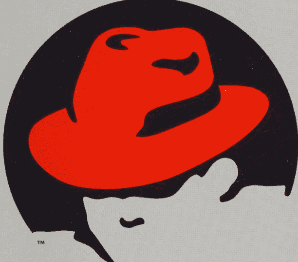


Red Hat 开发团队：

Donald Barnes
Marc Ewing
Michael Fulbright
Jeremy Hansen
Michael K. Johnson
Jim Knoble
Michael Maher
Hunter Matthews
Erik Troan


在准备本书时已采取一切预防措施，但出版商对错误或遗漏，或因使用本文所包含的信息而导致的损害不承担责任。


- G.3 GNU 公共许可证 . . . . . . . . . . . . . . . . . . . . . . . 210

# 前言

# 什么是红帽 Linux？

红帽 Linux 是一种基于 Linux 内核的开源操作系统，最初由 Linus Torvalds 在 1991 年创建。它由一个在互联网上工作的开发者网络创建，其中许多成员至今仍活跃在如今。红帽目前占据了超过 20% 的市场份额。红帽 Linux Server 5.2 展示了自由开源开发的力量以及企业级产品的价值。此外，还有红帽和红帽企业软件对市场的支持。

自 5.2 版本发布以来，红帽 Linux 一直处于 FIPS 合规性测试中。我们的版本符合 RHCSA（红帽认证系统管理员）的所有标准，多功能、具有市场竞争力并已为红帽 Linux 准备就。

我们很高兴看到依赖 Linux 操作系统的应用程序日益增，而红帽 Linux 满足了这些需求。我们的多个服务器操作系统得到了许多开发者的支持，包括 Linux 的开发者和用户。红帽 Linux 基于内核 2.6，该内核为红帽服务器提供了许多高级功能，且该服务器是免费使用的。

正如你所注意到的，红帽 Linux 易安装，所有的配置过程最可以在 15 分钟内完成。系统本身非常灵活：你只需点击几次即可安装和卸载单个软件“包”。维护可以验证和纠正的软件包发行非常容易，而且包可以简单可靠地安装和卸载。此外，红帽 Linux 通过一套图形化管理工具易于管理，这些工具消除了日常系统管理的烦恼。系统中的自由分发组件提供了完整的源代码。

# 本书概述

本手册按照以下方式组织：

- 第一章 快速入门包含了经验丰富的用户进行基础安装所需的信息。我们建议在安装红帽 Linux 之前阅读本章。
- 第二章 安装红帽 Linux 提供了本地安装的说明。
- 第三章 安装红帽 Linux 介绍了几乎所有的 PC。
- 第四章 安装红帽 Linux 介绍了在 Sun 机器上的安装方法。
- 第五至第十章章介绍了安装红帽 Linux 后如何配置各种服务，以及如何在 Linux 系统上关闭系统。
- 附录包含了有关红帽 Linux 的信息、硬件要求列表、红帽 Linux 常见问题（FAQ）以及获取技术支持的方法。

# 致谢

我们感谢所有红帽 Linux 的测试人员，特别是花时间提交错误报告的用户。我们还要感谢 Linus Torvalds 以及全球成千上万的开发者，他们创造了这一切。再次感谢，欢迎来到 Linux 的精彩世界！

红帽开发团队

# 第一章

# 快速入门

本章总结了如何安装或升级红帽 Linux；如果你已经熟悉 Linux 安装，请跳到下节。

## 1.1 红帽 Linux 错误列表 (Errata)

有时，我们会发现红帽 Linux 的发布版本存在问题，其中某些可能会影响安装。当我们发现问题时，会通过以下方式发布问题信息及其解决方案，这些信息可以在红帽 Linux 错误列表中获取：

- 通过万维网：http://www.redhat.com/errata
- * 通过电子邮件：errata@redhat.com

请注意，错误列表中问题的解决方案可能要求你使用与下方提到的或随光盘提供的不同的启动或安装镜像。

# 第一章 快速入门

## 1.2 获取红帽 Linux

获取红帽 Linux 有多种方法：最简单的方法是通过光盘。如果你没有光驱驱动器，这可能并不可行，因此我们通过 FTP 免费提供；你可以从附录 E 列出的任何红帽镜像站点下载。

这些镜像站点为想要通过 FTP 安装或获取更新的用户提供。可以将发行下载下载硬盘并从那里安装，但这对于大多数人来说非常不实际，且超出了本文的范围。

要购买光盘版红帽 Linux，请通过附录 E 列出的方式联系红帽软件公司。

## 1.3 制作软盘

如果你拥有官方红帽 Linux 4.1 附带的启动和补充软盘，请跳到下面的第 1.4 节。

如果你的红帽 Linux 版本没有包含启动软盘和补充软盘，你需要创建它们。如果你的光盘（或 FTP 站点）上有 README 文件，请现在阅读：它包含了红帽 Linux 4.1 的最新信息，某些可能与你即将阅读的内容不同。

启动和补充磁盘镜像位于光盘和 FTP 站点的 images 目录下。如果你进行光盘或 NFS 安装，只需要制作启动软盘。所有其他安装方法都需要补充软盘。你可以在 Linux 下使用 `dd` 命令，或者在 DOS 下使用 `rawrite.exe`（位于 `dosutils` 目录）将每个磁盘镜像文件写入已格式化的高密度（1.44 MB）3.5 英寸软盘中。

## 1.4 安装

要安装红帽 Linux，请将启动软盘插入 A 驱驱动器，并将光盘插入你的光驱驱动器（用于光盘安装）或连接到


## 1.5. 从之前的版本升级

...你的网络（用于 FTP 或 NFS 安装）。然后重启机器并按照提示回答所有问题。如果你是从 PCMCIA、FTP 或硬盘安装的，请在提示时插入辅助磁盘。

## 1.5 从之前的版本升级

Red Hat Linux 4.1 的安装过程包含了从之前的 Red Hat Linux 版本（基于 Red Hat Linux 2.0, 2.1, 3.0.3 和 4.0）升级的能力，这些版本基于 RPM 技术。升级您的系统将安装模块化的 2.0.x 内核，以及安装在您的机器上的软件包的更新版本。升级过程将通过使用 `.rpmsave` 扩展名来保留配置文件（例如 `sendmail.cf.rpmsave`），并在 `/tmp/upgradelog` 中留下记录已执行操作的日志。随着软件的演进，配置文件的格式可能会发生，因此在整合您的更改之前，您应该仔细比较原始配置文件与新文件。

要升级 Red Hat Linux 系统，您必须使用引导软盘（可能还需要一张辅助软盘），这与您执行完整安装一样。在选择安装介质后（如果需要则设置网络），安装程序会提示您选择“安装”或“升级”：选择“升级”。此升级程序在功能上等同于在之前的 Red Hat Linux 版本中运行升级脚本。

请注意，某些升级后的软件包可能“依赖”于系统中可能未安装的其他软件包。升级程序会处理这些依赖关系；但它可能需要安装额外的软件包以满足这些依赖。

## 1.6 直接从 CD-ROM 运行

之前的 Red Hat Linux 在 CD-ROM 上带有一个“实时文件系统”，这允许用户在不先安装到硬盘的情况下，直接从 CD-ROM 运行 Red Hat Linux。

遗憾的是，由于模块化的 Linux-2.0.x 内核，添加“实时”启动能力已变得过于复杂且不再支持。我们对此带来的不便深表歉意。

## 第 2 章

## 安装 Red Hat Linux/Intel

本章详细介绍了如何在 Intel 及兼容 PC 上安装或升级 Red Hat Linux。本章的结构如下：

- 第 2.1 节，“Red Hat Linux 错误列表 (Errata)”，包含了关于 Red Hat Linux/Intel 4.1 最新信息的重要提示。
- 第 2.2 节，“开始之前”，描述了您在实际安装 Red Hat Linux 之前需要了解的一些内容。
- 第 2.3 节，“准备安装”，告诉您如何创建安装软盘（如果您的 Red Hat Linux 副本中未包含），并解释了如何使用安装程序。
- 第 2.4 节，“分步安装”，提供了完成整个安装或升级过程的逐步操作说明。

## 2.1 Red Hat Linux 错误列表 (Errata)

有时，我们会发现 Red Hat Linux 发布版本存在问题，其中某些问题可能会影响安装。当我们发现问题时，会在 Red Hat Linux 错误列表中发布有关问题的信息和我们的解决方案，我们通过以下方式提供这些信息：

- 通过万维网：http://www.redhat.com/errata
- 通过电子邮箱：errata@redhat.com

请注意，错误列表列出的问题的解决方案可能需要您使用与下方提到的或与您的 Red Hat Linux CD-ROM 附带的不同的引导或安装磁盘镜像。

## 2.2 开始之前

在开始安装 Red Hat Linux 之前，您应该收集一些关于您系统的信息：

- 熟悉您在机器中安装的硬件，包括：
- 硬盘——数量和大小；如果您有多个硬盘，知道哪一个是第一个、第二个等将是有帮助的。
- 内存——RAM 数量。
- CD-ROM——其接口类型（IDE、SCSI 或其他接口）。对于非 IDE、非 SCSI 的 CD-ROM，还包括品牌和型号。
- SCSI 适配器——品牌和型号。
- 网卡——品牌和型号。
- 鼠标——类型（串口、PS/2 或总线鼠标）、协议（罗技-微软、MouseMan 等）以及按键数量；此外，对于串口鼠标，还包括它连接的 com 口。

此外，如果您将安装 X Window 系统，您应该熟悉以下内容：

- 您的显卡——品牌和型号或视频芯片组，视频显存的量。
- 您的显示器——品牌和型号。水平和垂直刷新率的允许范围。

## 2.2. 开始之前

您可以在随附系统的文档或从系统供应商或制造商处找到大部分上述信息。

- 如果您将连接到网络，请确保您知道 IP 地址、子网掩码、网关 IP 地址、域名服务器 IP 地址、域名和主机名。如果您不知道这些值，请询问您的网络管理员。
- 如果 Red Hat Linux/Intel 将与 OS/2 共存，您必须使用 OS/2 分区软件创建磁盘分区——否则 OS/2 可能无法识别这些分区。在安装期间，不要创建任何新分区，而是使用 Linux fdisk 为您的 Linux 分区设置正确的分区类型。
- 如果您计划使用 LILO（Linux 加载程序）启动您的 Red Hat Linux 系统，请参考第 2.4.18 节“LILO 安装”，获取可能影响分区计划的指南。

请在开始之前阅读所有安装指令；这将为您需要做出的任何决策做好准备，并消除潜在的意外。

### 2.2.1 安装方法

您可以通过任何基本方法安装或升级 Red Hat Linux/Intel。根据您使用的方法，您需要一张或两张格式化的高密度（1.44 MB）软盘。

从 CD-ROM 或通过 NFS 安装只需要引导软盘。从硬盘、通过 FTP 或 PCIA 设备（基于 PCMCIA 的 CD-ROM）安装需要引导软盘和辅助软盘。下文 2.3 节解释了如何创建这些辅助软盘。

**CD-ROM** 如果您有 Red Hat Linux CD 和引导软盘，您将需要一个支持 CD-ROM 的驱动器以及运行的 MS-DOS 以运行安装程序。如果 CD 未附带引导软盘，您需要访问运行 Linux 或 MS-DOS。

**NFS** 如果您希望通过网络安装，您需要在支持 Rock Ridge 扩展系统上挂载 Red Hat Linux CD-ROM。通过 NFS 导出文件系统。您将需要配置名称服务器，以及 CD-ROM 的路径。

**FTP** 对于 FTP 安装，您必须拥有引导软盘和辅助软盘。您需要配置有效的名称服务器或知道将使用的 FTP 服务器 IP 地址。您还需要 FTP 站点上 Red Hat Linux 目录的路径。

**硬盘** 从硬盘安装 Red Hat Linux 将需要与 FTP 安装相同的引导和辅助软盘。您必须先在目录树的顶层创建一个 RedHat 目录。要安装的所有内容将放在该目录下。首先复制基础目录，然后将您想要安装的软件包复制到名为 RPMS 的子目录。您可以使用现有的 DOS 分区或安装过程中不需要的 Linux 分区的可用空间。

如果您使用的是 DOS 文件系统，您可能无法为 RPM 软件包使用完整的 Linux 文件名。安装过程不在乎文件名是什么，但建议您跟踪这些文件名，以便您知道安装了什么。

**PCMCIA** 如果您的 CD-ROM、网卡或本地硬盘连接到 PCMCIA 适配器，您必须支持 PCMCIA 进行安装。您需要支持的 PCMCIA 控制器以及支持的 PCMCIA SCSI 适配器或网卡。通过 PCMCIA 安装需要使用辅助软盘。


## 2.2. 开始之前

系统支持 SysV IPC、IP 转发、防火墙与计费、反向 ARP、QIC 磁带以及并行打印机。

安装完成后，您可能希望重新构建一个仅包含您的硬件支持的内核。有关如何构建自定义内核，请参阅第 5 章第 5.1 节。

### 2.2.3 磁盘分区

要安装 Red Hat Linux，必须有可用的磁盘空间供其“运行”。这部分磁盘空间需要与您可能在计算机上安装的其他操作系统所使用的磁盘空间分开（例如 MS-DOS、OS/2、不同版本的 Linux，或其他我们未命名的其他知名操作系统）。提供磁盘空间的方法是将磁盘划分为分区。

您可能希望在独立的硬盘上安装 Red Hat Linux，甚至在某台不包含任何其他操作系统的计算机上安装。在这种情况下，您可以使用 Red Hat Linux 安装系统来创建所需的磁盘分区。

或者，您也可能希望在一块已经包含不同操作系统软件或数据的磁盘上安装 Red Hat Linux；如何创建所需的磁盘分区取决于存在哪种其他操作系统。

### 磁盘分区与 MS-DOS

大多数来自供应商的 MS-DOS 系统都有一个硬盘，其中包含一个大分区。为了安装 Red Hat Linux，您需要缩小该分区的规模，然后在剩余空间中为 Red Hat Linux 创建分区。实现此目标有两种方法：

**破坏性重新分区**：此过程会破坏您正在调整大小的磁盘分区（s）中的任何数据，您应该对正要重新分区的硬盘上您想要保留的所有内容进行完整、可靠的备份。然后，使用 MS-DOS 磁盘分区工具（称为 `fdisk`）删除大分区并创建一个较小的 MS-DOS 分区。从您的备份中将数据恢复到新分区。

## 第 2 章. 安装 RED HAT LINUX/INTEL

**非破坏性重新分区**：此过程不应破坏您正在调整大小的磁盘分区（s）中的数据；尽管如此，在任何情况下我们都建议对想要保留的数据进行可靠的备份。您可以使用 Red Hat Linux CD 中 `dosutils` 目录下的 `fips` 工具来调整您的 MS-DOS 分区大小：在执行操作之前，我们强烈建议阅读位于 `fipsdocs` 子目录下的 `fips` 文档。

重新分区后，您可以按照“逐步安装”中的描述，使用 Red Hat Linux 安装系统为您的 Red Hat Linux 系统创建分区。

### 磁盘分区与其他操作系统

关于创建与其他操作系统兼容的磁盘分区的信息，可以在 Red Hat Linux CD 中 `doc` 目录下的多个 HOWTO 和 Mini-HOWTOs 中找到。

## 需要多少分区？

如果您希望在单个分区上安装 Red Hat Linux，这是可以的。但是，我们建议以下方案：

- 如果您希望在独立的硬盘上安装 Red Hat Linux，甚至在某台不包含任何其他操作系统的计算机上安装，您可以使用 Red Hat Linux 安装系统来创建所需的磁盘分区。
- 或者，如果您希望在一块已经包含不同操作系统软件或数据的磁盘上安装 Red Hat Linux；如何创建所需的磁盘分区取决于存在哪种其他操作系统。
- 大多数来自供应商的 MS-DOS 系统都有一个硬盘，其中包含一个大分区。为了安装 Red Hat Linux，您需要缩小该分区的规模，然后在剩余空间中为 Red Hat Linux 创建分区。
- 如果您希望在独立的硬盘上安装 Red Hat Linux，您可能需要按照“逐步安装”中的描述为您的 Red Linux 系统准备一个交换分区（swap partition）。
- 如果您希望在一块已经包含不同操作系统软件或数据的磁盘上安装 Red Hat Linux；您可能需要按照“逐步安装”中的描述为您的 Red Linux 系统准备一个交换分区。

## 2.3. 准备安装

关于与其他操作系统兼容的磁盘分区创建信息，可以在 Red Hat Linux CD 的 `doc` 目录下的多个 HOWTO 和 Mini-HOWTO 中找到。

- **root 分区**：该分区包含操作系统及其所有文件。
- **swap 分区**：该分区用于虚拟内存。
- **home 分区**：该分区用于用户数据和设置。
- **src 分区**：该分区在编译期间用于源代码。
- **tmp 分区**：该分区用于临时文件。
- **local 分区**：该分区用于本地化安装的软件。

### 2.3.2 关于控制台的说明

Red Hat Linux 安装系统不仅仅是它提供的对话框。事实上，安装系统在运行时会呈现多种类型的诊断信息，并提供从 shell 提示符输入命令的方法。它显示了安装对话框、shell 提示符以及可以通过按键切换的五个虚拟控制台的信息。如果您在安装 Red Hat Linux 时遇到问题，这些虚拟控制台会非常有帮助：显示在安装日志或系统日志上的信息有助于定位问题。请参图 2.1 的虚拟控制台列表、切换到它们的按键及其内容。

| 控制台 | 按键 | 内容 |
|---|---|---|
| 1 | Alt-F1 | 安装对话框 |
| 2 | Alt-F2 | shell 提示符 |
| 3 | Alt-F3 | 安装日志（来自安装程序的消息） |
| 4 | Alt-F4 | 系统日志（来自内核等） |
| 5 | Alt-F5 | 程序输出（来自其他程序的消息） |

图 2.1：虚拟控制台信息

### 2.3.3 使用对话框

您可以使用简单的按键在安装对话框之间导航。在大多数对话框中，有一个光标或高亮区域，您可以使用方向键 ← ↑ ↓、Tab 和 Alt Tab 进行移动。每个屏幕的底部都会显示移动命令的摘要。

要“按下”按钮（如 OK、Tab）并从列表中选择项目，请将高亮移动到您想要选择的项目并按回车键。要从复选框列表中选择任意数量的项目，请将高亮移动到您想要选择的项目并按空格键。要取消选择项目，请再次按空格键。

按下 F12 会接受当前值并进入下一个对话框；它通常等同于按下 OK 按钮。


## 第 2 章. 安装 RED HAT LINUX/INTEL

**注意：** 在安装过程中请勿随机按键；这可能会导致不可预知的行为。

## 2.4 逐步安装

### 2.4.1 启动安装系统

启动
要开始安装 Red Hat Linux，请将刚刚创建的启动软盘插入驱动器并重启机器（如果你的机器上安装了 MS-DOS，可以直接从 CD-ROM 开始安装：参见上文第 2.3.1 节）。出现 `boot:` 提示符后按 `Enter` 启动。观察启动信息查看 Linux 内核是否检测到你的硬件。如果它未能正确检测到硬件，你可能需要重启并在 `boot:` 提示符输入某些选项，例如：

```
boot: linux hdc=cdrom
```

按 `Enter` 使用这些选项启动。如果你需要指定某些启动选项，请记录下来；稍后会用到。

**注意：** 由于 Red Hat Linux 支持在许多不同类型的硬件上安装，许多驱动程序（包括用于 SCSI 适配器、网卡和许多 CD-ROM 的驱动程序）并未内置在安装期间使用的 Linux 内核中；相反，它们作为模块可用，并在安装过程中根据需要加载。你将在这些驱动程序加载时有机会为它们指定选项，事实上，这些驱动程序会忽略你在 `boot:` 提示符处指定的任何选项。有关安装系统内置驱动程序的更多信息，请参见上文第 2.2.2 节。

### 开始安装

启动后，安装过程开始，询问你是否使用彩色显示器（见图 2.2）。“是”是默认选项；如果你无法区分光标或高亮，请按一次 `Tab`，然后按 `Enter` 继续。接下来，它会显示一条欢迎消息：按 Enter 开始安装。如果你想中止安装过程，现在只需弹出启动软盘并重启机器即可。

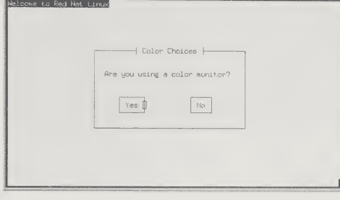

图 2.2：开始安装

### 2.4.2 PCMCIA 支持

在欢迎对话框之后，安装程序询问你是否需要使用 PCMCIA 设备进行安装（例如，通过 NFS 安装的 PCMCIA 以太网卡，或从 CD 安装的 PCMCIA SCSI 卡），你应该回答“是”：安装程序提示你插入补充软盘。你应该等待到下一个对话框出现后再插入你的 PCMCIA 卡。

### 2.4.3 选择安装方法

你可以通过四种基本方法之一安装 Red Hat Linux（参见第 2.2.1 节，安装方法），某些方法需要使用补充软盘。总结如下：

- CD-ROM：如果你有一个带有 Red Hat Linux CD 的 CD-ROM 驱动器；不需要补充软盘。
- NFS：如果你从 NFS 服务器安装，该服务器正在导出 Red Hat Linux CD 或来自 Red Hat FTP 站点的 Red Hat Linux 镜像；不需要补充软盘。
- 硬盘：如果你将 Red Hat Linux 文件复制到了你的本地硬盘的其中一个上；需要补充软盘。
- FTP：如果你直接从 FTP 服务器安装；需要补充软盘。

下一个对话框询问你想要使用哪种类型的安装方法（见图 2.3）。高亮相应的选择并选择 OK，或按 Enter。如果你选择了 FTP 或硬盘，且没有使用 PCMCIA 支持，安装程序将提示你插入补充软盘。

#### CD-ROM 类型

如果你选择从 CD-ROM 安装 Red Hat Linux/Intel，安装程序会提示你 CD-ROM 的类型：

- IDE (ATAPI)：大多数基于 Intel 的 PC 可用的 CD-ROM 都是 IDE（也称为 ATAPI）CD-ROM。安装程序在放弃之前会检查所有可用的 IDE 设备上的 CD-ROM。
- SCSI：如果你的 CD-ROM 连接到支持的 SCSI 适配器上，请选择此项：安装程序会要求你选择 SCSI 驱动程序。选择与你的适配器最相似的驱动程序。如有，你可以为驱动程序指定选项；但大多数驱动程序会自动检测你的 SCSI 适配器。
- 其他：如果你的 CD-ROM 既不是 IDE 也不是 CD-ROM，它就是“其他”。安装程序会列出支持的 CD-ROM 的驱动程序列表；选择一个驱动程序，并在必要时指定任何驱动程序选项。

### 2.4.4 如果你正在通过 NFS 安装

如果你不是通过 NFS 安装 Red Hat Linux，可以跳到下方的第 2.4.5 节。

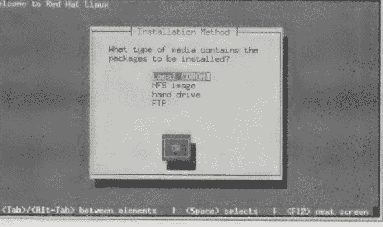

图 2.3：选择安装方法

#### 选择网络驱动程序

如果你通过 NFS 安装，你的计算机中必须安装了受支持的网卡。安装程序提示你选择支持你的网卡的驱动程序，并指定驱动程序识别网卡所需的选项。大多数情况下，驱动程序可以通过探测自动定位网卡；但探测硬件可能会导致机器挂起。如果发生这种情况，请重启机器重新启动安装，并在该步骤指定驱动选项（参见附录 B）。

#### 配置 TCP/IP

安装程序找到网卡后，会显示多个配置 TCP/IP 的对话框。这些信息仅在安装过程中使用；如果你想从网络其他安装，此功能提供了更大的灵活性。第一个对话框要求输入 IP 和其他网络地址（见图 2.5）。输入安装期间使用的 IP 地址并按 Enter。

| 字段 | 示例值 |
| :--- | :--- |
| IP 地址 | 10.0.2.15 |
| 子掩码 | 255.255.255.0 |
| 默认网关 | 10.0.2.254 |
| 首选 DNS | 10.0.2.1 |
| 域名 | redhat.com |
| 主机名 | pooh.redhat.com |

图 2.4：示例网络

安装程序尝试根据你的 IP 地址猜测你的子掩码；如果不正确，你可以修改。安装程序会将域名带到主机名字段。在域名之前输入你使用的主机名以形成完全限定域名 (FQDN)。如果你的网络有多个 DNS，你可以在辅助 DNS 和三级 DNS 字段中输入额外的 DNS IP 地址。

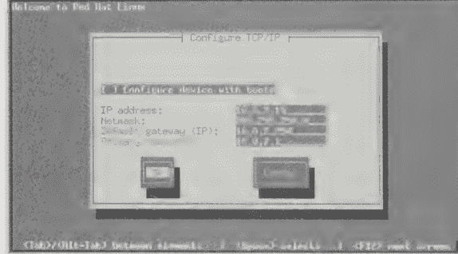

图 2.5：配置 TCP/IP

#### NFS 服务器信息

最后一个特定的 NFS 对话框请求 NFS 服务器的信息（见图 2.7）。输入 NFS 服务器的名称或 IP 地址，以及包含 Red Hat Linux CD 的导出目录。例如，如果 NFS 服务器将 Red Hat Linux CD 挂载在 /mnt/cdrom，请在 Red Hat 目录中输入 /mnt/cdrom。如果 NFS 服务器导出的是 Red Hat Linux 安装树的镜像而不是 CD，你需要输入包含 RedHat 目录的目录。例如，如果你的 NFS 服务器包含 /mirrors/redhat/i386/RedHat，请输入 /mirrors/redhat/i386。

### 2.4.5 升级或安装

选择安装方法后（如果你通过 NFS 安装，在配置完网络信息后），安装程序将提示你进行安装或升级（见图 2.8）。

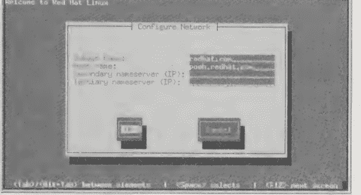

图 2.6：配置网络


# 第 2 章 安装红帽 Linux/英特尔 (INTEL)

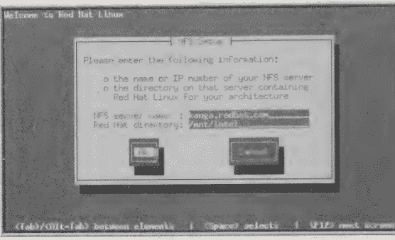

图 2.7：通过 NFS 安装

# 安装

您通常会在干净的磁盘分区或一组分区上安装红帽 Linux，或者在另一个已安装的 Linux 之上安装。在另一个已安装的 Linux 上安装红帽 Linux（包括红帽 Linux）不会保留之前的任何安装内容。

如果您希望进行全盘安装，请选择“安装”（Install）。

# 升级

红帽 Linux 4.1 的安装过程包含了从之前的红帽 Linux 版本（2.0、2.1、3.0.3 和 4.0）升级的能力，这些版本基于 RPM 技术。升级您的系统将安装模块化的 2.0.x 内核，以及您在机器上安装的软件包的更新版本。升级过程将使用 `.rpmsave` 扩展名保留现有的配置文件（例如 `sendmail.cf.rpmsave`），并在 `/tmp/upgradelog` 中留下一个记录其所执行操作的日志。随着软件的演进，配置文件的格式可能会发生，因此在整合更改之前，您应该仔细对比您的原始配置文件和新文件。

如果您希望升级您的红帽 Linux/英特尔系统，请选择“升级”（Upgrade）。

## 2.4. 逐步安装步骤

请注意：某些升级后的软件包可能“依赖”于系统中可能未安装的其他软件包。升级程序会处理这些依赖关系，但它可能需要安装额外的软件包以满足它们。

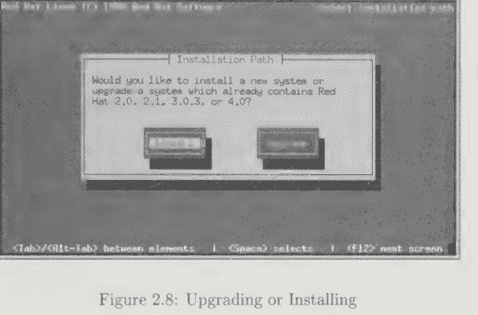

### 2.4.6 SCSI 支持

在您选择了执行升级还是全盘安装后，安装程序会询问您是否有任何 SCSI 适配器。如果您选择“是”，后续对话框将显示 SCSI 驱动程序列表。选择与您的 SCSI 适配器最匹配的驱动程序。安装程序允许您为选定的 SCSI 驱动程序指定选项：不过，大多数 SCSI 驱动程序会自动检测您的硬件。

### 2.4.7 如果您通过 FTP 安装

如果您不是通过 FTP 安装红帽 Linux，可以跳到下方的 2.4.8 节。

# 第 2 章 安装红帽 Linux/英特尔 (INTEL)

#### 选择网络驱动程序

如果您通过 FTP 安装，你的计算机中必须安装了受支持的网卡。安装程序会提示您选择支持您的网卡的驱动程序，并指定驱动程序定位和识别网卡所必需的任何选项。大多数情况下，驱动程序可以通过探测自动定位网卡；但是，探测硬件可能会导致您的机器挂起。如果发生这种情况，请重启机器，重新开始安装，并在到达此步骤时指定额外的驱动程序选项（附录 B）。

### 配置 TCP/IP 网络

安装程序找到您的网卡后，会呈现出几个用于配置 TCP/IP 网络的对话框。这些信息仅在安装过程中使用；您稍后将能够配置永久的网络信息。如果您希望从机器将来“运行”的网络之外的网络进行安装，此功能将提供更大的灵活性。图 2.4 包含了示例网络信息。

第一个对话框向您询问 IP 和其他网络地址（见图 2.5）。输入您在安装期间使用的 IP 地址并按回车。安装程序尝试根据您的 IP 地址猜测您的子掩码（Netmask）；如果子掩码不正确，可以更改它。安装程序根据您的 IP 地址和子掩码猜测默认网关和主 DNS 服务器地址；如果如果不正确，可以更改它们。选择“确定”（OK）继续。

第二个对话框提示您输入域名名、主机名和其他网络信息（见图 2.6）。为您的系统输入域名并按回车。安装程序会将域名名带入主机名字段。在主机名字段中输入您使用的主机名，以形成完全限定主机名（FQDN）。如果您的网络有多个 DNS 服务器，在在主主机名和子掩码时，和二级 DNS 2，，可以更改它们。选择“确定”（OK）继续。

## 2.4. 逐步安装步骤

### FTP 服务器信息

如果您程序通过 FTP 安装红帽 Linux，可以跳   ..框框框框询问  信息（见图 2.9）。输入您安装的 FTP 站点，，程序帽。。/     。。 6661611111111166


img/bef0ee6d460726bef2ee16ade180160_36_0.png)

图 2.9：通过 FTP 安装

### 2.4.8 为红帽 Linux 创建分区

在您选择了执行升级还是全盘安装后，安装程序询问您是否有任何 SCSI 适配器。如果您选择“是”，后续对话框将显示 SCSI 驱动程序列表。选择与您的 SCSI 适配器最匹配的驱动程序。安装程序允许您为选定的 SCSI 驱动程序指定选项：不过，大多数 SCSI 驱动程序会自动检测您的硬件。

### 使用 fdisk

fdisk 包含简短但有用的提示：

第 2 章 安装红帽 Linux/英特尔 (INTEL)

- 使用 `p` 命令列出分区表。
- 使用 `n` 命令添加新分区。fdisk 默认创建 Linux 分区。
- 如果您需要创建超过 4 个分区，其中可以是扩展分区。
- 使用 `s` 命令创建交换分区。fdisk 在磁盘上创建 Linux 分区。
- 在您创建交换分区时，不要忘记使用 `t` 命令将其类型更改为 Linux 交换。
- Linux 允许在磁盘上创建最多 4 个（主或扩展）分区。逻辑分区从 5 开始。
- 建议写下您的分区，在您的更改生效前，直到您使用 `w` 命令保存并退出 fdisk。
- 您可以随时使用 `q` 命令在不保存的情况下退出 fdisk。

### 分区编号

Linux 使用字母和数字的组合引用分区，这对于没有经验的用户来说可能会很困惑。如下：

字母表示设备。数字表示分区。前 4 个（主或扩展）分区编号为 1 到 4。逻辑分区从 5 开始。例如，/dev/hda3 是第一个 IDE 磁盘上的第三个主或扩展分区；/dev/sdb6 是第二个磁盘上的逻辑分区。

### 修改分区表

当您完成磁盘分区后，按“完成”（Done）：您可能会看到指示安装程序需要重启的消息。在您创建、更改或删除任何扩展分区后，这是正常现象。在您

## 2.4. 逐步安装步骤

按照在分区磁盘之前相同的安装步骤操作；然后只需选择“完成”（Done）。

### 2.4.9 初始化交换空间

在为红帽 Linux 创建分区后，安装程序寻找交换分区。如果找到任何，它会询问您是否要初始化它们。选择您希望初始化为交换空间的分区，然后选择确定。

如果安装程序找不到您的交换分区，请确保您已将分区类型设置为 Linux 交换；见上文 2.4.8 节。

### 2.4.10 文件系统配置

由于红帽 Linux 可能分布在多个磁盘分区上，您需要选择哪些磁盘分区对应哪些文件系统。

### 选择根分区

在初始化交换空间后，安装程序显示它找到的所有 Linux 分区的列表，并提示您选择根分区。根分区（根文件系统）包含了启动您的红帽 Linux 系统所需的所有内容：系统启动时挂载在 /（根目录）。选择您想要使用的根分区并按回车。

### 其他分区

下一个对话框显示了系统中大多数磁盘分区列表（包括 MS-DOS 和 Linux 可以读取的其他分区），让您有机会将其他分区分配给文件的系统的部分。您分配的分区将在红帽 Linux 系统启动时自动挂载。选择您想要分配的分区并按回车（或选择“编辑”）；然后输入该分区的挂载点，例如 /usr（见图 2.10）。


## 第 2 章. 安装 RED HAT LINUX/INTEL


图 2.10：文件系统配置

此外，Red Hat Linux 允许你在系统启动时挂载 NFS 卷；这允许目录树跨网络共享。选择“Add NFS”，然后输入 NFS 服务器的主机、NFS 卷的路径以及该卷的本地挂载点（见图 2.11）。

### 2.4.11 选择和安装软件包

在完成分区配置和格式化后，你就可以选择要安装的软件包了。你可以根据功能一起选择系统组件、选择单个软件包，或将两者结合。选择系统组件：例如：开发环境、网络工作站或 Web 服务器。选择你想要安装的每个组件并按空格键，即可安装 Red Hat Linux 包含的所有软件包（见图 2.12）。

### 格式化分区

下一个对话框将显示要格式化的分区列表。大多数分区都应该格式化，特别是新创建的分区；然而，如果 /home 或 /usr/local 等分区包含你想要保留的数据，则不需要格式化。选择每个要格式化的分区并按空格键。如果你希望在格式化每个文件系统时检查坏块，请选择“Check for bad blocks during format”。点击“OK”。

### 单个软件包

在选择完想要安装的组件后，你可以选择或取消选择单个软件包。安装程序会列出可用软件包列表；选择一个组进行检查并按回车键。安装程序将列出该组中的软件包列表，你可以使用空格键进行选择或取消选择。你可以通过按 F 键查看软件包的详细描述（见图 2.13）。当你完成单个软件包的选择后，在“Group”对话框中点击“OK”。

### 软件包依赖关系

许多软件包为了正常运行，依赖于安装在系统中的其他软件软件包或库。例如，许多图形化系统管理工具需要 python 软件包。为了确保你的系统拥有完全功能所需的所有软件包，Red Hat Linux 在你每次安装或卸载软件时都会检查依赖关系。

在你完成要安装的软件包选择后，安装程序会检查所选软件包列表依赖关系。如果任何软件包需要另一个你未选择安装的软件包，程序将列出这些未解决的依赖关系，并提供解决它们的机会（见图 2.14）。如果你直接按“OK”，程序将通过将所有所需的软件包添加到已选列表中自动解决它们。

### 软件包安装

在解决所有软件包依赖关系后，安装程序开始安装软件包：它会在你的 Red Hat Linux 系统的 /tmp/install.log 留下一份完整的安装日志。

### 2.4.12 选择键布局

在完成所有选择软件包的安装后，安装程序列出可安装的键布局列表（见图 2.15）。选择你希望在 Red Hat Linux 系统上使用的键布局并按回车键：安装程序会立即安装该键布局。

如果你在启动 Red Hat Linux 系统后想要更改键布局，可以使用 /usr/sbin/kbdconfig 命令。

### 2.4.13 配置鼠标

要配置鼠标，请选择与你的鼠标最匹配的类型并按回车键。如果你有一个双键鼠标，并想通过同时点击左键和右键来模拟第三个键（中键），请选择“Emulate 2 Buttons”。

如果你选择串口鼠标，下一个对话框将提示你鼠标连接的串口（COM）端口。选择正确的端口并按 `Enter`。

> **请：** 如果你的鼠标连接到 PS/2 鼠标端口，无论它是什么种鼠标，都应该选择“PS/2 Mouse”。

如果你在启动 Red Hat Linux 系统后想要更改鼠标配置，可以使用 /usr/sbin/mouseconfig 命令。

### 2.4.14 配置 Windows

设置好鼠标后，如果你安装了 X 软件包，安装程序将给你一个配置网络的机会。如果你没有选择 X，可以跳到下方的 2.4.15。

## 2.4 逐步安装步骤


图 2.14：未解决的依赖关系

### 配置 X Server

如果你想使用 XFree6，安装程序会列出显示器列表。从列表中选择你的显卡并按回车键。如果你的显示器没有出现在列表中，你可以选择 `Custom`。如果你选择了 `Custom`，配置程序将提示你选择显示器的水平同步和垂直同步范围（这些值通常可以在文档或制造商说明中找到）。

**请：** 不建议选择一个与你的显示器“相似”的显示器，除非你确定所选显示器的性能没有超过你显示器的能力。如果你这样做，可能会导致显示器超频并损坏它。

如果你想使用 XFree6，安装程序会列出显卡列表。从列表中选择你的显卡并按回车键。如果你的显卡没有出现在列表中，你可以选择 `Unlisted`。如果你选择了 `Unlisted`，配置程序将允许你进行配置。

接下来，配置程序将提示你显卡上安装的显存大小。如果你不确定，请查阅显卡附带的文档。选择比可用更多的内存不应损坏你的显卡，但 XFree6 服务器可能无法正常启动。

如果你选择的显卡可能带有时钟芯片（clockchip），配置程序将列出时钟芯片列表。推荐的选择是“No Clock Setting”，因为在大多数情况下 XFree6 可以自动检测到时钟芯片。

最后，配置程序提示你选择想要使用的视频模式；按空格键选择一个或多个模式。随后配置程序会将包含你所有选择的配置文件写入 /etc/X11/XConfig。

### 2.4.15 配置网络

在协助你配置 X server 后，安装程序将给你一个配置（或重新配置）网络的机会。如果你从 CD-ROM 或硬盘安装，安装程序会询问你是否要配置网络。如果你选择 No，你的 Red Hat Linux 系统将是一个单机工作站。如果你选择 Yes，可以按照下文所述配置网络。

如果你通过 NFS 或 FTP 安装 Red Hat Linux，你已经配置了临时网络信息。安装程序将为你提供三个选择：

- 保留用于安装的设置：你之前输入的所有网络信息将成为系统永久配置的一部分。
- 重新配置网络；安装程序将显示下面的网络配置对话框，并使用你在安装期间使用的值作为默认。如果你的系统将安装在与安装 Red Hat Linux 时不同的网络，请选择此项。
- 完全不设置网络：你的系统将不会配置网络。如果你通过网络安装了系统，但将其作为单机工作站使用，请选择此项。


## 2.4. 分步安装

### 网络配置对话框

在安装程序找到您的网卡后，会显示若干个用于配置 TCP/IP 网络的对话框。这些信息仅在安装过程中使用：您稍后可以配置永久的网络设置信息。如果您希望从机器将来“运行”的环境之外的其他网络进行安装，此功能可以提供更大的灵活性。图 2.4 包含了示例网络信息。

第一个对话框要求您输入 IP 和其他网络地址（参见图 2.5）。输入您安装期间使用的 IP 地址并按回车。安装程序会尝试根据您的 IP 地址推测子网掩码（Netmask）：如果掩码不正确，您可以进行更改。按回车。安装程序根据您的 IP 地址和子网掩码猜测默认网关和主 DNS 服务器；如果不正确，您可以进行更改。选择 OK 继续。

第二个对话框提示您输入域名、主机名和其他网络信息（参见图 2.6）。输入您系统的域名（Domain name）并按回车。安装程序会将域名传递到主机名（Host name）字段。您在域名之前使用的主机名将形成一个完全限定域名（FQDN）。如果您的网络有多个 DNS 服务器，您可以在“二级 DNS 服务器”和“三级 DNS 服务器”字段中输入额外 DNS 服务器的 IP 地址。选择 OK 继续。

### 2.4.16 配置时钟

设置网络后，安装程序会显示一个对话框帮助您配置 Red Hat Linux 系统的时区。

如果您希望将硬件时钟（CMOS）设置为 GMT（格林尼治标准时间，也称为 UTC 或协调世界时），请选择“硬件时钟设置为 GMT”（Hardware clock set to GMT）。将硬件时钟设置为 GMT 意味着如果您的时区使用了夏令时，Red Hat Linux 系统将正确处理。大多数网络都使用 GMT。

从列表中选择系统将运行的时区，并按回车。

如果您想在启动 Red Hat Linux 系统后更改时区配置，可以使用 `/usr/sbin/timeconfig` 命令。

### 2.4.17 设置 root 密码

设置好系统时区后，安装程序会提示您为系统设置 root 密码：这是您首次登录 Red Hat Linux 系统时使用的密码。

root 密码长度至少为六个字符；您输入的密码不会显示在屏幕上。您必须输入两次密码：如果两个密码不匹配，安装程序将要求您重新输入（参见图 2.1）。您设置的 root 密码应该是您能记住的，但不要别人别人轻易猜到的。良好的密码应该混合数字、大写和小字母，且不包含字典单词：name、phone number、qwerty、123456 和 password 都是糟糕密码的示例。记住密码是区分大小写的。写下此密码并将其保存在安全的地方。请注意：root 用户（也称为超级用户）对整个系统具有完全访问权限；出于此原因，以 root 用户身份登录最好仅执行系统维护，这样在您重启系统后，关键文件就不会被更改、移动或删除。

### 2.4.18 安装 LILO

为了能够启动 Red Hat Linux 系统，您通常需要安装 LILO（Linux 加载器）。您可以在以下几个位置之一安装 LILO：

主引导记录（MBR）是安装 LILO 的推荐位置，除非该处已安装了另一个操作系统（例如 System Commander 或 OS/2 的引导管理器）。当您的机器启动时，LILO 会启动并显示启动提示符；如果您在系统中已在使用另一个加载器（如 OS/2 的引导管理器），可以安装根分区的第一个扇区；然后您可以设置该加载器来启动 LILO 并引导 Red Hat Linux。软盘的第一扇区是上述选项的替代方案：要启动 Red Hat Linux，请将 LILO 软盘插入机器的软驱器并重启。LILO 从软盘启动并显示启动提示符。选择您想要安装 LILO 的位置并按 OK。如果您不想安装 LILO，请按 Skip（跳过）。

### LILO 的局限性

LILO 受限于大多数 BIOS 实施的某些限制。如果您想在硬盘上安装 LILO，以下是您的根分区必须所在位置的“规则”：

- 如果您有两个 IDE（或 EIDE）驱动器，您的根分区必须位于其中之一上。这也包括主控制器上的任何 IDE CD-ROM 驱动器。如果您在主控制器上有一个 IDE 硬盘和一个 IDE CD-ROM，则您 必须将根分区安装在硬盘上。
- 如果您有一个 IDE（或 EIDE）驱动器和一个或多个 SCSI 驱动器，您的根分区必须位于 IDE 驱动器或 ID 为 0 的 SCSI 驱动器上。其他 SCSI ID 无法工作。
- 如果只有 SCSI，您的根分区必须位于 ID 为 0 或 ID 为 1 的驱动器上。其他 SCSI ID 无法工作。
- 在任何情况下，您的 Linux 内核（如果您有 SCSI 适配器，还包括初始内存磁盘）必须位于柱道 1023 以下。对于 IDE（或 EIDE）驱动器，这通常意味着 512 MB 标记以下；对于 SCSI 驱动器，通常位于 1 GB 标记以下。确保这一点最简单（也是推荐的）的方法是确保您的根分区位于柱道 0-1023 之间。某些较新的 BIOS 没有此限制。

### 为 LILO 启动命令行添加选项

最后，安装程序将询问是否向 LILO 启动命令添加默认选项。您输入的任何选项将在每次启动时传递给 Linux 内核。完成后按 OK。

### LILO 的替代方案


如果您不想使用 LILO 启动您的 Red Hat Linux 系统，有几种替代方案：

- LOADLIN 可以从 MS-DOS 加载 Linux：遗憾的是，它要求 Linux 内核副本（如果您有 SCSI 适配器，还包括初始内存磁盘）位于 MS-DOS 分区上。实现此点的唯一方法是使用其他方法（例如从软盘上的 LILO）启动 Red Hat Linux 系统，然后将内核拷贝到 MS-DOS 分区。LOADLIN 可从 http://sunsite.unc.edu/system/Linux-boot/ 以及 sunsite 的各种镜像站点获取。
- SYSLINUX 是一个与 LOADLIN 非常类似的 MS-DOS 程序；它也可以从 ftp://sunsite.nc.edu/system/Linux-boot/ 以及 sunsite 的各种镜像站点获取。
- 某些商业引导器（例如 System Commander）可以启动（但可能仍需要在 Linux 根分区中安装 LILO）。


# 第 3 章. 安装 RED HAT LINUX/ALPHA

- 4. EB66 (NekoTech Mach 1)
- 5. EB66+
- 6. Jensen (DEC PC 150, 2002 年型 300 型, Culleen)
- 7. 通用桌面箱 (UDB，有时称为 Multia)。这只是一个无名板，处理方式与本文其他部分相同。
- 8. AlphaStation 200, 250, 255, 400 (Avanti 机器)
- 9. EB164 (Aspen Avalanche, Timberline. Summit; Microway Screamer)
- 10. Kinetics 的 Platform 2000 机器
- 11. PC164 机器 (Durango)
- 12. Alcor 类型机器 (AlphaStation 500. 600: Maverick. Brett)
- 13. Alpha-XL
- 14. Alpha-XLT (XL 300, XL 366)
- 15. Mikasa 类型机器 (AlphaServer 1000)。1000A 不支持

除了 Jensen 之外的所有平台都包含一个 NCR 810 SCSI 控制器，尽管支持 BusLogic PCI SCSI 控制器（FlashPoint 除外）、Adaptec AHA2940 SCSI 控制器以及 Qlogic 1020 ISP 控制器。Jensen 设计使用 AHA1740 SCSI 控制器并支持。

支持 NE2000、DE422 和 DE4x5 (PCI) 以太网。这包括 UDB 的内部以太网硬件。内核也包含令牌环（Token ring）支持。

X Window 系统可以在除 Jensen 机器外的任何带有基于 S3 显卡的机器运行。ftp://azartarn.com 的 /pub/linux/axp/jensen 提供了适用于 S3 卡的服务器。TGA 服务器（例如 UDB）可以在你的 Red Hat Linux/Alpha CD 的 X11 目录中找到。来自 Orchid 和 Number 9 的大多数显卡都能工作。大多数 Diamond Stealth 卡也被支持。Digital TGA 显（基于 DC21030 芯片）在 8 位模式下受支持，并且还为 Mach64 卡提供了 X 服务器。

关于 Alpha 硬件的更多信息请见附录 C。

## 3.3. 安装 MINILOADER MILO

启动 Red Hat Linux/Alpha 最简单的方法是通过 Linux Miniloader（即 MILO）。你可以直接从系统固件加载 MILO，或者使用 ARC 控制台将 MILO 作为备用操作系统加载。这些过程的详细信息请参阅 MILO FAQ，该文件作为附录 D 提供。

完整的 MILO 树可以在 CD 的 milo 目录中找到。它包含了此 CD 制造时的最新文档和 MILO 镜像。然而，后续版本的 MILO 定期在 gatekeeper.dev.com 发布。images/arc 目录还包含软磁盘镜像，可用于 ARC 控制台直接启动到 MILO。这些镜像包含 MILO 和 linload.exe，以及一个可刷写的 MILO 版本以及用于支持刷写 MILO 平台的闪存管理工具（flash management utility）。如果你在使用 MILO 时遇到问题，首先应尝试使用新版本的 MILO。

如果你的机器不支持 MILO，你需要从 SRM 控制台直接启动软盘或 CD。有关如何操作的信息可以在 Red Hat 软件网站获取：http://www.redhat.com/linux-info/alpha/faq。

## 3.4 安装 Red Hat Linux/Alpha

### 3.4.1 制作启动盘

安装 Red Hat Linux/Alpha 的第一步是创建启动盘；使用哪种启动盘取决于你的拥硬件。Red Hat Linux/Alpha CD 的 images 目录下提供了多种启动盘镜像，以及一个包含有关可用镜像更多信息的 README 文件。

可用的启动镜像包括：

- 1. cab.img (AlphaPC64, Cabriolet)
- 2. noname.img (AxPPC33, Noname, Universal Desktop Box)
- 3. eb64p.img (EB64+, Aspen Timberlines)
- 4. eb66.img (EB66)
- 5. eb66p.img (EB66+)
- 6. jensen.img (Jensens)
- 7. avanti.img (AlphaStation 200, 250, 400)
- 8. xl.img (Alpha XL)
- 9. xlt.img (Alpha XTL)
- 10. eb164.img (EB164 基于机器)
- 11. p2000.img (Platform 2000)
- 12. pc164.img (Alcor 基于机器)
- 13. alcor.img (Alcor 基于机器)
- 14. mikasa.img (Mikasa 基于机器)

所有这些镜像都可以在带有 VGA 或 TGA 显卡的机器上工作。要从这些镜像制作软盘，请在 MS-DOS 或 MS-Windows 下使用 write.exe（位于 dosutils 目录）或在 Linux 或 Unix 下使用 dd。

### 3.4.2 开始安装

安装 Red Hat Linux/Alpha 需要使用内存磁盘（ramdisk）。Red Hat Linux/Alpha CD 的 images 目录下提供了几个内存磁盘镜像。要开始安装，将你的启动盘插入机器。

安装 Red Hat Linux/Alpha 需要使用内存磁盘。Red Hat Linux/Alpha CD 的 images 目录下提供了几个内存磁盘镜像。要开始安装，将你的启动盘插入机器。

安装 Red Hat Linux/Alpha 需要使用内存磁盘。Red Hat Linux/Alpha CD 的 images 目录下提供了几个内存磁盘镜像。要开始安装，将你的启动盘插入机器。

安装 Red Hat Linux/Alpha 需要使用内存磁盘。Red Hat Linux/Alpha CD 的 images 目录下提供了几个内存磁盘镜像。要开始安装，将你的启动盘插入机器。

安装 Red Hat Linux/Alpha 需要使用内存磁盘。Red Hat Linux/Alpha CD 的 images 目录下提供了几个内存磁盘镜像。要开始安装，将你的启动盘插入机器。

安装 Red Hat Linux/Alpha 需要使用内存磁盘。Red Hat Linux/Alpha CD 的 images 目录下提供了几个内存磁盘镜像。要开始安装，将你的启动盘插入机器。

安装 Red Hat Linux/Alpha 需要使用内存磁盘。Red Hat Linux/Alpha CD 的 images 目录下提供了几个内存磁盘镜像。要开始安装，将你的启动盘插入机器。

安装 Red Hat Linux/Alpha 需要使用内存磁盘。Red Hat Linux/Alpha CD 的 images 目录下提供了几个内存磁盘镜像。要开始安装，将你的启动盘插入机器。

安装 Red Hat Linux/Alpha 需要使用内存磁盘。Red Hat Linux/Alpha CD 的 images 目录下提供了几个内存磁盘镜像。要开始安装，将你的启动盘插入机器。

安装 Red Hat Linux/Alpha 需要使用内存磁盘。Red Hat Linux/Alpha CD 的 images 目录下提供了几个内存磁盘镜像。要开始安装，将你的启动盘插入机器。

```
在 MS-DOS 下，你会输入：
```

```

在 MS-DOS 下，你会输入：

```
sda2:root=/sda2
```

### 3.4.3 完成安装

Linux/Alpha 系统已完全配置。安装完成后，将重启计算机。

## 3.5 启动你的 RED HAT LINUX 系统

要从 MILO 启动 Red Hat Linux，必须使用以下参数：

- 标准 fdisk 样式：与 Intel 的方式一样。
- BSD 样式：除非绝对必要，否则我们不建议使用。

例如，如果根分区是第二个分区，你应该使用：

```
sda2:root=/sda2
```

如果你的根分区是第三个分区，你应该使用：

```
hdb3:root=/hdb3
```

有关这些命令的信息，请阅读附录 D 中的 MILO HOWTO。

# 第 4 章. 安装 Red Hat Linux/SPARC

这些是针对 SPARC 系列处理器的 4.1 版本版本的安装说明。本章描述了 Red Hat/Alpha 与 Intel 的区别。

## 4.1 硬件

Red Hat Linux/SPARC 在以下硬件上已知可行：

- sun4c 架构 (IPC, SS1, 等)
- sun4m 架构 (Classic, SS10, 等)
- bwtwo, cg3, cg6, TCX framebuffer（TCX 为 24 位）
- cg14 framebuffer（in3模式）
- 以上所有设备的 SCSI 和以太网
- 类型 4 和类型 5 键盘和鼠标

部分不支持的硬件列表：

- 基于 VME 的 sun4m 机器，如 690
- sun4d (SS1000, SS2000)
- sun4u (UltraSparc1, UltraSparc2, Enterprise UltraSparc 服务器)
- sun4 架构

欧洲卡 sun4c 机器（在 Solaris2.4 及其他系统中称为 sun4e）不支持。这些是尚未移植内核的机器。

## 4.2 从软盘启动

首先，你需要启动系统到安装程序。你必须制作启动软盘，其创建方法取决于你的 PROM 版本。Red Hat/SPARC CD 的 images 目录下包含两个镜像。如果你拥有 PROM 版本 0 或 1，请使用 boot-v0.img（这是主数字……PROM 1.6 是类型 1 PROM）。如果你拥有 PROM 版本 2.0 或更高，请使用 boot-v2.img。要制作软盘，可以在 MS-DOS 下使用 rewrite.exe（位于 Red Hat/SPARC CD 的 dosutils 目录），或者在 Linux 或 Unix 下使用 dd。在 MS-DOS 下，你会输入以下命令：

```
d:
cd \images
..\dosutils\rewrite.exe
```


## 4.3. 从网络启动

当出现提示时，输入要写入软盘的镜像文件名。

在 Linux 或 Unix 下，挂载 CD，切换到其挂载点所在的目录，并使用以下命令：

```
dd if=images/boot-v2.img of=/dev/fd0
```

如果你使用的是版本 0 或 1 的 PROM，请将 boot-v2.img 替换为 boot-v0.img。另外注意，在 Solaris 下不要使用 /dev/rfd0；它将无法工作。请改用 /dev/fd0。

插入软盘，在 PROM 提示提示符下输入 floppy。你将看到一个 SILO 提示符。如果你想使用 randisk 进行安装（它将使用约 2M 内存，如果你有 8M 或更多内存，则建议使用此方法），你只需在 SILO 提示符处按回车键即可。如果你想进行 NFS 根目录安装，你需要在此处提供一些参数。公式如下：

```
linux nfsroot=nfs.server.IP_address:path/to/RH/image
```

为了完成此操作，你需要在网络上有一个 rarp 条目或 bootp 条目，以便为 SPARC 提供 IP 地址。这将在下文第 4.3 节介绍。

## 4.3 从网络启动

如果你没有软驱器，且 PROM 版本低于 2，则你需要进行网络启动。这非常简单，但你需要在本地网络上的服务器上设置 rarp 条目，以告诉目标 SPARC 它的 IP 地址是什么。这可以在内核内置 RARP（或作为模块插入）的 Linux 系统上完成，使用如下形式的命令：

```
rarp -s ip.address.of:sparc hw:address:of:sparc
```

在大多数情况下，你还需要 ARP 条目；例如：

```
arp -s ip.address.of:sparc hw:address:of:sparc
```

## 第 4 章. 安装 RED HATT LINUX/SPARC

现在，你需要在本地网络上设置一个 TFTP 服务器，为目标 SPARC 提供内核。这应该是执行上述 引导操作的同一台机器。在 Red Hat Linux 下，可以通过编辑 /etc/inetd.conf 来实现。你需要一个类似下面的条目：

```
tftp dgram udp wait root /usr/sbin/tcpd in.tftpd /home/tftp
```

现在你可以将 /images/vmlinux 复制到 /home/tftp 并创建一个符号链接，以便 PROM 能够获取正确的文件。该符号链接根据目标 SPARC 的 IP 地址和架构而定。你需要将链接设置为你的 IP 地址的十六进制值“点”架构名称。例如，要为 flanders.redhat.com 创建符号链接（这是一台 IP 地址为 199.183.24.232 的 sun4m 机器），你需要输入命令：

```
cd /home/tftp
ln -s vmlinux C7B718E8.SUN4M
```

此时，你应该能够进入 SPARC 的 PROM 并输入：

```
boot net fsroot=nfs.server.IP.address:/path/to/RH/image
```

然后它将从 TFTP 服务器获取其 rar 请求响应，并通过 TFTP 开始加载内核。随后，内核将启动并开始安装。

启动安装盘后，你将看到一个带有单个按钮的欢迎屏幕；按回车开始安装。

现在，选择你将从哪个介质进行安装；NFS、硬盘或 FTP。如果你已有一个具有 EXT2 文件系统的分区，则可以从硬盘安装；目前尚未实现从 UFS 的安装。

## 4.4 网络安装

你也可以通过通过 TFTP 传输整个安装镜像（内核和根文件系统）来执行 FTP 安装。你需要执行与上述示例相同的操作，nfsroot 和内核链接除外。不要使用 /images/vmlinux，而是使用 tftpboot。将其放在 /home/tftpq 并创建软链接：

```
cd /home/tftpq
ln -s tftpboot.img C7B71E8.SUN4M
```

请记住根据自己的网络数字和机器架构更改 IP 地址和架构。

现在你需要做的就是从 SPARC 进行 boot net，它将通过 TFTP 传输所有内容，启动内核并运行安装程序。然后，你可以从附近的服务器进行 FTP 安装，或者根据选择进行 NFS、硬盘驱动或 CD-ROM 安装。

## 4.5 使用串口终端安装

你也可以使用串口终端安装 Red Hat Linux/SPARC 4.1；任何模拟 VT100 的终端都应该可以工作。从软盘启动，并在 SILO 提示符下输入：

```
linux serial
```

安装程序运行在第一个串口上，参数为 9600,8,N,1（9600 波特率，8 位，无校验位，1 位停止位）。如果你的串口终端支持颜色，安装程序可以彩色模式运行。

在串口安装期间的任何提示对话框（任何带有 OK 按钮的对话框），你都可以按 Ctrl-Z 启动子 shell；要返回安装程序，在 shell 提示符处输入 exit。

**重要！** 使用串口终端安装后，登录你的 Red Hat Linux 系统的唯一方法是网络；然而，/etc/security 文件保留了 root 权限。在串口安装完成后，在重启之前，按 Ctrl-Z 进入 shell 并输入：

```
rm /etc/security
```

## 4.6 安装：选择组件

在选择组件时，请参考第 2.4 节11。

**重要！** 使用串口终端安装后，登录你的 Red Hat Linux 系统的唯一方法是网络；然而，/etc/security 文件保留了 root 权限。在串口安装完成后，在重启之前，按 Ctrl-Z 进入 shell 并输入：

```
rm /etc/security
```

## 4.7 SILO 配置

SILO 配置与 LILO 配置非常相似。详情请见 2.18。

## 4.8 分区

在分区硬盘时，你需要为磁盘末尾创建一个分区。

## 4.9 Windows

上述两种方法都需要重启。8 位是默认的。

## 第 5 章

## 安装后操作

安装后，你的系统功能完整，但你可能仍然想进行某些配置。

## 5.1 构建自定义内核

随着 2.0 版本模块化的引入，编译内核发生了一些重大变化。过去，如果你需要特定的硬件，必须将其编译进内核。根据 2.0 的功能，如果硬件组件可以使用，可以按需加载。

### 构建模块化内核

只有 Red Hat Linux/Intel 和 Red Hat Linux/SPARC 支持模块化内核；Red Hat Linux/Alpha 用户必须编译单体内核（见 5.3）。

这些说明提供了利用内核模块化功能所需的知识。如果你不想利用模块化，请参阅 5.3 关于构建和安装单体内核的说明。假设内核源码包已安装，且所有命令都在 usr/src/linux 目录下执行。

构建内核时，源码树处于已知状态很重要。因此，建议从运行 mr 命令开始，这将删除源码树周围任何配置文件。现在，你需要创建一个配置文件来确定新内核包含哪些组件。根据你的硬件和个人喜好，有三种方法可以配置内核：

- make config 交互式文本程序。会呈现组件，你回答 Y (yes)、N (no) 或 M (module)。
- menuconfig 图形菜单驱动程序。组件以类别菜单的形式呈现，以与 Red Hat Linux 安装程序相同的方式选择所需的组件。切换你所需的项目标签：Y (yes)、N (no) 或 M (module)。
- xconfig X Windows 程序。组件列在不同级别的菜单中，使用鼠标选择组件。同样，选择 Y (yes)、N (no) 或 M (module)。

为了使用 kerneld（见 8.6 详情）和内核模块，你必须在配置中对 kerneld 支持和模块版本（CONFIG_MODVERSIONS）支持回答 Yes。如果你想使用通过上述方法已创建的配置文件（usr/src/linux/.config）构建内核，你可以跳过


## 5.1. 构建自定义内核

执行 `make mrproper` 和 `make config` 命令，并使用命令 `make dep` 后接 `make clean` 来为构建源码树做好准备。

下一步是将源代码组件实际编译成你的机器可以用于启动的运行程序。这里描述的方法在发生意外时最容易恢复。如果你对其他可能性感兴趣，可以在 Kernel-HOWTO 或你你 Linux 系统中 `/usr/src/linux` 下的 `Makefile` 中找到详细信息。

- 使用 `make boot` 构建内核。
- 使用 `make modules` 编译你配置的任何模块。
- 将旧的模块集移开位置：

```
rm -rf /lib/modules/2.0.27-old
mv /lib/modules/2.0.27 /lib/modules/2.0.27-old
```

当然，如果你升级了内核，请将 2.0.27 替换为你正在使用的版本号。

- 使用 `make modules_install` 安装新模块（即使你没有编译任何模块）。

如果你有一个 SCSI 适配器并将 SCSI 驱动程序制作为模块化，请构建一个新的 initrd 镜像（见第 5.1.2 节）。注意，在自定义内核中将 SCSI 驱动模块化的实际理由很少。

为了提供冗余启动源以防止新内核出现错误，你应该保留原始内核。将内核添加到 LILO 菜单中只需重命名 /boot 中的原始内核，将新内核复制到 /boot，在 /etc/lilo.conf 中添加几行，并运行 /sbin/lilo。以下是随 Red Hat Linux 提供的附带的默认 /etc/lilo.conf 文件示例：

```
boot=/dev/hda
map=/boot/map
install=/boot/boot.b
prompt
timeout=100
image=/boot/vmlinuz
```

# 第 5 章. 安装后配置

```
label=linux
root=/dev/hda1
read-only
```

现在你必须更新 `/etc/lilo.conf`。如果你构建了新的 initrd 镜像，你必须告诉 LILO 使用它。在这个 `/etc/lilo.conf` 示例中，我们在文件底部添加了四行，以指示另一个要启动的内核。我们将 `/boot/vmlinuz` 重命名为 `/boot/vmlinuz.old` 并将其标签改为“old”。我们还为新内核添加了 initrd 行：

```
boot=/dev/hda
map=/boot/map
install=/boot/boot.b
prompt
timeout=100
image=/boot/vmlinuz
label=linux
initrd=/boot/initrd
root=/dev/hda1
read-only
image=/boot/vmlinuz.old
label=old
root=/dev/hda1
read-only
```

当系统启动且你在 LILO 启动界面按下 Tab 键时；将显示两个选择：

```
LILO boot:
linux old
```

启动新内核 (linux) 只按 Enter，或等待 LILO 超时。如果你想启动旧内核 (old)，只需输入 old 并按 Enter。

以下是步骤总结：

- mv /boot/vmlinuz /boot/vmlinuz.old
- cp /usr/src/linux/arch/i386/boot/Image /boot/vmlinuz
- edit /etc/lilo.conf
- run /sbin/lilo

你可以通过重启电脑并观察信息来开始测试你的新内核，确保硬件被正确检测。

### 5.1.2 创建 initrd 镜像

在启动时加载 SCSI 模块需要一个 initrd 镜像。如果满足以下条件，脚本 `/sbin/mkinitrd` 可以为你的机器构建一个的 initrd 镜像：

- 回环块设备可用。
- `/etc/conf.modules` 文件有一行适用于你 SCSI 适配器的配置；例如：

```
alias scsi_host BusLogic
```

构建新的 initrd 镜像，运行如下参数的 /sbin/mkinitrd：

```
/sbin/mkinitrd /boot/newinitrd-image 2.0.12
```

其中 `/boot/newinitrd-image` 是用于新镜像的文件，`2.0.12` 是在 initrd 镜像中使用的内核模块（来自 /lib/modules，不一定与当前运行的内核相同）。

### 5.1.3 构建静态内核

构建构建静态内核遵循与构建模块化内核相同的步骤，但有例外：

- 配置内核时，对“don't make anything”仅回答 Yes。
- 跳过步骤：
  make modules
  make modules_install
- 编辑文件 /etc/rc.d/rc，通过插入 "#" 注释掉行。

## 5.2 XFree86 配置

在你的机器上配置 XFree86 有四种方法：Xconfig、XFSetup、xf86config 或手动。Xconfig、XFSetup 和 xf86config 等效且效果良好。如果你对该过程中的任何内容不确定，良好的来源是：http://www.xfree86.org Xconfig 是一个全屏菜单程序，引导你设置 X 服务器。XFSetup 是随 XFree86 分发的图形化程序，以便运行。xf86config 是一个随 XFree86 分发的命令行程序。它没有 Xconfig 那么简单，但为了完整性。如果这些工具未能提供有效的 X86config 文件，你可能有一个不支持的卡，或者可能需要手动编写配置文件。通常是前者，请在此尝试之前检查你的卡。如果你的卡不支持 XFree86，你可能希望考虑商业 X 服务器。如果你对显卡是否支持有疑问，可以查看 http://www.xfree86.org 获取信息。

### 5.2.1 X 服务器

只要你在安装时选择了正确的显卡，你就应该安装了正确的 X 服务器。稍后运行 Xconfig 或 xf86config 时，需要确保选择相同的显卡，否则 autprobe 将失败。如果你认为为显卡安装了错误的 X 服务器，在配置之前必须安装正确的。例如，如果 CD 挂载在 /mnt/cdrom 且你需要安装 S3 服务器，输入以下命令：

```
cd /mnt/cdrom/RPMS
rpm -ivh XFree86-S3-3.1.2-i386.rpm
ln -sf ../../X11R6/bin/X86_S3 /etc/X11/X
```

这将安装 S3 服务器和正确的符号链接。

### 5.2.2 Xconfig

配置 X Windows 首先选择你的显卡。向下滚动找到你机器中的卡。第 5.2.2 节可以帮助你确定匹配硬件的视频服务器。如果你的卡不在列表中，XFree86 可能不支持。在这种情况下，你可以尝试列表中的最后一项 (Unlisted Card) 或商业 X 服务器。下一步是选择你的显示器。如果你的显示器不在列表中，你可以选择一个通用显示器项或“Custom”并输入自己的参数。自定义显示器配置仅建议对 CRT 显示器原理有良好理解的人使用。普通用户应该使用列表中的通用选项。选择显示器后，你需要告诉 Xconfig 你有多少多少显存。将高亮移动到相应的列表项，然后按 Enter 或 F12 继续。对于下一步，建议选择默认的 (No Clockchip Setting) 项，但经验用户可能想要选择特定的时钟芯片。

### 选择你的服务器

如果你不确定拥有什么芯片组，最好的方法通常是查看显卡。图 5.1 列出了哪些芯片组和板需要哪些服务器。选择最匹配你硬件的那个。

| 服务器 | 芯片组 |
|---|---|---|
| VGA16 | 所有 256K 的 VGA 板（仅 16 色） |
| SVGA | Trident 8900 & 9400, Cirrus Logic, C & T, ET4000, 其他 |
| Mach8 | 使用 Mach8 芯片组的 ATI 板 |
| Mach32 | 使用 Mach32 芯片组的 ATI 板 |
| Mach64 | 使用 Mach64 芯片组的 ATI 板 |
| 8514 | IBM 8514/A 板和真正的克隆版 |
| S3 | #9 板，大部分 Diamond，某些 Orchid，其他 |
| AGX | 所有 XGA 图形板 |
| P9000 | Diamond Viper (但不是 9100) 和其他 |
| W32 | 所有 ET4000/W32 卡，但不是标准的 ET4000 |

图 5.1：X 服务器

## 完成工作

如果以后你想增加显示器的刷新率，可以手动编辑配置文件，或再次运行 Xconfig 并从我们的列表中选择一个与你的显示器规格更匹配的显示器。

最后的配置步骤步骤是选择你想要包含在 X86config 文件中的视频模式。使用方向键在每个颜色深度（8、16 和 24 位）下的列表上下移动光标。使用空格键选择单个分辨率，并使用 Tab 键在颜色深度字段之间移动。当你选择了想要使用的视频模式后，将光标移动到“OK”按钮并按 Enter，或使用 F12 快捷键。信息屏幕将给你关于选择视频模式启动和停止 X 服务器的最新信息。

### 5.3 鼠标配置

要配置你的鼠标（或在安装后重新配置鼠标），输入命令 /usr/sbin/mouseconfig。使用方向键向下滚动列表直到你的鼠标被高亮。如果你连接了任何 PS/2 类型的鼠标，你应该选择 PS/2 作为你的鼠标类型。如果你将鼠标连接到 ATI 显卡的鼠标端口，你应该选择 ATI Bus Mouse。如果你有一个 2 键鼠标并想


## 5.4. SENDMAIL

通过同时点击鼠标左键和右键来模拟第三（中间）鼠标键；使用 Tab 键将光标移动到“模拟三键”复选框并按下空格键切换选择。

## 5.4 Sendmail

系统将在 /etc 中安装一个默认的 sendmail.cf 文件。默认配置适用于大多数仅限 SMTP 的站点。它不适用于 UUCP 站点；如果你需要使用 UUCP 邮件传输，则需要生成一个新的 sendmail.cf。要生成新的 sendmail.cf，你需要安装 m4 和 sendmail 源码包。请阅读 sendmail 源码中的 README 文件以获取有关创建 sendmail 配置文件的详细信息。此外，O’Reilly & Associates 出了一本由 Bryan Colton 编写的名为 *Sendmail* 的优秀参考。

一种常见的 sendmail 配置是让单机器作为网络上所有机器的邮件网关。例如，在 Red Hat Software，我们有一台 mail.redhat.com 机器处理我们所有的邮件。在在那台机器上，我们只需要在 /etc/sendmail.cw 中添加需要 mail.redhat.com 处理邮件的机器名称。以下是一个示例：

- sendmail.cw -在此处包含你机器的所有别名。
  - torgo.redhat.com
  - poodle.redhat.com
  - devel.redhat.com

然后在其他机器（torgo、poodle 和 devel）上，我们需要编辑 /etc/sendmail.cf，以便在发送邮件时“伪装”成 mail.redhat.com ，并将任何本地邮件处理转发到 redhat.com。在 /etc/sendmail.cf 中找到 DH 和 DM 行并进行如下编辑：

```
# 我向谁发送未限定的名称 (null 表示投递到本地)
DRmail.redhat.com
```

```
# 谁接收所有本地邮件流量
DHmail.redhat.com
```

```
# 我伪装成谁 (null 表示不进行伪装)
DMredhat.com
```

使用这种类型的配置，所有发出的邮件看起来都像是从 redhat.com 发出的，任何发送到 torgo.redhat.com 或其他主机的邮件都将投递到 mail.redhat.com。

请注意，如果你将系统配置为伪装成另一个系统，那么从你的系统发送到该系统的任何邮件将发送到你所伪装的机器上。例如，在上面的插图中，由 cron 进程定期发送到 root@poodle.redhat.com 的日志文件将被发送到 root@mail.redhat.com。

## 5.5 控制对服务的访问

作为一种安全措施，大多数网络服务由一个名为 TCP wrapper 的保护程序管理。受保护的服务是 /etc/inetd.conf 中列出的指定了 /usr/sbin/tcpd 的服务。tcpd 可以根据请求的来源以及 /etc/hosts.allow 和 /etc/hosts.deny 中的配置来允许或拒绝对服务的访问。默认情况下，Red Hat Linux 允许所有服务请求。要禁用或限制服务，你可以编辑 /etc/hosts.allow。以下是 /etc/hosts.allow 文件示例：

- ALL: redhat.com .redhat.com
- in.talkd: ALL
- in.ntalkd: ALL
- in.fingerd: ALL
- in.ftptpd: ALL

此配置允许来自 redhat.com 和 *.redhat.com 机器的所有连接。它还允许来自所有机器的 talk、finger 和 ftp 请求。

tcpd 通过结合 /etc/hosts.allow 和 /etc/hosts.deny 允许更复杂的访问控制。请参阅 tcpd(8) 和 hosts_access(5) 手页以获取完整细节。

## 5.6 匿名 FTP

设置匿名 FTP 非常简单。你需要做的只是安装 anon-ftp rpm 包（你可能在安装时已经完成了这一步）。一旦安装，匿名 FTP 就会运行。

你可能希望编辑以下几个文件来配置你的 FTP 服务器：

- /etc/ftpass: 此文件定义了你 FTP 服务器的大部分访问控制。你可以执行的一些操作包括：设置“组”以控制来自不同站点的访问、限制同时 FTP 连接数、配置传输日志以及更多等。请查阅 ftpass 手页以获取完整细节。
- /etc/fthosts: fthosts 文件用于允许或拒绝来自各种主机的对某些账户的访问。请查阅 fthosts 手页获取详细信息。
- /etc/ftpusers: 此文件列出了所有不允许 ftp 登录你机器的用户。例如，root 默认列在 /etc/ftpusers 中。这意味着你不能 ftp 到你的机器并以 root 身份登录。这是一个很好的安全措施，但某些管理员倾向于从该文件中删除 root。

## 5.7 维网 Web 服务器

如果你安装了 Apache 服务器（来自 apache 包），那么你的 Web 服务已经在运行！只需将 Red Baron（或其他任何网络浏览器）指向 http://localhost 即可。

显示的默认页面是 /home/httpd/html/index.html。你可以根据喜好编辑此文件（或完全替换它）。所有的 CGI 程序、图标和 html 页面都存储在 /home/httpd 中，但可以在 apache 配置文件中更改，所有这些文件都存储在 /etc/httpd/conf 中。所有 http 活动日志保存在 /var/log/httpd 中。设置你的 Web 服务器就像向 /home/httpd/html 添加你自己的 HTML 页面和链接一样简单。

## 5.8 NFS 配置

NFS 代表网络文件系统，并用于像本地文件一样共享文件。

### 5.8.1 挂载 NFS

快速答案是你需要挂载：

```
mount -f /nfs
```

### 5.8.2 导出 NFS

控制你希望导出的文件系统的文件是 /etc/exports。格式如下：

```
hostname          options
```

## 5.9 启动时运行程序

/etc/rc.local 文件在启动时执行，在初始化完成后以及每次更改它时都会执行。例如，你可能在这里添加：

```
/nfs start
```

## 5.10 颜色 ls 设置

彩色 ls 现在是标准 ls 的一部分。使用颜色只需执行：

```bash
alias ls='ls --color'
```

## 5.11 NIS/NYS 设置

本节的基本内容由 Grant Taylor 提供。为了清晰起进行了编辑。其他内容来自 redhat-list 邮件列表的用户。

本文尝试描述 Red Hat 产品提供的 yp、NIS 和 NIS+ 支持。

- 什么是 yp？NIS+？NYS？这些问题在 NIS-HOWTO 中解答。它包含在 Red Hat Linux 的 ldp 包中。如果你安装了 ldp 包，将在 /doc 中找到 NIS-HOWTO。快速答案是，yp（黄页）在英国是电话簿，而 NIS 是在许多机器之间共享密码、组、主机和其他其他内容的传统 RPC 实现。NIS+ 是相同想法的一种更新且更安全的实现。
- 提供了什么？Red Hat 在其 libc 中提供了 NIS 客户端以及普通的 yp/NIS 客户端程序如 ypcat 和 ybind。我们提供普通的 NIS 服务守护，因为 NIS（即 NIS+）服务器守护尚未就绪。你的 ypserver 似乎没有编译 tcp wrapper 风格的 /etc/hosts.allow/deny 检查。
- 如何让 ybind 正常工作？如何设置客户端工作站？libc 中的 NYS 代码处理一切。没有需要运行 ybind。你可能需要运行 domainname（显然是为了普通的 NIS 客户端程序）。你必须在 /etc/nswitch.conf 中配置读取哪些映射，并在 /etc/yp.conf 中配置你使用的 NIS 服务器和域。nswitch.conf 有很好的注释，yp.conf 看起来如下：

```
domain foo
ypserver foo.bar.com
```


或者可能不是，运行 `make` 来创建数据库，然后运行 `ypserv`。
更多文档位于 `/usr/doc/ypserv/`。

- ypasswd 和 ypasswdd 在哪里？它们没有包含在 Red Hat Linux 中，但你可以获取标准的 NIS 发行版并自行安装，这并不麻烦。你可以在 NIS HOWTO 中列出的地方获取。你必须修改随附的 `pwupdate` 脚本，尽管 README 声称它可以与我们提供的 NIS Makefile 配合。我们也没有提供 `rpcsvrv/ypasswd.h`，尽管我们确实有 `.x` 文件。`ypasswdd` 软件包包含了两者，因此你不需要使用 `-lnsl` 库，因为它已经内置在我们的 libc 中。

- 这些信息残缺得可惨！已经有一份 NIS-HOWTO 描述了比本文档好得多（或者说应该）的设置方法。它也包含在 Red Hat Linux 的 ldp 软件包中。

## 第 6 章

## 查找文档

Red Linux 包含了数千页在线文档，帮助你学习如何使用该系统。包含的 man 页面（手册页）、info 文档和纯文本文件提供了关于 Linux几乎每个方面的信息。为了提供更多帮助，Red Hat 还以电子形式包含了由 Linux 文档项目产生的所有文档。

## 6.1 在线帮助

当你寻找有关命令和错误消息的通用帮助时，最好的起点就是直接在你的系统中。

### 6.1.1 Man 页面

你系统上的几乎每个命令都有一个相关的“man”页面。当你有疑问或问题时，可以立即获取这些文档。如果你在使用命令 `ls` 时遇到困难，可以输入 `man ls`。这将显示 `ls` 的 man 页面。man 页面是通过 `less` 程序查看的，因此在 man 页面中 `less` 的所有选项都有效。一些重要的快捷键是：

- `q` 退出
- 回车（Enter）逐行向下翻
- 空格（Space）逐页向下翻
- b 向上向上翻一页
- `/` 后跟一个字符串并按回车搜索字符串
- `n` 查找上一次搜索的下一次出现位置

有时在命令行查看 man 页面并不友好。只要你有一个工作正常的打印机，你也可以打印 man 页面。如果你没有 postscript 打印能力而只想打印 ASCII，可以使用以下命令打印 man 页面：

```
man COMMAND | 1pr
```

如果你有一个 postscript 打印机，你可能想用这个打印：

```
man -t COMMAND | 1pr
```

在这两个命令中，请将“COMMAND”替换为你尝试获取帮助的命令。

此外，有时一个项目会有多个 man 页面。以下是所在位置的表格：

| 章节 | 内容 |
|---|---|
| 1 | 用户命令 |
| 2 | 系统调用 |
| 3 | 库调用 |
| 4 | 设备 |
| 5 | 文件格式 |
| 6 | 游戏 |
| 7 | 杂项 |
| 8 | 系统命令 |
| 9 | 内内核原理 |

## 6.1. 在线帮助

假设你想查看 `swap` 的 man 页面。你执行了 `man swap`。你实际上得到的是系统调用 `swap()` 的 man 页面，这是你在 C 程序中用于开启交换的函数。除非你正在编写自己的程序来实现它，否则这可能不是你想要的。因此，使用上表，你可以看到你可能需要的可能是“系统命令”，它位于第 8 节。你可以执行 `man 8 swap`。这一切都是因为 `man` 按顺序搜索 man 目录，并在找到第一个匹配项时返回。

你也可以在 man 页面中搜索字符串。你使用 `man -k string.to_search.for` 来这样做。然而，除非已创建 `makewhat` 数据库，否则不起不起。在 Red Hat Linux 下，这是通过夜间的定时任务（cron job）完成的。如果你没有让系统运行过夜，数据库就不会创建。如果是那样，只需运行：

```
/etc/cron.weekly/makewhat.cron
```

注意：这必须以 root 身份执行。

一旦完成上述操作，你可以输入 `man -k swap`。该命令将返回：

- man -k swap
swap, swapoff (2) - 开始/停止文件/设备的交换
swap, swapoff (8) - 启用/禁用分页和交换的设备和文件

所以你可以看到第 2 节和第 8 节中有引用 `swap`（在此例中为 `swapoff`）的页面。

### 6.1.2 软件包文档

许多软件软件包将 `README` 和其他文档作为源码包的一部分。Red Hat Linux 使用标准位置来安装这些文档，这样你就不安装源码即可查看文档。所有这些文档存储在 `/usr/doc` 的子目录下。子目录取决于软件包。每个带有额外文档的软件包都会创建一个名为 `packagenameversion-releasenumber` 的目录。例如，`tin` 软件包的版本可能是 1.22，发布版本号为 2。其文档路径将为 `/usr/doc/tin-1.22-2`。

大部分情况下，此目录中的文档是 ASCII 格式。你通常可以使用 `more filename` 或 `less filename` 查看它们。这很不错，但如果你想查看某个特定命令和文件是否有文档，而又不知道它来自哪个包呢？这没关系！你只需要输入：

```
rpm -qdf /etc/sendmail.cf
```

这将报告所有包含 `/etc/sendmail.cf` 文件的软件包的文档。此类命令在 `RPM-HOWTO` 中有更深入的介绍，可以从 www.redhat.com 获取。

此外，如果你需要某个命令的帮助，但 man 页面并不好用？你可以执行如下操作：

```
rpm -qdf 'COMMAND'
```

再次，“COMMAND”是你实际需要帮助的命令。这仅在该命令位于你的路径中时才有效。

### 6.1.3 HOWTO 和 FAQ

Linux 文档项目 (LDP) 的大部分内容可以在你系统的 `/usr/doc/HOWTO` 中。

`/usr/doc/HOWTO` 包含了我们刻录 CD 盘时所有可用 HOWTO 的 ASCII 版本。它们是 gzipped 压缩的，所以你必须使用 `gunzip` 来解压它们，或者使用类似下面的命令：

```
zcat HAM-HOWTO.gz | more
```

后者可行，但比解压后再使用 `more` 稍微不灵活。不过，除非在完成后对文档进行重新 gzip，否则解压也需要更多的磁盘空间。

`/usr/doc/HOWTO/mini` 包含了所有可用 miniTOs 的 ASCII 版本。它们没有压缩，可以使用 `more` 或 `less` 查看。

## 6.1. 在线帮助

`/usr/doc/HTML` 包含了所有 HOWTO 以及 Linux 安装和入门指南的 HTML 版本。要查看此处的内容，只需使用像 Red Hat 软件提供的 Red Baron 或 arena 这样的 WWW 浏览器即可。
你可以执行如下操作：

```
cd /usr/doc/HTML
rena index.html
```

`/usr/doc/FAQ` 包含了一些常用 FAQ 的 ASCII 版本（以及一些 HTML 版本），包括 RedHat-FAQ。它们都可以通过 `more` 或 `less` 查看。

### 6.1.4 “locate” 命令

当你不知道命令或文件的全名但需要找到它时，你通常可以使用 `locate` 找到它。`locate` 使用数据库来查找系统上的所有文件。通常，该数据库每晚通过 cron 任务构建。然而，如果你的机器没有一直启动运行 Linux，则不会发生这种情况。所以，如果是那样，你可能偶尔需要运行以下命令：

```
/etc/cron.daily/updateddb.cron
```

执行该操作需要 root 权限。这将让 `locate` 正常工作。

所以，如果你需要找到所有“finger”文件，你可以运行：

```
locate finger
```

它应该返回类似：

```
/usr/bin/finger
/usr/lib/irc/script/finger
/usr/man/man1/finger.1
/usr/man/man8/in.fingerd.8
/usr/sbin/in.fingerd
```

第六章 查找文档

需要注意的是，`locate` 不仅根据文件名返回，还根据路径名返回。所以如果你系统中有一个 `/home/djb/finger/` 目录，它也会随之返回。

### 6.1.5 “info”页面

虽然 man 是最通用的文档格式，但 info 要强大得多。它提供了超链接使得阅读变得更容易，并为文档编写者提供了许多功能。关于 Red Hat 各方面有很多完整的 info 文档（特别是来自 GNU 项目的部分）。

直接运行 info 程序。它将向你展示可用文档列表。如果它找不到某些内容，可能是你没有安装包含该文档的软件包。使用 RPM 安装它并重试。

如果你习惯使用 emacs，它内置了用于 info 文档的浏览器。使用 `Ctrl-h` `Ctrl-i` 查看它。

info 系统是一个基于超文本的系统。任何高亮文本都是指向更多信息的链接。使用 `Tab` 将光标移动到链接，按 `p` 返回上一页，`n` 移动到下一页，`u` 回到文档一级。退出 info，按 `Ctrl-x` `Ctrl-c`。

学习如何使用 info 的最好方法是阅读关于 info 的文档。如果你阅读 info 向你展示的第一个屏幕，就可以开始了。

## 6.2 来自互联网社区的帮助

### 6.2.1 Red Hat 邮件列表

如果你在网上找不到你问题的帮助，且你有 WWW 访问权限，你应该查看 http://www.redhat.com/support/mailing-lists/。这里


## 6.2. 来自互联网社区的帮助

你可以搜索 redhat-list 的归档。许多问题已经有了了答案；请在那里查找这些解决方案。

我们每个列表的订阅地址如下：

```
redhat-list-request@red.com
redhat-digest-request@red.com
redhat-announce-list-request@red.com
redhat-devel-list-request@red.com
rpm-list-request@red.com
axp-list-request@redhat.com
sparc-list-request@redhat.com
```

要订阅，请向你想要订阅的列表地址发送邮件，并在主题（Subject）行包含“subscribe”。

要取消订阅，请向你想要取消订阅的列表地址发送邮件，并在主题行包含“unsubscribe”。

然后，要向列表发送邮件，只需将邮件发送到上述地址，但去掉名称中的 `-request` 即可。唯一的例外是 redhat-digest，它只是 redhat-list 的摘要版本。在这种情况下，地址为 redhat-list@redhat.com。

### 6.2.2 USENET 新闻组

另一个很好的帮助源是 USENET 上的 comp.os.linux 层次结构。如果你熟悉新闻，应该去看看。未来将有一份“使用新闻技巧”文档，以帮助那些不熟悉 Usenet 的用户。

## 第 7 章

## 使用 RPM 进行软件包管理

Red Hat 软件包管理器 (RPM) 是一个开放的软件包系统，供任何人使用，并可以在 Red Hat Linux 以及其他 Linux 和 UNIX 系统上运行。红帽软件公司鼓励其他供应商花时间研究 RPM 并将其应用于自己的产品。RPM 可以在 GPL 协议下分发。

对于最终用户来说，RPM 提供了许多功能，使得维护系统比以往任何时候都更加容易。安装、卸载和升级 RPM 软件包都是单行命令，所有繁杂的细节都由你为你处理。RPM 维护一个已安装软件包及其文件的数据库，这允许你对系统进行强大的查询和验证。在升级期间，RPM 会特殊处理配置文件，以便你永远不会丢失自己的自定义设置——这一功能是直接使用 .tar.gz 文件无法实现的。

对于开发者来说，RPM 允许你获取软件源代码并将其打包成供用户使用的源码包和二进制包。这个过程非常简单，由你创建的单个文件和可选的补丁（patches）驱动。这种“原始”源码与你的补丁及构建指令之间的清晰界限，在软件新版本发布时减轻了软件包的维护工作。

## 第 7 章：使用 RPM 进行软件包管理

在编写本文时，有一本书正在编写中，它将详尽记录 RPM，包括：构建和使用软件包、配置 RPM、在程序中使用 RPM 库、RPM 文件格式等。欲需更多信息，请联系红帽软件公司或访问我们的网页 http://www.redhat.com。

## 7.1 RPM 设计目标

在尝试理解如何使用 RPM 之前，了解其设计目标会有所帮助。

**可升级性（Upgradability）** 通过 RPM，你可以升级系统的各个单个组件，而无需完全重新安装。当你获得基于 RPM 的新新版本操作系统（如 Red Hat Linux）时，你不需要重新安装机器（就像在其他软件包系统的操作系统上所做的那样）。RPM 允许对系统进行智能、全自动的现场升级。软件包中的配置文件在升级过程中会被保留，因此你不会丢失自定义设置。

**强大的查询（Powerful Querying）** RPM 的设计还包含了强大的查询选项。你可以搜索整个数据库以查找软件包或特定文件。你可以轻松找到某个文件属于哪个软件包以及它来自哪里。RPM 软件包中的文件存储在压缩存档中，带有一个自定义的二进制头部，其中包含了有关软件包及其内容的有用信息，允许你快速、方便地查询单个软件包。

**系统验证（System Verification）** 另一个强大的功能是验证软件包的能力。如果你担心删除了某个软件包的重要文件，只需验证该软件包即可。你将收到任何异常通知。此时，如有必要，你可以重新安装该软件包。你修改过的任何配置文件在重新安装期间都会被保留。

**原始源码（Pristine Sources）** 一个关键的设计目标是允许使用由软件原始作者分发的“原始”软件源。通过 RPM，你拥有了原始源码以及所使用的任何补丁，外加完整的构建指令。由于以下几个原因，这是一个巨大的优势。

## 7.2 使用 RPM

例如，如果一个程序发布了新版本，你不一定非要从头开始让它通过编译。你可以查看补丁（patch）以了解你可能需要做什么。通过这种方式，可以轻松看到所有编译的默认值以及为了让软件正常运行而所做的更改。这个目标对开发者来说可能很重要，但它为最终用户带来了更高质量的软件。我们要感谢 BOGUS 发行版团队提出了原始源码的概念。

## 7.2 使用 RPM

RPM 有五种基本模式（不包括软件包构建）：安装、卸载、升级、查询和验证。本节包含每种模式的概述。欲需完整细节和选项，请运行 `rpm --help`，并查看 rpm man 手页以及之前提到的 RPM 书籍。

### 7.2.1 安装

RPM 软件包通常具有类似 `foo-1.0-1.i386.rpm` 的文件名，它包含了包名（foo）、版本（1.0）、发行版本（1）和架构（i386）。软件包中的配置文件在升级过程中会被保留。安装的操作简单如下：

```
$ rpm -ivh foo-1.0-1.i386.rpm
```

如你所示，RPM 会打印软件包名称，然后显示一系列哈号，软件包已安装。

#### 软件包已安装（Package Already Installed）

如果软件包已经安装，你会看到：

```
$ rpm -ivh foo-1.0-1.i386.rpm
package-1.0-1 is already installed
```

如果你确实想安装该软件包，可以使用 `--replace` 命令。

### 文件冲突（Conflicting Files）

如果你尝试安装的软件包包含一个已被另一个软件包安装的文件，你会看到：

```
$ rpm -ivh foo-1.0-1.i386.rpm
foo /usr/bin/foo conflicts with file from bar-1.0
```

要让 RPM 忽略该错误，请使用 `--replacefiles`。

#### 未解决的依赖（Unresolved Dependency）

RPM 软件包可以“依赖”其他软件包，这意味着它们需要其他软件包才能正常运行。如果你尝试安装一个存在此类未解决依赖的软件包，你会看到：

```
$ rpm -ivh bar-1.0-1.i386.rpm
failed dependencies:
foo is needed by bar-1.0
```

要处理此错误，你应该安装请求的软件包。如果你想强制安装（这是一个坏主意，因为软件包将无法正常运行），请使用 `--nodeps` 命令。

### 7.2.2 卸载

卸载软件包的操作简单如下：

```
$ rpm -e foo
```

注意我们使用的是包名“foo”，而不是原始软件包的文件名“foo-1.0-1.i386.rpm”。

如果某些已安装的软件包依赖于你尝试删除的软件包，可能会遇到依赖错误。例如：

```
$ rpm -e foo
removing these packages would break dependencies:
foo is needed by bar-1.0
```

要让 RPM 忽略该错误并强制卸载软件包（这是一个坏主意，因为依赖它的软件包可能会无法正常工作），请使用 `--nodeps` 命令。

### 7.2.3 升级

升级软件包几乎与安装一样。

```
$ rpm -Uvh foo-2.0-1.i386.rpm
foo #################
```

你在上面没有看到的是 RPM 自动卸载了旧版本的 foo 软件包。由于 RPM 对带有配置文件的软件包执行智能升级，你可能会看到类似的消息：

```
saving /etc/foo.conf as /etc/foo.conf.rpmsave
```

这意味着你对配置文件的修改可能与软件包中的新配置文件向前兼容，因此 RPM 保存了你的原始文件，并安装了一个新文件。你应该尽快调查并解决这两个文件之间的差异，以确保你的系统继续正常运行。


# 第 7 章：使用 RPM 进行软件包管理

由于升级实际上是卸载和安装的结合，你可能会遇到这些模式中的任何错误，此外还有一种：如果 RPM 认为你正尝试升级一个版本号较旧的软件包，你会看到：

```bash
 $ rpm -Uvh foo-1.0-1.i386.rpm
foo package-2.0-1 (which is newer) is already installed
error: foo-1.0-1.i386.rpm cannot be installed
```

要强制让 RPM 无论如何进行“升级”，请在命令行中使用 `--oldpackage`。

### 7.2.4 查询

对已安装软件包数据库进行查询通过 `rpm -q` 完成。一个简单的用法是 `rpm -q foo`，它将打印已安装软件包 foo 的包名、版本和发布版本：

```bash
 $ rpm -q foo
rpm-2.0-1
```

与其指定包名，你可以使用以下选项配合 `-q` 选项来指定你想要查询的软件包。这些被称为**软件包规范选项**。

- -a 查询所有当前已安装的软件包。
- -f <file> 将查询拥有 `<file>` 的软件包。
- -F 与 -f 相同，但它通过标准输入接收文件名（例如：`find /usr/bin | rpm -qF`）。
- -p <packagefile> 查询软件包 `<packagefile>`。
- -P 类似于 -p，但它从标准输入接收软件包文件名（例如：`find /mnt/cdrom/RedHat/RPMS | rpm -qP`）。

有多种方法可以指定显示关于查询软件包的哪些信息。以下选项用于选择你感兴趣的信息。这些被称为**信息选择选项**。

## 7.2. 使用 RPM

- -i 显示软件包信息，如名称、描述、发布、大小、构建日期、安装日期、供应商和其他杂杂信息。
- -l 显示该软件包“拥有”的文件列表。
- -s 显示软件包中所有文件的状态。只有两种可能的状态：正常（normal）和缺失（missing）。
- -d 显示标记为文档的文件列表（man 页面、info 页面、README 等）。
- -c 显示标记为配置文件的文件列表。这些是你在安装后为了使软件包适应你的系统而更改的文件（sendmail.cf、passwd、inittab 等）。

对于那些显示文件列表的选项，你可以在命令行中添加 `-v` 以以熟悉的 `ls -l` 格式获取列表。

### 7.2.5 验证

验证软件包是将从软件包中安装的文件信息与原始软件包的相同信息进行比较。除其他外，验证还会比较每个文件的大小、MD5 校验和、权限、类型、所有者和组。

`rpm -V` 验证软件包。你可以使用查询列表中的任何软件包选择选项来指定你想要验证的软件包。一个简单的用法是 `rpm -V foo`，它会验证 foo 包中的所有文件是否与原始安装时一致。例如：

- 验证包含特定文件的软件包：
`rpm -Vf /bin/vi`

- 验证所有已安装的软件包：
`rpm -Va`

- 根据 RPM 软件包文件验证已安装的软件包：
`rpm -Vp foo-1.0-1.i386.rpm`

如果你怀疑 RPM 数据库损坏了，这会非常有用。

如果所有验证都正常通过，则没有输出。如果存在任何差异，它们将显示出来。输出的格式是一个 8 个字符的字符串，一个可能的“c”表示配置文件，然后是文件名。8 个字符中的每一个都表示将文件的一个属性与 RPM 数据库中记录的该属性值进行比较的结果。单个“”（句号）表示测试通过。以下字符表示某些测试失败：

- MD5 校验和
- 文件大小
- 符号链接
- 文件修改时间
- 设备
- 用户
- 组
- 模式（包括权限和文件类型）

如果你看到任何输出，请根据你的判断决定应该是卸载或重新安装软件包，还是以某种方式修复问题。

## 7.3 用 RPM 让你的朋友印象深刻

RPM 是管理系统以及诊断和修复问题非常有用的工具。理解所有选项的最佳方法是看一些示例。

- 假设你不小心删除了某些文件，但你不确定删除了什么。如果你想验证整个系统并查看可能丢失了什么，你会输入：

```bash
rpm -Va
```

如果某些文件丢失或看起来已损坏，你应该重新安装该软件包，或者卸载然后重新安装该软件包。

- 假设你遇到了一个你不认识的文件。要找出哪个软件包拥有它，你会输入：

```bash
rpm -qf /usr/X11R6/bin/xjewel
```

输出看起来如下：

`xjewel-1.6-1`

- 可以在以下情景中结合上述两个示例。假设你在 /usr/bin/paste 上遇到了问题。你想验证拥有该程序的软件包，但你不知道是哪一个软件包。只需输入：

```bash
rpm -Vf /usr/bin/paste
```
就会显示相应的软件包。

- 如果你想找出哪个软件包拥有一个程序，你可以输入以下内容：

```bash
rpm -qf /usr/X11R6/bin/xjewel
```

输出看起来如下：

`xjewel-1.6-1`

（注：原文后续存在大量重复段落，已按要求去重）如果你想找出哪个软件包拥有一个程序，你可以输入：

```bash
rpm -qf /usr/X11R6/bin/xjewel
```

输出看起来如下：

`xjewel-1.6-1`


因为你可能会尝试在两个地方编辑同一个文件，并最终覆盖了自己的更改。如果你不小心启动了工具的第二个副本，应该立即退出它。此外，在工具运行时，不要手动编辑任何由控制面板工具管理的文件。同样，在工具运行时，请勿运行任何可能更改这些文件的其它程序。

## 8.1 用户和组配置

图 8.1 所示的工具管理系统上的用户和组。从某种意义上说，它是 `/etc/passwd`、`/etc/group` 以及（如果你启用了影子密码）`/etc/shadow` 的图形化编辑器。通过此工具，你可以添加和删除用户、组、登录 shell、全名、目录、uid、gid 等。

| 名称 | UID | GID | 密码 | 主主目录 |
| :--- | :--- | :--- | :--- | :--- |
| root | 0 | 0 | 存在 | /root |
| bin | 1 | 1 | 已禁用 | /home/bin |
| daemon | 2 | 2 | 已禁用 | /sbin |
| adm | 3 | 4 | 已禁用 | /var/adm |
| ip | 4 | 7 | 已禁用 | /var/spool/lpd |
| sync | 5 | 0 | 已禁用 | /sbin |
| shutdown | 6 | 0 | 已禁用 | /sbin |
| halt | 7 | 0 | 已禁用 | /sbin |
| mail | 8 | 12 | 已禁用 | /var/spool/mail |
| news | 9 | 13 | 已禁用 | /var/spool/news |

添加 | 查看/编辑 | 锁定 | 解锁 | 删除 | 保存

图 8.1：用户和组配置

### 8.1.1 添加或编辑用户

添加和编辑使用相同的界面。要添加用户，点击主窗口中的“添加”按钮。将弹出一个类似于图 8.2 显示的对话框，其中已填充了一些默认值。首先输入用户名。这是用户的姓和名：不要包含任何空格，长度不要超过 8 个字符。完成后按回车键，其他某些字段将填充默认值。如果你需要，可以更改它们，但并非必须。你可以根据需要输入用户的全名、办公室和电话。登录 shell 可以通过从下拉菜单中选择或直接输入 shell 来更改默认值（通常为 `/bin/bash`）。你需要处理一下密码。在加密的“密码”菜单上有五个选项：原始、更改、无密码、锁定和解锁。“无密码”是一个非常糟糕的选项——没有密码意味着任何人都可以登录你的系统。选择“锁定”可以防止任何人登录，但保留已分配的任何密码以便以后解锁；“解锁”将解锁之前锁定的密码。当你添加新用户时，“原始”为空（无密码）——在编辑用户时也使用相同的对话框，此时“原始”是用户的密码。通常你会选择“更改”。会弹出一个小对话框，需要在其中输入密码，然后再次输入一次进行确认。在密码输入窗口中点击“完成”以确认你输入的密码正确。

工具提供的 UID 和 GID 数字是可以使用的。如果你更改了它们，后果需自负；该工具的设计假设如果你更改了它们，说明你知道自己在做什么并且想要更改它们。如果你不知道 UID 或 GID，请保持原样。

如果你在系统中配置了影子密码，你将有一个“影子管理”按钮，允许你配置密码和账户过期时间。默认情况下（显示为空的字段具有默认值），不会执行过期。如果你不熟悉影子账户管理，可能希望接受默认设置。在编辑过期信息时点击“完成”。编辑用户时，点击“编辑用户”对话框中的“完成”来添加用户。如果该用户尚未拥有主目录（除非你已经创建了主目录，否则不会），系统将创建一个。

| 用户名 | |
| :--- | :--- |
| 加密密码 | |
| UID | 1034 |
| GID | 1051 |
| 全名 | Red Hat User |
| 办公室 | West |
| 家用电话 | |
| 主目录 | /home/ |
| Shell | /usr/bin |
| 完成 | 取消 |

图 8.2：添加对话框

### 8.1.2 删除用户

要删除用户，在主窗口中点击该用户以选择它，然后点击“删除”。你将看到图 8.3 所示的对话框。你可以采取三种操作之一：你可以忽略用户的主目录并保持原样，可以将其存档并压缩成一个 `tar.gz` 文件，也可以完全删除它。如果你愿意，可以删除用户的邮件池。前两个操作将在你确认删除后立即发生，在工具接受更多操作之前执行。你可以在文件系统的用户主目录的其他部分搜索由该用户拥有的文件，并将所有权交给用户“nobody”或将其删除。如果你选择搜索该用户的文件，你可以选择将错误报告通过邮件发送给 root。这很重要，因为搜索将在你继续工作时在后台进行；这可能需要很长时间。要找到由“nobody”拥有的文件，请执行以下命令：

```bash
find / -group nobody -o -user nobody -print
```


图 8.3：删除用户对话框

### 停用用户

有时你只想临时“移除”一个用户，并打算稍后恢复该用户。“锁定”和“解锁”功能可以处理这种情况。当你停用一个用户时，通过在密码前面加上“*”来锁定用户密码，防止用户登录。你还可以选择 `tar` 和 `gzip` “折叠”用户的主目录，这可以节省一些空间。当你重新激活一个用户时，密码锁定将被移除，如果主目录被折叠过，它将恢复到正常状态。当你锁定用户时，你将看到与删除用户时相同的选项，但你可能不想删除任何文件。

### 8.1.3 创建新组

要创建一个新组，首先通过选择主窗口顶部的“组”标签切换到组编辑模式。点击“添加”会弹出一个对话框来指定组详情。首先输入新组的名称。与用户名一样，组名不应空格且长度不超过 8 个字符。你可以设置组密码；如果你这样做，非组成员的用户可以通过 `newgrp` 程序并提供密码来获得组成。要向组添加成员，请在用户列表中输入他们的名称。选择完所有组成员后，点击完成。

### 8.1.4 编辑现有组

要编辑现有组，双击主窗口中的该组，或点击该组并点击“查看/编辑”。编辑现有组使用的界面与创建新的相同。

## 8.2 文件系统配置

图 8.4 所示的文件系统配置工具允许你轻松检查和操作文件系统的挂载点、类型、选项等。它对于处理大量文件系统非常有用。除非你是经验丰富的系统管理员，否则你可能不想这样做。如果你知道自己在做什么，挂载、卸载和添加设备应该是相当简单的。

FSM 中的“重载”条目会导致文件系统配置工具从硬盘重新加载 `/etc/fstab`。如果你在文件系统配置工具运行时手动编辑 `/etc/fstab`（你不应该这样做），你可能需要重载。

要使用窗口底部的按钮，在主窗口中选择一个文件系统并点击按钮。按钮执行以下功能：

- 信息 显示文件系统信息，包括设备、分区类型、文件系统类型、挂载点和选项、注释、大小、已用等。
- 检查 对分区执行文件系统检查 (fsck)。只能对未挂载的分区执行此操作——如果分区已加载，你会收到错误并必须先卸载它。
- 挂载 挂载选定的文件系统。
- 卸载 卸载选定的文件系统。


## 8.3. 打印机配置

**格式化**：在选定的分区上创建新的文件系统。这将删除所选分区上的所有数据！你只能在未挂载的分区上执行此操作；如果分区已挂载，你将收到错误并必须先卸载它。

**编辑**：弹出一个对话框，可以在其中编辑挂载点、挂载选项、注释等。

### 8.2.1 添加 NFS 挂载

要通过 NFS 挂载文件系统，请从 NFS 菜单中选择“添加挂载”。将出一个对话框，你需要填写以下值：

 **设备**：输入主机名和路径，用冒号隔开：例如，foo.bar.com:/usr/exported 表示 foo.bar.com 上的 /usr/exported 目录。
- **挂载点**：输入你机器上想要挂载 NFS 文件系统的目录。例如，/mnt/foo。
- **选项**：输入该文件系统的挂载选项。默认是 `soft, intr`；`rw` 表示文件系统为可读写，而 `soft, intr` 是在远程服务器宕机时让你的系统更具韧性的选项。可用选项的完整列表请参见 `mount` 手页。
- **注释**：此可选字段可存储简短注释。

正确填写所有内容后，点击 OK。此时，条目已写入你的 /etc/fstab，但文件系统尚未实际挂载。要挂载它，请在主窗口中选择它并点击“挂载”。

## 8.3 打印机配置

打印机配置工具（printtool）维护 /etc/printcap、打印队列目录和打印过滤器。过滤器允许你打印许多类型的文件，包括：

- 纯文本 (ASCII) 文件
- PostScript 文件
- TeX .dvi 文件
- GIF, JPEG, TIFF 以及其他图形格式
- RPM 包

使用 `lpr` 直接打印 GIF 或 RPM 文件即可完成“正确的操作”。

```
RHS Unix Print System Manager
Print Tool lpd Tests Help
Printer Queues in /etc/printcap
Ip0l1laserjet 4 HP Laserjet 4 on /dev/lpl1
Ip0rlipremote-ip lpd queue lp on redhat.com

Edit Add Delete
```
图 8.5：打印工具

## 8.3 打印机配置

为了创建一个新的打印队列，请选择“添加”。然后，选择正在添加的打印机类型。printtool 可以配置 3 类型的打印机：

- **本地打印队列**：用于连接到你的 Red Hat Linux 系统上的打印机或串口的打印机。
- **远程打印队列**：连接到通过 TCP/IP 网络访问的另一个系统。
- **SMB 打印队列**：连接到使用 LAN Manager 网络的另一个系统。

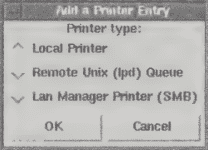
图 8.6：选择打印机类型

选择打印机类型后，填写以下信息：

**队列名称**：队列的名称。可以使用 `|` (管道) 字符分隔多个名称。

**溢存目录**：在打印发生前存储文件的本地机器目录。请注意不要让多一个打印队列使用同一个溢存目录。

**文件限制**：接受的打印作业最大大小。大小为 0 表示不设置限制。

对于本地打印机，还需要以下内容：

- **打印机设备**：通常为 /dev/lpt1，打印机连接的端口名称。串口打印机通常位于 /dev/ttyS? 端口。你需要手动配置串口参数。

**输入过滤器**：过滤器将打印文件转换为打印机可以处理的格式。按“选择”选择与你的打印机最匹配的过滤器。

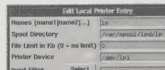
图 8.7：配置打印机

为了创建一个新的打印队列，请选择“添加”。然后，选择正在添加的打印机类型。printtool 可以配置 3 类型的打印机：

...（注意：根据逻辑流合并了 OCR 的重复部分） ...

使用打印机所需的打印机密码（如果需要）。如果你不知道，应该有人能告诉你。请注意：如果你为 SMB (LAN Manager) 打印队列使用用户名和密码，它们将以明文形式存储在本地脚本中，并必须通过命令行传递。因此，其他人可能会得知用户名和密码。因此建议用于打印机的用户名和密码不要与本地 Linux 系统上的用户账户相同，这样唯一的风险就是打印机被未经授权的使用。

# 第 8 章 控制面板

| 设备 | 挂载点 | 类型 | 大小 | 可用 注释 |
|---|---|---|---|---|
| /dev/sda2 | / | *ext2 | 66560 | | |
| /proc | /proc | *proc | na | na |
| /dev/sda5 | /usr | *ext2 | 306208 | 89811 |
| /dev/sda6 | /usr/local | *ext2 | 52208 | 40051 |
| /dev/sda7 | /usr/src | *ext2 | 205808 | 66974 |
| /nt/home | /home | *nfs | 511059 | 62487 |
| /nt/alpha | /mnt/alpha | *nfs | 620457 | 54540 |
| porkyt/nt/doccd /nt/doccd | *nfs | 639396 | 503109 |
| targo/nt/mirrors/prep /mnt/mirrors/prep | *nfs | 376442 | 21469 |
| targo/nt/mirrors/sunite /mnt/mirrors/sunite | *nfs | 963385 | 108587 |

图 8.4：文件系统配置面板

## 8.4 网络配置

图 8.11 所示的网络配置面板旨在方便操作等参数，如 IP 地址、网关地址和网络地址，以及名称服务器和 /etc/hosts。

可以对网络设备进行添加、删除、配置、激活、禁用和别名。支持以太网、archnet、pocket (ATP)、PPP、SLIP、PLIP 和环回设备。PPP/SLIP/PLIP 支持在大多数硬件上运行良好，但某些硬件设置可能会出现不可预测的行为。在使用网络配置工具时，点击“保存”将更改写入磁盘，不进行任何更改，选择“退出”。

### 8.4.1 管理名称

网络配置工具的“名称”面板主要有两个用途：设置计算机的主机名和域名，以及确定用于查找网络上其他主机的名称服务器。网络工具无法将机器配置为名称服务器。要编辑字段或向字段中添加信息，只需用鼠标左键点击该字段并输入新信息即可。


## 8.4. 网络配置

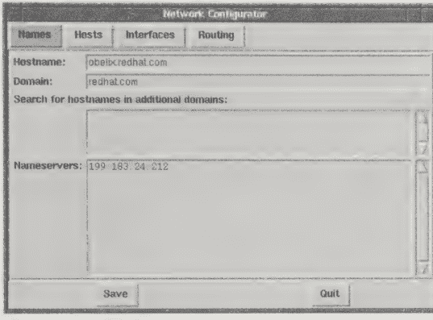

图 8.11：网络配置面板

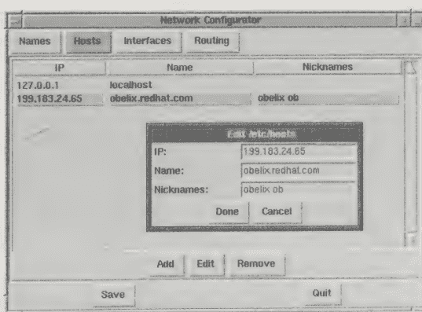

图 8.12：添加/编辑主机

### 8.4.2 管理主机

在主机（Hosts）管理界面中，你能够从 `/etc/hosts` 文件中添加、编辑或删除主机。添加或编辑条目的操作是相同的。系统会弹出一个编辑对话框，只需输入新信息并在完成后点击“完成”（Done）即可。示例请参见图 8.12。

### 8.4.3 添加网络接口

如果你在安装 Red Hat Linux 之后为机器添加了网络接口，或者在安装时没有配置以太网卡，可以通过鼠标点击几次来完成配置。首先，点击主面板上的“接口”（Interfaces）。这将弹出一个显示已配置设备窗口，并带有一行可用选项，参见图 8.13。

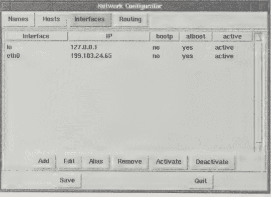

图 8.13：已配置的接口

要添加设备，首先点击“添加”（Add）按钮，然后从弹出的框中选择你想要配置的接口类型。（图 8.14）

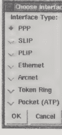

图 8.14：选择接口类型

### PPP 接口

添加 PPP 接口简单，只需在图 8.15 所示的“创建 PPP 接口”（Create PPP Interface）框中提供电话号码、登录名和密码。在许多情况下，需要进行某种程度的自定义才能建立 PPP 连接。选择“自定义”（Customize）按钮允许你对 PPP 接口的硬件、通信和网络设置进行更改。

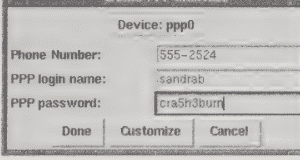

图 8.15：创建 PPP 接口

### SLIP 接口

为了配置 SLIP 接口，你必须先提供电话号码、登录名和密码。这将为建立 SLIP 连接所需的聊天脚本提供初始参数。当你选择“完成”（Done）按钮时，会出现一个“编辑 SLIP 接口”（Edit SLIP Interface）对话框，允许你进一步自定义 SLIP 的硬件、通信和网络参数。

### PLIP 接口

向系统中添加 PLIP 接口，只需要提供 IP 地址、远程 IP 地址和子网掩码（Netmask）。你还可以选择是否在启动时激活该接口。

### 以太网、Arcnet、令牌环和口袋式适配器接口

如果你为电脑添加以太网、Arcnet、令牌环或口袋式适配器，你需要提供以下信息：

- **设备 (Device)**：这由 netconfig 根据已配置的设备确定。
- **IP 地址 (IP Address)**：为你的网络设备输入一个 IP 地址。
- **子网掩码 (Netmask)**：为你的网络设备输入子网掩码。
- **网络 (Network)**：这根据提供的 IP 地址和子网掩码的值确定。
- **广播地址 (Broadcast)**：这根据提供的 IP 地址和子网掩码的值确定。
- **启动时激活 (Activate at Boot)**：如果你想让设备在机器启动时自动配置，请点击此复选框。
- **使用 BOOTP 配置 (Configure with BOOTP)**：如果你在网络上有一个 BOOTP 服务器并希望使用它来配置设备，请点击此复选框。

提供新设备的配置信息后，点击**完成（Done）**。该设备将作为非活动设备出现在你的“接口”（Interfaces）列表中。（活动列应显示为非活动）。如果你想让设备在机器启动时自动配置，请点击此复选框来选择它。

### 8.4.4 路由路由

在路由（Routes）管理界面中，你能够添加、编辑或删除路由。添加或编辑条目的操作是相同的。系统会弹出一个编辑对话框，只需输入新信息并在完成后点击“完成”（Done）即可。示例请参见图 8.16。 (注：此处原文图号与描述不符，已按逻辑翻译)

## 8.5 时间与日期

为了配置 SLIP 接口，你必须先提供电话号码、登录名和密码。这将提供建立 SLIP 连接所需的初始参数。当你选择“完成”（Done）按钮时，会出现一个“编辑 SLIP 接口”（Edit SLIP Interface）对话框，允许你进一步自定义 SLIP 的硬件、通信和网络参数。

## 8.6 守护进程配置

通过内核守护进程配置工具所做的更改将写入 `/etc/conf.modules` 文件中，内核守护进程每次启动都会读取该文件。一旦完成更改，你可以点击“重启内核守护进程”（Restart kerneld）按钮来重启内核守护进程。这不会导致任何正在使用的模块重新加载，它只是通知内核守护进程在将来加载更多模块时使用该配置。


图 8.16：添加路由

### 8.6.1 模块选项

要更改内核守护进程的选项，点击它并点击“编辑”（Edit）按钮。kernelcfg 将弹出一个如图 8.18 所示的窗口。通常情况下，某些模块需要参数，它们会有自己的“参数”（Arguments:）窗口。

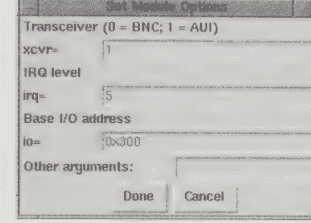

图 8.18：编辑模块选项

### 8.6.2 更改模块

要更改内核守护进程调用的模块（例如以太网卡），你需要删除旧的并添加新的。要删除模块，选中它并点击“删除”（Delete）。然后点击“添加”（Add）添加新模块。如果你更改了 SCSI 控制器（scsi_hostadapter），记得按照第 5 节创建一个新的 ramdisk。

### 8.6.3 添加模块

要添加任何类型的模块，点击“添加”（Add）按钮。你会看到一个对话框（图 8.19），要求你选择模块类型。以太网是 eth。令牌环是 tr。SCSI 控制器是 scsi_hostadapter，以此此类推。点击“确定”（OK）继续到下一个对话框。如果你选择的模块类型有多个可用模块，你会看到一个对话框（图 8.20），询问你想要使用哪种模块，并可能询问模块类型的具体信息；例如以太网，你需要从 eth0、eth1 等中选择。完成后，再次点击“确定”（OK）继续在下一个对话框（图 8.20）中指定任何模块选项，这和你编辑模块时看到的对话框相同。

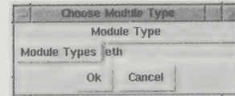

图 8.19：添加模块

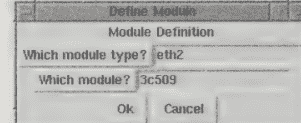

图 8.20：从可用模块中选择


## 第 9 章
## Glint

Red Hat 提供了一个图形化工具来帮助软件包的安装和卸载。它被称为 Mint（图形化安装工具），并在 Windows 下运行。它允许对软件包进行简单的安装、卸载、查询和验证。其界面与许多文件管理器相似，且简单易用。

在 Mint 中，操作是通过选择要操作的软件包，然后通过按钮选择操作类型完成的。安装软件包会将该软件包的所有组件放置在您的系统中。卸载软件包会移除其所有痕迹，但您修改过的配置文件除外。升级软件包则会安装新可用的版本，并卸载之前安装的其他版本。这允许您快速升级到软件包的最新版本。

查询操作允许您查看已安装或可用软件包的详细信息。您可以查看软件包的描述、构建位置和时间、软件包中的文件以及其他属性。所有内容都经过了清晰的标记，以减少您查找它们的时间。

使用 Mint 执行所有这些操作与从命令行使用 `rpm` 是相同的。然而，Mint 的图形化特性使得这些操作变得更加简单。处理 Mint 的通常方法是显示可用的软件包和文件，选择要操作的对象，然后按下执行操作的按钮。例如，您只需点击几次即可安装多个软件包。

## 9.1 启动 Mint

要启动 Mint，只需从任何终端运行即可。这将弹出一个与图 9.1 所示的窗口。任何用户都可以使用 Mint 查询和验证软件包，但如果您需要安装、卸载或升级软件包，请务必以 root 身份运行 Mint。

Mint 界面有两个主要部分。左侧部分允许您浏览并选择安装在系统上的软件包。右侧包含操作所选软件包的按钮。


## 9.2 软件包显示

Mint 中的每个文件夹图标都代表一组软件包。每个组都可以包含其他组，这允许软件包以灵活的位置存在。组被用于将功能相似的软件包放置在相似的位置。例如，Red Hat 包含了许多应用程序，如编辑器和电子表格。所有基于文本的程序都出现在“Applications”（应用程序）组中。在该组内部，还有针对所有出厂编辑器的分组。

按照惯例，组的写法与 UNIX 路径相同。首先编写顶级组，随后的组通过斜杠分隔组名。这意味着绘图程序出现在 Applications/Graphics 组中。

要查看组内的软件包和子组，请双击组文件夹图标上的鼠标左键。窗口将切换并显示软件包包含的内容。软件包显示的顶行显示了您当前查看的组，以及通往当前组的路径组。要返回之前查看的组，请双击“Back”（返回）文件夹，它始终位于文件夹的左上角（尽管它经常随着滚动而移出）。

如果您想在新窗口中查看子组，请双击其文件夹上的鼠标中间键。如果您的鼠标只有两个按钮，请同时点击两个。这将创建一个包含该组的新窗口。

### 9.2.1 上下文敏感菜单

在软件包窗口的任何图标上点击鼠标右键，都会弹出一个小的上下文敏感菜单。它包含的具体项目取决于您点击的确切位置。它们都包含选择或取消选择项目的选项，并且许多选项还允许您安装、卸载、查询、升级或验证您点击的项目。稍后会有关于如何进行这些操作的更多信息。

要从上下文敏感菜单中选择项目，请按住图标上的鼠标右键。在按住右键的同时，将鼠标指针移动到您想要选择的项目上（该项目将变为高亮）。释放右键以选择该项目并消失菜单。

### 9.2.2 选择软件包

要选择单个软件包，请点击它的鼠标左键。您会注意到软件包图标周围出现了一个细边框（如图 9.2 所示），显示它当前被选中状态。要取消选择，请点击它的鼠标左键，边框将消失。当前选中的软件包数量始终显示在窗口底部。组的文件夹图标显示该组内已选中的软件包数量，或者如果全部选中，则显示“All”（全部）。


图 9.2：在 Mint 中选择软件包

软件包的上下文敏感菜单也允许方便地选择和取消选择。在软件包图标上使用“select”（选择）和“unselect”（取消选择）选项可以选择或取消选择该软件包，而在组文件夹图标上使用这些选项则可以选择和取消选择该组中的所有软件包。使用这些菜单选择软件包组比逐个选择每个软件包要快得多。

### 9.2.3 查看可用软件包

要查看可供安装的软件包，请从任何 Mint 窗口选择“Available”（可用）按钮。片刻后，将出现一个图 9.3 所示的新窗口。标题中的差异表明此窗口正在列出您可能安装的软件包。在这些软件包之间导航并选择它们的方法与其他窗口相同。

如果收到来自 Mint 的错误消息，显示其找不到 RPM，请查看下方的“Configuration”（配置）部分。

## 9.3 配置


Mint 需要的唯一配置是新 RPM 的路径。当您使用 Red Hat CD-ROM 时，此路径可能是 `/mnt/cdrom/RPMs`，这是 Mint 的默认路径。如果您从互联网下载 RPM 或想通过 NFS 挂载的 CD-ROM 安装 RPM，则此路径对您来说是不同的。


要更改此路径，首先确保关闭所有列出可用软件包的窗口。然后从剩余的窗口中选择“Configuration”（配置）选项。这将打开一个如图 9.4 所示的对话框。在这里，您可以输入您想要查看的 RPM 的完整路径。选择“Save”（保存）按钮将保存此路径，使其成为未来 Mint 会话的默认值。“Default”（默认）按钮将把路径恢复为 Mint 启动时使用的路径。


## 9.4. 软件包操作

软件包（package）可能非常大。那里有一个滚动条可以让你阅读全部内容。

在描述下方是该软件包中包含的文件列表。除了文件的完整路径外，文件列表还会告诉你其他几点信息。如果路径左侧出现 `D`，则说明该文件是文档文件，非常值得阅读。如果那里出现 `C`，则说明该文件是配置文件。`*` 号表示你的系统中没有安装该文件的正确版本。这可能是因为安装了更新版本的软件包，或者是因为两个软件包包含了同一个文件的不同版本。

详情信息：
| 名称 | xpilot |
| :--- | :--- |
| 版本 | 3.4.0 |
| 发布版本 | 1 |
| 大小 | 0 |
| 供应商 | Red Hat Software |
| 发行版 | RHCL 2.0 |
| 构建主机 | porky.redhat.com |
| 构建日期 | Mon Aug 21 05:13:51 1995 |
| 关闭 | |


点击“Details”（详情）按钮可以查看更多关于软件包的信息。随后会出现一个类似于图 9.6 的窗口。它列出了主查询窗口中显示的软件包的更多信息。你在查询窗口中选择新软件包时，详情窗口中的信息将发生变化以反映你的新选择。

在查询时，你还可以使用提供的按钮对软件包进行选择、取消或验证。查看完毕软件包后点击“Close”（关闭）按钮。

### 9.4.2 验证软件包

验证软件包会检查软件包中的所有文件，以确保它们与系统中存在的文件匹配。校验和、文件大小、权限和所有者属性都将与数据库进行比对。当你怀疑某个程序文件已损坏时，可以使用此检查。

选择要验证的软件包与选择软件包相同，点击“Verify”（验证）按钮即可。会打开一个类似于图 9.7 的窗口。

| 软件包 | 文件 | 问题 |
| :--- | :--- | :--- |
| sendmail:3.4 | /sendmail.cf | |
| sendmail:3.6.12 | /var/log/sendmail.st | |
| pcmia-cs:2.6.3a:2 | /etc/sysconfig/pcmia- | |

图 9.7 验证窗口

此窗口中的三列描述了软件包的差异，并显示简要描述。在检查期间，正在检查的文件将出现在列表的末尾。

| 问题 | 描述 |
| :--- | :--- |
| 缺失 | 系统上不存在 |
| 模式 | 权限已更改 |
| uid | 所有者 UID 已更改 |
| gid | 所有者 GID 已更改 |
| md5 | MD5 值已更改 |
| 链接 | 指向错误的软链接 |

图 9.8 可能的问题

要获取有关软件包问题的更多信息，请双击文件。类似于图 9.9 的窗口列出了属性的预期值和当前值。

| /etc/sysconfig/pcmia-scripts pcmia-cs:2.6,3a: | 预期 | 当前 |
| :--- | :--- | :--- |
| 权限 | 0755 | 0644 |
| 大小 | 6172 | 6133 |
| 校验和 | 393a0c05d2fb5176bf0b2c32875c62a | |

图 9.9 详情

### 9.4.3 安装新软件包

安装新软件包非常简单。首先查看可用的软件包（参见第 9.2 节）。你可以选择其中任何数量（如果不确定可以查询它们）。如果你想安装单个软件包或组，上下文相关菜单提供了快捷方法。图 9.10 显示了选择了一些软件包的窗口。

开始安装后，会出现一个类似于图 9.11 的窗口。它会跟踪进度，让你知道正在进行什么。顶栏显示已安装的进度，底部显示总进度。


标准中未涵盖的文件系统。

可以通过以下地址查看完整的标准：

```
http://www.pathname.com/fhs/
```

## 10.1.1 FSSTND 概述

这里提到的目录和文件是 FSSTND 文档中指定目录的一个子集。请检查最新的 FSSTND 文档以获取最新、最完整的信息。

### /etc 目录

/etc 目录保留用于本地机器的配置文件。/etc 中不应存放任何二进制文件。过去放在 /etc 中的二进制文件现在应该放入 /sbin 或可能放入 /bin。

X11 和 skel 目录应该是 /etc 的子目录：

### /etc

- X11
- skel

X11 目录用于存放 X11 配置文件，例如 XF86Config。skel 目录用于存放“骨架（skeleton）”用户文件，这些文件是在首次创建用户时用于填充家目录的文件。

### /lib 目录

/lib 目录应该只包含执行 /bin 和 /sbin 中二进制文件所需的库。

### /sbin 目录

/sbin 目录用于存放 root 用户使用的可执行文件，且仅限于启动和挂载 /usr 以及执行系统恢复操作所需的可执行文件。FSSTND 规定：

## 10.1 文件系统结构

/sbin 通常包含启动系统所必需的文件，以及 /bin 中的二进制文件。在 /usr 已知挂载（在没有问题的情况下）之后执行的任何程序都应该放在 /usr/sbin 中。仅限本地的系统管理二进制文件应该放在 /usr/local/sbin 中。

至少以下程序应该位于 /sbin 中：

```
clock, getty, init, update, mkswap, swapon, swapoff,
halt, reboot, shutdown, fdisk, fsck.*, mkfs.*, lilo,
arp, ifconfig, route
```

### /usr 目录

/usr 目录用于存放整个站点共享的文件。/usr 目录通常有自己的分区，并且应该是可只读挂载的。以下目录应该是 /usr 的子目录：

| /usr |
| :--- |
| X11R6 |
| bin |
| dict |
| doc |
| etc |
| games |
| include |
| info |
| lib |
| local |
| man |
| sbin |
| share |
| src |

X11R6 目录用于 X Window 系统（在 Red Hat Linux 上的 XFree86），bin 用于可执行文件，doc 用于随机的非 man 页文档，etc 用于站点范围的配置文件，include 用于 C 头文件，info 用于 GNU info 文件，lib 用于库，man 用于 man 手页，sbin 用于系统管理二进制文件（那些不属于 /sbin 的文件），src 用于源代码。

### /usr/local 目录

FSSTND 规定：

> “/usr/local 层次级结构供系统管理员在本地安装软件时使用。它需要确保在系统软件更新时不会被覆盖。它可以用于在组机器之间共享但在 /usr 中未找到的程序和数据。”

/usr/local 目录的结构与 /usr 目录相似。它具有以下子目录，其用途与 /usr 目录中的子目录相似：

| /usr/local |
| :--- |
| bin |
| doc |
| etc |
| games |
| include |
| info |
| lib |
| man |
| sbin |
| src |

### /var 目录

由于 FSSTND 要求能够以只读方式挂载 /usr，因此任何写入日志文件或需要缓存（spool）或锁目录的程序可能将它们写入 /var 目录。FSSTND 规定 /var 是

> "... 变量数据文件。这包括缓存目录和文件、管理和日志数据，以及瞬性和临时文件。”

## 10.1 文件系统结构

以下目录应该是 /var 的子目录：

| /var |
| :--- |
| log |
| catman |
| lib |
| local |
| named |
| nis |
| preserve |
| run |
| lock |
| tmp |
| spool |
| at |
| cron |
| lpd |
| mail |
| mqueue |
| rwho |
| smail |
| uuccp |
| news |

系统日志文件如 wtmp 和 lastlog 放在 /var/log。/var/lib 目录包含 RPM 系统数据库。格式化后的 man 页放在 /var/catman，锁文件放在 /var/lock。/var/spool 目录拥有各种需要存储数据文件的系统子目录。

### 10.1.2 Red Hat Linux 中的 /usr/local

在 Red Hat Linux 中，/usr/local 的预期用途与 FSSTND 规定的略不同。FSSTND 规定 /usr/local 应该确保在系统软件更新时不会被覆盖。由于 Red Hat 软件是通过 RPM 安全地更新的，你不需要将文件放在 /usr/local 来保护它们。相反，我们建议将 /usr/local 用于本地软件。

## 10. 系统管理

例如，假设你通过只读方式挂载了 /usr。如果有一个程序是你想要安装的，但被允许写入 beavis...（此处由于原文存在大量重复无效文本，已按指令要求进行处理并翻译）。


## 10.3. 用户、组和用户专用组

umask = 002 传统的 UNIX umask 022 会防止其他用户以及用户主组的其它成员修改用户的文件。由于在 UPG 方案中，每个用户都有自己的私有组，因此不需要“组保护”。002 的 umask 将防止用户修改其他用户的私有文件。该 umask 在 `/etc/profile` 中设置。

**目录上的 SGID 位** 如果你对目录设置了 SGID 位（通过 `chmod g+s directory`），则在该目录中创建的文件，其所属组将设置为该目录的所属组。

大多数计算站点都倾向于为每个主要项目创建一个组，并将人员分配到他们需要加入的组中。然而，传统的这种管理方式一直很困难，因为当有人创建一个文件时，该文件属于他/她所属的主组。当一个人处理多个项目时，很难让文件属于与该项目关联的组。在 UPG 方案中，组是根据每个项目为基础自动分配给文件的，这使得管理小组项目变得非常简单。

假设你有一个名为 `devel` 的大项目，许多人正在 `devel` 目录中编辑 `devel` 文件。创建一个名为 `devel` 的组，使用 `chgrp devel directory` 将目录更改为 `devel`，并将所有 `devel` 用户加入 `devel` 组。现在，所有 `devel` 用户都能够编辑 `devel` 文件并在 `devel` 目录中创建新文件，这些文件将始终保留 `devel` 组。因此，它们始终可以被其他用户编辑。

你有像 `devel` 这样的多个项目，并且用户正在处理多个项目，这些用户在不同项目之间切换时永远不需要更改他们的 umask 或组。每个项目主目录上的 SGID 位会“选择”正确的组。

每个用户的 HOME 目录由该用户及其私有组所有，在 HOME 目录上设置 SGID 位是安全的。但是，默认情况下，文件是用用户的主组创建的，因此 SGID 位是多余的。

### 用户专用组的原理

由于 UPG 方案是新的，许多人对它有疑问，并想知道为什么有必要。以下是该方案的原理。

- 你希望一组人在一组文件上工作，例如在 `/usr/lib/emacs/site-lisp-directory` 中。你信任几个人可以在那里折腾，但显然不是所有人。

- 于是你输入：
```
chown -R root.emacs /usr/lib/emacs/site-lisp
```
并将适当的用户添加到该组。

- 为了允许用户实际上在你进入的目录中创建文件，你输入：
```
chmod 775 /usr/lib/emacs/site-lisp
```

- 但当用户创建一个新文件时，它会被分配给用户的默认组（通常是 users）。为了防止这种情况，你输入：
```
chmod 2775 /usr/lib/emacs/site-lisp
```
这会导致目录中的所有内容在创建时都使用 “emacs” 组。

- 但新文件需要模式 664 权限，以便 emacs 组中的另一个用户能够编辑它。为了实现这一点，你将默认 umask 设置为 002。

- 嗯，这一切运行良好，例外是如果你的默认组是“users”，那么你在家目录中创建的每个文件都将允许“users”中的每个人（通常是所有人）写入。

- 为了修复这个问题，你让每个用户都有一个“私有组”作为他们的默认组。

此时，通过将默认 umask 设置为 002 并赋予每个人私有的默认组，你可以轻松地设置用户可以利用的组，而无需任何魔法操作。只需创建组、添加用户，并在组目录上执行上述的 `chown` 和 `chmod` 操作即可。

## 使用 PAM 进行用户认证

赋予用户各种权限的程序需要对用户进行验证。当你登录系统时，提供用户名和密码，登录过程使用这些信息对登录进行验证，以验证你确实是你所称的。除了密码的其他认证形式也是可能的，密码也可以以不同的方式存储。

PAM 代表“可插认证模块”（Pluggable Authentication Modules），它是允许系统管理员在无需重新编译进行认证的程序的情况下设置认证策略的方法。通过 PAM，你通过编辑配置文件来控制模块如何插入到程序中。

大多数 Red Hat Linux 用户永远不需要碰这个配置文件。当你使用 RPM 安装需要进行验证的程序时，它们会自动完成执行普通密码验证所需的更改。然而，你可能想要自定义你的配置，在这种情况下，你需要理解该配置文件。

### 10.4.1 模块

PAM 标准定义了四种模块。`auth` 模块提供实际的认证，例如请求并检查密码，并设置“凭据”（如组成员关系或 Kerberos “票据”）。`account` 模块检查认证是否被允许（账户未过期、用户在特定时间段被允许登录等）。`password` 模块用于设置密码。`session` 模块在用户通过验证后使用一次，以便他们可以使用其账户，例如挂载用户的家目录或使其邮箱箱可用。

这些模块可以进行堆叠，因此可以使用多个模块。例如，rlogin 通常会使用至少两个模块：如果第一个模块失败，将检查下一个（注意：此处的 OCR 文本似乎碎片化/损坏了）。


# 134 第 10 章 系统管理

这看起来几乎像登录项，但多出了一行指定了额外的模块，而且模块指定的顺序也不同。

首先，`pam_securetty.so` 防止 root 用户在不安全的终端上登录。如果你希望允许这种登录（在这种情况下，我们建议你既不要连接互联网，也要处于良好的防火墙之后），你可以简单地删除该行。

其次，`pam_nologin.so` 会如上所述检查 /etc/nologin。

第三，如果 `pam_hosts.auth.so` 验证了用户，PAM 将立即向 rlogin 返回成功，而无需进行任何密码检查。如果 `pam_hosts.auth.so` 验证用户失败，则该失败将被忽略。

最后（如果 `pam_hosts.auth.so` 验证用户失败），将执行标准的 unix 密码认证。

### 10.4.4 默认 (Default Stanza)

当安装包含使用 PAM 程序的软件包时，它们会自动向 `/etc/pam.conf` 添加段落。在可能的情况下，它们不会指定使用哪些模块——它们会复制 `/etc/pam.conf` 顶部 `DEFAULT` 段中的任何内容。通过更改该段落，你可以更改大多数应用程序使用的默认条目。如果你这样做了，在添加新的感知 PAM 的应用程序后，你需要检查 `/etc/pam.conf` 以确保所添加的段落符合你的系统。

### 10.4.5 影子密码 (Shadow Passwords)

`pam_unix.*.so` 模块支持影子密码。为了将系统转换为影子密码，请使用以下命令：

```
cd /etc
pconv5
chmod 600 passwd shadow-
```

`pam_unix.*.so` 模块将检测到你正在使用影子密码并进行所有必要的调整。

## 10.5 启动过程、init 和关机

### 10.4.6 更多信息

这只是 PAM 的介绍。系统在 `/usr/doc` 中包含了文本、HTML 和 PostScript 格式的更多信息，包括《系统管理员指南》、《模块编写者手册》、《应用程序开发者手册》以及 PAM 标准 DCE-RFC 86.0。此外，可以在 Red Hat 网站获取文档，地址为：http://www.redhat.com/linux-info/pam/

## 10.5 启动过程、Init 和关机

### 10.5.1 System V Init

本节是对启动过程内部原理的简要描述。它详细涵盖了机器如何使用 SysV Init 启动，以及与旧版本 Linux 中使用的原始 init 之间的区别。

init 是内核在启动时运行的程序。它负责启动所有启动时需要运行的正常进程。这些包括允许你登录的 getty 程序、NFS 守护进程、FTP 守护进程以及你希望在机器启动时运行的任何其他。

SysV Init 正在成为 Linux 世界控制启动时软件启动的标准。这是因为比传统的 BSD init 更容易使用，且更强大、更灵活。

SysV init 与 BSD init 的不同之处在于，配置文件位于 `/etc` 的子目录中，而不是直接位于 `/etc` 下。该目录被称为 `rc.d`。在里面你会找到 `rc.sysinit` 和以下目录：

```
init.d
rc0.d
rc1.d
rc2.d
rc3.d
rc4.d
rc5.d
rc6.d
```

`init.d` 包含一组脚本。基本上，对于每个可能需要在启动时或进入另一个运行级别时启动的服务，你需要一个脚本。服务包括网络、nfs、sendmail、httpd 等。服务不包括像 `setserial` 这样必须运行一次后退出的程序。这些是应该放在 `rc.local` 或 `rc.serial` 中的内容。

如果你想要 `rc.local`，它应该位于 `/etc/rc.d` 中。大多数系统都包含一个，尽管它没做什么。如果你需要在启动时执行针对串口的特定操作，也可以在 `/etc/rc.d` 中包含一个 `rc.serial`。

事件链如下：

- 内核在几个地方查找 init 并运行它找到的第一个
- init 运行 `/etc/rc.d/rc.sysinit`
- rc.sysinit 执行一系列必要操作，然后运行 `rc.serial`（如果存在）
- init 运行默认运行级别下的所有脚本
- init 运行 `rc.local`

默认运行级别在 `/etc/inittab` 中决定。你应该在顶部附近有一如下所示的一行：

```
id:3:initdefault:
```

从这里，你可以查看第二列并看到默认运行级别是 3，大多数系统也应该是这种的。如果你想更改它，可以手动编辑 `/etc/inittab` 并更改 3。在动 `inittab` 时要非常小心。如果你弄乱了，可以通过重启并执行以下操作来修复：

```
LILO boot: linux single
```

这*应该*允许你进入单用户模式，以便修复 `inittab`。

现在，它是如何运行所有正确的脚本的？如果你在 `rc3.d` 中输入 1 -1，你可能会看到类似的内容：

# 136 第 10 章 系统管理

## 10.5 启动过程、init 和关机

### 10.5.2 Init 运行级别 (Runlevels)

通常，Red Hat Linux 运行在级别 3 多用户模式下。使用的运行级别如下：

- 0 关机。
- 1 单用户模式。
- 2 不带 NFS 的多用户模式。
- 3 完整多用户模式。
- 6 重启。

如果你的机器由于错误的 `inittab` 无法启动，或者由于 `/etc/passwd` 损坏或你忘记密码而无法登录，请在 LILO 提示符处输入 `linux 1` 进入单用户模式。

### 10.5.3 关机

关闭 Red Hat Linux，请执行 `shutdown` 命令。你可以阅读 shutdown 手页获取完整信息，但两种最常用的用法是：

```
shutdown -h now
shutdown -r now
```

每个命令都会安全地关闭系统。第一个将停止机器，第二个将重启。避免直接运行 `reboot` 或 `halt` 命令以防止文件系统损坏。

## 10.6 救援模式

当出现问题时，有几种方法可以修复它们。然而，这些需要你熟悉系统。本手册无法教你该做什么，但我们将介绍如何使用我们的产品进入救援模式的方法，以便你可以利用自己的知识来营救系统。

### 10.6.1 通过 LILO

如果你的系统可以启动，但在启动完成后不允许你登录，可以使用单用户或紧急启动选项。在 LILO


## 10.6. 救援模式

boot: 提示符，输入 `linux single` 以进入单用户模式启动。在单用户模式下，你的本地文件系统将被挂载，但网络将不会被激活。在紧急模式下，几乎没有任何东西会被设置。只有根文件系统会被挂载，且将以只读方式挂载。

### 10.6.2 紧急启动软盘

安装光盘集也可以用作救援光盘集。当你从软盘启动时，在启动提示符处输入 `rescue`（在非 Intel 平台上，启动时将 `rescue` 作为内核的一个选项添加，例如，输入 `linux rescue`），安装程序会询问你几个问题，要求你插入第二块磁盘，并在 VC 1 和 VC 2 上设置 shell。正在运行的 shell 是 `ash`，这是一个极简的 bourne shell，没有历史记录或命令行编辑功能。

`PATH` 环境变量已设置，因此一旦你将根分区挂载到 `/mnt`，如果根分区中的二进制文件在软盘上不存在，则将运行它们。此外，如果需要，将使用 `/mnt/lib` 和 `/mnt/usr/lib` 中的库。在修复系统期间，你可能希望更改 `PATH` 以不包含 `/bin` 和 `/usr/bin`，而是保留 `/mnt/bin`、`/mnt/usr/bin` 等。如果你这样做这样做，你需要使用 `/bin/unmount` 来卸载 `/mnt`。

在挂载 `/mnt` 之前，可以使用重要工具的限制版本：

`mount` 命令不需要挂载的设备节点已经存在，也不需要设备的完整名称。除非另有说明，否则它假设文件系统为 ext2。

```
mount /dev/sda1 /mnt -t ext2
```

在功能上等同于

```
mount sda1 /mnt
```

- ash: 完整版本
- cat: 不接受任何选项
- chmod: `chmod` 命令不接受符号化模式名称，只接受进制模式。
- cpio: 完整版本
- e2fsck: 完整版本
- fdisk: 完整版本
- gzip: 完整版本
- gunzip: 完整版本
- insmod: 完整版本
- ls: 完整版本
- lmod: 不接受任何选项
- mkdir: 没有 GNU 长格式选项
- mke2fs: 完整版本
- mknod: `mknod` 命令不接受符号化模式名称，只接受进制模式。
- open: 完整版本
- rm: 没有 GNU 长格式选项
- rmmod: 完整版本
- sh: ash 的符号链接

# 附录 A

### 硬件要求

所有标准 Linux 内核中带有驱动程序的设备在 Red Hat 内核中均支持“开箱即用”，声卡除外。然而，模块化内核简化了支持的添加。有关如何操作的更多信息，请参阅 Kernel-HOWTO（位于 `/usr/doc/HOWTO`）。

有关内核直接支持的特殊硬件（包括 SCSI 设备）的更多信息，请参见 Hardware-HOWTO 和 SCSI-HOWTO（位于上述相同位置）。还有一个 XFree86 HOWTO。

需要一个连接为第一个物理软盘设备 (a:) 的 1.44M 软盘驱动器。以下是各种流行软件组合的配置要求：

### 最低文本模式安装

- 386sx 或更高级的 CPU
- 8M RAM
- 40M 硬盘
- 任何可用的显卡（Hercules, CGA, VGA, SVGA 等等）
- 任何支持的 CD-ROM

带有 X Window 系统的最低文本模式安装

- 386sx 或更高级的 CPU
- 8M RAM
- 80M 硬盘
- 任何 XFree86 支持的显卡（VGA 和 SVGA，见下文）
- 鼠标（支持大多数类型）
- 任何支持的 CD-ROM 驱动器

### 推荐配置

- 486dx 或更高级的 CPU
- 16M RAM
- 300M 硬盘
- 任何被 XFree86 支持的 SVGA 显卡
- 3 键鼠标
- SCSI 磁带机（可选）
- UPS（可选）
- 双倍速 CD-ROM 驱动器

支持的显卡包括：

- 大多数 Diamond 卡
- 大多数基于 S3 的卡
- 基于 ET4000 的卡
- ATI 卡
- Cirrus Logic 542x 和 543x
- 基于 Chips and Technologies 的卡
- Trident 8900 和 9400
- 大多数 #9 卡

支持的 CD-ROM 驱动器包括：

- 所有符合 IDE/ATAPI 标准的驱动器
- 所有连接到支持控制器的 SCSI 驱动
- 所有 Sound Blaster 接口驱动器（Matsushta/Kotobuki/Panasonic）
- Mitsumi 驱动器
- Sony 535, CDU 31, CDU 33

# 附录 B

### 模块参数

此附录是为了说明某些内核模块可能需要的*某些* 可用参数。需要注意的是，在大多数情况下不需要额外的参数。

## B.1 CD-ROM 参数

| 硬件 | 参数 |
| --- | --- |
| Mitsumi CD-ROM | mcd=port,irq |
| Sony CDU 31 或 33 CD-ROM | cdu31a_port=base_addr cdu31a_irq=irq |
| Aztec CD268 | aztcd=port |
| SB Pro 或 16 兼容 | sbpcd=io_addr,sb_pro_setting |
| ATAPI/IDE CD-ROM 驱动器 | hdx=cdrom |

### 模块参数

| 硬件 | 参数 |
| --- | --- |
| Mitsumi CD-ROM | mcd=port,irq |
| Sony CDU 31 或 33 CD-ROM | cdu31a_port=base_addr cdu31a_irq=irq |
| Aztec CD268 | aztcd=port |
| SB Pro 或 16 兼容 | sbpcd=io_addr,sb_pro_setting |
| ATAPI/IDE CD-ROM 驱动器 | hdx=cdrom |

## 模块参数（注：此处原文存在重复的 B.2 ）

| 硬件 | 参数 |
| --- | --- |
| Mitsumi CD-ROM | mcd=port,irq |
| Sony CDU 31 或 33 CD-ROM | cdu31a_port=base_addr cdu31a_irq=irq |
| Aztec CD268 | aztcd=port |
| SB Pro 或 16 兼容 | sbpcd=io_addr,sb_pro_setting |
| ATAPI/IDE CD-ROM 驱动器 | hdx=cdrom |

## 示例

| 示例 | 配置 |
|---|---|
| non-IDE Mitsumi CD-ROM on 340, IRQ | mcd=port,irq |
| CDU 31 or 33 at 340, IRQ | cdu31a_port=base_addr cdu31a_irq=irq |
| Aztec CD-ROM at 220 | aztcd=port |
| ATAPI/IDE CD-ROM, jumpered as master on 2nd interface | sbpcd=io_addr,sb_pro_setting |
| Panasonic-type CD-ROM on | hdx=cdrom |

## B.2 SCSI 参数

| 硬件 | 示例 |
| --- | --- |
| non-IDE Mitsumi CD-ROM on 340, IRQ | mcd=port,irq |
| CDU 31 or 33 at 340, IRQ | cdu31a_port=base_addr cdu31a_irq=irq |
| Aztec CD-ROM at 220 | aztcd=port |
| ATAPI/IDE CD-ROM, jumpered as master on 2nd interface | sbpcd=io_addr,sb_pro_setting |
| Panasonic-type CD-ROM on | hdx=cdrom |

## B.3 ETHERNET 参数

| 示例 | 配置 |
|---|---|
| non-IDE Mitsumi CD-ROM on 340, IRQ | mcd=port,irq |
| CDU 31 or 33 at 340, IRQ | cdu31a_port=base_addr cdu31a_irq=irq |
| Aztec CD-ROM at 220 | aztcd=port |
| ATAPI/IDE CD-ROM, jumpered as master on 2nd interface | sbpcd=io_addr,sb_pro_setting |
| Panasonic-type CD-ROM on | hdx=cdrom |

## 附录 C

### Alpha 系统与处理器简介

本文是对现有 CPU、芯片组和系统的简要概述。本文带有某种偏见，我是 Digital 的员工，这不是官方声明。

### C.1 什么是 Alpha

"Alpha" 是 Digital 64 位 RISC 的名称。Digital 的 Alpha 项目始于 1989 年中期，目标是为 VAX 用户提供高性能迁移。这不是 Digital 生产的第一个 RISC 架构，但它是第一个进入市场的。当 Digital 在 1992 年 3 月宣布 Alpha 时，它决定通过销售处理器进入市场。由于某些模糊的原因，Alpha 也称为 AXP。

### C.2 什么是 Digital

Digital Semiconductor (DS, http://www.digital.com/semiconductor/) 是 Digital Corporation（我们不喜欢 DEC 这个名字）内部的一个向市场销售半导体的业务部门。Digital...


## C.3. ALPHA 处理器

- /21064A-233,275,300/ EV45
- /21066/ LCA4S (EV4 核心，配备 EV4 FPU)
- /21066A-233/ LCA45 (EV4 核心，但配备 EV45 FPU)
- /21164-233,300,333/ EV45
- /21164A-417/ EV56
- /21264/ 你只能拭目以待……

EV4 核心是一个双发射（它每个 CPU 时钟周期可以发射 2 条指令）的超流水线核心，带有整数单元、浮点单元和分支预测器。它采用全旁路设计，并拥有 64 位内部数据路径和紧耦合的 8K 字节缓存，指令和数据缓存各一个。缓存为写通方式（它们永远不会变脏）。

EV45 对 EV4 核心进行了若干调整：它拥有稍微改进的浮点单元和 16KB 缓存，指令和数据共用（它还具有缓存校验）。（编辑注：Neal Crook 在另一封邮件中指出，对浮点单元（FPU）的改进提高了除法器的性能。EV4 除法器单精度除法需要 34 个周期，双精度除法需要 63 个周期（与取决于数据）。相比之下，EV45 除法器单精度除法通常需要 19 个周期（最多 34 个），双精度除法通常需要 29 个周期（最多 63 个，取决于数据）。

EV5 核心是一个四发射核心，同样是超流水线、全旁路等。它拥有紧耦合的 8K 字节缓存，分别用于 I 和 D。这些缓存是写通的。它还有一个紧耦合的 96K 字节片上二级缓存（Scache），该缓存是 3 路关联且写回的（可以变脏）。EV4-5 的性能提升优于主频提升带来的增长。除了更大的缓存和四发射外，微架构的改进还减少了某些路径中生产者/消费者之间的延迟。

EV56 核心在微架构上与 EV5 根本相同，但增加了一些用于 8 位和 16 位加载与存储的新指令（见章节 C.8 字节等）。这些指令主要用于设备驱动程序。EV56 核心采用 CMOS6 工艺，这是一个 2.0V 工艺。

## 附录 C ALPHA 系统与处理器简介

21064 于 1992 年 3 月发布。它使用 EV4 核心，带有 128 位总线接口。总线接口支持连接外部二级缓存，块大小为 256 位（总线上的 2 个节拍）。Bcache 的时序完全可以通过软件配置。21064 还可以配置为使用 64 位外部总线（但不确定是否有任何上市系统使用这种模式）。21064 对 Bcache 不施加任何策略，但它通常被配置为写回缓存。21064 包含钩子，允许外部硬件维持 Bcache 与内部缓存之间的缓存一致性。

21064 使用 EV4 核心，并集成了内存控制器和 PCI 主桥。除去引脚外，内存控制器具有 64 位数据线（但内部缓存的块大小为 256 位，与 21064 相同。填充一个块在总线端需要 4 个节拍）。内存控制器支持外部 Bcache 和外部 DRAM。Bcache 和 DRAM 的时序完全可以通过软件配置，并可以控制到 CPU 时钟周期的分辨率。4 个节拍填充一个缓存块并不糟糕，因为 DRAM 访问是在页模式下进行的。遗憾的是，内存控制器不支持任何奇特的 DRAM（SRAM、EDO 或 BEDO）或同步缓存 RAM。PCI 总线接口完全符合 rev2.0 标准，运行频率高达 33MHz。

21164 具有 128 位数据线并支持拆分读取，任何时间最多有 2 个待处理读取（这在最佳情况的理想状态下允许实现 100% 的利用率，即理论上你可以在每个时钟周期传输 128 位数据）。21164 支持轻松连接外部三级缓存（Bcache），并拥有所有钩子，允许外部系统与所有缓存维持完全缓存一致性。因此，对称多处理器设计是“容易”的。

2164A 于 1995 年 10 月发布。它使用 EV56 核心。它在引脚上与 21164 兼容，但 21164 上所有的 +3.3V 电源引脚现在分为一组：一组为 CPU 核心提供 2.0V 电源，另一组为 I/O 提供 3.3V。与其他实现不同，21164 的引脚不耐 5V。这种更改的结果是，21164 系统通常无法升级到 2164A（尽管升级到 2164A 相对直接）。2164A 是第一个使用 2.0V 核心逻辑的 Alpha。2164A 是第一个使用 3.3V I/O 逻辑的 Alpha。2164A 是第一个使用 1.5V I/O 逻辑的 Alpha。

## C.4. 2164 VS 2166 性能

2164 和 2166 具有相同的微架构，但 2166 的主频更高。性能差异主要是由于主频造成的，但还有其他因素：

- 在 2164(A) 和 2166(A) 上微架构相同，但 2166(A) 的主频更高。
- 在 2164(AB) 和 2166(AB) 上微架构相同，但 2166(AB) 的主频更高。
- 在 2164(C) 和 2166(C) 上微架构相同，但 2166(C) 的主频更高。
- 在 2164(D) 和 2166(D) 上微架构相同，但 2166(D) 的主频更高。
- 在 2164(E) 和 2166(E) 上微架构相同，但 2166(E) 的主频更高。

### C.5 关于时钟的少量说明

目前的 Alpha CPU 都使用高频时钟，因为它们的微架构被设计为所谓的短周期设计。

- 在 2164 和 2166 上，微架构相同，但 2166 的主频更高。
- 在 2164(A) 和 2166(A) 上，微架构相同，但 2166(A) 的主频更高。
- 在 2164(AB) 和 2166(AB) 上，微架构相同，但 2166(AB) 的主频更高。
- 在 2164(C) 和 2166(C) 上，微架构相同，但 2166(C) 的主频更高。
- 在 2164(D) 和 2166(D) 上，微架构相同，但 2166(D) 的主频更高。
- 在 2164(E) 和 2166(E) 上，微架构相同，但 2166(E) 的主频更高。

## C.6. 芯片组

DS 销售两种 CPU 支持芯片组。2107x 芯片组（又名 APECS）是 21064(A) 支持芯片组。2117x 芯片组（又名 ALCOR）是 21164 支持芯片组。


### C.7 系统

这两个芯片组都为 CPU 提供了内存控制器和 PCI 主机桥。APEC 提供了一个 32 位 PCI 主机桥，ALCOR 提供了一个 64 位 PCI 主机桥（根据 PCI 规范，它可以同时支持 32 位和 64 位 PCI 设备）。

APECS 由 6 颗 208 引脚芯片组成（4 个 32 位数据切片 (DECADE)，1 个系统控制器 (COMANCHE)，1 个 PCI 控制器 (EPIC)）。它提供一个 DRAM 控制器（128 位内存总线）和一个 PCI 接口。它还负责在 PCI 设备对内存进行 DMA 访问（或出）时维护内存一致性的所有工作。

ALCOR 由 5 颗芯片组成（4 个 64 位数据切片 (Data Switch, DSW) - 208 引脚 PQFP，以及 1 个控制/I/O 地址芯片 (CIA) - 一个 383 引脚塑料 PGA）。它提供一个 DRAM 控制器（256 位内存总线）和一个 PCI 接口。它还负责支持外部 Bcache 以及在 PCI 设备对内存进行 DMA 访问（或出）时维护内存一致性的所需工作。

21066 没有支持芯片组，因为内存控制器和 PCI 主机桥功能已集成在芯片内部。

### C.7 系统

DS 的应用工程小组使用 CPU 和支持芯片组制作了示例设计。这些通常是 PC-AT 尺寸的主板，具备你在高端腾（Pentium）主板上通常能找到的所有功能。最初，这些示例设计旨在作为第三方生产主板设计的起点。这些第一代设计被称为评估板（EBs）。随着构建主板所需的工程量不断增加（由于更高频率的时钟以及需要满足射频 RF 发射和抗干扰性规定），重点已转向提供适用于批量生产的主板。

Digital 的系统组生产了数代使用 Alpha 处理器的机器。其中一些系统使用了系统组设计的支持逻辑，另一些则使用 DS 的通用芯片组。在某些情况下，系统结合使用了了两者。

不同的第三方使用 Alpha 处理器构建系统。其中一些公司从零开始设计系统，另一些则使用 DS 的支持芯片组或克隆/修改 DS 的示例设计，或者直接使用 DS 测试过的板卡进行组装。

## 附录 C. Alpha 系统与处理器简介

- EB64：过时的设计，使用 21064，内存控制器使用可编程逻辑实现。I/O 通过可编程逻辑提供，用于连接 486 <-> ISA 芯片。板载以太网。SuperI/O（2S, 1P, FD），以太网和 ISA。由标准 PC 电源运行。

- EB64+:使用 21064 和 21064A 以及 APE。具有 ISA 和 PCI 扩展（3 个 ISA，2 个 PCI，一对位于共享槽位上）。支持 36 位 DRAM SIMs。ISA 总线由 Intel Saturn/PCI-ISA 总线生成。板载 SCSI（PCI 上的 NCI 810）以太网（Digital 21040）。鼠标（PS2 级），SuperI/O（2S, 1P, FD），RTC/NVRAM。启动 ROM 为 EPROM。PC-AT 尺寸。由标准 PC 电源运行。

- EB66：使用 21066 和 21066A。I/O 系统与 EB64+ 相同。PC-AT 尺寸。由标准 PC 电源运行。EB66 的原理图是作为营销海报创建的，宣传为“世界上第一个嵌入 PCI 的微处理器”（对于冷知识爱好者：实际上有两个版本的版本的海报 - 我绘制了第一个版本的电路并写了文案，一些美国人寄送了第二个版本的文案）。

- EB164：使用 21164 以及 ISA 和 PCI 扩展（3 个 ISA 槽，64 位 PCI 槽（一个与 ISA 槽共享）以及 2 个 32 位 PCI 槽）。使用插卡 Beach SIMMs。I/O 系统提供 SuperI/O（2S, 1P, FD），键盘，鼠标（PS2 式）。RTC/NVRAM。启动 ROM 为 Flash。PC-AT 尺寸主板。需要带有 3.3V 输出的电源。

- AlphaPC64（又名 Cabriolet）：衍生自 EB64+，但现在采用 baby-AT Flash 启动，无板 SCSI 或以太网。3 个 ISA 槽。4 个 PCI 槽（一对位于共享槽位上）。使用插卡 Beach SIMMs。需要带有 3.3V 输出的电源。

- AXPci33（又名 NoName）基于 EB66。该设计由 Digital 的技术 OEM (TOEM)小组生产。它使用运行在 166MHz 或 233MHz 的 21066 处理器。它是 baby-AT 尺寸，由标准 PC 电源运行。它有 5 个 ISA 槽和 3 个 PCI 槽（一对为共享槽）。有两个版本，键盘使用 PS/2 或大型 DIN 连接器。

其他基于 21066 的主板：大多数甚至所有基于 21066 的主板都是基于 21066。

## C.8 字节与其他内容

当 Alpha 架构引入时，它在 RISC 架构中是独一的，因为它避免了 8 位和 16 位的加载和存储。它支持 32 位和 64 位的加载和存储（Digital 的术语称为 longword 和 quadword）。

缺少字节加载和存储影响了某些软件信号量，并影响了 I/O 系统的设计。Digital 解决 I/O 问题的方案是使用低位地址线来指定 I/O 传输期间的数据，并解码为字节。这种所谓的稀疏寻址浪费了地址空间，并导致 I/O 空间不连续（等我写的时候再详细说明细节）。注意，在此背景下 I/O 空间是指 PCI 上的所有系统资源，因此包括 PCI 内存空间和 PCI I/O 空间。

联合架构（Dick Sites, Rich Witek）通过引用优点证明了这一决定：
- 缓存和内存系统的字节支持往往减慢 32 位和 64 位数量的访问。
- 字节支持使得在缓存/内存系统中构建高速纠错电路变得困难。

Alpha 通过提供操作64 位寄存器内部字节和组的强大指令进行补偿。字符串操作的标准测试（例如某些字节测试）显示 Alpha 在处理字节方面表现非常好。

随着 21164A 的引入，Alpha 架构通过 ECO 包含了字节寻址。在早期的 CPU 上执行这些新指令会导致 OPDEC PALcode 异常，从而由 PALcode 处理访问。这将产生性能影响。由此产生的影响是（在我看来）这些新指令的使用应限制在设备驱动程序而不是应用程序代码中。

新的字节加载和存储意味着未来的支持芯片组将能够支持连续 I/O 空间。

## C.9 PALcode 以及所有这些内容

这是一个用于解释 PALcode 的章节占位符。如果有足够的兴趣，我会来写它。


## C.10. 移植

任何基于 Alpha 的机器运行 Linux 的能力，实际上仅取决于你获取其内部详尽信息的能力。由于 E66、EB64+ 和 EB164 板上都有 Linux 移植版本，所有基于 21066、21064/APECS 和 21164/ALCOR 的系统都应该可以在极少或不修改的情况下运行 Linux。这些主板之间主要的区别在于它们路由中断的方式。中断有三个来源：

- 板载设备
- PCI 设备
- ISA 设备

所有系统都使用 Intel 系统 I/O 桥节点（SIO）作为 PCI 和 ISA 之间的桥梁（主 I/O 总线是 PCI，ISA 总线是支持低速和“遗留”I/O设备的辅助总线）。SIO 包含了传统的对级联 8259 控制器。

某些系统（例如 Noname）将所有中断通过 SIO 随后传输到 CPU。某些系统具有独立的中断控制器，并将所有 PCI 中断以及 SIO（8259 输出）通过该控制器进行路由，并将所有 ISA 中断通过 SIO 路由。

系统之间的其他差异还包括：

- 拥有多少个插槽
- 拥有哪些板载 PCI 设备
- 是否具有 Flash 或 EPROM

### C.11 更多信息

所有的 DS 评估板和主板设计都是免许可的，整个设计文档包约为 50 美元。这包含了所有的原理图、可编程源码、CPU 以及支持芯片组的数据表。文档包可以在 Digital Semiconductor 分销商处获得。我并不是建议会有很多人想冲出去购买它，但我确实想指出这些信息是可用的。

希望有所帮助。意见/更新/扩展建议请联系 Neal Crook，neal.crook@reo.mts.digital.com

### C.12 参考

http://www.research.digital.com/wrl/publications/abstracts/TN-13.h
Bill Hamben, Jeff Mogul, Brian Reid, Alan Eustace, Richard Swan, Mary Jo Doherty, and Joel Bartlett. Characterization of Organic Illumination Systems. DEC WRL, Technical Note 13, April 1989.

## 附录 D

## Alpha Miniloader 使用指南

本文介绍了 Miniloader，这是一种用于基于 Alpha 系统的程序，可初始化机器并加载 Linux。Alpha Linux Miniloader（全称）也称为 Milo。

## D.1 介绍

本文介绍了用于 Alpha AXP 上 Linux (Milo) 的 Miniloader。此固件用于初始化基于 Alpha AXP 的系统，加载并启动 Linux，并为 Linux 提供 PALcode。

### D.1.1 版权

Alpha Miniloader (Milo) HOWTO 版权所有 ©1995, 1996 David A Rusling。

版权：与所有 Linux HOWTO 文档一样，它可以在任何媒介（物理或电子设备）上以全部或部分形式进行复制和分发，只要在所有副本上都保留此版权声明。允许并鼓励商业性重新分发；然而，作者希望收到此类此类分发的通知。你可以将此 HOWTO 翻译成任何语言，只要你保持此版权声明和免责声明完整，并附上你翻译了该文档的通知。

**免责声明** 尽管我尝试包含我所能的最准确、最新的信息，但我无法保证使用本文中的信息不会导致数据或设备的丢失。我对本 HOWTO 中的信息不提供任何保证，对于因使用本 HOWTO 中的信息而导致的任何后果，我不承担责任。

### D.1.2 本档的新版本

本文的最新版本可以在 ftp://gatekeeper.dec.com/ 找到，David Mosberger-Tang 很好地在他优秀的 Linux Alpha FAQ 网站 http://www.azstarn.com/~axplinus 中包含了 HTML 版本。

## D.2 什么是 Milo？

在基于 Intel 的 PC 系统上，BIOS 固件设置系统，然后从 DOS 文件系统的引导块加载镜像运行。这在很大程度上就是 Milo 在基于 Alpha 的系统所做的。然而，BIOS 固件和 Milo 之间有几个有趣的区别，其中最重要的是 Milo 包含了并使用了未修改的标准 Linux 设备驱动程序。Milo 是固件，不像 LILO 依赖 BIOS 固件来加载自身。Milo 的主要功能部分是：

- 1. PALCode
- 2. 内存设置代码（构建页表并开启虚拟寻）
- 3. 视频代码（BIOS 仿真代码和 TGA (21030))
- 4. Linux 内核代码。这包括真实的 Linux 内核代码（例如中断处理）或替代的/模拟的 Linux 内核
- 5. Linux 块设备驱动程序（例如软磁盘驱动程序）
- 6. 文件系统支持 (ext2, MS-DOS 和 ISO9660)
- 7. 用户界面代码 (MILO)
- 8. 内核接口代码（为 Linux 设置 HWRPB 和内存映射）
- 9. 用于管理环境变量的 NVRAM 代码

接下来的章节将详细描述这些内容。

### D.2. 什么是 MILO？

Milo 必须说明这是一个什么样的系统，有多少内存以及哪些内存是空闲的。这是通过 HWRPBB（硬件重启参数块）数据结构和相关的内存簇描述实现的。在将控制权交给 Linux 内核之前，这些被放置在虚拟内存的适当位置。

### D.3 预构建的标准 Milo 镜像

如果你计划在标准的 Alpha 系统上运行 Linux，那么可以使用一些预构建的“标准”Milo 镜像。这些（以及源码和其他有趣内容）可以在 ftp://gateke 找到

images 子目录包含每个标准系统（例如 AlphaPC64）的目录，其中的 Milo 镜像遵循以下命名约定：

- 1. milo - Miniloader 可执行镜像，此镜像可以通过多种方式加载，


## D.4. 如何构建 MILO

- 2. fmu.gz - 闪存管理工具，
- 3. milo.dd - 引导块软磁盘镜像。这些应该使用 Linux 上的 `rewrite.exe` 或 `dd` 写入。

test-images 目录与 images 子目录一样，包含每个标准系统一个目录。这些镜像具有某种实验性，但通常包含了所有的最新特性。

## D.4 如何构建 Milo

你将独立于内核来构建 Milo。由于 Milo 需要内核的部分功能才能运行（例如中断处理），你必须首先配置并构建与你想要构建的 Milo 相匹配的内核。这通常意味着构建版本相同的内核。因此，`milo-1.3.76.tgz` 将针对 `linux-1.3.76-tar.gz` 进行构建。Milo 可能会针对更高版本的内核构建，但同样可能不会。在后续的讨论中，我假设你的内核源码和对象文件存储在 `/usr/src/linux` 子树中。

要构建 Milo，请将工作目录更改到 milo 源码目录并使用以下命令调用 `make`：

``````
make KSRC=/usr/src/linux config
```

与 Linux 内核一样，你会被问到一系列问题：

回显输出到串口 (MIN_SERIAL_ECHO) [y]

如果可以，将内核的 `printk` 回显到 `/dev/tty0` 是一个好主意。如果你可以（并且想要），请输入 "y"，否则输入 "n"。

使用 Digital 的 BIOS 仿真代码（非免费） (MIN_DIGITAL_BIOS_EMU) [ ]

此代码作为库包含在内，只要在 Alpha 系统上使用，即可免费分发。源码不可用。如果你回答 "n"，则将构建免费的替代 BIOS 仿真。其源码随 Milo 一起提供。

## D.5 如何加载 Milo

最常用的加载方法是从 Windows NT ARC 固件加载，因为大多数出厂系统都支持此。然而，加载 Milo 的方法有很多。它可以从以下位置加载：

- 安全引导块软磁盘，
- Windows NT ARC 固件，
- Digital 的 SRM 控制台，
- Alpha 评估板调试监控器，
- flash/ROM。

### D.5.1 从 Windows NT ARC 固件加载 Milo

大多数（如果不是所有）基于 Alpha AXP 的系统包含 Windows NT ARC 固件，这是启动 Milo 及其 Linux 的优方法。一旦 Windows NT 固件运行且你拥有适用于系统的正确 镜像，这种方法就是完全通用的。

Windows NT ARC 固件是一个程序可以在其中运行并向固件进行回调以执行操作的环境。Windows NT OSLoader 正是执行此操作的程序。`Linload.exe` 是一个简单得多的程序，仅足以加载和执行 Milo。它将适当的镜像文件加载到内存 `0x00000000`，然后对其进行 `swap-PAL PALcall`。Milo 像 Linux 一样，到 Windows NT 使用不同的 PALCode，这就是为什么必须进行切换。Milo 将自身重定位到 `0x200000` 并像以前一样通过 PALCode 重置入口点继续运行。

在添加 Linux 引导选项之前，你需要将 `linload.exe` 和你想要加载的适当 Milo 拷贝到 Windows NT ARC 固件可以读取的地方。在以下示例中，我假设你从智能软磁盘启动：

1. 在引导菜单中，选择 Supplementary menu...（附加菜单）
2. 在附加菜单中，选择 Set up the system...（设置系统）

## D.5. 如何加载 MILO

3. 在 Setup（设置）菜单中，选择 Manage boot selection menu...（管理引导选择菜单）
4. 在 Boot selections（引导选择）菜单中，选择 Add a boot selection（添加引导）
5. 选择 Floppy Disk 0（软磁盘 0）
6. 输入 `linload.exe` 作为 osloader 目录和名称
7. 对于操作系统是否与 osloader 在同一分区上，回答 "yes"
8. 输入 `\` 作为操作系统根目录
9. 我通常输入 "Linux" 作为此引导选择的名称
10. 回答 "No"，你不想在启动时初始化调试器
11. 你现在应该回到 Boot selections 菜单，选择 Change boot selection option（更改引导选择选项），并选择你刚刚创建的选项作为你编辑的项
12. 使用下方向键 ↓ 获取 `OSLOADFILENAME`，然后输入你想使用的 Milo 镜像名称，例如 `noname.arc` 并按 `Return`
13. 按 `Esc` 回到 Boot Selections 菜单
14. 选择 Setup Menu（或再次按 `Esc`）并选择 Supplementary menu 以及 save changes（保存更改）选项
15. `Esc` 将带你回到 Boot 菜单，你可以尝试启动 Milo。如果你不想让 Linux 作为第一个引导选项，可以在 Boot selections 菜单中更改引导选项的顺序。

完成所有这些操作后，你应该有一个如下所示引导选择：

``````
LOADIDENTIFIER=Linux
SYSTEMPARTITION=multi(0)disk(0)fdisk(0)
OSLOADER=multi(0)disk(0)fdisk(0)\linload.exe
OSPARTITION=multi(0)disk(0)fdisk(0)
OSLOADFILENAME=\noname.arc
OSLOADOPTIONS=
```

## 附录 D. ALPHA MINILOADER 使用指南

你现在可以作为 Windows NT 或硬磁盘启动 Milo。更多信息请参阅第 D.6 节。

### D.5.2 从评估监控器加载 Milo

已知以下系统包含：

- AlphaPC64（第 D.6 节）
- EB66（第 D.6 节）
- EB164（第 D.6 节）

### D.5.3 从安全软磁盘加载 Milo

基于 Alpha AXP 的系统包含 Windows NT ARC 固件，这是启动 Milo 及其 Linux 的优方法。一旦 Windows NT 固件运行且你拥有适用于系统的正确镜像，这种方法就是完全通用的。

### D.5.4 从 Flash 加载 Milo

许多系统可以将 Milo 写入 flash 并通过 ARC 固件直接启动：

### D.5.5 从 SRM 控制台加载 Milo

大多数（如果不是所有）基于 Alpha AXP 的系统包含 Windows NT ARC 固件，这是启动 Milo 及其 Linux 的优方法。一旦 Windows NT 固件运行且你拥有适用于系统的正确镜像，这种方法就是完全通用的。


## D.5. 如何加载 Milo

Milo  Stub：V1.1
将 Milo 解压到指定位置
正在为解压分配内存...
####....

以下系统*已知*支持 SRM 控制台：

- Noname（节 D.5.6）
- AlphaPC64（节 D.5.6）
- EB164（节 D.5.6）

## D.5.6 特定系统信息

### AxpPCI33 (Noname)

Noname 板卡可以通过以下方式加载 Milo：Windows NT ARC 固件（节 D.5.1 从 Windows NT ARC 固件启动）、SRM 控制台（节 D.5.5 从 SRM 控制台加载）以及安全启动块（节 D.5.3 从安全启动块加载）。提供了可从 Milo 运行的闪存管理工具，一旦 Milo 运行，即可将其写入闪存（节 D.7 运行闪存管理工具）。但注意，一旦执行了此操作，你将丢失之前的镜像，因为空间只能存放一个镜像。

Noname 的启动方式由板上的 J29 和 J28 跳线帽控制。它们如下：

```
4
J29 2 x x 6
1 x x 5

J28 2 x x 6
1 x x 5
3
```

我们感兴趣的两个选项是 J28 的 1-3 脚（从闪存启动控制台/加载程序）以及 J29 的 1-3 脚（从软盘启动控制台/加载程序）。第二个选项是在 Noname 板上启动 Milo。一旦通过跳线选择了软盘启动选项，插入包含 Milo 的软盘并重启。几秒钟后（软盘灯熄灭），你应该看到空白屏幕并由 Milo 显示运行状态。

如果你对技术细节感兴趣，Noname 会从软盘加载镜像到物理地址 `0x104000`，从闪存加载镜像到 `0x100000`。因此，Milo 构建时其 PAL 代码从 `0x20000` 开始。当它首次加载时，会移动到正确的位置（定位）。

### AlphaPC64 (Cabriolet)

AlphaPC64 包含了 Windows NT ARC 固件（节 D.5.1）、SRM 控制台（节 D.5.5）以及评估调试监控器（节 D.5.2 从调试监控器加载）。这些镜像位于闪存中，并且有空间添加 Milo，可以直接从闪存启动 Milo。提供了可从 Milo 运行的闪存管理工具，一旦 Milo 运行，即可将其写入闪存（节 D.7 运行闪存管理工具）。该系统支持 Milo 环境变量。

通过跳线和保存在 TOY 时钟 NVRAM 中的启动选项来选择启动项（以及闪存中的 Milo）。跳线 J2 的 SP 位 6 和 7 含义如下：
- SP 位 6 应始终置空。如果设置了此跳线，则启动 SROM 微型调试器。
- SP 位 7 是 TOY 时钟启动选项选择的镜像，闪存中的第一个镜像。

因此，当 7 置空时，调试监控器将启动，因为它是闪存中的第一个镜像。带有位 7，将选择 TOY 时钟启动选项选择的镜像。调试监控器、Windows NT ARC 固件和 Milo 都支持此启动选项，但你必须非常小心地使用它。特别是，你无法设置启动选项，以便下次系统启动时，Windows NT ARC 固件只允许你设置调试监控器或 Windows NT ARC。

要通过评估板调试监控器将 Milo 闪存，你需要一个可刷写的镜像。构建程序会生成 `milo.rom`，但你也可以使用板自带调试监控器软件中的 `makerom` 工具制作镜像：

```
makerom -v -i7 -1200000 Milo -o mini.flash
```

（输入 makerom 查看参数含义，7 是 srom 使用的闪存镜像，-1200000 给镜像的加载地址为 `0x200000`）

通过调试监控器命令 `fload`、`netload` 等将该镜像加载到内存的 `0x200000`，然后将镜像写入闪存：

`AlphaPC64} flash 200000 8`

（200000 是要写入内存的镜像位置，8 是你放置镜像的段号。闪存中有 16 个 1024*64 字节的段，调试监控器在段 0，Windows NT ARC 固件在段 4）

通过向 TOY 时钟写入镜像编号来设置 srom 将启动的镜像：

`AlphaPC64} bootopt 131`

（131 表示启动第 3 个镜像，129 = 第 1 个，130 = 第 2 个）

关闭电源，开启跳线 7，你应该能看到调试监控器。

### EB66+

EB66+ 与 Digital 制造的所有板卡一样，包含评估监控器，因此可以使用它加载 Milo（节 D.5.2 从调试监控器加载）。通常（尽管并非总是）设计源自这些系统的板卡包含了 Windows NT ARC 固件（节 D.5.1 从 Windows NT ARC 固件启动）。提供了可从 Milo 运行的闪存管理工具，一旦 Milo 运行，即可将其写入闪存（节 D.7 运行闪存管理工具）。该系统支持 Milo 环境变量。

这些系统在闪存中有多个由跳线控制的镜像。两个跳线组为 J1，位于板底部。你通过跳线和保存在 TOY 时钟 NVRAM 中的启动选项来选择启动项（以及闪存中的 Milo）。

J18 的 7-8 脚置入表示启动选项描述的镜像。J18 的 7-8 脚置空表示通过评估板调试监控器写入镜像的方法与 AlphaPC64（节 D.5.6 AlphaPC64）相同。

### EB64+/Aspen Alpine

EB64+ 有两个 ROM，其中一个包含 Windows NT ARC 固件（节 D.5.1 从 Windows NT ARC 固件启动），另一个包含调试监控器（节 D.5.2 从调试监控器加载）。Aspen Alpine 略有不同，它只有一个 ROM：这包含了 Windows NT ARC 固件。

### Universal Desktop Box (Multilia)

这是一个非常紧凑的基于 66 的系统，包含一个 TGA 设备。虽然你可以在盒子内刚好一张半高 PCI 卡，但最好等待 XFree 提供完整的 TGA 支持。它包含了 Windows NT ARC。

### XL266

XL266 是被称为 Avanti 的系统家族之一。它有一个包含 Alpha 芯片和缓存的扩展卡，以直角角度插入主板。该板卡可以替换同类的 Pentium 板。

其中一些系统配备了 SRM 控制台，但其他系统（特别是 XL266）仅在启动 Windows NT ARC 固件时才带有它。


# 176 附录 D. ALPHA MINILOADER 使用指南

- AlphaStation 400 (Avanti),
- AlphaStation 250,
- AlphaStation 200 (Mustang),
- XL. 有两种型号，XL266 和 XL233，唯一的区别在于处理器速度和缓存大小。

注意：我用于开发和测试 Milo 的系统是 XL266，因此这是我唯一能保证可以工作的系统。然而，从技术上讲，上述所有系统都是等等的；它们具有相同的支持芯片组和相同的中断处理机制。

## Platform2000

这是一个基于 21066 的 233Mhz 系统。

## D.6 Milo 用户界面

一旦你正确安装/加载/运行了 Milo，你将在屏幕上看到 MILO（MiniLoader 的简称）提示符。有一个非常简单的界面，你必须通过它启动特定的 Linux 内核镜像。输入“help”是一个好主意，因为它提供了命令的有用总结。

### D.6.1 "help" 命令

可能是 Milo 最实用的命令了：

```
MILO> help
MILO 命令总结:

ls [-t fs] [dev:dir]
  - 列出设备中的文件
boot [-t fs] [dev:file] [boot string]
  - 从指定的设备和文件启动 Linux
run [-t fs] dev:file
```

## D.6. Milo 用户界面

```
- 运行独立程序 dev:file
- 显示所有已知设备和文件系统
- 将变量 VAR 设置为指定的 VALUE
- 删除指定的变量
- 删除所有变量
- 显示当前变量设置
- 打印此帮助文本
```

设备指定方式为：fd0, hda1, hda2, sda1...
如果你想使用默认文件系统 ('ext2') 以外的任何系统，请使用 '-t filesystem-name' 。
使用 'show' 命令显示已知设备和文件系统。
输入 'help var' 获取变量列表。

注意，bootopt 命令仅出现在 AlphaPC64（以及类似的）系统上。请参考主板的文档以了解其含义。

设备：在使用需要使用设备的命令之前，不会发生任何设备初始化。第一个 show、ls 或 run 命令都会导致 Milo 内的设备初始化。设备的命名方式与 Linux 本身的命名方式（完全相同）。因此，第一个 IDE 磁盘将被称为 'hda'，其第一个分区将是 'hda1'。使用 show 命令显示可用设备。

文件系统：Milo 支持三种文件系统：MSDOS, EXT2 和 ISO9660。只要 Milo 有可用的设备，它就可以列出存储在这些文件系统之一上的启动或运行镜像。Milo 的默认文件系统是 EXT2，因此你可以告诉 Milo 文件系统是其他内容。所有使用文件名的命令都允许你通过 -t [filesystem] 传递文件系统。如果你想列出 SCSI 光盘的内容，请输入：

```
MILO> ls -t iso9660 scd0
```

变量：Milo 包含一些可以设置的变量来帮助启动。如果你通过 Windows NT 固件加载，Milo 会使用该固件设置的启动变量。对于某些系统，Milo（例如 AlphaPC64）维护了一套不改变的环境变量。这些变量是：

# 附录 D. ALPHA MINILOADER 使用指南

```
MILO> help var
Milo 关心的变量:
MEMORY_SIZE - 系统内存（兆字节）
BOOT_DEV - 指定默认启动设备
BOOT_FILE - 指定默认启动文件
BOOT_STRING - 指定传递给内核的启动字符串
HOSTID - 指定 SCSI 控制器的宿主机 ID
AUTOBOOT - 如果设置，则 Milo 在启动失败时会尝试自动启动。
AUTOBOOT_TIMEOUT - 自动启动前等待的秒数。
```

### D.6.2 启动 Linux

boot 命令从设备启动 linux 内核。你需要在 EXT2 格式的磁盘（SCSI、IDE 或软盘）或 ISO9660 格式的光盘上有一个 linux 内核镜像。镜像可以是 gzip 压缩的，情况下 Milo 会通过 .gz 后缀识别它。你应该注意，Milo 的版本通常不需要匹配你加载的 Linux 内核版本。使用以下语法启动 Linux：

```
MILO> boot [-t file-system] device-name:file-name [boot-option(s)]
```

其中 device-name 是你想使用的设备名称，file-name 是包含 Linux 内核的文件。文件名之后的所有参数都直接传递给 Linux 内核。如果你正在安装 Red Hat，则需要指定 root 设备等。因此你会使用：

```
MILO> boot fd0:mlinux.gz root=/dev/fd0 load_ramdisk=1
```

Milo 会自动包含你的 vmlinux。我已经测试了软盘驱动、IDE 驱动和 NCR SCSI 驱动，它们运行良好。此外，将 SCSI 控制器的 host id 设置为合理的值是重要的。如果你想将 SCSI 控制器的 host id 设置为合理的值，可以使用以下命令：

```
setenv HOSTID 7
```

### D.6.3 重启 Linux

boot 命令从设备启动 linux 内核。你需要在 EXT2 格式的磁盘（SCSI、IDE 或软盘）或 ISO9660 格式的光盘上有一个 linux 内核镜像。镜像可以是 gzip 压缩的，情况下 Milo 会通过 .gz 后缀识别它。你应该注意，Milo 的版本通常不需要匹配你加载的 Linux 内核版本。使用以下语法启动 Linux：

```
MILO> boot [-t file-system] device-name:file-name [boot-option(s)]
```

其中 device-name 是你想使用的设备名称，file-name 是包含 Linux 内核的文件。文件名之后的所有参数都直接传递给 Linux 内核。如果你正在安装 Red Hat，则需要指定 root 设备等。因此你会使用：

```
MILO> boot fd0:mlinux.gz root=/dev/fd0 load_ramdisk=1
```

Milo 会自动包含你的 vmlinux。我已经测试了软盘驱动、IDE 驱动和 NCR SCSI 驱动，它们运行良好。此外，将 SCSI 控制器的 host id 设置为合理的值是重要的。

注意：在使用需要使用设备的命令之前，不会发生任何设备初始化。第一个 show、ls 或 run 命令都会导致 Milo 内的设备初始化。设备的命名方式与 Linux 本身的命名方式（完全相同）。因此，第一个 IDE 磁盘将被称为 'hda'，其第一个分区将是 'hda1'。使用 show 命令显示可用设备。

文件系统：Milo 支持三种文件系统：MSDOS, EXT2 和 ISO9660。只要 Milo 有可用的设备，它就可以列出存储在这些文件系统之一上的启动或运行镜像。Milo 的默认文件系统是 EXT2，因此你可以告诉 Milo 文件系统是其他内容。所有使用文件名的命令都允许你通过 -t [filesystem] 传递文件系统。如果你想列出 SCSI 光盘的内容，请输入：

```
MILO> ls -t iso9660 scd0
```

### D.6.4 "bootopt" 命令

对于像 AlphaPC64 这样的基于 flash 的系统，有许多启动选项，可以使用 bootopt 命令更改。该命令有一个参数，十进制数字，表示下次上电时使用的固件类型：

为了从 flash 启动 Milo，你需要 128 加上 N，如果 Milo 是第三个镜像，你会使用命令：

```
MILO> bootopt 131
```

注意：要小心使用此命令。良好的规则是永远不要将 bootopt 设置为 0（评估板调试器），而是使用系统的跳线来实现相同的功能。

## D.7 运行 Flash 管理工具

run 命令用于运行 flash 管理工具。在开始之前，你需要一个 Milo 可用的设备，其中包含 updateflash 程序。这（像 vmlinux 一样）可以被 gzip 压缩。你需要使用 run 命令从 Milo 运行 flash 管理工具：

```
MILO> run fd0:fmu.gz
```

一旦加载并初始化，flash 管理工具将告诉你一些关于 flash 设备的信息并给出一个命令提示符。再次，help 命令是最实用的。

```
Linux Milo Flash Management Utility V1.0
Flash device is an Intel 28f008SA
16 segments, each of 0x10000 (65536) bytes
Scanning Flash blocks for usage
Block 12 contains the environment variables
FMU>
```

### D.7.1 "help" 命令

```
FMU> help
FMU 命令总结:
```

- 列出 flash 内容
- 将镜像写入 flash
- 退出
- environment - 设置哪个块应包含环境变量
- bootopt num - 选择下次上电时使用的固件类型


# D.7. 运行闪存管理工具

help - 打印此帮助文本
FMU>

注意，environment 和 beboot 命令仅适用于 EB66+、AlphaPC64 和 EB164 系统（及其克隆版本）。

## D.7.2 “list”命令

“list”命令显示闪存内存的当前使用情况。当存在多个闪存块时，会显示每个闪存块的使用情况。在下面的示例中，你可以看到 Windows NT ARC 使用块 4:7 和 15。

```
FMU> list
Flash blocks: 0:DBM 1:DBM 2:DBM 3:WNT 4:WNT 5:WNT 6:WNT 7:WNT 8:MILO
9:MILO 10:MILO 11:MILO 12:MILO 13:U 14:U 15:WNT
Listing flash Images
Flash image starting at block 0:
Firmware Id: 0 (Alpha Evaluation Board Debug Monitor)
Image size is 191248 bytes (3 blocks)
Executing at 0x300000
Flash image starting at block 3:
Firmware Id: 1 (Windows NT ARC)
Image size is 277664 bytes (5 blocks)
Executing at 0x300000
Flash image starting at block 8:
Firmware Id: 7 (Milo/Linux)
Image size is 217896 bytes (4 blocks)
Executing at 0x200000
FMU>
```

## D.7.3 “program”命令

闪存管理工具包含一个 Milo 闪存镜像的压缩副本。“program”命令允许你将此镜像写入闪存。该命令允许你退出，但在运行之前，你应该使用“list”命令查看应该将 Milo 放在哪里。如果 Milo 已经存在于闪存中，闪存管理工具将提供覆盖选项。

# 18 附录 D. ALPHA MINILOADER 使用指南

FMU program
Image is:
Firmware Id: 7 (Milo/Linux)
Image size is 217896 bytes (4 blocks)
Executing at 0x200000
Found existing image at block 8
Overwrite existing image? (N/y)? y
Do you want to do this (y/N)? y
Deleting blocks ready to program: 8 9 10 11
Programming image into flash
Scanning Flash blocks for usage
FMU>

请等待操作完成后再关闭系统电源。
注意：我无法强调，在这里你必须非常小心，不要覆盖你可能需要的现有闪存镜像，否则会导致你的系统失效。一个非常好的规则是永远不要覆盖 Debug Monitor（调试器）。

## D.7.4 “environment”命令

此命令选择一个包含 Milo 环境变量的块。

## D.7.5 “bootopt”命令

这与 Milo 的“bootopt”命令相同。参见（Section D.6.4  “bootopt”命令）。

## D.7.6 “quit”命令

这个命令其实没有任何意义。闪存管理工具运行后，返回 Milo（或其他任何程序）的唯一方法是重启。

## D.8 限制

遗憾的是，这并不是一个完美的世界，而且如既往一样，你应该意识到一些限制。

## D.9 解决问题

Milo 并不是加载 Linux 以外的操作系统，尽管它可以加载链接到在 Linux 相同内存位置运行（即 0xFFFFFC0003100000）的镜像。这就是闪存管理工具的功能。

包含在 miniboot/palcode/blah 中的 PALcode 源码是正确的，但当使用最新的 gas 构建时会存在问题。如果你使用 Alpha Evaluation Board 工具包中提供的古老 aout gas，它们就可以构建（它们就是这样构建的）。我正在尝试修复新的 gas。同时，作为解决方法，我为支持的板卡提供了预编译的 PALcode，David Mosberger-Tang 在他的 ftp 站点上提供了修复后的 gas。

## D.9 解决问题

这里是一些人们遇到的常见问题及其解决方案。

从评估板调试器读取 MS-DOS 软盘。许多人报告说，在使用 Digital Alpha 评估板（如 AlphaPC64）提供的评估板调试器时，从软盘读取文件会遇到问题。通常，调试器可以正常加载第一个扇区，但随后会进入无限循环并抱怨存在“坏道”。显然，调试器预期的 DOS 文件系统与 Linux 的 DOSFS 实现之间存在不兼容性。简而言之：如果你遇到这个问题，请使用 DOS 写入软盘。例如，如果加载文件 milo.cab 失败，请使用一台 DOS 机器，插入软盘然后执行：

```
copy a:milo.cab c:
copy c:milo.cab a:
del c:milo.cab
```

然后再次从该软盘启动。这通常能解决问题。

Milo 显示一长串 0 且不接受输入。这通常发生在 Milo 被构建为作为次级控制设备时。在这种情况下，Milo 将回显输出到 COM1 并也从那里接受输入。这对于调试非常有帮助，但如果你连接了除终端以外的设备，就没那么妙了。如果发生这种情况，请断开设备或关闭电源，直到 Linux 内核启动。一旦 Linux 启动并运行，一切都将按预期工作。

## D.10 致谢

我要感谢：

- Eric Rasmussen 和 Eileen Samberg，PALcode 的作者。
- Jim Paradis 提供的键盘驱动程序和原始 MILO 接口。
- Jay Estabrook 提供的帮助和错误修复。
- David Mosberger-Tang 提供的免费 BIOS 仿真以及他的支持与鼓励。
- 最后（也是同样重要的）Linus Torvalds 提供的定时器代码和他的内核。

Milo 还有许多事情需要完成。如果你想自己添加某些内容，请告诉我 david.rusling@reo.mts.dec.com，以免我们进行重复劳动。

最后，非常感谢 Digital 生产了如此出色的芯片（并付钱让我做这件事）。

# 附录 E

# Red Hat Linux 常见问题解答

## E.1 简介

这是官方 Red Hat Linux FAQ 的第二版。它由 redhat@redhat.com 维护，对此 FAQ 的任何意见或建议应发送到该地址。要获取此 FAQ 的更新，请向 faq@redhat.com 发送邮件获取自动回复，或在任何 Red Hat 镜像的 docs 目录查看。

如果你有此文档的打印版（例如来自《Red Hat 用户指南》）并想要最新版本，请访问 http://www.redhat.com 或发送邮件至 faq@redhat.com。

## E.2 通用问题

### E.2.1 我可以在哪里获得 Red Hat Linux 的信息？

联系 Red Hat Software 获取订购信息。最佳方法是通过 http://www.redhat.com。获取其他信息，请发送邮件至 info@redhat.com 获取自动回复（非常有用……真的）。你也可以逛逛。

## E.2.2 Red Hat Linux 可以在哪些介质上可用？

目前可以在 CD 和通过 FTP 获取。要找到可以从哪里通过 FTP 获取它，请查看关于 Red Hat 镜像的问题。

## E.2.3 Red Hat FTP 站点很慢。有镜像吗？

Red Hat FTP 站点有几个镜像：

UK
- ftp.uk.ac.uk /pub/linux
- ftp.os.ac.uk /pub/linux/
- ftp.nvg.no /pub/linux
- ftp.uk.no /pub/linux
...（此处省略重复的镜像列表翻译，保持原文格式，仅翻译地区名称及描述性文字）


# 188 附录 E. RED HAT LINUX 常见问题解答

```
ftp.wgs.com /pub/linux/redhat
ftp.drcdrom.com /pub/linux-redhat
ftp.hkstar.com /pub/Linux/redhat
ftp.pht.com /pub/linux/redhat
linux.ucs.indiana.edu /pub/linux/redhat
ftp.uoknor.edu /linux/redhat
ftp.cc.gatech.edu /pub/linux/distributions/redhat
uiarchive.cso.uiuc.edu /pub/systems/linux/distributions/redhat
fpt.caldera.net /pub/mirrors/redhat
ftp.cms.uncwil.net /linux/redhat
ftp.wilmington.net /linux/redhat
sunte.unc.edu /pub/Linux/distributions/redhat
gatekeeper.dec.com /pub/linux/redhat
ftp.rge.com /pub/systems/linux/redhat
linuxww.db.erau.edu /pub/linux/distrib/redhat
ftp.eit.com /pub/mirrors/redhat
ftp.real-time.com /pub/redhat
ftp.priority.net /pub/redhat
ftp.miranda.org /pub/mirrors/redhat
ftp.siriiuscc.com /pub/Linux/Redhat
```

本文的其余部分包含指向上述任何镜像站上文件的路径引用。只需将该文件名连接到上述任何一个镜像站的位置即可找到该文件。

# E.2.4 如何从 Red Hat 订购软件？

可以通过以下方式联系 Red Hat 软件销售部：

```
phone: (919) 572-6500
(888) RED-HAT1
fax: (919) 572-6726
email: sales@redhat.com
WWW: http://www.redhat.com
```

# E.2.5 如何联系 Red Hat 软件公司？

Red Hat Software
3203 Yorktown Ave, Suite 123
Durham, NC 27713
phone: (919) 572-6500
(888) RED-HAT1
fax: (919) 572-6726
redhat@redhat.com
http://www.redhat.com
ftp://ftp.redhat.com

# E.2.6 如何在 Red Hat 更新发布时及时获取？

请关注：

http://www.redhat.com/errata
以获取自当前 CD 刻制以来我们发布的新信息。还要检查我们 FTP 镜像站上的 contrib 目录，查看用户发送给我们的软件包。我们还会定期向 redhat-announce-list 发送更新公告。

# E.2.7 如果我购买了 Caldera、PHT 等 CD-ROM，该如何获得支持？

除非您购买了 Red Hat Software 生产的 Red Hat Linux CD-ROM 产品，否则请不要请求。是的，如果您有 Caldera，那么您就有 Red Hat Linux，但您是从 Caldera 购买的。如果您需要 Caldera 的支持，请访问他们的网站 http://www.caldera.com 查看他们的支持方案。

此外，Pacific Hi-Tech 售过带有“官方 Red Hat Linux”字样的 CD。虽然这是一张很好的 CD，但它是由他们制作并由他们支持的。请不要就 PHT CD 向我们寻求。

# E.2.8 Red Hat 与 Caldera、PHT 等之间是什么什么关系？

它们都是独立的公司。与任何 Linux CD-ROM 制造商一样，Caldera、Pacific Hi-Tech、Yggdrasil 和 LSL 都可以自由使用 Red Hat Linux 作为其产品的基础。然而，如果这些供应商希望其产品获得支持，则他们应对自己的产品承担全部责任。我们无法直接支持其他供应商的产品，但欢迎来自其他供应商的 Red Hat 用户加入我们的邮件列表，并充分利用我们的网站和 FTP 站点。

# E.2.9 如果我遇到介质（说明书或 CD-ROM）问题该怎么办？

如果您收到的产品出现问题（例如，您的说明书缺页或你的 CD-ROM 有划痕），请通过 sales@redhat.com 或通过上述联系电话联系 Red Hat Software。问题将得到及时解决。请不要在 redhat-list 或向支持部门报告这些问题，因为它们很可能是孤立事件，您的产品只需要更换即可。

（不，这并不是常见问题，但确实偶尔会发生。）

# E.2.10 获取 Red Hat Linux 支持最快、最好的方法是什么？

您可以先通过 http://www.redhat.com 搜索您问题的答案。该网站有一个搜索引擎，可以搜索所有 Red Hat 邮件列表。如果您没有找到需要的，可以加入 Red Hat 邮件列表，然后向 redhat-list@redhat.com 发送邮件咨询您的问题。

要订阅该列表，请向 redhat-list-request@redhat.com 发送邮件，主题写为：

subscribe

由于该列表流量较大，我们还有 redhat-announce-list。它仅用于发布 Red Hat 社区关注的重大公告，流量较低。每位使用 Red Hat Linux 的用户都应该订阅该列表。要订阅该列表，请向 redhat-announce-list-request@redhat.com 发送邮件，主题写为：

subscribe

# E.2.1 如何 如何问题？

向 bugs@redhat.com 发送邮件，或者向 redhat-list 报告。再次，如果是从 Red Hat 购买的，请尽可能详细。在报告问题时，请提供：

- Red Hat 版本
- SCSI 卡
- 您的内核
- 您有多少 IDE 驱动器

如果无法识别 CD-ROM，请告知：

- Red Hat 版本
- 接口类型
- 您的磁盘
- 硬件配置

如果无法识别 SCSI，请尽可能详细说明：

- Red Hat 版本
- CD-ROM 类型
- 您的问题
- 硬件配置

# E.2.12 Red Hat 有哪些版本？

这里有一些版本：

- 预览版 (Preview) - 1994夏季
- 万圣节版 (Halloween) - 1994
- 1.0 - 1995夏季
- 1.1 - 1995晚夏
- 2.0 - 1995晚秋
- 2.1 - 1995晚秋
- 测试版 (Beta) - 1996年1
- 3.0 - 1996年3月
- 测试版 (BETA) - 1996年8月
- 4.0 - 1996年10月
- 4.1 - 1997年1月
- SPARC 4.1 - 1997年1月

# E.2.13 Red Hat 支持哪些硬件？

对于支持的硬件列表，请查看：http://www.redhat.com 下的“硬件”部分。

# E.2.14 为什么我的 Adaptec (274x, 284x) 不工作？

Creative Labs 套件默认将 IDE 接口设置为第三个 IDE 端口（可能是 IDE2）。这在 Linux 下无法工作，因为它只识别两个 IDE 端口。您需要移动卡上的跳线将其配置为 IDE1。

# E.2.15 Red Hat 有哪些应用程序？

有很多适用于 Linux。请查看作者的页面。

# E.2.16 Red Hat Linux 是否包含源码？

是的。我们包含了用于构建版本的精确源码。从 2.0 开始，Red Hat Linux 使用名为 RPM 的打包系统，有关 RPM 的完整信息可以在 http://www.redhat.com 获取。

# E.2.17 Red Hat 包含什么版本的 X Windows？

Red Hat Linux 4.1 附带 XFree86 3.2，并配备了一个非常实用的配置工具。

# E.2.18 Red Hat 支持 UMSDOS 安装吗？

简而言之，不支持。这不是好的主意。此外，您的机器根本不需要 MS-DOS。

# E.3 安装问题

# E.3.1 我需要交换空间吗？

是的！如果您有 8M 内存，在安装 Red Hat 时必须启用至少 8M 的交换空间。

# E.3.3 如何网络安装 Red Hat Linux 4.1？

从任何 Red Hat 镜像站的 docs 目录获取 RedHat-HOWTO。它会告诉您所需的一切。

# E.3.4 如何再次运行安装程序？

使用您用于安装的磁盘重启机器。您可能需要完全重新安装系统。


## E.3. 安装问题

如果你只想重新配置网络或安装更多包，请尝试使用控制面板工具。

## E.3.5 为什么我缺少程序？

尝试在 shell 提示符下运行 `df`。如果你发现 `/` 或 `/usr` 显示使用率为 100%，很可能是你的分区太小，无法容纳整个安装。遗憾的是，这不会产生任何类型的错误消息，除非你仔细观察（大多数人在系统提示安装需要 2 小时时并不会留意 :-）。你可能需要重新安装并采取两种操作之一：a) 增大根分区或 `/usr` 分区或 b) 安装较少的包。

此外，如果你为 Linux 创建的所有分区都没有满，那么你可能只是缺少了一些包。你需要使用 glint 或 rpm 来安装这些包。

## E.3.6 我如何挂载我的 CD-ROM？

如果你是从 CD-ROM 安装的，你应该能够执行：

```bash
mount /mnt/cdrom
```

如果收到错误说挂载点不存在，请执行：

```bash
mkdir /mnt/cdrom
```

如果你是通过 NFS 安装的：你需要知道你的是哪种类型的 CD-ROM。最好的方法是在重启时观察启动信息，或者查看 /var/adm/messages（更多见 /var/adm/messages）。你可能有一个 IDE CD-ROM，它会显示为 /dev/hde 或 /dev/hdd；或者你有一个 Sound Blaster 类型显示为 /dev/sbpcd；或者你有一个 SCSI 显示为 /dev/scd0。

在任何情况下，你都可以执行以下操作：

```bash
mount -t iso9660 /dev/xxxx /mnt/cdrom
```

并将 xxxx 替换为你的设备。然后你可以：cd /mnt/cdrom 接着执行：ls -l，这样你就能看到 CD-ROM 的内容了。

## E.3.7 为什么 Linux 只能看到部分内存？

可能有几个地方出了问题。在某些 386 上，你需要在编译内核时启用“Limit memory to 16M”。某些 AMI BIOS 主板有一个将内存分成两个段的内存选项。我不确定该选项叫什么，但它与“linear（线性）”有关。你会在 BIOS 设置中找到它。你可能需要在启动时从 lilo 为内核指定内存量。要尝试这样做，在 lilo 提示符中输入：linux mem=32M。如果有效，你可以将该行添加到 /etc/lilo.conf 的 append 之后，并重新运行 lilo。上面的示例如下：

```bash
append = "mem=32M"
```

别忘记在编辑文件后运行 'lilo'。

## E.3.8 我如何安装到 DOS 分区？

你不能这样做。目前的 Red Hat 都不支持 UMSDOS 安装。如果你有一个硬盘，其中有一个带有你想使用的空闲空间的大 DOS 分区，你有两个选择。一种是以后某种方式备份所有数据，然后将硬盘重新分区为较小的分区，然后将 DOS 数据恢复到 DOS 分区。这样你就有了一个供 Linux 使用的空分区。第二个选择是使用 fips。fips 是一个让你在不损坏分区内数据的情况下更改 DOS 分区大小的程序。**强烈**在使用 fips 之前备份你的数据。Red Hat Software 对使用 fips 实现此目的适用性不作任何保证或声明，我们也不保证数据不受损坏。我没听说有人用 fips 有过糟糕经历，但我也不保证这一点。

## E.3.9 我如何使用 RedHat 自带的 NYS/NIS 系统

请参阅 NYS-Tips。你可以在 http://www.redhat.com/ 找到它。

## E.4. 使用 RED HAT LINUX

## E.3.10 安装 Linux 后，我为什么无法进入 Unixware 了？

你需要从启动软盘启动 Unixware 并运行 `fdisk /mbr`。这应该允许你重新进入 Unixware，但不会让你访问 Linux。

## E.3.11 为什么我的 Diamond 显卡在 X Windows 下运行异常？

如果你在使用 XFree86 和你的 Diamond 显卡时遇到问题，你可以尝试加入：

```
"Option Diamond"
```

在你的 /etc/X11/XF86Config（或者如果你使用它，则在 /etc/XF86Config 中）：

## E.3.12 哪里找到“错误说明”（errata）表？

要找到已知问题的解决方案，请参阅：

```
http://www.redhat.com/errata
```

并查找你特定版本的产品页面。这些表仅适用于 Red Hat Linux 3.0.3 及更高版本。

## E.4 使用 Red Hat Linux

## E.4.1 为什么 Red Hat 的‘adduser’将每个用户放在自己的组中？

这被称为用户组方案（user group scheme），手册中对此描述。它的基本作用是允许你使用组让多人可以使用一组公共文件并进行编辑，且是透明的。原理如下：

# 附录 E. RED HAT LINUX 常见问题

## E.4.2 为什么 zmh 不工作？

Red Hat 发行版通过为用户提供高级包管理，使得 Linux 的安装和维护更加简单。

### E.4.3 我重新编译了内核，但得到的是 vmlinux 而不是 vmlinuz。为什么？

你需要执行 make 而而不仅仅是 make；这会构建一个压缩后的内核并将其放在 /usr/src/linux/arch/386/boot。这是 vmlinux。这是一个未压缩的内核镜像，**不会**工作！LILO 只启动压缩后的内核。

### E.4.4 我如何制作自己的包 (RPMs)？

简单。阅读任何 Red Hat docs 目录下的 RPM-HOWTO 即可。

### E.4.5 我编译了程序，但无法运行。这是怎么的？

假设你以 root 身份执行了以下操作：

```bash

```你会得到 “hello": command not found

为什么？

默认情况下，'.' 不在你的 path（路径）中。你必须运行：

```bash
./hello
```

（点、斜杠、h、e、l、l、o，没有空格）

出于安全考虑'.'不应该在你的 path 中。

### E.4.6 为什么 xtexsh 不工作？

htexsh 基于比我们提供的更旧的 Tcl/Tk 版本。遗憾的是，它目前尚未移植到新版本，因此完全无法工作。


## 200 附录 F. 红帽与可自由分发软件。

大学、商业企业和黑客可以合作开发和使用红帽 Linux 及相关技术，而无需担心他们的工作会被商业供应商的控制和限制。

简而言之，GPL 将软件开发和分发模式转变为一种与我们法律体系及其行业所使用的模式非常的模式。如果一个律师设计出一个在最高法院赢赢得诉讼的论点，他的回报不仅是客户支付的费用，还有他的成就为他的执业吸引的额外客户。他所使用的“论点”可以供任何其他律师不受限制地使用，事实上，它成为了我们集体法律遗产的一部分。

这种模式已经成为了一项新行业，Cygnus Support（参见 http://www.cygnus.com）等公司已通过为使用 GPL 及其他“自由分发”软件的大型商业用户提供支持和服务，发展成为价值数百万美元的企业。Red Hat Software Inc. 的快速增长同样基于于我们对红帽 Linux 发行版的开发和支持，我们根据 GPL 的客户条款，通过 CD 和互联网在全球分发该产品。

### F.2 “自由软件”的演变

Unix 操作系统也是 AT&T 在许多大学和研究机构的积极支持下在合作的基础上开发的。许多早期 Unix 贡献者对 AT&T 在 20 世纪 70 年代末和 80 年代对 Unix 的使用和分发执行版权条款感到失望。这最终导致了 AT&T（以及随后在 1991 年从 AT&T 手中获得 Unix 版权的 Novell）与加州大学伯克利分校之间长期而痛苦的法律斗争。

针对这种个人控制的问题，位于马萨诸塞剑省理工学院（MIT）自 1984 年以来一直支持理查德·斯托曼在软件开发社区发起运动，支持建立自由软件基金（FSF）及其 GNU 项目。GNU 的名字遵循了早期 Unix 使用缩写作为程序名称的传统，代表 GNU's Unix。FSF 继续总部设在 MIT，并在过去的十年中凭借 GNU C、GNU C++、Emacs 以及许多其他产品取得了巨大的成功，其中许多产品构成了 Linux 操作系统的实质性和关键构建模块。理查德·斯托曼很有理地坚持，Linux 应该被正确地称为一个 GNU 系统。

还有许多其他“自由软件”许可证，红帽 Linux 中的某些代码是在这些许可下授权的。其中流行的是加州大学伯克利分校的 BSD 许可证，其版权所有者仍是注册所有者，但对代码的用户不加进一步分发的限制。

同样来自 MIT 但与 FSF 或 GPL 无关的是 X Consortium，这是一项 Unix 行业赞助的构建和维护 X Window 系统的努力。随后，一个名为 XFree8 Project 的小组承担了将 X Window 系统移植到英特尔平台的责任。为了方便起见，我们在附录中包含了每种许可的副本。由于这项全球开发努力的贡献，Linux 正在非常快速地进步，鼓励你和你的公司或学校做出贡献。

### F.3 GNU 公共许可证

Red Hat Software, Inc. 选择根据 GPL 许可其代码有两个原因。其之一这是最容易做的事情，因为 Linux 内核是以这种方式许可的，而我们的代码与其他 GPL 代码的交互方案非常困难。另一个是，出于合作开发的目的，我们真认为 GPL 是最有效的许可格式。

GPL 的目的与任何标准版权许可一样，即定义你可以使用和不能使用该产品。然而，它与商业许可有本质区别，因为它的目的不是限制你对软件的使用，而是保证你对软件的使用。

它完全不限制结合 Linux 或其他 GPL 代码使用标准的商业许可软件。只有你从他人那里“借用”的受 GPL 许可的代码所做的更改，必须根据 GPL 定义的相同不受限制的规则提供给其他人。任何简单使用 或在 Linux 之上运行的产品都可以根据你选择的任何商业规则进行许可。

许多领先的商业软件开发者活跃地在 Linux 上支持他们的商业产品，你必须购买这些产品的许可证，例如来自 OSF 的 Motif、来自 Empress Software 的 Empress RDBMS、WordPerfect 以及最近的 Appiglich —— 来自 Applic Inc. 和 Red Hat Software 的 Office 办公套件。你可以在 G 节找到 GPL 的完整副本。

### F.4 Linux 会取代商业操作系统吗？

Linux 操作系统的巨大开发努力和广泛分发将确保它作为商业限制性操作系统的真实、可行且重要的替代方案而占据地位。开放的开发模式、源代码的可用性以及许可限制的缺失是 Linux 操作系统的“特性”，这是商业开发人员根本无法提供的。需要这种模式的软件开发小组包括从政府附属研究机构、学术研究和教学项目到商业软件开发者的各个团体。

近期 Linux 新应用程序快速增加以及这些技术用户群的快速增长，使得即使最大的计算机行业组织也开始重视 Linux。即使是 Apro（麦格罗集团公司）在最近的 1996 年 UNIX 行业调查中也得出结论：“程序员正在认真考虑 Linux 在生产平台上的可行性，Linux 的成本比微软低，并且具有 UNIX 的额外优势，如出色的性能、内置的工具集和通信能力。”

Linux、FSF 的代码和“自由分发”软件所代表的新发行和开发模式是一种我们很高兴你现在参与其中的新模式。

### F.5 Red Hat Software, Inc. 在 Linux 开发中的作用

红帽 Linux 发行版也是根据 GPL 发行的。我们认为角色是让 Linux 操作系统易于安装、配置和维护。Red Hat Software, Inc. 为 Linux 操作系统的用户提供支持，从运行单个工作站的个人到运行数百台联网机器的大型机构，涵盖各种程序。

### F.6 延伸阅读

关于 Linux 的自由和商业软件的互联网列表出现在《Linux 日志》、《商业 HOWTO》、《Linux 软件地图》以及许多 Linux 供应商（包括红帽软件零售部门）的文档中。可以通过红帽的网站购买许多第三方和商业产品，包括 Motif、数据库开发系统、编辑器等。可以通过发送传真请求至 (919) 572-6726 获取信息，网站地址为 http://www.redhat.com。

你可以直接联系红帽：info@redhat.com。

有关 Linux 的更多信息请参阅：

- *Running Linux, M. Welsh, O'Reilly & Associates, 1995.
- *Linux: Network Administrators Guide. O'Reilly & Associates. 1995.


- 红帽软件 (http://www.redhat.com 和 ftp://ftp.redhat.com,
- 自由软件基金会 (ftp://prep.ai.mit.edu/pub/gnu 或 gnu@prep.ai.mit.edu)
- X 联盟 (http://www.x.org) 和 XFree86 (http://www.xfree)
- 有关通用 Unix 问题，请参阅 O'Reilly & Associates 的系列书籍。它们也许是与 Unix 相关事务最好的参考资料。更多信息请参阅 O'Reilly 网站 (http://www.ora.com)。

# 附录 G

## 许可证

红帽 Linux CD-ROM 上的几乎所有的软件组件都是可以自由分发的。其中少数组件需要特殊许可才能进行分发，红帽软件公司已获得这些许可。大多数软件组件可以根据本章中三项许可证之一的条款进行分发。请查看每个软件组件以获取精确的分发条款。

由红帽软件公司制作的 CD-ROM 上的所有软件版权归 Red Hat Software, Inc. 所有 (C) 1995。除非另有说明，所有此类软件均可在 GNU 通用许可证 (GPL) 的条款下自由分发。

Red Hat. rpm. 和 glint 是 Red Hat Software, Inc. 的商标。

### G.1 BSD 版权

版权 ©1991, 1992, 1993, 1994 加州大学摄政会。保留所有权利。

在满足以下条件的情况下，允许以源形式和二进制形式进行分发和使用（无论是否修改），均可：

1. 源代码的分发必须保留上述版权声明、本条件列表以及后续免责声明。
2. 二进制形式的分发必须在分发提供的文档和/或其他材料中复制上述版权声明、本条件列表以及后续免责声明。
3. 所有提及本软件功能或使用的广告材料必须显示以下感谢：本产品包含由加州大学伯克利分校及其贡献者开发的软件。
4. 未经事先书面许可，不得使用大学名称或其行为人员名称背书或推广源自本软件的产品。

本软件由大学董事会和贡献者“按样”提供，不提供任何明示或暗示的保证。包括但不限于对适销性和特定用途适用性的暗示保证均被放弃。在任何情况下，董事会或贡献者均不对任何直接、间接、偶然、特殊、惩罚性或后果性损害（包括但不限于替代性商品或服务的采购；使用、数据或利润的损失；或业务中断）无论如何引起以及无论基于何种责任理论（无论是合同、严格责任或侵权（包括疏失或其他））因使用本软件而引发的损害承担责任，即使已被告知可能发生此类损害。

### G.2 X 版权

版权 ©1987 X 联盟

特此授予任何获得本软件副本及相关文档文件（“软件”）的人员免费许可，不受限制地处理软件，包括但不限于使用、复制、修改、发布、分发、分许可和/或出售软件副本的权利，并允许向提供软件的人员执行此类操作，但须满足以下条件：

上述版权声明和本许可声明应包含在软件的所有副本或大部分部分。

本软件“按样”提供。不提供任何形式的明示或暗示保证，包括但不限于对适销性、特定用途的适用性和不侵权的保证。在任何情况下，X 联盟均不对因软件、使用软件或其他对软件的交易而引起的、或在合同、侵权或其他诉讼中引发的任何索赔、损害或其他责任承担责任。

本通知中包含的内容外，未经 X 联盟事先书面授权，不得在广告中或以其他方式推广本软件的销售、使用或其他交易。

版权 ©1987 由 Digital Equipment Corporation（马萨诸塞州梅纳德）所有。

保留所有权利

特此授予出于任何目的且免费使用、复制、修改和分发本软件及其文档的许可，前提是上述版权声明必须出现在所有副本中，且该版权声明和本许可声明均出现在支持文档中，并且未经特定的事先书面许可，不得在有关分发该软件的广告或宣传中使用 Digital 的名称。

DIGITAL 免除有关本软件的所有保证。包括对适销性和适用性的所有暗示保证，在任何情况下，DIGITAL 均不对因使用或执行本软件而引起或与之相关的任何特殊、间接或后果性损害，或任何因使用、数据或利润损失而导致的任何损害（无论是在合同、疏失或其他侵权诉讼中）均不负责。

### G.3 GNU 通用许可证

GNU 通用许可证第 2 版，1991 年 6 月

版权 (C) 1989, 1991 自由软件基金会, Inc. 675 Mass Ave, Cambridge, MA 02139, USA 每个人均允许复制和分发本许可证文件的逐字副本，但不允许对其进行更改。

### G.3.1 前言

大多数软件的许可证旨在剥夺你分享和更改它的自由。相比之下，GNU 通用许可证旨在保证你分享和更改自由软件的自由——确保软件对所有用户都是免费的。本通用许可证适用于自由软件基金会的大多数软件，并适用于任何作者承诺使用它的其他程序。（某些其他自由软件基金会的软件由 GNU 库通用许可证许可证涵盖。）你也可以将其应用于你的程序。


## 附录 G.许可证

## 1

您可以在任何媒介上按您接收到的原样复制并分发程序的源代码逐字副本，前提您在每份副本上显著且适当地发布适当的版权声明和免责声明；保留所有引用本许可证以及关于不提供任何保证的通知；并向程序的任何其他接收者提供本许可证的副本并附带程序。

您可以对传输副本的物理行为收取费用，并可以根据您的选择收取费用以提供保修保护。

您可以修改对程序的份或多份副本或程序的任何部分，从而形成基于该程序的作品，并根据上述第 1 条的条款复制和分发此类修改或作品，前提是您也满足以下所有条件：

- a. 您必须使修改后的文件带有显著的通知，说明您更改了这些文件以及更改日期。
- b. 您必须确保您分发或发布的任何全部或部分包含该程序或源自该程序的任何部分的的作品，都必须根据本许可证的条款作为一个整体向所有第三方免费许可。
- c. 如果修改后的程序在运行时通常以交互方式读取命令，则您必须使其在以最普通方式进行此类交互式使用时，打印或显示包含适当版权声明以及不提供保证通知（或者，说明您提供保修）的公告，并通知用户可以在这些条件下重新分发程序，并告诉用户如何查看本许可证的副本。（例外：如果程序本身是交互式的，但通常不打印此类公告，则您基于该程序的作品不需要打印此类公告。）

这些要求适用于修改后作品的整体。如果该作品中可识别的部分并非源自该程序，并且其本身可以被合理地认为是独立的独立作品，那么本

### G.3. GNU 公用许可证

许可证及其条款在您将这些部分作为独立作品分发时，不适用于这些部分。但当您将相同的部分作为基于该程序的作品整体的一部分进行分发时，整体的分发必须遵守本许可证的条款，本许可证对其他许可者的许可扩展到整个整体，因此扩展到每一个部分，无论该部分由谁编写。

因此，本节的意图并不是对您完全编写的作品权利主张权利或质疑您的作品权利；相反，其意图是行使控制基于该程序的衍生作品或集体作品分发的权利。

此外，仅在存储卷或分发介质上将并非基于程序的作品（或基于该程序的作品）与其他作品聚合，并不会该作品纳入本许可证的范围。

## 3

您可以根据上述第 1 条和第 2 条的条款，以对象代码或可执行形式复制并分发程序（或根据第 2 条基于其开发的作品），前提是您还必须执行以下操作：

- 在通常用于分发的介质上，并随其附带符合本许可证条款的完整机器可读源代码；或
- 随其附带一份至少有效期三年的书面许可，授予所有通过您直接或间接接收副本的人根据本许可证的条款复制、修改、分发程序的免收特许权费的权利；或
- 随其附带一个显著的版本号和/或日期标识，并附带书面提议，承诺在三年内从您那里的至少一处地方免费获取源代码。

如果未满足上述方法，则您可能分发该程序。

### G.3. GNU 公用许可证

## 6

每次重新分发程序（或基于它的任何作品）时，接收者都会自动获得原始许可者的许可，根据这些条款和条件复制、分发、修改程序。您不能对接收者行使本文授予的权利施加任何进一步限制。您不负责强制第三方遵守本许可证的合规性。

如果由于法院判决、专利侵权指控或其他任何原因（不限于专利问题），对您施加了（无论通过法院命令或其他）与本许可证条件相冲突的条件，这些条件并不排除您履行本许可证的条件。如果您无法通过分发来满足您在本许可证下的义务以及任何其他义务，那么结果您可能完全无法分发该程序。例如，如果专利许可不允许所有通过您直接或间接接收副本的人免收特许权费地重新分发程序，那么您同时满足该许可和许可证的唯一方法就是完全停止分发该程序。

如果本节的任何部分在任何情况下被认为无效或不可执行，则该节的其余部分旨在适用，且该节整体在其他情况下适用。

本节的目的不是诱导您侵犯任何专利或其他产权主张，或质疑任何此类主张的有效性；本节的唯一目的是保护通过公共许可实践实施的自由软件分发系统的完整性。许多人对通过该系统分发的广泛软件做出了慷慨贡献，这是基于对该系统的一致应用；由作者自行决定是否愿意通过任何其他系统分发软件，许可者不能强加这种选择。

本节旨在彻底清楚地说明被认为是本许可证其余部分的后果。


## 8

如果程序的分发和/或使用在某些国家受到专利或版权保护接口的限制，则根据本许可将程序置于本许可下的原始所有者可以增加明确地理分发限制，以排除这些国家，使得仅在未此类排除的国家或国家之间允许分发。在这种情况下，本许可将该限制纳入，如同写在本许可的正文中一样。

## 9

自由软件基金可能会不时发布修订和/或新版本的通用公共许可证。此类新版本在精神上与当前版本相似，但在细节上可能不同，以解决新的问题或疑虑。

每个版本都有一个与其区分的许可证版本号，该编号适用于该版本以及“任何后续版本”。您可以选择遵循该版本或由自由软件基金发布的任何后续版本的条款和条件。如果程序未指定本许可证的版本号，您可以选择自由软件基金曾发布过的任何版本。

## 10

如果您希望将程序的某些部分纳入其他分发条件不同的自由程序中，请写信给作者寻求许可。对于由自由软件基金版权的软件，请写信给自由软件基金：我们有时会对此破例。我们的决定将受到两个目标的指导：即维护我们自由软件的所有衍生品的自由状态，以及促进软件的的共享和重用。

## 11

## 无保证

## G.3. GNU 公共许可证

由于程序是免费许可的，因此对程序没有任何保证。在适用法律允许范围内，除非另有书面说明，版权所有者和/或其他方按“原样”提供程序，不提供任何形式的保证，无论是暗示还是暗示，包括但不限于对商品性和适用于特定用途的暗示保证。有关程序质量和性能的全部风险由您承担。如果程序被证明有缺陷，您将承担所有必要的维修、维修或修正的费用。

在任何情况下，除非适用法律要求或经书面同意，否则任何版权所有者或根据上述许可修改或重新分发程序的任何其他方均不对您对损害承担责任，包括因使用或无法使用程序而引起的任何一般、特殊、偶然或间接损害（包括但不限于数据丢失、数据变得不准确、您或第三方所遭受的损失，或程序无法与任何其他程序运行），即使此类所有者或其他方已被告知发生此类损害的可能性。

## 条款和条件结束

## G.3.3 附录

如何将这些条款应用于您的新程序

如果您开发了一个新程序，并希望它对公众产生最大的用途，实现这一点的最佳方法使其成为自由软件，每个人都可以根据这些条款对其进行分发和更改。

要做到这一点，请将程序附以下通知。将它们附在每个源文件的开头是最安全的，以便最有效地传达对保证的排除：每个文件至少应包含“版权”行以及一个指向完整通知所在处的指针。

## 附录 G. 许可证

<用一行提供程序名称及其功能的简要说明。> 版所有 (C) 19yy <作者姓名>

本程序是自由软件；您可以根据自由软件基金发布的 GNU 通共许可证的条款对其进行分发和/或修改；该许可证的第 2 版本或（根据您的选择）任何后续版本。

本程序的分发是希望它是有用的，但并不附带任何保证；甚至没有对商品性或适用于特定用途的暗示保证。详情请参阅 GNU 通共许可证。

您应该随本程序收到一份 GNU 通共许可证的副本；如果没有，请写信至 Free Software Foundation, Inc., 675 Mass Ave, Cambridge, MA 021339, USA。

另添加如何通过电子邮箱和纸质邮件联系您的信息。

如果程序是交互式的，请让它在交互模式下启动时输出如下简短通知：

```
Gnomvision version 69, Copyright ©19yy name of author Gnomvision comes with ABSOLUTELY NO WARRANTY; for details type 'show w'. This is free software, and you are welcome to redistribute it under certain conditions; type 'show c' for details.
```

假设命令 'show w' 和 'show c' 应显示通用公共许可证的相关部分。当然，您使用的命令可能不是 'show w' 和 'show c'：它们甚至是鼠标点击或菜单项——任何适合您程序的。

如有必要，您还应该让您的雇主（如果您是程序员）或您的学校（如果有）为程序签署一份“版权免责声明”。这是一个示例：

> Yoyodyne, Inc. 此处放弃对 James Hacker 编写的程序 'Gnomvision'该程序涉及编译器）的所有版权权益。

> <Ty Coon 的签名> 1989年4月1日 Ty Coon, Vice 总裁

本通用公共许可证不允许将您的程序纳入专有程序中。如果您的程序是一个子程序库，您可能认为允许专有应用程序与该库链接更有用。如果您想这样做，请使用 GNU 库通用公共许可证来代替本许可。

## 索引

- Alpha, 233
- Apache, 233
- ARC, 233
- AT&T, 233
- ATAPI, 233
- bash, 233
- BSD, 233
- Bryan, 233
- Cygnus, 233
- clock, 233
- color, 233
- Cost, 233
- date, 233
- DEC, 233
- Digital, 233
- disk, 233
- emacs, 233
- errata, 233
- Estabrook, 233
- ET4000, 233
- EV3, 233
- EV4, 233
- EV5, 233
- EV6, 233
- EV7, 233
- email, 233
- except, 233
- file system, 233
- floppy, 233
- frame, 233
- framebuffer, 233
- Free Software Foundation, 233
- FreeBSD, 233
- FSF, 233
- ftpaccess, 233
- ftposts, 233
- ftpusers, 233
- GNU, 233
- GPL, 233
- G, 233
- halt, 233
- hardware, 233
- HOWTO, 233
- HTML, 233
- hostname, 233
- info, 233
- init, 233
- interactive, 233
- its, 233
- James Hacker, 233
- keymap, 233
- kernel, 233
- linux, 233
- Linux, 233
- linload.exe, 233
- initrd, 233
- LILO, 233
- Linux Documentation Project, 233
- Live Systems, 233
- MA, 233
- mailing list, 233
- mailing lists, 233
- man, 233
- Matt Welsh, 233
- Microsoft, 233
- MIT, 233
- MILO, 233
- Milo, 233
- mkswap, 233
- modular, 233
- modules, 233
- Motif, 233
- mouse, 233
- name, 233
- NFS, 233
- networking, 233
- network, 233
- no, 233
- on, 233
- other, 233
- own, 233
- PAM, 233
- partition, 233
- red, 233
- Red, 233
- README, 233
- root, 233
- selection, 233
- SCSI, 233
- SCSI, 233
- single, 233
- software, 233
- system, 233
- support, 233
- terms, 233
- the, 233
- type, 233
- USA, 233
- user, 233
- users, 233
- version, 233
- video, 233
- Windows, 233
- Welsh, 233
- Welsh, M., 233
- with, 233
- your, 233
- Yoyodyne, Inc., 233


222

索引

- 域名服务器
  - 快速上手, 2
  - 选择, 100
- arp, 47

- 网络
  - Rasmussen, Eric, 184

- 接口
  - rawrite, 42, 165
  - 别名, 100
  - 红衣男爵, 63, 73
  - 网络配置, 32, 100
  - 添加设备, 102
  - 联系网络部门, 102
  - 电子邮件, 205
  - NFS, 64
  - FTP, 206
  - 导出, 64
  - 邮件列表, 74, 75
  - 安装, 参见 NFS 安装
  - xp-list, 75
  - 挂载, 64
  - redhat-announce-list, 75
  - NIS+, 66
  - redhat-devel-list, 75
  - NIS/NYS, 66
  - redhat-digest, 75
  - 未文档, 参见 不支持
  - redhat-list, 66, 75
  - 不支持, 参见 不存在
  - pm-list, 75
  - Novel, 202
  - sparc-list, 75
  - WWW, 75, 205, 206

- NTFS, 168
- O'Reilly & Associates, 61, 63, 65,
- RISC, 149
- 205
- root 密码, 34
- OS/2, 7, 34
- rootdisk, 参见 ramdisk
- OSF, 204
- 概述, x
- RPM, 77
- rpm, 77
- PAM, 131
  - 确定文件所有权, 85
- Paradis, Jim, 184
- Alpha, 43
- 分区, 9
- 安装, 79
  - 使用...查找文档, 85
  - 推荐, 10, 85
  - 查询密码, 82, 85, 86
  - shadow, 134
  - 卸载, 80
  - 升级, 81
- PLIP, 9
- PPP, 9, 参见网络配置,
  - 添加 Slip/PPP
  - 验证, 83
- 运行 Linux, 205
- 打印机配置, 95
  - 本地, 97
  - SCSI, 14, 21
  - 远程, 98
- SMB, 98
  - 测试页, 99
- Samberg, Ellen, 184
- sendmail, 61
- 别名, 61
- 伪装, 62
- 使用 UUCP, 61

223

索引

- 服务
  - PAM, 132
  - setenv, 89
  - shadow 密码, 123, 134
  - 机, 123
- SILO, 50
- SLIP, 9, 参见网络配置, 添加 SLIP/PPP
- SPARC
  - 从软盘启动, 46
  - 从网络启动, 47
- 磁盘分区, 30
- 安装
  - 网络, 48
  - 支持的硬件, 48
  - 不支持的硬件, 50
- X Windows, 50
- SRM, 42, 170
- Stallman, Richard, 202
- swapoff, 71, 123
- swapon, 70, 71, 123
- Taylor, Grant, 66
- tcpd, 62
- tcsch, 89
- TFTP, 48
- TGA, 42
- 时间
  - 设置, 105
- Torvalds, Linus 在伯克利, 202
  - 升级, ix, xi, 184, 205
- 加州大学伯克利分校
  - 升级, 3
- Usenet, 75
- 用户账户
  - 添加, 90
  - 激活, 93
  - 编辑, 90
  - 移除, 92
- 用户组
  - 创建, 93
  - 编辑, 94
- 视频适配器, 59
  - Diamond, 143
  - ET4000, 143
  - S3, 59, 143
- Welsh, M., 205
- Windows NT, 166
- WordPerfect, 204
- 世界最伟大程序员, 参见 Torvalds, Linus
- WWW, 73
  - 浏览器, 参见 Arena, Netscape
  - 服务器, 参见 Apache
- X 联盟, 203
  - Xconfigurator, 60
  - XFree86, 203, 206
    - 配置, 58
    - Xconfigurator, 58
    - xf86config, 58
    - 服务器架构图, 59
- yp, 66
  - ypbind, 66
  - yppasswd, 67
  - ypserv, 66
