# 《Debian系统概念与技术：含官方Debian GNU/Linux 3.1 Sarge版DVD》


## 第1章

引言

> 我对 Linux 的第一反应？这完全不合逻辑。
> —— 伊恩·默多克

Debian GNU/Linux 操作系统是一款功能齐全的操作系统，同样适用于服务器、工作站和家庭台式机。它可以提供网页服务、转发电子邮件、提供数据库后端和文件共享服务、验证用户身份、防火墙和监控网络、控制电器和驱动嵌入式设备。Debian 还可以作为工作站或台式机，让用户浏览互联网、读写电子邮件、撰写文档、计算电子表格、编辑图像、查看多媒体内容、玩游戏、编写软件，或管理日程、联系人及其他个人信息。谈到 Debian（或一般意义上的 GNU/Linux），问题通常是"怎么做？"，而不是"能不能做？"。因此，Debian 系统构成了大多数任务的优秀基础。

### 1 引言

Debian GNU 应用的广泛可能性是 Debian 持续增长¹的重要组成部分。Debian 系统成功的另一个原因——也许甚至更为重要——是其软件包的稳定性，以及其管理工具的健壮性和宝贵的整体可靠性。此外，Debian 对十一种不同处理器架构的支持，使得多年来流行的各种平台能够实现统一管理。

Debian 系统的强大能力在很大程度上归功于众多自由软件项目和运动，最著名的是 GNU 和 Linux。Debian 使用 Linux 内核，因此 Linux 本身可以实现的一切，Debian GNU 同样可以实现。超过 15,000 个 Debian 软件包可供直接安装，提供了大量功能，而无需手动满足依赖关系、编译源代码、设置初始配置以及保持程序更新的负担。再者，如果你确实需要手动编译某个工具、库或应用程序，也不用担心；Debian 会为你提供所有工具，然后不干扰你的工作。这或许是关于 Debian 最重要的一点：它在那里协助你，而且在未被明确调用时保持安静，这方面做得相当成功。换句话说，你控制系统，而不是反过来。

Debian 软件包维护者努力使打包的软件尽可能与原始上游源代码保持一致。他们不会引入重大变更，而是确保其打包工作严格遵守一套规则，旨在让数千个 Debian 软件包形成一个真正集成的系统，而不是仅仅并排共存，希望它们不会相互干扰。因此，当你安装官方 Debian 软件包时，你安装的是能够整齐地融入系统的原始软件，而不是仅在某种特定方式或特定环境下才能工作的软件。

当 Debian 所做的修改并非 Debian 特有（这通常是情况），它们通常会被合并到原始上游代码中，从而改进软件，并成功地保持 Debian 特有差异最小化。甚至专门为 Debian 开发的工具也面向公众开放，并经常进入其他发行版。Debian 项目对自由软件社区有着坚定的承诺，并将其所有工作成果提供给他人受益，正如它使用他人的成果为自身谋利一样。

Debian 社区是一个志愿者社区。Debian 开发者不会从项目中获得直接的经济报酬。尽管如此，Debian 的理念和技术优势始终吸引着来自世界各地的专业人士，他们将解决问题的能力带到 Debian 项目的各个领域。每位 Debian 开发者在被正式接纳之前，都必须展示共同的伦理观念和可接受的 Debian 特有技能水平。作为志愿者，这些人随后可以自由地应对任何个人感兴趣的挑战，同时致力于同一个集成系统。

> ¹Netcraft 认定 Debian 是 2003 年和 2004 年增长最快的 Linux 发行版：http://news.netcraft.com/archives/2004/01/28/debian_fastest_growing_linux_distribution.html

#### 1.1 关于本书

计算机用户*今天*就有需求，而 Debian 成功地满足这些需求，同时鼓励以正式和可持续的方式实现它们。Debian 可能并非普遍适用，但稳定性和成熟度是其关键词。假设这些反映了用户的首要需求，其余则是可以协商的。

Debian 存档中的软件包包含各种自由软件，从标准工具到令人惊叹的实用程序。Debian 特有的工具——这将是我们的主要关注点——构成了一个重要的子集。本书揭示了这些工具，解释了其背后的概念，并指出潜在的陷阱或不足之处。它解释了应该如何使用这些工具，以及它们如何互操作，以提供一种健壮且一致的方式来管理和维护 Debian 安装。我将重点关注流行的 **x86** 架构。然而，由于 Debian 系统的功能和体验在所有支持的架构上基本等同（安装和引导过程是明显的例外），本书中 **x86** 特有的部分是最少的。

本书不涵盖一般的 Linux，也不涵盖特定的系统管理方面²。它的撰写目的是成为关于 Debian 系统及其特性的知识来源。

本书力求客观。Debian 对某些人来说可能是完美的操作系统，但这并不意味着它对每个人都是理想的。倡导使用 Debian 是一件好事，每增加一位用户都是对项目的重大收获。但如果新用户在痛苦地发现 Debian 不符合他们的需求或期望后放弃，那就一无所获。对"通用操作系统"的争论性赞美不是潜在用户需要或想要的；信息应该基于事实，而不是广告。

本书的目标不是成为关于 Debian 的小册子。相反，它展示了 Debian 处理各种系统管理任务的方法，并指出了常见的神话和事实。它强调了那些让 Debian 管理员的生活轻松愉快的要点，以及那些引起头痛和偶尔狂躁发作的要点。然而，总而言之，本书主要作为 Debian 系统自我表达的平台。它为你提供 plain facts，让你将它们与你的期望进行比较，要么拥抱 Debian GNU，要么继续前行。在附录 B 中，你会找到一份总结和更多帮助，以做出这一具有诸多实际影响的重要决定。

²如果你正在寻找这些主题的参考资料，我可以推荐 O'Reilly 的 *Running Linux*，第 4 版，由 Matt Welsh *等人* 撰写。Marcel Sel 还在 http://www.tldp.org/LDP/intro-linux/html 提供了一份很好的在线实践指南。最后，*The Linux Documentation Project*（http://www.tldp.org）编写的文档是一份有帮助且不可或缺的参考。最后，Evi Nemeth *等人* 撰写了优秀的 *Linux Administration Handbook* 和精彩的 *Unix System Administration Handbook*，专门针对向用户提供服务的系统管理员（http://www.admin.com）。


### 1 引言

当您身处项目之中时，撰写一本关于 Debian 的书籍并非易事。每当我发现问题时，我总是倾向于修复（或至少报告）它，而不是仅仅记录变通方法。自本书启动以来，我已向 Debian 软件包提交了 354 个错误报告，修复了其中 68 个，围绕本书主题交换了约 5500 封电子邮件，并在 IRC 上花费了无数时间。毫无疑问，如果我当初只是接受问题的存在，这本书的完成速度会快得多。然而，就现状而言，我认为本书和项目都从我遵循的这一过程中受益匪浅，尽管这对我的内心平静并无助益。

#### 1.2 目标读者

本书面向那些熟悉 Unix、希望了解 Debian 与众不同之处以及如何最佳运用 Debian 范式和工具的人士。它既可作为 Debian 系统的参考手册，也可作为希望深入探索该系统的用户的指南。其目标读者群体广泛，大致可分为四类，将在以下各节中分别讨论。

##### 1.2.1 Linux 管理员

作为本书的理想读者，您将在两个主要领域具备专业知识。首先，您对 Linux 内核、GNU 用户空间工具有着深刻的理解，并对 Unix 操作系统及可移植操作系统接口标准有总体认识。其次，您拥有多用户系统管理的实践经验。您已对日常管理任务的范围有所了解，并理想地编写了大量脚本以简化工作中的诸多方面。虽然了解系统管理的注意事项并无坏处，但本书更侧重于如何在较长时间内有效管理稳定、安全的生产系统。

您将在本书中发现一个引人入胜的介绍，了解 Debian 的系统管理和维护之道。它全面而客观地概述了 Debian 的优势和不足，并可作为从其他 Linux 发行版迁移到 Debian GNU 的基础。

##### 1.2.2 Unix 管理员

如果您是其他 Unix 操作系统（如 BSD 或 Solaris）的管理员，您可能需要结合一本 GNU/Linux 参考手册来阅读本书。本书基于使用 Linux 作为内核的 Debian。Debian 已被移植到其他内核，但这些移植版本尚未达到基于 Linux 的发行版的成熟度。尽管如此，众多技艺精湛且雄心勃勃的开发者正在努力使这些移植版本达到同等水平，每一位准备提供帮助的额外用户都能加速这一进程。

如果您已准备好转向 Linux 内核，或希望在进入 Debian 世界的同时继续受益于您在 BSD 内核方面的经验，那么您可以视自己为理想读者。无论内核或架构如何，Debian 的行为和体验都基本一致（参见第 4.5 章）。

##### 1.2.3 Debian 用户

如果您已经在运行 Debian GNU/Linux，您仍然可以从本书中受益。Debian 系统的精妙之处在于，它能以最小的努力保持系统运行，而维护单用户工作站并不需要深入了解 Debian GNU/Linux 的高级概念和复杂性。然而，新的需求迟早会出现，这意味着 Debian 用户需要更多地了解系统，并增强其以处理新任务，或改进对旧任务的处理。您可能需要向家人和朋友提供账户，让他们体验 Linux 系统的自由。或者，您可能考虑在某个时候将您对系统的知识和热情转化为商业世界的收入，并借助该操作系统来实现。最后，您可能会发现自己只是喜欢摆弄 Debian，并从中获得乐趣，无论您是否真正需要这些优雅的方法。

如果这听起来像是您，那么本书将主要向您展示各种 Debian 方法背后的动机，并向您介绍一些您可能尚未遇到的实用工具和范式。除非您对自己的生产机器有十足把握或并非完全依赖它，否则我建议在全新安装或 chroot 安装（参见第 8.3.1 章）中测试接下来页面中读到的大部分内容。一旦您理解并掌握了每种方法，如果您愿意，就可以将其移植到您的主系统中。

恕我直言：在思考本书的目标读者时，我想到如果我在书架上看到它，我可能*不会*购买。当我开始写作时，我认为自己是资深 Debian 用户和精通开发的开发者，不会从印刷的 Debian 参考书中收获太多。我错了。在整理如今填满这些页面的信息时，我学到了一些我以前未曾想过的想法和技巧；深入研究 Debian 系统为我打开了全新的视野，其中一些甚至彻底改变了我使用 Debian 系统的工作方式。如果您与 Debian 的关系不仅仅是偶然相遇，那么这本书就是为您而写。

##### 1.2.4 Linux 初学者

本书假定读者对 Linux 操作系统有良好的了解。因此，Linux 新用户可能最好先从其他地方寻找基础知识。尽管如此，结合一本优秀的 Linux 入门参考书、一些热情以及相当多的空闲时间，这本书可以帮助您干净、自下而上地开始 Linux 系统管理。

话虽如此，Debian 可能不是您踏入 Linux 世界的最佳第一步。如果您选择 Linux 是因为受够了，想要在稳定、安全和自由的操作系统上编写文档、撰写邮件和浏览网页，那么您可能最初会考虑选择一个 Debian 衍生版本（参见附录 A.2）或另一个发行版。这些通常针对特定应用进行了优化，或面向特定用户群体，这使得它们更容易学习。例如，几个基于 Debian 的发行版提供简化的安装程序（或者根本不需要安装），或者提供一组标准的常见桌面程序，让您无需首先弄清楚如何安装即可立即开始工作。这些发行版无需处理 Debian 支持的广泛应用程序集，因此可以采用较少的灵活性（和复杂性）。一旦您用其中一个学会了走路，您随时可以回来使用 Debian 的可维护性（或任何其他原因）。

如果您真的想深入尝试，直接跳上 Debian 这趟车，那么，无论如何，请继续。您会发现一个热情的社区和乐于助人的人群，但要意识到您一开始可能会遇到一段艰难的时光。如果您计划用于学习体验的计算机同时也服务于您的生产力，请确保您知道自己在做什么。对于您的实验，明智的做法可能是投入少量资金购买另一台机器，并将其与您的主机器联网。硬件很便宜，您的主计算机几乎肯定能够与本地网络上的主机共享 Internet 访问。这使您能够将生产机器的使用限制在重要工作上。并且，即使 Debian 机器上出现导致网络访问中断的问题，您仍然可以使用主机器向社区寻求帮助。

#### 1.3 如何使用本书

您能从本书中提取的信息和知识量在很大程度上取决于您如何使用它。要充分发挥其威力，您需要一台可以安装 Debian 的机器，并且理想地可以在不担心数据丢失或计算机系统损失的情况下随心所欲地进行实验。计算机价格的下降和 Linux 最低的系统要求使这变得更容易；您可以在配备 64 Mb RAM 的奔腾 II 上安装 Debian 来进行此

purpose加速移动页面（AMP）是由Google开发的开源HTML框架，它使得创建能在移动设备上快速加载的轻量级网页成为可能。AMP于2016年推出，以应对日益增长的使用手机上网的趋势，以及移动用户常遭遇的加载缓慢问题。AMP的目标是为用户提供快速流畅的浏览体验，几乎如同使用应用程序一样便捷，但又直接在浏览器中实现。

AMP通过限制JavaScript的使用并优先考虑对用户可见的内容来运作。使用AMP创建的网页采用一种名为AMP HTML的专用HTML版本，与标准HTML相比，它具有一些限制和扩展。例如，AMP中的所有JavaScript必须是异步的，且不允许使用第三方JavaScript。这确保了页面不会因为繁重的JavaScript执行而卡顿或加载缓慢。

AMP的核心组件之一是AMP Cache，它是一个内容分发网络（CDN），能自动缓存和交付AMP文档。当一个AMP页面被Google或Bing等缓存时，它会被存储在这些公司的服务器上，并直接从它们的平台提供服务。这大大减少了耗时，因为每次用户打开页面时，内容都不必从原始服务器获取。

除了阅读本书，请尝试你在实验室机器上看到和读到的所有内容。在本书提供的实验基础上添加你自己的实验。尝试一切你想到的事情。如果你搞坏了机器，只需重新安装，或者在本地硬盘的子目录（chroot）中设置一个安装。如果情况非常糟糕，你可以通过从宿主机系统将未损坏的快照复制到损坏的版本上来恢复你的实验室机器。我将在第8.3.1章中解释如何操作。此外，还有pbuilder可以自动管理一个基本上不会破坏任何东西的环境（参见第9.6章）。

除了动手操作和实验之外，你还应该尝试尽可能多地阅读关于所介绍概念的资料。每个Debian系统都附带大量关于可用工具的文档和信息（参见第10章）。此外，互联网上充满了有用的零散知识（第10.2章列出了一些起点），而Debian的核心优势之一是其邮件列表。强烈建议加入`debian-user`，并在开始阅读本书之前就开始阅读随机帖子和感兴趣的帖子。最好的建议是，如果你知道（或认为你知道）答案，或者你能提供有价值的意见，请不要犹豫回复到邮件列表。第10.4.1章将更详细地探讨这个话题。

如果你使用Debian部分是为了乐趣（即，如果你喜欢摆弄系统而不是做实际工作⁵），那么你可能想光顾一下下一个跳蚤市场，或者在附近寻找旧机器，把它们从被扔进垃圾场的命运中拯救出来。Sun Microsystems的口号“网络就是计算机”对Unix通用，因此也适用于Debian。你可以从一台机器中获得很多乐趣；通过家庭网络，你可以获得呈指数级增长的乐趣，而且你不需要花哨的设备来实现这一点。

最后，在实验过程中记笔记是个好主意。首先，这是一个值得养成的好习惯，因为精心保存的日志本可能是数据丢失与数据恢复之间的区别。其次，在使用Debian的头几个月里，你几乎不可能记住学到的所有东西。与其一次又一次地研究相同的话题，不如能够参考自己的笔记会很有用。我发现维基⁶对于这类笔记记录非常有帮助。

⁵那些相信心灵感应的人，请举起我的手！

⁶维基（Wiki）是一个可以由每个人编辑的协作网页，尽管可以设置访问控制以允许封闭群组使用。更多信息请参阅 http://en.wikipedia.org/wiki/Wiki。

#### 1.4 最终说明

##### 1.4.1 惯例

本书中引用的源代码和shell交互遵循标准惯例，应该易于理解。有时，为了简洁和清晰，屏幕输出被简化了，因此请不要试图逐字符匹配。

Shell脚本使用`/bin/bash`进行解释，而不是`/bin/sh`（后者仅在少数简单情况下使用）。选择这个的主要原因是清晰和方便，因为bash支持一些标准POSIX shell不支持的有用构造，从而消除了复杂变通方法的需要。由于每个Debian系统都安装了bash，使用它是合理的。

我假设每个示例都有一个新目录，用波浪号（`~`）表示。在方法和主题之间，我假设目录会自动清空自身。

文件内容通常作为相应的`cat`或`grep`（或类似）调用的一部分显示。这建立了上下文，使你能够理解并使用示例，而无需解析文本获取文件数据。

##### 1.4.2 保持更新

Debian的开放开发周期使系统处于持续变化的状态。虽然本书涵盖的大多数工具已经存在了相当长的时间，并且不太可能发生重大变化（除了次要细节），但无法保证。软件问题每天都会被报告和修复，虽然我已尽力介绍最新的Debian进展，但到本书印刷时，一些概念可能已非最新。话虽如此，本书中几乎所有工具的使用范式都是早就确立的，并且不太可能改变。随着Debian修复错误和添加新功能，本书将继续保持其正确性。

在像Debian这样快节奏的项目中，变化会发生，事实上这是件好事，当然我无法预测未来。我将在 http://debiansystem.info/changes 维护一个变更列表，以补充本书并让你与Debian系统保持同步。我也不预计本书是无错误的。每当我发现错误，我将在 http://debiansystem.info/errata 发布它们。如果你发现错误或不清楚的地方，我将非常感激你通过电子邮件 feedback@debianbook.info 提供反馈。

> "自动地，带有一点魔力。"

##### 1.4.3 紧急呼吁反馈

你手中的这本书完全占据了我的生活近一年时间。因此，它是关于Debian系统及其周围社区的最全面的参考之一。没有许多社区成员的积极帮助，回答我的问题，提供宝贵的额外信息，并让我注意到我没有立即发现的变化，是不可能将这里找到的所有事实、数据和零碎知识汇集在一起的。

我的目标是让这本书在未来版本中尽可能保持最新。因此，我依赖你的帮助。除了发现错误之外，我请你每当你注意到与本书内容相关的发展时，给我发封邮件。我已为此目的预留了 **feedback@debianbook.info** 地址。事先非常感谢！

#### 1.5 关于作者

我保证会保持简短，但请允许我自我介绍。我是瑞士苏黎世大学人工智能实验室的博士研究生，研究机器人学中神经生物学启发的模型。我还积极参与RobotCub⁸，这是一个旨在开发开源机器人研究平台的国际项目。为了谋生，我在慕尼黑的AERAsec GmbH⁹工作，向专业系统管理员教授网络安全和隐私保护。

自1995年以来，Linux一直是我生活中不可或缺的一部分，我于1997年首次接触Debian，尽管相当被动。从那时起，我对该项目及其操作系统的兴趣呈指数级增长。在**debian-user**邮件列表上处理支持问题、在展会上代表Debian以及修复错误至少三年后，我于2002年成为了一名开发者。

我在Debian中的角色是一个简单的开发者，特别关注安全、支持、质量保证和Debian的公众形象。我曾努力专注于现实生活并减少花在Debian上的时间，但总是能找到为项目做事的机会，从而阻止我撰写论文。这本书完美地证明了我缺乏自律。我希望你会喜欢它。

我提供关于Debian和开源部署的专业咨询服务，重点关注安全性和集成。我位于瑞士苏黎世，可以在欧洲和亚洲范围内出差。我的费用取决于项目及其持续时间。我将把高达五分之一的利润捐赠给Debian项目，并且

⁸http://www.robotcub.org
⁹http://www.aerasec.de


#### 1.6 致谢

首先，我要感谢Debian项目的所有支持者。操作系统之美以及社区精神，使得撰写本书成为一段美妙的体验！我为能成为Debian团队的一员而感到自豪，并祝愿项目所有成员未来一切顺利。希望本书能进一步提升Debian及其普及度。

你手中的这本书是许多人共同努力的成果。没有#debian-devel IRC频道的常驻用户们，我无法完成本书——他们数月来容忍我每天出现在频道中，并一直尽力提供帮助。特别感谢Goswin von Brederlow、Jeroen van Wolffelaar、Thomas Hood、Marco d'Itri、Joey Hess、Roland Mas、Frans Pop、Christian Perrier、Andres Salomon、Martin Michlmayr、Joshua M. Kwan、Colin Watson、Adeodato Simó、Manoj Srivastava、Branden Robinson、Steve Langasek、Andreas Barth、Peter Palfrader、Jaldhar Harshad Vyas、Wouter Verhelst、Thiemo Seufert、Matt Taggart、Junichi Uekawa、Thomas Lange、Peter Grandi、Matthias Klose、Norbert Tretkowski、Piotr Roszatycki、Gerfried Fuchs、Karsten M. Self、Lars Wirzenius、Helen Faulkner、Benjamin Mako Hill、Klaus Knopper、Pierre Morel、Warren Woodford、David Kammerer、Dirk Eddenbuettel等人，感谢他们的合作与帮助，确保我准确地记录了他们各自负责的领域。

我最要感谢的是两位花费无数时间审阅手稿、指出不足并提供了宝贵反馈的人：Hanspeter Kunz和Davor Ocelić。此外，Don Armstrong、Lorrin Nelson、Martin Michlmayr、Sean Finney和Stephan Beal审阅了部分章节并提出了有益的建议；也感谢你们！

我要感谢NetBSD团队提供的操作系统，以及我在#netbsd/freenode.org IRC频道上目睹的各种讨论。维基百科提供了极大的帮助（尽管其许可证有诸多限制）；感谢所有让维基百科得以运转的人们。

在自由软件社区之外，许多人为本书的问世提供了重要支持。首先，我要感谢我的女友Aline，感谢她的耐心和充满爱意的支持。我深深感激我的父母、家人和朋友，感谢他们容忍我无休止地埋头于电脑屏幕前。同样感谢Rolf Pfeifer教授和苏黎世大学人工智能实验室的成员们：感谢你们的理解！最后但同样重要的是，我要向我的出版商Markus Wirtz表达感激之情，感谢他给我撰写本书的机会，以及他的耐心和建议<sup>10</sup>，同时感谢Ian Travis仔细审阅最终版本，并帮助我修正拼写和语法错误。

<sup>10</sup>与其他作者交流后，我似乎有幸与该领域最优秀的出版商之一合作……Markus，感谢你在我的第一本书上对我如此优待。

## 第2章 Debian项目概览

> 如果你想造一艘船，不要召集人们来砍木头、分配工作和发号施令。相反，教他们去向往广袤无垠的大海。
> — 安东尼·德·圣-埃克苏佩里

在本章中，我将介绍Debian项目以及与Debian相关但不属于操作系统本身的所有内容。如果你急于了解Debian系统的核心内容，可以跳过本章。然而，Debian系统和Debian项目是不可分割的；随着你对Debian系统的深入了解，这一点会越来越明显。如果你决定暂时跳过本章，请务必日后抽时间阅读。它包含了对于认真的Debian管理员来说非常重要的信息。

### 2.1 历史回顾

Debian项目诞生之初，Linux内核仍处于起步阶段，但发展迅速。Linux创始人Linus Torvalds在开发Linux内核时采用了开放的社区方式，这部分受到了GNU项目的启发。从一开始，热情且能力出众的开发者就为内核代码做出了贡献，并在最需要的地方推动改进。内核变得越来越可用，与GNU用户空间工具的结合使其以难以预见的速度走向成熟，更新几乎每天甚至每小时都在发布。对于那些感兴趣于*使用*系统而非*开发*或*维护*系统的人来说，保持最新状态变得不可能。尤其是那些需要为用户群提供高层服务的管理员，他们无法跟踪重要的更新（即使不考虑其他原因，代码发布的速度也已经超过了在当时的处理器上编译它的速度）。

随着计算机在学术和商业环境中变得越来越重要，能够大批量安装计算机而无需反复从头开始引导和手动编译所需软件变得日益重要。作为这些发展的结果，几组开发者联合起来，将预编译软件打包成允许在终端用户系统上简单安装的方式¹。尽管围绕各种自由软件的分发出现了最初的商业模式，但许多发行版很快就被自己的初衷所累：由于质量控制和互操作性，维护一个发行版比预期更加耗时且难以处理。随着外部来源和更新数量的增长，大多数团队放弃了努力，留下了充满bug的过时软件集合。在这种情况下，对于缺乏经验的人来说，引导和手动编译一个可用系统是一项过于艰巨的任务，这些发行版仍然是新用户的主要入门途径——不难想象随之而来的困境。

1993年，普渡大学本科生、SLS发行版的忠实用户Ian Murdock（该发行版当时同样举步维艰）找到了困境的答案：如果Linux内核可以由数百人并行地分散开发，那么一个发行版也应该由数百人并行地分散维护。在Ian的首次公告²之后，数十名感兴趣的用户联合起来，为Debian Linux项目奠定了基础。在一篇发表于Linux Journal³的文章中，他提出了许多想法，后来这些想法在Debian Linux宣言中被正式化（参见附录D）。一个以精心维护和高质量为目标的雄心勃勃的新发行版诞生了。1994年1月，公众首次看到了Debian 0.91版本的发布。

¹有趣的是，发行市场上最近的发展正试图复兴这种怀旧情怀。

²http://lists.debian.org/debian-devel-announce/2003/08/msg00008.html

³http://www.linuxjournal.com/node/2841；在此我要感谢Linux Journal决定将较早的文章向公众开放而无需订阅（经主编于2005年1月27日确认）！

Debian项目所采用的系统管理方法可以诗意地描述为"学院派的应用功能主义"。Debian开发者耐心地、以学术的方式处理问题，寻求可靠的、长期的解决方案。因此，在Debian系统中，你经常会发现比大多数场景所需更为强大和健壮的工具和概念；然而，这些工具同样可以应用于标准和复杂的场景中，使管理员能够在应对日益复杂的任务时始终处于熟悉的环境中。

尽管具有学院派精神，但Debian绝非理论性的、无法在现实世界中应用的。"应用功能主义"主要指的是系统开发过程：构成Debian系统的工具和概念并非*临时*构思并投入使用的。相反，它们源于Debian用户的实际需求。管理员常常难以将自己的定制解决方案与Debian系统的其余部分保持同步。为从根本上解决这个问题，经验丰富的管理员挺身而出，将应对常见挑战的巧妙方法作为Debian系统的一部分提供给大家。除了自由可用的一般性好处外，这些软件也成为Debian系统的正式组成部分，通过允许对常见任务复用标准解决方案，改善了系统众多组件的整体集成。

优秀的系统管理员，一半的能力在于在重复性任务变得真正重复之前将其自动化。另一半则是转变思路，复用简单的解决方案，而不是为每个问题开发单独的解决方案⁴。Debian系统为你提供了遵循这些原则所需的一切。重复性任务可以灵活地自动化。现有工具的通用性和简洁性鼓励你使用它们，而不是花费额外精力去实现可能出问题的定制解决方案。

项目名称"Debian"是Ian Murdock的妻子Debra和Ian本人名字的组合。官方发音为"deb-ee-an"（/ˈdebiən/），但其他地区也有不同的发音。人们通常能认出这个名字。

接下来，你将看到Debian历史的简要介绍。**debian-history**软件包也包含在官方存档中，其中包含一些关于项目及其操作系统演变的信息。该文档也可以在线获取⁵。注意，它并非完整的历史记录。

#### 早期岁月

Ian Murdock从项目创立之初一直主导项目直到1996年。在那段时间里，得益于Ian Jackson的宝贵工作，Debian软件包管理工具**dpkg**，

> ⁴实际上，真正能体现天才系统管理员特质的是懒惰，以及确保不被别人发现的工具。

> ⁵http://www.debian.org/doc/manuals/project-history


## 2 Debian项目简述

Debian已逐渐成为发行版中不可或缺的部分，并且开始出现将Debian操作系统移植到其他处理器架构的首批尝试。Ian Murdock为了家庭和未来计划而退出了项目，并邀请Bruce Perens接任下一任领导者。

在Bruce的指导下，约60名开发者将整个Debian从先前的a.out格式迁移到了ELF可执行文件格式。1996年6月，Debian 1.1作为Debian *buzz*⁶发布了i386架构版本。

Debian 1.0从未正式发布，因为一家CD-ROM制造商在1995年12月错误地将一个未发布的Debian版本标记为1.0，为避免混淆，该版本被跳过。

下一个版本Debian 1.2（代号*rex*）于1996年12月紧随其后发布。那时，已有120名开发者维护着总计848个软件包；项目自*buzz*发布以来规模已翻了一番。八个月后，1997年7月，200名开发者发布了Debian 1.3 *bo*，包含略低于1000个软件包。

#### 正式确立使命

在不到两年的时间里带领Debian经历了三个版本的Bruce Perens，也正式制定并发布了两份对Debian项目至关重要的文件：《社会契约》确立了项目的优先事项和理想（见附录E），而《Debian自由软件指南》（DFSG）定义了软件许可证必须满足的标准，以使其产品有资格被纳入官方Debian归档（见附录F）。此外，Bruce牵头创立了“公共利益软件组织”（SPI），作为一个法律实体来管理项目中只能由法律实体管理的部分（例如商标申请以及资金管理）。

⁶ 当时，Bruce是皮克斯公司的员工，该公司因著名电脑动画电影系列《玩具总动员》而闻名。从Debian 1.1开始，每个Debian版本都根据该电影系列中的角色获得了一个代号：Debian 1.1：*buzz*；1.2：*rex*；1.3：*bo*；2.0：*hamm*；2.1：*slink*；2.2：*potato*；3.0：*woody*；3.1：*sarge*。继*sarge*之后的下一个版本将被命名为*etch*，基于《玩具总动员》中的角色Etch-A-Sketch。*sid*是电影中那个调皮孩子的名字，被用作Debian不稳定仓库的代号，因为这个名字也是“仍在开发中”的首字母缩写；或者更确切地说，“仍在开发中”是这个代号的“回溯首字母缩写”，因为它是在代号已经在Debian中使用后才被创造出来的。

在接下来的几年里，项目的开发者数量和可用软件包数量持续增长。到1997年，在Ian Jackson的领导下，400名开发者共同努力，最终在7月推出了首个多架构版本Debian 2.0 *hamm*。该版本完全基于libc6，包含1500个软件包，并且除了i386平台外，还正式支持m68k系列架构。

Wichert Akkerman于1999年初接手。在他的指导下，Debian 2.1 *slink*增加了对Alpha和SPARC架构的支持。2250个软件包使得官方发行集需要扩展到第二张CD。Debian 2.1于3月发布，并包含了高级包管理工具（APT）。迄今为止，APT作为Debian的包管理界面，一直保持着高度创新的地位，以前所未有的简洁性和稳健性提供软件安装手段。

#### 迈入新千年

一年半后的2000年8月，Debian发布了版本2.2（代号*potato*），它包含近4000个软件包，并额外支持了PowerPC和ARM架构。

到下一个正式版本Debian 3.0 *woody*发布，间隔了两年，这解释了Debian为何会给人以过时的印象。发布时，项目已发展到900名开发者，管理着近9000个软件包（7张CD），这些软件包在总共11种架构上运行良好（这两年中增加了IA-64、HP PA-RISC、MIPS（大端和小端）以及S/390）。在这段时间内，为了适应其巨大的增长，项目进行了重组，增加了*testing*（测试版）仓库以促进发布周期。

2002年4月，Bdale Garbee当选项目负责人。2002年7月，*woody*成为首个具有国际化功能、包含加密软件以及流行桌面环境KDE的Debian版本。此前，由于底层Qt库采用非自由的Q公共许可证，KDE无法在Debian中分发。当Qt的发行商Trolltech同意在非商业使用下以GNU通用公共许可证（GPL）授权该库时，这对Debian项目来说是一项重大成就。

2003年，Martin Michlmayr赢得了Debian项目负责人选举，并担任该职位两年。

#### 今日Debian

在撰写本文时，下一个正式版本Debian 3.1 *sarge*预计将在2005年上半年发布。然而，与以往一样，这仅取决于届时下一个版本是否已准备就绪（见第2.2.3章）。尽管为缩短发布周期付出了巨大努力，但下一个版本⁷设定的高目标所需的工作量超出了最初的计划。*sarge*将提供一个强大的新安装系统，并包含核心软件的新版本，例如GCC 3.3、Perl 5.8、XFree86 4.3、KDE 3.3、Gnome 2.8和glibc 2.3。

继*sarge*之后的版本将被命名为*etch*。一些开发者希望为*etch*及其后续版本采用基于时间的发布周期。Debian项目的规模和复杂性使得这成为一个巨大的挑战。只有当整个项目达成共识并同意朝着共同目标努力时，才能建立基于时间的发布周期。在撰写本文时，这样的目标尚未形成，但有一项关于放宽对一些较不流行架构支持的提案正在讨论中⁸。关于未来可能发布策略的头脑风暴页面已在Debian Wiki上发布⁹。

2005年4月，Debian开发者选举Branden Robinson为项目负责人。在他的竞选纲领¹⁰中，Branden指出Debian某些内部流程缺乏可见性是项目内部摩擦的主要来源，并承诺提高透明度。他也是新成立的“Scud项目”的成员，这是一个由开发者组成的团队，联合起来支持Debian项目负责人的工作¹¹。这种小组领导形式在项目负责人选举前的时期引发了激烈辩论。一些开发者担心Debian可能会分裂成两个阶层，并导致公众进一步被排除在重要流程（如发布周期）之外。Branden能否成功消除这些恐惧，为Debian建立一个有效的小组领导模式，同时使Debian项目的行政内部对所有开发者更加开放，仍有待观察。

### 2.2 Debian哲学

在Ian Murdock初步确立目标之后的开发周期中，一系列优先事项开始结晶化，并构成了项目所遵循的哲学的基础。在其基础文件——《社会契约》（见附录E）以及《Debian自由软件指南》（见附录F）中，项目正式确立了其哲学的大部分内容，包括指导Debian GNU/Linux操作系统开发的优先事项。

初次接触时，Debian选择遵循的许多优先事项似乎纯粹是理想主义的，甚至有点适得其反。事实上，在分析Debian在争夺家庭用户接受度方面的表现时，它似乎像被石头绑住了一样，拒绝离开。最典型的例子就是*stable*（稳定版）发布之间漫长的间隔期。

然而，理解操作系统背后的哲学对于理解其优先事项的选择至关重要。当它被称为“通用操作系统”（Debian的口号）时，这种通用性是为使用它的人提供的，而不是为那些更适合其他操作系统的人。特别是，“通用操作系统”允许管理员在各种架构和内核上维护等效系统（见第4.5章和第5.12.1章）。Debian并不试图成为对所有人来说最好的操作系统。

此外，Debian并不试图追随或与操作系统领域的市场领导者竞争。相反，它常常通过实现稳健、通用的解决方案并为标准制定铺平道路来引领潮流。在Debian项目十周年纪念的重要场合¹²，Ian Murdock很好地阐述了他对Debian关注点的愿景：

> 重点不应是追随商业发行版引导我们的方向，而应是引领潮流——例如，通过与现有的、供应商中立的、社区拥有的标准工作（如Linux标准基础LSB）合作并加强其力量。

Debian支持并参与自由标准组（FSG）、LSB和文件系统层次结构标准（FHS）的工作。事实上，由于其众多创新方法，Debian对于这些标准的发展和接受至关重要。Debian开发者与上游作者紧密合作，上游作者需要确保符合这些标准，以最大限度地减少软件与其Debian版本之间的差异。因此，Debian在接受软件前会积极努力使其上游软件符合LSB，这是导致LSB认证延迟的主要原因。

虽然*woody*接近LSB 1.3，但由于少量错误未能通过认证。*sarge*预计将完全符合LSB 1.3，且近乎符合2.0标准（仍有少数错误需要修复）。Debian通过安装`lsb`包来实现LSB合规。通过安装`lsbdev`包可以创建符合LSB的开发环境。更多信息可在Debian LSB状态页面¹³上找到，还有一个用于讨论LSB问题的邮件列表：`debian-lsb`¹⁴。

Debian没有追随那些有资源影响市场的商业发行版，而是避开了市场依赖，专注于需求

¹² Debian项目于2003年8月16日迎来十周年，全球各地都举行了庆祝活动 (http://www.debconf.org/10years)。

¹³ http://people.debian.org/~taggart/lsb

¹⁴ http://lists.debian.org/debian-lsb


## 2 Debian 项目概述

Debian 项目致力于服务其用户，并改进自由软件产品，同时一丝不苟地维护其质量标准。在您觉得“这套说辞已经听过很多遍”之前：它在实践中确实有效。严格遵守质量标准自早期以来就是 Debian 项目不可或缺的一部分，并且一直主导着项目及 Debian GNU/Linux 操作系统开发的主要方面。Debian 用户已经习惯于依赖该系统的稳健性和稳定性，而项目的核心要务就是在提供升级的同时保持操作系统的坚如磐石，走好这条微妙的平衡木。

或许 Debian 项目最显著的特点之一，是它力求最小化其软件库中的软件与上游作者发布的原始版本之间的差异。无需为每个上游版本维护一套补丁集，无疑减轻了维护者的工作负担，这也是 Debian 维护者喜欢与上游作者紧密合作的主要原因之一；当软件因作为 Debian 系统的一部分使用而获得改进时，该改进会被推送给上游，而软件包的维护者也就无需再为此操心。尽可能贴近上游版本也使得 Debian 用户可以在上游论坛寻求支持。虽然某些发行版在其软件库中提供了经过大幅修改的软件版本，以至于原始作者无法提供支持，但 Debian 用户可以受益于并非 Debian 专属的资源。

然而与此同时，Debian 开发者并不畏惧走自己的路，以比上游作者更好地满足用户需求。有时，Debian 开发者会开发替代的配置范式，以规避原始配置机制的局限性。如果这些改动被证明是改进，它们通常会回流到上游软件中，从而成为标准。

Debian 系统的很大一部分建立在其他非 Debian 开发者的工作之上。事实上，如果没有自由软件社区中无数的成就——Debian 开发者始终在其基础上构建系统——Debian 系统将无从谈起。因此，Debian 开发者将任何改进、衍生作品或原创作品回馈给社区，让其他人也能以类似方式受益，这是再自然不过的了。毕竟，《社会契约》（见附录 E）将自由软件社区置于与所有 Debian 用户同等优先的地位。

回馈社区因此体现了 Debian 的哲学。然而，它也是自由软件社区持续增长、其产品标准化，并最终使 Linux 和其他自由软件项目对商业厂商构成竞争挑战的基础。竞争有助于确保质量；通过回馈社区，Debian 项目确保了用户拥有选择权。

#### 2.2.1 Debian 及其用户

Debian 希望成为其用户眼中最好的操作系统。没有人被迫使用 Debian，但选择使用该操作系统的用户能做的远不止安装和操作一台机器：他们还可以表达意见并发起变革。是用户在引导着项目，并且他们不受外部影响和压力的左右。《社会契约》将这一信条镌刻其中：“我们将把[我们用户和自由软件社区的]利益置于我们优先事项的首位”（见附录 E）。

##### 用户引导项目

与普遍看法——尤其是在主要商业环境中拥有经验的人群中——相反，软件并非由少数几个吃着披萨、凡人难以企及的天才开发的。特别是在自由软件社区中，软件是由软件的用户（他们也吃披萨）开发的，并且开发过程远不止用晦涩的语言编写代码。软件开发还依赖于提出想法的人、测试员、编写文档的人以及与他人融洽协作的人。

这正是 Debian 从用户与开发者（他们也是用户）之间的紧密联系中获益匪浅之处。一方面，Debian 开发者日夜出现在社区论坛上，用户和开发者携手合作解决问题、澄清误解。另一方面，每个软件包都有专门的开发者，或者一个电子邮件地址可以联系到一个负责更复杂软件包的开发团队（见第 10.5 章）。虽然软件包维护者通常没有充足的资源来处理支持请求，但他们很乐意听取您的建议并考虑提出的改进。

Debian 开发者会将这些改进提供给上游作者，使整个自由软件社区都能受益。同样，所有专门为 Debian 开发的工具对所有人开放，无论您是否使用 Debian。例如，为 Debian 操作系统开发的 APT，现在可选择性地在其他发行版中使用，如 Fedora 和 Mac OS X (Fink)。

如前所述，改进不一定涉及编程。再举一个例子，我出了名的不擅长为我编写的代码编写文档，并坚持“代码本身就是最好的文档”这一原则，但大多数用户并不这么看。在几个案例中，我库的用户挺身而出填补了空白，并请求允许为我的作品撰写文档。在其他时候，用户为改进我维护的某些软件的打包贡献了宝贵的评论和建议。通常，我以为我的软件已经做到了我所需的一切，直到一个用户请求了一个功能，彻底改变了我使用该程序的方式。

这种思想和想法的交流并非 Debian 特有，它得益于互联网的发展。然而，Debian 培养的是一个庞大的群体基础，他们乐于接受这些宝贵的反馈并据此采取行动。Debian 的优先事项（用户和自由软件，见附录 E）使项目能够倾听并整合产生的想法，而不必遵循某种策略或计划。Debian 项目通过有效且高效地弥合用户与负责运行在其机器上的软件众多作者之间的鸿沟，积极推动自由软件的演进。

#### 2.2.2 自由啤酒与言论自由

在 Debian 中持续反复出现的主题之一是自由软件。确保与 Debian 分发的软件自由的努力，与对操作系统用户的重视享有同样高的优先地位。自由软件基金会定义了四种自由¹⁶，即：

-   为任何目的运行程序的自由。
-   研究程序如何工作，并根据您的需要对其进行修改的自由。
-   再次分发副本，以便帮助您的邻居。
-   改进程序，并将您的改进发布给公众，使整个社区受益的自由。

为便于后续讨论，这些类型的自由可以归纳为两类软件：

-   第一类包括可以无需付费即可复制和使用的软件。区别在于商业提供者和非商业提供者，即那些希望从软件中赚钱的人和那些提供软件而无需索取任何回报的人。软件必须是“*像免费啤酒一样自由*”才能满足这种自由的要求。请注意，为分发自由软件收费是可以接受的，但付费副本受到与其免费副本相同的规则约束，并且可以免费再分发。
-   用户可以自由使用、复制、研究、修改和重新分发的软件。这适用于用户伴随软件获得的自由。这里的区别在于专有软件和非专有软件，即其内部工作原理作为知识产权受到保护的软件，以及向所有人开放且不受限制的软件。此类软件通常被称为“*自由（libre）*”（这是与名词“freedom”并用的法语形容词）。为了符合此定义，软件必须是“*像言论自由一样自由*”。

这两种定义可能会冲突。许多程序免费提供，但软件可能只能使用，不能反向工程或以修改形式重新分发。另一方面，一些公司向付费用户授权软件源代码，但禁止以非二进制形式重新分发。

尽管普遍认为如此，自由软件并不等同于在开源模式下开发的软件。当“开源”一词被创造出来时，它适用于

¹⁶ http://www.fsf.org/philosophy/free-sw.html


与“自由软件”这一术语指的是同一软件。当自由软件的支持者日益强调软件自由背后的哲学理念，而开源软件的追随者则从实用主义角度反复强调更短的开发周期和更低的成本时，这两个阵营之间开始出现分歧。

尽管开源软件通常可以免费获取，但它并不总是自由的。一个典型的例子是 qmail，一款邮件传输代理。虽然 qmail 的源代码随手可得，但作者选择限制以二进制形式分发修改版本，这一限制违背了自由软件的原则，并违反了 Debian 自由软件指南（DFSG）[^17]。自由软件是开源软件的一个子集。更具体地说，自由软件总是开源的，但开源软件很可能不是自由的。

然而，自由软件并非完全不受约束——它受到许可证和版权声明的约束。软件许可证旨在让用户能够灵活地将软件用于生产性用途，同时保护作者的权利；作者可以谨慎但自由地选择许可证来管理其作品的发布。版权声明用于保护作者的权利，作者可以选择许可证并可在许可证条款范围内对其进行修改[^18]。

##### Debian 与自由软件

Debian 对自由软件采取了一种非常特殊且略显激进的态度。Debian 项目的基本文件之一就是 DFSG；它根据许可证来规范 Debian 中软件的可用性。

Debian 软件池划分为三个部分，按所含软件自由程度从高到低排列[^19]：

##### main

*main* 软件库包含完全符合 DFSG 的软件。此外，*main* 中的任何软件包只能依赖同样位于 *main* 中的其他软件包。

##### contrib

**contrib** 中的软件包本身是自由的，但依赖^{20}于 **contrib** 或 **non-free** 中可用的软件。此外，**contrib** 中的软件包也可能依赖尚未或无法被打包的软件。请注意，**contrib** 中的软件包不受积极支持。维护者很可能会支持该软件，但你不能依赖它。此外，安全团队不维护 **contrib** 软件库。

##### non-free

最后，**non-free** 中的软件不符合 DFSG。至于支持，**non-free** 与 **contrib** 相同：该软件库不受官方支持，安全团队也不提供安全更新。

**non-US** 是美国出口法律时代的遗迹，主要与加密软件有关。在出口限制放宽后，Debian 根据这些软件的自由程度，将其从 **non-US** 迁移到了上述三个官方软件库（见上文）。在撰写本文时，**non-US** 中只剩一个软件包，该软件库很可能在不久的将来被移除。

每个 Debian 软件包都会将其所含软件的许可证和版权声明安装到 `/usr/share/doc/<packagename>/copyright` 中。此外，你可以在网上找到关于常见许可证是否符合 DFSG 的讨论^{21}。符合 DFSG 要求的软件通常被称为 **DFSG-free**。不符合纳入 **main** 软件库条件的软件被称为 **non-free**。

##### 免费啤酒的重要性

我无需多言免费啤酒的重要性。啤酒是一种必需的营养素^{22}，如果它能免费供应，那就再好不过了。

信不信由你，软件亦是如此。尽管在全球大多数工业化地区，新电脑硬件会预装操作系统和满足基本需求的程序，但在许多欠发达国家并非如此。此外，随新硬件附带的软件通常只涵盖最基本的需求，用户或企业必须购买额外软件才能满足其需求。在这些地区，标准软件的价格往往高得惊人。除非用户不介意未经授权复制软件，否则他们只能依赖像 Debian 这样免费提供完整环境且未来仍可持续使用的操作系统。即使 Debian 项目的成员正式开始为其工作收费，DFSG 的条款也能确保任何其他人都可以继续免费分发（和开发）Debian。

Debian 致力于服务每一位用户，无论其背景或经济状况如何。社会契约（Social Contract）承诺，Debian (*main*) 软件库中提供的所有软件都可以免费使用。此外，Debian 还努力维护所有软件的安全问题。

##### 自由言论的重要性

为了 Debian 用户的利益，Debian 软件库被划分为上述几个部分。*main* 部分约占 Debian 软件库的 97%，并提供了运行生产系统所需的全部内容。对于大多数用户来说，仅使用 APT 源中的 *main* 部分来安装和维护系统就已足够。在这些系统上，用户可以自由地使用、研究、复制、修改和再分发软件，不受限制²³。

仅使用来自 *main* 软件库的软件，用户就可以在法律上保持稳妥；在 Debian 所知和力所能及的范围内，无论该软件在何处使用皆是如此。Debian *sarge* 只安装 *main* 中的组件；如果需要 *contrib* 或 *non-free* 中的软件包，用户必须相应地修改 `/etc/apt/sources.list` 并明确请求安装。

能够按照用户认为合适的任何用途使用 Debian，这一点同样重要。Debian 不允许对个人、群体或活动领域进行任何歧视。任何人都可以出于任何目的使用 Debian，即使是在道德上存在争议的领域，例如基因研究或战争。Debian 并不试图界定什么是可接受的、什么不是，因为这会限制用户的自由。

##### 自由软件的重要性

自由软件还能防止所谓的 *vendor lock-in*（供应商锁定），即用户依赖某个供应商或制造商提供产品的某些部分，而切换到另一种产品将带来难以承受的成本。由于 Debian 的 *main* 软件库并不专属于 Debian，你在 Debian 系统上使用的任何软件也可以在具有类似能力的其他系统上使用。因此，使用 Debian 并不意味着依赖 Debian²⁴。DFSG 规定，*main* 中的所有软件均获许免费使用，且该许可证并非 Debian 专属。简而言之，Debian *main* 软件库中的任何软件包在 Debian 之外也可以按照相同的条款自由使用。然而，需要记住的是，Debian 并非法律机构，也没有专业的法律顾问。因此，以上内容并非保证。尽管如此，违规行为不会被忽视，开发人员会尽其所能采取适当行动来维护 *main* 软件库的自由。

自由软件（因此也包括整个 *main* 软件库）还能使你独立于各自的作者。如果一个项目朝对你不利的方向发展，你可以自由地与他人合作，创建一个分支版本。举个显而易见的例子，Debian 自身的所有管理工具，例如软件包管理系统，都可以在 Debian 之外使用²⁵。因此，如果你有一天厌倦了 Debian，但又无法想象没有 APT 的生活，你可以自由地带着它离开。

自由软件不会消亡。这意味着你通过 apt-get install 安装的每一个软件都将持续存在。你可以花时间学习软件的每一个细节，而且你拥有与其他人相同的手段来让它保持运行，甚至改进它。在构建系统时，你知道自己总能重新安装，软件本身永远可用。它的开发可能会停止（迫使你自行修复 bug），但它始终是自由软件。

最后，自由软件包构成了一个软件生态系统。Debian *main* 软件库增强了 Unix 模块化工具包原则的潜力。小型的（或不太小型的）软件片段用于提供服务，这些服务可以直接或间接被其他软件使用，而由于 DFSG 的存在，不会带来许可证限制。这可能导致共同演化、成熟周期缩短等现象，通常能够以相对较短的开发时间产生灵活且模块化的解决方案。

## 2 Debian 项目简介

#### 2.2.3 Debian 与市场

与 Debian 相关最常见的问题可能是下一个版本何时发布。答案始终如一：“当它准备好的时候。”虽然这让一些用户抓狂，但另一些用户却因此感到可靠。作为社会契约（Social Contract）的一部分（参见附录 E），Debian 承诺将用户置于最高优先级。因此，Debian 在发行版质量问题上不会、也绝不会妥协。希望保持领先的用户可以运行 *testing* 或 *unstable*（参见第 8.2 章）。需要坚如磐石系统的用户则可以选择 Debian *stable*。

Debian 系统纯粹由质量驱动，而非市场。只有当发布目标已经达成、所有发布关键性 bug（参见第 10.6.3 章）均已修复，且开发人员可以问心无愧地称其为 *stable* 时，才会发布 Debian 版本。以往的 Debian 版本从未像 *Sarge* 一样耗时如此之久—

^{20}此处的依赖定义为 **Depends**、**Recommends** 和 **Build-Depends** 三种关系的并集，因此既包括运行软件所需的依赖，也包括构建软件所需的依赖。

^{21}http://wiki.debian.net/index.cgi?DFSGLicences

^{22}我出生于慕尼黑，并在啤酒中受洗（不，我父母并没有真的把我扔进啤酒里）。

²³这并非总是成立。例如，某些软件要求修改版本必须与原始源代码一起分发，而不是妥善整合到源代码中。虽然 Debian 不倡导此类限制，但 DFSG 第四条款（参见附录 F）允许容忍这些限制。因此，在修改软件并打算再分发修改后的版本之前，最好查看每个软件包都必须提供的 `/usr/share/doc/<packagename>/copyright` 文件。

²⁴当然，除非你开始欣赏“Debian 之道”并沉迷其中。

²⁵例如，APT 已被移植到基于 RedHat 包管理器（RPM）的发行版。


最终趋于*稳定*。延迟的一个主要原因在于需要从零开始设计和实现新的安装系统（参见第3章）。为十一种架构构建安装系统是一项艰巨的任务。然而，**debian-installer**团队似乎成功地为未来的增强和改进提供了一个灵活且可扩展的基础。因此，安装系统可能不会阻碍未来的发布周期，并且仍然可以扩展以支持新的架构和功能。

### 2.3 许可证问题

多年来，Debian项目经常成为新闻焦点，其中一些报道未必是愉快的。尤其是在发布Debian *sarge*之前的时期，一个反复出现的话题是Debian对**Debian自由软件指南**的严格遵守，以及由此产生的与不符合DFSG要求的许可证相关的问题。Debian过去曾被迫将其软件库中不符合DFSG要求的软件移除，这一举动有时给其用户带来了严重的影响。

事实上，在旁观者看来，**社会契约**（参见附录E）可能显得自相矛盾。虽然它承诺Debian将永远保持自由，但它也确立了用户的利益是项目的首要任务。当为了符合社会契约的第一个承诺而将软件从软件库中移除时，无疑会给依赖这些被移除软件的用户带来不便。另一方面，其他用户则依赖Debian软件库的自由性，并支持严格执行DFSG。

显然，当任何项目为其用户利益做出决策时，它只能为大多数用户的利益做出决策。然而，Debian没有官方的方式来确定其用户的偏好，或者量化这些偏好（*参见*第5.11.10章）。社会契约承诺了软件库的自由。为了避免因许可证问题不得不移除某个软件包而给用户带来不便，只要该软件包可以合法分发且有开发者同意维护，它就会被移到*non-free*部分。这样，*main*软件库就摆脱了许可证问题；其用户可以再次享受自由而无需担心法律风险。同时，那些需要非自由软件的用户也可以从*non-free*部分安装程序。

在发布Debian *sarge*之前，该项目差点弄巧成拙。作为2004年4月对社会契约进行编辑性修正的一部分，Debian项目达成了一项总体决议，将其承诺从100%的自由软件扩展到所有组件的100%自由性。虽然当时投票时很少有人意识到这一变化的后果，但当这一变化需要移除许多不符合DFSG要求的系统组件时，该项目受到了更严重的打击。尽管一些纯粹主义者认为这一变化不会影响Debian，但移除大量设备驱动程序和软件文档显然会给大多数用户带来不便。

Debian软件库中似乎有三类组件受到影响：固件、二进制数据和文档。固件指的是驱动程序加载到扩展卡上，由卡的处理器处理以执行特殊功能（或完全操作）的代码。二进制数据主要指媒体文件，如图像和声音。文档包括根据**GNU自由文档许可证**授权的手册和参考文档，该许可证被认为是非自由的²⁷。

幸运的是，许多Debian开发者认识到此举的负面影响，并担心移除操作会不必要地进一步推迟*sarge*的发布。此外，此前没有其他自由软件项目在如此广泛的意义上质疑自由性。因此，在采取草率行动之前，必须首先确定像编辑性修正所倡导的那样严格对待自由的程度。在另一次投票中，决定将社会契约的更改推迟到*sarge*发布之后²⁸。

Debian正涉足未知领域，目前尚不清楚关于其所有组件自由性的承诺将如何发展。支持绝对化做法（即移除Debian中所有不符合DFSG自由的软件）的人可以使用社会契约本身作为支持此举的最佳论据。然而，反对方提出的论点也不容小觑。

- 固件*不*在计算机处理器上运行，而是在一个不运行Debian的单独设备上评估。那么，社会契约是否适用？此外，固件究竟是什么？在最广泛的定义中，固件不必是可执行的，可以由待处理的数据组成。从这个角度看，常量和魔法数字难道不也是固件吗？如果是这样，常量或魔法数字的源代码是什么？

- DFSG要求源代码可用于修改和重新分发。图像或声音文件的源代码究竟是什么？像GPL这样的自由许可证要求源代码以“首选修改格式”提供。当然，你可以将PNG文件加载到GIMP中进行修改，但由于有损压缩算法，几乎不可能在另一次编辑会话中撤销该修改。同样适用于，例如，Ogg Vorbis声音文件。那么，Debian是否必须提供二进制数据文件的XBM和WAV对应格式才能符合DFSG？提供源代码不就是为了能够重新创建“最终产品”吗？图像的源代码难道不更像是对图像的所有笔触和编辑吗？如果用于生成图像的程序本身不是自由的或不属于Debian，该怎么办？如果图像是在Adobe Photoshop中创建的呢？

- 除了其他要求外，GFDL禁止省略或更改“不变部分”。这样的部分只能作为“次要部分”的一部分存在，而次要部分的内容不得与文本中记录的主题相关。因此，次要部分包含版权和致谢信息，这些信息可以说需要传播到衍生作品。那么，GFDL真的是非自由的吗？尽管如此，不变部分允许一些不当行为²⁹，因此限制了自由。顺带一提，从系统中移除文档无疑给许多用户带来不便，并使得没有永久或合理互联网接入的用户无法使用Debian（或大部分无法使用）。如果社会契约承诺Debian将尊重用户的意愿，那么这个困境该如何解决？

如你所见，许多问题仍未得到解答³⁰。虽然Debian希望发挥其影响力并推动变革，例如修订后的GFDL，或供应商在自由和开放的许可证下发布其驱动固件，但目前无法预测此类许可证问题的未来。Debian项目承诺*etch*将完全符合社会契约。

**debian-legal**邮件列表以及irc.debian.org上的**#debian-legal** IRC频道是专门讨论自由和许可证问题的论坛。请确保在发帖前搜索列表存档³¹。此外，Debian Wiki有一个关于常见许可证及其DFSG状态的页面³²。

### 2.4 Debian社区

#### 2.4.1 项目组织

Debian项目根据其宪法³³中描述的结构进行组织，该宪法确立了项目内的决策机构和决策流程。图2.2是Debian项目结构的粗略近似。许多小组、子项目和个人无法以有意义的方式进行清晰分类或描述。但是，该图提供了最重要的机构及其关系的概览。官方职位的现任名单可在网页上找到³⁴。

---

²⁶http://www.debian.org/vote/2004/vote_003

²⁷Debian项目正与GNU项目合作解决这些问题。更多信息请参阅http://people.debian.org/~srivasta/Position_Statement.html。

²⁸http://www.debian.org/vote/2004/vote_004

²⁹请阅读http://slashdot.org/articles/03/04/20/1357236.shtml了解一些示例。

³⁰在http://lists.debian.org/debian-vote/2005/03/msg00152.html，你可以找到许多针对不同数据类型的具有挑战性的许可证考量。

³¹http://lists.debian.org/debian-legal

³²http://wiki.debian.net/index.cgi?DFSGLicences

³³http://www.debian.org/devel/constitution

³⁴http://www.debian.org/intro/organization


## 2.4 Debian 社区

如图所示，最广泛的群体是用户集合。在 Debian 项目中，每个人也都是系统的用户，这使得用户和开发者之间关系密切，并为运营项目的志愿者提供了主要动力。用户可以申请加入项目（见第 2.5.2 章），如果获得批准，他们就加入了开发者团队。此外，在不需经过申请流程的情况下，用户也可以通过众多途径为项目做出贡献（见第 2.5.1 章）。

开发者群体构成了 Debian 的主要组织机构。在撰写本文时，Debian 项目约有 950 名开发者，他们每个人都负责项目的一个或多个部分，例如软件包管理、文档、国际化、组织或基础设施维护等等。参与任何这些项目都是自愿的，通常没有严格约束，这使人们可以将其可用时间投入到任何他们希望的项目中。

或许 Debian 社区最重要的方面之一是其国际化导向。尽管该项目是在美国创立的，但 Debian 开发者遍布全球³⁵，这使得多样性、政治独立性等其他特质成为可能。由于项目的许多方面都涉及安全，因此开发者之间的信任起着重要作用（见第 2.4.3 章）。

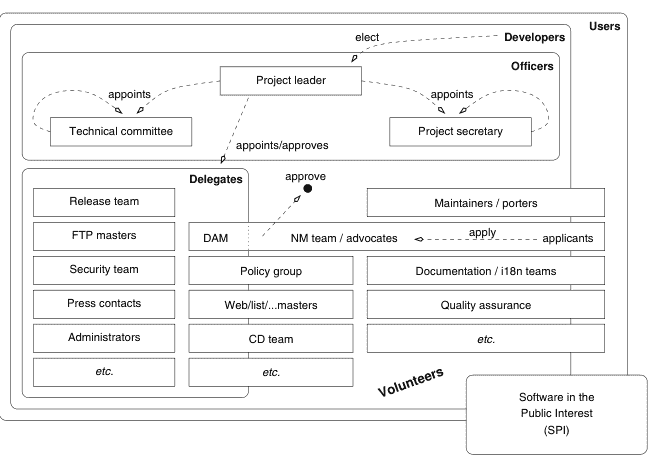

图 2.2：
Debian 组织结构的粗略草图

> ³⁵http://www.linuks.mine.nu/debian-worldmap

##### 项目负责人

开发者群体本身是扁平化组织结构。位于层级顶端的是项目负责人，由开发者每年选举产生。每位开发者都有一票投票权，每位开发者都可以成为候选人。项目负责人指导项目并负责其协调工作。项目负责人应是推动新方向的力量，并能将开发者的注意力集中在特定问题领域。负责人拥有各种特殊权力，但很少使用。然而，开发者集体可以通过多数票推翻项目负责人的决定，尽管这从未发生过。

当选后，项目负责人会任命官员（与这些职位的前任一起），并将若干任务委托给选定的个人和团队。随后，项目负责人可酌情替换官员和委托人。如有必要（例如死亡或无故缺席），项目负责人可由技术委员会主席与项目秘书共同替换。

协助项目负责人的是技术委员会的成员，由主席领导。技术委员会的任务是监控发行版的技术方面。在特殊情况下，如果认为这样做更有利于项目及其用户，它可以要求开发者采取特定的行动方案，而不是另一种。项目秘书主要协调选举和其他投票工作。此外，秘书的工作还包括解决对章程解释的争议。

##### 委托人

委托人从项目负责人那里获得委托，并在特定任务领域拥有特殊权力。例如，项目负责人将 Debian 账户维护的任务委托给 Debian 账户管理员（DAM），将与媒体互动的工作委托给媒体联系人。在其领域内，委托人可以按照他们认为最佳的方式自由行事。此外，为防止权力集中，委托人可以做出项目负责人不能直接做出的某些决定。这些决定主要涉及项目成员资格。

委托并非一个官方或必然可见的过程。此外，它不一定是一个明确的过程。许多委托人职位由人员担任多年，项目负责人仅通过不选择替换者来接受他们的状态。委托人必须在委托领域具备所有必要的能力才能做出决定（否则不应被选为委托人）。一旦委托人做出决定，项目负责人就不能推翻。因此，为了自身最佳利益，负责人会选择值得信赖和有能力的人选。项目负责人可以在有充分理由的情况下替换委托人。但是，可能不利于负责人的单个决定并不构成充分理由。

著名的委托人职位包括发布经理、安全团队和 FTP 管理员。发布经理设定下一个*稳定版*发布的目标，并协调和监督发布过程。这包括安排冻结期和最终确定发布日期。随后由单独的*稳定版*发布经理接手。安全团队的工作是与其他项目的安全团队合作，尽快为*稳定版*软件库中的软件提供安全相关修复。最后，FTP 管理员负责 Debian 软件库，决定允许哪些软件进入软件库以及必须删除哪些软件。

##### 开发者集体

位于底层，但同样无所不包的，是其余开发者，每个人都在项目中自己选定的领域内工作。虽然更倾向于让开发者维护软件包（这是成为 Debian 开发者的常见但非绝对必要要求；见第 2.5.2 章），但许多其他任务也需要志愿者。无论是文档和国际化工作、在邮件列表和 IRC 频道上提供用户支持（分别见第 10.4.1 章和第 10.4.3 章），还是简单地修复错误和提供改进建议，单个开发者可以承担尽可能多的责任。重要的是要认识到，这些责任是自愿选择的，因为项目中没有人能够命令开发者做任何事情；甚至项目负责人也不能。

尽管单个开发者可能被视为处于 Debian 组织结构的最底层，但开发者多数可以通过普遍决议推翻 Debian 结构内的任何组织机构，包括项目负责人。普遍决议是 Debian 在非琐碎决策上达成共识的主要手段。任何人都可以提出普遍决议，当有足够的附议者支持发起人的呼吁时，该决议将开放投票。每位开发者都可以参与投票，如果达到多数⁶，该决议立即生效且不可推翻（除非通过另一个普遍决议）。

##### Debian 用户

Debian 用户及其形成的社群无疑是该项目最重要的实体。社会契约将其用户定义为项目的首要任务（见附录 E）。因此，Debian 的主要目的是满足其用户群的需求。没有用户，项目就没有存在的意义。每位开发者也是用户，但“普通用户”的临界数量对于 Debian 系统保持通用性和竞争力至关重要（见第 2.2.1 章）。

⁶Debian 使用孔多塞方法允许其开发者表达偏好而不仅仅是简单投票；见 http://en.wikipedia.org/wiki/Condorcet_method

## 2 Debian 项目概要

尽管普通用户不能投票，但他们可以通过多种方式影响项目的方向，例如参与邮件列表上的讨论（见第 10.4.1 章）、提交错误报告（见第 10.6 章），或者在他人有时间处理之前，主动按自己希望的方式修复问题。

最终，在建立信任并展示对项目规则和流程的熟悉，以及 Debian 软件包管理系统和工具的相关技能后，每位 Debian 用户都可能成为 Debian 开发者（见第 2.5.2 章）。

##### SPI — 公共利益软件

SPI³⁷ 虽然不是 Debian 项目的一部分，但它是其组织的一部分。SPI 由 Bruce Perens 创立，作为 Debian 项目的法律实体。因此，它持有 Debian 的所有商标，拥有其所有货币和物质资产，并在法律事务上代表该项目。此外，SPI 体现了一个经济实体，可以接受为项目提供的可抵税捐赠，至少在美国境内如此。SPI 对 Debian 项目内部做出的决定没有管辖权。同样，除了对 SPI 持有和管理的 Debian 财产的使用权外，Debian 对 SPI 也无管辖权。

#### 2.4.2 社区的社会方面

Debian 项目背后的社区与其他类似项目的社区相似。尽管如此，Debian 社区享有非常高的声誉，这有时使其脱颖而出。Debian 拥有所有自由软件发行版中最大的开发者基础，并且它更像是一个元项目而非简单项目，因为它由大量子项目组成，这些子项目在许多情况下唯一的共同点是它们都是 Debian 系统的一部分。虽然存在其他规模或多样性相当的项目，但 Debian 在这两者的结合以及组织生产 Debian 系统的方式上是独特的。支持该社区的人通常将其描述为在活力和能力方面无与伦比，许多人将社区提供的支持水平列为选择 Debian 的最重要因素。同时，Debian 社区也常被诋毁为傲慢和过于理想化，不适合现实世界。

本书的目的不是争论任何一方的观点。唯一的决定方式是参与社区并亲眼看看。如果你是项目新人，在被了解之前先了解社区可能是个好主意

> ³⁷http://www.spi-inc.org


## 2.4 Debian 社区

很高兴认识你。下面，我整理了一些关于 Debian 社区³⁸的有用事实。

首先，重要的是要认识到社区是由志愿者组成的。开发人员通常为项目工作，是因为他们使用 Debian 操作系统，信奉其理念，和/或享受为不带商业附加条件的合作项目做出贡献，而且没有人对他们发号施令³⁹。这同样适用于为社区做出贡献的普通用户。社区欢迎任何牢记这一点的人，并遵守人们共享共同基础（即使这些基础是虚拟的）时通常期望的礼仪和礼貌规则。

另一个需要考虑的要点是，社区成员（或简称"用户"）尽可能乐于助人。然而，没有人喜欢替别人做工作。因此，如果不先尽自己的本分，你不太可能找到答案，这意味着在寻求他人帮助之前先利用可用资源（见第10章）。如果你提供的细节清楚地表明你已经思考过问题，试图控制它，并在寻求支持之前去其他地方搜索过，人们会很乐意提供帮助。也许找到答案的最佳方式是以正确的方式、向正确的人提出正确的问题。Eric S. Raymond 整理了一篇关于如何提出聪明问题的精彩文章⁴⁰，我建议你阅读。阅读并理解了这篇文章后，你就不用在 Debian 论坛上害怕提出愚蠢的问题了。

Debian 社区的一个良好特质是每个人都被平等对待。无论是新用户还是资深用户，关注的焦点都是手头的问题⁴¹。这也意味着 Debian 社区不是由一群有需求的用户和一群回答问题的专家组成的。相反，每个人都被鼓励参与并提供有用的建议，而且人们确实这样做了。一方面，人们喜欢炫耀自己的知识，如果这对他人有帮助，那就更好了。另一方面，关注社区讨论并时不时地提出建议已被证明是了解更多关于操作系统的绝佳方式，许多用户也提倡这样做⁴²。

> ³⁸请记住，我并不是说 Debian 社区是独一无二的。以下大部分内容同样适用于其他项目。我只是在介绍 Debian 社区并阐述事实。

> ³⁹被告知该做什么并非本质上是坏事，但它经常导致质量让位于市场或时间压力，而且在无法保持质量水平的情况下开发产品可能是痛苦的。

> ⁴⁰http://www.catb.org/~esr/faqs/smart-questions.html

> ⁴¹如果资深用户不持续互相开玩笑并交换机智和讽刺的评论，Debian 就不是 Debian 了。然而，手头的问题仍然是首要任务，在互相调侃一番之后，Debian  folks 通常很快就能提出有用的建议。

> ⁴²这两种行为模式在开源世界中相当常见。关于它们的演变和动机的完整分析，我向你推荐 Eric S. Raymond 的著作*大教堂与集市*（http://www.catb.org/~esr/writings/cathedral-bazaar）。对于真正感兴趣的人，另一本好书是 Feller 和 Fitzgerald 的*理解开源软件开发*（http://opensource.ucc.ie/uossd）。

在社区论坛中（见第10.4章），你会发现技术讨论（最多）、幽默（一些）、无关话题（很少）和口水战（罕见）⁴³的健康平衡。总体而言，社区内的互动通常具有很高的生产力水平，一旦找到解决方案，有时会出现有趣的讨论。通常，这些讨论最终会带来系统上的改进，无论是在技术或可用性方面，还是在文档方面。Debian 策略，将在第5.7章深入讨论，在社区中扮演着重要角色。该策略标准化了文件组织和行政流程的逻辑，以允许庞大的开发人员集体提供一个集成系统，而不是不同软件包的聚合。同时，该策略还确保 Debian 系统在所有安装中保持一致，独立于架构和次要版本。每个人都使用相同的工具在相同的基础上工作，解决方案可以迅速找到。

总而言之，社区主要由自愿成为成员、出于信念做出贡献的用户组成。新来者通常非常渴望帮助他人，试图回馈社区。其他人承认自己在软件开发方面缺乏经验，转而贡献文档或网页维护。Debian 操作系统内部和周围的合作开发为爱好者、热衷者和专业人士 alike 提供了一个富有成效的基础，以朝着共同目标努力。

#### 2.4.3 开发人员群体的社会方面

Debian 组织非常开放和平坦。除了官员、代表和其他少数特权职位外，开发团队中的每个人都有平等的权利。典型的例子是 BTS 和 Debian 档案库对每个开发者的平等开放。如果一个开发者忽视了某个软件包，另一个开发者可以简单地接管并提供一个修复版本以正式纳入档案库，而无需获得特殊特权。当维护者暂时不可用时，其他开发者可以提供非维护者上传（NMU），待维护者返回后确认。请注意，NMU 仅限于单个、小的修复，不能用于推送新的上游版本，例如。无论如何，当进行 NMU 时，软件包的官方维护者仍然掌控，可以选择撤销修复。除非此类问题对项目造成伤害，因此需要由技术委员会解决，否则维护者的决定是最终且不可反驳的。

如果软件包维护者的不可用性超出了可接受的期限，开发者可以宣布接管的意图，如果没有人反对，则承担该软件包的责任。该开发者随后成为新的维护者，软件包的监护权完全转移。先前的维护者随后失去了对该软件包维护的特权影响，但通常相关各方会在缺席者返回时进行协调，以使每个人都满意。无论如何，维护者仍有责任确保软件包的良好状态，并决定其命运。在一个约有一千名开发者的社区中，对责任的不同解释是不可避免的。项目的核心由少数非常认真对待 Debian 的开发者承担，他们以与日常工作相同程度（甚至更大）的细心和奉献精神履行职责，或作为真正的爱好。大多数 Debian 项目成员将 Debian 视为次于主要生活的事务，但尽最大努力妥善履行他们选择承担的责任。一些人承担了过多的责任，无法妥善单独处理，还有一些人似乎将 Debian 开发者身份仅仅解释为拥有 Debian 电子邮件地址的权利，而在其他方面忽视了他们的责任。

> ⁴³<humour>如果你想要口水战，来实时论坛吧，比如 irc.debian.org 上的 #debian IRC 频道！人们似乎喜欢在那里打口水战。</humour>

这种多样性存在于每个规模合理的志愿者组织中。Debian 协调开发者在项目所选路径上的方法，如前所述，是分散特权。开放性和自我组织的重点防止了僵局，并防止了由单个开发者的疏忽引起的停滞。

##### Debian —— 大教堂的集市

大多数软件包仍然由个人而非一群人维护。因此，Debian 项目可以被描述为"大教堂的集市⁴⁴"。尽管 Debian 的开放性防止了大教堂模型所描述的许多问题，但并非所有问题都得到了妥善解决。当软件包维护由同时维护该软件包管辖权的个人处理时，一种与令人畏惧的供应商锁定不太不同的情况就会出现。尽管总是可以通过 BTS 提出建议或提供补丁（见第10.6章），但软件包的维护依赖于单个维护者，这从来不是一件好事。

一些维护者已经带头将他们的软件包维护转移到公共的、协作的平台，如 Alioth⁴⁵，以减少这种依赖。无论是完全协作开发还是其他方式，许多软件包都列出了共同维护者：被允许提供软件包新版本而无需将其作为 NMU 提交的开发者。

> ⁴⁴我在 IRC 上读到了这个描述，但当时没有记下作者。它引用了 Eric S. Raymond 对开源项目动态的经典论述⁴²。

> ⁴⁵Alioth 是 Debian 的开源开发协调论坛，基于 GForge：http://alioth.debian.org


##### “Debian – 一个精英制度”

在 Debian 项目中，包括代表和官员职责在内的一些任务领域，仍然只限于一小部分人员。例如 Debian 归档的维护、Debian 用户账户的管理、安全归档的写入访问权限，以及 Debian 基础设施的管理。尽管每位开发者理论上都可以参与这些任务并申请必要的权限，但在实践中，这些职位的更替率非常低。

虽然 Debian 项目试图通过鼓励团队合作来防止这些工作成为某个人的专属领域，但这类团队的有效性取决于其成员的技能水平。某些任务，例如 Debian 机器的管理，需要其维护者具备丰富的经验；个人热情高涨但经验不足，往往弊大于利。

在项目内部，拥有更高权限职位的人员是根据其能力和成就来选拔的。因此，最接近 Debian 项目组织形式的政体是一种精英制度[46]。为了在 Debian 的等级结构中晋升，个人必须在被选中担任该领域职位之前，已展现出专业能力并为该领域做出了重大贡献。

其中最突出的例子之一就是成为安全团队的成员。由于安全团队的工作无疑是 Debian 项目和 Debian 系统稳定性的核心组成部分，一些人认为加入安全团队是一种荣耀。他们会通过冗长的电子邮件解释他们的伟大构想，并详细阐述他们如何能为团队带来价值的承诺。尽管安全团队人手相当不足，但这类请求通常不会被接受。相反，那些被吸纳进安全团队的人，是在其尚非团队成员时就做出了宝贵的贡献，帮助了团队。这些成就随后成为团队评估个人能力并决定其是否可能加入团队的基础。

在 Debian 开发者的讨论中，“cabal” 这个词偶尔会出现。虽然更近乎虚构而非现实，但 “cabal” 一词指代的是项目中一群拥有提升权限或资深地位的开发者，但没有人知道其具体成员。这个词大多被玩笑式地使用，但偶尔也会出现在批评中，通常伴随着对项目某些内部流程更加开放的渴望。这是一个很容易传染的术语，最好避免使用以免冒犯他人。据称 cabal 成员对他人难以接近；在大多数情况下，这只是因为同时被太多人接触，或者因工作负荷过重所致。处理所谓的 cabal 成员的最佳策略是主动出击：确保你已阅读

> 《韦氏词典》将精英制度定义为“一种根据个人成就来选拔和提拔人才的体制。”

现有文档，并准备好具体的问题或提案向开发者们提出。

##### 开发者之间的信任

直到最近，Debian 仍然是唯一一个纯粹由社区驱动的操作系统。虽然有些人喜欢将 Debian 视为实践社会主义的一个实例[47]，但项目的多个部分及其基础设施需要法律上的所有者、责任人以及适当的问责制。SPI（软件与互联网基础设施协会）为项目免除了围绕 Debian 这样规模机构的大量行政负担，但仍有诸多方面需要开发者介入承担责任。由于大多数开发者从未见过彼此，除了在邮件列表或 IRC 上[48]，将项目的关键部分毫无波澜地交到志愿者手中，这似乎令人惊讶。

例如，管理 Debian 基础设施，特别是构建守护程序的责任，完全掌握在个人手中。事实上，这些个人确保了 Debian 归档的完整性。Debian 项目存在的目的就是维护 Debian 归档，因此项目的兴衰取决于其开发者行为是否得当。在这里，Eric S. Raymond 在其著作中描述的开源项目的社会动态也扮演着重要角色。归根结底，人们普遍缺乏值得信赖的动力，也没有利润动机去为 Debian 做贡献。然而，人们工作不仅仅是为了眼前的收益，同侪之间的赞扬和尊重似乎是开源项目背后的主要驱动力，在本例中，这促使责任开发者们坚守正轨。

同样，Debian 项目没有结构化的资金筹集基础设施，但大量用户向项目捐款。在某些情况下，注册组织自愿承担财务行政工作，并为地球特定区域的 Debian 接受捐款。然而，对于大多数国家，Debian 没有这样专门的法人机构，且国际汇款的银行手续费高得离谱。在这些情况下，开发者会介入填补空缺。这些人为 Debian 处理的资金数额相对较小，但没有任何约束或合同。如果受托人决定弃船而去，用 Debian 的资金举办派对，Debian 项目将几乎没有法律依据来起诉肇事者[49]。

> [47]“每人烤一个蛋糕，每人分一块……” Davor Ocelić 评论道：“在我看来，这一点实际上也触及了更深的技术层面。当前的计算能力过于强大（且发展太快），我们任何人的生命都过于宝贵，不应浪费时间重新发明轮子并重复同样的错误。在今天，编写软件只有采用自由软件许可证才能获得回报，因为你在赋予其持久存在的潜力。这简直就是‘新时代’的专业精神。”

> [48]IRC 是互联网中继聊天，一个全球性的聊天系统，用户可以在相关的频道中会面进行讨论。参见章节 10.4.3

> [49]自加入 Debian 社区以来，我尚未注意到任何此类盗窃案件。

## 2 Debian 项目概览

Debian 项目的大部分工作仅基于信任。有时，缺乏专业管理曾造成严重的困扰（并非因为挪用公款，而是因为问责制），但在大多数情况下，信任模式对 Debian 来说运作良好。严重的违规或权利滥用会导致立即且通常不可撤销地从开发者团队中除名。显然，Debian 开发者的身份足以成为不对项目造成伤害的理由。此外，Debian 开发者并非匿名；损害项目会严重玷污他们在整个开源社区中的声誉。而且，考虑到开源软件开发通过流行搜索引擎具有高度可见性，任何不端行为很可能在社区之外也会传播开来：我的一位前雇主曾就我在邮件列表上表现出的好坏行为当面对质，并要求我为我的行为做出解释或赞扬我的行动。

##### 身份识别

在 Debian 开发者团队中不存在匿名性。开发者的网络空间身份通过 GNU 隐私卫士（GPG）密钥来处理。Debian 开发者可以自由地为其与 Debian 相关的电子邮件使用强大的加密签名进行签名（也鼓励用户这样做），用于重要事项。上传到 Debian 归档必须由当前开发者进行签名认证，签名也是其他组织流程（如投票）所必需的。

GPG 密钥使用诸如 GnuPG 之类的自由可用软件创建。重要的是要认识到，身份信息，例如姓名和电子邮件地址，是由用户向 GnuPG 提供的。因此，任何人都可以使用任何姓名创建密钥。为确保潜在开发者的身份，因此需要一个已获得 Debian 项目现有开发者批准的密钥。此验证需要个人接触并考虑官方身份证明文件。在章节 2.5.2 中，你可以找到更多关于成为开发者过程的信息。

当开发者互相签署对方的密钥时，他们创建了一个称为“信任网络”的关联网络。作为最大且持续使用数字签名的群体之一，Debian 构成了全球信任网络的重要组成部分。网上可以找到一份关于 Debian 开发者之间信任关系的完整分析[50]。

因此，在 Debian 内部，每位开发者的真实世界身份都是已知的。虽然开发者（以及部分剩余的用户社区）通常通过其昵称（尤其是在 IRC 上）互相称呼，但开发者的全名在开发者数据库[51]中是公开可访问的。开发者的地址和联系信息并非必需，但通常可以获取，尽管仅为其他开发者出于隐私考虑

> [50]http://people.debian.org/~weasel/weboftrust/index.php

> [51]http://db.debian.org


## 2 概述 Debian 项目

出于多个原因。经验表明，真名比化名⁵²更令人信任，而信任正是整个项目的基础。

##### 社交聚会

Debian 开发者之间的社交聚会相当常见。借助在线资源⁵¹和邮件列表，前往某个地区的用户经常会联系当地的 Debian 用户并组织聚会。通常，聚会的"借口"是签署 GPG 密钥，然后花上好几个小时互相了解。此外，在任何与 Linux 相关的会议上，Debian 的成员都会聚在一起加强彼此的关系。与 Debian 项目一样，这些聚会通常对公众开放，欢迎用户（以及其他人士）参加。

Debian 维护了一个基本的 GPG 密钥签署协调页面⁵³。Biglumber⁵⁴ 是一个更好的协调平台，它同样支持密钥签署活动的协调，并且超越了 Debian 的边界。密钥签署的详细流程在 Debian 网站⁵⁵ 上有说明。对于大型活动，也有完善的规程⁵⁶。Debian 的 **signing-party** 软件包提供了 **gpg-key2ps** 工具，可以方便地将密钥信息转换为 PostScript 格式以便打印。

### 2.5 帮助 Debian 项目

Debian 系统的用户经常会寻找回馈 Debian 社区的方式。Debian 项目对所有人开放，愿意提供帮助的人都能够参与。在许多情况下，贡献者是否是开发者并不重要。在协作平台（如 Alioth⁵⁷ 或 Debian 并行版本控制系统（CVS）仓库⁵⁸）上获取账号不需要开发者身份。通常，开发者与非开发者之间的唯一区别在于谁来承担最终的上传责任，以及其他占用时间的额外职责。

然而，对于一个热心且活跃的贡献者来说，申请成为 Debian 开发者有充分的理由。在介绍申请流程之前，以下几节将列出一些（不多的）为 Debian 项目做出贡献的可能方式。Debian 网站⁵⁹ 上也提供了一份在线文档。

⁵⁹ http://www.debian.org/devel/join

#### 2.5.1 为项目做出贡献

如果你想为 Debian 项目做出贡献，要找到需要帮助的领域并不困难。由于 Debian 系统始终处于持续开发中，几乎不可能确定哪些领域最需要帮助。一般来说，适用的准则是：如果某些东西坏了，你可以通过修复它来做出贡献；如果某些东西不够完美，你可以通过改进它来做出贡献。

请始终牢记，Debian 是一个精英体制（参见第 2.4.3 节）：你通过工作和声誉逐步攀升，获得权威。因此，前方的道路可能有些坎坷。从小事做起，让人们认识到你是一个信守承诺且按时完成任务的人，同时具备足够的技能来产出高质量的工作，这或许是个好主意。话虽如此，不要忘记 Debian 是基于志愿者工作的，你所做的任何事情都应该是出于兴趣。没有人会告诉你该做什么，因此你完全可以自主安排你的时间。

##### 反馈

为项目做出贡献最重要的形式或许就是提供建设性反馈。如果你遇到一个问题并且有时间和资源进一步调查，请务必去做。如果你认为发现了一个问题，请毫不犹豫地将你的发现写成缺陷报告（参见第 10.6.5 节）。你可能是第一个发现该问题的人；通过帮助修复它，你正在帮助其他人避免陷阱。向维护者报告问题并主动帮助缩小问题范围，对修复问题大有裨益。自由软件社区依赖于持续不断的反馈来保持其进步的方向。此外，请不要犹豫参与邮件列表和讨论论坛（参见第 10.4 节）中的讨论。当开发者需要做出决策时，你的意见可以帮助改进产品。

##### 用户支持

谈到邮件列表，为项目做出贡献的另一个同样重要的领域是在这些论坛中为用户提供支持。如果你能抽出时间，请倾听其他用户的问题，并在力所能及时提供建议。在 debian-user 等邮件列表上的任何建设性帮助都将备受感激。此外，在这样的列表中回答问题可以产生令人难以置信的学习效果：虽然你一开始能贡献的不多，但随着阅读其他人的观点，你的专业知识会不断增长。假以时日，你将能够为越来越多的问题提供有价值的信息。与此同时，你对自己系统的掌握也会越来越熟练。

##### 质量保证

Debian 声誉的很大一部分来自其质量。保持操作系统的高质量是一项永无止境的任务。因此，质量保证团队对所获得的任何帮助都心怀感激。质量保证主要涉及处理已有的缺陷，但也包括软件包的接管、软件测试以及相应地提交缺陷报告。

如果你选择在这一领域做出贡献，你就是在为改进整个自由软件做出贡献。也许最好的入门方式是挑选几个你经常使用且比较熟悉的软件包。对于这些软件包中的每一个，在软件包跟踪系统（PTS）⁶⁰（参见第 10.6.9 节）上调出相应的页面，检查待办事项和缺陷列表。你可能想让维护者知道你在做什么，但除此之外，没有什么能阻止你尝试处理待办事项并为未解决的缺陷制作补丁。请务必阅读第 10.6 节，尤其是第 10.6.10 节。如果某个软件包的维护者欣赏你的工作，并且你成功建立了信任，这就是你成为常用软件包共同维护者的机会。

与其专注于单个软件包，你也可以选择直接攻克下一个**稳定版**发行版的阻断性问题：即发布关键（Release-Critical (RC)）缺陷。发布关键缺陷的协调页面可在网上找到⁶¹，当前概况也有概览⁶²。

另一种帮助方式是挑选较早的缺陷并尝试重现它们；也许某些问题在当前版本中已不复存在；也许你可以分析其他问题。无论哪种情况，请确保将你的发现发送到 BTS。如果一个缺陷存在于**稳定版**的某个软件包版本中但不存在于其**测试版**中，请设置相应的标签。如果一个缺陷已经从**稳定版**中消失，你可以关闭它（参见第 10.6.7 节）。

作为替代方案，你也许可以协助维护软件包。Debian 在其网页上维护了一份需要帮助的软件包列表⁶³。那些需要新维护者的软件包（待接管或被弃养）可能值得一试。另一方面，如果你更喜欢从零开始的挑战，你可以考虑接手某个被请求的软件包，或者为你希望纳入 Debian 归档的软件做准备（参见第 9 章）。另一种挑战是标记为需要帮助的软件包。在这些情况下，当前维护者打算继续担任维护者，但寻求额外人员协助。

##### 文档与本地化

如果你在技术方面不太精通但喜欢写作，那么也许你可以帮助改进文档，包括软件包文档以及作为 Debian 文档项目（DDP）一部分的文档（参见第 10.2.1 节）。虽然对单个软件包文档的更改最好与各自的维护者协调，但 DDP 文档可通过 CVS⁶⁴ 获取。

另一个持续需要帮助的领域是本地化⁶⁵；为了非英语用户的利益，软件、文档和网页应尽可能提供多种其他语言版本，并且每种本地化都应达到可接受的质量并保持最新。翻译工作通过 Debian 国际化页面⁶⁶ 进行协调。相关流程（应当遵循）因语言组而异。与本地化相关的有价值的参考资料包括《开发者参考》的第 8 章⁶⁷ 和"Debian 本地化小型调查"⁶⁸。

##### 测试

通过运行 Debian 系统，你同时也在测试它，确保它能正常工作并符合其质量标准。然而，正常使用不太可能发现晦涩的缺陷或暴露出影响操作系统质量的问题。因此，如果你有一些空闲时间，并且理想情况下有一套可以实验的系统，你可以尝试在 Debian 系统上刻意破坏，以检验其在压力测试下的表现。此外，如果你拥有特殊的硬件（例如采用不常见架构的系统）或基础设施，请专注于相关领域。理想情况下，你应该运行 *testing* 或 *unstable* 系统来进行实验。如果你发现一个问题，请务必检查 BTS 是否已有相应的缺陷报告。如果没有，请阅读第 10.6.5 节并提交问题报告。

> ⁶⁴ http://cvs.debian.org/?cvsroot=debian-doc
>
> ⁶⁵ 本地化常缩写为 l10n，因为在 l 和 n 之间有 10 个字母（这一约定始于八十年代中期的 DEC）。国际化（i18n）是一个相关术语，两者经常被混淆。国际化涉及使软件能够处理不同的区域设置（"locales"），并为翻译提供钩子。本地化则是向软件添加特定区域和/或语言支持的实际过程。
>
> ⁶⁶ http://www.debian.org/international
>
> ⁶⁷ http://www.debian.org/doc/manuals/developers-reference/ch-l10n.en.html
>
> ⁶⁸ http://graal.ens-lyon.fr/~mquinson/debian/l10n-survey


## 2.5 协助 Debian 项目

最需要测试的重要领域包括 Debian 安装程序和升级过程。前者的问题可能会让新用户（或现有用户）望而却步，而升级过程中的失败在生产系统上则可能是致命的。因此，反复演练这些过程至关重要，理想情况下不要总是按照既定路径操作；要进行实验，尝试新方法，试着让它出错。如果成功触发了问题，就分析问题并撰写错误报告（参见第 10.6.5 章）。

##### 安全更新

当发现安全问题时，尽快修复该问题符合广大用户群体的利益。虽然 Debian 安全团队努力实现这一目标，但有时在应对安全支持工作带来的大量任务时需要帮助。主要可以通过两种方式提供帮助：

第一，你可以保持警觉，确保安全团队在新问题出现时能够及时了解到。安全团队会阅读常见的安全公告论坛，因此不必转发每一条公告。但是，如果你知道某个已公开的问题正在等待安全团队采取行动，询问一下进度并无不妥。请务必遵循第 7.1 章中关于选择沟通渠道的建议，因为某些安全问题可能需要非公开处理。

帮助安全团队的第二种方式是主动协助寻找问题的解决方案，并将修复补丁移植到当前*稳定版*中提供的版本。如果你认真考虑在这领域提供帮助，请告知团队并确保付诸行动。

##### 开发与改进

Debian 系统的某些组件已经较为陈旧，虽然它们目前仍能正常工作，但需要改进以满足未来日益增长的需求。主要的例子是 `dpkg` 和 `APT`，它们都相当缓慢，且缺乏对重要扩展功能的一致支持，例如 `dpkg` 的加密签名支持（参见第 7.5.3 章）。其他需要改进的领域还包括优化启动初始化序列（通过引入策略和依赖关系；参见第 6.3.1 章），以及对 ifupdown 系统进行模块化重写（参见第 6.8.1 章；netconf 项目已在 alioth.debian.org 上启动，目标即在于此）。还有大量其他可能性，Debian 在网上维护着一份待办事项列表⁶⁹；找到你感兴趣的领域并开始工作吧！

⁶⁹ http://www.debian.org/devel/todo

##### 基础设施

Debian 项目的若干核心组件是由单个开发者完成的工作；BTS（Bug 追踪系统，参见第 10.6 章）、PTS（包追踪系统，参见第 10.6.9 章）以及开发者软件包概览[^70]只是其中几个例子。这些组件的存在是因为其作者在某个时候发现缺少相应功能，于是决定改变这一状况。如果你希望提供类似的工具但不知从何开始或该实现什么，或许关注 debian-devel 邮件列表并阅读一段时间会给你一些启发。

#### 2.5.2 成为 Debian 开发者

Debian 开发者享有普通用户所不具备的若干特权：

-   Debian 采用民主投票方式就开放性议题达成共识。只有开发者才能参与投票，影响这些议题的决策。

-   Debian 开发者拥有 Debian 软件仓库的写入权限，可以自由上传软件包。没有开发者身份，仍然可以将自己的软件包纳入软件仓库，但需要由现有的开发者担任赞助者来完成实际上传。

-   Debian 开发者可以访问 debian-private 邮件列表和 #debian-private IRC 频道。这些论坛仅用于讨论内部或个人事务，因此只对开发者具有重要意义。或者换句话说：由于 Debian 不会对用户隐瞒问题（参见附录 E），无法访问这些论坛并不会让你损失任何信息[^71]。

对于在 Debian 社区活跃了一段时间并已建立起声誉的热情贡献者来说，申请成为 Debian 开发者可能值得考虑。支持此类申请的主要原因之一是希望通过参与（不频繁的）投票来影响项目。拥有软件仓库的写入权限仅在之前的贡献持续被延迟、必须等待赞助者（活跃开发者）协助上传时才有意义。请记住，即使不是开发者，也有很多方式可以做出贡献：协作平台的账户不需要开发者身份，而且在许多领域，无需定期提交任何内容即可做出贡献（例如用户支持和质量保证）。访问私人讨论论坛可能不应成为申请成为开发者的理由，因为这些论坛不会产生与 Debian 系统相关的信息。

> [^70]: http://qa.debian.org/developer.php

> [^71]: 但你可以免于关于无关话题和开发者之间摩擦的无休止争论。

##### 准备申请

要成为 Debian 开发者，你需要经历一个漫长而复杂的过程，不可能"随随便便"就成为 Debian 开发者，无论是出于威望方面的考虑，还是仅仅想要一个 @debian.org 电子邮件地址。相反，你应该对该项目充满热情，并且能够在现在和将来都投入一定的时间。除了以下内容之外，一篇在线文章⁷²也对此过程进行了说明。

成为 Debian 开发者的过程大致包含以下步骤和要求，这些内容在网上有详细描述⁷³：

###### 身份验证

要成为开发者，你必须拥有（并知道如何使用）一个 GPG 密钥，且该密钥必须由至少一位现有的 Debian 开发者签名。Debian 开发者之间不允许匿名。此步骤确保你是以官方身份加入该项目。

###### 提名推荐

在你被考虑作为申请人之前，必须有一位现有的 Debian 开发者为你提名推荐，并详细说明你为何适合加入 Debian 开发者团队。找到推荐人的最佳方式是为 Debian 做出贡献并建立良好声誉。如果推荐人就是签署你密钥的那位开发者，你需要另一位的签名才能提交申请。此人不必是开发者，但必须与信任网络（Web of Trust）有紧密联系。这是为了防止仅存在于推荐人想象中的虚假申请人。

###### 理念和流程

你必须对 Debian 项目的理念有透彻的理解，这在社会契约（参见附录 E）和 DFSG（Debian 自由软件准则，参见附录 F）中有概述。理解并熟悉社区也至关重要。申请人必须在被考虑之前积极参与项目。《开发者参考手册》⁷⁴ 是理解 Debian 项目成员职责和流程的关键文档。

###### 任务和技能

你必须熟悉 Debian 软包以及整个 Debian 系统。你必须了解 Debian 策略（参见第 5.7 章），理解其原则和原因，并能够将其应用到各种情境和任务中。你应该熟悉 Debian 基础设施、BTS 以及各种软件开发技能。不一定需要掌握 C 等编程语言的编写能力，但能够做到这一点几乎肯定是一个优势。

在准备申请的过程中，**debian-mentors** 邮件列表将是学习 Debian 系统开发的主要资源之一。请务必阅读并按照 debian-mentors 常见问题解答（FAQ）[^75] 中的指导行事，其中也包含了关于申请流程的宝贵信息。特别是，它详细介绍了为你的软件包寻找赞助者的过程。当然，也欢迎你参与其他邮件列表上的讨论（参见第 10.4.1 章）。

Debian Women 项目举办了一个导师计划，旨在帮助感兴趣的人以应用和探索的方式学习更多关于 Debian 开发的知识。活跃的导师名单列在网站上[^76]。

-   http://programming.newsforge.com/article.pl?sid=05/01/28/1618201
-   http://www.debian.org/devel/join/nm-checklist
-   http://www.debian.org/doc/developers-reference

##### 申请流程

当你满足 Debian 开发者的条件后，可以申请开发者身份并成为新维护者（NM）（技术上说，你成为的是申请人，但这些申请人通常被称为 NM）。

提交申请后，你可以在线跟踪申请进度[^77]。在某个时间点，你会收到申请管理者的联系，他将测试你对 Debian 项目及其理念的了解，并评估你与 Debian 软包和整个系统相关的技能。请做好准备，不要低估这次评估。你还应该能够提供一份你对 Debian 所做贡献的清单以供参考。请注意，这份清单不必面面俱到，但应清楚地表明你有兴趣继续帮助该项目，而不是仅仅获得开发者身份后就销声匿迹。此外，最重要的是要记住是**你**想要加入这个项目。因此，你应该尽力通过提供措辞完善且完整的答案来减轻申请管理者的工作量。

##### 等待 DAM 审批

如果你成功通过了评估并满足了所有其他要求，接下来就轮到等待 DAM（Debian 账户管理员）的审批了。在获得开发者身份之前，申请必须经过仔细审核。这可能需要很长时间，尤其是在临近发布的时期，开发者通常都超负荷工作。Debian NM 团队正在努力应对不断增加的

> [^75]: http://people.debian.org/~mpalmer/debian-mentors_FAQ.html

> [^76]: http://women.alioth.debian.org/mentoring

> [^77]: http://nm.debian.org


申请人，同时需保持标准和质量水平，以免危及项目及其操作系统。最好的建议是：只在你准备就绪时申请，并保持耐心。不断询问他人申请状态并无帮助，如果让你的申请经理因你准备不足而失望，你很可能会被降低优先级。

尽管这一切听起来可能痛苦且不必要，但我并不想阻止你申请。新成员流程确保 Debian 开发者充分了解自己的职责，有能力处理这些职责，并且足够专注，不会成为项目的负担。只有通过严格的流程，项目才能维护其操作系统的质量，以及围绕它的社区活力。如果你确定想成为一名 Debian 开发者，那么，无论如何，请申请。你将面临一段艰难的旅程，但那些准备充分、技能娴熟且耐心的申请人才是最终收获硕果的人。

新成员流程的长度也确保了只有专注的开发者加入项目，因为没有耐心或三心二意的人会被自然选择淘汰。如果你在等待开发者账户期间为项目做贡献，这表明了你的诚意。如果你缺乏耐心，这暗示你可能真正想要的只是一个 `debian.org` 邮箱地址。

### 2.6 Debian 旋涡标志

Debian 官方标志是悬浮在精灵瓶上方的红色旋涡（见图 2.3(a)），仅可用于 Debian 项目的官方部分，或由 Debian 开发者在其官方职能中使用。非官方情况下，项目或操作系统可以仅使用旋涡来指代（见图 2.3(b)），这被称为“开放使用标志”。印刷的“Debian”字样对两者都是可选的，仅作为第二个标志的一部分显示。这些标志旨在保护 Debian 的财产，防止任何可能损害其声誉的使用。


图 2.3：
Debian 标志：(a)
来自精灵瓶的旋涡（官方
标志）；(b) 仅旋涡本身（公共使用）

两个标志均由 Raul M. Silva 设计，作为 1999 年标志竞赛的一部分[^78]。标志的官方来源在 Debian 网站上[^79]。请注意，图 2.3(b) 实际上是一个非官方版本[^80]，它更接近 Raul 发布的原始设计。

Raul 从未就标志的含义或象征意义发表过官方声明（至少我没有找到这样的记录），因此产生了几种理论，从轻松到深奥不等：

- 瓶子代表开发者集体，而结果就是神奇的旋涡，象征着 Debian 操作系统。

- 旋涡既有圆的包容性，又有螺旋的灵活性，正如操作系统既包容又灵活。

- 旋涡象征着 Debian 如何吸纳一切进行打包，而瓶子属于乐于助人的 Debian 精灵。

- Bruce Perens 提供了以下描述：

> > 它是“魔烟”。电气工程师的传说认为，当你烧毁一个电子元件时，会导致使其工作的“魔烟”被释放出来。一旦魔烟消失，元件就不再工作。Debian 应该是让你的电脑工作的魔烟。

- 在皮克斯 1995 年的动画杰作《玩具总动员》中，一个红色旋涡装饰着太空骑警巴斯光年的下巴[^81]。这部电影早于 Debian 选择标志，可能是一个灵感来源。

- 旋涡源自乐谱中使用的低音谱号。传统的低音谱号是“F”，代表“自由 (Free)”、“功能 (Functional)”、“奇妙 (Fantastic)”、“乐趣 (Fun)”和“美好 (Fine)”。

[^78]: http://www.debian.org/News/1999/19990826
[^79]: http://www.debian.org/logos
[^80]: http://www.hands.com/~phil/debian/logo
[^81]: 例如：http://allearsnet.com/tp/mk/buzz7.jpg；旋涡在续集的法国 DVD 封面上也可见：http://aram.free.fr/covers/images/toy_story2.jpg

# 第 3 章

## 正确安装 Debian

> * joeyh 为了换个节奏，只用他的大脚趾安装 debian。
— Joey Hess，在 #debian-boot

常见终端用户系统的安装机制试图结合两个极端：在尽可能少地询问用户并将其他一切自动化的同时，它们旨在安装所有可能的功能以满足最广泛的用户基础，并满足所有需求。这两个目标要求安装系统基于假设做出许多决策，这些假设以硬编码的默认值、启发式算法¹ 或运行时专家系统的形式出现。有些操作系统并不安装一切，而是提供一个健康的程序交叉部分。用户得到一个可用的系统和一些额外的小惊喜。还有另一类操作系统基本上不提供安装方法，用户需要从头开始引导系统。

¹启发式算法可以被描述为一种简化或有根据的猜测，其目标是在比找到完美解决方案更短的时间内找到一个不够完美的解决方案。

## 正确安装 Debian

Debian 在概念上采用了与大多数其他操作系统不同的安装方法。Debian 安装程序提供启动最小系统所需的基础组件，查询基本系统的关键配置数据，然后将用户交给包管理系统处理。整个过程安装一小组软件包，以便在各种环境中使用 APT⁽²⁾。根据网络连接和机器的用途，Debian 实际安装的少数软件包中可能仍有一些可以被移除⁽³⁾（有关于可以安全移除的软件包列表，请参见附录 C.3）。

这实际上就是 Debian 的秘诀：其他系统试图做很多事情并自动化中间需要做的一切，而 Debian 做得很少，仅将最基本的东西留给自动化算法。同时，它提供了强大的工具，管理员可以根据需要加以利用。其结果正是 Debian 所追求的：一个拥有稳健工具的坚实基础，让管理员能够保持对系统的控制。

### 3.1 Debian 安装程序

*sarge* 提供的 Debian 安装程序是一个全新的软件，从零开始开发，旨在解决以前 Debian 安装程序（**boot-floppies**，也简称“`bf`”）的缺点，并为更轻松的维护和未来的可扩展性铺平道路。在四年的时间里，开发人员将他们在 **boot-floppies** 项目中的经验融入到了一个新的、统一的 Debian 安装架构中，该架构独立于源介质。如果你熟悉其他安装程序，新的 Debian 安装程序可能会让你感到惊讶。它从一开始就引入了 Debian 的优势，并极大地改变了 Debian 安装困难的名声。

Debian 最大的批评点之一一直是其安装系统的笨拙和复杂。虽然有经验的 Debian 用户可以在几分钟内安装一个完整的系统，但新手则徒劳地尝试遵循阻力最小的路径，常常因为系统没有提供清晰的流程而惨遭失败。因此，众多基于 Debian 的发行版（见附录 A.2）像舟䱸鱼一样聚集在鲨鱼周围，它们的主要卖点是简单的安装，为用户留下一个兼容 Debian 的系统。然而，这些提供商只支持 Debian 所支持架构的一个子集（见第 4.5 章），因此，Debian 系统永远无法将这些改进整合到主线中⁽⁴⁾。此外，语言支持通常有限。

⁽²⁾默认的最小安装包含 123 个软件包，占用 97 Mb 空间。这也包括附带的文档、日志文件和临时数据。

⁽³⁾最小的、仍可称为 Unix 系统的 Debian 系统由 89 个软件包组成，占用 84 Mb 空间。

⁽⁴⁾值得一提的是，曾有一些努力试图在 Debian 系统上使用 Progeny 的安装程序，但该安装系统不够模块化和灵活，无法扩展到所有十一种架构。


安装程序的国际化一直是个问题。虽然 Debian 系统支持近 40 种语言，但大多数 Debian 安装系统只提供英语，或最多提供少数几种不同的语言。

先前安装系统的问题产生了深远影响。一方面，Debian 慢慢但稳固地获得了这样一个名声：它是为行家和黑客准备的发行版，任何不"粘"在键盘上的人都无法使用它。另一方面，那些成功安装系统的人加入了一个被认为是 Debian 项目周围精英圈子的群体，而这个圈子显然不够关心，没有采取行动改善用户的体验（并扩大用户群）。

事实证明，Debian 项目已经意识到这些问题，并一直在积极解决。然而，由于好事多磨，花了四年时间才满足新安装程序的所有要求，这也是 *sarge* 延迟的主要因素之一。

#### 3.1.1 新安装程序的特性

新安装程序仍然是不起眼的基于文本的，但图形前端的工作已经开始⁵。该安装程序确实提供了许多增强功能，应在不限制专家的前提下改善用户体验——这是 Debian 系统中普遍采用的方法。

安装程序为所有架构和最流行的语言提供了完整的文档⁶。还提供了一个常见问题解答列表⁷。

新安装程序的特性包括：

-   **模块化架构**

    安装程序由大量协同工作的模块构建而成。这允许轻松定制安装程序（参见第 8.3.3 章），并便于维护。

-   **硬件检测**

    新的安装系统使用 `hw-detect` 和 *discover* 硬件检测工具来确定系统中存在的硬件。这两者能够检测的硬件集合仅限于内核支持的设备。虽然很可能默认情况下 *sarge* 安装程序将使用较新的 2.4 系列内核，但也可以使用 2.6 内核来允许检测更新的设备。

-   **专家模式**

    虽然安装程序允许需要的用户访问大量参数，但向普通用户提出的问题数量保持在最低限度。

-   **改进的分区**

    新的分区系统结合了所有主要文件系统的支持以及移动、复制和调整分区大小的能力。此外，独立磁盘冗余阵列（RAID）和逻辑卷管理器（LVM）卷可以在创建文件系统之前进行配置。

-   **无线局域网（WLAN）配置**

    在旧 *woody* 中时有时无的功能现在成为了一个集成特性：Debian 支持的 WLAN 驱动程序可以在整个安装过程中使用⁸。

-   **架构支持**

    对所有架构的支持都得到了改进。例如，在 **powerpc** 上的安装比以前顺畅得多，而 **x86** 现在使用 Grub 作为引导加载程序。

-   **易于定制**

    安装程序在设计时考虑了可维护性。除了模块化设计外，这还提供了一种简便的方法来为特定需求创建定制的安装程序。

-   **引导介质**

    同样得益于模块化设计，Debian 现在能够支持更广泛的引导介质。更高级的包括：预引导执行环境（PXE）（并非严格意义上的新功能，**boot-floppies** 已经支持它），和通用串行总线（USB）存储棒。

-   **国际化**

    在撰写本文时，安装程序已翻译成 40 种语言（另有 10 种语言正在积极开发中）。除了语言，它还支持相关的字符集。因此，全球超过三分之二的人口可以使用其母语进行安装。

#### 3.1.2 系统要求

Debian GNU/Linux 要求不高。然而，为了使系统运行，必须满足一些最低要求。虽然非必需但非常有用的是一个 CD-ROM 或 DVD-ROM 驱动器，以及一个能够从这些驱动器引导的基本输入/输出系统（BIOS）⁹。Debian 可以仅使用网络连接安装，或者临时引导到连接到第二台计算机的硬盘上（这两种方法都将在本章讨论），但首选且最受欢迎的方法是可引导的 CD。

要运行 Debian 安装程序，您至少需要 24 Mb 随机存取存储器（RAM）（在某些其他架构上甚至更少）。如果您有兴趣使用较少的可用内存引导嵌入式系统，最好使用第 8.3.1 章所述的方法。

为了使最小系统能够合理运行，新分区需要 256 Mb 的硬盘空间。虽然可以将系统压缩到更小的空间，但日志文件和 APT 与 dpkg 缓存希望有更多的可用空间。一个 256 Mb 的系统只能提供最基本的要素，无法容纳图形用户界面。一个常见的工作区安装将消耗约 2 Gb，不包括数据，并且为额外程序留下的空间很小。对于服务器，建议为 /var 和/或 /srv 提供更多空间。通常，多多益善，考虑到如今可用的存储容量，这不应该是个问题。

最后，系统应该有一种连接网络的方法。通过网络安装是最顺畅的方式，毕竟 Unix 是为网络而生的。Debian 支持点对点协议（PPP）和 PPP over Ethernet（PPPoE），但所谓的"软猫"¹⁰ 不被原生支持。大多数以太网和 WLAN 适配器都受到支持，包括集成在消费级主板中的那些。通常，Debian 安装程序不提供内核中不可用的驱动程序。因此，如果它能与 Linux 一起工作，它就能与 Debian 一起工作，反之亦然。

### 3.2 最小化的安装方法

如果您习惯了其他平台上常见的安装系统，并且 Debian 的安装是您第一次接触该操作系统，那么您将有一次有趣的体验。Debian 安装程序充分体现了该操作系统的整体哲学，即提供帮助而非强加于人。它是任务导向的，而不是过程导向的：用户不是通过 *Next* 和 *Previous* 按钮（或类似按钮）从一个屏幕导航到下一个屏幕，而是从工具中选择来完成安装期间的各种任务。安装程序建议了一个顺序，但用户完全可以在工具之间来回切换¹¹。此外，安装程序注重功能而非外观，不太可能在任何时候赢得选美比赛。然而，在知道自己想要什么或需要什么的人手中，它是一个强大的工具。

本章适用于那些不熟悉安装过程或对 Debian 整体不熟悉的人。本章的存在也旨在展示 Debian 的设计安装方式。在过程的后期，安装程序会要求您选择一种安装软件包的方法。新用户通常会花大量时间浏览可用的软件包，试图安装他们认为需要或将来可能需要的每一个软件包。这会不必要地延长安装过程，可能完全令人困惑，并且会导致系统从一开始就充满冗余。

相反，按需安装策略通常是首选，这在很大程度上要归功于 **APT**。在安装期间，不会安装额外的软件包，留给用户的系统只包含少数几个软件包加上必需的软件包。基础系统就位后，可以使用各种软件包安装方法来获取满足系统需求所需的软件包。

#### 3.2.1 安装基础系统

##### 引导安装程序

本节将说明一个典型的 Debian 安装过程。新系统使用 Debian CD 引导，这是安装该操作系统最受欢迎的方式之一。Debian 提供各种不同类型的安装映像：

-   **完整版**

    官方 CD 映像包含 Debian 标准安装所需的一切，并且还提供一些最受欢迎的软件包。因此，安装并不严格需要网络访问。这将是首选且最受欢迎的安装 Debian 的方法。

-   **网络安装版**

    netinst 映像针对具有（快速）网络访问的安装进行了优化。它提供了运行安装程序和设置标准 Debian 系统所需的一切。任何额外的软件包都必须通过网络连接从 Debian 镜像获取（可以是 Debian 支持的任何类型，包括 PPP 和数字用户线路（DSL））。

---

⁵ http://www.debian.org/devel/debian-installer/gtk-frontend
⁶ http://d-i.alioth.debian.org/manual
⁷ http://wiki.debian.net/?DebianInstallerFAQ
⁸ Debian 内核提供的驱动程序集合包括流行产品，特色是 WaveLan 和 Prism 等芯片。不幸的是，由于许可问题（参见第 2.3 章），许多 Centrino 笔记本电脑中使用的 Intel PRO 无线网卡目前不支持安装。驱动程序可以轻松地为 Debian 构建（从 ipw2100-source 和 ipw2200-source，参见第 8.1.3 章），并集成到定制版本的安装程序中（参见第 8.3.3 章）。
⁹ 如果您的系统缺乏从 CD-ROM 引导的能力，一个有趣的解决方案是 Smart Boot Manager，它可以从软盘引导并将控制权移交给 CD-ROM 驱动器，以允许从 CD 引导，即使 BIOS 不支持这一点：http://btmgr.webframe.org
¹⁰ 许多内置调制解调器是软猫，它们依赖于驱动程序来提供传统上在硬件中找到的功能。制造商通常不向开源社区提供规格说明。http://www.linmodems.org 是支持这些设备的一站式资源。通常，购买外置调制解调器问题较少，并且可以节省时间和金钱。
¹¹ 显然，存在一些限制。例如，在安装核心包之后，重新分区没有太大意义。安装程序会允许您这样做，但您将无法在不重新创建根文件系统和 /usr 文件系统的情况下重新安装基础系统。


## 3.2 最小化安装方法

##### businesscard 镜像

为适配小型名片光盘尺寸而优化的 **businesscard** 镜像提供了安装程序，但需要网络连接来下载基础系统所需的软件包。撰写本文时，仅支持以太网连接。若您使用调制解调器、DSL或特殊网络类型，则无法使用此镜像。

##### netboot 镜像

此镜像允许机器通过网络启动并获取安装程序，使用PXE和引导协议（BOOTP）。更多信息请参见第8.3.2章。

##### hd-media 镜像

**hd-media** 镜像允许从USB设备或类似介质启动。具体说明请查阅Debian安装手册第4.4节和第5.1.3节¹²。此方法要求您的BIOS支持USB介质启动。

##### floppy 镜像

**floppy** 镜像允许机器从软盘启动，随后通过网络连接获取基础系统。

##### access-floppy 镜像

**access-floppy** 镜像支持在安装过程中使用盲文终端，以协助视障Debian用户。遗憾的是，当前安装流程不会自动配置系统以支持后续盲文终端使用。建议在安装时安装 **brltty** 软件包来解决此问题。

无论使用哪种安装介质，安装流程基本相同。部分介质需要在安装期间配置网络以访问镜像源。但核心步骤始终一致，与启动介质无关。下文将以 **businesscard** 镜像为例进行说明。

您的系统可能需要调整BIOS设置才能从光盘启动。若启动成功，Debian光盘将显示引导界面和 boot: 提示符（见图3.1）。此时可通过输入方法名称并按[回车键]选择以下四种启动方式：

- **linux**：基于最新2.4内核的标准模式安装程序。若未指定引导镜像（直接按[回车键]），此选项为默认选择。
- **linux26**：同样为标准模式安装程序，但将使用最新的2.6内核。
- **expert**：以专家模式运行安装程序，使用与linux相同的2.4内核。
- **expert26**：专家模式，采用与linux26相同的2.6内核。

安装模式（标准/专家）实际对应debconf优先级设置（参见第5.8.2章）。专家模式将debconf设为低优先级，标准模式则设为高优先级。通过引导参数可设置其他优先级，例如在引导提示符后输入 debconf/priority=critical，可将安装程序提问数量减少至9个。进入安装界面后，菜单底部的"更改debconf优先级"选项允许随时调整。关于引导提示符的更多配置项，请参见第8.3.4章。

2.6内核运行稳定，且能更好支持新硬件（如串行ATA或新型千兆网卡）。相比2.4系列，2.6内核改进了虚拟内存管理、调度器等多项设计，性能更优。但Debian将继续默认使用经过三年严格测试的2.4内核（相关讨论见第4章和第7章）。仅powerpc和（非官方的）amd64架构默认使用2.6内核。此外，新安装程序不支持alpha、arm、m68k、mips、mipsel和s390架构的2.6内核。

安装程序会启动通用内核以兼容多种硬件。但由于许多厂商的系统实现存在标准偏差，这些设备在日常使用中可能正常，但在安装程序支持的其他驱动/功能环境下可能引发冲突。笔记本电脑尤其容易出现此类兼容性问题。若安装程序崩溃或系统死机，可能需要通过引导参数禁用部分内核功能（需在内核命令后添加参数）：

```
boot: linux noacpi noapic nolapic
```

在引导提示符按[F5]、[F6]或[F7]可查看内核引导选项列表。以下是常用参数：

| 选项 | 作用 |
|------|------|
| noacpi | 禁用高级配置与电源接口（ACPI）（该功能常存在实现缺陷）。错误的ACPI实现通常导致随机重启或系统死锁。 |
| noapic nolapic | 可使高级可编程中断控制器（APIC）异常的机器正常工作。APIC问题通常表现为持续的IRQ错误提示，或直接导致系统冻结。 |
| hw-detect/start_pcmcia=false | 安装期间禁用PCMCIA支持。若启用PCMCIA支持后系统死机，此选项可确保正常运行。 |
| debian-installer/probe/usb=false | 启动时禁用USB探测（针对传统设备）。若机器在启动阶段（即蓝色背景出现前）死机，可能需要此选项。 |
| debian-installer/framebuffer=false | 禁用安装程序的帧缓冲区。无帧缓冲区将无法支持多语言界面，但若屏幕闪烁或显示异常图案，此选项可能有效。 |

表3.1：*绕过硬件缺陷的常用引导选项*

此外，可使用标准Linux内核引导参数[^13]，也可初始化安装过程中用于用户交互的debconf数据库（参见第5.8章）。更多配置方法详见第8.3.4章。

若安装程序能正常启动并进入语言选择界面（或专家模式菜单），后续安装通常会很顺利（PCMCIA问题除外）。但可能出现键盘失灵导致无法操作菜单的情况，这通常与2.6内核USB驱动和键盘子系统的冲突有关。尝试使用USB键盘，或在BIOS中禁用USB支持（"USB Legacy support"）可能解决问题。另一个变通方法是：在引导提示符按[回车键]后，快速反复按[caps lock]键直至出现蓝色背景，通过生成中断信号阻止驱动程序接管。

##### 安装程序界面

内核初始化完成后，将显示Debian标准的灰底蓝屏界面（除非重新配置[^14]）。"图形化"安装前端使用帧缓冲区以支持多种语言的非ASCII字符。若遇到帧缓冲区问题，可在启动时传入 debian-installer/framebuffer=false 参数进行文本模式安装。

专家模式下，安装程序显示如图3.2所示的菜单。虽采用任务导向设计，但会通过高亮菜单项提示下一步操作。该顺序与标准模式下的自动执行步骤一致，但选择并非强制，安装程序会自动完成前置任务（若直接跳转步骤）。后续章节将详细说明各步骤，但首先需要完成以下准备工作：

[^13]: 参见内核源码树中的 Documentation/kernel-parameters.txt 文件。
[^14]: 设置 debconf/frontend=text 可运行文本模式安装程序，但默认镜像未包含文本前端。如需文本模式，请准备自定义镜像（参见第8.3.3章）。


##### 导航安装程序

标准的安装程序界面基于字符，使用 `newt` 作为用户界面。所有交互均通过键盘完成，此环境下鼠标不可用。图形化安装程序前端⁵则允许使用鼠标。如果您习惯使用键盘驱动的应用程序，对话框的导航将非常直观。每个对话框通常包含一个或多个控件组。例如，图 3.3 显示了一个包含两个组的典型对话框：一个是国家列表，另一个是“返回”按钮。使用 [Tab] 和 [Shift-Tab] 键，您可以在组之间循环切换，而使用 [左] 和 [右] 方向键可以选择当前组（逻辑上）的相邻组。

在控件组内，使用 [上] 和 [下] 方向键可导航至前一项或后一项（必要时会滚动），[Pg-up] 和 [Pg-down] 键的功能与预期一致。此外，您还可以按字母键跳转到以此字母开头的第一项。

按 [回车] 键选择一项，按 [esc] 键则返回上一步，与点击“返回”按钮效果相同。复选框可通过 [空格] 键切换。

安装系统的用户界面位于 tty1。组合键 [Alt-F2] 可让您访问 tty2 上的 shell。需要注意的是，这是一个主要用于特殊目的的“便捷 shell”，仅应在您清楚自己所做操作时使用。操作过多可能会严重干扰和/或禁用安装程序。在 tty3（组合键 [Alt-F3]）上，您可以看到 `/var/log/messages` 的内容，其中包含安装程序调用的外部程序的输出。如果您想了解进度指示器背后发生了什么，可以查看此处。最后，在 tty4 上，系统会滚动显示 `/var/log/syslog`，其中主要包含调试信息。出现问题时（除了 tty3 之外），您可能需要检查它。使用 [Alt-F1]，您可以返回安装程序的用户界面。

**图 3.3：**
一个包含两个控件组的典型对话框

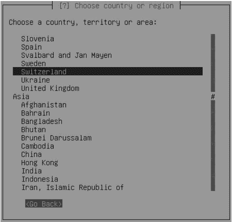

##### 开始安装

安装程序将首先要求您选择您的国家/地区、所需语言，以及与您的硬件¹⁵对应的键盘类型和布局。这些参数决定了安装过程以及最终系统中使用的默认语言和区域设置（locale）。在后续步骤中，您在此处的选择将决定时区的选取，并用于推荐 Debian 镜像。

> ¹⁵如果您安装的系统键盘布局与美国标准（在您配置之前是默认值）相差甚远，可以使用 `bootkbd` 启动参数在启动时将其初始化为正确的布局。

##### 访问安装介质

下一步包括检测访问安装介质所需的硬件。对于 CD-ROM 安装，会探测 I/O 控制器。对于基于网络的安装，则涉及网络硬件的检测。在标准模式下，安装程序将按顺序尝试所有可用模块（如果出现问题，您可以使用启动参数禁用单个模块）。专家模式允许您指定要加载的模块，默认情况下会全选。如果 debconf 优先级设置为 low（在专家模式下即如此），安装程序允许您指定传递给每个模块的选项，除特殊硬件外通常无需这样做。

在专家模式下，您还会被询问是否要加载 Card Services，以支持通过 PCMCIA 连接的 CD/DVD 驱动器。此决定可在启动时通过 **hw-detect/start_pcmcia=false** 参数进行。加载时，安装程序会提供机会让用户指定资源参数。某些机器——尤其是笔记本电脑——需要排除端口或中断请求 (IRQ)，以防止主机死机¹⁶。在此初始硬件检测过程结束时，安装程序将检测到介质，安装可以继续进行。

##### 安装程序组件

如前所述，安装程序基于模块化架构。因此，它比先前的一体化启动软盘安装程序有了巨大进步。模块是简单的 Debian 软件包，称为 **udeb** 文件。这些软件包使用 **debconf**（参见第 5.8 章）与用户交互，并使用简单的钩子向安装程序注册，从而允许从安装程序菜单中访问其功能。

这种方法的优势是双重的。首先，由于安装程序的不同组件本身是软件包，安装程序（终于）变得可维护。组件与现有的基础设施集成，并通过经过验证的管理机制（如错误跟踪系统，参见第 10.6 章）进行管理，极大地简化了开发和维护。虽然这些改进旨在直接提升即将发布的 **debian-installer** 版本的用户体验，但您可能对组件系统的第二个优势更感兴趣：它使安装程序具有可扩展性。开发者、组织和管理员可以将自定义模块集成到安装程序中，并在安装过程中方便地处理目标系统的特定方面。虽然可以从软盘、CD 或本地国际标准化组织 (ISO) 镜像加载额外模块，但安装程序的开放架构也使其易于将此类组件集成到定制化的安装介质中，例如用于本地使用的 CD-ROM。

> ¹⁶导致死机的推荐参数完整列表可在 pcmcia-cs 主页上找到：http://pcmcia-cs.sourceforge.net/ftp/doc/PCMCIA-HOWTO-2.html#ss2.5

*图 3.4：* 安装程序允许您选择要加载的组件（在专家模式下）

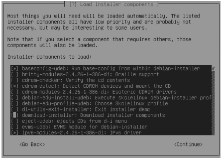

虽然安装程序专门要求专家模式用户选择要使用的额外组件，但标准安装模式的用户可以在安装程序加载默认选择后加载额外组件。图 3.4 描绘了组件选择对话框。模块通常从安装介质加载。此外，`load-floppy`、`load-cdrom` 和 `load-iso`/`scan-iso` 组件允许从软盘、CD-ROM 或安装程序 ISO 镜像加载模块。CD-ROM 安装介质不支持从 Debian 镜像下载组件。网络启动或软盘安装可以通过 `net-retriever` 组件实现此功能。

*图 3.5：* 加载额外组件后的安装程序完整菜单

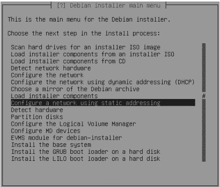

秉承 Debian 的精神，安装程序组件可以在安装过程中的任何时刻加载。因此，您可能应该避免在一开始就加载大多数组件，以免造成混乱。每个加载的组件都会用模块贡献的项扩展主菜单（图 3.2）。图 3.5 显示了加载大多数组件后的菜单。

##### 配置网络访问

如果在上一步中尚未完成，安装程序现在将尝试检测网络硬件¹⁷。如果系统未安装网络硬件，您可以按 [escape] 键退出网络配置组件。如果系统安装了网络硬件，但安装程序未能发现接口（在 ISA 卡或较新的“廉价”芯片组¹⁸的情况下可能发生），将出现一个可用模块列表，可以手动加载。图 3.6 显示了对话框。如果可用模块都不合适，但您软盘上有正确的内核模块，您可以通过在手动选择列表中选择“以上都不选”来包含它们。我通常会随身携带一个已知受支持的网络接口（例如使用 RTL8139 或 EtherExpress Pro 芯片组），以便在出现问题时使用。

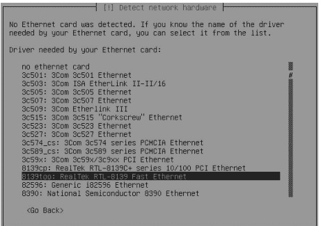

**图 3.6：** 手动选择网络驱动程序

> ¹⁷安装程序可以检测内核也支持的任何外围组件互连 (PCI) 硬件。如果您有较新的硬件，可能需要选择 2.6 内核（有关相应的启动选项，请参见上文）。大多数工业标准架构 (ISA) 硬件可以自动检测，但某些硬件可能需要手动干预。更专业的硬件，如 AX.25、光纤分布式数据接口 (FDDI) 和微通道架构 (MCA) 网卡，则不受支持。综合业务数字网 (ISDN) 卡受支持，但（已过时的）1TR6 协议无法使用。

> ¹⁸“El-Cheapo”是“便宜”的口语化表达，常用于计算机硬件领域。通常，El-Cheapo 硬件在功能、标准兼容性、保修、支持或质量方面有所限制。


##### 软件包来源的选择

默认情况下，如果安装介质包含必要的软件包，安装程序将从安装介质中提取基础系统所需的软件包。官方的Debian CD-ROM以及**netinst**镜像包含这些软件包，而**businesscard**镜像则需要通过网络访问来获取基础系统。

*图 3.7：所需Debian版本的选择*

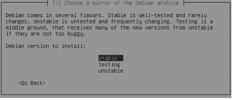

**choose-mirror**组件允许使用在线的Debian镜像源，即使基础系统在安装介质上可用。安装程序会尝试选择正确的国家/地区，并向您展示一个已知的镜像列表，您可以随机选择您所在区域的一个镜像。不过，此时并不会安装软件包。相反，安装程序会在专家模式下询问您希望安装哪个版本（参见图3.7）。除非您清楚自己在做什么（并且已经阅读了第4章），否则安装程序建议的版本将是很好的选择。在标准模式下运行时，您没有选择权，安装程序将安装当前的*稳定版*（但至少是*sarge*版本）。如果使用物理安装介质，此问题可能会被跳过，因为该介质通常只包含一个版本。

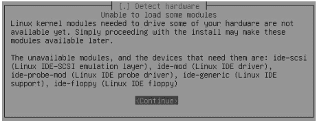

图 3.8：除非影响关键组件，否则可以安全地忽略硬件自动检测发出的警告。

在下一步中，安装程序将第三次进行硬件检测，这次会加载本地系统中每个设备对应的所有驱动程序。您此时可能会看到一些错误消息（图3.8显示了一个示例）。除非您正在运行某种特殊的控制器硬件，否则这些警告可以简单地忽略，因为安装基础系统文件在大多数情况下会解决报告的问题。话虽如此，记下这些问题以备将来参考总不是坏主意。

##### 分区管理器

所有关键硬件的驱动程序现已加载完毕。在实际开始安装软件包之前，必须准备硬盘。令所有人惊讶的是，新的安装程序并不依赖于便捷的`cfdisk`分区工具，而是提供了一个全新开发的管理器应用程序**partman**。该工具的编写理念与debian-installer相同，仅为模块扩展功能提供结构化基础。各种附加模块使得**partman**不仅仅是一个分区工具。其功能包括：

###### 自动分区

**partman**可以自动对单个驱动器进行分区，或者对硬盘上的最大连续可用空间块进行分区。它不会假定一个默认值，而是让用户选择一个方案，然后使用智能启发式算法¹来决定分区大小。

###### 分区表类型

**partman**可以为所有支持的架构创建合适的分区表类型。

###### 分区操作

**partman**可以完成`cfdisk`能做的所有事情；特别是，它能够在可用空间的末尾创建分区。此外，**partman**可以调整现有分区的大小，为Debian安装腾出空间。`cfdisk`中直接可访问的某些方面（例如十六进制分区类型），**partman**则以更抽象的方式处理。

###### 文件系统

**partman**可以用所有常见的文件系统[^19]来初始化分区。附加的文件系统可以很容易地通过组件添加。挂载点和文件系统标志也在**partman**内进行配置。

###### 多设备支持

**partman**可以配置Linux多设备（MD）支持，包括RAID级别0、1和5。

###### 逻辑卷管理器

**partman**可以创建供Linux LVM使用的卷组和逻辑卷。

###### 撤销支持

由于**partman**在您指示之前不会向磁盘写入任何内容，因此您可以要求它恢复分区表的状态，并撤销您所做的任何更改。

作为单独的组件，**autopartkit**提供了另一个自动分区程序，它早于**partman**，但存在一些**partman**着手解决的缺点。其功能在很大程度上已被**partman**取代；它现在已过时，即使还有支持，也只是零星的支持。我的建议是不要使用它。

###### 引导分区

一个新系统的兴衰与其分区表的设计息息相关。许多用户不了解分区原理，因此不应期望他们凭空设计出一个分区表。**partman**分区程序提供了一个自动分区程序，被称为“引导分区”、自动分区程序，或者以**partman**组件的名称命名：**partman-auto**。在简化模式下，**partman-auto**会自动调用，而在专家模式下，您则可以选择。始终可以从**partman**主菜单进入“引导分区”，并且当自动分区程序完成其工作后，仍然可以手动编辑分区表，因为它会将您带入**partman**的用户界面。

[^19]: 参见附录C.2.2。

自动分区程序会询问用户应分区的空间（参见图3.9）。通常，这将是一个完整的卷（从而擦除磁盘上的所有数据），但`partman-auto`也允许使用可用空间，而不触动现有分区。

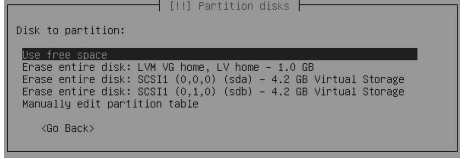

图 3.9：partman-auto可以自动对整个卷进行分区，或者仅使用现有的可用空间。

此时，即使在简化模式下，也可以跳过自动分区并直接进入`partman`。在`partman`内部，还可以进一步调整分区大小和移动分区，为Debian安装腾出空间。

`partman-auto`没有将典型的分区表强加给用户，而是提供了一系列方案供选择，如图3.10所示。在这里，用户可以在不同的高级描述之间进行选择，例如“为home目录创建单独分区”或“多用户系统”。生成的分区集除了一个交换空间分区²⁰外，还包括一个或多个文件系统分区。文件系统的大小根据磁盘大小、最小和最大大小以及相对于其他分区的优先级来计算。该算法产生了非常好的结果。用于方案定义文件的语法相当简单明了，允许在自定义安装中轻松添加方案。

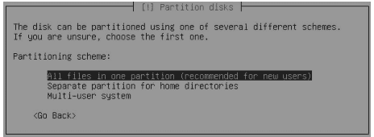

图 3.10：可用于自动分区的方案

当自动分区程序完成其工作后，它会在`partman`主屏幕中显示结果，如图3.12所示。自动分区程序为您留下了一个预配置的分区器，因此您想要或需要进行的更改没有任何限制。

> ²⁰ 参见 http://sourcefrog.net/weblog/software/linux-kernel/swap.html 和 http://sourcefrog.net/weblog/software/linux-kernel/free-mem.html 关于Linux系统上交换空间的有趣讨论。

---

在撰写本文时，安装程序尚不支持在安装过程中使用调制解调器或DSL。如果您通过其中一种方式连接到互联网，您应该选择不在安装期间配置网络（通过从支持的网卡列表中选择“没有以太网卡”），并使用tty2中的相应工具手动设置连接（分别参见第6.8.4章和第2章）。安装系统后，不幸的是需要重新配置。安装程序的下一个稳定版本将允许通过用户界面正确配置PPP和PPPoE。

一旦加载了网络硬件的驱动程序，您就可以选择主网络接口。系统将尝试使用动态主机配置协议（DHCP）来配置网卡。如果您有多个接口，请注意不要被Linux内核的接口命名策略搞混：没有可靠的方法来确定哪个接口名称对应哪个接口。因此，试错策略可能是最省力的方法。安装系统后，您可以使用**ifrename**或**udev**为网络接口分配静态名称（分别参见第6.8.1章和第6.5.1章）。安装程序默认使用DHCP来配置网络接口参数。在专家模式下，可以指定静态网络地址。甚至可以在标准模式下禁用DHCP的使用，方法是在启动提示符处指定**netcfg/use_dhcp=false**选项。最后，**netcfg-static**安装程序模块提供了一种配置静态网络参数的方法，而不是使用自动化的DHCP方法。


## 3 正确安装 Debian

如果结果可以接受，用户可以选择“完成分区并将修改写入磁盘”以继续安装过程。否则，你将需要使用 partman。

图 3.11：全新且功能强大的分区管理器

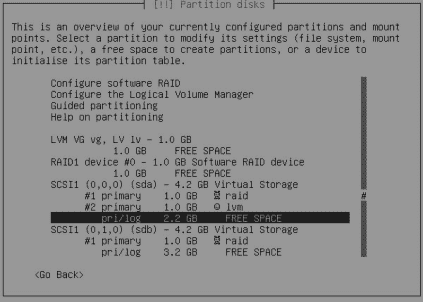

##### partman，分区管理器

你初次接触 partman 可能会有些不习惯，特别是如果你到目前为止只用过 *fdisk（像我一样）。不过，经过三四次安装，你的技能水平应该就能恢复，并且你很快就会开始欣赏这个新的分区管理器²¹。在图 3.11 中，你可以看到分区器的新界面。请注意标记为“可用空间”的四个位置，这些地方将用于创建分区。

分区器由三部分组成。顶部用于配置工具，包含 RAID 和 LVM 配置器以及自动分区器等工具。中间是本地系统上的可用磁盘，以及已定义的任何逻辑卷和 RAID 设备。这些被称为“卷”，是 Unix 领域中用于指代持有分区的实体的常用术语。

如果你想要的目标卷没有显示出来，请确保已加载适用于你控制器的正确驱动程序。最后，底部有“放弃”和“保存”选项。分区器界面使用 debconf，因此感觉与 debian-installer 的其他部分类似。这包括可以使用各种键进行快速键盘导航。

与之前的引导软盘相比，partman 是面向任务的，而非过程导向的。使用引导软盘时，管理员必须先创建分区，然后再逐一初始化和挂载。如果你后来需要调整分区大小，则必须重做整个过程。使用 partman，所有内容都可以按步骤配置，无需遵循强制性的步骤顺序。用户可以随时返回并更改先前配置的参数。当一切设置完毕，用户选择完成分区过程时，分区表将被写入，文件系统将被创建，分区将被相应挂载。同时，用户可以选择撤销所有更改，并将分区表恢复到之前的状态（通过从卷中重新读取）。

> ²¹撰写本文时，分区器的一个主要缺点是速度慢。然而，此限制正在改进中。分区器目前是用 shell 脚本编写的，用编译语言重写应该能解决此问题。

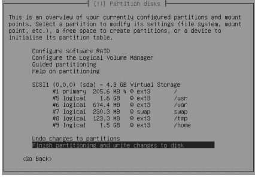

在每个卷下方，分区器列出了已定义的分区以及任何仍可用的可用空间。可以通过选择所需的卷并按 [回车] 来创建新的分区表。除非你知道自己在做什么，否则新分区表的类型应为 msdos，这是 x86 架构上的标准类型。你可能可以使用其他分区表类型，但根据你的 BIOS 和硬件，你可能需要费些周折。创建新的分区表后，应该会出现一个新的项目“可用空间”。

现有的分区可以被编辑，新的分区可以在可用空间区域中创建，只需选择分区或空间块并按 [回车]。对于现有分区，这将弹出图 3.13 所示的分区配置对话框。

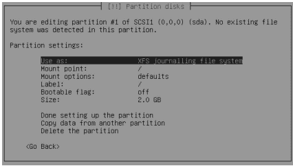

如果你面对的是现有的分区表，并且需要为 Debian 安装腾出一些空间，分区器允许你调整交换分区以及使用以下文件系统之一的分区的大小：FAT、NTFS、ext2/3。如果文件系统受支持，其大小将在分区的配置对话框中可编辑。在图 3.14 所示（同时指定了限制）的对话框中输入新大小，将导致 partman 相应地调整分区和文件系统的大小。请注意，调整文件系统大小需要将分区表和到目前为止在 partman 中所做的所有更改永久写入磁盘。因此，最好先根据需要调整所有分区的大小，然后再在分区管理器中进行其他更改。

图 3.14：新的安装程序可以调整现有分区的大小。

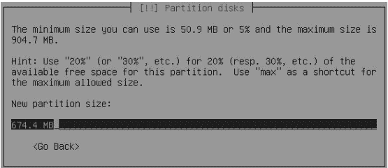

如果你要创建一个新分区，系统会首先要求你提供有关要创建的分区的一些更多信息：分区的用途（例如交换空间，或常规文件系统）、所需大小、在可用空间中的位置，以及与你创建的分区表类型相关的其他参数。对于 msdos 分区表类型，它想知道是创建主分区还是逻辑分区（如果尚未有四个主分区）。回答完这几个问题后，分区器会将你带到分区的配置对话框（见图 3.13），你可以在其中对新分区进行微调。

分区配置对话框是分区管理器的核心。从这里，你可以初始化文件系统，指示安装程序保持现有分区不变，或者将分区分配给 LVM 或 MD（RAID）驱动程序。分区的“用途”决定了它的命运。根据所选的用途，可用选项列表会相应变化。所有用途的共同点是控制分区的大小以及“可引导”标志的状态（如果适用于分区表类型）。我们稍后讨论引导管理器时会再回到可引导标志。

如果你要创建一个用于存放文件系统的普通数据分区，则需要指定该文件系统的挂载点，并且你有机会定义一系列用于该文件系统的启动标志，安装程序会自动将其写入 /etc/fstab。你还可以将数据从现有文件系统复制到新空间²²。

选择“完成设置分区”将带你返回分区器菜单。请记住，你在此处所做的所有更改在你指示 partman 执行之前都不会提交。你可以多次返回每个分区的配置对话框，随心所欲地调整和完善你的分区方案。

当分区表和分区已按你的喜好配置好后，你可以从主菜单告诉 partman “完成分区并将修改写入磁盘”。或者，你可以告诉它“撤销对分区的更改”并重新读取分区表，恢复所有更改。

##### 配置 RAID

Debian 安装程序允许在安装之前配置 RAID 卷，从而消除了从临时安装（或现场启动介质）引导 RAID 系统的需要。目前支持三种 RAID 级别：

###### 级别 0

也称为条带化，这实际上是一种伪 RAID，数据分布在不同的分区上，以产生一个大分区的假象。如果这是你所需要的，我建议你查看 LVM（见第 17 章）。

###### 级别 1

所谓的镜像，涉及维护两个（或更多）完全相同数据的同步分区。所有写入都进入所有相关分区，读取可以从任何单个分区进行。此级别提供最高冗余、较慢的写入速度，但读取速率很高。

###### 级别 5

在此级别，至少需要三个磁盘，每个数据块分布在除一个磁盘之外的所有磁盘上，最后一个磁盘存储校验数据，可用于在其中一个磁盘故障时恢复其他磁盘上的数据。此级别可以处理一个磁盘的故障，提供最慢的写入速度，以及足够的读取访问。

RAID 卷至少需要两个分区（最好在两个独立的物理介质上，RAID 5 需要三个磁盘），这些分区必须标记为由 RAID 卷使用。要创建这样的分区，请遵循通常的步骤，并选择“RAID 的物理卷”作为分区的用途方法，如图 3.15 所示。

> ²²这是通过 libparted 的函数 `ped_file_system_copy` 实现的。因此，目标分区必须至少与源分区一样大。目前，libparted 仅支持 ext2、ext3 或 FAT16/FAT32 分区。


## 3 正确安装Debian的方法

图3.15：为RAID配置分区

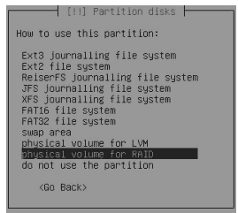

RAID卷中使用的所有分区大小应该相同。RAID卷的大小将与最小的可用分区相同，因此可能会浪费磁盘空间。

图3.16：RAID配置工具

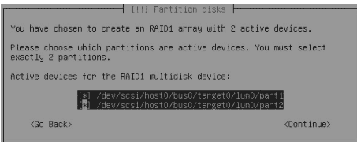

当所有要参与RAID配置的分区都准备好后，您可以从partman主屏幕启动RAID配置工具（前提是mdcfg安装程序组件已加载）。使用该工具（如图3.16所示），您可以交互式地组装RAID设备。

图3.17：在分区工具中，RAID卷显示为普通分区。

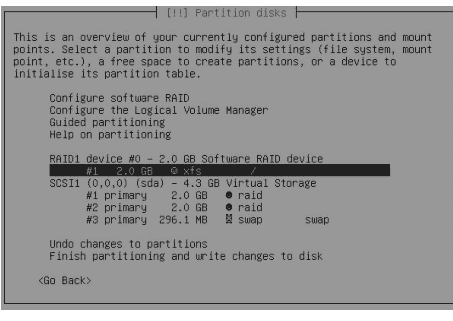

完成后，每个定义的RAID卷都会作为单独的设备显示在partman中，如图3.17所示。新设备可以像任何其他分区一样用于存放文件系统，甚至可以作为逻辑卷并入LVM卷组。

##### 配置LVM

LVM是一种设备映射器，它在逻辑上将文件系统与物理磁盘或其分区分离。简而言之，一个卷组（VG）跨越一个或多个物理分区。一个VG可以包含一个或多个逻辑卷（LV）。一个LV包含一个文件系统。LV的主要优点在于它可以被调整大小。此外，VG可以通过添加额外的物理卷（PV）来扩展，以容纳不断增长的LV。图3.18展示了LVM相关概念之间的示意图。

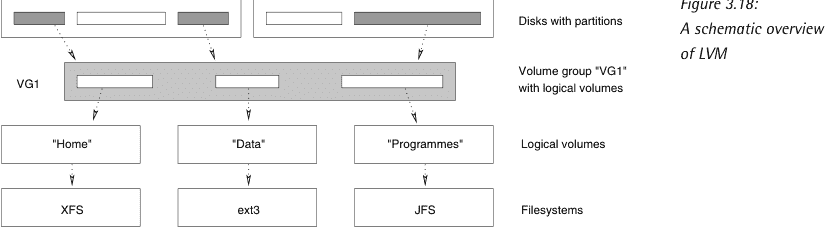

要从安装程序配置LVM，必须加载**lvmcfg**组件。此外，至少有一个分区必须被指定供LVM用作PV。因此，设置LVM的第一步通常是创建一个分区，并选择“physical volume for LVM”作为其使用方法。该分区将用于一个VG。考虑到以后可以添加和移除PV，您可能不想花太多时间来规划布局，除非您已经知道想要什么。

当至少一个分区配置好用于LVM后，可以通过分区器主菜单（或安装程序主菜单）中的“Configure the LVM”项来设置VG。此步骤要求将分区表写入磁盘，因此将永久记录您到目前为止所做的任何更改。之后将无法撤销。LVM菜单允许您以简单直接的方式创建VG和LV。显然，在创建任何LV之前，您必须至少创建一个VG。卷组通过您选择的名称来标识。该名称可以描述VG的来源，例如“IDE_disks”。

## 3 正确安装Debian的方法

逻辑卷的创建同样简单直接。它们的名称应反映其用途（例如“Mail spool”）。创建所需的逻辑卷后，安装程序会在主窗口中将LV列为额外的卷，如图3.19所示。创建逻辑卷时，请记住，通常很容易为现有卷附加额外空间，并扩展文件系统以使用它。然而，并非所有文件系统都支持缩小，如果文件系统已满，缩小它将导致数据丢失。

图3.19：分区器将LV视为普通分区进行处理。

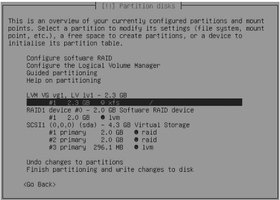

##### 使用传统分区工具

如果您倾向于使用fdisk、cfdisk等工具，您会发现它们已安装在tty2中可用。请注意，安装程序使用devfs，因此您无法找到/dev/hda或/dev/sdb。相反，本地硬盘驱动器位于/dev/discs下，按BIOS顺序编号（在Intel/AMD架构上）。该目录中的条目是符号链接，因此您可以轻松区分它们²³。实际的磁盘可以在符号链接引用的目录中找到，名为disc。因此，要使用cfdisk进行分区：

```
# cfdisk /dev/discs/disc0/disc
```

创建分区后，您必须返回partman。不幸的是，安装程序无法处理您外部创建和挂载的文件系统；它期望您在图3.13所示的配置对话框中指定所需的文件系统和挂载点。

²³ 由于devfs已被弃用，Debian可能会在sarge发布后不久发布一个不带devfs的新安装程序。

##### 安装基本系统

分区设置完成后，安装程序将继续安装基本系统。同样，默认是从安装介质拉取所需的软件包。使用物理安装介质时，使用choose-mirror组件并选择一个镜像会导致安装程序自动使用所选镜像来获取基本系统。另一方面，如果在通过网络安装（netboot）期间使用cdrom-detect包检测本地CD-ROM驱动器，并找到安装介质，则将使用该介质。通常，优先选择本地挂载的CD-ROM上的APT存储库，而不是远程存储库。

现在是带狗散步或办点事（或坐在那里盯着tty3）的好时机——基本系统的安装需要一点时间来获取、解包、安装和配置所需的基础软件包。

在安装基础软件包后，安装程序配置目标系统的内核。默认情况下，它安装与安装期间使用的相同内核，以确保最大的兼容性。在专家模式下，用户可以选择安装不同的内核。选择不同的内核进行安装时应谨慎，因为它可能导致系统无法启动。虽然升级内核版本通常可行，但安装比安装过程使用的内核更旧的内核几乎总是一个坏主意。

##### 安装引导加载程序

安装过程第一阶段的最后一步是引导加载程序的配置。在标准模式下，安装程序会自动选择首选引导加载程序并尝试安装。对于Intel和AMD架构，首选引导加载程序是Grub。在专家模式下，用户可以选择不安装引导加载程序（这将使系统无法启动！），或选择不同的引导加载程序（例如x86的Lilo，它在编写本文时比Grub更好地处理RAID卷）。

此外，如果/boot目录位于XFS文件系统上，由于grub-install中的一个bug，您必须使用不同于Grub的引导加载程序，该bug可能导致安装过程无限期挂起。一旦系统启动并运行，您可以转换为使用Grub。该问题已被识别，解决方案正在研究中，尽管它似乎是一个严重的问题，可能需要一些时间才能修复。安装程序会警告您此不便。如果您坚持使用Grub，您可能能够通过tty2上的Grub shell手动安装它（参见第8.3.1章）。

在写入磁盘之前，i386架构的引导加载程序会询问引导块的目标位置。通常，这将是主引导记录（MBR），但另一个操作系统的存在可能会影响此选择。在覆盖MBR之前创建备份可能是个好主意。在tty2的shell中执行以下命令，会将MBR写入新系统的/boot目录中的一个文件：

```
~# dd if=/dev/hda of=/target/boot/mbr.backup bs=512 count=1
```

Grub能够整合并引导其他操作系统，因此MBR通常是正确的选择。有了引导块的备份，应该可以高枕无忧。如果期望的场景是与Microsoft Windows双启动，那么让Grub或Lilo引导Windows，而不是让ntldr加载Linux，可以提供更大的灵活性。

如果选择了分区而不是MBR，则该分区必须标记为可启动（或活动）。虽然Lilo可以自动完成此操作，但Grub和其他引导加载程序目前仍需要用户干预。因此，在将引导加载程序安装到分区后，您必须记住返回**partman**并将目标分区设置为可启动。在标准模式下，这要求您在安装程序显示图3.20所示的对话框时“返回”，导航至**partman**并进行必要的更改。或者，您可以使用**sfdisk**。假设您已将引导加载程序安装到第一个磁盘的第三个分区：

```
~# echo ';;;*' | sfdisk --force /dev/discs/disc0/disc -N3
```

**--force**参数是必要的，因为分区已经挂载，否则**sfdisk**会拒绝更改分区表。翻转可启动标志是一个安全的修改。

*图3.20：指示安装程序完成的对话框——除非您未将Grub安装到MBR中。*

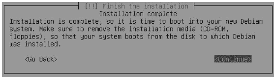

告诉安装程序完成安装会完成其第一阶段（这需要大部分时间）。在第二阶段，我们需要配置基本系统。

#### 3.2.2 配置基本系统

安装程序完成后，需要重新启动新系统。仍有少数系统参数需要设置，这项任务在第一次启动后由**base-config**程序处理。这通常被称为第二安装阶段。使用**baseconfig-udeb**安装程序组件，可以在第一阶段期间从安装程序内部运行**base-config**。以下假设遵循常规的两阶段路径。

**base-config**程序如图3.21所示。它遵循与安装程序相同的使用范例，因为它也使用**debconf**（参见第5.8章）。


## 3.2 最小化安装方法

在执行过程中，你可以自由使用 tty2 到 tty6 控制台，可通过常用的 [Alt-F2] 到 [Alt-F6] 组合键访问。在你配置 root 密码和/或添加其他用户之前，你可以无需密码以 root 身份登录。

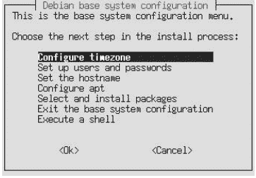

*图3.21：几乎完成...用于配置基础系统的菜单。*

各个步骤是简单且文档齐全的。因此我们可以直接跳到"配置 apt"这一项。要使用 APT，它需要知道从哪里获取你要求它安装的任何软件包。此外，如果你使用调制解调器或 DSL 连接，你必须先配置这些。目前，Debian 安装程序只会在先前未能配置以太网设备的情况下，才提供设置 PPP 连接的选项。因此，如果你选择在重启前不配置网络，base-config 应该会启动 pppconfig 并引导你完成 PPP 连接的配置，这用于大多数调制解调器、DSL（除非它使用 DHCP）或其他 PPPoE 连接，目前 base-config 无法配置，必须手动设置：在配置 APT 之前，切换到 tty2（使用 [Alt-F2]），登录，并使用 pppoeconf 来配置你的连接。一旦你验证了连接存在（例如，你可以 ping debian.org），tty1 上的其余 base-config 过程应该可以顺利完成。

虽然 base-config 当然可以重用安装期间指定的仓库，但它会给你另一个选择的机会。我们将此视为一个特性，而非缺陷。软件包可以位于 Debian CD 上、互联网上的某个地方，并通过超文本传输协议（HTTP）或文件传输协议（FTP）访问。base-config 会引导你完成镜像选择过程，使用你的区域设置来提供建议。在标准模式下，你只能选择一个镜像，并且安全更新会自动包含在内。专家模式允许你添加任意数量的 APT 源，并选择是否包含来自 contrib 和 non-free 仓库的安全更新或软件包。

当 APT 配置完成后，Debian 安装中最具决定性的步骤在前方：软件安装。从 base-config 菜单中选择"选择并安装软件包"后，你将看到一个屏幕，允许选择任务（参见第5.5章），或者可以选择从一开始就手动选择要安装的软件包。任务选择如图3.22所示（另见第5.5章）。如果你选择手动选择要安装的软件包，安装程序会调用 **aptitude**（参见第5.4.11章），并且与你选择的其他任务对应的软件包将被标记为安装。对于最小化安装，你需要选择不执行任何任务，并在这一点上不进行任何选择就退出 **aptitude**。

*图3.22：在安装过程中，你可以选择安装软件集合，或手动选择要安装的软件包。*

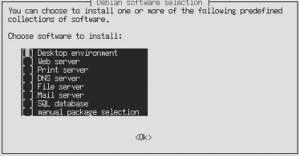

Debian 使用 **exim4** 作为其默认邮件传输代理，而 **base-config** 允许你在开始使用系统之前对其进行配置。你可以随时使用 **dpkg-reconfigure exim4-config** 修改所选配置。

完成邮件传输代理的配置后，新的 Debian 系统就完全安装、完全配置好了，并且可以使用了。**base-config** 可以从命令行再次调用，如果不需要，可以安全地清除该软件包。有关要安装的第一个软件包的建议，以及如何帮助改进 Debian 系统，请参阅第5.11.10章。

### 3.3 配置 X 服务器

由于配置 X 服务器的任务不一定特定于 Debian 系统，Debian 提供了一套工具和方法供管理员使用。不幸的是，图形适配器领域的快速发展与 Debian 的稳定理念并不很好地契合。因此，通常无法简单地配置正确的驱动程序来利用现代图形卡的所有特性。

尽管如此，Debian 在使 X 的配置尽可能简单方面已经取得了长足的进步。然而，由于新 Debian 安装中最常见的问题之一就是无法配置 **X** 服务器；以下部分试图阐明其理念，并揭示一些技巧。

#### 3.3.1 Debian 中 X 的概述

假设一个最小化安装（参见第3.2章），安装 X 服务器及其核心组件的最简单方法是安装 x-window-system-core 元软件包（虚拟软件包），它依赖于 X 服务器系统的基本要素，并因此导致它们也被安装：即服务器本身、一组基本字体、基础图形库和标准 X 工具集。该软件包不依赖于显示管理器或窗口管理器，甚至不依赖于终端模拟器，这些需要额外安装。另一种选择是 x-window-system 元软件包，它额外引入了一些有用但大多可选的组件（例如，字体服务器、X 打印服务器、代理服务、twm 窗口管理器和 xterm 终端模拟器）。

这两个 x-window-system-* 元软件包都会导致 xserver-xfree86 软件包被安装，而该软件包又依赖于 xserver-common 软件包。这两个软件包提供了 XFree86 系统的核心，并使用 debconf 向用户查询配置数据（参见第5.8章）。虽然配置数据仅限于控制 X 服务器调用的参数（并且仅在 debconf 的优先级设置为 low 时才显示；参见第5.8.2章），但 xserver-xfree86 软件包的 debconf 问题集中在硬件和驱动程序配置上。

对于配备 Matrox 显卡和 USB 鼠标的瑞士 Debian 安装，一组典型的 debconf 参数可能如下：

| 参数 | 值 |
| --- | --- |
| X server driver | 14 (mga) |
| X Keyboard (XKB) rules | xfree86 |
| XKB keyboard model | pc105 |
| XKB keyboard layout | de_CH |
| XKB keyboard variant | nodeadkeys |
| XKB keyboard options | ctrl:nocaps |
| Mouse port | /dev/input/mice |
| Mouse type | ImPS/2 |
| LCD device | yes |
| Monitor configuration method | medium |
| Best video mode | 1280x1024 @ 60Hz |
| Video modes to use | 5 6 7 8 9 10 |
| Default colour depth | 6 (24 bits) |

*表3.2：xserver-xfree86 软件包在瑞士机器上的一组典型 debconf 参数*

配置完成后，你应该能够使用 startx 命令启动 X（避免以 root 身份运行它）。或者，安装 `xdm` 软件包以获得基本的图形登录（这应该优于 `startx`<sup>24</sup>）。

#### 3.3.2 集成自动硬件检测

回答这些问题显然需要了解可用硬件。因此，对于专注于软件且不太关心机器内部硬件的管理员来说，这可能要求过高。有两种方法可以帮助安装用户回答有关设备和驱动程序的问题。第一种方法在大多数情况下应该足够，它涉及 `xserver-xfree86` 软件包使用一些其他软件包进行硬件自动检测。第二种方法使用一个单独的软件包和一套更大的辅助工具来填充 debconf 数据库。

##### xserver-xfree86 自动配置

`xserver-xfree86` 软件包建议（参见第5.7.3章）使用三个实用程序来确定本地系统的硬件：`mdetect` 检测鼠标设备的位置及其使用的协议，`read-edid` 扫描连接的显示器以获取支持的模式，`discover` 允许自动发现图形适配器及其参数。

如果在配置 `xserver-xfree86` 之前安装了这三个软件包，该软件包将使用它们来帮助用户确定正确的值。任何可以由这些工具明确确定的参数都将相应地设置，而 **debconf** 将跳过相关问题。如果工具未能确定硬件，用户必须提供参数。如果某个参数存在多个可能的值，用户将被给予选择；`xserver-xfree86` 的配置脚本擅长提供合理的默认建议。

要使用自动硬件检测，你应该按以下方式安装 X（假设你将使用 `x-window-system-core` 来引入核心组件）：

```
# apt-get install discover mdetect read-edid
[...]
# apt-get install x-window-system-core
[...]
```

> <sup>24</sup> startx 的一个问题在于它是从控制台登录会话中调用的。一个恶意的黑客可以通过终止 X 服务器，或者切换到虚拟控制台并暂时挂起它来绕过 X 屏幕锁定器。在两种情况下，攻击者都将获得该账户的访问权限，尽管有屏幕锁定器。解决方案包括改为运行 `exec startx`（用 X 服务器替换登录 shell），或使用显示管理器，如 xdm。


当 debconf 要求你配置 xserver-xfree86 软件包时，你可以选择让它尝试自动配置鼠标、屏幕、图形适配器设备和驱动程序。

##### xdebconfigurator

xdebconfigurator 软件包提供了一个工具，它将多种硬件检测方法整合在一起，依次运行这些方法，并将检测结果用于填充 xserver-xfree86 软件包的 debconf 数据库。它还为所有其他参数提供了合理的默认值，以便实现自动化安装。

要使用该工具，请在 X 服务器之前安装并运行它：

```
# apt-get install xdebconfigurator hwinfo mdetect read-edid
[...]
##### xdebconfigurator
[...]
# apt-get install x-window-system-core
[...]
```

#### 3.3.3 处理不支持的硬件

用户最常遇到的不便之处是其显示适配器缺乏支持。Debian 持续提供一个非常成熟但已过时的 XFree86 版本（由于许可证问题），而 X.Org 基金会生产的新 X 服务器要到 Debian etch 才会成为 Debian 的官方组件（尽管在 sarge 发布后不久就会在 testing/unstable 中提供）。因此，在撰写本文时，Debian X 服务器不提供 X 驱动程序领域的许多最新进展，尽管 Debian X 维护者已将部分驱动程序进行了回移移植。此外，越来越多的供应商提供非自由的二进制驱动程序，以从其设备中榨取最后一点性能（这是竞争迫使他们这样做的）。由于 Debian 致力于自由软件，它无法在其软件包仓库中提供这些驱动程序（参见第 2.3 章）。

尽管如此，通常还是可以让 X 在特定的图形适配器上工作。话虽如此，安装新 Debian 系统的用户不一定愿意花数小时时间在虚拟控制台上试图寻找解决方案。幸运的是，标准的 vesa 驱动程序支持所有现代图形适配器，可以用最少的努力和延迟让 X 运行起来（尽管没有硬件加速或 OpenGL 支持）。

有了图形用户界面、熟悉的浏览器和其他常用工具，研究如何让 X 支持已安装的图形适配器这一问题会更加方便。在此期间，Debian 安装可以用于所有对图形要求不复杂的任务。

如果你更喜欢使用现代的 X.Org 服务器，也可以使用 Ubuntu 准备的软件包。为防止引入其他 Ubuntu 软件包，你可能应该将 Ubuntu 软件仓库源的优先级设置为较低的值，并在安装 X 服务器时明确选择 *hoary* 目标发行版：

```
~# cat <<EOF >> /etc/apt/sources.list
deb http://archive.ubuntu.com/ubuntu/ hoary main
EOF
~# cat <<EOF >> /etc/apt/preferences
Package: *
Pin: origin archive.ubuntu.com
Pin-Priority: 50
EOF
~# apt-get update
[...]
~# apt-get install -t hoary x-window-system-core
[...]
```

#### 3.3.4 自定义 X 会话

X 服务器通常以两种方式之一启动：可以从虚拟控制台使用 startx 启动单个本地会话。或者，可以使用显示管理器（如 xdm）来控制服务器显示并管理本地或远程的登录会话。

可以安装多个显示管理器；由 debconf 管理的 /etc/X11/default-display-manager 文件包含默认使用的显示管理器可执行文件的路径。Debian 使用 init.d 脚本启动其显示管理器，而不是使用特殊的运行级别（参见第 6.3.1 章）。这些脚本仅在对应显示管理器是默认值时才启动它。

在执行 startx 之后，或在显示管理器成功认证之后，将创建一个 X 会话。传统上，从控制台启动的单个会话从 /etc/X11/xinit/xinitrc 文件读取初始化命令，而显示管理器则使用 /etc/X11/Xsession。Debian 采用统一的方法，对两者都使用后者。/etc/X11/Xsession 最终使用 run-parts（参见第 6.1.1 章）来遍历并加载 /etc/X11/Xsession.d 下的所有文件。在该过程的各个阶段，会检查 /etc/X11/Xsession.options 中的配置选项，这些选项在 Xsession.options (5) 手册页中有详细说明。默认情况下，以下初始化步骤在 Debian 系统上配置 X 会话：

1.  如果使用 failsafe 参数调用了 startx，并且 Xsession.options 中设置了 allow-failsafe，则初始化序列仅启动一个终端模拟器并退出[^1]。如果为 startx 提供了可执行文件的路径，则会调用该可执行文件而不是通常的 X 会话。不是路径规范的客户端参数将作为参数传递给终端模拟器，该模拟器将代替默认会话启动。

2.  来自 /etc/X11/Xresources 中文件的所有资源将与 xrdb 合并。如果 Xsession.options 指定了 allow-user-resources，则 ~/.Xresources 也会被合并。

3.  如果设置了 allow-user-xsession，并且存在 ~/.xsession 文件，它将被执行或加载，具体取决于是否设置了可执行位。如果该文件不存在，则尝试 ~/.Xsession。如果这两个文件都不存在，该过程将启动默认的会话管理器，或者（如果不存在）启动默认的窗口管理器。如果两者都不可用，则启动终端模拟器。

4.  如果安装了 ssh 并且 Xsession.options 中设置了 use-ssh-agent 选项，X 会话将作为 ssh-agent 的子进程启动。

Debian 软件包仓库包含许多会话管理器和窗口管理器，以及一系列终端模拟器。在所有情况下，默认使用哪个由 alternatives 系统决定（参见第 6.1.4 章）。相应的规范服务名称分别是 x-session-manager、x-window-manager 和 x-terminal-emulator。因此，要使用 fluxbox 作为默认窗口管理器，你可以执行以下命令：

```
~# update-alternatives --set x-window-manager /usr/bin/fluxbox
Using '/usr/bin/fluxbox' to provide 'x-window-manager'.
```

当设置了 allow-user-xsession 时，用户可以通过在 ~/.xsession 中提供会话初始化脚本来覆盖默认设置。下面是一个简单的示例，它启动 xscreensaver，提示输入安全外壳（SSH）密码短语以向 SSH 代理注册密钥，并执行 fluxbox：

```
~$ cat <<EOF > ~/.xsession
nice -20 /usr/bin/xcreensaver &

if [ -f $HOME/.ssh/id_dsa -o -f $HOME/.ssh/identity ]; then
  export SSH_ASKPASS=/usr/bin/ssh-askpass
  /usr/bin/ssh-add < /dev/null || exit 1
fi

exec /usr/bin/fluxbox
EOF
```

[^1]：在撰写本文时，failsafe 支持已损坏（参见 http://bugs.debian.org/297002）。请执行 startx /usr/bin/x-terminal-emulator 以获得相同效果。

## 第 4 章：Debian 发行版和软件包仓库

> 看吧，这就是 Debian。他们不到万不得已（非得发射火箭才能阻止它运行）的时候，是不会发布任何东西的。
> —— MrNemesis 在 Slashdot 上

关于 Debian 最常听到的两个事实可能是它已经过时得无可救药，而且稳如磐石。在 Debian 的世界里，这两个特征实际上是同一回事，而且两者都很难反驳。在新 Debian 版本发布时，其中包含的软件通常已经不是最新的。在自由软件的世界里，改进、修复和新功能每天都在添加到项目中，这可能会带来负面影响。然而，在生产环境中，新功能和改进常常会适得其反。因此，Debian *stable* 版本侧重于软件稳定性，而不是试图使用可能存在 bug 和未经测试的软件来追逐前沿。只允许与安全相关的 bug 修复进入。

Debian **stable** 并不是唯一的 Debian 发行版。此外，软件包仓库还提供另外两个版本：*testing* 和 *unstable*。虽然它们不像 **stable** 那样被冻结并称为正式发布版本，但它们是公开可用的，并被许多人使用[^2]。在逐一审视每个 Debian 发行版之前，有必要先定义相对于 Debian 而言稳定性意味着什么，或者说 *unstable* 这个名称试图表达的是什么样的不稳定性。

在软件和发行版仓库的上下文中，稳定性可以指以下三个方面之一：

软件运行时稳定性
最常见的是，稳定性一词用于指代软件包仓库中所包含软件的可靠性和健壮性。稳定的软件是成熟的软件，bug 数量极少（不存在没有 bug 的软件）。运行时稳定性是让用户满意的关键。

软件功能稳定性
稳定性也可以指软件提供的功能集。在这个定义中，稳定的软件不会从一个版本到下一个版本引入剧烈的变化或激进的新功能。管理员喜欢功能稳定性，因为它允许他们使用较新的版本修复 bug，而不会冒出现不期望行为变更的风险。

软件包仓库稳定性
如果软件发行版软件包仓库提供的软件包集合不会波动，则可以称之为稳定的。此外，软件包仓库稳定性还包括所含软件包之间的关系。稳定的软件发行版软件包仓库不会增长或缩小规模，更新仅影响单个软件包，而不会影响软件包仓库的更大部分。软件包仓库稳定性使得正式发布成为可能。

Debian 的规范发行版名称 "**stable**" 和 "*unstable*" 指的是稳定性的第二和第三种定义，尽管第一种意义上的稳定性在一定程度上是隐含的。虽然 Debian 开发者每天都会向 *unstable* 上传新的软件包，并且对其提供的软件包和软件进行剧烈更改是可能的（尽管很少见），但一旦某个 Debian 发行版成为 **stable**，就不会有软件包被添加到该集合中或从中移除。此外，作为 Debian 安全更新策略（参见第 7 章）的功能，对单个软件包的更新仅限于安全级别的 bug 修复，不得影响功能集（或修复非安全 bug）。不便 bug 的修复、新版本和新软件整体都被保留到下一个 Debian 发行版提升为 Debian **stable** 时才会发布。

上述三个稳定性方面的第一个源于 Debian 发行周期，我们马上就会展开讨论。要使一个软件包被包含在 **stable** 中，

[^2]："release" 一词在软件开发领域中经常被用来指代自包含的软件包仓库。


它必须没有严重缺陷（critical bugs），并且已经过数月的测试。虽然软件的运行时稳定性完全取决于上游作者，但 Debian 发布周期中所实施的严格测试和质量控制，确保了 Debian *stable* 中包含的所有程序都具有可接受的运行时稳定性。

三个存档——*stable*、*testing* 和 *unstable*——之间有着天然的关联。一个普通的软件包会依次经过这三个存档（顺序相反）。为了帮助理解这个过程，我们可以从软件包的生命周期来观察，从维护者完成上传的那一刻起，直到它被固化在官方 Debian 发行版的介质上。

### 4.1 Debian 存档的结构

首先，让我们来了解 Debian 存档中不同的目录层级及其用途。存档分为两个主要层级，分别以 /pool 和 /dists 为根目录。所有软件包和源文件位于 /pool 下，而索引文件则位于 /dists 下。这种分离是在引入 *testing* 时建立的（发生在 *potato* 和 *woody* 发布之间）。某些软件包在多个发行版中有等效版本，将软件包存储在一个公共池中，然后从各发行版的索引中分别引用它们，可以减少空间浪费。

Debian 镜像的结构摘录如图 4.1 中的树形图所示。

**图 4.1：** 展示 Debian 存档摘录的树形图

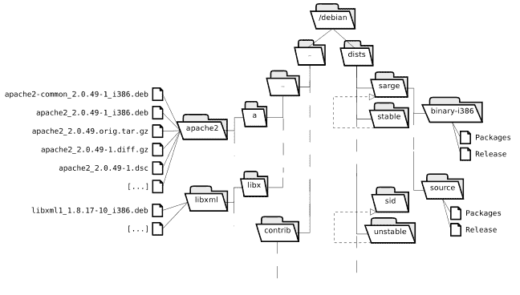

#### 4.1.1 软件包池

/pool 层级分为三个部分：*main*、*contrib* 和 *non-free*。该层级在下一级根据所含软件包的首字母进一步细分为子树。在每个单字母目录中，都有对应各个 Debian 源软件包的目录。例如，与 **apache2** 相关的文件位于 */pool/main/a/apache2*。库软件包则是一个例外，它们被归入不同的子树，以 lib? 为根目录（其中问号是通配符）。例如，从 **libxml** 源软件包生成的二进制包可以在 */pool/main/libx/libxml* 下找到。

此时，有必要区分 Debian 中两种不同类型的软件包：源软件包和二进制软件包。同时，还有原生和非原生（外部）软件包之分。一切很快就会变得清晰！维护者将软件转化为源软件包。源软件包并非 Debian 包格式（DEB）文件，而是其源文件的组合。对于外部（非原生）软件包，源软件包由以下文件组成：

- *.orig.tar.gz — .orig 文件是一个 tarball，包含其（上游）作者发布的软件原始形式。
- *.diff.gz — diff 文件封装了将软件"debian 化"所需的更改。应用补丁后（diff 文件就是一个补丁），就可以使用标准的 Debian 工具将软件打包为 Debian 包。
- *.dsc — dsc 文件提供描述源软件包所需的基本信息，包括 orig 和 diff 文件的 MD5 校验和。它由维护者签名，用于认证上传操作[2]。

专门为 Debian 编写的软件不需要进行 debian 化处理。因此，diff 文件不存在，orig 文件则被一个 tarball 替代，解压后可直接用于生成 Debian 二进制软件包。

利用 debian 化源软件包的 */debian* 子目录中存储的信息，Debian 维护者工具可以生成 DEB 文件，其中包含可安装在 Debian 系统上并为其量身定制的软件。DEB 文件始终是一个单独的二进制软件包。一个 Debian 源软件包可以生成多个（但至少一个）二进制软件包。例如，许多库被拆分为三个二进制包，它们都从同一个源软件包生成：libfoo1、libfoo-dev 和 libfoo-doc。

[2] 与 buildd 配合使用时，dsc 文件用于标识上传实体。对于非维护者原生架构的构建，dsc 文件由 buildd 的管理员签名（参见第 4.2 章）。

Debian 存档目前包含约 15,000 个二进制软件包，它们由约 10,000 个源软件包生成。

#### 4.1.2 软件包索引

/dists 层级提供 APT 正常运行并查找可下载的 DEB 文件所需的索引文件³。以下四个参数的每种组合都有单独的索引：

- 发行版名称，如 *stable* 或 *sarge*。
- 部分（section），如 *main*。
- 目标架构。
- 软件包类型：源文件或二进制包。

存档使用子目录将这些参数映射到文件，因此找到合适的索引文件只需根据这些参数沿 /dists 根目录下的目录树逐级向下查找即可。

第一级包含不同的发行版，规范名称设有符号链接。例如，当 *sarge* 发布时，stable 将是指向 sarge 的符号链接。该级别还包含 experimental 和 stable-proposed-updates 目录。我们将在第 4.4.1 章和第 4.4.4 章中分别回到这些内容。

在每个发行版目录下，有对应三个部分的子树，其结构类似于 /pool 层级。将每个发行版中的所有文件按自由度进行分离，是能够生成或部署具有特定许可证要求的存档快照的重要前提。发行版目录中还包含 Contents 文件，它将文件系统上安装的文件映射到提供该文件的软件包。apt-file（参见第 5.4.4 章）等工具使用此信息，grep 通常也可以从该文件中提取所有必要信息。

在每个部分的目录中，有若干用于二进制软件包索引的子目录以及源文件索引的目录。索引文件在所有情况下都称为 Packages，包含由四个参数确定的存档部分中所有可用软件包的信息。

例如，/dists/stable/main/binary-i386/Packages 包含 *main* 中所有可以在 i386 架构上作为 *stable* 发行版一部分安装的二进制软件包描述。同样，/dists/sid/contrib/source/Packages 引用了 *sid* 中 *contrib* 部分的所有源软件包。源文件不涉及架构。

> ³软件包索引不要与镜像站上的 /indices 目录混淆；后者索引的是镜像文件系统中的文件，而软件包索引索引的是其中存储的 Debian 软件包。

#### 4.1.3 Release 文件

Debian 镜像的 /dists 目录是该镜像提供的各发行版索引文件的所在地。每个这样的发行版还额外由一个 Release 文件描述，其中包含关于该发行版的重要数据。woody 第三次发布的 Release 文件如下所示：

```
# cat Release
Origin: Debian
Label: Debian
Suite: stable
Version: 3.0r3
Codename: woody
Date: Mon, 25 Oct 2004 17:56:29 UTC
Architectures: alpha arm hppa i386 ia64 m68k mips mipsel powerpc s390 sparc
Components: main contrib non-free
Description: Debian 3.0r3 Released 25th October 2004
MD5Sum:
[...]
```

Release 文件主要由 APT 使用，APT 通过这些文件确定在 /etc/apt/sources.list 中指定的镜像所提供的架构和组件。此外，在混合使用不同发行版时（参见第 8.2 章），其中的数据可以用于指定固定（pin）条件。最后，该文件包含与该发行版相关的所有索引文件的校验和。如第 7.5 章所示，这些校验和可用于验证从 Debian 镜像下载的软件包的完整性。

### 4.2 软件包的上传

一个 Debian 软件包有其生命周期，在被作为 Debian 稳定版发行版的一部分分发之前，还有很长的路要走。图 4.2 展示了 Debian 基础设施中不同存档和组件如何协同工作。你无需全部理解，但它可以作为一份便捷的参考。

完成 debian 化流程后，维护者将源文件（以及用于构建架构的 DEB 文件⁴）传输到可用的上传队列之一。在接收服务器端，Debian 队列守护进程会定期将文件移动到 unchecked 目录。这个目录是 katie 及其同伴⁵的地盘，它们会验证上传的软件包是否使用受信任的签名进行签名，并对软件包进行一系列完整性检查。验证成功后，

> ⁴这是为了确保没有维护者在未先在本地构建软件包的情况下就进行上传。在撰写本文时，维护者直接创建的二进制包会直接传播到 unstable 存档中。对于所有其他（适用的）架构，构建守护进程需要从源软件包生成二进制包。有关安全方面的说明，请参见第 7.5 章。

> ⁵katie 及其同伴是一组以女性名人命名的脚本，它们通力合作


## 4.2 软件包上传

上传操作会将文件移入 incoming 目录，该目录可通过 Web⁶ 访问，但除特殊情况外，不应将其用作软件包来源。

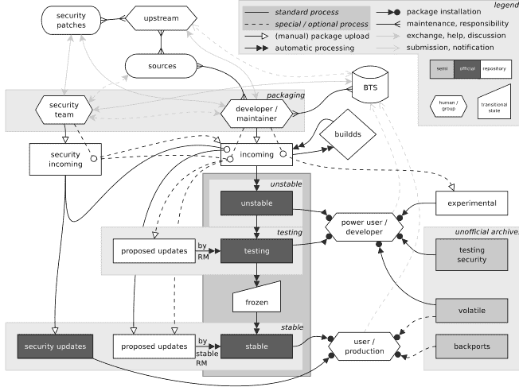

图 4.2：Debian 软件包的生命周期（基于 Kevin Mark 的工作）

当上传文件到达 incoming 时，编译守护进程（即 buildd）会收到通知⁷。Debian 支持的每种架构（参见第 4.5 章）至少有一个编译守护进程，其职责是编译软件并生成针对相应架构的 DEB 文件。生成的 DEB 文件会附带一个描述该软件包的文件（即 .changes 文件⁸），该文件必须由 buildd 的管理员签名。最后，软件包文件被提交到上传队列，并如前所述逐步进入 unstable。

每天，dinstall 会将 incoming 中可用的软件包文件移至 Debian 软件池（即每个 Debian 镜像的 /pool 目录）中的相应位置。然后它会更新归档的索引文件。此后，新软件包就可以通过 APT 从 *unstable* 归档中获取。

负责处理 Debian 归档管理各项任务。参见 http://cvs.debian.org/dak/?cvsroot=dak。

⁶ http://incoming.debian.org

⁷ 各个 buildd 的状态可在 http://www.buildd.net 查看。

⁸ .changes 文件作为每种架构构建过程的一部分生成，用于标识一组二进制软件包。它必须由 Debian 开发者进行加密签名，对应的软件包才有资格被纳入 Debian 归档。参见第 9.2.12 章。

### 4.3 官方发行版

Debian 的三个官方发行版——*stable*、*testing* 和 *unstable*——各自具有与其在软件包生命周期和整个项目中所扮演角色相关的特定特征。由于软件包通常通过 *unstable* 和 *testing* 归档进入 *stable* 发行版，以下各节按照新软件包进入 Debian 系统时遇到它们的顺序，对三个官方发行版进行概述。

Debian 系统可以使用三个发行版中的任何一个作为软件包来源进行安装和维护。在第 5.4.1 章中你将看到如何选择单个发行版，第 8.2.1 章则描述了如何组合使用它们。请注意，三个官方发行版都提供对应归档索引文件的归档签名（参见第 7.5 章）。在附录 C.1.1 中你可以找到帮助验证签名所用密钥的信息。

#### 4.3.1 unstable 发行版

如前所述，*unstable* 发行版处于持续变化的状态。*unstable* 也被称为 *sid*⁹，是 Debian 开发的工作空间。新软件包以一种相当混乱的方式渗入归档并成为 *sid* 的一部分。因此，软件包之间的依赖关系会断裂，然后在稍后被解决；冲突出现又消失；软件包可能达不到归档中其他部分的质量标准。此外，虽然维护者会注意不让跟踪 *unstable* 发行版的用户感到不便，但有时打包软件的剧烈变化会进入归档，可能导致目标系统出现严重故障。

"unstable" 这个术语也适用于软件打包。偶尔，维护者会匆忙上传一个软件包，忽略某个细节或在打包过程中犯错。由此产生的软件包——如果通过了完整性检查的话——通常无法与本地系统配合，或者安装的软件严重功能不全。甚至违反策略规范的情况也是可能的。需要注意的是，此类策略违规大多限于文件放置不当，但 *unstable* *不适合*用于生产环境是不言而喻的。话虽如此，大多数 Debian 开发者在他们的主力机器上运行 *unstable*。如果偶尔的依赖解析失败不是致命的，*unstable* 是体验 Debian 的一种相当不错的方式——尤其是当希望通过提交错误报告或在邮件列表上进行有趣的讨论来回馈 Debian 时。

事实上，*unstable* 不太可能比其他基于较新软件、且开发者努力尽快发布系统的操作系统更加脆弱。不言而喻，较短的开发周期（如 Debian *unstable*）没有留下太多测试空间，因此往往会产生大量缺陷。

请注意，"unstable" 主要指归档和软件包，只是间接指软件本身：作为 Debian *unstable* 一部分提供的软件实际上可能相当稳定，因为 *unstable* 中的软件包通常对应软件的官方版本。因此，一个程序能否成为官方上游版本的一部分，取决于软件作者的质量标准对其运行时稳定性的要求程度。通常，一个软件会提供两个版本：官方版本（通常称为"stable"）和开发版本。如果后者有任何价值（或者如果上游作者对版本编号过于保守），维护者很可能会在提供官方版本*之外*，还提供预发布版本的软件包以纳入 Debian。虽然这不是规则，但开发版本通常以直接来自版本控制系统的 *-snapshot 软件包形式提供，以使 Debian 用户能够真正使用最前沿的版本。例如，`gcc-snapshot` 提供 GNU 编译器的最前沿版本，而 `gcc` 提供经 gcc 开发者认定为稳定的版本。

关于安全更新，*unstable* 享有与 *stable* 发行版类似的关注。虽然安全团队发布的安全更新可能仅限于 *stable* 发行版中的版本，但新的修复版本通常很快就会可用，维护者会特别优先地将修复后的软件包上传到 *unstable*。

处理 *unstable* 系统与处理 Debian *stable* 的安装没有太大不同。*unstable* 的升级可通过 APT 获取，但需要记住的是，*unstable* 中的软件包升级所接受的测试远少于作为 Debian *stable* 官方升级一部分分发的软件包。

由于 *unstable* 中软件包的依赖信息可能发生变化，基于 *unstable* 归档软件包的系统应使用 `apt-get --show-upgraded dist-upgrade` 进行升级，而不是使用普通的 APT 升级机制。`--show-upgraded` 选项并非必需，但建议使用，以便在执行升级前检查 APT 提议的更改。此外，`apt-listchanges` 和 `apt-listbugs` 等工具（分别参见第 5.11.2 章和第 5.11.3 章）对于评估升级是否值得或是否涉及不必要的风险非常有价值。

⁹ Sid 是皮克斯动画《玩具总动员》中那个不断破坏玩具的邪恶男孩的名字。因此，它对于一个可能破坏系统的发行版来说是一个恰如其分的名字。方便的是，*sid* 也是 "Still in development"（仍在开发中）的首字母缩写。

#### 4.3.2 testing 发行版

上传到 Debian 归档的软件包会附带一个紧急程度说明，编码在软件包内的 `debian/changelog` 中。普通上传的紧急程度较低，而安全更新由于其高（甚至紧急）紧急程度而享有优先处理。上传的紧急程度也决定了某个软件包的特定版本何时从 *unstable* 移至 *testing*。

根据紧急程度，软件包的特定版本必须在 *unstable* 中停留 10 天（低）、5 天（中）、2 天（高）或 0 天（紧急¹⁰）才会被考虑进入 testing。当软件包被考虑升级到 *testing* 时，在移动之前必须满足许多其他条件。如果同一软件包的先前版本已存在于 *testing* 中，新版本必须已在先前软件包支持的所有架构上构建，并且其已报告的发布关键缺陷（release-critical bugs，参见第 10.6.3 章）数量不得超过 *testing* 中的软件包。此外，软件包的所有依赖关系必须在 *testing* 内可满足，且其声明的关系不得破坏已在 *testing* 中的另一个软件包。

当所有这些条件都满足后，归档脚本会将软件包移至 testing，替换任何先前版本¹¹。因此，*testing* 通常不会受到软件包刚进入 *unstable* 时那些初期问题的影响，但它也不像 *unstable* 那样时效性强。

*testing* 对于除最关键应用之外的所有场景来说似乎是理想的发行版。它不是处于最前沿，而是处于领先前沿，而且其内容经过了比 *unstable* 中软件更仔细的审查。它也比 *unstable* 波动更小，从而更易于维护。过去，*testing* 的主要缺点是缺乏安全支持。安全更新在渗透到 *unstable* 归档时可能已经延迟，在被接受进入 *testing* 之前又至少要延迟两天——前提是满足所有其他要求。因此，testing 中的安全更新有时会延迟数天，这是一个需要考虑的重要因素。显然，通过拨号线路连接互联网的家庭计算机仍然适合 *testing* 安装，但拥有永久互联网连接、向外界提供服务的机器，或托管多个不受信任用户的机器，可能更适合使用 *stable*，如果可以选择的话也可以使用 *unstable*。

在 *sarge* 发布之前，Debian testing 安全团队已经成立以解决这一不足。在撰写本文时，该团队仍在非正式运作，主要通过托管在 lists.alioth.debian.org 上的 `secure-testing-team` 邮件列表进行协调。一个每日更新的在线记录¹²跟踪 *testing* 归档中持续存在的安全问题。根据进展情况，*etch* 在作为 *testing* 发行版期间可能会获得安全更新支持。

与 *unstable* 类似，由于 *testing* 中提供的软件包集合存在波动，建议使用 `apt-get --show-upgraded dist-upgrade` 代替 `apt-get upgrade`。

¹⁰ 由于归档管理脚本 britney 的限制，紧急上传实际上需要一天才能渗入 testing。

¹¹ 先前版本可在归档的每日快照中获取：http://snapshot.debian.net

¹² http://merkel.debian.org/~joeyh/testing-security.html


#### 4.3.3 稳定版

当下一次发布的目标达成后¹³，*testing* 即被冻结。在随后的冻结周期中，不允许任何新功能进入 *testing*，开发人员专注于修复漏洞和提供额外的翻译。特别是严重程度为严重及以上的漏洞必须被修复。这些漏洞被标记为 RC，必须在发布之前得到解决。在冻结周期内，存在未解决 RC 漏洞的软件包可能会从 *testing* 发布中移除。

一旦 *testing* 准备就绪可以发布，先前的 *stable* 版本将被废弃（但会归档¹⁴），*stable* 和 *testing* 的符号链接将更改为指向下一代发布版本。因此，建议在 /etc/apt/sources.list 中硬编码发布代号，而不是使用其规范名称。具体来说，对于 *sarge* 系统，我建议将所有"stable"替换为"sarge"。虽然 Debian 的发布不太可能让你措手不及，但使用 APT 存档的代号可以让你按照自己的时间表升级到下一个正式版本，而不是在存档中的符号链接更改时被动更新。当下一个版本发布时，你只需将"sarge"替换为"etch"，然后照常进行 dist-upgrade（参见第 5.4.7 章）。

一旦某个发布成为新的 *stable*，它就变为不可变的。安全更新保存在一个单独的软件仓库中（参见第 7.2 章），在下一个正式版本发布之前，软件包集合和软件包本身都不会发生变化。将安全更新单独存放看起来可能有点奇怪，但与其他所有事情一样，这种做法是有其原因的。并非每个管理员都需要安全更新。大型企业通常维护自己的内部发布版本，并制定了需要能够精确识别其机器状态的策略。在这种情况下，修复补丁需要先经过审查，然后才能在内部提供。如果底层存档（*stable*）每隔几天就发生变化，就不可能在数百台机器之间保持一致的安装环境，同时提供自定义扩展和更新。

在半定期的间隔中，安全更新和其他拟议更新（如简单错误修复）会与最新的官方发布版本合并，以创建官方发布的下一个修订版。这些修订版（"stable dot releases"或简称"r-releases"）通过当前 *stable* 发布版本号的特定后缀来标识。例如，本书编写时，官方 Debian 发布版本为 *Debian 3.0r3*，这是 *woody* 成为 *stable* 之后发布的第三个修订版。当新的 dot release 发布时，它会替换之前的 *stable* 存档。

¹³ http://release.debian.org

¹⁴ http://archive.debian.org 是官方存档地址，许多镜像站将 /debian-archive 作为 /debian 的同级目录提供，其中包含 /dists 和 /pool。截至本书撰写时，主站点已长期无法访问，关于其状态的查询也未得到答复。可用的镜像列在发行版存档网页上：http://www.debian.org/distrib/archive

### 4.4 非官方 APT 存档

除了与三个官方发布版本 *stable*、*testing* 和 *unstable* 对应的三个存档之外，还存在许多其他 APT 软件仓库，可以在需要它们的系统上轻松集成到 APT 中。以下各节介绍了其中最重要的几个。虽然完全可以在没有这些存档的情况下运行 Debian 系统来满足所有需求，但它们包含的软件包有时可能会被用到。无论如何，了解它们的存在和用途是有好处的。

#### 4.4.1 experimental 存档

Debian 存档还托管了 *experimental* 发布版本，其中包含尚未准备好公开使用的软件包，甚至不适合作为 *unstable* 的一部分。开发人员使用此空间在开发周期中共享软件包。除非你想参与此开发（例如作为测试人员，或更积极地参与），否则你可以安全地忽略 *experimental* 存档。

以下在 /etc/apt/sources.list 中的行使 APT 能够从 *experimental* 安装软件（参见第 5.4.1 章）。一如既往，请确保你使用最近的镜像（参见第 5.4.1 章）。

```
~# cat <<EOF >> /etc/apt/sources.list
deb     http://ftp.debian.org/debian experimental main
deb-src http://ftp.debian.org/debian experimental main
EOF
~# apt-get update
```

*experimental* 存档包含 Debian 存档中常见的一些软件的新主要版本。例如，APT 0.6（参见第 7.5.2 章）位于 *experimental* 中，而 0.5 版本可以从三个发布存档中获取。*experimental* 存档会被 APT 自动降低优先级，因此无需担心将所有软件包升级到可用的实验版本。这是通过存档 Release 文件中的特殊指令实现的。更多信息请参见第 8.2.1 章：

```
~$ getfile /dists/experimental/main/binary-i386/Release
~$ grep NotAutomatic Release
NotAutomatic: yes
~$ apt-cache policy apt
apt:
  Installed: 0.5.27
  Candidate: 0.5.27
  Version Table:
     0.6.25 0
          1 http://ftp.debian.org experimental/main Packages
*** 0.5.27 0
     500 http://ftp.debian.org sid/main Packages
     100 /var/lib/dpkg/status
```

要从 experimental 存档安装软件，请向 APT 传递 --target-release experimental 选项：

```
~# apt-get install --target-release experimental apt
[...]
Setting up apt (0.6.25) ...
```

#### 4.4.2 volatile 存档

Debian 的 *stable* 存档在安全更新之外不会发生变化，而安全更新不会添加新功能（参见第 4.3.3 章和第 7 章）。虽然管理员通常高度重视这种稳定性，但某些类型的软件必须随时间变化，即使在最稳定的系统上也是如此。这类软件的主要候选者包括病毒扫描程序、垃圾邮件过滤器以及其他处理预期会变化的数据的工具（如 **whois**）。

在我编写本书期间，一些 Debian 开发人员开始构思一种策略来处理需要变化才能保持可用性的软件。这种软件被称为"volatile"。该策略草案可在 http://volatile.debian.net 获取，该网站还托管了一个可通过 APT 访问的 volatile 软件存档。

*volatile* 存档的目标是成为安全存档的平行对应，允许管理员以与使用安全存档相同的信心来拉取更新。变更将仅限于必要的功能，并且只会在与相应维护者密切合作的情况下进行。此外，*volatile* 存档中的软件包将提供安全支持。

要使用 *volatile* 存档中的软件，请告诉 APT 使用官方镜像列表¹⁵ 中的一个镜像，并更新 APT：

```
~# cat <<EOF >> /etc/apt/sources.list
deb http://volatile.debian.net/debian-volatile sarge/volatile main
deb-src http://volatile.debian.net/debian-volatile sarge/volatile main
EOF
~# apt-get update
[...]
```

*volatile* 存档使用自定义的版本方案，旨在与来自 Debian 主存档的官方软件包集成且不冲突（参见第 5.7.5 章）。存档中的所有索引文件都使用加密签名（参见第 7.5 章），验证密钥的信息可在附录 C.1.2 中找到。

¹⁵ http://volatile.debian.net/mirrors.html

#### 4.4.3 amd64 存档

尽管 amd64 架构尚未被 Debian 项目正式支持，但该移植版本已可供使用（参见第 4.5.2 章）。你可以在该移植版本的网页¹⁶ 上找到安装和维护说明。

在能够集成到 Debian 主存档之前，amd64 架构可从单独的 APT 软件仓库获取。你可以在网上找到详细信息以及镜像列表¹⁷。存档的索引文件使用单独的密钥签名以确保软件包的完整性（参见第 7.5 章）。关于该密钥的信息可在附录 C.1.2 中找到。

¹⁶ http://www.debian.org/ports/amd64

¹⁷ http://amd64.debian.net/README.mirrors.html

#### 4.4.4 *-proposed-updates 存档

stable-proposed-updates 和 testing-proposed-updates 两个目录为开发人员提供了一种绕过通过 *unstable* 和 *testing* 的正常软件包周期直接进入 *stable* 的途径。上传到这些目录的软件包将由相应的发布经理考虑手动纳入。具体来说，stable-proposed-updates 是 Debian 下一个 dot release 的基础（参见第 4.3.3 章）。

尽管这两个目录托管了完整的 APT 软件仓库，但此处不建议你直接使用它们。这两个目录中的软件绕过了常规的 Debian 质量保证监控，并且不会像通过 *unstable* 进展的软件那样接受同等程度的测试。

#### 4.4.5 backports.org 存档

与 *testing* 和 *unstable* 相比，Debian *stable* 发布版本通常包含过时的软件。此外，许多软件包根本不可用，因为它们只是最近才被重新打包。尽管可以从较新的发布版本中手动下载单个 DEB 文件，但版本化的依赖关系使这变得不可能。例如，要将 postfix 升级到版本 2（例如为了支持策略服务器），在 woody 系统上不可能不引入来自下一个 Debian 版本（*sarge*）的其他软件包：

```
~# getfile pool/main/p/postfix/postfix_2.1.5-5_i386.deb
~# dpkg --install postfix_2.1.5-5_i386.deb
[...]
dpkg: dependency problems prevent configuration of postfix:
 postfix depends on libc6 (>= 2.3.2.ds1-4); however:
  Version of libc6 on system is 2.2.5-11.5
[...]
```


毋庸置疑，Debian *stable*（稳定版）的用户不会愿意升级 libc6；这将是对系统的一项重大改动，会给其稳定性带来风险。一个替代方案是下载源码，并针对 *stable* 中可用的库重新编译该软件包。如果你需要多次执行此操作，整个过程会变得繁琐且容易出错。

**backports.org** 归档仓库[^18^] 试图弥补这一不足，它分发的软件包正是通过这种方式重新编译的。要在 *woody* 系统上安装 postfix 2 版本，需要在 /etc/apt/sources.list 中添加以下行。请使用镜像页面[^19^]找到离你最近的镜像站，并使用该镜像站代替主分发服务器。

```
~# cat <<EOF >> /etc/apt/sources.list
deb http://www.backports.org/debian woody postfix
EOF
~# apt-get update
~# apt-get install postfix
[...]
Setting up postfix (2.1.4-2.backports.org.1) ...
[...]
```

如你所见，所需的软件包被列为仓库规范的一部分。**backports.org** 归档仓库包含超过 450 个软件包，你大概不会希望所有已安装的软件包都被升级到最新的 backport 版本[^20^]。因此，**backports.org** 允许你精确指定要包含的软件包集合。你也可以在单行中指定多个软件包：

```
~# cat <<EOF >> /etc/apt/sources.list
deb http://www.backports.org/debian woody postfix subversion
EOF
```

由于我们将在第 5.4.1 节讨论 **APT** 源语法，你可以将上面这行理解为一种使 *woody* 版本的 postfix 和 subversion 的 backport 能够通过 **backports.org** 归档仓库直接使用 **APT** 安装的方式。此外，这行配置还确保了所有依赖项的 backport 在必要时也能同样方便地安装。

请注意，**backports.org** 归档仓库中提供的软件包并未获得官方认可，且不附带任何保证。**backports.org** 并非 Debian 项目的官方组成部分，尽管它完全由 Debian 官方开发者维护和支持。特别是，这些软件包没有经过 Debian 标准的质量保证验证，也没有像 Debian 官方软件包那样经过充分的测试。

[^18^]: http://www.backports.org
[^19^]: http://www.backports.org/mirrors.html
[^20^]: 如果你确实需要全部升级，可以在 /etc/apt/sources.list 中使用伪软件包名称 all。

话虽如此，backports.org 归档仓库中软件包所使用的源码直接来自 Debian 官方归档仓库，因此其安全性应该与相应归档仓库中的原始版本相同。不过，重要的是要记住，安全补丁传播到 backports.org 归档仓库会存在额外的延迟。

最后一点说明……（见图48ad34506a276.png）……或发送邮件至 backports.org 邮件列表[21](见图48ad34506a276.png)。该邮件列表也是 backports.org 归档仓库软件包的主要支持渠道。

#### 4.4.6 apt-get.org 目录

搭建一个 **APT** 仓库非常简单（如第 9.3 节所示）。多年来，非官方仓库如雨后春笋般涌现，提供 Debian 中未收录的实用软件包，或者……如果你使用此处列出的源，你应该知道它们是……

#### 4.4.7 Christian Marillat 的多媒体归档仓库

由于 Debian 对软件包的自由度要求——Debian 项目在 DFSG 中已将其固定——许多实用的多媒体程序无法随 Debian 官方归档仓库一起分发。尽管 Debian 正在与相关作者密切合作，争取以自由许可证发布这些软件，但进展有时十分缓慢。

Christian Marillat 是一位 Debian 开发者，他维护着一个以多媒体内容著称的非官方 Debian 归档仓库。他的归档仓库在其网页[22](见图48ad34507c60.png)上有详细描述，收录了 Mplayer、lame、transcode 以及各种视频编解码器等流行软件。Christian 非官方地维护着这些软件包，这更多地说明了他所能提供的支持程度，而非软件包本身的质量。Christian 是 Debian 的官方开发者，他的归档仓库经过签名以支持完整性验证（参见第 7.5 节）。

顺便提一下，Mplayer 实际上是在与 DFSG 兼容的许可证下发布的，在本书撰写期间已有官方软件包。遗憾的是，*sarge* 将不会包含这些软件包。

[21] http://lists.backports.org
[22] http://debian.video.free.fr

### 4.5 架构支持

尽管消费市场充斥着搭载（并且发烫于）Intel x86 架构衍生产品、PowerPC 机器以及 AMD 和 Intel 最新一代 64 位处理器的计算机，但还有大量其他架构也受益于 Linux 内核的支持。Linux 作为嵌入式设备（例如使用 arm 或 mips 处理器）、专业服务器（例如使用 sparc、alpha 和 hppa 芯片）以及整机大型机（例如基于 S/390）的操作系统正日益流行。Debian 支持所有这些架构以及其他一些架构。

然而，Linux 内核本身并不构成一个完整的操作系统。内核仅仅是硬件与用户空间软件之间的接口。由于大部分常见的用户空间软件（以及内核本身）都是用中级语言编写的（需要编译器生成特定处理器的汇编代码），要对一种处理器架构提供合理支持，不仅需要内核的支持，还需要构成 Unix 系统的整个用户空间软件集合的支持。作为"通用操作系统"，Debian GNU/Linux 在 Linux 内核的架构支持基础上，通过 GNU 用户空间工具在十一种不同的处理器架构上提供了支持。更多的架构支持正在筹备中。

支持一种架构意味着整个 Debian 都已被适配以在该特定架构上运行。此外，它还意味着无论底层处理器架构是什么，安装过程都与任何其他 Debian 系统一样。因此，Debian 操作系统可以被视为一个抽象层，允许跨不同类型的机器进行统一的系统管理。除了不适用于所有架构的软件包（例如针对 x86 架构的内存测试工具 memtest86）外，归档仓库中所有可用的软件包都已为十一种受支持的架构中的每一种进行了构建。

Debian、底层内核、用户空间软件集合和处理器架构的组合被称为 Debian 的一个"移植版本"。官方的 Debian GNU/Linux 移植版本（Debian GNU/Linux 可运行的架构）[23](http://www.debian.org/ports) 如下：

[23] http://www.debian.org/ports

# 4 Debian 发行版与归档仓库

**i386**

作为 Linux 最早支持的架构，IA-32 架构——存在于 AMD、Cyrix、Intel 等厂商的 **x86** 兼容芯片上——也是 Debian 最受欢迎的架构。

**ia64**

Intel 与 HP 合作，终于通过 64 位 IA-64 架构放弃了完全的 **x86**（向后）兼容性。Debian 从 *woody* 版本开始支持 **ia64**。**ia64** 移植版本允许通过软件模拟使用 32 位代码。

**powerpc**

PowerPC 芯片诞生于 Apple、IBM 和 Motorola 的合作，它驱动着 IBM 的 RS/6000 系列以及 Apple 的 PowerMac 系列。对 **powerpc** 架构的支持在 *potato* 版本中添加。

**m68k**

Motorola 68000 系列处理器驱动着各种各样的计算机系统，最著名的包括 sun3 工作站系列，以及 Amiga、Apple Macintosh 和 Atari 的个人计算机。Debian 在 *hamm* 版本中添加了对 **m68k** 架构的支持。

**sparc**

Sun SPARC 架构驱动着 Sun SPARCstation 工作站系列以及 sun4 家族中的部分型号。与 **powerpc** 移植版本类似，**sparc** 架构使用 64 位内核，但配备 32 位用户空间。作为 **sparc** 移植版本的附加部分，**sparc64** 子架构旨在实现 64 位用户空间应用程序。Debian 从 *slink* 版本起支持 **sparc**。

**alpha**

与 *slink* 版本同时到来的还有对 64 位精简指令集计算机（RISC）架构 Alpha 的支持，该架构由 Digital（Digital Equipment Corporation，DEC）开发。

**arm**

ARM 处理器是 Acorn 和 Apple 开发的低功耗 RISC 芯片。后来，Digital 和 Intel 加入合作，基于 **arm** 架构生产了改进的 StrongARM 芯片。ARM 处理器首次在 *potato* 版本中获得支持，通常出现在移动设备和嵌入式设备中。

**mips**

主要应用于 SGI 机器、Cisco 路由器以及 Sony 和 Nintendo 的游戏设备中，这款 RISC 芯片自 *woody* 版本起获得支持。


## 第四章（续）

# mipsel

作为mips架构的"小端序"兄弟，mipsel主要存在于DEC工作站中，也随着*woody*版本的发布加入了Debian架构家族。

# hppa

惠普的PA-RISC架构在*woody*版本发布时获得了Debian的支持。hppa架构主要存在于运行HP/UX（或Debian）的HP机器中。

# s390

IBM S/390大型机（2001年重生为eserver zSeries系列）在不久后也随着*woody*版本的发布被Debian正式采用。这种64位架构驱动着专为并行计算优化的高性能芯片。

支持多种处理器架构的优势是显而易见的。首先，Debian使更大的用户群能够运行Linux，因为对于使用非Intel处理器机器的用户来说，几乎没有可用的用户空间集合。其次，企业机构的IT基础设施经过多年发展，服务器架构呈现博物馆般的多样性，Debian能够作为单一操作系统部署在所有现有硬件上。因此，使用Debian可以将统一系统管理的成本降至最低。

#### 4.5.1 80386 — 处理器

从gcc-3.3 1:3.3ds6-0pre6版本开始（以及gcc-3.2的某些版本），编译器开始使用bswap指令，在真正的**80386**处理器上通过软件模拟这些指令。遗憾的是，这个补丁存在缺陷且缺乏维护。

**80386**是一款极其老旧且速度缓慢的处理器，但Debian希望继续支持它（实际上也支持其他比80386性能更弱的架构）。然而，从*woody*升级到*sarge*使搭载真正**80386**处理器的系统陷入了不幸的Catch-22困境²⁴：*sarge*的libc6和libstdc++5都使用了上述指令。更新其中任何一个库都会破坏系统，直到安装新内核，但由于依赖**modutils**（2.4内核）或**module-init-tools**（2.6内核），而这些工具又依赖于*woody*中不可用的libc6版本，因此无法安装新内核。

> ²⁴源自约瑟夫·海勒的优秀小说《第二十二条军规》，这种困境指的是：除非完成另一件事，否则无法做某件事，但除非先完成第一件事，否则也无法完成另一件事。

截至撰写本文时，项目仍在讨论可能采取的步骤。关于特殊升级内核的建议因复杂性和分发问题而被否决。解决此问题的首选方法是开发某种用户空间解决方案来模拟缺失的指令。如果找不到这样的解决方案，Debian可能会完全放弃对**80386**的支持[^25]。Debian *sarge*无法在80386芯片上正常运行，主要是因为内存需求无法满足。使用嵌入式**80386**机器的用户通常有自己的内核来最小化内存使用。

如果放弃对**80386**处理器的支持，Debian项目将考虑将其**i386**架构重命名为**i486**以表明这一变化。然而，这一变化可能会破坏现有脚本，因为"i386"这个名称已经存在很久了。进一步调查将揭示更多信息。无论如何，*sarge*支持**80386**处理器。

#### 4.5.2 amd64架构

在我撰写本书期间，Debian被移植到了**amd64**架构。作为一个非常年轻的移植版本，它既未作为官方移植版与Debian *sarge*一起分发，也未包含在官方归档中。不过，它基本完整，可以从其独立归档中进行安装（参见第4.4.3章）。截至撰写本文时，**amd64**架构存在四个不同的移植版本：

- **sarge**
  Debian *sarge*的64位移植版。Debian **amd64**团队计划在**amd64**架构成为官方归档一部分之前持续提供安全更新。

- **pure64**
  Debian *etch*和*sid*的64位移植版。此移植版将在不久的将来与Debian主归档集成，*sarge*的64位移植版也将被合并进来。

- **gcc3.4**
  此移植版与**pure64**移植版相同，使用gcc编译器3.4版本重新构建。

- **multi-arch**
  一项将多架构概念（见下文）与**amd64**集成的工作。计划是在此移植版成为Debian *unstable*一部分后，将其与**pure64**合并。

目前，**pure64**移植版是**amd64**系统的推荐移植版。截至撰写本文时，尚无法将AMD 64位处理器上的**i386**安装升级到任何**amd64**移植版。不过，相关工作正在进行中。

[^25]: http://lists.debian.org/debian-release/2004/10/msg00027.html

#### 4.5.3 多架构支持

随着AMD Athlon 64等经济实惠的64位处理器的出现，Debian加强了应对在同一系统上集成32位和64位应用程序挑战的努力。大多数64位架构支持原生或模拟的32位代码执行，但应用程序和库在这两种寄存器大小之间不兼容。Debian没有采用快速解决方案或复制软件包的方式，而是试图与LSB合作，提出一种以可扩展和良好设计的方式在单机上集成多种架构的方法。在"多架构支持"的项目名称下，已经开始应对这一挑战，并建立了小型测试环境来帮助制定策略²⁶。

现有的64位架构（ia64和sparc64）使用单独的目录来存放安装库的32位和64位版本。这种方法通常被称为"双架构"，并非没有问题。除了违反FHS规则（参见第5.7.4章）外，这种方法各不相同，无法扩展到其他架构或未来的类似变化。随着多架构达到生产状态，当前的64位架构预计将切换到使用它。此外，借助多架构，Debian将能够在短时间内为其他64位架构提供完整支持，包括powerpc64、mips64/mipsel64、hppa64、sparc64和s390x²⁷。

在多架构准备好生产使用之前，需要采取特殊安排才能在64位安装上运行32位应用程序。一个好方法是使用由dchroot管理的chroot环境（参见第8.3.1章）。

> ²⁶关于多架构的更多信息，请访问 http://people.debian.org/~taggart/multiarch

> ²⁷其中一些架构（如sparc64）已经获得支持，但使用了已弃用的双架构方法。

# 第五章

## Debian包管理系统

> 我小时候被dselect攻击过，从此避开了Debian。
> —— Andrew Morton

### 5.1 要求

包管理系统是操作系统最重要的功能之一。大多数用户希望他们的机器能够Just Work™，不特别愿意每周花几个小时保持系统更新，或者在需要安装新软件时经历繁琐的步骤。同样，管理多台机器的系统管理员有比花时间照顾每台工作站更好的事情要做。

#### 安装痕迹

优秀包管理系统最基本的功能是易于安装和卸载软件包。系统应跟踪其放置在文件系统上的文件，并能够在日后删除它们而不留痕迹。

例如，当程序发现错误时，包管理系统应能告诉是哪个软件包提供了该程序，以便正确提交错误报告。除了作为软件一部分安装的文件外，包管理系统还应允许适当处理软件在运行时创建的文件。例如，数据库服务器可能在其数据文件旁创建大量缓存文件。卸载时，可能希望清理系统的临时文件但保留数据文件。毕竟，我们卸载的是软件，而不是数据。

#### 安装和卸载钩子

通常，软件不能简单地放置在文件系统上，而是需要进一步配置才能工作。同样，程序在用户请求卸载时可能需要进行清理。包管理系统应允许在安装和卸载过程的不同阶段执行自定义操作，使维护人员能够利用常规Unix脚本的全部功能和灵活性。

#### 配置文件管理

区分优秀和糟糕包管理系统的另一个关键因素是配置文件的处理方式。无论包管理系统如何处理配置文件，它绝不能覆盖管理员的更改，否则系统将失去用户。在保留修改的同时，它还应允许将配置文件的未修改部分与新版本合并。然而，配置文件管理不应限制配置文件的语法或软件配置选项。

#### 依赖关系

基于Unix哲学¹，典型程序使用多个库和可能的其他程序来完成其任务。优秀的包管理系统

> ¹Unix哲学是提供众多小型工具，每个工具只做自己的任务，并努力以最佳方式完成该任务。通过标准使用范式和通信协议，这些工具可以任意组合。


#### 软件升级

随着软件的不断演进和新版本的发布，一个优秀的包管理系统应当能够在无需太多繁琐操作的情况下保持系统更新。新的依赖关系应当被正确解析（旧的依赖关系应当被标记为过时），并提供顺畅的升级路径以实现向新版本的平滑过渡。

#### 软件包格式能力与软件包质量

由于程序的升级路径通常与该程序本身紧密相关，因此必须认识到，即使是最优秀的包管理系统，如果软件包在不同版本之间不兼容，或者从一个版本到下一个版本根本没有升级路径，其表现也会非常糟糕。因此，在评估包管理系统的质量时，必须考虑到它所要处理的软件包本身。软件包格式的能力与打包本身的质量同等重要。如果这两者不够强大和灵活，无法封装 Unix 软件的灵活性，那么包管理系统的能力就会被压缩到最大公约数的水平。

# Debian 包管理系统

如果你曾经与极客同好交流过，或在论坛和 Linux 社区中花过足够的时间，你一定听说过 Debian 包管理系统的强大功能。事实上，如果你问任何人 Debian 最重要的特性是什么，大多数人都会提到这个包管理系统。他们的回答既对又错。说他们对，是因为包管理系统是管理员与 Debian 系统之间的主要接口。说他们错，是因为包管理系统本身并不是让许多 Debian 用户重新体验到软件安装和系统维护乐趣的真正原因。

简而言之，Debian 系统之所以如此强大，在于其强大的包管理系统、Debian 策略（它为开发者提供了创建一个完整系统而非仅仅一组软件包所需的规则），以及从用户需求中发展而来的灵活的系统管理工具的有机结合。在接下来的章节中，我将介绍这些组成部分，并帮助你拼凑出 Debian 系统的全貌。首先，你将了解包管理系统及其三个关键组成部分：Debian 软件包格式、Debian 软件包管理器 dpkg，以及 APT（高级软件包工具）。

### 5.2 Debian 软件包简介

Debian 系统的大部分内容都基于软件包：常规软件以软件包的形式提供，底层组件也是如此，例如内核和设备驱动程序。控制启动初始化序列的文件也通过包管理系统进行管理，系统其他管理方面的内容同样如此——这些内容在严格意义上并不属于软件（*即* 可执行程序）。Debian 世界中存在两种类型的软件包：

-   **二进制软件包**

二进制软件包以 `.deb` 扩展名的文件形式存在。这些文件通常被称为 DEB 文件，一般包含可执行文件、文档、配置文件和版权信息，或其中的任意子集。然而，除了版权信息（以及 `changelog.Debian` 文件）之外，二进制软件包也可以为空，作为过渡软件包或元软件包（也称为虚拟软件包）使用，其唯一目的是满足依赖关系。

-   **源码软件包**

尽管"软件包"一词暗示了将内容"打包"为单个文件，但一个源码软件包实际上由两到三个文件组成。这些文件共同提供了软件包维护者脚本生成二进制软件包所需的全部内容。因此，源码软件包既提供了软件的源代码，也提供了生成二进制软件包所需的"源代码"。

一个源码软件包用于创建一个或多个二进制软件包。在大多数情况下，只会生成一个二进制软件包。然而，在某些情况下，在软件包层级上对软件进行模块化是合理的。从 **xscreensaver** 源码软件包生成的二进制软件包包括 **xscreensaver** 和 **xscreensaver-gl**。前者提供了 **xscreensaver** 应用程序及部分屏幕保护程序，后者则包含使用 **OpenGL** 编写的屏幕保护程序；没有图形加速的用户因此可以节省空间，只安装标准的屏幕保护程序。

目前，Debian 软件仓库提供近 10,000 个源码软件包，生成约 15,000 个二进制软件包。Debian 用户通常处理的是二进制软件包，尽管源码软件包即使对普通用户来说也提供了有趣的可能，正如我们稍后将看到的（参见第 5.9.1 章）。

#### 5.2.1 软件包分类

每个 Debian 软件包，无论是二进制的还是源码的，都属于一个类别，该类别包含具有相关功能的其他软件包。这些类别并不体现在 Debian 软件仓库的目录结构中^2^，而是由软件包控制文件管理（参见第 5.2.4 章）。这些类别使得查找特定应用程序的软件包变得更加容易，并为软件包池提供了逻辑上的分区。

策略定义了以下类别：

| 分类名称 | 描述 |
| --- | --- |
| admin | 管理工具（安装软件、管理用户等） |
| base | Debian 基础系统 |
| comm | 用于传真调制解调器和其他通信设备的程序 |
| devel | 用于软件开发的工具和程序 |
| doc | 文档及查看文档的专用程序 |
| editors | 文本编辑器和文字处理器 |
| electronics | 用于电路和电子技术的程序 |
| embedded | 用于嵌入式系统的程序 |
| games | 游戏、玩具和趣味程序 |
| gnome | GNOME 桌面系统 |
| graphics | 用于创建、查看和编辑图形文件的工具 |
| hamradio | 业余无线电操作者使用的软件 |
| interpreters | 解释型语言的解释器 |
| kde | KDE 桌面系统 |
| libdevel | 库的开发文件 |
| libs | 软件例程集合 |
| mail | 用于编写、发送和路由电子邮件的程序 |
| math | 数值分析及其他数学相关软件 |
| misc | 杂项软件 |
| net | 用于连接和提供各种服务的程序 |
| news | Usenet 客户端和服务器 |
| oldlibs | 已过时的库 |
| otherosfs | 用于读取外部文件系统的模拟器和软件 |
| perl | Perl 解释器和库 |
| python | Python 解释器和库 |
| science | 用于科学工作的软件 |
| shells | 命令行 shell 和替代控制台环境 |
| sound | 用于播放和录制声音的工具 |
| tex | TeX 排版系统 |
| text | 文本处理工具 |
| utils | 各种系统工具 |
| web | 网页浏览器、服务器、代理及其他工具 |
| x11 | X 窗口系统及相关软件 |

表 5.1：由策略定义的 Debian 软件包分类（感谢 aptitude）

^2^在 *potato* 版本之前，每个分类在软件仓库中确实有一个子目录；自 *woody* 版本发布以来，这一做法已被取消。

#### 5.2.2 软件包优先级

Debian 软件仓库中可用的 15,000 个二进制软件包对于一个普通的 Debian 系统来说，其重要性差异很大。虽然有些软件包即使对于最基础的系统来说也是不可或缺的，但大多数软件包是可选的，甚至是奢侈品。与第 5.2.1 章中的软件包分类类似，每个 Debian 软件包——无论是源码的还是二进制的——都指定了一个优先级，作为衡量软件包重要性的标准。策略定义了五个优先级：

**required**

> 对系统正常运行必不可少的软件包。这些软件包不可移除，否则系统的完整性将面临严重风险。仅包含 required 软件包的系统可能无法正常使用，但它们提供了足够的功能，使系统管理员能够启动系统并安装更多软件。

**important**

> 重要的程序，包括那些在任何类 Unix 系统中都期望找到的程序，被归入此优先级。important 软件包是常用的、必不可少的工具的最低限度集合。

**standard**

> 这些软件包提供了一个合理精简但不过于受限的字符模式系统。最小化安装的 Debian 系统（参见第 3.2 章）仅包含此分类（以及前两个分类）中的软件包。大多数较大的应用程序不在此分类中。

**optional**

> 具有此优先级的软件是你在不知道具体用途且没有特殊需求的情况下可能会合理安装的软件。这包括 X 窗口系统、完整的 TeX 发行版以及许多应用程序。请注意，optional 软件包之间不应存在冲突。


##### extra

此优先级包含所有与 **required**、**important**、**standard** 或 **optional** 优先级组中的其他包冲突的包，或者仅在你已知其用途或有特殊需求时才可能有用的包。

不幸的是，**optional** 和 **extra** 优先级之间的区别并不十分清晰——即便是 Debian 开发者也是如此。新包的默认优先级一直是（也始终是）**optional**，这导致了该组的过度膨胀。许多包被标记为 **optional**，但实际上应该归为 **extra**，这种情况无疑需要在某个时候加以修正。因此，**optional** 优先级*并不*代表一组任何人都可能想要整体安装的包。事实上，**optional** 和 **extra** 都不是用户真正需要关注的优先级。

不同的优先级在 Debian 中以两种方式发挥作用。首先，策略规定任何包都不能依赖于优先级更低的其他包。这意味着你可以将系统限制在例如 **optional** 优先级，并确保不会安装任何 **extra** 包。

或许更重要的是优先级在发布准备阶段的意义。基础系统由 **required** 和 **important** 包组成，这些优先级的包会首先被冻结。由于这些包是大多数其他包所依赖的，这一过程使归档得以稳定，这是发布新版 Debian 所必需的。接下来，**standard** 包被冻结，然后在发布前分别冻结 **optional** 和 **extra** 包。

#### 5.2.3 二进制包的剖析

Debian 二进制包存放于单个 DEB 文件中，*反之亦然*：一个 DEB 文件也只能包含一个二进制包。虽然该文件的名称提供了关于包的各种信息，但包管理工具实际上并不关心它。尽管如此，Debian 归档中的文件仍按照以下命名方案进行命名，这里以 postfix 包为例³。

```
postfix_2.1.5-1_i386.deb
    /      |       \
postfix  2.1.5-1  i386
```

如你所见，包名由三个字段组成，以下划线分隔。策略禁止在包名、版本号和架构中使用下划线，从而确保这些字段的明确性。这些字段分别编码了包名、版本号和 Debian 修订版，以及编译该二进制包的架构。架构可以是 `all`，表示包含与架构无关的数据文件，或由解释型脚本语言编写而无需编译的程序。尽管如此，DEB 文件也可以被命名为 `foo.deb` 并仍然能安装 Postfix 2.1.5-1。包管理工具使用的控制数据包含在包内部。尽管如此，将最重要的数据作为文件名的一部分有助于识别。`dpkg-dev` 包中的 `dpkg-name` 工具可用于按照标准命名方案重命名 DEB 文件：

```
~$ dpkg-name foo.deb
moved 'foo.deb' to './postfix_2.1.5-1_i386.deb'
```

### 5.3 剖析二进制包

DEB 包格式从一开始就被设计为开放且与标准工具兼容的。一方面，这意味着 Debian 包管理工具不必重新发明轮子，而是能够基于现有功能构建（非常符合 Unix 的精神）。另一方面，借助标准工具，任何人都可以在无需运行 Debian 系统的情况下检查和操作 DEB 文件。诚然，很少有人会在不同的 Unix 系统上操作 DEB 文件，而系统不可用的 Debian 系统就更少见了，但额外的灵活性永远不会出错，并且在需要时会派上用场。我们将在下文中使用标准 Unix 工具来了解 DEB 文件格式。

DEB 文件中没有什么魔法。事实上，它不过是一个 BSD `ar` 归档⁴：

```
~$ ar t postfix_2.1.5-1_i386.deb
debian-binary
control.tar.gz
data.tar.gz
```

这三个文件封装了包的功能，并按照各自的内容进行了清晰的划分：

#### debian-binary

此文件仅作为"魔术标识"来将该归档识别为 Debian 包。它包含所使用的包格式版本号（当前为 2.0）。

#### control.tar.gz

这是包含包管理工具所需控制信息的 tarball。

#### data.tar.gz

`data.tar.gz` tarball 包含 Debian 包在根文件系统上的实际文件布局。因此，将此 tarball 解压到 `/` 几乎等同于告诉 `dpkg` 解压但不配置一个包。

使用 `ar` 和 `tar`，可以获取 DEB 包中存储的所有文件和数据。如果你好奇为什么选择 `ar` 和 `tar` 而不仅仅是 `tar`，那是因为 DEB 文件使用 `ar` 打包以节省空间，因为 `tar` 为每个文件存储更多信息（例如权限、所有者、日期……），而这在处理这三个文件时是完全不必要的。

```
~$ cp /var/spool/apt/archives/postfix_2.1.5-1_i386.deb .
~$ ar x postfix_2.1.5-1_i386.deb
~$ cat debian-binary
2.0
~$ tar tzf control.tar.gz
config   templates  shlibs     postinst  preinst
prerm     postrm     conffiles  md5sums   control
~$ tar tzf data.tar.gz
[...]
./usr/sbin/postfix
[...]
./var/spool/postfix/
[...]
```

#### 检查二进制包

预处理器 `lesspipe` 能够识别 DEB 文件并提取其中最重要的数据。通过环境变量 `$LESSOPEN`，可以告诉 `less` 在直接查看 DEB 文件时如何处理它们。根据你使用的 shell，在启动脚本中设置此变量可能是有意义的。

```
~$ export LESSOPEN="|lesspipe %s"
~$ less postfix_2.1.5-1_i386.deb
[...]
```

`lesspipe` 与文件查看器和显示 DEB 文件信息的其他程序结合使用时特别有用。在第 5.3.1 章中我们将看到 `dpkg` 也提供相同的功能；由于 `less` 集成在许多其他程序中，尤其是查看器和文件导航器，上述方法会非常方便。

`mc` 文件导航器（Debian 归档中 `mc` 包提供）提供了一个虚拟文件系统处理器，用于访问 DEB 文件并检查其内容。在 `mc` 中，你只需定位想要检查的 DEB 文件，选中并按回车。控制文件将出现在 `./DEBIAN` 中，内容则位于 `./CONTENTS` 下。

最后，Emacs 用户可能会欣赏 `debian-el` 包，它允许在他们钟爱的编辑器中打开 DEB 文件以浏览内容并检查控制信息。

#### 5.2.4 控制文件

Debian 二进制包由有效载荷数据（软件及其所有关联文件）和控制信息组成（详见第 5.2.3 章）。控制信息分布在一组文件中，称为控制文件。这些文件的内容用于控制包管理工具、存储元数据（如依赖关系，见第 5.7.3 章），并提供关于包的一般信息，如所含软件的描述。Debian 包格式指定了以下控制文件集，除一个外均为可选：

-   **control**
    该文件包含包的元信息，被包管理工具用于显示包的信息并在安装前验证依赖关系。这是唯一必需的控制文件。

-   **conffiles**
    `conffiles` 中列出的所有文件（附带完整路径）将被包管理工具特殊对待，以便在包升级或文件已存在时（例如来自先前的 tarball、非包安装）保留用户对这些文件的修改。

-   **preinst**
    `preinst` 脚本在包安装或升级之前运行。如果升级失败，旧版本的 `preinst` 有机会重新执行之前在升级过程中移除的任何配置⁵。

-   **postinst**
    `postinst` 脚本在包解压后的配置过程中运行。此外，如果包的升级、解除配置或移除失败或被中止，`dpkg` 会让 `postinst` 来恢复正常⁵。

-   **prerm**
    `prerm` 脚本在移除包之前运行。如果包被升级，旧包的 `prerm` 脚本也有机会运行。最后，如果

> ³你会在本书中经常看到 `postfix`。这是我对 Wietse Venema 的感谢之意，他是 Postfix 的作者——一个安全、可扩展且高性能的邮件传输代理：http://www.postfix.org

> ⁴这可能会令人意外，因为 Debian 归档中提供的 `ar` 程序是 GNU 程序。两者在内部表示文件名的方式上略有不同。GNU `ar` 可用于提取 BSD `ar` 文件，使用 GNU `ar` 创建的 DEB 文件也能与 `dpkg` 正常配合。然而，GNU `ar` 尚未被支持。请参见 http://bugs.debian.org/161593。

> ⁵`dpkg` 调用这四个维护者脚本的时间和方式的详细信息在 Debian 策略的第 6.4 和 6.5 节中描述（http://www.debian.org/doc/debian-policy）。


当包升级或配置失败时，包会处于未解包但已取消配置的状态。dpkg 允许维护者在取消配置或升级过程中使用 prerm 执行特定的错误回滚步骤⁵。

**postrm**

postrm 脚本在包从系统中移除后运行。dpkg 会告知该脚本包是被卸载还是被完全清除（参见第 5.3.5 章）。当包因冲突或升级而被移除以让位于另一个包时，该脚本也会被调用。最后，当升级或安装中止时，dpkg 会调用 postrm⁶。

**md5sums**

此文件包含包安装的所有文件的 MD5 校验和，可用于验证已安装的文件。更多信息请参见第 5.11.1 章。

**shlibs**

为支持维护者工具，shlibs 文件列出了包所提供的库及其 SONAME⁶，以及包名称。在自动依赖确定过程中，维护者脚本使用所有包安装的这些文件来确定哪个包提供哪个版本的库。关于 shlibs 系统的更多信息可在第 9.4.3 章中找到。

**config**

config 脚本的任务是从用户处获取与包的配置参数相关的信息。用户给出的回答会缓存在 debconf 的数据库中，以便后续由 postinst 等脚本处理。

**templates**

templates 文件将配置参数的描述与逻辑分离，定义了 debconf 显示的问题和通知。

dpkg-deb 工具可以在安装前从 DEB 文件中提取包所需的所有重要信息。更多信息请参见第 5.3.1 章。

## 5.3 处理包：dpkg

在其手册页中，dpkg 被描述为"中等级别的包管理器"。dpkg 是 Debian 包管理系统的工作引擎，负责包的安装和移除、配置以及管理已安装的包。此外，它还提供了大量工具包，用于从 Debian 包文件中收集信息、与之交互以及对其进行操作。在 **dpkg** 网页⁷上可以获取更多信息。

**dpkg** 程序在数据库中维护已安装包的清单。**dpkg** 最重要的特性可能是它对数据库极其谨慎，保证永远不会让数据库处于不一致的状态。因此，**dpkg** 具有很强的健壮性，在面对问题时表现得非常优雅。

**dpkg** 处理单个包及其定义的元数据。当它执行某个操作时，它会确保该操作不会使系统进入与 **dpkg** 在其状态数据库中维护的清单不一致的状态。面对问题时，**dpkg** 会阻止某个操作，而不是采取解决问题所需的额外操作。另一方面，**APT**（第 5.4 章的主题）会尽力满足任何请求，必要时会采取额外步骤来确保系统的一致性。顺便一提，**APT** 和 **dpkg** 之间的另一个区别是，**dpkg** 不处理包的获取，而是期望包以 DEB 文件的形式存在或已安装在本地系统上，而 APT 提供了从外部源获取缺失包的手段。

## dpkg 家族

**dpkg** 有两个兄弟：**dpkg-deb** 和 **dpkg-query**。**dpkg** 的用途是安装和移除包，**dpkg-deb** 擅长操作 DEB 文件，而 **dpkg-query** 则提供对 **dpkg** 使用的状态数据库的只读访问。为简便起见，**dpkg** 封装了其两个兄弟的功能，因此可以作为一个一体化程序来充分利用 **dpkg** 家族的全部功能。因此，**dpkg** 的功能可以分为四个部分：

-   检查和操作 DEB 文件（**dpkg-deb** 的领域）
-   安装包
-   查询包管理数据库（**dpkg-query** 的领域）
-   移除包

在下文中，我将使用 **dpkg-deb** 和 **dpkg-query**，而不是 **dpkg** 提供的封装接口。

⁷: http://www.dpkg.org

## 5.3.1 处理二进制包

使用 dpkg-deb 可以从 DEB 文件中提取信息和数据（与使用 ar 等工具不同，参见第 5.2.3 章）。要打印包的控制信息，请按如下方式使用该工具：

```
$ dpkg-deb --info postfix_2.1.5-1_i386.deb
new debian package, version 2.0.
size 798936 bytes: control archive= 42708 bytes.
    191 bytes,     7 lines      conffiles
  10997 bytes,   355 lines *  config       #!/usr/bin/perl
   1076 bytes,    22 lines      control
   7613 bytes,   119 lines      md5sums
  12842 bytes,   465 lines *  postinst     #!/bin/sh
    914 bytes,    41 lines *  postrm       #!/bin/sh
   6702 bytes,   251 lines *  preinst      #!/bin/sh
    960 bytes,    43 lines *  prerm        #!/bin/sh
    109 bytes,     4 lines      shlibs
  76002 bytes,  1505 lines      templates
Package: postfix
Version: 2.1.5-1
Section: mail
Priority: extra
Architecture: i386
Depends: libc6 (>= 2.3.2.ds1-4), libdb4.2, libgdbm3,
  debconf (>= 0.5) | debconf-2.0, netbase, adduser (>= 3.48),
  dpkg (>= 1.8.3), debconf
Recommends: mail-reader, resolvconf
Suggests: procmail, postfix-mysql, postfix-pgsql, postfix-ldap,
  postfix-pcre
Conflicts: mail-transport-agent, smail, libnss-db (<< 2.2-3),
  postfix-tls (<< 2.0-0)
Replaces: postfix-doc (<< 1.1.7-0), postfix-tls
Provides: mail-transport-agent
Installed-Size: 1900
Maintainer: LaMont Jones <lamont@debian.org>
Description: A high-performance mail transport agent
 Postfix is Wietse Venema's mail transport agent that started life as an
[...]
```

如果你只需要包的控制信息中的某个字段，而不是全部内容，请使用 --field 选项⁸。

```
$ dpkg-deb --field postfix_2.1.5-1_i386.deb Version
2.1.5-1
$ dpkg-deb --field postfix_2.1.5-1_i386.deb Recommends Suggests
Recommends: mail-reader, resolvconf
```

⁸注意 Debian 区分依赖推荐和建议，如示例所示。更多详情可在第 5.7.3 章中找到。

## 5 Debian 包管理系统

```
Suggests: procmail, postfix-mysql, postfix-pgsql,
  postfix-ldap, postfix-pcre
```

如果你更关注包安装的文件集，dpkg-deb 同样可以从 DEB 文件中提取此信息：

```
~$ dpkg-deb --contents postfix_2.1.5-1_i386.deb
[...]
-rwxr-xr-x root/root  6804 2004-06-22 23:06:27 ./usr/sbin/postfix
[...]
drwxr-xr-x root/root     0 2004-06-22 23:06:08 ./var/spool/postfix/
[...]
```

除了提取信息，dpkg-deb 还可以解包和创建 DEB 文件。在解包时，需要区分控制数据和数据内容：

```
~$ dpkg-deb --control postfix_2.1.5-1_i386.deb
~$ dpkg-deb --extract postfix_2.1.5-1_i386.deb .
~$ ls -F *
postfix_2.1.5-1_i386.deb

DEBIAN/:
conffiles  control  postinst*  preinst*  shlibs
config*    md5sums  postrm*    prerm*    templates

etc/:
init.d/  postfix/  ppp/  resolvconf/

usr/:
bin/  lib/  sbin/  share/

var/:
log/  spool/
```

DEBIAN 目录包含提取的控制文件。包的内容已直接放置在当前目录中。正如你所预期的，内容的目录布局反映了 postfix 包安装时所占用的目录结构。

除了提取信息，dpkg-deb 也是用于创建二进制包的工具。具有类似我们刚刚通过解压 DEB 文件创建的布局的目录可以轻松地转换（回）为二进制包：

```
~$ mkdir pfpkg
~$ mv --target-directory=pfpkg DEBIAN etc usr var
~$ dpkg-deb --build pfpkg
dpkg-deb: building package 'postfix' in 'pfpkg.deb'.
~$ file pfpkg.deb
pfpkg.deb: Debian binary package (format 2.0), uses gzip compression
```


因此，使用非常简单的手段就能构建 DEB 文件。尽管基本上每个软件包都是用这种方法创建的，但软件包维护者脚本在程序外围提供了多个层次，以方便和自动化从源目录创建上述目录结构。我们将在第 9 章中看到如何实现这一点，该章还会展示软件包维护者脚本如何在大多数情况下自动生成控制文件。

## 5.3.2 安装软件包

当 dpkg 安装软件包时，它分两个阶段进行：首先解压有效载荷，然后运行 postinst 控制脚本（如果存在）。这被称为配置阶段。这些步骤可以分开执行（见下文）。或者，dpkg 的 `--install` 选项会在软件解压后自动调用配置阶段。请注意，dpkg 期望将包含软件包的 DEB 文件的实际路径作为其参数；它无法在仅给出软件包名称的情况下获取所需的软件包文件。

```
~# dpkg --install ./postfix_2.1.5-1_i386.deb
Selecting previously deselected package postfix.
(Reading database ... 10088 files and directories currently installed.)
Unpacking postfix (from ./postfix_2.1.5-1_i386.deb) ...
Setting up postfix (2.1.5-1) ...
[...]
```

##### 解压软件包

解压主要由 dpkg-deb 完成，dpkg 仅负责引导该过程：

```
~# dpkg --unpack postfix_2.1.5-1_i386.deb
Selecting previously deselected package postfix.
(Reading database ... 10088 files and directories currently installed.)
Unpacking postfix (from postfix_2.1.5-1_i386.deb) ...
```

这将使 dpkg 执行以下步骤：

- 1. 验证该软件包确实是 Debian 软件包（使用 debian-binary）后，控制信息被提取到临时位置⁹。

  ⁹/var/lib/dpkg/tmp.ci

- 2. 运行 preinst 脚本（如果存在），以在安装前配置相关内容。许多 **preinst** 脚本会停止相关服务，以防止安装过程中出现问题。

- 3. **dpkg** 现在将 **conffiles** 文件中列出的所有文件提取到临时目录，并将它们移动到 /etc 下的相应位置。同时，它会添加 **.dpkg-new** 扩展名，以免覆盖现有文件。

- 4. 然后，**dpkg** 将 **data.tar.gz** 归档包的其余部分解压到本地系统的根目录中（可以通过 **dpkg** 的 `--root=dir` 选项来覆盖此设置）。

- 5. 现在，控制文件被放置在 /var/lib/dpkg/info 中，每个文件名前都附加了软件包名称和一个句点：例如 **postfix.conffiles**。控制文件不会被安装，而是用于更新软件包数据库。

- 6. 最后，**dpkg** 在软件包数据库中将该软件包标记为"已解压"（见第 5.3.4 章）。

当软件包仅被解压时，它无法满足依赖关系（见第 5.7.3 章）。虽然所有文件（标记为 **conffiles** 的文件除外）都已安装在适当的位置，但尚不能保证软件能正常工作。

##### 配置软件包

解压后，软件包有机会进行无法硬编码到软件包有效载荷中的修改。当需要本地系统的特定数据，或者用户可以在安装时影响软件的工作方式时，就可能出现这种情况。当 **dpkg** 安装软件包时，此步骤通常会自动执行。也可以通过明确告知 **dpkg** 配置单个软件包来显式请求执行此步骤。与解压阶段不同，**dpkg** 需要知道的是软件包名称（而不是 DEB 文件的名称）。

```
~# dpkg --configure postfix
Setting up postfix (2.1.5-1) ...
[...]
```

配置包括以下步骤：

- 1. **dpkg** 会就每个有本地修改的配置文件询问管理员。根据管理员的决定，配置文件将被软件包中提供的版本覆盖，或保持不变（见第 5.3.3 章）。

- 2. 当所有配置文件就位后，运行 postinst 脚本（如果存在）。如果该软件包使用 debconf，这将导致 config 脚本被运行。config 脚本使用 debconf 从用户处获取参数值（如果这些值尚未被 debconf 数据库缓存）。

- 3. postinst 文件随后处理无法直接包含在软件包中的系统更改。这包括实施用户通过 debconf 选择的配置参数，以及创建设备节点和用户等任务。此外，服务通常由 postinst 启动。

- 4. 最后，dpkg 在软件包数据库中将该软件包标记为"已安装"（见第 5.3.4 章）。

完成配置阶段后，软件包即安装完毕，软件完全可用。如果要求 dpkg 配置一个已经配置过的软件包，上述命令将立即退出，但不会报告错误。

也可以指示 dpkg 一次性配置所有未配置的（已解压的）软件包。如果没有剩余的软件包需要配置，该命令不会报告错误并立即退出。

```
~# dpkg --configure -a
[...]
```

## 5.3.3 配置文件处理

如前所述，软件包可能包含两种类型的文件：安装后由 dpkg 管理的文件，以及所谓的 conffiles——预期由用户修改的配置文件。在解压时，dpkg 会毫不迟疑地覆盖第一种类型的现有文件。然而，配置文件会被特殊处理：

- 1. 在软件包的解压阶段，dpkg 将所有标记为 conffile 的文件安装到其目标位置，但会为每个文件添加 .dpkg-new 扩展名，以防止与任何现有文件冲突。

- 2. 在配置软件包时，dpkg 会检查每个现有配置文件是否被修改（使用一组 MD5 校验和；见下文）。如果发现修改，管理员必须选择覆盖还是保留本地文件。

- 3. 如果保留本地文件，新的配置文件（带有 .dpkg-new 扩展名安装的）将被重命名为 .dpkg-dist 扩展名。

- 4. 如果本地文件将被软件包中的配置文件替换，则将其赋予 .dpkg-old 扩展名并留在原处作为备份。

例如，abcde 软件包提供 /etc/abcde.conf，该文件被标记为配置文件。因此，dpkg 会进行相应处理：

```
~# dpkg --unpack abcde_2.0.3-1_all.deb
(Reading database ... 59575 files and directories currently installed.)
Preparing to replace abcde 2.0.2-1 (using abcde_2.0.3-1_all.deb) ...
Unpacking replacement abcde ...
~# ls -F /etc/abcde.conf*
/etc/abcde.conf  /etc/abcde.conf.dpkg-new
~# dpkg --configure abcde
Setting up abcde (2.0.3-1) ...
Installing new version of config file /etc/abcde.conf ...
```

如果管理员对该文件进行了更改，dpkg 会在采取任何操作之前询问（第一条命令只是在文件中添加一行，从而模拟修改）：

```
~# echo >> /etc/abcde.conf
~# dpkg --unpack abcde_2.0.3-1_all.deb
(Reading database ... 59575 files and directories currently installed.)
Preparing to replace abcde 2.0.2-1 (using abcde_2.0.3-1_all.deb) ...
Unpacking replacement abcde ...
~# dpkg --configure abcde
Setting up abcde (2.0.3-1) ...

Configuration file '/etc/abcde.conf'
 ==> Modified (by you or by a script) since installation.
 ==> Package distributor has shipped an updated version.
   What would you like to do about it ?  Your options are:
    Y or I  : install the package maintainer's version
    N or O  : keep your currently-installed version
      D     : show the differences between the versions
      Z     : background this process to examine the situation
 The default action is to keep your current version.
*** abcde.conf (Y/I/N/O/D/Z) [default=N] ? y
Installing new version of config file /etc/abcde.conf ...
```

##### 识别更改

dpkg 仅在即将安装的配置文件与之前安装的版本相比有所更改时，才会对已更改的配置文件进行提示。如果管理员从系统中移除了配置文件，dpkg 也会防止出现问题：如果先前的配置文件不存在，它将不会重新安装。但是，如果 dpkg 升级软件包并安装了与先前版本不同的配置文件，它将会提示。如果用户选择替换文件，一切照旧继续。然而，如果用户选择保留本地修改，dpkg 将在每次软件包升级时继续提示管理员，无论维护者提供的配置文件是否发生了更改。


在伪代码中：

```
Mp <= 上一个版本软件包中
      配置文件的存储 MD5 校验和
Mn <= 从软件包中提取的新配置文件
      的 MD5 校验和
Ml <= 本地已安装配置文件的
      MD5 校验和

if Mn != Mp
then: # 维护者提供了新文件

  if Ml != Mp:
  then: # 管理员进行了本地更改
    A <= 管理员期望的操作
    if A == install
    then: # 管理员选择替换文件
      安装新版本的配置文件
    end if
  else: # 本地文件未被更改
    安装新版本的配置文件
  end if

  let Mp = Mn # 使新版本成为下一个“上一版本”

else: # 新软件包未更新该文件
  什么都不做
end if
```

完全由您（作为管理员）来决定，当一个软件包的新版本提供了与本地修改版本冲突的更新配置文件时，**dpkg** 应该如何处理。如果您选择保留本地编辑的配置文件副本，dpkg 会使用 `.dpkg-dist` 扩展名将新版本安装在您决定保留的版本旁边。您可以稍后检查新配置文件，并将旧配置合并进去。然而，如果您选择用正在安装的软件包中的新版本替换本地文件，dpkg 会将带有您更改的文件保存为 `.dpkg-old` 扩展名，允许您稍后参考本地修改的文件。

Debian 工具知道这些文件的可能存在并会忽略它们。因此，鉴于其以精细的软件包管理而闻名的卓越声誉，世界上最大的自愿软件分发网络在您的系统上生成孤立文件是**完全不合适**的。然而，当另一次软件包升级到来时，它**会**覆盖现有的 **.dpkg-dist** 和 **.dpkg-old**（如果您在上次更新后编辑了配置），因此，处理配置文件并移除那些带有 **.dpkg-*** 扩展名且您将不再需要的文件，总是一个好主意。然后，一个简单的命令可以帮助您识别需要手动迁移的配置文件：

```
~# find /etc -name '*.dpkg-*'
```

##### 合并配置文件（或不合并）

通常，用户抱怨即使 **dpkg** 保留了对文件的更改，它也没有提供方法来合并由软件包新版本提供的更新配置文件中的新配置指令。例如，考虑以下配置文件，其中管理员将之前的昵称替换为 "madduck"：

```
~$ cat /etc/foo.conf
NICKNAME=madduck
```

在 **foo** 程序的较新版本中，配置文件还指定了要连接的服务器。该软件包包含以下文件：

```
~$ cat /etc/foo.conf
NICKNAME=gort
SERVER=barada.nikto.org
```

在理想情况下，**dpkg** 会提供合并文件的功能，以生成一个包含（未更改的）服务器指令但昵称为 "madduck" 的版本。

不幸的是，Unix 系统中各种配置范式使得这几乎不可能；必须让 **dpkg** 知道它应该合并的每一个配置文件，包括（但不限于）其结构和语法。然后，当配置范式发生变化时，**dpkg** 就需要更新。

除了在所有 Unix 系统中标准化配置文件（这不会发生）之外，处理此任务唯一合理的方法是从数据库或注册表中存储和维护的值自动生成配置文件。Debian 有意不走那条路，因为它旨在以最少的修改将软件带给用户。如果您安装 **postfix** 软件包，您得到的 **postfix** 邮件传输代理与您自己构建和安装时大致相同。一个经验丰富的 **postfix** 管理员永远不会考虑使用需要通过数据库进行配置（可能限制配置语法）的 Debian GNU/Linux 来运行邮件服务器。

## 5.3.4 与软件包数据库交互

**dpkg** 仔细跟踪其安装的所有软件包，甚至记住曾经安装但先前已删除的软件包。

在当前的 **dpkg** 版本中，软件包数据库分布在多个平面文件中。这些文件位于 **/var/lib/dpkg** 中，我将称之为 **dpkg** 数据库目录。除非另有说明，以下所有文件和目录都位于此目录下。

软件包数据库为软件包存储以下数据：

- 软件包的状态（见下文）。这些数据存储在 status 文件中。
- 如果软件包已安装（或已删除，但未被清除），数据库包含软件包的完整控制信息（在 status 文件中的状态信息之后）。
- 在 alternatives 中的备选方案数据库（见第 6.1.4 章）。
- 在 statoverride 中的权限覆盖数据库（见第 6.1.2 章）。
- 在 info/ 下，它保存状态。更多信息请参见第 5.11.1 章。
- debconf 数据也保存在 info/ 中：*.config 和 *.templates。更多信息请参见第 5.8 章。
- 在 available 中，dpkg 存储可用软件包的列表，仅由 dselect 使用（见第 5.3.9 章）。
- config 是 dpkg 唯一的默认获取方法。

dpkg 的主要问题之一是性能，而罪魁祸首是软件包数据库。平面文件的扩展性最多只能与已安装软件包的数量成线性比例。dpkg 的待办事项列表中包括用更强大的数据库格式（其扩展性为对数级）替换数据库。

现在让我们使用软件包数据库。可以使用命令 `dpkg --list` 获取已安装软件包的列表：

```
$ dpkg --list
Desired=Unknown/Install/Remove/Purge/Hold
| Status=Not/Installed/Config-files/Unpacked/Failed-config/Half-installed
|/ Err?=(none)/Hold/Reinst-required/X=both-problems (Status,Err: uppercase=bad)
||/ Name           Version        Description
+++-==============-==============-=============================================
ii  adduser        3.57           Add and remove users and groups
ii  apt            0.6.25         Advanced front-end for dpkg
ii  apt-doc        0.6.25         Documentation for APT
ii  apt-utils      0.6.25         APT utility programs
ii  at             3.1.8-11       Delayed job execution and batch processing
[...]
```

## 5 Debian 软件包管理系统

每一行对应一个软件包，以三列显示软件包的状态。第一列标识用户期望的状态，仅限于以下五种状态：

- **u** — 期望状态未知，意味着软件包未安装（且从未安装过），且用户未请求其安装。
- **i** — 用户请求安装该软件包。
- **r** — 用户请求删除该软件包。
- **p** — 用户请求清除该软件包。
- **h** — 用户请求将此软件包保持在当前版本，不应尝试自动升级。

第二列对软件包的当前状态进行编码。该列可以列出六种状态中的任何一种。如果存在严重问题（见下文），dpkg-query 使用大写字母来表示它。

- **n** — 软件包未安装。
- **i** — 软件包已安装并完全配置。
- **c** — 软件包先前已安装，此后已删除，但其配置文件保留在系统上。
- **u** — 软件包已解包但尚未配置。
- **f** — 已尝试配置软件包但失败。
- **h** — 软件包已安装，但安装未完成。

最后，第三列指示错误情况，可以是四种状态之一。第一种状态表示无问题，不使用符号标记。其他三种符号表示问题。

- **h** — 软件包处于强制保留状态，因为另一个在版本依赖中需要的软件包由于保留而无法升级。
- **r** — 软件包已损坏，需要重新安装才能进行正常交互（包括删除）。
- **x** — 软件包既损坏又处于强制保留状态。


##### 检查单个软件包

`dpkg --list` 命令也接受标准的文件名模式（参见您的 shell 手册）来将输出限制为匹配的软件包。文件名模式可能需要转义或用引号括起来，以防止 shell 干扰：

```
~$ dpkg --list ssh
[...]
ii  ssh   3.8.1p1-8.sarg Secure rlogin/rsh/rcp replacement (OpenSSH)
~$ dpkg --list \*finger\*
[...]
un  cfingerd   <none>   (no description available)
ii  efingerd   1.6.2    Another finger daemon for unix
un  ffingerd   <none>   (no description available)
un  fingerd    <none>   (no description available)
un  fingerd    <none>   (no description available)
un  xfingerd   <none>   (no description available)
~$ dpkg --list \?fingerd
[...]
un  cfingerd   <none>   (no description available)
ii  efingerd   1.6.2    Another finger daemon for unix
un  ffingerd   <none>   (no description available)
un  xfingerd   <none>   (no description available)
~$ dpkg --list '[ec]fingerd'
[...]
un  cfingerd   <none>   (no description available)
ii  efingerd   1.6.2    Another finger daemon for unix
```

许多人会在脚本中使用 `dpkg --list` 的输出。例如，以下命令应彻底清除先前已移除（`rc`：软件包应被移除但系统上仍保留配置文件）的所有软件包：

```
~# dpkg --list | grep ^rc | awk '{print $2}' | xargs dpkg -P
[...]
```

如果您尝试上述操作，可能会看到错误。`dpkg --list` 的输出会被压缩到调用终端的可用宽度内，即使连接了管道也是如此。因此，一些软件包名称将不完整，导致上述命令失败。为了说明这一点，在下面的示例中，一个字段解析器将只能获取 "module-init-to" 而不是完整的软件包名称 `module-init-tools`：

```
~$ dpkg --list | grep module-init 1>&2 | awk '{print $2}'
ii  module-init-to 3.1-pre2-2    tools for managing ...
module-init-to
```

解决方案是使用 `$COLUMNS` 变量覆盖列宽。然后，可以强制每行为特定的长度。使用 `tr` 压缩输出中的空格字符可以产生可用的输出，因为前三个字段保证不包含空格：

## 5 Debian 软件包管理系统

```
~$ COLUMNS=1000 dpkg --list | grep module-init \
  | tr -s ' ' 1>&2 | awk '{print $2}'
ii module-init-tools 3.1-pre2-2 tools for managing ...
module-init-tools
```

特别是对于脚本，**dpkg-query** 提供的查询接口更为有用，因为可以单独选择显示的字段。如果未指定格式，默认会打印软件包名称：

```
~$ dpkg-query --show postfix
postfix
~$ dpkg-query --show --showformat='${Package}\t${Status}\n' mc
postfix install ok installed
```

在最后一个示例中，状态对应于 `dpkg --list` 输出中的前三列，尽管第二列和第三列是颠倒的：`ii_`（第三列为空以表示 "ok"）。

| 字母 | 状态 |
|--------|-------|
| u.. | *unknown |
| i.. | install |
| r.. | deinstall |
| p.. | purge |
| h.. | hold |
| .n. | not-installed |
| .i. | installed |
| .c. | config-files |
| .u. | unpacked |
| .f. | half-configured |
| .h. | half-installed |
| ..h | *hold |
| ..r | reinst-required |
| ..x | reinst-required & *hold |
| .. | ok (empty third column) |

**表 5.2：** 软件包状态及其与单个字母的映射。点号标识了在 `dpkg --list` 输出中可能看到该字母的列。前面带有星号的状态不是由软件包管理系统定义的状态，而是由其他状态派生而来。

因此，彻底清除所有先前已移除的软件包的一种更好方法是：

```
~# dpkg-query --show --showformat='${Status} ${Package}\n' \
  | grep ^deinstall | cut -f4 | xargs dpkg -P
```

## 5.3 处理软件包：dpkg

说到字段，有一种更简单的方法来访问已安装软件包的信息。您可能猜到，以下命令输出中每行冒号前面的字段名称与您可以在 `--showformat` 中使用的字段名称相同。

```
~$ dpkg --status postfix
Package: postfix
Status: install ok installed
Priority: extra
Section: mail
[...]
Conffiles:
 /etc/init.d/postfix 5fe44b0a0f8e510d10d1633d96b251b4
[...]
```

本质上，`dpkg --show postfix` 的输出对应于 `dpkg --info postfix.deb` 的输出。前者包含一些与已安装软件包相关的信息（如状态），而后者显示一些仅在 DEB 文件上下文中有意义的数据（如软件包文件提供的控制文件）。

类似地，`dpkg --contents postfix.deb` 的功能也可用于已安装的 `postfix` 软件包：

```
~$ dpkg --listfiles postfix
[...]
/usr/sbin/postfix
[...]
/var/spool/postfix
[...]
```

另一个有用的工具是 `dpkg-awk`，它在同名软件包中可用。它支持搜索满足特定条件的软件包，并可选择对结果进行排序。例如，打印版本号为 0.01、0.1、0.02 或 0.2 的软件包的名称和状态，并按部分排序：

```
~$ dpkg-awk --sort Section Version:'^0.0?[12]-' -- Package Status
Package: ed
Status: install ok installed

Package: libtextwrap1
Status: install ok installed

[...]
```

##### 搜索已安装文件列表

由于软件包管理工具会跟踪它们安装的每个文件，因此您可以查询已安装文件的数据库，以确定哪个软件包拥有哪个文件。当您需要弄清楚为什么某个文件存在于一个系统上而不在另一个系统上，或者从单个文件找到软件包从而找到其文档时，这非常方便。搜索数据库的命令也接受模式来标识多个文件：

```
~$ dpkg --search /usr/lib/postfix/*d
postfix: /usr/lib/postfix/qmqpd
postfix: /usr/lib/postfix/smtpd
~$ dpkg --search bin/gawk
gawk: /usr/bin/gawk
```

因此，`dpkg --search \*` 将列出由 Debian 软件包管理工具安装和管理的所有文件。

尽管其开发已停止多年，`dlocate` 仍然很有用。它号称是 `dpkg --list` 和 `dpkg --search` 的快速替代品，并提供了一组有用的额外功能。

`dpkg` 的选项 `--list`、`--search` 和 `--listfiles` 可直接作为 `-l`、`-S` 和 `-L` 使用，这恰好与 `dpkg` 的短选项相同。`dlocate` 的主要优势在于它能够将文件名集（软件包中的所有文件、仅配置文件或所有手册页）提供给 `ls`、`du` 和 `md5sum` 等工具。例如，可以轻松获取所有配置文件的详细列表：

```
~# dlocate -lsconf postfix
-rwxr-xr-x  1 root root  2347 Oct 31 04:37 /etc/init.d/postfix*
-rwxr-xr-x  1 root root 21207 Oct 31 04:37 /etc/postfix/post-install*
-rw-r--r--  1 root root 16114 Oct 31 04:37 /etc/postfix/postfix-files
[...]
```

此外，`dlocate` 允许您显示和验证已安装软件包的 MD5 校验和。以下结果表明 `/etc/init.d/postfix` 与软件包安装的版本不同（由于该文件是配置文件，因此这并非异常）。

```
~# dlocate -md5sum postfix
79ac631ecb6e3cbb1d8684aa6de101fc  etc/init.d/postfix
0f6d12880a5f95b96037f15d658cecb0  etc/ppp/ip-up.d/postfix
0758469f9f1c073a53df50d9dc43c8eb  etc/ppp/ip-down.d/postfix
[...]
~# dlocate -md5check postfix
/etc/init.d/postfix FAILED
/etc/ppp/ip-up.d/postfix OK
/etc/ppp/ip-down.d/postfix OK
```

##### 挂起软件包

可以挂起软件包以防止其自动升级。此外，软件包管理工具可能会强制挂起软件包，因为更新版本的依赖项尚无法满足。手动挂起软件包需要的不止一条命令，我们将很快了解用于自动化此过程的更高级工具（参见第 5.3.9 章和第 5.4.11 章），以及更适合该任务的其他方法（参见第 8.2.1 章）。请注意，挂起只影响自动升级。如果您明确请求升级一个被挂起的软件包，`dpkg` 会很乐意地遵从。

回想一下 `dpkg --list` 输出中第一列的目的：表示软件包的期望（或请求）状态。挂起软件包是这些期望状态之一，并且可以使用 `dpkg` 操作每个软件包的请求状态，而 `dpkg` 不会立即跳转以满足该请求。将软件包链接到期望状态的元组在 `dpkg` 术语中被称为“选择”。我们可以使用 `dpkg` 来获取与软件包当前状态相对应的选择表。`dpkg --get-selections` 在没有参数的情况下返回它所知道的所有软件包（即所有当前已安装，或曾经安装后被移除的软件包）：

```
~$ dpkg --get-selections apt-doc apt-utils at
apt-doc                         deinstall
apt-utils                       install
at                              hold
```

因此，操作软件包的期望状态只需修改要更改状态的软件包对应行的第二列即可。您可以使用 `dpkg --get-selections` 将列表导出到文本文件，根据需要修改文件，然后将修改后的版本输入 `dpkg --set-selections`，或者您可以简单地使用 echo 将请求输入 `dpkg --set-selections`：

```
~# dpkg --list postfix
[...]
ii  postfix      2.1.5-1     A high-performance
~# echo postfix hold | dpkg --set-selections
~# dpkg --list postfix
[...]
hi  postfix      2.1.5-1     A high-performance
```

### 5.3.5 卸载软件包

Debian 区分已卸载的软件包和已从系统清除的软件包。两者之间的区别在于，已移除（卸载）软件包的配置文件仍保留在系统上，只有清除才会将其删除。默认情况下，Debian 永远不会自动清除软件包。因此，要从系统中删除配置文件，用户必须手动告诉 `dpkg` 这样做。可以先移除一个软件包，然后再清除它。如果请求清除


# 5 Debian 包管理系统

对于当前已安装的包，清除操作会先隐式执行移除操作。

要移除一个包，使用 **dpkg** 命令并指定 **--remove** 选项以及要卸载的包名。与安装过程不同，移除操作只需要包名，而不需要实际的 DEB 文件。

```
~# dpkg --remove postfix
(Reading database ... 10228 files and directories currently installed.)
Removing postfix ...
[...]
```

在移除过程中，**dpkg**：

1.  首先运行 **prerm** 脚本（如果存在），例如可以停止属于该包的进程。
2.  然后，取消链接（从系统中移除）除 **conffiles** 以外的所有已安装文件。
3.  从 **/var/lib/dpkg/info** 中移除该包的所有控制文件，但有两个例外：**postfix.postrm** 和 **postfix.files** 会保留。**postfix.files** 被截断为配置文件集合。
4.  最后，**dpkg** 将包状态更改为 **conf-files**，期望状态为 **remove**（参见第 5.3.4 章）。

**conf-files** 状态是一个明确定义的状态，这意味着可以使用前述的包管理工具来查询数据库，获取该状态下的包信息：

```
~$ dpkg-query --list postfix
[...]
rc postfix        2.1.5-1   A high-performance[...]
~$ dpkg-query --listfiles postfix
/etc/init.d/postfix
[...]
/etc/postfix/postfix-script
/etc/postfix/post-install
/etc/postfix/postfix-files
[...]
~$ dpkg --search /etc/init.d/postfix
postfix: /etc/init.d/postfix
~$ dpkg --search /usr/bin/mailq
dpkg: /usr/bin/mailq not found.
```

包内容在包被清除（purge）后才会从包数据库中消失。

# 5.3 处理包：dpkg

```
~# dpkg --purge postfix
[...]
Purging configuration files for postfix ...
~$ dpkg --list postfix
[...]
pn  postfix      <none>   (no description available)
```

注意包的状态：pn，表示该包已被清除，但包数据库中仍有该包的条目。因此，pn 指明 postfix 之前曾经安装过，包管理数据库已记录该包，而且：

1.  所有剩余文件被取消链接（从系统中移除）。
2.  如果存在，运行 postrm 脚本。
3.  /var/lib/dpkg/info 中的两个剩余文件 postfix.postrm 和 postfix.files 被取消链接。
4.  dpkg 在包管理数据库中将该包标记为未安装状态（参见第 5.3.4 章）。

对于批量移除，管理员也可以使用 dpkg 的选择接口，在指示 dpkg 执行操作之前注册卸载和清除请求：

```
~# echo postfix deinstall | dpkg --set-selections
~# dpkg --remove --pending
[...]
Removing postfix ...
~# echo postfix purge | dpkg --set-selections
~# dpkg --purge --pending
[...]
Removing postfix ...
Purging configuration files for postfix ...
```

# 5.3.6 覆盖 dpkg 的健全性和策略检查

dpkg 在任何可能的地方和时间都会强制执行 Debian 策略（参见第 5.7 章）。它拒绝覆盖属于其他包的文件，保留配置文件，防止移除提供系统核心功能所必需的关键包，拒绝在依赖关系未满足时安装包……这样的规则不胜枚举，如果这些检查不能被单独覆盖，dpkg 就不会成为一个通用工具。在 Debian 术语中，覆盖 dpkg 的规则被称为"强制"（forcing）。

不言而喻，使用强制操作时需格外谨慎。洛瑞定律（Murphy 定律的子定律^10）指出："如果卡住了，就用力；如果坏了，反正本来就需要换。"幸运的是，Debian 包管理工具并不遵循这条定律。Debian 包数据库被设计为健壮的，无论以何种方式调用这些工具，无论它们执行什么操作，还是失败，这些工具都经过精心设计以确保数据库始终处于一致状态。当用户使用强制操作时，该用户实际上是在明确地告诉包管理工具将系统置于不一致状态。`dpkg` 的强制方法是承认在某些情况下，系统必须（暂时）处于不一致状态。例如，第三方软件可能因此无法卸载，或者 Debian **unstable** 版本可能内部存在不一致，从而在 `dpkg` 的严格规则下无法使用。尽管如此，毁掉一个 Debian 系统的最佳方法就是不加小心地使用强制操作。只有在别无选择时才使用强制操作，并尽量保持对所强制操作内容的概览（或者更好的是，书面记录）。

`dpkg`(8) 手册页列出了所有可用的强制方法。以下是最常用的方法：

##### --force-depends

此开关使 `dpkg` 在执行请求的操作时忽略*所有*依赖声明。使用此选项移除或安装包会对未来与包数据库的交互产生严重影响。例如，强制移除 `vim-common`（尽管 `vim` 包依赖于它）会阻止后续安装不相关的包，此处为 `mc`：

```
~# dpkg --remove --force-depends vim-common
dpkg: vim-common: dependency problems, but removing anyway as you request:
  vim depends on vim-common (>> 1:6.2).
[...]
Removing vim-common ...
~$ apt-get install mc
[...]
You might want to run »apt-get --fix-broken install« to correct these:
The following packages have unmet dependencies:
  vim: Depends: vim-common (> 1:6.2) but it is not going to be installed
E: Unmet dependencies. Try »apt-get --fix-broken install« with no packages (or specify a solution).
```

包数据库现在处于不一致状态，即使它知道问题的根源，`dpkg` 在问题修复之前也无法继续响应用户的请求。在第 5.3.7 章中，我将介绍更优雅地处理此类情况的方法。

^10http://www.murphys-laws.com

也许更好的做法是仅为单个包忽略依赖关系。为此，dpkg 提供了 --ignore-depends=<package> 选项（可多次指定）。使用此选项，可以强制覆盖指定包的依赖关系。然而，在同一操作中，其他包的依赖关系仍然受到 dpkg 的保护。因此，以下命令允许 dpkg 移除 netkit-inetd，但阻止移除 adduser（请勿在家尝试）：

```
# dpkg --purge --ignore-depends=netkit-inetd netkit-inetd adduser
[...]
Purging configuration files for netkit-inetd ...
dpkg: dependency problems prevent removal of adduser:
 ssh depends on adduser (>= 3.9).
[...]
```

此外，如果只需覆盖版本化依赖的版本号，--force-depends-version 是更好的选择。

##### --force-overwrite

使用此开关，dpkg 被允许覆盖属于另一个包的文件。对于未声明冲突的不兼容包，这可能是必要的。当 DEB 文件来自非官方源时，这种情况很容易发生。此外，unstable 版本的波动有时也需要使用此开关：

```
# dpkg --install coreutils_5.0.91-2_i386.deb
[...]
Unpacking replacement coreutils ...
dpkg: error processing coreutils_5.0.91-2_i386.deb (--install):
 trying to overwrite '/bin/chgrp', which is also in package
  fileutils
dpkg-deb: subprocess paste killed by signal (Broken pipe)
Errors were encountered while processing:
 coreutils_5.0.91-2_i386.deb
# dpkg --install --force-overwrite coreutils_5.0.91-2_i386.deb
[...]
Unpacking replacement coreutils ...
dpkg - warning, overriding problem because --force enabled:
 trying to overwrite '/bin/chgrp', which is also in package
  fileutils
Setting up coreutils (5.0.91-2) ...
```

从包管理工具的角度来看，/bin/chgrp 现在属于 coreutils，而不属于 fileutils。因此所有权已经变更。在某些情况下，这可能产生严重后果。coreutils 是一个关键包，因此它不太可能被移除。但假设我们讨论的是另一个包并移除了 coreutils，dpkg 将会取消链接


让我仔细阅读OCR文本以识别并纠正错误。

我注意到几个问题：
1.  "how to priori this kind of scenario" 应改为 "how to prevent this kind of scenario"
2.  "+   --force-hold" 和 "+   --force-conflicts" 使用了 "+" 而非标准列表标记
3.  代码块输出中的 "新闻发布会" 明显是OCR幻觉/错误
4.  "DEB files build with alien" 应改为 "DEB files built with alien"
5.  "you can simply insert `set -x` right after the first line (`1a` tells `sed` to append a line to the first line of the file):" —— 此句没有问题
6.  标题级别需根据 `#` 的数量进行调整

以下是更正和格式化后的输出：

# 5 Debian 包管理系统

`/bin/chgrp`。fileutils 仍然安装，但其功能现在不完整——而包管理工具无法得知这一点。如果 fileutils 的功能依赖于 `/bin/chgrp`，那么移除另一个包将导致该软件包变得无法使用。显然，这种情况极其罕见，但理解 `--force-overwrite` 开关的含义很重要。

请参阅第5.3.7章，了解如何防止此类情况。

- `--force-hold`

  如果给出此选项，dpkg 将覆盖保持（hold）软件包的请求，并强制处理它。

- `--force-conflicts`

  此选项允许 dpkg 忽略冲突声明，并强行安装冲突的软件包。这通常需要配合 `--force-overwrite` 使用，而且通常是给自己找麻烦的好方法。

## 5.3.7 处理软件包中的错误

有时，软件包可能由于依赖未满足、现有冲突、文件将被覆盖或控制脚本错误而安装失败。在稳定版发行版中，此类问题绝不应发生（并将被视为严重错误）。但是，在运行不稳定版（unstable）的系统上，这类问题可能发生。

根据问题根源，必须采用不同的技术来恢复正常运行。在所有情况下，重要的是要记住 dpkg 会记录任何问题，并在面对不一致性时保持健壮。此外，dpkg 会记住预期的操作并反复尝试执行它，直到最终成功为止。同时，与问题软件包无关的操作不会受到影响。

##### 纠正依赖问题

在下面的示例中，管理员尝试安装 postfix，但依赖包 netbase 未安装。dpkg 记录了安装 postfix 的请求，但无法满足，直到 netbase 被安装。

```
~# dpkg --install /var/cache/apt/archives/postfix_2.1.5-1_i386.deb
dpkg: dependency problems prevent configuration of postfix:
postfix depends on netbase; however:
  Package netbase is not installed.
~# dpkg --info postfix
iU postfix       2.1.5-1  A high-performance mail transport agent
```

虽然 netbase 处于损坏状态，dpkg 允许管理员处理其他软件包。例如，可以无问题地安装和卸载 apache2：

```
# dpkg --install /var/cache/apt/archives/apache2_2.0.52-3_i386.deb
[...]
Unpacking apache2 (from .../apache2_2.0.52-3_i386.deb) ...
Setting up apache2 (2.0.52-3) ...
# dpkg --purge apache2
Removing apache2 ...
```

与 postfix 相关的依赖问题可以在任何时间点解决，通过安装依赖的 netbase 软件包并要求 dpkg 配置 postfix，或者通过移除 postfix 来实现。

由于 dpkg 记住了管理员安装 postfix 的请求，它将重试并自动完成安装，一旦依赖被满足：

```
# dpkg --install /var/cache/apt/archives/netbase_4.19_all.deb
[...]
# dpkg --configure postfix
[...]
```

有时，您可能希望使用安装在例如 `/usr/local` 下的软件来满足现有软件的依赖。例如，您可能需要一个特殊版本的 `libsasl2` 与 postfix 一起使用。与其强迫 dpkg 忽略依赖，不如使用专门设计的工具来说服包管理系统将特定依赖视为已满足（例如使用 equivs 或 checkinstall 包，分别在第5.10.3章和第5.10.2章介绍）。

##### 处理文件冲突

dpkg 不会让一个软件包覆盖属于另一个软件包的文件。正如我们在第5.3.6章所看到的，可以强制 dpkg 覆盖另一个软件包中的文件，但强烈不建议使用此功能。如果问题似乎是暂时性的（在不稳定版中经常如此），覆盖可能是可以的。请考虑向两个软件包都提交错误报告，以确保维护者知晓该问题（见第10.6章）。

然而，如果问题持续存在，因为您需要安装来自外部来源的 DEB 文件，或使用 alien 构建的 DEB 文件（见第5.10.1章），那么错误报告将无济于事。当然，应该通知外部 DEB 文件的打包者，但修复版本可能需要很长时间才能出现。在这种情况下，可以告诉 dpkg 为一个软件包中的文件使用不同的名称，以便为另一个软件包中的文件让路。例如，如果 foo 尝试安装 `/usr/bin/foobar`，该文件也存在于 bar 中，而您想使用 foo 版本的文件，您可以告诉 dpkg 将所有其他版本转移到不同的文件名。

##### 处理安装过程中的损坏控制脚本

损坏的维护者脚本是问题的另一个原因。例如，如果一个软件包的 `postinst` 控制文件包含错误，该软件包将无法被 dpkg 完全配置。例如，在以下（模拟的）情况下，netbase 的 `postinst` 脚本失败并阻止了该软件包的安装：

```
~# dpkg --install /var/cache/apt/archives/netbase_4.19_all.deb
[...]
Setting up netbase (4.19) ...
[...]
dpkg: error processing netbase (--configure):
  subprocess post-installation script returned error exit status 1
Errors were encountered while processing:
  netbase
E: Sub-process /usr/bin/dpkg returned an error code (1)
```

此类错误绝对应以**严重**严重性报告给错误跟踪系统（见第10.6章）。为帮助诊断问题，跟踪有问题脚本的执行可能很有用。对于 shell 脚本，您可以在第一行之后简单地插入 `set -x`（`1a` 告诉 `sed` 在文件的第一行后追加一行）：

```
~# sed -i -e '1aset -x' /var/lib/dpkg/info/netbase.postinst
```

`postinst` 脚本也可能用 Perl 编写。不幸的是，Perl 没有提供类似的脚本执行跟踪方法。相反，您可以通过在脚本第一行（标识 Perl 解释器的地方）追加 `-d` 选项来使用交互式调试器。这将在下次运行 `postinst` 脚本时调用 Perl 调试器。调试器文档记录在 `perldebug(1)` 手册页中。`perldebtut(1)` 提供了一个初学者教程。

您可以自由修改 `postinst` 脚本以尝试纠正任何错误，但请谨慎操作；该脚本是以 root 身份执行的！如果您确实找到问题并可能修复了它，请在错误报告中提供所有必要信息（甚至是一个补丁）。或者，您可以通过让脚本在正确位置执行 `exit 0` 来强制脚本成功退出，然后尝试手动配置软件包。对于预安装脚本也是一样的。

除非您需要该软件包，否则最好的做法可能是完全卸载（purge）或移除该软件包，并等待针对您的错误报告提供更新版本。您可以像移除任何其他软件包一样移除具有损坏安装脚本的软件包。

##### 处理卸载过程中的损坏控制脚本

当软件包的卸载脚本是导致问题的原因时，实际上不存在卸载具有损坏控制脚本的软件包的选项。即使您可以通过使有问题的控制脚本干净退出来强制移除，这也会阻止 dpkg 正确清理您的系统，可能留下孤立的文件。除非修复问题（并向错误跟踪系统提交补丁），否则最好的做法可能是报告问题（见第10.6章）并等待修复后的更新版本进入软件仓库。然后，该软件包可以按正常方式被移除。但这仅适用于 `postrm` 脚本。如果 `prerm` 脚本损坏，您将必须模拟其成功完成，以便升级到下一个软件包版本能够进行。

## 5.3.8 dpkg 配置

dpkg 从 `/etc/dpkg/dpkg.cfg` 以及 `~/.dpkg.cfg` 读取其默认选项，后者优先级更高。文件内容很简单，仅包含每次调用 dpkg 时所需的默认字面命令行选项，无需前导破折号。因此，以下是在必要时确保系统稳定的好方法：

```
~# echo refuse-downgrade >> /etc/dpkg/dpkg.cfg
~# dpkg --install /var/cache/apt/archives/bash_2.05b-24_i386.deb
Will not downgrade bash from version 3.0-10 to 2.05b-24, skipping.
```

## 5.3.9 dselect

如果您有一些先前的 Debian 使用经验，您可能知道 dselect。引用其维护者的话："dselect 是 Debian 包管理系统和软件仓库的老牌用户界面。它无疑是 Debian 系统中最具独特标识性的组件之一。"

dselect 是 dpkg 的一个用户界面，支持交互式软件包选择，以及从各种来源（如 CD-ROM、FTP


## 5.4.10 dselect 界面

dselect 是一款 Debian 软件包选择工具；它可以访问多个软件包源。dselect 也能利用 APT（参见第 5.4 章）来获取并安装软件包，因此也能从任何 APT 支持的源（参见第 5.4.1 章）下载 DEB 文件。不过，该程序并未使用 APT 的其他功能。

dselect 拥有自己的依赖解析机制。当选择一个软件包进行安装时，dselect 会自动将其依赖项添加到待安装软件包集合中。若存在歧义（例如，两个或更多软件包能满足单一依赖项），dselect 会向用户呈现一个解析屏幕，用户可以在其中从备选项中做出选择。

独立于 APT，dselect 在 `/var/lib/dpkg/available` 中维护自己的可用软件列表。要使 dselect 有用，此列表必须定期更新，这也可以在命令行完成，其中 `Packages` 是从 Debian 镜像或其他 Debian 软件包源下载的软件包索引文件。

```
~$ dpkg --merge-avail Packages
Updating available packages info, using Packages.
Information about 17877 package(s) was updated.
```

**图 5.1：**
dselect 的六个步骤

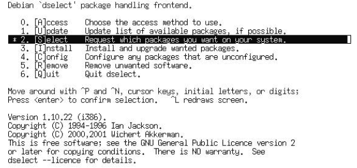

启动后，dselect 会向用户呈现一个包含六个步骤（或七个，取决于退出是否算一步）的菜单，如图 5.1 所示。这些步骤按顺序执行，且大多与单独调用 dpkg 相关：

## 0. 访问

除了 APT 自推出以来已成为 dselect 的标准访问方法外，dselect 也可以从光盘、通过网络文件系统（NFS）、从未挂载或已挂载的文件系统，或从软盘获取软件包。

## 1. 更新

此选项使 dselect 获取在第 0 步中选择的访问介质提供的软件包列表，并使用 `dpkg --merge-avail` 将它们合并为一个列表。

## 2. 选择

此选项背后隐藏着如图 5.2 所示的界面。dselect 根据各种排序标准呈现其已知的软件包，并允许修改软件包的请求状态（例如安装，或将软件包置于保持状态）。

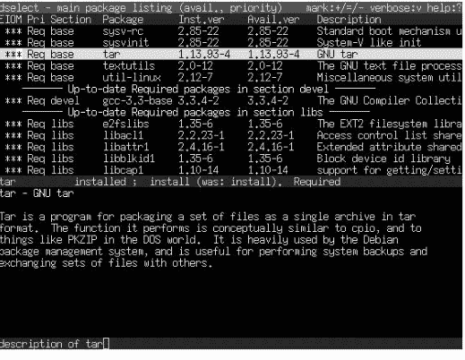

**图 5.2：**
dselect 提供的软件包选择屏幕

## 3. 安装

此步骤使 dselect 从相应的源介质获取用户在选择阶段请求安装的所有 DEB 文件，随后解包所有软件包。它还自动配置新安装的软件包，并删除标记为卸载的软件包。

## 4. 配置

可以使用此选项显式配置软件包，而安装调用会自动执行此操作。因此很少使用。用于配置的命令是 `dpkg --configure --pending`。

## 5. 删除

如果用户只想删除标记为卸载的软件包，但推迟任何待处理的安装，则应选择此菜单选项而不是**安装**。不过，它作为安装的一部分会自动执行。选择此选项时执行的命令是 `dpkg --remove --pending`。

# 5 Debian 软件包管理系统

与程序的主要交互通过选择界面进行。在这里，你可以滚动软件包列表，并通过按 [+]（加号）、[-]（减号）和 [_]（下划线）键分别选择软件包进行安装、卸载和清除。按 [/] 键可以对软件包名称进行正则表达式搜索。按 [enter] 键可以确认软件包选择，按 [R] 键可以随时撤销更改。

当你更改软件包的请求状态（例如，选择其进行安装）时，dselect 会检查该请求是否能在不破坏系统一致性的情况下得到满足。如果请求会引入不一致性，dselect 会向你呈现一个依赖解析屏幕，并提供如何恢复一致性的建议。你可以自由地按 [enter] 键接受建议，或先进行任何更改，例如使用与建议不同的软件包来满足依赖项。如果你在解析屏幕中做出的选择不对应于一致状态（例如，存在冲突或未满足依赖项），dselect 会打开一个新的解析屏幕以解决新的冲突。

解析屏幕对新用户来说可能相当棘手，他们可能很难返回到软件包选择屏幕，因为 dselect 会持续显示一个又一个解析屏幕。请记住，你选择的软件包必须内部一致。在这里，dselect 对 dpkg 的依赖清晰地显现出来：除非你提出一个满足所有依赖项且不引入任何冲突的选择，否则 dselect 不会接受它，就像 dpkg 会阻止安装有问题的软件包一样。特别是，如果你选择一个替代软件包来满足依赖项，你必须撤销 dselect 的建议，否则两个软件包可能会冲突。[D] 键可用于擦除用户提出的所有建议。[U] 键告诉 dselect 撤销自上次建议以来的所有更改（实际上再次提出建议）。最后，按 [R] 键始终可以恢复到未解决依赖项或冲突出现之前的选择状态。

进行任何更改后（或者如果你对建议的解决方案感到满意，则无需更改），按 [enter] 键将带你返回到软件包选择窗口，或者如果仍然存在不一致性，则直接带你返回到依赖解析屏幕。请记住，dselect 无法自动解决这些不一致性，它只能提出建议。可以使用 [Q] 键在不解决依赖项和冲突的情况下返回到主软件包选择。当发现另一个不一致性时，解析屏幕会简单地将两个不一致性的建议和替代项合并到一个列表中，这可能会有些令人困惑。

如果 dselect 被指示执行包含不一致性的选择，它将跳过任何具有未解决依赖项或冲突的软件包，并将这些软件包置于保持状态。由于底层的 dpkg，使用 dselect 无法向系统引入不一致性。

虽然许多用户对 dselect 誓死追随，但我的建议是用 aptitude 或其他 APT 接口（参见第 5.4.11 章、第 5.4.12 章和第 6.10 章）来替代它。aptitude 基于 APT，可以自动解决冲突以满足用户的请求；它不对用户强加一系列步骤：你可以根据需要标记软件包进行安装和卸载，并随时处理有问题的软件包。另一方面，如果这太麻烦，aptitude 会为你找到一个解决方案。

## 5.4 管理软件包：APT

dpkg 是一个强大的工具。它的健壮性确保了 Debian 系统的一致性。然而，它远未达到当今的软件包管理标准，仅举一个缺点，它缺乏自动依赖解析。APT（"Advanced Package Tool"的缩写）的编写正是为了填补这一空白。它是一个高级工具，主要处理软件包的抽象概念，该概念包含以下数据：

- 标识名称
- 版本号
- 提供该软件包的 DEB 文件的统一资源定位符（URL）
- 依赖信息，包括冲突声明（参见第 5.7.3 章）。

使用此信息，APT 确定满足请求所需的软件包集，从仓库（如 Debian 存档）下载它们，并根据需要从本地系统安装和删除软件包。

dpkg 保守地阻止操作发生，而不是让系统一致性承担风险，而 APT 则会找出恢复一致性所需的额外步骤并执行这些步骤。例如，如果一个软件包依赖于另一个软件包，dpkg 在没有后者的情况下不会安装前者。与此相反，APT 会自动先安装后者，以便可以执行原始请求。

APT 本身不安装或删除软件包，而是在系统级别使用 dpkg 处理软件包。APT 的任务是获取依赖项以及按正确顺序协调对 dpkg 的调用，以实现所需结果，而不给 dpkg 抱怨的机会。

为了完成其任务，APT 维护一个可用软件包列表，管理员定期使用 Debian 服务器以及位于其他介质（如 DVD、独立软件项目的下载服务器和本地收藏）上的仓库提供的软件包列表进行更新。每次更新后，APT


## 5 Debian 包管理系统

它会解析每个软件包的依赖信息，并使用标准图论¹¹来计算依赖树，其中每种不同的依赖关系对应一种特定的边类型。图5.3展示了以`abcde`软件包为根的依赖树的部分选段。

**图5.3：以 `abcde` 软件包为根的依赖树部分选段¹²**

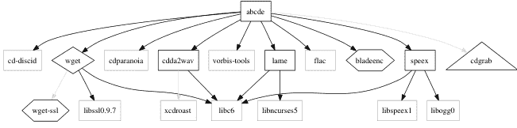

不同的符号和线条颜色反映了关系的类型：普通软件包是矩形框，由其他包提供的虚拟软件包是三角形，菱形表示同时也是由其他包提供的普通软件包（`wget-ssl` 提供了 `wget`），而不存在的软件包则显示为六边形。浅色线条的框表示叶节点软件包，因为我们在命令中指定了`-oAPT::Cache::GivenOnly=true`，所以`apt-cache`的递归到此停止。最后，浅色线条表示冲突，而黑色线条则代表正常的依赖关系（包括建议和推荐）。

APT 实际上是一个提供软件包处理功能的库。管理员可以通过两个前端程序 `apt-get` 和 `apt-cache` 从命令行使用这个库。

### 5.4.1 指定软件源

APT 位于包管理体系结构的更高层，不与 DEB 文件直接交互。在 APT 领域中，软件包通过其软件包名称和可选的版本号来引用。APT 可以处理任意数量的软件源，并合并可用软件包列表。重复的条目以首次遇到的为准。软件源通过 `/etc/apt/sources.list` 文件¹³ 中以下形式的行来标识：

```
deb ftp://ftp.debian.org/debian sarge main
deb http://nonus.debian.org/debian-non-US sarge main
deb copy:/srv/mirror/debian/debian sarge main
deb cdrom:[title]/ sarge main
```

> ¹¹ 底层算法是拓扑排序。参见：http://www.cs.sunysb.edu/~algorith/files/topological-sorting.shtml

> ¹² 该图是通过将 `apt-cache dotty --option APT::Cache::GivenOnly=true abcde wget speex speex lame cdda2wav` 的输出传递给 graphviz 包中的 `dot` 工具生成的。

> ¹³ 请确保使用距离更近的镜像，而不是 `ftp.debian.org`（参见第5.4.1节）。完整的镜像列表可在线获取：http://www.debian.org/mirror/list。

每一行都编码了在给定介质上软件包集合（Packages）的位置。有效行的精确语法定义可以在 `sources.list(5)` 的手册页中找到。一行至少包含三个字段，它们共同提供了拼凑归档路径所需的信息。这些字段是：

- **软件包类型**
  : **deb** 引用二进制软件包。要访问源代码包，必须使用 **deb-src** 代替。

- **源 URI**
  : 统一资源标识符（URI）标识源介质，可以使用以下任何访问方法：
  - **cdrom**
    : 允许访问本地 CD-ROM 驱动器，并支持介质切换以及提示插入新介质，通过括号中指定的标题来标识。使用 `apt-cdrom` 将 CD-ROM 条目添加到 `/etc/apt/sources.list`。
  - **file**
    : 允许选择任意文件系统位置作为软件源，例如 NFS 挂载点或本地镜像。
  - **copy**
    : 类似于 **file** 访问方法，**copy** 在下载后使用 APT 的缓存目录¹⁴ 来存储文件。
  - **http**
    : 使用网络连接的最快且首选的软件源，遵循 `$http_proxy` 变量。
  - **ftp**
    : 比 **http** 稍慢，**ftp** 方法可通过 `/etc/apt/apt.conf` 进行高度配置。它可能会使用在 `$ftp_proxy` 中定义的可选代理。
  - **ssh**
    : 给定一个不需要输入密码的 SSH 连接，APT 可以通过安全隧道使用远程镜像。也提供了 `rsh`，但出于安全原因不应使用或启用。例如：

```
deb ssh://user@intranet.company.com/srv/debian/ ./
```

- **发行版**
  : 对于标准镜像，**distribution** 字段通过规范名称（例如 *stable*）或代号（例如 *sarge*）来标识 Debian 版本。它也可以是一个完整路径，此时必须以斜杠结尾。例如，类似以下的行（我的暂存软件源）在项目或私有软件源中经常出现：

¹⁴ /var/cache/apt/archives

```
deb http://people.debian.org/~madduck/stage ./
```

/stage 是一个导出到 Web 服务器的简单目录，其中包含 `Packages` 文件，并且只提供单个软件包集合。当 distribution 路径不是完整路径时，它标识了所需发行版的 `Packages` 文件路径的一部分，如下文所示。

- **组件**
  : 每一行的剩余部分用于标识发行版中包含的组件集合。对于官方镜像，这些对应于归档区域（*例如* *main* 和 *non-free*），并且也指定了何时使用 *non-US* 软件。对于非官方软件源，这些可以用来标识由软件源管理员自由定义的组件（一个巧妙的例子参见第4.4.5章）。APT 会为每个组件创建一个单独的 URI。因此，常规的发行版条目至少需要一个组件。相反，具有完整路径的行不指定组件。

当 APT 通过 `apt-get update` 命令获知需要更新其对可用软件包的理解时，它会去获取各个 **Packages** 文件，这些文件的位置编码在 `/etc/apt/sources.list` 的行中。行中提到的每个组件对应一个 **Packages** 文件，而 distribution 设置为完整路径的行只标识单个 **Packages** 文件，没有组件。

`/etc/apt/sources.list` 中的以下形式条目：

```
deb ftp://ftp.debian.org/debian sarge main contrib non-free
```

会导致 `apt-get update` 检索以下 **Packages** 文件¹⁵（假设为 i386 架构）：

```
ftp://ftp.debian.org/debian/dists/sarge/main/binary-i386/Packages
ftp://ftp.debian.org/debian/dists/sarge/contrib/binary-i386/Packages
ftp://ftp.debian.org/debian/dists/sarge/non-free/binary-i386/Packages
```

一行也可以指定软件源内的完整路径。注意最后的斜杠是必需的。通过为架构使用变量，可以以可移植的方式指定软件源：

```
deb http://people.debian.org ~madduck/packages/stage/
deb http://intranet.company.com/srv/debian/ $(ARCH)/
```

映射到以下 URI：

```
http://people.debian.org/~madduck/packages/stage/Packages
http://intranet.company.com/srv/debian/i386/Packages
```

> ¹⁵ 如果可用，APT 优先使用位于 `Packages` 文件相同位置的 `Packages.gz` 文件。

二进制软件包通常依赖于它们编译时针对的架构。当一个软件包提供架构无关的数据（例如文档）时，它会用特殊的架构 `all` 标记，并在所有架构的 Packages 文件中提供。

工具 **apt-cdrom** 和 **apt-setup**（来自 base-config 软件包）可用于轻松地将软件源添加到 sources.list 文件：

```
# apt-cdrom --cdrom /media/cdrom
Using CD-ROM mount point /media/cdrom/
Unmounting CD-ROM
Please insert a Disc in the drive and press enter
Mounting CD-ROM
Identifying.. [1319efb1a0e8df6caed2bd4e0b507933-2]
[...]
Writing new source list
[...]
Repeat this process for the rest of the CDs in your set.
```

**apt-setup** 使用 debconf，本质上与 base-config 调用的是同一个程序：

```
# apt-setup
Apt configuration
-----------------

Please choose the method apt (the Debian package management tool)
should use to access the Debian archive.

For example if you have a Debian cd, select "cdrom", while if
you plan to  install via a Debian mirror, choose "ftp" or "http".

  1. cdrom  2. http  3. ftp  4. filesystem 5. edit sources list by hand

Archive access method for apt:
[...]
```

##### 寻找最近的镜像：apt-spy

Debian 镜像基础设施非常庞大，有超过100个官方镜像提供完整的 Debian 归档。此外，许多大学和机构也提供非官方镜像，因此通常值得一探究竟。虽然大多数镜像可供全球访问，但使用离您位置最近的镜像更有意义。这可以均衡地分摊镜像负载和带宽，并确保最快的下载速度。

所有镜像的完整列表可在线获取¹⁶。对于大多数国家，可以通过 ftp.xx.debian.org 进行 HTTP 和 FTP 访问，其中 "xx" 是标准化的两个字母的国-

¹⁶ http://www.debian.org/mirror/list


试试代码<sup>17</sup>。这些镜像可能变得非常繁忙，选择不同的镜像通常能改善对存档的访问。

**apt-spy** 工具旨在通过测试一组镜像并选择最快的一个来寻找最佳镜像，并自动将结果写入 /etc/apt/sources.list。它可以将测试限制在特定国家或区域（一组国家）内的服务器，可选择仅测试有限数量的服务器，或运行特定的最长时间。此外，可以在 /etc/apt/sopy.conf 中轻松自定义区域。因此，要找到康斯坦茨湖周边地区最快的服务器，并为 **sarge** 写一个合适的 sources.list 文件，以下命令就能实现：

```
# cat <<EOF >> /etc/apt-spy.conf
Bodensee:
AT
CH
DE
EOF
# apt-spy update
Updating...
Grabbing file http://http.us.debian.org/debian/README.mirrors.txt...
Update complete. Exiting.
# apt-spy -d sarge -a Bodensee
[...]
```

上述操作每个服务器大约需要一分钟，这可以通过 **-t** 选项来控制。请务必阅读 **apt-spy**(8) 手册页以获取有关此选项的更多信息。

由于镜像只能按国家选择，拥有大量镜像的国家（如美国）的用户可能不会觉得 **apt-spy** 非常有用。然而，使用 **-e** 选项可以限制要测试的服务器数量。通过限制仅检查少量服务器，**apt-spy** 在大型国家能恢复一些价值。

## 5.4.2 APT 配置

**APT** 的大多数方面都可以自定义。实际上，在 /etc/apt/apt.conf 文件中，你可以更改几乎所有命令行开关的默认值。除了默认文件外，$APT_CONFIG 环境变量可以指向一个不同的配置文件，当设置时将使用该文件。

配置参数是键值对，根据其应用分组。组名用 "::" 分隔符前缀加到参数名上。**apt.conf**(5) 手册页描述了语法。可用项目列在相应命令的手册页中（例如 **apt-get**(1) 和 **apt-cache**(1)）。

<sup>17</sup>http://en.wikipedia.org/wiki/ISO_3166-1_alpha-2

```
APT::Cache-Limit 16777216;
APT::Get::Show-Upgraded true;
APT::Get::Default-Release "sarge";
APT::Get::Purge false;
Acquire::Queue-Mode host;
Acquire::Retries 0;
```

或者，组前缀可以用花括号限定作用域。总的来说，语法让人联想到 C++ 命名空间：

```
APT {
  Cache-Limit 16777216;

  Get {
    Default-Release "sarge";
    Show-Upgraded true;
    Purge false;
  };
};

Acquire {
  Queue-Mode host;
  Retries 0;
};
```

/etc/apt/apt.conf 允许你控制 APT 调用 dpkg 来处理其下载的包文件或与包数据库交互的方式。例如，你可以在 /etc/apt/apt.conf 中添加以下片段，让 APT 指示 dpkg 永不降级包且永不重新安装相同版本的包：

```
DPkg {
  Options { "--refuse-downgrade"; "--skip-same-version"; }
};
```

如果此类开关是你的系统管理策略的“一部分”，最好将它们设置在 dpkg 的配置中，以防止在直接调用 dpkg（而非通过 APT）时被忽略（参见第 5.3.8 章）。

除了 /etc/apt/apt.conf，/etc/apt/apt.conf.d 目录可能包含带有 APT 配置片段的文件，这些文件将按词典顺序被读取（参见第 6.1.1 章）。将本地配置放入此目录下的不同文件中，以在文件系统级别逻辑地将其分成块，这或许是个不错的主意。

此外，每个 APT 程序都接受 --option 命令行标志来添加额外的设置。因此，以下两条命令是等效的：

```
# apt-get install --download-only postfix
# apt-get install --option APT::Get::Download-Only=true postfix
```

## 5.4.3 安装软件包

当用户请求安装某个软件时，APT 使用其依赖图来找到满足用户请求的最佳方式。从 dpkg 中，它知道已安装软件包的集合，从而可以确定必须下载哪些额外的软件包并交给 dpkg 进行安装。同样，APT 识别冲突。在 dpkg（理所当然地）因冲突而失败的情况下，APT 会建议移除任何冲突的软件包，并优先考虑用户的请求（而不是因冲突而拒绝安装）。因此，在告诉基于 APT 的工具执行操作之前，检查其建议的更改总是一个好主意（参见第 5.4.2 章关于 APT::Get::Show-Upgraded 选项的内容）。

对于 APT 需要安装的每个软件包，它会启用适当的下载方法，从软件仓库将 DEB 文件检索到其缓存目录¹⁸。如果多个软件仓库提供相同的文件，将使用 /etc/apt/sources.list 中首先提到的软件仓库。

¹⁸/var/cache/apt/archives

最后，APT 会调用 **dpkg** 来移除任何冲突的软件包，然后从其下载到缓存目录的 DEB 文件安装新软件包。在下面的示例中，**postfix** DEB 文件已在 APT 的缓存目录中。然而，满足 **postfix** 依赖所需的其他包文件尚未缓存，因此 APT 从与该软件包关联的位置获取它们。

```
# apt-get install postfix
Reading Package Lists... Done
Building Dependency Tree... Done
The following NEW packages will be installed:
  adduser debconf debconf-i18n ifupdown iputils-ping
  liblocale-gettext-perl libtext-charwidth-perl libtext-iconv-perl
  libtext-wrapi18n-perl libwrap0 net-tools netbase netkit-inetd postfix
  tcpd
0 upgraded, 15 newly installed, 0 to remove and 0 not upgraded.
Need to get 857kB/1636kB of archives.
After unpacking 6550kB of additional disk space will be used.
Do you want to continue? [Y/n] y
[...]
Get:13 http://debian sarge/main tcpd 7.6.dbs-6 [72.6kB]
Get:14 http://debian sarge/main netbase 4.19 [40.2kB]
[...]
Selecting previously deselected package netbase.
Unpacking netbase (from .../archives/netbase_4.19_all.deb) ...
Selecting previously deselected package postfix.
Unpacking postfix (from .../postfix_2.1.5-1_i386.deb) ...
[...]
Setting up netbase (4.19) ...
Setting up postfix (2.1.5-1) ...
[...]
```

与 **dpkg** 不同，APT 不使用数据库，而是在每次调用时计算软件包的下载位置和依赖关系（这使其有点慢）。与 **dpkg** 类似，优化重写也已列入待办事项。为此，APT 使用 */var/lib/apt/lists* 中的文件，这些文件是 **apt-get update** 之前下载的。因此，要处理对二进制包的请求，APT 会按照 */etc/apt/sources.list* 中声明的软件仓库顺序读取 *Packages* 文件，并计算每种情况使用的 URI。它还从 *Packages* 文件中读取每个 DEB 文件的 MD5 和，以便稍后验证下载的数据。你可以使用 **--print-uris** 开关让 APT 输出此信息，而不是执行请求：

```
# apt-get install --print-uris postfix
[...]
'.../pool/main/t/tcp-wrappers/tcpd_7.6.dbs-6_i386.deb'
tcpd_7.6.dbs-6_i386.deb 72614 08523a7ed8671461cd35c5e02ea14fc9
'.../pool/main/n/netbase/netbase_4.19_all.deb'
netbase_4.19_all.deb 40182 1203c825810b1262ce74c4d9d7676671
```


## 5 Debian 软件包管理系统

'.../pool/main/p/postfix/postfix_2.1.5-1_i386.deb'
postfix_2.1.5-1_i386.deb 798936 e4062f342b5d77416ae4ef28dfed1ef8

你也可以告诉 APT 仅进行模拟而不实际安装：

```
~# apt-get install --simulate
[...]
Inst postfix [2.1.5-1] (2.1.5-1 Debian:sarge)
Conf postfix (2.1.5-1 Debian:sarge)
```

`apt-get` 也接受 POSIX 风格的正则表达式来代替软件包名称：

```
~# apt-get install libusb-\(0\.1-4\|-dev\)
[...]
Note, selecting libusb-0.1-4 for regex 'libusb-(0.1-4|dev)'
Note, selecting libusb-dev for regex 'libusb-(0.1-4|dev)'
[...]
The following NEW packages will be installed:
  libusb-0.1-4 libusb-dev
[...]
```

APT 会自动将其处理的每个文件的哈希值与其在相应 Packages 文件中的条目进行校验。只有 MD5 校验和匹配时，安装才会继续。如果出现不一致，APT 将报告 MD5 校验和不匹配，并拒绝安装或升级软件包。在 7.5 章节中，我们将重新讨论软件包哈希和，并介绍一种验证下载文件的方法。

##### 更新 APT 数据库

作为 APT 运作核心的 Packages 文件必须定期更新。即使稳定版不会改变（除了发布新的 "r-release" 之外），APT 发现新可用的安全更新（或者，如果你运行的不是稳定版，则是新可用的软件包）的唯一方式，是检查已注册的软件源以获取更新的 Packages 索引文件。在每天使用之前更新这些文件，或者至少偶尔更新一次，可能是个好主意。`cron-apt` 软件包提供了一个灵活的框架，允许你自动化此过程（以及其他 APT 进程）（参见第 5.11.4 章）。过时的 Packages 文件可能导致 APT 在其索引指向因新版本而被移除的文件时失败。

要更新数据库，你只需运行一个命令：

```
~# apt-get update
Get:1 http://debian sarge/main Packages [3331kB]
[...]
Fetched 3331kB in 0s (24328kB/s)
Reading Package Lists... Done
```

在更新过程中，APT 会清理 `/var/lib/apt/lists` 中所有不属于 `/etc/apt/sources.list` 所引用的软件源的文件。如果你传递 `--no-list-cleanup` 选项 (`APT::Get::List-Cleanup`)，APT 将避免删除过时的文件，如果你只是暂时禁用 `sources.list` 文件中的某个软件源，这可能很方便；当再次将软件源放回 APT 的软件源列表时，你就不必重新下载了。

##### 依赖解析实践

在解析依赖关系时，APT 会尝试做出合理的决策。除了自动拉取所请求软件包所依赖的软件包外，APT 还会移除已安装的冲突软件包，以尽力满足用户的任何请求。每当请求执行的操作超出了用户想要的范围，`apt-get` 将在显示对软件包选择的拟议更改后，请求确认。这是为了防止无意中卸载冲突的软件包或拉取数百个依赖项。如果不需要额外的操作，APT 将不会提示。

如第 5.4.2 章所示，可以通过设置 `APT::Get::Show-Upgraded` 为 `true` 来使 APT 始终提示确认。类似地，设置 `APT::Get::Assume-Yes` 为 `true` 或在 APT 命令行中指定 `--yes` 会导致 APT 始终绕过确认并继续。请避免使用此选项；在提高生产力方面，确认是一件好事^19^。

有时，一个软件包可能依赖于一组软件包中的任何一个。例如，`apache2` 依赖于 "apache2-mpm-worker | apache2-mpm-prefork | apache2-mpm-perchild"，因此需要这三个中的任何一个被安装。默认情况下，除非明确请求另一个，否则 APT 将安装第一个软件包：

```
# apt-get install apache2
[...]
The following NEW packages will be installed:
  apache2 apache2-common apache2-mpm-worker libapr0 libexpat1
  libmagic1 mime-support openssl ssl-cert
[...]
# apt-get install apache2 apache2-mpm-perchild
[...]
The following NEW packages will be installed:
apache2 apache2-common apache2-mpm-perchild libapr0 libexpat1
  libmagic1 mime-support openssl ssl-cert
[...]
```

如果偏好*不是*安装第一个软件包而是选择任何其他一个，可以通过指示 APT 不使用第一个选择来满足依赖关系，从而让它选择序列中的下一个：

> ^19^当你以 root 身份工作时，你*确实*在使用 `rm` 和 `mv` 时使用 `-i` 标志，对吧？

```
# apt-get install apache2 apache2-mpm-worker-
[...]
The following NEW packages will be installed:
  apache2 apache2-common apache2-mpm-prefork libapr0 libexpat1
  libmagic1 mime-support openssl ssl-cert
[...]
```

你可以使用加号和减号来影响 APT 的决策；在软件包名称后附加减号会显式移除它（在 `apt-get remove` 命令中附加加号则会安装该软件包，正如人们可能预料的那样）。

Debian 也了解虚拟软件包的概念（参见第 5.7.3 章）。你不能直接安装虚拟软件包，但软件包可能依赖于它们。

```
# apt-get install mail-transport-agent
Reading Package Lists... Done
Building Dependency Tree... Done
Package mail-transport-agent is a virtual package provided by:
  zmailer 2.99.56-2
[...]
  postfix 2.1.5-1
[...]
  courier-mta 0.47-3
You should explicitly select one to install.
E: Package mail-transport-agent has no installation candidate
```

例如，`at` 依赖于 `mail-transport-agent`。由于 Debian 中每个提供邮件传输代理（MTA）的软件包都包含这个虚拟软件包，新的 MTA 可以用来满足 `at` 的依赖关系，而无需更改 `at`。如果一个软件包依赖于虚拟软件包，APT 会选择一个包含该虚拟软件包的软件包进行安装。要覆盖选择，你可以像上面一样操作：

```
# apt-get install at
[...]
The following NEW packages will be installed:
  at courier-authdaemon courier-base courier-mta
[...]
Do you want to continue? [Y/n] n
# apt-get install postfix at
[...]
The following NEW packages will be installed:
  adduser at debconf [...] postfix
[...]
```

请注意，在 `apt-get install` 命令行上，顺序很重要²⁰。如果你先安装 `at` 然后安装 `postfix`，APT 也会拉取 `courier-mta` 的依赖项，即使最终不会安装 `courier-mta`。因此，APT 会扫描命令行并附加所有依赖项，通过优先考虑后来拉入的软件包来解决冲突。

> ²⁰http://bugs.debian.org/122304

## 5.4 管理软件包：APT

##### 重新安装软件包

有时可能需要请求重新安装软件包。也许是 root 用户意外删除了一个文件，或者是配置文件的修改失控了。当 APT 被要求安装一个已经安装的软件包时，它不会遵从这个请求：

```
~# apt-get install postfix
[...]
postfix is already the newest version.
0 upgraded, 0 newly installed, 0 to remove and 31 not upgraded.
```

`--reinstall` 选项强制 APT 无论如何都再次执行安装：

```
~#  apt-get install --reinstall postfix
[...]
0 upgraded, 0 newly installed, 1 reinstalled, 0 to remove and 0 not
  upgraded.
Need to get 0B/795kB of archives.
After unpacking 0B of additional disk space will be used.
Do you want to continue?  [Y/n]  y
[...]
```

只要所需的 DEB 文件仍在缓存中（如上所示），你也可以直接使用 `dpkg` 进行重新安装。因此，以下命令等同于告诉 APT 重新安装软件包：

```
~# apt-get --download-only install postfix
~# dpkg --install /var/cache/apt/archives/postfix_2.1.5-1_i386.deb
```

### 5.4.4 搜索 APT 数据库

到目前为止一切顺利，一旦你知道了软件包名称，使用 APT 安装软件包就是小菜一碟。除了各种在线资源（将在以下章节中回顾）之外，APT 还提供了全面的工具来查询软件包数据库，以获取所需的软件包名称。

Debian 网页有一个专门介绍其软件包池^21^的部分。该站点提供了三种方式来浏览可用的软件包集合。“软件包列表”为每个软件包提供简短的说明，而软件包则按

> 21http://packages.debian.org


根据功能对软件包进行分类。用户选择某个类别后，即可快速找到与特定需求相关的一组软件包。

您还可以在软件包数据库中搜索软件包名称、描述，甚至所有软件包的内容，以查找哪个软件包提供了特定文件。进一步的搜索条件允许您筛选结果集，从而轻松检索命令行APT工具所需的信息。

最后，每个软件包在Debian网站上都有一个专用的信息页面。这些页面可通过二进制[22]或源代码软件包名称[23]的规范URL访问。更多信息可通过软件包跟踪系统获取（参见第10.6.9章）。

无需网页浏览器，所有这些功能也可以在命令行中使用，以防您不想通过Web界面操作。大部分工作由`apt-cache`接口完成，可用于搜索软件包数据库，包括软件包描述，如下所示：

```
~$ apt-cache search palm sync command line
autopilot - Monitor the DTR line of /dev/palm and run a command to start
  sync
malsync - Allows a PalmOS PDA to synchronize to a MAL server
pilot-link - Tools to communicate with a PalmOS PDA
```

`apt-cache`搜索的参数本身就是正则表达式。如果指定了多个参数，则软件包必须匹配所有参数才会包含在输出中。也可以使用`--names-only`选项（`APT::Cache::NamesOnly`为true）仅搜索软件包名称。指定`--full`开关（`APT::Cache::ShowFull`为true）时，会显示完整的软件包信息。这些信息也可以直接访问每个软件包，与通过`dpkg --info`和`dpkg --show`获取的信息基本相同：

```
~# apt-cache show postfix
Package: postfix
Priority: extra
Section: mail
[...]
Provides: mail-transport-agent
[...]
Description: A high-performance mail transport agent
[...]
```

##### 搜索Debian存档中的单个文件

通过同名的`apt-file`工具可以使用更多搜索功能。`apt-file`本质上是APT软件库中Contents文件的接口。每个发行版都有此文件，包含特定发行版中所有软件包安装的文件列表。在`apt-file`有用之前，它必须能够访问用户希望搜索的Contents文件。运行**apt-file update**将处理此操作，并将下载的文件放置在*/var/cache/apt*下。现在，可以使用`apt-file`搜索这些列表。

**apt-file**的主要用途是确定哪个软件包提供某个文件。例如，如果有人告诉您使用*/usr/bin/convert*工具重新格式化图片文件，您可以使用**apt-file**找出需要安装的**imagemagick**软件包：

```
$ apt-file search /usr/bin/convert
imagemagick: /usr/bin/convert
```

此外，**apt-file**能够显示与软件包关联的文件。这类似于**dpkg --listfiles**，但不需要软件包已安装：

```
$ apt-file list postfix
postfix: etc/init.d/postfix
postfix: etc/postfix/access
[...]
postfix: usr/lib/sendmail
postfix: usr/sbin/postalias
[...]
```

### 5.4.5 询问软件包依赖关系

回到**apt-cache**，该程序还提供关于软件包和软件包数据库的各种附加信息。除了可以通过**apt-cache show**访问的软件包控制数据外，**apt-cache**还有两种方法显示软件包的依赖关系信息以及声明了对特定软件包依赖关系的软件包列表：

```
$ apt-cache depends apt-file
apt-file
  Depends: perl
  Depends: gzip
  Depends: libconfigfile-perl
  Depends: libapt-pkg-perl
  Suggests: ssh
    ssh-krb5
  Recommends: wget
    wget-cvs
```

```
$ apt-cache rdepends apt-file
apt-file
Reverse Depends:
  dh-make-perl
```

## 5 Debian软件包管理系统

或者，两者可以与软件包的一般信息结合使用：

```
$ apt-cache showpkg apt-file
Versions:
2.0.3-7 (/var/lib/apt/lists/...Packages) (/var/lib/dpkg/status)
Reverse Depends:
  packagesearch,apt-file
  dh-make-perl,apt-file
Dependencies:
2.0.3-7 - perl (0 (null)) gzip (2 1.2.4) libconfigfile-perl (0 (null))
  libapt-pkg-perl (0 (null)) ssh (0 (null)) wget (0 (null))
Provides:
2.0.3-7 -
Reverse Provides:
```

对于（正向）依赖关系，依赖软件包后面括号中的值编码了版本要求，并直接映射到表5.3中显示的对应符号。(null)是表示无版本依赖的特殊值。每个反向依赖关系都列出了依赖和被依赖的二进制软件包对。如果反向依赖关系有版本要求，则也包含版本号。

| 数字 | 符号 | 描述 |
|--------|--------|-------------|
| 0 | = | 等于 |
| 1 | <= | 小于或等于 |
| 2 | >= | 大于或等于 |
| 3 | << | 严格小于 |
| 4 | >> | 严格大于 |

要进一步研究软件包依赖关系，同名的`apt-rdepends`软件包可以根据特定标准执行递归依赖列表。例如，要显示postfix建议的已安装软件包：

```
$ apt-rdepends --state-show=Installed --state-follow=Installed \
  --show=Suggests --follow=Suggests postfix
Reading Package Lists... Done
Building Dependency Tree... Done
postfix
  Suggests: procmail
```

##### 依赖关系图

至少有两种方法可以可视化APT内部使用的依赖关系图。较旧的方法使用**apt-cache**，其使用可能相当不灵活，因为它仅允许您基于软件包名称指定要包含和排除的节点。**apt-rdepends**也提供“dotty”功能，并允许使用与上述相同的标准。

这些工具不输出图形，而是输出创建图形所需的信息。有许多工具可以完成后者转换。经典工具是**graphviz**软件包中的**dot**和**neato**。**neato**将节点放置在整个二维空间中，而**dot**尝试创建层次结构。两者都可以生成封装的PostScript（EPS）文件，**dot**的结果特别适合打印（参见第164页的图5.3）。

```
~$ apt-cache dotty postfix > /tmp/postfix.dot
~$ dot -Tps -o /tmp/postfix.eps /tmp/postfix.dot
```

生成的图形可能会迅速变得很大。可以将节点集限制为仅包括命令行上列出的软件包及其直接依赖关系，而不进一步递归结果树：

```
~$ apt-cache dotty --option APT::Cache::GivenOnly=true postfix netbase
```

**graphviz**的替代方案是同名的`springgraph`软件包。它使用不同的算法布局图形，并且由于更好地利用空间，特别适用于较大的数据集。它不能像**dot**那样输出层次结构，但在二维空间中产生的效果优于**neato**。**springgraph**生成PNG文件，因此不太适合打印：

```
~$ apt-rdepends --dotty postfix > /tmp/postfix.dot
[...]
~$ springgraph < /tmp/postfix.dot > /tmp/postfix.png
```

apt-cache和apt-rdepends都产生相同的dotty输出，因此任何一个都可以与任何兼容的spring graph创建器一起使用。

### 5.4.6 卸载和清除软件包

软件包的移除（或清除）过程类似。如果用户请求卸载一个被其他软件包依赖的软件包，这些依赖软件包也将被移除。APT始终尝试满足用户请求，同时将更改数量保持在最小。系统可能安装了**postfix**以满足某些软件包对**mail-transport-agent**的需求。当移除**postfix**时，APT会连带移除那些依赖它的软件包，以免留下依赖关系未满足的软件包。


# 5 Debian 软件包管理系统

```
~# apt-get remove postfix
Reading Package Lists... Done
Building Dependency Tree... Done
The following packages will be REMOVED:
  at mailx mutt popularity-contest postfix
[...]
Removing popularity-contest ...
Removing postfix ...
```

为了防止卸载，用户可以在同一命令行中指定另一个包来替代邮件传输代理功能，只需在包名后添加一个加号。

```
~# apt-get remove postfix zmailer+
[...]
The following packages will be REMOVED:
  postfix
The following NEW packages will be installed:
  zmailer
[...]
```

显然，这与简单安装 zmailer 的效果相同，因为它的安装会导致 APT 隐式地移除冲突的 postfix 包。

要同时删除包的配置文件，请指定 `--purge` 选项。在某些系统中，通过设置 `APT::Get::Purge true` 进行全局清除是有意义的。

```
~# apt-get remove --purge mc
[...]
The following packages will be REMOVED:
  mc*
[...]
Removing mc ...
Purging configuration files for mc ...
```

注意 `mc` 包后面的星号，它表示即将进行的清除操作，而不仅仅是简单的删除。

除了 `apt-get remove --purge`，也可以直接使用 `dpkg -P`，它具有相同的效果且需要输入的命令更少。然而，`dpkg` 不能用于删除其他包所依赖的包。虽然 APT 会提供同时移除这些依赖包的选项，但 `dpkg` 会直接阻止该操作并报告错误。

请注意，APT 只会移除满足卸载请求所必需移除的包。特别是，如果 APT 在安装 `foo` 时为了满足其依赖关系而安装了 `bar`，那么当 `foo` 被移除时，即使 `bar` 可能不再需要，APT 也不会自动移除它。如果您希望自动卸载不再需要的包，请考虑一致地使用 `aptitude`（参见第 5.4.11 章）而不是 APT，或者运行 `deborphan`（参见第 5.11.5 章）来识别并移除不再需要的包。

# 5.4.7 无缝升级

Debian 的核心优势之一是其无缝的软件包升级。无论是将长时间运行的 *woody* 服务器升级到 *sarge*，还是当前的 *stable* 版本升级涉及大量软件包的更新，APT 都能轻松应对。

升级后的软件包定义为版本号高于当前已安装软件包的软件包（参见第 5.7.5 章）。从一个 Debian 版本到下一个，软件包的版本号可以有意增加，而 *stable* 版本内的升级仅限于安全性和非琐碎的错误修复，但可能不会提供额外的功能。如果在软件包的较新上游版本中修复了某个安全问题，该安全修复本身会被移植回 *stable* 中的软件版本，以避免引入任何进一步的更改。Debian *stable* 保证是稳定的。

虽然 *stable* 中包含的软件包集合可能永远不会改变，但新的 Debian 版本通常包含许多额外的软件包。因此，*stable* 内的依赖关系永远不会改变，但新版本可能包含重命名或拆分的软件包，从而需要修改软件包的依赖关系。例如，*sarge* 中的 `debconf` 软件包引入了对 `debconf-i18n` 的依赖，这在 *woody* 中的 `debconf` 并不需要。更准确地说，`debconf-i18n` 在 *woody* 中不存在，并且永远不会成为其一部分。

APT 提供了强大的依赖关系解析算法，可以处理从一个 Debian 版本到下一个版本的升级。该算法涉及对 APT 依赖图的复杂搜索，因此并不是非常强大。鉴于 *stable* 中的软件包集合是不可变的，使用此算法来保持 *stable* 版本更新显得过于复杂。因此，还提供了一个专门针对 Debian *stable* 更新要求的简化版本。

##### 升级稳定系统

让我们先检查一下简化版本，但在此之前需要先更新 APT 软件包数据库（参见第 5.4.3 章）。

```
# apt-get update
Get:1 http://security.debian.org woody/updates/main Packages [189kB]
[...]
Reading Package Lists... Done
# apt-get --show-upgraded upgrade
Reading Package Lists...
Building Dependency Tree...
The following packages will be upgraded
  exim perl-base
2 packages upgraded, 0 newly installed, 0 to remove and 0  not upgraded.
Need to get 1256kB of archives. After unpacking 98.3kB will be freed.
Do you want to continue? [Y/n] y
Get:1 http://security.debian.org woody/updates/main perl-base 5.6.1-8.7 [497kB]
Get:2 http://security.debian.org woody/updates/main exim 3.35-1woody3 [759kB]
[...]
Setting up perl-base (5.6.1-8.7) ...
Setting up exim (3.35-1woody3) ...
[...]
```

简化算法使用从 `/etc/apt/sources.list` 中注册的 APT 源下载的软件包索引，并将本地安装的每个软件包的版本号与本地版本进行比较。在上面的示例中，`perl-base` 在更新前安装的版本是 5.6.1-8.6。当 APT 在扫描本地安装的软件包时遇到 `perl-base` 时，它发现在 security.debian.org 上有更新的版本 (5.6.1-8.7)，因此下载了相应的 DEB 文件并调用 `dpkg` 进行安装。

定期执行此更新/升级序列将使系统保持平稳和安全运行。甚至可以让 cron 自动为您完成此操作（参见第 5.11.4 章），尽管我建议仅在极少数情况下这样做。

##### 升级到新的 Debian 版本

当新的稳定版本发布时，此过程将不会产生预期的效果。尽管它会更新一些软件包，但由于无法满足的依赖关系，APT 也会保留许多软件包。请记住：APT 升级不会安装系统中以前不存在的软件包；它只会更新已安装的软件包。

```
~# sed -i -e s,woody,sarge, /etc/apt/sources.list
~# apt-get update
[...]
~# apt-get --show-upgraded upgrade
Reading Package Lists...
Building Dependency Tree...
The following packages have been kept back:
  debconf [...]
The following packages will be upgraded
  adduser apt apt-utils base-config base-files base-passwd
  [...]
[...]
```

APT 不会升级 `debconf`，因为它需要安装 `debconf-i18n`。因此，`debconf` 包被"保留"。因此，升级算法实施了 Debian *stable* 的要求和保证。

当需要将整个系统升级到 *sarge*（沿用上面的示例）时，您必须使用 APT 复杂（且较慢）的升级机制：`apt-get dist-upgrade`。

```
~# apt-get --show-upgraded dist-upgrade
Reading Package Lists...
Building Dependency Tree...
The following packages will be REMOVED:
  console-tools-libs libdigest-md5-perl libmime-base64-perl
  [...]
The following NEW packages will be installed:
  aptitude coreutils debconf-i18n dselect e2fslibs
  [...]
The following packages will be upgraded
  adduser apt apt-utils base-config base-files base-passwd
  [...]
[...]
351 packages upgraded, 100 newly installed, 6 to remove and 0 not upgraded.
Need to get 200MB of archives. After unpacking 231MB will be used.
Do you want to continue? [Y/n] y
Get:1 http://debian sarge/main libdb1-compat 2.1.3-7 [30.8kB]
Get:2 http://debian sarge/main libc6 2.3.2.ds1-13 [4929kB]
[...]
Setting up libc6 (2.3.2.ds1-13) ...
Setting up libdb1-compat (2.1.3-7) ...
[...]
```

使用 `apt-get dist-upgrade`，APT 可以引入新软件包（如 `debconf-i18n`），甚至可以移除已过时的软件包。新软件包的实际安装或旧软件包的移除再次由 `dpkg` 处理。

几分钟^24 后，APT 将把系统从 *woody* 升级到 *sarge*。由于 `dpkg` 仍然负责实际安装，您精心制作的配置文件将不会被修改（除非您选择安装新版本）。当软件的较新版本需要对配置文件进行更改时，Debian 维护者会提供不同的软件包，这样您就不必花费整个下午来让软件按预期工作。例如，`bind9` 使用与 `bind 8` 略有不同的配置范式，因此提供了一个新的软件包^25。另一方面，postfix

> ^24 这也可能需要几个小时，具体取决于源介质的速度。如果您是通过拨号线路升级 Debian，最好让它通宵运行。当然，您可以改用最新版本的 CD 并将其用作您的 APT 仓库。

> ^25 此外，一些管理员可能更喜欢继续使用 `bind`，因此不会被 APT 强制切换到全新的软件，而是可以自己规划迁移。


##### 掌握升级的便捷性

Debian 并非唯一能实现无缝升级的系统。然而，它似乎是唯一一个将无缝升级与*稳定*软件包仓库概念相结合的系统。我们将在第 4 章再回到这一点，目前我们只需注意 Debian *稳定*版让你两全其美：一方面，你获得了一个坚如磐石的系统，其组件经过了数月的严格审查；另一方面，你将能够毫不费力地升级到下一个稳定版。对于那些愿意在时效性上牺牲一些稳定性的用户，*测试*版和*不稳定*版也可以通过软件包管理系统以相同方式获取。由于这些仓库（尤其是*不稳定*版）中存在大量变动，软件包管理系统的稳健性变得越来越重要——APT 处理起来将毫不费力。

拥有永久（或至少中等速度）互联网连接的 Debian 用户在安装新系统时，以善于利用无缝升级的能力而著称。无论安装介质有多陈旧，只要它能安装基础系统并建立网络连接，之后的一切就顺理成章了，APT 可以接管并更新系统到最新的*稳定*版或当前的*不稳定*版。

## 5.4.8 使用 APT 执行请求

正如我们之前所见，卸载和清除请求可以先用 dpkg 注册，然后执行。你可能会问，安装是否也可以这样。答案是“是的”，但这需要 APT 来完成。毕竟，dpkg 只能安装 DEB 文件，而通过软件包名称请求安装仅意味着 dpkg 无法访问对应的 DEB 文件——但这没问题，因为这正是 APT 的职责所在。闲话少说，以下是如何向 dpkg 注册安装请求并让 APT 执行它们的方法。方便的是，APT 也涵盖了卸载和清除，从而替代了 `dpkg --pending ...` 调用：

```
~# echo mc install | dpkg --set-selections
~# echo apache2 deinstall | dpkg --set-selections
~# apt-get dselect-upgrade
[...]
The following packages will be REMOVED:
  apache2
The following NEW packages will be installed:
  mc
[...]
```

上述方法的一个有趣用途是，将系统的软件包选择备份到文件中，以防重新安装[^27]，或用于配置类似的系统。只需将 `dpkg --get-selections` 的输出保存到文件即可。假设该文件名为 selections.txt，以下操作将在另一系统上相应地配置软件包选择：

```
~# dpkg --set-selections < selections.txt
~# apt-get dselect-upgrade
[...]
```

此方法的一个变体利用了这样一个事实：选择列表不需要完整。就像我们逐个将请求输入到 `dpkg --set-selections` 一样，可以创建一个包含多个此类请求的文件，然后直接将其整体提供给目标系统上的 `dpkg --get-selections`。dpkg 将只修改文件中包含的软件包的请求，这为计算机集群（本应使用全自动安装（FAI），见第 8.3.5 节）和其他领域提供了有趣的应用。

不过，这种方法有一个注意事项。`dpkg --get-selections` 只输出它已知的软件包信息。一个软件包要被 dpkg 所知，它要么已安装，要么以前安装过（或仅仅是解压过）。否则，该软件包在 /var/lib/dpkg/status 中没有条目，因此不会被报告。这意味着，如果另一个系统上已经安装了一些源系统上 dpkg 不知道的软件包，那么将软件包选择克隆到另一个系统可能会导致该系统安装*更多*的软件包。

解决此问题的一种方法是随后运行 `dpkg-query` 以列出两个系统上已安装的软件包，然后使用 `diff` 查找额外的软件包并手动卸载：

```
~# ls -F
selections.source
~# dpkg-query --show --showformat='$Package\n' > selections.local
~# diff selections.source selections.local \
  | grep '>' | cut -c3- | xargs dpkg --purge
[...]
```

## 5.4.9 APT 清理工作

APT 将其软件包保存在本地缓存中（除非使用文件或 cdrom 获取方法）。随着时间的推移，缓存目录可能被填满并占用大量空间，尤其是在跟踪*测试*版或*不稳定*版的系统上。APT 不会自动管理其缓存目录 /var/cache/apt/archives 的内容。相反，apt-get 提供了两种清除缓存中文件的方法。

第一种清理方法检查缓存中的每个文件，仅在其在镜像源上不再可用时才删除它。这乍一看可能有些反直觉，但如果你考虑到文件从镜像源消失通常只发生在有更新版本出现时，这就合理了[^28]：

```
~# apt-get --simulate autoclean
Reading Package Lists... Done
Building Dependency Tree... Done
Del vim-common 1:6.6.2-532+4 [3091kB]
[...]
```

也可以告诉 APT 留下已安装软件包的 DEB 文件：

```
~# apt-get --option APT::Clean-Installed=false autoclean
```

APT 提供的另一种方法是完全清理缓存目录，这在小型或嵌入式系统上，或者当 /var 分区意外填满需要释放更多空间时可能很有必要。`apt-get clean` 会移除所有 DEB 文件，无论其在镜像源上是否可用。

## 5.4.10 使用 APT 解决问题

APT 本身非常注意不留下损坏的依赖关系。然而，管理员可能通过并行使用 dpkg 和 APT 将 APT 数据库置于不一致状态。虽然 APT 应该使直接使用 dpkg 变得多余，但在某些情况下仍然需要它。幸运的是，APT 数据库中的不一致并非致命，可以轻松手动解决，或由 APT 自身自动处理。

回想一下，dpkg 会拒绝安装其依赖关系无法满足的软件包。因此，如果要安装一个软件包，而其依赖项在本地不可用，dpkg 会以错误退出。但是，dpkg 不会简单地忘记管理员想要安装某个软件包。APT 数据库中的不一致因此源于这样一个事实：软件包的期望状态无法由软件包管理系统执行。

```
~# apt-get install --download-only postfix
[...]
~# dpkg --install /var/cache/apt/archives/postfix_2.1.5-1_i386.deb
dpkg: dependency problems prevent configuration of postfix:
 postfix depends on netbase; however:
  Package netbase is not installed.
~# dpkg --info postfix
iU postfix      2.1.5-1  A high-performance mail transport agent
~# apt-get install postfix
Reading Package Lists... Done
Building Dependency Tree... Done
You might want to run »apt-get --fix-broken install« correct these:
The following packages have unmet dependencies:
  postfix: Depends: netbase but it is not going to be installed
  postfix-tls: Depends: postfix (= 2.1.5-1)
E: Unmet dependencies. Try »apt-get --fix-broken install« with
  no packages (or specify a solution).
[...]
```

如果管理员选择向 dpkg 传递 --force-depends 或 --force-conflicts 选项之一，也会出现类似情况。要纠正此问题，你可以手动安装 netbase 软件包（使用 dpkg 或 APT），或让 APT 自动处理不一致：

```
~# apt-get --fix-broken install
[...]
Correcting dependencies... Done
The following extra packages will be installed:
  netbase
[...]
The following NEW packages will be installed:
  netbase
0 upgraded, 1 newly installed, 0 to remove and 224 not upgraded.
[...]
Setting up netbase (4.19) ...
```

APT 将首先尝试通过从已知的 APT 仓库下载并安装所需的软件包来满足未解决的依赖关系。如果成功，数据库将再次恢复一致。

[^26]: 升级 SSH 本身时，作为 root 用户多开几个 SSH 会话总是一个好主意。如果服务器没有恢复，并且不幸当前终端被关闭，你将无法通过 SSH 重新连接到机器，这对于远程托管的服务器来说可能是致命的。不用说，关键服务器绝不应远程升级。
[^27]: 这在 Debian 中当然是完全多余的……
[^28]: 另一种可能性是从软件包仓库中移除某个软件包。在这种情况下，在找到其提供软件的替代品之前删除 DEB 文件将是种损失。http://snapshot.debian.net 可以在此类情况下提供帮助，因为它每天镜像软件包仓库并存储软件包以供后续检索。


## 5.4.11 aptitude

aptitude 之于 APT，就如同 dselect 之于 dpkg，是一个允许操作软件包选择的用户界面。不过，aptitude 额外提供了 APT 的所有优点，特别是依赖关系处理。本章将介绍 aptitude 的主要功能。您可能还想阅读作者在 `/usr/share/doc/aptitude/README.gz` 中提供的详尽文档。

如图 5.4 所示，aptitude 以一种组织有序、布局清晰的界面呈现。顶部窗格列出了按类别排序且根据其相对于本地系统状态排列的可用软件包。这是用于操控 aptitude 的界面。底部窗格显示主窗口的上下文信息。图 5.4 展示了 aptitude 的主视图。


根据系统上软件包选择的状态，您将在 aptitude 的主菜单中找到最多八个部分：

##### 安全更新

当安全存档中有新的软件包可用时，aptitude 会将其列在一个特殊类别中以提高可见性。与其他已更新的软件包类似，aptitude 会自动选择所有安全更新进行安装。

##### 新软件包

在更新可用软件包列表（`aptitude update`，或在 aptitude 中按 `[u]`）之后，之前 aptitude 未知的软件包会显示在此部分下，以便用户检查 Debian 存档中的最新添加内容。每次更新后，新软件包都会在此处累积，直到您告诉 aptitude 忘记它们并通过按 `[f]` 将新软件包整合到主软件池中。

##### 已更新软件包

存档中拥有更新版本的软件包列在此部分中。通常，当用户完成选择过程并让 aptitude 下载并安装所需软件时，这些软件包将被升级。

##### 已安装软件包

已经安装且没有可用升级的软件包列在此处。

##### 未安装软件包

顾名思义，此部分包含所有当前未安装的软件包。当您"忘记"新软件包而不安装它们时，它们最终会出现在此部分中。

##### 已过时或本地创建的软件包

已本地安装但无法从 `/etc/apt/sources.list` 中配置的 APT 软件源获取的软件包包含在此部分中。

##### 虚拟软件包

虚拟软件包是由一组软件包提供的抽象概念。例如，`mail-transport-agent` 由 `postfix` 和 `sendmail` 等软件包提供。在此部分中，可以直接浏览虚拟软件包集合并查看哪些软件包提供了这些概念。

##### 任务

任务是被认为与特定应用相关的软件包集合。第 5.5 章将对此进行更详细的介绍。aptitude 允许浏览和安装任务。

aptitude 以树状结构组织，行对应于节点。可以使用方向键、`[PageUp]` 和 `[PageDown]` 进行导航。`[Return]` 或 `[Enter]` 展开或折叠节点。图 5.5 展示了一个展开的视图。列表分为四列：软件包状态和请求的操作、软件包名称、当前安装的版本（或 `<none>`）以及可用版本。

# 5 Debian 软件包管理系统

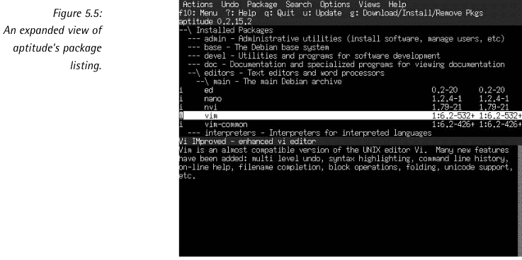

aptitude 软件包列表中有效的软件包状态：

- **v** — 虚拟
- **B** — 已损坏
- **u** — 已解包
- **C** — 半配置
- **H** — 半安装
- **c** — 已移除但未彻底清除
- **p** — 软件包已被彻底清除
- **i** — 已安装
- **E** — 内部错误

aptitude 软件包列表中的请求操作：

- **h** — 保留
- **p** — 彻底清除
- **d** — 卸载
- **B** — 已损坏
- **i** — 安装
- **r** — 重新安装
- **u** — 升级

底部窗格列出了与顶部窗格中当前选择相关的各种不同数据。使用 `[a]` 和 `[z]` 进行滚动，`[i]` 在不同的信息视图之间循环切换。最后，`[D]` 可以显示和隐藏信息区域。

##### 搜索和过滤

使用 `[/]` 键，您可以搜索软件包名称，并且有许多搜索谓词可用。`[\]` 查找下一个匹配项。名称的开头和结尾可以用 `^` 和 `$` 来锚定，以匹配名称的开头和结尾，就像正则表达式一样。使用 `[l]`，用户可以使用与搜索相同的谓词²⁹将显示的软件包集限制为特定条件。

一些最重要的谓词如下：

| 谓词 | 效果 |
|---|---|
| `~ahold` | 已保留的软件包 |
| `~b` | 已损坏的软件包 |
| `~d<text>` | 描述中包含 `<text>` 的软件包 |
| `~g` | 未使用的软件包 |
| `~m<maint>` | 由 `<maint>` 维护的软件包 |
| `~n<text>` | 名称中包含 `<text>` 的软件包 |
| `~V<version>` | 版本号中包含 `<version>` 的软件包 |

*表 5.4：aptitude 搜索谓词选录。*

这些谓词可以组合使用。例如，`~ahold ~dmail` 选择描述中包含"mail"的已保留软件包。在谓词之间使用管道符号（`|`）使表达式进行逻辑或运算：`~v|~b` 选择所有已损坏或虚拟的软件包。谓词和搜索项之间的空格不会被忽略！因此，`~V.0` 和 `~V .0` 是不同的，后者不会返回任何结果。感叹号用于否定表达式：`!~b` 查找未损坏的软件包。括号用于组合表达式以实现复杂的布尔逻辑：`~b(~mmadduck|~snet)` 查找由我维护的或位于 net 部分中的已损坏软件包。

此外，您可以随意使用正则表达式，但某些字符，如括号"()"、波浪号（`~`）和感叹号必须用波浪号进行转义：`~n^~(lib)?gtk.*` 查找名称以"gtk"或"libgtk"开头的软件包。

> ²⁹mutt 用户很快会发现这很熟悉……

##### 操作软件包选择

可以通过浏览到某个软件包然后按下对应所需操作的按键来操作软件包选择：

- **[+]** 选择该软件包进行安装。
- **[-]** 选择该软件包进行移除。
- **[_]** 选择该软件包进行彻底清除。
- **[=]** 对该软件包进行保留。
- **[:]** 仅在 **aptitude** 会话期间对该软件包进行保留。
- **[L]** 请求重新安装该软件包。
- **[R]** 请求重新配置该软件包。
- **[I]** 请求立即安装该软件包（及其依赖项），同时将所有其他升级或安装临时保留。这与 `apt-get install <package>` 的效果相同。
- **[F]** 禁止安装某个特定版本的软件包。不过，将来版本仍会正常使用。
- **[B]** 调用 **reportbug**（参见第 10.6.5 章）为该软件包提交缺陷报告。
- **[C]** 下载并显示软件包的 **changelog**。
- **[g]** 进入所有请求变更的预览屏幕。如果在预览屏幕中按下此键，则会执行这些变更。

展开一个软件包节点将显示如图 5.6 所示的软件包详细信息屏幕。除了关于软件包的有用信息外，此屏幕还允许方便地浏览关系声明，并在 **aptitude** 的自动解析建议不可取时进行交互式依赖关系解析。此处同样，**[Return]** 展开节点，主列表中用于操作软件包选择的按键也适用于关系声明下列出的软件包。按下 **[q]** 将返回上一级并关闭软件包详细信息屏幕，回到软件包列表。

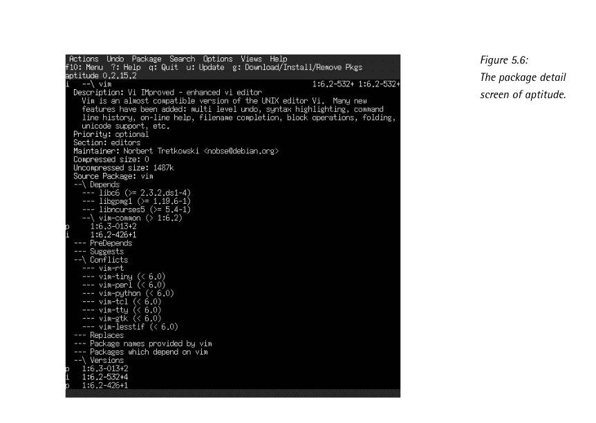

回到 apache2 多线程模型的示例，以下是如何使用不同的线程模型安装 apache2：

- 启动 aptitude 后，搜索 apache2 软件包：`/*apache2$[enter]`。
- 选择 apache2 进行安装：`[+]`。顶部的状态栏现在将显示类似以下内容的信息：
  `Will use 6644kB of disk space...`
  并且软件包名称后会出现一个新列，显示该软件包选择将导致系统的磁盘空间差异。
- 展开软件包节点，浏览到 **Depends** 行并展开声明依赖于某个可用多线程模型（实际上称为"mpm"，即多处理模块）的那一行。您将看到 `apache2-mpm-worker` 被选中以满足 apache2 的依赖。向下浏览到 `apache2-mpm-perchild` 并选择它进行安装：`[+]`。这将导致 `apache2-mpm-worker` 被取消选择，同时请求安装 `apache2-mpm-perchild`。
- 按 `[g]` 查看待执行操作的摘要，如图 5.7 所示。


## 5 Debian 包管理系统

图 5.7：aptitude 即将执行的操作摘要。

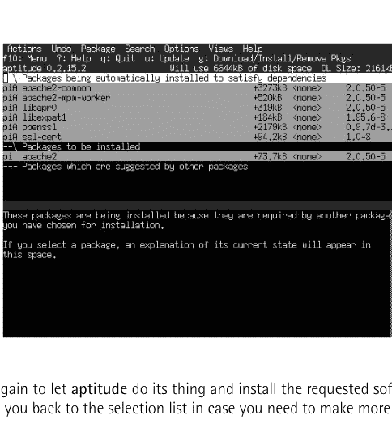

- 再次按 [g] 让 aptitude 执行操作并安装所请求的软件。按 [q] 将返回到选择列表，以便你在需要时进行更多更改。

##### 损坏的包

当 aptitude 遇到存在未解决依赖项的选择时，它会用纯红色背景高亮显示有问题的包，并在标题窗格中显示错误总数，如图 5.8 所示。

图 5.8：具有未满足依赖项的 aptitude。注意标题窗格中的 #Broken: 1 计数。

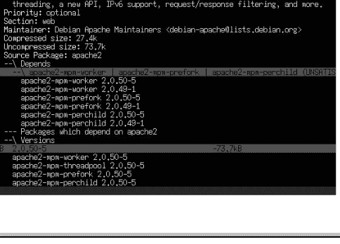

损坏的包是指那些具有未满足依赖项的包，或者是冲突的包（在这种情况下两个包都会损坏）。**aptitude** 显然不会允许用户提交包含损坏包的包选择。因此，必须首先修复损坏，可以通过以下两种方式之一完成。

首先，当损坏包的计数不为零且 **aptitude** 被告知执行待处理操作（用户按下了 [g] 键）时，**aptitude** 将在显示待处理操作摘要之前尝试解决所有问题。通常，它会采用保守的方法进行自动修复，以便优先考虑之前的选择，而非其他可能性。*务必*在按 [g] 之前检查损坏包的计数，否则一套可能导致一个或多个包损坏的精心更改可能会被丢弃，转而恢复到更改之前的状态。幸运的是，**aptitude** 允许使用 [C-\_] 或 [C-u] 撤消最后一个操作，并诉诸手动解决。

在 **aptitude** 中修复损坏包时，过滤器（或限制）功能非常方便。按 [l] 并在过滤器规范中输入 `~b` 会导致 **aptitude** 将列表限制为仅损坏的包。使用包详细信息列表（通过展开包节点访问），通常只需很少的努力即可通过选择缺失的依赖项进行安装和手动解决冲突来修复问题。或者，你可以简单地按 [b] 转到下一个损坏的包。

随着损坏包计数的减少，可能需要过滤显示的包列表。按 [l] 然后按 [**enter**] 将重新应用之前的过滤器，并应将列表缩小到（希望更少的）仍然损坏的包数量。迭代使用此过程，可以在短时间内修复所有损坏的包。

##### 跟踪未使用的包

当 **aptitude** 选择一个包来满足另一个包的依赖项作为其自动依赖项解析的一部分时，它会将该包标记为自动安装。因此，当依赖包被移除时，这些包将被自动选中进行移除，从而有助于保持系统干净。

也可以使用 [M] 和 [m] 手动修改“自动安装”标志：第一个添加标记，后者移除它。`~g` 谓词可用于根据此标志进行搜索和限制。

虽然 **aptitude** 的这个特性很好，但 **deborphan** 提供了更灵活的类似功能。我们将在第 5.11.5 章中回到这个主题。

##### 命令行交互

**aptitude** 从命令行提供了一组有趣的操作，基本上可以作为 **apt-get** 的直接替代品，具有 apt-cache 的搜索能力，并增加了 aptitude 交互式界面中可用的搜索谓词。以下内容应说明一些可能性。

```
~# aptitude search '~dsync ~dpalm !~slibs'
[...]
~$ aptitude moo
[...]
~# aptitude update && aptitude dist-upgrade
[...]
~# aptitude install pilot-link ~n~~(lib~)?gtk.*
[...]
~# aptitude purge mc
[...]
~$ aptitude moo -v
[...]
```

就像 **apt-get** 一样，可以通过追加在交互式界面中用于执行各自操作的字符，将多个不同操作的请求放在单个命令中。在以下情况下，A 将被安装，B 被移除，C 被清除，D 被置于保持状态。'+' 是多余的，因为安装操作使安装成为默认值：

```
~# aptitude install A+ B- C_ D=
[...]
```

**aptitude** 命令行界面的优势在于将各种程序及其功能集成在一个一致的接口背后。此外，**aptitude** 响应命令行上的安装请求而自动安装的依赖项会被相应地跟踪，并且 **aptitude** 一旦不再需要这些包，就会安排它们自动移除。这也可以明确请求。以下模仿了 deborphan（见第 5.11.5 章）的默认行为，移除 libs 和 oldlibs 类别中所有未使用的包：

```
~# aptitude markauto '~slibs|~soldlibs'
Reading Package Lists... Done
Building Dependency Tree
Reading extended state information
Initializing package states... Done
The following packages are unused and will be REMOVED:
  libdb2 libdb3-util libdb4.0 libgc1 libgdbmg1 libgl1b2.0-0
  libidentlibmagic1 libpcap0.7 libpcre3 libper15.6 libpng10-0
  libpng2 libsa517 libsigc++0 libss10.9.6 libstdc++2.10-glibc2.2
  libtextwrap1 libxmltok1
0 packages upgraded, 0 newly installed, 19 to remove and 0 not upgraded.
Need to get 0B of archives. After unpacking 10.6MB will be freed.
Do you want to continue? [Y/n/?] y
[...]
~# aptitude moo -vv
[...]
```

###### 保持日志

`aptitude` 将你请求的所有操作写入 `/var/log/aptitude`。该文件可以方便地用于跟踪软件的安装和移除。然而，不言而喻，其实用性取决于是否专门使用 `aptitude`。如果你使用 `apt-get` 安装包并使用 `dpkg` 移除它们，`aptitude` 的日志很快就会变得不同步。此外，`aptitude` 只记录请求。如果操作失败，这不会记录在日志中。

### 5.4.12 synaptic

`synaptic` 是一个基于 GTK 的图形化管理工具，基于 APT。它恰当地将 APT 的基本功能捕获到一个易于新手使用的前端中。由于它依赖 APT 进行实际的包操作，因此可以与 Debian 系统上的其他工具并行使用。图 5.9 显示了 `synaptic` 图形前端的截图。

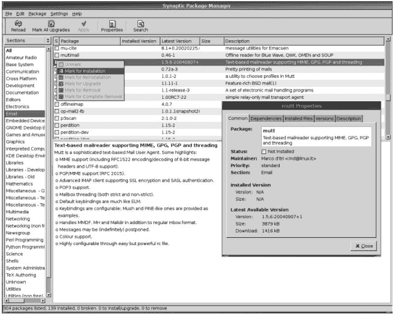

图 5.9：*Synaptic 包管理器*

`synaptic` 没有提供 `aptitude` 的所有功能，但它拥有一个更直观、更易访问的界面。尽管如此，它可以执行所有标准的包任务。此外，它具有灵活的搜索功能，并且可以锁定包以防止它们被自动安装、移除或升级。

## 5.5 Debian 任务

Debian 系统通常安装来执行特定任务。例如，你可能安装一台新机器作为数据库服务器，或者启动一台强大的机器成为你的新台式计算机。Debian 提供了任务的概念，以识别针对某些需求的典型软件包集合；对于刚刚确定的两个任务，你可以通过安装 SQL 数据库或桌面环境分别安装典型的软件选择。

传统上，`tasksel` 程序提供了一个用于选择这些软件集合的界面，但其功能已被 `aptitude` 集成和扩展，因此应优先使用 `aptitude`。

任务的理念是选择一个抽象概念，例如“结构化查询语言 (SQL) 数据库”，最终得到一组可安装的软件包，这些软件包提供了将本地系统转变为典型 SQL 数据库服务器所需的一切。本质上，任务类似于元包（或虚拟包），它们依赖于所需的包，唯一的区别是任务实际上是纯虚拟的，没有关联的 DEB 文件。此外，任务仅仅是建议，用户可以自由取消选择作为任务一部分的一些包。

*图 5.10：aptitude 的任务选择界面。*

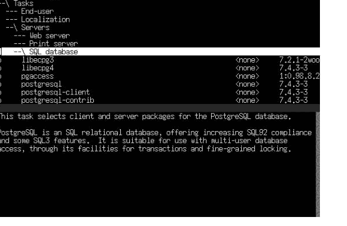


你将在 **aptitude** 主选择屏幕的最底部找到用于任务的首选界面。类似于处理软件包的方式，任务可以被视为单个实体，或者展开以显示它们所建议的软件包。如果本地系统要成为 SQL 服务器，你可以简单地导航到如图 5.10 所示的 **aptitude** 中的 "SQL server" 任务并按下 [**+**]。随后，该选择可以被修改。例如，即使 **libecpg4** 被认为是典型 SQL 服务器的一部分，它也可以像任何其他软件包一样通过 **aptitude** 的界面取消选择。或者，用户可以选择展开某个任务并检查其建议的软件包集。用户可以选择不整体安装该任务，而只安装该任务所包含的少数几个软件包。你会看到 **aptitude** 中的任务反应就像常规软件包一样。

也可以通过将任务描述文件放入 **/usr/share/tasksel**$^{30}$ 来定义自定义任务。如何编写任务的文档可在安装 **tasksel** 软件包时附带的 **README** 文件中找到$^{31}$。

## 5.6 软件包管理比较

本书的目的并非进行比较。然而，由于 Debian 软件包管理系统似乎经常被误解，因此有必要在自动软件包管理领域确立 **dpkg**、**APT** 及其同僚的地位。Debian 的软件包管理一统天下的日子已经过去。如今，存在着各种方法，每种方法都有其独特的优点和令人烦恼的缺陷。当人们吹捧自己最喜欢的软件包管理系统并贬低其他可用解决方案时，他们实际上是承认自己对此事的无知。事实上，软件包管理系统似乎更多是一个信仰问题。

软件包管理似乎包含三个方面：软件包格式规范、软件包处理器以及实际的软件包管理器。许多 Debian 支持者会声称 Debian 在这三方面都表现卓越。虽然 Debian 的软件包管理工具具有不可否认的优势，但它们并不完美。其他发行版的软件包管理系统也是如此。因此，是时候进行一次快速比较了（无需过于详细）。

软件包管理的基础是软件包文件本身的格式，它提供了大部分功能。DEB 支持者与 RPM 粉丝之间的论战愈演愈烈，反之亦然。Debian 支持者中的一个普遍看法是，DEB 格式在很大程度上优于 RPM，这完全是错误的（这当然也是 Debian 名声并非总是积极的原因之一）。事实上，RPM 格式实际上比 DEB 格式功能更丰富，但这些附加功能通常并未被使用[^32]。然而，就实际使用的能力而言，这两种格式非常相似，难以比较。与其他主要软件包格式（包括 **pkgsrc**、**ports** 甚至 **.ebuilds**）的比较也是如此。每种格式都有其优点和局限性，但就软件包管理而言，它们所支持的管理可能性或多或少是等同的[^33]。

处理软件包文件的工具情况也是如此。**dpkg** 和 **rpm** 二进制文件是软件包处理器（以及其他格式的其他管理器），提供大致相同的功能（见表 5.5）：安装和删除、查询状态数据库、显示从软件包文件中提取的信息；可以指示它们覆盖依赖关系或忽略其他规则，它们可以列出软件包内容并将已安装的文件与源软件包关联起来。简而言之，用一个能做到的事情，用另一个也能做到。在软件包管理的每个不同实现中，组件之间的界限可能会发生变化。然而，重要的是最终结果以及相应工具集所支持的管理方法。虽然 **dpkg** 和 **rpm** 以及它们各自的软件包格式与基于 *例如* **ports** 的系统有根本不同，但其能力或多或少是相同的。

表 5.5：dpkg 和 rpm 可用的软件包处理命令。

| dpkg | rpm |
|---|---|
| dpkg --info | rpm -qpi |
| dpkg --contents | rpm -qpl |
| dpkg --install | rpm -i |
| dpkg --list | rpm -qa |
| dpkg --listfiles | rpm -ql |
| dpkg --search | rpm -qf |
| dpkg --status | rpm -qi |
| dpkg --remove | 无 |
| dpkg --purge | rpm -E |
| dpkg --install --force-depends | rpm -i --nodeps |
| dpkg --install --force-overwrite | rpm -i --replacefiles |

> [^32]: 这种功能的一个很好的例子是 RPM 软件包触发器的概念，它允许一个软件包在另一个软件包被操作时注册要执行的操作，从而超越了标准的安装脚本。另一个例子是 RPM 允许通过本地文件系统上安装的文件来满足依赖关系。虽然这种做法在某种程度上让人想起导致“依赖地狱”的动态库处理，但它有时可能很有用。

[^33]: 在线提供定性比较：http://www.kitenet.net/~joey/pkg-comp

软件包管理系统的第三个组件是软件包管理器本身，它建立在包处理器和格式规范之上。长期以来，**APT** 在该领域享有无可匹敌的优势，但其他发行版一直忙于追赶。如今，像 **up2date**、**yum**、**urpmi** 和 **emerge** 这样的工具在提供的功能量上几乎不相上下（见表 5.6），尽管 APT 在成熟度和稳健性方面确实显得突出，但其他工具成为可行替代品的日子不远了。

下表试图列出四大自动软件包管理器的对应命令。请注意，该比较以 **APT** 为中心，旨在更多地作为参考，而非作为抨击其他命令的论据，因为每个命令都能完成 APT 无法完成的事情。因此，它主要作为一个帮助你区分不同 APT 命令的地图。我特意不提供其他管理器命令到 APT 的映射图，因为 APT 拥有 Debian 软件包管理方式所需的所有功能。其他管理器可用但 APT 不支持的概念和方法，在 Debian 系统上可能不太有用。

表 5.6：主要软件包管理系统的软件包管理命令比较。

| APT | yum | up2date | urpmi |
|---|---|---|---|
| apt-cache search | yum search | http://rpmfind.net | urpmq |
| apt-cache show | yum info | http://rpmfind.net | urpmq -i |
| apt-cache showpkg | 无 | http://rpmfind.net | 无 |
| apt-cache depends | 无 | 无 | 无 |
| apt-cache rdepends | 无 | 无 | 无 |
| apt-get install | yum install | up2date -i | urpmi |
| apt-get install --download-only | yum --download-only | up2date -d | 无³⁴ |
| apt-get remove | 无 | 无 | 无 |
| apt-get remove --purge | yum remove | rpm -e | urpme |
| apt-get update | 无 | 无 | urpmi.update -a |
| apt-get upgrade | yum update | 无 | 无 |
| apt-get dist-upgrade | yum --obsoletes update | up2date --update | urpmi --auto-select |
| apt-get source | 无 | up2date --src | 无 |
| apt-get build-dep | 无 | 无 | 无 |
| apt-file search | yum provides | http://rpmfind.net | urpmf |

³⁴urpmq --sources [...] |xargs wget

最后，APT 并非 Debian 特有。作为 Debian 对自由软件社区承诺的一部分，APT 是公开可用的，并已被移植到各种软件包格式（最著名的是 RPM）。它已经被其他发行版积极使用，包括 Mac OS X (Fink) 和 Fedora。

比较不同 Linux 发行版的软件包管理系统，我们得出的结论是，该领域的所有主要参与者都不过是凡人。但 Debian 系统除了上述软件包管理工具之外，还有更多东西。那些将 APT 视为 Debian 操作系统真正优势的人错了。真正的原因远离用户界面，深藏在 Debian 系统内部，无处不在，却几乎不被注意。

## 5.7 内部力量：Debian 政策

一群音乐家并不能组成一个管弦乐队。如果目标是交响乐，那么如果每个人都我行我素，或者小团体演奏不同的乐曲，是无济于事的。如果艺术家们愿意，稍加耐心可以带来可接受的结果，但真正的交响乐需要秩序。为了成功传达一部音乐杰作的能量，管弦乐队需要个人技巧、乐谱、指挥和无尽的练习时间。

#### 介绍 Debian 交响乐团

Debian 系统与交响乐并无不同：音乐家是为系统安装准备众多软件包的开发者。如果开发者只是按照自己的喜好创建软件包，协同效应就无法产生。因此，开发者们同意遵守一套规则，就像管弦乐队的成员同意遵循一份乐谱一样。在 Debian 系统中，指挥的角色由软件包管理工具担任，正如第 5.3 章和第 5.4 章所示，它们遵守某些规则并确保软件包和谐。这些规则和工具已经存在多年，开发者有充足的时间练习使用它们并纠正问题。

继续这个例子，Debian 开发者演奏并被软件包管理工具遵守的乐谱就是 Debian 政策<sup>35</sup>；没有这个政策，Debian 发行版就只是另一个 Linux。但它不是。政策是 Debian 系统的灵魂，是其跳动的心脏，是 Debian 能比其他系统更好地利用相同工具的原因。政策是 Debian 的烹饪书，多年的审视完善了每一道食谱。

> <sup>35</sup>http://www.debian.org/doc/debian-policy


#### 对软件包维护者的约束

即使不了解 Debian 政策，也能管理 Debian 系统。实际上，该文档提出的准则并不对系统用户施加限制。相反，它定义了 Debian 软包可以做什么和不可以做什么。因此，它要求 Debian 开发者确保所有软件包都能正常运行，且安装或卸载后系统保持一致和干净的状态。换句话说，它有助于减少软件包维护者需要做出的决策。如果开发者在为 Debian 创建软件包时遵循政策规则，则该软件包将保证与 Debian 系统及其管理工具兼容。此外，合规的软件包可以与同一系统上的数千个其他软件包共存。

所有 Debian 管理工具都遵循政策；当你告诉 `dpkg` 安装一个软件包时，你就是在让它执行政策。每位 Debian 开发者都必须熟悉政策，并且在准备软件包时，遵循政策是重要优先事项。然而，开发者有时也会犯错，这些工具为此类情况提供了安全网：与其让系统陷入风险，软件包管理工具将不允许执行违反政策的操作。

#### 硬性规定

通常，操作系统很少没有政策。例如，在 NetBSD 项目<sup>36</sup>中，存在规则来协调众多编码者的工作。但深入考察后，这些规则并未提供与 Debian 政策相同的安全保障。在继续之前，我们必须区分 NetBSD 软件的两个来源：一方面是独立的核心操作系统，另一方面是 NetBSD 软件包集合（pkgsrc），包含为能轻松安装到 NetBSD 环境而调整过的第三方软件。

由于核心由一个小型且协调的团队开发，像前述那样的冲突极不可能发生。然而，`pkgsrc` 归档中的软件由独立的个人维护，他们被鼓励遵循一套共同的规则。但这些规则是“软”规则，因为在软件包提交到归档或安装到 NetBSD 机器时，既不强制执行这些规则。如果一个第三方软件包覆盖了 `/usr/pkg` 下其他软件的文件，实际上会使其他软件无法运行，直到问题解决并重新安装该软件包。NetBSD 规则规定必须通过冲突参数来防止这种情况，但如果此参数错误或被遗漏（通常是人为错误），冲突将无法得到妥善处理。

36 NetBSD 项目制作了一个伟大的操作系统，在许多方面技术上优于 Linux。因此，我毫无愧色地将其用作例子来说明 Debian 政策的优势；另见第 5.12.1 章。

## 5 Debian 软件包管理系统

显然，当不同的软件是专门为某个系统开发的（如 NetBSD 核心的情况），不同的部分很可能会和平共存。另一方面，大多数 Debian 软件包是从外部来源获取的，可能由维护者重新调整结构以适应 Debian 系统。如果你在 Unix 世界待得够久，你会看到各种文件存放方案：**GNU Autotools** 采用标准化方法，但像 **qmail**、**Check Point Firewall-1** 或 **Sun 的 JDK** 这样的软件，其组件文件似乎对文件系统空间有着独特的想法。

因此，Debian 开发者的工作就是将软件的预期安装布局转换为与 Debian 归档中所有其他软件包兼容的布局。政策通过限制打包过程中必须做出的选择数量来帮助维护者完成这项任务。它还明确了要求，这样开发者就不必尝试应对所有可能出现的问题。这节省了大量时间，并从一开始就增强了软件包的健壮性。同样，常用的软件包维护者工具执行政策，使软件包创建基本成为例行程序（见第 9 章）。

当两个软件包在文件系统上提供相同名称和目标位置的文件时，Debian 维护者所能做的，不比为 NetBSD 打包第三方软件的人多多少：如果两个文件提供相同的功能，软件包的元数据将包含此关系（见第 5.7.3 章）；如果文件功能不同，则必须重命名其中一个（或两个）。区别在于，不遵循这些规则的软件包将无法从 Debian **stable** 归档中获得。此外，为了防范不可预见的情况，**dpkg** 将执行细致的记录，确保维护者错误不会无意中通过覆盖基本部分而使系统的不相关组件无法使用。

#### Debian 的精髓

关键点在于，未能遵守政策本身就足以成为针对违规软件包提交**严重**错误的理由（由发现违规的任何人提交；见第 10.6 章）。由于严重错误会阻止软件包进入 Debian **stable**，违反 Debian 政策的软件包无法成为官方 Debian 发布的一部分。这是 Debian 系统的精髓：Debian **stable** 版本中所有可用的软件包都遵循相同的规则集，构成一个始终一致且统一的系统。在**stable**版本中发现政策违规的罕见情况下，可能会在下次升级时提供新版本（甚至在下次官方发布之前）。然而，如第 4 章所述，此升级不得影响已安装系统的稳定性。

如前所述，政策不对管理员施加限制。然而，它无疑发挥着重要作用，并解释了 Debian 系统管理中一些最重要的方面。下面，将阐述 Debian 政策的相关影响。

## 5.7.1 神圣的配置文件

我们在第 5.3.3 章看到，**dpkg** 对配置文件特别小心，因为它假定本地修改在软件包升级期间应被保留。此功能不是简单的附加功能，而是政策对 Debian 软件包处理器施加的要求。在第 10.7.3 节中，Debian 政策指出：“（配置文件的）本地更改必须在软件包升级期间保留。” 为了让 **dpkg** 成为 Debian 软件包处理器，它必须确保不违反政策。

**dpkg** 更进一步，实现了对配置文件的妥善处理，将是否覆盖本地修改的决定权交给了管理员，而非软件包维护者。通过默认保留本地更改，它充分执行了政策，同时赋予系统用户更多灵活性。除了防止政策违规外，**dpkg** 还提供了有用的功能，因此免除了开发者为每个软件包反复实施类似解决方案的负担。

##### 识别配置文件

可以说，最先进的统计方法也仅与其分析的数据一样好。类似地，**dpkg** 对配置文件的完美处理只有在其知道哪些文件应被视为**配置文件**时才有用。在这里，政策也提供了规则来简化维护者的工作（和责任）：第 10.7.2 节指出，“[a] 软件包创建或使用的任何配置文件必须位于 **/etc** 中。” 软件包安装的配置文件集合在软件包创建时确定，**dpkg** 本身并不强制执行此规则（原因即将明了）。然而，大多数维护者使用的软件包创建工具都意识到政策中的此条款，并自动将安装到 **/etc** 的每个文件标记为配置文件。

当配置文件是动态生成的（例如，通过使用 **debconf**；见第 5.8 章）时，**dpkg** 的**配置文件**处理方法可能不理想，甚至会成为阻碍。因此，**dpkg** 不会自动将 **/etc** 下的所有文件视为配置文件。在这种情况下，维护者的职责是提供适当且符合政策的解决方案。**ucf**（更新配置文件）工具可用于此类目的，并就配置文件提供与 **dpkg** 本身几乎相同的功能。

由 **dpkg** 管理的软件包**配置文件**集合，可在 **dpkg --status** 输出中标记为“Conffiles”的部分中找到：


# 5 Debian软件包管理系统

```
# dpkg --status postfix
[...]
Conffiles:
/etc/init.d/postfix 79ac631ecb6e3cbb1d8684aa6de101fc
/etc/ipd/ip-up.d/postfix 0f6d12880a5f95b96037f15d658cecb0
/etc/ipd/ip-down.d/postfix 0758469f9f1c073a53df50d9dc43c8eb
/etc/postfix/postfix-script 43d47ae8924b92d8f929d0ffa363c84a
/etc/postfix/post-install 9c26982c75a0500578c73a796f35c0f5
/etc/postfix/postfix-files 4b8051f5c6101ad744f5bfbd772a29db
/etc/resolvconf/update-libc.d/postfix 3c921a0c2447ae3e166a62411568d048
[...]
```

此列表不包括由其他工具（如`ucf`）管理的配置文件。不过，你可以放心地认为安装在`/etc`下的每个文件都能得到正确处理。

# 无论你如何漫游

Debian策略通过划分系统区域来保护你的文件：一方面是管理员可以随意修改文件的区域，另一方面是完全由发行版管理的区域。你在`/etc`层级结构下所做的任何修改，在软件包升级过程中都能得到保证，不会被改动。

策略在完全允许你尽情在`/etc`中漫游的同时，也要求你不要触碰`/usr`和文件系统层级结构其他部分的文件和目录。有一个显著的例外是`/usr/local`，策略允许软件包用当前发行版的文件替换任何旧版本或新版本的文件。因此，直接修改例如`/usr/bin/debconf`这样的文件的管理员是在违反策略，当`debconf`软件包的升级默默地覆盖了所有更改时，也不会有人听到你的哭喊。请避免修改那些未被标记为配置文件的Debian软件包安装的文件，除非你清楚自己在做什么。

如果一个软件确实需要修改`/usr`中的文件（在这种情况下，可以说该软件在Unix范式背景下是有缺陷的），软件包维护者应该提供一些解决问题的方法。可能的解决方案包括通过直接修改软件将配置变量导出到`/etc`中的文件，或者使用从`/usr`层级结构中的位置到`/etc`中适当文件的符号链接。

Debian策略的另一部分进一步规定了将文件系统分为两个分区（一个用于系统，一个用于用户）的内容，我们将在第5.7.4章中再讨论。

# 5.7 内部的力量：Debian策略

# 变通方法、技巧和懒惰的维护者

不幸的是，过去有些维护者比较懒，为严格的要求选择了变通方法。在你的系统中，你可能会在`/etc`中发现一些文件，警告管理员不要进行本地修改，例如：

```
$ head /etc/fonts/fonts.conf
[...]
DO NOT EDIT THIS FILE.
IT WILL BE REPLACED WHEN FONTCOFIG IS UPDATED.
LOCAL CHANGES BELONG IN 'local.conf'.
[...]
```

这些文件所属的软件包是否违反了策略是有争议的。然而，在所有情况下，通知维护者并建议处理这些文件的适当方法都是一个好主意。以下任一解决方案都是令人满意的（也可能存在其他解决方案）：

1.  由于这些文件通常是自动生成的，因此应扩展用于生成它们的工具，以正确处理修改。对于指定变量-值对的文件（通常由`debconf驱动的postinst`脚本创建），这很容易实现。更复杂的格式则需要更智能的处理（如果可能的话）。
2.  当生成工具无法识别和/或处理修改时，必须将文件本身移动到`/var`下的适当位置，并使用符号链接从其之前在`/etc`下的位置进行引用。

# 5.7.2 在软件包之间进行协调

策略还规定了协调系统上软件包共存的规则。具体来说，它通过禁止一个软件包触及另一个软件包安装的文件集来防止软件包之间的干扰。在第7.5.1节中定义，"一个软件包包含系统中已由另一个软件包安装的文件是一个错误"。如果一个软件包必须安装一个也包含在另一个软件包中的文件，维护者必须明确声明它与另一个软件包冲突，或者使用转向将要替换的文件移开（见第6.1.3章）。正如我们将在第5.7.3章中看到的，Debian允许维护者在特殊情况下替换其他软件包中的文件，如果该意图在创建软件包时被明确指定。

同样，`dpkg`严格执行此规则，正如我们在第5.3.6章中看到的。出于好奇，以下问题实际上在一台运行Debian *unstable*的机器上出现过。开发人员决定将`/bin/chgrp`从`fileutils`移到`coreutils`软件包中，但`coreutils`比`fileutils`早一天进入*unstable*仓库——这本质上是一个简单的时间安排问题，只会影响*unstable*（见第4章）。注意到新的`coreutils`软件包可用，APT正确地尝试升级但失败了，因为当前安装的`fileutils`软件包仍然声称拥有`/bin/chgrp`：

```
# apt-get upgrade
[...]
The following packages will be upgraded
  coreutils
[...]
Unpacking replacement coreutils ...
dpkg: error processing coreutils_5.0.91-2_i386.deb (--install):
 trying to overwrite '/bin/chgrp', which is also in package
  fileutils
dpkg-deb: subprocess paste killed by signal (Broken pipe)
Errors were encountered while processing:
  coreutils_5.0.91-2_i386.deb
```

##### 声明的冲突

如果两个软件包试图将同一个文件安装到同一位置，则称这两个软件包存在冲突。只有当这种冲突在所有相关软件包的控制信息中未被明确指定时，才构成策略违规。DEB文件格式允许将冲突表达为软件包关系（见第5.7.3章）。

`dpkg`不允许两个冲突的软件包安装在同一系统上，如下例所示。这里，`postfix`和`exim4-config`都提供`/usr/sbin/sendmail`。因此，两位维护者都在软件包的控制信息中注册了冲突：

```
# dpkg --install exim4-config_4.32-2_all.deb
[...]
dpkg: regarding exim4-config_4.32-2_all.deb containing exim4-config:
 exim4-config conflicts with postfix
  postfix (version 2.1.5-1) is installed.
dpkg: error processing exim4-config_4.32-2_all.deb (--install):
 conflicting packages - not installing exim4-config
```

##### 转向文件

Debian仓库中的几个软件包扩展了其他软件包提供的功能。通常，这种扩展只能通过替换一个可执行文件（该文件*例如*可能链接了额外的库）来实现。例如，`postfix`软件包安装的邮件传输代理不支持传输层安全（TLS）。对于需要加密的安装，应该使用`postfix-tls`软件包；它包含了链接了`libssl`的可执行文件和库。维护者没有重复`postfix`软件包的工作和内容，而是选择让**postfix-tls**依赖postfix以重用其功能（如`init.d`脚本和手册页），而是将相关程序的功能转向到依赖软件包中提供的程序。关于转向的更多信息可在第6.1.3章找到。

```
# dpkg --install postfix-tls_2.1.5-1_i386.deb
[...]
Unpacking postfix-tls (from postfix-tls_2.1.5-1_i386.deb) ...
[...]
Adding 'diversion of /usr/lib/postfix/smtpd
    to /usr/lib/postfix/smtpd.postfix by postfix-tls'
[...]
Setting up postfix-tls (2.1.5-1) ...
# ldd /usr/lib/postfix/smtpd*
/usr/lib/postfix/smtpd:
[...]
libssl.so.0.9.7 => /usr/lib/i686/cmov/libssl.so.0.9.7 (0xb7f5e000)
[...]
/usr/lib/postfix/smtpd.postfix:
[...]
```

如果**postfix-tls**被卸载，**dpkg**会撤销转向以恢复postfix的正常运行，使其不再支持TLS：

```
# dpkg --remove postfix-tls
[...]
Removing postfix-tls ...
Removing 'diversion of /usr/lib/postfix/smtpd
    to /usr/lib/postfix/smtpd.postfix by postfix-tls'

```

##### 解决冲突

如果两个软件包提供相同的文件，但这两个软件包的功能是互斥的，那么这两个软件包之间的冲突是不可取的，因为它将限制管理员只能使用其中一个软件包，而不能同时使用两者。在这种情况下，相应的维护者通常会达成协议，并在其中一个软件包中重命名冲突的文件。通常，这将是不太流行或较新的软件包，以尽量减少对现有用户的影响。然而，如果无法达成这样的共识，那么策略的第10.1节要求采用所罗门式的解决方案，并要求两个软件包都更改文件名。

# 5.7.3 软件包关系

如果软件包管理器能够从软件包的内容推断出包含的软件是否提供

特定功能、与其他软件包冲突，或需要其他软件包中的软件才能正常运行。不幸的是，目前最先进的工具还无法（暂时）得出这样的结论。因此，为了让**dpkg**能够在文件冲突发生之前就进行预防，或者让**APT**能够自动满足依赖关系，软件包维护者必须在软件包文件中添加指定这些关系的数据。正如我们在第5.2.3章所见，DEB文件可以将此类信息存储在**control**文件中。

为了让（本质上很愚蠢的）计算机程序能够理解此文件中提供的信息，必须有一个一致的语法定义来规定数据的结构。除了构成依赖和冲突声明的软件包名称外，可能还需要额外的信息来编码复杂的关系，甚至例外情况。例如，某个程序可能需要特定版本的库，并且由于功能缺失而无法与早期版本一起工作。反之，维护者可能已同意重命名文件以解决不相关软件包之间的冲突，因此第二个软件包只需要与重命名之前的冲突软件包版本存在冲突。

在其他时候，一个软件包可能需要一个*概念*，该概念由多个不同的软件包提供，必须从中选择一个。这种需求的一个经典例子可以在**at**软件包的元数据中找到。**at**的设计要求该程序能够发送电子邮件。在Debian中，至少存在十种不同的邮件传输代理，但该软件包没有将这组代理硬编码到**at**的依赖信息中，而是简单地依赖于**mail-transport-agent**这个概念。反过来，所有提供所需功能的软件包都声明它们提供该概念，这在Debian中是通过所谓的“虚拟软件包”来实现的。如果本地系统上安装了任何提供虚拟**mail-transport-agent**软件包的软件包，Debian软件包工具就会认为依赖已满足。

Debian策略规定了多种不同类型的关系，以及每种关系所需的语法，以便特定需求能够被有意义地表示。除了简单的依赖和冲突之外，软件包还可以建议、推荐、提供、替换或扩展其他软件包。每种关系在**control**文件中都使用单独的字段：

##### Depends

根据策略，**Depends**字段中的条目是绝对依赖。如果系统上未安装（并配置）此处列出的某些软件包，依赖的软件包可能会被解包，但无法配置。因此，在所有依赖的软件包完全配置之前，它将不可用（并且无法满足其他依赖）。软件包**Depends**字段中列出的名称引用了软件运行所必需的其他软件包。另一种关系**Pre-Depends**提供了一种稍微宽松一些的依赖关系，仅用于非常特殊的情况；此处列出的软件包只需要被解包（但不一定配置）即可满足依赖。

##### Recommends

有时，一个软件包可能需要另一个软件包，但要求不一定严格；要安装的软件可以正常工作，但会存在功能上的严重限制。例如，**xmms**多媒体播放器可以在不访问声音系统的情况下运行，但其用途将非常有限。因此，**xmms**推荐安装声音系统接口。

##### Suggests

通常，软件会通过其他软件得到增强。例如，**X服务器**可以在没有字体文件的情况下运行，但那些不喜欢像素化艺术的用户，其审美体验将在高分辨率字体存在时得到极大提升。因此，**xserver-common**基础软件包建议安装字体软件包。

##### Enhances

这是**Suggests**的精确对应部分，但它们彼此独立。该字段旨在向软件包管理器传达建议，而无需触及被增强软件包的元数据。对Enhances字段的支持仍然相当有限，**APT**目前不支持它。

##### Provides

一个软件包可能提供另一个软件包的功能，或提供虚拟软件包的功能。前述**at**软件包的依赖可以通过安装**postfix**来满足，因为postfix提供了**at**所依赖的**mail-transport-agent**。

##### Conflicts

**Conflicts**字段中列出的软件包不能与声明冲突的软件包共存，原因可能是文件冲突或其他原因。

##### Replaces

在某些情况下，一个软件包可能取代另一个软件包的部分内容，涉及替换来自另一个软件包的文件。**dpkg**不允许一个软件包覆盖另一个软件包安装的文件，除非新软件包在**Replaces**字段中明确声明了此意图。例如，当软件包被重命名，或者将一个软件包拆分为多个组件导致之前的整体软件包过时时，就会出现这种情况。大多数情况下，**Replaces**将与**Conflicts**（以及在虚拟软件包的情况下，**Provides**）一起使用，以导致被替换的软件包被移除。

所有可用关系字段的标准格式是以逗号分隔的软件包名称列表。除**Provides**外，软件包名称可以进一步基于版本号$^{37}$进行限制。一个软件包可以声明针对一个特定版本号的关系，这通常是库和相关开发文件关联的方式（=）。或者，关系可以适用于严格早于（<<）、早于或等于（<=）、晚于或等于（>=）或严格晚于（>>）的软件包版本。以下行指定了对foo版本2.0-1或更高版本的依赖，以及对bar在3.0版本之前发布的依赖：

```
Depends: foo (>= 2.0-1), bar (<< 3.0)
```

此外，字段可以指定一组软件包，其中只需安装一个。以下编码了对任何版本的`apache2`（版本号大于2.0.50）或任何其他提供虚拟软件包`httpd`的软件包的偏好：

```
Depends: apache2 (>= 2.0.50) | httpd
```

在指定实际软件包的同时指定虚拟软件包（`apache2`实际提供`httpd`），允许维护者建议一个默认选项，而不是依赖`APT`从任何提供者中选择。

## 5 Debian软件包管理系统

##### 收集软件包元数据

我们无需远寻就能找到具有类似功能的其他软件包管理系统。关系图是计算机科学的基础知识，任何设计合理的软件包系统都可以从其数据库和软件包元数据中计算甚至组合出可接受的软件包组合。Debian是第一个拥有一个一致且健壮系统的事实，如今已不值一提。

然而，关系图的有用性主要依赖于用于创建图的数据，就像`dpkg`的配置文件处理依赖于知道哪些文件需要特殊处理一样。因此，软件包管理系统最关键的因素之一是软件包维护者尽可能准确地指定关系的能力。像Debian这样多样化的软件包关系方案是有用且不可或缺的，但提供正确的信息并非总是易事。

策略在第3.5节指出，“每个软件包必须指定关于其他软件包的依赖信息，这些信息是该软件包正常工作所必需的。”它还要求使用冲突声明，但它没有（也不能）对何为依赖，或哪些软件包满足给定关系做出普遍陈述。

Debian从两个角度来处理这个问题。首先，对策略的扩展随着时间的推移而发展，以协调用特定语言编写的软件的实践。例如，Perl策略$^{38}$规定了该语言固有的

适用于 Perl 脚本和程序。虽然 Perl 政策的指南不像 Debian 政策的规则那样具有约束力，但该文档确实为维护者做出决策并实现（数量少得多的）Perl 相关包的共存提供了基础。未来，这样的子策略很可能会与主 Debian 政策集成。

同时，Debian 维护者工具提供了众多辅助程序来封装政策，从而减轻维护者的负担。例如，shlibs 系统（参见第 9.4.3 章）是一个复杂的机制，允许维护者脚本自动确定为满足程序库依赖所需的软件包集合。Shlibs 使用自动管理（但可本地覆盖^39）的映射来帮助将 ldd 的输出转换为满足要求的最小 Debian 软件包集合。无需期望包维护者找出哪些包提供了合适的库，负担转移到了提供共享库的包的维护者身上（他们理应更清楚其包含的库提供了哪些功能和文件）。此外，对库的修改只需要在一处进行，而不需要期望所有依赖包的维护者都去修改控制数据。

同样，也存在一些工具来确定 ldd 未列出的依赖关系，例如用 Perl 或 Python 编写的脚本的情况。这些工具能够利用特定政策^40 和语言特性的特点，自动确定所需的模块。

除了对动态链接库的依赖解析之外，Debian 并*不*提供自动化手段来确定依赖关系，并且可能永远不会，因为不存在既能遵循所有 Debian 政策要求又可行的方法。显然，你可以扫描一个程序的所有外部命令调用和对数据文件的引用，然后使用映射结构来查找关联的软件包。然而，Debian 使得很难不令依赖集合等于程序在所有配置选项和输入数据排列组合下所使用的所有资源的集合。换句话说，Debian 软件包依赖于那些对其运行至关重要的其他软件包。一个仅在某个库存在时启用额外功能的软件，仅仅是建议或推荐包含该库的软件包。如果允许自动依赖扫描器确定依赖关系的上下文，从而判断它是硬依赖还是软依赖，这可以更进一步。然而，这种方法很快就会导致著名的停机问题^41。因此，Debian 维护者无需担心被小型 shell 脚本取代。

^39 在 `/etc/dpkg/shlibs.override` 中，参见第 9.4.3 章

^40 Debian 的 Python 政策位于 `/usr/share/doc/python/python-policy.txt.gz`

^41 通过解析代码并判断执行是否会到达使用该库的地方来决定一个软件是否需要某个库，类似于判断一个给定程序是否会终止的不可能任务：http://en.wikipedia.org/wiki/Halting_problem

##### 合理的依赖

顺便值得一提的是，Debian 对间接依赖也采取了合理的方法。典型的例子是那些带有图形用户界面但也能够从命令行使用，因此不需要像 X 这样的图形环境的程序。如果此类程序的功能在无头^42 或嵌入式设置中很有用，那么让这些包依赖于图形环境将是愚蠢且极不方便的。在这种情况下，维护者通常会选择将软件包拆分（如果可能），将图形组件分离到一个扩展包中。这种方法允许核心组件在没有图形环境的情况下安装，同时也兼顾了图形组件的用户。例如，isdnutils 软件包在 ISDN 路由器（通常是无头的）上是必需的，它可以无需图形环境安装。其图形工具包含在 isdnutils-xtools 中，该包使用 isdnutils 提供核心功能并依赖于 X 服务器，而不是 isdnutils 本身。

此外，类似的逻辑也应用于依赖包。对于 X Window System，程序可能依赖其资源而实际上不需要图形显示。例如，giftrans 软件包需要 `/etc/X11/rgb.txt` 中的 RGB 颜色名称，这个文件是由 xserver-common（间接）提供的。虽然 Debian 中所有的 X 服务器都依赖 xserver-common，但该包也可以单独安装。giftrans 需要安装它，但因此不需要 X 服务器。将多个包的公共部分抽取到 `*-common` 包中是标准的 Debian 做法，从而简化了依赖管理。类似地，大多数 Debian 维护者会在软件文档超过某个（未指定的）限制时，将其拆分到一个单独的 `*-doc` 包中。特别是对于嵌入式和其他资源有限的系统，这种模块化是必需的。

## 5.7.4 文件系统层次结构标准（FHS）

在撰写本文时，Debian 软件池中有 15000 个二进制包，你可能想知道两个包都试图安装同名文件时解决了多少冲突。嗯，答案是“非常少”，如果不是因为政策限制软件包将其文件安装在非常特定的位置，而不是随意放置，这可能会令人惊讶。

Debian 政策的第 9.1.1 节规定“所有安装的文件和目录必须符合文件系统层次结构标准（FHS）”。FHS^43 是一组在 Linux 早期起草的指南，旨在重新设计 Unix 系统古老的目录结构。更具体地说，它为系统集成者、包开发人员和系统管理员提供了一个在 Unix 文件系统中一致且逻辑清晰的文件布局，以提高不同供应商的发行版和操作系统之间的可移植性和兼容性。虽然今天大多数类 Unix 操作系统都（不同程度地）遵循该文档提出的建议，但 Debian woody 是最早（如果不是第一个）几乎完全符合 FHS^44 的发行版之一。

根据 FHS，安装在系统上的文件必须根据其功能和特性放置在文件系统的特定位置。在第 5.7.1 章，我们看到 Debian 要求配置文件驻留在 `/etc` 下，而 dpkg 通常将静态文件安装在 `/usr` 层次结构中。这种分离是遵循 FHS 的直接结果。与 Debian 相关的重要层次结构如下所列，以及 Debian 政策施加的额外限制：

- **/ – 根目录** — 除了已存在的文件或目录外，不能在其顶层放置额外的文件或目录。但是，根目录可以包含指向启动所需内核文件的链接。

- **/etc – 特定于主机的系统配置** — 任何预期会被系统管理员更改的文件必须驻留在 `/etc` 下^45。

- **/boot – 静态引导加载程序文件** — 与引导加载程序相关的文件放置在此处。`/boot` 必须能够位于只读卷上。

- **/usr – 可共享的只读数据** — `/usr` 下的文件不能需要写权限，并且必须是静态的。除了软件升级期间，如果 `/usr` 位于只读卷上，系统必须能够正常工作。其顶层不能放置任何文件或目录。

- **/usr/lib – 特定于体系结构的资源** — 本地软件所需的依赖于系统体系结构的文件（主要是二进制文件）必须放在此处。

- **/usr/share – 体系结构无关的资源** — 本地软件所需的可在任何体系结构上使用的文件必须位于 `/usr/share` 下。

^44 我知道没有任何 Linux 系统完全符合 FHS，这在很大程度上是因为过时的内核和启动时要求尚未以符合 FHS 的方式解决。经典的例子是 `/etc/mtab`，这是一个 mount 所需的动态文件，但它不能位于 `/var` 下，因为它必须在挂载根文件系统后立即可用。

^45 存在例外。例如，Grub 要求其配置位于与 `/boot` 层次结构相同的分区上。


# 5 Debian 软件包管理系统

**/usr/local** – 自定义软件和资源
与 Debian 发行版无关的软件和资源可以放入 **/usr/local**，Debian 系统永远不会改动此目录下的内容。

**/tmp** – 临时数据
**/tmp** 作为暂存空间，可以存放任何类型的数据。但是，其内容的持久性在不同进程间无法得到保证。

**/var** – 可变数据
**/var** 层级结构是系统的工作目录。此处的文件用于控制、日志记录、缓存和其他管理功能。在顶级目录中不得放置额外的文件或目录。

**/var/log** – 日志文件
Debian 中所有提供日志信息的程序都将日志记录到此目录下的文件中。

**/var/tmp** – 持久性临时数据
与 **/tmp** 不同，**/var/tmp** 下的数据永远不会被系统自动删除，但其内容本身应具有临时性质。

**/var/mail** – 用户邮箱文件
如果本地邮件投递代理使用 **mailbox** 格式，则用户邮箱文件将存放在 **/var/mail** 目录下。

**/home** – 用户数据
用户主目录通常位于 **/home**，但此层级结构的布局取决于系统管理员。任何程序都不应依赖此处包含的数据。

**/mnt** – 临时挂载的文件系统
提供此目录是为了让系统管理员可以根据需要临时挂载文件系统。它**不是**用于存放媒体挂载点的目录。

随着 *sarge* 的发布，Debian 跟进了 FHS 的最新变化，并添加了以下根级目录层级：

**/media** – 可移动介质挂载点
可移动介质（如 CD-ROM 驱动器或 USB 闪存盘）的挂载点位于 **/media** 下。

**/srv** – 服务数据
由系统服务（如网站）提供的数据存储在 **/srv** 层级结构中。

FHS 还建议软件使用 /usr/share 和 /usr/lib 的子目录，以防止名称冲突。在某些地方，这些子目录被称为“隔间”。例如，OpenOffice.org 套件的架构无关文件位于 /usr/share/openoffice 下，而 Gimp 图形程序则可能将此类文件存储在 /usr/share/gimp 下。即使这两个程序都提供名为 tree.png 的文件，这些软件包也可以和谐共存。

### 5.7.5 版本号

Debian 软件包由其名称和版本号标识。为了使软件包依赖关系支持带版本的依赖，并且使 APT 能够决定一个软件包是比已安装版本更新还是更旧，版本号必须遵循策略制定的规则。每个 Debian 版本号都采用以下格式（方括号表示版本号中的可选部分）：

```
[epoch:]software_version[-debian_revision]
```

当 APT 决定是否升级软件包时，它会比较先前安装版本和安装候选版本的两个字符串。通常，版本号中唯一必需的组件——软件版本，应该足以确定软件包的相对新旧。当一个软件包提供与另一个软件包相同的软件版本，且两者仅在打包方面存在差异时，此差异必须反映在 Debian 修订号中，该修订号通过连字符附加在软件版本之后。专门为 Debian 编写的软件的软件包通常没有 Debian 修订号字段。

比较两个版本号是按字典顺序进行的，字母排在数字之前。因此，软件包版本 1.0.1-2 的排序会在版本 1.1.0-1 之前，APT 会将版本号较大的 1.1.0-1 视为升级候选版本。然而，有时上游作者会采用非标准的版本控制方案（例如 1.1、1.11、1.2，……），这会完全混淆 APT 的排序算法。Debian 通过使用纪元字段来解决此类问题，纪元字段前置在软件版本之前，并以冒号分隔。为了适应非标准版本控制方案，Debian 维护者会使用纪元来恢复版本号的字典顺序（例如 1:1.1、1:1.11、2:1.2）。空的纪元等同于纪元为 0。

##### 纪元：规范化版本号

纪元字段也可用于纠正版本控制中的错误。为了让 APT 将新可用版本视为升级版本，该版本必须严格大于已安装版本。一个上游软件可能在某个时间点改变其版本控制方案：在发布了版本 1 和版本 2 之后，开发团队可能想采用一个更合适的版本控制方案，并将版本 3 发布为 1.0。由于 1.0 小于 2，APT 在任何 Debian 系统上都不会更新该软件包，直到开发者发布 2.0，这可能需要数年时间。在这里，Debian 维护者也会选择通过将方案更改后的软件包版本号设置为 1:1.0 来解决问题。

关于版本号还存在一些特殊情况。通常，上游软件以日期字符串作为版本号发布。例如，postfix 邮件传输代理在 2002 年之前都是根据其发布日期来版本控制的。一个好的做法是在日期字符串之前插入一个 0.0 的虚拟版本，例如 postfix 的 0.0.20011217.SNAPSHOT-1。当 postfix 开发者选择采用常规版本控制方案并发布 1.0 时，postfix 软件包维护者在这种情况下就不需要使用纪元了。

类似的建议也适用于处理表示预发布状态的版本扩展，例如 alpha 和 beta 版本，或发布候选版本。考虑一个上游版本为 1.0-rc1 的软件发布候选版本的情况。这种版本字符串很常见，但当发布候选版本成熟并正式发布时，APT 会发现 1.0 小于 1.0-rc1，因此不会升级该软件包。幸运的是，“alpha”、“beta”和“rc”彼此之间的比较是适当的，因此必须使用特殊方案来允许预发布版本排在最终发布版本之前。在 Debian 归档文件中，通常将真正的上游版本编码在 Debian 修订号中。根据该方案，一个版本为 1.0rc1 的软件包可能被版本化为 1.0-0+1.0rc1+1，接着是 1.0-0+1.0rc1+2，然后当最终版发布时为 1.0-1。另一种方案是使用一个明显虚假的、排在最终发布版本之前的上游版本：0.999-1+1.0rc1、0.999-2+1.0rc1，最终为 1.0-1。考虑到这一点，即使是在复杂情况下，也应能从 Debian 版本号推断出上游版本号。

从 *etch* 开始，将在版本字符串中引入一个新字符来处理类似上述的情况。目前，空字符串被认为小于任何字符，因此，举一个最基本的例子，1.0-1 排在 1.0 之后。波浪号字符被定义为甚至小于空字符串。因此，1.0~1 将排在 1.0 之前，1.0~rc1-1 可用于 1.0-1 发布之前。*woody* 的软件包管理工具不支持版本字符串中的这个新字符。

**dpkg** 工具提供了一个根据上述规则比较版本的接口。你可以使用算术比较操作数的字面版本（lt、le、eq、ne、ge、gt）来解决任何与 Debian 版本号相关的问题。也可以使用数学符号，其方式类似于指定带版本的依赖关系（尽管在大多数情况下必须将其括在引号中）。比较的结果通过退出状态传递，如果比较为假，则退出状态为假：

```
~$ dpkg --compare-versions 1.0-0+1.0rc1+2 lt 1.0-1 && echo yes
yes
~$ dpkg --compare-versions 3:1.0-2 '<=' 1.99-15 && echo yes
~$ dpkg --compare-versions 1.0-1 '>>' 1.0^rc1-1 && echo yes
yes
```

### 5.7.6 升级软件包

审视自动包管理领域，人们会有一种感觉：自动升级已失去了其昔日的魔力，而这个曾经只在少数发行版中突出的功能，如今已成为所有主要操作系统的标配。我们已经比较了包管理系统的技术方面，并发现它们大致相当。现在，是时候让 Debian 策略（参见第 5.7 章）登场了。正如你可能猜到的，Debian 的包管理与其他系统的不同之处在于它基于 Debian 策略，并与之协同工作。

在第 5.4.7 章中，我们看到 APT 只需两个命令就能将 Debian 系统升级到最新发行版。得益于 Debian 策略，它能做到更多。无论你安装的是哪个发行版，甚至混合使用不同发行版（参见第 8.2 章），Debian 策略都奠定了必要的基础，使 Debian 开发者能够制作和改进软件包，这些软件包保证与之前和未来的版本兼容。正是该策略允许你使用两个命令升级单个软件包或整个系统，前提是 APT 能够为你解决依赖关系（或者你可以手动解决）。

Debian 策略自 Debian 存在之初就已生效，且从未经历过重大变更。任何更改都是在经过长时间仔细审查后非常谨慎地进行的。因此，自 hamm 以来的所有 Debian 发行版都可以升级到当前的稳定版。如果说所有这些升级过程都毫无痛苦，那将是一个谎言，因为 Debian 开发者的主要关注点在于从一个稳定版平稳升级到下一个稳定版。因此，如果你跳过几个发行版，例如尝试将 hamm 系统升级到 sarge，你可能需要在某些地方费点功夫。然而，除了一些小问题之外，升级应该能够成功完成，并且可能比全新安装和后续迁移花费更少的时间和精力。

在撰写本文时，该策略已生效并经历了四个发行版的考验。作为 Debian 系统不可或缺的组成部分，它已经具有巨大的惯性。对策略的更改需要非常好的理由和大量的测试，以确保策略奠定的基础不会受到威胁。当进行更改时，它通常会使现有的程序标准化，以便未来的发行版可以建立在当前广泛使用的基础之上。这种更新策略，加上 Debian 系统所有部分对策略的严格遵守，使你能够确信今天安装的系统是可以升级的。

当下一个稳定版发布时，也能同样轻松地完成升级。用管理术语来说，这被视为一项"面向未来的投资"；而对于 Debian 而言，这本身就是一项特性。

## 5.8 debconf：Debian 软件包的配置

Debian 最强大的特性之一是其配置文件管理。在这一领域，该系统深刻体现了 Debian 系统管理的整体哲学——辅助而非强制。一方面，Debian 系统保证不会擅自更改你的配置文件，在升级过程中保留你的修改，并在删除软件包时保留文件（但清除操作除外）。另一方面，Debian 不提供也不依赖配置仪表盘、控制面板或其他集中式系统管理形式。虽然集成的系统配置工具（如 linuxconf）可以在 Debian 系统上使用（毕竟这是 Linux），但 Debian 默认不会让此类工具随意修改配置文件。

Unix 配置文件的复杂性和灵活性远远超出用户界面所能有意义呈现的范围。因此，配置工具不得不做出妥协，但这些妥协限制了充分发挥软件全部功能集的能力。Debian 在系统管理中的角色是赋予管理员完全的控制权，同时提供有用的后端来协助完成许多管理任务。虽然软件包管理工具旨在让软件安装管理成为一项愉快的工作，但软件包中包含的软件通常与直接从上游源码安装的完全相同。Debian 不试图集成软件，也不在软件和用户之间添加配置层和/或抽象层。因此，例如，Debian 的 postfix 安装的邮件传输代理与上游 tarball 中的具有相同的配置范式。遇到问题时，其他 postfix 用户可以轻松提供帮助，即使他们对 Debian 一无所知。

在一个追求集成产品和宣传管理便捷性的世界中，期望管理员在掌握底层操作系统的同时还要精通软件，可能看起来有些落伍。然而，这恰恰体现了 Debian 的哲学。它并非试图让每个人都能轻松管理，而是为那些已经知道自己想要什么以及如何实现的人提供快捷途径。在解决问题时，理解问题本身比依赖管理界面要值得得多。

尽管如此，Debian 软件包维护者仍在努力确保通过软件包安装的软件在安装完成后即可使用。从上游 tarball 安装软件可能会留下一个需要对默认（示例）配置进行大量修改才能正常使用的软件。而 Debian 软件包通常会以合理且安全的默认值安装软件，这样管理员只需根据本地需求调整软件，而无需在获得任何结果之前理解整个套件。

话虽如此，合理的默认值往往并不存在。假设用户的目标是实现一个可用的安装，那么就必须向用户咨询，以提供维护者无法预见的设置，或者无法自动确定的设置。例如，当 `postfix` 安装时，它需要知道是直接发送外发邮件还是通过简单邮件传输协议（SMTP）中继发送。同样，一个数据库驱动的 Web 前端如果不被告知所用数据库的连接详情，就几乎毫无用处。

在这种情况下，必须从安装软件的用户那里获取信息。与其期望每个维护者都在用户交互方面独出心裁，Debian 提供了 `debconf`——一个旨在与用户交互，并将针对软件包特定问题的响应缓存起来以供软件包自身的配置脚本后续检索的系统。

### 5.8.1 debconf 概述

`debconf` 的功能比大多数人想象的要多，同时又比通常认为的要少。为了事先澄清一些误解，`debconf` 既不是一个配置软件包的系统，也不是一个集中式的配置参数存储库（如注册表）。

`debconf` 的主要目的是将用户交互与软件包的配置过程分离。要使用 `debconf`，一个软件包需要提供两个文件供 `debconf` 处理。在 `templates` 文件中，软件包列出它需要向用户提出的问题，以及可接受的值和详细描述。通过 `config` 脚本，软件包指示 `debconf` 在何时以及什么条件下提出这些问题。

与常见的误解相反，`debconf` 不做任何修改，也不配置任何软件。它的唯一目的是用户交互和缓存用户的响应。实际的配置和用户选择的执行通常由软件包的 `postinst` 脚本处理，而非 `debconf`。`postinst` 脚本首先调用 `config` 脚本，以确保所有用户响应都缓存在 `debconf` 数据库中。然后，它通过 `debconf` 的编程接口查询数据库，并相应地处理与用户选择对应的值。

虽然 `postinst` 脚本在配置时总是运行 `config` 脚本，但 `config` 脚本也可能在软件包生命周期中的其他多个时刻运行。例如，APT 使用钩子（参见第 5.4.2 章）在解压要安装或升级的软件包之前调用 `dpkg-preconfigure`。当 APT 需要处理大量软件包时，这就派上了用场。管理员可以先回答所有请求软件包的 `debconf` 问题，然后去喝杯咖啡或处理其他任务，而 APT 则可以不受中断地快速完成解压和配置阶段，无需等待用户输入。

debconf 确保除非特别要求，否则用户已经看过并回答过的问题不会在后续运行中再次出现。因此，当 config 脚本在成功预配置后被 postinst 脚本调用时，它不会再打扰用户，因为所有响应都已被 debconf 缓存。

### 5.8.2 优先级级别

鉴于软件包可能提出的问题并非都同等重要，debconf 为其问题提供了四个优先级级别。对于每个 Debian 系统，你可以选择想要在哪个级别上影响软件包的配置，debconf 不会用低于你偏好的优先级问题来打扰你。按重要性从高到低排列，可用的优先级级别为：

**critical（关键）**
关键优先级的问题必须被所有用户提出（并回答），因为它们对应的是除系统管理员外无人能回答的重要选择。

**high（高）**
高优先级的问题应该由系统管理员回答，因为没有合理的默认答案。

**medium（中）**
中等优先级的问题是带有合理默认值的标准问题。因此，只在非标准情况下需要回答。

**low（低）**
低优先级的问题通常是简单的问题，默认值在绝大多数情况下都能正常工作。

每个问题的优先级在配置文件中编码为 debconf 应用程序编程接口（API）调用的参数，用于显示问题。新 Debian 系统的标准优先级为 high，这意味着 debconf 只会提出 high 和 critical 级别的问题，而对于 medium 和 low 级别的问题则使用模板文件中配置的默认值。环境变量 `$DEBIAN_PRIORITY` 可用于临时更改系统的默认优先级<sup>46</sup>。例如，以下命令会使 debconf 显示 postfix 软件包的所有问题：

```
# DEBIAN_PRIORITY=low apt-get install postfix
[...]
```

<sup>46</sup>请注意，该变量的名称不是 `$DEBCONF_PRIORITY`，而是 `$DEBIAN_PRIORITY`！


## 5.8.3 debconf 前端

将用户交互与软件包配置分离的一个主要优势在于，可以使用不同的前端来提出问题。选择使用哪个前端是系统管理员的决定。对于软件包维护者来说，前端的选择并无区别；无论使用哪个前端来从用户收集数据，postinst 文件都会查询 **debconf** 数据库中的缓存信息。

除了标准的蓝底灰字文本模式对话框，**debconf** 也可以通过 **KDE** 或 **Gnome** 窗口、控制台文本模式、文本编辑器或网络浏览器来询问信息。此外，**debconf** 也可以完全禁止任何形式的交互，用于全自动安装。

所呈现的信息以及选项集在所有前端上都是相同的（嗯，除了非交互式反前端）。图 5.11 中的 **dialog** 前端与下面的 **readline** 前端询问的是相同的 **debconf** 问题：

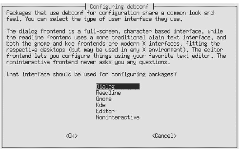

*图 5.11：* *debconf 的 dialog 前端。*

```
Configuring debconf
-------------------

Packages that use debconf for configuration share a common look
and feel. You can select the type of user interface they use.

The dialog front-end is a full-screen, character based interface,
while the readline front-end uses a more traditional plain text
interface, and both the gnome and kde front-ends are modern
X interfaces, fitting the respective desktops (but may be used in
any X environment). The editor front-end lets you configure things
using your favorite text editor. The noninteractive front-end
never asks you any questions.
```

- 1. Dialog
- 2. Readline
- 3. Gnome
- 4. Kde
- 5. Editor
- 6. Noninteractive

What interface should be used for configuring packages? 2

因此，选择使用哪个前端实际上是一个偏好问题。在配置 debconf 软件包时，你可以选择一个默认前端，该默认值可以随后通过适当设置 `$DEBIAN_FRONTEND` 环境变量来覆盖⁴⁷。

对于无人值守安装，noninteractive 前端可确保过程不会暂停并等待用户输入。相反，对于之前未回答的所有问题，将使用默认值。理想情况下，数据库应预先填充具有高或关键优先级问题的答案，因为这些问题没有合理的默认值。或者，可以使用远程数据库（参见第 5.8.6 节）。

除了提问，debconf 也可以简单地向用户显示消息。如果使用 noninteractive 前端，这些消息将通过电子邮件发送给 root 用户。

## 5.8.4 重新配置软件包

针对 debconf 查询给出的选项和设置并非最终结果。事实上，重新运行 debconf 并对各个问题提供不同的答案是轻而易举的。以前，重新配置软件包的标准方法是重新安装。然而，由于 debconf 会记住它提出了哪些问题并且不会再次显示它们（除非特别要求），重新安装最终将使用相同的 debconf 参数。显然，清除 debconf 数据库，或者至少清除相关记录可以达到目的，但使用专门为此目的设计的工具 **dpkg-reconfigure** 也可以达到同样效果。

**dpkg-reconfigure** 接受软件包的名称，并告诉 debconf 再次询问所有问题，无论它们之前是否已回答；`--unseen` 选项会导致跳过已见过的问题。例如，以下命令指导 **dpkg-reconfigure** 更改默认问题优先级和主前端。

```
# dpkg-reconfigure --frontend=readline debconf
Configuring debconf
[...]
What interface should be used for configuring packages? 2
[...]
See only questions that are of what priority and higher? 4
[...]
```

⁴⁷That is $DEBIAN_FRONTEND, and not $DEBCONF_FRONTEND (just like $DEBIAN_PRIORITY)!

重新配置会导致软件包的钩子脚本（例如 postinst）运行。这些脚本必须执行软件使用新配置所需的一切操作，同时注意不要覆盖管理员在 debconf 之外所做的任何更改。完成此操作的最佳方法是用现有配置文件播种 debconf 建议的默认答案，然后将 debconf 缓存中保存的数据写入新文件。

## 5.8.5 debconf 实战

让我们稍作停顿，检查一个示例。hinfo 软件包使用 debconf 来确定从网络更新数据库的间隔，以及如果这些间隔是周期性的，它是否应该对更新过程输出详细信息。该软件包向 debconf 注册了两个参数，这些参数在 `/var/lib/dpkg/info/hinfo.templates` 中可用：

```
Template: hinfo/autoupdate
Type: select
Choices: never, now, weekly, monthly
Default: never
Description: When would you like hinfo to download new databases?
[...]
Template: hinfo/autoupdateverbose
Type: select
Choices: quiet, nonverbose, verbose
Default: quiet
Description: How verbose should the periodic update be?
[...]
```

如你所见，参数以分层结构组织，类似于注册表。有了模板文件，debconf 现在就知道了 hinfo 的参数。问题的显示由软件包的 config 脚本控制，该脚本存储在 `/var/lib/dpkg/info/hinfo.config` 中。为了便于你阅读，该脚本已被简化。

```
#!/bin/sh -e
##### config script for hinfo
. /usr/share/debconf/confmodule
[...]
db_input medium hinfo/autoupdate
db_go
if db_get hinfo/autoupdate; then
case "$RET" in
daily|weekly|monthly)
db_input medium hinfo/autoupdateverbose
db_go
;;
*)
  # added for demonstration purposes:
  db_set hinfo/autoupdateverbose false
  ;;
esac
fi
```

`db_input` 累积参数问题，并为问题分配四个优先级之一。通过不在参数中硬编码优先级，可以以编程方式更改优先级，例如根据用户之前的选择。只有当第一个参数指定的优先级高于或等于当前配置或请求的 debconf 优先级时，问题才会被注册。一个将 debconf 配置为高优先级的用户将永远不必费心处理 hinfo 的参数，hinfo 将使用默认值。

`db_go` 命令使用配置的或请求的前端显示所有累积的问题。如果前端支持，这允许多个问题一次显示。

通过 `db_get`，可以查询数据库。该命令将参数值放入环境变量 `$RET` 中。如你所见，然后可以使用此变量来有条件地显示第二个问题——这只有在响应第一个问题选择了周期性选项时才有意义。在非周期性选择的情况下，config 文件使用 `db_set` 写入 debconf 数据库⁴⁸。

模板和配置文件的组合将软件包的参数及其查询逻辑与 debconf 集成在一起，但以上所有内容都没有说明如何根据用户的选择实际配置 hinfo。这是在 hinfo 的 **postinst** 文件中完成的，该文件同样查询数据库并采取适当步骤配置 cron：

```
#! /bin/bash
[...]
db_get hinfo/autoupdate
au=$RET
case "$au" in
[...]
  never)
[...]
    ;;
  now)
[...]
    ;;
  daily|weekly|monthly)
db_get hinfo/autoupdateverbose
verb=$RET
temp=`tempfile -p hinfo -m 0755`
cat <<EOF >$temp
#!/bin/sh -e
if [ -x /usr/sbin/hinfo-update ] ; then
    su hinfo -s /bin/sh -c '/usr/sbin/hinfo-update -${verb}'
fi
EOF
ucf -s /usr/share/hinfo $temp /etc/cron.$au/hinfo
chmod u+x /etc/cron.$au/hinfo
rm $temp
[...]
    ;;
esac
[...]
```

⁴⁸The call to db_set is not present in hinfo and has been added for demonstration purposes only.

简而言之，这个 **postinst** 脚本读取自动更新的周期，并使用 case 语句采取与用户选择相适应的步骤。如果选择的是每日、每周或每月的周期性更新，它会在临时文件中创建升级脚本，并使用 **ucf** 将其放置到位，从而确保管理员的更改不会在未经同意的情况下被覆盖。

通过将所有配置操作本地化在软件包脚本内，关于如何将用户的选择转化为有效配置的所有知识都包含在 **hinfo** 软件包中，**debconf** 不需要知道关于 **hinfo**、**cron** 或前者使用后者的任何信息。与配置仪表板和控制面板相比，**debconf** 方法可以处理无限数量的不同配置方案，而无需修改 **debconf** 核心。

## 5.8.6 使用远程数据库后端

**debconf** 数据库是一个平面文件缓存数据库（位于 `/var/cache/debconf` 下）。尽管这种数据库后端存在所有缺点（如性能和大小），但它非常适合作为单机的用户界面和响应缓存。然而，如果 **debconf** 不允许为不同需求使用不同的后端，它就不是 **debconf** 了；在撰写本文时，除了轻量级目录访问协议（LDAP）后端之外，**debconf** 还可以使用三种本地数据库方法之一：单个文件（**File**，默认）、目录层次结构（**DirTree**）或基于每个软件包一个文件（**PackageDir**）。LDAP 后端虽然仍处于实验阶段，但允许使用安全套接字层（SSL）以及设置只读属性。

使用远程 **debconf** 数据库有多种原因。最常见的原因可能是你希望在安装新系统时使用现有 Debian 系统的设置。最简单的方法是


## 5 Debian 包管理系统

通过 Pipe 驱动程序和 SSH 可以将平面文件数据库 **config.dat** 的内容从另一台机器进行隧道传输（或者提前复制过来，然后使用本地版本配合 Pipe，而不是 SSH 隧道）。我将立即向你展示如何实现这一点。

**debconf** 提供了将多个数据库组合起来的手段。可以通过两个环境变量 **$DEBCONF_DB_OVERRIDE** 和 **$DEBCONF_DB_FALLBACK** *临时性地*指示 **debconf** 从另一个来源获取参数。如果设置了第一个变量，**debconf** 会在查询本地缓存之前先查阅引用的数据库。类似地，**$DEBCONF_DB_FALLBACK** 可用于指定在本地缓存中未找到某个变量时要查询的来源。

来源以驱动程序及其所需参数的形式指定。驱动程序只是一种访问数据库的方法，**debconf** 附带了若干驱动程序，在 **debconf.conf (5)** 中有描述。以下是可用驱动程序中的一部分：

-   **File**：使 **debconf** 使用平面文件作为数据库。例如：**File{/tmp/my-debconf-db}**。

-   **Pipe**：配置 **debconf** 从标准文件描述符 **stdin**（和 **stdout**）读取（和写入）。这些可以通过参数指向其他位置。

-   **Stack**：可以将不同的来源进行堆叠，然后按照指定顺序依次查询。该手册页（**debconf.conf (5）**）给出了此驱动程序的一个有用示例。

-   **LDAP**：指示 **debconf** 通过 LDAP 获取值。例如：**LDAP{server:localhost,basedn:dc=debconf}**

要让 APT 执行到下一个发行版的升级，同时从远程机器而非用户获取所有未知设置，你可以使用如下的 **Pipe** 传输方式：

```
~# export DEBCONF_DB_FALLBACK=Pipe
~# export DEBIAN_FRONTEND=noninteractive
~# ssh remote cat /var/cache/debconf/config.dat | \
   apt-get dist-upgrade
[...]
```

APT 将继续下载所有新包，并将参数模板注册到 **debconf** 中作为预配置的一部分。所有尚未存储在本地 **debconf** 数据库中的参数都从 **stdin** 读取，假定它是平面文件格式的 **debconf** 数据库。非交互式前端确保升级过程中不会出现中断。

或者，你可能想要更改多台机器上若干包的配置。完成此任务的一种简单方法是在一台机器上准备好所需的配置，然后覆盖其余系统上的 **debconf** 设置。例如，要强制在 **postfix** 和 **apache** 上使用与机器 **remote** 相同的配置（但为了演示目的使用 File 驱动程序而非 Pipe），则需要在每台目标机器上执行以下操作：

```
# scp remote:/var/cache/debconf/config.dat /tmp/remote-config.dat
# export DEBCONF_DB_OVERRIDE=File/tmp/remote-config.dat
# dpkg-reconfigure --frontend=noninteractive postfix apache
```

在重新配置时，**debconf** 将使用文件中可用的参数，仅在找不到某个特定参数时才访问主 **debconf** 数据库。由于我们刚才在远程机器上按照期望配置了这两个包，**dpkg-reconfigure** 所需的所有参数都将在我们重新配置之前复制的平面文件中可用。

除了通过使用环境变量临时组合数据库后端之外，**debconf** 还可以通过 `/etc/debconf.conf` 文件进行静态配置。其手册页（**debconf.conf (5)**）提供了关于相关配置参数的详尽信息。

得益于可以在 `/etc/debconf.conf` 中为每种数据库类型设置的只读属性，也可以将另一台机器的 **debconf** 数据库作为多台机器的参考来源。使用 **Stack** 驱动程序将本地缓存与包含一组公共参数的远程数据库组合，可以搭建一个机器集群，所有机器都有一组可供 **debconf** 使用的公共参数，但每台机器都允许进行本地修改<sup>49</sup>。

随着此类配置中机器数量的增加，平面文件数据结构由于其串行特性而迅速达到其极限。层次型数据库（例如通过 LDAP 访问的）更适合充当集群或较大型工作站组的 **debconf** 后端。经过正确配置，LDAP 允许多台机器从共享的只读 LDAP 树中获取 **debconf** 参数，同时每台机器都可以对各自的树进行写入以进行本地修改。

**debconf** 的 LDAP 后端配置十分直接（且超出了本书的范围）。**debconf-doc** 包在其文档目录（`/usr/share/doc/debconf-doc`）中的 `debconf.schema` 文件中提供了必要的模式定义（用于 **OpenLDAP**）。

<sup>49</sup> 这类似于编程语言（如 C）中在本地作用域覆盖变量的概念，或者是层次型数据库中的继承概念。

## 5.8.7 问题与不足

作为一个获取并似乎存储配置数据的系统，debconf 常被视为配置仓库或注册表系统。其作者称其为"配置系统"也无助于澄清这一点，而实际上它真正是一个用户交互框架和响应缓存系统。正确使用时，debconf 是一个强大而又不显眼的系统，它使包能够在安装操作软件时无需强迫包维护者选择可能导致安全或完整性问题的不合理默认值。此外，由于各个包自行处理自己的配置，仅将 debconf 作为与管理员交互的统一手段，因此 debconf 可以被无限数量的包使用，而无需 debconf 本身了解这些包。最后，它能够使用灵活且可能复杂的数据库后端及其组合，使其可以扩展到任意复杂度，甚至服务于一个 Debian 机器集群。

尽管如此，debconf 及其在 Debian 中的当前状态并不完美。debconf 的使用是被鼓励的但不是必需的，也没有关于何时应该使用它的指导方针。一个好的经验法则是使用 debconf 来询问那些在所有但最专业的安装中都不期望相同的参数值。然而，识别这类参数绝非易事，每个维护者对这条规则都有不同的理解。因此，debconf 的体验在 Debian 软件包池中并不一致。

配置文件处理是更大的摩擦来源。一个包的 postinst 文件如果将用户的响应合并到 /etc 下的软件配置文件中，就是在对这些文件进行程序性更改。根据规范，以这种方式自动修改的文件不得标记为 conffiles，因此无法受益于 dpkg 的配置处理机制。它们仍然是配置文件（因为它们位于 /etc 下），但不会被 dpkg 自动处理，dpkg 只对标记为 conffiles 的文件进行特殊处理。这是一个重要的区别！更多信息请参阅第 5.7.1 章。另外，第 9.4.2 章提供了一个如何处理 debconf 管理的配置文件的示例。

作为配置文件，根据规范，管理员对这些文件的任何手动更改在任何情况下都必须予以保留。因此，任何 postinst 脚本必须仅在无法从 /etc 下的软件配置中获取参数值时才考虑使用 debconf 缓存。要从 /etc 下提取参数值，必须解析配置文件，而对于某些配置文件范式来说，这可能并非易事。不同的软件使用不同的配置文件格式，这些格式的大量存在使得 debconf 不可能为此任务提供通用接口。实现将本地更改放回 debconf 数据库以符合规范的功能仍然是维护者的工作——因此也是一个潜在的错误来源。


## 5.8 debconf：Debian 软件包的配置

`hinfo` 软件包根据用户选择的时间间隔，在某个 `cron` 目录下安装了一个更新脚本。如果管理员在回答问题时选择了"daily"（每天），但后来决定改为每周执行计划，即将更新脚本从 `/etc/cron.daily` 移动到 `/etc/cron.weekly`，则 `postinst` 脚本必须做出相应的响应。实现这一目标的一种方法是使用 `db_set` 操纵 `debconf` 数据库以反映系统的当前状态。例如，以下 `hinfo` 的 `postinst` 脚本开头的代码可以实现这一功能（虽然它并未涵盖所有可能性，但你应该能理解其思路）：

```
#!/bin/bash -e
[...]
if [[ -f /etc/cron.daily/hinfo ]]; then
    db_set hinfo/autoupdate daily
elif [[ -f /etc/cron.weekly/hinfo ]]; then
    db_set hinfo/autoupdate weekly
elif [[ -f /etc/cron.monthly/hinfo ]]; then
    db_set hinfo/autoupdate monthly
else
    db_set hinfo/autoupdate never
[...]
```

虽然确实可以遵循对 `/etc` 的手动更改并更新 `debconf` 数据库以反映这些更改，但这种方法的主要弱点在于需要额外的逻辑。毕竟，`debconf` 的主要目的之一是将必要的逻辑缩减到配置的最基本要素。在维护者脚本中增加复杂性以优雅地处理这些操作会引入新的潜在缺陷，而且如果管理员的修改无法在 `debconf` 数据库中表示，整个方法可能会彻底失败。

其他常见问题主要源于对 `debconf` 用途的误解。重申一下，`debconf` 并非一个配置存储系统。所有配置都位于 `/etc` 下，`debconf` 的唯一目的是在 `/etc` 中没有足够的信息来拼凑出可用配置时向用户进行查询。特别是，关于 `debconf` 数据库的用途似乎存在一个常见的误解。存储在 `debconf` 数据库中的数据必须被视为易失性的，其存在绝不能被视为理所当然。该数据库仅用作缓存，它的完全消失除了导致 `debconf` 在下次调用 `config` 脚本时重新询问相同的问题外，不应对运行中的系统产生任何影响。

虽然前几段讨论的问题与 Debian 软件包维护者特别相关，但在使用 Debian 系统时，保持对 `debconf` 用途和能力的清晰认识非常重要。你应该了解 Debian 系统中自动配置管理的范围，以及可以期待什么和什么是不可接受的。尽管 `debconf` 并不完美，但它完成了自己的工作，而且完成得相当不错。然而，当问题出现并可能导致还原 `/etc` 下文件的手动更改时，重要的是要认识到这可能不是 `debconf` 的错，而是有问题的软件包的 `postinst` 脚本中的缺陷所导致的。

## 5.9 修改软件包

Debian 维护者在配置他们打包的软件时，会考虑到尽可能广泛的目标用户群。通常，已建立的稳定功能会被启用而非禁用，在需求面前，甚至会提供实验性选项（只要这些选项可以在配置中关闭）。

然而，管理员有时可能需要使用不同的编译时选项，或者对实际安装的文件进行更改。当然，可以简单地编译软件并将其安装到 `/usr/local`，甚至更改软件包安装到 `/usr` 的文件。但是，这些并不是真正的解决方案，因为它们绕过了软件包管理系统。对于 `/usr/local` 中的软件，你必须自行跟踪更新；而更改 `/usr` 中的文件则是一个非常糟糕的主意，因为这些更改可能会被更新覆盖（参见第 5.7.1 章）。

幸运的是，Debian 使得修改现有软件包变得很容易。通过智能地设置修改后软件包的版本号，让软件包管理系统集成自定义版本的软件包变得轻而易举。

在接下来的章节中，你将了解两种修改现有 Debian 软件包的方法，获得可以安装、跟踪和分发的独立软件包。除了从头重新编译这种干净的方法外，我还将向你介绍一种工具，它允许你修改软件包安装的文件，并将这些文件重新打包成新的 DEB 文件。

### 5.9.1 重新编译软件包

软件包重新编译的思路是获取源代码软件包，进行必要的更改，然后构建一个新的软件包（使用新的版本号），而无需深入理解其中的运作细节。该过程可以分为四个步骤，将依次讨论。

该过程的最终结果是一个包含修改后软件的 DEB 文件，它安装的是同一个软件包，版本号略高于官方软件包，但低于官方升级版本。这提供了与软件包管理系统的最佳集成，同时不会与其他软件包冲突。自定义版本号可用于固定（pin）软件包，从而防止升级（因为升级不会包含相应的修改；参见第 8.2.1 章）。

##### 获取源代码软件包

如第 5.2 章所示，Debian 区分源代码软件包和二进制软件包。到目前为止，我们主要处理的是二进制软件包，它们存在于 DEB 文件中，每个文件包含一个软件包。源代码软件包由两个或三个文件组成。Debian 还区分需要修改才能纳入 Debian 的软件包和可以直接纳入的软件包。前者称为原生（native）软件包，而后者没有官方名称，今后将称为普通（normal）软件包。

原生源代码软件包由两个文件组成。普通源代码软件包提供了一个额外的文件，用于封装外部可用的（上游）源代码与源代码软件包之间所需的更改。这一点稍后会变得清楚。以下是源代码软件包的组成文件：

- Debian 源代码控制（DSC）文件向管理工具描述该软件包，并提供有关哪些文件属于源代码软件包的信息。它通常使用 Debian 开发者的 GPG 密钥进行明文签名。
- 原生源代码软件包存放在一个 tarball 中，例如 `apt_0.6.25.tar.gz`。普通源代码软件包包含上游软件的原始 tarball（在可能的情况下），并在文件名中加入中缀 `.orig`：`postfix_2.1.5.orig.tar.gz`。
- diff.gz 文件提供了将 `orig.tar.gz` 文件中的目录树转换为 Debian 软件包目录树所需的信息（例如 `postfix_2.1.5-1.diff.gz`）。应用此补丁后，上游源代码目录树就变成了可以轻松转换为 Debian 软件包的源代码目录树。

除了从 Debian 镜像站下载这些文件外，APT 提供了一种便捷的方式来获取所有需要的文件并按需准备源代码树。为了能够执行此工作，APT 需要能够读取源代码软件包索引，这些索引与我们之前遇到的 Packages 文件分开存储。Debian 镜像结构使得推导位置变得轻而易举，要让 APT 访问给定镜像的所有源代码包，你只需在 `/etc/apt/sources.list` 中复制相应的行，如下所示：

```
# standard mirror for debian binary packages
deb     http://ftp.debian.org/debian sarge main
# same mirror, this time for debian source packages
deb-src http://ftp.debian.org/debian sarge main
```

最后一行指定了 *sarge main* 部分的源代码软件包索引。该行对应以下 URI：

```
ftp://ftp.debian.org/debian/dists/sarge/main/source/Sources.gz
```

## 5 Debian 软件包管理系统

Sources 文件与 Packages 文件本质上相同，标识了仓库中找到的源代码软件包以及组成文件的 MD5 校验和。你会注意到（并且不会感到惊讶）URI 中缺少架构引用；源代码软件包与架构无关。

在更新索引（`apt-get update`）之后，只需几次按键即可获取源代码软件包。请注意，只有更新操作才需要 root 权限。使用普通用户帐户重建 Debian 软件包是一种好的做法！

```
# apt-get update
$ apt-get moo
[...]
$ apt-get source --download-only postfix
Reading Package Lists... Done
Building Dependency Tree... Done
Need to get 2399kB of source archives.
Get:1 http://ftp.debian.org sarge/main postfix 2.1.5-1 (dsc) [844B]
Get:2 http://ftp.debian.org sarge/main postfix 2.1.5-1 (tar) [1972kB]
Get:3 http://ftp.debian.org sarge/main postfix 2.1.5-1 (diff) [426kB]
Fetched 2399kB in 0s (6501kB/s)
Download complete and in download only mode
$ dpkg-source -x postfix_2.1.5-1.dsc
dpkg-source: extracting postfix in postfix-2.1.5
```

APT 自动下载属于你请求的源代码软件包的文件。然后自动调用 dpkg-source 来解压软件包。`--download-only` 开关可防止自动解压。此外，APT 不关心你给它的是源代码软件包还是二进制软件包的名称。在后一种情况下，它会自动确定对应的源代码软件包并从中处理。如果一个源代码软件包生成多个二进制软件包，可以将任何一个二进制软件包传递给 `apt-get source`，示例如下：

```
$ apt-get source --download-only postfix-tls
[...]
Download complete and in download only mode
$ dpkg-source -x postfix_2.1.5-1.dsc
dpkg-source: extracting postfix in postfix-2.1.5
```

dpkg-source 知道如何处理原生和普通源代码软件包，它会自动执行所有必要的步骤，在相应的目录中留下已 Debian 化的源代码树（在我们的例子中是 ./postfix-2.1.5）。在满足所有构建依赖关系后，从解压后的源代码软件包构建相应的 DEB 文件是轻而易举的事。不过，首先我们将尝试进行一些修改。

##### 修改源代码树

对软件包的修改要么影响内容，要么影响编译，要么影响打包。前两种涵盖了大多数需求，将在此简要


任何更深层次的修改，包括对软件包结构的调整，最好都推迟到你阅读完第9章之后再进行。

对软件包内容的修改通常涉及对源代码的改动。如果这些改动不仅仅是修改简单的常量或其他微不足道的调整，你很可能需要在最终构建软件包之前，在多个节点尝试编译。

软件包构建过程的大多数方面，包括编译，都由 `debian/rules` 脚本控制。在大多数情况下，该文件是一个Makefile，其构建目标负责执行构建软件所需的所有步骤。要更改配置或编译标志，就需要修改这个目标（以及任何依赖的目标）。这些目标经常使用Unix典型的 `./configure; make` 序列。例如：

```
$ cat wuzzah-0.53/debian/rules
[...]
config.status: configure
  dh_testdir
  ./configure --host=$(DEB_HOST_GNU_TYPE) \
    --build=$(DEB_BUILD_GNU_TYPE) \
    --prefix=/usr --mandir=$prefix/share/man \
    --infodir=${prefix}/share/info

build: build-stamp
build-stamp:  config.status
  dh_testdir
  $(MAKE)
  touch build-stamp
[...]
```

从这个代码片段中，应该很容易看出如何影响配置或编译过程。例如，要启用（假设存在的）“magic”功能，你可以在 `./configure` 行（这行本身不应被修改）后面追加 `--enable-magic`，或者如果你想强制使用 GCC 4.0，你可以通过追加 `CC=gcc-4.0` 来修改 make 调用。

你可以在任何时间点直接调用 `debian/rules` 中的任何目标。为了确保软件能够构建，你需要安装其构建依赖项。Debian区分了标准构建工具和构建特定软件所需的工具；你需要确保所有依赖都已安装。幸运的是，Debian为此任务提供了自动化方法。此外，构建过程在多个节点需要root权限，但实际上这些权限并未被真正使用。你只需要模拟root权限，在所有情况下这都应该是首选。`fakeroot` 工具正是为此目的而存在（参见第9.2.8章）：

```
# apt-get install build-essential fakeroot
# apt-get build-dep postfix
```

执行这两个命令后，构建 **postfix** 所需的一切就都会安装好。如果你现在想尝试从解压的源码树编译该软件，你可以通过 `fakeroot` 调用 **clean** 和 **build** 目标：

```
~$ fakeroot debian/rules clean
[...]
~$ fakeroot debian/rules build
[...]
```

如果你最终构建了多个软件包，安装所有构建依赖项会逐渐填满你的系统。如果你更倾向于保持一个干净的系统，请考虑使用 **debfoster**（参见第5.11.6章），或者设置 **pbuilder**（参见第9.6章）来管理隔离的构建环境。

##### 记录变更

在这个阶段，你本可以从修改后的源码树直接构建二进制包并就此结束。然而，这样你就会得到一个 **postfix 2.1.5-1** 的DEB文件四处流传，它与官方的2.1.5-1包并不相同。更极端一点，想象你因为自己的修改引入了一个bug，并且你忠实地向BTS报告了这个bug，却未能识别出这些变更（因为你忘记了）。**postfix** 的维护者将会被逼疯，试图去寻找一个在2.1.5-1版本中并不存在的bug。

为防止混淆并帮助你识别已安装的软件，强烈建议在 **changelog** 中添加你的变更记录。同时，你应该通过添加一个标识符来增强版本号，使得 **APT** 和 **dpkg** 将自定义版本视为比当前官方版本更新，但比下一个官方发布版本更旧。一个简单的配方是在版本号后追加字符串 `+0.local.1`。你甚至可以将"local"替换为你选择的标识符。此外，最后一位数字完全由你控制，可用于区分不同的本地版本。例如，1.2-3 会变成 1.2-3+0.local.1。如果该软件包是一个原生软件包，因此版本号没有Debian修订号，你应该添加一个：1.2 变成 1.2-0+0.local.1。更多信息请参见第5.7.5章。

一个用于编辑 **changelog** 文件的有用工具是 **devscripts** 包中的 **debchange**。使用 **--increment** 选项调用它会自动创建一个递增了Debian修订号的新 **changelog** 条目。你需要手动还原这个增量并追加自定义版本字符串。或者，**--version** 选项允许指定要使用的完整版本号⁵⁰。命令 **dch** 是 **debchange** 的别名。

⁵⁰ http://bugs.debian.org/284658 提议了一个 -l 选项来自动化此过程，例如允许 `dch -lcustom` 自动选择下一个本地版本号。

由于每个changelog条目都有一个关联的责任人，你可能希望明确指定要使用的姓名和电子邮件地址，而不是依赖脚本自动从你的登录账户发现数据。这可以通过设置 `$DEBEMAIL` 来实现。更多信息，请查阅 dch(1) 手册页。

```
    $ export DEBEMAIL="martin f. krafft <madduck@debian.org>"
    $ VERSION=$(dpkg-parsechangelog | sed -ne 's,^Version: ,,p')
    $ dch --version=$VERSION+0.local.1 -- Made some local changes
    $ dpkg-parsechangelog
    [...]
    Version: 2.1.5-1+0.local.1
    [...]
     * Made some local changes.
```

如果你没有指定描述变更的文本，**debchange** 将调用你的编辑器并让你手动编辑changelog。请比上面的例子更详细地描述你的变更。

##### 构建修改后的软件包

在进行了所需的更改之后，是时候从源代码包生成定制的二进制包了。这个过程需要安装构建依赖项集合，该过程由 `apt-get build-dep` 自动化。我们还需要 `fakeroot`（参见第9.2.8章）。**dpkg-dev** 包提供了 `dpkg-buildpackage` 工具，它可以自动从已Debian化的源码树构建源代码包和二进制包。我们将使用 `-uc` 和 `-us` 选项调用它，以避免对源代码包和软件包上传进行签名。如果你拥有GPG密钥，你可能想使用它；你可能需要使用 `-k` 开关指定要使用的密钥ID。我们可以通过传递 `-b` 开关来避免构建源代码包：

```
    # apt-get install fakeroot dpkg-dev build-essential
    # apt-get build-dep postfix
    $ dpkg-buildpackage -rfakeroot -uc -us
    dpkg-buildpackage: source package is postfix
    dpkg-buildpackage: source version is 2.1.5-1+0.local.1
    dpkg-buildpackage: source maintainer is
     martin f. krafft <madduck@debian.org>
    [...]
     dpkg-source -b postfix-2.1.5
    dpkg-source: building postfix using existing
     postfix_2.1.5.orig.tar.gz
    dpkg-source: building postfix
     in postfix_2.1.5-1+0.local.1.diff.gz
    dpkg-source: building postfix
     in postfix_2.1.5-1+0.local.1.dsc
    [...]
    dpkg-deb: building package 'postfix'
    in '../postfix_2.1.5-1+0.local.1_i386.deb'.
    [...]
    dpkg-buildpackage: binary and diff upload (original source NOT included)
```

就是这样。现在父目录包含了 **postfix** 源代码包生成的所有DEB文件，并且它们都使用了自定义的版本号。这些软件包可以使用通常的工具安装在任何Debian系统上，或者在 **APT** 仓库中提供。如果有新的官方版本发布，它将替换本地版本。如果不希望这样，请配置 **APT** 将该软件包固定到自定义版本（参见第8.2.1章）。

##### 构建优化的软件包

如果你倾向于运行针对你的本地系统优化的软件，**apt-build** 适合你。**apt-build** 提供的该工具会询问你的架构和期望的优化设置，然后构建针对本地架构优化的软件包。为此，它下载源代码，适当地配置编译器（使用包装器来防止那些不允许覆盖编译器标志的软件包），然后继续构建软件包。此外，它可以维护一个包含优化文件的自定义 **APT** 仓库，并保持其最新。

对软件进行优化仅在极少数情况下是必要的，因为如今的程序大部分时间都在等待用户输入、网络或硬盘数据。那些确实能从处理器优化中显著受益的程序（如编码器和图形软件）通常已经包含了加载特定于本地架构的子系统的代码。在其他情况下，针对最常见架构的优化在Debian归档中作为单独的软件包提供（例如内核）。

由于 **apt-build** 使用起来非常简单，我们在这里仅提及它，而不深入讨论。一篇解释其动机和使用方法的文章可在线获取⁵¹。

### 5.9.2 重新打包软件包

另一种方法是根据你的喜好更改DEB文件实际安装的文件，然后使用修改后的内容创建一个新的DEB文件。如果所需的更改不必在编译之前或期间进行（*例如*，如果它们仅限于数据、配置或脚本文件），这种方法是可行的。

Debian归档中包含一个可以简化此过程的工具：**dpkg-repack**。它旨在简化将软件包从一个系统复制到另一个系统，以及恢复不再可用的DEB文件，但稍加小心，它也可以用来创建定制版本。例如，以下更改

⁵¹ http://julien.danjou.info/article-apt-build.html


## 5.10 集成非Debian软件

尽管Debian软件归档中有海量的软件选择，但有时仍有必要将第三方软件与Debian系统集成。虽然像**stow**这样的工具可以对安装到**/usr/local**的软件进行可扩展的管理，但保持多台机器同步，或将外部软件与系统其余部分集成，可能仍会成为一场噩梦。

有三种工具可以帮助你将第三方软件与Debian系统集成：**alien**可以将其他发行版的软件包转换为Debian软件包；**checkinstall**可以监控安装过程并生成一个DEB文件来封装已安装的文件。这两种方法都会创建真正的Debian软件包，从而可以像以前一样使用软件包管理工具。对于少数两种方法都不适用的情况，**equivs**工具可以创建虚拟软件包，仅仅是为了满足依赖关系。让我们逐一了解这些工具。

## 5.10.1 alien

**alien**可以在几种不同的软件包格式之间进行转换：Debian的DEB、RedHat和LSB的RPM、Stampede的Slackware软件包格式（SLP）、Slackware的GZIP压缩Tarball（tar.gz）（TGZ）以及Solaris的Unix软件包格式（*例如*Solaris和NetBSD使用的）（PKG）。因此，可以将*例如*RPM文件转换为DEB文件，以便稍后安装在Debian系统上。或者，它也可以直接安装以这些软件包格式提供的软件，而无需显式转换。显然，**alien**也有其局限性，甚至可能无法完全且完美地覆盖所有不同格式的共同点。尽管如此，它在大多数情况下表现出色，并且通常能够完美地映射依赖关系（如果源格式支持依赖关系）。

```
~$ alien nethack-3.4.3-1.i386.rpm
nethack_3.4.3-2_i386.deb generated
~$ dpkg --info nethack_3.4.3-2_i386.deb
 new debian package, version 2.0.
 size 1250590 bytes: control archive= 1501 bytes.
     67 bytes,     2 lines      conffiles
   1237 bytes,    26 lines      control
   1498 bytes,    22 lines      md5sums
 Package: nethack
 Version: 3.4.3-2
 Section: alien
 Priority: extra
 Architecture: i386
 Depends: libc6 (>= 2.3.2.ds1-4), libx11-6 | xlibs (>> 4.1.0),
          [...]
```

生成的DEB文件现在可以使用dpkg安装在Debian系统上，其处理方式与普通软件包相同。

然而请注意，**alien**不保证软件包能正常工作，也不会像Debian软件包那样精心地尝试将其集成到Debian系统中。Debian软件包能够共存并且通常开箱即用，很大一部分原因在于Debian策略（见第5.7章）中规定的严格准则。其他发行版的软件包无需遵守此策略，而**alien**对此也无能为力。因此，由**alien**生成的软件包很可能违反Debian策略，并可能引起问题以及与其他软件包的不兼容。正如我们所看到的，dpkg会防止损坏，但如果确实出现问题，请首先归咎于alien软件包。

## 5.10.2 checkinstall

**checkinstall**使用**installwatch**来确定由安装过程（如`make install`）安装和更改的文件集。为了能够监控该进程，它必须作为**checkinstall**的子进程启动：

```
/tmp/hello-2.1.1$ ./configure --prefix=/usr && make
[...]
/tmp/hello-2.1.1# checkinstall make install
[...]
Done. The new package has been installed and saved to
/tmp/hello-2.1.1/hello-2.1.1_2.1.1-1_i386.deb
```

**installwatch**在动态链接器层面工作，这使其几乎可以用于任何安装程序。甚至以下情况也是可能的：

```
~# checkinstall /bin/sh
[...]
~# echo Welcome, stranger... > /etc/motd
~# exit
[...]
~# dpkg --info motd_1_all.deb
new debian package, version 2.0.
 size 712 bytes: control archive= 269 bytes.
      168 bytes,      8 lines      control
 Package: motd
 Priority: extra
 Section: checkinstall
 Installed-Size: 8
 Maintainer: martin f. kraftf <madduck@debian.org>
 Architecture: all
 Version: 1
 Description: Message of the day
~# dpkg --contents motd_1_all.deb
drwxr-xr-x root/root         0 2004-12-08 17:18:49 ./
drwxr-xr-x root/root         0 2004-12-08 17:18:15 ./etc/
-rw-r--r-- root/root        21 2004-12-08 17:18:13 ./etc/motd
```

**checkinstall**的功能是有限的。准确地说，它创建的软件包只能安装文件，而**checkinstall**并不关心它将文件安装到何处。你可以使用**checkinstall**覆盖主目录中的文件等等。生成的软件包无法修改文件。如果安装程序修改了现有文件，这些文件将完整地成为生成软件包的一部分。当一个安装程序通过修改`/etc/passwd`来添加用户，而该文件随后又被包含在软件包中时，就会出现可怕的场景。安装该软件包会导致`/etc/passwd`被完全替换，而卸载该软件包则会删除该文件，导致系统崩溃。生成的软件包也无法将它们的配置文件向**dpkg**注册[^53]，从而为那些覆盖本地配置文件更改的升级铺平了道路。

鉴于这些问题，除了极少数情况外，避免使用**checkinstall**可能是个好主意。如果你最终使用了它，请务必在将其安装到生产系统之前，仔细检查它创建的软件包。

## 5.10.3 equivs

**equivs**程序是一个创建空软件包的工具，其唯一目的是满足依赖关系。例如，你可能已经在**/usr/local**下安装了你自己非常棒的邮件传输代理，现在想卸载Debian安装的那个。然而，由于相当多的软件包依赖于**mail-transport-agent**，**dpkg**会阻止你。

解决方案是使用**equivs**创建一个提供**mail-transport-agent**的虚拟软件包。**equivs**软件包提供了两个实用程序来实现此目的。一个创建Debian软件包控制文件供第二个实用程序使用，第二个实用程序随后构建软件包：

```
~$ equivs-control postbote.control
```

此时，需要根据需要修改**postbote.control**文件。我们将删除所有不需要的字段，让**equivs**使用默认值。文件的最终版本如下所示：

```
Section: misc
Priority: optional
Standards-Version: 3.5.10

Package: postbote
Version: 1.0
Maintainer: martin f. kraftt <madduck@debian.org>
Provides: mail-transport-agent
Architecture: all
Copyright: /usr/share/common-licenses/Artistic
Description: dummy package for the locally installed postbote MTA
 postbote is a full-featured MTA and has been installed to
 /usr/local on the local system. This package only serves to
 make other packages depending on the mail-transport-agent
 virtual package happy.
 .
 This package has been created with equivs. It is empty.
```

[^53] 但请参见 http://bugs.debian.org/284786!


## 5.11 其他软件包工具

### 5.11.1 debsums

大量软件包会将其安装的文件连同 **MD5** 校验和一起注册到 **dpkg** 数据库中。这些数据可以在之后用于验证已安装文件的完整性。**debsums** 工具正是为此目的而设计的，并且可以为未安装校验和的软件包可选地补充哈希值。该软件包中提供了一个 **APT** 钩子（参见第 5.4.2 章），可在安装后生成缺失的哈希校验和。

不言而喻，这*不能*替代基于主机的入侵检测系统或文件完整性检查器。**dpkg** 数据库中的数据可以被轻易篡改。事实上，**debsums** 甚至本身就提供了这种功能。因此，**debsums** 是一个有用的管理工具，例如当你对 `/usr` 中的文件进行了更改却忘记记录时。虽然配置文件通常会被忽略，但 `--all` 选项可以将它们包含进来，从而有助于识别已更改的文件（用于备份或重建目的）。**debsums** *绝不*应被用于安全目的。

默认情况下，**debsums** 检查所有已安装软件包中位于 `/etc` 之外的所有文件。`--all` 选项会将 `/etc` 包含在内，并且可以在命令行上指定软件包名称以将检查限制在指定的软件包。使用 `--changed` 选项，该工具会将本地更改的文件输出到 **stdout**。

如前所述，`debsums` 可以为未提供 MD5 校验和的软件包创建校验和，并将其输入到 `dpkg` 的数据库中<sup>54</sup>。为此，`debsums` 需要安装该软件包时使用的 DEB 文件。因此，要为所有已安装的软件包补全 MD5 校验和，可以使用以下两个命令：

```
~# PKGS=$(debsums --list-missing)
~# apt-get install --reinstall --download-only $PKGS
[...]
~# debsums --generate=keep --deb-path=/var/cache/apt/archives $PKGS
[...]
```

`--generate=missing` 使 `debsums` 在可用时从 `*.md5sums` 文件中读取 MD5 校验和，并从 `--deb-path` 指定目录中的相应 DEB 文件中提取缺失的校验和。如果你想保留提取的校验和并将其合并到 `*.md5sums` 文件中，请使用 `--generate=keep`。另一方面，如果你想忽略 `*.md5sums` 文件中的校验和，请指定 `--generate=all`。例如，如果你想在不信任本地存储的 MD5 校验和的情况下验证 `postfix` 软件包的完整性，可以从可信来源获取 `postfix` DEB 文件，将其存储在 `/tmp/verify.postfix` 中，然后按如下方式调用 `debsums`：

```
~# debsums --generate=all --deb-path=/tmp/verify.postfix postfix
```

请注意，这种方法并非万无一失的验证。如果系统已被入侵，`debsums` 及其使用的工具可能已被修改以隐藏任何更改。只有从可信的安装环境中调用 `debsums` 才能进行可靠的验证，在那里可以用它来将挂载的 Debian 安装中的软件包与可信系统上的 DEB 文件进行比对验证。以下命令将 `/mnt` 挂载的 Debian 安装中 `postfix` 软件包安装的文件与 `/tmp/verify.postfix` 中可用的 DEB 文件进行比对验证：

```
~# debsums --generate=all --deb-path=/tmp/verify.postfix \
--root=/mnt postfix
```

<sup>54</sup> 哈希校验和将存放在 `/var/lib/dpkg/info` 下的 `*.md5sums` 文件中。由于 `dpkg` 并没有将它们放在那里，因此当关联的软件包被清除时，这些文件仍然会保留。

### 5.11.2 apt-listchanges

软件包升级必然会将软件的变更引入系统。软件包版本号的变动表示上游发生了更改，可能还伴随着打包方面的变更。版本号中 Debian 修订字段的增加表明打包发生了变化，或者维护者修复了针对该软件包提交的一些缺陷。这些更改始终记录在 `/usr/share/doc/<package>` 目录下的文件中：`changelog` 作为上游软件的一部分提供（大多数情况下），包含从一个版本到另一个版本的更改；而 `changelog.Debian` 则仅描述为 Debian 软件包所做的更改，如打包技术、添加的功能和补丁，或对源代码的修改（例如为了符合 FHS 标准）。Debian 变更日志通常用简单的注释（如"New upstream release"）来标记上游软件的一组更改，从而引导读者参考另一个变更日志文件。

系统越繁忙，其管理员了解升级所带来的变更就越重要。**apt-listchanges** 旨在为管理员提供一种便捷的机制来保持信息更新，提供两种操作模式。首先，它可以读取 DEB 文件中的变更日志，从而使用户了解上一版本和当前版本之间的更改。第二种可能更有用的模式是与 **APT** 的自动集成。当由 APT 触发时，**apt-listchanges** 会显示与安装或升级对应的变更日志条目，按紧急程度排序（参见第 9.2.7 章）。因此，重要的更改很可能出现在顶部，不太重要的则出现在末尾。非常方便。

不幸的是，**apt-listchanges** 只能处理 Debian 变更日志（每个软件包都必须提供），因为 Debian 打包软件中的上游变更日志文件没有统一的标准格式；各作者用来记录代码更改的格式五花八门、风格各异。另一方面，Debian 变更日志始终具有相同的格式，这是由软件包维护者工具强制执行的。

由于这一限制，Debian 开发者被鼓励在 `NEWS.Debian` 文件中提供新闻简讯，该文件使用与 Debian 变更日志类似的格式。**apt-listchanges** 可以解析这些文件并在变更日志条目旁边显示新闻项。事实上，在撰写本文时，**apt-listchanges** 很可能会被默认安装在 Debian 系统上，用于在软件包安装和升级时显示这些新闻文件。

无论如何，简单安装该软件包即可通过 `/etc/apt/apt.conf.d/20listchanges` 文件中的以下配置项将其与 APT 集成。

```
DPkg::Pre-Install-Pkgs {
	"/usr/bin/apt-listchanges --apt || test $? -ne 10";
};
```

**apt-listchanges** 可以配置为仅显示未读过的新闻和变更日志条目，这对于高效使用来说是必要的。此外，它可以使用多种不同的前端来显示这些项目，并可选地将条目通过电子邮件发送到指定地址。最后但同样重要的是，当由 APT 调用时，用户可以告诉 **apt-listchanges** 在显示更改后要求确认。这样，如果管理员尚未准备好处理，就可以轻松中止升级过程。

### 5.11.3 apt-listbugs

apt-listbugs 之于缺陷报告，就如同 apt-listchanges 之于变更日志。该脚本像 apt-listchanges 一样挂接到 APT，从 Debian 缺陷跟踪系统（参见第 10.6 章）获取即将安装的软件包的未关闭缺陷报告。在过滤掉除严重和关键缺陷之外的所有条目后，apt-listbugs 显示这些缺陷并询问用户是否希望继续或中止操作。

apt-listbugs 尽最大努力将缺陷的显示限制在当前正在安装的版本所适用的范围内。然而，这显然并非总能实现。尽管 Debian 缺陷报告通常包含受影响软件包的版本号<sup>55</sup>，但缺陷的性质使得确定其他受影响的版本变得困难。因此，仔细审查缺陷报告是管理员的工作。不过，幸运的是，严重和关键缺陷并不太常见。

如果你发现一个无法容忍的缺陷，可以在 apt-listbugs 提示符下选择 [n] 来阻止安装。此外，该工具还可以添加一个 APT 固定到之前的版本，以防止未来的更新（参见第 8.2.1 章）。不幸的是，固定是在 APT 启动时初始化的，因此在同一会话中不会生效。在设置固定后重启 APT 操作是合理的<sup>56</sup>。

该脚本目前使用 BTS 的 HTTP 接口<sup>57</sup>。作者已宣布正在开发 LDAP 接口，该接口可能会导出更多功能。

### 5.11.4 cron-apt

cron-apt 工具设计为由 cron 调用以执行例行 APT 操作。它使用 `/etc/cron-apt` 下的多个目录进行配置。开箱即用时，该工具会在凌晨 4 到 5 点之间的随机时刻启动，更新其缓存并下载所有升级的软件包但不安装它们（使用 apt-get 的 `--download-only` 选项）。这一行为由 `/etc/cron-apt/action.d` 中的文件控制。这些文件按字典序执行。

<sup>55</sup> 只是"通常"，因为缺陷提交者并不总是遵循指南，也不总是能够提供必要的信息。`reportbug` 工具（参见第 10.6.5 章）简化了这一过程，因此应推广其使用。

<sup>56</sup> 在撰写本文时，该工具存在一个阻止其添加固定的缺陷。此外，它可能生成一个空的 `/etc/apt/preferences` 文件，这会阻止后续的 APT 操作（参见缺陷 #276602）。如果你遇到这种情况，只需将 `/etc/apt/preferences` 移走即可。

<sup>57</sup> http://bugs.debian.org


并在每行中为`apt-get`指定单个命令。此处，对`autoclean`的调用可以最小化用于存储`/var/cache/apt`的分区空间。我们可以通过创建相应的文件来插入更多命令。

```
~$ head /etc/cron-apt/action.d/*
==> /etc/cron-apt/action.d/0-update <==
update -qq

==> /etc/cron-apt/action.d/3-download <==
autoclean -y
dist-upgrade -d -u -y
~$ echo check -y > /etc/cron-apt/action.d/99-check
```

**cron-apt**会将其操作的信息性邮件发送到预配置的地址（或`root@localhost`）。此邮件的大部分方面，包括其内容、在特定情况下触发的特殊钩子以及日志选项，都可以在`/etc/cron-apt`目录中进行配置。

**cron-apt**工具对于在系统未使用时执行下载、使升级包在本地可用以及允许管理员监督升级非常方便。对于个人计算机，它也可用于保持安全更新。一种方法是为安全存档创建一个特殊的**sources.list**文件，并在**cron-apt**调用期间仅使用此文件。

```
~# cat <<EOF > /etc/apt/sources.list.security
http://security.debian.org/debian-security sarge/updates main
EOF
~# cat <<EOF >> /etc/cron-apt/config
OPTIONS='-o Dir::Etc::SourceList=/etc/apt/sources.list.security'
EOF
~# echo upgrade -y > /etc/cron-apt/action.d/10-upgrade
```

我强烈不建议使用**cron-apt**从主Debian存档更新包，或在关键任务服务器上使用它。尽管Debian以其健壮性和软件包质量而闻名，但软件应在监督下升级，以便在发生意外情况时采取适当措施。

## 5.11.5 deborphan

尤其是在个人系统上，已安装软件包的数量每月都在增长。当一些软件包被移除时，它们的依赖项可能仍留在系统中（`aptitude`可以跟踪和识别多余的依赖项，见第8章）。一个安全稳定系统的重要方面是，应将软件包集保持在最小限度，以减少错误的影响（见第7章）。

**deborphan**利用Debian软件包之间的紧密依赖关系（部分由策略规定，见第5.7章）来识别不再被其他软件包使用的软件包。它实际上并不检查软件包是否被系统用户使用。

该工具有大量的配置选项，允许进行细粒度的搜索。默认情况下，它只扫描**libs**和**oldlibs**类别（见第5.2.1章）。这类似于第8章中介绍的方法：

```
# deborphan
libpcre3
libgnutls11
# deborphan | xargs dpkg --purge
[...]
```

**deborphan**也可以扫描其他类别（见第5.2.1章），并使用文件名和软件包描述的启发式方法来决定要检查孤立状态的软件包集（**--guess-\***选项）。例如，要移除所有虚拟和过渡软件包，以及所有**pike**模块（除了**libs**和**oldlibs**类别），您可以使用：

```
# deborphan --guess-dummy --guess-pike
```

**deborphan**清除已移除软件包并清理其配置文件的能力也很有帮助。显然，配置文件的持久存在是有原因的，因此您应谨慎使用此命令。但如果您发现自己过于频繁地通过**dpkg-query**输出进行grep并通过**xargs**管道传输，那么这个工具就是为您准备的：

```
# deborphan --all-packages --find-config --no-show-section
exim4-base
[...]
```

**orphaner**以交互方式工作，支持移除在上一步骤（**deborphan**仅列出它们）中已变得多余的软件包。此外，**editkeep**是**/var/lib/deborphan/keep**的图形前端，该文件保存了一个软件包列表，这些软件包绝不能被**deborphan**建议移除。

## 5.11.6 保持系统清洁：debfoster

**debfoster**试图帮助您维护一个占用空间小的Debian系统。它识别仅为满足依赖关系而存在的软件包，并以交互方式组装要保持安装的软件包列表。所有非必需且未明确要求的软件包随后将被移除。以下是一个简单的例子：

```
# apt-get install vim emacs21
[...]
# debfoster

vim is keeping the following 2 packages installed:
    libgpmg1 vim-common
Keep vim? [Ynpsiuqx?], [H]elp: Y

emacs21 is keeping the following 17 packages installed:
    emacs21-bin-common emacs21-common emacsen-common libice6 libjpeg62
    libpng12-0 libsm6 libtiff4 libungif4g libx11-6 libxext6 libxmu6 libxpm4
    libxt6 xaw3dg xfree86-common xlibs-data
Keep emacs21? [Ynpsiuqx?], [H]elp: N
[...]
The following packages will be REMOVED:
    emacs21* emacs21-bin-common* emacs21-common* emacsen-common*
[...]
```

在这里，**debfoster**将vim和**emacs21**识别为新软件包，并提示用户如何处理它们。我选择保留vim，并清除emacs21。随后调用**debfoster**时，它知道我想保留vim，不会再打扰我。

## 5.11.7 缓存APT存档

APT会为其本地机器缓存下载的软件。但是，如果您操作多台机器，此缓存就没有用处，因为您可能必须为每台升级的机器下载一次软件包。根据上游链路，这可能很耗时，系统管理员通常不喜欢等待进度条完成。

虽然可以将APT的缓存共享给一堆机器，但一次只有一台机器可以访问它。如果使用NFS或类似技术进行共享，为强制执行此访问策略所需的锁定将变得不必要地复杂。

为了解决这个缺点，出现了一些工具，其功能范围从使本地缓存可正确访问网络，到充当Debian软件包的代理缓存，再到镜像整个存档。

##### apt-proxy

**apt-proxy**是一个独立的HTTP服务器（使用**Python twisted**服务器框架），它代理对多个APT存档的访问，这些存档在其配置文件中定义。软件包和索引文件仅在缓存中不存在时才会获取，否则将提供缓存的版本。**apt-proxy**不是通过`$http_proxy`或在APT配置中使用的代理，它是一个真正的APT源。

一个典型的（最小的）apt-proxy配置可能如下所示：

```
~$ cat /etc/apt-proxy/apt-proxy-v2.conf
[...]
[debian]
backends = http://ftp.de.debian.org/debian
          http://ftp2.de.debian.org/debian

[security]
backends = http://security.debian.org/debian-security

[pdo]
backends = http://people.debian.org
[...]
```

客户端可以通过在sources.list文件中使用以下行来访问代理，假设运行apt-proxy的机器地址可以从机器arakis解析，并且apt-proxy在其默认端口上监听：

```
~$ cat <<EOF > /etc/apt/sources.list
http://arakis/debian sarge main
http://arakis/security sarge/updates main
http://arakis/pdo/~madduck/packages/stage ./
```

URL中第一个之后的所有部分都直接附加到apt-proxy使用的后端。可以定义多个后端，并在第一个后端不可达时用作故障转移。后端也可以使用FTP或rsync（这没什么意义）而不是HTTP。最后，可以将本地APT缓存导入代理。

除了APT及其本地缓存外，apt-proxy还自动处理清理工作。其缓存清理策略突显了其与Debian存档的紧密耦合：清理尝试每天进行一次，因为Debian镜像每天只更改一次。软件包会保留到达到最大保存期限，但apt-proxy也会查看版本，并在有更新版本可用时清除软件包。

apt-proxy一直以多问题和引发麻烦而闻名。在版本2中，完整的重写解决了许多问题，但仍有大量问题存在。因此，最明智的建议是：看看它是否适合您。如果不是，那么请帮助修复它，或者去别处寻找。无论如何，您应采取适当措施确保只有授权客户端才能访问缓存。

##### apt-cacher

与apt-proxy目标相同，apt-cacher采用了不同的方法，以CGI的形式提供缓存代理。它使用一个单独的Web服务器（如apache），并且可以缓存任何APT存档，而无需为其配置条目。以下示例sources.list文件将清楚地说明这一点：


# 5.11.7 缓存代理服务器

```
$ cat <<EOF >> /etc/apt/sources.list
http://apache/apt-cacher/ftp.debian.org/debian sarge main
```

apt-cacher 的配置仅指定了缓存清理（和访问）策略，该策略也适用于 APT 归档。所有与缓存归档相关的信息都包含在 APT 使用的 URL 中。这是缺陷还是特性由您自己决定。apt-cacher 可以限制用于下载的带宽，但它不支持除 HTTP 之外的任何用于外部归档访问的方法。

类似 apt-proxy，apt-cacher 也有其各自的问题。有些人无法使其正常工作，另一些则盛赞它。尝试并找出原因。注意一个简单的 `apt-get install apt-cacher` 会拉取完整的 apache2 Web 服务器。Debian 的 apache2 安装了合理的默认配置，但您可能希望进一步锁定它。

##### squid

或许，squid 是缓存代理方面相当于 web 服务器的 apache 的角色。因此，可能会产生利用它来缓存对 Debian 归档的请求的欲望。这种欲望很容易满足，但请注意，squid 无法理解策略驱动的 Debian 归档结构（不同于 apt-proxy 和 apt-cacher）。因此，为了最佳性能，需要对其配置进行一些更改。此外，建议为 APT 和通用 Web 访问缓存分别运行独立的 squid 实例。

不用太多细节，以下设置在 /etc/squid/squid.conf 中能与 Debian 归档配合得很好。您当然需要根据需求和能力调整缓存的大小（所有从 Debian 默认值的变化均已高亮）：

```
# cat /etc/squid/squid.conf
[...]
maximum_object_size 150 Mb
cache_dir aufs /var/spool/squid-apt 2048 16 256
refresh_pattern 4u?deb|dsc|changes|.(orig.tar|diff).gz)$ 14400 20% 2592000
refresh_pattern (Packages(.gz|bz2))?|Release(.gpg)?|Sources(.gz|bz2))?$
) $ 14300 20% 14400
redirect_program /etc/squid/redirector.pl
cache_replacement_policy heap LFUDA
[...]
```

该配置调整了缓存大小以及要存储的最大对象大小，使其适合 Debian 归档的内容。如果可以，增加缓存时间以进行更长时间的缓存。`refresh_pattern` 主要用于跟踪测试和不稳定分支的变更，这些变更发生非常频繁，但 Debian 镜像不使用一致的缓存过期策略。Debian 软件包的文件名不会更改且不会被重用，这使我们能够调整文件的存储策略。软件包文件现在至少保留一天，但最多 30 天。索引文件预计每天会更改并获取适当的值。五分之一的年龄用于表示新鲜度，这对于选择的 `cache_replacement_policy` 效果很好。

最后添加的是使用重定向器，它防止 squid 重复缓存包（如果通过代码和发行版名称交替访问）。显然，当下一版本的 Debian 到来时，映射必须被修改。

```
~# cat /etc/squid/redirector.pl
#!/usr/bin/perl -w

use strict; # (somewhat) enforce good coding style
$|=1;     # unbuffer stdout

while (<>) {
  s@sid/(main|contrib|non-free|Release.*|Contents.*)@unstable/$1@;
  s@etch/(main|contrib|non-free|Release.*|Contents.*)@testing/$1@;
  s@sarge/(main|contrib|non-free|Release.*|Contents.*)@stable/$1@;
  print;
}
```

##### apt-move

**apt-move** 将本地 APT 缓存转换为 Debian 归档。事实上，它对任何 DEB 文件的扁平集合都有效，并且可以自行检索文件，实际上允许选择性镜像整个 Debian 归档。在其最简单的形式中，**apt-move** 使本地 APT 缓存可用，可通过任何 APT 理解的方式导出到目录。目标目录由 /etc/apt-move.conf 中的 `$LOCALDIR` 控制。例如：

```
~# apt-move local
[...]
~# ls -Fl /mirrors/debian
drwxr-xr-x  3 root root 21 Aug 19 20:36 dists/
drwxr-xr-x  3 root root 17 Aug 19 20:27 pool/
```

这些目录的内容就是您所期望的。**apt-move** 使用 /var/lib/apt/lists 中的文件将版本映射到发行版，以便相应地索引 pool 结构中包含的软件包。您可以自动化将软件包移动到 **apt-move** 存储库的操作，这通过一个 APT hook 实现。由于该操作在 `dpkg` 有机会安装它们之前移动文件，因此 **apt-move** 必须更改为复制而不是移动软件包文件：

```
# sed -i -e 's,^COPYONLY=.*,COPYONLY=yes,' /etc/apt-move.conf
# cat <<EOF > /etc/apt/apt.conf.d/50apt-move
DPkg::Pre-Install-Pkgs "/usr/bin/apt-move update"; ;
EOF
```

现在文件在 APT 调用 dpkg 安装软件包之前就在本地归档中可用。如果您使用 `--download-only`，您将不得不采用 shell script two-liner。

**apt-move** 的另一种工作模式旨在允许部分镜像官方 Debian 归档。此方法也可以与第一种结合使用。两个变量影响 **apt-move** 镜像的方式：

**$APTSITES**
该变量列出 /etc/apt/sources.list 中要镜像的镜像的主机名，或者仅为“/ALL/”以镜像所有。

**$PKGTYPE**
在此处，您可以指定是仅镜像二进制软件包、仅源还是两者都进行镜像。

在正确的设置下，调用 **apt-move mirror** 将检索尚未本地存储的内容以根据配置创建镜像。仅会获取本地体系结构的软件包。使用 **apt-move sync**，该工具仅镜像已安装的软件包集合。这两个命令都会遵守镜像根目录 (**$LOCALDIR**) 中的文件 **.exclude**，其中可以包含标识不应该被镜像的归档部分的文件名模式。语法与标准 shell 路径名扩展（通配符）相同。

## 5.11.8 Debian 归档的镜像：debmirror

`debmirror` 包提供了一个允许完全镜像 Debian 归档或其一部分的脚本。该工具有大量选项以允许精确指定镜像范围。它支持各种下载方法，包括 **rsync**，这在 Debian 中不太有用，因为归档变更主要是文件名更改和新文件的形式，这是 `rsync` 无法处理的。最佳的功能演示可以通过示例：

```
~$ debmirror --arch=i386,powerpc --section=main \
  --host=debian.ethz.ch --dist=sarge --method=rsync \
  --root=:debian /srv/mirrors/debian
[...]
```

当该调用完成时，您将在 /srv/mirrors/debian 中获得真正的 `sarge` 镜像，其中包含 i386 和 powerpc 的源软件包和二进制文件。该脚本仅镜像 *main* 并使用 rsync 访问 debian.ethz.ch::debian 处的存储库。

《debmirror(1)》手册页面详细介绍了此命令的使用。在所有信息中，它包含一个不能强调足够的警告。如果您指定您的主目录作为镜像操作的目标，`debmirror` 就会这样做：它将*替换您的整个主目录*为 Debian 镜像，这很可能不是您想要的。请小心使用该命令，因为它可能非常破坏性。

## 5.11.9 包数据库的高级查询

两种工具幸存于 **dselect**（见第 5.3.9 章）时代；两者都专注于支持在 `dpkg available` 数据库中进行的灵活搜索，这几乎是旧时代的遗迹，除了这些工具外未被使用。幸运的是，即将遇到的这两种工具都不需要该数据库，因为两者也可以与 `dpkg status` 数据库或使用 APT 缓存中 `/var/lib/apt/lists` 的 **Packages** 文件一起工作。

##### grep-dctrl

**grep-dctrl** 包提供了一组有趣工具以从具有 Debian 包控制文件通用格式的任何文件中过滤信息[^1]，包括 `/var/lib/dpkg/status`、`/var/lib/dpkg/available` 和 APT 存储库中找到的 **Packages** 和 **Sources** 文件。

**grep-dctrl** 的行为和感觉像 **grep**，但它更灵活并将段落视为单位而不仅仅是行。此外，它可以将搜索范围限制为某些字段，并为结果中的匹配记录选择要显示的字段。例如，要扫描本地 **Packages** 文件并打印由我维护的每个软件包的名称和版本，您可以使用以下命令：

```
$ grep-dctrl --field=Maintainer madduck \
  --show-field=Package,Version Packages
[...]
```

存在许多别名以允许更简单地使用该命令。**grep-status** 搜索 `/var/lib/dpkg/status`（如果命令行上没有给出其他文件）。同样，**grep-available** 搜索 `/var/lib/dpkg/available`，当可用软件包列表更改时必须更新（最容易通过 dselect 完成）：

```
# dselect update
```

[^1]: 这类似于（但不完全相同）请求评论 (RFC) 822：http://www.rfc-editor.org/rfc/rfc822.txt


这些工具还支持跨多个字段的正则表达式，从而实现灵活搜索。举两个简单的例子：以下第一个命令返回版本号中包含"alpha"或"beta"的所有软件包维护者；第二个命令返回维护者字段中包含"duck"一词的所有软件包：

```
~$ grep-available --no-field-names --eregres \
    --field=Version '(alpha|beta)' --show-field=Maintainer

~$ grep-available --no-field-names \
    --field=Maintainer,Description duck --show-field=Package
```

##### ara

来自同名软件包的ara工具专精于数据库的布尔查询，其语法比dpkg-dctrl更强大。有关可用语法的详细说明，请参阅ara (1)手册页。

由于该工具过于复杂，难以在此简短描述，因此接下来请放松一下，通过以下示例了解一些可能的查询（未显示结果）。ara在内存中合并两个dpkg数据库与APT可用软件包缓存，然后对其执行查询。虽然查询本身很快，但编译过程需要一些时间。对于单个命令来说，这已经是最佳状态了。如果您计划连续运行多个命令，可以考虑通过传递`-interactive`选项使用交互模式：

```
~$ ara -interactive
Loaded 11519 packages (processing
'‘debian.ethz.ch_debian_dists_unstabl...‘’)
Total 15754 packages...
Welcome to ara version 1.0.7 released on 2004-12-07.
Type ? for help and Ctrl-D or #quit to exit.
& Section:net
[...]
& Section:utils and !Depends:(gnome|kde|gtk)
[...]
& Maintainer:duck and (Priority:extra or Section:net)
[...]
& /boolean.*queries/ and Priority:optional
ara ara-byte bool xara-gtk xara-gtk-byte
```

最后一个查询表明ara还提供了图形版本。`-byte`软件包安装的是Ocaml字节码版本的工具，而非编译后的二进制文件（主要用于Ocaml无法生成二进制代码的平台）。

在 http://ara.zapto.org 可以查询和浏览ara数据库。

## 5 Debian软件包管理系统

### 5.11.10 软件包使用调查

Debian系统可从众多地方获取，且无需任何注册手续。因此，一旦您获得了源介质的访问权限，您就可以尽可能独立于Debian项目，仅受所安装各个软件的许可证限制约束。虽然这种独立性相较于某些商业操作系统是一个巨大优势（后者有时仅在交换已安装软件信息的前提下才提供安全补丁），但也使得Debian开发者难以以最优方式调整优先级以满足用户需求。

举个简单的例子：可能几乎每位用户都选择安装foo软件包，那么如果开发者投入更多时间改进foo，将使用户社区获得最大收益。然而，开发者可能并不知道foo的受欢迎程度，也不会将其改进置于优先级列表的前列。

为解决此问题，`popularity-contest`软件包应运而生。它安装一个cron作业，每周通过电子邮件将本地系统已安装软件包列表提交至专用服务器（popcon.debian.org）。在服务器上，提交内容经过处理，计算出按受欢迎程度估算的软件包排名。所有提交都是匿名的，但为每台设置提交的机器跟踪已安装软件包集合<sup>59</sup>。此外，`popularity-contest`尝试包含软件包安装程序的访问时间，以生成独立的安装和使用统计数据。

Debian项目官方主要使用此信息来选择在第一张Debian安装光盘上分发的软件包——这通常是展会上或杂志中唯一分发的光盘。开发者个人可以自由查看统计信息（可在网页 http://popcon.debian.org 获取）以辅助决策。此外，这些统计信息还曾用于解决开发者之间的纠纷，否则这些纠纷将不得不通过其他方式（如比较大小）来解决。

不幸的是，在发布准备期间的某个不巧时间点，软件包选择机制发生变更，导致`popularity-contest`被排除在默认安装的软件包集合之外。由于`popularity-contest`是帮助Debian项目改进其系统的宝贵工具，我恳请您安装它并允许其参与官方调查；您将以此方式帮助改进Debian。

> <sup>59</sup> 这通过在提交中包含每台机器的唯一标识号来实现。该编号在安装`popularity-contest`时随机生成（存储在`/etc/popularity-contest.conf`的`$MY_HOSTID`中）。请注意，互联网邮件无法完全匿名化，因为传输中的服务器会在其处理的消息中添加头信息，从而允许将消息追溯到原始机器，尽管这并非轻而易举。不过，Debian并未使用这些头信息中包含的信息。

##### 使用使用调查数据

**popularity-contest**收集的数据也可在本地使用。其主要用途之一是识别那些软件超过一个月未使用的软件包，如果空间紧张，可考虑将其卸载：

```
# popularity-contest | grep '<OLD>$'
1102503722 1102503725 tnef /usr/bin/tnef <OLD>
[...]
```

此外，使用**popularity-contest**进行内部普查也很简单：可以通过`/etc/popularity-contest.conf`中的`$MAILTO`变量控制数据发送的地址。也可以设置`$MAILFROM`。在`/usr/share/doc/popularity-contest/examples`目录下，您会找到多个处理提交的脚本。

### 5.11.11 特意省略的工具

在海量的可用工具中，有一些工具因特别负面而引人注目。因此，本章未涵盖它们。现将其列于此处：

- **auto-apt**：该工具与（例如）shell等程序挂钩，并拦截因未知命令导致的错误。然后它检查Debian存档中是否有*任何*软件包提供该命令，如果有，则使用**sudo**安装该软件包以满足请求。不幸的是，三次尝试使用此按需安装功能均导致shell仅能理解**KILL**信号。效果可能因人而异。

- **cruft**：该程序旨在识别不属于Debian系统的文件，使用排除列表允许系统管理员（和软件包维护者）指定系统上预期存在的额外文件。遗憾的是，**cruft**自1999年以来一直被积极忽视，且不太可能复兴。完整性检查器（如**aide**或**tripwire**）以更主动的方式实现相同目的。

### 5.12 Debian内核

Debian系统的许多方面都通过软件包进行管理；内核——作为机器硬件与操作系统及其上运行软件之间的接口——也不例外。随着对十一种不同架构（见第4.5章）的支持以及每个架构的多个内核，内核软件包维护者必须在减轻镜像负担（内核软件包很大）和为用户提供所需灵活性之间走钢丝。

下文将介绍构成内核及其外围的各种软件包背后的理念。我们首先考察Debian对Linux和非Linux内核的支持，本章其余部分将仅限于Linux软件包，并识别每个内核版本存在的不同软件包。最后，将简要介绍扩展模块和内核补丁的概念，以及Debian使用软件包的方法。第8.1章将补充本章，详细介绍构建自己的内核和模块软件包的具体细节。

#### 5.12.1 内核支持

当人们谈论Debian时，他们指的是Debian项目或其主要产品——Debian GNU/Linux操作系统。因此，"Debian"一词已被确立为指代一个Linux发行版。然而，Debian不仅仅是Linux发行版，因为Debian是一个独立于内核的操作系统。虽然Debian GNU/Linux——指明了使用GNU用户空间实用程序和Linux内核的Debian操作系统——无疑是目前最受欢迎且最先进的Debian操作系统，但人们正在努力将Debian的管理范式与其他用户空间集合和内核的组合相融合。以下对非Linux内核<sup>60</sup>的移植工作正在进行中：

- **Debian GNU/NetBSD**：对于偏好NetBSD内核但习惯于Debian管理，或更喜欢Debian管理而非**pkgsrc**系统的管理员，Debian GNU/NetBSD项目正在将Debian和GNU用户空间移植到NetBSD内核。虽然对**i386**架构的支持已进展顺利，但**alpha**架构仍处于初始开发阶段。NetBSD内核已达到生产级别，预计Debian GNU/NetBSD将成为生产环境中的一个可靠替代方案。

- **Debian GNU/kFreeBSD**：Debian对FreeBSD内核的移植使用完整的GNU用户空间、GNU C库和FreeBSD内核。Debian GNU/kFreeBSD目前仅支持**i386**架构。FreeBSD内核已达到生产级别，预计Debian GNU/(k)FreeBSD将成为生产环境中的一个可靠替代方案。此前另一组人曾致力于使用BSD用户空间的FreeBSD移植，但该项目因失去兴趣而终止。

> <sup>60</sup> http://www.debian.org/ports


**Debian GNU/Hurd**

使用 Debian 与 Hurd（GNU 操作系统，其大部分功能通过用户空间进程而非内核空间驱动程序提供）结合的努力正在进行中。不幸的是，Hurd 仍然不成熟，开发进展缓慢。因此，Debian 充当了 Hurd 的参考实现，邀请更多开发者加入 Hurd 项目。其实际可用性目前值得怀疑。

**Debian GNU/Darwin**

虽然非官方且托管在 SourceForge<sup>61</sup> 上，Debian GNU/Darwin 移植项目旨在将 Debian 的方式引入 Mac OS X "Darwin"。目前，该项目处于不活跃状态；我没有收到任何回复，而且 SourceForge 的使用统计数据似乎表明该项目已经终止。

虽然 Linux 内核是一个强大的内核，兼具实验性代码和成熟功能的健康组合，但它远非完美。对于日常使用，内核运行良好，并提供典型的 UNIX 系统稳定性。然而，在高级场景中，神秘的内核缺陷常常让用户抓狂。虽然 Linux 内核无疑具有许多优势，但在某些情况下，其他内核能提供更强大的硬件支持，或者在常见操作系统任务（如内存管理<sup>62</sup>）上采用技术上更先进的方法。

Debian 对非 Linux 内核的支持意味着，出于技术或其他原因需要其他内核的 Debian 用户无需离开熟悉的领域。同时，与支持的硬件架构一样，Debian 的内核独立性允许跨不同内核进行统一的系统管理。特别是在处理嵌入式设备和多样化硬件时，能够使用*例如* NetBSD 内核并保持 Debian 的管理范式是一个很大的优点。

<sup>61</sup> http://sourceforge.net/projects/debian-darwin

<sup>62</sup> 一篇关于 Linux 和 NetBSD 内核的有趣技术比较（尤其因其可移植性而引人关注）可在此处找到：http://www.wasabisystems.com/gpl/linux.htm。此外，http://www.instinct.org/pgl/bsd-comparison-humour.txt 可能包含您一直寻找的答案。

## 5.12.2 内核包剖析

除了支持不同的内核，Debian 档案库还包含封装各种不同版本并针对不同架构优化的内核的包。Debian 内核包安装的内核力求支持尽可能广泛的硬件，如果适用，会充分利用内核的模块支持。尽管如此，Debian 试图将其分发的内核的修改限制在最小范围内。虽然 Debian 内核与可从官方内核分发点下载的原版内核不同[^63]，但包含的内核补丁仅限于安全更新，并且只添加了少数经过仔细审查的功能，以允许 Debian 池中的某些包独立于运行系统的内核[^64]。有关这些 Debian 特定更改的相关信息可在安装相应的 kernel-doc 包（<版本> 指的是内核版本，后跟架构和特性，例如 2.6.8-1-k7）后，在 /usr/share/doc/kernel-doc-<version>/README.Debian.gz 中找到。

[^63]: http://kernel.org

[^64]: 举个例子，Debian 2.4 内核系列从 2.4.20 开始包含从 2.5 回移的 IPsec 支持。这样做是为了让基于 2.4 内核系列稳定性的用户能够使用包档案库中提供的一系列 IPsec 工具。

在 Debian 档案库中，内核版本是包名的一部分。因此，每个内核版本应被视为一个单独的包，并且不同版本可以共存。例如，用于现代 AMD 处理器的 2.6.8 Linux 内核是 kernel-image-2.6.8-1-k7。关于内核包的命名，有四个重要点需要注意：

-   包名非常以 Linux 为中心，并假设 "kernel-image" 指的是 Linux 内核。一旦其他内核流行起来，命名方案可能会改变[^65]。

[^65]: http://debian.linuxwiki.de/DebianKernel/Plan

-   版本号限制为三个组件。Linux 内核团队直到最近才在发布 Linux 内核版本 2.6.8.1 时开始使用第四个组件。由于 2.6.8.1 使 2.6.8 过时，并且额外的数字看起来像是一次性的，Debian 内核维护者选择省略最后的 .1。对于 2.6.11，上游内核开发者再次使用了四组件版本号。一旦这种做法确立，Debian 将采用新的方案。

-   版本号之后是一个数字，编码内核映像的应用二进制接口（ABI）版本。许多编译时选项和内核配置参数会更改内核的 ABI 并导致模块不兼容。因此，ABI 版本被编码在包名中以强制模块重新编译。

-   名称的最后一部分标识内核配置和优化的子架构。内核包的架构必须与目标系统的架构兼容，否则系统将无法启动。对于 i386 架构上的 Linux，可用的内核包架构有：

兼容内核，可以运行在*任何* x86 兼容架构上（包括 AMD、Intel、Transmeta、Cyrix 等）。鉴于 **80386** 处理器系列的问题（参见第 4.5.1 章），此内核可能会放弃对 **80386** 的支持并要求 **80486** 兼容性。届时它将相应地重新命名。在 *sarge* 中，**80386** 处理器受到支持。

仅在 2.4 内核系列中，**586-tsc** 标识为 Intel Pentium Classic（首款具有时间戳计数器（TSC）寄存器的处理器）配置的包。

这些内核设计用于在所有 Pentium 之后的 32 位 Intel 处理器上运行。对于 2.6 内核系列，这包括 Pentium Classic。对于 2.4 内核，必须使用 **586-tsc** 包代替。

AMD 较旧的 K6 处理器系列由这些内核包支持。

所有较新的 AMD 32 位处理器都由这些包中提供的内核处理。

此外，一些内核有不同的变体。例如，**686** 和 **k7** 内核不支持对称多处理（SMP）。相反，**686-smp** 和 **k7-smp** 变体提供此功能，应在安装多个处理器时使用。

上游内核版本是内核包名的一部分。因此，将内核升级到下一个上游版本需要安装一个新包，因为 **APT** 无法自动推断升级。为简化起见，一些元包（也称为虚拟包）允许 **APT** 在新的内核进入 Debian 档案库时，只需依赖相应的包即可升级内核映像：

```
~$ dpkg-query --print-avail kernel-image-2.6-k7
Package: kernel-image-2.6-k7
[...]
Version: 2.6.8-1
Depends: kernel-image-2.6.8-1-k7
[...]
```

因此，当发布新的上游内核并安装相应的元包时，**APT** 将元包升级到下一个版本，从而引入新的内核包以满足依赖关系。这些元包可用于所有合理的内核系列、架构优化和变体的组合：

- **kernel-image-2.4-386**：适用于 x86 架构的最新 2.4 内核，没有特定优化。

- **kernel-image-2.4-586tsc**：最新的 2.4 内核，针对 Pentium Classic（首款具有 TSC 寄存器的处理器）优化。

- **kernel-image-2.4-686**：最新的 2.4 内核，针对第一代之后的所有 Pentium 处理器优化。

- **kernel-image-2.4-686-smp**：同上，支持多处理器。

- **kernel-image-2.4-k6**：最新的 2.4 内核，针对 AMD 的 K6 处理器优化。

- **kernel-image-2.4-k7**：最新的 2.4 内核，针对 AMD 的 Athlon 和 Duron 处理器系列优化。

- **kernel-image-2.4-k7-smp**：同上，支持多处理器。

- **kernel-image-2.6-386**：适用于 x86 架构的最新 2.6 内核，没有特定优化。

- **kernel-image-2.6-686**：最新的 2.6 内核，针对第一代之后的所有 Pentium 处理器优化。

- **kernel-image-2.6-686-smp**：同上，支持多处理器。

- **kernel-image-2.6-k7**：最新的 2.6 内核，针对 AMD 的 Athlon 和 Duron 处理器系列优化。

- **kernel-image-2.6-k7-smp**：同上，支持多处理器。

每个这些包只是简单地依赖于其最高版本的相应内核包。当一个新的内核上传到档案库时，也会上传一个新的元包，其 **Depends** 字段已修改。因此，APT 升级将引入新的内核包以满足元包的依赖关系。旧的内核映像会保留下来，一旦验证新内核运行正常，可以手动删除。请注意，元包仅

自 **sarge** 版本起可用。此外，这些软件包并非为所有硬件架构提供。因此，**woody** 或更早版本的用户，或使用尚未提供这些元软件包的硬件架构的用户，将需要手动获取最新的内核映像，如果希望如此的话。或者，你可以构建自己的内核，因为 Debian 使得构建内核非常容易（参见第 8.1 章）。

与其他 Linux 发行版不同，Debian 内核并未包含所有可能的补丁以试图支持最新的硬件。虽然这种方法保持了内核的清洁和稳定，并且有助于在出现问题时定位来源，但它显然也带来了 Debian 内核不如其他（主要是商业的）Linux 版本支持硬件种类广泛的缺点。幸运的是，新的硬件设备驱动程序通常会在相对较短的时间内进入内核，因此对新硬件的支持通常会在几周后出现在最新的 Debian 内核中。

Debian 内核将四个文件放入 **/boot** 目录：

-   **vmlinuz-<version>**：二进制内核。
-   **initrd.img-<version>**：在初始启动阶段加载的 ramdisk，以便提供访问本地安装所需的驱动程序。
-   **System.map-<version>**：内存地址与相应内核函数之间的转换映射，以便调试信息更详细。
-   **config-<version>**：内核配置文件，包含以供参考。

Debian 的内核旨在尽可能广泛。对于工作站机器，它们通常绰绰有余，并能适当处理不断变化的硬件和计算机的不同需求。由于大多数内核功能都作为模块启用，而不是编译到计算机中，因此各种实用程序（例如 *hotplug* 和 *discover*）可以按需加载必要的组件。内核映像也广泛用于服务器系统，尽管根据需求考虑编译自定义内核可能是值得的。我通常为服务器系统编译自己的内核，以便能够禁用内核模块（这是一种安全风险）。这种方法自动消除了 Debian 内核使用的初始 ramdisk，从而消除一个常见的故障点。此外，第三方模块众所周知难以与初始 ramdisk 集成，或者集成很容易被遗忘。

##### 内核模块和初始 ramdisk

如果适用于宿主架构，几乎每个内核功能和设备驱动程序都构建为模块。这些模块安装在 /lib/modules/<version> 下，与上游内核具有相同的布局。启动和挂载根文件系统所需的模块也会在安装时写入压缩文件系统映像（cramfs）：/boot/initrd.img-<version>。管理员可以通过 initrd-tools 软件包提供的 /etc/mkinitrd 中的配置文件自由影响此 ramdisk 映像的构建。当安装 Debian 内核软件包时，会拉入此软件包。由于初始 ramdisk 是在内核映像的配置阶段创建的，因此必须单独并提前安装 initrd-tools 才能更改其设置。或者，你可以在进行所需更改后重新配置内核映像：

```
~# editor /etc/mkinitrd/mkinitrd.conf
[...]
~# dpkg-reconfigure kernel-image-2.6.8-1-k7
[...]
```

创建文件系统映像的程序 mkinitrd 的特定配置可以在 /etc/mkinitrd/mkinitrd.conf 中设置。例如，当空间紧张时，将 $MODULES 设置为 "dep" 可能是值得的，这将导致 mkinitrd 咨询 modprobe 以确定要包含的最小模块集。如果你使用非标准文件系统或磁盘控制器，通常最好在 /etc/mkinitrd/modules 中指定这些（参见 modules(5)），以确保无误。手册页 mkinitrd.conf(5) 和 mkinitrd(8) 提供更多信息，第 8.1.1 章展示了如何为 Debian 内核创建和检查初始 ramdisk。

由上述过程生成的初始 ramdisk 是一个包含在单个文件中的文件系统。在内核提供适当支持的情况下（所有 Debian 默认内核都提供 cramfs 支持），可以挂载并本地检查。如果 mkinitrd 被告知不包含所有模块，这是确保包含挂载根文件系统所需的所有模块的便捷方法。例如，以下命令允许检查自定义内核包 kernel-image-2.6.8-arakis 的初始 ramdisk 上包含的模块：

```
~# dpkg --install kernel-image-2.6.8-arakis
[...]
~# mount -o ro,loop /boot/initrd.img-2.6.8-arakis /mnt
~# cd /mnt
/mnt# ls -F
bin/      dev2/     lib/      loadmodules   sbin/     sys/      var/
bin2/     devfs/    linuxrc*  mnt/          script    tmp/
dev/      etc/      linuxrc.conf   proc/     scripts/  usr/
/mnt# ls -F lib/modules/2.6.8-arakis
initrd/            modules.dep         modules.pcimap
kernel/             modules.ieee1394map modules.symbols
modules.alias      modules.inputmap    modules.usbmap
modules.ccmap      modules.isapnpmap
/mnt# ls -F lib/modules/2.6.8-arakis/kernel/security
capability.ko  commoncap.ko  root_plug.ko  secvlv.ko
```

##### 与引导加载程序集成

解压内核映像软件包后，**dpkg** 根据 /etc/kernel-img.conf 中的设置将内核集成到本地系统中。该文件中的设置包括内核映像安装位置、系统是否应维护指向当前和先前内核二进制文件的规范链接，以及如何通知引导加载程序新内核。

默认情况下，内核软件包维护一对指向当前和先前内核二进制文件的符号链接。这些符号链接的确切位置可以通过 /etc/kernel-img.conf 控制，默认情况下在大多数系统上是根目录 /。/vmlinuz 指向 /boot 中的当前内核二进制文件。当安装更新的内核映像时，该链接被重命名为 /vmlinuz.old，并创建 /vmlinuz 指向新安装的内核二进制文件。

这些链接是否必要或有用在很大程度上取决于所使用的引导加载程序。Debian 未提供 Lilo 配置文件 /etc/lilo.conf 的自动管理实用程序。因此，告诉 Lilo /vmlinuz 和 /vmlinuz.old 并让内核软件包维护链接是很方便的。这是 Debian 中的默认设置。以下显示了基于 Lilo 系统的 /etc/kernel-img.conf 的建议内容。第二个选项 links_in_boot 导致内核软件包将这些链接放入 /boot，我建议这样做以保持根目录整洁。如果你选择使用此选项，请确保相应更新 /etc/lilo.conf，然后调用 lilo，或手动运行一次 update-grub。之后你可能还想删除根目录中的符号链接。

```
do_symlinks = yes
links_in_boot = yes
do_bootloader = yes
```

Debian 的 **Grub** 软件包提供 update-grub，它可以接管 Grub 配置文件 /boot/grub/menu.lst 的管理。因此，符号链接并非真正必要。对于使用 Grub 的系统，以下配置选项是合理的：

```
do_symlinks = no
do_bootloader = no
```

> 此文件实际上可能在 /boot/boot/grub/menu.lst。如果你像我一样是个纯粹主义者，你可能想将 /boot/boot/grub 移动到 /boot/grub，并从 /boot 创建指向 /boot/boot 的符号链接：`ln -s . /boot/boot`

## 5.12.1 Debian 软件包管理系统

```
do_initrd = yes
postinst_hook = /sbin/update-grub
postrm_hook   = /sbin/update-grub
```

安装内核映像时，会提示你将初始 ramdisk（"initrd"）（Debian 内核使用）告知引导加载程序。**grub-update** 脚本自动处理 **initrd** 选项，因此上述配置包含 **do_initrd = yes** 指令以防止警告。

### 5.12.3 源代码、头文件和文档

考虑到空间要求严格的系统，Debian 将与操作系统内核相关的文件分为几个软件包。除了内核映像软件包外，还有单独的内核源代码、头文件和文档软件包。Debian Wiki 包含关于 Debian 内核打包的重要资源[67]。

对于每个内核版本，都有一个 **kernel-source-<version>** 软件包。内核映像为每个内核版本、架构和变体的组合打包，但都使用相同的内核源代码软件包，每个上游内核版本只有一个。每个内核源代码软件包将适当的 bzip2 压缩 tarball 安装到 `/usr/src`。tarball 包含用于编译 Debian 内核的确切源代码，包括区分 Debian 内核与上游版本的修改。拥有 tarball 而不是解压的源代码树有两个功能：首先，tarball 大大减少了 `/usr` 分区的大小要求；其次，它建议需要使用内核源代码的用户将其解压到自己的主目录。如果没有对目录的写访问权限（例如用于目标文件），内核源代码树不是很有用，因此在 `/usr/src` 提供解压的源代码树没有太大意义。

除了 **kernel-source-<version>** 软件包外，你可能会发现 **kernel-tree-<version>** 软件包。这些软件包的存在是为了防止在快速发展的 *unstable* 归档中内核映像和相应内核源代码软件包之间的版本差异。它们在 Debian 构建和归档基础设施之外没有用处（除非你想使用较旧的 Debian 修订版构建内核，在这种情况下你也可以从 snapshot.debian.org 获取相应的内核源代码软件包）。有关内核树软件包的目的和功能的更多信息可在线获取[68]。

在编译内核源代码树之前，必须对其进行配置。作为配置的一部分，用户可以选择要启用的功能，并选择目标处理器类型以允许进行处理器特定的优化。

[67] http://wiki.debian.net/?Kernel
[68] http://wiki.debian.net/?DebianKernelTree


配置完成后，源码树中的头文件将封装所有已做的选择；而源文件则不会被修改。

正如我们将在 8.1.3 节中看到的，除了实际的内核源代码树之外，可以为任何 Debian 软件包轻松构建额外的内核模块，仅需对应于正在运行内核的头文件。为使此成为可能，Debian 存档为其包含的每个内核映像提供单独的 `kernel-headers-<version>` 软件包，以封装特定于所用架构和处理器类型的内核配置。解压后，头文件将安装在 `/usr/src/kernel-headers-<version>` 目录中。管理员的工作是（如果需要）提供一个 `/usr/src/linux` 符号链接，指向这些 `kernel-headers-*` 目录中的一个。

使用适当的内核头文件软件包，可以构建与相应内核映像协同工作的内核模块，而无需编译内核本身。内核源代码软件包不能用于此目的，因为它们包含的内核树尚未配置。如果你正在从内核源代码（参见第 8.1 节）构建自己的内核，你可以在过程中构建任何额外的模块（参见第 8.1.3 节）；如果你使用的是预打包的内核映像，则需要相应的内核头文件软件包才能构建模块（参见第 8.1.3 节）。

请注意，`kernel-header-<version>` 软件包中的内核头文件不应用于开发使用内核接口的用户空间软件。对于用户空间软件，使用与编译 C 库 libc6<sup>69</sup> 时相同的内核头文件至关重要。这些头文件填充了 `/usr/include`，由 `linux-kernel-headers` 软件包提供。

内核文档（内核源代码中 `Documentation` 目录下的所有内容）可从 `kernel-doc-<version>` 软件包获取，该软件包将文件安装到 `/usr/share/doc` 的适当子目录中。因此，文档已从内核源代码软件包中移除，以节省仅需安装源代码的系统空间。

## 5.12.4 内核模块和补丁

Debian 内核软件包在上游内核的基础上提供了少量的 Debian 特定修改和错误修复。额外功能包含在单独的软件包中，并以三种形式之一提供：预编译的内核模块、内核模块源代码和内核补丁。只有最流行的内核模块扩展，例如 PCMCIA 模块<sup>70</sup> 或高级 Linux 声音体系结构 (ALSA) 驱动程序，才作为预编译模块为可用的内核映像提供。例如，**alsa-modules-2.4.27-2-k7** 包含了 2.4.27-2-k7 内核的 ALSA 驱动程序，它将其安装在 `/lib/modules/2.4.27-2-k7` 下的一个目录中，以便与运行的内核直接集成。在撰写本文时，官方存档中尚不存在针对 2.6 内核系列的预编译模块，因为大多数模块都已包含在内核中（包括 PCMCIA 和 ALSA 驱动程序）。

与内核分开开发的驱动程序通常以模块源代码软件包的形式提供。这些模块由单独的项目提供，在 kernel.org 提供的原始内核源代码中找不到。例如，**openafs-modules-source** 包含为特定内核版本构建提供 AFS 文件系统所需模块的源代码。第 8.1 节揭示了详细信息，并展示了如何从此类源代码创建模块软件包。通常，编译内核模块只需要内核头文件。如果一个内核模块源代码软件包坚持需要内核源代码，那几乎可以肯定是一个错误。

Debian 发布了许多内核补丁，允许用户根据特定需求单独配置内核。这些补丁以常规 Debian 软件包的形式提供，并设计为与 `make-kpkg` 集成，使得通过单个命令即可构建修改后的内核。Crefmake-kpkg 将解释如何操作。内核补丁软件包允许进行大量的内核定制。例如，通过 `kernel-patch-openmosix`，Debian 内核可以轻松转换为兼容 OpenMosix 的内核，而 **kernel-patch-redhat** 则将 Debian 内核转换为相同版本的 RedHat 内核，包括 Red-Hat 选择应用于其内核的所有补丁。Debian 内核与其原始版本之间的差异也被封装在每个版本中。此外，Debian 内核补丁具有“取消应用”的能力。因此，在 **kernel-patch-debian-2.6.8** 的帮助下，内核源代码软件包可用于获取原始的上游内核源代码（以 2.6.8 内核为例）。输出中是否存在 Debian 版本号表明源代码树对应的是 Debian 内核还是上游内核。

```
# apt-get install kernel-source-2.6.8
# apt-get install kernel-patch-debian-2.6.8
$ tar xjf /usr/src/kernel-source-2.6.8.tar.bz2
$ cd kernel-source-2.6.8
~/kernel-source-2.6.8$ cat version.Debian
2.6.8-1
~/kernel-source-2.6.8$ /usr/src/kernel-patches/all/2.6.8/unpatch/debian
~/kernel-source-2.6.8$ cat version.Debian
2.6.8
~/kernel-source-2.6.8$ /usr/src/kernel-patches/all/2.6.8/apply/debian
```

有两个单独的软件包可供管理员选择其一。更多信息可在此处获取：http://pcmcia-cs.sourceforge.net/ftp/README-2.4。在 2.6 内核系列中，卡片服务驱动程序已被内核驱动程序取代。

```
~/kernel-source-2.6.8$ cat version.Debian
2.6.8-1
```

显然，应用内核补丁需要编译整个内核<sup>71</sup>，这可以由 `make-kpkg` 方便地处理（参见第 8.1 节）。可以设置 `make-kpkg` 自动对内核源代码树应用和取消应用补丁，以便单个源代码树可用于创建不同内核变体的软件包。

<sup>71</sup> 2.6 内核系列实际上允许独立于内核的其余部分编译模块。因此，如果补丁提供了一个新的设备驱动程序，该驱动程序可以被编译为模块，而无需重新编译内核的其余部分。截至目前，尚不存在能够封装此功能而无需重新编译整个树的 Debian 方法。

# 第 6 章 Debian 系统管理

> rm -rf 也有超级奶牛之力。
— Barry deFreese

超越软件安装管理（这是 Debian 包管理系统的领域，参见第 5 章），Debian 系统可以像任何其他 Linux 系统一样使用。然而，多年来，许多有用的系统管理工具是专门为 Debian 并在其精神指导下开发的。这些工具可在 DFSG（参见附录 F）条款下获取，并构成本章的主题。

首先，我们将检查一些主要由其他工具使用的实用程序，但它们对于了解其工作原理的人来说本身也很方便。除了将这些实用程序投入使用之外，理解它们的概念也是个好主意，因为它们影响着 Debian 系统的管理方式。

在基础之后，我们将学习 Debian 处理常见系统管理任务的方法：用户管理、系统初始化、自动化、设备管理、日志文件、网络配置。本章最后简要介绍了几个一站式集成管理工具，并指向了一些宝贵的资源。

### 6.1 基础

秉承 Unix 哲学，Debian 利用 Unix 系统上可用的小工具和概念，而不是提供自己的方法并重新发明轮子。然而，在项目过去的某些时候，其中一些轮子尚未被发明，Debian 提供了参考实现或发明了概念，为系统管理中的常见挑战提供灵活而健壮的解决方案。

这些概念和工具是 Debian 系统不可或缺的，是任何认真考虑管理 Debian 系统的人的前提条件。它们是 Debian 操作系统的基本构建块，就像标准 Unix 工具是任何基于 Unix 的操作系统的构建块一样。

#### 6.1.1 使用目录而非配置文件

Unix 系统的特性之一是其纯文本配置文件。通常，单个文件控制程序或服务器的大部分方面。虽然这种方法受到许多管理员的青睐，但当软件需要自动修改这些文件时，这就会成为一场噩梦。Debian 不提供中央配置系统（参见第 5.8 节），任何在软件包安装期间实施的配置更改都由软件包本身执行；这被认为是可接受的，因为维护者既控制软件包安装的配置文件，也控制进行任何修改的脚本。

当一个软件包需要更改另一个软件包的配置域时，问题就会开始出现。这种情况会出现，*例如*，当一个软件包将其提供的软件注册到来自另一个软件包的守护进程时。**cron** 就是一个典型的例子。许多软件包提供需要定期运行的任务以进行清理或维护，并使用 cron 来调度它们。如果这些软件包只是将它们的任务写入 cron 的主配置文件（`/etc/crontab`），想象一下当多个软件包编辑同一个文件时，或者如果你在编辑器中打开文件、进行编辑、在另一个窗口安装新软件包，然后才保存并关闭编辑器时，可能会出错的所有情况。

为了为管理员和软件包维护者提供更高的可管理性，Debian 系统使用目录来增强配置文件。


在适当的情况下。例如，无论你是通过向`/etc/crontab`追加一行来注册一个cron任务，还是将包含该行的文件放入`/etc/cron.d`目录，都没有关系；cron只会将该目录中的所有文件合并到`/etc/crontab`中，然后使用结果。在Debian系统上，其他工具如APT、Apache以及许多其他工具也是如此。这样做的好处是，软件包可以将一个文件放入这些目录，并让dpkg处理覆盖保护和配置文件处理。虽然使用这类目录的做法已不再为Debian所独有，但Debian系统是第一个引入并推广这一技术的。

为了适应配置处理所需的特殊文件，以及编辑器使用（且常常留下）的备份和临时文件，只有文件名由字母数字字符、连字符（'-'）和下划线（'_'）组成的文件才会被考虑（例如，`foo.dpkg-old`和`foo~`会被忽略）。此外，惯例是软件包安装以自身命名的文件，而管理员应为本地提供的文件使用`local-`前缀。

关于纯配置文件的内容就到这里。继续讨论cron，你可能已经注意到系统中存在像`/etc/cron.daily`这样的目录。它包含根据上述规则由软件包安装的标准可执行文件。其理念在于，通过将脚本安装到此目录，软件包只需注册其请求，让脚本每天运行一次，而不必将其写到其他地方，并担心或受限于cron的配置语法。因此，cron的替代品也可以遵守这些目录。

网络配置系统也类似，它提供了类似的目录，用于在连接建立后运行脚本。这在第6.8.1节有详细讨论。

像`cron.daily`这样的目录并非神奇。事实上，如果你查看`/etc/crontab`，只需一行就能实现此行为（稍有简化）：

```
    ~$ grep '^[[:digit:]]' /etc/crontab
    17 * * * * root run-parts --report /etc/cron.hourly
    25 6 * * * root run-parts --report /etc/cron.daily
    47 6 * * 7 root run-parts --report /etc/cron.weekly
    52 6 1 * * root run-parts --report /etc/cron.monthly
```

这种方法的核心，也是Debian系统最有用的发明之一，就是`run-parts`。这个程序简单地读取一个目录，并执行目录中所有遵守前述命名规则的可执行脚本（忽略临时文件）。使用`--test`选项，可以告知它仅打印它将执行的文件，通过指定`--list`，你可以列出任何文件，而不仅仅是可执行文件。然后，这个列表可以用于除执行之外的任何目的：

```
    ~$ touch /etc/cron.daily/foo /etc/cron.daily/bar.dpkg-old
    ~$ chmod a+x /etc/cron.daily/bar.dpkg-old
    ~$ run-parts --list /etc/cron.daily | xargs wc -c
```

```
    [...]
    0 /etc/cron.daily/foo
    [...]
2571 /etc/cron.daily/standard
1307 /etc/cron.daily/sysklogd
```

尽管并非所有工具实际上都使用**run-parts**来扫描目录，但普遍认为它们应该实现相同的行为。因此，**run-parts**的行为是Debian配置文件处理策略的重要组成部分，也是系统管理最重要的方面之一。为了有效地与Debian的配置范式合作，你需要内化**run-parts**的功能。

#### 6.1.2 覆盖权限

Debian开发者在策略（参见第5.7章）的协助下，确保从Debian存档分发的软件包中的文件以合理的归属和权限安装。然而，有时本地策略可能要求某些文件具有不同的所有者或权限。一个有些过时但仍相关的例子是**/bin/su**组，它可以设置为**wheel**，并为二进制文件设置**4754**权限¹，仅允许**wheel**组的成员使用该文件。然而，每当包含**/bin/su**的软件包**login**更新时，更改就会丢失：

```
~# chgrp wheel /bin/su
~# chmod o= /bin/su
~# apt-get install --reinstall login
[...]
~# ls -Fl /bin/su
-rwsr-xr-x  1 root root 23416 Sep  8 05:13 /bin/su*
```

Debian提供了**dpkg-statoverride**程序，允许管理员告诉**dpkg**其控制下的文件的特殊所有权和权限要求。在升级时，**dpkg**将适当地遵守通过**dpkg-statoverride**提出的任何请求。要告诉**dpkg-statoverride**立即实施适当的权限设置，请使用`--update`标志：

```
~# addgroup wheel
~# dpkg-statoverride --update --add root wheel 4754 /bin/su
~# ls -Fl /bin/su
-rwsr-xr--  1 root wheel 23416 Sep  8 05:13 /bin/su*
~# apt-get install --reinstall login
[...]
~# ls -Fl /bin/su
-rwsr-xr--  1 root wheel 23416 Sep  8 05:13 /bin/su*
```

¹ 将其设为他人不可读没有意义，因为该二进制文件无论如何都在Debian软件包中公开提供。请参阅Debian策略的10.9节。

#### 6.1.3 覆盖文件

dpkg-divert是一个工具，可以透明地重命名由dpkg安装的文件，以便dpkg随后使用新的位置。它被设计用来覆盖彼此功能的软件包使用，但也可以由系统管理员使用。例如，postfix软件包安装的postfix邮件传输代理不支持TLS。如果需要TLS支持，可以安装postfix-tls软件包。该软件包提供了一些替代文件，但重用了postfix软件包的大部分内容。在下面，请注意两个smtp文件（一个带有扩展名）的存在以及列出文件的软件包关联：

```
~$ ls -F /usr/lib/postfix/smtpd
/usr/lib/postfix/smtpd*  /usr/lib/postfix/smtpd.postfix*
~$ dpkg --search /usr/lib/postfix/smtpd
diversion by postfix-tls from: /usr/lib/postfix/smtpd
diversion by postfix-tls to: /usr/lib/postfix/smtpd.postfix
postfix, postfix-tls: /usr/lib/postfix/smtpd
```

对于dpkg的目的而言，这两个软件包都拥有smtpd文件，但它也知道postfix-tls软件包转移了postfix安装的版本。重要的一点是，当dpkg安装升级的postfix软件包时，它知道新的smtpd文件应该写入`smtpd.postfix`；它不会覆盖实际的smtpd文件，该文件属于postfix-tls软件包²。

系统管理员可以利用转移功能，用自定义版本替换dpkg安装的文件，而无需担心这些自定义版本在升级时被覆盖。假设你想提供`/usr/share/misc/file/magic`的自定义版本，这是一个由libmagic1用于文件类型识别的数据库。以下对dpkg-divert的调用将完成此操作；`--rename`开关会导致文件自动重命名。

```
~# ls -F /usr/share/misc/file
magic  magic.mgc  magic.mime  magic.mime.mgc
~# dpkg-divert --add --rename /usr/share/misc/file/magic
Adding 'local diversion of /usr/share/misc/file/magic to
  /usr/share/misc/file/magic.distrib'
~# ln -s /etc/file/magic /usr/share/misc/file
~# ls -F /usr/share/misc/file
magic@  magic.distrib  magic.mgc  magic.mime  magic.mime.mgc
```

当dpkg即将写入一个被本地转移的文件时，它使用文件的“真实名称”：用于转移文件的名称。如果libmagic1升级（或任何其他软件包）想要写入magic文件，dpkg会确保使用`magic.distrib`代替。可以使用`--divert`选项覆盖转移中使用的文件名。在下面，我使用echo命令来模拟文件更改。

² 确切的行为是，如果一个软件包foo转移了一个文件bar，dpkg将只允许foo写入原始bar文件的位置。如果任何其他软件包写入该文件，访问将被转移。

```
~# dpkg-divert --truename /usr/share/misc/file/magic
/usr/share/misc/file/magic.distrib
~# echo >> /usr/share/misc/file/magic
~# echo >> /usr/share/misc/file/magic.distrib
~# md5sum magic magic.distrib
68b329da9893e34099c7d8ad5cb9c940  magic
dd00e70107c9dc17e7fd97083b3a8c4f  magic.distrib
~# apt-get install --reinstall file
[...]
~# md5sum magic magic.distrib
68b329da9893e34099c7d8ad5cb9c940  magic
4daec1aa76b728a09b47c7ddaa6b5a69  magic.distrib
```

**dpkg**保留通过**dpkg-divert**注册的转移记录。如上所示，它还会在**dpkg --listfiles**和**dpkg --search**等命令的输出中穿插这些信息：

```
~# dpkg-divert --list \*
local diversion of /usr/share/misc/file/magic to
    /usr/share/misc/file/magic.distrib
[...]
```

最好跟踪哪些文件因何原因被转移。当不再需要转移时，应将其移除。**dpkg-divert**可以使用`--rename`开关告知恢复原始文件名。

```
~# dpkg-divert --remove --rename /usr/share/misc/file/magic
Removing 'local diversion of /usr/share/misc/file/magic to
    /usr/share/misc/file/magic.distrib'
~# ls -F /usr/share/misc/file
magic  magic.mgc  magic.mime  magic.mime.mgc
```

最后一点，请注意，转移配置文件可能会导致微妙的问题。尽管配置文件理论上可以被转移，但转移可能会与**dpkg**的配置文件处理发生冲突。当然，你的情况可能有所不同。

#### 6.1.4 替代系统

Unix系统的美妙之处之一在于每种应用都有大量的选择。你可以在大约四十个邮件用户代理和可能一百个文本编辑器之间进行选择，所有这些程序都可以愉快地共存，让每个用户都有可能运行他们喜欢的应用程序。灵活性


### 6.1 基础

庞大的可互换软件库提供了丰富的功能，这使得程序极难决定应该使用哪些其他程序。例如，如果某个软件需要文本编辑器来完成其操作，它可以通过依赖关系直接将 emacs 强制安装到系统中，但系统管理员或用户可能并不想使用 emacs，或者可能不知道如何使用它。

与虚拟软件包（参见第5.7.3章）类似，Debian alternatives 系统允许管理员从一组提供相同功能的程序中选择一个默认程序。以文本编辑器为例，Debian 系统提供了 `/usr/bin/editor`，每个提供文本编辑器功能的软件包都会向 alternatives 系统注册为该功能的提供者，即提供 `/usr/bin/editor` 所期望的功能。这样，其他软件可以依赖 `/usr/bin/editor` 来调用文本编辑器，但使用哪个编辑器的决定权掌握在管理员手中。此外，辅助文件（如程序的手册页）也会被自动处理。

Debian 通过符号链接的双重间接引用来实现 alternatives 功能。`/usr/bin/editor` 是指向 `/etc/alternatives/editor` 的符号链接，而后者又指向管理员选择作为默认值的编辑器可执行文件。显然，`/usr/bin/editor` 可以直接指向该可执行文件，但根据 Debian 策略，管理员可配置的系统文件必须位于 `/etc` 目录下。

用于配置 alternatives 系统的程序是 `update-alternatives`，包管理工具也使用它来注册 alternatives。系统管理员可以通过交互方式，或在命令行中使用 `--config` 和 `--set` 选项来注册默认选项。`--list` 选项显示可选的候选项，`--display` 打印当前设置：

```
# update-alternatives --display editor
editor - status is auto.
  link currently points to /usr/bin/vim
/usr/bin/vim - priority 120
  slave editor.1.gz: /usr/share/man/man1/vim.1.gz
/bin/ed - priority -100
  slave editor.1.gz: /usr/share/man/man1/ed.1.gz
Current 'best' version is /usr/bin/vim.
# readlink -f /usr/bin/editor
/usr/bin/vim
# update-alternatives --set editor /bin/ed
Using '/bin/ed' to provide 'editor'.
# update-alternatives --display editor
editor - status is manual.
  link currently points to /bin/ed
[...]
# readlink -f /usr/bin/editor
/bin/ed
```

alternatives 系统为每个链接支持两种运行模式：由管理员显式配置的链接处于手动（manual）状态，而未被更改的链接处于自动（automatic）状态。在自动状态下，alternatives 系统使用优先级来确定任何给定用途的最佳候选。在必要时，优先级值由策略决定。要将手动配置的链接恢复为自动状态，可以再次调用 `update-alternatives`：

```
~# update-alternatives --auto editor
~# update-alternatives --display editor
editor - status is auto.
  link currently points to /usr/bin/vim
```

最后，还可以向 alternatives 链接中添加自定义条目。例如，假设你编译了自己的 X 终端模拟器并安装到 `/usr/local`，以下命令可确保 `/usr/bin/x-terminal-emulator` 调用它。注意该命令还将手册页设为辅助链接，这样用户可以执行 `man x-terminal-emulator` 来查看与 `x-terminal-emulator` 所调用终端对应的手册页。

```
~# update-alternatives --install /usr/bin/x-terminal-emulator \
   x-terminal-emulator /usr/local/bin/myterm 1000 \
   --slave /usr/share/man/man1/x-terminal-emulator.1.gz \
   x-terminal-emulator.1.gz /usr/local/man/man1/myterm.1.gz
~# update-alternatives --auto x-terminal-emulator
~# readlink -f /usr/bin/x-terminal-emulator
/usr/local/bin/myterm
```

#### 6.1.5 Debian 菜单系统

Unix 系统并不局限于单一的图形前端。事实上，Debian 软件仓库包含超过30种窗口和桌面管理器，为用户提供了丰富的桌面外观选择。其中大多数都提供菜单以便更方便地访问已安装的应用程序。虽然 KDE 和 GNOME 等集成桌面环境提供了标准化的接口，许多程序通过这些接口将可执行文件注册到菜单中，但各窗口管理器之间并没有统一的标准³。如果管理员需要提供统一的菜单结构，同时又允许用户在多个前端之间进行选择，就必须投入大量时间来管理菜单配置。很可能会遇到的情况是，不同的前端采用了截然不同的语法规则和范式，全部都需要学习以避免混淆。

> ³Debian 菜单系统并不限于窗口管理器。虽然 KDE 和 GNOME 实际上独立于所使用的窗口管理器来渲染其菜单，但即便是 rxvt 等终端模拟器也可以使用 Debian 菜单系统。为简单起见，我们在这里讨论窗口管理器，这可以说是菜单最常见的应用场景。

Debian 菜单系统旨在通过提供标准化的方法来减轻管理负担，使应用程序能够注册其用户可执行的二进制文件⁴。反过来，每个 Debian 窗口管理器都提供一个转换规范，用于从 Debian 菜单配置生成适用的菜单配置。最后，每个提供菜单条目的应用程序都会在配置阶段指示菜单系统更新所有菜单提供者的菜单。要使 Debian 菜单系统正常工作，必须安装 `menu` 软件包。其文档可在网上找到⁵。

安装 `menu` 软件包后，菜单系统无需额外操作即可为所有窗口管理器的所有用户提供 Debian 默认菜单。但是，管理员实际上可以覆盖生成菜单的几乎任何方面，每个用户也可以这样做。菜单系统有两个可配置的方面：第一个是用于生成各窗口管理器菜单配置文件的方法，第二个是各个菜单条目。我将在接下来的讨论中仅限于第二个方面。

##### 菜单文件

要注册一个或多个菜单条目，软件包需要将一个菜单文件放入 `/usr/lib/menu` 目录中，最好以源软件包命名。`dia` 软件包提供的菜单文件就是一个很好的示例：

```
?package(dia):\
	needs="X11"\
	section="Apps/Graphics"\
	hints="Vector"\
	command="/usr/bin/dia-normal"\
	icon="/usr/share/pixmaps/dia_menu.xpm"\
	title="Dia"\
	longtitle="Draw diagrams"\
	description="Dia can be used to draw different kind of diagrams. \
	There is support for UML static structure diagrams \
	(class diagrams), Entity-Relationship diagrams and \
	Network diagrams. Diagrams can be exported to postscript."
```

> ⁴Debian 菜单结构由其自身的策略管理：http://www.debian.org/doc/packaging-manuals/menu-policy
>
> ⁵http://www.debian.org/doc/packaging-manuals/menu.html

该软件包定义了一个属于 `dia` 包的单一菜单条目，仅在 X11 系统可用时才会生效。它位于 "Apps/Graphics" 分类下，还可选择进一步细分为 "Vector" 子目录。命令以及图标（如果菜单支持显示图标）均已指定。最后，标题、长标题和描述可以帮助用户了解该应用程序的用途。

假设你想更改 dia 使用的图标，只需将修改后的版本放入 `/etc/menu` 目录并运行 `update-menus` 即可。该命令会遍历 `/etc/menu-methods` 中的方法，更新所有菜单提供者的全局菜单配置文件。要禁用某个软件包的菜单条目，只需在 `/etc/menu` 目录下创建一个空文件；该文件必须与 `/usr/lib/menu` 中的菜单文件同名。

同样，也可以提供自定义菜单条目。为避免与官方 Debian 软件冲突，最好在菜单文件的 `?package` 子句中使用以 `local.` 为前缀的名称：

```
~# cat <<EOF > /etc/menu/local.consoles.webserver
?package(local.consoles.webserver): \
  needs="text" \
  section="Local/Consoles" \
  title="Webserver" \
  command="ssh webserver"
EOF
```

运行 `update-menus` 后，选择此菜单条目将指示菜单提供者执行所有必要的操作，在 webserver 上启动 SSH 会话。

##### 用户级配置

每个用户都可以在用户级别做管理员在系统级别能做的事情。`~/.menu` 和 `~/.menu-methods` 目录会完全覆盖 `/etc` 中的对应目录（这意味着全局菜单配置将被忽略）。通过在这些目录中放入适当的文件并运行 `update-menus`，用户可以弃用默认配置而改用自定义配置。

要撤销用户级配置，通常只需从主目录中删除通过 `$userprefix` 和 `$genmenu` 确定的文件即可，这两个变量的值可以从相应的 `menu-methods` 文件中获取。


### 6.2 用户与身份验证

#### 6.2.1 系统用户与用户组

Debian 系统与其他 Unix 系统一样，基于用户和用户组进行管理。默认情况下，用户账户信息存储在 `/etc/passwd` 文件中，而密码与账户过期数据则由 `/etc/shadow` 文件保护。同样，用户组定义在 `/etc/group` 文件中，用户组密码则保存在 `/etc/gshadow` 文件中。Debian 专使用影子密码，其默认的密码哈希算法是 `MD5`，而非安全性较低的 `crypt` 算法。

Unix 账户和用户组通过一个 ID 编号和一个唯一名称来标识。更准确地说，一个账户或用户组由一个唯一的 ID 编号标识，该编号可以被多个不同的名称引用，从而允许存在账户和用户组的别名（但不建议使用）。ID 编号通常存储为一个 16 位整数，因此最多支持 65,536 个不同的账户和用户组。尽管现代内核现在使用 32 位整数，可以支持超过 40 亿个账户，但 Debian 仍使用较小的版本。账户和用户组的 ID 编号空间按下表划分（详见 Debian 政策第 9.2.2 节）。

表 6.1：Debian 系统中 Unix 账户和用户组 ID 空间的划分

| ID 范围 | 用途 |
| --- | --- |
| 0 – 99 | 全局分配的静态 ID。在所有 Debian 系统中保持一致。 |
| 100 – 999 | 为系统账户和用户组动态创建的 ID，由软件包在安装过程中创建和使用 |
| 1000 – 29999 | 用于普通用户账户和本地用户组的 ID，在创建新账户或用户组时由 `adduser` 或 `addgroup` 命令使用 |
| 30000 – 59999 | 保留供系统管理员本地使用 |
| 60000 – 64999 | 按需使用的全局分配静态 ID |
| 65000 – 65533 | 保留供系统管理员本地使用 |
| 65534 | 用户 `nobody` |
| 65535 | 不得使用<sup>6</sup> |

为本地使用保留的两个区间实际上仅在策略中标记为保留。由于策略规定了软件包和维护者可以做什么和不能做什么，这保证了这些 UID 永远不会被 Debian 系统的组件使用。

<sup>6</sup> 65535 等同于 `unsigned(-1)`，在程序中常被用作哨兵值。为避免潜在冲突，不应使用此 ID。

##### 系统账户

在静态分配的 ID 中，一部分在 Debian 系统中有特殊用途，另一部分则仅因历史原因存在。你可以在系统上找到特殊用户（和用户组）的详细描述<sup>7</sup>。在每个 Debian 系统中都能找到的特殊用户账户中，以下具有普遍相关性：

**root**

超级用户，这是 Unix 标准。

**sync**

以 `sync` 用户登录会刷新磁盘缓冲区。这是一个安全操作，仅可能遭受拒绝服务攻击（如果有的话）。因此，你可以考虑使用一个简单的密码，以便无需登录即可同步磁盘。

**www-data**

Debian 上的 Web 服务器通常运行在 `www-data` 账户下。Web 内容*不*应由 `www-data` 拥有，以防止 Web 服务器被入侵时影响数据。动态应用，例如维基和（设计不佳的）Web 应用，可能仍需要由 `www-data` 拥有，以便能够持久存储数据。

**nobody**

不拥有任何文件的守护进程可以作为 `nobody` 运行，但通常使用专用账户是更好的选择。

##### 系统用户组

以下是具有特殊权限的用户组：

**root**

容纳超级用户，没有其他实际用途。

**adm**

属于此用户组的成员可以在本地系统上执行某些监控任务。特别是，`/var/log` 下的大多数日志文件对 `adm` 用户组可读。此外，接收大多数日志消息（参见 `/etc/syslog.conf`）的 `/dev/xconsole` 对组成员可读。

**lp**

虽然主要用于传统的 Unix 打印系统 `lpr`，但 `lp` 用户组允许其成员完全访问系统的并行端口。

<sup>7</sup> 位于 `/usr/share/doc/base-passwd/users-and-groups.html`

**www-data**

Debian 系统上的大多数 Web 服务器使用此用户组，在提供 Web 内容时生成的状态和日志文件属于此用户组。Web 内容本身（及其父目录）不应对此用户组可写。

**dialout**

此用户组的成员可以完全控制系统的串行端口。

**dip**

此用户组的成员可以与拨号提供商建立连接。

**fax**

使用传真应用程序必须属于此用户组。

**voice**

仅此用户组的成员可使用语音应用程序。

**cdrom**

需要直接访问 CD-ROM 设备的用户必须属于此用户组。请注意，挂载 CD-ROM 驱动器并访问其 ISO9660 数据轨道并非必须属于此用户组。此用户组的成员可以读取 ISO 镜像并发出控制命令，例如，弹出驱动器中的介质。

**floppy**

要直接访问软盘驱动器，用户必须属于 `floppy` 用户组。与 CD-ROM 驱动器类似，仅挂载和访问软盘上存储的文件系统并不需要属于此用户组。但是，要在软盘上创建文件系统以及读写软盘镜像，则需要直接访问权限。

**tape**

只有此用户组的成员才能访问磁带驱动器。

**sudo**

`sudo` 不会要求此用户组的成员输入密码。

**audio**

使用音频设备需要属于此用户组。

**video**

仅属于此用户组的用户才能访问特殊的视频硬件（超出显卡基本功能的部分）。

**staff**

此用户组适用于初级系统管理员和可以在本地安装软件而无需 root 权限的用户。此用户组中的用户可以在不需要 `root` 权限的情况下操作 `/usr/local`、`/var/local` 和 `/home` 目录。这方便了自定义软件管理以及 `/home` 下存储数据的管理。

**users**

这是系统中没有任何特殊权限的普通用户的默认用户组。

**nogroup**

伴随 **nobody** 账户，此用户组主要用于容纳不拥有任何文件的守护进程。通常使用专用用户组是更好的选择。

你不太可能需要将用户添加到上述未提及的系统用户组（*即* ID 编号小于 1,000 的用户组）。如果你认为需要，请确保你清楚自己在做什么。实际上，低 ID 和高 ID 之间没有区别，这种区分主要是为了方便管理员分类。

## 6 Debian 系统管理

#### 6.2.2 用户与用户组管理

Debian 系统上的用户管理由一组四个工具处理：**adduser**、**addgroup**、**deluser**、**delgroup**，通常统称为 **adduser** 套件，并随 **adduser** 软件包安装。这些工具涵盖了最重要的任务，包括用户组成员管理。所有其他操作，例如修改账户数据或设置密码，都由相应的标准 Unix 工具（*例如* **chfn**、**chsh**、**usermod** 或 **passwd**）处理。与大多数 Debian 方法一样，你可以继续使用现有工具（例如 **groupadd** 及其相关工具）。

与 **useradd** 等工具相比，**adduser** 套件具有一些优势，因为它强制执行 Debian 策略，并提供钩子（hooks），*例如*允许为新账户配置配额，或在创建账户期间自动运行自定义脚本以根据本地需求调整账户。类似地，它可以在清除账户时（可选地）备份用户数据。此外，**adduser** 工具会详细记录其执行的操作（记录到 **/var/log/auth.log**），以改进系统审计。

**adduser** 套件成员强制执行策略，基本上意味着它们了解 ID 编号空间的划分并遵守该划分。**addgroup** 和 **adduser** 都接受 **--system** 选项来创建 ID 在 100 到 999 之间的用户组和账户，但在没有该选项的情况下，默认会选择 1000 到 29,000 之间的 ID。如果需要，这些界限是可配置的（在 **/etc/adduser.conf** 中）。

##### 添加和删除用户组

向 Debian 系统添加用户组是一项简单的操作。**--system** 选项通常仅由软件包使用，因此不会包含在内。这些工具将使用下一个可用的 ID，可以通过 **--gid** 选项覆盖。


##### 添加用户

创建新用户账户的过程稍显复杂，需要执行以下步骤。`adduser` 会读取 `/etc/adduser.conf`，并在不同步骤中使用该文件中定义的值，以实现最大程度的灵活性。

-   如果启用了 `$USERGROUPS`，`adduser` 首先会创建一个与用户名同名的新组。如果该组已存在，则会发生错误。可以使用 `--ingroup` 选项指定一个现有组来代替。系统账户不以此方式处理。
-   接下来，创建 Unix 账户，使用 `$DSHELL` 作为其 shell。可以使用 `--shell` 选项覆盖此设置。默认情况下，系统账户被分配 `/bin/false` 作为 shell。
-   如果启用了 `$USERGROUPS`，用户的主组将设置为与账户同名的新组。否则，将使用 `$USERS_GID` 中指定的 ID 所对应的组，除非提供了 `--ingroup` 参数来覆盖此设置。使用 `--gid` 选项可以将新账户添加到其他组。系统账户默认添加到 `nogroup` 组。
-   家目录的位置由 `$DHOME` 和登录名决定。如果启用了 `$GROUPHOMES`，家目录将位于该组的子目录中（`$DHOME/$GROUP`）。如果设置了 `$LETTERHOME`，则会创建另一个以账户名首字母命名的子目录。例如，当两个变量都已设置且禁用了 `$USERGROUPS` 时，为 `martin` 创建的新账户将被分配以下家目录：`/home/users/m/martin`。使用 `--home` 选项，管理员可以手动指定家目录位置。
-   家目录将以 `$DIR_MODE` 指定的权限创建，除非向 `adduser` 传递了 `--no-create-home` 选项。如果由 `$SKEL` 引用的目录存在，其内容将被复制到新的家目录中。系统用户的家目录不会被创建。此外，已有的家目录将保持不变。如果启用了 `$SETGID_HOME`，家目录的 setgid 位将被开启。
-   假定 `--disabled-login` 和 `--disabled-password` 这两个选项都未被设置，`adduser` 现在会要求用户输入新密码，该密码使用可插拔认证模块（PAM）进行设置。如果指定了 `--disabled-login`，在使用 `passwd` 手动设置密码之前，新账户将无法使用。`--disabled-password` 选项将新账户配置为使用非密码认证方法，例如 SSH 使用的方法。系统账户默认禁用密码。
-   现在，如果未在命令行上使用 `--gecos` 开关指定用户联系信息，`adduser` 将会提示输入。命令行选项不遵循普遍接受的 GECOS 格式，而是期望一个自由格式的注释。如果在命令行上指定 GECOS 字段，请使用逗号分隔。对于系统账户，不会查询这些数据。
-   如果已定义，`adduser` 会从由 `$QUOTAUSER` 指定的模板用户克隆配额信息，除非新账户是系统账户。
-   创建用户账户时，`adduser` 会调用 `/usr/local/sbin/adduser.local`（如果存在），并将账户名、用户 ID、主组 ID 和家目录路径作为参数传递给它。如果脚本未成功退出，用户账户将被删除。

整个过程如下所示（使用一个小型调试脚本作为钩子，以可视化执行过程）：

```
# cat /usr/local/sbin/adduser.local
#!/bin/sh -e

exec echo -e "I: $0 called with arguments:\nI: $@\n"
# adduser martin
Adding user 'martin'...
Adding new group 'martin' (1003).
Adding new user 'martin' (1003) with group 'martin'.
Creating home directory '/home/martin'.
Copying files from '/etc/skel'
Enter new Unix password:
Retype new Unix password:
passwd: password updated successfully
Changing the user information for martin
Enter the new value, or press ENTER for the default
	Full Name []: Martin F. Kraft
	[...]
Is the information correct? [y/N] y
Setting quota from 'template'.
I: /usr/local/sbin/adduser.local called with arguments:
I: martin 1003 1003 /home/martin
```

GECOS 是“通用电气综合操作系统”的遗留产物，在今天的 Unix 系统上仍然作为与登录账户关联的联系数据的格式规范而存在。`/etc/passwd` 文件中第五个以冒号分隔的字段保存用户的 GECOS 数据，各字段以逗号分隔：全名、房间号、工作电话和家庭电话。最后一个字段可用于其他自由格式的数据。

## 6.2 用户与认证

##### 删除用户

用户的删除受 `/etc/deluser.conf` 中设置的控制。该过程包含以下步骤：

-   `deluser` 删除 Unix 账户，但不会触及用户的任何数据（如家目录或邮件池）。
-   如果设置了 `$REMOVE_HOME` 或给出了命令行选项 `--remove-home`，则用户的家目录（及其包含的数据）将被清除。对于系统用户账户同样适用。
-   如果启用了 `$REMOVE_ALL_FILES` 或使用了选项 `--remove-all-files`，则会扫描整个系统以查找属于该用户的文件，然后将其清除。此选项优先于（并包含）`--remove-home` 选项。同样，系统用户账户也以相同方式处理。
-   启用 `$BACKUP`，或向 `deluser` 调用传递 `--backup` 选项，会导致该工具将用户删除过程中本应被删除的文件归档为 tar 包。tar 包的位置可通过 `$BACKUP_TO` 或 `--backup-to` 命令行开关设置，默认为当前目录。
-   最后，`deluser` 执行 `/usr/local/sbin/deluser.local`（如果存在），并将账户名、用户 ID、主组 ID 和家目录路径作为参数传递给它。不成功的退出码会回显给用户，但除此之外会被忽略。

该序列如下所示，并额外演示了删除所有文件和备份功能。同时，之前在 `adduser` 示例中使用的同一个钩子脚本在此处再次发挥作用：

```
~# deluser --remove-all-files --backup martin
Looking for files to backup/remove...
Backing up files to be removed to . ...
/bin/tar: Removing leading '/' from member names
Removing files...
Removing user `martin' ...
I: /usr/local/sbin/deluser.local called with arguments:
I: martin 1003 1003 /home/martin
done.
~# ls -F
martin.tar.bz2
```

##### 组成员管理

本质上，Unix 系统上的组成员管理可以通过两种方式执行：以 root 身份，或以拥有特定组管理权限的普通用户身份。Debian 没有针对后者的特殊规定，因此以下是你将看到的关于用户管理组成员的全部内容。例如，假设有一个由 Alice 领导的程序员小组。系统管理员创建了该组并使 Alice 成为管理员：

```
~# gpasswd -A alice coders
```

当 Bob 加入该组时，Alice 无需咨询系统管理员，可以自己添加 Bob：

```
~$ gpasswd -a bob coders
Adding user bob to group coders
[...]
```

将 `-a` 替换为 `-r`，允许 Alice 在 Bob 的实习计划结束时将其移除。
后一条命令同样适用于系统管理员。然而，也可以使用另一种方法，这需要 root 权限。利用 `adduser` 工具名称的助记符，它也可以用于将用户添加到组中：

```
~# adduser bob coders
Adding user `bob' to group `coders' ...
Done.
```

命令 `addgroup bob coders` 具有相同的效果；我认为第一种形式更容易阅读：“add user bob [to group] coders”。
类似地，`deluser` 可用于将用户从组中删除（“delete user bob [from group] coders”）：

```
~# deluser bob coders
Removing user `bob' from group `coders' ...
Done.
```


##### 用户及其个人主组

对于新建用户账户，`adduser` 会创建一个同名组，并将该组用作用户的主组。虽然让每个用户成为对应组的管理员确实可行，但为每个用户账户显式分配一个组，可能显得多余且不必要。

然而，请考虑协作环境的情况：不同用户群体在不同项目中合作。处理此类情况的常用方法是利用属于项目组的目录中的共享项目空间，并设置其 `setgid` 位。后者会导致新文件自动继承项目目录的组（即项目组），前提是文件由组内的适当成员创建。

现在缺失的环节是 `umask`，它决定了用户创建的新文件的权限模式。为了让项目组的其他成员能够使用新文件，组权限在所有共享文件上通常需要是可读写的。这可以通过将所有相关用户的 `umask` 设置为 0007 来实现（例如，在 `/etc/profile` 或用户特定的初始化脚本中）。如下面的示例所示，`coders` 组的成员可以在 `~/coders` 中自由协作文件：

```
~$ install --directory --mode=2770 --group=coders coders
~$ cd coders
~/coders$ umask 0007
~/coders$ touch hello.c
~$ ls -Fla
drwxrws--- 2 alice coders 4096 Dec 21 20:40 ./
drwx--x--x 3 alice alice  4096 Dec 21 20:39 ../
-rw-rw---- 1 alice coders    0 Dec 21 20:40 hello.c
```

当出现以下情况时，问题就会产生：在经典的 Unix 场景中，所有用户默认都属于，例如 `users` 组。由于 `umask` 是为整个 shell 会话设置的（如果在初始化脚本中设置，则对所有 shell 会话生效），当 Alice 随后给朋友写一封私人信件时，`users` 组的所有其他成员都可以读取*甚至编辑*这封信，因为文件默认将以组可读写的权限创建，而组默认为 `users`。为了防范这种情况，每个用户默认都会获得一个显式的个人组。

##### LDAP 用户管理

遗憾的是，`adduser` 工具套件目前只支持 `/etc/passwd` 用户数据库。如果你的用户存储在（并通过）LDAP 可访问的目录进行认证，你需要借助其他方法。`cpu` 包提供了一个有前景的框架，可以通过 LDAP 执行大多数用户管理操作。此外，`ldapvi` 包提供了 `ldapvi` 工具，适用于通过 LDAP 批量编辑用户数据。

#### 6.2.3 PAM — 可插拔认证模块

大多数软件包在安装时，将认证、账户和会话初始化以及密码更改功能交给 PAM 库处理，这不一定是 Debian 的特性。PAM 是一个灵活的插件架构，允许为单个程序或整个程序组自由组合认证方法。它可能是过去十年中最重要的发明之一。

Debian 的 PAM 与上游库没有显著差异。然而，它确实支持 include 指令。因此，Debian 在 `/etc/pam.d` 下为 PAM 的四种功能引入了一组通用文件：用于账户管理的 **common-account**，用于认证的 **common-auth**，用于密码管理的 **common-password**，以及用于会话管理的 **common-session**。各个服务通常只添加特定于该服务的功能，而所有服务共同使用（并强制执行）在通用文件中定义的功能。

根据 PAM 配置更改的性质，修改将在通用文件中进行。两个标准示例是：统一使用 LDAP（来自 **libpam-ldap** 包）进行认证，或使用像 **libpam-passwdqc** 这样的密码检查器来强制用户选择强密码。由于这两个模块（应该）适用于机器提供的每项服务，最好将它们添加到相应的 `common-*` 文件中，而不是各个服务的控制文件中。当安装新服务时，特定配置将自动可用，这在某些情况下很方便，在其他情况下则至关重要。

##### 将设备限制给本地用户使用

一个特殊的 PAM 模块值得一提，尽管它不是官方 PAM 发行版的一部分：**pam_console**。它的目的是根据本地登录的用户来更改设备权限（及类似权限）。由于这种方法在有多个本地用户时失效，并且已知会暴露安全漏洞和一致性问题，因此在 Debian 系统上不可用。相反，Debian 为特定设备类别使用组。通过 **pam_group**，可以将*例如*音频设备的使用限制为本地登录的用户：

```
~# echo auth optional pam_group.so >> /etc/pam.d/common-auth
~# echo '*;tty*|*;!root;Al0000-2400;audio' >> /etc/security/group.conf
```

同样的概念可以应用于保护*例如* CD-ROM 设备。第 6.2.1 章描述了 Debian 系统上通用的定义组。请注意，该方法不能防范恶意用户。为了破坏规则，用户可以创建一个 shell 副本并使用 **setgid** 使其以 **audio** 组身份运行，这样使用 **pam_group.so** 选择性添加 **audio** 组就失效了。

##### 预设环境变量

在许多情况下，系统管理员会倾向于为系统上的所有用户（可能还包括进程）设置环境变量的默认值。实现这一目标的一种方法是修改相应 shell 的全局初始化文件。例如，为了确保你的所有用户都将 ~/bin 包含在搜索路径中，你可以修改 /etc/bash.bashrc：

```
# echo 'PATH=~/bin:$PATH' >> /etc/bash.bashrc
```

这种方法的问题在于它只适用于 bash，更糟糕的是，并非所有 shell 都支持像 /etc/profile 这样的标准化文件。因此，如果你的用户集体使用不止一种 shell（在我最大的系统上安装了七种 shell），你可能需要在七个不同的地方维护变量默认值。

另一种方法是 Debian 一贯使用 PAM 的结果。pam_env 模块从 /etc/environment 读取变量-值对。遗憾的是，该文件不支持插值，因此无法使用其他变量作为值。相反，我们必须硬编码路径，这实际上不是问题，因为这个过程发生得如此之早，以至于 $PATH 可能尚未设置（这就是为什么扩展配置文件 /etc/security/pam_env.conf 也无济于事）。

```
# cat <<EOF >> /etc/environment
PATH=~/bin:/usr/local/bin:[...]:/usr/games
EOF
```

遗憾的是，base-files 安装的 /etc/profile 文件（大多数 shell 都支持）又会覆盖这个变量⁹，因此你必须禁用该赋值，例如将行改为：

```
# grep PATH= /etc/profile
[[ -n $PATH ]] || PATH="/usr/local/sbin:[...]:/usr/bin/X11"
[[ -n $PATH ]] || PATH="/usr/local/bin:[...]:/usr/games"
```

这样做的效果是，只有在 $PATH 之前未设置的情况下才设置它。

### 6.3 系统初始化与自动进程

Debian 系统最重要的特性之一是其透明性。透明的系统允许进行高效和安全的系统管理。知道在哪里查找某物，或者知道在某个地方能找到什么，如果这是你的目标，是必须的；Debian 策略规定遵循 FHS 标准以简化此过程（见第 5.7.4 章）。了解系统上发生了什么，无论是请求触发还是自动发生，对于保持控制至关重要。

在 Debian 系统上，除非明确请求，否则相对很少有事情会自动发生。如果维护任务的操作对于系统的健康不是至关重要的，并且其功能被很好地封装，那么很少有维护任务会在后台运行。此外，系统为管理员提供了大量的强大工具。这些工具本身就是自动化工具，因为它们作为完成管理员工作的一部分执行许多操作。然而，它们的实现和一致性使其易于理解；即使它们可能近乎微不足道（例如 **run-parts**），或者像各种网络配置管理工具一样复杂，它们也只做应该做的事情。大部分复杂性是为了确保稳健性和灵活性而需要的。

营销话术说够了。写完这几段文字，我不应错过这个机会说：Debian 系统的管理工具可以通过在某些地方进行更好的集成而获得很大改进。抛开营销意味：各个领域都在进行改进。Debian 遵循一套严格的规则（见第 5.7 章），稳健性和互操作性仍然是主要关注点。因此，进展缓慢，即使不是开拓性的。除了 **run-parts** 和 **APT**，Debian 的一些概念和思想的实现已经成为更广泛的 Unix 系统管理领域的重要贡献。

#### 6.3.1 系统初始化过程

让我们从 Debian 系统启动的地方开始：在启动提示符处。加载完成后，内核执行系统的主进程，*/sbin/init*。init 然后开始启动任务和进程，以使系统进入完全操作状态。整个过程在 "From PowerUp to Bash Prompt HOWTO¹⁰" 中有详细记录。

##### init.d 脚本

系统初始化包括配置系统的小任务，以及作为正常系统操作一部分在后台运行的进程（如邮件服务器）的启动。这些任务和后台进程的控制被封装在 */etc/init.d* 下的脚本中（这并非 Debian 特有）。每个脚本都需要至少支持以下五个方法，这些方法作为参数传递给脚本：

---
⁹ http://bugs.debian.org/286254
¹⁰ http://tldp.org/HOWTO/From-PowerUp-To-Bash-Prompt-HOWTO.html


- **start**
  启动服务。
- **stop**
  终止服务。
- **restart**
  实际上只是停止并启动服务。
- **reload**
  指示服务重新加载其配置，无需重启。
- **force-reload**
  确保配置被重新加载。也就是说，如果服务不支持重新加载，它将被重启。

例如，以下命令重新加载 **postfix** 的配置：

```
~# /etc/init.d/postfix reload
```

对于后台进程，这五种方法都有意义。对于一次性配置任务，只有 **start** 和可能的 **stop** 有意义。如何处理其他方法由维护者决定。

Debian 还为 **init.d** 脚本提供了一个策略层，该策略层要求运行一个命令，而不是直接调用脚本。我们将在第 6.3.1 节中再讨论这个问题。

##### /etc/default 目录

某些守护进程需要在初始配置期间通过命令行传递其配置。在其他时候，配置任务可能依赖于特定于系统的配置参数。为了能够影响由 **init.d** 脚本启动的任务和进程，有时需要编辑相应的文件。尽管策略要求将 init.d 脚本视为配置文件（因此允许您随心所欲地修改它们），但它们主要是控制脚本，而不是配置文件。

为了方便管理员修改参数，软件包维护者通常将 **init.d** 脚本中可配置的部分导出到 `/etc/default` 下的一个文件（同名）。这些文件实际上是 shell 脚本片段，由 **init.d** 脚本加载，通常只是定义变量。例如，`/etc/default/rcS` 定义了许多影响系统初始化过程的变量：

## 6 Debian 系统管理

```
~$ grep '^[^#]' /etc/default/rcS
TMPTIME=0
SULOGIN=no
DELAYLOGIN=yes
UTC=yes
VERBOSE=yes
EDITMOTD=yes
FSCKFIX=no
```

类似地，`/etc/default/ssh` 提供了 `$SSHD_OPTS`，可用于在调用 sshd 进程时传递命令行标志：

```
~$ grep 'SSHD_OPTS' /etc/default/ssh
SSHD_OPTS='-6'
```

现在，`/etc/init.d/ssh` 使用 `-6` 选项启动 sshd：

```
~# grep SSHD_OPTS /etc/init.d/ssh
start-stop-daemon --start [...] -- $SSHD_OPTS
[...]
```

`/etc/default` 目录正日益普及，并被用于类似情况的其他脚本（如 `/etc/cron.*` 中的脚本）。

##### 启动和停止守护进程

在后台启动进程时，保持控制并非易事。这个问题尤其困难，因为后台进程管理没有标准方法。一些守护进程将其进程 ID 写入临时文件，另一些则不写。一些守护进程则会生成其他进程，而一些服务程序甚至无法正确地将自己置于后台。

为了解决这个问题，Debian 开发者创建了 **start-stop-daemon**，这是一个灵活的实用程序，可以控制后台进程的创建和终止。它允许程序在后台运行，并且可以使用多种参数识别正在运行的进程，从而轻松地正确停止正在运行的进程，而不会留下孤立进程。

**start-stop-daemon(8)** 手册页详细介绍了该命令的用法，这对于希望运行后台进程的普通用户也可能派上用场（尽管 `screen` 通常是更好的替代方案，但在系统级别使用过于笨拙）。例如，以下命令与 `/usr/bin/nohup` 效果相同，但不会将 `nohup.out` 文件放入工作目录：

```
~$ /sbin/start-stop-daemon --start --exec buffy --background
```

目前，我们只需要知道 **start-stop-daemon** 正如其名所示：它启动和停止守护（后台）进程。

##### 系统初始化

当内核调用 init 时，它会读取 `/etc/inittab` 并根据 `inittab(5)` 中描述的规则从上到下处理该文件。首先，init 调用 `/etc/init.d/rcS`[^11]，后者又执行 `/etc/rcS.d` 下名称以字母 S 开头的脚本；S 脚本在进入运行级别时启动进程。类似地，K 脚本在进入运行级别时终止（kill）。名称带有 `.sh` 扩展名的脚本为了速度原因被加载，以便能够修改初始化序列的执行环境。

[^11]: 除非给出了 **emergency** 启动选项，这种情况下会在系统初始化开始之前生成一个简单的 shell。

在遍历文件之前，会加载 `/etc/default/rcS` 文件；该文件参数化了启动过程的某些方面。`/etc/rcS.d` 中的文件实际上只是指向 `/etc/init.d` 中相应文件的符号链接。在下文中，我们检查这些符号链接以保持启动顺序（按文件名排序）：

- **S02mountvirtfs**: 挂载基本的内核文件系统（如 `/proc`）。
- **S05bootlogd**: 启动 **bootlogd** 以记录启动过程。
- **S05initrd-tools.sh**: 清理启动期间使用的初始 ramdisk。
- **S05keymap.sh**: 加载控制台键盘映射。
- **S10checkroot.sh**: 在适当时检查根文件系统。如果存在 **/fastboot** 文件，将跳过检查。**/forcefsck** 的存在会强制检查，即使并非必要。此脚本还会激活任何交换设备。
- **S18hwclockfirst.sh**: 从硬件时钟初始化系统时钟。稍后将重新初始化以允许使用时区，在这一点上建立参考时间非常重要。如果系统配置为非协调世界时 (UTC) 的时区，请确保阅读文件中的注释。
- **S20module-init-tools**: 重新计算模块依赖关系并加载 `/etc/modules` 中列出的所有模块。
- **S20modutils**: *同上*，用于 2.4 内核。
- **S30checkfs.sh**: 在适当时检查所有剩余的文件系统。与 **S10checkroot.sh** 一样，会遵守 `/fastboot` 和 `/forcefsck`。
- **S30etc-setserial**: 如果您之前手动配置了串行设备（参见 `/etc/serial.conf`），则配置它们。自动配置稍后进行。
- **S30procps.sh**: 根据 `/etc/sysctl.conf` 设置内核变量。
- **S35mountall.sh**: 挂载所有文件系统。
- **S36discover**: 检测并配置可用硬件。
- **S36mountvirtfs**: 挂载剩余的内核文件系统。
- **S39dns-clean**: 如果 `/etc/resolv.conf` 处于不一致状态，则恢复它。
- **S39ifupdown**: 确保 Debian 网络配置系统处于干净状态。
- **S40hostname.sh**: 从 `/etc/hostname` 设置机器的主机名。
- **S40hotplug**: 启动热插拔子系统（从而初始化和配置连接的设备）。
- **S40networking**: 配置网络设备和选项。
- **S43portmap**: 启动端口映射守护进程。
- **S45mountnfs.sh**: 挂载所有 NFS 文件系统。
- **S46setserial**: 自动配置系统上的串行端口（如果尚未在 `/etc/serial.conf` 中手动配置）。
- **S48console-screen.sh**: 加载字体和字符集映射，并完成控制台的配置。
- **S50hwclock.sh**: 在 `/usr` 挂载后，现在可以正确地从硬件时钟初始化系统时钟（时区信息位于 `/usr/share/zoneinfo`）。
- **S55bootmisc.sh**: 根据 `/etc/default/rcS` 中的设置，此脚本在启动时禁用登录，写入 `/etc/motd`，保存 `/var/log/dmesg`，并执行其他杂项任务。
- **S55urandom**: Linux 随机数生成器在内核初始化过程中总是用相同的种子初始化。为了增加其强度，Debian 系统在关机时生成一个新的（伪随机）种子，用于在此脚本中初始化随机数生成器。
- **S70nviboot**: 恢复 nvi 编辑器会话。

##### 运行级别

除了基本的系统初始化之外，init 使用运行级别的概念来确定在本地系统上启动哪些进程。Debian 的运行级别映射与其他发行版上的标准配置有些不同。下表比较了 Debian 对每个运行级别的使用与例如 Red Hat 所采用的流行标准：

| 运行级别 | Debian | 其他 |
|---|---|---|
| 0 | 停机 | 停机 |
| 1/S | 单用户模式 | 单用户模式 |
| 2 | 标准（所有服务） | 无网络服务的多用户 |
| 3 | 未使用 | 标准多用户模式 |
| 4 | 未使用 | 未使用 |
| 5 | 未使用 | 带 X 显示管理器的标准多用户模式 |
| 6 | 重启 | 重启 |

表 6.2：Debian 和其他常见发行版上的运行级别用法


## 6 Debian 系统管理

在系统初始化过程中，运行级 S 处于活动状态。当初始化脚本执行完毕后，init 会切换到默认运行级（在 Debian 系统中为 2，如 `/etc/inittab` 顶部所指定）。S 之后使用的运行级也可以在引导提示符处指定。例如，要通过 Grub 引导进入运行级 3，你需要按如下方式编辑内核行（在菜单中按 `[e]`）：

```
grub edit> kernel [...] root=/dev/sda1 ro 3
```

`single` 选项等同于在引导提示符处指定 S 或 1[^12]。没有任何运行级具有特殊含义，即使是运行级 0 和 6——关机和重启本质上也只是启动的进程。对于每个编号运行级[^13]，init 会以该运行级作为第一个参数调用 `/etc/init.d/rc`。rc 脚本会识别对应的目录（`/etc/rcX.d`，其中 X 为运行级），并分三步执行：

1. 运行目录中所有以 K 开头的脚本，传入 `stop` 作为参数。这将停止在所选运行级中不应运行的所有服务。
2. 对于每个以 S 开头的脚本，它会检查先前活动的运行级（如果系统刚启动则为 S）是否启动了该脚本。如果已启动，则忽略当前运行级中的该脚本。
3. 如果先前的运行级未启动该脚本，则以 `start` 参数调用它，以在当前运行级中启动相应服务。

如果你浏览 Debian 系统上 `/etc/rc?.d` 的内容，你会发现只有少量脚本以 K 开头，尽管存在对应的 S 脚本。这意味着相关进程已启动但可能未被终止。如果进入某个运行级时服务未被终止，只要它在先前运行级中处于运行状态，就会继续运行。此类进程被认为处于浮动状态，完全由管理员手动启动和停止[^14]。如果缺少 S 脚本，相应的软件将休眠于 Tumbolia 中[^15]。

可以通过运行 `who` 工具来确认当前运行级，该工具同时也会打印出当前运行级之前的运行级。使用默认配置时，成功启动后的输出如下：

```
~$ who --runlevel
 run-level 2  Oct 26 01:15             last=S
```

可以通过执行 `telinit` 并以新运行级作为参数来切换到新的运行级。实际上，`shutdown`、`reboot` 和 `halt` 命令本质上做的也只是将运行级更改为 0 或 6（后者继而以绕过 `init` 的选项调用 `halt` 和 `reboot`）。

因此，要将本地系统切换到单用户模式（用于维护），只需运行以下命令：

```
~# telinit 1
INIT: Switching to runlevel: 1
[...]
```

由于这会*终止系统上运行的所有进程*，执行此命令时务必格外小心。对于联网系统，你可能需要确保 `sshd` 在单用户模式下仍然允许 root 登录：

```
~# sed -i -e '/^~~/ish:S:respawn:sshd -Do \'AllowUsers=root\'' /etc/inittab
```

该命令在提供单用户控制台的行之前添加了一行，用于在单用户模式下启动 `sshd`，且仅限 root 使用。只要 root 确实可以通过 SSH 登录[^16]，以上操作就可以让你远程将系统切换到单用户模式。即使所有当前 SSH 会话都会被终止，切换完成后 `sshd` 仍会等待新的连接。

要将系统恢复为正常运行状态，再次使用 `telinit`（指定所需的运行级）：

```
~# telinit 2
[...]
```

##### BSD 风格的系统初始化：file-rc

Debian 默认使用 System V 方式来管理初始化脚本。`file-rc` 包提供了一种替代方案，类似于 BSD 系统所使用的方式，使用单个文件来控制运行级初始化。安装该包会自动将现有的 `/etc/rc?.d` 层级结构转换为单个文件 `/etc/runlevel.conf` 中的相同信息（而安装 `sysv-rc` 则会移除 `file-rc`，并根据该文件中的信息重新创建符号链接树。因此，修改会被保留。）。请注意，如果你尝试用 `file-rc` 替换 `sysv-rc`，APT 会发出警告：

```
# apt-get install file-rc
[...]
The following packages will be REMOVED:
  sysv-rc
The following NEW packages will be installed:
  file-rc
WARNING: The following essential packages will be removed
This should NOT be done unless you know exactly what you are doing!
  sysv-rc (due to sysvinit)
[...]
You are about to do something potentially harmful
To continue type in the phrase 'Yes, do as I say!'
  ?] Yes, do as I say!
[...]
```

这个警告无法轻易避免，虽然它通常意味着潜在的有害操作，但在这种情况下按提示操作完全没有问题。安装完成后，file-rc 为你提供了处理系统和服务初始化所需的一切。

```
# cat /etc/runlevel.conf
[...]
19  0,6     -     /etc/init.d/setserial
20  0,1,6   2,3,4,5   /etc/init.d/exim4
20  0,1,6   2,3,4,5   /etc/init.d/inetd
20  0,1,6   2,3,4,5   /etc/init.d/lpd
20  0,1,6   2,3,4,5   /etc/init.d/makedev
20  0,1,6   2,3,4,5   /etc/init.d/rsync
20  0,1,6   2,3,4,5   /etc/init.d/ssh
20  -       0,6     /etc/init.d/sendsigs
20  -       S       /etc/init.d/module-init-tools
20  -       S       /etc/init.d/modutils
21  -       2,3,4,5   /etc/init.d/nfs-common
[...]
# ls -F /etc/rc?.d
ls: /etc/rc?.d: No such file or directory
```

如你所见，`/etc/rc?.d` 下的符号链接层级已被单个文件 `/etc/runlevel.conf` 取代。类似地，`/etc/init.d` 中的 `rc` 和 `rcS` 文件也来自 `file-rc` 包。虽然提供相同的接口，但这两个文件经过调整以读取 `/etc/runlevel.conf`，而非符号链接层级。

##### 控制运行级初始化：update-rc.d

Debian 目前（尚未）规定提供守护进程的软件包是否或应该在安装后、下次启动时自动启动该守护进程，还是需要管理员手动启用才会启动。许多 init.d 脚本要求你在启动封装的进程之前先编辑 `/etc/default` 中的文件，但这并非标准做法。由于策略层（参见第 6.3.1 章）仍在开发中，影响进程启动时机的方式是直接操作 `/etc/rc?.d` 符号链接树（或 `/etc/runlevel.conf`）。

Debian 提供了三个工具来简化这一过程。其中两个仅适用于 System V 符号链接树（且与 `file-rc` 冲突），而最灵活的（仅限命令行）工具则适用于任何初始化过程配置方案[^17]。

如果你未使用 `file-rc`，可以安装 `rcconf` 和 `sysv-rc-conf`。前者允许你在系统中整体启用和禁用服务。如果你在 `rcconf` 中禁用某个服务，该工具会将其所有链接替换为 K 链接，使服务保持停止状态，除非在不切换运行级的情况下手动启动。`rcconf` 会记住先前的运行级配置，并在再次启用服务时恢复它。`rcconf` 影响所有运行级，且只能禁用和启用服务。

第二个工具 `sysv-rc-conf` 允许对各服务在何时启动进行细粒度控制。它有两种模式：不带参数调用时，允许为每个运行级单独启用或禁用服务；如果调用时传入 `--priority` 选项，你还可以编辑优先级。请注意，简单模式（不使用 `--priority`）只能开关服务，但不保留浮动状态。此外，简单地切换复选框就会在本地系统上持久化更改。因此，如果不小心操作，可能会不可逆地搞乱配置[^18]。

如果你喜欢文本编辑器，`file-rc` 适合你。编辑 `/etc/runlevel.conf` 几乎肯定会更简单、更安全、更直观。

为了使软件包维护者能够注册和配置其服务的运行级配置，需要一个公共接口：`update-rc.d`。尽管其语法有些过时，但如果你打算经常配置初始化过程，学习它是有意义的。请注意，`.d` 后缀指的是 `update-rc.d` 所更新的 `rc.d` 目录；`update-rc.d` 本身不是一个目录。

通常，`update-rc.d` 以默认参数调用，将守护进程配置为在运行级 2 至 5 中以位置 20 启动，在运行级 0、1 和 6 中以位置 20 终止。位置也可以被覆盖，甚至可以控制哪些运行级启动和停止脚本。四种可能的配置如下：

- 使用默认配置：

```
# update-rc.d apache2 defaults
[...]
```

[^12]: 然而，运行级 S 和 1 并不相同。运行级 1 会切换到运行级 S，但在此之前会先优雅地停止（然后终止）所有用户空间进程。
[^13]: 运行级 7 到 9 也是有效的，但 Debian 默认不支持；如果你需要使用，需要相应编辑 `/etc/inittab`。
[^14]: 供参考：http://bugs.debian.org/243159
[^15]: http://en.wikipedia.org/wiki/Tumbolia
[^16]: 出于更好的安全性（和可追溯性）考虑，建议通过在 `/etc/ssh/sshd_config` 中将 `PermitRootLogin` 设置为 `without-password` 来将 root 登录限制为基于证书的认证。
[^17]: 已启动开发第三个包 `dependency-rc` 的计划，以简化和并行化引导过程。
[^18]: 参见 http://bugs.debian.org/285850。


## 6 Debian 系统管理

-   使用默认运行级别，但启动顺序为 30 而非 20：
    `~# update-rc.d apache2 defaults 30`
    `[...]`

-   使用默认运行级别，但在顺序 9 启动守护进程，在顺序 91 停止它：
    `~# update-rc.d apache2 defaults 9 91`
    `[...]`

-   在运行级别 2 和 3 中于顺序 15 启动守护进程，在运行级别 4 和 5 中于顺序 45 启动，在其他运行级别（0、1、6）中于顺序 85 终止它（不要忘记最后的点，它是语法的一部分）：
    `~# update-rc.d apache2 start 15 2 3 . start 45 4 5 . stop 85 0 1 6 .`
    `[...]`

因此，默认设置等同于：
`~# update-rc.d apache2 start 20 2 3 4 5 . stop 20 0 1 6 .`
`[...]`

所有安装了 init.d 脚本的 Debian 软件包都使用 **update-rc.d** 来完成此操作。因此，软件包不必关心哪个 \*-rc 软件包处于生效状态，也不必关心在每个系统下 init.d 脚本是如何管理的。更重要的是，**update-rc.d** 只有在不存在相同守护进程的先前 init.d 脚本时才会安装这些脚本。例如，尝试为 **cron** 守护进程安装链接会失败：

```
~# update-rc.d cron defaults
System startup links for /etc/init.d/cron already exist.
```

任何软件包升级都不会覆盖先前的配置。这使得管理员能够阻止守护进程启动并确保持久更改。例如，要阻止 **apache2** 启动，您需要先移除现有的符号链接，然后再安装新的链接。请注意 **-f** 标志的使用，这是必需的，因为如果对应的 init.d 脚本仍然存在，**update-rc.d** 否则会拒绝移除符号链接。以下本质上是 **rcconf** 用来禁用服务的操作。

```
~# update-rc.d -f apache2 remove
~# update-rc.d apache2 stop 0 0 1 2 3 4 5 6 .
```

另一个有用的更改可能是将 X 显示管理器的调用移到前面，以便在系统配置其余部分和进程启动的同时允许您登录。在下面的命令中，将 **xdm** 替换为您选择的显示管理器（例如 **kdm**）：

```
# update-rc.d -f xdm remove
# update-rc.d xdm defaults 01
```

请注意，如果 X 需要其他守护进程运行（如 xfs 或 gpm），此方法可能会失败。您可能需要尝试在初始化序列中移动显示管理器的位置。

##### 监管 init.d 脚本

使用 rcconf 或 update-rc.d 禁用服务是制定有关哪些守护进程应运行的系统策略的好方法。然而，这些工具并不能防止守护进程的 init.d 脚本被直接调用。Debian 软件包通常会尝试启动它们提供的任何守护进程。虽然这可能是一个值得商榷的策略（例如，OpenBSD 在未被请求的情况下绝不会启动任何东西），但 Debian 通过精心设计的默认设置来权衡可用性，以确保在管理员有机会根据本地需求进行配置之前启动的守护进程不会造成安全问题。维护者可能只启用守护进程的最基本功能，或者将守护进程绑定到回环接口，从而不将其暴露给公共网络。一些维护者选择禁用他们的守护进程，直到管理员翻转了位于 /etc/default 下的软件包配置文件中的相应变量。

当系统管理员特意使用 rcconf 等工具禁用服务，而安全更新到来时，问题就会出现。软件包被升级，其 postinst 钩子会调用 init.d 脚本来启动守护进程；update-rc.d 和 rcconf 只影响系统初始化过程，但不能防止对 init.d 脚本的直接调用。

**invoke-rc.d** 通过引入策略层来解决 Debian 中这个长期存在的问题，该策略层根据特定服务和当前运行级别决定可以执行哪些操作（此处，.d 扩展名也来自 /etc/rc.d 目录）。要启动（或重启）一个服务，必须满足以下条件：

1.  对应的 init.d 脚本存在且可执行。
2.  该守护进程被配置为在当前运行级别启动，即在当前运行级别的启动目录（/etc/rcX.d）中存在一个 S 链接。
3.  策略层批准在当前运行级别启动该守护进程。

停止守护进程只需要满足第一个和第三个条件。目前，对此策略的支持非常基础，基本由 /usr/sbin/policy-rc.d 文件（该文件尚未正式提供）组成，但随着 *sarge* 的发布，将讨论可能的实现方式。与 `update-rc.d` 和 `invoke-rc.d` 类似，尾部的 .d 指的是该工具作用的目录：`/etc/rc.d`。

**policy-rc.d** 的操作基于一个简单的想法。每当 `invoke-rc.d` 被告知采取某个操作时，它首先运行 `policy-rc.d` 并检查其退出状态。**policy-rc.d** 接收正在考虑的脚本名称、所需的操作和当前运行级别，并简单地将这些数据压缩为标准化的返回代码。`invoke-rc.d` (8) 手册页和 `/usr/share/doc/sysv-rc/README.*` 给您提供了详细信息。以下示例展示了一个可能的策略脚本实现，该脚本防止 `apache2` 和 `postfix` 在运行级别 2 中自动启动。我使用符号链接来避免必须写入 `/usr` 中的文件，并使用 `dpkg-divert`（参见第 6.1.3 章）来防止意外覆盖，以防某天有软件包提供该文件。

```
# cat <<"EOF" > /etc/policy-rc.d
#!/bin/bash -e

script=$1
action=$2
runlevel=$3

[[ $action != start ]] && exit 0 # we only care for action start
[[ $runlevel != 2 ]] && exit 0 # we only care for RL 2

case $script in
  apache2|postfix) exit 101;;
  *) exit 0;;
esac
EOF
# dpkg-divert --add /usr/sbin/policy-rc.d
[...]
# ln -s /etc/policy-rc.d /usr/sbin
```

##### invoke-rc.d：非供管理员使用

`invoke-rc.d` 脚本是 Debian 与 `/etc/init.d` 中的脚本交互的方式。然而，它并非设计为供系统管理员使用，因为它不提供必要的灵活性。例如，某个守护进程可能已停止，但处于浮动状态，这表明该守护进程在当前运行级别中运行是完全正常的，只是尚未启动。如果管理员使用 `invoke-rc.d`，由于运行级别的 rcX.d 目录中缺少相应的 S 链接，它将无法启动该守护进程。

一旦策略层在 Debian 中得到适当实现，并且其他初始化策略（如 `dependency-rc`）进入画面，Debian 很可能会提供一个类似的工具供管理员使用。

最后，应该注意的是，策略层只有在有机会执行操作时才能阻止操作。按照当前的设计，init.d 策略可以通过直接执行 init.d 脚本轻松绕过。已经制定了初步计划将策略层集成到 init.d 脚本中以防止这种情况，但不要指望这种解决方案会在不久的将来得到集成。

#### 6.3.2 常规维护进程

为了完整描述在幕后自动发生的常规进程，所有与整个系统相关的事情都由 cron 调度。由软件包安装的守护进程可能会（而且很可能会）在不等待管理员的情况下执行操作，但这些是特定于软件包功能的，因此不属于系统本身。此外，系统初始化过程也算作一个自动过程，尽管它并非真正定期发生（至少我不是定期重启）。

让我们看看标准的 Debian cron 配置，它包括 /etc/cron* 目录和文件。我们的标准系统将使用 Debian 默认安装的前三个优先级（从必需到标准；参见第 5.2.2 章）的软件包。第 3.2 章展示了如何防止安装程序将标准软件包引入新系统，在这种情况下，您需要自己添加 cron。

##### 每小时任务

用于每小时任务的 cron 目录 /etc/cron.hourly 是一个相当近期的添加，目前 Debian 系统尚未使用。目前只有一个软件包（changetrack）使用它。

##### 每日任务

在清晨（当地时间 06:25），Debian 系统会醒来执行其每日任务。如果您运行的系统每天并非启动 86400 次时钟滴答，您可以安装 anacron 软件包，以便在启动时补上任何错过的任务。

标准安装会将以下文件添加到 /etc/cron.daily：

-   **bsdmainutils**
    -   触发 calendar 实用程序，它将根据 /etc/calendar 和每个用户主目录中的配置向所有用户发送提醒邮件。
-   **exim4-base**
    -   清理 exim4 邮件池数据库并删除异常锁定。


## 6 Debian 系统管理

- **find**
  更新文件系统数据库，该数据库供 locate 根据模式在本地系统上查找文件。

- **logrotate**
  触发 logrotate，按照 /etc/logrotate.conf 和 /etc/logrotate.d 中的配置轮转和压缩日志文件。注意，logrotate 只轮转不是由 syslogd 写入的日志文件（见下文）。鉴于 logrotate 是执行这项任务的标准工具，未来这种情况可能会改变。

- **man-db**
  删除已缓存且一周未被阅读的手册页，并通过追加新条目重新生成手册页索引数据库。

- **modutils**
  出于调试、参考和日志记录目的，该脚本将内核符号列表（/proc/ksyms）和模块列表（/proc/modules）保存到 /var/log/ksymoops，并清理旧文件。此功能已过时，在 2.6 内核中不再需要，可安全删除 modutils。

- **netkit-inetd**
  在 /var/backups 中保留 /etc/inetd.conf 的最后七个版本，以便备份和日后参考（见第 6.4 章）。

- **standard**
  执行标准日常维护任务。包括将 /etc/passwd 及相关文件（参见脚本）备份到 /var/backup，并在同一目录中保留 dpkg 状态数据库的最后七个版本（见第 6.4 章）。该脚本还会扫描 ext2 和 ext3 文件系统的 lost+found 目录，如果在此目录中发现孤立块，则通过邮件提醒管理员。

- **sysklogd**
  识别由 syslogd 写入的大日志文件（主要是 /var/log/syslog），并对其进行压缩和轮转。可在脚本中指定保留的旧日志文件数量¹⁹。更多信息请参见第 6.7 章。该脚本还确保 /var/log/auth.log 的权限严格。注意，如果管理员修改了其他日志文件的权限，则不会被更正。

¹⁹ 存在一个补丁，可将该参数导出到 /etc/default/sysklogd：http://bugs.debian.org/285087。

##### 每周任务

每个周日上午 06:47（本地时间），Debian 系统会运行每周维护任务。同样，如果机器此时未运行，可以安装 anacron 包来补执行这些任务。标准安装每周会执行以下任务：

- **lpr**
  轮转和压缩 lpr 打印工具使用的记账和错误日志文件。

- **man-db**
  重新创建手册页索引数据库，从而清除不存在的页面。

- **sysklogd**
  轮转所有不在日常轮转范围内的日志文件。与相应的每日 cron 脚本一样，可在脚本中配置保留的旧文件数量。

##### 每月任务

最后，在每月第一天的 06:52（本地时间），cron 开始运行每月任务。标准系统不会安装任何每月任务，但目录中保留了一个文件：**standard**，该文件为空，仅用于指向其先前目的所采用的新方法。

### 6.4 备份

数据和配置的备份由专用工具（如 amanda 或 afbackup）负责，但 Debian 系统确实会对最重要的数据进行自动备份。特别是，作为第 6.3.2 章中提到的自动日常系统维护任务的一部分，/var/backups 中维护以下数据：

- dpkg 数据库的最后七个快照（见第 5.3.4 章）。如果自上次备份以来 dpkg 状态数据库已更改，则创建新的快照。最旧的快照会被丢弃。

- 用户、组和密码数据库，保存在 /etc 下的四个文件 passwd、shadow、group 和 gshadow 中。

此外，软件包可以根据需要使用 /var/backup 来转储自身数据的快照。例如，netkit-inetd 包在备份目录中维护 /etc/inetd.conf 的先前版本。

##### 备份什么

每个系统都应制定备份策略。备份策略可以是完整的文件系统转储、选择性数据备份，也可以是完全不备份。后者看起来似乎根本不是备份策略，但它确实是一种策略，因为明确的“不”意味着已经对备份问题进行了思考，而单纯没有备份所隐含的“不”则不是。

通常并不清楚哪些需要备份，哪些可以安全忽略。计算机科学的一条箴言是：永远不要存储可以计算出来的东西，除非是为了效率。这条箴言同样适用于备份 Debian 系统：你应尽力备份你或用户创建的数据，但不应将备份介质的空间浪费在那些可以轻松恢复的字节上。

特别是，备份 `/usr` 或 `/lib` 可能几乎没有意义。FHS（见第 5.7.4 章）保证这两个层级仅由 `dpkg` 管理，因此 `dpkg` 应能将它们恢复到当前状态。但请注意，对于非常旧的系统，或运行非纯 Debian *稳定版* 的系统，这并不能保证，因为恢复时所需的版本可能已不可用。

`/var`、`/etc` 和 `/home` 这些层级很有价值，没有备份就无法恢复。因此，它们是备份的主要候选对象。同样，你可能想备份 `/usr/local`、`/opt` 和 `/srv`，但不要碰 `/bin` 和 `/sbin`，以及各种挂载点、`/dev` 和 `/tmp`。如果你在 `/root` 中保存了数据，也请备份它。

我并不打算为你提供一个万无一失的 Debian 系统备份方案。这些方案最好在专门讨论备份主题的文献中查找，并且需要管理员进行大量思考。话虽如此，我备份的内容从未超过 `/etc`、`/var`、`/usr/local`、`/home` 和 `/srv`，但在需要时总能恢复损坏的系统或删除的文件。

如果系统彻底损坏且必须重新安装，恢复备份的基本思路是启动一个最小系统（见第 3.2 章），然后在此基础上恢复旧系统。通过备份 `/var/lib/dpkg`，你可以访问已安装软件包列表，并使用例如 `dpkg --set-selections` 来优先安装它们。安装了相同的软件包后，可以恢复 `/etc`，最后将所有数据写回本地硬盘。运气好的话，系统应在短时间内恢复。

使用 `dpkg-divert` 或 `dpkg-statoverride` 等工具（分别见第 6.1.3 章和第 6.1.2 章）操作系统层级中的文件节点时必须小心。这些修改记录在 `dpkg` 状态库中，在从备份恢复状态数据库后应会生效。然而，重定向和权限覆盖除安装时间外无法（轻易）强制执行，因此状态数据库应尽早恢复。

### 6.5 设备管理

在 Debian GNU/Linux 系统上，设备驱动由内核模块提供。要支持某个设备，必须在使用该设备之前加载相应的内核模块。这些模块可以通过以下四种方式加载：

- 在启动初始化阶段由 discover 加载。
- 在启动初始化阶段以及设备连接到运行中的系统时由 hotplug 加载。
- 当向内核请求某项功能且内核知道哪个模块提供该功能时，由内核自动加载器（kmod）加载。
- 作为启动时要加载的静态模块列表；这由管理员维护。

#### 6.5.1 discover 和 hotplug

在安装 Debian 系统期间（见第 3.2 章），使用 **discover** 工具识别可用硬件并加载适当的模块以启用它们。安装过程还会在新系统上保留 **discover1**，以便在日常使用中继续自动检测硬件。

**discover** 工具将硬件设备映射到支持模块的名称；该列表由 **discover** 维护者编制和管理（discover1-data 将其安装在 /usr/share/discover，若安装了版本 2 的 discover-data，则安装在 /lib/discover）。因此，在安装期间以及系统启动时，该工具会探测可用总线上的设备，并使用映射来确定要加载哪些模块。

在新系统上，**hotplug** 默认也会安装，对于现代总线，它与内核协同工作，确定需要加载哪些模块来支持可用设备。与 **discover** 不同，**hotplug** 不使用映射，而是依赖模块和内核本身来声明它们支持哪些设备。

在 2.6 内核设备驱动模型和现代硬件下，**hotplug** 取代了 **discover**。然而，它们并不总是覆盖相同领域，因此安装程序会采取保守做法，将两者都保留在新系统上。当 **hotplug** 执行时，**discover** 已经完成并加载了一些模块。**hotplug** 会容忍这些模块，并只加载它认为需要的额外模块。

**hotplug** 不仅能做启动时硬件检测。特别是，该工具可以在某些设备可用（或被移除）时执行脚本，并在系统运行期间持续服务，监视新设备出现，加载其驱动程序，并适当地整合它们。


## 6 Debian系统管理

当硬件状态发生变化时，内核会通知热插拔处理器（指定于 `/proc/sys/kernel/hotplug`）。默认情况下，该处理器设置为 `/sbin/hotplug`。如果安装了 udev（参见第6.5.1章），它会注册更强大的 `/sbin/udevsend` 处理器。

在引导过程中，内核在热插拔系统就绪之前初始化内置驱动程序。为了允许对由这些驱动程序控制的设备进行延迟配置，热插拔包的初始化脚本在首次调用时扫描本地系统总线并重新生成通知，这个过程称为“冷插拔”。负责冷插拔的文件是 `/etc/hotplug/*.rc` 文件。

当热插拔收到通知时，它会调用一个代理来处理设备的配置，这可能包括加载设备驱动程序，或采取其他几个步骤以确保设备正确集成到本地系统。不同的代理根据 `/etc/hotplug` 下的脚本和配置文件处理不同类别的设备。然后这些代理负责加载设备驱动程序和初始化设备，或将其与系统集成。

例如，在连接USB闪存盘时，会发生以下操作序列：

1.  内核通知**热插拔**（通过调用 `/sbin/hotplug`），并传递它拥有的关于该设备的所有信息。
2.  **热插拔**确定设备类别为 **usb**，并将控制权传递给在 `/etc/hotplug.d/usb` 中找到的任何脚本。
3.  在默认配置中，没有特定的usb处理器，因此热插拔委托给 `/etc/hotplug.d/default/default.hotplug`。
4.  默认处理器继而调用 `/etc/hotplug/usb.agent`。
5.  **usb.agent** 然后找出支持新设备所需的驱动程序并加载它。它几乎从环境中获取所需的所有信息（内核将信息放在那里）。驱动程序（本例中为 **usb-storage**）实际上将设备代理到小型计算机系统接口层，以利用该层实现的存储逻辑。
6.  内核现在为新的SCSI设备生成另一个（但独立的）热插拔事件。
7.  该序列重复执行，直到 `/etc/hotplug/scsi.agent` 被执行，并可以调用进一步的钩子脚本来配置设备、分配权限或以其他方式将其集成到本地系统中。

> 20 热插拔不直接调用这些脚本；热插拔根据设备类别调用 `/etc/hotplug.d` 中的处理器。除非特定处理器接管，否则 `/etc/hotplug.d/default/default.hotplug` 负责调用相应的代理。

对于网络设备，过程类似，因为所有内核此时看到的都是PCI卡，可能首先触发一个pci事件。一旦热插拔加载了PCI卡驱动程序，该卡将对内核显示为网络接口，并触发另一个网络类的热插拔事件。另一方面，显卡只会导致发送一个通知，因为设备本身不包含对应于不同热插拔事件类别的另一个设备。

##### 钩子脚本和自定义处理器

如前所述，热插拔的功能不仅仅是加载模块。此外，它还具有为特定设备类别、驱动程序或设备执行脚本的能力，用于注册和注销。事实上，当热插拔响应新设备出现在总线之一上而加载内核模块时，它除了执行脚本外不执行任何操作，这些脚本通常称为钩子。

Debian基础系统默认不安装任何钩子脚本，除了处理加载内核模块的那些脚本。但是，各个包通常会注册钩子脚本以实现与系统的更好集成。例如，提供内核驱动程序的包通常会安装钩子来加载固件，或根据系统配置设置设备文件的权限。

新设备导致 `/etc/hotplug.d/default/default.hotplug` 执行来自 `/etc/hotplug` 的对应于设备类别的代理脚本。如上所示，新的SCSI设备导致 `/etc/hotplug/scsi.agent` 被执行。

如果您希望热插拔在连接新设备时执行自动操作，那么重要的是决定何时执行该操作。如果该操作应在加载某个驱动程序时执行，您可以通过将一个以驱动程序命名的可执行脚本放入 `/etc/hotplug` 的相应子目录中来实现。例如，以下行记录USB存储设备的设备ID：

```
# cat <<EOF > /etc/hotplug/usb/usb-storage
#!/bin/sh -e

exec logger -t $0 -- usb-storage device $PRODUCT
EOF
# chmod a+rx /etc/hotplug/usb/usb-storage
```

当代理加载设备驱动程序时，它会在相应目录中查找与驱动程序同名的脚本并执行它们。

如果您需要更细粒度的控制，您可能更愿意提供自己的处理器脚本。例如，要在您的手持设备连接时调用auto-sync，需要一个如下所示的脚本（名称必须以.hotplug结尾）：

```
# cat <<EOF > /etc/hotplug.d/usb/auto-sync.hotplug
#!/bin/bash -e

case $PRODUCT in
  830/60/*)
    ;;
  *) exit 0; # unknown device
esac

[[ $ACTION != add ]] && exit 0 # we only care about new devices

modprobe visor
exec /usr/local/bin/auto-sync $DEVICE
EOF
```

在这种情况下，重要的是不要忘记，这个脚本将在相应的代理有机会加载任何支持内核模块之前很久就被调用。如果您尝试配置的设备需要内核支持，您需要从钩子脚本加载相应的模块。当相应的代理运行时，它将无法优雅地加载模块，并且不会报告错误。

##### 禁用内核模块

**热插拔**自动加载那些声称支持新设备的内核模块。这在大多数情况下都有效，但在特定情况下，可能需要防止子系统的**热插拔**代理自动加载内核模块。Debian安装的所有代理都遵守一个公共的黑名单，管理员可以轻松扩展它。例如，要防止任何**热插拔**代理自动加载**foobar**内核模块，您可以将其添加到黑名单中，如下所示。注意文件名的选择，它符合Debian中本地创建文件使用的文件名方案（参见第6.1.1章）。

```
~# echo foobar > /etc/hotplug/blacklist.d/local-foobar
```

如果您现在连接一个以前导致**热插拔**加载**foobar**内核模块的设备，它现在将记录类似以下内容：

```
~$ tail /var/log/user.log
[...]
[...] usb.agent[20659]:    foobar: blacklisted
[...]
```

如果**discover**检测到设备，需要告知它忽略该设备。使用**discover 1**，您可以向 */etc/discover.d* 添加一个文件。要仅为2.6内核禁用该模块，请将文件添加到2.6子目录中。

```
~# echo skip foobar >> /etc/discover.d/local-foobar
```

在撰写本文时，使用discover 2禁用模块需要修改 `/etc/discover-modprobe.conf`。该文件是一个shell脚本片段，禁用的模块以空白分隔的列表形式存储在 `$skip` 变量中。如果您更喜欢以run-parts方式（参见第6.1.1章）管理禁用模块，而不是修改单个文件，您可以在 `$skip` 变量赋值之后插入以下行：

```
~# mkdir -p /etc/discover.blacklist.d
~# cat /etc/discover-modprobe.conf
[...]
# Don't ever load the foo, bar, or baz modules.
#skip=''foo bar baz''
skip="$skip $(grep -v ''# $(run-parts --list /etc/discover.blacklist.d))"
[...]
~#
```

现在您可以将文件放入 `/etc/discover.blacklist.d`；文件应以run-parts方式命名，并允许指定禁用的模块，以空白分隔。此外，可以使用注释，使得语法与 `/etc/modules` 文件非常相似（参见modules (5)），但参数除外。例如，以下内容将导致discover 2永不加载eepro100模块：

```
~# echo eepro100 > /etc/discover.blacklist.d/local-eepro100
```

##### 设备节点管理：udev

在Unix系统上，`/dev` 包含用于与内核各部分通信的设备节点。例如，从 `/dev/urandom` 读取实际上是从内核中可用的（伪）随机数生成器中提取字节，而写入 `/dev/fd0` 会导致内核将数据通过软盘设备传输。每个这样的节点都由一对数字标识，即“主”和“次”设备节点号。

随着越来越多的可热插拔设备（如USB、Firewire等）出现，设备节点号变得越来越稀缺。此外，如果您检查Debian系统上的标准 `/dev` 目录，您会对其中存在的数百个节点的目的感到困惑。原因是历史性的：安装会创建所有标准设备节点，无论特定设备是否可用。

2.6内核系列的一个新发展是udev守护进程，其工作是在设备初始化时动态创建设备节点。这种方法保持了 `/dev` 的整洁。它还赋予管理员很大的灵活性。Gnome已经依赖于udev，其他软件包可能会效仿，增加了udev在Debian系统上成为标准的可能性。

例如，要让USB闪存盘始终作为 `/dev/stick` 可用并可供stick组访问，您可以如下配置udev：


## 6 Debian 系统管理

```
# cat <<EOF > /etc/udev/rules.d/local-stick.rules
BUS="scsi", SYSFS{model}="FLASH", KERNEL="sd?1",
    NAME="%k" SYMLINK="stick", GROUP="stick", MODE="0660"
EOF
```

注意，规则规范可能必须写在单行上。在撰写本文时，udev 程序在处理跨多行的条目时存在解析器缺陷。

现在如果你插入型号为"FLASH"的 USB 存储棒，udev 将按所请求的权限创建 `/dev/stick`。`BUS` 和 `KERNEL` 是另外两个匹配规范。网上可以找到一份编写 udev 规则的优秀指南<sup>21</sup>；该指南还讨论了如何确定最佳的匹配规范组合。

不幸的是，udev 开发者决定取消了对 `permissions.d` 的支持——这是一种将权限与命名策略分离的方式——而且并没有真正的理由<sup>22</sup>。

##### 处理可移动存储设备

让 USB 存储棒始终以 `/dev/stick` 的形式可用，使得编写 `/etc/fstab` 条目变得简单，并且允许在不需要 root 权限（甚至不需要 `sudo`）的情况下使用该设备。

此外，Debian 提供了 `pmount`（在 `pmount` 软件包中），这是一个允许用户挂载可移动设备的程序，无需在 `/etc/fstab` 中设置条目，前提是设备满足若干条件以不危及系统安全。

用户要能使用 `pmount`，该用户的账户必须是 `plugdev` 组的成员。然后你只需以设备节点作为参数调用 `pmount`：

```
# adduser martin plugdev
$ pmount /dev/sda1
$ ls -Fl /media/sda1
[...]
$ pumount /dev/sda1
```

`pmount` 会跟随符号链接，并使用设备名称来命名挂载点（卸载设备时会移除挂载点）。因此，用户肯定会受益于 udev 与规范化设备命名方案的集成。

21 http://www.reactivated.net/udevrules.php
22 参见 http://marc.theaimsgroup.com/?l=linux-hotplug-devel&m=110327407228756&w=2

#### 6.5.2 kmod，内核自动加载器

Linux 内核可以在模块看似需要时自动加载它们。为此，内核必须收到一个设备或功能名称的请求，它可以将该名称映射为要加载的模块名称。更准确地说，内核本身并不执行任何映射，而是调用 `/proc/sys/kernel/modprobe` 所引用的工具，传入所请求的功能名称，并期望该工具加载提供该功能的模块。

满足这些请求的最常见工具是 **modprobe**，它根据内核导出的信息以及管理员执行的配置来加载内核模块及其依赖项。

对于 2.4 内核系列，**modutils** 软件包安装必要的文件，本地设置从单个文件 `/etc/modules.conf` 中读取。由于第 6.1.1 章所述的原因——使单文件难以维护——Debian 提供了 **update-modules**，这是一个将 `/etc/modutils` 下的文件以及位于 `/etc/modutils/arch` 本地架构目录中的文件进行拼接的工具。**update-modules** 还会生成当前的依赖和模块映射文件，供 **modprobe** 使用（通过执行 **depmod -a**）。

随着 2.6 内核系列的出现，上游内核摒弃了单文件方式，并在模块工具中添加了与 **run-parts**（参见第 6.1.1 章）类似的功能，以处理放置在 `/etc/modprobe.d` 目录中的文件。在纯 2.6 内核系统上，**update-modules** 不再需要，但当添加新模块或移除现有模块时，仍必须调用 **depmod -a**。

对于两种内核版本，相应目录中的文件都可以设置使用 **modprobe** 加载模块时的选项、定义别名，或指定在模块注册或注销期间运行的命令，如相应的手册页 **modules.conf**(5) 和 **modprobe.conf**(5) 中所述。后者的语法比前者简单得多，因为它提供了更强大的指令，而且由于热插拔等程序能以更灵活的方式从用户空间处理自动模块加载，内核自动加载器的重要性正在降低。

尽管如此，你可能仍然需要控制默认启用的内核自动加载器。在这种情况下，建议你在相应目录中创建文件，按照 **run-parts** 命名方案（参见第 6.1.1 章）命名。尽管这些工具内部并不使用 **run-parts**，但这是一个值得保持的良好惯例。在 2.4 内核机器上修改文件后，不要忘记运行 **update-modules**。

23 注意 `/etc/modprobe.conf` 也会被读取并*覆盖*该目录。尽管该文件不是官方使用的，但检查其是否存在（并在迁移其内容后删除它）可能是有好处的，以防出现异常情况。

#### 6.5.3 启动时加载模块

在早期初始化阶段，系统会读取 `/etc/modules` 文件，并由 `modprobe` 加载文件中列出的所有模块，它也会自动加载依赖项。该文件的语法非常简单。启动序列期间要加载的每个模块都必须单独占一行，如果需要参数则跟在后面。例如：

```
~# grep -v '^#' /etc/modules
3c59x
ne2k irq=9 io=0x240
```

如果你不想直接编辑该文件，可以使用 `modconf` 软件包中的 `modconf`。该工具展示内核模块树，并允许你通过按 `[enter]` 键来选择所需目录，查看其中有哪些模块。`modconf` 会在当前已加载模块的描述旁边用加号标记。

使用 2.6 内核时，大多数模块都有自己的分类，这可能看起来有点奇怪。例如，如果你需要 Andrew 文件系统（AFS）支持，可以从对应 `kernel/fs/afs` 的类别中加载 `afs.ko` 模块。另一方面，加密内核模块都包含在 `kernel/crypto` 中。`modconf` 只是使用内核树层级结构来组织其菜单，分类使用的不一致性源于内核本身，而非 `modconf`。

当你选择一个模块（按 `[enter]` 键）时，`modconf` 会询问你是否要将模块加载到正在运行的内核中，并提示输入要使用的参数。然后它使用 `modprobe` 加载模块（及其依赖项），成功后将模块名称和参数写入 `/etc/modules`。返回 `modconf` 菜单时，模块名称旁边的加号应表示该模块已被加载。

### 6.6 配置内核参数

Linux 内核将大量参数导出到以 `/proc/sys` 为根的文件系统中。这些参数以伪文件的形式存在，可以使用标准工具进行操作。因此，以下命令向内核告知机器的标识（对日志和调试输出很有用）：

```
~# hostname --domain > /proc/sys/kernel/domainname
~# hostname > /proc/sys/kernel/hostname
```

任何写入 `/proc` 的设置都会在重启时丢失。为确保其持久性，你可以使用 `sysctl` 语法将它们写入 `/etc/sysctl.conf`，该语法非常直观：从文件名中去掉 `/proc/sys`，将斜杠替换为点号，然后附加等号和期望的值。不幸的是，`sysctl` 期望静态定义，无法解释变量或运行命令：

```
# cat <<EOF >> /etc/sysctl.conf
kernel.domainname = debianbook.info
kernel.hostname = arakis
EOF
```

当系统启动时，`/etc/rcS.d/S30procps.sh` 使用 `sysctl` 读取该文件并进行相应的更改（参见 `sysctl(8)` 手册页）。

### 6.7 日志文件管理

Debian 默认使用 `syslogd` 作为日志守护进程。在标准配置中，通过 `syslogd` 发送的所有日志最终都存放在 `/var/log` 下的文件中，如 `/etc/syslog.conf` 中所指定。此外，`klogd` 将内核日志消息转交给 `syslog`，并使其可读。`klogd(8)` 手册页提供了更多信息。

Debian 系统上所有程序生成的日志都写入 `/var/log` 下的文件。此外，标准日志文件完全由 `syslogd` 处理。有两个日志文件比较特殊，因为它们的并集包含了 `syslog` 生成的所有日志消息：

- **auth.log**：接收与认证相关的日志条目，以及其他对隐私或安全问题至关重要的事件。
- **syslog**：所有与认证无关的内容都存放在这个日志文件中。`syslog` 是 Debian 系统上的通用日志文件。

所有其他文件存储日志消息的子集，根据其使用的日志设施和/或优先级进行过滤。有关精确配置，请查阅 `/etc/syslog.conf`。请注意，`syslogd` 可以将单条日志消息写入多个文件。在下文中，你会注意到一些文件与 `syslog` 设施相关，而另一些则与消息的优先级相关。

- **boot**：适当更改 `/etc/default/bootlogd` 后，初始化序列期间产生的日志消息将被记录到 `boot` 中。
- **daemon.log**：每个没有单独设施的守护进程都记录到 `daemon.log`。日志事件的优先级无关紧要。


## 6 Debian 系统管理

**debug**
用于调试的消息，与认证守护进程日志无关。日志事件的优先级不相关。

**dmesg**
内核启动后，所有内核消息都被写入 dmesg 以供日后参考。该文件不会被轮转，只存在于一次启动周期中，随后被覆盖。需要注意的是，这个名字的选择有些不太恰当，因为 **dmesg** 命令会打印当前内核日志环形缓冲区，它会随着新的内核事件被记录而持续更新。这些消息被写入 **kern.log**；**dmesg** 文件直到系统下次重启前才会被修改。

**kern.log**
具有 **kern** 设施的日志消息会进入该文件。内容主要是经过 **klogd** 格式化后内核输出的信息。

**lpr.log**
具有 **lpr** 设施的日志消息会进入该文件。

**mail.log**
与邮件系统相关的日志条目（使用 **mail** 设施）会进入该文件。为了便于脚本解析，邮件日志条目还会根据优先级被写入 **mail.info**、**mail.warn** 和 **mail.err**。不幸的是，Debian 的默认邮件传输代理（MTA）**exim4** 并*不*使用此文件。

**messages**
基本上所有不是错误或不重要的日志条目，并且与认证、守护进程、**cron**（或其他自动调度程序）、邮件和新闻无关的内容都会进入这里。

**user.log**
来自用户空间进程（但未作为守护进程运行；使用 **user** 设施）的消息会被写入 **user.log**。

**uucp.log**
虽然有些过时，但在某些情况下仍然有用，Unix-to-Unix Copy（UUCP）相关的消息（使用 **uucp** 设施）可以在此日志文件中找到。

**news/news.\***
具有 **news** 设施的日志消息会根据优先级被拆分为三个文件，并存放在 **news** 子目录中。

其他程序也会将日志信息写入 **/var/log**。例如，在每个 Debian 系统上，该目录可能还包含：

- **aptitude**
  ：管理员请求的每个操作都会写入该日志。

- **base-config.\***
  ：安装第二阶段（参见第 3.2.2 节）转储到这些文件中的调试信息价值有限。

- **debian-installer/**\*
  ：Debian 安装程序会将其在安装过程中收集的日志消息转储到这里。

- **exim4/**\*
  ：如上所述，exim4 的作者认为绕过标准做法，使用他们自己的日志文件而不是普遍接受的 **syslog** 通道是明智的。对于与 **exim4** 相关的日志条目，请查看 **exim4** 目录下。或者，安装 **postfix**。

- **ksymoops**
  ：2.4 内核所需的 **modutils** 会将内核符号信息转储到该目录，主要用于调试目的。你可以基本忽略它，甚至在 2.6 内核上删除该目录。

此外，标准会话日志文件 **btmp**、**lastlog** 和 **wtmp** 分别用于存储失败的（本地）登录尝试、用户上次登录时间以及每个用户的登录历史。

##### 日志文件权限

Debian 尝试以安全且灵活的方式设置这些日志文件的权限。文件通常对 **adm** 组的成员可读。截至本文撰写时，一些有潜在敏感信息的日志文件（最显著的是：**mail.log**）是公开可读的²⁴。不幸的是，缺乏权限策略可能导致日志文件访问设置不一致。不过，制定正式策略的工作已经开始。

一旦日志文件创建，其权限通常会保持不变。安装新软件包后检查 */var/log* 的内容是个好主意，以确保没有信息泄露。**syslog-ng** 可以替代 **syslogd** 日志守护进程，并提供在创建日志文件时自动选择文件权限的功能。它还允许在日志文件名中使用变量，为无需轮转的日志管理铺平了道路。

如果你能从用户那里收回对 **btmp**、**lastlog** 和 **wtmp** 的访问权限，可以考虑更改日志文件目录本身的权限，以阻止非 adm 成员访问。然后，使用访问控制列表（ACL）授予那些在启动阶段早期放弃 root 权限的守护进程的用户权限。显然，你需要文件系统 ACL 支持和已安装的 acl 软件包。

```
# chmod g+s,o= /var/log
# chgrp adm /var/log
# setfacl -m user:Debian-exim:x /var/log
[...]
```

²⁴ 参见 http://bugs.debian.org/285500，希望这个问题很快会被修复。

##### 日志文件轮转

为了防止日志文件过大并可能填满 /var 文件系统，Debian 系统会定期轮转日志文件。Debian 使用两种工具进行日志轮转：安装带有自己日志文件的软件包的软件通常使用 logrotate。系统本身在脚本中使用简单的 savelog 工具，以获得更大的灵活性。日志文件轮转可以通过 savelog 来说明，它提供 -t 选项（以及其他选项）用于在轮转后创建新的空日志文件。

```
$ ls -F
logfile
$ savelog -t logfile && ls -F
Rotated 'logfile' at Fri Aug 12 17:39:24 CET 2004.
logfile  logfile.0
$ savelog -t logfile && ls -F
Rotated 'logfile' at Fri Aug 12 17:39:27 CET 2004.
logfile  logfile.0  logfile.1.gz
[...]
$ ls -F
logfile       logfile.1.gz  logfile.3.gz  logfile.5.gz
logfile.0     logfile.2.gz  logfile.4.gz  logfile.6.gz
$ savelog -t logfile && ls -F
logfile       logfile.1.gz  logfile.3.gz  logfile.5.gz
logfile.0     logfile.2.gz  logfile.4.gz  logfile.6.gz
```

默认情况下，savelog 保留最近七个已轮转的文件。如果日志文件再次被轮转，最旧的文件将被删除，次旧的文件会取代其位置。此外，该工具会压缩六个最旧的日志文件。你可以使用 -c 选项调整保留的日志文件数量。

两个 /etc/cron.*/sysklogd 脚本使用 savelog 来轮转 syslogd 写入的所有日志文件。它使用 /usr/sbin/syslogd-listfiles，该工具会扫描 /etc/syslog.conf 并输出每日轮转候选日志文件列表。当设置 --weekly 选项时，它只输出每周轮转的候选文件。特定日志文件是每日轮转还是每周轮转主要取决于其大小。大文件每日轮转，而小文件则按每周计划轮转。/var/log/syslog 是个例外，因为它接收所有日志事件（与认证相关的事件除外），并且始终每日轮转。

#### 6.7.1 使用 logcheck 监控日志

Unix 系统的一个优点也是它的一个缺点。许多程序，尤其是守护进程，会为其大部分操作写入日志条目。其中大部分只是信息性的，但问题也会在日志中显现。然而，繁忙机器上产生的日志数量之大，使得系统管理员基本无法跟上。

当上游 logcheck 停止维护时，Debian 项目接手了该工具的维护工作并加以改进，它帮助管理员跟踪日志条目。**logcheck** 的工作方式非常直接，但事实证明这个工具非常有用。它正在 alioth 上积极维护²⁵。

##### 日志消息严重级别

由 cron 调度，**logcheck** 会找出自上次运行以来生成的所有日志条目，并逐行通过一系列过滤器，以生成最终报告。这些过滤器不过是扩展正则表达式（如 **egrep** 所理解的那样），用于将日志消息分配到四个类别之一。文档对这四个类别有更详细的说明²⁶：

- **default**
    默认情况下，所有消息都被归类为“系统事件”。

- **ignore**
    匹配 `/etc/logcheck/ignore.d` 中任意规则的消息将被直接忽略。这里应识别并剔除常规消息，使其不出现在最终报告中。

- **violation**
    匹配 `/etc/logcheck/violations.d` 中任意规则的消息会被升级为“安全事件”，并在最终报告中分配一个特殊部分，除非被 `/etc/logcheck/violations.ignore.d` 中的规则匹配。要使安全事件被忽略，`violations.ignore.d` 中的规则必须位于与负责升级到更高级别的规则文件同名的文件中。如果 `violations.d/foo` 升级了日志条目，那么只能通过 `violations.ignore.d/foo` 中的条目来取消升级。此外，可以使用 `violations.ignore.d/local-foo`（见下文）。

- **cracking**
    匹配 `/etc/logcheck/cracking.d` 中任意规则的消息会被升级到最高优先级，并称为“攻击警报”，除非被……

²⁵ http://logcheck.alioth.debian.org
²⁶ /usr/share/doc/logcheck-database/README.logcheck-database.gz


在 `/etc/logcheck/cracking.ignore.d` 下的规则集中找到匹配条目。同样，覆盖规则必须位于与导致升级消息的文件同名的文件中（可选添加 `local-` 前缀）。攻击警报消息在最终报告中最为突出。

logcheck 的真正威力在于它与 Debian 软件包体系的日益紧密集成。基于软件包维护者最清楚其软件的哪些日志信息应归类到哪个类别的理念，Debian 鼓励包含日志记录功能的软件包提供自己的 logcheck 过滤器。为便于此操作，logcheck 会简单地连接过滤器目录中的所有文件，因此软件包只需将一个以自身命名的文件放置在适当位置即可。

##### 本地规则

对于本地规则，最好使用 `local-` 前缀，以避免与软件包安装的文件冲突（参见第 6.1.1 章）。尽管 Debian 的配置文件处理确保了您的文件不会被覆盖，但冲突仍可能发生。本地文件的处理方式与软件包提供的文件相同，可用于覆盖升级，如上所述。最后，本地文件可以包含不适用于单个软件包的规则。如果因为软件包未安装过滤器而需要为某个软件编写过滤器集，请考虑将该过滤器随针对该软件包的缺陷报告一起提交，以便未来纳入 Debian。

logcheck 自身在 `/etc/logcheck/*/logcheck` 中定义了一些用于升级的规则。例如，任何包含 "reject" 的日志消息将成为安全事件，而包含 "attack" 一词的日志条目将被报告为攻击警报。有时，这些通用规则会将误报升级。为防止这种情况，logcheck 允许使用以 `logcheck-` 为前缀的文件。因此，`logcheck-postfix` 可以包含防止 postfix 生成的日志消息（这些消息已被通用 logcheck 规则升级）产生误报的规则。本地文件也可用于此目的。

##### 定义过滤器

过滤器文件是一组扩展正则表达式，每行一个表达式。空行以及以井号（'#'）开头的行会被忽略。规则应尽可能具体，测试和编写规则的一个好方法是使用 egrep。以下示例中，egrep 帮助识别了一个本会导致规则基本无效的语法错误：

```
~$ logger -t foo\[12345\] -- flushed 123 records, status=14
~$ egrep 'foo\[[[:digit:]],5\]: flushed [[:digit:]]+ records,
  status=[:digit:]+$' /var/log/syslog || echo NO MATCH
NO MATCH
```

```
$ egrep 'foo\[[[:digit:]]1,5\]: flushed [[[:digit:]]+ records,
   status=[[:digit:]]+$' /var/log/syslog || echo NO MATCH
[...] foo[12345]: flushed 123 records, status=14
$ echo '!:1' >> /etc/logcheck/ignore.d/local-foo
```

##### 规则级别

logcheck 还区分过滤器的三个级别，以便维护者可以根据软件包安装的机器功能做出明智选择。工作站级别过滤大多数消息，服务器级别则谨慎得多，不假装迎合本地用户，并报告更多异常情况。偏执级别适用于高安全性机器，可能需要大量调整。要使用的严重性级别可以通过 debconf 进行配置（参见第 5.8 章）。

### 6.8 网络配置管理

如今，大多数计算机通过网络相互连接。在 Debian 中，存在两种类型的网络连接。请注意，以下不是官方分类，仅为本章目的而存在：

-   由内核驱动程序处理的连接。标准以太网设备、虚拟隧道、Firewire 和 USB 网络设备是此类网络连接的示例。
-   由用户空间守护进程处理的连接。这里最好的例子是 pppd，以及使用 IP 用户空间隧道（TUN）/以太网用户空间隧道（TAP）的守护进程。

Debian 的网络配置管理系统 ifupdown 处理这两种类型的接口，但并未试图重新发明轮子。例如，PPP 连接由更底层的 pppd 管理。ifupdown 将 pppd 集成在其为所有类型连接提供的统一网络配置接口之后。

#### 6.8.1 使用 ifupdown 进行网络配置

第一种类型的网络接口几乎完全由 ifupdown 控制。它由两个命令组成，都由单个配置文件 `/etc/network/interfaces` 驱动。

**配置文件**

主网络配置文件 `/etc/network/interfaces` 包含多种不同类型的段落，用于描述网络管理系统 `ifupdown` 的各个方面。一个段落由以三个可能指令之一开头的行组成，后跟多个选项。额外的参数可以跟在单独的行上，为了清晰起见可以缩进。段落以新段落的开始或文件结束而终止。`ifupdown` 知道三种不同类型的段落，由以下三个指令标识：

**iface**
描述接口配置。指令本身接受三个参数：

**name**
配置的名称（例如 `eth0`）。

**address family**
网络地址族（例如 `inet`）

**method**
配置方法（例如 `dhcp`）。可用的方法取决于要使用的地址族。

尽管 `iface` 指令暗示该段落描述了一个网络接口，但它实际上只是一组用于接口配置的参数（`ifupdown (8)` 手册页将这些配置称为逻辑接口，以区别于物理接口。我将在介绍接口映射背后的概念时回到这一点）。

**auto**
接受单个类型的参数：一个或多个应在系统初始化期间（`/etc/rcS.d/S40networking`）配置的接口的名称，或当 `ifupdown` 命令之一给出 `-a` 开关时配置的接口名称。未在 `auto` 行中提及的接口可供管理员使用，但绝不会在系统初始化时启动。

**mapping**
定义接口的映射系统，以便根据脚本的输出将不同的配置参数集应用于接口。

指令的完整语法在 `interfaces (5)` 手册页中描述。典型的网络接口配置的简单示例如下：

### 6.8 网络配置管理

```
# grep -v '^#' /etc/network/interfaces
auto lo eth0 eth1

iface lo inet loopback

mapping eth0
    script /usr/local/sbin/get-netconfig-method.sh
    map DYNAMIC eth0-dhcp
    map STATIC eth0-static

iface eth0-dhcp inet dhcp
iface eth0-static inet static
    address 172.19.23.14
    netmask 255.255.248.0
    gateway 172.19.16.1

iface eth1 inet static
    address 192.168.0.1
    netmask 255.255.255.0
```

##### 配置方法

ifupdown 支持三种不同的地址族：

-   **inet**：互联网协议（IP）（版本 4）寻址
-   **inet6**：互联网协议（版本 6）（IPv6）寻址
-   **ipx**：网间数据包交换（IPX）寻址

不幸的是，用户无法添加额外的地址族。如果您希望将 **ifupdown** 用于使用其他寻址样式（和网络协议）的接口，您应该使用 **inet** 地址族和 **manual** 方法。这是可能的，因为地址族对接口的配置方式没有直接影响；它们仅用于标识要使用的配置方法。配置方法的完整描述包括地址族，例如 `inet/static`。

配置方法针对每个地址族单独定义。最重要的方法是：

**\*/static**：使用静态地址配置网络接口。所有地址族都支持此方法。对于两个 IP 地址族，此方法需要


## 6 Debian 系统管理

指定所使用的**地址**和**网络掩码**，并允许对接口或配置过程的其他方面进行配置。例如，可以定义用于默认路由的**网关**，或者覆盖接口的标准最大传输单元（MTU）大小（**mtu**）。

请注意，应仅配置单个接口来提供网关访问<sup>27</sup>。由于 **ifupdown** 在启用接口时会为遇到的每个 **gateway** 参数向内核路由表添加一条默认路由，因此多个网关定义会导致多条默认路由。由于 Linux 只会使用它找到的第一条默认路由，你可能会遇到一些意想不到的情况：实际的默认路由取决于接口启动的顺序——由第一个接口设置的默认路由无法被后续启动的接口覆盖。对某些人来说，这在计算机领域中似乎有违常理。

**inet*/loopback**

配置一个回环网络接口。两种 IP 地址族都支持此方法。该方法不接受其他选项。

**inet/dhcp**

允许通过 DHCP 配置互联网协议（第 4 版）（IPv4）网络接口。选项包括租约请求中使用的主机名（**hostname**）和要使用的硬件地址（**hwaddress**）。

关于前面提到的多条默认路由的处理问题，请考虑 DHCP 服务器可以在分配 IP 地址的同时向客户端传达一个网关地址（在响应的 **routers** 字段中）。如果 DHCP 提供中包含这样的网关，**ifupdown** 将无条件地为其配置默认路由。如果不希望这样做，则必须相应地修改 **/etc/dhclient-script**（或者在使用 **dhclient3** 时修改 **/etc/dhcp/dhclient-script**）。不幸的是，似乎无法以其他方式让 **dhclient** 忽略 **routers** 参数。

**inet6/v4tunnel**

配置 IPv6-over-IPv4 隧道。此方法需要安装 **iproute** 软件包。

**inet/manual**

不执行任何操作，期望管理员完全通过钩子脚本处理配置和取消配置。

**interfaces (5)** 手册页描述了所有可用的配置方法及其接受的参数。

<sup>27</sup>http://bugs.debian.org/152895

##### 配置参数

每种配置方法需要或支持任意数量的参数，这些参数在 iface 指令之后的行中指定。并非每个选项都适用于每种方法。例如，为回环和 dhcp 配置方法指定地址或网络掩码是没有意义的。相反，地址和网络掩码是 static 方法的必填参数。

不过，如果一个指定 dhcp 配置方法的 iface 段落中包含 address 参数，这并不会报错。所有与所使用配置方法无关的选项都会被转换为环境变量（将短横线替换为下划线，所有字母大写，去除非字母数字字符，并添加 IF_ 前缀），并在接口配置期间可用。例如（在此预先预览一下钩子脚本，我们稍后会详细讨论），以下示例说明了这一行为：

```
# cat /etc/network/interfaces
[...]
iface eth0 inet dhcp
    [...]
    my-parameters foo bar
    up echo my-parameters are: $IF_MY_PARAMETERS
[...]
# ifup eth0
[...]
my-parameters are: foo bar
```

因此，dhcp 段落中 address 参数的值在配置期间将可通过环境变量 $IF_ADDRESS 获取，而不会触发类似语法错误的问题。我们很快就会看到，这种对参数的宽松处理方式带来了最大的灵活性。

##### 启用网络接口

要在 Debian 中启用网络接口，你需要使用 ifup 并在命令行中传递接口名称。或者，向 ifup 传递 -a 会使其按顺序启用配置文件中所有 auto 段落中指定的接口，但不包括那些在命令行上作为 --exclude 选项参数指定的接口。启用接口包括以下步骤：

- 首先，ifup 会在 /etc/network/run/ifstate 中查看指定的接口是否已经配置过，如果是则会报错并中止。你可以使用 --force 选项来跳过此检查。
- 接下来，**ifup** 从 /etc/network/interfaces 读取给定接口的配置参数，并获取用于配置该接口的方法和选项。
- 然后，该工具会在环境中携带任何额外参数调用 **pre-up** 钩子。如果这些钩子脚本中任何一个以非零返回码退出，则该接口不会被配置；此行为无法通过 --force 选项覆盖。
- 如果所有钩子都成功完成，**ifupdown** 将根据指定的地址族和方法配置网络接口。配置可能包括调用 DHCP 客户端，或使用相应的网络接口配置工具立即分配 IP 地址、网络掩码和相应的路由。目前很遗憾，无法（或至少不容易）通过自定义配置方法来扩展 ifupdown<sup>28</sup>。
- 一旦网络接口被启用并配置好，**ifup** 会在环境中携带任何额外参数运行 **up** 钩子。
- 最后，**ifupdown** 在 /etc/network/run/ifstate<sup>29</sup> 中为该接口记录一条信息，表明该接口已配置完成。

当 **up** 钩子以错误退出时会出现问题。在这种情况下，即使该接口在调用 **up** 钩子之前的步骤中已经从操作系统角度配置好了<sup>30</sup>，也不会被标记为已配置。我们将在后面讨论 **ifupdown** 系统的缺点时回到这一点。

##### 取消配置网络接口

**ifdown** 取消接口配置的过程在很大程度上与 **ifup** 启用接口的方式相同。它接受命令行中指定的一个或多个接口名称，或使用 -a 取消所有标记为 auto 的接口的配置（不包括 --exclude 命令行选项后指定的名称）。它采取的步骤如下：

- 首先，**ifdown** 检查该接口是否确实已配置。如果在配置过程中 **up** 钩子失败，则只能通过 --force 选项跳过此检查来取消该接口的配置。
- 其次，它读取该接口（或多个接口）的配置信息。
- 接下来，它在环境中携带额外参数调用所有 down 钩子。这些钩子可以随意失败，而不影响取消配置的过程<sup>31</sup>。
- 然后它根据地址族和方法实际取消接口的配置。
- 此时，ifdown 运行 post-down 钩子；这些钩子也可以随意失败，而不影响取消配置的过程（与 up 脚本不同）。
- 最后，ifdown 从 /etc/network/run/ifstate 中删除所有对现已取消配置的接口的引用。

##### 使用钩子

ifupdown 系统为每个接口提供四个钩子，其中两个在配置期间执行，另外两个作为取消配置的一部分运行；两个钩子中的一个在 ifupdown 操作接口之前运行，另一个在之后调用。按照通常的调用顺序，这四个钩子分别是：pre-up、up、down、post-down。

每个钩子都以环境变量的形式接收信息。除了任何额外参数之外，相关变量包括：

- **$MODE**：start 或 stop，取决于调用的是 ifup 还是 ifdown。
- **$IFACE**：接口的名称，例如 eth0。
- **$ADDRFAM**：配置的地址族，例如 inet、inet6，甚至 ipx。
- **$METHOD**：用于配置的方法，例如 static、dhcp 或 loopback。

钩子脚本可以通过两种方式指定。首先，每个 iface 段落可以直接指定钩子命令，如下例所示，该示例配置（并取消配置）一个伪装路由器：

```
    # grep -v '^#' /etc/network/interfaces
    auto lo eth0 eth1
    
    iface lo inet loopback
      up iptables-restore < /etc/network/iptables
```

<sup>28</sup>当前 *experimental* 存档中的 **ifupdown** 版本通过支持从 /lib/ifupdown/method 读取替代配置方法来修复了此问题。

<sup>29</sup>该文件实际上位于 /dev/shm 中，这是一个 RAM 文件系统，因此不再违反策略。这构成了对 ifupdown 以前版本的改进，以前的版本使用 /etc/network/ifstate 来维护状态信息。

<sup>30</sup>参见 http://bugs.debian.org/286148

<sup>31</sup>已有人请求更改此行为：http://bugs.debian.org/286166


## 6 Debian 系统管理

```
iface eth0 inet static
    address 192.168.0.1
    netmask 255.255.255.0

iface eth1 inet dhcp
    up iptables -t nat -A POSTROUTING \
      -s 192.168.0.1 -o $IFACE -j MASQUERADE
    up sysctl -w net.ipv4.ip_forward=1
    down sysctl -w net.ipv4.ip_forward=0
    down iptables -t nat -D POSTROUTING \
      -s 192.168.0.1 -o $IFACE -j MASQUERADE
```

此示例还展示了如何在 `lo` 接口启动时初始化 `iptables`，这在大多数情况下（除了一些特殊情况）都应该执行<sup>32</sup>。
显然，在 `up` 钩子中加载数据包过滤器只是配置 `iptables` 的众多方法之一；我认为这是最简洁、最易于管理的方法之一。你可以使用以下简单命令创建 `/etc/network/iptables` 文件，前提是你已通过多次调用 `iptables` 将其配置为反映你的需求。在附录 C.4 中，你将找到一个作为基础的限制性示例。

```
# iptables-save > /etc/network/iptables
```

你可能不清楚为什么要在启动 `lo` 接口时加载数据包过滤器配置，因为数据包过滤器通常只在网络连接可用时才真正需要；`lo` 接口不提供可能威胁系统安全的连接类型（除非你有本地用户试图在你的网络服务器进程中制造缓冲区溢出）。我选择在启动 `lo` 接口时初始化数据包过滤器的原因是，这确保了数据包过滤器在所有情况下都会被加载。如果你将其配置为 `eth0` 初始化的一部分，当你添加第二个网络接口并忘记配置过滤器时，系统可能会暂时暴露在威胁之下。我只加载数据包过滤器，从不刷新规则表，仅仅是因为数据包过滤器不应该被卸载（并且会在重新启动时重新初始化）。

执行各个特定接口的钩子后，`ifupdown` 使用 `run-parts`（参见第 6.1.1 章）调用 `/etc/network` 下相应目录中的脚本。例如，以下位于 `/etc/network/if-up.d` 中的钩子脚本将与上述配置示例中 `lo` 接口声明中指定的 `up` 钩子具有相同效果：

```
# cat <<EOF > /etc/network/if-up.d/local-iptables
#!/bin/bash -e
[[ $IFACE = lo ]] || exit 0

exec iptables-restore < /etc/network/iptables
EOF
~# chmod 755 /etc/network/if-up.d/local-iptables
```

<sup>32</sup> 此时，请允许我提醒你，`iptables` *不*过滤 IPv6 流量。如果你有 IPv6 连接，请确保你也配置了 `ip6tables`，以防止攻击者简单地使用 IPv6 绕过数据包过滤器。

各个包利用钩子目录来注册在配置变更时执行的程序。这使得包维护者能够自动化管理的许多方面，例如在连接状态变化时重新配置域名系统（DNS）缓存。

##### 具有多个地址的接口

一个网络设备可以分配多个地址。如果你需要单个服务器并行提供多个冲突的服务，例如启用了 SSL 的 Web 服务器，这非常方便。

配置多个地址的一个常见方法是使用伪接口。`eth0` 是主接口，`eth0:0` 和 `eth0:1`（以此类推）是具有各自网络地址的伪接口。现在不建议使用伪接口，因为有更好的方法：向单个接口添加多个网络地址。这可以使用来自 `iproute` 软件包的 `ip` 工具实现，该工具可以通过 `ifupdown` 钩子调用：

```
~# grep -v '^#' /etc/network/interfaces
[...]
iface eth0 inet static
    address 192.168.0.10
    netmask 255.255.255.0
    up ip addr add 192.168.0.11/24 dev $IFACE
    down ip addr del 192.168.0.11/24 dev $IFACE
```

请注意，这些额外地址不会出现在 `ifconfig` 的输出中。你需要改用 `ip addr`。此时，我建议放弃使用 `ifconfig`（它已过时，且对新功能的支持有限），并花些时间学习 `ip`（它可以做 `ifup` 能做的一切，甚至更多）。

##### 接口映射

`ifupdown` 还可以选择不同的配置声明来配置接口。这通过映射声明完成，该声明将物理接口的名称转换为要使用的 `iface` 声明的名称。`ifupdown` 文档将 `iface` 声明的名称称为“逻辑接口”，这可能会引起混淆。

映射声明由一个定义其匹配条件的文件通配符和一个执行映射的脚本组成。当 `ifupdown` 被要求配置或取消配置一个接口时，它首先检查是否存在其条件与请求名称匹配的映射。它使用第一个匹配的映射来转换名称，并重复使用结果进行转换，直到找不到更多匹配的映射声明。然后，它使用最终结果来标识用于配置接口的 `iface` 声明。以下显示了一个简单的映射定义：

```
~# cat /etc/network/interfaces
mapping eth0
  script /usr/local/sbin/map-location.sh
  map HOME eth0-home
  map UNI eth0-uni

iface eth0-home inet static
  address 192.168.0.10
  netmask 255.255.255.0
  gateway 192.168.0.1

iface eth0-uni inet dhcp
```

当 `ifupdown` 被要求配置例如 `eth0` 时，它成功地将名称与第一个映射匹配，并使用物理接口的名称作为参数运行指定的脚本。该脚本还从标准输入接收所有 `map` 行（不带 `map` 关键字）。这些行允许脚本使用规范名称（例如“UNI”），并使用标准输入上的数据将内部表示形式转换为 `ifupdown` 期望的值<sup>33</sup>。假设脚本确定当前位置是“UNI”，它将从标准输入中提取 `eth0-uni` 并将此标识符写入标准输出。

`ifupdown` 然后将标识符 `eth0-uni` 再次与所有可用映射声明的匹配条件进行比较。在这种情况下，它不会找到匹配项，因此使用 DHCP 配置 `eth0`，这正是 `eth0-uni` `iface` 声明所定义的。

在没有映射的情况下，假定为恒等映射，要使用的 `iface` 声明的名称与物理接口的名称相同。在内部，`ifupdown` 通过物理接口名称和使用的配置声明（或要使用的声明）来标识接口。更准确地说，当你发出命令 `ifup eth0` 时，`ifupdown` 内部处理的接口标识为 `eth0=eth0`，可以读作一个“变量定义”，意思是：“物理接口 `eth0` 被分配了名为‘`eth0`’的 `iface` 声明中指定的配置。” `ifupdown` 在遇到未知接口时发出的错误消息揭示了这种内部表示：

```
~# ifup eth1
Ignoring unknown interface eth1=eth1.
```

<sup>33</sup> 至少这是预期的目的。`map` 行也可用于向脚本传递配置。`guessnet`（参见第 6.8.1 章）就是此类应用的一个例子。

你可以绕过映射脚本，通过使用“变量赋值”语法选择所需的 `iface` 声明来手动配置具有特定配置的接口。请注意，像 **ifup eth0-uni** 这样的命令会触发与上述相同的错误，因为在这种情况下 **ifupdown** 无法确定要配置的物理接口。以下命令强制 **ifupdown** 使用 **eth0-uni** 配置：

```
# ifup eth0=eth0-uni
[...]
```

在这种情况下，映射未被使用，因为“eth0-uni”不匹配“eth0”文件通配符；使用像“eth0*”这样的模式的映射会导致映射被应用。禁用映射的另一种方法是使用 **ifup** 的 **--no-mappings** 命令行选项。

示例 `/etc/network/interfaces` 文件<sup>34</sup> 包含许多有趣的映射示例，包括一个如何将 PCMCIA 方案与 `ifupdown` 集成的示例。

##### 处理可移动网络设备

正如我们在第 6.5.1 章中看到的，Debian 使用 **hotplug** 来处理可移动硬件，这包括 PCMCIA 和 USB 等可热插拔总线系统上的网络设备。当用户将网络设备连接到计算机时，内核最终会请求 **hotplug** 执行 `/etc/hotplug/net.agent`，该代理负责配置设备。

默认情况下，Debian 的 **hotplug** 会在它们可用时配置 `/etc/network/interfaces` 中标记为 `auto` 的所有接口，并在移除时取消配置。此行为由所谓的网络代理策略管理，该策略可以在 `/etc/default/hotplug` 中配置，或使用 **dpkg-reconfigure hotplug** 配置。以下是三种可用的策略：

-   **all**
    如果新的网络接口可以通过 **ifupdown** 进行配置，**hotplug** 将相应地调用 **ifup** 和 **ifdown**。

-   **auto**
    仅自动处理在 `/etc/network/interfaces` 的 `auto` 声明中提到的网络接口。这带来了一个小问题，因为可移动接口可能在初始化序列期间不可用，当 `/etc/rcS.d/S40networking` 尝试启动所有自动接口时，会发生错误。类似地，即使可能已经成功配置了可用的网络接口，调用 **ifup -a** 也会失败。这是默认策略。

<sup>34</sup> `/usr/share/doc/ifupdown/examples/network-interfaces.gz`


##### 热插拔

为了解决后一个问题，可以通过 **ifupdown** 配置一个接口，使其能够被 **hotplug** 自动使用，但又不会像 ifupdown 的 auto 段那样将其设为自动启动。由于 ifupdown 不了解 hotplug，因此使用接口映射来代替。当 eth0 出现且 hotplug 网络代理策略生效时，hotplug 会通知 ifupdown 处理 eth0=hotplug，而不是普通的接口名。通过使用 grep 和 map 参数，可以选择性地将单个接口标记为可热插拔：

```
~# cat /etc/network/interfaces
[...]
mapping hotplug
    script grep
    map airo0
    map prism0

iface airo0 inet dhcp

iface prism0 inet dhcp

iface eth0 inet dhcp
```

当 airo0 或 prism0 接口可用时，**ifupdown** 会使用 DHCP 对其进行配置。如果 eth0 出现，**ifupdown** 会忽略配置请求（但不会产生错误），因为对 **grep** 的调用失败了。我们可以通过直接调用来演示这一点：

```
~# ifup eth0=hotplug
Ignoring unknown interface eth0=hotplug.
```

显而易见，all 策略等同于如上所示使用 **hotplug**，只是映射脚本使用 **echo** 而非 **grep**。

##### 重命名网络设备

如果你使用 Linux 已有一段时间，或者你是笔记本电脑或其他带有可拆卸网络设备的机器的拥有者，你可能很了解这个问题：新的内核或不同的插入顺序导致原来的 eth0 变成了 eth1，而 eth1 现在变成了 eth0；即使不会造成致命后果，这也非常不便。

ifrename 包提供了一个工具，可以在接口启动和配置之前，根据静态数据（如媒体访问控制（MAC）地址或总线位置）自动重命名接口。由于此功能在可拆卸设备上最为有用，该包会自动与 **hotplug** 系统集成。例如，要确保具有所示 MAC 地址的 PCMCIA 设备使用新名称：

```
echo lan mac 00:00:de:ad:be:ef >> /etc/iftab
```

一旦接口被重命名，新名称即为正式名称，将无法再通过旧名称访问该接口。因此，你需要修改 ifupdown 配置以及任何可能硬编码了接口名称的其他文件（例如数据包过滤器定义）。对 /etc 进行递归 grep 搜索会有所帮助。

```
# ifconfig
[...]
lan         Link encap:Ethernet  HWaddr 00:00:de:ad:be:ef
[...]
# ifconfig eth0
eth0: error fetching interface information: Device not found
```

配置完成后，可以确信具有所示 MAC 地址的网络设备将始终被命名为 lan，这将为你提供所需的一切，使你的网络配置在接口名称方面更加健壮。

需要指出的是，udev（参见第 6.5.1 章）也可以重命名网络接口，因此与 ifrename 存在竞争关系。以下 udev 规则与上述 /etc/iftab 中的条目实现相同的功能：

```
# grep lan /etc/udev/rules.d/local-netifaces
KERNEL=="eth*", SYSFS{address}=="00:00:de:ad:be:ef", NAME="lan"
```

udev 只能在使用 2.6 内核的系统上重命名接口。在较旧的内核上，必须使用 ifrename。遗憾的是，要重命名不可热插拔的接口，必须在接口配置之前进行。ifrename 文档中包含一个针对 /etc/init.d/networking 的补丁，正是用于实现此目的 [^35]。

##### 自动位置检测与配置

如果你经常在不同网络之间切换，你可能不太喜欢频繁地重新配置网络设备。接口映射在很大程度上有助于实现这一目标；通过使用适当的脚本根据本地环境将接口映射到配置段，你可以让 ifupdown 确定适当的配置段并自动配置你的网络。

[^35]: 参见 /usr/share/doc/ifrename/HOTPLUG.txt.gz。

## 6 Debian 系统管理

guessnet 包提供了一个可以与 ifdown 无缝集成的工具。通过在 iface 段中使用映射和额外参数，它允许运行多项测试，并使用指定的测试返回成功的配置段。以下示例使用地址解析协议（ARP）检查网络上是否可以访问具有指定 IP/MAC 地址组合的特定主机，如果找到该主机则相应地配置接口。如果 5 秒内未找到此类主机，ifupdown 将改用 DHCP。如果 guessnet 判断网线未连接，则不会启动该接口。请注意 guessnet 如何使用 map 参数将选项传递给脚本。

```
# cat /etc/network/interfaces
mapping eth0
  script guessnet-ifupdown
  map default: dhcp
  map timeout: 5

iface disconnected inet manual
  pre-up false
  test missing-cable

iface uni inet static
  address 172.19.23.14
  netmask 255.255.248.0
  gateway 172.19.16.1
  test peer address 172.19.16.1 mac 00:2d:2c:33:fe:1e

iface dhcp inet dhcp
```

除了 ARP 之外，guessnet 还允许将标准命令或脚本作为测试运行。其他测试包括搜索 PPPoE 集中器和无线接入点，尽管这些测试仍应被视为实验性的。当定义了多个接口时，可以限制每个接口运行的测试。遗憾的是，限制是在 mapping 段中以某种不太直观的方式指定的。不能使用通配符等。以下配置将 work 配置文件限制为 eth0，将 home 配置文件限制为 eth1。dhcp 配置文件对两者都可用（且必须显式指定）：

```
# cat /etc/network/interfaces
mapping eth0
  script guessnet-ifupdown
  map default: dhcp
  map work dhcp

mapping eth1
  script guessnet-ifupdown
  map default: dhcp
  map home dhcp
```

有关配置及其可能性的更多信息，请参阅 guessnet (8) 手册页。

##### 进一步自动化网络配置

ifplugd 包是 guessnet 的有用补充，尤其适用于笔记本电脑。ifplugd 监控网络设备，可以在设备出现或消失、网线连接变化或系统挂起或恢复时运行脚本。hotplug 能妥善处理第一种情况，ifplugd 也尊重这一点：它使用 debconf 进行配置，并分别询问你静态接口和 hotplug 接口的设置。它还允许你指定系统挂起时的策略。

由于笔记本电脑系统很可能在新环境中唤醒，ifplugd 会在系统恢复时简单地重新配置其控制的接口。类似地，拔掉网线会导致它关闭关联的接口，一旦再次检测到网线，ifplugd 就会尝试配置接口，如果配置了的话，会调用 guessnet。另一个类似的同样有用的守护进程是 waproamd，它旨在方便在不同无线网络之间漫游。它可以根据接入点地址或扩展服务集标识符（SSID）自动选择要使用的密码短语。ifupdown 和 guessnet 也提供此功能，guessnet 通过在配置段之间进行选择来实现，ifupdown 通过使用 iwconfig 配置无线网络接口来实现，但 waproamd 目前可能更为成熟和稳定。

##### ifupdown 的不足

ifupdown 是一个极其灵活的系统，特别是其接口映射功能使其能够处理大多数常见的网络配置任务。然而，ifupdown 工具已经存在很长时间，随着需求的增加，一些不足之处已变得明显。

最大的问题之一是 ifupdown 需要跟踪接口状态，而不是使用内核的接口状态。当钩子脚本未按预期执行，或使用其他工具修改了网络接口的配置时，ifupdown 对接口状态的感知可能很快就会不同步。这是许多人正在解决的问题，预计未来会有 ifupdown 的重写版本 [^36]，可能基于分布式总线（D-BUS）[^37]。你可以确信 ifupdown 的下一个版本将兼容你的旧配置（可能会提供自动迁移路径），这是 Debian 系统的惯例。

[^36]: 例如，RedHat 提出了"无状态 Linux"的理念，从中可能会借鉴一些想法：http://people.redhat.com/~hp/stateless/StatelessLinux.pdf
[^37]: D-BUS 是一个灵活的应用程序间消息通信框架，作为 FreeDesktop.org 项目近期有前景的桌面统一工作的一部分而设计。更多信息请参见网页：http://www.freedesktop.org/Software/dbus


#### 6.8.2 使用 DHCP 获取网络地址

另一个问题与默认路由[^38]有关。在当前的 ifupdown 系统中，网关是网络接口的一个参数。由于系统可以配置多个网络接口，因此两个网络接口同时配置时可能会导致系统无法通信。因此，确保始终只配置一条默认路由是管理员的职责。在未来，ifupdown 可能会处理这种情况，方法是将网关参数设为全局参数（以另一种类型的 stanza 形式），或者在尝试配置默认路由之前先检查是否已存在默认路由。

此外，当前的 ifupdown 系统在地址族和配置方法方面不具有可扩展性。可以预见的是，ifupdown 的下一个版本将支持模块化方法，允许管理员定义自定义配置方法。请参阅 netconf 项目以获取更多信息[^39]。

ifupdown 会自动引入一个灵活且功能强大的 DHCP 客户端[^40]，该客户端会自动用于配置定义了 **dhcp** 方法的接口。实际上，**dhcp** 方法使得 ifupdown 除了运行**例如** `dhclient eth0` 之外不做任何其他操作，它假定 DHCP 客户端会正确配置网络设备。

当 **dhclient** 从 DHCP 服务器收到肯定响应（DHCP offer）时，它会调用 `/etc/dhclient-script`（或 `/etc/dhcp3/dhclient-script`）来配置设备。该脚本本身也提供了钩子。**dhcp-client** 的功能限于两个文件——`/etc/dhclient-enter-hooks` 和 `/etc/dhclient-exit-hooks`，允许在配置之前和之后执行命令；而 **dhcp3-client** 使用标准的 **run-parts** 方法，并支持安装在 `/etc/dhcp3/dhclient-enter-hooks.d`（以及 exit hooks 对应的目录）下的文件。因此，当 **dhclient** 被 **ifupdown** 调用时，**enter** 钩子在 **ifupdown** 的 **pre-up** 或 **down** 钩子之后执行，而 exit 钩子则在 **ifupdown** 运行已注册的 **up** 和 **post-down** 脚本之前被调用。请注意，DHCP 服务器是在 **enter** 钩子被调用*之前*就已联系的。

使用 DHCP 时，一个常见的需求是自定义 DHCP 服务器建议的 DNS 搜索路径。DNS 搜索路径由一组域组成，这些域在解析主机名时按照定义顺序附加到主机名后面。例如，当 `debian.org` 在你的 DNS 搜索路径中时，你只需使用主机名 `security` 就可以连接到**例如** `security.debian.org`。**dhclient** 的文档似乎建议在 `dhclient.conf` 中使用特殊指令在域名前面添加自定义字符串（注意末尾的空格）：

```
# cat /etc/dhclient.conf
[...]
prepend domain-name "debian.org ";
[...]
```

虽然这在原则上可以工作，但并不建议这样做；DHCP 返回的域名应该是一个单独的标记，用于标识机器全限定域名（FQDN）所使用的域。而 DNS 搜索列表则是在连接请求中用于补全非限定主机名的域列表。

#### 6.8.3 管理 /etc/resolv.conf

值得庆幸的是，指定自定义搜索路径这一需求已经足够令人烦恼，从而推动了 resolvconf 的开发，这是一款旨在解决除最简单环境之外所有场景下管理 /etc/resolv.conf 问题的软件。只需安装 resolvconf 并对 /etc/network/interfaces 做少量更改（如果确实需要的话），你就可以永远告别 /etc/resolv.conf 带来的烦恼！

resolvconf 是一个自动管理 /etc/resolv.conf 的框架。应用程序、钩子甚至管理员都可以将 DNS 服务器集和要搜索的域分块注册，并在这些分块过时后逐一移除。此外，resolvconf 可以在 DNS 信息发生变化时通知其他程序，这样**例如**转发式 DNS 缓存可以重新配置自身。

安装 resolvconf 软件包后，重新配置你的网络接口并检查 /etc/resolv.conf。如果你至少在一个接口上使用了 DHCP，你应该能看到相应的名称服务器和搜索路径条目。

```
# ifdown -a && ifup -a
[...]
# grep -v '^#' /etc/resolv.conf
nameserver 192.168.40.5
search debianbook.info
```

这与安装 resolvconf 之前 DHCP 客户端配置的内容没有什么不同。但想想如果你有两个使用 DHCP 的接口，或者另一个由 pppd 管理的接口（它也会自动配置 /etc/resolv.conf）会发生什么：一个配置会覆盖之前的配置。

resolvconf 的工作就是合并和拆分配置。为了说明这一点，让我们注册一组新的参数。resolvconf 命令是为在脚本中使用而设计的，在易用性方面并不突出，但它能完成任务：

```
# resolvconf -a mydomain <<EOF
nameserver 10.0.0.5
search mydomain.org
EOF
~# grep -v '^#' /etc/resolv.conf
nameserver 192.168.40.5
nameserver 10.0.0.5
search debianbook.info mydomain.org
```

在这个示例中，自定义数据以较低的优先级（排在后面）包含在 DHCP 客户端注册的数据之后。排序由 `/etc/resolvconf/interface-order` 中的模式顺序控制，并在 `interface-order(5)` 手册页中描述。"mydomain" 只匹配最后一行的模式，因此被排在为 eth0 收集的数据之后，因为 eth0 匹配的是更靠前的行。如果我们改用 "local-mydomain"，则 "lo*" 条目会匹配，并将自定义定义排在 DHCP 客户端提供的数据之前。

谈到自动化流程时，钩子自然会浮现在脑海中。确实，`resolvconf` 将钩子脚本放置在所有相关位置，使得 DHCP 客户端能够有效地注册其数据，就像 `pppd` 也融入了新的管理系统一样。DHCP 和 `pppd` 都从服务器获取其 DNS 数据。如果数据需要手动提供，*例如*使用静态 IP 配置时，这个过程需要多做一些工作。

回顾第 6.8.1 节，`iface` 配置 stanza 中的任何额外参数都会通过环境传递给钩子脚本。`resolvconf` 为 `ifupdown` 提供了一个钩子，该钩子使用四个此类参数来组合 `nameserver`、`search`、`sortlist` 和 `domain` 行（参见 `resolv.conf(5)` 手册页），然后将它们交给 `resolvconf` 进行注册。因此，如果 eth0 是静态定义的，并且当接口被配置时名称服务器 192.168.0.5 可用以提供 `local.mydomain.org` 域，那么相应的 `iface` stanza 可以扩展如下（注意名称服务器参数使用复数形式）。

```
~# ifdown eth0
[...]
~# grep -v '^#' /etc/network/interfaces
[...]
iface eth0 inet static
    address 192.168.0.1
    netmask 255.255.255.0
    dns-nameservers 192.168.0.5
    dns-search local.mydomain.org
[...]
```

现在，启动 eth0 会将附加数据注册到 `resolvconf`，而正确关闭接口则会再次移除这些数据：

```
~# ifup eth0
~# grep -v '^#' /etc/resolv.conf
nameserver 192.168.0.5
nameserver 10.0.0.5
search local.mydomain.org mydomain.org
~# ifdown eth0
~# grep -v '^#' /etc/resolv.conf
nameserver 10.0.0.5
search mydomain.org
```

##### 永久注册

我们手动注册了 mydomain.org。将此注册过程自动化，使其在系统初始化期间自动完成而无需人工干预，这可能并不是一个坏主意。此外，自定义的名称服务器和搜索域很可能是用来覆盖 DHCP 服务器（或类似机制）定义的那些，因此应该始终排在自动获取的那些之前。简而言之，我们只需将类似的参数添加到 lo stanza 中即可完成此操作（在移除之前的注册之后）：为 lo 接口定义的名称服务器和搜索域具有最高优先级。

```
~# resolvconf -d mydomain
~# grep -v '^#' /etc/network/interfaces
[...]
iface lo inet loopback
    dns-nameserver 10.0.0.5
    dns-search mydomain.org
[...]
~# ifdown lo; ifup lo
~# grep -v '^#' /etc/resolv.conf
nameserver 10.0.0.5
nameserver 192.168.40.5
search mydomain.org debianbook.info
```

自定义设置也可以使用标准 /etc/resolv.conf 格式写入 /etc/resolvconf/resolv.conf.d/base 文件。resolvconf 会始终将此文件中的条目放在其他条目之前。因此，以下配置将与使用 lo 接口配置名称服务器和搜索域具有相同的效果：

```
~# cat <<EOF > /etc/resolvconf/resolv.conf.d/base
nameserver 10.0.0.5
search mydomain.org
EOF
```

resolvconf 按照如下方式⁴¹ 从 /etc/resolvconf/resolv.conf.d 下的文件和动态数据组装 /etc/resolv.conf 文件：首先，它包含 head 文件的内容，然后按照定义的顺序包含一组唯一的解析器指令。接着，它将 tail 文件的内容拼接到 /etc/resolv.conf 的末尾。

> ⁴¹ /etc/resolvconf/update.d/libc 脚本实际负责组装工作。


##### 钩子

/etc/resolvconf 目录包含三个影响 resolvconf 所注册的解析器数据处理过程的目录。然而，只有 update.d 目录属于 resolvconf。在撰写本文时，resolvconf 软件包在此目录中提供了两个脚本：**bind** 将转发器集合的变更信息通知 Bind DNS 服务器，而 **libc** 则创建 /etc/resolv.conf 文件。另外两个目录 **resolv.conf.d** 和 **update-libc.d** 被后者使用的脚本所使用：**resolv.conf.d** 包含用于组装 /etc/resolv.conf 的文件（见上文），并且当该文件发生更改时，libc 脚本会在 update-libc.d 目录上调用 **run-parts**，从而可以将解析器配置的变更通知正在运行的进程。

不言而喻，你可以自由提供自己的钩子。以下简单示例说明了如何处理 resolvconf 组合的域名服务器信息：

```
# cat <<EOF > /etc/resolvconf/update.d/local-demo
#!/bin/sh -e

cd /etc/resolvconf/run/interface
for file in $(/lib/resolvconf/list-records); do
  sed -ne 's,^nameserver ,,p' $file
done > /var/run/nameservers

exit 0
EOF
# chmod 755 /etc/resolvconf/update.d/local-demo
```

该脚本确保 /var/run/nameservers 将始终包含当前的域名服务器集合，每个地址一行，顺序与 /etc/resolv.conf 中的顺序相同。

#### 6.8.4 通过 PPP 连接

除了内核驱动的网络接口（如今大多数是以太网）之外，PPP 是一种访问计算机网络的常见方式。PPP 本身实际上是两个对等体之间的传输协议，其功能比以太网协议更丰富，允许身份验证和为呼叫客户端协商 IP 地址。PPP 用于标准的互联网服务提供商（ISP）调制解调器拨号场景，以及在许多国家/地区用于 DSL（PPPoE 或 PPP-over-Asynchronous-Transfer-Mode (PPPoA)）连接。

##### pppd，PPP 守护进程

使用 PPP 最常见的方式是通过 **pppd**（来自软件包 **ppp**）。也可以使用其他工具，但可能无法处理所有可使用 PPP 的情况。例如，**wvdial** 是一个用于与调制解调器配合使用的 PPP 拨号器。它核心使用 **pppd**，因此更像是一个具有不同使用范式的封装程序。**wvdial** 无法通过 DSL 建立 PPP 连接。

**pppd** 本身处理传输介质的配置以及身份验证和 IP 地址的协商。在模拟调制解调器的情况下，**pppd** 配置串口，调用 **chat** 来建立与对等体的连接（通过拨打对等体的号码并协商连接参数），然后使用已建立的连接与另一端的 PPP 服务器通信。正如我们稍后将看到的，PPP 通信步骤也可以由外部程序处理。

**pppd** 处理对等体的概念，这些对等体本质上是一组捆绑的配置集，允许使用简单命令配置和使用多个不同的 PPP 连接。每个连接对应于目录 **/etc/ppp/peers** 中的一个文件，文件名指定连接的名称。该目录及其内容只能由 **dip** 组的成员访问，他们被允许使用 **pppd** 建立动态 IP 连接。

要启动连接，你需要使用 **pon**，后跟你希望建立的连接名称，以及一组可选的附加参数传递给 **pppd**。**pon** 然后使用适当的参数调用 **pppd** **call**，该命令默认在后台运行。如果你未指定连接名称，**pon** 将使用 **/etc/ppp/peers/provider** 作为默认连接（如果存在）。因此，当定义了多个连接时，**/etc/ppp/peers/provider** 可以是指向包含默认连接参数文件的符号链接。

**pppd** 使用 **syslogd** 记录其活动，而 **plog** 命令过滤 **pppd** 产生的最后几条日志消息并将其打印到 **stdout**。在默认配置下，只有 **adm** 组的成员才能访问这些日志数据。如果你希望你的用户能够检查连接过程或跟踪正在进行的连接，一种方法是让 **syslogd** 将 **pppd** 消息引导到一个单独的日志文件，该文件可被 **dip** 组读取。需要执行以下步骤：

```
# install --mode 0640 --group dip /dev/null /var/log/ppp.log
# echo 'local2.* /var/log/ppp.log' >> /etc/syslog.conf
# /etc/init.d/sysklogd reload
```

**/var/log/ppp.log** 的日志轮换将由 **savelog** 每周自动处理，并且权限将得到保证。执行上述命令后，所有能够发起 PPP 连接的用户都可以使用 **plog**。

作为替代方案，你可能希望考虑阻止 **pppd** 在后台运行，并允许其将状态信息写入 **stdout**。**pppd** 支持两个选项，可以通过 **pon** 传递。虽然 **nodetach** 阻止它分离，但 **updetach** 仅在连接建立后才将 **pppd** 进程置于后台。后者对于诊断连接问题特别有用，而不会影响成功连接后的正常操作。要切断连接，你需要使用 **poff**。它以连接名称作为参数，并导致相应的 **pppd** 进程终止。如果未指定提供商，poff 仅在恰好打开了一个连接时关闭连接，无论其名称如何。使用 `-a` 选项，你可以让 poff 终止所有正在运行的 pppd 连接。或者，你可以使用 poff 来控制正在运行的 pppd 进程。当指定选项 `-d` 时，相应的 pppd 进程的调试选项将被切换。指定选项 `-c` 会告诉正在运行的 pppd 守护进程重新协商对等体之间使用的压缩（这几乎从未发生），而 `-r` 则会挂断连接并重新拨号。

##### pppd 配置文件

一个典型的用于拨入提供商的调制解调器池以访问互联网的文件如下所示。名称是任意的，只是编码了国家和提供商的名称。此文件可以手工创建，也可以使用 **pppconfig** 管理，我们稍后会再讨论。每一行本质上都是 pppd 的一个选项，pppd (8) 手册页描述了可用的选项。

```
~$ cat /etc/ppp/peers/ch.sunrise
debug
hide-password
connect "/usr/sbin/chat -v -f /etc/chatscripts/pap -T 0041840556666"
115200
/dev/modem
noauth
remotename ch.sunrise
user "madduck"
noipdefault
defaultroute
ipparam ch.sunrise
```

请注意缺少身份验证信息。虽然包含了用于通过 PPP 服务器进行身份验证的用户名，但没有找到密码。相反，**pppd** 根据所使用的协议（密码身份验证协议（PAP）是默认值），使用 `/etc/ppp/pap-secrets` 和 `chap-secrets` 文件来处理 PAP 和 CHAP 身份验证协议，而不是将其包含在 dip 可读的配置文件中。这些文件只能由 root 读取，而 pppd 是以 root 权限运行的（setuid root）。这两个文件都可以由 **pppconfig** 管理，或使用任何常规编辑器管理。它们包含三列，每个密码（在第三列）绑定到一个用户名（通过 user 选项提供给 pppd）和提供商的名称（remotename 选项）。例如：

```
~# grep '^madduck[[:space:]]*ch\.sunrise' pap-secrets
sunrise   ch.sunrise   topsecret
```

在读取来自 `/etc/ppp/peers` 的特定于连接的配置文件之前，`pppd` 首先读取 `/etc/ppp/options` 中的选项，然后是 `~/.ppprc` 和 `/etc/ppp/options.<ttyname>`，其中 `<ttyname>` 是 `/dev` 中要用于连接的设备的名称。因此，全局选项可以针对每个用户进行覆盖，然后针对每个设备，再针对每个连接，最后通过在命令行上传递参数来针对每次调用进行覆盖。

##### 连接脚本

`pppd` 的许多灵活性来自于 `connect` 参数，该参数负责配置连接。`pppd` 在早期阶段执行指定的命令，并在完成后假设正在与连接另一端的 PPP 服务器通信。如果提供连接的设备是模拟调制解调器，那么 `chat` 就是建立通信的工具。调制解调器（AT 命令）语言本质上是一个请求-响应协议，而这正是 `chat` 的擅长之处：它发送一个命令并等待响应，评估响应并有条件地选择要发送的下一个命令。

在大多数情况下，通用连接脚本 `/etc/chatscripts/pap` 就是你所需要的全部。该脚本期望通过 `-T` 选项向 `chat` 调用提供要拨打的号码（参见上面 `pppd` 对等体配置文件中的 `connect` 行）。如果你的调制解调器需要特殊初始化，或者由于某些原因你无法使用通用脚本，你可以创建一个副本并随心所欲地修改它。例如，要防止调制解调器等待拨号音，请使用以下脚本，并从对等体的配置文件中相应地引用它。

```
~~~
~$ grep -v '^#' /etc/chatscripts/ch.sunrise
[...]
'' ATZ X3
[...]
OK-AT-OK ATDT0041840556666
CONNECT \d\c
~~~
```

在发送初始化命令（`Z` 和 `X3`）之后，`chat` 指示调制解调器拨打提供商的号码并等待连接。在大多数情况下，对等体自动启动 PPP 服务器，但终端登录和随后直接调用服务器命令也是可能的。当 `chat` 完成时，`pppd` 可以恢复控制并开始与另一端的服务器进行 PPP 对话。

##### 配置 PPP 连接

你不必掌握 `chat` 脚本语法，也不必知道如何告诉 `pppd` 使用密码，或者选择传递给 `pppd` 的选项：在 `pppconfig` 中，Debian 提供了一个交互式工具来创建、管理和删除连接，

它清楚地知道将信息放置在何处，并允许你像预期的那样编辑这些数据。

*图 6.1：pppconfig 的摘要和管理屏幕*

创建新连接时，pppconfig 会以与 debconf（参见第 5.8 章）相同的风格询问你一系列问题。对于标准 PPP 连接，只需适当地回答这些问题，无需进一步步骤。然而，在保存连接之前，pppconfig 会将你带入图 6.1 所示的屏幕，以便你更改参数或配置 PPP 连接的高级方面（参见图 6.2）。如果你稍后选择编辑连接，同一屏幕也将可用。

*图 6.2：使用 pppconfig 可配置的部分高级设置*

pppconfig 处理 PPP 配置的所有方面，除了最专业的任务外，它都能很好地完成。总之，以下设置受其控制。在可能的情况下，pppconfig 会尊重手动更改，而不会覆盖它们。

- pppd 的配置。每个连接在 /etc/ppp/peers 中都有一个对应的文件，pppconfig 会读取和写入该文件。
- 虽然所有配置都进入特定于连接的文件，但密码数据存储和管理在 /etc/ppp/pap-secrets 和 /etc/ppp/chap-secrets 中。pppconfig 只进行修改，因此不会覆盖这些文件中存储的其他凭据。
- pppconfig 只能用于使用调制解调器的拨号连接。它还控制每个连接在 /etc/chatscripts 中的 chat 脚本。

##### 钩子

类似于 ifupdown，pppd 允许在连接建立后和关闭后运行任意数量的脚本。钩子区分 IPv4 和 IPv6，并位于 /etc/ppp/ip-* 中，这是一组脚本，用于在同一位置的相应目录上调用 run-parts（参见第 6.1.1 章）。

每个脚本接收六个参数：接口名称、设备名称、链路速度、本地 IP 地址、远程 IP 地址，以及如果已指定，则包括 pppd 使用的 ipparam 配置参数。请检查钩子脚本以获取详细信息。

尽管可以将 pppd 与 ifupdown 集成（见下文），但 pppd 的钩子经常被工具（如 resolvconf 或 fetchmail）使用，以在系统连接状态发生变化时注册要执行的操作。

##### 将 pppd 与 ifupdown 集成

作为主要的网络配置系统，ifupdown 能够处理 pppd 连接似乎是自然的。PPP 配置方法允许为 pppd 供应商编写 iface 段。以下是一个典型示例：

```
# grep -A1 '^iface.*ppp$' /etc/network/interfaces
iface ppp0 inet ppp
    provider ch.sunrise
```

接口名称（本例中为 ppp0）实际上无关紧要，可以是任何内容（例如供应商的名称）。当 ppp 接口启动时，ifupdown 自动调用 pon，而在关闭接口时，会按预期调用 poff。如果你希望在启动时自动建立 PPP 连接，请在 /etc/network/interfaces 中使用 auto 命令（参见 ifupdown）。

当使用 ifupdown 控制 pppd 连接时，记住钩子执行顺序很重要。由于 pon 是一个非阻塞调用，ifup 钩子实际上在 PPP 连接真正建立之前很久就已经执行<sup>42</sup>。如果你需要仅在 IP 连接可用时执行钩子，你应该改用 pppd 钩子，或者在供应商的配置中附加 updetach，这将延迟 ifupdown 钩子的执行，直到 PPP 连接建立。

<sup>42</sup>http://bugs.debian.org/287173

##### 使用 pppd 实现 PPTP 连接

常规拨号连接使用 `chat` 在连接脚本中将调制解调器连接到远程供应商，然后 `pppd` 可以通过串行端口进行纯 PPP 通信，而无需担心实际的连接本身。作为替代方案，`pppd` 也可以调用一个进程并使用其 `stdin` 和 `stdout` 流进行通信。这就是 `pptp` 的情况，它是一个用户空间客户端，用于通过现有网络连接隧道传输 PPP 流量。点对点隧道协议 (PPTP) 的主要用途是不对称的“拨入”虚拟专用网络 (VPN) 连接，例如在笔记本电脑和公司网关之间。

`pptp` 程序使用现有的网络基础设施来封装和传递 PPP 数据包。它从 `stdin` 接收的任何数据都会发送到 PPTP 连接的另一端，而它接收到的任何数据包都会被解包，并将有效负载数据提供给程序的 `stdout` 流。`pppd` 守护进程使用该程序的方式与使用 `chat` 建立的调制解调器连接非常相似。

以下演示了如何将 `pptp` 程序与 `pppd` 结合使用，以在本地计算机和 IP 地址为 1.2.3.4 的主机之间建立 PPP 连接，加密通道，对用户进行身份验证，并为本地计算机在远程网络上分配静态地址。由于 `pppd` 启动 `pptp`，我们指示后者在连接建立时不调用 `pppd`（这是设置 PPTP 隧道的一种替代方式）：

```
~# cat <<EOF > /etc/ppp/peers/my-vpn
hide-password
connect /bin/true
pty "/usr/sbin/pptp 1.2.3.4 --nolaunchpppd"
require-mppe-128
noauth
user "madduck"
remotename my-vpn
ipparam my-vpn
10.0.0.254:10.0.0.2
EOF
~$ pon my-vpn
```

由于上述使用了 Microsoft 点对点加密 (MPPE) 来加密隧道，因此需要使用质询握手认证协议 (CHAP) 进行身份验证。因此，只有当 `/etc/ppp/chap-secrets` 包含远程系统上 `madduck` 账户的正确密码时，才会配置隧道。

一旦连接建立，就可以配置一条路由，以提供（加密的）到 VPN 网关后面网络的访问。显然，路由的添加（和移除）是 `pppd` 钩子的一个完美候选。

~~~
~# ip route add to 10.0.0.0/8 via 10.0.0.2
~$ ping -c1 10.1.2.3
PING 10.1.2.3 (10.1.2.3) 56(84) bytes of data.
64 bytes from 10.1.2.3: icmp_seq=1 ttl=64 time=0.368 ms
[...]
~~~

##### 使用 pppd 实现 PPPoE (DSL) 连接

为了通过以太网链路提供 PPP 连接（许多 DSL 连接就是这种情况），pppd 使用内核驱动程序，通过在建立连接时加载的插件来实现<sup>43</sup>。

> <sup>43</sup> 以前，它使用用户空间 PPPoE 驱动程序 pppoe，其方式与 pptp 完全相同。但是，由于性能原因，此方法已弃用。

为了简化 pppoe 的配置，Debian 提供了 pppoeconf，它可以发现 PPPoE 集中器并帮助选择正确的选项。该工具还会提示输入用户名和密码，并配置 pppd 以供使用。虽然多个调制解调器连接是有意义的，但大多数情况下机器不会有多个 PPPoE 连接。因此，pppoeconf 不允许配置多个连接，而是简单地使用规范名称 dsl-provider，而 pon 和 pppconfig 使用它们的连接名称。该工具将用户凭据写入 /etc/ppp/pap-secrets，并将相应的 /etc/ppp/peers/dsl-provider 文件放置到位：

~~~
$ grep -v '^#' /etc/ppp/peers/dsl-provider
hide-password
plugin rp-pppoe.so eth0
mtu 1452
default-asyncmap
user "madduck"
remotename dsl-provider
noauth
noipdefault
usepeerdns
defaultroute
ipparam dsl-provider
~~~

注意缺少 connect 和 pty 参数，这些参数不再需要。相反，plugin 参数告诉 pppd 加载动态库，该库使用对内核空间 PPPoE 驱动程序的调用来覆盖 pppd 使用的输入和输出通道。

#### 6.8.5 集成 PCMCIA 网卡

PCMCIA 卡服务（在 pcmcia-cs 包中）提供了一种网络配置方案，与 ifupdown 并没有太大不同。在 /etc/pcmcia/network.opts 中


## 6 Debian 系统管理

你可以设置网络配置参数，并使用匹配方案在多个网卡之间进行选择。

为了消除在两个不同位置配置网络的需要，Debian 的 `pcmcia-cs` 包扩展了此功能，使 PCMCIA 网卡能够由 **ifupdown** 进行配置。更具体地说，在 Debian 系统上，**ifupdown** 会处理 PCMCIA 网络设备，前提是（且仅当）你未在 `/etc/pcmcia/network.opts` 中对其进行配置。换言之，PCMCIA 卡服务配置具有优先权。

需要牢记的是，内核按照驱动程序初始化的顺序分配网络接口名称。因此，在（极少数）你拥有两块 PCMCIA 网卡的情况下，你需要确保始终以相同的顺序插入它们，否则 **eth1** 可能最终被配置为 **eth0**，这可能会造成致命后果。示例 **interfaces** 文件⁴⁴ 通过使用 **ifupdown** 映射为你提供了一种优雅的方式来解决此问题。另请参阅第 6.5.1 章和第 6.8.1 章。

⁴⁴ `/usr/share/doc/ifupdown/examples/network-interfaces.gz`

#### 6.8.6 集成无线网络接口

从管理员的角度来看，大多数无线网络接口的行为与普通网络接口类似。因此，使用 **ifupdown** 控制无线接口非常简单。不过，根据环境的不同，可能需要额外的配置才能实现空中通信。这些额外的配置可以包括设置 ESSID 或配置有线等效加密（WEP）密码短语。用于执行这些配置更改的工具是 **wireless-tools** 包中的 **iwconfig**。

显然，**ifupdown** 钩子是实现此类自动化配置的理想位置。因此，**wireless-tools** 安装了一个 **ifupdown** pre-up 钩子，允许在无线网络接口的 iface 段中指定所有这些配置项，这绝非巧合。例如，以下段配置 **eth0** 使用"Ad-Hoc 模式"、受限安全策略、以密码 'topsecret' 进行加密并加入 ESSID "DEBIAN"：

```
# cat /etc/network/interfaces
[...]
iface eth0 inet dhcp
  wireless-essid DEBIAN
  wireless-mode Ad-Hoc
  wireless-enc restricted
  wireless-key s:topsecret
[...]
```

#### 6.8.7 其他网络选项

**iwconfig(8)** 手册页提供了关于可用选项的更多信息。本质上，每个 **iwconfig** 选项都可以通过 **ifupdown** 用于相应的接口，只需在其名称前加上 `wireless-` 前缀即可。

Debian 的 **netbase** 包（安装在每个 Debian 系统上）允许管理员通过 **`/etc/network/options`** 文件控制网络子系统的许多方面。该文件在启动期间网络接口自动配置之前（在 `/etc/rcS/S40networking` 中）被读取，并允许控制以下选项：

- **欺骗防护（Spoof protection）**：此选项确保数据包仅在对应的响应数据包会通过同一接口离开机器时，才在该接口上被接受。在全新的 Debian 安装中此选项是启用的，尽管 Linux 内核默认未启用此选项（`rp_filter`）。

- **IP 转发（IP forwarding）**：配置本地机器以能够在接口之间路由数据包。默认关闭。

- **SYN cookies**：更改传输控制协议（TCP）栈以使用扩展算法来建立连接，这有助于防范所谓的同步请求数据包（TCP）（SYN）洪泛攻击。在较新的内核中默认启用，但在该文件中被禁用。继续阅读以了解为何 SYN cookies 实际上处于启用状态。

**`/etc/network/options`** 文件是对早期设计思路的沿用，该思路自最初提出以来已有更灵活的解决方案。如果你想使用 `/etc/network/options`，请注意它只能用于启用选项。虽然较新的内核默认启用 SYN cookies，但文件中对应的选项设置为 no。然而，这永远不会被执行，因此 SYN cookies 保持启用状态。

建议通过 **sysctl**（参见第 6.6 章）来更改这三个参数，方法是在 `/etc/sysctl.conf` 中添加以下四行。`rp_filter` 控制欺骗防护机制。最后两行的含义不言自明。

```
cat <<EOF >> /etc/sysctl.conf
net.ipv4.conf.all.rp_filter = 1
net.ipv4.conf.default.rp_filter = 1
net.ipv4.ip_forward = 1
net.ipv4.tcp_syncookies = 1
EOF
```

### 6.9 管理 inetd，互联网超级服务器

一些网络守护进程不提供自己的套接字代码，而是依赖 `inetd` 来处理网络相关的事情。对于使用量较低的服务，这是首选方案，因为它最大限度地减少了错误源，并允许使用 `inetd` 提供的访问控制和资源限制功能。

在 Debian 归档中，至少有两个包提供互联网超级守护进程的服务：`netkit-inetd` 和 `xinetd`，后者是前者的改进和增强版本⁴⁵。`inetd` 的配置在 `/etc/inetd.conf` 中指定，而 `xinetd` 从 `/etc/xinetd.conf` 读取设置，并（或多或少地）以 `run-parts` 方式处理 `/etc/xinetd.d` 中的文件（参见第 6.1.1 章）。因此，`xinetd` 更为可取，因为它允许各包向超级服务器注册而互不干扰。

⁴⁵ http://www.xinetd.org

##### 使用 update-inetd 进行编辑

无论如何，`inetd` 是标准工具，为了能够实现包的无缝自动注册，Debian 提供了 `update-inetd`，这是一个处理 `/etc/inetd.conf` 文件管理的脚本。作为管理员，你最好优先使用此工具而不是直接编辑配置文件；该工具会尽力满足你的请求，并承担了部分确保配置在正确位置进行并使用正确语法的责任。

我将文件编辑分为两类：第一类是简单地启用和禁用服务。第二类包括添加或删除服务的编辑。服务以 `inetd` 绑定的端口名称命名，并且必须在 `/etc/services` 中定义才能使用。以下命令即可禁用 **ident** 服务（该服务由 `pidentd` 包提供，在标准系统上默认安装，但如果你执行了最小安装则不会安装，参见第 3.2 章）：

```
# update-inetd --disable ident
```

该工具确保完成后服务处于所请求的状态。也就是说，如果 **ident** 服务已经被禁用，则不会执行任何操作，也不会报告错误。对不存在的服务的请求会被静默忽略。

要重新启用服务，请在上面的示例中使用 `--enable` 代替 `--disable`。或者，你可能希望指定一个额外的模式来匹配要启用（或禁用）的服务行。例如，要仅启用 **daytime** 服务的用户数据报协议（UDP）组件，请指定对 "udp" 的模式匹配。`update-inetd` 默认使用 `#<off>#` 前缀来禁用服务。标准服务（daytime 是其中之一）在全新安装中以单个 `#` 为前缀（因此默认被禁用），这需要告知 `update-inetd`。如果不确定，或者命令没有达到预期效果，请检查文件内容。

```
# update-inetd --comment-chars '#' --pattern udp --enable daytime
```

添加服务需要指定完整的配置行，如 `inetd.conf(5)` 手册页中所述。例如，一个本地安装的互联网消息访问协议（IMAP）服务器可以通过以下调用交由 `inetd` 管理：

```
# update-inetd --group MAIL --add \
'imap2 stream tcp nowait root /usr/sbin/tcpd /usr/local/sbin/in.imapd'
```

如果你查看 `/etc/inetd.conf` 文件，会看到服务被分为不同的类别，如 "INTERNAL" 和 "MAIL"。为了保持文件的顺序，你可以使用 `--group`（如上所示）为新添加的服务选择特定的组。删除服务（尽管你可能更倾向于简单地禁用它）的操作与禁用类似，使用 `--remove` 代替 `--disable`。`update-inetd` 会静默忽略添加已存在服务的请求，同样也不会对不存在的服务的删除请求报错。

在配置文件更新后，`update-inetd` 会自动使 `inetd` 重新加载配置，从而停止被禁用或删除的服务，并启动新添加或启用的服务。

##### 处理 xinetd

`xinetd` 目前尚未提供 `update-inetd` 工具的替代品。因此，各个包需要通过按照 `run-parts` 约定（或多或少，参见第 6.1.1 章）将文件放入 `/etc/xinetd.d` 来向 `xinetd` 注册。遗憾的是，很少有包包含此类文件，这使得使用 `xinetd` 比应有的更加困难。

一个专门针对 `xinetd` 的 `update-inetd` 替代工具正在开发中。与此同时，Debian 的 `xinetd` 服务器提供了一个 `inetd` 兼容模式，通过 `-inetd_compat` 命令行选项启用，可以通过将其添加到 `/etc/default/xinetd` 中的 `$XINETD_OPTS` 变量来开启。在兼容模式下，`xinetd` 会在读取并解析自身配置文件之后，再读取和解释 `/etc/inetd.conf`，因此会控制仅在 `/etc/inetd.conf` 中指定的任何服务。

由于 `xinetd` 能够提供 `inetd` 所不具备的功能，你可能希望将服务从 `/etc/inetd.conf` 迁移到 `xinetd` 配置中，以便能够

充分利用这些额外功能（例如基于IP和时间的访问控制、细粒度日志记录、重定向、速率和资源限制，以及对环境的控制）。可以使用两个工具来完成这项工作。首先，`xconv.pl`可以从标准输入读取整个`/etc/inetd.conf`文件，并在标准输出生成一个有效的`xinetd.conf`文件。如果你希望有选择地迁移服务，`itox`是你的最佳选择：

```
# grep `imap2.*tcp /etc/inetd.conf \
| itox -daemon-dir /usr/sbin > /etc/xinetd.d/local-imap2
# update-inetd --pattern tcp --disable imap2
# /etc/init.d/xinetd reload
#
```

`-daemon-dir`选项仅在`/etc/inetd.conf`中的条目未指定服务器可执行文件的绝对文件名时才需要；Debian注册到`inetd`的软件包通常会指定。该选项仅在需要时才会使用，因此提供它并无坏处。

请注意，这实际上会将该服务从软件包的控制中移除。在我们的示例中，该服务由本地安装的程序处理，但如果一个软件包将条目添加到了`/etc/inetd.conf`，那么在卸载软件包时该服务将不会被停止。例如，如果你将`ident`服务迁移到`xinetd`，然后又卸载了`pidentd`软件包，`xinetd`将继续监听113端口，直到你手动从`xinetd`的配置目录中移除该服务。

### 6.10 集成管理工具

Debian软件包和系统管理由十几个协同工作的工具组成。学习如何使用所有这些工具并熟悉其复杂性，并非每个人都觉得有趣。因此，已经开发出许多集成管理工具。

以下仅是集成管理工具的一部分，它们有多种类型。详细介绍每一种工具将是过度的。大多数工具在核心功能上有所重叠，并将其能力扩展到系统管理的其他领域。如果你正在寻找一站式系统管理，你可能需要逐一考察每个工具以形成自己的判断。

#### 6.10.1 wajig

`wajig`工具旨在成为一个Debian管理工具，为Debian系统的不同方面提供统一的接口。`wajig`实际上只是`jig`的命令行界面。`gjig`提供了GNOME界面。

`wajig`本身只是一个包装器，将其背后的众多其他工具隐藏在其接口之后。对于管理员来说，这意味着不必记住不同的命令，而是能够通过统一的接口使用所有这些命令。工具集合包括`apt-get`、`apt-cache`、`dpkg`、`dpkg-reconfigure`、`reportbug`、`alien`和`invoke-rc.d`。

`wajig`调用的一些命令需要root权限，但`wajig`设计为以普通用户身份运行。它内部使用`sudo`来获取root权限。因此，必须按照`wajig`文档中的详细说明配置`sudo`，可以通过运行`wajig doc`访问该文档。

以下会话展示了`wajig`的一些可能用途。为简洁起见，省略了所有情况下的命令输出：

```
~$ wajig install apache2
~$ wajig stop apache2
~$ wajig reconfigure apache2
~$ wajig bug apache2
~$ wajig start apache2
```

#### 6.10.2 feta

与`wajig`类似，`feta`将各种工具隐藏在通用接口之后，但仅限于APT，并且涵盖了更大的功能集。`feta`同样允许使用`sudo`来获取root访问权限。同样，为简洁起见，省略了输出。

```
~$ feta update
~$ feta install apache2
~$ feta configure apache2
~$ feta bug apache2
~$ feta purge apache2
```

在命令行上，`feta`允许多个逗号分隔的命令：

```
~$ feta update, install apache2, bug apache2
```

除了命令行功能外，`feta`还提供了一个交互式控制台，该控制台也可以编写脚本。另一个不错的功能是能够通过控制字段搜索包描述，并可选择仅显示匹配包控制文件中的特定字段集，通过封装`grep-dctrl`（参见第5.11.9章）。

### 6.11 系统管理资源

系统管理不仅仅是一项任务，它是技能与艺术的融合，是一个才华与经验起决定性作用的领域。像Debian GNU/Linux这样的操作系统在标准化常见任务和简化系统管理员工作方面大有帮助。然而，它并不能承担管理员肩膀上的全部负担，仍然需要他们定期面对挑战和问题。下面，我整理了一些特别有用的宝贵资源，以帮助进行Debian系统管理。

首先应该指出的是，Debian主要是Linux，因此任何关于Linux系统管理的资源都直接惠及Debian系统管理员。此外，系统管理远超操作系统的范畴，因此任何足够抽象的资源都会有所帮助。像Nemeth *et al.* 所著的《Unix系统管理手册》和《Linux系统管理手册》 http://www.admin.com 这样的参考书，加上本书，将为日常系统维护中的大多数任务提供坚实的基础。

网络上也拥有大量资源。Debian管理员论坛 **http://debian-administration.org** 对Debian管理员尤为重要。几位Debian开发人员和热心用户在此发布关于Debian系统常见管理任务的知识片段。该网站还很年轻，但其潜力已经显现。文章可以轻松添加，即使是匿名用户（随着网站受欢迎程度的增加，这种情况可能会改变——我希望我在这里的提及能帮助这一有益事业）。

此外，Linux文档项目^46提供了与系统管理和配置相关的文档列表^47。项目页面还托管了系统管理员指南^48和Linux实践指南^49。

同样值得关注的是Kurt Seifried网页^50上关于安全管理的相关链接集合，以及Davor Ocelic的Debian实践指南^51。

^46 http://tldp.org
^47 http://www.tldp.org/HOWTO/HOWTO-INDEX/admin.html
^48 http://www.tldp.org/LDP/sag/html/index.html
^49 http://www.tldp.org/LDP/intro-linux/html/index.html
^50 http://www.seifried.org/iasg/
^51 http://colt.projectgamma.com/dbguide

## 7 Debian系统的安全

> 寻找机会，而非保证。期望最好的结果。
> —— 约翰·沃尔夫冈·冯·歌德

在计算机系统领域，安全是一个微妙的话题（嗯，其实在任何地方都是微妙的话题……）。保护资产没有万能的配方，也没有一个地方能让你一次性学到所有知识。安全策略的设计本身就是一门科学。即使制定了适当的安全策略，其实施也是一项要求高且棘手的任务。由于威胁无处不在，计算机和网络安全领域的经验对于成功实施安全策略至关重要。经济实惠的永久互联网连接和廉价计算机硬件的结合意味着，与专业管理员相比，由具有很少或没有计算机安全经验的用户管理的机器要多得多。面对当今自动化攻击工具带来的危险以及不可信互联网上无处不在的威胁，操作系统开箱即用时尽可能安全变得极为重要。

Debian项目非常重视安全性，这一点从安全团队的努力、系统管理范式的设计以及*稳定版*归档中软件包的质量就可以看出。Debian系统旨在应对当今网络环境的危险，并帮助更有经验的管理员。加固是一项耗时的任务，尽管有经验，但你永远无法排除人为错误。此外，随着需要管理的系统数量增加，安全成为一项重复性的任务。重复会导致无聊，而两者结合通常会增加出错的可能性。

在可能对Debian的安全性产生错误印象之前，我必须声明绝对安全是不存在的，虽然Debian的安全方法以及*测试版*发布严格的同行评审流程（参见第4章）提供了一个安全的基础，但没有Debian系统能完全免疫于所有可能的攻击。这对*所有*操作系统都是如此。Debian项目为安全系统提供了坚实的基础。尽管如此，保持系统安全也是管理员工作的一部分，这还包括通过教育系统用户来减轻社会工程学的威胁。

接下来的章节将阐述Debian开发人员如何应对安全挑战，并为你提供必要的信息和一些资源，以设置和维护足够安全的Debian系统以满足大多数应用程序的需求。这些章节不涵盖提供安全服务的应用程序，例如网络防火墙或入侵检测系统。同样，高级主题，如系统加固或强制访问控制、访问控制列表的配置也不在其中。后续章节的目标是阐述Debian特有的机制，这些机制为系统*本身*提供基本安全保障。

维护系统多年安全所需的任务包括：

-   监控相关安全渠道的重要公告。
-   及时升级发现安全漏洞的软件包。
-   将系统的安装足迹保持在充分履行系统目的所需的最小范围内。
-   进行备份，至少备份基本文件。

Debian项目及其操作系统可以帮助你完成以上所有任务。Debian为其包含的软件提供及时的安全公告，并通过周转时间短的特殊渠道提供安全更新。Debian归档中提供的软件包设计为默认进行最小安装，虽然Debian没有规定保护你的数据文件或系统配置，但它至少保留了系统本身所需数据的修订版本。在下面，我们将更详细地讨论这些要点（以及其他几点）。


### 7.1 处理安全问题

计算机环境的复杂性使得我们几乎无法保证程序或库完全没有安全相关的漏洞（或者说，完全没有漏洞）。因此，我们必须预料到问题迟早会暴露出来。当发现影响程序安全、其处理的数据甚至主机系统的漏洞时，应该对其进行修复，并以协调但及时的方式通知用户。

##### 完全公开？

应对安全问题的一种方法是*完全公开*，即主张立即将所有可用信息，无论是否有潜在风险，都向公众发布。这种方法在某些特定的信息披露论坛[^1]中非常流行。

虽然 Debian 项目支持完全公开，但也关注这种激进方式可能带来的负面影响。当发现一个安全漏洞并立即公布时，软件或操作系统发行商必须立即采取行动。然而，根据漏洞的严重程度，可能无法立即获得修复方案。与此同时，完全公开也为恶意黑客和脚本小子提供了关于漏洞利用的信息，而如果不公布这些问题，他们可能无法获取这些信息。公开的信息越多，攻击者扩大攻击范围就越容易。另一方面，网络和系统管理员面临采取预防措施的压力，例如禁用或通过防火墙隔离受影响的服务。即使管理员及时获知了问题，禁用服务也可能不是一个可行的选项。例如，如果贵公司的收入依赖于你的网络服务，而你所使用的网络服务器软件中发现了一个严重的漏洞，那么你的选择将非常有限。

另一个重要的一点是，Debian 与其他主要发行版合作，协调发布安全修复。因此，所有主要发行商可以在信息公开的同时提供安全补丁。各发行商之间的这种协议非常有价值，Debian 注意遵守其条款。如果没有这种合作，发行商可能无法及时为用户提供服务。

[^1]: 其中最广为人知的是 Bugtraq (http://www.securityfocus.com/archive/1)，但许多人声称在它被 Symantec 收购后，其质量有所下降。另一个选择是 Full-Disclosure 列表 (http://lists.netsys.com/mailman/listinfo/full-disclosure)，它声称是不受管制的（这并不完全属实）。Full-Disclosure 列表的流量相当大，包含大量无用信息。Kurt Seifried 提供了一个受管制的版本，网址为 http://lists.seifried.org/mailman/listinfo/security，其内容与噪音的比例接近一比一，代价是少许延迟。此外，vuln-dev 是一个技术导向性更强、流量相当低的邮件列表：http://www.securityfocus.com/archive/82。

##### 负责任的披露

安全团队（以及许多用户，特别是软件包维护者）密切关注既定的相关信息披露论坛，以发现可能影响 Debian 操作系统的问题。此外，错误跟踪系统（BTS）鼓励在具有安全影响的漏洞上使用特殊的安全标签（参见第 10.6.4 章）。如果安全团队或软件包维护者发现来自 Debian 档案库的软件存在安全相关的问题，或者提交了漏洞报告，则假定该报告是公开可用的。在这种情况下，需要快速响应。根据问题的严重程度，Debian 安全团队可能会发布一份包含问题一般信息的初步通告，以便管理员可以选择在修复方案可用之前禁用该服务。建议关键任务服务的管理员在 Debian 安全团队发布通告之前，阅读常见的披露渠道以获取有关漏洞的信息。

如果问题直接报告给 Debian 软件包维护者或安全团队（最好通过安全介质），则该信息可能尚未公开。对于不严重的问题，维护者和安全团队的处理方式与公开已知的安全漏洞类似。然而，如果问题性质严重，则会将其作为秘密处理，并与主要操作系统（主要是 Linux）的发布者协调发布。因此，受影响软件包的维护者和 Debian 安全团队都不会过早地发布任何信息。

通常，安全团队能够在数小时内修复问题；当然，这取决于问题的严重性和复杂性。严重的安全漏洞比轻微的问题受到更多关注。在极少数情况下，如果安全团队在得知问题后一周内无法提供修复方案，将会发布一份初步通告，提醒用户注意该问题，但不会提供进一步的细节（如果尚未公开的话）。

##### 隐蔽的安全？

这种有时被称为*负责任披露*的程序选择，显然是有争议的。对于喜欢完全公开的人来说，其他任何方式都是不可接受的，负责任披露与不披露任何信息（隐蔽的安全）一样“糟糕”。另一方面，隐蔽安全的拥护者认为披露毫无价值，即使负责任披露对他们来说比完全公开更有利，但仍被认为是次优的。与每种方法一样，负责任披露也有其优点和缺点。Debian 项目出于多种原因选择了负责任披露的道路：

- 在发现问题时，通常没有足够的细节来发布连贯且准确的通告。

- 提前发布通告要求后续发布更多通告来跟进主题、纠正现有数据和提供新信息。这导致通告渠道的流量显著增加，使管理员无法彻底扫描，从而可能错过重要要点。

- 完全公开期望管理员立即做出反应。然而，管理员可能无法立即收到通告，或无法立即处理机器，或者公司可能无法承受临时禁用受影响服务带来的影响。

- 完全公开期望发布者立即做出响应。虽然大多数操作系统的安全团队会尽快关注问题，并且通常根据其严重性对问题进行优先级排序，但定位问题、设计修复方案并确保修复方案不影响软件稳定性需要时间。

- 与前述要点相同，完全公开，即使没有细节，也会引起不怀好意者的注意，他们在被告知搜索方向后会更容易发现问题。

- 通过与其他发布者协调发布，Debian 确保修复方案的发布不会使问题暴露并因此在其他系统上被利用。密切的合作确保 Debian 系统不会因为其他发布者选择过早发布修复方案而暂时变得脆弱。

负责任披露的程序也因其与《社会契约》的关系而受到质疑。在第 3 段中，项目承诺“不会隐藏问题”。在某种程度上，这在涉及尚未公开的严重安全问题时受到了违反：通过将信息限制在参与开发的开发者和其他发布者中，Debian 开发者正在对用户隐藏问题。严格来说，《社会契约》只承诺漏洞报告数据库的内容始终公开，但不言而喻，安全团队在处理严重的、非公开漏洞方面的做法，在《社会契约》第三条声明的背景下并不能完全证明其正当性。然而，这种做法在《社会契约》的另一条款中可以得到证明，该项目承诺将用户利益视为最高优先级。没有任何安全响应方法是完美无缺的。考虑到《社会契约》和许多人对 Debian 安全团队专业行为的期望，负责任的披露似乎是最佳的折中方案。


## 7 Debian 系统的安全性

##### 报告安全问题

如果你在 Debian 或 Debian 软件仓库中提供的任何软件中发现了安全问题，请联系相应的软件包维护者和/或 Debian 安全团队（security@debian.org），如果可能的话请使用加密方式联系。请尽量提供尽可能多的信息。Debian 开发者将据此决定采取适当的措施。请不要在其他地方公开这些信息，除非你确定它已经通过其他渠道被披露。如果你认为某个问题不严重，你可以考虑在 debian-security 邮件列表²上进行讨论。无论如何，你可以请求不公开某个问题。Debian 开发者会尊重此类请求，除非该问题已被知晓太久，或者信息已通过其他途径公开。

##### 关注安全动态

对于关键任务或生产环境机器的管理员来说，监控 Debian 安全公告（DSAs）³至关重要，同时也建议非专业环境机器的管理员这样做。DSA 可以从以下来源获取：

- debian-security-announce⁴ 邮件列表，这是一个专门用于安全相关公告的低流量、经审核的邮件列表。它是首选的信息交流渠道。
- 标准披露论坛，包括 Bugtraq 和 Full-Disclosure。如果你已经在关注这些论坛，仍然建议订阅 debian-security-announce，至少可以作为冗余备份。
- DSA 的官方资源描述框架（RDF）订阅源，可通过 Debian 安全网页⁵上的链接访问。
- Debian 官方安全网页 http://security.debian.org。请注意，该网站可能包含延迟信息，因为它每天仅重建一次。你可以在此找到以前的 DSA 归档。

与 Debian 系统安全相关的主题，包括对整个社区都有意义的加密问题，都会在 debian-security 邮件列表²上公开讨论。这是一个低流量的列表。请注意，该列表不接收安全公告。你应该订阅 debian-security-announce，如上所述。

### 7.2 安全更新

当在 Debian *稳定版*发布的软件中发现安全问题时，Debian 安全团队会力争在有竞争力的时间框架内发布安全更新。根据问题的严重程度，团队可能会独立尝试修补软件或寻找解决方案或变通方法，以便尽快为 Debian 用户群提供更新。如果能找到这样的解决方案，它将向公众开放，以便其他人也能受益于安全团队的工作。然而在大多数情况下，安全修复是与软件作者和其他操作系统发布者密切合作完成的。

随着安全修复的发布，更新可以快速上传到*不稳定版*，随后优先进入*测试版*仓库，通常不超过两天。不过，新版本要等到下一个正式 Debian 版本发布后才能进入*稳定版*。为了方便安全更新，Debian 安全团队为*稳定版*仓库中的软件维护了一个单独的 APT 安全更新仓库，托管在 security.debian.org。

##### 回移植安全修复

上游作者通常在软件的新版本中修复安全问题，而不会费心处理旧版本。毕竟，旧版本大多被认为是过时的，让程序或库的开发者修复每个已发布版本中的每个已发现缺陷将是一项繁琐的工作。新版本通常会提供新功能或放弃旧功能，而此类更新引入更多缺陷的情况并不少见。因此，通过安全仓库提供软件的新版本可能会在用户的机器上造成严重问题；一些用户可能依赖新版本中已删除的功能，另一些用户可能会受到新功能引入的缺陷的负面影响。

Debian *稳定版*是稳定的，不允许新版本进入。安全团队不是通过将修复后的新版本包推送到安全仓库来解决安全问题，而是分析解决方案并将其回移植到*稳定版*仓库中可用的版本。这样产生的软件包提供了修复后的软件，但不会添加或删除功能。为避免修复缺陷时引入新的缺陷，修复仅限于最基本的必要部分，并经过仔细审查。

请记住，只有*稳定版*才会收到这种特殊处理。*测试版*和*不稳定版*仓库的内容都不受安全团队的支持。如果系统安全是你的主要关注点之一，你应该坚持使用 Debian *稳定版*。同样，只有*主*仓库才会受到全面关注。虽然*contrib* 和 *non-free* 中的软件包不会被刻意忽略，但它们的优先级低于*主*仓库中的软件，即使某个缺陷的严重程度可能更大。

##### 特殊版本号

由于 Debian 的安全策略，Debian *稳定版*系统上的一些软件可能具有暗示已安装软件存在漏洞的版本号。例如，`libssl 0.9.6` 容易受到拒绝服务攻击，此问题在版本 `0.9.6l` 中已修复。然而，目前 *woody* 上可用的版本是 `0.9.6c-2.woody.7`，这看起来比 `0.9.6l` 更旧，因此可能会让细心的管理员警惕到漏洞依然存在。查看 `changelog.Debian.gz` 文件会发现，之前的版本 `0.9.6c-2.woody.5` 已经处理了此问题：

```
openssl (0.9.6c-2.woody.5) stable-security; urgency=high

 * Non-maintainer upload by the Security Team
 * Apply upstream patch to fix NULL pointer dereference in
   do_change_cipher_spec (CAN-2004-0079)

[...]
```

因此，在评估*稳定版*系统上已安装软件的漏洞时，你不应该依赖版本号。通常，版本号后缀如 `.woody.5` 表示安全团队的影响，因此存在非常规的安全更新。当 *woody* 成为*稳定版*时，`openssl` 的版本是 `0.9.6c-2`，所以安全团队在每次安全更新后追加了代号和递增计数器（参见第 5.7.5 章）。每个软件包在 `/usr/share/doc/<package>` 下提供的 `changelog.Debian.gz` 文件将帮助你解决任何歧义。

##### Debian 安全仓库

安全更新发布在 Debian 安全仓库中，该仓库与包含*稳定版*在内的官方 Debian 仓库是分开的。你可以根据需要通过以下两种方式之一从该仓库获取和安装更新。

##### 手动验证和安装更新

如果你有很高的安全要求，获取和安装修复的最佳方式是从 DSA⁶ 中指定的位置手动下载修复后的软件包。对于每个文件，公告都指定了 MD5 校验和及大小。在安装之前，必须根据这些数据验证下载的文件。公告本身由 Debian 安全团队成员进行加密签名，以验证数据的完整性。

例如，DSA 588 包含以下适用于 **i386** 架构的链接：

```
[...]
http://security.debian.org/pool/updates/main/g/gzip/gzip_1.3.2-3woody3_i386.deb
    Size/MD5 checksum: 62076 536b666d29bcc648a1f105b3e5ef0708
[...]
```

验证和安装文件的步骤如下：

```
~$ cd /tmp
~$ wget http://security.debian.org/[...]/gzip/gzip_1.3.2-3woody3_i386.deb
~$ wc -c gzip_1.3.2-3woody3_i386.deb
62076  gzip_1.3.2-3woody3_i386.deb
~$ md5sum gzip_1.3.2-3woody3_i386.deb
536b666d29bcc648a1f105b3e5ef0708  gzip_1.3.2-3woody3_i386.deb
```

如果大小和校验和验证正确，可以使用 **dpkg** 安装该软件包（参见第 5.3.2 章）。

随着 **APT 0.6** 的引入（参见第 7.5.2 章），手动安装和验证的方法预计将被淘汰。

##### 使用 APT 进行自动安全更新

如果你的安全要求不那么严格，你可能更倾向于使用更便捷的方式，让 **APT** 自动下载并安装这些更新。显然，这依赖于你定期检查和安装更新（或使用自动化工具，参见第 5.11.4 章）。

要启用 **APT** 从此仓库安装软件包，需要将以下仓库添加到 `/etc/apt/sources.list` 中。你可以将规范名称 *stable* 替换为当前发行版的硬编码名称，如注释行所示。有关此区别的更多信息，请参见第 4 章。

```
deb http://security.debian.org sarge/updates main contrib non-free
```

与一些传言相反，安全团队对所有 **Debian** 架构（参见第 4.5 章）一视同仁。因此，所有 **Debian** 架构的安全更新大致在同一时间可用。**Debian** 构建基础设施提供了对安全相关软件包更新的特殊优先处理。

安全仓库没有官方镜像，不过在各种服务器上存在非官方镜像。相反，**Debian** 安全服务器旨在处理大规模


## 7 Debian 系统的安全性

大量请求<sup>7</sup>。安全更新必须在尽可能早的时间提供给所有用户。Debian 镜像使用拉取策略来保持同步，一次更新可能需要长达 24 小时才能传播到主要服务器，传播到二级镜像则需要更长时间。Debian 安全更新是必须在尽可能早的时间提供的关键更新。因此，镜像传播时间是不可接受的，安全更新从单一位置提供服务。尽管如此，仍存在安全档案的非官方镜像。

在 `/etc/apt/sources.list` 中配置好上述两行后，保持 Debian 系统的安全性就变得非常简单：

```
# apt-get update && apt-get --show-upgraded upgrade
```

**--show-upgraded** 选项不是必需的，但属于良好实践。它会使 APT 显示其计划执行的操作列表，并询问管理员是否继续。实际上，我建议你通过在 `/etc/apt/apt.conf` 中添加 `APT::Get::Show-Upgraded true`（参见第 5.4.2 章）来让 APT 默认使用此标志。

### 7.3 开箱即用的安全性

Debian 并不追求极致安全（例如像 *OpenBSD* 项目那样）。相反，Debian 操作系统在管理便利性和安全性之间取得了平衡。尽管如此，Debian 对于大多数用途来说已经足够安全，其管理范式使其在系统安全是重要因素的场景中更加适用。

由于操作系统附带的软件大多来自外部来源，Debian 系统的安全性始终取决于已安装的最薄弱软件组件。考虑到这一点，就能理解正确安装 Debian 系统的重要性（参见第 3.2 章）。安装 Debian 系统的理念不是安装用户可能想要的一切，而是根据系统需要处理的需求安装一个最小系统。没有理由在 Web 服务器上运行图形环境，邮件服务器也不需要提供 DNS 服务。通过保持已安装软件包数量较少，管理员可以有效降低安全问题影响系统的可能性。如前所述（第 5.7.3 章），Debian 软件包声明的依赖关系正是基于这一理念，只引入绝对需要的软件包。

<sup>7</sup> 自从特文特大学发生纵火事件，摧毁了 Debian 安全服务器（http://lists.debian.org/debian-devel-announce/2002/11/msg00009.html）以来，已经建立了更具冗余性的架构。

##### 再谈策略

此外，策略在各软件包之间标准化了各个方面，使管理员更容易保持掌控。即使管理员对某个特定软件包不完全熟悉，由于策略中规定的规则，该软件包的使用体验会与其他任何 Debian 软件包一致。此外，策略确保了无论在何种情况下，都能为管理工作提供合理的环境。首先，每个软件都必须提供文档，这在出现问题时至关重要。其次，FHS 对文件系统施加了一种逻辑清晰且易于跟踪的秩序。结合软件包管理系统的可靠数据库，从文件位置和/或提供该文件的软件包来推断每个已安装文件的用途是非常简单的。

例如，`/var` 层级包含可变数据文件。由于 Debian 严格遵守 FHS，你极不可能在其中找到设置了 **setuid** 位的可执行文件。因此，在任何给定的 Debian 安装上，以下命令很可能返回空集。此外，任何返回的结果都应该以高度怀疑的态度对待：

```
# find /var -perm +4000
```

Debian 档案中有几个非常有价值的工具利用了 Debian 文件系统布局的一致性。例如，**deborphan**（参见第 5.11.5 章）可以识别不再需要的软件包，即没有其他软件包依赖的包。

配置文件处理协议（参见第 5.7.1 章）在系统安全方面至关重要。试想一下这种情况：管理员修改了软件配置以禁用某个有问题的功能，如果软件升级悄悄地重新启用了该功能，系统将面临风险而管理员毫不知情。

最后，策略对已安装文件的权限定义了明确的边界，并规范了系统用户和组的创建与使用。一致地使用 **dpkg-statoverride**（参见第 6.1.2 章）可以确保本地对权限的修改得以保留，就像配置文件一样。

##### 按需自动化

Debian 操作系统背后的理念确保了在没有管理员事先同意的情况下不会执行任何操作。这一理念是那些华丽的万能配置向导和自动化管理机制缺失的原因——它们试图实现关键服务的"一键管理"。相反，Debian 提供的小工具协同工作以方便管理员的工作，但它们被限制为只执行管理员指示的操作——Debian 管理员不需要去弄清楚并跟上自动化管理工具所做的更改。

这一理念对系统安全性有着重要影响，因为它确保了管理员和系统永远不会不同步。此外，由于只安装满足机器需求的软件包，管理员更容易跟踪系统。全局视角使管理员能够轻松快速地发现异常。此外，安全问题可以更有效地处理，因为管理员能够清楚地了解受影响的组件，并能够评估漏洞利用或应对措施的后果。

#### 衍生作品

在策略遵守方面，Debian 的严格性使得衍生产品能够蓬勃发展（参见附录 A.2），因为它们可以建立在已确立且稳定的基础之上。两个基于 Debian 的定制发行版依赖于 Debian 开箱即用的安全性，为其发布高度安全的操作系统提供了先发优势。Adamantix 发行版（参见附录 A.2.8）在代码层面进行更改，为运行在 Debian 系统上的应用程序提供更好的安全性，而 Debian Hardened⁸ 项目的目标是对 Debian 系统进行改造，添加高安全性和加固特性。

此外，"Debian: Secure by Default"项目⁹试图将这些及类似项目获得的洞察直接回馈到核心 Debian 系统中。这也许是最重要的任务，因为安全性往往与易用性相矛盾。虽然 Debian 在开箱即用的安全性方面做了一切努力，但它也在更广泛的意义上追求可用性。如果强制访问控制等限制性功能成为 Debian 系统的标准，其他项目（如 Knoppix；参见附录 A.2.1）可能无法使用 Debian 系统作为基础。

最后，Debian 系统可以转换为 SELinux，即由美国国家安全局（NSA）发布的加固 Linux 发行版。我在附录 A.2.9 中提供了更多细节。

### 7.4 软件包质量

Debian 软件包受策略规则的约束，这确保了它们能够与系统其余部分无缝集成。除了策略合规性（第 5.7 章专门讨论了这一点）之外，Debian 档案中的软件包在向用户提供之前通常经过精心编写和严格审查。显然，在它们处于 *testing* 池期间，许多问题在软件包进入 *stable* 之前被识别和修复。然而，软件包的真正质量来自于软件包维护者之手。

---
⁸ http://www.debian-hardened.org
⁹ http://d-sbd.alioth.debian.org


一个软件包可以出于不同的动机来打包。例如，你可能会被要求打包一个软件，然后半心半意地将文件拼凑起来以满足打包工具的要求，然后在错误级别变得可以容忍时上传结果。而实际使用一个软件包则会给你一个完全不同的动机，假设你希望能够通过 `apt-get install` 来安装，而不是在每次需要软件时都必须手动构建。此外，你可能不想花太多时间配置，而是希望软件在安装后能立即工作，只需稍加调整就能让一切就位。

Debian 软件包维护者属于第二类群体。事实上，从来没有人被指派去处理一个软件包。开发者是出于自愿来维护一个软件包的，很可能是因为将其纳入官方软件包池有助于本地使用该软件包。作为该软件包的用户，为了维护者自身的利益，软件包的安装和配置过程应该尽可能顺畅。毕竟，许多维护者出于兴趣或利益管理着多台 Debian 机器，他们至少希望自己的软件包在安装、配置后就能正常工作，而不需要人们去研究手册页面和修改配置文件。

软件包维护者通常关注安全问题，并花费大量时间在他们的软件包所安装的默认软件配置上。因此，Debian 分发的软件开箱即用非常安全，允许守护进程在安装后立即启动。维护者会处理软件中可疑、不安全或很少使用的部分，以尽可能减少管理员的交互，同时仍然提供安全的安装。显然，管理员可以自由地修改配置，因为知道所有更改都会受到 dpkg 的严密保护（参见第 5.3.3 章）。此外，如果希望服务在安装时不要自动启动，可以实施系统策略来控制这一点（参见第 6.3.1 章）。

### 7.5 软件包完整性

开源软件的一个常见优势是其源代码可用，可用于检查软件的完整性。其理论在于，由于每个人都可以在编译前检查源代码，恶意代码无法被遗漏。虽然这种说法确有道理，但它也以不同的角度审视了二进制发行版（如 Debian）。虽然 DFSG 要求从 Debian 存档分发的每个程序都必须提供源代码，但 Debian 二进制软件包中包含的软件是预编译的。事实上，似乎无法保证从镜像站获取的源代码与用于编译软件包中安装的二进制文件的源代码完全相同。

开发者在上传源代码包（其中恶意代码已被移除）的同时，上传一个包含木马的二进制软件包并非不可能。虽然仔细审查源代码包中源代码的人可能无法发现漏洞，但在系统上实际执行的二进制代码却会包含木马。虽然 Debian 构建守护进程在干净安全的环境中为支持的架构从源代码包生成二进制软件包（参见第 4.5 章），但作为软件包上传一部分在开发者机器上编译的二进制软件包并*不会*被重新构建。这已被认定为一个有简单解决方案的问题，并且构建流程应在 *sarge*¹⁰ 版本发布后进行修订，以重新构建所有架构的所有软件包。

除了上一段假设的恶意 Debian 开发者外，还必须考虑开发者的 GPG 密钥被篡改和滥用的情况。无法确保所有开发者都采取适当措施保护他们的密钥。然而，半心半意和粗心的开发者不太可能维护重要的软件包，这进一步降低了风险。尽管如此，Debian 一直在努力改善这种情况，实施质量保证机制以进一步保护存档的完整性（见下文）。

尽管如此，Debian 在应对恶意代码上传方面仍无能为力。话虽如此，开发者数量众多和用户基数庞大，使得高效的同行评审过程成为可能，此类违规行为不会长期不被发现；几乎可以肯定的是，包含木马的软件包不会作为 Debian *稳定版*的一部分发布。如果发现滥用开发者权力或以其他形式渗透 Debian 存档的案例，罪魁祸首将立即被逐出开发者团队，并紧急发布一个修复了木马的软件包更新版本。幸运的是，自 Debian 项目成立以来，从未发生过此类事件。虽然无法做出保证，但 Debian 维护者身份是一项不会被故意置于风险中的资产，开发者们当然清楚这些威胁。

比一个变坏的开发者更切实的威胁是一种中间人攻击形式，攻击者可能获得对 Debian 镜像站的访问权限，并将干净的软件包替换为包含木马的版本。作为 Debian 系统的最大缺陷之一，这种攻击目前不会被发现。当管理员告诉 APT 安装一个软件包时，只要要安装的软件包是有效的 Debian 软件包，APT 就会照做。由于创建 Debian 软件包既不神秘也不困难（参见第 9 章），任何有一定技能的攻击者都能让 APT 安装恶意代码。

目前正在开展工作，旨在提供一个使用强加密的基础设施，以确保即将安装的软件包确实是 Debian 开发者上传的那个。已经提出了两种解决方案。第一种被称为“安全 APT”，它使用校验和链和 Debian 存档索引文件上的加密签名，允许在 APT 的正常操作中验证下载的内容。手动验证已经可行，并且 *实验版* 存档中的 APT 版本已实现此功能。第二种方法称为 "dpkg-sig"，试图直接在 DEB 文件上添加签名标签，即使没有 APT 也能工作。

#### 7.5.1 手动验证软件包完整性

当前的软件包验证方法要求手动遍历校验和链，并根据 Debian 存档签名密钥验证加密签名。

例如，如果你想确保你刚下载的 **apache2** 软件包的完整性，你必须执行以下一系列步骤。首先，你会使用 **md5sum** 获取相关 DEB 文件的 MD5 校验和，并根据存档的 **Packages** 文件（该文件为存档建立索引）进行验证。

```
~$ md5sum /var/cache/apt/archives/apache2-common_2.0.52-3_i386.deb
084938e1ccfde598a93501c70803479c  apache2-common_2.0.52-3_i386.deb
~$ dpkg-awk --file /var/lib/apt/lists/[...]\_Packages \
    Filename:apache2-common_2.0.52-3_i386.deb -- MD5sum
MD5sum: 084938e1ccfde598a93501c70803479c
```

以上显示 **apache2** DEB 文件确实与创建 **Packages** 索引文件时存在的文件相同。然而，正如第 9.3 章所示，创建索引很容易，因此我们必须假设攻击者可能也修改了此文件。因此，我们验证索引文件（位于存档的 **main/binary-i386/Packages.gz** 相对于 dists 目录，参见第 4.1 章），根据 Release 文件，该文件包含可用索引文件的校验和（参见第 4.1.3 章）。不幸的是，当前版本的 APT 会删除这些校验和，因此我们必须手动获取该文件。让我们假设 **getfile** 可以从某个 Debian 镜像站获取它：

```
~$ getfile /dists/sarge/Release
~$ md5sum /var/lib/apt/lists/[...]main_binary-i386_Packages.gz
99a03884619014d29a9f2d08ff1b5c24  Packages.gz
~$ grep main/binary-i386/Packages.gz Release \
99a03884619014d29a9f2d08ff1b5c24  3385272  main/binary-i386_Packages.gz
[...]
```

至此，我们已知 DEB 文件自创建 **Packages** 索引以来未被更改，并且此索引与编写 **Release** 文件时相同。然而，同样，任何攻击者都可以创建一个 **Release** 文件。为了解决这个问题，Debian 存档中的 **Release** 文件使用加密签名进行签名，使用的是官方 Debian 签名密钥，该密钥每年更换，并且始终...


## 7 Debian系统的安全性

可从 ftp-master.debian.org<sup>11</sup> 获取。此外，APT 对 debian-keyring 包的升级有望及时提供新的归档签名密钥，从而使签名基础设施几乎不需要用户交互。

Release 文件使用分离签名，该签名位于一个单独的文件中，必须先下载：

```
~$ getfile /dists/sarge/Release.gpg
~$ gpg --verify Release.gpg Release
gpg: Signature made Sat Feb 12 20:27:25 2005 UTC
    using DSA key ID 4F368D5D
gpg: Can't check signature: public key not found
~$ gpg --recv-keys 4F368D5D
~$ gpg --verify Release.gpg Release
gpg: Signature made ... using DSA key ID 4F368D5D
gpg: Good signature from ''Debian Archive Automatic Signing Key (2005) <ftpmaster@debian.org>''
Primary key fingerprint:
    4C7A 8E5E 9454 FE3F AE1E  78AD F1D5 3D8C 4F36 8D5D
```

这些结果证明了 Release 文件的真实性。显然，用于签名文件的密钥的信任级别必须通过其他方式建立。要么从权威来源获取预期密钥的指纹，然后在本地与上述命令的输出进行比较<sup>12</sup>，要么借助 Web of Trust 来验证密钥。

你的安全策略可能要求你在信任归档密钥之前明确验证它们。Debian 归档签名密钥本身由至少一位 FTP master 的开发者密钥进行加密签名。因此，2005 年归档签名密钥（密钥 ID 0x4F368D5D）的真实性可以通过确保一位 FTP master 使用以下命令签署了该归档密钥来验证：

```
~# wget -q http://ftp-master.debian.org/ziyi_key_2005.asc
~# gpg --import < ziyi_key_2005.asc
[...]
gpg: key 4F368D5D: public key "Debian Archive Automatic Signing Key (2005) <ftpmaster@debian.org>" imported
[...]
~# gpg --list-sigs 4F368D5D | grep 'not found'
sig        1DB114E0 2005-01-31  [User ID not found]
sig 3      2A4E3EAA 2005-01-31  [User ID not found]
~# gpg --recv-key 1DB114E0 2A4E3EAA
```

<sup>11</sup>http://ftp-master.debian.org/ziyi_key_$YEAR.asc（“Ziyi”是 Debian 归档中创建 Release 文件的脚本名称，以中国女演员章子怡的名字命名）。或者，也可以通过标准方式从 Debian 密钥服务器（x-hkp://keyring.debian.org）获取，或者从 debian-keyring 包中的 /usr/share/keyrings/debian-role-keys.gpg 文件获取。

<sup>12</sup>撰写本文时，Debian 项目*并未*发布其归档签名密钥的指纹。请参见附录 C.1.1 获取当前指纹，以帮助你验证下载的密钥。

```
[...]
~# gpg --check-sigs 4F368D5D && echo valid
[...]
sig!3  2A4E3EAA 2005-01-31  Anthony Towns <aj@erisian.com.au>
valid
```

根据 Debian 组织页面[^13]，Anthony Towns 实际上是一位 FTP master，因此归档签名密钥的可信度与 Anthony 密钥的可信度相同。进一步调查会发现，James 的密钥已被包括 Debian 开发者在内的数百人签署，他们都已验证了他的身份。如果这还不足以让你信任该密钥，你将不得不安排与 James 亲自会面。尽管如此，无法建立终极信任。你可以在附录 C.1.1 中找到与 Debian 归档相关的 GPG 密钥列表。

回溯整个流程，我们现在已经证明了 Release 文件自为 Debian 归档官方创建以来未被修改过。由于其 MD5 和与 Packages 索引的 MD5 和匹配，并且该索引包含与 apache2 DEB 文件校验和相同的 MD5 和，因此你下载的包是真实的，并保证是由 Debian 维护者上传的。

现在，包被植入木马的唯一可能性直接发生在维护者的机器上，这无法以任何合理的方式预防。然而，请记住，木马不太可能在几个小时或几天内不被发现。它可能不会进入 *testing*（测试版），几乎肯定也不会进入 *stable*（稳定版）。当然，如果木马停留时间足够长，确保其宿主进入 *stable*，它可能会未被发现并感染 *stable*。不幸的是，没有安全措施可以防止这种颠覆行为，Debian 项目只能依赖低概率和受感染的包需要经过的事件链进入 *stable* 版本的不可能性。这个问题影响所有项目和供应商，并非 Debian 所独有。

#### 7.5.2 安全 APT

毫无疑问，手动验证程序可能适用于数量非常少的包，但在大规模情况下，它不是一个解决方案。不过，可以很容易地将此过程脚本化，并且已经存在一些脚本来专门执行此操作[^14]。此外，APT 新版本的工作已经开始以透明的方式实现同样的功能。APT 0.6（在撰写本文时可在实验归档中找到）本质上包含了手动验证过程中采取的步骤，阻止安装验证失败的包。它还增加了基本的密钥环管理。APT 0.6 在各种场合被称为“安全 APT”。

[^13] http://www.debian.org/intro/organization.
[^14] 例如 http://people.debian.org/~ajt/apt-check-sigs

##### 验证 Release 文件

APT 使用与我们手动验证时相同的 MD5 和链。作为 apt-get update 过程的一部分，APT 请求 Release 文件及其分离签名 Release.gpg。成功下载后，它使用 GnuPG 来验证其完整性。在下面的例子中，此完整性检查失败，因为 APT 无法访问用于签名 Release 文件的密钥。

```
~# apt-get update
Get:1 http://debian.ethz.ch stable Release [22.6kB]
Get:2 http://debian.ethz.ch stable Release.gpg [315B]
[...]
Reading Package Lists... Done
W: GPG error: http://debian.ethz.ch stable Release:
  The following signatures couldn't be verified
  because the public key is not available:
    NO_PUBKEY 6FFA8EF91DB114E0
[...]
W: You may want to run apt-get update to correct these problems
```

鉴于 GnuPG 的可用性，任何人都可以生成一个密钥并在向归档注入恶意代码后签署 Release 文件。因此，告诉 APT 信任哪些密钥非常重要。为此，APT 在 /etc/apt/trusted.gpg 中维护自己的 GnuPG 密钥环；该密钥环可以用 apt-key 操作，未来的版本可能会采用类似于 run-parts 的方法，使用一个目录保存每个受信任密钥的单独文件（见第 6.1.1 章）。APT 0.6 包含官方归档密钥（每年轮换），新密钥可从 Debian 密钥服务器¹⁵、debian-keyring 包或 Debian 网页¹¹获取。因此，要声明你信任 Debian 归档签名密钥来签署真实的包，你需要将该密钥添加到 APT 的密钥环：

```
~# apt-key add ziyi_key_2005.asc
```

将官方归档签名密钥添加到 APT 的密钥环后，APT 更新过程将没有警告地完成，因为 Release 文件上的签名被透明地检查。

如果 Release 文件在传输过程中被修改，APT 将产生以下警告：

```
~# apt-get update
[...]
W: GPG error: file: test Release: The following signatures were invalid:
  BADSIG F1D53D8C4F368D5D Debian Archive Automatic Signing Key (2005)
  <ftpmaster@debian.org>
[...]
```

¹⁵x-hkp://keyring.debian.org

##### 验证包索引

**APT** 验证 **Release** 文件后，它会检查下载的 **Packages** 文件的 **MD5** 和是否与存储在 **Release** 文件中的哈希值匹配。如果发现不一致，它会报告 **MD5** 和不匹配，并拒绝将未验证的 **Packages** 文件整合到本地可用包数据库中：

```
# apt-get update
[...]
Failed to fetch .../Packages.gz
MD5Sum mismatch
[...]
```

因此，当 `apt-get update` 在没有警告或错误的情况下完成时，**Packages** 文件的完整性和真实性已成功验证。源代码包索引（在 **Sources** 文件中）的处理方式类似。假设 `apt-get update` 在没有警告的情况下完成，你可以像信任本地系统上的任何其他文件一样信任 `/var/lib/apt/lists` 中的 **APT** 索引文件。

如果更新过程未能验证索引文件的完整性，**APT** 将在被告知安装完整性不确定的包时提醒用户。默认情况下，它会拒绝安装，只有在用户明确指示时才会继续。

##### 验证包下载

回想一下，**APT** 会自动检查其处理的每个 **DEB** 文件的 **MD5** 和是否与 **Packages** 文件中的条目匹配，包的真实性和完整性现在在 Debian 归档和用户机器之间得到了保障。尝试安装校验和与索引文件中的校验和不匹配的包将被拒绝：

```
# apt-get install apache2-common
[...]
Failed to fetch .../apache2-common_2.0.52-3_i386.deb
MD5Sum mismatch
```

另一方面，如果包的校验和匹配，**APT** 还会验证整个校验和链以及 **Release** 文件上的归档签名。如果链中的任何环节验证失败（由于密钥缺失或签名不良），**APT** 将显示警告并默认中止操作。除非用户明确指示，否则 **APT** 不会安装未验证的包：

```
# apt-get install apache2
[...]
```


## 7 Debian 系统的安全性

```
警告：以下软件包无法认证！
openssl ssl-cert apache2-common apache2-mpm-worker apache2
是否在不进行验证的情况下安装这些软件包？[y/N]
```

此外，如果给出了 **--assume-yes** 选项，安装将中止。即使启用了 **--force-yes**，你也必须明确强制 APT 安装未经验证的软件包：

```
~# apt-get install apache2
[...]
警告：以下软件包无法认证！
openssl ssl-cert apache2-common apache2-mpm-worker apache2
错误：出现问题，并且在未使用 --force-yes 的情况下使用了 --yes
```

##### 使用安全的 APT

在撰写本文时，APT 0.6 是实验性软件，仅可从 Debian 镜像的 *experimental* 软件仓库获取。尽管正在努力在 **sarge** 中发布 APT 0.6，但软件包管理工具与 APT 之间的紧密依赖关系很可能要求将 APT 0.6 推迟，直到 **etch** 进入流水线。尽管如此，使用 APT 0.6 已经成为可能，下文将进行演示。

你可以通过在 `/etc/apt/sources.list` 中添加如下一行内容，从 *experimental* 软件仓库获取 APT 0.6。请考虑使用更近的镜像，而不是 ftp.debian.org<sup>16</sup>。

```
~# cat <<EOF >> /etc/apt/sources.list
deb http://ftp.debian.org/debian experimental main
EOF
~# apt-get update
[...]
~# apt-get install --target-release experimental apt
[...]
```

不幸的是，同样在撰写本文时，依赖 APT 的其他软件尚未更新以支持 0.6 版本。因此，安装 APT 0.6 会与 **aptitude** 和 **tasksel** 等软件包冲突，并需要将其卸载。显然，当 **Secure APT** 成为官方标准时，此限制将消失。

安装后，建议从 `/etc/apt/sources.list` 中移除或注释掉 *experimental* 行，并在安装新软件包之前更新 APT，以避免无意中将 *experimental* 软件引入系统。虽然 *experimental* 版本能与 APT 良好地自动集成，并且被固定为低优先级（参见第 8.2.1 章），但其他发行版中不可用的软件包将根据需求从 leaseexperimental 中满足。

> <sup>16</sup> 参见第 5.4.1 章和/或 http://www.debian.org/mirror/list

##### 问题与缺陷

APT 0.6 支持的 APT 验证机制对现有基础设施的改动很小，并且在标准使用场景中工作可靠。然而，它也存在重大缺陷。首先，验证需要基础设施支持才能工作。软件仓库必须发布并签署 Release 文件，并且这些文件必须在验证时在本地可用。此外，该方法只能验证当前软件包。例如，当 1.0-2 已经出现在镜像中，并替换了软件池和 Packages 索引中的旧版本时，就无法验证 1.0-1 版本软件包的真实性或完整性。

另一个相关缺陷是 APT 的验证机制只允许检查软件仓库中的软件包。当通过其他方式获取 DEB 文件时，没有办法验证其真实性或完整性。APT 的 MD5 校验和检查主要保障 Debian 镜像基础设施的安全，防止镜像被篡改。因此，它是一个足够的工具。尽管如此，它不能被视为软件包签名系统的完整实现。

#### 7.5.3 debsigs 和 dpkg-sig

虽然 APT 0.6 使用索引文件来验证软件包完整性，因此在索引不可用时用处不大，但另外两个工具使用附加在 DEB 文件上的签名进行完整性验证：`dpkg-sig` 和 `debsigs`。`debsigs`（位于 `debsigs` 软件包中）是在 *potato* 发布后不久编写的。在此期间，编写了另一个程序 `dpkg-sig`（位于 `dpkg-sig` 软件包中）来解决其缺陷<sup>17</sup>。

软件包签名类似于电子邮件等使用的数字签名，由 `ar` 归档文件（参见第 5.2.3 章）中的所有文件列表及其大小和 MD5 哈希值组成。此列表位于其自己的文件中，直接插入到 `ar` 归档文件中。这种方法允许为每个软件包累积任意数量的签名，并且由于签名成为 DEB 文件的一部分，分发媒介无关紧要；DEB 文件包含验证所需的一切内容。

APT 验证需要基础设施支持，而任何人都可以使用 `debsigs` 或 `dpkg-sig` 为 DEB 文件添加签名。`dpkg-sig` 直接源自 `debsigs`，在签名创建和验证方面应优先于 `debsigs`。除了 `debsigs` 的功能外，它还允许远程签名软件包，并签署 DEB `ar` 归档文件中的所有文件，而不仅仅是所需的三个文件。此外，它使用与 `dpkg-deb` 相同的工具，从而保持策略合规性，而 `debsigs` 创建的 DEB 文件不兼容<sup>18</sup>。

<sup>17</sup> http://dpkg-sig.turmzimmer.net

<sup>18</sup> http://bugs.debian.org/161593

dpkg-sig 的用法非常简单，并假设存在 GnuPG 和密钥环。`-k` 命令行选项允许指定用于签名的密钥。dpkg-sig 还尊重 `$DEBSIGN_KEYID`，可以被 `$DPKGSIG_KEYID` 覆盖。每个签名由一个签名名称标识，主要用于标识签名者的角色。例如，打包软件的人员应使用“builder”作为签名名称：

```
    ~$ dpkg-sig --sign builder postfix_2.1.5-1_i386.deb
    Processing postfix_2.1.5-1_i386.deb...
    
    You need a passphrase to unlock the secret key for
    user: ‘Martin F. Krafft <madduck@madduck.net>’
    1024-bit DSA key, ID 330C4A75, created 2001-06-20
    
    Enter passphrase:
    
    Signed deb postfix_2.1.5-1_i386.deb
```

使用 dpkg-sig 验证签名的 DEB 文件同样简单：

```
    ~$ dpkg-sig --verify postfix_2.1.5-1_i386.deb
    GOODSIG builder ACF49D3E1E1D5EE2B2035E53220BC883330C4A75 1093444208
```

对 DEB 文件的任何修改都会在 dpkg-sig 验证时被捕获。由于签名证明了归档中所有数据的 MD5 总和，因此无论是修改 control.tar.gz 中的控制文件、data.tar.gz 中的数据，还是向 DEB 文件插入新数据，都没有区别。例如，在 DEB 文件有效负载中间插入一个虚拟文件会使签名无效：

```
    ~$ echo dummy > dummy
    ~$ ar rb data.tar.gz postfix_2.1.5-1_i386.deb dummy
    ~$ ar t postfix_2.1.5-1_i386.deb
    debian-binary
    control.tar.gz
    dummy
    data.tar.gz
    _gpgbuilder
    ~$ dpkg-sig --verify postfix_2.1.5-1_i386.deb
    Processing postfix_2.1.5-1_i386.deb...
    BADSIG builder/
```

签名可以累积，允许作者和发行者以密码学安全的方式记录文件的路径。例如，发行版可以选择使用质量保证（QA）签名“盖章”软件包，以证明它们已通过质量保证测试，而软件仓库操作员可以定期重新签名可用的软件包，以防止旧软件包冒充新软件包。

### 7.5 软件包完整性

显然，**dpkg-sig** 只检查软件包上的签名，而不检查用于签署消息的密钥的真实性。在信任一个软件包之前，有必要信任用于签署它的密钥的签名。

除了手动验证之外，目前还没有针对软件包签名的集成验证机制。在 ***sarge*** 发布之后，将开始致力于使软件包签名达到最新水平。此外，一些开发者（包括我自己）已经在思考如何实现一个全面的、基于策略的签名验证机制。

## 8 章

## 高级概念

> > 噼啪作响的冒险！
> 跟随 J. Random Sysadmin 的故事，看他与邪恶战斗、
> 拯救陷入困境的少女，并打磨他的
> Debian GNU/Linux 系统！
> — Lars Wirzenius

到目前为止，本书介绍的概念和技术对于成功管理大多数用途的 Debian 系统来说已经绰绰有余。然而，存在特殊需求，而 Debian 软件仓库拥有工具来满足其中大部分。在本章中，你将学习如何为定制且可能打过补丁的内核构建软件包、创建内核模块软件包、以合理的方式混合不同的 APT 软件仓库，以及使用 Debian 安装程序的替代方案来安装 Debian 系统。


### 8.1 使用 make-kpkg 构建内核包

make-kpkg 是 Debian 的内核包工具。它提供了一站式的内核编译接口，能够按照第 5.12.2 章和第 5.12.3 章描述的方式创建 DEB 文件，将内核、头文件、源码和文档打包。此外，make-kpkg 可以轻松地为任何 Debian 内核编译模块，以及将补丁应用于 Debian 内核源码。

make-kpkg 实用程序包含在 kernel-package 包中（这个名字起得真不怎么样）。kernel-package(5) 的手册页列出了使用 make-kpkg 为 Debian 系统构建内核的优缺点。另外，make-kpkg(5) 包含了关于该程序本身的大量信息，并且在 `/usr/share/doc/kernel-package` 目录下可以找到大量附加信息。

与 make 类似，make-kpkg 通过目标（targets）工作。重要目标如下：

-   **kernel_image** — 构建内核镜像并将其打包成 DEB 文件。
-   **kernel_headers** — 生成一个 DEB 文件，其中包含针对内核源码树所配置的架构和处理器类型的特定内核头文件。
-   **kernel_source** — 将整个内核源码（文档除外）打包成一个 DEB 文件。
-   **binary** — 完成以上所有操作，并同时创建文档的 DEB 文件（目标 `kernel_doc`）。
-   **buildpackage** — 与 `binary` 目标功能相同，但使用 `dpkg-buildpackage` 创建源码包，并为生成的源码包和二进制包添加加密签名。可以通过向 make-kpkg 传递 `-uc -us` 选项来禁止签名（参见第 9.2.16 章）。
-   **modules_image** — 为 make-kpkg 被要求为特定内核构建的所有附加内核模块创建 DEB 文件（参见第 8.1.3 章）。
-   **modules** — 使用 `dpkg-buildpackage` 创建附加内核模块的源码包，并为生成的源码包和二进制包添加加密签名，除非在调用 make-kpkg 时给出了 `-uc -us` 命令行选项（参见第 9.2.16 章）。
-   **clean** — 将内核树恢复到其发行时的初始状态。

该程序必须在解压后的内核树的顶层目录中运行。可以使用 Debian 内核源码（如各种 kernel-source 包中提供的）以及来自 kernel.org 的原版源码。但需要指出的是，过去几年内核维护方式发生了转变。由于几乎每个发行版都维护自己的内核，原版内核已确立为一个不直接使用的基础。内核团队在修复安全漏洞时不会发布新内核，而是将新版本保留给技术进步使用。现在，发行版维护者的任务是修复内核中的漏洞并尽快提供更新的包。因此，建议您基于 Debian kernel-source 包来构建自定义内核。除了安全修复，这些包还包含少量精心挑选的补丁，它们很可能不会妨碍您。

基于 Debian 源码构建自定义内核并获取 DEB 文件的最简单方法是安装内核源码包并解压 tarball。通常，make-kpkg 期望在已配置的内核树上运行，但它也可以使用 `--config` 选项自行调用内核的 configure 目标。因此，如果构建树尚未配置（不存在 `.config` 文件），make-kpkg 将提供一个类似于 Debian 标准内核使用的默认配置。

内核源码包不会将源码安装到某个目录中，而是将一个 tarball 放入 `/usr/src`。这种方法反映了 make-kpkg 的预期用途，它应该由普通用户运行，而*不是* root 用户。由于构建内核必须对内核源码树拥有写入权限，因此思路是将 tarball 解压到您的主目录层次结构中并在那里编译。

```
~# apt-get install kernel-source-2.6.8 libncurses5-dev
[...]
~$ tar xfj /usr/src/kernel-source-2.6.8.tar.bz2
~$ cd kernel-source-2.6.8
~/kernel-source-2.6.8$ make-kpkg --rootcmd fakeroot \
    --config menu kernel-image
[...]
dpkg-deb: building package `kernel-image-2.6.8' in `../kernel-image-2.6.8_10.00.Custom_i386.deb'.
[...]
```

生成的 DEB 文件打包了内核镜像和所有模块，安装后能与 Debian 无缝集成，并能与任何已配置的引导加载程序集成（参见第 5.12.2 章）。使用 make-kpkg 构建内核非常简单，软件包管理工具会尽力确保系统可启动。众所周知，Debian 用户可以远距离通过 SSH 更新内核而不会出任何差错。[^1]

[^1]: 显然这不保证万无一失。所以请不要起诉我。另请参阅 http://colt.projectgamma.com/debian/remote-reboot.html 获取一些灵感。

您会注意到 make-kpkg 为其创建的内核包分配了一个版本号。由于它总是相同的（`10.00.Custom`），因此无法将生成的内核包与 APT 软件仓库正确集成。make-kpkg 允许使用 `--revision` 命令行选项指定修订版本号。考虑到 APT 使用版本号比较（参见第 5.7.5 章），并且只有在有更新版本号时才升级软件包，使用自动版本编号方案以避免混淆是个好主意。我使用 `date +%Y%m%d.%H%M` 的输出，它能保证版本号唯一且递增（除非您使用超级计算机在同一分钟内编译两次相同的内核……）。如果在两次构建之间修订版本号发生了变化，必须执行 `make-kpkg clean`；否则 make-kpkg 将以描述性错误失败（我们现在位于内核构建目录中）：

```
$ REVISION=$(date +%Y%m%d.%H%M)
$ echo $REVISION
20040903.0930
$ make-kpkg --rootcmd fakeroot --revision $REVISION kernel-image
I note that you are using the --revision flag with the value
20040903.0930.
However, the ./debian/changelog file exists, and has a different value
10.00.Custom.
I am confused by this discrepancy, and am halting.
$ make-kpkg --rootcmd fakeroot clean
[...]
$ make-kpkg --rootcmd fakeroot --revision $REVISION kernel-image
[...]
dpkg-deb: building package 'kernel-image-2.6.8' in '../kernel-image-2.6.8_20040903.0930_i386.deb'.
[...]
```

如果您像我一样，会希望缩短命令行以使使用 make-kpkg 更容易。请跳到（或等待）第 8.1.6 章，了解如何通过配置文件调整 make-kpkg。

make-kpkg 的另一个非常有用的功能是它能够将自定义字符串附加到上游内核版本号之后。当在单台机器上为多个系统构建专用内核时，这非常方便。由于内核版本号及其附加信息都是软件包名称的一部分，因此可以在单个 APT 软件仓库中保留不同系统的专用内核。与修订版本号一样，版本附加信息的更改也必须在 `make-kpkg clean` 之前执行：

```
~$ REVISION=$(date +%Y%m%d.%H%M)
~$ make-kpkg --rootcmd fakeroot clean
[...]
~$ make-kpkg --rootcmd fakeroot --revision $REVISION \
    --append-to-version -arakis kernel-image
[...]
dpkg-deb: building package 'kernel-image-2.6.8-arakis'
  in '../kernel-image-2.6.8-arakis_20040903.0807_i386.deb'.
[...]
```

生成的软件包名为 `kernel-image-2.6.8-arakis`，表明它是为名为 arakis 的机器定制的。此信息也会显示在，*例如*，在 arakis 上运行 `uname` 的输出中。实际上，这个附加部分成为了内核名称的一部分，因此也成为模块目录名称等的一部分：

```
~# apt-get install kernel-image-2.6.8-arakis
~# reboot
[...]
~$ uname -n
arakis 2.6.8-arakis
~$ ls -Fd /lib/modules/2.6.8*
/lib/modules/2.6.8-arakis/
~$ ls -F /boot/*2.6.8*
/boot/config-2.6.8-arakis   /boot/System.map-2.6.8-arakis
/boot/vmlinuz-2.6.8-arakis
```

有了附加信息，在单个系统上维护多个机器的内核就变得轻而易举。

#### 8.1.1 使用初始内存盘

Debian 内核使用初始内存盘来存储在挂载根文件系统之前的内核启动阶段所需的模块。make-kpkg 可以为自定义内核轻松实现同样的功能。使用 kernel-source 包中的内核树，这可以开箱即用。如果您使用不同的内核树，则必须确保它支持 cramfs 文件系统，或者配置 `mkinitrd` 使用其他文件系统替代。请注意，初始内存盘是在*安装*内核包时创建的。因此，文件系统更改必须发生在目标系统上，*而不是*构建系统上。

创建带有初始内存盘的内核镜像只需要向 make-kpkg 调用添加一个额外参数：

```
~$ make-kpkg --rootcmd fakeroot --initrd kernel-image
[...]
dpkg-deb: building package 'kernel-image-2.6.8'
  in '../kernel-image-2.6.8_10.00.Custom_i386.deb'.
```


## 8 高级概念

### 8.1 使用 make-kpkg 构建内核软件包

该 DEB 文件与未使用 `--initrd` 标志创建的文件之间的唯一区别是 `postinst` 脚本，因为初始内存磁盘是在目标系统上创建的。

#### 8.1.2 修补内核

Linux 内核本身提供了极其丰富的功能，但大量额外的功能或驱动程序仅以补丁的形式存在于内核源代码中。显然，将这样的补丁应用到内核源代码树上是按预期工作的。然而，当需要应用多个补丁，或者同一个源代码树需要作为具有不同补丁组合的不同机器的编译基础时，补丁维护很快就会变得令人头疼。

幸运的是，Debian 提供了特殊的软件包来封装内核补丁，这些补丁可以轻松地应用于给定的树并从中移除。`make-kpkg` 提供了处理 Debian 归档库中补丁所需的一切，这些补丁的软件包名称都以 `kernel-patch` 开头（这纯属偶然，并非必须），并且安装在 `/usr/src/kernel-patches` 下。每个内核补丁都通过其短名称标识，该名称与 `/usr/src/kernel-patches/*/apply` 下的脚本名称相同。一些补丁依赖于其他补丁。软件包管理工具负责解析依赖关系，`make-kpkg` 确保所有选定的补丁都按正确的顺序应用。

Debian 补丁仅适用于有限的内核版本集，因为内核补丁软件包为每个内核版本存储一个单独的补丁，以适应上游更改，这些更改会阻止补丁的应用。当要求修补某个特定补丁不支持的内核时，`make-kpkg` 将简单地输出一条关于此的信息并继续。对于某些补丁（最著名的是使用 `dh_kpatches` 创建的补丁），可以通过将 `$KPATCH_<patchname>` 环境变量（特殊字符替换为下划线）设置为所需的内核版本号来覆盖内核版本号，以强制应用补丁。

`make-kpkg` 允许使用两种方法来选择要应用的补丁集。如果环境变量 `$PATCH_THE_KERNEL` 设置为 `yes`，`make-kpkg` 将简单地继续并在构建内核之前应用所有已安装且适用的 `kernel-patches`。`debian` 目标准备源代码树并应用所有补丁。它会自动由构建软件包的目标（例如 `kernel-image`）调用，因此不需要显式调用。

```
apt-get install kernel-patch-skas
[...]
export PATCH_THE_KERNEL=YES
make-kpkg --rootcmd fakeroot debian
[...]
START applying skas patch (Separate Kernel Address Space)
Testing whether "Separate Kernel Address Space" patch for
2.6.8 applies (dry run):
"Separate Kernel Address Space" patch for 2.6.8 succeeded
Removing empty files:
Done.
END applying skas patch
Patch /usr/src/kernel-patches/all//unpatch/skas processed fine
[...]
~$ cat applied_patches
/usr/src/kernel-patches/all//apply/skas
```

为了跟踪已应用的补丁，**make-kpkg** 会将每个补丁写入内核源代码顶层目录中的 **applied_patches** 文件。此外，作为包含内核映像的 DEB 文件的一部分，还会分发一个类似的文件：

```
~$ make-kpkg --rootcmd fakeroot kernel-image
[...]
~$ dpkg-deb --contents kernel-image-2.6.8_10.00.Custom_i386.deb
[...]
-rw-r--r-- root/root  19 2004-09-05 21:18:05 ./boot/patches-2.6.8
[...]
~$ dpkg-deb --fsys-tarfile kernel-image-2.6.8_10.00.Custom_i386.deb \
  | tar xOf - ./boot/patches*
skas
~$
```

作为无条件应用所有补丁的替代方案，**make-kpkg** 也可以接受一个以逗号分隔的补丁列表作为 `--added-patches` 参数。为此，变量 `$PATCH_THE_KERNEL` 必须设置为 `auto`。因此，在安装了第二个内核补丁软件包后，以下命令仅应用 **skas** 补丁（而不是我们为了证明这一点而安装的 **kernel-patch-2.6-bluez**）：

```
~# apt-get install kernel-patch-2.6-bluez
[...]
~$ ls -F /usr/src/kernel-patches/all/apply
bluez*    skas*
~$ export PATCH_THE_KERNEL=auto
~$ make-kpkg --rootcmd fakeroot --added-patches skas debian
[...]
"Separate Kernel Address Space" patch for 2.6.8 succeeded
[...]
~$ cat applied_patches
/usr/src/kernel-patches/all//apply/skas
```

当调用 **clean** 目标²时，**make-kpkg** 会从内核源代码树中移除已应用的补丁。它使用 **applied_patches** 文件中的信息来确定已应用的补丁集。可以通过设置环境变量 `$NO_UNPATCH_BY_DEFAULT` 来防止自动取消补丁：

```
~$ export NO_UNPATCH_BY_DEFAULT
~$ make-kpkg --rootcmd fakeroot clean
[...]
~$ cat applied_patches
/usr/src/kernel-patches/all//apply/skas
~$ unset NO_UNPATCH_BY_DEFAULT
~$ make-kpkg --rootcmd fakeroot clean
[...]
START unpatching skas patch (Separate Kernel Address Space)
Removing empty files:
Done.
END unpatching skas patch
Removed Patch /usr/src/kernel-patches/all//unpatch/skas
[...]
~$ cat applied_patches
cat: applied_patches: No such file or directory
```

²撰写本文时，一个错误 (#270169) 导致 **make-kpkg** 在所有情况下无法可靠地取消补丁。如果遇到问题，可能需要从内核源代码 tarball 中删除并重新创建内核树。

#### 8.1.3 编译模块

可以说，Linux 内核现在支持的设备比任何其他内核都多。此外，许多设备通过外部代码获得支持，其中大部分编译成内核模块，可在运行时加载。Debian 归档库包含了针对可用 Debian 内核编译的最流行的模块。例如，`pcmcia-modules-2.4.26-1-k7` 将来自 `pcmcia-cs` 项目的 PCMCIA 模块安装到它们适当的位置。只有少数模块存在预编译软件包。大多数模块软件包仅以源代码软件包的形式提供（通常命名为 *-source）。与内核源代码软件包一样，这些软件包会将一个 tarball 释放到 `/usr/src`，而不是直接将模块源代码安装到文件系统，因为构建过程需要写入权限。例如，`shfs-source` 软件包看起来像这样：

```
~$ dpkg -L shfs-source
[...]
/usr/src/shfs.tar.bz2
[...]
~$ tar tjf /usr/src/shfs.tar.bz2
[...]
modules/shfs/Linux-2.6/Makefile
modules/shfs/Makefile
modules/shfs/debian/
[...]
```

为 Debian 构建内核模块的过程起初有些令人困惑，因为它涉及模块创建和安装过程不同阶段的不同软件包。由于模块在很大程度上依赖于确切的内核版本，因此它们需要针对所需的内核头文件进行编译。当 `shfs-source` 中的源代码（tarball 中的）针对，例如，内核 `2.6.8-1-k7` 进行编译时，会生成 `shfs-modules-2.6.8-1-k7` 软件包的 DEB 文件。然后，该软件包包含适用于所需内核的适当内核模块，并在安装时将其放入适当的位置。

以前，Debian 没有创建模块软件包的明确程序。在某些情况下，软件包会遵循标准打包规则（参见第 9 章）并尊重 `$KSRC` 环境变量，该变量指向 `/usr/src` 下适当的内核头文件树。不幸的是，只有很少的模块软件包能这样工作，有些根本不支持标准打包过程，而另一些则依赖于未打包的内核源代码树。内核模块不应干扰或访问内核源代码，而应使用内核头文件包中定义良好的 API。

近年来，情况有所改善，两种编译模块的方法已经成熟。第一种使用 `make-kpkg`，需要访问 `kernel-sources`，因此在您编译自己的内核时效果最好。如果您使用 Debian 提供的常规内核，那么 `module-assistant` 适合您，这是一个旨在一劳永逸地解决 Debian 内核模块问题的新工具。在理想情况下，所有模块软件包都应适用于这两种方法中的任何一种。不幸的是，仍然有一些模块软件包表现不佳。在这种情况下，请毫不犹豫地提交错误报告（参见第 10.6.5 章）。让我们依次看看这两种方法。

##### 使用 make-kpkg 和内核源代码树

使用 `make-kpkg` 构建模块软件包与应用内核补丁非常相似，不同之处在于必须首先从 tarball 中提取模块源代码。您会注意到所有模块源代码 tarball 都会将其内容提取到 `./modules` 目录。将 `$MODULE_LOC` 变量设置为该模块目录的路径，可以告诉 `make-kpkg` 在哪里查找模块源代码。`make-kpkg` 的 `modules_image` 目标，当从目标内核已配置的源代码树的根目录调用时，会构建在此目录下找到的所有模块。或者，`make-kpkg` 接受 `--added-modules` 标志，后跟一个以逗号分隔的要构建的模块软件包列表。例如，`shfs` 模块可以按如下方式构建：

```
~$ tar xjf /usr/src/shfs.tar.bz2
~$ tar xjf /usr/src/kernel-source-2.6.8.tar.bz2
~$ export MODULE_LOC=$(pwd)/modules
~$ cd kernel-source-2.6.8
~/kernel-source-2.6.8$ make-kpkg --rootcmd fakeroot \
  --added-modules shfs modules_image
```


## 8 高级概念

```
[...]
Module ../modules/shfs processed fine
~$ ls -F ../*.deb
../shfs-module-2.6.8_0.35-1+10.00.Custom_i386.deb
```

与内核镜像类似，采用合理的版本方案并为模块软件包进行正确的版本管理也是一个好主意。否则，当内核配置发生变化且必须重新构建模块软件包时，APT 不会将其视为升级候选，因为版本号并未增加。

##### module-assistant

越来越多的模块软件包使用 **module-assistant** 软件包中的 **module-assistant** 工具，它使软件包处理变得更加简单。实际上，**module-assistant** 足够智能，能够推断出用户未指定的大部分参数，因此只需提供最少的信息即可成功编译软件包。`--text-mode` 命令行选项选择文本模式，更适合以下示例：

```
~$ tar xjf /usr/src/shfs.tar.bz2
~$ module-assistant --text-mode --user-dir modules build shfs
[...]
dpkg-deb: building package 'shfs-module-2.6.8-1-k7' \
     in 'shfs-module-2.6.8-1-k7_0.35-1+2.6.8-1_i386.deb'.
```

如果不带其他参数，**module-assistant** 会尝试查找正在运行的内核的头文件，并据此编译模块。内核的版本号和 Debian 修订版本会被纳入模块的修订版本中。`--user-dir` 选项告诉它使用 `./modules` 目录下的模块源代码。

**module-assistant** 也可以指定要编译的内核版本，并自动确定相应内核头文件的位置。此外，还可以传入一个以逗号分隔的内核版本列表来构建模块，它会按顺序依次执行相应的步骤。

```
~$ module-assistant --text-mode --user-dir modules \
     --kvers-list 2.6.7-1-686,2.6.8-1-686 build shfs
[...]
Bad luck, the kernel headers for this kernel version could not be found
and you did not specify other kernel headers to use.
```

不过，你可以安装由 `kernel-headers-2.6.7-1-686` 软件包提供的内核头文件。对于大多数模块软件包来说，这些文件完全足够，无需原始内核源代码。

```
[...]
~$ sudo
~# exec apt-get install kernel-headers-2.6.7,8-1-686
[...]
~$ module-assistant --text-mode --user-dir modules \
    --kvers-list 2.6.7-1-686,2.6.8-1-686 build shfs
[...]
dpkg-deb: building package 'shfs-module-2.6.8-1-686' \
    in 'shfs-module-2.6.8-1-686_0.35-1+2.6.8-2_i386.deb'.
[...]
dpkg-deb: building package 'shfs-module-2.6.7-1-686' \
    in 'shfs-module-2.6.7-1-686_0.35-1+2.6.7-2_i386.deb'.
[...]
```

除了本地工作目录外，**module-assistant** 只需要安装相应的内核头文件。因此，如果你打算在自定义内核上使用 module-assistant，则需要创建相应的 kernel-headers 软件包并安装它。或许直接使用我们之前介绍的 **make-kpkg** 方法会更简单。

#### 8.1.4 为其他架构交叉编译

**make-kpkg** 也能够为其他架构进行交叉编译。显然，构建系统上必须有相应的交叉编译软件。例如，要为 **sparc32** 架构编译内核，构建系统上必须存在 **sparc-linux-gcc**。Debian 在 **toolchain-source** 软件包中提供了 GNU 工具链源代码，可用于创建交叉编译所需的工具和库的软件包。首先，我们需要构建 **binutils-sparc-linux** 软件包，因为它是编译 gcc 所必需的，而该过程可由 **toolchain-source** 软件包中的 **tpkg-make** 工具自动化完成：

```
~# apt-get install toolchain-source
~$ tpkg-make sparc-linux
~$ ls -F
binutils-sparc-linux-2.15/          gcc-sparc-linux-3.4.1/
~$ cd binutils-sparc-linux-2.15
~/binutils-sparc-linux-2.15$ debuild -uc -us
[...]
dpkg-deb: building package 'binutils-sparc-linux' in
    '../binutils-sparc-linux_2.15-1_i386.deb'.
~/binutils-sparc-linux-2.15$ cd ..
~$ dpkg --install binutils-sparc-linux_2.15-1_i386.deb
[...]
```

还需要构建 **gcc-sparc-linux** 软件包。构建过程需要目标架构的 **libc** 开发文件。Debian 提供了 **dpkg-cross** 工具来方便（并管理）交叉编译所需的库的安装。本质上，该工具获取目标架构的库（从 Debian 镜像下载），并构建一个新的 DEB 文件，将文件安装到 /usr/<arch>（例如 /usr/sparc32）而不是 /usr。toolchain-source 提供了一个脚本来自动化整个过程。设置 $TPKG_SERVER 可以选择使用的 Debian 镜像（请选择离你最近的镜像；参见第 5.4.1 章）

```
~# export TPKG_SERVER=ftp.debian.org
~# tpkg-install-libc sparc-linux
[...]
Unpacking libdb1-compat-sparc-cross
Unpacking libc6-sparc-cross
Unpacking libc6-dev-sparc-cross
Unpacking linux-kernel-headers-sparc-cross
Setting up linux-kernel-headers-sparc-cross (2.5.999-test7-bk-16) ...
Setting up libc6-sparc-cross (2.3.2.ds1-13) ...
Setting up libc6-dev-sparc-cross (2.3.2.ds1-13) ...
Setting up libdb1-compat-sparc-cross (2.1.3-7) ...
```

现在可以编译和安装 gcc-sparc-linux 了：

```
~$ cd gcc-sparc-linux-3.4.1
~/gcc-sparc-linux-3.4.1$ debuild -uc -us
[...]
dpkg-deb: building package 'gcc-sparc-linux' in
  '../gcc-sparc-linux_3.4.1-1_i386.deb'.
[...]
~/gcc-sparc-linux-3.4.1$ cd ..
~$ su -c 'dpkg --install gcc-sparc-linux_3.4.1-1_i386.deb'
Password:
[...]
Setting up gcc-sparc-linux (3.4.1-1) ...
```

交叉编译工具和库就绪后，就可以让 make-kpkg 为 sparc32 架构（这是 sparc 的默认子架构）编译内核：

```
~$ dpkg --list \*sparc\* | grep ^ii
ii  binutils-sparc 2.15-1          Binary utilities for cross
ii  gcc-sparc-linu 3.4.1-1         The GNU C compiler as cros
ii  libc6-dev-spar 2.3.2.ds1-13    GNU C Library: Development
ii  libc6-sparc-cr 2.3.2.ds1-13    GNU C Library: Shared libr
ii  libdb1-compat- 2.1.3-7         The Berkeley database rout
ii  linux-kernel-h 2.5.999-test7-  Linux Kernel Headers for d
~$ make-kpkg --rootcmd fakeroot \
    --arch sparc --subarch sparc32 kernel-image
[...]
dpkg-deb: building package 'kernel-image-2.6.8-sparc32' in
  '../kernel-image-2.6.8-sparc32_10.00.Custom_sparc.deb'.
```

#### 8.1.5 符号链接农场

尽管 `make-kpkg` 可以在构建完成后将内核源代码树恢复到干净状态，但有时为不同的目标机器保留独立的源代码树会很有用。与其多次解压内核源代码并浪费数百兆字节的存储空间，不如建立所谓的符号链接农场，每个树只存储与主树不同的文件。

通过使用 `lndir`（来自 `xutils` 软件包<sup>3</sup>），建立符号链接农场非常简单。对于参数指定的树中的每个文件，`lndir` 会在当前目录下的对应位置创建一个符号链接。如果使用 `patch` 向源代码应用补丁，它会从链接文件中读取待修补的代码，然后删除符号链接，并将带有修补代码的普通文件放入原位。这保证了原始树不会被修改，且打补丁后的树只占用最少的空间。

为防止生成的 DEB 文件存储符号链接（这些链接在构建环境之外没有用处），需要告诉 `make-kpkg` 跟随符号链接：

```
~$ tar xjf /usr/src/kernel-source-2.6.8.tar.bz2
~$ mkdir kernel-arakis
~$ cd kernel-arakis
~/kernel-arakis$ lndir ../kernel-source-2.6.8
[...]
~/kernel-arakis$ make-kpkg [...] kpkg_follow_symlinks_in_src=YES
 kernel-image
[...]
```

#### 8.1.6 配置 make-kpkg

`make-kpkg` 使用的大部分配置参数都可以在系统级或用户特定的配置文件中永久设置，使用 `make` 语法。用户配置文件 `~/.kernel-pkg.conf` 的优先级高于系统级文件 `/etc/kernel-pkg.conf`。因此，可以在不需要 `root` 权限或不影响其他用户的情况下维护自己的配置。除了配置文件外，`make-kpkg` 也可以通过环境变量进行配置，如果环境变量存在则优先使用。`kernel-pkg.conf`（5）手册页记录了所有可用参数。

在配置文件中设置 `maintainer` 和 `email` 是一个好主意，或者适当地导出 `$KPKG_MAINTAINER` 和 `$KPKG_EMAIL` 变量，以便生成的软件包在其 control 数据中包含适当的维护者信息。其他设置都是可选的。

在 `~/.kernel-pkg.conf` 中进行适当配置后，你可以不带大多数命令行参数来使用 `make-kpkg`。例如，我使用以下配置（这是一个 `Makefile` 代码片段）：

> <sup>3</sup>参见 http://bugs.debian.org/301030。


## 8 高级概念

```
$ cat ~/.kernel-pkg.conf
maintainer := martin f. krafft
email := madduck@debian.org
CONCURRENCY_LEVEL := 3
MODULE_LOC := $(HOME)/debian/kernel/src/modules
debian := $(shell date +%Y%m%d.%H%M)
root_cmd := fakeroot
kpkg_follow_symlinks_in_src := YES
```

这些设置免去了每次调用 **make-kpkg** 时都需要传递 `--rootcmd` 和 `--revision` 参数，或在构建模块时设置 **$MODULE_LOC** 的麻烦。最后，由于我使用符号链接农场来为多台机器编译，我告诉 **make-kpkg** 将符号链接视为常规文件（通过跟踪它们）。

### 8.2 混合发行版

在我们深入本节之前，先给一个建议。以下概念允许你混合不同的 Debian 发行版（*例如* *stable* 和 *testing*）。然而，它们也给了你足够的“弹药”来“搬起石头砸自己的脚”。一般来说，最好决定使用单一发行版并坚持下去。当需要更新的软件时，可以参考外部归档（参见第4.4.5章）。考虑到这一点，本节介绍了一种控制和影响 APT 的强大方法。使用得当，它绝对能从强大的 APT 工具中榨取更多价值。

如第4章所述，Debian 归档将可用软件包分为三个发行版：*stable*、*testing* 和 *unstable*。*experimental* 归档包含尚未准备好公开发布的软件，虽然它是官方的，但不能被视为一个发行版，因为它不完整；无法只运行 experimental 软件的系统。生产或服务器系统很可能运行 *stable*，但其内容通常不是各自软件的最新版本。因此，希望在工作站上安装 Debian 的用户通常对 Debian *stable* 的提供并不满意。

特别是在多媒体和新技术领域，*stable* 中的软件常常力不从心。大多数时候，支持所需功能的较新版本位于 *unstable* 或 *testing* 发行版中，但用户经常被发行版名称的暗示所劝退（“我经验不足以当测试员，如果我想要一个不稳定的系统，我就不会运行 Debian……”）。此外，即使是最勇敢的人也常常被 *unstable* 中的高波动率和 *testing* 中缺乏安全更新而不敢运行稳定版以外的任何版本。

大多数情况下，*stable* 中的软件具有足够的功能集，因此通常是一个不错的选择。然而，有时需要某个仅在 *testing* 或 *unstable* 中可用的特定软件包。如果所需软件包的依赖很少或没有依赖，你只需从 Debian 网站⁴下载 DEB 文件并用 **dpkg** 安装它们即可。然而，在大多数情况下，依赖很可能会阻碍这种尝试。具体来说，*testing* 或 *unstable* 中的软件包通常依赖于比 *stable* 中可用版本更新的 libc6 软件包。从 *testing* 引入 libc6 还需要大量其他软件包，而且作为 *stable* 系统的核心组件，libc6 不太可能或不应该就这样轻易升级。

即使不需要升级 libc6 就能从 *testing* 或 *unstable* 安装另一个软件包，其他依赖也可能需要满足。虽然直接使用 **dpkg** 安装少量软件包可能没问题，但这样做基本上违背了 APT 时刻保持系统可管理的努力。**dpkg** 仍然会执行策略，但如果安装了 APT 不知道的软件包，问题可能只是时间问题。一个替代方案可能是简单地为每个你希望安装软件的发行版，在 /etc/apt/sources.list 中复制仓库行。

```
deb http://ftp.debian.org/debian stable main
deb http://ftp.debian.org/debian testing main
deb http://ftp.debian.org/debian unstable main
```

现在，**APT** 知道了所有三个发行版中的所有软件包，并且它可以响应将单个软件包升级到例如 *testing* 中版本的请求，正确引入所有依赖。

然而，这种方法存在一个微妙的问题。回想一下，**APT** 使用版本号比较（由 **dpkg --compare-version** 执行）来确定要升级的软件包集。随着 *testing* 和 *unstable* 归档被添加到 APT 仓库列表中，APT 将在下一次 **upgrade** 或 **dist-upgrade** 尝试中将 *所有* 软件包升级到其最高可用版本，这会将系统转换为 Debian *unstable*。

#### 8.2.1 使用 APT 固定发行版

这个问题的解决方案是 APT 的固定功能。通过简单的选择机制，**APT** 根据 /etc/apt/preferences 中的设置为软件包标记优先级（它将优先级“固定”到各个软件包上）。在识别升级候选者时，**APT** 首先考虑这些优先级，然后才基于版本号进行比较。

优先级使用一个数字刻度，顶部和底部是无界的。最相关的范围是 0 到 1001 之间。软件包，无论是否已安装，都根据三个默认规则定位在此刻度上。我们很快就会看到这些规则如何被定制：

- 已安装的软件包被视为优先级 100。
- 可用于升级或安装的软件包被分配优先级 500。
- 目标发行版中的软件包被分配优先级 990。

APT 是否应升级已安装软件包的决定取决于安装候选者的优先级与当前已安装软件包优先级的相对关系。如果候选者的优先级更高，则其在数字刻度上的位置决定了 APT 将执行的操作。刻度被划分为四个部分：

- **P <= 0**：优先级小于或等于零的软件包永远不会被安装。
- **0 < P <= 100**：在此范围内的软件包仅在未安装该软件包的先前版本时才会安装。
- **100 < P <= 1000**：在此范围内的软件包会自动安装，但仅在已安装版本没有更高优先级时。永远不会发生降级。
- **1000 < P**：优先级大于 1000 的软件包会自动安装或升级，除非当前安装的版本具有更高优先级。必要时会执行降级。

目标发行版通常是未定义的。它可以在 /etc/apt/apt.conf 中设置，并随后影响 APT 对上述多个仓库源的行为。例如，具有以下 APT 配置文件将导致 stable 发行版中的所有软件包被固定在 990，从而使其优先于其他发行版的内容。请注意，（目前）不能在此处使用代号（例如 etch），只能使用相应的规范发行版名称：

```
APT::Default-Release "stable";
```

/etc/apt/apt.conf 中的这样一个条目允许几个不同的发行版在 APT 源列表中和平共存。然而，当 testing 和 unstable 中的软件包被固定在优先级 500 时，从 testing 引入一个软件包将导致它升级到 unstable 中的版本。所有非 stable 的软件包都将获得相同的优先级固定（500），APT 将简单地参考版本号来确定软件包候选者。用户最终会进入 unstable 的波动世界，即使只是为了几个软件包。

让我们看一个快速示例。假设 1.0-1 在 *stable* 中，2.0-1 在 *testing* 中，3.0-1 在 *unstable* 中。使用 `apt.conf` 条目生成的固定，并且 1.0-1 已安装，结果优先级如下。`apt-cache policy` 命令允许我们检查、调试和验证归档中软件包版本的固定优先级：

```
~$ apt-cache policy foo
foo:
  Installed: 1.0-1
  Candidate: 1.0-1
  Version Table:
     3.0-1 0
        500 http://ftp.debian.org unstable/main Packages
     2.0-1 0
        500 http://ftp.debian.org testing/main Packages
 *** 1.0-1 0
        990 http://ftp.debian.org stable/main Packages
        100 /var/lib/dpkg/status
```

如你所见，1.0-1 已安装，如“Installed”行以及 `/var/lib/dpkg/status` 的条目所示，后者代表包状态数据库中已知的版本。“Candidate”行以及三个星号暗示了如果现在升级系统，APT 将安装的版本。上述配置是一个稳定状态，也就是说升级不会执行任何操作；990 是最高的优先级，导致由于高优先级，已安装的版本 1.0-1 成为安装候选者。

如果我们手动将软件包升级到 2.0-1（我稍后会展示如何操作），情况就不同了。我们再次使用 `apt-cache policy` 来检查和调试配置。此命令的输出包括与命令行上指定的软件包相关的所有固定配置信息。接下来将使用它来说明各种固定配置的效果。

```
~$ apt-cache policy foo
foo:
  Installed: 2.0-1
  Candidate: 3.0-1
  Version Table:
 *** 3.0-1 0
        500 http://ftp.debian.org unstable/main Packages
     2.0-1 0
        500 http://ftp.debian.org testing/main Packages
        100 /var/lib/dpkg/status
     1.0-1 0
        990 http://ftp.debian.org stable/main Packages
```

现在 2.0-1 的优先级是 500，即使 *stable* 的优先级（990）几乎是其两倍，但 1.0-1 相对于已安装的 2.0-1 是降级，因此需要高于 500 的固定才能...


## 8 高级概念

1000 将被使用。**unstable** 的固定优先级也是 500。因此，**testing** 和 **unstable** 版本之间的比较仅基于版本号。升级会导致 APT 用 3.0-1 替换 2.0-1。此外，后续升级会导致软件包保持在 **unstable** 版本。例如，当 4.0-1 进入 **unstable** 归档时，它将立即被选中用于安装，这可能是我们希望避免的情况。

幸运的是，APT 允许你对固定优先级进行更精细的控制。在 `/etc/apt/preferences` 文件中，可以定义选择标准，为匹配规范的软件包固定特定的优先级。固定语法允许在匹配集的规范中使用各种属性。这些属性在 **Packages** 和 **Release** 文件中定义（参见第 4.1.2 章和第 4.1.3 章）。虽然来自 **Packages** 文件的软件包名称和版本号在单个软件包的固定中很重要，但 **Release** 文件中可用的数据最适合用于选择软件包集。例如，可以根据软件包所属的发行版、所属的组件（或部分，**例如 main**）及其来源（在我们的情况下是 Debian 归档）对软件包进行分组。有关选择标准的更多信息，请参阅 `apt_preferences` (5) 手册页。

因此，如果我们想跟踪 **stable** 但仍然能够从 **testing** 和 **unstable** 获取软件，并优先考虑 **testing** 中的软件包，那么 `/etc/apt/preferences` 中的以下条目将配置 APT 以适当的方式运行：

```
~# cat <<EOF > /etc/apt/preferences
Package: *
Pin: release a=stable
Pin-Priority: 900

Package: *
Pin: release a=testing
Pin-Priority: 90

Package: *
Pin: release a=unstable
Pin-Priority: 80
EOF
```

这里，我们使用了归档选择标准以及规范的发行版名称（在撰写本文时不能使用代号；如果需要，请改用对版本号的固定：**Pin: release v=3.1**）。`apt-cache policy` 本身可用于显示主要选择标准（以及调试它们）。例如，上述配置会产生：

```
~$ apt-cache policy
Package Files:
  100 /var/lib/dpkg/status
release a=now
80 http://debian.ethz.ch unstable/main Packages
    release o=Debian,a=unstable,l=Debian,c=main
    origin ftp.debian.org
90 http://debian.ethz.ch testing/main Packages
    release o=Debian,a=testing,l=Debian,c=main
    origin ftp.debian.org
900 http://debian.ethz.ch stable/main Packages
    release v=3.1,o=Debian,a=stable,l=Debian,c=main
    origin ftp.debian.org
[...]
```

调用带有软件包名称的 `apt-cache policy` 会打印出关于单个软件包的详细信息，这与使用 `APT::Default-Release` 时相同。*stable* 归档具有最高的固定优先级。

```
~$ apt-cache policy foo
foo:
  Installed: 1.0-1
  Candidate: 1.0-1
  Version Table:
     3.0-1 0
        80 http://ftp.debian.org unstable/main Packages
     2.0-1 0
        90 http://ftp.debian.org testing/main Packages
 *** 1.0-1 0
        900 http://ftp.debian.org stable/main Packages
        100 /var/lib/dpkg/status
```

当软件包被手动升级到 *testing* 版本时，它将保持在 2.0-1，即使后续有升级，因为 *unstable* 的优先级低于 *testing*。此外，当 3.0-1 传播到 *testing* 时，2.0-1 仍然保持安装状态，因为 *testing* 的固定优先级低于 100：

```
~$ apt-cache policy foo
foo:
  Installed: 2.0-1
  Candidate: 2.0-1
  Version Table:
     3.0-1 0
        80 http://ftp.debian.org unstable/main Packages
        90 http://ftp.debian.org testing/main Packages
 *** 2.0-1 0
        100 /var/lib/dpkg/status
     1.0-1 0
        900 http://ftp.debian.org stable/main Packages
```

同样，如果我们选择将软件包手动升级到其 *unstable* 版本，即使 4.0-1 在 3.0-1 移动到 *testing* 之后进入 *unstable*，该软件包也将保持在 3.0-1。

## 8 高级概念

当我们把 *testing* 固定到 800（或介于 101 和 899 之间的任何其他数字）时，情况再次发生变化。在安装了 1.0-1 的情况下，APT 不会考虑升级，因为 900 大于 800。现在，手动升级到 *testing* 会切换到另一个稳定状态：

```
~$ apt-cache policy foo
foo:
  Installed: 2.0-1
  Candidate: 2.0-1
  Version Table:
     3.0-1 0
            90 http://ftp.debian.org unstable/main Packages
  *** 2.0-1 0
            800 http://ftp.debian.org testing/main Packages
            100 /var/lib/dpkg/status
     1.0-1 0
            900 http://ftp.debian.org stable/main Packages
```

我们已经确定 1.0-1 永远不会再次成为候选版本，因为 990 不够高，不允许降级。同样，*unstable* 的优先级将防止自动升级。当 3.0-1 进入 *testing* 时，情况变得有趣：

```
~$ apt-cache policy foo
foo:
  Installed: 3.0-1
  Candidate: 2.0-1
  Version Table:
  *** 3.0-1 0
            90 http://ftp.debian.org unstable/main Packages
            800 http://ftp.debian.org testing/main Packages
     2.0-1 0
            100 /var/lib/dpkg/status
     1.0-1 0
            900 http://ftp.debian.org stable/main Packages
```

现在，3.0-1 的优先级是 800，因此 APT 选择它来替换 2.0-1。尽管如此，当 4.0-1 进入 *unstable* 时，该软件包将保持在 3.0-1，直到 4.0-1 传播到 *testing*。

在上述示例中，软件包是根据其所在的发行版（归档）选择的。因此 APT 首先尝试从 *stable* 满足安装请求，然后从 *testing*，只有在前两者都不包含请求的软件包（的任何版本）时才查阅 *unstable* 发行版。也可以对单个软件包应用固定，从而防止升级。例如，用户可能选择通过将其固定到特定版本来延迟软件的升级：

```
~# cat <<EOF >> /etc/apt/preferences
Package: foo
Pin: version 2.0-1
Pin-Priority: 2000
EOF
```

这实质上等同于对 foo 设置保留，但语义不同。除了将软件包固定到特定版本之外，还可以将其固定到来自特定归档的特定版本。因此，如果你维护自己的归档，并在 Releases 文件中将标签设为“MyOwn”，则可以将软件包固定为仅使用来自你的归档的版本：

```
# cat <<EOF >> /etc/apt/preferences
Package: bar
Pin: release l=MyOwn, version 1.2-3
Pin-Priority: 2000
EOF
```

另一个用途是使用零优先级来完全阻止软件包安装。例如，如果你想阻止 qmail-src 出现在你的系统上，以下配置可以实现：

```
# cat <<EOF >> /etc/apt/preferences
Package: qmail-src
Pin: origin ""
Pin-Priority: 0
EOF
```

APT 固定提供了一种强大的手段来影响 APT 的选择机制。除了这里介绍的功能外，`apt_preferences` (5) 还提供了完整的说明，包括完整的匹配规范语法和各种示例。

## 8.2 混合使用不同发行版

APT 允许通过 `/etc/apt/preferences` 处理多个发行版。优先级允许系统管理员影响安装和升级的决策。也可以在命令行覆盖固定设置。APT 提供了两种方式来选择用于安装或升级的发行版。

首先，可以直接在软件包名称后指定所需的源发行版。例如，以下命令从 `testing` 发行版选择 `postfix` 软件包。

```
# apt-get install postfix/testing
Reading Package Lists... Done
Building Dependency Tree... Done
Selected version 2.1.4-2 (Debian:testing) for postfix
[...]
```

类似地，也可以直接按版本号选择软件包（我故意使用一个不存在的软件包，以便查看相关的错误消息）：

```
~# apt-get install postfix=1.0-1
Reading Package Lists... Done
Building Dependency Tree... Done
E: Version »1.0-1« for »postfix« was not found
```

这两种方法都存在固有问题，即发行版或版本选择仅适用于为其指定的软件包。如果软件包定义的依赖关系只能由同一源满足，APT 将会放弃：

```
~# apt-get install mc/unstable
Reading Package Lists... Done
Building Dependency Tree... Done
Selected version 1:4.6.0-4.6.1-pre1-3 (Debian:unstable) for mc
Some packages could not be installed. This may mean that you have requested an impossible situation or if you are using the unstable distribution that some required packages have not yet been created or been moved out of Incoming.

Since you only requested a single operation it is extremely likely that the package is simply not installable and a bug report against that package should be filed.
The following information may help to resolve the situation:

The following packages have unmet dependencies:
  mc: Depends: libglib2.0-0 (>= 2.2.3) but 2.0.1-2 is to be installed
E: Broken packages
```

错误消息不仅含糊不清，而且具有误导性，它建议提交错误报告，而问题实际上出在 APT 本身。尽管已经就此问题提交了错误报告，但近期不太可能有修复方案出现。

控制用于安装和升级的源归档的更好方法是覆盖默认（或目标）发行版，这可以在 `/etc/apt/apt.conf` 中设置。`apt-get`（和 `aptitude`）提供了 `--target-release` 开关来实现此目的：

```
~# apt-get install --target-release unstable mc
[...]
```

使用 `--target-release` 指定发行版会导致仅在该命令期间临时修改固定设置。当你以这种方式安装 mc 时，在调用期间，unstable 中的所有软件包都被视为具有优先级 990。除非 stable 或 testing 被固定到更高的优先级，否则 mc 软件包及其所有依赖项都将在 900/99/98 的固定设置下从 unstable 引入。


### 8.2 混合发行版

stable、testing 和 unstable，以下命令可将整个系统升级到 testing，然后等待 testing 成为 stable 后再升级其他任何软件包：

```
# apt-get --show-upgraded --target-release testing dist-upgrade
```

在任何时间点，都可以使用 apt-show-versions（来自同名软件包）来查询哪些软件包来自哪个发行版。该工具基于本地缓存运行，需要不时更新（这反过来又需要 root 权限）。更新后，该工具可以显示有关已安装软件包的各种信息。所有这些信息也可以通过 apt-cache policy 访问，但对于某些应用场景，apt-show-versions 更为适用：

```
# apt-show-versions --initialize
# apt-show-versions --package=postfix
postfix/unstable uptodate 2.1.4-4
# apt-show-versions --upgradeable
bash/unstable upgradeable from 2.05b-22 to 3.0-5
[...]
```

在使用混合发行版时，apt-show-versions 也经常被推荐用于升级系统，而不会引入比预期更多的、稳定性较差的发行版中的软件包。例如，如果你只想安装已安装的 unstable 软件包的升级版，以下命令将解决此问题：

```
# apt-get install $(apt-show-versions --upgraded --brief | \
    grep unstable)
```

使用 apt-show-versions，可以在单个系统上为三个 Debian 发行版维护独立的软件包集，而不会冒着安装比预期（或所需）更多稳定性较差软件包的风险。

#### 8.2.3 扩展 APT 的内部缓存

为了提高性能，APT 在运行期间将有关可用软件包的信息保存在内存中。此缓存被分配为足够大以处理单个发行版，但如果你组合了多个发行版并相应地进行了固定，缓存最终可能变得太小。APT 将通知你这一点：

```
# apt-get update
[...]
> Reading Package Lists... Error!
> E: Dynamic MMap ran out of room
[...]
```

## 8 高级概念

解决方案是在 APT 配置中增加默认缓存大小（参见第 5.4.2 章）：

```
~# cat <<EOF >> /etc/apt/apt.conf
APT::Cache-Limit 16777216;
EOF
```

现在 APT 可以使用最多 16 Mb 的缓存，这足以容纳 *stable*、*testing*、*unstable* 和 *experimental*，以及其他几个独立的软件仓库。

#### 8.2.4 混合发行版和安全更新

尽管 APT 的固定功能很好，但混合发行版存在一个固有问题。正如第 7.2 章所提到的，*testing* 和 *unstable* 发行版都没有由安全团队维护。由于 Debian 归档的性质以及软件包从 *unstable* 到 *testing* 的传播过程，*unstable* 中的软件包将比 *testing* 中的软件包更快地获得安全更新。尽管如此，更新可能远远落后于 *stable* 发行版的安全更新。因此，在使用混合发行版时，密切关注安全公告（至少通过 **debian-security-announce** 邮件列表）并准备在漏洞影响到本地安装的 *testing* 或 *unstable* 软件包时采取适当的行动至关重要。根据问题的严重性，可能建议停用受影响的服务、删除该软件包，或降级到安全归档中提供的版本。

当然，可以利用 APT 固定功能来优先处理所有其他版本的安全更新，从而实现此类降级的自动化。诀窍是根据需要配置针对 *testing* 和 *unstable* 的 APT 固定项，然后添加一个段落，根据软件包的源归档标签对其进行固定。

请注意，以下方法完全不受 Debian 支持，并可能导致严重问题。如果使用得当，它确实提供了一种有用的方法，可以从 *testing* 或 *unstable* 归档中运行软件，同时仍能受益于安全团队的工作。但是，我提供以下内容主要是为了演示目的，不建议在测试环境以外的任何地方部署该方法。

```
~# cat <<EOF >> /etc/apt/preferences
Package: *
Pin: release l=Debian-Security
Pin-Priority: 1001
EOF
```

考虑一个软件包 foo，在 *stable* 中版本为 1.0-1，在 *testing* 中版本为 2.0-1。在用户手动将软件包升级到 2.0-1 后，安全团队发现了一个严重错误，并发布了 1.0-1.sarge.1 来解决此问题。通常，APT 会忽略此版本，因为它是从当前安装的 2.0-1 降级。然而，上述段落导致任何从安全归档分发的软件包（在此例中为 1.0-1.sarge.1）的优先级高于归档中的所有其他软件包。

这带来了三个问题。首先，你可能依赖于 2.0-1 中的一个功能，并发现自己在修复后的软件包进入安全归档时被迫放弃它。其次，固定阻止了对受影响软件包的任何进一步升级。因此，如果 3.0-1（修复了严重错误）进入 *unstable*，APT 将使 foo 保持在 1.0-1.sarge.1。APT 将软件包锁定到安全归档，阻止任何新功能进入，但确保软件安全（参见第 7.2 章）。

为了利用 3.0-1 中的功能，你可以向 */etc/apt/preferences* 添加另外两个段落，仅覆盖 foo 的固定：

```
# cat <<EOF >> /etc/apt/preferences
Package: foo
Pin: release a=unstable
Pin-Priority: 1002

Package: foo
Pin: release a=testing
Pin-Priority: 1002
EOF
```

现在，来自 *testing* 和 *unstable* 的软件包再次具有优先级。除了手动干预（这需要仔细审查安全公告以及仔细检查 APT 的操作）之外，该方法的另一个缺陷出现在 1.0-1 中发现第二个安全错误时，而该错误在 3.0-1 中未修复。安全团队将努力尽快发布 1.0-1.sarge.2，但除非从 */etc/apt/preferences* 中删除 foo 的两个特殊段落，否则 APT 将不会考虑安全更新，从而使系统易受攻击。

将安全固定到高于一千的另一个问题是，当安全 *升级* 出现时需要降级。尽管降级在大多数情况下有效，但官方并不支持。软件包维护者脚本经过精心编写，可以智能且优雅地处理升级，但软件包维护者很少提供升级的逆向路径。因此，之前已升级到 *testing* 中版本的软件包在降级到安全团队发布的版本时很可能会完全崩溃。

总而言之，多个发行版和安全更新并不能很好地协同工作。话虽如此，仍然可以维护一个混合的 Debian 安装并保持安全，但这要求管理员跟上所安装软件的安全相关进展。此外，每个 APT 操作都必须更加仔细地进行，以确保即使安全问题已被安全团队修复，它也不会持续存在。

#### 8.2.5 aptitude 和多个发行版

如果系统配置为使用多个 APT 源，APT 可能可以访问同一软件包的多个版本。我们已经看到，apt-get 可以通过将版本附加到软件包名称后并使用等号来安装软件包的特定版本。aptitude 用户界面的一个强大功能是，它在软件包详细信息页面的底部显示每个可用版本（参见第 193 页图表的底部）。每个版本都可以单独安装，[enter] 键将带你进入所选版本的详细信息页面。只需选择另一个版本进行安装，就可以升级或降级软件包（后者不一定支持）。

虽然这个功能绝对是 aptitude 软件包管理器前端的一大优势，但它也可能是一个陷阱，并可能对软件包选择引入严重的、不需要的更改，这些更改必须先撤销，然后 aptitude 才能发挥有意义的作用。此类问题的关键指标是 aptitude 用户界面每个屏幕顶部的损坏软件包计数。在更改软件包版本或安装特定版本时，请注意计数。如果它跳到了一个出乎意料的高数字，按 [C-u] 撤销最后一个操作可能是个好主意——当然，除非你清楚自己在做什么，并且准备好手动修复任何损坏的软件包。

当 aptitude 需要自动选择要安装的软件包时，它会选择固定优先级最高的版本，就像 apt-get 一样。因此，有时通过 --target-release 选项临时更改固定优先级是一个好主意，以防止因跨发行版本的版本冲突而导致大量软件包损坏。例如，如果你想将多个软件包升级到 unstable，最好将 aptitude 调用为 aptitude --target-release unstable，选择 "upgradeable packages" 部分，并通过按 [:]（冒号）键取消此 aptitude 调用的所有待处理升级。现在你可以自由使用 aptitude 从选定的目标发行版升级或安装特定软件包。另一种方法是直接浏览到要安装的软件包或软件包版本并按 [I]，这会将软件包加入安装队列，同时自动取消所有待处理的升级。

### 8.3 安装 Debian 系统的其他方法

虽然大多数 Debian 安装将使用 Debian 安装程序（参见第 3.1 章），但某些要求可能需要替代方法来安装 Debian 系统。以下各节应为你提供足够的信息，以便能够通过安装程序以外的其他方式安装 Debian 系统，无论是因为安装程序在特定情况下无法工作，还是你需要安装大量机器，

需要在自动化大部分单独安装的同时，减少对安装介质的需求。

#### 8.3.1 引导安装

你无需从Debian安装介质启动系统来进行安装。配置Debian系统的另一种方式是引导它。引导指的是使用工具自身来组装该工具的迭代过程。就Debian系统而言，引导指的是使用基础系统工具（最值得注意的是：`dpkg`）来安装基础系统。从某种意义上说，Debian安装程序所做的仅此而已。在一个新安装的系统上，你会注意到`dpkg`是作为`dpkg`软件包的一部分安装的。这似乎是另一个著名的鸡生蛋、蛋生鸡问题的实例，因为`dpkg`在安装之前无法安装自身。为克服这一悖论，Debian使用一个辅助程序在让`dpkg`接管并安装其余基础系统（这会从其软件包中重新安装`dpkg`）之前，先安装`dpkg`软件包。`debootstrap`程序集成了基础系统的引导和安装。

在所有你可能想要引导Debian系统的原因中，有两个特别值得关注。首先，你可能想要创建一个独立的Debian安装用于实验、测试新软件包或完成临时任务（比如为本书截图）。与其将你的主系统置于风险之中（以root身份操作*总是*有风险的），你将所有操作的范围限制在一个沙箱内。

第二个原因是手动执行Debian安装程序自动化的操作来安装一个新系统。这听起来有点像重新发明轮子，但手动操作有充分的理由。例如，你可能正在处理Debian安装程序不支持的硬件，或者你可能并排安装多个系统，并且更喜欢坐在座位上从你的控制台控制整个过程，能够在机器之间进行剪切和粘贴操作，并且只需点击一下即可访问万维网。

##### 将Debian安装到chroot中

沙箱系统将运行在`chroot`中，因此从用户空间的角度来看，它就像一个独立的系统。内核与宿主系统共享，因此沙箱不允许对内核进行实验。此外，我不应放过警告chroot安全影响的机会。许多资料认为在`chroot`中运行的软件具有更高的安全性，因为它被限制在沙箱内，无法触及宿主系统。然而，一旦在chroot内获得了root权限⁵，在Linux中突破chroot是轻而易举的。虽然chroot提供了逻辑隔离并可以简化管理，但它们不构成安全屏障，最多只是一个障碍。就我们的目的而言，**chroot**不被设计成一个安全监狱，因此我们不必担心上述安全问题。

chroot程序以一个不同的根目录启动命令。因此，第一步是为我们的目的创建一个新的指定根目录。请注意，**chroot**的使用权限保留给**root**用户，因此没有真正的理由让chroot驻留在用户的主目录下。在下文中，我们指定`/home/chroots/sarge`作为沙箱。如果你需要给你的用户他们自己的沙箱，User-Mode Linux⁶就是你所需要的。然而，User-Mode Linux有相当多的bug，可能并不适合所有应用。一个替代方案是Xen，一个用于Intel架构的高性能虚拟机。xen软件包提供了它，文档可在线获取⁷。

**debootstrap**工具安装Debian基础系统，并留下与从可启动介质进行常规安装相同的一组软件包。必要的软件包可以通过两种方式获得：最简单的是告诉**debootstrap**使用Debian镜像服务器并施展它的魔法。另一种方法是使用**basedebs.tgz**，这是一个包含基础系统所需软件包的文件。虽然此过程是**boot-floppies**时代的遗留物，但**debootstrap**继续支持它。对于**sarge**及更高版本，你将不得不自己创建该文件。

以下命令安装沙箱。请确保使用最近的镜像⁸，而不是示例中引用的那个：

```
~# cd /home/chroots
~# MIRROR=http://ftp.debian.org
~# debootstrap sarge ./sarge $MIRROR
或：
~# debootstrap --arch i386 --download-only sarge $MIRROR
~# tar cz -C sarge -f basedebs.tgz var
~# debootstrap --unpack-tarball `pwd`/basedebs.tgz sarge ./sarge
```

当**debootstrap**完成后，你可以**chroot**进入新的沙箱并配置基础系统。我们无需担心分区、网络硬件、内核和**引导加载程序**，或键盘配置，因为所有这些都由宿主处理。**chroot**实际上只是一个独立的命名空间，拥有单独的已安装软件包集、独立的`/etc`层次结构和干净的软件包数据库。它不是一个独立的安装。**base-config**程序将询问一些问题并配置基础系统的基本方面。

```
~# rm sarge/etc/resolv.conf
~# cp /etc/resolv.conf sarge/etc
~# cat /etc/hostname > sarge/etc/hostname
~# cd sarge && chroot .
~# base-config new
~# apt-get install locales
```

⁵ http://www.bpfh.net/simes/computing/chroot-break.html
⁶ http://usermodelinux.org，以及user-mode-linux软件包
⁷ http://www.cl.cam.ac.uk/Research/SRG/netos/xen
⁸ 要找到最近的镜像，请使用官方列表 http://www.debian.org/mirror/list，或运行apt-spy工具（参见第5.4.1章）

如果你设置沙箱系统的主机名，请小心，因为它也会影响宿主系统。更改运行系统的主机名可能会产生深远影响，应该避免。如果你确实设置了它，可以使用`hostname`程序将其重置为之前的值。

你现在可以尽情探索沙箱。你会注意到它感觉就像一个普通的Debian系统。本书中介绍的几乎所有概念都可以在`chroot`中尝试。`chroot`本身是你文件系统上的一个普通目录，因此它将保留你在沙箱内所做的任何更改。

重要的是要记住，`chroot`仅代表用户空间的分离。尽管`chroot`内的Debian安装感觉像一个独立的Debian系统，但它使用的是宿主安装的运行内核。一些程序（例如，举个简单的例子，`ps`）需要通过挂载在`/proc`的虚拟文件系统访问运行中的内核。在`chroot`内，此文件系统无法直接访问，因此必须在`chroot`内挂载（我们利用了`/etc/fstab`中的条目，`debootstrap`将其放在那里，从而简化了`mount`命令）：

```
~# chroot sarge
~# ps
Error, do this: mount -t proc none /proc
~# mount /proc
~# ps
[...]
```

在第9.6章中，你会遇到`pbuilder`，一个用于管理临时沙箱的程序，它会自行清理。`pbuilder`也处理诸如自动挂载`/proc`之类的琐碎问题。

##### 引导一个新系统

当面对一台硬件不支持常规安装方法的机器时——也许是因为硬件无法从除本地硬盘以外的任何介质启动——你将需要使用现有系统来引导安装到将用于该机器的硬盘上。你可以用两种方式引导一个新系统，我称之为干净方式和不干净方式。不干净的方式之所以不干净，是因为你需要使用螺丝刀在机器之间移动硬盘。干净的方式只需要你将手从键盘上移开以插入和拔出CD-ROM。两者在技术上是等同的，我将在接下来的段落中只讨论干净的方式。


## 8 高级概念

##### 启动救援系统

引导新系统的第一步是启动一个救援系统或live系统，并配置网络访问。我在此使用Knoppix作为示例。如果你采用的是“脏方法”来引导系统，那么你的工作站或其他机器将成为救援系统，并暂时托管新系统的硬盘。

一旦Knoppix启动进入KDE（这是其默认设置），就需要配置互联网访问。如果机器连接到支持DHCP的网络、有线调制解调器或合适的DSL适配器，Knoppix将自动配置此访问。外部调制解调器或基于PPPoE的DSL连接则需要手动设置。`pppconfig`和`pppoeconfig`工具提供了引导式配置。有关更多信息，请参阅你所使用的救援或live系统的手册。

##### 分区与文件系统创建

一旦建立网络访问，就必须对目标硬盘进行分区并创建文件系统。在附录C.2中，我提供了相关信息。文件系统创建后，需要将新的根文件系统挂载到`/mnt`。以下假设你使用的是附录C.2.1中的分区方案，并且你的硬盘是主IDE通道上的主盘，即`/dev/hda`。`noatime`选项并非必需，但能带来最小的性能提升（可能不足以弥补输入它所需的时间，但这算是我的一个习惯……）。

```
~# mount -o noatime /dev/hda5 /mnt
~# cd /mnt
~# mkdir -p boot usr home var tmp
~# mount -o noatime /dev/hda1 boot
~# mount -o noatime /dev/hda6 usr
~# mkdir usr/local
~# mount -o noatime /dev/hda7 usr/local
~# mount -o noatime /dev/hda8 var
~# mount -o noatime /dev/hda9 home
~# mount -o noatime /dev/hda10 tmp
```

`/mnt`目录结构现在已准备就绪。关于如何使用`debootstrap`安装Debian基础系统，请参阅前一节（第8.3.1章）。本节剩余的示例将在chroot环境中进行！

在基础系统安装和配置之后，我们需要采取额外步骤以确保正确的硬件配置，毕竟我们正在安装一个可独立引导的系统。

新磁盘的分区必须在`/etc/fstab`中列出。下面包含了针对上述配置的最终有效`/etc/fstab`。请注意为可移动媒体选择的挂载点。FHS将`/media`定义为`/cdrom`、`/floppy`或`/mnt`下子目录的替代。

```
~# cat /etc/fstab
# /etc/fstab: static file system information.
#
# <fs>      <mount point>   <type>  <options>           <dump>  <pass>
proc        /proc           proc    defaults            0       0
/dev/hda2   none            swap    sw                  0       0
/dev/hda1   /boot           xfs     noatime,nodev,nosuid,noexec 0 2
/dev/hda5   /               xfs     noatime             0       1
/dev/hda6   /usr            xfs     noatime,nodev       0       2
/dev/hda7   /usr/local      xfs     noatime,nodev,nosuid 0      2
/dev/hda8   /var            xfs     noatime             0       2
/dev/hda9   /home           xfs     nodev,nosuid        0       2
/dev/hda10  /tmp            xfs     nodev,nosuid        0       2
/dev/hdc    /media/cdrom    iso9660 ro,user,noauto      0       0
/dev/fd0    /media/floppy   auto    rw,user,noauto,sync 0       0
```

第四列中的挂载选项是建议性的，有助于提高安全性，尤其是在用户拥有对机器的shell访问权限时。`nodev`、`nosuid`和`noexec`分别用于防止创建设备节点、设置二进制文件上的setuid位，或执行脚本和程序。`noatime`选项通过防止更新文件访问时间来略微提升性能。我还将软盘驱动器设置为同步访问（使用`sync`）以防止数据丢失。

文件中引用的交换空间在使用前必须初始化。请小心使用以下命令，因为一个拼写错误可能会毁掉你刚刚创建的chroot环境（或整个硬盘）：

```
~# mkswap /dev/hda2
```

##### 安装内核

要使系统能够引导，需要安装内核。虽然可以遵循标准的内核安装过程，但你也会在Debian存档中找到各种版本和优化的Linux内核，它们以常规的DEB文件形式准备就绪。内核软件包的安装过程必须能够与正在运行的内核通信，因此需要访问`/proc`文件系统，这是由正在运行的内核提供的虚拟文件系统（参见第8.3.1章）。因此，在使用`apt-get`安装Debian内核之前，必须挂载`/proc`：

```
~# mount /proc
~# apt-get install kernel-image-2.6.8-1-k7
[...]
```

如果安装到chroot中的内核与正在运行的内核不同，你在chroot中工作时可能会遇到问题。例如，`depmod`将无法找到正在运行内核的模块树。然而，这些错误不应构成严重问题。

Debian内核软件包力求通用。虽然应用的补丁集非常小（特别是与其他Linux发行版相比），但内核的每一项功能都是模块化的，Debian的模块管理使得大多数手动配置变得过时。尽管如此，如果因为特殊的硬件需求而需要引导一个新系统，Debian内核可能不够用。你可以在第8.1章中找到有关如何构建自定义内核并将其与软件包管理系统集成的信息。请确保在内核中包含必要的文件系统。如果你选择将它们作为模块，你必须创建一个初始ramdisk（有关更多信息，请参阅`initrd(4)`手册页）。

##### 安装引导加载程序

在启动时加载内核由引导加载程序完成。Debian提供了两种常用的引导加载程序Grub和Lilo，在新安装中倾向于使用Grub，因为它直接支持所有主要的Linux文件系统（见附录C.2.2），并且在许多方面处理引导加载也优于Lilo。请注意，Grub和Lilo都是特定于x86架构的。其他架构的引导加载（如果适用）是一个完全不同的问题，我们在此不作探讨。

使用`apt-get`安装grub后，将引导加载程序安装到主引导记录。除非Debian是目标硬盘上的唯一系统，否则最好事先创建MBR的备份。请注意，调用`grub-install`可能需要很长时间，所以起来走动一下吧！如果你没有将`/boot`作为一个单独的分区，那么请省略`--root-directory=/boot`参数。

```
# dd if=/dev/hda of=/boot/mbr.backup bs=512 count=1
# grub-install --root-directory=/boot /dev/hda
[...]
# update-grub
[...]
```

有时，Grub似乎会挂起。通常，这是因为它正在忙于探测BIOS，这可能需要很长时间。然而，如果你在几分钟内没有看到任何活动，可以安全地假设Grub已经崩溃；这在XFS文件系统上是常见的情况。在这种情况下，你可能需要重新启动并尝试通过Grub shell手动安装引导加载程序：

## 8.3 安装Debian系统的替代方法

```
# mkdir -p /boot/grub
# cp /lib/grub/i386-pc/* /boot/grub
# grub --no-floppy
Probing devices to guess BIOS drives. This may take a long time.
[...]
grub> root (hd0,0)
  Filesystem type is xfs, partition type 0x83
grub> setup --prefix=/boot/grub (hd0)
[...]
grub> quit
```

Grub不需要你在每次内核更改时都运行脚本，因为它在启动时直接访问`/boot`。这允许在Grub通过交互式编辑器加载后手动更改引导过程。由于假设你不想每次启动时都必须告诉Grub加载哪个内核，因此它可以从配置文件中读取默认值：`/boot/grub/menu.lst`，或者如果`/boot`是单独的分区，则是`/boot/boot/grub/menu.lst`。

Debian提供了一种管理此配置文件的方法，自动包含所有已安装的内核镜像（无论是官方的Debian镜像还是自定义内核的软件包）。这是通过`grub-update`命令完成的。文件**menu.lst**分为三个部分，以下（简化的）版本展示了这一点：

```
$ cat /boot/grub/menu.lst
default 0
timeout 3
color cyan/blue white/blue
password --md5 $1$GZdc50$cdknw5Euo/ScMB..LJZSP$

### BEGIN AUTOMAGIC KERNELS LIST

## ## Start Default Options ##
## default kernel options for automagic boot options
# kopt=root=/dev/hda5 ro nmi_watchdog=1

## default grub root device
# groot=(hd0,0)

## should update-grub create alternative automagic boot options
# alternative=true

## should update-grub lock alternative automagic boot options
# lockalternative=true

## altoption boot targets option
# altoptions=(recovery mode) single

## controls how many kernels should be put into the menu.lst
# howmany=all
```

# 8 高级概念

```
# update-grub 是否应该创建 memtest86 启动选项
# memtest86=true

# ## 结束默认选项 ##
```

```
title   Debian GNU/Linux, kernel 2.6.10-cirrus
root    (hd0,0)
kernel  /vmlinuz-2.6.10-cirrus root=/dev/hda5 ro nmi_watchdog=1
savedefault
boot
```

```
title   Debian GNU/Linux, kernel 2.6.10-cirrus (恢复模式)
lock
root    (hd0,0)
kernel  /vmlinuz-2.6.10-cirrus root=/dev/hda5 ro nmi_watchdog=1 single
savedefault
boot
```

```
title   Debian GNU/Linux, kernel 2.6.8-1-k7
root    (hd0,0)
kernel  /vmlinuz-2.6.8-1-k7 root=/dev/hda5 ro nmi_watchdog=1
initrd  /initrd.img-2.6.8-1-k7
savedefault
boot
```

```
title   Debian GNU/Linux, kernel 2.6.8-1-k7 (恢复模式)
lock
root    (hd0,0)
kernel  /vmlinuz-2.6.8-1-k7 root=/dev/hda5 ro nmi_watchdog=1 single
initrd  /initrd.img-2.6.8-1-k7
savedefault
boot
```

```
title   memtest86+
root    (hd0,0)
kernel  /memtest86+.bin
savedefault
boot
```

```
### 结束 DEBIAN 自动内核列表
```

在文件的第一部分，直到 "BEGIN" 标记之前，你可以放置自由格式的配置。这里用于包含你安装的任何自定义（非 Debian）内核映像条目，这些条目应列在自动生成的内核条目之前。下方更靠后的 Debian 条目可以作为模板，但请确保适当地修改这些条目，并且如果你的自定义内核不使用初始 ramdisk，则应删除 initrd 行。"默认选项"部分包含多个选项，用于控制由 **grub-update** 自动创建并放入紧随其后的第三个部分的段落。在文件的 "END" 标记之后，你可以放置应该列在自动生成条目之后的段落。

# 8.3 安装 Debian 系统的替代方法

你需要更改 `groot` 和 `kopt` 以反映你的 `root` 和 `/boot` 分区的位置（它们可能是同一个）。我通常将两个 `lockalternative` 选项设置为 true，然后重新运行 `grub-update`。因此，对于我们的示例，更改后的选项将是¹²。

```
# kopt=root=/dev/hda5 ro nmi_watchdog=1
# groot=(hd0,0)
# lockalternative=true
```

安装或移除内核会使 `menu.lst` 中的自动生成条目过时。因此，如果 `menu.lst` 文件的管理交给了 `grub-update`，那么在每次安装或移除内核包时，都需要重新运行该命令。如果这要求过高，你可以通过将以下几行追加到 `/etc/kernel-image.conf` 来告诉内核包系统自动执行此操作：

```
do_bootloader = no
postinst_hook = /sbin/update-grub
postrm_hook = /sbin/update-grub
```

##### 网络配置

下一步是配置网络接口。首先，必须告诉新内核如何访问硬件。如果你构建了一个将网卡驱动内置的自定义内核，那么你应该已经准备就绪。如果驱动被配置为模块，你需要采取以下步骤。我假设你的驱动是 Intel EtherExpress 驱动。请将 `e100` 替换为你的驱动对应的适当模块名称：

```
# echo e100 >> /etc/modules
```

这告诉 Debian 在启动过程中加载 `e100` 模块。如果机器有多个具有不同驱动的网卡，`/etc/modules` 中列出的第一个模块将导致相应的驱动获取 `eth0`。作为替代，你可能希望使用内核的动态模块加载器，并将相应的别名添加到 `/etc/modprobe.d/local.net`（对于运行 2.4 内核的系统是 `/etc/modutils/local-net`）：

```
alias eth0 e100
```

对于网络参数，Debian 使用功能丰富的 `ifupdown` 系统，主要由 `/etc/network/interfaces` 文件控制。以下示例展示了最重要的配置。更多信息可以从 `interfaces (5)` 手册页和 `/usr/share/doc/ifupdown` 下的文件中获取。

¹² `nmi_watchdog` 是 Intel 架构上一个有趣且有用的选项，如果你遇到随机死机，它可以提供帮助，此处包含纯粹是为了增加价值。请参考内核文档中的 `nmi_watchdog.txt` 文件。安装 `kernel-doc-<version>` 包后，内核文档可在 `/usr/share/doc/kernel-doc-<version>` 中找到。

# 8 高级概念

```
# /etc/network/interfaces: ifup(8), ifdown(8) 的配置文件

# 我们总是需要回环接口。
auto lo
iface lo inet loopback

# 对于每个要自动配置的接口，需要像下面这样的行。
auto eth0

# 我们默认假设使用 DHCP
iface eth0 inet dhcp

# 如果你想配置静态 IP，请注释掉 DHCP 行并
# 将以下内容更改为你的需求。广播地址、网络地址
# 和网关地址是可选的，将根据地址和子网掩码
# 设置为默认值。

# iface eth0 inet static
#     address 192.168.1.100
#     netmask 255.255.255.0
#     network 192.168.1.0
#     broadcast 192.168.1.255
#     gateway 192.168.1.1
```

如果使用 DHCP，/etc/resolv.conf 将自动处理。对于静态 IP，请重新检查该文件中的条目。此外，你可能还想更改 /etc/hostname 中的主机名。

##### 完成安装

在重启进入新系统之前，你应该确保键盘将被正确配置。除非你喜欢字符隐藏在不同标签的键后面，否则请快速运行 `dpkg-reconfigure console-data` 以防止意外。

同样，你可能想安装 ssh 包，以便在新系统启动后能够访问它。

现在是时候重启了。在离开 chroot 之前，需要卸载 /proc 文件系统，否则关闭过程将无法卸载目标安装的根文件系统：`umount /proc`。现在你可以退出 chroot 了。

如果你使用的是 Knoppix，请告诉你的系统重启：`shutdown -r now`。其他救援和实时系统可能会忘记卸载目标文件系统，因此你可能应该显式执行（`-l` 选项会在不使用时将繁忙的文件系统安排为卸载）：

```
~# cd
~# umount -l /dev/hda*
```

416

当 BIOS 完成其工作后，你应该会看到 Grub。按 [enter] 将启动 Linux 内核，很快你应该会被提示登录到你的新 Debian 系统。如果出现问题，Knoppix 可用于获取一个工作环境，以便像以前一样挂载文件系统层次结构。

##### 将另一个 Linux 转换为 Debian

对前几节介绍的过程进行轻微修改，可以远程将运行另一个 Linux（甚至另一个操作系统）的系统转换为 Debian。不言而喻，以下操作可能永远不应该在生产机器上进行，除非可以轻松物理访问该机器，实际已计划进行迁移，并且已进行备份。

技巧是使用现有系统作为主机，但将临时 Debian 安装引导到单独的分区中。如果主机硬盘没有可用空间，可以使用交换分区来实现此目的。假设 `/dev/hda2` 是交换分区，以下操作应能让你开始：

```
~# swapoff /dev/hda2
~# sed -i -e 's,^/dev/hda2,# &,' /etc/fstab
~# mke2fs /dev/hda2
~# mount /dev/hda2 /mnt
~# debootstrap sarge /mnt http://ftp.debian.org
[...]
```

特别注意 `/etc/fstab` 文件，它应该如下所示：

```
# /etc/fstab: 静态文件系统信息。
#
# <文件系统>    <挂载点> <类型> <选项>    <转储> <通过>
proc      /proc         proc   defaults          0      0
/dev/hda2 /             ext2   default           0      1
```

一旦完成此操作，必须将新内核添加到主机的引导加载程序中。请注意，以下 Lilo 和 Grub 的配置假设你遵循了第 5.12.2 节的建议，并将内核符号链接放入目标系统的 `/boot` 中（`/etc/kernel-img.conf` 中的选项 `link_in_boot = yes`）。否则，你将必须调整路径，否则 Lilo 会抱怨，Grub 在引导过程中将需要手动交互。此外，假设 `/mnt/boot/vmlinuz` 和 `/mnt/boot/initrd.img` 是在 chroot 内安装的内核包创建的规范符号链接。如果这些链接不存在，你可以补全文件名以包含完整版本，或者创建符号链接。另外，不要忘记我们是将段落添加到 *主机的引导加载程序* 配置中！


## 8 高级概念

Lilo 需要向主机的 `/etc/lilo.conf` 文件添加以下内容。只有在使用初始内存盘时（例如 Debian 内核的默认配置），或者你使用 `make-kpkg --initrd` 构建自定义内核时，才需要 initrd 这一行：

```
image=/mnt/boot/vmlinuz
    label = debian
    initrd = /mnt/boot/initrd.img
    root = /dev/hda2
    read-only
```

对于 Grub，你需要向主机的 `/boot/grub/menu.lst` 文件添加以下内容。请注意你正在添加的条目之前有多少个段落（stanza）。你很快会需要这个数字（即新添加条目的零基索引）。

```
title    debian
 root     (hd0,1)
 kernel   /mnt/boot/vmlinuz root=/dev/hda2 ro
 initrd   /mnt/boot/initrd.img
 boot
```

到目前为止一切顺利。如果在基础系统配置期间你没有创建普通用户，我建议现在创建一个。原因是 SSH 并不总是允许 root 登录。在当前版本中，Debian 的 SSH 确实允许 root 登录，但我是众多推动修改此设置的人之一。如果你创建一个普通用户，使用该账户登录，然后 `su` 到 root，你应该就能确保安全了。

现在是重启的时候了！如果你是通过这种方式将现有系统转换为 Debian，那么该系统可能托管在某个远程位置。因此，如果它无法启动进入 Debian，你可能会束手无策，可能不得不呼叫可能昂贵的技术支持来将系统恢复到之前的状态。在下文中，我描述了一种避免丢失系统的方法。最糟糕的情况是在 Debian 系统启动时发生内核恐慌（kernel panic），在这种情况下，必须有人通过硬重置机器来使其恢复到之前的操作系统。大多数主机提供商都免费提供此服务。

如果新的 Debian 系统启动正常但无法建立网络连接，系统可以自动重置自身以返回到之前的安装状态。这是通过告知 init 在启动过程完成一段时间后重启机器来实现的。如果新的 Debian 系统启动并如预期般连接到网络，你可以在该时间段内登录系统并禁用重启机制。要实现此目的，请将以下行追加到 `/mnt/etc/inittab`（即新层次结构中的 `/etc/inittab`）：

```
~# cat <<EOF >> /etc/inittab
rb:2345:once:/bin/sh -c 'sleep 15m; reboot'
EOF
```

## 8.3 安装 Debian 系统的替代方法

假设系统已重启并且你可以登录到新的 Debian 系统，只需删除该条目并告知 init 忘记它：

```
# sed -i -e '/:once:.*+sleep.*+; reboot/d' /etc/inittab
# telinit q
```

如果系统在一段时间后没有重新启动，请等待十五分钟，然后之前的安装应该会再次启动。
在我们完成构建安全网之前，剩下的一件事是告诉**引导加载程序**仅尝试新镜像一次，并在下次重启时恢复使用默认设置。幸运的是，两种**引导加载程序**都提供了此功能：

```
# lilo -R debian && reboot
或：
# grub-reboot <索引>
```

现在你可以重启并等待几分钟，然后尝试使用 **SSH** 登录机器。如果五分钟后仍未成功，请去喝杯咖啡（或你选择的其他饮料），然后在再过十五分钟后尝试进入旧系统。如果这也失败了，你别无选择，只能致电你的主机提供商并请求重置。

**debtakeover**<sup>13</sup> 提供了一种将 Unix 机器转换为 Debian 的自动化解决方案。请注意，该脚本处于测试阶段，可能会破坏数据。因此，请谨慎使用。

##### 在 chroot 中运行软件

**chroot** 安装的潜在用途仅受你的想象力限制。**chroot** 是尝试本书中某些概念或获得一个干净、基础安装的绝佳方式，适用于临时使用，在这种情况下，生产系统的复杂性或完整性要求会成为障碍（请确保查看第 9.6 章）。**chroot** 也很有用，例如，当你需要在 64 位机器上运行 32 位软件时（反之亦然）。例如，为了能够在 **amd64** 安装上运行 32 位应用程序（如 Sun 的 Java、**MatLab** 等工具或其他二进制分发的软件），目前必须为软件提供其所需的所有库的 32 位版本，因为它无法使用已安装的 64 位库。

解决方案是使用适当的 32 位架构（例如 i386）设置一个 chroot：

```
# mkdir -p /srv/chroots/sid-i386
# debootstrap --arch i386 sid /srv/chroots/sid-i386
[...]
```

> 13 http://www.hadrons.org/~guillem/debian/debtakeover

当 `debootstrap` 完成下载并安装所有软件包后，你可以将 32 位软件复制到 `chroot` 中并运行它，但需要采取进一步措施来处理诸如 `X` 认证等问题。

##### 避免需要 root 权限

这种方法有一个主要缺点：你需要拥有 root 权限才能访问 `chroot` 并运行软件。不用说，这是不可取的，特别是对于只有二进制代码的软件，许多人比对有源代码的软件更不信任。显然，可以在 `chroot` 内创建一个用户数据库，并在进入 `chroot` 后、执行软件前切换到非特权用户。现在唯一的缺点是首先需要 root 访问权限才能进入 `chroot`。

Debian 档案库中包含一个旨在使在 chroot 中执行命令变得更加容易的工具：`dchroot`（在 dchroot 包中）。`dchroot` 以 `setuid` root 运行，并在进入 `chroot` 后通过切换到调用该工具的用户来放弃权限。为了使此操作正常工作，调用用户必须存在于 `chroot` 的用户数据库中。此外，相应的主目录必须存在。

为了避免手动保持两个用户数据库同步的管理噩梦，我们可以利用 `bind` 挂载（这是自 Linux 内核 2.4 版本以来就存在的功能）并使用符号链接。我们将更进一步，使用相同的技术来提供对 `/home` 和 `/tmp` 层次结构的访问。使用 `rbind` 代替 `bind` 使得可以在 `chroot` 内访问层次结构中单独挂载的文件系统。此外，必须挂载 `/proc`。与其逐一执行必要的命令，我们将它们输入到主机系统的 `/etc/fstab` 文件中：

```
~# cat <<EOF >> /etc/fstab
/etc  /srv/chroots/sid-i386/etc/.host auto defaults,rbind 0 3
/home /srv/chroots/sid-i386/home      auto defaults,rbind 0 3
/tmp  /srv/chroots/sid-i386/tmp       auto defaults,rbind 0 3
/dev  /srv/chroots/sid-i386/dev       auto defaults,rbind 0 3
proc  /srv/chroots/sid-i386/proc      proc defaults      0 0
EOF
~# mkdir /srv/chroots/sid-i386/etc/.host
```

我们可以用一条命令挂载这五个绑定挂载点，因为它们都配置为自动挂载：

```
~# mount -a
```

最后一步，我们使最重要的配置文件可用，并在 `chroot` 内配置 APT 仓库：

```
~# ln -sf .host/passwd /srv/chroots/sid-i386/etc
~# ln -sf .host/group /srv/chroots/sid-i386/etc
~# ln -sf .host/resolv.conf /srv/chroots/sid-i386/etc
~# chroot /srv/chroots/sid-i386 apt-setup
```

在 **chroot** 内拥有用户的主目录也解决了 X 认证的问题，允许在 chroot 内运行 X 应用程序。这也是需要 */tmp* 的原因，因为 X 将其套接字保存在那里。如果你在主机系统上安装了 **resolvconf** 包，你也需要将其安装到 chroot 中。

dchroot 可以处理多个 chroot 安装，这些必须列在 */etc/dchroot.conf* 中，并且可以单独选择。文件中列出的第一个 **chroot** 将用作默认值。

```
~# echo sid-i386 /srv/chroots/sid-i386 > /etc/dchroot.conf
```

在让 **dchroot** 知道 i386 chroot 后，只需调用 **dchroot** 即可执行命令。`-d` 会导致调用者的环境被保留（这对于传播 X 认证数据是必要的），而 `-q` 可以避免打印 chroot 的名称和即将执行的命令：

```
~$ dpkg --print-architecture
amd64
~$ dchroot dpkg --print-architecture
(sid-i386) dpkg --print-architecture
i386
~$ dchroot -q -d xclock
```

#### 8.3.2 从网络启动安装 (PXE)

在客户端硬件支持 PXE 的网络环境中，让客户端通过网络启动可能很有用，从中央服务器获取必要数据，而不是要求管理员摆弄介质。新的 Debian 安装程序使这变得相当简单，但如果你正在寻找自动化的网络安装，我们鼓励你考虑 **FAI**（Debian 全自动安装系统，参见第 8.3.5 章）。

网络安装需要一台能够运行 DHCP 和简单文件传输协议（TFTP）的服务器。安装了 **dhcp3-server** 和 **atftpd** 包的 Debian 机器可以很好地工作。以下步骤将准备服务器。假设你已从最近镜像站点的 **netboot** 目录下载了所需的三个文件 *initrd.gz* 和 *vmlinuz* 到 */tmp*。

> 14 netboot 目录可能在镜像站点的 `/debian/dists/stable/main/installer-i386/current/images/netboot` 下。如果你需要其他架构的，请确保相应地修改 URL。


## 8 高级概念

```
~# mkdir --mode=755 /srv/tftpboot /srv/tftpboot/pxelinux.cfg
~# cd /srv/tftpboot
~# install --mode=644 /tmp/initrd.gz .
~# install --mode=644 /tmp/vmlinuz .
~# apt-get install syslinux
~# install --mode=644 /usr/lib/syslinux/pxelinux.0 .
```

此外，必须创建 `/srv/tftpboot/pxelinux.cfg/default`，内容如下（并包含任何你认为合适的额外引导参数）：

```
LABEL linux
  KERNEL vmlinuz
  APPEND initrd=initrd.gz devfs=mount root=/dev/ram
```

如果你希望安装程序使用与标准模式不同的详细程度，请在 APPEND 行中添加相应的 debian/priority 设置。关于 DHCP 服务器的配置（此处仅为方便起见而包含），假设 pxeserver 的 DNS 区域中存在 A 记录\*。使用 IP 地址同样有效。以下配置让 DHCP 服务器告知 PXE 客户端从何处获取安装镜像。请替换 MAC 地址和 IP 地址以反映你的本地配置。

```
host pxeclient {
  hardware ethernet aa:bb:cc:dd:ee:ff;
  fixed-address T.U.V.W;
  option host-name "pxeclient";
  filename "/pxelinux.0";
  next-server pxeserver;
}
```

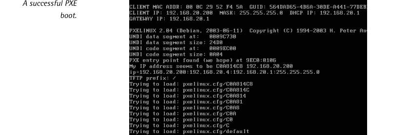

\*A 记录在 DNS 中将主机名映射到 IP 地址。

## 8.3 安装 Debian 系统的替代方法

现在启动 **pxeclient** 应该能够使其获取 DHCP 地址并从 **pxeserver** 下载安装文件。图 8.1 展示了一次成功的 PXE 启动。
此后不久，安装程序将进入其熟悉的环境。配置区域设置和网络硬件后，安装程序将让你选择从软盘或网络加载安装程序组件。通常情况下，你会选择后者。
网络安装的其余部分按照第 3.2 章详述的流程进行。如果你想使用 CD-ROM 完成剩余的安装，则需要加载安装程序组件 **cdrom-detect**。

#### 8.3.3 定制安装程序

Debian 安装程序（参见第 3.1 章）是一个模块化系统，它大量复用了 Debian 其他部分的功能。特别是，它使用精简的 Debian 软件包¹⁶ 和称为 **udpkg** 与 **anna** 的简化软件包处理工具来初始化安装程序，并在安装过程中引入其他组件（参见第 3 章）。

##### Debian 安装程序概览

当引导安装介质时，Debian 内核加载，初始内存盘中的一组基本工具将系统引导至能够安装其他 UDEB 的状态。用户界面由 **cdebconf**¹⁷ 提供，它在内核加载后被安装和调用。安装过程的其余部分取决于自动加载的组件或用户选择的组件。如果加载了一个安装程序组件，**anna** 会从 APT 仓库获取它并交给 **udpkg**，后者将其安装并允许它注册到由 **cdebconf** 管理的安装主菜单中。
**anna** 不关心 APT 仓库位于何处。如果网络连接可用，安装程序组件可以从任何 Debian 镜像获取。某些安装介质（如 **businesscard**）在介质本身上的 APT 仓库中包含一组安装程序组件。较大的安装镜像（如 **netinst**）在同一仓库中还提供了安装基础系统所需的常规 DEB 文件。官方 ISO 镜像包含常用的额外软件包。

¹⁶微型 DEB（UDEB）是 Debian 安装程序模块，它们使用正常的 Debian 软件包基础设施，但不必遵守 Debian 策略，因为它们仅在安装期间使用。这些软件包不包含文档或其他非必要文件以最小化其大小。UDEB 文件不得在正常的 Debian 系统上使用，如果通过 **dpkg** 安装可能会造成严重损害。
¹⁷**cdebconf** 是用 C 语言重写的 **debconf**（参见第 5.8 章）

##### 进行修改

存在多种原因需要对 Debian 提供的官方安装介质进行修改。在大多数情况下，需要针对特定应用调整安装介质上可用的软件包选择（因此无需网络连接即可安装）。例如，在图形设计大会上分发的 CD 可能应该包含如 GIMP 之类的程序，但不需要提供 17 种不同的浏览器（仅为举例）。另一个原因可能是包含自定义组件，以便在早期阶段影响安装过程，或启用自动安装（参见第 8.3.4 章）以配置超出标准 Debian 安装程序能力范围的系统设置。虽然使用旧的 boot-floppies 安装程序也可以进行此类修改（难度各异），或通过外部程序实现，但现在这些修改已成为安装程序本身的功能，这是其模块化的直接结果。

可能性基本上是无限的，网上有多个资源详细介绍了相关步骤。Debian Wiki 有两篇文档：第一篇^18 侧重于对现有 CD 镜像进行修改，第二篇^19 详细介绍了从零开始构建自定义安装介质的过程。此外，还有一份 HOWTO 风格的文档^20，描述了如何对安装程序进行修改。

#### 8.3.4 预配置安装程序

Debian 安装程序使用 debconf（参见第 5.8 章）从用户处收集信息。可以直接从引导提示符初始化 debconf 数据库中的部分内容。这被称为"预配置"^21。例如：

```
boot: linux languagechooser/language-name=English \
        console-keymaps-at/keymap=us countrychooser/shortlist=CH
```

这会将语言、国家和键盘选择预配置为我使用的值。不幸的是，内核最多接受 8 个引导提示选项，因此可能性有限，由于安装介质上的内核已经提供了四个默认选项，情况更是如此。如果你指定了更多选项，2.4 内核会忽略多余的选项，而 2.6 内核会崩溃。虽然某些默认选项可能可以安全移除（例如 vga 和 devfs），但这只能在网络安装场景（参见第 8.3.2 章）中进行，或通过定制安装介质<sup>22</sup> 来实现。因此，在 2.4 内核提示符上最多可以指定四个选项，而 2.6 内核只允许三个。

其中一个引导提示选项可以指定一个文件的位置，该文件包含用于初始化 **debconf** 的变量-值对，从而避免提示用户。该文件可以位于本地可访问的介质上，也可以位于 Web 或 FTP 服务器上。以下两行说明了这种用法：

```
boot: linux preseed/file=/floppy/preseed.cfg
boot: linux preseed/url=http://server/path/to/preseed.cfg
```

**preseed.cfg** 文件（名称可自由选择）指定了要为特定变量缓存的值。每行对应一个设置，由四个以空白字符分隔的列组成。第一列指定模板的所有者，后跟模板名称、类型，最后是值（延续到行尾）。例如，要将网卡预配置为使用静态地址，该文件需要包含以下内容：

```
d-i netcfg/disable_dhcp boolean true
d-i netcfg/get_ipaddress string 192.168.0.42
d-i netcfg/get_netmask string 255.255.255.0
d-i netcfg/get_gateway string 192.168.0.1
d-i netcfg/get_nameservers string 192.168.0.2 192.168.0.3
d-i netcfg/confirm_static boolean true
```

显然，这要求 **preseed.cfg** 文件存在于本地介质上。如果你想通过网络访问 **preseed.cfg**，必须确保网络可以通过 DHCP（默认方式）配置，或者找到其他方式来预配置上述设置（例如使用自定义镜像）。

创建 **preseed.cfg** 文件的一种方式是使用 **debconf-get-selections** 工具（来自 **debconf-utils** 软件包）：

```
# debconf-get-selections --installer > preseed.cfg
# debconf-get-selections >> preseed.cfg
```

生成的文件包含整个 **debconf** 数据库的转储，应该仅用于预配置与生成文件所用机器安装相同软件包集的系统。此外，该转储包含一些最好不要预配置的设置（例如 **base-config/main-menu** 和 **debconf/frontend**）。如果你计划使用预配置功能，最好参考安装程序手册中提供的示例<sup>23</sup>。

^18 http://wiki.debian.net/index.cgi?DebianInstallerModify
^19 http://wiki.debian.net/index.cgi?DebianCustomCD
^20 http://people.debian.org/~osamu/hackdi
^21"预配置"是在使用值之前对其进行初始化的技术术语。值得注意的是，仅用"seeding"就足够了，但使用"pre"前缀（又一个赘述？）是为了强调初始化的前置性。
<sup>22</sup>参见 http://wiki.debian.net/index.cgi?DebianInstallerModify 和 http://people.debian.org/~osamu/hackdi
<sup>23</sup>http://d-i.alioth.debian.org/manual/en.i386/apcs01.html


很遗憾，目前（还）无法预先设置国家、语言和键盘布局。因此，这三项必须在启动命令行中指定。除了**preseed**选项外，启动命令将超过100个字符，这违背了预设的初衷——手动安装Debian只需要按十二次键，直到提示输入root密码。因此，预设主要用于定制化安装介质^22，或网络安装（参见第8.3.2章）。

#### 8.3.5 FAI：完全自动化安装

FAI代表“完全自动化安装”^24，并为管理任意数量的客户端提供可扩展的解决方案。与**systemimager**或**replicator**等替代方案不同，FAI可以处理不同类型的硬件，并使用单一的中央配置仓库为不同目的的系统安装系统。**FAI主页**^25链接了一本手册，用户贡献的安装报告和文档^26提供了宝贵的额外资源。

FAI使用NFS发布一个最小化的Debian系统，客户端使用该系统进行引导以进行安装过程^27。为了适应不同的硬件和不同的需求，FAI使用类来封装待安装系统的不同方面。安装客户端可以属于任意数量的类，并且每个类可以影响分区、软件选择或在最后运行的脚本集，这些脚本配置和准备新安装的机器。

安装本身包括五个阶段：

##### 类确定

在第一阶段，在安装客户端上运行一组脚本，以确定该机器所属的类。这些脚本写入**stdout**的每个单词都被视为安装客户端所属的一个类。这些脚本可以利用Shell、Perl或根文件系统中安装的任何其他软件（并通过NFS导出）的全部功能来生成类列表。例如，一个脚本可能使用DHCP分配的主机名来分配特定类的成员资格，或者调用**discover**实用程序来基于可用硬件确定类。一个简单的示例脚本可以是：

```
~$ cat <<EOF > class/10misc
#!/bin/sh -e

case "$HOSTNAME" in
  arakis) echo MAILSERVER;;
esac
case "$(discover --data-path=xfree86/server/device/driver display)"
in matrox) echo MATROX;;
  ati) echo ATI;;
  *) echo VESA;;
esac
echo $HOSTNAME
EOF
```

当此脚本在具有ATI显卡的arakis上运行时，它将导致客户端被置于**MAILSERVER**、**ATI**和**arakis**类中（按此顺序）。类**DEFAULT**和**LAST**分别在特定类之前和之后默认定义。类是有顺序的，后定义的类优先于先定义的类。

##### 变量定义

接下来，FAI根据定义的类，设置在class/*.var中定义的所有环境变量。在上面的示例中，将读取class/MAILSERVER.var，但将忽略class/MATROX.var。定义的所有变量在安装过程中将对所有Shell、Perl和cfengine脚本可用。

##### 分区

FAI根据定义的类，从./disk_config目录中的文件读取分区表和要创建的文件系统的描述。只使用一个配置文件，该文件由在目录中具有相应文件的最高优先级（最近定义的）类确定。使用这些配置文件，可以指定文件系统选项，甚至可以在重新安装时保留文件系统。例如，以下配置了一个标准分区表，使用XFS文件系统（由于Grub错误，/boot分区除外；参见第19章），并保留/dev/hda7：

```
~$ cat <<EOF > disk_config/DEFAULT_PRESERVE
disk_config hda
primary /boot 16-48 rw,nodev,nosuid,noatime,noexec ;boot
-j ext3
primary swap 40-500
logical / 70-150 rw,noatime ;xfs
logical /usr 200-4000 rw,noatime ;xfs
logical /scratch preserve7 rw,nosuid,nodev ;xfs
logical /var 90-1000 rw,noatime ;xfs
logical /tmp 50-1000 rw,nosuid,nodev ;xfs
EOF
```

427

##### 软件安装

以./package_config为根的目录层次结构根据定义的类指定要安装的软件。对于每个定义的类，会读取相应的文件（如果存在），所有文件的集合用于确定使用APT安装哪些包（因此依赖关系会自动解决）。例如，XSERVER类的典型软件包选择将如下描述。如果还定义了HWDETECT类，则会拉入自动配置X服务器所需的包。

```
~$ cat <<EOF > package_config/XSERVER
PACKAGES install
x-window-system-core xdm
xfonts-100dpi-transcoded xfonts-intl-european ttf-bitstream-vera
fontconfig
rxvt-unicode xterm-
menu

PACKAGES install HWDETECT
read-edid mdetect discover
EOF
```

##### 系统配置

最后，FAI根据定义的类集合执行./scripts目录中的脚本。对于任何类，该目录可能包含单个文件，或者包含一个目录，这会导致FAI运行其中的所有文件。脚本可以是标准的Shell脚本，使用Perl或cfengine，或者NFS挂载的根系统上安装的任何其他软件。

到这些脚本运行时，所有选定的软件包将已安装在/tmp/target（在$target环境变量中定义）的chroot中。因此，你需要使用chroot（或$ROOTCMD）和$target，但除此之外可以自由做任何你喜欢的事情。根据安装客户端的性质，使用debconf进行配置更改（参见第5.8章）可能比直接编辑文件更可取。例如，以下使用debconf重新配置xserver-xfree86软件包：

```
~$ cat <<EOF > XSERVER/S35reconfigure
#!/bin/sh -e

ifclass LCD && $ROOTCMD debconf-set-selections <<EOF || true
xserver-xfree86 xserver-xfree86/config/monitor/lcd boolean true
EOF

ifclass HWDETECT && $ROOTCMD debconf-set-selections <<EOF || true
xserver-xfree86 xserver-xfree86/autodetect_mouse boolean true
xserver-xfree86 xserver-xfree86/autodetect_monitor boolean true
EOF

$ROOTCMD dpkg-reconfigure xserver-xfree86
EOF
```

FAI非常灵活，可用于多种情况，从单个工作站的安装管理到跨越数百台机器的集群。其灵活性源于两个特点。
首先，类的概念允许对主机进行细粒度但可扩展的描述。由于类是在安装客户端本身上确定的，因此可以服务于各种主机，无论它们在硬件或用途方面有何不同。FAI还提供了许多钩子以增加灵活性，因此如果需要，可以影响整个安装过程。
其次，FAI将标准Debian工具与强大的工具（如Perl和cfengine）结合起来。因此，FAI安装可以受益于Debian软件包管理工具的健壮性，并以最少的努力产生一致的安装。依赖关系会自动满足，并且你可以依赖*stable*版本中的包在配置脚本中保持不变。
除了FAI指南<sup>28</sup>，你还可以在线找到描述FAI服务器设置<sup>29</sup>以及部署过程<sup>30</sup>的文章。

<sup>28</sup>http://www.informatik.uni-koeln.de/fai/fai-guide.html
<sup>29</sup>http://www.linuxplanet.com/linuxplanet/tutorials/5667/1/
<sup>30</sup>http://www.linuxplanet.com/linuxplanet/tutorials/5675/1/

# 9 创建Debian软件包

> > Debian设计流程是开放的，以确保系统具有最高质量并反映用户社区的需求。
> —— Debian Linux宣言

你越是将Debian软件包管理系统与你的管理和系统管理任务集成，你就越有可能需要创建自定义的Debian软件包。无论是现有软件包的修改版本、Debian归档中不可用的软件、用于通过**Depends**和**Conflicts**关系强制特定软件包选择的元软件包（虚拟软件包），还是对DEB文件的更高级使用，获得创建DEB文件的能力是在掌握Debian系统过程中的一个重要步骤。

新用户常常感到惊讶，并对软件包管理工具心生敬畏。对他们来说，打包软件的开发者是巫师，他们的成就是难以企及的艺术品。我敢大胆声称


## 9 创建 Debian 软件包

事实并非如此，因为创建 Debian 软件包几乎没什么奥秘。

实际上，大多数情况下，需求仅仅是修改现有软件包、创建元软件包以强制执行特定的软件包选择，或者创建虚拟软件包以调整依赖关系图。Debian 提供了用于这些任务的工具，并且这些工具不要求你了解 Debian 软件包创建的基本要点。如果你好奇，请参考第 5.9 章。虽然通常通过探索现有软件包并实现一些技巧来达到预期解决方案就足够了，但对所涉及技术缺乏更深入的理解，可能会很快将一个小问题变成一个大难题。

本书采用自下而上的方法，这在各种科学领域中被称为从组件级别开始，连续集成构建块以创建日益复杂的行为。从你已经熟悉的工具开始，我们将首先查看非常底层的软件包创建方法，然后再介绍更高级的工具。在每一步中，你都将拥有理解这些更高级工具实际功能所需的所有背景知识。如果以后出现问题，你将相当清楚应该从哪里入手。

### 9.1 手动打包

Debian 二进制软件包不过是一组文件，可以使用标准的 Unix 归档工具进行操作，如第 5.2.3 节所示。除了软件包安装的文件（这些文件在软件包内部按照其在目标系统上的安装布局进行排列）外，DEB 文件还包含少量用于软件包管理工具管理软件包的控制文件（参见第 5.2.4 节）。我们看到这些文件被保存在 DEB 文件内的单独 tarball 中，而 DEB 文件本身不过是一个简单的 BSD ar 归档文件。

GNU 和 BSD ar 归档文件不兼容，并且出于历史和功能原因，`dpkg` 自带了一个最小化的 BSD ar 实现。虽然 `dpkg` 已经知道如何处理这两种格式，但其他工具仍然仅限于 BSD 格式。标准不太可能很快改变。因此，在下文中，我们将假设使用一个实现了 BSD ar 格式的工具。

在解压状态下，Debian 二进制软件包包含 `./DEBIAN` 目录（其中存放控制文件）以及分布在标准 Unix 文件系统层次结构中的已安装文件集。安装 DEB 文件只是将已安装的文件解压到 `/` 目录中，它们的位置由其在软件包内的相对位置决定。

长话短说，让我们构建一个非常简单的软件包：`gruezi`。`gruezi` 软件包将一个简单的 shell 脚本安装为 `/usr/bin/gruezi`，该脚本将使用瑞士的四种语言问候调用者。请注意，以下演示主要用于说明 Debian 二进制软件包的底层组件。我们很快会遇到其他方法，这些方法将使过程更容易并实现大部分自动化。

gruezi 脚本相当简单：

```
~$ cat <<EOF > script
#!/bin/sh -e

echo Hoi zämme!
echo Salut!
echo Ciao!
echo Allegra!
EOF
```

由于该脚本应位于 `/usr/bin`，我们将其安装到相对于目录 `./gruezi`（我们必须先创建它）的 `usr/bin` 中，该目录代表软件包内容。此外，我们假设 `gruezi.1` 已存在，它是 `gruezi(1)` 的手册页。Debian 策略要求 `/usr/bin` 中的每个可执行文件都有一个手册页，所以我们最好也把这个做对：

```
~$ mkdir gruezi
~$ cd gruezi
~/gruezi$ mkdir -p usr/bin usr/share/man/man1
~/gruezi$ install --mode=755 script usr/bin/gruezi
~/gruezi$ install --mode=644 gruezi.1 usr/share/man/man1
~/gruezi$ gzip -f9 usr/share/man/man1/gruezi.1
```

现在脚本位于 `./gruezi/usr/bin/gruezi`，其相对于 `./gruezi` 软件包目录的路径确定了 DEB 文件安装后的最终位置：`/usr/bin/gruezi`。

Debian 策略要求每个软件包提供版权和变更日志信息。版权文件应包含所有必要的许可信息（可以作为对 `/usr/share/common-licenses` 中某个文件的引用），以及作者、获取源代码的位置，理想情况下还有打包该软件包的维护者以及打包时间。

```
~/gruezi$ mkdir -p usr/share/doc/gruezi
~/gruezi$ cat <<EOF > usr/share/doc/gruezi/copyright
This package was manually created by Wilhelm Tell <hero@suisse.ch>
on Sat, 18 Nov 1307, 11:00:00 +0100

It was downloaded from: http://www.gruezi.ch

Upstream Author: Wilhelm Tell <hero@suisse.ch>

Copyright:
Do whatever you want with this software.
But do not claim to have invented it,
Or the nation will bombard you
With Ricola candies.
EOF
```

变更日志文件应指明版本、目标发行版，并提供谁在何时进行了哪些更改的信息（参见第 9.2.7 节）：

```
~/gruezi$ cat <<EOF | gzip -9 \
  > usr/share/doc/gruezi/changelog.Debian.gz
gruezi (1.0-1) unstable; urgency=low

  * The "Wer hat's erfunden?" release

-- Wilhelm Tell <hero@suisse.ch>  Sat, 18 Nov 1307 12:00:00 +0100
EOF
~/gruezi$ chmod -R og=rX .
```

所有文件就位后，让我们验证安装集的布局：

```
~/gruezi$ find . -exec ls -Fld {} \;
drwxr-xr-x  [...]   .
drwxr-xr-x  [...]   ./usr/
drwxr-xr-x  [...]   ./usr/bin/
-rwxr-xr-x  [...]   ./usr/bin/gruezi*
drwxr-xr-x  [...]   ./usr/share/
drwxr-xr-x  [...]   ./usr/share/doc/
drwxr-xr-x  [...]   ./usr/share/doc/gruezi/
-rw-r--r--  [...]   ./usr/share/doc/gruezi/copyright
-rw-r--r--  [...]   ./usr/share/doc/gruezi/changelog.Debian.gz
drwxr-xr-x  [...]   ./usr/share/man/
drwxr-xr-x  [...]   ./usr/share/man/man1/
-rw-r--r--  [...]   ./usr/share/man/man1/gruezi.1.gz
```

看起来很好，我们几乎完成了。缺少的是一个用于向软件包管理工具标识软件包的文件：控制文件，它位于 `./DEBIAN` 目录中。控制文件还指定了 Debian 软件包的依赖关系和其他元数据。`deb-control(5)` 手册页有此文件的详细信息。对于我们的目的，以下简写版本就足够了。

```
~/gruezi$ mkdir DEBIAN
~/gruezi$ cat <<EOF > DEBIAN/control
Package: gruezi
Section: misc
Priority: extra
Maintainer: Wilhelm Tell <hero@suisse.ch>
Architecture: all
Version: 1.0-1
Description: greets you the Swiss way
gruezi is a simple script to greet its caller in all four
languages spoken in Switzerland.
EOF
```

为完整起见，让我们也提供 gruezi 安装文件的 MD5 校验和。此文件不是强制性的，但由于 dpkg 在安装时（还）不会生成它们（参见第 5.11.1 节），提供它可能是有意义的：

```
~/gruezi$ find usr -type f -exec md5sum {} \; \
> DEBIAN/md5sums
33d4beeb8e566e0b7d79358447d3856c  usr/bin/gruezi
448d7122dc9c573beba645eff495cf90  usr/share/doc/gruezi/copyright
19b6f39af548e7de4373e4568a07f8c7  usr/share/doc/gruezi/changelog.Debian.gz
c716fb2a994740f7b1d40a4ffdb7a5fe  usr/share/man/man1/gruezi.1.gz
```

目录现已正确准备，可以使用标准 Unix 工具创建软件包：

```
~$ tar cz -C gruezi/DEBIAN -f control.tar.gz .
~$ tar cz --exclude=DEBIAN -C gruezi -f data.tar.gz .
~$ echo 2.0 > debian-binary
~$ ar rcu gruezi.deb debian-binary control.tar.gz data.tar.gz
```

快速检查表明我们确实成功了。dpkg 将该软件包识别为版本 2.0 的“新 debian 软件包”，因为我们使用了当前的标准格式，而不是 dpkg 早期使用的旧格式：

```
~$ dpkg-deb --info gruezi.deb
new debian package, version 2.0.
size 1788 bytes: control archive= 498 bytes.
    253 bytes,     9 lines    control
    254 bytes,     4 lines    md5sums
Package: gruezi
Section: misc
Priority: extra
Maintainer: Wilhelm Tell <hero@suisse.ch>
Architecture: all
Version: 1.0-1
Description: greets you the Swiss way.
gruezi is a simple script to greet its caller in all four
languages spoken in Switzerland.
~$ dpkg-deb --contents gruezi.deb
drwxr-xr-x [...]  .
drwxr-xr-x [...]  ./usr
drwxr-xr-x  [...]  ./usr/bin
-rwxr-xr-x [...]  ./usr/bin/gruezi
```

## 9 创建 Debian 软件包

```
drwxr-xr-x  [...]  ./usr/share
drwxr-xr-x  [...]  ./usr/share/doc
drwxr-xr-x  [...]  ./usr/share/doc/gruezi
-rw-r--r--  [...]  ./usr/share/doc/gruezi/copyright
-rw-r--r--  [...]  ./usr/share/doc/gruezi/changelog.Debian.gz
drwxr-xr-x  [...]  ./usr/share/man
-rwxr-xr-x  [...]  ./usr/share/man/man1
-rw-r--r--  [...]  ./usr/share/man/man1/gruezi.1.gz
```

最后，我们可以切换到 root 用户，并像安装任何其他 `.deb` 文件一样安装这个软件包：

```
~# dpkg --install gruezi.deb
[...]
正在解包 gruezi (来自 gruezi.deb) ...
正在设置 gruezi (1.0-1) ...
~# which gruezi
/usr/bin/gruezi
~# dpkg --search /usr/bin/gruezi
gruezi: /usr/bin/gruezi
~# gruezi
Hoi zämme!
Salut!
Ciao!
Allegra!
```

瞧，我们创建了一个功能完整的 Debian 二进制软件包。你可能会同意，这个过程没有什么神奇之处。我们仅使用了标准工具，并且软件包内目录和文件的布局看起来也相当合理。结果是一个仅包含二进制文件的软件包，没有对应的源代码。尽管如此，它仍然可以像预期的那样，在 Debian 系统上使用软件包管理工具进行操作。

### 9.2 使用软件包维护者工具进行 Debian 化

在了解了如何在最底层构建 Debian 二进制软件包之后，我们可以进阶到使用软件包维护者工具，并学习如何使用它们来构建完整的 Debian 软件包。`dpkg-dev` 软件包安装了创建 Debian 软件包所需的所有工具，无论是像 `gruezi` 这样简单的软件包，还是尽可能复杂的软件包。之前演示的方法与标准的 Debian 打包流程之间最重要的区别在于，包含文件系统归档文件（软件包所安装的内容）和 `./DEBIAN` 目录的目录结构，是由 Debian 工具从解包后的 Debian 源软件包中找到的数据和控制信息自动创建的。

#### 9.2.1 深入了解源软件包

在第 5.9.1 章节，你已经了解了 Debian 源软件包，并被告知如何获取它们。现在是时候更深入地了解源软件包了。源软件包的结构主要取决于它提供的软件，因为它包含了与作者分发时相同布局的源代码。Debian 软件包维护者工具所需的所有信息都位于 `./debian` 目录下。对于一个典型的 `autotools` 软件包，解包后的源软件包看起来类似于以下内容：

```
~$ ls -F
aclocal.m4       configure.ac  FAQ           NEWS
AUTHORS          COPYING       include/      pkgconfig/
autogen.sh*      CVS/          INSTALL@      README
autom4te.cache/  debian/       install-sh@   ref/
ChangeLog        doc/          Makefile.am   TODO
config.h.in      Makefile.in   configure*
examples/        missing@
```

因此，如你所见，在这种情况下，正常的构建流程

```
~$ ./configure && make
```

是可行的。实际上，Debian 源软件包只是原始源软件包的增强版，增加了软件包维护者工具所需的信息以及维护者选择包含在 DEB 软件包中的额外数据（例如额外的文档或自己编写的示例脚本）。维护者也可能会修改源代码，以使路径符合 FHS（文件系统层次结构标准），或者更改软件的其他方面，使其更适合 Debian 系统。顺便快速提一句：一个软件包的维护者通常也是软件包的作者，但不一定是软件包所包含软件的原始作者。为了与常用术语保持一致，即使软件是首次打包（因此尚未进行维护），“维护者”指的是为 Debian 打包软件的人。

一个源软件包由两个或三个文件组成。Debian 原生源软件包直接包含软件包工具数据。第三方软件的 Debian 源软件包提供一个 `diff.gz` 文件，该文件封装了为将上游源代码与 Debian 软件包信息集成所需的更改。让我们再看一下 `postfix`，它是一个第三方软件，因此由三个文件组成：

```
~$ ls -F postfix
postfix_2.1.5-1.diff.gz  postfix_2.1.5-1.dsc  postfix_2.1.3.orig.tar.gz
~$ diffstat -f0 postfix_2.1.5-1.diff.gz
[...]
 conf/main.cf                        |   20  14 +    6 -    0 !
 conf/main.cf.debian    |    11  11 +     0 -     0 !
[...]
debian/changelog        |  1262 1262 +     0 -     0 !
debian/conffiles        |     7    7 +     0 -     0 !
debian/config           |   401  401 +     0 -     0 !
debian/control          |    88   88 +     0 -     0 !
debian/copyright        |   326  326 +     0 -     0 !
[...]
```

文件 `postfix_2.1.5.orig.tar.gz` 与从 postfix 镜像站提供的 tarball 完全相同。如你所见，`diff.gz` 文件对 `conf/main.cf` 进行了一些更改，这些更改是 Debian 所必需的，并将一堆文件放入 `./debian` 目录。将解包后的上游源代码树转换为其 Debian 源软件包对应物的过程被称为“Debian 化”。Debian 原生软件显然不需要专门进行 Debian 化。

为了创建 `diff.gz` 文件，Debian 软件包维护者脚本需要有可供比较的上游源代码。有两种方法可以做到这一点。首选方法是简单地按照以下模式重命名你从上游下载的 tarball：

```
<package>_<version>.orig.tar.gz
```

例如，postfix 以 `postfix-2.1.5.tar.gz` 的形式提供，`orig.tar.gz` 文件必须命名为 `postfix_2.1.5.orig.tar.gz` 才能让软件包维护者工具找到它。然后，你可以解压 `orig.tar.gz` tarball，并在其创建的目录中继续进行 Debian 化。tarball 的标准做法是创建一个遵循以下方案的目录：

```
<package>-<version>
```

Debian 工具需要此方案，如果 tarball 中包含的目录使用了非传统的命名方案，你将需要手动将其移动到位。因此，假设 `postfix-2.1.5.tar.gz` tarball（我们刚刚将其重命名为 `postfix_2.1.5.orig.tar.gz`）解压到 `./postfix`，因此不符合指南（当然，postfix 是符合的，所以这只是一个假设情况），解压该 tarball 需要以下步骤：

```
~$ tar xzf postfix_2.1.5.orig.tar.gz
~$ mv postfix postfix-2.1.5
```

现在，`./postfix-2.1.5` 目录（仍然只包含原始的上游 postfix 源代码树）已准备好进行 Debian 化。

作为重命名 tarball 的替代方案，你也可以将其解压并复制其包含的目录，然后再对其进行任何更改：

```
~$ tar xzf postfix-2.1.5.tar.gz
~$ mv postfix postfix-2.1.5
~$ cp -a postfix-2.1.5 postfix-2.1.5.orig
```

当调用软件包维护者工具时，`orig` 目录用于创建 `orig.tar.gz` 文件（覆盖任何现有的 `orig.tar.gz`），然后将 Debian 化信息写入 `diff.gz` 文件。虽然这种方法看起来有用，但其主要缺点是它创建了一个新的 tarball 文件，而不是使用上游原始文件。这并非一个真正严重的问题，但 Debian 用户更希望 `orig.tar.gz` 文件的 MD5 校验和与官方 postfix 分发站点上的文件相同。毕竟，它被称为 `orig.tar.gz`。

#### 9.2.2 调查上游源代码树

在打包一个程序或库（或任何其他东西）之前，最好对源代码树和已安装的软件有充分的了解。理想情况下，你已经使用常规方法将软件安装到 `/usr/local`，并了解软件的各个部分和文件是如何工作的。

让我们回到 `gruezi` 脚本。与此同时，其作者发布了 1.1 版本，增加了一个配置文件，用户可以在其中选择用于问候的语言。此外，它现在从资源文件中读取问候语，而不是将它们硬编码到脚本中。

我们即将为 `gruezi` 软件创建一个完整的 Debian 软件包，包括一个源软件包。此外，一旦软件包存在，我们将把它拆分成两部分：`gruezi` 和 `gruezi-common`，后者安装资源文件。在我们着手这项任务之前，有必要检查我们想要打包的软件的源代码树。这使我们能够熟悉该软件，并找出需要修改的地方。

`gruezi 1.1` 以一个 tarball 的形式发布，正确命名为 `gruezi-1.1.tar.gz`。不幸的是，作者没有将包含的目录命名为 `gruezi`，所以我们必须手动重命名它并查看其内容：

```
~$ tar xzf gruezi-1.1.tar.gz
~$ ls -F
gruezi/  gruezi-1.1.tar.gz
~$ mv gruezi gruezi-1.1
~$ cd gruezi-1.1
~/gruezi-1.1$ ls -F
LICENCE.SWISS  ChangeLog  Makefile  greetings
gruezi.1       gruezi.in  gruezi.conf
```

这个软件包看起来足够简单。`gruezi.in` 文件包含 `gruezi` 脚本的模板，该模板将在编译时被解析和替换。


## 9 创建 Debian 软件包

```bash
~$ cat gruezi.in
#!/bin/bash -e

##### read the configuration data
test -f /etc/gruezi.conf && . /etc/gruezi.conf
test -f @prefix@/share/greetings && . @prefix@/share/greetings

[[ $GRUEZI_DE -eq 1 ]] && echo $GREETING_DE
[[ $GRUEZI_FR -eq 1 ]] && echo $GREETING_FR
[[ $GRUEZI_IT -eq 1 ]] && echo $GREETING_IT
[[ $GRUEZI_RR -eq 1 ]] && echo $GREETING_RR

exit 0
```

我们注意到，配置文件被期望位于 `/etc` 目录下，这是可以的。`@prefix@/share/greetings` 暗示 `/usr/share/greetings`，对于像 Debian 这样大规模的发行版来说，这个名称过于通用；我们将会把资源文件安装到一个不同的位置，尽管目前我们不打算进行任何更改。

配置文件是一个简单的 shell 片段，它指定了四个变量的默认值，从而允许用户在调用 `gruezi` 命令之前通过环境变量覆盖这些偏好设置。

```bash
~$ cat gruezi.conf
GRUEZI_DE=${GRUEZI_DE:-1}
GRUEZI_FR=${GRUEZI_FR:-1}
GRUEZI_IT=${GRUEZI_IT:-1}
GRUEZI_RR=${GRUEZI_RR:-1}
```

资源文件同样简单明了，尽管它看起来更像一个配置文件而不是静态资源数据文件。不过，我们还是保留原样，部分原因是为了演示安装过程。

```bash
~$ cat greetings
GREETING_DE="Hoi zämme!"
GREETING_FR="Salut!"
GREETING_IT="Ciao!"
GREETING_RR="Allegra!"
```

在 `gruezi.1` 中还提供了一个 manpage。此外，上游 tarball 提供了一个简单的 Makefile，用于从其模板生成 `gruezi` 脚本并负责软件的安装。

```makefile
~$ cat Makefile
prefix ?= /usr/local

all: gruezi gruezi.1.gz gruezi.conf greetings

gruezi: gruezi.in
    sed -e "s|@prefix@|$(prefix)|g" < $< > $@

gruezi.1.gz: gruezi.1
    gzip -9 < $< > $@

install: gruezi gruezi.1.gz gruezi.conf greetings
    mkdir -p $(DESTDIR)$(prefix)/bin/
    install --mode=755 gruezi $(DESTDIR)$(prefix)/bin/gruezi

    mkdir -p $(DESTDIR)$(prefix)/share/man/man1/
    install --mode=644 gruezi.1.gz \
        $(DESTDIR)$(prefix)/share/man/man1/gruezi.1.gz

    mkdir -p $(DESTDIR)$(prefix)/share/
    install --mode=644 greetings \
        $(DESTDIR)$(prefix)/share/greetings

    mkdir -p $(DESTDIR)/etc/
    install --mode=644 gruezi.conf $(DESTDIR)/etc/gruezi.conf

distclean: clean
clean:
    rm -f gruezi gruezi.1.gz
```

因此，一个简单的 `make install` 将会安装 `/usr/local/bin/gruezi`，而执行命令 `make install DESTDIR=/tmp/gruezi` 则会将文件安装到 `/tmp/gruezi/usr/local/bin/gruezi`。`make install DESTDIR=/tmp/gruezi prefix=/usr` 将会把软件包安装到 `/tmp/gruezi/usr` 层级结构，而不是根植于 `/tmp/gruezi/usr/local` 的结构。

如果一个软件包提供的安装机制能够通过使用 `$DESTDIR` 或类似方式重定位目标层级结构，那么它就可以轻松地被 debian 化。为 Debian 打包的软件必须能够安装到与 `/` 不同的层级结构中。许多程序（例如使用 GNU autoconf 的程序）使用的 `$prefix` 变量*不*适合这种重定位。`$prefix` 定义了程序的运行时位置，而 `$DESTDIR` 指定了用于安装的路径，该路径在程序安装后不应对其操作产生任何影响。

以 `gruezi` 为例，其 Makefile 提供了重定位功能。如果软件本身不提供，你需要在打包之前添加它。不过，首先让我们为 Debian 特定的修改准备源代码树。

#### 9.2.3 dh_make

Debian 存档库在 `dh-make` 软件包中提供了 `dh_make` 工具，以快速启动 debian 化过程。它需要在解压后的源目录内调用，并将 debian 化过程中最重要的控制文件模板放入 ./debian 目录。Debian Women 项目发布了一份指南，介绍如何在不使用 dh_make 等辅助工具的情况下创建软件包¹。在创建这些文件之前，dh_make 会复制当前目录，以便稍后创建 orig.tar.gz。或者，可以使用 --file 命令行开关指定要使用哪个 tarball。

Debian 源代码包有多种形式和功能。一些源代码包生成单个二进制包，另一些则生成一组封装库的二进制包。源代码包生成的二进制包以及这些包之间的文件分配由 ./debian 下的 debian 化信息控制。dh_make 知道如何为四种类型的源代码包引导 ./debian 目录：

- **单二进制**：结果是一个包含在源代码树中构建的所有相关文件和程序的二进制包。
- **多二进制**：结果是多个二进制包，维护者稍后决定哪些文件将分发到哪个包中。
- **库**：库源代码包至少生成两个二进制包，一个包含运行链接到该库的程序所必需的运行时数据，另一个包含编写将链接到该库的程序所需的开发文件。
- **内核模块**：内核模块源代码包生成一个二进制包，以允许构建针对运行内核的二进制包的方式，将内核模块的源代码安装到目标系统上。

以下是如何快速启动 postfix 源代码树的 debian 化过程。尽管 postfix 在现实中稍微复杂一些，但为了清晰和简单起见，我们将构建一个单一的二进制包。维护者姓名和电子邮件地址字段分别来自 `$DEBFULLNAME` 和 `$DEBEMAIL` 环境变量。

```bash
~$ tar xzf postfix-2.1.5.tar.gz
~$ cd postfix-2.1.5
~/postfix-2.1.5$ dh_make --file ../postfix-2.1.5.tar.gz
Type of package: single binary, multiple binary, library, or kernel module?
[s/m/l/k] s
Maintainer name : martin f. krafft
Email-Address   : madduck@debian.org
Date            : Thu, 22 Jul 2004 09:40:38 +0000
Package Name    : postfix
Version         : 2.1.5
Type of Package : Single
Hit <enter> to confirm:
```

¹ http://women.alioth.debian.org/wiki/index.php/English/BuildingWithoutHelper

Debian 源代码包现在基本上已经准备好供你适当地配置。./debian 目录已被添加到解压后的源代码树中，上游 tarball 也已相应地复制为 orig.tar.gz 文件，现在可以删除它（如果你愿意）：

```bash
~/postfix-2.1.5$ cd ..
~$ ls -F
postfix-2.1.5/          postfix-2.1.5.tar.gz
postfix_2.1.5.orig.tar.gz
~$ rm postfix-2.1.5.tar.gz
```

最后，如果你检查 debian/changelog 文件，你会注意到 dh_make 已将 Debian 修订版附加到上游版本号：

```bash
~$ cd postfix-2.1.5
~/postfix-2.1.5$ dpkg-parsechangelog
Source: postfix
Version: 2.1.5-1
Distribution: unstable
Urgency: low
[...]
```

也可以对专门为 Debian 编写的软件进行 debian 化。尽管我之前说过 Debian 原生包不需要被 debian 化，但 ./debian 目录必须存在，并且必须通过某种方式放入。dh_make 可以帮忙，如果你给它 --native 选项，它将不会尝试处理 diff.gz 或 orig.tar.gz 文件。让我们假设 `moo` 是你对 Debian 工具箱的宝贵贡献。由于该工具仅在 Debian 系统上下文中有用，你创建了一个 Debian 原生包：

```bash
~/moo-0.1$ dh_make --native
Type of package: single binary, multiple binary, library, or kernel module?
[s/m/l/k] s
Maintainer name : you
Email-Address   : you@yourdomain.net
Date            : Thu, 22 Jul 2004 09:48:12 +0000
Package Name    : bla
Version        : 0.1
Type of Package : Single
Hit <enter> to confirm:
```

查看 change log 文件，我们注意到没有 Debian 修订版。Debian 原生包不需要跟踪包的两个不同部分（上游软件和打包逻辑），而是将两者集成在一起：

```bash
~/moo-0.1$ dpkg-parsechangelog
Source: moo
Version: 0.1
Distribution: unstable
Urgency: low
[...]
```

父目录中没有额外的文件，因为 Debian 原生包不需要 orig.tar.gz 文件来稍后比较和提取 debian 化的更改。

关于 dh_make 最后要说一点：虽然这个工具当然有其优点，但由于其“向导式”操作，它也有些问题。使用它本身没有错，因为它为大多数 Debian 文件提供了方便的模板。然而，当你开始了解大局以及每个文件的用途时，你可能会更愿意暂时放弃 dh_make，以确保你完全理解正在发生的事情。一旦你开始熟悉 ./debian 目录，无论如何，请使用 dh_make（或其他任何工具）来让你的工作更轻松。

#### 9.2.4 构建源代码包

在继续之前，我建议验证 orig.tar.gz 文件是否被包维护者工具正确识别。dh_make 确实尽力而为，但确认一下总没有坏处：

```bash
~$ dpkg-source -b gruezi-1.1
dpkg-source: building gruezi using existing gruezi_1.1.orig.tar.gz
dpkg-source: building gruezi in gruezi_1.1-1.diff.gz
dpkg-source: building gruezi in gruezi_1.1-1.dsc
```

你将认出这三个文件是 Debian 源代码包的组成部分。在 `moo` 上运行相同的命令，`dpkg-source` 只生成构成 Debian 原生源代码包的两个文件：没有 diff.gz 文件，且 tarball 的名称缺少 Debian 修订版和 .orig 中缀：

```bash
~$ dpkg-source -b moo-0.1
dpkg-source: building moo in moo_0.1.tar.gz
dpkg-source: building moo in moo_0.1.dsc
```


dpkg-source 可能会决定将该软件包视为 Debian 原生源码包。在这种情况下，Debian 修订版本将成为生成的压缩包名称的一部分：

```
~$ dpkg-source -b bar-1.0
dpkg-source: building bar in bar_1.0-1.tar.gz
dpkg-source: building bar in bar_1.0-1.dsc
```

如果发生这种情况，说明 dpkg-source 在当前目录中找不到 `orig.tar.gz` 文件，并且与它应该构建的目录一起，也没有 `orig` 目录。在继续进行 Debian 化过程之前，最好通过检查 `orig.tar.gz` 文件的名称是否符合 dpkg-source 预期的名称来修复此问题。如果你对源码树所做的唯一更改是添加了 `./debian` 目录，那么你也可以轻松地创建一个 `orig` 目录，并让 dpkg-source 重新创建 `orig.tar.gz` 文件：

```
~$ cp -a bar-1.0 bar-1.0.orig
~$ rm -r bar-1.0.orig/debian
~$ dpkg-source -b bar-1.0
dpkg-source: building bar in bar_1.0.orig.tar.gz
dpkg-source: building bar in bar_1.0.diff.gz
dpkg-source: building bar in bar_1.0.dsc
```

采用这种方法时，请注意你正在创建一个非原始的 `orig.tar.gz` 文件。此外，任何现有的 `orig.tar.gz` 文件优先级高于使用 `orig` 目录的方法。因此，你必须首先从当前目录中删除 `orig.tar.gz`，否则它将被使用，而你的 `orig` 目录会被静默丢弃。

#### 9.2.5 使用 dh_make 快速启动

gruezi 软件似乎易于管理，我们只需要对资源文件的位置进行小的更改，就能使其与任何 Debian 系统上的其他软件包和平共处。我们现在启动 `dh_make`，以访问 `.debian` 中的 `control` 文件模板，并将 `orig.tar.gz` 文件放置到位作为参考，这将使我们能够将即将作为 Debian 化一部分的更改隔离开来。`--single` 选项告诉 `dh_make` 创建一个二进制包并跳过询问。

```
~/gruezi-1.1$ dh_make --single --file ../gruezi-1.1.tar.gz
[...]
~/gruezi-1.1$ cd ..
~$ dpkg-source -b gruezi-1.1
[...]
~$ rm gruezi-1.1.tar.gz
```

在调用 `dh_make` 之后，如图所示，上游压缩包可以被删除；`dh_make` 已将其复制为 `gruezi_1.1.orig.tar.gz`。

现在我们准备好对源码树进行任何必要的修改。如果 `Makefile` 拒绝接受 `$DESTDIR`，我们现在就添加此功能。我们还要更改 `Makefile` 和 `gruezi.in` 中的资源文件路径，改为使用 `usr/share/gruezi/greetings`。我们所做的所有修改最终都会进入 `diff.gz` 文件，并且是 Debian 化 gruezi 所需更改集的一部分。作为对自由软件社区和软件作者的礼遇，你应该将任何有用的更改（例如添加 `$DESTDIR`）提供给上游作者。希望下一个版本能包含必要的功能，从而让我们保持 `diff.gz` 文件尽可能小（这应该是一个目标）。

##### 检查 ./debian 目录

现在是时候查看 **dh_make** 放入 **./debian** 的模板了。这些文件数量众多，起初可能看起来令人不知所措。不过，目前我们可以安全地忽略所有以 `.ex` 或 `.EX` 结尾的文件，它们是特定功能的示例。为清晰起见，我们暂时将它们移除。

```
~/gruezi-1.1$ cd debian
~/gruezi-1.1/debian$ ls -F
README.Debian dirs init.d.ex preinst.ex
changelog docs manpage.1.ex prerm.ex
compat emacsen-install.ex manpage.sgml.ex rules*
conffiles.ex emacsen-remove.ex manpage.xml.ex watch.ex
control emacsen-startup.ex menu.ex
copyright gruezi-default.ex postinst.ex
cron.d.ex gruezi.doc-base.EX postrm.ex
~/gruezi-1.1/debian$ tar cf /tmp/gruezi-exfiles.tar *.ex *.EX
~/gruezi-1.1/debian$ rm *.ex *.EX
~/gruezi-1.1/debian$ ls -F
README.Debian changelog compat control
copyright dirs docs rules*
```

这样好多了。**dirs**、**docs** 和 **README.Debian** 文件是可选的，我们稍后再讨论。其他五个文件对于创建 DEB 文件是必不可少的，所以让我们看看它们：

- **changelog**：**changelog** 文件有两个用途。首先，每个 Debian 包必须提供一个 **changelog**，记录打包的更改。此文件稍后将作为 `changelog.Debian.gz` 安装在软件包的文档目录（在 `/usr/share/doc` 下），并构成软件包最重要的资源之一。其次，**changelog** 文件是 *唯一* 指定软件包当前版本号的位置。更多信息请参见第 9.2.7 章。

### 9.2 使用软件包维护者工具进行 Debian 化

##### control

要理解关于版本号的要点，有必要将 **control** 文件与我们在第 9.1 章从头构建 **gruezi** 二进制包时制作的 **control** 文件进行比较：

```
~/gruezi-1.1/debian$ cat control
Source: gruezi
Section: unknown
Priority: optional
Maintainer: Wilhelm Tell <hero@suisse.ch>
Build-Depends: debhelper (>= 4.0.0)
Standards-Version: 3.6.0

Package: gruezi
Architecture: any
Depends: ${shlibs:Depends}, ${misc:Depends}
Description: <insert up to 60 chars description>
 <insert long description, indented with spaces>
```

你会立即注意到区别。**debian/control** 包含两个段落，而 **./DEBIAN/control** 只有一个：第一个段落标识源码包，而第二个段落提供关于 **gruezi** 二进制包的有限信息。软件包维护者工具稍后将通过合并来自不同位置的信息来创建适当的 **./DEBIAN/control** 文件。例如，版本号将从 **debian/changelog** 中提取。

##### compat

使用 **dh_make** 创建的软件包默认使用 **debhelper** 软件包提供的工具集。这些是用于为 Debian 准备软件包的最高级脚本之一，将在第 9.2.11 章进行探讨。目前，只需知道 **compat** 文件仅包含一个数字，标识工具应假定的 **兼容级别**（目前是 4）。我们暂时忽略此文件。

##### copyright

同样为策略所要求，**copyright** 文件指定所有必要信息以识别软件包的作者、上游软件、可找到该软件的位置以及许可信息。其格式没有约束力，但应予以遵守。许可证可以粘贴，也可以使用文件引用指向 **base-files** 软件包安装在 **/usr/share/common-licenses** 下的标准许可证文本之一。

##### rules

**rules** 文件控制软件包的构建，并作为所有与打包相关任务的中央指挥。它通常是一个 **Makefile**，但也可以是用 **perl** 等语言编写的脚本，只要它遵守软件包维护者工具调用它的标准接口。它必须是可执行的。

## 9 创建 Debian 软件包

`dh_make` 提供的 `rules` 文件广泛使用了 `debhelper` 工具，这就是为什么 `control` 文件在 `Build-Depends` 字段中列出了 `debhelper`。此处列出的软件包提供了 Debian 化软件包所需的软件，我们稍后将返回讨论。

我们将不使用提供的 `rules` 文件，而是以真正的自底向上方式设计我们自己的。如前所述，`debian/rules` 实际上是一个 Makefile，因此接受两种类型的参数：形式为 `VAR=VAL` 的变量赋值，以及供 `make` 处理的目标名称，如下所示。`configure` 和 `install` 目标是可选的。

- **configure**：通过调用 `debian/rules` 的 `configure` 目标，你是在要求软件为运行系统进行配置。此阶段通常查找库和工具的位置，并建立控制软件编译、安装和运行时过程的基本参数。此目标的经典候选者是 GNU `autoconf`。

- **build**：使用此目标，你实际上是在指示软件构建（或编译，或制作）自身。此过程通常涉及将源文件转换为其二进制或处理后的对应物：C 文件转换为可执行文件或库，docbook 文件转换为其目标格式，等等。

- **install**：install 目标然后负责将软件安装到以 `debian/<package>` 为根的层次结构中。这里，`<package>` 是 `control` 文件中列出的第一个软件包的名称。然而，它也可以是任何你喜欢的名称。一些软件包，例如使用 `dh_make` 快速启动的库，使用 `debian/tmp` 代替。明确创建该目录并非坏事，以防上游安装例程假设其存在而失败。

由源码包生成的每个二进制包都会得到其中一个目录。当创建多个二进制包时，你可以将所有内容安装到第一个软件包的目录中，然后稍后将属于其他软件包的文件移动到它们各自的目录中。或者，更干净的方法是将所有内容安装到 `debian/tmp`，然后将文件移动到每个生成的软件包的安装目录中。当我们把 `gruezi` 拆分成两个软件包时，我们将使用这种方法。通常，修改上游安装过程以直接安装到适当的子目录不是一个好主意。


**binary-indep**
Debian 二进制包分为特定架构或适用于所有架构的两种类型。**binary-indep** 目标负责从源码树中构建所有架构无关的包。

**binary-arch**
同理，**binary-arch** 负责为本地架构准备所有架构相关的包。

**binary**
该目标只是将两个 **binary-\*** 目标组合在一起，从而生成源码包所产生的所有二进制包。

**clean**
**clean** 目标的作用是将源码树恢复到解压 **orig.tar.gz** 文件并应用 **diff.gz** 文件后的状态。因此，它通常会调用上游软件的 **distclean** 例程（*例如* **make distclean**），并清理在构建过程中于 **./debian** 中创建的所有文件。

#### 9.2.6 编写 debian/rules

让我们稍作停顿，回顾一下我们正在尝试完成的工作。我们在本章开头看到了如何从头构建二进制包（参见第 9.1 章）。二进制包包含一个存放待安装软件文件系统的目录以及 **./DEBIAN** 目录。尽管我们现在使用更高级的工具来打包软件，但实际的 DEB 文件封装仍由 **dpkg-deb** 完成。因此，我们需要将软件安装到一个临时目录中，并在该临时目录内的 **./DEBIAN** 目录中放置正确的文件。

你可能已经开始看到其中的关联了。之前，我一再强调 **$DESTDIR** 的重要性，而这正是我们使用它的原因。现在，让 debian/gruezi 作为临时安装目录。借助上游 **Makefile**，**make install DESTDIR=$(pwd)/debian/gruezi** 将把 **gruezi** 程序安装到安装目录中。我们现在的首要任务是起草一个 **debian/rules** 文件，该文件将适当地链式调用上游 **Makefile**，并在调用之间穿插任何必要的附加指令。我们将分三个阶段来完成这项任务。首先，我们需要设计安装过程。完成后，我们将继续进行实际的包创建。最后，当一切正常运行后，我们将处理清理过程（正确完成这一步很重要）。

##### 安装到临时目录

为了设计 **debian/rules** 文件，我们将使用"戳文件"（stamp files），这是编写复杂 **Makefile** 时的常用方法。本质上，戳文件标识了一个过程中已完成的阶段，就像机构中文件上盖的印章一样。

不过，首先我们需要将现有的 **debian/rules** 文件移走。我们从 **build** 目标开始，该目标只负责编译软件。**configure** 目标只是为完整性而包含在内。我们还指定了一个初步的 clean 目标来删除戳文件并调用上游的 **distclean** 目标，该目标应将上游源码树恢复到其发布状态。请注意，所有命令都是相对于源码包的顶级目录给出的，即使 rules 文件位于 **./debian** 下。

```
~/gruezi-1.1$ mv debian/rules /tmp/gruezi-rules
~/gruezi-1.1$ cat <<"EOF" > debian/rules
#!/usr/bin/make -f

configure: configure-stamp
configure-stamp:
	# gruezi does not use autoconf
	# ./configure --prefix=/usr
	touch $@

build: build-stamp
build-stamp: configure
	$(MAKE) all
	touch $@

clean:
	$(MAKE) distclean
	rm -f configure-stamp build-stamp
EOF
~$ chmod +x debian/rules
```

由于这很简单，我们立即添加了 **install** 目标。上游源码包提供了一个 **ChangeLog** 文件，但 **Makefile** 并不会安装它。不过，将此信息作为包的一部分提供是一种良好的做法。因此，我们从 **install** 目标中手动安装它，并对其进行压缩以符合规范（同时也节省空间）。

```
~/gruezi-1.1$ cat <<"EOF" >> debian/rules

DESTDIR=$(CURDIR)/debian/gruezi
install: build
	mkdir -p $(DESTDIR)
	$(MAKE) install prefix=/usr DESTDIR=$(DESTDIR)
	mkdir -p $(DESTDIR)/usr/share/doc/gruezi/
	install --mode=644 ChangeLog $(DESTDIR)/usr/share/doc/gruezi/changelog
gzip -f9 $(DESTDIR)/usr/share/doc/gruezi/changelog
EOF
```

进展顺利。验证一下目前的进度并通过 **debian/rules** 文件测试安装是个好主意：

```
~$ debian/rules install
/usr/bin/make all
sed -e "s|@prefix@|/usr|g" < gruezi.in > gruezi
gzip -9 < gruezi.1 > gruezi.1.gz
touch build-stamp
mkdir -p debian/gruezi
/usr/bin/make install prefix=/usr DESTDIR=$(DESTDIR)
mkdir -p $(DESTDIR)/usr/bin/
install --mode=755 gruezi $(DESTDIR)/usr/bin/gruezi
mkdir -p $(DESTDIR)/usr/share/
install --mode=644 greetings $(DESTDIR)/usr/share/gruezi/greetings
mkdir -p $(DESTDIR)/usr/share/man/man1/
install --mode=644 gruezi.1.gz $(DESTDIR)/usr/share/man/man1/gruezi.1.gz
mkdir -p $(DESTDIR)/etc/
install --mode=644 gruezi.conf $(DESTDIR)/etc/gruezi.conf
mkdir -p $(DESTDIR)/usr/share/doc/gruezi/
install --mode=644 ChangeLog $(DESTDIR)/usr/share/doc/gruezi/changelog
gzip -f9 $(DESTDIR)/usr/share/doc/gruezi/changelog
```

在 debian/gruezi（$(DESTDIR)）下，你现在应该能找到 gruezi 软件的文件系统目录结构，以及我们手动安装的额外 changelog.gz 文件。

#### 9.2.7 修改 debian/* 文件

我们需要的一半内容已经位于以 debian/gruezi 为根的临时安装层次结构中了。现在我们需要将适当的控制文件安装到 debian/gruezi/DEBIAN 中。我们需要的所有信息都包含在 .debian 目录中的文件里。尽管 dh_make 已经尽可能出色地准备了这些文件，但编辑其中一些文件是不可避免的。

**changelog 文件**

changelog 文件是源码包和二进制包的重要文件。它在软件包生命周期的各个阶段也起着关键作用（参见第 4.2 章）。让我们来看一下 gruezi 软件包当前的 changelog 文件：

```
~/gruezi$ cat debian/changelog
gruezi (1.1-1) unstable; urgency=low

  * New upstream release.
  * First release using debhelper.

-- Wilhelm Tell <hero@suisse.ch>  Sat, 18 Nov 1307 13:00:00 +0100

gruezi (1.0-1) unstable; urgency=low

* The "Wer hat's erfunden?" (initial) release

-- Wilhelm Tell <hero@suisse.ch>  Sat, 18 Nov 1307 12:00:00 +0100
```

changelog 文件由不同的段落组成，每个段落对应一个特定上游版本的特定 Debian 修订版。段落在文件中按时间倒序排列；也就是说，新条目添加在顶部。

每个段落包含若干字段，控制着软件包的不同方面或其处理方式。我们可以使用 **dpkg-parsechangelog**（来自 **dpkg-dev** 包）将最新的段落解析为其组成字段：

```
~/gruezi$ dpkg-parsechangelog
Source: gruezi
Version: 1.1-1
Distribution: unstable
Urgency: low
Maintainer: Wilhelm Tell <hero@suisse.ch>
Date: Sat, 18 Nov 1307 13:00:00 +0100
Changes:
 gruezi (1.1-1) unstable; urgency=low
 .
  * New upstream release.
  * First release using debhelper.
```

source 和 version 字段标识了源码包名称和当前版本号。版本号被所有 Debian 打包工具用于创建二进制包。distribution 和 urgency 定义了软件包进入 Debian 软件仓库并经过不同发行版本的路径。在我们的例子中，gruezi 旨在进入 Debian 镜像的 *unstable* 软件仓库。实验性软件包则在此处指定 *experimental*。urgency 决定了软件包可以多快地渗透到 *testing*（参见第 4.3.2 章）。maintainer 字段实际上是标注不当的，因为它标识的是进行更改的人，而在 NMU（非维护者上传，参见第 10.6.10 章）的情况下，该人员可能并非维护者。每个 **changelog** 条目的日期必须严格晚于前一个条目的日期。

由于 **changelog** 有严格的语法要求，最好使用 **debchange** 进行编辑，你可以在 **devscripts** 包中找到它。简单地调用 **debchange**（别名为 **dch**）会向当前段落添加一个新条目。**--increment** 选项会使 Debian 修订版号递增，并创建一个新段落。最后，**--version** 选项允许指定用于新段落的完整版本字符串。在每种情况下，都可以指定变更消息


##### 版权文件

有了 **changelog** 文件后，接下来我们要检查 **copyright** 文件，其中包含一些需要填写的占位符。此外，我们需要将源包中的 **LICENSE.SWISS** 文件粘贴到 **copyright** 文件的末尾。最终结果应与第 9.1 章节中展示的 **copyright** 文件相同（或类似）。请移除 "Author(s)" 中的括号，并根据情况决定是否保留 's'。显然，这一点并不重要，但当我们去验证软件包时（参见第 9.2.15 章节），在此时做对可以避免产生警告。

在命令行上操作，你很快会看到。如果未指定，**debchange** 会调用编辑器来交互式地编辑变更信息。

##### control 文件

可以说，最重要的文件是 **control**，它提供了与我们正在打包的软件相关的源包和二进制包的所有信息。同样，**dh_make** 已经很好地提供了一个可用的模板，但该文件在投入使用前需要进行一些修改。让我们从上到下逐个字段进行说明：

###### Source（源包）

源包名称标识了源包，它不必（但可以）与它所生成的二进制包相同。在我们的例子中，我们将保持为 **gruezi**，但选择不同的名字可能有令人信服的理由。例如，**libs11n0** 和 **libs11n-dev** 是组成 Debian 中 **libs11n** 的两个二进制包。它们的源包就叫 **libs11n**。

###### Section（软件包类别）

Debian 软件包根据所含软件的应用领域进行分类。这些类别在第 5.2.1 章节中有描述。就我们而言，**misc**（杂项）似乎是最佳选择。源包和对应的二进制包可以存在于不同的类别中。

###### Priority（优先级）

Priority 字段决定了软件包相对于一个生产系统的重要性。我们为 **gruezi** 选择最低的优先级，此处使用 **extra**（额外）。第 5.2.2 章节有更多关于这些优先级的信息。源包和对应的二进制包可以存在于不同的类别中。

###### Build-Depends（构建依赖）

Debian 软件包的某些功能依赖于其他软件包。同样，构建一个软件包也需要某些软件包提供的软件。这些软件包必须在此字段中指定，使用与 **Depends** 关系相同的语法。

区分构建依赖于架构和不依赖于架构的包所需的软件非常重要。**Build-Depends** 指定了构建依赖于架构的包时需要安装的软件包。所有构建不依赖于架构的包所必需的软件包必须在一个单独的字段 **Build-Depends-Indep** 中提供。由于 `gruezi` 包只是一个脚本，因此适用于所有架构，我们将使用 **Build-Depends-Indep** 而不是 **Build-Depends**。

查看上游的 **Makefile**，我们注意到除了 Unix 操作系统的核心工具外，它还使用了 `sed`。幸运的是，我们不必指定提供这些工具的每个软件包。在 Debian 中，许多软件包被认为是“构建必需的”，可以从构建依赖字段中省略。`build-essential` 包提供了在每个 Debian 系统的 `/usr/share/build-essential/essential-packages-list` 中可以假定存在的文件列表。此外，`build-essential` 包依赖于一些专门用于构建包的其他软件包，例如 `dpkg-dev`。`build-essential` 包及其任何依赖项都无需包含在软件包的构建依赖中。

由于我们（暂时）不使用 `debhelper` 工具（参见第 9.2.11 章节），对 `debhelper` 的构建依赖可以移除。因此，`gruezi` 包不需要两个构建依赖字段中的任何一个。

###### Standards-Version（标准版本）

此字段标识了维护者验证合规性的最新策略版本。

###### Package（二进制包名）

Package 字段标志着一个新段落的开始，并标识了要从源包构建的二进制包。其名称应仔细选择以代表软件包的功能。在后期重命名软件包是非常困难的。

###### Architecture（架构）

在此，我们可以指定软件包应该支持的架构。特殊术语 `any` 指示 Debian 自动构建器在所有支持的架构上构建该软件包。`gruezi` 是一个与架构无关的软件包，必须在此字段中填入 `all` 来标明这一点。

###### Depends（运行依赖）

`gruezi` 不依赖于任何其他软件包，因此它不需要 **Depends** 行（也不需要 **Suggests**、**Recommends** 或 **Conflicts**）。`${shlibs:Depends}` 和 `${misc:Depends}` 条目由软件包维护工具使用，用于放置通过 `debian/substvars` 文件自动确定的依赖项。

###### Description（描述）

**Description** 字段由两部分组成。第一部分占据第一行，必须填写软件包的简短描述（最多 60 个字符），最好以小写字母开头，不要以标点符号结尾。请勿在简短描述中重复软件包名称。软件包的描述会用于网站[^2]以及 `dpkg --list`、`apt-cache search` 和 `apt-cache show` 等命令的输出。

从第二行开始，您可以提供一个详细描述，它应该充分解释软件包的功能[^3]。详细描述中的所有行都必须至少缩进一个空格。在缩进后的包含单个点（.）的行之后，可以开始一个新的段落。

进行所有这些修改后，最终的 `debian/control` 文件如下所示：

```
Source: gruezi
Section: misc
Priority: extra
Maintainer: Wilhelm Tell <hero@suisse.ch>
Standards-Version: 3.6.1.1

Package: gruezi
Section: misc
Priority: extra
Architecture: all
Description: greets you the Swiss way
 gruezi is a simple script to greet its caller in all four
 languages spoken in Switzerland.
 .
 The languages are: German, French, Italian, and Romansch.
```

##### 其他文件

我们尚未遇到的最后一个文件是 `README.Debian`，它可用于向软件包传达 Debian 特定的信息。如果服务器在 Debian 安装中使用非默认端口，值得在此文件中记录这一事实。如果不需要此文件，您可以直接删除它。

#### 9.2.8 创建 DEB 文件

我们的下一步是用必要的控制文件填充 `debian/gruezi/DEBIAN` 目录，这些文件是 `control` 和 `conffiles`。这个 control 文件的格式与我们刚才看到的不同。`dpkg-dev` 提供了 `dpkg-gencontrol` 工具，可以从源包控制数据创建二进制包控制文件。我们还将创建（可选的）**md5sums** 文件。**conffiles** 的内容同样简单明了：

```
~/gruezi-1.1$ echo /etc/gruezi.conf >> debian/conffiles
```

有了这三个文件，我们就可以提供 **binary-indep** 目标（以及其他二进制目标，它们为空）来将它们安装到 **debian/gruezi/DEBIAN** 并用 **dpkg-deb** 处理该目录。此外，**debian/changelog** 和 **debian/copyright** 文件也必须放到正确的位置。可以说，这也可以在 install 目标中完成。

**binary-\*** 目标应该只关注创建二进制包。像 **dpkg-source** 这样的程序，或者二进制包的后处理（例如马上要介绍的 **dpkg-genchanges**）不应出现在此目标中。

```
~/gruezi-1.1$ cat <<EOF >> debian/rules
binary: binary-arch binary-indep

binary-arch: install

binary-indep: install
    install --mode=644 debian/changelog \
        debian/gruezi/usr/share/doc/gruezi/changelog.Debian
    gzip -f9 debian/gruezi/usr/share/doc/gruezi/changelog.Debian
    install --mode=644 debian/copyright \
        debian/gruezi/usr/share/doc/gruezi/copyright
    gzip -f9 debian/gruezi/usr/share/doc/gruezi/copyright

    mkdir -p debian/gruezi/DEBIAN/
    cd debian/gruezi && find * -path DEBIAN -prune -o -type f -print \
        | xargs md5sum > DEBIAN/md5sums
    cp debian/conffiles debian/gruezi/DEBIAN/conffiles
    dpkg-gencontrol -isp -Pdebian/gruezi
    dpkg-deb --build debian/gruezi ..
EOF
```

这应该会将包构建在未打包源码树的父目录中，我们需要验证这一点。不过首先，请记住，我们稍后需要最终确定 **debian/rules** 中的 **clean target**。因此，在 Debian 工具准备软件包之前，在此时刻存储源码树的文件列表是一个好主意。

```
~/gruezi-1.1$ ls -R > ls-R
~/gruezi-1.1$ debian/rules binary
[...]
install --mode=644 debian/changelog \
```

[^2]: http://packages.debian.org
[^3]: 一个好的参考可以在这里找到：http://people.debian.org/~walters/descriptions.html


##### 伪造 root 权限：fakeroot

父目录中的 DEB 文件封装了 gruezi 软件包。然而，还有一个微妙的问题。软件包安装的文件和目录以 tarball 的形式存储在 DEB 文件中。tar 会记录每个文件和目录的所有权和权限设置，这些数据在软件包解压时会被保留。你可能已经注意到，到目前为止所有的操作都是以普通用户身份执行的，*即*没有 root 权限。因此，这些文件属于当前用户，tar 在其目录列表中使用的是当前用户的数字用户 ID：

```
~$ dpkg --contents gruezi_1.1-1_all.deb
drwxr-xr-x user/group      0 2004-07-28 08:42:46 ./
drwxr-xr-x user/group      0 2004-07-28 08:42:46 ./etc/
-rw-r--r-- user/group    104 2004-07-28 08:42:46 ./etc/gruezi.conf
drwxr-xr-x user/group      0 2004-07-28 08:42:46 ./usr/
drwxr-xr-x user/group      0 2004-07-28 08:42:46 ./usr/bin/
-rwxr-xr-x user/group    401 2004-07-28 08:42:46 ./usr/bin/gruezi
[...]
```

这种所有权关系会带来安全问题。如果构建系统上的用户标识符（UID）为 1021，那么 tar 会将 1021 记录为所有包含文件的所有者。当该软件包后来在另一台系统上安装时，本地 UID 为 1021 的用户就可以写入（例如）/usr/bin/gruezi，从而可能引入木马或其他形式的恶意代码。

因此，DEB 软件包的 data.tar.gz tarball 中存储的文件应该属于 root。但是，只有 root 才能创建包含属于 UID 0 的文件的 tarball。因此，打包用户必须在构建机器上获取 root 权限，而这通常是不可行的。为了解决这个问题，Debian 提供了 fakeroot，它使用 Linux 动态加载器向其子进程模拟一个有效 UID 和组标识符（GID）为零的环境。调用者实际上并未获取 root 权限，尽管被调用的程序会认为已经获取了。然而，显然这种方法不会提供任何额外的权限：

```
~$ whoami
user
~$ fakeroot sh
~$ whoami
root
~$ touch testfile
~$ ls -Fl testfile
-rw-r--r-- 1 root root 0 Jul 28 13:45 testfile
~$ cat /etc/shadow
cat: /etc/shadow: Permission denied
~$ exit
~$ whoami
user
~$ ls -Fl testfile
-rw-r--r-- 1 user group 0 Jul 28 13:45 testfile
```

不过，伪造的 root 身份足以欺骗 tar，使其将 UID 0 记录为文件的所有者。因此，我们使用 `fakeroot` 来调用 `debian/rules` 的二进制目标：

```
~/gruezi-1.1$ fakeroot debian/rules binary
[...]
~/gruezi-1.1$ dpkg --contents ../
drwxr-xr-x root/root     0 2004-07-28 13:45:46 ./
drwxr-xr-x root/root     0 2004-07-28 13:45:46 ./etc/
-rw-r--r-- root/root   104 2004-07-28 13:45:46 ./etc/gruezi.conf
drwxr-xr-x root/root     0 2004-07-28 13:45:46 ./usr/
drwxr-xr-x root/root     0 2004-07-28 13:45:46 ./usr/bin/
-rwxr-xr-x root/root   401 2004-07-28 13:45:46 ./usr/bin/gruezi
[...]
```

作为替代方案，你也可以自由使用 `su`、`sudo` 或其他类似工具。然而，由于这些工具实际上是提升权限[^1]，因此要么不可行，要么过于危险——应将 root 权限的使用保持在最低限度。

#### 9.2.9 清理源代码树

我们快要完成了。在创建源代码包之前，必须将源代码树恢复到 Debian 化过程完成后的状态。否则，在构建或软件包创建过程中生成的文件将成为 `diff.gz` 文件的一部分，这是不希望看到的。此外，由于 `diff` 无法表示二进制文件的更改，源代码包的创建必然会失败：

```
~$ dpkg-source -b gruezi-1.1
dpkg-source: building gruezi using existing gruezi_1.1.orig.tar.gz
dpkg-source: building gruezi in gruezi_1.1-1.diff.gz
dpkg-source: cannot represent change to
  debian/gruezi/usr/share/man/man1/gruezi.1.gz:
  binary file contents changed
[...]
dpkg-source: building gruezi in gruezi_1.1-1.dsc
dpkg-source: unrepresentable changes to source
```

因此，我们必须识别自 Debian 化以来新增的文件。如果上游 Makefile 的 `distclean` 目标（我们在 `debian/rules` 的 clean 目标中调用了它）正确清理了上游源代码树，那么我们之前创建的 `ls-R` 文件将作为很好的参考：

```
~/gruezi-1.1$ ls -R | diff ls-R - | grep '^>'
[...]
~$ rm ls-R
```

除了临时构建目录外，这告诉我们 Debian 工具添加了 `debian/files`。该文件作为源代码包生成的二进制文件的注册表，用于 `changes` 文件（参见第 9.2.12 章）。它是动态创建的，因此不应在源代码包中分发。因此，我们在 `debian/rules` 的 clean 目标中将其删除，现在可以完整地指定该目标了：

```
clean:
    $(MAKE) distclean
    rm -f configure-stamp build-stamp
    rm -rf debian/gruezi
    rm -f debian/files
```

现在是时候构建源代码包并验证 `diff.gz` 文件的内容了，以确保它正确封装了 Debian 化过程：

```
~$ dpkg-source -b gruezi-1.1
dpkg-source: building gruezi using existing gruezi_1.1.orig.tar.gz
dpkg-source: building gruezi in gruezi_1.1-1.diff.gz
dpkg-source: building gruezi in gruezi_1.1-1.dsc
~$ diffstat gruezi_1.1-1.diff.gz
 Makefile            |   8    4 +   4 -    0 !
 debian/README.Debian|   6    6 +   0 -    0 !
 debian/changelog    |  11   11 +   0 -    0 !
 debian/compat       |   1    1 +   0 -    0 !
 debian/conffiles    |   1    1 +   0 -    0 !
 debian/control      |  15   15 +   0 -    0 !
 debian/copyright    |  13   13 +   0 -    0 !
 debian/dirs         |   2    2 +   0 -    0 !
 debian/rules        |  39   39 +   0 -    0 !
 gruezi.in           |   2    1 +   1 -    0 !
 10 files changed, 93 insertions(+), 5 deletions(-)
```

如你所见，diff.gz 文件似乎准确描述了我们为 Debian 化该软件包所做的工作：在 ./debian 下添加了八个文件，而包含对问候语资源文件引用的两个文件 Makefile 和 gruezi.in 发生了更改，以反映文件的新位置并防止冲突。

#### 9.2.10 拆分和更新软件包

一个源代码包可以生成多个二进制包。例如，编程库的开发文件通常与运行时库本身在不同的软件包中，这意味着依赖该库的程序无需引入开发文件（在空间紧张时这会是个问题）。同样，许多源代码包会为多个软件包共用的文件集生成 *-common 软件包。最后，一些软件包将其功能拆分为多个软件包，以允许其他软件包使用其子集。例如，giftrans 需要 X Window 系统提供的一些数据，但它不要求完整的 X 安装，而只依赖 xserver-common，后者独立于实际软件提供 X 数据文件。

让我们假设四种瑞士语言的问候语是另一个软件包所需的。在这种情况下，将数据拆分为单独的软件包是有意义的，这样就可以在不要求安装 gruezi 的情况下使用这些问候语。此外，为了使事情更有趣一些，请注意上游作者已发布了 1.2 版本，并用 C 语言重写了 /usr/bin/gruezi。

因此，我们使用 dh_make 准备新的源代码树，并删除上游 tarball，该 tarball 已被 dh_make 复制为 gruezi_1.2.orig.tar.gz：

```
~$ tar xzf gruezi-1.2.orig.tar.gz
~$ cd gruezi-1.2
~/gruezi-1.2$ dh_make --multi --file ../gruezi-1.2.tar.gz
[...]
~/gruezi-1.2$ cd ..
~$ dpkg-source -b gruezi-1.2
[...]
~$ rm gruezi-1.2.tar.gz
```

注意在 dh_make 中使用了 --multi 标志：这会使该工具添加一组模板，从而使源代码包生成多个二进制包。

##### 识别软件包

我们想要生成的两个软件包是 gruezi 和 gruezi-common。前者包含一个编译后的可执行文件，因此与体系结构相关；后者仅提供一个简单的数据文件，因此与处理器体系结构无关。以下 control 文件编码了必要的信息。请特别注意

[^1] 事实上，由于 `debian/rules` 是可写的，拥有（例如）`sudo` 权限来以 root 身份执行该文件就意味着拥有系统上的完整 root 权限。


## 9.2 使用软件包维护工具进行 Debian 化

注意 Architecture 字段以及 gruezi 新的依赖关系。特殊的 `${Source-Version}` 变量会被替换为软件包的精确版本，以确保依赖关系得到正确满足。

```
cat <<EOF > debian/control
Source: gruezi
Section: misc
Priority: extra
Maintainer: Wilhelm Tell <hero@suisse.ch>
Standards-Version: 3.6.1.1

Package: gruezi
Section: misc
Priority: extra
Architecture: any
Depends: gruezi-common (= ${Source-Version})
Description: greets you the Swiss way
 gruezi is a simple programme to greet its caller in all four
 languages spoken in Switzerland.
 .
 The languages are: German, French, Italian, and Romansch.

Package: gruezi-common
Section: misc
Priority: extra
Architecture: all
Description: Swiss greetings
 gruezi is a simple programme to greet its caller in all four
 languages spoken in Switzerland.
 .
The languages are: German, French, Italian, and Romansch.
 .
This package provides the actual greetings in the four languages.
EOF
```

##### 在不同软件包中分发文件

第一步是决定如何拆分软件包中的文件。对于当前任务，这相当简单。

| 文件 | 软件包 |
| :--- | :--- |
| etc/gruezi.conf | gruezi |
| usr/bin/gruezi | gruezi |
| usr/share/doc/gruezi/copyright | gruezi |
| usr/share/doc/gruezi-common/copyright | gruezi-common |
| usr/share/doc/gruezi/changelog.Debian.gz | gruezi |
| usr/share/doc/gruezi-common/changelog.Debian.gz | gruezi-common |
| usr/share/doc/gruezi/changelog.gz | gruezi |
| usr/share/doc/gruezi-common/changelog.gz | gruezi-common |
| usr/share/gruezi/greetings | gruezi-common |
| usr/share/man/man1/gruezi.1.gz | gruezi |

表 9.1：gruezi 的文件在两个软件包之间的分配。

下一步是决定如何执行拆分。虽然有很多可能性，但最流行的方法是使用 **debian/tmp** 作为上游安装机制的安装目标。软件安装后，为每个二进制软件包创建一个新的临时目录，并将每个文件从 **debian/tmp** 复制（或移动）到包含该特定文件的软件包的临时目录中。由于这种方法也最清晰，我们将在此处采用它。为此，我们需要修改 install 目标以使用 **debian/tmp** 作为目标：

```
install: build
	mkdir -p debian/tmp/
	$(MAKE) install DESTDIR=$(CURDIR)/debian/tmp
[...]
```

拆分文件非常简单，因为只有两个软件包：一个依赖于体系结构，一个不依赖体系结构。因此，两个 **binary-*** 目标中的每一个都通过将适当的文件从 **debian/tmp** 复制到单独的临时目录 **debian/gruezi** 和 **debian/gruezi-common** 来生成恰好一个软件包。然后为 dpkg-deb 准备这两个目录，最后一步是从各自的临时目录创建两个软件包。

**gruezi-common** 软件包将由 **binary-indep** 目标生成（因为它在 **control** 文件中被定义为体系结构 all），该软件包应包含 **/usr/share/gruezi/greetings** 文件以及策略要求的变更日志和版权信息。该目标可能类似于以下内容。注意 **dpkg-gencontrol** 现在传递了 **-p** 选项来标识应为其生成 **control** 文件的二进制软件包。

```
GCDIR=debian/gruezi-common
binary-indep: install
	mkdir -p $(GCDIR)/usr/share/gruezi/
	cp -a debian/tmp/usr/share/gruezi/* \
	  $(GCDIR)/usr/share/gruezi/
	mkdir -p $(GCDIR)/usr/share/doc/gruezi-common/
	cp -a debian/tmp/usr/share/doc/gruezi/* \
	  $(GCDIR)/usr/share/doc/gruezi-common/
	install --mode=644 debian/changelog \
$(GCDIR)/usr/share/doc/gruezi-common/changelog.Debian
gzip -f9 $(GCDIR)/usr/share/doc/gruezi-common/changelog.Debian
install --mode=644 debian/copyright \
  $(GCDIR)/usr/share/doc/gruezi-common/copyright

mkdir -p $(GCDIR)/DEBIAN/
cd $(GCDIR) && find * -path DEBIAN -prune -o -type f -print \
  | xargs md5sum > DEBIAN/md5sums
dpkg-gencontrol -pgruezi-common -isp -P$(GCDIR)
dpkg-deb --build $(GCDIR) ..
```

另一方面，gruezi 软件包只包含上游 Makefile 安装到 debian/tmp/usr/bin/gruezi 的二进制文件和配置文件。它在 control 文件中定义为体系结构 any，因此需要由 binary-arch 目标构建。由于变更日志和版权信息与 gruezi-common 安装的相同，并且由于 gruezi 依赖于 gruezi-common，我们可以将 gruezi 符号链接到 /usr/share/doc/gruezi-common，而不是再次复制数据。因此，binary-arch 目标将类似于：

```
GDIR=debian/gruezi
binary-arch: install
  mkdir -p $(GDIR)/usr/bin/
  cp -a debian/tmp/usr/bin/* $(GDIR)/usr/bin/
  mkdir -p $(GDIR)/etc/
  cp -a debian/tmp/etc/* $(GDIR)/etc/
  mkdir -p $(GDIR)/usr/share/man/man1/
  cp -a debian/tmp/usr/share/man/man1/* \
    $(GDIR)/usr/share/man/man1/

  mkdir -p $(GDIR)/usr/share/doc/
  ln -s gruezi-common $(GDIR)/usr/share/doc/gruezi

  mkdir -p $(GDIR)/DEBIAN/
  cd $(GDIR) && find * -path DEBIAN -prune -o -type f -print \
    | xargs md5sum > DEBIAN/md5sums
  cp debian/conffiles $(GDIR)/DEBIAN/conffiles
  dpkg-gencontrol -pgruezi -isp -P$(GDIR)
  dpkg-deb --build $(GDIR) ..
```

由于我们使用了额外的临时构建目录，我们必须注意在 clean 目标中删除它们。

```
clean:
  [...]
  rm -rf debian/gruezi debian/gruezi-common debian/tmp
  [...]
```

##### 完成并构建软件包

在构建软件包之前，我们需要在 `debian/changelog` 文件中记录新的发布；这涉及到对 `debchange`（别名为 `dch`）的简要介绍，您将在第 9.2.7 章节再次见到它：

```
~/gruezi-1.2$ dch --version=1.2-1 -- New upstream release.
~/gruezi-1.2$ dpkg-parsechangelog
Source: gruezi
Version: 1.2-1
Distribution: unstable
Urgency: low
Maintainer: Wilhelm Tell <hero@suisse.ch>
Date: Sun, 1 Aug 2004 14:00:00 +0000
Changes:
 gruezi (1.2-1) unstable; urgency=low

  * New upstream release.

```

现在我们可以使用 `debian/rules` 来构建两个软件包：

```
~/gruezi-1.2$ fakeroot debian/rules clean binary
[...]
dpkg-deb: building package 'gruezi'
  in '../gruezi_1.2-1_i386.deb'.
[...]
dpkg-deb: building package 'gruezi-common'
  in '../gruezi-common_1.2-1_all.deb'.

```

瞧，我们已成功将与体系结构无关的数据文件从 `gruezi` 移动到其自己的软件包中。每当另一个软件需要以四种瑞士方式说你好时，它可以依赖 `gruezi-common` 而不是整个 `gruezi` 应用程序。源软件包的创建在第 9.2.4 章节中描述。最后，我们应该测试软件：

```
~/gruezi-1.2$ cd ..
~$ ls -F
gruezi-1.2/              gruezi_1.2-1_i386.deb
gruezi-common_1.2-1_all.deb  gruezi_1.2.orig.tar.gz
~$ su
~# dpkg --install gruezi*1.2-1*.deb
[...]
Setting up gruezi-common (1.2-1) ...
Setting up gruezi (1.2-1) ...
~# exit
~$ gruezi
Hoi zämme!
Salut!
Ciao!

```

#### 9.2.11 debhelper 套件

##### 概述

Unix 是脚本和自动化的操作系统。因此，创建二进制 Debian 软件包所需的大多数步骤和功能已被进一步隐藏在更抽象、更简单的接口之后，这并不令人惊讶。这些接口中最突出的是 **debhelper**，它提供了大量小脚本，以直观和一致的方式处理软件包化的大多数方面。这些工具旨在用于 **debian/rules** 中的 **binary-*** 目标。

大多数 **debhelper** 工具都在临时安装目录（在上面的示例中为 debian/gruezi）中的文件集上执行某种操作。此类操作的示例包括复制、链接和压缩文件、创建目录和修复权限——简而言之，应该每行一个文件或一组文件就能完成的简单操作。然而，**debhelper** 脚本进一步简化了这些操作。例如，**dh_installdocs** 脚本无需用户指定目标位置，并且会自动安装 debian/copyright、debian/README.Debian（如果存在）和 debian/TODO（如果存在）等文件。此外，您可以通过在 debian/docs 中或命令行上指定文件名（或模式）来告诉它安装额外的文档文件（或目录）。

默认情况下，**debhelper** 脚本作用于 debian/control 中定义的第一个软件包。--package 选项允许通过名称指定不同的软件包，--arch 和 --indep 会导致脚本分别作用于所有依赖于体系结构和不依赖于体系结构的软件包。此外，脚本读取的文件（如 debian/docs）也可以通过在文件名前加上软件包名称来与特定软件包关联：debian/<package>.docs 指定要安装在 <package> 的软件包构建目录中的文档文件。特定于软件包的文件优先于名称中未包含软件包的文件。命令行上指定的文件会扩展执行特定操作的文件集。自动安装的文件也是如此。例如，如果存在 debian/<package>.copyright 文件，则它将被安装在 <package> 中，而不是 debian/copyright 中。

以下 **debhelper** 脚本值得一提：

**dh_testdir** 仅检查 **debian/control** 是否存在，以确保当前目录是未打包的 Debian 源代码软件包的目录。


# 9 创建 Debian 软件包

**dh_testroot** 检查调用进程是否具有 root 权限（可使用 fakeroot 进行模拟）。

**dh_install** 将文件复制到软件包构建目录中。其语法等同于 `cp`，最后一个参数为目标路径。如果只给出单个源文件，`dh_install` 会尝试根据源文件位置推断目标路径。除了命令行，还可以使用 `debian/<package>.install` 文件。文件路径必须相对于源软件包根目录给出。可以使用 `--sourcedir` 选项指定备用的源根目录，例如 `debian/tmp`。

**dh_installdirs** 在软件包构建空间中创建目录。除了 `debian/<package>.dirs` 文件外，目录也可以在命令行中指定。目录路径必须相对于软件包构建根目录，且不能包含前导斜杠，例如 `usr/bin`。`debian/dirs` 文件列出了所有软件包中需要创建的目录。

**dh_install\*** 这些专门的脚本为安装特定类型的文件（如手册页、字体、初始化脚本等）提供了额外的智能。其中许多脚本能对它们所安装的文件类型进行自动和智能的处理。除了命令行参数，这些脚本还会读取位于 `./debian` 下的特殊文件或目录（类似于 `debian/dirs` 和 `debian/<package>.dirs`）以确定操作对象。

**dh_link** 允许在软件包构建目录中创建符号链接。这些链接保证符合策略。除了命令行，`debian/<package>.links` 文件可以指定要创建的链接对。`debian/links` 文件包含所有软件包中要创建的链接。

**dh_compress** 压缩所有策略要求在超过一定大小时必须压缩的文件。同样，`debian/<package>.compress` 文件和命令行都可以用来指定额外的文件。

**dh_fixperms** 确保软件包安装的文件具有正确的权限并符合策略。

**dh_shlibdeps** 调用 `dpkg-shlibdeps` 来确定为软件包中的二进制可执行文件提供所需库的软件包。有时需要使用 `-I` 选项来指定二进制软件包提供的库的搜索路径，这些库来自同一源软件包。例如，如果一个库 `libgruezi` 在 `libgruezi0` 软件包中提供瑞士问候语，那么构建 gruezi 软件包的目标可能需要知道在哪里查找该库：`dh_shlibdeps -ldebian/libgruezi0/usr/lib`。

**dh_makeshlibs** 生成 `shlibs` 文件，以标识由当前软件包提供的库。`shlibs` 文件将注册到软件包管理工具中，以便 `dpkg-shlibdeps` 能够自动确定依赖关系。

**dh_installdeb** 将控制文件安装到软件包构建目录或多个目录的 `DEBIAN` 目录中。以软件包名称为前缀的文件优先于没有前缀的文件。因此，`dh_installdeb` 会将 `conffiles` 安装到 `debian/control` 中第一个二进制软件包的 `DEBIAN` 目录，而将 `gruezi.conffiles` 安装到 gruezi 软件包构建目录的 `DEBIAN` 目录。

**dh_gencontrol** 为指定的软件包创建 `control` 文件，自动传递 `-isp` 选项，并妥善处理 `-P` 选项。

**dh_md5sums** 计算软件包中文件的 `MD5` 校验和，并写入 `md5sums` 文件。

**dh_builddeb** 调用 `dpkg-deb` 来构建 DEB 文件。

**dh_clean** 清理由 Debian 工具创建的临时文件。`--keep` 选项会保留 `debian/files` 文件，这在构建多个二进制软件包时是必需的。

此外，当脚本没有需要执行的操作时，它们不会发出警告。因此，除了构建时间更长之外，在 `binary-*` 目标（及其他目标）中包含比必要更多的 `debhelper` 脚本不会产生任何负面影响。此特性允许 `dh_make` 安装一个 `debian/rules` 模板，其 `debian-arch` 目标会调用大部分脚本。为确保软件包能够被构建，`dh_make` 还会将其准备的新软件包的 `debian/control` 文件中的源软件包定义添加对 `debhelper` 的构建依赖。

使用 `debhelper` 脚本时，请记住它们是可以在命令行运行的常规程序，尽管你更可能在 `debian/rules` 文件的上下文中遇到它们。然而，在设计 `debian/rules` 的过程中，以及在调试时，直接调用某个脚本可能很有用。对于 `debhelper` 学徒和专家来说，告诉它显示详细信息并实际不执行任何操作都有其价值：

```
~$ dh_installdocs --verbose --no-act --arch ChangeLog
cp -a ChangeLog debian/gruezi/usr/share/doc/gruezi
chown -R 0:0 debian/gruezi/usr/share/doc
chmod -R go=rX debian/gruezi/usr/share/doc
chmod -R u+rw debian/gruezi/usr/share/doc
install --group=root --owner=root --mode=644 \
    --preserve-timestamps debian/README.Debian \
    debian/gruezi/usr/share/doc/gruezi/README.Debian
install --group=root --owner=root --mode=644 \
    --preserve-timestamps debian/copyright \
    debian/gruezi/usr/share/doc/gruezi/copyright
```

此外，可以在调用 `debian/rules` 目标之前，根据需要设置 `$DH_OPTIONS` 变量：

```
~$ fakeroot debian/rules binary DH_OPTIONS='--verbose --no-act'
[...]
```

##### 构建依赖与清理

让我们将 gruezi 转换为使用 `debhelper` 的软件包。首先，我们需要在 `debian/control` 中定义的 gruezi 源软件包的 `Build-Depends` 字段中添加 `debhelper`。由于 `debian/compat` 指定了 `debhelper` 兼容级别 4，构建依赖应该是带版本的构建依赖：在 `debian/control` 的源软件包段落（第一个）中添加 `Build-Depends: debhelper (>= 4.0.0)`：

```
Build-Depends: debhelper (>= 4.0.0)
```

将 `debhelper` 整合到 `debian/rules` 中，我们首先在每个目标的开头添加 `dh_testdir`，以确保 `debhelper` 脚本在适当的目录中执行。

在 `dh_testdir` 调用之后，`binary-*` 目标应该调用 `dh_testroot`，以确保 DEB 文件将使用（模拟的）root 权限创建。

在 `clean` 目标中，我们之前是手动删除 `debian/files`。现在，是时候使用 `dh_clean` 来替代它了。你可能会注意到 `dh_make` 模板在清理过程中将 `config.guess` 和 `config.sub` 复制到源目录中。如果软件使用了 GNU autoconf，这将大大方便 Debian 构建守护进程的工作。如果你不使用 GNU autoconf，或者不打算将软件包提交给 Debian 自动构建系统，你可以安全地删除这些行。

5 Debian 的某些构建守护进程要求使用 `sudo` 而不是 `fakeroot`。由于 `sudo` 实际上赋予子进程 root 权限，它创建的文件将归 root 所有。因此，`clean` 和 `install` 目标也需要以 root 身份运行，`dh_testroot` 也应在此处调用。

因此，gruezi 的 `clean` 目标（不使用 GNU autotools）变为：

```
clean:
	dh_testdir
	dh_testroot # 仅在不使用 fakeroot 时需要
	rm -f build-stamp configure-stamp
	$ (MAKE) distclean
	dh_clean
```

如果一个源软件包从不同的 `binary-*` 目标生成多个软件包，`dh_clean` 也应在 `install` 目标中使用，以确保没有之前 `debhelper` 调用遗留的零散文件。重要的是传递 `--keep` 选项，以在多次调用 `install` 目标时保留 `debian/files`。最后

```
install: build
	dh_testdir
	dh_testroot # 仅在不使用 fakeroot 时需要
	dh_clean --keep
	$ (MAKE) install DESTDIR=$(CURDIR)/debian/tmp
```

##### install 目标

我们手写的 `debian/rules` 文件的 `install` 目标将上游的更改日志文件安装到了临时安装目录。使用 `debhelper` 脚本，最好让相应的 `binary-*` 目标来处理这件事。让我们首先重写 `binary-arch` 以使用 `debhelper`。`binary-arch` 目标完成以下步骤：

-   它将 `usr/bin/`、`usr/share/man/` 和 `etc/` 的内容安装到 gruezi 的软件包构建目录中。我们将使用 `dh_install` 和 `debian/gruezi.install` 文件来完成此任务。`dh_install` 将接收 `--sourcedir` 选项，以允许在 `debian/gruezi.install` 中指定相对路径。
-   它将 `usr/share/doc/gruezi` 链接到 `usr/share/doc/gruezi-common`。这是 `dh_link` 的任务。
-   它生成 `md5sums` 文件并将其安装到 `debian/gruezi/DEBIAN` 目录。`dh_md5sums` 专门用于这项工作。
-   它将 `debian/conffiles` 安装到 `debian/gruezi/DEBIAN`。`dh_installdeb` 处理此操作，尽管 `debian/conffiles` 文件不再需要。从 `debhelper` 兼容模式 3 开始，所有安装在 `/etc` 中的文件都会自动标记为配置文件。因此，我们可以删除 `debian/conffiles`。


## 9 创建 Debian 软件包

-   它生成控制文件并将其安装到 `debian/gruezi/DEBIAN` 目录中。这是 `dh_gencontrol` 的职责。
-   它为 gruezi 软件包构建 DEB 文件。`dh_builddeb` 负责处理此项工作。

此外，`dh_changelogs` 将用于安装变更日志文件，后续调用的 `dh_compress` 确保软件包中的文件按照策略要求进行压缩。gruezi 1.2 版本以编译好的可执行文件形式发布，而策略要求可执行文件需剥离调试符号。我们可以使用 `dh_strip` 来完成此操作。最后，我们让 `dh_fixperms` 处理已安装文件的权限。

##### 二进制目标

debhelper 脚本默认对所有二进制软件包生效；例如，`dh_compress` 会检查 `debian/control` 文件中指定的所有二进制软件包中的所有文件，并在可接受的情况下对其进行压缩。对于每个脚本，都可以将其操作限制为单个软件包。此外，可以告知所有 debhelper 脚本仅作用于依赖于特定架构的软件包，或不依赖于特定架构的软件包。

gruezi 源代码包会生成依赖于特定架构的软件包和不依赖于特定架构的软件包。然而，`binary-arch` 目标中的命令应仅作用于 gruezi 二进制软件包。我们可以通过传递 `--package=gruezi` 选项，明确告知脚本仅处理 gruezi 包，或者通过 `--arch` 选项将其限制为依赖于特定架构的软件包，从而让脚本跳过 gruezi-common 包。更好的方法是使用 `--arch`，仅在脚本需要区分各个依赖于特定架构的软件包时才使用 `--package`。

类似地，大多数 debhelper 脚本除了命令行参数外，还使用 `./debian` 目录中的文件来识别文件。例如，`debian/gruezi.install` 标识了 `dh_install` 在处理 gruezi 包时要安装的文件。相反，`debian/gruezi-common.install` 列出了将进入 gruezi-common 软件包的文件。因此，在我们将这些 debhelper 脚本串联起来之前，必须编写 `debian/gruezi.install` 文件以告知 `dh_install` 需要做什么。在该文件中，可以使用通配符，也可以指定整个目录。后者符合我们的目的。此时，我们也可以删除 `debian/conffiles`，因为它将由 `dh_installdeb` 自动生成：

```
~/gruezi-1.2$ rm debian/conffiles
~/gruezi-1.2$ cat <<EOF > debian/gruezi.install
usr/bin
usr/share/man
etc
EOF
```

## 9.2 使用软件包维护工具进行 Debian 化

`debian/gruezi.install` 基本上标识了 `debian/tmp` 中哪些部分需要被复制到 `debian/gruezi` 中，从而成为 gruezi 软件包的一部分。有了这个文件，我们就可以使用 debhelper 脚本设计 `binary-arch` 目标：

```
binary-arch: install
	dh_testdir
	dh_testroot # 我们确实需要在这里使用这个。
	# 根据 debian/*.install 分发文件
	# 适用于所有依赖于特定架构的软件包
	dh_install --arch --sourcedir=debian/tmp
	# 仅在 gruezi 软件包中创建链接
	dh_link --package=gruezi usr/share/doc/gruezi-common usr/share/doc/gruezi

	# 剩余部分对于所有依赖于特定架构的软件包都类似
	# （如果存在多个的话）
	dh_strip --arch
	dh_compress --arch
	dh_fixperms --arch
	dh_installdeb --arch
	dh_gencontrol --arch
	dh_md5sums --arch
	dh_builddeb --arch
```

浏览 `binary-indep` 目标，我们发现它执行以下步骤：

-   它将 `usr/share/gruezi` 安装到软件包目录。我们让 `dh_install` 根据 `debian/gruezi-common.install` 的内容来处理，类似于处理 gruezi 软件包的方式。
-   它将上游变更日志以及 `debian/changelog` 和 `debian/copyright` 安装到 `usr/share/doc/gruezi-common`。`dh_installchangelogs` 和 `dh_installdocs`（后者会隐式安装版权文件）非常适合这项工作。
-   它生成 md5sums 文件并将其安装到 `debian/gruezi-common/DEBIAN` 目录。`dh_md5sums` 专为这项工作而生。
-   它生成控制文件并将其安装到 `debian/gruezi-common/DEBIAN` 目录。这是 `dh_gencontrol` 的职责。
-   它为 gruezi-common 软件包构建 DEB 文件。`dh_builddeb` 负责处理此项工作。

`gruezi-common.install` 文件很简单，只有一行，因为只需要安装一个目录到 gruezi-common 中：

```
~/gruezi-1.2$ echo usr/share/gruezi > debian/gruezi-common.install
```

## 9 创建 Debian 软件包

这一次，我们不需要 `dh_strip`，因为一个不依赖于特定架构的软件包不包含可剥离的二进制文件。当然，如果意外地将其包含进来也没有坏处。因此，**binary-indep** 目标将大致如下所示：

```
binary-indep: install
    dh_testdir
    dh_testroot # 我们确实需要在这里使用这个。
    # 根据 debian/*.install 分发文件
    # 适用于所有不依赖于特定架构的软件包。
    dh_install --indep --sourcedir=debian/tmp
    dh_installdocs --indep # 隐式安装版权文件
    # 隐式安装 debian/changelog 文件
    # 并显式安装上游 ChangeLog 文件
    dh_installchangelogs --indep ChangeLog

    # 剩余部分对于所有不依赖于特定架构的软件包都类似
    # （如果存在多个的话）
    dh_compress --indep
    dh_fixperms --indep
    dh_installdeb --indep
    dh_gencontrol --indep
    dh_md5sums --indep
    dh_builddeb --indep
```

最后，我们将软件包版本号提升到 1.2-2，并在 `debian/changelog` 中记录切换到 debhelper 的变更：

```
~/gruezi-1.2$ dch --version=1.2-2 -- Switched to using debhelper.
~/gruezi-1.2$ dpkg-parsechangelog | grep ^Version
Version: 1.2-2
```

现在我们可以构建这两个软件包（包括源代码包）并欣赏我们的成果：

```
~/gruezi-1.2$ fakeroot debian/rules clean
[...]
~/gruezi-1.2$ cd ..
~$ dpkg-source -b gruezi-1.2
dpkg-source: building gruezi using existing gruezi_1.2.orig.tar.gz
dpkg-source: building gruezi in gruezi_1.2-2.diff.gz
dpkg-source: building gruezi in gruezi_1.2-2.dsc
~$ cd gruezi-1.2
~/gruezi-1.2$ fakeroot debian/rules binary
[...]
dh_testdir
dh_testroot # we really need this here.
dh_install --arch --sourcedir=debian/tmp
dh_link --arch usr/share/doc/gruezi-common usr/share/doc/gruezi
dh_strip --arch
dh_compress --arch
dh_fixperms --arch
dh_installdeb --arch
dh_gencontrol --arch
dh_md5sums --arch
dh_builddeb --arch
dpkg-deb: building package 'gruezi' in '../gruezi_1.2-2_i386.deb'.
dh_testdir
dh_testroot # we really need this here.
dh_install --indep --sourcedir=debian/tmp
dh_installdocs --indep # implicitly installs the copyright file
dh_installchangelogs --indep ChangeLog
dh_compress --indep
dh_fixperms --indep
dh_installdeb --indep
dh_gencontrol --indep
dh_md5sums --indep
dh_builddeb --indep
dpkg-deb: building package 'gruezi-common' in '../gruezi-common_1.2-2_all.deb'.
```

#### 9.2.12 changes 文件

我们已经成功使用 debhelper 套件创建了源代码包和二进制包。最后一步是为我们刚刚生成的 Debian 软件包版本创建一个 **changes** 文件。除非该软件包要上传到 Debian 镜像站点，或者你自己的归档管理工具需要它，否则不需要 **changes** 文件。然而，为了完整性，我们还是生成它。

**changes** 文件的命名类似于 DEB 文件，只是它采用源代码包的名称，后跟版本号和 Debian 修订版，最后是构建软件包所使用的体系结构（可通过 `dpkg --print-architecture` 获取）。除了通过一些脚本，没有简单的方法可以获取该文件名。我们将在 9.2.16 章节中看到如何通过一个命令完成创建源代码包和二进制包以及生成 **changes** 文件的过程。

**changes** 文件的内容由在源代码树中运行的 `dpkg-genchanges` 命令提供。因此，我们首先确定 **changes** 文件的名称，然后用 `dpkg-genchanges` 的输出填充它：

```
~/gruezi-1.2$ SOURCE=$(dpkg-parsechangelog | sed -n 's/^Source: //p')
~/gruezi-1.2$ VERSION=$(dpkg-parsechangelog | sed -n 's/^Version: //p')
~/gruezi-1.2$ ARCH=$(dpkg --print-architecture)
~/gruezi-1.2$ CHANGES=${SOURCE}_${VERSION}_${ARCH}.changes
~/gruezi-1.2$ echo $CHANGES
gruezi_1.2-2_i386.changes
~/gruezi-1.2$ dpkg-genchanges > ../$CHANGES
```


## 9 创建 Debian 软件包

```
dpkg-genchanges: not including original source code in upload
~/gruezi-1.2$ cat ../$CHANGES
Format: 1.7
Date: Sat, 18 Nov 1307 14:00:00 +0100
Source: gruezi
Binary: gruezi-common gruezi
Architecture: source i386 all
Version: 1.2-2
Distribution: unstable
Urgency: low
Maintainer: Wilhelm Tell <hero@suisse.ch>
Changed-By: Wilhelm Tell <hero@suisse.ch>
Description:
 gruezi              - greets you the Swiss way
 gruezi-common - Swiss greetings
Changes:
 gruezi (1.2-2) unstable; urgency=low
 .
   * Switched to using debhelper.
Files:
 2313b6756a31b1fa108f85a7ac21398b 289 misc extra gruezi_1.2-2.dsc
 3844e3ec3c5b82fa6230180983c4d1d5 2127 misc extra gruezi_1.2-2.diff.gz
 e3212d67175c7653e52fe870ec4f95f0 1554 misc extra gruezi_1.2-2_i386.deb
 2ed625a759cfe5f280434b99c763baa1 1756 misc extra gruezi-common_1.2-2_all.deb
```

**changes** 文件指定了哪些文件需要上传到 Debian 归档库。尽管 **dpkg-genchanges** 的输出中提到了上传，但该命令本身并不会传输任何文件。它只是生成当前构建中包含的文件列表。实际上传到 **APT** 归档库（参见第 9.3.2 章）的工具会使用此列表来选择需要传输的文件。

一次构建始终包含 **dsc** 和 **diff.gz** 文件，以及在当前架构上从源码包构建的所有 DEB 文件。**orig.tar.gz** 文件通常只在 Debian 修订号为 1 时才被包含，这用于发布了新的上游版本的情况。当前版本的 **gruezi**（1.2-2）不包含 **orig.tar.gz** 文件，因为自 1.2-1 以来的变更涉及的是 Debian 打包工作，因此 **orig.tar.gz** 文件与 1.2-1 时生成的相同。正因如此，**orig.tar.gz** 文件名中不包含 Debian 修订号，因为每个上游版本恰好对应一个 **orig.tar.gz** 文件。不同的 Debian 发行版本编码在 **diff.gz** 文件中（其中包含 Debian 修订号），该文件是相对于 **orig.tar.gz** 文件的差异包。

假设 **gruezi** 1.2 的 **orig.tar.gz** 文件已经上传到了某个发行版镜像站，那么 1.2-2 的上传只需替换 Debian 特定的文件。可以通过 **dpkg-genchanges** 的 -sa 选项强制将 **orig.tar.gz** 文件包含在 **changes** 文件中；-sd 则强制排除它：

```
~/gruezi-1.2# dpkg-genchanges -sa
dpkg-genchanges: including full source code in upload
[...]
2313b6756a31b1fa108f85a7ac21398b 289 misc extra gruezi_1.2-2.dsc
e72edf8c1c3d5fb45ef7f0ae359af65b 1108 misc extra gruezi_1.2.orig.tar.gz
3844e3ec3c5b82fa6230180983c4d1d5 2127 misc extra gruezi_1.2-2.diff.gz
e3212d67175c7653e52fe870ec4f95f0 1554 misc extra gruezi_1.2-2_i386.deb
2ed625a759cfe5f280434b99c763baa1 1756 misc extra gruezi-common_1.2-2_all.deb
```

#### 9.2.13 验证新软件包

在分发新的 DEB 文件之前，你应该在本地对其进行测试，以确保它们完整且能正常工作。**dpkg --contents** 允许你验证每个 DEB 文件中包含的文件列表，而 **dpkg --install** 则安装软件，使你能够测试维护者脚本和程序的运行。这种验证对于 Debian 软件包所著称的高质量来说至关重要。

上述两个 dpkg 命令都需要要检查的 DEB 文件的确切名称。除非你知道文件名并且愿意在命令行中输入它（Tab 补全是你的好帮手），否则你可能需要查看包含该文件的目录，获取其文件名，然后将其传递给 dpkg。

**devscripts** 包含两个辅助工具，旨在简化软件包验证的过程：**debc** 显示二进制软件包的控制信息和内容，**debi** 则接着安装它们。这两个工具都接受 **changes** 文件的路径作为参数。如果没有提供此参数，工具将使用 debian/changelog 来确定要使用的 **changes** 文件。

```
~$ fakeroot debian/rules binary
[...]
dpkg-deb: building package 'gruezi' in '../gruezi_1.2-2_i386.deb'.
[...]
dpkg-deb: building package 'gruezi-common' in '../gruezi-common_1.2-2_all.deb'.
~$ debc
gruezi_1.2-2_i386.deb
------------------------
 new debian package, version 2.0.
 size 1576 bytes: control archive= 562 bytes.
     17 bytes,     1 lines    conffiles
    367 bytes,    13 lines    control
    164 bytes,     3 lines    md5sums
 Package: gruezi
 Version: 1.2-2
[...]
drwxr-xr-x root/root     0 2004-12-30 09:02:14 ./
```

```
drwxr-xr-x root/root     0 2004-12-30 09:01:56 ./etc/
-rw-r--r-- root/root   104 2004-12-30 09:01:56 ./etc/gruezi.conf
[...]
gruezi-common_1.2-2_all.deb
--------------------------
[...]
~$ sudo debi
[...]
Setting up gruezi-common (1.2-2) ...
Setting up gruezi (1.2-2) ...
```

你会注意到 debi 是通过 sudo 调用的；由于它需要在本地系统上安装软件包，因此需要 root 权限。在内部，debi 使用 debpkg，这是一个封装器，它在安装请求的软件包之前获取 root 权限。作为使用 sudo 的替代方案，你也可以将此封装器设置为 setuid root。你应该知道，通过 sudo 或 setuid 位以 root 身份访问 debpkg，很容易被用户利用来获取整个系统的完整 root 访问权限。因此，请确保只有受信任的用户才能使用该封装器。setuid 位应使用 dpkg-statoverride 进行配置（参见第 6.1.2 章）：

```
~# dpkg-statoverride --update --add root root 4754 /usr/bin/debpkg
~$ debi
[...]
```

在下文中，我将假设 debi 已通过 setuid 安装。默认情况下，这些工具对 changes 文件中列出的所有二进制软件包进行操作，除非在命令行中指定了要验证的二进制软件包的名称。因此，如果你只想检查 gruezi 的内容，可以这样告诉 debc：

```
~$ debc gruezi
[...]
```

这两个工具可以在软件包源代码树中的任何位置调用。为了完成它们的工作，它们会逐级向上遍历目录层次结构，直到找到 debian/changelog 文件。为了防止出现异常问题或不期望的行为，两个工具随后都会检查包含 debian 子目录的目录名称，并验证它是否与当前源码包的名称对应。这种行为可以通过 $DEVSCRIPTS_CHECK_DIRNAME_LEVEL 环境变量或 --check-dirname-level 命令行选项来控制，其可取值为 0、1 和 2，分别表示不检查、仅在需要导航目录层次结构时检查，以及始终检查目录名称。

另一个变量 $DEVSCRIPTS_CHECK_DIRNAME_REGEX（或命令行选项 --check-dirname-regex）用于指定软件包必须匹配的正则表达式。其默认值为 PACKAGE(-.*)?，其中 PACKAGE 会自动替换为源码包的名称。

这两个选项也可以在 devscripts 配置文件中设置，详见 devscripts.conf (5) 的说明。

#### 9.2.14 对软件包文件进行签名

如果你打算将软件包提交到 Debian 归档库，你必须对部分组成文件进行数字签名，以便 Debian 归档库工具在上传后能够验证软件包的完整性。此外，由于只有 Debian 开发者才能向官方归档库上传软件包，Debian 工具可以利用签名来验证软件包的来源。即使你只是打算将软件包放在自己的服务器上供人下载，对源码包进行签名也能为你的用户提供一种手段，以确保他们安装的软件包确实是你所构建的。显然，你需要一个 GnuPG 密钥⁶。

需要签名的两个文件是 dsc 文件和 changes 文件。前者标识了构成源码包的文件，后者则同时包含了二进制软件包的 MD5 校验和（从而也标识了它们）。

##### 手动签名软件包

标准的签名方式是使用 GnuPG，签名应为纯文本 ASCII 格式并嵌入文件中。以下命令生成一个带有嵌入签名的 dsc 文件。

```
$ gpg --armor --clearsign --textmode gruezi_1.2-2.dsc
```

```
You need a passphrase to unlock the secret key for
user: "Wilhelm Tell <hero@suisse.ch>"
1024-bit DSA key, ID B27C9467, created 1307-11-18

Enter passphrase:
$ mv gruezi_1.2-2.dsc.asc gruezi_1.2-2.dsc
```

changes 文件包含了 dsc 文件的 MD5 校验和，而签名会导致该校验和发生变化。因此有必要在签名 dsc 文件之后重新运行 dpkg-genchanges（或者先运行 dpkg-genchanges 之前就对 dsc 文件进行签名）。

> ⁶ 如今每个人应该都有一个


## 9 创建 Debian 软件包

使用 debsign

**devscripts** 软件包附带了便捷的 **debsign** 工具，它可以自动化签名软件包的流程。同时，它解决了上述手动（且传统的）方式的一个缺陷：软件包必须在构建它的机器上签名，因为 **changes** 文件包含了 **dsc** 文件的 **MD5 校验和**。如果用于构建软件包的机器上没有保存用于签名的 GnuPG 密钥<sup>7</sup>，则必须将 **dsc** 文件传输到本地机器（密钥所在的位置），进行签名后再发送回构建机器，然后还需要创建 **changes** 文件并在本地进行签名。

由于这个过程可能变得相当繁琐，**debsign** 提供了一种改进的签名机制。它在签名后会更新 **changes** 文件中 **dsc** 文件的 **MD5 校验和**，并且可以自动调用另一台机器（通过 SSH）来完成签名。或者，也可以在本地机器上进行签名，从构建机器上获取这两个文件。显然，也可以直接在构建机器上进行签名：

```
~$ debsign gruezi_1.2-2_i386.changes
[...]
Successfully signed dsc and changes files
```

假设文件位于远程构建机器上的 ~/deb/gruezi 目录中，可以在本地使用 **debsign** 来获取、签名并远程存储它们。

```
local:~$ debsign -r user@remote      deb/gruezi/gruezi_1.2-2_i386.changes
[...]
```

要将文件推送到另一台机器（本地）进行签名，可以使用 **debrsign**：

```
~$ debrsign user@local gruezi_1.2-2_i386.changes
[...]
```

#### 9.2.15 检查软件包

尽管 DEB 文件的创建背后并没有什么奥秘（正如我试图展示的那样），但其中有许多规则需要遵守，也存在潜在的陷阱。如第 5.7 章所述，Debian 的核心优势之一在于其严格遵循一套规则体系。因此，在创建软件包后对其进行检查至关重要。**lintian** 和 **linda** 这两个工具正是为此目的而设计的。虽然 **lintian** 可能更受欢迎（由于其存在时间更长，包含的测试也更多），但 **linda** 运行更快，且更易于扩展。

这两个工具都可以检查二进制软件包、源代码软件包，或源代码软件包及其所有关联的二进制软件包，只需分别对 DEB 文件、**dsc** 文件或 **changes** 文件调用相应工具即可。`--info` 选项允许你显示测试失败时的详细信息。这些工具会输出警告和错误信息。

例如，由于我忘记添加对 **deb-helper 4** 的带版本构建依赖，lintian 会报告此错误：

```
$ lintian --info gruezi_1.2-2_i386.changes
E: gruezi source: package-lacks-versioned-build-depends-on-debhelper 4
N: 
N:   If a package sets debhelper's compatibility version to >= 1,
N:   either via DH_COMPAT, or via debian/compat, or via
N:   dh_testversion (which is deprecated), it must declare a versioned
N:   Build-Depends on the needed version of debhelper.
N:
```

通常，软件包不应包含任何 **lintian** 错误，警告也应尽可能减少，最好完全消除。没有任何 **lintian** 错误或警告的软件包被称为 lintian-clean。由于 **linda** 提供了一些 lintian 不具备的检查（*反之亦然*），对最终软件包同时运行两个工具可能是个好主意。虽然即使是 lintian-clean 和 linda-clean 的软件包也可能不完全符合规范，但坚持使用检查工具可以将此类违规的可能性降至最低。

有时，**lintian** 或 **linda** 可能会报告误报，或者软件包本身的特性可能导致一两项测试失败。如果是这种情况，软件包维护者可以使用 **override** 文件来覆盖任意数量的测试，并将其随软件包一同包含。

#### 9.2.16 自动化软件包构建

在开发完 **debian/rules** 文件后，构建 Debian 软件包的步骤如下：

- 1. 清除源代码目录中所有与编译或构建软件包相关的临时文件。这应通过 **debian/rules** 中的 **clean** 目标来完成。
- 2. 在上级目录运行 **dpkg-source** 以创建 **diff.gz** 文件（用于非原生软件包），或为 Debian 原生软件包创建 **tar.gz** 文件。
- 3. 使用 **build** 目标构建软件包中包含的软件。
- 4. 调用 binary 目标创建二进制软件包。
- 5. 对 **dsc** 文件进行签名。
- 6. 生成并签名 changes 文件。
- 7. 使用 lintian（和/或 linda）验证软件包。

如果 Debian 不提供至少一种自动化方式，那它就不是 Debian 了。事实上，它提供了至少两种方式：dpkg-buildpackage 和 debuild，后者对前者进行了增强。

##### dpkg-buildpackage

dpkg-buildpackage 工具是基本的软件包构建工具，为构建过程中使用的各种工具提供了集成接口：debian/rules 中的目标、dpkg-source 和 dpkg-genchanges。最后，它会对 dsc 和 changes 文件进行签名。

如前所述，签名需要一个 GPG 密钥。dpkg-buildpackage 将从 debian/changelog 中获取做出最后修改的人员身份，并指示 GnuPG 从其密钥环中选择相应的密钥。根据你的配置和实际情况（例如，赞助他人的软件包时），可能需要使用 -k 选项来指定用于签名的 GnuPG 密钥 ID。另外，可以使用 -us 和 -uc 分别跳过对 dsc 和 changes 文件的签名。

```
~$ dpkg-buildpackage -rfakeroot
dpkg-buildpackage: source package is gruezi
dpkg-buildpackage: source version is 1.2-2
dpkg-buildpackage: source maintainer is Wilhelm Tell <hero@suisse.ch>
dpkg-buildpackage: host architecture is i386
 fakeroot debian/rules clean
/usr/bin/make distclean
[...]
 dpkg-source -b gruezi-1.2
dpkg-source: building gruezi using existing gruezi_1.2.orig.tar.gz
dpkg-source: building gruezi in gruezi_1.2-2.diff.gz
dpkg-source: building gruezi in gruezi_1.2-2.dsc
 debian/rules build
[...]
 fakeroot debian/rules binary
[...]
dpkg-deb: building package 'gruezi'
 in '../gruezi_1.2-2_i386.deb'.
[...]
dpkg-deb: building package 'gruezi-common'
 in '../gruezi-common_1.2-2_all.deb'.
[...]
 signfile gruezi_1.2-2.dsc
[...]
 dpkg-genchanges
dpkg-genchanges: not including original source code in upload
signfile gruezi_1.2-2_i386.changes
[...]
dpkg-buildpackage: binary and diff upload (original source NOT included)
```

上级目录现在包含与完整的 Debian **gruezi** 软件包相关的所有文件。但是，**changes** 文件仅将 DEB、dsc 和 diff.gz 文件列为构建的一部分。**orig.tar.gz** 文件未被包含在内，因为构建的 Debian 修订版本大于 1。系统假定 **orig.tar.gz** 文件已作为 -1 Debian 版本对应的构建的一部分上传，因此已存在于归档中（参见第 9.2.12 章）。因此，上传工具（参见第 9.3.2 章）不会将 **orig.tar.gz** 作为由 **changes** 文件标识的构建的一部分进行上传。

```
~$ ls -F
gruezi-1.2/           gruezi_1.2-2_all.deb
gruezi_1.2-2_i386.changes  gruezi_1.2-2.diff.gz
gruezi_1.2.orig.tar.gz  gruezi_1.2-2.dsc
```

##### debuild

**debuild** 以多种巧妙的方式增强了 **dpkg-buildpackage**。首先，它使用 **debsign** 而非 **dpkg-buildpackage** 的签名功能。其次，它能够自动运行 **lintian** 和/或 **linda**。第三，它可以通过配置文件和大量环境变量进行配置。最后，它将构建过程的输出写入文件以供后续参考，并且默认使用 **fakeroot**，除非使用 **--rootcmd** 进行覆盖。**debuild** 作为 **devscripts** 软件包的一部分提供。

构建过程与 **dpkg-buildpackage** 大致相同：

```
~/gruezi-1.2$ debuild
dpkg-buildpackage: source package is gruezi
dpkg-buildpackage: source version is 1.2-2
dpkg-buildpackage: source maintainer is Wilhelm Tell <hero@suisse.ch>
dpkg-buildpackage: host architecture is i386
[...]
dpkg-buildpackage: binary and diff upload (original source NOT included)
Now running lintian...
E: gruezi source: package-lacks-versioned-build-depends-on-debhelper 4
Finished running lintian.
Now signing changes and any dsc files...
signfile gruezi_1.2-2.dsc B27C9467
[...]
signfile gruezi_1.2-2_i386.changes B27C9467
[...]
Successfully signed dsc and changes files
```

<sup>7</sup>GnuPG 密钥绝不应存储在他人可以访问的地方。这包括由他人管理的机器，因为他们可以提升为 root 用户并窃取密钥。


### 9.3 本地 APT 仓库

当你构建自定义的 Debian 软件包时，会需要为分发它们而建立一个 APT 仓库。显然，DEB 文件可以被复制并通过 `dpkg` 手动安装，但当涉及多台机器时，这将变得相当繁琐。

建立一个 **APT** 仓库是件轻而易举的事。无论 **APT** 的访问方式是 HTTP、FTP 还是其他任何支持的方式，仓库内的目录结构总是相同的。本质上，一个 **APT** 仓库是一个包含 Debian 二进制包和源码包的目录（或目录层级结构），并提供供 APT 使用的 **Packages** 和 **Sources** 索引。创建这些索引的主要工具是 `apt-ftparchive`。

#### 9.3.1 个人仓库剖析

**APT** 仓库的目录布局没有严格要求。**APT** 只需要找到包含实际数据文件相对路径的 **Packages** 和/或 **Sources** 文件。**APT** 并不介意布局是使用像官方 Debian 镜像那样的池结构，还是所有文件都在同一个目录中。

对于 gruezi，我们设置一个 `~/apt` 目录并将 **gruezi** 软件包放入该目录。这种布局可以很好地扩展到包含数十个软件包。出于我们的目的，我们将假设该目录可通过 `http://server/apt` 通过 HTTP 访问。

该仓库将作为二进制包和源码包仓库。此外，由于我们预计将来它会包含比 **gruezi** 更多的软件包，我们将把 **gruezi** 的所有文件放入一个子目录中。**gruezi** 软件包由六个文件组成：两个 DEB 文件、由 `dsc` 文件、`orig.tar.gz` 文件和 `diff.gz` 文件组成的源码包，以及 `changes` 文件。所有这些都可以放在同一个目录中：

```
~/apt$ mkdir gruezi
~/apt$ cpio -p gruezi/
~/gruezi/gruezi_1.2-2.diff.gz
~/gruezi/gruezi_1.2-2.dsc
~/gruezi/gruezi_1.2.orig.tar.gz
~/gruezi/gruezi_1.2-2_i386.deb
~/gruezi/gruezi-common_1.2-2_all.deb
~/gruezi/gruezi_1.2-2_i386.changes
```

现在，我们创建索引，以及为了完整性而提供的 **Contents** 文件：

```
~/apt$ apt-ftparchive packages . > Packages
~/apt$ gzip -9 < Packages > Packages.gz
~/apt$ apt-ftparchive sources . > Sources
~/apt$ gzip -9 < Sources > Sources.gz
~/apt$ apt-ftparchive contents . > Contents
~/apt$ gzip -9 < Contents > Contents.gz
```

此外，提供一个已签名的 `Release` 文件是个好主意，特别是考虑到软件包签名即将集成到 `APT` 工具中（参见第 7.5 章）。为此，我们需要创建一个与 `apt.conf` 风格相同的配置文件（参见第 5.4.2 章）。我选择创建一个单独的文件，但配置选项也可以直接添加到 `/etc/apt/apt.conf`：

```
~/apt$ cat <<EOF > apt-ftparchive.conf
APT {
  FTPArchive {
    Release {
      Origin "Wilhelm Tell";
      Label "Wilhelm Tell";
      Suite custom;
      Codename helvetia;
      Architectures i386;
      Description "Unofficial Debian packages by Wilhelm Tell";
    }
  }
}
EOF
```

Release 文件包含 Packages 和 Sources 文件的 MD5（和 SHA1）哈希值，而后者又包含软件包文件的 MD5 校验和。因此，通过创建并提供（分离的）签名，我们允许访问我们仓库的人验证软件包的完整性和来源。未来版本的 `APT` 将自动执行此操作（参见第 7.5.2 章）。

```
~/apt$ apt-ftparchive --config-file=apt-ftparchive.conf \
    release . > Release
~/apt$ gpg -b -o Release.gpg Release
[...]
```

APT 仓库现在准备就绪。在将必要的行添加到 `/etc/apt/sources.list` 后，一切恢复正常：

```
~# cat <<EOF >> /etc/apt/sources.list
deb     http://server/apt ./
deb-src http://server/apt ./
EOF
~# apt-get update
[...]
Get:1 http://server ./ Release
Get:2 http://server ./ Packages [977B]
Get:3 http://server ./ Sources [385B]
[...]
```

```
~$ apt-cache show gruezi
Package: gruezi
[...]
Version: 1.2-2
Depends: gruezi-common (= 1.2-2)
Filename: ./gruezi/gruezi_1.2-2_i386.deb
[...]
```

附带一提，在 Release 文件中设置一个有趣的选项是 NotAutomatic。将其设置为 yes 会向客户端机器上的 APT 表明，此发行版包含的软件包应被视为最低优先级处理。

```
~/apt$ echo NotAutomatic: yes >> ./Release
~/apt$ gpg -b -o Release.gpg Release
```

这会导致 APT 将此发行版的所有软件包固定为 1，除非通过手动固定覆盖。效果是，以这种方式标记的发行版中的软件包永远不会被考虑用于自动升级。有关固定的更多信息，请参见第 8.2.1 章。

最后要说明的是，也可以嵌套 APT 归档。如果在 gruezi 目录中正确运行 **apt-ftparchive**，那么 `http://server/apt/gruezi` 本身就会成为一个独立的 APT 归档。如果你的个人仓库包含大量软件包，并且只想让 APT 访问单个软件包，这可能会很有用。我在 http://debian.madduck.net/~madduck/packages 上的仓库使用了这种技术，使得可以包含例如整个暂存区（/~madduck/packages/stage）或仅包含单个软件包（/~madduck/packages/stage/libhid）。两者都是成熟的 APT 归档，并且前者包含后者。然而，正如您所料，后者只提供对 libhid 的访问。

#### 9.3.2 上传工具

将文件上传到个人仓库所需的步骤虽然少但很繁琐。因此，存在工具来简化此过程并提供有用的附加功能，这不足为奇。**dupload** 和 **dput** 是两个常用的程序，用于将软件包的所有文件复制到仓库（本地或远程）。两者都可以使用不同的上传方法，包括 FTP 和 SSH。**dput** 似乎是两者中维护更积极的一个，并且与 dupload 相比具有一些有趣的功能。尽管如此，两者都以相似的方式完成相同的任务，并且给用户的感受也大同小异。

最简单的形式是，**dput** 在一个 changes 文件上调用。**changes** 文件列出了软件包的所有组成部分（参见第 9.2.12 章），**dput** 使用此列表来确定上传候选项。因此，上传通常包含源码包（dsc、diff.gz 和 orig.tar.gz 文件）、从源码包生成的所有二进制包⁸以及 changes 文件本身。

dput 从配置文件中读取控制向某个归档上传的参数。这些文件包含主机的段落，由规范的上传目标名称标识。默认上传目标是主要的 Debian 上传队列，仅开发人员可以使用（因为软件包必须使用 Debian 开发人员密钥签名）。此外，即使是开发人员身份，使用默认值时也应小心，因为一旦上传队列中的自动处理接管了软件包文件，可能很难撤销错误。因此，将默认值重新定义为自己的仓库并不是一个坏主意。如果软件包的最终目的地是官方的 Debian 归档，那么通过额外参数指定要使用的上传队列是轻而易举的。

在 ~/.dput.cf 中，我们可以为我们的本地上传队列创建一个段落，规范命名为 "personal"，并将其定义为上传到主要 Debian 归档（不是归档的 *main* 部分，而是与 *non-US* 分区相对的主要归档）的默认值：

```
~$ cat <<EOF >> ~/.dput.cf
[DEFAULT]
default_host_main = personal

[personal]
method = local
incoming = ~/apt/incoming
EOF
~$ mkdir -p ~/apt/incoming
```

现在，可以使用 **dput** 上传软件包。请注意，orig.tar.gz 文件不是上传的一部分。这是因为我们上传的是 Debian 修订版 2，并且由于 orig.tar.gz 文件与上传修订版 1 时相同，因此假设它已存在于目标位置。dpkg-genchanges 的 -sa 参数会覆盖此假设，如第 9.2.12 章所示。

```
~$ dput gruezi_1.2-2_i386.changes
Upload package to host apt
Checking Signature on .changes
gpg: Signature made Fri Jul 30 13:28:00 2004 CEST using DSA key ID B27C9467
gpg: Good signature from "Wilhelm Tell <hero@suisse.ch>"
Good signature on /home/madduck/gruezi/gruezi_1.2-2_i386.changes.
Checking Signature on .dsc
```

> ⁸对于官方上传，Debian 自动构建器似乎使上传二进制文件变得不必要。然而，除了减少负载之外，要求将二进制文件上传到归档也迫使上传者至少在成功创建 DEB 文件之前验证软件的 Debian 化程度。


## 9 创建 Debian 软件包

```
gpg: Signature made Fri Jul 30 13:27:58 2004 CEST using DSA key ID B27C9 467
gpg: Good signature from "Wilhelm Tell <hero@suisse.ch>"
Good signature on /home/madduck/gruezi/gruezi_1.2-2.dsc.
Successfully uploaded packages.
Not running dinstall.
~$ ls -F ~/apt/incoming
gruezi-common_1.2-2_all.deb  gruezi_1.2-2.dsc
gruezi_1.2-2_i386.deb       gruezi_1.2-2.diff.gz
gruezi_1.2-2_i386.changes
```

类似地，我们可以为远程 SSH 可访问主机上的仓库定义一个 dput 配置段，并使用 scp 进行传输。要让 dput 使用此主机而非默认主机，我们需要将规范名称作为第一个参数指定：

```
~$ cat <<EOF >> ~/.dput.cf
[remote]
method = scp
fqdn = the.remote.server
login = username
incoming = ~/apt/incoming
EOF
~$ dput remote gruezi_1.2-2_i386.changes
[...]
```

目标目录是 APT 仓库下方的 incoming 目录。上传之后，我们需要在更新索引之前将文件移动到仓库的 gruezi 目录中。或者，我们可以为每个软件包定义不同的配置段，并直接使用软件包目录（如果适用于仓库结构）。显然，这很快就会变得难以管理。对于少量软件包，另一种方法是为所有软件包的所有文件使用单一目录。

一旦软件包文件到达其最终位置，我们就可以更新索引。假设有一个脚本 `~/apt/reindex.sh` 恰当地调用 apt-ftparchive，我们可以通过在 `~/.dput.cf` 中我们个人仓库的配置段里指定一个钩子，让 dput 在上传后自动调用此脚本。

```
[personal]
method = local
incoming = ~/apt/incoming
post_upload_command = ~/apt/reindex.sh
```

#### 9.3.3 自动化仓库管理

一旦你的个人仓库成为 Debian 系统管理不可或缺的一部分，就值得了解一下 Debian 为管理个人存档所提供的一些工具。Debian 存档由 **dinstall** 管理，但其复杂程度对于个人仓库来说显然过于庞大。有几种工具更适合用于较小的非官方存档。

##### mini-dinstall

**mini-dinstall** 提供两种操作模式：手动（批处理）处理和守护进程模式。两种模式都会处理 **changes** 文件（以及属于所引用软件包的其他文件），将它们移动到仓库中的相应位置（同时删除与软件包旧版本关联的文件），并更新索引。对于普通需求，批处理模式通常就足够了。如果仓库经常变化，或者上传来自多个来源，将 **mini-dinstall** 守护进程化可能是一个好主意。它将持续检查配置的 incoming 目录，并在文件到达时立即处理。

**mini-dinstall** 需要一个配置文件，默认使用 `~/.mini-dinstall.conf`。在可用的配置参数中，`archive_style` 和 `archivedir` 是唯一必需的参数，后者也可以在命令行上可选地指定。**mini-dinstall** 支持两种不同的存档风格。`flat` 风格对每个发行版使用单一目录，而 **simple-subdir** 则根据软件包的架构字段进一步分离。希望在未来版本中能添加对软件包目录的支持。

与官方 Debian 存档类似，**mini-dinstall** 可以管理多个发行版。发行版通过配置文件中的一个配置段来标识。指定两个发行版 **stable** 和 **unstable** 的最简配置文件如下所示：

```
[DEFAULT]
archive_style = flat

[stable]
[unstable]
```

当 **mini-dinstall** 解析 **incoming** 目录时，它使用 Debian 变更日志文件来确定目标发行版（默认为 **unstable**，更多信息请参见第 9.2.7 章）。该程序不提供像官方 Debian 存档那样的功能来自动将软件包从 **unstable** 迁移到 **testing**，或从 **testing** 迁移到 **stable**。如果你需要该功能，你应该查看 **katie** 及其伙伴（**dak** 脚本），目前它们只能通过 CVS⁹ 获取。

**dput** 和 **dupload** 的钩子与 **mini-dinstall** 配合使用非常方便。对于较小或不经常更改的存档，钩子可以调用 **mini-dinstall --batch** 来一次性处理传入队列。当多人向仓库上传时，或者在频繁更改的情况下，守护进程化的 mini-dinstall 进程可能造成更少的系统负载和更少与锁定相关的问题。守护进程可以使用 --run 选项"唤醒"并告知其立即处理传入队列。守护进程在运行时将信息写入 `~/mini-dinstall/mini-dinstall.log`。

```
~/apt$ mini-dinstall
~/gruezi$ dput gruezi_1.2-2_i386.changes
~/apt$ mini-dinstall --run
200 Reprocessing complete
```

⁹仓库：:pserver:anonymous@cvs.debian.org:/cvs/dak；模块：dak

##### debpool

虽然目前仅在 experimental 存档中可用，debpool 是一个致力于提供易于管理的工具来维护功能齐全的 Debian 存档的项目，适用于个人使用或机构内部使用。它提供了软件包验证的钩子，并且可以签署软件包和发布版本。如果你想试用它，请从 experimental 安装：

```
~# echo deb http://ftp.debian.org/debian experimental main \
      >> /etc/apt/sources.list
~# apt-get update && apt-get install debpool/experimental
[...]
```

##### debarchiver

debarchiver 能够根据 Debian 存档结构自动管理小型存档（对发行版、组件和架构使用不同的目录树；参见第 4.1 章）。然而，它不支持 pool 层级结构，因此实际上仅适用于跨越少量发行版的小型存档。

debarchiver 的配置通过 `/etc/debarchiver.conf` 进行，操作简单直接。无需任何配置（实际上不需要），将软件包放入 `/var/lib/debarchive/incoming` 后，在下一次 cron 运行之后（每 5 分钟），它们就会按照正确的排序出现在 `/var/lib/debarchive/dists` 下。incoming 目录还包含三个 Debian 发行版的子目录，可以用来直接将软件包分类到其中。否则，信息从软件包的 `.changes` 文件中提取。

### 9.4 高级软件包概念

#### 9.4.1 软件包钩子脚本

Debian 软件包管理工具可以在安装和卸载过程的某些阶段调用若干脚本（如果软件包提供了这些脚本的话）。这些脚本通常被称为"软件包维护者脚本"，因为它们使软件包维护者能够超越软件包的内容和元数据来获得更多的控制权。关于这些脚本及其用途的精彩说明可以在 Debian Women 项目页面上找到<sup>10</sup>。维护者脚本集合包括：

**preinst**
在软件包的文件解压到文件系统之前立即调用，**preinst** 脚本通常为软件包准备环境。例如，如果在软件包升级过程中可变信息（例如 /var 下的数据）已经迁移，新版本的 **preinst** 文件会移动这些数据以确保顺利升级。

**postinst**
**postinst** 脚本作为软件包配置过程的一部分被调用。它可能是最常见的钩子脚本，将软件包安装的软件与系统集成在一起。例如，**postinst** 创建用户和组、为守护进程初始化工作目录并启动它们，或者将 **debconf**（参见第 5.8 章）缓存的用户选择纳入本地配置。通过 **postinst** 脚本，维护者还将组件注册到系统中，例如共享库（ldconfig）或其他软件的插件。

**prerm**
在卸载过程中软件包的文件从系统中删除之前，**prerm** 有机会运行。通常在这里撤销 **postinst** 脚本所做的更改，例如删除用户和组，或停止守护进程。

**postrm**
**postrm** 脚本在软件包的文件从系统中删除之后、但在配置文件被清除之前运行。该脚本在软件包被清除之后会*再次*被调用，使其能够删除临时或可变数据，或清除 **debconf** 缓存中的相应条目。

这些脚本以参数形式接收当前状态的信息。第一个参数是正在进行的操作，第二个参数通常涉及升级时新版本或旧版本的版本号（取决于哪个是相关的）。当涉及多个操作时

<sup>10</sup> http://women.alioth.debian.org/wiki/index.php/English/MaintainerScripts


## 9 创建 Debian 软件包

当有软件包参与操作时（例如，为安装冲突软件包而移除一个软件包），会有更多可用参数，详见策略章节 6.4（见章节 5.7）。维护者脚本必须具有幂等性，这意味着它们必须可以连续调用多次而不会中断。

脚本本身必须是可执行的，并且应使用 shell 脚本语言或 Perl 编写。由于所有软件包对这些脚本的要求不同，我们将只看一个简单的例子，并参考策略的第 6 章、开发者参考的第 6.4 节，以及任何 Debian 系统上的 `/var/lib/dpkg/info/*.p*`（作为参考）。以下的 `preinst` 和 `postinst` 文件处理从早于 1.2.3-4 的版本升级到 1.2.4-1 的情况。作为升级的一部分，目录 `/var/state/foo` 需要移动到 `/var/lib/foo`，并且必须调用 `/usr/lib/foo/upgrade-1.2.3`。

```
~$ cat debian/foo/preinst
#!/bin/bash -e

if [[ $1 = upgrade ]]; then
  if [[ -n $2 ]] && dpkg --compare-versions $2 lt 1.2.4-1; then
    # 工作目录不在 /var/lib 下
    if [[ -d /var/state/foo ]]; then
      mv /var/state/foo /var/lib
    fi
  fi
fi

#DEBHELPER#
~$ cat debian/foo/postinst
#!/bin/bash -e

if [[ $1 = configure ]]; then
  if [[ -n $2 ]] && dpkg --compare-versions $2 lt 1.2.4-1; then
    /usr/lib/foo/upgrade-1.2.3
  fi
fi

#DEBHELPER#
```

两个脚本都指定了 `debhelper` 用于粘贴额外命令的位置。例如，`dh_installinit` 会使 `postinst` 文件调用 `invoke-rc.d` 来启动服务（见章节 6.3.1），而 `dh_makeshlibs` 会插入对 `ldconfig` 的调用，以将软件包安装的新库注册到目标系统的动态加载器中。

#### 9.4.2 使用 debconf

如章节 5.8 所述，`debconf` 是一个缓存系统，以可编程和灵活的方式支持用户交互。启用 `debconf` 的软件包会在安装之前以可自由配置和可编程的方式向管理员查询所需设置，这样配置阶段就可以在不打扰安装用户的情况下完成。

要实现此功能，软件包必须提供（至少）三个协同工作的文件：**templates**、**config** 和 **postinst**。章节 5.8 简要概述了这些文件的目的，下面我将向你展示如何向我们的 **gruezi** 软件包添加 **debconf**，以允许管理员选择默认显示四种语言中的哪一种。为了增加一点复杂性，软件包应先询问是否只是全部显示，如果管理员回答否定，则只显示一个列表以进行细粒度选择。

##### 模板化交互

第一步是编写 **templates** 文件，它控制 debconf 与安装用户交互的“外观”。**debconf-devel (7)** 手册页提供了关于 **templates** 文件可能的值和语句的深入文档$^{11}$。该文件本身使用与 **debian/control** 相同的格式：

```
$$\$ cat <<EOF > debian/gruezi.templates
Template: gruezi/all
Type: boolean
Default: true
Description: Should gruezi greet in all languages by default?
 gruezi knows to greet in all of the four languages spoken in Switzerland.
 Whenever invoked, should it simply greet in all of them?

Template: gruezi/lang
Type: multiselect
Choices: German, French, Italian, Romansch
Description: In which languages should gruezi greet the caller?
 Please select all languages in which gruezi should greet the caller by
 default. This can be overridden at runtime.
EOF
```

##### 控制交互

**debconf** 的灵活性以必须提供控制何时询问哪个问题的逻辑为代价。这是在 **config** 文件中完成的，该文件可以使用 **Perl**$^{12}$、**Python**$^{13}$ 或纯 shell$^{14}$ 编写。这三种接口的命令非常相似，下面将使用 shell 接口。

$^{11}$规范可在 /usr/share/doc/debian-policy/debconf_specification.txt.gz 中找到
$^{12}$记录在 Debconf::Client::ConfModule (3) 手册页中
$^{13}$未记录，但与 Perl 接口几乎相同。
$^{14}$在 confmodule (3) 手册页中描述

## 9 创建 Debian 软件包

基本原理很简单：**db_input** 将模板名称与优先级链接起来，随后的 db_go 导致 debconf 向用户显示模板并等待响应。**db_get** 获取缓存的值并放入 $RET 变量，**db_set** 可用于修改缓存。请注意，大多数调用 db_* 命令的行都使用 || true 结构，以确保该行成功执行，否则 shell 会退出（-e 生效）。debconf 命令的非零返回值封装状态信息，不一定表示错误条件。

为了增加趣味性，我们将以下内容设为状态机，并使用 **backup** 功能允许管理员返回到之前的问题。请记住，这只是为了演示目的，对于与 gruezi 具有相同功能影响的实际软件包来说，这将是小题大做。

```
~$ cat <<"EOF" > debian/gruezi.config
#!/bin/bash -e
. /usr/share/debconf/confmodule

STATE=0
STATE_DONE=2
LANG_ALL='German, French, Italian, Romansch'

# 我们支持备份，因此宣布这一点
db_capb backup

while [[ $STATE -lt $STATE_DONE ]]; do
    case $STATE in
    0)
        db_input medium gruezi/all || true
        db_go || true
        db_get gruezi/all || true
        if [[ $RET = true ]]; then
            db_set gruezi/lang $LANG_ALL || true
            STATE=$STATE_DONE;
        else
            STATE=$((STATE+1))
        fi
        ;;
    1)
        db_input medium gruezi/lang || true
        db_go || RET=$?
        if [[ $RET -eq 30 ]]; then # 用户选择备份
            STATE=$((STATE-1))
        else
            db_get gruezi/lang || true
            [[ $RET = $LANG_ALL ]] && db_set gruezi/all true || true
            STATE=$((STATE+1))
        fi
        ;;
    esac
done
EOF
```

##### debconf 和配置文件处理

重要的是要认识到，`config` 脚本只控制对用户的查询。它*不得*实际修改配置。这留给了 `postinst` 脚本。

然而，我们遇到了一个棘手的情况。根据 `debconf` 对两个问题的回答，我们必须自动修改 `/etc/gruezi.conf`。之前我们将此文件定义为 `conffile`，但策略在 10.7.3 节中规定，`conffiles` 不得自动修改。因此，我们必须绕过这个要求，有三种可能的解决方案：

+   - 在文件中添加免责声明，以鼓励使用 `dpkg-reconfigure` 进行更改。这极不推荐！
- 不要将变量的默认值硬编码在配置文件中，而是将默认值导出到另一个文件，并用 `debconf` 控制该文件。然后该文件必须位于 `/var` 下，这再次比较困难，因为当 `/etc` 已经可用时，`/var` 可能还不可用。好吧，对于 `gruezi` 来说，这不会成为问题，但仍然是...
- 最终解决方案是将 `/etc/gruezi.conf` 从 `dpkg` 的 `conffile` 管护中移除，并实现自定义配置文件管理。`ucf` 软件包为此任务提供了 Update Configuration File 工具。`ucf` 在一个单独的程序中实现了 `dpkg` 的配置文件处理以及一些额外功能。

`gruezi` 不是一个快速而简陋的软件包，因此我们将采用最佳路线，采用 `ucf` 来处理配置文件。因此，我们必须将 `ucf` 添加为 `gruezi` 的依赖项：

```
$ sed -i -e 's/^Depends.*/&, ucf/' debian/control
```

接下来，我们通过从 `debian/gruezi.install` 中移除 etc 来移除 `/etc/gruezi.conf` 文件。现在下一个版本将不会安装该文件，这意味着 `dh_installdeb` 不会将其标记为 `conffile`。由于升级通常只移除文件但保留 `conffiles`，因此之前带有其修改的配置文件将保留原位，并被从 `postinst` 调用的 `ucf` 正确识别。理想情况下，我们首先将新文件复制到旧文件之上，以防用户尚未对文件进行任何更改，只是为了防止 `ucf` 可能会询问用户该怎么做。`ucf` (7) 手册页包含有关此主题的更多信息。

##### 实际进行更改

因此，`postinst` 脚本根据用户对 `debconf` 查询的回答生成一个配置文件，并交给 `ucf` 处理替换。


# 9 创建 Debian 软件包

通常情况下，**debconf** 会在预配置期间（参见第 5.8 章）以及从 **postinst** 脚本中被调用。如果在预配置期间所有值都已缓存，当通过 **postinst** 脚本调用时，**debconf** 会简单地退出而不采取任何进一步的操作。然而，如果预配置被禁用（例如，因为未安装 apt-utils），**postinst** 脚本会确保 **debconf** 有机会运行。

```
~$ cat <<"EOF" > debian/gruezi.postinst
#!/bin/bash -e

set_lang() {
    lang=$1; key=$2; shift; shift
    echo $@ | grep -q $lang && local DFLT=1
    echo "GRUEZI_${key}=${GRUEZI_${key}:-${DFLT:-0}}"
}

if [[ $1 = configure ]]; then
    . /usr/share/debconf/confmodule

    TMPFILE=$(mktemp /tmp/gruezi-postinst.XXXXXX)
    trap "rm -f $TMPFILE" 0

    db_get gruezi/lang || true
    set_lang German DE $RET >> $TMPFILE
    set_lang French FR $RET >> $TMPFILE
    set_lang Italian IT $RET >> $TMPFILE
    set_lang Romansch RR $RET >> $TMPFILE

    ucf --debconf-ok $TMPFILE /etc/gruezi.conf
fi

#DEBHELPER#
EOF
```

请注意，最终有一个用于 **debhelper** 可能希望添加的任何代码的插槽。我们还需要提供一个 **postrm** 文件，该文件告诉 ucf 忘记 /etc/gruezi.conf 文件。

```
~$ cat <<"EOF" > debian/gruezi.postrm
#!/bin/bash -e

CONFIG=/etc/gruezi.conf

if [[ $1 = purge ]]; then
    test -x /usr/bin/ucf && ucf --purge $CONFIG
    rm -f $CONFIG
fi

#DEBHELPER#
EOF
```

同样，请注意 **debhelper** 钩子。这次我们实际上需要它，因为就像清除 ucf 注册一样，我们希望包清除也能清除与包关联的任何值的 debconf 缓存。我们尚未采取任何特定操作来将配置和模板文件与包合并。debhelper 提供了 dh_installdebconf，它能以预期的方式方便地处理上述所有内容。因此，我们将其插入到 dh_install 调用正下方的二进制架构包中。我们还需要添加对 debconf 的依赖，该依赖必须进行版本控制，因为多选控件仅在 0.2.26 版本中添加。

```
~$ sed -i -e '/dh_install --arch/adh_installdebconf --arch' debian/rules
~$ sed -i -e 's/^Depends.*/&, debconf (>= 0.2.26)/' debian/control
```

##### 完成软件包

最后一步是在 gruezi 的变更日志中记录我们所做的所有事情，并准备一个新软件包。由于更改仅限于 Debian，我们只需将 Debian 修订号增加到 -3：

```
~$ dch --increment
[...]
~$ dpkg-buildpackage -uc -us
[...]
```

##### 与 debconf 缓存交互

虽然 debconf 缓存主要设计由包管理系统使用，但也可以直接与之交互。这样做在调试期间主要很有用，尽管您可以自由发挥创造力来设计其他用途。请尽量避免将 debconf 视为注册表或某种永久存储的陷阱！如第 5.8 章所述，debconf 是一个缓存，其内容可能随时被删除。

要直接使用 debconf，您可以选择编写一个讲 debconf 协议的 shell 脚本（或使用现有的配置脚本），或者通过 shell 进行*临时*使用。虽然第一种方法可以使用 db_* 命令，但 shell 实用程序只讲 debconf 协议，该协议在 debconf-devel (7) 手册页中有详细描述。

以下 shell 摘录展示了如何将 shell 脚本与 debconf shell 命令结合使用：

```
~# cat <<EOF > /tmp/get_prio.sh
#!/bin/sh -e

. /usr/share/debconf/confmodule
db_set debconf/priority low
db_get debconf/priority
echo $RET > /tmp/priority
EOF
~# chmod +x /tmp/get_prio.sh
~# debconf /tmp/get_prio.sh
```

**debconf** 返回码提供有关成功、状态或失败的信息。有关 **debconf** 操作的更多信息，您可以将 **$DEBCONF_DEBUG** 设置为 "developer"，这将回显 debconf 与脚本之间的通信。请注意，当 **debconf** 由 APT 调用时，只要您导出了该变量，这也有效。为了获得最大的详细程度，请将变量设置为 ":*"（是的，该变量实际上是正则表达式的有效负载）。

或者，可以使用 **debconf-communicate** 直接在 shell 中讲 **debconf** 协议：

```
~# echo SET debconf/priority low | debconf-communicate debconf
0 value set
~# echo GET debconf/priority | debconf-communicate debconf
0 low
```

上述方法仅在 **debconf** 可以访问正在访问的模板时才有效。可以使用 **debconf-loadtemplates** 将这些模板加载到 debconf 数据库中：

```
~# echo PURGE | debconf-communicate debconf
~# debconf-loadtemplate /var/lib/dpkg/info/debconf.templates
~# echo INPUT high debconf/priority | debconf-communicate debconf
[...]
```

也可以在安装包或加载其模板之前设置默认值。**debconf-set-selections** 工具从文件中读取要分配给 debconf 数据库中存储的变量的值。相反，**debconf-get-selections**（来自 debconf-utils 包）可以将本地 debconf 数据库的内容转换为适当的格式。例如：

```
~# debconf-set-selections <<EOF
setserial setserial/autosave-types select autosave once
EOF
~# apt-get install setserial
```

如果不小心使用，**debconf-set-selections** 可能会搞乱 debconf 系统（从而损坏系统）。通常，它只应用于为属于已安装或即将安装的包的模板设置 **debconf** 值。Debian 安装程序将其预配置功能用于此工具（参见第 8.3.4 章）。

可以使用 **debconf-show** 显示为包缓存的 debconf 值，它接受包名并将所有变量-值对转储到标准输出。已询问（并标记为“已见”）的问题以星号为前缀：

```
~# debconf-show debconf
* debconf/frontend: Readline
* debconf/priority: low
```

##### 翻译 debconf 模板

Debian 旨在为其操作系统提供尽可能多的人。由于英语在地球上并非普遍易于理解，这涉及将消息翻译成其他语言。**debconf** 也不例外，并且通过 **po-debconf**，它为本地化（也称为 "l10n"）到不同区域提供了一个非常灵活的框架。

将包转换为使用 **po-debconf** 很简单：

```
~$ debconf-gettextize debian/gruezi.templates
[...]
~$ rm debian/gruezi.templates.old
~$ grep '^_' debian/gruezi.templates
_Description: Should gruezi greet in all languages by default?
_Choices: German, French, Italian, Romansch
_Description: In which languages should gruezi greet the caller?
```

##### 本地化

**debconf-gettextize** 修改 **templates** 文件，并使用下划线标识所有翻译候选项。尽管模板可能用英语编写，但这些消息构成了当用户的语言环境没有可用翻译时的默认集。这不会影响功能。

当 **debconf** 模板翻译成另一种语言时，这种区别就变得相关了。翻译很简单（但要遵守一些准则<sup>15</sup>），基本上涉及将 **debian/po/templates.pot** 复制到 **debian/po/xx.po**，其中 "xx" 是与翻译目标语言环境对应的两字母语言名称<sup>16</sup>。

因此，要将 **gruezi** 包翻译成德语，您将创建 **debian/po/de.po**，通过填写您的姓名和其他元数据适当地编辑文件中的头部，然后为每个 **msgid** 提供所有 **msgstr** 条目。由于我们使用的是 **dh_installdebconf**，这将确保当语言环境设置提示为德语时使用德语翻译。为此，语言环境必须正确生成。

```
~$ dch --increment -- "Switched to using po-debconf to allow for l10n."
~$ dpkg-buildpackage -uc -us
```

<sup>15</sup> 参见 /usr/share/doc/po-debconf/README-trans.gz

<sup>16</sup> 在 ISO 639 alpha-2 标准中定义：http://en.wikipedia.org/wiki/ISO_639


## 9 创建 Debian 软件包

```
[...]
~# sudo debi
[...]
~# LC_MESSAGES=de_DE.UTF-8 dpkg-reconfigure gruezi
Konfiguriere gruezi
------------------
[...]
```

如果上述操作对你不生效，请确认已安装 locales 软件包。然后运行 `dpkg-reconfigure locales` 并选择所需的区域设置进行生成。

**本地化后的变更**

如果你查看 `.po` 文件，可能会对标签的命名选择感到困惑。`msgstr` 作为翻译字符串合情合理，但 `msgid` 看起来很奇怪；难道使用"原文"和"译文"这样的名称不是更好吗？

答案是：不行，不过原因并不显而易见。你在 `templates` 文件中输入的自由格式文本既被当作标识翻译的消息 ID，同时也是程序使用的正式消息；对于计算机来说，用"MSG4711"这样的标识符还是用"Which language do you want?"来标识一条翻译并无区别。因此，使用实际消息而非晦涩的标识符可以提高可读性，并且在找不到翻译时还能提供默认文本。由于这些消息 ID 本身就是英文的，软件包不太可能包含英文"翻译"，原始消息同样也用于英文区域设置。

当消息被修改时可能会出现问题。如果修改是语义层面的，那没有问题，因为翻译无论如何都需要调整。只需修改 `templates` 文件中相应的行即可，由于 `msgid` 发生了变化，该消息的所有先前翻译会自动失效。问题真正显现是在修改较小的情况下，比如修正拼写错误或标点错误。一旦消息被修改，翻译就会失效。

因此，所有翻译都需要更新以反映原始消息的变化。然而，由于各种语言的字符编码差异巨大，维护者实际上被不建议直接修改翻译。取而代之的解决方案是在 `en.po` 中提供英文翻译，以修正英文区域设置下的错误。然后翻译人员可以将新的 `msgid` 添加到 `.po` 文件中，从而实现平稳过渡。

#### 9.4.3 库软件包

Debian 项目中库的打包有其特殊的做法。最显著的特征是，库软件包总是以 `lib` 为前缀，并且每个源代码包中的共享库至少会生成两个软件包。像 `libfoo1` 这样的软件包包含运行时库（即 `.so` 文件），而其姊妹软件包 `libfoo-dev` 则安装头文件以及静态库（如果存在），还有一个指向（带版本号的）`.so` 文件的不带版本号的符号链接。因此，`-dev` 软件包依赖于相应的运行时软件包，包含了开发链接到该库的应用程序所需的一切。

应该注意的是，为 Debian 打包库并非易手之事，绝对不应该在你掌握普通的 Debian 软件包打包并完全理解库及其对依赖软件包的影响之前尝试。如果你认为自己已准备好进行库打包，请从低目标开始，选择一个不太可能被许多软件包需要的库。尽管我们不怀疑你的细心和能力，但很可能会出现一些小问题。Debian 的权威库打包指南可在线获取<sup>17</sup>，所有打算维护库软件包的人都必须阅读。

##### 软件包名称

你还会注意到运行时软件包名称末尾的数字，而开发软件包名称中则没有。这个数字编码了库的 **SONAME**。当库更改其 ABI 时，它与之前的版本不再二进制兼容，并通过 **SONAME** 的变更来表明这一点。使用该库编写的新应用程序将依赖于新版本，但不能期望旧应用程序立即（或永远）切换。因此，Debian 系统上必须能够同时存在同一库的多个版本，而将 **SONAME** 作为库软件包名称的一部分正是为了实现这一点。

大多数 `-dev` 软件包名称中没有这种数字。少数包含这种数字的编码的是 API 版本（而非 ABI），以便开发人员能够针对不同的 API 版本（而不仅仅是最新版本）编译他们的软件。这在涉及安全漏洞时尤其必要。尽管如此，Debian 归档中实际在软件包名称中编码 API 版本的 `-dev` 软件包非常少，这虽然不够完美，但在大多数情况下并无大碍。当 API 版本未被编码时，`-dev` 软件包声称与所有以前和未来的版本兼容，这种情况相当少见，尤其是对于小型库。

##### shlibs 系统

**shlibs** 系统将决定哪个库软件包提供所需功能的责任从用户转移到了库的提供者。在构建包含一个或多个可执行文件的软件包时，`dpkg-shlibdeps` 使用 `objdump` 来确定可执行文件（和其他共享库）链接了哪些库。由于不存在库文件名和软件包名称的标准，`dpkg-shlibdeps` 随后使用 shlibs 数据库将查找的文件名映射到提供该文件的 Debian 软件包。

反过来，库软件包的维护者在运行时软件包中包含一个 `shlibs` 文件；`dpkg` 在安装库的系统上会自动将其与系统的 shlibs 数据库合并。由于每个 `-dev` 软件包都依赖于其对应的运行时库软件包，用于编译上述可执行文件的系统在其 shlibs 数据库中将拥有所有必要的条目。

##### 映射到软件包名称

让我们来看一个例子。`libcurl2` 和 `libcurl3` 软件包在 shlibs 数据库中提供了以下两个条目：

```
~$ cat /var/lib/dpkg/info/libcurl?.shlibs
libcurl 2 libcurl2 (>= 7.11.2-1)
libcurl 3 libcurl3 (>= 7.12.1-1)
```

`curl` 链接了 `libcurl`，并且需要其 ABI 由 SONAME 3 标识（也可以使用 `ldd`）：

```
~$ objdump -p /usr/bin/curl | grep NEEDED
  NEEDED    libcurl.so.3
[...]
```

`dpkg-shlibdeps` 使用这些数据查询 shlibs 数据库，获取所需的依赖："libcurl3 (>= 7.12.1-1)"。

```
~$ dpkg-shlibdeps -O /usr/bin/curl
shlibs:Depends=libc6 (>= 2.3.2.ds1-4), libcurl3 (>= 7.12.1-1), [...]
```

`libcurl3` 的维护者（即该记录的作者）告诉我们，任何依赖 `libcurl` ABI 3 的软件包必须安装 `libcurl3` 7.12.1-1 或更新版本以确保二进制兼容性。

##### dh_makeshlibs

debhelper 工具套件（参见第 9.2.11 章）提供了 `dh_makeshlibs`，它尝试自动生成 `shlibs` 文件。默认情况下，它会创建不带版本号的依赖，这可能并不理想。一般来说，具有相同 SONAME 的不同版本库保证向后兼容，但永远无法保证向前兼容。因此，带版本号的依赖标识了满足其 ABI 要求的最低库版本。

如果 API 增长了，库将需要在 shlibs 系统中使用带版本号的依赖。然而，使用当前版本的库是不够的。例如，如果 `libcurl` 7.12.1 只是在 7.12 的基础上修复了一些文档问题，那么应该对后者使用带版本号的依赖。`dh_makeshlibs` 提供了 `-V` 选项以将完全控制权交给维护者。维护库软件包因此需要对库的 API 和 ABI 有深入的理解，还需要跟踪跨版本两者的变化，以便为 shlibs 提供正确的提示。

##### 覆盖 shlibs

策略要求每个包含共享库的软件包在安装时都应提供相应的 `shlibs` 文件。因此，缺少 `shlibs` 记录的库软件包应被报告为严重缺陷。鉴于 shlibs 在 `buzz` 之前就已经是必需的，当前发行版中不太可能存在不符合要求的软件包。更可能发生的情况是，提供的 `shlibs` 文件没有正确反映软件包的 ABI 要求。在这种情况下，可能需要在本地覆盖另一个软件包的 shlibs 数据。

本地系统管理员可以在 `/etc/dpkg/shlibs.override` 中指定 shlibs 覆盖，而每个软件包最终可以通过 `debian/shlibs.local` 覆盖 shlibs 条目。因此，如果 `libfoo1` 软件包发布了一个不带版本号依赖的 `shlibs` 条目，但需要 `libfoo1` 版本 1.2.3-4 或更高版本才能满足软件所需的 ABI，那么该软件包必须手动覆盖 shlibs 记录：

```
$ echo 'libfoo 1 libfoo1 (>= 1.2.3-4)' > debian/shlibs.local
```

现在 `dpkg-shlibdeps` 将直接忽略 `libfoo1` 的 shlibs 条目，而使用本地提供的条目。不言而喻，在此过程中应提交一个关于 `libfoo1` 的缺陷报告（参见第 10.6 章）。

### 9.5 替代构建工具

传统上，`debian/rules` 文件一直是一个 Perl 或 make 脚本。然而，其他方法也是可行的。过去有两种替代方案逐渐流行起来：`cdbs` 和 `yada`。

#### 9.5.1 cdbs

`cdbs` 是"通用 Debian 构建系统"（Common Debian Build System），旨在通过 Makefile 继承机制将 `debian/rules` 的部分内容抽取到共享的 Makefile 中。它提供了一组合理的默认规则，可以构建大多数标准软件包。这些规则可以单独被覆盖，以自定义构建过程的几乎每个方面。

<sup>17</sup>http://www.netfort.gr.jp/~dancer/column/libpkg-guide/libpkg-guide.html


## 9 创建 Debian 软件包

cdbs 功能的最佳展示是一个功能齐全的 debian/rules 文件，它能够完成从使用 GNU autotools 的 tarball 构建 Debian 软件包所需的一切工作：

```
~$ cat debian/rules
#!/usr/bin/make -f

include /usr/share/cdbs/1/rules/debhelper.mk
include /usr/share/cdbs/1/class/autotools.mk
```

就这样。cdbs 为使用普通 Makefile、Perl 或 Python 模块、GNOME 或 KDE 应用程序以及使用 ant 或 hbuild 的软件包提供了类似的便捷性——而且这个集合还在不断增长。

自定义的细节最好留待 cdbs 文档（`/usr/share/doc/cdbs`）来介绍，因为该软件包仍在开发中，并且发展迅速。该项目的网页托管在 alioth[^18] 上。

让我们将无处不在的 gruezi 软件包转换为使用 cdbs：

```
~$ cat <<"EOF" > debian/rules
#!/usr/bin/make -f

DEB_MAKE_INSTALL_TARGET := install prefix=/usr DESTDIR=$(CURDIR)/debian/tmp
DEB_DH_INSTALL_SOURCEDIR := debian/tmp

include /usr/share/cdbs/1/rules/debhelper.mk
include /usr/share/cdbs/1/class/makefile.mk
EOF
```

由于 Makefile 没有统一标准，我们必须帮助 cdbs 确定该做什么。它需要知道哪个 make 参数可以安装软件；我们可以从之前的 debian/rules 文件中复制它们。最后，由于我们在让 dh_install 将文件整理到相应的软件包构建空间之前，使用 `debian/tmp` 作为临时存储，我们必须告诉 dh_install 源目录。这两行就是所需的全部自定义设置，其余部分只是 cdbs 基于 Makefile 的软件包的默认设置。

在我们能用 cdbs 构建软件包之前，我们必须修改构建依赖项。显然，需要 cdbs 本身。此外，由于我们将继续使用 debhelper，也必须将其保留在列表中。这里唯一需要改变的是版本号，因为 cdbs 只能与 debhelper 4.1.0 或更新版本配合工作：

```
~$ grep 'Build-Depends' debian/control
Build-Depends: debhelper (>= 4.1.0), cdbs
~$ dpkg-buildpackage
[...]
```

[^18]: http://alioth.debian.org/projects/build-common

#### 9.5.2 yada

yada 是 *Yet Another Debianisation Aid*（又一个 Debian 化辅助工具），它采取了与 cdbs 略有不同的方法。yada 利用 `debian/packages` 文件中的信息，在创建软件包之前生成 `debian/` 目录中的文件。因此，一个软件包基本上通过单个文件来控制。

以下 `debian/packages` 文件将构建 gruezi，而无需手动维护 `debian/rules` 或 `debian/control`。为简洁起见，此示例不处理 debconf 集成：

```
"$ cat <<"EOF" > debian/packages
Source: gruezi
Section: misc
Priority: extra
Maintainer: Wilhelm Tell <hero@suisse.ch>
Standards-Version: 3.6.1.1
Upstream-Source: <URL:http://www.gruezi.ch>
Description: Swiss greetings
Copyright: .
 Do whatever you want with this software.
 But do not claim to have invented it,
 Or the nation will bombard you
 With Ricola candies.
Build: sh
 make all
Clean: sh
 make distclean

Package: gruezi
Section: misc
Priority: extra
Architecture: any
Depends: gruezi-common (= ${Source-Version})
Description: greets you the Swiss way
 gruezi is a simple script to greet its caller in all four
 languages spoken in Switzerland.
 .
 The languages are: German, French, Italian, and Romansch.
Install: sh
 make install prefix=/usr DESTDIR=$ROOT
 yada remove -dir /usr/share/gruezi
Doc-Depends: gruezi-common

Package: gruezi-common
Section: misc
Priority: extra
Architecture: all
Description: Swiss greetings
 gruezi is a simple script to greet its caller in all four
 languages spoken in Switzerland.
 .
 The languages are: German, French, Italian, and Romansch.
 .
 This package provides the actual greetings in the four languages.
Install: sh
yada install -data -into /usr/share/gruezi greetings
yada install -doc -as changelog ChangeLog
EOF
```

如你所见，该文件包含了关于 gruezi 的几乎所有信息，包括特殊的构建和安装规则。要使用 yada 构建软件包，你需要先创建 **debian/rules** 文件，然后像以前一样调用 **dpkg-buildpackage**：

```
~$ yada rebuild rules
~$ dpkg-buildpackage -uc -us
[...]
```

### 9.6 使用 pbuilder 自动化干净构建

**pbuilder** 是一个个人构建系统，在其他时候也很方便。其主要思想是创建一个最小的 Debian 基础系统，下载并安装软件包的构建依赖项，然后在这个整洁的环境中编译你的软件包。使用 **pbuilder** 并非必需，因为你可以在主系统上构建软件包。然而，它自动处理构建依赖项，不会让你的系统变得杂乱。此外，由于它安装的最小基础系统是所有 Debian 系统的最小公分母，它确保该软件包可以在任何系统上构建，而不仅仅是你自己的系统。

**pbuilder** 允许两种操作模式。最简单的涉及使用 tarball 存储根文件系统。更高级的用法是与 User-Mode-Linux（UML）内核[^19]和文件系统镜像结合使用。在这里，**pbuilder** "启动"一个模拟的 Linux 实例，从而在构建系统和你的工作站之间提供物理隔离，这可能有益。根文件系统是不可变的，它在构建过程完成后会恢复到原始状态。**pbuilder** 提供了使用 APT 升级根文件系统的方法，并且它还有钩子供用户提供的脚本进行额外的修改。最后，由于根文件系统存储在 tarball 或文件系统镜像中，可以用标准工具进行操作（别告诉任何人是我这么建议的...）。

最后，**pbuilder** 提供了一种登录到它创建的构建系统的方法。虽然主要用于调试目的，但它也被证明对于快速测试同样有价值。事实上，本书的大部分测试都是在 **pbuilder** 基础系统中完成的。

[^19]: http://user-mode-linux.sf.net

重要提示：使用 tarball 方法时，**pbuilder** 必须以 root 身份调用，因为它需要能够使用 **chroot**。最好使用 **sudo** 来完成此目的。但是请注意，应该只向受信任的用户授予对 **pbuilder** 的访问权限，因为从 **chroot** 监狱中逃脱是相当容易的[^20]。如果你计划向普通用户提供 **pbuilder**，请考虑改用 UML 方法。遗憾的是，在撰写本文时，UML 补丁和软件处于有缺陷且不受支持的状态。此外，请阅读第 9.6.4 节，了解 **pbuilder** 用户获取对主机系统上 **/etc/shadow** 或几乎所有其他文件的（写）访问权限的简单方法。

#### 9.6.1 设置基础 tarball

默认情况下，**pbuilder** 使用 Debian *unstable*，但 **--distribution** 选项允许它使用任何其他 Debian 发行版，甚至是古老的版本[^21]。然而，对于大多数用途，*sid* 发行版就足够了。计划放入 Debian 归档的软件包必须针对 *sid* 构建。尽管如此，**pbuilder** 也可以用来将软件包移植回 *woody* 或 *sarge*。在下文中，我将明确使用 *sarge*，以示明确。

在 **pbuilder** 能做任何有用的事情之前，它必须组装基础系统。这似乎说起来容易做起来难。除非被覆盖，**pbuilder** 使用日本的 Debian 镜像来下载软件包。你肯定想覆盖这个设置（参见第 5.4.1 节了解帮助选择最佳镜像的工具）：

```
# pbuilder create --distribution sarge \
  --mirror http://ftp.debian.org/debian --othermirror \
  'deb http://security.debian.org/debian-security sarge/updates main'
Distribution is sarge.
Building the build environment
  -> running debootstrap
[...]
I: Base system installed successfully.
[...]
  -> creating base tarball [/var/cache/pbuilder/base.tgz]
[...]
# ls -Fla /var/cache/pbuilder/base.tgz
-rw-r--r--  1 root root 43136583 Oct  7 18:31 /var/cache/pbuilder/base.tgz
```

**base.tgz** 文件现在包含一个准备好使用的普通 *sarge* 基础系统。注意我们如何添加了安全镜像，以便 **pbuilder** 系统不会暴露已知的安全漏洞。时不时地，需要升级基础系统。

[^20]: http://www.bpfh.net/simes/computing/chroot-break.html
[^21]: **pbuilder** 使用 **debootstrap** 创建基础系统。**debootstrap** 支持的最早用于 **pbuilder** 的 Debian 发行版是 *woody*。如果你想使用更旧的发行版，你将不得不自己创建 tarball。**debootstrap** 可以帮助回溯到 *slink*，但它必须单独运行，因为 **pbuilder** 使用特殊的 buildd 脚本（位于 `/usr/lib/debootstrap/scripts` 下）。


## 9 创建Debian软件包

系统允许安全升级（或在*测试版*或*不稳定版*中的任何其他升级）逐步生效：

```
~$ sudo pbuilder update
Upgrading for distribution sarge
[...]
Refreshing the base.tgz
 -> upgrading packages
Get:1 http://ftp.debian.org sarge/main Packages [3121kB]
Get:2 http://ftp.debian.org sarge/main Release [81B]
Get:3 http://security.debian.org sarge/updates/main Packages [200kB]
Get:4 http://security.debian.org sarge/updates/main Release [110B]
[...]
0 upgraded, 0 newly installed, 0 to remove and 0 not upgraded.
[...]
Copying back the cached apt archive contents
[...]
 -> creating base tarball [/var/cache/pbuilder/base.tgz]
[...]
```

#### 9.6.2 使用pbuilder构建软件包

其主要目的是在干净的环境中构建软件包。为此，**pbuilder**会启动一个基础系统，将命令行上指定的源码包复制到基础系统中，调用chroot，安装所有构建依赖项，然后调用**dpkg-buildpackage**来构建软件包。

构建完成后，**pbuilder**会将源码包文件以及生成的DEB文件放入`/var/cache/pbuilder/result`。这些文件归root所有，这使得当你（或你的用户）使用**sudo**调用**pbuilder**时会有些不便。因此，最好配置**pbuilder**将生成的文件所有权更改为当前用户，并将其放到其他位置。以下在`~/.pbuilderrc`中的条目可以实现这一点。我们还指定了未来调用**pbuilder --create**时要使用的镜像（使用shell变量以保持行简洁）。`~/.pbuilderrc`的其他用途在**pbuilderrc(5)**中有文档说明。

```
~$ cat <<"EOF" > ~/.pbuilderrc
MIRRORSITE=http://ftp.debian.org/debian
DEBSECSERVER=http://security.debian.org/debian-security
OTHERMIRROR="deb $DEBSECSERVER sarge/updates main"

BUILDRESULT=$(pwd)/result.$$
##### make sure the directory exists:
DUMMY=$(mkdir -p $BUILDRESULT)
echo The result will be in ${BUILDRESULT}...

if [[ -n $SUDO_USER ]]; then
    BUILDRESULTUID=$SUDO_UID
    BUILDSRESULTGID=$SUDO_GID
fi
EOF
```

现在，不再赘述，让我们使用**sudo**调用**pbuilder**来构建本章前面提到的**gruezi**。我假设你已经适当地配置了**sudo**：

```
~$ sudo pbuilder build gruezi_1.2-2.dsc
The result will be in /home/gruezi/result.2592...
[...]
Building the build Environment
[...]
Installing the build-deps
-> Attempting to parse the build-deps : pbuilder-satisfydepends[...]
[...]
0 upgraded, 15 newly installed, 0 to remove and 0 not upgraded.
[...]
-> Finished parsing the build-deps
[...]
Copying source file
-> copying [gruezi_1.2-2.dsc]
-> copying [./gruezi_1.2.orig.tar.gz]
-> copying [./gruezi_1.2-2.diff.gz]
[...]
Extracting source
dpkg-source: warning: no utmp entry available and LOGNAME
not defined; using uid of process (0)
dpkg-source: extracting gruezi in gruezi-1.2
-> Building the package
[...]
dpkg-deb: building package 'gruezi' in '../gruezi_1.2-2_i386.deb'.
[...]
dpkg-deb: building package 'gruezi-common' in
'../gruezi-common_1.2-2_all.deb'.
[...]
dpkg-buildpackage: binary and diff upload (original source NOT included)
[...]
-> removing directory /var/cache/pbuilder/build//2592[...]
~$ ls -Fl result.2592
-rw-r--r-- 1 gruezi users 1740 Aug 8 10:58 gruezi-common_1.2-2_all.deb
-rw-r--r-- 1 gruezi users 2138 Aug 8 10:57 gruezi_1.2-2.diff.gz
-rw-r--r-- 1 gruezi users 325 Aug 8 10:57 gruezi_1.2-2.dsc
-rw-r--r-- 1 gruezi users 725 Aug 8 10:58 gruezi_1.2-2_i386.changes
-rw-r--r-- 1 gruezi users 1548 Aug 8 10:57 gruezi_1.2-2_i386.deb
```

如你所见，orig.tar.gz文件未包含在构建产物的文件列表中，因为此次构建的Debian修订号大于1（参见第9.2.12章）。如果我们想强制包含它，可以告诉**pbuilder**将-sa选项传递给dpkg-buildpackage，既可以在命令行上指定，也可以通过$DEBBUILDOPTS环境变量设置。以下演示了这两种方法，尽管只需使用其一即可：

```
~$ export DEBBUILDOPTS=-sa
~$ sudo pbuilder --debbuildopts '-sa'
[...]
```

**pbuilder**软件包还提供了**pdebuild**，它是**pbuilder build**的便捷包装器，它从当前目录树创建源码包，使用sudo或**fakeroot**获取适当的权限，并在**chroot**中构建软件包。
仅此而已。使用**pbuilder**可以强制你正确设置构建依赖项，并确保软件包在干净的环境中构建。现在，用lintian和linda验证软件包（参见第9.2.15章和第9.2.15章）是创建正规Debian软件包的最后一步。

#### 9.6.3 使用pbuilder设置测试系统

**pbuilder**提供了另外两种方法，当你想要测试某些内容或探索Debian的某些方面而又不想让更改持久化时，这两种方法特别方便。当你完成后，**pbuilder**会简单地删除沙箱。
第一种方法允许你登录到一个由**pbuilder**管理的基础系统。你将处于一个shell的支配下，可以自由地在普通Debian系统上做任何你能做的事情<sup>22</sup>。当你退出shell时，**pbuilder**会简单地删除工作空间，你所有的更改都将丢失。这是一个特性：

```
~$ sudo pbuilder login
Building the build Environment
[...]
-> entering the shell
File extracted to: /var/cache/pbuilder/build//20982
pbuilder:/# ls
bin  dev  home  lib  mnt  proc  sbin  sys  usr
boot  etc  initrd  media  opt  root  srv  tmp  var
pbuilder:/# apt-get install vim
[...]
pbuilder:/# exit
[...]
-> removing directory /var/cache/pbuilder/build//20982[...]
```

使用**pbuilder**基础系统的另一种方法是简单地执行脚本。**pbuilder**将脚本复制到**chroot**中，执行它，然后再次清理沙箱：

```
~$ cat <<EOF > exec.sh
#!/bin/sh -e
echo executing exec.sh...
exec cat /etc/apt/sources.list
EOF
~$ chmod +x exec.sh
~$ sudo pbuilder execute exec.sh
Building the build Environment
[...]
executing exec.sh...
deb http://ftp.debian.org/debian sarge main
#deb-src http://ftp.debian.org/debian sarge main
deb http://security.debian.org/debian-security sarge/updates main
#deb-src http://security.debian.org/debian-security sarge/updates main
[...]
    -> removing directory /var/cache/pbuilder/build/[...]
```

<sup>22</sup> 不要在**chroot**中设置主机名，因为它可能会破坏宿主系统。

如前所述，登录方法仅用于调试**pbuilder**本身。尽管如此，它对于测试Debian系统的各个方面非常有帮助。但是，你必须极其小心，因为退出shell会删除环境并丢弃你所有的更改。如果你像我一样（并且以前多次为此绊倒），你可能想要结合使用这两种方法：

```
~$ cat <<"EOF" > phoenix-shell.sh
#!/bin/bash -e

while true; do
    /bin/bash -il < /dev/tty &> /dev/tty
    echo 'Are you sure you want to exit'
    echo 'and LOSE ALL CHANGES? If yes,'
    echo -n 'please answer with "yes": '
    read -e ans
    [[ $ans = 'yes' ]] && break
done
EOF
~$ sudo pbuilder execute phoenix-shell.sh
[...]
```

你甚至可以使用**pbuilder**来运行X客户端，包括完全不同的桌面环境，如GNOME。以下片段在**~/.pbuilderrc**中将在正常情况下（假设你使用sudo）为你设置好一切：

```
~$ cat <<"EOF" >> ~/.pbuilderrc
MYHOME=$(getent passwd $SUDO_USER | cut -d: -f6)
if [[ -d /tmp/.X11-unix ]] && [[ -f $MYHOME/.Xauthority ]]; then
    BINDMOUNTS="$BINDMOUNTS /tmp/.X11-unix"
    install --mode=600 $MYHOME/.Xauthority /tmp/.X11-unix/.Xauthority-${SUDO_USER}
    export XAUTHORITY=/tmp/.X11-unix/.Xauthority-${SUDO_USER}
    export DISPLAY=:0
fi
EOF
```

#### 9.6.4 在chroot中挂载宿主目录

**pbuilder**允许你通过绑定挂载的方式在**chroot**中访问宿主上的目录。这允许你在两个系统之间共享文件。

```
~$ mkdir /tmp/mnt
~$ echo Hello, world\! > /tmp/mnt/hello
~$ sudo pbuilder login --bindmounts /tmp/mnt
[...]
pbuilder:/# cat /tmp/mnt/hello
Hello, world!
```

绑定挂载目录的选项也给了你所有自找麻烦的工具，如果你把**pbuilder**交给你的用户，这会让他们更容易获得机器上的root访问权限。

作为一个警告，这里有一个痴迷的系统管理员的故事，他绑定挂载了**/home**以便在**pbuilder** chroot中有效工作。在一个特别艰难的一天之后，他登录到他的**pbuilder chroot**并执行了那个治愈感官和灵魂、铺平通向启迪之路的命令：**rm -rf /**。知道**pbuilder** chroot不是持久的，他向后一靠，深吸一口气，感觉仿佛一块巨石从他胸口移开……直到他发现chroot中绑定挂载的**/home**目录实际上就是存放他所有数据的那个目录。

#### 9.6.5 修改tarball

**pbuilder**通常只是在完成用户请求的任何操作后删除基础系统。对基础系统进行永久性更改可以说并不像应有的那么容易；**pbuilder**被设计为在最小的基础系统环境中构建软件包，期望它从'login'中获得更多超出其当前能力的东西当然是不合理的。

尽管如此，**pbuilder**提供了钩子功能，允许脚本对解压后的基础系统进行操作。完整的钩子集在**pbuilder(1)**中有文档记录；以下演示了如何在更新过程完成和**pbuilder**重新打包tarball之前使用钩子获取交互式shell。一些示例钩子可以在**/usr/share/doc/pbuilder/examples**中找到：

```
~$ mkdir -p hooks
~$ cat <<"EOF" > hooks/E99shell
#!/bin/bash -e

PROMPT='do you want to spawn a shell [y/N]? '
TIMEOUT=$SHELL_TIMEOUT
```


## 文档和资源

> > 比方说，文档呈现的是现实的简化视图……
> —— 拉里·沃尔

与大多数其他开源软件一样，Debian 并不附带纸质手册。除了像你正在阅读的这本书（它试图超越一般手册的范畴）之外，文档散布在整个本地系统和互联网上。

接下来，我将尝试汇编一份适用于各种 Debian 技能水平的有用资源清单，其中既包含纯技术性内容，也包括一些更具社交性的参考内容。

需要牢记的一个重要事实是，Debian 归档中的软件尽可能保持与上游发布版本一致。Debian 维护者尽量将 Debian 化过程中所做的更改限制在最低限度。因此，你安装的软件与上游作者发布的软件非常相似（即使不完全相同）。这样一来，所有上游可用的资源（包括邮件列表和文档）都适用于安装在 Debian 系统上的产品。因此你可以兼得两者之长：由 Debian 管理软件安装和维护，同时又能像从源代码安装一样查阅相同的资源。

### 10.1 本地文档

Debian 的可用文档可分为三类：已安装的文档、独立软件包中的文档以及在线文档。这三者涵盖了海量资源，而且还有更多。

Debian 策略（参见第 5.7 章）鼓励维护者为每个程序、实用工具或函数，甚至是软件包相关的配置文件（在第 5 节中）提供 man 手册页。缺少 man 手册页应被视为一个缺陷。协议文档和软件包的辅助方面的文档则为可选项。

除了 man 手册页之外，许多软件包在其 `/usr/share/doc` 目录下提供文档和其他有用资源。例如，`/usr/share/doc/cron` 包含补充 cron man 手册页的信息。软件包在此目录中不强制要求提供除 `changelog.Debian.gz` 和 `copyright` 之外的任何文件。

尽管没有严格的规则，但软件包通常使用子目录来存放特定类型的附加信息。超文本标记语言（HTML）文档（如果存在）通常可以在 `./html` 下找到。示例，包括示例和模板配置文件，存放在 `./examples` 下。如果适用，`./contrib` 可能包含与软件包中所含软件相关但不属于其组成部分的脚本和实用工具（通常由用户贡献）。

某些源代码包会为软件和文档分别生成独立的二进制软件包。例如，`debconf` 软件包提供该程序本身，而除 man 手册页之外的所有文档都可以在 `debconf-doc` 中找到。其原因显而易见：几乎每台 Debian 机器都安装了 debconf，但文档只有少数人需要。这种分离有助于将 Debian 系统的安装占用保持在最低限度，这对嵌入式系统尤为重要。请注意，文档软件包的命名没有统一标准。虽然 `-doc` 是最常见的，但 `-docs` 也被使用，还可能存在其他命名方式。

### 10.2 在线资源

作为一个主要依托互联网运行的发行版，网上有大量与 Debian 相关的资源。一方面，`debian.org` 域名托管着众多包含有用信息的页面。另一方面，许多非官方网站致力于 Debian 并充当不可或缺的资源库。`debian.net` 域名为其开发者提供了与 Debian 相关使用的子域名。

与其列出所有可能的资源，下面的内容尝试挑选最重要的部分，同时确保所有内容都是最新的（过时的文档通常比没有文档更糟）。我并不试图涵盖网上所有可用的资源。

还要注意，这些在线资源中有许多可以作为 Debian 软件包获取，实际上将其纳入了本地文档的集合。我会在适当的地方提及对应的软件包。

#### 10.2.1 官方文档和手册

关于 Debian 文档的一站式来源是 DDP¹，它试图统一大量已有的 Debian 文档。特别是，该项目致力于剔除过时的文档并整合现有文档，以改善用户体验。

以下列出了 DDP 监督下最重要的资源。所有这些文档都可在线访问，网址为 http://www.debian.org/doc，因此在下文中仅使用相对路径。当文档以 Debian 软件包形式提供时（大多数如此），会予以标注：

- `manuals/reference/reference.en.html`
  Debian 参考手册旨在作为安装后的用户指南，涵盖系统管理的许多方面，并附有大量示例。该文档也可通过 `debian-reference` 软件包获取。它在 http://qref.sf.net 上协同开发。

- `manuals/debian-faq`
  在你不得不提问之前，这个常见问题解答已经回答了大量常见问题。一定要读一读！`doc-debian` 软件包提供了可供离线使用的列表。

- `manuals/securing-debian-howto`
  在病毒和黑客横行的当今，保护连接到互联网的系统至关重要。《Debian 安全加固手册》提供了一个优秀的资源，其中包含如何加固发行版以及其他方面的说明。你可以在 `harden-doc` 软件包中找到此文档。

- `manuals/apt-howto`
  对 `APT` 系统及其工具的深入理解是成为成功管理员的重要前提。该文件可通过 `apt-howto` 软件包安装。

- `manuals/project-history`
  如果你对历史感兴趣，这正是你需要的。该文档还描述了 Debian 的目标，并可通过 `debian-history` 软件包在本地安装。

- `debian-policy`
  作为 Debian 系统最重要的文档之一，策略（参见第 5.7 章）也可在 `debian-policy` 软件包中获取。尽管策略应该是潜移默化的，但阅读此文档将增进你对 Debian 系统及其理念的理解。

- `manuals/developers-reference`
  无论你是为自己维护软件包，还是为 Debian 维护软件包，你都会在这里或 `developers-reference` 软件包中找到最佳实践和其他有用信息。

- `books`
  已有多本关于 Debian 系统的书籍出版。本文档尝试列出、评估和分类这些书籍。

发行说明²和安装手册³是针对当前*稳定*版发行的无价资源。

BTS（Bug 跟踪系统，参见第 10.6 章）存储了几乎所有已知 Debian 缺陷的信息，是一个重要的资源。BTS 允许你验证某个问题是由本地配置错误引起的，还是需要等待上游维护者提供修复（或者自己动手修复软件，参见第 5.9 章）。此外，BTS 中的条目通常提供变通方法或临时解决方案。

Debian 桌面项目⁴专注于将 Debian 带到桌面，并"带入主流世界"。该团队专注于易用性改进，同时不限制其目标受众的技能水平。

Debian 无障碍项目⁵旨在使 Debian 成为适合残障人士使用的操作系统。其目标是打造一个完全无障碍的系统，为残障用户提供最大限度的独立性，并结合 Debian 系统的优势和自由。

最后，Debian 国际化页面⁶是非英语 Debian 用户的起点。在这里，你可以找到关于如何查看 Debian 网页翻译的信息，以及指向所支持语言资源的链接。

¹ http://www.debian.org/doc/ddp
² http://www.debian.org/releases/stable/releasenotes
³ http://www.debian.org/releases/stable/installmanual，最新版本始终可在 http://d-i.alioth.debian.org/manual 获取
⁴ http://www.debian.org/devel/debian-desktop
⁵ http://www.debian.org/devel/debian-accessibility
⁶ http://www.nl.debian.org/international

---

```bash
read -p "$PROMPT" -t $TIMEOUT -n1 ans < /dev/tty > /dev/tty || echo -n timeout.
echo

if [[ $ans = y ]] || [[ $ans = Y ]]; then
  /bin/bash < /dev/tty >& /dev/tty
  rm -f /root/.bash_history
fi
EOF
~$ chmod +x hooks/E99shell
~$ echo export SHELL_TIMEOUT=60 >> ~/.pbuilderrc
~$ sudo pbuilder update --hookdir ./hooks
```

E 类型的钩子在基础系统重新打包之前被调用，优先级 99 表示该 shell 钩子最后执行。如果你以适当方式设置 **--hookdir** 来调用 **update** 方法，**pbuilder** 首先会更新沙箱，然后将你放入其中以允许自定义操作。你在此 shell 会话中所做的任何更改都会被写入 tarball，并在后续调用 **pbuilder** 时使用。你也可以在 **~/.pbuilderrc** 中将 `$HOOKDIR` 变量设置为你的钩子目录，以永久使用这些钩子。

**pbuilder** 的较新版本支持 **--save-after-login** 和 **--save-after-exec** 选项，可以达到类似的效果。我更倾向于使用钩子方式，因为它能更醒目地提示更改将被保留。例如，修改上面的 shell 提示符以警告持久性²³是轻而易举的事。


#### 10.2.2 半官方资源

Debian 的"执行摘要"可以在网上找到[^7]。虽然有些过时，但该页面仍然是了解 Debian 系统最重要要点的快速参考。

在 <http://wiki.debian.net>，一些开发者维护着一个 Wiki，这是一个公开的协作草稿本，旨在成为"尽可能简单的在线数据库"。在 Wiki 中，每个人都拥有读写权限，可以修改、添加和删除页面。所有更改都会被记录，并且可以撤销。因此，Wiki 允许每个人协同工作，并在中心位置汇集各类零碎信息。Debian Wiki 作为一个有用的资源，每个人都可以参与贡献使其更加完善。

如果你对 Debian 社区感兴趣，不妨偶尔访问一下 <http://planet.debian.org>（或者相应地配置好你的 RDF 站点摘要（RSS）阅读器）。该网站汇集了所有维护个人博客的开发者的网络日记[^8]。非开发者如果凭借高质量的贡献建立了声誉，也完全可能被收录其中。时常阅读"Planet"能让你很好地了解幕后发生的事情。

Debian 女性项目是一个虽较新却蓬勃发展的努力，旨在提高女性在项目中的可见度。虽然该项目的初衷是让 Debian 项目成为对女性更具吸引力的环境，但它现在已经超越了这一目标，为如何改善少数群体在 Debian 中的融合树立了先例，并致力于为所有人——无论男女——提供加入项目的便利。Debian 女性网站[^9]旨在提供有用的文档，该项目的社区也努力维护一个温暖友好的氛围。

最后，Debian 也是一门拥有特殊词汇、缩写和首字母缩略语的语言。无论你的母语是否是英语，当作者或参与者满口行话时，你有时很难跟上一篇文档或一场讨论。Debian 女性项目已经开始编制 Debian 词典[^10]，提供 Debian 术语的词汇表、常用词与非英语语言之间的互译，以及缩写和首字母缩略语的全称解释。

#### 10.2.3 非官方资源

作为最大的 Linux 发行版之一，Debian 在网络上随处可见。以下内容尝试重点介绍一些最有用的收藏。

http://debianplanet.org
该网站标题为"Debian 新闻。*真正*重要的东西"[^11]，旨在为 Debian 界提供最新的新闻。该网站的未来尚不确定。随着 http://planet.debian.org 和 Debian 每周新闻（DWN）[^12]的出现，作者似乎找不到剩余的利基市场[^13]。不过，版主们似乎仍在继续运营……所以，如果你喜欢这个网站，给他们写信鼓励他们，甚至考虑帮忙吧！

http://newbiedoc.sf.net
newbieDoc 是一个"由新手为新手编写文档"的交流平台。尽管该项目最初是一个 Debian 项目，但其文档已超越了 Debian 系统，涵盖了关于常用软件以及 Linux 甚至 Unix 范式的技巧和有用信息。**newbiedoc** 软件包包含了可用文档的快照。

http://colt.projectgamma.com/hands-on/hands-on.html
Debian 实践指南旨在成为 Debian GNU/Linux 的入门指南，面向 Unix 操作系统的新用户。它提供了关于如何在类 Unix 操作系统（尤其是 Debian）上完成常见任务的实用方法和技巧。

http://melkor.dnp.fmph.uniba.sk/~garabik/debian-utf8/HOWTO/howto.html
本文档详细描述了 Debian 中 Unicode/UTF-8 的状态及其启用方法。启用 UTF-8 的系统允许使用来自世界各地的特殊字符。因此，它也应该消除了对欧元支持进行配置的需要，对此有一份单独的文档可供参考[^14]。

http://debianhelp.org
该网站托管了大量关于 Debian 系统的信息，以及用户支持论坛、新闻和用户贡献的文档。除了常见问题的解决方案，你还可以在这里找到关于在各种硬件上安装 Debian 或配置基于 Debian 的设备的文章。

http://aboutdebian.com
About Debian Linux 旨在汇集关于 Debian GNU/Linux 的一切知识。在那里你可以找到背景资料、说明文档以及使用 Debian 系统执行常见任务的实用方法。

## 10 文档和资源

http://www.debianhowto.de/en/howtos.html
该网站旨在成为 Debian 界的 Linux 文档项目（TLDP）HOWTO[^15]。该页面托管了大量文档，解释如何使用 Debian 系统进行系统管理和配置的各个方面。

http://debian-administration.org
尽管是一个年轻的网站，但其潜力已初露端倪。该论坛旨在收集关于系统管理各个方面的一般性文章，涵盖通用 Linux 和 Debian 特定主题。

http://www.linuxs.mine.nu/workstation
该网站记录了将 Debian 机器配置为工作站的过程，包括屏幕截图和各种软件包的配置提示，以帮助你在 Debian 系统上完成日常任务：从文字处理和图形处理，到 CD 刻录和音频编辑，再到网络应用，一切都有简要介绍。

http://people.debian.org/~enrico/survey/survey.php
Enrico Zini 评估了 2004 年 4 月进行的一项关于 Debian 用户如何使用系统的调查。调查结果可供感兴趣者查阅，提供了关于 Debian 社区的各种见解。此外，此处呈现的信息在决策时可能派上用场。

http://people.debian.org/~psg/ddg
Dale Scheetz 编写了《Dwarf's Guide to Debian GNU/Linux》，一本关于 Debian 的书，并在网上发布（也有印刷版）。该书现在有些过时，因为它很大程度上是基于 Debian *potato* 版本。

http://liw.iki.fi/liw/texts/debian-lessons
该页面记录了从 Debian 项目中学到的项目管理经验教训。虽然 Debian 的许多流程无疑并不完美，但其整体表现令人惊叹。也许其他项目可以从 Debian 项目的错误中吸取教训，借助这里提到的要点，在做好充分准备的情况下开启新的征程。

http://people.debian.org/~bap/dfsg-faq.html
该页面旨在回答关于 DFSG 的一些常见问题。如果许可证问题对你很重要，这份文档是必读的。

http://www.pseudorandom.co.uk/2004/debian/ipsec
Debian 内核提供原生互联网协议安全（IPsec）支持，甚至在 2.4 内核系列中也是如此（从 2.5 移植而来）。该网站试图充当 Debian 系统与上游文档之间的桥梁[^16]。

http://debian.fabbione.net
该网站托管了 Debian IPv6 项目，该项目旨在帮助管理员利用包管理工具的强大功能，轻松运行支持 IPv6 的系统。本质上，该项目为 Debian 归档中所有不支持 IPv6 的程序提供增强软件包，放在一个独立的 APT 仓库中（使用自定义版本方案），以便可以轻松地与 APT 集成。另一个与 Debian 和 IPv6 相关的网站也已上线[^17]。

### 10.3 印刷资源

尽管你手中拿着的这本书并非关于 Debian 的第一本或唯一一本书，但要找到关于该操作系统的印刷且最新的资料却很困难。2004 年 10 月，Raphaël Herzog（一位 Debian 开发者）出版了一本名为《Debian》的书，涵盖了 Debian *sarge*[^18] 的管理和使用。在撰写本文时，该书只有法语版本。

两位 Debian 开发者 David B. Harris 和 Benjamin Mako Hill 正在编写《Debian GNU/Linux 3.X Bible》，计划于 2005 年第二季度出版。本书介绍了 Debian 系统管理的基础知识，主要关注如何在 Debian 系统上完成日常任务[^19]。

Frank Ronneburg 维护着一本面向 Debian 系统用户的在线德语书籍[^20]，他计划有一天将其印刷出版。Peter H. Ganten 的著作《Debian GNU/Linux-PowerPack》第二版于 2004 年中出版。同样是德语撰写，该书涵盖了 Linux 和 Debian 系统的安装、管理和使用的基础知识。

此外，还有一些较早的书目涉及旧版本的 Debian，此后未再更新，包括前述的《Dwarf's Guide to Debian GNU/Linux》。然而，这些书基于 Debian 系统的早期版本，并未涵盖近期的发展，如新的安装程序、设备管理或网络配置系统的若干方面。关于该项目和/或操作系统的书目列表维护在 Debian 官方网站上[^21]。

[^7]: http://people.debian.org/~osamu/newbie.html
[^8]: 不，我*不会*使用那个 b* 开头的词……
[^9]: http://women.alioth.debian.org
[^10]: http://women.alioth.debian.org/dicts
[^11]: 参见 http://slashdot.org
[^12]: http://www.debian.org/News/weekly
[^13]: http://debianplanet.org/node.php?id=1100
[^14]: http://www.debian.org/doc/manuals/debian-euro-support，或 **euro-support** 软件包。
[^15]: http://tldp.org/HOWTO
[^16]: 可在 http://ipsec-howto.org 找到
[^17]: http://people.debian.org/~csmall/ipv6
[^18]: http://www.ouaza.com/livre/admin-debian
[^19]: http://www.wiley.com/WileyCDA/WileyTitle/productCd-0764576445.html
[^20]: http://www.openoffice.de/linux/buch/
[^21]: http://www.debian.org/doc/books


### 10.4 讨论论坛

作为开源软件的一个实例，Debian 项目在全球范围内全天候开发。因此，该项目大量使用同步和异步讨论论坛也就不足为奇了，其使用强度可能超过许多其他项目。同步讨论主要在 IRC 频道上进行，而超过 180 个邮件列表则提供了支持项目跨所有时区运作的异步后台。

#### 10.4.1 邮件列表

Debian 的大部分开发工作通过电子邮件进行，邮件列表是该项目首选的通信媒介。这些列表的粒度各不相同，从巨大的综合列表到主题非常具体的小型列表都有。

项目运营两个主要的邮件列表服务器：

lists.debian.org
lists.debian.org 拥有超过 180 个邮件列表，是项目的主要列表服务器。这里设有协调和讨论列表，以及面向用户和有志开发者的支持列表。该服务器由 smartlist 驱动，并托管除 Debian 列表之外的其他项目列表。所有与 Debian 项目相关的列表都以此为前缀，例如 debian-user。

lists.alioth.debian.org
alioth 是 Debian 专用的项目服务器，它托管与 Debian 相关的项目以及其他自由软件项目，并根据请求为每个项目提供邮件列表。与 Debian 打包工作相关的列表以 pkg- 为前缀。这些列表由 Mailman 提供。

虽然 alioth 上的列表可能主要引起为各个项目贡献者的兴趣，但主邮件服务器托管的一些列表则专门面向 Debian 用户（请记住：每个开发者同时也是用户）。虽然任何讨论都非常可能达到技术层面，但这些列表是大多数用户支持发生的地方。在这些列表上花一些时间，会有趣地发现问题来自各处，甚至来自开发者。答案也是如此：Debian 列表并非仅供用户向开发者提问；相反，用户互相提问，任何能提供帮助的人都会乐意效劳。

##### 讨论列表

Debian 的大多数列表都是讨论列表，任何人都可以订阅。有关这些列表的一般信息可在网上获取<sup>22</sup>。所有列表都采用开放发帖策略。因此，你不必订阅该列表即可发帖。为了处理列表收到的大量垃圾邮件，列表服务器采用了 SpamAssassin（使用保守配置）。此外，主邮件服务器还运行一个名为 crossassassin 的定制软件，它试图过滤掉同时发送到多个列表的帖子——垃圾邮件经常同时发送到多个列表。你可以通过订阅白名单<sup>23</sup>来避免被这些过滤器排除。

除了正常的网络礼仪<sup>24</sup>规则外，向 Debian 列表发帖时最重要的考虑因素之一是选择与当前问题主题和级别最匹配的列表。为了便于做出决定，我将在下文描述最突出的列表。所有列表都可在线链接<sup>25</sup>。

**debian-user**
> debian-user 邮件列表是 Debian 系统的主要支持论坛。它本质上对所有主题开放，因此成为各种关于 Debian 系统管理和用户端问题和讨论的综合论坛。它每天转发数百封邮件，是学习该系统的绝佳资源，你可以逐渐从阅读转向在此处或彼处提交自己的答案。尽管如此，通常还有更合适的列表，那里的建议可能更及时或更专业。

**debian-security**
> 任何与 Debian 系统安全相关的内容都应在此列表上讨论。使用和开发之间通常没有明确的界限，因为这里讨论的问题往往涉及这两个方面。总的来说，讨论水平相当高。此邮件列表有时会与 Debian 安全团队的电子邮件地址 **security@debian.org** 混淆。该邮件列表对公众开放；发送给安全团队的电子邮件只有团队成员才能读取。

**debian-firewall**
> Debian 系统是构建防火墙的绝佳基础。此列表上的主题涵盖从数据包过滤器到入侵检测和内容过滤器。

**debian-isp**
> 此列表汇集了在 ISP 环境中运行 Debian 的人员。由于 ISP 通常处理高级问题，此列表的水平通常保持较高。

<sup>22</sup> http://www.debian.org/MailingLists
<sup>23</sup> http://lists.debian.org/whitelist
<sup>24</sup> http://www.albion.com/netiquette
<sup>25</sup> http://lists.debian.org/completeindex.html

**debian-legal**
> 任何关于法律事务的讨论，例如许可证，都在此进行。讨论有时可能变得相当激烈，这就是法律……

**debian-doc**
> 与 Debian 中文档相关的任何内容都以此为主题。

**debian-kernel**
> 此列表专门讨论与 Debian 使用的内核（不仅仅是 Linux）相关的问题，包括补丁、错误、工具、模块和内核打包问题。请注意，关于 **kernel-package** 的问题最好先与 **kernel-package@packages.debian.org** 讨论。

**debian-bsd**
> Debian 不仅仅是 Linux。存在一些子项目，旨在使 Debian 系统能够在 BSD 内核之上运行。此列表专门讨论与 BSD 移植相关的问题。

**debian-mentors**
> 如第 9 章所示，为 Debian 开发和维护软件包并非魔法。然而，这也并非易事。许多用户开发自己的软件包以期日后纳入 Debian（参见第 2.5.2 节），或者只是为了利用软件包管理工具的健壮性。**debian-mentors** 列表为 Debian 打包新手以及新加入和有志的开发者提供了一个富有成效的论坛。许多能干且经验丰富的开发者乐于提供帮助，这里的气氛不像 **debian-devel** 邮件列表有时可能让人望而生畏。一份详细的常见问题解答文档可在线获取<sup>26</sup>。

**debian-devel**
> 如果说 **debian-user** 是关于 Debian 系统的使用和管理，那么 **debian-devel** 就是关于其开发。这是一个高流量的列表，处理与操作系统及其工具的技术层面和内部运作相关的所有主题。它不应用于支持问题，但仍然向所有人开放参与，并可能影响项目的未来发展。

**debian-qa**
> 在此邮件列表上，讨论质量保障方面的主题。

**debian-testing**
> 如果你对下一个 Debian 版本感兴趣，一个很好的贡献方式是将 *testing* 中的软件包进行试用并报告问题。**debian-testing** 邮件列表专门用于此目的。

<sup>26</sup> http://people.debian.org/~mpalmer/debian-mentors_FAQ.html

**debian-release**
> 即将发布的 Debian 版本在此邮件列表上协调，包括讨论阻碍发布或应及时解决的问题。

**debian-boot**
> **debian-installer** 的开发在此邮件列表上进行，该列表开放讨论关于 Debian 引导序列的任何方面，包括设备自动检测和架构兼容性。

**debian-project**
> 任何与项目相关的、非技术性质的内容，都可在此邮件列表上找到位置。

**debian-private**
> 此邮件列表是封闭的，仅限开发者访问。它旨在用于不适合公开的非技术性讨论，例如缺席公告。请放心，技术问题会受到高度劝阻，并会尽快被推送到公共论坛。

第 2.4.2 章向你概述了 Debian 社区的社会方面。理解社区及其运作方式是重要的一步。学习如何提出明智的问题<sup>27</sup>对于你在这些列表上的体验很重要。

Debian 邮件列表也受行为准则<sup>28</sup>的约束，你应该尽量遵守。如果不遵守，你可能会被严厉批评或简单地被忽视。除了指南之外，你还应该尽量不破坏讨论线程，既不要通过回复现有主题（并更改主题标题）来开始新主题，也不要使用不了解电子邮件工作原理的邮件程序<sup>29</sup>。

<sup>27</sup> http://www.catb.org/~esr/faqs/smart-questions.html
<sup>28</sup> http://www.debian.org/MailingLists/#codeofconduct
<sup>29</sup> 如果你对邮件客户端没有偏好，可以考虑看看 Mozilla Thunderbird (http://mozilla.org/products/thunderbird) 和 mutt (http://mutt.org)。

##### 公告列表

虽然上述列表是讨论论坛，但也有一些“只读”邮件列表可用于随时了解 Debian 问题：

**debian-announce**
> 此列表接收项目重大新闻和非常重要的变更公告。建议所有使用 Debian 的人在此订阅。该列表流量很低。

**debian-security-announce**
所有关于安全问题的公告都会发布到此邮件列表。建议在此订阅。该列表的流量非常低。

**debian-news**
每周二，Debian 项目都会发布 DWN 通讯，该通讯在线发布<sup>30</sup>，同时也会发送到此列表。DWN 是一份既有趣又有信息量的读物，对于那些对项目有浓厚兴趣的人来说是必读之物。这也是一种很好的贡献方式，因此，如果你有新闻写作的天赋，请考虑提供帮助。

##### 订阅与退订

这些列表使用标准的邮件列表软件运行。对于两个服务器，你都可以使用网络界面进行订阅，或者发送简单的电子邮件请求来管理你的订阅。请*不要*将这些请求发送到邮件列表地址！

##### lists.debian.org

在 **lists.debian.org** 上托管的每个邮件列表都有自己的网页。例如，debian-user 的主页位于 http://lists.debian.org/debian-user，页面上显眼地显示了一个简单的订阅和退订表单。输入你想要的订阅邮箱地址并点击 **subscribe**（订阅）后，服务器会向该地址发送一封邮件。要确认你的订阅，你需要回复此邮件，并保持主题栏不变（像“Re:”这样的前缀是可以的）。如果成功，服务器会发送一封欢迎邮件。

退订的工作方式相同，只是你需要点击 **unsubscribe**（退订）按钮。重要的是使用与订阅时相同的地址。以下命令可以从你通过列表收到的消息中提取用于订阅的消息，以防你忘记了：

```
~$ sed -ne 's,.*bounce-debian-[^=]*=\(.*\)\=\([^@]*\)@.*,\1@\2,p'
```

假设 **$EMAIL** 保存了你的电子邮件地址，以下两个命令应该能说明如何使用邮件界面。实际上，网络界面只是为你撰写这些消息。请注意，为了简洁<sup>31</sup>，**lists.debian.org** 已缩写为 l.d.o。

```
~$ mail -s "subscribe $EMAIL" debian-user-request@l.d.o < /dev/null
~$ mail -s "unsubscribe $EMAIL" debian-user-request@l.d.o < /dev/null
```

<sup>30</sup> http://www.debian.org/News/weekly
<sup>31</sup> Debian 机器通常被类似地引用（如果明确的话）。例如，d.d.o 是 LDAP 服务器，p.d.o 是 people.debian.org，b.d.o 是 bugs.debian.org。像 madduck@d.d.o 这样的电子邮件地址就是你所期望的那样。

Debian 邮件列表服务器曾饱受负面宣传。许多人似乎无法退订，但问题几乎总是出在用户身上。列表管理员整理了一份常见故障避免清单<sup>32</sup>，以帮助人们顺利加入和退出项目的列表。

##### lists.alioth.debian.org

**alioth** 运行的是 **Mailman**，它为每个列表提供了一个全面的信息页面，可通过 [http://lists.alioth.debian.org](http://lists.alioth.debian.org) 的索引访问。**Mailman** 要求在电子邮件地址下方输入订阅密码。请不要使用重要的密码，因为它将以明文传输。此外，请确保你记住用于订阅的地址！尽管 **Mailman** 会发送每月提醒，但并没有一种普遍简便的方法可以临时查找用于订阅的地址。

点击 **subscribe**（订阅）后不久，你将收到一封确认邮件，你必须回复。服务器在将你添加到列表并发送另一封欢迎邮件之前，会等待此消息。

退订通过订阅管理页面完成，在登录后可以在线访问该页面，登录方式是使用列表信息页面底部的表格，输入你的电子邮件地址。根据 **Mailman** 的版本，如果你想直接在配置页面上进行更改，需要输入订阅密码，或者先登录以查看可用选项。对于每个列表，你可以禁用邮件投递（以及其他选项），或者完全退订。

**Mailman** 也提供用于订阅管理的邮件界面，这比 smartlist 的更容易使用。以下两行足以说明其用法。同样，我假设 **$EMAIL** 保存了要订阅的电子邮件地址：

```
~$ /usr/sbin/sendmail -f $EMAIL listname-join@l.a.d.o < /dev/null
~$ /usr/sbin/sendmail -f $EMAIL listname-leave@l.a.d.o < /dev/null
```

有关如何使用 **Mailman** 邮件列表的更多信息，请访问 Mailman 网站<sup>33</sup>。

##### 列表存档

各种 Debian 邮件列表的存档是一些最有价值的资源。存档中的帖子可追溯到十多年前，不仅保存了永恒的精华，而且经常包含许多问题的答案。事实上，如果存档能更严格地作为知识资源来使用，它将使 Debian 列表上的流量减少一半。官方 Debian 存档部分地造成了这个问题，因为它们提供了帖子的线程视图和可排序视图，但没有搜索功能。相反，Debian 依赖互联网搜索引擎来索引存档，它们确实这样做了，尽管会有几天的延迟。幸运的是，替代方案存在。对于喜欢 Usenet 的人，**gmane.org** 通过网络新闻传输协议（NNTP）提供所有 Debian 列表。此外，**lurker** 软件包提供了一个专门为 Debian 列表设计的软件，提供了许多有用的功能，使其存档比常规列表存档使用起来方便得多。你可以在其作者的页面<sup>34</sup>上看到它的实际效果。

请在联系列表寻求帮助之前，尝试利用这些资源。通常，答案已经在存档中了。

<sup>32</sup> [http://www.debian.org/MailingLists/#subglitches](http://www.debian.org/MailingLists/#subglitches)
<sup>33</sup> [http://www.list.org/mailman-member](http://www.list.org/mailman-member)
<sup>34</sup> http://people.debian.org/~terpstra

#### 10.4.2 网络论坛

对于那些喜欢通过网络界面与社区互动的人来说，**http://forums.debian.net** 托管了多个用户支持论坛和知识频道。通过浏览器访问的论坛比邮件列表有一些优势，尽管它们的性质在很大程度上是重叠的。话虽如此，网络论坛需要你主动去获取讨论和回复，而邮件列表则会将它们直接送到你的家门口。

一方面，网络论坛对用户代理的依赖性较低，因为所有现代浏览器都可以处理论坛网站，从而允许交互。另一方面，令人惊讶的是，许多新的电子邮件客户端并未准备好有效地用于邮件列表<sup>35</sup>。因此，即使在缺乏合理邮件客户端的情况下（这在旅行时或在有严格政策的公司中很常见），也可以使用网络论坛。

由于网络论坛不基于电子邮件消息，你可以在不向公众透露电子邮件地址的情况下参与。Debian 邮件列表的所有存档都没有对电子邮件地址进行混淆，因此垃圾邮件发送者可能会收集它们。不混淆电子邮件地址是为了方便而做出的选择。考虑到 Debian 邮件列表也可以从许多其他网站访问，并且没有一致的混淆政策，这种差异微乎其微。

此外，用于 Debian 网络论坛的软件（phpBB）通过跟踪用户的在线状态并允许双方之间发送个人消息，为原本异步的讨论板添加了一些同步功能。此外，基于网络的论坛使加入现有讨论或提交一次性帖子变得更容易。整个线程都是可用的，因此你不必从一开始就关注它。你可能更喜欢按时间顺序阅读整个线程。邮件列表存档并非对每个人都理想，尽管 **lurker**^34^ 不允许按时间顺序列出线程^36^，但基于网络的论坛可能更可取。

如果你有兴趣关注论坛中的每个讨论，邮件列表会更适合你。列表还使你能够利用邮件客户端的过滤和分类功能、与地址簿的集成以及其他本地工具。同样地，邮件列表可以轻松地离线阅读（例如在飞机上），而基于网络的论坛则不容易做到。

最后，应该指出的是，这两种媒介的社区是不同的，几乎不重叠。根据经验，网络论坛很少有用户长期使用，而邮件列表中的讨论伙伴往往少得多波动。

<sup>35</sup> 仅举一个例子：只有少数电子邮件客户端能正确处理回复（见第 10.4.1 章），有些客户端无法显示带有数字签名的消息，而这在 Debian 邮件列表中相当常见。

#### 10.4.3 IRC — 互联网中继聊天

IRC 是一个聊天系统，它使用大量全球分布但同步的服务器来提供一个具有接近实时性能的健壮基础设施。要使用 IRC，你需要以带有**昵称**的用户身份登录，然后向其他人发送私信（也称为 **privmsg**），或者加入**频道**参与群组讨论。频道通常针对特定主题，并适用不同程度的指南。这些指南通常在频道的**主题**消息中宣布。

Debian 在两个独立的 IRC 网络上运行几个频道。第一个通过 `irc.freenode.org` 访问，或多或少是官方的 Debian IRC 网络（`irc.debian.org` 指向那里），但 `irc.oftc.net` 同时也在积极使用。有些频道在两个网络上独立存在。由于它们不同步，频道通常通过名称和网络来识别。如果缺少网络标识符，可能会假定为 `irc.freenode.org`。

IRC 频道很容易注册，而且出现和消失的速度快得让人跟不上。一个（非官方的）网站正在开发中^37^，旨在作为 Debian 开发者支持的官方或半官方频道的参考。在下面，我尝试列出最重要的频道。频道名称和邮件列表之间的相似之处显然是有意为之，大多数邮件列表的规则都适用于相应的频道，**反之亦然**。当人们提到论坛时，他们会*例如*谈论一个列表（`debian-boot`），或者 IRC 频道（**#debian-boot**）；开头的井号标识了媒介。

^36^ 参见 http://bugs.debian.org/280603
^37^ http://channels.debian.net


##### #debian

作为 Debian 的主 IRC 频道，**#debian** 是主要的用户支持论坛，同时也是社区成员之间进行一般性讨论的场所。同名频道在两个 IRC 网络上都存在（但并不同步）。该频道的非官方常见问题解答可在网上找到³⁸。

##### #debian-<language>

存在若干非英语频道，以满足 Debian 用户的需求，同时协调本地化（翻译）工作。大多数情况下，频道名称由 **debian-** 加上两个字母的国家代码³⁹组成（如 **#debian-es** 和 **#debian-fr**）。其他一些使用语言的完整（英语）名称（如 **#debian-catalan** 和 **#debian-japanese**）。还有一些使用点号，例如 **#debian.de**。

##### #debian-mentors

新维护者以及对深入技术讨论不感兴趣的维护者，可以在此频道提出与打包相关的疑问。

##### #debian-devel

该频道的讨论集中在 Debian 系统的开发问题上，同时也是开发者的聚集地。同名频道在两个 IRC 网络上都存在，但并不同步。

##### #debian-boot

该频道专门用于 Debian 安装程序的开发。

##### #debian-kernel

该频道用于讨论 Debian 内核相关问题。

##### #debian-bugs

在缺陷消除聚会期间，该频道作为主要的电子通信媒介。该频道在两个 IRC 网络上都存在。

##### #debian-private

与邮件列表类似，**#debian-private** 仅限开发者使用，几乎从未被使用。我在此提及它是为了完整性。

IRC 频道上的行为通常比邮件列表上更为粗犷，不适合胆小的人。适用于邮件列表的大多数规则同样适用，同时还应遵守网络礼仪²⁴。此外，一般认为在向某人发送私信之前先征询是礼貌的做法。另外，只有在问题确实属于私人事务时才发送私信；请记住，Debian 的原则是开放开发，因此请让其他人也能听到你要说的话（在预期的行为规范范围内）。

³⁸ http://www.linuxs.mine.nu/debian-faq-wiki
³⁹ http://en.wikipedia.org/wiki/ISO_639

# # 10 文档与资源

最后，#debian 频道的常见问题解答<sup>40</sup>在很大程度上也适用于所有 Debian 频道（以及大多数其他 IRC 频道）；请确保你已阅读过它。

另请注意，一般来说向频道粘贴超过几行文本并不是一个好主意。如果你想与频道中的其他人分享某个命令的输出，最好使用"粘贴机器人"，例如 http://rafb.net/paste。或者，freenode.org<sup>41</sup> 和 oftc.org<sup>42</sup> 上的 Debian 频道有专门的机器人，会自动在特定频道中发布你粘贴的文本。

表 10.1 列出了最重要的 IRC 命令。

表 10.1：IRC 命令简要入门

| 命令 | 功能 |
|---|---|
| /connect irc.debian.org | 连接到服务器 |
| /join #debian | 加入 #debian 频道 |
| /part | 离开当前频道 |
| /quit | 退出 IRC |
| /topic | 显示当前频道主题 |
| /msg madduck hello! | 向 madduck 发送"hello!" |

在 #debian 上，有两个机器人尝试回答常见问题。因此，如果 dpkg 或 apt 突然开始和你说话，不要感到惊讶。你可以通过向它们发送私信来交互式地使用它们。

发送"help"可以获取该机器人提供的命令概览。

```
#debian: /msg dpkg help
[...]
```

## # 10.5 联系相关人员

Debian 社区成员之间的主要通信方式是电子邮件。虽然邮件列表（参见第 10.4.1 章）是讨论的绝佳媒介，但有时你只想联系某一个人，或者恰好是负责项目中某个任务或方面的特定人员。

Debian 软件包的一个优势在于，每个软件包都至少有一位维护者，列在软件包的元数据中：

```
~$ apt-cache show ipcalc | grep 'Maintainer:'
Maintainer: martin f. krafft <madduck@debian.org>
```

> <sup>40</sup>http://www.linuks.mine.nu/debian-faq-wiki
> <sup>41</sup>http://channels.debian.net/paste
> <sup>42</sup>http://channels.debian.net/paste2

此外，一个软件包可以有任意数量的联合维护者（"Uploaders"），列在源码包的控制信息中。因此，你需要在 /etc/apt/sources.list 中列出源码仓库，参见第 5.9.1 章：

```
~$ apt-cache showsrc wmaker | grep ^Uploaders:
Uploaders: [...] martin f. kraftt <madduck@debian.org>
```

除了使用命令行工具之外，这些数据也可以从软件包的主页获取（通过 http://packages.debian.org 访问，或通过 PTS，参见第 10.6.9 章）。
另外，每个软件包都有一个形如 <package>@packages.debian.org 的邮件转发地址，可以到达软件包的维护者（但不包括联合维护者）。要同时联系联合维护者，可以使用 PTS 地址，例如 <package>@packages.qa.debian.org。发送到此地址的任何消息都会转发给所有通过订阅其 PTS 状态跟踪器表示对该软件包感兴趣的人（参见第 10.6.9 章）。请注意，PTS 使用头部检查机制来过滤垃圾邮件。要使消息通过检查，必须包含 X-PTS-Approved 头部（可以自动添加，例如使用 mutt 钩子）：

```
~$ mutt -e 'my_hdr X-PTS-Approved: sure thing' \
      <package>@packages.qa.debian.org
```

每位 Debian 开发者还可以注册额外的联系方式（具体来说，"I Seek You"（ICQ）UID 和 IRC 昵称），可以通过 http://db.debian.org 上的 LDAP 搜索表单查看（或使用任何 LDAP 浏览器，使用 ldap://db.debian.org 和基本 DN ou=users,dc=debian,dc=org），或通过 finger 访问：

```
~$ finger madduck@db.debian.org
[db.debian.org]
uid=madduck,ou=users,dc=debian,dc=org
First name: Martin
Middle name: F.
Last name: Kraftt
Email: Martin F. Kraftt <madduck@debian.org>
URL: http://people.debian.org/~madduck
IRC nickname: madduck
ICQ UIN: 4883537
Fingerprint: ACF4 9D3E 1E1D 5EE2 B203 5E53 220B C883 330C 4A75
Key block: finger madduck/key@db.debian.org
```

此外，http://qa.debian.org/developer.php 提供了每位开发者所管理软件包的摘要访问，以及一些有用的链接。

### 10.6 缺陷跟踪系统

Debian 缺陷跟踪系统（BTS）是 Debian 系统及其开发的核心支柱之一。从严重的缺陷，到轻微的不便和简单的功能请求，一切都被记录在缺陷跟踪系统中；每个问题都针对单个软件包提交<sup>43</sup>，并用唯一的 ID 索引。虽然缺陷主要通过 Web 界面<sup>44</sup>查看，但电子邮件是操作缺陷报告的主要方式，包括向已提交的缺陷添加更多信息。

当缺陷首次被报告时，它以打开状态进入缺陷跟踪系统。在维护者修复了所描述的问题并有新版本进入 **incoming** 归档后，缺陷被标记为已完成。在打开或关闭状态下，可以向缺陷发布更多信息，或使用控制命令操作缺陷状态（参见第 10.6.7 章）。已关闭的缺陷在最后一条评论添加 28 天后会被归档。一旦缺陷被归档，它就变为**不可修改的**<sup>45</sup>。图 10.1 展示了这一生命周期。

*图 10.1：Debian 中缺陷的生命周期*

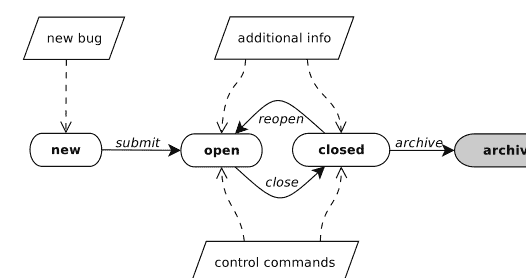

BTS 对最终用户来说是一个很好的资源，但它主要用于跟踪缺陷，直到受影响软件包的修复版本最终进入 **unstable** 归档。当一个缺陷已被 **unstable** 归档中的某个软件包关闭时，它会被标记为已关闭，即使该缺陷可能仍然适用于 **stable** 和 **testing** 归档中的该软件包版本。因此，当在本地机器上寻找有关某个问题的更多信息时，检查这些归档中软件包的已归档缺陷也不失为一个好主意。

<sup>43</sup> 实际上，一个缺陷在被重新分配给以逗号分隔的软件包列表（不含空格）后，可以属于多个软件包。此选项未被正式记录，除非在最特殊的情况下，否则可能不应使用。
<sup>44</sup> http://bugs.debian.org
<sup>45</sup> 尽管可以手动解除缺陷的归档状态，但这很少这样做。


#### 10.6.1 查询 BTS

Debian BTS 可以通过多种方式访问<sup>46</sup>。对用户而言，最相关的两种方式是通过其 Web 界面和邮件界面。此外，还有一个实验性的 LDAP 网关以及一个 rsync 服务器，后者仅对镜像、统计分析和状态报告真正有用。

##### 使用 Web 浏览器

Web 界面是查询 BTS 最常用的方式。虽然其首页<sup>47</sup>提供了各种搜索表单，允许配置许多设置，但以下快捷方式是在 URL 中指定搜索条件的一些示例：

- `http://bugs.debian.org/<bug-id>`
  通过 ID 访问单个 bug。
- `http://bugs.debian.org/<package>`
  显示某个二进制包的所有 bug。
- `http://bugs.debian.org/src:<package>`
  显示与指定源码包相关的所有 bug。
- `http://bugs.debian.org/from:<submitter@email.address>`
  查询提交者为指定电子邮件地址的所有 bug。
- `http://bugs.debian.org/<maintainer@email.address>`
  检索属于指定电子邮件地址维护者的包的所有 bug 列表。

##### 以 mbox 文件浏览 bug 报告

此外，您可以将 bug 报告及其后续讨论线程下载为 mbox 文件，以便离线查看和方便评论。除了每个 bug 网页顶部的链接外，也可以使用快捷方式。假设您使用 mutt，这可以让您像阅读普通电子邮件一样阅读 bug 报告。mutt 会正确地将评论进行线索化，回复消息的工作方式也符合预期：

```
~$ wget -qO debbug.241343 http://bugs.debian.org/mbox:241343
~$ mutt -f debbug.241343
[...]
~$ rm debbug.241343
```

## 10 文档与资源

##### 使用 LDAP BTS 网关

BTS 也可以通过 LDAP 访问，无论使用图形化还是命令行的 LDAP 客户端均可。虽然使用像 gq 这样的图形化前端浏览 bug 报告可能最为方便，但来自 ldap-utils 的命令行工具非常适合在 shell 中进行复杂搜索。

例如，您可以使用以下命令列出所有带有 **security** 标签的打开状态的 bug：

```
~$ ldapsearch -x -H ldap://bugs.debian.org \
  -b dc=bugs,dc=debian,dc=org \
  '(&(debbugsState=open) (debbugsTag=security))'
[...]
```

您可以在 bts2ldap 网关页面[^48]上找到更多关于可用搜索条件以及所使用的 LDAP 模式的信息。

不幸的是，在撰写本文时，该网关的速度慢到几乎无法使用。希望未来能有更强大的实现，以允许通过 LDAP 快速高效地与 BTS 交互。

#### 10.6.2 从命令行查询 bug

**devscripts** 软件包中的 **bts** 工具是查询 BTS 的命令行界面。给定一个条件，它可以下载单个 bug，或者某个包或维护者的 bug 列表页面，并在浏览器中显示。要使用的浏览器由 **$BROWSER** 环境变量[^49]设置，并且可以包含一个不同的浏览器列表，系统会依次尝试使用。默认情况下（如果未设置该变量），该工具使用 **sensible-browser**，它应该会根据调用环境调用一个合理的浏览器（参见第 6.1.4 章）。

以下示例应能充分说明如何使用 **bts** 从命令行获取 bug 报告：

```
~$ export BROWSER=w3m
~$ bts bugs ipcalc
[...]
~$ bts show 241343
[...]
~$ bts bugs tag:sarge
[...]
```

如果您更喜欢用 *例如* less 来阅读 bug 报告，您可以利用 **$BROWSER** 变量的灵活性：

```
~$ BROWSER='w3m -dump' bts show 241343 | less
[...]
```

**bts** 工具还附带缓存功能，允许您下载并缓存 bug 报告以供离线使用。例如，如果您希望所有与 **ipcalc** 相关的 bug 在没有网络连接的情况下也能访问，您可以执行以下命令（我们使用 src:ipcalc 来获取针对 **ipcalc** 源码包生成的所有二进制包提交的 bug）：

```
~$ bts cache src:ipcalc
[...]
```

现在，要访问缓存，您必须使用 **--offline** 选项或设置 **$BUGSOFFLINE** 环境变量来强制 **bts** 进入离线模式；它不会自动使用缓存。否则，您可以像以前一样使用它：

```
~$ bts --offline bugs src:ipcalc
[...]
```

一旦缓存被填充（并且 **~/.devscripts_cache/bts** 存在），**bts** 将缓存所有下载的数据。为防止用户的主目录被填满，它还会自动使过期的缓存数据失效，就像它在在线模式下请求 bug 时也会通过更新缓存数据来保持缓存同步一样。可以随时使用 **cleancache** 清理缓存，该命令接受与 **bugs** 命令相同的选择标准，或者关键字 **ALL** 来清除整个缓存：

```
~$ bts cleancache src:ipcalc
~$ bts cleancache ALL
```

##### querybts 工具

另一个值得注意的程序是 **querybts**，它随 **reportbug** 软件包一起安装。**querybts** 接受一个包名或一个或多个 bug 号，去获取相关的 bug 报告及其评论，并使用一个特殊的分页器显示它们。该分页器允许浏览 bug（通过在分页器中输入数字或索引），甚至可以使用 **[f]** 键通过 Perl 正则表达式进行过滤。只需按 **[enter]** 键即可显示下一屏 bug，或者如果没有更多 bug 可列出，则退出程序。

一旦选中一个 bug，随后的 **enter** 键将依次显示该 bug 的评论。**[o]** 键返回到 bug 列表，并允许选择另一个 bug。在两个菜单中，**[?]** 键都会显示一个简短的命令列表，以刷新用户对可用按键的记忆。

##### 通过邮件界面

通过电子邮件查询 BTS 的选项相当有吸引力，特别是对于离线客户端。请求服务器的用法非常简单，对于那些过去曾与邮件请求服务器（如邮件列表管理器）交互过的人来说，会感觉非常熟悉。

请求通过电子邮件发送至 **request@bugs.debian.org**。请求邮件的主题仅用于确定响应的主题。发送给请求服务器的命令写在邮件正文中，每行一个命令。例如，要请求 #241343 的完整 bug 报告、ipcalc 包的 bug 索引以及包含请求服务器能理解的更多命令的帮助文档，您只需要发送以下邮件：

```
From: a.n.other@email.co.uk
To: request@bugs.debian.org
Subject: bug report requests

send 241343
index packages ipcalc
help
thank you so very much
```

不久之后，您应该会收到三封包含请求信息的邮件，它们是从相应网页导出的。请求服务器的帮助文档也可以在线获取[50]。*thank you* 命令并非必需，但保持礼貌总没有坏处。

BTS 请求服务器未来可能会被弃用，转而使用 bts（参见第 10.6.2 章）。

#### 10.6.3 bug 严重性

每个 Debian bug 都被评定为七个严重性级别之一，以表示其重要性。按严重程度递增排序，这些级别是：

- **wishlist**：愿望单 bug 标记功能请求，但也用于任何由于主要设计考虑而非常难以修复的 bug，除非它们有严重的影响。
- **minor**：次要 bug 涉及不影响软件包可用性的问题。此外，它们可能很容易修复。
- **normal**：新 bug 默认为 normal 严重性。大多数 bug 可以评定为 normal 严重性。
- **important**：重要 bug 对软件包的可用性有重大影响，但并不会使软件对所有人完全无法使用。
- **serious**：严重 bug 指明违反了 Debian 策略（参见第 5.7 章），或者根据软件包维护者的说法，存在使软件大部分无法使用的故障。请将何时将 bug 提升为严重的决定权留给维护者，除非确实违反了策略。
- **grave**：严重 bug 使相关软件包无法使用或大部分无法使用，导致数据丢失，或引入允许访问使用该软件包用户账户的安全漏洞。
- **critical**：危急 bug 会破坏不相关的（本地）软件或整个系统，导致严重数据丢失，或在安装了相关软件包的系统上引入安全漏洞。

软件包维护者可以使用严重性来确定 bug 的优先级。此外，最后三类 bug（serious、grave 和 critical）构成了 RC bug 的集合。任何具有打开状态的 RC bug 的软件包都不能进入稳定版本。

报告 bug 时，决定合适的严重性并不总是那么容易。通常，最低的四个严重性级别足以满足日常使用。RC bug 只应在咨询 Debian 开发人员后报告，例如在邮件列表上。不过，如果您确定某个问题属于发布关键严重性，那么您应该毫不犹豫地提交相应的 bug。顺便提一下，devscripts 软件包中的 rc-alert 工具允许您检查本地安装的软件包是否有任何针对它们的未解决 RC bug。apt-listbug 工具会在您即将安装软件包时通知您任何针对该软件包的 bug（参见第 5.11.3 章）。

在最低的四个级别中，您几乎总是应该选择 normal 严重性。在仔细考虑和调查后，严重性可以提高到 important。验证 bug 的症状和可能的原因，以确保您在正确的地方寻找解决方案，这始终是个好主意。此外，严重性为 important 的 bug 报告应包含所有相关信息，并且需要更加仔细地编写。

将 bug 降级到 minor 严重性的问题较小。话虽如此，应避免选择与问题不符的严重性。如果手头的问题是程序某个特定选项（或菜单项或过程）的问题，那么它

很可能是一个**常规**错误。如果问题仅造成不便（*例如*文本框清除了之前的条目，或用户界面行为异常），则该错误可能是*次要*的。另一方面，如果问题影响到程序的整个子系统，请务必报告一个**重要**错误。如果您只是缺少某个功能，请将其作为**愿望清单**错误提交。选择严重性级别并非最终决定，开发者（或您）可以随时自由更改（直到错误被存档）。

#### 10.6.4 错误标签

错误报告也可以用一组标签进行标记。这些标签标识了错误的某些属性。虽然主要供包维护者使用，但每个标签都提供了关于该问题的有用信息，因此也与研究问题的人员相关。最重要的标签如下：

-   **补丁**
    包含修复该问题的补丁，位于错误报告或其后续消息中。

-   **不修复**
    此标签明确表示该错误将不会被修复。可能是维护者不同意该错误报告，或者修复可能过于侵入性并可能引起其他问题。此外，此标签也常用于标识超出软件包范围的**愿望清单**错误。

-   **需要更多信息**
    维护者没有足够的信息来着手解决该错误。如果在合理的时间内未提供此类信息，维护者可能会选择直接关闭该错误，理想情况下是在尝试再次建立联系后。

-   **无法重现**
    维护者无法重现该错误。如果您能重现它，也许可以提供更多关于该错误发生环境的信息。

-   **需要帮助**
    维护者束手无策，需要帮助来修复该错误（另见第2.5.1章）。

-   **挂起**
    已找到解决方案，即将进行上传。如果维护者似乎忘记了上传，请随时发送（礼貌的）提醒。

-   **已修复**
    这表明该错误已在最近的非维护者更新中得到修复，但尚未得到确认，或者某些问题仍然存在（*例如*因为修复只是一个临时方案）。

-   **已在实验版修复**
    此标签标识在*实验版*存档中可用的软件包中已修复的错误（见第4.4.1章）。

-   **安全**
    **安全**标签标识安全问题，应仅用于此类问题。安全错误将得到优先处理。请确保仅将真正的安全错误标记为此类，因为“狼来了”的故事同样适用<sup>51</sup>。

-   **上游**
    问题存在于上游源代码中，而非Debian打包中。这类似于将错误标记为**已转发**（见下文）。

-   **potato, woody, sarge, etch, sid, experimental**
    该错误仅适用于特定的Debian发行版。正在进行的努力是支持错误报告适用于软件包的单一版本（甚至版本范围）。一旦此功能可用，这些标签将被弃用。

-   **已转发**
    虽然并非真正的标签，但可以将错误标记为已转发，表示该错误已引起其他人的注意，很可能是上游开发者。已转发的错误几乎总是伴随着**上游**标签，但BTS不会自动关联两者。

#### 10.6.5 报告错误

错误通过BTS的邮件接口进行报告。错误提交邮件的格式很简单。例如，要报告针对**postfix**版本2.1.4-4的一个次要错误，您只需向submit@bugs.debian.org发送以下电子邮件：

```
From: a.n.other@email.co.uk
To: submit@bugs.debian.org
Subject: postfix takes ages to start

Package: postfix
Version: 2.1.4-4
Severity: minor

Ever since upgrading to 2.1.4-4, postfix takes 10 seconds to start.
```

<sup>51</sup> “狼来了”的故事中，男孩在没有危险的情况下多次呼救。因此当狼真的来了那天，没人相信他了。

# 10 文档与资源

之前只有1个，请修复它。

此致，
Ashley Other

经过数小时的绞尽脑汁和数百封电子邮件的来回沟通（是的，我有点夸张），问题被发现出在**libdb4.2**版本4.2.52-16的Berkeley数据库代码中；升级到4.2.52-17消除了启动延迟。耗时较长的部分原因是维护者没有考虑**libdb4.2**版本存在缺陷的可能性，而错误报告者也没有提供所有相关信息。

这个错误报告及其诊断纯粹是虚构的，但它旨在说明一个重要的观点。错误通常是各种因素非常具体交互的结果。为了能够诊断和修复错误，开发者必须获得尽可能多的信息。发帖者确实报告了一个错误，但遗漏了重要数据，例如所涉及软件包的版本。不过，显然，我们不能期望Ashley N. Other能够正确收集所有相关信息，甚至知道什么是相关的，什么不是。

##### reportbug工具

编写**reportbug**工具是为了简化错误报告流程，方便提交者和接收维护者。它从`/etc/reportbug.conf`读取配置，但也允许每个用户在`~/.reportbugrc`中进行修改。

**reportbug**支持四种操作模式，这决定了提问的数量和对用户专业知识的期望。按复杂性递增顺序，它们分别是：

-   **新手**
    这是默认模式，通过仅请求绝对最少的信息，将分类负担转移到维护者身上。此外，它仅在**稳定版**发行版中检查更新的软件包。这是默认模式。

-   **标准**
    在标准模式下，用户还可以从一组要应用于错误报告的补丁中进行选择。

-   **高级**
    高级模式与标准模式的主要区别在于，它会查询**incoming**队列以获取更新的软件包，并允许对所谓的“依赖包”提交错误报告，这些软件包存在的唯一目的是依赖（因此引入）其他软件包（如过渡包和虚拟包）。

-   **专家**
    在专家模式下，reportbug假设您完全了解Debian策略，并且对错误跟踪系统有丰富的经验。除非您真的知道自己在做什么，否则不建议使用此模式。

使用该工具报告错误会根据所选模式引导用户完成一系列步骤。reportbug会自动获取一些信息，并期望用户补充其他信息：

1.  除非在命令行的第一个参数中指定了软件包，否则reportbug会提示输入软件包名称。输入“other”将显示一页伪软件包（见第10.6.8章）及其描述。
2.  一旦知道软件包名称，该工具首先收集有关本地安装的软件包的信息，例如版本号及其安装状态。同时，还会收集与APT配置和系统整体相关的一些数据。
3.  如果reportbug给出的名称没有安装对应的软件包，reportbug会提供搜索具有相似名称文件的选项，并在找到匹配项时自动选择适当的软件包。
4.  接下来，它会检查存档中是否有该软件包的更新版本可用。在新手模式下，仅查询稳定版存档。在标准模式下，还会检查测试版和不稳定版存档。对于高级和专家模式，甚至会考虑incoming队列。如果发现有更新的版本可用，reportbug会提醒用户这一事实，并询问是否应继续。除非升级不是一个选项（例如该错误在多个版本中都存在，如功能请求），否则，请考虑升级并在更新版本中验证该错误是否存在，然后再继续提交错误。
5.  然后，使用querybts工具（见第10.6.2章）显示已提交的针对该软件包的所有错误报告。查看错误时，按[x]键可以使用reportbug为该错误提交额外信息（而不是提交新错误）。
6.  如果现有错误都不涉及您要报告的问题，reportbug将继续确定该软件包的依赖项（及其版本），以便稍后包含在报告中。
7.  然后，reportbug会提示输入主题，主题应为问题的简明摘要。主题前会添加软件包名称（或指定的绝对文件名）（除非您使用的是专家模式）。


8.  在高级模式或以上级别，程序会询问你应接收错误报告的其他地址。请在此处指定涉及错误的第三方，而不是在电子邮件的抄送（Cc）标头中指定。

9.  接下来，系统会提示你选择问题的严重性级别。请务必仔细确保使用了正确的严重性级别。

10. 在标准模式及以上级别，**reportbug** 此时会给你机会为报告添加标签。选择列表中未包含的标签可以直接输入（参见第 10.6.4 章）。

11. 最后，**reportbug** 会启动你的邮件用户代理或一个简单的编辑器，让你编写错误报告。报告内容应出现在伪标头（列出软件包名称、版本和严重性）之后，但位于（自动生成的）系统信息部分之前。

##### 编写错误报告

**reportbug** 会根据你对各种提示的回答，拼凑出一封电子邮件，提交错误报告时会包含大量有用信息。然而，你仍然需要恰当地描述错误。编写一份好的错误报告是一门艺术，报告质量越高，找到并解决问题的可能性就越大。互联网上有很多关于如何有效报告错误的信息[^52]。一般来说，尽可能精确和详细是很重要的。不要仅仅声称某个功能不工作，你对问题的描述应包括以下内容：

-   你想做什么？由于所谓的错误，失败操作的预期结果是什么？
-   当你执行某个操作时，你期望发生什么，实际结果与你的预期有何不同？
-   你采取的确切步骤是什么？请尽量具体。
-   什么环境可能影响甚至导致该问题？是否存在某些情况下该问题不会出现？如果可能，尝试用不同的方法达到你期望的结果，并尝试确定错误存在的条件。
-   你认为哪些其他信息与问题相关？将你想到的所有相关信息都包括进来。然而，请尽量合理，将信息限制在相关部分。不过，如果你不确定，总是多包含信息比遗漏一些关键数据要好。

> [^52] Simon Tatham 的文档是任何认真参与开源社区贡献的人的必读材料；提交错误报告*本身就是*一种贡献。http://www.chiark.greenend.org.uk/~sgtatham/bugs.html

编写错误报告也涉及现实生活中的社交技巧。如果你对维护者或软件作者发怒，错误报告很可能会被忽视或降低优先级。相反，保持礼貌很重要。此外，请记住，错误报告通常将你置于向他人请求某物的位置。诚然，修复错误也符合维护者的利益，但你是主动联系的人。一些维护者可能会对错误报告做出不恰当的反应。不要感到被冒犯。尽量保持冷静和礼貌，并尽最大努力遵循维护者的指示。如果你觉得讨论没有进展，可以随时联系邮件列表（大概是 **debian-user**）寻求帮助。

最后一点，请不要在单个错误报告中报告多个问题。因为维护者可能能够立即修复其中一个，但另一个可能不行，在 BTS 中无法有意义地表示进展。相反，如果你发现多个问题，请提交多个错误报告。

##### 错误报告的特殊标头

###### X-Debbugs-No-Ack

提交错误报告后，BTS 会发送一封确认邮件。可以通过在初始发送给 BTS 的电子邮件中设置 **X-Debbugs-No-Ack** 标头为任何值（只要它存在）来抑制此邮件。也可以使用邮件过滤器来过滤确认回复。例如，使用 **procmail**：

```
:0
* ^X-Debian-PR-Message: ack-info [0-9]+$
/dev/null
```

然而，这也会清除因意外或恶意意图以你名义发送的消息的确认回复。显然，真正的恶意者会自己设置此标头，因此无法根治。关于邮件过滤器方法（在上面的例子中是 **procmail**）的特性，比较可取的一点是日志条目，它允许你验证错误的接收情况。当然，你总是可以通过在线检查错误记录来确认错误提交；记录每 15 分钟更新一次。

**X-Debbugs-No-Ack** 标头（如果使用）必须出现在电子邮件标头中，而不是为 BTS 创建的伪标头中：

```
From: a.n.other@email.co.uk
To: submit@bugs.debian.org
Subject: postfix takes ages to start
X-Debbugs-No-Ack: please keep them to yourself

Package: postfix
[...]
```

###### X-Debbugs-Cc

某些错误报告可能对第三方感兴趣。你可能在同事的系统上发现了一个错误并提出要报告它（因为你读了本书，所以知道关于在 Debian 中报告错误的一切），或者你可能与某人合作处理了要报告的问题，并希望让那个人了解情况。显而易见的做法是将该个人添加到提交邮件的 Cc 标头中，但这种方法有一个固有的问题：BTS 在提交时为每个新错误分配唯一的 ID。为了以后参考，第三方可能希望知道该 ID 以便能够跟踪该错误。然而，如果该个人收到提交邮件的抄送副本，则无法包含 ID，因为它尚未被分配。解决方案是以与 **X-Debbugs-No-Ack** 标头相同的方式设置 **X-Debbugs-Cc** 标头，并让 BTS 在分配 ID 后向指定地址发送抄送副本：

```
From: a.n.other@email.co.uk
To: submit@bugs.debian.org
Subject: postfix takes ages to start
X-Debbugs-Cc: postfix-bugs@postfix.org

Package: postfix
[...]
```

BTS 将确认抄送副本（除非设置了 **X-Debbugs-No-Ack**，在这种情况下确认被丢弃，但抄送副本仍会发送），并将错误报告及其 ID 一起发送到 **postfix-bugs@postfix.org**。

#### 10.6.6 错误报告后的邮件流量

除了使用 **reportbug** 外，还可以通过向 **<bug-id>@bugs.debian.org** 发送普通电子邮件来向错误记录添加后续信息或评论。BTS 会将所有发送到这些地址的消息附加到相应的错误记录中。此外，它会将消息转发给软件包维护者（或错误的所有者，见下文）以及 **debian-bugs-dist** 邮件列表[^53]。

在错误编号后附加 **-maintonly**（例如 241343-maintonly@bugs.debian.org）会告诉 BTS 不要将信息转发到邮件列表。如果系统应在不将其转发给维护者（或所有者）的情况下记录消息，请使用：**241343-quiet@bugs.debian.org**。通常最好避免使用 **-quiet**，而将 **-quiet** 用于对先前消息的小额添加或更正是完全合理的。对于之前消息的小额添加或更正，或者记录从与维护者的私人讨论中提取的信息，使用 **-quiet** 是有意义的。

[^53] http://lists.debian.org/debian-bugs-dist

## 10.6 错误跟踪系统

另一个后缀 **-submitter** 允许将消息发送给错误的提交者。该消息由 BTS 记录在错误记录中，随后转发给当前列为提交者的地址。发送到 **-submitter** 的消息不会转发给维护者或 **debian-bugs-dist** 邮件列表。

BTS 在转发给提交者地址以及错误地址的错误报告上设置 **Reply-To** 标头。因此，当维护者回复时，提交者会收到一封直接邮件，BTS 会记录该回复。然后，BTS 将回复转发回维护者以及 **debian-bugs-dist** 邮件列表。

到目前为止，一切顺利。当报告者随后回复维护者的回复时，会出现轻微的不便。如果用户回复消息的所有收件人，维护者会收到两次回复，一次是直接收到，一次是通过 BTS 收到。显然，这是 **procmail** 或类似工具的用例，但用户在选择收件人时小心一些也无妨。经验法则是：从收件人列表中删除维护者的地址（可能还有你自己的地址），只将你的回复发送到错误地址。如果评论内容较少，你可以选择使用 **-maintonly** 后缀。第三方则应保持在抄送（Cc）中。对于错误报告的后续消息，X-Debbugs-Cc 标头将被忽略。

#### 10.6.7 与 BTS 交互

Debian BTS 对所有人开放。不仅错误及其所有后续帖子都可以通过 HTTP 自由访问，任何人都可以操作错误。虽然 Debian 项目过去曾遇到过垃圾邮件关闭错误报告的问题，但开放性从来不是问题。每个操作都会被记录在案，并通过电子邮件通知软件包维护者。因此，所有内容，包括破坏行为，都可以被检测和恢复。BTS 是一个开放的协作平台，并为项目提供了良好的服务。

几乎错误报告的每个方面都可以通过 BTS 控制接口进行更改。然而，一旦评论被发布到错误上，就无法更改或删除。此外，如前所述，每个操作都会记录到错误记录中，并通过网络和邮件接口公开可见。实际上，操作错误报告的唯一方法是通过类似于请求服务器的邮件请求服务器（参见第 10.6.2 章），并且收到的每封邮件都以原始格式记录（包括所有标头）。在滥用企图的情况下，可以使用此信息追踪冒犯者。

控制服务器了解所有请求服务器命令，并添加了用于操作错误报告的命令。虽然大多数 BTS 控制命令主要与软件包维护者相关，但其中一些也与直接与 BTS 交互并合作的软件包维护者相关的用户相关。每个命令单独占一行。第一个参数始终是要修改的错误 ID。ID 之后是特定命令的参数。通用性较强的控制命令包括：

##### package
`package` 本身并非一个独立命令，其作用是将**package**命令之后、直至请求邮件末尾或下一个**package**语句之前的所有命令，限定在特定的软件包范围内执行。强烈建议使用此命令，因为它能最大限度地减少因错误输入bug编号而产生的影响。

##### retitle
将bug的标题更改为参数中指定的新标题。

##### severity
将bug的严重等级修改为参数中指定的等级。

##### tags
更改为该bug记录的标签集。第一个参数可以是加号、减号或等号（+/-/=），用于请求添加、移除或绝对设置随后的标签集。若未指定符号，则默认为添加（加号）。

##### reopen
重新打开一个尚未归档的bug报告。该命令接受一个新的提交者邮箱地址作为参数，使用`!`可表示使用你自己的邮箱地址。若未指定参数，则提交者信息保持不变。

##### owner
通过此命令将bug的所有者设置为参数中指定的邮箱地址（其中`!`是你邮箱地址的简写），你将该bug的责任转移给了该地址的所有者。BTS（缺陷跟踪系统）将把关于此bug的后续邮件发送至该所有者地址。如果你计划通过修复某个bug来提供帮助，并且已与维护者协调一致，可以使用此命令。

##### close
此命令已弃用。请改用bug邮件地址的 **-done** 后缀来关闭（见下文）。

##### quit, stop, thank...
上述任意命令（或行首的两个破折号）都会告知控制服务器停止处理该消息。

例如，以下邮件将把bug **#241343**的严重等级提升至次要<sup>54</sup>，添加**pending**标签，将所有者设置为请求者的地址，并确保所有命令仅应用于**#241343**所针对的**wnpp**（伪）软件包：

```
From: a.n.other@email.co.uk
To: control@bugs.debian.org
Subject: this space intentionally left blank

package wnpp
severity 241343 minor
tags 241343 + pending
owner 241343 !
```

<sup>54</sup>考虑到该bug报告的性质，将其严重等级设为次要（minor）将是一个明确的错误。此示例仅用于演示目的，请勿在实际操作中尝试！

##### 记录变更

上述控制命令已足以让BTS知晓应执行的操作。然而，人类读者可能无法推断出进行这些更改的原因。因此，与其发送这种纯控制邮件，建议为变更提供理由。最佳做法是在控制命令后附加人类可读的解释，并将邮件同时发送给bug地址和控制服务器地址。这种情况下，控制服务器地址必须包含在密送（Bcc）头中。请避免使用抄送（Cc）头，因为控制服务器通常会因此成为后续通信的参与者——人们更倾向于回复所有收件人，而不愿费力地调整收件人列表。

```
From: a.n.other@email.co.uk
To: 241343@bugs.debian.org
Cc: 241343-submitter@bugs.debian.org
Bcc: control@bugs.debian.org
Subject: upload pending

package wnpp
severity 241343 minor
tags 241343 + pending
owner 241343 !
thankyoueversomuch

I heartily agree and think that the reported issue deserves
more attention than a simple wish. I have prepared a solution
and an upload is pending.

Sincerely,
Ashley N. Other
```

控制邮件服务器会解析邮件直至看到**thankyoueversomuch**命令（或任何其他以“thank”开头的命令）。邮件的其余部分则作为操作记录。该bug所属软件包的维护者将收到两封邮件：后续帖子的转发，以及控制服务器执行操作的记录。

BTS支持许多其他命令，这些命令在在线文档<sup>55</sup>中有记录。

<sup>55</sup> http://www.debian.org/Bugs/server-control

##### 关闭bug

当问题解决后，相应的bug应被关闭。可以通过以下三种方式之一实现：

- 在新版本的 **changelog** 条目中，维护者可以指定该版本关闭了哪些bug。Debian归档脚本会自动提取bug编号，并通过提交**changes**文件到BTS并附上适当说明来关闭它们。
- 也可以通过向bug的带 `-done` 后缀的邮件地址（`nnnnnn-done@bugs.debian.org`）发送解释说明来关闭bug。
- 使用BTS的close控制命令可以不带解释地关闭bug。此方法不推荐，且该命令已弃用。

##### bts 命令行工具

在**devscripts**软件包中，你可以找到**bts**命令行工具。它允许你从命令行与BTS交互，而无需编写晦涩的邮件控制消息（其实并不那么晦涩）。如果你已经熟悉邮件界面，其使用非常简单，无需额外知识。要使用**bts**，你只需在参数中指定邮件界面命令。可以给出多个命令，用点号或逗号分隔：

每次调用**bts**都会生成一封单独的邮件消息，发送至**control@bugs.debian.org**，效果等同于你手动创建。

```
~$ bts severity 241343 wishlist . tags 241343 + wontfix
```

该工具会尽力确定正确的发件人地址，会查询标准变量`$DEBFULLNAME`和`$DEBEMAIL`等。**bts(1)**手册页有更多信息。

#### 10.6.8 针对伪软件包的bug

通常认为bug是软件的问题，因此bug通常针对包含软件的软件包提交。事实上，“软件包”这一概念已完全内置于**debbugs**（Debian的BTS[^56]）中。虽然可以将bug重新分配给其他软件包，但一个bug必须始终属于某个软件包，不能独立存在。

Debian BTS是Debian项目的有机组成部分，也用作问题跟踪系统。例如，Debian网页上的错误、各种服务器的问题、策略、安装程序、内核、归档、镜像或列表，或项目诸多其他方面的问题，都通过bug来处理。为了处理此类问题报告，BTS知晓许多伪软件包[^57]，它们被视为普通软件包处理，但在归档中没有对应的文件。下表列出了最重要的伪软件包：

[^56] 该软件包位于 **debbugs** 软件包中。
[^57] 该软件包位于 **debbugs** 软件包中。

##### 表 10.2：Debian BTS 最重要的伪软件包

| 软件包名称 | 问题类别 |
|---|---|
| **bugs.debian.org** | Debian BTS 的问题。 |
| **ftp.debian.org** | Debian 归档内容的问题（*例如*因许可证问题导致的移除请求）。 |
| **mirrors** | Debian 归档镜像的问题。 |
| **general** | 不属于其他类别或软件包，或同时涉及太多软件包的通用问题。 |
| **install** | `debian-installer` 的问题。 |
| **kernel-image** | Debian 内核映像的问题。 |
| **listarchives** | Debian 邮件列表归档的问题。 |
| **lists.debian.org** | Debian 邮件列表服务器的问题。 |
| **policy** | Debian 策略的问题或提议的更改。 |
| **project** | 项目及其管理的问题。 |
| **www.debian.org** | `www.debian.org` 或其他 `*.debian.org` 网页的问题（除非页脚指定了联系信息）。 |

`reportbug`工具可以帮助你处理伪软件包。使用伪软件包的名称调用它，效果符合预期。不带参数调用会导致它提示你输入软件包名。如果你输入“other”，它将显示一个伪软件包列表以帮助你选择。

##### 工作中和待定的软件包

虽然大多数伪软件包都有一个“维护者”或一组负责处理或转发问题的人员，但有一个伪软件包有些特殊，因为它属于每个人。`wnpp`软件包的bug列举了“工作中和待定的软件包”（Work-Needing and Prospective Packages），即需要帮助或新维护者的软件包列表，以及正在开发中或已请求被纳入Debian的软件包。`wnpp`软件包还有一个特殊的网络


## 10 文档与资源

列明各类请求状态的 WNPP 页面，充当了新软件包及软件包迁移协调工作的中央枢纽。WNPP（待处理和候选软件包工作）记录分为六大类，可归纳为两大组别：

##### 关于候选软件包的报告

###### 软件包请求（RFP）
“软件包请求”由希望某软件被纳入 Debian 并寻求他人进行打包的人员提交。请求中应包含建议的软件包名称（不得与现有软件包冲突）、版本、软件包描述、网址以及软件的版权信息。

提交此类请求或准备相应软件包，并非必须成为 Debian 开发者。事实上，完成此类请求是参与 Debian 项目的绝佳途径。

###### 打包意向（ITP）
“打包意向”应包含与软件包请求相同的信息，理想情况下还应附上完成计划的说明，或可下载完成版软件包供审查的地址。新软件包上传后，应在 **changelog**（变更日志）中以适当信息关闭该 ITP（参见第 9.2.7 章）。

若该软件包此前已通过 RFP 提出请求，则应通过重命名现有错误报告来创建 ITP，并记得设置错误所有者（参见第 10.6.7 章）。

请注意，提交 ITP 并非必须成为 Debian 开发者。只要你成功创建了一个软件包，并找到一位有意愿的 Debian 开发者将其上传到软件仓库，你便成为该软件包（作为 Debian 官方软件仓库的一部分分发）的维护者。

##### 关于现有软件包的报告

###### 寻求帮助（RFH）
当软件包维护者负担过重，无法令人满意地维护某个软件包（但仍希望继续担任维护者）时，可以提交“寻求帮助”以请求协助或联合维护。此类请求是参与 Debian 项目的另一绝佳途径，尤其因为你无需从头开始。

###### 请求采纳（RFA）
“请求采纳”表明维护者希望将软件包的职责转移给他人。在此期间，维护者将继续维护该软件包。

在采纳软件包之前，理解该软件包并确保维护者提出采纳请求的原因不会妨碍你，这一点非常重要。

此外，当前维护者必须同意采纳，或可能首先要求你证明一些能力。因此，在采纳软件包之前，通知维护者你的意向至关重要。

###### 孤立（O）
当维护者无法继续维护某个软件包时，该软件包将被“孤立”，并转移至 Debian QA 团队的监管之下，直至找到新的维护者。同样，请确保你理解该软件包并有能力维护它。否则，可能弊大于利。

###### 接收意向（ITA）
对于 O 或 RFA 请求，最理想的回应是另一位有意接手该软件包的维护者提交“接收意向”。新维护者将之前的报告重命名为 ITA，转移错误所有权（参见第 10.6.7 章），并在下次上传时关闭该错误。

WNPP 的错误记录使用错误标题来存储其适用的实际软件包名称。该字段的语法如下：

```
<requesttype>: <package> -- <short summary>
```

摘要与软件包名称之间必须用一个带前后空格的双连字符分隔。使用 `reportbug`（参见第 10.6.5 章）提交针对 WNPP 的错误是个好主意，因为它提供了模板，询问形成格式正确的 WNPP 错误报告所需的所有必要信息。

这些请求状态的更改通过重命名或关闭错误报告来完成。ITP 和 RFP 在软件包上传时于 changelog 中得到确认。如果 ITP 的报告者最终无法处理该软件包，则应关闭该错误或将其重命名为 RFP：

```
$ sendmail control@bugs.debian.org <<EOF
retitle 345678 RFP: foobar -- software to do something cool
thanks
EOF
```

同样，如果你打算采纳某个软件包，应将 RFA 或 O 请求重命名为 ITA，以向其他相关方表明你的意向并防止重复努力。

##### 关注 WNPP

WNPP 虚拟软件包是 Debian 项目重要的组织组件。它允许协调新软件包以及软件包向新维护者的迁移。然而，WNPP 列表对系统管理员也很有用。

软件天生存在缺陷。换句话说，任何软件都可能出现问题。拥有活跃的上游和负责任的软件包维护者，用户无需过于担心某个软件包，因为更新和安全修复最终会到达本地机器。但是，如果你依赖某个特定软件，而维护者无法为其分配足够时间，你可能面临不得不采取行动并考虑替代方案、自己承担软件包维护或敦促他人负责该软件包的困境。

至少，你会希望知道你安装的某个软件包何时以某种方式进入了 WNPP 列表。`devscripts` 软件包中的 `wnpp-alert` 工具正是为此目的而编写的。它获取 WNPP 列表，并将其与本地安装的软件包列表进行比较，在控制台打印任何交集信息。在关键系统上，定期运行该工具并关注其输出是个好主意。

#### 10.6.9 订阅软件包的错误报告

BTS（错误跟踪系统）只知道每个软件包的单一维护者地址。因此，除非该地址是一个邮件列表（例如 `dpkg` 软件包），否则它只会将错误报告发送给那一个人。有人可能想要跟踪某个软件包的错误报告，这并非异想天开。Debian PTS（包跟踪系统）提供了一个订阅接口，可选择接收与源软件包活动相关的邮件。订阅可以通过网络界面或邮件请求：

```
~$ echo subscribe postfix a.n.other@email.co.uk \
  | mail pts@qa.debian.org
```

默认订阅不仅仅包含错误报告。当新源软件包被上传并接受时，你也会收到通知，并收到上传导致的警告和错误，以及所有发送至 `<package>@packages.qa.debian.org` 的邮件。此外，一旦 PTS 实现了此功能，你还将定期收到关于软件包状态的摘要邮件。

如果你只想关注错误报告并可能获得新版本的提醒，你可以修改你的订阅（这里假设 `mail` 使用正确的发件人地址发送消息）：

```
$ echo keywords postfix = bts bts-control upload-source \
  | mail pts@qa.debian.org
```

此外，你可以选择接收二进制上传通知、软件包版本控制系统（如果使用的话）的提交邮件以及翻译提交通知。PTS 网页提供了高级订阅模式（通过选择框），允许你精确控制希望为某个软件包接收的邮件类型。此外，发出的邮件包含定义明确的标题，便于邮件投递代理（例如 `procmail`）处理。更多信息请参阅开发者参考。

目前无法订阅单个错误。期待此功能在遥远的将来出现。现在，请通过 PTS 订阅接收所有错误报告，并使用像 `procmail` 这样的邮件处理器过滤掉除相关错误外的所有消息：

```
:0
* ^X-PTS-Keyword: bts(-control)?$
* ! ^Subject:.*Bug#(241343|654321)
/dev/null
```

#### 10.6.10 修复错误

如果你在为 Debian 打包的软件中发现一个错误，你应始终为其提交一个错误报告。根据问题的紧迫性，你可能会考虑投入时间和资源自己解决问题。开源软件不可替代的优势之一在于，你能够获取源代码并尝试找出你遇到的问题根源。诚然，并非每个人都觉得钻研程序代码很有趣，但如果这是你的乐趣所在，那就再好不过了。

如何准备补丁以修复软件包中错误的过程没有文档记录，也没有真正的标准。一些维护者偏好的东西可能是其他人讨厌的。考虑到你的修复必须得到维护者的批准，与维护者合作而非对抗非常重要。由于偏好和方法的多样性，不存在通用的解决方案，但以下关于如何修复和提交错误的指南应该能让你入门。始终记住，你要让维护者尽可能轻松地审查和接受你的补丁。

*   尝试通过阅读 `README.developers` 文件（如果提供）并检查代码和/或软件包布局来理解维护者的实践。然后，


## 10 文档与资源

确保你的更改能与其余部分无缝衔接。请记住，开发者可能非常讲究细节，因此缩进大小这类小事实际上也很重要。

- 每个补丁只修复一个错误。如果你同时修复多个错误，将它们在物理上分开会大大方便维护者的审查。
- 特别要注意，不要试图偷偷加入功能或对软件进行修改（例如更改默认设置）。如果你正在"修复"愿望清单上的错误，请确保将相关补丁明确标记出来。
- 通过向 diff 传递 `-u` 标志来提供上下文相关的补丁。这会增强补丁的健壮性，并使维护者更容易评估修复内容。
- 除非你的更改很微不足道，否则请随补丁一起提供文档。

此外，除非你确信能在短时间内修复错误并上传到 BTS（Bug Tracking System），否则最好通知 BTS 你打算修复的意向，以避免重复劳动。而且，如果你计划修复多个错误，或者你的修复涉及一些较大的改动，最好先与维护者沟通并商定一个方案。

创建补丁的标准方法当然完全适用于 Debian 软件包。一种有趣的替代方案是准备一个带有递增版本号的修补软件包。建议你不要使用下一个可用的 Debian 修订号，而是简单地附加 `.1`（如果 Debian 修订号中已包含点号，则递增该点号后的数字）。如果软件包是使用 `dpkg-buildpackage` 或类似工具构建的，你可以使用 `debdiff` 通过与下载的源代码包进行比较来提取变更。

```
~$ apt-get source foobar
[...]
dpkg-source: extracting foobar in foobar-1.23
~$ cd foobar-1.23
[...]
~/foobar-1.23$ dch --version=1.23-1.1 -- fixing a bug
~/foobar-1.23$ dpkg-buildpackage -us -uc
[...]
dpkg-deb: building package 'foobar' in '../foobar_1.23-1.1_all.deb'.
~/foobar-1.23$ cd ..
~$ debdiff foobar_1.23-1.dsc foobar_1.23-1.1.dsc > foobar.diff
```

在这种方法中，foobar 1.23-1.1 实际上仅为创建补丁而存在。使用 patchutils 包中的 `filterdiff`，可以过滤掉对 changelog 文件的更改，从而使软件包维护者能够应用补丁而不影响官方的 changelog：

```
~$ debdiff foobar_1.23-1.dsc foobar_1.23-1.1.dsc ~
| filterdiff -x '*/debian/changelog' > foobar.diff
```

如果你注意将补丁的更改限制在修复问题本身，那么上述补丁加上充分的说明，就构成了一份向 BTS 提交的正式补丁。请不要忘记在向 BTS 跟进中包含补丁时设置补丁标签（参见第 10.6.4 章）。

##### NMU – 非维护者上传

如果某个软件包的维护者没有回应错误报告，你可以选择宣布进行 NMU（Non-Maintainer Upload，非维护者上传）。这类上传包含一个修复了某个错误的软件包版本，由其他开发者上传到 Debian 归档。在这种情况下，版本号的修改方式与创建补丁时相同（参见上一节），以确保上传不会干扰维护者的任何工作。NMU 并不构成对软件包的接管，虽然它会定期在归档中可用，但维护者通常可以在下一次上传（将使用下一个更高的 Debian 修订号）时自由选择接受或拒绝它。

NMU 在若干条件下是可接受的。首先，如果 NMU 修复了一个正常严重级别（或更高）的错误，且维护者无响应或正在休假，那么 NMU 是合理的。此外，在特别公告的错误集中修复期间，NMU 是被鼓励的。与常规上传一样，NMU 也需要使用 Debian 开发者签名进行身份验证。如果你是非开发者身份，正在构建或计划构建 NMU，则需要为实际上传寻找一位赞助者，即一位愿意为你进行上传的 Debian 开发者（参见第 2.5.2 章）。

## 附录

## 附录 A

## Debian 变体及基于 Debian 的其他操作系统

Debian 系统的健壮性和通用性使得大量各类项目得以在 Debian 之上构建，并从这一坚实基础上获益。这些项目通常可分为两类：定制 Debian 发行版（CDD）以双向关系的形式存在于官方 Debian 系统之内，而 Debian 衍生版通常是对 Debian 归档内容的分叉或快照，产出一个独立的产品。

#### A.1 CDD — 定制 Debian 发行版

CDD 是为特定用户群体或特定领域量身定制的 Debian 版本，旨在开箱即用。CDD 是 Debian 项目中较新的发展，它脱胎于以前称为 Debian 内部项目的组织。这项工作正日益普及，新的 CDD 正在快速涌现。一篇描述 CDD 背后理念并提供更多信息的论文已在线发布¹。

CDD 试图解决的主要问题是简化安装过程，为特定用户群体预选软件包集（有时还进行预配置）。由于 Debian 归档中可用的软件包数量庞大且种类繁多，这并非总是容易的任务。虽然任务系统（参见第 5.5 章）也旨在实现同样的目标，但 CDD 试图提供更细粒度的选择。

CDD 并不构成 Debian 的分叉。一个完整的 Debian GNU/Linux 发行版包含所有可用的 CDD，主发行版中的开发成果会即时出现在所有 CDD 中，同样 CDD 中进行的通用改进也会直接回流到主 Debian 归档。因此，CDD 与 Debian 的衍生版有着本质的不同（参见附录 A.2）。

以下我简要概述了撰写本文时存在的各个官方 CDD。

- **Debian-Junior**
Debian-Junior 是为"1 到 99 岁的儿童"设计的 CDD，其目标是让 Debian 成为所有年龄段儿童都愿意使用的操作系统。它力求易于使用，同时提供从儿童视角来看最重要的高质量应用程序。Debian-Junior 是第一个 CDD。

- **Debian-Med**
该 CDD 试图为所有医学任务提供一个集成的软件环境。作为这一努力的一部分，该项目专注于将新的医学软件集成到 Debian 中，提高现有软件的质量，并总体上推进自由软件在医学领域的应用。

- **Debian-Edu**
Debian-Edu CDD 已与 Skolelinux 合并，后者是专为学校设计的网络计算机解决方案。更多信息请参见附录 A.2.7。

¹http://people.debian.org/~tille/debian-med/talks/paper-cdd

- **DeMuDi**
Debian 多媒体发行版正在成为 CDD 的途中。它试图成为音乐家和多媒体艺术家的首选发行版。DeMuDi 项目源于欧洲的 Agnula 项目²。

- **Debian-Desktop**
Debian-Desktop CDD 标榜为"面向所有人的 Debian"，试图通过提供"开箱即用的软件"使 Debian 成为家庭和企业工作站的最佳系统。该项目努力使 Debian 易于使用和配置，同时不牺牲专业用户所需的灵活性。

- **Debian-Lex**
Debian-Lex 项目致力于为法律实务中的所有任务构建一个完整的系统。具体来说，该 CDD 通过为 OpenOffice.org 和 SQL-Ledger 等现有软件包提供定制模板，以及针对律师行业的 PostgreSQL 示例数据库模式，为 Debian 系统增加价值。

- **Debian-NP**
该 CDD 通过专门为非营利组织定制系统来满足它们的需求。除多项改进外，该项目还试图改进并提供解决非营利组织任务的方案，如筹款、会员名单管理和会议组织。

- **Debian 无障碍项目**
作为让 Debian 走向所有人的又一次尝试，Debian 无障碍项目致力于使 Debian 对盲人和视力障碍者可用。该 CDD 增强了对屏幕阅读器和语音软件的支持。

- **Debian Enterprise**
该 CDD 希望将 Debian 融入企业世界，使其与行业驱动的共同成本开发模式兼容。其目标是提供专业文档、认证、预配置服务器，并打算在法律事务中维护自由软件的权益。

#### A.2 Debian 衍生版

Debian GNU/Linux 不仅是一个独立的操作系统，它还致力于成为越来越多衍生作品的基础。基于 Debian 的操作系统建立在 Debian 的技术和基础设施之上，通常会添加主 Debian 发行版中没有的功能。这些功能包括图形

> ²http://www.agnula.org


## Debian 分支风味及其他基于 Debian 的操作系统

以及/或自动安装程序、尖端软件集合、额外的安全功能或其他增强或专门化特性。在大多数情况下，这些对 Debian 核心的添加并不符合 Debian 将其纳入主存储库的所有要求，因此作为独立产品进行维护。以下是所选的一系列衍生版本，并非力求全面。在撰写本书的过程中，我联系了所有我能找到的相对成熟的每一个衍生物背后的团队。我只选择覆盖那些表现出响应性的项目……自然选择的缩影……

##### A.2.1 Knoppix

Knoppix[^3] 是一个旨在完全从只读介质（如 CD 或 DVD）运行的 Debian 衍生版本。系统从该介质启动，检测并自动配置可用硬件，并将用户置于一个预先配置的、外观时尚且拥有丰富的软件以满足大多数需求的 KDE 桌面中。例如，除了浏览器、电子邮件阅读器和像 OpenOffice.org 这样的生产力软件之外，Knoppix 还包含多媒体应用程序、各种语言的开发环境以及网络和安全性工具。此外，Knoppix 包含了大量用于 Linux 和其他操作系统的诊断实用程序，使其成为一个完美的救援系统。当然，Knoppix 可以通过多种方式连接到互联网，包括以太网 (Ethernet)、PPP、DSL 和 ISDN。Knoppix 还支持多种其他图形界面，如 IceWM、WindowMaker 和 Xfce 4；但它不支持 Gnome（Gnoppix 版本支持 Gnome；参见章节 A.2.3）。

对于诸如配置文件等可变数据，系统使用 ramdisk（内存磁盘）。为了在重启时保留这些配置数据（因为 ramdisk 会被清除），它允许将 ramdisk 的内容交换到可移动介质或本地硬盘。这大大提高了系统的安全性和稳定性，并确保用户不会因意外删除或覆盖文件而破坏系统。或者，可以将 Knoppix 安装到硬盘上，随后将其视为常规的 Linux 安装来处理。由于它是基于 Debian 的，Debian 工具就像直接安装了 Debian 一样可用。

Knoppix 使用 *testing*（测试）存储库的一部分作为其基础系统。桌面环境，尤其是 KDE，来自 *unstable*（不稳定）存储库，该存储库包含了更多当前的可用性功能和最新的特性与花哨的东西，这是用户非常感兴趣的方面。此外，它整合了来自其他发行版的各种软件，例如 RedHat 的 libkudzu，以及由 Klaus Knopper 编写的脚本和程序添加了硬件自动检测和配置能力。另外，Knoppix 的作者兼创始人还添加了对终端服务器、互联网连接性和配置存储服务之类的服务进行处理器。

[^3]: http://knoppix.org

## A.2 Debian 衍生版本

Klaus Knopper 主要为了自己在讲座、远程工作、演示方面的使用以及启动 Debiaan 安装（参见章节 8.3.1）而开发了 Knoppix。到目前为止，Knoppix 主要由桌面用户用于办公工作或互联网接入所采用。它还驱动着学校的网吧和学校计算机池。此外，该便携式系统在系统管理员中作为救援系统非常受欢迎，也用于取证目的。Knoppix 的另一种流行应用是了解 Linux。引导后的系统允许访问 Windows 分区，从而使用户有机会利用真实数据实验各种 Linux 工具。尽管如此，底层的 Windows 安装不会受到 Knoppix 启动的影响。因此，Knoppix 已确立其作为 *the*（那个）Linux 演示系统的地位。

自诞生以来，大约有十几个 Knoppix 衍生版本应运而生，每个都专门针对某些应用领域或语言。例如，Morphix 试图对 Knoppix 进行模块化处理以便于其专业化。**ClusterKNOPPIX**开启了**OpenMosix**功能，Quantian 拥有许多用于科学用途的应用程序，KnoppixSTD侧重于信息安全和网络管理工具，而INSERT则旨在成为一个强大的救援系统。

CD 中的软件集合以及包括在内的 Klaus Knopper 编写的所有程序均根据 GNU 通用公共许可证 (GNU General Public License) 许可。然而，存在于 Knoppix CD 上的独立软件包可能使用不同的许可协议，其中一些甚至采用“仅二进制但可免费分发用于商业用途和非商业用途”的方式，像 acroread4、Java 以及某些硬件的特定只读固件文件。之所以如此的原因是它们的主要目标用户需要这些组件，并且目前fortunately没有可用的免费软件替代品（注：原文此处意为"unfortunately"，即很不幸）。

##### A.2.2 Ubuntu

Ubuntu[^4] 是一个非常年轻的基于 Debian 的分发版。负责该项目的公司是 Canonical Software，由一些最活跃的 Debian、Gnome 和 Python 开发者掌舵，这些开发者遍布全球。他们的目标是每年两次发布 Debian *unstable*（不稳定）版本，并在发布后提供长达 18 个月的安全支持。与 Debian 不同，它将是一个基于 Gnome- 和 Python 的分发版，计划实现非常强的集成（主要使用 Python），并专注于 Gnome 桌面环境。因此，Ubuntu 用选择的多变性交换了货币价值和安全性，这对于可用性来说是一种必须。尽管如此，名为 Kubuntu 的子项目正在致力于整合流行的**KDE**桌面环境。

Ubuntu 软件存储库免费提供[^5]且仅由自由软件组成，尽管 Canonical Software 计划包括文档和某些只读固件包。（注：原文此处有“although... does plan to include”，指虽然核心是免费的但可能会包含非完全自由的固件等）可用的软件包分布在四个部分中：

base（基础）、desktop（桌面）、supported（支持版）和 universe（宇宙/第三方）。前三个包含了近 3,000 个软件包，并完全在安全更新方面提供支持。Universe 包含了从 Debian *unstable*（不稳定）存储库构建针对该分发的剩余软件包，但不提供技术支持。开发人员预计受支持的软件包池将增加规模。如果足够多的人使用 universe 部分的某个软件包，它将有望被纳入支持版本存储库中供考虑。Ubuntu 还具有可引导的 live CD（便携式系统），允许在不安装的情况下使用它。

[^4]: http://www.ubuntulinux.org; Ubuntu 是祖鲁语 (Zulu) 中表示“社区和社区贡献”的词
[^5]: 事实上，Canonical Software 计划免费向任何人寄送其软件的 CD。

##### A.2.3 Gnoppix

Gnoppix[^6] 是一个便携式分发版，与 Knoppix 类似地从只读介质运行。与 Knoppix 不同的是，它使用 Gnome 桌面环境，但在其他方面提供相同或相似的功能，包括自动硬件检测和大量预配置的常见软件。该软件有三种版本：稳定版旨在用于生产用途；测试版供……嗯，进行测试以及可能为更具冒险精神的用户的日常使用；最后一个称为 beta（贝塔）的版本主要用于开发目的。

Gnoppix 项目计划推出针对开发机、桌面机、防火墙、多媒体工作站、集群机器、游戏用途和系统恢复的专门化 Gnoppix 版本。此外，该项目希望支持**amd64**和**powerpc**架构。

##### A.2.4 MEPIS

MEPIS[^7] 是一个专为日常家庭和办公室台式计算机用户设计的基于 Debian 的操作系统。MEPIS 从 Debian 的 *unstable*（不稳定）存储库中提取软件并将其打包成一个即用的 Linux 系统。它旨在完全取代 Microsoft Windows。

MEPIS 开发并持续改进专门组件，以便使用户更容易进行安装和配置。MEPIS Installation Center（MEPIS 安装中心）允许轻松完成安装及相关任务。借助 MEPIS System Center（MEPIS 系统管理中心），用户可以控制输入输出设备、网络接口、软件包管理系统以及各种系统调整。MEPIS Auto Configuration（自动配置）组件和脚本会自动加载大多数硬件的驱动程序，并且还能检测和促进使用固定驱动器、可移动驱动器以及 USB 和 Firewire 设备。

虽然 MEPIS 系统的开发公司发布其商业版本的操作系统以及预配置的软件和书籍……

[^6]: http://gnoppix.org
[^7]: http://www.mepis.org 


##### A.2.5 MNIS

MNIS 是一个基于 Debian 的嵌入式系统开发系统。它使用 Debian 作为基础系统，并添加了 Ocera 实时扩展，以提供框架、开发和集成工具，以及用于生成具有工业级实时效率的嵌入式系统的文档。MNIS 包含了按照工业标准开发嵌入式系统所需的全部工具。

MNIS 发行版特别适合需要超快实时操作系统的实时开发人员和工程师。MNIS 提供微秒级的延迟和任务切换性能。同时，它还能受益于 Debian 庞大的软件集合和强大的管理工具包。

MNIS 发行版、其附加组件、文档和衍生作品均在 GNU 通用公共许可证下发布。OCERA 部分基于 RTLinux-GPL，同样在 GPL 条款下授权。来自 Debian 软件包存档的软件根据 DFSG 提供。

##### A.2.6 Quantian

Quantian 是一个基于 Knoppix/Debian 的操作系统，专门针对数值和定量分析而定制。Quantian 在 Knoppix 基础上添加了大量程序，这些程序主要面向从事应用或理论数据分析领域的人员。此外，Quantian 还包含多种科学应用，如 Octave、Maxima、OpenDX、CRAN、Alliance VHDL 以及各种用于运行 Windows 软件的模拟器。Quantian 还借鉴了 clusterKNOPPIX，添加了 OpenMosix 支持，使其可用于集群进行分布式计算。

##### A.2.7 Skolelinux

Skolelinux 是一个旨在为学校提供完整计算机解决方案的项目。在与 Debian-Edu CDD（参见附录 A.1）合并后，它成为了 Debian 项目的正式组成部分。该系统基于集中式用户管理和存储的网络架构。Skolelinux 使用 **Webmin** 提供可通过网络浏览器访问的管理和维护界面。软件安装和维护则交由 **APT** 来完成。

安装 Skolelinux 的默认方式是使用终端服务器和一堆瘦客户端。瘦客户端的低硬件要求有助于降低成本，而让所有人共用一台中央服务器有助于将管理降至最低。尽管如此，网络架构仍然允许集成工作站（胖客户端）、笔记本电脑，甚至允许用户在家中安装系统，使用互联网在中央服务器上进行身份验证和文件存储。Windows 机器也可以通过 **Samba** 集成到 Skolelinux 网络中。

作为 Debian 的子项目，Skolelinux 根据 DFSG 条款提供。

##### A.2.8 Adamantix

Adamantix 项目（前身为 Trusted Debian）旨在创建一个高度安全但可用的 Linux 平台。Adamantix 以 Debian 为基础，并提供自己的加固软件包存档。理想情况下，安装在 Adamantix 系统上的所有软件都来自其存档，但 Debian 镜像也可以轻松集成。

Adamantix 为内核添加了各种与安全相关的补丁，并试图通过使用特殊编译器扩展重新编译 Debian 的软件包来提高软件的安全性。内核补丁包括 RSBAC 和 PaX，其所有软件包（包括内核）都使用经过补丁的编译器编译，该编译器集成了 IBM 的栈粉碎保护器以及 PaX 地址布局随机化，使缓冲区溢出攻击变得更加困难。

该发行版以与 Debian 本身相同的许可证提供，因此在 DFSG 方面完全自由。此外，只需将 `/etc/apt/sources.list` 指向其镜像并让 APT 执行 `dist-upgrade`，即可将现有的 Debian *woody* 系统转换为 Adamantix 系统。在 *sarge* 发布后，Adamantix 迁移到新的 Debian 版本只是时间问题。

##### A.2.9 SELinux

SELinux 是由美国 NSA 发起的一个项目，旨在通过将强大、灵活的强制访问控制（MAC）架构集成到内核的主要子系统中来增强 Linux 内核。该系统提供了基于机密性和完整性要求强制实施信息分离的机制。具有 SELinux 内核和支持应用程序的系统可以降低 **root** 账户的风险，并有效地将篡改和攻击造成的损害限制在系统的较小、受控域内。例如，如果在启用 SELinux 的系统上以 **root** 运行的邮件服务器被利用，攻击者将无法访问系统的其他部分。

SELinux 可用于 i386 架构和 ARM 处理器的 Debian。可以通过在 `/etc/apt/sources.list` 中添加适当的行来允许 APT 获取启用了 SELinux 安全特性的 SELinux 内核和软件包，从而将其安装在任何 Debian *stable* 系统上。为了与现有系统实现集成，它使用了自定义的版本号方案，旨在与官方 Debian 软件包不发生冲突（参见第 5.7.5 章）。有关在 Debian 上使用 SELinux 的详细信息，请参阅 Debian SELinux 网页。

# B 何时 Debian 是正确的选择？

有许多特征可以区分能从 Debian 中受益的用户和那些更适合使用其他发行版或操作系统，或者可能只需要使用其他 Debian 版本（参见第 4 章）的用户。以下建议可帮助你发现 Debian 是否适合你。

#### B.1 你应该使用 Debian 如果……

-   你是经验丰富的用户，并且知道自己想要什么。此外，你需要一个稳定、易于管理且不会自行其是的系统——它永远不会执行你没有告诉它执行的操作。
-   你是一个拥有类似规模工作站的计算机集群的管理员。与其花费大量时间保持每台工作站的更新，你更愿意依赖 Debian 软件包管理系统的一致性，并可能使用 FAI（参见第 8.3.5 章）以及集群管理软件（例如 cfengine）来自动维护机器。
-   你或你的团队负责管理跨越多种硬件架构的机器。与其花费超过你承受能力的时间来掌握不同的操作系统并保持其更新，Debian 统一了许多架构的系统管理，允许你在任何地方运用你的知识，而不受驱动系统的处理器限制。
-   你正为需求有限的受控环境选择操作系统。如果有系统管理员可以帮助用户进行安装，Debian 能为两者提供最佳方案：管理员的维护简便性，以及间接为用户带来的 Debian 系统稳定性。
-   你更看重稳定性而非前沿技术。虽然官方 Debian 发行版中提供的软件无疑是过时的，但它经过了广泛测试并且运行良好。如果你需要一台提高生产力的机器，Debian 适合你。如果你需要更新的软件，你可能需要考虑使用 *testing* 和 *unstable* 存档中的软件包（参见第 4 章）。
-   类似地，你需要一个安全的系统，而不是一个拥有最新花哨功能的系统。将最先进的系统与安全性结合起来是不可能的，这就是为什么 Debian **stable** 有意识地提供成熟的软件，并在安全更新仍然被忽视时提供及时修复。
-   你想深入了解 Linux 的核心。由于 Debian 只在你和底层操作系统之间放置了非常薄的层，你可以自由地深入探索系统的各个方面。此外，Debian 的层并非必需。实际上，通过删除几个软件包即可移除 Debian 留下一个精简系统（我不会向你展示具体方法）。
-   你有许多运行 Debian 的朋友。毕竟，Debian（或广义上的 Linux）在朋友的帮助下会更有趣。此外，诸如邮件列表（参见第 10.4.1 章）等资源也非常友好，你总能找到热心帮助的人。这些人通常不是陌生人，而是自由软件领域的知名人士，或是邮件列表的常客。
-   你愿意现在投入一些时间和精力，以便将来维护更轻松。Debian 的学习曲线似乎比许多其他操作系统更陡峭，但这些努力会很快得到回报，特别是在管理多个安装时。


## B 何时选择 Debian 是正确之选？

-   你是一个完美主义者或纯粹主义者。Debian 让你保持掌控权，不会干扰你对系统管理的理念。此外，严格遵守规范的结果是得到一个简洁且易于长期管理的系统。
-   你对软件自由在社会层面非常敏感。Debian 对 DFSG（Debian 自由软件指南）的严格遵守是理想主义的实践，没有做出重大妥协。
-   你好奇 Debian 的一切，并且不介意攀越 Debian 的学习曲线。
-   你好奇想了解 Debian 社区，并体验多样性与促使成千上万人为共同目标而努力的决心之间的融合。
-   无论出于何种原因，你想使用 Debian，并且对此意愿充满自信。
-   你想要一个能工作的系统，但不愿弄清楚它如何工作。Debian 是一个极其复杂的系统，可能性几乎无限。然而，要驾驭它的力量，你需要投入时间（例如通过研读本书）。如果你更倾向于寻找一个即开即用的系统，可以尝试其某个衍生版（参见附录 A.2），或者另一个发行版。

#### B.2 如果出现以下情况，你可能应该选择其他系统...

-   你是 Unix 新手。显然，如果你愿意迎难而上并投入大量时间，没人会阻止你。但使用另一个发行版你可能会更顺利。当你积累了足够的 Linux 经验后，随时可以回归 Debian¹。
-   你需要使用顶级硬件。虽然 Linux 内核支持多种现代硬件，但最新的驱动程序可能尚未包含在官方内核源代码中。这些驱动通常以补丁形式存在，但 Debian 力求最小化应用于内核的补丁数量。其他发行版会将大多数可用驱动程序加入内核，从而支持更多现代硬件，但代价是稳定性和安全性降低。尽管它们可能在安装期间缺失（因此需要高级安装方法；参见第 8.3 章），但大多数驱动程序可以作为软件包获得，并能轻松安装在运行中的 Debian 系统上（参见第 8.1 章）。
-   你想运行 Debian 是因为“它很酷”。显然，如果你想运行 Debian，你应该这样做，但除非你对项目做出了一些杰出的贡献，否则你不会“酷”。另外请记住，“酷”的用户可能应该确保他们在本地重新编译所有软件²。

¹或者你可以忽略我刚才所说的；Debian 实践指南会提供帮助：http://colt.projectgamma.com/hands-on
²http://funroll-loops.org

## C 附录

### 杂项

#### C.1 与 Debian 相关的重要 GPG 密钥

Debian 项目广泛使用 GPG 密钥（参见第 2.4.3 章）。这些密钥的可靠性随着可用于验证它们的信息源数量的增加而提高。因此，本书提供了一些与 Debian 最相关密钥的指纹和其他密钥数据。

> 以下信息是根据我所知和能力提供的。它不包含任何正确性或完整性的保证。

归档密钥 2001

    URL: none
    ID: 1024D/b8ae9b77
    Date: 2001-07-20
    Fingerprint: e16c d067 c97a 1f4f 7a88  1f81 ae10 f9db b8ae 9b77
    Creator: Anthony Towns (key 0x7172daed)

##### C.1.2 其他相关签名密钥

###### Debian 安全团队联系密钥

对于安全敏感问题，最好通过加密邮件联系 Debian 安全团队 security@debian.org（参见第 7.1 章）。您可以使用以下密钥进行加密。

    ID: 1024R/363ccd95
    Date: 1998-11-24
    Fingerprint: cb 34 33 b3 6f 3b c9 6e  ca c2 87 e3 e1 c6 a4 82

###### 归档密钥的主要签名者

这些密钥的完整性掌握在上述签名者手中。为完整起见，以下包含了创建归档密钥人员的密钥。请注意，其他 Debian 开发者也可能签署了给定的归档密钥，以表明他们认可其完整性。
我本人并未验证这些密钥，但我信任其密钥上的大量签名。这些签名用于证明许多人，包括几位 Debian 开发者，已亲自与这两位签名者会面并验证了他们的身份。依次地，这些人的密钥又被其他人签署，依此类推。因此，密钥的完整性在信任网络所能保证的身份范围内得到了保证，并且在用于创建密钥和签名的非对称加密算法的安全性可信赖的前提下得到了保证。

###### Anthony Towns

    ID: 1024R/2a4e3eaa
    Date: 2004-06-04
    Fingerprint: c135 f6a8 6d8f 7d25 f040  e7b4 3b17 bc74 2a4e 3eaa

在此密钥之前，Anthony 使用了以下密钥，该密钥现已过期：

    ID: 1024R/7172daed
    Date: 1996-06-15
    Fingerprint: 70 b6 04 9b a2 c8 7d aa  00 5d dc 82 58 9d 49 6e

###### James Troup

    ID: 1024D/27141bb0
    Date: 1998-11-24
    Fingerprint: 2458 e71a 1950 7b3f 4388  8da6 803f ee12 2714 1bb0

###### volatile.debian.net 归档密钥

volatile.debian.net 处的归档（参见第 4.4.2 章）使用其自己的密钥来签署索引文件（参见第 7.5 章）：

```
URL: http://volatile.debian.net/ziyi-2005.asc
ID: 1024D/276981f4
Date: 2004-12-24
Fingerprint: 90c5 d4a2 d7b1 30d2 36f7  49a9 7ef7 fff4 2769 81f4
Creator: Andreas Barth (key 0xec36a185)
```

###### amd64 架构归档密钥

amd64 架构的归档（参见第 4.4.3 章）使用其自己的密钥来签署索引文件（参见第 7.5 章）：

```
URL: http://amd64.debian.net/archive.key
ID: 1024D/b5f5bbed
Date: 2005-04-24
Fingerprint: c20c a1d9 499d ecbb d8bd  acf9 e415 b2b4 b5f5 bbed
Creator: Joerg Jaspert (key 0x7e7b8ac9)
```

###### 我的密钥

我使用我的 GPG/ 密钥来签署所有发出的邮件²、我创建的 Debian 软件包（使用 dpkg-sig；参见第 7.5.3 章）、我的公共 APT 软件仓库的密钥（参见第 7.5.2 章）以及任何其他敏感数据。因此，我不会错过在此处包含我当前密钥数据的机会，以提供一种额外的验证方式：

```
URL: http://people.debian.org/~madduck/gpg/330c4a75.asc
ID: 1024D/330c4a75
Date: 2001-06-20
Fingerprint: acf4 9d3e 1e1d 5ee2 b203  5e53 220b c883 330c 4a75
```

²我使用 PGP/MIME 标准。一些古老或较差的电子邮件程序不支持此（旧）标准，导致我的邮件显示为空白。实际文本位于纯文本附件中，您可以安全地打开它。存在此类故障的邮件阅读器应被禁止使用，以支持现代替代品。

#### C.2 设置文件系统

##### C.2.1 合理的分区表

尽管有点超出本书范围，但以下是一个通用的分区方案，与 Debian 配合良好。在过去几年中，我已成功将此方案用于服务器和工作站。数字对应吉字节（GB）的大小，除非另有说明。

在下表中，破折号（–）表示建议的大小范围。符号 < 和 > 分别对应最优的最大值和最小值。最后，RAM/2 代表可用工作内存（RAM）大小的一半³。

| 分区 | 大小 | 挂载点 |
| --- | --- | --- |
| primary | 48 Mb | /boot |
| primary | RAM/2, < 512 Mb | <swap> |
| logical | 256 Mb | / |
| logical | 2 – 7%, > 2 Gb | /usr |
| logical | 1 – 10% | /usr/local |
| logical | 1 – 10%, > 1 Gb | /var |
| logical | remainder | /home |
| logical | 0.5 – 2% | /tmp |

请注意，此表对于通用目的可能过于复杂（且限制性）。对于单用户桌面系统，以下方案可能更可取：

| 分区 | 大小 | 挂载点 |
| --- | --- | --- |
| primary | 5%, > 3 Gb | / |
| logical | remainder | /home |
| logical | 1 – 2% | /usr/local |
| logical | RAM/2, < 512 Mb | <swap> |

每个分区都有一个关联的类型。所有数据分区应为类型 0x82。交换分区必须为类型 0x83。

³如果你想利用内核的软件挂起技术使系统休眠，请提供一个大小约为可用 RAM 150% 的交换分区。


你可能需要将安装了**引导加载程序**的文件系统标记为**可启动**（或**活动**）。通常，**引导加载程序**应放入主引导记录（MBR），但在多启动配置中，你也可以选择将其放入某个分区。

##### C.2.2 支持的文件系统

其他一些操作系统所说的"格式化"，是在分区内创建文件系统的过程。Debian 支持 Linux 所支持的所有文件系统，其中一些包括：

- **ext2** —— 传统的 Linux 文件系统，为大多数应用程序提供足够的性能和稳健性。**ext2** 继承了长期的稳定性和可靠性历史。
- **ext3** —— ext2 的后继者，增加了日志功能，以便在意外重启后更快地恢复。**ext3** 建立在**ext2** 经过验证的可靠性之上。此外，可以在两者之间透明地切换，无需备份或重新创建数据。
- **XFS** —— SGI 的日志文件系统，支持非常大的文件、**B-tree** 索引和本机访问控制列表（ACL）。它只是最近才加入 Linux，但建立在作为 Irix 操作系统文件系统的多年经验之上。它附带了大量的实用工具。
- **JFS** —— IBM 的日志文件系统，提供大文件支持、本机访问控制列表，但工具集相对较少。**JFS** 从 AIX 进入 Linux，在那里它已经在要求苛刻的环境中运行多年。
- **ReiserFS** —— 根据 DFSG（参见附录 F），这是唯一不完全自由的文件系统。它也支持日志记录，其**B-tree** 索引针对大量小文件进行了优化。**ReiserFS** 是专门为 Linux 开发的日志文件系统，现在版本 3 已经用于稳定的生产环境。其后继版本 4 被许多人认为是实验性的。

文件系统的选择取决于许多因素⁴。我本人很喜欢 XFS，并可以热情推荐它⁵。Debian 在 **xfsprogs** 包中提供了完整的 XFS 工具。ACL 可以使用 acl 包中的实用工具进行控制。

⁴定量比较的数据可在此处获取：http://www.fortunecity.com/skyscraper/romrow/935/jfs_xfs_rfs_ext.html

⁵如果你使用 XFS，你可能熟悉系统崩溃后文件内容被二进制零替换的问题。发生的情况是 XFS 成功写入了文件的元数据，但未能刷新其内容。访问数据时，文件系统采取预防措施，返回零而不是随机数据（这可能导致问题或泄露敏感信息）。如果在系统崩溃后现有文件受到此现象影响，则意味着写入文件的应用程序取消了对旧文件的链接并想写入一个新文件（正确的做法应该是截断文件并重用它）。不幸的是，在这种情况下，除了直接访问存储介质外，无法通过其他方式恢复数据，而且我不知道有什么工具可以自动化此过程。这个问题并非**XFS** 特有，但可能因 XFS 在元数据和文件内容刷新之间使用较长延迟而加剧（出于性能原因，以及因为内部日志结构针对此进行了优化）。刷新间隔可以通过 **/proc/sys/vm** 中的文件进行控制（参见内核文档），而调用 **sync()**（例如通过使用 **/bin/sync**）可确保调用点之前的所有元数据和内容都被刷新。

#### C.3 附加包

Debian 的最小安装（参见第 3.2 章）只安装了少量的包。根据你的要求，甚至可以删除其中一些包。以下列表试图列出最小安装中对系统运行非必需的所有包。如果你删除这些包，你将得到一个仍然可以称为 Unix 系统的最小 Debian 系统。请注意，此列表并非详尽无遗。此外，在删除任何这些包时，请确保你清楚自己在做什么。

- dash
- dhcp-client
- exim4
- exim4-base
- exim4-config
- exim4-daemon-light
- info
- initrd-tools
- ipchains
- iptables
- libgcrypt1
- libgnutls7
- libident
- liblockfile1
- liblzo1
- libnewt0.51
- libopencdk8
- libpcap0.7
- libpcre3
- libsigc++-1.2-5c102
- libssl0.9.7
- libtasn1-0
- libtextwrap1
- locales
- mailx
- makedev
- nano
- pcmcia-cs
- ppp
- pppconfig
- pppoe
- pppoeconf
- setserial
- tasksel
- telnet
- wget

在运行 2.4 系列内核时，你也可以删除 **module-init-tools**。同样，如果你使用 2.6 系列内核，你可以安全地删除 **modutils**。对于单体内核（即不使用模块的内核），两个包都可以被彻底清除。

## C 杂项

#### C.4 配置本地数据包过滤器

从 2.4 内核系列开始，Linux 内核提供了一个强大的数据包过滤框架，称为 **netfilter**。其前端用户空间实用程序 **iptables** 常被用作同义词。Debian 内核包含对 **netfilter** 的完整支持，并且 **iptables** 默认安装在每个系统上。因此，使用限制性数据包过滤器保护每个 Debian 主机是微不足道的。配置这种数据包过滤器所需的少量努力，证明了其提供的相对较小的安全性增益是合理的。

数据包过滤器应始终设计为拒绝所有未明确允许的内容。因此，你应始终从限制性策略开始，仅在需要的地方打开漏洞。以下配置 **iptables** 仅接受 lo 接口上的流量以及到有效本地地址的 SSH 连接。其他所有内容，包括**广播**和**多播**流量，都将被丢弃。你可以取消注释与**广播**和**多播**数据包相关的行以允许它们通过。请记住，在路由器的情况下，以下配置将仅保护路由器，同时实际上由于 **FORWARD** 链上的 **DROP** 策略，会阻止任何数据包穿越机器。受保护网络的规则应放入 **FORWARD** 或 **PREROUTING** 链，具体取决于它们适用于网络，还是路由器和网络两者。**netfilter** HOWTO⁶ 提供了更多信息。

```
# cat <<EOF > /etc/network/iptables
*filter
:INPUT DROP [0:0]
:FORWARD DROP [0:0]
:OUTPUT ACCEPT [0:0]
:drop-not-to-me - [0:0]

# allow localhost traffic
-A INPUT -i lo -j ACCEPT

# drop everything not intended for me
-A INPUT -j drop-not-to-me
-A drop-not-to-me -m addrtype --dst-type LOCAL -j RETURN
#-A drop-not-to-me -m addrtype --dst-type BROADCAST -j RETURN
#-A drop-not-to-me -m addrtype --dst-type MULTICAST -j RETURN
-A drop-not-to-me -j DROP

# accept packets of established connections (stateful)
-A INPUT -m conntrack --ctstate RELATED,ESTABLISHED -j ACCEPT

# drop invalid packets, or non-SYN packets of unknown connections
-A INPUT -m conntrack --ctstate INVALID -j DROP
```

⁶http://www.netfilter.org/documentation/HOWTO/packet-filtering-HOWTO.html

```
# accept incoming SSH connections
-A INPUT -p tcp --dport ssh -j ACCEPT

COMMIT
```

在第 6.8.1 章中，你将找到一种在网络接口配置期间自动加载数据包过滤器定义的方法。它使用 **iptables-restore** 来加载配置，这也可以手动完成：

```
# iptables-restore < /etc/network/iptables
```

如上定义的数据包过滤器实现了两个主要目的：

1.  任何意外启动的守护进程将无法从网络访问。因此，invoke-rc.d 试图解决的问题（参见第 6.3.1 章）在一定程度上被数据包过滤器缓解了。此外，你可能只想在本地提供服务，而不是通过网络。虽然你应该将相应的守护进程配置为仅监听回环接口，但在相应端口上保持数据包过滤器关闭是另一层安全保障。
2.  你的任何用户，无论是有意还是通过木马，都将无法提供一个可从外部访问的守护进程；数据包过滤器会丢弃对管理员定义的少数端口（在上面的例子中只有 **ssh**）以外的所有连接请求。显然，如果本地用户（或木马）获得了本地机器的 root 访问权限，数据包过滤器将无济于事，因为它可以轻松修改。

根据你的环境和系统用途，你可能还需要考虑使用 **OUTPUT** 链相应地限制出站流量，在上面的例子中它具有 **ACCEPT** 策略，因此默认情况下不过滤任何内容。

请记住，**iptables** 仅过滤 IPv4 流量。如果你的主机具有 IPv6 连接性，你将必须使用 **ip6tables** 来配置适当的过滤器，否则攻击者可以简单地使用 IPv6 流量绕过你的过滤器。

最后，必须说明，数据包过滤器本身仅提供最低限度的安全性提升。如果安全是你的系统所关心的问题，请采取其他预防措施，例如使用内容过滤器、基于主机（可能还有网络）的入侵检测系统、进程记账和日志记录、限制性的账户和密码策略、文件系统配额、备份，以及仔细使用日志簿来跟踪变更。"保护 Debian HOWTO"⁷ 提供了大量有用的信息。

⁷http://www.debian.org/docs/manuals/securing-debian-howto


## C 杂项

Debian 归档包含一些防火墙构建器应用程序，旨在使防火墙规则设计过程更加直观[^8]。两个更流行的例子是 **fwbuilder** 和 **shorewall** 软件包。虽然使用它们确实有助于设计过程，但当用户不完全理解这些前端拼凑的内容时，存在产生虚假安全感的危险。我的建议是坚持使用最低级别的定义，并使用上述所示的简单定义来配置数据包过滤器。然而，使用构建器来创建模板和示例以帮助理解和设计规则并没有错。

其他防火墙构建器，例如 **ferm**（以及 **fwbuilder**），可以从命令行使用。它们并不试图自动化防火墙设计过程，而是提供语法糖，例如循环、变量和条件。此外，它们能够为各种防火墙生成规则，因此可用于在 **iptables**、**ipf** 甚至思科路由器上部署相同的规则集。另一个值得一提的软件包是 **firehol**，它提供了一种更高级的语言来配置基于 **iptables** 的数据包过滤器。

#### C.5 与其他操作系统双引导

Debian 系统可以与其他操作系统共存于同一台机器上。引导加载程序，如 **Grub** 或 **Lilo**，可以轻松配置，以便在启动时提供在 Debian 和其他操作系统之间进行选择。

虽然操作系统安装顺序理论上并不重要，但一些操作系统喜欢假装它们是世界上唯一的操作系统，并将使所有先前安装的系统无法启动。由于 Linux 采取了更自由的方法，通常最好最后安装它。无论如何，无法启动的 Linux 系统可以轻松修复，只需使用启动盘访问系统并重新安装引导加载程序（参见第 8.3.1 章）。如果最后安装 Linux，引导加载程序将自动安装。

大多数其他操作系统提供自己的引导加载程序。其中一些能够引导 Linux，但并不总是容易。因此，思路是将 **Grub**（或 **Lilo**）安装到 MBR 中，并让它们链式加载其他操作系统所需的任何其他引导加载程序。虽然 Lilo 要求其他操作系统提供自己的引导加载程序，并且只能将控制权交给它们，但 Grub 实际上可以直接引导其他操作系统。更多细节可在 **Grub** 手册的第 4 章中找到[^9]。以下我只讨论链式加载。

[^8]: 防火墙的定义不明确；通常，防火墙被认为是一台独立的机器，分隔两个不同信任级别的网络。通常，防火墙包括内容过滤和网关组件。然而，简单的数据包过滤器，例如此处描述的，也经常被称为防火墙。防火墙构建器软件通常也可以为数据包过滤器生成适当的配置。

[^9]: 手册在 grub-doc 软件包中可用；第 4 章可在 /usr/share/doc/grub-doc/html/grub_4.html 找到。

##### C.5.1 链式加载其他引导加载程序

Debian 安装程序会自动检测其他操作系统，并在配置引导加载程序时提供将相应条目添加到引导菜单的选项。同样也可以手动完成。例如，可以将安装在 `/dev/hda1`（主硬盘第一个分区）上的 NetBSD 添加到 **Grub** 引导菜单中，只需将以下段落追加到 Grub 菜单文件：

```
~# cat <<EOF >> /boot/grub/menu.lst
title           NetBSD
rootnoverify (hd0,0)
makeactive
chainloader     +1
EOF
```

类似地，对于 Lilo，需要将以下内容添加到 `/etc/lilo.conf`，并运行 lilo。

```
~# cat <<EOF >> /etc/lilo.conf
other     = /dev/hda1
    label  = NetBSD
    table  = /dev/hda
    loader = /boot/chain.b
EOF
~# lilo
[...]
adding NetBSD...
```

其他操作系统可以类似地加载。有关每个支持的操作系统的详细信息，请参阅 **Grub** 文档的第 4 章[^9]。

##### C.5.2 处理 Windows 的特殊性

Microsoft Windows 引导加载程序 (ntldr) 可以使用 **Grub** 和 **Lilo**，通过上述方法进行链式加载。然而，一旦将控制权交给 `ntldr`，它可能无法加载 Windows 操作系统，这是由于 Windows 引导过程设计中存在许多严重缺陷。幸运的是，自由软件工具使得绕过这些陷阱相对容易。

**混乱的分区表**

最常见的困难出现在 Linux 安装到 Windows 分区过的磁盘上，并且该磁盘上安装了该操作系统时。通常，Windows 安装会搞乱分区表，导致分区号及其在磁盘上的相对位置不一致。当 Linux 分区管理器重写分区表时，它们会恢复一致性。不幸的是，Windows 在引导配置中硬编码了（不一致的）分区号，而不是使用逻辑地址。因此，一个正确的分区表可能会阻止 Windows 启动。

这种情况可以通过三种可能的方式处理：在安装 Windows 之前使用自由软件工具创建分区表，在安装 Linux 之前采取预防措施，或者在稍后时间点修复解决方案。虽然前两种是首选方式，但后者应仅作为最后的手段。

处理 Windows 安装写入分区表方式特殊性的一个简单方法是，在安装 Windows 之前使用自由软件工具对磁盘进行分区。任何分区工具都可以准备 Windows 安装使用的分区[^10]，从而防止出现不一致的分区表。自然的方式是先安装 Linux，并为稍后安装的 Windows 留出一些空间[^11]。

如果分区表已经存在，并且 Windows 已经安装，防止 Windows 安装无法启动的首选方法是在安装 Linux 之前编辑 %SYSTEMDRIVE%\boot.ini 文件，并为每个可能的分区添加新条目。稍后，当默认选择产生关于找不到 ntoskrnl.exe 的错误时，可以依次尝试其他条目。例如，以下展示了一个 boot.ini，其中相关行被复制。注意 partition 参数值的增加[^12]：

```
[boot loader]
timeout=30
default=multi(0)disk(0)rdisk(0)partition(1)\WINDOWS
[operating systems]
multi(0)disk(0)rdisk(0)partition(1)\WINDOWS=
    ''Microsoft Windows XP 1'' /fastdetect
multi(0)disk(0)rdisk(0)partition(2)\WINDOWS=
    ''Microsoft Windows XP 2'' /fastdetect
multi(0)disk(0)rdisk(0)partition(3)\WINDOWS=
    ''Microsoft Windows XP 3'' /fastdetect
[...]
multi(0)disk(0)rdisk(0)partition(9)\WINDOWS=
    ''Microsoft Windows XP 9'' /fastdetect
Professional'' /fastdetect
```

当找到正确的分区且 Windows 完成启动后，应正确修改 boot.ini 文件。请确保同时更改默认行。

[^10]: NTFS 分区应使用分区类型 0x07 创建；FAT32 分区使用类型 0x0e。您应将预定作为 c: 驱动器的分区标记为可启动/活动。

[^11]: 如果在重新启动安装 Windows 之前在 Linux 中花一些时间，您甚至可能发现最终并不需要双引导...

[^12]: 这些行因可读性而被中断。然而，整个 "multi ...fastdetect" 字符串必须出现在单行上。

解决 Windows 无法正确生成分区表的第二种方法是碰碰运气，并在之后使用救援盘更改 **boot.ini** 文件。请注意，这通常需要写入 **NTFS** 文件系统的权限。尽管 Linux 能够向文件系统写入文件，但应尽可能避免这样做，因为写入支持被认为尚不稳定。

###### 在辅助硬盘上安装 Windows

Windows 只能从第一块硬盘启动。要使其从另一块硬盘启动，我们必须让引导加载程序“变戏法”处理硬盘。例如，要使用 **Grub** 引导第二块硬盘上的 Windows 安装，需要在 **rootnoverify** 选项之前插入以下行：

```
map  (hd1)  (hd0)
```

使用 Lilo，这通过在段落中添加一些额外选项来交换 BIOS ID 实现。

```
map-drive = 0x80
          to = 0x81
map-drive = 0x81
          to = 0x80
```

###### 多个 Windows 安装

Microsoft 希望 Windows 是唯一安装的操作系统。因此，开发者选择了一种严格的执行方法，这使得即使是两个 Windows 安装也无法彼此独立共存。或者，换句话说，如果单个磁盘上有多个 DOS/Windows 系统，操作系统很容易对使用哪一个感到困惑。

如果您需要操作两个独立的安装，您可以使用引导加载程序来隐藏一个分区。例如，在 **/dev/hda1** 和 **/dev/hda4** 上有两个 Windows 安装，需要在对应的 **Grub** 配置段落中的 **rootnoverify** 选项之前（但在任何 **map** 选项之后）添加以下行。请注意，对于需要添加这些行的两个段落中的一个，分区必须反转：

```
   hide  (hd0,3)
unhide  (hd0,1)
```

## 附录 D

## Debian Linux 宣言

*作者：Ian A. Murdock，修订于1994年1月6日。*

#### 什么是 Debian Linux？

Debian Linux 是一种全新类型的 Linux 发行版。它不同于过去其他 Linux 发行版由孤立的个人或团队开发的方式，而是以 Linux 和 GNU 的精神公开开发的。Debian 项目的主要目标是最终创建一个名副其实的 Linux 发行版。Debian 正在被审慎且负责地构建，并将得到同样细致的维护和支持。

这同时也是为了创建一个非商业发行版的尝试，使其能够在商业市场中有效竞争。它最终将由自由软件基金会以 CD-ROM 形式发行，而 Debian Linux 协会将提供软盘和磁带版本，连同印刷版手册、技术支持和其他终端用户必需品。以上所有内容将以略高于成本的价格提供，盈余将用于进一步开发供所有用户使用的自由软件。这样的发行对于 Linux 操作系统在商业市场的成功至关重要，而且必须由那些能够在没有利润或回报压力下成功推进和倡导自由软件的组织来完成。

#### 为什么构建 Debian？

发行版对 Linux 的未来至关重要。从根本上说，它们消除了用户寻找、下载、编译、安装和集成大量必要工具以构建一个可用 Linux 系统的需要。相反，系统构建的负担被置于发行版创建者身上，他们的工作可以与成千上万的其他用户共享。几乎所有 Linux 用户都会通过发行版第一次体验它，而且大多数用户即使在熟悉操作系统后，为了方便也会继续使用发行版。因此，发行版确实扮演着非常重要的角色。

尽管它们明显重要，但开发者对发行版关注甚少。原因很简单：构建发行版既不容易也不光鲜，需要创建者付出大量持续努力以保持发行版无错误且最新。从零开始构建一个系统是一回事；确保该系统易于他人安装、可在各种硬件配置下安装和使用、包含他人认为有用的软件，并在组件本身改进时进行更新，则完全是另一回事。

许多发行版一开始都是相当不错的系统，但随着时间推移，维护发行版的注意力变成了次要关切。一个典型的例子是 Softlanding Linux System（更广为人知的名字是 SLS）。它很可能是目前可用的错误最多、维护最差的 Linux 发行版；不幸的是，它也可能是最受欢迎的。毫无疑问，它是吸引最多来自许多利用该操作系统日益增长的普及度牟利的商业“发行商”关注的发行版。

这确实是一个糟糕的组合，因为大多数从这些“发行商”获得 Linux 的人都会得到一个错误百出、维护不善的 Linux 发行版。好像这还不够糟糕，这些“发行商”还有一种令人不安的倾向，即误导性地宣传其产品的无效或极不稳定的“特性”。再加上买家当然会期望产品名副其实，以及许多人可能认为它是一个商业操作系统（还有一个倾向是不提及 Linux 是免费的，或者它是根据 GNU 通用公共许可证分发的）。更糟糕的是，这些“发行商”实际上从他们的努力中赚了足够的钱，足以在更多杂志上购买更大的广告位；这是不可接受的行为被那些根本不懂的人所奖励的经典例子。显然，需要采取一些措施来纠正这种情况。

#### Debian 如何尝试解决这些问题？

Debian 设计流程是开放的，以确保系统具有最高质量并反映用户社区的需求。通过让具有广泛能力和背景的人参与进来，Debian 能够以模块化方式开发。其组件质量很高，因为那些在某个领域有专业知识的人有机会构建或维护 Debian 中涉及该领域的各个组件。让他人参与也确保了有价值的改进建议可以在开发过程中被纳入发行版；因此，创建的发行版是基于用户的需求和期望，而不是构建者的需求和期望。在没有他人直接输入的情况下，一个个人或小团体很难提前预见这些需求和期望。

Debian Linux 也将由自由软件基金会和 Debian Linux 协会以物理介质形式分发。这为无法访问互联网或 FTP 的用户提供 Debian，并额外使印刷手册和技术支持等产品和服务对所有系统用户可用。通过这种方式，Debian 可以被比其他情况下更多的个人和组织使用，重点将是提供一流的产品，而不是利润或回报，并且从提供的产品和服务中获得的盈余可以用来改进软件本身，供所有用户使用，无论他们是否付费获取。

自由软件基金会将在 Debian 的未来中扮演极其重要的角色。仅仅因为他们将发行它这一事实，就向世界传达了一个信息：Linux 不是商业产品，永远也不应该是，但这并不意味着 Linux 永远无法在商业上竞争。对于那些不同意的人，我向你们发起挑战，请合理解释 GNU Emacs 和 GCC 的成功，它们不是商业软件，但尽管如此，它们已经对商业市场产生了相当大的影响。

现在是时候专注于 Linux 的未来，而不是以牺牲整个 Linux 社区及其未来为代价来使自己致富这一破坏性目标。Debian 的开发和分发可能不是我在宣言中概述的问题的解决方案，但我希望它至少能吸引足够多的关注，以便这些问题能够得到解决。

## 附录 E

### Debian 社会契约

社会契约是 Debian 项目的奠基性文件。在 *sarge* 发布期间，提出了一些更改，但被推迟到 *sarge* 发布后（参见第2.3章）。因此，有两个略有不同的社会契约版本在流传[^1]，应分别称为当前版本和未来版本。当前版本管辖 Debian *sarge* 的发布。未来版本仅在 *sarge* 成为 *stable* 时生效，这将由多数投票决定[^2]。

[^1]: http://www.debian.org/vote/2004/social_contract_reform.3
[^2]: http://www.debian.org/vote/2004/vote_004

#### E.1 当前的社会契约

以下内容对应于适用于 Debian *sarge* 的 Debian 社会契约的官方版本。可以从 Debian 网页 http://www.debian.org/social_contract 获取。

**Debian 将保持 100% 自由软件**

我们承诺保持 Debian GNU/Linux 发行版完全自由。由于自由软件有许多定义，我们包含以下我们用于判断软件是否“自由”的准则。我们将支持在 Debian 上开发和运行非自由软件的用户，但我们永远不会使系统依赖于任何非自由软件项目。

**我们将回馈自由软件社区**

当我们编写 Debian 系统的新组件时，我们将以自由软件许可证授权它们。我们将构建我们能做到的最好的系统，使自由软件被广泛分发和使用。我们将把错误修复、改进、用户请求等反馈给我们系统中包含的软件的“上游”作者。

**我们不会隐藏问题**

我们将始终保持我们的整个错误报告数据库公开供公众查看。用户在线提交的报告将立即对他人可见。

**我们的优先事项是我们的用户和自由软件**

我们将以用户和自由软件社区的需求为指导。我们将把他们的利益放在我们的优先事项首位。我们将支持用户在许多不同计算环境中运行的需求。我们不会反对旨在运行在 Debian 系统上的商业软件，我们将允许他人创建包含 Debian 和商业软件的增值发行版，而无需向我们支付任何费用。为支持这些目标，我们将提供一个由高质量、100% 自由软件组成的集成系统，没有任何法律限制阻碍这类使用。

**不符合我们自由软件标准的程序**

我们承认我们的一些用户需要使用不符合 Debian 自由软件指南（参见附录 F）的程序。我们在 FTP 档案中为此类软件创建了“contrib”和“non-free”区域。该软件


#### E.2 未来的社会契约

##### Debian 将保持 100% 自由

我们在名为"Debian 自由软件指南"（参见附录 F）的文档中提供了用于判断一份作品是否"自由"的准则。我们承诺，Debian 系统及其所有组件都将根据这些准则保持自由。我们将支持在 Debian 上创建或使用自由和非自由作品的人们。我们绝不会使系统要求使用非自由的组件。

##### 我们将回馈自由软件社区

当我们编写 Debian 系统的新组件时，我们将以与 Debian 自由软件指南一致的方式对其进行许可。我们将尽全力打造最好的系统，使自由作品得以广泛分发和使用。我们将向系统中所包含作品的"上游"作者传达诸如错误修复、改进和用户需求等信息。

##### 我们不会隐藏问题

我们将始终公开整个错误报告数据库以供公众查看。人们在线提交的报告将很快对其他人可见。

##### 我们的优先事项是用户和自由软件

我们将以用户和自由软件社区的需求为导向。我们将把他们的利益放在优先事项的首位。我们将支持用户在各种不同计算环境中运行的需求。我们不会反对旨在用于 Debian 系统的非自由作品，也不会向创建或使用此类作品的人收取费用。我们将允许其他人创建包含 Debian 系统和其他作品的发行版，而无需向我们支付任何费用。为了实现这些目标，我们将提供一套高质量的集成系统材料，不附带任何法律限制来阻止此类系统使用。

##### 不符合我们自由软件标准的程序

我们承认部分用户需要使用不符合 Debian 自由软件指南的作品。我们已在归档中为这些作品创建了"contrib"和"non-free"区域。这些区域中的软件包不是 Debian 系统的一部分，尽管它们已经过配置以便在 Debian 上使用。我们鼓励 CD 制造商阅读这些区域中软件包的许可证，并确定是否可以在其 CD 上分发这些软件包。因此，尽管非自由作品不是 Debian 的一部分，但我们支持其使用，并为非自由软件包提供基础设施（如我们的错误跟踪系统和邮件列表）。

### F

## Debian 自由软件指南

以下内容对应于适用于 Debian *sarge* 的官方 Debian 自由软件指南。该文档可从 Debian 网站 <http://www.debian.org/social_contract#guidelines> 获取。

#### 自由分发

Debian 组件的许可证不得限制任何当事方将软件作为包含来自多个不同来源程序的聚合软件分发的一部分进行销售或赠送。该许可不得对这种销售收取使用费或其他费用。

#### 源代码

程序必须包含源代码，并且必须允许以源代码和编译形式进行分发。

#### 衍生作品

许可证必须允许修改和衍生作品，并且必须允许它们在与原始软件许可证相同的条款下进行分发。

#### 作者源代码的完整性

许可证可以限制源代码以修改形式进行分发，*但仅限于*该许可证允许分发"补丁文件"与源代码一起，以便在构建时修改程序的情况。许可证必须明确允许分发从修改后的源代码构建的软件。许可证可以要求衍生作品使用与原始软件不同的名称或版本号。（这是一种妥协。Debian 团队鼓励所有作者不要限制任何文件（源代码或二进制文件）被修改。）

#### 不得歧视个人或群体

许可证不得歧视任何个人或群体。

#### 不得歧视应用领域

许可证不得限制任何人在特定应用领域中使用该程序。例如，它不得限制该程序在商业中的使用，或不得限制在遗传研究中的使用。

#### 许可证的分发

附属于该程序的权利必须适用于该程序被重新分发的所有对象，而无需这些当事方执行额外的许可证。

#### 许可证不得特定于 Debian

附属于该程序的权利不得取决于该程序是 Debian 系统的一部分。如果该程序从 Debian 中提取并在 Debian 之外使用或分发，但仍在程序许可证条款的范围内，则该程序被重新分发的所有对象应享有与 Debian 系统中授予的相同权利。

#### 许可证不得污染其他软件

许可证不得对与被许可软件一起分发的其他软件施加限制。例如，许可证不得坚持在同一介质上分发的所有其他程序都必须是自由软件。

#### 示例许可证

"GPL"、"BSD"和"Artistic"许可证是我们认为"自由"的许可证的示例。

#### 注释

提出"与自由软件社区的社会契约"这一概念的是 Ean Schuessler。该文件由 Bruce Perens 起草，在 1997 年 6 月为期一个月的电子邮件会议中由其他 Debian 开发者进行了完善，随后被接受为 Debian 项目的公开政策。

Bruce Perens 后来从 Debian 自由软件指南中移除了 Debian 特定的引用，创建了"开源定义"。

其他组织可以基于本文档进行衍生和构建。如果您这样做了，请给予 Debian 项目适当的署名。

## 索引

### A

- Adamantix 368, 566
- adduser（套件）284
- Advanced Package Tool 参见 APT
- Akerman, Wichert 33
- alien 240
- alternatives 系统 276
- APT 95, 163–198
  - 接受正则表达式 172
- apt-build 238
- apt-cache 176, 177
- apt-cacher 250
- apt-cdrom 167
- apt-file 176
- apt-get 166
- apt-listbugs 246
- apt-listchanges 244
- apt-move 252
- apt-proxy 249
- apt-rdepends 178
- apt-setup 167
- apt-spy 167
- aptitude 参见 aptitude
- 缓存 249
- 检查哈希和 172
- 清理方法 186
- 配置 168
- cron-apt 172, 182, 246
- 处理多个发行版 395
- 卸载软件包 179
- 依赖图 179
- 依赖解析 173
- 扩展内部缓存 403
- 安装软件包 170
- 本地仓库 482
- 软件包依赖关系 177
- 锁定版本 395
- 彻底清除软件包 179
- 重新安装软件包 175
- 解决问题 186
- 搜索数据库 175
- Secure APT 373
- 安全更新 404
- 选择目标发行版 401
- 更新数据库 172
- 升级 参见 upgrade
- 使用 dpkg 163
- apt-get.org 目录 118
- aptitude 181, 188–198
  - 损坏的软件包 194
  - 命令行 195
  - 布局 188
  - 多个发行版 406
  - 搜索谓词 191
  - 任务 198
  - 未使用的软件包 195
- ar 133
- ara 255
- 架构 119
  - 80386 121
  - alpha 120
  - amd64 122
  - arm 120
  - gcc3.4 122
  - hppa 121
  - i386 120
  - ia64 120
  - Linux 内核 119
  - m68k 120
  - mips 120
  - mipsel 121
  - 多架构 122
  - powerpc 120
  - pure64 122
  - s390 121
  - sparc 120
  - 支持 119–123
- 归档 103–119
  - apt-get.org 参见 apt-get.org 目录
  - backports.org 116
  - dists（层级结构）105
  - multimedia（非官方）118
  - pool（层级结构）105
  - 结构 105
  - volatile 115
- 认证 281

### B

- backports.org 116
- 备份 307
- 基础系统 72
- base-config 94–426
  - 配置 APT 95
  - 从安装程序内运行 94
- 绑定挂载目录 510
- 引导选项 75
- 引导加载程序 93, 265, 412
- 引导过程 407
  - 引导加载程序 412
  - 安装内核 411
  - 网络配置 415
  - 新系统 409


## 索引

分区 410

### B

BTS 516, 532
- 浏览 533
- 交互 545
- 记录变更 547
- 查询 533
- 使用 LDAP 534
bts（工具） 534
错误
- 关于现有软件包 550
- 关于预期软件包 550
- 针对伪软件包 548
- 编写报告 542
- 已关闭 532
- 修复 553
- 报告 533
- 报告错误 539
- 严重程度 536
- 特殊头 543
- 标签 538
错误跟踪系统 另见 BTS
构建守护进程 109

### C

cdbs 501
CDD 560
cfdisk 92
checkinstall 241
chroot 407
- 运行软件 419
ClusterKNOPPIX 563
通用 Debian 构建系统 另见 cdbs
配置文件列表 141
配置文件管理 220
contrib（归档） 41
control.tar.gz 133
cron-apt
- 另见 APT 172
自定义 Debian 发行版 另见 CDD

### D

守护进程
- start-stop-daemon 294
dak（归档脚本） 108
Darwin 另见 内核
data.tar.gz 133
DDP 515
DEB（文件） 131
- 名称 131
- 重命名 132
DEB（格式） 199
debarchiver 488
debc 475
debchange 236
debconf 220-232, 490
- 与配置脚本 221
- 与配置文件处理 493
- 与 LDAP 229
- 与 postinst 脚本 221
- 合并多个数据库 228
- 数据库 227
- 前端 223
- 概述 221
- 优先级 222
- 翻译模板 497
debconf-get-selections 496
debconf-set-selections 496
debconf-utils 496
debcdit 239
debfoster 248
debhelper 套件 465
debi 475
Debian
- 与自由软件 40
- 与市场 43-44
- 成为开发者 63-65
- 卡巴尔 54
- 社区 46-66
- 代表 48
- 自由 39-43
- 历史 30-34
- 国际化导向 47
- 许可问题 44-46
- 标志 65
- 邮件列表 23
- 组织架构 46-65
- 包管理系统 另见 包管理
- 哲学 34-36
- 政策 202-257
- 项目负责人 48
- 项目名称 31
- 项目官员 48
- 项目 Scud 34
- 项目秘书 48
- 社会层面 50
- 社会契约 44
- 旋涡标志 65
- 技术委员会 48
- 开发者间的信任 55
- 用户 37-38, 49

Debian 无障碍项目 516, 561
Debian 桌面项目 516
Debian 词典 517
Debian 文档项目 另见 DDP
Debian 企业版（CDD） 561
Debian 自由软件指南 595
Debian GNU/Darwin 259
Debian GNU/Hurd 259
Debian GNU/kFreeBSD 258
Debian GNU/Linux
- 归档 另见 归档
- 移植 另见 架构
- 发行版 另见 发行版
- 系统要求 23
Debian GNU/NetBSD 258
Debian 加固版 368
Debian 国际化 516
Debian 多媒体发行版 561
Debian 安全默认设置 368
Debian 安全归档 另见 安全
debian-binary 132
Debian-Desktop（CDD） 561
Debian-Edu（CDD） 560
Debian-Junior（CDD） 560
Debian-Lex（CDD） 561
Debian-Med（CDD） 560
Debian-NP（CDD） 561
debmirror 253
debbootstrap 407
deborphan 181, 247, 248
debpkg 476
debpool 488
设计 478
desigs 377
debsums 243
debtakeover 419
DeMuDi（CDD） 另见 Debian 多媒体发行版
depends（关系） 210
桌面管理器 278
设备管理 另见 系统管理
devscripts 475
dh_installdocs（脚本） 465
dh_make 441
DHCP 338
diff.gz（文件） 474
discover 309
dlocate 150
文档 513-555
- 公告列表 524
- 可通过独立软件包获取 514
- 联系人员 530
- 讨论列表 522
- 论坛 521
- 已安装 514
- IRC 频道 528
- 邮件列表 521
- man 手册页 514
- 官方资源 515
- 在线 514-520
- 印刷资源 520
- 非官方资源 517
- 网络论坛 527
dpkg 135-163
- --contents 475
- --force 153
- --get-selections 151, 185
- --install 475
- --list 145
- --listfiles 150
- --remove 152
- --search 150
- 与配置文件 142
- 与 rpm 200
- 损坏的控制脚本 158
- 配置 159
- 配置单个软件包 140
- 依赖问题 156
- dselect 159
- 从 DEB 文件提取信息 137
- 文件冲突 157
- 功能 136
- 解包和创建 DEB 文件 138
dpkg-awk 149
dpkg-buildpackage 480
dpkg-cross 391
dpkg-deb 136
dpkg-dev 436, 455
dpkg-dist 143
dpkg-divert 275
dpkg-genchanges 473
dpkg-gencontrol 455
dpkg-old 143
dpkg-query 136
dpkg-repack 238
dpkg-shlibdeps 499
dput 484
dsc 474
dselect 159
DSL 连接 342
dupload 484

### E

emerge 201
enhances（关系） 211
equivs 另见 包管理
etc/lilo.conf 265
etc/syslog.conf 317
exim4 96
实验版（发行版） 114
ext2 578
ext3 578

### F

FAI 426-429
fakeroot 457
fdisk 92
FHS 214-217
file-rc 299
文件系统 84, 578
文件系统层次标准 另见 FHS
固件 45
自由软件 39
完全自动安装 另见 FAI

### G

Garbee, Bdale 33
Gnoppix 564
GNU autoconf 469
GnuPG 密钥 477
用户组 282
- 特殊用户组 282
Grub 93, 265, 412
guessnet 336

### H

硬件检测 69, 309
hinfo 225
钩子脚本 311
hotplug 309
Hurd 另见 内核

### I

ifconfig 331
ifplugd（软件包） 337
ifupdown 323
incoming（归档） 109
inetd 352
init.d 292
系统初始化 292
- BSD 风格 299
- 控制 300
- init.d 脚本 292
- 策略 303
- 运行级别 297
INSERT 563
安装 67-101, 406-429
- 与 APT 68
- 架构 68
- 基础系统 72
- base-config 另见 base-config
- 概念 68
- 配置系统 94-101
- 安装程序 另见 安装程序
- 语言 69
- 介质 72
- 最小化 68, 71
- 系统要求 70-71
安装程序 68-71
- 启动选项 75-76
- 引导加载程序 93
- 组件 79
- 配置 LVM 91
- 配置 RAID 89
- 因有缺陷的硬件组件导致崩溃 75
- 文档 69
- 功能 69-70
- 帧缓冲 76
- 图形前端 77
- 硬件检测 69
- 安装镜像 72
- 安装模式 74
- 网络访问 81
- 新架构 68
- 软件包源 82
- 分区表 84
- 分区 83
- RAID 89
- 区域设置 78
- 面向任务 71
- udeb 79
invoke-rc.d 303
ip 331
IRC 命令 530

### J

Jackson, Ian 31
JFS 578

### K

katie 108
内核 257-269
- 586-tsc 261
- 386 261
- 686 261
- 与初始内存盘 264
- 架构 261
- 编译模块 388
- Darwin 259
- 文档 266
- 版型 261
- 头文件 266
- Hurd 259
- 镜像 261
- k6 261
- k7 261
- kFreeBSD 258
- Linux 258
- 模块 264, 267
- NetBSD 258
- 非 Linux 258
- 优化 261
- 软件包 259
- 参数 316
- 补丁 267, 386
- 内存盘镜像 264
- 系列 261
- 源码 266
- 支持 258
- 版本 260
内核源码软件包 266
kFreeBSD 另见 内核
klogd 317
kmod 315
Knoppix 562
KnoppixSTD 563
知识渠道 527
Kubuntu 563

### L

ldapyi 289
Lilo 265, 412
linda 478
linda-clean 479
lintian 478
lintian-clean 479
lndir 393
本地化 497
日志文件
- 管理 317
- 监控 321
- 权限 319
- 轮转 320
logcheck 321-323

### M

邮件列表 521
- 归档 526
- 订阅和取消订阅 525
main（归档） 40
make-kpkg 268, 382-394
- 编译模块 389
- 配置 393
- 交叉编译 391
- 自定义字符串 384
- 初始内存盘 385
- 选择补丁集 386
- 应由普通用户运行 383
- 目标 382
MBR 93
MD5 校验和 477
菜单系统 278
MEPIS 564
Michlmayr, Martin 33
mini-dinstall 487
镜像 167
- Debian 基础设施 167
- debmirror 253
- 列表 167
mkinitrd 264
MNIS 565
module-assistant 389, 390
模块 315
- hotplug 315
- kmod 315
- 启动期间加载 316
- modprobe 315
- update-modules 315
moo 1-597
Morphix 563
Mplayer 119
multimedia（归档） 118
Murdock, Ian 30, 34

### N

网络启动 421
NetBSD 另见 内核
netinst 72
网络配置 323-354
- 地址族 325
- 自动定位检测和配置 335
- 激活接口 327
- 连接脚本 345
- 停用接口 328


## 索引

DHCP 338
DSL 连接 342
feta 355
guessnet 336
ifupdown 323
inetd 352
接口映射 331
interfaces (文件) 324
具有多个地址的接口 331
管理 323
方法 325
netbase 351
数据包过滤器 330
参数 327
PCMCIA 349
PPP 342
可移动网络设备 333
重命名网络设备 334
resolv.conf 339
使用钩子 329
wajig 354
无线网络 350
xinetd 352
NMU 555
nobody (用户) 282
non-free (归档) 41
non-US (归档) 41

软件包
自动化软件包构建 479
二进制 106, 128
构建 464
构建修改的软件包 237
构建优化的软件包 238
类别 128
changes (文件) 473
检查 478
清理源代码树 458
配置文件 440
控制文件 134, 432
版权和变更日志信息 443
创建 431
数据库 145
DEB 文件 106
启用 debconf 490
Debian 化 438
卸载 151, 179
在多个软件包中分发文件 461
安装失败 156
最终确定 495
安装 170
完整性 369
内核模块 442
库 442
库软件包 498
生命周期 108
记录变更 236
维护者 437
维护者脚本 489
维护者工具 436
管理 489
手动打包 432
手动签名 477
MD5 和 435
元数据 212
修改 232
修改源代码树 234
多个二进制 442
名称 499
原生 106
非原生 (外部) 106
获取源代码软件包 233
所有权构成安全问题 457
软件包关系 209
人气竞赛 256
优先级 130
提供 211
清除 151
质量 368
重新编译 232
重新编译 232
关系 211
重新打包 238
替换 211
签名 477
单一二进制 442
源代码 106, 128
源代码树 439
拆分 460
统计信息 256
未满足的依赖项 156
上传 108
紧急性 111
验证 475
验证下载 375
验证索引 375
软件包维护者脚本 489
软件包管理 125–257
alien 240
以及 Debian 政策 202
以及 FHS 214
APT 参见 APT
checkinstall 241
比较 199
debfoster 248
deborphan 247
dpkg 参见 dpkg
equivs 242
集成非 Debian 软件 239
杂项工具 243
查询软件包数据库 254
synaptic 参见 synaptic
升级软件包 219
版本号 217
解决方法 207

软件包状态映射 148
分区表 84, 577
分区 83
partman 83–92
pbuilder 504–511
PCMCIA 349
Perens, Bruce 32, 50
Pixar 32
pmount 314
poff 344
pon 343
人气竞赛 256

orig.tar.gz 474

PPP 342
pppd 342
pppoeconf 349
Scud 项目 *参见* Debian
proposed-updates 116
提供 (关系) 211
PTS 531
PXE 421

Q

Quantian 565
querybts 535

R

r-release 113
RAID 89
Raymond, Eric S. 51, 55
RC bug 537
rc-alert (工具) 537
推荐 (关系) 211
ReiserFS 578
发行版 103–119
实验性 114
混合 394
官方 110
proposed-updates 116
安全更新 113
稳定版 104, 113
测试版 105, 111
不稳定版 (sid) 104, 110
Release (文件) 108
替换 (关系) 211
软件仓库 482
管理 486
恢复系统 410
resolv.conf 339
Robinson, Branden 34
root 282
RPM 格式 199
run-parts 273
运行级别 297

S

沙箱 408
安全 357–379
以及 Debian 政策 367
移植修复 363
通过模糊实现安全 360
Debian 安全归档 362
完全公开 359
处理问题 359
邮件列表 362
开箱即用 366
报告问题 362
负责任公开 360
维护安全系统所需的任务 358
更新 363
安全归档 364
安全更新 363, 404
SELinux 368, 566
严重级别 536
shlibs 499, 501
覆盖 501
sid 110
Skolelinux 565
SONAME 499
SPI 32, 50, 55
squid 251
稳定性 104
发行版归档 104
功能特性 104
运行时 104
稳定版 113
稳定点发布 113
sudo 476
建议 (关系) 211
超级用户 282
swirl 65
符号链接农场 393
synaptic 197
sync (用户) 282
sysctl 316
syslogd 317
系统管理 271–356
替代系统 276
备份 307
设备管理 309
设备节点 313
dpkg-divert 275
dpkg-statoverride 274
日志文件管理 317
menu (软件包) 279
菜单系统 278
配置文件的命名 273
网络 323
覆盖文件 275
覆盖权限 274
常规维护 305
run-parts 273
存储设备 314
update alternatives 277
用户和认证 281
使用目录代替配置文件 272
系统要求 70

T

tar 133
任务
Debian 概念 198
类似于元 (虚拟) 软件包 198
测试版 111
Trusted Debian 566

U

Ubuntu 563
udeb 79
udev 313
不稳定版 110
up2date 201
update-alternatives 277
update-rc.d 301
升级
新的 Debian 发行版 182
远程服务器 184
稳定系统 181
上传工具 484
urpmi 201
用户账户 281
ID 号 281
特殊账户 282
用户和组管理 284
添加和移除组 284
添加用户 285
adduser 套件 284
LDAP 289
PAM 290
预置环境变量 291
主组 289
移除用户 287
限制设备 290
用户支持论坛 527
User-Mode Linux 408

volatile 115

V

验证 374
版本号 217

W

Web 论坛 527
Web of Trust 56
窗口管理器 278
无线网络 350
wnpp (软件包) 549
WNPP 记录 550
www-data (用户) 282

X

X-Debbugs-Cc 544
X-Debbugs-No-Ack 543
xen 408
XFS 578
xinetd 352

Y

yada 503
yum 201

605
