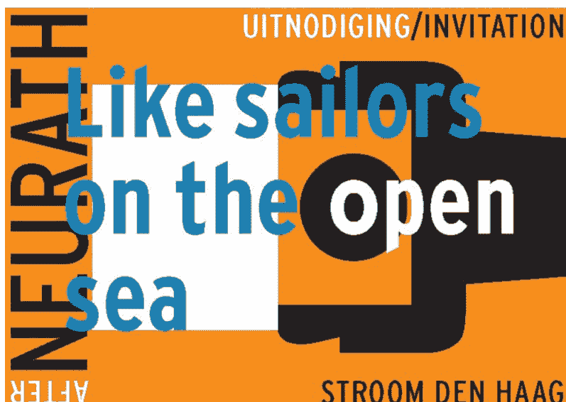
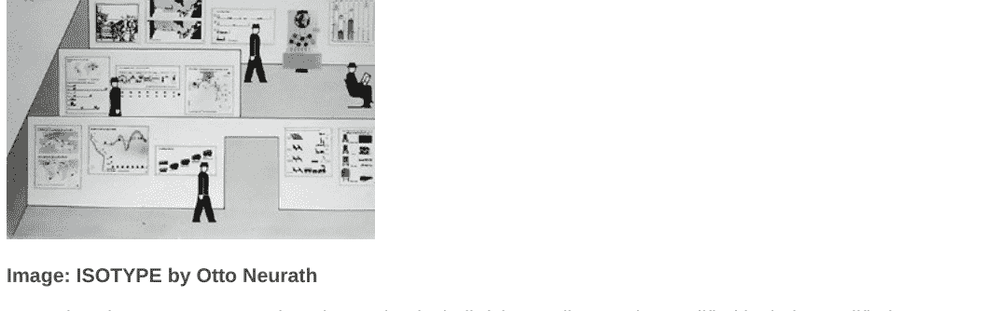
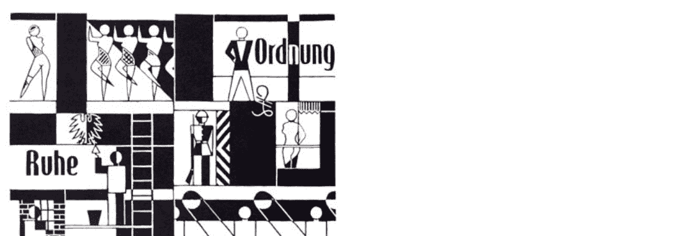
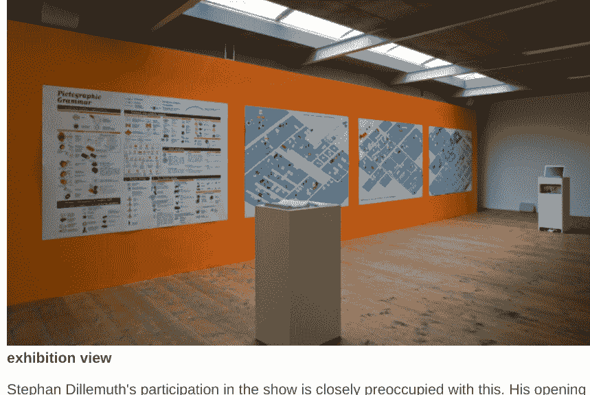
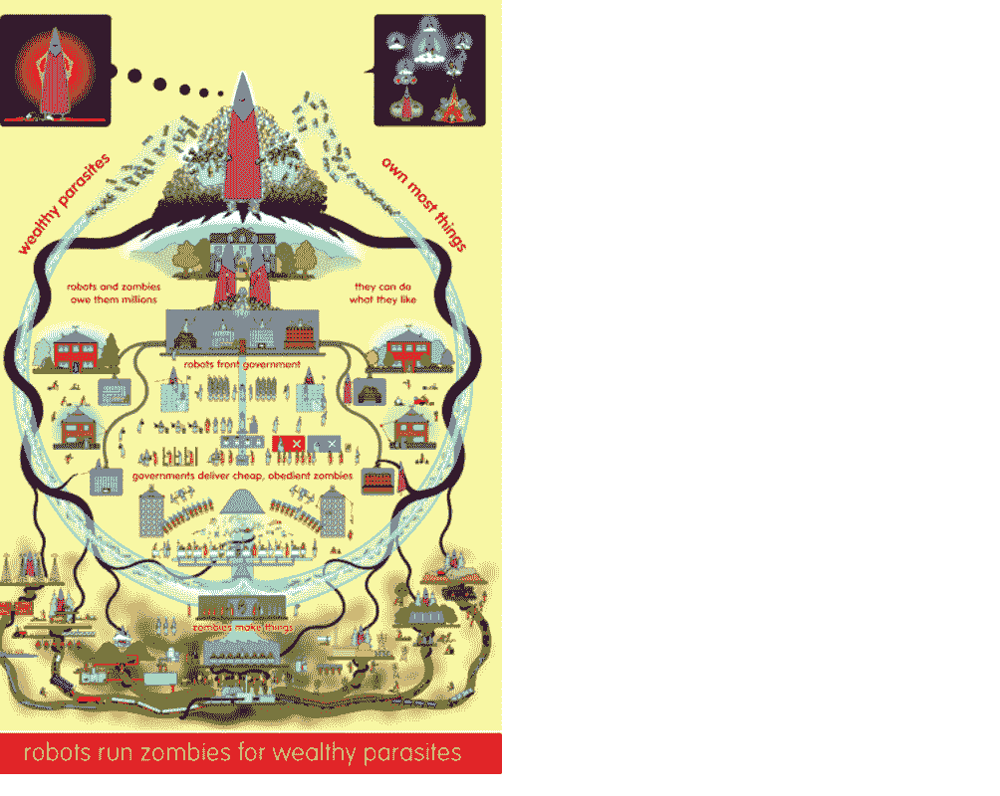
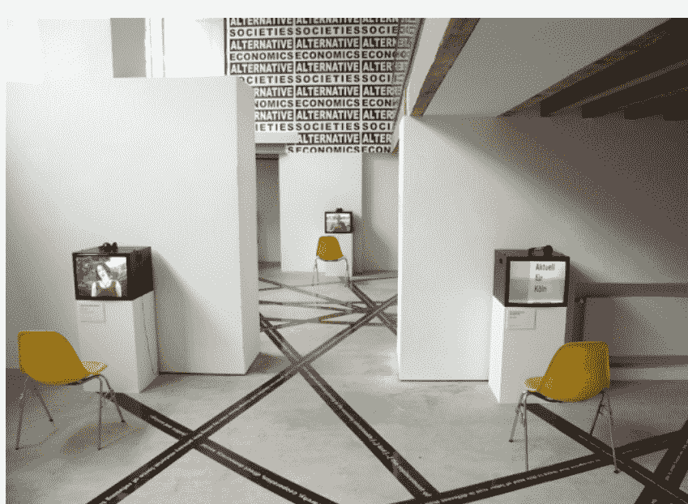

# 荷兰人在哭泣：至少通过四种通用视觉语言

文章

近期的研究项目和展览“内特之后”（After Neurath）重新回顾了奥托·诺拉特（Otto Neurath）的作品。他是维也纳学派的全才，曾试图通过将知识图形化来解决社会变化的谜题。Marina Visham 从当前辩论的角度，探讨了诺拉特试图在艺术与非艺术之间架桥的尝试，并对展览作为研究的任何乐观预期设定了唯物主义的界限 [1]。

## 编码圆圈

奥托·诺拉特体现了20世纪上半叶泛左倾的认识论中普遍的激进社会主义与理性主义乐观的结合，他是一位奥地利政治经济学家、科学哲学家和平面设计师。作为维也纳学派的一员，他致力于一种经验主义的社会变革愿景，这种愿景取决于工人阶级全面理解他们的物质条件以及跨越语言或数字划分的权力分布。凭借着“语言分裂，图像统一”的口号，诺拉特及其合作者格德·阿尔茨特（Gerd Arzt）和玛丽·里德迈斯特（Marie Reidmeister）创造了 ISOTYPE（国际平面图形教育系统），这是建筑史上的一个早期案例，它几乎完全取代了文字或数字描述，转而采用象形。通过使用此类信息图或公共标志来传达统计数据，ISOTYPE 被认为是大众教育的理想工具，范围涵盖从世界地图到维也纳狭小的社会与经济博物馆中展示的结核病死亡率和军事去军事化内容。在二战前欧洲飞速政治化的气候下，诺拉特试图通过充满权威色彩的视觉实现来实现激进化，他的职业生涯经历了从1919年红慕尼黑崩溃、到纳粹清洗和占领荷兰的逃亡轨迹。他在1945年作为敌对外国人短暂监禁后，在牛津宁静的环境中结束了生。

展览海报

尽管逻辑实证主义的陈述仍然是维特根斯坦所说的“世界是一切存在”，但维也纳学派并不局限于从中推导出的内容。

https://www.metamu.org/editorial/articles/dutch-are-weeping-four-universal-pictorial-languages-least

图片：内特之后

诺拉特的工作结合了乌托邦导向，旨在表现“事物的本来面”，希望革命性的进步将它们变成过去。ISOTYPE 项目背后的现代主义伦理欢迎这种形式创新——由数字构建的图像、标准模板——寻求这种元素，即另一种通用信息的愿景，尽管缺乏清晰的意识形态使命。为了解决实际设计问题而消除社会矛盾的不稳定性，是《内特之后：公海水手》（Aftermath: Sailors on the Open Sea）试图解决的问题之一，它不仅以展览的形式呈现，还作为一个一年的研究、研讨会和小型展览计划。通用语法的吸引力和缺陷在于，它的内涵既是产生社会改革基础的理由也是梦想，且这种通用愿景是一个核心方面，而不是将 ISOTYPE 视为代码（即软代码、加密或待翻译的社会代码）。在2007年的《无事的短片》（Short Films About Nothing）中，考虑了在最适合生成知识或随机性的环境中使用标准模板，无论 Stephanie Diffeaul 是否从量子无神论困境的观点接近通用语法的概念。诺拉特项目与艺术家在乌托邦与实用主义之间产生兴趣推演之间的关系（这种构成了 ISOTYPE 基础的省略号），反映了许多基于研究的实践。这些准则在海报、视频和当地植被在内的多种媒体中并列，以及诺拉特挂在墙上和放置在陈展柜中的原始图表，构成了一个主题性的群岛，而非一件器物。不透明性和不不协调仍然掩盖了显而易见的联系，无论是项目与诺拉特之间的联系，还是如文所述对某种展览制作的时尚。

诺拉特的象形图很大程度上归于现代主义信念，即现实可以通过对人类事务进行编码来改变。但模板——标准化的、易于理解的模板——模板本身，即代码，可能会被审美化、物化，需要新一轮的解密，这是失败革命中常见的范式。这就是代码作为不可见的、全系统和干预其中的显性机制的双重侧面，而它们之间持续的关系将这种二元法开放到了更广泛的历史中，这似乎是展览关注的问题。此外，我认为作为标准的“代码”可以被更广泛地对待。作为标准和可复制的接口，代码允许并撤销通信。它可能授予一把钥匙，也通过保留它来允许秘密传输。它是平庸的基础设施，是真理与启蒙者之间的封闭接口。它允许艺术与非艺术之间货物和信息的流动，但它可以在任何一方获利。

奥托·诺拉特的 ISOTYPE

## 边缘的注入

艺术从“非审美集合、外源性的勇敢前沿”中获得了什么？1926年，维克多·舒克洛夫斯写道：“它与艺术有关，但这种联系不是因果的……为了生存，艺术必须利用视频信号运作或制造新的原材料”。[2] 当前的艺术评论使得这种兼并或内化成为塑造的反射动作，一种召唤总是迟到的幽灵的姿态：政治的、社会的、“真实的”，当历史当下似乎没有新事物时（这一概念本身就是后现代主义的埋葬），但它完全不适合回到具有塑性的虚构性现实，现实总是被视为道德的内在。

值得关注的不是流离理想的灵质，而是价值的特定形式，在其合法化机制、比例模式和联盟中。在所有艺术都脱离市场（例如，荷兰的普通大众，沉浸在“创意”助学金中），这种价值形式是通过研究实施的。知识的分布是背景也是内容，通过深入诺拉特进步性博览的繁忙活动，《内特之后》反思了它的生产条件，并必然地掩盖了他。这就是代码材料的相似之处。如果代码被理解为艺术的用途（正如本项目所示），它可能会包裹艺术本身的不稳定性，在教化的（反射性的）和倾斜的（破坏性的）的阴暗焦虑下进行持续生产，这些指向其政治教化[3]，即作为新感官、划分模式和生活形式实验室的艺术，与形式法律的顽固之间的分裂，这种分裂将在一个“将到来”的社会中被消除。

图片：内特之后

电影制作人，你能想象到的都有。这些冲动在每种情况下可能在不同程度上被社会化或形式化，但通过光谱价值形式在出现之前被消除，并可能从这种“占有”中获得能量。商品与普遍性之间的接接，显然是虔信运动（bhakti）与记忆的检索、ISOTYPE 与对 ISOTYPE 的检索，以及注意力“批判性实践”的关结所在。就此而言，艺术变成了一个范式的“非场所”（non-site），普遍性被宣告为症状性代码。中介被调解进代码中，但代码又被用来克服中介。通用语言的项目对这一原则采取了截然不同的方法——基于研究的艺术实践，但它值得记住，特别是当面对否定中介的欲望持续存在时——这种欲望正以日益中介化的形式存在。[5]

图片：Chad McCail 为富有的寄生虫运行僵尸

“作为艺术的研究”在它解构时效果最好，Dillemyth 临时的幻影剧对于那些维持他的寄生虫以及 Neurath 的努力都是明智的——毕竟，Neurath 也可以被视为一个浪漫的柏林改革者。展览中的大多数其他作品呈现出一种更为严峻的基调，与图形保持首要关系，与 ISOTYPE 的社会影响保持次要关系。如果说 Neurath 发源了一种引导社会回溯的通用视觉语言，那么这次展览中的许多作品和调查只能被描述为光谱性的，但正尝试这样做。Thomas Craig 使用按钮构建了具有本地来源配音和通过数据库生成的粒子的可控网络系统，精通了将“随机性”作为艺术能动性来源的使用。同时，Chad McCail 的《蛇》系列和 Bureau D’Eutes 墙展展示了导致等线死亡的脆弱性后果，表现为两种方式：一种是 McCail 流体中主观意义的表达，另一种是 Bureau 中未被驯服的复杂性。将民主网格与“虚拟”相结合的努力，渗透在 Bureau D’Eutes 系统那关于因果和控制的华丽忧伤之中。正是因为通用语言必须让位于社会“出路”领域，才能建立起显然可以建模为生物政治模式的连接。在这里，权力是拒绝一切编码尝试的代码。它的架构如此复杂，以至于地图代表的除了自身华丽偏执的铭之外别无其他，无论其内容多么真实。如果图表可以通过表征社会来表现社会，那么 Bureau D’Eutes 在一个能够证明自身合理的世界的超越（或缺乏超越）下是怎样的。[7] 但它在即时语境或未来本身从未形成一个连贯的整体。Bureau D’Eutes 的图表还展示了对他们通过图表形式展示的社会现实的审美化怀旧，

https://www.metamethod.org/editorial/articles/dutch-are-weeping-for-universal-pictorial-languages/

尽管这种怀旧带着书板的视角，显而易见的是 Creischer 和 Siemann 对 ISotype 的更新，用以显示暴力和不平等的统计数据。一种轻浮的书板气也渗透在 Oliver Ressler 的移动视频《替代经济，替代社会》中，该作品用 Stroom 凉爽的地下室填满了民谣涂鸦传统，Maria Mies 和 John Holloway 很大程度上指出，问题的关键不在于在可读性与破坏性之间摇摆，而是迫切的场所和知识价值化问题；如果艺术品是唯一留下的“替代”愿景之地，那么这种孤立性就如影随形。无疑，如果 Never 现在在世，Ressler 就没那么多时间将他归入档案了。

在其对当代艺术的论述方面，Afterreach 项目更广泛地说，与当前关于知识生产的政治维度、作为研究的中介以及信息技术的社会塑造属性的辩论保持了一致。它以 Otto Ressler 为导师，刻意避开了沉浸在艺术先锋派中，转而调查这种以“解决方案”为导向解决社会诉求的方法的谱系，这种方法提供了当今全球治理等一切的常识。当然，Never 没有过共产主义代理，而今天的技术官们一种共意和市场导向的方法呈现了解放的话语。管理方法中被预判的社会变革愿景使得两者从根本上完全不同。

展览现场 Oliver Ressler

图片：After Neurath

正如今天被当代艺术多元主义所吸引的《水员》一样，这次展览似乎倾向于划定界限，即使不是完全从根本上重构术语。表面上看，它具有技术考古学、社会参与以及现代主义设计的吸引力；对于一个进入激进传统自噬过程的当代作者来说，这有什么不像呢？为了挪用的忧郁锚点而产生的足迹、研究导向实践的进一步积聚、坚持的快乐斗士，以及对不可逾越鸿沟的档案管理员批评者——这些倾向都追踪了《公海上的水员》。他的野心超越了对“推迟通知”的革命冲击的重影。展览那种极简、深思熟虑且苦心透明的氛围，让人联想到一个学术学会以一种公共且具体的方式将语言作为研究结果展示。这是一种思想过程采用展览形式的感觉，并倾向于守护它的推测。这种特质使其远离了成为兴趣理想的绿荫之地的另一场野餐，并更密切地对应了 Ressler 那非常奇特的努力——将所有人类知识转化为扁平图片，以帮助被历史扁平的人成为代理。

Afterreach: Like Sailors on the Open Sea 于 2017 年 2 月 25 日至 4 月 8 日在海牙的 Stroom Den Haag 举行。更多信息和在线卷宗请访问 www.stroom.nl。该展览是你的项目-

https://www.metamuse.org/editorial/articles/duck-are-weeping-four-universal-pictorial-languages-least

由 Steve Ruston 为 Stroom 组织的长期研究项目“Neurath 之后”（After Neurath），持续到 2007 年 10 月
包含若干活动，包括进一步的展览和谈话计划。

[1] 文章标题改编自 1983 年 Fall 的歌曲《Tempo House》中的诗句，在荷兰期间经常浮现在脑海。

[2] Viktor Shlovkovsky, *Third Factory*, Dalkey Archive Press, 1977, p53.

[3] 在《美学的政治》中，Jacques Rancière 对这种无害的见解进行了进一步阐述，尽管并不深。

[4] SETI@HOME 项目 http://setihome.berkeley.edu/

[5] 例如“社交”网络媒体。甚至是社会改善性艺术。传统上，与资本最密切的文化活动形式（风险资本和 YouWeb，公共艺术和开发者主导的城市化）特权，试图通过对个人或社区主体性的问题的应对来消除其沉思。“传统上”可能是一个误词，因为这些形式的相对新颖可能在某种程度上解释了天真。传统艺术痴迷于与其市场关系的沉思，而非否定它。

[6] 引用处自 Giorgio Agamben 《例外状态》，Kevin Attell 译，University of Chicago Press, 2005，但追溯到 Walter Benjamin 的《德国悲剧剧的起源》。

Marina Vishmit <marinar AT artserve.net> 正在研究当代艺术中劳动、时间和对立作为生产的形式。她目前居住在低地国家。

