# 学生教育评估


献给 Veronica


《Educational Assessment of Students, Fourth Edition》的目标仍然是帮助教师和正在接受培训的教师通过更好地评估学生来改进教学。它直接关注小学和中学教师的专业实践。本版特色为

- 对课堂评估的非常强烈的强调，
- 对基础知识以及高级主题的完整覆盖，以及
- 关于良好和不良课堂评估如何影响学生学习的有益建议和示例。

它是一本为教育测验和构建课堂评估的第一门课程编写的核心教材，也同样可作为教育评估的本科课程或第一门研究生课程的教材。理解本书不需要统计学或大学数学的正式课程。

本书提供了教育评估的完整覆盖，包括制定将教学与评估整合的计划；制定客观、表现和作品集评估；评估学生并与家长讨论评估结果；以及解读州强制性测试和标准化成就测试。

在第一门课程中，学生获得主题的平衡处理很重要。由于本书是对传统和替代评估的全面处理，我对我介绍的每种评估技术都举例说明，讨论其利弊，并提供制作指导。我引用了支持或反驳评估和教学实践的研究。

本书将教师和正在接受培训的教师视为专业人士。它认识到教师的经验和判断对于教育评估的适当和有效使用是必要的。然而，在可以从中吸取良好教训的地方，我毫不犹豫地指出教师和学校管理人员的错误判断和评估滥用。为了确保文本内容与职业认为重要的能力和标准保持一致，每一章都与美国教师联合会、国家教育测量委员会和国家教育协会制定的《教师在学生教育评估方面的胜任力标准》相对应（重印于附录 A）。

## 新内容和修订内容

在准备本版时，特别努力使读者能够通过清晰的解释、许多实用示例和插图、核对清单以及逐步的如何操作说明，将材料应用于课堂实践。本版新增的材料包括

- 增强的实用示例，可作为教师的模型，
- 关于如何评估学生写作的新材料，
- 如何将课堂评估与州标准对齐的例证，
- 额外的概念图，帮助学生了解思想之间的关系，以及
- 关于开发和使用表现评估、项目和作品集的改进指导。

每一章都重新组织，内容更易于获取。与前几版一样，我从评估是良好教学实践的一部分，有助于教师提高学生学习的观点撰写了本书。

## 特色功能

以下特色功能突出了本书的实用性：

1. 如何制作课堂评估的示例以及它们的典型外观，
2. 核对清单，提供评估本书教授的每种评估类型的质量的简明提示，
3. 评估高阶思维的策略，并在提交答复后提供建议答案。
- 关键词，线上词汇表，链接到关键评估术语的定义。
- 网上搜索 提供指向超出本书可获得的评估内容的互联网链接。
- 网页链接 将用户带到与章节内容相关的网站。
- 消息板 充当虚拟公告板，可向全国受众发布或回应问题或评论。

要利用这些及其他资源，请访问 Educational Assessment of Students Companion Website，网址为 www.prenhall.com/nitko。

## 致谢

如此规模的项目需要许多人的帮助。我非常感激审阅者在本书手稿章节的批判性阅读，他们对技术准确性、可读性和教学法的贡献很大：Alice Corkill，内华达大学拉斯维加斯分校；Terry Fogg，明尼苏达州立大学；Gretchen Guiton，南加州大学；Suzanne Lane，匹兹堡大学；Robert Paugh，中佛罗里达大学；以及 Susan E. Phillips，密歇根州立大学。


Rogers, University of Northern Iowa; William M. Stallings, Georgia State University; Hoi K. Suen, Pennsylvania State University; James S. Terwilliger, University of Minnesota; Michael S. Trevisan, Washington State University; Anthony Truog, University of Wisconsin–Whitewater; Kinnard White, University of North Carolina; Richard Wolf, Teachers College, Columbia University; David R. Young, SUNY–Cortland; and Michael J. Young, University of Pittsburgh.

My students at the School of Education, University of Pittsburgh; the College of Education, University of Arizona; the Curriculum Development and Evaluation Centre, Botswana Ministry of Education; teachers working with Jamaica Ministry of Education; teachers and assessors at the Examination Development Center, Indonesia Ministry of Education and Culture; and trainers with the Integrated Language Project in Egypt used the second and third editions. They provided insightful feedback and corrections of errors that have greatly improved the usefulness of the text. Francis Amedahe helped classify chapter learning targets and write test items for the third edition. Sarah Bonner contributed test items, practical examples for classroom activities, and many elements of the new Instructor’s Manual for this edition. James Impara of the Buros Institute of Mental Measurements was most generous in helping me to locate information about, obtain copies of, and understand many of the standardized test materials described in this book. Kevin Davis, Julie Peters, and Mary Harlan of Merrill/Prentice Hall, as well as Cindy Miller of Carlisle Communications, encouraged and cajoled me at every stage from acquisition through production, and applied their considerable knowledge and skill to producing the book. To all of these persons, and others I have failed to mention, I offer my most sincere thanks and appreciation.

No one deserves more thanks, for this edition as well as past editions, than my best friend and darling wife, Veronica. Veronica made suggestions for improvement, providing a teacher’s perspective. Her energy, enthusiasm, and constant encouragement sustained me during this revision process. She completed the entire permissions file, proving her ability to handle the most difficult cases of the grueling permissions process with grace and style. To Veronica, then, I lovingly dedicate this book.

## ABOUT THE AUTHOR

Anthony J. Nitko is an adjunct professor, Department of Educational Psychology, University of Arizona, and professor emeritus and former chairperson of the Department of Psychology in Education at the University of Pittsburgh. His research interests include curriculum-based criterion-referenced testing, integration of testing and instruction, classroom assessment, and the assessment of knowledge and higher-order thinking skills. His publications include the chapter "Designing Tests That Are Integrated with Instruction" in the third edition of Educational Measurement. He co-authored (with C. M. Lindvall) Measuring Pupil Achievement and Aptitude, (with T. C. Hsu) Pitt Educational Testing Aids (PETA, a package of computer programs for classroom teachers), and (with R. Glaser) the chapter "Measurement in Learning and Instruction" in the second edition of Educational Measurement.

Dr. Nitko has been the editor of the journal Educational Measurement: Issues and Practice and also d'News, the AERA Division D newsletter. Some of the journals in which his research has appeared are American Educational Research Journal, Applied Measurement in Education, Educational Evaluation and Policy Analysis, Educational Measurement: Issues and Practice, Educational Technology, Journal of Educational Measurement, and Research in Developmental Disabilities.

Dr. Nitko has been a member of several committees of the American Educational Research Association, was elected secretary of AERA Division D, served on committees of the National Council on Measurement in Education, and was elected to the board of directors and as president of the latter. He received Fulbright awards to Malawi and Barbados and has served as a consultant to various government and private agencies in the United States, Bangladesh, Barbados, Botswana, Egypt, Indonesia, Jamaica, Malawi, Namibia, Oman, Vietnam, and Singapore.

## Educator Learning Center:
An Invaluable Online Resource

Merrill Education and the Association for Supervision and Curriculum Development (ASCD) invite you to take advantage of a new online resource, one that provides access to the top research and proven strategies associated with ASCD and Merrill—the Educator Learning Center. At www.EducatorLearningCenter.com you will find resources that will enhance your students’ understanding of course topics and of current educational issues, in addition to being invaluable for further research.

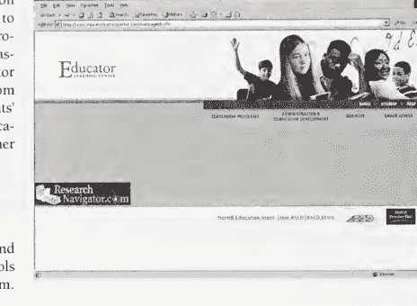

## How the Educator Learning Center will help your students become better teachers

With the combined resources of Merrill Education and ASCD, you and your students will find a wealth of tools and materials to better prepare them for the classroom.

## Research

- More than 600 articles from the ASCD journal Educational Leadership discuss everyday issues faced by practicing teachers.
- A direct link on the site to Research Navigator™ gives students access to many of the leading education journals, as well as extensive content detailing the research process.
- Excerpts from Merrill Education texts give your students insights on important topics of instructional methods, diverse populations, assessment, classroom management, technology, and refining classroom practice.

## Classroom Practice

- Hundreds of lesson plans and teaching strategies are categorized by content area and age range.
- Case studies and classroom video footage provide virtual field experience for student reflection.
- Computer simulations and other electronic tools keep your students abreast of today's classrooms and current technologies.

## Look into the value of Educator Learning Center yourself

Preview the value of this educational environment by visiting www.EducatorLearningCenter.com and clicking on "Demo." For a free 4-month subscription to the Educator Learning Center in conjunction with this text, simply contact your Merrill/Prentice Hall sales representative.


# 课堂决策与评估的使用

## 学习目标

学习本章后，你应掌握以下内容：

## 教师的课堂决策

+   1. 举例说明你在教学前、中、后需要做出的教学管理决策。 [4, 1, 2]
+   2. 举例说明能为你做出目标1中所述决策提供有用信息的评估程序。 [1, 2, 3, 4]

## 评估、测验、测量与评价之间的区别

+   3. 定义并解释教学、评估、测验、测量和评价之间的关系。 [6, 1]
+   4. 解释指导你在选择、开发和使用具有教育意义的评估时的原则。 [1, 3]

## 评估与关于学生的教育决策

+   5. 描述并解释教育工作者需要高质量评估的广泛教育决策范围。 [1, 6]

+   6. 区分形成性评价和总结性评价。 [1, 4]
+   7. 描述评估为做出关于诊断/补救措施、向学生/家长反馈、向教师反馈、激励学生以及给学生评定成绩的决策所提供的各类信息。 [1, 3, 4]
+   8. 区分选择决策、安置决策、分类决策、咨询与指导决策以及资格认证/证书授予决策。 [1, 3, 6]

## 获得评估学生的能力

+   9. 解释《学生教育评估教师能力标准》中的每一项标准如何与你在教学前、中、后的教学活动相关。 [6, 1, 7]

## 重要术语和概念

+   10. 解释本章末尾列出的术语和概念如何适用于教育评估。 [6]

教师必须做出许多决策。然而，仅凭良好的判断力或多年的经验并不足以在课堂上做出好的决策。好的决策，例如教什么、如何教以及如何评价学生的成绩，都基于高质量的信息。成功的教师从高质量的评估中获取有关学生的信息。

在教学过程中，不要陷入只关注学生是否回答了你提出的问题的陷阱；观察学生互动。）

### 教学过程中的决策

+   1. 我该怎么做才能让这节课（活动）效果更好？（诊断学生犯的错误类型或学生使用的错误思维；回想记忆中教授该材料的替代方法；识别哪些学生没有参与或行为不当。）
+   2. 我应给每位学生提供怎样的反馈以说明他们的学习情况？（对不同学生所需表扬的数量和类型的非正式观察和经验；关于每位学生接近学习目标程度的信息；家庭作业和测验结果；访谈学生。）
+   3. 我的学生是否准备好进入学习序列中的下一个活动？（非正式观察并检查学生完成的作业；询问学生对理解的看法；学生的家庭作业、测验和测试结果。）

### 教学片段后的决策

+   1. 我的学生在短期和长期教学目标上的达成情况如何？（课堂测试、项目、观察、与学生的访谈、标准化测试结果。）
+   2. 我将向每位学生及其监护人或家长报告哪些优势和弱点？（观察每位学生在课堂上的参与情况；回顾每位学生的家庭作业结果；回顾每位学生的标准化成绩和学业能力测试结果；回顾学生个人家庭情况的信息。）
+   3. 我应给每位学生本课或单元、学期或课程的什么成绩？（课堂学习活动、测验、测试、班级项目、论文、实验等的结果；关于学生是否达到预期学习目标的非正式观察；了解向学生报告特定成绩可能带来的短期和长期后果。）
+   4. 我对这部分材料教得有多有效？（对班级在重要


instructional targets; summaries of the class’s performance on selected questions on standardized tests; summaries of how well the students liked the activities and lesson materials.)

5. How effective are the curriculum and materials I used? (Summaries of informal observations of students’ interests and reactions to the learning activities and materials; summaries of the class’s achievement on classroom tests that match the curriculum; summaries of several classes’ performance on selected areas of standardized tests.)

These lists of questions and assessments are not exhaustive; you may wish to list several others. Later in this chapter we discuss several other educational decisions that need to be made by or for students. However, the preceding examples do illustrate that your teaching decisions require you to use many different types of information. Further, they illustrate that the exact type of information you need varies greatly from one teaching situation to the next. Remember that you cannot expect to make good decisions as you teach unless you can base these decisions on good-quality information.

## DISTINCTIONS AMONG ASSESSMENTS, TESTS, MEASUREMENTS, AND EVALUATIONS

The general public often uses the terms assessment, test, measurement, and evaluation interchangeably, but it is important for you to distinguish among them. The meanings of the terms, as applied to situations in schools, are explained in the following paragraphs. This section explains the relationship among these terms (shown in Figure 1.1).

## Assessments

Assessment is a broad term defined as a process for obtaining information that is used for making decisions about students, curricula and programs, and educational policy (see American Federation of Teachers, National Council on Measurement in Education, and National Education Association, 1990). Decisions about students include managing classroom instruction, placing them into different types of educational programs, assigning grades to them, guiding and counseling them, selecting them for educational

Figure 1.1
Relationship among the terms assessments, tests, measurement, and evaluation.

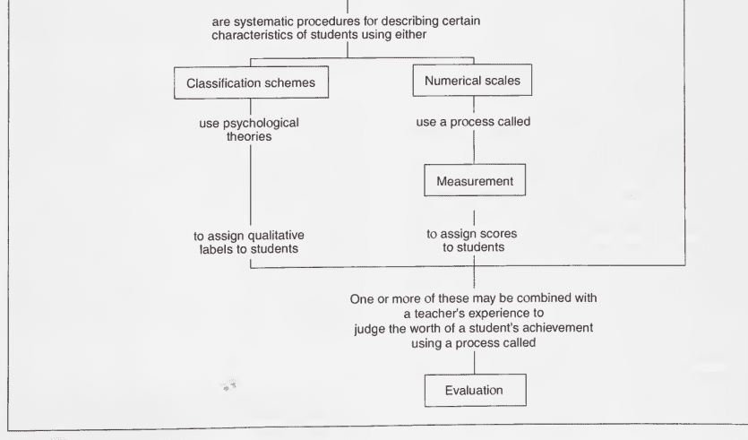

opportunities, and credentialing and certifying their competence. Decisions about curricula and programs include decisions about their effectiveness (summative evaluations) and about ways to improve them (formative evaluations). Decisions about educational policy are made at the local school district level, the state level, and the national level. Figure 1.2 illustrates some of the decisions and subdecisions for which educational assessments provide information.

When we say we are “assessing a student’s competence,” we mean we are collecting information to help us decide the degree to which the student has achieved the learning targets. A large number of assessment techniques may be used to collect this information. These include formal and informal observations of a student; paper-and-pencil tests; a student’s performance on homework, lab work, research papers, projects, and during oral questioning; and analyses of a student’s records.

## Guidelines for Selecting and Using Classroom Assessments

Assessment is a process for obtaining information for making a particular educational decision. You should focus your assessment activities on the information you need to make particular educational decisions. This means that you need to become competent in selecting and using assessments. Here is a set of guiding principles that you should follow to select and use educational assessments meaningfully.

+   1. Be clear about the learning targets you want to assess.
+   2. Be sure that the assessment techniques you select match each learning target.
+   3. Be sure that the selected assessment techniques serve the needs of the learners.
+   4. Whenever possible, be sure to use multiple indicators of performance for each learning target.
+   5. Be sure that when you interpret the results of assessments you take their limitations into account.

ment(s) be built out of such exemplary intellectual challenges” (Wiggins, 1990, p. 1). The assessment techniques selected should be as practical and efficient to use as possible, but practicality and efficiency should not be the overriding considerations.

+   3. Be sure that the selected assessment techniques serve the needs of the learners. Proper assessments show students concrete examples of what they are expected to do with their learning. Assessment techniques should provide learners with opportunities for determining specifically what they have achieved and specifically what they must do to improve their performance. Therefore, you should select assessment techniques that allow you to provide meaningful feedback to the learners. You should be able to tell students how closely they have approximated the learning targets. Good assessment is good instruction.

+   4. Whenever possible, be sure to use multiple indicators of performance for each learning target. One format of assessment (such as short-answer questions or matching exercises) provides an incomplete picture of what a student has learned. Because one assessment format tends to emphasize only one aspect of a complex learning target, it typically underrepresents that learning target. Getting information about a student’s achievement from several assessment modalities usually enhances the validity of your assessments. Matching exercises, for example, emphasize recall and recognition of factual information; essay questions emphasize organizing ideas and writing skill under the pressure of time limits; and a month-long project emphasizes freely using resources, research, and more thorough analyses of the topic. All three of these assessment techniques may be needed to ascertain the extent to which a student has achieved a given learning target.

+   5. Be sure that when you interpret the results of assessments you take their limitations into account. Although Guiding Principle 2 calls for increasing the authenticity or meaningfulness of the assessment techniques, assessments in schools cannot completely reproduce those things we want students to learn in “real life.” The information we obtain, even from multiple assessments, is only a sample of a student’s attainment of a learning target. Because of this, information from assessment contains sampling error. Also, factors such as a student’s physical and emotional conditions further limit the extent to which we can obtain truly accurate information. Teachers, and others, must make decisions nevertheless. The decisions, however, must keep these limitations in mind.

+   1. Be clear about the learning targets you want to assess. Before you can assess a student, you must know the kind(s) of student knowledge, skill(s), and performance(s) about which you need information. The knowledge, skills, and performances you want students to learn are sometimes called achievement targets. The more clearly you are able to specify the learning targets, the better you will be able to select the appropriate assessment techniques.

+   2. Be sure that the assessment techniques you select match the learning target. “Do we want to evaluate students’ problem posing and problem solving in mathematics? Experimental research in science? Speaking, listening, and facilitating a discussion? Doing document-based historical inquiry? Thoroughly revising a piece of imaginative writing until it ‘works’ for the reader? Then let our assess-

## Tests

Testing Individuals A test is defined as an instrument or systematic procedure for observing and describing one or more characteristics of a student using either a numerical

scale or a classification scheme. A test is a concept narrower than assessment. In schools, we usually think of a test as a paper-and-pencil instrument with a series of questions that students must answer. Teachers usually score these tests by adding together the "points" a student earned on each question. By using tests this way, teachers describe the student using a numerical scale. Similarly, a preschool child's cognitive development could be observed by using the Wechsler Pre-School and Primary Scale of Intelligence (see Chapter 19) and described as having a percentile rank of 50 (see Chapter 17).

Not all tests use numerical scales. Other systematic observation procedures such as the play interview (Murphy, 1956), that child development specialists sometimes use with preschoolers, describe the child using a classification scheme. For example, a child may be described as "ego centered" or "drive centered." These categories represent constructs based in Freudian psychological theories.

Figure 1.2 Examples of types of educational decisions for which assessments may be used.

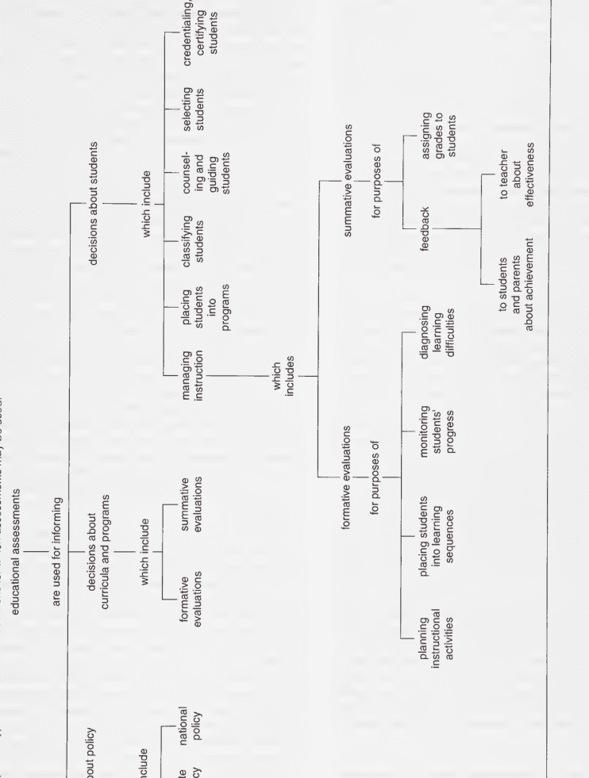

## Survey Testing Programs

Although it is natural to assume that tests are designed to provide information about an individual, this is not always true. Some states have testing programs designed to determine whether their schools have attained certain goals or standards. Although these tests are administered to individual students, states use the results to measure the effectiveness of a school or its programs. In such cases, individual names are not associated with scores, and all students do not need to answer identical questions. The "score" for the school system (or for a specific school at a specific grade level) is usually the average score of the students who took the test.

Another example of an assessment program designed to survey the educational system rather than individual students is the National Assessment of Educational Progress (NAEP) (Merwin & Womer, 1969; Mullis, 1991; Tyler, 1966). The NAEP assesses the impact of the nation's educational efforts by describing what students are able to do. Assessment tasks are assigned to students on a random sampling basis, so that not every student has the same or even comparable tasks. Thus, it is not possible to use the scores with individual students. The assessment is intended to show the progress of education in the entire country.

Surveys are efficient ways to gather information about the average performance of a group of students, because they assess each student using very few tasks. This gain in efficiency of assessing the group is at the expense of being able to describe validly the achievement of individual students.

## Measurement

Measurement is defined as a procedure for assigning numbers (usually called scores) to a specified attribute or characteristic of a person in such a way that the numbers describe the degree to which the person possesses the attribute.

An important feature of the number-assigning procedure in measurement is that the resulting scores maintain the order that exists in the real world among the people being measured. At the minimum this would mean, for example, that if you are a better speller than I, a test that measures our spelling ability should result in your score (your measurement) being higher than mine.

For many of the characteristics measured in education and psychology, the number-assigning procedure is to count the correct answers or to sum points earned on a test. Alternately, we may use a scale to rate quality of a student's product (for example, an essay or a response to an open-ended mathematics task) or performance (how well the student carries out chemistry lab procedures). (See Chapter 12 for examples.) There has been considerable debate in the field of psychometrics as to whether such procedures are sufficient to call measurement in psychology and education anything but crude (Campbell, 1928; Johnson, 1928, 1936; McGregor, 1935; Pfanzagl, 1968; Rozeboom, 1966; Stevens, 1951; Suppes & Zinnes, 1963). The debate about crudeness of educational measurement surfaces from time to time. Most measurement specialists would probably agree that although a counting or rating procedure is crude, as a practical matter, scores from assessments are useful when they are validated by using data from research (Jones, 1971; Lord and Novick, 1968; Messick, 1989; Rozeboom, 1966).

You can see from the preceding definitions that an assessment may or may not provide measurements. If a procedure describes a student by qualitative labels or categories, the student is assessed, but not measured in the sense used here. Assessment is a broader term than test or measurement, because not all types of assessments yield measurements.

## Evaluation

Evaluation is defined as the process of making a value judgment about the worth of a student's product or performance. For example, you may judge a student's writing as exceptionally good for his grade placement. This evaluation may lead you to encourage the student to enter a national essay competition. To make this evaluation, you would first have to assess his writing ability. You may gather information by reviewing the student's journal, comparing his writing to other students and to known quality standards of writing, and so on. Such assessments provide information you may use to judge the quality or worth of the student's writing. A judgment of high quality would lead to a decision to encourage him to enter the competition. Evaluations are the bases for decisions about what course of action to follow.

Evaluation may or may not be based on measurements or test results. Clearly, evaluation does occur in the absence of tests, measurements, and other objective information. You can—and probably often do—evaluate students on the basis of assessments such as systematic observation and qualitative description, without measur-


using them. 即使客观信息可用并被使用，评估者也必须将其整合到自己的经验中才能做出决策。因此，主观性、不一致性和偏见的程度会影响所有评估。测试和测量由于比其他评估技术更标准化、更客观，减少了一些影响评估的不一致性和主观性。然而，说使用测试和测量（或一般而言，定量信息）“极大地改善”评估本身就是一种对技术的偏见。

通常更侧重于为开发者提供改进建议，而不是形成性评估。

## ASSESSMENT AND EDUCATIONAL DECISIONS ABOUT STUDENTS

你现在知道评估为关于学生、课程和项目以及教育政策的决策提供信息。本节讨论关于学生的几种教育决策类型。它将评估置于更广泛的背景中，以便你更好地了解评估的使用目的（见图 1.2）。

了解不同类型决策的特征将帮助你评估你可能考虑使用的各种评估技术。关于“这是一个好的评估程序吗？”这个问题没有简单的答案。正如你将在本课程中学习到的，评估程序可能对某些类型的决策非常有效，对其他类型的决策则不那么有效。了解本节讨论的不同类型的决策也将帮助你向家长解释为何你对他们的孩子使用了各种评估。最后，虽然你可能不需要自己做出所有这些类型的学生决策，但在你的学生完成教育后，他们将几乎经历过所有这些决策。

## Instructional Management Decisions

你的课堂是一个决策丰富的环境。你必须做出许多决策，包括规划教学活动、将学生安排到学习序列中、监控学生的进步、诊断学生的学习困难、向学生和家长提供关于成绩的反馈、评估教学有效性以及给学生分配成绩。我们之前描述了一些需要回答以做出这些决策的问题。

## Evaluation of Students

你可能出于形成性或总结性目的对学生进行评估。对学生成绩进行形成性评估意味着我们在学生仍在学习过程中时评判学生成绩的质量。这种判断可以帮助我们指导学生的下一步学习。当你在课堂上提问以了解学生是否理解课程时，例如，你就是在获取形成性评估其学习的信息。对学生成绩进行总结性评估意味着在教学过程完成后评判学生成绩的质量或价值。在成绩单上给出字母等级是报告你对学生成绩总结性评估的一个例子。

## Evaluation of Programs or Materials

并非所有评估都是针对个人学生的。你也可以评估教科书、一套教学材料、一种教学程序、一个课程或一个教育项目。这些东西在开发过程中以及完全开发后都可能被评估。形成性评估和总结性评估的术语也用于区分在这两个时期评估的作用（Cronbach, 1963; Lindvall & Cox, 1970; Scriven, 1967）。

对项目或材料的形成性评估是在教学材料、教学程序、课程或教育项目的设计或开发期间做出的关于质量或价值的判断。评估者利用这些判断在产品在学校广泛使用之前对其进行修改、形成或以其他方式改进。当教师根据先前使用获得的信息修改课程或学习材料时，也是在进行形成性评估。

对项目或材料的总结性评估是对已完成的教学材料、教学程序、课程或教育项目的质量或价值的判断。这种评估倾向于总结优势和劣势；它描述了在正确实施的情况下，项目或程序在多大程度上实现了其 stated 目标和目标。总结性评估的结果比形成性评估更能表明某种教育产品“是否有效”以及在何种条件下或在何种程度的实施下有效。总结性评估

## Instructional Diagnosis and Remediation

有时个人学生接受的教学效果不佳：学生可能需要特殊的补救帮助或依赖替代方法和材料的特殊教学。提供做出此类决策所需部分信息的评估称为诊断性评估。诊断性决策围绕以下问题展开：“我应该使用哪些学习活动来最好地适应该学生的个人需求，从而最大化学生实现所选学习目标的机会？”诊断意味着识别适当的教学内容和将帮助学生实现学习目标的学习活动类型（Glaser & Nitko, 1971; Nitko, 1989; Nitko & Hsu, 1974）。

诊断性评估的艺术尚未得到充分发展。诊断学生学习困难至少有五种方法。第 13 章描述了它们并提供了如何设计适当评估技术的建议。

### Feedback to Students
评估还为学生提供关于其学习的反馈。然而，反馈只有在某些条件下才可能改善学习。仅仅评估学生并向他们报告结果不太可能影响他们的表现。学习者必须回顾正确和不正确的表现，并且能够纠正不正确的表现。因此，仅向学生提供试卷或测试的成绩的教师并没有提供足够反馈来帮助学生改进。

评估可用于提供促进学习的反馈，前提是你将其整合到你的教学过程中。如果学生在评估前没有掌握先决学习内容和/或对课程几乎没有理解或完全没有理解，来自课堂评估程序的反馈将不会帮助你的学生学习。尤其重要的是，你在进行新教学之前必须纠正学生的错误——或者让学生自行纠正错误。同样，课程期间的频繁反馈至关重要。关于反馈的进一步讨论见第 13 章。

### Feedback to the Teacher
请记住，评估为教师提供关于学生学习得如何以及教师教得如何的反馈。当然，如果学生未能掌握重要要点，教师应在继续新材料之前重新教授该材料。

### Modeling Learning Targets
评估通过向学生展示你希望他们学习的内容而为学生提供范例。学生可以将他们在学习目标上的当前表现与期望表现进行比较。你可以教他们识别其当前表现与预期表现相符的方式以及其不足之处。你的教学可以集中于如何弥补这些不足。在这些方面，好的评估就是好的教学。此外，当学生评估自己的表现时，你可以教他们判断学习好坏的适当标准，以及教他们学习什么内容很重要。

### Motivating Students
评估也可能激励学生学习。不幸的是，一些教师将这种问责形式用作武器而不是建设性力量。教师可能希望使用评估作为可能的威胁来鼓励学生认真对待学习。有时教师以这种方式使用“突击测验”或“随堂测验”来鼓励更频繁的学习而不是临时抱佛脚。

研究并未证明以这种方式使用评估是合理的。相反，问责制的评估应以更积极的视角来看待：作为教学和向学生反馈的工具（Glaser & Nitko, 1971）。此外，教师或家长如果将考试成绩作为学校成功的唯一或主要标准，可能会给学生造成过度的考试焦虑。结果，学生从长远来看可能表现更差。这一点在第 14 章中再次讨论。

### Assigning Grades to Students
给学生进行课堂评估最明显的原因之一是帮助你给学生分配成绩。虽然教师以非正式方式持续评估学生的进步，但他们也必须通过成绩正式记录对学生进步的评价。你报告的成绩或符号（A、B、C 等）代表你对学生实现重要学习目标的程度的总结性评价或判断。使用多种评估格式来提供你做出这些评价所需的信息。良好的教学实践和常识表明成绩不应仅基于考试成绩。然而，许多教师仍依赖考试成绩来证明他们分配的成绩。分配成绩涉及评价性决策，但主观判断往往难以证明和解释。测试，尤其是客观类型的测试，似乎减少了判断和主观性，即使这并不一定为真。关于评分的更完整讨论，包括分配成绩的建议，见第 15 章。

## Selection Decisions

大多数人都熟悉选择决策：一个机构或组织决定某些人是可以接受的，而其他人则不是；那些不可接受的人被拒绝，并且不再是该机构或组织的关注对象。这一特征——拒绝以及将被拒绝者从即时的机构关注中剔除——是选择决策的核心（Cronbach & Gleser, 1965）。

教育机构经常使用考试成绩作为选择决策的一个组成部分。例如，大学录取通常是选择决策：一些候选人被录取，其他人则不被录取；未被录取的人不再是大学的关注对象。一些批评者可能会争辩说，被拒绝的人仍然应是社会的关注对象。

当机构使用评估程序进行选择时，重要的是要证明候选人在这些评估上的结果与他们在该机构选拔人员的项目或工作中取得成功之间存在显著关系。如果数据未显示这些评估结果能够有效区分可能成功和不可能成功的候选人，那么这些评估程序应予改进或取消。事实上，继续使用与工作成功无关的评估结果可能是违法的（United States Supreme Court, 1971; Equal Employment Opportunity Commission, Civil Service Commission, Department of Justice, Department of Labor, & Department of the Treasury, 1979）。

选择决策不必完美才有用。然而，评估结果不可能对选择或其他决策具有完美的效度（见


# 图 1.3 选择情境如何使用评估以及这些决策后果的简化说明。评估和决策规则以其后果为标准进行评价。

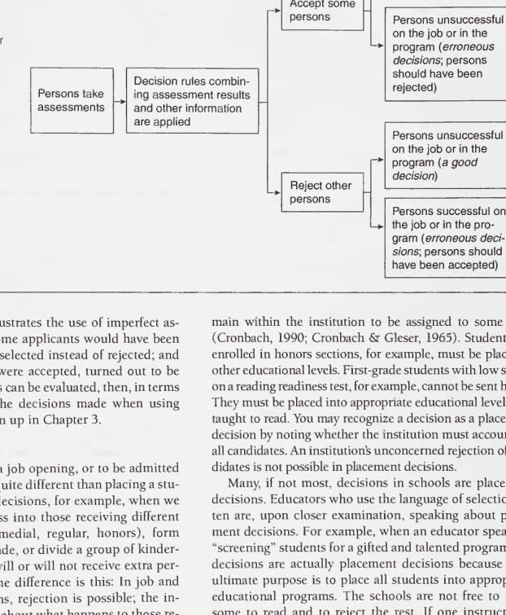

第 3 章）。图 1.3 说明了在选择中对不完美评估的使用。一些申请人在被选中而不是被拒绝的情况下本可以成功；而且有些人尽管被录取了，最终却不成功。因此，评估可以根据使用它们所做决策的后果来评价。本主题在第 3 章中讨论。

## placement 决策

挑选某人填补工作空缺，或录取到特定大学，与安置学生是完全不同的。我们使用安置决策，例如，当我们将高中班级分为接受不同水平教学的学生时（补救、常规、荣誉），在一年级组建阅读小组，或将一群幼儿园儿童分为将接受或不接受额外感知技能训练的学生。区别在于：在工作和大学选择情境中，拒绝是可能的；机构不关心被拒绝者的去向。在公立学校情境中，机构必须为所有人提供安排：无所谓的拒绝是不可能的。例如，未被安排进荣誉班、上级阅读班或其他特殊班的学生，仍需要被教导并培养到其能力极限。而且，出于法律原因，不能因其残疾而将人排除在教育过程之外（《公共法 94–142》，1975 年）。因此，我们必须考虑安置而非选择。

安置决策的特征如下：人员被分配到同一种一般性教学、教育或工作的不同水平；没有人被拒绝，所有人仍留在机构内被分配到某个水平（Cronbach, 1990；Cronbach & Gleser, 1965）。例如，未注册荣誉班的学生必须被安排到其他教育水平。例如，阅读准备测试成绩低的一年级学生不能被送回家。他们必须被安排到适当的教育水平并被教导阅读。你可以通过注意机构是否必须为所有候选人负责来识别一个决策是否为安置决策。在安置决策中，机构对候选人的无所谓拒绝是不可能的。

许多，如果不是大多数，学校中的决策都是安置决策。教育工作者使用选择语言时，在仔细检查后往往是在谈论安置决策。例如，当教育工作者谈论“筛选”学生进入天才和有才华项目时，这些决策实际上是安置决策，因为它们的最终目的是将所有学生安置到适当的教育项目中。学校不能自由地教一些人阅读而拒绝其余的人。如果一种教学方法对特定学生不合适，则需要找到合适的替代方法。最终，所有学生都接受教学，而且大多数人学会阅读。

用于评价安置所用质量评估结果的标准，与用于评价选择所用评估结果的标准不同。如果基于这些结果被分配到不同教育项目的学生，其成绩超过了如果不使用这些结果进行安置时所能取得的成绩，则用于教育安置的评估结果质量很高。第 3 章详细说明了如何判断安置评估程序的有效性。

## 分类决策

有时我们必须做出一个决策，导致某人被分配到几个不同但无序的类别、工作或项目中。这些类型的决策称为分类决策（Cronbach & Gleser, 1965）。例如，在教育残疾人士领域的立法已赋予许多用于对残疾儿童进行分类的标签以法律地位，并强烈鼓励将学生分类到一个（或多个）少数指定类别中。这些类别是无序的（盲症并不高于或低于聋症），因此这些是分类决策而非安置决策。

你可以将分类视为一个更一般的术语，它包含选择和安置作为特殊情况（Cronbach & Gleser, 1965）。本书将这三种类型的决策分别考虑。分类是指类别本质上无序的情况，安置是指类别代表无拒绝的教育有序水平的情况，而选择是指学生被接受或拒绝的情况。

## 咨询和指导决策

评估结果经常帮助学生在探索、选择和为职业做准备时提供帮助。单一的评估结果不用于做出指导和咨询决策。相反，会进行一系列评估，包括面试、兴趣清单、各种能力测试、人格问卷和成绩测验。来自这些评估的信息以及额外的背景信息，会在系列咨询会议期间与学生讨论。这促进了学生的决策过程，并为探索不同职业提供了开端。探索职业选择很可能是一个持续且不断变化的决策系列，可能发生在一个人生命的各个阶段。

## 资格认证和证书决策

资格认证和证书决策反映学生是否达到了一定的学习标准。学生认证决策可能侧重于学生是否达到最低能力或获得高标准，这取决于法律授权。认证和资格认证可能由州立法强制执行，也可能是自愿的。如果州法律要求学生达到一定的表现标准，通常会给学生施加州级创建的评估程序。达到标准者将被授予资格证书（如高中毕业文凭）。

这些认证评估程序对效度提出了特殊问题。个人学生不能合理地为未提供给他们的教学或教学质量差负责，即使平均而言教学是足够的。因此，一个关键点是教学质量是否与评估程序所涵盖的内容相对应。对应程度越接近，认证对学生越公平。如果学生没有机会学习认证评估程序中出现的任务所需技能，无论是因为特定学校缺乏必要资源，还是特定教师未提供适当的教学，基于评估的认证过程似乎本质上是不公正的。

通常，很难解决关于已教授内容和应出现在评估程序中的内容之间的冲突。例如，假设一个州要求学生对“重要作品”的阅读清单负责。假设一组学生的教师没有直接解释这些作品，而另一组的教师解释了。第一组是否应该被追究责任？此外，一些州的高标准可能要求学生将知识应用于新情境、解决新问题并表现出创造力。为了评估对新情境的应用，评估必须包括对学生而言不熟悉或新颖的任务。这是通过故意使评估材料与教学期间使用的材料不同来实现的（否则它们就不会是“新颖的”）。效度问题是：“这对学生公平吗？”

另一个例子是使用评估进行教师认证。一些州使用纸笔测试评估准教师的知识。通常，一套测试将包括基本技能、一般知识和专业知识。一些测试还包括对专业领域如生物、小学教育和聋哑教学的单独评估。一些州还通过观察教师的课堂表现或指派一名资深教师指导一名新教师来评价教师。

国家专业教学标准委员会（NBPTS）已开发出评估程序，以认证在教学技能方面表现突出的经验丰富的教师（见 www.nbpts.org）。教师在许多领域和教育水平上接受评估。与州强制性评估不同，NBPTS 认证是自愿的。此外，评估程序在很大程度上以绩效为基础。也就是说，教师可以提交文件作品集、学生作业样本，也许还有录像带来证明其教学能力。他们的教学也可能被观察，他们也可能来到评估中心参与模拟教学活动，如教学设计、小组互动、师生会议、同行协作和员工发展（Performance Assessment Laboratory, 1992）。

## 获得评估学生的能力

为了帮助你评估你目前的能力水平并关注评估技能的重要领域，美国教师联合会、国家测量教育委员会和国家教育协会


(1990) 发表了《学生教育评估教师能力标准》。这些标准在附录 A 中重印。每项这七项能力都在本书中有所涉及。我已将每章开头处的学习目标与它们所指的具体能力相对应。由于你的评估能力将在整个职业生涯中不断成长，附录 A 中列出的某些能力可能更适合经验丰富的教师，而不适合初任教师。

## 摘要

## 教师的课堂决策

- 教学和学习需要持续收集信息以做出决策。可靠的教育决策以可靠的评估为前提。

## 评估、测试、测量和评价的区别

## 评估

- 评估是获取用于对学生、课程和项目以及教育政策做出决策的信息的过程。
- 评估技术包括纸笔测验；正式和非正式观察；家庭作业、练习和研究论文；项目和展品；作品集；口头提问；以及对学生记录的分析。

## 选择和使用课堂评估的指导方针

- 选择和使用特定评估技术的若干重要原则包括 (a) 明确学习目标，(b) 使评估技术与学习目标相匹配，(c) 满足学习者的需求，(d) 使用多项成就指标，以及 (e) 认识每种技术的局限性。

## 测试

- 测试是对学生一个或多个特征进行观察和描述的工具或系统程序，使用数值量表或分类方案。测试可以针对个人学生，也可以用于调查学校或国家。

## 测量

- 测量是将数字（通常称为分数）分配给特定属性或特征的程序，以便数字描述一个人拥有该属性的程度。

## 评价

- 评价是对某人或某事的价值做出价值判断的过程。评价可能基于从测试和其他评估中获得的信息，也可能不基于。
- 形成性评价是对正在开发中的课程、材料和项目进行价值判断，从而提出重新设计、完善或改进它们的建议。
- 总结性评价是对已完成的课程、材料和项目进行价值判断；这些评价建议是否应采用或使用它们。

## 评估与关于学生的教育决策

- 教育政策决策在学区、州和国家层面做出。
- 关于课程、材料和项目的决策可能在开发过程中做出，也可能在完成后做出。

## 教学管理决策

- 管理教学：规划教学活动，将学生安排到学习序列中，监控学生的进步，诊断学生的学习困难，示范学习目标，向学生和家长提供反馈，判断自己的教学有效性，并为学生评分。

## 选择决策

- 选择学生：为工作、项目或更高层次的教育接受某些学生并拒绝其他学生。

## 安置决策

- 将学生安置到项目中：将学生分配到不同层次的学习项目。

## 分类决策

- 对学生进行分类：将学生分配到不同的类别，例如按残疾类型。

## 咨询和指导决策

- 咨询和指导：协助学生探索、选择和为不同职业做准备；帮助他们应对家庭、学校和同伴的压力，这是正常成长和发展的一部分。

## 资格认证和证书决策

- 对学生进行资格认证和发证：决定学生是否达到获得文凭或获得可申请就业的证书所需的胜任标准。

## 获得评估学生的能力

- 《学生教育评估教师能力标准》（美国教师联合会等，1990）确定了教师应努力达到的七项标准，以正确评估学生。这些标准在附录 A 中重印，并与本书中涉及这些标准的学习目标相对应。

## 重要术语和概念

- assessment
- classification decisions
- credentialing
- diagnostic assessments
- evaluation
- formative evaluation of programs and materials
- formative evaluation of students
- measurement
- selection decisions
- summative evaluation of programs and materials
- summative evaluation of students
- test

## 练习与应用

- 1. 回顾你教授过或希望教授的具体一节课。列出你在该课之前、期间和之后做出的（或需要做出的）决策。针对每个决策，确定你将如何获取做出该决策所需的信息？你可能会用什么标准来判断每条信息质量的好坏？
- 2. 确定一种你熟悉的或希望了解更多关于其的特定评估程序（例如标准化数学解题测验，或你自己评估学生在你学科领域胜任能力的技巧）。列出文本中提到的选择、使用和创建评估程序的五项指导原则。对于每项原则，分析你选择的程序并解释其在多大程度上符合该原则。论证你的答案。说明如何改进评估以更好地遵循每项原则。
- 3. 判断以下每个陈述是真还是假。论证你的答案。
  - a. 要做出评价，必须使用测量。
  - b. 要测量学生的重要教育属性，必须使用测试。
  - c. 要评价学生，必须测量该学生。
  - d. 要测试学生，必须测量该学生。
  - e. 教师获得的关于学生的任何信息都是评估。
  - f. 要评价学生，必须评估该学生。
- 4. 将以下每个陈述归类为选择、分类、安置、职业指导、诊断/补救或认证决策。论证你的答案。
  - a. 学生开始幼儿园后，他们会接受一系列感知技能测试，以决定哪些儿童应接受特殊感知技能训练，哪些应留在“常规”项目中。
  - b. 一所学校开设两种不同的三年级阅读项目。三年级结束时，标准化阅读测验结果按每个项目分别汇总并进行比较。
  - c. 一个儿童研究小组决定每个接受一系列筛查测试的儿童是否应被纳入某种残疾类别（听力受损、学习障碍等）。
  - d. 在学校心理学家评估一名学生后，当地教育当局将该学生分配到资源教室，在那里学习障碍教师每天为该学生提供特殊指导。
  - e. 本教育系的每位毕业生都必须参加并通过州的测试后才被允许在学校任教。
- 5. 列出附录 A 中找到的七项教师能力标准。在每项标准下，描述你现在拥有的能力以及你希望在本课程结束时拥有的能力。

## 附加阅读

Brennan, R. L., & Plake, B. S. (1991). Survey of programs and employment in educational measurement. Educational Measurement: Issues and Practice, 10(2), 32.

如果你想了解教育测试领域的就业机会，这篇简短文章会引起你的兴趣。

Glaser, R., & Nitko, A. J. (1971). Measurement in learning and instruction. In R. L. Thorndike (Ed.), Educational measurement (2nd ed., pp. 625–670). Washington, DC: American Council on Education.
分析一种特定的教学系统、必要的决策类型以及所需评估信息类型。

Popham, W. J. (1988). Educational evaluation (2nd ed.). Englewood Cliffs, NJ: Prentice Hall.
第 2 章简要概述了项目评价的不同思路。如果你不熟悉提出的方案，这是一本关于课程和项目评价的有用入门读物。

Airasian, P. W. (1991). Perspectives on measurement instruction. Educational Measurement: Issues and Practice, 10(1), 13–16.

Brookhart, S. M. (1999). Teaching about communicating assessment results and grading. Educational Measurement: Issues and Practice, 18(1), 5–13.

O'Sullivan, R. G., & Chalmick, M. K. (1991). Measurement-related course work requirements for teacher certification and recertification. Educational Measurement: Issues and Practice, 10(1), 17–19, 23.

Sanders, J. R. (1989). Joint Committee for Standards for Teacher Competence in Educational Assessment of Students. Educational Measurement: Issues and Practice, 8(2), 25, 30.

Schafer, W. D. (1991). Essential assessment skills in professional education of teachers. Educational Measurement: Issues and Practice, 10(1), 3–6.

Stiggins, R. J. (1991). Relevant classroom assessment training for teachers. Educational Measurement: Issues and Practice, 10(1), 7–12.

Stiggins, R. J. (1999). Evaluating classroom assessment training in teacher education programs. Educational Measurement: Issues and Practice, 18(1), 23–27.

Whittington, D. (1999). Making room for values and fairness: Teaching reliability and validity in the classroom context. Educational Measurement: Issues and Practice, 18(1), 14–22, 27.
这组文章描述了教师教育在学生教育评估方面的现状。Airasian (1991)、Schafer (1991) 和 Stiggins (1991) 描述了教育测试和测量课程应涵盖的内容。Sanders (1989) 文章描述了本书附录 A 中标准的制定过程。Brookhart (1999) 和 Whittington (1999) 提出了应如何教授教师重要的测量概念。Stiggins (1999) 提出了一套标准，教育学院可以用它来评估他们在课堂评估方面培养教师的效果。
阅读这些文章后，你可能想与同学和指导教师讨论本课程将如何教授你教育评估的知识。


## 描述教学目标与学习目标

## 学习目标

学习本章后，你应掌握以下内容：

### 明确目标的重要性
- 1. 描述学习目标如何指导教学过程。[1, 4, 7]
- 2. 列出学习目标如何促进课堂评估改进的四种方式。[1, 4]

## 教育目标、州标准和学习目标
- 3. 区分内容标准与表现标准、一般学习目标与具体学习目标、发展性学习目标与掌握性学习目标。[2, 1]

### 学习目标的分类法
- 4. 解释思维技能分类法为何有助于审视学习目标和评估任务。[2, 3, 1]
- 5. 使用 Bloom 等人和 Marzano 等人对思维技能的分类对学习目标进行分类。[2, 3, 1]
- 6. 命名并定义至少一种思维技能分类法的主要类别。[2, 1]
- 7. 指出你可能用来决定使用哪种分类法的五个标准。[1, 4]

### 选择、撰写和评估学习目标
- 8. 命名至少两个获取你计划教授课程学习目标清单的来源。[2, 1]
- 9. 指出你可能用来审阅和评判单元或课程学习目标清单质量的七项标准。[2, 1, 4]
- 10. 为你的学科领域撰写符合此类陈述三个基本标准的特定学习目标。[2, 1, 4]

### 确保评估任务与学习目标相匹配
- 11. 描述你将如何决定你的评估是否与你为课程设定的掌握性学习目标相匹配。[3, 1, 6]
- 12. 解释为何你需要使用多种评估方法来评估学生对发展性学习目标的达成情况。[3, 1, 6]

## 重要术语和概念
- 13. 解释本章末尾列出的每个术语和概念如何应用于教育评估。[6]

## 本章简介

第1章强调了确保你的评估技术真正与教学的学习目标相匹配的必要性。在本章中，你将学习什么是好的学习目标以及如何为教学准备它们。我们将讨论的主要问题包括：什么是学习目标？为什么需要它们？它们与教育目标和州标准有何不同？是否存在不同类型的学习目标？学习目标如何与高阶思维技能相关？你如何评估教学中使用的学习目标？你如何撰写更好的学习目标？

## 明确目标的重要性

学习目标规定了你在教学段落结束时希望学生达到的内容。我们使用“目标”一词来强调教学的目标不仅仅是“覆盖材料”和“让学生积极参与”。你的教学重点应放在学生成绩以及学习过程上。学习目标说明学生在你教授他们之后应该能够做什么、重视什么或感受什么。

尽管正式术语是学习目标，我将使用非正式术语学习目标来表示与学习目标相同的含义。一些作者使用诸如成就目标等其他同义词。

### 学习目标有助于指导教学过程

教学是你用来为学生提供帮助他们实现学习目标的条件的过程。一些学习目标是认知性的，意味着它们主要涉及智力知识和思维技能。例如，你可能希望学生阅读政治人物的主张并判断是否有证据支持该主张。其他学习结果是情感性的，意味着它们涉及学生应该如何感受或应该重视什么。例如，你可能希望学生重视选举投票权高于争夺其时间的其他活动。另一个例子是，你可能希望学生在面前同学面前谈论如何解决数学问题时感到自在。还有其他学习目标是心理运动性的，意味着它们主要涉及运动技能和身体感知。例如，你可能希望学生在对池水进行科学调查期间正确设置、聚焦和使用显微镜。

决定你期望学生学习的具体目标是教学过程中的一个重要步骤。教学可以被认为涉及三个基本但相互关联的活动（Lindvall & Nitko, 1975）：

- 1. 决定学生将学习什么。
- 2. 开展实际教学。
- 3. 评估学习。

活动1要求你以某种方式阐明学习目标，通常是通过指定学习目标或提供学生应能够完成的任务的几个具体例子，以证明学习目标已达到。活动1向你和学生传达了教学和学习的结果预期。你对学习目标的理解指导你的教学并提供判断学生是否已达到预期变化的标准。活动2是教学过程的核心。在这里你为学生提供学习条件和活动。活动3，评估学习是否发生，对良好的教学至关重要。通过它，你和你的学生可以知道学习目标是否已达到。你对学习目标的指定越清晰，你的教学努力和学生的学习努力就越有针对性。

### 三项教学活动的互动

三项基本活动是互动的，而不是直线的一二三过程。设定清晰的学习目标有助于你高效地计划教学、有效地进行教学并有效评估学生成果。使用清晰指定的学习目标对学生进行评估和评价为你提供了关于教学有效性的信息。这些信息反过来可用于计划下一个教学活动或更好地指定教学目标。

### 使用具体学习目标的额外原因

刚才介绍的三项活动是对教学过程的简化描述。它们确实说明了当教师心中有清晰的学习目标时教学会更容易。使用具体学习目标在课堂上的额外原因包括（Gow, 1976）：

- 1. 它们帮助教师和/或课程设计者明确自己的教育目标。
- 2. 它们向学生、家长、其他教师、学校管理人员和公众传达教学的意图。
- 3. 它们为教师分析所教内容和构建学习活动提供基础。
- 4. 它们描述了教师可以用来评估教学成功与否的具体表现。
- 5. 它们可以帮助教育工作者与家长（和其他人）聚焦和澄清教育目标的讨论。
- 6. 它们向学生传达他们预期要学习的表现。这可能使他们能够指导自己的学习。
- 7. 它们使个性化教学更容易。
- 8. 它们帮助教师评估和改进教学程序和学习目标。

### 学习目标对课堂评估的重要性

显然，在你制定自己的评估程序之前，你需要知道你想要评估的学生结果。你应该清楚地知道你想要评估的学生表现。如果你不清楚你想要评估哪些重要学习结果，你很容易无法有效评估这些结果。在本章中，具体学习目标的陈述被认为对课堂评估的以下几个方面具有价值：

- 1. 知道你希望学生达到的具体结果，使得评估程序的总体规划更容易。
- 2. 选择和制定评估程序取决于你知道应评估哪些具体成就。
- 3. 当你知道具体的学习目标时，评估你已制定的现有评估程序会更容易。
- 4. 正确判断评估程序的内容相关性要求你知道应评估的具体成就（见第3章）。

## 教育目标、州标准和学习目标

本节讨论几个密切相关的概念。在学习它们时，参考图2.1可能会有所帮助。

### 教育目标与具体学习目标

学校和其他有组织的教学应帮助学生实现教育目标。定义教育目标的众多方式之一是它们“是那些有助于社会运作（包括个人在社会中的运作）的、可以通过学习获得的人类活动”（Gagné, Briggs, & Wagner, 1988，第39页）。

教育目标以宽泛的术语陈述。它们为总体教育活动的规划提供方向和目的。州教育部门、地方学区以及美国数学教师全国委员会、美国科学促进协会和美国地理学家协会等协会准备的报告中出现了宽泛教育目标陈述的例子。以下是教育目标的一个例子：

## 示例

每个学生都应掌握使用科学测量的技能。

宽泛的目标被组织成诸如数学和历史等学科领域。学科领域和内容特定的思维过程可作为课程框架，在此框架内你和其他教育工作者可以定义具体的学习目标。一些州教育机构会进一步发布预期学习成果或标准。在这种情况下，你可能需要对学生实现这些特定标准负责。

### 一般学习目标与具体学习目标

陈述学习目标有一个适当的明确程度。如果目标描述过于宽泛，教师就无法用它来制定课程计划和评估程序。前面陈述的教育目标例如，可以帮助传达一般教育目标，但陈述过于宽泛，无法立即用于计划课程和评估。

一般学习目标是从教育目标中得出的预期学习结果的陈述。一般学习目标比教育目标更具体，通常足以进行课程的总体规划。然而，在它们成为课堂学习目标之前，需要变得更具体。以下是一个为小学科学单元关于公制系统测量而陈述的一般学习目标的例子：

## 示例

掌握使用常用仪器以公制单位测量长度、体积和质量所需的技能。

在教授学生并评估他们对这一一般学习目标的掌握时，你可能需要将其分解为两个或多个具体学习目标。具体学习目标是对学生在教学单元结束时应达到的内容的明确陈述。以下是从前述一般学习目标中得出的三个具体学习目标的例子：

## 示例
- 1. 使用米尺测量物体长度，精确到十分之一米。
- 2. 使用简易梁秤和一套砝码测量物体质量，精确到十分之一千克。
- 3. 使用量筒测量液体体积，精确到十分之一升。


## 图 2.1 标准、目标和学习目标之间的关系

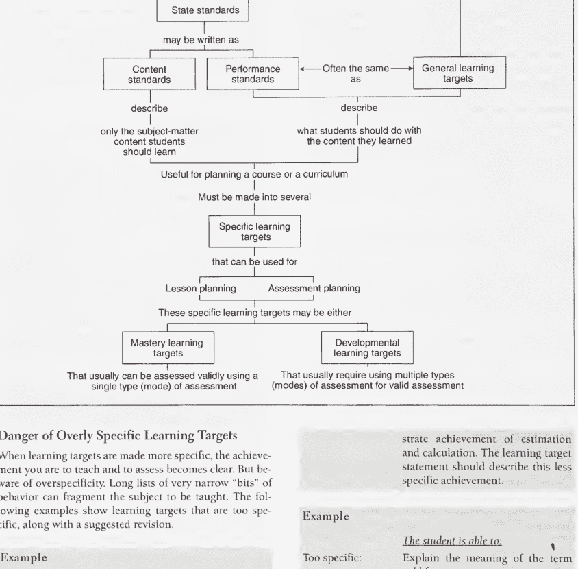

## 过于具体的学习目标的危险

当学习目标变得更具体时，你要教授和评估的成就就变得清晰了。但要警惕过度具体化。非常狭窄的“行为”片段的长列表会使所要教授的主题支离破碎。以下示例展示了过于具体的学习目标，以及建议的修改。

## 示例

过于具体：估计罐子里豆子的数量。
更好：使用计算和估算解决实际问题。
理由：“罐中豆子”并不是学习的真正目标。相反，它只是学生为证明其估算和计算的策略性达成而应完成的众多可能任务之一。学习目标陈述应描述这种不太具体的成就。

## 示例

学生能够：
过于具体：解释冷锋术语的含义。
更好：解释关键天气术语的含义。
理由：“冷锋”只是单元中包含的几个关键天气术语之一。为单元中教授的每个术语分别列出学习目标，会使单元对一般天气术语的关注支离破碎。

## 示例

学生能够：

- 过于具体：
- 正确使用问号（?）。
- 更好：
- 正确使用句末标点符号。
- 理由：
- “问号”只是学生必须学习的句末标点符号的一种。为单元中教授的每种句末标点符号分别列出学习目标，会使单元对正确使用所有句末标点符号的关注支离破碎。

第二个危险是，具体目标的列表可能变得过长而被忽视。确定每个教学单元中最重要的几个学习目标并集中于这些目标。

## 设计需要学生使用学习目标组合的评估

同样重要的是，要创建学习和评估情境，要求学生使用具体的技能和知识组合来执行复杂任务并解决现实生活中的问题。示例 2.1 显示了一个罐中豆子问题。在解决此问题时，学生预期使用几种具体的技能和知识（列在图右侧的上方）来准确估计罐中豆子的数量。“罐中豆子”当然不是学习目标本身。相反，它只是众多可能任务中的一个例子，其中学习目标是应用比例推理、估算、测量和其他技能的组合来解决复杂问题。

请注意，在此示例中，教师应评估的最重要结果是学生为解决这些问题所使用的过程和策略。这些标准的标准列在示例 2.1 中的“标准参照解释”下。一种仅专注于学生对这类任务的答案正确程度的评估程序是无效的，因为它忽略了对学生所使用过程的评估。

## 州标准 vs. 学习目标

标准 你的州可能已强制要求学生达到一套教育标准。标准是对学生预期学习内容的陈述。一些州称这些陈述为基本技能、学习期望、学习成果、成就期望或其他名称。通常有两套标准。内容标准是对学生预期学习的学科事实、概念、原理等的陈述。例如，生活科学的标准可能是，“学生应知道细胞核是植物和动物中遗传信息所在的地方。” 表现标准通常是对学生一旦学习了内容标准后能够执行或做的事情的陈述。例如，“学生可以在各种植物和动物细胞的显微镜载玻片中识别细胞核。”

州教育部门准备学校使用的标准。地方学区必须教授学生达到这些标准。专业组织也可以准备标准。这些组织试图通过公开推广自己的标准来影响教学内容。拥有已发布标准的专业组织示例有国家科学院、国家英语教师委员会和国家数学教师委员会。大多数专业组织的标准都可以在组织的网站上找到。

你可以从你的学校校长或中央行政办公室获得你州标准的副本。你可能还能够从你州的教育部门互联网网站上阅读和下载标准。

各州的标准在质量和具体程度上差异很大。并非所有州都很好地撰写了标准。此外，一些州仅为某些年级制定了标准（例如，四年级、八年级、十年级和十二年级）。其他州则为几乎每个年级都制定了标准。似乎没有标准的方法（双关语并非本意）来撰写标准。

学习目标 正如前几段所述，州的标准实际上是学习目标。在正式采用州标准后，学校必须确保所有学生都被教授并达到这些标准。大多数州标准写得相当概括。写得更好的州表现标准本质上与我们之前讨论的一般学习目标相同。然而，一些州仅撰写了内容标准。在任何一种情况下，你都需要将每个标准分解为两个或多个具体的学习目标以便教授和评估它们。因此，本章中的所有材料都适用于教学和评估，无论你的学校和州使用“目标”、“学习目标”还是“标准”。第 21 页顶部的示例比较了某学区三年级阅读的标准陈述、一般学习目标和具体学习目标。从中你可以看出，你需要从州标准中推导出具体的学习目标。

> 1 为了使事情更混乱，一些州将表现标准（或简单地“标准”）定义为某些测试分数范围，然后给出这些标签。例如，得分在 20 到 40 之间的学生可能被认为达到了标准的“基础水平”；41 到 60 之间可能处于“熟练水平”；60 以上处于“高级水平”。在本章中，我们不会以这种方式使用标准一词。

## 示例 2.1

多伦多教育局用作基准的评估任务。

## 罐中豆子
应用速率和比率

在此基准任务中，学生首先被展示一个装满豆子的罐子并被要求估计豆子的数量。然后他们被要求使用以下任何材料更准确地计算豆子的数量：计算器、天平和砝码、尺子、量筒和透明的平方厘米网格。他们被告知可以计数一些豆子但不能全部计数。如果学生不知道如何进行，评估员会建议他们称量一小把豆子。学生被要求保留其解决方案的持续记录。在他们解决完问题后，他们被要求描述问题及其解决方案。

## 安大略省教育部和多伦多教育局的关键目标

- 在问题解决中应用比率和速率
- 巩固常用公制单位之间的换算
- 收集和组织数据
- 巩固并应用带或不带计算器的整数和十进制运算
- 在计算、问题解决和应用中应用估算、取整和结果的合理性
- 发展涉及使用数学语言和符号的沟通技能
- 发展解决问题的能力

## 常模参照解释

## 任务得分

## 标准参照解释

20% 的学生得分为 5
（80% 的学生得分低于 5）

5

学生理解问题并立即开始寻找策略，也许在继续之前会尝试不同的方法和材料。学生监控解决方案的发展过程，并可能进行检查和重新测量。学生有效地、准确地使用材料并很好地记录数据。所有计算都准确完成并得出合理的答案。学生清晰地解释了解决方案，展示了以比例为基础的可靠推理。学生对任务拥有主人翁意识并享受其挑战。

19% 的学生得分为 4
（61% 的学生得分低于 4）

4

学生可能出现一些错误开端，并可能在评估员的帮助下集中注意力。学生可能无目的或不准确地使用一些材料，也许会混淆体积和质量。学生能正确地进行比例推理。尽管在解决方案的各个点上遇到困难，学生仍坚持下去并通常得出合理的答案。学生通常能清晰地解释并享受活动。

20% 的学生达到 3
（41% 的学生得分低于 3；
平均得分为 3.0）

3

在解决问题的某一方面或多个方面存在一些混淆。学生可能混淆单位、出现算术错误或执行错误的运算。学生可能对比例性有一些概念但无法正确使用。学生未能充分利用材料。学生寻求评估员的帮助。尽管没有完全自信，学生仍可能坚持尝试得出问题的答案。

24% 的学生达到 2
（17% 的学生得分低于 2）

2

学生可能开始解决问题但无法完成解决方案。学生反复更换方法和材料，无法找到有效的策略。对单位和各种测量的解释存在相当大的混淆。学生通常猜测应使用哪些运算来处理数据。学生缺乏信心并寻求评估员的大量帮助。

17% 的学生达到 1

1

学生可能估计豆子的数量但对更准确地计算数量没有回应或回应非常有限。


Here’s an example of how specific learning targets are developed from a state standard:

## Example

Standard

- Communicate well in writing for a variety of purposes.

General learning target

- Write for narrative, persuasive, imaginative, and expository purposes.

Specific learning targets

- Explains the difference between narrative, persuasive, imaginative, and expository writing purposes.
- Applies prewriting skills and strategies to generate ideas, clarify purpose, and define audience before beginning to write.
- After receiving feedback on the first draft in the areas of ideas, organization, voice, word choice, and sentence fluency, uses the feedback to revise the draft.
- Reviews and revises the second draft for grammatical correctness and proper use of standard writing conventions.

## Specific Learning Targets as Mastery Statements

Assessment focuses on what you can see students doing. From this observation you will infer whether they have attained the learning targets. For example, a high school biology unit on living cells may have as a general learning target that students should "learn the organizations and functions of cells." But what can the student do to demonstrate learning of this general target? There may be several answers to this question, each phrased as a specific instructional objective and each describing what a student "can do," as shown in the following examples:

## Example

- 1. The student can draw models of various types of cells and label their parts.
- 2. The student can list the parts of a cell and describe the structures included in each.
- 3. The student can explain the functions that different cells perform and how these functions are related to each other.

Statements of what students can do at the end of instruction may be called mastery learning targets. Robert Forsyth (1976) referred to them as "can do" statements. They have also been called specific learning outcomes and behavioral objectives.

## Mastery Learning Targets vs. Developmental Learning Targets

Some skills and abilities are more aptly stated at a somewhat higher level of abstraction than mastery learning targets to communicate that they are continuously developed throughout life. Consider the following examples.

## Example

- 1. Combine information and ideas from several sources to reach conclusions and solve problems.
- 2. Analyze and make critical judgments about the viewpoints expressed in passages.
- 3. Write several paragraphs that explain the author's point of view.
- 4. Use numerical concepts and measurements to describe real-world objects.
- 5. Interpret statistical data found in material from a variety of disciplines.
- 6. Write imaginative and creative stories.
- 7. Use examples from materials read to support your point of view.
- 8. Communicate your ideas using visual media such as drawings and figures.

Because of the lifelong nature of these targets they may be called developmental objectives (Gronlund, 1973) or developmental learning targets.

At first glance, it might seem that all one needs to do is to insert a "can do" phrase in front of each of the preceding statements to transform them to mastery learning targets. As Forsyth (1976) points out, however, it is not that simple. First, each statement represents a broad domain of loosely related (not highly correlated) performances. Second, each statement represents skills or abilities typically thought of as developing continuously to higher levels rather than the all-or-none dichotomy implied by the mastery learning targets.

## The Problem of a Broad, Heterogeneous Domain

Consider Developmental Learning Target 2 in the previous list. Now, think about questions you could ask students to assess this learning target. Your questions need to require students to analyze a reading passage and make inferences based on information in it. The examples below show three possible questions. These questions are taken from the Iowa Tests of Educational Development, social studies reading subtest. The numbers in the brackets are the percentage of 10th grade students answering each question correctly.

## Example

- 1. From his manner and formal training, what opinion might people have formed of John Marshall? [28%]
- 2. What do the last two sentences suggest about Patagonian's acceptance of U.S. aid? [44%]
- 3. Suppose an uninsured and unemployed motorist damaged someone's car. Which speaker offers a plan that would allow the injured party to collect benefits? [64%]
(Forsyth, 1976, p. 12)

You can see that each question refers to a different passage with different viewpoints expressed. Further, the percentage of students answering one question is quite different from the percentage answering another. Studies of these questions show that those who answer one question right are not necessarily the same students who get another question right (Forsyth, 1976).

We can conclude from this that Developmental Learning Target 2 represents a broad domain of reading passages and that mastering one part of the domain does not mean mastering another. This is the case with developmental learning targets like those listed previously.

## The Issue of Continuous Development of Skill

The second concern, the continuous or developmental nature of these learning targets, stems from the fact that “students cannot be expected to fully achieve such objectives. Even the simplest of these . . . is a matter of degree and can be continuously developed throughout life. All we can reasonably expect to do for a particular course or unit of instruction is to identify a sample of specific learning outcomes that represent degrees of progress toward the objectives” (Gronlund, 1973, p. 17). The essential concern here is that the skill(s) represented by these learning targets are complex, the number of tasks that can be used to demonstrate learning is vast, and each represents goals to work toward continuously rather than to master completely (Gronlund, 1973).

## Teaching and Assessing Developmental Learning Targets

One way to begin designing instruction and assessing progress toward developmental objectives is to list several specific learning targets for each one. They should represent the key performances expected of a student at a particular grade or age level. This is illustrated in the following, which clarifies a broad instructional objective in science by listing several specific learning targets that support it:

## Example²

Developmental learning target: Interprets and uses Boyle’s Law to explain phenomena and solve problems.

Specific learning targets clarifying this developmental target.

- 1. States a definition of Boyle’s Law.
- 2. States the domain to which Boyle’s Law applies.
- 3. Describes the relationship between Boyle’s Law and Charles’ Law.
- 4. Uses Boyle’s Law to explain an observation in a lab experiment.
- 5. Appropriately analyzes a new (to the student) situation in terms of Boyle’s Law.
- 6. Solves a new problem or makes an appropriate choice for a course of action, taking into account the implications of Boyle’s Law.

Although this list of six specific objectives might be made longer, the six objectives would likely be considered adequate for describing what is meant by “interpreting and using Boyle’s Law” at the end of a first course in high school physics. Specific tasks could then be prepared for assessing achievement of the six specific objectives. Some tasks could assess only one of these learning targets; others could require a student to use several of these learning targets in combination. A student’s overall score could be interpreted as indicating the degree to which a student has acquired the ability to interpret and use Boyle’s Law, rather than as a “mastery/nonmastery” description.

## Taxonomies of Learning Targets

Simply writing learning targets “off the top of your head” can be frustrating because a seemingly endless number of possible targets exists. Further, if you are unaccustomed to writing learning targets, you are likely to write first those targets that have a very narrow focus, specify content topics, and represent lower-level cognitive skills. A taxonomy can help you to bring to mind the wide range of important learning targets and thinking skills.

Taxonomies of instructional learning targets are highly organized schemes for classifying learning targets into various levels of complexity. Generally, educational learning targets fall into one of three domains³:

- 1. Cognitive domain: Targets focus on knowledge and abilities requiring memory, thinking, and reasoning processes.
- 2. Affective domain: Targets focus on feelings, interests, attitudes, dispositions, and emotional states.
- 3. Psychomotor domain: Targets focus on motor skills and perceptual processes.

Learning targets within each domain may be classified by using a taxonomy for that domain. Because there is more than one way to define a classification scheme, several different taxonomies have been developed for sorting learning targets in a given domain. Only two of these taxonomies for the cognitive domain are described here.

> ³ A single, real life, complex performance will likely involve components of more than one domain.

> ² Based on Klopfer (1969).


其他认知领域分类法总结在附录 D（表 D.2、D.3）、E 和 F 中。第 6 章将讨论如何使用分类法制定评估计划。你现在可以先简要回顾一下该章。第二部分的其他章节讨论如何设计任务以评估不同分类法层级下的学习目标。

## 认知领域分类法

## 布鲁姆分类法

在制定学习目标清单时，你可能会发现《教育目标分类学手册一：认知领域》（Bloom, Engelhart, Furst, Hill, & Krathwohl, 1956）具有相当大的价值。该分类法是对你可能教授的认知能力范围的全面概述。该分类法将认知表现分为六个主要标题，按从简单到复杂的顺序排列（Bloom et al., 1956）。

下面描述了该分类法的六个主要标题。为了说明该分类法如何帮助你指导或聚焦教学和评估策略，我给出一个学习目标和相应的评估项目的例子。假设你正在教学生理解作者在写短篇小说时使用的要素。假设你选择的短篇小说都涉及人们的个人问题，且故事中的人物处理个人问题的方式都不恰当。以下学习目标问题可用于帮助你指导评估计划。后续章节将详细介绍如何设计评估任务。此时我们只研究应教授和评估的思维技能范围。

- 1. 知识……涉及对具体事物和普遍事物的回忆，对方法和过程的回忆，或对模式、结构或情境的回忆。就测量而言，回忆情境几乎只涉及将适当材料记起。 (p. 201)

## 示例

示例学习目标：回忆每篇所读短篇小说中的主要人物以及他们做了什么。

示例评估项目：列出《女巫森林》中所有人物的名字。在《女巫森林》中，当她母亲拒绝让她进入森林时，萨莉做了什么？

- 2. 理解……代表理解的最低水平。它指的是这样一种理解或领会，即个体知道所传达的内容，并且能够使用所传达的材料或思想，而不必将其与其他材料联系起来或看到其最充分的含义。 (p. 204)

## 示例

示例学习目标：解释所读短篇小说的主要思想和主题。

示例评估项目：请用你自己的话告诉我，《女巫森林》讲的是什么。

- 3. 应用……在特定和具体情境中[解决新颖或全新问题]使用抽象概念。抽象概念可以是一般思想、规则或程序，或概括化的方法。抽象概念也可以是必须记住并应用的技术原理、思想和理论。 (p. 205)

## 示例

示例学习目标：将所读短篇小说中人物的个人问题与现实生活中人们面临的问题联系起来。

示例评估项目：萨莉在故事中与母亲的问题与你或你认识的人与母亲的问题相似吗？解释为什么相似或不相似。

- 4. 分析……将一种交流分解为其构成要素或部分，以便使思想的相对层级变得清晰和/或使所表达思想之间的关系变得明确。这样的分析旨在阐明交流，指出交流是如何组织的，以及它是如何传达其效果的，以及它的基础和安排。 (p. 205)

## 示例

示例学习目标：识别作者用来向读者传达人物感受的文学手法。

示例评估项目：在《女巫森林》中，萨莉对她母亲感到不满。在《狗长久不见》中，比利对他哥哥感到不满。这两个故事的作者使用了哪些词语和短语来表现这些人物的不满程度？解释并举例说明。

- 5. 综合……将要素和部分组合起来形成整体。这涉及处理碎片、部分、要素等，并以一种尚未明显存在的方式将其排列组合成模式或结构。 (p. 206)

## 示例

示例学习目标：描述在所有所读故事中，人物为不成功地解决问题的总体方法。

示例评估项目：到目前为止我们读了《女巫森林》、《狗长久不见》、《西蒙的陀螺》和《没有礼貌的女人》。在每个故事中，一个人物都无法解决他或她面临的个人问题。这些人物尝试解决问题的办法是什么？这些不成功的解决问题方式有什么共同点？

- 6. 评价……对材料和方法在给定目的下的价值做出判断。对材料和方法在多大程度上满足标准进行定量和定性判断。使用评判标准。标准可以由学生确定，也可以由学生给出。 (p. 207)

## 示例

示例学习目标：制定自己的一套三到四个用于评判短篇小说质量的标准。利用这三到四个标准来评价几篇在课堂上未读的新故事。

示例评估项目：到目前为止我们读了四篇短篇小说。是什么样的三个或四个特征使一个故事质量上乘？利用这些特征制定三到四个可用于评价任何短篇小说质量的标准。阅读分配给你的两篇新短篇小说。利用你制定的标准来评价这两篇故事。对每个故事在每个标准上进行评价。总结你的发现。

例 2.2 显示了科学和社会研究中的学习目标如何在该分类法中分类。Bloom et al. (1956) 中详细描述了该分类法每个层级的其他学习目标和测验项目示例。 （参见附录 D 获取更多示例。）此类分类法的价值在于它提醒你注意你可以指导教学和评估的各种能力和技能。

## 分类法不是教学层级

不要假设该分类法是一个教学层级。它的唯一目的是对各种学习目标和评估任务进行分类。例如，你不应先教“知识”，再教“理解”。

## 不同层级需要不同类型的评估

请注意，归类于前三个类别的学习目标更容易用简答题、是非题、多选题或配对题等进行评估。归类于后三个类别的学习目标可能部分可通过此类题型进行测试，但其评估通常需要各种其他程序，如论文题、家庭作业、班级项目、观察实验室中的表现以及作品集。更复杂思维层级下的学习目标要求学生实际产生或创造某些东西，而不仅仅是回答问题。仔细阅读表 D.1 中的各种子类别应能使这一点更加明显。

压缩分类法 由于教师有时难以将学习目标归类到全部六个类别中，一些学校使用了布鲁姆等人分类法的简短版本。例如，有些学校将其简化为三个类别：知识、理解和高级思维。“高级思维”类别将应用、分析、综合和评价学习目标合并为一组。其他学校则以略有不同的方式形成三个类别：知识（包括理解）、应用和高级思维（包括分析、综合和评价）。这些压缩的优点是消除了为学习目标归类到分类法的前三个类别之一而苦恼的需要。

使用压缩版分类法的严重缺点是教师可能会停止尝试使用综合和评价类别中的学习目标。由于应用和分析与综合和评价在同一类别中，很容易避免在这四者之间做出必要的区分。因此，教师可能会满足于不在课程和评估计划中包含最高两个类别的学习目标。


# 示例 2.2

在布卢姆等人分类法中，科学和社会研究的不同学习成果是如何分类的。

| Bloom et al. 分类 | 科学 | 社会研究 |
|---|---|---|
| 知识 | • 回忆花朵各部分的名称<br>• 识别并标记昆虫的各部分<br>• 列出过程中的步骤 | • 列出内战的已知原因<br>• 回忆非洲人民迁徙的一般原则 |
| 理解 | • 找出鞘翅目类型的真实例子<br>• 找出岩浆岩和矿物形成的真实例子<br>• 用自己的话解释消化过程 | • 用自己的话解释技术概念的含义<br>• 从时事中举出宣传使用的例子 |
| 应用 | • 使用科学原理制作简单的机器<br>• 使用已学过程进行新的实验 | • 使用指定的批判性思维技能解释时事<br>• 进行调查并从实地收集数据 |
| 分析 | • 展示在设计冰箱时如何应用科学原理或概念 | • 识别服装广告中的可信和不可信主张<br>• 展示政治演讲的不同组成部分 |
| 综合 | • 确定几个实验或调查所得结果背后的规律 | • 展示几种社会思想流派之间的相似之处<br>• 制定两国和平计划 |
| 评价 | • 使用标准或准则评价研究结果得出的结论<br>• 使用标准评价研究研究的可靠性 | • 使用特定的一套标准评价几篇政治演讲 |

## 学习维度模型

另一种对不同思维类型的分类是由 Marzano、Pickering 和 McTighe（1993）使用在科罗拉多州 McREL 研究所开发的学习维度模型提出的。该分类法使用七个宽泛的类别。七个类别及其对应的学习目标示例在此展示。附录 E 提供了更详细的摘要，其中包括 13 种复杂思维技能的子类型。

作为如何使用该分类法来指导你的教学和评估的一个例子，我在每个类别中都给出了学习目标和评估项目的例子。假设学生被要求分组合作完成一个研究项目。在该项目中，他们采访学校里的其他学生，了解他们对解决某些当地社区问题的方法的看法。尽管学生一起合作设计研究并收集数据，但学生各自单独撰写研究报告。你的学习目标和对该复杂项目的评估应侧重于学习的多个维度，正如以下示例所示。

+   1. 宣言性知识——这一类学习目标要求学生学习学科的事实、思想、概括和/或理论。

## 示例

示例学习目标：学生陈述目前当地社区关注的主要问题。

示例评估项目：列出你将在项目调查中包含的主要社区问题。

2. 程序性知识——这一类学习目标要求学生展示程序或做事的方法。

## 示例

示例学习目标：学生在进行研究时使用正确的访谈技巧。

示例评估项目：观察每个学生在对其他学生进行访谈时的表现。使用正确的访谈技巧清单来评估访谈是否正确进行。

3. 复杂思维——这一类学习目标要求学生应用他们的知识和/或使用不同类型的推理策略。 （有关此类别中包含的 13 种复杂推理技能子类型的详细信息，请参阅附录 E。）

示例
示例学习目标：学生利用研究研究期间收集的数据支持研究结论。
示例评估项目：教师阅读学生的研究报告的结论部分。教师使用评分量表来评估每个学生使用研究期间收集的数据来支持所做结论的程度。

4. 信息处理——这一类学习目标要求学生展示收集、综合和/或评估特定目的所需信息的不同方法。该类别包括要求学生确定特定目的所需信息的学习目标。

示例
示例学习目标：从访谈中提供给学生的所有信息中，学生使用与研究研究相关的信息。
示例评估项目：教师阅读学生的研究报告，仔细关注学生收集的信息以及如何使用它来描述解决社区问题的意见。教师使用评分量表来评估每个学生对访谈中相关信息的利用程度。

5. 有效沟通——这些学习目标要求学生展示他们的沟通技巧，例如向正确受众沟通、为手头的目的使用最合适的沟通方法以及开发适当的沟通产品。

示例
示例学习目标：学生向同龄人观众清晰有效地口头展示其研究研究的成果。
示例评估项目：教师观察每个学生向班级做口头报告。教师使用评分量表来评价报告的有效性和清晰度。

6. 协作与合作——这些学习目标要求学生展示他们的团队技能，例如朝着团队目标努力、使用人际交往技能、执行保持团队关注相关活动的职能和/或在团队活动中担任多重角色。

示例
示例学习目标：学生与小组其他成员合作有效设计研究研究并收集访谈数据。
示例评估项目：教师在研究设计和数据收集阶段观察小组。教师使用评分量表来评估每个学生的团队参与度，包括朝着团队目标努力、人际交往技能、团队维护活动以及在团队中扮演的角色。

7. 思维习惯——这些学习目标要求学生展示其自我调节、批判性思维和/或创造性思维的能力。

示例
示例学习目标：学生计划和组织访谈数据收集方法和活动。
示例评估项目：教师在学生在开始访谈过程之前与每个学生会面，要求学生描述选择受访者、进行访谈以及收集/记录访谈信息的计划。教师预览学生的访谈问题表和记录表。使用评分量表，教师评估学生对研究研究的该数据收集阶段的计划和组织程度。

onomies 或我们尚未讨论的方案，其中一些在本书的附录 D（表 D.2 和 D.3）和附录 E 中（见 DeLandsheere，1988 年的综述）。你应该使用哪一个？这取决于这是仅用于你自己课堂的个人决定，还是更广泛的决定，即分类法将在你的整个学校系统中使用。

将以下实用标准应用于判断你正在考虑的每个分类法或分类方案。如果决定是针对一个课堂的个人决定，则不一定所有标准都适用。

我认识到你可能不熟悉前面评估示例中使用的一些技术（例如，评分量表和清单）。你将在本课程中稍后学习这些内容，因此此时不必完全理解它们。有关制作复杂表现性评估及其相应评分量表的建议，请参阅第 12 章。

学习维度模型的类别源自认知心理学、高阶思维和批判性思维的研究和著作。与布卢姆等人分类法不同，这些类别并非旨在分层。然而，它们旨在作为组织课程和聚焦教学的框架。

## 使用分类法对学习目标进行分类时出现的问题

必须认识到，（a）思维技能类别可能不是分层的，并且（b）学生在复杂任务上的表现同时涉及使用多种思维技能。因此，可能将给定的学习目标或评估任务归类到多个分类法类别中。

建议你使用分类法进行评估的主要目的是给你一个工具来判断你是否教授和评估了足够广泛的高阶和低阶思维技能。分类法可以帮助你找到差距。评估中包含广泛的思维技能通常会提高其效度。

如果你第一次接触分类法，那么你应该开始时将你的学习目标或评估任务仅归类到分类法的某一类别中。这样做可以简化你对学习目标和评估任务的理解，即使这在某种程度上是人为的。在这样做时，请记住你应使用代表（a）学习目标或评估任务中最突出使用或（b）主要意图的思维技能的类别。一旦完成，你应使用该分类来决定某些重要技能在你的教学和评估中是否受到过少或过多关注。

## 选择分类法

我们讨论了两种用于对认知学习目标进行分类的方案。还有很多其他分类方案——

选择认知学习目标分类法的实用标准

+   1. 完整性：你的主要学习目标能在多大程度上在每个分类法中进行分类？
+   2. 观点：在多大程度上每个分类法可以用作向他人解释你的教学方法或你的课程特征的平台？
+   3. 改革：每个分类法在多大程度上可以帮助你评估你的课程或你的学习目标并促使你修改学习目标？
+   4. 简易性：家长、教师和教育官员理解每个分类法有多容易？
+   5. 报告：每个分类法在组织个人学生、教育官员、政府官员或公众的评估结果报告方面有多有用？

## 定位学习目标的来源

你可能会在各种来源中找到学习目标列表，包括教学材料和教师手册、地方和州课程框架、州绩效标准、国家教育进步评估报告、教学方法书籍、测试手册（尤其是标准参照测试），以及教育协会的报告。很可能你必须将你在这些来源中找到的学习目标改编为你自己的情况。尽管如此，这些来源和分类法确实提供了一个起点：修改和修订学习目标陈述比从头编写任何帮助要容易得多。

此外，学习目标通常会跨越多个课程或学科领域。例如，能够使用图书馆和印刷资源获取报告所需的信息，很可能就是社会研究、数学和语言艺术课程共同的学习目标。在这方面，本章中所示分类法提供的类别被创建为可应用于多个课程领域。

## 评价课程或单元的学习目标

在列出该单元的学习目标之前，永远不要教授一个单元。重要的是要制定完整或全面的


list of learning targets. A complete list is not necessarily long, however. Apply the following practical criteria to evaluate your list of learning targets:

## Practical Criteria for Evaluating a List of Learning Targets for a Course or Unit

+   1. Be sure all the learning targets are appropriate for students’ educational level.
+   2. Be sure the list of learning targets is limited to only the important outcomes for the course.
+   3. Be sure all the learning targets are consistent with your state’s published learning standards.
+   4. Be sure all the learning targets are consistent with your local school’s philosophy and general goals.
+   5. Be sure all the learning targets can be defended by currently accepted learning principles.
+   6. Be sure all the learning targets can be taught in the time limits of the course.
+   7. Be sure all the learning targets can be taught with available teaching resources.

## How to Write Specific Learning Targets

How can you write learning targets so they communicate your instructional intent and help you to craft an assessment plan or “blueprint?” This plan, discussed in Chapter 6, will help ensure that you develop valid classroom assessments. Validity itself is discussed in the next chapter.

The following minimum criteria for learning targets ensures their usefulness as a basis for classroom instruction and crafting assessment instruments (Lindvall, 1964, 1967):

+   1. Student centered: Learning targets should focus on the student.
+   2. Performance centered: Learning targets should be worded in terms of what a student can perform after the required learning experiences.
+   3. Content centered: Learning targets should state the specific content to which the student should apply the performance.

### Student Centered

Because instruction focuses on changes in student performance, learning targets should describe student performances. It is not unusual, however, for some teacher guides, curriculum frameworks, and other materials to contain statements that do not focus on the student. Consider this statement:

## Example

Poor: Provide for student participation in classroom discussions.

The problem with the preceding statement is that it is an activity statement for teachers rather than a learning target for students. You may “provide for student participation,” yet each student may not participate. Learning targets need to be student centered if they are to be the basis for crafting assessment procedures. Thus, you should say:

## Example

Better: A student will participate in classroom discussions.

Student-centered learning targets allow you to decide whether the students actually have achieved what you intended from the lesson.

### Performance Centered

Not only should a learning target refer to a student, it should state a performance—that is, an observable activity. This can be accomplished by being sure that the statement includes an action verb that specifies a student performance.

To help beginners write learning targets that describe students’ performances, Example 2.3 lists further examples of various action verbs. These verbs are organized according to the Bloom and Krathwohl et al. cognitive and affective taxonomies discussed in Appendix D. When verbs such as these are used in statements of learning targets, the learning targets will usually satisfy the second criterion of expressing observable student performance. A balance is necessary between verbs that are too broad (and thus imply too many nonequivalent performances) and those that are too specific (and which are often just ways of marking answers). Consider this learning target, which is stated too specifically:

## Example

Poor: The student is able to put an X on the picture of the correct geometric shape (circle, triangle, rectangle, square, or ellipse) when the name of the shape is given.

The main intent of such an objective is to select or identify the correct shape, not just to make Xs. Any response that indicates the student has correctly identified the required shape is acceptable. Thus, the learning target should be written as:

## Example

Better: The student is able to identify a picture of a geometric shape (circle, triangle, rectangle, square, or ellipse) when the name of the shape is given.

Example 2.4 suggests some verbs that maintain this balance and illustrates other verbs that are too specific or too broad to make useful learning target statements.

### Example 2.3

Action verbs to use when writing learning targets. (See Appendix D for additional examples.)

+   I. Cognitive domain (Bloom et al., 1956)
+   a. Knowledge: define, describe, identify, label, list, match, name, outline, select, state
+   b. Comprehension: convert, distinguish, estimate, explain, extend, generalize, give examples, infer, paraphrase, predict, rewrite, summarize
+   c. Application: change, compute, demonstrate, discover, manipulate, modify, operate, predict, prepare, produce, relate, show, solve, use
+   d. Analysis: break down, diagram, differentiate, discriminate, distinguish, identify, illustrate, infer, outline, point out, relate, select, separate, subdivide
+   e. Synthesis: categorize, combine, compile, compose, create, design, devise, rewrite, summarize, tell, write
+   f. Evaluation: appraise, compare, conclude, contrast, criticize, describe, discriminate, explain, justify, interpret, relate, summarize, support

+   II. Affective domain (Krathwohl et al., 1964)
+   a. Receiving: ask, choose, describe, follow, give, hold, identify, locate, name, point to, reply, select, sit erect, use
+   b. Responding: answer, assist, comply, conform, discuss, greet, help, label, perform, practice, present, read, report, respond, select, tell, write
+   c. Valuing: complete, demonstrate, describe, differentiate, explain, follow, form, initiate, invite, join, justify, propose, read, recognize, report, select, share, study, work, write
+   d. Organizing: adhere, alter, arrange, combine, compare, complete, defend, explain, generalize, identify, integrate, modify, organize, order, prepare, relate, synthesize
+   e. Characterizing by a value or value complex: act, discriminate, display, influence, listen, modify, perform, practice, propose, qualify, question, revise, serve, solve, use, verify

> Source: Table adapted from Testing For Teachers, Second Edition by Bruce W. Luckman, copyright © 1988 by Harcourt, Inc. Reproduced by permission of the publisher. (Figure 2.2, p. 17)

### Example 2.4

Action verbs sometimes used in learning targets.

### Specific but acceptable verbs

+   add, total
+   alphabetize
+   choose
+   complete, supply
+   construct, make
+   convert
+   count
+   delete
+   describe
+   divide
+   draw
+   explain
+   identify
+   label
+   list
+   match
+   measure
+   multiply
+   name
+   order, arrange
+   pick out
+   regroup
+   rename
+   rephrase
+   select
+   sort, classify
+   state
+   subtract, take away
+   weigh

### Too broad, unacceptable verbs

### Too specific, essentially indicator verbs

### Toss-up verbs, requiring further clarification

> Source: From "Criteria for Stating IPI Objectives" by C. M. Lindvall, 1976, pp. 214-215. In D. T. Gow (Ed.), Design and Development of Curricular Materials: Instructional Design Articles (Volume 2). Pittsburgh, PA: University of Pittsburgh, University Center for International Studies.

### Content Oriented

When stating a learning target, you should indicate the content to which a student's performance is to apply. The following learning target is lacking a reference to content:

## Example

Poor: The student is able to write definitions of the important terms used in the text.

To modify this learning target you need to include a reference to a specific list of "important words" or in some other way describe them:

## Example

Better: The student is able to write definitions of the terms listed in the "Important Terms and Concepts" section of Chapters 1–5 of the textbook.

If you do not refer to content in your learning target statement, you cannot know with certainty whether an assessment task is valid for evaluating the student. For example, the assessment may require students to define words that, although in the text, may be unimportant. Without knowing the content, it is difficult for anyone to determine what, if anything, was learned.

## MAKING SURE ASSESSMENT TASKS MATCH LEARNING TARGETS

Chapters 6 through 15 discuss the details of crafting high-quality assessments. Here we wish to point out that the basic purpose of any achievement assessment is to determine the extent to which each student has achieved the stated learning targets. Although this purpose sounds straightforward, it is not always an easy criterion to meet. The validity of your assessment results determines the quality of your evaluation. Validity is the subject of the next chapter; here we discuss validity only in relation to matching assessment tasks to learning targets.

### Matching Assessments to Mastery Learning Targets

The specific tasks or procedures you use in an assessment should require the student to display the skill or knowledge stated in the learning target. For instance, if the main intent of your learning target is for a student to build an apparatus, write a poem, or perform a physical skill, your assessment procedure must give the student the opportunity to perform. If your assessment procedure required a student only to list the parts of an apparatus, to analyze an existing poem, or to describe the sequence of steps needed for performing a physical skill, it would not be valid, because it would not match the learning target's main intent.

A very basic requirement for the validity of classroom assessment procedures is that the procedures should match the intentions of the specific learning targets that you include in your assessment plan. The methods of developing assessment plans are treated in Chapter 6.

your assessment plan. The methods of developing assessment plans are treated in Chapter 6.

### Matching Assessments to Developmental Learning Targets

As is often the case, developmental learning targets imply a broad domain of performance application. To ensure the validity of your classroom assessment, you may need to assess the same learning target in several different ways. For example, you might assess spelling achievement both by scoring several samples of students' written assignments and by using a dictated spelling test. The test provides the opportunity to assess a student's spelling of word patterns that might not appear in the natural course of the student's writing, but that may well be part of the learning target. Observing a student's natural writing habits permits you to infer how well the student is likely to spell in typical writing situations. Using both procedures increases how comprehensively you assess the students' spelling ability and the validity of your evaluation.

Another reason for using more than one assessment procedure is to obtain more reliable results. Your subjective evaluation of a student's written essay on a topic might be supplemented by a test made up of more objectively scored items. Combining the less reliable information about the student's written work (that is, your subjective evaluation) with the more reliable information (the objectively scored test) yields a more reliable overall evaluation result. Reliability is discussed in more detail in Chapter 4.

## Summary

### Importance of Specifying Objectives

- Learning targets are important because specifying them helps you direct your teaching toward the important student achievements that you, the school, and parents have in mind.
- Among the benefits of using specific learning target statements are (a) making educational goals explicit, (b) communicating instructional intent to others, (c) analyzing and sequencing what is to be taught, (d) evaluating instructional procedures, (e) providing focus in discussions with parents, (f) clarifying to students what is expected of them, (g) facilitating individualized instruction, and (h) facilitating the revision of instructional procedures.
- Specifying learning targets has a practical value for your classroom assessments by (a) facilitating your general planning for assessment, (b) clarifying the specific performances for which you should craft or select assessment tasks, (c) facilitating your evaluation of an existing assessment procedure, and (d) facilitating your judgment of the validity of an assessment.

### Educational Goals, State Standards, and Learning Targets

- Statements of general educational goals help guide the overall educational enterprise, but you must make them more specific before you can implement them in the classroom.
- Specificity is accomplished by organizing goals into subject-matter areas and then developing several general learning targets for each goal. You subsequently define each general learning target by more specific performances that you can


teach and assess. You use assessment results from these specific learning targets to infer the degree to which students have attained general learning targets and goals.

- Content standards describe what subject-matter content students are expected to learn. Performance standards describe what students are expected to do with their content knowledge. Standards are often statements of general learning targets. Therefore, teachers need to break standards into more specific learning targets for purposes of teaching and assessment.

- At least two kinds or levels of learning targets useful for classroom instruction can be identified: specific, mastery learning targets; and broader, developmental learning targets.

- Students never fully achieve developmental learning targets. However, you can teach and assess the degree of students’ achievement at a particular educational level by writing several important, specific learning targets that define appropriate educational development at that level. You use students’ performances on this sample of learning targets to estimate the progress students have made in achieving the developmental learning target.

- Developmental learning targets cannot be considered mastery learning targets because: (a) They imply several performances that are not highly related to each other; and (b) it is reasonable to expect degrees of development or growth in certain achievement areas, rather than complete mastery.

## Taxonomies of Learning Targets and Sources for Locating Learning Targets

- When writing the learning targets for a lesson or unit and for crafting a classroom assessment, it is important to identify the full range of student performance to be achieved. This is done by (a) referring to taxonomies of cognitive, affective, and/or psychomotor objectives; (b) reviewing instructional materials and teachers’ manuals; (c) consulting curriculum frameworks from various sources; (d) reviewing books on methods of teaching the subject; (e) reviewing the criterion-referenced tests of a subject; (f) consulting your state’s mandated standards; and (g) reviewing reports from professional organizations.

## Cognitive Domain Taxonomies

- The Bloom et al. (1956) Taxonomy orders levels of cognitive learning targets from simplest to most complex. These are knowledge, comprehension, application, analysis, synthesis, and evaluation. (See Table D.1 of Appendix D for details.)

- The Dimensions of Learning Model approach defines seven broad categories of learning targets: declarative knowledge, procedural knowledge, complex thinking, information processing, effective communication, collaboration and cooperation, and habits of mind.

- The Dimensions of Learning Model approach is not hierarchical, but the Bloom et al. Taxonomy is.

- Taxonomies for the affective and psychomotor domains are presented in Appendix D (Tables D.4 and D.5).

## Choosing a Taxonomy

- Criteria for choosing which cognitive taxonomy to use were listed.

## Evaluating the Learning Targets of a Course Unit

- Criteria for evaluating the quality and importance of the learning targets you select for a unit or a course were listed.

## How to Write Specific Learning Targets

- A written statement of a specific learning target should be worded (a) in terms of the student, rather than in terms of a teacher or a school, (b) in terms of observable student performance, and (c) the specific content to which a student’s performance is applied is clear.

- Specific examples for action verbs that describe student performance appear in Tables 2.2 and 2.3.

## Making Sure Assessment Tasks Match Learning Targets

- The validity of assessment results increases if the assessment closely matches the intent of the learning targets.

- Sometimes you need to use several different methods of assessing a student’s performance before you can validly conclude that the student has met the intent of the learning target.

## Important Terms and Concepts

action verb
analysis, application, comprehension, evaluation, knowledge, synthesis
content standards
declarative knowledge, procedural knowledge, complex thinking, information processing, effective communication, collaboration and cooperation, habits of mind
developmental learning targets
educational goals
general learning targets
instruction
learning objective
learning targets
mastery learning targets
matching assessment tasks to learning targets
minimum criteria for learning targets (content centered, performance centered, student centered)
performance standards
specific learning targets
taxonomies of instructional learning targets (affective, cognitive, psychomotor)

## Exercises and Applications

- 1. Write three specific learning targets for a lesson you plan to teach. Explain how each learning target meets the three criteria: student centered, performance centered, and content centered.
- 2. Here are three learning targets. Decide whether each implies a homogeneous or a heterogeneous domain. Write a brief statement justifying your choice.
  a. When given a Roman numeral, the student is able to write the corresponding Arabic numeral.
  b. Students are able to recognize examples of deductive and inductive reasoning.
  c. Students are able to write a definition of deductive and inductive reasoning.
- 3. Following are three learning targets. Decide whether each is a mastery learning target or a developmental learning target. Explain your choices.
  a. The student is able to take the square root of any number using a handheld calculator.
  b. The student is able to determine whether the thesis of the argument is supported adequately.
  c. When given data, the student is able to construct a graph to describe the trend in the data.

4. Decide whether each learning target listed here belongs to the cognitive, affective, or psychomotor domain. Does the performance of each learning target require some use of elements from domains other than the one into which you classified it? Which one(s)? Explain this mean you should reclassify that learning target? Explain.

- a. The student is able to tune a color television set to get the best color resolution.
- b. The student demonstrates knowledge of parliamentary law by conducting a meeting without violating parliamentary procedures.
- c. The student contributes to group maintenance when working with classmates on a science project.
- d. The student makes 5 baskets out of 10 tries on the basketball court while standing at the foul line.

5. Obtain a copy of your state’s (or neighboring state’s) standards. Analyze the suitability of these statements for (a) planning units and lessons and (b) for developing assessment exercises. Prepare a criticism of these standards from your point of view as a teacher of a specific grade and subject. In your criticism, be sure to emphasize assessment-related issues. Hint: Log on to your state education department’s Website and search for links to the education standards. See also the Companion Website for this textbook.

## Additional Readings

Airasian, P. W. (1991). Classroom assessment (pp. 73–120). New York: McGraw-Hill.
Discusses the instructional planning process and how to use learning targets.

Kendall, J. S. (1997). Content knowledge: A compendium of standards and benchmarks for K–12 education (2nd ed.).
Alexandria, VA: Association for Supervision and Curriculum Development.
Describes content standards and benchmarks (what should be learned) at each grade.

Marzano, R. J., Brandt, R. S., Hughes, C. S., Jones, B. F., Presseisan, B. Z., Rankin, S. C., & Suhor, C. (1988). Dimensions of thinking: A framework for curriculum and instruction. Alexandria, VA: Association for Supervision and Curriculum Development.
Describes a wide range of thinking skills and how they might be taught in school. Explains the Core Thinking Skills in greater detail than this text.

Marzano, R. J., Pickering, D., & McTighe, J. (1993). Assessing student outcomes: Performance assessment using the Dimensions of Learning Model. Alexandria, VA: Association for Supervision and Curriculum Development.
Explains the classification reproduced in Appendix E and illustrates how to use it to assess performance.

Nitko, A. J. (1989). Designing tests that are integrated with instruction. In R. L. Linn (Ed.), Educational measurement (3rd ed., pp. 447–474). New York: Macmillan.
Describes various approaches to diagnostic assessment and points out the limitations of behavioral objectives for these purposes.

Pasch, M., Sparks-Langer, J., Gardner, T. G., Starko, A. J., & Moody, C. D. (1991). Teaching as decision making: Instructional practices for the successful teacher (Ch. 2, 3). New York: Longman.
Gives practical guidelines and practice exercises for identifying, writing, and using learning targets in the classroom.


## 评估结果的有效性

## 学习目标

学习本章后，你应掌握以下内容：

### 验证的一般性质和原则
- 1. 解释有效性的概念及其如何适用于所有教育评估结果。 [3, 4, 6]
- 2. 解释验证的四个原则。 [3, 6, 7]

### 教师自制课堂评估结果的有效性
- 3. 将表 3.1 中的有效性标准应用于你自己的课堂评估结果。 [5, 4, 2, 7]

### 有效性证据的类别
- 4. 描述验证课外评估结果的解释和使用的八种证据类型。 [6, 3, 7]
- 5. 描述八种有效性证据类型与内容相关、标准相关和构念相关有效性证据类别之间的关系。 [6, 3]
- 6. 解释相关性的概念及其在验证评估结果中的使用方式。 [6, 3]
- 7. 解释散点图和期望表如何用于解释两组评估结果之间的关系。 [3, 6]
- 8. 解释各种因素如何影响相关系数的大小。 [6, 3]
- 9. 解释如何在验证研究中评估所使用的标准测量。 [6, 4, 3]
- 10. 描述同时效度和预测效度证据之间的区别。 [6, 4, 3]
- 11. 解释使用课外评估工具评估课程、学校和教育创新时出现的特殊有效性问题。 [6, 4, 1]

### 综合证据以做出有效性判断
- 12. 解释开发验证论证所需的三个步骤。 [6, 4, 3]

## 重要术语和概念
- 13. 解释本章末尾列出的每个术语和概念如何适用于教育评估结果的验证。 [6]

## 关于本章

你经常听到人们问，“这个测试有效吗？” 这是关于任何评估提出的最重要问题之一。 你对学生评估结果的解释是否有效？ 你应用和使用评估结果的方式是否有效？ 你的评估结果是否能实现你的学校所重视的目标？ 当你将评估结果应用于学生时是否存在负面后果？ 本章讨论的就是这些类型的有效性问题。

本章首先讨论有效性的含义：当我们问我们的评估结果是否有效时，这意味着什么？ 其次，它讨论如何验证你为课堂使用而制作的评估：验证你自己的评估结果的标准是什么？ 接下来，我们讨论学校中使用的其他评估（如标准化成就测试）的验证：我们应该寻找什么证据来支持在学校中有效使用测试？ 最后，它涵盖了如何结合证据来构建评估有效使用的论证的方法：学校和测试出版商需要做什么来为其测试的有效使用提出论证？

它抽样了阅读领域。 你还需要决定所评估的技能是否代表“真实”或适当的阅读，分数是否受到学生情绪或其应试动机等无关因素的过度影响，所测试的技能与你学区的阅读目标的匹配程度，分数是否可靠，等等。

## 有效性的一般性质

你还记得第 1 章中讨论的评估选择和使用的指导原则吗？ 应用这些原则会带来有意义的评估结果。 有意义的评估是谈论有效性的一种方式。 有效性是你对学生评估结果的解释和使用的合理性。 为了验证你对学生评估结果的解释和用途，你必须结合来自各种来源的证据，证明这些解释和用途是适当的。 你还必须证明当结果按你的意图使用时，学生不会经历严重的负面后果。

有效性并不是通过仅提供关于其中一个领域的证据来建立的。 相反，它是在考虑所有相关领域的证据后做出的判断。 在你收集、审查、权衡并结合所有相关证据之前，你对结果有效性的评估是不完整的。 实际上，验证评估结果的具体解释和用途需要提出令人信服的论证，证明证据支持它们（Kane, 1992）。

“这些评估结果有效吗？” 这个问题有许多不同的答案，具体取决于结果的解释和使用方式。 例如，你的学校可能已实施 ABC 阅读测试，并希望将分数用于一个或多个以下目的：描述学生在阅读理解方面的成长； 将学生分为高、中、低阅读组； 或评估学校的阅读计划。 这个假设测试的分数对于其中一个目的可能具有高度有效性，但对于其他目的可能不具有有效性。

在讨论评估结果的有效性时，请记住以下几点：

- 1. 有效性的概念适用于我们解释和使用评估结果的方式，而不适用于评估程序本身。 因此，我们不能说，“ABC 阅读测试有效吗？” 除了作为一种非正式的简写说法。 相反，我们必须提出更具体的问题，例如，“将 ABC 阅读测试的分数解释为衡量阅读理解是否有效？” 或“使用 ABC 阅读测试分数将学生分为阅读组是否有效？” 等等。

- 2. 评估结果对于不同的目的和不同的情况具有不同的有效性程度。 例如，我们假设的 ABC 阅读测试的分数在用于评估你学区的阅读计划时可能具有高度有效性，因为其题目与该学区的阅读计划目标非常吻合。 另一方面，同一测试的分数对于评估你邻近学区的阅读计划可能有效性较差，因为其题目与该学区的阅读计划目标匹配较差。

- 3. 你只有在研究并结合几种类型的有效性证据后，才应对你对评估结果的解释或用途的有效性做出判断。 例如，在得出关于 ABC 阅读测试分数的拟议解释或使用的有效性结论之前，你需要收集有关如何

## 验证的四个原则

四个验证原则将帮助你判断你的评估结果有多有效（Messick, 1989b, 1994a） （请记住，你的有效性判断应基于全部四个原则，而不仅仅是一个）：

- 1. 你给出的学生评估结果的解释（或含义）只有在你能指出支持其适当性和正确性的证据时才是有效的。

- 2. 你可能对评估结果的使用只有在你能指出支持其正确性和适当性的证据时才是有效的。

- 3. 你对评估结果的解释和用途只有在它们所隐含的价值观是适当的情况下才是有效的。

- 4. 你对评估结果的解释和用途只有在这些解释和用途的后果与适当的价值观一致时才是有效的。

这些原则在以下段落中进行了解释。

适当的解释 例如，考虑林肯学校的学生海勒姆。 海勒姆每年都参加 ABC 阅读测试，但今年他的分数突然上升。 你将如何解释海勒姆分数的突然上升？ 这里有几种可能的解释：（a）他的阅读理解能力有所提高，（b）他对阅读理解测试的动机有所提高，以及（c）他回答选择题阅读理解测试题目的技能有所提高。 这些解释并非相互排斥。 海勒姆可能在这一个或多个方面有所改善。

林肯学校的工作人员可能喜欢将海勒姆的评估解释为其阅读理解能力的提高——


prehension. 在他们声称这种解释具有一定程度有效性之前，他们需要提供证据。首先，他们需要证明 ABC 阅读测试以阅读专家所定义的理解方式衡量阅读理解。其次，他们需要证据来证明 Hiram 测试成绩的提高主要归因于他阅读能力的提高，而不仅仅是他提高考试动机和应试技巧的结果。第三，他们需要使用学校中存在的其他证据：Hiram 的阅读老师和/或班级老师应将其测试成绩与课堂阅读表现进行比较。例如，如果工作人员在评估研究文献中发现矛盾的证据，表明学生的动机和应试技巧很容易提高测试分数，那么继续将 Hiram 的分数解释为纯粹衡量阅读理解的做法就是不合理或无效的。

## 适当的使用

我们将解释——你对分数的含义——与使用——你基于分数采取的行动——区分开来。林肯学校工作人员可能对测试使用有哪些设想？例如，他们可能希望 (a) 证明 Hiram 的阅读水平与其年级相符；(b) 诊断或识别 Hiram 可能遇到的阅读理解问题类型；(c) 将 Hiram 分入补救、常规或高级阅读小组；以及 (d) 持续监测 Hiram 阅读理解的成长。林肯学校工作人员可能希望将 Hiram 的分数用于其中一个以上的目的。然而，林肯学校对 ABC 阅读测试分数的任何使用的有效性都取决于教师和学校官员能够找到支持每种使用的证据。例如，林肯学校能提供什么证据来证明，根据 ABC 阅读测试成绩被分配到补救阅读小组的学生，其阅读学习效果会比分配到常规阅读班更好？应为每种预期的评估结果使用提供单独的证据。对于已出版的标准化学术测试，其中许多证据可能已在测试的技术手册中提供，因此学校可能无需自行研究。但并非总是如此。

请注意，林肯学校的例子使用了暗示对测试结果进行阅读理解解释的措辞。这说明了评估验证过程中的一个重要观点：要验证评估结果的特定用途，你还必须采用经验证的解释或含义。因此，林肯学校必须首先确定 ABC 阅读测试在多大程度上衡量阅读理解。如果学校无法做到这一点，学校将无法验证任何基于测试衡量阅读理解这一假设的进一步测试分数使用。

## 适当的值

你对学生的评估结果的解释和用途源于你的教育和社会价值观。当林肯学校的工作人员将 Hiram 的 ABC 阅读测试分数解释为衡量阅读理解并用其描述和规划他的阅读发展时，暗示了哪些价值观？

首先，选择 ABC 阅读测试本身就暗示工作人员重视测试题目的格式和内容。假设 ABC 阅读测试由若干短篇段落（每篇少于 500 字）组成，每篇后跟若干选择题。此外，假设阅读段落的主题忽略（或与之无关）非裔美国人、西班牙裔、美洲原住民和/或其它少数族裔的文化体验。使用并解释此测试作为阅读理解的衡量标准，意味着工作人员接受了这种文化和族裔体验在评估学生阅读理解时不重要。

其次，使用选择题格式来评估阅读理解也是一个价值判断：是否应改用更长、更“真实”的阅读段落和开放式问题？更便宜的选择题测试是否比更昂贵的真实性评估更有价值？

第三，工作人员使用测试分数将学生分配到不同的阅读小组，意味着他们重视阅读教学的同质分组。这也意味着，与同等阅读能力者一起学习所获得的好处，超过了在阅读能力更混合的群体中学习所获得的好处。

再次请注意，前几段关于价值判断的讨论使用了对测试结果的阅读理解解释，并描述了使用分数的具体方式。这说明当你询问评估结果的有效性如何时，你必须考虑适当的解释、相关的使用和适当的值。

## 适当的结果

每当你解释并使用学生的评估结果时，就会产生预期和非预期的后果：你采取的每项行动都有后果。你必须在判断是否有效使用评估结果时考虑这些后果。林肯学校有哪些预期和非预期的后果？林肯学校将 ABC 阅读测试分数低的学生分入补救阅读小组的预期后果是尽可能快速地提高这些孩子的阅读能力。随着学生的阅读理解提高，工作人员相信，他们的其他学业和自尊也会提高。

但假设相反发生了非预期且不被重视的事情。假设补救阅读的学生很快开始认为自己无能，自尊心下降。假设出于沮丧，他们的老师开始对学生不理解的材料进行死记硬背（而不是在他们已知的知识基础上构建）。假设最终学生永远无法离开补救阅读轨道。面对这些非预期且负面的后果，林肯学校将 ABC 阅读测试分数用于组建补救小组的做法是否仍然高度有效？即使测试衡量了阅读理解，当出现此类负面后果时，其持续使用对这些孩子来说将是毁灭性的。评估结果的解释和用途必须具有积极的价值后果（并避免负面价值后果），才具有高度的有效性。

此示例使用了对测试结果的阅读理解解释，描述了结果的具体用途（分入补救阅读小组），并纳入了积极的价值意图（提高学生阅读和自尊）。该示例也表明，积极的价值后果可能并非对所有学生都成立。你必须在询问评估结果的有效性如何时考虑适当的解释、适当的使用、适当的值和适当的结果。

## 课堂评估结果的有效性

前面的讨论对课堂评估意味着什么？本节讨论验证课堂评估方法结果的标准。虽然有效性标准适用于所有类型的课堂评估，包括简短作业、长期作业和测验，但我们仅用一个示例来说明这些标准的应用。之所以这样做，是因为有效性的判断取决于了解评估的具体解释、使用、价值和后果。这一示例提供了我们用来说明这些想法的具体焦点。

## 评估解释和使用的示例

本节中的示例假设三件事。首先，它假设教师会将课堂评估结果解释为对学生掌握材料的总结性评价之一。评估目的包括使用结果为学生分配字母等级。其次，它还假设教师会将本次评估的结果作为分配字母等级时众多重要信息之一。最后，它假设评估涵盖了相当大的“学习块”，例如一个单元、一个评分期或一个学期。我们讨论的标准适用于为此目的使用的任何评估技术；该技术可能是也可能不是纸笔测试。

## 提高课堂评估有效性的标准

可使用若干标准来提高使用评估结果为学生评分的有效性。这些标准总结在表 3.1 中。表格显示了本节讨论的几个类别中组织的标准。

### 内容代表性和相关性

你的课堂评估结果的有效性在很大程度上取决于你的评估对学习目标的抽样程度如何。为了创建有效的评估，你必须 (a) 明确识别重要的学习目标，(b) 确保它们被评估程序很好地抽样。这就是为什么第 2 章专门讨论学习目标主题的原因。

你必须将你教授和评估的学习目标置于学区和你所教授学科的适当背景中。这意味着你的评估中包含的任务应反映你所在学校或州课程框架中规定的重要内容和学习成果。思维技能分类法，第 2 章的一个主题，在这方面是一个有用的工具。你还应审查每个评估任务，以确保从内容角度来看它相关、重要、表述准确，具有准确的答案或评分量规，并且代表有意义的学习内容。

在评估你的课堂评估方法与代表性和相关性的关系时，你应关注以下问题：

- 1. 我的评估程序是否强调了我所教授的内容？学生有权期望被评估的内容是你课堂上强调的内容。如果你花了很多时间在材料的某一领域，评估应突出该领域。教师常犯的一个错误是未经批判地使用随课程材料或教科书附带的测试。通常，这些测试上的题目质量较差，强调低层次的思维技能（Center for the Study of Testing, Evaluation, and Educational Policy, 1992），或强调与教学期间强调的内容不同的内容。我们在此方面回忆了一个悲惨的轶事。一位教师在使用其中一个测试时没有仔细审查。考试当天，教师发现 40 道题中有 10 道涵盖了她未教授的材料。绝望之下，教师使用了测试时间的最初 15 分钟来尝试教授这些概念，然后进行测试。当然，这项评估不仅缺乏有效性，还导致学生挫败和灾难性结果。此案例也是教师不道德使用测试的例子。

1 你可以提高课堂评估的有效性，如果你自己制作评估工具。本书的第二部分专门教你如何制作有效的课堂评估。


| 表 3.1 用于给学生评分的课堂评估成绩有效性改进标准。 | 类别 | 应达到的标准。你的评估应： |
|---|---|---|
|  | 内容代表性和相关性 | 1. 强调你所教授的内容<br>2. 代表学校规定的课程内容<br>3. 代表该学科当前的思想<br>4. 包含值得学习的内容 |
|  | 所代表的思维过程和技能 | 5. 要求学生整合并使用多种思维技能<br>6. 代表学校课程中规定的思维过程和技能<br>7. 包含任务，若不使用预期思维技能则无法完成<br>8. 为学生使用复杂技能和过程提供足够的时间 |
|  | 与其他课堂评估的一致性 | 9. 得出与你对该班级其他评估一致的结果模式 |
|  | 可靠性和客观性 | 10. 包含难度不过高也不过低的单个任务（题目）<br>11. 对每个学生使用系统化的程序来评定质量等级或分数<br>12. 为每个学生在每个被评估的学习目标上提供多次展示能力的机会 |
|  | 对不同类型学生的公平性 | 13. 包含任务，能被背景不同的学生恰当理解<br>14. 如有必要，照顾有残疾或学习困难的学生<br>15. 不受种族、民族和性别偏见的影响 |
|  | 经济性、效率、实用性、教学特征 | 16. 要求你在构建和实施上花费合理的时间<br>17. 代表对学生课堂时间的适当使用<br>18. 代表对你课堂时间的适当使用 |
|  | 多重评估使用 | 19. 与其他评估结果结合使用，以做出重要决策 |

2. 我的评估任务是否准确代表了我所在学校或州课程框架中规定的成果？你在评分中使用的评估应反映学区和州确定的重要学习目标。学生的成绩将被记录并最终由熟悉课程但不熟悉你在课堂上教授内容的人来解读。他们期望成绩反映学区的学习目标和州的内容标准。由于成绩基于你的评估，你的评估应反映这些学习成果。

ment 应对学生的进一步学习或生活技能具有很大价值或意义。

最有价值的学习涉及学生应用技能和内容的组合，而不仅仅是使用孤立的技能或记忆内容片段。因此，教学和评估也应要求学生将此类知识、技能和过程的多个方面组合应用。

3. 我的评估任务是否与当前关于应教授什么以及应如何评估的观点一致？教育工作者、哲学家、课程理论家、研究人员等不断重新定义什么值得学习。专业教师应跟上这些发展，并在其教学和评估实践中实施。

## 思维过程和技能的代表

4. 我评估中的内容是否重要且值得学习？你教授的课程和内容包含许多具体细节。你必须确保被评估的内容与重要的学生学习目标直接相关，而非间接相关。包含在你的评估中的内容

制定评估计划，图 6.2 显示了测试蓝图示例。

以下问题将帮助你判断你的课堂评估在思维技能和过程方面的有效性：

## 5. 我的评估工具上的任务是否要求学生使用重要的思维技能和过程？

每种课堂评估程序都应要求学生使用混合的思维技能和过程。这里的问题是，你的评估在多大程度上反映了你在教授的学科中使用的重要的思维技能。答案是强调的问题，以及了解课程专家推荐的学生在特定年级的学习目标的问题。

你的评估应收集有关学生使用该学科中常用的策略和过程的能力的信息。例如，数学评估应帮助你评估学生在使用解决问题方法时是否使用良好的数学思维，而不仅仅是评估学生能否得到正确答案。社会研究评估应帮助你评估学生如何批判性思考并将材料应用于日常生活，而不仅仅是评估他们能否“比较和对比”或“列出导致……的因素”。重要且有价值的学习可以应用于现实生活情况。评估任务至少应在适合你所教学生的水平上模拟现实生活应用。它们应尽可能要求学生使用多种技能和知识的组合。

## 6. 我的评估工具是否代表了我所在学校课程框架和州绩效标准认为重要的思维技能类型？

地方课程和州标准通常将某些类型的更高阶、批判性思维和表现作为教学目标。你的教学应培养这种思维，你应评估学生使用它的能力。

## 7. 学生在评估过程中是否实际使用了我期望他们使用的思维类型？

如果你要将学生的评估解释为反映复杂思维技能，那么你应确保学生在完成评估时确实在使用它们。通过观察学生在评估过程中似乎使用的策略来检查这一点。你可以采访几名学生，要求他们在解决评估任务时“出声思考”。你也可以审阅评估上的任务。构造不良的测验题目会给出正确答案的线索，降低学生使用你希望他们使用的重要的思维技能的可能性。同样，措辞含糊的问题会让学生困惑，干扰他们使用重要策略，降低其分数的有效性。

## 8. 我是否给予学生足够的时间来展示我试图评估的思维类型？

复杂思维、有意义的问题解决和创造性应用需要大多数学生花费相当多的时间来展示。40 至 50 分钟的课堂时段通常太短，无法有效评估此类思维。你可能需要在更长的时间内评估学生，才能将结果有效解释为反映这些类型的学习成果。这意味着你可能需要花费更长时间进行测试，或使用项目或作品集来评估某些学习目标。

## 与其他课堂评估的一致性

在单元、评分期或学期期间，你将多次观察班级中的个人。你将收集大量与评估每个学生成就相关的重要信息。用于评分的学生评估结果应与学生在该期间的整体表现模式一致。当然，一些学生可能表现得比你预期的更好或更差，你应尝试确定原因。然而，整个班级的评估结果模式不应让你感到惊讶。如果感到惊讶，你的评估程序可能存在有效性问题。通过关注以下问题来评估这种可能性：

## 9. 班级的结果模式是否与我基于对他们的其他评估所期望的一致？

如果班级的模式与你预期的差异很大，请根据问题 1–8 审阅你的评估程序。例如，你的测试的重点可能与你的教学重点不匹配。也许它与你基于此形成期望的其他评估的内容重点不匹配。如果这些原因解释了差异，你可能无法将评估结果解释为掌握程度或用于有效给学生评分。

## 10. 我是否使评估任务对我的学生来说太难或太容易？

当任务太难或太容易时，评估结果将与你对学生的其他观察不一致。当评估太容易或太难时，所有学生都会取得几乎相同的结果，你将无法区分他们之间的可靠个体差异。这可能会降低结果用于评分的有效性。此外，评估太难会让学生感到沮丧，使他们觉得学习时间被浪费了。这种情况是一个负面后果，无法揭示学生的最佳表现。当然，评估任务应具有挑战性，但不应如此困难，以至于只有一两个学生在班级中能表现良好。

评估工具中任务的顺序很重要。最容易的任务应首先出现。如果更困难的任务在前面，学生可能会花费太多


time on them. As a result, they may run out of time before attempting the easier tasks that they probably are able to perform. Also, students who are test-anxious may experience debilitating anxiety when faced with difficult tasks early in the assessment. Your assessment results are less valid in these situations because they do not offer students a fair chance to demonstrate their achievement.

## 可靠性和客观性

Reliability refers to the consistency of assessment results. (Reliability is the subject of Chapter 4.) The length of your assessment procedure affects the reliability of the results. For example, a single assessment task (e.g., one test question) is but a tiny sample from a pool of thousands of similar tasks that could have been used. As such, one task is an unreliable basis from which to infer a student's mastery of the learning targets. In general, longer assessments (with more tasks per learning target) are more reliable than shorter assessments.

Another cause of inconsistency in your assessment results is your own day-to-day fluctuations in judgments of the quality of students' performance. However, you can take steps to control unnecessary fluctuations. For instance, you can develop scoring rubrics and use them for evaluating students more consistently. (Chapter 12 discusses how to craft scoring rubrics.) Your judgments of a specific student's performance quality may be inconsistent with those of a knowledgeable teaching colleague. You should reconcile these types of inconsistencies to improve the validity of your assessment results. In general, quality ratings of students' oral statements, performances and products, and essay responses yield less consistent assessment results than the more objectively scored procedures such as short-answer, multiple-choice, true-false, or matching questions.

Objectivity is the degree to which two or more qualified evaluators will agree on what quality rating or score to assign a student's performance. Objectivity is not an all-or-nothing characteristic, of course. It is a matter of degree: All assessment results are more or less objective.

This does not mean that the more subjective assessment procedures should be eliminated. As a professional and expert teacher, your judgments are extremely valuable and important to students. It would be unethical for you to refuse to evaluate student performance and achievement simply because such evaluations are subjective. What students seek is consistency and fairness in your professional judgment. Personal flaws that result in unprofessional, idiosyncratic, or erratic behavior should be held in check. Chapter 4 and other chapters will suggest ways of improving the reliability of classroom assessment results.

Unreliable results limit the validity of your interpretations and uses. Therefore, when evaluating your classroom assessment procedures, keep focused on these questions:

11. Do I use a scoring guide for obtaining quality ratings or scores from students' performance on the assessment? Such a guide may be a scoring key, a scoring rubric, or a rating scale with each rating level clearly defined. Apply your scoring guide to every student you are assessing (do not stop using your scoring rubric after the first few students). Your scoring guide should be crafted well enough that a qualified teaching colleague could use it and obtain the same results as you do.

12. Is my assessment instrument long enough relative to the types of learning outcomes I am assessing? Be sure that your assessment instrument contains several opportunities for students to demonstrate their knowledge and skill for each learning target. If practical constraints do not allow for a more complete assessment in one class period, consider using another class period, a take-home assessment, or a combination of results from several assessments administered over the marking period.

## 对不同类型学生的公平性

Your assessment procedures should be fair to students from all ethnic and socioeconomic backgrounds, as well as students with disabilities who are mainstreamed in your class. For example, a deaf student may understand the concepts you have taught but not be able to express that understanding on your written or oral assessment. Deaf students' general vocabulary and verbal skills usually lag behind their hearing peers', even though their content knowledge may be on par. In such cases, a more valid assessment of a student's understanding may be obtained through a special assessment with a lower verbal load (e.g., simplifying or explaining the nontechnical or nonsubject-specific vocabulary) or through an alternative communication mode (e.g., using a signed language). Chapter 5 discusses assessment accommodation strategies.

Similarly, your assessment should not contain material that is subtly or blatantly offensive to any subgroup of students or that perpetuates ethnic and gender stereotypes. For example, you would be perpetuating stereotypes if your assessment materials depict (in words or pictures) only majority race members or males as leaders, technically trained, professional, and so on, or minority race(s) or females as followers, unskilled, or technically backward (see Zoref & Williams, 1980).

As you evaluate your classroom assessment procedure for fairness, focus on the following questions:

13. Do you word the problems or tasks on your assessment so students with different ethnic and socioeconomic backgrounds will interpret them in appropriate ways? "Appropriate interpretations" of assessment tasks does not mean that everyone has identical interpretations: There may be several appropriate ways to interpret the same task. Good classroom assessments will permit you to evaluate the richness in diversity of your students' thinking. You may wish to interview a few students to understand how they interpreted the tasks you set. You should also check whether all students understood the assessment directions and the scoring rules. If students do not understand your directions, they may respond inappropriately through no fault of their own. If this happens, the assessment results will not be valid for purposes of grading.

### 14. Do I modify the wording or the administrative conditions of the assessment tasks to accommodate students with disabilities or special learning problems?

The basic interpretation you wish to make is whether the students have achieved the learning targets you are assessing. If the way that you organize your assessment materials inhibits students’ ability to communicate their understanding, your assessment results are less valid. Some teachers may balk at the types of assessment adaptations implied here. They may claim that such adaptations for a few students make the assessment unstandardized and unfair to the majority of students. But fairness is not a matter of voting for how to obtain information in which the majority wins. Valid assessment results give us a clear picture of what each student is capable of doing in relation to the learning targets. This may require using somewhat modified assessment procedures for some students in the class. (See Chapter 5 for details.)

### 15. Do the pictures, stories, verbal statements, or other aspects of my assessment procedure perpetuate racial, ethnic, or gender stereotypes?

Assessments need not be free of any reference to race, ethnicity, or gender. Rather, you should eliminate stereotypes and balance the references among various groups. Balanced references represent the diversity of peoples and views in the country.

## 经济性、效率、实用性、教学特征

Your assessments should be efficient. Although assessing students is a very important part of teaching, you must still teach the students. Assessment activities should not consume all of your time. Assessing students is not the same as teaching them: You can’t fatten a calf by weighing it!

The validity of classroom assessment results also depends on whether they can inform and guide your teaching toward important learning goals. When evaluating your assessment, focus on these questions:

### 16. Is the assessment relatively easy for me to construct and not too cumbersome to use to evaluate students?

Two practical concerns to keep in mind are how easy it is to create the assessment tasks and how easy it is to obtain quality ratings or scores. It is simpler to develop essay questions, for example, than to develop complex problem-solving performance tasks or good multiple-choice items. Once developed, however, multiple-choice items are easier to score and may be reused for next year’s class. Problem-solving performance tasks set in real-life settings are difficult to construct properly. However, they let you assess more completely whether

students can use what they learned than do either the typical teacher-crafted multiple-choice items or short-answer questions. Thus, teacher convenience or ease of crafting should not be the overriding criteria for evaluating validity.

### 17. Would the time needed to use this assessment be better spent directly teaching my students instead?

Your assessments must be balanced against the best way to use students’ time in class. Some procedures, such as interviews and individual observations of students’ performance, require a long time to complete. Also, while interviewing or observing one student, you need to keep the remainder of the class meaningfully engaged in learning. Group tests, on the other hand, are more efficient, since you administer them to all the students at the same time. You must judge according to the circumstances of your own classroom the appropriate balance between occupying a student’s time with assessment activities versus occupying it with other activities.

### 18. Does my assessment represent the best use of my time?

Essay tests, term papers, projects, and lengthy written works generally require much student time to complete and much teacher time to grade and evaluate. When using these procedures, you must decide whether they are a wise investment of your time. But remember, the grading time and student learning time need not be entirely separate. For example, you may be able to evaluate a term paper or a project with the student present. If you can do this in a nonthreatening way, “talking through” the reasons for your evaluation with the student, it gives the student a chance to understand the quality of work you are expecting. This opportunity may also let the student ask questions, clarify the criteria you are using, contribute to the evaluation itself, and otherwise improve her grasp of the learning targets. Such rich interaction is often not possible with multiple-choice testing, which usually yields only one score.

When such student-teacher interactions do occur, the time you spend assessing is identical with the student’s instructional time. Assessment and instruction blend together. Learners can look forward to assessment as feedback about their accomplishments and as opportunities for coaching and guidance toward their chosen goals.

## 多重评估使用

1. Do I use the assessment results in conjunction with other assessment results?

Even though you ask the preceding questions of your assessment technique, you will discover that it does not produce perfectly valid results. The technique will stand up well under the scrutiny of some questions but do poorly under others. Even if you modify your technique to improve its validity, it will not be perfect because a single assessment procedure cannot yield results that are perfectly valid for a given purpose. This means that it is necessary to combine the results from several different types of assessments (such as homework, class performance, quizzes, projects, and tests) to improve the validity of


你对学生成绩的判断。这被称为多元评估策略。过度依赖单一评估结果（例如让学生的学期成绩几乎完全取决于他期末考试的表现）会导致效度降低。

## 课外评估的效度

除了你在课堂上设计的评估之外，学校还使用许多其他教育评估。你需要负责实施和解释其中的一些。这些课外评估包括学区和州规定的评估、标准化成就和能力测试、态度量表以及个别施测的智力测验，仅举几例。这些和其他评估方法在本书第三部分有描述。在本节中，我们讨论支持其结果有效解释和使用的证据类型。理解这些效度证据类型将帮助你找到评估和选择评估工具的适当信息。

## 用于判断效度的证据

在你对特定解释和用途的评估结果的效度做出决定之前，至少必须考虑八种类型的效度证据。然而，每种证据类型的重要性并不相同，因为评估结果在不同情境下的解释和使用方式不同。每个情境都需要对各种证据类型给予略有不同的侧重。

表 3.2（见下页）总结了效度理论家（Cronbach, 1988, 1989; Linn, Baker, & Dunbar, 1991; Messick, 1989a, 1989b）认为重要的八种证据类型。此外，该表还列出了每种证据类型通常回答的问题以及收集证据的典型程序。

你会注意到表 3.2 中某些证据类型和问题与前一节关于验证教师自编评估的材料相似。这并非巧合。所有教育评估方法都共享教师自编评估程序的效度关切。然而，使用这些课外评估的目的通常与教师自编评估不同。例如，课外评估不用于评定成绩。因此，用于判断效度的证据的侧重点和组合也不同。本节主要关注课外评估效度的证据。

- 1. 每种证据类型的重要性会随着评估结果的解释和用途的变化而变化。表 3.2 中的所有证据类型都适用于几乎每一种评估程序。然而，对评估程序结果的不同解释和用途将要求某些类型的证据比其他证据更强。例如， Scholastic Assessment Test I: Reasoning Test（SAT I）旨在预测大学一年级绩点。因此，大学应更重视该测试的预测效度及其可能产生的负面后果，例如减少选拔的男性人数，而非测试是否与课程目标和内容相符的证据。然而，关于 SAT I 成绩如何反映学生在高中核心课程领域表现的证据也不应完全被忽视。

- 2. 提供证据是出版商和使用者双方的责任。评估结果的使用者和评估工具的出版商都应提供关于效度的证据。出版商和其他生产评估的机构负责提供支持评估结果的信度、效度和其他技术方面的资料。这些责任在《教育与心理测验标准》（American Educational Research Association, American Psychological Association, & National Council on Measurement in Education, 1999）中有描述。使用他人制作的评估程序的人员的责任在诸如《教育公平测验实践守则》（1988），转载于附录 B，以及《标准化测验使用者责任：RUST 声明修订版》（American Counseling Association, 1989）等资源中有所描述。

- 3. 你无法负担进行效度研究并不意味着你可以忽视对评估结果效度的关切。不同层级的教育工作者拥有获取结果效度证据的不同资源和机会。教师的机会和资源最少；学区人员更多；州级教育工作者更多。这一事实并不能免除资源较少者（如教师）验证其对评估结果的解释和使用的要求。相反，它要求他们诚实承认自己没有资源来充分验证他们使用评估的方式。他们还必须承认，由于缺乏证据，他们的解释和用途可能具有较低的效度。

## 效度证据的类别

测量专家现在建议将效度作为一个整体概念使用（American Educational Research Association, American Psychological Association, & National Council on Measurement in Education, 1999; Messick,

表 3.2 教育评估不同效度证据类型的总结

| 证据类型 | 需要回答的问题示例 | 常用于获取答案的技术 |
|---|---|---|
| 1. 内容代表性和相关性（称为内容证据） | a. 评估任务在多大程度上代表了重要内容领域？评估任务在多大程度上代表了你所定义的课程？ b. 评估任务在多大程度上反映了与评估所依据的构念和理论一致的方式计分的内容？ | a. 如果学生的每项任务表现被量化，则研究任务分数与评估总分数的相关性，以决定所有任务是否都做出积极贡献。 b. 评估的每个部分可分别计分，并将这些部分分数相互关联，以查看是否出现了期望的关系模式。 c. 逻辑、实质性知识和经验被用来为评估中高低表现生成解释。并非所有部分都应与对各部分功能的预期解释一致。 d. 进行实证研究，既有实验性也有相关性，以支持或反驳在（c）和以上部分中产生的假设。 |
| 4. 评估结果与其他相似变量结果或与其他变量结果的关系（称为外部结构证据） | a. 该评估的结果是否与这些学生的其他相似评估结果一致？ b. 该评估程序的表现在多大程度上反映了其他测验所测量的质量或特质？ c. 该评估的表现在多大程度上能预测当前或未来在其他有价值的任务或指标（标准）上的表现？ d. 评估结果在多大程度上可用于为工作、学校等选拔人员？误差幅度是多少？ e. 评估结果在多大程度上可用于将学生分配到不同类型的教学中？这样分配学习效果是否更好？ | a. 确定标准任务并进行分析。创建对其重要特征的评估。 b. 将评估分数与要预测的标准分数进行比较。 c. 对各种分类和预测误差进行研究。 d. 研究显示该评估的结果是否与预期一致地与或不同于其他评估的结果（称为趋同和区分证据），当使用对学生表现的拟议解释时。 |


| 5. 随时间、评估者和内容领域的可靠性（称为可靠性证据） | 如果在另一次场合应用评估程序，同一批学生是否会获得几乎相同的结果？预期的误差范围是多少？ a. 如果由不同的人员实施、评分或计分评估结果，学生的结果是否会相同？误差范围是多少？ b. 如果第二次评估以相似的内容开发，学生的结果是否会非常相似？误差范围是多少？ | 研究集中于评估结果的一致性（可靠性）。这些研究在第 4 章中有更详细的描述 |
| 6. 对不同类型人群、不同条件或特殊教学/干预的解释的推广（称为推广证据） | 当评估程序用于来自不同社会经济和种族背景但能力相同 的学生时，是否会给出显著不同的结果？这是否公平或无偏见？ a. 学生是否会获得特殊激励或动机？如果是，是否应该大幅改变评估？如果评估给予不同类型的人、在不同条件下或有特殊教学（干预）时，是否应大幅改变评估？ b. 教学中的特殊结果，或特殊辅导是否会显著改变学生在评估中获得的结果？如果是，评估结果的解释之后是否应改变？ | a. 使用逻辑、实质性知识和经验来生成解释（假设），说明当程序应用于不同类型的人、在不同条件下或有特殊教学（干预）时，评估结果的解释可能会如何变化。 b. 进行实证研究，包括实验性和相关性研究，以支持或反驳在 (a) 中生成的假设。 |
| 7. 预期和/或非预期后果的价值（称为后果证据） | 如果我们以这种特定方式解释和使用评估结果，我们期望学生会发生什么？这些预期后果发生的程度如何，这是否好？ a. 如果我们以这种特定方式解释和使用评估结果，我们预期学生会发生什么副作用？这些预期副作用发生的程度如何，它们是积极的还是消极的？ b. 在我们以这种特定方式解释和使用评估结果的学生身上发生了什么非预期的负面副作用？这些负面副作用可以通过使用其他评估程序或改变我们的解释来避免吗？ | a. 进行研究以描述使用给定评估程序的预期结果，并确定这些结果对所有学生实现的程度。 b. 进行研究以确定是否因以某种方式解释和使用给定评估程序而产生了预期或非预期的副作用。 |
| 8. 成本、效率、实用性、教学特征（称为实用性证据） | 评估程序能否适应典型的学生人数？ a. 评估程序对教师来说是否易于使用？ b. 教师是否能快速给出结果以指导教学？ c. 评估程序是否在评估程序背后给出可靠的结果？ d. 教师是否同意指导评估程序的理论概念反映了他们正在教授的关键理解？ e. 评估结果是否能有意义地识别个体差异？ f. 评估结果是否能识别需要纠正的误解？ g. 替代的评估程序是否会更有效率？ | 使用逻辑分析、成本分析、教师评审和现场试验数据来就成本、效率、实用性和教学特征的有用性因素做出决定。 |
| 注：这些类型的效度证据已被 Messick（1989b；1994b）和 Linn 和 Dunbar（1991）提出。 |  |  |

1989b）。本书遵循这一建议。² 因此，你应将以下内容视为支持评估效度的证据类型，而不是不同种类的效度。

## 内容代表性和相关性：内容证据

内容代表性和相关性的概念适用于各种评估：学业成就测验、能力测验、人格测验、学生-教师观察程序、绩效评定量表等等。本节主要关注课外学业成就测验。

领域定义 如表 3.2 所示，这种证据来自对工具上任务或项目的內容进行判断。内容代表性的判断集中于评估任务是否是从更大的表现领域中抽取的代表性样本。任何评估都只是可以向学生呈现的项目中的一个样本。由于我们无法向学生呈现每一种可能的任务，我们必须以代表领域的方式从领域中抽样。（想象一下以更小版本重新呈现领域。）内容相关性的判断集中于测验使用者领域定义中包含评估任务的程度。出现的一个问题是，哪个对领域的定义是合适的：评估开发者还是评估使用者的？例如，ABC 阅读测验可能强调段落和句子阅读，但可能不单独测量词攻技能或词汇。选择阅读测验的学校人员可能认为这些后者领域与阅读领域的定义相关。在这里，测验开发者和测验使用者对领域的定义不一致，因此对评估中应包含什么或不包含什么不一致。对任务在评估中代表（a）开发者的领域和（b）使用者的领域的程度做出单独判断，将阐明证据是否支持学校对评估程序的预期使用。参见 Nitko, Al-Sarimi, Amedahe, Wang, & Wingert（1998）了解如何操作的示例。

规范表 测验开发者通常在随附手册或技术出版物中定义所评估的领域。在手册中，定义标准化调查学业测验领域的典型工具是规范表。该表包含所评估的主要内容类别和技能。它描述了每个内容-技能组合的任务（项目）百分比。每种组合的任务百分比是该组合对学生总分贡献权重的粗略衡量。第 6 章和附录 G 显示了规范表的示例。

课程相关性和内容领域 评估方法与学校对学业领域的定义的相关性程度，取决于其与学校课程学习目标的匹配程度。我们称评估任务与课程之间重叠程度的判断为评估的课程相关性。研究图 3.1 可能有助于澄清将评估与开发者学业领域相匹配与评估的课程相关性之间的区别。开发者的学业定义和构成特定评估的任务样本显示在图中心。评估与开发者的领域相匹配，如果其上的任务充分代表开发者的定义。（实线和虚直线显示这些任务。）评估的课程相关性基于仪器上的任务代表学校课程框架的程度。（图中，实直线显示这一点。）正如图所示，图示的评估对学校 A 的课程相关性高于学校 B：然而，学校 A 的课程中相当大比例的内容未被评估。

这是典型的：学校的课程框架通常比任何单一课外评估工具更广泛、更丰富。因此，即使图示的评估工具对学校 A 的课程相关性高于学校 B，该相关程度仍可能不足以让学校使用该工具。

你应牢记表 3.2 中关于此领域的问題。课程相关性不仅仅是与课程匹配的内容的简单比例。必须整体审视工具，以判断不同内容领域是否按照与地方课程学习目标保持一致的重点进行强调。评估上的单个任务也必须（a）反映学科专家关于什么是重要教学和评估内容的当前思考，（b）准确描绘学科内容，（c）正确配对答案，（d）包含有意义且重要的内容。此外，单个评估任务必须制作精良。制作不良的任务可能会“提示”较少知识的学生答案，或引入偏见和歧义，从而阻止一些学生发挥最佳水平。

## 思维技能和过程：实质性证据

评估不仅应根据其涵盖的内容进行判断，还应根据学生为成功完成任务必须使用的思维过程和技能进行判断。如课堂评估结果效度部分所述，学业评估应要求学生使用重要思维

² 一些教科书和许多标准化测验手册仍承认三种效度类型：内容效度、效标关联效度和构念效度。还使用过许多其他术语，包括课程效度、教学效度、综合效度、预测效度、同时效度、聚合效度、因子效度、名义效度和“表面”效度。一般而言，此类术语指的是评估效度的特定程序，而不是从测验分数得出的新的解释性推断类型（American Educational Research Association, American Psychological Association, & National Council on Measurement in Education, 1974, p. 26）。


图 3.1 评估工具、开发者内容领域与两所学校课程特定领域之间关系的示意图。一种评估可能与开发者的领域相匹配，但对某些学校而言可能缺乏课程相关性。

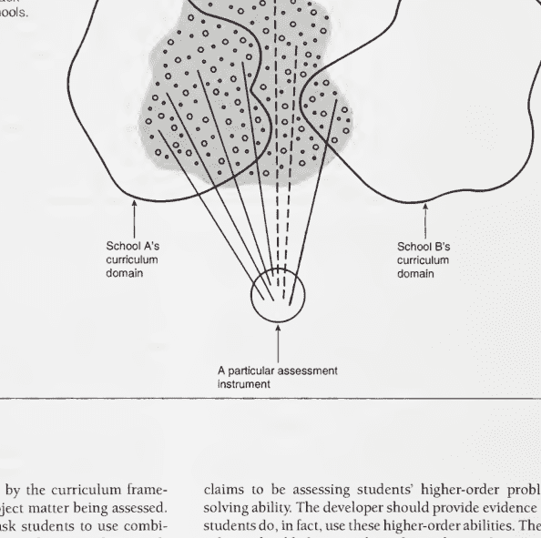

流程和技能如课程框架以及被评估学科领域的专家所定义。这样的评估工具要求学生将多种技能和知识组合起来，共同完成“现实生活”应用。

为了验证任务确实要求学生使用高阶思维过程和技能的说法，评估开发者应提供以学生为基础的数据来支持其主张。这应包括 (a) 他们声称要评估的过程和能力的详细描述，(b) 清楚地展示每种类型的任务或评估练习如何评估这些过程和技能，以及 (c) 来自研究研究的证据，证明学生确实使用了所声称的思维过程和技能。后者可能以在认知实验室中进行的少量研究的形式出现。学生被要求在完成工具上的任务时“出声思考”。他们的思维被整理成“方案”并进行分析，以揭示学生声称使用过的思维策略类型。关于学生使用的策略可能报告更严格的实验，但这些很少见。这些研究还应证明学生没有使用不适当的流程来解决任务。例如，假设一个选择题数学测试开发者

声称要评估学生的高阶问题解决能力。开发者应提供证据证明学生确实使用了这些高阶能力。开发者还应提供证据证明学生没有使用不适当的问题作答策略（例如，从每个多选题选项反向推导）。

## 评估各部分之间的关系：内部结构证据

评估程序不应只是评估任务或测试题目的拼凑集合。程序中的每个任务都应对总结果做出积极贡献。任务之间的相互关系，以及任务与总结果之间的关系，描述了评估的内部结构。评估程序的内部和外部结构对于将评估结果解释为个人在教育或心理建构上的表现指标非常重要。例如，一些评估工具声称只评估一种学生能力，例如算术问题解决。为了确保你真正将评估结果解释为仅衡量该学生的这种能力，你必须找到支持这一主张的证据。开发者

应提供证据证明该评估上的每个任务都能沿着这一单一维度区分学生（此处为算术问题解决）。然而，通常评估任务会衡量不止一个维度。例如，解决算术问题可能在很大程度上依赖于阅读技能、词汇知识、计算速度以及一般的工作速度，以及算术问题解决。在这种情况下，你可能无法将结果有效解释为仅反映学生的算术问题解决能力。

另一方面，一些评估工具是专门设计用来评估两个或多个维度的。例如，一些学术能力测试提供语言能力、定量能力和非语言能力的测量。（参见第 19 章的示例。）如果是这样，那么技术手册应包含语言、定量和非语言测试分数具有实质性差异的证据。来自研究研究的证据应证明，尽管学生在测试的三个部分上的分数可能中度相关（因为它们是全球或一般学术能力的方面），但它们足够不同，可以解释为学术能力的三个不同方面。

测试开发者经常使用相关系数作为支持这些类型解释有效性的证据。这些系数衡量两个或多个评估分数集合之间的关系程度。相关系数将在本章后面解释。

## 结果与其他变量的关系：外部结构证据

关于评估结果有效性的证据必须超越证明任务如何很好地抽样内容和思维过程，或不同任务上的分数如何相互关联。证据还来自评估结果与其他变量或标准的相关程度如何。例如， Scholastic Assessment Test I（SAT I）同时衡量语言和数学能力。其有效性在一定程度上取决于其内部结构——语言项目是否确实衡量语言能力，数学项目是否衡量数学能力，以及测试两部分的分数是否具有实质性差异。然而，SAT I 的主要用途是为招生官提供信息，帮助他们选拔可能在大学取得成功的申请人。因此，最重要的有效性证据必须来自建立 SAT I 分数与外部变量，即大学成绩的相关性的研究。我们将评估结果与这些类型的外部变量之间的关系模式称为评估的外部结构。

你需要的具体证据取决于你希望如何解释和使用评估结果。如果你想使用评估结果来帮助选拔大学候选人，那么你需要证明评估结果与大学成功标准（如平均绩点）呈正相关。有时我们希望验证新评估是否衡量与已存在的能力相同的能力。例如，我们可能希望验证选择题和口语评估是否都衡量阅读理解。如果它们都衡量相同的能力，你会期望它们的分数呈正相关：在一个测试上得分高的学生在另一个测试上也应得分高。如果两个评估的分数存在显著差异，很可能它们衡量的是不同的属性。需要额外的研究来确定哪一个分数，如果有的话，衡量阅读理解。关于评估结果与外部标准之间关系的假设和反假设源于逻辑分析、经验、先前研究以及关于所评估特质或特征本质的理论。

请注意这两个例子，一些证据有助于预测未来表现（例如大学成功），而一些证据估计个体在变量上的当前状态。预测效度证据是指个体在标准上的未来表现可以从其在评估工具上的先前表现中预测的程度。例如，我们可以收集高中学生的平均绩点，等待他们完成一年大学后，收集他们的大学平均绩点，并将高中成绩与之相关。预测随时间变化是目标。 concurrent 效度证据是指个体在标准上的当前状态可以从其在评估工具上的当前表现中估计的程度。例如，我们可以研究已经在大学的学生，给他们一个特殊的才能测试，并收集他们当前的平均绩点。成绩与测试之间的关系是 concurrent 效度证据，因为两个测量是在同一时间收集的。这一区别很重要，因为在施测评估工具和获得标准结果之间的时间间隔会影响两者结果之间关系强度的：通常两者结果之间的时间间隔越长，它们之间的相关性越低。

要理解测试开发者通常提供的外部结构信息，有必要了解一点关于相关系数的知识。我们在以下段落中转向这一必要的 digression。

## 相关系数

相关系数是一个统计指标，用来量化一个评估的分数与另一个评估的分数之间的关系程度。该指标在 -1 到 +1 的范围内报告。（本节侧重于概念。计算在附录 I 中举例说明。）

学生在不同测试上的分数 几个测试的分数之间的关系示例将有助于解释相关性。示例 3.1 显示了 11 名学生在每三个测试上的分数。学生已按其语言能力分数（V）降序排列。查看前两列分数


## 示例 3.1

11 名学生在一项口头能力测试、阅读测试和算术测试上的假设得分。

| 学生 | 口头得分 (V) | 阅读得分 (R) | 算术得分 (A) | 口头排名顺序 | 阅读排名顺序 | 算术排名顺序 |
|---|---|---|---|---|---|---|
| A | 82 | 59 | 48 | 1 | 1 | 4 |
| B | 77 | 54 | 65 | 2 | 4 | 1 |
| C | 70 | 55 | 43 | 3 | 3 | 7 |
| D | 65 | 58 | 58 | 4 | 2 | 2 |
| E | 59 | 51 | 40 | 5 | 5 | 8.5 |
| F | 53 | 44 | 47 | 6 | 6 | 5 |
| G | 45 | 38 | 55 | 7 | 7 | 3 |
| H | 41 | 34 | 44 | 8 | 9 | 6 |
| I | 34 | 35 | 25 | 9 | 8 | 11 |
| J | 30 | 30 | 40 | 10 | 10 | 8.5 |
| K | 23 | 26 | 33 | 11 | 11 | 10 |

> 来源：改编自《Measuring Pupil Achievement and Aptitude, 2nd Ed.》，作者 C. M. Lindvall 和 A. J. Nitko，纽约：Harcourt, Brace, Jovanovich，© 1975 由 C. M. Lindvall 和 A. J. Nitko。

并且注意到口头得分和阅读得分 (R) 对学生的排序方式大致相同。这并不是完全一致的排序。然而，也请注意，口头得分和算术得分 (A) 之间的关系较弱：在这些测试上学生的顺序与口头和阅读测试相比相似度较低。

比较学生的排名顺序 这种对应关系在我们将每个得分转换为排名时更为清晰，如示例 3.1 的最后三列所示。学生在口头能力和阅读方面的排名虽然并非完全相同，但在每种情况下都相当接近。学生在口头能力和算术方面的排名对应得较不紧密，但排名仍然相似。从口头能力到算术的能力排名变化比从口头能力到阅读的能力排名变化更大。比较两个评估中学生的排名顺序是研究结果相关程度的一种方法。

散点图 研究评估得分之间相关性的另一种方法是使用散点图（有时称为散点图）进行图形化。散点图是在其上绘制配对得分的图表。示例 3.2 显示了 V 与 R 和 V 与 A 的这些图。完成后，该图显示了 11 名学生整体配对得分之间的关系。

通过制作散点图，你可以深入了解两个评估的得分之间的关系。在示例 3.2(A) 中，点沿着从图的左下角到右上角的几乎直线排列。然而，在示例 3.2(B) 中，点并没有那么接近一条直线。但是，图中从左下角到右上角存在一种趋势。

散点图中点倾向于沿直线排列的趋势是相关性概念的核心。两个得分集之间的相关程度越高，点越接近沿直线排列。随着相关程度降低，点趋向于远离这条直线散开。这些点以椭圆形散开。椭圆形模式越窄，相关程度越高。相关程度越低，散点图的椭圆形模式越宽。当两个得分集之间没有关系时，模式会变宽，直到呈圆形而非椭圆形。

皮尔逊积差相关系数 视觉比较得分的排名顺序和绘制散点图是研究得分之间相关性的两种定性方法。大多数已发表的评估材料使用一种定量相关性度量，称为皮尔逊积差相关系数，用 r 表示。在众多不同类型的相关系数中，r 在效度研究中最常用。为简单起见，我将在本教材中将 r 称为相关系数。

相关系数可能的取值范围从 +1.00 到 0.00 再到 −1.00。相关系数为 0.00 表示两个得分集无关：无法根据学生在另一项评估上的得分预测其在一项评估上的得分。完全正相关关系的相关系数为 +1.00：学生在一次评估上的得分可以完美预测其在另一次评估上的得分。在正相关中，一项评估的高分与另一项评估的高分相关联。完全负相关关系的相关系数为 −1.00。在负相关中，一项评估的高分与另一项评估的低分相关联。对于完全

## 示例 3.2

示例 3.1 中所示的 11 名学生的口头能力与阅读测试得分以及口头能力与算术测试得分的散点图。

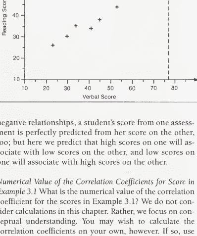

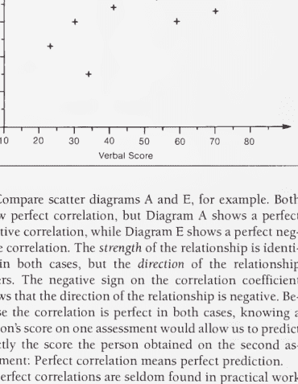

负相关关系，学生的某次评估得分也可以从其在另一次评估上的得分完美预测；但这里我们预测一项的高分会与另一项的低分相关联，而一项的低分会与另一项的高分相关联。

示例 3.1 中得分的相关系数的数值  示例 3.1 中得分的相关系数的数值是多少？我们本章不考虑计算。而是关注概念理解。你可能希望自行计算相关系数。如果是这样，请使用附录 I 中所示的程序。如果你应用了附录 I 中描述的程序，你会发现口头测试和阅读测试得分之间的相关性为 0.97，而口头和算术得分之间的相关性为 0.71。你可以看到这些相关系数与你在比较表格中得分的排名顺序并研究散点图时产生的印象一致。数字 0.97 反映了高度正相关关系（它接近 1.00），而 0.71 表示关系较弱。

关系程度 将相关系数与散点图联系起来有助于理解相关系数。图 3.2 显示了具有不同关系程度的配对得分的散点图及其对应的相关系数。每个点代表一个人的一对得分。散点图排列以说明具有相同绝对数值（即不带代数符号的数字）的正相关系数和负相关系数代表相同的强度或关系程度。

例如比较散点图 A 和 E。两者都显示完全相关，但图 A 显示完全正相关，而图 E 显示完全负相关。两种情况下关系的强度相同，但关系方向不同。相关系数上的负号表示关系方向为负。由于两种情况下相关都是完美的，了解一个人在一次评估上的得分就可以准确预测该人在第二次评估上获得的得分：完全相关意味着完全预测。

在教育和心理评估得分的实际工作中，很少发现完全相关。这有很多原因，例如评估包含测量随机误差、测量单位不相等、得分分布形状不相同，以及两个评估结果之间不是以简单线性方式相关（Carroll, 1961）。

图 3.2 中显示了其他关系程度。在 B 和 F 中，相关性分别为 +0.90 和 −0.90。这种量级的相关性表明评估结果高度相关。再次，B 和 F 中的关系程度相同，但关系方向相反。在这两种情况下，散点图中的点倾向于落在直线附近，尽管它们并不像 A 和 E 中那样完全落在直线上。当相关性为 +.90 或 -.90 时，无法完美预测一次评估的得分，但可以做出相当准确的预测。

比较 C 与 G 和 B 与 F，我们看到随着得分之间的相关性下降，散布 oc-


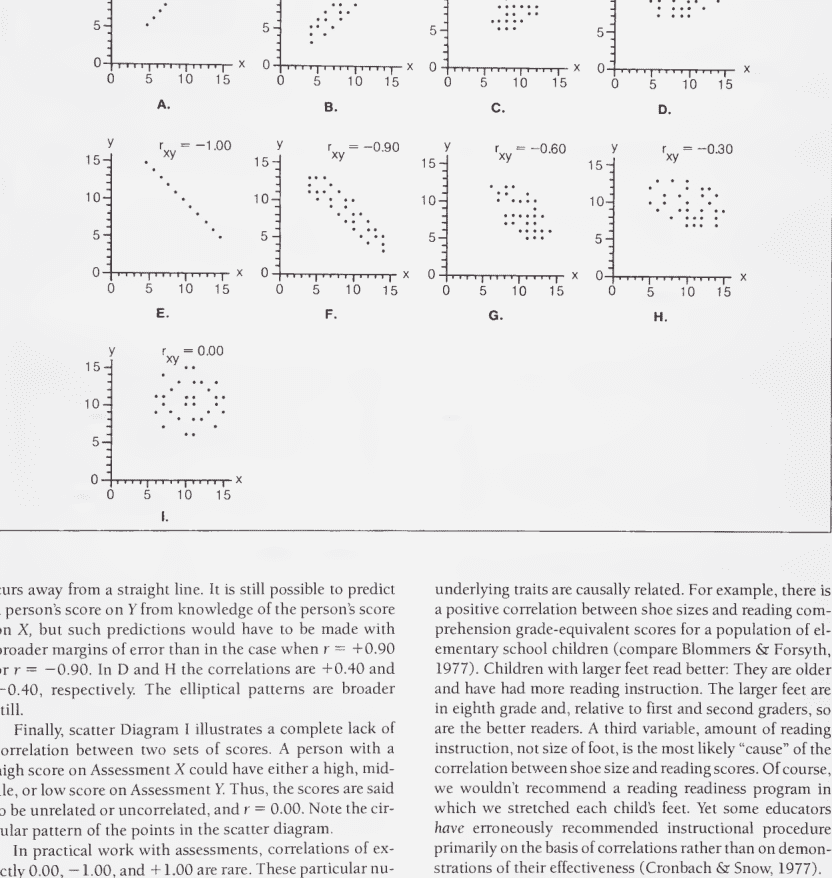

曲线偏离直线。它仍然可以预测一个人 Y 上的得分基于其 X 上的得分，但这种预测必须以比 r = +0.90 或 r = −0.90 时更宽的误差范围来进行。在 D 和 H 中，相关性分别为 +0.40 和 −0.40。椭圆形模式更宽。

最后，散点图 I 说明了两组得分之间完全缺乏相关性。评估 X 上得分高的人在评估 Y 上可能有高、中或低的得分。因此，这些得分被认为是无关或不相关的，且 r = 0.00。请注意散点图中点的圆形模式。

在评估的实际工作中，恰好为 0.00、−1.00 和 +1.00 的相关性很少。然而，这些特定的数值作为基准：实际相关系数在这些极限值的背景下才有意义。

## 相关与因果

如果来自两个评估的得分相关，这并不一定意味着潜在特质之间存在因果关系。例如，对于一群小学生的人群，鞋码与阅读理解年级当量得分之间存在正相关（参见 Blommers & Forsyth, 1977）。脚较大的孩子阅读更好：他们年龄较大，已接受更多阅读教学。较大的脚在八年级，相对一年级和二年级的学生，阅读更好的也是如此。第三个变量，即阅读教学量，而不是脚的大小，最可能是鞋码与阅读得分之间相关性的“原因”。当然，我们不会推荐一个阅读准备项目，在其中我们拉伸每个孩子的脚。然而，一些教育工作者曾错误地主要根据相关性而不是根据其有效性的证明来推荐教学程序（Cronbach & Snow, 1977）。

## 相关系数与样本量

在评估研究中报告的相关系数是基于从受试样本中获得的得分，而不是基于总体中所有人的得分。从样本计算的相关仅估计总体中相关数值的数值。你对从较小样本计算的相关数值的精确度应比从较大样本计算的相关少信心。在小样本中，即使一对得分也会显著影响相关系数的数值。例 3.3 演示了这一点。当 X = 12、Y = 12 的人被 X = 13、Y = 7 的另一人取代时，相关从 0.70（A）下降到 0.60（B），即使所有其他得分保持不变。

### 表 3.3 影响相关系数大小的因素。

| 因素 | 对相关系数的影响 | 示例 |
|---|---|---|
| 评估特质的相似性 | 特质越相似，相关越高。 | 语言能力与阅读理解测验得分的相关性将高于语言能力与数学能力测验得分的相关性。 |
| 得分的可靠性 | 得分越不可靠，相关越低。 | 来自论文考试的主观评定的学生正确英语使用与阅读理解测验得分的相关性低于来自多项选择测验的正确英语使用得分。 |
| 得分的范围或离散程度 | 得分的范围（离散程度）越大，相关可能越高。 | 当样本包括整个高中新生班级时，代数能力测验得分与学期末数学成绩的相关性将高于仅包括荣誉数学新生时。 |
| 分布形状的相似性 | 两个评估得分分布形状越不同，相关越低。 | 对于特定学生群体而言，非常困难的成就测验得分与非常容易的测验得分的相关性低于如果这两个测验对该群体而言难度适中。 |
| 评估施测的时间间隔 | 评估施测之间的时间间隔越短，相关可能越高。 | 在学年开始时施测代数能力测验。其得分与第一学期末数学成绩的相关性将高于与两年后同一学生的数学成绩的相关性。 |

## 提高或降低相关系数的因素

相关系数出现在测验手册和研究报告中。当我们遇到它们时，我们的第一倾向是将其解释为报告我们仪器评估特征之间真实关系的指标。事实上，被评估特征的相似性只是影响报告的相关系数大小的众多因素之一。一般来说，当（a）被评估的特质相似，（b）两个评估得分的可靠性高，（c）两个评估得分的范围大，（d）两个评估得分分布的形状相似，且（e）施测两个评估的时间间隔短时，相关更高。表 3.3 总结了这些因素并给出了每个因素的示例。通常，多个因素同时起作用。仔细阅读相关效度证据的报告，同时牢记这些因素作为解释你正在解读的数值相关值的可能原因。

## 效度系数

研究预测或同时效度证据时通常的程序是计算评估仪器得分与标准得分之间的相关性。这种相关有时被称为效度系数，尽管，正如你从表 3.2 可以看出，没有单一的数字适合判断评估结果的效度。在选拔情境中，人们寻找高的效度系数作为强有力的证据，表明选拔测验对于选拔将成功的个人是有用的。请注意，现实中你既不会期望完美（无误差）的预测，也不会期望相关为 1.00。

## 期望表

显示预测效度数据的另一种方式是制作期望表。期望表是一个网格或双向表，可预测具有特定评估结果的人达到每个标准得分水平的可能性。例 3.4 说明了如何开发期望表，以指示学生在特定能力得分水平上获得课程中每个字母等级的概率。（当然，期望表可以开发以预测其他标准，如主管评定、销售额、临床治疗成功等。）首先构建一个表，如例 3.4(A)，其中每个单元格包含具有特定

3请注意，你无法从相关系数判断在使用评估结果预测标准得分时可能出现的误差的可能大小。例如，如果你预测大学绩点，相关并不会告诉你预测可能出错多少 GPA 单位。可以估计预测误差可能大小的指标称为估计标准误。其公式为 SEest = SDy √1 − r²。符号 SDy 表示标准差，在附录 I 中解释。

### 例 3.3

仅一对得分变化如何改变相关系数的示例。在此示例中，N = 25 对得分。

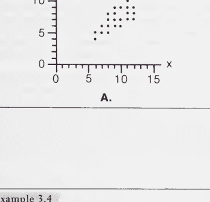

A.

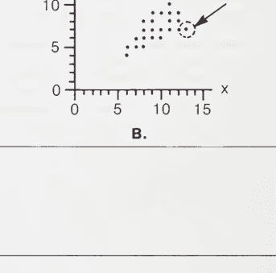

B.

### 例 3.4

对假设的 100 名学生的期望表的开发。期望表显示学生在每个预测测验水平上获得课程中每个等级的概率。

#### A. 每个预测得分水平的成绩频率

| 预测测验得分 | F | D | C | B | A | 合计 |
|---|---|---|---|---|---|---|
| 80-89 |  |  | 1 | 3 | 1 | 5 |
| 70-79 |  | 1 | 4 | 5 | 2 | 12 |
| 60-69 |  | 3 | 5 | 6 | 1 | 15 |
| 50-59 |  | 4 | 8 | 5 | 1 | 18 |
| 40-49 | 1 | 5 | 8 | 4 |  | 18 |
| 30-39 | 1 | 6 | 5 | 3 |  | 15 |
| 20-29 | 2 | 5 | 4 | 1 |  | 12 |
| 10-19 | 1 | 2 | 1 |  |  | 4 |
| 0-9 | 1 |  |  |  |  | 1 |
| 合计 | 6 | 26 | 36 | 27 | 5 | 100 |

#### B. 将频率转换为百分比制成的期望表

| 预测测验得分 | F | D | C | B | A | 合计 |
|---|---|---|---|---|---|---|
| 80-89 |  |  | 20 | 60 | 20 | 100 |
| 70-79 |  | 8 | 33 | 42 | 17 | 100 |
| 60-69 |  | 20 | 33 | 40 | 7 | 100 |
| 50-59 |  | 22 | 44 | 28 | 6 | 100 |
| 40-49 | 6 | 28 | 44 | 22 |  | 100 |
| 30-39 | 7 | 40 | 33 | 20 |  | 100 |
| 20-29 | 17 | 42 | 33 | 8 |  | 100 |
| 10-19 | 25 | 50 | 25 |  |  | 100 |
| 0-9 | 100 |  |  |  |  | 100 |


particular score who attained each course grade (criterion score level). For example, 15 students had aptitude test scores between 60 and 69. This number is shown in the right margin of the 60–69 row. Three of these 15 attained a course grade of “D,” five a grade of “C,” six a grade of “B,” and one a grade of “A.”

Second, each cell frequency in Example 3.4(A) is divided by its corresponding row total, converted to a percentage, and put into an expectancy table such as Example 3.4(B). These percentages may be interpreted as probabilities or chances out of 100 to answer such questions as, “At this school, what is the probability that a person with an aptitude test score of 65 will succeed in this course?” If we define succeed to mean “C” or better, then 33% + 40% + 7% = 80% of the students with aptitude scores between 60 and 69 were successful. A person with an aptitude score of 65 is a member of this group. Thus, the answer to the question is, “A person with an aptitude score of 65 has an 80% chance of being successful in this course.”

Expectancy tables can help parents and students interpret assessment results, too. For example, suppose an expectancy table is made for a particular college showing how admissions test scores are related to freshman grade point averages. Persons reading the table can then interpret the admission test results in terms of a student’s chances of obtaining various grade point averages. Such interpretations of admissions test scores give more information than a scaled score or percentile rank (the typical report of results students receive).

If you interpret assessment results using expectancy tables, you should observe common-sense cautions. For example, assessment instruments used to predict success seldom, if ever, measure students’ initiative, persistence, or motivation. Thus, they cannot predict with certainty what a particular student will do. Rather, the table represents the experience of other students in the past and can offer some guidance only. Therefore, never tell a student that the data in the table “prove” the student can (or cannot) be successful. You must explain that the data show the experience of other students similar to him or her.

## The Criterion

Your judgment about whether the assessment developer has provided appropriate validity evidence depends in part on whether the assessment results have been correlated with relevant criteria. Obtaining suitable criterion measures to use in validating assessment results is so difficult that this has been dubbed the criterion problem (Thorndike, 1949).

Kinds of Criteria A variety of criteria are used to provide validity evidence. Personnel classification and selection research in government and industry use four general types: production (quantity and quality of goods, sales), personal data (accidents on the job, length of service, group membership, training course grades), samples of actual or simulated

job performance, and judgments by others (checklists, supervisors’ ratings) (Lawshe & Balma, 1966). In education, criteria fall into three types: (a) achievement test scores; (b) ratings, marks, and other quantified judgments of teachers; and (c) career data. A common example is a reading readiness test given at the beginning of first grade. Scores are often validated by correlating them with scores from a reading achievement test (the criterion) administered at the end of first grade. Using grade point averages to validate scores from aptitude and admissions tests was mentioned already. Sometimes teachers’ ratings of students’ self-concept, sociability, and so on are used as criterion measures. Scores from vocational interest inventories are validated in part by relating them to career data. (See Chapter 19.)

You should note that any single criterion measure is incomplete. Each represents partial attainment of the ultimate performance that an assessment procedure would like to predict. For this reason, the validation process for a test claiming to be useful in predicting performance should include several studies of how the test’s scores relate to various criteria. You will need to review all of these studies before deciding the predictive validity of a test.

Judging the Worth of Criteria The criterion measures used in a validity study are themselves evaluated in four broad areas (Thorndike, 1949): (a) relevance to the long-term or ultimate real-life performance, (b) degree of reliability, (c) extent of bias against individuals or groups, and (d) practical problems of availability and convenience. Most often of interest in a predictive validity study are one or more ultimate real-life performances (Cronbach, 1971; Lindquist, 1951; Messick, 1989b; Thorndike, 1949). But such ultimate criteria frequently do not occur until many years after the developer initially obtains the assessment results. In such cases, intermediate criteria are used. A developer must present a suitable rationale for using an intermediate criterion before you can accept the data as part of the predictive validity evidence (Cronbach, 1971; Thorndike, 1949).

Low Criterion Reliability Limits Validity Reliability is the topic of Chapter 4. But you should be aware that if assessment results have low reliability, they will correlate lower with other measures than if they had high reliability. Frequently, predictor instruments will have good reliability, but the criterion scores with which they are correlated are unreliable. No assessment instrument will be able to predict unreliable criterion scores.

Systematic Errors Systematic errors in criterion measurement may lead you to the wrong conclusion about the validity of an instrument’s scores. For example, a validity study may correlate the test’s scores with teachers’ ratings of students. If these ratings favor boys over girls, or students with high verbal skills over those with lower verbal skills, the criterion measures themselves may be inappropriate. Systematic biases such as these introduce irrelevant factors into the validation process; they “contaminate” the criterion scores.

Thus, before accepting correlation results as evidence for predictive validity, think carefully about the possibility that the scores on the criteria themselves may be biased or invalid.

Practical Considerations Ideally, scores from an instrument should be validated using data from ultimate real-life criteria. However, practical considerations limit the degree to which a developer can do this. Practicality should not be the sole driving force in a developer’s decision to select criterion measures, however. Sometimes a developer could, with very little extra expense and effort, obtain criterion measures that are more appropriate than the surrogates the developer uses in a validation study.

## Reliability Over Time, Assessors, and Content Domains: Reliability Evidence

Reliability refers to the consistency of the assessment results if and when they are repeated. For example, suppose the scores from the ABC Reading Test administered today correlated 0.00 with the scores from this test administered next week. This correlation is evidence that the scores have no consistency over this period. You would question the validity of this test if students’ scores had little or no consistency from one week to the next because you believe that reading ability should be stable over a short period. If an assessment instrument produces inconsistent or unstable results, you can have little confidence in those results. Inconsistency means unreliability. Therefore, the reliability of an assessment’s results limits its validity. This point is discussed in greater detail in Chapter 4, which is devoted entirely to estimating the reliability of assessment results.

## Generalization of Interpretation Over People, Conditions, or Special Instructions and Interventions: Generalization Evidence

This category of validation evidence addresses how broadly you may interpret and use assessment results. For example, does the ABC Reading Test measure the type of reading comprehension required of students in higher levels of schooling and in real life? Does it measure reading comprehension for nonwhite students in the same way that it measures white students? Is it appropriate to use the scores from this test for remedial reading groups of Spanish-speaking students? Do scores on the ABC Reading Test greatly depend on students’ moods or motivations at the time the test is administered? If students receive special instruction on what strategies to use to answer the questions on this test (e.g., read the question first, then look for the answer in the text), will this greatly affect their scores?

Answers to questions such as these help us see the assessment results in a broader perspective. Usually the answers show that our interpretations of assessment results cannot be simplistic. The validity of our interpretations and uses of the results are limited to certain conditions.

Consider the following illustration.³ Suppose the ABC Reading Test had the typical format: a passage of one or two paragraphs followed by several multiple-choice questions. The test directions call for the student to read each passage and to answer the questions that follow it by marking a separate answer sheet. At first glance, it appears that the student needs to read and understand the questions.

Vernon (1962) did a thorough, logical analysis of this type of reading comprehension task. That analysis led to hypothesizing several factors, in addition to reading comprehension, that might account for a student’s test performance. If these factors alter the student’s score, then you cannot interpret the test as a pure measure of reading comprehension. Further, you cannot make decisions about students using scores that depend on such a pure reading comprehension interpretation. Among the factors that may alter a student’s reading score are the following:

- 1. Content Bias — A passage may refer to a specific topic, theme, or experience about which some students may have a lot of prior knowledge. For these students, the test is a different kind of task than for students who lack this specific knowledge.
- 2. Passage Independence — Students may answer questions without reading the passage because of prior knowledge or poor-quality test items. Passage dependency describes the degree to which answers to questions depend on reading and comprehending the passage. In other words, if a student can answer the questions without reading the passage, the questions are not passage-dependent. Thus, they cannot be said to assess reading comprehension.
- 3. Speededness — Many tests are timed. If the time limits are not generous enough, the score may depend on reading speed rather than reading comprehension only.
- 4. Attitudes and Motivation — If the way the test is presented or administered affects performance, the test will not be a pure measure of reading comprehension. Highly motivated students are likely to score much better than poorly motivated ones when the test is presented poorly.
- 5. Students’ Sophistication — Students who are "test-wise" or who have good test-taking strategies are likely to score higher than their peers of equal ability who do not have such skills.
- 6. Test Directions — If a student misunderstands test directions, performance probably will be affected adversely.
- 7. Ability to Mark Answers — Most published multiple-choice tests use separate answer sheets that can be machine scored. Students will differ in the speed and accuracy with which they mark the correct answers. Frequently the type of answer sheet affects the test score.

The preceding list is by no means exhaustive. Questions such as these stand as counterhypotheses to the intended interpretation of the scores as measures of reading


理解。作为你提出这些问题时，你应该查阅出版商手册和技术报告中关于这些问题的研究证据。然而，并非所有证据都会包含在出版商的材料中，尤其是如果它是不利的证据。你可能需要查阅研究文献以获取额外信息。《心理测量年鉴》（见第18章）包含对测验的评述以及该特定测验出现的研究文献目录。你也可以使用教育研究信息中心（ERIC）在线搜索。

图3.3提供了一个研究研究的例子，该研究试图确定动机对阅读测验分数的影响。一个研究当然不能提供支持评估解释有效性所需的所有证据。需要一系列研究。此外，你不应从图中假设简单的激励措施，例如鼓舞讲话、奖品或金钱，会影响所有类型学生的所有评估结果。也不应假设动机是影响学生表现的唯一因素。

## 图3.3 如果提供奖品，测验分数会上升吗？

Tuinman、Farr 和 Blanton（1972）试图确定在教学期后进行后测并立即提供奖品的情况下，阅读测验分数可以提高的程度。七年级和八年级的非问题阅读者被随机选择并随机分配到实验组（E）或对照组（C）。所有学生都两次参加了 Nelson 阅读测验，A 形（1962）；两次测验之间间隔四周。在两次测验之间，学生参加了常规学校课程。

对 E 组和 C 组进行再测验的指示不同。C 组被告知他们要被重新测验的原因是为了了解他们学到了多少。E 组被展示了奖品（6 台晶体管收音机、9 件印第安纳大学运动衫和大块糖果），并被给予以下指示（第217页）：

> “几周前你做了一次测验，我们现在已经评分了。我们希望你能尝试超过你的第一次测验分数。我们为你准备了一些奖品，如果你在这次测验中比上次测验做得更好。我们不在乎谁的分数最高。我们想看看谁能在本次测验中比第一次测验多得多少分。你所需要做的就是尽可能多地提高自己的分数。提高分数最多的学生将赢得奖品。记住，获胜的不是分数最高的学生；而是提高分数最多的学生。”

如果你是提高分数最多的前六名学生中的一员，你将赢得一台晶体管收音机——不是分数最高的六名，而是提高最多的六名。

如果你是接下来提高分数最多的九名学生中的一员，你将赢得一件这些 IU 衬衫之一。

而且如果你只是提高了一分，你就能得到其中一块糖果。所以只要提高一分，每个人都会得到奖品。
如果你在这次测验中没有比第一次测验得分更高，就没有奖品。

这并不难，只要努力超过自己的分数。与任何人竞争都无济于事。只要你更努力工作，尝试做更多题目并且做对更多题目，就能做到。提高你的分数，带回家一件奖品。”

该研究的部分结果如下所示。

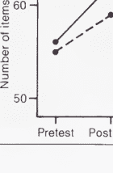

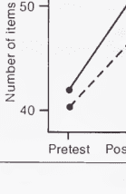

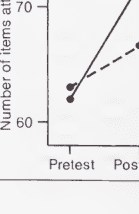

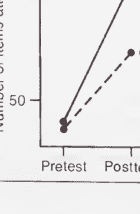

## 预期和非预期后果：后果证据

如与验证的四项原则相关所述，你对评估结果赋予的意义和用途源于你的教育和社会价值观。我们还讨论了当评估工具先验抽样的领域与当地学区课程和教学领域不匹配时，对学校课程产生的后果和压力。正如 Moss（1992）所指出的，“今天关于外部强加与课堂生成评估或多项选择与表现评估的激烈争论，其合理性并非基于技术有效性考虑，而是基于对教学、学习和公平的后果”（第236页）。

例如，大多数州评估和问责计划旨在产生以下积极后果（Lane & Stone, 2002）：

- 提高学生、教师和学校管理人员的教育努力。
- 改善课程内容和教学策略。
- 提高所有学生的学习。
- 改善教师的专业发展以及学校对该发展的支持。
- 改善学生为评估做准备的重点和方式。
- 提高学生、教师、管理人员和公众对使用标准、标准和评估来评估学校价值的认识。

关于这些预期后果实现程度的证据成为验证州评估计划的论证的一部分。

然而，仅收集关于是否实现计划预期后果的证据是不够的。州的评估和问责计划验证工作还应寻找负面、非预期后果的证据，例如以下内容（Lane & Stone, 2002）：

- 课程和课堂教学的狭窄化，仅关注可能包含在州评估中的内容，而忽视更广泛的课程目标和目的。
- 仅为学生准备应试，而不提高他们对州标准的成绩质量。
- 使用不道德的应试准备做法，例如提前泄露题目。
- 仅提高部分学生的成绩（例如，父母社会经济水平高的学校的学生），而其他学生的成绩（例如，来自父母社会经济水平较低学校的的学生）保持低水平或下降。
- 评估结果的不当使用增加，例如因学生成绩低而调动或惩罚教师和校长。
- 由于过去在评估中表现不佳，部分学生学习和取得成就的动机下降。

验证计划应寻找负面、非预期后果的证据，以及评估计划积极、预期后果实现的证据。

## 成本、效率、实用性和教学特征：实用性证据

评估结果在技术上可能是可靠的，但实际障碍可能会阻碍其正确（因此有效）的使用。例如，如果评估程序对教师来说过于复杂，他们就不会正确使用它。如果正确实施评估需要教师不具备的更多培训，评估很可能被错误实施并产生有效性低的结果。此外，如果评估工具被正确实施和解释，其有效性将提高。一些评估工具可能附带计算机化成绩报告，帮助教师识别需要特别帮助的学生。这些辅助材料的可用性增加了结果按预期使用的可能性。

尽管评估成本不是有效性的主要考虑因素，但它仍然是一个考虑因素。这里关注的是，在各种相似评估工具的选择中，哪一个最具成本效益？在特定学校环境下的实际情况下，哪一个能提供最有效的结果？最便宜的替代方案是否是最有效的替代方案？

## 综合有效性判断的证据：基于论证的方法

### 多种类型的证据

本章的讨论始终强调，你必须准备好审查和综合多种类型的证据，然后再判断特定评估结果对给定目的的有效性。这无论是对课堂评估程序还是课外评估程序都是如此。有效性并非基于任何单一证据，而是基于关于你希望从评估结果中得出的解释和用途的质量的若干证据的权重。

### 验证的基于论证的方法


在你的特定情况下，可能会产生混淆。Shepard（1993）建议你组织和聚焦效度证据，以回答以下问题：

- 1. 我的评估实践声称要做什么？
- 2. 什么证据支持或反驳我关于我的评估实践实现了我所期望的这一说法？
- 3. 当我在教育环境中使用我的评估实践时，除了我为其声称的功能外，它对好坏有什么作用？

其思想是，你优先考虑表 3.2 中描述的证据类型，并以能够回答这三个问题的方式呈现证据。术语评估实践指的是你打算在特定情况下如何解释和使用评估结果。因此，不同的人可能对同一评估程序的这些问题给出不同的答案。这重申了我们在本章开头提出的一点：“这些评估结果有效吗？”这个问题取决于结果将被如何解释和使用，有许多不同的答案。

基于论证的效度验证 Kane（1992, 2001, 2002）建议以说服性论证的形式组织对这些问题的回答。换句话说，使用逻辑和数据的结合来说服他人，你对评估结果的解释和用途是有效的。这种效度方法要求你（a）明确说明你打算对评估结果做出何种解释和用途，（b）提出一个逻辑连贯的论证来支持你的主张，即评估结果可以按你所打算的方式进行解释和使用，以及（c）通过引用支持和反对你预期解释和用途的证据来支持你的逻辑论证。这种方法被称为基于论证的验证方法（Kane，1992）。

支持你的效度论证并反驳潜在反论的证据来自表 3.2 中描述的各个类别。你在论证中强调的证据类型将取决于你想要验证的评估实践。Kane 给出了以下例子。假设要验证的评估实践是使用代数分班测试将学生分配到补习代数课程或微积分课程。Kane 指出，为了验证这种评估实践，你需要有论证并有证据支持（例如表 3.2 中描述的那些）以下内容是合理的：

- 1. 你可以适当评估学生在微积分课程中的成功情况（即有合适的标准评估程序可用）。
- 2. 你可以识别学生在微积分课程中会频繁使用的代数概念和思维技能。
- 3. 分班测试所评估的代数内容和思维技能与微积分课程中频繁使用的内容相匹配。
- 4. 低分学生将被分配到的补习课程将成功地教授学生微积分课程所需的代数概念和技能。
- 5. 分班测试的分数是可靠的（即学生的分数在不同测试题样本、不同测试场合以及不同评分人员之间保持一致）。
- 6. 让代数能力高的学生上补习代数课程没有帮助（即在分班测试中得分高的学生先上这门特定的补习代数课程并不会显著提高他们在微积分中成功的机会）。
- 7. 分班测试分数不受会降低你对分班测试衡量代数知识和思维技能这一解释效度的系统误差的影响。

## 摘要

## 效度的一般性质

- 效度指的是你对评估结果的解释和用途的合理性，而非评估工具本身。
- 评估结果的有效程度取决于结果如何被解释和使用。

## 验证原则

- 评估结果的效度只有在结合多种类型的证据并根据你希望对结果做出的特定解释和用途来判断该组合后才能确定。
- 评估结果的效度还取决于你使用评估结果所隐含的价值的适当性以及该用途的社会后果。

## 教师自制课堂评估结果的效度

- 用于给学生评分的课堂评估应满足以下类别中的效度标准。 （表 3.1 列出了具体标准。）
  - 内容代表性和相关性
  - 思维过程和技能
  - 与其他课堂评估的一致性
  - 可靠性和客观性
  - 对不同学生的公平性
  - 经济性、效率、实用性、教学特征
  - 多重评估用途

## 效度证据类别

- 随时间、评估者和内容域的变化的可靠性（可靠性证据）
- 在不同类型的人、不同条件或特殊指导和干预下的解释推广（推广证据）
- 预期和非预期后果的价值（后果证据）
- 成本、效率、实用性和教学特征（实用性证据）

你需要根据你希望从结果中做出的解释和用途类型，对不同类别的证据给予不同的权重。

提供证据是评估出版商和结果使用者共同的责任。附录 B 总结了这些共同责任。

你不能仅仅因为无法负担进行必要的效度研究，就忽视验证你对评估结果的解释和用途的需要。

几种类型的效度证据取决于两个或多个评估分数集之间的相关性。预测效度证据表明评估工具上的分数预测标准未来分数的好坏。 concurrent 效度证据反映了个体的当前标准状态可以从评估工具分数中估计的程度。在某些情况下，相关系数或期望表可能提供所需的效度证据。

标准问题出现是因为很难获得适合验证评估结果的标准测量。标准通过其（a）与最终现实生活表现的相关性，（b）可靠性的程度，（c）对个人或群体的偏见程度，以及（d）可用性和便利性来判断。

由于大多数人以宽泛的方式解释学生的评估表现，从而推断学生在阅读理解或智力等教育或心理构念上的状态，因此有必要整合大量和多样化的关于影响学生评估表现的因素的信息。这些信息来自表 3.2 的全部八个类别。

## 综合证据以做出效度判断

你需要通过考虑你打算如何解释和使用评估结果，在表 3.2 的八个证据类别中确定优先顺序。你通过回答以下问题来准备效度论证：（a）我的评估实践声称要做什么？（b）什么证据支持或反驳我的评估实践实现了我所声称的这一断言？（c）当我在教育系统中<|message|> 使用我的评估实践时，除了我为其声称的功能外，它对好坏有什么作用？

你的验证论证必须：（a）明确说明你打算对评估结果做出的解释和用途，（b）提出一个逻辑连贯的论证来支持你的主张，即结果可以按你所打算的方式进行解释和使用，以及（c）通过引用支持和反对你预期解释和用途的证据来支持你的逻辑论证。

## 重要术语和概念

- argument-based approach to validation
- assessment practice
- concurrent validity evidence
- content relevance
- content representativeness
- correlation coefficient
- curricular relevance
- ethnic and gender stereotypes
- expectancy table
- external structure
- four principles for validation
- internal structure
- multiple-assessment strategy
- negative correlation
- objectivity
- passage dependency
- Pearson product-moment correlation coefficient
- positive correlation
- predictive validity evidence
- scatter diagram (scattergram)
- table of specifications
- validity
- validity coefficient

## 练习与应用

- 1. 获取一份曾用于给学生打分或字母等级的教师自制评估工具。使用表 3.1 中列出的标准，评估使用评估结果给学生评分的有效性。然后简要描述该评估对此目的的有效性如何以及原因。最后，使用表 3.1 中的标准，描述你如何能提高该评估工具的有效性。
- 2. 获取一份教师自制评估工具（可以是自己制作的，也可以是别人的）。确定该评估工具学生结果的主要或预期解释。对评估进行逻辑分析。确定三个反向解释（即可能导致对预期解释的有效性提出质疑的替代解释）。然后指定可以收集的证据类型，以验证预期解释并使这三个反向解释无效。将此测试附在此练习中。
- 3. 假设正在开发一种新的高中科学能力测试，在开发过程中使用了几种程序和技术来提供其有效性的证据。这些程序列在以下陈述中。对于每个陈述，确定表 3.2 中直接涉及的证据类型。解释你做出该选择的原因。
  - a. 对 150 名 10 年级学生的样本，奇数题分数与偶数题分数相关。
  - b. 300 名一年级学生九月份施测的分数与同一组二月份施测的分数相关。
  - c. 200 名一年级学生九月份施测的分数与这些学生在学校记录中一月份获得的普通科学课程成绩相关。
  - d. 比较上过一门、两门、三门和四门科学课程的学生分数，看看平均值是否有差异。


e. 测试手册的一个章节描述了科学能力的七个方面以及衡量每个方面的题目数量。

## 4. 以下每个陈述都是教育工作者可以关于评估程序提出的问题。利用表 3.2，针对每个陈述确定回答该问题时最重要的是哪种（些）效度证据类型。然后简要说明你的选择。

- a. “这份拼写测试是否代表了我们教给六年级学生的拼写模式的类型？”
- b. “这份阅读测试的分数能否帮助我将学生分配到不同的教学组？”
- c. “我正在使用这项表现性评估来选拔参加特殊培训项目的人员。我想知道结果是否会受到实施评估的人员的个性显著影响？”
- d. “这项数学表现性评估是否真的评估了这些学生的数学能力？”
- e. “我们现在使用一种程序来评定学生教师。这项程序是否允许在该州教学时可能遇到的广泛课堂情境中观察到学生教师？”

## 5. 阅读每个陈述并判断其是真还是假。然后解释你为何这样标记。

- a. 在九年级开始时进行一次言语推理测试。该测试的分数与九年级、十年级、十一年级和十二年级的英语成绩相关。与十二年级成绩之间的相关性可能是在四个相关性中最低的。
- b. 某预测测试具有完美的信度（信度系数 = 1.00）。这意味着该预测测试很可能与研究者想要使用的几乎任何标准测量都有非常高的相关性。
- c. 另一项预测测试的信度为零（信度系数 = 0.00）。这意味着该预测测试很可能与研究者想要使用的几乎任何标准测量都相关为零。

## 附加阅读

American Educational Research Association, American Psychological Association, & National Council on Measurement in Education. (1999). Standards for educational and psychological testing. Washington, DC: Author.

第一部分讨论了评估开发者对验证技术方面的责任；第 11、13 和 15 章描述了学校中使用评估者的标准。

Joint Committee on Testing Practices. (1988). Code of fair testing practices in education. Washington, DC: American Psychological Association.

这份简短的文件描述了课外教育评估的开发者和使用者双方的义务。它在附录 B 中重印。

Linn, R. L. (1994). Performance assessment: Policy, promises, and technical measurement standards. Educational Researcher, 23(4), 4–14.

讨论了本章中的效度概念如何与大规模表现性评估情境相关。

Messick, S. (1989). Validity. In R. L. Linn (Ed.), Educational measurement (3rd ed., pp. 13–103). New York: Macmillan.

对效度证据的各个方面进行了全面而学术性的论述。

Moss, P. A. (1992). Shifting conceptions of validity in educational measurement: Implications for performance assessment. Review of Educational Research, 62, 229–258.

Moss, P. A. (1995). Themes and variations in validity theory. Educational Measurement: Issues and Practice, 14(2), 5–13.

Kane, M. T. (2001). Current concerns validity theory. Journal of Educational Measurement, 38, 319–342.

这组文章回顾了效度理论的最新发展，并提出了扩展用于验证评估结果的方法和证据类型的建议。所建议的验证方法在表现性、作品集和传统评估程序的背景下是有用的。

Nitko, A. J. (1989). Designing tests that are integrated with instruction. In R. L. Linn (Ed.), Educational measurement (3rd ed., pp. 447–474). New York: Macmillan.

讨论了如何使测试与教学传递领域相匹配，分析了与教育诊断评估方法相关的效度问题，并讨论了强制性课外评估的效度问题。

Nitko, A. J., Al-Sarimi, A., Amedahe, F., Wang, S., & Wingert, M. (1998). How well are the Kentucky Academic Expectations matched to the KIRIS assessments, the CTBS, and the CAT? Paper presented at the Annual Meeting of the American Educational Research Association, San Diego, CA, April (ERIC/TM ED 420677).

这是关于如何收集效度证据以确定三个测试与州课程内容标准匹配程度的一个例子。

Shepard, L. E. (1993). Evaluating test validity. Review of Research in Education, 19, 405–450.

回顾了效度的历史，并展示了如何将效度概念应用于现代教育评估情境。

Tittle, C. K. (1989). Validity: Whose construct is it in the teaching and learning context? Educational Measurement: Issues and Practice, 8(1), 5–13, 34.

将效度概念扩展到包括使用教师和学生的评估视角作为效度证据，而不仅仅局限于传统上所做的开发者的视角。

## 评估结果的信度

## 学习目标

学习本章后，你应该掌握以下内容：

## 信度的一般性质

- 1. 解释信度的概念以及它与学生评估结果不一致性的关系。 [3, 6]
- 2. 解释信度、效度与教育决策质量之间的关系。 [3, 6]

## 测量误差或不一致性的原因

- 3. 描述几种测量误差的原因以及此类误差如何导致对学生评估结果的错误解释。 [3, 6, 7]

## 信度系数的类型

- 4. 解释为何评估结果对于某些用途可能是可靠的，而对于其他用途则不然。 [6, 3]
- 5. 列出不同类型的信度系数并描述为其计算而收集数据的过程。 [6, 3]
- 6. 识别提供有关工具测量误差信息的特定信度系数。 [3, 1, 6, 7]

## 获得分数、真实分数和误差分数

- 7. 解释观察分数、真实分数和误差分数的含义。 [6]
- 8. 解释测量标准误的含义、它与信度的关系以及如何用来解释分数。 [3, 6, 4]
- 9. 给出影响信度系数和测量标准误的因素的例子。 [3, 6, 7]

## 掌握与及格/不及格决策的信度

- 10. 解释决策一致性与使用程序进行掌握和及格/不及格决策的关系。 [6, 3, 1]

## 如何提高信度

- 11. 描述提高评估信度的九种方法。 [3, 6, 4]
- 12. 描述需要非常高评估信度的教育决策类型以及可以容忍中等水平的类型的区别。 [3, 6, 4]

## 重要术语和概念

- 13. 解释本章末尾列出的每个术语和概念如何适用于教育测量。 [6]

## 关于本章

你当然知道，你的评估并不完美。在上一章中，你学习了如何提高其效度。本章将教你如何提高其信度。当我们说我们的评估是可靠的时，我们是什么意思？信度与效度有何关系？你的评估结果包含哪些类型的测量误差？哪些信度指标可以帮助你了解分数的可靠性？什么指标可以表明测量误差有多大？哪些因素会提高评估的信度？这些问题在本章中进行了讨论。

本章首先讨论，首先，信度的整体概念以及它与效度的关系。其次，我们解释了一些进入你的评估结果的基本测量误差原因。第三，我们


## 可靠性的一般性质

### 可靠性的定义

研究一些常见的可靠性指标，帮助我们描述测试分数的可靠性如何。第四，我们研究学生的分数如何可以被视为包含两个组成部分：真实成分和误差成分。第五，我们研究如何估计该误差成分的大小。第六，我们描述了若干会提高评估可靠性的额外因素。第七，我们考虑评估中的误差如何影响我们关于学生是否掌握学习目标的决策。最后，我们考虑期望的可靠性水平是多少。

假设你今天让学生写一篇论文，解释民主选举的利弊。假设，进一步说，你一个月后用同样的学生重复这篇同样的论文。如果你在两次场合下对每个学生论文回答的评分基本上相同，我们就说结果在这段时间内是一致的。我们说结果在一个月的时间内是可靠的。

现在假设你今晚批改了每个学生的论文。然后明天，在不透露你分配的分数的情况下，你把论文交给一位教学同事来批改。如果你分配给每个学生的分数基本上与同事独立分配的分数一致，我们就会说结果对于不同的评分者来说是一致的或可靠的。

再举一个例子，假设你以不同但等价的方式重新表述论文问题，并让学生为两个版本写论文。如果每个学生在这两个任务版本上的论文质量基本上相同，我们就会说学生的反应对于同一任务的等价版本来说是一致的或可靠的。

因此，可靠性是指学生在评估程序的重复中结果保持一致的程度。也就是说，可靠性是指学生在（a）他们在两个或多个不同场合完成相同的任务；（b）两个或多个教师对他们在相同任务上的表现进行评分；或（c）他们在相同或不同场合完成两个或多个不同但等价的任务时，评估结果相同的程度。重复评估中分数的一致性是理解可靠性的关键。与效度一样，可靠性指的是学生的评估结果或分数，而不是评估工具本身。

你可以看到一致性是你决定对学生的评估结果置信度多少时需要考虑的重要概念。本章后面我们以更具体的方式描述这一定性概念。这将导致可靠程度的各种指标。然而，首先，我们简要讨论可靠性与效度之间的关系。

### 可靠性限制效度

正如我们在上一章讨论的那样，效度与我们对解释学生的评估结果和利用它们做出决策的信心有关。然而，当学生的评估结果不一致时，你的解释和决策的有效性会降低。评估结果的可靠性程度限制了其有效性程度。

### 高可靠性并不保证效度

尽管高度效度需要高度可靠性，但反之则不然。高度可靠的评估并不能保证你能做出高度有效的解释或决策。这是因为可靠性只是众多效度标准中的一个（参见表 3.1 和 3.2）。

作为说明，考虑以下例子。科尔特斯女士教授七年级算术。她反思学生在当地社区日常生活中将被期望执行的计算类型并列出这些技能。然后她创建了一份计算和问题解决测试，以评估学生执行这些技能的能力。由于这份纸笔测试包含中等数量的题目，科尔特斯女士可以确信由此产生的分数将非常可靠。

然而，知道这些分数是可靠的还不足以得出它们是有效的结论。在决定评估结果的有效性如何之前，科尔特斯女士应该回答以下问题：这项测试是否是她希望推广结果的计算领域的代表性样本？测试题目的格式是否适合在学生教育发展的这一阶段进行评估？测试的时间限制是否合适？阅读能力是否严重影响测试表现？测试分数是否有助于她为这些学生规划教学？使用这些类型的测试题目是否会无意中向学生传达学校中的计算和问题解决与“现实世界”或“真实”数学问题是孤立的？对这些问题中的任何一个的否定回答都会削弱测试的有效性，即使分数可能非常可靠。

### 可靠性是效度的必要条件

评估的可靠性影响决策的质量（效度）。假设科尔特斯女士决定掌握目标计算领域 80% 是及格。测试只是从该领域抽取的一个样本。然而，如果测试分数的可靠性很低，那么在所有真正掌握了目标领域 80% 或以上计算的学生中，很可能会有一些学生的测试分数低于 80%。这些学生将被错误地归类为失败者。另一方面，在真正掌握的目标领域略少于 80% 的学生中，很可能会有一些学生通过测试。这些学生将被错误地归类为具有足够能力。

再举一个例子，辅导员可能想知道学生的数学能力或语言能力哪个更高。学生在数学能力测试上的分数不太可能与她在语言能力测试上的分数相同。效度问题是：“分数不同是否意味着学生在两种能力上确实不同？”为了说学生的某一方面能力超过另一方面，辅导员需要知道仅由于测量误差，分数可能与真实能力分数相差多少。如果分数波动很大，它们就是不可靠的。如果分数不可靠，辅导员就很难确信分数差异表明语言和数学能力存在差异。不一致性，也称为测量误差，对需要有效解释学生分数概况的人来说是特别令人担忧的，例如在诊断评估或职业咨询评估中。

### 测量误差或不一致的原因

可靠性和测量误差是谈论同一评估现象的互补方式。可靠性概念关注评估结果的一致性；测量误差概念关注其不一致性。不一致性有不同的原因。然而，并非每个原因对你对评估结果的特定解释和使用都同等重要。

考虑以下情况。假设所有可能适合评估特定学习目标集合成就的任务都可以被描述。这种对可能任务的描述称为成就领域。例如，该领域可以是所有可用于评估五年级学生解决涉及比例的数学问题的开放式任务。图 4.1 左侧的大圆代表该领域。

假设，进一步说，你希望确定学生知道该领域的百分比。不是对整个领域进行施测，这是不可能的，你从该领域中随机抽取 10 个任务的样本并对学生进行施测。显然，学生在该评估上的分数取决于哪些任务恰好被包含在样本中。另一个 10 个任务的样本会比第一个样本更容易或更难，导致学生的分数更高或更低。假设学生在第一个样本上的结果是 80% 正确，在第二个样本上是 50% 正确。是什么导致这种不一致？如图所示，图 4.1 显示，这是使用不同的内容样本（或评估程序的“形式”）的结果。

现在考虑第二种情况：假设你在星期二对学生施测第一个 10 个任务的样本，这对学生来说是“糟糕的一天”，学生得到 40% 正确。也许学生在上课前在操场上经历了令人不安的遭遇，没有吃早餐，或者过敏发作使集中注意力变得困难。不管什么原因，在星期二学生的表现是

图 4.1 一个示意图，说明评估表现的变化如何与内容样本和评估场合相关。

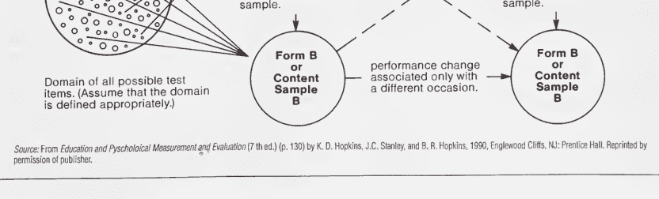

> Source: From Education and Psychological Measurement and Evaluation (7th ed.) (p. 130) by K. D. Hopkins, J.C. Stanley, and B. R. Hopkins, 1990, Englewood Cliffs, NJ: Prentice Hall. Reprinted by permission of publisher.


off。假设现在，这同样的 10 项任务是在周五进行的。也许周五是一个非常好的日子，学生表现得比平时好得多，达到了 70%。如图 4.1 所示，这种不一致性是由于在不同场合进行抽样造成的。相同的题目样本（即同样的 10 项任务）在周二和周五都被使用了，因此评分不一致的任何来源都不能是内容抽样。

该描述考虑了影响评估表现一致性的两个因素：（a）出现在评估任何形式上的内容或特定任务样本，以及（b）评估所进行的场合。图 4.1 示意图中的实线箭头表示这些因素。该图还显示（通过对角虚线箭头）内容和场合两者可能共同作用以影响评估表现的额外可能性。

我们可以从本次讨论和图 4.1 中得出几个重要结论。解释学生在特定场合、特定任务样本下获得的评估结果具有明显的局限性。评估结果必须在不同的内容样本、任务和场合上保持合理的 consistency（完美的一致性是不可能的）；否则，我们对其就不能有太多信心。

图 4.1 还显示存在不同种类的一致性。评估结果可能在某些方面一致，而在其他方面不一致。你必须牢记哪种重复评估最适合回答你的 consistency 问题；否则，你会被误导。例如，学生在不同任务样本的重复评估上的结果可能不一致，但在同一任务样本上一个月后重复评估的结果可能非常一致。如果你关心的评估问题是把学生今天的表现推广到该学生下个月在同一任务样本上可能的表现，那么一个月的一致性对你来说比不同任务样本的分数一致性信息更相关。另一方面，如果你知道学生学习迅速且不断变化，那么分数随时间的一致性就较不相关。如果你牢记对评估的潜在解释和用途，你将能够更好地判断评估结果最重要的 consistency 类型。

## TYPES OF RELIABILITY COEFFICIENTS

## 量化评估结果的一致性

我们刚刚以定性术语描述了信度和测量误差。也可以对这些概念进行量化。统计方法可以表明评估结果的信度程度以及测量误差的大致大小。这样的指标只有在评估产生学生定量分数或测量值时才可能。

使用这些指标的优点是它们可以为你的评估结果质量提供指导。信度指数低意味着评估结果并不非常一致。因此，你的评估信息质量较差。利用质量较差的信息做出的决策不会是最优的。

获得信度系数的基本策略是对一组学生进行一次或多次评估并获得分数。然后，使用两种方法之一来检验一致性。一种方法是相关两次施测的分数。如第 3 章所述，相关系数是学生群体中相对排名是否从一次评估到下一次评估发生变化的指标。在分数一致性的背景下，该相关性称为信度系数。第二种方法是估计学生的分数从一次施测到下一次施测可能变化的幅度。表达这种分数一致性变化的指标称为测量标准误（稍后讨论）。

由于这两种指标在描述测试和其他评估方法质量时被广泛使用，你应该理解其背后的基本思想，以便正确解释你的评估。理解这些指标是你专业发展的重要组成部分，也是负责任地使用评估结果所必需的，即使你实际上不计算它们。我们首先讨论各种类型的信度系数，然后讨论测量标准误。我们的方法是概念性的，并不强调计算。附录 J 显示了如何计算这些指标。

## 信度系数的概述

本节讨论估计信度系数的方法。不同的信度系数遵循图 4.1 中引入的思路。当评估问题集中于学生分数随时间的一致性时（如图 4.1 中的水平箭头所示），重测信度系数提供了必要的信息。如果我们的评估问题集中于分数在时间和内容变化上的 consistency（如图 4.1 中的对角箭头所示），则另行编制形式（不同场合）系数是适当的指标。当评估问题关注从一个内容样本到另一个内容样本的分数一致性时（图 4.1 中的垂直箭头），可以使用以下几种系数之一：另行编制形式（同一场合）、分半、Kuder-Richardson 或系数 alpha。

本节还讨论另一类系数，图 4.1 中未表示。有时关于教育评估的问题集中于学生回答的评分或评定。在这种情况下，评分者间信度系数或一致百分比提供了所需的信息。

表 4.1 列出了我们讨论的每个系数、其回答的主要问题以及其处理的测量误差类型。当你检查此表并学习本节时，你会意识到问题“这些分数可靠吗？”有许多不同的答案，这取决于你关心的测量误差类型。

## 随时间估计信度

假设我们提出以下问题：分数在相同任务上可能因在不同场合施测而不同到什么程度？或者，如果一名实习教师在周一被观察，评定是否会与周三观察的评定一致？或者如果 Dr. Adams 在周一评定教师，而 Dr. Meyers 在周四评定，两次评定是否可能一致？（回顾图 4.1。）估计此类情况下信度的程序是本节的主题。

### 重测信度

前一段中第一个信度问题集中于在固定评估任务样本上分数随时间段的稳定性。对一组学生在两次不同场合施测相同任务所获得的数据进行研究将回答此问题。由于在两次不同时间施测的是相同任务（而非等值任务），两次场合分数之间的相关性称为重测信度系数。有时也称为稳定性系数。

该范式如下：

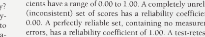

你可能记得，相关系数 0.00 表示两组分数之间没有关系，而相关系数 1.00 是完全正相关。信度系数的范围为 0.00 到 1.00。完全不可靠（不一致）的分数集的信度系数为 0.00。完全可靠、不含测量误差的分数集的信度系数为 1.00。重测系数为 1.00 意味着该组在两次场合的分数具有完全相同的等级顺序。然而，重测系数为 1.00 很少出现。通常，标准化成就和能力测试的重测系数在测试间隔为 3 至 6 个月时介于 0.80 和 0.90 之间。

表 4.1 信度系数的汇总。

| 系数类型 | 回答的主要问题 | 计为测量误差或不一致的内容 |
|---|---|---|
| I. 场合或时间的影响 | | |
| 重测 | a. 相同内容样本的分数受另一次测试场合影响如何？ <br> b. 这种特定测试形式随时间的稳定性如何？ | 时间或场合抽样 |
| 另行编制形式（有时间间隔） | a. 无论使用何种形式或在何种场合施测，测试分数有多一致？ <br> b. 这种试验随时间（和内容样本）的稳定性如何？ | 时间或场合抽样和内容抽样 |
| II. 不同内容样本的影响 | | |
| 另行编制形式（无时间间隔） | a. 分数是否受同一场合抽样不同内容的影响？ <br> b. 两个精心匹配的测试形式是否可互换（等值、平行）？ | 内容抽样 |
| 分半 | a. 同上 <br> b. 另行编制形式信度系数的估计值是多少？ | 内容抽样 |
| Kuder-Richardson 公式 20 和 21，系数 alpha | a. 同上，但形式等值或平行性可能不为研究者所关注。 <br> b. 测试同质性的粗略估计是多少？ <br> c. 条目间的反应有多一致？ <br> d. 分数是否受同一场合内容抽样影响？ | 内容抽样和同质性 |
| III. 不同评分者的影响 | | |
| 评分者信度 | a. 如果使用不同的评分者（评定者、裁判），分数会有多大不同？ <br> b. 测试客观到什么程度？ <br> c. 不同评分者（观察者、评定者、裁判）的结果是否可互换？ | 评分者抽样 |


解读这些重测信度系数时，了解 (a) 两次施测之间的时间间隔长度以及 (b) 所测表现的预期稳定性非常重要。一般而言，重复施测之间的间隔越长，可靠性越低。此外，学生的表现越不稳定，可靠性越低。例如，婴儿和幼儿的一些表现从一天到另一天并不一致。你会期望对这些表现的评估的重测信度也很低。另一方面，像年长学生的一般学业能力等特质往往在一个学期或一年内保持稳定。对该特质的评估的重测信度在较长时期内通常会相对较高，且对一般学业能力的评估往往可用于预测这些时期的未来表现。当评估结果缺乏稳定性时，其作为未来表现预测者的有效性会降低。

教师关心学生是否处于“状态不佳”的一天，集中于学生表现在一相对较短的时间间隔内的是否一致。教师可能不期望学生的表现在一个较长时期，例如一个月内保持不变。较长时间间隔内的表现水平变化更可能反映学生能力的实际变化，而非特定场合或状态不佳造成的随机波动。然而，这种能力的实际变化确实会降低两次施测得分的相关性，因为不同学生的变化或成长速率不同。

## 替代形式信度（不同场合）

估计信度的另一种程序是在一个场合施测一种形式的评估，在另一个场合施测替代形式。这允许内容和场合同时变化。两次场合得分之间的相关性受内容差异和场合差异的共同影响。该范式描述如下：

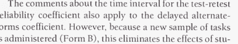

这种相关性被称为延迟替代形式信度系数或延迟等值形式信度系数。两种形式都构建于相同的內容规范（即相同的蓝图）和难度水平，但包含不同的题目或任务。当应用该范式时，信度系数反映了评估技术的等值性和学生表现的稳定性。

学生的记忆特定评估题目（但并不能消除一般练习效应）。延迟替代形式信度在你希望将评估结果的解释推广到场合和内容样本两者时很重要。例如，你可能会问：“无论使用哪种测试形式或在何种场合施测，该测试在多大程度上评估了解数学问题的能力？” 许多评估结果的解释都可以使用这一框架。例如，在估计一名实习教师的“教学能力”时，主管可能希望关注在不同场合和不同评分者之间获得的评分的一致性。教学能力很少仅以单一场合（例如 10 月 5 日星期二许多主管的评分）或特定主管在数个场合的评分（例如华盛顿先生全年的教师评分）来定义。

解读延迟替代形式信度系数时，场合的含义需要仔细界定。例如，如果儿童在学习他们非常喜欢的科目或由一位极具吸引力的教师授课时被观察，他们的专注度可能从一天到另一天波动不大。但在同一天内，学生从数学教学转到语言艺术再到体育时，专注度的相对较大波动可能会发生。这些从时刻到时刻或从科目到科目的专注度波动可能会超过从一天到另一天的波动（Goodwin, 1966）。这意味着，要判断学生的表现是否在科目之间保持一致，你应该检查代表科目间表现的数据。

决定特定时间间隔和特定稳定性系数的适当性是一种专业判断。你需要利用你对使用评估结果的学生群体的了解。此外，你需要了解 (a) 所评估的表现领域，(b) 影响该领域学生表现的因素的理论和事实，以及 (c) 评估结果的预期用途。你拥有丰富的评估解读知识。结合信度知识和专业经验，可以让你评估特定评估及其附带信度信息的有用性。

## 单次场合的信度估计

### 替代形式信度（同一场合）

在尝试解读学生的评估结果时，你可能会想知道如果使用不同的评估任务样本，结果是否会不同。如果是这样，你主要关心的是在同一场合获得的两组结果（每组来自两种可比较的形式）的一致性。

提供这种问题所暗示的信度信息的一种方法是，在同一（或几乎同一）场合向同一组学生施测评估的两种形式并对得分进行相关。这种相关被称为替代形式信度系数或等值形式信度系数。该系数最常用于具有两种可互换形式的标准化测试。在你打算使用一种测试的两种或更多形式时，请在出版商的测试手册中查找替代形式信度系数。由于教师通常不会构建测试的两种形式，因此该系数很少可用于教师自编测试。尽管如此，形成该信度系数的基础思想对于正确解读教师自编测试非常重要。

在解读该系数时，请记住，只有由于内容样本波动引起的不一致才被计为测量误差。其他因素，如练习效应、疲劳和厌倦——所有这些都可能在这一场合发生——被视为学生真实分数的一部分。

由仔细匹配到同一蓝图的任务组成的评估的两种形式称为平行形式（APA, 1974）。在这种情况下，两种形式得分的相关被称为平行形式信度系数。理想情况下，测试的平行形式的得分应 (a) 具有相等的观察分数均值和标准差，(b) 以相等的准确度测量学生（即具有相等的测量标准误），(c) 与其他测量具有相等的相关，(d) 以完全相同的方式测量同一属性。如果评估的两种形式满足这些标准，对学生而言接受哪种形式并不重要：它们是可以互换的。仅通过从同一领域随机抽样任务而“构建”的替代形式在严格意义上并非平行，因为机会将决定每种形式的构成。

从一种形式到另一种形式的任何系统性得分差异在需要根据其自身价值而非基于个体在群体中的相对地位来解读个体的得分时尤其重要。例如，假设一种测试用于认证教师。它有一个及格分数。测试分数高于及格分数的候选人将被认证；低于及格分数的则不会。你的测试分数与其他人相比并不重要：重要的是你的分数是否高于及格线。如果不同候选人接受认证测试的不同形式，他们期望这些形式是等值的。当这种认证测试的不同形式缺乏等值时，候选人得不到良好服务。如果一种形式比另一种形式更难，则不必要的更多候选人会被判定不合格。较不困难的替代形式则有相反的后果：许多可能不合格的学生被认证。两种形式得分的相关系数不会揭示此类后果，因为它仅反映等级顺序而非分数的确切值。

替代形式并不总是存在。虽然原则上评估可能存在几种平行形式，但在实践中许多评估没有平行形式。此外，即使有平行形式的评估也很少超过两种或三种形式。当出现以下任何情况时，开发者通常不会创建评估的平行形式：

- 1. 评估程序将仅对每个学生使用一次。并不预期为实际决策进行重复测试。
- 2. 仅仅参加评估的行为本身就会改变学生（Thorndike, 1951）。例如，如果任务旨在评估学生解决不熟悉问题的策略，完成评估任务本身可能会使学生对不同类型的问题更加熟悉，并提高其解决策略的熟练程度。
- 3. 只有一种方式可以评估感兴趣的能力（Thorndike, 1951）。
- 4. 构建评估的平行形式成本过高。

在上述情况下，使用除替代形式信度之外的方法来评估内容抽样对观察分数的影响程度。我们在本节中讨论两种此类方法：分半法和 Kuder-Richardson。

### 分半信度系数

从单一形式的评估中估计替代形式信度的第一种方法称为分半程序。在应用分半程序时，整个测试一次性施测给学生。然后将测试的题目组织成两个等价的半部分。每个半部分（称为分半）被视为一个单独的（尽管较小）任务样本。出于分析目的，每个学生都会获得测试每个半部分的分数。这些半测试分数构成了估计全长评估因内容抽样而产生的误差程度的基础。存在许多可能的分半程序（Feldt & Brennan, 1989; Stanley, 1971; Thorndike, 1951）。我们在此只讨论其中一种：Spearman-Brown 双倍长度公式（Brown, 1910; Spearman, 1910）。

### Spearman-Brown 双倍长度公式

Spearman-Brown 双倍长度公式（有时称为 Spearman-Brown 预测公式）是对平行形式相关的一种估计。学生对测试的每个半部分进行计分。两半部分的得分进行相关。由于这种相关反映了仅为全长评估一半长度的评估的两组得分的对应关系，因此这种相关需要进行调整或“提升”到

¹ 附录 J 提供了 Spearman-Brown 公式以及另一种分半方法 Rulon（1939）方法的计算指南。


估计整体的可靠性。斯皮尔曼-布朗公式使用起来很简单：

全测验可靠性 =
2 × 两半测验分数之间的相关系数
1 ÷ 两半测验分数之间的相关系数 [Eq 4.1]

例如，假设两半测验分数之间的相关系数为 0.60。斯皮尔曼-布朗双倍长度可靠性估计值为：

全测验可靠性 = 2 × 0.60 / 1 + 0.60 = 1.20 / 1.60 = 0.75

双倍长度公式通常用于估计平行形式的可靠性系数。要正确使用，需要将测验的题目组织成平行的一半，使两半在内容覆盖、难度水平和变异性方面基本等同，就像构建两个平行形式时一样。

测验的题目可以以多种方式分成两半，² 但并非所有方式在应用分半程序时都令人满意。组织题目最常用的程序是让奇数题项（1、3、5、7、…）组成一半，偶数题项（2、4、6、8、…）组成另一半。这称为奇偶分半程序。这种方式将测验和工具分成两半，只要（a）奇数半和偶数半可以被视为平行的内容样本，且（b）测验不是速度测验，就能很好地工作。速度测验是指没有足够时间让每个人考虑并尝试回答每个题项的测验。如果测验是速度测验，学生在两半上的分数一致性会虚高。一般来说，除非采取预防措施分别施测并计时每半，否则不应在速度测验或部分速度测验中使用分半程序。当任务组相互关联时，奇偶分半程序就不合适，例如当一组题项需要基于同一篇阅读材料（或同一数据表、图表等）的答案时，或当题项在配对练习中以同质集群分组时（Thorndike, 1951）。

## 库德-理查森可靠性系数

从单一形式的测验中获得可靠性估计的第二种方法是使用库德和理查森（1937）中的一种程序。这里讨论的两种，库德-理查森公式 20（KR20）和库德-理查森公式 21（KR21），用于题项以二分法计分（0 或 1）的测验。这些程序的名称源自库德和理查森在 1937 年论文中用于标识公式的编号方案。

库德-理查森公式 20 与分半公式类似，都是从一次测验施测中估计可靠性。然而，与分半程序不同，KR20 不需要将测验分成两半。相反，它使用每个题项答对的人数比例以及总分标准差的数据。库德-理查森公式 21 程序是 KR20 的简化版本，仅使用总分的均值和标准差。附录 J 说明了这些可靠性估计的计算。KR20 公式在标准化测验的出版报告中最常使用，并且通常作为分析课堂测验数据的计算机程序的输出结果提供。

库德-理查森公式 20 和 21 用于测验仅包含二分计分的题项时。并非所有测验都只包含这种计分的题项。有些测验包含混合的题型。论文题的题项计分更连续；态度量表要求学生在例如 1 到 4 的量表上表达对每个题项的同意程度；表现性测评可能在例如 1 到 5 的量表上对学生进行评级。在这些情况下，使用 KR20 的更一般版本。此可靠性估计称为系数 alpha（Cronbach, 1951）。附录 I 也展示了如何计算该系数。由于系数 alpha 是 KR20 的更一般版本，因此它可用于题项计分为 0 或 1；或在更连续的量表上计分（例如 0、1、2、3 和 5）。

分半和库德-理查森程序假设学生从一个测评任务到下一个任务的反应一致性是估计总分可靠性系数的良好基础。这种对测评内部任务间一致性的关注导致这些系数被称为内部一致性可靠性估计。

这三种程序对任务的同质性及其具体内容都很敏感。同质任务都测量相同的特质或属性。不同任务测量不同特质的测评程序被称为包含异质任务。如果测评任务是同质的，KR20 和系数 alpha 程序将给出与分半程序几乎相同的结果。当测评任务是异质时，KR20 和系数 alpha 程序的结果低于分半程序。因此，KR20 和系数 alpha 通常被称为可靠性的下限估计。

应注意，KR20 和系数 alpha 等于可为所讨论的测评程序计算的所有可能的分半可靠性系数的平均值（见 Cronbach, 1951）。所有可能的分半不仅指奇偶分半，还指可将测验分成两半的所有不同分法。³

² 对于 4 题测验，有 3 种可能的分半方式。6 题测验可分 10 种方式；8 题测验，35 种方式；10 题测验，126 种方式。有关一般公式，请参阅 Thorndike（1951，第 579 页）、Stanley（1971，第 408 页）或 Feldt 和 Brennan（1989，第 120 页）。

³ 见脚注 2。

此外，测验的长度及其同质性也会影响 KR20 和系数 alpha 的数值。较长的测验往往具有较高的 KR20 或系数 alpha 值，即使它们可能是异质的。KR20、KR21 和 alpha 系数受速度的影响方式与分半系数相同。它们不应用于速度测验或部分速度测验。

KR20 和系数 alpha 程序通常不适用于测验由题项集群组成（例如几种不同类型的阅读段落，每种段落有若干基于该段落的题项）或包含混合的测评格式（例如多项选择、简答和表现性测评的组合）的测验。对于由此类异质练习格式组成的测验，应使用另一种指数，称为同源可靠性系数，因为如果使用 KR20 和系数 alpha，它们会低估测验的内部一致性可靠性（Feldt, 2002）。有关同源系数的解释，读者应查阅更高级的资源（例如 Feldt & Brennan, 1989）。

最后，正如你在表 4.1 中可能注意到的，KR20、KR21、系数 alpha 和分半方法不考虑施测场合的抽样或评分者的抽样作为测量误差的来源。要估计学生日常表现波动所归因的不一致程度，你必须使用重测或延迟平行形式系数。要估计归因于评分人员对测评进行评定或标记的不一致程度，你必须使用评分者间可靠性系数（见下一节）。如果 KR20 或系数 alpha 被不恰当地用于描述这些其他类型的不一致问题的测评可靠性，它们会高估测评的可靠性（Brennan, 2001）。换句话说，不恰当地使用 KR20 或系数 alpha 会让你认为测评结果比实际更一致。

## 估计评分者间可靠性

评分者（或机器）给学生作业评分时又产生另一种测量误差来源。这里关注的问题例如：（a）如果由不同的教师评分或评定表现，学生获得相同分数的程度如何？（b）测评程序在多大程度上可以说是客观的？以及（c）不同评分者（观察者、评定者、评判者）获得的结果是否可以互换？

如果使用论文题、开放式问题、表现性测评和档案袋测评，评分者间可靠性尤其重要。为了提高这些类型测评的评分可靠性，你应制定并使用评分量规。你将在第 9 章和第 12 章学习如何制定评分量规。这里我们展示如何评估分数的可靠性。

相关评分者的分数 最直接的估计这种可靠性的方式是让两人对每个学生的论文或表现进行评分。然后将每个学生的两个分数——来自每个评分者的一个分数——进行相关。（相关在第 3 章中解释。）该相关系数称为评分者可靠性或评分者间可靠性。它是评分者对同一批学生进行标记一致性的指标。在此情况下，一致性定义为两名教师或评判者对学生排名顺序的相似性。图 4.2 中四个学生的评级组以夸张的方式说明了这一点。

该示例中的评级在绝对意义上并不“一致”，但在相对意义上完全一致，因为排名完全一致：相关系数 1.00 反映了这一点。

一致百分比 绝对意义上的同意发生在两个评分者对每个学生给出相同分数或评级时。这种相同分配发生的程度有时以一致百分比表示。（一致百分比的计算在最后

### 图 4.2 四名学生的评级和排名顺序。

| 学生 | 来自的评级： |  | 评级转换为排名 |  |
|---|---|---|---|---|
|  | 评分者 A | 评分者 B | A 的排名 | B 的排名 |
| Tony | 4 | 8 | 1 | 1 |
| Marya | 3 | 7 | 2 | 2 |
| Bobby | 2 | 6 | 3 | 3 |
| Meghan | 1 | 5 | 4 | 4 |
| 均值 | 2.5 | 6.5 | r_AB = 1.00 |  |
| SD | 1.12 | 1.12 |  |  |


## 获得分数、真实分数和误差分数

section of this chapter.) 如果评分者在其分数分配上始终一致，则一致性为 100%；如果他们从未一致，一致性百分比为零；部分一致性表示为介于这两个值之间的百分比。

一致性百分比与基于相关系数的信度系数是完全不同的概念：通常，两者的数值会不同。在评分者间信度上选择一致性百分比指数还是相关指数，取决于对特定解释和用途而言，学生的绝对（实际）分数水平还是相对（等级顺序）分数水平是否重要。假设在图 4.2 中，评分为 5 或更好才算“通过”。如果使用评分者 A 的分数，那么所有人都“不及格”，但如果使用评分者 B 的分数，所有人都通过了。对于通过与不及格的解释，实际分数水平很重要。错误的一个严重来源（在此示例中）是所采用的具体评分者或评分者：评分者似乎对如何给学生评分没有一致意见。只有一致性百分比才能显示这一点。另一方面，假设只有分数的等级顺序很重要，例如当你想知道班上谁最好、其次最好等等时。在这种情况下，两位观察者在谁是“最好”和“其次最好”上完全一致。换句话说，他们对排名或相对成就水平完全一致。相关评分者间信度系数显示了这一点。

在前面的章节中，我们经常提到学生的分数。在本节中，我们更深入地探讨学生评估结果以分数形式报告的想法。你在评估学生时给出的分数称为获得分数。获得分数包括来自开放式任务（如论文）的评分、来自选择题或简答题测试的答对题数，以及来自常模参照标准化测试的标准分数或年级当量分数。你可以将每个学生的获得分数视为包含一定测量误差。这意味着获得分数实际上由两部分组成：真实分数和误差分数。这两个分数之和等于获得分数。每当我们评估一名学生时，我们真正想知道的是学生的真实分数。然而，我们总是只能“困于”获得分数，因为真实分数对我们来说是不可获得的。我们的评估结果只是学生真实状况的估计。由于获得分数包含误差，我们必须学会与测量误差共存——并在解释获得分数时保持谨慎。

如果你能量化学生获得分数中的误差量，你就得到了误差分数。（误差分数通常被称为测量误差。）真实分数是观察分数的剩余部分，不包含测量误差。

作为说明，假设你有两位学生，苏珊和乔治亚。假设你给她们做同一份解题测试，两位学生都得了 52 分。分数 52 是她们的获得分数，你唯一能看到的分数。你可能会被诱惑用这些结果得出结论，苏珊和乔治亚具有相同的解题能力。不要屈从于这种诱惑。仅凭她们具有相同的测试分数 52，就不能得出这两名学生具有相同的解题能力。分数 52 包含需要承认的测量误差。

让我们假设苏珊的真实分数是 50，而乔治亚的真实分数是 53。如果你可以创建一个产生无测量误差分数的解题测试，你会看到乔治亚的能力略高于苏珊。不幸的是，创建一个完美的测试是不可能的。因此，两名学生最终都获得了相同的获得分数 52。

她们的获得分数中有多少测量误差？在我们的例子中，乔治亚的真实分数是 53。因此，她的误差分数是 52 − 53 = −1。苏珊的真实分数另一方面是 50，所以她的误差分数是 52 − 50 = +2。这说明测量误差可能是正的（例如 +2）或负的（例如 −1）。

尽管我们举例说明了两位学生具有不同的真实分数但相同的获得分数，但也存在其他可能性。两位学生可能具有相同的真实分数，但由于测量误差，她们可能获得不同的获得分数。关键在于，你需要将观察到的测试分数视为不完美的信息。你如何改进评估以更好地估计一个人的真实分数？要更好地估计学生的真实分数，你需要在总体评估中包含不止一次测试。

学生的真实分数并不是你的评估程序试图发现的某种隐藏属性，也不是在出生时分配给学生的某组数量。它不是“记录天使之书中的终极事实”（Stanley, 1971, p. 361）。相反，学生对特定评估程序的真实分数定义为，如果在相同条件下反复评估该学生，该学生所获得的观察分数的假设平均值（均值）（Lord & Novick, 1968）。

由于真实分数是一个平均值，它从一次评估程序的实施到下一次保持不变。（不同学生会有不同的真实分数。）对于评估程序的每次单独实施，学生的误差分数是不同的。在任何一次场合，学生的误差分数可能为正、负或零。这些测量误差导致学生的获得分数高于或低于学生的真实分数。这些测量误差的一个后果是，任何两次评估程序实施所获得的分数不会以相同的顺序对学生进行排名。

## 测量标准误

### 测量标准误的含义

由于没有程序能以完美的一致性进行评估，考虑到测量误差的可能大小是有用的。描述评估分数不一致的一种方法是反复评估一名学生并注意分数变化的程度。然而，这只能在假设上完成。如果你能够多次评估一名学生（而不改变学生相对于你正在评估的特质的能力），你将获得该学生的获得分数集合。有些分数会高于其他分数，但大多数会围绕一个平均（均值）值聚集。这个平均值就是我们之前提到的真实分数。这个分布的标准差或离散程度是测量标准误（SEM）。SEM 估计学生获得分数与其真实分数可能存在的差异。

在实践中，你无法在不改变学生的情况下反复重新评估学生，因此测量标准误并不是通过实际重新评估学生来计算的。相反，它是使用以下公式估计的。

```
SEM = SDₓ √1 − reliability coefficient    [Eq. 4.2]
```

其中 SDₓ 是评估的获得分数的标准差。（参见附录 I 了解标准差的描述。）

SEM 是测量误差标准差的估计。例如，如果 SDₓ 等于 10 且信度系数等于 0.84，则

```
SEM = 10√1−.84 = 10√.16 = 10(.4) = 4
```

测量标准误帮助我们理解特定评估程序的测量误差大小。一种解释是，SEM 的数值估计学生的观察分数可能与其真实分数的偏差量。因此，在前面的例子中，SEM = 4.0 意味着学生的获得分数可能比其真实分数高出或低约 4 分。由于这种与真实分数的可能偏差，你必须将获得分数仅解释为学生真实分数的估计。

SEM 的另一种解释使用正态分布。假设反复评估一名学生所产生的获得分数的假设分布呈正态形式。（参见第 17 章了解正态分布的讨论。）该分布的均值是学生的真实分数，而标准差是测量标准误。利用第 17 章中标准差与正态曲线下案例百分比之间的关系，可以说 68% 的时间，学生的获得分数将在真实分数的 ±1 SEM 距离内。

SEM 的这种含义在图 4.3 中对真实分数为 52 且 SEM 为 4.0 的假设学生进行了说明。根据正态曲线解释，重新测试一名学生时，约三分之一（32%）的时间，她的获得分数将超出图 4.3 底部阴影区域所示的界限：她获得的分数大于 56（52 + 4）约六分之一（16%）的时间，小于 48（52 − 4）约六分之一的时间。

### 信度系数和 SEM

当你研究图 4.3 时，你可能会注意到如果测量标准误变小，观察分数会更紧密地围绕真实分数聚集，因为三分之二的时间它们在真实分数的 ±1 SEM 范围内。这在图形上说明了我们所说的“一致性”：如果观察评估分数倾向于非常接近学生的真实分数，则分数是一致的。更多的一致性意味着更小的测量误差。

然而，标准测量误差的大小取决于信度系数和获得分数的标准差。在前面的例子中，如果 SDₓ = 5 而不是 10，则 SEM = 2.0。因此，虽然信度保持在 0.84，但当 SDₓ 变小时 SEM 变小。这较小的 SEM 说明在解释评估结果的一致性时应考虑分数的标准差。由于不同的评估程序具有不同的测量单位以及不同的标准差，通常唯一比较两种不同评估方法分数一致性的方法是查看它们的信度系数。

SDₓ、信度系数和 SEM 之间的关系如表 4.2 所示。当信度系数固定时，SEM 随着 SDₓ 的增加而变大。当 SDₓ 固定时，SEM 随着信度系数的增大而变小。如果一份测试手册未报告 SEM，一旦已知 SDₓ 和信度系数，表 4.2 就可以提供粗略估计。

最后，请记住你在 SEM 公式中使用的信度系数类型很重要。每种信度系数估计不同类型的测量误差（参见表 4.1 的第 3 列）。这意味着 SEM 将估计与公式中使用的信度系数相同的测量误差类型的可能大小。

### 使用 SEM 设置置信带


# 图 4.3 由对一名“真实”分数为 52 的学生进行重复评估所产生的假设正态分布分数。

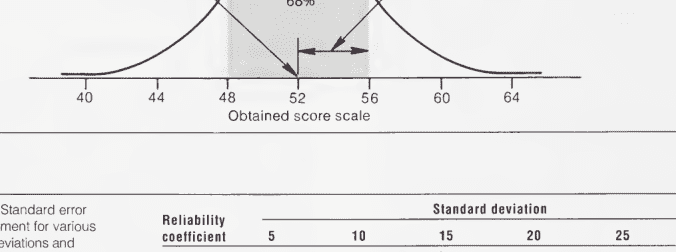

表 4.2 不同标准差和信度系数下的测量标准误。

| 信度系数 | 标准差 |  |  |  |  |  |
|---|---|---|---|---|---|---|
| | 5 | 10 | 15 | 20 | 25 | 30 |
| .98 | .7 | 1.4 | 2.1 | 2.8 | 3.5 | 4.2 |
| .95 | 1.1 | 2.2 | 3.4 | 4.5 | 5.6 | 6.7 |
| .90 | 1.6 | 3.2 | 4.7 | 6.2 | 7.9 | 9.5 |
| .85 | 1.9 | 3.9 | 5.8 | 7.7 | 9.7 | 11.6 |
| .80 | 2.2 | 4.5 | 6.7 | 8.9 | 11.1 | 13.4 |
| .75 | 2.5 | 5.0 | 7.5 | 10.0 | 12.5 | 15.0 |
| .70 | 2.7 | 5.5 | 8.2 | 11.0 | 13.7 | 16.4 |
| .65 | 3.0 | 5.9 | 8.9 | 11.8 | 14.8 | 17.7 |
| .60 | 3.2 | 6.3 | 9.5 | 12.6 | 15.8 | 19.0 |
| .50 | 3.5 | 7.1 | 10.6 | 14.1 | 17.7 | 21.2 |
| .20 | 4.5 | 8.9 | 13.4 | 17.9 | 22.4 | 26.8 |
| .10 | 4.7 | 9.5 | 14.2 | 19.0 | 23.7 | 28.5 |

得到分数，从而形成分数的“置信带”或不确定性区间的边界。这种不确定性区间有 68% 的概率包含学生的真实分数。你可以使用这种方法来帮助你解释学生在一次测试上的分数、学生在两次测试上的分数，或两个不同学生在一次测试上的分数。

下面举例说明如何做到这一点。在所有例子中，我们都将使用来自一个假设标准化成就测试的年级当量分数，该测试的信度系数为 0.83，标准差为 1.0（以年级当量为单位）。对于该测试，SEM 将等于 0.4。重新测试时，学生的分数很可能会在量表上上下移动 4 个年级当量月（0.4）。

一个学生分数的不确定性区间 为了显示一个学生的不确定性区间，你可以将学生的所得分数加上 ± 0.4 来计算不确定性区间的上限，并从学生的所得分数中减去 0.4 来找到该带的下限。区间上下限之间的任何数字都可能是学生的真实分数。

## 示例

假设哈里的科学年级当量所得分数为 7.8。做出不确定性区间后，我们的解释是哈里的真实年级当量分数很可能在 7.4 到 8.2 之间。

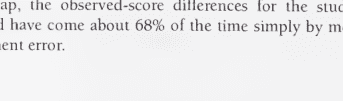

使用 SEM 解释两个分数之间的差异 当学生参加一套成就测试时，学生通常会有两个或多个分数，每个科目一个。这些分数可能不相同。我们可以在每个分数周围设置一个不确定性区间。如果两个分数的区间重叠，则很可能学生的真实分数没有实质性差异。如果区间重叠，学生在 68% 的情况下观察到的分数差异可能仅仅是由测量误差造成的。

## 示例

哈里的科学年级当量所得分数为 7.8，而数学为 7.4。这是否意味着他在科学上比数学强？不。科学的置信带为 7.4 到 8.2；数学为 7.0 到 7.8。由于不确定性区间重叠，很可能他在两次测试上的真实分数没有实质性差异。

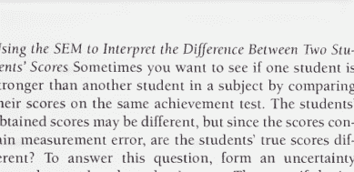

使用 SEM 解释两个学生分数之间的差异 有时你想通过比较他们在同一成就测试上的分数来看看一个学生是否比另一个学生在某科更强。学生的所得分数可能不同，但由于分数包含测量误差，学生的真实分数是否不同？要回答这个问题，请在每个学生的分数周围形成一个不确定性区间。然后，看看区间是否重叠。没有重叠意味着学生的真实分数很可能有实质性差异。如果区间重叠，则两个学生的真实分数可能没有实质性差异，因为 68% 的情况下，仅凭测量误差就可能产生观察到的这种大小的差异。

## 示例

在阅读中，莎莉的年级当量所得分数为 8.2，而简为 7.0。莎莉的置信带为 7.8 到 8.6；简为 6.6 到 7.4。这是否意味着莎莉的阅读能力比简强？是的，因为带不重叠。

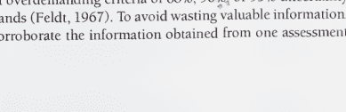

虽然你应该谨慎对待分数中小的差异的过度解释，但你也不应过于保守而犯下低估或忽略有意义的分数差异的错误。也许比过度解释分数更普遍的问题是“无作为模式”：由于对 68%、90% 或 95% 不确定性带的过度苛刻标准而未能解释分数变化或轮廓的起伏（Feldt, 1967）。为了避免浪费有价值的信息，请用来自其他来源的信息（例如课堂表现）来证实从一次评估中获得的信息，从而降低过度解释错误的概率（Feldt, 1967）。

## 影响信度和 SEM 的附加因素

在解释信度和 SEM 信息时，尤其是在比较两个或多个评估程序的此类信息时，你应牢记以下几个因素。

- 1. 评估程序越长，可靠性越高。进入分数制定的项目、评判者、观察场合等的数量越多，该分数就越可靠。这意味着，例如，你不应对仅基于一项任务或甚至两三项任务的集群的学生分数给予太多信心。斯皮尔曼-布朗公式显示了通过添加相似任务来延长评估与所得评估程序的可靠性之间的关系。附录 J 显示了一个计算示例。
- 2. 为一个信度系数计算出的数值会从一个样本波动到另一个样本。测试手册中报告的信度系数是基于学生样本得出的。这些数值会从一个样本到下一个样本波动，因此任何一个已发表的数字只是如果对整个学生群体进行测试时信度系数会是多少的估计。样本波动对于从总体中抽取的小样本比大样本更大。
- 3. 群体能力范围越窄，信度系数往往越低。许多教育工作者使用评估结果对能力相似、年级和年龄相似的学生做出决策。然而，当学生彼此差异很大时，区分个体能力差异要容易得多。因此，请在测试手册中查找基于与你必须处理的学生能力尽可能接近的学生的数据计算的信度系数。对由能力范围很广和/或跨越多个年龄水平的群体汇总样本得出的已发表的高信度系数不要过于信任。这在你将使用评估来评估能力相近的学生时尤其如此。
- 4. 不同成就水平的学生可能以不同的准确度被评估。SEM 作为整个测试的单一数字，仅代表分数不一致的平均量。然而，结果的一致性会随着成就水平而变化。SEM 在分数范围的中间可能比在极端值处更大。如果是这样，分数非常高和非常低的学生比中等范围的学生评估得更一致一些。已出版测试的技术手册应告诉你哪些成就水平被评估得更一致。
- 5. 测试间隔越长，测验-重测和复本信度系数往往越低。如果同一次评估进行两次，当两次施测之间的时间较短时，学生的分数会更相似，当时间较长时则不然。
- 6. 评分更客观的评估结果更可靠。客观性是指两位合格的观察者对同一学生表现给出相同分数的程度。我们称之为评分者间信度。然而，请记住，可靠性和客观性也适用于定性评估，例如观察和对学生进行分类。这就是为什么我们强调为开放式和表现性评估制定正式的评分量表和分类方案。参见第 11 章和第 12 章的详细内容。与选择题和是非题一样，替代性评估方法也应尽可能客观地评分。提高客观性会提高可靠性，这对效度有积极影响。
- 7. 不同的方法估计可靠性不会给出相同的结果。信度系数不同是因为它们包含不同的误差来源，如表 4.1 所描述的那样。请务必在解释评估时使用正确的系数。使用不正确的信度系数意味着错误地描述评估的质量。

## 掌握度和及格/不及格决策的可靠性

我们一直在讨论学生分数的一致性。无论你使用何种类型的评估方法，这种一致性都是令人关心的。然而，在某些课堂情况下，学生获得的确切分数的一致性不如关于学生的决策的一致性重要。例如，你可能将掌握测试的及格分数设为 80% 正确。一个得 85% 的学生与一个得 92% 的学生得到相同的决定（即及格）。同样，两个分别得 50% 和 65% 的学生都未通过。

在这种评估解释中，谈论决策一致性比谈论分数一致性更有意义。例如，假设你制作了掌握测试的两个等值形式。你可以问：“两次测试是否会对同一批学生进行掌握和非掌握分类？”回答此类问题的系数称为决策一致性指数。

图 4.4 说明了测量误差如何导致评估掩盖学生的真实掌握状态。每当学生的真实状态未被评估结果揭示时，就会发生决策错误或误分类错误。

有几个因素影响在评估掌握时决策错误发生的频率。

- 1. 评估工具可能包含对你所想的掌握类型有效性较弱的任务。例如，当你使用课堂上使用的出版课程材料附带的测试题时就会发生这种情况。非常经常这些问题措辞不佳或评估了你在教学中省略或淡化的内容。效度弱会增加决策错误。
- 2. 更长的评估方法通常会导致更准确的掌握决策。从较短的测试（例如少于 10 道选择题）或一项项目或一项表现活动来判断掌握通常会使决策错误上升到不可接受的水平。在对学生做出掌握决定之前，你应使用多个不同的评估信息。
- 3. 评分者间信度低与掌握决策错误率高相关。更可靠的评估通常会导致更准确的掌握决策。
- 4. 你为决定掌握而设定的及格分数会影响决策错误的比率。一般来说，将及格分数设得非常高（90% 或 95%）或非常低（20% 或 30%）会增加分类错误。

# 图 4.4 学生真实掌握状态与其在从评估结果得出结论时可能出现的分类错误之间的关系。

| | | 关于领域熟练程度的学生真实状态 | |
| | | 掌握 | 非掌握 |
| 教师从评估结果对学生得出的结论 | 评估结果被解释为掌握 | 没有误分类：学生的真实状态和教师从评估结果得出的结论一致。 | 分类错误：学生是非掌握者，但教师得出评估结果显示掌握的结论。 |
| | 评估结果被解释为非掌握 | 分类错误：学生是掌握者，但教师得出评估结果显示非掌握的结论。 | 没有误分类：学生的真实状态和教师从评估结果得出的结论一致。 |


## 图 4.5 使用两种形式的掌握测试成绩对 25 名学生进行分类的假设示例。

|  |  | Results from Form A |  |  |
|---|---|---|---|---|
|  |  | Mastery | Nonmastery | Marginal totals |
| Results from Form B | Mastery | 11 | 4 | 15 |
|  | Nonmastery | 1 | 9 | 10 |
|  | Marginal totals | 12 | 13 | 25 |

学生的真实掌握状态非常接近你设定的及格分数时，他们最有可能被错误分类。例如，如果你将及格分数设为 80%，那么真实掌握状态在 70% 到 90% 之间的学生，其错误分类率会高于此范围之外的学生。当学生的评估结果接近及格分数时，你在做出最终掌握决定之前，应使用来自其他来源的信息（如课堂表现、作业、项目表现）来补充主要评估。

## 一致性百分比

一致性百分比可以通过对同一组学生施测两种平行形式的掌握测试并研究学生是否被一致地分类为掌握者或非掌握者来计算。可能计算两个指标：一致性百分比（PA）和卡帕系数（κ）（Cohen, 1960）。这里我们展示 PA 的计算方法。附录 J 展示了卡帕系数的计算示例。

假设对 25 名学生施测了两种形式的评估 A 和 B，且每种形式的掌握标准均为 80%。图 4.5 总结了这两种评估结果对这些学生分类的一致性。11 名学生被两种形式都分类为掌握者，9 名被两种形式都分类为非掌握者，其余的学生则一种形式分类为掌握者，另一种形式分类为非掌握者。

前述情况下的一致性百分比可通过以下公式计算：

PA = [Percentage consistent mastery decisions] + [Percentage consistent nonmastery decisions] [Eq. 4.3]

结果通常以小数形式表示。对于表 4.3 中的示例：

PA = 11/25 + 9/25 = 20/25 = 0.80

值 0.80 是“无论出于何种原因，在两次测试中发生的总一致分类比例”（Subkoviak, 1980, p. 152）。

如上所述，计算一致性百分比需要对同一组学生施测两种形式的评估。除了这里说明的等值形式范式外，你也可以使用重测范式或两位掌握评判者。后者在你使用非纸笔测试的评估时尤其重要，例如判断学生的产品或项目是否达到最低标准。

一致性百分比不必局限于这里说明的简单二分情况：可以对学生进行多于两个类别的分类。一个例子是，你将 A、B、C、D 和 F 等字母等级分配给学生的项目或表现。计算此类情况下一致性百分比（和卡帕系数）的公式可在 Cohen (1960) 和 Swaminathan, Hambleton, & Algina (1974) 中找到。你也可以仅根据一次施测的评估来估计一致性百分比（参见 Huynh, 1976; Subkoviak, 1976）。

## 如何提高信度

教育评估的学生经常问：“这样的信度系数够好吗？” 你现在已经意识到，完美的信度由系数 1.00 表示。然而，这一数值在实践中几乎无法达到，因为大多数评估结果在每个学生群体中都存在一定程度的不一致。你能做些什么来提高评估结果的信度？表 4.3 给出了九条建议。（另见第 12 章，第 278 页。）

不同类型的评估工具具有不同的信度水平。标准化选择题成就测试的信度系数通常在 .85 到 .95 范围内。开放式纸笔评估通常在 .65 到 .80 范围内。作品集评分的信度可能在 .40 到 .60 范围内。

估计“信度系数应离 1.00 多近”的一个通用规则如下：基于评估工具对个人做出的决定越重要且越不可逆转，信度就应越高。是否授予某人毕业文凭、是否录取到更高教育项目、是否安排到特殊教育班级、是否给予工作等决定都是高风险决定，如果出错会对个人造成严重后果。单一评估工具的结果不应单独用于做出此类决定。对于用于此类决定的每种工具，都应要求信度系数达到 0.90 或更高。（在这些情况下使用多个工具的另一个原因是它们需要高效度以及高信度。单一评估工具很少具有足够的效度可单独使用。）

课堂是一个信息丰富的环境，你有许多机会评估学生。此外，课堂决定不应是高风险决定。也就是说，学生应有多次机会从学习失败中恢复并重新学习。课堂评估结果通常具有中等信度水平，但你可以在做出重要课堂决定之前（例如在分配阶段成绩之前）将来自几种程序的评估结果结合起来。因此，只要将多条信息结合起来用于课堂决定，你就可以容忍任何一次评估结果的适中信度水平，即 .70 或更高。

## 表 4.3 如何提高评估结果的信度。

- 1. 延长评估程序。只要切实可行，就给予更多时间，使用更多问题、更多观察等。
- 2. 扩大程序范围。使用评估目标学习表现的所有基本和重要方面的程序。
- 3. 提高客观性。使用系统化、更正式的学生表现评分程序（例如评分方案或评分量规）。
- 4. 使用多位评分者。只要可能，让多于一位合格人员为每个学生的论文、学期论文、表现、作品集或开放式评估任务评分。对结果取平均值或协商以调和差异。
- 5. 结合来自几种评估的结果。在做出重要教育决定时，使用来自几种不同评估方法的结果组合，而不是单一评估结果。
- 6. 为学生提供充足的时间。在实际允许范围内，确保每个学生都有足够的时间完成评估程序。
- 7. 教会学生如何发挥最佳水平。在使用评估方法之前，为学生提供练习和训练，教他们如何“尽力而为”、使用哪些策略等。
- 8. 使评估难度与学生能力水平相匹配。确保评估程序包含对学生而言不过于简单或困难的任务。如果可能，将评估量身定制到每个学生的能力水平。
- 9. 区分学生。选择能够很好地区分最优秀学生和能力最弱学生的评估任务。

## Summary

### General Nature of Reliability

- Reliability refers to the consistency of assessment results, rather than to the assessment instrument itself.
- Reliability is a limiting factor for validity. Unreliable assessment results cannot be highly valid.
- Reliability is one criterion for validity of assessment results, but not the only criterion. Thus, highly reliable assessment results may not be valid if they do not meet other validity criteria.

### Causes of Measurement Error or Inconsistency

- There are several causes of unreliable assessment results. Four were discussed:
- Content factors—Inconsistent results caused by the different content or tasks included in two equivalent assessments.
- Time factors—Inconsistent results caused by the temporary and permanent changes that a student experiences when assessed on different occasions.
- Scorer factors—Inconsistent results caused by the idiosyncrasies of the persons who mark a student's performance.
- Combined factors—Inconsistent results caused by a combination of these (and other) factors.

### Types of Reliability Coefficients

- Two types of quantitative indicators of inconsistency were discussed: reliability coefficients and the standard errors of measurement.
- A reliability coefficient is more useful when comparing the consistency of results from different assessment procedures. A standard error of measurement is more useful when estimating the size of typical measurement errors on a particular assessment procedure.
- Several types of reliability coefficients were discussed:
- Test-retest reliability measures the stability of scores.
- Alternate-forms reliability (different occasions) measures stability and equivalence of the forms.
- Alternate-forms reliability (same occasion) measures the equivalence of two versions of an assessment instrument.
- Spearman-Brown (split-halves) reliability estimates the equivalence of an assessment instrument using information about the internal consistency of students' responses. This coefficient is not appropriate for speeded assessment instruments.


Kuder-Richardson 和系数 alpha 可靠性也使用学生反应内部一致性来估计评估工具的等值性。这些公式也不应在评估为限时测验时使用。

评分者间信度衡量两位评判者或评估者对学生评估工具表现评分的一致性。

一致性百分比信度衡量使用两个等值评估工具独立得出决策的一致性。

## 测量标准误

测量标准误是衡量个人评估结果预期不一致程度的指标。

测量标准误的数值可加于或减去个人的分数。其结果是一个“带”或分数范围，很可能包含个人的真实分数。

## 影响信度和 SEM 的额外因素

影响信度和测量标准误的各种因素如下所述：

- 更长的评估比更短的评估更可靠。
- 测试手册中报告的信度系数仅是样本的估计值。
- 当分数分布范围较小时，信度较低。
- 测量标准误在不同能力水平上可能不同。
- 测量标准误的含义取决于用于其计算的信度系数类型。
- 随着施测评估的时间间隔增加，重测信度和复本信度系数会变小。
- 评估表现的评分越客观，信度越高。

## 掌握与及格/不及格决策的信度

影响掌握或及格/不及格决策错误频率的因素包括：

- 你的评估产品的效度程度。
- 评估程序的长度。
- 分数的评分者间信度程度。
- 及格分数的数值。
- 学生的真实分数与及格分数的接近程度。

## 期望的信度水平

当评估结果影响到对个人做重要且不可逆的决策时，需要更高的信度水平。当决策可逆、重要性较低且基于多个评估结果的信息时，可容忍中等水平。

表 4.3 中给出了若干提高评估信度的建议。

## 重要术语和概念

- decision consistency
- domain of achievement
- error score, obtained score, true score
- factors influencing consistency of assessment performance
- homogeneous tasks
- inter-rater reliability
- measurement error
- parallel forms
- percentage of agreement
- reliability
- reliability coefficient
- scorer reliability
- speeded assessment
- stability coefficient
- standard error of measurement
- types of reliability coefficients (alternate forms/same occasion, coefficient alpha, delayed alternate forms, Kuder-Richardson formulas 20 and 21, odd-even split-halves procedure, parallel forms, Spearman-Brown double length formula, split-halves, test-retest)
- uncertainty interval (score band)
- underinterpreting versus overinterpreting score differences

## 练习与讨论问题

- 1. 哪种类型的信度系数，如果有的话，会是回答以下每个问题所需信息的主要来源？
  a. 一位老师想知道她的学生 Meghan 的测验分数是否可能是因为她状态不佳。
  b. 一位八年级老师想知道学生的能力测验分数是否能预测他们在九年级的成功。
  c. 一位十年级英语老师想知道他给学生作文的成绩是否等同于他的同事会给出的成绩。
  d. 一位十二年级物理老师想知道她今年的期末考试是否等同于去年的期末考试。
  e. 一位八年级英语老师让学生在一学期内创建作品集。利用作品集，她将学生分为三个组：优秀、满意、不满意。老师想知道她对学生的分类是否可以减少错误。

2. 某测验奇数题与偶数题分数的相关系数为 0.40。老师声称如果他使用等值测验，学生会取得相同的分数。老师的说法是否合理？请使用适当的信度系数支持你的结论。

3. 重测信度系数为 0.75，测验标准差为 15。我们预期学生在两次不同场合测验时分数会相差多少点？（使用表 4.2 帮助你。）

4. 第 70–71 页的例子说明了如何使用 SEM 为学生形成置信带以帮助我们解释他们的分数。假设对于图中学生，SEM 等于 0.2 而不是 0.4。每个框中三个插图的解释会如何，如果有的话，会发生变化？

5. 对于以下每种类型的评估程序，解释哪种测量误差原因最令人担忧以及为什么：
  a. 社会研究考试中的学生作文
  b. 科学项目
  c. 艺术项目成绩
  d. 科学中的是非题测验
  e. 英语课程中的作品集
  f. 数学家庭作业问题
  g. 老师对学生课堂日常参与的评分
  h. 社会研究单元的纸笔测验，包括选择题、配对题和简答题

## 附加阅读

American Educational Research Association, American Psychological Association, & National Council on Measurement in Education. (1999). Standards for educational and psychological testing. Washington, DC: APA.

可靠性部分描述了各种类型的信度以及应包含在测验手册中的信度报告类型。

Anastasi, A. (1988). Psychological testing (6th ed., Chapter 5). New York: Macmillan.

对信度和测量标准误的另一种解释。

Feldt, L. S., & Brennan, R. L. (1989). Reliability. In R. L. Linn (Ed.), Educational measurement (3rd ed., Chapter 3). New York: Macmillan.

对信度理论的彻底但高度技术性的解释，以及比教科书中呈现的更多信度系数的含义。

Harvill, L. M. (1991). An NCME instructional module on standard error of measurement. Educational Measurement: Issues and Practice, 10(2), 33–41.

解释测量标准误及其如何用于解释分数。包含自测和注释书目。

Traub, R. E., & Rowby, G. L. (1991). An NCME instructional module on understanding reliability. Educational Measurement: Issues and Practice, 10(1), 37–45.

对信度系数背后心理测量理论的清晰解释。包含自测和注释书目。

## 教育评估中的专业责任、道德行为和法律要求

## 学习目标

学习本章后，你应掌握以下内容：

## 教师在评估中的专业责任

- 1. 解释为什么你有专业责任使用高质量的评估信息来做出课堂决策。 [7]
- 2. 描述教师专业评估责任的六个领域。 [7, 6]
- 3. 在六个领域中识别专业负责和不负责的课堂评估实践的例子。 [7, 2]
- 4. 解释在制定自己的课堂评估程序以及使用已出版的评估程序进行课堂评估时具体的专业责任。 [7, 2, 4]
- 5. 解释你在评分自己的课堂评估时承担的若干责任。 [3, 7]

## 学生作为应试者的权利与责任

- 6. 描述学生在评估方面的权利和道德责任以及教师的责任。 [7, 6]
- 7. 解释学生在美国宪法和联邦立法下享有的评估权利和信息获取权。 [7, 6]

## 保密、访问、隐私、保密性与教师

- 8. 解释并举例说明围绕（a）为研究目的访问学生数据、（b）清除和更正学生记录、（c）学生成绩记录的保密性以及（d）知情同意的伦理和专业责任问题。 [7, 6]

## 对残障学生的适应

- 9. 描述课堂评估可如何修改以适应残障学生。 [2, 3]
- 10. 解释当为残障学生修改时，课堂评估与标准化测验在效度和分数报告方面的关注点有何不同。 [3, 4, 5]
- 11. 描述可以采取的步骤来处理学生的适应请求并使测验适应项目在法律上具有可辩护性。 [5, 6, 7]

## 测验在法庭上受到挑战以及教育评估中的偏见

- 12. 解释并举例说明法庭上提出的某些主要心理测量评估问题。 [7, 6]
- 13. 解释并举例说明法庭上提出的某些非心理测量评估问题。 [7, 6]
- 14. 识别并举例说明在新闻媒体和专业文献中发现的测验或评估偏见的类型。 [7, 5, 6]

## 重要术语和概念

- 15. 解释本章末尾列出的每个重要术语和概念的含义及其教育意义。 [6, 7]


## 本章概述

课堂评估涉及的远不止于知道如何开发收集信息的工具。评估会影响对学生的决策；伴随着这些决策权而来的是专业责任。你在设计、选择、实施、评分、解释和传达课堂评估时有哪些专业责任？学生的责任是什么？你对保持学生信息私密和保密有哪些责任？你对在你的班级中主流化残疾学生的适应性有哪些责任和法律要求？这些专业责任、伦理原则和法律要求是本章的主题。

本章的第一部分讨论教师在评估学生方面的责任，将这些责任围绕六项主要评估活动进行组织，从设计评估到向学生和家长传达结果。第二，我们讨论学生也拥有的权利和责任。第三，我们讨论学生信息保密的法律要求。随后，我们转向在你的班级中主流化残疾学生的适应性要求。学校和州机构因以某些方式使用评估而被诉诸法庭。我们将审视被提交到法庭的心理测量和非心理测量问题。第六，我们讨论教育评估偏见的概念以及如何防范它。

## 教师在评估中的专业责任

### 责任：使用高质量信息做出决策

独立性使你承担责任 在你的课堂上，你几乎完全控制着收集和使用信息以改善学生学习的方式。伴随着这种独立性而来的是对适当收集和使用信息的专业责任。你必须遵循专业实践标准和行为伦理原则来履行你的责任。

决策有后果 在你教学的过程中，你必须做出数百项决策。正式和非正式的评估工具帮助你收集用于对学生做出决策的有用信息。如果你和我们其他人一样人性化，你的决策并非全部正确。正确与否，你所做的每个决定都会对学生产生积极或消极的后果。

后果对其严重程度有所不同。对学生而言，严重后果的决策发生在学生受益或失去非常宝贵的东西并且无法轻易从错误初始决策中恢复时。例如，你给学生在化学课上的最终成绩评为低分，可能会降低该学生被特定大学录取为化学专业的机会。决策的较不严重后果发生在学生受益或失去较不宝贵的东西并且可以轻易从错误初始决策中恢复时。例如，你可能决定重新教授某个化学概念给学生，但在重新教授时你发现学生其实已经理解该概念。你很容易调整教学，学生也可以轻易从你错误的初始决策中恢复。关键在于，当决策的后果是严重时，你有额外的责任在决策过程中使用最佳可用的信息。

高质量信息导致正确决策 评估是为做出教育决策而收集适当信息的过程。提高决策的一种方法是使用高质量信息：对当前决策而言具有高度效度和高度信度的信息。当然，使用高质量信息并不能保证你的决策正确。然而，如果你基于质量差或错误的信息做出决策，你很可能做出错误决策。这可能对学生造成伤害。如果你故意或因疏忽而伤害学生，你的行为是不专业的、不道德的和/或非法的。

### 教育测量专业责任守则

专业协会的伦理守则 专业协会经常为其成员制定并执行行为伦理守则。这些守则为如何负责任地行动提供指导。伦理守则通常涵盖专业在社会中的角色、利益冲突以及与客户和公众的沟通等方面（Schmeiser, 1992）。表 5.1 列出了包含使用评估时专业责任声明的一些守则。本章中的大部分信息改编自国家教育测量委员会（NCME）的《教育测量专业责任守则》（CPR）中描述的原则。CPR 的副本收录在附录 C。本章的重点是课堂教师评估的伦理、专业和法律责任。然而，CPR 为参与评估活动的广泛教育专业人士提供指导。这些教育专业人士包括教师；学校和学区管理人员；专业支持人员（主管、顾问、学校心理学家等）；研究、评估和评估组织的专业、技术、立法和政策人员；考试准备服务提供者；学院和大学的教职员工、管理人员；以及在企业中实施教育项目的专业人士（NCME, 1995）。

表 5.1 与使用教育评估相关的专业和伦理责任守则资源。

| Resources |
|---|
| American Association for Counseling and Development (now American Counseling Association). (1988). Ethical standards of the American Counseling Association. Alexandria, Va: Author. |
| American Association for Counseling and Development (now American Counseling Association) & Association for Measurement and Evaluation in Counseling and Development (now Association for Assessment in Counseling). (1989). Responsibilities of users of standardized tests: RUST statement revised. Alexandria, VA: Author. |
| American Educational Research Association, American Psychological Association, & National Council on Measurement in Education. (1999). Standards for educational and psychological testing. Washington, DC: APA. |
| American Educational Research Association. (1992). Ethical standards of the American Educational Research Association. Educational Researcher, 21(7), 23–27. |
| American Federation of Teachers, National Council on Measurement in Education, & National Educational Association. (1990). Standards for teacher competence in educational assessment of students. Washington, DC: NCME. |
| American Psychological Association. (1992). Ethical principles of psychologists and code of conduct. Washington, DC: Author. |
| American Psychological Association President's Task Force on Psychology in Education. (1992 Draft). Learner-centered psychological principles: Guidelines for school redesign and reform. Washington, DC: Author. |
| Joint Advisory Committee on Testing Practices. (1993). Principles for fair assessment practices for education in Canada. Edmonton, Alberta: Author. |
| Joint Committee on Testing Practices. (1988). Code of fair testing practices in education. Washington, DC: APA. |
| Joint Committee on Standards for Educational Evaluation. (1988). The personnel evaluation standards: How to assess systems for evaluating educators. Newbury Park, CA: Sage. |
| Joint Committee on Standards for Educational Evaluation. (1994). Standards for evaluations of educational programs. Washington, DC: Author. |
| Joint Committee on Standards for Educational Evaluation. (1994). The program evaluation standards: How to assess evaluations of educational programs. Thousand Oaks, CA: Sage. |
| National Association of College Admission Counselors. (1988). Statement of principles of good practices. Alexandria, VA: Author. |
| Source: Adapted from Code of Professional Responsibilities in Educational Measurement (p. 7–8) by National Council on Measurement in Education, 1995, Washington, DC: Author. Copyright 1995 by the National Council on Measurement in Education. Adapted by permission of the publisher. |

### 相关行为标准

CPR 假定教育评估的知情使用者将按照其他评估相关专业标准行事。这些包括《教育公平测试实践守则》（Joint Committee on Testing Practices, 1988）和《教育与心理测验标准》（AERA, APA, and NCME, 1999）。《教育公平测试实践守则》在本书记载于附录 B。《标准》在第 18 章中讨论，但未在本书记载。

### 专业行为的一般原则

在讨论你在使用教育评估时的专业责任时，请记住你被期望维护专业行为原则。你被期望：

- 1. 保护所有应试者的安全、健康和福祉；
- 2. 熟悉并遵守与专业活动进行相关的州和联邦法律；
- 3. 维护和提高 [你的] ... 在教育评估方面的专业能力；
- 4. 仅在 [你的] ... 能力与经验范围内提供评估服务，并充分披露 [你的] 专业资格；
- 5. 促进对教育中健全评估实践的理解；
- 6. 遵守最高行为标准，并在提供教育服务的教育机构和机构中促进专业负责的行为；以及
- 7. 以诚实、诚信、应有的谨慎和公平履行所有专业责任。（NCME, 1995, p. 2）

### 教师的六类责任

你的教学涉及六类评估相关活动。每类都有其特定的专业和伦理问题：

- 1. 设计评估程序——当你开发自己的评估程序时，你有责任确保其质量上乘。


2. *选择评估程序*—当你选择或挑选他人制定的评估程序时，你有责任确保它们适合你的预期用途

3. *实施评估程序*—当你实施评估程序时，你有责任确保你的实施过程对所有学生都是公平的，并且不会导致无法解释的结果。

4. *评分评估结果*—当你对学生的评估反应进行评分时，你有责任准确评估这些反应并及时向学生报告结果。

5. *解释和使用评估结果*—当你解释和使用评估结果时，你有责任确保你的解释尽可能有效，用于促进积极的学生成果，并用于最大限度地减少消极的学生成果。

6. *传达评估结果*—当你传达评估结果时，你有责任提供关于学生表现的完整、有用且正确的信息，以促进积极的学生成果并最大限度地减少消极的学生成果。

下一节将讨论教师在以上六个方面的专业责任。虽然 CPR 影响了这一讨论，但你不应将此讨论视为得到 CPR 赞助者的认可。

## 制定评估程序时的责任

*一般责任* 如果没有合适的评估程序可用，你必须制定一个。在这种情况下，你的专业责任集中于制定一个评估程序，使其提供的结果 (a) 对于你打算进行的解释和使用而言尽可能有效，以及 (b) 对于你将做出的决策的严重性而言可靠性足够。效度是指你打算如何解释和使用你的结果（参见第 3 章）。例如，假设你的州标准要求你评估学生运用数学原理和概括解决现实生活问题的能力。你的责任不仅是教学，还要制定要求学生参与现实生活问题解决的评估任务。包含错误的测验题不应计入总分。如果你需要做出一个严重的决策，并且重新评分无法纠正错误，你可能需要重新实施评估。

你可以在本教材的多个章节以及许多其他文本中找到履行这些责任所需的知识。你的指导教师可能会为你提供额外的知识以及一些有监督的实践。实践和经验将磨练你的技能。

## 选择评估程序时的责任

*为课堂使用选择评估* 虽然你经常需要自己制定评估技术，但你无疑也会使用他人开发的评估程序。很多时候这些是随出版的学习材料提供的评估：教师用书中的测验和测试、随教学单元出售的单独测试和表现任务、互联网以及教师杂志和期刊上的样题和任务等等。你在使用这些评估时的主要专业义务与你制定自己的评估时所应用的义务相同：其结果必须 (a) 对你的预期解释和使用有效，以及 (b) 具有与你将使用结果做出的决策的重要性相适应的可靠性。此外，上节列出的六项具体责任中的许多也适用于你从其他来源获得的评估。

被评估和教育评估的技术原理。许多这些知识可以通过学习本教材和其他教育评估教材中的材料来获得。（第 16 章和第 18 章专门讨论评估已出版的学业测验的程序。）教育公平测试实践守则（附录 B）包含有关选择和使用已出版测验的人员的额外原则和责任。

此外，CPR 规定，选择评估程序的人员有专业责任考虑评估程序的潜在误用和误解，以及实现预期目的的潜力。如第 3 章所述，这与效度问题有关。如果你从未关注过其他学区和州如何使用类似评估，如果你不了解可能产生的非预期后果，并且你的学校经历狭窄，你就无法履行这一专业责任。因此，你应该广泛阅读以了解评估及其教育用途的最新情况。如果你打算在超出课堂范围的专业角色中参与评估工具的评估和选择，这种阅读对于专业发展是必要的。了解其他学区和州如何使用和误用评估的一个来源是新闻出版物《教育周刊》。

## 使用优质评估材料的责任

在某些方面，履行在使用他人评估工具时的专业责任比设计自己的工具更困难。他人的评估任务通常与你在教学中使用的内容、重点、词汇或方法不匹配。如果这些差异严重，使用它们会对学生不公平并产生无效的结果。简而言之，如果你在使用此类评估之前没有仔细检查和提高其质量，你就违反了你的专业责任。通常你可能需要重写或重新制作他人的评估工具以适应你自己的课堂情况。如果你使用的课堂评估与你的教学不匹配，你应该改进该课堂评估，而不是“直接从盒子里”使用它。

## 实施评估时的责任

### 出版并不保证质量

你还应该意识到，评估任务或工具的出版并不能保证其内容的准确性或其作为评估工具的质量。通过前面提到的来源获得的大多数评估任务并非由专业评估任务开发者准备或审查。许多任务并非由课程材料或教科书的作者本人准备，而是由他人（如这些作者的学生）准备。因此，你可以获得许多质量较差的评估任务。如果你不仔细评估这些评估材料就使用它们，那是不负责任的，因为你使学生的评估结果处于危险之中。本教材第 6 章至第 12 章可帮助你评估这些材料。

### 为学生提供足够的信息

通常，课堂评估旨在为学生提供展示其最大表现的机会。（参见第 14 章，了解如何让学生为取得最佳表现做好准备。）为了让学生发挥最大水平，他们需要有关评估的基本信息，包括 (a) 评估的时间，(b) 他们被期望表现的条件，(c) 将被评估的内容和能力，(d) 评估将强调的内容，(e) 预期表现的标准或水平，(f) 评估表现如何评分，以及 (g) 此次评估结果对你将从结果中做出的任何决策（如成绩）的影响。（这些信息要素的细节在第 6 章和第 15 章中描述。）向学生提供这些信息是你的专业义务。如果你没有按照这七点提供给学生完整的信息，你就不是作为负责任的专业人士行事。

### 担任评估选择委员会成员

更有经验的教师有时会在学区或州一级的委员会中任职，以审查和选择已出版的评估。地方教育当局应在评估选择小组中包括教师。CPR 指出，提供此类服务的人员有特殊责任“确保评估适合其预期用途”（NCME，1995，第 5 页）。

如果你回顾 CPR 第 3 节中的 10 项具体专业责任（附录 C），你会看到从事评估选择活动的人员必须对将要

### 专业地进行实施

在实施课堂评估时，一个特别关注点是你建立的评估环境。如果你不必要地催促学生或使评估任务对于可用时间来说太长，如果目标是让学生展示最大表现，就会造成不公平的条件。同样，如果你在学生尝试进行评估时站在他们附近或与他们聊天使他们紧张，你也会造成不公平的条件。有时教师会粗鲁、言简


| 表 5.2 可能适用于对残疾学生进行课堂评估的修改类型的示例。 | 残疾类型 | 可能的评估修改示例 |
|---|---|---|
|  | 盲 | 延长考试时间、语音录制问题、评估任务的盲文翻译、凸线图、记录员/抄写员、电脑、语音录制答案、读者解释图表和朗读问题、抄写员书写答案。 |
|  | 低视力 | 延长考试时间、大字印刷、标准印刷的放大镜、语音录制问题、特殊照明、记录书面答案的格式修改、语音录制答案、读者朗读问题和解释图表、抄写员书写答案。 |
|  | 听力障碍 | 延长考试时间、记录员、手语翻译、语言简化问题、修改答案格式（例如，允许用美国手语作答，然后将答案译成标准英语）。 |
|  | 身体障碍 | 延长考试时间、抄写员/记录员、修改答案格式（例如，允许口头回答）、修改问题格式、电脑、大面积桌面。 |
|  | 学习障碍 | 延长考试时间、环境控制（例如，免受无关噪音、干扰）、计算器、电脑（代替手写答案）、语音录制问题或读者、抄写员书写答案、修改答案格式。 |
|  | 健康和压力相关残疾 | 延长考试时间、环境控制。 |
| 注释：没有关于何时使用这些修改的通用指南。很多取决于评估的目的以及分数的使用方式。在同一残疾类别内，并非每个学生都应获得每项修改。修改类型也可能因测试是课堂测试还是标准化测试而有所不同。许多学生有多重残疾，严重程度差异很大。因此，你有专业责任不要对学生进行刻板印象，而应将他们视为个体。 |
| 来源：基于 Algozzine (1993)、King & Janow (1990) 和 Roberts (1994) 中的信息。 |

或对询问评估任务诚实问题的学生粗暴无礼（尤其是当教师没有仔细设计任务或其说明，从而造成了某些模糊性时）。你的专业责任是提供“合理机会让个人在评估程序或说明的实施前以及在实施过程中适当的时间询问问题”（NCME, 1995, p. 6）。

分数更高并不是重点。相反，有效的分数是首要考虑。调整应提高分数的有效性，使其反映学生的真实成绩。因此，调整后的分数可能不会更高，但可能更有效。作为一般规则，将学生纳入课堂学习环境所需的调整也是实施课堂评估的适当调整。课堂学习环境调整在学生的个别化教育计划（IEP）中描述，教师可能有法律责任实施这些调整。IEP 由学校的学生研究团队制定，并经学生家长批准。它为学生规定学习目标、适当的教学方法以及课堂调整。

## 为残疾学生提供便利

如果你班上有残疾学生，你有专业和可能的法律责任对其进行合理调整以便对其进行适当评估。表 5.2 描述了一些可能适用于残疾学生的评估便利或评估修改。如果你的学校没有为便利学生提供设施或服务，它们可能通过你的州或县巡回服务提供者、专门协助残疾人士的社区机构，或当地大学或学院的残疾学生服务办公室获得。

你必须将每个学生视为个体，而不是残疾类别的刻板印象。例如，并非所有盲人学生都能阅读盲文，并非所有聋人学生都能理解手语。学生的残疾严重程度差异很大，认知能力也差异很大，许多学生有多重残疾。此外，学生可能对某些学习领域需要便利，而对其他领域不需要。在其 IEP 中发现的便利需求可能无法充分描述学生需要评估便利的学习目标（领域）（Reschly, 1993）。因此，你不应仅依赖 IEP 来确定学生需要的评估便利类型。然而，如果 IEP 中规定了某种便利，则有法律强制要求提供它。

## 标准化与强制性测试

并对所有学生使用相同的测试材料和相同的施测程序。（参见第 16 章。）你在该领域的专业责任与你在实施自己的评估时的责任相似，但有额外的责任与（a）充分告知学生和家长有关测试以及结果的使用方式、（b）仔细遵循测试手册中的施测说明、（c）维护安全、以及（d）保持适合最大表现的测试条件有关。这些和其他责任在附录 C 的 CPR 第 4 节中描述。第 16 章更详细地描述了如何施测标准化测试。

你应注意，你在课堂评估中做的修改可能不适用于标准化测试和州强制性测试。这在学生的分数需使用全国常模进行解释时尤其如此。你应遵循学校测试主任的测试施测说明和州的指导方针。

### 为标准化测试做准备的学生

教师的一个特殊关注点是他们在为标准化测试做准备方面的专业责任。教师在感知到如果学生表现不佳会产生潜在个人后果时感到压力。对你来说，告诉学生他们无法回答的问题的答案，或更改学生答案以提高其分数，显然是不道德的。如果你看到同事从事这些或其他不道德行为，你应向学校当局报告。关于为学生做准备和施测标准化测试的责任的更完整讨论见第 16 章（参见表 16.4）。在第 16 章中，还讨论了伦理的测试准备做法，借鉴了 Mehrens 和 Kaminski (1989) 以及 Popham (1991) 的分析。你应在此查看第 16 章的适当部分。

## 评分评估时的责任

你自己的课堂评估 你的专业义务是：

- 1. 通过使用适当的工具如评分键、评分量规、核对表或评定量表准确评分学生反应。第 9 章和第 12 章解释了如何制作和使用这些提高准确性的辅助工具。

- 2. 通过从评分过程中移除会导致不公平结果的任何因素来公平评分学生。负责任行为的例子包括在适当时使用客观题目和评分键，让学生在论文考试的背面写上姓名以免你受姓名影响，在转到另一个题目之前先对所有学生对一个问题的反应进行评分，使用评分量规对表现任务进行评分，定期重新评分一批学生反应以对照初始评分，或让同事重新评分一批或全部你的试卷。关于提高论文和表现评估评分公平性的建议见第 9 章和第 12 章。

- 3. 为学生提供适当的反馈。你的专业责任不仅仅是简单地给学生分数或字母等级。你有专业责任向学生展示他们做错了什么以及其预期表现水平是什么。仅仅给出分数而不允许学生甚至查看他们错过的题目并解释正确答案的教师是不负责任的。学生必须有机会从评估中了解他们需要如何改进。第 13 章讨论了如何制作能够检测学生为何未能正确表现的评估。期末考试在这方面可能有问题，因为学生在学期或学年结束时可能会离开。尽管如此，如果学生要求澄清和信息，应认真努力提供。便利不是这里的主要标准。

- 4. 向学生解释正确答案的理由以及你使用的评分量规。通过解释你如何得出分数以及你使用了什么标准和标准，你教导学生学习目标中重要的内容。这澄清了学习目标并教导学生他们被期望达到的标准。

- 5. 给学生机会单独审阅他们的评价。学生有权知道他们的反应是如何标记和评价的。他们有权确保评分准确和公平。你有专业责任与请求的学生一起回顾你对其反应的评价。

- 6. 尽快纠正评分错误并做出必要调整。因为你是人，你会犯评分错误，即使你使用选择题和评分模板。你也不应因学生或家长要求重新评分评估而感到威胁。如果你发现评分错误（即使没有其他人发现），诚实要求你纠正所有错误并相应调整分数。这应及时完成。

- 7. 及时评分并返回结果。为了反馈有效，必须及时。进一步，未能尽快返回结果不允许学生有效监控其进步或允许学生调整其学习策略。返回评估结果缓慢不给你或家长足够的时间对有困难的学生提供补救。作为一般规则，你应在评估发生后一到两周内返回学生的结果——如果可能，更早。当你无正当理由延迟返回结果更长时间时，你就不是以专业负责任的方式行事。

标准化与强制性测试 有时你可能会被要求评分标准化测试或其他强制性测试


由你的学区或州制定。在这种情况下，你有责任遵循测试手册或其他材料中给出的评分程序。事先阅读这些材料，并确保你理解如何应用评分指南。教师在将评分键应用于选择题以及在随测试材料提供的表格中查找常模参照分数（例如百分位等级或年级当量）时经常犯错。一个常见的错误是使用错误年份的常模表（例如在春季施测时参考秋季常模表）。确保你的评分准确并检查工作的质量是你的专业责任。

许多时候，教师需要为强制性的州评估项目评分开放式任务、表现任务和作品集。要求教师这样做的学区或州有义务提供高质量的评分量规，并培训教师以高度一致的方式使用它们。作为教师，你的责任是学会如何使用量规并公平、一致地应用它们。使用评分量规在第 9 章和第 12 章中有讨论。

在一些州，学校可能根据其在州评估中的表现获得经济奖励或负面制裁。例如，一所学校可能被宣布为“有风险”，其校长被替换，并由外部团队接管。在一些社区，房地产中介会公布社区学校评估结果。因此，教师会受到压力，要求通过不当的测试准备做法提高分数。（详见第 16 章。）不用说，你有专业责任诚实地评分和报告分数。不幸的是，一些教师感到有压力要报告比实际更有利的分数。教育当局制造让教师感到有压力报告高分的局面是不负责任的。然而，抵制这种压力、诚实评分学生答卷并报告实际结果仍然是你的责任。一些社区可能会将学校的运营权交给私人营利组织。有时该组织的利润取决于学生在标准化测试中的表现。这种“按结果付费”的情况可能会增加教师和管理员不当准备学生参加测试或在评分时不够诚实的压力。

## 解释和使用评估结果时的责任

来自你自己的评估的结果 在这一领域的专业义务是：

- 1. 在解释学生在一次评估中的表现时，首先考虑你所教授和强调的学习目标。学生应对其所学学习目标负责。当你强调特定内容或特定学习目标时，你就向学生传达了其重要性。将学生评估的很大一部分基于他们在你未强调的领域中的表现是不负责任的，甚至可能是欺骗性的。

- 2. 在解释学生在一次评估中的表现时，考虑其他评估的结果。没有任何单一的评估程序能够全面涵盖每一个重要的学习目标。你应让学生有多次机会和多种方式来表达他们对课程学习目标的能力。如果你仅根据学生在一次评估中的表现来评价学生，你就是不负责任的。

- 3. 在解释学生的表现时，要认识到你所使用的评估程序的局限性。单一的评估程序不仅缺乏全面性，而且也不完全可靠。如果你明天或下周再次进行评估，或使用略有不同的问题或内容，学生的分数很可能会发生变化。如果由其他人批改答卷，评分者可能会给出不同的分数。因此，如果你在使用自己的评估程序时不考虑这些局限性，你就是不负责任的。例如，如果你告诉学生她的成绩完全取决于她的测试表现，或在学生诚实询问你如何批改试卷后，你没有认真考虑重新评分，你就是不负责任的。

- 4. 帮助学生和家长正确解释评估结果。家长和学生可能不了解测试和其他评估的局限性。例如，他们可能不了解由于信度低而导致的课堂评估局限性。你必须传达这些局限性，并将所有评估结果置于适当的解释背景中。

- 5. 帮助学生和家长理解错误解释课堂评估结果的后果。一些家长对测试分数或单次评估结果过于看重。另一些人则看不到随着时间的推移而形成的成功或失败模式。当你帮助他们理解错误解释的负面后果（例如阻碍学生的进一步学习）和正确解释的积极后果（在评分期内稳步提高）时，你就是负责任的。

- 6. 将学生的表现解释为评估其学习目标达成程度的方式，而不是作为惩罚或控制学生行为的武器。虽然即将到来的评估可能会激励学生，但它们是控制学生行为的糟糕武器。如果你以测试威胁学生或试图通过某种评估程序操纵他们，你就是不负责任的。

- 7. 保持课堂评估结果的保密并保护学生的隐私权。当你在教室墙上张贴学生的姓名和评估结果，或当你向没有权利知道的学生结果的其他教师透露你的学生的结果时，你就是不负责任的。有时家长会询问邻居的孩子与自己的孩子相比表现如何。你不应满足此请求，即使是为了相对比较而不是确切分数。

标准化与强制性测试结果 由于外部测试与课程学习目标和你的教学重点并不完全一致，因此经常被学生、家长和公众误解，他们不了解学校因素对测试结果的影响。此外，测试结果通常以常模参照分数报告（例如百分位等级、年级当量），其中许多分数不易正确解释。你的学校管理者和/或州教育当局有严重的义务和责任正确解释结果，并确保避免或至少最大程度减少不当解释。CPR 第 6 节（附录 C）列出了这些责任。其中许多也适用于课堂教师。你应在此时候回顾这些责任。

由于标准化测试结果通常由教师带回家，因此教师通常是家长有疑问时首先联系的人。为了履行 CPR 第 6 节中列出的专业责任，你需要了解信度、效度、常模参照、标准参照和标准化测试。第 3、4、16、17、18 和 19 章专门讨论这些主题。学习它们将帮助你在这一领域履行你的责任。

## 传达评估结果时的责任

传达评估结果意味着向学生、家长和学校当局传达结果的正确解释。你在此的责任是制定传达正确解释的适当方式。你必须确定学生、家长或学校官员的理解水平，并根据该水平调整你的沟通。这可能涉及向家长教授某些类型分数或评估概念的含义。例如，如果家长不理解其含义，就不专业地使用教育测量术语（例如百分位、T 分数、信度、效度）与家长交流。

除了沟通水平外，你还有义务经常沟通。你有专业责任建立并遵循定期沟通时间表，向家长报告学生进展。你的学校可能有在成绩寄回家时向家长传达进展的政策。这些政策通常规定最低沟通模式。根据社区和你所教的学生，你可能需要更频繁的沟通。然而，你不应过度：每日进展报告可能不适用于学龄前儿童以外的学生。

## 学生作为测试者的权利

你的学区和州教育部门可能有涵盖学生和家长权利的评估和学校记录政策和程序。适用于接受联邦资金的学区和州的涵盖这些事项的联邦法律包括 1974 年《家庭教育权利和隐私法》（公共法 93-380）、1975 年《全残障儿童教育法》（公共法 94-142）、1986 年《残障人士教育法修正案》（公共法 99-457）、1991 年《残障人士教育修正法》（公共法 101-476）、1973 年《康复法》（公共法 93-112）以及 1990 年《美国残疾人法》（公共法 101-336）。表 5.3 总结了法律下的一些学生和家长权利。

无论是否有法律要求，专业伦理可能表明表 5.3 中总结的权利的某些原则可以适用于课堂评估实践。你应向学区学监咨询你所在州关于学生和家庭权利的要求。你的学校还应有自己的书面政策，关于（a）评估结果的维护和发布，（b）非保密信息的发布，（c）非歧视，以及（d）代表性同意信息。

除了法律要求外，专业组织也在制定测试者权利的声明。例如，CPR 建议了测试者（例如学生）拥有权利的几个领域。联合测试实践委员会的测试者权利工作组（1994 年）也在起草测试者权利声明。权利团体正在研究的领域包括（a）在测试过程中受到尊严和尊重的对待，（b）由合格人员进行测试，（c）被告知测试安排和费用，（d）以适当的便利条件进行测试，（e）被告知测试目的，（f）被告知结果将如何使用，（g）被告知从测试获得的信息质量（例如其信度和效度），（h）被要求给予知情同意，（i）如果法律允许，有拒绝接受测试的权利，（j）获得测试结果的易懂解释，（k）获得测试结果带来的后果和决定的易懂解释，（l）获得隐私和保密，（m）获得审查记录和申诉解释和发现的机会。虽然这样的“测试者权利法案”尚未完成或被专业协会正式采纳，但教师应意识到这些运动，并考虑自己的评估实践与这些关注领域的关系。对课堂教师而言的主要问题是对每个学生的公平、尊重学生、公开学生评价过程，以及尽快纠正学生评价中的错误。


# 表 5.3 联邦立法规定的部分学生和家长测试及学校记录权利。 （并非所有这些都是根据所引立法下的绝对权利。法院可能会授予某些例外。请参阅本表的脚注。）

## I. 1974 年《家庭教育权利和隐私法》

### A. 查阅记录的权利
- 1. 有权查看孩子官方学校记录中包含的所有测试记录。
- 2. 有权获得测试结果的解释。
- 3. 书面要求查看测试结果的请求必须在 45 天内得到满足。
- 4. 如果孩子年满 18 岁，只有孩子本人有权获取记录。

### B. 隐私权：此处的权利限制了对官方学校记录（包括测试分数）的访问，仅限于具有正当教育需求者。

附加信息：家庭教育权利和隐私法办公室，美国教育部，400 Maryland Avenue, S.W., Washington, DC 20201。

## II. 1991 年《残疾人教育修正法》（IDEA）和 1973 年《康复法》*

### A. 家长参与的权利
- 1. 第一次考虑将孩子安置到特殊教育时，必须以家长的母语向家长提供书面通知，并获得家长的许可才能对孩子进行测试。
- 2. 有权质疑用于制定孩子教育计划的测试分数的准确性。
- 3. 有权提交书面请求，要求由学校工作人员以外的人员对孩子进行测试。
- 4. 如果对学校关于孩子最佳服务的决定不满意，有权要求举行听证会。

### B. 测试公平的权利
- 1. 孩子有权用家庭使用的语言接受测试。a
- 2. 用于安置的测试不得基于种族、性别或社会经济地位进行歧视。测试不得存在文化偏见。
- 3. 有权使用满足特殊需求的测试进行测试（例如盲文、口头等）。
- 4. 不能仅凭一次测试分数做出特殊教育决定。有权以多种不同的方式接受测试。

附加信息：国家残疾与康复研究所，美国教育部，Switzer Building, Room 3132, 330 C Street, S.W., Washington, DC 20202-2524。

## III. 1990 年《美国残疾人法》（ADA）b

### A. 适应性测试的权利
- 1. 合格的残疾人有权以其能够理解所问内容的方式以及能够作出回应的方式接受测试。
- 2. 测试管理员应免费为应试者提供所有必要的测试地点、服务、辅助或便利。

附加信息：国家残疾与康复研究所，美国教育部，Switzer Building, Room 3132, 330 C Street, S.W., Washington, DC 20202-2524。 （也可联系您所在地区的 ADA 技术援助中心。）

注释：(a) 法院可能会争辩说，英语能力有限并不是学生残疾。而是可以通过教学和学习克服的暂时性状况。 将英语语言限制与残疾问题分开处理可能是合理的（Phillips，个人交流，2002 年）。
(b) 根据法院的解释，IDEA 和 ADA 要求对影响测试结果的外部因素进行“合理便利”，而不是改变所测试技能和能力的修改。

> 来源：改编自 R.J. Fisher 所著“《美国残疾人法：对测量的影响》”，1994 年，《教育测量：问题与实践》，13(4)，第 17-26、37 页；E. B. Herndon 所著《您的孩子与测试》，1980 年，华盛顿特区：国家教育研究所；以及 Phillips（1994 年；个人交流，1999 年；2001 年）。

## 学生责任

本章的主题是您在评估方面的专业责任。学生在评估情境中也有责任。学生有学习和为其课程的测试和考试做准备的责任。作弊的学生是不诚实且行为不道德的。抄袭的形式，如复制作业或为项目和其他带回家作业购买论文，不应被容忍。家长、教师、学校管理人员和学生应共同努力，了解作弊和其他形式学术不诚实的严重性。学校应制定书面政策和正当程序来处理不诚实行为，并在执行之前向学生传授这些政策。 “虽然教师必须尽到自己的职责，但他们也有权期望学生表现出道德行为，并且不应被施压而降低标准、淡化课程或为最少的工作给予高分”（S. E. Phillips，个人交流，1999 年 5 月）。

## 保密、访问、隐私、保密与教师

### 保密与访问

保密和测试安全自 20 世纪 20 年代末和 30 年代初以来一直是测试行业的标志，当时大规模的测试滥用盛行。 扣留测试信息——无论是关于测试题目还是学生获得的确切分数——通常以获取评估结果会造成更多伤害为由得到正当化。例如：

- 学生可能会试图只记住特定答案（“a”或“b”），而不是专注于掌握测试旨在测量的一般技能；这种行为会扭曲知识和能力的测量。
- 测量高度敏感和个人特征的测试可能需要高度的专业培训来解释分数；缺乏这种培训的应试者可能会因误解结果而伤害自己。
- 发布测试题目可能会导致未经资格认证的考官使用它们并误解分数，从而伤害应试者。
- 发布旧版测试的副本可能会要求测试开发人员花费不合理的资金来开发新版本，前提是实际上可以开发出测试的新版本。

然而，近年来，公众已经意识到，一些测试滥用是由这种保密造成的。例如：

- 专业人员本身的资质各不相同，事实上，他们曾误解测试或滥用结果。
- 表面上基于有效和客观的测试结果做出的教育安置决定，后来被发现存在偏见、误解或其他无效情况。
- 由于测试无法被最关心其准确性的人——学生和家长——审查，因此发生了无法检测到的评分错误。
- 尽管一些测试公开声称评估的是学习技能和能力，但应试者无法检查其内容以决定他们的准备是否充分，或者是否应寻求特殊补救或培训。

学区应制定书面政策，规定学生和家庭就获取记录和评估结果的权利。

### 为研究目的访问学生数据

另一个问题是记录用于研究。 通常，只要学生的身份保持匿名，获取评估结果用于研究目的就不被视为侵犯隐私。 卫生与公众服务部发布了保护人类受试者在研究项目中福利的法规。 虽然您不是研究人员，但您应注意隐私和保密的道德原则，因为您可能需要收集数据用于研究生课程和学位的研究项目，并且您可能需要保护学生在您照顾下的人的权利，当他人（校内和校外）请求学生信息时。

### 清理和更正学校记录

另一个问题是清理过时的文件和其他学生记录以及更正错误信息。 当然，如果您给出错误的成绩，您应该更正受影响学生的记录。 有时教师（或其他人）会错误地评分标准化测试，在信息录入记录后才发现这一事实。 这也需要更改记录。 计算机化数据库相对容易更新，尽管一些学校官员经常以“太晚了，因为数据已在计算机中”为借口。 您有专业责任更正记录中的错误。 例如，您轶事记录等信息应在不再需要时（通常在一年或两年内）清理。 一些学校有系统清理学生记录的政策。 其他学校可能依赖学生的家长定期前来审查记录中不必要、有害或错误的信息。

### 隐私、保密与教师

一个重要问题是学生是否有权期望某些信息被保密。 隐私和保密以多种方式影响您。 例如，在课堂上，教师有时会保留图表或张贴学生的进度。 其他教师让学生互相批改作业并大声报出分数以供记录。 这种公开展示可能以成绩或非成绩的形式出现。 这些做法引发了评估是否应保密的问题。 保密的道德性质可能不受现有法律的约束。 例如，最高法院裁定，同伴批改作业并向教师大声报出同伴的分数并不违反《家庭教育权利和隐私法》，即使家长反对教师的

诸如此类的问题引发了公众对保密伦理以及学生和家长了解情况的权利的 renewed 兴趣。 一系列州和联邦法律以及法院判决应运而生，要求学生和家长对评估结果有更大的获取权，并参与基于评估的决策过程。 表 5.3 列出了根据联邦立法规定的一些获取和参与权利。 您自己的


practice, because that act referred only to official school records (Owasso Independent School District no. 1011, et al. vs. Falvo, et al., 2002).

Another example is the practice of keeping scores, grades, and anecdotal comments in a student's official school records. Ethical questions arise about who has authorized access to these files. Teachers and certain other persons have legitimate rights to obtain necessary information from them to help teach a given student. Many schools have forms or other means to keep records of who has used a student's records and for what purposes. Usually a student's test scores and other records cannot be transferred to another institution without that student (or parents') written authorization. Unlike the informal peer-grading situation cited in the preceding paragraph, the Family Rights and Privacy Act covers official school records.

Wagging tongues in teacher's lounges are still another way confidentiality can be violated. It is your professional responsibility not to use the teacher's lounge as a place to gossip and spread confidential information about students.

## Informed Consent

Privacy is not violated if persons give consent to others to obtain and use personal information. Without going into a detailed ethical analysis of the matter, we shall state that there are at least four levels of consent (McCormick, 1974; O'Donnell, 1974): informed consent, presumed consent, implied consent, and proxy consent. Informed consent is obtained directly from the student and presumes that the student, in giving that consent, has received and understands the following information (Boruch, 1971): (a) the exact nature and extent to which personal information will remain anonymous, (b) to what extent participation is voluntary rather than required, (c) who (or what agency) is requesting the information and for what purpose, and (d) what will happen to the information after it is collected (including whether and/or when it will be destroyed). Obviously, few young students will be able to understand the implications of all of this information, so their consent may not be truly informed. Often consent must come from a proxy, such as a parent or a school official. The extent to which school officials can grant permission for collecting and using pupil information will depend, among other things, on the degree to which such consent is presumed or implied by the fact that students are entrusted to their care. This is sometimes referred to as representational consent.

## ACCOMMODATIONS FOR STUDENTS WITH DISABILITIES

### Issues and Controversies

Two Basic Concerns Standardized test accommodations for students with physical disabilities are less controversial than accommodations for students with cognitive disabilities such as learning disabilities (Phillips, 1994). One concern is the validity of the test result interpretations: If a test was administered under accommodating conditions, do the scores mean the same thing as the scores for students who took the test under standard conditions? Another concern is violation of students' privacy rights. Should the results for students administered the test under accommodating conditions be identified or flagged in the record or score report? There are no simple answers to either concern.

### Validity of Scores From Accommodations

The validity of interpretations depends on the type of test administered, the purpose of the testing, the type of accommodation, the type of disability the student has, and the nature of the interpretation itself. For example, a student with a severe reading disability (such as dyslexia) may be unable to complete the reading comprehension section of a standardized achievement test. If the purpose of testing were to assess a student's ability to read standard printed English, it would be invalid to provide a reader (someone to read the test questions) for the student on such a test.

However, suppose the student can read some material if given more time to answer. This accommodation violates the standardization conditions, thus invalidating the usual norm-referenced interpretations such as grade equivalents, percentile ranks, and standard scores. Nevertheless, by giving the student more time, you discovered what test material he or she could read when the time element is removed. Your interpretation of the results cannot ignore the accommodations, however; you would need to preface your norm-referenced interpretation with something like the following example.

## Example

> "Here is how Sally compares to other students. The other students took the test under standard conditions and with limited time. However, Sally took the test under nonstandard conditions and with no time limits because [give your rationale]."

This emphasizes a point we made in Chapter 3: Validity refers to your interpretations of the scores.

### How Should Accommodated Norm-Referenced Scores Be Reported?

The issue of whether to report any norm-referenced information about a student's performance when the test administration violated the standardized testing conditions (e.g., failing to keep to the time limits), remains controversial. If a test's standardized administration conditions are violated, some would view the following as inappropriate: (a) reporting any type of norm-referencing information for the accommodated students and (b) including in school averages the results from the students that had accommodated administrations of the test (Phillips, personal communication, 2001).

How should accommodated criterion-referenced scores be reported? A criterion-referenced interpretation (e.g., an interpretation of the type of material read and types of questions answered) is often made for test results. However, speed of reading is also part of this interpretation for standardized achievement tests because of the limits imposed by the standardization conditions. Therefore, your criterion-referenced interpretation would need to be stated in a manner that reflects the nonstandard administration, such as in the following example.

## Example

> "These are the types of materials and questions Sally was able to read when she took the test under nonstandard conditions and with no time limits."

It is sometimes possible to report two results: The student's performance under standard conditions and the student's performance under accommodated conditions.

### The Purposes of Assessment Help in Designing Accommodations

If the purpose of testing is to assess a student's knowledge and ability in a subject such as social studies or mathematics, then it may be appropriate for a student with a severe reading disability to have a reader. In this case, the concepts, principles, and procedures of the subject are independent of the printed medium in which they are presented on the test. Thus it is logical for you to assess a student's understanding of them through an appropriate accommodation. If you can reasonably argue that reading is not part of the knowledge and ability being assessed, you could also argue that poor readers who do not have learning disabilities should also have their mathematics and social studies tests read to them. Under this scenario, it would be considered fair, for example, to provide a reader for both students with learning disabilities and for poor readers.

### Problems Will Remain

Problems still arise, however, when trying to interpret the results of the accommodation in the preceding paragraph. Nonaccommodated students took the test under standard conditions in which they had to read the test materials and the questions themselves. Even your criterion-referenced interpretation of the student's results (e.g., how well the student understands the concepts, principles, and procedures) needs to be qualified. You will need to state that these accommodated students cannot express or have difficulty expressing their understanding in standard printed English tests.

If you provide accommodations, such as reading the test items to students, there may be controversy. The controversy may intensify if you read the test items to students with disabilities other than the learning disability illustrated in the preceding example. The intensity of the controversy may increase, too, if the purpose for testing changed from strictly describing a student's achievement to other purposes such as assessing general scholastic aptitude, testing for admission to higher education, or granting a high school diploma.

### Measurement Perspective on Accommodations

From a strict measurement perspective, in which the validity of the testing program is a primary concern, the following questions might be considered:

- 1. Will changes in format or testing conditions change the skill being measured?
- 2. Will the scores of examinees tested under standard conditions have a different meaning than scores for examinees tested with the requested accommodation?
- 3. Would nondisabled examinees benefit if allowed the same accommodations?
- 4. Does the disabled examinee have any capacity for adjusting to standard test administration conditions?
- 5. Is the disability evidence or testing accommodation policy based on procedures with doubtful validity and reliability? (Phillips, 1994, p. 104)

Phillips argues that if you answer yes to any of these questions, a test accommodation is not appropriate, because it would compromise the validity of the test results. She points out the potential conflict between providing maximum participation in society for persons with disabilities and maintaining test validity. You should be cautious when interpreting yes answers to these five questions. A mean-spirited or a misinformed person could respond yes and be wrong. Further, answering some of these questions would demand valid research results that do not exist. Nevertheless, the point that validity of assessment is a prime issue is an important consideration.

### Measurement Experts Can Disagree

Not all would agree, however, with Phillips' conclusions. For example, even though accommodations may change the skill assessed and/or the meaning of the scores (see Questions 1 and 2), such changes may be more, rather than less, valid. Phillips' argument assumes that administering the test under standard conditions is the criterion against which accommodations should be judged. It also assumes that the skill or ability assessed by the test under standard conditions is the relevant skill and ability to be assessed. These assumptions may not be correct. For example, reading short passages and answering questions under timed standard conditions (the typical reading comprehension test) is not the ultimate learning target for education, nor is it a direct assessment of "real-world" reading. Accommodations to the standard test conditions may change both the skill required and the meaning of the results in a more positive direction. This, in turn, may make the accommodated test results more like the ultimate learning targets in the real world. This is more likely to be the case as the Americans with Disabilities Act of 1990 begins to alter the conditions,


适应模式，以及工作场所中的态度。判断评估结果有效性的依据会随着时间的推移而发生变化，因为我们对残疾人士的能力和贡献了解得越来越多。例如，对于许多工作和现实生活中的情况，使用便利措施（如延长使用时间）的阅读是被允许且可以接受的。

标记分数可能违反保密性 在做出便利措施和解释时出现的另一个严重问题是识别。我们是否应在学校记录和成绩报告中标记（标注）那些接受了便利措施的学生？实际上，这种对分数的标记意味着你将把该人识别为残疾人，甚至可能识别出残疾的性质。这些信息通常被视为机密和私人的（Phillips, 1994）。残疾人士可能担心这种披露会使他们容易受到偏见或使用评估结果的人员的不当测试解释的影响。经常，评估结果用于一个目的，后来又在不同情况下使用。不幸的是，一旦分数和标记记录在案，就很难控制它们未来可能被滥用的方式。其他人可能会认为雇主或高等教育机构有权知道申请人是否需要便利措施，因此标记评估结果是必要且适当的（Phillips, 1994）。

## 法律上可辩护的评估便利措施政策

只有合理的便利措施才可能被要求 正如你从前面的讨论中可能推断出的那样，便利措施和包容性的问题是有争议的。它们也可能导致对学区或州的法律诉讼。由于《美国残疾人法案》要求在工作场所必要时提供合理的便利措施，因此教育当局必须制定便利措施政策和程序，以在广义上保持评估的有效性，公平且尊重残疾人士的权利，并遵守法律。

不要只迎合某一倡导团体 教育当局被敦促在制定便利措施政策时征求其法律顾问和残疾人士倡导者的意见。然而，当局应牢记，由于残疾类别之间（以及内部）的能力差异很大，仅咨询一个倡导团体很可能导致不适当的政策和做法。例如，为智力障碍学生提供的合理便利措施很可能对没有认知障碍的听力损失学生来说是不合适的。你还应注意，虽然法律可能要求“合理便利”，但这具体意味着什么尚不清楚。教师、学校官员以及学生（或家长）需要基于合理性和有效性，而不是基于家长的谈判技巧来确定便利措施（S. E. Phillips, personal communications, 1999）。

改善便利措施法律可辩护性的建议 以下建议改编自 Phillips（1994），他既是评估专家也是律师。Phillips 的建议是针对州或学区项目制定的。他的建议有助于使流程更具法律可辩护性。建议你在尝试实施这些建议之前查阅参考资料。

- 1. 准备一份书面说明，说明学生（家长）应如何申请评估便利措施。通过确保学生和家长了解这些说明来保护学生的正当程序权利。
- 2. 准备一份申请便利措施的标准表格，并清楚说明如何退回表格以及截止日期。
- 3. 要求申请便利措施的学生（家长）提供其残疾的证明。要求：
- a. 验证描述残疾的专业人员的资格和与残疾相关的经验。
- b. 由合格专业人员签署的信函，说明所需便利措施的类型。
- c. 专业人员向你提供用于做出诊断的测试结果和程序。
- d. 验证专业人员在过去 12 个月内进行了面对面评估。
- e. 对存疑案件提供额外文件，包括专业人员资格的文件和要求提供学生医疗记录。
- 4. 确定学生的个别化教育计划是否要求特定的便利措施。
- 5. 如果你将对便利评估产生的分数进行标记，请以书面形式通知学生和/或家长。要求他们签署声明，证明已收到通知。
- 6. 指定一名专业工作人员审查并处理所有申请。聘请合格的顾问处理边界案例。
- 7. 制定为具有相似残疾模式的人提供便利的一般指导方针，但仅在个人、逐案的基础上采取行动。（你希望对处境相似的人保持一致的处理，但由于类别内存在许多个体差异，你需要直接与学生合作。）
- 8. 指定一名专业工作人员收集可用于评估不同类型学生各种便利措施有效性的数据。利用这些有效性数据来完善政策和程序。
- 9. 如果你拒绝便利措施申请，请提供快速审查案件的程序。确保所有信息和文件都可供审查者使用，并且审查者有资格评估该决定。
- 10. 制定正式的申诉程序和学生便利措施被拒绝时的处理流程。要求学生、家长或监护人以书面形式提出申诉请求。允许提供新证据并由法律顾问代表。
- 11. 受《1991 年残疾人教育法》、1973 年《康复法》第 504 条和 1990 年《美国残疾人法案》保护的学生可能不得被要求支付额外的服务和便利措施费用。
- 12. 使你的便利措施政策制度化或合法化，以便在多年人员变动时得以维持。不要依赖某一个人的善意来实施政策。

警告 前述建议旨在保护教育当局和评估组织免受法律诉讼，同时确保残疾学生的正当程序。它们似乎将证明残疾和证明所需便利措施的沉重责任放在学生及其法定监护人身上。它们似乎也置于对抗性背景中，而非调解或合作背景。

课堂评估与外部评估 在你的课堂上，你不必如此正式。然而，请确保以本章概述的法律适当方式看待评估修改。如果家长对你的评估和学生评价做法提出质疑，你将能够在法律指南的范围内为你的做法辩护，本章对此进行了总结。

## 测试在法庭上受到挑战

寻求对权利实际和/或 perceived 侵犯的法律救济的原告可能会将测试项目带上法庭。法律问题中最引人注目的是种族或性别歧视、测试对学校和其他不利影响问题的隔离贡献、特定测试的不公平性，以及违反正当程序——例如未为测试提供足够通知或未提供听证和上诉机会。导致诉讼的教育测试做法包括旨在控制毕业的最低能力测试项目、旨在控制谁可以在州内任教的教师资格测试，以及大学入学测试。

法院案件有时涉及集体诉讼，原告代表一整群人，法院的判决适用于所有成员。例如，在 Debra P. et al. v. Turlington（1979, 1981）案件中就属如此，该案挑战了佛罗里达州的最低能力测试。法院承认以下类别：“(a)… 佛罗里达州所有现在和未来的公立学校十二年级学生，他们未能通过或今后未能通过 SSAT-II [即州学生评估，第二部分]，(b)… 佛罗里达州所有现在和未来的公立学校十二年级非裔美国学生，他们未能通过或今后未能通过 SSAT-II。(c)… 佛罗里达州希尔斯伯勒县所有现在和未来的公立学校十二年级非裔美国学生，他们未能通过或今后未能通过 SSAT-II”（Fisher, 1980, p. 7）。

### 法庭上提出的心理测量问题

法庭上提出的某些问题集中在测试的技术方面。我们称之为心理测量问题。以下测试方面在与毕业考试等高风险测试相关的法庭上受到质疑（Fisher, 1980; Langenfeld & Crocker, 1994; Mehrens & Popham, 1992; Phillips, 1994; personal communication, 2001）。它们似乎也适用于涉及其他测试的许多法院案件。

- 1. 测试安全。原告和特殊利益团体可能希望在测试使用之前了解测试内容。与此相关的问题是测试安全、适用的州和联邦“阳光”法律以及“测试真实性”立法。
- 2. AERA、APA 和 NCME 标准。AERA、APA 和 NCME（1999）标准在本章前面提到过。当不利影响是一个问题时，也使用《员工选拔程序统一指南》（EEOC, CSC, DL, & DJ, 1978）。这些指南可能不严格适用于学生测试和教师资格认证（S. E. Phillips, personal communication, 1999）。EEOC 指南仅适用于就业测试。学生测试受美国宪法第十四修正案管辖。一些法律意见认为，要求许可的州并非作为雇员行事。虽然不是法律文件，但《标准》确实代表了专业共识意见和价值观，即构成良好测试开发实践的内容。原告有时使用这些标准作为反对特定测试或测试项目质量或使用的依据。
- 3. 信度。（参见第 4 章。）原告可能会挑战测试信度数据的大小或使用特定技术来确定信度的适当性。
- 4. 有效性和学习机会。（参见第 3 章。）对于旨在证明最低能力的教育测试，测试内容与课堂教授内容的关系很可能受到挑战。（这有时被称为课程相关性或课程有效性。）


5. 测试开发程序。测试开发的每个阶段都可能在特定情况下受到挑战：测试计划、题目编写者的资格、题目与目标之间的对应关系、可读性水平、选择题的正确选项和备选选项、试测和实地程序、扫描和报告的正确性，以及为减少或最小化文化、种族、性别和/或地区偏见而采取的步骤。

6. 及格分数。设定及格分数存在多种方法，所有这些方法都可能受到原告的攻击。如果一个拥有法律授权的大型团体通过遵循可接受的标准设定实践来设定及格分数，则此类攻击可能不会成功（参见 Jaeger, 1989, 1990; Mehrens & Popham, 1992）。

7. 机械性问题。原告可以批评测试的机械性方面，例如管理说明和指导的质量、墨水颜色、印刷大小（某些州对特定年级有相关法律），以及测试的其他物理特征。

8. 对残疾人的便利安排。患有精神或身体残疾的原告如果被拒绝适当的便利安排，可以挑战一项测试。便利安排包括进入测试室的通道以及表 5.2 中列出的便利安排。

9. 使用英语测试。如果测试不是学生的第一语言，原告可能会挑战该测试，尤其是如果学生只有有限的机会学习英语。

## 法院中提出的非心理测量学问题

非心理测量学问题是测试使用中寻求法律救济的基础，包括：

- 1. 法律授权。原告可能会挑战一项测试或测试项目，并非主要基于测试质量的高低，而是基于该项目是否已获得法律授权，或负责测试决策的人员是否有法律授权这样做。
- 2. 学校中的隔离。在这里，挑战可能是测试对得分较低的群体有偏见和/或它们反映并延续了学校中过去的隔离，从而降低了教育质量。因此，原告不应基于测试结果被拒绝进入或认证。（测试偏见将在本章后面讨论。）
- 3. 平等保护。如果测试用于制裁和奖励，其分配应使少数民族或贫困学生比例高的学校有与少数民族或贫困学生比例低的学校同等的机会获得这些奖励（Parkes & Stephens, 2002）。
- 4. 文凭的财产利益。其理论是“学生有权期望在通过所有课程的前提下获得文凭，任何对毕业要求的实质性变更都必须在不通知学生的情况下进行”（Fisher, 1980, p. 4）。在里程碑案件（Debra P et al. v. Turlington, 1984）中，关于佛罗里达最低能力毕业测试的案件中，法院裁定“文凭是受第十四修正案保护的财产权”（Phillips, 1994, p. 108）。

5. 正当程序。这可能是实质性正当程序或程序性正当程序。实质性正当程序涉及要求的适当性（例如，通过教师认证测试）和目的（例如，保持高质量的教学）。程序性正当程序侧重于考生是否受到公平对待。公平包括提前通知考生要求、测试日期等；给予听证和上诉的机会；并确保听证会公平进行。最近的一个正当程序案件，GI Forum, et al. vs. Texas Education Agency, et al. (2000)，在美国地方法院审理。它集中于德克萨斯学术技能评估作为毕业要求的用途是否对德克萨斯州少数民族学生产生不利影响并违反了美国宪法下的正当法律程序权利。法院维持了将该测试用于此类目的的用途。

《2001 年不让一个孩子掉队法》（Public Law 107–110, 2001）要求各州根据学校随时间的测试表现对学校实施制裁和奖励。其中一些可能出现的正当程序法律挑战是（Parkes & Stephens, 2002）：

- a. 缺乏充分通知——一到四年可能不足以实施制裁。
- b. 让学校对其人口统计负责而非教师的表现——例如惩罚贫困儿童比例高的学校。
- c. 缺乏对构成成就指数的内容以及其在奖励或制裁决策中被赋予的权重的合理性证明。

6. 污名化。测试结果可能被用来拒绝文凭或证书或给某人贴标签。原告的挑战可能是此类由测试产生的行为是非法的，因为它们使某人蒙羞，尤其是如果该案件可以与种族或性别偏见联系起来。

请注意，在测试使用和滥用的问题上，特定法律的适用很少是明确的。法院判决取决于特定案件的特定情况、案件中提出的证据以及相关法官和陪审团的意见。

## 教育评估中的偏见

### 偏见的定义

围绕各种决策评估适用性的一个关注点是特定评估是否对特定群体有偏见。究竟什么是“有偏见的评估”并不总是清楚，因为媒体和专业文献中存在许多评估或测试偏见的定义。有时讨论偏见的人可能同时想到多种类型的偏见，尽管他们可能没有区分类型。以下评估偏见的定义目录改编自 Flaugher (1978)。

## 评估偏见作为平均差异

许多人使用偏见作为平均差异的方法。根据这种方法，当某个群体的平均（均值）分数低于另一个群体的平均分数时，评估就会对该特定群体有偏见。（均值在附录 1 中解释。）大多数评估专家不会认同这种偏见定义，因为群体表现的平均差异可能代表其成就水平的真实差异，而非人为差异。偏见意味着“不公平”或“不公正”。因此，差异作为差异可能并不代表偏见。如果一个群体接受了劣质教育或被社会化为远离学习或发展某些技能，衡量这些内容的测试很可能会导致该群体相对于有机会或被鼓励学习的其他群体的平均分数较低。

尽管群体均值的差异不一定表明评估程序有偏见，但也不应轻视。这种差异可能表明群体受到不公平对待（没有平等机会获得所评估的能力），因此发展出不同的能力水平。然而，这样的群体均值差异也可能意味着评估程序有偏见。换句话说，多种因素可能导致群体之间的均值差异，包括有偏见的评估。不幸的是，仅知道存在此类差异并不能解释其原因。

## 评估偏见作为项目功能差异（DIF）

与其研究群体之间的平均总分差异，一些评估开发者研究个体测试项目或评估任务层面的差异。单个测试问题可能偏向一个群体而非另一个群体；但整体评估可能不会显示任何差异。这里的方法不是简单地查看项目表现的总体平均差异。相反，它涉及查看能力相同的人在项目上的表现是否不同。例如，你会研究低能力男孩与低能力女孩的比较、平均能力男孩与平均能力女孩的比较，以及高能力男孩与高能力女孩的比较。如果这些比较显示能力相同的两组学生在任务上的表现不同，这可能表明该任务有偏见。然而，正如平均总测试分数不一定证实测试有偏见一样，这些项目差异也不一定证实项目有偏见。换句话说，测试项目在两个群体中的功能可能不同，但可能没有明显偏见。因为这些差异并不能证明偏见，评估专家将这些差异称为项目功能差异（DIF）而不是项目偏见。

## 评估偏见作为分数的误读

当某人试图对学生的表现做出超出评估内容领域的 inappropriate 推断时，偏见作为分数的误读就会渗入评估结果的解释中（Cole, 1978; Cole & Moss, 1989）。例如，说一个女性在涉及男性郊区经历知识的两步算术应用题上遇到困难是一回事；将其表现解释为女性算术推理技能低于男性的指标是另一回事。后一种解释超出了内容领域，需要比粗略的证据更多的证据来支持该解释无偏见的说法。

## 评估偏见作为性别歧视和种族主义内容：表面偏见

表面偏见是评估任务和材料中冒犯性的刻板印象语言和图片的使用。我们的文化一直是白人、男性主导的盎格鲁中心文化。一个目标是通过在评估（和其他）材料中使用语言和图片不延续这种形象。你可以根据评估任务（和其他材料）是否代表男性或女性、白人或非白人，以及内容是否描绘某些角色刻板印象来判断其内容。表 5.4 显示了一套用于此类判断的标准。在这里描述的偏见定义下，如果评估的任务延续了不良的角色刻板印象、种族刻板印象或性别刻板印象，则该评估是有偏见的。对评估内容冒犯性的这种判断可以称为表面偏见（Cole & Nitko, 1981）。表 5.4 中的标准已被应用于成就测试和智力测试。职业兴趣清单中存在种族和性别表面偏见的特殊关注。目标不是生产没有面孔、无性别、无族裔的评估材料。相反，是以平衡、无冒犯和公平的方式在这些材料中代表性别和族裔群体。

## 评估偏见作为差异效度

预测效度是指测试估计某人在称为标准量的第二项测量上的可能地位的程度（见第 3 章）。评估偏见中感兴趣的标准通常是某种工作或学校成功度量。在偏见作为差异效度的定义下，如果评估对一组人（例如白人）的标准分数预测得比另一组（例如非裔美国人）更好，则该评估是有偏见的（Cole & Moss, 1989）。“公平”或无偏见的评估将，


## 表5.4 判断测评任务是否存在种族和性别偏见的标准。

性别表征：项目在多大程度上可以被描述为代表男性或女性。

+   1. 图像类项目。项目描绘了哪种性别？检查的特征包括着装、头发长度、面部特征和化妆（例如，婴儿头发上的发夹意味着插图呈现的是女性）。
+   2. 语言类项目。名词和代词表明性别：他/她、他/她、约翰/简（例如，“Marion bought a bell for his bike，”描述的是男性）。

性别角色刻板印象：项目在多大程度上可以被描述为描绘了男性或女性刻板角色。男性角色刻板印象项目将男性描绘为聪明、强壮、精力充沛、粗犷、推动历史发展、机械能力强、专业、有名等。女性角色刻板印象项目将女性描绘为家庭主妇、被动、普遍不活跃、哭泣、外表吸引人且缺乏智力。

+   1. 图像类项目。图片是否说明了性别角色刻板印象？（例如，女人做饭、小女孩玩娃娃、男人提着野餐篮护送女人去公园、男人观看接触性运动、或男孩调皮捣蛋）。
+   2. 语言类项目。项目是否包含性别角色刻板印象的陈述？（例如，问题：“谁发明了电灯泡？”[男性角色刻板印象]或故事主题：兄妹得到一匹马，男孩骑马而姐姐观看并在男孩摔进泥里时笑[女性角色刻板印象]）。[当几乎所有问题都代表单一性别的负面刻板印象，而非性别成就的平衡时，就暗示存在偏见。]

种族表征：项目在多大程度上可以被描述为代表白人或非白人。

+   1. 图像类项目。诸如肤色、眼睛形状和颜色、头发颜色和质地等身体特征是否多样化？
+   2. 语言类项目。需要识别的著名人物是否来自不同种族（例如，乔治·华盛顿、马丁·路德·金 Jr.）？

种族角色刻板印象：项目在多大程度上可以被描述为描绘了白人或非白人角色刻板印象。白人角色刻板印象项目将白人描绘为富有、技术或学术训练有素、专业、聪明、倾向于学术或智力追求。图片或语言主题显示白人操作诸如听诊器之类的仪器或测量横梁。非白人角色刻板印象项目将非白人描绘为贫穷、无技能、运动型（例如拳击手、橄榄球线卫）、文化原始且宗教异教。

+   1. 图像类项目。是否描绘了角色刻板印象（例如，白人男性高管、东方苦力、美洲原住民战士和黑人男服务员）？
+   2. 语言类项目。语言内容或故事主题是否代表角色刻板印象（例如，“谁写了《哈姆雷特》？”）？

> 来源：摘自 L. Zoref 和 P. Williams 的“A look at content bias in IQ tests”，1980 年，《Journal of Educational Measurement》，17，页 313-322。版权 1980。国家测量教育委员会，华盛顿特区。经出版商许可改编。

根据此定义，对所有被评估群体预测标准分数的准确性相等。已经有许多关于差异偏见的实证研究，但总体结论是很少有测试表现出与教育成功标准相关性不同的这种模式。也就是说，教育选拔测试似乎对大多数群体都能同等好地（或同等差地）预测教育成功。

不会对没有获得这种学习所需经验的白人青年产生偏见。内容证据（见第3章）可以用来支持对该测试的这种有限用途的使用。

另一方面，如果将文化特定词汇测试解释为一般语言能力的广泛衡量标准，它可能会对白人青年产生偏见。同样，如果将中产阶级郊区词汇测试解释为语言能力的广泛衡量标准，它可能会对城市非裔美国青年产生偏见。但郊区词汇测试可能有效衡量白人郊区青年通过其经验发展起来的白人、文化特定的语言能力，而文化特定的非裔美国城市词汇测试可能对非裔美国青年做同样的事情。

## 评估偏见作为内容和经验差异

将偏见定义为内容/经验差异将评估归类为有偏见，如果评估任务的内容与特定学生亚群的生活经验存在巨大差异，并且评估结果的解释没有适当考虑这种差异。例如，考虑两项高中词汇测试，一项由可能在白人、中产阶级郊区高中学习的词语含义组成，另一项由可能仅由城市、街头老练的非裔美国青年学习的俚语词语含义组成。哪一项或两项测试都有偏见？答案取决于结果的使用和解释。显然，可以预期非裔美国青年在后一项测试上表现优于白人青年（Williams, 1975）。然而，如果后一项测试的目的是衡量这种文化特定词汇领域的知识，那么它

内容领域：最常见的是，即使对于成就测试，我们也使用诸如数学概念、听力理解和拼写能力等广构解释（Cole, 1978）。

## 评估偏见作为用于选拔决策的统计模型

当许多申请者竞争有限的空缺时，将使用某种程序来缩小范围。大多数人在这种文化中会拒绝抽签（随机抽取）作为选拔手段，因为随机过程与在工作或学校取得成功的能力无关。大多数人认为选拔决策应基于“优点”。各种评估的组合提供了按优点对申请者进行排名的信息。其中信息收集工具包括面试和申请表本身，以及各种表现评估和纸笔测试。用于选拔的所有评估必须与工作或学校成功存在某种积极关系。问题出现时，某些亚群在用于选拔过程的一项或多项评估上持续得分较低，并且评估与成功标准衡量指标的关系略有不同。偏见作为统计模型定义关注的是用于选拔的统计程序是否对所有人，无论其群体成员身份如何，都是公平的。

至少有 10 种减少选拔偏见的精算或统计模型出现在文献中（Cleary, 1968；Cole, 1973；Cole & Moss, 1989；Darlington, 1971, 1976；Einhorn & Bass, 1971；Gross & Su, 1975；Linn, 1973；Novick & Peterson, 1976；Ravelo & Nitko, 1988；Thorndike, 1971）。

## 评估偏见作为错误的标准衡量

选拔测试用于预测称为标准的第二个衡量指标。但标准衡量本身可能有偏见，使得选拔过程有偏见，即使测试本身无偏见。那就是偏见作为错误标准。例如，假设一份工作不需要阅读技能，并且在职表现是相关标准。假设雇主使用纸笔工作知识测试作为替代标准衡量指标，而不是使用实际工作表现的衡量指标。因为在这种情况下，纸笔测试将被错误地解释为“工作能力”，它将对那些不能阅读或纸笔测试表现不佳但可能能够胜任工作的人产生偏见。一些标准代表传统文化价值观（例如，主管评级、平均绩点）并且可能被用作最终标准衡量指标（例如工作表现）的代理。能够在最终标准上表现良好的人不一定能在这些代理衡量指标上表现良好。

## 源于评估氛围和条件的偏见

基本的应试压力，如考试焦虑、感到不受欢迎、或由异性或另一族裔成员测试，都可能对某些群体的表现产生不利影响。其他人认为，对为贫困服务的学校的学生和教师来说，使用官方强制的测试是不公平的，该测试“用来对他们定期、详细地记录他们与任何接近常模的距离有多远”（Flaugher, 1978, p. 677）。这些情况描述了源于测试条件的偏见。

## 测试公平性的可能未来方向

正如前面的讨论所建议的那样，并不是只有一个测试偏见或评估公平性的定义。你可以从所有这些方法中看到的一个共同点是，测试偏见和测试公平性反映了测试效度。公平的测试（评估）是提供分数的测试，（a）对特定目的进行适当解释和使用，（b）由于其解释或使用方式不会产生负面或不利后果，并且（c）促进适当价值观。未来，评估开发者需要关注四个问题来使评估工具更公平（Cole & Zieky, 2001）：

+   1. 通过在开发过程中早期控制要评估的构念、评估它们的格式以及要包含的具体问题来减少群体差异。
+   2. 认识到由于任何一项评估仅包含对最终学习目标的有限代表，学生的成绩可能无法通过特定程序很好地评估。
+   3. 开发识别评估误用的方法以及如何处理这些误用。
+   4. 开发适应个别学生的程序，认识到可能需要不同的方法来评估不同学生的相同成绩。

## 总结

教师在评估中的专业责任

+   - 你对课堂评估的制定、使用和报告结果的方式负有专业、道德和法律责任。
+   - 专业协会已制定了道德和专业责任守则。《教育测量专业责任守则》（附录 C）就是其中之一。
+   - 你在评估活动的六个主要领域负有道德和专业责任：（a）制定评估，（b）选择评估，（c）实施评估，（d）评分评估，（e）解释和使用评估结果，以及（f）传达评估结果。


在制定评估程序时，你的专业责任是制定一个与预期目的高度契合且可靠性程度与使用结果所做决策的严重性相适应的程序。

你的评估制定专业责任包括确保（a）你的评估制定过程使用评估开发的健全且众所周知的原则，（b）你的评估不包含与评估学习目标无关的特征，（c）你为班级中的残疾学生提供便利，（d）你获得在评估中使用受版权保护的材料所需的许可，（e）你以鼓励其正确使用的方式呈现评估，以及（f）你的评估材料不包含错误或不准确之处。

在选择随课程材料提供的或单独购买的评估程序时，你有专业责任（a）如果它们与你的课堂教学、词汇、阅读水平或内容重点不匹配，则不使用它们，（b）在使用前视需要对其进行重新制定，以及（c）确保你遵守与制定自己的评估程序时相同的六项专业责任。

在担任委员会成员为学区或州评估项目选择标准化测试时，你有专业责任了解（a）教育评估质量特征，（b）AERA、APA 和 NCME 标准以及《教育公平测试实践守则》，（c）用于评估教育评估的程序和标准，以及（d）类似评估在其他地方的使用方式及其后果。

在向学生施测时，你有专业责任（a）提前充分通知学生评估，（b）向学生提供关于评估覆盖范围以及施测条件的完整信息，以及（c）以专业的方式进行评估，鼓励每位学生尽力而为。

在施测标准化或州强制性测试时，你有专业责任（a）充分告知学生测试及其目的，（b）严格遵循施测说明，（c）维护必要的测试安全，（d）保持有利于最大程度发挥表现的测试条件，（e）为残疾学生提供必要的便利，以及（f）避免作弊、教授测试题目的具体答案以及不道德的测试准备做法。

在评分自己的课堂评估时，你有专业责任（a）准确评分学生的回答，（b）公平评分学生，（c）向学生提供适当的反馈，（d）向学生解释正确答案的理由以及你使用的评分量规，（e）给学生机会单独审阅其评价，（f）尽快纠正评分错误，以及（g）及时评分并返还评估结果。

在评分标准化及州强制性评估时，你有专业责任（a）严格按照手册说明操作，（b）确保你的评分准确，（c）监控你的评分质量，以及（d）学习如何使用并公平地应用评分量规。

在使用和解释评估结果时，你有专业责任在以下方面解释学生的表现：（a）结合你在课堂上强调的学习目标的背景；（b）与来自多次评估的结果相关，而不仅仅是一次；（c）与评估程序的局限性相关；（d）正确地向家长解释；（e）作为学习目标的评估而非控制学生的工具；以及（f）以保护学生隐私权的方式。

你有专业责任学习影响你的学生的标准化测试成绩报告方案的含义（例如，年级当量和标准分数）并正确解释这些。

你有专业责任（a）正确、准确地向学生、家长、同事和学校官员传达评估结果；（b）根据每个群体调整你的沟通方式，使他们能够自行做出正确解释；（c）以减少信息接收者误解可能性的方式沟通；以及（d）与家长和学生建立适当的、频繁的评估结果沟通模式。

## 学生作为测试者的权利与责任

学生作为测试者享有权利。其中一些受美国宪法和联邦立法保护（见表 5.3）。其他则源于你的道德和专业责任。本章确定了应考虑的 13 个权利领域。

学生作为测试者也负有责任。他们有责任学习并为评估做准备。他们有责任不向教师施压降低标准。

## 保密、获取、隐私、保密性与教师

学生的评估结果和课堂表现通常被视为保密，你有专业责任帮助保护学生的隐私权。责任包括要求研究者在发布数据前征得学生或其家长的许可和知情同意。

你有专业责任纠正学生在记录上（包括计算机化记录）报告评估结果或给学生评分时你所犯的任何错误。即使没有人除了你之外知道该错误，你的义务也不会减少。

你有专业责任限制张贴或展示学生的评估结果，以保护其隐私权。你也有专业责任不对其他教师谈论学生或传播关于他们的保密信息。

知情同意意味着学生理解（a）个人信息的匿名程度，（b）参与的自愿程度，（c）谁在请求信息以及请求的目的，以及（d）收集的信息将如何处理。

## 残疾学生的便利

你有专业责任确保班级中的残疾学生获得展示其学习所需的评估便利。表 5.2 显示了各种评估便利的示例。

在为残疾学生提供便利时，你应将每个学生视为个体，而不是对其评估便利需求进行刻板印象。

## 法院挑战测试及教育评估中的偏见

- 测试项目曾在法庭上受到挑战。原告可能是个人或一类人。他们可能挑战测试的心理测量属性或非心理测量属性。章节中给出了示例。
- 测试偏见有多种形式。章节中描述了八种。

## 测试公平性的可能未来方向

- 公平的测试（评估）是指提供分数的测试，（a）分数被适当解释和用于特定目的，（b）由于解释或使用方式不会产生负面或不利后果，（c）促进适当的价值观。
- 提高测试公平性的建议包括制定评估方法，（a）减少由与所评估成绩无关的因素造成的群体间差异，（b）认识到任何一次评估仅包含对最终学习目标的有限代表，因此一种程序可能无法很好地评估学生的成绩，（c）识别评估的误用以及如何处理这些误用，以及（d）认识到可能需要不同的方法来评估不同学生的相同成绩。

## 重要术语和概念

- access to assessment results
- assessment accommodations or assessment modifications
- assessment or test bias
- assessment or test fairness
- bias as content/experience differential
- bias as differential validity
- bias as mean differences
- bias as misinterpretation of scores
- bias as the statistical model
- bias as wrong criterion
- bias stemming from testing conditions
- Code of Fair Testing Practices in Education
- Code of Professional Responsibility in Educational Measurement (CPRE)
- confidentiality
- correcting records
- differential item functioning (DIF)
- due process
- ethical principles
- facial bias
- gender representation
- gender stereotype
- high-quality information
- individual education plan (IEP)
- informed consent
- mandated tests
- positive or negative consequences of decisions
- privacy
- professional responsibility
- psychometric issues
- purging records
- race representation
- race role-stereotype
- role stereotype
- serious versus less serious consequences of decisions
- standardized tests
- test-takers' rights

## 练习与应用

1. 以下每条陈述描述了教师制定评估程序的情况。阅读每条陈述并判断是否发生了专业责任的违反。做出判断后，写出证明你判断的解释。与班级其他成员讨论你的发现。

- a. 琼斯夫人每周五在社会研究课安排一次短测。她在学期开始时宣布此事，每位学生都知道这将发生。她在周五早上上课前草拟问题并复印分发。她从未上过评估课程，也从未读过关于如何改进评估的书籍。
- b. 罗伯茨先生教科学。他的班级里有一名聋学生。安排测试时，他提前几天将测试副本交给学生的手语翻译，翻译简化了问题的语言但保留了技术或科学术语。当其他学生参加测试时，聋学生在另一间房间由其手语翻译施测，翻译将问题手语传达给学生。

2. 以下每条陈述描述了教师选择或帮助选择其未开发的评估程序的情况。阅读每条陈述并判断是否发生了专业责任的违反。做出判断后，写出证明你判断的解释。与你的班级讨论你的发现。

- a. 史密斯先生教生物学。他的教师指南附带一份涵盖他刚讲授章节材料的印刷选择题测试。他提前几天将测试交给办公室秘书复印。在他要施测的那天，他查看测试以制作答案键。他发现 40 道题中有 10 道涵盖了他未讲授或未彻底教授的材料。他用第一节课的 15 分钟教授这些概念，然后进行测试。全部 40 道题计入学生成绩。
- b. 威廉姆斯先生教历史。他的班级使用的教科书作者提供多项选择单元测试。其中一名学生在成绩返还后带回家。学生的父亲查看后注意到，在 40 道题中有 5 道题，根据教科书中的信息，他的儿子答案正确但被威廉姆斯先生判为错误。他写信给威廉姆斯先生描述情况并引用教科书页码支持其主张。威廉姆斯先生回信说测试由教科书作者编写并已出版，因此质疑题目正确性是荒谬的。他拒绝重新考虑题目或重新评分试卷。

3. 以下每条陈述描述了教师施测评估的情况。阅读每条陈述并判断是否发生了专业责任的违反。做出判断后，写出证明你判断的解释。与你的班级讨论你的发现。


+   a. 戈登先生喜欢出“突击”测验或惊喜测验来让学生“保持警惕”。

+   b. 斯塔文斯基夫人认为她被要求进行的阅读标准化测试进度过快。因此她给学生额外增加了10分钟。她没有向任何人报告此事。

## 4. 以下每个陈述都描述了教师评分评估的情况。阅读每个陈述并判断是否发生了违反职业责任的行为。写出解释以证明你的决定。与班级其他成员讨论你的发现。

+   a. 艾普尔顿夫人是一名流动聋人教育教师，她协助山景高中主流化学生的教育。比利·戴维是一名她为其使用适当的 sign 语言进行标准化成绩测试的聋人高年级学生。她知道比利的成绩将被发送给聋人后继学校，他们将把成绩作为录取决定的部分。在手工评分测试时，她注意到比利的成绩出乎意料地低。她回顾了他答错的问题并对自己说：“我知道他其实知道这些答案。”于是她更改了约25%问题的答案以给他更高的分数。她为自己的行为辩解说

## Additional Readings

Fischer, R. J. (1994). The Americans with Disabilities Act: Implications for measurement. Educational Measurement: Issues and Practice, 13(4), 17–26, 37.

Phillips, S. E. (1994). High-stakes testing accommodations: Validity versus disabled rights. Applied Measurement in Education, 1, 93–120.

Both articles discuss the implications of federal legislation for accommodating persons with disabilities in standardized testing programs. Fischer's article limits itself to the Americans with Disabilities Act. Phillips' article discusses the broader implications of other legislation and the results of several court cases (case law).

Cole, N. S., & Zicky, M. J. (2001). The new faces of fairness. Journal of Educational Assessment, 38, 369–382.

This article reviews the history of test fairness research and issues. It provides some suggestions for future work on improving test fairness.

Langenfeld, T. E., & Crocker, L. M. (1994). The evaluation of validity theory: Public school testing, the courts, and incompatible interpretations. Educational Assessment, 2, 149–165.

Mehrens, W. A., & Popham, W. J. (1992). How to evaluate the legal defensibility of high-stakes tests. Applied Measurement in Education, 5, 265–283.

These articles review federal legislation and case law in concerning what test developers need to do to ensure tests are legally defensible, especially for high-stakes decisions.

## Crafting and Using Classroom Assessments

+   6 PLANNING FOR INTEGRATING ASSESSMENT AND INSTRUCTION
+   7 COMPLETION, SHORT-ANSWER, AND TRUE-FALSE ITEMS
+   8 MULTIPLE-CHOICE AND MATCHING EXERCISES
+   9 ESSAY ASSESSMENT TASKS
+   10 HIGHER-ORDER THINKING, PROBLEM-SOLVING, AND CRITICAL THINKING
+   11 PERFORMANCE, PORTFOLIO, AND AUTHENTIC ASSESSMENTS: AN OVERVIEW
+   12 HOW TO CRAFT PERFORMANCE TASKS, PROJECTS, PORTFOLIOS, RATING SCALES, AND SCORING RUBRICS
+   13 FORMATIVE EVALUATION USING INFORMAL DIAGNOSTIC ASSESSMENTS
+   14 PREPARING YOUR STUDENTS TO BE ASSESSED AND USING STUDENTS’ RESULTS TO IMPROVE YOUR ASSESSMENTS
+   15 EVALUATING AND GRADING STUDENT PROGRESS

## Planning for Integrating Assessment and Instruction

## LEARNING TARGETS

After studying this chapter, you should have learned the following:

## Making Your Own Assessments Improves Your Teaching

+   1. Describe several ways in which learning to craft assessment tools can improve your teaching. [1, 2]

## Are You Assessing for Formative or Summative Purposes?

+   2. Describe and give examples of common formative and summative uses of assessment results. [4, 1, 3]

## Assessment Planning for a Marking Period

+   3. Craft a formative and summative assessment plan for a marking period. [1, 2, 4]

## Assessment Planning for One Unit of Instruction

+   4. Design a formative and summative assessment plan for one unit of instruction. [1, 2, 3]

+   5. Explain how to integrate assessment and instruction through an assessment plan. [1, 2, 4]

## Pretesting to Plan Your Teaching

+   6. Use a preinstruction framework to craft an instrument for assessing students prior to teaching a unit in your area. [2, 1]

## Crafting a Plan for One Summative Assessment

+   7. Craft a blueprint for a summative assessment instrument for a unit in your area. [2, 1]

+   8. Explain the major decisions you make when crafting your summative assessment blueprint. [2, 1]

+   9. Apply the validity criteria from Chapter 3 to the classroom assessment instrument described by your blueprint. [2, 1, 3, 7]

## Blueprints for Student-Centered Assessment

+   10. Describe how sharing your summative assessment blueprint improves the student-centeredness of the assessment.

## Criteria for Improving Assessment Plans

+   11. Apply the criteria in Table 6.2 to improve your assessment plans.

## What Assessment Options are Available to You?

+   12. State the advantages and disadvantages of commonly used formative and summative assessment techniques. [4, 1, 3]

## Validity of Different Assessment Options

+   13. Describe the potential validity of using the results from each of the common assessment techniques. [4, 1, 3, 6]

+   14. Explain why no single assessment technique should be used for all classroom decisions. [1, 3, 6, 7]

## Important Terms and Concepts

+   15. Explain how each of the terms and concepts found at the end of this chapter may be applied to the creation of plans for assessment and instruction in your classroom. [6]

## ABOUT THIS CHAPTER

You are familiar with the need to plan your teaching. However, plans for teaching are incomplete unless they contain plans for assessment. The reason is simple: You need to align what and how you assess with what and how you teach. You teach so that students achieve certain learning targets; you assess those same learning targets to see whether students have, in fact, achieved them. How can you know, for example, whether your students are ready to move forward if you do not know whether they have achieved the learning targets you taught? You can see that quality teaching and quality assessment are intertwined: Together they greatly improve your students’ opportunities to learn.

This chapter focuses on how to improve your assessment planning, first by discussing how crafting your own assessments improves your teaching. Second, we describe two major purposes for classroom assessment: formative and summative. Knowing the purpose for the assessment is critical to effective planning. Not having the purpose clearly in mind can easily make for poor assessment and, in turn, ineffective teaching. Next, we show how to make assessment plans. This third section discusses planning for longer periods: a year, a term, or a marking period. The fourth section examines more detailed planning that you need for teaching one instructional unit. After that, we turn to more specialized topics. Our fifth section discusses assessing students’ attitudes, knowledge, beliefs, and experiences to plan your teaching. Sixth, we turn to crafting blueprints for one summative assessment, such as a unit test or an end-of-semester test. A blueprint ensures that you include both higher-order and lower-order thinking skills in your assessment instrument. Seventh, we discuss how you can share your assessment blueprint with students to make your assessments more student-centered. Eighth, we show how to evaluate your assessment plans, especially when the purpose of the plan is to help you assign grades to students. Ninth, we give an overview of the many options you have for crafting formative and summative assessments. Knowing your options and the advantages and disadvantages of each will help you to become a better assessment planner. The chapter concludes by evaluating the validity of each of the assessment options for each of several assessment purposes. You will see that for some teaching decisions, certain assessment methods have very low validity and should not be used. Knowing the validity of assessment options will help you choose the assessment procedure that provides the most valid information about your students’ achievements.

## HOW MAKING YOUR OWN ASSESSMENTS IMPROVES YOUR TEACHING

You can expect the following benefits to your teaching as your assessment-crafting skills improve.

+   1. Knowing how to choose or to craft quality assessments increases the quality of your teaching decisions. By assessing how your students use their knowledge and skills, you are able to monitor and evaluate their progress. This allows you to plan better teaching.

+   2. What and how you assess communicates in a powerful way what you really value in your students’ learning. For example, you may tell your students how important it is for them to be independent and critical thinkers, but your words are empty if your assessments consist of only a few matching exercises based on facts from the textbook or handouts. On the other hand, if your assessments require students to integrate their knowledge and skills to solve “real-life” problems, they learn that you expect them to develop integrating and problem-solving abilities.

+   3. When you carefully define assessment tasks, you are clarifying what you want students to learn. When you craft assessment tasks, you learn how to create situations in which students can demonstrate their achievement. These skills apply directly to your teaching, because to teach effectively you must have clearly in mind how students should demonstrate their achievement.

+   4. You use your knowledge of how to craft quality assessment tasks when you evaluate assessment materials available from other sources. Your knowledge of the craft will also help you evaluate and become a critical consumer of assessment procedures, whether they are part of your curriculum materials or are imposed by or on your school district, such as standardized achievement tests and state-mandated assessments.

+   5. Learning to craft assessment tasks increases your freedom to design lessons (Stiggins, Rubel, & Quellmalz, 1986). Knowing how to assess students validly, especially in relation to higher-order thinking skills, means that you are no longer chained to the assessment procedures already prepared by textbook publishers and others. You can use a wider variety of teaching strategies because you are able to assess students using your own assessment procedures.

+   6. You will improve the validity of your interpretations and uses of assessment results. Research shows that teachers who have studied assessment, either through coursework or in-service training, are able to recognize and produce better assessments (Boothroyd, McMorris, & Pruzek, 1992; Plake, Impara, & Fager, 1993).

+   7. You will improve your appreciation of the strengths and limitations of each type of assessment procedure. As a professional, you must have the knowledge and skill to independently evaluate proposed assessment approaches. You must evaluate their general educational value and their technical quality. Without both evaluations, you cannot determine whether these approaches can make good on the promises implied by their promoters. To fulfill your professional responsibility, you need a solid foundation in the basic principles of assessment development and in the criteria for valid use of the assessment results.


## 你是在为形成性还是总结性目的进行评估？

需要牢记的一个主要问题是，你必须为形成性和总结性目的进行评估，但通常使用不同的评估方法。我们在第1章中介绍了这些概念。在本章中，我们讨论如何将它们应用于评估规划。表6.1显示了课堂评估结果的常见用途。这些用途被组织成三组：形成性、总结性和其他。

## 评估的形式性目的

形成性评估用途帮助你在学习仍在进行时指导或监控学生的学习。你使用各种正式和非正式的评估结果来做出形成性决策。一般来说，形成性评估不太正式。虽然你可以记录这些评估的结果以帮助记忆，但你不会用它们来报告官方的字母等级或成绩进展。（正如你从表中可以看到的，每种形成性用途都有助于你规划教学内容和方式。）

### 摸底用途
通常，你使用最非正式的评估来进行摸底目的。摸底是指在课程或学年开始时对学生的优势、劣势、学习特征和个性形成总体印象。以下示例说明了一位教师如何整合各种非正式获得的信息来摸底五年级学生Joslyn：

> Joslyn每天带着担忧和疲惫的表情走进教室。称赞她的工作，或即使是最小的积极行动，也会在她脸上绽放笑容，尽管影响很短暂。她注意力不集中，即使我们在全班一起逐步进行的练习中也是如此。她很害羞，但有时会要求帮助，但在她给自己机会之前，她会把头埋在桌子上闭上眼睛。我不知道她为什么严重缺乏动力。也许是化学失衡或家里有问题。她可能整年都会这样。（Airasian, 1991a, p. 37）

你可以看到，这位教师使用了关于Joslyn的认知、情感和精神运动特征的信息。教师对Joslyn的印象有助于形成如何教她以及如何在课堂上对待她的总体策略。

### 其他形成性用途
通常，你做出需要高质量信息的其他形成性决策。这些包括诊断个别学生的学习需求、诊断群体的学习需求以及规划教学。第13章详细讨论了诊断。这些决策也在本书的前两章中描述过。我们在这里提到它们是为了强调在正确做出这些决策时使用有效信息的需求。当然，当你仔细规划评估时，你的评估有效性会提高。

表6.1 课堂评估结果使用的基本目的示例。

| I. 形成性用途帮助教师在学习仍在进行时监控或指导学生的学习。 |
| A. 摸底用途帮助教师在学年或课程开始时对学生的优势、劣势、学习特征和个性形成初步印象。 |
| B. 诊断个别学生的学习需求帮助教师确定学生已学到什么以及仍需学习什么，以及如何根据学生调整教学。 |
| C. 诊断群体的学习需求帮助教师确定全班整体的学习进展，可能需要加强或重新教授的内容，以及何时可以进入新的学习。 |
| D. 规划教学用途帮助教师设计和实施适当的教学和学习活动，决定包含或强调的内容，以及组织和管理课堂作为学习环境。 |
| II. 总结性用途帮助教师在教授一门课程的一个或多个单元后评估学生的学习。 |
| A. 为成绩单分配等级是一种教师记录对每个学生学习进展的评估以向学生、他们的父母和负责的教育当局传达评估的方式。 |
| B. 将学生分入补救和高级课程是教师在教学以小组为基础时试图根据个人需求调整教学的方式。成绩不佳的学生可能会被分入提供替代或补充教学的补救班，这种教学更适合学生的当前教育发展水平。同样，教育发展高于班级其他学生的学生可能会被分入更高水平或更丰富的班级。 |
| C. 评估自己的教学要求教师回顾学生在课程完成后能够展示的学习，确定哪些课程对哪些学生是成功的，并制定教学策略的修改方案，以便下次教授这些课程时能提高学生的表现。 |
| III. 其他用途有助于一般教学，但可能与评估个人没有直接联系。 |
| A. 将评估程序用作教学工具是教师将评估过程用作教学策略的方式。例如，教师可能会给出练习测试或“模拟考试”以帮助学生了解评估中使用的任务类型，练习以期望的方式回答和记录答案，或提高他们响应的速度。在某些情况下，所评估的表现与期望的学习目标相同或几乎相同，因此“练习评估”就相当于教授期望的学习目标。 |
| B. 控制学生的行为是一种用途，教师希望通过使用评估工具上的表现作为学生问责的载体来激励学生学习和学习。对学生而言，评估的利害关系越高，“取得好成绩”或“通过”评估的激励就越大。一些教师认为，如果没有这种外部奖励，学生就不会学习和掌握材料。 |
| C. 向学生传达成绩期望是一种用途，教师帮助学生明确在学习完成后他们期望能够执行的内容。这可以通过展示实际的评估任务或通过回顾以前学生在特定评估任务上的各种表现水平或程度来实现，以便当前学生清楚地了解对他们的学习期望。 |

## 评估的总结性目的

评估的总结性用途帮助你在完成一个或多个单元的教学后评估你的学生和你自己的教学。通常我们使用关于学生成绩的总结性信息计入她在评分期的成绩。家长和学校当局将这些成绩解释为学生朝着课程学习目标取得的进展。通常这种报告是通过家庭报告或成绩单进行的。表6.1列出了评估结果的三种总结性用途示例。由于分配等级是所有教师的重要评估用途，我们将第15章专门用于该主题。然而，在表3.1（第3章）中，我们讨论了如何提高你为分配等级而使用的评估结果的有效性。你现在可能希望回顾该表。该有效性标准将在本章中帮助你研究选择和规划评估的方法时。

## 其他用途

表6.1列出了课堂评估的三种其他用途：作为教学工具、控制学生的行为以及传达你期望学生知道和执行的内容。我们将在第7章至第15章讨论这些用途。然而，在这一点上，你应该认识到，使用评估来控制学生的行为是一种常见且有时不道德的做法。通过评估控制学生会将信息收集过程转变为威胁和惩罚的过程。使用评估结果恐吓或惩罚学生会对他们的学习和自尊产生负面影响。

## 为评分期制定评估计划

牢记你需要为形成性和总结性评估进行规划，下一个需要考虑的问题是计划的期限。你可以为一年、一个学期、一个评分期、一个单元或一节课进行规划。你对教学较大部分的计划将比对较小部分的计划更不详细。

一年或一个学期的计划列出了你将用于教学和评估的总体方法和策略。这样的计划包含你将教授的主题大纲、学生将达到的总体学习目标以及你将用于评估他们的<|message|> 主要策略。

评分期的计划通常适用于两到三个教学单元。评分期是你必须教授的周数，然后你需要为每个学生的成绩单准备成绩。在典型的学年中，评分期由九周组成。教学单元是涵盖从一到七周课程的教学序列，具体取决于你教授的学生和主题。你使用教学单元的计划将更大的课程分解并组织成可管理的教学、学习和评估序列。一次规划多个单元可以让你对单元进行排序，并保持你的教学和评估方法一致。它还允许你描述你的形成性和总结性评估计划。

仅为一个单元的计划必然会更详细。你将描述学生将学习和使用的具体内容、概念、程序、术语和思维技能。你还描述你的教学活动和学生的学习活动。你确定课程的学习目标。你还确定你将使用的具体形成性和总结性评估以及使用的时间。

规划的最短期限是为一天或一节课。正如你所教，你将开始反思你之前教过这些学生什么以及你的学生迄今为止在多大程度上实现了单元的学习目标。这种反思是你调整单元计划的机会。你的教学和评估策略变得更加精细，适应学生的能力。每天，你都会根据你收集到的关于学生和教学的新信息调整教学。

这一点说明了你的教学和评估计划不是一成不变的。它们是教学和评估的指导方针。它们是灵活的，并且随着学生成绩的新信息积累而可能发生变化。

## 如何为评分期制定评估计划的示例

为了激发你对评估规划的思考，让我们看一个简单的示例。因为这是一本评估书籍，我们将强调规划的评估方面，但你的规划也将包括教学联系。假设你正在教授中学科学。进一步假设你正在为一个九周的评分期进行规划。也许你计划教授两个单元：一个关于水循环，一个关于天气和天气系统。对于每个单元，你将概述你将涵盖的内容要点、单元的总体顺序和时间安排，以及最重要的，学生将从每个单元获得的学习目标。你的计划开始成形。

你需要在教学方面做更多规划。你需要回答以下问题：你将采用什么总体方法和教学策略？水循环和天气单元相关；你将如何让学生清楚这一点？你需要创建和使用什么类型的学习活动（例如，创建演示


of condensation, cloud simulation, building a diorama of the water cycle, drawing weather maps, measuring variables related to weather such as wind speed and precipitation, collecting and reading weather maps, or conducting a weather prediction activity?)

你的教学计划必须包括学生评价。你将如何评价学生对学习目标的达成情况？你的形成性评价的总体策略是什么？也许你计划了一些课堂活动和练习，以便让你评估学生的进展情况。这些也能让你给学生适当的反馈。也许你计划了家庭作业练习。这些可以让你评估学生是否掌握了基本概念。你的思考应包括计划评估的频率。例如，在课程的哪些时间点布置家庭作业或测验是合适的？

为了给学生提供形成性反馈，你必须批改和评价他们的作业。你会做全部的批改吗？学生的同伴会评价表现吗？如果是这样，学生就需要评价标准和评分量规。当你使用口头提问时，你会最强调分类学的哪些层级？

你的总结性评价策略也需要进行规划。你有很多选择，但并非所有选项都同样有效。（我们将在本章后面进一步讨论这一点。）关键是你需要提前思考，以便你能根据所教授的内容和学生应达到的学习目标来评价学生。你可能会在每个单元结束时使用纸笔测试。你可能会对一个单元使用项目，对另一个单元使用表现活动。例如，学生可以收集天气数据并用它们来预测天气。对于其他一些学科，学期论文、独立研究或作品集可能对总结性评价有用。

你的计划必须包括每个组成部分在最终成绩中的权重：测试、家庭作业、项目等在成绩中各占多少？它们是否各占相等，还是有些权重更大？为了公平，你需要提前向学生解释权重。（给学生评分是一个重要话题；我们将整个第15章专门用于评分。）

## 一个评分期的评价计划示例

示例6.1展示了一位假设教师在教授前几段提到的两个科学单元时制定的评价计划。虽然该计划组织良好且排版整洁，但你自己的计划不必如此整洁。它可以手写，放入你的教学文件夹中，并在教学时作为工作文件使用。主要要点是，通过规划（a）你已提前决定何时以及如何进行评价，（b）记录了这种思考以免忘记，（c）遵循系统计划以实现你的评价目标。

## 一个教学单元的评价规划

## 为一个教学单元制定评价计划

为一个单元设计评价计划会更详细一些。你需要列出课程序列和学习目标。然后你需要选择将使用哪些评价方法。最后，你应确定你需要使用每种类型的原因、评价与课程的关系，以及在获得学生成绩信息后你将采取什么行动。

## 一个单元的评价计划示例

示例6.2展示了示例6.1中一个科学单元的评价计划示例。当你研究示例6.2时，请记住它包含了教师在决定进行哪些评价时可能使用的所有思考。你的计划可能没有如此详细，因为思考仍在你的脑海中。重要的一点是，你可以解释何时以及为何使用不同的评价方法，你将评价方法与它们适用的学习目标相匹配，并且你能说明在收集信息后将采取什么教学行动。评价如果在看到结果时不采取行动就是无用的。

仔细观察示例6.2是如何组织的。请注意，在此示例中计划了七节课。直接在每节课下方是一条简短的课程主要学习目标陈述。各种类型或评价方法（前测、观察、家庭作业、测验、独立研究、单元结束测试）列在最左边的列中。请注意，随着你向下浏览该列，评价的目的变得更具总结性，评价程序变得更正式。最具总结性的目的需要最正式和最精心设计的评价。

该图主体中书写的陈述描述了每项评价的目的、程序和应采取的行动。评价后的教学行动是教师将根据评价结果采取的提高学生成绩的步骤。

当该图中的陈述横跨页面时，这意味着评价的目的、程序和行动适用于所有课程。在图中，观察、口头提问和家庭作业即属此类。直接写在某一节或两节课下方的陈述意味着评价仅适用于那一节或两节课。测验、独立研究和单元结束测试即属此类。由于七节课在时间上依次展开，计划显示某些评价在整个单元的不同时间发生。在阅读进一步内容之前请先研究图6.2。

## 示例6.1

在一个评分期内教授两个小学科学单元的长期计划。

|  |  |
|---|---|
| Unit 1. The Water Cycle |  |
| General learning target: | Understanding what the water cycle is, how it works, and how it helps living things. Ability to explain the water cycle and apply it to real life. |
| Time frame: | It will take two weeks to complete. |
| Formative assessment: | (a) Three homework assignments (taken from Chapter 8) <br> (b) Condensation demonstrations (Group activity; I will ask students to explain what they are doing, how it relates to the water cycle, and how it relates to real life.) <br> (c) Short quiz on the basic concepts at the end of Week 1 |
| Summative assessment: | A written test at the end of the unit (short answers and an essay) |
| Weights: | (a) Homework 10% <br> (b) Quiz 10% <br> (c) End-of-unit test 80% |
| Unit 2. Weather Systems and Predicting Weather |  |
| General learning target: | Understanding basic weather patterns, their movements, and their influence on local climate. Ability to understand weather maps, weather forecasts; ability to collect weather data and use them to make simple predictions. |
| Time frame: | It will take seven weeks to complete. |
| Formative assessment: | (a) Seven homework assignments (taken from Chapter 8 and my own) <br> (b) Seatwork on drawing a simple weather map with symbols (I will circulate among students and ask questions to check their understanding.) <br> (c) Correct use of simple instruments to gather weather-related data. (I will have each student demonstrate each instrument's use and give them feedback when necessary.) <br> (d) Collection of weather maps and forecasts (I will discuss with students what the maps and forecasts mean and be sure they understand them.) <br> (e) Four quizzes on the major concepts and a performance activity (Week 1, Week 3, Week 4, and Week 5) |
| Summative assessment: | (a) Map drawing (I will provide weather information; students will draw corresponding maps independently. This will be Quiz 4.) <br> (b) End-of-unit test (short answer, matching, map identification, essay question) <br> (c) Independent investigation (Collect weather data for two weeks and make daily two-day weather predictions. I will structure this activity. It will be done toward the end of the unit.) |
| Weights: | (a) Homework 10% <br> (b) Quizzes 10% <br> (c) Independent investigation 30% <br> (d) Map drawing 20% <br> (e) End-of-unit test 30% |
| Marking Period Grade |  |
| Unit 1 marks count 30% <br> Unit 2 marks count 70% |  |

## PRETESTING TO PLAN YOUR TEACHING

请注意在示例6.2中，教师在教授该单元前大约一周进行了前测。前测结果未用于给学生评分。相反，它们主要用于帮助教师了解学生对天气的态度、知识、信念和经验，以便教师能更好地教授该单元。

## 教学前单元评价的重要性

当你为一个单元规划教学时，你必须考虑的不仅仅是覆盖材料。在大多数学科中，学生带到单元中的是与将要教授的主题密切相关的知识、经验、技能、信念和态度的复杂组合。如果你了解你的


# 示例 6.2

一个教学单元的评价活动计划。

| 评价技术 | 评价目的、活动和后续行动的描述（用途） |
| 更具形成性 | |
| 前测 | 在开始本单元大约一周前，我会进行一次非常简短的前测，以了解学生对天气的态度、经历、知识和信念。（参见图 6.3。）行动：我将利用这些信息帮助我在课堂上开展讨论，设计克服学生对天气的误解和恐惧的课程，并在学生已有的知识基础上进行拓展。 |
|  | 第 1 课 理解基本天气概念 | 第 2 课 区分天气模式和系统 | 第 3 课 识别当地天气状况和模式 | 第 4 课 使用基本工具测量天气 | 第 5 课 理解和绘制天气图 | 第 6 课 收集和记录当地天气数据 | 第 7 课 利用数据预测当地天气 |
| 观察和口头提问 | 在每一节课中，我都会观察学生并在课上提问，以评估他们对材料的反应如何，他们似乎对日常活动和作业的理解程度如何，以及他们是否对我们正在研究的天气概念存在误解。行动：如果大多数班级有困难，我会调整教学。如果只有少数人遇到困难，我会单独、小组或请另一名学生来教授该概念。 |
| 家庭作业 | 我会在每节课后布置家庭作业。家庭作业活动将侧重于观察和发现天气概念在现实世界中的实例。学生将记录他们的观察结果，并使用本单元学到的规范科学语言写出解释。行动：当我阅读学生的家庭作业回答时，我会为每位学生记录其使用科学语言讨论天气的准确性和流畅程度。我还会评估他们的观察和记录技能。如果许多学生遇到困难，我会重新教授这些材料。如果只有少数人有困难，我会单独辅导他们。 |
| 小测验 | 小测验 1（涵盖第 1 课）：测试基本词汇的简答题 行动：未掌握基本概念的学生将接受再教学。 | 小测验 2（涵盖第 2 和 3 课）：带部分图表的简答题。重点是天气模式：地方性、全国性和国际性。行动：我将利用此小测验监测学生对天气模式和系统的理解。我会根据结果决定是否重新教学或继续进行。 | 小测验 3（涵盖第 4 课）：这将是一项表现活动。我希望确保每位学生都能准确使用天气测量工具并能正确记录数据。行动：我会当场纠正错误。 | 小测验 4（涵盖第 5 课）：我希望学生能够阅读、解释和绘制简单的天气图。我会给学生提供天气数据，要求他们使用天气数据绘制适当的地图。我还会提供已绘制的地图，要求学生进行解释。行动：如果出现问题，我会重新教学。 |
| 独立探究（表现性评价） | 预测天气（第 4 课后开始，包含第 5 和 6 课）：此表现性评价将帮助我评估学生是否能将课程概念应用于现实世界。它将帮助我评估他们是否能综合并使用标准来评估收集的数据。学生将收集和测量天气数据，记录数据，并利用数据预测未来两天的当地天气。他们将每天重复此练习至少两周。他们将独立工作。他们将准备一份报告，描述他们做了什么并评估其探究及其准确性。行动：这是一种总结性评价类型。我将利用此练习帮助我判断学生在本单元中学习概念和原理的程度如何。我应该能很好地了解学生是否能将课堂所学应用于实践 |
| 单元末测试 | 单元测试（涵盖所有课程）。这将在所有课程结束后进行。这是一份在课堂上进行的纸笔测试。（我可能会分两天进行。）它将是全面的，涵盖单元中大部分重要的学习目标。行动：我将利用本次测试的结果以及家庭作业、小测验、绘图和独立探究的结果为学生在本单元的成绩打分。（权重见示例 6.1。） |
| 更具总结性 | |

在教授学生之前了解学生的思维，你就可以在此基础上构建教学。学生的信念往往与你将要教授的内容相悖。即使你在介绍信息后，学生的信念也可能不会改变。如果学生不相信你所教授的内容，那么他们就不会将新概念整合到现有的思维方式中，未来也无法应用这些信息。例如，年轻人知道穿毛衣会让他们感到温暖。在教授关于隔热性能的科学单元时，你可能会教授空气具有隔热性能。如果你问年轻人用毛衣包裹一瓶冷饮料后会发生什么，许多人可能会说它会变得很暖。如果你告诉他们它会保持冰冷，许多人不会相信你，因为他们知道毛衣会让他们感到温暖。了解这一点后，你的教学必须包括活动，通过建立在他们先前的经验和知识之上来改变学生的信念。你的教学必须提供真实的演示和全面的解释——例如，为什么毛衣会让学生感到温暖而让软饮料保持凉爽——在那之前，教学才能改变他们的信念。

## 构建工具的框架

教学前单元评价框架是你用来帮助评估即将到来的单元认知和情感学习目标的计划。教学前评价应相对简短，因此请将评价重点放在少数核心要素上。进行书面评价，以便你能轻松总结信息并用于制定计划决策。你也可以围绕结果组织一次班级讨论。

如果你采用一套固定的框架并用它为你教授的每个单元生成评价问题，这将非常有帮助。这为收集和使用信息建立了全面且一致的方法。图 6.1 中的框架适用于多个学科。它使用六类信息。它最初是为中学科学开发的。

图 6.1 中的工作适用于多个学科。它使用六类信息。它最初是为中学科学开发的。

## 元认知技能的前测

一些教师发现，对学生在执行学习活动时监控和控制自己思维的能力进行前测是有用的（Tittle, 1989；Tittle, Hecht, & Moore, 1993）。如果学生意识到学习一件事比另一件事更困难，如果他们习惯性地在接受为事实之前核查陈述，或者如果他们习惯性地在开始工作前计划工作，他们就是在使用元认知技能。你可能希望在教学前评估这些技能，以便更好地了解你的学生能够在多大程度上监控和控制他们对本单元作业的思考。你可能希望将教授部分元认知技能整合到单元中。有关如何操作的细节见附录 F

## 制定一项总结性评价的计划

本节关注一个评价目的：利用结果帮助为学生评分。这是重要的责任，你不应仅基于一次测试来做出此决定。第 15 章将详细讨论评分的策略和技巧。然而在本节中，我们的重点更窄——如何为此总结性目的制定一份正式评价工具的计划。

## 组织蓝图

在制定工具之前，你需要制作一个蓝图。蓝图描述了评价应涵盖的内容以及

### 图 6.1 制定学生对主题的态度、知识、信念和经历的书面评价的框架。

| 评估领域 | 示例问题 |
|---|---|
| 1. 学生对主题的态度。 | “我认为气象学很无聊、有趣等。” |
| 2. 学生在学校对该主题的经历。 | “你是否曾学习过气象学或天气？何时？” |
| 3. 学生对单元中至关重要的解释模型的知识。 | “解释降雨的原因。如愿可附上图表。” |
| 4. 学生对与主题相关的常识的认知。 | “想象你是一名电视或广播天气预报员。写出明天的天气预报。” |
| 5. 学生对与主题相关的专业术语的知识。 | “描述以下每种仪器的作用或用途：气压计、温度计和风向标。” |
| 6. 学生对主题某些方面的个人经历。 | “描述你经历过的最不寻常或最可怕的与天气有关的经历。” |

> 来源：改编自 “Instructional assessments: Lever for Systematic change in science education classrooms.” B. Gong, R. Venezky, and D. Mioduser, 1992, Journal of Science Education and Technology, 1(3), pp. 164–165. 经 Plenum Publishing Corporation 和作者许可改编。


# 图 6.2 科学单元形成性评价蓝图的示例。

认知目标分类法的[content]

# 图 6.2 科学单元形成性评价蓝图的示例。

认知目标分类法的主要类别

来源：改编自 W.J. Kryspin 和 J.F. Feldhusen 所著《Developing Classroom Tests》（第 42 页），1974 年，明尼阿波利斯，MN：Burgess。经 Pearson Custom Publishing, Boston 许可改编。

学生与该内容的关联。一些作者称蓝图为规格表。蓝图作为设定评价任务数量的基础，并确保评价具有期望的重点和平衡。因此，完整的测试计划要素包括 (a) 要评价的内容主题，(b) 要评价的思维技能类型，(c) 要评价的具体学习目标，以及 (d) 对每个学习目标的重视程度（任务数量或分数）。图 6.2 说明了针对力的科学单元的此类蓝图。

左侧边距的列标题列出了评价将涵盖的主要主题。如需可使用更详细的提纲。顶部横跨的列标题列出了 Bloom 等人《认知教育目标分类法》的主要分类。你也可以使用附录 D 和 E 中更详细描述的其他分类法。注意从左到右，列标题所暗示的表现类型越来越复杂。例如，展示知识或理解的表现是低阶认知表现，而反映综合或评价能力的是高阶认知表现。

蓝图的主体列出了具体的学习目标。学习目标因此同时按内容主题和分类法类别的复杂程度两个维度进行分类。在此示例中，大多数学习目标处于分类法的低、中层级。对于不同的重点，你将使用蓝图来确定写入其他评价目标的单元格。

## 严格分类是不必要的

将学习目标和题目归类到某些分类法的类别中是困难的。然而，这种评价规划方法仍然有用。正式列出这种双向网格的目的并不是促进精确或严格的分类。相反，它是一个工具，帮助你回忆课堂上需要系统教授和评价的高阶认知技能。

## 蓝图规定评价重点

图 6.2 中蓝图中的数字描述了评价的重点，既以总任务数的百分比表示，也以每个行或内容类别内任务的百分比表示。你在考虑 (a) 每个学习目标的重要性，(b) 任务类型，(c) 要评价的内容，(d) 你在教学中强调的内容，以及 (e) 可用于评价的时间后，才决定评价中包含多少任务。以下示例说明了图 6.2 中蓝图的制作方法。

1 请参阅附录 G，了解测试蓝图的替代程序示例。

## 示例

单元的主要主题列在最左边的列中。教师决定主题 I 将占测试分数的 5%，主题 II 占 10%，主题 III 占 20%，主题 IV 占 25%，主题 V 占 40%。教师根据主题的重要性以及在教学中给予的重视程度决定了这些百分比。

假设教师计划为本单元使用 40 道测试题。蓝图显示，在这 40 道题中，教师决定其中 2 道题，即 40 的 5%，应用于主题 I。因此，在第 1 列中 5% 旁边的空格中填入 2。同样，40 的 20%，即 8 道题，将用于测试涉及主题 III 的教学学习目标。此过程继续进行，直到为每个主题计算并记录题目的数量并记录在第 1 列中。

接下来教师选择要评价的学习目标。教师为每个主题选择最重要的学习目标，然后将其归入其所属的分类法类别。 例如，主题 I 只有一个学习目标，它被归入知识类别。

在归类学习目标后，教师决定为每个主题先前确定的题目中应分配多少百分比给每个学习目标。例如，主题 I 只有一个学习目标，因此分配给主题 I 的题目 100% 都将用于评价该学习目标。请注意主题 III 有两个学习目标——一个在知识层级，一个在应用层级。在分配给主题 III 的 8 道题中，教师决定 25% 应涉及知识层级学习目标，75% 应涉及应用层级学习目标。这些百分比是根据教师对这两个学习目标重要性的专业判断选择的。也就是说，应用层级学习目标被认为比知识层级学习目标重要三倍。百分比记录在每个学习目标下方。请注意，对于每一行，该行下学习目标的百分比之和等于 100%。

记录在每个学习目标下方的百分比需要转换为将评价每个学习目标的题目数量。这是通过将分配给学习目标的百分比乘以该主题在最左列中列出的题目数量来完成的。例如，教师希望主题 III 由 8 道题评价（见最左列）。知识层级学习目标应占这 8 道题的 25%。因此，该学习目标应由 25% 的 8，即 2 道题评价。题目数量记录在主题 III 知识层级学习目标下方空格中。同样，主题 III 的应用层级学习目标分配 75% 或 8 道题中的 6 道。请注意，对于每一行，该行下学习目标的题目之和等于为该行分配给该主题的题目数量。

教师在归类所有学习目标并计算评价所需的所有题目后审阅了蓝图。教师注意到 25 (= 6 + 9 + 8 + 2) 道题将用于评价应用和综合等高阶思维层级。这意味着 63%（40 道中的 25 道）评价问题将涉及较高的分类层级，即使分类法的低层级有许多学习目标。此示例说明评价工具的权重或重点与某一类别中包含的任务或分数的数量有关，而与学习目标的数量无关。它反映了一些学习目标对学生总结性评价更为重要。

教师对题目在主题、思维技能层级和学习目标之间的分布感到满意。如果教师不满意，计划可以更改以更好地反映教师想要的重点。

学生会期望评价上的各种分数与课堂上用于该材料的时间以及他们认为你对该材料所放的重点相对应。如果你计划的评价不符合这一期望，似乎公平的做法是在实施前很久就通知学生这一事实。

这种对制定总结性课堂评价的提前规划使你能够整体审视评价。这样，你可以保持你认为有必要以匹配教学的内容覆盖和表现复杂性的平衡或重点，并且评价对学生来说既不会太容易也不会太难。

## 使用蓝图提高效度

蓝图是提高你工具结果效度的一个重要工具。提高评价结果效度的标准列在表 3.1 中。请此时回顾该表，并注意蓝图是确保满足许多提高效度标准的优秀方法。

除表 3.1 外，你还应查阅附录 G 中的表 G.1。该表是评判你蓝图质量的检查表。

## 随着时间的推移制作蓝图

此处描述的评价规划程序工作量很大。鉴于还有许多其他责任和活动与你的时间竞争，你不可能总是


follow them completely. Because the validity of your grading decisions is important, however, you need to use some type of systematic plan to develop unit assessments. But, you need not attempt to devise a formal plan for all units in one semester or year. If you develop a blueprint for a few units each year, after a few years most units will have blueprints. As the learning targets change, you can update these blueprints with less work than originally required. Also, several teachers could draft blueprints for different units in a subject and exchange them. Even if a colleague’s blueprint has to be modified to suit your particular teaching approach, you will likely save considerable time. When changes in the blueprints do occur, you should revise and redistribute the blueprints.

## Simplified Specifications

The blueprint shown in Figure 6.2 is rather complete. It is possible to create other useful but less complete specifications. Appendix G offers examples of other types of blueprints.

## BLUEPRINTS FOR STUDENT-CENTERED ASSESSMENT

As you can see, the assessment blueprint is a concise way to explain what is important for students to learn and to decide how much to emphasize each learning target in students’ summative evaluations. Blueprints are useful instructional tools, too, especially with students in junior and senior high school. Therefore, share your assessment blueprints with your students.

Ideally, you should do this sharing when you begin the unit. You should review and discuss the blueprint thoroughly with the students to ensure they (a) have no misunderstandings, (b) understand the unit’s emphasis, (c) understand what they will be held accountable for performing, and (d) see how the summative assessment factors into their overall grades. In Chapter 5 we discussed your professional responsibility to give students sufficient information when administering assessments. A blueprint is a very good way of providing this information for junior and senior high school students. Older students may offer suggestions for changing the emphasis or manner of assessment, thus more fully engaging in their own learning and evaluation. Students can write test questions for each blueprint cell. Use them for a practice test.

## CRITERIA FOR IMPROVING THE VALIDITY OF ASSESSMENT PLANS

By now you have an idea of the general process of developing an assessment plan. The general steps required to move from initial assessment ideas to a draft of the assessment instrument are:

+   1. Define the purpose for assessment at this time.
+   2. Use the blueprint to specify the content and thinking processes you wish to observe and assess.
+   3. Use the blueprint to specify the learning targets and their weight in the assessment.
+   4. Identify the tasks and other techniques you need to use.
+   5. Develop the initial drafts of these tasks and techniques.

So far, we have discussed the first three steps. Step four is the subject of the rest of this chapter. The last step, developing the tasks and assessment exercises, is the subject of Chapters 7 through 14.

In this section, we emphasize some of the general criteria for evaluating your own planned assessment. These include (a) matching tasks to learning targets, (b) covering important skills, (c) selecting appropriate assessment task formats, (d) making assessments understandable, (e) satisfying validity criteria, (f) using the appropriate length of the assessment, (g) ensuring equivalence, and (h) identifying appropriate complexity and difficulty of tasks.

The discussion in this section necessarily will be general, because we assume that you are not yet familiar with the technical aspects of crafting an assessment. This section, however, will show how you can integrate the knowledge you have already acquired through studying this book into the initial planning stages of a classroom assessment. Table 6.2 summarizes the main points.

## Matching Assessment Tasks to Learning Targets

Your teaching is most effective when your lesson plans, teaching activities, and learning targets are all aligned. All three should also be aligned with your state’s curriculum framework and standards (see Chapter 2). Your assessment plans specify the important learning targets to be taught and assessed. It is most important, therefore, that the actual tasks students perform on the assessment match those learning targets. To be valid, assessment procedures must match the learning targets.

Assessment tasks must match the targets. For example, if a learning target calls for a student to build a model, write a poem, collect data, or perform a physical skill, the students should be administered a performance assessment. If your assessment task requires students only to list the parts of a model, to analyze an existing poem, to summarize data already collected, or to describe the sequence of steps needed for performing the physical skill, it does not match these learning targets. The validity of your classroom assessment results plummets when even some of the tasks do not match the stated learning targets.

## Table 6.2 Criteria and ways to improve the validity of your summative assessments.

| Criteria to Use | Ways to Evaluate Your Assessment Plan |
|---|---|
| Align assessment tasks with curriculum, standards, and instruction | • Be sure you clearly understand the main intent of the learning target to be taught and assessed.<br>• Think: What is the main intent of the learning target? Does the assessment task require a student to do exactly as the main intent requires?<br>• Analyze the assessment task to identify which part(s) may not match the learning target. Eliminate or rewrite the nonmatching parts. |
| Assess only important learning targets | • Review the learning targets taught and assessed; prioritize them from most to least important. Eliminate assessments matching low-priority learning targets.<br>• Be sure your state’s standards or learning expectations are assessed by one or more of your assessments.<br>• Craft assessments that require students to demonstrate more than one high-priority learning target through the same task. |
| Use appropriate multiple assessment formats | • Become skilled in crafting many types of assessment formats.<br>• Learn the strengths and limitations of each type of assessment format.<br>• Analyze each learning target. Think: What are several different ways I can assess this achievement? How can I use two or more ways?<br>• Analyze the assessment tasks to identify which parts may not match the learning target. Eliminate or rewrite the nonmatching parts.<br>• Plan for assessing each important learning target in two or more ways. |
| Make assessments understandable | • Be sure each assessment procedure has clear directions to the student, and that you have prepared students concerning each assessment. (See "Preparing Students for the Assessment" in Chapter 14.)<br>• Learn to craft assessments well so they will satisfy the criteria and checklists in the tables contained in Chapters 7, 8, 9, 10, 11, 12, and 14.<br>• Learn to craft scoring rubrics well so they will satisfy the criteria and checklists in the tables contained in Chapters 9 and 12. |
| Follow appropriate validity criteria | • Use the criteria described in Chapter 3, Table 3.1. |
| Use appropriate length of assessments | • Be sure all students who know the material can finish within the time limits.<br>• Follow the suggestions for improving reliability given in Chapter 4.<br>• Follow the guidelines in Table 6.3 until you have considerable experience with your students. |
| Assure equivalence across years | • Use blueprints from previous years to guide you in crafting this year’s assessment blueprints.<br>• Be sure to make the difficulty and complexity of this year’s assessment tasks equivalent to last year’s tasks. |
| Assure appropriate difficulty and complexity of assessment tasks | • Be sure the conditions and tools for students to use during the assessment are appropriate for the learning targets and the students’ educational development.<br>• Add appropriate accommodations for students with disabilities (see Table 5.2).<br>• Follow the guidelines in Table 6.4. |

As an example, consider the ninth-grade social studies learning target stated here and the three assessment tasks that follow it:

## Example

Learning target: Students will explain in their own words the meaning of the concept of culture.

+   Task 1. Name three things that are important to the culture of indigenous Americans.
+   Task 2. Give a short talk to the class comparing three different cultures. In your talk, make sure you describe the similarities and differences among the cultures you have chosen.
+   Task 3. Write a paragraph telling in your own words what is meant by the term culture.

Only Task 3 matches the stated learning target. Consider Task 1: The performance required applies to a specific cultural situation rather than to the general concept of culture as intended by the learning target. Task 1 should not be used for the assessment of this learning target. The performances required in Task 2 are to "compare" and to "describe" ("giving a talk" is only the way the student has to indicate she is describing similarities and differences among the cultures). Although these are worthwhile activities, they seem to go beyond the more limited scope and main intent of the learning target. Because this task does not match the learning target, it should not appear on the assessment either.

What should you do if you create or identify a "great" task that does not match the stated learning target? You have only three choices: Disregard the task, modify the task so it matches the learning target, or modify the learning target so it matches the task. Often, crafting an excellent assessment task helps further clarify a learning


target: 我们看到了学习目标的完整含义，而这之前从其文字表述中并不清楚。如果情况如此，那么你应该修改所陈述的学习目标，使其更清晰地表达你的意图。

但要小心。如果您已经向学生传达了评估计划，就需要确保您不会用比他们为之准备的类型更复杂或更困难的任务来“惊讶”他们。中途更改规则通常是不道德的。通常，这保证了你会失去至少部分学生的尊重。与其完全放弃任务，你可以将其修改以适应所陈述的学习目标，或将其保留到下次教授该单元时使用。那时你可以更清晰地指定学习目标。

## 仅覆盖重要的学习目标

我们在此重申，您的总结性评估应仅涵盖单元的重要内容和学习目标。仔细规划评估可确保这一点。蓝图是总结和评估您的评估计划的主要工具。

## 使用适当的多种评估任务格式

有许多种评估方式可供选择。在下一节中我们将描述每种方式的优缺点。最重要的考虑因素是评估结果的有效性。在本节中，我们关注的是用于评分的总结性评价。（第13章讨论形成性评价。）

我们在第3章（表3.1）中讨论的一个标准是让学生以多种方式展示其能力。因此，如果您使用几种任务格式，通常会提高评估结果的有效性。您可以选择的许多具体任务格式包括：

- I. 纸笔格式
- A. 选择格式（“客观”题目）
- 1. 正确/错误（第7章）
- 2. 多项选择（第8章和第10章）
- 3. 配对练习（第8章）
- 4. 其他格式（第8章）
- B. 简答和填空格式（第7章）
- C. 论文格式（第9章）
- 1. 限制性回答
- 2. 扩展性回答
- II. 表现格式（第11章和第12章）
- A. 核对表
- B. 评分量表
- C. 标志和分类系统
- III. 长期活动格式（第11章和第12章）
- A. 项目
- B. 扩展性书面作业
- C. 实验室练习
- D. 作品集
- IV. 个人交流格式（第10章和第13章）
- A. 深入访谈、观察
- B. 口头提问

在您的总结性测验中，尝试使用最能直接评估所陈述学习目标意图的格式混合。

## 使评估对学生可理解

在规划和制作评估时，请记住，您需要向学生明确说明他们将如何以及何时被评估，他们需要做什么，以及何时以及如何进行评价。第14章“为评估做准备”中的一个章节描述了学生需要了解的有关您计划评估的一些信息。除此之外，您还希望确保对学生的指示、评估任务（例如您的测验问题）和评分量规（例如满分标准）对所有学生都可理解。国家教育进展评估中未作答的建构反应题的学生可能之所以不作答，是因为他们“搞不清楚问题在问什么”（第9页），“真的没理解问题”（第9页），“认为花费时间太长”（第9页），或“没有意识到[1]...必须完成两部分”（第10页）（Jakwerth, Stancavage, and Reed, 1999）。您可以通过清晰地撰写和向学生解释评估，并在学生开始之前确保学生理解来避免此类问题。

## 满足适当的效度标准

判断您评估质量的主要标准是效度标准。在第3章中，我们讨论了课堂评估的七个效度标准类别：（a）内容代表性和相关性；（b）所代表的思维过程和技能；（c）与其他评估的一致性；（d）信度和客观性；（e）对不同类型学生的公平性；（f）经济性、效率、实用性和教学特征；以及（g）多次评估使用。具体的标准在表3.1中描述。在阅读的此时回顾这些标准，并用它们来评估您的评估计划和产品。在使用多种评估策略的规划阶段要特别注意。您需要给自己留出时间来制作这些。

## 使用适当的评估长度

正如我们在第4章中所讨论的，您的评估结果应是可靠的。评估的长度是影响可靠性的因素之一。长度取决于三个主要因素：（a）您可用于评估的时间，（b）学生的教育发展，（c）您希望结果具有的可靠性水平。较长的评估比较短的评估更可靠。（请参阅表4.3，了解提高可靠性的更多建议。）课堂评估应为能力评估：也就是说，每个学到材料的学生都应有足够的时间完成每个任务。您对学科内容和所教学生的经验将帮助您决定评估的长度。

作为实用指南，使用表6.3中对初中和高中学生的时间建议。例如，在40分钟的评估中，您可以进行一次包含一篇短篇论文和15到20道复杂多项选择题的测验。然而，随着经验的积累，请记住要根据学生的实际情况修改这些时间建议。

还请记住，学生将参加州强制性和其他标准化测试：这些测试即使对小学生而言，通常也长达40到60分钟。因此，您的课堂评估应为学生提供练习进行较长时间评估的机会。您不希望强制性评估成为学生每年第一次参加的长时间测试：那样对学生不公平。

## 确保等值性

如果您所评估单元的内容自上次教授以来基本上保持不变，那么两次的总结性评估工具应是等值的。按照上学期的蓝图构建本学期的评估工具，即使使用不同的问题，也会增加两次工具等值的可能性。使用蓝图将有助于确保两年的评估涵盖大多数学生相同的内容和标准。对于旨在衡量相对成就的评估，请参阅表6.4中推荐的难度水平。

## 有哪些评估选项范围？

现在您已经学习了如何为评估学生进行规划，您意识到您的评估策略应明智选择。无论您是出于总结性还是形成性目的进行评估，您都有多种选择。您应该使用哪一种？在决定之前，您需要知道三件事：（a）学习目标

² 这意味着区分谁是最好的、其次最好的等学生，而不是决定某个学生在绝对意义上学到了多少（见第14章）。

学生应实现的目标，（b）您希望使用评估结果的目的，以及（c）评估技术对您所设想的具体目的的优势。本节讨论您可用的众多评估选项的一般优缺点。下一节将评估每种程序对表6.1中列出的每种课堂用途的有效性。请记住，第7章至第14章详细讨论了这些评估技术；这里我们提供一个概述。

课堂研究表明，教师使用许多不同的信息来源来评估学生的成绩（Stiggins et al., 1992）。初任教师应将所有评估方法视为同等重要。然而，随着您获得经验并在特定学校环境中教学，您可能会认为某些方法在用于特定目的时能产生更有效的结果。

您若仅仅因为它是您的“个人偏好”或“个人品味”而使用评估方法，那就太愚蠢了。您使用的评估必须是最适合评估您希望学生实现的学习目标的评估。您必须基于结果的有效性和可靠性为您的选择辩护。本书第1部分，尤其是第3章和第4章，讨论了您必须应用于评估每种技术结果质量的标准。这些标准使您能够对评估方法做出明智和适当的选择。还请记住，来自单一评估的结果并不完全有效。因此，建议使用几种不同的方法。

研究人员已确定最常用的课堂评估程序类型（Airasian, 1991b；Stiggins et al., 1992）。这些在表6.5中列出，连同其优势、局限性和改进使用的简要建议。技术分为两类：形成性评估技术和总结性评估技术。

## 形成性评估选项

当您收集信息以帮助提高学生对学习目标的达成度时，您会从形成性评估选项中进行选择。此信息指导并微调您的思考。它主要是您用来规划下一步教学活动并诊断学生学习困难原因的信息。您必须在仍在教授材料且学生仍在学习时收集此信息。因此，这些是非正式的评估技术。也就是说，它们会随着您需要信息而自发发生，您很少会停止教学来进行评估。表6.5总结了八个形成性评估选项类别。这八个类别分为以下段落所述的三个组。

口头评估技术 您可以在不制作测验或其他纸笔任务的情况下收集信息以改善学生的学习。与曾教过该学生的教师的交谈可能会让您了解学生的背景以及过去哪些方法有效。这些交谈在学期开始时评估班级情况时也可能有所帮助。与学生的交谈可让您进一步了解他们的感受、态度、兴趣和动机。

在教授课程时，您会就材料向学生提问。这些问题应鼓励学生思考材料并揭示他们的理解，包括误解。这将帮助您指导教学。避免“背诵”式的提问，即您寻求对问题的简短回答。这种提问方式对学生的思维提供很少的洞察力，因此提供很少的形成性信息。避免只对害羞和不善言辞的学生忽视或只提简单问题（Brophy & Good, 1999）的倾向。

规划口头提问的一个好方法是使用思维技能分类法。在每节课中，确保您提出分类法中高阶思维类别的几个问题。以下是教师可能会向学习短篇小说作为文学形式的学生提出的一些问题的示例：

## Example

| 知识 | “我们上次读的故事中主角是谁？” |
| 理解 | “这个故事中的角色需要解决哪些个人问题？” |
| 应用 | “角色的问题是否在某种程度上与你或你认识的人遇到过的问题相似？请告诉我们。不要使用真实姓名，以免让当事人尴尬。” |
| 分析 | “作者使用了哪些文学手法、写作风格或‘写作技巧’来帮助读者真正理解角色的感受？请解释这是如何做到的。” |
| 综合 | “本学期迄今为止，我们读了八篇短篇小说。在每一篇中，一个角色（有时是两个角色）未能令人满意地解决他的或她的问题——尽管每个角色都试图这样做。为什么会这样？他们有什么共同点导致未能解决问题？所有这些角色使用了什么导致失败的一般问题解决办法？” |
| 评价 | “我们可以应用哪些三到四个标准来评估所有故事的文学质量，以便比较和评价它们？” |


| 评估替代方案 | 教师的优势 | 教师的劣势 | 形成性评估技术 | 改进使用的建议 |
|---|---|---|---|---|
| 1. 其他教师的谈话和评论 | (a) 快速获得学生背景信息的某些类型<br>(b) 允许同事分享对特定学生在其他学习情境中的经验，从而拓宽对学习者的视角 | (a) 倾向于强化对家庭或社会阶层在另一位教师或另一情境下的刻板印象和偏见。学习可能与其在当前情境中的学习大不相同。<br>(b) 他人的意见并不客观，往往基于不完整的信息、个人生活观或个人人格理论。 | (a) 学生的思维可能没有集中在正在评估的学习目标上。<br>(b) 对学生知识的抽样不足；评估的学生太少。<br>(c) 效率低下：学生的谈话可能与评估其成绩无关。 | (a) 不要相信道听途说、谣言、他人的偏见。<br>(b) 不要八卦或透露学生私人且保密的信息。<br>(c) 保持谈话在专业层面上，聚焦事实而非推测和保密，以免被他人 overhear。 |
| 2. 与学生的非正式谈话 | (a) 提供轻松、非正式的环境来获取信息<br>(b) 学生可能会透露在课堂上未表现出的学习态度和动机。 | (a) 有些学生在其他学生面前表达能力不佳。<br>(b) 需要学会如何提问以及如何在课堂上计划提出特定类型的问题。<br>(c) 获取的信息往往只是学习成果和班级学生的少量样本。<br>(d) 有些学习目标无法通过即兴和简短的口头回应来评估，它们需要更长的时间框架，让学生自由思考、创造和回应。<br>(e) 对学生回应的记录仅保存在教师的脑海中，不可靠。 | (a) 不要显得像审讯者总是在探查学生。<br>(b) 小心不要误解学生的态度或理解程度。 | |
| 3. 教学过程中提问学生 | (a) 允许对学生做出判断。<br>(c) 高阶的学生间互动可供讨论<br>(d) 允许评估学生口头与他人深入讨论问题的能力。 | (a) 确保向内向或反应缓慢的学生提问。避免只关注言语攻击性和讨人喜欢的“明星”。<br>(b) 在转向另一位学生之前，等待 5-10 秒让学生回应。<br>(c) 避免将问题局限于需要事实或确定正确答案的问题，从而适当地缩小评估的重点。<br>(d) 不要因学生未能参与课堂提问而惩罚学生，也不要因参与而给予不当奖励。<br>(e) 记住学生在课堂上的言语和非言语行为可能并不表明其真正的态度/价值观。 | |
| 4. 每日家庭作业和座位作业 | (a) 提供关于学习进展的形成性信息。<br>(b) 允许诊断和纠正错误。<br>(c) 结合练习、强化和评估。 | (a) 倾向于关注学习的狭窄片段，而非整合技能和知识的大型综合体。<br>(b) 任何一次作业只抽样了少量内容和技能。<br>(c) 作业可能未完成或从他人处抄袭。 | (a) 记住其方法评估的只是处于形成阶段的学习。不应从结果中给出总结性的字母等级。<br>(b) 未完成家庭作业或迟交不是降低学生整体成绩的惩罚理由。学习随后可通过其他评估来证明。<br>(c) 不要不恰当地将考试表现不佳归因于学生未做家庭作业。<br>(d) 不要过度强调家庭作业成绩并过度使用家庭作业作为教学策略（例如，将其作为主要教学方法）。 | |

表 6.5（续）

5. 教师自编测验和测试
(a) 虽然主要用于总结性评价，但它们可能允许诊断错误和缺陷并允许阐述答案。
(c) 允许诊断缺陷。
(b) 允许学生整合几种简单技能和知识以执行复杂的现实任务。
(c) 允许小组和合作表现和评估。
(d) 允许评估完成作业所使用的步骤。

2. 聚焦程序和过程的任务
(a) 完全专注于内容知识和认知技能。
(b) 需要大量时间来正确制定、管理和评分。
(c) 除非使用评分量规，否则评分者间信度可能很低。
(d) 结果通常特定于学生和任务的组合。学生的表现质量很难在内容和任务之间推广。
(e) 学生认为无趣、枯燥或无关的任务不会激发学生的最佳努力。

(a) 需要大量时间完成。
(b) 学生正在接受访谈；访谈期间教师需让其余班级保持占用。
(c) 需要学习有效教育成就访谈和诊断的技能。

(a) 需要很长时间才能积累成长和进步的证据。
(b) 需要特别努力教导学生如何使用适当的现实自我评估技术。
(c) 需要对所学科目有很高的知识水平来诊断和指导学生。
(d) 需要能够识别该科目中成长和进步的复杂和微妙模式。
(e) 结果往往因教师而异。

(a) 结果对问题的措辞方式很敏感。学生可能误解、不理解或与评估者意图不同地反应。
(b) 可以被年长且不那么明智的学生轻易“伪造”。

(a) 难以评估复杂技能或使用技能组合来创建、编辑和制作良好项目的 ability。
(b) 需要时间来创建。
(c) 课堂时间通常不足以完成完整评估。
(d) 完全专注于认知成果。

(a) 不要过度强调低水平任务。
(c) 对学生的洞察力可能从一次场合到另一场合或在人格背景下发生巨大变化。
(c) 记住你的个人人格理论或个人价值体系可能导致对学生回应的错误解释。

(a) 不要过度强调低水平选择题。
(c) 制作需要学生将知识应用于“现实生活”的任务。

(a) 仔细调查学生未能成功完成任务的原因。
(b) 使用评分量规以提高结果的信度和效度。
(c) 不要将学生使用的评估过程与评估答案正确性的需要混淆。
(d) 为学生充分展示表现提供足够的时间。

| 评估替代方案（续） | 教师的优势 | 教师的劣势 | 改进使用的建议 |
|---|---|---|---|
| 3. 项目和聚焦产品的任务 | (a) 同 2(a)、(b) 和 (c)。<br>(b) 允许使用多种有效过程来生产产品或完成项目。<br>(c) 允许评估产品的质量<br>(d) 允许比课堂时间更长的时间来完成任务。 | (a) 同 2(a)、(b) 和 (e)。<br>(b) 学生可能必须完成产品或项目，全部学生必须有相同的机会使用所有适当的材料和工具以确保评估的公平性。 | (a) 同 2(a)、(b) 和 (d)。<br>(b) 向学生充分说明将用于评估其工作的标准、将适用的标准以及学生如何使用这些标准和标准来监控其完成工作的进展。<br>(c) 不要将产品的美学外观误认为是完成项目的实质和深思熟虑。<br>(d) 不要通过降低学生的成绩来惩罚完成项目或产品的勤奋。 |
| 4. 最佳作品作品集 | (a) 允许评估学生学习经历的大部分内容。<br>(b) 可能允许学生参与选择作品集所包含的材料。<br>(c) 允许对作品集中的作品进行定量或定性评估。<br>(d) 允许比测试更广泛地评估学习目标。 | (a) 需要等待很长时间才能报告评估结果。<br>(b) 学生必须学习如何选择要包含的工作以及如何有效展示。<br>(c) 教师必须学习使用评估各种作品的评分量规。<br>(d) 如果由教师、评估者或来自学科知识来正确评估学生的工作，评分者间信度很低。<br>(e) 需要高水平的工作。 | (a) 非常清楚要评估的学习目标，以避免混淆和无效的作品集评估结果。<br>(b) 教导学生使用适当标准来选择要包含的作品。<br>(c) 不要收集太多材料进行评估。<br>(d) 与其他教师协调作品集的开发。<br>(e) 开发并使用评分量规来定义标准并保持一致性。 |
| 5. 教科书提供的测试和测验 | (a) 允许评估书面表达。<br>(b) 已准备好，节省教师时间。<br>(c) 与教科书或课程材料的内容和顺序相匹配。 | (a) 通常不评估复杂技能或使用技能组合的能力。<br>(b) 通常与课堂上的重点和呈现不匹配。<br>(c) 专注于认知技能。<br>(d) 课堂时间通常不足以完成完整评估 | (a) 对项目是否由专业人士制作且质量很高保持怀疑。<br>(b) 仔细编辑或重写项目以匹配你所教授的内容。<br>(c) 记住你个人对使用劣质测试负责。你不得诉诸教科书的权威。 |
| 6. 标准化成绩测试 | (a) 评估一年学习中广泛的认知能力和技能。<br>(b) 评估全国许多学校共同的内容和技能。<br>(c) 项目由专业人员开发和筛选，仅包含最好的项目。<br>(d) 证实教师对学生的了解：有时会为特定学生指出意想不到的结果。<br>(e) 提供常模参照信息，允许评估学生相对于全国学生的进步。<br>(f) 提供学生两个或多个课程领域成绩的合法比较。<br>(g) 提供成长量表，以便长期监控学生的教育发展。<br>(h) 用于课程评估。 | (a) 完全专注于认知成果。<br>(b) 通常对特定测试的强调与特定教师的强调不同。<br>(c) 不提供诊断信息。<br>(d) 结果通常需要太长时间才能反馈给教师，因此对教学计划没有直接用处。 | (a) 避免在管理者对教师施压时将教学缩小以准备这些测试。<br>(b) 不要用这些测试来评估教师。<br>(c) 在解释时，不要将标准化测试结果与未在课堂上发生的学习质量混淆。<br>(d) 教育家长了解这些测试对评估学生学习潜力的有限效度。 |


## 纸笔测评技术

每天你都会给学生布置座位作业和家庭作业。这些纸笔测评让学生练习学习目标，或许还能将学习延伸到你所教授的具体材料之外。你应审阅座位作业和家庭作业的结果，不仅要看正确性，还要看作业是否揭示了学生的错误或有问题的项目，并仔细审阅学生的回答，以洞察其对文献的理解。在她的作品集中的理解。在某种意义上，第二篇作品不如第一篇强——它组织性和连贯性都不佳——但它是一种更丰富的解读。与第一篇仅比较《蝇王》中两组人物不同……第二篇关于《动物农场》的文章有一个关于替罪羊作用的主题框架，并以格雷琴自己的亲身经历、小说中的内容以及从其他资源获得的该术语定义为依据展开证据。比较格雷琴在两篇文章中的修改，可以看出她对需要详述以及在特定要点上需要证据的新认识。（Moss 等，1992，第 13 页）

在你能够有效使用它们之前，你需要学会如何制作作品集。初学作品集使用者常常在作品集中包含学生几乎所有的作业碎片，却省略了材料的组织框架。这使得作品集笨重，并降低了其评估教育成长主要趋势的实用性。你将通过学习第 11 章和第 12 章来学习如何制作作品集。

## 面谈

除了作品集之外，你还可以与个别学生进行面谈。面谈可以为你提供关于学生的额外见解，从简单的标记和单词到复杂和详述的文章。例如，学生进行实际实验、进行图书馆研究或制作模型的能力，并不能通过纸笔技术直接评估。此外，教师通常很难设计出要求学生将来自多个领域的知识和技能应用于解决现实生活或“真实”问题的纸笔任务。第 10 章建议了评估高阶思维技能的制作技术。

表现性测评技术要求学生实际执行一个复杂、延长的过程（例如口头陈述论点、演奏乐曲或攀爬结绳）或生产一个重要的产品（例如写一首诗、报告一个实验或创作一幅画）。你所评估的表现应（a）非常接近最终的学习目标，（b）要求学生使用多种不同能力和技能的组合，以及（c）要求学生在“现实条件”下表现（尤其需要学生进行广泛的自我调控、自我激励和自我评价）。一些表现性测评需要纸笔作为表达媒介（例如写一篇研究论文或短篇故事），但这些表现的重点在于产品的复杂性，且学生被允许适当的时限。这将此类表现性测评与典型的纸笔测评中发现的简短答案、去情境化的数学问题或简短（一节课）作文任务区分开来。

由于某些表现性测评非常紧密地衡量学校的最终学习目标，它们可被用作教学工具。例如，你可以指导学生口头陈述论点，并要求学生在学期期间多次执行该任务。你可能会重复教学-表现组合几次，直到学生以适合其教育发展水平的专业程度学会该技巧。

主要缺点是，需要花费大量时间来设计适当的任务、准备评分方案或评分量表、执行测评本身以及管理多个任务。最后一点与解释学生结果的有效性有关。很少能将学生在某一任务上的表现推广到另一任务上。也就是说，学生表现的好坏取决于表现所关联的具体内容和任务（Baker，1992；Linn，1994）。一名学生可能写出一首关于她所在社区人们的好诗，却写出一首关于洛杉矶交通的可怕诗。在这种情况下，学生的诗歌水平如何？高质量的表现性测评需要对重要学习目标有非常清晰的认识，以及将该愿景转化为适当任务和评分标准的高水平技能（Arter & Stiggins，1992）。

之前，我们讨论了成长和学习进展作品集作为形成性测评工具。作品集也可用于总结性评价。最佳作品作品集是学生最佳产品（作品）的代表性选择，提供学生实现指定学习目标程度的证据。在艺术课程中，它可能是学生在绘画、油画、雕塑、工艺品以及、或许由学生选择的媒介中的最佳作品。在数学中，它可能包括数学调查的报告、学生将数学应用于实际问题的例子、关于数学或数学家的写作，以及数学在社会研究、英语和科学中应用的例子。最佳作品作品集侧重于总结性评价。为了提高作品集评价的可靠性，你需要制作评分量规。你还需要与学生分享量规并教他们如何根据这些量规选择自己的最佳作品。你将通过学习第 11 章和第 12 章，了解有关作品集测评的更多细节，包括如何制作它们。

### 外部（课外）技术

教师经常使用另外两种技术。一种是教科书出版商提供的测验和测试。这些很方便，因为你不必自己制作，而且它们与你使用的书籍相匹配。问题是这些测评材料的质量往往很差：它们与当地学习目标的匹配度不高，它们倾向于关注低阶思维技能，且任务未经过专业开发（即制作质量较差）。正如我们在第 5 章中所提到的，在使用这些测评材料之前，你有专业责任对其进行改进。

标准化成就测验也提供总结性测评信息。与教科书测试不同，这些材料通常制作精良，并得到对分数有效性的研究支持。测验由一系列分测验组成，每个分测验涵盖不同的课程领域。由于同一组学生（常模组）参加了所有分测验，出版商的百分位常模允许你比较学生在两个或多个课程领域的进展；出版商的分数量表允许你随时间监测学生的成长。你自己的或你所在学区的测试无法提供这些类型的信息。标准化测验组合并不完全匹配你的课程或教学目标。因此，用它来评估广泛的目标（例如阅读理解）而不是课堂上的具体学习目标。你将通过学习第 16 章至第 18 章，了解有关此测评选项的更多细节。


## 不同课堂评估选项的有效性

## 指导规划的有效性原则

你的课堂评估计划必须侧重于为你的特定解释和用途获得最有效的评估结果。我们在表 6.1 中总结了最常见的课堂用途。本节讨论了这些用途与表 6.5 中评估选项结果的有效性之间的关系。这有助于你理解不同的评估选项并非对所有用途都同样有效。

来自第三章的两个重要有效性原则应指导你的评估计划。无论是规划单次评估还是多次评估，你都应始终将这些原则放在思考的前沿：

- 1. 评估结果仅对特定的解释和用途有效，而非对所有解释或用途都有效。
- 2. 由于没有任何单一评估方法能提供完全有效的结果，因此应使用多种方法来评估同一成就。

## 评估选项的潜在有效性

由于评估结果的有效性取决于你在课堂上具体如何使用它们，我们无法预测如果你使用特定选项将实际达到的有效性。然而，我们可以提供一些指导。表 6.6 显示了前面讨论的评估用途和替代方案。表格显示了每种用途与评估选项组合时，使用该选项用于特定类型决策的潜在有效性。例如，表格显示教师自编测验和测试的结果对于诸如规划教学和评定成绩等目的具有高度有效的潜力。结果对于评估学生并将其分入补救或提高班则具有中等有效性。最后，结果对于控制学生行为的有效性较低。

## 解释有效性指南

在制定评估计划时，你应参考表 6.5 和表 6.6 以了解哪些评估选项是合适的。解释表 6.6 时，应牢记以下几点：

- 1. 在某些条件下，你的评估结果的有效性可能与表格中显示的截然不同。你可以将表格中的结果视为潜在有效性的估计。例如，教师可能会制作一份质量极差的纸笔测试，该测试对于给学生评分的有效性非常低，即使我们在表格中显示其有效性很高。在此示例中，教师的纸笔测试未能达到其潜力。
- 2. 你仍必须将第三章中描述的有效性标准应用于你使用的具体课堂评估程序。表 6.6 提供了一般性指导，但你仍有专业义务为你的评估结果的有效性制定自己的论证。 （有关此点的进一步讨论，请参阅第 3 章和第 5 章。）
- 3. 表 6.6 中显示的潜在有效性估计是作者的判断，而不是科学实验的结果。在做出这些判断时，我使用了对评估选项的个人了解以及我对非常优秀、经验丰富的教师通常如何制作和使用它们的经验。我还使用了我对目的在课堂上通常如何实施的个人经验。最后，我将表 3.2 中列出的标准应用于每种目的与评估方法组合的典型工具或程序。我侧重于课堂使用，而非外部或问责制使用。也许将来有人会对课堂评估结果对每个决策的有效性进行更科学的研究，但目前，这种科学证据薄弱或缺乏。因此，我认为表 6.6 中的有效性是你如果掌握并应用本教材中概述的知识和技能可以合理期望达到的有效性。
- 4. 在表 6.6 中，“高有效性”并不意味着完美有效性。没有任何单一评估工具或评估选项具有完美的有效性。
- 5. 将几种评估类型的结果结合起来，每种评估的有效性都较低或中等，通常会产生比单独考虑各个组成部分更高的有效性。虽然这通常是正确的，但在你的情况下可能并非如此。例如，在将来自几种评估的成绩结合起来时，你可能出于某种奇怪的原因，最重视有效性最差的评估。这种做法会降低组合的有效性。或者，也许每个组成部分都糟糕透顶，以至于即使组合起来也无法提高有效性。

## 摘要

## 自行制作评估可提高你的教学

- 高质量的评估和高质量的教学是高质量教学无缝织物的一部分。
- 制作和解释高质量评估的能力可提高你的教学，因为它
  - 提高了你所使用信息的有效性。
  - 向学生传达了你对表现的标准。
  - 帮助你更清晰地定义学习目标。
  - 帮助你评估从其他来源获得的评估材料。
  - 增加了你设计想要的教学计划的自由度。
  - 提高了学生评估的公平性。
  - 帮助你认识到各种评估程序的局限性。

| 评估替代方案 | 评估概况 | 诊断个人需求 | 诊断群体需求 | 规划教学 | 为成绩单评定成绩 | 将学生分入补救或提高班 | 评估你自己的教学 | 评估作为教学工具 | 控制学生行为 | 向学生传达成绩期望 |
|---|---|---|---|---|---|---|---|---|---|---|
| 表 6.6 教师用于各种目的时各种评估替代方案的潜在有效性。 |  |  |  |  |  |  |  |  |  |  |
| 形成性评估技术 |  |  |  |  |  |  |  |  |  |  |
| 其他教师的评论 | L/M | L | L | L | L | L | L | L | L | L |
| 与学生的随意交谈 | L | L | L | L | L | L | L | L | L | L |
| 在教学过程中提问学生 | L | M | H | M | L/M | L | M | M | L | L | M/H |
| 每日家庭作业和座位作业 | L | H | H | H | H | M | L/M | H/M | M | L | H/M |
| 教师自编测验和测试 | M | H | M | H | M | M | L/M | L/M | L | L | L/M |
| 单独访谈学生 | H | H | M | H | M | M | M | M | H | L | H |
| 成长和学习进展档案 | L | M/H | L | L/M | L/M | L/M | M | H | H | L | H |
| 态度和价值观问卷 | M/H | M/L | L | M | H | L/M | L | H | L/M | L | L |
| 教师自编测试和测验 | M | H | H | H | H | L/M | H | M/H | H | L | H |
| 侧重于程序的任务 | L | L/M | L/M | H | H | L/M | L/M | M/H | H | L | H |
| 侧重于产品和项目的任务 | L | L/M | L/M | H | H | L/M | L/M | M/H | H | L | H |
| 最佳作品档案 | L | L/M | L/M | L/M | M/H | L/M | M | L/M | L | L | L/M |
| 教科书测试和测验 | L | L | L | L | L | L | L | L | L | L | L/M |
| 标准化测试 | M | L/M | M | L/M | L | H | L/M | L/M | L | L | L/M |
| 总结性评估技术 |  |  |  |  |  |  |  |  |  |  |
| 注：H = 结果倾向于对所示目的具有高有效性<br>M = 结果倾向于对所示目的具有中等有效性<br>L = 结果倾向于对所示目的具有低有效性

## 你是在进行形成性还是总结性评估？

评估结果的常见课堂用途是（另见表 6.1）：

- 形成性用途——评估概况、诊断个别学生的学习需求、诊断群体的学习需求以及规划教学。
- 总结性用途——为成绩单评定成绩、将学生分入补救或提高课程以及评估自己的教学。
- 其他用途——将评估程序用作教学工具、控制学生行为以及向学生传达成绩期望。

## 为一个学段和一个教学单元进行评估规划

讨论了不同时间框架的规划。给出了为一个学段（示例 6.1）和一个教学单元（示例 6.2）规划评估的示例。这些示例说明了对形成性和总结性评估的规划，包括广泛的评估技术，将技术与适当的课程和学习目标相匹配，并使用评估结果采取行动以改善学生的学习。

## 预测教学

讨论了为规划教学单元获取教学前评估信息的重要性。讨论了规划和制作此类工具的框架。该框架建议评估学生的

- 对主题的态度。
- 对该主题的学校经历。
- 对单元中至关重要的解释模型的了解。
- 对与该主题相关的常识的认识。
- 对与该主题相关的技术术语的了解。
- 对该主题某些方面的个人经历。

## 为一次总结性评估制定计划

本章描述了总结性评估的评估蓝图（或规格表），包括

- 如何组织蓝图。
- 如何使用蓝图确定评估的内容和技能重点。
- 如何将蓝图用作教学工具。

描述了几种类型的蓝图：带学习目标的双向网格、不带学习目标的双向网格、学习目标列表和内容大纲。

在制作你自己的课堂评估程序时，你应遵循以下步骤：

- 定义你将使用评估结果的目的。
- 制作蓝图以指定你将评估的学习目标和内容。
- 指定每个学习目标在评估中所占的权重。
- 确定与蓝图相匹配的任务和评估选项。
- 制作任务和选项的初稿。

## 改进评估计划的标准

评估你计划的评估的一般标准是

- 将评估任务与学习目标相匹配。
- 仅涵盖重要的学习目标。
- 使用适当的多种任务格式。
- 使评估对学生来说易于理解。
- 满足适当的有效性标准。
- 使用适当长度的评估。
- 确保等值性。
- 确定任务的适当复杂性和难度。

## 你有哪些评估选项？

描述了这些评估选项，并讨论了它们的优点、局限性和使用建议（见表 6.5）：

- 形成性评估选项——来自其他教师的对话和评论、与学生的随意交谈、在教学过程中提问学生、每日家庭作业和座位作业、教师自编测验和测试、个别学生的深入访谈、成长和学习进展档案以及态度和价值观问卷。
- 总结性评估选项——教师自编测试和测验、侧重于程序和过程的任务、侧重于产品和项目的任务、最佳作品档案、教科书提供的测试和测验以及标准化成绩测试。

所有教师都应被敦促在规划评估策略之前了解这些评估程序的优点和缺点。

## 不同评估选项的有效性

估计了每种评估选项对每个常见课堂目的的有效性结果（见表 6.6），说明了：

- 没有任何技术对任何一个目的都能产生完全有效的结果。
- 一些选项对几乎所有目的都产生普遍低效的结果。
- 一些选项对某些目的的有效性较低，对其他目的的有效性较高。
- 不同类型评估的组合通常会产生更有效的结果。

## 重要术语和概念

- assessment planning
- best works portfolio
- blueprint (table of specifications, assessment plan)
- criteria for judging a planned assessment
- elements of a complete test plan
- equivalence
- evaluation skills
- formative uses of assessment
- growth and learning-progress portfolio
- informal assessment techniques
- item difficulty level
- marking period
- paper-and-pencil assessments
- performance assessments
- planning skills


预先教学单元评估框架
产品与过程评估
相对成就
评估的 sizing-up 用途
评估的总结性用途
任务（题目）
任务格式
评估后的教学行动
教学单元

## 练习与应用

- 1. 参观一间教室（如果你不是在职教师）或利用你自己的教学经验完成以下内容：
  a. 识别表 6.1 中描述的每种课堂评估目的的一个或多个具体例子。
  b. 对于每个例子，描述教师为做出该决定所使用的评估工具和信息。
  c. 将每种工具或技术归类为表 6.5 中所示的评估选项类别之一。
  d. 创建一个具有与表 6.6 相似的行列标题的表格，以显示哪些评估工具用于何种目的。
  e. 评估将评估结果用于这些决定的有效性。 使用表 3.1 中列出的标准来帮助你的评估。
- 2. 参观一间教室，或环顾你自己的教室，并列出所有提供评估或类似评估工具的教学资源。
  a. 将其分类为是非题、选择题、配对题、论文题、简答题、填空题、表现性评估、项目、作品集、口头提问策略、观察策略或深入访谈策略。
  b. 哪种类型占主导？
  c. 统计这些... 这被称为一篇论文题目。我们将在第 9 章讨论论文题目。）以下是几个例子：

## 示例

- 1. 宾夕法尼亚州的首都是什么？（哈里斯堡）
- 2. 通常用作标准差符号的希腊字母是什么？（σ）
- 3. 一毫米有多少微米？（1,000）

填空题变体向学生呈现一个不完整的句子，要求学生添加一个或多个词来完成它。以下是两个例子：

## 示例

- 1. 宾夕法尼亚州的首都是（哈里斯堡）
- 2. 4 + (6 ÷ 2) = （7）

关联变体由一系列术语或图片组成，学生需要回忆数字、标签，

> ¹当特指纸笔评估任务时，我们将使用术语 item 和 test item。


符号，或其他术语。这种类型的问题也称为识别题。一些例子：

## Example

在每个化学元素的名称旁边的空白处，写出其使用的符号。

| Element   | Symbol |
|-----------|--------|
| Barium    | (Ba)   |
| Calcium   | (Ca)   |
| Chlorine  | (Cl)   |
| Potassium | (K)    |
| Zinc      | (Zn)   |

## Usefulness of Short-Answer Items

Abilities Assessed 似乎显而易见的是，简答题可以评估学生对被认为部分正确的低阶表现的掌握。这是适当的做法，如果你使用一份评分标准来显示可获得部分分的答案类型，就能得到更可靠的分数。使用这样的评分标准可以使你对不同学生的部分分评定更加一致，从而提高可靠性。

## Crafting Short-Answer Items

简答题很容易构建，但你必须遵循一些简单的指导原则。清单以是非问题的形式总结了这些指导原则。在将题目放入测验之前，使用此清单来审阅题目。对任何一个问题的否定回答就足以让你在修正缺陷之前将该题目从测验中剔除。这些指导原则实际上是构建评估的三个基本原则的应用。在下面的段落中，我们将更详细地审视清单中的指导原则。

1–2. 前两条指导原则涉及所评估内容的重要性以及题目与测验蓝图的一致性。我们已经讨论过为什么你应该只评估重要的表现和内容，并将任务与你的学习目标和评估计划相匹配。即使你不对评估进行其他评估，你也应该养成使用这两个标准来评估每道测验题目的习惯。

3. 第三条指导原则基于这样一个概念：问题格式是简答题的首选格式。简答题的问题格式优于完成格式。原因如下：完成格式始终暗示一个问题。学生必须阅读不完整的句子并在回答前在脑中将其转换为问题。因此，最直接的做法是首先提出一个直接问题。如果你仔细审视大多数完成题，你会发现它们可以被表述为问题。

此外，如果将它们表述为问题而不是不完整的句子，题目的含义通常会更清晰。考虑通过将其转换为直接问题如何改进完成题：

## Table 7.1 Examples of short-answer items assessing different types of lower-order in mind. This miscommunication is corrected by the second, revised version of the item.

大多数情况下，问题格式会产生更好的题目。因此，你的第一反应应该是写问题，而不是不完整的句子。

4. 第四条指导原则建议用具体且清晰的措辞表述题目。通常，简答题需要一个唯一正确答案。你应该用措辞表述问题或不完整句子，使学生清楚这一点。以下说明了如何使用正确的措辞传达教师想要一个单一、具体答案的例子：

## Example

Poor: Where is Pittsburgh, Pennsylvania located?
Better: Pittsburgh, Pennsylvania is located at the confluence of what two rivers? (Allegheny and Monongahela)
Better: What city is located at the confluence of the Allegheny and Monongahela rivers? (Pittsburgh, Pennsylvania)

对第一个版本，取决于所需的具体程度，可能有多种答案：“宾夕法尼亚州西部”、“宾夕法尼亚州西南角”、“俄亥俄河”、“莫诺ongahela河和阿勒格尼河”，等等。如果你想要一个具体的答案，你必须以聚焦和结构化的方式表述问题。例如，如果你想聚焦河流，可以使用第一个改写版本。要聚焦城市，请使用第二个改写版本。

聚焦题目很重要，因为你想要一个特定的答案。一些知道期望答案的学生不会给出它，因为他们误解了问题。对于字面理解问题的低年级学生来说，这种情况尤其可能。例如，在一个课堂上，四年级学生被给出一个条形图来解读。老师随后提出了下面措辞不佳的问题。

## Example

Poor: Was the population of Mexico greater in 1941 or 1951? ____

一名不幸的学生检查了图表并回答：“是的。”我们把修改这道题目的任务留给你。

5. 将空白放在句子的末尾。这一第五条指导原则适用于完成题。如果空白放在句子的开头或中间，学生必须在回答前在脑中重新排列题目为问题。即使是有知识的学生也必须阅读题目两次才能回答它。下面的例子展示了如何通过将空白放在末尾来改进题目。

## Example

Poor: ________ is the name of the capital city of Illinois.
Better: The name of the capital city of Illinois is (Springfield).

小学算术教师认识到，解决缺失加数问题的能力（例如，“5 + ____ = 12”或“____ + 5 = 12”）是相当难以学习的。当空白不放在句子的末尾时，口头题目就像这些算术问题一样。然而，与缺失加数问题不同，


在句子的开头放置空格会给掌握相关知识的孩子设置一个意外的障碍。这种障碍会降低你评估的有效性。有时观察到小学生会在空格处停下来困惑，而不阅读整道题目：他们意识到应该在那里写答案，但缺乏提前阅读并在脑中重新排列题目作为问题的经验。如果你将题目重新表述为直接问题或将空格放在末尾，这些孩子就能展示他们所获得的知识。

## Example

Poor: Decisions for which rejection of some students is permitted are called ____ decisions. Decisions for which every student must be assigned to one of several educational programs are called ____.
Better: Which type of decision permits rejection of some students? ____
Which type of decision requires that every student be assigned to one of several educational programs? ____

6. 第六条准则建议不要逐字复制陈述。当你复制材料时，你鼓励学生死记硬背而不是理解和领会。此外，作为测验题使用的教科书陈述通常是脱离上下文引用的。这可能导致题目含糊不清或出现多个正确答案。一个建议是先思考答案，然后编一个以该答案为唯一正确答案的问题（Ebel, 1979）。

7. 根据第七条准则，完形题应省略重要词语而不是琐碎词语。利用题目来评估学生对重要事实或概念的了解。这意味着，例如，你不应将空格设为陈述中的动词。当然，语言用法题目聚焦于正确的动词形式时是个例外（Thorndike, Cunningham, Thorndike, & Hagen, 1991）。

8. 将空格限制为一个或两个是适用于完形题的另一条准则。超过一个或两个空格时，完形题通常变得难以理解或含糊不清，以至于可能被视为有多个非预期答案。考虑以下示例：

## Example

Poor: ______ and ______ are two methods of scoring ______.
Better: Two different methods of scoring essay tests are the (analytic) and (holistic) methods.

9. 有经验的应试学生有时会利用空格长度作为答案的线索，因此你应注意完形题中空格的长度和排列。为了避免此类非预期线索，保持所有空格长度相同。在测试年长学生时，你可以通过在题目中使用短空格，并在纸张的右侧或左侧边缘或单独的答题纸上为学生记录答案而节省大量的评分时间。然后你可以将印有正确答案的条形键沿着每位学生的纸张边缘放置并快速评分。打字时使所有空格都出现在同一列也能达到同样的目的。例如，不要将题目分散在页面上，你可以按如下方式排列它们：

10. 第10条准则是要明确你对答案精度的期望。在涉及日期或数值答案的简答测试中，务必明确你期望学生使用的数值单位，或答案应有的精确度或准确度。这澄清了任务。它也为那些追求超出你意图的精确度的学生节省了时间。以下示例说明如何陈述对答案期望的精确程度：

## Example

Poor: If each letter to be mailed weighs 1 1/8 oz., how much will 10 letters weigh? ____
Better: If each letter to be mailed weighs 1 1/8 oz., how much (to the nearest whole oz.) will 10 letters weigh? (11 oz.)
Better: A kilogram is equal to ____ pounds. (Express your answer to one decimal place.)

如果有不止一个或两个数值题目，你可以在题目集开始处的一般说明中描述你期望的精确程度，而不是在每个题目中添加文字。

11. 最后的建议是避免无关线索。测验题目旨在评估特定的学习目标，但有时措辞会提供无关线索。当这种情况发生时，学生可能在未达到学习目标的情况下仍答对。句子中的动词，例如，可能无意中提示学生你想要的答案是复数还是单数。不定冠词可能是提示学生期望的答案以元音开头。下一个示例显示了同一题目有线索和无线索的情况：

## Example

Poor: A specialist in urban planning is called an (urbanist)
Better: A specialist in city planning is called a(n) (urbanist)

较差的版本对正确答案有两个线索：它使用了 urban planning，这提示了 urbanist，并且它使用了不定冠词 an，这提示学生期望的答案以元音音素开头。较好的版本

通过替换同义词（city planning）并使用 a(n) 作为不定冠词形式来纠正这些缺陷。

## TRUE-FALSE ITEMS

### Varieties of True-False Items

是非题由学生必须判断并标记为真或假的陈述或命题组成。至少有六种类型：是非题、是/否题、正确/错误题、改错题、多重是非题和带解释的是/否题。是非题类型呈现一个学生判断真假的命题。以下是示例：

## Example

The sum of all the angles in any four-sided closed figure equals 360 degrees. T F

是/否类型提出一个直接问题，学生回答是或否。这是一个示例：

## Example

Is it possible for a presidential candidate to become President of the United States without obtaining a majority of the votes cast on election day? Yes No

正确/错误类型呈现一个学生判断正确或不正确（正确或错误）的计算、等式或语言句子。以下是两个示例：

## Example

Example assessing an arithmetic principle 5 + 3 × 2 = 16 R W Example assessing grammatical correctness Did she know whom it was? C I

改错类型要求学生判断命题，如是非题类型，但学生还必须纠正任何假陈述使其为真。以下是示例以及给学生的说明：

## Example

Read each statement below and decide if it is correct or incorrect. If it is incorrect, change the underlined word or phrase to make the statement correct. The new student, who we met today, came from Greece. C I

多重是非类型看起来类似于选择题。然而，与选择一个选项作为正确答案不同，学生将每个选项都视为一个独立的真假陈述。（可能有多个选项为真。）每个选项都作为单独的题目评分。示例：

## Example

Under the Bill of Rights, freedom of the press means that newspapers:
- 1. have the right to print anything they wish without restrictions. T F
- 2. can be stopped from printing criticisms of the government. T F
- 3. have the right to attend any meeting of the executive branch of the federal government. T F

带解释的是/否类型提出一个直接问题并要求学生回答是或否。此外，学生必须解释其选择为何正确。以下是一些示例：

## Example

Situation*: A poll was taken of 500 city Democrats and 500 city Republicans. Each person was asked whether he or she agreed with the statement: “That government is best which governs least.” These are the results:
Democratic male Agree 12% Disagree 35%
Democratic female Agree 3% Disagree 14%
Republican male Agree 48% Disagree 12%
Republican female Agree 28% Disagree 7%
I assert that this poll proves that most people want the government to do very little. Am I correct? Yes No
If you say “No”, explain why I am wrong:
*The situation portion of this item is adapted from Sanders, 1966, p. 117.

## USEFULNESS OF TRUE-FALSE ITEMS

是非题的有用性 教师经常使用是非题，因为（a）学科的某些方面很容易转化为可判断真假的言语命题，（b）它们相对容易编写，（c）它们可以轻松且客观地评分，以及（d）它们可以在相对较短的时间内覆盖广泛的内容。但一些教育工作者严重批评了是非题——尤其是构造不良的是非题。最常见的批评之一是，构造不良的是非题只评估特定的、经常是琐碎的事实；措辞含糊不清；可通过随机猜测答对；并鼓励学生只学习和接受对真理和事实细节的过度简化陈述。如果你遵循本章中改进是非题的建议，你可以避免这些批评。

评估不止简单的回忆 写得好的是非题可以评估学生识别各种有意义命题的正确性或适当性的能力，包括以下内容（Ebel, 1972）：
- 1. 学科领域的概括。
- 2. 概念之间的比较。
- 3. 因果或条件命题。
- 4. 两个事件、概念、事实或原理之间的关系。
- 5. 事件或现象发生的原因解释。


+   6. 概念或原理的实例或例子。
+   7. 证据性陈述。
+   8. 对现象或事件的预测。
+   9. 程序或过程中的步骤。
+   10. 计算（或其他通过应用程序获得的结果）。
+   11. 对事件或现象的评价。

表 7.2 中展示了每种类型的示例。表中还列出了用于构建每类项目的一些关键短语。你可能希望不时参考表 7.2，以获取撰写是非题的建议。但是，请确保你不要盲目遵循表格。请确保当你使用关键短语时，最终的项目评估的是你期望的思维技能

## 表 7.2 可构成是非题基础的陈述类型
请注意，要有效，你的项目必须与特定的学习目标相匹配

| 陈述类型 | 示例引导词或短语 | 示例是非题 |
|---|---|---|
| 概括 | All...<br>Most...<br>Many... | Most good true-false items are tests of ability to apply information. (T) |
| 比较 | The difference between... is...<br>Both... and... require... | The difference between the raw scores corresponding to the 45th and 55th percentiles is likely to be smaller than the difference between the raw scores corresponding to the 5th and 15th percentiles. (T) |
| 条件 | If... (then)...<br>When... | When one has a normal distribution, the standard deviation and standard error are considered equivalent. (F) |
| 关系 | The larger...<br>The higher...<br>The lower...<br>Making... is likely to...<br>Increasing... tends to...<br>How much... depends on... | Making a test more reliable is likely to make it less valid. (F) |
| 解释 | The main reason for...<br>The purpose of...<br>One of the factors that adversely affect...<br>Since...<br>Although... | One of the factors that adversely affect the reliability of an objective test is the amount of guessing the students do in answering it. (T) |
| 示例 | An example of...<br>One instance of... | An example of a "factual information" question is to ask how horsepower of an engine is calculated. (F) |
| 证据 | Studies of... reveal... | Studies of the marking standards and practices of different faculty members reveal that they tend more toward uniformity than toward diversity. (F) |
| 预测 | One could expect...<br>Increasing... would result in... | One could expect to increase the reliability coefficient of a test from .30 to .60 by doubling its number of items. (F) |
| 程序 | To find... one must...<br>In order to... one must...<br>One method of... is to...<br>One essential step... is to...<br>Use... of...<br>The first step toward... | One method of ensuring that scores from a 100-item test and scores from a 25-item test will carry equal weight is to multiply the latter scores by 4. (F) |
| 计算 | （项目包含数值数据并需要计算或估算。） | The range of the scores 2, 3, 4, and 6 is 5. (T) |
| 评价 | A good...<br>It is better to... than...<br>The best... is...<br>The maximum... is...<br>The easiest method of... is to...<br>It is easy to demonstrate that...<br>It is difficult to...<br>It is possible to...<br>It is reasonable to...<br>It is necessary to... in order to...<br>The major drawback to... is... | It is difficult to obtain reliable scores from a group in which the range of abilities is very wide. (F) |

> 来源：改编自 R. L. Ebel 所著《教育测量精要》（第 183–185 页），1972 年，Englewood Cliffs, NJ: Prentice-Hall。经版权持有者许可改编。

以及学习目标。使用表中的关键短语并不保证你所制作的项目会评估表中所示的思维技能。

## 非是题格式的有效性

Ebel，或许比任何其他测量专家更坚定地捍卫了在课堂评估中使用写得好的是非题。他提出了以下关于此格式有效性的论证：

+   1. 教育成就的本质是对有用言语知识的掌握。
+   2. 所有言语知识都可以用命题表达。
+   3. 命题是任何可以说成真或假的句子。
+   4. 学生对特定知识领域的掌握程度由其判断与其相关的命题真假的成功程度来体现。 (Ebel, 1979, pp. 111–112)

请注意，要求学生识别命题的真假并不是衡量其知识掌握的唯一手段。本书其余章节中讨论了评估知识掌握的其他方法。

言语知识是若干学习目标的重要要素。然而，正如我们在第 2 章和第 6 章中所见，并在第 10、11 和 12 章中会看到更多，教育的学习目标包含广泛的思维技能和表现结果。因此，非是题可以评估除简单回忆之外的一些思维技能和表现，但你不能仅用它们来创建有效评估结果。它们必须与其他评估格式结合使用，才能获得可根据第 3 章标准判断为有效的结果。

## 非是题的猜测：一个坏风？

查尔斯·舒尔茨的《花生漫画》人物林纳斯曾观察到，“做是非题就像有顺风相助。”这反映了对是非题的常见批评：它们容易出错，因为学生可以用随机猜测来回答。据众所周知，对于单个是非题，如果随机选择真或假，答对的几率为 50-50。这意味着随机猜测的人平均可以答对一半的非是题。² 然而，有几个观点削弱了这一批评（Ebel, 1972）：

+   1. 盲目（完全随机）的猜测与有根据的猜测（基于部分知识的猜测）截然不同。
+   2. 积极动机的学生（至少在大学水平）倾向于在测试的极少数问题上才盲目猜测。
+   3. 仅靠盲目猜测很难在测试中取得好成绩。
+   4. 某个是非题测试具有较高的信度系数³ 将是该测试分数未受盲目猜测严重影响的证据。

随机猜测，按“50-50 机会”陈述所假设的那样，定义上是随机反应。随机猜测有时被称为盲目猜测。但大多数人的经验是，学生很少以这种方式对测试问题做出反应。相反，学生倾向于利用他们对问题主题和/或问题所嵌入的上下文的部分知识来进行有根据的猜测。这样的有根据猜测者在是非题上的成功率高于 50-50（但高多少，我们无法说）。这意味着是非题的分数（与其他题型一样）在有根据猜测发生时是部分知识的衡量标准。（当然，真正知道答案的人答对的几率为 100%！）

尽管学生在单个是非题上随机作答时有 50-50 的机会正确，但机会法则表明，通过随机猜测在由许多是非题组成的测试上取得好成绩的概率非常小，尤其对于较长的测试而言。这在表 7.3 中有所说明。例如，一个在 15 题测试的所有题目上都随机猜测的学生，得到 80% 或以上正确题目的几率只有 2/100。如果测试有 20 道是非题且学生对所有题目都随机猜测，该学生得到 80% 或以上题目正确的几率只有 2/1000。得到满分（100% 正确）的几率更小。

## 正确入门的建议

要写出好的是非题，你必须能够识别出（a）代表重要思想、（b）可被有能力的批评者辩护为真或假、（c）对未学习该主题但具有一般知识或良好常识的人来说并不明显正确的命题（Ebel, 1972）。这些命题随后被用作推导是非题的起点。

在这方面，Ebel 建议你将知识的一个片段视为由一段话表示；命题是该段话的主要思想。然后你可以使用这些主要思想作为撰写是非题的起点。表 7.2 提供了如何从这些命题开始表述是非题的建议。

Frisbie 和 Becker（1990）提供了以下额外的入门建议：

+   1. 创建一对项目，一个为真一个为假，涉及同一思想，即使你只使用其中一个。创建


表 7.3 学生仅通过随机猜测回答各种长度的判断题时获得各种“好成绩”的几率。

| 测试中 T-F 题目的数量 | 猜对以下百分比 T-F 问题的几率： | | |
|---|---|---|---|
| | 60% 或更好 | 80% 或更好 | 100% |
| 5 | 100 中 50 | 100 中 19 | 100 中 3 |
| 10 | 100 中 38 | 100 中 6 | 1,000 中 1 |
| 15 | 100 中 30 | 100 中 2 | 100,000 中 3 |
| 20 | 100 中 25 | 1,000 中 6 | 1,000,000 中 1 |
| 25 | 100 中 21 | 1,000 中 2 | 100,000,000 中 3 |

*注：计算基于二项概率理论。*

成对的题目可以帮助你检查陈述的模糊性以及是否需要在措辞中加入限定。Frisbie 和 Becker 建议，如果你只能通过插入否定词 not 来写出其真版本，那么你的假陈述就不值得使用。

- 2. 如果你的陈述要求学生做出评价性判断（“最好的……是……”，“最重要的……是……”，等等），请尝试将其改写为比较性陈述（“与……相比，A 比……更好”）。比较性陈述允许你将希望学生做出的比较直接放入题目本身。通常，当你写“什么是……的最佳方法”时，例如，你会在学生脑中引发问题：“与什么相比？”因此，如果你将预期的比较包含在陈述本身中，就澄清了这种模糊性。

- 3. 编写反映尚未达到学习目标的学生实际持有的错误概念的假陈述。要做到这一点，你必须很好地了解你的学生，并尝试以受误导或准备不足的学生的方式思考一个命题。在教学过程中，你可能会注意到这些错误概念。做笔记，以便在编写题目时能回忆起来。

- 4. 你可能希望将一道选择题转换为两道或更多道判断题。因为选择题的干扰项（或错误选项）本身不是正确的，它们可以作为编写假陈述的基础。

## 改进判断题的建议

你应该审阅和修改所有评估任务的初稿。我将在书中多次提到这一点：评估任务的初稿不适合人类使用。编辑评估任务是评估开发过程中的重要一步。检查表总结了提高判断题质量的原则。这些原则写成你可以用来审阅题目草案时提问的问题。你应该始终使用检查表来审阅教科书和课程材料中附带的判断题，因为这些判断题以质量低下而臭名昭著。检查表所隐含的原则将在下一节中解释和举例说明。

## 检查表 7.2

判断题质量判断检查表。
对任何一个问题的回答为“否”的每一道题目都应进行修改。

- 1. 该题目是否评估了教学单元教学目标的重要方面？
- 2. 该题目在表现、侧重点和分数数量方面是否与你的评估计划相匹配？
- 3. 该题目是否评估重要思想、知识或理解（而非琐事、一般知识或常识）？
- 4. 该陈述是否在不添加进一步限定或条件的情况下明确为真或假？
- 5. 该陈述是改写而非从学习材料中逐字复制的吗？
- 6. 真陈述的词长是否与假陈述大致相同？
- 7. 你是否避免以重复或易于学习的方式呈现题目（例如，T T F T T……，T F T F T F……）？
- 8. 该题目是否没有给出答案的语言线索？
- 9. 如果该陈述代表一种观点，你是否说明了观点的来源？
- 10. 如果该陈述不评估两个思想之间关系的知识，它是否只关注一个重要思想？

来源：基于以下观点的整理：Ebel, 1951, 1979；Greene, Jorgensen, & Gerberich, 1942；Gronlund, 1976；Hopkins, Stanley, & Hopkins, 1990；Lindquist, 1936；Lindvall, 1967；Nitko & Hsu, 1987；Thorndike & Hagen, 1977；Weidemann, 1926；Wesman, 1971。

1–2. 检查表上的前两项涵盖了所评估内容的重要性及其与测试蓝图的匹配度。正如始终一样，你的评估任务应满足的头两个标准是重要性和与评估计划的匹配度。消除所有未能满足这两个标准的题目。

3. 准则 3 强调评估重要思想而非琐事、一般知识或常识的重要性。虽然该准则适用于所有评估任务，但在编写判断题时你需要特别注意这一点。很容易写出评估琐碎知识的题目。以下是一些使题目更聚焦于更重要思想的改进示例：

## 示例

- 较差：乔治·华盛顿有木牙。T F
- 更好：乔治·华盛顿积极参与了制宪会议。T F
- 较差：教科书的作者提供了六条编写判断题的建议。T F
- 更好：开发判断题的一个好程序是将否定词 not 插入到从教科书中取出的真命题中。T F

第一道题目关注的是琐事，而非华盛顿在国家早期的重要作用。修改后的版本至少询问了他一个更重要的事实。第二道较差的题目没有评估任何重要内容。该题目的修改版本评估学生对题目编写原则的理解，而非一个可疑的、特有的事实。

顺便说一下，第二道修改后题目的答案是“假”。将教科书句子取出来并通过插入否定功能词（例如，not、neither…nor）使其变为假的做法，会使你编写的题目对学生来说很 tricky。Tricky 的题目不属于你的评估工具。即使是准备充分的学生也可能忽略否定词（Ebel, 1979）。如果你遵循本章中开始的建议，你不太可能创建这种有缺陷的题目。

4. 准则 4 建议确保题目明确为真或假。命题不应过于笼统，以至于有知识的学生能找到改变预期真假性的例外情况。确保题目表述方式对有知识的学生来说是无歧义的。（题目当然应对准备不足或无知的学生来说显得模糊。）减少题目模糊性的一些建议如下（Lindvall & Nitko, 1975）：

- a. 在可能的情况下使用简短的陈述。这使得识别学生需要判断真假的思想变得更容易。复杂、累赘的陈述即使对有知识的学生也难以识别题目中的本质要素（Ebel, 1951）。如果你想在陈述中描述的信息很复杂，请使用不同的句子将描述与学生必须判断真假的陈述分开。经常，你可以通过简单地编辑它来缩短包含多余材料的冗长复杂陈述。⁴ 通过编辑使其更简洁、更切题从而改进题目的示例如下：

## 示例

- 较差：尽管单个题目通常是不可靠的衡量标准，而且尽管经常难以编写额外的题目，但通过使测试变长从而增加观察学生行为的次数，测试的可靠性通常可以得到改善。T F
- 更好：包含更多题目的测试通常比较短的测试可靠性更低。T F

- b. 使用精确的语言。经常，定量术语可以澄清原本模糊的陈述。例如，不要说“大约等于 $5.00”或“大约……的一半”，而应说“在 $4.00 和 $6.00 之间”或“在 45% 和 55% 之间”。

- c. 使用肯定陈述并避免双重否定，许多学生发现双重否定尤其令人困惑。以下是通过避免否定和双重否定来改进题目的一些示例：

## 示例

- 较差：在判断题中无意使用双重否定并不是不可取的。* T F
- 较差：摩农加希拉河并不向北流。T F
- 更好：摩农加希拉河向南流。T F

> * 来源：摘自《教育与心理测量原理》第 3 版，Sax 著 © 1989。经 Wadsworth Publishing 许可转载，该出版社为 Thomson Learning 的一个部门：www.thomsonrights.com。传真 800 730 2215。

如果你必须使用否定功能词，请确保将其下划线或使用全大写字母，以便 NOT 被忽略。

5. 避免逐字复制句子。学生经常发现从文本中复制的句子因为脱离了上下文而难以理解。此外，这类陈述很可能传达给学生，文本的精确（而且经常是特有的）措辞很重要，而非他们自己的理解。这会鼓励学生对教科书句子进行死记硬背。回顾表 3.2，评估有效性的一个因素是它不产生此类负面后果。

⁴ 此建议当然适用于所有题目类型。


复制文本中的内容在教师测试学生对言语概念（包括定义）和原理陈述（规则）的知识时更有可能发生。但测试理解力至少需要改写，而增强学生对概念和原理的理解似乎比鼓励学生逐字背诵教科书陈述更重要的教育目标。同样，如果你遵循前面所述的最初推导项目的建议，你不太可能从教科书中复制陈述。

6. 真假陈述应具有大致相同的词数。教师倾向于使真陈述比假陈述更具限定性和冗长。善于应试的学生可以捕捉到这种无关的线索，并在没有达到学习目标的情况下答对题目。纠正这种缺陷的最简单方法是保持警惕的编辑眼光并重写不适当的陈述。

7. 不要以重复或易于学习的方式呈现题目（例如 TFTF . . .，TTFFTT . . .，TFFTFF . . .）。一些教师之所以形成这种模式，是因为它们易于记忆，从而使评分更容易。但如果教师容易记住，善于应试的学生也容易学习。评估结果因此会无效。你还应避免一贯的做法是真答案远多于假答案，或假答案远多于真答案。如果学生注意到，例如你很少使用假陈述，他们就会（正确地）在不确定答案时避免选择假。学生在教师大量使用是非题时，会迅速发现这些模式。

并非所有教育评估专家都同意应包含多少真与假答案的比例（Frisbie & Becker, 1990）。一些专家（Ebel & Frisbie, 1991; Popham, 1991）建议假题多于真题，因为假题已被证明比真题区分度更好（Barker & Ebel, 1981; Oosterhof & Glasnap, 1974）。在此上下文中，区分意味着假题倾向于比真题更好地区分最有知识的学生与最少知识的学生。题目区分度的提高可提高总测试分数的可靠性。

8. 不要使用会泄露答案的言语线索（特定限定词）。特定限定词是是非题或选择题中的一个词或短语，它“过度限定”了给定的陈述，并给学生一个无意的正确答案线索（Sarnacki, 1979）。诸如 always、never 和 every 之类的词往往使命题为假。诸如 often、usually 和 frequently 之类的词往往使命题为真。善于应试的学生会利用这些线索正确作答，即使他们不掌握所需知识。以下是使用特定限定词的糟糕题目的一些示例：

## Example

Poor: It is always better to use a longer test than a shorter one. T F
Poor: Frequently, it is better to use a longer test than a shorter test. T F

你应注意，有些命题是“总是”或“从不”为真，或“经常”或“通常”为假。因此一些评估专家建议反向使用特定限定词有助于区分有知识的学生与仅善于应试的学生（Ebel, 1979; Ebel & Frisbie, 1991）。我不建议对小学生使用此类策略。一些证据（Slakter, Koehler, & Hampton, 1970）表明，年轻人直到九年级才会在选择题中注意特定限定词线索，尽管他们从五年级起就使用其他类型的应试技巧。同样很可能对是非题也有效。

9. 将陈述中的观点归于适当的来源。如果你的是非题表达了观点、价值或态度，你应将该陈述归于适当的来源。你可以使用诸如“According to the text . . .”或“In the opinion of most specialists in this area . . .”或“In Jones’ view . . .”之类的引导从句。这种引用以两种方式减少了歧义：（a）它明确指出陈述不是一般性判断，而是根据特定来源；（b）它明确指出你不是要求学生的个人意见。

10. 专注于一个思想。每道题只有一个思想，除非题目旨在评估两个思想之间关系的知识。以下示例展示了如何通过将题目聚焦于单一思想来改进题目：

## Example

Poor: The Monongahela River flows north to join the Allegheny River at Columbus, where they form the Ohio River. T F
Better: The Monongahela River and the Allegheny River join to form the Ohio River. T F

在糟糕的题目中，学生可能因适当的原因给出正确答案 F：学生可能（错误地）认为 Monongahela 河不是向北流，可能不知道河流汇合处在匹兹堡，或可能对三条河流一无所知。因此，学生会在没有获得正确答案所暗示的知识的情况下答对题目。可能需要为每个思想分别陈述，以精确识别学生所知的内容。

3 Discrimination is a technical term used in analysis of item response data. See Chapter 14 for an explanation.

6 C.C. Weidemann (1926) was probably the first person to use this term in connection with true-false items.

## Crafting Multiple True-False Items

多项是非题看起来像选择题，因为它有一个题干后跟若干备选答案。然而，与回答选择题不同，学生不选择单一的正确或最佳答案；她对每个备选答案都回答真或假。每个备选答案都被计为正确或不正确。因此，题目可以被设计为有多个正确答案（真答案）而非只有一个。以下示例说明了这一点。

## Example

**Under current collective bargaining laws, workers have the right to bargain for

+   1. how much workers of each skill level should be paid. T F
+   2. how much managers should be paid. T F
+   3. what new products the company should produce. T F
+   4. which workers should be laid off first. T F

** The following statements are arguments used by some people before the Civil War to justify slavery. Read each statement and decide if it is an argument based on democratic ideas.

+   5. Slavery is right because it existed through most of history. T F
+   6. Slavery is right because the men who wrote the United States Constitution accepted it. T F
+   7. Slavery is right because the great Greek, Aristotle, supported it. T F

Source: Adapted from Sanders, 1966, pp. 53 & 132.

Format 注意前述示例格式的三个方面。首先，与选择题不同，选项按顺序编号，并且星号分隔不同的题簇题干。其次，你不需要在一个题簇内保持真假正确答案的平衡。有些题簇，如第二个，可能没有任何真答案或任何是答案。第三，题簇内的所有陈述必须与同一题干或问题相关。题簇内的每个陈述都被视为单独的真假题。因此，示例包含七道题，而不是两道题。

Advantages 该题型格式具有以下优点（Ebel & Frisbie, 1991; Frisbie, 1992）：（a）学生在回答一道选择题所需的时间内可以做出两到三道多项是非题的回答；（b）由选择题改编而成的多项是非测试的可靠性高于原始选择题测试；（c）多项是非题可以评估与设计用于评估平行内容的标准选择题相同的能力；（d）学生认为多项是非题比标准选择题更能评估他们的知识；（e）学生认为多项是非题比标准选择题稍难；以及（f）多项是非题可能比选择题更容易编写，因为你不必局限于只创建一个正确答案。

Limitations 多项是非题格式与选择题共享许多相同的局限性。这些局限性在第 8 章中讨论。一些研究表明，标准选择题可能比多项是非题更适合评估高阶思维技能以及当标准关联效度证据很重要时（Downing et al., 1995）。

## Summary

## Three Fundamental Principles for Crafting Assessments

- 三项基本原则指导着大多数关于设计评估任务的建议：
- 仅关注教育上重要的学习目标。
- 仅引出与所评估学习目标相关的表现。
- 既不阻止也不抑制学生展示其已达到学习目标的能力。

## Short-Answer Items

- 简答题要求学生用一个词、短语、数字或符号作答。
- 确定了三种简答题类型：提问式、完形式和关联式。
- 简答题评估各种能力，包括
- 简单回忆术语、事实、符号和分类。
- 应用规则并对数据和其他信息做出简单解释。
- 解决简单的科学和数学问题。
- 操作符号并平衡数学和化学方程式。
- 简答题比论述题更客观，但在评分上并非完全没有主观性。
- 学生在简答题上随机猜对正确答案的几率远低于是非题或选择题。
- 提供了评判简答题质量的清单。

## True-False Items

- 是非题由学生必须判断为真或假的陈述或命题组成。变体包括是非题、是-否题、正确-错误题、改正题、多项是非题和带解释的是-否题。
- 是非题经常受到批评，因为它们可能：
- 用于评估具体的琐碎事实。
- 措辞含糊。
- 通过盲目猜测答对。


- 鼓励学生学习事实细节并接受对真理的过度简化表述。
- 经过精心设计的判断题经常能超越事实细节。它们措辞不会含糊不清，也不评估琐碎事实。示例见表 7.2。
- 判断题的优点包括
  - 制作简便。
  - 客观且评分简便。
  - 单位测试时间内内容覆盖面更大。
- 判断题有效性的一个逻辑论证认为，学生在某一知识领域对命题真伪的判断反映了学生对该领域的掌握程度。
- 在判断题上随机猜测是可能的，但在测试题量很多时，很难通过这种方式取得好成绩（见表 7.3）。
- 随机猜测是一种完全随机的反应，很像抛硬币；有根据的猜测则是基于部分知识和应试技巧的反应。
- 大多数准备充分且有动机的学生不太可能使用随机猜测，但他们可能会使用有根据的猜测。
- 你撰写高质量判断题的能力始于你识别学科领域中命题的能力，这些命题：
  - 反映重要概念。
  - 有能力的权威人士可以为其辩护为真。
  - 不是显而易见的或常识性的。
- 本章描述了如何开始撰写高质量判断题。
- 与所有评估任务一样，你应仔细审阅和编辑判断题。
- 提供了用于评判判断题质量的核对清单。

## 重要术语和概念

- double negatives
- focusing the item
- partial credit
- partial knowledge
- proposition
- random guessing
- scoring key
- short-answer varieties (association, completion, question)
- strip key
- three fundamental principles for crafting assessments
- true-false varieties (correction, multiple true-false, right-wrong, true-false, yes-no, yes-no with explanation)
- verbal clues (specific determiners)

## 练习与应用

- 1. 在你的教学领域撰写简答题或填空题，以评估表 7.1 中列出的每一项低阶思维技能。
- 2. 以下每一道填空题都包含一个或多个缺陷。对于每道题，使用简答题核对清单来识别缺陷，并重写该题，使其纠正你所识别的缺陷但不产生新的缺陷。
  - a. _____ 是帮助植物将光能转化为食物的物质。
  - b. 约翰斯敦洪水发生在 _____ 期间。
  - c. _____ 是 _____ 和 _____ 表现出 _____ 的主要原因。
  - d. 旧金山是以 _____ 命名的。
  - e. 一公斤相当于 _____。
  - f. 人口在 1941 年更大还是在 1951 年更大？ _____。
- 3. 获取一本涵盖你为第 6 章练习 3 所选教学单元材料的教科书教师版（或其他课程材料）。找到该单元在教师版或教科书中呈现的填空题和判断题。将这些题目与你在练习 3 中为评估蓝图制定的学习目标进行匹配。这些题目在多大程度上与学习目标和蓝图相符？你的发现对你使用教科书提供的题目有何启示？对你自己撰写题目有何需求？准备一份简短报告并与本课程的其他人分享你的发现。
- 4. 在你的教学领域撰写一道判断题，以评估表 7.2 中列出的每一类命题的学生使用情况。
- 5. 以下每一道判断题都包含一个或多个缺陷。对于每道题，使用第 133 页的核对清单来识别缺陷，并重写它，纠正所识别的缺陷。确保你重写的题目不出现新的缺陷。
  - a. 植物和动物这两个类别是生物学家对所有生物进行分类所需的一切。 T F
  - b. 在美国，冬天很暖和。 T F
  - c. 编辑评估任务是评估开发过程中的重要步骤。 T F
  - d. 当今世界的主要问题是太多人想要超过其“公平份额”的地球资源。 T F
  - e. 1982 年罢工的教师比 1942 年多，即使 1942 年的就业率低于 1982 年。 T F

## 附加阅读

> Ebel, R. L., & Frisbie, D. A., (1991). Essentials of educational measurement (5th ed.). Englewood Cliffs, NJ: Prentice-Hall, Chapter 8.
> 
> 作者主张在成就测试中扩大判断题的使用。他们提供了全面而详细的分析，提出了许多建议，并给出了大量好坏判断题的例证。

> Frisbie, D. A. (1992). The multiple true-false item format: A status review. Educational Measurement: Issues and Practice, 11(4), 21-26.
> 
> 回顾了关于此题型信度和效度的研究文献。确定了需要进一步研究的 10 个领域。

> Frisbie, D. A., & Becker, D. F. (1990). An analysis of textbook advice about true-false tests. Applied Measurement in Education, 4, 67-83.
> 
> 本文分析了 17 本教科书关于如何撰写判断题的建议。它指出了建议中的矛盾，并确定了哪些题目撰写“规则”得到了研究的支持。

## 选择题和配对练习

## 学习目标

学习本章后，你应掌握以下内容：

### 选择题题型

- 1. 阐述任何评估任务必须履行的基本目的。 [4, 6]
- 2. 命名并描述选择题各部分的职能。 [2, 6]

### 撰写题目前的注意事项

- 3. 描述选择题的主要变体。 [1, 2]
- 4. 指出选择题可以直接评估和不能直接评估的能力。 [1, 2]

## 选择题的优点和批评

- 5. 解释选择题的优点和批评。 [1, 2, 6]
- 6. 描述在看似适用的情况下不应使用选择题的情况。 [1, 6]

### 撰写基本选择题和使用核对清单

- 7. 在你教授的领域构建不含常见题目撰写缺陷的选择题。 [2]
- 8. 使用教科书中提供的针对基本选择题的核对清单来评估你自己撰写的题目以及你所在教学领域教学材料中提供的题目的质量并纠正缺陷。 [2]

### 撰写选择题的替代变体

- 9. 在你教授的领域制作以下类型可用的题目：大于-小于-相同、最佳答案、实验-解释和陈述-评论。 [2]
- 10. 描述学习目标 9 中列出的每种替代选择题类型的优点和缺点。 [1, 2, 6]
- 11. 解释使用学习目标 9 中列出的题型相对于传统判断题、选择题、配对题和简答题的价值。 [1, 2, 3]
- 12. 对于学习目标 9 中的题型，使用教科书中提供的核对清单来评估你设计的题目以及你所在教学领域教学材料中提供的题目的质量并纠正缺陷。 [2, 6]

### 配对练习题型及其优点和批评

- 13. 命名并描述配对练习各部分的职能。 [2, 6]
- 14. 指出配对练习可以直接评估和不能直接评估的能力。 [1, 2]
- 15. 解释配对练习的优点和批评。 [1, 2, 6]

### 撰写基本配对练习

- 16. 构建不含常见题目撰写缺陷的配对练习。 [2]
- 17. 使用评判配对练习质量的核对清单来识别并纠正你自己创作的以及你所在教学领域教学材料中提供的有缺陷的题目。 [2, 1]

### 撰写配对练习的替代变体

- 18. 在你的教学领域制作以下每种替代配对练习类型的可用题目：主列表（关键列表）和表格（矩阵）。 [2, 1]
- 19. 解释主列表和表格配对练习格式的优点和批评。 [1, 2, 6]


## 本章概述

毫无疑问，在你的教育过程中，你曾参加过包含选择题和配对练习的测试。有效的选择题和配对题是如何编写的？它们适用于哪些知识和技能范围？它们的局限性是什么？编写这些题型的基本指导原则是什么？

我们首先讨论选择题的实用性：其特征、种类、优点和批评，以及何时不使用它们。接下来，我们在三个方面提供编写选择题的建议：改进题干、改进备选项以及表述正确答案。举例说明评估不同类型和水平的替代性选择题种类。学生必须从你列出的答案中选择正确答案。以下示例说明了这种格式。

## 示例

以下哪项，结合太阳的公转，会导致季节变化？题干
A 太阳黑子出现频率
B 月球的引力牵引 干扰项
C 太阳发出的光强度
*D 地轴倾斜 正确答案

> 来源：摘自《高中生的地理学习》（第44页）R.Allen、N. Betts、D. Kurfman、W. McDonald、L.V.S. Mullis 和 C. Salter（1990）。新泽西州普林斯顿：国家教育进展评估、教育测试服务。经许可转载。

注意：本书记中选择题的正确答案将以粗体星号（*）显示。

## 题干

题干是项目中提出问题、设定学生必须执行的任务或陈述学生必须解决的问题的部分。你编写题干，使学生理解要执行什么任务或回答什么问题。

## 备选项

教师用各种名称称呼建议答案的列表：备选项、响应、选择和选项。备选项应始终以有意义的方式排列（按逻辑、数字、字母顺序等）。事件发生的 chronological 顺序和物体大小（大、中、小）是逻辑顺序的例子。如果它们之间没有逻辑或数字顺序，

20. 描述 masterlist 和表格题型格式所评估的知识和技能类型。 [1, 2, 6]

21. 解释 masterlist 和表格题型格式相对于传统是非题、选择题和配对题格式的优势。 [1, 2, 6]

22. 对于 masterlist 和表格配对练习格式，使用教科书中提供的清单来评估你自己编写的项目和你所在教学领域教学材料中提供的项目的质量并纠正缺陷。 [2, 6]

23. 使用本章所述的程序对表格（矩阵）项目集进行评分。 [3]

## 重要术语和概念

24. 解释本章末尾列出的术语和概念如何适用于评估任务的构建。 [6]

备选项应按字母顺序排列。在前面的示例中，备选项按字母顺序排列。原因在于你不想建立一种模式，使不知道答案的学生能够猜出答案。其次，遵循此规则可以为学生节省时间。

关联项目（项目“关联”于解释性材料）。示例 8.1 说明了这种评估技术。天气数据表是解释性材料。我们将在第 10 章中提供有关编写依赖于上下文的项目的更详细的建议。

## 正确答案和干扰项

问题或问题的正确答案或最佳答案被称为正确答案、正确答案备选项或简称为键。剩余的错误备选项称为干扰项或诱饵。后者的目的是为问题或题干中的问题呈现合理（但不正确）的答案或解决方案。这些诱饵应仅对没有达到你的学习目标所需的知识或理解水平的学生来说是合理的——那些没有很好地学习材料的人。相反，诱饵不应对具有你期望的知识程度的学生来说是合理的。

## 解释性材料

在某些情况下，你可能需要添加信息以使问题更清晰或更真实。例如，你可能希望评估一个学习目标，要求学生将他们的知识应用于表格或图表中的数据、段落中描述的情况、一个物体或一张图片模拟的事件。如果添加这种信息使题干超过一两句话长，则该信息应放在题干之前的部分中。这种信息称为解释性材料，而引用它的项目（s）称为依赖于上下文的项目、解释性练习或

## 编写项目前的考虑

## 调整项目的难度

想象一个学生位于某个学习目标的学习连续体上的某一点。¹ 你可以为该学习连续体的特定水平的学生构建测试项目。处于该水平（或更高水平）的学生应该能够正确回答该项目；其他处于学习连续体较低水平的学生则不能。考虑以下项目：

## 示例

+   1. 美国何时加入第一次世界大战？
+      A 1776
+      B 1812
+      *C 1917
+      D 1981
+   2. 美国何时加入第一次世界大战？
+      A 1901
+      *B 1917
+      C 1941
+      D 1950

> ¹ 这从严格的科学观点来看并不是完全令人满意的概念化，但它确实具有教学价值。

## 示例 8.1

|  | Jan | Feb | Mar | Apr | May | June | July | Aug | Sept | Oct | Nov | Dec | Annual |
|---|---|---|---|---|---|---|---|---|---|---|---|---|---|
| Mean Temperature (in degrees) | 79 | 79 | 80 | 81 | 81 | 80 | 81 | 81 | 82 | 82 | 82 | 80 | 80.7 |
| Total Precipitation (in inches) | 7 | 6 | 6 | 7 | 11 | 12 | 10 | 7 | 3 | 2 | 6 | 11 | 88 |

解释性材料

以下哪个地区会有图表中所示的月平均温度和降水范围？

+   A Savanna
+   B Semiarid desert
+   *C Tropical rain forest
+   D Tundra

来源. 摘自《高中生的地理学习》（第45页）R Allen、N. Betts、D. Kurfman、W. McDonald、L.V.S. Mullis 和 C. Salter（1990）。新泽西州普林斯顿：国家教育进展评估、教育测试服务。经许可转载。

3. 美国何时加入第一次世界大战？
A 1913
B 1915
C 1916
*D 1917

所有三个项目都问同一个问题，但回答该问题所需的知识程度从项目 1 到项目 3 增加。在此示例中，你可以清楚地看到备选项如何使项目变得容易或困难：备选项要求学生对日期做出更细微的区分。一些研究支持备选项之间的相似性会增加项目的难度这一观点（Green, 1984）。当然，操纵备选项并不是创造更困难项目的唯一方法。

应为哪个知识水平编写项目？没有通用规则，但请牢记以下主要观点：学生类型、教学水平、你将使用评估结果的目的以及学生在此教育发展阶段需要达到的知识水平。实际上，你需要大致决定每个重要学习目标的足够熟练程度。然后你构建测试项目，以便区分缺乏足够熟练程度的学生和已获得熟练程度的学生。

## 评估任务的基本目的

前述陈述代表了一种理想化的情况。你的实际评估任务很少能如此清晰地分离学生。一些知识较少的学生可能正确回答一些任务，而其他知识更丰富的学生则不会。总的来说，请牢记这一原则：

> 评估任务的基本目的，无论它是否是选择题，都是识别已达到被评估学习目标的足够（或必要）知识（技能、能力或表现）水平的学生。

## 选择题的种类

教师和专业测试开发人员使用几种选择题种类。其中一些在示例 8.2 中显示。

教师通常发现示例 8.2 中的正确答案、最佳答案、不完整陈述和否定种类是最有用的。随着你评估学生技能的提高，你会发现你需要使用其中几种变化以获得有效结果。然而，我们的教科书没有空间描述每一个。如果您想了解特定种类的更多细节，您应该阅读 Ebel（1951）或 Wesman（1971），以及本章末尾列出的材料。在我们介绍编写选择题的基础知识后，我们将讨论更高级的选择题种类。

## 直接与间接评估

Lindvall（1967）区分了教育成果的直接和间接评估。选择题测试可以是对某些能力的直接评估。编写良好的选择题，尤其是那些需要使用解释性材料的题目，可以直接评估学生辨别和做出正确选择的能力；理解概念、原理和概括；对各种行动方案做出判断和选择；推断和推理；计算；解释新数据或新信息；以及在结构化情况下应用信息和知识。

选择题只是对其他重要教育成果的间接评估，例如在最小提示条件下回忆（而不是识别）信息的能力，阐述解释和举例的能力，产生和表达独特或原创思想的能力，解决非结构化问题的能力，组织个人思想的能力，展示思维过程或推理模式的能力，团体合作的能力，以及构建或建造事物的能力。这些都是重要的能力。其中许多可以用其他笔纸格式直接评估，例如扩展的书面作业。其他一些需要替代评估技术，例如在较长时间内观察学生在单独或团体中工作；访谈学生；或评估学生的表现、产品或创作。这些后一种技术在第 11、12 和 13 章中讨论。

## 选择题的优点和批评

## 优点

选择题的优点如下：

+   1. 选择题格式可用于评估比其他响应选择题格式更多的学习目标种类。前几段讨论了各种能力。

+   2. 选择题不需要学生写出并阐述他们的答案，从而最大限度地减少了知识较少的学生“吹嘘”或“包装”他们的答案的机会（Wood, 1977）。这种无法写出答案的机会被一些人认为是缺点。

+   3. 选择题测试侧重于阅读和选择任务。

> 2 你可能会惊讶地发现，有些人称赞为优点的事情，其他人则极力抨击！


# 示例 8.2

## A. 正确答案型

谁发明了缝纫机？

+   A. Fulton
+   *B. Howe
+   C. Singer
+   D. White
+   E. Whitney

## B. 最佳答案型

马歇尔计划的基本目的是什么？

+   A. 军事防御西欧
+   *B. 重建西欧的商业和工业
+   C. 解决美国与俄罗斯的分歧
+   D. 直接帮助欧洲的饥饿和无家可归者

## C. 多选型

导致血液凝固的主要因素是什么？

+   A. 血液与异物接触
+   *B. 血液与受伤组织接触
+   C. 血红蛋白氧化
+   D. 存在未改变的凝血酶原

## D. 不完整陈述型

美国每年有多少百万美元的玉米、大麦、小麦和黑麦被破坏？

+   A. 霉菌。
+   B. 霉。
+   C. 锈病。
+   *D. 烟煤病。

## E. 否定型

以下哪项不是病毒的特征？

+   A. 病毒只存在于植物和动物中。
+   B. 病毒能自我繁殖。
+   *C. 病毒由非常大的活细胞组成。
+   D. 病毒能引起疾病。

## F. 替换型

阅读以下段落

教育力量理应充分利用，以使青年了解对民主的危险的真实本质，因为没有其他地方 1 提供了与学校 2 一样好或更好的机会来对所涉及的问题进行理性思考。 3

### 待回答的题目

+   1. *A. ，for
+   B. . For
+   C. - for
+   D. 无需标点

+   2. A. As good or better opportunities than
+   B. as good opportunities or better than
+   C. as good opportunities as or better than
+   *D. better opportunities than

+   3. *A. rational
+   B. radical
+   C. reasonable
+   D. realistic

## G. 不完整备选型*

一个苹果的味道尖锐、辛辣，但不令人不愉快地酸或苦，被称为 (4)

+   A. p B. q *C. t D. v E. w

## H. 组合反应型

这些句子应按什么顺序排列才能构成连贯的段落？

+   a. 必须在餐桌礼仪和运动礼仪之间划清明确的界限。
+   b. 然而，在餐桌上这样处理勺子，最多只会引起对把葡萄柚汁喷得到处都是的愤怒抗议。
+   c. 因此，例如，在棒球中外野手接住飞球或在足球中完成传球都是值得喝彩的。
+   d. 同样地，在高尔夫中熟练地用勺子从沙坑中取出球可能会赢得锦标赛。
+   e. 但在餐桌上把饼干或松饼抛起接住会招致鄙视和责备。

+   A. a, b, c, d, e
+   *B. a, c, e, d, b
+   C. a, e, c, d, b
+   D. b, e, d, c, a
+   E. Whitney

a 括号中的数字表示正确答案的字母数（在本例中为“tart”）。使用该数字可以排除边界正确的答案。

> 来源：改编自 R. L. Ebel 的“Writing the Test Item”，载于 E. F. Lindquist 编的《Educational Measurement》（第 194–195 页），1951 年，华盛顿特区：美国教育委员会。另改编自 A. G. Wesman 的“Writing the Test Item”，载于 R. L. Thorndike 编的《Educational Measurement》（第 2 版）（第 93– 页），1971 年，华盛顿特区：美国教育委员会。经许可改编。

sis for a diagnosis. You will have to follow up to confirm your diagnosis.

## 批评

Wood（1977）总结了对选择题测试的若干批评。当然，本节中表达的大多数批评也可能适用于任何类型的评估程序。然而，在其他评估形式中，这些缺陷可能在教师设定任务的方式或教师用于评分学生的评分标准中显现出来。

+   1. 学生必须从固定的选项列表中选择，而不是创造或表达自己的想法或解决方案。如果你完全依赖选择题测试，你将冒着让学生几乎没有或没有机会就他们正在学习的主题进行写作的风险。

+   2. 写得不好的选择题可能肤浅、琐碎，并且仅限于事实知识。当然，任何构造不良的评估形式也可能如此。获得克服这一批评的知识和技能正是你学习这门课程的原因！

+   3. 因为通常只有一项的选项被标记为正确，更聪明的学生可能会因未选择它而受到惩罚。更聪明的学生可能会因措辞的歧义、分歧的观点或对该主题的额外知识而发现选择题中的缺陷，而其他学生可能不会。

+   4. 选择题往往基于“标准化”、“庸俗化”或“批准”的知识。学生在选择题上解决的问题往往非常结构化和封闭（只有一个正确答案）。这给人一种印象，即某一学科领域的所有问题都有唯一的正确答案，这可能会鼓励学生过分相信权威人物的正确性，或可能将某一学科领域描绘成具有固定且有限的知识基础。此外，如果你使用与现实解释材料无关的题目进行选择题测试，这会导致测试缺乏现实背景。这被称为去情境化知识。因此，你的测试可能无法评估学生是否能在有意义和真实的情境中使用所学知识。

+   5. 对重要或高风险评估完全使用选择题测试可能会以不良的方式塑造教育。反对选择题测试的人指出，你使用的考试类型可以塑造你向学生提供的教学内容和性质。如果高风险评估的选择题侧重于事实知识，教师倾向于使用练习和训练技术来为学生做准备。如果测试包含评估使用知识和应用高阶能力（例如，是与否，男性与女性，阳性与阴性）的选择题。

+   4. 每个测试题目的答案足够简短，以至于写出答案不会比在答题纸上标记选择题答案花费学生更长的时间。

当存在上述任何一种情况时，你将很难编写出要求学生展示所需程度回忆和计算的选择题。此外，如同第 2 和第 4 种情况，有时选择题格式相比更直接的简答格式并无优势。

## 例外情况

当然，这些建议也有例外。当你需要对大量学生在大范围的内容上进行评估，并且有现成的机器评分时，选择题可能是唯一实用的评估方式。或者当你已经拥有一份包含大量优质选择题的测试，但其中只有一两个题目符合前面列出的四种情况之一时，使用选择题格式更为高效。

如果你的学生将接受标准化成就测试（由你的学区或州提供），让他们有机会回答选择题对他们是有利的。事实上，一些教育测量专家认为，在这种情况下，如果你不让学生练习做选择题测试，你就是失职的。因此，即使存在四种情况之一，你也可能希望至少在评估的一部分中使用选择题，以给学生适当的练习。

课堂评估通常受益于评估格式的混合。你应专门为每个学习目标量身定制任务，以获得最有效的结果。你的结果的有效性，而非你自己的便利，应是你的首要优先事项。

## 其他“不要”和例外

一些作者建议在测试仅使用一次或学生人数很少时避免包含选择题。相比编写好的选择题，拟定简答题更容易，并且当学生人数很少时评分不会耗时。然而，即使学生人数很少，如果你计划在今后几年继续教授同一科目和同一水平，通常值得随着时间的推移建立一个“题库”。你以后可以从该题库中挑选题目用于未来的测试。

## 构建基础选择题

## 五项基本技能

如果你学会了五件事，你就能编写出有用的选择题：（a）将题目聚焦于评估特定的学习目标，（b）将题干准备为需要解决的问题或问题，（c）写出简洁、正确的备选答案，（d）写出合理的干扰项，以及（e）编辑题目以去除对正确答案的无关线索。你必须记住，当一个选择题第一次从你的脑海中产生时，它只是一个粗糙的题目。任何评估任务的初稿都不可用于人类使用。在编辑和润色之前不应将其放入测试中。最后时刻匆忙编写选择题放入测试中，是你没有履行专业责任的明显迹象（参见第 5 章）。编辑题目是必要的步骤，即使对于最有经验的教师也是如此。本节提出了若干题目编写指南，以在编辑阶段改进题目。

如果你是初学者，不要因编写好选择题时遇到的困难而气馁。如同其他形式的实用写作，制作高质量的评估任务需要练习、频繁重写和编辑。这种写作与自由写作不同，自由写作中很少有外在标准适用。

如果你能让你的题目由你的指导教师或同学批评会很有帮助。然而，批评者应牢记，题目创作投入了大量自我认同，对于不熟悉的人来说，批评他人的题目经常被视为个人冒犯。尽管如此，批评是学习题目编写技能的有价值的帮助。

选择题编写建议分为三组：题干建议、干扰项建议和正确答案建议。改进选择题题干部分质量的建议已在表 8.1 中总结，并在以下部分更详细地讨论。

## 构建题目的题干

直接提问或暗示提问 在阅读题干后，学生应理解题目的主要意图——你期望的回应类型。题干应提出直接问题或应清晰地为学生提出需要解决的问题。

不完整的句子有时可以作为好的题干，但经验和研究（Haladyna & Downing, 1989a）表明，题目编写者通常在将题干表述为直接问题时能写出更好的题目。该

### 表 8.1 改进选择题题干质量的建议。

| 应做 | 应避免 |
|---|---|
| 1. 如果可能，写成直接问题。 | 1. 避免多余、冗余和无功能的词语和短语，这些只是“装饰”。 |
| 2. 如果使用不完整句子，确保 a. 它暗示直接问题 b. 备选答案出现在句子的末尾（而不是中间）。 | 2. 避免（或少用）否定表述的题目。 |
| 3. 控制措辞，使词汇和句子结构保持相对低级且非技术性。 | 3. 避免表述题目以使被试者的个人意见成为选项。 |
| 4. 在测试定义的题目中，将词语或术语放在题干中，并使用定义或描述作为备选答案。 | 4. 避免教科书用语和“教科书式”或刻板短语。 |
|  | 5. 避免“提示”和“关联”题目（即让一个题目的正确答案提示或关联到前一个题目答案的正确性）。 |

来源：Ebel, 1951, 1979, Greene, Jorgensen, & Gerberich, 1942, 1943; Gronlund, 1976; Hopkins, Stanley, & Hopkins, 1990; Lindquist & Mann, 1936; Lindvall, 1967; Millman, 1961; Sax, 1974; Thorndike, Cunningham, Thorndike, & Hagen, 1991; Wesman, 1971.


原因可能是当教师不提出直接问题时，学生必须在脑中将题干重新表述为适合所给选项的问题。这增加了学生任务的认知复杂性，可能超出了你的预期。当这种情况发生时，你就违反了设计测评的第二和第三条基本原则。当使用不完整的句子时，当然会隐含一个问题。年龄较大且聪明的学生有时能够毫不困难地进行这种改写。然而，年龄较小、平均水平的学生，以及可能存在某些学习困难的学生，可能会发现这个额外过程增加了他们表达所知内容的难度。

检查这一缺陷的一个简单方法是，用手遮住选项。然后，阅读题干。仅凭该题干，你能否确定对学生有什么要求？如果不能，题干就是不完整的，你应该重写它。下面的例子展示了如何通过将不完整的题干重新表述为一个问题来改进题目。

## Example

Poor: Incomplete stem
1. W. E. B. DuBois
*A Actively pressed for complete political participation and full rights for African Americans.
B Taught that the immediate need was for African Americans to raise their economic status by learning trades and crafts.
C Emphasized helping African Americans through the National Urban League.
D Founded the Association for the Study of Negro Life and History.

Better: Asks a question
2. Which of the following comes closest to expressing W. E. B. DuBois' ideas about priorities of activities of African Americans during the early 20th century?
A African Americans should first improve their economic condition before becoming fully involved in politics.
B African Americans should postpone the fight for equal access to higher education until their majority acquire salable trade skills.
C African Americans should withdraw from white society to form a separate state in which they have complete political and economic control.
*D African Americans should become active, seeking out complete citizenship and full political participation immediately.

Example 1 is poor because the stem does not set a task or ask a question. (Cover the alternative. What task or problem does the stem set?) The student must read the entire item and infer that the teacher must be trying to find out something about W. E. B. DuBois' ideas. The student may

very well know DuBois' ideas, but if the student makes the wrong inference about the teacher's intent, the student may answer the item incorrectly. Example 2 is better because the intent of the item is clear after the student reads the stem.

## Put Alternatives at the End
If you fail to follow this rule, you will encounter problems similar to those encountered with completion items when the blank is not placed at the end of the incomplete sentence (Chapter 7). The following example shows how an item is improved by listing alternatives at the end of the stem.

## Example

Poor: Options in the middle of the stem
1. Before the Civil War, the South's
*A emphasis on staple-crop production
B lack of suitable supply of raw materials
C short supply of personnel capable of operating the necessary machinery
was one of the major reasons manufacturing developed more slowly than it did in the North.

Better: Options put at the end
2. Before the Civil War, why did manufacturing develop more slowly in the South than in the North?
*A The South emphasized staple-crop production.
B The South lacked a suitable supply of raw materials.
C The South had a short supply of people capable of operating the necessary machinery.

Control Vocabulary and Sentence Structure When testing for subject-matter learning, make sure you phrase the item at a level suitable for the students. You don't want long sentences, difficult vocabulary, and unnecessarily complex sentence structures to interfere with students' ability to answer the item. This may be especially true when you have students with disabilities mainstreamed in your class. For example, deaf and hard-of-hearing students frequently have relatively large language and vocabulary deficits. These students may very well have acquired the specific knowledge, concept, or principle you are assessing, but the way you phrase an item may interfere with their ability to demonstrate this knowledge (see Suppes, 1974).

The example below illustrates how a simple information item can be complicated by uncontrolled language. The item is improved by making it more concise.

## Example

Poor: Unnecessary wordiness and complexity
1. Given the present day utilization of the automobile in urban settings, which of the following represents an important contribution of Garrett A. Morgan's genius?
A automobile safety belts
B crosswalk markers

## Better: More concise

2. Which of the following did Garrett A. Morgan invent?
A automobile safety belts
B crosswalk markers
*C traffic lights
D vulcanized rubber tires

Avoid “Window Dressing” Item 1 in the preceding example demonstrates how extraneous wording can complicate an item unnecessarily. Less obvious is the use of words that tend to “dress up” a stem to make it sound as though it is testing something of practical importance (Ebel, 1965). Often such window dressing creeps into an item when you are struggling to measure higher-level cognitive abilities, such as applications. Window dressing makes an item appear to measure applications, when it does not. The next example shows how window dressing makes an item more difficult, less discriminating, less reliable, and less valid (Haladyna & Downing, 1989a). The item is improved by eliminating the window dressing.

## Example

Poor: Window dressing

1. There are 10 preservice teachers in the Department of Education who recently registered for the college-sponsored weight loss program. At the beginning of the program each was weighed, and the 10 had a mean weight of 139.4 pounds. Suppose there were but three men in this group, and that their mean weight was 180 pounds. What was the mean weight of the women at the beginning of the program?
A 115.0 pounds
*B 122.0 pounds
C 140.0 pounds
D 159.7 pounds

## Better: More concise

2. Ten persons have a mean weight of 139.4 pounds. The mean weight of three of them is 180 pounds. What is the mean weight of the remaining seven persons?
A 115.0 pounds
*B 122.0 pounds
C 140.0 pounds
D 159.7 pounds

Every word used in an item should have a purpose. Sometimes names, places, and other “facts” about a situation are necessary pieces of information: They can give the student the basis for determining the correct answer. The following example shows an acceptable inclusion of facts in an item stem.

## Example

A company owns a fleet of cars for which it pays all fuel expenses. Three readily available types of gasoline were tested to see which type was giving better mileage. The results are shown below in miles per gallon.

|  | Mean | Median |
|---|---|---|
| Type A | 19.1 | 18.5 |
| Type B | 18.5 | 19.1 |
| Type C | 18.8 | 18.9 |

1. Assuming they all cost the same, which type of gasoline should the company use?
*A Type A
B Type B
C Type C
D Type D

Avoid Negatively Worded Stems Phrase items positively if possible. Negatively worded stems, such as “which of the following is not . . .,” tend to confuse students, especially the younger or less careful ones. Even well-prepared students often overlook the not in an examination question. Positively worded items are easier for students than the corresponding negatively worded items (Haladyna & Downing, 1989a). The following example shows how to improve an item by using positive wording.

## Example

Poor: Negatively phrased stem

1. Sometimes a teacher finds it necessary to use a mild form of punishment. When this occurs, which of the following should not happen?
A Children should not believe all of their behavior is bad.
B Children should understand the reason(s) why they are being punished.
*C Children should understand that the teacher, not them, controls when the punishment will end.

## Better: Positively phrased stem

2. Sometimes a teacher finds it necessary to use a mild form of punishment. When this occurs, it is important that the children understand
A that it may be a long time before happy times return to the classroom.
*B the reason(s) why they are being punished.
C that the teacher, not the children, controls when their punishment will end.

If negatively phrased items must be used, use the negative word only in the stem or only in an option (not both), and either underline the negative word or place it in CAPITAL LETTERS.

Avoid Grading Personal Opinions Do not ask for students' personal opinions in the context of a multiple-choice test in


学生需要选择一个选项作为最佳或正确答案。每个人都有发表意见的权利。如果你要求学生在多项选择题中发表意见，每个选项都可能是正确的。以下示例说明了这一点。

## Example

Poor: Makes the correct answer a matter of personal opinion

- 1. Which of the following men contributed most toward the improvement of the self-confidence of African Americans?
- A W. E. B. DuBois
- B Eugene K. Jones
- C Booker T. Washington
- D Carter G. Woodson

前一问题没有唯一的正确答案，因为每个人的贡献可以用不同方式进行判断和评估。该问题可以作为一篇扩展回答作文或学期论文的基础，要求学生在其中用证据和逻辑论证来支持自己的观点。但是，不要评判意见或所持立场。相反，要评估学生使用证据支持其观点的能力。

## Avoid Textbookish Wording

与是非题一样，当你逐字复制课本中的句子时，会得到一个较差的题目，因为：（a）经常情况下，句子脱离上下文后会失去其含义，（b）你鼓励学生死记硬背课本材料而不是理解，（c）你很可能产生措辞别扭、干扰项不合理的题目，以及（d）对底层概念或原理只有肤浅理解的学习者可能仅凭回忆课本措辞就能获得正确答案的线索。你必须使用新的、也许不太熟悉的题干和正确答案的措辞来测试对概念或原理的更深理解（Lindquist & Mann, 1936）。应避免教科书式的措辞。即使你进行了改写，也可能使题目读起来与课本非常相似。我们在第7章讨论过的程序——用自己的话陈述课本段落的主要思想并将其改写为问题——是避免教科书式措辞的实用方法。研究以下示例。

## Example

Poor: Uses textbookish phrasing

- 1. The annual incomes of five employees are: $8,000; $8,000; $10,000; $11,000; and $25,000, respectively. Which index should be used to summarize the typical employee's income?
- A mean
- *B median
- C mode

## Better: Novel situation for students

A teacher keeps a record of how long it takes students to complete the 50-question final exam. The mean time was 46 minutes and the median time was 20 minutes. The teacher used this information to set the next exam's time at 20 minutes. The teacher reasoned that these data demonstrate that the typical student could complete the test in that time.

- 2. In all likelihood, this time limit is
- A Just about right.
- *B Too short.
- C Too long.

第一个题目较弱，因为大多数入门统计学书籍将术语 typical 与 median 关联，并且经常使用收入示例来说明中位数的应用。通过了解这些肤浅的事实，学生可以在不展示对该统计指标的深入理解的情况下选择“B”。更好的题目，第2题，评估的是不同的学习目标。它更好，因为它呈现了一个新颖的情况并要求对概念进行应用。

在测试年长学生时，你可能会发现使用刻板用语、某些“固定短语”和词语联想来使缺乏所需知识程度的学生认为干扰项是合理的，这很有帮助。这些短语可以放在题干中或放在干扰项中。第2题虽然有点冗长且对阅读要求较高，但正是这样做的。仅根据 typical 与 median 的词语联想来判断使用特定统计指标的正确性的学生将无法正确回答该题。这样的学生不会注意到如果教师将考试时间限制设为20分钟，班级中只有一半的学生会有足够的时间完成考试。显然这对于课堂测试是不合适的。

## Create Independent Items

除上下文依赖题*外，每个题目都应评估一个不同的表现，并且一个题目的正确答案不应被另一个题目所暗示。应避免的两个缺陷是链接和提示。链接意味着一个或多个题目的答案取决于获得前一个题目的正确答案。链接的题目经常导致学生因一个错误答案而受到双重惩罚，例如当一个题目的计算结果需要用于回答后续题目时。提示意味着一个题目正确答案的线索可以在测试中的另一个题目内容中找到。在下一个示例中，第1题和第2题说明了链接的题目。

* 上下文依赖题在第10章中讨论。

## Example

Preceding item

- 1. The perimeter of a rectangle is 350 centimeters. The length of the rectangle is 3 centimeters longer than the width. What is the width?
- A 18.7 cm.
- *B 86.0 cm.
- C 89.0 cm.
- D 116.7 cm.

Poor subsequent item: Linked to Item 1

- 2. What is the area of the rectangle described in Question 1?
- A 1050 sq. cm.
- B 7396 sq. cm.
- *C 7654 sq. cm.
- D 8188 sq. cm.

Better subsequent item: Independent of Item 1

- 3. The width of a rectangle is 4 centimeters and the length is 3 centimeters. What is the area?
- A 9 sq. cm.
- *B 12 sq. cm.
- C 16 sq. cm.
- D 17 sq. cm.

“前一题目”主要是计算性的。较差的后续题目（第2题）与之链接。学生在第1题中可能因计算错误而得到89.0等结果。已经在第1题中犯错的学生也会在第2题中出错，因为89 × (89 + 3) = 8,188 被设为错误答案。解决方案在更好的后续题目中展示：你为学生提供一个新的数值供其使用，该数值独立于前一题目。因此，第3题与第1题无关。

当然，即使题目没有链接，也可能为其他题目提供线索。你应审查测试中的所有题目，看看是否有任何题目暗示了其他题目的答案。

## Definitions Go in the Alternatives

教师经常评估学生是否知道专业术语或词汇的含义。多项选择题常用于此目的。然而，一个常见的缺陷是将术语的定义放在题干中并使用一串词语作为备选。采用这种方法的问题在于，它增加了学生仅凭对所评估定义的肤浅知识就能答对的可能性。学生只需知道定义中的词语“看起来像”（似乎与）备选中的一个词即可获得正确答案（Lindquist & Mann, 1936）。为了评估学生对术语的深入知识，将术语放在题干中并在备选中使用各种定义。题目可以根据备选的相似程度变得更容易或更难。以下示例展示了如何通过将术语放在题干中并使用不同的定义作为备选来改进定义题。

## Example

Poor: Definition in the stem

- 1. The increase in length per unit of length of a metal rod for each degree rise in temperature (Centigrade) is known as the
- *A coefficient of linear expansion of the metal.
- B elasticity of the metal.
- C specific heat of the metal.
- D surface tension of the metal.

Better: Definitions in the alternatives

- 2. What is the coefficient of linear expansion of a metal rod?
- A the increase in length of the rod when its temperature is raised 1° C
- *B the increase in length when the temperature is raised 1° C divided by the total length of the rod at its original temperature
- C the ratio of its length at 100 to its length at 0° C
- D the rise in temperature (degrees Centigrade) which is necessary to cause the length of the rod to expand 1 per cent

> Source: Adapted from “The Construction of Tests” by E. F. Lindquist and C. R. Mann (1936) in H. E. Hawkes, E. F. Lindquist, and C. R. Mann (Eds.), The Constructions and Use of Achievement Examinations: A Manual for Secondary School Teachers. Boston: Houghton-Mifflin, pp.145–146.

## Crafting Alternatives or Foils

多项选择题的备选为学生提供选择。所有选择都必须适合题干。如果不适合，可能会让有知识的学生感到困惑，或让知识较少者轻易排除。当所有备选都适合题干时，题目作为一个整体功能更好。改进备选质量的建议总结在表8.2中，并在以下文本中更详细地讨论。

## Functional and Plausible Alternatives

以下许多建议将帮助你制作合理的干扰项。合理的干扰项是看起来对未掌握所评估学习目标的学生来说似乎是正确的错误备选。为了使干扰项合理，应基于学生常犯的错误，例如计算错误、概念错误或源于错误常识的错误。这样，你对学生回答的分析可以帮助你识别他们的具体困难。

表8.2要求使用三到五个功能性备选。一个功能性备选服务于其编写的目的。这意味着作为干扰项的备选至少吸引一个没有你期望所有学生都具备的知识程度的学生。


Table 8.2 Suggestions for improving the alternatives of multiple-choice items.

| 要做 | 要避免 |
|---|---|
| 1. 一般而言，努力创建三到五个功能性备选答案。 | 1. 避免备选答案重叠。 |
| 2. 所有备选答案应同质且适合题干。 | 2. 避免将备选答案做成是非题的集合。 |
| 3. 将重复的词语和短语放在题干中。 | 3. 避免在最佳答案类型的题目中使用“未给出”、“以上皆非”等作为备选答案（仅在正确答案类型中使用）。 |
| 4. 与题干保持一致且正确的标点。 | 4. 避免使用“以上皆是”；将其使用限制在正确答案类型中。 |
| 5. 以列表形式排列备选答案，而非并列。 | 5. 避免在备选答案中使用语言线索。 |
| 6. 以逻辑或有意义的顺序排列备选答案。 | 6. 避免使用技术术语、未知词语或名称，以及“愚蠢”的术语或名称作为干扰项。 |
| 7. 所有干扰项在语法上应与题干一致。 | 7. 避免使排除干扰项比选择正确答案更困难。 |

Sources: Ebel, 1951, 1979; Greene, Jorgensen, & Gerberech, 1942, 1943; Gronlund, 1976; Hopkins, Stanley, & Hopkins, 1990; Lindquist & Mann, 1936; Lindvall, 1967; Millman, 1961; Sax, 1974; Thorndike, Cunningham, Thorndike, & Hagen, 1991, Wesman, 1971.

Students. Also, an alternative that is the keyed answer is functional if it is selected by all students who do have the degree of knowledge you expect.

For example, an item may have five alternatives. If even the most superficial learner easily eliminates two of the distractors, however, only the remaining three are seriously considered plausible answers. In reality, then, the item has only three functional alternatives. For practical purposes you may as well delete the two nonfunctional alternatives. Nonfunctional distractors are called "deadwood" or filler alternatives.

Teachers sometimes ask if each multiple-choice item should have the same number of alternatives and, if so, how many there should be. Assessment specialists have long recognized that there is no virtue in having the same number of alternatives for each item (Ebel, 1965; Lindquist & Mann, 1936). This is especially true for classroom assessment. Research supports the rule that you should write as many functional distractors as is feasible; as Haladyna and Downing (1989b) point out, "The key to distractor development is not the number of distractors but the quality of distractors" (p. 59).

If you can write three to five functional alternatives, then the item is more likely to distinguish those who have the desired degree of knowledge from those who do not. But the more alternatives you try to write, the harder it will be to make them functional. Using two functional alternatives is permissible, but with only two alternatives, guessing is likely to play a major role, since one alternative is the keyed answer. As a rule of thumb, strive to write between three and five functional alternatives. Don't waste your time trying to create the same number of alternatives for each item if by so doing you are creating nonfunctional fillers or deadwood. Give yourself and your students a break! (Incidentally, if a separate answer sheet is used for machine scoring, check the maximum spaces allowed per item and adjust the maximum number of alternatives accordingly.)

Homogeneous Alternatives
Lack of homogeneity is a primary reason why distractors do not function. An item is said to have homogeneous alternatives when each alternative belongs to the same set of "things," and each alternative is appropriate to the question asked or problem posed by the stem. For example, if the stem asks students to identify the name of someone who invented a particular machine, then each alternative should be a name and each name should be an inventor to be appropriate to the stem.

An item has heterogeneous alternatives when one or more of its alternatives do not belong to the same set of things. An example that shows how to improve an item by making its alternatives homogeneous follows.

## Example

Poor: Heterogeneous alternatives that do not belong to the same category

1. What is the official state bird of Pennsylvania?
A mountain laurel
B Philadelphia
*C ruffled grouse
D Susquehanna River

Better: Homogeneous alternatives that belong to the same category

2. What is the official state bird of Pennsylvania?
A goldfinch
B robin
*C ruffled grouse
D wild turkey

You may also adjust the degree of homogeneity to control the difficulty of an item. The more alike the distractors, the more difficult the item (Green, 1984). The World War I items in the "Considerations Before Crafting Items" section illustrated this point previously. Whether

alternatives are perceived to be homogeneous by the students you are assessing depends on their level of educational development. Item 2 in the preceding example could be made more homogeneous (and more difficult) by using as alternatives the scientific names of several different species of grouse, for example. The World War I items in the “Considerations Before Crafting Items” section illustrate this point, too: The alternatives in Item 1 in that section may appear homogeneous to less knowledgeable, younger students, but they will likely appear to be quite heterogeneous alternatives to knowledgeable, older students.

Put Repeated Words in the Stem
In general, it is better to put into the stem words or phrases that are repeated in each alternative. A more complete stem reduces the amount of reading required of the students and makes the task clearer to the student. To accomplish this, you may find it necessary to rephrase the stem to focus it on the critical point of the learning target. The next example shows how to improve an item by eliminating words that are repeated in each alternative.

## Example

Poor: Words repeated in each alternative
1. Which of the following is the best definition of seismograph?
A an apparatus for measuring sound waves
B an apparatus for measuring heat waves
*C an apparatus for measuring earthquakes waves
D an apparatus for measuring ocean waves
Better: Stem is more focused and repeated words are incorporated into the stem
2. What type of waves does a seismograph measure?
*A earthquake waves
B heat waves
C ocean waves
D sound waves

Consistent, Correct Punctuation
If the stem asks a question directly (i.e., it ends in a question mark), the options can be either (a) complete sentences; (b) single words, terms, names, or phrases; or (c) other incomplete sentences. Complete sentences begin with a capital letter and end with an appropriate punctuation mark; do not use a semicolon or other inappropriate terminal punctuation. If the options are single words or incomplete sentences, do not use terminal punctuation. However, use a consistent rule for capitalizing the initial word in each option: Throughout the test, either capitalize all initial words or capitalize no initial word (except a proper noun, of course).

An incomplete stem contains an incomplete sentence that the student must complete by choosing the correct alternative. In this case, you must choose plausible alternatives to complete the sentence for students who have not mastered the learning target. When writing this type of item, begin each alternative with a lowercase letter (unless an alternative’s initial word is a proper noun) and end it with the appropriate terminal punctuation.

There are exceptions to these rules, of course, as when the purpose of an item is to assess knowledge of grammar rules. The next item illustrates this exception to the rule of using consistent punctuation.

## Example

Choose the phrases that correctly complete the sentence.
1. Julia became very frightened and shouted,
A “Please save me.”
B “Please save me?”
*C “Please save me!”

Arrangement of the Alternatives
Alternatives are less confusing and easier to read when they are arranged one below the other in list form rather than in tandem or beside one another. The following item shows a poor (tandem) arrangement of the alternatives.

## Example

1. A test-retest reliability coefficient is calculated from test scores separated by a one-week time interval. Which of the following would likely lower the numerical value of the coefficient? (A) Differences in the extent to which students have learned the information required to answer the particular items on the test. (B) The fact that some students have a better command of general test-taking skills than do others. (C) The fact that a few students do better on the particular types of items used.* (D) Some students became upset during the second administration. (E) All of the above would likely lower the test-retest reliability coefficient for a particular test.

Alternatives should be arranged in meaningful order, such as order of magnitude or size, degree to which they reflect a given quality, chronologically, or alphabetically. Such arrangements make locating the correct answer easier for the knowledgeable student, reduce reading and search time, and lessen the chance of careless errors. The next examples show acceptable arrangements of alternatives.

## Example

Alphabetical arrangement of alternatives
1. Which of the following is made from the shells of tiny animals?
*A chalk
B clay
C shale


## 备选答案的数字排列

+   2. 一个学生的百分位等级是 4。对应的斯坦因等级是多少？
+   A 4
+   B 3
+   C 2
+   *D 1

与题干在语法上的正确关系 包含对正确答案有语法线索的题目比没有此类线索的题目更容易且可靠性更低（Haladyna & Downing, 1989a）。不要暗示正确答案或允许干扰项因表面原因被排除。不当的语法线索示例包括主谓不一致、不当的不定冠词以及单复数混淆。下面是消除对正确答案的语法线索从而改进题目的示例。

## 示例

Poor: 题干末尾的定冠词“a”以及备选答案中“angles”的复数用法暗示了正确答案。

+   1. A 90° angle is called a
+   A acute angles
+   B obtuse angles
+   *C right angle

Better: 将题干写成直接提问的方式消除了语法线索。

+   2. What are 90° angles called?
+   A acute angles
+   B obtuse angles
+   *C right angles

Poor: 只有一项备选答案与题干在语法上正确地使用了连词。

## Better: 提出直接问题以聚焦题目。

+   6. What is a scarf?
+   A band of cloth worn around the neck
+   B type of wood joint
+   C a tool for trimming shrubs
+   *D both (A) and (B) are scarves

题干 1 中的不定冠词 a 给学生一个线索，表明备选答案 (C) 是正确的。其他两个备选答案以元音开头，因此需要不定冠词 an。在题干 3 中，连词 when 仅适用于选项 (B) 的表述。题干 5 中题干的复数动词形式提示学生选择多个定义。

重叠的备选答案 每个备选答案应是独立的，而不是另一个备选答案的逻辑子集。包含彼此全部或部分内容的备选答案称为重叠备选答案。如果你编写包含重叠备选答案的题目，你就给知识较少但擅长应试的学生提供了正确答案的线索。以下是改进使用重叠备选答案编写的题目的几个示例。

## 示例

Poor: 使用“over”使得 A 和 B 与 C 重叠。

+   1. What is the population of Modesto, CA?
+   A over 180,000
+   B over 160,000
+   *C over 140,000

Better: 备选答案的数值不重叠。

Poor: 备选答案 B、C 和 D 基本相同，因此可以被排除。

+   5. How long does a perennial plant live?
+   *A It continues to live year after year.
+   B It lives only for one growing season.
+   C It needs to be replanted every year.
+   D It dies after the first year.

Better: 备选答案重新聚焦，直接询问年限。

+   6. How long does a perennial plant live?
+   *A It continues to live for several years.
+   B It lives only for two years.
+   C It lives for only one year.

在题干 1 中，选项 (C) 与选项 (A) 和 (B) 重叠。即使学生不知道正确答案，学生也可能选择选项 (C)。在题干 3 中，选项 (A)、(B) 和 (C) 基本上说的是同一件事：一个擅长应试的学生，认识到这种重叠，即使不知道下科罗拉多河盆地需水情况，也很可能选择选项 (D)。同样，对于题干 5，选项 (B)、(C) 和 (D) 基本上说的是同一件事，但这里“以上皆是”并不是一个选项。因此，应试的学生会知道选项 (A) 必须正确。

## 避免一组真假备选答案

这种缺陷的常见原因是教师在创建题目时没有明确的问题或问题。以下是通过重新聚焦一组真假备选答案来改进题目的示例。

## 示例

Poor: 备选答案是一组不集中的真假陈述。

+   1. Reliability is
+   *A increased by making a test longer
+   B decreased by making the test longer
+   C unrelated to the test’s standard deviation
+   D the same as the test’s standard error of measurement

Better: 题干聚焦于一个问题。

+   2. Which of the following situations will likely increase a test’s reliability coefficient?
+   *A A 40-item test is lengthened to 50-items.
+   B A 50-item test is shortened to 40-items.
+   C The coefficient is computed using only the upper 27% of the students.

在题干 1 中，很难确定学生需要回答的单一问题。所有选项仅因它们都可以用短语“Reliability is”开头而相关。选项 (B)、(C) 和 (D) 与该短语一起使用时成为假陈述。该题目缺乏焦点，因为它实际上嵌入了三个思想：测验长度如何影响信度、群体变异性（标准差）如何影响信度，以及信度系数与测量标准误之间的关系。应只选择其中一个思想并作为修订题目的基础，就像题干 2 所做的那样。 （但是，要制作多个真假题目，请参阅第 7 章。）

## 避免“以上均不是”

关于在多选题中使用“以上均不是”这一短语的研究表明，它会导致信度较低、难度更大的题目（Haladyna & Downing, 1989b）。因此，在使用该短语作为选项时要非常谨慎。该选项绝不能与最佳答案类型（见本章前面给出的示例）的多选题一起使用。最佳答案问题的本质要求所有选项在某种程度上都是不正确的，但其中一个是“最佳”。在这种条件下要求学生选择“以上均不是”似乎是不合逻辑的。

然而，使用“以上均不是”与某些正确答案问题一起是有意义的，当学生寻找一个完全正确的选项时。在算术、某些英语用法、拼写等方面，可以明确地建立并捍卫一个完全正确的答案。一些评估专家建议仅在学生更可能先解决问题然后再查看选项，而不是在着手解决问题之前先搜索干扰项时才使用“以上均不是”（Wood, 1977）。

使用“以上均不是”相关的两个特殊问题是 (a) 学生可能不相信该选择可以是正确的，因此他们认为它不可信；以及 (b) 选择它的学生可能在思维错误时获得学分（Ebel, 1951）。为避免第一个问题，使用“以下均不是”作为测试开始时几个简单题目中的正确答案。这会让学生养成认真考虑“以上均不是”作为可能正确答案的习惯。然后它可以在测试的后面作为正确或错误的答案使用。第二个问题通过在干扰项涵盖了可能出现的错误答案的大多数情况下使用“以上均不是”作为正确答案的题目来处理（见下面的题干 1），或将其作为干扰项用于大多数可能的错误答案无法纳入干扰项的题目（Ebel, 1951）（见题干 2）。

## 示例

“以上均不是”的可接受使用：作为正确答案

1. What is the difference?

      106
      -21
      ----
       ?

A 81
B 89
C 101
*D None of the above

“以上均不是”的可接受使用：作为合理的干扰项

2. What is the sum?

      46
      47
      48
      --
       ?

A 161
B 171
*C 141
D None of the above

更有可能的是；然而，像 1 和 2 这样的题目作为完形（简答）题目比作为多选题更好。如果你使用完形题目，你就能检查学生的错误答案以确定他们为何回答错误；然后你可以对学生进行补救。

关于此点的最后两点评论。避免使用“以上均不是”作为增加干扰项数量的填充物。记住干扰项必须具有可信度。其次，作为一个选项，“以上均不是”对年轻学生来说可能比对年长学生更令人困惑。

## 避免“以上皆是”

关于使用“以上皆是”的研究尚无定论（Haladyna & Downing, 1989b）。如果使用，该选项应仅限于多选题的正确答案类型。它不能与最佳答案类型一起使用，因为“所有选项”不能同时是最好的。还出现了两个进一步的困难：(a) 知道其中一个选项正确但可能简单地选择它并在不复核其余选项的情况下继续下一题的学生，以及 (b) 知道四个选项中有两个正确但不知道第三个选项正确性的学生可以选“以上皆是”。第一个困难可以通过在列表中将第一个选择写成“以下所有说法均正确”在一定程度上减少。然而，这种措辞也可能让小学和初中学生感到困惑。一般的建议是避免使用“以上皆是”。将多答案题目改写为两个或多个题目并避免这些问题。或者，将题目改写为多项真假题目（见第 7 章）。

避免文字线索 未遵循此规则会使题目更容易并降低测试信度（Haladyna & Downing, 1989b）。文字线索包括使用重叠备选答案、荒谬或可笑的干扰项、押韵（即同音词）或其他题干与正确答案之间的词语关联、正确答案与题干的重复或相似性，以及特定限定词。备选答案中的文字线索经常引导知识较少但语言能力强的学生找到正确答案。以下是措辞不当且包含文字线索的题目示例。

## 示例

Poor: 通过题干与正确答案中词语的关联来回答。

1. Which government agency is most concerned with our nation's agricultural policies?
*A Department of Agriculture
B Department of Education
C Department of the Interior
D Department of Labor

2. In which journal can you find articles about recent research in educational testing?
A American Psychologist
*B Journal of Educational Measurement
C Journal of Abnormal Child Psychology
D Memory and Cognition

Poor: 特定限定词可用于排除干扰项。

3. Which of the following was one of E. L. Thorndike's contributions to educational measurement?
A He invented all of the types of multiple-choice items now in use.
B He constructed every educational test published between 1900 and 1920.
*C He helped educational testing gain scientific respectability.

例如，题干 1 在题干和备选答案中都使用了 agriculture。这就造成了“谁埋在格兰特墓中？”类型的问题。同样，在题干 2 中，人们可以很容易地将 educational testing 和 educational measurement 两个术语联系起来，从而在不了解所列期刊内容的情况下得出正确答案。

特定限定词是过度限定一个陈述以使其始终为真或始终为假的词语。我们在第 7 章中看到它们在真假题目中的运作方式；它们也可能出现在多选题中。上面的示例中的题干 3 显示了这一点。备选答案 (A) 和 (B) 可以很容易被排除：没有人会“发明所有”东西，也没有人会“制作每一个……出版的测验”。排除这些后，只剩下备选答案 (C)。


避免技术性和不熟悉的措辞 教师在编写选择题时有时会使用高度技术性或不熟悉的词汇作为干扰项。超出学生知识范围的词汇可能需要更多能力来拒绝错误答案，而不是选择正确答案（Ebel, 1951）。一些研究表明，然而，学生认为包含不熟悉技术词汇的选项不太可信，从而使这些替代选项失去作用。在一项研究中，当大学生被指示标记那些实际上没有真实答案的题目时，学生更频繁地选择包含熟悉、非技术性词汇的选项，而不是包含熟悉技术词汇、模糊熟悉技术词汇或不熟悉技术词汇的选项（Strang, 1977）。

不要让干扰项过于可信 误导性替代选项有时会被制造得如此可信，以致一般学习良好的学生答错，而学习能力较弱的学生则答对。（这些题目被认为是负向歧视的；见第14章。）良好学生的知识，虽然可能在其他情境中足以选择正确答案，但在特定题目中拒绝所有干扰项可能不足（Lindquist, 1936）。美国历史题目在这里展示了学生知识不足和学习错误如何导致题目功能不佳。

## 学习或理解不足的影响

由于学习或理解不足或错误，导致题目无法发挥作用的情况超出了出题人的控制范围。…

第二次1812年战争最重要的即时结果之一是什么？

- 1. 引入一个强烈的地区主义时期（39%）
- 2. 美国银行的毁灭（7%）
- 3. 杰斐逊派的失败（7%）
- 4. 联邦党的最终崩溃（4%）（已省略该项）（43%）

该题的正确答案是（4）。然而，选择第一项且错误的学生在平均成就上高于选择正确答案（4）的学生。再次，选择第一项且错误的学生似乎是因为学习正面但不足而做出此选择。他们知道在本世纪中叶之前出现了强烈的地区主义时期，因此选择了第一项。显然，他们并不了解，或者未能回忆到，第二次与大不列颠的战争是立即的民族主义结果，而这场战争因此不能被视为“引入”了地区冲突的时代。其他学习水平较低的学生能够选择正确答案，因为他们不被第一项的知识所吸引——即在十九世纪出现了强烈的地区主义。 （但应注意，对于能够作出所需判断的高能学生群体，同一题目可能表现出高度的歧视性指数。）

## 错误学习的影响

错误学习以及针对考试学生的不足学习，可能导致测试中的题目出现负向歧视指数。

在15世纪后半叶，葡萄牙人正在寻找通往印度的替代水路，因为

- 1. 他们希望重新发现马可·波罗旅行的路线（4%）
- 2. 土耳其封闭了旧路线（59%）
- 3. 西班牙证明了向西航行即可到达东方（10%）
- 4. 全水路将使利润更大（1% 已省略该项）（26%）

可以注意到，超过一半的学生选择了第（2）项。负向歧视指数进一步表明，选择该项的学生平均成就高于选择正确答案（4）的25%学生。权威历史学家不再接受第二项作为葡萄牙绕行非洲的充分解释，也不会否认第（4）项是最佳选择。然而，对美国历史教材的分析会显示这些教材落后于研究成果，许多仍呈现已被推翻的解释：“土耳其封闭了旧路线”。因此，学习成绩较优的学生更可能选择这一项，而学习成绩不佳的学生则更可能选择正确答案。在这种情况下，将此题目纳入测试不仅不能提升测试效果，反而会削弱它。毫无疑问，该题目本身不存在技术缺陷或歧义，并且能够让学生对一项在历史上具有重要意义的已确立事实负责。

> 来源：改编自《成就考试的编制与使用：中等教师手册》（第56–63页），编辑 H. E. Hawkes、E. F. Lindquist、C. R. Mann，1936年，波士顿：Houghton Mifflin，©1936 Houghton Mifflin Company。改编经出版商许可。

## 编写正确的替代选项

正确的替代选项应表述得使没有必备知识的学生不会被暗示为正确答案，而有必备知识的学生能够选择正确答案。

1. 总体而言，单项选择题应仅有一个正确或最佳答案。虽然可以编写多于一个正确的选项，但这类题目在小学和初中阶段的有效性可能不如预期。学生可能会在遇到第一个正确选项时直接作答并跳过后续选项。初学者可通过使用组合式选择题（如本章前文给出的例子）或使用“以上皆是”来弥补这种行为，但这通常会导致题目质量下降。

2. 确保有权威人士同意所标记为正确（或最佳）的答案确实是正确（或最佳）的。若违背此规则，可能与更能干的学生（或其家长）产生冲突。若坚持只有一个正确答案，而学生也认为另一个选项同样合理且正确，学生会视其为随意和专断。为避免尴尬和负面后果，建议在使用前让有知识的同事审查您的答案键及干扰项的正确性。最佳做法是让同事在没有答案标记的情况下完成测试；若同事选择的答案不是您标记为正确的，则可能存在问题。

3. 正确的替代选项必须在语法上与题干相匹配。若正确答案的内容正确但语法错误，会让有知识的学生产生冲突。

4. 检查整个测试，确保正确答案不呈现出易学习的模式。使用答案键统计标记为正确的 A、B、C 等选项的数量。有时教师倾向于将某些位置（如 B、C）作为正确答案的常见位置。学生会迅速发现这种模式，从而降低评估的有效性。应避免重复、易学习的模式，如 AABBCCDD 或 ABCDABCD。若将选项按逻辑、数字或字母顺序排列，通常不会出现此类问题。使用评分模板可快速评分，而无需依赖固定的正确答案模式。

5. 避免在正确选项中使用“教科书式”或刻板的表述。为评估理解程度，必须至少对教科书陈述进行改写。学生会迅速学会教师和教材中特定表述的习惯方式；若试题也反映这些习惯，学生将倾向于选择听起来“正确”但自己并不真正理解的答案。对于高年级学生，刻板的、带有“说服力”的短语可用于区分真正掌握概念的学生与仅有表层了解的学生（Ebel, 1979）。此技巧适用于高中及大学学生，但不宜用于小学和初中学生。

6. 正确选项的整体长度应与干扰项相近。教师有时会因对正确选项进行更完整解释或更多限定而使其更长。懂得考试技巧的学生可能仅凭选项长度选答案，而不具备相应知识。研究表明，若违背此规则，题目会变得更易（Haladyna & Downing, 1989b）。但不必过度计较单词数，若正确答案仅比其他选项长一两个词，无需担忧。

7. 多项选择测试的优势之一是减少作答时间，从而能够覆盖更多内容。为免此目的被削弱，不要要求学生写出答案。让学生标记（圈、打勾等）所选选项的字母，或在题干旁的空白处写下字母，或使用单独的答题卡。单独答题卡不建议用于四年级以下的儿童（见 Aleyideino, 1968；Beck, 1974；Cashen & Ramseyer, 1969；Davis & Trimble, 1978；Gaffney & Maguire, 1971；Moss, Cole, & Trent, 1979；Muller, Calhoun, & Orling, 1972；Ramseyer & Cashen, 1971）。若所在州的考试项目使用单独答题卡，则可在课堂测试中使用答题卡，让儿童进行练习。这是良好的教学实践。

## 评估多项选择题的检查表

实践前述规则将帮助您写出更好的多项选择题。然而，要记住所有规则并不易。下面列出了一些最有用的规则，供您作为检查表使用，审查自己编写的题目或从教材、教学材料中获取的题目。正如前文所述，专业出题人员很少为教材和课程材料编写测试，因此这些题目通常写得很差。在使用之前，请对每个题目使用检查表进行审查。在正式使用前，对所有未通过检查的题目进行修改。

## 编写多项选择题的替代选项种类

有多种多项选择题格式通常不在传统评估课程中教授，但它们具有 considerable 实用价值。


## Checklist 8.1

## 评阅选择题质量的检查表

对你编写的每道题都提出这些问题。如果对一个或多个问题的回答是否定的，请相应地修改题目。

- 1. 该题目是否评估了单元教学目标的重要方面？
- 2. 该题目在表现、侧重点和分数数量方面是否与你的评估计划相符？
- 3. 题干是否提出了一个直接问题或设定了一个具体问题？
- 4. 该题目是基于改写而不是直接从教科书中摘取的文字？
- 5. 词汇和句子结构是否处于相对较低且非技术性的水平？
- 6. 每个备选答案（干扰项）是否都合理，以至于缺乏正确答案知识的学生不会将其视为荒谬或愚蠢？
- 7. 如果可能，每个不正确的备选答案是否都基于常见的学生错误或误解？
- 8. 该题的正确答案是否独立于其他题的正确答案？
- 9. 所有备选答案是否同质且适合题干的内容？
- 10. 你是否尽可能避免使用“以上皆是”或“以上皆非”？
- 11. 该题是否只有一个正确或最佳答案？

Source: Adapted from Teacher’s Guide to Better Classroom Testing: A Judgmental Approach (p.35) by A. J. Nitko and T-C Hsu, 1987, Pittsburgh, PA: Institute for Practice and Research in Education, School of Education, University of Pittsburgh. Adapted by Permission.

formats, thus increasing the validity of your classroom assessments. It is most important that you craft assessment tasks that closely match the targets you intended students to learn. Second, the formats are objectively scored. As you know, the more objective your scoring, the more likely you are to have reliable scores for evaluating your students. Third, because these tasks take students a relatively short time to complete, your assessment coverage of the content and learning targets you taught is more thorough. That is, since you have only a limited amount of time to assess students, you can assess a wider range of content and learning targets by using one or more of these formats in addition to your traditional assessment formats. Fourth, these formats are relatively easy to craft. In most cases they are easier to write than traditional multiple-choice and matching items.

The section discusses four item formats: greater-less-same, best-answer, experiment-interpretation, and statement-and-comment. Many of the ideas for this discussion are adapted from Carlson (1985) and Gulliksen (1986). After each format is illustrated, we discuss advan-

## GREATER-LESS-SAME ITEMS

## Format

The greater-less-same item format consists of a pair of concepts, phrases, quantities, and so on that have a greater-than, same-as, or less-than relationship. The greater-less-same item format is used to assess qualitative, quantitative, or temporal relationships between two concepts. Several examples are shown in Example 8.3.

The student’s task is to identify the relationship between the concepts and record an answer. You may use before-during-after, more-same-less, heavier-same-lighter, or other ordered triads, depending on the context of the items. Also, instead of spelling out the words greater, less, same, you can use the letters G, L, and S, respectively. Using letters instead of words may be more appropriate for older students.

## Advantages and Criticisms

Advantages The greater-less-same format is especially suited for assessing whether students understand the order or relationships between two concepts, events, or outcomes. These include greater than versus less than, more of versus less of, before versus after, more correct versus less correct, more preferred versus less preferred, heavier versus lighter, and higher quality versus lesser quality. When you teach the relationships in class or when students learn the relationships from the textbook, this item assesses recall and recognition. However, the item format need not be limited to recall. You may teach a principle or a set of criteria and give several examples of its application in class. Then, when assessing the students, present new examples. A student can then apply the principle(s) or criteria you taught to deduce the relationship between the concept pairs.

Criticisms The criticisms of greater-less-same items are similar to those for matching and true-false items. That is, teachers often use them to assess rote association and disconnected bits of knowledge. Also, this format limits assessment to relationships among pairs of concepts. If you wish to assess a student’s ability to order larger members of events or facts, then use an item format that requires students to rank the members.

## Crafting Suggestions

Begin to craft items by first identifying the learning targets you want to assess. This item format assesses learning targets that include the ability to identify the relationships between two ideas, concepts, or situations. You should make a list of concept pairs that are related; add to this list other paired relationships that your students can deduce from principles or criteria they have learned. Rephrase the members of each pair so they are clearly stated and fit

the item format. When arranging the pairs, be sure that you do not have all the “greaters” on one side of the pair.

Write a set of directions for students that explains the basis on which they are to choose greater-same-less (before-during-after, etc.). Normally, the set of items should refer to the same general topic. In the preceding examples this is not the case, because I wanted to illustrate items from different subject areas. Therefore, the directions in my preceding examples are too general. Your directions should be more focused on the set of items you are using and very clear. Notice, too, that Item 7 does not “fit” the directions.

The first time you use this format, you may need to give your students some sample items to help them understand what they are to do. Be sure the directions tell the students which member (i.e., left or right member) of the pairs in the set they are to use as a referent.

Organize all the items of this format into one section of your assessment. Put the directions and the sample item at the beginning of the set. The numbered items should follow. Be sure that the correct answers do not follow a set pattern (such as GS LGSL or GGLLSS). Review the set to be sure the items are concisely worded, the task is clear, and the relationships are not ambiguous.

The suggestions in this section are summarized as a checklist for judging the quality of greater-less-same items. Use the checklist to guide you in crafting this type of item format. Use it, too, to evaluate the item sets you have already crafted.

## ✓ Checklist 8.2

## 评阅大于-小于-相同题质量的检查表

对你编写的每道题都提出这些问题。如果对一个或多个问题的回答是否定的，请相应地修改题目。

- 1. 大于-小于-相同题组中的每道题是否都评估了单元教学目标的重要方面？
- 2. 大于-小于-相同题组中的每道题在表现、侧重点和分数数量方面是否与你的评估计划相符？
- 3. 大于-小于-相同题组中的一些题目是否要求学生将知识和技能应用于新情境、示例或事件？
- 4. 你的说明是否清晰、完整地解释了你希望学生对每对陈述进行“大于”、“小于”或“相同”判断所依据的标准？
- 5. 你的说明是否指明了配对成员（左或右）中哪一个是参照物？
- 6. 你是否避免了为正确答案使用某种模式（GGSSLLGGSSLL等）？

## Example 8.3

Directions: The numbered items below contain pairs of statements. Compare the two members of each pair. If the thing described on the left is greater than the thing described on the right, circle the word “greater”; if the left is less than the right, circle “less”; and if the left and the right are essentially the same, circle “same.”

说明：下面的编号题目包含成对的陈述。比较每对的两个成员。如果左边描述的事物大于右边描述的事物，请圈出“greater”；如果左边小于右边，请圈出“less”；如果左右基本相同，请圈出“same”。

- 1. Total area of Lake Erie
  Greater
  Same
  Less
  Total area of Lake Huron

- 2. Meaning of the prefix mono-
  Greater
  Same
  Less
  Meaning of the prefix uni-

- 3. Radius of Mars
  Greater
  Same
  Less
  Radius of Venus

- 4. Number of Christians in Africa
  Greater
  Same
  Less
  Number of Muslims in Africa

- 5. Atomic weight of Ca
  Greater
  Same
  Less
  Atomic weight of C

- 6. √3² + 7²
  Greater
  Same
  Less
  √3² + √7²

- 7. First U. S. passenger railroad opened
  Before
  Same
  After
  Erie Canal opened


## 最佳答案题

## 格式

最佳答案题是多选题，其每个选项都至少部分正确。学生的任务是选择最佳或最正确的选项。以下是两个最佳答案题的示例。

## 示例

+   1. 哪项陈述最能描述威廉为何攻击英格兰？
+   A 威廉认为他与英格兰国王的联系使他有资格在爱德华忏悔者去世时登上王位。
+   B 挪威国王哈罗德·哈德拉达请威廉帮助他征服英格兰。威廉同意，希望日后除掉哈罗德。
+   C 威廉认为爱德华忏悔者曾承诺将王位给他，而威塞克斯伯爵哈罗德曾向他宣誓个人效忠。当怀坦选择哈罗德为王时，威廉感到被背叛。
+   D 威廉的表亲，威塞克斯的哈罗德，被爱德华忏悔者扣为人质，威廉想帮助释放他，然后要求他向威廉宣誓效忠作为英格兰国王。

说明：在下面段落中有一组关于两种气体 P 和 Q 相互反应的事实。事实之后是一个假设和对检验该假设的可能实验的简要描述。鉴于这些事实，选择最能检验该假设的实验。

事实：两种气体 P 和 Q 在混合于玻璃烧瓶中时会迅速反应。然而，如果你将烧瓶加热到非常热，然后在向其中引入气体之前让其冷却，它们就不会反应。此外，如果使用铜容器，气体根本不会反应。

+   2. 假设：水是气体反应的必要条件。
+   A 实验：在向烧瓶中引入气体之前，你应该干燥烧瓶但不加热它。
+   B 实验：在向烧瓶中引入气体之后，你应该将烧瓶保持打开状态。
+   C 实验：在向烧瓶中引入气体之前，你应该用水润湿烧瓶的内壁。
+   D 实验：在向烧瓶中引入气体之前，你应该将烧瓶加热到非常热，让其冷却，然后将其敞开数日。
+   该假设不可成立或无法通过实验检验。

在此题型中，每个干扰项都包含部分误解或遗漏。被选中的或最佳答案不包含误解或遗漏。包含遗漏的干扰项是对题干的不完整回答，因此不是最佳答案的好选择。只有一个选项可以是“最佳”。因此，你不应在此格式中使用“以上皆是”或“以上皆非”。也不能将若干选项的组合（如“ A 和 C 皆是”）作为正确答案。

## 优点和批评

优点 最佳答案题评估学生对选项之间做出相对细微区分的能力。他们必须理解问题以及用于判断“最佳”选项的标准。因此，最佳答案题评估相对高阶的言语推理技能。

批评 最佳答案题格式难以设计。你必须了解你的学科和你的学生的错误。对该问题的回答通常是部分正确的。这些成为设计干扰项的基础。你也可以给学生布置几个开放式简答题作为家庭作业。然后，从学生的回答中挑选出代表优秀、良好和较差答案的回答。对这些回答的编辑版本可用于创建选项的基础。 （你不应逐字使用学生的回答作为备选。它们可能措辞不佳或包含太多其他错误，无法作为部分正确且非关键的回答选项发挥良好作用。）

由于最佳答案格式是多选格式，你应遵循前面讨论的编写多选题的基本规则。你应在此处回顾用于评估多选题质量的检查清单，以确保你了解这些基本规则是什么。最佳答案题的典型缺陷是最佳或关键答案是措辞最长的那个，因为它包含最完整的信息。通过确保选项具有大致相等的词数来避免此缺陷。

最佳答案题质量判断的检查清单见第 160 页。你应使用此检查清单来指导你创建最佳答案题。 在你审阅和编辑已设计的题目时，也应将其用作评估指南。

## 实验解释题

## 格式

实验解释题由对实验的描述组成，其后是一个多选题，要求学生识别对实验结果的最佳解释。以下有三个示例。

## 示例

使用以下信息回答问题 1。

比利和杰西走过他们家附近的一块空地。比利捡起一块白色的石头。“看，”他说，“我找到了一块石灰石。我知道它是石灰石，因为我去年找到过一块颜色相同的石头，它是石灰石。”杰西说：“仅仅因为它看起来一样，不一定就是一样。”

+   1. 以下哪种解释最能支持杰西的观点？
+   A 在一年中石灰石的化学性质可能发生了变化。
+   B 不同矿物具有非常相似的物理性质。
+   C 一年时间不足以使岩石中的矿物改变其物理性质。

使用以下信息回答问题 2。
比利把石头带回家做了实验。他把一块石头放在一个透明玻璃杯里，倒上醋。石头碎片冒泡并起泡沫。“看！”他对杰西说，“这证明石头是石灰石。”杰西说：“不！你错了。你没有证明它！”

+   2. 杰西为什么是对的？
+   A 比利只做了一次实验。他需要用不同碎块多次重复同类型实验。如果每次混合都冒泡，那就证明了。
+   B 实验是正确的但比利误解了结果。石灰石在醋中不会冒泡起泡沫。
+   C 比利应该做许多不同种类的实验，而不仅仅是醋测试，因为许多不同种类的物质在醋中都会冒泡起泡沫。
+   D 比利不应该使用醋。他应该使用蒸馏水。如果石头使水变暖，那就证明它是石灰石。

使用以下信息回答问题 3。
为社会研究项目，一班级采访了所有十年级学生。他们询问学生每周在课后工作中工作多少小时。他们还询问他们上学期的平均成绩。他们发现，成绩为 F 和 D 的学生每周工作 8 到 10 小时，成绩为 C 和 B 的学生每周工作 10 到 20 小时，成绩为 A 的学生每周工作 8 到 10 小时。

+   3. 以下哪项是对这些发现的最有效解释？
+   A 如果你每周工作 10 到 20 小时，你只能得到 C 和 B。
+   B 课后工作与你的成绩无关。
+   C 每周工作 10 到 20 小时的学生可能不是 A 学生或 B 学生。
+   D 学生课后工作的时间越多，其成绩就越高。

> 来源：第 1 和第 2 题基于 Klopfer（1971）中的想法。

第 1 和第 2 题用于普通或物理科学单元；第 3 题用于社会研究单元或统计方法数学单元。我们在此部分宽泛地使用“实验”一词：它指任何基于数据的研究。科学或受控研究包含在此术语中，但我们并不将其使用限制于仅这些类型的研究。实验解释题与最佳答案格式相似，因为通常多选题选项都具有某种程度的正确性，但只有一个是最好的答案。


## 清单 8.3

最佳答案题质量审查清单
对你撰写的每道题都提出这些问题。如果对一个或多个问题的回答为“否”，则相应修改该题。

- 1. 每道最佳答案题是否评估了单元教学目标的重要方面？
- 2. 每道最佳答案题在表现、侧重点和分数数量方面是否与你的评估计划相匹配？
- 3. 每道最佳答案题是否要求学生在某些新情况、示例或事件中以某种方式应用其知识和技能？
- 4. 你的指示是否清晰、完整地解释了你希望学生用来评判“最佳”的依据？（学生是否已练习使用评判“最佳”的适当标准？）
- 5. 所有选项是否在某种程度上都是正确的？
- 6. 只有在应用你在指示中指定的标准时，被选定的答案才能被辩护为“最佳”？
- 7. 每个干扰项是否基于重要的误解、误读或不完整的答案方式？（即，你是否避免了使干扰项部分正确或包含错误信息的棘手或琐碎方式？）
- 8. 所有选项的长度是否相等（相差在五个词以内）？
- 9. 你是否避免了（a）出现多个“最佳”答案和（b）使用“以上皆是”或“以上皆非”？
- 10. 你是否应用了多项选择题写作指南中描述的所有多项选择题编写准则？

> 来源：改编自《教师课堂测试指南：判断性方法》（第35页）A. J. Nitko 和 T-C Hsu，1987年，匹兹堡，PA：教育实践与研究学院，匹兹堡大学教育学院。经许可改编。

一种变体是使用简答题与多项选择题一起使用或代替多项选择题。例如，你可以要求学生为多项选择题中的选择提供理由。或者，你也可以使用简答题代替多项选择题。下面的示例展示了制作实验解释题格式的替代方法。这些示例基于前面的示例中的第3题。

## 示例

在回答下面的问题时使用以下信息。
对于一个社会研究项目，一个班级采访了所有十年级的学生。他们询问学生每周在课后工作多少小时。他们还询问了他们上学期的平均成绩。他们发现，成绩为F和D的学生每周工作8到10小时，成绩为C和B的学生每周工作10到20小时，成绩为A的学生每周工作8到10小时。

## 替代格式 A。

学生从教师提供的解释中进行选择，但必须写出其选择的理由。

- 4. 以下哪一项是对这些发现的最有效解释？
- A 如果你每周工作10到20小时，你只会得到C和B。
- B 课后工作与你的成绩无关。
- C 一个每周工作10到20小时的学生可能不是A生或B生。
- D 学生课后工作的时间越多，其成绩就越高。

5. 写出简要说明，说明你对第4题的答案为何是对这些发现的最有效解释。

## 替代格式 B。

学生提供自己的解释并写出其理由。

6. 班级发现的学生工作时间和成绩之间关系的最有效解释是什么？

7. 写出简要说明，说明你对这些发现的解释为何是最有效的。

你应该注意，这三种变体（仅多项选择、多项选择加简答、仅简答）评估的是略有不同的能力。仅使用多项选择（第3题）评估学生评估你提供的每种解释并选择最佳解释的能力。因此，你不知道学生选择背后的推理。多项选择加简答组合（第4题和第5题）评估学生从你提供的解释选项中解释或证明其选择的解释的能力。这有助于你评估学生选择背后的推理。没有多项选择题的简答题（第6题和第7题）则评估学生解释实验结果的能力及其解释推理的能力。在这种后一种格式中，对开放式问题的正确答案可能不止一个。

## 优点和批评

优点 你可以使用实验解释格式来评估学生评估数据中的解释、解释和推断的能力。仅多项选择版本允许你比其他版本更快、更客观地评分。因为学生只需要选择正确答案，所以他们的答题时间更短。因此，你可以使用更多题目并在更短的评估时间内覆盖更多内容，而短答题则无法做到。

如果你在题目中向学生展示的实验和发现对学生来说是新的，你的题目将评估学生应用你所学领域原理和标准的能力。在评估任务中使用对学生来说新的实验和数据，要求你教学生如何将标准和原理应用于各种情况。在进行总结性评估之前，你需要给学生足够的机会练习应用标准和原理。这将使你的教学远离教授事实和结果，而转向教授学生积极应用其知识和技能。

如果你要求学生为多项选择答案提供理由，你将获得有关其推理过程的一些信息。学生经常从你给他们的可能解释中做出正确的选择，但他们无法解释为何做出该选择，或者他们给出的解释是错误的。如果你要求学生既提供自己的解释又为其提供理由，你可以评估学生是否能够生成并解释其对实验发现的解释。

批评 与最佳答案题格式一样，实验解释格式也不易制作。你必须了解你的学科内容和你的学生的那些是优秀、良好和较差的。利用这些选择作为制作多项选择选项的基础。

如果你使用这种格式的多项选择版本，你应该遵循我们之前讨论并在多项选择清单中总结的多项选择题编写基本规则。你可能希望此时回顾这些规则。如果你使用这种格式的简答版本之一，你应该遵循简答题编写的基本规则。我们在第7章的简答清单中讨论并总结了这些。你可能也希望此时回顾这些。一个为实验解释题格式提供具体指导的清单在本节中提供。用它来审查你制作的题目。

## 清单 8.4

实验解释题质量审查清单

对你撰写的每道题都提出这些问题。如果对一个或多个问题的回答为“否”，则相应修改该题。

- 1. 该题是否评估了单元教学目标的重要方面？
- 2. 每道实验解释题在表现、侧重点和分数数量方面是否与你的评估计划相匹配？
- 3. 每道题是否侧重于要求学生将一个或多个重要原理或标准应用于新情况、示例或事件？
- 4. 你是否给学生提供了练习应用评判“最佳”或“最有效”解释的适当标准或原理的机会？
- 5. 你是否以简洁但足够详细的描述来描述实验或研究研究，以便学生可以使用适当的标准或原理来解释结果？
- 6. 被选定的答案是否是唯一一个可以被辩护为“最佳”或“最有效”解释的答案？
- 7. 每个干扰项是否基于重要的误解、误读或对标准或原理的误用（即，避免使干扰项部分正确或包含错误信息的棘手或琐碎方式）？
- 8. 你是否避免了（a）出现多个“最佳”或“最有效”答案和（b）使用“以上皆是”或“以上皆非”？
- 9. 你是否应用了多项选择清单中描述的所有适当题目编写指南？
- 10. 如果你使用了简答题，你是否应用了多项选择清单中描述的所有适当题目编写指南？

## 陈述与评论题

## 格式

陈述与评论题提出关于某些相关主题的陈述，并要求学生对该陈述写出评论或从你提供的列表中选择最合适的评论。陈述与评论题的示例如下。

## 示例

A. 陈述与评论题的多项选择版本

指示：每个编号陈述中的引语表达了关于戏剧《尤利乌斯·凯撒》的主题。引语下方列出了关于引语陈述含义的几条评论。选择最能表达引语主题如何适用于该戏剧的评论。

- 1. “权力腐蚀人。”
- A 凯撒想要被加冕为国王。
- B 布鲁图斯担心一个人将控制罗马。因此，他密谋反对凯撒。
- C 迦琉斯如此渴望权力，他领导了反对凯撒的阴谋。
- 2. “懦夫在死前多次死去。”
- A 凯撒忽略了警告，因为他不是懦夫。
- B 布鲁图斯和迦琉斯逃跑了，因为他们害怕被杀。
- C 布鲁图斯和迦琉斯在逃离罗马后过着羞耻和失败的生活。
- 3. “男人所做的恶行会伴随他们一生。”
- A 罗马人会记住布鲁图斯和迦琉斯因他们犯下的谋杀而非他们犯下谋杀的“高尚”动机。
- B 凯撒的刺客只考虑他的坏品质，而不是他的好品质。
- C 安东尼只记得迦琉斯的邪恶一面。

B. 陈述与评论题的简答版本

指示：下面每个编号陈述中的引语表达了关于戏剧《尤利乌斯·凯撒》的主题。在引语下方，写出对引语含义的解释。你的评论应解释主题如何适用于该戏剧。

- 4. “权力腐蚀人。”
- 5. “懦夫在死前多次死去。”
- 6. “男人所做的恶行会伴随他们一生。”


## 构建建议

首先，和往常一样，确定你想要评估的学习目标。这种评估格式适用于学习目标要求学生理解陈述和主题时。例如，聚焦于理解《朱利叶斯·凯撒》这部剧所蕴含主题的学习目标可以使用这种格式。

如果你将简答版作为家庭作业布置，你可以使用优秀、良好和较差的学生回答作为创建选择题版备选答案的基础。与最佳答案类型一样，这种格式可被视为其特例，通常不能逐字使用学生的回答作为选择题选项；需要对其进行改写。因为陈述与评论的选择题版是一种最佳答案题型，请遵循最佳答案题检查清单中建议的指导原则。

来源：题1改编自 S. B. Carlson 所著《Creative Classroom Testing: Ten Designs for Assessment and Instruction》（第124-125页）。1985年，普林斯顿，新泽西：Educational Testing Service。经 Educational Testing Service 版权所有者许可转载。

题目的学科领域是莎士比亚的戏剧《朱利叶斯·凯撒》。陈述内容是该剧的三个主题，班级已讨论过。这些主题用引号标出。在选择题版中，学生从多个备选答案中选择对所引主题的最佳解释。选择题版是最佳答案题格式的一种特例。备选答案应使用与课堂上学习的“套话”不同的语言表述。在简答版中，学生必须直接评论，写出自己对所引陈述的解读。

## 优点与批评

优点 陈述与评论题型评估学生评估给定陈述的解释的能力。选择题版评估学生能否从多个选项中识别出最佳解释或说明。解释不应使用课堂上使用的相同措辞。相反，它们应是学生在解读所引陈述时通常会做出的评论。通过这种方式，学生必须依靠其对所引短语的理解，而不是对“固定”评论的记忆。

开放式版本评估学生回忆并写出所引陈述含义的能力。虽然让学生自行对所引陈述做出评论可能是一个优势，但也有弊端。学生可能只是写下从课堂讨论或教科书上背诵的解释或评论。如果你呈现选择题版，你可以控制他们必须评估的评论类型。

简答版可以评估一些高阶能力。学生的任务是根据说明中描述的标准，将每个前提与其中一个回应相匹配。示例 8.4 显示了一个匹配练习及其各个部分标注。

该示例练习要求基于学生必须记住的关联进行简单匹配。然而，你也可以创建匹配练习来评估学生对概念和原理的理解。后面章节中会出现这些后者的例子。

研究示例。前提列在左栏，回应列在右栏。每个前提都编号，因为每个都是可单独评分的题目。你可以制作回应多于前提、前提多于回应，或两者数量相等的匹配练习。当前提陈述和回应陈述数量相等时，这称为完美匹配。大多数评估专家认为完美匹配是不理想的，因为如果学生知道其中四分之五的答案，学生会自动得到第五个（最后一个）选项的正确答案，无论他是否知道答案。这降低了评估结果的有效性。

匹配练习与选择题非常相似。每个前提都作为单独的题目发挥作用。回应列表中的元素作为备选答案发挥作用。你可以将匹配练习改写为一系列选择题：每个前提将成为一个选择题题干，但同一组备选答案会重复用于每个题干。这导致了构建匹配练习的一个重要原则：仅当你有多个需要重复使用完全相同备选答案（干扰项）的选择题时，才使用匹配练习。

> 回应也可以垂直放置在前提之上。参见匹配练习的主列表变体。

## 示例 8.4

说明：在下方左栏中是对一些19世纪末美国画家的描述。对于每个描述，从右栏中选择被描述的人的名字，并将标识其字母放在描述编号前面的行上。右栏中的每个名字都可使用一次、多次或根本不使用。

题目编号

画家描述

画家姓名

+   (e) 1. 一位社会肖像画家，他强调描绘被摄对象的社会地位，而非对被摄对象的清晰刻画。
+   (d) 2. 一位现实主义自然画家，尤其以绘画海洋而闻名。
+   (b) 3. 一位现实主义人物画家，他描绘了强烈的刻画和被摄对象有力、不摆造型的形象。
+   (a) 4. 一位以德加风格的印象派画家，常画母子主题。

+   a. Mary Cassatt
+   b. Thomas Eakins
+   c. John LaFarge
+   d. Winslow Homer
+   e. John Singer Sargent
+   f. James A. M. Whistler

前提

匹配说明

回应

## 匹配练习的优点与批评

## 优点

匹配练习可以是一种节省空间且客观的方式，用于评估许多重要的学习目标，例如学生识别两组事物之间关联或关系的能力。你也可以使用图示材料开发匹配练习，以评估学生将词语和短语与物体图片或地图和图表上的位置相匹配的能力。表 8.3 给出了可作为开发匹配练习基础的关系示例（Gronlund, 1976）。

## 批评

批评者批评匹配练习是因为学生可以用死记硬背的方式学习两份列表中的元素，并且因为教师经常只用匹配练习来评估诸如姓名和日期之类的死记硬背的关联。因此，批评者通常认为这种评估格式仅限于评估记忆性事实信息。

然而，深思熟虑的教师也会使用匹配练习来评估学生对概念、原理或对物体、思想或事件进行分类的方案的理解方面（我们稍后会看到例子）。如果你想评估学生在这些高阶能力方面的表现，请设计练习向学生呈现概念或原理的新例子或实例。然后要求学生将这些例子与适当概念或原理的名称相匹配。在这种情况下，新例子是学生此前未被教授或遇到过的概念的实例。同样，匹配任务可以描述对学生而言新颖的情况，学生可以决定哪几条规则、原理或分类可能适用。这种类型的匹配练习示例如下。

### 表 8.3 开发匹配练习的不同基础示例。

| 可能的前提集合 | 相关的回应集合 |
|---|---|
| 成就 | 人物 |
| 著名事件 | 日期 |
| 定义 | 术语和短语 |
| 例子、应用 | 规则、原理和分类 |
| 概念（思想、运算、数量和品质） | 符号和记号 |
| 作品标题 | 作者和艺术家 |
| 外语词汇和短语 | 英语对应 |
| 用途和功能 | 零件和机器 |
| 物体名称 | 物体图片 |


## 示例

说明：下面每个编号的陈述描述了一种测试情境，其中代表了一个决策。在每条陈述旁边的空白处写上字母：

+   A 如果该决策主要关注安置
+   B 如果该决策主要关注选拔
+   C 如果该决策主要关注课程改进
+   D 如果该决策主要关注理论发展
+   E 如果该决策主要关注激励学生

+   (A) 1. 儿童在被录取进入幼儿园后，会接受筛查测试，以确定哪些儿童应接受感知技能的特殊训练。
+   (A) 2. 在三年级结束时，所有学生都接受一套全面的阅读测试，并为每个孩子制定阅读档案。根据这些档案，一些孩子接受特殊阅读项目，而其他孩子则继续常规项目。
+   (B) 3. 高中毕业生参加全国学术能力测试并将成绩寄给他们希望就读的大学。根据这些成绩，大学录取一些学生而不录取其他学生。
+   (E) 4. 学生被告知其考试将涵盖的学习目标以及每道考试题的分数。

本练习评估学生对使用测试进行决策的五个概念的理解。响应列表置于前提列表之上，形成一种称为主列表变体的匹配练习。它也称为分类或键列表变体。本章后面我们将介绍创建这种匹配练习以及双重匹配练习或表格练习的建议。

前提和响应同质意味着前提列表中的元素和响应列表中的元素一起指同一类别的事物。在前面的例子中，例如，所有前提和响应都指某种类型的教育决策。在关于画家的例子中，所有前提和响应都指19世纪末的画家。

## 示例

差：前提和响应集合不具同质性

(d) 1. 宾夕法尼亚州的官方州花 | a. 松鸡
(a) 2. 宾夕法尼亚州的官方州鸟 | b. 匹兹堡
(b) 3. 1940年代的主要钢铁生产城市 | c. 1,950,098
(c) 4. 费城1970年人口 | d. 山杜鹃
e. 阿勒格尼河

并非所有响应在这个例子中都是每个前提的可行干扰项。因此，学生可以基于对其中一些关联的一般知识和常识来回答题目，而不是基于从课程中学到的任何特殊知识。

这个匹配练习还有另一个、也许更重要的原因而糟糕：练习的主要焦点似乎丢失了。即使你试图改进它，你的努力也可能适得其反。你可能会尝试使练习的响应更具同质性，但这可能导致一个不评估预期学习目标的练习。例如，你可以使所有前提都指不同的州，而所有前提都指不同的官方州鸟：任务是匹配鸟类与州。然而，你的本地课程可能只要求学生识别他们自己的州鸟（或其他关于他们自己州的事实和象征）。创建同质练习，如本例所示，可能导致一个与课程不匹配的测试，因此无法使用。记住学习目标决定评估类型。

能否挽救这个练习？记住本章前面提到的规则：你应该将匹配练习保留在需要同一组响应的多个选择题的情况下。回到例子，注意每个前提都可以变成一个独立的多选题，每个都有不同的可行选项集合。例如，关于宾夕法尼亚州官方州花的选择题的可行选项应仅包括原产于宾夕法尼亚地区的花卉（例如，雏菊、玫瑰、紫罗兰等）。同样，单独的多选题可以评估对官方州鸟、城市名称和城市规模的知识。

## 制作基础匹配练习

许多制作选择题的建议同样适用于匹配练习。然而，有一些格言特别适用于匹配练习。如果你遵循这些，你的评估质量将提高。这些建议总结在一个清单中并在此讨论。你应该使用该清单来评估你自己的匹配练习或你从教师用书或其他课程材料中改编的练习。

## 清单 8.5

匹配练习质量审查清单

对你编写的每个题目提出这些问题。如果对一个或多个问题回答“否”，请相应修改题目。

+   1. 该练习是否评估了教学目标单元的重要方面？
+   2. 该练习是否在表现、重点和分数数量方面与你的评估计划相匹配？
+   3. 在本练习中，每个前提和响应是否属于同一类别的事物？
+   4. 你的说明是否清楚地说明了你希望学生用来正确完成匹配的基础？
+   5. 响应列表中的每个元素是否都可作为前提列表中每个元素的合理替代？
+   6. 本匹配练习中的响应是否少于10个？
+   7. 你是否避免了“完美匹配”？
+   8. 前提列表中的陈述是否更长，而响应列表中的陈述（名称、词语、符号等）是否更短？
+   9. 如果可能，响应列表中的元素是否以有意义的方式排序（逻辑上、数字上、字母顺序等）？
+   10. 前提是否编号，响应是否字母编号？

## 制作建议

1 和 2. 所评估内容的重要性及其与评估计划的匹配。作为始终，你的评估任务应满足重要性和与评估计划契合的双重标准。删除所有不符合这两个标准的题目。

3. 使匹配练习同质。虽然我们之前讨论过这一点，但这里补充说，学生感知练习为同质的程度往往随其成熟度和教育发展而变化（Gronlund, 1976；Lindquist & Mann, 1936）。对小学生而言可能是同质的练习，对初中生可能较少同质，对高中生则更少同质。例如，考虑以下匹配练习。

## 示例

说明：下面 A 栏列出了美国历史上的重要事件。对每个事件，在 B 栏中找到其发生的日期。将日期的字母写在每个事件左侧的空白处。B 栏中的每个日期可使用一次、多次或根本不使用。

## A 栏（事件） B 栏（日期）

| Column A (events) | Column B (dates) |
| (f) 1. United States entered World War I | a. 1492 |
| (d) 2. Lincoln became President | b. 1607 |
| (g) 3. Truman became President | c. 1776 |
| (b) 4. Pilgrims landed at Cape Cod | d. 1861 |
| | e. 1880 |
| | f. 1917 |
| | g. 1945 |

学生的任务是将美国历史事件与其日期匹配。对于年幼、经验不足的学生来说，这样的匹配任务可能很困难。然而，对于这些孩子来说，它看起来会是同质的，因为所有响应对每个前提都是合理的选项。高中生会发现任务更容易——即使他们不知道确切日期——因为他们可以使用部分知识将日期组织为早期、中期和近期历史。对他们来说，只有 (f) 和 (g) 才是第 1 题的可行选项。

4. 完全解释匹配的预期基础。你必须明确说明你希望学生用来匹配前提和响应的基础。下面的例子展示了如何通过解释匹配的基础来改进说明。

## 示例

差：说明不完整
将 A 栏与 B 栏匹配。将你的答案写在左侧的空白处。

更好：说明解释匹配基础
A 栏列出了植物细胞的各部分。对每个细胞部分，从 B 栏中选择该细胞部分的主要用途。将该用途的字母写在细胞部分左侧的空白处。

小学生可能需要在评估前进行口头解释和、也许、一些该格式的练习。匹配练习的主列表变体通常需要更详细的说明，甚至对高中生也可能需要特殊的口头解释。然而，避免冗长复杂的书面说明。这些会不必要地强调阅读技能。

5. 所有响应都应作为每个前提的可行选项发挥作用。同质的前提和响应将最大限度地减少合理性问题。此外，避免使用特定限定词和语法线索。例如，避免有些前提或响应以 an 开头而其他以 a 开头，有些为复数而其他为单数，有些用过去时陈述而其他用现在时或将来时陈述。这些会不必要地暗示答案。

避免使用不完整的句子作为前提。如果你使用不完整的句子作为前提，就很难使所有响应同质并且更容易


students to respond correctly on the basis of superficial features such as grammatical clues or sentence structure (Lindquist & Mann, 1936). Here is an example of a poor matching exercise that comes about when incomplete sentences are used.

## Example

Poor: Uses incomplete sentences

- (c) 1. Most normally green plants lose their color when
- (c) 2. The common characteristic of a flowering plant is
- (d) 3. Almost all plants that form coal
- (b) 4. When an expanded amoebae is strongly stimulated it

- a. through their stomata.
- b. contracts into a rounded mass.
- c. grown in the dark.
- d. are now extinct.
- e. the formation of a reproductive body.

> Source: From The Construction and Use of Achievement Examinations (p. 69) by H. E. Hawkes, E. F. Lindquist, and C. R. Mann (Eds.), 1936, by American Council of Education. Used by permission. Adapted from an illustration in Traditional Examinations and New Type Tests, by C. W. Odell (New York: Century Co., 1928), p. 380.

6. Use short lists of responses and premises. For a single matching exercise, put no more than 5 to 10 elements in a response list. The reasons are that (a) longer lists make it difficult for you to develop homogeneous exercises, (b) longer matching exercises overload a test with one kind of performance, and (c) longer lists require too much student searching time (Ebel, 1951). Finally, (d) some evidence suggests that students attain a lower percentage of correct answers with longer matching exercises than with shorter exercises (Shannon, 1973).

Shorter matching exercises make it easier to keep everything belonging to a single exercise on the same page. For some students, having to turn the page back and forth to answer the exercise may interfere with their ability to show you what they know. For these students, splitting an exercise between two pages increases the likelihood of carelessness, confusion, and short-term memory lapses. In short, a student's ability to answer a test item while flipping pages is not relevant to the learning target you want to assess.

To fix an exercise that is too long, separate it into two or more shorter exercises. Or you can use each response as a correct answer more than once. When you do this, alert students through either oral or written directions. One standard phrase you may use to do this is "You may use each of the [names, dates, etc.] once, more than once, or not at all" (see the painters' example we presented at the beginning of this section).

7. Avoid "perfect matching." As I discussed previously, perfect matching is undesirable. It gives away at least one answer to the student who knows all but one of them. This student's final choice will be automatically correct because it is the only one left, thus lowering the validity of your assessment. You can avoid perfect matching by including one or more responses that do not match any of the premises and by using a response as the correct answer for more than one premise.

8. Longer phrases appear in the premise list; shorter phrases in the response list. Consider how a student approaches the matching exercise: (a) first reading a premise, (b) then searching through the response list for the correct answer, and (c) rereading the response list for each premise. It is, therefore, more efficient and less time-consuming if students read the longer phrases only once. They can reread or scan the shorter phrases (words, symbols) as often as necessary.

9. Arrange the response list in a logical order. A student saves time if the response list is arranged in some meaningful order: Dates arranged chronologically, numbers in order of magnitude, words and names alphabetically, and qualitative phrases in a logical sequence. Such arrangements also may contribute to the clarity of the task, reduce student confusion, and lower incidence of student carelessness and oversight.

10. Identify premises with numbers and responses with letters. Remember, each premise is a separately scored item. Therefore, premises should carry numbers, which indicate their position in the sequence of items. For example, if the first 10 items are multiple-choice, and these are followed by a five-premise matching exercise, the five premises should be consecutively numbered 11 through 15.

## CRAFTING ALTERNATIVE VARIETIES OF MATCHING EXERCISES

Two types of matching exercises—masterlist and tabular—may fit some of your learning targets better than the more basic matching exercise. As with the alternative varieties of multiple-choice items we discussed previously, these matching formats are objectively scored, do not take students a long time to complete, and are often easier for you to craft than the basic matching format.

## MASTERLIST (KEYLIST) ITEMS

## Format

A masterlist (or keylist or classification) matching exercise has three parts: (a) directions to students, (b) the masterlist of options, and (c) a list or set of stems. To respond to a masterlist item set, a student reads each numbered stem and applies one of the options from the masterlist. Each stem is scored separately. Example 8.5 shows a masterlist matching exercise for a 10th-grade civics course.

## Example 8.5

Directions: Read each numbered statement and decide which U.S. constitutional principle it illustrates. Mark your answer:

- A — if the action illustrates the principle of government by the consent of the governed.
- B — if the action illustrates the principle of government in which the majority rules.
- C — if the action illustrates the principle of government under a federal system.
- D — if the action illustrates the principle of government with limited governmental powers.

1. A Congressman voted for a tax bill that was unpopular in his state. In the next election he was not reelected.

2. A civil war was taking place in another country. The president of the United States began planning to help support the antigovernment forces but was warned by cabinet members that he could get in trouble if he attempted to send in the military without going through the proper channels. The president dropped his plans.

3. A large number of people demonstrated for a ban on the use of nuclear weapons. Subsequently, a bill went to Congress asking for such a ban. However, the bill was defeated. The people continued to demonstrate but had to accept further possible use of nuclear weapons until there was a vote on another bill.

4. A state in financial trouble decided to establish a system of taxes on goods imported into the state. The law was challenged and found to be in disagreement with a national law. The state had to seek other ways to raise money.

## Directions

Explain the basis for using the masterlist.

## Masterlist

This list of response choices is applied to each of the stems that follow it.

## Stems

This list of stems presents situations, actions, or events that need to be classified into one of the categories in the masterlist.

The content learning target for the preceding masterlist exercise is the students’ ability to relate constitutional values and principles to specific modern-day, concrete examples of actions or events. Therefore, in crafting this item you would ensure that each masterlist response choice (A, B, C, D) is a value or principle expressed by the U.S. Constitution, rather than a Preamble goal or some other aspect of the Constitution.

Notice that each numbered stem is a brief, realistic, and concrete example of an action or event that illustrates one of the four values in the masterlist. Because the learning target calls for students to relate constitutional principles to concrete examples, each stem must be a concrete example. You would not use textbook abstractions or general descriptions. (For example, you would not word a stem in general language such as, “A law takes effect when the majority of Congress votes to approve it,” because this statement describes a general principle rather than a concrete example.) Although the preceding exercise shows only four stems, you need not limit the stems to four. Use as many stems as are appropriate, as long as each stem is an example of one of the masterlist options. Further, although not the case in this example, each stem in a masterlist set may have more than one correct answer from the masterlist.

and objective way to assess learning targets for which you want students to identify associations between two sets of things. However, it is best used to assess a student’s understanding of concepts. The preceding masterlist exercise, for instance, requires a student to analyze the specific example in each stem and to classify it as an illustration of one of the constitutional principles in the masterlist. Each constitutional principle is a different concept.

When using this format to assess concept understanding, the examples you give students to classify cannot be the same examples you illustrated in class or that appeared in the textbook or assignments. If your examples are not “new to the students,” then the masterlist item set becomes simply an alternate way to assess students’ recall and recognition of verbal information. As with other matching exercises, you can use pictures, maps, symbols, or diagrams as stems.

The masterlist item also is an efficient way to assess a student’s ability to (a) analyze a passage, table, or graph and (b) recognize an appropriate interpretation or conclusion drawn from this interpretative material. Example 8.6 shows this type of masterlist exercise.

## Advantages and Criticisms

Advantages A masterlist item set is a variation of the matching exercise format, and it has many of the same advantages as that format. It is a space-saving, compact,

Criticisms Because masterlist item sets are “cousins” to matching exercises, they share the same criticisms. Critics point out that teachers often limit using the format to assess rote associations such as names and dates, memorized lists of causes and effects, lists of symbols and definitions, and so on.


## 示例 8.6

一个需要学生识别对图表的正确解释的主列表题组。

使用下面的图表帮助你回答第 1 至 5 题。

图表显示约翰在 1:00 离开了家，并在 1:45 到达了朋友比尔的家。图表显示了约翰在不同时间在社区中的位置。

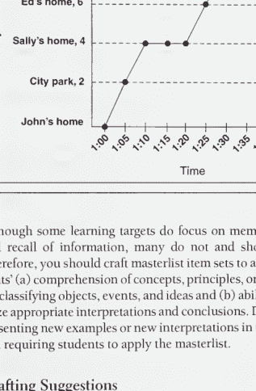

说明：下面编号的陈述说明了不同学生对该图表的说法。阅读每条陈述并判断图表中的信息是否与学生的陈述一致。标记答案：

+   A — 如果图表中的信息与陈述一致。
+   B — 如果图表中的信息与陈述矛盾。
+   C — 如果图表中的信息既不矛盾也不一致与陈述。

+   1. 约翰在他家和市公园之间跑得或走得非常快。
+   2. 约翰在去比尔家途中停在了莎莉的家。
+   3. 约翰在去比尔家途中停在了埃德的家。
+   4. 约翰在到达比尔家之前停下来在面包店买东西。
+   5. 约翰在经过莎莉的家之后比在到达她家之前旅行得更快。

尽管一些学习目标确实侧重于记忆和信息回忆，但许多并非如此，也不应该如此。因此，你应该设计主列表题组来评估学生 (a) 对概念、原理或对物体、事件和思想进行分类的方案的理解，以及 (b) 分析适当解释和结论的能力。通过在题干中呈现新的例子或新的解释并要求学生应用主列表来实现这一点。

## 制作建议

要制作你的主列表题组，首先确定你想要评估的学习目标。例如，这可能是“学生识别数据是否支持对发生事件的解释的能力”。接下来编写你想要关注的主列表选项。例如，对于之前给出的宪法原则练习，你会列出四项宪法原则；对于示例 8.6 中的主列表练习，你会列出支持、矛盾和既非支持也非矛盾。如果将使用表格、图表或其他解释材料，请接下来准备它。

从主列表中选择一个选项并为其编写尽可能多的题干。例如，你可能会选择“被治理者的同意”作为原则，并编写四到五个在现实世界应用中说明该原则的具体例子

继续选择选项并编写题干，直到每个选项都有多个题目。审阅题干，确保它们要求学生将知识和技能应用于新的现实世界情况、例子或事件。

最后创建说明。确保说明清楚地描述学生应据此解决主列表题组的基础。例如，在公民课程练习中，说明告诉学生他们必须阅读陈述中的例子并决定每个例子代表哪项宪法原则。在图表解释示例中，说明告诉学生陈述是对图表的解释，学生必须决定图表是否支持或矛盾该解释。如果你的主列表题组引用了解释材料，如本例，则你的说明应清楚地描述该材料以及学生应如何使用它。

完成上述步骤后，润色你的主列表题组。如果有解释材料，请将其组织在题组开头。接下来，将主列表放在题干之前。为学生可能使用的主列表回答选择分配字母。如果不使用机器可评分答题纸，你的字母不必是 A、B、C、D 或 E。例如，在公民课程练习中，你可以使用 C 代表“被治理者的同意”，M 代表“多数决”，等等。

题干始终编号并跟在主列表之后。如果不使用单独的答题纸，请在题干编号前留一个空格，而不是在题干末尾。你将能够更快、更准确地评分，如果空格在题干编号之前。打乱题干顺序，使所有匹配同一主列表选项的题干不在一起，并且答案没有可辨别的模式（避免 ABCDABCD 等）。如果你编写了太多题干，请选择最好的并将其他题干保存以供日后修改使用。编辑题干使其语法正确、清晰简洁。限制每个题干在 40 个词或更少。然而，题干和题组其他部分必须提供足够的信息让学生应用规则或原理。例如，在公民课程练习中，如果题干 2 仅包含以下词语，则信息不足：

+   2. 另一个国家正在发生内战。美国总统开始计划帮助支持这场内战。

需要更多细节才能知道题干指的是哪个原则。

本节中的建议总结为一个主列表检查清单。使用此检查清单指导你制作主列表题组。也用它来评估你的主列表题组的草稿。记住，如果你对一个或多个问题回答是否，你需要修改题组。

## 表格式（矩阵）题目

## 格式

表格式（或矩阵）题目格式是一种匹配练习类型，其中来自多个回答列表的元素（例如，总统、政党、著名首次和重要事件）与来自共同前提列表的元素进行匹配。学生的任务是从每个回答列表中选择一个或多个元素并将其与编号的前提之一匹配。表格式题目格式的示例显示在示例 8.7 中。

你可以看到该示例是一个四重匹配练习：（a）匹配年份和总统，（b）匹配年份和总统的政党，（c）匹配年份和著名首次，（d）匹配年份和重要事件。一个前提列表和几个与其对应的回答列表可以有效地组织成表格式或矩阵题目格式。请注意每个前提都是编号的。因此，每个前提都作为单独的题目评分。

另一个示例显示在示例 8.8 中。在此示例中有一个前提列表（行星描述）和一个回答列表（行星名称）。请注意列表中的每个前提都是编号的。与普通匹配练习不同，在表格式题组中，每个前提可能适用于多个回答元素。例如，许多行星以希腊或罗马神命名，因此学生会在第 8 项下为每个以神命名的行星所在单元格标记“X”。

## 检查清单 8.6

#### 审查主列表练习质量的检查清单

对你编写的每道题目提出这些问题。如果对一个或多个问题回答“否”，请相应修改题目。

+   1. 主列表练习是否评估了教学单元教学目标的重要方面？
+   2. 主列表练习是否与你的评估计划在表现、重点和分数数量方面相匹配？
+   3. 主列表练习是否要求学生将知识和技能应用于新情况、例子或事件？
+   4. 你是否提供了足够的信息，以便有知识的学生能够应用题目要求的知识和技能？
+   5. 你给学生的说明是否清楚、完整地解释了你希望他们在将主列表回答选择应用于题干时使用的基础？
+   6. 在此主列表练习中，每个题干和主列表中的每个回答选择是否属于同一类别的事物？
+   7. 主列表中的每个回答选择是否对每个题干都作为合理的替代方案发挥作用？
+   8. 你是否避免了“完美匹配”？
+   9. 如果可能，主列表中的选项是否以有意义的方式排序（逻辑上、数字上、字母上等）？
+   10. 题干是否编号且主列表回答选择是否字母化？

## 优点和批评

## 优点

表格式或矩阵题目是评估学生是否能将事实和思想整合到表格等有组织格式中的有用方法。当评估对口头信息的回忆时，例如事实、日期、概括、术语和理论的特征时，很容易制作。它在你有一个前提列表和许多不同的回答列表时也非常高效。你可能记得在制作基本匹配题目时，回答列表内的回答应是同质的：即都属于同一类别。当你在制作基本匹配练习时发现回答列表变得异质时，你可能希望将练习重新组织为主列表题组。

## 批评

尽管可能创建评估复杂或高阶思维技能的表格式题组，但这样做很困难。大多数教师发现此格式最适用于评估对口头信息的回忆和识别。由于格式易于构建，一些教师过度使用它（或其表亲，基本匹配）因此受到批评，认为其关注事实而非问题解决、批判性思维或其他高阶认知技能。而且，


## 示例 8.7

一个表格或矩阵式题目集。

说明：请将下面的表格中各列中的姓名、政党、著名首次事件和重要事件与日期进行匹配。在表格的适当列中写上字母。你可以在表格的任何单元格中使用一个字母一次、多次或根本不使用。

| 总统 | 总统的政党 | 著名首次 | 重要事件 |
|---|---|---|---|
| A. Coolidge | K. Democrat | N. First airplane flight | U. Atomic bomb on Hiroshima |
| B. Eisenhower | L. Independent | O. First airplane flight across US | V. Great Depression begins |
| C. Harding | M. Republican | P. First automobile trip across US | W. NAACP founded |
| D. Hoover |  | Q. First telephone talk across US | X. New Deal legislation passed |
| E. McKinley |  | R. First transatlantic solo flight | Y. North Pole reached |
| F. Roosevelt, FD. |  | S. First US satellite in space | Z. Panama Canal opened |
| G. Roosevelt, T. |  | T. First woman in Cabinet | AA. Panama Canal Treaty signed |
| H. Taft |  |  | BB. Social Security Act passed |
| I. Truman |  |  | CC. United Nations founded |
| J. Wilson |  |  | DD. World War I ends |
|  |  |  | EE. Korean Conflict begins |

| 年份 | 总统 | 总统的政党 | 著名首次 | 重要事件 | 得分 |
|---|---|---|---|---|---|
| 1. 1901–1904 |  |  |  |  | 1. ______ |
| 2. 1905–1908 |  |  |  |  | 2. ______ |
| 3. 1909–1912 |  |  |  |  | 3. ______ |
| 4. 1913–1916 |  |  |  |  | 4. ______ |
| 5. 1917–1920 |  |  |  |  | 5. ______ |
| 6. 1921–1924 |  |  |  |  | 6. ______ |
| 7. 1925–1928 |  |  |  |  | 7. ______ |
| 8. 1929–1932 |  |  |  |  | 8. ______ |
| 9. 1933–1936 |  |  |  |  | 9. ______ |
| 10. 1937–1940 |  |  |  |  | 10. ______ |
| 11. 1941–1944 |  |  |  |  | 11. ______ |
| 12. 1945–1948 |  |  |  |  | 12. ______ |

对该题集进行评分是困难的。我们将在本节后面讨论这个问题以及可能的解决方案。

## 制作建议

首先，始终确定你希望评估的学习目标。对于学生必须对事实或示例进行交叉分类，或必须识别日期、事件或对象的若干特征或属性的学习目标，最适合使用此类题目。

你应首先构建一个前提列表。例如，在前面的示例中，前提是定义美国总统任期的四年时间跨度。在行星示例中，前提是行星的描述。接下来，创建按同质组组织的响应列表。你需要两个或更多同质响应列表。你应向每个列表中至少添加一个与任何前提都不匹配但合理的响应。这将消除我们之前讨论的完美匹配缺陷。例如，在前面的示例中，“Eisenhower”、“Independent”、“First U.S. satellite in space” 和 “Korean conflict begins” 都与任何前提（日期）都不匹配。

创建表格或矩阵以对应你的前提和响应列表。务必对前提进行编号。用你为响应列表使用的相同标题标记列。为方便起见，如总统任期示例所示，在表格右侧留出记录分数的位置。

接下来创建给学生的说明。说明应清楚地告诉学生他们要匹配什么、匹配的基础、如何记录答案，以及响应可使用一次、多次或根本不使用。

## 示例 8.8

备选表格或矩阵式题目集的示例。

说明：对于每个行星描述，请在符合该描述的行星名称下方对应的方框中放置一个 X。

## 行星描述

- 1. has only one moon
- 2. has no moons
- 3. larger than Earth
- 4. has no atmosphere
- 5. composed mostly of gas
- 6. can support life
- 7. has moon with atmosphere
- 8. named after Roman or Greek god

| 行星 |  |  |  |  |  |  |  |  |
|---|---|---|---|---|---|---|---|---|
| EARTH | JUPITER | MARS | MERCURY | NEPTUNE | PLUTO | SATURN | URANUS | VENUS |
|  |  |  |  |  |  |  |  |  |
|  |  |  |  |  |  |  |  |  |
|  |  |  |  |  |  |  |  |  |
|  |  |  |  |  |  |  |  |  |
|  |  |  |  |  |  |  |  |  |
|  |  |  |  |  |  |  |  |  |
|  |  |  |  |  |  |  |  |  |
|  |  |  |  |  |  |  |  |  |
|  |  |  |  |  |  |  |  |  |

来源：改编自 Creative Classroom Testing: Ten Designs for Assessment and Instruction (p. 138) by S. B. Carlson, 1985, Princeton, NJ: Educational Testing Service. 经 Educational Testing Service 许可转载，版权所有者。

按照前面两个示例中的一种（取决于所需响应类型）对练习进行布局。将说明放在顶部，将响应列表放在说明下方、表格上方。这种安排比响应列表跟在表格后面更容易理解。响应先出现也更容易让学生阅读和跟踪。每个响应使用字母标识。如果像总统任期示例中那样，字母在列表之间连续编号，学生抄写错误会更少。最后放置表格并留出记录分数的位置。网格对学生使用和你评分都更方便。

编辑并润色你的所有工作。检查拼写。对每个列表内的元素分别按字母顺序排列。如果可能，保持响应列表并排（与示例相同），这样学生阅读列表更容易。将前提列表按逻辑、数字或时间顺序组织。检查前提是否已编号。如果可能，将整个练习放在同一页上。这可以减少学生在回答题目时需要在前后翻页时产生的抄写错误和挫败感。文字处理器或电子表格程序有助于制作最终版本。使用文字处理器或电子表格程序创建表格的功能，既用于表格本身，也用于创建响应列表。

表格项目的清单总结了本节中的建议。在制作表格项目集时以及项目集完成后评估项目集时，将其用作指南。由于表格项目集与基本匹配练习密切相关，你应回顾创建基本匹配练习的建议。基本匹配练习的匹配练习清单是方便你回顾制作匹配练习基本原则的方式。

## 评分

表格或矩阵项目格式的评分是一个特殊问题。有两种评分选项：

- 1. 你可以将每行编号视为完全正确或不正确（例如，将每行评分 1 [完全正确] 或 0 [一个或多个元素不正确]）。
- 2. 你可以根据每行应放入其单元格中的元素数量对每行进行评分。例如，在行星示例中，每行有 9 个元素（行星），因此行的分数范围可以为 0 到 9。行内每个单元格根据 X 或空白是否正确放置进行 0 到 1 的评分。例如，将 X 放在第 8 行 Earth 下的学生被判错误（该单元格得 0 分），因为 Earth 不是以希腊或罗马神命名的。同样，学生如果将该单元格留空则被判正确（该单元格得 1 分）。

在这两种选项中，我更喜欢第二种：它给予部分分数并产生更可靠的分数。

当出现以下特殊问题时可能会出现问题：（a）正确答案需要在一个单元格中放置多个响应，但学生输入的响应少于或多于应输入的数量，以及（b）正确答案为空白，但学生在此单元格中输入了一些响应(s)。例如，在总统任期示例中，Roosevelt 和 Truman 都在 1945–1948 时间段担任总统：Roosevelt 在任内去世，而 Truman 是副总统。学生可能将 E、H 或两者都放入“总统”列的相应单元格中。应如何评分该单元格？正确答案是“E 和 H”，因此显然应给予满分或 2 分（每个 1 分）。只标记 E 或只标记 H 的学生可以给予部分分数（1 分），也可以不给予分数（0 分）。给予部分分数似乎是最公平的做法。

然而，假设学生用 C 和 H 作答。C 明显不正确，但 H 正确但不完整。一些教师倾向于通过扣除 C 的分数来惩罚学生。这种评分方式似乎武断且不公平。我建议对正确部分给予部分分数（1 分），并且不因 C 不属于该单元格而扣分。你可以向学生注明 C 放置错误。然而，武断地扣除分数会使你评分变得困难，增加你在批改时出现抄写错误的可能性。此外，武断地扣除分数可能会导致分数不能准确反映学生的部分知识。

一个聪明的学生可能试图“钻系统空子”，即在表格的每个单元格中放入每个响应选项的字母。由于正确答案(s) 总是包含在单元格中（连同所有其他不正确的选项），如果遵循我的评分建议，学生将得 100%。如果发生这种情况怎么办？我建议你将试卷退回给学生（不予惩罚），并要求学生在表格单元格中只输入他们认为正确的少数选择。你也可以在今后的测试中修改说明，明确表示你只希望每个单元格有少数选择。

## 总结

## 选择题格式和制作前的注意事项

- • 撰写选择题的建议代表了经验丰富的题目编写者的临床经验，几乎所有建议都可以归纳为第 7 章中的三个基本原则。
- • 选择题由一个或多个引导句加上两个或多个建议响应组成，学生从中选择正确答案。变体已举例说明。
- • 选择题的每个部分必须正常工作，整题才能正常工作：
  - • 题目干的目的是提出问题、设定任务或陈述问题。
  - • 备选答案（响应或选项）的目的是为题目干指定的问题或问题提出答案建议。通常一个备选答案是正确或最佳响应。
  - • 干扰项（迷惑项）的目的是对不具备足够知识选择正确答案的学生显得合理。

## 选择题的优点和批评

- • 任何评估任务的基本目的是区分已达到学习目标的学生和未达到的学生。
- • 在客观题型中，选择题被认为是最受重视、最适用和最通用的。
- • 选择题只是间接观察以下重要学习成果的程序：
  - • 最小提示下的回忆。
  - • 产生和表达独特思想。
  - • 阐述解释并举例。
  - • 组织个人想法。
  - • 显示思维过程或推理模式。
- • 选择题可以提供直接观察以下重要学习成果的机会：
  - • 辨别并做出正确选择。
  - • 理解概念、原理和概括。
  - • 对各种行动方案做出判断和选择。
  - • 推断和推理。
  - • 计算。
  - • 解释新信息。
  - • 应用信息和知识。

## 清单 8.7

## 审查表格（矩阵）练习质量的清单

对你编写的每个题目提出这些问题。如果对一个或多个问题回答“否”，请相应修改题目。

- 1. 表格练习是否评估了教学单元学习目标的重要方面？
- 2. 表格练习是否在表现、重点和分数数量方面与你的评估计划相匹配？
- 3. 你给学生的说明是否清楚地解释了（a）你希望学生用于将响应与前提匹配的基础，（b）如何标记答案，以及（c）响应选择可使用一次、多次或根本不使用？
- 4. 每个响应列表内的响应选择是否都属于同一类别的事物？
- 5. 每个响应选择是否都作为每个前提的合理替代？
- 6. 你是否避免了“完美匹配”？
- 7. 如果可能，响应选择是否按有意义的方式排序（逻辑、数字、字母等）？
- 8. 前提是否已编号，响应选择是否已字母编号？
- 9. 在试卷页上，说明是否放在第一，响应选择是否放在第二，表格是否放在第三？
- 10. 如果可能，整个练习是否打印在一页上而不是分成两页？


## 不应使用选择题的情况

在课堂上不推荐使用选择题（即使它们是合适的）的实例包括

- 需要一个单词或一个数字答案的问题或题目。
- 一般的计算问题。
- 只有两种合理答案的问题（例如，是-否）。
- 写出答案所需时间并不比标记选择题答案所需时间长的题目。

## 制作基本选择题并使用核对清单

与所有类型的评估任务一样，选择题在实施前应仔细编辑。

制作题干的建议已在表 8.1 中总结。表后附有示例。

## 制作选择题的替代类型

本章中选择题和配对题的替代类型具有以下一般优点：(a) 它们更能匹配许多学习目标；(b) 它们可以客观评分；(c) 它们效率高，在给定时间内涵盖更多内容；以及 (d) 它们相对容易制作。

大于-小于-相同题可用于评估学生比较概念对之间的定量、定性或顺序关系的能力。

## 配对练习格式

配对练习由一组前提、一个响应列表和用于匹配两个列表元素的指示组成。

选择题的优点包括其：

- 在评估各种学习目标方面的多功能性。
- 减少学生蒙混或粉饰答案的机会。
- 关注阅读和选择)。

- 每当多个选择题需要重复同一组备选答案时，就应使用配对练习。

## 配对练习的优点和批评

- 配对练习的优点包括
  - 它紧凑、节省空间且可客观评分。
  - 它评估识别关系的能力。
  - 它评估分类事物的能力。
- 对配对练习的批评是教师经常仅将其用于评估机械联想，而非理解或分类能力。

## 制作基本配对练习

- 你可以通过制作同质的前提和响应来避免“泄露”配对练习的答案，使得每个响应对每个前提都是合理的选项。前提和响应的同质性通常是学生教育发展以及练习内容的功能。
- 构建配对练习的建议连同示例练习一起呈现。
- 提供了一个核对清单，你可以用它来判断你创建或从课程材料中改编的配对练习的质量。

## 制作配对练习的替代类型

- 主列表题可用于评估学生将新示例分类到已学分类框架中的能力以及将原理应用于新情况的能力。
- 主列表题可能受到批评，因为教师经常用它们来评估对语言信息的回忆，而不是评估学习在新情况下的应用。
- 制作和评估主列表题的建议以核对清单格式呈现。
- 表格（矩阵）题可用于评估学生将事实和概念在多个分类类别之间匹配并以表格格式整合信息的能力。
- 表格题格式可能因与配对练习批评相同的原因而受到批评：教师倾向于使用该格式来评估学生回忆事实和其他语言信息片段的能力。
- 制作和评估表格题的建议已在核对清单格式中总结。
- 表格题可能存在评分问题。本章建议根据学生条目的正确数量对矩阵（表）的每一行进行评分。

## 重要术语和概念

- "all of the above"
- alternatives, choices, options, responses
- basic purpose of an assessment task
- best-answer item
- clueing, linking
- context-dependent items, interpretive materials, interpretive exercises, linked items
- continuum of learning
- correct-answer variety
- decontextualized knowledge
- direct assessment, indirect assessment
- directions for matching
- distractors, foils
- experiment-interpretation items
- filler alternatives, "deadwood" alternatives
- greater-less-same items
- high-stakes assessment
- homogeneous alternatives, heterogeneous alternatives
- homogeneous premises and responses
- incomplete stem
- keyed alternative, keyed answer, key
- masterlist items, classification items, keylist items
- matching exercise (basic)
- multiple-choice items (interpretative material)
- meaningfully arranged alternatives
- multiple-choice item
- negatively worded stem
- "none of the above"
- overlapping alternatives
- perfect matching
- plausible distractors, functional alternatives
- premises, premise list
- responses, response list
- specific determiner
- statement-and-comment items
- stem
- tabular (matrix) items
- tandem arrangement of options
- "textbookish" phrasing
- tricky item
- varieties of multiple-choice items
- verbal clues, grammatical clues, "clang" associations
- "window dressing"

## 练习和应用

- 1. 对于你教授的科目，或你最熟悉的科目，构建一个完美的选择题来评估以下每种能力。在编写每道题之前，写出该题将评估的具体学习目标。编写题目后，使用选择题核对清单来评估和修改你的题目。与班级的其他成员分享你的题目。
  a. 区分两个语言概念的能力
  b. 理解原理或规则的能力
  c. 选择适当行动方案的能力
  d. 解释新数据或新信息的能力
- 2. 对于你教授的科目，获取包含供教师和学生使用的选择题的课程材料。从该材料中选择 10 道适合你可能教授的单元的题目。使用选择题核对清单评估每道题。确定每道题的缺陷，然后修改题目以纠正缺陷。（确保评估你的修改后题目使其完美无缺。）与班级讨论你的发现。
- 3. 对于你教授的科目，获取包含供教师和学生使用的配对练习的课程材料。选择两个适合你可能教授的单元的练习。使用配对练习核对清单评估每个练习。确定每个练习的缺陷，然后修改练习以纠正缺陷。（确保评估你的修改后练习使其完美无缺。）与班级讨论你的发现。


4. 从以下列表中选择两种不同的关系类型，并为你教授的科目制作匹配练习：人物成就；著名事件的日期；术语定义；原理或规则应用的例子；概念的符号；作者或艺术家及其特定作品；外语短语的英语对应；机制特定部件的功能；或图片中物体的名称。为你选择的两种关系各开发匹配练习。使用匹配练习核查表评估并修改你的练习以消除所有缺陷。将你的匹配练习呈现给你的班级。

5. 使用匹配练习核查表评估下面的匹配练习。准备一份发现的缺陷清单。对列出的每个缺陷，解释为什么它是该练习中的缺陷。在完成分析后，修改练习使其没有缺陷。与你的班级分享你的发现。

说明：匹配两列

A
1. chlorophyll
2. igneous
3. photosynthesis
4. water

B
A. Green plants contain this substance
B. Type of rock formed when melted rock hardens
C. A substance made up of both hydrogen and oxygen
D. Process by which green plants produce their food

## Additional Readings

Bloom, B. S., Madaus, G. F., & Hastings, J. T. (1981). *Evaluation to improve learning*. New York: McGraw-Hill, Chapters 8-10.

这些章节说明了如何编写选择题以评估归类于高阶项目的学习目标。 [1, 2]
- 2. 描述你应该评估的学习目标类型。 [1, 2]
- 3. 解释为什么你不应该使用论文题来评估仅限于回忆和理解口头信息的学习目标。 [1]

## Usefulness of Essay Assessments

- 4. 阐述使用论文题对你学生的学习习惯可能产生的影响。 [1, 2, 3, 4]
- 5. 阐述使用客观题而非论文题能更好地评估的学习目标类型。 [1, 2, 3, 4]

## Constructing Essays, Assessing Subject-Matter, Learning and Using Optional Questions

- 6. 编写良好的论文题， free from flaws, that assess a variety of students’s to your essay questions. [3, 4]

## Important Terms and Concepts

- 20. 解释本章末尾列出的重要术语和概念如何适用于教育评估。 [6]

## ABOUT THIS CHAPTER

你是否想过使用论文题而不是选择题会更有效吗？论文题是否更好用于评估高阶和扩展反应。我们讨论了这些格式的优点和缺点，并用例子加以说明。其次，本章讨论了使用论文的几个一般性问题。我们讨论，例如，哪些技能和能力最适合用论文来评估，使用论文如何影响学生的学习习惯，以及论文是否以覆盖深度为代价牺牲了内容的广度。第三，本章提供了如何制作评估学科学习论文题的建议。我们给出了大量改进论文题的建议并用例子加以说明。第四，本章提供了用于评估学生写作能力的论文提示的建议。我们说明了如何将你对写作能力的评估高度整合到你的写作教学中。我们讨论写作过程、应评估的写作特征或品质（包括 Six + 1 Traits®）以及写作的不同文体。我们用例子说明不同文体写作提示。最后，本章讨论了如何改进论文评估中最薄弱的部分——评分。我们讨论并用例子说明整体评分和分析评分量规。我们确定了教师在评分课堂评估时最常见的错误，并提出了纠正这些错误的建议。

总体而言，本章重点帮助你学习制作高质量论文题的基础知识。第10章，尤其是第11章和第12章，描述了书面回应的更复杂用途。本章更基础，解释了创建高质量论文任务的基础知识。

## FORMATS FOR ESSAY ITEMS

论文格式通常分为两组：限制性反应题和扩展性反应题。两种类型都是有用的工具，但用于不同目的。

## Restricted Response Varieties

定义 限制性反应论文题通过你提出限制性反应任务的方式，限制或限定学生答案的内容和其书面回应的形式。以下有两个例子。

## Example

- 1. 写一篇简短的论文比较和对比术语 measurement 和 assessment 在（a）学生回应质量的量化程度、（b）获取信息的过程、（c）学生回应记录方式方面的关系。
- 2. 列出你的教材中提出的关于撰写论文题的五个建议。对你列出的每个建议，写一段简短的陈述解释该建议为何有助于提高论文评估的有效性。

评估超出回忆和理解的范围 限制性反应题应要求学生应用其技能解决新问题或分析新情况。实现这一点的一种方法是包含解释性材料作为评估的一部分。解释性材料可以是，例如，一段或两段描述特定问题或社会情况的文字、文学作品的摘录，或科学实验或发现的描述。基于这种材料的论文（和选择）题被称为解释性练习或情境依赖任务（在第8章中介绍）。解释性练习要求学生阅读、聆听、分析或以其他方式解释随附的材料，然后基于它完成一个或多个题目。以下例子说明了限制性反应题，以及通过对比，一个要求学生以各种方式分析特定诗歌的扩展性反应题。这些题目是为高中文学课程准备的。

## Example

解释性材料
On First Looking Into Chapman’s Homer

> Much have I traveled in the realms of gold,
> And many goodly states and kingdoms seen;
> Round many western islands have I been
> Which bards in fealty to Apollo hold.
> Off of one wide expanse have I been told
> That deep-browned Homer ruled as his demesne;
> Yet did I never breathe its pure serene
> Till I heard Chapman speak out loud and bold;
> Then felt I like some watcher of the skies
> When a new planet swims into his ken;
> Or like stout Cortez when with eagle eyes
> He stared at the Pacific—and all his men
> Looked at each other with wild surmise—
> Silent, upon a peak of Darien.
> John Keats

## Restricted response questions

- 1. 诗人在第1到8行中对文学的态度是什么？这些行中的哪些词语使这种态度显现？
- 2. 概括第9到14行描述的心境。
- 3. 第1到8行描述的态度与第9到14行建立的心境之间有什么关系？

## Extended response questions

- 4. 描述诗歌结构如何强化第9到14行中呈现的说话者心境。在你的论文中说明诗歌第一部分的态度与诗歌结尾的心境有何关联。

> 来源：摘自 A. C. Purves 的 “Evaluation of Learning in Literature”，收录于 B. S. Bloom 和 G. E. Madaus（编）《Handbook on Formative and Summative Evaluation of Student Learning》（第736、755、756页），纽约：McGraw-Hill，1971。经许可转载。

通常限制性反应题仅限于非常复杂学习中的某些方面或组成部分。上面在 Bloom 等人分类法“分析”层级撰写的限制性反应题，提出了教师可能撰写以评估学生分析诗歌心境的能力的众多问题（也许15或20个）中的几个问题。相比之下，扩展性反应题试图从学生那里引出对诗歌的相当完整和综合的分析。

## Advantages of Restricted Response

这种格式将你的评估重点缩小到特定且明确的绩效。 这些题目的性质使得你的学生更有可能以你预期的方式解释每个问题。当问题聚焦且所有学生都以相同方式解释它时，你处于更有利的位置来评估学生答案的正确性。当你清楚正确答案的构成时，会提高你的评分可靠性，从而提高分数的有效性。

## Other Assessment Options

多项选择解释性练习比限制性反应论文更可靠地评估许多能力。这在表 9.1 中有所说明。如果你仅使用限制性反应论文来评估学生对事实信息的回忆，那么你就没有正确使用限制性反应论文。你可以通过完形、是非、多项选择和匹配题更好地评估学生回忆事实信息的能力。

## Extended Response Varieties

定义 扩展性反应论文题要求学生撰写论文，在其中他们可以自由表达自己的

| Table 9.1 Examples of varieties of learning outcomes that can be assessed using objective interpretive exercises and essay items. | Type of test item | Examples of complex learning outcomes that can be measured |
|---|---|---|
| Objective interpretive exercises | Ability to— identify cause-effect relationship identify the application of principles identify the relevance of arguments identify tenable hypotheses identify valid conclusions identify unstated assumptions identify the limitations of data identify the adequacy of procedures (and similar outcomes based on the pupil's ability to select the answer) |
| Restricted response essay questions | Ability to— explain cause-effect relationships describe applications of principles present relevant arguments formulate tenable hypotheses formulate valid conclusions state necessary assumptions describe the limitations of data explain methods and procedures (and similar outcomes based on the pupil's ability to supply the answer) |
| Extended response essay questions | Ability to— produce, organize, and express ideas integrate learnings in different areas create original forms (e.g., designing an experiment) evaluate the worth of ideas |
| Source: Adapted from Measurement and Evaluation in Teaching (7th ed.) (p. 224) by R. L. Linn and N. E. Gronlund, 1995, Englewood Cliffs, N.J.: Prentice Hall © 1995. Adapted by permission. |


想法及其相互之间的关系，并使用他们自己的答案组织方式。通常没有单一的答案被认为是正确的。学生可以自由选择回应方式，只有了解该学科的熟练教师才能根据（Stalnakar, 1951）判断学生回应的正确程度或价值。

## 两个目的

扩展性回答作文格式的两个主要用途是评估学生的（a）一般写作能力和（b）学科知识。本章讨论这两种作文目的。

## 写作评估

如果你的意图只是评估写作能力，你的作文必须为学生提供一个提示。提示是一条简短的陈述，提示要写的主题，为学生提供一般指导，激励学生写作，并引出学生的最佳表现。你通过使用评分量规来评估学生的表现，评分量规定义了写作的各种特征或品质。

## 示例

扩展性写作提示

有时候人们只是为了好玩而写作。这是一个让你写作时玩得开心的机会。假装你是一双网球鞋。你在各种天气里和你的主人一起做了各种各样的事情。现在你又被你的主人拿起来了。告诉你，作为网球鞋，对将要发生的事情有什么想法。告诉你对你的主人有什么感受。下方和接下来的两页提供了空间。

> 来源：摘自《童年经验的写作：小学阶段写作与学习的途径》（实验版）（第14页）作者 C. H. Klaus, R. Lloyd-Jones, R. Brown, W. Littlefair, I. Mullis, 和 D. Verity, 1979, St. Louis: CEMREL。经许可转载。

在这个例子中，提示激发学生以想象的方式写作。要求学生运用表现性写作能力扮演一个想象的角色——网球鞋，并通过解释网球鞋的“感受”和“想法”来阐述这一角色。本章后面我们将讨论评估学生写作的标准。

## 学科知识评估

如果评估的主要目的是评估学生在某一学科的知识、理解和推理，那么就需要不同类型的提示和作文结构。以下是社会研究学科的一个例子。

## 示例

扩展性学科作文提示

制定一个计划来确定民主党人和共和党人是否在城市中均匀分布，或者每个党的支持者是否集中在某些选区。

> 来源：摘自《课堂提问：什么类型？》（第136页）作者 N. M. Sanders, 1966, New York: Harper & Row。经许可转载。

在这个例子中，提示通过描述学生预期要制定的计划的总体目的，为学生设定了任务。学生的回答主要使用学科标准进行评估——学生对城市选区结构的理解程度如何，计划如何解决数据收集问题等等。作文旨在评估学生在社会研究学科中推理和应用知识的能力。在 Bloom 等人的分类法中，综合的一个方面是为特定目的制定行动计划的能力。这篇作文正需要这一点。

## 优点

你的一些学习目标围绕着学生组织思想、发展逻辑论证、讨论对某些立场或数据的评价、传达思想和感受，或展示原创性的能力。作文格式并不适合评估这些类型的学习目标。学生需要有更长篇回应的机会来展示此类技能和能力。扩展性回答作文适合评估需要学生使用多种技能组合的学习目标，例如解释材料、解决问题并连贯地解释问题及其解决方案。

## 缺点

扩展性回答作文的一个缺点是评分信度差。很难客观地评分扩展性回答。常见问题是，如果没有特殊培训，不同的教师会对同一篇作文给出不同的分数。当同一回答的成绩或分数因教师而异时，评估结果的有效性就会降低。教师对作文评分的另一个常见问题是，他们使用不同的标准来评估不同学生的作文。例如，你可能主要关注 Johnny 论文中思想的质量，Sally 论文的整洁和语法优雅，以及 Harry 的拼写错误。当你以这种方式评分时，你以不同的基础评估每个学生。由于你学生与学生之间的一致性不足，评估结果的有效性降低。

第二个缺点是评分作文通常耗时，尤其是如果你想给学生反馈以便他们改进学习。当你有许多作文要批改时，就没有太多时间给学生提供详细的评论，说明如何改进他们的工作。

评分量规可以提高评分的信度（一致性），从而提高评分的有效性。使用评分量规还可以减少评分时间。有关制定评分量规的建议将在本章后面出现，并在第12章中更详细地解释。

## 作文评估的实用性

## 作文题评估的能力和技能

前几段描述了一些作文让学生展示的能力和技能。表 9.1 简要总结了这些技能和能力。

请注意，表中列出的结果是建议性的，而非详尽的（Linn & Gronlund, 1995）。从表中可以看出，选择题也可以衡量其中一些相同的能力。有关开发选择题和作文题以衡量更高水平能力的建议，请参阅第10、11和12章。

作文格式或许独特之处在于，它为学生提供了展示其写作、组织、表达和解释思想之间相互关系的能力的机会。你可以用简答题和选择题更轻松地评估记忆、回忆和理解。重要的一点：选择一个评估格式，该格式将准确评估你希望学生达到的学习目标。

## 为评估不同能力而表述作文问题的思路

你可能会发现研究不同提问方式很有帮助，这将使你能够设计出鼓励学生使用更高水平认知过程和技能的题目。以下是一些表述作文问题以评估不同学习目标的示例。

## 示例

### 1. 概念理解：识别例子、举例
- 阅读附带的报纸文章。哪些事件说明了政治妥协的概念？
- 用你自己的话解释偏见的含义。举出你自己经历中的偏见例子。

### 2. 概念理解：对例子进行分类
- 阅读附带的五道数学应用题。将这些问题分成两组。解释为什么每组中的问题相似且属于同一组。解释两组有何不同。
- 研究附带的10幅画作的图片。根据其风格将这些画作组织成两个或多个组。解释你分组的原因。

### 3. 分析
- 看看附带的家庭照片。描述照片中的情绪或感觉以及人们的肢体语言。使用隐喻或明喻来描述这些。
- 阅读附带的报纸文章。哪些陈述是观点？解释原因。

### 4. 比较
- 比较艺术家 A 在其画作中使用色彩的方式与艺术家 B 在其面具中使用色彩的方式。它们有何相似和不同？色彩在每件作品中传达了什么情绪？
- 阅读参议员 A 和参议员 B 的附带陈述。他们的观点在哪些方面相似？解释你得出结论的理由。

### 5. 使用原则和规则：推理、预测
- 阅读上面关于巴萨尔瓦人的情况，这是一个我们没有研究的文化群体。基于我们研究的关于文化群体的内容，你预测巴萨尔瓦人在未来20年会发生什么？解释你用来做出预测的原则。
- 假设南非政府命令所有白人柑橘农场主离开该国。你认为他们会去哪里？解释你用来做出这些预测的原则。

### 6. 推理：演绎、预测、概括
- 比较表 A 中的信息与图 A 中的信息。你对该数据适用的地区水稻种植的成功程度得出什么结论？解释你得出结论的理由。
- 阅读科学家、参议员和报纸编辑关于继续使用汽油动力汽车发动机的后果的附带陈述。你对发达国家继续使用这些发动机可以做出什么概括？
- 研究上面的表格数据。你预计未来五年我们的小麦出口会发生什么？解释你为使预测有效而做出的假设。

### 7. 评价
- 上面是用来评判作者在写作中使用“声音”好坏的标准。附带的是附近一所学校一名学生的短篇写作。使用这些标准来评价该作者使用声音的情况。解释为什么该作者使用了或没有使用良好的声音。用作品中的例子来说明你的评价。
- 使用你的日常日志和你植物生长的记录来解释你植物的现状。解释为什么你的植物比同学的植物更好或更差。你本可以做些什么不同的事？这会对你植物的现状产生什么影响？

如果你以与上面类似的方式设计问题，你将鼓励评估高阶思维技能的作文。请注意，许多问题使用了对学生来说是新颖或新奇的解释性材料。还请注意，大多数问题都要求学生给出理由或解释他们的选择。如果不要求这样的解释或理由，你就不会评估学生使用的高阶思维过程。几个


作者们尝试对上述示例中的“思考”问题进行分类或归类。Monroe 和 Carter（1923）、Odell（1928）、Curtis（1943）、Wesley 和 Wronski（1958）以及 Bloom、Hastings 和 Madaus（1971）也提供了类似的分类。您可以查阅这些补充资源，获取更多示例。

## 对学习策略的影响

您可以利用评估来激励学生学习。似乎合理的是，您对学生在测验中所期望的表现类型会影响他们的学习方法。一些研究表明，当学生知道将被问及论述题时，他们倾向于集中学习广泛概念，并阐述因果关系、对比、比较等；而准备选择题的学生则侧重记忆事实、细节和具体想法（Douglas & Tallmadge, 1934; Terry, 1933）。然而，尽管学生报告称他们为不同类型的评估采用不同的学习策略，他们并不一定在不同形式的评估中表现出不同的成绩。一些研究发现，在论述题和选择题的评估之间几乎没有或没有任何表现差异，尽管学生报告称他们为不同形式采用了不同的学习策略（Hakstain, 1969; Vallance, 1947）。

当州教育部在其问责评估中使用论述题时，这会激励教师要求学生写更多，并且他们报告称学生的写作能力得到提升（Evaluation Center, 1995）。然而，外部观察者指出，尽管学生写得更多，但未必写得更好（Viadero, 1995）。

由于论述题和选择题都可能要求学生具备特定事实知识，也都可能要求运用复杂的推理能力，因此题目的形式可能不是影响学生学习策略的关键因素（Ebel, 1979）。您的学生在准备您的评估时使用的学习策略，更可能反映的是题目形式在课堂上并不一定会实现的情况。

如果您认为学生必须学会在特定学科领域写关于思想，或许最好的建议是确保您在课堂上解释并教导学生如何就该学科写作。您需要布置大量的写作任务，让学生有机会学习在该学科中写作。不要将写作任务局限于考试中。短篇作文和长篇论文等各种书面任务都能帮助学生实现这些写作导向的目标。这通常意味着少依赖课本章节末尾的题目和作业，而更多使用您自己的任务。请记住，评估结果的有效性更高，当您使用多种评估形式时。因此，您的总结性评估应当包含论述题和选择题，以涵盖适当的学习目标。

## 内容采样的深度与广度

回答论述题耗时较长，限制了学生可写的内容范围。如果您的学生每分钟可以回答一到两个选择题，那么在半小时内他们可以完成30到60个选择题。60个题目可以覆盖非常广泛的内容，并至少涉及许多教学目标。在同样的30分钟内，这些学生可能只能回答一个或两个论述题。因此，您可以通过一篇论述题来评估对较窄主题的深入学习，或通过大量客观题来评估对广泛、较浅层的整体覆盖。为改善评估的内容覆盖，许多教师会同时使用论述题和客观题。

为克服论述题有限的内容采样缺陷，使用一系列学生可在较长时间内书写的作文（Coflman, 1971）。您可以将这些作文积累在作品集中。在一个学期内，学生完成的多篇课外作文可能比在短时间考试中写的一篇作文更能准确评估特定学习目标。您还需要记住，让学生在考试时间的压力下写作可能不是评估他们最大能力的最佳方法。

## 教师时间的高效使用

论述题和作文的评分耗时较长。如果这些是评估重要学习目标的最佳方式，如果完成它们是学生有意义的活动，并且学生能从您对其回答质量的反馈中受益，那么这段时间是值得的。然而，有时由于教师需要评分大量作文，或受日常压力影响，他们可能会草率评分：这违背职业伦理，也是责任滥用。评估和评价学生是严肃的事业。仔细规划，包括决定论述题是否是最有效的评估方式，可以大幅减少作文评分的不当行为。

## 评分标准和范例的影响

正如您将在本章后面看到的，使用明确定义的标准来评价学生的论述题回答非常重要。标准应向学生教授并加以说明。地方学区和州教育部认识到制定这些标准的重要性。因此，教师可能会参与专业发展活动，以帮助定义这些标准并改进对学生回答的应用。大部分努力集中在定义用于性能评估的标准或评分量表上，论述题评估可视为其中一部分。（请参见第11章和第12章以获取详细信息。）

专业发展方法让教师了解学生对质量响应的认识。通过与其他教师合作，他们共同构建了明确的标准，以阐释课程中的州标准和学习目标的含义。

同样，向学生分享质量标准以及不同时间水平的优质作品示例，能更好地将您的评估与教学相结合。学生了解质量表现的特征，并通过示例看到质量表现的具体样子。第11章和第12章在此方面有更详细的描述。

## 构建论述题以评估学科内容学习

检查表总结了提升论述题质量的建议。与以往的检查表一样，如果检查表中任何一项回答为“不”，则无需使用该论述题，直至您纠正缺陷。建议稍后在本章中讨论。首先，我们将检查一项 poorly crafted（ poorly crafted）论述题，并运用检查表对其进行评估。这将使您了解该项应如何改进。

## 关于 poorly crafted 论述题的案例研究

在讨论检查表的具体建议之前，让我们先研究一项 poorly worded（ poorly worded）论述题，并使用检查表对其进行评估。这一练习将帮助您理解如何评估自己的论述题，并使检查表的解释对您更具意义。

### 例题

假设一位教师希望评估以下 10 年级美国历史学习目标：

#### 例题

10 年级学习目标：分析殖民者在美国独立战争期间取得成功的原因，并说明英方或殖民者可能采取的替代行动以改变结果。

教师编写了以下论述题来评估该学习目标。总体而言，该论述题未能很好地评估该学习目标。请阅读该题，随后我们将使用检查表对其进行评估。

#### 例题

一项 poorly crafted（ poorly crafted）论述题
分析英方被殖民者击败的原因，并列出课堂上讨论的四个导致击败的因素。

## 检查表 9.1

用于评估学科内容学习论述题质量的检查表

对每一项论述题提出以下问题。如果您对任意一项回答为“不”，则有充分理由在使用该论述题前进行修正。

- 1. 该论述题是否评估单元教学目标的重要方面？
- 2. 该论述题在表现、重点和分值方面是否与您的评估计划相匹配？
- 3. 该论述题是否要求学生将知识应用于新的或 novel（新颖）情境中？
- 4. 当与试卷其他题目相比时，该项是否有助于覆盖内容范围，并能满足问题要求？
- 6. 任务是否在学生教育成熟度适宜的复杂度水平内定义？
- 7. 要在该项上取得高分，学生是否需要展现超出事实、定义、列表、想法、概括等的背诵能力？
- 8. 提示词的表述是否导致所有学生以您预期的方式理解任务？
- 9. 提示词的表述是否向学生明确说明以下内容：
  a. 所需写作的长度或幅度？
  b. 写作的目的？
  c. 分配的作答时间？
  d. 评价依据？
- 10. 如果论述提示要求学生陈述并支持他们在争议性问题上的观点，提示词是否明确表明评估将基于支撑其论证的逻辑和证据，而非学生实际持的立场或表达的意见？

#### 使用检查表的评估 这里是逐项分析，使用检查表进行评估。数字对应检查表中的点。

- 1. 是，殖民者取得成功的因素对本单元的学习成果很重要。
- 2. 否，学习目标要求学生分析成功原因并说明替代可能性。该项既不要求分析，也不要求说明。


+   3. 否，该题目仅要求列出（回忆）在课堂上呈现的信息。
+   4. 是，相对于其他题目（未显示），该题目有助于实现教师对该单元所设想的覆盖广度。
+   5. 是，学生需要做什么（即列出）已明确说明。
+   6. 否，学习目标意味着学生应具备超出该题目要求的能力。（该题目设定的任务“从记忆中列出”在学生能力范围内，但其复杂程度低于学习目标所规定的适当水平。）
+   7. 否，该题目仅要求回忆语言信息。
+   8. 存疑；一些学生可能会被“分析”一词弄糊涂，但大多数人可能仍会列出清单。
+   9. a. 是，该题目说明学生应列出四个原因。
    b. 也许目的只是重复课堂上教授的内容，但目的并未说明。
    c. 否，未说明时间限制。
    d. 否，但仅仅对错似乎是评价的隐含依据。
+   10. 不适用；未要求提供意见。

修订后的题目 使用检查表后，教师重新思考了该题目与学习目标以及他所教授内容之间的关系。教师重新设计了该题目，使其更符合学习目标。以下是修订后的题目。

## 示例

改进的作文任务

+   A. 列出导致殖民者在独立战争中战胜英国的四个因素之一（4 分）
+   B. 对于你列出的每个因素，写一段简短的解释说明该因素如何帮助殖民者击败英国。（4 分）
+   C. 选择其中一个你认为英国本可以改变或克服的因素。解释英国本可以采取什么行动来改变或克服这一因素。（4 分）
+   D. 如果英国采取了你所说的行动，战争很可能会发生什么？为什么你认为会这样发生？（8 分）

评分：A 部分和 B 部分将根据答案的正确性进行评分。C 部分和 D 部分将根据你支持自己观点的程度进行评分，而不是根据你所持的立场。

时间限制：40 分钟

修订后的题目比原题目更复杂、更困难，但更接近于评估学习目标。请注意，修订后的题目扩展为包括回忆信息、解释所回忆的信息以及运用更高层次的技能。这些更高层次的技能要求学生解释他们为何持有逻辑推导的观点，并描述行动的可能后果。教师的评分依据已明确说明，同时也规定了时间限制。由于该校的课时为 50 分钟，这篇作文很可能就是当天教师能够进行的唯一评估。为了涵盖单元的其他方面，教师需要额外的评估，包括测验、家庭作业、课堂讨论以及关于单元内容的客观测试。

## 检查表讨论

1 和 2. 被评估内容的重要性以及与评估计划的对应关系。我们强调，无论你的评估任务格式如何，每个任务都必须聚焦于重要的学习目标，并且必须与你的评估计划相匹配。需要作文的学习目标可能很难表述，因为目标可能复杂且抽象。此外，在评估这些复杂学习目标时，你可能需要使用不止一种类型的评估任务。例如，你可能希望学生展示批判性分析和评价表达关于男女平等不同观点的段落的能力。这一复杂学习目标需要在得出学生已达到这一目标的结论之前，使用几种不同的任务来评估学生。

你应关注你希望学生做出何种类型的回应，而不是担心学习目标的表述是否完善。例如，你可以写一个样例答案——概述你希望学生提出的要点。或者你可以说明你期望学生在作文题中如何处理问题。然后你可以完善作文题，以明确你希望学生做什么。

3. 将基本知识应用于新情境。作文题格式有可能评估学生对更高认知过程和技能的掌握。做到这一点最好的方法是要求学生将示例应用于新情境，例如分析济慈的诗歌。这一题目的不聚焦版本可能写成：“写一篇分析这首诗的作文。”不太可能这样的不聚焦题目会产生对诗歌“情绪”的分析，而这正是教师所想的。如果题目不聚焦，你将无法区分那些能够完成学习目标但误解了你的问题的人，与那些根本无法应用你所教授技能的人。

有时，如果你发现很难清楚地表述任务本身的性质，明确说明你将如何评估学生的回答以及评估标准可能会增加清晰度。例如，有时教师会给学生一篇表达某观点的报纸摘录，并希望学生通过应用课堂上教授的策略和标准来评价该摘录。然而，教师表述不佳的问题可能只是说：“你是否同意或不同意这篇文章的立场？”无法预料学生会做出何种回应：他们的回应可能从简单的“是”或“否”到冗长的争论纠缠不等。教师应通过明确学生应涉及摘录的哪些方面来使题目更聚焦。此外，教师应告知学生，他们的作文不会根据是否同意或不同意摘录来评价，而是根据他们如何构建论证以及他们为支持自己的立场而引入的外部信息的质量来评价。

聚焦问题并明确预期回应的范围并不意味着提供泄露答案的信息。如果你希望作文评估组织书面论证的能力或识别“模糊问题”中的核心问题，例如，你不应在题目中为学生提供特定的组织方式。然而，你应告知学生他们选择的组织方式很重要，并且你将根据其组织得好坏来评价论文。

这里一个重要的实践建议是请同事或朋友审阅问题，并在可能的情况下让几名学生试做题目。然后你可以根据需要修改问题。遵循这些步骤可以极大地提高作文题的质量。

### 6. 复杂性应与教育水平相符。
由于回答作文需要学生阅读、思考和写作，你必须确保题目适合学生的教育发展水平。避免为小学生使用复杂的句子结构和措辞。避免使用间接的短语或增加题目阅读量的表述。然而，不要过度简化高级学生的作文。作文应挑战学生发挥最佳水平——选择题可增加内容覆盖面并提高评估回忆结果的有效性。

应使用作文来评估高阶思维；以及你在其回答中期望的细节程度。

### 9. 明确回应长度、目的、时间限制和评价标准。
你应告知学生（a）大致的


length you expect their response to be, (b) the purpose for which they are writing, (c) the goal toward which their essay should aim, and (d) the audience for whom they should target their responses. If you impose time limits, you should clearly announce these to your students. If more than one answer can be correct, your students should know this. If you will deduct points for incorrect spelling, poor language usage, or poor penmanship, tell students before they respond. Failing to provide this information for an important summative evaluation of students is professionally irresponsible. (See Chapter 5 for more professional responsibilities.)

10. Clarify how students’ opinions will be evaluated. Often an essay will require students to state and support their opinions on controversial or nonroutine matters. These essays often provide excellent opportunities to assess students’ abilities to analyze, synthesize, and evaluate. In such items, you should make clear that students’ answers will be evaluated on the logic shown in their answers and how well they use evidence to support their positions. You should reassure them that the opinions or positions they state will not be marked right or wrong per se.

## OPTIONAL QUESTIONS

When the purpose for assessment is summative evaluation, you should require all students to answer the same questions. This is especially important when you grade students based on ranking or comparing them to each other. The validity of your ranking is increased if you compare your students on the same questions.

Some teachers believe that offering students optional essay questions (a choice of questions) is fairer because it permits students to "put their best foot forward." Research doesn’t bear out this belief, however (Coffman, 1971; Stalnaker, 1951; Wilson, 1976). Some students will choose to answer questions on which they do less well (Cowan, 1972; Meyer, 1939; Stalnaker, 1936; Taylor & Nuttall, 1974). Further, the topics on which questions are based vary in familiarity and difficulty for the students. We have already mentioned how difficult it is to generalize from one essay to the next. In addition, teachers marking essays frequently change their ratings based on their own perceptions of the nature and difficulty of topics. It is extremely difficult, often impossible, to compare tests equitably when students have taken different items (Wang, Wainer, & Thissen, 1995). If all the questions asked on an assessment represent important learning targets, then it seems logical and fair to hold all students accountable for answering all of them (Ebel, 1979).

Perhaps the story would be different if general writing ability were being assessed, rather than subject-matter competence (Coffman, 1971). You could argue that students may demonstrate general writing ability by writing on any one of a number of topics. If you follow this practice, you should score papers on each topic separately, rather than mixing topics together. This will reduce the

topic-to-topic differences that tend to raise or lower your rating of an essay quite apart from its merits. As we pointed out earlier in this chapter, however, the topic and the prompt of the essay questions are very important determinants of how well a student performs. A student can write very well about some topics and very poorly about others. You might, for example, write a better essay on the frustrations of a teacher than on the frustrations of a professional golfer, simply because you know more about one area than the other. Similarly, the topics students choose or are assigned do affect their ability to answer appropriately. Even if you are assessing general writing ability, interpret very cautiously students’ responses to different topics and prompts. The most important thing for you to do is to use multiple topics and assess students over longer periods, rather than base your evaluation on a single essay.

## CONSTRUCTING PROMPTS FOR ASSESSING WRITING ACHIEVEMENT

Assessing students’ writing achievement requires special attention to both writing prompts and scoring rubrics. In this section we discuss writing prompts. Scoring rubrics for writing assessment are discussed in the next section.

Before we begin, you should note that some school district or state assessment programs have adopted very specific writing instruction and assessment frameworks. We cannot discuss all of these in this book. We will discuss a few so you have an idea about writing assessment. However, you should follow your school’s or state’s mandated program to be fair to your students. It is possible for you to adapt some of the guidelines in this book to your local situation.

Writing instruction and formative student assessment need to be tightly integrated. Thus, although this is an assessment book, our discussion includes a brief review of the pedagogy of writing instruction at the elementary, junior, and high school levels. I did this to illustrate how assessment and instruction may be integrated. The discussion is not meant to replace a course in methods of teaching writing. My point is that assessment provides a teacher with information about what feedback students need to improve their writing. This makes this section a bit different than what you have been used to reading so far in this book.

## General Suggestions for Integrating Writing Assessment and Instruction

Focus on the Characteristics of Good Writing For classroom purposes, teaching and evaluating students’ writing should concentrate on characteristics or qualities of good writing, especially those that students can be taught to improve. Sometimes these writing qualities are called writing traits or writing dimensions. Teaching and assessing writing need to be highly integrated because to improve, students need to know in some detail (a) what dimensions of their

writing need improving and (b) how to make these improvements. Information from assessment should allow you to give students specific feedback that guides their writing improvement.

## What Are the Characteristics of Good Writing?

You need to know which writing traits to teach and to assess. Educators differ as to what constitutes good student writing. State standards and school district guidelines will differ in the number and type of traits that define good writing. The Arizona (http://ade.state.az.us/stdstandards/aims) and Oregon (http://open.k12.or.us/open01.html) state assessment programs, for example, assess six traits.

## Example

Writing traits used by Arizona and Oregon

#### How well a student has:

- 1. developed the ideas in the paper.
- 2. carefully selected and used appropriate and interesting words.
- 3. used a variety of sentence structures fluidly.
- 4. allowed his or her voice to come through the writing, especially in relation to the intended audience for and purpose of the paper.
- 5. organized his or her writing.
- 6. used appropriate English mechanics (spelling, grammar, punctuation, etc.).

The Pennsylvania Department of Education, on the other hand, evaluates five traits (http://www.pde.state.pa.us/k12/site/default.asp).

## Example

Writing traits used by Pennsylvania

#### How well a student has:

- 1. focused the paper.
- 2. good content in the paper.
- 3. organized the paper.
- 4. used good style in presenting the paper.
- 5. used correct English conventions.

You can see that while not identical, the traits assessed by these states are similar. Many schools and states have adopted or adapted some or all of the Six + 1 Traits® of Writing developed by the Northwest Regional Educational Laboratory (http://www.nwrel.org/eval/toolkit/traits/index.html). These are:

## Example

- 1. ideas
- 2. organization
- 3. voice
- 4. word choice
- 5. sentence fluency
- 6. conventions
- 7. presentation

You use the writing traits you adopt as a framework around which you organize your assessment and teaching to help students understand what constitutes good writing. Using the traits as a framework for feedback avoids giving feedback that is too general to be helpful (Examples of feedback that are too general are: “This is a B paper.” “You need to improve your writing.” etc.)

## Teach Students What Good Writing Is

Students in your class need to understand that good writing has certain qualities that can be stated, learned, and put into practice. These traits or qualities are the criteria by which most writing can be evaluated. How well students put them into practice can be evaluated. Students learn that your feedback on how well they have put these traits to work in their writing helps them improve. When the trait framework is made clear to students, you and they will have a shared vision of what good writing is. If this vision is shared across teachers and grades, then students will come to internalize the traits and use them to improve their daily writing.

## Integrate Writing Traits with a Clearly Defined Writing Process

Part of writing instruction is to teach students that there is an orderly process for developing a piece of writing. All too often, students have the mistaken idea that they should write a final piece at one sitting. Often their view of the process is: Teacher makes a writing assignment, student completes the assignment and turns it in, and teacher gives a grade—end of story! That’s it—no development of ideas, no revisions, no editing, and no polishing the piece.

This is a far cry from how good writers work. Students need to understand that most writing results from an orderly process that includes drafting, feedback, revisions, and polishing. There is more than one step in this process.

The writing process that follows is adapted from suggestions developed by the Northwest Regional Educational Laboratory. Note (a) how the assessment is built into this process and (b) that some of the steps in the writing process depend on the feedback that the assessment provided.


## Example

写作特征如何融入写作过程

1. 写作前活动——在写作之前，作者明确写作目的，开始组织思路，头脑风暴，并尝试新想法。作者会与其他人讨论这些想法，决定写作的格式和方式，并确定主要受众。文章的计划逐渐形成。教师可能希望安排一次内容会议（Darden, 2000），以帮助学生聚焦文章的想法和内容。

2. 起草文章——作者根据写作前的想法起草文章的初步版本。随着草稿的进展，想法和计划会发生变化。写作目的会进一步明确（甚至改变）。草稿开始成形，想法和内容开始发展。文章的初步组织得以发展，使开头、中间和结尾开始显现。草稿被视为进行中的作品，而非最终成品。

3. 获取反馈以改进草稿——根据评估，作者从教师、同伴或其他人那里获得反馈。评估用于使反馈具体针对已采用的定义良好写作的特征（例如，思想、组织、用词、句子变化）。教师可能希望与学生安排一次起草会议（Darden, 2000）以提供部分反馈。

4. 修改文章——作者利用评估中的具体反馈，在每个特征领域改进文章。例如，作为具体反馈的结果，作者可能会在故事中加入更生动或更令人兴奋的词语。

5. 如有必要重复步骤 3 和 5——作者可能没有正确实施反馈中的建议。或者，作者可能不理解反馈并需要更多指导。写作并不是严格的线性过程；它可能需要多次迭代。学生作者必须学会，完成作业并提交并不是最后一步。教师可能希望与学生安排一次过程会议（Darden, 2000）来讨论学生所做的选择并建议如何继续修改。

6. 编辑——作者通过检查正确的英语 mechanics：拼写、语法、标点等，具体点来编辑修改后的文章。英语 mechanics 是良好写作的特征之一。教师可以评估书面作品以了解学生实施 mechanics 的程度，但请注意，在这种特定的写作过程中，英语 mechanics 在写作过程的后期才进行评估，因为教学法是让学生在文章形成阶段首先集中于思想、组织、用词选择等。这有助于作者更具创造性，并在作品形成阶段集中于作品的实质内容。

7. 定稿并使文章具有可呈现性——作者将文章以最终形式呈现给教师或班级或寄出。根据年级水平、目的和资源，这可能意味着用均匀的边距工整书写，或使用花哨的文字处理。请注意，对外观的关注被推迟到最后，在文章修改和润色之后。

> 来源：基于作者对西北地区教育实验室开发的想法和建议的解读。不得推断西北地区教育实验室的认可。

## 为每个写作特征定义标准或成就水平

为了使基于评估的反馈有意义，您必须使用标准，这些标准清楚地标识学生在每个特征上的成就水平。您可以将成就视为沿着一个连续体发展，从一端非常差的成就到另一端非常高的成就。这一连续体上的点需要被定义，以便您可以确定学生的当前成就水平。一旦知道学生的当前水平，连续体中更高级水平的定义可以帮助您引导学生实现下一个水平。示例 9.1 显示了俄勒冈州教育部如何定义中学水平思想和内容特征的不同成就水平（www.ode.state.or.us/asmt/scoring/guides）。这些定义采用评分指南的形式。

如果您的州或学校也采用了特定的写作特征框架，它可能也采用了每个特征不同成就水平的定义。您需要使用这些，而不是自己制定，因为学生预计会根据这些进行写作。这些描述通常以评分量规或评分指南的形式出现。我们将在本章后面讨论量规。

量规和特征定义应适用于不同类型的写作 学生将使用不同类型或类型的写作，以及为不同受众写作。由于学生是初学者，如果每种类型和目的都有非常不同的标准或特征，可能会令人困惑。从教学法上看，如果同样的几个特征可以应用于许多不同类型的写作，似乎会更好。这样学生可以学习所有特征并将其应用于所有写作。例如，可能每种类型的写作都可以根据共同的特征进行评估，例如思想和内容、组织、用词等。如果您和学生使用相同的特征评估所有写作，学生将更快地学习它们并内化特征的含义。因此，学生将自动将特征应用于所有写作。

## 制定写作提示

修辞规范 您要求学生为不同的目的和受众以及不同类型写作。为了激发学生这样做，您需要在写作提示中加入修辞线索，以引出您所设想的那种写作。您编写的提示应包含包含以下要素的陈述（Albertson, 1998）：

1. 主题——告知学生作品 supposed to be 关于谁或什么。
2. 场合——告知学生需要撰写作品的场合或情况。
3. 受众——告知学生预期受众是谁。
4. 目的——告知学生写作目的 supposed to be 什么：是告知还是叙述？是想象性的？是说服性的？（有时缩写 SOAP 用于前四个要素。）
5. 作者角色——告知学生在写作时 supposed to 扮演什么角色（例如，朋友、学生、父母等）。

## Example 9.1

俄勒冈州教育部如何定义思想和内容写作特征的不同成就水平。

如果您的州或学校采用了特定的写作特征框架，它可能也采用了每个特征不同成就水平的定义。您需要使用这些，而不是自己制定，因为学生预计会根据这些进行写作。这些描述通常以评分量规或评分指南的形式出现。我们将在本章后面讨论量规。（附录 H 包含所有七个特征的俄勒冈评分指南。）

### Ideas/Content

| 6 | 5 | 4 |
|---|---|---|
| 写作非常清晰、聚焦且有趣。它始终吸引读者的注意力。主要思想突出，并通过适合受众和目的的强有力支持和丰富细节得以发展。写作的特点是<br>- 清晰、聚焦和控制。<br>- 突出的主要思想。<br>- 支持性、相关、精心挑选的细节；当适当时，使用资源提供强有力、准确、可信的支持。<br>- 对主题的透彻、平衡、深入的解释/探索；写作建立联系并分享见解。<br>- 内容和所选细节非常适合受众和目的。 | 写作清晰、聚焦且有趣。它吸引读者的注意力。主要思想突出，并通过适合受众和目的的支持细节得以发展。写作的特点是<br>- 清晰、聚焦和控制。<br>- 突出的主要思想。<br>- 支持性、相关、精心挑选的细节；当适当时，使用资源提供强有力、准确、可信的支持。<br>- 对主题的透彻、平衡的解释/探索；写作建立联系并分享见解。<br>- 内容和所选细节非常适合受众和目的。 | 写作清晰且聚焦。读者可以轻松理解主要思想。支持存在，尽管可能有限或相当笼统。写作的特点是<br>- 容易识别的目的。<br>- 清晰的主要思想。<br>- 支持细节相关，但可能在某些地方过于笼统或有限；当适当时，使用资源提供准确支持。<br>- 主题得到探索/解释，尽管发展细节可能偶尔与主要思想不平衡；可能存在一些联系和见解。<br>- 内容和所选细节相关，但可能并非始终为受众和目的精心挑选。 |
| 3 | 2 | 1 |
| 读者可以理解主要思想，尽管它们可能过于宽泛或简单化，结果可能无效。支持细节通常有限、实质不足、过于笼统，或偶尔略偏离主题。写作的特点是<br>- 容易识别的目的和主要思想。<br>- 可预测或过于明显的主题思想或情节；结论或主要观点似乎在重复 elsewhere 听到的观察。<br>- 支持被尝试，但发展细节通常范围有限、不均衡、略偏离主题、可预测或过于笼统。<br>- 细节可能没有扎根于可信资源；它们可能基于陈词滥调、刻板印象或可疑的信息来源。<br>- 从一般观察转向具体时存在困难。 | 主要思想和目的有些不明确或发展被尝试但最小。写作的特点是<br>- 目的和主要思想可能需要读者进行大量推断。<br>- 发展最小；细节不足。<br>- 无关细节使文本杂乱。<br>- 细节大量重复。 | 写作缺乏中心思想或目的。写作的特点是<br>- 思想极其有限或 simply 不清晰。<br>- 发展的尝试最小或不存在；论文太短，无法展示思想的发展。 |

> 来源：摘自俄勒冈州教育部《写作评分指南》（第 1 页），1996 年，塞勒姆，OR：评估与评价办公室，作者。经许可转载。


6. 形式——告知学生如果期望作品采用某种特定形式，例如诗歌、信件、段落、论文等。

以下示例展示了如何通过添加这些修辞线索来改进写作提示。

## 示例

较差：无 SOAP——写作提示未提供关于作品主题、场合、读者或目的的建议。

写一封信讲述一个事件。

较好：SOAP 已融入提示中

回想一下你最近看到或发生在你身上的重要事情。也许是你看到了一起事故、一桩罪行、某人做的好事。也许最近发生了让你觉得好笑的事情。

写一封信给朋友描述你所看到的或发生在你身上的事情，就按发生的样子写。清楚地描述事件，让不在场的朋友也能准确知道它是什么样的以及你对此的感受。

为不同文体设计写作提示 你教学生为不同的读者和不同的目的写作。你提供的写作提示引导他们写出你心目中的特定类型的作品。通常，课堂写作有四种形式：叙事、想象、说明和说服。

叙事写作描述真正发生过的事情，通常是学生的个人经历。以下是引导学生进行叙事写作的提示示例。

## 示例

叙事提示

想一件过去发生在你身上的 HAPPY 的事情。也许是发生在家里或学校或别处的。

写一篇论文讲述发生了什么。务必提供具体细节来解释为什么这是件快乐的事情。

想象写作描述的是从未发生过、常常不可能发生的事情。学生运用想象力和创造力来讲述一个故事。以下是示例：

## 示例

想象提示

假设有一天你醒来发现自己变成了一条 FISH。你的生活会是什么样？会发生什么？

写一个故事，我们可以放到班级杂志里，讲述你变成鱼时会发生什么。务必提供关于你作为鱼的生活的具体细节。

说明写作提供解释和信息。学生被要求提供细节、澄清事物并解释事物。以下是示例：

## 示例

说明提示

动物在成长时会发生很大变化。想想你了解很多的 ONE ANIMAL。

写一篇论文解释这种动物在成长过程中如何变化。务必非常仔细、清楚地解释，以便阅读你解释的同学能够理解。

学生经常在回答学科论文题时使用说明写作。

说服写作说服读者接受作者的观点。作者可能希望读者接受他的想法或采取作者支持的某些行动。以下是示例：

## 示例

说服提示

假设本校学生每周有 30 分钟的自由时间。校长希望得到你们关于学生应如何利用这段自由时间的 ONE THING 的建议。你会建议哪一件事情？

写一封给校长的论文，CONVINCE 校长你的想法是最好的。解释为什么你关于如何利用自由时间的想法是最好的并且应该被采纳。给出支持你立场的理由。

## 写作提示的额外建议

在准备评估学生写作能力的课堂测评时有一些特殊考虑。Albertson（1998）提出了以下建议。
不要准备以下提示：

-   要求学生具备专门知识。
-   要求学生写关于他们可能因文化或社会背景而没有经历过的经历的叙事。
-   要求学生对个人价值观、宗教信仰、父母会反对的敏感或有争议的事项发表意见。
-   鼓励对学校、学生父母或社区人士提出投诉和批评。

应准备以下提示：

-   指涉具体情境而非抽象情境。
-   会让学生感兴趣。
-   在你评估学生写作时也会让你感兴趣
-   在学生的经验范围内。

## 评分论文测评

## 评分可靠性的问题

论文格式通常具有非常低的评分者间信度。你可以有意努力克服一些降低论文评分信度的负面因素。我们在以下段落中讨论这些因素。关注这些因素将减少你对学生作品评估中的测量误差。你也可以通过使用评分量规来提高论文分数的评分者间信度。我们将在本节后面讨论评分量规。

不一致的标准 分配给学生回应的成绩可能因阅卷者而异，既因为阅卷者自身的不一致，也因为他们评分标准的不同。此外，同一阅卷者可能在不同日子对同一篇论文给出不同的评分。评估论文时缺乏一致的标准是教育界在 20 世纪初转向选择题和多项选择测评的主要理由之一。克服这种一致性的一种方法是让所有教师使用相同的评分量规。

评分者漂移 即使评分标准定义良好，评分者倾向于随着时间的推移不注意标准或以不同的方式解释它们。这种随着时间推移评分标准应用方式发生变化的倾向缓慢发生，被称为评分者漂移。实际应用是，你必须定期停下来确定你对后批阅的论文应用评分标准的方式是否与对先前批阅的论文相同。

主题和提示的变化 导致你的测评结果不一致的另一个因素是论文的主题。学生的分数可能相差很大，即使由同一阅卷者批改，也因为主题、提示或问题而异（Breland, Camp, Jones, Morris, & Rock, 1987; Dunbar, Koretz, & Hoover, 1991）。这是一个严重的问题：如果你的学生评估基于一个论文题，你将无法对该学生在不同主题上的表现做出一般性陈述。如果你对学生的陈述仅限于学生写的那一篇论文，你的整体评估（例如成绩）的效度就会降低。这是一个强有力的理由，要求将学生的评分期成绩基于整个评分期内收集的多次测评。这意味着，当然，你必须为评分期制定一个测评计划，确定你将使用哪些不同类型的测评格式。（参见第 6 章，了解如何制定测评计划。）

光环效应 光环效应错误发生在你对一个人的一个特征的判断反映了你对其他特征的判断或你对该人的总体印象时。因此，你可能倾向于对你钦佩的学生写的某篇论文打分更宽松，因为你心里知道该学生掌握了目标或主题。光环效应也反向作用：你可能给不被你欣赏的学生写的某篇论文打更低的分数，因为你“心里知道”该学生并不擅长。为纠正这一缺陷的一种方法是仅在隐藏学生姓名后批改论文。

迁移效应 迁移效应错误发生在你对学生对第 1 题的回答的判断影响了你对该学生对第 2 题的回答的判断。例如，学生可能对第 1 题有精彩的回答，但对第 2 题的回答平平。迁移效应发生在你在批改第 1 题后立即批改第 2 题时发生：你因为从第 1 题“迁移”了有利印象而对第 2 题打分更有利。除非你使用以下评分建议，否则你分配给相邻问题的分数很可能更相似，而与学生答案的质量无关，相较于非相邻问题的分数。建议是这样：先为所有学生评分第 1 题，然后再回过头来为所有学生评分第 2 题，以此类推。

本章后面的许多建议都涉及提高评分论文的信度和效度。关于论文评分这些方面的研究综述可参见 Coffman（1971）；Hopkins, Stanley, and Hopkins（1990）；以及 Stalnaker（1951）。

## 使用评分量规

我们对论文评分的讨论侧重于提高你评分的客观性（从而提高信度）。评分论文有两种通用方法：分析法（也称为评分键、点或特征法）和整体法（也称为全局、排序或评级法）。分析评分量规要求你评估学生回应的特定维度、特征或要素。整体评分量规要求你对每个学生回应的整体质量做出判断。当你使用整体评分量规时，你不会对学生答案中包含的每个具体维度或内容要素进行标记。相反，你根据对回应质量的总体印象进行标记。在第 12 章我们讨论制作评分量规的更高级方法，我们的讨论更广泛，扩展到评分表现性测评。


## 分析性评分量规

分析性评分量规要求你使用理想答案的大纲、学生应在理想答案中包含的主要要素清单，或几个定义明确的特征。俄勒冈州示例中所示的关于构想/内容维度的分析性评分量规仅针对一个特征。因此，它只是评分写作的分析性评分量规的一部分。全部六个特征的量规才构成写作的分析性评分量规。俄勒冈州写作评估的完整分析性评分量规见附录 H。

对于学科论文，分析性评分量规在论文题目是聚焦的、受限的应答题时效果最佳。使用此量规时，你决定学生在包含每个要素时应获得多少分。以下是受限应答学科论文的分析性评分量规示例。

## 示例

题目：讨论在验证教育评估时识别各种决策情境的重要性。在你的讨论中比较选择、安置和分类决策。务必给出每种决策类型的具体例子来说明你的比较。

## 评分回应的分析量规

- 1. 区分决策情境的原因（4 分）
- 2. 选择决策
  - a. 描述（2 分）
  - b. 选择决策的例子（2 分）
- 3. 安置决策（2 分）
  - a. 描述（2 分）
  - b. 选择决策的例子（2 分）
- 4. 分类决策（2 分）
  - a. 描述（2 分）
  - b. 选择决策的例子（2 分）
- 5. 三种决策类型的比较（2 分）
  - a. 相似之处（2 分）
  - b. 差异（2 分）

在此示例中，对某些答案要素授予 2 分或 4 分的决定基于教师的价值观，以及该内容对课程的重要性。在你的课堂上，你必须决定哪些要素对你的学习目标更重要，因此应为其授予更多分数。在为每个要素分配分数时，请确保总分与论文在评估计划中的总体分数值相对应。

通常学生的回应与评分量规的匹配程度各不相同：基本正确的回应获得全部分数；完全错误的答案或遗漏得零分；部分正确的回应获得部分分数奖励。当你以不一致的方式分配部分分数时，你会降低评分过程的可靠性。如果你能指定每种部分正确答案将获得的部分分数数量，你会保留更高的可靠性。教师在为需要计算的数学应用题分配部分分数时也常不一致。示例 9.2 显示了一个评分量规，该量规在为应用题授予部分分数时增加了连贯性。右侧的列显示了当应用题的总分从两分变为五分时，部分分数的分布如何不同。

初级教师可能难以制定部分分数评分量规，因为他们不了解学生在回答特定问题时将显示的错误类型和部分知识。然而，在阅读几篇学生论文后，错误和误解的模式将会出现。请注意这些。然后，制定一个部分分数评分量规并用它来批改所有论文。开始批改一批论文然后完善你的评分量规是可以的。也要回去重新评分该样本。对于涉及学生综合和创造能力的更高阶学科论文，没有单一的正确答案可以预先指定。在这种情况下，对回应的整体或全局印象是最好的做法。进行大规模写作或学科论文回应的评估的州通常更喜欢整体评分。大量的论文需要批改通常排除了分析量规所需的详细评分。

然而，除非你已指定评分标准，否则整体方法比分析方法客观性差。除非他们同意使用相同的评分标准并一起练习评分多篇论文，直到达到合理的评分一致水平，否则两位教师往往会对同一学生的论文回应给出非常不同的评价。以下是指定了标准的整体评分量规示例。该量规用于评估学生对选择、安置和分类决策论文的回应。之前我们对同一篇论文举例说明了分析量规，因此此示例提供了比较两种量规类型的机会。

## 示例 9.2

为数学应用题授予部分分数的分析性评分量规。

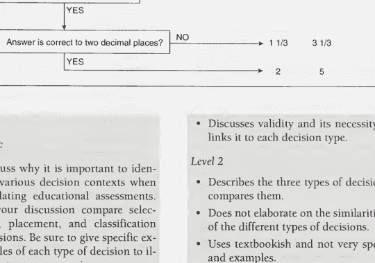

## 示例

## 一个整体评分量规

题目：讨论在验证教育评估时识别各种决策情境的重要性。在你的讨论中比较选择、安置和分类决策。务必给出每种决策类型的具体例子来说明你的比较。

评分回应的整体量规

定性标准 分数

## 4 级 16–20

- 在三种决策类型之间做出明确比较。
- 包含支持每项决策所需的效度论证中的相似性和差异。
- 给出每种不同决策的具体例子。
- 给出对这些具体例子的效度论证所需的效度证据类型示例。

## 3 级 11–15

- 在三种决策类型之间做出明确比较。
- 包含支持每项决策所需的效度论证中的相似性和差异。
- 给出每种不同决策的一些具体例子，但没有详细说明它们如何适用于每种情况的效度论证的具体细节。

## 2 级 6–10

- 讨论效度及其必要性，但仅将其与每种决策类型弱相关联。
- 描述三种决策类型并隐含地比较它们。
- 没有详细说明不同决策类型的相似性和差异。
- 使用教科书式的、不是很具体的描述和例子。
- 指出效度很重要，但没有将效度与每种决策类型所需的证据不同需求联系起来。

## 1 级 0–5

- 描述三种决策类型中的一些或全部，但描述不正确和/或没有比较它们的相似性和差异。
- 例子可能抽象和/或与决策不匹配。
- 不同类型的效度证据未被正确描述。

制定和使用整体评分量规 一种实施整体方法的方法是事先决定你将把学生对每个问题的回应分为多少个质量类别。通常，你可以使用三到五个类别，例如 A、B、C、D 和 F；卓越、熟练、学徒和新手；或 4、3、2 和 1。决定类别数量时非常重要的一点是确保它们与你学校的评分系统相对应。例如，如果你的学校使用 A 到 F 的等级，那么你需要五个类别。使用评分量规中的只有三个质量水平会使你的学生评估不必要地复杂化。

## 注释整体评分量规

在决定类别数量后，你阅读一篇论文并确定它将被分配到哪个类别。阅读并对所有论文进行分类后，你应重新检查同一类别内的所有论文，以确保它们在质量上足够相似，可以获得相同的等级或质量评级。你根据第二次阅读的结果将不相似的论文分配到更高或更低的类别。你也可以将一个类别中的论文与另一个类别中的论文进行比较，以决定类别间的分布是否合理或是否需要进一步重新分配。

使用整体方法的第二种更好方法是制定一个整体评分量规，该量规定义属于每个类别的论文的质量。这意味着，例如，描述一篇 A 级论文是什么样的，B 级论文是什么样的，等等。最好在你已在几篇论文上试用草案版本后修改你的评分量规。试用量规将使你能够识别其中有问题的部分，然后添加你在原始草案中可能未能包含的学生回应的品质。我们之前给出的关于“决策”论文的整体评分量规就是使用这种方法的一个例子。同样，请确保你的量规的层级数量与你学校的评分系统相同。 （有关评分的更多细节，请参阅第 15 章。）

第三次改进是选择每个评分类别的典型论文示例。你可以将当前学生的答案与定义每个质量水平的以前学生论文的实际样本进行比较。然后你决定将它们放在哪个类别中。

整体评分的第四种实施方法是阅读答案并将一个与另一个进行比较，以决定哪些是最好的，接下来最好的，等等。这将导致对所有论文的粗略排名。排名最好的论文被放在最高类别中，接下来最好的放在第二类别中，依此类推。然而，这种方法对于大量论文来说效果并不好。

这四种整体方法中的前三种与基于标准参照或绝对质量标准的评分哲学一致。第四种与基于常模参照或相对质量标准评分哲学一致。 （有关这些概念的更详细解释，请参阅第 15 章和第 17 章。）

一些教育工作者成功使用了第三种评分量规，它是分析量规和整体量规的混合体。注释整体量规是一种使用整体评分但以类似于分析评分的方式对少数特征向学生提供反馈的方法。通过这种方法，质量水平被定义，论文被整体评分。在做出整体判断后，你在学生的论文上写下非常简短的评论，基于预先指定的特征，指出回应的一个或两个优点和一个或两个缺点。你只写导致你做出论文整体判断的内容。这种方法的一个例子显示在第 12 章的作品集评分指南中（示例 12.1）。

## 方法的优点和缺点

分析性和整体性评分方法不可互换。它们对学生表现的含义假设不同。分析性评分量规的一个明显优点是它为你和你的学生提供了关于其优势和劣势的更多细节。如果你使用分析性评分量规，请利用这些额外信息来增强你的教学。例如，你可以识别出全班答案中哪些要素或部分最薄弱，并针对该方面进行再教学。你也将能够对学生在做得好的答案部分给予具体的表扬。

使用整体评分量规的一个优点是节省时间。整体评分学生的论文比分析评分更快。通常节省的时间相当可观，大约是二比三倍。

两种量规的优缺点更完整的总结见表 9.2。

## 更多评分建议

一些原则适用于无论使用哪种评分方法。这些原则总结在表 9.3 中。我们在以下段落中讨论它们。

## 评分量规

评分量规和模型答案与分析性和整体方法相关联。 使用这些工具的目的是提高你的评分一致性，以便你从一篇论文到另一篇论文应用相同的标准。一些州已采用你应使用的通用量规。检查你所在州网站上的要求。

## 一次只评分一个问题

如果有多个论文问题，先对所有学生在第一个问题上进行评分，然后再进行下一个问题。这样做可以提高你对每个学生应用评分标准的一致性。它也使你更熟悉某个问题的评分指南，你不太可能被其他问题的回应分散注意力。最后，使用这种方法有助于减少前面讨论的迁移误差。你可以在评分每个问题后重新洗牌论文以进一步减少迁移误差。

## 将学科正确性与其他因素分开评分

在批改学科论文时，除答案内容之外的因素往往会影响你的评价。其中这些因素包括拼写、笔迹、整洁度，


# 表 9.2 整体评分量规与分析性评分量规的优缺点

## I. 整体评分量规
### A. 优点
- 1. 与分析性量规相比，你可以稍微更快地给学生的论文评分。
- 2. 它帮助你将论文视为一个整体来审视。

### B. 缺点
- 1. 你只给出一个总体分数，并不会指出可能帮助学生改进的细节。
- 2. 你的个人偏见（例如偏爱整洁或拼写正确）和错误（对某位学生的论文中特定要素的正确性关注得比另一位学生更多）很容易被总体分数所掩盖。

## II. 分析性评分量规
### A. 优点
- 1. 通过分别对每个要素进行评分，你可以向学生反馈他们的优势和弱点。
- 2. 通过分别对每个部分进行评分，你可以查看所有论文，看看哪些要素给学生带来了最大困难，因此需要重新教授。
- 3. 通过对答案的某些要素赋予比其他要素更大的权重，你必须正视自己的价值观（即你必须决定哪些要素比其他要素更重要）。

### B. 缺点
- 1. 使用分析性评分量规时，你的评分会稍微慢一些。
- 2. 对于某些作文，你可能会发现很难在评分指南中提出明确定义的要素。
- 3. 初任教师可能会因创建有用的分析性评分量规所需的时间而感到有些沮丧。

> 来源：改编自《Creating Writers: Linking Assessment and Writing Instruction》第2版（第29–36页）作者 V. Spandel 和 R. J. Stiggins，1990年，纽约：Longman。版权 1997、1990 归 Longman Publishers USA 所有。经 Addison-Wesley Educational Publishers Inc. 许可改编。

# 表 9.3 对学科论文题作答评分原则的总结

- 1. 准备某种类型的评分指南（例如，大纲、量规、“理想”答案，或往年考试的“样例”回答）。
- 2. 在转到下一个问题之前，先对所有对一个问题的回答进行评分。
- 3. 定期重新评分已评分的论文。
- 4. 将笔迹、整体整洁度、拼写、规定格式的使用和英语 mechanics 与学科内容正确性分开评分。
- 5. 在不知道写答卷的学生姓名的情况下评分。
- 6. 向学生提供其回答的优势和弱点的反馈。
- 7. 当评分决定至关重要时，让两位或两位以上的阅卷者独立评分。

> 来源：Coffman, 1971; Ebel, 1979; Greene, Jorgensen, & Gerberich, 1942; Gronlund, 1976; Hopkins, Stanley, & Hopkins, 1990; Lindvall & Nitko, 1975; Mehrens & Lehmann, 1991; Sax, 1989; Stainaker, 1951; Thorndike, Cunningham, Thorndike, & Hagen, 1991.

对思想质量、内容正确性和其他因素分别评分，也给了你根据每个因素在计算成绩时的适当权重进行调整的自由。例如，你可以根据州政策、学校政策或你的课堂实践，将拼写的权重设为零或更大。你仍然向学生报告零权重因素（例如拼写）的结果；你只是不将其计入成绩。但如果一个因素的权重为零，为什么还要费心单独标记和报告它呢？答案是，即使你有意识地试图仅基于思想或内容进行评分，你仍会在不知不觉中受到笔迹、拼写和整洁度等因素的影响（Marshall, 1967; Marshall & Powers, 1969; Scannell & Marshall, 1966）。单独评分这些因素减少了它们对作文成绩的影响，让你能更好地评估内容学习目标。

匿名评分作文 当你不知道写出回答的学生姓名时，评分会更有效。匿名评分作文可以防止前面提到的光环效应。此外，如果学生知道你匿名评分，他们很可能会认为评分过程是公平的（Mehrens & Lehmann, 1991）。保持匿名的一种建议是让学生将姓名写在答题纸或考试本的背面。其他更复杂的方法，例如使用学生编号或其他代码，也很有效。

以及语言使用。为了避免将你对学生答案的思想质量或实质内容的判断与这些其他因素混为一谈，请分别评分其他因素——也许可以使用评分量表（参见第12章）。

给学生反馈 使用作文的一个重要原因是它给了你评估学生表达能力和思维过程的机会。你应该记录每位学生在这些方面的优势和弱点，并解释你是如何得出所给分数的。这样，作文评估就为进一步的学生学习提供了机会。以下列表提供了在你的关注点是教授一般写作技能时，对学生作文进行评注的建议。这些建议也适用于学科论文题。

- 1. 在任何一篇论文中只评论两三个要点。
- 2. 选择对特定学生在特定时间最重要的问题进行评论。
- 3. 以可用的形式总结评论。
- 4. 仅在对整篇论文进行快速分析后才开始写评论。
- 5. 选择那些最有可能在学生下一篇文章的内在有效性方面带来最大评估改进的评论。
- 6. 以鼓励的方式陈述评论。
- 7. 不要犹豫在多篇论文中重复同一评论。
- 8. 跟踪评论，以便在课程中不会遗漏对特定学生而言非常重要的内容。
- 9. 通过评论的语气明确表明它们涉及的是需要学习的手艺，而不是教师的个人品味。（Hirsch, 1977, pp. 160–161）

另一种提供反馈的建议是举行学生会议——即与每位学生单独会面，回顾答案和评论。与每位学生进行10到20分钟的简短会议更具个人性，并且可以为学生提供比在论文边际写下评论更清晰的指导。与每位学生进行简短的直接会议也可能为你节省大量撰写大量笔记和评论以澄清学生疑问的时间。

## 独立评分

个别教师的怪癖确实会影响作文分数。表 9.3 中的建议有助于减少你怪癖的影响，但并不能完全消除它们。古老的中国人意识到，当重要决定依赖于作文分数时，需要不止一位阅卷者（Kracke, 1953）。现实地说，然而，即使日常的评分决定很重要，你也不太可能找到时间和同事的持续合作来进行作文的独立评分。尽管如此，这种做法会提高你评分的一致性。

## 评估你的评分量规

你可能希望评估你制定的评分量规的质量。使用第12章中的清单（清单12.3）来做到这一点。

## 总结

## 作文题的格式

- 作文题要求学生对一个问题或问题写出相当长的回答。
- 限制性回答作文限制或限定了书面回答的实质内容和形式。

扩展性回答作文允许学生更充分地利用书面言语推理和写作技能，包括对实质性问题的答案进行充分阐述。

客观题、限制性回答作文和扩展性回答作文可以评估的不同学习成果的总结见表 9.1。

## 限制性回答格式：

- 应用于衡量各种复杂的学习成果。
- 将题目焦点缩小到更具体的內容和明确定义的情境。
- 可用作情境依赖或解释性练习。
- 很可能导致几乎所有学生以基本相同的方式理解题目的意图。
- 比扩展性回答格式更可靠地评分。

## 扩展性回答格式：

- 应用于衡量更复杂的各种学习目标。
- 应用于评估关于学科的写作能力或学生的一般写作能力。
- 具有独特的特征，允许学生展示书面产出、组织和表达思想以及这些能力之间相互关系所需的技能。
- 不应用于引出对不同提示和内容的低层次反应。
- 对于评估写作成绩，尤其是形成性目的，让学生在同一文体中选择写作主题通常是可取的。通常，这意味着为所有学生制作一个单一文体的提示，但让他们自行选择如何回应。


## 构建用于评估写作成绩的提示

- 有效的写作教学要求评估是形成性的，并且高度融入教学中。
- 评估和教学要求你集中关注优秀写作的特征或特质，如思想与内容、组织、声音、词语选择、句子流畅度以及英语 mechanics。章节给出了这些特质的若干示例。附录 H 展示了如何详细定义它们。
- 写作评估主要被视为形成性的，在写作的每个阶段提供不同类型的反馈。章节中给出了一个与评估整合的写作过程示例。
- 当你设计写作提示时，应确保每个提示都包含足够的修辞线索，以便学生理解你希望他们写什么。其中应包含的修辞线索包括 SOAP（主题、场合、受众、目的）、作者角色和形式。
- 章节提供了准备写作提示的若干 dos 和 don'ts。
- 提示应为不同体裁和写作目的而设计，以便满足写作课程中的所有学习目标。常见的体裁包括叙事、想象、说明性和说服性写作。

## 评分作文评估

- 评分作文所涉及的主观性对分数的可靠性和有效性构成了严重威胁：
  - 特定阅卷者可能不一致。
  - 同一学生的分数在阅卷者之间往往存在很大差异。
  - 问题的类型和主题会影响阅卷者的评分。
  - 光环效应、延续效应、夸大、笔迹、拼写和语法都会影响评分。
- 学科类作文题可以采用分析性或整体性评分。你应使用的方法取决于你提出的作文题的性质。提供了每种评分类型的示例。表 9.2 总结了每种方法的优缺点。
- 表 9.3 总结了评分作文题的建议，适用于分析性或整体性评分。
- 提出了对学生作文和作品进行评语的建议。
- 你可以使用整体性或分析性评分量规来评估一般的写作技能。表 9.2 总结了每种量规的优缺点。
- 分析性评分量规有助于你评估学生写作的特定方面。因此，当你想要诊断学习需求并将教学重点放在这些需求上时，它们似乎很有用。
- 你采用的任何分析性评分量规都应包含以下特质：（a）具有良好的教育意义，（b）适用于广泛的写作表现，（c）可以轻松教授给学生。

## 重要术语和概念

- analytic scoring rubric
- annotated holistic rubric
- assessing subject-matter knowledge
- assessing general writing ability
- assessment of simple recall
- assessment of higher-order essay items
- halo effect
- holistic scoring rubric
- imaginative writing
- independent scoring of essays
- interpretive exercises (context-dependent tasks)
- narrative writing
- optional essay questions
- persuasive writing
- prewriting activities
- rater drift
- restricted response essay items
- scoring reliability
- Six + 1 Traits® Writing
- SOAP
- writing process
- writing traits (writing dimensions)

## 练习与应用

- 1. 对于你教授的每门学科（或计划教授的学科），确定可以伴随情境依赖性题目的不同类型的材料。
  a. 对于每种类型，说明其 intended 的学生教育水平。
  b. 对于每道构成科学单元测试的作文题。在每道题后提供了教师提供的标准答案和 Jane Smith 的答案。你需要做两件事：首先，确定每道题的最高分（分数）。（整份测试的最高分为 50 分，因此你需要根据认为适当的方式在四道题之间分配。）其次，根据答案要点评估 Jane Smith 的答案，并根据其正确程度给予她分数。

## Question 1

What is the shape of a quartz crystal?
Answer key: Hexagonal
Maximum marks: ______
Jane’s answer: “Six-sided hectogon.”
Jane’s score: ______

## Question 2

What is a saturated solution?
Answer key: A solution that contains as much dissolved substance as it can for a particular temperature.
Maximum marks: ______
Jane’s answer: “Large crystals contain a great deal of substance that has been formed. This process of forming crystals is called crystallization. It occurs both in the laboratory and in nature.”
Jane’s score: ______

## Question 3

Write a paragraph describing how you can grow very large crystals.
Answer key: Any answer that says size of crystal is directly related to the rate of crystallization.
Maximum marks: ______
Jane’s answer: “Large crystals contain a great deal of substance that has been formed. This process of forming crystals is called crystallization. It occurs both in the laboratory and in nature.”
Jane’s score: ______

## Question 4

Name three major categories of rocks.
Answer key: Igneous, sedimentary, and metamorphic
Maximum marks: ______
Jane’s answer: “The three kinds are fire-formed, settled, and those that have changed their form.”
Jane’s score: ______

5. 本练习应在课堂上完成。
a. 将你在练习 4 中为每道题分配的最高分与本课程其他人分配的分数进行比较。（将最高分的分布写在黑板上。）对于哪些问题有更多的一致性？对于哪些问题一致性较少？
b. 在课堂上讨论一致和不一致的原因。列出似乎影响同学为每道题分配最高值的因素。
c. 提出减少分配问题最高值时人员之间差异的方法。确保建议针对这四道题具体。
d. 将你给 Jane 的每道题分数与本课程其他人给出的分数进行比较。对于哪些题目有更多的一致性？对于哪些题目一致性较少？
e. 在课堂上讨论评分一致和不一致的原因。列出似乎影响为 Jane 每道题分配分数的因素。
f. 评分 Jane 回答时一致性更高的问题，是否与最高分一致性更高的问题相同？解释。

## 附加阅读

Coffman, W. E. (1971). Essay examinations. In R. L. Thorndike (Ed.), Educational measurement (2nd ed.). Washington, DC: American Council on Education. Chapter 10, 271–302.
Reviews early research on essay items. Gives suggestions for improving the essay examination process.

Gentile, C. (1992). Exploring new methods for collecting students’ school-based writing: NAEP’s 1990 portfolio study (Ch. 2, pp. 18–61). Washington, DC: Education Information Branch, Office of Educational Research and Improvement, U.S. Department of Education.
This chapter describes three scoring guides for assessing writing: narrative, informative, and persuasive. Examples of student writing (in student penmanship) are presented to illustrate how each scoring guide is used.

Northwest Regional Educational Laboratory. Toolkit98. Available online from the Northwest Regional Educational Laboratory at http://www.nwrel.org/assessment/toolkit98.asp.
A large set of workshop material about alternative assessments including detailed explanations of the Six Traits® analytic scoring rubric. Gives examples of how to use the rubric to score students’ writing and how to integrate assessment results into your daily teaching. Contains links to other sites that have examples, lesson plans, and teaching tips for using the Six + 1 Traits® model.

Oregon Public Education Network. Practice scoring! Available from the Oregon Department of Education, Salem, OR online at http://www.open.k12.or.us/scoring.
This is an interactive site where you read sample student papers, apply the scoring rubrics, and compare your results with teachers who have scored these papers before. Contains some teaching tips, too.

Wittrock, M. C., & Baker, E. L. (Eds.), (1991) Testing and cognition. Englewood Cliffs, NJ: Prentice Hall.
A number of chapters relate to issues in using constructed-response tasks to assess cognitive achievement.


## 高阶思维、问题解决与批判性思维

## 学习目标

学习本章后，你应能够：

### 使用情境依赖性题组评估高阶思维
- 1. 解释为什么必须使用新颖材料来评估高阶思维。 [1, 2]
- 2. 解释情境依赖性题组的优点、缺点和布局特点。 [2, 1]

### 评估概念学习
- 3. 解释概念学习以及概念如何与学生的图式相联系。 [4, 6, 1]
- 4. 设计任务以评估学生是否已学习到具体和定义的概念。 [2]
- 5. 设计表现性任务以评估学生对概念的更深理解。 [2]

## 评估规则和原理的理解
- 6. 解释规则指导性思维（原理指导性思维）的含义以及评估学生对原理和规则理解的基本策略。 [4, 6, 1]
- 7. 设计任务以评估学生对原理和规则的理解。 [2]

## 评估问题解决能力
- 8. 解释问题解决的本质以及学生如何使用一般和学科特定问题解决能力，并举例说明问题解决的启发式方法。 [4]
- 9. 设计任务以评估学生执行以下问题解决能力的能力：识别和认识问题、定义和表征问题、探索可能的解决方案策略、以及对问题-解决方案策略采取行动并回顾。 [2]

## 评估批判性思维能力
- 10. 解释批判性思维的含义及其与问题解决的关系。 [4, 3]
- 11. 设计清单和简单的评分量表以评估学生对批判性思维的倾向。 [2]
- 12. 设计任务以评估以下类别的批判性思维能力：初级澄清能力、基本支持能力、推理能力、高级澄清能力、以及战略和战术能力。 [2]
- 13. 解释为什么有必要同时评估学生将问题解决和批判性思维活动结合使用的能力，以及单独评估这些技能的组成部分。 [4, 5, 3]

### 评估其他高阶技能和能力
- 14. 设计任务以评估学生使用参考资料、阅读图表和表格、阅读地图以及阅读印刷材料的能力。 [2]
- 15. 设计增强型选择题。 [2]

## 重要术语和概念
- 16. 解释本章末尾列出的术语和概念如何适用于教育评估。 [6]

## 本章简介

你是否曾想过纸笔测试只能评估简单的学习形式？什么是高阶思维、问题解决和批判性思维？如何评估更高形式思维？这些都是本章讨论的问题。

本章首先简要讨论情境依赖性题组。这种题型格式特别适合评估高阶思维、问题解决和批判性思维。接下来，我们讨论概念学习及其评估的含义。因为确保学生理解学科的主要概念是你教学的重要部分，所以这是讨论高阶思维的良好起点。我们讨论了进行这些评估的八种策略。第三，我们讨论如何评估学生对规则和原理的理解，这些规则和原理是大多数学校学科的学习目标。讨论的关键是如何设计你的评估，使学生能够证明他们可以将学科的规则和原理应用于现实世界的情况。我们讨论了该领域评估的七种策略。第四，我们关注问题解决评估。我们讨论问题解决的含义并提出17种策略，可用于在此领域评估学生。第五，我们转向批判性思维和九种评估学生的策略。本章的最后部分讨论了在以下专门领域评估高阶思维的策略：(a) 使用参考资料、图表、表格和地图；以及 (b) 阅读理解和语言艺术技能。

## 评估高阶思维

评估高阶思维技能的基本规则是设计需要学生在新颖或全新情境中使用知识和技能的任务。如果你只评估学生回忆教科书或你所说的内容的能力，你就无法知道他们是否理解或能够应用理由、解释和解读。简而言之，你必须使用新颖材料来评估高阶思维。

## 情境依赖性题组

## 特点

情境依赖性题组由介绍性材料和若干题目组成。你设计题目，使学生必须思考并使用介绍性材料中的信息来回答问题、解决难题或以其他方式完成评估任务。情境依赖性题组有时称为解释性练习。介绍性材料可能是阅读材料摘录、图片、图表、绘图、段落、诗歌、公式、数字表、单词或符号列表、标本、地图、影片和录音。如果你想评估本章所述类型的学生高阶思维技能，你需要使用情境依赖性题组。以下是一个例子。

## 示例

下面是词典的一部分。利用它回答问题1、2和3。

ru-bli-ous (roo’bē əs) adj. Of the color of a ruby : red.
ru-ble (rōo’bə) n. var. of ROUBLE.
ru-bric (roo’brik) n. [ME rubrice < OFr. rubriche < Lat. rubrica, rubric, red chalk < ruber, red.] 1. A part of a manuscript or book, as a heading, title, or initial letter, that appears in decorative red lettering or is otherwise distinguished from the rest of the text. 2. A title or heading of a statute or chapter in a code of law. 3. a. A class or category. b. A title : name. 4. A direction in a liturgical book, as a missal or hymnal. 5. An authoritative direction or rule. 6. A short commentary or explanation covering a broad subject. 7. Red ocher.—adj., 1. Red or reddish. 2. Written in red.—ru’bri-cal adj.
ru-bri-cate (roo’bri-kāt’) vt. -cat, ed, -cat-ing, -cates. [Lat. rubricare, rubricat-, to color red < rubric, rubric.] 1. To write, arrange, or print as a rubric. 2. To provide with rubrics. 3. To establish rules for.—ru’bri-ca’tion n.—ru’bri-ca’tor n.
ru-bri-cian (roo’bri-shən) n. One learned in the rubrics of ecclesiastical ritual.
ru-by (roo’bē) n., pl. -bies [ME < OFr. rubi < Med. Lat. rubinus (lapis), red (stone) < Lat. rubeus, red.] 1. A deep-red translucent corundum highly valued as a precious stone. 2. Something, as a watch bearing, made from a ruby. 3. A dark or deep red to deep purplish red.—adj. Of the color of ruby.

> Source: Copyright © 1994 by Houghton Mifflin Company. Reproduced by permission from Webster’s II Riverside University Dictionary.

- 1. The u in rubric is pronounced like
  + A u in rubric
  + *B oo in boot
  + C u in lunch
  + D oo in cook
  
- 2. Which meaning of rubric is used in the following sentence: "Our teacher told us to use the rubric when we mark our papers."
  + A 1
  + B 4
  + *C 5
  + D 6
  
- 3. What part of speech is the word rubrication?
  + A adjective
  + B adverb
  + *C noun
  + D transitive verb

在这个例子中，解释性材料是词典摘录。该摘录“模拟”了词典页面，因此呈现了一个具体、现实的例子。学生必须分析或处理此例中的材料来回答问题。该示例显示了多项选择题。然而，情境依赖性题组可与任何类型的题目格式一起使用。

## 优点和缺点

优点 情境依赖性题组具有以下优点：(a) 它提供了一个机会来评估学生在相对接近现实世界情境的材料上的表现，(b) 它通过介绍性材料为所有学生提供相同的情境，(c) 其介绍性材料减轻了记忆负担并可能缓和特定内容先前经验的影响，以及 (d) 经常它是测试某些智力能力的唯一手段。

缺点 情境依赖性题组的某些缺点是 (a) 该题组可能难以构建，(b) 你必须仔细创建介绍性材料以评估高阶思维技能，(c) 学生在一种情境依赖性题组上的表现可能无法很好地推广到另一种相似题组上的表现，(d) 该题组通常要求学生使用额外的能力（如阅读理解和写作技能），这些能力可能超出了评估任务的主要焦点，以及 (e) 你可能需要特殊设施（如复印机和/或绘图技能和设备）来制作它们，而这些可能不可用。

## 布局

情境依赖性材料在测验手册页面上的排列方式很重要，因为不良的排列可能导致学生误读或误解题组。因此，不良的排列会危及你的评估结果的有效性。下一个示例显示了一种可接受的排列。

## 示例

情境依赖性题组的排列


请注意，一个侧标题（下划线、下划线、粗体或大写字母）引导学生阅读介绍性材料并完成基于它的特定任务。一些学生可能会跳过介绍性材料或对它所指的题目感到困惑。侧标题有助于避免这种情况。介绍性材料放在页面的中央。题目可以堆叠或按上一个示例所示放置。

绘图应整洁、清晰，并在必要时标注。照片和杂志图片在复印时可能无法辨认，因此请事先检查你将使用的复制设备。如果介绍性材料是段落或诗歌，居中和单倍行距通常是可以接受的，但幼儿和某些残疾人士可能难以适应这种排列。你可能需要为一些学生使用放大印刷。记住在使用受版权保护的材料时寻求许可。

## 页面排列

如果可能，请将介绍性材料和所有引用它的题目放在同一页上。否则，学生在完成评估时翻页来回会分散注意力。短期注意力和记忆力较差的学生可能会迷失方向或犯粗心错误。

## 概念与概念学习

## 什么是概念？

概念是相似事物（对象、人物、事件或关系）的类别或分类。你教授的许多东西都是概念。学生对概念的理解构成了他们高阶学习的基础。例如，当我们谈论概念 red 时，我们指的是具有相似颜色的物体类别。如果学生 (a) 能识别 red 事物的例子或实例（红色三轮车、红色书、红色口红等）并且 (b) 不将非红色事物（绿色三轮车、紫色书、粉色口红等）称为红色，则认为学生已学习了概念 red。概念是思想或抽象：世界上只存在概念的具体例子。概念类别的各个成员称为实例、例子或范例。

### 具体与定义概念


other concepts. Defined concepts are sometimes called abstract or relational concepts (Gagné, 1970). Defined concepts are usually learned by definitions. Gagné gives an example of the defined concept diagonal, which is defined as a line connecting the opposite corners of a quadrilateral figure. The relationship is “connecting.” The related concepts are “opposite corners,” “quadrilateral figure,” and “line.” Other examples of defined concepts include beside, friendliness, uncle, and mother. Some concepts are learned initially as concrete concepts and later as defined concepts.

## 理解概念

理解概念不仅仅是简单地识别它的例子。概念彼此相关，并通过图式或网络以复杂的方式相互联系。图式是我们通过相互连接的概念、信息、规则、问题解决策略和行动条件网络在头脑中表示知识的方式（Marshall, 1990）。例如，Woolfolk（1995）指出，我们知道假钱不是真钱，即使它符合货币概念的原型和例子。我们知道它是假钱，因为我们将货币概念与其他概念联系起来，例如印刷货币的权威、犯罪、伪造等概念。你需要在学生能够完全理解这些概念之前帮助他们将概念连接到他们已有的知识网络和图式中。Woolfolk（1995）总结了教授概念的推荐教学结构。

## 评估具体概念学习

## 三种评估策略

三种常用的策略可以评估学生是否学习了具体概念。策略1是给出名称：你在向学生展示其不同例证后要求其说出概念的名称。以下是评估学生是否学习了形状圆的例子。

## 示例

策略1. 给出名称：学生看到例证后给出概念名称

1. 这个组中的形状叫什么？[答：圆]


策略2是区分例证与非例证：你向学生展示目标概念的几个例证和几个非例证，所有内容按混乱顺序排列，提供目标概念的名称，并要求学生识别哪些是该概念的例证。以下是评估学生是否学习了概念圆的例子。

## 示例

策略2. 区分例证与非例证：学生必须将概念例证与非例证区分开

2. 这些形状中哪些是圆？[答：A、D、G]

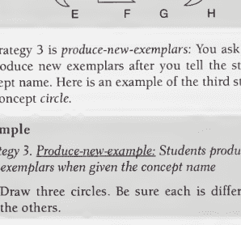

策略3是产生新例证：你在告诉学生概念名称后要求其产生新的例证。以下是针对概念圆的第三种策略的例子。

## 示例

策略3. 产生新例证：学生在给出概念名称时产生自己的例证

3. 画三个圆。确保每个都与其他不同。

### 对三种策略的批评

给出名称策略1通常是评估概念学习不令人满意的方式。学生可能学习了概念并且能够使用它，而无需学习概念的正确名称。给出名称评估策略不需要学生区分例证与非例证，因此你不知道学生是否过度概括了概念。例如，学生可能认为所有边缘呈圆形的形状都是圆。因此，学生可能会将圆与椭圆（卵形）和球体（球）混淆。最后，这种评估策略不需要学生使用或应用其对概念的理解。因此，即使学生能够说出概念名称，你也不知道她是否具有将概念与其他概念联系起来并将其整合到其图式中所需的更深层次的理解。

区分例证与非例证策略2要求学生将圆与其他形状区分开。这种评估策略优于策略1，因为它（1）不需要学生产生概念名称即可完成任务¹并且（2）允许你控制评估情况。你需要控制（a）例证和非例证对学生来说熟悉的程度，（b）例证对概念的典型程度，（c）例证与非例证之间区分的数量和类型，以及（d）你展示的例证总数。要使用这种策略，你必须至少展示两个例证供学生识别；否则你不知道学生是否低估了概念。低估意味着学生认为只有一个例子与整个概念相同（例如，认为你在课堂上黑板上展示的圆是唯一的圆）。与策略1一样，这种策略也不要求学生使用或应用其对概念的理解。因此，它不允许你评估学生对其更深层次的理解。

产生新例证策略3要求（a）学生想出例子，（b）你判断例子的正确性，以及（c）你判断学生的例子是否被明确教授（即它们是否“新”；见 Jenkins & Deno, 1971）。请记住，然而，学生产生新例子的能力可能不是学习概念的必要条件。因此，虽然这种策略可能有助于评估简单概念（如圆），但它不适用于更复杂概念的评估，因为它不允许你评估学生的更深层次理解。

## 在更深层次评估概念理解

我们在上一节看到，所有三种常用的策略都有一些弱点。它们都未评估学生对概念的更深层次理解。然而，学生在用于进一步学习和进行高阶思维之前需要更深层次的理解。在本节中，我们讨论一种评估概念更深层次理解的更好策略。

## 用于更深层次理解的表现性评估

学生通过能够（a）使用概念解决问题，（b）将概念与其他概念、原理（规则）和已学到的概括联系起来，以及（c）使用概念学习新材料来展示其更深层次的理解。为了评估学生的更深层次理解，你必须设计更复杂且需要比前述题目更大量概念应用的评估。以下示例显示，即使对于简单的具体概念，也有可能进行这种更深层次的评估。

我们一直在学习两种形状：圆和正方形。昨天我们走过学校附近，观察建筑物、人物和汽车的形状。今天，你将画一幅学校附近、你的社区或一个城市的图画。你的图画必须包括建筑物、人物和汽车。然而，你的图画中不能使用任何圆或正方形。

在你工作时，请让朋友不断检查你的图画，看看你是否使用了这两种形状。如果使用了，请更改你的图画，使其没有圆或正方形。

完成后我会检查你是否使用了这两种形状。在你工作时，我会要求你用我们学习过的形状的词语向我解释，在这次作业中你学到了关于我们世界中形状重要性的什么。我会要求你向我解释，为什么不使用圆和正方形画这样的图画如此困难。

开始之前我会向你展示一些图画的例子，解释我会寻找什么，以及我对你的回答的期望。

Source: Adapted from Assessing Student Outcomes: Performance Assessment Using the Dimensions of Learning Model (pp. 61–62), by R. J. Marana, D. Pickering, and J. McTighe, 1993, Alexandria, VA: Association for Supervision and Curriculum Development. Reproduced with permission of McREL Institute, 2550 S. Parker Rd., Suite 500, Aurora, CO, 80014. Telephone (303) 337-0990. © 1993 by McREL Institute. All rights reserved.

该示例显示了一种表现性任务，意味着学生必须对自己的知识做些什么（参见第11章和第12章，完整讨论表现性评估）。此评估可用于评估以下学习：

- I. 内容目标（组合）
- A. 理解世界中形状的重要性
- B. 识别圆和正方形
- C. 将圆和正方形与其他形状区分开
- II. 复杂思维目标（解决问题）
- A. 识别阻碍你解决问题的事情
- III. 信息处理目标
- A. 有效地解释和综合信息
- IV. 有效沟通目标
- A. 有效地传达思想

此示例中的评估需要相对较长时间来实施，可能需要两个或三个40分钟的数学课时。主要表现是：制作一幅包含建筑物、汽车和人物的社区图画，但不使用圆和正方形。此图画提出了一个需要解决的问题：如何在不使用圆和正方形的情况下制作建筑物、汽车和人物？对于一年级学生来说这是一个困难的问题，因为圆和正方形是构成学生大部分经验的基本形状。学生

示例
策略4. 更深层次的理解：一种评估概念理解更深层次的表现性评估

教师口头解释任务


必须区分圆形、正方形和其他形状才能解决这个问题。注意，评估要求你做的不仅仅是收集绘画。你必须与每位学生进行访谈或会议，使用绘画来提示或引导学生提供有关学习目标达成情况的信息。

要评估学生，你需要使用评分量规。以下是示例。

## 示例

圆和正方形绘画问题的评分量规

### 识别圆形和正方形

- 4 始终能够在很少或没有提示的情况下识别圆形和正方形。
- 3 能够识别圆形和正方形，但需要一些提示。
- 2 有时会将圆形和正方形与椭圆或其他曲线混淆；有时会将正方形与矩形或其他形状混淆。
- 1 对圆形和/或正方形表现出严重的误解。

### 理解圆形和正方形作为构成世界中物体的基本形状的重要性

- 4 充分理解圆形和正方形是如何构成世界上大多数物体的基本形状，并对它们的使用提供新的见解。
- 3 展示出对圆形和正方形在世界中如何使用完整而准确的理解，但没有提供对其使用方面的新见解。
- 2 对圆形和正方形在世界中如何使用表现出不完整的理解，并且对其使用存在一些明显的误解。
- 1 对圆形和正方形在世界中如何使用存在严重的误解。

### 理解无法使用圆形和正方形会阻碍准确描绘现实世界物体

- 4 准确而透彻地描述在绘画中不使用圆形和正方形会导致失真或无法在绘画中表现物体。讨论出不立即显现的障碍或限制。
- 3 准确识别因无法在物体绘画中使用圆形和正方形而产生最重要的障碍或限制。
- 2 识别出关于不使用圆形和正方形的一些约束或障碍是准确的，但也包括一些不准确或与绘画问题无关的内容。
- 1 省略了因无法使用圆形和正方形来解决绘画问题而产生最重要的约束或障碍。

### 有效地解释和综合关于现实世界物体、圆形和正方形的信息

- 4 以准确且极具洞察力的方式解释绘画问题的形状或物体信息。提供对信息高度创造性和独特的综合。
- 3 以准确的方式解释绘画问题的形状或物体信息，并在绘画中简洁地综合。
- 2 在解释解决绘画问题的物体形状信息时出现重大错误，或综合信息不精确或笨拙。
- 1 对为绘画问题收集的物体形状信息进行严重误解或未能综合。

### 以数学正确的方式表达关于圆形和正方形是现实世界物体基本元素的想法。

- 4 清晰传达关于圆形和正方形作为现实世界形状基本元素的核心思想。提供的观点支持包含丰富、生动而有力的细节。以数学正确的方式使用形状术语。
- 3 清晰传达圆形和形状是构成现实世界物体的基本形状的核心思想，并提供适当的支持。
- 2 传达关于圆形、正方形和现实世界形状的基本信息，但没有清晰的主题或整体结构。
- 1 以孤立的信息片段、可能以随机方式传达关于圆形和正方形的信息。

每个学习目标对应一个评分量规。然而，你不要将每个量规视为单独的测试项目。你评估整个任务，而不是逐项评估。你通过审阅学生的绘画、与学生进行会议以及提示学生讨论数学内容来综合获取大量关于学生学习目标达成情况的信息。只有在那之后，你才评估学生学习每个目标的程度。

## 该策略的优势

使用策略 4 通过复杂表现性任务评估概念的优势，例如示例中的任务，是学生会在现实情境中使用概念。这些情境激活学生的认知框架和图式。它们要求学生在完成任务时将概念与其他概念联系起来。如果你关注学生在解决问题时使用目标概念的方式，你就可以评估学生是否超越了简单命名和识别概念的理解。

## 评估定义概念学习

## 四种评估策略

四种策略可以帮助评估学生对抽象或定义概念的学习。策略 1 要求学生对概念做出正确定义（Jenkins & Deno, 1971）。这里有一个例子：

## 示例

策略 1：要求学生提供定义

- 1. 用你自己的话定义偏见行为。
- 2. 说明“孤独”是什么意思。

策略 2 要求学生提供概念的新颖或新例子（Jenkins & Deno, 1971）。这是一个例子：

## 示例

策略 2：要求学生提供例子

- 3. 描述两个在课堂或课本中未讨论过的偏见行为的例子，但你是在过去几周亲眼目睹或经历过的。

策略 3 要求学生识别概念的典型例和非典型例（Jenkins & Deno, 1971）。下面是一个例子。

## 示例

策略 3：要求学生区分典型例和非典型例

说明：阅读每个编号的陈述。在陈述前标记：
P—如果它最有可能是偏见行为的例子。
NP—如果它最可能不是偏见行为的例子。

- (NP) 4. 萨姆，一名白人男子，在公司食堂被一名非裔美国收银员多收了钱。他变得很生气，并在之后两周拒绝与收银员交谈。
- (P) 5. 罗恩，一名白人男子，坚持个人原则，绝不与非裔美国同事社交，除非被迫如此。
- (P) 6. 约翰，一名非裔美国人，管理着当地一家药店，他坚信女性是无能的药剂师。
- (NP) 7. 比尔，一名职业高尔夫球手，声称在他职业生涯中，没有一个与他竞争的女性曾打败过他。

8. 哪项陈述最接近描述“孤独”的概念？
A 十岁的麦根今天决定独自玩她的娃娃屋，即使她的朋友们邀请她一起玩。
B 教授科里每天早上都关上办公室门，独自一人写研究报告。
*C 十五岁的玛雅在拥挤的学校食堂的每个午餐时间都独自站着，不与任何人说话。
D 克拉丽丝，一名隐修修女，不与任何人交谈，在祈祷时独自度过许多小时。

策略 4 要求学生分析定义概念以识别其组成部分概念并说明它们之间的关系（Gagné & Briggs, 1979）。这是一个例子：

## 示例

策略 4：要求学生识别组成部分并展示关系
（为节省篇幅省略了地球上有人物的图片）

9. 在上面的图片中，画出线条和角度以显示天顶相对于人的位置。标记角度和天顶。
来源：项目 9 基于 Gagné & Briggs, 1979, p. 227 的思想。

在四种策略中，策略 1 要求学生提供定义，策略 2 要求学生提供概念的新典型例，是较弱的策略，可能不适合年幼的学生（Nitko, 1983）。策略 3 要求学生区分典型例和非典型例，策略 4 要求学生识别组成部分并展示关系，是较强的策略。它们的主要优势在于要求学生识别新典型例，确保他们不会仅用死记硬背的定义来回答。项目 9（策略 4）的表现（绘画和标记）方面具有额外优势，不完全依赖高度发展的语言技能。（有关更多细节，请参阅 Nitko, 1983。）

## 语言项目评估某些定义概念的局限性

你不能使用前面示例中显示的项目类型来评估学生对某些概念的理解


示例。以下两种概念分别是 (a) 关系性概念（例如，叔叔、阿姨）和 (b) 其例证只能通过重复概念名称来用语言描述的概念（Anderson, 1972）。阿姨是母亲或父亲的姐妹。如果你试图写出“阿姨”的一个“实例”，你需要在选项中提及这种关系。

概念 wings 是第二种类型概念的例子（Anderson, 1972）。你写的每个例证都必须包含单词 wings（飞机翅膀、鸟翅膀、天使翅膀等），因此测试题可以通过将题干中的一个词与选项中的一个词进行匹配来作答。然而，你可以通过示例中显示的类型项目来评估诸如 tools 这样的概念，因为 tools 的实例（螺丝刀、扳手、锯子）可以在不重复术语 tool 的情况下写出。

## 评估学生的思维是否使用规则

学习的重要另一个领域是规则支配或原则支配的项目提供了学生被要求 (a) 识别或推断适用的原则、(b) 应用原则推断可能的结果，以及 (c) 使用原则写出适当的解释以证明所述结果的合理性的情境。请注意，该项目要求学生具备超出回忆原则和识别的知识。要正确回答该项目，学生不仅需要知道原则，还需要对地理有足够的了解，能够列出两个或更多与“中西部平原”相似的“地理位置”。此外，通常的标准要求学生使用新的例子。

局限性 这些要求使这种类型的任务变得困难，尤其是对于年幼、经验不足且阅读量不多的学习者。此外，学生在此类任务上的表现可能难以解释。以下是你需要回答的一些问题，以便正确评估学生对一项的回应：

- 学生的例子是新的，还是在课堂上或指定材料中呈现过的？
- 为什么学生不能给出一个好的例子？
- 如果学生无法写出解释，他是否理解该原则？
- 对你要求应用原则的具体内容，是否存在薄弱的知识？

产生解释后果的原则 策略 3 向学生提供条件和后果，并要求学生就这些后果根据原则提出可能的解释。与策略 2 的区别在于，在策略 3 中，学生不需要想出后果，只需解释它们。以下是一个例子：

## 示例

策略 3：仅产生解释

在回答第 3 题时使用以下信息。
在最近一次参观教室时，Larson 校长注意到 Hewmenist 老师在与一名儿童 Dizzy Ordur 合作时遇到困难。只要 Hewmenist 老师在他身边，Dizzy 就会工作，但只要她离开，Dizzy 就会“出声”或离开座位，她不得不返回才能让他重新工作。Larson 校长在前 10 分钟内观察到这种情况一次，在第二个 10 分钟内三次，在第三个 10 分钟内四次。

- 3. 你认为 Hewmenist 老师为什么会与 Dizzy Ordur 如此困难？

来源：改编自 J. R. Jenkins 和 S. J. Deno 的“Assessing Knowledge of Concepts and Principles”，1971 年，《Journal of Educational Measurement》，8(1)，第 101 页。经出版商许可改编。© 1971 年由 National Council on Measurement in Education 出版。

这种类型的项目要求学生在没有提示的情况下回忆原则并加以表述。无法做到这两点的学生将无法正确作答。此外，你的示例中所述现象可能有不止一种正确的解释。这在“原则的‘真实性’或其对所有情况的适用性”存在疑问时经常发生。如前所述，原则通常只在特定条件下适用。这些条件可能未在你的项目或其介绍材料中正确说明。顺便说一下，这个问题可能存在于本章介绍的任何评估策略中。

使用原则识别适当结论 策略 4 向学生提供可以得出多个结论的情境，并要求他们在应用原则后选择适当的结论。在以下项目中，学生被期望记住并应用的原则是：相关研究不允许得出一个变量导致另一个变量的结论，而只能得出一个变量的测量与另一个变量的测量相关。

## 示例

策略 4：基于原则应用识别结论

在回答第 4 题时使用以下信息。
一名研究人员从三个社会经济水平（SES）中随机抽取儿童样本：上层、中层和下层。他通过访谈和观察确定了每个水平儿童参与攻击行为（打架）的频率。他发现低 SES 儿童的攻击性显著高于中上层 SES 儿童，而中层 SES 儿童表现出比上层 SES 儿童显著更多的攻击行为。

- 4. 根据这项研究的结果，以下哪个结论最有效？
- A SES 影响攻击性。


## 问题解决

## 问题解决的本质

B 将来自低社会经济地位环境的儿童置于高社会经济地位环境中会降低他们的攻击性。

* C 社会经济地位与攻击性相关。

> 来源：改编自 J. R. Jenkins 和 S. J. Deno 所著《评估概念和原理的知识》，1971 年，《教育测量杂志》，8(1)，第 99 页。经出版商许可改编。© 1971 年由国家测量教育委员会所有。

该题的解释性材料描述了一项相关性研究。学生需要认识到这一点，回忆该原理，用它来评估备选方案中列出的结论，最后选择最合适的结论。

## 局限性

由于实施策略 1 至 4 的题目具有高度的语言性，它们很可能需要良好的阅读理解水平。实际理解原理但阅读技能较差的学生可能会错过该题。你可以尝试向阅读能力差的学生朗读题目情况，看看他们的反应是否会更好。你也可以尝试简化阅读水平。

## 什么是问题？

当学生想要达到特定的结果或目标，但不能自动识别达到该目标的正确路径或解决方案时，学生就会遇到问题。需要解决的问题是如何达到期望的目标。因为学生不能自动识别达到期望目标的正确方法，所以她必须使用一种或多种高阶思维过程。这些思维过程被称为问题解决思维。例如，在我们之前关于不使用圆或方块作画的例子中，要求学生不使用圆形形状画一辆汽车的图。对于大多数幼儿园和一年级学生来说，达到这一目标是一个问题，因为他们环境中的一些常见事物是圆形的。例如，汽车有车轮、方向盘和圆形的前大灯。一辆没有圆形车轮的汽车还是一辆汽车吗？它会移动吗？大多数年轻学生并不知道这个问题的直接路径或解决方案：他们需要进行问题解决思维才能完成他们的绘画。

## “不用脑”不是问题

如果学生对达到目标的程序如此熟悉，以至于他可以在无需使用推理的情况下完成任务，他就不需要使用问题解决技能。年龄较大的学生对这类任务有一个名称：他们称之为“不用脑”。他们认识到，如果你不需要思考正确的解决方案，就没有问题需要解决。

这种直觉概念，不用脑，在你设计任务以评估问题解决能力时应该是一个有用的线索。如果任务要求学生仅仅在与你在课堂上使用的情况基本相同的情况下重复你教给他们的程序，你就创建了一个不用脑的任务，而不是一个问题解决任务。为了应用问题解决技能，学生需要一个对她来说 somehow 不同或新的任务。 （任务不必对世界来说是新的，只需对学生来说是新的。）

## 结构化问题与非结构化问题

教师用书中大多数问题任务和章节末练习题比不用脑高不了几个档次。它们呈现的任务清晰明了：学生所需的所有信息都已给出，情况与你在课堂上教授的情况非常相似，通常只有一个正确答案，学生可以通过应用你教授的程序达到。 这些被称为结构化问题 （Frederiksen, 1984）。结构化问题在让学生有机会练习你教授的程序或算法方面发挥了有用作用。

然而，结构化问题与学生最终必须面对的真实生活或真实问题不同。大多数真实问题是非结构化的 （Simon, 1973）。对于非结构化问题，学生必须 （a）组织信息以理解它；（b）澄清问题本身；（c）获取所需的所有信息，这些信息可能并非立即可用；（d）认识到可能存在几个同样正确的答案。只有一个正确答案的问题称为封闭式应答任务；有多个正确答案的问题称为开放式应答任务 （参见 Collis, 1991）。我们在第 11 章中进一步讨论这一点。

## 问题解决的组成部分

如果任务包含学生必须克服才能达到期望结果的一个或多个障碍，则该任务对学生来说就是一个问题。一个优秀的问题解决者与问题相关的表现如下：

- 准确识别约束或障碍。
- 识别克服约束或障碍的创造性、可行且重要的替代方案。
- 选择并执行替代方案的有效且广泛的试验。
- 如果尝试了几种替代方案，则准确阐述并支持其选择顺序的理由，以及每种替代方案在多大程度上克服了障碍或约束。 （Marzano, Pickering, & McTighe, 1993, p. 79）

## 模式驱动的问题解决

要解决一个问题，学生必须参与一个导致立即成功解决方案策略或适当搜索解决方案策略的思维序列。图 10.1 提供了一种描述这种问题解决思维过程的方法。

### 图 10.1 问题解决过程中的步骤。

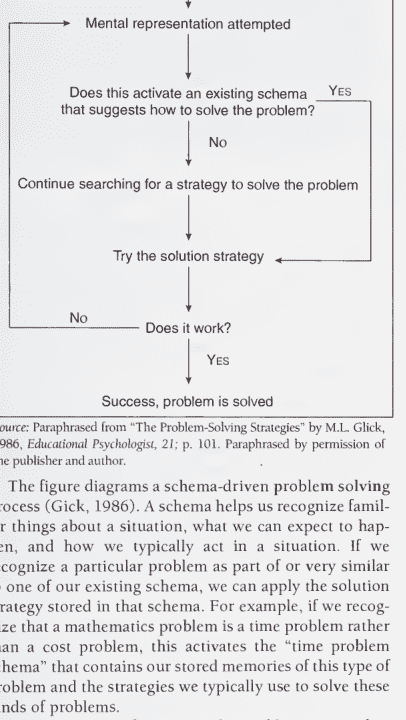

> 来源：改写自 M.L. Glick 所著《问题解决策略》，1986 年，《教育心理学家》，21：p. 101。经出版商和作者许可改写。

该图描述了一种模式驱动的问题解决过程 （Gick, 1986）。模式帮助我们识别情况中熟悉的事物，我们期望发生什么，以及我们在特定情况下通常如何行动。如果我们将某个特定问题识别为我们现有模式的一部分或与之非常相似，我们就可以应用该模式中存储的解决方案策略。例如，如果我们认识到一个数学问题是时间问题而不是成本问题，这就会激活“时间问题模式”，其中包含我们对这种类型问题的存储记忆以及我们通常用来解决这类问题的策略。

模式是如何被激活或触发的？一种方法是正确地表征或表示问题。这被称为问题的心理模型。如果由于某种原因你将一个时间问题误表征为成本问题，你将触发成本问题解决方案策略，当然这些策略是行不通的。如果应用的解决方案策略不起作用，你就必须继续寻找其他策略。你可以尝试重新概念化问题——也就是说，尝试不同的心理模型，从而触发适当的模式。

牢记问题解决的基本组成部分和过程，可以使你的教学集中于学生成为优秀问题解决者所需掌握的知识。当你设计评估任务时，请确保它们要求学生展示对这些问题解决组成部分和过程的掌握。

## 一般性与学科特定性问题解决

能力与可推广性争议认知科学家、心理学家和教育工作者之间仍然存在争议，关于我们是否应该教学生一般性或特定于每个课程领域的问题解决策略——例如特定于数学、历史或艺术的策略。解决课程特定问题的策略在不同学科间的适用性较低，但在特定课程内的能力更强；一般方法适用于每个课程领域，但在其特定课程内的能力有限 （Marzano et al., 1988）。

看起来人们实际上同时使用一般性和特定性策略 （Alexander, 1992; Perkins & Salomon, 1989; Shuell, 1990）。在某一领域工作且拥有大量知识和专业知识的人会应用众所周知的问题解决策略来解决特定于其领域的特定问题。然而，如果他们在专业知识领域之外工作，特定策略不再适用：他们随后会求助于更一般的问题解决策略。然而，随着他们在最初不熟悉的领域中发展专业知识，一般策略会被更具领域特定的策略所取代。

IDEAL 问题解决者一般问题解决技能可以组织成 Bransford 和 Stein （1984） 所称的 IDEAL 问题解决者的五阶段过程：

- I 识别问题
- D 定义和表征问题
- E 探索可能策略
- A 执行策略
- L 回顾并评估活动的效果

这些技能领域与图 10.1 中显示的非常相似。

## 解决问题的启发式方法

特定领域的知识型问题解决方法的解决方案策略比本节建议的一般方法更好 （Anderson, 1987; Royer, Cisero, & Carlo, 1993）。尽管如此，当学生没有基于知识的策略时，应尝试启发式方法。启发式是一种一般问题解决策略，可能有助于解决给定问题。以下是 10 种问题解决启发式方法列表 （Cyert, 1980; Frederiksen, 1984）：

- 1. 尝试看整体；不要只关注细节。
- 2. 保留你的判断；不要过快急于得出解决方案。


+   3. 使用图片、草图、图表、图形、方程或符号为问题建立模型。
+   4. 如果一种建模或表示问题的方式不起作用，请尝试另一种方式。
+   5. 将问题表述为一个问题；如果原问题没有提示解决方案，则更改问题。
+   6. 保持灵活：寻找使用现有工具的非常规或新方法；以新的方式看待常规事物；尝试从不同的角度或观点回应情况；发散思考。
+   7. 尝试倒推，从目标开始往回推以找到解决方案策略。
+   8. 跟踪你的部分解决方案，以便你可以回来继续未完成的部分。
+   9. 使用类比：

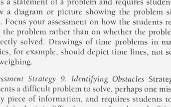

评估策略 8. 建模问题策略 8 提出一个问题的陈述，并要求学生绘制图表或图片展示问题情境。重点评估学生如何表示问题，而不是问题是否被正确解决。例如，数学中的时间问题绘图应描绘时间线，而不是称重用的刻度。

评估策略 9. 识别障碍 策略 9 提出一个难以解决的问题，也许缺少关键信息，并要求学生解释 (a) 为什么任务难以完成，(b) 障碍是什么，和/或 (c) 他们需要什么额外信息来克服障碍。重点评估学生是否能够识别解决问题的障碍。 （参见我们之前讨论过的圆圈和正方形绘图问题及评分标准作为示例。）

## 探索可能的解决方案策略

评估策略 10. 论证解决方案 策略 10 提出一个问题陈述以及该问题的两种或多种可能解决方案，并要求学生 (a) 选择他们认为正确的解决方案以及 (b) 论证其为何正确。

评估策略 11. 论证所用策略 策略 11 提出一个问题陈述以及两种或多种解决问题的策略，并要求学生解释为何两种策略都正确。当你使用此评估策略设计题目时，请确保两种策略都能得出正确答案。在编写题目时，你可以例如说明这是两个虚构学生解决问题的不同方法。

评估策略 12. 整合数据 策略 12 呈现几种类型的解释性材料（故事、漫画、图表、数据表）以及一个需要使用其中两种或多种解释性材料信息的问题陈述，然后要求学生 (a) 解决该问题以及 (b) 解释他们为得出解决方案所使用的程序。确保问题解决方案需要使用两种或多种解释性材料中的一些信息。例如，在科学中，你可以呈现降雨表、土壤分析、温度表、几种品种的番茄营养需求、肥料成分，并要求学生选择最适合当地种植的品种，并根据你提供的信息制定浇水和施肥计划。

评估策略 13. 产生替代策略 策略 13 提出一个问题陈述，并要求学生陈述该问题的两种或多种替代解决方案。以下是示例：

## 示例

策略 13：产生解决问题的替代策略

阅读下面的描述，然后回答问题。

一对年轻的聋夫妇有了第一个孩子。婴儿需要在夜间哭泣时喂养和更换，但母亲和父亲都听不到婴儿的声音。夫妇二人也不愿把婴儿带到床上，担心会压到婴儿导致窒息。他们也不愿让婴儿按固定时间严格安排更换和喂养。

3. 提出至少三种解决该问题的方法。在描述你提出的解决方案时要非常具体。

另一种方法是，在问题陈述之外，同时呈现一种解决问题的策略，并要求学生展示问题还可以如何以另一种方式解决。


# 评估策略 14. 使用类比策略 策略 14 提出一个问题陈述和一个正确解决该问题的解决方案策略，并要求学生 (a) 描述其他可以通过类比使用相同解决方案策略解决的问题，以及 (b) 解释他们生成的问题的解决方案为何与你给他们的问题的解决方案相似。 将你的评估重点放在学生的解决方案策略与你给他们的解决方案策略的类比关系上。 你想了解学生是否能将类比作为启发式方法来解决不同问题。 这里有一个例子：

## 示例

策略 14：使用类比来帮助解决另一个问题

问题 1 和 2 参考下面的情况。

某国会委员会的成员在委员会听证会上谈论了很多。一些成员谈论是为了解释自己的观点，一些人把证人视为敌对并试图贬低该证人的证词，一些人想阻止委员会中的对手发言，还有一些人想延长辩论和听证会以推迟或延长委员会投票。为了解决这个问题，制定了规则，为每位委员会成员分配固定的发言和质询证人时间。根据这些规则，委员会成员可以将其全部或部分分配时间让给另一名成员。

- 1. 描述几种在不同情况下的其他问题，这些问题可以通过使用与国会委员会类似的一套规则来解决。
- 2. 对于你列出的每个问题，解释规则可能如何修改以及为什么这将解决你列出的问题。

评估策略 15. 反向求解 策略 15 提出一个复杂的问题情境或一个复杂的（多步骤）任务以完成，并要求学生从期望的结果倒推，开发完成任务或解决问题的计划或策略。 （例如，开发完成图书馆研究论文所需的步骤和时间框架；制定一个计划来收集信息以回答问题，“本校的学生是否赞成对 18 岁以下人士实施宵禁？”） 将你的评估重点放在学生使用反向解决方案策略的熟练程度。

## 示例

策略 15：使用反向启发式解决问题

已完成一项学生调查，以确定学校的学生是否赞成对 18 岁以下人士实施宵禁。结果显示，在女生中，56% 赞成宵禁（10% 未作回应），在男生中，48% 赞成宵禁（9% 未作回应）。结果仅基于学生样本。

- 1. 从上述信息倒推，制定一个计划来说明该调查及结果是如何获得的。 确保你的计划涵盖研究的所有部分。

## 对问题-解决方案策略的行动与反思

评估策略 16. 评估解决方案策略的质量 策略 16 提出一个问题陈述并要求学生评估几种不同的解决问题策略。 你可以要求学生提出几种不同的解决方案，也可以提供几种解决方案并要求他们评估所提供的方案。 如果你提供解决方案进行评估，请务必使其正确性和质量各不相同，以便学生能够展示其评估能力。 （例如，有些可能更有效率，有些可能有负面后果，有些可能根本不起作用。） 要求学生尝试实施每种策略并对其进行彻底评估。 要求他们确定最佳策略，解释为什么有些策略比其他策略效果更好，以及为什么有些策略根本不起作用。 将你的评估重点放在学生证明策略质量等级排序的能力上。 这里有一个例子：

## 示例

策略 16：评估问题解决方案的质量

阅读下面的描述，然后回答问题。

一对年轻聋夫妇有了第一个孩子。婴儿需要在夜间哭泣时喂养和更换，但母亲和父亲都听不到婴儿的声音。 这对夫妇不希望把婴儿带到床上，担心会压到婴儿并使其窒息。 他们也不希望把婴儿安排在固定的更换和喂养时间表上。

- 4. 你在问题 3 中提出的解决方案中哪一个最好？ 通过解释其优点和缺点来证明你的选择。
- 5. 解释为什么其他每个解决方案都不如你认为最好的那个好。

评估策略 17. 系统评估策略 策略 17 使用与评估策略 16 相同的任务类型，但你将评估重点放在学生在评估你提出的每个解决方案策略时是否遵循系统程序的程度上。

## 评估问题解决的其他有前景的方法

在前一节中，我们建议你可以评估学生是否具备与问题解决过程中的每一步相关的技能。 评估问题解决的其他方法显示出前景，但仍处于实验和验证阶段（Royer, Cisero, & Carlo, 1993）。 空间不允许我们讨论这些方法。 然而，你可能希望通过查阅本章“附加阅读”部分列出的一些参考资料来跟进这一主题（例如，Glaser, Lesgold, and Lajoie, 1985; Nitko, 1996）。 你可能还希望回顾第 13 章（方法 5）中对学生知识结构的评估。

## 批判性思维

课程框架经常指出，培养学生的批判性思维能力是一个重要的教育目标。 批判性思维教育目标侧重于培养公平、客观、得出合理结论并倾向于寻求清晰和准确的学生（Marzano et al., 1988）。 什么是批判性思维？ 心理学家并不完全同意构成它的技能（Woolfolk, 1995; Kuhn, 1999）。 批判性思维的讨论经常使用与问题解决讨论中使用的许多相同术语：这两个领域密切相关。

在本章中，我们将采用以下定义：“批判性思维是合理的、反思性的思维，专注于决定相信什么或做什么”（Ennis, 1985, p. 54）。 该定义意味着以下内容（Norris & Ennis, 1989）：

- 1. 合理思维——使用充分的理由
- 2. 反思性思维——有意识地寻找并使用充分的理由
- 3. 集中思维——为特定目的或目标而思考
- 4. 决定相信什么或做什么——评估陈述（相信什么）和行动（做什么）
- 5. 能力和倾向——认知技能（能力）和使用能力的倾向（倾向）

## 评估批判性思维的倾向

## 什么是倾向？

倾向是思维习惯或经常使用适当的批判性思维行为的倾向。 倾向于批判性思维的学生：

- 1. 寻求论题或问题的陈述；
- 2. 寻求理由；
- 3. 努力做到知情；
- 4. 使用可信来源并提及它们；
- 5. 考虑到整体情况；
- 6. 保持思维与主要观点相关；
- 7. 牢记最初或最基本的问题；
- 8. 寻找替代方案；
- 9. 心胸开阔且
  - a. 认真考虑与自己不同的观点；
  - b. 从自己不同意的起点进行推理，而不让分歧干扰其推理；
  - c. 在证据和理由不足时保留判断；
- 10. 采取立场，并在证据和理由充分时改变立场；
- 11. 寻求主题所允许的最大精确度；
- 12. 有条不紊地处理复杂整体的各个部分；
- 13. 运用他们的批判性思维能力；
- 14. 对他人的感受、知识水平和成熟程度敏感。

> 来源：摘自 S. P. Norris 和 R. H. Ennis 的《Evaluating Critical Thinking》（p. 12），1989 年；加州太平洋格罗夫：批判性思维书籍和软件。 经许可转载。

## 评估倾向

虽然你可以在一次场合评估学生使用批判性思维能力或技能的情况，但评估学生的倾向需要你关注其长期习惯。 你的评估应报告学生在评分期、学期或学年内在课程学科内容中多频繁地使用批判性思维。 你使用清单或评分量表来评估倾向。

## 清单

清单是一种包含行为列表的工具。 你在一段时间内观察学生，并在你观察到的行为旁打勾（√）。 然后你就有记录显示学生表现了哪些倾向行为。 你勾选的行为越多，学生的批判性思维倾向就越大。 第 12 章提供了制作此类评估工具的具体建议。 图 10.3 显示了一个可用于评估学生批判性思维倾向的示例清单。

该清单可以帮助你跟踪学生在单元期间的批判性思维行为。 你可以从清单中看出，学生经常表现出许多倾向（例如，“2. 寻找解释和理由”，“6. 心胸开阔”）而其他倾向则不常表现（例如，“5. 寻找替代方案”）。 你可以利用这些信息帮助学生发展其批判性思维，通过教导他养成始终寻找替代方案的习惯。

## 评分量表

简单的评分量表是一种记录你对学生每种批判性思维行为倾向质量水平的判断的工具。 评分量表通常有一条线，其上的点从质量差到质量优。 通常，四或五个质量点会通过描述该行为在每个点的表现形式来进一步定义。 这些描述称为锚点。 图 10.4 是教师对批判性思维倾向的一些示例


## 图 10.3 在教学单元中跟踪学生批判性思维倾向使用的核对表示例。

| 个别学生的批判性思维倾向记录 |
| 学生姓名： | 班次： | 日期： |
| 学科/单元：美国历史/第三单元。开始一个政府，1780–1800 |
| 批判性思维倾向 | 作业/活动 |  |  |  |  |
|  | 关于邦联条例的课堂讨论 | 讨论宪法批准的论点和反论点的论文 | 收集和分析报纸报道的事件并使用宪法概念的剪贴簿 | 团队辩论问题：“政党是否使美国政府变得更好？” | 评价华盛顿作为总统的论文 |
| 1. 寻求主要观点或问题的陈述 | √ | — | √ | √ | NA |
| 2. 寻找解释和理由 | √ | √ | √ | √ | √ |
| 3. 使用并引用可靠来源 | — | √ | — | √ | — |
| 4. 保持在主要和相关的要点上 | — | — | NA | √ | √ |
| 5. 寻找替代方案 | — | — | NA | — | NA |
| 6. 开放思想 | √ | √ | √ | NA | — |
| 7. 对问题采取立场 |  | √ | — | √ | — |
| 8. 有充分理由时改变对问题的立场 | NA | — | NA | NA | NA |
| 9. 努力在陈述和工作中做到准确和精确 | NA | — | √ | √ | — |
| 10. 对他人的感受、知识水平敏感 | √ | NA | NA | — | NA |

## 图 10.4 评估学生批判性思维倾向质量的样本评分量表，教师在学生完成作业时可能会观察到。

## 批判性思维倾向评分量表

学生姓名：
作业：
日期：

- 1. 学生是否考虑了不同的观点？
- 0 表现得好像自己的观点被每个人接受
- 1 意识到自己的观点并非被每个人接受
- 2 显示出意识到他人有合法的、与自己不同的观点
- 3 主动寻找并鼓励他人表达与自己不同或相反的观点

- 2. 学生如何对待他人的观点？
- 0 以避免或阻止他人观点的方式行事
- 1 显示出对他人观点有所关注
- 2 认真努力考虑他人观点，但并不始终客观或理性
- 3 认真关注他人观点并始终客观、理性地审视它们

- 3. 学生是否能与知识或能力较少的人良好沟通？
- 0 不能与知识或能力较少的人合作或沟通
- 1 尝试与知识或能力较少的人合作或沟通，但在做此事时不足够
- 2 能与知识或能力较少的人充分合作和沟通
- 3 能与知识或能力较少的人出色地合作和沟通

- 4. 学生是否对知识或能力较少的人的感受敏感？
- 0 对知识和能力较少的人漠不关心或残酷
- 1 做到最低限度以帮助或鼓励尊重知识或能力较少的人的感受
- 2 提供良好的鼓励和尊重知识或能力较少的人的感受
- 3 主动寻求增强和提高对知识或能力较少的人感受的尊重

might observe as a student completes an assignment. The anchor points on the items' rating scales were adapted from the Marzano, Pickering, and McTighe (1993) analysis of habits of mind. In this example, each item's scale shows the degree to which a student is disposed toward using a particular critical-thinking habit. The numerical ratings on the scale are anchored by descriptions of specific and observable behaviors. Over time you can observe the student with respect to these habits. Then, at the end of the period, you use the rating scale to assess the student's disposition on each habit.

## 评估批判性思维能力

## 需要评估的能力

批判性思维能力是学生在表现出批判性思维行为时使用的特定认知技能。以下是批判性思维讨论中通常考虑的、可以评估的一些能力。它们被分为五个领域。

## 基础澄清

- 1. 聚焦于一个问题
- 2. 分析论证
- 3. 提出和回答澄清和质疑的问题

## 基本支持

- 4. 判断来源的可信度
- 5. 做出和判断观察

## 推理

- 6. 做出和判断演绎
- 7. 做出和判断归纳
- 8. 做出和判断价值判断

## 高级澄清

- 9. 定义术语和判断定义
- 10. 识别假设

## 策略和策略

- 11. 决定行动
- 12. 与他人互动

> 来源：摘自《Evaluating Critical Thinking》（第14页）S. P. Norris 和 R. H. Ennis，1989；加州太平洋格罗夫：批判性思维书籍和软件。经许可转载。

批判性思维教育的最终目标是让学生在校内和校外生活中自发地使用这些能力。例如，预计学生会自发地通过询问“你的主要观点是什么？”或“可以说你的主要观点是_____吗？”来澄清某人表述不清的论证的主要观点。正如我们批判性思维倾向清单第13点所述，学生应定期使用本清单中的能力。

## 情境中的批判性思维

在很大程度上，批判性思维能力最好在各个学科的情境中教授和评估。最终学生会将批判性思维应用于生活中的具体事件，因此他们必须学会在不同情境中应用这些能力。你应牢记，关于视觉艺术等学科的“合理反思性思维”可能与关于科学等学科的“合理反思性思维”大不相同：不同的学科有不同类型的论证和验证真理或可信度的标准。第266页的示例（第12章）展示了中学生如何使用科学标准来批判性地评估他们的项目。

出于这些原因，以及出于篇幅有限的实际原因，我们无法展示在许多不同学科中评估批判性思维能力的有意义的题目。然而，我们确实展示了在为这些能力设计评估任务时可以使用的策略。其中一些策略附有示例题目。你需要练习将这些策略应用于你所教授的学科。

以下材料围绕用于组织上述批判性思维能力清单的标题进行组织。我们首先解释一种批判性思维能力，然后描述并举例说明如何评估它，然后再进入下一个。

## 基础澄清能力

聚焦于问题 具备聚焦于问题能力的学生可以批判性地审视一个行动、口头陈述、话语、科学或政治论证，甚至漫画，以确定其主要观点或论证的本质。子技能包括（a）制定或识别提出的问题或议题，（b）制定或选择用于评估所呈现材料的适当标准，以及（c）牢记议题及其适当背景（Ennis, 1985）。以下是设计题目以评估此能力的策略。

## 策略

## 策略 1：如何评估聚焦于问题的能力

| | 介绍性材料例如： | 回应以下问题例如： |
|---|---|---|
| 给学生 | • 一个问题的陈述
• 一次政治演讲
• 一项政府政策的陈述
• 一个实验及其结果 | 问学生 | • 主要问题/议题是什么？
• 你应使用什么标准来评估论证或结论的质量、好坏或真实性？ |

注意：对于本策略和后续的评估策略，你需要重新表述问题，使其符合学生的教育水平。

下面下一个示例中的第1题展示了一个多选题，评估学生聚焦于政治漫画主要议题的能力。

## 示例

应用的策略：聚焦于主要问题并在分析后得出结论

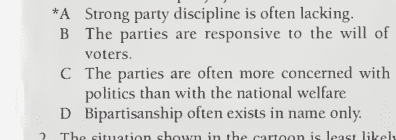

问题1和2参考上图漫画。

- 1. 该漫画说明了美国政党制度的以下哪个特征？
- *A 政党纪律往往缺乏。
- B 政党对选民意愿作出回应。
- C 政党往往更关心政治而非国家福祉
- D 两党合作往往只存在于名义上。

- 2. 漫画中所示的情况最不可能发生在以下哪个时间？
- A 新一届国会首次会议期间
- B 在政治代表大会期间


# C 在一次初选竞选中

# *D 在一次总统竞选活动中

来源：摘自《让课堂测试成为可能：教师指南》（第4号。评估与咨询服务）（第18-19页），作者 Q. Siodola，1961年，普林斯顿，新泽西州：教育测试服务。漫画由 Army Times Publishing Company 提供。经 Educational Testing Service 版权所有者许可转载。

分析论证 具备分析论证能力的学生能够分析在口头陈述、讨论、科学或政治报告、漫画等中提出的论证的细节。子技能包括（a）识别陈述中的结论，（b）识别论证背后的陈述理由和未陈述理由，（c）看到两个或多个论证之间的相似性和差异，（d）找出、指出并在适当时忽略论证中出现的无关内容，（e）表示论证的逻辑或结构，以及（f）总结论证（Ennis, 1985）。在设计任务以评估此能力时，使用策略2。示例如下。

## 策略

策略2：如何评估分析论证的能力

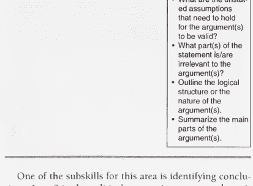

该领域的子技能之一是识别结论。之前呈现的政治漫画题中的第2题就是评估这些子技能的例子。以下是四个社会研究题目，它们评估分析论证能力的各种子技能。请注意，在实践中，这些题目将附带供学生在回答问题前阅读的介绍性材料。

## 示例

评估分析论证能力的子技能：识别假设（第1题），识别论证的结构（第2题），识别多个来源之间的相似性（第3题），识别两个论证中的差异（第4题）

第1题和第2题基于 Clayton 书中的阅读材料。

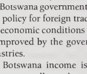

- 1. Clayton 的论证做了什么假设？
- A 养牛业将继续成为博茨瓦纳最基本的经济活动
- B 博茨瓦纳政府应对对外贸易采取自由放任政策。
- C 政府帮助某些产业可以改善普通人的经济状况。
- D 博茨瓦纳的收入在所有人之间分配不均。

- 2. Clayton 论证的基本结构是博茨瓦纳人民强烈受其
- A 追求个人最大利益的欲望驱动。
- B 欲望将民族主义置于个人利益之上的欲望。
- C 相信市场竞争将克服当前困难的信念。
- D 对本国所有人民福利的真诚关切。

第3题基于下面列出的五篇阅读材料。


3. 根据你对五篇文章的阅读，列出政府制定国内政策可能基于的两个或三个原则。

第4题基于 Clayton 书中的阅读材料和 Mmualefe 书中的阅读材料。


4. Clayton 和 Mmualefe 关于博茨瓦纳经济状况的最根本分歧是什么？
A 他们对竞争性经济是否可取存在分歧。
B 他们对道德在经济生活中所起的作用存在分歧。
C 他们对政府是否会腐败的预测存在分歧。
D 他们对政府应多大程度上鼓励博茨瓦纳的外国投资存在分歧。
注意：这些题目仅用于说明。所提及的阅读材料和人物均为虚构。

## 澄清和质疑

具备提出澄清性问题能力的学生可以做到两件事：（a）向正在提出论证的人提出适当的问题，以及（b）在自己提出论证时适当回答关键问题。学生应提出并能够回答的问题包括：为什么？什么不是一个例子？这如何适用于这种情况？支持你立场的是什么事实？（Ennis, 1985）。

你可能会发现直接评估此能力很困难，因为你必须在学生关注某人提出论证时观察学生，或让学生提出论证并自己提问。第一种方法存在几个问题：打断发言者可能不礼貌；学生可能在事后提问时害羞；发言者的论证可能表述良好，因此很少有关键问题是合适的；或发言者的陈述可能太差，以至于学生对它失去兴趣。

让学生提出论证的问题较少，但它也包含威胁结果有效性的因素。例如，并非所有学生对某个主题的知识程度相同。主题知识的差异会影响学生陈述的质量以及你对其提出的问题的适当性。此外，让25名或更多学生向你或班级提出相同或相似的论证会很乏味。评估此能力的最好方法是长期收集相关信息，使用多种作业和任务，并使用系统化的记录评估程序，例如清单（见图10.3）或评分量表（图10.4）。

## 论证的基本支持

## 判断来源的可信度

具备此能力的学生可以评估某人在支持某一立场时所使用的证据的质量。学生应能够在判断可信度时使用的标准或标准包括（a）提供证据的人的专业知识，（b）提供证据的人是否存在利益冲突，（c）不同证据来源是否一致，（d）证据来源是否有准确和正确的声誉，（e）证据是否通过 established 程序获得从而具有有效性，以及（f）在给定情况下使用该证据是否有充分理由（Ennis, 1985）。每个学科也将有特定的证据规则。

在设计任务以评估此能力时，你可以使用以下策略。

## 策略

策略3：如何评估判断可信度的能力

给学生介绍性材料，例如：• 论证文本 • 广告 • 实验和解释 要求学生 对以下问题做出回应，例如：• 材料中哪些部分，如果有的话，是可信的，为什么？• 哪些部分不可信，为什么？

有助于评估这种批判性思维能力的客观题目格式包括：（a）主清单，（b）最佳答案，（c）实验-解释，（d）陈述和评论，以及（e）排序。第一四种格式的示例在第8章中给出。简答格式也可以使用。示例如下所示：

## 示例

使用策略3评估学生判断论证或陈述可信度的能力

问题1涉及以下信息。
董事会宣布，XYZ 汽车去年销量比上一年增长25%。XYZ 汽车公司总裁 Mr. Hereto 表示，这一增长的原因是本国汽车买家认识到 XYZ 汽车是今天市场上最好的汽车。

1. 分析此陈述，指出其中哪些部分是可信的，哪些部分，如果有的话，是不可信的。给出每个选择的理由。你可以按以下格式组织你的答案。

| 可信部分： | 理由： |
|---|---|
| | |
| | |
| | |
| | |
| | |

1排序题要求学生对随机排列的列表进行排序，排序依据是给定的标准。例如，根据可信度程度对陈述进行排序。

| 不可信部分： | 理由： |
|---|---|
| | |
| | |
| | |
| | |
| | |

为了有效评估此能力，你必须小心地包含介绍性材料，该材料不是课堂示例或指定阅读材料的一部分，并提出要求学生解释其对材料各部分可信度评估背后的推理的问题。对你已经分析和判断过的材料进行学生评估会产生对学生自行判断来源可信度的能力的无效评估。此外，如果你不要求学生解释为什么某个来源可信或不可信，你就不知道学生是否使用了适当的标准和批判性思维来得出答案。

观察与判断 观察报告 这是学生评估从目击者或对事件、现象或人物进行直接观察获得的信息质量的能力。在做出这些判断时，学生应能够使用的标准或标准包括是否（a）观察者以最少地参考他人观察的方式报告；（b）事件与观察者报告之间的时间很短；（c）观察者没有转述传闻；（d）观察者记录了观察结果；（e）所报告的观察结果得到他人证实；（f）观察者对事件或人物有良好的接触，因此直接观察可以准确；（g）观察者正确记录观察结果；以及（h）观察者是可信的来源（Ennis, 1985）。每个学科可能还有更具体的标准。以下是评估此能力的策略。

## 策略

策略4：如何评估判断观察报告的能力


评估此能力要求你向学生提供（a）观察报告，（b）观察进行的背景信息，以及（c）做出或记录观察的人的信息。换句话说，学生必须拥有足够的信息来使用刚刚列出的标准进行评估。在不使任务变得繁琐且不泄露答案的情况下做到这一点可能很困难。此外，为了获得有效的评估结果，你必须使用在课堂上未作为示例或在指定阅读中使用的介绍性材料，并要求学生解释其对所报告观察结果评估的理由/原因。如果你的任务中不包含这两个要素，评估结果的有效性就会受到损害。

与你的主题领域相关的报纸文章可能是介绍性材料的有用来源，前提是撰写它们的记者是称职的。称职的记者通常会提供有关观察性质、观察者或记者的背景（例如政治派别、研究的资金来源）以及观察是否得到证实的信息。

## 推理

演绎与判断 演绎 能够判断演绎的学生在分析陈述和结论时应用逻辑思维。子技能包括（a）使用类包含的逻辑（应逻辑上包含在某一类或类别中的元素或成员），（b）使用条件逻辑（识别使某事为真或为假的条件），以及（c）正确使用逻辑策略解释陈述（否定；双重否定；必要条件与充分条件；以及诸如如果、或、一些、不、两者等词语）（Ennis, 1985）。要设计客观任务来评估此能力，你可以遵循以下策略之一（Norris & Ennis, 1989）。

## 策略

策略5(A)：如何通过比较不同结论来评估做出和判断结论的能力


## 策略 5(B)：如何通过判断结论的真假来评估做出和判断结论的能力

给学生提供入门材料，例如：学生需要假定为真的陈述 AND 由一个可能正确的结论组成的备选方案 要求学生 对诸如以下问题作出回应：这个结论必须成立吗？

参考文献（Ennis, 1985）。识别最能解释给定证据的结论的子技能包括 (a) 理解和使用不同类型的假设和解释（识别因果主张、识别历史主张等），(b) 理解和使用收集相关信息的有效方法（设计实证研究、寻求证据和反证的方法等），以及 (c) 能够使用标准来评估信息（数据）在多大程度上支持结论（Ennis, 1985）。

选择题和建构题都可以评估学生得出结论的能力。以下是两种评估策略。

策略 5(A) 的示例在下面的第 1 题中显示。策略 5(B) 已应用于第 2 题。

## 示例

评估学生判断逻辑结论能力的题目示例

问题 1 和 2 基于以下信息。

如果这种物质是碳酸钙，则加入酸时会产生气泡。但我加入酸时没有气泡。

应用策略 5(A) 的题目：比较不同的结论

+   1. 根据上述信息，以下哪项是正确的？
+   A 这种物质不能产生气泡。
+   B 这种物质是碳酸钙。
+   C 这种物质不是碳酸钙。
+   D 这种物质是氯化钙。

应用策略 5(B) 的题目：判断一个结论的真假

+   2. 根据上述信息，这种物质是碳酸钙这一说法是否属实？
+   A 是的，它必须为真。
+   B 不，它不可能为真。
+   C 根据所给信息，我们无法确定它是否属实。

归纳与判断归纳 学生如果具有归纳能力，就能通过对给定信息的概括得出有效结论。学生如果具有判断归纳的能力，就能识别最能解释给定证据的结论（Norris & Ennis, 1989）。从数据中概括的子技能包括 (a) 识别并使用数据中的典型特征或模式进行推理，(b) 使用适当的技术从样本数据进行推理，以及 (c) 使用表格和图表中显示的模式和趋势进行推理。

## 策略

## 策略 6(A)：如何使用选择题评估判断归纳的能力

给学生提供入门材料，例如：情境陈述 AND 信息（数据） AND 从信息中得出的可能结论 要求学生 对诸如以下问题作出回应：判断每个结论是由数据支持的、被数据矛盾的，还是既不支持也不矛盾。 或 选择最能解释数据的结论。

## 策略 6(B)：如何使用建构题评估判断归纳的能力

给学生提供入门材料，例如：情境陈述 AND 信息（数据） 要求学生 对诸如以下问题作出回应：从数据中得出正确的结论 AND 解释你的结论为何正确。

特别适合评估学生在该领域的能力的题目格式

- 给学生 → 入门材料例如：
  - 一个论证或解释，其中部分依据未包含 AND
  - 一个且仅有一个是正确隐含假设的选项 AND
  - 两个或多个不是隐含假设且不是结论的选项
- 要求学生 → 对诸如以下问题作出回应：
  - 哪个选项可能是假设的？
  - 哪个选项可能是被视为理所当然的？

下面是一道应用策略 9 的示例题目。（注：学生必须阅读的冗长段落已从题目中省略。）

## 示例

评估学生使用策略 9 的题目示例：识别隐含假设

问题 1 参考以下段落。

此处会出现与主题相关的段落

+   1. 作者在其论证中基于隐含假设，即美国公民受到了非常强烈的欲望的驱使，即
+      A 尽可能为自己赚取最多的钱。
+      B 把国家利益置于个人利益之上。
+   C 扩大开放市场竞争。
+   D 让世界其他地方都像美国一样。

再次，不要让学生为你在课堂上举例说明的材料识别相同的假设。还要确保你使用的解释性材料确实具有隐含假设。这意味着你不能包含作者将其假设明确化的段落。它还意味着你不能使用没有做出假设就得出结论的材料。为了制作合适的题目，你可能需要重写从文件和其他来源中挑选的部分段落。

## 策略与策略作为批判性思维技能

决定行动 能够决定行动的学生本质上是好的问题解决者。其子技能是我们本章前面讨论的问题解决方面的内容：定义问题、制定和评估解决方案、全面看待问题并采取行动，以及评估所采取的行动。这些能力的评估策略与你评估问题解决技能时使用的策略相同。

与他人互动 善于与他人互动的学生能够识别并使用修辞手法来说服、解释或争论。学生应能够识别并使用的修辞手法包括 (a) 论证性言语策略（诉诸权威、稻草人等），(b) 逻辑策略，以及 (c) 熟练的组织和表达（Ennis, 1985）。

对该能力的评估可能采取多种形式。其中一种形式是要求学生展示自己创作的论证性或说服性作品。展示的媒介和目的可能因你所教授的学科而大不相同。例如，产品或服务广告旨在说服人们，可能使用印刷、静物摄影或电影（视频）等不同媒介。另一方面，辩论通常结构更为严谨。

评估学生的表现需要使用评分量规，最可能以评级量表的形式出现。如果没有评级量表，你可能无法公平或有效地帮助学生。使用评分量规有几个目的：(a) 它明确了你用来评估学生的标准；(b) 你可以将量规提供给学生，以便他们内化表现标准；(c) 它极大地提高了你评分的一致性（信度）。图 10.5 显示了评估论证性展示的评级量表示例。

你可能还希望评估学生是否能够识别所使用的修辞机制和策略


# 图10.5 简单评分量表的示例，用于评估学生口头或书面论证陈述的质量。

学生姓名：
主题：

日期：

# 1. 学生是否清楚地陈述了论点或主要观点？

0 未陈述或暗示主要观点或论点
1 暗示了主要观点或论点但未清楚陈述
2 清楚地陈述了主要思想或论点但只是平铺直叙
3 清楚、热情且有趣地为听众陈述了主要思想或论点

# 2. 学生在必要时是否对关键术语进行了定义？

0 未尝试定义关键术语，即使在必要时也未定义
1 尝试定义关键术语，但效果不佳
2 清楚有效地定义了必要的关键术语
NA 演示的性质使得定义关键术语是不必要的

# 3. 学生是否运用了合理的推理来支持主要观点或论点？

0 未提供对论点或所持立场的支持理由
1 提供了支持理由，但它们偏离目标或不能直接支持论点
2 给出了相关的支持理由，但本可以给出更好或更多样化的理由
3 给出了优秀的支持理由，多样性好，直接适用

# 4. 学生是否以适当的方式使用了相关的事实来支持论点？

0 未提供事实，使用了完全无关的事实，或引用了非可信来源的事实
1 提供了支持论点的事实，但从中得出的概括较弱、不太恰当或不完整；事实引用自可信来源
2 提供了多个支持论点的适当事实，从事实中得出的概括是恰当的，事实来源可信
3 提供了高度恰当的事实，从事实中得出优秀的概括以支持论点，事实来源可信，事实在论证中被很好地使用

# 5. 学生是否公平地呈现并评估了替代立场？

0 未提及替代立场，也未进行评估
1 提及了替代立场，但它们要么没有公平呈现，要么未得到适当评估，要么与论点无关
2 提到了部分相关的替代立场，它们被恰当呈现并得到适当评估；其他重要的替代立场被省略
3 提到了所有相关且重要的替代立场，公平呈现并得到适当评估

# 6. 学生是否很好地反驳了替代立场？

0 未尝试反驳
1 尝试反驳，但效果不佳或不完整
2 反驳得当，但本可以在解释替代方案的缺陷方面更有效
3 反驳得当，有效，清楚地指出了替代方案的不足，说服力强

# 7. 学生是否提出了组织良好的论证？

0 组织松散，缺乏方向，使论点或主要观点混淆
1 组织清晰，但效果不佳，与论点或主要观点的联系不紧密；细节经常位置不当
2 组织良好，有助于论证的有效性，但少数细节位置不当；有时与主要观点的联系薄弱或位置不当
3 组织非常清晰，增强了论证；演讲使听众的兴趣始终集中在主要问题上

a particular piece of writing, speech, advertisement, or other persuasive material. Two assessment strategies for doing this follow.

## Strategy

Strategy 10(A): How to assess the ability to identify rhetorical mechanisms and tactics by analyzing one piece to identify what is misleading

- Give students
- Introductory material such as:
  - Persuasive writing
  - A speech
  - An advertisement
  - A video clip segment
- Require students
- To respond to questions such as:
  - What deceptive or misleading statements or strategies are used? Explain.
  - Which of the following types of descriptive or misleading strategies are used?

Strategy 10(B): How to assess the ability to identify rhetorical mechanisms and tactics by identifying the misleading piece from among several pieces that are not misleading

- Give students
- Introductory material such as:
  - Several pieces of persuasive writing
  - Several speeches
  - Several advertisements
  - Several video clips
- Require students
- To respond to questions such as:
  - From among these advertisements, which one is misleading because it inappropriately appeals to scientific authority?
  - From among these advertisements, which one is misleading because it ______?

Here are two examples that implement this strategy with the multiple-choice format.

## Example

Items using Strategy 9(B) to assess the ability to identify misleading approaches in persuasive material (e.g., advertisements)

Questions 1 and 2 refer to the advertisements below.

- Advertisement A goes here
- Advertisement B goes here
- Advertisement C goes here
- Advertisement D goes here

- 1. Which of the advertisements above should be considered misleading because it inappropriately appeals to scientific authority?
  A
  B
  C
  D
- 2. Which of the advertisements above should be considered misleading because it focuses on the consumer keeping up with the crowd or joining the bandwagon?
  A
  B
  C
  D

## Critical-Thinking Skills in Combination

You should not lose sight of this ultimate learning goal: When faced with real-world applications, the student must spontaneously decide to use critical-thinking abilities and use them in selective combinations that fit the circumstances. You need to give students instruction and practice in deciding on the appropriate analyses and when to use combinations of critical-thinking skills in different circumstances. Your assessment tasks themselves must provide realistic situations that require students to use combinations of several critical-thinking abilities. Performance tasks, discussed in Chapter 11, offer assessment opportunities for doing this.

Finally, if students are to learn to be disposed toward using critical thinking in their daily activities, you should assess their dispositions continuously throughout the term or year. If some students are not exhibiting a critical-thinking disposition, you should alter your teaching of those students so they do. If you do not assess critical-thinking dispositions, both you and your students will come to believe they are unimportant learning goals.

## OTHER SPECIFIC HIGHER-ORDER SKILLS AND ABILITIES

## Ability to Use Reference Materials

Undoubtedly it is important to develop the ability to use both general reference materials and special subject-matter-specific materials. Among the reference-using skills you may teach and assess are: alphabetizing, using tables of contents and indexes, using encyclopedias, using dictionaries, using general reference materials (calendars, maps and globes, textbooks, periodical indexes, atlases, Who's Who in America, and magazines), and using a library and its catalogue (Hoover, Hieronymus, Frisbie, & Dunbar, 1993b). The Internet and computer-based CDs are also reference materials. Skills in using these media should also be taught and assessed. The dictionary items on page 200 illustrate how to assess these dictionary-entry skills: using the guide to pronunciation, locating the meaning in particular usage, and identifying a word’s part of speech.

Earlier we spoke of using interpretive materials. In this assessment area interpretive materials include: a section of an index, a section of a table of contents, a part of an atlas, a list of words to alphabetize, a reproduction of a library and a catalogue entry card, a section of the Dewey or Library of Congress classification system, a picture of a computer screen, and a section of a periodical guide (index). Many times, however, you will have to rewrite or modify these materials before they are suitable for use in assessment, because (a) they contain material irrelevant or extraneous to assessing the objective at hand; (b) they are too long; or (c) the extract is out of context and is therefore not clear to students. You may need to obtain written permission to reproduce copyrighted materials. You may, of course, use entire volumes or take students to the library for the assessment. To do so, you will need sufficient materials (or computers) for all students, as well as sufficient uninterrupted time to administer this type of performance assessment.

## Graphs and Tables

Much information is condensed in tables and graphs. Graph and table reading abilities are important to further learning in many areas, both in and out of school. Following are examples of some of the graph- and table-reading abilities that you can teach and assess.

## Example

- 1. To comprehend from the title the topic on which a table or graph gives information
- 2. To recognize from subtitles and row or column headings what is shown by each part of a graph or table
- 3. To read amounts
  A by using the scale (or scales) on bar, line, and picture graphs
  B by interpreting the sectors of a circle on circle graphs
  C by locating a cell in a table
  D by using special symbols and a key
- 4. To compare two or more values read from a graph or a table
  A by determining rank
  B by determining differences between amounts
  C by determining how many times greater one amount is than another
- 5. To determine relative rates or trends
- 6. To determine underlying relationships through correct interpretation of a graph
- 7. To grasp the outstanding facts portrayed by a graph or a table

> Source: Copyright © 1971 by the University of Iowa. All rights reserved. Reproduced from the Iowa Tests of Basic Skills, Teachers Guide to Administration, Interpretation, and Use, Levels Edition, Form 6, p. 46, with permission of the Riverside Publishing Company.

Here are some examples of items written to assess some of these skills.

## Example

Use the table below to answer Questions 1 and 2.

| Average Temperature and Rainfall at Windy Hill Town |
| 2000 | 2001 | 2002 | 2003 |
| Temp | Rain | Temp | Rain | Temp | Rain | Temp | Rain |
| September | 64° | 0.1 in | 63° | 0.2 in | 66° | 0.0 in | 64° | 0.3 in |
| October | 72° | 0.4 in | 71° | 0.5 in | 74° | 0.4 in | 71° | 0.6 in |
| November | 77° | 0.9 in | 75° | 1.0 in | 78° | 0.8 in | 76° | 0.7 in |
| December | 81° | 2.0 in | 80° | 2.7 in | 85° | 1.5 in | 80° | 2.1 in |

Example of assessing the ability to locate and compare information from a table

- 1. When did the highest average rainfall occur?
  A November of 2000
  B November of 2001
  *C December of 2001
  D December of 2003

Example of assessing the ability to draw inferences based on trends and other information in a table

- 2. Which of the following events is most likely to have occurred between September and December of 2002?
  A The roads were covered with ice and snow.
  *B The town's water reserves were very low.
  C The river flowing through the town overflowed its banks.


Item 1 要求学生阅读表格并在单元格中定位信息（前述列表中的能力 3(c)），并比较从表格中读出的多个值以确定哪个最大（列表中的能力 4(a)）。Item 2 要求学生根据所呈现的趋势和事实对事件发生的可能性做出推断（能力 6 和 7）。

下面是说明如何使用图表和选择题来评估基于显示的速率或趋势进行推断的能力（能力 5）、潜在关系（能力 6）和事实的能力的示例。

## Example

使用以下信息回答问题 1 和 2

在练习开始之前，老师将班级分成两组。第一组要绕着跑道走两圈。第二组要绕着跑道跑一圈。所有学生在绕跑道前后都测量了脉搏。每个组的平均脉搏显示在下面的图表中。

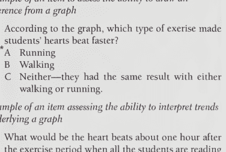

评估从图表中得出推断的能力的题目示例

+   1. 根据图表，哪种类型的锻炼使学生的心跳更快？
+   *A 跑步
+   B 步行
+   C 都不是——无论是步行还是跑步，结果都相同。

评估解释图表潜在趋势的能力的题目示例

+   2. 当所有学生在图书馆读书时，锻炼一小时后心跳大约是多少？
+   *A 两组都约为 70。
+   B 步行两圈的组约为 70，跑一圈的组约为 130。
+   C 步行两圈的组约为 90，跑一圈的组约为 130。
+   D 两组都低于 60。

## Maps

教授和评估一般的地图阅读能力很重要。以下是构成地图阅读能力的某些具体能力的示例：

## Example

+   1. 能够定向地图并确定方向
+    a. 根据方位确定方向
+    b. 根据纬线或经线确定方向
+    c. 确定河流流向或地形坡度
+   2. 能够在地图和地球仪上定位和/或描述地点
+    a. 通过使用标准地图符号
+    b. 通过使用图例
+    c. 通过使用距离和/或方向
+    d. 通过使用纬度或经度
+   3. 能够确定距离
+    a. 在道路地图上确定距离
+    b. 使用单位比例尺确定距离
+    c. 在地球仪上确定距离
+    d. 比较距离
+   4. 能够确定或追踪旅行路线
+   5. 能够确定季节变化、太阳模式和时差
+   6. 能够从一个或多个模式地图中阅读和比较事实
+   7. 能够形象化地形特征
+   8. 能够推断人的活动或生活方式
+    •来自轮廓地图
+    •来自模式地图

> Source: Copyright © 1971 by the University of Iowa. All rights reserved. Reproduced from the Iowa Tests of Basic Skills, Teachers Guide to Administration, Interpretation, and Use. Levels Edition, Form 6, p. 44, with permission of the Riverside Publishing Company.

Hoover et al. (1993b) 给出了教授这些技能的建议以及教学材料的参考书目。以下是评估这些能力的题目示例。

## Example

评估地图阅读能力的题目

下面的地图显示了五个州。城市按字母顺序从顶部开始排列。地图下方的图例说明了地图上的标志含义。

Item 1 评估根据给定方位确定地图上地点的方向的能力（能力 1(a)）

+   1. 这些城市中哪一个最靠南？
+   A Elton
+   B Follet
+   C Gull
+   *D Hart

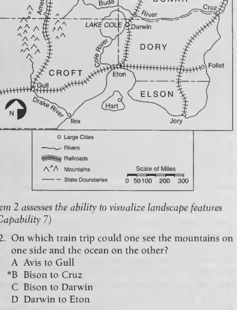

Item 2 评估形象化地形特征的能力（能力 7）

2. 在哪次火车旅行中可以看到一侧是山脉另一侧是海洋？ A Avis to Gull *B Bison to Cruz C Bison to Darwin D Darwin to Eton

Item 3 评估学生使用英里比例尺确定距离的能力（能力 3(b)）

3. 从 Hart 到最近点的本土大约有多远？ A 5 英里 B 15 英里 *C 50 英里 D 85 英里

Item 4 评估确定河流流向的能力（能力 1(c)）

4. *A 北 B 南 C 东 D 西

Source: Map and items are copyright © by the University of Iowa. All rights reserved. Reproduced from the Iowa Tests of Basic Skills, Levels edition, Form 6, p. 54, with permission of The Riverside Publishing Company.

## Reading Skills

传统程序 让学生在某一学科领域阅读材料并根据该材料回答问题，是评估阅读技能的一种理想方式。虽然开发段落并附带问题并不容易，但你可能

需要这样做，尤其是在教授那些你没有足够评估程序或涵盖这些技能的学习手册的学科时。为了开发此类评估，阅读材料需要仔细选择，以代表学生应该能够阅读的材料类型。此外，阅读材料可能需要重写，以便解释性问题主要基于所呈现的材料来回答。最后，问题需要以一种方式表述，而不需要学生具备超出你认为适合学生水平和所讨论学科的背景或特殊信息（Ebel, 1951; Wesman, 1971）。

构建需要阅读和解释印刷段落的评估问题集的步骤如下（Ebel, 1951; Wesman, 1971）：

+   1. 找到一个有前景的段落。检查来源（教科书、期刊、参考书、专业书籍以及选集和文集），直到找到可以为其编写多个解释性题目的段落。
+   2. 编写初始测试题目。为该段落编写尽可能多的题目。尝试利用段落的所有解释可能性，只要符合你的原始评估计划。
+   3. 重写段落。在你有了初步的题目集后，重写段落以消除不必要的材料，这些材料对你所写的题目没有贡献。
+   4. 考虑重写一些题目。对段落的更改可能需要修改或删除你已写的一些题目。步骤 3 和 4 的目标是产生一个简洁高效的段落和题目集。
+   5. 只要必要就重复步骤 3 和 4，直到你满意地拥有了一套高效的题目。

大多数商业调查成就测试都包含阅读理解分测验。你应该查阅这些测试，以了解如何使用段落来评估阅读理解。

## Authentic Reading Assessment

如果你最感兴趣的是阅读理解，而不是学生解释学科材料的能力，那么前述的压缩可能是不 desirable 的，尤其是如果你想评估的部分是阅读自然发生材料的 abilities 和区分相关与无关材料的能力（Wesman, 1971）。标准化阅读理解测试的批评者认为，通过传统的五步程序创建的段落和问题过于 artificial。批评者更愿意使用学生在现实世界或进一步学习中需要阅读的材料。他们声称，接触传统阅读理解测试的学生会认为阅读：（a）由短段落组成，（b）需要回答由制定者已知答案的问题，以及（c）与解释书面文字关系不大（Resnick, 1989）。

如果段落取自学科的原始来源、符合年龄要求


books and magazines, newspapers, and textbooks students may encounter. In addition, authentic reading tasks may require students to read longer passages than typically appear on traditional reading comprehension tests. They may also require students to read from several sources to compare points of view or obtain reliable and complete information. For example, a student may read four different accounts of an event or of a procedure and then answer questions about the event or procedure, or about comparisons among the different accounts read.

Alternately, you may want to combine reading, writing, and subject-matter exercises, such as conducting science experiments. For instance, students can individually read several pieces and answer questions about them. Then you can organize students into groups to discuss the pieces they read and to share their insights into interpreting them. Next, students can individually write essays or set up experiments to extend or synthesize the material they have read and discussed. The purpose of the intermediate discussion is to offer all students the opportunity, through group discussion, to clarify points, obtain information they may have missed through their reading, and “level the playing field” somewhat before the writing phase of the assessment begins.

Longer and more authentic reading tasks use more of your class time for assessment than does the traditional method. An assessment that requires reading several original texts and writing essays after a class discussion may take several class periods to complete. You need to balance your assessment time against your teaching time before deciding which assessment strategy to use. You could try some combination of both. You could use more authentic assessment methods on some occasions and more efficient assessment methods on others. Compare students’ performance and the type of information you obtain under the different approaches. This may give you some insight into the validity of the assessment results from each method. (Assessment validity is discussed in Chapter 3.)

The MAZE Item Type Reading comprehension can be assessed through a multiple-choice variety of the cloze reading exercise known as MAZE. The basic idea is to find an appropriate passage and embed a multiple-choice question in the passage that students can answer only if they comprehend the meaning of the surrounding passage. To better understand this procedure, consider the following multiple-choice item, which requires students to select the word that best completes the sentence, “The baby _____.”

## Example

MAZE multiple-choice item before it is embedded in text
The baby __1__.
1. A cried
B laughed
C slept
D walked

Notice that all options correctly complete this sentence when it is read outside the context of a reading passage. Now, consider the same item when it is embedded in a brief passage as shown in Item 2 below.

## Example

MAZE multiple-choice item after it is embedded in text
Mother and her six-month-old baby played for a long time. The baby __1__. He enjoyed being tickled under the arms.
2. A cried
*B laughed
C slept
D walked

Option B is correct because of the context in which the item is embedded. Item 2 shows a simple paragraph of a few short sentences; this technique also can, and should, be applied to longer and more complex prose passages.

MAZE items appear to have a considerable advantage over the usual cloze exercises, in which only the blank appears and students must fill in the missing word. They (a) assess whether students can construct meaning from the passages, (b) are objectively scored, (c) do not result in a student filling in blanks with words that leave you wondering whether a student understands the passage, and (d) do not require students to have a great deal of outside knowledge for you to assess their ability to read.

The following suggestions for formulating MAZE test items are based on those used for the Degree of Reading Power (Touchstone Applied Science Associates, 1995a, 1995b) test.

- 1. Design the items so that a student needs to read and understand the passage to answer correctly. As in the preceding example, when an item is considered in isolation, each option should make the sentence grammatically and semantically correct. However, once the item is embedded in the text, only one option should be correct.
- 2. The passage should contain all the content information a student needs to answer the item correctly. For the item to assess reading ability, a student should not have to depend on recall of special experiences to find the correct answer. This usually means the passages must be written specifically for the test.
- 3. All of the items’ options should be common words. All students should recognize and understand the meaning of each option. This ensures that when a student misses an item, the fault lies with the student’s inability to comprehend the reading passage rather than the student’s lack of knowledge about the meaning of the words in the item.

## ENHANCED MULTIPLE-CHOICE ITEMS

## Tasks Requiring Combinations of Abilities

A criticism of teacher-made tests is that they often assess skills and knowledge in fragmented “bits.” That is, often teachers will assess knowledge taken out of the context or application in which it ultimately will be used. A teacher may assess skills one at a time. Or a teacher may focus assessment on outcomes or “correct answers” and not attend to the processes students use to reach their answers. One way to correct these deficiencies is to increase usage of complex performance tasks in assessments. We discuss these in the next two chapters. Another way is to be sure that each of your response-choice items requires students to use knowledge and skills in meaningful situations. This usually entails creating items that require students to apply more than one skill at a time.

## Multiple-Choice Items

Response-choice scored items, such as multiple-choice, can address many of the preceding criticisms by using enhanced items. Enhanced multiple-choice items require students to use knowledge and skills in combinations, often through a carefully crafted context-dependent item set. Enhanced multiple-choice items differ from simple forms of multiple-choice items in the following ways (Psychological Corporation, 1992a):

- 1. They require students to use knowledge and skill in a context that is similar to real life or to know how the knowledge and skill will be used in new classroom learning.
- 2. They assess how well students use the thinking and “doing” processes required by the discipline underlying the subject matter.
- 3. Insofar as possible with paper-and-pencil tasks, they require students to perform actual skills that are the ultimate purpose of a learning target. Some performances are mental activities (decision making, identifying problem solutions, computations, reading, etc.). These cognitive performances can be assessed efficiently with paper-and-pencil tasks.
- 4. They require students to use processes and knowledge in combination, sometimes from different subjects or from different teaching units of the same subject matter. This allows you to assess “constellations” of skills and abilities rather than only discrete pieces of learning.

The following examples show enhanced multiple-choice items from different curriculum areas. Chapter 8 described how to write more advanced formats for multiple-choice items.

## Example

### A. Items in language usage

For a class assignment, Tanya is going to write a report about her work at the recycling center.

Here is the first part of Tanya's report. Use it to answer Questions 6 and 7.

Our town has a new recycling center. I work there every (1) Saturday. My friend Bob works at the car wash. I have (2) learned that our city's dump is getting too full. It is too (3) full to take any more garbage. (4) (5)

- 1. Which sentence contains information that does not belong?
- A 2
- B 3
- C 4
- D 5

Read the next part of Tanya's report and answer Question 8. This section has groups of underlined words. The questions ask about them.

Recycling means reusing things instead of throwing (6) them away? People bring things to the center. Then (7) the center sells these things to companies that reuse (8) them. This way, natural resources are saved. (9)

- 2. In Sentence 8, how should Then the center sells be written?
- A Then the Center sells
- B Then the center sells
- C Then The Center sells
- D As it is

### B. Items in science


1. 如果所有黄蜂都被杀死，以下哪一项会首先增加？

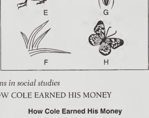

# C. 社会研究中的题目

## COLE 是如何赚取钱的

### Cole 如何赚取钱 August

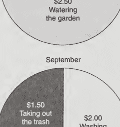

### September

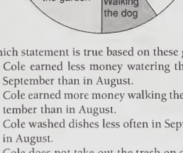

1. 根据这些图表，哪项陈述是正确的？
A Cole 在九月份浇花园赚的钱比八月份少。
B Cole 在九月份遛狗赚的钱比八月份多。
C Cole 在九月份洗盘子的次数比八月份少。
D Cole 在上学日不倒垃圾。

## Summary

## 使用情境依赖题目集评估高阶思维

- 开发用于评估高阶思维任务的基本规则
- 在测试幼儿、双语学习者、有特殊学习困难的学生以及残疾学生时，考虑指标反应的适当性非常重要。

## 评估定义性概念学习

- 定义性概念已被通过以下方式评估：
  - 要求学生对概念给出正确的定义。
  - 呈现概念的实例和非实例，并要求学生识别概念的实例。
  - 给出概念的名称并要求学生产生该概念的新实例。
  - 要求学生识别定义性概念的组成部分并举例说明各组成部分之间的关系。

## 在更深层次上评估概念理解

- 使用复杂的表现性评估，让学生将概念应用于新情境并将其与其他概念和关系联系起来，是评估学生对概念的深入理解的最佳方式。本章介绍了评估这种理解的策略示例。

## 评估规则和原理的理解

- 一个人的行为如果受规则或原理支配，则意味着该人会定期对一类概念做出一类适当的关联反应。
- 要评估学生是否理解一条规则，你必须确保任务评估的不仅仅是学生复述或陈述规则的能力。你必须要求学生将规则应用于新的或新颖的情境。
- 与概念理解评估一样，评估学生是否理解原理的任务需要向学生呈现与教学中用作示例的情境不同的情境，并且用词与教学中使用的话语不完全相同。
- 任务不应过度依赖阅读理解，以至于干扰识别那些虽然理解规则但阅读能力不佳的学生。
- 制作评估规则或原理理解的口头题目的两种基本策略是
  - 向学生呈现原理中规定的先决条件，并要求学生陈述或选择如果应用规则将遵循的后果的示例。
  - 向学生呈现后果，并要求学生陈述或选择根据规则产生这些后果必须存在的先决条件。
- 与前两种基本类型相似的任务变体包括
  - 要求学生识别与在给定情境中应用原理一致的推论或预测。
  - 要求学生产生在给定情境中应用原理的推论或后果的新示例。
  - 要求学生陈述解释特定情境或一系列事件的原理。

## 评估问题解决能力

- 问题解决涉及识别实现期望结果的障碍并使用适当的方法克服这些障碍以实现目标。问题解决可以从多个角度考虑，包括问题是结构良好还是结构不良，解决方案是否由图式驱动，以及解决方案策略是否特定于学科或通用。理解这些角度对于确定适当的评估策略至关重要。
- 以 IDEAL 问题解决者为框架，本章描述并举例说明了可用于评估特定问题解决能力的任务。提出了评估学生识别和认识问题、定义和表征问题、探索和使用启发式和其他解决方案策略，以及回顾和评估问题解决方案的能力的策略。

## 评估批判性思维能力

- 先提出批判性题目，然后在向学生发放选择题之前将其收回。
- h. 比较你获得的结果。你收到的信息的质量有何相似之处和不同之处？哪个任务更有效？为什么？
- i. 与本班其他人分享你的结果。你的结果与他们的相比如何？在所评估的学科和年级方面是否存在差异？班级可以从集体经验中得出什么结论？

2. 对于你教授或计划教授的学科，制作一本包含精心设计的任务的笔记本，这些任务评估不同的问题解决能力。根据 IDEAL 问题解决者的类别组织你的任务。按如下结构组织你的笔记本：

- a. 使用本章介绍的 17 种问题解决评估策略中的每一种制作一个评估任务。
- b. 每页输入一个评估任务。用学科、教学单元、学生年级、评估策略以及任务所评估的 IDEAL 问题解决者类别对任务进行标注。
- c. 在单独一页上，为任务制作评分量规并写出一个理想的样本回答。
- d. 仔细审阅你的工作。确保每个任务的内容和评分量规准确无误，并且任务设计精良。
- e. 与本课程的其他参与者分享你的笔记本。

3. 选择你教授或计划教授的一个学科和年级水平，对于批判。


+   d. 仔细审阅你的工作。确保每个任务的内容和评分量规都是准确的。确保任务设计精良。
+   e. 将你的笔记本与本课程的其他成员共享。

## 5. 对于你教授或计划教授的某一学科和年级，确定学生应能够使用的图表和表格（图表）：

+   a. 为该图表设计一个情境依赖的题目集，以评估学生使用该图表的能力，而不仅仅是读取其数值。为该题目集设计至少两个任务。使用第7章和第8章中的相应核查表审阅这些题目。附上每个题目的已完成核查表。
+   b. 将你的情境依赖题目集与本课程的其他成员共享。

## Additional Readings

Bloom, B. S., Hastings, J. T., & Madaus, G. F. (1971). Handbook on formative and summative evaluation of student learning. New York: McGraw-Hill.

在1992年国家教育进展评估中，给出了11个课程领域中评估高阶数学问题的题目的例子。给出了问题解决任务、评分量规和学生回应的例子。例子涵盖4年级、8年级和12年级。

Joshua, S., & Dupin, J. J. (1991). In physics class, exercises can cause problems. . . . International Journal of Science Education, 13, 291–301.

对学生进行了整年研究。对学生来说“新”的问题给平均学生带来了严重困难。讨论了教学建议。

Royer, J. M., Cisero, C. A., & Carlo, M. S. (1993). Techniques and procedures for assessing cognitive skills. Review of Educational Research, 63, 201–243.

对认知科学研究文献的综述，重点关注研究人员用于评估思维技能的任务。综述围绕以下阅读中描述的 Glaser、Lesgold 和 Lajoie 发展框架组织。

Glaser, R., Lesgold, A., & Lajoie, S. (1985). Toward a cognitive theory for the measurement of achievement. In R.R. Ronning, J. Glover, J. C. Conoley, & J. C. Witt (Eds.), The influence of cognitive psychology on testing and measurement (pp. 41–85). Hillsdale, NJ: Erlbaum.

本章提出了一种描述问题解决的发展方法。作者确定了问题解决的几个成长维度。然后他们描述了新手和专家问题解决者在每个维度上的差异。该框架可用于评估学生在问题解决发展方面的进步。

Haladyna, T. M. (1997). Writing test items to evaluate higher-order thinking. Boston: Allyn and Bacon.

第2章讨论了高阶思维技能，包括问题解决、批判性思维和创造力。其他章节给出了测试题目的例子和制作建议。

Kuhn, D. (1999). A developmental model of critical thinking. Educational Researcher, 28, (2), 16–25, 46.

本文提出了与本章采用的观点截然不同的批判性思维观点。作者将批判性思维视为一种发展过程，需要学校提供指导和练习。作者认为元认知是帮助学习者通过意识到自己的思维而进行批判性思考的主导思维过程。

Nitko, A.J. (1996). Educational assessment of students (2nd ed.). Englewood Cliffs, NJ: Prentice Hall/Merrill Education.

第10章给出了例子并描述了如何设计任务以评估以下问题解决技能发展的维度：知识组织和结构、问题表征的深度、心理模型的品质、程序的效率、表现的自动化以及学习的元认知技能。本章说明了如何实施 Glaser、Lesgold 和 Lajoie（1985）发展框架的方法。

Clarke, J. H. (1990). Patterns of thinking: Integrating learning skills in content thinking. Boston: Allyn and Bacon.
Fisher, R. (1990). Teaching children to think. Oxford, England: Basil Blackwell Ltd.
Halpern, D. F. (1989). Thought and knowledge: An introduction to critical thinking (2nd ed.). Hillsdale, NJ: Erlbaum.
Norris, S. P., & Ennis, R. H. (1989). Evaluating critical thinking. Pacific Grove, CA: Midwest Publications, Critical Thinking Press.

这些卷包含了关于构成批判性思维和问题解决的各种技能和能力的易读且实用的讨论。它们给出了教学建议以及示例任务。Clarke 书籍给出了概念图任务的良好例子（第8章）。

U. S. Department of Education (1999). NAEP 1998 writing report card highlights. (NCES-464) Jessup, MD: U.S. Department of Education ED Pubs. Also available on the National Center for Educational Statistics Website (http://nces.ed.gov/nationsreportcard/writing/results1998.asp/).

这份简报总结了全国写作评估。它包含了使用国家教育进展评估整体评分量规评估的4年级、8年级和12年级学生的写作样本，从而向你展示了一些写作评估的例子。

## Performance, Portfolio, and Authentic Assessments:
An Overview

## LEARNING TARGETS

After studying this chapter, you should be able to do the following:

## What is Performance Assessment?

+   1. 区分表现性任务与其他评估格式。 [1, 3, 6]
+   2. 区分课堂表现活动与表现性评估任务。 [1, 4]

## Types of Performance Assessments

+   3. 列出、解释并举例说明表现性评估的主要类型。 [1, 4, 6]

## Authentic Assessments

+   4. 解释真实性评估的含义及其基本特征。 [1, 6]

## Advantages and Criticisms of Performance Assessments

+   5. 解释使用表现性评估的主要优点和缺点。 [1, 6]

## How Using Performance Assessment Can Improve Your Teaching

+   6. 描述使用表现性评估如何改善教学、学习和评估效度。 [4, 1, 3, 6]

## Multiple-Intelligences Perspective on Performance Assessments

+   7. 解释从多元智能视角使用表现性评估的优势和劣势。 [1, 6]

## Important Terms and Concepts

+   8. 解释本章末尾列出的重要术语和概念如何适用于教育评估。 [6, 1, 4]

## ABOUT THIS CHAPTER

是否有替代纸笔测试用于课堂使用的选择？学生能否根据他们能够运用知识的能力进行评估？我们所说的替代性评估和表现性评估是什么意思？这些替代方案的有效性如何？多元智能评估与表现性评估有何关系？表现活动与表现性评估相同吗？

本章介绍了表现性评估。首先我们讨论表现性评估在你的教学中以及帮助学生实现学习目标方面的含义和作用。其次，我们描述了表现性评估的许多类型及其用途。包含了一个表现性评估全景图。第三，我们讨论了真实性评估，它反映了学校为学生准备的现实世界活动。接下来，我们讨论表现性评估对你作为教师的优点和缺点。第五，我们讨论你如何利用表现性评估来改善你的教学和学生的学习。最后，我们讨论多元智能理论及其与表现性评估的关系。我们讨论了采用这种教学方法时出现的特殊效度问题。在下一章中，我们将讨论如何为你自己的评估需求制作表现性评估的细节，包括项目和作品集。

## What Is Performance Assessment?

## Definition

表现性评估（a）提出一个动手任务，要求学生完成一项需要运用多个学习目标的知识和技能的活动，（b）使用明确定义的标准来评估学生实现这种应用的程度。表现性评估要求学生对自己的知识做些什么，例如制作某物（建造一面书架）、制作报告（报告一项调查家长态度的团体项目）或进行演示（展示如何在实验室天平上测量质量）。以下示例展示了一位历史教师构建的决策任务。教师使用这一个任务来评估从《学习维度模型》（Marzano et al., 1992）派生的几种类型的学习目标。 （见附录 E，了解这些类型的摘要。）

## Example

高中历史课程的表现性评估任务

## Decision-Making Task

假设你生活在1940年代，总统哈里·S·杜鲁门请求你担任白宫特别工作组成员。目标是决定如何迫使日本无条件投降，同时为战后世界提供安全保障。

你是四人委员会的一员，已达到需要决定是否投下原子弹的阶段。确定你正在考虑的替代方案以及你用来做出决定的标准。解释影响你选择用来做出决定的标准的值。也解释你的决定如何帮助你更好地理解以下陈述：“战争迫使人们面对内在的价值观冲突。”

在开始你的任务之前，建立一个明确的目标并写下来。然后写下实现目标的计划。当你完成任务后，准备好描述你在过程中对计划所做的更改。

在完成任务时，尝试多种信息来源：书籍、杂志文章、报纸和经历过战争的人。保留这些来源的清单，并准备好描述你如何确定哪些信息最相关，哪些信息不太有用。

以以下至少两种方式呈现你的结论和发现：

- 一份书面报告
- 一封在委员会会议结束后写给总统的信
- 一篇为《时代》杂志撰写的文章，附带建议的照片和图表
- 一部委员会会议戏剧化的录像带
- 一盘录音带
- 一则新闻播报
- 一次模拟采访

你将获得量规并在以下每个学习目标上接受评估：

## Content Learning Target

+   1. 你对战争迫使敏感问题浮现并导致人们面对内在价值观和信念冲突这一原则的理解。

## Information Processing Learning Targets

+   2. 你评估每个信息来源对项目各部分价值的能力。

## Complex Thinking Learning Targets: Decision Making

+   3. 你识别投下原子弹的重要且适当的替代方案的能力。
+   4. 你识别评估每个待考虑替代方案的重要且适当标准的能力。
+   5. 你准确评估每个替代方案在每个标准上满足程度的能力。
+   6. 你选择充分满足标准并回答初始决策问题的替代方案的能力。

## Habits of Mind Learning Target

+   7. 你在此作业中有效地定义目标并解释实现该目标计划的能力。

## Effective Communication Learning Target

+   8. 你以两种或以上方式传达你的结论和发现的能力。

> Source: Adapted from Assessing Student Outcomes: Performance Assessment Using the Dimensions of Learning Model (pp. 27-29) by R. J. Marzano, D. Pickering, and J. McTighe, 1993, Alexandria, VA: Association for Supervision and Curriculum Development. Adapted by permission of McREL Institute, 2550 S. Parker Rd., Suite 500, Aurora, CO 80014. Telephone (303) 337-0990. (c) by McREL Institute. All rights reserved.

## Balancing Assessment Formats

你不应使用表现性评估来评估每个学习目标。每个课程都非常多样化，并非每个学习目标都需要学生应用他们的知识和技能。因此，在选择评估方法之前，你必须首先明确你想要评估的学习目标，然后将方法与之匹配。一些学习目标，例如，要求学生学习


事实（例如国家政府的结构、宪法和权利法案的主要条款）、理解一个事件或理论，或比较两个或多个概念。你应该使用传统的题目格式来获得有效的结果，以评估这些类型的学习目标。另一方面，你应该使用表现性任务来评估需要学生在使用知识和技能执行某项任务时应用其知识和技能的学习目标。记住的一个经验法则是：简单的学习目标需要简单的评估格式；复杂的学习目标需要复杂的评估（Arter, 1998）。

## 表现性评估的基本特征

表现性评估必须有两个组成部分：表现性任务本身以及用于评分的明确评分标准。一种常见的误解是，教学中使用的任何表现性学习活动也是评估。事实远非如此。课堂评估要求你有意收集有关每个学生是否达到既定学习目标的信息。这意味着超越仅仅做一个活动。它意味着将活动聚焦于特定的学习目标，并根据既定标准评估这些学习目标的达成情况。通常，课堂表现性活动缺乏这种评分标准组成部分，因此不能算作评估。

表现任务 表现任务是一种评估活动，要求学生通过制作较长的书面或口头答案、参与小组或个人活动，或制作特定产品来展示其成绩。我们之前介绍的高中历史示例就是此类活动之一。当你使用表现任务时，你要求学生直接展示其学习目标的达成情况。如果你只是要求学生给出简短答案（例如完成题或简答题）或从你提供的选项中选择答案（匹配练习、是非题或多选题），则你要求的是间接展示。

你所实施的表现任务可用于评估学生制作的产品和/或学生完成产品所使用的过程。取决于学习目标，你可能希望评估这两方面中的一个或两个。在第12章中，你将阅读更多关于这种区别的内容，并学习如何设计任务和评分标准以评估产品和过程。

评分标准 评分标准是你用来评估学生表现质量的一套连贯规则：这些规则指导你的判断并确保你一致地应用判断。规则可以采用评分量表或核对表的形式。复杂的表现需要你评估多个学习目标或表现的多个部分。为此，你使用多个评分标准：每个学习目标或每个部分一个。

评分量表由数字组成，例如0到3或1到4，反映表现的质量水平。每个数字对应对其所代表的质量水平的文字描述。（我们在以下段落中举例说明。）代替文字描述，学生的作品示例可用作每个质量水平的具象说明。

两种类型的评分标准 随着学生在学年中练习和执行该学科的许多不同学习目标，如果他们对该学科中同类型的所有作业应用相同的一般评价框架，其学习就会得到改善。我们在第9章（第186–191页）看到了评估和教学写作的一般框架的示例。一些研究证据支持这样一种观点：当学生常规使用一般但分析性的特征标准进行课堂学习时，其成绩会提高（Khattri, Reeve, & Adamson, 1997）。附录H中的俄勒冈写作评估评分标准就是这种一般分析性评分标准的示例。

你也可以使用一般框架来制定针对特定任务的评分标准。通过这种方式，你以一致的方式将相同的一般框架应用于每个新的表现任务。当你使用一般评分框架作为指导来制定具体评分标准时，你的分数的可靠性和有效性会提高。

一般评分标准包含适用于许多不同任务的评分指南，而不仅仅适用于一个特定任务。然而，它作为制定更具体评分标准的一般框架。下面是评估与我们之前介绍的类似的高中历史任务的任何内容学习目标的一般评分指南的示例。例如，以海湾战争和布什总统为中心的任务就是可以评估此内容学习目标的替代任务。

## 示例

可应用于高中历史任务的一般评分标准。
正在评估的内容学习目标：理解战争会使敏感问题浮出水面并迫使人们面对价值观和信念的固有冲突。
4 充分展示对任务或情况特有的概括性概念和事实的理解。对该信息某些方面提供新的见解。
3 展示对任务或情况特有的概括、概念和事实的完整而准确的理解。
2 展示对任务或情况特有的概括、概念和事实的不完整理解。
1 展示对任务或情况特有的概括、概念和事实的严重误解。

来源：改编自《评估学生成果：使用学习维度模型的表现性评估》（第29–30页）R. J. Marzano, D. Pickering 和 J. McTighe，1993年，Alexandria, VA，Association for Supervision and Curriculum Development。经 McREL Institute 许可改编，2550 S. Parker Rd., Suite 500, Aurora, CO 80014。电话 (303) 337-0990。© McREL Institute。保留所有权利。

## 使你的课堂表现性评估有效的是什么？

当你使用表现性评估时，你必须注意三个主要要点，以提高学生评价的有效性：

- 1. 确保你在表现性活动中要求学生做的事情与学习目标相匹配，并且你的评分标准评估的是相同的学习目标。例如，如果学习目标说明学生必须在实验室天平上称量化学品，则表现任务必须要求实际称量，而不是关于如何使用天平的论文。此外，你必须有一个评分标准来帮助你判断学生称量化学品的好坏，而不仅仅是说明化学品已被称量。
- 2. 确保你设计的表现任务要求学生使用课程规定的思维过程。一旦学生开始执行这些任务，你就可以评估这些过程。
- 3. 确保使用多种类型的评估程序（简答题、客观题以及各种长期和短期表现任务）来抽样你所在州的标准和你所在地方课程的学习目标的广度。如果你的评估仅基于一种评估格式（例如，如果你仅依赖表现任务），你很可能对每个学生的学习情况缺乏完整的了解。

具体评分标准是一种评分量表，它将一般评分框架应用于特定任务。仔细应用一般评分框架来制定具体评分标准可确保你的具体评分标准以与一般评分框架一致的方式评估学生。以下是历史教师用来评估学生对之前介绍的高中历史决策任务表现的具体评分标准。它以前述的一般评分标准作为框架。

## 示例

可应用于高中历史任务的具体评分标准。
正在评估的内容学习目标：理解战争会使敏感问题浮出水面并迫使人们面对价值观和信念的固有冲突。

- 4 充分展示对“战争会使敏感问题浮出水面并迫使人们面对价值观和信念的固有冲突”这一概括的理解。对战时人们的行为提供新的见解。
- 3 展示对“战争会使敏感问题浮出水面并迫使人们面对价值观和信念的固有冲突”这一概括的完整而准确的理解。
- 2 展示对“战争会使敏感问题浮出水面并迫使人们面对价值观和信念的固有冲突”这一概括的不完整理解。对该概括存在一些显著的误解。
- 1 展示对“战争会使敏感问题浮出水面并迫使人们面对价值观和信念的固有冲突”这一概括的严重误解。

来源：改编自《评估学生成果：使用学习维度模型的表现性评估》（第29–30页）R. J. Marzano, D. Pickering 和 J. McTighe，1993年，Alexandria, VA，Association for Supervision and Curriculum Development。经 McREL Institute 许可改编，2550 S. Parker Rd., Suite 500, Aurora, CO 80014。电话 (303) 337-0990。© McREL Institute。保留所有权利。

## 表现性评估的类型

许多类型的任务符合我们在此采用的广泛定义。表11.1列出了其中大部分。在下面的段落中，我们将描述它们并举例说明。

## 结构化、即时任务

当你决定材料的内容和时间时，你使用结构化、即时任务或练习

表11.1 表现性评估技术类型
A. 针对个人学生、小组或两者而设的结构化、即时任务
1. 纸笔任务
2. 需要超出纸笔的设备和资源的任务
B. 自然发生或典型表现任务
C. 针对个人学生、小组或两者的长期项目
D. 作品集
1. 最佳作品作品集
2. 成长和学习进展作品集
E. 演示
F. 实验
G. 口头报告和戏剧化
H. 模拟和人为情境
1. 演员和“标准病人”
2. 计算机化自适应视听场景
3. 计算机化自适应文本场景
4. 计算机化视听模拟


应使用，说明了绩效的指导，描述了学生应努力实现的结果类型，告知学生他们正在接受评估，并为学生提供为评估做准备的机会。这类任务也称为即时（或控制）任务。

## 纸笔任务

我们已经研究了许多类型的纸笔任务。在第7章、第9章和第10章中，我们讨论了 constructed response 和 essay 题目。这些格式不仅允许学生记录答案，还可以让他们解释、阐述推理并表达解决问题的思路。有时你的主要关注点是学生创作的书面产品本身，例如故事、报告或绘画。另一些时候，你可能更感兴趣的是学生使用的过程（例如，当学生记录完成实验所用的步骤或解释他如何解决问题时）。以下是一些额外示例：

## Example

即时纸笔表现任务示例

- 1. 解决这个算术应用题并解释你是如何解决的。
- 2. 研究以下显示 Sally 如何使用时间的图表。然后，利用图表中的信息写一个关于 Sally 典型一天的故事。
- 3. 绘制图表来说明以下应用题中的数学思想。

## 需要其他设备和资源的任务

在数学、科学、机械制图、艺术、急救和救生、家政和驾驶教育等学科中，重要的成果要求学生使用设备和资源做某事，而不是写如何做。在某些学术科目中，执行非纸笔任务可能比使用书面回答更好，即使两者都可以做到。

例如，在小学综合科学中，如果你要求他们测量物体、体积、质量等，你就可以直接评估学生对公制系统的理解和使用。如果你只要求学生进行从一个系统或单位到另一个系统的数值转换，或根据测量设备的图片回答问题，你就使用了间接评估。你可以评估学生的估算技能、测量技能和系统性，允许替代的正确表现，或封闭式回答，只允许一个最佳或正确答案。下面给出了一个开放式回答、非纸笔表现任务的示例。请注意，在此示例中，重点在于学生使用的过程而不是最终产品。

## Example

一个需要超出纸笔资源的开放式科学任务

任务描述：学生必须找到一种或多种方法，从脏水中去除最多的碎屑。

每个学生的设备资源：3 个透明塑料量杯；2 个透明塑料杯；30 cc 水族馆活性炭；30 cc 清洁水族馆沙；4 个棉球；铅笔；透明胶带；纸袋；一本包含大纲和答案空间的学生用书。

手册中的说明：Finny Fishes 宠物店的老板想用池塘里的一些水来装店里的鱼缸。水不是很干净。老板需要你的帮助来找到一种能从水中取出最多东西的方法。你需要保留记录以向 Finny Fishes 宠物店的老板展示。[手册为学生记录（a）为解决问题需要提出的问题、（b）他们使用的程序、（c）图表和解释性绘图、（d）他们进行的测量和收集的数据，以及（e）实验报告提供了空间。]

教师的指示：教师复习材料和手册；演示如何制作一种过滤器；鼓励提出许多不同的问题、制作不同的过滤器、记录观察和数据、尝试不同的解决问题方法；并向学生保证，他们将被评估的是他们解决问题的方式，而不是找到唯一的正确答案。

评分：评分既是整体的也是分析性的。分析性评分包括对实验、收集数据、得出结论和交流的单独评分。

> 来源：改编自任务 981，清洁水。综合评估系统：管理说明（第 8、15、17、19 页）。摘自综合评估系统：科学表现评估。版权所有 © 1992 Harcourt, Inc. 经许可转载。保留所有权利。

## 自然发生或典型表现任务

与结构化、即时表现相反的是自然发生的表现。自然发生的任务要求你在自然环境中观察和评估学生：在典型的课堂环境中、在操场上或在家中。在这些环境中，你很可能会看到学生在学习目标上的典型表现，例如与团队成员合作实现目标。在自然环境中，你不会告诉学生他们正在接受评估，也不会以任何方式控制情况。以下是一些示例。

## Example

自然发生或典型表现任务示例

- 1. 观察学生在操场上处理冲突的方式。
- 2. 收集每个学生在每门科目中写的全部作品并分析其语法、拼写和句法错误，以确定学生的典型语言使用情况（至少在学校作业中）。
- 3. 观察学生在学校集市上经营饮料摊时是否能正确找零。

虽然自然发生的环境可能让你评估学生的典型表现，但这并不总是如此。在自然环境中，你必须等待特定学生执行你想要评估的特定活动的机会出现。活动可能不会在你观察时发生。这种等待降低了这种评估方式的效率。例如，上述任务 2 不太可能为你提供所有所需的信息来确定学生甚至对写作机械的掌握程度。例如，并非所有学生需要学习的拼写模式和句子结构形式都可能出现在每个学生的写作中。因此，你无法彻底评估学生对句子结构的运用。

这个简单示例说明了使用自然发生事件作为主要评估任务来源的困难。以下是主要缺点：

- 你花费大量时间等待。
- 你对将发生什么表现以及何时发生几乎没有控制权。
- 你无法确保所有学生都会执行相同的任务。
- 你无法确保所有学生都会在理想或甚至相似的条件下执行任务。
- 教师时间被低效使用。

## 长期项目

个人学生项目 个人项目是一项长期活动，会产生学生产品：模型、功能性物体、实质性报告或收藏。以下是一些示例：

## Example

个人学生项目示例

- 1. 在学期中每个假日前几个月收集和分类报纸和杂志广告。
- 2. 使用你在学期中学会使用的手工工具制作一件小家具。
- 3. 使用本单元教授的光学原理制作一个照相机的实用模型。
- 4. 使用学校图书馆的资源，写一篇关于初选投票率如此低的原因的研究论文。

图 11.1 显示，精心设计的项目要求你的学生应用和整合广泛的能力和知识；并使用创造力、独创性和一定的审美感。例如，当学生写图书馆研究论文时，学生必须应用查找和使用参考资料和来源的技能：提纲、组织和规划报告；使用书面语言、文字处理和演示风格进行交流；并展示他对主题的理解。一个好的项目将使她参与批判性思维、创造性思维和解决问题（参见第 10 章）。

尽管项目通常是有价值的教育活动，但它们作为个人学生评估工具的实用性取决于你设计它们的程度。我们将在第 12 章讨论如何设计项目。

小组项目 小组项目要求两个或更多学生共同完成一个较长期的项目。小组项目作为评估技术的主要目的是评估学生是否能够合作、适当且有效地共同创造高质量的产品。小组项目的学习目标取决于学科内容和你评估的学生水平。例如，小组项目可能侧重于：

- 以行动为导向的学习目标（制作一份通讯）。
- 以学生兴趣为导向的学习目标（写一篇关于他们感兴趣的主题的论文）。


## 图 11.1 项目的积极特征

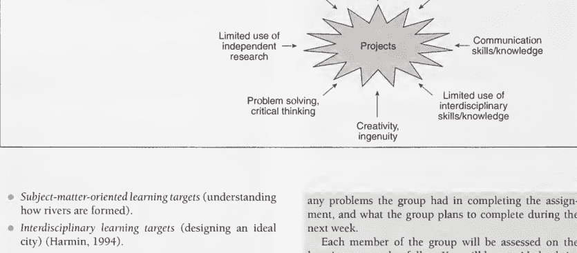

- 以学科为导向的学习目标（理解河流是如何形成的）。
- 跨学科学习目标（设计理想城市）（Harmin, 1994）。

我们在第 12 章中提供了改进小组项目的建议。接下来展示一个以学科为导向的小组项目的例子。

## 示例

美国历史课程中针对初中或高中学生的小组项目

## 历史调查任务

近年来，关于克里斯托弗·哥伦布地位的争议不断出现。他是英雄还是恶棍？在我们研究哥伦布时，我们将阅读由不同历史学家撰写的多项资源，了解他们对哥伦布的看法。

在合作小组中，选择至少两种描述哥伦布“发现”新世界及其定居期间发生的事件的相互冲突的报道。讨论你发现的矛盾，并尝试确定历史学家为何对事件的报道不同。利用可用的资源，发展对矛盾原因的清晰解释，或提出一个澄清矛盾的情景。

你的小组将向全班解释为什么历史学家似乎对同一事件的报道不同。此外，你的小组还将向全班提供其解决矛盾的想法。你小组向全班的展示可以是戏剧化表演、小组讨论或辩论。

你的项目将在三周后到期。每周五，你小组的一名成员将向全班汇报过去一周项目进展、小组在完成作业时遇到的问题，以及小组计划在下周完成的内容。

小组每个成员都将根据以下学习目标进行评估。你将获得每个学习目标的评分量规，以便更清楚地了解评估内容。

## 社会研究内容学习目标

- 1. 你理解记录的历史受历史学家视角的影响。
- 2. 你理解哥伦布发现和定居新世界周围的事件。

## 复杂思维学习目标：历史调查

- 1. 你识别并解释过去事件周围的困惑、不确定性或矛盾的能力。
- 2. 你发展并捍卫对过去事件周围的困惑、不确定性或矛盾的合乎逻辑且合理的解决办法的能力。

## 有效沟通学习目标

- 1. 你为多种目的进行沟通的能力。
- 2. 你以多种方式进行沟通的能力。

## 协作学习目标

- 1. 你与小组中的所有学生一起成功完成项目的能力。
- 2. 你为向全班展示研究成果提供良好想法和资源的贡献能力。
- 3. 你做多种不同活动以帮助小组成功完成项目的能力。

> 来源：改编自《评估学生成果：使用学习维度模型的绩效评估》（第 60 页）R. J. Marzano、D. Pickering 和 J. McTighe，1993 年，Alexandria, VA：监督与课程发展协会。经 McREL Institute 许可改编，2550 S. Parker Rd., Suite 500, Aurora, CO 80014。电话 (303) 337-0990。© McREL Institute。保留所有权利。

为评分项目工作而制定的量规 学生在本项目中的表现沿着几个维度或学习目标类别进行评估，如《学习维度模型》所述（见第 25 页和附录 E）。要评估学生，你必须制定特定于项目的评分量规（或改编其他来源的量规）。下面是一个例子，是一套用于评估在小组任务中进行协作和合作的一般评分量规。这些量规和锚点都需要重写，使其适用于手头的具体项目——正如之前对历史决策任务所做的那样（见第 239 页）。

## 示例

用于评估个人学生在小组项目中从事小组项目时四种协作和合作学习目标的一般量规

## 学习目标 A. 致力于实现小组目标。

- 4 积极帮助确定小组目标并努力实现它们。
- 3 传达对小组目标的承诺并有效履行分配的角色。
- 2 传达对小组目标的承诺但未履行分配的角色。
- 1 未致力于小组目标或积极阻碍它们。

## 学习目标 B. 表现出有效的个人间技能。

- 4 积极促进有效的群体互动，并在对他人的感受和知识基础敏感的方式下表达思想和意见。
- 3 在提示下参与群体互动。以对他人的感受和知识基础敏感的方式表达思想和意见。
- 2 在未提示的情况下参与群体互动，或在不考虑他人的感受和知识基础的情况下表达思想和意见。
- 1 即使在提示下也不参与群体互动，或以对他人的感受和知识基础不敏感的方式表达思想和意见。

## 学习目标 C. 促进小组维护。

- 4 积极帮助小组确定小组过程中必要的变化或修改并努力执行这些变化。
- 3 帮助确定小组过程中必要的变化或修改并努力执行这些变化。
- 2 在提示下，帮助确定小组过程中必要的变化或修改，或仅在执行这些变化中发挥最小作用。
- 1 即使在提示下也不尝试确定小组过程中必要的变化或修改，或拒绝努力执行这些变化。

## 学习目标 D. 在小组中有效履行多种角色。

- 4 在小组中有效履行多个角色。
- 3 在小组中有效履行两个角色。
- 2 尝试在小组中履行多个角色，但在次要角色上成功有限。
- 1 拒绝承担在小组中履行多个角色的机会或请求。

> 来源：改编自《评估学生成果：使用学习维度模型的绩效评估》（第 87-88 页）R. J. Marzano、D. Pickering 和 J. McTighe，1993 年，Alexandria, VA：监督与课程发展协会。经 McREL Institute 许可改编，2550 S. Parker Rd., Suite 500, Aurora, CO 80014。电话 (303) 337-0990。© McREL Institute。保留所有权利。

## 结合小组和个人项目

在结合小组和个人项目中，学生小组共同完成长期项目，在小组活动完成后，个人在没有其他小组成员协助的情况下准备自己的报告。这种结合方法在项目复杂且需要多个学生的协作才能在合理时间内完成时很有用，但学习目标要求个人学生能够准备最终报告、自行解释结果等。为了在这种绩效环境中评估学生，你必须准备小组和个人学习目标以及评分量规。

## 合作学习策略

关于合作学习的实证研究表明，当学习环境要求既有小组目标又有个人问责时，学生成绩最好：

如果要实现合作学习的成绩效应，则必须满足两个条件。首先，合作小组必须有一个对他们很重要的小组目标。例如，小组可能正在努力获得证书或其他认可、获得几分钟额外的课间休息时间，或获得成绩的奖励分数（尽管我哲学上反对让成绩很大程度上由团队表现决定）。……其次，小组的成功必须取决于所有小组成员的个人学习。也就是说，必须有个人问责制以及小组问责制。例如，小组可以根据其成员个人测验成绩的平均值获得奖励。（Slavin, 1988, p. 31）

在这种结合小组和个人学习的项目中进行评估，需要评估小组在项目上的共同成功程度以及个人在多大程度上实现了学习目标。

## 作品集

就评估目的而言，作品集是学生作品的有限集合，用于展示学生的最佳作品或展示学生在给定时间内的教育成长。作品集不仅仅是学生所有作品的集合：放入作品集的作品仅限于最能服务于作品集目的的作品。作品集既不是剪贴簿，也不是学生所有成就的“倾倒地”。作品集中的项目经过仔细和有意地选择，以便整个集合实现其目的。虽然创建作品集有其他目的，但本章仅讨论两种评估目的¹：展示自己的最佳作品和展示教育成长。

## 最佳作品作品集

最佳作品作品集包含学生的最佳最终产品。你主要出于总结性目的使用最佳作品作品集。以下是最佳作品作品集所服务的用途的一些例子。

## 示例

最佳作品作品集的例子

总体目的：对个人学生的评估

### 可能的具体目的

- 学科掌握和学习的证据。
- 在艺术或写作等领域取得高水平成就的证据。
- 为毕业目的在某一学科达到最低能力要求的证据。
- 对学区成就的证据。

¹ 作品集的其他三个目的包括（1）展示，在学生选择其最喜欢的作品（Paulson, Paulson, & Meyer, 1991）；（2）过程记录，在学生将评论和记录作为长期项目进行（Wolf, 1989）；以及（3）展示一组学生的综合成就（Arter & Spandel, 1992）。

作品集的内容

- 选择学生的最佳作品，以提供令人信服的证据，证明学生已实现特定的学习目标。

总体目的：沟通

### 可能的具体目的

- 学生向其父母展示的作品。
- 将有关学生的信息传递给下一位教师。
- 学校的展示。

作品集的内容

- 成就的例子，可能是典型的，也可能令人印象深刻。

通常最佳作品作品集的内容是规定的。例如，为证明学生在艺术方面的成就，教育当局可能要求一份素描、一幅绘画、一件雕塑、一件工艺品，以及一件学生自选媒介的作品。在数学中，教育当局可能要求学生的作品集包含目录、一封告诉作品集评估者所包含条目的信，以及五到七件涉及多种活动类型、工具和主题的最佳作品（Kentucky Department of Education, 1993a）。

学生需要学习如何创建最佳作品作品集，以便以最佳方式展示自己。学生需要学习作品集制作技能包括：决定他们希望通过作品集传达或实现什么；如何选择要包含在作品集中的作品；如何最好地呈现所选作品；以及使用将应用于其作品集的评分量规评估所选作品的质量。

与其他形式的绩效评估一样，你只有在制定评分量规后才评估最佳作品作品集。作品集的评分量规通常适用于整个作品集而不是每件作品单独，但也有例外。我们将在第 12 章讨论作品集的量规。

## 成长和学习进展作品集

成长和学习进展作品集包含学生的作品示例以及评论，展示学生在给定时期内的学习如何进展。它不侧重于学生产生的最终产品。相反，你和学生使用作品集进行形成性目的，以监测学生的学习和思维进展、诊断学习和思维困难，并指导新的学习和思维。学生在决定应包含在此作品集中的内容方面发挥重要作用，并学习使用作品集来理解和评估自己的进展。以下是一些例子：


## 示例

成长与学习档案的示例

总体目的：监测个别学生的进步

## 可能的具体目的
- 教师和/或学生希望回顾进步和成绩的变化。
- 学生需要回顾自己的作品，以了解所取得成就的“长远视角”或“整体图景”。

## 档案内容
- 学生在学习过程中出现的中间阶段的作品或成果。这些可能包括初稿、思维记录和重写。最终成果也应放入档案中。

总体目的：日常教学

## 可能的具体目的
- 作为与学生讨论其想法和作品的基础。
- 记录学生思维和概念解释的变化。
- 作为诊断学生在某一学科学习困难的基础。

## 档案内容
- 学生最近完成的作品示例、学生收集的数据、某一学科中正在进行的调查的最新发现、学生对正在进行的作品的自身解释等。

总体目的：自我反思和自我指导

## 可能的具体目的
- 反思自己在学科知识和技能方面的进步，例如在阅读方面。
- 反思自己对事件的思考方式的变化，例如如何解释一个科学现象。
- 在回顾其他学生的档案后，反思自己的进步。

## 档案内容
- 在不同时间点完成的作品示例、学生对某一学科特定问题的过去和现在的概念性思维记录、学生对其自身作品的过去和现在评价的记录等。

要使成长和学习进展档案有效，它必须精心制作。我们将在第12章讨论如何制作它们。

使用这些档案需要大量的知识、技能和能力。此外，你需要对你要评估进步的学科非常精通。你也应该注意到，这种类型的档案评估活动比使用最佳作品档案进行评估要更即兴、更不正式。这些特点不一定是弱点，因为档案是与互动教学一起使用，并且作为形成性评价工具使用。

## 演示

演示是一种即时表演，学生在其中展示其能够使用知识和技能完成一个定义明确的复杂任务。演示不像项目那样长或复杂。演示通常是封闭式应答任务。构成演示的任务通常定义明确，学生和评估者通常都知道“正确”或“最佳方式”。然而，允许个人差异；演示方式和呈现风格在学生展示演示时通常很重要。4-H 俱乐部经常使用演示：男孩和女孩在各种农业和家政领域展示他们的技能。

在学校里，学生可能会在以下示例中展示他们在正确技术方面的技能。

## 示例

用于评估的演示示例
- 1. 演示制作面包时揉面团的正确方法。
- 2. 演示如何设置显微镜以观察染色玻片。
- 3. 演示如何爬绳。
- 4. 演示如何在互联网上查找信息。

在很大程度上，演示侧重于学生使用技能的熟练程度，而非学生解释其思维或阐述现象背后的原理的能力。如果你将演示用于评估目的，你应仔细确定适当的学习目标并使用适当的评分量规。

## 实验

实验或调查是一种即时表演，学生在其中计划、进行并解释实证研究的结果。该研究侧重于回答特定的研究问题，例如“本校大多数学生是否支持本州的死刑法律？”或调查特定的研究假设“鲜艳的广告会被记住更久”。按此定义，实验或调查包括自然科学和社会科学学科中发生的各种研究活动。它们包括实地和调查研究以及实验室和对照组实验，可以作为个人或小组活动进行。

实验让你评估学生是否使用适当的研究探究技能和方法。你也可以评估学生是否已发展出适当的概念框架和理论性、学科性的对所调查现象的解释。为了评估这些后者方面，重点关注学生的参照框架质量、他们对所研究问题的心理表征、他们计划或设计研究的水平、他们能够指定的问题或假设的质量，以及他们对数据关系存在原因所提供的解释的质量。为了评估这些能力，请设计你的实验或调查任务，使学生必须：
- 1. 在开始收集数据之前做出估计和预测。
- 2. 收集自己的数据，对其进行分析并展示分析结果。
- 3. 得出结论并通过引用所收集的适当证据来支持结论。
- 4. 阐述其假设并识别其方法或数据中可能的误差来源。
- 5. 有效地传达实验或调查的发现。（Barone, 1991）

## 口头报告和戏剧化表演

口头报告允许学生以访谈、演讲或口头报告的形式言语化其知识并使用其口语技能。确定口头报告应侧重的学习目标。例如，在语言和语言艺术课程中，许多学习目标侧重于风格和沟通技能，而非内容的正确性。在某些课程中，流利地讲外语是一项重要的学习目标。以下是建议用于外语口语能力面试的熟练程度量表中的主要锚点的示例：

## 示例

评估外语口语熟练程度的胜任力水平描述示例

| 熟练程度 | 描述 |
|---|---|
| 精通 | 精通水平的特点是说话者能够：在实践、社会、专业和抽象主题的大多数正式和非正式对话中有效参与；并且 |
| 高级 | 使用自然般的语篇策略支持观点和假设。高级水平的特点是说话者能够：以清晰、参与的方式交谈；发起、维持并完成各种各样的交际任务，包括那些由于复杂情况或不可预见的事件转折而需要增加使用多样化语言策略以传达意义的任务；满足学校和工作情况的要求；以及用段落长度的连贯语篇进行叙述和描述 |
| 中级 | 中级水平的特点是说话者能够：通过组合和重新组合已学元素来使用语言，尽管主要是在反应模式中；以简单的方式发起、最低限度地维持并结束基本的交际任务；并提问和回答问题 |
| 初级 | 初级水平的特点是能够用已学材料进行最低限度的交流。 |

> 来源：改编自美国外语教学理事会《口语熟练度面试：测试员培训手册》，1989年，纽约 Yonker：作者。经许可改编。

口头报告在尤其适用于面向群体演讲的另一个领域。示例 11.1 显示了一个用于评估课堂演讲表达的简单量表。

辩论是一种特殊的口头表演形式。辩论让一名学生与另一名学生对立，逻辑地争论问题。评估侧重于论证和反驳的逻辑性和说服力。其他法庭活动包括诗歌朗诵和演说。

戏剧化表演结合了言语化、口语和表达技能以及动作表演。学生可以通过扮演角色展示对虚构人物或历史人物的理解，例如，通过表演展示这些人物的意识形态立场和个人特征。虽然戏剧化表演通常涉及口语技能，但有时可能不涉及。例如，在阅读《哈克·芬恩》之后，教师可以要求学生


## 示例 11.1

对学生口头演讲质量进行评估的简单评分量表示例。

## 课堂演讲评分量表

学生姓名 ______________________________ 日期 __________
演讲主题 ______________________________

1. 演讲内容是否对主题有意义？
1 大部分演讲内容并不真正有意义
2 只有约 50% 的演讲内容相关
3 大部分内容相关；偶尔有不相关想法
4 所有内容都明显且清晰地相关

2. 表达是否流畅且不犹豫？
1 几乎每句话都有长时间停顿和找词现象
2 约 50% 的句子出现停顿和找词现象
3 偶尔出现停顿和找词现象
4 表达流畅；没有停顿或找词现象

3. 演讲者是否使用正确的语法？
1 大多数句子都有错误
2 约 50% 的句子有错误
3 1 到 3 处错误
4 没有错误

4. 演讲者是否看着听众？
1 大部分时间都避开视线
2 只有 50% 的时间看着听众
3 大部分时间看着听众
4 不断看着听众

模仿哈克·芬恩在课堂上可能的表现方式 (Armstrong, 1994)。

## 模拟和人为情境

演员和“标准化病人” 模拟是在受控条件下发生的按需事件，试图模仿自然发生的事件。当需要评估的表现是与他人互动的能力时，可以训练演员扮演另一方的角色。标准化病人格式最初用于评估医学生和执业医生的临床技能。演员被训练表现出特定疾病的症状。每位医学生都会会见并访谈这位标准化病人，以诊断疾病并开具治疗方案。评估小组观察这种互动并对候选人进行评估。

计算机化自适应视听情境 视频、CD-ROM、音频和计算机的综合技术可用于向学生呈现逼真的情境。然后计算机评估学生对这些呈现的反应。如果呈现的情境结构合理且可能采取的行动数量有限，则可以构建自适应评估任务，即学生对一个情境的反应将决定下一个呈现内容。例如，媒体向学生呈现一个情境并提出问题或要求做出决定。学生做出回应，呈现内容会根据回应继续下去。这样，每个学生都会根据其行动选择获得略有不同的情境。

计算机化自适应文本情境 这种评估格式与自适应视听情境格式相似，只是用文本显示代替多媒体呈现。

计算机化视听模拟 随着技术和软件的快速进步，多媒体模拟变得更加逼真和复杂。例如，在初中科学中，计算机可以模拟动手探究 (Shavelson & Baxter, 1991)。在 sow bug 探究中，学生探究“计算机 sow bugs”在模拟光照和湿度变化时做什么。

虚拟现实技术在这方面提供了更多前景。飞行模拟器是技术与对现场表现条件和不同行动后果的复杂知识库相结合的例子。

这种格式以及前述格式的优点是与现实生活相比更经济、更一致，并且具有计算机评分的潜力 (Jones, 1994)。模拟与实际情况和真实人物越远离，就越不逼真和有意义。经常，课堂教师无法使用模拟，因为它们不可用。这些是这些格式的主要缺点。

## 真实性评估

表现性评估有时被称为替代性评估或真实性评估。然而，这些术语不能互换使用。“替代”在替代性评估中通常意味着与标准化成就测试以及多项选择（是非题、配对题、完形题）题型相对立。从教育哲学角度来看，“真实”在真实性评估中通常意味着向学生呈现直接对其教育有意义的任务，而不是间接有意义。例如，阅读几部长篇作品并用它们来比较和对比不同的社会观点是直接有意义的，因为这是受过教育的公民所做的深思熟虑的阅读。另一方面，阅读短段落并回答关于“主旨”或段落中人物做了什么的问题，则是间接有意义的，因为它只是现实阅读的最终学习目标的一个片段或组成部分。“现实”和“有意义”是教育工作者在谈论真实性评估时经常使用的术语。正如我们稍后将讨论的，这些术语也引出了进一步的问题，例如，“在哪个情境下是现实的？”和“对谁有意义？”

真实性特征 你在本书之外阅读的表现性评估材料会提到真实性评估。这通常意味着学生是在直接具有教育意义的任务上接受评估。真实性任务具有以下特征 (Wiggins, 1990)：

- 1. 它们要求学生运用知识完成有意义的任务。
- 2. 它们复杂且要求学生使用不同知识、技能和能力的组合。
- 3. 它们要求高质量、精炼、完整且有说服力的回答、表现或产品。
- 4. 它们明确规定了评估可能的多重正确答案、表现或产品的标准和准则。
- 5. 它们模拟学生在现实世界中应如何使用知识、技能和能力的组合。
- 6. 它们向学生呈现不完善的“挑战和角色”，这些挑战和角色与他们作为成年人在家中和工作中可能遇到的角色和任务相似。

你对表现性任务类型的回顾表明，并非所有任务都体现了 Wiggins 的所有真实性特征。此外，你应该认识到真实性是有程度之分的：任务在满足上述任何一个特征的程度上会有所不同。

本身就很有价值 围绕真实性评估任务的宣传往往通过批评多项选择、配对、是非和简答题等格式来为其辩护 (Hambleton & Murphy, 1992)。此类讨论也批评了标准化测试的使用（参见第 16 章，了解这些批评的总结）。那些不区分他们对标准化测试结果使用方式的批评与他们对使用客观评估任务的优点批评的教育工作者会误导和混淆你。此外，这种“测试抨击”往往是不必要的：可以提出令人信服的论点来支持使用表现性评估，而无需贬低客观任务或标准化测试。

实际考虑 对真实性评估文献的回顾 (Baron, 1991; Horvath, 1991; Jones, 1994) 表明，你应将以下四个特征纳入真实性评估中：

- 1. 强调应用：评估学生能否使用其知识，而不仅仅是评估学生知道什么。
- 2. 注重直接评估：直接评估所陈述的学习目标，而与间接评估相对。
- 3. 使用现实问题：以高度现实的方式构建任务，使学生能够将其识别为日常生活的一部分。
- 4. 鼓励开放式思维：构建任务以鼓励不止一种正确答案、不止一种表达答案的方式、学生小组合作以及花费相对较长时间完成（例如，数天、数周、数月）。

我们将在第 12 章讨论构建表现性评估的细节。

## 表现性评估的优点与批评

## 课堂活动与评估

你现在对表现性评估技术的广泛范围有了很好的了解，并且选择合适的技术在很大程度上取决于学习目标


tasks you wish to assess. You should recognize, however, that not all classroom performance activities are assessment tasks. When you teach, you use many learning activities to engage students’ interest, to give them experience, and to give practice with the learning targets. Many of these activities are useful teaching tools and resemble the performance tasks described in the preceding section.

Performance tasks become assessment tools when you craft the tasks primarily for their value as assessment procedures rather than primarily as opportunities for student practice and enrichment. Assessments must also include criteria and a scoring rubric.

This is not to say that performance assessment tasks should be radically different from practices and enrichment activities. However, you use the tasks primarily to gather information about students’ progress on specific learning targets rather than primarily as student learning activities for those targets. This distinction is similar to the formative and summative student evaluation distinction discussed in Chapter 6. That is, you can use all student activities as occasions for informally gathering formative information about students’ progress, but summative evaluation requires a more careful focus on gathering high-quality information from tasks you create specifically for this purpose.

## Advantages of Performance Assessment

Performance assessments have several advantages over other assessments. These advantages (Hambleton & Murphy, 1992; Linn & Gronlund, 1995; Oosterhof, 1994; Rudner & Boston, 1994; Shepard, 1991; Stiggins, 1994; Wiggins, 1990) are summarized here:

- 1. Performance tasks clarify the meaning of complex learning targets. Authentic performance tasks match complex learning targets to a close degree. When you present them to students and share them with parents, you make the learning goals clear through actual example.
- 2. Performance tasks assess the ability "to do." An important school outcome is the ability to use knowledge and skill to solve problems and lead a useful life, rather than simply to answer questions about doing.
- 3. Performance assessment is consistent with modern learning theory. Modern learning theory emphasizes that students should use their previous knowledge to build new knowledge structures, be actively involved in exploration and inquiry through task-like activities, and construct meaning for themselves from educational experience. This is called the constructivist approach to learning. Most performance assessments engage students and actively involve them with complex tasks. Many performance tasks require exploration and inquiry.
- 4. Performance tasks require integration of knowledge, skills, and abilities. Complex performance tasks, especially those that span longer periods, usually require students to use many different skills and abilities. Portfolio assessment, projects, and research reports, for example, require a student to use knowledge from several different subject areas and many different abilities.
- 5. Performance assessments may be linked more closely with teaching activities. When your teaching requires students to be actively involved in inquiry and performance activities, performance assessments are a meaningful component. This is not an advantage of performance assessment if your teaching is primarily teacher directed or uses lecture style.
- 6. Performance tasks broaden the approach to student assessment. Introducing performance assessment along with traditional objective formats broadens the types of learning targets you assess and offers students a variety of ways of expressing their learning. This increases the validity of your student evaluations.
- 7. Performance tasks let teachers assess the processes students use as well as the products they produce. Many performance tasks offer you the opportunity to watch the way a student goes about solving a problem or completing a task. Appropriate scoring rubrics help you collect information about the quality of the processes and strategies students use, as well as assess the quality of the finished product.

## Disadvantages of Performance Assessments

Although performance assessments offer several advantages over traditional objective assessment procedures, they have some distinct disadvantages (Hambleton & Murphy, 1992; Linn & Gronlund, 1995; Miller & Seraphine, 1993; Oosterhof, 1994; Rudner & Boston, 1994):

- 1. High-quality performance tasks are difficult to craft. Good performance assessments match complex learning targets. You will need to learn a significant number of skills to create high-quality tasks. We discuss how to craft performance tasks in Chapter 12.
- 2. High-quality scoring rubrics are difficult to craft. This is especially true when you want to assess complex reasoning ability or permit multiple correct answers and products. Scoring rubric creation is also covered in Chapter 12.
- 3. Completing performance tasks takes students a lot of time. Even short on-demand paper-and-pencil tasks take 10 to 20 minutes per task to complete. Most authentic tasks take days or weeks to complete. If your assessments are not part of your instructional procedures themselves, this means either administering fewer tasks (thereby reducing the reliability of the results) or reducing the amount of instructional time.
- 4. Scoring performance task responses takes a lot of time. The more complex the performance and the product, the more time you can expect to spend on scoring. You can reduce the scoring time by crafting high-quality scoring rubrics. Holistic scoring is quicker than analytic scoring.
- 5. Scores from performance tasks may have lower scorer reliability. With complex tasks, multiple correct answers, and fast-paced performances, scoring depends on your own scoring competence. If two teachers use different frameworks, have different levels of competence, use a different scoring rubric, or use no scoring rubrics at all, they will mark the same student’s performance or product quite differently. Inconsistent scoring is not only frustrating to a student, it lowers the reliability and validity of the assessment results. High levels of scorer reliability can be obtained, however, if scorers use the same well-defined rubrics, are well trained, and are monitored so they don’t drift away from the standards set in the rubrics (Linn, 1993). Scorer reliability is especially problematic for portfolio assessment (Koretz, Stecher, Klein, & McCaffrey, 1994). This is not to say, however, that portfolio scorer reliability cannot be improved.
- 6. Students’ performance on one task provides little information about their performance on other tasks. A serious problem with performance assessments is that a student’s performance on a task very much depends on her prior knowledge, the particular wording and phrasing of the task, the context in which it is administered, and the specific subject-matter content embedded in the task (Shavelson & Baxter, 1991; Lane, Parke, & Moskal, 1992; Linn, 1993). This results in low reliability from the content-sampling point of view. (See Chapter 4.) In other words, you may have to use six or seven performance tasks to evaluate reliably a student in a unit of instruction.

The educational importance of these findings is this: Whenever a learning target implies that a student should be able to perform several quite different tasks under varied conditions and in several contexts (which is almost always!), your assessment must include many different tasks, not just one. The validity of your assessment results is low whenever you use too few tasks.
- 7. Performance tasks do not assess all learning targets well. If a learning target focuses on memorizing and recalling, then objective format items such as short-answer, multiple-choice, matching, and true-false are better assessment choices. If your learning targets emphasize logical thinking, understanding concepts, or verbal reasoning, objective formats may still be a better choice than performance formats. They allow a much broader content to be assessed and can assess that broad coverage in less time. Further, objective formats are easier to score and the results from them are more reliable. A balanced assessment approach is recommended.

projects may help by permitting peers to share the work, use each other’s partial knowledge and differential skills, and motivate one another.
- 9. Performance assessments may underrepresent the learning of some cultural groups. Although performance assessments allow the opportunity for students to use their backgrounds in diverse ways and allow multiple correct solutions, you may find it difficult to craft tasks—and especially scoring rubrics—to take advantage of this diversity. If you are not knowledgeable about how different cultural groups express their higher thinking skills, you may systematically bias your assessments of them. Further, some groups perform better on some types of tasks than others (e.g., word problems vs. computational mathematics).

Performance tasks will not wash away differences among cultural groups; in fact, they are likely to make such differences more apparent. Multiple assessment formats may improve this situation somewhat, because they allow knowledge, skills, and ability to be expressed in different formats and media. After reviewing the research literature regarding performance assessments and equity, Baker and O’Neil (1994) drew this conclusion:

> If it is believed that performance-based assessment, if not the only solution, is at least a critical component of integrative educational reform, then attempts must be made to remedy its obvious potential for injury. These remedies include improving the design measures and scoring procedures so that differences in students’ world knowledge, specific prior knowledge, perception of meaningfulness, and language facility are considered explicitly. Administration conditions, including climate, setting, and logistical support, must also be comparable. Furthermore, qualifications of raters including their training to avoid ethnic interactions, the models of student performance, and comparable standards of judgment must be made public and subject to independent review. Of course, the real key is that students receive truly comparable and equitable teaching offered in safe environments from qualified teachers with high expectations. Research into all these aspects needs to continue. (p. 24)

- 10. Performance assessments may be corruptible. As you use performance assessments, you will teach your students how to do well on them. This amounts to coaching them how to perform (often called “teaching to the test”). If your coaching amounts to teaching all aspects of your state’s standards and your school’s curriculum framework’s learning targets, you are doing the right thing. However, if you focus primarily on only one aspect of the learning targets (e.g., how to write answers to constructed-response social studies items), you will lower the validity of your results.
- 8. Completing performance tasks may be discouraging to less able students. Complex tasks that require students to sustain their interest and intensity over a long period may discourage less able students. They may see the high standards implied by such tasks as beyond their reach. They may have partial knowledge of the learning target but may fail to complete the task because it does not allow them to use or express this partial knowledge effectively. Group

In Chapters 2 and 10, we said that a student’s use of higher-order thinking is best assessed when the student faces new or novel tasks. Coaching tends to reduce the novelty of the task or change it from an “application” task


to a “following-the-solution-strategy-the-teacher-taught-me” task. These types of coaching reduce the validity of your results, because they do not assess the main intent of learning targets that want students to learn to solve new and ill-structured problems. The quality of a student’s education is thereby reduced.

## How Using Performance Assessment Can Improve Your Teaching

You may improve your teaching by using performance assessments and performance learning activities as follows:

- 1. Require students to complete a well-crafted performance task, giving them the opportunity to apply their learning to a new situation. This shows them that learning must not be limited to repeating what teacher said.
- 2. Craft performance tasks to help students make connections between the skills and abilities they learned in separate subjects. For example, students must integrate skills and abilities in language arts, mathematics, science, and social studies when they conduct, analyze, and write up a survey of students’ opinions in their school.
- 3. Craft performance tasks to help students realize the connections between “schoolhouse” learning and “real-world” activities. This realization is likely when performance tasks are the same as those people use in real life (planning a trip using a map, using a bus timetable, and making a travel budget) or tasks that involve current events (comparing local politicians’ points of view as expressed in speeches, advertisements, and daily newspapers).
- 4. Share your scoring rubrics with students to clarify the learning targets for them. The more students understand the skills and abilities they should use, the better they are able to identify where they should focus their practice and study efforts.

## Multiple-Intelligences Perspective on Performance Assessments

## Theory of Multiple-Intelligences

In some schools teachers organize their teaching around Howard Gardner’s (1983, 1991, 1993) theory of multiple intelligences. This theory says that all persons have not one, but eight intelligences, although some persons are stronger in some of these areas than others. These intelligences are briefly described in Table 11.2.

These particular capacities were selected as intelligences because they fit certain criteria. They are (a) necessary for our survival, (b) evolutionary capacities (i.e., existing to some extent in nonhuman animals), and (c) detected by specific brain activities. This theory has inspired an educational philosophy and numerous classroom practices that teach students to (a) be aware that they can be smart in several different ways; (b) appreciate the value of different intelligences in themselves and others; (c) use, practice, and improve all of their intelligences to the best of their ability; and (d) demonstrate their achievement of learning targets by using two or more intelligences (Campbell, 1997).

| Table 11.2 Summary of the eight intelligences described in Gardner’s work | Intelligence Type | Description |
|---|---|---|
|  | Linguistic intelligence | Capacity to use your own and other languages to express yourself and to understand others. |
|  | Logical-mathematical intelligence | Capacity to understand underlying causal principles in ways similar to scientists or logicians, or to use quantitative and mathematical reasoning in ways similar to mathematicians. |
|  | Spatial intelligence | Capacity to represent the spatial aspects of the world in your mind in ways similar to airplane pilot navigators, chess players, painters, sculptors, or architects. |
|  | Bodily kinesthetic intelligence | Capacity to use part or all of your body to solve a problem, make a product, or perform in ways similar to athletes, actors, or dancers. |
|  | Musical intelligence | Capacity to mentally process music in a way that recognizes patterns, remembers patterns, and manipulates music to solve problems or to express understanding. |
|  | Interpersonal intelligence | Capacity to understand and meaningfully relate to other people. This is accomplished through understanding other persons: what they are able to do, how they approach the world and others, what their reactions are likely to be, what they like, what they avoid, and what they might be feeling. |
|  | Intrapersonal intelligence | Capacity to understand yourself, knowing who you are, your strengths and limitations, your goals and aspirations, how you feel, what you should avoid, and how you will react in various situations. |
|  | Naturalist intelligence | Capacity to understand nature and the modern world by discriminating among and classifying living and nonliving natural things, as well as among human-made things. |
| Source: Paraphrased and adapted from Howard Gardner’s statements in Checkley (1997). The first seven... and the eighth: A conversation with Howard Gardner. Educational Leadership, 55(1), 12. |  |  |

## Performance Assessment Is a Part of the Multiple Intelligences Approach

It is not my purpose to endorse or even expand on the multiple intelligences educational approach. You should be aware that advocates of this approach value using performance assessments. They believe performance assessments allow students’ achievements to be demonstrated and evaluated in several different ways. As Gardner writes, “The current emphasis on performance assessment is well supported by the theory of multiple intelligences. . . One, let’s not look at things through the filter of a short-answer test. Let’s look instead at the performance that we value, whether it is linguistic, logical, aesthetic, or social performance; and, two, let’s never pin our assessments of understanding on just one particular measure, but let’s always allow students to show their understanding in a variety of ways” (Interview in Checkley, 1997).

## Using Assessment Menus

If you wish to assess in a way that is consistent with this educational approach, you would need to hold high standards for students’ achievement of learning targets, and at the same time allow students to demonstrate that achievement in multiple ways. Example 11.2 shows one example of a multiple-intelligences assessment menu. Within each type of intelligence the menu contains several suggestions for different performances a student might select to demonstrate her achievement of the learning target. Advocates of the approach would ask students to demonstrate their achievement by using one method from each of two or more intelligences (e.g., Campbell, 1997; Silver, Strong, & Perini, 1997).

## Concerns About the Validity of Multiple Intelligences Assessment Menus

Menus Not Tied to Learning Targets and Scoring Criteria Are Missing You should be aware that although much has been written about this approach to teaching, there is very little sound research to demonstrate the validity of the assessment. If you read the testimonies of the enthusiasts, you will see very useful and interesting performance activities. Students will no doubt enjoy engaging in these activities. Often, however, well-crafted criteria are either not provided or only vaguely described. Often, too, the enthusiast has not described the specific curriculum learning targets for which the activity is specifically designed. Gardner

### Example 11.2

Example of a multiple intelligences assessment menu. Students are allowed to demonstrate their achievement of learning targets by choosing an assessment model from one or more of the intelligences categories.

Multiple Intelligences Menus
Linguistic Menu
Use storytelling to explain ________
Conduct a debate on ________
Write a poem, myth, legend, short play, or news article about ________
Create a talk show radio program about ________
Conduct an interview of ________ on ________
Logical-Mathematical Menu
Translate a ________ into a mathematical formula
Design and conduct an experiment on ________
Make up syllogisms to demonstrate ________
Make up analogies to explain ________
Describe the patterns or symmetry in ________
Others of your choice ________
Bodily-Kinesthetic Menu
Create a movement or sequence of movements to explain ________
Make task or puzzle cards for ________
Build or construct a ________
Plan and attend a field trip that will ________
Bring hands-on materials to demonstrate ________
Visual Menu
Chart, map, cluster, or graph ________
Create a slide show, videotape, or photo album of ________
Create a piece of art that demonstrates ________
Invent a board or card game to demonstrate ________
Illustrate, draw, paint, sketch, or sculpt ________
Musical Menu
Give a presentation with appropriate musical accompaniment on ________
Sing a rap or song that explains ________
Indicate the rhythmical patterns in ________
Explain how the music of a song is similar to ________
Make an instrument and use it to demonstrate ________
Interpersonal Menu
Conduct a meeting to address ________
Intentionally use ________ social skills to learn about ________
Participate in a service project to ________
Teach someone about ________
Practice giving and receiving feedback on ________
Use technology to ________
Intrapersonal Menu
Describe qualities you possess that will help you successfully complete ________
Set and pursue a goal to ________
Describe one of your personal values about ________
Write a journal entry on ________
Assess your own work in ________
Naturalist Menu
Create observation notebooks of ________
Describe changes in the local or global environment ________
Care for pets, wildlife, gardens, or parks ________
Use binoculars, telescopes, microscopes, or magnifiers to ________
Draw or photograph natural objects ________

> Source: Campbell, L. (1997). Variations on a theme: How teachers interpret MI theory. Educational Leadership, 55(1), 14-18 (figure on page 18). Permission granted by Educational Leadership, Association for Supervision and Curriculum Development, Alexandria, VA.


他本人主张教师使用智力的组合来帮助学生在基于学校的学业目标学习中取得成功，而不是只教授智力本身（Interview in Checkley, 1997）。在多重智能教学的评估部分讨论中，这一观点有时会被忽略。

## 菜单中的活动并非等价

尚未解决的其他效度问题是，学生在示例 11.2 中不同菜单格式的评估结果的概括性和意义。应该很清楚，每一项菜单条目在质上是不同的——活动并不等价；它们不能简单互换。如果你要在课堂评估中使用多重智能评估菜单，你必须回答以下问题：

- 虽然学生可以使用不同的展示方式，不同的展示方式是否以相同的方式针对相同的学习目标？
- 不同格式的模式是否使得其中一些不能评估特定学习目标的主要意图？
- 是否不明确相同的标准和评价标准是否可以（或应该）在不同模式之间适用？
- 例如，是否适用于学生解释飞机应在 30,000 英尺时开始着陆下降的动作序列的相同标准或相同评分量规，也适用于对同一解释的说唱歌曲？[有关此点的进一步讨论，请参阅第 12 章第 262 页的“Response Mode”部分。]

## 学生会设计有效的任务吗？

最后，还有谁将设计评分量规和任务本身的问题。让学生从几个经过精心设计、已仔细准备以等价展示学习目标的任务中进行选择是一回事；期望学生自行开发自己的评估任务和评分量规则是另一回事。

## 表现活动与表现性评估

多重智能领域是强调表现性学习经历与表现性评估之间差异的良好范例。评估不仅仅是活动。良好的评估要求标准和评分量规被明确定义并有效应用。评估描述学生已达到的程度。课堂活动没有这样的要求：如果学生和教师喜欢它们，并且通过参与多个活动，学生学到了一些东西，那么这些活动就是成功的。然而，在你能够具体描述每个学生已达到学习目标的程度之前，需要适当的评估。

## 提高多重智能评估效度的建议

### 将活动与学习目标匹配并使用明确定义的评分标准

如果你希望在多重智能项目中使用表现性评估，你将需要担心评估结果的效度。我建议你非常清楚地说明通过这种方法要教授的具体学术学习目标。采用与该方法意图一致的多种评估方法。然而，要非常清楚地说明成就标准和评分量规。也许使用相同的评分量规来评估学生从菜单中选择的各种评估方式的学术学习目标是合适的。

### 为学生设计任务并设置共同任务

你可能需要为学生设计表现性任务以获得评估学生所需的信息，而不是依赖学生设计的任务。让所有学生必须完成一个表现性任务，然后再允许选择替代方案也可能很有用。保持一个共同任务将有助于你确定学生选择的替代方案为评估学生带来的弱点和/或增值信息。

## 总结

## 什么是表现性评估？

- 表现性评估要求学生展示其运用来自多个领域的知识和技能完成任务的能力，而不仅仅是回忆信息或说明如何完成任务。
- 由于课程领域非常多样，并非所有学习目标都侧重于表现，因此并非所有评估都应是表现性评估。
- 表现性评估必须包含两个组成部分：（a）要执行的任务和（b）用于评估学生在任务上表现质量的量规。
- 评分量规应构成一个连贯的评估框架，与课程框架的重点相匹配。这通常意味着创建一份描述要评估的主要内容和过程领域的通用量规，以及一份将这些领域应用于特定任务的具体量规。
- 如果表现性评估与课程框架的学习目标相匹配，与教学重点相符，并与其他更客观的评估格式结合使用以评估所有重要的学习目标，则可以提高课堂评估结果的效度。

## 表现性评估的类型

- 你可以从多种表现性任务格式中进行选择，但并非所有格式的效度都相等。格式选择主要由其与课程框架学习目标主要意图的匹配程度指导。任务格式与学习目标或教学重点之间的不匹配会降低结果的效度，即使使用了真实的表现性任务。

这些是主要的表现性任务格式：结构化、即时任务（纸笔和非纸笔）；自然发生或典型表现；长期项目（个人、小组和综合）；作品集（最佳作品、成长与学习进展）；演示；实验或调查；口头报告和戏剧化（包括辩论）；以及模拟（标准化病人、计算机化自适应视听情景、计算机化文本情景、模拟）。

作品集文化模型以成长与学习进展为教学活动的焦点。该模型使用的作品集包括真实作品、学生概念理解成长的例子以及学生反思性思维使用的例子。

尽管表现性课堂活动可能是非常有价值的教学技巧，但并非所有此类活动都适合高质量的形成性与总结性评估。评估任务——无论是否表现性——都需要精心设计以实现其目的。

## 真实性评估

真实性表现性评估任务强调应用，侧重于直接评估，使用现实问题，并鼓励开放式思维。并非所有表现性评估任务都是真实的。

表现性评估可以并且应该为其自身辩护，而不是通过“抨击”其他评估工具和格式来辩护。教师不应被虚假论点所迷惑。他们应要求任何评估技术的倡导者为该技术本身辩护。

表现性评估任务不必是真实的才能有趣、具有挑战性和吸引力。

## 表现性评估的优势与批评

表现性评估的优势在于其可能：阐明学习目标；评估“做”；与现代学习理论一致；评估知识、技能和能力的整合；与教学活动相联系；与其他评估格式结合时拓宽评估基础；以及评估学生对过程的使用以及产品。

表现性评估技术的缺点包括其：难以设计和评分，需要大量评估和评分时间，评分不可靠，不同任务内容之间的概括性低，倾向于关注狭窄的学习目标集合，倾向于打击能力较弱的学生，倾向于低估某些文化群体的学习，以及可能被腐蚀。

## 如何使用表现性评估改善你的教学

如果表现性评估与教学很好地整合，如果表现标准被所有学生清楚地陈述和理解，如果教师和学生适当且一致地使用这些表现标准，并且如果学生获得详细反馈，则表现性评估可能会改善教学和学习。

## 多重智能视角下的表现性评估

加德纳多重智能方法的倡导者鼓励在课堂上使用表现性活动，但通常不为教师提供表现性评估工具。多重智能对表现性活动的讨论通常忽略了将表现性活动与特定学习目标匹配以及提供精心设计的评分量规的问题。

多重智能的评估菜单缺乏效度，因为它们不匹配课堂学习目标，不提供充分的评分量规，暗示了不同活动之间存在未经证实的等价性，并暗示学生将很好地设计自己的任务。

## 重要术语和概念

- adaptive assessment task
- alternative assessment
- annotated holistic scoring rubric
- authentic assessment
- authentic task
- best-work portfolio
- classroom activity versus assessment task
- closed-response task
- combined group and individual project
- debate
- degree of authenticity
- demonstration
- dramatization
- experiment
- group project
- growth-and-learning-progress portfolio
- individual student project
- multiple intelligences assessment menu
- multiple intelligences theory
- naturally occurring performance
- non-paper-and-pencil task
- on-demand task
- open-response task
- oral presentation
- paper-and-pencil task
- performance assessment
- performance task
- portfolio
- portfolio culture model
- product versus process
- scenario
- scoring rubric (general, specific)
- simulation
- standardized patient format
- structured task (exercise)

## 练习与应用

- 1. 将表 11.1 中的思想应用于你教授（或计划教授）的学科。对每个类别和子类别，描述一个适用于你学科的表现性评估。（不要使用文本中给出的例子，但可以改编。）你不必实际创建一个可行的任务。相反，用一两句话描述一个可以创建的任务。哪些类型的任务不适用于你的教学情况？解释。
- 2. 你是否有课堂表现性活动的经验？表现性评估？在多重智能框架下教学？与


others in your course. Do you agree with the author that performance assessments have potential for improving your teaching? Defend your answer.

3. 在一张纸上画出三列。在第一列列出真实性表现任务的四个特征。从你自己的经验或本章中选择两个表现任务。用第二列标示其中一个任务；用第三列标示另一个任务。然后，在表格的每个单元格中，对每个任务针对四个特征进行评估：描述每个特征在每个任务中体现得如何。与本课程的其他同学分享你的发现。

## Suggestions for Additional Readings

Baker, E. L., & O'Neil, H. F. (1994). Performance assessment and equity. Assessment in Education, 1, 11–26.

回顾了文献以及与表现性评估相关的公平性问题。

Hakel, M.D. (1998). Beyond multiple choice: Evaluating alternatives to traditional testing for selection. Mahwah, NJ: Lawrence Erlbaum Associates.

由知名测量专家撰写的13章合集，批判性地评估了在选拔决策背景下替代性评估方法。是一组有助于从课堂评估和形成性评价之外获得视角的有用读物。

Herman, J. L., Aschbacher, P. R., & Winters, L. (1992). A practical guide to alternative assessment. Alexandria, VA: Association for Supervision and Curriculum Development.

对表现性评估及其与教育改革的关系进行了总体概述。包含开发表现性评估的建议。示例来自大规模评估项目。

Herman, J. L., & Winters, L. (1994). Portfolio research: A slim collection. Educational Leadership, 51 (October), 48–55.

对作品集的优势和未解决问题的平衡描述。

Scherer, M. (Ed.) (1997). Teaching for multiple intelligences. (Thematic issue). Educational Leadership, 55 (1), all.

本期《Educational Leadership》几乎完全致力于教学和评估多元智能。每位作者都描述了应如何进行评估。表现性评估被重点突出。

Underwood, T. (1998). The consequences of portfolio assessment: A case study. Educational Assessment, 5, 147–194.

如果你正在考虑为学生的形成性评价和总结性评价采用作品集系统，你应该先阅读这篇文章。它是教师和学生评论的丰富来源。

## How to Craft Performance Tasks, Projects, Portfolios, Rating Scales, and Scoring Rubrics

## LEARNING TARGETS

After studying this chapter, you should have achieved the following:

## Crafting Performance Tasks and Rubrics

+ 1. Describe the stages and steps necessary to craft high-quality performance tasks. [2, 1]
+ 2. Apply criteria to evaluate achievement dimensions your tasks will assess. [2,1]
+ 3. Craft performance assessment tasks and their corresponding scoring rubrics. [2]
+ 4. Apply criteria for evaluating the quality of your performance assessment tasks. [2, 1]
+ 5. Describe the major types of scoring rubrics, their advantages, and the process used to develop them. [2, 3, 5]
+ 6. Apply criteria to evaluate the quality of your scoring rubrics. [2, 3, 5]

## Crafting Checklists and Rating Scales

+ 7. Craft a checklist tool for assessing a student's product or the procedures (process) a student uses to complete a performance. [2, 3]
+ 8. Describe the advantages and disadvantages of the major types of rating scales. [1, 6]
+ 9. Craft rating scales for assessing student performance. [2, 3, 5]
+ 10. Apply criteria to evaluate your checklists and rating scales. [2, 3, 5]

## Crafting Projects

+ 11. Describe the conditions under which projects can be useful for assessing students. [1, 6]
+ 12. Craft a classroom project that is useful for assessing students. [2, 3]
+ 13. Explain a teacher's classroom management goals and strategies for ensuring a successful project. [1, 2, 6]

## Crafting Portfolios, Including Electronic Portfolios

+ 14. Describe and give examples of the different purposes for portfolios. [1, 6]
+ 15. Explain why different uses of portfolios require different organizations, evaluations, and types or entries. [1, 6, 3]
+ 16. Describe what must be decided in each of the six steps for crafting a portfolio system. [2, 1, 4]
+ 17. Craft a plan for a portfolio system to use with your students. [2, 4, 6]
+ 18. Describe how electronic portfolios are organized and used. [1, 2, 3]

## Important Terms and Concepts

+ 19. Explain how the important terms and concepts listed at the end of this chapter apply to educational assessment. [6, 1, 4]

## ABOUT THIS CHAPTER

We learned about different kinds of performance assessments in the last chapter, but how do we craft them? Is there a systematic way to craft performance assessments? How do we craft, manage, and evaluate projects? What do we need to do to craft different types of portfolios? How do we craft and use valid scoring rubrics and rating scales? These are the questions addressed in this chapter.

The chapter begins by describing a three-stage process for developing performance assessments. We discuss how to get started, how to identify the proper achievement dimensions to assess, and how to frame levels of achievement. Second, we discuss the actual crafting of the performance task: how to begin, how to revise, and how to extend the task to include assessment of several achievement dimensions such as problem-solving and critical-thinking skills. Third, we discuss how to craft scoring rubrics that will validly assess your students’ achievement. Part of this discussion includes how to craft, use, and improve rating scales and checklists. Fourth, we turn to the crafting of long-term student projects. We discuss how to manage the projects so that worthwhile educational achievements are assessed. Last, we turn to the design and crafting of portfolios. We discuss how to craft growth-and-learning portfolios as well as best-works portfolios.

## STAGES IN CRAFTING PERFORMANCE TASKS AND RUBRICS

It is best to use a systematic approach for crafting performance tasks. The process has three stages (Stiggins, 1994): (a) being very clear about the performance you want to assess, (b) crafting the task, and (c) crafting a way to score and record the results. The following sections suggest ways to improve your performance task crafting in each stage.

## STAGE ONE: BEING CLEAR ABOUT THE PERFORMANCE TO ASSESS

Because performance tasks assess complex learning targets, you must be quite clear about what you will assess. You must know whether the curriculum learning targets you wish to assess are mainly about the process a student uses, the product produced, or both. You must answer these questions:

- Which important learning targets will I assess?
- On what content achievement dimension will the task focus?
- On what complex thinking skills should I focus this task?
- What other achievement dimensions shall I assess along with the content dimension and the thinking-skills dimension?
- Does the learning target imply assessing a process, a product, or both?

## Select the Learning Target(s) to Assess

When crafting performance assessment, your state’s and school’s curriculum framework, state and school standards, and specific learning targets in the subject(s) taught should guide you. Any performance assessment must be consistent with those guides. You may decide that two or three learning targets can be assessed by the same complex performance assessment. Some learning targets may cut across curricula (e.g., effective communication).

Recall from Chapter 11 that not every learning target can or should be assessed by performance tasks: Select only those that can and should. Recall from Chapter 6 that you should have an assessment plan and that the performance assessment you craft should fit into this assessment plan. Finally, recall from Chapter 7 that a fundamental principle of assessment is to focus only on important learning targets; thus, your assessment should assess worthwhile learning targets.

## Achievement Dimensions Assessed

Perhaps the most important part of the first stage in performance assessment crafting is specifying the achievement dimensions against which you will assess students’ performance (see Marzano, Pickering, & McTighe, 1993; Stiggins, 1987). Achievement dimensions are the knowledge, skills, and abilities that you want students to learn as a result of your teaching. Dimensions include content or subject-matter-specific learning targets and lifelong learning targets. Content achievement dimensions include the specific declarative and procedural learning targets you want students to achieve. Declarative learning targets are the facts, ideas, generalizations, and theories you want a student to learn. Procedural learning targets are the skills, methods, and procedures you want a student to learn. Lifelong achievement dimensions include outcomes that cut across curricula or may be useful outside of school, such as complex thinking, information processing, effective communication, cooperation and collaboration, and habits of mind (Marzano et al., 1993). Appendix E shows these categories of learning targets. You should frame your performance task around them or some other framework that your school district requires you to use.

Limit Number of Dimensions Assessed You should not try to assess all of the achievement dimensions in Appendix E in one performance task, otherwise the task will become unwieldy and confusing. Marzano et al. (1993) suggest that every performance task should assess one achievement dimension from each of these four categories: content, complex thinking, information processing, and effective communication. Assessing one achievement dimension from each of the other two categories (collaboration/cooperation and habits of mind) is optional. The high school history decision-making task and the history group investigation task, both presented in Chapter 11, are examples


of two performance tasks developed around the achievement dimensions outlined in Appendix E.

## 定义质量水平

你评估的每个成就维度实际上代表了教育成长的连续体。不同的学生在每个维度上会达到不同的成就水平。此外，一个学生在某些维度上可能表现出较高的能力，而在其他维度上能力较低。因此，设计你的表现任务的一部分就是为每个维度定义一个成就量表。你通过列出每个维度从低到高的不同程度的成就来定义这个量表。这个连续体构成了制定评分量规的基础，我们将在本章后面讨论。在第11章中，我们展示了两个评估学生在陈述性知识（p. 239）和若干协作/合作维度（p. 243）上的成就维度的量规示例。

《评估学生成果：使用学习维度模型的表现评估》（Marzano et al., 1993）为附录E中所示的每个维度提供了一般评分量规和质量水平。你必须在可以使用它们之前将这些一般成就维度调整到你自己的任务中。尽管如此，书中列出的成就水平是开始的有用方式。

## 评估你选择的成就维度

你可能会想知道你选择的成就维度是否表述得当。清单12.1提供了评估这些成就维度的标准。

### ✓ 清单12.1

用于评判你打算用来评估学生在表现任务上的成就维度的质量的清单。对这些问题中一个或多个问题的回答为“否”意味着你应该修改该维度。

- 1. 你评估的成就在课程的更广泛背景和现实世界应用中是否有意义？
  说明。你的任务的成就维度应仅指定最重要的组成部分；它们应包括高水平的内容学习目标，并反映若干终身或现实世界学习目标，包括复杂推理、信息处理、有效沟通，以及在适当情况下，思维习惯和合作学习目标。
- 2. 你评估的成就是否具有真实性和对任务在评估环境之外应如何执行方式的忠实度？
- 3. 你是否已将一般成就框架应用于此任务的评分量规？
  说明。你的量规虽然针对你使用的表现任务是具体的，但应适合一个一般方案或一般量规框架，以便于看出学生在属于同一类别但在不同条件或不同时间下的若干类似任务中的表现。这类一般框架将使你和其他教师更容易在同一课程内的不同任务中一致地应用量规。
- 4. 你的成就维度是否符合更广泛的教育能力框架？
  说明。你的成就维度应（a）以健全的教育发展方式表述，以便于看出从新手到专家表现的延伸，（b）位于更广泛的框架内，但方式应适合你评估的学生年级和年龄水平，以及（c）用词描述每个水平预期的表现（与表述为“差”等价值相对）。
- 5. 你的成就维度是否易于学生、家长和教师理解？
  说明。你的成就维度应以清晰的语言表述，以便学生、家长、教师和社区都能轻松理解。你可能希望有一个通俗语言版本和一个技术语言版本，前者供学生和家长使用，后者供你领域的其他教师使用。
- 6. 你的成就维度是否有助于指出学生可以改进的方式？
  说明。你的成就维度及其连续体应集中于学生可以改进的表现特征。你的维度应能够向学生（和其他人）传达他们需要集中精力改进的内容。

来源：基于Quellmalz（1991）中的标准和观点。

## 你应该评估过程、产品还是两者？

有时学习目标要求学生展示一个过程或程序。以下是一些例子。

## 示例

要求学生展示特定过程的学习目标示例

- 1. 使用长除法算法。
- 2. 处理实验室化学品时使用张贴的安全程序。

在某些情况下，即使可能存在几种正确的过程，学习目标仍然集中于过程。例如，在数学课程中，学习目标可能会要求学生学习几种不同的除法程序，而不是单一的正确算法。

在其他时候，即使你教授特定的过程，课程框架也清楚地暗示主要焦点是学生产生的产品。你教授的具体过程只是学生可能使用的方法之一。以下是两个例子。

## 示例

要求学生生产产品的学习目标示例

- 1. 基于日常经验写俳句诗歌。
- 2. 准备一份关于火山爆发原因的研究学期论文。

完成此类任务可能有几种同样好的方法，但焦点在于结果或产品。

有时产品和过程同等重要。例如：

## 示例

要求学生通过执行特定过程来生产产品的学习目标示例

- 1. 按照教科书提供的步骤写一份研究学期论文。
- 2. 使用长除法算法，解决章节测验中提出的90%的问题。

## 何时评估过程

如果你能对以下问题（Highland, 1955）回答“是”，则将你的评估重点放在学生使用的过程上：

- 1. 你是否教学生使用特定程序？你能指定这些步骤吗？
- 2. 你能否准确评估学生偏离公认程序的程度？
- 3. 关于学生实现学习目标的大部分或全部证据是否都存在于表现的执行方式中？评估学生所需的证据是否很少或根本不存在于产品本身？
- 4. 你是否有足够的时间或帮助来观察、记录和评分学生使用的程序？

## 何时评估产品

如果你能对以下问题回答“是”（Highland, 1955），则将你的评估重点放在学生使用的产品上：

- 1. 你能否准确客观地评估产品？
- 2. 关于学生实现学习目标的大部分或全部证据是否都存在于产品本身？评估学生所需的证据是否很少或根本不存在于学生使用的程序或学生的表现方式中？
- 3. 你是否无法确定执行学习目标应遵循的正确步骤序列？是否没有教授特定的一套程序？虽然每个人都知道步骤，但它们难以执行吗？
- 4. 你是否没有足够的时间或帮助来评估学生产生的产品？

## 制作任务以适应学生

当你制作评估任务时，你需要确保完成任务在学生的能力范围内。表现评估因学生的教育水平和班级中一般学业能力的构成而异。此外，一些残疾学生可能需要在参与表现评估之前对任务进行修改。在第5章中我们讨论了修改评估以适应残疾学生的一般原则。

## 任务应适合班级规模

班级学生越多，你能设定的表现评估任务就越不复杂。班级人数越少，你用于评分的每个学生的时间就越多。你的评估计划应反映你课堂的现实。

## 第二阶段：制作表现任务

当你对想要评估的成就有清晰的理解时，下一步就是制作将评估此成就的任务。此外，你制作的任务类型将取决于你评估的学习目标。一些目标意味着任务应有结构；其他目标需要非结构化任务；任务可以以各种方式结构化。你在制作任务时必须回答的问题包括

- 学习目标意味着什么范围的任务？
- 任务应有结构还是无结构？
- 任务的哪些部分应有结构，以及结构程度如何？
- 每个任务是否要求学生执行学习目标所暗示的所有重要要素？
- 任务是否制作得允许我评估我需要评估的成就维度？
- 我必须告诉学生关于任务及其评分的内容，以传达他们需要执行的内容？
- 来自不同种族和社会背景的学生是否会适当理解我的任务？


## 创建有意义的任务

你设计的任务应该对学生有意义。这能让学生个人参与到解决问题或完成任务中。以下建议（Barone, 1991）将帮助你确定可以围绕其设计任务的合适思路：

- 1. 选择一个对大多数学生都可能具有个人意义的情境或任务。
- 2. 仔细融合熟悉和新颖的元素，使学生能被任务挑战。不要让任务要求过高或过于奇怪，以至于让学生感到沮丧。
- 3. 选择一些植根于你所教学生的真实世界经验的情境或任务。
- 4. 选择一些需要学生将他们在课堂外获得的知识和技能应用到任务中的情境或任务。
- 5. 选择能评估学生是否具备将知识和技能从课堂活动和示例转移到类似但对他们而言是新的格式的能力的情境或任务。

## 分阶段开发任务

你不应该期望能“迅速完成”高质量的绩效任务。记住，你的第一稿并不适合人类使用。你需要分阶段设计任务。你首先确定想要评估的学习目标和维度，然后围绕这些目标开发任务。这确保你的任务能让你对这些目标进行评估。以下步骤（Marzano et al., 1993）可供使用：

Step 1. 选择一个内容成就维度来围绕其构建任务。这可以是陈述性或程序性知识维度。

Step 2. 以此内容维度为指导，选择一个与内容维度密切相关的复杂思维成就维度（见附录 E）。这两个成就维度将成为任务的主要焦点。

Step 3. 使用内容和s—到那时，通常为时已晚，无法“修复”任务。

在课堂教师中，在使用评估任务（无论是绩效还是传统的纸笔）之前尝试它们几乎是不可能的。然而，你可以在使用之前让同事审阅和批评你的任务。最接近现场学生试用的做法是可以而且应该做：使用评估任务后，利用你获得的关于任务或评分标准缺陷的信息来修改任务或评分标准；然后明年用新的学生班级重新使用该任务和评分标准。

## 控制以制作有效任务的要素

你应该意识到，评估相同内容学习目标的任务在彼此之间可能存在差异。这些差异使某些任务可用于评估不同类型的终身学习目标。表 12.1 显示了你必须控制的五个任务属性，以制作出设计良好的任务（其中一些我们在前几章中讨论过）。研究你的任务的学习目标，以决定如何控制这些属性使你的任务更有效。

## 完成工作所需的时间

一些学习目标可以在相对较短的 15 到 40 分钟内进行评估。例如，团队合作、写一篇论文或解释、绘制图表或进行简单实验的能力可以用短任务来评估。然而，许多学习目标和维度意味着学生需要完成长期任务。例如，进行民意调查并撰写报告、建造模型城镇、以及制定社区行动的复杂计划需要一个月或更长时间，并且大部分工作可能需要在课外完成。任务时间限制必须与学习目标和维度的意图相匹配，而不是你自己的方便——如果你希望使用结果对学生是否达到该学习目标做出有效解释。

## 任务结构

谈论结构化与非结构化绩效可能具有误导性，因为你可以用各种方式对任务进行结构化（Davey & Rindone, 1990），包括你定义问题的方式、支架式指导说明、要求替代策略、以及要求替代解决方案。在一个极端，你的任务可能为学生定义一个需要解决的问题（结构化）；在另一个极端，你可能要求学生自己确定问题是什么（非结构化或定义不清）。

表 12.1 可变化的任务属性，以更好地使学生的表现与成就维度和学习目标的要求保持一致。

| Task Property | Variations In the Task Requirements |
|---|---|
| Time to complete the task | Short tasks can be done in one class period or less. Long tasks require a month or more, and work may need to be outside of class. |
| Task structure provided | Structure may vary in: Problem definition: High structure here means you carefully define the problem the student must solve. Low structure means the student is free to select and define the problem. Scaffolding: High structure here means the student is given lots of guidance or directions in how to begin a solution and what materials to use. Low structure here means a student has little or no guidance and must decide for him or herself. Alternate strategies: High structure means there are very few correct or appropriate pathways to get to the correct answer. Low structure means there are many correct or appropriate approaches to get an acceptable answer. Alternate solutions: High structure means there is a correct answer to the task. Low structure means there is no single correct answer to this task. |
| Participation of groups | The task may require: Individual work only throughout all phases of performance. Mixed individual and group work in which some of the performance occurs in groups and some is strictly individual effort. Group work only throughout all phases of performance. |
| Product and process focus | The task may require: Process assessment only in which the student's performance of the steps and procedures and not the outcome are observed and evaluated. Both process and product assessment in which both the steps and the concrete outcome (product) are evaluated. Product assessment only in which only the concrete product or outcome is evaluated. |
| Performance modality | The task may require: A single modality in which the performance is limited to one mode (e.g., oral, written, wood model, etc.). Multiple modality in which the performance must be done in several modes (e.g., do both a written and an oral report). |

Source: Based on ideas in Davey & Rindone (1990).


脚手架是指你在学生着手完成任务时所提供的支持、指导和方向的程度。你可能会建议如何着手解决问题、应使用哪些书籍或材料，以及你所要求的最终成果的一般性质。这些指示和指导性陈述为任务增添了结构。脚手架越少，结构就越少。

如果你的任务只能使用一两种程序或策略来执行或解决，那么它在可替代的解决方案策略方面就更少，在这方面结构也更强。结构不明确的替代方案意味着有大量同样正确的途径可以得出正确答案或生产出正确的产品。对解决方案或产品本身也适用类似的分析：当任务存在许多正确或可接受的解决方案或产品时，在这方面任务就是非结构化的。任务在这几个要素上如何变化，如以下示例所示：

## 示例

示例说明控制属性如何改变绩效任务

假设学生被要求仅仅建造一个太阳系的比例模型。就问题定义而言，这个任务具有相当高的结构——你有一个需要满足的明确目标。然而，脚手架却非常少——学生没有被告知使用什么材料，或使用什么比例，或从哪里获取有关行星距离和轨道的信息。有很多替代的解决方案途径——考虑到没有两个模型会完全相同，并且在所用材料、采用的比例、包含的特殊功能（例如卫星、轨道速度等）等方面会有所不同，而且在某种程度上只有一个最佳解决方案，即太阳系的完美比例模型。（Davey & Rindone, 1990, p. 5）

参与小组 学习目标和维度指导你的任务构建。如果你的学习目标要求合作或协作学习（或使用其他基于小组的技能），你应设置至少部分使用小组活动的任务。附录 E 显示了一些你可以选择评估的可能的群体协作维度。

产品与过程 如果你想评估过程，你需要在学生执行时进行评估。另一方面，你可以拿走一个产品，并在方便时对其进行评估。此外，你不能直接评估认知过程（心理活动），只能通过一些中间或“部分”产品间接评估。例如，你可以要求学生告诉你或写下他们当时...也具有意义，处于遵循多元智能框架的教育项目背景下（见第 11 章）。然而，你需要将评估任务集中在这些替代方案的学习目标和成就维度的主要意图上。例如，如果学习目标的主要意图是通过书面文字进行交流，那么唱歌、表演答案或画图就不合适（有效），即使这些是替代的模式。但如果学习目标侧重于内容理解，写作并不是表达熟练表现的唯一方式。即使你期望大多数学生以书面形式表达他们的解题思路，你也可以通过允许替代性表现来评估一些学生。

## 使任务对学生清晰

在设计绩效任务时，你会写下学习目标、你将用来评估表现的标准以及完成任务的说明。任务措辞和指示应取决于学生的教育成熟度。务必明确说明时间限制以及你希望在何种条件下完成任务。确保学生了解你期望的回答长度。与学生分享你将用来评估他们表现的评分标准。

当学生误解任务时，你不能以与正确理解任务的学生相同的方式有效解释他们的评估结果。某些种族、语言或性别群体的学生可能不会像你期望的那样理解你的措辞（Lane et al., 1992; Duran, 1989）。（另见本章后面关于项目的讨论。）

使用多元智能菜单进行评估的有效性对教师来说是有问题的（示例 11.2）。让学生选择不同的反应模式可能很受欢迎，但并非所有反应模式都适合评估学习目标。首要任务，特别是对于总结性评估，是使评估格式与学习目标的主要意图相匹配。

## 任务数量

作为一般规则，任务数量越少，你能评估的学习目标就越少，得分可靠性越低，你的解释有效性也越低。评估中应包含的绩效任务数量取决于多个因素；然而，其中一些因素你无法控制。你需要解决以下问题来决定适当的任务数量：

- 1. 关键决策。认证、晋升和毕业是极其关键决策的例子。像这些这样后果严重的关键决策的评估被称为高风险评估。这些评估需要更多的任务和更长的评估时间来收集足够可靠的信息。高风险决策不应仅依赖一次评估会话的信息。字母等级作业也是关键决策，特别是如果你不愿意或无法在出错时更改成绩。评分可能不如认证那样关键，但一个学期或一个评分期的成绩也不应基于单一评估。日常教学决策用于形成性评价学习，如果做错决定可以很容易改变。这些不太关键的决策如果需要可以基于质量较低的信息。
- 2. 评估范围。你用这次评估覆盖多少教学——一个单元还是只有一个课时？一个单元涵盖多少内容？评估范围越广，你需要的任务就越多。
- 3. 评估格式的混合。如果将客观格式与绩效任务混合，你将能够涵盖学习目标的更多方面，平衡你的评估并拓宽评估范围。在这种情况下，你可能需要的绩效任务更少，因为你的评估范围比仅使用绩效任务时更广。
- 4. 学习目标的复杂性。复杂的学习目标需要整合许多技能和能力，可能需要在较长时间内执行。在这种情况下，实用性限制了你可以给出的此类任务的数量。然而，由于更多时间用于一个（或最多几个）此类任务，信息可能是高质量的（即可靠的）。尽管如此，你的评估范围或跨度可能并不很广。这可能带来有效性问题。
- 5. 完成每个任务所需的时间。从实际角度来看，你通常只能在一次典型的课堂期间进行少数任务。确定一个任务让学生完成需要多长时间，并将其除以课堂时长的长度以确定可能的任务最大数量。学生通常完成任务所需的时间比你想象的要长，因此要留出余地。
- 6. 整个评估可用的时间。你可能愿意将多于或少于一节课的时间用于评估。任务数量可能会根据可用时间而缩小或扩大。
- 7. 需要的诊断细节。如果你需要大量细节来诊断学生的学习或概念问题，你需要设计能提供这些丰富细节的任务。这通常意味着任务更少、表现更详细、以及对回答的评分更详细。如果你为诊断目的评估许多学生，表现和评分所需时间的实际限制通常会将你限制为每个学生只有少数几个任务。
- 8. 可用的人力资源。如果你有助教或家长帮助你进行评估或评分，这可能会腾出一些时间让你多进行几个任务。你也可以教学生评分评估，虽然这在教育上很有用，但不太可能导致任务数量的增加。

## 评估你的绩效任务

改进绩效任务的最重要建议如清单 12.2 所示。你可以使用此清单来评估单个绩效任务。以与你在前几章中使用客观题清单类似的方式：清单中一个问题的“否”回答就足以让你在向学生实施任务之前修改任务。

## 第三阶段：制定评分标准、清单和评定量表

评分标准不仅能提高评分一致性，还能通过明确你将用来评估学生的成就标准来提高有效性。第 9 章讨论了与论文题相关的整体评分和分析评分。我们将在本节重新审视这些评分方法。随着我们制定评分标准和记录结果的方式，你需要解决诸如以下问题：

- 我需要评估哪些重要标准和学习目标？
- 这些标准和学习目标各自的发展水平（成就）是什么？
- 我应使用整体评分标准还是分析评分标准？
- 我需要使用评定量表还是清单作为我的评分标准？
- 我的学生是否应参与对自己表现的评定？


# 检查表 12.2

用于评判表现性任务质量的检查表。对任何一项你对一个或多个问题回答“否”的任务进行修改。

- 1. 该任务是否聚焦于单元学习目标的重要方面？
- 2. 该任务在表现、侧重点和分数点数方面是否与你的评估计划相匹配？
- 3. 该任务是否实际上要求学生做某事（即表现），而不是仅要求写如何做，或仅仅回忆或复制信息？
- 4. 你是否给予足够的时间，使所有学生在你指定的条件下都能完成任务？
- 5. 如果这是开放性答题任务，你的措辞和说明是否清楚地让学生知道他们可以使用多种方法和策略，你会接受不止一个正确答案，并且他们需要充分阐述其回答？
- 6. 如果该任务旨在真实或现实，你是否呈现了一个你的学生水平会认识为来自现实世界的情况？
- 7. 如果该任务需要使用资源并在课堂外查找信息，你的学生是否都能公平平等地获取预期资源？
- 8. 你的说明和其他措辞是否：
  a. 定义了一个适合学生教育成熟度的任务？
  b. 引导所有学生，包括来自不同文化和族裔背景的学生，以你预期的方式解读任务要求？
  c. 使任务的目的或目标清晰？
  d. 使你期望的回答的长度或阐述程度清晰？
  e. 使评估任务回答的依据清晰？
- 9. 绘图、图表、示意图、图表、教具和其他任务材料是否绘制清晰、构造正确、适合预期表现且处于良好工作状态？
- 10. 如果你的班级中有残疾学生，你是否已修改或调整任务以适应他们的需求？

- 如何使我的评分更高效、耗时更少？
- 我需要记录评估结果的哪些内容？

## 评分量规的类型

在本章中，以及第 9 章和第 11 章中，我们描述并举例说明了三种评分量规类型：

- 1. 整体量规。这些量规在先分别评分各部分或组成部分之前，对产品或过程整体进行评级或评分。示例见第 9 章（第 193 页）、第 11 章（第 239 页和第 246 页）以及本章（第 267 页）
- 2. 分析量规。这些量规先对产品或过程的各个部分或特征分别评级或评分，然后将这些部分分数相加得到总分。示例见第 9 章（第 192 页和第 193 页）、第 11 章（第 247 页）和附录 H。
- 3. 注释型整体量规。评分者先使用整体评级，然后对支持其整体评级的优势和劣势的几个特征进行评级或描述。示例 12.1 是一个例子。

表 9.2 总结了整体和分析评分量规的优点和缺点。整体评分量规更容易使用，每位学生所需时间更少。它们允许整体评价，使评分者能够就表现的各个方面报告总体印象。分析评分量规使用起来更耗时，因为评分者必须寻找并分别评定表现的每个组成部分。这种详细程度在你的关注点是诊断或帮助学生理解每个表现部分的期望时很有用。这对于帮助学生学习可能特别有用，即使它更耗时。

在整个学年中以一致的方式使用一个通用、分析性特征量规（例如附录 H 中说明的类型）可能会改善学习，如果学生理解它并且他们收到的反馈与之相关联。

注释型整体评分量规是整体量规和分析量规的受限组合。额外的分析评级仅限于少数几个特征，这些特征不会改变最初的整体评级。其优点是它允许你快速评阅论文并用几个显著要点支持你的评级。这些要点为学生提供反馈，但可能不适用于诊断，因为表现的所有组成部分并未分别评定。

最后，你应该注意，整体和分析评分量规可能评估学生表现的不同方面（Taylor, 1998）。你不应认为“使用哪种方法并不重要”。分析性特征评分如果能让你评估表现的多个维度以及学生在执行任务时如何整合这些维度，则可能更有效。

## 制定评分量规：开始之前

评分量规对于本章和前一章所述的所有表现性评估方法都是必要的，包括项目和作品集。在制定过程的第一阶段，你已确定了成就维度以及每个维度的进步量表，从非常低的进步到非常高的进步。要制定评分量规，你需要重新定义这些表现水平描述，以确保它们

清晰。你可以为每个水平关联一个数值（第 11 章第 243 页和第 247 页有示例）。或者，你可以为每个水平关联一个定性描述，如新手、学徒、熟练、卓越。这些定性描述在第 246 页的外语熟练度评定示例中有所说明。

有必要描述学生的表现特征，这些特征区分了一个成就水平与另一个成就水平，因为这些描述在每个水平上锚定了量表。重要的是要有与学校字母等级一样多的成就水平。这样量规就可以支持你的成绩。

## 肯塔基数学作品集整体评分指南

个人作品集可能具有特定水平的一些，但并非全部描述符。因此，总体分数应为作品集的适当描述符所聚集的水平。

### 1993-94

### 表现描述符

### 工作空间/注释

### 作品集内容

### 条目广度

- NOVICE
- APPRENTICE
- PROFICIENT
- DISTINGUISHED

| PROBLEM SOLVING | Understanding/Strategies Execution/Extensions | ... |

示例 12.1 注释型整体评分量规的示例，用于最佳作品作品集。

清晰。你可以为每个水平关联一个数值（第 11 章第 243 页和第 247 页有示例）。或者，你可以为每个水平关联一个定性描述，如新手、学徒、熟练、卓越。这些定性描述在第 246 页的外语熟练度评定示例中有所说明。

有必要描述学生的表现特征，这些特征区分了一个成就水平与另一个成就水平，因为这些描述在每个水平上锚定了量表。重要的是要有与学校字母等级一样多的成就水平。这样量规就可以支持你的成绩。

## 制定评分量规：如何操作

*自上而下的方法* 自上而下的方法始于一个概念框架，你可以用它来评估学生的表现以制定评分量规；按以下步骤操作：

- 第 1 步。改编或创建成就维度的概念框架，该框架描述了你应评估的内容和表现。
- 第 2 步。制定详细大纲，将第 1 步的内容和表现按一种方式排列，以确定你应包含在通用量规中的内容。
- 第 3 步。制定一个符合该详细大纲的通用评分量规，重点关注在不同任务中应评估的内容和过程的重要方面。通用量规将用于制定具体量规。
- 第 4 步。为你将要使用的具体表现任务制定具体评分量规。
- 第 5 步。使用具体评分量规评估数名学生的表现；利用这次经验根据需要修改量规。

在自上而下的方法中，你需要基于框架的组织来制定量规。因此，第 1、2 和 3 步独自完成可能很困难，可能需要你与教师团队合作。接下来给出了小学和初中科学的一个简单评估框架示例。但没有给出量规。

## 示例

评估初中学生科学项目和想法的框架示例。粗体标题是该科学特定框架的成就维度。它应用于一种称为评估对话的群体过程中，学生在其中批判性地评估自己的工作。此示例来自科学教育通过作品集教学和评估（SEPIA）项目。

## 关系

- 这些术语如何联系在一起？
- 为什么它们属于一起？
- 我们能给这种关系起个名字吗？
- 有什么不属于的吗？
- 事情有何相似之处？

## 清晰度

- 它清楚吗？
- 它告诉某人什么？
- 什么使它对某人清晰？
- 什么使它对另一人清晰？

## 与证据的一致性

- 该陈述如何得到观察的支持？
- 该陈述如何得到他人的观察支持？
- 该陈述如何得到实验室数据的支持？
- 自然界的证据如何支持该陈述？
- 你的陈述反映数据的程度如何？

## 示例的使用

- 你能举个例子吗？
- 为什么它是此目的的良好示例？
- 此目的有更好的示例吗？
- 你能想到一个原创的示例吗？

## 合理性

- 这是你所期望的吗？
- 这里有任何惊喜吗？
- 有什么不合的吗？
- 鉴于你所知，你的假设合理吗？
- 你能预测结果会是什么吗？

## 承认替代解释

- 这还能如何解释？
- 你的解释或假设是否合理？可能发生吗？
- 这个解释说了什么其他解释没有说的？

## 主题的阐述

- 该术语与我们之前做的事情有何关系？
- 它熟悉吗？如果是，如何？
- 它与你在另一门课上做的事情有何关系？

## 准确性

- 该陈述是否与其他关于同一主题的信息一致？
- 你的模型与其他模型相比如何？
- 它与其他表征相比如何？

> 来源：Moupgo, N. S. (1995). 捕捉课堂评估的力量。 (Focus 28, 第 20 页方框摘录。）经 Educational Testing Service 许可转载，版权所有者。

示例 12.2 显示了围绕三部分框架组织的初中数学整体评分量规示例：数学知识、策略知识和交流


## 示例 12.2

数学问题解决任务的整体通用评分量规示例。

### 得分等级 = 4

#### 数学知识
- 展示对问题数学概念和原理的理解；
- 使用适当的数学术语和符号；
- 完整且正确地执行算法。

#### 策略知识
- 可能使用正式或非正式的相关外部信息；
- 识别问题的所有重要要素并展示对其之间关系的理解；
- 反映出解决问题的适当且系统性的策略；
- 提供清晰的解题过程证据，且解题过程完整且系统。

#### 沟通
- 给出完整回应，包含清晰、无歧义的解释和/或描述；
- 可能包含适当且完整的图表；
- 有效地与目标受众沟通；
- 提出强有力的支持性论证，逻辑严谨且完整；
- 可能包含正例和反例。

### 得分等级 = 3

#### 数学知识
- 展示对问题数学概念和原理的几乎完整理解；
- 使用几乎正确的数学术语和符号；
- 完整执行算法。计算总体正确，但可能包含 minor 错误。

#### 策略知识
- 可能使用正式或非正式的相关外部信息；
- 识别问题最重要的要素并展示对其之间关系的一般理解；
- 提供清晰的解题过程证据。解题过程完整或几乎完整，且系统。

#### 沟通
- 识别问题的一些重要要素但对其之间关系的理解仅限；
- 提供部分解题过程证据，但解题过程可能不完整或系统性不足。

#### 沟通
- 在完成问题方面取得显著进展，但解释或描述可能有些模糊或不清晰；
- 可能包含有缺陷或不清晰的图表；
- 沟通可能有些含糊或难以解读；
- 论证可能不完整或基于逻辑上站不住脚的前提。

### 得分等级 = 1

#### 数学知识
- 展示对问题数学概念和原理的非常有限的理解；
- 可能误用或未能使用数学术语；
- 可能出现重大计算错误。

#### 策略知识
- 可能尝试使用无关的外部信息；
- 未能识别重要要素或对不重要要素过度强调；
- 可能反映出解决问题的 inappropriate 策略；
- 提供不完整的解题过程证据；解题过程可能缺失、难以识别或完全无系统性。

#### 沟通
- 有一些令人满意的要素但可能未能完成或遗漏问题的重大部分；解释或描述可能缺失或难以跟随；
- 可能包含错误表示问题情境的图表，或图表不清晰难以解读。

### 得分等级 = 0

#### 数学知识
- 展示对问题数学概念和原理的零理解。

#### 策略知识
- 可能尝试使用无关的外部信息；
- 未能指出哪些问题要素是合适的；
- 抄写问题的部分内容，但未尝试求解。

#### 沟通
- 沟通无效；文字无法反映问题；
- 可能包含完全误表问题情境的图画。

### 得分等级 = 2

#### 数学知识
- 展示对问题数学概念和原理的理解；
- 可能包含严重的计算错误。

来源：摘自 S. Lane 所著《数学表现评估工具开发的概念框架》，1992 年，《教育测量：问题与实践》，12(2)，第 23 页。版权 1992 年归国家测量教育委员会所有。经出版商许可转载。

(Lane, 1992)。这种三部分组织有助于界定量规每个等级内的具体标准。同样，附录 E 显示了一个与学习维度模型一致的组织通用量规的框架。

当我们在第 9 章讨论写作评估时，我们讨论了按六部分框架组织的评分：思想与内容、组织、声音、词语选择、句子流畅性和规范。实施该框架的分析量规在附录 H 中重印。

自下而上方法 在自下而上方法中，你从学生作品样本开始，使用实际回应来创建自己的框架。使用不同质量水平的示例来帮助你识别学生可以被评估的维度。以下步骤可能有帮助：

步骤 1. 获取约 10 至 12 名学生对某项表现题的实际回应的复印件。确保你选择的回应展示了你所评估的一般成就的各种质量水平（例如，科学理解、书信写作、批判性推理等）。

步骤 2. 阅读回应并将所有回应分为三组：高质量回应、中等质量回应和低质量回应。

步骤 3. 分类后，仔细研究各组内每位学生的回应，并写下非常具体的理由，说明你为何将该回应放入该特定组。如何让一组（例如高质量组）的学生回应与另一组中的回应不同？要尽可能具体。例如，不要说他们写得更好或有更好的想法。相反，要说学生的句子更复杂，或学生以非常清晰的方式表达了不寻常的想法。对每位学生的回应写下具体且完整的解释，说明其为何被放入该组。（如果认为自己犯了错误，不要害怕将学生的回应放入不同类别。）

步骤 4. 查看你在所有类别中的评论并识别出现的维度。从本质上讲，你在该步骤中创建自己的概念框架。例如，如果回应是数学任务，你可能会看到计算、完整解释、逻辑方法以及良好的数学推理作为维度。

步骤 5. 对你在步骤 4 中识别的每个成就维度的三个质量水平分别写出具体的以学生为中心的描述，说明该水平下的回应通常是什么样的。你可能有一个到六个成就维度。你的描述成为评分新回应的评分量规。你的最终产品可能看起来与我们之前展示的自上而下评分量规示例相似，只是具有你自己的描述和维度。

西北地区教育实验室（1998 年）已广泛使用自下而上方法培训教师制定评分量规。然而，你必须认识到，创建量规的两种方法不会导致相同的最终产品。它们不是等价的程序。你可以通过将你创建的量规和框架与外部创建的框架和量规进行比较来验证它们是否走在正确的轨道上。我们已在本书中给出一些示例。你的学区和州教育部门可能还有其他示例。你可以在互联网上搜索更多示例。

## 制定量规：验证本地采用或创建的框架

为了识别概念框架和应评估的重要成就维度或标准，你应回答以下问题（Herman, Aschbacher, & Winters, 1992）：

- 高质量成就的特征是什么（例如，好的写作、好的问题解决、好的协作、好的科学？
- 我应评估的学习目标的重要特征是什么？
- 学生回应的哪些方面区分了差、合格和优秀的学生？
- 是否有学生作品样本（优秀和较差）可以对比以识别区分它们的特征？
- 我的学区、州评估项目、国家课程委员会或专业协会是否有量规或课程框架示例来展示标准和标准？
- 教师杂志、州教师通讯、专业期刊或教科书中有任何建议吗？

将你起草的通用量规与由其他学区、州评估项目、国家课程委员会或专业协会制定的量规进行比较。完善你的量规使其更清晰、更完整。

如果你不创建通用量规或概念框架，你在所有表现中心中的评分量规将缺乏连贯性和一致性。连贯性不仅影响你的评估，也影响你的教学，并帮助你的学生理解他们的学习应达到的标准。

你应向学生布置一项表现任务，然后应用你开发的具体量规。如果你难以评定学生的表现，你应重新审视你的量规，看看其在何处不清晰。通常你需要扩展量规中每个质量水平的描述，以包含示例或描述学生表现的一个你最初忘记包含的方面。


## 编制核查表

在表 12.2 中简要描述了几种记录学生表现评估的有用方法。虽然表中列出的每种方法都有其特殊用途，但核查表和评分量表是与表现性任务一起使用最频繁的。编制核查表的建议在本节中给出。评分量表的建议在下一节中给出。

## 核查表的类型

核查表由一系列具体的行为、特征或活动以及标记每个行为是否存在或不存在的位置组成。你可以用核查表来评估学生使用的程序、学生制作的产品或学生表现出的行为。学生可以用核查表来评估自己的表现。

程序核查表 程序核查表评估学生是否按照流程或程序的适当步骤进行。示例 12.3 说明了这样的核查表。该核查表评估学生是否能够正确使用显微镜。该核查表包含序列中可能的不当步骤（错误）和适当步骤（正确）的描述。通过在核查表中包含可能的错误，你可以在补救学生时回顾这些错误。表格上记录的数字代表特定学生执行任务所使用的顺序。有时学生表现的主要缺陷是他执行步骤的顺序。记录正确的顺序和学生在表格上的顺序将有助于你关注表现的这一方面。

产品核查表 产品核查表侧重于学生制作的物品的质量。产品包括绘画、构建的模型、论文和学期论文。这些核查表确定产品应该具有的部件或其他属性。然后你检查每个产品，核对这些属性是否存在。

行为核查表 行为核查表由与学生表现的特定领域相关的离散行为列表组成。例如，你可能希望确定学生在口语的语音、语义和句法方面遇到的具体困难。行为核查表可能包含诸如“仅使用简单句结构”或“对问题无延迟地做出回应”等项目。

表 12.2 记录学生对表现性任务的反应的一些有用方法。

| 记录方法 | 描述 | 推荐用途 | 用法示例 |
|---|---|---|---|
| 轶事记录 | 你观察表现并写下学生做了什么的描述。 | 这些主要用于记录意外或自然发生的表现。通常你一次只能记录一名学生。 | 一名学生对时事表现出不寻常的见解，你想保留这些记录以放入他的作品集或推荐该学生参加领导力暑期项目。 |
| 行为计数 | 你为想要为学生保留记录的具体行为创建一个列表。在观察表现时，你统计每种行为发生的次数。列表通常仅限于少数几种行为。 | 这些主要用于你预期会频繁发生的明确行为列表。它们也可能用于跟踪不良行为。 | 作为一名通讯艺术教师，你跟踪学生在全班面前讲话时使用“呃-呃” 的频率。 |
| 核查表 | 你为程序中的具体步骤或具体行为创建一个列表。你勾选发生的每个行为。列表可能很长。 | 这些主要在行为按顺序排列或构成完整表现的所有子任务都可以列出时很有用。 | 你是一名科学教师，想确保每个学生都能正确执行设置显微镜的步骤。你是一名汽车修理店教师，想确保每个学生都能正确完成更换汽车机油所需的所有任务。 |
| 评分量表 | 你为评估表现创建标准或标准。每个标准都有能力水平，你根据学生在完成任务时表现每个标准的好坏对学生进行评分。 | 这些在每个标准可以根据水平或质量程度而不是简单地存在或不存在来判断时特别有用。 | 你是一名艺术教师，根据构图、质感、主题和技巧对每个学生的绘画进行评分。你是一名数学教师，根据学生展示数学知识的程度、使用解决问题的良好策略以及用书面形式传达其对解决方案的解释的程度对学生的解题进行评分。 |

## 示例 12.3

评估学生设置和使用显微镜表现的核查表示例。

| Student's Actions | Sequence of actions |  | ar. Takes another microscope |  |
|---|---|---|---|---|
| a. Takes slide | 1 |  | as. Finds object |  |
| b. Wipes slide with lens paper | 2 |  | at. Pauses for an interval |  |
| c. Wipes slide with cloth |  |  | au. Asks, "What do you want me to do?" |  |
| d. Wipes slide with finger |  |  | av. Asks whether to use high power |  |
| e. Moves bottle of culture along the table |  |  | aw. Says, "I'm satisfied" |  |
| f. Places drop or two of culture on slide | 3 |  | ax. Says that the mount is all right for his eye |  |
| g. Adds more culture |  |  | ay. Says he cannot do it | 19, 24 |
| h. Adds few drops of water |  |  | az. Told to start to new mount |  |
| i. Hunts for cover glasses | 4 |  | aaa. Directed to find object under low power |  |
| j. Wipes cover glass with lens paper | 5 |  | aab. Directed to find object under high power |  |
| k. Wipes cover glass with cloth |  |  | Skills in which student needs further training | Sequence of actions |
| l. Wipes cover with finger |  |  | a. In cleaning objective | ✓ |
| m. Adjusts cover with finger |  |  | b. In cleaning eyepiece | ✓ |
| n. Wipes off surplus fluid |  |  | c. In focusing low power | ✓ |
| o. Places slide on stage | 6 |  | d. In focusing high power | ✓ |
| p. Looks through eyepiece with right eye |  |  | e. In adjusting mirror |  |
| q. Looks through eyepiece with left eye | 7 |  | f. In using diaphragm | ✓ |
| r. Turns to objective of lowest power | 9 |  | g. In keeping both eyes open | ✓ |
| s. Turns to low-power objective |  |  | h. In protecting slide and objective from breaking by careless focusing | ✓ |
| t. Turns to high-power objective | 21 |  | Noticeable characteristics of the student's behavior | Sequence of actions |
| u. Holds one eye closed | 8 |  | a. Awkward in movements |  |
| v. Looks for light |  |  | b. Obviously dexterous in movements | ✓ |
| w. Adjusts concave mirror |  |  | c. Slow and deliberate | ✓ |
| x. Adjusts plane mirror |  |  | d. Very rapid |  |
| y. Adjusts diaphragm |  |  | e. Fingers tremble |  |
| z. Does not touch diaphragm |  |  | f. Obviously perturbed |  |
| aa. With eye at eyepiece turns down coarse adjustment |  |  | g. Obviously angry |  |
| ab. Breaks cover glass |  |  | h. Does not take work seriously |  |
| ac. Breaks slide |  |  | i. Unable to work without specific directions | ✓ |
| ad. With eye away from eyepiece turns down coarse adjustment |  |  | j. Obviously satisfied with his unsuccessful efforts | ✓ |
| ae. Turns up coarse adjustment a great distance |  |  | Characterization of the student's mount | Sequence of actions |
| af. With eye at eyepiece turns down fine adjustment a great distance | 14, 23 |  | a. Poor light | ✓ |
| ag. With eye away from eyepiece turns down fine adjustment a great distance | 15 |  | b. Poor focus |  |
| ah. Turns up fine adjustment screw a great distance |  |  | c. Excellent mount |  |
| ai. Turns fine adjustment screw a few turns |  |  | d. Good mount |  |
| aj. Removes slide from stage | 16 |  | e. Fair mount |  |
| ak. Wipes objective with lens paper |  |  | f. Poor mount |  |
| al. Wipes objective with cloth |  |  | g. Very poor mount |  |
| am. Wipes objective with finger | 17 |  | h. Nothing in view but a thread in his eyepiece |  |
| an. Wipes eyepiece with lens paper |  |  | i. Something on objective |  |
| ao. Wipes eyepiece with cloth |  |  | j. Smeared lens | ✓ |
| ap. Wipes eyepiece with finger |  |  | k. Unable to find object | ✓ |
| aq. Makes another mount | 18 |  | Source: From "A Test of Skill in Using a Microscope" by R.W. Tyler, 1930, Educational Research Bulletin, 9, p. 494. |

自我评估核查表 学生使用自我评估核查表来回顾和评估自己的工作。你可以用学生完成的核查表作为学生-教师会议的基础，在会议中讨论学生的进步。例如，考虑以下情况：

一名学生制作了一份最佳作品数学作品集，该作品集最终将在州一级使用之前在示例 12.1 中显示的评分标准进行评估。为了创建这个作品集，学生必须完成数学任务并决定她应该在


纳入作品集。学生必须挑选六到七项已完成的任务放入最佳作品作品集中。清单可以帮助学生评估每项内容并决定放入作品集的内容。它也可以作为与同伴、家长或教师讨论这些内容的基础（Kentucky Department of Education, 1993c）。由于清单关注作品集条目，因此它使学生的注意力集中在作品集评分量规上（示例 12.1）。然而，清单的表述比教师使用的评分量规更简单、更不正式。示例 12.4 中展示了该清单的一种改编版本。

## 如何制作清单

要制作清单，你需要对所评估的主题以及程序或产品有透彻的理解。没有这种知识，你将很难识别关键的绩效和步骤、产品中的关键缺陷以及潜在的学生错误。因此，要制作清单，你必须对正在评估的程序进行详细分析，或对期望的学生产品进行精确特征的仔细说明。

在制作产品清单之前，你应该检查几份学生的产品——尤其是质量差异很大的产品。对这些产品的仔细研究将帮助你确定要在清单中包含的特征和缺陷。

制作程序清单时，首先观察并研究学生操作，以便识别所有适当的步骤。你可能会发现以下步骤（Linn & Gronlund, 1995）在制作程序清单时很有帮助：

- Step 1. 清晰列出并描述程序中要求学生遵循的每个具体子表现或步骤。
- Step 2. 在列表中加入学生常犯的具体错误（不过要避免列表过于庞大）。
- Step 3. 按大致发生的顺序排列正确的步骤和错误。
- Step 4. 确保你包含一种方法，可以在学生操作时检查步骤，或对学生执行的顺序进行编号。

如果有几种同样正确的实现学习目标的程序，采用这种方式开发清单将没有用处。

## 制作评分量表

## 评分量表为何有用

需要评估成就程度 清单可以帮助你评估某个步骤、特定属性或特定行为是否存在。很多时候，你关心的不仅仅是这些要素的存在与否。评分量表评估学生在绩效任务中达到成就维度的程度。以评估学生向班级做口头报告的质量为例。你可能会确定“好的口头报告”的几个维度，然后判断学生在每个维度上的表现程度。好的口头报告可能包括学生呈现的材料与主题相关的程度、说话是否流畅不犹豫、是否使用正确的语法和语言模式、是否与观众进行视觉接触等特征（Lindvall, 1961）。你需要评估并记录学生在每个维度上的表现程度，而不是采用全有或全无、存在或不存在的方式进行评估。第 11 章中展示了一个用于此目的的简单评分量表（示例 11.1）。你在第 10 章中也看到过评分量表的其他例子：用于评价批判性思维倾向的量表（图 10.4）和用于评价口头论证陈述的量表（图 10.5）。

## 评分量表在教学中的使用

评分量表既可用于教学目的，也可用于评估：

- 1. 评分量表帮助学生理解学习目标并将注意力集中在绩效的重要方面。你可以在学生准备绩效任务时将其提供给学生。
- 2. 完成的评分量表为学生提供了有关其表现优缺点方面的具体反馈。你可以在使用评分量表评估其表现后将其提供给学生。
- 3. 学生不仅达到学习目标，还可能内化用于评估其成就的标准。这意味着他们会自动将评分量表中的标准应用于自己的工作。要实现这一点，你必须在整年中对多个不同的绩效任务使用相同的成就维度进行评分。
- 4. 评分有助于你向每位学生展示其成长。如果你在档案中保存评分副本，你将拥有记录以帮助你监控和评估每位学生的进步。要有效做到这一点，你需要在所有任务中使用相同的（或相似的）评分量表。为了确保你收集的信息在不同场合具有可比性，请使用通用量规或框架来创建具体的量规和评分量表。

## 评分量表的类型

尽管评分量表种类繁多，但三种类型——数值评分量表、图形评分量表和描述性图形评分量表——在充分发挥其优势时，能很好地满足教师的大多数需求。

## 数值评分量表

使用数值评分量表时，你必须将质量或成就程度的判断在脑中转化为数字。示例 12.5 显示了这种方法的一个例子。技术制图课程的教师列出了 10 个成就维度，用以评估每幅图纸。他在 0 到 10 的量表上对学生在每个维度的成就进行评分，然后将评分相加。如果某个特定维度——例如，“圆弧、圆和切线的质量”——没有

## 示例 12.4

学生用于评估其最佳作品作品集条目的清单示例。

### 数学自我评估与会议表

姓名： ___________________________
与以下人员会议：
___ 同学   日期： ____
___ 教师   日期： ____
___ 我的家长   日期： ____
条目标题： ___________________________

| Mathematics Area | Did I ... | Comments about strengths and needs |
|---|---|---|
| Problem solving | 1. understand the problem? <br>2. use more than one strategy to solve the problem? <br>3. solve the problem? <br>4. review, revise, or expand the problem? <br>5. show and explain all my work or my thinking? |  |
| Reasoning | 6. make predictions by observing data or recognizing patterns? <br>7. test my predictions by using logical arguments, using my past knowledge, or collecting additional data? <br>8. explain and justify my solution? |  |
| Mathematics communication | 9. use mathematical words, symbols, graphs, manipulatives, etc. to communicate ideas and thinking? <br>10. communicate my ideas and thinking through written, oral, or other means? |  |
| Understanding and connecting core concepts | 11. show that I understood mathematical topics and ideas? <br>12. recognize and use mathematics in other subjects or in everyday life? <br>13. recognize connections and relationships with mathematics? |  |
|  | Do the following with your teacher |  |
| Type of entry | 14. Circle the kind(s) of entry this is: <br>writing          investigation/discovery <br>application       interdisciplinary <br>nonroutine problem project |  |
| Core concepts & principles I used | 15. Circle the mathematical concepts that you used in this entry: <br>change            measurement <br>data              number <br>mathematical procedures <br>space & dimensionally <br>mathematical structure |  |
| Tools I used | 16. Circle the mathematical tools you used in this entry: <br>algebra tiles      fraction bars <br>base 10 blocks     geoboards <br>beans              pattern blocks <br>calculator         protractor <br>compass            rulers <br>computer           scales <br>decimal squares    other |  |
| Type of entry | 17. Circle the kind of entry this is: <br>individual          group |  |
| Do you want to revise, edit, or polish this entry? Yes No | Is this entry one that you want to publish in your assessment portfolio? Yes No |
| Possible changes: |  |


# 示例 12.5

以数值评分量表形式呈现的分析性评分细则示例，用于评估学生的技术绘图（即产品评估）。

## 绘图评估标准

+   8 标题栏
+   9 线条技巧
+   10 居中与间距
+   — 圆弧、圆、切线
+   — 尺寸间距
+   — 尺寸放置
+   7 分数、数字、书写
+   — 箭头
+   9+ 整洁度、整体外观
+   10 解决方案

在标题栏书写上多花时间与注意。

TOTAL 53 AVERAGE ______ GRADE B+


HORIZON use guidelines!

nice choice of subject

follow more - to see samples on bulletin board

apply to a particular kind of drawing, then it is omitted. The figure also shows the results of using the rating scale to evaluate a ninth grader’s drawing. This is an example of using an analytic rubric for rating a product.

Notice from the example that simply providing a student with “numbers” is not sufficient. You need to make verbal comments—both positive and negative—to give a student the feedback necessary to make improvements. In addition, you may give students the list of criteria and ask them to edit their own work before turning in their assignments.

You will enjoy an increase in objectivity and consistency in results from numerical rating scales if you provide a short verbal description of the quality level each number represents. Alternately, you can associate with each numerical level an example or actual specimen of the products you are rating. You can match a student’s performance to either a verbal description or an actual specimen assigning the corresponding number. The Thorndike Handwriting Scale illustrated in Example 12.6 is an example of the latter.

## Graphic Rating Scales

With graphic rating scales, you use an unbroken line to represent the particular achievement dimension on which you rate a student’s performance or product. Verbal labels describing levels of quality define different parts of the line. This guides you in deciding which ratings to assign to a student. Example 12.7 is an example of a simple graphic rating scale that a teacher might use to rate a student’s attainment of cooperative learning targets in a group project. In Example 12.7, the endpoints of the line are “anchored” by Never or Almost Never and Always or Almost Always; Seldom, Occasionally, and Frequently define intermediate levels of achievement.

When using a graphic rating scale, you can check any point along the line, not just the defined points. Thus, the graphic rating scale does not force your rating into a discrete category or into being a whole number (as does the numerical rating method). In practice, a serious problem with the use of verbal labels such as usually, seldom, and frequently is that they are undefined; different raters do not agree on what they mean. Defining the levels on the scale with more behavioral descriptions makes your ratings much more consistent and meaningful.

## Descriptive Graphic Rating Scale

This is a better format for rating. Descriptive graphic rating scales replace the ambiguous single words (e.g., frequently) with short behavioral descriptions of the various points along the scale. The oral presentation rating scale in Chapter 11 (Example 11.1) is an example of this type. Each degree of success on each dimension is defined by a brief description. Sometimes numbers are also printed along the line, as in Example 11.1, combining the features of both a numerical and a graphic rating scale. Describing the points of the scale by behavior descriptions leads to increased consistency of ratings across raters and students. Other examples of descriptive graphic rating scales are given in Chapter 10: rating a student’s disposition toward critical thinking (Figures 10.4) and rating a student’s oral or written presentation of an argument (Figure 10.5).

Descriptive graphic rating scales are given in Chapter 10: rating a student’s disposition toward critical thinking (Figures 10.4) and rating a student’s oral or written presentation of an argument (Figure 10.5).

## Rating Scale Errors and How to Avoid Them

You should be aware of several common errors that occur when teachers rate students. Teachers who do not use all of the points on a rating scale cause the following errors:

- Leniency error occurs when a teacher tends to make almost all ratings toward the high end of the scale, avoiding the low end.

- Severity error is the opposite of leniency error: A teacher tends to make almost all ratings toward the low end of the scale.

- Central tendency error occurs when a teacher hesitates to use extremes and uses the middle part of the scale only. Central tendency errors sometimes occur when a teacher has to make strong inferences about a student (e.g., regarding “creativity” or “dedication”) and, in hesitation, the teacher tends to mark nearly everyone as average. Central tendency errors may occur when a teacher does not know the students very well.

Using only certain parts of the rating scale has two negative consequences. First, when you give only very high, very low, or “middle” ratings, you introduce your own quirks and biases into the ratings, thus lowering their validity for describing students ability in performing the task. Second, when your ratings bunch up and do not distinguish one student’s performance from another, they become unreliable, which in turn reduces the validity of the scores.

Here are other common teacher rating errors.

- A halo effect occurs when a teacher lets her general impression of the student affect how she rates the student on specific dimensions. For example, if you gave a student a higher rating for his project than the student deserves because you “just know” that the student is “really” very good, you would be committing the halo effect error.

The general “halo” you place around the student affects your ability to judge the student’s standing on specific performances. (The halo effect may work in reverse, of course: Your general impression of a student as “not very good” may lead you to lower ratings on specific dimensions more than the student deserves.) One expression of the halo effect may occur when teachers need to make grading decisions for students whose assessment results put them on the border between two letter-grade categories: The error is that individuals who favorably impress a teacher are moved into the upper category; those who less favorably impress the teacher are moved into the lower category.

# 示例 12.6

一种用于测量书写能力的量表（Thorndike 的）示例。 一系列书写样本被按数值“质量”量表进行评定。 使用该量表时，将学生的书写样本与其中一个样本的质量进行匹配并赋予相应的数值。 该图仅显示了其中的部分样本。

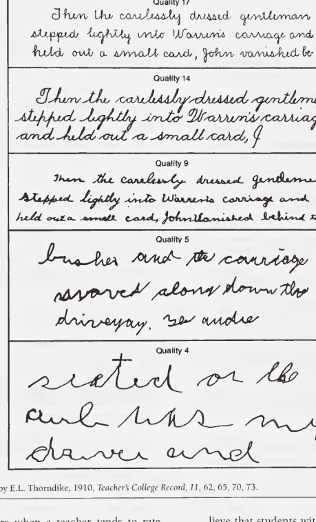

Source: From "Handwriting" by E.L. Thorndike, 1910, Teacher's College Record, 11, 62, 65, 70, 73.

- Personal bias occurs when a teacher tends to rate based on inappropriate or irrelevant stereotypes favoring boys over girls, whites over blacks, working families over welfare recipients, or particular families and individual students a teacher may dislike.

- A logical error occurs when a teacher gives similar ratings on two or more dimensions of performance that the teacher believes are logically related but that are in fact unrelated. For example, a teacher may falsely believe that students with exceptionally high scores on scholastic aptitude tests also should be the top students in all subject areas. The teacher then marks the high-scoring aptitude test students differently from the way the low scorers are marked.

Logical errors are a result of a teacher's ignorance and unfounded beliefs, rather than the teacher's personal quirks and biases about individuals or groups of students.


## 示例 12.7

一个用于评估小组项目合作学习目标的简单图形量表。

## 小组项目中协作与合作学习目标评分表

被评估学生：

日期：

其他小组成员：

项目描述：

教师或观察者：

说明：在每条线的任何位置打勾，以显示您对该项目学生表现的判断。如果您没有足够的机会观察该学生，请圈出 N/O。

## 目标达成

1. 学生是否参加小组会议？
从不    很少    偶尔    经常    总是    N/O

2. 参加时学生是否做好准备？
从不    很少    偶尔    经常    总是    N/O

3. 学生是否积极努力实现小组目标？
从不    很少    偶尔    经常    总是    N/O

4. 学生是否在小组会议之外对小组项目进行工作？
从不    很少    偶尔    经常    总是    N/O

## 人际技能

5. 学生是否与小组成员适当互动？
从不    很少    偶尔    经常    总是    N/O

6. 学生在表达自己的想法和观点时是否对他人的感受敏感？
从不    很少    偶尔    经常    总是    N/O

7. 学生的行为是否会干扰小组中的其他人？
从不    很少    偶尔    经常    总是    N/O

## 小组维护

8. 学生是否帮助小组决定是否需要改变小组流程？
从不    很少    偶尔    经常    总是    N/O

9. 当需要时，学生是否积极努力帮助小组改变其流程？
从不    很少    偶尔    经常    总是    N/O

评论：

当“局外人”对表现评估进行评分时还会出现其他错误。当州和大型学区实施表现评估时，通常由除其教师以外的个人对学生的作业进行评分。在这些情况下，评分者接受过培训并练习使用特定的评分量规。

- 评分者漂移是指评分者最初的评分一致，但开始自行重新定义量规时发生的现象。因此，评分者不再产生与原始量规一致的评分，即使他们接受过相同的量规培训。对此的补救措施是监控评分并重新培训那些似乎已偏离商定标准的评分者。 （参见第 9 章末尾的练习。）
- 可靠性衰减是相关的错误：在培训后立即，评分者会跨学生一致地应用量规并相互一致地标记。然而，随着时间的推移，评分变得不一致，无论是对学生还是对评分者。监控和再培训也是对此效应的补救措施。

## 评估评分量规和评定量表

在本章中，我们讨论了您应如何制定评分量规和评定量表。本节将主要建议汇总起来，以便您用它们来评估您制定的评分量规。

## 评估您的量规和评定量表的核对表

核对表 12.3 在您评估您制定的评分量规时提供指导。您将使用特定的评分量规来评估学生在特定表现任务上的表现。您通过应用核对表 12.2 来评估您的表现任务。您通过应用本节中的核对表来评估评分量规。由于许多评分量规表现为评定量表，因此该核对表也可用于评估其他课堂评定量表。

## 如何使量规和评定量表与您的评分系统保持一致

这里有一个需要特别提及的点，因为之前没有讨论过。您的字母等级制度、您的评分量规和您的评定量表应具有相同数量的等级。例如，如果您的评分系统有 A、B、C、D 或 E，量规应有五个等级，而不是四个或六个。所有评估中量表的一致性是提高评估结果有效性的重要方式。这些等级的含义也应与成绩的含义一致。如果您的评分量规和评定量表未与评分系统对齐，您将难以在成绩单上用字母等级报告学生进展。 （成绩将在第 15 章中更详细地讨论。）

## 核对表 12.3

用于判断评分量规和评定量表质量的核对表。修改对一个或多个问题回答为“否”的任何量规。

- 1. 总体而言，量规是否强调了学习目标的最重要内容和过程？
- 2. 您从量规各部分获得的分数（即成就维度）是否与您在评估计划中赋予它们的重点相匹配？
- 3. 从量规中获得的最大可能总分（点数）是否与您在评估计划中赋予这些学习目标的重点相匹配？
- 4. 您的学生是否能理解量规？
- 5. 量规评定的类别是否适合为学生提供他们改善学习目标表现所需的指导？
- 6. 对于此特定任务，量规是否是一般量规或概念框架的忠实应用？
- 7. 量规各部分量表的等级（即成就维度的等级）是否以学生可观察的行为方式清晰地描述？
- 8. 就此特定任务而言，量规是否允许您评估学生使用适当的：a. 宣言性和程序性内容维度？ b. 对学习目标重要的过程？
- 9. 如果此任务的目的是评估学生使用替代正确答案/产品或替代正确过程/策略，量规是否清楚地描述了如何对每个进行评分和标记？
- 10. 量规是否允许您区分学生在该任务上的广泛成就水平，而不是将所有学生都归入一两个成就水平？

## 提高量规和评分的可靠性

评分的可靠性是评估表现评估的重要标准。以下可靠性系数（在第 4 章中讨论）是适用于使用表现评估授予学生的更连续分数的合适系数之一：

## 随时间估计可靠性

- 测验-重测
- 不同场合的替代形式

## 在单次场合估计可靠性

- 替代形式
- 系数 alpha
- 分半系数

## 估计评分者可靠性

- 两个评分者结果的相关性
- 百分比一致性
- Kappa 系数

附录 J 显示了如何计算系数 alpha、分半百分比一致性和 kappa 系数。然而，附录仅显示了在做出通过-失败或掌握-非掌握决策的特殊情况下的百分比一致性和 kappa 计算。虽然这两个指标可以很容易地应用于两个以上类别的分数，但这超出了本书的范围。

第 4 章中的表 4.3 讨论了如何提高评估结果的可靠性。此时请回顾这些建议并思考您应如何将其应用于表现评估。以下是专门适用于提高评分量规和评定量表评分可靠性的额外建议：

- 1. 将评分量规中的成就维度组织成与课程内容和过程框架相匹配的逻辑组。
- 2. 对于每个成就维度，使用行为描述符来定义每个表现水平。
- 3. 提供学生作业的样本或示例以帮助定义成就维度的每个水平。
- 4. 让几位教师共同制定评分量规或评定量表。
- 5. 让几位教师审查和批评评分量规或评定量表的草案。
- 6. 为所有将使用评分量规或评定量表的人员提供培训和监督练习。
- 7. 让多于一名评分者对学生在任务上的表现进行评分。
- 8. 通过定期抽样他们的评分来监控评分者，检查他们应用评分量规和评定量表的准确性和一致性。对评分不准确或不一致的人员进行再培训。

## 制定项目

## 需要明确项目目的并控制您的偏见

项目通常是有价值的教育活动。然而，它们作为对个人学生的评估工具的有用性取决于四个条件。您必须确保（a）您和您的学生非常清楚项目关注一个或多个重要的课程学习目标，（b）每个学生都做自己的工作，（c）每个学生都能平等地获得准备优秀最终产品和获得优秀评估所需的资源，（d）您可以控制自己对某些类型产品的偏见并公平地评估其他做得很好的项目。例如，中产阶级和上中产阶级学生，其父母受过高等教育，通常比其不太幸运的同龄人拥有更多资源。您可能会因为他们使用这些资源并制作出外观非常好的产品而更高度地评估这些学生的项目。然而，通过这样做，您可能会使您的评估偏向于某些社会阶层的学生。

同样，如果您潜意识里倾向于偏爱某些类型的项目、报告或格式而非其他，您可能会不公平地评估一些学生。请考虑以下真实故事：

> Veronica，一名学生，花了很长时间和精力为小学科学项目展制作了一个照相机的实用模型。她对相机学到了很多东西，并且可以很好地解释相机的工作原理。当她自豪地准备把她的相机模型带到学校时，她的父亲，他有七个孩子就读于同一所小学，把她叫到一边说：“我知道你努力工作了，Veronica，我为你对相机学到的东西感到骄傲。然而，我不想让你失望。我想让你意识到，爆炸火山项目总是赢得科学项目展！”果然如此！ [Nitko，个人交流，1995 年]

## 制定项目用于评估目的的建议

您可以通过仔细规划将项目用作课堂活动和教育评估任务，而不是仅作为课堂活动，来克服上述提到的局限性。遵循以下建议应有助于您为评估目的制定有用的项目：

- 1. 明确定义项目将为您提供直接评估机会的最重要学习目标。
- 2. 确定与您正在评估的学习目标密切相关的最终项目的具体特征和成就维度。仅在此维度上评估学生。
- 3. 为每个维度定义成就水平的连续体。以学生在此量表上的位置作为您的评估。

1 如果你忘了，爆炸火山由一个纸浆火山和顶部的一杯醋组成。加入小苏打到醋中以产生喷发效果。


+   4. 制定你将用于评估项目中每个成就维度的评分量规。
+   5. 确定在计算整体项目成绩时，你将给每个成就维度分数赋予的权重。
+   6. 如果学生在获取资源的能力上差异很大，则限制学生完成项目时可使用的资源。

## 如何管理你的课堂项目

由于项目通常跨越数周，你必须计划好如何管理它们。

管理目标 这些项目管理目标对于管理小组和个人项目都很有用，无论它们是用于课堂活动还是评估目的：

+   目标 1. 监控个别学生，确保他们在稳步取得进展。
+   目标 2. 指导学生，帮助他们克服可能超出其控制范围的操作问题（例如，学生原计划采访的关键人物因病无法会见他们）。
+   目标 3. 指导学生，使他们保持专注，完成项目。
+   目标 4. 监控学生使用的程序和流程，以确保他们能够达到为项目设定的学习目标。

实现管理目标的策略 以下课堂项目管理策略可以帮助实现目标：

+   策略 1. 明确你期望的结果。确保每位学生都彻底理解项目的目的（所评估的学习目标）以及你期望项目呈现的样子。展示并讨论你从往届学生处保存的高质量项目范例。
+   策略 2. 将你的期望以书面形式呈现。向学生分发并讨论一份书面说明，描述你对项目、流程以及项目主要目的的期望。
+   策略 3. 明确你将用于评估项目的标准。解释评分量规并向学生提供副本。
+   策略 4. 让学生参与制定标准。每位学生都应内化质量标准并对其产生拥有感。利用往届项目帮助学生归纳出成就维度。帮助学生描述每个维度内的质量水平。

策略 5. 明确截止日期。设定足够长的截止日期，以便学生能够开发和完成真实的项目。然而，时间框架要足够短以保持实用性，并使学生必须保持在任务上，不能浪费时间，并按时完成。

策略 6. 要求提交进度报告。对于较长的项目，指定每周或每两周的学生进度汇报日期（例如每周五）。这有助于保持学生专注，并让你能够评估他们使用的流程以及完成项目的进展情况。（我们在本章前面讨论了过程与成果评估。）它还能提醒你注意任何超出学生控制范围的问题，可能需要你的干预。

策略 7. 尽量减少抄袭机会。每位学生都应尽其所能完成自己的工作。向学生解释何构成抄袭。解释即使不完美，也要独立完成工作的严重性。避免可能无意中鼓励学生抄袭材料的项目。有助于减少学生抄袭诱惑的项目包括访谈、比较观点、制作模型、设计理想项目、查找某一问题的不同观点、制作实物，以及为另一组或班级创作戏剧化表演（Harmin, 1994）。

## 制作作品集

正如我们在第 11 章中所讨论的，你对作品集的学习目标和目的越明确，你就越能很好地制作它。如果作品集必须服务于多个目的，你就需要仔细考虑每个作品集条目的重点，以便每个条目至少服务于你预期的其中一个目的。我们在本节中提供制作作品集的建议。

## 成长与学习进展作品集的组织与内容

成长与学习进展作品集的初步规划 成长与学习进展作品集的目的是作为你和学生监控学习、诊断困难、指导新学习并展示进步和发展的工具

以及发展。为了使成长与学习进展作品集有效，你必须使用以下原则仔细制作它：

+   1. 非常明确你希望监控学生学习进展的学习目标。你越明确，你的作品集系统就越好。
+   2. 对学习进展理论有坚实的理解。你选择的理论将指导你确定在评估学生概念发展变化或诊断学生学习困难时应关注的内容。
+   3. 如果学校里有几位教师致力于使用成长与学习进展作品集，请与他们合作并协同工作。如果教师协调总体方法、应包含的内容以及作品集的组织，学生就不会感到困惑，并会收到关于其作品集活动性质和目的的一致信息。
+   4. 使用某种类型的量规来定义评估标准并帮助你在应用这些标准时保持一致性，无论是对不同学生还是对同一学生在不同时间。

示例 12.8 是某校语言艺术教师如何规划和组织学生成长与学习进展作品集的一个例子。组织是由一群教师共同决定的。时间框架已明确说明，正如内容和应由谁贡献每个条目（在本例中学生和教师都贡献）。请注意，教师指定了学习目标，并为每个目标描述了应包含的条目类型。

## 成长与学习进展作品集中的学生自我评价条目

请注意，示例 12.8 所示的计划要求学生反思并评价自己作为读者和作家的进步。为了促进学生实现此类学习目标的能力，教师发现有必要设计特殊的作品集条目表格。这些表格包含学生应自问的问题以及他们回答问题的地方。如果没有这种组织，作品集很容易变得过于杂乱，教师在课堂上难以高效使用。示例 12.9 是其中一张条目表格由学生填写的例子。

## 在教学中使用成长与学习进展作品集

创建作品集课堂文化 成长与学习进展作品集与其他评估一样，在完全融入教学时效果最佳。一些作家主张将作品集作为教学计划和教学活动的中心，以便你和学生能够与作品集内容进行深入互动。这被称为作品集文化概念转变模型（Duschl & Gitomer, 1991；Niyogi, 1995）。在作品集文化中，教学活动和项目是学生记录其中间进展、对其概念和现象的逐步理解，以及与同伴和教师互动的机会。Duschl 和 Gitomer 认为，所包含的工作必须具有某些特征，才能在以重构学生概念发展为重点的作品集文化教育环境中发挥作用。以下建议与他们的观点一致：

## 示例 12.8

贝尔维尤，华盛顿，教师如何组织学生阅读和写作作品集以评估成长的例子。

| 学习目标 | 放入作品集的内容 | 条目和评估频率 |
|---|---|---|
| 1. 培养对自己学习和待评价工作的有意义的拥有感 | 1. (a) 学生自选作品 (b) 说明每件作品为何被收录的条目说明 | 1. 每年三次或以上 |
| 2. 评价自己随时间的进步 | 2. (a) 学生回顾自己的作品集 (b) 学生回答关于自己作为读者和作家发展的问題 | 2. 每年两次或以上 |
| 3. 与文本互动以创造意义 | 3. 重述所读篇目或解释其意义的条目说明 | 3. 每年两次或三次 |
| 4. 选择阅读各种材料 | 4. 两周期间阅读的书籍/文章日志 | 4. 每年两次或三次 |
| 5. 通过写作有效沟通 | 5. 更长篇写作的样本 | 5. 每年两次或三次 |
| 6. 学生作为读者和作家的成长 | 6. (a) 教师挑选的学生草稿、笔记和其他作品 (b) 教师关于学生进展的笔记和评论 | 6. 由教师自行决定 |


# 示例 12-9

初中生在评估自己一年的阅读和写作进步后，其作品集条目的示例。

姓名 __________ 日期 5-11-92

## 自我评价

你作为读者发生了变化吗？你的优势和劣势是什么？作为读者，我并没有经历太多变化。我的唯一弱点是进入一本书，但一旦开始，我的优势就占据了上风。我爱阅读!!!!

你作为作家发生了变化吗？你的优势和劣势是什么？作为作家，我意识到要得出最终稿件需要多次修改。拼写是我主要的弱点，我的优势包括句子结构 + 标点。

在查看了你的作品后，你会为自己作为读者和作家设定什么目标？作为读者，我计划拓宽我的书籍范围，作为作家，我将更深入地研究我的作品。

## 自我反思

当你查看你的作品集时，你对自己作为作家的感觉如何？说明你为什么会有这种感觉。我对自己作为作家感到很棒。我起初进展相当缓慢，但从今年开始已经提高了 95%，+ 我计划一直改进到结束。

当你查看你的作品集时，你对自己作为读者的感觉如何？说明你为什么会有这种感觉。我对自己作为读者感到非常棒。我爱阅读 + 我喜欢完成一本好书时得到的感觉。

> 来源：摘自 S.W. Valencia 和 N.A Place 的《Literacy Portfolios for Teaching, Learning, and Accountability: The Bellevue Literacy Project》，载于 Sheila W. Valencia、E.H. Hiebert 和 Peter P. Afflerbach 主编的《Authentic Reading Assessment: Practice and Possibilities》（第 146 页），1994 年，Newark, DE：International Reading Association。经 Sheila W. Valencia 和 International Reading Association 许可转载。版权所有。

- 1. 包含真实作品。学生纳入作品集中的作品必须为他提供直接机会，让他参与该领域或学科工作者通常使用的思考方式和能力。例如，在科学作品集中，学生应从事评估证据、利用科学解释说明数据，或收集数据以支持或反驳解释的工作。

- 2. 记录概念发展。作品集条目必须记录学生自己的解释、理解和概念框架。随着学生在一个项目或问题解决过程中进展，这一记录必须经常更新，以显示学生在项目发展过程中概念框架和思维的变化。

ops。仅包含成品是不够的。例如，学生应定期在科学作品集中记录她对所遇事件、观察结果和所学概念的当前科学解释。

- 3. 参与反思活动。学生利用作品集内容作为与教师讨论他对作品所依据的概念、原理和理论的理解的基础。教师引导讨论，使学生使用该领域或学科工作者使用的相同思维策略和能力。例如，如果学生正在解决科学问题，她应利用作品集内容参与科学思维和活动。学生应记录随着新证据积累其解释的变化。

你必须具备知识和自发性 使用这些作品集要求你具备显著的知识、技能和能力。此外，你需要非常精通你正在评估进展的学科。你也应该注意到，这种作品集评估活动比使用最佳作品作品集评估更自发、更不正式。这些特征不一定是弱点，因为作品集与互动教学一起使用，并作为形成性评估工具。

## 最佳作品作品集的组织和内容

组织最佳作品作品集 你在示例 12.1 中看到了最佳作品作品集的评分量规示例。仔细研究该图，你会看到最佳作品作品集是如何组织的。此示例中的作品集是州学校问责制系统的一部分。州教育部门强制规定了作品集的内容和组织。作品集旨在评估问题解决、数学推理、数学交流以及理解核心课程概念方面的学习目标。为了实现这一评估，州政府强制要求每个作品集包含某些类型的数学作业。因此，每个作品集必须包含以下示例：数学调查、应用、非常规问题的解决方案、项目、跨学科问题解决方案以及关于数学的写作。

学生在整个学年准备条目。除了作品集截止日期外，没有强制的时间表。然而，为了帮助学生准备，教师会向学生提供解释和建议，帮助他们决定应包含哪些示例。示例 12.10 显示了教师在准备最佳作品数学作品集时给学生提供的一些解释和自我反思问题。

## 最佳作品作品集应符合课程

为了有效，作品集必须与州或学区课程框架的目标、标准和学习目标以及你的日常教学活动保持一致。在规划你的作品集组织和内容时，请记住以下几点（Arter & Spandel, 1992）：

## 示例 12.10

给四年级学生关于如何准备数学作品集的建议示例。

## 什么有效？

## 来看看！

以下是你应纳入作品集的作品类型：

- investigations—研究数学主题或进行数学实验
- applications—使用数学解决现实世界问题
- non-routine—结合或发明问题解决策略以得出解决方案或结果
- projects—完成需要数天或更长时间的问题
- interdisciplinary—将数学与其他学科结合使用
- writing—写关于数学以解释你的思维或解决方案

这些作品还应表明你能做到以下几点：

- understand ways to solve problems and do more with the problem (problem solving)
- think by using mathematical ideas and prove your solution is correct by using logical explanations (reasoning)
- Explain mathematics to others using mathematical language, symbols, and drawings (mathematical communication)
- understand mathematical topics and use mathematics in other subjects and everyday life (understanding/connecting core concepts)

在为作品集选择作品时，请自问以下问题：

- Did I solve the problem in different ways?
- Have I done other things with the problem?
- Is my answer correct and does it make sense?
- Did I use correct mathematical language, symbols, and/or drawings?
- Is my mathematics connected to other subjects and everyday life?
- Have I listed the mathematical tools (calculators, blocks, beans, etc.) I used?
- Did I explain my thinking and show all my work?
- Does my explanation show that I understand mathematics?
- Have I edited and corrected my work so this is my best effort?
- Have I chosen different types of pieces for my portfolio?
- Did I show all the mathematical topics (core concepts)?
- If I chose a group entry, did I include my own ideas and explanations?
- Have I talked with my teacher about the pieces in my portfolio?

来源：摘自 Kentucky Department of Education 的《Portfolios and You》（第 3 页），1993b，Frankfort, KY：作者。经许可转载。

作品集应强调与日常教学中强调的相同标准、课程目标和学习目标。

用于评估学生作品集条目的标准应与日常教学中使用的标准相同。

你组织和使用作品集的方式应与你在教学活动中传达的价值观一致（例如，如果你的教学强调学生对自己学习负责，你使用的作品集程序应与这种方法一致）。

## 最佳作品作品集中什么算作证据？

这里的问题是作品集中应包含或排除什么。最佳作品作品集的目的是提供主要学习目标已实现的确凿证据。因此，这些学习目标决定了包含什么内容。你还需要决定作品集是否是评估这些学习目标成就的最佳方法。作品集与其他表现性评估一样，不应用于评估课程中的每个学习目标。随着学生成熟并承担更多对自己学习的责任，他们可以自行决定什么构成成就的适当证据。在这种情况下，你需要向学生提供学习目标的明确陈述以及你将用来评判其条目的标准。

accomplishment. In that case, you will need to give students clear statements of learning targets and of the criteria by which you will judge their entries.

## 最佳作品作品集的条目标题

作品集很快就会变成一堆难以评估的材料和纸张。为了改善这种情况，每个条目都应附有适当的作品集条目表（或标题），包含以下信息：

- Name of the student
- Date of entry
- Title or description of the entry. For example, “Comparison of the Population Growth of Mexico and the United States.”
- Some indication of the learning target or purpose for including the entry. A student may write, for example, “This entry shows that I can use numbers in real-world situations to draw conclusions about how populations grow. I can use growth rates and draw

示例条目引用自 Kentucky Department of Education (1994)。示例引文是基于实际条目的虚构说明。


conclusions about when the two populations will be the same.”

+   为什么这一条目很重要或有价值。例如，“我认为这是一篇好的内容，因为它展示了我实际使用数学的情境。人口增长是一门社会学科，我用数学来解决它。此外，我还需要使用电脑表格程序多次进行计算，才能发现两个国家将在大约59年后人口相同。”

## Limits to a Best-Works Portfolio

portfolio的规模并不小！包含太多条目的portfolio很难理解，可能会让学生在大量材料中感到迷失。此外，评估长portfolio也很困难且耗时。

portfolio的规模与有效性和可靠性有关。portfolio是否代表学生的达成程度？需要多少条目以及哪些种类的条目才能确保对学生工作的具有代表性的样本？长portfolio的评分是否比短portfolio更不一致？

## Self-Reflection on Portfolio Entries

如何鼓励学生对portfolio条目的自我反思 为了某些教学目的，学生对portfolio内容的审阅和自我反思是主要关注点。Arter和Spandel（1992）建议向学生提出以下类型的问题，以促进自我反思活动：

+   完成这项任务的过程是什么？包括你从哪里获得想法，如何探索主题，遇到了什么问题，以及你使用了什么修订策略。
+   小组在审阅你的作品时提出了哪些观点？描述你对每个观点的回应——你是否同意或不同意？为什么？你因此做了什么？
+   你最有效的作品和最不有效的作品有什么不同？
+   这项活动与你之前学过的内容有什么关系？
+   你的作品有哪些优势？什么仍然让你感到不安？（第40页）

元认知 虽然这些问题促使学生审视和评估自己的工作，但这些问题本身并不构成一种评估方法。请记住，自我反思是一种心理活动。因此，你对这一活动的评估必须是间接的。此外，尽管自我反思看似是一项有价值的教学活动，但并不清楚从教育角度来看，正式评估学生完成这些自我反思活动的能力是否合适或必要。它们可能最适合作为非正式的形成性评估。在附录F中，我们讨论了相关的元认知领域。图F.1展示了一份关于元认知不同方面的学生自评问卷。你可以考虑改编这份问卷来评估portfolio的自我反思。

## Special Concerns About Portfolio Contents

如果一位或两位老师为一两个班级设计portfolio系统，该系统可能满足他们作为非正式评估学生进步的即时需求。另一方面，如果中央教育机构在州或地方层面强制实施portfolio系统，它就成为已有课堂活动的“附加项”。因此，需要采取特殊措施说服和教育教师portfolio的有用性。例如，如果学生每周只有一天视为“portfolio日”，他们会把portfolio视为一门独立学科！曾经，肯塔基州教育部要求portfolio作为学校问责制的一部分。早期的授权模式显示了这种缺乏整合的模式。Buren和Lewis（1994）观察到写作portfolio的使用模式如下：

+   高投入portfolio。这些portfolio显示学生对内容高度投入。每个portfolio高度个性化，内容明显是学生选择的。这些portfolio通常展示出比后面描述的类型更高的写作水平。这非常可取。
+   统一模板portfolio。并不理想。同一班级的所有portfolio看起来几乎相同。所有学生撰写相同的话题并使用相同的提示。学生没有选择内容，学生投入度低。这些portfolio通常展示出较低的写作水平。
+   portfolio周portfolio。并不理想。同一教室的所有portfolio在所有作品上都有相同的日期。作品未经润色或重写，而是在提交州考试截止日期前匆忙完成。内容未体现高度的个人选择或投入。这些portfolio通常展示出较低的写作水平。
+   教师生成的portfolio提示。并不理想。同一班级的所有portfolio都基于相同的提示集。学生对主题选择有限，投入度低。教师生成的提示不当或限制了学生为不同目的或不同受众写作的能力。
+   内容受限portfolio。并不理想。这些portfolio可能呈现上述任何模式。然而，其中一些作品来自语言艺术课程之外的学科。内容领域受限，portfolio显示学生在语言艺术课程之外的写作还需进一步提高。portfolio表明，写作技能在不同学科之间未得到应用或整合。

显然，你不想创建一个会产生任何不适当portfolio类型的系统。当你按照下一节描述的步骤进行操作时，请始终牢记portfolio的目的。

## Six Steps for Crafting a Portfolio System

由于portfolio用于广泛的形成性和总结性目的，制定一套单一的设计指南很难。下面的六个步骤虽然比较通用，但能够为你整体提供portfolio制作的指导。你应根据自身目的对这些步骤进行调整。这些步骤表达了一种评估观点，即评估应高度与课程和教学相结合。

每个步骤后都有portfolio制作问题，用于聚焦你的开发努力。注意，在回答Step 1的问题后，你可能会决定不开发portfolio系统。Step 2至Step 5假设你已经完成Step 1并决定使用portfolio系统。如果你决定开发portfolio系统，Step 1的问题答案将设定你在应用最后五个步骤时的边界和背景。

## Step 1. Identify Portfolio’s Purpose and Focus

+   - 为什么我要一个portfolio？
+   - 它将服务于哪些学习目标和课程目标？
+   - 其他评估方法是否更能服务于这些学习目标？
+   - portfolio是应侧重于最佳作品、成长和学习进步，还是两者兼顾？
+   - portfolio是用于学生的总结性评估、形成性评估，还是两者兼顾？
+   - 谁应该参与定义portfolio的目的、焦点和组织（例如，学生、教师、家长）？

## Step 2. Identify the General Achievement Dimensions to Be Assessed

+   - 我是否需要使用与个人表现任务相同的内容和思维过程框架？
+   - 我是否应主要关注学生如何通过portfolio反思自己的进步或成长？
+   - portfolio的主要关注点是什么知识、技能和能力？
+   - 如果我要求一个成长和学习进步的portfolio，我想了解学生的什么关于自我反思的内容？

## Step 3. Identify Appropriate Organization

+   - 哪些类型的条目（学生作品和活动记录）能提供关于Step 2中识别的内容和过程维度的评估信息？
+   - 每个portfolio的提纲或目录应包含什么？
+   - 定义每个类别或条目类型：
   - 它评估的是哪个内容和过程维度？
   - 教师或学生从中能获得什么？
+   - 每个条目被放入portfolio的时间范围是什么？
+   - 条目何时进行评估？
+   - 每个类别的最小和最大条目数量是多少？
+   - 学生的portfolio内部条目将如何组织？
+   - 这些条目是否能完整代表学生的达成程度或成长和学习进步？
+   - 我需要什么类型的容器来存放所有学生的条目，以及它们将存放在哪里？

## Step 4. Portfolio’s Use in Practice

+   - 学生何时会使用或开展portfolio（例如，每节课15分钟）？
+   - portfolio将如何融入课堂常规？
+   - 教师、学生或两者共同决定portfolio中包含什么内容？
+   - 是否需要在课堂中营造特殊氛围以促进portfolio的良好使用？
+   - 学生和/或教师何时会审阅和评估portfolio？
+   - 当给出本学期的字母成绩时，portfolio的权重是否需要调整？
+   - 是否需要安排一次会议与学生一起审阅portfolio？
+   - portfolio是否会与家长、其他教师或其他学生共享？


- 每一项的评价是否都会计入学段成绩？
- 鉴于其目的，作品集是否需要一个总体分数？
- 量规应是整体的、分析性的，还是注释整体的？
- 谁来评分作品集（例如，学生、教师、外部人员）？
- 整个作品集需要多久评分一次（例如，每周或每个学段）？
- 是否存在用于整体评价作品集的评价框架或通用评分量规？

## Step 6. Evaluation of Rubrics

- 是否有与作品集目的相一致的评分量规？与每一项的评价方式相一致？与整体课程框架相一致？
- 评分量规是否已在不同学生的作品集上试用过？在不同教师的学生作品集上试用过？结果如何？
- 当不同教师使用评分量规时，对同一学生的评分结果是否相同？

## ELECTRONIC PORTFOLIOS

教科书出版商和软件开发商已创建产品，允许最佳作品作品集以数字形式呈现。这些被称为电子作品集。这种作品集的一种用途是教师教育学生申请职位时展示其教学资质。数字化作品集可以存放在本地计算机、光盘（CD）或网站上。软件为作品集内容提供组织方式。人员随后在各个类别中添加电子文档和图像。例如，教师候选人的作品集可能具有以下类别：（a）候选人概述声明，（b）简历，（c）满足的州教学标准，（d）开发的教学计划，（e）开发的教学单元，以及（f）制作的学生评估工具。软件为组织和有时为条目提供模板。

创建作品集的人员将各种数字文件中的文件和作品上传到电子作品集的适当类别中，例如教学计划、简历、教学哲学论文等。一些更复杂的软件允许上传视频片段，因此一个人可以向作品集评估者展示自己授课的视频。作品的照片（例如，制作的表现性任务）可以扫描（或用数码相机拍摄）并上传。如果电子作品集位于网站上，则世界各地的潜在雇主都可以获得访问权限以查看它。或者，完成的电子作品集可以复制到 CD 上并发送给雇主。

## Summary

## Crafting Performance Tasks and Rubrics

- 绩效评估分为三个阶段开发：定义和澄清要评估的表现、构建绩效任务以及创建评分量规。实际上，这些阶段是迭代的，而非线性的。
- 本章提供了大量关于定义和澄清要评估表现的建议。其中包括使用框架来指导评估将重点关注的成就维度的定义建议。给出了用于评估成就维度的核对表。
- 本章提供了大量关于构建绩效任务的建议：如何识别有意义的任务，如何围绕重要的内容和思维过程成就维度开发任务，以及如何将各种任务特征纳入设计。给出了用于评估绩效任务的核对表。
- 评估中包含的绩效任务数量至关重要，因为此类任务完成时间很长，因此在任何一次评估中任务数量较少。本章回顾了几个影响任务数量决策的因素，包括决策的重要性、评估范围、评估格式的混合、学习目标的复杂性、完成任务所需的时间、评估可用时间、所需的诊断细节以及可用的人力资源。
- 本章提供了大量关于制作评分量规和记录评估结果的建议。建议包括开发和使用概念框架来组织量规。给出了用于评估评分量规的核对表。

## Crafting Checklists and Rating Scales

- 本章提供了制作核对表的指南以及将它们用于评估过程和程序以及产品的示例。
- 提供了制作评分量表的指南以及它们在实施评分量规中的使用示例。
- 描述了教师在使用评分量表作为评分量规时可能犯的错误。
- 提出了提高评分量表可靠性的建议。给出了用于评估评分量规的核对表。

## Crafting Projects

- 给出了制作可作为评估工具的项目的指南和建议。
- 本章提供了管理课堂项目的指导，包括管理目标和实现这些目标的策略。

## Crafting Portfolios

- 关于内容和作品集目的的指导和建议描述了构建作品集系统的相关问题。本章提出了制作作品集的六步程序。
- 本章讨论了电子作品集的组织和使用方式。

## Important Terms and Concepts

achievement dimensions
alternate solution strategies
behavior checklist
best-works portfolio
bottom-up approach to rubric crafting
central tendency error
checklist
content achievement dimensions
descriptive graphic rating scale
electronic portfolio
graphic rating scale
growth-and-learning-progress portfolio
halo effect
high-stakes assessment
leniency error
lifelong achievement dimensions
logical error
numerical rating scale
personal bias
portfolio
portfolio culture model
portfolio entry sheet (caption)
procedure checklist
product checklist
product versus process
rater drift
rating scale
reliability decay
reliability of ratings
rubrics (analytic, annotated holistic, holistic)
scaffolding
scoring rubric (general, specific)
self-evaluation checklist
severity error
short task versus long task
stages in crafting performance tasks
standard or quality dimension
structure a task
top-down approach to rubric crafting

## Exercises and Applications

- 1. 对于你教授（或计划教授）的学科，确定适合使用纸笔格式的即时绩效任务以及不使用纸笔的即时绩效任务进行适当评估的学习目标。
  a. 使用这些结果，创建一个使用纸笔的即时绩效任务和一个不使用纸笔的即时绩效任务。对于两个任务，均遵循文本中描述的 Marzano et al. (1993) 程序。
  b. 将你的任务与课程中的另一名学生交换。通过应用用于评判绩效任务质量的核对表来评估彼此的任务。如果任务在核对表的某一项上得到“否”的答案，请说明原因。在必要时修改任务。
  c. 与课程中的其他人分享你的结果。

- 2. 选择你在练习 1 中创建的一个绩效任务，或从其他来源获得的任务。按照本章中的程序准备通用和具体的评分量规。（你可以使用附录 E 中的框架或你的指导教师批准的其他框架。）
  a. 写下你用于制作量规的每一步的描述。
  b. 将你的量规与课程中的另一名学生交换。使用用于评判评分量规质量的核对表来评估彼此的具体量规。每当你的量规在核对表的某一项上得到“否”的答案时，请说明原因。在必要时修改量规。
  c. 与你的课程中的其他人分享你的结果。

- 3. 选择两个或多个可以通过一个绩效任务和相应的具体评分量规（你自己或他人创建）进行评估的学习目标。通过解释该任务如何最好地评估这些学习目标来证明你的选择。
  a. 将绩效任务实施给至少五名学生。使用评分量规对任务进行评分。
  b. 写一篇简短的论文描述你的评分经历。评分量规是否足够？使用它是否存在可靠性问题？为什么或为什么不？根据你的经验提出改进评分量规的建议。
  c. 准备一份你学生结果的摘要。

- 4. 将用于评判绩效任务质量的核对表应用于文本第 11 章中的以下示例。写一份你的发现报告。务必提出如何改进任务的建议。将你的报告副本发送给教科书作者。
  a. “决策制定”（第 237 页）
  b. “清洁水”（第 240 页）
  c. “历史调查”（第 242 页）

- 5. 为你教授（或计划教授）的学科设计一个最佳作品作品集系统。遵循本章建议的六步程序。
  a. 准备一份描述你设计的作品集系统的报告。确保你的报告解决了每个步骤下列出的所有问题。
  b. 与其他学生在课堂上讨论你的作品集系统。

## Additional Readings

Bevard Public Schools, Stone Middle School, Melbourne, Florida. (http://stone.web.bevard.k12.fl.us/html/d.b.rubric.html)
介绍如何使用计算机和/或手持个人数据助理数据库来保存学生的评分量规标记。

Chicago Public Schools, Instructional Intranet, Assessments, Ideas and Rubrics. (http://intranet.cps.k12.us/Assessments/Ideas_and_Rubrics/ideas_and_rubrics.html/)
提供各种学科和年级的绩效任务和量规示例。

Glathorn, A. A., Bragau, K. D., & Parker, J. (1998). Performance assessment and standards-based curricula: The achievement cycle. Larchmont, NY: Eye on Education.
整合教学、基于标准的课程和绩效评估的实用指南。强调在单元层面规划评估。

Kentucky Department of Education, Office of Academic and Professional Development, Division of Curriculum Development (http://www.kde.state.ky.us/oapd/curr ic/Publications/Performance Event/TOC.html)
开发课堂绩效任务和评分量规的指南。包括示例。

Khattri, N., Reeve, A. L., & Kane, M. B. (1998). Principles and practices of performance assessment. Hillsdale, NJ: Erlbaum.


基于16所学校的案例研究得出的想法和建议。讨论了州级和地方级在目的和实施方面的差异。提供了对绩效评估各方面的见解。

Marzano, R., Pickering, D., & McTighe, J. (1993). Assessing student outcomes: Performance assessment using the Dimensions of Learning Model. Alexandria, VA: Association for Supervision and Curriculum Development.
详细描述了附录E中所示的标准。提供了许多可应用其标准的绩效任务和评分量规示例。

Mehrens, W. A., Popham, W. J., & Ryan, J. M. (1998). How to prepare students for performance assessments. Educational Measurement: Issues and Practice, 17(1), 18–22.
本文提供了六条关于如何准备学生参加绩效评估的实用指导原则。重点在于保持绩效评估的有效性和教育价值。

Rolheiser, C., Bower, B., & Stevahn, L. (2000). The portfolio organizer: Succeeding with portfolios in your classroom. Alexandria, VA: Association for Supervision and Curriculum Development.

一本如何操作指南。提供了针对最佳作品组合和成长发展组合开发和使用各个步骤的建议和示例。

Shaklee, B. D., Barbour, N. E., Ambrose, R., & Hansford, S. (1997). Designing and using portfolios. Boston: Allyn & Bacon.
使用作品集进行教学目的的实用指导原则、表格和示例。其中一章讨论了使用作品集来识别天赋学生的用途。

State of Michigan, Library of Michigan, Michigan Education Library. (http://mel.lib.mi.us/education/edu-assess.html)
提供了一个“热链接”列表，其中包含用于开发和使用绩效、项目和作品集评估的文章、示例和其他资源，包括量规开发。

Underwood, T. (1998). The consequences of portfolio assessment: A case study. Educational Assessment, 5, 147–194.
本文描述了一项为期一年的案例研究，涉及用于成绩单评分的语言艺术作品集系统。阅读学生因该系统而取得的进步，以及教师喜欢它的原因。还了解“作品集地狱”。了解学校为何选择不采用作品集系统，即使可以证明与传统系统相比学生学得更多。

## 使用非正式诊断评估进行形成性评价

## 学习目标

学习本章后，你应掌握以下内容：

## 诊断评估

- 1. 解释诊断学习困难的双重目的。 [1, 4]

### 将教学与六种诊断方法整合

- 2. 描述六种诊断评估方法并举例说明。 [1, 4]
- 3. 使用本章所述的六种方法中的每一种制定诊断评估程序。 [2, 3, 4]
- 4. 解释每种诊断评估方法的优势和劣势。 [1, 4]
- 5. 通过文字和/或图表展示教学、诊断和评估过程如何整合。 [4, 3, 1]

### 对学生进行访谈

- 6. 解释如何改进对学生的诊断评估访谈。 [2, 4]

## 重要术语和概念

- 7. 解释本章末尾所列术语和概念对教育评估的重要性。 [6, 4]

## 本章概述

假设你教过一个学生，但学生就是不明白：为什么？是否想过如何评估学生为何不理解你所教授的概念？如何评估问题所在？这些就是本章讨论的问题。

我们首先讨论诊断评估的目的，并使用六种不同的方法进行形成性评价。我们讨论这些方法如何相互补充并融入教学序列。每种方法都进行了讨论，我们描述了你如何实施它。本章最后讨论了专门为发现学生为何不理解某些概念和原理而对学生进行访谈的建议。

诊断学习困难的评估有两个相关目的：(a) 识别学生未掌握的学习目标，以及 (b) 提出学生未掌握学习目标的可能原因或理由。如果你知道学生具体未掌握哪些学习目标，你就可以将补救教学集中在这些具体目标上。然而，除非你也知道或能假设学生为何无法完成学习目标，否则你不会确定如何集中补救教学。

## 学习问题的六种诊断方法

不同的诊断方法提供了关于学生学习缺陷的不同详细程度。它们在强调诊断的两个目的之一的程度上也存在差异。我们将讨论的六种方法是：

## 诊断评估

## 课堂诊断评估的两个目的

诊断学习困难的评估有两个相关目的：(a) 识别学生未掌握的学习目标，以及

- 1. 能力剖面强弱法，即将缺陷定义为学生在某一学科的广泛学习成果领域相对于同龄人的低水平。例如，学生在减法和除法方面的能力可能低于加法和乘法。
- 2. 先决知识和技能缺陷法，即将缺陷定义为学生未能学习理解课程或单元教学所需的概念和技能。
- 3. 具体目标掌握法，即将缺陷定义为学生未能掌握一个或多个教学结束时的学习目标。
- 4. 识别学生表现错误法，即将缺陷定义为学生犯的错误类型。
- 5. 知识结构法，即将缺陷定义为学生对概念及其相互关系的心理组织不当或不正确。
- 6. 问题解决成分能力法，即将缺陷定义为学生无法执行解决文字问题所需的其中一个或多个成分。

每种方法都将根据其满足诊断测试的第二个目的的程度进行描述和评估：识别学生学习困难的可能原因。例13.1用具体示例说明了前四种方法，并作为比较这些方法的工具。后面说明的最后两种方法更符合认知导向的教学心理学。

例13.1用具体示例说明了前四种方法，并作为比较这些方法的工具。后面说明的最后两种方法更符合认知导向的教学心理学。

## 整合教学、诊断和评估

对学生学习评估的反馈指导你在教学过程中下一步的行动。教学过程复杂，无法完全用简单图表捕捉。尽管如此，我们在图13.1中使用简化图表向你展示各种诊断方法如何融入教学过程。示例假设你计划向学生教授一个新单元。

图13.1中的步骤在此描述。

- 1. 学生是否已学习新单元的先决条件？如果没有，你需要识别缺陷的先决条件，然后在开始新材料之前教授它们。否则学生将无法从新单元中受益。

## 例13.1

不同诊断评估方法对同一学生表现的解读示例。

| 示例项目及假设学生的回答 |
| (a) | (b) | (c) | (d) | (e) | (f) | (g) | (h) | (i) |
| 17 | 15 | 43 | 337 | 654 | 43 | 63 | 562 | 667 |
| -12 | -13 | -32 | -226 | -423 | -25 | -57 | -453 | -374 |
| 5 | 2 | 11 | 111 | 231 | √22 | √14 | √111 | √313 |
| 减法总分为 5/9 或 56%。百分位等级 = 18 |

## 方法1. 优势与弱点剖面

上图所示减法分测验的得分与加法、乘法、除法等其他分测验的得分进行比较。为每个学生创建算术优势与弱点剖面。
示例：5分的得分百分位等级为18，低于其他分测验得分。
结果解释：学生在减法方面较弱。


## 图13.1 将诊断学习困难的六种方法整合到教学过程中的示例。

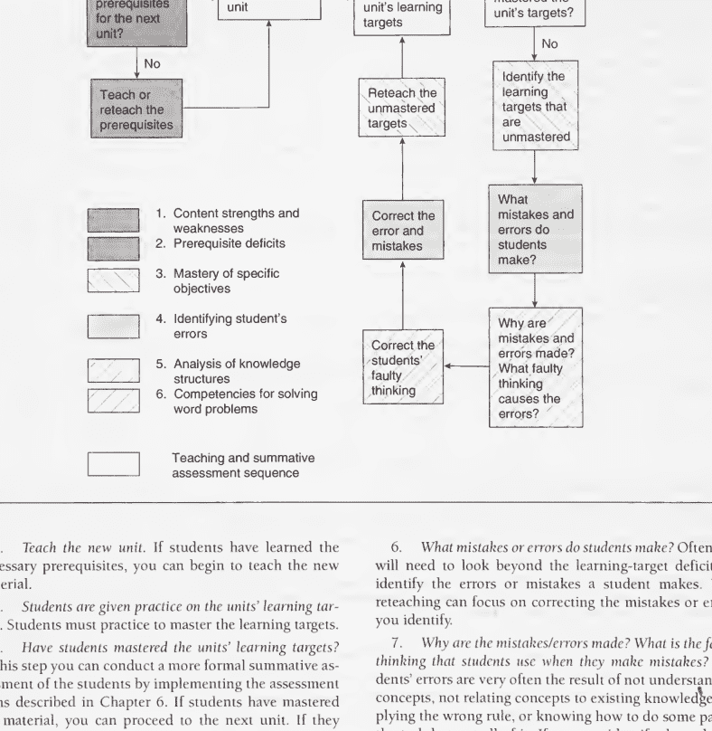

2. 教授新单元。如果学生已经学习了必要的先决条件，你就可以开始教授新材料。

3. 学生对单元的学习目标进行练习。学生必须练习才能掌握学习目标。

4. 学生是否掌握了单元的学习目标？在此步骤中，你可以通过实施第六章中描述的评估计划，对学生进行更正式的总结性评估。如果学生掌握了材料，你可以继续下一个单元。如果没有，你可能需要重新教授单元的至少一部分。

5. 学生没有掌握哪些学习目标？你的再教学应集中于这些学习目标。根据你学生的教学内容和教育水平，仅仅知道哪些目标学习不足可能就足以让你进行补救教学。

6. 学生犯了什么错误或失误？通常你需要超越学习目标的缺陷来识别学生犯的错误或失误。你的再教学可以集中于纠正你识别出的错误或失误。

7. 为什么会犯这些错误/失误？什么是错误选择项目做得不好。
  
  b. 如果可能，每个内容领域使用12到25个项目。这将产生更可靠的档案。
  
  c. 项目应涵盖每个内容领域中最基本的概念和程序。你试图识别那些在某一领域最需要补救的少数学生。每个内容领域的项目对于在每个领域达到可接受学习水平的的学生来说应该是容易的。

- 3. 将项目组合成单独的子测试，每个内容领域一个子测试。例如，将所有加法项目放在一起，所有减法项目放在一起，等等。在每个子测试内按从易到难的顺序排列项目。

- 4. 分别施测每个子测试，使用单独的指导和计时。所有学生都应进行相同的子测试，一起停止和开始一个子测试。一旦班级进入下一个子测试，学生不应再返回之前的子测试。

当学生完成所有子测试后，分别对每个子测试进行评分。子测试分数是你进行诊断解释的依据。总分（所有子测试的总和）没有诊断价值。

示例13.2 显示了对一组学生施测这种类型的诊断测试的假设结果。该测试涵盖法语I，很可能在学期开始时对法语II学生进行施测，以让教师了解 incoming 班级的优势和弱点。对于每个子测试，学生获得两个分数：（a）答对的数量，以最大可能分数的分数表示，和（b）学生的排名。（附录I中的表1.2解释了排名。）包含排名有助于你快速识别最差的学生。请注意，排名越小，学生越好（即，最高分的学生排名为1）。在示例中，最差的分数被圈出。

你使用他们的排名来解释学生的优势和弱点。例如，Alan 与其他学生相比在听力理解方面存在弱点。Isaac 通常表现良好，但在语法方面较弱。Leslie 在所有领域都很强，Robert 也是如此。Miriam 和 Rebecca 在多个领域较弱，但在语法方面为平均水平。

## 优势和弱点

优势 这种诊断评估方法在你想要对学生在某一学科的子领域中的表现有一个总体概念时最有用。如果你对 incoming 学生班级知之甚少，在学期开始时作为前测施测这种类型的评估可以帮助你根据学生的档案规划教学。它易于制作。可以快速评分，如果你有大班或多个班级，这是一个好处。

弱点 为了使这些档案有效，你构建的项目必须评估适当的知识和技能，所有学生必须参加相同的子测试，并且子测试必须可靠。如果子测试每个只包含少数几个评估任务，子测试分数可能不可靠。不可靠的子测试分数会导致在不同子领域的不可靠档案。因此，学生的优势和弱点可能因测量偶然误差而被夸大或掩盖。

使用此类测试进行诊断只为你提供了关于他们问题所在的大致信息。这就像说，“圣杯在北方。”信息是有帮助的，但它让你在找到圣杯之前还有很多工作要做。

## 示例13.2

教师自制法语I诊断测试产生的学生优势和弱点档案示例。

| Areas of French I |  |  |  |  |  |  |  |  |  |  |
|---|---|---|---|---|---|---|---|---|---|---|
|  | Idioms |  | Vocab. |  | Grammar |  | Para. Reading |  | Listen. Compre. |  |
|  | Correct | Rank | Correct | Rank | Correct | Rank | Correct | Rank | Correct | Rank |
| Alan | 10/12 | 3.5 | 11/15 | 3 | 11/13 | 3 | 9/12 | 4 | 3/15 | 5 |
| Isaac | 11/12 | 2 | 10/15 | 4.5 | 3/13 | 6 | 11/12 | 2 | 10/15 | 3 |
| Leslie | 12/12 | 1 | 15/15 | 1 | 12/13 | 2 | 11/12 | 2 | 14/15 | 1 |
| Miriam | 3/12 | 6 | 10/15 | 4.5 | 10/13 | 4.5 | 2/12 | 6 | 1/15 | 6 |
| Rebecca | 5/12 | 5 | 3/15 | 6 | 10/13 | 4.5 | 6/12 | 5 | 4/15 | 4 |
| Robert | 10/12 | 3.5 | 14/15 | 2 | 13/13 | 1 | 11/12 | 2 | 12/15 | 2 |

一位优秀的教育诊断师会利用初始测试结果来形成关于学生困难的假设。你通过跟进并收集额外信息来确认或拒绝这些假设。因此，尽管初始的优势和弱点档案可能不可靠，但如果一位熟练的诊断师在其中纳入适当的额外信息，则最终的诊断将可靠得多。这并不意味着档案生成测试的可靠性应该被忽视：较高的初始可靠性有助于聚焦初始假设集，并防止大量错误线索。档案可靠性非常低的测试会浪费诊断师的资源，因为会追查许多错误线索。

## 方法2：识别先决条件缺陷

## 描述

这种方法探讨学生是否落后是因为他们没有学习从即将到来的教学中获益所需的特定知识和技能。依赖于识别学习先决条件的方法之一是 Gagné 的学习层级（Gagné, 1962, 1968; Gagné, Major, Garstens, & Paradise, 1962; Gagné & Paradise, 1961）。

创建层级的第一步是选择学生必须能够执行的学习目标。下一步涉及分析它以识别学生为实现目标而必须学习的前提条件。对于每个识别出的前提条件，你重复相同的分析，生成前提条件表现的层级。这种向后分析程序识别出关键的先前学习，其缺乏可能导致学生在后续学习中出现问题。

这种方法与前一种方法的区别在于，这里你关注的是每个前提条件是否被学习，而不是优势和弱点档案的模式。你的结果解释是标准参照的而不是常模参照的。

Metropolitan Performance Assessment（Nurss, 1994）例如包含多个评估组件，用于调查学前班和幼儿园学生对开始一年级所需的基本技能和过程的学习。其中一个评估组件是 Metropolitan Integrated Performance Tasks，它评估准备技能，如遵循口头指示、理解押韵词、匹配大小写字母、抄写印刷字母、画图、基本概念（例如，顶部、底部、中间、下面）、机械计数、数字与数字的对应、顺数和倒数、阅读简单图表。学前班和幼儿园教师利用 Metropolitan Performance Assessment 中关于掌握先决条件的信息来为学生准备一年级的工作。

## 课堂应用

你可以为单个教学单元或一个学期识别先决条件。使用层级方法，或简单地识别不在教学顺序中的必要先决条件。要制定学习层级，你应遵循前面关于 Gagné 学习层级所述的程序。对于每个学习目标，自问：“学生在准备学习这个学习目标之前必须能够做什么？”关注需要立即之前学习的内容。一旦你识别出那个直接之前（前提）表现，你就对其提出同样的问题。你可能会识别出一个或多个直接


先决条件。继续进行这种向后分析，直到你到达可以合理假设几乎所有 incoming 学生都已学习先决条件的那一点。

例 13.3 显示了基于 Ferguson（1970）的分析得出的计算减法学习层级的一个例子。最终学习目标“从十位和百位借位减去两个三位数”位于顶部。所有其他表现都是它的先决条件。请注意，表现 5 是表现 4 的先决条件，但表现 2 和 3 也是表现 4 的先决条件。然而，表现 2 和 3 互不为先决条件，因此它们显示在并行的分支中。

一旦你创建了层级，你就用每个已识别先决条件的若干题目来评估每个学生。最低限度，你应在层级中的每个先决条件使用四到五道题目。

如果层级很小，你可以从底部开始向上进行，一次评估一个节点。当学生达到在某个节点上完全做不出或只能做一两道题目的程度时，就停止评估该学生。如果层级非常大，你可以使用自适应测试策略。从层级中间的节点开始。如果学生在这些题目上表现良好，就向上分支到下一个节点并继续评估，直到学生明显无法继续为止。因为节点按先决条件顺序排列，所以层级中较低的节点不会被测试；你假设学生能够完成它们。如果学生表现不佳，你可以向下分支到下一个较低节点，继续评估直到明显学生已掌握其余所有较低节点。在这种情况下，你假设学生在该点以下的先决条件都已学会。

即使没有层级，你仍然可以识别即将教授的学期材料或单元的先决学习。你可以以与开发层级程序类似的方式识别这些先决条件。也就是说，自问：“在教授学生这一学习目标之前，学生需要知道如何做什么？” 对此类问题的回答应产生一份学生在学习新目标之前应掌握的先决条件清单。一旦确定，你就为每个先决条件开发四到五个评估任务。

无论是否使用层级，你进行评估的最终目的是为每个学生识别已掌握的先决条件和未掌握的先决条件。然后通过在开始新教学之前教授学生尚未掌握的先决条件来进行补救。

## 例 13.3

减法单元的先决条件层级。

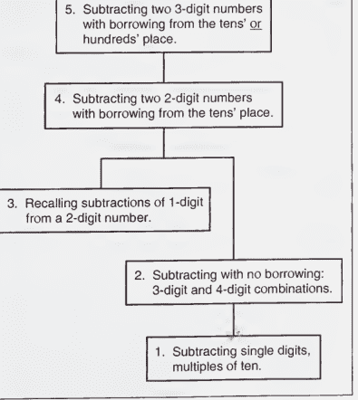

## 优势与劣势

优势 这种方法非常具体地识别出学生在准备接受新学习目标教学之前需要学习的能力。层级提示了教授先决条件的顺序。对先决条件知识和技能的评估在你对学生知之甚少时最有帮助，尤其是当你预期他们在先决条件掌握程度上存在很大差异时。一旦你了解每个学生对先决条件的掌握情况，你就可以根据个人需求调整教学。

要最有效，你识别的先决条件应具体针对你的课程和你的教学方法。不同的课程和不同的教师会对学科采取不同的方法。这意味着你教授的学生所需的先决条件可能与同事教授的学生所需的先决条件有所不同。（然而，当两位教师教授可比的学生相同材料时，它们不应有根本性差异。）

劣势 这种方法的局限性在于你对课程学习要求的分析和准确性。如果你没有识别出正确的先决条件，你的评估将缺乏效度。此外，在连续进步课程中，先决条件与“常规学习”之间的区别是任意的，更多或少地基于教学便利。

支撑这种方法的学习理论假设学习最好先教授先决条件。这是一种积木式方法，其中先决条件表现层层构建以促进新目标的学习。尚不清楚这种积木式的学习方法对所有学科和所有学生都是合适的教学策略。

从学习目标的逻辑分析中得出的先决条件至少有两个弱点，使得开始补救教学变得困难：（a）它们只识别出学生学习新材料所需的部分知识和技能类型，而非全部，以及（b）它们未能提供有关学生如何组织或构建其对待学内容的片断知识的信息（见 Champagne, Klopfer, & Gunstone, 1982）。

Champagne 等人回顾了认知研究者关于教授力学基本原理的教学启示。他们发现学习目标的逻辑分析未能识别：（a）进入物理课程的学生在日常经验中如何在大脑中组织和理解力学原理，（b）学生需要在尝试定量求解问题之前学会如何定性分析问题（即在应用方程之前），以及（c）教学的一个目标是改变学生的进入知识图式，使他们接近专家的图式。（第 10 章讨论图式。）学习困难的主要原因往往不仅仅是学生缺乏内容知识，还包括学生对概念之间关系的先入为主的观念与教科书或教师所说概念之间关系的冲突。（参见第 6 章中的前测主题。）

## 方法 3：识别未掌握的目标

## 描述

这种方法将评估集中在学生预期学习的重要、具体目标上。简短的测试评估每个目标。这种方法与识别先决条件缺陷方法的区别在于，这里你只评估单元或课程的结果目标，而非先决目标。

这种方法已成为诊断的主导方法，并常被推荐为课堂教师以及更专业的教育诊断师的首选方法。尽管标准参照有许多技术和潜在用途（Nitko, 1980），许多教育工作者认为诊断、行为目标和标准参照的概念不可分割，如以下摘录所示：

competencies, providing teachers with the necessary information to determine skills and knowledge already possessed by students so that their appropriate entrance into the learning sequence can be insured. Furthermore, the use of such clear-cut descriptions of the students’ capabilities insures that they neither repeat tasks they have already mastered nor work on objectives for which they lack critical prerequisites. (Wang, 1980, p. 5)

教授具体学习目标的想法至少可以追溯到 Waples 和 Tyler 的开创性工作（Tyler, 1934；Waples & Tyler, 1930）。然而，1930 年代和 1940 年代的教师通常不会写行为陈述，也不会基于它们开发诊断评估。

当前目标导向评估和教学的广泛流行，主要是由于集成目标和测试的商业可用性。出版商在 1970 年代后期和 1980 年代初期转向此类集成材料，此前教育工作者热情地迎接了标准参照测试的概念（Glaser, 1963；Nitko, 1980）。开发了将目标、学习材料和诊断测试集成的教学方法。主要原型是掌握学习模型（Bloom, 1968；Carroll, 1963）、个体化规定教学（Glaser, 1968；Lindvall & Bolvin, 1967）、按需学习计划（Flanagan, 1967, 1969）、个体化指导教学（Klausmeier, 1975）以及个性化教学系统（Keller, 1968；Keller & Sherman, 1974）。

## 课堂应用

你希望从这种方法中获得的诊断信息是学生已掌握和未掌握的学习目标（目标）清单。这意味着对于每个教学单元，你必须仔细识别并陈述重要的学习目标。按以下步骤进行：

- Step 1. 识别并写出单元或课程主要成果的学习目标陈述。
- Step 2. 对每个学习目标，设计四到八道测试题。
- Step 3. 如果可能，让另一位教师审阅每道题并评定其与学习目标的匹配程度。根据需要修改题目以获得更紧密的匹配。
- Step 4. 如果学习目标清单相对较短（少于六个），将题目组装成单一工具；否则，根据学生的教育发展，你可能需要将评估分为两个或多个工具。为便于评分，保持评估同一目标的所有题目在工具中放在一起。
- Step 5. 为每个学习目标设定“掌握”或及格分数。常用的及格分数是 80%（或根据你用于评估学习目标的题目数量尽可能接近此值）。80% 并没有教育上的正当理由。重要的是不是及格分数或及格百分比的确切数值。而是最低的知识水平

诊断和监测学生学习进展已成为旨在根据学生差异调整教学的项目的运营特征。此类项目的一个关键组成部分是使用标准参照评估，即 [assessments] 设计用于确定某些特定


学生需要就每个学习目标进行展示，以便从进一步的教学中受益。这可能因学习目标而异。请自行判断，记住设定标准过低或过高会导致将学生错误地归类为掌握者或非掌握者。

第 6 步。对学生进行测评。测评后，分别对每个学习目标进行评分。准备一份班级名单和图表，以便记录学生在每个学习目标上的得分。这可以帮助你识别具有相似缺陷的学生。示例 13.4 显示了此类图表的示例。图表上圈出的分数表示缺乏掌握。学生应就这些目标接受补救教学。

## 优势与劣势

优势 基于具体目标的诊断性测评具有吸引力，因为它们 (a) 专注于教学的特定且有限的学习目标，(b) 以易于理解的形式传达学习目标，(c) 将你的注意力集中在学生可观察的表现上。这些特点使测评更容易，教学决策更简单，公共问责更清晰。

劣势 基于目标的诊断性测评通常受测量误差困扰，主要是因为测评每个目标的题目往往太少。如果你使用诊断性测评来决定学生是否“掌握”某个目标，你应该

使用诸如一致性百分比之类的指标来评估其质量，而不是传统的信度系数。百分比一致性在第 4 章中有讨论。百分比一致性指标估计学生在重新施测同一测评或施测测评的替代形式时被归类到同一类别的可能性。 （参见附录 J，了解如何计算该指标的示例。）分类的一致性（即掌握或未掌握）是主要关注点，而非学生精确分数的一致性。

行为目标法进行诊断性测评还有其他严重的局限性。所获得的信息仅反映诊断的一个方面：待学习内容的观察行为或表现。这为你提供了很少的信息来补救发现的缺陷。你只知道学生未掌握某个目标。与我们讨论过的其他方法一样，基于行为目标的测评并非完全诊断性的。

行为目标法还可被批评为暗示了知识和技能获得的不当理论。学生的知识基础被视为先前学习的具体行为的简单总和。此外，批评者指出，基于行为的测验无法评估学生的知识图式、问题解决障碍以及在新的现实世界情境中思考的能力（Haertel & Calfee, 1983）。近年来，教学心理学和认知心理学强调了学习学生知识的内部表征

## 示例 13.4

教师自编、基于目标的诊断性测验中特定目标掌握与未掌握诊断的假设示例。圆圈表示未掌握。

| Students → | Alan | Isaac | Leslie | Miriam | Rebecca | Robert |
|---|---|---|---|---|---|---|
| Objectives | | | | | | |
| 1. Names and tells functions of each cell part. [8 items, mastery = 7/8] | 7/8 | 8/8 | 7/8 | 2/8 | 5/8 | 6/8 |
| 2. Lists substances diffused and not diffused through cell membrane. [6 items, mastery = 5/6] | 4/6 | 6/6 | 5/6 | 5/6 | 3/6 | 1/6 |
| 3. Labels parts of animal and plant cells. [6 items, mastery = 5/6] | 5/6 | 5/6 | 5/6 | 4/6 | 2/6 | 4/6 |
| 4. Applies concepts of diffusion, oxidation, fusion, division, chromosomes, and DNA to explain reproduction. [8 items, mastery = 7/8] | 5/8 | 7/8 | 7/8 | 7/8 | 3/8 | 6/8 |

（或图式）、学生对知识要素之间的关系、学生如何从学习经历中构建意义，以及学生掌握的知识加工技能（Glaser, 1982, 1984; Greeno, 1976）。

最后，专注于孤立和具体的学习目标会使课程显得支离破碎。也就是说，表达众多具体知识和技能要素整合的总体主题和学习目标，往往被忽视，而以孤立的具体目标取而代之。

## 方法 4：识别学生的错误

## 描述

该方法的目标是识别学生的错误，而不仅仅是对学生在特定行为目标上的整体表现做出掌握-非掌握的判断。错误的例子包括：在减法中“借位”时未能进位、阅读时元音发音不当、拼写时 i 和 e 颠倒、写作时产生句子片段。一旦你识别并对学生的错误进行分类，你就可以尝试提供教学以补救（消除）它们（参见示例 13.1 和图 13.1）。

与错误分类方法相关的是将复杂表现分析为两个或多个组成部分表现的方法。如果学生无法完成整个复杂表现，诊断性测评会识别缺少哪些组成部分行为。例如，Resnick 及其同事（Resnick, 1975, 1976; Resnick, Wang, & Kaplan, 1973）将复杂的学前数学技能分解为其组成部分技能，并确定这些子技能应执行的顺序。Burton（1982）确定了学生正确解决一个问题所需的所有子技能。对这些较不复杂的子技能在孤立情况下的测量是诊断的基础。Gagné（1970, 1979）提出了一种两阶段程序来评估问题解决能力。当学生未能解决所呈现的问题时，会使用第二阶段测评来确定学生是否知道其中的任何原理、是否知道所有原理，以及学生是否理解如何将它们结合起来。

## 课堂应用

应用这种方法并不容易，因为识别学生的错误需要相当的经验和技能，而且一个错误可能有多个原因。例如，考虑示例 13.1 中的减法问题。经验不足或技能不足的教师可能无法认识到学生错误可能的原因。经常，这样的教师会说学生“不仔细”或“犯了粗心错误”。然而，学生的错误很少是粗心或随机的。相反，学生的错误往往是系统性的。

学生可能会在适当和不适当的情况下一致地应用规则或程序。例如，在图 13.1 中，学生似乎一直应用此规则：“用较大数字减去较小数字。”该规则适用于问题 (a) 至 (e)，但不适用于问题 (f) 至 (i)。因此，重要的是你将学生犯的每个错误都视为具有某种系统性原因。尝试在将其视为粗心或随机之前，识别导致错误的原因，或学生使用的是什么规则。

许多学生错误最好通过访谈学生来发现。你可以请他们解释如何解决一个问题、解释为何如此回答、告诉你解决问题的规则，或在解决问题的过程中大声说出思路。这些非正式的测评程序通常会揭示学生犯的错误类型。

第 10 章讨论了高阶思维和问题解决测评。那些测评策略对于发现学生倾向于犯何种类型的问题解决错误很有用。

## 优势与劣势

优势 错误分类方法相对于行为目标方法的 chief 优势在于，你不仅发现学习目标无法完成，还发现学生表现中哪些方面存在缺陷。这缩小了你寻找表现不佳可能原因的范围。熟练的教师可以利用这些信息快速识别一种或多种先前对类似学生有效（补救了错误）的教学程序。

劣势 然而，错误分类程序也有严重的缺点。有几个实际问题。学生犯各种各样的错误，这些错误难以分类，并且在分析学生表现时难以记住。经常学生因不同原因表现出相同的错误，因此补救教学可能被误导。此外，所需的个别测评和解释量似乎是难以承受的，鉴于可用的教学时间。

然而，比实施的实际问题更严重的是，如果诊断仅对错误进行分类，它仍然无法识别学生产生错误时使用的思维过程。仅仅知道错误的类型（减法中未能借位）并不能告诉你学生需要哪些适当的知识结构和认知过程才能达到期望的结果。错误枚举和分类关注表现的负面方面，对于理解学生为何产生错误是不够的（Bejar, 1984）。当然，认知分析可以纳入错误诊断程序。我们接下来讨论这种可能性。


## 方法 5：识别学生知识结构

## 描述

前面提到的诊断性评估方法的不足之处在于，它们与学科信息和问题解决的表面特征联系紧密。诊断应更多地关注学生如何感知该内容的结构或组织（即学生的知识结构），以及她如何处理信息和知识，利用该内容知识来解决问题。正如 Sternberg 在其他情境中所指出的（Sternberg, 1984；Wagner & Sternberg, 1984），行为主义和心理测量学方法并不完全错误，但它们是不完整的。更好的方法应描述帮助改变思维的学生心理过程。

我们在第 6 章中展示了一种收集这些信息的评估技术（图 6.1）。经常，学生对术语和现象的日常理解与学科专家和教科书的理解相矛盾。此外，学生对技术和非技术概念的日常理解因文化而异，因此针对某些技术形式知识的教学可能需要适应不同的环境（Urevbu, 1984）。这些冲突会干扰你对技术或专业知识的教学，除非你在教学过程中明确解决学生的知识图式（Champagne et al., 1982）。预教学评估的一个例子是我们第 6 章中关于冷饮和毛衣的讨论。如果你问年幼的学生，当一瓶冷的软饮料被羊毛毛衣包起来时，温度会发生什么变化，许多人会说毛衣会使饮料变暖。在他们的图式中，“毛衣”是母亲告诉你穿上以保持温暖的东西。因此，即使你可能解释得很清楚，他们也不相信毛衣具有隔热性能，会使冷饮保持冰冷。你必须将新概念与他们当前的思维和图式联系起来。你必须帮助他们重建知识结构。他们需要理解保持身体温暖和保持软饮料冰冷是通过隔热概念联系起来的。要相信这一点，他们需要理解隔热的原理以及毛衣如何作为绝缘体发挥作用。你可能需要进行一些实验来进一步支持他们新的信念和理解。

有大量证据表明，个人的知识结构对学习很重要（Anderson, 1977, 1984；Glaser, 1984；Haertel & Calfee, 1983；Kintsch, 1974；Minstrell & Stimpson, 1990；Prichert & Anderson, 1977；Shank & Ableson, 1977；Shavelson, 1985）。这项研究记录了知识结构在回忆信息、推理、获取理解、表示问题以及在解决问题中识别线索、启发式和约束的作用。

用于评估学生知识结构的几种方法。这些方法有一个共同的观点，即随着个人变得更加熟练，他们的知识变得更加相互联系、组织得更深入且更易于获取。知识组织评估有着悠久的历史，最早的研究使用自由回忆，后来的研究使用词语联想（Preece, 1976 是一个例子）。其他方法包括卡片自由分类（Hambleton & Sheehan, 1977）；相似性评定（Johnson, 1967）；树状或层次图构建（Filenbaum & Rapoport, 1971）；有序树层次恢复（Reitman & Rueter, 1980）；改进有序树（MOT）层次恢复（Naveh-Benjamin, McKeachie, Lin, & Tucker, 1986）；方案分析（Greeno, 1976, 1978；Hewson & Hamlyn, 1984）；测绘测试（Surber, 1984；Surber & Smith, 1981）；结构形成（SLT）（Ballstaedt & Mandl, 1985）；MicroCAM 概念映射（Ju, 1989；Young, 1993）；以及概念结构分析（ConSAT）（Champagne & Klopfer, 1980）。这些技术在理论视角和它们所代表的知识组织类型上有所不同。对理论建构和潜在知识结构以及该结构如何在学生记录中反映做出相似假设的技术具有足够的聚合效度，可用于课堂评估目的（Champagne, Hoz, & Klopfer, 1984；Shavelson & Stanton, 1975）。

## 课堂应用

概念图是图形化表示学生如何理解学科中主要概念之间关系的方式。学生如何组织与岩石科学单元相关的概念的示例显示在示例 13.5 中。请注意，这个概念图显示学生对该单元概念的组织相当良好。然而，一些重要的概念联系缺失了。在很大程度上，学生以层次结构理解概念（例如，花岗岩和浮石包含在称为火成岩的类别中，而火成岩是一种岩石类型）。学生只显示了一个与特定岩石或岩石类别的变化或转化相关的联系（页岩变成板岩）。学生无法将沉积物概念纳入地图，因此不知道沉积物可以形成页岩或石灰石。其他联系也缺失：火成岩可以风化并转化为沉积物和沉积岩；沉积岩可以形成变质岩，而变质岩又可以风化并返回沉积岩；石灰石可以变成大理石（Champagne & Klopfer, 1980）。

关于如何捕捉学生的概念图，建议见表 13.1。对于此任务，教师向学生展示示例 13.5 顶部概念列表，并与学生单独合作，按照表 13.1 中描述的程序创建概念图。随着每个概念在地图中使用，它将被从列表中划掉。

### 示例 13.5

学生岩石概念图的假设示例。

- ✓ 花岗岩
- ✓ 火成岩
- ✓ 熔岩
- ✓ 石灰石
- ✓ 岩浆
- ✓ 大理石
- ✓ 变质岩
- ✓ 浮石
- ✓ 岩石
- ✓ 沉积物
- ✓ 沉积岩
- ✓ 页岩
- ✓ 板岩

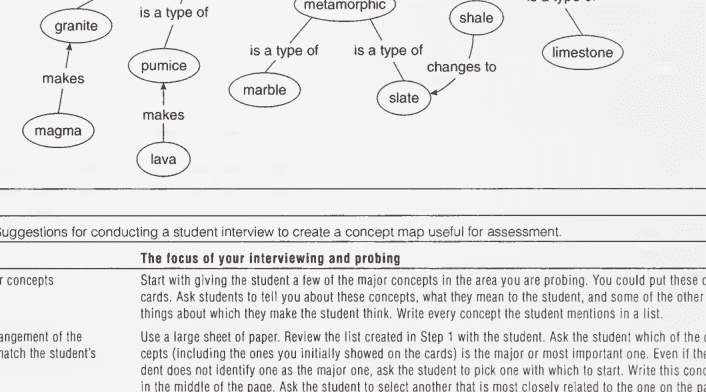

### 表 13.1 进行学生访谈以创建可用于评估的概念图的建议。

| 步骤 | 你访谈和探究的重点 |
|------|-------------------|
| 1. 识别主要概念 | 首先给学生提供你在探究的领域中的几个主要概念。你可以把它们放在卡片上。让学生告诉你这些概念意味着什么，对学生意味着什么，以及它们使学生想到什么其他事情。把学生提到的每个概念写成一个列表。 |
| 2. 创建与学生思维相匹配的概念排列 | 使用大张纸。回顾第 1 步中与学生创建的列表。问学生这些概念（包括你最初在卡片上展示的概念）中哪一个是主要或最重要的。即使学生没有确定一个作为主要概念，也请学生选一个开始。把这个概念写在页面的中间。让学生选择另一个与页面上那个最密切相关的概念。把这个写在已有的概念附近。继续询问最接近中心概念的概念。把这些写在中心概念周围。继续处理剩余的概念，询问它们属于哪里。这些可能离中心概念更远，并且可能靠近一些次要概念。 |
| 3. 确定学生如何将概念相互关联。 | 从中心概念开始，逐一处理最接近它的概念，并依次处理每一对。问学生这两个概念是否相关，如果相关，为什么或如何相关。用线连接相关的概念。即使你认为它们应该连接，也不要连接学生说不相关的概念。记住，你试图描绘学生是如何思考的。经常向学生保证，你不是在寻找正确答案，而是希望帮助学生解释他或她是如何思考这些概念的。在用线连接相关概念后，在线上写下学生告诉你的关系类型。（例如，“是……的例子”、“是”、“导致”、“是……的一部分”、“它使其发生” 等。）如果学生只是说“它们相关”，请进一步探究以了解关系是什么。 |
| 4. 向学生反馈并重新排列地图 | 向学生展示目前的地图。讨论排列情况。向学生反馈地图告诉你关于学生思维的什么信息，并询问这是否正确。重新排列地图，使其更好地代表学生的思维和对概念的理解。讨论每个概念及其关系。如果学生提到新概念，添加新概念并确定它们与已绘制概念的联系。必要时重绘地图。 |
| 5. 扩展地图以显示新概念、联系和示例 | 进一步与学生讨论重新排列的地图。让学生告诉你更多：学生对这些概念还知道什么，有什么例子，为什么概念相关等。把这些新信息纳入地图，并在必要时添加分支和扩展以描绘学生的思维。 |
| 6. 探索交叉联系和复杂关系 | 与学生一起回顾到目前为止绘制的地图。询问学生关于之前未连接的概念对以及第 5 步中提到的新概念的联系。问学生他或她是否认为三个或四个概念应该连接在一起以及为什么。记录这些复杂关系。 |
| 7. 向学生反馈并重新排列以制作最终地图 | 向学生展示地图并与学生讨论地图告诉你关于学生思维的什么信息。问学生这是否准确，并重新排列地图以更准确地描述学生对概念的组织。你可以在这里停止，如果你有足够的细节来理解学生的概念组织。否则，重复步骤 5 和 6。 |


从示例可以看出，使用这种诊断方法需要对学生进行单独评估，需要非常了解该学科才能识别出学生缺失的环节，并在解释 resulting 概念图时使用相当大的判断力。如果您将对学生“缺失环节”的评估与其他关于学生理解概念的证据相互印证，例如解题任务以及学生的论文和课堂回答，您的判断的有效性就会提高。此外，请记住，关联信息可能有不止一种正确的方式；不止一种图式可能是正确的。

## 优势与劣势

优势 这种诊断方法将您的注意力集中在学生如何思考概念及其相互关系上。它让您对学生如何看待概念的组织方式有所了解，以及或许它们如何与学生学过的其他概念和程序相关联。这些见解可能有助于您解释学生为何犯错，或为何难以解决问题。

劣势 虽然对知识结构和问题表征的评估可能让您洞察到学生的思维，但这些临床程序仍处于实验阶段。我们尚不清楚结果的有效程度，或不同教师是否会对同一学生得出相同的诊断。学生对访谈者（教师）和访谈情境的反应可能会极大地影响结果。因此，在解释结果时您需要谨慎。

在大班教学中，这些程序会带来实际问题。因为您必须一次只评估一名学生，所以您需要让其余班级保持忙碌。虽然前面列出的某些程序面向小组，但尚不清楚它们是否能产生与此处推荐的个人访谈方法相同的结果。一些作者（Clarke, 1990）建议教学生使用概念图。然而，目前尚不清楚学生创建地图所需的技能是否有助于或阻碍他们表达其知识组织。绘制概念图和绘制问题的模型需要空间技能，并非所有学生都具备。此外，目前尚不清楚所有概念和关系是否都能在空间上表示。例如，你如何在空间上展示家庭之爱、尊重邻里以及社区和平共处之间的关系？

一些主题可以用其他图表更好地表示。例如，当概念具有严格的层级关系时，表格或提纲可能比概念图更能代表它们。同样，如果您想表示一个过程或程序，流程图比概念图更合适。

因此，对课堂实践而言尤其重要的是评估程序的实用性和教学特征。该程序能否适应典型的学生人数？对您来说使用是否容易？它能否快速给出结果以指导您的教学？其他教师是否会同意知识结构的理论概念反映了他们所教授的关键理解？知识结构评估能否帮助解释学生之间的个体差异？这些评估能否识别出需要纠正的最重要的学生误解？对这些问题的回答有助于您构建支持使用此评估技术的有效性论证。（另见第 3 章。）

## 方法 6：识别解决文字问题的能力

## 描述

这种方法侧重于诊断学生是否理解文字问题的组成部分。解决文字问题构成了社会研究、数学和科学中大量学习目标。文字问题是对或多或少现实情况的简短口头描述，要求学生使用所给信息来回答一个问题（Marshall, Pribe, & Smith, 1987）。考虑以下文字问题：

Example
一辆公交车载着 38 名乘客。它停在公交车站，23 名乘客下车，另有 11 名乘客上车。当公交车驶离该车站时，车上有多少名乘客？

为了解决这个问题，学生必须以多种方式使用长期记忆中的知识在心理上处理它（Mayer, Larkin, & Kadane, 1984）：

- 1. 翻译。学生必须理解问题中的每个陈述。这要求学生使用事实和语言知识。

Example
例如，在前述问题中，学生必须理解公交车、载客、公交车站、下车、上车、驶离车站等概念。在语言上，学生必须理解问题的含义，“当公交车驶离该车站时，车上有多少名乘客？”

- 2. 理解。学生必须形成问题的心理表征或模型。换句话说，学生必须使用图式知识来识别问题如何融入一般框架，以确定其问题类型。（参见第 10 章关于图式的讨论。）

## Example

在前述问题中，学生必须认识到这是一个仅涉及加法和减法的算术问题。

- 3. 计划。学生必须形成解决问题的策略或计划。学生必须使用策略性知识。（参见第 10 章关于评估解题策略的讨论。）

## Example

学生必须认识到要知道公交车离开车站时有多少乘客，必须从公交车上的 38 人中减去在该站下车的 23 人，并将 11 名在该站上车的人加到剩余人数上。算术上，策略是：（38 − 23）+ 11。（注：许多问题可能有不止一种正确的策略。）

- 4. 执行。学生必须使用适当的算法（程序）并正确执行计算或步骤。学生必须使用算法知识。

## Example

学生必须能够正确计算：（38 − 23）+ 11 = 26 名乘客在公交车驶离车站时。

这种方法的诊断是识别无法解决文字问题的学生，以及他们的缺陷是否在于语言和事实知识、图式知识、策略性知识或算法知识。学生可能无法解决一个问题，因为学生缺乏这四种知识类型中的一种或多种。您的补救教学侧重于教学生使用他们缺乏的知识类型。

## 课堂应用

您通过识别每个文字问题中关键的语言、图式、策略和算法知识来应用这种方法。这意味着您必须分析每个文字问题，并以分析结果为基础提出诊断性问题。以下是您可以如何表述诊断项目的示例，类似于 Ismail（1994）使用的方法。

## Example

### 评估学生对文字问题组成能力的诊断项目的示例

### 重点文字问题

空饼干罐重 3 盎司。装满饼干后重 1 磅。罐内饼干重多少盎司？

### 语言知识诊断项目

- 1. 什么是饼干罐？
- 2. 你认为以下问题是什么意思：“罐内饼干重多少盎司？”

### 图式知识诊断项目

- 3. 你需要哪些算术运算来解决这个问题？

### 图式知识诊断项目

- 4. 你应该采取哪些步骤来解决这个问题？（或，你将如何着手解决这个问题？）
- 5. 以下哪项是解决该问题的正确方法？
  - A (1 × 16) − 3
  - B (3 − 1) 16
  - C (1 × 3)
  - D 3 + 1
  - E 3 − 1

### 算法知识诊断项目

- 6. (1 × 16) − 3 =

以下建议将帮助您为使用这种诊断程序制作项目。

- 1. 为了评估语言知识，将您的问题集中在学生必须理解以将陈述转化为问题的心理模型的关键术语和关键短语上。您可能需要提出几个问题并探究学生的答案，以发现他对问题中词语和短语的理解程度。
- 2. 为了评估图式知识，请学生提问以查看他们是否知道为解决该问题必须使用哪些规则或原理。对于算术问题，这可能意味着询问应使用哪些运算。
- 3. 为了评估策略性知识，重点关注学生识别达到答案所需的正确步骤序列或正确过程的能力。对于算术文字问题，这意味着确定学生是否知道使用哪些数字，使用哪些运算以及应用运算的正确顺序。也许更容易向学生展示几个序列并询问哪一个适用于给定的问题（Ismail, 1994）。所有替代解题策略中的所有数字都应与手头的文字问题相关。
- 4. 为了评估算法知识，制作一个项目，呈现正确的序列和正确的数字。重点在于学生是否能够在没有文字问题背景的情况下遵循算法。为了避免向学生提示正确的图式和策略，请在完成对语言、图式和策略知识的提问后，再呈现算法项目（Ismail, 1994）。


虽然识别学生在四种成分知识类型中的哪一种存在不足是有用的，但更重要的是评估学生的缺陷是否在多个不同问题中持续存在一种模式。为了识别这种模式，选择若干不同类别问题中的每个类别的两个文字题。对每个问题，针对前面所述的四种知识类型分别设计诊断性问题。按以下顺序施测这些题目：

- 1. 先施测所有文字题。
- 2. 对每个文字题，施测语言、图式和策略知识题目。
- 3. 施测所有算法知识题目。

要识别学生的模式，回顾学生在所有问题类型中对语言题目的回答。学生是在所有问题中表现 consistently 很好或很差，还是仅在某个文字题或问题类别中存在困难？对图式题目重复此回顾，然后是策略，最后是算法。诊断应基于学生回答的一致性。

可以设计多项选择题来遵循这种方法（Ismail, 1994）。然而，如果你以建构反应题的形式对学生进行个别评估会更有信息量，这样你就可以追问或跟进以澄清学生的答案。你可以让学生口头作答，并记录学生的答案。

## 优势与劣势

优势 这种方法最适用于用公式或一组算术运算算法求解的文字题。这些包括算术文字题（如货币、时间、速率和成本）、代数文字题、统计文字题、涉及数学的社会研究文字题以及科学文字题。你用来解释诊断的框架（语言、图式、策略和算法知识）可以在许多问题类别中保持一致地应用。该框架还提示了如何补救学生的缺陷。

劣势 这种方法需要每个知识类别有大量题目以确保足够的信度。对一种问题类型（如货币）观察到的模式可能在其他问题类型（如时间）中不出现。如果试图将学生的缺陷推广到问题类型，这会使诊断的有效性降低。由于需要大量题目，并且个别施测是最合适的评估方法，该程序耗时。方法的有效性也非常取决于你识别关键短语、适当图式以及解决问题的适当策略的能力。如果存在多种解题策略，你必须小心允许学生表达这些策略，不要因否定它们而混淆诊断。尽管如此，你可以用非常非正式的方式使用这种方法，也许口头提问，以获得一些关于学生为何在文字题上遇到困难的见解。

## 面试学生

本章讨论的许多诊断方法要求你与学生单独工作。很多时候你需要要求学生解释他们的想法以收集非正式诊断信息。以下是使用访谈收集诊断信息的建议：

- 1. 记住访谈的主要目的是收集有关学生思维、错误、错误过程或对学科的错误方法的 信息。你不是在寻找你提出的问题的“正确答案”。
- 2. 像准备其他评估一样为访谈做准备。心里想着你寻求的信息类型，了解你将用来追问答案的一般策略，准备好必要的材料，准备一个安静、无干扰的访谈场所，计划让其余班级的学生保持忙碌，并计划将访谈限制在几分钟内。
- 3. 不要让学生感到恐惧或害怕。用非正式、友好、交谈的方式。
- 4. 不要用大量快速提问轰炸学生。
- 5. 等待学生回应。当你要求学生思考或告诉你他们如何处理信息时，5秒或10秒的等待时间可能是最低限度。
- 6. 从更广泛的问题开始，然后逐渐提出更具体、更有针对性的问题。保持问题聚焦于你寻求的诊断信息类型。
- 7. 做笔记，这样你就不必依赖记忆，也可以在计划补救教学时跟进。

## 摘要

诊断性评估

- 诊断性学习困难评估有两个相关目的：（a）识别学生尚未掌握的学习目标，以及（b）提出学生为何未掌握学习目标的可能原因或理由。

将教学与六种诊断方法整合

- 本章介绍了六种诊断学习问题的方法：（a）描述内容领域优势与劣势，（b）识别先备知识和技能，（c）识别未掌握的具体目标，（d）识别学生的错误，（e）识别学生的知识结构，以及（f）识别文字问题解决中的知识成分缺陷。
- 图13.1总结了六种诊断方法如何融入教学过程。
- 描述内容领域优势与劣势的方法呈现学生在若干主题领域的常模参照性档案。该方法在你对新入学学生群体知之甚少且想大致了解其需求时很有用。学生的粗略档案仅为教学提供一般性指导，必须通过更详细的诊断来跟进。档案也往往不可靠。本章给出了制作和使用遵循此方法测试的建议。

描述内容领域优势与劣势的方法呈现学生在若干主题领域的常模参照性档案。该方法在你对新入学学生群体知之甚少且想大致了解其需求时很有用。学生的粗略档案仅为教学提供一般性指导，必须通过更详细的诊断来跟进。档案也往往不可靠。本章给出了制作和使用遵循此方法测试的建议。

识别先备知识和技能缺陷的方法关注学生在接受新教学前已需要知道的内容。该方法使用任务分析来识别进入要求，也可能识别先备知识的学习层级。该方法识别学生在准备学习新材料前需要学习的具体技能。该方法将学习视为累积性的，并且不对如何教授先备知识提供具体指导。本章建议了识别先备知识以及基于它们制作评估程序的方法。

识别未掌握的具体目标的方法关注教学结束时的学习目标。该方法识别哪些学习目标已掌握，哪些未掌握。该方法很有用，因为它（a）聚焦于要教授的具体且有限的学习目标，（b）以易于理解的形式传达学习目标，（c）将你的注意力集中在学生表现上。特定目标的评估通常很短，因此容易受到测量误差的困扰，导致将一些掌握者误分类为非掌握者，反之亦然。该方法仅关注可观察的表现，并促进一种建立在积木式、碎片化学习方法上的学习。本章描述了制作符合此方法评估的方法。

识别学生错误的方法超越了识别未掌握目标，识别并分类学生在未掌握学习目标时所犯的错误类型的。该方法的优点是你能够发现学生表现中哪些方面存在缺陷。该方法并未识别错误的原因或学生思维中可能使错误变得一致而非随机或粗心的缺陷。本章建议了在课堂上实施该方法的方法。

识别学生知识结构的方法关注学生（a）如何感知学科概念和事实的结构或组织，以及（b）如何处理概念和事实以解决学科中的问题。其优点是该方法要求你分析学生如何思考相互关联的概念。对学生学习这一方面的关注帮助你收集有关学生为何犯错或为何难以解决问题的信息。获取这些信息的方法是实验性的，其有效性程度尚不明确。这些方法需要与个别学生密集工作，因此在只有一名教师的大班中有些不切实际。本章建议了如何与个别学生实施该方法的方法。

识别文字问题解决成分能力的方法关注社会研究、数学和科学中的文字问题。要解决文字问题，学生必须使用语言、图式、策略和算法知识。评估的重点是识别学生在这些领域的每一个方面是否具有足够的问题特定知识。该方法对可通过应用适当公式求解的封闭式反应问题最有用。知识类型框架可应用于广泛的问题，并有助于聚焦学生的补救教学。该方法如果仅用少数任务评估每种知识类型就可能受到测量误差的困扰。它也是耗时的方法，其有效性取决于你对文字问题的分析质量。本章提出了制作此类诊断评估的建议。

## 面试学生

许多诊断评估策略需要在访谈情境中与个别学生进行密集工作。本章提供了改进诊断访谈的建议。

## 重要术语和概念

- adaptive testing strategy
- algorithmic knowledge
- component competencies of problem-solving
- concept mapping
- deficits in learning
- diagnostic assessment
- everyday understandings of terms and phenomena
- identifying errors in performance
- instructional features of an assessment procedure
- knowledge structure
- learning hierarchy
- linguistic knowledge
- mastery of specific objectives
- passing score
- percentage agreement index
- prerequisite knowledge and skill deficits
- profile of strengths and weaknesses
- schematic knowledge
- strategic knowledge
- subtest
- surface feature
- unreliable profile

## 练习与应用

- 1. 对于你教授或计划教授的学科，制作方法1、2、3和4的诊断评估程序。如果有时间，尝试用这些方法对遇到学习困难的学生进行评估。基于这些学生试验修订你的评估程序。与课程中的其他人分享你评估程序的最终版本。
- 2. 以下每个陈述描述了一个教学决策情境。阅读每个陈述并决定可能提供所需信息的诊断评估方法。
- a. 一位老师想知道 Lynn 是否因为不认识数字事实而错过了几个算术应用题。
- b. Ray 错过了几个涉及混合小数分数的加法计算题。他的老师想知道 Ray 是否在数每个加数的十进制位数，并以此计数作为放置最终答案中小数点的依据。
- c. Lou 错过了几个涉及进位（ regrouping）的整数算术题。他的老师想知道


是否 Lou 没有记得把他的“进位”加到下一列数字的和中。

d. 珍妮特是一个阅读缓慢的学生，她在阅读段落后经常错过理解题。她的老师想知道珍妮特是否出现了阅读倒置，导致她在段落中误读了一些单词。

## 3. 有时学生学习了错误的规则或在错误的时间应用了正确的规则。要诊断学生在这种情况下的学习困难，你必须确定学生实际用来解决问题的规则，然后判断这是否是一个合适的规则。例如，考虑这个算术应用题：

萨莉被给了 6 块糖。然后她去商店买了一些糖。现在她总共有 8 块糖。一共萨莉买了多少块糖？

一名学生给出了 14 作为这个问题的答案。当老师采访该学生时，老师发现学生使用的是这个错误规则：“每当你在应用题中看到‘ altogether ’这个词时，你就把给出的两个数字相加。”因此，学生进行了加法，6 + 8 = 14，而不是减法，8 − 6 = 2。

- a. 考虑你教授或计划教授的学科和学生。找出你见过学生使用的两个错误规则。（如果你经验不足，你可能需要在进行此练习前先与几名学生合作。）下面，说明错误规则、正确规则，以及说明每个要点的示例（与前一段的写法相同）。
- 学科，年级：_____
- i. 正确规则：_____
- ii. 学生错误规则：_____
- iii. 说明性示例：_____
- b. 学科，年级：_____
- i. 正确规则：_____
- ii. 学生错误规则：_____
- iii. 说明性示例：_____
- c. 与本课程中的其他人分享并讨论你的发现。

## 4. 重新考虑练习 3 中给出的算术应用题。根据语言知识、图式知识、策略知识和算法知识分析该应用题。

- a. 描述解决这个问题所需的每种类型知识的具体内容。
- b. 以第 300 页示例中的条目为模型，制作类似的条目来诊断学生在每种类型知识上的理解程度。
- c. 如果有时间，请将你的诊断评估任务交给几名学生，其中一些学生没有正确回答该文字题。与本课程中的其他人分享你的发现。

## 5. 将图 13.1 中所示的教学诊断流程图应用于你教授或计划教授的内容单元。

- a. 描述该单元以及其所指向的学习目标（表现）。
- b. 识别先决条件并解释你是否必须对学生进行诊断。
- c. 识别单元结束时可以诊断掌握或未掌握的学习目标。
- d. 识别学生在完成评估每个学习目标的任务时经常犯的错误类型。
- e. 对于每个已识别的错误，解释学生犯的错误。对你的题目进行改进以提高题目和教学质量？本章讨论了这些问题。

在本章的第一部分，你将学习如何为学生做准备，使他们能够在你的评估中发挥最佳水平。为了表现良好，学生需要的不仅仅是学科知识。他们需要知道如何参加测试以及如何处理评估过程中可能出现的焦虑。你不应该假设所有学生都自动知道如何做到最好

本章的第二部分讨论组装和准备评估的实施。我们讨论将提高评估结果有效性的实际问题。

在最后一部分，你将学习如何利用学生对你题目的回答来判断题目的成功程度。这些回答可以帮助你改进题目，修复缺陷，并提高结果的有效性。它们也可以帮助改进你的教学。

## SECTION I: GETTING STUDENTS READY

## PREPARING STUDENTS FOR THE ASSESSMENT

## Assess Maximum, Not Typical, Performance in the Classroom

你应该评估学生的最大表现而不是典型表现（Cronbach, 1990）。当你设置条件使学生能够获得他们能获得的最好分数时，你就评估了最大表现。当你收集有关学生在普通或典型条件下会做什么的信息时，你就评估了典型表现。

例如，你可能教过学生一项实用技能，如平衡支票簿，你的评估程序收集有关每个学生是否能够做到这一点的信息。这是最大表现评估。另一方面，一些学生在课堂外实际使用支票购物时以后可能会犯错误，或者他们可能永远不会对支票账户进行对账。因此，这样的学生可能有能力执行你所教授的技能，但通常可能不会以最大能力执行该技能。由于学校通常试图以高水平教授学习者新能力，因此在鼓励学生发挥最佳能力的条件下进行成绩评估。

## Give Students Enough Information before Assessing Them

告知学生即将进行的评估以及评分方式是你的专业责任（参见第 5 章）。为了在最佳条件下评估学生，你需要提供有关即将进行的评估的至少以下信息：

- 1. 何时进行。
- 2. 在什么条件下进行（计时、限速、带回家考试）。
- 3. 它将涵盖的内容领域。
- 4. 评估中包含的内容领域的重点或权重（分数值）。
- 5. 学生必须展示的表现类型（测试上的题目种类，记忆要求的程度）。
- 6. 评估如何评分和评级（例如，会给部分分数吗？）。
- 7. 特定评估结果相对于学生决策的重要性（例如，它是否占学期成绩的一半？）。

何时进行评估 如果你希望学生发挥最佳水平，你需要告诉他们何时进行测试，以便他们提前准备。特别是那些由多位教师授课的学生，需要组织他们的学习努力并设定优先顺序。他们可以在提前知道考试日期时学会这种规划。各个学科的教师应协调他们的评估时间表，使其分散开来。然而，评分期的结束通常存在问题。

突击测验不会评估最大表现 一些教师提倡“惊喜”或“突击”测验。他们的理由通常是某种模糊的观念，即好学生应该随时准备好按命令表现。这似乎是对学生的不切实际的期望。例如，教师会提前制定课程计划并准备好这些课程。他们如果被要求在没有足够时间准备的情况下上课，往往会感到不满（而且是合理的）。大多数工会合同要求在主管、校长或家长来教室观察和/或评估教师时，教师必须提前收到通知。良好的规划需要提前知道需要完成什么。作者建议在任何评估前至少提前 48 小时通知学生。

一些教师认为突击测验能激励学生。没有证据支持这一点，但有一些证据表明，如果学生提前知道考试，他们会表现得更好（Tyler & Chalmer, 1943）。一个轶事强化了这一点：当被要求避免对某个孩子进行突击测验时，一位教师变得愤怒，说“为什么，如果我那样做，他所有的测验都会得 A！”

有特殊问题的学生通常能从提前很久就知道评估中受益。测试焦虑和恐惧在学生能够理性地为即将到来的评估制定学习计划时很可能会减少（Mealey & Host, 1992）。在普通班级中融合的残疾儿童通常会从流动教师或家教那里获得补充教学，每周只见一次或两次。假设一个听力受损的年轻人没有理解周三的课程，而流动教师定期在周一来。并且假设测验在周五“突击”。这个年轻人如何能被期望有效地规划并利用提供的资源，而常规教师是不可预测的？

一些教师使用突击测验来威胁或惩罚不服从的班级。作者认为这是一种不道德的评估使用。

评估条件 你应该告诉学生他们被期望在什么条件下表现：测试会有多少道题？学生完成评估有多少时间？评估是否限速？是开卷还是闭卷？猜测是否有惩罚？以及它将在一天中的什么时间进行（如果不是在常规课时）？


## 向学生说明测试将包含的内容

说评估将涵盖书中的前三章，对学生帮助不大。为了有效规划和学习，学生需要更详细的信息。一些教师准备了学习问题清单，帮助学生集中精力。这对于几乎书中所有内容都似乎同样重要的小学生尤其有帮助。学习问题也有助于年长的学生，尤其是在学期中涵盖了大量材料时。

对于高中和大学生来说，替代开发一套学习问题的方法是给他们一份评估蓝图副本（见第6章）、一份学习目标清单、评分标准（或评分细则）副本，或一份详细的内容大纲，标明每个要素涵盖的题目数量。（见附录G。）

## 说明测试将强调的内容

你应该告诉学生评估中内容的权重，包括每个目标、内容要素或蓝图单元将分配多少题目（以及多少分）。评估不同部分的权重应与你的教学重点相匹配；否则，结果的有效性会很低。学生可能会浪费数小时学习在评估中几乎不重要或完全不重要的主题。许多教师会与学生分享他们的评估计划，在课程或学段开始时告诉他们对每项作业、测验、考试和课堂表现活动的权重分配。学生就可以根据这些优先事项组织他们的努力。

## 给练习预期表现的机会

你应该给学生练习你将要求他们负责的表现类型的机会。不幸的是，学生经常不得不猜测评估中会出现的问题的性质或类型。以下是如果你没有给予适当练习会发生什么的例子。

## 示例

未给予适当练习机会的结果示例

一位教师给六年级学生布置了练习，要求他从给定的单词和短语列表中孤立地识别介词短语。第二天，他的评估要求他在几段更真实的语境中找出主语、谓语和介词短语。不幸的是，他从未有机会练习他被要求负责的任务。

让学生熟悉评估中会出现任务的最好方法是给他们样本任务，也许是一份旧的评估形式供他们练习。当评估中出现的任务类型对学生来说复杂和/或不熟悉时，这种方法可能特别有效。

## 告诉学生你将如何评分

告诉学生你将如何评分评估有助于他们准备，尤其是回答开放式任务。如果你会因拼写重要术语和专有名词错误而扣分，那么学生除了学习主要思想和练习如何组织答案外，还需要练习这些拼写。学生还需要知道你是否以及如何为不完美的答案授予分数，以及你将为每个问题给予多少权重（即分数）。在考试前很久就应与学生分享评分细则。

## 告诉学生测试结果将如何使用

你需要告诉学生评估分数对你将对他们做出的任何决定的重要性，包括把学生分组、让他们进入课程的另一个班级、让他们接受补救教学、给予他们丰富或进阶的工作，以及分配成绩。

## 最低限度的应试技能

你需要教给学生的技能 学生需要的不仅仅是关于评估是什么的信息：他们需要学习如何应试。你可能需要通过课堂直接教学（Ebel & Frisbie, 1991）教给学生以下最低限度的应试技能：

- 1. 注意口头和书面的指示，并了解不遵守指示的后果。
- 2. 询问评估将如何评分，如何将各个任务的分数计入总分，以及因错误答案、拼写错误或语法不良会扣多少分。
- 3. 清楚地书写回答或标记答案，以避免因笔迹潦草或答案标记错误而导致分数降低。
- 4. 在整个课程中学习并分阶段复习，以减少临时抱佛脚和疲劳。
- 5. 合理使用评估时间，确保在规定时间内完成所有任务。
- 6. 利用部分知识并适当猜测。
- 7. 在写作之前反思、大纲并组织对论文的答案；为每篇论文使用适当的时间。
- 8. 检查他们在单独答题纸上做的标记，以避免错位或在某题被省略时失去位置。
- 9. 复习他们对任务的答案，如果能做出更好的回答就更改答案。

## 避免亏待你的学生

一些教师强烈反对给学生多项选择题。另一些教师只进行持续15到20分钟的简短测验和考试。还有一些教师几乎不进行考试，依赖作业和家庭作业。我请你考虑你对这些问题的立场。学生几乎总会被要求参加州级评估和/或标准化测试。在这些测试上取得好成绩对你的学生很重要，因为关于他们和你的学校的决定将取决于他们的表现。

那么，如果他们从未有过在多项选择测试中从三个或四个选项中推断答案的课堂经验，你如何服务这些学生？如果他们从未有过参加持续40或50分钟的测试的经验，你如何服务这些孩子？（这是一项州级评估或标准化测试中一个分测验的典型时间。）在我看来，你没有很好地服务他们。我并不是提倡专门或大量使用多项选择测试，也不是提倡总是进行长时间的测试。但我们必须对学生公平。如果我们期望他们在州级评估和标准化测试上取得好成绩，那么他们应该在正常的课堂中作为正常教学和评估过程的一部分体验这些类型的评估。

在测试前一两周为学生准备这些较长的多项选择测试似乎不对。这是一种浪费教学时间的做法，也可能是一种不道德的教学行为。（见第379–381页，了解对此问题的更完整讨论。）

## 应试技巧

### 一项应试技巧测验

在继续阅读之前，请做以下简短测试。确保为每道题都标记一个答案，即使你不确定答案。每道题都有一个正确或最佳答案。（题目摘自 Diamond and Evans, 1972, p. 147，并略有修改。）

- 1. Augustine National Party 的总部设在
  - a. 新泽西州卡姆登。
  - b. 佛罗里达州圣奥古斯丁。
  - c. 加利福尼亚州帕洛阿尔托。
  - d. 德克萨斯州达拉斯。
- 2. Hermann Klavermann 最为人所知的是
  - a. 开发了西方世界使用的所有音乐音阶。
  - b. 在浪漫主义时代创作了每部奏鸣曲。
  - c. 将所有俄罗斯经典译成英语。
  - d. 发明了安全别针。
- 3. 20世纪的 Davis Act
  - a. 为学校提供更多资金。
  - b. 推翻了早期的法律。
  - c. 禁止制造、销售、运输或使用几种被用于非法目的的特定药物。
  - d. 给政府雇员加薪。
- 4. Harold Stone 的书《The Last Friendship》是
  - a. 政治讽刺。
  - b. 自传。
  - c. 科幻小说。
  - d. 传记。
- 5. Franktown 的人口超过
  - a. 5万。
  - b. 6万。
  - c. 7万。
  - d. 8万。

每道题的内容都是虚构的，但每道题的正确答案都可以通过使用题目中的某些线索来确定：

第1题。题干（Augustine National Party）中的一个词或短语与备选答案（St. Augustine）中的一个词或短语之间存在明显的关联。
第2题。备选答案中的特定限定词（all, every）导致这些答案被排除在考虑之外。
第3题。更长、更具体的答案被设为正确答案。
第4题。题干中包含一个语法线索（an）。
第5题。一个备选答案与其他答案重叠或包含其他答案。

## 应试技巧分类法

正确回答像上述这样的题目能力通常被称为应试技巧。应试技巧是指利用应试策略、来自写得不好的题目的线索以及应试经验来提高分数的能力，而不仅仅依靠对学科本身的掌握程度。在编写课堂评估时，要意识到学生可能会利用你在题目写作中的个人习惯或有缺陷的题目来提高分数，而没有达到期望的掌握水平。表14.1是应试技巧原则的大纲或分类法。

你应该创建高质量的评估，以最大程度地减少应试技巧高的学生所获得的优势。然而，如果你教给所有学生表14.1中列出的许多技能，他们在与应试技巧更高的同伴一起接受评估时就不会处于劣势。研究表明，应试技巧是可以学习的，并且会随着年级、应试经验、成熟度和在评估中取得好成绩的动机而提高（Sarnacki, 1979; Slakter, Koehler, & Hampton, 1970）。

## 关于更改答案的建议

学生一旦在答题纸上标记了答案后再更改答案会有好处吗？尽管流传的说法如此，如果更改是基于对题目进行深思熟虑的重新考虑，那么更改答案是有益的。以下是关于此问题的研究结果摘要（Pike, 1978）。

- 大多数应试者和许多教育工作者认为更改答案没有好处。
- 然而，大多数学生实际上会更改约4%的题目的答案。


## 表 14.1 测试明智性原则的分类。

| I. 与测试主持人或测试目的无关的元素。 | II. 依赖于测试编制者或目的的元素。 |
|---|---|
| A. 用时策略。<br>1. 尽可能迅速开始工作，同时合理保证准确性。<br>2. 为通过测试制定进度计划。<br>3. 省略或猜测题目（参见 I.C. 和 II.B.）<br>4. 标记被省略的题目，或需要进一步考虑的题目，以确保易于重新定位。<br>5. 在完成测试后利用剩余时间重新考虑答案。<br><br>B. 避免错误策略。<br>1. 仔细阅读说明，明确任务的性质和回答的预期依据。<br>2. 仔细阅读题目，明确问题的性质。<br>3. 在允许的情况下必要时向考官请求澄清。<br>4. 检查所有答案。<br><br>C. 猜测策略。<br>1. 如果只计对答案，总是猜测。<br>2. 如果猜测的修正比使随机作答期望得分为零的“猜测修正”公式更为宽松，总是猜测。<br>3. 即使采用通常的修正或更严厉的猜测惩罚，只要排除选项后获益的可能性足够大，就总是猜测。<br><br>D. 演绎推理策略。<br>1. 排除已知错误的选项，从剩余选项中选择。<br>2. 选择两个相互暗示对方正确性的选项中的两者都不选或都选。<br>3. 对于两个陈述中，若其一正确则会暗示另一不正确，选择两者都不选或只选其一（但不能同时选两者）。<br>4. 将选择限制在涵盖两个或多个已知正确的陈述的所有选项上。<br>5. 利用其他测试题目和选项中的相关内容信息。 | A. 意图考量策略。<br>1. 根据测试编制者的先前特殊侧重点或根据测试目的来解释和回答问题。<br>2. 按测试编制者的意图回答题目。<br>3. 采用预期的成熟程度。<br>4. 考虑具体细节的相关性。<br><br>B. 线索使用策略。<br>1. 认识并利用测试编制者区分正确答案与错误选项的任何一致性特殊习惯。<br>a. 他使其比错误选项更长（更短）。<br>b. 他对其描述得更仔细，或使其代表更高程度的概括。<br>c. 他包含更多虚假（真实）的陈述。<br>d. 他将其置于选项中的特定物理位置（例如中间）。<br>e. 他将其置于有序选项集中的特定逻辑位置（例如序列的中间）。<br>f. 他将其包含在（不包含在）相似陈述中，或使其成为（不使其成为）一对完全相反陈述中的一个。<br>g. 他用熟悉或陈词滥调的措辞（不这样）组成它。<br>h. 他不使其在语法上与题干不一致。<br>2. 回答给定题目时考虑具体细节的相关性。<br>3. 认识并利用特定的决定性因素。<br>4. 认识并利用选项与题干某一方面的相似性。<br>5. 在解释和回答给定题目时考虑邻近题目的主题和难度。 |

> 来源：引自 J. Millman, C. H. Bishop, 和 R. L. Ebel, “An Analyses of Test-Wiseness.” Educational and Psychological Measurement, 25, pp. 711-713. Copyright © 1965 by Sage Publications. Reprinted by permission of Sage Publications, Inc.

- 研究表明，事实上更改答案是有回报的。通常每三次更改的答案中有两次会变成正确。
- 随着题目对学生来说变得更困难，更改答案的回报会减少。
- 低分学生从更改答案中获益较少，而高分学生获益更多。

## 测试焦虑

### 测试焦虑的一般性质

任务导向和任务无关的想法

学生对被评估的感知差异很大，这些感知会影响学生在评估中的表现。一些学生有动力表现良好；另一些则不在乎。在有动力表现良好的学生中，评估和评价很可能导致情绪紧张增加：测试焦虑。学生对评估情境的感知塑造了他们对这些情境的反应。一些有动力的学生可能将这些评估情境视为挑战，而其他同样有动力的学生则将其视为威胁。将评估视为威胁的学生可能没有能力完成当前任务，未被教导如何完成任务，或未正确学习或未为评估做好其他准备（Benson, 1989）。然而，并非所有感知的威胁都基于准备不足。

接受评估和评价为挑战的学生，其想法是任务导向的。他们的思想和行动集中于完成任务，从而减少与之相关的任何紧张（Mandler & Sarason, 1952）。将评估和评价视为威胁的学生具有任务无关的想法：他们自我 preoccupied，关注如果失败会发生什么、自己的无助感，有时还想尽快逃离情境（Mandler & Sarason, 1952）。

情绪性和担忧

测试焦虑通常被认为有两个组成部分：情绪性和担忧（Liebert & Morris, 1967）。情绪性是伴随测试焦虑的身体和自主神经唤醒。担忧是焦虑认知方面的部分：关于失败的负面后果的想法以及自己的表现将如何与其他人比较。

研究表明，对评估情境的情绪反应会引发担忧，进而导致表现不佳（Hembree, 1988）。担忧可被解释为认知干扰（Sarason, 1984）。也就是说，高度测试焦虑的学生担心表现不佳。这使他们无法将注意力集中在当前任务上。学生经历的认知干扰越多，其在评估中的表现就越差。

测试焦虑的四个因素

学生对评估情境的反应可分为四个相关因素：紧张、担忧、测试无关思维和身体反应（Sarason, 1984）。这四个因素似乎也适用于跨国样本（Benson & El-Zahhar, 1994）。以下是评估这四个因素的项目示例。

## 示例

定义 Sarason 测试焦虑四个因素的项目示例

#### 紧张

- 1. 我在考试前感到困扰和不安。
- 2. 我在考试前感到焦躁。
- 3. 我发现自己在考试当天变得焦虑。

#### 身体反应

- 1. 我在重要考试期间头痛。
- 2. 我在考试前胃部不适。
- 3. 考试开始时我的心跳加快。

#### 担忧

- 1. 考试前，我担心失败。
- 2. 考试期间，我想知道其他人表现如何。
- 3. 考试前，我为即将发生的事情感到困扰。

#### 测试无关思维

- 1. 考试期间，我会想起过去的事件。
- 2. 考试期间，无关的信息片段会出现在我脑海中。
- 3. 考试期间，我发现自己在思考与所测材料无关的事情。

来源：改编自 I. G. Sarason 的 “Stress, Anxiety, and Cognitive Inferences: Reactions to Tests”，1984，Journal of Personality and Social Psychology, 46, p. 932. Copyright by the American Psychological Association. Reprinted by permission.

上述四个因素比之前提到的情绪性和担忧的概念更具体地描述了测试焦虑。情绪性被细分为紧张和身体反应；测试无关思维与担忧一起被添加。

## 三种测试焦虑的学生类型

至少有三种类型的测试焦虑学生（Mealey & Host, 1992）。你识别出学生之间的这些差异的能力将帮助你与他们合作，使他们在你的评估中发挥最佳表现。首先是学习技能不好且不理解所教科目主要思想之间关系和组织的学生。这些学生因学得不好而对即将进行的评估感到焦虑（Culler and Holahan, 1980; Naveh-Benjamin, McKeachie, & Lin, 1987）。第二是掌握材料良好且学习技能好但对评估和评价有失败恐惧的学生（Herman, 1990; McKeachie, Pollie, & Spiesman, 1985）。第三是认为自己有良好学习习惯但实际上没有的学生。他们在评估中表现不佳，并学会对被评估感到焦虑（Mealey & Host, 1992）。

## 帮助测试焦虑的学生

以下因素被证明与测试焦虑相关（Hembree, 1988），并且可能在课堂评估情境中由你控制：

- 1. 当学生认为评估很困难时，其测试焦虑会上升。
- 2. 处于风险中的学生比通过的学生具有更高的测试焦虑水平。
- 3. 教师在测试后逐题给予反馈的学生，其测试焦虑低于未获得反馈的学生。
- 4. 题目从易到难排列的测试比其他排列方式的测试引发的测试焦虑更少（Tippets & Benson, 1989）。
- 5. 对高度测试焦虑学生进行更频繁的测试似乎能改善他们的表现。
- 6. 高度测试焦虑的学生比测试焦虑较低的学生更容易被听觉和视觉活动分散注意力。
- 7. 给非常测试焦虑的学生提供将注意力集中在评估任务上并且不要让自己从任务中分心的指示，比简单地用“别担心”或“你会没事的”之类的安慰语句更有益于他们的表现（Sarason, 1984）。
- 8. 测试技巧低的学生可以通过测试明智性训练降低其测试焦虑。

此外，Mealey 和 Host（1992）建议你询问你的学生你能做些什么来帮助他们感到


更放松或在评估前、评估期间和评估后不那么紧张。研究人员自己的发展性阅读大学生报告了以下建议：

- 1. 教师在学生进行评估时不应说话或打断。
- 2. 教师应在进行评估前先向全班复习相关材料。
- 3. 教师在学生接受评估时不应走来走去俯视学生的肩膀。
- 4. 教师应传达对学生即将在评估中表现的信心（并避免诸如“这将是一场困难的测试”之类的说法）。

关于测验焦虑及其处理的进一步综述，可参见 Hembree (1988)、Sarason (1980)、Tryon (1980)、Wine (1971) 以及 Zuckerman 和 Spielberger (1976)。

## SECTION II: PUTTING THE ASSESSMENT TOGETHER

## ASSESSMENT FORMAT AND APPEARANCE

你可能没有意识到，但你的测试的最终外观和安排对结果的有效性很重要。难以辨认、打字质量差或安排不合逻辑的评估会让准备充分的学生感到厌烦，会导致不必要的错误，并让所有学生都觉得你没有认真对待评估责任。评估的组织和外观对于能力较弱的学生可能尤其重要。

## Distribution of Assessment Items

作为一般规则，你应该打字制作测试并复制它，以便每个学生都能拥有一份副本。 （明显的例外是拼写评估和类似的听觉能力评估。）有时教师会在黑板上写下题目或向全班口述。如果这样做，可能会给学生带来问题，尤其是视力、听力理解或听力有问题的人。如果你口述问题，你会使用学生本可以用来回答问题的宝贵时间。此外，大声朗读问题并要求学生写下答案会给短期记忆带来压力，许多学生无法满足这种要求。以下是可能发生的情况的一个例子。

## Example

Example of how dictating questions can be frustrating to students

Bob 是一名六年级平均能力的男孩，他在记忆科学术语的定义方面有困难。在父母的帮助下在家学习了两个晚上后，他觉得自己已为老师的测试做好了准备。他的老师决定口述测试问题，他只答对了 10 题中的 4 题。在查看他永久记录中的标准化测试成绩后，老师发现他的听力理解能力远低于班级平均水平。她还从自己的观察中注意到，他的短期记忆能力低于同龄人。重新测试而不口述似乎是合适的。

## Test Booklet Layout and Design

Organization of Test Items 如果有许多客观题目，你应该将它们整理成测试小册子。 （构成作文测试的少量问题可以方便地呈现在一张纸上。）对于大班，你可以在测试小册子上加一个封面页，标明课程并列出说明。封面页的示例如下。封面页之后，测试题目应按格式分组（例如，所有是非题放在一起，所有选择题放在一起）。

## Example

Example of a test booklet cover sheet with directions to students

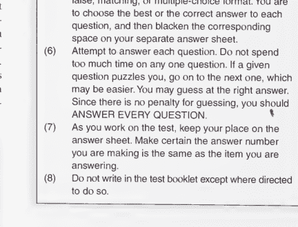

封面页可以防止先收到小册子的学生，在其他同学开始之前、在你回答所有澄清问题之前就开始测试。当题目按格式类型排列时，学生不必改变“思维模式”，这减少了在不同格式之间切换造成的错误。

专家通常建议按难度顺序排列题目，最简单的题目先放。如果题目按格式类型分组，则在每种格式内按从易到难的顺序排列。大多数学生可以快速完成最简单的题目，并将剩余的测试时间留给难题。一些研究表明，从易到难的题目排列可以减少焦虑并提高成绩（Tippets & Benson, 1989）。另一种排列方法是按照教学顺序或教科书中出现的顺序排列内容。学生可以利用这种学科组织作为一种“认知地图”，通过它检索存储的信息。如果你使用这种顺序排列，你应该告诉学生跳过困难的题目，继续做后面的题目，这些题目可能更容易。 （始终鼓励学生在有时间时返回被省略的题目。）更好的是，在内容领域内按从易到难的顺序排列题目。这最大限度地减少了测试造成的焦虑，进而提高了评估结果的有效性（Tippets & Benson, 1989）。

## Directions to Students

评估说明应包含某些最低信息：题目数量和格式、评估允许的时间、答案应写在何处以及如何书写、猜测的更正或惩罚，以及学生在回答问题时应遵循的总体策略。 （例如，学生如果认为自己知道答案但不确定是否应该猜测？他们应该回答所有题目还是省略一些？省略哪些？他们应该依次做每道题，还是跳过不确定的题目，等有时间时再回来？如果学生认为某题的答案需要意见，是谁的意见？请回顾我们之前展示的示例封面页。）大多数书面说明不必过于详细。

在包含测试问题的页面上使用侧标题，以表示测试小册子中可能发生的一般说明的更改。一些题目可能需要具体而非一般的说明。以下是示例：

## Example

Example of side heading on a test page to signal changes in the general directions

Read the paragraph below before answering Items 12, 13, and 14.

Paragraph is put here

12. Question 12 goes here.
13. Question 13 goes here.
14. Question 14 goes here.

Items 16, 17, and 18 refer to the data found in the table below.

Table is put here

16. Question 16 goes here.
17. Question 17 goes here.
18. Question 18 goes here.

## Duplicating the Test

Duplication Processes 越来越多的学校为教师使用提供了复印设备。无论你使用什么设备，都要确保母版（或原件）准备得当，设备处于良好的工作状态。质量差的复印件可能会影响学生的表现。使用最能再现你的题目的复制工艺。复印是最通用的技术，可以复制图画和照片。可能可以对测试小册子的不同页面使用不同的工艺。无论使用什么工艺，都要确保化学药品不会产生令人反感的气味。 （学生已经够难受的了，只是为了弄清楚答案！）

Keep the Test Secure 如果测试被送到中央地点进行复制和装订，测试安全可能成为一个问题。务必检查你所在学校的安保程序。

## PREPARATIONS FOR SCORING THE ASSESSMENT

在你进行评估之前，先为评分做准备。提前准备并核实评分密钥上的每个答案，以便你能够高效、准确地评分学生的评估，并快速向学生报告结果以便反馈和激励。提前准备答案密钥也有助于你识别评估题目中的错误。

Separate answer sheets are not recommended for the first three grades. However, with older elementary and high school students, it may be advisable to use a separate answer sheet for objective items. This greatly facilitates scoring and permits the test booklet to be reused. It also gives students practice for the state assessment or other standardized tests they will have to take. An answer sheet for completion items might consist of columns with numbered blanks, each number corresponding to an item number. The student writes the answer to an item on the correspondingly numbered blank. If you have essays or extended responses, be sure to provide an answer sheet or examination booklet to record students’ responses.

Scanning the Answer Sheets 大多数学校都可以使用可扫描答题纸。这些既可用于手工评分，也可用于扫描。如果你计划使用扫描，请与学校负责此项工作的办公室联系

进行扫描以确保使用正确的答题卡。还要确保学生遵循正确的答案标记程序。你可以通过在答题卡上打孔标出正确答案来制作自己的评分键。将打孔答题卡覆盖在每位学生的答题卡上即可进行评分。第9章和第12章描述了论述题测试和表现性评估的评分过程。现在请回顾这些程序。

## 猜测校正

### 猜测校正公式

对于是非题和/或多项选择题，有时会采用猜测校正公式对分数进行校正，方法是从答对题数中减去答错题数的一定比例。常用的公式如下：

校正分数 = R - W / (n - 1) [公式14.1]

其中
R 表示正确作答的题目数，
W 表示错误标记的题目数，
n 表示每题包含的选项数。

如果每题有两个选项（例如是非题），则
校正分数 = R - W

如果每题有四个选项，则
校正分数 = R - W / 3

校正公式旨在消除学生因猜对而可能获得的优势。以下示例说明了如何使用此校正。你需要对每位学生应用该校正。

## 示例

如何应用猜测校正：正确得分公式
假设吉姆参加了一次包含50道题的多项选择测试，每题有四个选项。进一步假设吉姆的测试结果为：40题作答正确，6题作答错误，4题未作答。应用公式，我们得到：
校正分数 = R - W / (n - 1)
= 40 - 6 / (4 - 1) = 40 - 2 = 38

请注意，未作答的题数未用于此校正公式；只使用错误标记的答案数（W）和正确标记的答案数（R）。

上述校正公式的一个补充版本确实使用了未作答的题数：它不是因学生答错而扣分，而是因学生未作答（即避免猜测）而给分。该公式为：
调整分数 = R + O / n [公式14.2]

其中
R 表示正确作答的题目数，
O 表示未作答的题目数，
n 表示每题包含的选项数。

（使用“调整”而非“校正”是为了将此公式与前一个公式区分开来。这并不是标准做法。此类公式的通用术语是“公式计分”。）以下是一个使用示例。

## 示例

如何应用猜测校正：调整分数公式
假设吉姆参加了一次包含50道题的多项选择测试，每题有四个选项。进一步假设吉姆的测试结果为：40题作答正确，6题作答错误，4题未作答。应用公式，我们得到：
调整分数 = R + O / n
= 40 + 4 / 4 = 41

该公式将随机作答替代未作答时的预期分数计入学生成绩。如果一名学生未作答所有题目，其分数将等于该学生随机猜测所有题目时的预期平均分。因此，通过调整分数公式获得的分数将高于同一批学生通过校正分数公式获得的分数。然而，两种方法下的分数完全相关（Gulliksen, 1950）；也就是说，无论使用哪种公式，个体排名次序都是相同的。

未校正分数（R）仅指正确标记的题目数。当每位学生都作答了每一道题时，未校正分数与校正分数或调整分数完全相关（Gulliksen, 1950），因此在这种情况下，无论分数是否针对猜测进行校正，个体排名次序同样相同。

表14.2列出了在决定是否使用校正公式时需要注意的几点事项。

### 测试出版商的当前实践

测试出版商对于猜测校正的使用存在分歧。大多数商业成就与能力倾向测试组合仅使用答对题数得分。这部分是出于实际考虑，而非心理测量学考量：进行猜测校正的额外任务会增加一项负担，并可能成为另一个文书错误来源（Thorndike, 1971）。此外，使用项目反应理论的测试在计算分数时，会采用考虑猜测因素的数学模型，而不使用公式14.1和14.2。

使用标准化测试时，必须严格遵循手册中的说明。如果你未应用出版商意图使用的校正，或在测试出版商不打算使用时应用它，或在测试时以其他方式更改对学生的指示，你将使测试的常模失效，因为这些更改会产生新的非标准化测试条件。

## 第三部分：利用学生反应改进评估

## 课堂评估的题目分析

题目分析是收集、总结并利用学生反应中的信息来对每个题目做出决策的过程。标准化测试开发者，尤其是常模参照测试的开发者，试测的题目数量通常是最终版本测试题目数量的五倍。来自试测的题目分析数据用于帮助筛选最终版本的题目。开发者会丢弃未能展现适当统计特性的题目。相比之下，你的课堂评估与日常教与学过程联系更为紧密，其目的与已出版的标准化测试有所不同。因此，你使用题目分析数据的方式也会与测试出版商不同。

### 题目分析的课堂用途

对于教师自编的评估，题目分析的重要用途包括：

- 1. 确定题目是否按预期发挥作用。你不能期望写出完美发挥作用的题目。要判断课堂评估中的一道题目是否正常发挥作用，你需要了解它是否评估了预期的学习目标，难度是否适当，是否区分了掌握学习目标的学生与未掌握的学生，标准答案是否正确，以及（对于选择反应题）干扰项是否有效。第6章描述了一个帮助您判断题目是否在评估预期学习目标的程序。本章将讨论其余四个要素。

- 2. 向学生提供关于其表现的反馈，并作为课堂讨论的基础。学生有权知道他们在每项评估任务中的表现如何被评分，以及每项任务的正确答案。与学生一起回顾测试在教学中是常识性的做法：你可以纠正学生的错误，可以向学生澄清你期望他们达到的详细程度，并且可以强化良好（且正确）的反应。此外，缺乏应试技巧的学生可以学习正确答案是如何形成的，或者（在选择反应题中）干扰项为何不正确。如果你教导学生理性地将你的评估置于教学情境中看待，还可以减轻一些考试焦虑。

- 3. 向教师提供关于学生困难的反馈。统计答对某题的学生百分比这一简单程序，可以为你提供关于哪些领域需要额外教学和补救的信息。（一些权威人士建议你通过举手表决来计算答对某题的学生人数。作者不建议这种做法，因为它可能会让一些学生感到不安，并可能侵犯其他学生的隐私。）来自题目分析的反馈可以帮助你将教学重点放在群体和个人需求上。然而，请注意，基于若干题目汇总的子分数

表14.2 猜测校正注意事项。

| 序号 | 项目 |
|-----|------|
| 1. | 校正公式不修正好运，也不弥补坏运气。 |
| 2. | 未校正分数与校正分数对学生相对排名的影响通常是相同的。 |
| 3. | 随机猜测获得好成绩的机会非常小。 |
| 4. | 希望在测试中取得好成绩，且有足够时间作答所有题目的学生，只会在少数题目上猜测。 |
| 5. | 鼓励学生尽可能做出最佳选择，即使他们对所选答案并非完全有把握，在道德上和教育上似乎都没有错。 |
| 6. | 即使在不能完全确定答案正确性的情况下，基于理性作答题目也能为总体教育成就提供有用信息。 |
| 7. | 使用猜测校正扣分可能会使速度较慢的学生在时间不足时不敢对测试末尾的题目盲目猜测。 |
| 8. | 猜测校正说明似乎不会阻止擅长考试或敢于冒险的考生猜测，但似乎确实会阻止不情愿、回避风险或不擅长考试的考生猜测。 |
| 9. | 公式计分使评分更加复杂，为教师提供了更多犯错的机会。 |

来源：摘自R. L. Ebel所著《Measuring Educational Achievement》第251-257页，© 1965 by Allyn and Bacon。经许可转载。


测量相似的学习目标比单一题目提供的信息更可靠，因此请谨慎使用这些结果。

你还会发现识别学生在评估任务上的错误性质很有帮助。对于论文、简答题和完成题，对回答进行内容分析可以确定学生错误的主要类型及其发生的频率。你不必每次给出评估时都对每一项评估进行内容分析。然而，你可以在每个评分周期做一个单元，或者同事可以分析不同的单元。你可以与其他人交换信息并保存这些信息以供下一组学生使用。随着时间的推移，你将积累足够的信息来制定学生困难的清单。利用这份清单来聚焦你的教学并诊断学生的错误。

许多学区拥有扫描答题纸的电子设备以及对每个反应选择题的答题正确率进行汇总的计算机能力。随着学校获得更好的计算机以及题目分析软件成本降低，本章推荐的这些和其他汇总表将变得更容易让你常规地完成。（另见第15章。）

## 4. 课程改进领域。

如果特定内容对学生来说反复困难，或者某些类型的错误经常出现，也许问题超出了你个人：可能需要更广泛的课程修订。题目分析数据有助于识别具体问题。但任何评估都可能不完整地代表学校的课程目标，因此在试图将题目分析推广到学生学习的整体时应谨慎使用。

## 5. 修订评估任务。

你应使用学生对题目及其感知的反应信息来修订题目。题目可以重复用于未来的评估，如果你每次修订其中一些，评估的整体质量最终会提高。通常，修订一个题目比写一个新题目花费的时间更少。一些教师，尤其是在初中、高中（以及大学）中，建立题目文件或题目库。他们编写并尝试新题目，并通过题目分析每次保留最好的题目，修订一些，丢弃其余的。你可以保留题目的副本及其信息在卡片上存档以供将来使用。以下是此类文件中一张卡片的示例。

## Example

带有题目分析数据的题目卡片示例。汇总是在图14.1所示的汇总记录表上的第3题上进行的。

如果你擅长使用数据库程序，你可以用它来创建你的题目库。

几年后，一个好的题目文件就会积累起来。一旦建立了题目文件，相对容易构建测试的等值版本。你可以构建测试的等值版本，并在人员在常规安排期间缺席时用于补考，当你教授同一课程的多个班级时，或当你逐年交替使用测试时。

## 6. 提高题目编写技能。

提高题目编写技能最有效的方法可能是分析题目并理解学生对它们的反应方式，然后利用这些信息修订题目并再次让学生尝试。

## 选择题的题目分析

开始分析选择题（是非题、配对题或多选题）所需的基本数据是每个学生对每个题目的反应。虽然如果学生将答案标记在单独的答题纸上，这些信息更容易使用，但这样的纸张不是必需的。以下是进行题目分析所需的步骤摘要。

步骤1. 对每个学生的测试进行评分，标记正确答案并将总正确数写在试卷（或答题纸）上。

步骤2. 根据总分将所有试卷按数值顺序排序。

步骤3. 确定上、中、下组（见正文）。

## Course: Testing and Measurement
Date(s): Fall 2003
Spring 2004
Fall 2004
Topic: Percentile Ranks

### ITEM

在100个分数的集合中，有48个分数低于54。有4个分数等于54。分数点54的百分位等级是多少？
a. 48   *b. 50   c. 52   d. 54

### ITEM DATA SUMMARY

| Upper Group | Lower Group | Middle Group |
|---|---|---|
| a. 0 | 1 | |
| *b. 10 | 7 | |
| c. 0 | 1 | 12 |
| d. 0 | 1 | |
| Omits 0 | 0 | 0 |

Difficulty Index: .85   Number of Students: 34
Discrimination Index: .30

步骤4. 汇总上组和下组中选择每个备选项的学生人数，并汇总中组中选择正确答案的学生人数。
步骤5. 计算每个题目的难度指数（稍后讨论）。
步骤6. 计算每个题目的区分指数（稍后讨论）。
步骤7. 使用步骤4的结果，检查每个题目以识别不良干扰项、模糊的备选项、误设答案以及随机猜测的迹象（稍后讨论）。

尽管本节主要针对选择题的分析编写，但你可以用几种描述的技术用于任何二分计分的评估任务（正确/不正确或通过/失败），例如完成题或简答题。确实存在用于分析连续计分的任务（如论文或表现性评估）的题目分析技术。我们在下一节中说明这些技术。然而，这些技术的复杂性可能使它们对没有计算机和/或复杂扫描设备访问的教师来说不切实际。

## 上、下得分组（步骤3）

在你评分试卷后，根据学生的总分按数值顺序排列它们。接下来，将试卷堆分成三组：上、中、下得分组。然后你以各种方式对比上组和下组的反应（稍后描述）以确定每个题目是否发挥良好。

如何形成这些组很重要。当参加你测试的学生总数在20到40之间时，选择10个最高分和10个最低分试卷（Whitney & Sabers, 1970），但保持中间得分组完整。（当有20名学生时，将没有中间组。）如果有20名学生或更少，仅仅一两个学生的反应就可能极大地影响你通过此处描述的程序获得的结果。如果你对学生太少使用题目分析，你可能会对某个题目如果再次使用时的表现得出相当错误的结论。尽管如此，如果你想对人数很少的群体继续进行分析，将试卷分成两组（上半部分和下半部分）并谨慎解释结果。对于大于40人的群体，测试专家经常在技术上建议使用该群体上、下27%的得分者（Kelly, 1939）。然而，就课堂评估而言，当群体大于40时，25到33%之间的任何百分比似乎都是合适的。

## 汇总对每个题目的反应（步骤4）

对于每个题目，记录（a）在上组中选择每个备选项的学生人数（以及单独未作答[省略]的人数）；（b）在下组中

选择每个备选项的学生人数（以及单独省略该题的人数）；以及（c）在中间得分组中选择正确答案的学生人数。我们之前给出的题目文件卡片示例显示了对一个题目进行此类汇总的结果。你也可以制作一个表格来记录一页上多个题目的必要数字，或者你只需将此信息写在教师用试卷的页边空白处。

毫无疑问，题目分析中最繁琐的部分是汇总学生对题目的反应。使用上组和下组而不是整个班级使任务更容易。一个简化程序是制作如示例14.1所示的表格。一旦你获得示例中给出的基本信息，你就可以做出各种汇总。我们在本节中描述这些汇总，并在本章后续部分解释如何解释它们。

## 计算题目难度指数（p）（步骤5）

答对该题的总群体比例称为题目难度指数（p）。要计算它，将上、中、下组中选择正确答案的学生人数相加，然后除以参加测试的总学生人数。这由公式14.3概括

```
p = [ number of students choosing the correct answer / total number of students taking the test ]
= [ number of students choosing the correct answer for the upper + the middle + the lower groups / total number of students taking the test ]
[Eq. 14.3]
```

下一个示例显示了如何使用班级汇总表中的第3题数据应用公式14.3。这是之前给出的题目文件卡片示例中使用的同一题目。

## Example

如何根据班级汇总中的数据使用公式14.3计算第3题的题目难度指数

```
p = [ number of students choosing the correct answer for the upper + the middle + the lower groups / total number of students taking the test ]
= (10 + 7 + 12) / 34 = 0.85
```

正如我们稍后将讨论的，这个分数的范围可以从0.00到1.00。


## 示例 14.1

对 34 名大学生参加的 59 题测验的前 10 题的项目反应。 这是进行项目分析所需的基本数据的示例。 请注意，对于中间组，你只记录选择正确答案的人数和遗漏人数。

| 题号： | 1 | 2 | 3 | 4 | 5 | 6 | 7 | 8 | 9 | 10 |
| 上组 | Doris | A | C | B | B | C | C | B | A | B | D |
|  | Jerry | A | C | B | B | C | C | B | A | B | D |
|  | Robert | A | C | B | B | C | C | E | A | B | D |
|  | Elazar | A | B | B | B | C | C | B | A | B | D |
|  | Marya | A | C | B | B | C | C | B | A | B | D |
|  | Anna | A | C | B | B | C | C | B | A | B | D |
|  | Diana | A | C | B | B | C | C | B | A | B | D |
|  | Harry | A | C | B | B | C | C | B | A | B | D |
|  | Anthony | A | C | B | B | C | C | B | A | B | D |
|  | Carolyn | A | C | B | B | B | C | B | A | B | D |
|  | 关键 | A | C | B | B | C | C | B | A | B | D |
|  | 选择各选项的人数 | A 10 0 0 10 0 0 0 10 0 0 | B 0 1 10 0 1 0 9 0 10 0 | C 0 9 0 — 9 10 0 0 0 0 | D 0 — 0 — 0 0 0 0 0 10 | E — — — — — — 1 — — — |
|  | 遗漏 | 0 | 0 | 0 | 0 | 0 | 0 | 0 | 0 | 0 | 0 |
| 中间组 | 答对数 | 14 | 12 | 12 | 13 | 12 | 13 | 11 | 11 | 12 | 12 |
|  | 遗漏数 | 0 | 0 | 0 | 0 | 0 | 0 | 0 | 0 | 0 | 0 |
| 下组 | Anita | A | C | B | B | D | C | E | A | A | D |
|  | Larry | A | C | B | B | D | C | D | A | B | D |
|  | Charles | C | B | B | B | C | C | B | A | B | C |
|  | Joel | A | C | B | B | C | C | E | A | B | D |
|  | Leslie | A | C | B | B | C | C | E | A | B | B |
|  | Alida | A | C | B | B | C | C | A | B | B | B |
|  | Marilyn | A | C | D | B | C | C | D | C | D | A |
|  | Wayne | A | B | A | A | C | C | B | B | C | A |
|  | Ina | D | C | C | A | B | B | C | B | A | D |
|  | Donald | C | B | B | B | D | C | E | C | D | D |
|  | 关键 | A | C | B | B | C | C | B | A | B | D |
|  | 选择各选项的人数 | A 7 0 1 2 0 0 1 5 2 2 | B 0 3 7 8 1 1 2 3 5 2 | C 2 7 1 — 6 9 1 2 1 1 | D 1 — 1 — 3 0 2 0 2 5 | E — — — — — — 4 — — — |
|  | 遗漏 | 0 | 0 | 0 | 0 | 0 | 0 | 0 | 0 | 0 | 0 |

## 计算项目区分指数（D）（步骤 6）

项目区分指数（D）是上组答对该项目的比例与下组答对该项目的比例之差。 区分指数描述了特定测验项目在多大程度上能够区分高分学生和低分学生。

使用以下公式计算该指数： D = [上组答对该项目的比例] - [下组答对该项目的比例] [式 14.4]

下面是一个如何根据该数据计算一个项目的区分指数的示例。

## 示例

如何使用式 14.4 根据班级汇总数据计算第 3 题的项目区分指数

```
D = 10/10 - 7/10 = 1.0 - 0.7 = 0.3
```

正如我们稍后将讨论的那样，该指数的范围可从 −1.00 到 +1.00。 手持计算器将有助于计算难度和区分指数。

## 构造反应和表现性评估的项目分析

当使用构造反应和表现性评估时，每个项目以更连续的方式评分。 而不是 0 或 1 分，每个项目在 0 到 3、1 到 4 或其他分数范围内评分。 这些项目的项目难度和区分度也可以计算。 计算方法有很多，但我们将讨论限制在适用于课堂评估的简单方法。

## 计算项目难度指数（p*）

构造反应或表现性项目的项目难度只是该项目的平均分。1 例如，如果第 1 题是论文题，按 1 到 6 分评分，并且该题的平均分为 4.2，则该题的难度为 4.2。

为了使该项目难度与式 14.3 的 p 值保持在同一量表上，我们应该用其可能的分数范围除以该平均值。 这将给出 .00 到 1.00 之间的值，与式 14.3 的结果范围相同。 这里举例说明：

```
p* = [ average score for the item / possible range of score for the item ] = [ average score for the item / ( maximum possible item score - minimum possible item score ) ] [Eq. 14.5]
```

以下是使用该公式的示例：

> 1如果你有数学背景，你会注意到按 0 或 1 评分的项目的平均分就是式 14.3 给出的 p 值。 因此，我们不会感到惊讶的是，我们将更连续评分的项目的项目难度定义为该项目的平均分。

## 示例

应用式 14.5 的示例

+   1. 假设第 1 题（论文题）的班级平均分为 4.2。 假设最低可能得分为 1，最高可能得分为 6。 p* 难度指数是多少？

```
p* = [ average score for the item / ( maximum possible item score - minimum possible item score ) ] = 4.2 / (6 - 1) = 4.2 / 5 = 0.84
```

+   2. 假设第 2 题（也是论文题）的班级平均分为 4.2。 假设最低可能得分为 0，最高可能得分为 10。 难度指数是多少？

```
p* = [ average score for the item / ( maximum possible item score - minimum possible item score ) ] = 4.2 / (10 - 0) = 4.2 / 10 = 0.42
```

从这两个例子可以看出，我们需要用可能的分数范围除以平均分，以便清楚地解释平均分。 在第 1 题中，平均分为 4.2，但可能的分数范围是 1 到 6。 因此，p* = 0.84 意味着平均而言，学生在该题上获得了最大可能分数范围的 84%。 （这是一道相当容易的题。）第 2 题的解释则不同。 第 2 题的平均分也是 4.2。 然而，该题的可能分数范围是从 0 到 10。 难度指数为 0.42，意味着平均而言，学生仅获得了该题最大可能分数范围的 42%。 因此，第 2 题对学生来说比第 1 题困难得多。 所以你可以看到，除非你知道表现性项目的可能分数范围，否则你无法完全解释其平均分。

顺便说一下，为了区分式 14.5 和之前的式 14.3，我在 p 后加了一个 *。 这不是标准做法。

## 计算项目区分指数（D*）

构造反应和表现性项目的区分指数只是上组在该项目上的平均分与下组相应平均分之差。 上组和下组的定义与之前所述相同；

即，基于他们在整个评估中的排名。 这里有一个例子：

## 示例

假设上组在某题上的平均分为 5.3，下组相应平均分为 2.8，且该题按 1 到 6 分评分。 该题的区分度为 5.3 − 2.8 = 2.5。

为了使项目区分指数与式 14.4 的 D 值保持在同一量表上，我们应该用可能的分数范围除以该差值。 这给出了 -1.00 到 +1.00 之间的值，就像式 14.4 一样。 这在式 14.6 中进行了总结。

```
D* = [average score of the upper group on the item] − [average score of the lower group on the item] / range of possible item scores = [difference between the upper and lower groups' average item score] / [maximum possible item score − minimum possible item score] [Eq. 14.6]
```

下一个示例展示了如何使用该公式。

## 示例

应用式 14.6 的示例

假设上组在某题上的平均分为 5.3，下组相应平均分为 2.8，且该题按 1 到 6 分评分。 区分指数 D* 是多少？

```
D* = [difference between the upper and lower groups' average item score] / [maximum possible item score − minimum possible item score] = (5.3 − 2.8)/(6 - 1) = 2.5/5 = 0.5
```

由于我们除以了可能的项目分数范围，我们可以解释该值为上组和下组在该题上的平均分之差为可能项目分数范围的 50%。 （该项目区分度相当好。）与之前讨论的二分项目区分指数（式 14.4）一样，此处的指数也可能显示负值、零或正值。 如果值为负，则意味着下组平均得分高于上组。

我们通常会认为这种结果意味着该项目不好。 （我们在以下各节中进一步讨论这个问题。）

## 项目难度指数

## 对测验分数分布的影响

分布的形状 项目的难度会影响总测验分数分布的形状。 包含 ps < 0.25 的项目的非常困难的测验往往呈正偏态，而包含 ps < 0.80 的项目的容易测验往往呈负偏态。 （参见图 1.2，了解分布形状的解释。）其他类型评估的总分数分布的形状并不容易推断。

平均或平均测验分数 项目的难度会影响平均或平均测验分数： 平均测验分数（M）等于项目难度的总和。 关系如下所示：

```
M = Σ p [Eq. 14.7]
```

平均（M）测验分数等于构成测验的项目的难度（p）值的总和。 当评估仅包含表现性或构造反应项目时，均值只是项目均值的总和，而不是式 14.5 的 p* 值之和。

分数的分布 项目难度分布和测验分数分布相关。 所有 p 值都集中在 0.50 左右的测验具有最大的测验分数分布，而难度分布在 .10 到 .90 之间的测验具有较小的分数分布。 项目难度（p 值）并不是导致测验分数分布的唯一因素。 另一个因素是项目之间的相关性（附录 I）： 这些相关性越高，标准差越大。 然而，项目之间的相关性可能受 p 值的影响： p = 0.00 或 1.00 的项目相关性为 0.00。

## 项目难度信息的用途

表 14.3 总结了教师和学校官员在评估和教学中可以使用 p 值的方式。 对于教师来说，确定需要重新教授的概念并向学生提供关于他们学习的反馈可能是项目难度数据的更重要用途。 例如获取有关课程优势或怀疑项目偏见的信息需要学区范围内的合作。 这种分析通常仅用于州强制性和标准化测试，因为测试出版商会 readily 提供这些信息。 如果你担任学校委员会成员或被提升到行政职位，你可能会参与解释州强制性或标准化测试数据。 使用


表 14.3 题目难度指数在测验和教学中可用的示例方式。

| 用途 | 程序 | 注释 |
|---|---|---|
| 识别需要重新教学的概念 | 查找 p 值较小的题目。这些题目可能指向需要重新教学的目标。 | a. 测验成绩不佳可能并不反映教学不佳：成绩不佳可能反映题目编写不佳、先前学习不正确，或测验动机不佳。 b. 基于若干相似题目的得分比单一题目的表现更可靠。 |
| 学校课程中可能存在的优势和弱点的线索 | 计算学校建筑或学区相似题目簇的 p 值。将这些值与出版商全国常模组的相同题目的 p 值进行比较。注意优势和弱点区域。 | a. 见上文 a 和 b。 b. 此程序仅适用于标准化测验。 c. 题目必须对应当地课程目标和教学。 d. 任何已出版的测验都无法涵盖学区的全部目标。 |
| 向学生提供反馈 | 将每道题目的 p 值连同学生答错的题目编号一起报告给学生。 | a. 这种报告对高中和大学生更有用。 |
| 可能的题目偏倚线索 | 将试卷分为对比组（例如，男性 vs 女性，黑人 vs 白人）。分别计算每组每道题目的 p 值。对 p 值差异异常大的题目进行进一步研究，看是否可能存在偏倚。 | a. 这只是一种粗略的方法，不是科学上令人满意的方法（Lord, 1977）。 b. 由于抽样波动，此程序在考生样本量较小时不太有用。 |
| 建立具有特定统计特性的测验 | 见表 14.4 |  |

本章后面将描述用于建立特殊用途测验的 p 值。

## 题目区分指数

题目分析程序第 6 步指出，应为每道题目计算区分指数。按照公式 14.4，我们看到了如何计算它的示例。此计算可由以下公式概括：

```
D = p_U - p_L
[Eq. 14.8]
```

其中

D 代表区分指数的数值，

p_U 代表高分组的比例答对该题目，

p_L 代表低分组的比例答对该题目。

该指数有时被称为净 D 区分指数。商业测验开发商今天很少使用净 D；他们现在使用相关系数作为区分指数，或使用基于项目反应数学建模的其他指数。然而，净 D 可能是用于教师自编测评时最有用的区分指数。公式 14.6 是结构化反应和表现题目的可比公式。

## 题目区分的重要性

绝对成绩与相对成绩 绝对成绩测评的主要目的是准确确定每个学生学到的内容或行为。相对成绩测评的主要目的则在于准确确定学生在所学内容或学习目标方面的等级顺序。当你主要收集关于学生等级顺序的信息时，应修订或从测验中删除那些不提供关于学生排序的信息或提供不一致、令人困惑的排序信息的题目。

假设你想用一份 30 题的单元测验将一个班级的学生从高到低排序。假设进一步，当进行题目分析时，你根据总测验分数将班级分为两半（通常，高分者在上组，低分者在下组）。最后，假设对于其中一道题目，你发现下组的所有学生都答对了该题，而上组全体都答错了。在这种情况下，题目难度指数为 p = 0.50，但题目区分指数为 D = 0 - 1.00 = -1.00。这种负向区分的题目很差，因为它与大多数其他题目作用相反。也就是说，高分学生答错，低分学生答对。如果你把这种负向区分的题目放在测验上，它们会使学生按与测评中正向区分题目所产生的排序不一致的顺序排列。只有区分指数能够检测到刚刚描述的那种功能失调的题目。难度指数给出的是全班答对题目的比例，但它并不能表明答对的是更多的高分学生还是低分学生。因此，在决定题目是否应出现在测验上时，你应比难度指数更重视题目的区分指数。

## D 的数值限制

对于每道题目，净 D 的可能范围为 -1 到 +1。如果题目所做的所有区分都是正确的区分（上组每个人都答对，下组每个人都答错），净 D 将等于 +1。这样的题目被称为完美正向区分题目。如果正确区分的数量等于错误区分的数量（上组和下组答对的学生数量相等），则 D = 0。这样的题目被称为无区分题目。最后，如果所有区分都是错误的（上组每个人都答错，下组每个人都答对），D 将等于 -1。这样的题目被称为完美负向区分题目。+1 和 -1 在实践中很少出现。D = 0 最常出现在非常容易或非常困难的题目上。值 -1、0 和 +1 可作为解释 D 时的基准。

## D 可提示需要修订的题目

将 D 的负值解释为警告，提示你应仔细研究该题目并进行修订或删除。如果找不到题目的技术缺陷，可能是上分数组的学生对该材料学习不完整或完全错误（Lindquist, 1936）。（参见第 8 章第 154 页的示例。）除非有相反的合理解释，否则你的所有测评题目都应为正向区分；否则，测评的总分将无法提供可用信息。

## 分数分布

直觉上你知道，如果没有任何题目区分（所有题目的 D = 0），每个人都会集中在一起：如果单个题目无法区分学生，那么题目集合也无法做到。测评的平均题目区分水平越大，测评分数的多样性就越大。

## 成绩信度和题目区分力

更可靠的测评将由具有高正向区分指数的任务组成。因此，如果使用测评的主要目的是解释学生成绩的差异，则测评程序必须包含具有高区分力的任务。（关于信度的更完整讨论见第 4 章。）

## 提高选择题质量

## 功能不佳的干扰项

干扰项的反应模式 选择题中干扰项或诱答项的主要目的是对缺乏足够知识以选择正确答案的学生显得合理。由示例 14.1 中所示的班级记录汇总的题目分析数据可用于找出哪些题目干扰项未达到此目的。一般规则是：每个干扰项应至少有一名低分组学生选择它，并且选择它的低分组学生应多于上分组学生。以下数据来自先前在题目档案卡示例中提出的题目，说明了这些要点。

## 示例

显示对干扰项反应模式适当的题目分析数据的示例

| 选项 | 上组 | 下组 |
|---|---|---|
| A | 0 | 1 |
| *B | 10 | 7 |
| C | 0 | 1 |
| D | 0 | 1 |

每个干扰项（A、C 和 D）至少被一名低分组人员选择；没有上组学生选择干扰项。（注：由于从一个小学生群体到另一个群体的反应波动，你必须谨慎使用本节中的经验法则。）

一般规则的理由如下：测验得分最低的学生在整体上关于所评估的表现相对能力最弱。（如果不是这样，那么他们得分最低的测验就缺乏效度。）对于每道题目，不正确的选项（干扰项）的选择应出现在这些低分学生中。因此，如果题目运作正常，一个或多个低分学生应选择每个干扰项，并且选择干扰项的低分学生应多于上分学生。

请注意，并非每个低分学生都缺乏每道题目的知识：在前面的示例中，10 名低分学生中有 7 名知道答案。也不是每个高分学生总是选择正确答案（参见示例 14.1 中的题目 2、5 和 7）。

如果低分组没有学生选择某个特定干扰项，该干扰项可能功能不佳。以下是显示干扰项 B 可能功能不正常的反应模式示例。此示例为示例 14.1 的第 1 题。


## Example

题目分析反应模式的示例，显示应检查备选方案 B 是否功能不佳

| Alternative | Upper Group | Lower Group |
|---|---|---|
| *A | 10 | 7 |
| B | 0 | 0 |
| C | 0 | 2 |
| D | 0 | 1 |

你应审视该题目并推测为何会发生这种情况。也许该特定备选方案包含第 8 章所述的技术缺陷之一。如果所有学生都认识到某个选项明显不正确，那么你可能希望完全删除该备选方案（从而减少该题的选项数），替换为全新的备选方案，或修改现有备选方案。

Subject Matter Has Precedence 并非总是当下组无人选择某个备选方案时该备选方案就存在缺陷。这里需要用到你对学科内容、对学生以及学生在参加测评前所接受教学的了解：也许在今年的群体中，即使成绩最低的学生也有足够的知识来排除某个干扰项，但他们仍不足以选择正确答案。也许在其他群体中，某个概念的学习效果不会那么好，而这个特定干扰项会显得合理。删除该备选方案会阻止你识别出那些缺乏这种学习能力的少数个体。换句话说，请结合数据运用你自己的专业知识来决定是否删除一个未发挥作用的干扰项。

最后，请注意，尽管看起来合理地预期选择某个干扰项的高分学生应少于低分学生，但这并不总是会发生。技术缺陷可能导致高分学生被误导，例如当他们对该学科了解很多，因而能够给出一个合理的理由，认为未设定的备选方案至少与设定的备选方案一样正确。在这种情况下，该备选方案 definitely 应该被修改。

但有时某个错误备选方案既没有技术缺陷，也没有学科内容上的不足，但高分学生选择它的次数却多于低分学生。在这些情况下，学生可能存在不完整或错误的学业。这样的两个题目示例见第 8 章（第 154 页）。你应在此查看这些示例。

## Ambiguous Alternatives

学生反应可提供有关模糊备选方案的线索。在此语境中，备选方案是模糊的，如果上组学生无法区分设定的答案和一个或多个干扰项（Sax, 1989）。当这种情况发生时，上组倾向于以与设定反应大致相同的频率选择一个干扰项，如以下示例所示。

## Example

上组干扰项反应模式的示例，显示备选方案模糊

宾夕法尼亚州匹兹堡市位于哪条河流上？

|  | Upper Group | Lower Group |
|---|---|---|
| A Delaware River | 0 | 3 |
| B Ohio River | 5 | 3 |
| C Monongahela River | 4 | 1 |
| D Susquehanna River | 1 | 3 |

阿勒格尼河与莫农加希拉河在匹兹堡汇合形成俄亥俄河。示例中的上组对 B 和 C 的选择频率大致相等，从而反映出学生在仅选择其中一个备选方案作为正确答案时的模糊性。该题目应重写，使只有一个答案明显正确或最佳。

你可能会注意到，下组经常在两个或多个备选方案之间平均分配。这通常并不是你必须修改题目的迹象。相反，这意味着知识较少的学生会认为许多备选方案同样合理，因此对他们而言任务变得模糊。这些学生模糊的原因很可能是不够的知识。

然而，在得出需要修改题目的结论之前，你必须研究该题目与参加测试的学生之间的关系，并判断模糊性源于学生缺乏知识而不是题目写得不好（Sax, 1974）。请考虑下一个示例，它显示了不完全的学习如何产生一种反应模式，看起来像是备选方案模糊。

## Example

不完全学习可能导致反应模式看起来像是备选方案模糊的示例

3 + 5 × 2 = ?

|  | Upper Group | Lower Group |
|---|---|---|
| A 10 | 0 | 2 |
| *B 13 | 5 | 3 |
| C 16 | 5 | 3 |
| D 30 | 0 | 2 |

该题目要求按一定顺序应用算术运算：先乘法，后加法。选项 B 反映了这一顺序，而选项 C 是先加后乘得到的答案。显然，上组有一半的学生遵循了这种错误程序并选择了 C。题目在技术上没有缺陷，但反应应提示教师，相当数量的学生需要学习这一原理。（应检查全组对该题的反应。）

## Miskeyed Items

如果你发现比上组学生更多的人选择某个错误反应，则可能对题目设错了答案键。在这种情况下，请检查答案键是否正确。请看此示例：

## Example

上组干扰项反应模式的示例，显示可能设错答案键的题目

| Who was the fourth president of the United States? | Upper Group | Lower Group |
|---|---|---|
| A John Quincy Adams | 0 | 3 |
| B Thomas Jefferson | 1 | 2 |
| C James Madison | 9 | 3 |
| *D James Monroe | 0 | 2 |

在示例中，C 是正确答案，但教师无意中使用 D 作为答案键。图中的反应模式是此类题目的典型特征。

再次，请务必检查题目内容。题目分析的数字仅警告可能存在设错答案键——也许并未设错答案键，上组只是缺乏所需知识。

## Random Guessing

如果对上组学生而言许多备选方案同样合理，则学生可能在随机猜测。如果上组学生随机猜测，每个选项倾向于被选择的次数大致相等，如此示例所示：

## Example

上组干扰项反应模式的示例，显示可能随机猜测或困惑

| In what year did the United States enter World War II? | Upper Group | Lower Group |
|---|---|---|
| A 1913 | 2 | 3 |
| B 1915 | 2 | 2 |
| C 1916 | 3 | 3 |
| *D 1917 | 3 | 2 |

请记住，要寻找许多学生可能在猜测的题目，应查看上组的反应模式，而不是下组。上组学生猜测可能表明班级存在普遍困惑。下组学生在较难题目上也可能事实上在猜测，但这表明你需要重新教学，而不是简单地修改测验题目。随机猜测会给分数增加测量误差，从而降低信度和效度。

## SELECTING TEST ITEMS

## Another Purpose for Item Analysis

大多数使用题目分析程序的教师会出于一个或多个以下原因这样做：（a）检查题目是否按预期发挥作用，（b）向学生提供其测评表现的反馈，（c）为自己获取有关学生困难的反馈，（d）确定课程中可能需要改进的领域，以及（e）获得客观数据以提示需要修改其题目。你也可以使用题目分析来从题目库中挑选某些题目并剔除其他题目。

## Purpose of Assessment Helps Select Items

如果与你进行测评的目的不一致，任何统计题目选择规则都无帮助。此外，你用来选择某些题目而非其他题目的任何程序都会改变表现域的定义。你剔除的题目所代表的表现永远不会被测评。

Relative Versus Absolute Student Attainment 仔细选择题目可使测评更短、更高效、更可靠。在课堂上，基于统计的题目选择似乎在你主要关注学生的相对成绩而非绝对成绩时最适用。当你的优先事项是根据学生所学知识对学生进行排名时，你会关注相对成绩的测评。当你的优先事项是确定每个学生学到的精确内容（或表现）时，你会关注绝对成绩的测评。

例如，考虑评估学生在一年级和二年级通常教授的 100 个简单加法事实的学习需求。如果你只想知道学生的相对成绩（哪位学生知道最多、其次最多，等等），你可以使用相对较短的测验，由最能区分学生的加法事实组成。该测验可能主要包含加法表的中间和上部部分。几乎人人都知道的加法事实（例如 1 + 1 = 2）不会被包含在这样的测验中，因为这些题目不具区分度（D = 0），因此无法提供对学生进行排名的信息。然而，由于某些加法事实区分度不佳而将其从测评中排除，意味着你将无法观察学生在全部 100 个加法事实上的表现。

另一方面，假设你的测评目的是识别特定的加法组合


with which a student has difficulty. In this case, finding out the absolute level of achievement would be your main assessment focus. You may find it necessary to use a longer, less efficient test, perhaps assessing all 100 facts over a period of several days.

Absolute, rather than relative, achievement is more important for diagnostic assessments intended to identify such things as whether a student has acquired particular reading skills, learned a certain percentage of facts in some specified domain, or has the ability to solve certain types of problems. Relative achievement is more important when you are assessing a student's general educational development in a subject area.

Complete Versus Partial Ordering For some educational decisions, you may need to accurately rank all students using their test performance, called a complete ordering of students. On the other hand, you may only want to separate students into five ordered categories so you can assign grades (A, B, C, D, and F). In so doing, you may not wish to make precise distinctions among the students within each category. Similarly, you may wish to divide the class into two groups, such as mastery/nonmastery or faster/slower readers. We say there is partial ordering when the categories themselves are ordered, but there is no ordering of individuals within a category. Categorizing students by their grades, or into fail-pass groups, are examples of partial ordering.

When you focus your assessment on either partial or complete ordering, it is inefficient to include items that do not contribute to ordering and distinguishing students. Such items therefore are culled from the pool. To cull, you try out items with students before creating the final version of the test (or you use items from past administrations of the test). You calculate item statistics (p and D). You select and assemble into the final test those items with high, positive discrimination indices, generally of middle difficulty.

## Realities, Content Coverage, and Compromise

In practice, you must include test items with less than ideal statistical properties so a test can match its blueprint. Actual assessment construction tends to be a compromise between considerations of subject-matter coverage and psychometric properties (Henrysson, 1971). The general principle is: Select the best available items that cover the important areas of content as defined by the blueprint, even though the discrimination and difficulty indices of these items have values that are less than ideal.

## Rules of Thumb for Selecting Test Items

Table 14.4 summarizes guidelines for selecting items for classroom tests, keeping in mind our discussion of the differences between building a test to measure relative

Table 14.4 Guidelines for selecting items.

|  | Relative achievement is the focus |  | Absolute achievement is the focus |
|---|---|---|---|
|  | Complete ordering | Partial ordering (two groups) |  |
| General concerns | Ranking all the pupils in terms of their relative attainment in a subject area. | Dividing pupils into two groups on the basis of their relative attainment. Pupils within each group will be treated alike. | Assess the absolute status (achievement) of the pupil with respect to a well-defined domain of instructionally relevant tasks. |
| Specific focus of test | Seek to accurately describe differences in relative achievement between individual pupils. | Seek to accurately classify persons into two categories. | Seek to accurately estimate the percentage of the domain each pupil can perform successfully. |
| Attention to the test's blueprint | Be sure that items cover all important topics and objectives within the blueprint. | Be sure that items cover all important topics and objectives within the blueprint. | Be sure items are a representative, random sample from the defined domain which the blueprint operationalizes. |
| How the difficulty Index (p) is used | Within each topical area of the blueprint, select those items with: (1) p between 0.16 and 0.84 if performance on the test represents a single ability. (2) p between 0.40 and 0.60 if performance on the test represents several different abilities. Note: Items should be easier than described above if guessing is a factor. | Within each topical area of the blueprint, select those items with p-values slightly larger than the percentage of persons to be classified in the upper group (e.g., if the class is to be divided in half (0.50) then items with p-value of about 0.60 should be selected; if the division is lower 75% vs. upper 25%, items should have p = 0.35 (approximately)). Note: The above suggestion assumes the test measures a single ability. | Don't select items on the basis of their p-values, but study each p to see if it is signaling a poorly written item. |
| How the discrimination Index (D) is used | Within each topical area of the blueprint, select items with D greater than or equal to +0.30. | Within each topical area of the blueprint, select items with D greater than or equal to +0.30. | All items should have D greater than or equal to 0.00. Unless there is a rational explanation to the contrary, revise those items not possessing this property. |

achievement and building one to measure absolute achievement. Note that coverage of content and learning targets has primacy over statistical indices when selecting test items by the procedures recommended here. The guidelines shown in the table require you to understand whether the prospective test should assess only one ability or a combination of several abilities. A homogeneous test will measure one ability, while a heterogeneous test will assess a combination of abilities. If your test contains some items for which students can get the right answer by random guessing (such as with multiple-choice items), then the items you select should be approximately 5% easier than shown in the table.

When crafting a test of relative achievement, remember that in choosing between two items assessing the same learning target, good item discrimination takes precedence over obtaining the ideal item difficulty level. That is, if two items assess the same learning target and are of approximately the same difficulty level, use the one that discriminates better.

When you design a criterion-referenced classroom test, item statistics play a lesser role for selecting and culling items. You should still calculate item statistics to obtain data on how the items might be improved, however. Items exhibiting zero or negative discrimination frequently contain technical flaws that you may not notice unless you do an item analysis.

## USING COMPUTERS FOR TEST ASSEMBLY AND ITEM ANALYSES

The calculations and tabulations illustrated in this chapter can be done with a handheld calculator. They can also be done using a computer program. In some schools, students’ responses on scannable answer sheets can be scanned directly into a program that does all the item analyses illustrated in this chapter. In other schools the scanner creates a computer file, but you must use your own program to analyze the data. You can duplicate much of the analysis done by specialized programs using a standard spreadsheet program that comes with office suite programs.

Vendors have also created software that allows banking or storing test items in a computer file (i.e., both the item’s text and graphics). The software then allows you to select items from the bank, assemble tests, and print them for duplication. Some software permits tests to be administered via intranet or Internet. Other software products offer even more organization: You can align your assignments with your state’s standards and school’s curriculum objectives, then compare each student’s progress against these standards and objectives.

Software, hardware, and related products vary greatly, not only in their quality, cost, and user friendliness but also in how well they match your teaching and school’s instructional goals. Some programs can be run right out of the box, while others require considerable training. We are not able to review the products here. One place you may want to begin is with the article, “Trends: New Products Streamline Testing and Assessment” (Carmona, 1997). This article summarizes the available scanners, test analyses, and test assembly software. You can follow up to identify the latest versions of the products and their costs. You could also visit the T.H.E. Journal web site (www.thejournal.com) or web sites of firms that produce assessment and item-analysis software (e.g., Assessment Systems Corporation at www.assess.com).

## Summary

## Getting Students Ready for Assessment and Handling Test Anxiety

- Students should demonstrate their maximum performance on classroom assessments.
- If you handle your classroom assessments properly, you can help students demonstrate their maximum capability.
- Before an upcoming assessment, you should tell students the number and kind of items, the assessment’s time limits, how you expect them to answer questions, the penalty, if any, you will impose for guessing, and whether there is a general strategy they should follow when responding to the items.
- Give students at least 48 hours’ notice before assessing them in a subject. Surprise quizzes do not seem to have the motivating effects frequently attributed to them, and students sometimes view them as unfair.
- Nine test-taking skills are presented. These are the minimum skills your students will need, beyond subject-matter knowledge, to display maximum capabilities on your assessment. Teach all of these skills.
- Testwiseness refers to a student’s ability to use the characteristics of both the assessment materials and the assessment situation to attain a higher score.
- Testwiseness skills and knowledge can be classified into two broad areas: those that students can use regardless of the purpose for taking the assessment or who developed the assessment procedure, and those that students can use with assessments developed for certain purposes or by certain persons. These skills and knowledge are outlined in Table 14.1.
- Students’ testwiseness and general test-taking skills become more sophisticated as they progress through the grades, but students’ abilities vary greatly. Those with few skills and little testwiseness are usually at a disadvantage when they take tests with more skilled and testwise peers.

## Putting the Assessment Together and Preparing to Scoring It

- You facilitate students’ maximum assessment performance by attending carefully to the assessment materials, including their overall appearance, the arrangement of the assessment tasks, and the way you present the assessment to your students.
- When crafting the format and procedures for a formal assessment, you should be sensitive to the visual and auditory abilities of your students and how these abilities may affect their assessment performance.
- Arrange tasks in an assessment to help students do their best.


## 测试焦虑

- 与考试相关的焦虑被认为会在考生中引发任务相关反应，有助于考试表现，以及任务无关反应，会干扰考试表现。
- 任务无关的想法会削弱高度考试焦虑的人，因为他们 preoccupied with their own inadequacy, helplessness, and possible failure.
- 测试焦虑包含认知性的担忧成分和情绪性成分。或者可以识别出四个成分：(a) 紧张，(b) 担忧，(c) 任务无关想法，(d) 情绪性。
- 课堂评估的项目分析的重要用途是 (a) 表明评估任务是否按预期发挥作用，(b) 给学生提供其表现的反馈并为课堂讨论建立基础，(c) 提供关于学生学习缺陷的反馈，(d) 提示教学改进的领域，(e) 提示评估任务如何修订，以及 (f) 帮助你提高设定评估任务的技能。
- 项目难度的一个衡量指标是 p，即正确回答该项目的总人数所占比例。最难的项目 p 接近 0.00，最容易的项目 p 接近 1.00。
- 项目区分度的一个衡量指标是 D，即上极端组正确回答该项目的比例与下极端组正确回答该项目的比例之差。该指数范围从 −1.00 到 +1.00。区分度不佳的项目 D 值接近零。许多测试开发者力求使项目具有 D > +0.30。
- 你的评估分数分布的形状、其均值和分数的离散程度受评估中项目 p 值的影响。
- 影响评估任务难度的因素包括你的教学有效性、评估任务的技术质量、学生的背景和先前学习，以及学生参加评估时的动机。
- 评估中项目区分度指数的大小会影响评估分数的离散程度，受项目难度限制，并影响评估分数的可靠性。
- 你可以通过统计每个选项被学生选择的次数来识别选择题中功能不佳的干扰项。统计分别针对高分组和低分组进行。一般规则是，每个错误选项至少应有一名低分组学生选择它，并且每个错误选项被低分组学生选择的次数应多于高分组学生。
- 如果高分学生无法区分正确答案和一个或多个错误选项，则选项是模糊的。编写不佳的项目或学生缺乏知识可能造成模糊性。
- 如果大量高分学生选择某个特定错误答案，你应检查项目是否存在无意误设答案。
- 如果大约相等数量的高分学生选择每个选项，你应怀疑学生正在进行大量随机猜测。
- 相对成就的评估主要关注根据学生学到的内容对学生进行排名（谁学得最多，其次最多，等等）。绝对成就的评估主要关注描述每个学生所学的内容或表现。尝试诊断学生学习缺陷时，绝对成就更为重要；确定学生在某一领域的一般教育发展时，相对成就更为重要。
- p 和 D 指数可以与评估蓝图一起使用，从更大的项目库中选择最能衡量相对成就的项目。项目选择的经验法则总结在表 14.4 中。
- 当评估的重点是绝对成就时，p 和 D 指数在选择项目时通常起较小的作用。

## 重要术语和概念

- ambiguous alternatives
- blind guessing
- bodily reactions to anxiety
- cognitive interference
- complete versus partial ordering of students
- content analysis of the responses
- correction for guessing formulas
- dichotomous item scoring
- emotionality
- homogeneous versus heterogeneous test
- item analysis

你应在向学生实施评估之前准备好评分程序和评分密钥（或评分指南）。

## 表 14.5 用于练习 4 的项目分析汇总。

| Item Number | Groups | Options |  |  |  | Faulty distractors | Miskeying | Ambiguous | Guessing |
|---|---|---|---|---|---|---|---|---|---|
|  |  | A | B | C | D |  |  |  | |
| 1. | Upper | 0 | 2 | *9 | 0 | ___ | ___ | ___ | ___ |
|  | Middle |  |  | *5 |  |  |  |  | |
|  | Lower | 1 | 2 | *4 | 4 |  | p = ___ | D = ___ | |
| 2. | Upper | 2 | *7 | 0 | 2 | ___ | ___ | ___ | ___ |
|  | Middle |  | *4 |  |  |  |  |  | |
|  | Lower | 0 | *9 | 1 | 1 |  | p = ___ | D = ___ | |
| 3. | Upper | 9 | *1 | 1 | 0 | ___ | ___ | ___ | ___ |
|  | Middle |  | *1 |  |  |  |  |  | |
|  | Lower | 6 | *2 | 2 | 1 |  | p = ___ | D = ___ | |
| 4. | Upper | *5 | 5 | 0 | 1 | ___ | ___ | ___ | ___ |
|  | Middle | *8 |  |  |  |  |  |  | |
|  | Lower | *3 | 3 | 3 | 2 |  | p = ___ | D = ___ | |
| 5. | Upper | 3 | 2 | 3 | *3 | ___ | ___ | ___ | ___ |
|  | Middle |  |  |  | *4 |  |  |  | |
|  | Lower | 3 | 2 | 3 | *3 |  | p = ___ | D = ___ | |

> Note: This idea for this exercise came from Sax, 1980, pp. 109–112.

- item bank
- item difficulty index (p and p*)
- item discrimination index (D and D*)
- item file
- maximum performance assessment
- minimum assessment-taking skills
- miskeyed items
- negatively discriminating item
- nondiscriminating item
- poorly functioning distractor
- positively discriminating item
- relative versus absolute achievement
- task-directed versus task-irrelevant thoughts
- tension
- test anxiety
- testwiseness
- types of test-anxious students
- typical performance assessment
- upper, middle, and lower scoring groups
- worry

## 练习与应用

1. 以下陈述是学生在评估情境中可能产生的想法。阅读每条陈述并判断它是任务相关 (TR) 想法还是任务无关 (TI) 想法。

- a. "I have to be very careful in answering this problem. My teacher takes points off for computational errors."
- b. "I am really dumb. I just can't do it!"
- c. "If I don't pass this test, Dad will kill me!"
- d. "I know I don't know the answer to this question. It's no use trying to fool Mr. Jones. He'll just think I'm dumber than I am."
- e. "Oops! I forgot to study the material this question is asking. Oh well, I better write something down. I usually am able to get a few points from Mr. Jones!"

2. 以下陈述代表了哪些应试策略？
a. "When Mr. Jones gives a true-false test, I mark true when in doubt because he always has more true than false items on his tests."
b. "When writing essays for a philosophy course I always use words such as ergo, being, and thing. This makes my answer sound more philosophical."
c. "The first thing I do is mark B in all the answer spaces. Then I go back and read the questions. If B was wrong, I change it to the correct answer. At least I have a mark on every answer before time is called."

3. 解释以下 D 值的含义。
a. + 1.00
b. + 0.50
c. 0.00
d. − 0.50
e. − 1.00

4. 表 14.5 显示了 30 名学生班级中五个选择题的项目分析数据汇总。上组有 11 名学生，下组有 11 名学生。每个项目的设定的答案用星号标记。对于每个项目，计算难度指数 (p) 和区分度指数 (D)，然后判断该项目是否具有不良干扰项；可能误设答案；上组可能在猜测，或两个选项似乎模糊。

5. 以下问题涉及对练习 4 中项目数据的分析。
a. 哪个项目是负向区分？
b. 哪个项目最容易？
c. 哪个项目最困难？
d. 对于哪些项目，更多上组学生比下组学生选择干扰项？
e. 哪个项目的区分度指数最高？
f. 哪个项目的区分度指数最低？
g. 这 30 名参加测试的学生在这五项测试中的平均（均值）分数是多少？


# 补充阅读

Benson, J. (1998). Developing a strong program of construct validation: A test anxiety example. Educational Measurement: Issues and Practice, 17(1), 10–12, 22.

本文描述了如何研究和验证考试焦虑的评估。阅读本文将帮助你整合本章和第3章的观点。

Carey, L. M. (1994). Measuring and evaluating school learning (2nd ed, pp. 201–252). Boston: Allyn & Bacon.

对教师自编测验的项目分析进行了比本书更详细的论述。介绍了更复杂的区分度分析。

Helmke, A. (1988). The role of classroom context factors for the achievement-impairing effects of test anxiety. Anxiety Research, 1, 37–52.

该研究调查了与考试焦虑和数学成绩下降相关的课堂和教师特征，涉及39个班级。研究表明，特定的教师和课堂做法会影响导致成绩下降的考试焦虑。

Hembree, R. (1988). Correlates causes, effects, and treatment of test anxiety. Review of Educational Research, 58, 47–77.

对考试焦虑研究的广泛综述和元分析。

Millman, J., & Green, J. (1989). The specification and development of tests of achievement and ability. In R. L. Linn (Ed.), Educational measurement (3rd ed, pp. 335–366). New York: Macmillan.

描述了如何开发大规模教育测验。你会发现将本章所述程序与本书中的教师导向方法进行比较很有用。

Tobias, S. (1992). The impact of test anxiety on cognition in school learning. In K. A. Hagtvet & T. Backer Johnsen (Eds.), Advances in test anxiety research (pp. 18–31). Amsterdam: Swets and Zeitlinger.

综述了考试焦虑研究，并展示了该研究与学校学习的关系，包括认知和元认知。提出了一个模型，表明焦虑仅通过干扰学习所需的智力过程而间接影响学习。

## 评估与评定学生进步

## 学习目标

学习本章后，你应达到以下目标：

## 第一节：成绩的含义与目的
- 1. 解释为什么给学生评分是教师的重要责任。 [5, 6]
- 2. 解释从成绩中做出的不同决策以及不同利益相关者如何以不同方式使用成绩。 [5, 4, 6, 7]
- 3. 解释使用成绩激励学生的利弊。 [5, 7, 4]

### 第二节：成绩单和其他学生进步的正式报告
- 4. 描述报告学生进步的不同方法及其优缺点。 [4, 6, 5]
- 5. 计划一次有效且具有教育成效的家校会议。 [5, 3]
- 6. 描述多标记系统成绩单的组成部分。 [5, 6, 4]

### 第三节：选择评分模式
- 7. 制定与你的教学方法一致、对形成性和总结性目的均有效、且能有效报告学生达到标准和学习目标的评分哲学。 [5, 6]
- 8. 解释使用三种主要成绩参照框架的优缺点：标准参照（绝对标准）、常模参照（相对标准）和自我参照（成长标准）。 [5, 4, 6]
- 9. 捍卫你的评分系统以应对各种批评。 [5, 4, 6]

### 第四节：合理的评分实践
- 10. 区分评估变量、报告变量和评分变量。 [5]
- 11. 解释如何使你的评估量表在不同作业之间保持一致。 [5, 3, 6]
- 12. 解释评分量表上的分数数量如何影响成绩的精确度。 [5, 3, 6]
- 13. 将以下因素应用于评分的组成部分，以决定为每个组成部分赋予多少权重：(a) 代表性和相关性，(b) 强调你所教授的内容，(c) 所需的思维过程和技能，(d) 各组成部分之间的重叠，(e) 对所有学生的公平性，以及 (f) 评估结果的可靠性和客观性。 [5, 3, 6]
- 14. 解释你如何在不同作业之间设定成绩边界。 [5]
- 15. 解释你如何处理成绩处于两个等级边界的学生。 [5]
- 16. 解释不及格成绩的含义以及你如何处理不努力的学生评分。 [4, 5, 6]
- 17. 解释对迟交作业降低成绩和对未交作业给予零分如何导致成绩效度降低。 [5, 4, 6]

## 第五节：设定成绩边界和合并分数的技术
- 18. 使用以下每种评分方法对学生进行评分：(a) 按曲线评分，(b) 标准差法，(c) 根据班级能力水平调整，(d) 将分数转换为标准分数，(e) 总分法，(f) 固定百分比法，(g) 内容为基础或质量水平法，以及 (h) 绝对标准系统的组成部分加权。 [5]
- 19. 解释为什么使用成绩惩罚学生、控制他们等违反了你对他们的伦理义务。 [1, 4, 3]

## 重要术语和概念
- 20. 解释本章末尾列出的术语和概念如何适用于教育评估。 [6]

## 本章简介

你必须给学生打分吗？谁使用成绩呢？字母成绩的替代方案是什么？如何选择适合自己的评分模式？如何公平地给分？什么是合理的评分实践？你可以用哪些不同技术来给学生评分？这些都是本章讨论的问题之一。

本章分为五个部分。在第一节，我们讨论评分的含义和目的。我们评估评分的利弊，并考察谁使用成绩以及出于何种目的。在第二节，我们讨论成绩单和其他向家长和学生报告教育进步的方法。所讨论的替代方案包括清单、叙述性进展报告和家校会议。我们还讨论如何设计一份报告认知和非认知学生成绩的成绩单。第三节教你如何选择与教学方法相匹配的评分模式。讨论了三种评分框架：标准参照、常模参照和自我参照。第四节讨论合理的评分实践。我们区分评估、报告和评分变量。我们讨论如何使你的评分量表在作业之间保持一致，如何思考可能不及格的学生，以及给学生因未交作业而零分的破坏性。第五节教授八种设定成绩边界和分配成绩的方法。它还教授如何将不同组成部分的成绩合并为一个单一分数以用于评分的方法。

## 第一节：成绩的含义与目的

## 你对分数和成绩的态度如何？

在开始本章之前，请考虑你对分配成绩和分数的感觉。阅读图15.1中的每条陈述。在每条陈述旁边，勾选 A 表示同意，D 表示不同意，U 表示不确定。将你的答案与同学和你的指导教师进行比较。在学习本章并思考如何将概念应用于自己的教学时，请牢记这些态度。学习本章后重新审视你的答案。你改变了多少个答案？

## 持续评估与评分

### 形成性与总结性评估

形成性评估 持续评估是你收集学生实现课程学习目标进展信息的日常过程（Nitko, 1995）。持续评估具有形成性和总结性两个方面。你使用形成性持续评估来做出日常教学计划的决策以及判断当天的课程进行情况。你不会在成绩单或永久记录卡上正式记录形成性评价。许多评价直接报告给学生。例如，“梅根，我希望你今天特别注意课程”，或“鲍勃，周一我们将学习如何做应用题。请这个周末与你爸爸一起复习数字事实。” 其他形成性评价会在个人会议、电话或写给家庭的信件或便条中与家长讨论。

总结性评估 本章强调如何使用成绩来报告你对学生实现课程主要学习目标的总结性持续评估。评分（或记分）主要是指使用符号系统（通常是字母）报告学生各种进步的过程。总结性评分让你能够向自己、其他教师、学校官员、学生、家长、后继教育机构和潜在雇主提供关于学生实现课程学习目标情况的报告。你给学生的成绩会报告给学校管理部门的永久记录卡或文件夹中。在学习的后期阶段，它们成为学生成绩单的一部分。学校通过成绩单、会议或信件等各种方式向学生和家长报告成绩。

需要效度 用于正式总结性评价目的的成绩必须基于与学校标准、官方课程学习目标和教育心理学相一致的正式持续评估。正如一位四年级教师所说（引自Azwell和Schmar, 1995, pp. 7–9）：

> 我不知道其他教师的感觉如何，但每当我寄出一份盖有我名字的正式报告时，它就相当于一份法律文件。该报告中的信息宣布自己是关于一个孩子最新的最佳教育信息。这可能听起来过于夸张，但家长期望该报告告诉他们关于孩子生活的重要部分。它应该是真实的，而且是正式的。

由于许多利益相关者会出于许多不同目的使用你的总结性成绩，因此它们必须基于有效的评估。促成成绩的评估来自多个来源：课程材料、测验和测试、你创建的表现任务、项目和其他长期任务、学生制作的产品、你和学生整理的作品集，以及由一组教师共同制定的评估。

似乎不公平地基于一次考试（评估）来确定学生的最终成绩。这种“大爆炸”式的评价方法忽略了评估学生的几个重要因素：(a) 在一个教学期间内用于评估的时间有限；(b) 在有限的时间内，只能对学生进行少量任务的测试；(c) 学生可能知道的远不止出现在


## 图 15.1 你对成绩和分数的感受如何（A = 同意，U = 不确定，D = 不同意）？

+   1. 当使用学业成绩时，期望有超过三种的评级类别。
+   2. 某些教师、课程和系的成绩持续平均高于其他教师、课程和系是有正当理由的。
+   3. 如果学生某门课程不及格但随后通过，该初始不及格成绩应保留在其永久记录上。
+   4. 大学生应在评估和评定他们在学业领域的个人成就方面发挥实质性作用。
+   5. 学业成绩应更多基于成就状态而非成长或进步。
+   6. 如果使用学业成绩，它们应为数字，而非字母。
+   7. 学生的学业成绩应完全由其学业成就决定，而非出勤、公民行为、努力和态度。
+   8. 使用成绩的学校应制定并执行明确的机构评分政策。
+   9. 如果向学生分配学业成绩，它们应被视为测量，而非评价。
+   10. 对慢速学习者的班级给予的高分比例应与对快速学习者的班级相同。
+   11. 大多数教师在评估和评定学生时使用适当的统计技术太少。
+   12. 在没有机构评分政策的情况下，成绩不应用于确定学生参加学业课程和项目的资格。

+   13. 对成绩的大多数当前批评是指评分行为本身，而非具体的评分做法。
+   14. 在评估和评定学生在学业领域的表现时，绝对标准比相对标准更可取。
+   15. 在没有机构评分政策的情况下，成绩不应用于确定参加体育和其他课外活动的资格。
+   16. “通过/不及格”或“学分/不学分”比具有三个或更多类别的评分系统更适合学业课程。
+   17. 允许学生为自己的成绩签约比按相对标准评分更可取。
+   18. 大多数教师在评估学生时过于依赖其主观判断。
+   19.某种类型的数字或字母评分系统对良好的教育实践至关重要。
+   20. 典型的评分做法在学生之间造成了太多不必要的竞争。
+   21. 最终课程成绩应基于课程结束时的成就状态，而非整个课程的平均成就。
+   22. 态度和兴趣等因素应被有意用于确定学生的成绩。
+   23. “如果某物存在，它就以某种量存在，因此可以被测量。”
+   24. 教师应尝试在兴趣、态度和动机等领域评估和评定学生。

> 来源：摘自 W. S. Harris 的“教育测量中选定问题的 NCME 成员共识”，1973 年，《教育测量期刊》，10，页 67–70。华盛顿特区：NCME。1973 年由国家教育测量委员会版权所有。经出版商许可转载。

“一击即中”式评估；(d) 学生的疾病或家庭问题会干扰其展示所需成就的能力；(e) 学生可以通过你决定评估的以外的方式展示其成就；以及 (f) 一些重要的学习目标最好通过长期项目、论文或校外作业来评估。

## 教师为何不喜欢评分

对许多教师而言，评分是教学中最困难和最麻烦的方面之一。这已持续了许多代人。为什么会这样？Ebel（1979）列出了以下原因：

+   1. 教育成就难以正确评估。
+   2. 不同的教育观点和哲学意味着评估、评价和报告学生进步的不同方法。
+   3. 评分要求教师评判学生，而其中许多判断是困难的和/或令人不愉快的。

尽管教师不喜欢评分，它仍是工作所需的一部分。这就是为什么你需要学习如何尽可能有效地给学生评分。

## 人们如何感知和使用成绩

### 有效性、决策和利益相关者

表 15.1 给出了正式学生进度报告中经常出现的信息示例以及可能基于此类信息做出的各种决策。请研究这些决策，以便熟悉他人将如何使用你分配的成绩。这将帮助你更好地理解本章的其余部分。

表 15.1 成绩单上信息类型示例以及从该信息做出的决策类型。

| 报告中的信息 | 可以做出的决策 |  |  |  |
|---|---|---|---|---|
| | 选择 |  placement remediation | 指导、咨询 | 课程改进 |
| 1. 学习的内容或目标 | 升学、试读、毕业、录取 | 选择要修的课程、需要补救帮助 | 下一门课程、需要额外教育、与职业相关的选择 | 教学可以改进的地方 |
| 2. 不同学科表现的比较 | 录取 | 选择高级和/或补救课程 | 学生优势和劣势的模式 | 学校的强项领域 |
| 3. 相对于其他人的表现 | 奖学金、奖项、录取 | 估计可能成功、特殊项目资格 | 估计在某些领域的可能成功 |  |
| 4. 社会行为 |  | 将个人特征与课程和教师安置相匹配 | 调整需求、喜好/厌恶、与他人相处的能力 | 识别课程或教师的问题 |

当你学习评分时，请记住不同的人会以不同方式使用成绩。表 15.2 显示了几种不同类型的利益相关者以及他们使用成绩的方式。该表说明成绩具有超出你课堂的严重意义。你分配的成绩必须清晰，以便判断这些用途是否有效。

尽管评估专家通常建议你通过仅将成绩基于学生对其课程学习目标的达成来保持成绩含义清晰，我们知道许多教师并未遵循这一建议（Brookhart, 1991；Stiggins, Frisbie, & Griswold, 1989；Waltman & Frisbie, 1994）。Brookhart 清晰地阐述了这个问题：

> 然而，教师为补偿成绩的使用和误用而做的调整既不统一也不一定有效。态度、努力和成就的拼凑成绩，试图为学生提供积极反馈，并不是答案。这种拼凑成绩在有效性检验下也会失败；它不具备可解释性的特征。教师在成绩中加入非成就因素时似乎意图是减轻负面社会后果，但成绩并不是社会工程的适当工具。然而，教师对社会后果的直觉是有用的，因为它指出了有效性问题的另一半：当成绩被用于决策和行动时会发生什么。（第 36 页）

### 家长与教师的理解差异

与家长沟通尤其具有挑战性。一些研究表明，家长和教师对成绩单成绩含义的理解往往相差甚远（Waltman & Frisbie, 1994）。例如，家长

可能会将成绩视为纯粹的成就反映。或者，他们可能会将成绩视为对未来工作或高等教育成功预测。

### 成绩传达你的价值观

对教师而言，成绩传达的不仅仅是学生成就的信息。你分配的成绩传达了你的（以及你学校的）价值观。如果遵守你的课堂规则会因阅读获得 A 或“表现令人满意”而得到奖励，但课堂上“胡闹”会导致阅读成绩下降，尽管阅读表现成功，你就传达了遵守比阅读好更受重视。如果教师给学业表现令人满意的学生一个不满意的成绩，然后说，“我警告过你不要在课堂上传纸条！”也许是在传达报复心。你可能同时重视社会行为（例如，服从）和成就，但如果你报告的成绩将两者交织在一起，你就是在沟通不畅并鼓励混淆。为了澄清问题，你必须将你对成就的评价与你对非认知学生特征的评价分开。

### 成绩作为激励因素

成绩能否和应否被用来激励学生？教育评估专家在是否适当使用传统评分系统（A、B、C……）来激励学生的问题上存在分歧。有些人（如 Ebel, 1979）认为成绩对学生而言是重要的激励因素。为了发挥这一功能，许多评估专家认为成绩必须有效且准确地仅反映成就——达到最高绩效标准的学生应获得最高成绩（Ebel & Frisbie, 1991；Hills, 1990；Linn & Gronlund, 1995；Oosterhof, 1994；Stiggins, Frisbie, & Griswold, 1989；Terwilliger, 1989）。


| 表 15.2 不同利益相关者对成绩的不同用途。 | 可能按所示方式使用成绩的利益相关者 |  |  |  |  |  |  |
|---|---|---|---|---|---|---|---|
| 成绩用途 | 学生 | 父母 | 教师 | 指导顾问 | 学校管理者 | 后续教育机构 | 雇主 |
| 1. 重新确认已知的课堂成绩 | ✓ |  | ✓ |  |  |  | ✓ |
| 2. 教育进展和课程完成的证明文件 | ✓ | ✓ | ✓ | ✓ | ✓ | ✓ |  |
| 3. 获得外在奖励/惩罚 | ✓ | ✓ |  |  |  |  |  |
| 4. 获得社会关注或教师关注 | ✓ |  | ✓ | ✓ | ✓ |  |  |
| 5. 申请新的教育安置 | ✓ | ✓ |  |  |  |  |  |
| 6. 判断教师的胜任力或公平性 |  | ✓ |  |  | ✓ |  |  |
| 7. 指出学生的问题 |  | ✓ | ✓ | ✓ | ✓ |  |  |
| 8. 支持职业或职业指导探索 | ✓ | ✓ |  | ✓ |  |  |  |
| 9. 限制或排除学生参与课外活动 |  | ✓ | ✓ |  | ✓ |  |  |
| 10. 晋升或留级 |  |  | ✓ |  | ✓ |  |  |
| 11. 授予毕业/文凭 |  |  |  |  | ✓ |  |  |
| 12. 判断学生是否具备更高级别课程所需的先修条件 |  |  | ✓ |  | ✓ |  |  |
| 13. 选择后续教育 |  |  |  | ✓ |  | ✓ |  |
| 14. 判断个人是否具备特定工作所需的基本技能 |  |  |  |  |  | ✓ | ✓ |

其他人对成绩的激励作用提出了另一种看法。例如，Cronbach（1977）提出了四项动机原则：（a）学生应有想要实现的学习目标，（b）学生应相信自己能够实现这些学习目标，（c）学生应了解自己距离实现这些学习目标的程度，（d）实现课堂学习目标应促使学生将学习应用于真实情境。Cronbach 对传统 A、B、C 评分在这些原则方面的分析指出：（a）成绩确实作为目标，至少部分学生寻求实现；（b）成绩并不能激励那些认为高分遥不可及的学生——当成绩仅包含学生最终的达成水平，而非考虑到初始准备情况的课程进展时，这种情况很可能发生；（c）如果教师持续向学生提供评估结果（清楚地解释学生的最终表现应是什么样子），学生可以利用成绩来判断自己的进步；（d）成绩往往是整体性判断，而非优势和劣势的描述；以及（e）成绩本身并不能告诉学生需要做哪些改进才能使当前成绩更接近期望成绩。

## 成绩和分数的批评

### 批评类型

多年来，教育工作者对成绩提出了许多批评。你需要了解这些批评，以便向家长和其他教育工作者解释你自己的评分政策的合理性。这些批评中的许多可以概括为表 15.3 中的四个标题。

为解释你自己的评分政策的合理性给家长和其他教育工作者。许多这些批评可以概括为表 15.3 中的四个标题。

### 对批评的回应

以下评论是对这些批评的回应（Ebel，1974）：

- 1. 成绩本质上毫无意义。每个批评标题下的批评都有一定的道理。然而，表 15.3 中的批评 1、2、4 和 5 可以用作支持改进和加强评分实践的论据，而不是废除它们。批评 3 将成绩归因于超出其本意的内容。总结性成绩从未打算替代日常教学计划所需的复杂成就细节。成绩是学生总体成就水平的总结报告。
- 
- 2. 成绩在教育上不重要。这里的批评是价值陈述和不必要的比较的混合。成绩确实是符号，但由此不能得出符号不重要的结论。有些人为了具体的有形奖励而工作；另一些人则为了象征性奖励而工作并为之工作。只重视无形结果将意味着教育中没有任何有价值的东西可以被观察或评估。这似乎是不可行的。将教师的成绩与学生的自我评价相对立意味着只能使用其中之一。然而，有理由相信两者都应被使用。进一步，教师的评价有助于个人更现实地评价自己。成绩确实可以预测后续学业成绩（即后续成绩），并且可以预测某些课外成就类型。成绩不可能被期望成为完美或接近完美的预测指标。后续成就涉及机会、努力、教学质量和运气等多方面因素。此外，有效的成绩应反映学生所学内容。如果课程学习目标与工作成功所需的技能、能力和态度不匹配，那么即使成绩完美地描述了学生所学内容，也不会期望成绩能预测工作表现。

- 3. 成绩是不必要的。上述观点表明，尽管成绩对于所有评估功能并非必要，但也不能完全取消。指导和咨询以及问责制——学生对学校的问责以及学校对学生和家长的问责——都需要某种类型的总结报告。你需要在被理解之前总结大量的成就数据。因此，尽管成绩不完美，但它们发挥着总结和记录保存的功能。例如，家长需要知道孩子在算术方面的整体表现，以及学生所具备的具体算术能力类型。然而，过度的详细报告将难以理解。例如，高中学生可能想知道是否应注册高级班微积分或普通微积分。顾问会参考本学期预微积分课程的成绩，而不是过去九周内学习的具体数学概念清单。另一个例子是，学生可能想知道自己是否在满意地进步。学校有义务提供其判断，可能以成绩的形式总结，而不是仅仅描述其在课程中的位置。

- 4. 成绩是有害的。不幸的是，一些教师确实惩罚性地、报复性地使用成绩，将其作为武器而非工具。一些家长确实过度强调成绩的重要性，给孩子施加了不必要的压力，要求他们不惜一切代价取得成就。但这些有害活动发生的程度尚不明确。例如，是否每个班级有 1 个、2 个或 10 个家长对孩子过于雄心勃勃？是否 20 名教师中有 1 名怀有敌意？没有人能确定。

小学教师的一个真正担忧是低成绩的令人沮丧影响。Cronbach 对成绩激励作用的分析提出了一些教师评价可以改进以避免令人沮丧的方式。即使成绩只报告学习失败，并且不能完全归咎于此失败，仍然需要考虑此类报告对儿童可能产生的影响。正如 Brookhart（1991）所说，“当我们以一种注定要使一些孩子失败的方式定义一个重要指标[学生学业成功]时，我们该怎么说？”（第 35 页）。

## 第二节：成绩单和其他学生进展的官方报告

## 学生进展报告方法

#### 优势和劣势

学生进展报告方法是指学校向学生和家长传达信息的方式，也是记录学生成绩的方式。表 15.4 总结了不同方法的优势和劣势。你的学区可能会使用一种以上的学生进展报告方法，因为不同方法可能服务于不同的目的和不同的受众。你可以在本章末尾列出的补充阅读中找到有关各种学生报告方法实际利弊的有用总结。在评估你学区的报告方法时，请记住以下几点：

- 1. 教师在某些年级使用某些报告学生进展的方法更为频繁。例如，字母等级在高年级小学、初中和高中阶段使用频率很高。家长教师会议在初中和高中并不常见。
- 2. 学校经常在同一份成绩单上使用多种方法组合。例如，字母等级可能报告学生的学科成绩；评定量表可能报告学生的态度和行为。家长教师会议可能传达有关成绩、努力、态度和行为的信息。学校可能会使用几乎所有方法组合。
- 3. 方法之间可能产生冲突。学校管理者需要每个学生的进展简明总结以便问责和记录保存。家长和教师可能需要对所教授内容、掌握标准以及学生教育发展与同龄人相比情况的稍详细解释。¹ 表中确定的最详细报告方法是清单和叙述。

## 清单

清单包含许多具体行为的列表；教师在学年中根据学生的表现逐一勾选或评定每个行为。示例 15.1 显示了一家测试出版商为评估高中学生口语进展而提供的清单的一部分。

> ¹请注意，家长可能会寻求常模参照信息，因为他们对特定年龄或年级的学生经验有限。例如，一名教师在五年教学后可能接触过数百名特定年级的学生。在 20 年的育儿经历后，家长只经历过自己的孩子以及少数朋友、亲戚和邻居的孩子。


## 表 15.4 报告学生进步的一些常用方法的优点和缺点。

| 名称 | 使用的代码类型 | 优点 | 缺点 |
| Letter grades | A, B, C, etc., also "+" and "-" may be added. | a. Administratively easy to use<br>b. Believed to be easy to interpret<br>c. Concisely summarize overall performance | a. Meaning of a grade varies widely with subject, teacher, school<br>b. Do not describe strength and weaknesses<br>c. Kindergarten and primary school children may feel defeated by them |
| Number or percentage grade | Integers (5, 4, 3...) or percentages (99, 98...) | a. Same as (a), (b), (c) above<br>b. More continuous than letter grades<br>c. May be used along with letter grades | a. Same as (a), (b), (c) above<br>b. Meaning not immediately apparent unless explanation accompanies them |
| Two-category grade | Pass-fail, satisfactory-unsatisfactory, credit-entry | a. Less devastating to younger students<br>b. Can encourage older students to take courses normally neglected because of fear of lowered GPA | a. Less reliable than more continuous system<br>b. Does not communicate enough information about pupil's performance for others to judge progress |
| Checklist and rating scales | Checks (✓) next to objectives mastered or numerical ratings of degree of mastery | a. Gives the details of what the pupil achieved<br>b. May be combined with letter grades or with group-referenced data | a. May become too detailed for parents to comprehend<br>b. Administratively cumbersome for record keeping |
| Narrative report | None, but may refer to one or more of the above; however, usually does not refer to grades | a. Allows teacher the opportunity to describe a student's educational development<br>b. Shows a student's progress in terms of standards, indicators of achievement, learning targets, or a continuum of educational growth<br>c. Provides opportunity to open dialogue and other types of communication with parents and students | a. Very time-consuming<br>b. Requires excellent writing skill and effective communication skills on the teacher's part<br>c. May require translation into language read by parents, with possible loss of meaning in the translation<br>d. Parents who are not skilled readers may not understand it or may be put off<br>e. Parents may be overwhelmed and not respond<br>f. Often modified to include checklist-like list of indicators with short teacher comments |
| Pupil-teacher conference | Usually none, but any of the above may be discussed | a. Offers opportunity to discuss progress personally<br>b. Can be an ongoing process that is integrated into instruction | a. Teacher needs skill in offering positive as well as negative comments<br>b. Can be time-consuming<br>c. Can be threatening to some pupils<br>d. Doesn't offer the institution the kind of summary record desired |
| Parent-teacher conference | None, but often one or more of the above may be discussed | a. Allows parents and teachers to discuss concerns and clarify misunderstandings<br>b. Teachers can show samples of students' work and explain basis for judgments made<br>c. May lead to improved home-school relations | a. Time consuming<br>b. Requires teacher to prepare ahead of time<br>c. May provoke too much anxiety for some teachers and parents<br>d. Inadequate means of reporting large amounts of information<br>e. May be inconvenient for parent to attend |
| Letter to parents | None, but may refer to one or more of the above | a. Useful supplement to other progress-reporting methods | a. Short letters inadequately communicate pupil progress<br>b. Requires exceptional writing skill and much teacher time |

## 叙述性报告

叙述性报告是对每个学生在学校课程框架下所学内容及其在课堂上的努力程度的详细书面描述。希望叙述性报告能够取代字母等级的不足之处，因为后者往往将过多的信息压缩成一个单一的符号。

优点 提供对学生学习和教育发展的丰富描述的概念是值得称赞的。做得好的话，这些描述对家长和学生来说可能比成绩提供的简单总结更有意义。这对于描述小学生的学习非常有用，尤其是当某个州或学校已为多个年级定义了学习目标和绩效标准的连续体，并为每个年级设定了基准时。

局限性 叙述性报告当然也可能写得不好或不敏感。在这种情况下，它们传达了教师的无能。它们可能会让家长感到困惑或不知所措，因为家长可能需要阅读 5 到 10 页的叙述才能了解孩子在学习什么。在没有进行大量教师培训的情况下，不应采用叙述性报告。一个刻薄的教师在叙述性写作中和在字母评分中一样刻薄。有位刻薄的教师写道：“Johnny 像鸡一样思考！” 需要敏感性和建设性评论。教师培训应基于本学区以外学校中教师的成功经验，以便获得视角和实用建议。需要大量有指导的练习来写出不具威胁性和不归咎于人的评论。

修改后的叙述性报告 由于有意义的长篇叙述性报告对教师来说准备起来非常耗时，一些学校已修改了报告流程。一种方法是结合清单或评分量表程序，并附上关于每个学生的简短书面评论。示例 15.2 显示了小学学生叙述性报告的一个部分。完整报告为四页，并包括几页显示学校教育发展连续体的内容（Egawa & Azwell, 1995）。你可以看到，从示例中，指标以类似于清单的方式发挥作用（即使你没有实际勾选它们），并为解释教师的简短评论提供了一种框架。指标的存在减少了教师对每个学生所使用和评估的课程活动的解释需求。沿着同样的思路，标准化的成绩单是在图森统一学区开发的（Clarridge & Whitaker, 1997）。示例 15.3 显示了一个例子。对于每个课程领域，1-2 年级和 3-6 年级的标准都被写了出来。每个标准都采自

## 示例 15.1

用于报告高中学生口语行为的清单的一部分示例。

| Speaking Behavior | DATES ▶ |  |  |  |  |
|---|---|---|---|---|---|
| Speaks clearly and audibly |  |  |  |  |  |
| Speaks fluently in home language |  |  |  |  |  |
| Expresses thoughts in complete sentences |  |  |  |  |  |
| Uses appropriate phrasing and sentence patterns |  |  |  |  |  |
| Chooses appropriate topic for presentation |  |  |  |  |  |
| Organizes material |  |  |  |  |  |
| ▲ Presents both introductory and concluding statements |  |  |  |  |  |
| ▲ Uses notes or note cards |  |  |  |  |  |
| ▲ Uses appropriate visual aids or other support material |  |  |  |  |  |
| ▲ |  |  |  |  |  |
| ▲ |  |  |  |  |  |
| Establishes and maintains eye contact to ensure listener attention |  |  |  |  |  |
| Varies tone, stress, and volume to convey meaning |  |  |  |  |  |
| Displays good posture while speaking |  |  |  |  |  |
| Demonstrates poise and confidence |  |  |  |  |  |
| Uses appropriate gestures and body language to convey meaning |  |  |  |  |  |
| Uses appropriate language for the form of communication |  |  |  |  |  |
| Emphasizes main idea(s) |  |  |  |  |  |
| Uses persuasive devices (e.g., glad names, bad names, bandwagon, testimonial) |  |  |  |  |  |
| Conveys intended purpose when speaking |  |  |  |  |  |

Source: From Listening and Speaking Checklist, Grades 9-12: California Achievement Test, 5th Edition, (p. 4) by CTB Macmillan/McGraw-Hill, 1992, Monterey, CA: Author. Reprinted by permission of the McGraw-Hill Companies, Inc.

## 示例 15.2

使用指标和教师评论的小学水平叙述性学生进步报告的一个部分示例。

## 小学进步报告

姓名 ________________________ 班级 ________________________
家长 ________________________ 教师 ________________________
报告期 ________________________ 电话 ________________________
出勤天数 ______ 缺勤 ______ 迟到 ______

> 致家长的说明：在每个课程领域下，我列出了我在评估和评价学生时所寻找的指标。学生应展示或正在努力实现这些目标。这些指标在报告的左侧。关于您孩子的具体评论在指标的右侧。** 这些项目将在春季重点强调。

### 学习与社交技能

我们学校社区的成员关注以下几点：
- 尽自己最大的努力
- 可信赖
- 诚实
- 积极倾听他人
- 不“贬低”他人

- 为其他班级成员的学习做出贡献
- 迅速在适当区域安顿下来
- 与他人合作
- 积极参与讨论和项目
- 对学习负责
- 在开始下一个活动前收拾好东西
- 尊重教室材料和他人的财产
- 在他人发言时注意倾听

个人评论在此为每个孩子添加：

### 阅读与语言艺术

本类别包含的课程活动包括班级报纸、对话日记、个人笔记本和素描本、作者文件夹、文学研究、读写策略和艺术（戏剧、音乐、艺术）

#### 班级报纸

- 自愿向每周新闻投稿
- 应教师要求提供惯例（标点、拼写、日期信息、温度等）
- 参与重读或共同阅读同学的口述新闻
- 为第二页贡献自己的写作*
- 在他人分享时积极参与并注意倾听
- 保持在位/座位上
- 为自己的新闻配图

报纸每天在塑料叠加层上创建并投影到大屏幕上。学生在教师书写时提供信息。
个人评论在此为每个孩子添加：

家长评论：

Source: "Telling the story: Narrative reports," reprinted by permission of Kathy Egawa and Tara Azwell. In Report on Report Cards: Alternatives to Consider edited by Tara Azwell and Elizabeth Schmar. (Heinemann, A division of Reed Elsevier Inc., Portsmouth, NH, 1995.), Figure 9–1, p. 103.


## 示例 15.3

使用基于标准和评分量规的程序以及教师评语的计算机辅助叙事学生进展报告的一个部分示例。报告适用于第一个评定期（4 = 最高评级）。

|  | Semester |  |  |  |
|---|---|---|---|---|
|  | 1st | 2nd | 3rd | 4th |
| Self-Directed Learner | 3 |  |  |  |
| Student often sets achievable goals, considers risks, and makes some choices about what to do and in what order to do them, usually reviews progress, and often takes responsibility for own actions. | Comments: |  |  |  |
| Collaborative Worker | 2 |  |  |  |
| Student is developing the ability to work in groups, has positive relationships with other students, and is learning to work toward group goals. | Comments: |  |  |  |
| Problem Solver | 4 |  |  |  |
| Student reasons, makes decisions, and solves complex problems in many situations, and uses these skills regularly, independently, and efficiently. | Comments: |  |  |  |

> 来源：经 Pamela Brown Clarridge 和 Elizabeth M. Whitaker 许可转载：Rolling the Elephant Over: How to Effect Large-scale Change in the Reporting Process. （Heinemann, A division of Reed Elsevier, Inc., Portsmouth, NH, 1997）。

州的标准并根据学区的核心课程编写。在这种方式下，标准与具体的学习目标相联系。 （参见第 2 章中的示例。）如果学生达到州标准，教师会给学生一个质量分数 4。教师还为每个标准的 3、2 和 1 级准备了文字描述，以解释较低水平的成就含义，方式与制定一般评分量规类似。 （参见第 12 章，了解评分量规的信息。）所有这些文字描述都使用数据库程序进行了计算机化。

每个评定期，每个学生在每个标准的“量规”各级别上的进展是评定的基础。要使用该系统，教师输入学生的姓名，并为每个课程领域教授的每个州标准输入一个 1 到 4 的数字，以描述学生在实现该标准方面的进展。计算机通过自动打印数字所代表的成就水平的文字来准备报告。教师自己的简短评语也可以添加并打印。因此，这是一个以标准为参照的报告系统。

技术的使用减轻了教师的许多负担（Clarridge & Whitaker, 1997）。学生学习品质（自我导向、协作/合作、问题解决、公民意识以及所产生作品的质量）也使用相同的标准和基于量规的程序进行报告。教师必须接受培训，以免通过将 1、2、3 和 4 评级简单地用作 A、B、C 和 D 的替代品而破坏系统。

## 家长-教师会议

### 召开会议
家长-教师会议是与家长建立牢固联系的最好方式之一，让他们了解孩子学习上的优势和需求，并帮助他们参与孩子的学习。然而，如果要成功，你需要谨慎而熟练地进行。表 15.5 列出了在会议前后以及会议期间为保持会议目标明确而应做的事情。Shalaway 的《Learning to Teach . . . Not Just for Beginners》（1998）中给出了额外的建议。

### 会议的局限性
然而，家长-教师会议也有其弊端。它们对教师来说耗时很长，既包括准备时间也包括实际接触时间。学校经常安排一两天在校时间让你在上课时间举行会议；有些学校安排晚间时间以方便在职家长。有时学校没有给教师安排计划和准备会议的时间，假设教师要么不需要很少或不需要计划时间，要么他们会在课后进行必要的准备。此外，家长-教师会议可能令人沮丧并给教师和家长双方带来焦虑，尤其是当双方对彼此缺乏信心时。出勤也可能是一个问题。并非所有家长都会来参加会议。家长可能在工作、生病、对自己的英语不好或贫困感到尴尬、不愿参加，或因其他原因无法前来。有些家长会礼貌地通知你他们无法参加，但你不应期望大多数家长这样做。最后，教师和/或家长可能有太多信息、太多议题或太多关注点需要在会议的短暂时间内讨论。通常会议只分配大约 20 分钟。此外，有些家长（和教师）话太多，占用了超过他们应有的时间。可能需要另行安排与家长的会议。

### 隐私
家长会议应是私密的，且仅限于一名教师和一名学生的家长之间。学校校长应提供设施以允许保密讨论。避免在其他教师、其他学生或其他家长可能听到谈话内容的地方举行会议。这保护了所有相关者的权利。在学生对不同科目有不同教师的学校中，将会议限制在一名教师和家长之间可能很困难。

## 表 15.5 组织和召开家长会议的建议。

| Planning the Conference | Cautions and Considerations |
|---|---|
| 1. Describe the goals you'd like to achieve. | 1. Be sympathetic to parents' mistrust or anger; it shows they care about the student. |
| 2. Prepare an agenda you share with parents ahead of time. | 2. Recognize that your evaluation of the student may reflect on the parents' self-esteem. |
| 3. Send home a page that invites parents, states the conference purpose, and lists possible times for an appointment. | 3. Involve students in preparing for the conference (e.g., selecting topics, selecting work examples, etc.). |
| 4. Plan questions to ask, points to make, suggestions to offer, strategies to use. | 4. Do not use the conference as the only means to alert parents of student's learning difficulties; send home notes, call, send home work, etc. |
| 5. Anticipate parents' questions to you. | 5. Be flexible in scheduling to allow for working parents. |
| 6. Ask parents to bring a list of the student's strengths and needs. | 6. Recognize changes in family structure; divorced or separated parents may want separate conferences. |
| 7. Prepare a portfolio of examples of student's work to support your points. | 7. Review proper interpretations of test scores when preparing (see Chapter 19); confer with principal or school psychologist if uncertain. |
| 8. Schedule enough time for questions and discussion of issues. | 8. Explain to parents that standardized tests are only one source of information. Help them interpret test results in the total context of school and home. |
|  | 9. Be cautious when reporting information given by others (e.g., school psychologist, nurse, other teachers, etc.). Always give the source. |
|  | 10. Make it a point to explain your grading policy in detail. |

| Create the Right Setting |  |
|---|---|
| 1. Put parents at ease, create comfortable setting, use adult chairs. |  |
| 2. Greet parents at the door; sit with them; face them. |  |
| 3. Prepare a table with take-away materials for parents (e.g., grading policy, directory of the school personnel, PTA activities schedule, etc.). |  |
| 4. Post a list of conferences for the day; keep everyone on schedule. |  |

| Conducting the Conference |  |
|---|---|
| 1. Start by reviewing the agenda; communicate your specific information. |  |
| 2. Listen to parents' questions, answer their questions directly, explain your points clearly, ask parents to confirm your impressions. |  |
| 3. Work with parents to jointly set goals for the student. |  |
| 4. Conclude conference by recommending specific steps parents should take. |  |
| 5. Invite parents to keep in touch by any means: note, phone, or stopping in. |  |

| After the Conference |  |
|---|---|
| 1. Write the essence of what was said; keep in a folder. |  |
| 2. List any decisions and commitments you or the parents made. |  |
| 3. Follow up via phone or note where necessary. |  |
| 4. List what you have learned that will help you teach the student. |  |
| 5. Evaluate your own performance; list ways to improve the next conference. |  |

## 多重评定系统

### 成绩单示例
当学校使用不止一种方法来报告学生的进展时，例如成绩单上有几种类型的标记或符号，这就叫做多重评定系统。成绩单，尤其是小学的成绩单，通常使用多重评定系统。下面是示例 15.4，展示了一个学区 4 至 6 年级使用的多重评定系统成绩单。

### 为每门科目报告成绩
请注意，该卡片有四个评定期，称为“报告期”，每个大约九周长。词语（experiencing difficulty、performing successfully、和 commendable）定义了成就水平并作为其他领域的评定量表。这些词语在每个评定期下重复作为列标题。对于每个评定期，教师使用勾号来报告学生在每门科目中的成绩


课程领域。破折号（—）和“1”也用于传达信息。在本成绩单中，每个课程领域都分为两个到四个子领域，其中包含本学区课程的主要学习目标。对每个子领域报告进展情况，可为家长和下一学年的教师提供有关学生在本课程中取得的成就的更具体信息。

报告非认知性成就 在右侧报告卡的最后一个示例中，非学术领域的进展情况在成绩单的右侧报告。多数学校将公民意识、行为等与成绩分开评定，但这种规定因年级而异（Kunder & Porwall, 1977）。对于幼儿园、小学和小学高年级，多数学校提供这种分离；在初中和高中阶段这样做的学校则相对较少。注意，在示例成绩单中，非学术领域由具体的、可观察的学生表现来定义。因此，学区要求教师关注具体的、可观察和可评估的学生表现，而不是要求教师评定“个性”或“举止”等一般性特质。

永久记录卡 永久记录卡是学生学校表现的官方记录。并非所有信息都需要出现在学生的永久记录卡上。将小学学生的字母等级放入永久记录卡是有争议的。许多教育工作者（以及一些专业协会）认为，在小学阶段报告或记录成绩是不合适的。然而，如果学生在初中第一次获得 C（或更低）成绩，而此前在小学成绩单上只获得“表现令人满意”的勾选或叙述性报告，学生和家长可能会感到不满。

某种中间政策可以帮助学生完成从小学评分代码到初中新评分代码的过渡。例如，学校可以决定让教师为五年级和六年级的学生准备字母等级，但不在成绩单或永久记录卡上报告。家长 however 会被告知这些成绩。因此，“表现令人满意”对某些学生可能意味着 C，对其他学生可能意味着 B。学年末，字母等级记录将被销毁。

## 制定多重报告系统

无论你采用哪种类型的系统，你首先需要将进展报告纳入一个评分框架，以便每个人都能清楚地解读有关学生的信息。基本的评分框架包括常模参照（相对标准）、标准参照（绝对标准）和自我参照（成长标准）。²  不同的参照方式为学生提供不同的视角。这些框架在本书第三章的第三节中进行了说明。

表 15.6 显示了制定多重代码报告的建议。开发者面临的问题是如何设计一个单一的信息报告系统，向家长、学生、教师、学校管理人员和其他可能的利益相关者报告信息。本节中的想法和建议并无确凿的研究证据表明它们能解决学生进展报告问题。学校将不得不评估各种创造性的方法。学区经常会成立由教师、学校管理人员和家长组成的委员会，以审查、批评和/或重新设计学区的报告系统。正如你可能已经知道的那样，大约需要 15 分钟的第一委员会会议就能发现，每个人对“最重要”报告的信息和“最佳”报告方式都有不同的想法。也许关闭一个沟通渠道、将信息种类限制为仅一方认为合适的、或迫使各方遵循特定的媒介或沟通方法都不会带来任何好处。没有处方；没有唯一最好的系统。

## 第三节：选择评分模型

## 第三节概述

除非你（a）采用一个评分框架来概念化它们，并且（b）以与你的教学方法一致的合理方式使用该框架，否则你的成绩将毫无意义。成绩还必须与（a）你希望赋予成绩的原因以及（b）你所在学区的教育哲学和“评分文化”一致。你在采用框架方面的自由可能没有你想象的那么多。因为给学生评分是一件严肃的事情，如果你不负责任地选择和使用评分框架，你将不负责任。你必须能够向学生、家长和学校官员解释你的评分框架。这种期望在《学生教育评估教师胜任力标准》（AFT, NCME, & NEA, 1990）的标准 5 中有说明，该标准转载于附录 A。

在本节中，我们重点关注你需要学习的内容，以便就使用哪种评分框架做出专业决定。我们按以下方式组织讨论。首先，我们讨论两种基本的教学方法或教育哲学。其中一种可能与你自己的非常接近。接下来，我们简要描述在课堂上给成绩的五个基本目的。其中三个目的涉及形成性评价；两个涉及总结性评价。研究这些材料后，我们希望你开始思考你的教学以及学生评价在其中的作用。

第三，我们讨论三种给成绩的基本概念框架。我们称之为标准参照、常模参照和自我参照。因为这是一本评估书籍，所以它详细讨论并举例说明这些框架，以确保你对这些概念有良好的理解。

第四，我们展示教学方法、评分目的和评分框架之间的关系。我们将讨论为什么某些评分框架在逻辑上不能与某些教学方法或某些评分目的一起使用。通过这次讨论，我们希望你能更清楚地了解将评分框架与教育目的和哲学相匹配的必要性。一旦你选择了教学方法，你就限制了可用的评分选项（假设你希望在逻辑上保持一致）。即使你的教学方法和目的与本节中的示例不完全相同，我们用来解决评分问题的策略也应适用于你。从中你将学会如何改进你的评分实践。

## 课堂评价评分框架的基本概念

### 基本教学方法

虽然教学方法和教育哲学有很多，但大多数有许多共同点。你可以根据其主要重点将教学方法分为两个大类。

关注既定学习目标 这种教学风格的重点是让学生通过达到高标准和实现有价值的学习目标而取得高成就。教师努力明确定义标准和学习目标，并将所有努力集中于实现它们。你可能在其中一种变体下听说过这种方法，例如基于标准的（或标准驱动的）教学、基于表现的教学或基于学习目标的教学。遵循这些方法的教师认为，学生的自尊取决于他们内心相信自己能够达到标准或学习目标。教学和指导为学生实现标准提供了条件。

关注超越同龄人 其他教育方法强调学生通过超越同龄人而取得高成就。其哲学是教育应使人具有竞争力；“好上浮”；并非所有学生都能够达到高标准。教师认为，学生的自尊取决于他们能够与同龄人比较并认识到自己比他人更好。

### 课堂成绩的形成性评价目的

虽然本章侧重于评分的总结性目的，但这些并不是唯一的。接下来讨论的前三个是形成性评价目的。如果你不牢记形成性评价和总结性评价之间的区别，就无法在评分时保持逻辑一致。

从起点出发的进展反馈 一个形成性评价目的是向学生传达他们从开始时所取得的进展。我们知道，学生进入我们的课堂时具有不同的教育发展水平和不同的待学习技能和能力的掌握程度。我们希望表扬和鼓励那些入学水平较低但进步很大、即使尚未达到高成就水平的学生。我们也希望通过向能力较弱的学生展示他们进步了多少来鼓励他们。我们说“看看你从起点走了多远”。我们希望这样的进展反馈不会打击学生，而是鼓励学生付出更多（或持续）的努力。

实现标准接近度的反馈 另一个形成性评价目的是传达学生距离实现高标准和学习目标有多近。在这里我们说，“这是高标准，这里是你相对于它的位置。看看你离实现标准有多近。”我们相信，当学生了解高质量的表现是什么样子，以及他的状态与高质量有何不同时，他会被鼓励付出更多（或持续）的努力来实现标准。

关注既定学习目标 这种教学风格的重点是让学生通过达到高标准和实现有价值的学习目标而取得高成就


## 对学生与同学关系反馈

形成性评价的第三个目的是传达学生在学年中的各个中间阶段相对于同学或同龄人的表现如何。在这里我们说：“这是你与他人相比的表现。”我们希望知道她与他人相比表现如何，会鼓励学生继续努力保持或领先于他人。鼓励来自于知道她没有落后于他人，或与他人保持相同的进步速度。如果一个人知道其他人也在学习困难材料时遇到困难，就不会感到气馁。

## 课堂成绩的总结性评价目的

相对于标准的成就水平 这一总结性目的评估学生达到了特定学习目标或高标准的情况。在总结性评价中，我们不关注学生相对于起点的位置，也不关注学生在达到标准之前还有多远的路要走。虽然这些是有价值的目的，但它们是形成性的，而非总结性的目的。在这里我们总结学生已经实现了多少标准或学习目标，或学生达到的质量水平。

相对于同伴的地位 另一个总结性目的评估学生成绩与其他学生成绩的比较：学生在班级或学校中的排名如何？我们通过传达学生相对于其他学生的成功来总结成就。

## 评分的三个概念框架

三个基本概念框架赋予你的成绩以意义。稍后我们将讨论如何为你选择合适的框架，但在这一点上我们讨论它们是什么。你需要清楚地理解全部三个框架，才能在它们之间负责任地做出选择。

这三个基本框架是标准参照（绝对标准）、常模参照（相对标准）和自我参照（成长或进步标准）。表 15.7 说明了成绩如何反映学生表现的质量相对于（a）描述学习目标或标准达成情况的质量水平，（b）特定群体（如同学）中其他人的表现，或（c）学生的起点或整体能力。在此，你可能希望回顾示例 2.1 以及第 2 章中的相关文本。在讨论你应该使用哪种框架之前，我们将分别解释每一种。

标准参照：绝对标准 标准参照评分也被称为使用绝对标准评分或任务参照评分。你通过将学生的表现与要实现的一套既定标准、要学习的目标或要获得的知识进行比较来分配成绩：完成任务、完全达到标准或学习目标的学生会获得较好的成绩，而不管其他学生表现如何或他们是否发挥了潜力。因此，如果所有学生都达到了学习目标规定的绝对标准，你可能会给所有学生 A 和 B。同样，当你使用此框架时，你必须准备好如果没有学生达到学习目标设定的标准，就给所有学生 F 和 D。

学习目标和标准需要切合实际。例如，假设学生是该年级的典型学生，你的教学也很好。进一步假设学习目标规定学生应能够创建反映现实生活情况的有意义的数学应用题。如果所有或大多数学生都无法完成此学习目标，则它可能在课程中的位置不当。如果你使用标准参照评分框架，你可能会想给所有学生低分。然而，常识要求你与其他教师和课程协调员讨论学习目标的设置。在学生尚未准备好学习任务时让他们不及格是不合适的。（当然，你必须确保标准确实不合适，并且你确实教得很好。如果你的教学不佳或使用了质量差的评估程序，那么你应该重新教学或正确评估。）这也意味着绝对标准必须使用常模参照信息来设定：对于你所教的学生群体来说，什么是适当或典型的？标准参照和常模参照都是正确解释评估结果所必需的。

当你为学生学习有明确定义的绩效领域时，标准参照评分是有意义的。最近的教育运动要求在州一级设定标准，这给学区带来了压力，要求他们使用这些标准在课堂层面设定具体的学习目标。学区内的教师往往被留下来将具体的学习目标与标准对齐。对齐的学习目标构成了学生预期学习的明确定义的绩效领域。实现这些学习目标成为分配成绩的基础。总体而言，支持和反对标准参照的论点都集中在了解学生独立于其自身能力和他人学习所学到的确切内容是否有价值。Bellanca 和 Kirschenbaum（1976）总结了这些论点。

## 常模参照：相对标准

常模参照也称为使用相对标准评分或群体参照评分。在这种方法中，你根据学生的表现与其他班级同学的比较来分配成绩：表现优于大多数同学的学生获得较高的成绩。群体参照的支持者基于生活竞争的必要性、了解自己相对于同伴的地位的价值，以及相对成就比绝对成就更重要的观点来提出论点。反对常模参照评分的论点集中在竞争的负面影响上，认为在同伴群体中的排名并不能描述学生学到了什么，以及确定绝对成就水平比确定相对成就更重要。Bellanca 和 Kirschenbaum（1976）提供了这些论点的更详细总结。

使用群体参照评分时，你必须定义用来比较学生的参照群体。参照群体是本课程的这个班的学生、本年度修读该课程的所有班级的学生，还是过去五年修读该课程的所有学生？正如标准参照框架要求明确定义学习目标以使成绩有意义一样，群体参照框架也要求明确定义参照群体。

纯粹基于学生在群体中相对地位的成绩，并不能向家长和学校官员传达学生相对于课程学习目标的能力。此外，为了在该框架内保持一致，你应该给“顶尖”学生好成绩，即使他们可能不具备标准或课程学习目标规定的能力水平。同样，你应该给排名靠后的学生差成绩，即使他们可能已达到课程学习目标规定的最低能力水平。

正如标准参照框架需要以适合你所教年级的标准为基础一样，群体参照框架也必须进行调整。作为教师，你的责任包括确保学生学习课程规定的学习目标。对尚未达到标准的学生给予 A、B 和 C 是不负责任的

### 表 15.7 三种参照框架下成绩定义的示例。

| 绝对量表：任务参照、标准参照 | 相对量表：群体参照、常模参照 | 成长量表：自我参照、变化量表 |
|---|---|---|
| 成绩 相对于课程中规定的学习目标，学生具有： | 相对于班级中的其他学生，学生是： | 相对于该学生带入学习情境的能力和知识，学生： |
| **A**<br>- 对学习目标所隐含的概念、原理、策略有出色的掌握<br>- 对学习目标和技能有很高的表现水平<br>- 为更高级的学习做好了充分准备 | • 远高于班级平均水平 | • 取得了非常显著的进步<br>• 表现明显高于教师的预期 |
| **B**<br>- 对学习目标所隐含的概念、原理、策略有扎实、超出最低要求但非出色的掌握<br>- 对学习目标和大多数技能有高级表现水平<br>- 为更高级的学习准备良好 | • 高于班级平均水平 | • 取得了非常好的进步<br>• 表现略高于教师的预期 |
| **C**<br>- 对学习目标所隐含的概念、原理、策略有最低限度的掌握<br>- 证明了执行学习目标和使用基本技能的最低能力<br>- 在后续学习所需的一些先决条件方面存在缺陷 | • 在或非常接近班级平均水平 | • 取得了良好的进步<br>• 达到了教师预期的表现水平 |
| **D**<br>- 未学会学习目标所隐含的一些基本概念、原理和策略<br>- 未证明能够执行一些非常重要的学习目标和基本技能<br>- 在后续学习所需的大多数先决条件方面存在缺陷，但并非全部 | • 低于班级平均水平 | • 取得了一些良好的进步<br>• 未完全达到教师预期的表现水平 |
| **F**<br>- 未学会学习目标所隐含的大多数基本概念、原理和策略<br>- 大多数非常重要的学习目标和基本技能未学会<br>- 未获得后续学习所需的大多数先决条件 | • 远低于班级平均水平 | • 取得的进步微不足道或没有进步<br>• 表现远低于教师的预期 |

注：此图是对 Frisbie 和 Waltman（1992）中一些想法的改编。

竞争的价值、了解自己相对于同伴的地位的想法，以及相对成就比绝对成就更重要的观点。反对常模参照评分的论点集中在竞争的负面影响上，认为在同伴群体中的排名并不能描述学生学到了什么，以及确定绝对成就水平比确定相对成就更重要。Bellanca 和 Kirschenbaum（1976）提供了这些论点的更详细总结。

使用群体参照评分时，你必须定义用来比较学生的参照群体。参照群体是本课程的这个班的学生、本年度修读该课程的所有班级的学生，还是过去五年修读该课程的所有学生？正如标准参照框架要求明确定义学习目标以使成绩有意义一样，群体参照框架也要求明确定义参照群体。

一个纯粹基于学生相对地位的成绩，并不能向家长和学校官员传达学生相对于课程学习目标的能力。此外，为了在该框架内保持一致，你应该给“顶尖”学生好成绩，即使他们可能不具备标准或课程学习目标规定的能力水平。同样，你应该给排名靠后的学生差成绩，即使他们可能已达到课程学习目标规定的最低能力水平。

正如标准参照框架需要以适合你所教年级的标准为基础一样，群体参照框架也必须进行调整。作为教师，你的责任包括确保学生学习课程规定的学习目标。对尚未达到标准的学生给予 A、B 和 C 是不负责任的


though they may be the top students. Those who use the grades you assign will count on you to make the grades reflect these learning targets. Thus, we return to the earlier principle that both norm-referenced and criterion-referenced information is needed to properly interpret the grades.

Don't waffle and retrofit. You may start out wanting to grade using criterion-referencing and standards, but then discover that your students have done poorly. Being afraid to give poor grades, you may then waffle and start to "grade on the curve" (i.e., use norm-referencing). This retrofitting of a norm-referenced framework simply does not fit either approach and is not good educational practice. If the standards you set are grade appropriate and if students performed poorly, then you must determine why. Perhaps your assessment instruments were poorly crafted (e.g., you may have used poor-quality testing materials that came with your curriculum). If so, then your assessments are invalid and no amount of norm-referencing can make them more valid. Perhaps your teaching was inadequate. Then reteaching is in order. Or perhaps the standards are simply not grade appropriate or are not appropriate for the educational development of the students you teach. This is a matter that needs to be addressed by your principal or by the curriculum coordinator. In this case you need to adjust the standards, and then reteach: Grading on the curve in this instance distorts the real educational problem and is, therefore, not acting in a professionally responsible way.

Self-Referencing: Growth Standards
Self-referencing is also called growth-based grading or change-based grading. You assign grades by comparing a student's performance with your perceptions of his capability: Students performing at or above the level at which you believe them capable of performing receive the better grades, regardless of their absolute levels of attainment or their relative standing in the group. A student who came to the class with very little previous knowledge but who has made great strides may be given the same grade as a student who has learned more but who initially came to the class with a great deal more previous learning. A variation of this approach is grading on the basis of improvement, growth, or change.

Arguments in favor of self-referenced grading center on the possibility of reducing competition among students and the concept that grades can be adjusted to motivate, to encourage, and to meet the students' needs. Arguments against the system center on the unreliable nature of teachers' judgments of capability, the need for parents and students to know standing relative to peers, the idea that this procedure tends to be applied mostly to lower ability students, and the possibility that this system may eventually lead to grading based solely on effort (Dunbar, Float, & Lyman, 1980). Additionally, students may not achieve the state's standards set for the grade.

From a statistical viewpoint, grading purely on growth or change may result in a negative correlation between the students' initial level of achievement and their growth: Students coming into class with the highest levels of achievement tend to have the smallest amount of measurable improvement or change, even though their final absolute levels of achievement remain the highest. (Terwilliger, 1971, illustrates how this can happen.) This presents an irony: Students knowing most when they come into the course will tend to get the lowest grades because, even though in an absolute sense they may know more than most other students at the end of the course, they have shown a smaller amount of growth or change.

## CHOOSING YOUR GRADING MODEL

### Integrating Teaching Approach, Evaluation, Purpose, and Grading Framework

Now that you are familiar with the frameworks for grading, and have thought about your teaching approach and the formative and summative purposes for grading, you must consider how to put these together in a logically consistent manner. Which framework should you use? Or should you use more than one framework?

Table 15.8 offers some guidance. The table shows how the different grading approaches complement teaching approaches and purposes for grading. Self-referenced grading, for example, is consistent with a teaching approach that focuses on standards or learning targets, but only when the purpose of grading is for formative evaluation that gives a student feedback on how well he has progressed from his starting point or within the limits of his ability. This combination of purpose and teaching approach is the only one consistent with using self-referenced grading.

Criterion-referenced grading, on the other hand, is not consistent with a teaching approach that emphasizes competition among classmates. As shown in the table, criterion-referenced grading is consistent with teaching that focuses on standards or learning targets, but is not consistent with all of the purposes for grading within that teaching approach. Criterion-referenced grading is appropriate for giving students feedback on how close they are to achieving learning targets or to meeting standards. This is a formative evaluation purpose. This grading framework is also appropriate for summative evaluation when the intent is to officially report students' levels of accomplishment in relation to learning targets or performance standards. The following quote from two experienced teachers in the Tucson Unified School District (Clarridge & Whitaker, 1997) reinforces this point:

> If you support the use of performance assessments and portfolios, or if there are state or district mandates in that direction, you will most likely find the rubric (i.e., criterion-referenced) system of grading easier to explain,

### Table 15.8 Recommendations for choosing a grading framework that is consistent with teaching approaches.

| Teaching approaches, philosophies | | |
|---|---|---|
| Purposes of grading | Approach Type A. Standards-based, performance-based, focused on learning targets, focused on learning objectives. High achievement means meeting the standards achieving the learning targets. Self-esteem comes from intrinsic or internal motivation that results from meeting goals and standards. | Approach Type B. High achievement means achieving more than one’s peers. Education should make one competitive. Self-esteem is achieved by being better than one’s peers. |
| Formative evaluation (Feedback to students and teachers; monitoring learners’ progress) | | |
| 1. Feedback on how much a student has progressed from his/her own starting point or within the limits of his/her capacity. | • Self-referenced (growth) grading is consistent with this purpose and teaching approach. It is assumed that knowing one’s progress in relation to one’s ability will stimulate more effort to learn and be less discouraging to students. | • Achievement as progress or change from where one begins is of less interest to this teaching approach than is the ultimate or final standing at the end of the marking period. Attainment of specific learning targets and standards are less of an interest to this teaching approach. |
| 2. Feedback on how close a student is to achieving the learning targets or to meeting the standards. | • Criterion-referenced (task-referenced) grading is consistent with this purpose and teaching approach. It is assumed that understanding what quality learning looks like and what one’s own status in relation to that level of learning is will motivate further learning and effort to meet the high standards. | • Achievement of specific learning targets and standards is not emphasized by this approach. Of more interest is outdoing one’s peers. |
| 3. Feedback on how a student is achieving relative to peers at this point in instruction. | • Comparisons of achievement among students are not emphasized by this teaching approach. Of more interest is meeting standards and achievement of learning targets. | • Norm-referenced (group-referenced) grading is consistent with this purpose and teaching approach. It is assumed that knowing one’s current rank in class will motivate one to work harder to achieve more. |
| Summative evaluation (Official recording of achievement at end of marking period or end of term; official report of achievement) | | |
| 4. Reporting a student’s level of performance in relation to learning targets and to standards. | • Criterion-referenced (task referenced) grading is consistent with this purpose and teaching approach. | • Achievement of specific levels of learning in relation to standards is not emphasized by this reading approach. |
| 5. Reporting a student’s standing relative to classmates and peers. | • Comparisons of achievement are not emphasized by this teaching approach. | • Norm-referenced (group-referenced) grading is consistent with this purpose and teaching approach. |

use, and integrate with your approach to assessment. Be sure to consider the assessment requirements and initiatives of your district before developing a reporting system. (p. 20)

Norm-referenced grading is not appropriate for use in a standards-based or learning-target-based teaching approach. It is consistent with a teaching approach that emphasizes comparisons among peers or classmates. With this teaching approach, the only formative purpose served by norm-referenced grading is giving students feedback on how they compare or rank relative to each other. The only summative purpose norm-referenced grading serves is to report officially students’ standing relative to their peers.

It should be clear from Table 15.8 that one grading framework couldn’t serve all teaching philosophies and all purposes for wanting to assign grades. You may find that your own teaching does not have a clear philosophy or approach: If so, it will be difficult for you to approach grading in a consistent way. The point of Table 15.8 is that if you select one or more appropriate grading frameworks, you need to work within a clear teaching approach and understand that some grading frameworks are appropriate for certain formative and summative purposes but not for others.

## School District Policy and Local Grading Culture

Your school district’s grading policy and a grading culture are important factors in selecting a grading framework. Not every school district has a clearly written grading policy, but if your school district has a grading policy, you will be required to work within its guidelines. If it is a poor or inconsistent policy, you may wish to suggest ways to im-


证明它。如果你是一名新教师，你的建议可能在学校管理层对你的教学能力建立信心之前不会被认真对待。在教了一年或两年之后再继续推进你的改革：先与你最重视的教学同事一起探讨你的想法。永远不要放弃为学生改善教育而努力。

## 报告卡成绩

一所学校可能认为每种参照系统都有其价值，因为每种系统都针对学生表现的不同方面：课程、其他学生以及自我。因此，从长远来看，报告卡可能需要包含全部三种类型的信息。某个学区可能会在某些年级强调一种参照框架，而在其他年级强调其他框架。

## 第四部分：合理的评分实践

本部分更详细地讨论如何使用你的评估计划进行总结性评分。在实施总结性评分时，你必须解决至少七个问题，才能使你的成绩有效。

- 1. 你需要考虑应该给学生哪些类型的行为评分。我们将讨论三类学生行为：被评估的行为、被报告的行为和被评分的行为。
- 2. 你需要考虑如何在整个评分期内使所有作业的评分标准保持一致。我们将讨论这一问题的实际和效度方面。
- 3. 你需要决定构成成绩的组成部分及其在最终成绩中的权重。我们对这一问题的讨论将强调成绩的有效性。
- 4. 你需要考虑每个字母等级的标准或界限：它们是如何设定的，是否具有意义？
- 5. 边界情况怎么办？对于成绩刚好处于两个字母等级边界的学生，你该怎么办？
- 6. 你需要关注不及格（F）的问题。不及格意味着什么？
- 7. 你需要关注给进入成绩的一个或多个组成部分的标记分配零分的做法：这种做法的影响是什么？什么时候不应给零分？

## 要评估的行为类型

## 将你的评分与评估计划联系起来

在第6章中，我们讨论了如何制定评估计划。你的评估计划描述了每个教学单元和评分期的总结性评估将由哪些组成部分构成。此外，你还指定了各组成部分在每个单元成绩中的权重，以及各单元在计算评分期最终成绩时的权重。示例6.2展示了这种类型的评估计划的示例。评估计划对于分配成绩至关重要。没有计划，你将无法将所有评估组成部分有意义地整合到一个有效的成绩中。你也无法向学生、家长和学校管理人员解释你的评分。

## 要评估、报告和评分的内容

评估变量 在第6章中，我们讨论了你在教学时需要的学生信息类型，包括对班级的整体把握、对学生需求的诊断、先决条件、学生成绩、学生态度、学生工作习惯、学生学习技能以及学生在校的动机和努力。收集信息的这些特征的完整集合称为评估变量（有时也称为评价变量 [Frisbie & Waltman, 1992]）。然而，并非你评估的所有变量都需要记录和报告。显然，你会使用其中的一些信息来规划和指导自己的教学。这些信息主要具有形成性。它们不应进入成绩。成绩是对学生成绩的总结性评价。

报告变量 你的学区会期望你向家长和用于官方目的报告评估变量的一个子集。这些称为报告变量（Frisbie & Waltman, 1992）。它们通常包括学生在该学科的成绩、学习技能、社会行为和人际技能、课堂上的动机和学习努力、领导技能以及审美才能。这由本章前面展示的多重评分系统报告卡示例说明。

评分变量 报告变量代表重要的学校成果，因此应适当向家长和其他人报告。它们不应与课程成绩混淆。也就是说，在所有报告变量中，有一个更有限的子集可以作为你的成绩基础。这些变量中的有限子集称为评分变量（Frisbie & Waltman, 1992）。你使用评分变量来描述学生在该学科的成就。你通过制定更正式的程序来评估这些成就，例如表现任务、作品集、项目、测试和测验。它们是分配成绩最有效和最合理的依据。

变量之间的关系 在你分配成绩时，了解这些变量的含义非常重要。图15.2将帮助你理解这些变量之间的关系以及它们的使用方式。

## 图15.2 不同类型的评估变量和评分变量之间的关系。

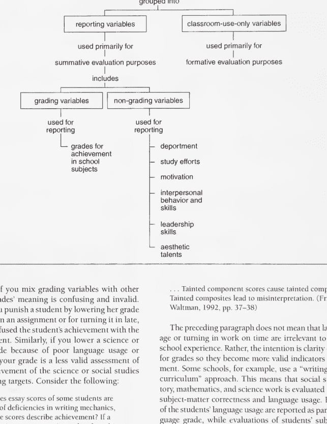

消除混合 如果你将评分变量与其他变量混合，你的成绩的含义就会令人困惑且无效。例如，如果你因学生未交作业或迟交作业而降低其成绩进行惩罚，那么你就混淆了学生的成绩与学生的行为。同样，如果你因语言使用不当或外表不佳而降低科学或社会研究成绩，你的成绩就是对学生掌握科学或社会研究课程学习目标的较不有效的评估。请考虑以下情况：

如果某些学生的社会研究论文成绩因写作 mechanics 缺陷而被降低，这些成绩在多大程度上描述了成绩？如果一名教师给一个小组项目评为A，这对一个对规划、进行或总结项目活动贡献甚少的小组成员意味着什么？如果论文的成绩每天迟交就降低一个完整的字母等级，论文的最终成绩在多大程度上反映了语言艺术的成绩？如果学生在考试当天无故缺席，对该次考试的F成绩会如何影响本应描述成绩的季度成绩？

… 污染的组成部分分数会导致污染的综合分数。污染的综合分数会导致误解。（Frisbie & Waltman, 1992, pp. 37–38）

前一段并不意味着语言使用或按时交作业与学生的学校经历无关。相反，其目的是使成绩的含义清晰，从而使其成为成绩更有效的指标。例如，一些学校使用“跨课程写作”方法。这意味着社会研究、历史、数学和科学作业既要评估学科内容的正确性，也要评估语言使用。对学生语言使用的评价作为语言成绩的一部分报告，而对学生学科内容成绩的评价则成为学科成绩的一部分。同样，迟到、未完成作业和其他问题可以单独报告，与成绩分开，并可用于解释学生缺乏学校成就的原因。

消除形成性评价组成部分 并非所有成绩变量都应作为评分变量（Frisbie & Waltman, 1992）。许多成绩变量具有形成性。例如，家庭作业、测验和对课堂活动的口头回应可能主要具有形成性目的——帮助你判断个别学生是否需要更多强化或你的课程是否进展顺利。这些形成性成绩评估不应计入评分期的学科成绩。当然，并非所有课外作业都是形成性的。一些家庭作业、大多数项目和大多数研究论文可用于总结性评价。因此，一般规则是，将你确定为对总结性评价有用的评估纳入成绩中，并排除主要为形成性评价而建立的所有评估。

## 在整个评分期内保持评分一致

## 制定评分标准以在不同评估中保持一致

评分标准不兼容 你需要提前思考，使进入总结性成绩的所有组成部分的评估标准兼容。例如，示例6.1中的天气单元评估计划显示，有五个组成部分进入单元的总结性成绩：家庭作业、测验、独立研究、地图绘制和单元末测试。假设这些分别按以下不同标准评分：

| 组件 | 评分标准 |
|---|---|
| 家庭作业 | 1–10 |
| 测验 | 1–5 |
| 独立研究 | 1–20 |
| 地图绘制 | 1–4 |
| 单元末测试 | 1–100 |

如果你仅使用这些标准将学生的分数相加，你会遇到困难，因为它们不兼容。例如，地图绘制标准可能基于四级质量的评分细则，而单元末测试基于0%到100%的百分比标准。这种不兼容性使得分数的简单总和成为成绩的无效基础。你需要以使标准兼容的方式对每项评估进行评分。

规划阶段是防止这种情况发生的时间。你可以使用本章后面将讨论的几种选项之一。解决这个问题并不复杂，但最好提前解决。以下轶事说明了这一点：

> 我合作的一个学区，八年级教师面临着将常规语言艺术测试的百分比正确分数和按4点评分细则评分的写作表现结合起来，形成报告卡成绩的五个等级（A、B、C、D、F）的任务。其中几位教师没有进行定量推理的背景来理解或如何进行标准转换，而且没有一个人采纳4点写作评分细则的人想到它对于分配五个等级的成绩不会很有帮助。这是在事后解决比在设计阶段解决更复杂的问题，在设计阶段，选择评分细则和构建决策规则是合适的。（Brookhart, 1999, p. 8）

失去精确度 最可靠的分数是能够区分学生学习质量细微差异的分数。能够证明 Sally 对学习目标的掌握略好于 Johnny 的标准，比无法区分他们学习水平的标准更可靠。为了可靠地检测学生之间的细微差异，分数标准需要许多分级或“点”。显示 Sally 为89而 Johnny 为82 的标准，比显示他们都获得相同评级的标准更好地展示了他们的学习质量。

当你将分数从细粒度标准（例如百分比正确标准）转换为粗粒度标准（例如字母等级）时，你会失去精确度。如果 B 定义为80–89 分，则 Sally 和 Johnny 都将获得相同的成绩 B。因为他们都获得相同的成绩，他们的真实差异无法用字母等级标准区分。通过将89和82都转换为 B，你失去了可靠性。

你不应认为所有百分比标准都是细粒度的。例如，如果你有五个测试题目，每题一分，那么可能的百分比只有0、20、40、60、80和100。因此，只有六个可能的百分比值，而不是你通常与百分比标准相关联的100个值。在此示例中，百分比标准与字母等级标准一样粗糙。每题一分的10道题测试同样不是非常细粒度。请记住，报告学生之间细微差异的标准必须使用许多数值才能可靠地评估学生之间的成绩差异。如果你只使用标准中许多可能值中的少数几个，那么你就会失去精确度。

尽管你从细粒度标准转向粗粒度标准时会失去精确度，但从粗粒度转向细粒度并不会获得精确度。如果我们最初只有粗分数，任何转换都不会使其更精确。评分细则可能将学生的写作评为1到4分中的3分。你可以将3转换为百分比：3分中的4分意味着75%。你并没有在区分学生方面获得任何精确度；然而，所有获得3分的学生都将获得75%。同样，转换后标准仍只有4个点（25%、50%、75%和100%），与转换前相同；只有标签发生了变化。

标准精确度的影响，无论正面还是负面，都在加上使用精心制作的评估工具所带来的积极影响。因此，你最好像精心制作评估工具本身一样精心制作评分标准。


## 成績的組成部分
### 組成部分的權重

在評分時，你不應將每項成就性評估的權重設為相等。你在決定各項學習目標的達成度後，再決定要給家庭作業、測驗、隨堂測驗、學期論文和其他要素分配多少權重。你首先列出所有用於評估成績達成的組成部分。接著，你決定這些組成部分與學習目標的關聯，並判斷每個組成部分的重要性（因此在整體總結性成績中的權重）。

在決定每個組成部分的權重時，你應考慮至少六個因素：

- 1. 評估了更多重要學習目標和內容的組成部分，應比僅聚焦於一項或幾項目標的組成部分具有更高的權重。
- 2. 針對你花最多時間教授學生的內容所設計的組成部分，應在決定成績時佔據最大權重。
- 3. 要求學生整合和應用其學習的組成部分，應比僅要求學生背誦所教授內容的組成部分具有更高的權重。
- 4. 當兩個組成部分評估部分相同的學習目標時，每個組成部分的個別權重應低於評估相同數量但不重疊的獨特學習目標的其他組成部分（即非重疊組成部分）（Frisbie & Waltman, 1992）。
- 5. 如果你知道其中一個計入成績的組成部分對某些學生群體存在一定程度的不公平，你在使用它進行評分時應非常謹慎。如果你決定整體上仍適合使用它，你應降低其權重，尤其是對其不公平的學生而言。例如，你可能會發現計時書面測驗無法充分評估具有某些殘障的學生。在這種情況下，適當的做法是對這些學生降低此程序的權重，並給予其他更合適的程序在決定其成績時更大的權重。
- 6. 可靠性和客觀性較低的組成部分應比更可靠、更客觀的組成部分具有較低的權重。然而，這並不意味著你應避免使用論文和作品集等較難客觀評分的評估來評定成績。相反，你應為其評分使用評分量規，以便評分更可靠。（見第12章，第278頁。）

## 成績分界
### 成績之間的標準或分界

一個重要考慮是如何建立成績之間的分界。什麼構成A、B等？答案將取決於（a）你使用的框架以及（b）你所在學區的政策。設定常模參照評分分界的程序與設定標準參照評分分界的程序非常不同。你需要遵循與你的教學方法一致的分界設定方法。我們將在本章稍後討論這些分界設定程序的細節。

然而，在此時必須認識到，你的成績分界必須在構成成績的所有評估中具有相同的含義。這並不意味著你需要為每項評估使用相同數量的評分（分數）。這確實意味著，一項評估中的A應在所有評估中具有大致相同的成就標準。例如，如果每項評估都是按正確百分比評分，則A的相同百分比範圍（例如90%–100%）應適用於所有評估。

### 邊界案例

你總會有邊界案例——學生的綜合分數接近或正好落在兩個成績的分界線上。該怎麼辦？學生必須離成績分界多近，你才會將字母成績上調或下調？許多教師樂於審查學生並為那些剛低於分界線的學生提高成績，但不考慮降低那些剛高於分界線的學生成績（Brookhart, 1993）。然而，當額外的成就證據證明其合理時，降低邊界成績與提高成績一樣有效。

正如你在第4章中所學，評估結果包含測量誤差，因此分數位於分界或分界附近的學生，其真實分數可能與其觀察到的分數不同。這反對採取強硬態度，告訴學生她只因一兩分而錯過了更高成績。你應將分界附近的分數視為類似第4章中討論的“不確定帶”。你應使用學生額外的成就資訊來幫助你判斷學生的真實分數是在分界之上還是之下。利用額外的成就資訊來幫助做出分界決策，比利用學生在學習上付出的努力資訊更有效（Brookhart, 1999）。如果你仍有疑問，從教育角度來看，給予較高的成績比給予較低的成績更好。

## 失敗成績
### 失敗的含義

正如 Frisbie 和 Waltman（1992）指出的那樣，F成績帶有許多情感，因為獲得它通常會對學生產生負面後果。F應該意味著什麼？你的答案應與你的評分框架一致。分配不及格成績（F）最不令人困惑的方式是設定關於課程學習目標表現的合理最低標準。持續表現低於這些最低表現標準的學生將獲得F。

讓我們來談談分配不及格成績的實際操作。Billy 沒有交一項重要的作業，即使他知道截止日期，你也在課堂上多次宣布。你決定給 Billy 零分。另一方面，James 按時交了作業；但作業質量很差，你必須給他55分，這在F範圍內。James 和 Billy 都獲得了F。問題是，這些F意味著同一件事嗎？如果不是，使用F的有效性（即有效性）有多大？我們稍後會解決這個問題，但首先再舉一個例子。

許多績效評估和建構回應題目的評分量規使用1到4的評分量表。我們關心的問題是最低類別1的含義。通常，量規描述1為非常差質量的作業，相當於失敗。然而，1通常被分配給那些什麼也沒做、未交作業或寫下胡言亂語的學生。1分對每個學生意味著相同嗎？如果不是，其有效性如何？這個問題並不一定通過使用0到4的評分量規來解決。如果零分給予未交作業的學生，也給予交了作業但寫得差的學生，零分就有兩種不同的含義。這種混淆降低了評分的效度。

一種表述這個問題的方式是考慮兩類學生表現（Brookhart, 1999）：（a）完成質量非常差的作業，即不及格的作業，以及（b）根本不做作業，即不努力。第一類描述學生的成就：學生相對於標準或學習目標的狀態。這類學生失敗標記或成績的含義是相當清楚的。

第二類反映學生的動機（以及可能態度和人格特徵，例如缺乏自信心、考試焦慮、反叛等）。Billy 沒有交作業可能向你發出信號，表明他沒有理解你所教授的內容。Billy 可能因為不知道怎麼做而沒有完成作業。這需要你與 Billy 及其家長合作，確保他獲得所需的幫助。Billy 可能缺乏安全感，害怕承認自己學習失敗：並非每一次不努力都是惡意的。在“不努力”情況下，給予不及格成績（或降低成績）是無效的，因為由此產生的成績並不能準確描述成就。這並不意味著你不應報告不努力；它意味著用相同的標記（0或1）或相同的成績（F）來描述這兩種類型的學生反應是無效的。

一個密切相關的問題是，“如果作業遲交，我是否應該降低學生的成績？”例如，一些教師會評分遲交的作業，但從評分中扣除分數或以其他方式限制該作業的最高分。再一次，這種做法降低了評分和由此產生的成績的有效性，因為它混淆了其含義：不要對某些學生僅用成績描述成就，而對其他學生用成績描述成就、態度和人格評價的混合。

像這些一樣令人厭惡的評分做法之所以存在，是因為教師面臨困難的教學條件。他們試圖利用成績（以及學生評估，一般而言）來控制學生的行為。正如我們在第5章中所討論的，當你威脅、懲罰或以其他方式試圖通過為與成就無關的行為降低成就成績來操縱學生時，你就是在不負責任地行事。如何處理缺交和遲交作業的問題是真實存在的，你必須為此掙扎，但這本身並不是一個測量問題。它是教學條件、學校政策以及人們對教育方式的假設的結果（Brookhart, 1999）。

學區的政策需要解決如何處理未交作業或遲交作業的學生。需要培養按時性和按時完成指定作業的文化。政策需要合法、公平、有效，並符合健全的教育哲學標準。任何政策都應消除懲罰、威脅或操縱學生的做法。

從純粹的測量角度來看，當作業從未交時給予“未完成”似乎是合理的。完成作業超過截止日期的學生可以從測量角度獲得全部學分。成績單上可以註明成績所依據的部分作業是在截止日期後完成的。重複此類註記描述了遲到情況，但並不妨礙對成就的描述。

然而，這些測量“解決方案”並未解決教師的所有擔憂。你可以提出以下問題：允許其他學生不按時完成作業，對那些習慣按時完成作業的學生公平嗎？在什麼情況下允許遲交作業（無懲罰或評論）或適當（例如生病、個人悲劇）？對交作業時間的靈活政策是否會導致課堂混亂？分配無效成績或低效度成績是否比解決學生行為不當或不交作業的原因更合乎道德？你可能會與你的指導教師和教學同事一起愉快地討論這些問題。

### 致命的零分

你是否意識到零分對綜合分數的影響有多大？假設 Ashley 是一名好學生，能達到B級水平。如果她沒有交一項作業，你給她零分，她的平均分會發生什麼變化？你是否驚訝地得知她的平均成績可能從B下降到D？

零分的影響，當然取決於學生獲得的組成部分分數，以及有多少分數計入


# 示例 15.5

假设将未交作业的学生作业替换为零或 59 的影响示例。替换后的数值显示在括号中。 （假设 A = 90–100，B = 80–89，C = 70–79，D = 60–69，F = 0–59。）

|  | 1 | 2 | 3 | 4 | 5 | Avg | Grd |
|---|---|---|---|---|---|---|---|
| A. 真实表现 | 80 | 70 | 85 | 75 | 90 | 80 | B |
| B. 策略 1—用零代替缺失的评估 |  |  |  |  |  |  |  |
| Case 1 | (0) | 70 | 85 | 75 | 90 | 64 | D |
| Case 2 | 80 | (0) | 85 | 75 | 90 | 66 | D |
| Case 3 | 80 | 70 | (0) | 75 | 90 | 63 | D |
| Case 4 | 80 | 70 | 85 | (0) | 90 | 65 | D |
| Case 5 | 80 | 70 | 85 | 75 | (0) | 62 | D |
| C. 策略 2—用最高可能的不及格分数（即 59）代替缺失的评估 |  |  |  |  |  |  |  |
| Case 1 | (59) | 70 | 85 | 75 | 90 | 76 | C |
| Case 2 | 80 | (59) | 85 | 75 | 90 | 76 | C |
| Case 3 | 80 | 70 | (59) | 75 | 90 | 75 | C |
| Case 4 | 80 | 70 | 85 | (59) | 90 | 75 | C |
| Case 5 | 80 | 70 | 85 | 75 | (59) | 74 | C |
| D. 策略 3—仅基于已交作业给分 |  |  |  |  |  |  |  |
| Case 1 | — | 70 | 85 | 75 | 90 | 80 | B |
| Case 2 | 80 | — | 85 | 75 | 90 | 83 | B |
| Case 3 | 80 | 70 | — | 75 | 90 | 79 | C |
| Case 4 | 80 | 70 | 85 | — | 90 | 81 | B |
| Case 5 | 80 | 70 | 85 | 75 | — | 76 | C |

综合成绩、组件所分配的权重，以及学生如果交了作业本应获得的分数。示例 15.5 可帮助你理解零分对学生成绩的影响。

在本例中，有五项作业。为了简化，假设它们权重相等。作为参考，假设 Ashley 的“真实表现”，即她完成所有作业后本应获得的成绩，如面板 A 所示。Ashley 是一个 B 等学生。

面板 B 显示了如果 Ashley 未交一项作业，并且你给她零分会发生什么。 对她成绩的影响是巨大的：缺少一项作业就会使她的成绩下降两个等级，从 B 降到 D。无论她未交哪项作业，结果都一样。

使用零分意味着你已为她缺失的作业给予了最低可能的不及格分数作为替代。相反，你可以给她最高可能的不及格分数。在本例中，F 范围为 0–59，因此 59 是最高可能的不及格分数。面板 C 显示了如果你采用这种策略，Ashley 的成绩会怎样。Ashley 从 B 平均分（面板 A）降到 C 平均分（面板 C）。尽管如此，一项作业缺失仍使她的平均分下降了一个等级。

还可以使用其他策略。其中一种显示在面板 D 中。这里你只是忽略缺失的作业，基于其余四项给分。如面板 D 所示，对她成绩的影响取决于她未交的是哪项作业。如果她未交其中两项得分最高的一项（案例 3，作业 3 为 85，或案例 5，作业 5 为 90），她的成绩会下降一个等级；在其他情况下成绩仍为 B。还可以使用其他策略（未显示）（Brookhart, 1999），例如使用中位数成绩，使用 50 而不是 59，或用四项已完成作业的平均分代替缺失作业的分数。对 Ashley 来说，这些其他方法得出的字母等级结果与面板 D 所示相同。

从测量角度来看，当满足以下条件时，策略 3（仅基于已交作业给分）是三种策略中最好的：（a）作业对学生而言难度大致相等，（b）作业权重相等（或分值相同），（c）作业数量较多且仅缺一两项。该建议不考虑其他因素，例如：（a）“缺失作业”是否是最重要的作业（例如项目或期末考试），（b）学生因疾病或个人悲剧未交作业，（c）学生因不懂得如何完成作业而未完成作业，以及（d）学生已养成不按时交作业的习惯。正如我们之前所述，这些并非严格意义上的测量问题，而是教育实践、课堂管理和学校政策方面的事项。

## 第五节：设定成绩边界和合并分数的技术

## 分配常模参照字母等级

有几种分配成绩的方法使用相对或常模参照标准。³ 一种方法称为曲线评分，使用学生成绩的排名顺序：学生成绩从高到低排序，等级（A、B、C 等）根据此排名分配。第二种称为标准差法，使用标准差（见附录 1）作为单位：教师计算成绩的标准差，并用该数值在数轴上划分出定义等级分配边界的区间。这两种方法不一定会得到相同的结果。我们接下来解释如何使用这些方法。

### 给单项测验或评估评分

曲线评分 要使用曲线评分法分配字母等级，你需要决定要授予 A、B、C 等的百分比。例如，你可以决定如下：

## 示例

用于曲线评分的一种可能的百分比设定示例

- 前 20% 的学生得 A
- 接下来 30% 得 B
- 接下来 30% 得 C
- 接下来 15% 得 D
- 最后 5% 得 F

选择使用哪些百分比没有规则。它们是根据你对学校字母等级分布的现实经验任意选择的。这种方法不需要使用正态或钟形曲线。

另一种设定百分比的方法是将正态或钟形曲线（见第 17 章）的范围划分为五个等长区间。下面示例显示了由此产生的各等级学生百分比。

## 示例

使用正态曲线并分为五个等长区间的曲线评分的一种可能的百分比设定示例

- 前 3.6% 的学生得 A
- 接下来 23.8% 得 B
- 接下来 45.2% 得 C
- 接下来 23.8% 得 D
- 最后 3.6% 得 F

这组百分比假设你班级学生群体的真实成绩呈正态分布，而作者认为这种假设对你或任何教师来说都很难证明。注意：（a）决定百分比的区间的宽度是完全任意的，（b）评估分数必须是所需成绩的有效测量，（c）没有关于字母等级所代表的学习目标、技能或能力的参考（除非是排名靠前的学生比排名靠后的学生能力更高）。如果你决定采用曲线评分，那么你必须提供令人信服且在教育上合理的理由来证明你所使用的特定百分比；否则，你的成绩很可能是不合理的。

标准差法 要使用标准差法，你首先决定定义 A 等下限的分数。你通过决定 A 的下限将高于该群体中位数（PR = 50）多少个标准差倍数来确定（Ebel, 1965; Ebel & Stuit, 1954）。然后你将分数刻度再向下划分为四个*段：这四个段的宽度等于标准差的数值；你从 A 的下限开始向下划分。（附录 1）解释了标准差以及如何计算它。）示例 15.6 显示了这样做的步骤，并附有示例。

对班级平均能力的调整 与为每个班级使用相同的 A、B、C 等百分比相比，对于这种常模参照评分方法，根据班级能力的改变而改变百分比似乎是合理的。例如，如果班级非常聪明，那么你预计会给出更多 A 和更少 D，而如果班级为平均水平则不会。前面示例中概述的方法会根据你班级学生的整体学业能力调整分配的各字母等级数量。因此，第一步是使用学生之前的平均绩点或所有学生都参加的能力测试分数来估计该群体的能力水平（从差到优秀）。使用这种方法，选择使用什么区间宽度以及 A 的下限是任意的，


## 示例 15.6

应用 Ebel-Stuit 标准差法设定成绩等级边界的示例。

### 七个能力水平班级的等级标记分布统计

| 班级能力水平 | A 的下限 | A | B | C | D | F | GPA | 能力衡量百分位 |
|---|---|---|---|---|---|---|---|---|
| 卓越 | 0.7 | 24 | 38 | 29 | 8 | 1 | 2.80 | 79 |
| 优异 | 0.9 | 18 | 36 | 32 | 12 | 2 | 2.60 | 73 |
| 良好 | 1.1 | 14 | 32 | 36 | 15 | 3 | 2.40 | 66 |
| 一般 | 1.3 | 10 | 29 | 37 | 20 | 4 | 2.20 | 68 |
| 平均 | 1.5 | 7 | 24 | 38 | 24 | 7 | 2.00 | 50 |
| 弱 | 1.7 | 4 | 20 | 37 | 29 | 10 | 1.80 | 42 |
| 差 | 1.9 | 3 | 15 | 36 | 32 | 14 | 1.60 | 34 |

分配成绩涉及四个步骤。

- 1. 从 [the above table]... 选择适合被评班级能力水平的成绩分布。
- 2. 计算成绩所依据的分数的中位数和标准差。
- 3. 使用中位数、标准差以及 [the table] 中的适当下限因子确定 A、B、C 和 D 等级区间的下限分数。
- 4. 将指定的等级分配给分数落在各等级所确定区间内的学生。

### 等级标记分配的示例问题

#### A. 问题的资料

- 1. 班级能力水平衡量：
  - a. 往年课程的平均 GPA：2.17
  - b. 能力测试的平均百分位：56.3
  - c. 适当的成绩分布 [from above table]：fair
- 2. 成绩分数（学生人数 = 38）
  - 112 100 93 84 78 72 66 51
  - 109 97 91 83 75 71 62 47
  - 106 97 90 82 75 70 59 44
  - 105 95 89 81 75 69 59
  - 104 95 84 80 74 68 58

#### B. 数据的计算

1. 中位数 = 80.5

2. 标准差 = 17.6

| 等级 | 下限 | 区间 | 人数 | 百分比 |
|---|---|---|---|---|
| A | 80.5 + (1.3 × 17.6) = 103.4 | 103–112 | 5 | 13 |
| B | 103.4 − 17.6 = 85.8 | 86–102 | 9 | 24 |
| C | 85.8 − 17.6 = 68.2 | 68–85 | 16 | 42 |
| D | 68.2 − 17.6 = 50.6 | 51–67 | 6 | 16 |
| F |  | 44–50 | 2 | 5 |
|  |  |  | 38 | 100 |

正如对曲线评分的百分比选择是任意的一样。此外，与曲线评分方法一样，仅参考个人的相对成绩，而非对学生可能具备的胜任能力的绝对描述。

该方法假设对于“平均”能力学生，其潜在成绩服从正态分布，即使被评级的测试或其他评估上的分布并非如此。对于高于和低于平均水平学生的成绩分布的假设，由示例中表格各行中的“等级百分比”表示。一个明显的优势是，这种方法有助于使使用该方法的教师之间的成绩更具可比性。

学生由示例中表格各行中的“等级百分比”表示。一个明显的优势是，这种方法有助于使使用该方法的教师之间的成绩更具可比性。

## 对多个分数的综合评分

本节讨论如何将多个评分组成部分的分数合并为单一的综合成绩。程序将与常模参照评分框架保持一致。稍后我们将讨论如何以与标准参照评分框架一致的方式合并组成部分的成绩。通常，成绩单上的等级反映了学生在作业、测验、报告以及可能是一次考试等多个评估上的表现。我们之前讨论过在为成绩的每个组成部分分配权重时需要考虑的因素。对于每个评分组成部分的恰当权重并没有达成一致。

## 权重指南

当采用常模参照评分时，对该组学生最终排名贡献最大的组成部分权重最大。如果简单地将组成部分分数乘以任意权重然后相加形成综合分数，这一原则很可能被违反。原因是综合分数的排名受构成综合分数的组成部分的标准差的影响 [以及组成部分之间的相关性]。为说明这一点，请考虑下一个示例。

## 示例

说明当使用常模参照评分时，评分组成部分可能与教师意图相反发挥作用的假设示例

假设最终成绩基于一次考试和一个项目的成绩之和。假设项目 intended 权重是考试的两倍。为实现这一点，教师决定给项目分配比考试多两倍的分数：项目 100 分，考试 50 分。记住，在常模参照评分框架中，排名最高者应获得最高成绩。以下是五名学生的成绩和排名。

|  | 考试（50 分） |  | 项目（100 分） |  | 总计 |  |
|---|---|---|---|---|---|---|
| 学生 | 成绩 | 排名 | 成绩 | 排名 | 成绩 | 排名 |
| Anthony | 44 | 1 | 77 | 5 | 120 | 1 |
| Ashley | 33 | 2 | 78 | 4 | 111 | 2 |
| Billy | 26 | 3 | 79 | 3 | 105 | 3 |
| Chad | 22 | 4 | 80 | 2 | 102 | 4 |
| Vanessa | 15 | 5 | 81 | 1 | 96 | 5 |

请注意，项目的排名与考试完全相反。然而，最终顺序与考试完全相同，尽管教师对项目赋予了更大权重。这是因为学生总成绩的排名取决于分数的离散程度，而非教师 intended 的权重。分数的离散程度用标准差衡量。 [参见附录 I。] 项目分数彼此接近，因此其标准差很小，而考试分数差异很大，因此其标准差很大。由于考试分数的标准差更大，学生的考试排名主导了其最终总排名，尽管教师 intended 使项目成为主导组成部分。一般来说，使用常模参照评分时，一个组成部分分数的标准差越大，该组成部分对形成综合分数后学生最终排名的影响就越大。

## 使用 SS-分数法

SS-分数法通过先调整各组成部分标准差的值来保留你希望组成部分具有的影响 [权重]。调整后，你即可应用所需的权重。有三个步骤：首先，将每个组成部分上的所有分数都转换为 SS-分数 [SS 表示线性标准分数；参见第 17 章]。这使所有标准差相等。其次，将组成部分的 SS-分数乘以你想要的权重。最后，将这些乘积相加形成每个学生的综合成绩。以下公式概括了这些步骤。

加权综合分数 = Σ(weight × SS) [Eq.15.1]

其中
weight = 你希望该组成部分具有的权重
SS = 该组成部分的线性 SS-分数
= 10 (X-M)/SD + 50

该程序在示例 15.7 中进行了说明。

请注意，这些加权综合分数本身并不是 SS-分数。然而，加权综合分数确实提供了一种对学生进行排名的方法，使得你指定的组成部分权重会对学生的最终名次产生 desired 的影响。

为了体会 SS-分数法对最终加权综合分数中学生排名的影响，请回顾我们之前的一个示例，其中教师试图使项目主导学生排名的尝试失败了。这次，让我们对与此处所示的相同成绩应用 SS-分数法：

## 示例

说明使用 SS-分数法可以帮助教师在采用常模参照评分时按 intended 方式加权作业的假设示例

|  | 考试（权重 = 1） |  |  | 项目（权重 = 2） |  |  | 总计 |
|---|---|---|---|---|---|---|---|
| 学生 | 成绩 | SS | 排名 | 成绩 | SS | 排名 | 综合排名 |
| Anthony | 44 | 66 | 1 | 77 | 36 | 5 | 138 | 5 |
| Ashley | 33 | 55 | 2 | 78 | 43 | 4 | 141 | 4 |
| Billy | 26 | 48 | 3 | 79 | 50 | 3 | 148 | 3 |
| Chad | 22 | 44 | 4 | 80 | 57 | 2 | 158 | 2 |
| Vanessa | 15 | 37 | 5 | 81 | 64 | 1 | 165 | 1 |

将此示例中的最终排名与前一个示例中的最终排名进行比较。现在，项目主导了基于综合分数的排名，而不是考试。这正是教师最初 intended 的结果。先将成绩转换为 SS-分数使考试


# 示例 15.7

使用 SS 分数法计算综合成绩的示例。

| 计入成绩的组成部分 |  |  |  |  |
|---|---|---|---|---|
|  | 小测验 | 作业 | 课程论文 | 考试 |
| 均值 (M) | 70 | 85 | 75 | 65 |
| 标准差 (SD) | 5 | 8 | 15 | 20 |
| 教师权重 | 20% | 10% | 20% | 50% |
| SS* 计算公式 | SS = 10(Mark -70)/5 + 50 | SS = 10(Mark -85)/8 + 50 | SS = 10(Mark -75)/15 + 50 | SS = 10(Mark -65)/20 + 50 |

*SS 分数是通过用学生的原始分数减去该组成部分的均值，将差值除以标准差，乘以 10，然后将乘积加上 50 计算得出。每个学生的结果如下所示。例如：

- Bob 的小测验 SS 分数 = 10(87 - 70)/5 + 50 = 84
- Chad 的小测验 SS 分数 = 10(85 - 70)/5 + 50 = 80
- Susan 的小测验 SS 分数 = 10(75 - 70)/5 + 50 = 60
- Theresa 的小测验 SS 分数 = 10(70 - 70)/5 + 50 = 50

|  | 各组成部分的原始分数 |  |  |  | 各组成部分的 SS 分数 |  |  |  |  |
|---|---|---|---|---|---|---|---|---|---|
| 学生 | 小测验 | 作业 | 课程论文 | 考试 | 小测验 | 作业 | 课程论文 | 考试 | 加权综合分 |
| Bob | 87 | 85 | 70 | 80 | 84 | 50 | 47 | 58 | 60 |
| Chad | 85 | 80 | 80 | 70 | 80 | 44 | 53 | 53 | 58 |
| Susan | 75 | 82 | 85 | 60 | 60 | 46 | 57 | 48 | 51 |
| Theresa | 70 | 78 | 75 | 65 | 50 | 41 | 50 | 50 | 49 |

综合分数是通过将各组成部分的 SS 分数乘以相应的教师组成部分权重并求和计算得出。例如：

- Bob 的综合分数 = .2(84) + .1(50) + .2(47) + .5(58) = 60
- Chad 的综合分数 = .2(80) + .1(44) + .2(53) + .5(53) = 58
- Susan 的综合分数 = .2(60) + .1(46) + .2(57) + .5(48) = 51
- Theresa 的综合分数 = .2(50) + .1(41) + .2(50) + .5(50) = 49

marks' and project marks' standard deviations equal.5 Then when the weight of 2 was applied, the composite better matched the teacher's intent.

## 设定标准参照字母等级

有几种方法可用于标准参照评分框架下的评分。在本书中我们只讨论其中三种。一种方法称为固定百分比法：将计入综合成绩的每个组成部分的分数首先转换为正确百分比（或总分的百分比）；然后将百分比转换为等级。对于每个组成部分，必须使用相同的百分比来定义字母等级的边界。

第二种方法称为总分法：将计入期末综合成绩的每个组成部分分配一个最高点值（例如，小测验可能计 10 分，考试每次最高计 50 分，项目可能每次最高计 40 分）；字母等级是根据学生在评分期间累计的总分数量分配的。

第三种方法是质量等级法或评分量规法。它有时被称为内容为基础的方法（Frisbie & Waltman, 1992）。在这种方法中，你描述学生为获得每个字母等级所需表现的质量水平——何种类型的表现构成 A、B、C 等。 （这些质量定义的示例在表 15.7 的第一列中显示。）根据这些定义，你评估学生在每个组成部分上的工作，决定其工作质量水平，然后分配相应的等级。这种方法与使用评分量规对表现性任务进行评分非常相似（有关评分量规的详细信息，请参阅第 11 章和第 12 章）。当你为一个组成部分制定量规时，必须确保质量等级的数量与字母等级的数量相对应。

5作为练习，请使用附录 I 中的标准差公式验证此示例。

## 给单个测验或评估评分

固定百分比法 教师经常使用百分比作为评分作业的依据。正确百分比与字母等级之间的关系是任意的。在某些学校，80% 为 A；在其他学校，85% 为 A。在另一些学校，90% 为 A。少数学区对此有政策。以下是一个此类定义字母等级的百分比集合的示例：

## 示例

使用固定百分比法评分的一种可能的百分比集合示例

- 90–100% = A
- 80–89% = B
- 70–79% = C
- 60–69% = D
- 0–59% = F

请注意，百分比引发了这样一个问题：“百分比的什么？” 通常，你唯一能够辩护的答案是，该分数代表了测验或作业上最高分的百分比。这个答案忽略了更广泛的关注：测验应是从课程学习目标所暗示的明确定义的表现领域中抽取的代表性样本。如果你没有定义该领域，并且没有构建评估以代表性地抽样该领域，那么你就不能使用百分比等级来准确估计学生在该更广泛领域上的状态。这样的测验（或评估），以及由此产生的此类百分比，不能被视为标准参照。

定义每个等级的百分比应考虑到教师对所教学生类型的经验以及教师制定的测验的难度。因此，常模参照信息有助于建立标准参照评分系统。如果学区没有为每个字母等级定义一组百分比，你可能需要花费数年时间来制定一个既公平对待学生又代表合理学术标准的百分比评分方案。如果你是新教师，你应与同事核实，以确保你的评分方案合理且不会不必要地偏离其他教师。

这种固定百分比方法的局限性之一在于，你创建的每项评估都有不同的难度水平，而你可能事先不知道。这种方法 however 使用相同的固定百分比来表示每个组成部分的 A、B 等。因此，如果你为班级创建的测验过于困难，你可能会根据事先固定的百分比给出过多的低等级。这对学生来说令人沮丧，并可能使你处于必须更改评分系统的境地（例如，你可能想按曲线评分以调整低等级的数量）。

第二个局限是，这种方法鼓励你更强烈地关注评估的难度水平，而非其应评估的学习目标。例如，如果你固定了百分比，你就会寻找方法使评估足够容易或足够困难，以便为班级获得合理的字母等级分布。这似乎违背了绝对或标准参照评分的原则。

总分法 要使用此方法，你必须事先决定所有将计入期末评分期间成绩的组成部分。然后，也要事先决定每个组成部分的最高点数。你的评估计划应做到这一点。每个组成部分的最高点数反映了你分配给该组成部分的权重。例如，如果你希望单元测验在成绩中占更大比重，你就会分配给单元测验更多的总点数。最后，你将各组成部分的最高点数全部相加，并使用该总点数设定字母等级边界。请注意，与固定百分比法不同，你不是为每个组成部分分配字母等级，而是仅为所有组成部分的总和分配字母等级。

## 示例

使用总分评分法评分的一种可能的点数集合示例

| 组成部分 | 最高点数 | “权重” 以百分比表示 |
|-----------|----------------|----------------------------------------|
| 小测验 | 40 | 20% |
| 作业 | 20 | 10% |
| 课程论文 | 40 | 20% |
| 考试 | 100 | 50% |
| 总分 | 200 | 100% |

在决定了组成部分及其最高点值后，你然后为学生在评分期间累计的总分设定分配字母等级的边界。例如，

| 总分等级边界 | 等级 |
|------------------------------|-------|
| 180–200 | A |
| 160–179 | B |
| 140–159 | C |
| 120–139 | D |
| 0–119 | F |

请注意，这些总分等级边界对应于 200 总分的 90%、80%、70% 和 60% 分别为 A、B、C 和 D。 （例如，


for an A, 180 + 200 = .90 or 90%.) 你可以使用其他百分比来定义等级边界。相应地调整总分边界。

总分法的局限之一是，它使你很容易为低分学生提供“额外学分”作业来提高其总分。额外学分作业往往会扭曲成绩的含义，尤其是在这些作业没有对原始组成部分的相同学习目标进行适当评估时。例如，如果一名学生在学期论文上表现不佳，你可能会诱使该学生阅读并总结一份时事杂志文章来提高其分数，而不是再写一篇学期论文。对于该学生而言，总分的含义相对于其他学生会被扭曲。因此，你的成绩有效性降低。

该方法的另一个局限是，在创建评估工具之前定义了最大分数，你在创建评估工具时可能会面临不可接受的选择。考虑以下情况：

> 假设我需要一份 50 分的测试以适应我的 [总分] 评分方案，但发现我需要 32 道选择题才能充分抽样内容领域。我认为这不令人满意（或不方便），因为 32 不能很好地除以 50。（它是 1.56！）为了让生活更简单，我可以去掉 7 道题，使用 25 题的测试，每题 2 分。如果我那样做，我的总分会很完美，但我的测试将是对重要单元目标的不完整衡量。我过早地承诺 50 分，严重损害了获得有意义的评估结果。（Frisbie & Waltman, 1992, p. 41）

## 评分若干分数的组合

本节讨论如何将来自若干组成部分的分数合并为单一的综合成绩。讨论与标准参照评分框架一致。使用标准参照框架时，与常模参照评分一样，你在为组成部分分配权重时必须谨慎。如果权重分配不当，综合结果将无法保持你对每个组成部分所期望的重要性。

固定百分比法 如果你使用固定百分比评分法，你将为每个学生、每个组成部分获得一个百分比分数。然后，你将每个组成部分的百分比乘以其相应的权重，将这些乘积相加，并将乘积之和除以权重之和。该程序可由以下公式概括：

```
Composite percentage (weighted) = Σ (weight × percentage score) / Σ (weight) [Eq.15.2]
```

其中 Σ = 权重之和 = 你给予一个组成部分的权重 = 你给予该学生在该组成部分上的百分比

为了说明，请考虑示例 15.8。

如果你没有使用权重，每个组成部分将同等计入综合成绩。该程序不应与常模参照评分一起使用，因为此处分配的权重并不反映各组成部分的标准差。

总分法 我们在上一节中描述的总分法会自动评分综合成绩。学生的综合成绩是学生累积的分数总和。但是，请确保你为每个组成部分分配的分数反映了你希望该组成部分对总综合成绩的贡献权重。例如，如果你希望各组成部分的权重为测验 20%、家庭作业 10%、学期论文 20%、考试 50%，那么每个组成部分的分数应反映总最大分数的这些百分比。因此，如果最大总分为 200 分，则所有测验的最高分为 40 分（= 200 的 20%），所有家庭作业的最高分为 20 分，学期论文 40 分，考试 100 分。

## 成绩簿计算机程序

用于计算综合成绩的若干程序所述程序有些复杂，涉及一些繁琐的乘法和加法。当然，所有这些计算都可以用手持计算器完成。如果你有个人电脑，你也可以使用简单的电子表格程序来进行计算。市场上也有若干成绩簿程序可以帮助你。其优点是成绩簿程序为你提供了已设置好用于记录和报告成绩的电子表格。更好的程序结合了电子表格和数据库功能。这将使你能够从各种评分框架中进行选择，保持班级名册，记录出勤情况，记录学生作业的评论，获得班级汇总情况，并为整个班级或一名学生打印带回家的报告。一个缺点是一些成绩簿程序可能会限制你可采用的评分类型，或者可能不允许你使用自己的评分方法来覆盖程序内置的方法。

示例 15.9 显示了一个成绩簿程序的计算机屏幕窗口。请注意最右侧的“结果列”。当你为每个学生输入评估结果时，该列会不断更新。特定程序（Excelsior 2 Grade for Windows）允许你打印许多不同的报告，包括班级成绩报告、班级期末成绩（六周和季度）、班级目标汇总、

## 示例 15.8

使用固定百分比法计算综合成绩的示例

假设你有四个组成部分（测验、家庭作业、学期论文和考试），你希望将它们合并为一个学期间的综合成绩。进一步假设，每个组成部分最初都按正确百分比标记。还假设你不希望对每个组成部分赋予相同的权重。最后，假设学生的成绩和每个组成部分的权重如下：

| Student | Quizzes (wt. = 20%) | Homework (wt. = 10%) | Term paper (wt. = 20%) | Exam (wt. = 50%) | Weighted composite percentage |
|---|---|---|---|---|---|
| Bob | 87 | 85 | 70 | 80 | 80 |
| Chad | 85 | 80 | 80 | 70 | 75 |
| Susan | 75 | 82 | 85 | 60 | 65 |
| Theresa | 70 | 78 | 75 | 65 | 69 |

你计算加权综合成绩（最后一列）并将该成绩与你为字母等级设定的边界进行比较。你使用公式 15.2 计算加权综合成绩。计算如下：

Bob 的加权综合成绩 = [20 × 87 + 10 × 85 + 20 × 70 + 50 × 80] ÷ [100] = 80
Chad 的加权综合成绩 = [20 × 85 + 10 × 80 + 20 × 80 + 50 × 70] ÷ [100] = 75
Susan 的加权综合成绩 = [20 × 75 + 10 × 82 + 20 × 85 + 50 × 60] ÷ [100] = 65
Theresa 的加权综合成绩 = [20 × 70 + 10 × 78 + 20 × 75 + 50 × 65] ÷ [100] = 69

假设你的等级边界为：

A = 90–100；B = 80–89；C = 70–79；D = 60–69；和 F = 0–59

然后使用计算出的加权综合百分比，这些学生的成绩为：

Bob = B；Chad = C；Susan = D；和 Theresa = D

## 示例 15.9

将学生评估结果输入成绩簿程序的计算机屏幕示例。

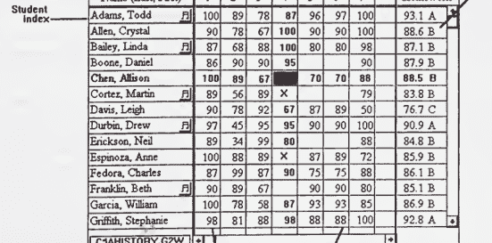

班级统计数据、个人期间掌握情况、班级排名名册、期间作业报告、个人成绩或目标报告以及出勤报告。该程序也可以联网。

并非所有成绩簿程序质量都很高。然而，有些价值有限，使用非常困难或非常不灵活。务必阅读教师杂志或教育技术杂志中对这些程序的评论，并在购买前试用该程序。网站 www.thejournal.com 可能有所帮助。成绩簿程序的评估可从西密歇根大学评估中心阿伦·古利克森教授处获得。

## 摘要

## 第一节：成绩的含义和目的

- 尽管良好的教学需要持续评估，但并非所有评估结果都应成为学生成绩的一部分。只有形成性评估的成绩才应成为成绩的一部分。
- 成绩是学生成绩的重要总结，被学生、家长、其他教师、指导顾问、学校官员、后继教育机构和雇主使用。因此，你必须以极大的谨慎分配成绩并保持其有效性。
- 许多教师很难分配分数和成绩，因为教育成就难以衡量，评分系统经常有争议，评分可能需要对学生做出困难或不愉快的决定。
- 你和学区分配成绩的方式传达了你自己的价值观和态度以及学生进步的信息。
- 测量专家对传统成绩是否能有效激励学业表现存在分歧。一种分析表明，传统成绩（a）可以为一些学生提供目标，（b）当学生认为成绩遥不可及时降低动机，（c）很少提供学生可用于判断进步的持续信息，（d）提供很少学生可用于提高学习的信息。如果存在最后四种情况，则成绩不太可能有效激励学生学习。
- 成绩在许多不同方面受到批评。这些总结在表 15.3 中。

## 第二节：成绩单和其他学生进步的官方报告

- 在美国报告学生进步的方法中，最流行的是字母等级、数字或百分比、两类系统、清单和评定量表、叙述性报告、学生-教师会议、家长-教师会议以及致家长的信。各种方法的优缺点如表 15.4 所示。
- 学校经常使用不止一种报告学生进步的方法，不同的方法在不同教育阶段使用。
- 表 15.5 总结了进行家长-教师会议的建议。
- 当学校报告几种符号和分数并对几种目标的学生进行标记时，需要多重评分系统。表 15.6 提供了开发多重评分系统的建议。
- 不太可能存在一种最佳的学生进步报告系统。学校可以考虑不同学生和家长的总体信息需求，并设计针对社区情况的多种报告系统。

## 第三节：选择评分模型

- 字母等级在某些等级参照框架内分配：常模参照（相对标准）、标准参照（绝对标准）和自我参照（成长标准）。
- 在你能够分配有效成绩之前，你需要选择一个与你的（a）教学方法和（b）形成性和总结性信息目的相匹配的评分框架。这些因素决定了适当的等级参照框架。
- 常模参照方法根据学生表现相互比较的程度为学生分配成绩。
- 自我参照方法根据教师对学生能力的感知和随后的教育成长为学生分配成绩。
- 标准参照方法通过将学生表现与一组定义的标准、学习表现或需要获得的知识进行比较来分配成绩。只有当你使用一个定义良好的任务领域并从该领域抽取代表性样本来观察和评估学生时，该方法才可被视为标准参照。大多数教师并未做到这一点。

## 第四节：明智的评分做法

- 你的评分计划必须基于你的评估计划（见第 6 章）。
- 为了使你的总结性成绩合理，你需要：
  - 仅关注评分变量。
  - 消除将非评分变量混入成绩中。
  - 使所有组成部分的评分量表保持一致。
  - 合理地为组成部分分配权重。
  - 使用额外的成绩评估信息来评估接近等级边界的学生。
  - 使用与你的等级参照框架相匹配的技术设定等级边界。
  - 使用 F 表示低成就，而不是“未能努力”或“未能交作业”。
  - 避免因未能交作业或作为惩罚而给出零分。
- 评分变量是报告变量的子集，报告变量是评估变量的子集。评分变量仅限于反映课程学习目标的总结性学生成绩的评估变量，你必须在官方学校记录上报告这些成绩。
- 你应以不同方式对构成成绩的评估组成部分类别进行加权。你在加权组成部分时应考虑的因素包括代表性和相关性、对所教授内容的强调、所需的思维过程和技能、组成部分之间的重叠、对所有学生的公平性以及评估结果的可靠性和客观性。


- 你需要考虑失败的含义及其对学生的影响。本章讨论了一些问题，并提供了建议，说明你应如何根据学区政策看待不及格成绩。
- 你应该理解当学生未完成作业时，给学生零分所产生的严重影响。建议了分配零分以外的替代方案。

## 第五节：设定成绩边界和合并成绩的技术

- 本章解释了几种分配成绩的技术，包括按曲线评分、标准差法、将分数转换为SS分数、总分法、固定百分比法、评分量表或质量等级法，以及绝对标准系统的权重组成部分。
- 有可用的计算机化成绩簿程序，可以让你相对轻松地使用复杂的评分程序。它们还有助于你轻松准备大量有用的成绩汇总和向学生、家长和学校官员提交的报告。

## 重要术语和概念

- assessment variables (evaluation variables)
- borderline cases
- continuous assessment
- criterion-referenced grading framework (absolute standards, task-referenced)
- failing grade
- failing work versus failing to try
- fixed-percentage method for grading
- grading
- gradebook program
- grading for summative purposes
- grading on a curve
- grading framework
- grading variables
- marking period
- multiple marking system
- narrative report
- norm-referenced grading framework (group-referenced, relative standards)
- permanent record card
- quality level method for grading (content-based method, rubric method)
- report card
- reporting variables
- self-referenced grading framework (change based, growth standards)
- SS-score method for making composites
- stakeholders
- standard deviation method of grading
- student progress reporting method (checklist, letter grades, letter to parents, narrative reports, numbers, parent-teacher conferences, percentages, pupil-teacher conferences, rating scale, two-category)
- total points method for grading

## 练习与应用

1. 准备一份简短的论文，说明你使用的（或计划使用的）评分系统。在单独的部分中解释使用该系统的教育理由，包括说明你的系统如何改善（或将改善）学生的教育发展。在你的论文中，展示你如何使用表15.8来构建你的思考。与班级其他同学讨论你的评分观点。准备至少一段文字解释以下每一项：
a. 你成绩符号的含义。
b. 你班级中失败的含义。
c. 你如何区分“失败”和“未能尝试”。
d. 你如何处理迟交作业或未交作业。
e. 你如何避免“致命的零分”。
f. 哪些学生表现计入你分配给学生的成绩。
g. 你在班级中通常分配（或将分配）的每种字母（或其他符号）成绩的数量。
h. 哪些组成部分进入（或将进入）你学生的学期末成绩。
i. 第h项中每个组成部分应占多少权重。
j. 你对每个成绩使用的（或将使用的）边界。
k. 你如何处理成绩处于边界的学生。
l. 你考虑的任何其他因素。

2. 与你所在或工作的学区中多个年级的学校管理人员和教师交谈。带上表15.4。
a. 使用了哪些学生进步报告方法？
b. 学区对所使用的方法是否满意？
c. 学校学区经历了表15.4中列出的哪些优点和缺点？请解释。
d. 获取学区成绩单的复印件。将你的所有发现与班级其他成员分享。
e. 总结你班级中代表的学区之间的相似之处和差异，并提出改进学生进步报告的建议。

3. 确定你教授过或将要教授的一个单元。
a. 在你的教学情境和该单元的背景下，确定评估变量、报告变量和评分变量。
b. 准备一个三列表，列出这些变量并描述你如何评估（或将评估）每个变量。
c. 与班级其他同学分享你的发现。

4. 命名几种你认为应在以下每个层级包含的学生表现类型：小学、初中或高中。
a. 说明应分配给每种表现类型的权重。通过讨论章节中所述的六个因素与每种表现类型的关系来解释这些权重的理由。
b. 权重会因不同年级或不同科目而变化吗？请解释。

5. 表15.9包含一个10名学生班级的表现信息。用它来完成此练习。
a. 使用以下方法为每位学生确定整体成绩单成绩：（i）自我参照；（ii）标准参照，固定百分比；（iii）标准参照，总分；（iv）常模参照，按曲线评分；（v）常模参照，标准差法；以及（vi）常模参照，Ebel-Stuit法。提示：在应用教师权重之前，先对类别内的成绩取平均值——例如作业内的成绩。

### 表15.9 列出学生在一个评分期内在每个组成部分获得的成绩。使用此表进行练习13。

| Pupil | Last year's grade average | Teacher's judgment of ability | Department | Homework 1 | Homework 2 | Homework 3 | Project | Quizzes 1 | Quizzes 2 | Test score |
|---|---|---|---|---|---|---|---|---|---|---|
| A | B | Average | Very good | 10 | 3 | 8 | 12 | 8 | 4 | 25 |
| B | C | Average | Very good | 9 | 2 | 7 | 15 | 7 | 4 | 20 |
| C | A | Very high | Poor | 10 | 0 | 9 | 15 | 10 | 5 | 29 |
| D | A | Above average | Excellent | 10 | 4 | 10 | 15 | 6 | 5 | 28 |
| E | D | Average | Poor | 0 | 2 | 5 | 0 | 5 | 3 | 10 |
| F | B | Average | Good | 10 | 1 | 2 | 10 | 5 | 3 | 18 |
| G | C | Below average | Good | 10 | 3 | 9 | 8 | 6 | 2 | 15 |
| H | C | Above average | Poor | 10 | 1 | 4 | 15 | 8 | 4 | 12 |
| I | C | Above average | Excellent | 10 | 1 | 3 | 13 | 8 | 3 | 21 |
| J | C | Above average | Very good | 10 | 1 | 5 | 10 | 8 | 2 | 23 |
| Maximum possible score: | | | | 10 | 10 | 10 | 15 | 10 | 5 | 30 |
| Mean | | | | 8.9 | 1.8 | 6.2 | 11.3 | 7.1 | 3.5 | 20.1 |
| Standard deviation: | | | | 3.0 | 1.2 | 2.6 | 4.5 | 1.5 | 1.0 | 6.1 |
| Teacher's weights: | | | | 5% | 5% | 5% | 15% | 10% | 10% | 50% |

- b. 准备一个表格，以学生的姓名作为行标题，以四种不同方法作为列标题。在每种方法下输入学生的成绩并比较结果。
- c. 与班级其他同学分享你的结果。你在哪里看到最多的<|message|> 一致和最多的分歧？
- d. 列出每种方法一致和分歧的原因。

图森统一学区改变为标准参照评分和报告系统的详细案例研究。作者讨论了变革过程的积极和消极方面。

Hills, J. R. (1993). Hills' handy hints: Regression effects in educational measurement. Educational Measurement: Issues and Practice, 12(3), 31–34.

提供了基于成长或变化进行评分导致对学生实际成就产生误解的实际情境案例。

Mt. Lebanon School District. (1992). Secondary grading philosophy and principles. Mt. Lebanon, PA: Author.

如果你的学区没有书面评分政策，你可能希望获得此政策。尽管仅限于中学水平，但它涵盖了广泛的政策问题，包括标准、报告、例外情况和责任。

## 附加阅读

Azwell, T., & Schmar, E. (Eds.) (1995). Report card on report cards: Alternatives to consider. Portsmouth, NH: Heinemann.

一本关于学区用于报告学生进步的创新方法的文章集，这些方法不同于传统的字母成绩。一些文章描述了如何管理变革过程。

Brookhart, S. M. (1999). Teaching about communicating assessment results and grading. Educational Measurement: Issues and Practice, 18(1), 5–13.

描述了有志教师需要了解的关于评分和传达学生成绩的知识。指出向有志教师教授教育评估可能与向有志心理测量学家教授不同。

Brookhart, S. M. (2003). Grading. Upper Saddle River, NJ: Prentice Hall/ Merrill Education.

对评分的简洁但全面的论述。讨论了如何为形成性和总结性目的进行评分。提供了评分的社会和法律背景，以及评分的教育心理学。包含许多示例、插图和练习。

Brookhart, S. M. (1993). Teachers' grading practices: Meaning and values. Journal of Educational Measurement, 30, 123–142.

一项检验教师如何分配成绩的模型的实证研究。

Clarridge, P. B., & Whitaker, E. M. (1997). Rolling the elephant over: How to effect large-scale change in the reporting process. Portsmouth, NH: Heinemann.

Munk, D. D., & Bursuck, W. D. (1998). Can grades be helpful and fair? Educational Leadership, 55(4), 44–47.

讨论成绩是否应对主流化的残疾学生不同。解释常见的评分调整。描述了关于评分调整的学生和教师观点调查研究。提出了学区评分政策的建议。

Shalaway, L. (1993). Perfecting parent conferences. Instructor, 103(1), 58–66, 64.

提供了与家长合作通过家长教师会议改善沟通的建议。

Stiggins, R. J., Frisbie, D. A., & Griswold, P. A. (1989). Inside high school grading practices: Building a research agenda. Educational Measurement: Issues and Practice, 8(2), 5–14.

报告了教师评分实践的研究以及这些实践与评估专家在教科书中提出的建议的比较。

Terwilliger, J. S. (1989). Classroom standard-setting and grading practices. Educational Measurement: Issues and Practice, 8(2), 15–19.

提出了一种方法，可以在某些学习目标可归类为基本技能的情况下，将绝对标准和相对标准评分框架结合起来。


## 解释与使用标准化测验

+   16 标准化学业成就测验
+   17 解释常模参照分数
+   18 寻找与评价已出版的测评
+   19 学术能力、职业兴趣、态度与人格测验

## 标准化学业成就测验
学习目标

## 学习目标

研读本章后，你应达到以下目标：

## 测验类型与标准化调查组合

- 1. 命名并描述教育学业成就测验的主要类别。 [4, 6, 1]
- 2. 解释每种教育学业成就测验的优势。 [4, 3, 1]
- 3. 解释学校使用基于实证研究开发的标准化教育调查测验的好处。 [4, 3, 1]
- 4. 描述标准化成就测验组合共有的特征。 [1, 6, 7]
- 5. 描述标准化成就测验组合在主要维度上的差异。 [1, 6, 7]
- 6. 解释随标准化测验项目提供的计算机生成报告，包括项目分析（集群）报告、学校（校舍）报告和学生（家庭）报告。 [1, 6, 7]

## 非标准化学业成就测验

- 7. 解释使用随课程材料附带的测验时你所获得和失去的东西。 [1, 4]
- 8. 描述教师自编测评相对于出版测评的优势与劣势。 [1, 4]

## 州强制性测验

- 9. 描述州强制性测验项目如何获得其测验。 [6, 5]
- 10. 描述州强制性测验项目通常如何运作。 [6, 5]

## 标准化测验结果的适当用途

- 11. 描述并举例说明标准化学业成就测验在课堂内决策中的适当用途。 [3, 1, 4]
- 12. 描述并举例说明标准化学业成就测验在课堂外决策中的适当用途。 [3, 4, 6]

## 标准化测验结果的不当用途

- 13. 描述并举例说明学校中标准化学业成就测验的常见批评和误用。 [7, 3]

## 选择标准化测验

- 14. 识别学校在为小学和中学选择标准化学业成就测验时必须考虑的因素。 [1, 7, 6]
- 15. 描述在想要选择标准化测验以补充州强制性测评时应考虑的因素。 [5, 6, 7]

## 如何施测标准化测验

- 16. 描述在施测标准化测评程序之前和施测期间需要做的事情。 [3]

## 标准化测评中学生做法的伦理与不伦理

- 17. 识别为标准化测评准备学生时教师的伦理和不伦理做法。 [6, 3, 4]
- 18. 应用判断教师标准化测评准备做法伦理性的两项原则。 [6, 3, 4]

## 重要术语与概念

- 19. 解释本章末尾列出的术语和概念如何适用于教育测评。 [6]

## 本章简介

什么是标准化测验？标准化测验在哪些方面相似？不同？它们与州强制性测验有何不同？如何正确施测标准化测验？如何为学生准备标准化测验？为学生准备标准化测验的伦理和不伦理方式是什么？这些是我们本章要讨论的一些问题。

我们首先通过查看已出版测验的全部范围来开始本章。我们讨论何时测验是标准化的，何时不是。接下来，我们查看不同类型测验的优势，包括教师自编测验。第三，我们讨论州强制性测验以及它们与普通标准化测验的不同之处。第四，我们讨论在课堂内以及课堂外决策中适当使用标准化测验结果的方式。第五，我们讨论对标准化测验结果的批评和误用。第六，我们对选择标准化测验提出建议。我们考虑当你想要一个标准化测验来补充你的州强制性测验时需要牢记的内容。第七，我们提供如何施测标准化测验的建议，包括如何为测验准备学生。最后，我们讨论为学生提供标准化测验练习的伦理和不伦理方式。在第18章中，我们将讨论已出版测验是如何开发和评价的。

## 测验类型

## 概述

已出版的学业成就测验在目的、实用性和质量上各不相同。为了欣赏其多样性，你可能会发现对其进行分类有所帮助。以下是一种分类方案：

- 1. 已出版学业成就测验
  - A. 标准化、经实证记录的测验具有高度的标准化程度。标准化测验遵循第18章概述的开发程序，特别是要求使用其有效性的实证记录数据的步骤。以下类型属于这一组：
    - 1. 多水平调查组合是熟悉的、每年施测的测验，用于调查学生在多个课程领域的一般教育成长或基础技能发展。多水平意味着测验内容跨越多个年级；组合意味着多个课程领域由不同的分测验进行评估。
    - 2. 多水平单一课程领域的标准参照测验为单一学科领域中明确定义的绩效领域提供学生状况的详细资料（例如，数学）。测验跨越多个年级。
    - 3. 单一课程领域的其他多水平测验是非标准参照测验，其评估学生的方式比调查组合中的分测验更广泛。
    - 4. 单一水平标准化测验用于一门课程或学科，是为仅在一个教育水平或一门课程进行成就评估而开发的（例如，代数I）。通常，它们是独立测验，未与其他课程的测验协调，也未对同一学生进行常模化。
  - B. 非标准化、未经实证记录的测验几乎没有或根本没有标准化尝试，也不遵循第18章概述的所有开发程序。出版商不会花费时间和金钱来实证记录其有效性或质量。
    - 1. 一些标准参照测验估计学生相对于明确定义的绩效领域（通常由具体的行为目标指定）的状况，但它们缺乏标准化和价值的实证记录。
    - 2. 教科书或课程配套是教师用书中、教科书章节末尾、书后或内置于教学材料中的测验或测验题目。它们被称为不同的名称，如前测、后测、安置测验、进度检查、单元测验、复习测验或课程嵌入式测验。它们缺乏标准化和实证记录。作为教师，你必须牢记这些测验很少是专业题目编写者的产品，通常测量低层次认知技能，而且经常有多个答案键入错误。
- II. 教师自编测验是由你根据课程框架强调的具体学习目标制作的。这些测验帮助你在日常教学决策中提供帮助。

本章的重点仅限于标准化、经实证记录的学业成就测验。分类中的测验全范围并未讨论。

## 多水平调查组合

标准化学业成就测验的 workhorse 是多水平调查组合。虽然每个出版商的测验组合强调内容和技能的不同细节，但组合的组织方式相似。

组合的组织 每个组合都是团体施测，并且每个组合都包含几个分测验。一个分测验评估一个领域，例如阅读、数学、听力技能、英语用法（ mechanics）、写作、拼写（识别）、词汇（词义）或使用图书馆和


reference materials. Not all questions on these subtests are multiple-choice: In recent years, publishers have added constructed-response items or performance tasks to several subtests. Separate scores are given for each subtest. Usually, a battery has subtests for six to eight curriculum areas. Different publishers may have different subtest names for the same curriculum area.

Each subtest is made up of a coordinated series of test levels that spans the grades. For example, a reading subtest may be organized into four levels: one level for grades 1 and 2, another for grades 3 and 4, another for 5 and 6, and a fourth for 7 and 8. It is not unusual for a publisher to have adjacent levels with overlapping grades (e.g., one level covering grades 3–4–5 and the next level covering grades 5–6–7).

Table 16.1 shows the curriculum areas, subtests, and grade levels covered by some of the more popular standardized achievement tests.

Although different publishers’ survey batteries are similar in their surface features, they are not interchangeable,

even though subtest names may sound similar. The specific content emphasized, the cognitive skills students are required to use to complete the tasks, and the way the norms and scales are developed will be very different from publisher to publisher.

Tests vary in how well they match any school district’s curriculum. In some curricula, such as reading and perhaps mathematics, the curricula differ very little from one school district to another within a state. The tests and these curricula may match closely. In other curricula such as science and social studies, especially in the elementary schools, there are much larger variations between school districts. For a teacher this means that the different subtests in the battery have less value in assessing the specifics of what the teacher taught during the year. However, such subtests can assess general information and general ability to apply knowledge and skill.

These differences make it necessary for school officials to actually inspect the test items before they adopt a battery

## Table 16.1 Examples of curriculum areas and grade levels assessed by survey batteries.

| Curriculum area/subarea^a | Stanford Achievement Test (9th edition) | Metropolitan Achievement Test (8th edition) | Iowa Tests of Basic Skills (Form A) | Iowa Tests of Educational Development (Form A) | Comprehensive Tests of Basic Skills (5th edition) Complete Battery Plus |
|---|---|---|---|---|---|
| Reading multiple-choice |  |  |  |  |  |
| Alphabet knowledge | K.0–1.5 | K.0–K.5 |  |  |  |
| Word/sentence reading | K.0–2.5 | 1.5–4.5 | K.8–3.5 |  | K–4.2 |
| Phonetic/structural analysis | 1.5–3.5 | K.0–4.5 | K.0–3.5 |  | K–4.2 |
| Decoding skills | K.0–1.5 | K.0–1.5 |  |  | K–4.2 |
| Vocabulary | 2.5–13.0 | 1.5–12.9 | K.0–8.9 | 9.0–12.9 | K–12.9 |
| Comprehension | 1.5–13.0 | 1.5–12.9 | K.8–8.9 | 9.0–12.9 | K.0–12.9 |
| Reading performance assessment | 1.5–13.0^b | 1.5–12.9^b | 3.0–8.9^a | 9.0–12.9^b | 1.6–12.9^c |
| Language multiple-choice |  |  |  |  |  |
| Punctuation | 1.5–13.0 | 1.5–12.9 | 3.0–8.5 | 9.0–12.9 | 1.6–12.9 |
| Capitalization | 1.5–13.0 | 1.5–12.9 | 3.0–8.9 | 9.0–12.9 | 1.6–12.9 |
| Usage | 1.5–13.0 | 1.5–12.9 | 3.0–8.9 | 9.0–12.9 | 1.6–12.9 |
| Listening | K.0–9.9 | K.0–3.5 | K.0–8.9 |  | K.6–2.6 |
| Sentence/paragraph organization | 1.5–13.0 | 3.0–8.9 |  | 9.0–12.9 | 1.6–12.9 |
| Language/writing performance assessment | 3.5–13.0^b | 1.5–12.9^b | 1.0–8.9^b | 9.0–12.9^b | 1.6–12.9^c |
| Spelling multiple-choice | 1.5–13.0 | 1.5–12.9 | 1.7–8.9 | 9.0–12.9 | 2.0–12.9 |
| Spelling performance assessment |  |  |  |  |  |
| Mathematics multiple-choice |  |  |  |  |  |
| Computation | K.0–13.0 | K.5–9.5 | 1.7–8.9 | 9.0–12.9 | 1.6–12.9 |
| Concepts | K.0–13.0 | K.5–12.9 | K.0–8.9 | 9.0–12.9 | K.0–12.9 |
| Problem solving | K.5–13.0 | 1.5–12.9 | 1.7–8.9 | 9.0–12.9 | K.6–12.9 |
| Mathematics performance assessment | 1.5–13.0^b | 1.5–12.9^b | 1.0–8.9^a | 9.0–12.9^b | 1.6–12.9^c |
| Study skills multiple-choice |  |  |  |  |  |
| Maps, graphs, tables | 4.5–13.0 | 3.5–12.9 | 1.7–8.9 | 9.0–12.9 | 1.6–12.9 |
| Library/reference materials | 4.5–13.0 | 3.5–12.9 | 1.7–8.9 | 9.0–12.9 | 1.6–12.9 |
| Study skills performance assessment |  | K.0–8.9^b |  | 9.0–12.9^b | 1.6–12.9 |
| Science multiple-choice | K.0–13.0 | 1.5–12.9 | 1.7–8.9 | 9.0–12.9 | 1.6–12.9 |
| Science performance assessment | 1.5–13.0^b | 1.5–12.9^b | 1.0–8.9^a | 9.0–12.9^b | 1.6–12.9^c |
| Social studies multiple-choice | 3.5–13.0 | 1.5–12.9 | 1.7–8.9 | 9.0–12.9 | 1.6–12.9 |
| Social studies performance assessment | 1.5–13.0^b | 1.5–12.9^b | 1.0–8.9^a | 9.0–12.9^b | 1.6–12.9^c |
Notes: ^a Publishers may have somewhat different names for these areas than those used here. Separate scores are not provided for every area. ^b Assessments in these areas are available as supplements or additional purchase components that are not part of the battery itself. ^c Part of the Multiple Assessments Edition.

tery, matching their local curriculum to the battery's content and skills emphasis. If there is a wide gap between your local curriculum's learning targets and the battery's tasks, do not adopt the survey battery.

Publishers think of each subtest (e.g., reading comprehension) as assessing a continuous dimension that grows or develops over a range of grades. Because each subtest is a graded series of assessments, the publisher can use empirical data to link the levels together and to place the scores of students from every grade on one numerical scale that spans all the grades. The scale allows achievement to be expressed quantitatively. This allows you to use a multilevel subtest to measure a student's year-to-year educational development and growth in a curricular area. Different types of educational development scales are explained in Chapter 17.

Each publisher norms and standardizes its tests on different samples of students, so the samples and the resulting norm-referenced scores are not comparable. However, all the subtests in one publisher's survey battery are administered to the same national sample of students. The major advantage is that all the different subtest results can be referenced to the same norm group. You can then compare a student's relative strengths and weaknesses across the different curricular areas. You can assess these strengths and weaknesses, however, only by comparing a student's percentile rank in one curricular area to that student's percentile rank in another. The kind of comparison you make follows:

Shanna is better in mathematics than she is in social studies because her score in mathematics is higher than 98% of the students at her grade level, whereas her score in social studies is higher than only 60% of students at her grade level.

Survey batteries report grade-equivalent scores, too, but you should not use them to compare a student's achievement in two curricular areas. Percentile ranks and grade-equivalent scores are explained in Chapter 17.

## Common Learning Targets

It is important to keep in mind that virtually all published standardized tests cover content and learning targets judged to be common to many schools rather than one specific school district. Therefore, standardized achievement tests are not focused on the teaching emphasis of one teacher, one school, one text, or one set of curricular materials. This is an advantage, because it gives you an "external" or "objective" view of what your students have learned. It is also a disadvantage, because the cognitive skills and knowledge assessed by the test may not have been taught to the students before they were tested. Therefore, it is imperative that a school district carefully compares a test's content, item by item, to the state's standards and the school district's curriculum framework before deciding to adopt it. Also, a teacher must develop and use his or her own assessment procedures for day-to-day instructional decisions (e.g., whether a student has mastered a specific concept). (See "Content relevance" in Chapter 3.)

## Auxiliary Materials

Most publishers of standardized, empirically documented tests provide auxiliary materials to help you interpret and use the assessment results. Teacher's manuals describe in considerable detail the intended purpose and uses of the results, often suggesting ways to improve students' skills by using assessment results for instructional planning. Some publishers provide separate manuals for curriculum coordinators and school administrators to help them use assessment results in curriculum evaluation and reports to the school board. Most publishers provide score reports that the school district may use both within the school and with students and parents.

## Multilevel Criterion-Referenced Tests

Multilevel criterion-referenced tests provide information about a student's status with respect to the specific learning targets in a domain. Although some survey batteries also provide this information, most surveys assess very broadly or globally defined educational development. Multilevel criterion-referenced tests tend to focus on a more narrowly defined set of learning targets.

## Other Multilevel Tests

Other types of multilevel tests are stand-alone products that cover one curricular area, such as reading or mathematics, across several grades. These assessments provide a deeper and broader sampling of content than a corresponding subtest of a survey battery. Thus, more time is devoted to assessing students in a single curricular area than when you use a survey battery subtest. However, if the same sample of students was not used to norm a stand-alone multilevel test concurrently with tests from other curricular areas, you cannot use the stand-alone tests to compare a student's relative strengths and weaknesses across curricular areas. For example, you could not say a student is better in reading than in mathematics.

## Single-Level Standardized Tests

If you do not want to measure growth or development, a single-level test may be useful. Rather than cover several grade or age levels, such tests are directed toward one level or a particular course. Usually these assessments are built for high school and college courses. There are, for example, tests for Algebra 1, first-year college chemistry, and first-year college French.

Each test is a stand-alone product and is not coordinated with other tests. Thus, these test results cannot be used to compare a student's relative standing in several subjects. Scores from this group of achievement tests are most often interpreted using norm-referencing schemes such as percentile ranks and standard scores.


## 标准化测验量表

标准化测试的好处 如果你希望结果在时间、地点和人之间具有可比性，标准化是必要的。如果一种测评程序是标准化的，你就能更好地正确解释学生在该测评上的分数。任何测评程序的质量都是通过使用实证数据来证明其效度和有效性。这些数据为测验开发者提供了（a）改进和选择任务，（b）建立信度和效度，（c）描述测评在目标学生群体中的有效程度，（d）创建衡量成长的量表，（e）等值分数（使分数在年级之间以及测评的一种形式与另一种形式之间具有可比性），以及（f）制定多种常模参照分数的基础。

## 共同特征

大多数团体施测的测验量表具有以下共同特征（Iwanicki, 1980）。

- 1. 测验开发特征。手册和其他材料对每个分测验描述：（a）所涵盖的内容和学习目标，（b）常模的类型及其制定方法，（c）提供的参照标准类型，（d）信度数据，以及（e）用于筛选具有冒犯性以及可能存在性别、种族和族裔偏见的题目所使用的技术。

- 2. 测验施测特征。测验通常（a）有两个等值形式；（b）需要总施测时间 2 至 3 小时，分散在数个测试场次中进行，跨越数个上学日（尽管测验在长度和施测时间上差异很大）；（c）为学生在受测前使用提供练习手册；（d）为高年级提供单独的机器可评分答题纸（低年级学生在机器可评分的测验本上直接标记答案），以及（e）允许同级和跨级测验。

- 3. 测验常模特征。测验通常使用具有广泛代表性的全国抽样来制定常模，并提供秋季和春季的个人学生常模。有时还会提供以下特殊常模：（a）大城市常模，（b）特殊政府资助项目学生的常模，（c）高收入社区的常模，（d）非公立学校的常模，（e）地区常模，以及（f）校舍平均常模。

- 4. 测验分数特征。测验提供每个分测验的原始分数以及以下常模参照分数：百分等级、正态曲线等值、斯坦因等级、扩展标准化常模分数和年级等值（或某种类似的年级水平指标分数）。对使用年级等值的态度各不相同。有些测验提供与常用基础读物相匹配的教学阅读水平分数。（我们在下一章讨论这些分数。）

- 5. 测验分数报告和解释特征。测验通常为教师、学校管理人员和/或辅导员提供解释手册。大多数团体测验提供计算机准备的叙述性报告，其中包含学区、校舍和班级测验结果的汇总。此类报告当然不是免费的。示例 16.1 至 16.3 显示了你应能为你的学生阅读和解释的报告。

## 差异

尽管测验量表共享共同特征，但它们绝对不可互换。来自不同出版商的量表所获得的分数，即使在标题相似的分测验上，也会不同且不能直接比较。以下是在严重影响分数可比性的特征中不同的方面：

- 1. 内容领域的侧重点。来自不同测验出版商的量表的分测验分数具有不同的含义。例如，对四个标准化测验量表中四年级水平的数学分测验进行的研究表明，涵盖诸如分数等主题的题目百分比在各测验之间差异很大——从 5.4% 到 14.4%（Freeman, Kuhs, Knappen, & Porter, 1982）。这种覆盖面的差异会显著影响学生的分数。因为每个测验出版商对每个子主题的强调略有不同，所以某一量表所称的“阅读理解”或“社会研究”与某一学校和/或教师在课堂上强调的内容之间可能存在严重不匹配。这些不匹配导致分测验分数（如某一学科领域的年级等值）可能无法代表学生的当前功能水平。测验与学校教学计划的重叠程度是在选择测验量表时极其重要的考虑因素。

- 2. 发展量表在年级间的衔接质量。标准化测验的一种用途是衡量学生在连续量表上的成长。如果量表构建得当，就有可能追踪学生在各年级的教育成长。但不同的测验开发者在创建发展量表时使用不同的技术方法，即使量表名称相同也是如此。一些出版商使用一种称为项目反应理论的复杂技术；另一些则不使用。在实际使用测验结果时，一个主要考虑因素是发展分数在年级间的重叠程度（Peterson, Kolen, & Hoover, 1989）。例如，一个四年级学生可能在四年级数学分测验上获得 6.0 的年级等值，以及年级等值

## 示例 16.2 显示学校四年级学生每个分测验表现的校舍报告示例。该报告显示（a）当地第 90、75、50、25 和 10 百分位学生相对于全国常模组的表现，（b）当地四年级学生的四分之一相对于全国常模组的表现，（c）有多少当地学生在全国常模组的每个四分位中，以及（d）有多少百分比的当地学生在全国常模组的每个四分位中。

## TerraNova 多重测评 评估汇总报告 学校：WINFIELD 年级 4

目的 本页为管理人员提供数值信息以评估教育计划的整体有效性。本页以表格形式显示了您学生的综合数值描述，方便偏好以表格形式分析数据的管理人员。

### 模拟数据 学生人数：99

学生人数 | 阅读 86 | 语言 87 | 数学 86 | 总分* 86 | 科学 88 | 社会研究 88

平均分与标准差
年级平均等值 | 4.6 | 5.0 | 4.5 | 4.8 | 4.8 | 4.3
标准差 | 1.5 | 2.0 | 1.9 | 1.3 | 1.7 | 1.8
平均正态曲线等值 | 49.0 | 52.0 | 49.5 | 51.4 | 49.9 | 47.0
标准差 | 13.9 | 14.9 | 19.3 | 15.7 | 18.2 | 18.1
主要 NCE 的数量 | 49.7 | 54.9 | 49.4 | 53.7 | 50.5 | 64.1
标准差 | 14.6 | 15.5 | 16.9 | 16.7 | 16.5 | 64.9

当地百分位/四分位
第 90 百分位当地
年级等值 | 9.5 | 9.6 | 9.0 | 9.4 | 9.2 | 9.0
正态曲线等值 | 74.2 | 78.3 | 78.4 | 75.4 | 76.2 | 73.0
量表分数 | 746.1 | 786.3 | 784.4 | 744.2 | 756.6 | 759.5

第 75 百分位当地
年级等值 | 62.8 | 75.4 | 72.3 | 70.2 | 74.3 | 85.6
正态曲线等值 | 54.6 | 64.4 | 62.7 | 55.0 | 53.9 | 54.7
量表分数 | 710.8 | 741.5 | 725.3 | 719.7 | 731.3 | 728.6

第 50 百分位（中位数）
年级等值 | 41.3 | 53.3 | 54.0 | 52.7 | 56.7 | 49.8
正态曲线等值 | 45.9 | 52.0 | 50.0 | 49.2 | 43.3 | 70.8
量表分数 | 665.9 | 700.0 | 700.0 | 680.2 | 733.3 | 700.8

第 25 百分位当地
年级等值 | 39.0 | 39.1 | 34.8 | 30.1 | 36.4 | 39.5
正态曲线等值 | 35.0 | 42.4 | 36.5 | 39.0 | 38.5 | 39.0
量表分数 | 679.0 | 694.2 | 665.5 | 678.0 | 847.0 | 679.0

第 10 百分位当地
年级等值 | 12.1 | 15.5 | 10.9 | 13.2 | 11.0 | 12.3
正态曲线等值 | 25.2 | 27.0 | 24.3 | 26.1 | 24.1 | 25.8
量表分数 | 635.3 | 667.0 | 636.7 | 646.9 | 647.0 | 644.3

全国四分位
每季度当地人数 | 10 | 22 | 19 | 18 | 20 | 10
当地百分比 | 10 | 22 | 19 | 18 | 20 | 10
每季度 | 36 | 28 | 23 | 25 | 20 | 36
当地百分比 | 01-25 | 01-25 | 01-25 | 01-25 | 01-25 | 01-25
当地百分比 | 26-50 | 26-50 | 26-50 | 26-50 | 26-50 | 26-50
当地百分比 | 51-75 | 51-75 | 51-75 | 51-75 | 51-75 | 51-75
当地百分比 | 76-99 | 76-99 | 76-99 | 76-99 | 76-99 | 76-99


## 全国百分位

## 家庭报告

MARY BROWN
六年级

## 目的

家庭报告呈现了您孩子在 TerraNova 评估中的表现信息。它以全国百分位的形式描述成绩，全国百分位说明了您孩子与全国同年级其他学生相比的表现。该报告可用于确定优势和需求领域。

## 观察

每个条形的高度显示了您孩子在每项测试上的全国百分位分数。百分位刻度显示在左侧。图表显示您孩子在阅读方面的全国百分位为 65。这意味着您孩子的成绩高于全国约 65% 的学生。

平均值定义为全国学生中间的 50%。您孩子有六项全国百分位分数中有五项处于平均范围内。一项全国百分位分数高于平均范围，且没有分数低于平均范围。

请参见背面了解您孩子优势和需求的更详细信息。

总分由阅读、语言和数学组成。

图表右侧的刻度显示代表平均、以上平均和以下平均的分数范围

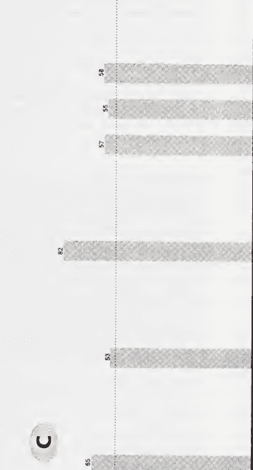

个体学生标准化测试表现的计算机准备叙述报告示例。该报告旨在寄回家给家长。

六年级对应子测试的 4.9。构建年级当量的不同技术会造成重叠程度的差异。如果发生这种情况，结果将显示出年轻人随着年级的进展而成长的虚假不规则模式。

## 3. 为学校提供的服务质量。

测试出版商在为使用其产品的学校提供技术支持和解释服务方面存在差异。一些出版商出售产品和某些标准服务（如为学区汇总测试结果的计算机打印输出），但不提供能够就学校的具体问题或甚至如何总体解释其结果为学校提供建议的专业顾问。计划购买调查电池的学校官员应与出版商的销售代表充分探讨随测试电池提供的技术支持服务的性质和成本。

## 非标准化成就测试

## 缺点

如果测试未标准化，其出版商可能没有广泛尝试评估材料。很可能出版商没有收集基于学生的数据来支持测试的质量（即，几乎没有或没有分数有效性和可靠性的实证证据）。没有实证数据，很难改进评估或验证其预期目的是否确实实现。然而，许多这类评估被教师购买并使用。

这些未经实证记录的测试可能是好的测试，但由于没有文件记录，您无法确定。正如您在第 3 章中所读到的，有效性不应是信仰问题：它应基于多种实证数据的支持。不幸的是，许多学校官员不了解评估验证的原则并购买此类评估，因此这些出版商得以继续经营，而孩子们却受苦。

## 教科书基础测试

吸引力 教材教师版通常在章节末尾或书籍末尾有评估任务。一些课程材料在学习材料中内置了评估任务；另一些则有单独的测试供复印或复制。这些评估程序对教师有吸引力的原因有两个：（a）如果您严格遵循教科书，测试的主题似乎与您教授的内容非常匹配；以及（b）它们似乎减轻了您创建高质量评估的责任。从出版商的角度来看，在课程材料中添加测试通常是营销工具：使课程材料对教师有吸引力会增加被采用的可能性。

缺点 随课程材料提供的评估的质量通常很差。出版商很少使用试验数据来改进这些评估材料。当评估任务是表现任务时，尝试评估材料以改进目的尤为重要，因为措辞强烈影响学生对任务的解释，并且评分量规需要使用实际学生反应进行完善。此外，教材系列作者很少精通评估开发。出版商的编辑人员不会使用本书第 7 章至第 12 章中发现的清单等来从技术评估角度编辑任务。有时问题的标准答案是错误的或与课程材料中的内容矛盾。以下是示例。

## 示例

教师对随教材附带的测试过度信任的示例
鲍勃的父母帮助他为社会研究测试学习。第二天他在课堂上参加了测试。几天后他在老师批改后带回家。当他的父母回顾时，他们发现两道题被标记为错误，尽管鲍勃给出了正确答案。教师的答案键与书中所述相矛盾。当指出这两项的错误时，老师坚持说这种矛盾是不可能的，因为教科书出版商印刷了测试！不要效仿这位老师的例子。

通常这些评估材料上的问题侧重于低水平的认知技能，如回忆事实和定义。尽管存在这些缺陷，许多教师仍对这些测试抱有不当的信任，并用它们对学生学习进展做出重要的日常决策。第 5 章解释了为什么如果您使用这些低质量的评估材料，您就没有履行自己的专业责任。

## 该怎么做

当您的课程材料包含有吸引力的评估任务时，您该怎么办？首先，不要盲目接受其质量，无论其余课程材料多么好。仔细查看嵌入式或“家庭作业”类型的练习，确保它们评估的是学生学习的有价值的东西，答案是正确的，并且任务完全符合您所在州的标准和您学区的重要学习目标。其次，做好失望的准备：您可能需要自己重写这些练习。
第三，仔细审查随材料附带的任何测试或测验。您使用测试和测验的分数来确定学生的成绩，因此您希望这些评估具有高质量。审查每道题的正确性、重要性以及与标准和学习目标的匹配度。使用第 7 章至第 12 章中的清单来帮助您编辑题目，必要时对其进行修改。当您在课堂上使用这些题目时，审查学生对它们的反应，以帮助您发现缺陷并纠正它们（参见第 14 章）。教师应以小组形式共同审查和改进随课程材料附带的评估材料。这可以一点一点地进行，持续两到三年。

## 州强制测试

各州要求学生参加官方州强制评估已变得司空见惯。州强制测试在侧重点、构成和质量方面差异很大。大多数州评估以问责制为重点。问责制可能在学区、学校建筑或学生层面。学区或学校层面如果成绩不随时间改善可能会产生严重后果。在某些州，未能改善的学校可能被州任命的团队“接管”。在某些州，教师可能会获得奖励或提供财政援助以帮助补救表现不佳的学生。当学区或建筑物承担问责时，测试仅在特定年级进行，例如 4、8 和 11 或 3、5 和 10。在此类项目中，个人学生通常不会收到其结果；或者如果收到，也很少对其采取行动，因为结果对个人而言可靠性不高。因此，测试对学校可能是高风险测试，但对学生而言是低风险测试。

一些州要求个人学生问责制。这通常以毕业测试的形式出现。测试可能涵盖基本技能或更具挑战性，具体取决于州。通常在 9 年级或 10 年级进行基本技能毕业测试，以便成绩低的学生可以提前收到警告并进入补救项目以提高技能。毕业测试对学生而言是高风险的。

州评估通常基于州的课程框架或标准。全国性运动“目标 2000”增加了各州制定或采用标准并制定相应评估的压力。2 趋势是制定对学生具有挑战性的标准，而不是将其限制在最低能力或基本技能。

州评估通常由在州合同下专有机构构建和标记。不同州尝试了不同的安排。一些州只是采用了我们刚刚讨论的标准化测试之一。测试出版商响应州的征求建议书提交投标。通常，中标的出版商使用调查电池的安全形式（它与未安全形式平行）并用额外的测试项目补充电池，这些项目与原始电池未涵盖的州标准相匹配。

其他州与测试出版商签订合同，开发与标准相匹配的定制测试。承包商可能被要求开发基本技能或更具挑战性的评估。

评估。各州尝试了大规模表现评估和作品集，成功程度不一。后者开发成本高；管理耗时；评分成本高；并且难以制定高技术标准的可信度、有效性和逐年可比性。一些州坚持并取得了良好效果，但许多州又回到了选择题测试或选择题测试与少量表现评估和写作评估混合的形式。

州评估项目通常由州立法机构和州长发起和终止。真实性和表现评估通常被视为需要学生表达其意见、价值观和个人创造力的激进改革。保守团体可能认为这些对学生不合适。他们可能坚持学生应为具有挑战性的标准承担责任，这些标准不需要学生学习“自由主义”价值观和思想。政治上自由的人可能希望学生超越常规思考，阅读和评估挑战传统价值观的材料——或质疑政府、权威或既定宗教。这一方可能将评估视为改革教育实践以及课程的机会。您可以在名为《教育周刊》的周刊上阅读有关州评估项目及其争议的信息（www.educationweek.com）。

作为教师，您无疑会发现自己处于有争议的州评估环境中。立法者倾向于将教育系统的问题归咎于教师（但很少给他们应有的赞誉）。您将被要求实施并参与您所在州的评估项目。

您在本本书中学到的原则可以应用于州评估。您可能需要使用这些原则为您所在州的评估辩护。您也可能希望使用它们提出建设性批评。附录 A、B 和 C 中的原则也应适用。

您通常可以通过其教育部门网站了解您所在州的评估项目。您可以通过美国教育部国家教育统计中心（www.ed.gov/Programs/bastmp/SEA.htm）找到链接到每个州教育部门的链接。个别学校网站（如果存在）可以通过搜索学校名称和位置找到。

共识是，希望改变课堂实践的州评估项目必须非常强调教师发展，因为仅靠评估项目并不能改善学校（Linn & Baker, 1997；McDonnell, 1997；Smith, 1997）。此外，由于财务限制、时间压力、技术限制和政治压力造成的妥协通常意味着州评估的原始计划需要缩减。这可能导致未能实施关键组成部分，例如改善课堂评估实践、使用表现评估或未能实施适当的教师发展项目。


## 标准化测验结果的适当用途

### 课堂内用途

如何使用标准化测验结果？以下是一些课堂内使用测验结果的建议（Hieronymus, 1976）：

- 1. 描述每位学生的教育发展水平。利用你对学生差异的了解来修改或调整教学，以适应个别学生的需求。
- 2. 描述学生在具体方面的定性优势和劣势。这些优势因课程领域而异。利用这些信息来弥补不足并发挥优势。
- 3. 描述学生已达到多大程度地掌握了继续学习新知识或高级学习所需的先决条件。将这些结果与学生的课堂表现相结合，为安置做出建议。
- 4. 描述学生之间的共同点。利用这些信息对学生进行分组，以便更有效地进行教学。
- 5. 描述学生对具体学习目标的掌握情况。利用学生对题目群的表现来做出即时的教学调整。
- 6. 为学生提供关于对他们期望的种类和水平表现的操作性描述。与学生讨论这些期望以及你如何与他们合作来实现这些期望。
- 7. 为学生和家长提供关于学生学习目标进展的反馈。利用这些信息制定家庭与学校共同合作的计划。

调查测验衡量的是广泛的、长期的教育目标，而非即时的学习成果。例如，一个学生可能需要一整年才能学会足够好的阅读，以便在调查测验上显示出进步的迹象。与此同时，该学生可能已经学会了许多具体的技能和阅读策略。学生在你对这些即时学习目标的课堂评估中可能表现良好。

规范参照的调查信息不太可能为你设计个别学生的日常或每周教学计划提供所需的精细细节。你自己制定的评估程序提供的是关于学生在更具体领域表现的信息。对于日常或每周的教学计划而言，它们可能比普通的调查测验更有用。然而，调查测验的结果可以帮助你为一年或一学期做计划。

标准化测验通常在秋季进行，此时你已经组织好班级，答题纸被送去评分。等你收到学生的结果时，已经过去了数周的教学时间。这种情况不利于将标准化测验用于即时的教学决策。但这并不意味着你应该忽视结果，如果结果表明需要调整，就拒绝修改你的教学计划。春季施测的测验结果将帮助你规划秋季的教学。

标准化测验结果的另一种用途是证实或佐证你对学生一般教育发展的判断。必须认识到，关于学生的任何单一信息来源都不是完全有效的——无论是你的观察、你开发的评估结果，还是标准化测验的结果。标准化测验可以提供额外的信息，可能提醒你需要进一步考虑某位学生。

### 课堂外用途

标准化调查测验对于课堂外目的也很有用。以下是这些外部使用测验结果的方式（Hieronymus, 1976）。

- 1. 一个群体（班级、学校建筑或学区）的平均分数有助于学校官员做出关于所需课程或教学改变的决定。如果学校官员认为测验与当地社区的目标相关且重要，则结果提供了重要的一条信息。
- 2. 结果有助于教育评估者比较不同教学方法的相对有效性，并描述影响其有效性的一些因素。
- 3. 它们有助于教育研究者描述教育创新或实验的相对有效性。
- 4. 测验结果还有助于学区总监向学校董事会和其他利益相关者描述当地教育事业的相对有效性。然而，学校董事会成员应该认识到，没有任何单一工具能够解释影响特定社区学生学习的所有因素。

所有这些目的都以某种方式与问责制相关。但如果所使用的评估工具与课堂上发生的事情不对应，问责制就难以确定。此外，当学校官员过度强调标准化测验时，压力可能会侵入你的课堂实践。作为结果，你可能会认为让学生“通过测验”比教授更广泛课程框架中定义的重要能力更重要。这种不幸的态度最终会导致课程以不良方式狭窄化，例如只教授会出现在测验上的内容，而不教授不会出现在测验上的内容。

## 标准化测验结果的不当用途

### 对标准化测验的批评

对常模参照标准化成就测验的批评非常普遍。一些批评者认为，商业化、外部的、常模参照的、总结性的和/或量化的教育成果测量工具的想法是令人厌恶和荒谬的。当然，任何评估程序——无论是标准化的还是非标准化的，常模参照的还是标准参照的，形成性的还是总结性的，外部的还是教师自制的，定性的还是定量的——都可能被误用。而且，其中许多误用并非源于某项特定标准化测验本身固有的东西，而是源于人们对某些评估所做的无效主张，或评估被使用的不道德方式。在本教材中，我们讨论了适当的使用并强调了验证对评估所做主张的必要性。你必须在实施和解释所有评估程序时运用专业判断。《教育测量专业责任守则》（附录 C）和《教育公平测验实践守则》（附录 B）描述了你对标准化成就测验的责任。

表 16.2 总结了对标准化调查成就测验电池的众多批评中的一些。如表所示，批评可能集中在测验的某些内在特征，如其内容覆盖面；测验之外的某些东西，如其未能测试某些学生特征；或测验结果的误用，如不恰当地对学生进行分类或贴标签。

Airasian（1979）讨论了这三个批评领域中的几个方面：

- 1. 批评者经常使用来自三个领域中多于一个领域的论据来描述对测验的 perceived 误用。例如，他们可能会说测验（a）只测量了课堂上教授内容的一小部分（内在特征），（b）没有测量教育项目的真正目标（未测量的特征），并且（c）促进了学校课程或教师重点的不 desirable 变化（测验结果的误用）。
- 2. 一些批评是矛盾的。同一测验可能因其重点过于狭窄而受到某些人的批评，同时因其分数受过于广泛的人类特征影响而受到其他人的批评。
- 3. 许多批评是可以克服的。你可以通过按测验的预期方式使用测验或选择另一项更合适的测验来克服许多问题。
- 4. 不能期望单一测验测量“完整的人”。人类特征过于丰富和多样，无法由任何单一评估来评估。此外，是否应由学区定期评估某些人类特征（如兴趣、态度、价值观、情绪状态等）仍是一个开放性问题。
- 5. 对测验的批评可能与对测验的误用不同。教育工作者可以批评测验没有测量某个学生特征（例如，对某人的感受），但这种失败可能不是误用。有时，测量该特征（对某人的感受）可能是误用（因为侵犯了学生的隐私）。（参见第 5 章和附录 C 了解有关评估的专业责任。）

### 误用

你应始终努力以有效、专业的方式使用成就评估的结果——无论是调查电池、表现评估还是真实任务。你在职业生涯中会被诱惑犯下的“致命错误”之一是

表 16.2 标准化、常模参照和调查成就测验批评的三个类别示例。

| 类别 | 批评 |
|---|---|
| A. 针对测验内在特征的批评： | 1. 测验假设每个人都重视所测技能。<br>2. 测验假设存在同质文化和/或共同课程。<br>3. 测验有偏见，偏爱白人、中产阶级学生。<br>4. 测验假设大约一半的学生低于平均水平。<br>5. 测验过于 impersonal、模糊、 undemocratic 和/或 irrelevant。<br>6. 测验只涵盖学校试图实现的目标的一小部分。<br>7. 测验是对学校 specifically 学习行为的无效测量。 |
| B. 针对测验未测量的特征的批评： | 1. 测验不是诊断性的。<br>2. 测验没有测量创新教学项目的目标。<br>3. 测验没有测量创造力、兴趣、主动性和/或价值观。<br>4. 测验比较学生而不是测量个人的学习。 |
| C. 针对使用测验影响的批评： | 1. 儿童被“贴标签”（或“贴错标签”）。<br>2. 测验使用改变了学校课程，鼓励为测验而教。<br>3. 测验导致学习者之间产生竞争。<br>4. 测验引起恐惧。 |

来源：改编自 P. W. Airasian 的“A Perspective on the Uses and Misuses of Standardized Tests”，1979，Measurement in Education, 10(3)。版权 1979，National Council on Measurement in Education。经 NCME 许可转载。


使用单一的评估结果对学生做出重要决定。例如，你可能会想仅根据学生的考试成绩来评定学生的成绩，而忽略学生在课堂上的日常表现，或学生在考试时所处的个人情况。教师和学校管理人员以类似的方式滥用标准化测试结果。不当使用调查成就测验电池的情况在此列出。你还应注意，以这些方式使用州强制性评估也是不恰当的（Hoover, Hieronymus, Frisbie, & Dunbar, 1993b）。

出现在测试中，它们破坏了概括的能力。学校官员可以通过使用源自教育发展、儿童发展、学习以及学科领域的适当原则来制定课程框架，从而克服这种滥用。他们应选择最符合重要课程学习目标的测试，而不是反过来。

## 1. 仅根据标准化成就测试的结果将学生安置到特殊教学项目中。

特殊项目包括补救项目以及为天才和有才能的学生设立的项目。学校官员可以通过在做出这些决定时使用多种信息来克服这种滥用。他们应包括学生的日常课堂表现、教师的评估，以及除调查成就测验电池之外的其他评估结果。

## 2. 仅根据标准化测试的结果让学生留级。

首先，你应认识到让学生留级是一个非常开放的教育问题，而且在低年级普遍实行的留级做法往往对学生没有帮助（Karweit & Wasik, 1992）。其次，你对学生的日常观察、教学和评估是学校官员在做出此决定时应使用的最相关类型的信息。第三，家长拥有学校官员和教师所不具备的关于孩子的知识。虽然标准化成就测试分数可能对这种类型的决定产生一定影响，但其重要性在最终决定中应占很小权重。

## 3. 仅根据标准化成就测试的结果来评判整个学校项目的质量。

学校项目很复杂。它们教授的不仅仅是标准化测试所评估的内容。你也知道，即使在测试评估的课程领域内，测试所评估的内容与课程框架中的所有教学目标之间也没有完美的匹配。（表18.1列出了在使用调查测验分数进行课程评估时应考虑的许多学校和社区因素。）学校官员可以通过将项目评估决定置于更广泛的完整课程框架以及学校和社区因素的完整背景中来克服滥用。

## 4. 使用调查成就测验电池为教师在特定年级应教授的具体内容制定规定。

你知道测试只抽样了学生可能被要求执行的大量任务。虽然测试任务很重要，但每个任务本身并不是目的。因为这些任务是从这个更大领域中抽取的样本，所以它们使你能够在此基础上进行概括，以估计学生在该领域上的表现。如果学校官员操纵样本或试图主要将课程领域限制在测试中出现的样本上，他们就破坏了概括的能力。

## 5. 将学生的评估结果不佳归因于单一原因。

有时教师或学校管理人员会将学生的评估结果解释为完全是学生自身缺点的结果，而非多种相互作用条件的结果。学生的评估结果不佳可能确实反映了先前教学的质量、学生家庭环境的特点，或其他个人经历。

## 6. 学校官员或家长试图在班级在标准化测试中表现不佳时指责教师。

在某人能够将班级测试成绩的上升（或下降）完全归因于某位特定教师之前，那个人必须考虑每种因素如何影响成绩：测试的内容是否与课堂上所教授内容的广度和重点相匹配？今年班级的学生整体上是否比过去的班级（或分配给其他教师的班级）具有更好或更差的一般学校适应能力？本班（或其他班）的学生在测试中是否被教过答案或以其他方式获得了不公平的优势？去年的教师是否做得异常好（或差），并且这种影响延续到了今年？哪些家庭因素影响了学生的成功（或缺乏成功）？学校校长（或其他教学领导者）是否促进或阻碍了教师的教学或学生的学习？你大概还能列出其他在试图找出班级测试结果原因时需要考虑的因素。与汽车制造商或比萨店老板不同，学校和教师对其原材料及其必须运作的条件相对控制力很小（Feldt, 1976）。

## 多层级调查测验电池

市场上有多套成就调查测验电池可供选择。（《心理测量年鉴》的每版都列出了数十种不同的测试。）这里按字母顺序列出了使用最广泛的电池。它们涵盖的年级范围在括号中注明。

- California Achievement Tests (K–12)
- Comprehensive Assessment Program Achievement Series (K–12)
- Comprehensive Tests of Basic Skills TerraNova (K–12)
- Iowa Tests of Basic Skills (K–9)
- Iowa Tests of Educational Development (9–12)
- Metropolitan Achievement Test (K–12)
- Peabody Individual Achievement Test (K–adult)
- Sequential Test of Educational Progress (K–12)
- SRA Achievement Series (K–12)
- Stanford Achievement Test Series (K–12)
- STS Educational Development Series (2–12)
- Tests of Achievement and Proficiency (9–12)
- The 3-Rs Test (K–12)
- Wide Range Achievement Test (K–adult)

这些都是团体施测的测试，除了 Peabody 和 Wide Range 是个别施测的。出版商列在附录 K 和 L。有关每套电池的详细信息可从出版商的目录和网站获得。批判性评论可在《心理测量年鉴》、Test Critiques 和第 18 章中确定的其他来源中找到。

## 团体施测调查测验电池

团体施测调查测验电池有多个分测验，每个分测验评估不同的课程领域。虽然每种多层级调查测验电池强调不同的内容和技能，但表 16.1 显示了每种电池通常测量的领域。会为多个（通常为六到八个）领域提供单独分数；不同出版商可能对某个领域有不同的名称。

## 个别施测调查测验

个别施测的成就测验电池通常用于有特殊需求的学生，例如在团体环境中难以参加评估的残疾学生。无法在团体中评估的学生通常可以在个别会谈中得到有效评估，在此评估管理员可以提供他们需要的特殊便利，并能建立团体中无法实现的更大程度的融洽关系。（参见第 5 章，第 82 页，了解修改测试的方法示例。）

有时个别成就测验电池被用作“筛查”测试，以识别有学习困难的学生，或作为学校心理学家进行一般心理评估时进行的更广泛的个别评估系列的一部分。学区可能会使用个别成就调查测验电池来评估新转入学生的一般教育发展，或在对特定学生的结果提出质疑时作为先前施测的团体调查测试的双重检查。由于个别评估的内容和常模与团体测试不同，因此在进行双重检查时应非常谨慎。你可以预期学生在这两种类型测试中的结果仅能大致对应。

两种常用的个别调查成就测试是 Wide Range Achievement Test (WRAT) 和 Peabody Individual Achievement Test (PIAT)。这些单一工具包含跨越许多年龄或年级的题目（本质上是 5 岁至成人）。因此，它们本身包含与特定年龄或年级水平相关联的题目非常少。此类测试没有像具有每个年龄或年级水平单独分级的团体调查测试那样深入的覆盖面。这并不一定是对这些测试的批评。这些广范围测试可快速评估学生在几个基本课程领域中的优势。这种快速获得的评估有助于教师确定需要更深入诊断跟进的相对薄弱领域。

PIAT 的题目印在小型画架上。学生不会对选择题写出答案；他们只需说出或指出选项即可。在每个分测验中，题目按难度顺序排列。学生不会做每道题；根据学生正确答题和错误的模式，会确定一个起点（称为基线水平）和一个终点（称为天花板水平）。

## 使用结果来规划教学

表 16.3 概述了在规划课堂教学中使用调查测验电池信息的建议。其他审阅测试分数的程序见第 17 章。你应在此时候审阅这些内容。

## 选择标准化测试

## 调查成就测验电池选择

如前所述，你必须逐一检查和审阅每项测试，以决定其是否适合你的学校。在选择小学调查测验电池之前，学校官员应牢记以下建议（Gronlund, 1976）：

- 1. 调查测验电池仅衡量小学期望成果的一部分。使用额外的评估程序来评估其他成果。
- 2. 社会研究和科学等学科中的具体内容可能很快过时。旨在衡量广泛认知技能或教育发展水平的测试过时得较慢。
- 3. 衡量广泛认知技能或教育发展水平的测试需要由教师编制或标准化的具体内容测试来补充。
- 4. 每套电池的内容和行为侧重点不同；每套都附带各种解释辅助工具。在决定购买之前应仔细检查一套测验电池。

由于高中课程差异很大，因此为这一教育水平选择调查测验电池很困难。在这一水平选择测试需要对学校的课程主要侧重点和理念有完全了解。在选择高中测试电池之前，学校官员应牢记以下几点（Gronlund, 1976）：


## 补充你的州评估

如果你的州要求进行自己的评估，在选择已出版的标准化学科测试之前，你需要先考虑其覆盖范围。大多数州评估的主要目的是问责制。已出版的标准化学科测试并非如此，其主要用途是

## 单科测试的用途

如果你在单一学科领域教学，例如代数 I 或 19 世纪英语文学，你可能有兴趣评估学生在该学科的掌握程度。分级测试通常不适用于此类课程，因为它们跨越多个年级且题目相对较少，因此缺乏对特定课程的内容相关性。对于大多数目的而言，教师自制的学科测试最为合适：它最接近课程内容，并且包含你期望的重点。

单科或课程测试被发现对于以下用途最有用：预测试以确定进入课程的学生一般背景；大学课程的提前修读；免修必修或入门课程；奖励特定学科一般知识的竞赛和奖学金项目；以及为通过独立学习、工作经验或其他非传统教育方式获得的知识授予大学学分。许多特定学科的测试都列在《心理测量年鉴》中。

## 如何施测标准化测试

你肯定会被要求对学生进行标准化评估，很可能每年一次或多次。这些评估可能是标准化成就测试、表现性评估，或由你所在州教育部门强制要求的评估。你学生的结果有效性在很大程度上取决于你是否很好地遵循了教师用书中规定的标准化程序。

## 为标准化测试做好准备的正确方法

有两项重要的评估施测领域是你可以直接控制的，并且直接影响学生结果的有效性。一个领域是你如何为评估做好准备以及如何让学生做好准备。无论是表现型还是选择题格式的标准化评估，都要求学生了解 (a) 他们将被评估这一事实，(b) 他们将被评估的内容，(c) 评估的原因，以及 (d) 他们的结果将如何使用。学生应做好充分准备以发挥最佳水平。你也必须做好施测准备，甚至可能需要批改评估。这意味着你必须熟悉评估程序和材料，准备好评估环境以便进行有效评估，了解如何施测评估——包括你被允许对学生说什么——以及如何为学生做好评估准备。

## 施测标准化测试的正确方法

第二个你需要表现良好的领域是实际施测评估。有效评估结果将取决于你在施测阶段履行职责的程度。你需要严格按照手册中规定的程序执行：否则，评估结果将无法在学生之间进行比较，且常模将无法使用。此外，你需要监督学生，以确保他们遵循指示、以正确方式标记答案，并以其他方式专注于任务。表 16.4 是你在施测标准化评估时必须做的事情清单，以避免降低其有效性。

表 16.4 对学生施测标准化评估程序的清单。

评估日期之前
1. 制定评估时间表，包括每个需要施测的组成部分的日期和时间。
2. 与学生讨论即将进行的评估。
a. 解释评估的目的。
b. 解释他们将做什么。
c. 解释他们何时以及如何收到结果。
d. 解释结果将如何使用。
3. 熟悉评估程序和施测说明。 （自己练习做该评估。）
4. 如果需要监考人员，安排并培训他们。
5. 确保所有评估材料都已准备好，学生有铅笔和其他必要工具，并且有草稿纸和其他材料可用。
6. 对房间进行必要的物理调整。
7. 做一个写着“正在评估。请勿打扰我们！”的标志。在评估期间使用该标志。

评估期间
1. 严格按照说明手册中的指示执行。
2. 监督学生，确保他们在正确的页面和活动上工作，并正确记录他们的反应。
3. 监督在场的任何监考人员的工作。
4. 记录任何异常情况的笔记，无论是针对个别学生还是整个群体。

来源：H. D. Hoover, A. N. Hieronymus, D. A. Frisbie, and S. B. Dunbar, 1993a. Copyright © 1993 by The University of Iowa. All rights reserved. Adapted from the Iowa Tests of Basic Skills, Directions for Administration, Forms K and L, Levels 9–14, p. 15, with permission of The Riverside Publishing Company.


## 标准化学业测验中学生的道德与不道德练习

在学生参加标准化测评之前应给予何种类型的练习，这是一个你需要回答的重要问题。教育工作者对于什么是适当的做法并不一致（Cohen & Hyman, 1991; Mehrens, 1991; Mehrens & Kaminski, 1989; Popham, 1991）。争议涉及道德的测验准备做法。如果你以不当的方式准备学生，那么其测评结果的有效性就值得怀疑。某些测评前的活动是否给你的学生带来了其他学生无法获得的不当优势？如果你的学生接受了某些类型的练习，你或其他人还能有效解释他们的分数吗？如果你教给学生某些反应或答案，你能否正确地推广他们的测评结果？

## 明显不道德的教学做法

确保有效性的指导原则之一是测评结果的推广性。参见表 3.2。即，你能否从学生所做的特定题目推断出学生在整个课程领域中的表现？如果不能，结果的有效性就很低。例如，假设社会研究某一领域有 100 个关键概念。进一步假设，与其教学生组织和理解这些概念和原理的策略，你只挑选了将出现在标准化社会研究测验上的四个概念，并只教关于这四个概念的问题的答案。假设你是一位好老师，你的学生在与这些概念相关的测验题目上会表现得非常好，他们的测验分数会更高。然而，你的学生很可能无法理解更广泛的社会研究框架，也没有办法理解和整合课程本应教授的全部概念集合。换句话说，通过将教学缩小到仅出现在特定测验上的少数任务，你未能为学生提供组织社会研究概念和原理的赋能策略。此外，你无法将他们的测验结果解释为反映他们对课程概念和原理的一般知识。通过只教授这四个概念，你使学生的测验结果无效化并损害了学生的教育。

当你评估学生时，你希望从学生的表现推广到课程框架本应培养的更大更广的能力和知识领域。特定测验或评估上的反应只是学生在学习目标所暗示的更大领域中可能表现的标志或指针。然而，如果你只对评估上的问题或任务进行特定练习，你就只将学生的学习聚焦于这少数任务。这种狭窄聚焦的教学和学习几乎不可能推广到教育真正目标的更广泛的学习目标。

## 从道德到不道德的做法范围

你可以提供各种练习活动来帮助学生提高在测评上的表现。哪些是合适的？以下是测评准备活动的有序列表，按从最合法到最不合法的顺序排列（Mehrens & Kaminski, 1989）：

- 1. 教授课程中的学习目标，而不将教学缩小到出现在标准化测评上的那些目标。
- 2. 教授一般的应试策略，例如第 14 章中讨论的那些。
- 3. 只教授那些专门与学生将参加的标准化测评上会出现目标相匹配的学习目标。
- 4. 只教授那些专门与学生将参加的标准化测评上会出现目标相匹配的学习目标，并使用与测评上会出现相同的任务格式进行练习。
- 5. 让学生对测评的已出版平行形式进行练习。
- 6. 让学生对他们稍后将参加的相同问题和任务进行练习。

大多数教育工作者会同意，第一项活动始终是道德的，因为教师的工作是教授官方课程。大多数教育工作者也会同意，第二项活动，即教学生如何应试并在其中发挥最佳水平，并不不道德。第六项活动总是被认为是不道德的，因为它将教学缩小到学生将被施测的特定测评程序，实际上消除了你从测评结果推广到课程规定的表现领域的可能性。

因此，Mehrens 和 Kaminski 指出，道德与不道德的测验准备做法之间的界限在第 3 项活动和第 5 项活动之间。他们指出，决定因素在于学校希望多大程度地推广测验结果。活动越接近第五项，学校官员就越无法将学生的测评结果推广到官方课程——除非，当然，官方课程与测评工具完全相同。学校官员必须认识到，教育的目的是提高学生的胜任力、知识、文化意识和思维技能——而不是提高测验分数。

## 两个指导原则

Popham（1991）提供了两个伦理标准，概括了前述讨论中说明的原则。你可以用它们来判断你或学校其他人是否正在适当准备学生参加标准化测评：

- 专业伦理：任何测验准备做法都不应违反教育专业的伦理标准（p. 13）。
- 教育上的可辩护性：任何测验准备做法都不应提高学生的测验分数，而同时不提高学生对所测内容领域的掌握程度。（p. 13）

## 摘要

## 测验类型和标准化调查组合

- 有多种已出版的学业测验可用。本章将它们区分为两大类：标准化、经实证记录的测验和非标准化、未经实证记录的测验。
- 标准化、经实证记录的测验包括设计用于跨越数个年级或年龄水平的分级测验，以及仅设计用于一个年级或课程的单级测验。
- 分级测验包括学业调查组合，以及特定课程领域如数学或阅读中的标准参照和/或常模参照测验。
- 单级测验衡量特定学科或课程如代数 I 或法语 II 的学业成绩。
- 描述并举例说明了团体施测和个别施测的分级学业测验的特征，并提供了解释分数和利用测验结果进行教学规划的建议。具体测验列于附录 K。
- 非标准化、未经实证记录的测验不采用来自受试样本的实证数据来改进和完善测验并记录其可靠性和有效性的程度。

## 标准化测验结果的适当用途

- 标准化学业测验可用于各种课堂内和课堂外的目的。特定标准化学业测验对这些用途的实用性取决于其与特定学校的课程相关性。

## 标准化测验结果的不当用途

- 对标准化学业测验组合的批评针对其固有属性、缺失属性，以及对学生和学校课程的影响。适当的测验选择和使用可以克服许多批评。
- 学业测验分数的误用包括（a）未能考虑测量误差的可能性，（b）仅使用单一分数作为重要决策的唯一标准，（c）不加批判地接受分数作为特质的纯粹度量，以及（d）未能认识到学生的测验表现是由复杂的一系列先前条件造成的。

## 如何施测标准化测验

- 你必须为自己和学生准备好参加标准化测评，无论该测评是纸笔测验还是表现测验。本章提供了进行这些准备的适当方式的建议。

## 标准化学业测评中学生的道德与不道德练习

- 也有不适当或不道德的准备学生参加测评的方式。本章描述了从最不合法到最不合法的测评准备活动连续体，以便你能利用该连续体评判自己的行为。

## 重要术语和概念

- Code of Fair Testing Practices in Education
- Code of Professional Responsibilities in Educational Measurement
- computer-prepared narrative reports (building report, item analysis report, profile report)
- empirically documented
- ethical test preparation practices
- external uses of test results
- generalizability of assessment results
- in-level versus out-of-level testing
- multilevel survey battery versus single-level test
- Professional Ethics Principle and Educational Defensibility Principle
- special norms
- standardized test
- state-mandated assessment
- subtest
- test level
- within-classroom uses of test results

## 练习与应用

- 1. 使用测验出版商的目录、Mental Measurements Yearbooks 以及其他资源，确定一份符合作者对已出版学业测验分类方案中每一类别的已出版测验。与你的同学分享你的发现。
- 2. 描述你所教（或计划教授）的学生、他们的社区和学科。给出具体例子说明在该情境中你可能以以下每种方式误用学业测验结果。与课程中的其他人分享你的发现。
  - a. 在解释学生分数时未能考虑测量误差。
  - b. 仅使用测验结果对学生做出决定。
  - c. 不加批判地将学生的分数解释为衡量纯粹特质。
  - d. 未能考虑导致特定学生测验表现的复杂原因。
- 3. 使用 Popham 的两个伦理原则评估以下每种标准化测验准备做法的适当性。
  - a. 学校使用某项测验的最新版本。教师使用学校不再施测的该测验版本来给学生特别练习。


## 解释常模参照分数

## 学习目标

学习本章后，你应达到以下目标：

## 两种参照框架

+   1. 解释为什么有必要同时使用常模参照和标准参照框架来正确理解学生的评估表现。 [3, 6, 4]
+   2. 解释各种标准参照分数的优点和缺点。 [3, 4, 6]
+   3. 解释常模参照分数的优点和缺点。 [3, 4, 6]

## 使用常模

+   4. 解释本地、全国和特殊常模群体比较的目的和用途。 [3, 4]
+   5. 应用相关性、代表性和时效性标准来评估常模数据的质量。 [3, 4]

## 常模参照分数

+   6. 在标准化测验出版商的常模表中准确查找学生的常模参照分数。 [3]
+   7. 正确向家长解释他们孩子在标准化测验中获得的常模参照分数的含义。 [6, 4]

## 正态分布

+   8. 指出一些教师和学校管理人员对学生能力、智力和成绩正态分布最常见的误解。 [6, 4, 7]

## 年级当量分数

+   9. 指出一些教师和学校管理人员对年级当量分数最常见的七个误解。 [6, 4, 7]

## 向家长解释分数

+   10. 利用你班级学生的标准化测验报告来证实你对他们的观察，识别他们的优势模式，发现可能需要补救的弱点，并了解整体群体的表现。 [3, 4]

## 重要术语和概念

+   11. 解释本章末尾列出的术语和概念如何适用于解释教育评估结果。 [6]

## 本章简介

标准化测验附带的那些分数是什么意思？这样的分数是否必要？它们之间有何关联？我们是否需要全部使用？每种的优点和缺点是什么？我该如何向学生和家长解释它们的含义？这些都是本章要回答的问题之一。

本章的组织如下。第一，我们解释解释分数的两个基本框架：标准参照和常模参照。第二，我们讨论出版商的常模。我们描述不同类型的常模，如何使用它们，以及如何评估其质量。第三，我们展示标准参照和常模参照分数不同类型的概念图，以及它们之间的关系。第四，我们解释常模参照分数的含义、使用和解释。我们讨论百分位等级、标准分数、基于正态曲线的分数和年级当量分数等。第五，我们比较常模参照分数的含义，并为你提供解释它们并向家长说明的指导方针。


## 两个参照框架

假设你做了一次拼写测试，你的分数是 45，得分方式是每个拼写正确的单词得一分。你表现得如何？仅知道你的任务是“拼写测试”并且你的分数是 45，你无法解读自己的表现。

原始分数是你对学生在一次测评中的表现所赋予的分数（分值）。你可以通过累加正确答案的数量、每个任务的评定分数，或测评各部分所授予的分数点数来获得这些分数。正如前面的拼写分数示例所示，原始分数告诉学生他/她“得了多少分”，但几乎没有说明分数的含义。

几乎所有的教育和心理测评都需要你使用某种类型的参照框架来解读学生的表现。参照框架是你用来将学生的表现与测评本身之外的某物进行比较的结构。外部框架增强了你对学生测评结果的解读。

## 规范参照框架

规范参照 你使用规范参照框架来通过将学生的测评表现与已明确界定的、参加过相同测评的其他学生群体的表现进行比较来解读学生的测评表现。已明确界定的其他学生群体称为规范群体。要做出有效的规范参照解读，规范群体中的所有人都必须在相同的条件下接受过与你的学生相同的测评（相同的时限、指导、设备和材料等）。这就是为什么当你想通过规范参照框架来解读标准化成就测验的结果时，必须严格按照施测说明进行施测的原因。

要理解规范参照解读，让我们回到你在拼写测试上的分数。假设你的原始分数 45 意味着你的百分位等级（PR）是 99——也就是说，参加拼写测试的人中有 99% 的人得分低于 45。在你为自己祝贺之前，你应该确定你的原始分数所参照的规范群体中包含谁。如果你知道规范群体由三年级学生组成，与知道规范群体由成年人组成相比，你对自己表现的解读会有所不同。

规范参照解读的有效性 当规范群体界定不清时，你的规范参照解读的有效性会降低。你对规范群体中包含的人员了解得越多，你就能越好地在规范参照框架中解读学生的表现。例如，考虑解读你在拼写测试上的表现时，规范群体是一般成年人，与规范群体是赢得全国拼写比赛奖项的成年人之间的差异。

规范参照分数 推导分数使规范参照解读变得更容易。现今对大多数出版的教育测验常规报告的推导分数集大致如下：

- 1. 百分位等级说明在规范群体中低于某个特定原始分数的人所占的百分比。
- 2. 线性标准分数说明某个特定原始分数相对于规范群体的平均数和标准差的位置。
- 3. 标准化标准分数说明某个特定原始分数相对于拟合到规范群体的正态分布的位置。
- 4. 年级当量分数说明某个特定原始分数对规范群体而言是平均值的年级安置。

## 准则参照框架

超越规范参照 规范参照不足以完全解读你的分数：你可能比其他人拼写更好——无论他们是谁——但你能拼写什么？至少，你需要知道拼写测试中选词的词库种类、选词数量以及选词过程。它们真的是单词，还是无意义的音节？它们是英语单词吗？它们是从最难（或最易）的英语单词列表中挑选的吗？测试有 45 个词还是 500 个词？测试中的词是否代表某个更大的类别或领域？拼写这些词是否要求你使用某些心理过程或应用某些拼写规则？

当你需要对学生的测评表现做出绝对解读时，这些问题尤其重要——例如，当你需要知道学生具体在哪些学习目标上遇到困难时。规范参照提供信息来帮助你对分数进行相对解读，但经常这些是不够的。例如，反映相对成就的分数，如名次顺序，可能有助于挑选最好的读者，或将班级分为较好、良好和较差的读者。然而，为了规划适当的教学，最终你需要知道每个学生的具体阅读技能以及每个学生遇到的特定类型的困难。当你的诊断和处方基于学生的错误模式，或基于你对他们错误推理或思维过程的分析，如第 13 章所述时，你必须放弃规范参照框架并使用准则参照框架。

准则参照 你使用准则参照框架来推断学生在某个领域中能够做出的表现类型，而非学生在规范群体中的相对地位。你将学生的测评结果参照的该表现领域称为准则。当你教学时，最感兴趣的准则就是由你所在州的标准、你的课程框架和你的课程学习目标所暗示的表现领域。

### 准则参照解读的有效性

当你希望推断学生状态的所指表现领域界定不清，或当你的测评是该领域的一个较差样本时，你的准则参照测评解读会失去有效性。你对测评任务所抽样的领域了解得越多，你就能越有效地区解读其结果。例如，如果你没有使用明确界定的学习目标陈述来构建你的测评，或如果你的测评未能充分代表由明确界定的学习目标集所暗示的广泛表现范围，那么你对准则参照解读就只有薄弱的基础。

通过再次回顾拼写示例，你可以很容易地看出原因。假设你知道拼写领域是最常被拼错的 10,000 个英语单词，并且测评被构建为 100 个词的样本，代表该领域中的拼写模式。在这种情况下，你可以将你在 100 词测评上的 45 分解读为你知道这 10,000 个词中大约比例的估计。你可以看到，如果测评只有 50 个词，你的估计就不如有 100 个词时准确。10 个词的样本就更不准确了。此外，如果这 100 个词没有代表性地抽样该领域，即使有 100 个词，你的估计也会不那么准确。例如，这 100 个词可能只包含规则的拼写模式而忽略其他模式。因此，测评上的题目数量以及它们代表该领域的程度都[content]

## 两个参照框架

假设你做了一次拼写测试，你的分数是 45，得分方式是每个拼写正确的单词得一分。你表现得如何？仅知道你的任务是“拼写测试”并且你的分数是 45，你无法解读自己的表现。

原始分数是你对学生在一次测评中的表现所赋予的分数（分值）。你可以通过累加正确答案的数量、每个任务的评定分数，或测评各部分所授予的分数点数来获得这些分数。正如前面的拼写分数示例所示，原始分数告诉学生他/她“得了多少分”，但几乎没有说明分数的含义。

几乎所有的教育和心理测评都需要你使用某种类型的参照框架来解读学生的表现。参照框架是你用来将学生的表现与测评本身之外的某物进行比较的结构。外部框架增强了你对学生测评结果的解读。

## 规范参照框架

规范参照 你使用规范参照框架来通过将学生的测评表现与已明确界定的、参加过相同测评的其他学生群体的表现进行比较来解读学生的测评表现。已明确界定的其他学生群体称为规范群体。要做出有效的规范参照解读，规范群体中的所有人都必须在相同的条件下接受过与你的学生相同的测评（相同的时限、指导、设备和材料等）。这就是为什么当你想通过规范参照框架来解读标准化成就测验的结果时，必须严格按照施测说明进行施测的原因。

要理解规范参照解读，让我们回到你在拼写测试上的分数。假设你的原始分数 45 意味着你的百分位等级（PR）是 99——也就是说，参加拼写测试的人中有 99% 的人得分低于 45。在你为自己祝贺之前，你应该确定你的原始分数所参照的规范群体中包含谁。如果你知道规范群体由三年级学生组成，与知道规范群体由成年人组成相比，你对自己表现的解读会有所不同。

规范参照解读的有效性 当规范群体界定不清时，你的规范参照解读的有效性会降低。你对规范群体中包含的人员了解得越多，你就能越好地在规范参照框架中解读学生的表现。例如，考虑解读你在拼写测试上的表现时，规范群体是一般成年人，与规范群体是赢得全国拼写比赛奖项的成年人之间的差异。

规范参照分数 推导分数使规范参照解读变得更容易。现今对大多数出版的教育测验常规报告的推导分数集大致如下：

- 1. 百分位等级说明在规范群体中低于某个特定原始分数的人所占的百分比。
- 2. 线性标准分数说明某个特定原始分数相对于规范群体的平均数和标准差的位置。
- 3. 标准化标准分数说明某个特定原始分数相对于拟合到规范群体的正态分布的位置。
- 4. 年级当量分数说明某个特定原始分数对规范群体而言是平均值的年级安置。

## 准则参照框架

超越规范参照 规范参照不足以完全解读你的分数：你可能比其他人拼写更好——无论他们是谁——但你能拼写什么？至少，你需要知道拼写测试中选词的词库种类、选词数量以及选词过程。它们真的是单词，还是无意义的音节？它们是英语单词吗？它们是从最难（或最易）的英语单词列表中挑选的吗？测试有 45 个词还是 500 个词？测试中的词是否代表某个更大的类别或领域？拼写这些词是否要求你使用某些心理过程或应用某些拼写规则？

这些问题在你需要对学生的测评表现做出绝对解读时尤其重要——例如，当你需要知道学生具体在哪些学习目标上遇到困难时。规范参照提供信息来帮助你对分数进行相对解读，但经常这些是不够的。反映相对成就的分数，如名次顺序，例如，可能有助于挑选最好的读者，或将班级分为较好、良好和较差的读者。然而，为了规划适当的教学，最终你需要知道每个学生的具体阅读技能以及每个学生遇到的特定类型的困难。当你的诊断和处方基于学生的错误模式或基于你对他们错误推理或思维过程的分析，如第 13 章所述时，你必须放弃规范参照框架并使用准则参照框架。

准则参照 你使用准则参照框架来推断学生在某个领域中能够做出的表现类型，而非学生在规范群体中的相对地位。你将学生的测评结果参照的该表现领域称为准则。当你教学时，最感兴趣的准则就是由你所在州的标准、你的课程框架和你的课程学习目标所暗示的表现领域。

### 准则参照解读的有效性

你的准则参照测评解读在你希望推断学生状态的所指表现领域界定不清，或当你的测评是该领域的一个较差样本时，会失去有效性。你对测评任务所抽样的领域了解得越多，你就能越有效地区解读其结果。例如，如果你没有使用明确界定的学习目标陈述来构建你的测评，或如果你的测评未能充分代表由明确界定的学习目标集所暗示的广泛表现范围，那么你对准则参照解读就只有薄弱的基础。

你可以通过再次回顾拼写示例很容易地看出原因。假设你知道拼写领域是最常被拼错的 10,000 个英语单词，并且测评被构建为 100 个词的样本，代表该领域中的拼写模式。在这种情况下，你可以将你在 100 词测评上的 45 分解读为你知道这 10,000 个词中大约比例的估计。你可以看到，如果测评只有 50 个词，你的估计就不如有 100 个词时准确。10 个词的样本就更不准确了。此外，如果这 100 个词没有代表性地抽样该领域，即使有 100 个词，你的估计也会不那么准确。例如，这 100 个词可能只包含规则的拼写模式而忽略其他模式。因此，测评上的题目数量以及它们代表该领域的程度都对你的准则参照解读的有效性有贡献。

### 准则参照分数

准则参照测评不像规范参照测评那样具有完善的推导分数系统。然而，某些类型的分数通常与这些测评一起使用：

- 1. 百分比——说明学生获得的最大分数的比例的数字（正确百分比、掌握目标百分比等）。
- 2. 表现速度——学生完成任务所需的时间，或在固定时间内完成的任务数量（每分钟打字 40 个词，5 分钟跑一英里，1 分钟内正确完成 25 道数算事实等）。
- 3. 质量评定——学生表现的质量水平（“优秀”，评级“5”，“掌握”等）。
- 4. 表现精确度——学生完成任务的准确程度（测量精确到十分之一米，称重精确到最接近一克，打字错误少于 10 个等）。

## 使用常模

## 常模的重要性

规范参照说明一个学生的表现与他人的表现相比如何。你应该意识到，仅仅将学生相互比较并不是评估他们的很好理由（Hoover et al., 1993b）。以下是评估学生的几个主要原因：

- 1. 在每个学科领域内描述学生已取得的表现。
- 2. 在每个学科领域内描述学生需要进一步改进的不足之处。
- 3. 在整个课程中描述哪些学科是学生的优势和弱点。
- 4. 在每个学科领域内描述学生在一年或多年期间所取得的教育发展（进步）量。

前两个目的最好在准则参照框架内实现。从本质上讲，这要求你仔细查看学生的表现，按项目逐项比较，并与你的学习目标进行比较。

后两个目的最好在规范参照框架内实现。例如，学生在阅读和数学方面的相对优势无法仅基于准则参照来描述。你可以描述学生在每个领域的表现，但你需要一个常模基础来断定这些是相对优势还是弱点。一位教师可能会说，例如，学生在数学方面能够解决常规的线性方程和二次方程，在阅读方面能够理解适龄故事。然而，哪一个是更强的领域？常模信息可以确定这一点。

标准化测验之所以能够描述学生在不同课程领域的相对优势和弱点，是因为它们提供了常模信息。同一组的学生在同一年级接受涵盖多个课程领域的测验。因此，如果四年级学生 Blake 在数学上排名在常模群体的前列，但在阅读上排名在常模群体的中间，我们就知道在这两个科目中，Blake 在数学上更强。

前面提到的第四个目的——衡量教育成长和发展——也需要规范参照。常模群体提供了在不同年级之间定义教育发展量表（如年级当量量表）的基础。我们每隔一年或两年评估学生一次，每次都将结果参照此发展量表。我们通过学生沿此量表的进展来衡量成长。

本章的其余部分讨论了教育评估中使用的各种规范参照分数和量表。作为教师，你不需要创建成长量表或计算量表分数。然而，你不需要创建成长量表或计算量表分数。


你将被要求对学生进行解释和使用这些量表和分数。此外，你还应向学生及其家长解释这些分数报告的含义。

## 规范组的种类

在你能够理解和使用常模参照分数之前，你需要理解常模和常模组的含义。常模组是测试手册报告表现的庞大且具有代表性的学生样本。该常模组在特定评估上的表现代表了该学生群体在该特定评估上的当前平均水平。然而，一个群体的当前平均值并不代表标准，也不确立你的学校或你的学生应达到的目标。你的州的内容和绩效标准以及你的课程的学习目标告诉你学生应取得什么成就。然而，将你的学生和学校与常模组进行比较可以帮助你决定对学生的预期表现的一般范围，前提是你的学生与常模组中的学生相似。正如你将看到的，测试出版商在报告常模参照分数时可能会提供关于数个不同群体的信息。

多常模组比较 通常情况下，一个学生属于多个群体。例如，一名14岁、八年级、有听力障碍的男孩参加了一项标准化数学概念测试，得到了32分的原始分。这可能代表以下百分位等级：

- 在全国聋哑八年级学生群体中为99。
- 在测试出版商的全国八年级标准化样本中为94。
- 在他所在本地社区的八年级学生群体中为89。
- 在他目前就读的进阶数学课程的八年级学生群体中为80。

根据你必须做出的决定，参考学生分数的多个常模组可能是合适的。例如，职业咨询决策可能要求你将学生的能力与成就概况与学生正在寻求职业信息的多个职业或职业群体进行比较。仅将此人与其他“学生群体”进行比较可能为职业探索提供的信息较少。

地方常模 对于你许多常模参照解释而言，你应比较学生的最合适的群体是地方常模组：同一学区同年级的学生群体。你和学生将与此群体互动最多。学校的测试项目中地方百分位等级或标准分数很容易编制，你的测试主管应在每次标准化测试实施时向你提供这些数据。出版商也为其客户提供此服务——不过通常需要额外费用。

全国常模 大多数常模参照的标准化成就和能力测验电池都有所谓的全国常模。原则上，全国常模组 supposed to 代表全国的学生，有些出版商为确保代表性付出了很大努力。但每个出版商对构成真正具有代表性的全国样本的定义略有不同，并且抽样过程也不同。结果是，不同出版商的常模不可比较。你应注意的是，没有任何出版商的常模样本完全反映全国的学校。学校参与出版商常模样本是自愿的。有时这会在特定出版商的常模中造成自我选择偏差，可能使常模偏向过去使用该出版商测试的学校（Baglin, 1981）。关于出版商如何获得常模样本的更详细描述见第18章。

全国常模不必仅由某一年级的一般学生组成。出版商可能会提供单独的男/女常模，或为少数群体提供单独常模。有时提供的是众数年龄常模。众数年龄常模仅包括在特定年级水平的所有学生中，年龄接近该年级最典型实际年龄的学生。

特殊常模组 对于某些测试，会形成特殊常模组。例子包括有听力或视力障碍的学生、智力障碍的学生、就读于特定课程或课程的学生，以及就读于地区学校的学生。当然，一个学生可能属于多个特殊群体。

学校平均常模 学校平均常模由全国学校样本中每个学校建筑的平均（均值）分数的汇总表组成，并提供这些平均值的相对排序信息。这种平均值的分布比单个学生分数的分布变化小得多。图17.1说明了某出版商阅读测试中这种变异性的差异。

如果你的学校校长想知道学校的三年级平均分数与其它学校建筑相比如何，那么校长需要使用学校平均常模。对于个别学生的常模，则制作单个分数的分布并将其用作常模参照的基础。但个别学生分数变化很大，以至于将学校的平均值与该群体进行比较可能导致误解。

研究以下示例，以了解你的学区可能从使用学校平均常模中获得什么。

## 图17.1 爱荷华基础技能测试阅读理解分测验，5年级，春季常模，学生分数分布与学校平均值的比较。

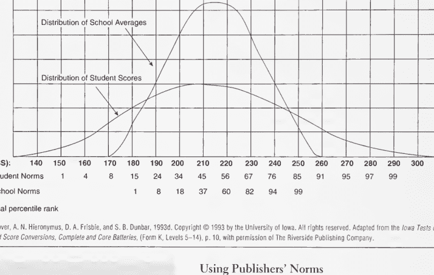

发展标准分（SS）：

140 150 160 170 180 190 200 210 220 230 240 250 260 270 280 290 300

平均SS的全国百分位等级：学生常模 1 4 8 15 24 34 45 56 67 76 85 91 95 97 99

平均SS的全国百分位等级：学校常模 1 8 18 37 60 82 94 99

注：NPR = 全国百分位等级

来源：摘自 H. D. Hoover, A. N. Hieronymus, D. A. Frisbie, and S. B. Dunbar, 1993d. Copyright © 1993 by the University of Iowa. All rights reserved. Adapted from the Iowa Tests of Basic Skills, Norms and Score Conversions, Complete and Core Batteries, (Form K, Levels 5–14), p. 10, with permission of The Riverside Publishing Company.

## 示例

使用错误的常模可能导致低估学校表现的示例。

在林肯学校，爱荷华基础技能测试（阅读理解分测验）春季五年级的发展标准分平均值为250（见图17.1）。校长在个别学生常模表中查阅了这个数字，并错误地得出学校排名高于85%的学校（个人PR = 85）。（在图17.1中，查看标记为“NPR of Avg. SS: Student Norms”的行。）实际上，学校表现更好，排名在前1%（学校平均PR = 99，“NPR of Avg. SS: School Norms”）。

一般来说，如果有人错误地使用个别分数常模且学校高于平均水平，结果会低估该学校在其他学校中的地位；那些学校低于平均水平的则会高估其在其他学校中的地位。你可以通过检查图17.1中的几个发展标准分值和百分位等级来验证这一原则。

并非所有出版商都提供学校平均常模。一些出版商说学校平均常模混合了非常小和非常大的学校。他们说混合非常不同的学校会使学校平均常模表中的数据难以正确解释。

## 使用出版商的常模

了解评估的常模时间 当学生在出版商建立常模的年份时间最接近的日期接受测试时，你可以获得学生在其常模组中地位的最准确估计。出版商通常会进行内插和外推来制定常模表：例如，他们可能会提供春季常模表，即使常模组实际上并未在春季进行测试。每个出版商的实证常模日期都不同，但出版商应在测试手册或技术报告中说明这些日期。为了准确，你的学校应在出版商实证常模期的中点日期前后两到三周内实施标准化测试。

评估常模的标准 一般公认（APA, AERA, & NCME, 1974）已发表的常模数据应满足三个R：相关性、代表性和可靠性。相关性意味着出版商提供的常模组应是你希望将学生与之比较的群体。代表性意味着常模样本必须基于精心设计的样本。测试出版商应向你提供有关用于确保代表性的子类划分（性别、年龄、社会经济水平等）的信息。请记住，样本量不如其代表性重要。（当然，如果学生总体非常庞大，具有代表性的样本必然很大。）


时效性意味着常模基于当前数据。随着课程、学校教育以及社会和经济因素的变化，学生在测试中的表现也会随之改变。此外，如果你的学校年复一年使用同一份测试形式，得分通常会提高，因为学生对格式已熟悉，教师也倾向于专门针对该测试进行准备（Linn, Graue, & Sanders, 1990; Shepard, 1990; Wiser & Lenke, 1987）。如果常模不是最近的，它们会产生误导，给人一种你的学生学习得比实际更好的印象。

## 使用常模表

测试手册包含表格——称为常模表——用于将原始分数转换为不同类型的常模参照分数。无需计算：你只需“查”一下分数。只是在引号中，因为尽管这项任务看似微不足道，但在表格中查找分数并将其抄入学生记录中，是教师似乎很难正确完成的事情。关于联邦项目评估中发现的错误类型的研究表明，使用错误的常模表和误读表格是常见问题（Crane & Bellis, 1978; Finley, 1977; Johnson & Thomas, 1979; Moyer, 1979）。本章后面提供了示例表格（第 390、396 和 405 页），并附有对特定分数的讨论，以便你练习使用表格。

## 常模参照分数概述

常模参照分数源自评估的原始分数。你应该知道存在许多类型的常模参照分数。篇幅所限，只能讨论你最常遇到的那些，它们在图 17.2 所示的概念图中有所体现。如果你有兴趣更详细地研究常模参照分数，请参阅非常易读的书籍《Test Scores and What They Mean》（Lyman, 1998）。

## 百分位等级

我们从图 17.2 中常模参照方案的最左侧分支开始。百分位等级表示在常模群体中，有百分之多少的学生得分低于所讨论的原始分数。百分位等级可能是最有用且最易理解的常模参照分数。以下为出版社常模表的示例 17.1，给出了每个原始分数的百分位等级。

在表格主体中，将从评估获得的原始分数定位到正确的列中，然后读出相应的百分位等级。例如，假设一名七年级学生 Veronica 于 10 月 23 日参加 Differential Aptitude Tests（DAT），她在机械推理部分得分为 48。她的百分位等级根据上一个示例中的常模表为 98。她在七年级女性常模群体中高于平均水平，在

图 17.2 主要分数参照方案的组织。

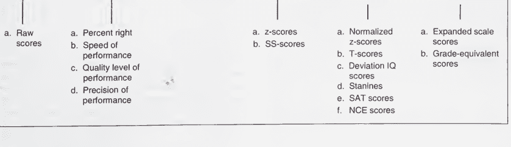

## 示例 17.1

百分位常模表示例：Differential Aptitude Tests, Level 1, Form C.

| MECHANICAL REASONING | | | | | | | | | | | |
|---|---|---|---|---|---|---|---|---|---|---|---|
| MALE | | | | FEMALE | | | | COMBINED | | | |
| Raw Score | % -ile Rank | Sta-nine | Scaled Score | Raw Score | % -ile Rank | Sta-nine | Scaled Score | Raw Score | % -ile Rank | Sta-nine | Scaled Score |
| 60 | 99 | 9 | 343 | 60 | 99 | 9 | 343 | 60 | 99 | 9 | 343 |
| 59 | 99 | 9 | 330 | 59 | 99 | 9 | 330 | 59 | 99 | 9 | 330 |
| 58 | 99 | 9 | 316 | 58 | 99 | 9 | 316 | 58 | 99 | 9 | 316 |
| 57 | 99 | 9 | 307 | 57 | 99 | 9 | 307 | 57 | 99 | 9 | 307 |
| 56 | 99 | 9 | 301 | 56 | 99 | 9 | 301 | 56 | 99 | 9 | 301 |
| 55 | 99 | 9 | 296 | 55 | 99 | 9 | 296 | 55 | 99 | 9 | 296 |
| 54 | 99 | 9 | 292 | 54 | 99 | 9 | 292 | 54 | 99 | 9 | 292 |
| 53 | 98 | 9 | 288 | 53 | 99 | 9 | 288 | 53 | 99 | 9 | 288 |
| 52 | 97 | 9 | 285 | 52 | 99 | 9 | 285 | 52 | 99 | 9 | 285 |
| 51 | 95 | 8 | 282 | 51 | 99 | 9 | 282 | 51 | 98 | 9 | 282 |
| 50 | 94 | 8 | 279 | 50 | 99 | 9 | 279 | 50 | 97 | 9 | 279 |
| 49 | 92 | 8 | 277 | 49 | 99 | 9 | 277 | 49 | 97 | 9 | 277 |
| 48 | 90 | 8 | 274 | 48 | 98 | 9 | 274 | 48 | 95 | 8 | 274 |
| 47 | 88 | 7 | 272 | 47 | 98 | 9 | 272 | 47 | ... | ... | ... |
| 46 | 85 | 7 | ... | 46 | ... | ... | ... | 46 | ... | ... | ... |
| 45 | 82 | 7 | ... | 45 | ... | ... | ... | ... | ... | ... | ... |
| 44 | 79 | ... | ... | 44 | ... | 9 | 266 | ... | ... | ... | 234 |
| ... | ... | ... | 227 | 23 | 15 | ... | ... | ... | 14 | 3 | ... |
| 19 | 6 | 2 | 226 | 22 | 14 | ... | ... | ... | 13 | 3 | 231 |
| 18 | 5 | 2 | 224 | 21 | 13 | 2 | ... | 21 | 10 | 2 | 229 |
| 17 | 4 | 2 | 222 | 20 | 12 | 2 | ... | 20 | 8 | 2 | 227 |
| 16 | 3 | 1 | 220 | 19 | 10 | 2 | 226 | 19 | 7 | 2 | 226 |
| 15 | 2 | 1 | 218 | 18 | 9 | 2 | 224 | 18 | 5 | 2 | 224 |
| 14 | 2 | 1 | 216 | 17 | 7 | 2 | 222 | 17 | 4 | 2 | 222 |
| 13 | 1 | 1 | 214 | 16 | 6 | 2 | 220 | 16 | 3 | 1 | 220 |
| 12 | 1 | 1 | 212 | 15 | 4 | 1 | 218 | 15 | 3 | 1 | 218 |
| 11 | 1 | 1 | 209 | 14 | 3 | 1 | 216 | 14 | 2 | 1 | 216 |
| 10 | 1 | 1 | 207 | 13 | 2 | 1 | 214 | 13 | 2 | 1 | 214 |
| 9 | 1 | 1 | 204 | 12 | 2 | 1 | 212 | 12 | 1 | 1 | 212 |
| 8 | 1 | 1 | 201 | 11 | 1 | 1 | 209 | 11 | 1 | 1 | 209 |
| 7 | 1 | 1 | 198 | 10 | 1 | 1 | 207 | 10 | 1 | 1 | 207 |
| 6 | 1 | 1 | 194 | 9 | 1 | 1 | 204 | 9 | 1 | 1 | 204 |
| 5 | 1 | 1 | 190 | 8 | 1 | 1 | 201 | 8 | 1 | 1 | 201 |
| 4 | 1 | 1 | 185 | 7 | 1 | 1 | 198 | 7 | 1 | 1 | 198 |
| 3 | 1 | 1 | 178 | 6 | 1 | 1 | 194 | 6 | 1 | 1 | 194 |
| 2 | 1 | 1 | 169 | 5 | 1 | 1 | 190 | 5 | 1 | 1 | 190 |
| 1 | 1 | 1 | 155 | 4 | 1 | 1 | 185 | 4 | 1 | 1 | 185 |
| ... | ... | ... | ... | 3 | 1 | 1 | 178 | 3 | 1 | 1 | 178 |
| ... | ... | ... | ... | 2 | 1 | 1 | 169 | 2 | 1 | 1 | 169 |
| ... | ... | ... | ... | 1 | 1 | 1 | 155 | 1 | 1 | 1 | 155 |

> Source: From Differential Aptitude Tests: Fifth Edition, Fall Norms Booklet (p. 66) by The Psychological Corporation, 1991, San Antonio. Author. Copyright © 1990 by The Psychological Corporation. Reprinted by permission. All rights reserved.

数学方面；她的原始分数超过了标准化群体中 98% 的女性。

注意示例表格中有三组百分位等级——一组为七年级男孩，一组为七年级女孩，一组为合并群体。对于存在男女之间较大差异的常模参照评估来说，这是常见做法。

对于男孩来说，原始分数 48 的百分位等级为 90。男孩的百分位等级更低反映了七年级男孩作为一个整体在这项机械推理测试中表现更好。因此，48 对于男孩来说排名不如女孩高。当男孩和女孩合并时，结果分布显示在上一个示例表格的“Combined”列中。

教师和辅导员应使用哪种性别常模？答案取决于他们如何使用测试分数。例如，DAT 为每个学生的八个认知领域提供能力与弱点概况。教师和辅导员使用此概况帮助学生规划进一步的学习和职业。DAT 出版商鼓励使用分性别常模：

尽管乍一看，按女性和男性分别报告常模似乎代表了不可取的性别歧视形式；事实上，恰恰相反。

在 DAT 的某些测试中，两个性别的得分通常不同。特别是，男性在机械推理测试中得分高于女性，在空间关系测试中也略高于女性，而女性在感知速度和准确性测试中得分更高，在拼写测试中也略高于男性。其中一些差异在教育和职业规划中可能具有相当大的意义。……

使用分性别常模不仅为男性与女性提供了与同性别学生表现进行比较的机会，也提供了与异性学生进行比较的机会。……

尽管工作世界发生了最近的变化，仍然有许多职业领域由一个性别主导。因此，在为希望进入机械领域的女性提供咨询时，她在机械推理测试上的分数应与同年级的男性进行比较。另一方面，在为希望进入文职或编辑领域的男性提供咨询时，他在感知速度和准确性测试以及拼写测试上的分数应与同年级的女性进行比较。……

由于女性和男性在 DAT 的许多测试中表现大致相同，随着就业市场的不断变化，性别差异……可能会随着时间的推移而减弱。（Psychological Corporation, 1991, pp. 31–33）

务必使用与学生参加评估时间相对应的常模表。在我们的示例中，学年秋季的原始分数 48 对应的百分位等级为 99。如果你查阅春季常模表中的原始分数 48，其百分位等级会略低。百分位等级的降低反映了学生在一年中的学习或进步。

与所有分数一样，你不应过度精确地解释百分位等级。例如，百分位等级为 44 的学生与百分位等级为 46 的学生差异不大。因此，对于许多教育决策，你应将这些分数解释为基本等同。一些出版商为了反映所有分数都包含测量误差，会报告百分位区间或不确定区间，而不是单一的百分位等级。这些百分位区间基于评估的标准误测量（见第 4 章）。

百分位等级的优点和局限性总结如下：

## 优点

- 1. 易于学生、家长、教师和其他人理解。
- 2. 清楚地反映了解释的常模参照特征。
- 3. 允许将一个人的表现与多种常模群体进行比较。
- 4. 可用于比较学生在若干个学业或能力领域的相对 standing。

## 局限性

- 5. 可能与正确百分比分数混淆。
- 6. 可能与某些其他类型的两位数字导出分数混淆。
- 7. 尺度中间的 PR 差异往往被过度解释。分布尾部相同幅度的差异往往被低估。

由于百分位等级易于理解，你的学区很可能会报告它们。百分位等级也易于计算。示例 17.2 显示了该程序。同样的方法可用于你班级或整个学区的结果。

记住，百分位等级特定于所引用的群体。学生在参加标准化测试后，出版商可能会同时报告本地百分位等级和全国百分位等级。例如，你的学生 Robert 的全国百分位等级可能为 40，本地百分位等级为 30。仅当本地学校系统学生的平均分数高于全国标准化样本时，本地百分位等级才会低于全国百分位等级。你在解释百分位等级时必须牢记参考群体。

## 线性标准分数

线性标准分数表示原始分数与常模群体的平均值相差多远，距离以标准差单位表示。¹ 图 17.2 中常模参照方案图示的第二分支显示存在两种类型的线性标准分数。两者都在本节中讨论。

通常，线性标准分数具有与它们派生的原始分数相同的分布形状（百分位等级和非线性标准分数并非如此），并且可用于通过将它们置于相同的数值尺度上来使两个分布更具可比性。

> ¹ 标准差是一个衡量分布中分数离散程度的指标。本书中用 SD 表示的标准差在附录 I 中有解释。


# 示例 17.2

计算 25 名学生班级百分位等级的示例。

| 原始分 | 划记 | 频数 | 累积频数 | 百分位等级 |
|---|---|---|---|---|
| PR = 1/2 [具有该分数的人数] + [低于该分数的人数] / 总人数 × 100 | | | | |
| 36 | / | 1 | 25 | 98 = (.5 + 24)/25 × 100 |
| 35 |  | 0 | 24 | 96 |
| 34 |  | 0 | 24 | 96 |
| 33 |  | 0 | 24 | 96 = (0 + 24)/25 × 100 |
| 32 | / | 1 | 24 | 94 = (.5 + 23)/25 × 100 |
| 31 | / | 1 | 23 | 90 = (.5 + 22)/25 × 100 |
| 30 |  | 0 | 22 | 88 = (0 + 22)/25 × 100 |
| 29 | // | 2 | 22 | 84 = (1 + 20)/25 × 100 |
| 28 | IIII | 4 | 20 | 72 = (2 + 16)/25 × 100 |
| 27 | IIII | 5 | 16 | 54 = (2.5 + 11)/25 × 100 |
| 26 | IIII / | 6 | 11 | 32 = (3 + 5)/25 × 100 |
| 25 | // | 2 | 5 | 16 = (1 + 3)/25 × 100 |
| 24 | / | 1 | 3 | 10 = (.5 + 2)/25 × 100 |
| 23 |  | 0 | 2 | 8 |
| 22 |  | 0 | 2 | 8 = (0 + 2)/25 × 100 |
| 21 | / | 1 | 2 | 6 = (.5 + 1)/25 × 100 |
| 20 |  | 0 | 1 | 4 |
| 19 |  | 0 | 1 | 4 |
| 18 |  | 0 | 1 | 4 |
| 17 |  | 0 | 1 | 4 |
| 16 |  | 0 | 1 | 4 |
| 15 |  | 0 | 1 | 4 = (0 + 1)/25 × 100 |
| 14 | / | 1 | 1 | 2 = (.5 + 0)/25 × 100 |
N = 25

## 逐步说明

- 1. 按降序列出可能的分数（第 1 列）。（如需可将分数分组为区间。）
- 2. 统计获得每个分数的学生人数（第 2 列）。
- 3. 求和每个分数的学生人数（第 3 列）。
- 4. 从最低分数的列底部开始，连续累加频数。将每次累加的和填入累积频数列（第 4 列）。例如，0 + 1 = 1，...，2 + 1 = 3，3 + 2 = 5，等等。
- 5. 计算每个分数的百分位等级（第 5 列）。下面以分数 27 为例。
  - (a) 计算该分数频数的一半（1/2 × 5 = 2.5）。
  - (b) 将 (a) 的结果加上该分数下方累积频数（2.5 + 11 = 13.5）。
  - (c) 将 (b) 的结果除以总分数数（13.5 ÷ 25 = .54）。
  - (d) 将 (c) 的结果乘以 100（.54 × 100 = 54）。

线性标准分数之所以称为线性，是因为如果你将每个原始分与其对应的线性标准分数在图表上作图并连接这些点，你将始终得到一条直线。

## z 分数

最基本的线性标准分数是 z 分数，它表示原始分相对于给定分布均值之上（或之下）的标准差单位数。其他线性标准分数均由 z 分数计算得出。公式 17.1 解释了这一点。

```
z = (X - M) / SD
[Eq. 17.1]
```

其中

- X 表示原始分
- M 表示该组的原始分均值（平均值）
- SD 表示该组原始分的标准差

下面是如何应用该公式的示例：

## 示例

使用公式 17.1 计算线性 z 分数的示例

假设 Ashley 在 A 测试中的原始分为 38。假设该测试均值为 44，标准差为 4。对应的 z 分数计算如下：

```
z = (38 - 44)/4 = -6/4 = -1.5
```

z 分数表示原始分相对于均值之上或之下的标准差数。例如，如果学生的原始分低于均值，距离等于该组标准差的一倍半，则学生的 z 分数为 -1.50。当原始分低于均值时 z 分数为负，原始分高于均值时为正，原始分恰好等于均值时为零。

使用 z 分数的优点在于，它们以距均值的距离形式传达学生的常模参照成绩。在许多群体中，大多数学生的分数集中在均值附近，通常在均值两侧一个标准差之内。均值上方一个标准差的距离为 z = +1.0；均值下方一个标准差的距离为 z = -1.0。因此，你会将 z 分数在 +1.0 到 -1.0 之间的学生解释为具有典型或平均水平的成绩。（请记住，这是一个常模参照框架，而不是标准参照框架。也就是说，解释是相对于他人，而不是绝对的。）同样，你会将 z = -1.5 或更低的学生解释为具有异常低的成绩，因为很少有学生的 z 分数小于或等于 -1.5。你会将 z = +1.5 或更高的学生解释为具有异常高的成绩，因为相对较少学生能达到 +1.50 或更高的 z 分数。

使用 z 分数的另一个优点是可以将具有不同度量的原始分放在同一常模参照量表上。考虑以下示例，其中同一学生在磅和千克两种单位下都被测量。注意当每个学生的测量值转换为 z 分数时会发生什么。

## 示例

示例说明学生的 z 分数即使测量尺度发生变化也保持不变。

| 学生 | 千克体重 | | 磅体重 | |
| | X | z | X | z |
| A | 48 | -1.52 | 105.2 | -1.52 |
| B | 52 | -0.17 | 114.4 | -0.17 |
| C | 54 | -0.51 | 118.8 | 0.51 |
| D | 56 | 1.18 | 123.2 | 1.18 |

即使磅的均值和标准差与千克的均值和标准差不同，学生在分布中的相对位置是相同的。这由 z 分数表达（磅和千克的 z 分数相同），而不是由磅和千克的原始分表达。

z 分数有几个实际缺点。它很难向学生和家长解释，因为理解它需要理解均值和标准差。另一个实际缺点是使用了正负号。转录错误导致代数符号被遗漏或互换的情况很常见。此外，你会发现很难向学生（或家长）解释为什么评估表现会报告为负数和/或分数。例如，学生可能会说：“我答对了 45 题中的 15 题。我的分数怎么会是 -1.34 呢？”同样，小数点也容易出现转录错误。

然而，这些实际问题可以通过将 z 分数转换为其他类型的分数来轻松克服。这些额外的转换在保持 z 分数的概念常模参照优势的同时克服了其实际局限性。

## SS 分数

图 17.2 线性标准分数分支下的第二种分数是 SS 分数。SS 分数表示原始分在均值为 50、标准差为 10 的分布中的位置。为了弥补 z 分数的一些缺点，一些出版商应用了一种修改（转换）来消除负分数和 z 分数的分数部分。SS 分数的公式显示了如何实现这两点：

```
SS = 10z + 50
= (10 times the z-score) + 50
[Eq. 17.2]
```

首先计算 z 分数；然后将每个 z 分数转换为 SS 分数：将每个 z 乘以 10，将乘积四舍五入到最接近的整数，最后加上 50。乘以 10 并四舍五入消除了 z 分数的小数。加上 50 消除了 z 分数的负值。下面是如何使用该公式的示例。

## 示例

示例说明如何将学生的 z 分数转换为 SS 分数。

假设 Ashley 的 z 分数计算为 −1.5。（参见之前的示例。）要将其转换为 SS 分数，将其乘以 10 并将结果加上 50。因此，

SS = 10(−1.5) + 50
= −15 + 50 = 35

应用此转换到 z 分数后，SS 分数的分布将具有均值 50 和标准差 10。一旦你知道这一事实，你就可以通过在脑中将 SS 分数转换回 z 分数来解释任何人的 SS 分数。

## 示例

示例说明如何通过将其转换回 z 分数来解释学生的 SS 分数。

Ashley 的 SS 分数为 35；35 分比 50 的均值低 15 分，即低 1.5 个标准差。因此，Ashley 的 z 分数为 −1.5。

SS 分数的优点在于不改变原始分分布的形状。SS 分数的分布始终具有均值 50 和标准差 10。SS 分数可以用标准差单位解释，同时避免负数和分数小数。缺点是需要理解标准差和线性转换的概念才能解释它们。

## 线性标准分数的比较

如果我们展示它们之间的数值关系，可能会帮助你理解这些分数。因为所有线性标准分数系统都反映本质上相同的信息，一旦你知道乘数和加常数，解释其含义就很容易。下一个示例显示了每种分数类型如何相互关联以及与原始分数的关系。²

## 示例

示例比较同一原始分的 z 分数和 SS 分数

| 均值 M = 41、标准差 SD = 3 的群体中的原始分 | 对应每个原始分的线性标准分数 |  |
|---|---|---|
|  | z 分数 | SS 分数 |
| 32 | −3.0 | 20 |
| 35 | −2.0 | 30 |
| 38 | −1.0 | 40 |
| 41 | 0.0 | 50 |
| 44 | +1.0 | 60 |
| 47 | +2.0 | 70 |
| 50 | +3.0 | 80 |

## 正态分布

我们将讨论图 17.2 的标准化标准分数分支。但首先我们需要讨论分数的正态分布。

定义 评估开发者发现将分数转换为共同分布形式是有利的：正态分布。正态分布，有时称为正态曲线，是 1733 年由 Abraham deMoivre 发明的数学模型（Pearson, 1924）。它由一个特定方程定义，该方程取决于两个特定数字：均值和标准差，表明存在许多正态分布，每个都有不同的均值和/或标准差。图 17.3 显示了几种不同的正态曲线。每个都是通过使用正态方程并在图表上绘制点得到的。在图 17.3A 中，每个正态分布具有相同的均值但不同的标准差。尽管每个都以 X 轴上的同一点为中心，但有些看起来更平、更分散，因为其标准差更大。图 17.3B 显示了三个正态曲线，每个具有相同的标准差但不同的均值。每个的离散程度相同，但每个都以分数尺度上的不同点为中心。

每个正态曲线都是光滑且连续的；每个都具有对称的钟形。理论上，正态曲线永远不会触及基线（水平轴），而是渐近于它，从均值向两个方向延伸到无穷远。实际原始分分布的图形是不对称且锯齿状的。对于实际原始分分布，最低可能分数为 0，最高可能分数等于评估中的题目总数。实际分布与数学定义的正态曲线如何比较的想法可以从示例 17.3 中获得。两个分布具有相同的均值和相同的标准差。此正态曲线近似实际分布但并不完全匹配。

## 自然法则与正态分布

早期使用正态曲线的人们相信某种自然法则决定了几乎所有人类特征都是


## 图 17.3 不同正态分布的插图。

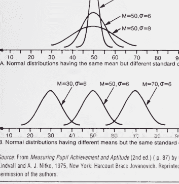

A. 具有相同均值但不同标准差的正态分布。

B. 具有不同均值但相同标准差的正态分布。

> 来源：摘自 C.M. Lindvall 和 A. J. Nitko 所著《Measuring Pupil Achievement and Aptitude》第 2 版（第 87 页），1975 年，纽约：Harcourt Brace Jovanovich。经作者许可转载。

## 例 17.3

数学定义的正态曲线（平滑曲线）叠加在 505 名 12 年级学生创造力测验成绩的实际分布（直方图）上的例子。两个分布具有相同的均值和标准差。

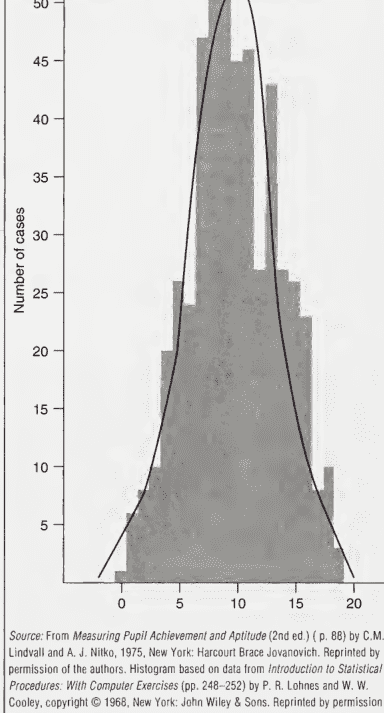

> 来源：摘自 C.M. Lindvall 和 A. J. Nitko 所著《Measuring Pupil Achievement and Aptitude》第 2 版（第 88 页），1975 年，纽约：Harcourt Brace Jovanovich。经作者许可转载。直方图基于 P. R. Lohnes 和 W. W. Cooley 所著《Introduction to Statistical Procedures: With Computer Exercises》（第 248-252 页）的数据，版权所有 © 1968，纽约：John Wiley & Sons。经 John Wiley & Sons, Inc. 许可转载。

以随机或偶然的方式围绕均值或平均值分布。这种对正态曲线适用性的看法，或许始于 deMoivre（1756），但 Quetelet（1748）坚决认为它对智力和道德品质是真实的（Dudycha & Dudycha, 1972; Landau & Lazarsfeld, 1968）。

这种思想——某种程度上人类特征的分布在本质上是正态分布——已延续到心理测量中。人们也经常认为，由于评估分数呈钟形分布，这表明不仅分数，而且分数背后的个人能力也是正态分布的。这种反向说法当然是不正确的。评估的分数分布不仅取决于被测人员的潜在能力，还取决于评估程序本身的特性。评估开发者可以通过审慎选择任务，使分数分布具有任何形状：矩形、偏态双峰、对称等（Lord, 1953）。（见附录 I，了解分布的形状。）即使群体的潜在能力呈正态形式，这些非正态的分数分布形状也可能出现在数据中。

从你自己的经验中，你知道你可以控制测验分数分布的形状。例如，如果测验的所有题目都很简单，就会有很多高分和很少的低分。非常困难的测验会有很多低分和很少的高分。关键是，正态分布是一个方便的模型，但你不应该相信它是教育成就结果的自然表现。

## 正态分布中的百分位等级和 z 分数

要理解百分位等级与正态曲线 z 分数之间的关系，你需要仔细研究图 17.4 顶部的图表。如果我们将正态分布切成宽度为一个标准差的区段，每个区段将具有固定的案例百分比（见图 17.4）或正态曲线下的面积。例如，位于均值正上方宽度为一个标准差的区段包含大约 34% 的面积。对称地，位于均值正下方的相比较区段也包含 34%。这两个区段一起包含 68% 的面积。因此，正态分布中 68% 的面积将在均值的一个标准差之内；95% 将在两个标准差之内；99.7% 的面积将在三个标准差之内。因此，如果一个分布是正态的，几乎所有的分数将跨越相当于六个标准差的范围。

你可以使用这些关于各种区段中案例百分比的事实来确定正态分布中百分位等级与 z 分数之间的对应关系。为了强调我们只谈论正态分布，图 17.4 将 z 分数表示为 zₙ。这种百分位等级对应关系，对所有正态分布都相同，使得正态分布中标准分数的解释变得容易。例如，查看图 17.4 中的图表和图表下方的两个刻度。zₙ = −2.00 下方的案例百分比为 2.27%（= 0.13 + 2.14）。（图 17.4 还显示了 T 分数，我们将在本章后面解释。）因此，在正态分布中，对应于 zₙ = −2.00 的百分位等级为（四舍五入）2。其他 z 分数的百分位等级可以类似地从图 17.4 中计算出来，如下面的例子所示。图 17.4 绘图下方的图表提供了关于 zₙ 分数与正态曲线之间百分位等级对应关系的更完整信息。

## 图 17.4 正态分布中百分位等级、z 分数和 T 分数之间的关系。

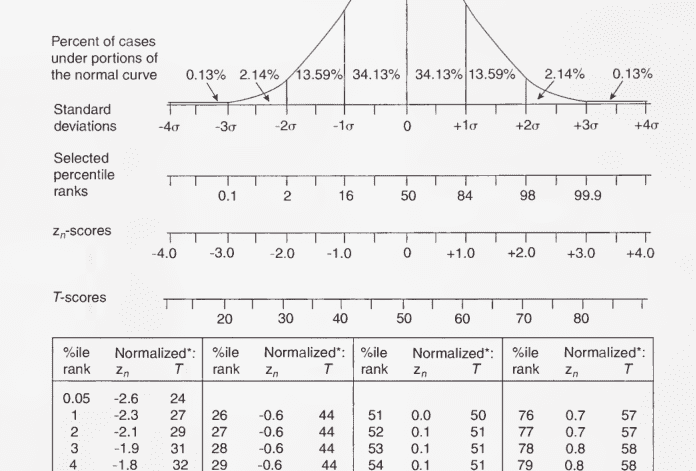

正态曲线各部分下的案例百分比

标准差

选定的百分位等级

zₙ 分数

T 分数

| %ile rank | Normalized*: zₙ | T | %ile rank | Normalized*: zₙ | T | %ile rank | Normalized*: zₙ | T | %ile rank | Normalized*: zₙ | T |
|---|---|---|---|---|---|---|---|---|---|---|---|
| 0.05 | -2.6 | 24 | 26 | -0.6 | 44 | 51 | 0.0 | 50 | 76 | 0.7 | 57 |
| 1 | -2.3 | 27 | 27 | -0.6 | 44 | 52 | 0.1 | 51 | 77 | 0.7 | 57 |
| 2 | -2.1 | 29 | 28 | -0.6 | 44 | 53 | 0.1 | 51 | 78 | 0.8 | 58 |
| 4 | -1.8 | 32 | 29 | -0.6 | 44 | 54 | 0.1 | 51 | 79 | 0.8 | 58 |
| 5 | -1.7 | 33 | 30 | -0.5 | 45 | 55 | 0.1 | 51 | 80 | 0.8 | 58 |
| 6 | -1.6 | 34 | 31 | -0.5 | 45 | 56 | 0.2 | 52 | 81 | 0.9 | 59 |
| 7 | -1.5 | 35 | 32 | -0.5 | 45 | 57 | 0.2 | 52 | 82 | 0.9 | 59 |
| 8 | -1.4 | 36 | 33 | -0.4 | 46 | 58 | 0.2 | 52 | 83 | 1.0 | 60 |
| 9 | -1.3 | 37 | 34 | -0.4 | 46 | 59 | 0.2 | 52 | 84 | 1.0 | 60 |
| 10 | -1.3 | 37 | 35 | -0.4 | 46 | 60 | 0.3 | 53 | 85 | 1.0 | 60 |
| 11 | -1.2 | 38 | 36 | -0.4 | 46 | 61 | 0.3 | 53 | 86 | 1.1 | 61 |
| 12 | -1.2 | 38 | 37 | -0.3 | 47 | 62 | 0.3 | 53 | 87 | 1.1 | 61 |
| 13 | -1.1 | 39 | 38 | -0.3 | 47 | 63 | 0.3 | 53 | 88 | 1.2 | 62 |
| 14 | -1.1 | 39 | 39 | -0.3 | 47 | 64 | 0.4 | 54 | 89 | 1.2 | 62 |
| 15 | -1.0 | 40 | 40 | -0.3 | 47 | 65 | 0.4 | 54 | 90 | 1.3 | 63 |
| 16 | -1.0 | 40 | 41 | -0.2 | 48 | 66 | 0.4 | 54 | 91 | 1.3 | 63 |
| 17 | -0.9 | 41 | 42 | -0.2 | 48 | 67 | 0.4 | 54 | 92 | 1.4 | 64 |
| 18 | -0.9 | 41 | 43 | -0.2 | 48 | 68 | 0.5 | 55 | 93 | 1.5 | 65 |
| 19 | -0.9 | 41 | 44 | -0.2 | 48 | 69 | 0.5 | 55 | 94 | 1.6 | 66 |
| 20 | -0.8 | 42 | 45 | -0.1 | 49 | 70 | 0.5 | 55 | 95 | 1.7 | 67 |
| 21 | -0.8 | 42 | 46 | -0.1 | 49 | 71 | 0.6 | 56 | 96 | 1.8 | 68 |
| 22 | -0.8 | 42 | 47 | -0.1 | 49 | 72 | 0.6 | 56 | 97 | 1.9 | 69 |
| 23 | -0.7 | 43 | 48 | -0.1 | 49 | 73 | 0.6 | 56 | 98 | 2.1 | 71 |
| 24 | -0.7 | 43 | 49 | -0.0 | 50 | 74 | 0.6 | 56 | 99 | 2.3 | 73 |
| 25 | -0.7 | 43 | 50 | -0.0 | 50 | 75 | 0.7 | 57 | 99.9 | 3.1 | 81 |

*数值已四舍五入。要“标准化”分数，请用实际百分位等级进入表格并读出 zₙ 或 T。

## 例

如何确定正态分布中选定 zₙ 分数对应的百分位等级

| zₙ | PR（四舍五入） | 计算方法 |
|---|---|---|
| −3.0 | 0.1 | = 0.13 |
| −2.0 | 2 | = 0.13 + 2.14 |
| −1.0 | 16 | = 0.13 + 2.14 + 13.59 |
| 0.0 | 50 | = 0.13 + 2.14 + 13.59 + 34.13 |
| +1.0 | 84 | = 50 + 34.13 |
| +2.0 | 98 | = 50 + 34.13 + 13.59 |
| +3.0 | 99.9 | = 50 + 34.13 + 13.59 +2.14 |

## 标准化标准分数

现在你对正态曲线的含义有了一些背景知识，让我们回到图 17.2 的第三分支：标准化标准分数。该图显示了五种标准化标准分数。我们将在本节中讨论所有这些。

测验出版商可能会将原始分数转换到一组新的分数中，使其呈正态分布（或接近正态）。这种转换改变了原始分布的形状，通过挤压和拉伸刻度使其符合正态分布。一旦完成，可以导出各种类型的标准分数，每种都可以具有适当的正态曲线解释。这些导出分数的通用名称是标准化标准分数。这些也称为面积转换，与我们在本章前面介绍的线性转换相对。这些分数在测验手册中报告的常见变体有五种，如图 17.2 所示。

## 标准化 z 分数

当 z 分数的百分位等级与我们在正态分布中预期的对应时，它们被称为标准化 z 分数（zₙ），并使用以下符号：

zₙ = 正态分布中给定百分位等级对应的 z 分数

如果原始分数的分布形式不是正态的，其 z 分数的百分位等级将不会与规范分布中预期的对应。你可能会惊讶地得知，然而，可以为任何非正态分布创建一组“标准化”z 分数。进行这种转换后，新的一组分数更接近正态分布。“标准化”一组分数的方法如下：（a）确定规范群体中每个原始分数的百分位等级，（b）在正态曲线表（例如图 17.4 中的图表）中查找每个百分位等级，（c）读出每个对应的 zₙ 值。所得的 zₙ 值是“标准化的”。也就是说，它们是如果分布呈正态形式本应获得的 z 分数。

为了向你展示该过程的工作原理，并说明 z 与 zₙ 之间的差异，考虑下一个示例中的分数。分数和百分位等级来自我们之前关于如何计算百分位等级的 25 名学生的班级示例（第 392 页）。

## 例

说明与上一页 392 页上所示的 25 个测验分数分布对应的标准化 z 分数和（实际）线性 z 分数。

| 原始分数 | %ile rank | 标准化ᵃ z 分数（zₙ） | 线性ᵇ z 分数（z） |
|---|---|---|---|
| 36 | 98 | 2.05 | 2.43 |
| 33 | 96 | 1.75 | 1.64 |
| 32 | 94 | 1.55 | 1.38 |
| 31 | 90 | 1.28 | 1.12 |
| 30 | 88 | 1.18 | 0.86 |
| 29 | 84 | 0.99 | 0.59 |
| 28 | 72 | 0.58 | 0.33 |
| 27 | 54 | 0.10 | 0.07 |
| 26 | 32 | −0.47 | −0.20 |
| 25 | 16 | −0.99 | −0.46 |
| 24 | 10 | −1.28 | −0.72 |
| 22 | 8 | −1.41 | −1.25 |
| 21 | 6 | −1.55 | −1.51 |
| 15 | 4 | −1.75 | −3.09 |
| 14 | 2 | −2.05 | −3.36 |

ᵃzₙ 值是通过在图 17.4 中查找百分位等级并读出对应的 zₙ 值获得的。
ᵇz 值是通过使用第 392 页上的实际分数分布并应用公式获得的：z = (X−M)/SD 其中 M = 26.75 且 SD = 3.80。


接下来，你在图 17.4 中查找每个百分位等级，并读出对应的 z_n。结果出现在示例中。为了便于比较，实际的线性 z 分数是通过公式 17.1 计算的，其中 M = 26.75，SD = 3.8。标准化 z 分数与线性 z 分数之间的差异代表了“拉伸和压缩”所必需的程度，以便使原始分布更接近正态分布。

## 标准化 T 分数（McCall 的 T）

图 17.2 中标准化标准分数分支的第二种分数是 T 分数。标准化 T 分数表示原始分数在均值为 50、标准差为 10 的正态分布中的位置。标准化 T 分数是线性 SS 分数的对应物。因此，T = 10z_n + 50 [Eq. 17.3]

该方程与方程 17.2（SS = 10 z + 50）之间的区别在于 z_n 是标准化 z 分数而不是线性 z 分数。

标准化 T 分数相对于标准化 z 分数的优势与 SS 分数相对于线性 z 分数的优势相同，另外 T 分数还具有正态曲线的百分位等级解释。以下是示例。

## 示例

使用如图 17.4 所示的正态曲线解释 T 分数的方法。

- 1. Joey 的 T 分数为 40。这意味着他比常模组的平均值低一个标准差，他的百分位等级约为 16。
- 2. Betty 的百分位等级为 84。这意味着她的 T 分数为 60，她比常模组平均值高一个标准差的距离。

图 17.4 显示了正态分布中百分位等级、T 分数和 z_n 分数之间的对应关系。该图可以帮助你直接将百分位等级转换为 T 分数，而无需使用公式 17.3。

## 偏差智商分数

图 17.2 中显示的第三种标准化标准分数是与某些智力能力评估一起使用的偏差智商分数。偏差智商（DIQ）分数表示原始分数在均值为 100、标准差为 15 或 16 的正态分布中的位置。常模组通常由所有具有相同实际年龄的学生组成，而不管年级 placement 如何。例如，如果测验编制者将标准差设为 16，则 DIQ 由 DIQ = 16z_n + 100 给出 [Eq. 17.4]

这些 DIQ 的解释方式与 T 分数相似，但参考的是均值为 100、标准差为 16 的正态分布。以下是示例。

## 示例

DIQ 分数的含义。

- 1. Meghan 的 DIQ = 116。这意味着她比其年龄组的平均值高一个标准差，她的分数的百分位等级为 84。
- 2. Sherry 的 DIQ = 100。这意味着她在年龄组的平均水平得分，她的分数的百分位等级为 50。

通常，评估手册提供表格，允许你直接将原始分数转换为 DIQ。

## 九分位

图 17.2 中显示的第四个标准化标准分数是九分位。九分位分数表示原始分数在正态分布的特定区段中的位置。出版商经常建议使用全国九分位来对成绩和能力倾向评估进行常模参照解释。如果你查看第 390 页的 DAT 机械推理测验常模表，你会看到出版商的测验表使用九分位以及百分位等级的示例。

图 17.5 说明了九分位分数的含义。正态分布被划分为九个区段，从低的 1 编号到高的 9。落在这些区段边界内的分数被分配这九个数字之一（因此术语 stanine 来自“standard nine”）。每个区段宽半个标准差，除了九分位 1 和 9。落在正态曲线每个区段内的案例百分比在图 17.5 中显示，同时显示了与每个区段相关的百分位等级范围。

所有分数落在区间内的个人都被分配该区间的九分位。例如，所有百分位等级为 11 至 22 的个人都被分配九分位 3；所有 23 至 29 的个人都被分配九分位

## 图 17.5 说明正态分布，显示九分位、百分位等级区间以及具有每个九分位的案例百分比。


Source: From The Metropolitan Achievement Tests: Seventh Edition (p. 36) Copyright © 1993 by Harcourt, Inc. Adapted by permission. All rights reserved.

4；等等。常模组中 12% 的人将被分配九分位 3，17% 的人将被分配九分位 4。当来自正态分布的原始分数转换为九分位时，九分位的平均值为 5，标准差等于 2。以下是九分位解释的示例。在阅读这些示例时，请参考图 17.5。

## 示例

如何解释九分位分数。

- 1. Sophia 在标准化测验的数学分测验中获得九分位 5。这意味着她在测验上的原始分数处于常模组的中间 20%。
- 2. Jesse 在标准化测验的阅读分测验中获得九分位 9。这意味着他在测验上的原始分数处于常模组的最高 4%。
- 3. Blake 在标准化测验的拼写分测验中的九分位为 3。这意味着他的原始分数处于常模组的较低 20%。具体来说，他的百分位等级在 11 到 22 之间。

九分位的 claimed 优势包括：它们只是单数字，只有大约相等的单位贯穿整个分数量表，并且不会暗示超过评估所证实的精确度。

并非所有评估专家都同意使用九分位进行常模参照解释。有些人认为，九分位比百分位等级提出了更困难的解释问题，特别是对于可靠的评估，因为九分位反映了分数的粗略分组（Hoover et al., 1993b）。

与百分位等级一样，九分位特定于计算它们所依据的参考组。一些测验出版商报告本地和全国九分位。对于特定学生，这两个九分位可能不同，这取决于学生在每个参考组中的排名。

示例 17.4 显示了如何将任何一组分数转换为九分位。该示例使用了我们在第 392 页早些时候使用的 25 个分数的分布。

## SAT 分数

图 17.2 中标准化标准分数分支的第五个分数是 SAT 分数。学业评估测验 I（SAT I）的结果使用这种类型的分数报告。SAT 分数是来自均值为 500、标准差为 100 的分布的标准化标准分数。SAT 分数量表基于 1990 年毕业的高中生中 1,052,000 名学生在其大三或大四期间参加 SAT 的参考组（Dorans, 1994）。该参考组的分数被标准化，均值设为 500，标准差设为 100。这在公式 17.5 中显示。

```
SAT-score = 100zₙ + 500      [Eq. 17.5]
```

1990 年之后进行的测验在统计上与 1990 年参考组的表现相匹配。这确保了分数从一年到一年具有相同的含义。

因此，SAT 分数表示分数在 1990 年正态分布中的位置，该分布的均值为 500，标准差为 100。对应于每年当前分数的百分位等级提供给测验使用者，以便于当年解释。

## 正态曲线等值

图 17.2 中第六种标准化标准分数是正态曲线等值。正态曲线等值（NCE）是均值为 50、标准差为 21.06 的标准化标准分数。它主要为联邦项目评估工作而开发（Tallmadge & Wood, 1976）。其主要价值在于评估使用不同出版商测验的各种教育项目所取得的进步。尽管一些出版商在其评估手册中为 NCE 提供常模表，但不建议将这些分数用于报告个人学生结果，因为它们很容易与百分位等级混淆。NCE 值通过以下公式找到。它们的最大可能值为 99，最小可能值为 1。

```
NCE = 21.06zₙ + 50      [Eq. 17.6]
```

如前所述，NCE 分数的均值为 50，标准差为 21.06。相比之下，T 分数的均值为 50，标准差为 10。为什么选择 21.06 的标准差？选择该标准差是为了使 NCE 分数跨越 1 到 99 的范围。

以下示例显示了所选百分位等级、NCE 分数和九分位之间的关系。

## 示例

所选百分位等级、NCE 分数和九分位之间的对应关系。

| 百分位等级 | NCE | 九分位 |
|---|---|---|
| 1 | 1 | 1 |
| 5 | 15 | 2 |
| 10 | 23 | 2 |
| 20 | 32 | 3 |
| 25 | 36 | 4 |
| 30 | 39 | 4 |
| 35 | 42 | 4 |
| 40 | 45 | 5 |
| 45 | 47 | 5 |
| 50 | 50 | 5 |
| 55 | 53 | 5 |
| 60 | 55 | 6 |
| 65 | 58 | 6 |
| 70 | 61 | 6 |
| 75 | 64 | 6 |
| 80 | 68 | 7 |
| 85 | 72 | 7 |
| 90 | 77 | 8 |
| 95 | 85 | 8 |
| 99 | 99 | 9 |


## 示例 17.4

如何将原始分数转换为九分等级。

你可以通过应用图 17.5 所暗示的正态曲线百分比关系，将任何一组分数转换为九分等级。这些理论百分比为：

| 九分等级 | 分数百分比 | 九分等级 | 分数百分比 |
|---|---|---|---|
| 9 | 前 4% | 4 | 下一个 17% |
| 8 | 下一个 7% | 3 | 下一个 12% |
| 7 | 下一个 12% | 2 | 下一个 7% |
| 6 | 下一个 17% | 1 | 底部 4% |
| 5 | 中间 20% |  |  |

首选的程序是从分数分布的中间开始分配九分等级（即先分配九分等级 = 5），然后向两端推进。此程序有助于使所得九分等级分布比从顶部或底部开始时更对称。下面我使用前面给出的百分位等级校准示例中所示的 25 名学生的分数（第 392 页）来说明该程序。

### 逐步进行

### 百分位等级示例的结果

### 评论

- 1. 制作频率分布表或将分数从高到低排序列出。
- 2. 找到中位数或中间分数。 a
- 3. 使用理论百分比确定应分配九分等级为 5 的分数数量。
- 4. 将九分等级 5 分配给步骤 3 计算出的分数数量。（如果需要，应包括中位数上下方的分数，以尽可能接近所需数量。）
- 5. 从分配了九分等级 5 的分数向上开始，使用理论百分比将分数分配到九分等级 6、7、8 和 9 的类别。尽可能接近理论百分比。
- 6. 对低于分配了九分等级 5 的分数重复该程序。
- 7. 重要的是，你必须为所有相同的分数分配相同的九分等级。

参见 PR 示例，第一列和第三列。
25 分数 × ½ = 12.5 分数。因此，中位数分数为 27。
20% 的 25 = 5 分数。

将中位数四舍五入为整数。

碰巧的是，在 PR 示例中，恰好有 5 个人得分为 27，因此我们不需要查看相邻值。（见下文。）

记住，所有相同的分数必须分配相同的九分等级。

| 分数 | 九分等级 | 实际数量 | 理论数量 |
|---|---|---|---|
| 36 | 9 | 1 | 1 |
| 32 – 35 | 8 | 1 | 2 |
| 29 – 31 | 7 | 3 | 3 |
| 28 | 6 | 4 | 4 |
| 27 | 5 | 5 | 5 |
| 26 | 4 | 6 | 4 |
| 24 – 25 | 3 | 3 | 3 |
| 15 – 23 | 2 | 1 | 2 |
| 14 | 1 | 1 | 1 |

a 中位数在附录 H 中有解释。

正如你在表中看到的，百分位等级 1、50 和 99 的数值与 NCE 分数相同。然而，在其他点上，百分位等级和 NCE 分数有所不同：NCE 分数在分布中间比百分位等级分散得更小，而在下端和上端极值处比百分位等级分散得更大。注意 NCE 分数看起来非常类似于百分位等级。因此它们经常被混淆。虽然一些出版商在其标准化测试手册中提供 NCE 规范表，但我们不建议因这种百分位等级混淆而将 NCE 分数用于报告单个学生的结果。

你可能会注意到 NCE 分数与九分等级的关系。如果将 NCE 小数点向左移动一位并四舍五入到最接近的整数，你大致就得到九分等级。例如，NCE = 72 的九分等级等价于 7；NCE = 58 的九分等级等价于 6；以此类推。这种大致的对应关系源于 NCE 分数和九分等级都基于正态分布，并且 NCE 分数和百分位等级具有相同的范围。

## 发展性和教育性成长量表

我们现在转向图 17.2 中规范参照方案的第四分支。迄今为止讨论的标准化标准分数量表特定于某一特定年级或年龄组。如果分数量表特定于某一特定年级，你就无法用它来衡量学生从一个年级到下一个年级的成长。下一个示例说明了为什么你不能使用百分位等级和 T 分数来评估学生的教育成长。

## 示例

为什么百分位等级和 T 分数不能用于衡量成长。

- 1. 假设比利在 5、6 和 7 年级的测试中均处于第 84 百分位。虽然比利在技能和知识方面会有所成长，但他的百分位等级（84）保持不变。数字 84 仅反映了他在每个年级规范群体中的位置，并不能传达他的成长。
- 2. 同样，假设阿什莉的 T 分数分别针对每个年级的规范群体确定，从年到年几乎保持不变，例如约为 60。阿什莉实际上在通过年级的过程中每年都表现出教育成长。T 分数由于保持不变而无法传达成长。

然而，如果你的学生的教育成长以跨越学年的单一数字量表报告，你会觉得很有用。例如，调查性成就测验通常跨越几个年级；例如二年级至八年级，或九年级至十二年级。如果此类测验的分数量表没有将来自几个年级的评估链接到单一的发展性分数量表，你就无法衡量学生在这些年间的成长。我们现在转向讨论图 17.2 中发展或成长量表分支所示的两种量表：扩展标准化标准分数量表和年级等价分数量表。

## 扩展标准化标准分数量表

### 扩展标准化分数量表的基本思想

扩展标准化标准分数告诉原始分数在以较低年级参考组为锚的数字量表上的位置。教育工作者发现，一个“尺子”或成就连续体，在其上可以衡量学生在很宽的年级范围内取得的进步是非常有用的。在这个连续体上，低分数代表最低的教育发展水平，高分数代表最高的教育发展水平。出版商用多种名称来指称这种量表，例如：所得量表分数（加州成就测验）、量表分数（基础技能综合测验）、扩展标准分数（盖茨-麦格尼蒂阅读测验）、标准分数（爱荷华基础技能测验；大都会成就测验）或成长量表值（爱荷华教育发展测验）。

### 扩展量表分数的发展

尽管每个出版商以略有不同方式准备扩展量表，并且所得数字在出版商之间不可比较，但扩展量表分数共享相同的目标和相同的一般开发方法：（a）选择一个基准或锚定组并开发标准化 z 分数，这些分数扩展到该锚定组的分数范围之外；（b）对一系列评估进行施测，相邻组使用共同题目（例如，二年级和三年级学生做同一套题目，然后三年级和四年级学生做同一套题目，等等）；（c）对每个年级的分数分布进行汇总和标准化；以及（d）通过这些重叠题目，将所有组置于锚定组的扩展 z 分数量表上。该扩展 z 量表成为跨越几个年级的尺子或成长量表。

然后将扩展 z 量表再次转换为消除 z 分数不愉快属性（例如负数和小数）的量表。新量表可能范围从 00 到 99，从 000 到 999，或出版商所选择的任何其他正整数集合；对于该范围应为多少没有标准。图 17.6 说明了出版商在假设情况下如何建立此类量表。示例 17.1 中报告的量表分数是测试手册如何报告扩展标准分数的实际示例。

### 项目反应理论方法³

最近的技术进步导致一些出版商为学校提供两种计算扩展标准分数的选择。一种方法使用学生的传统原始分数（即答对题数）作为计算的开始步骤。这是我们上面描述的方法。第二种方法使用项目反应理论（IRT），其中将数学方程拟合到出版商样本学生的题目反应上。然后用结果推导出分数量表。根据此方法，学生的分数取决于其答对或答错的模式。IRT 模式计分考虑学生是否正确回答了容易或困难的题目，以及该题目在多大程度上区分了不同成就水平的学生。这意味着，例如，两个学生答对相同数量的题目可能会得到不同的量表分数，如果正确回答题目的模式对这两个学生非常不同。

优点是所得扩展标准分数可以具有比传统答对题数分数更低的测量误差和更高的可靠性。缺点是（a）答对题数与扩展量表分数之间的直接联系被打破（当使用某些方程时），以及（b）该方法对每种类型的测试和每个学生群体都有效。

## 建议

尽管项目评估人员和学校研究人员通常更喜欢使用扩展标准分数，但其含义对教师、家长和


## 图 17.6 一系列学业测验分数转换为统一扩展分数量表的假设示例。相继的组通过在特殊施测中将重叠的测验连接起来而定位在量表上。

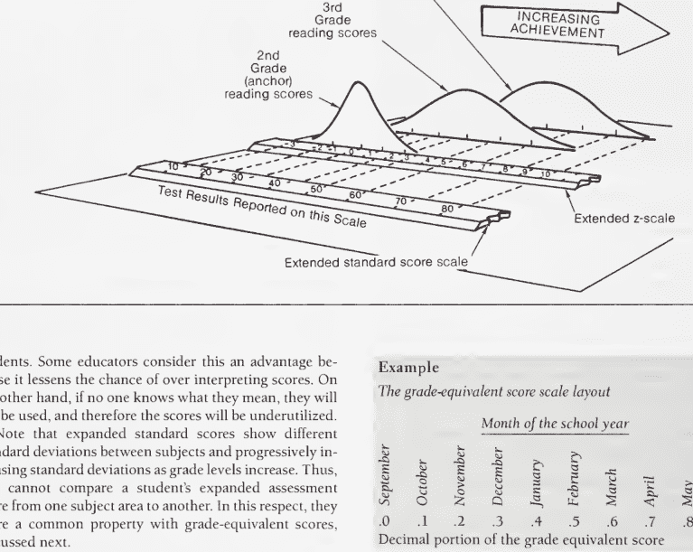

学生。一些教育工作者认为这是一个优势，因为它减少了过度解读分数的可能性。另一方面，如果没人知道它们是什么意思，就不会使用它们，因此分数会被低估使用。

请注意，扩展标准分数在不同科目之间显示不同的标准差，并且随着年级的升高标准差逐渐增大。因此，你不能将一个学生的扩展评估分数从一个学科领域与另一个学科领域进行比较。在这方面，它们与下面要讨论的年级当量分数具有共同的属性。

## 年级当量分数

## 年级当量分数的基本概念

年级当量分数（GE）表示原始分数在哪个年级安置时为平均水平。GE 是最常用于小学阶段学业测验的教育发展分数。年级当量分数以小数形式报告，例如 3.4 或 7.9。分数的整数部分指的是年级水平，小数部分指的是该年级学年中的月份。例如，你将年级当量分数 3.4 读作“三年级第四个月”；同样，7.9 读作“七年级第九个月”。假设原始分数 31 对应的年级当量分数为 6.3。这意味着在六年级第三个月时，规范样本组的平均值为 31。下面的示例显示了年级当量量表的布局。

## 示例

年级当量分数量表布局

| 学年月份 |
| September | October | November | December | January | February | March | April | May | June |
| .0 | .1 | .2 | .3 | .4 | .5 | .6 | .7 | .8 | .9 |
| 年级当量分数的小数部分 |

使用这些分数时，你假设六月到九月之间的时间（即暑假月份）在年级当量量表上代表十分之一（或一个月）的增量（见上文）。通过这种方式定义年级当量量表，分数的平均值每年显示 10 个月的增长。（然而，你不应期望每个学生每个暑假都能增长一个月。）

## 年级当量分数的总体有用性

年级当量分数对于报告学生的教育发展很有用。如果标准化测验在学生整个学年期间定期施测，所得的年级当量分数可以帮助使用基于年级的教育发展量表监测学生的教育进展。在较小程度上，年级当量也可以用来监测学生的年级安置。GE 分数年级安置解释的问题在于，它们取决于测验内容与学生在测验施测时点之前所学内容的匹配程度——这种匹配越差，年级安置解释的有效性就越低。

年级当量分数不能用来比较学生在不同学科领域的优势和劣势。它们也不能用来确定学生在其同伴中的排名。本节余下部分将对这些局限性进行解释。

## 年级当量分数的编制

了解测验出版商如何获得年级当量分数将有助于你避免误解。当然，你无需计算它们，因为测验手册提供了所需的转换表。

编制过程以阅读测验为例进行说明，但该过程适用于所有学科领域。假设出版商希望从一年级到八年级评估阅读并编制年级当量。出版商创建一系列重叠的测验，覆盖所需的年级：一个测验用于一年级和二年级，一个用于二年级和三年级，依此类推。每个测验适用于特定的年级水平。出版商在每个年级水平对一个大型的全国样本施测适当的测验。通常，出版商每年施测一次或两次（秋季和/或春季），因为不可能在全年持续施测。施测测验的日期称为经验常模日期。然后使用扩展分数量表将这些重叠测验连接起来。这使得来自不同测验的原始分数能够置于基于年级的阅读能力量表上。该过程称为垂直链接或垂直等值，因为链接沿着年级向上进行。

在此共同量表上，规范样本组在每个年级水平的阅读能力存在很大差异。因此，在每个年级水平上都有阅读分数的分布。这些阅读分数的分布如图 17.7 所示。在此示例中，出版商在一年中仅施测一次——在二月（月份 = 0.5）——因此该图将分布直接绘制在 1.5、2.5、3.5 等之上。

设定年级当量量表 出版商的第一步是在图表上定位并绘制每个年级规范样本组的中间分数（有时使用平均分数）。例如，在图中，二月参加测验的规范样本组一年级学生的平均（中位数）分数为 10。年级当量分数 1.5 对应原始分数 10，因为该中位数的年级安置为 1.5。二月规范样本组二年级学生的平均分数为 15，其对应的年级当量为 2.5。图 17.7 中四年级和五年级的年级当量也以同样方式绘制。

插值和外推 实际的年级当量只能在出版商施测测验的时间点获得。其他时间点的年级当量通过插值或外推获得。在图 17.7 中，注意实线连接了实际分布的中位数。这条实线用于插值，从而估计中间年级当量的值。例如，原始分数 13 并不是规范样本分布的实际中位数。然而，我们从 13 水平向图表画一条线，直到它与实线相交，然后垂直向下画到年级安置量表。对应于该垂直线的年级安置（2.1）成为对应于原始分数 13 的插值年级当量。

考虑原始分数 8。对该分数的年级当量只能通过外推获得：根据中位数的趋势将线延伸到实际测试的规范样本组之外。图 17.7 中的虚线代表这种延伸。因此，原始分数 8 的外推年级当量为 1.1。如果外推不正确，年级当量也会错误。

下面的下一个示例总结了迄今为止关于图 17.7 中外推和插值的说明。在继续阅读之前，请确保你理解这些数字是如何从图中获得的。

## 示例

图 17.7 中假设数据的原始分数到年级当量转换表

| Raw Score | Grade equivalent | How obtained |
|---|---|---|
| 9 | 1.4 | extrapolation |
| 10 | 1.5 | actual data |
| 11 | 1.7 | interpolation |
| 12 | 1.9 | interpolation |
| 13 | 2.1 | interpolation |
| 14 | 2.3 | interpolation |
| 15 | 2.5 | actual data |
| 16 | 2.8 | interpolation |
| 17 | 3.2 | interpolation |
| 18 | 3.5 | actual data |
| 19 | 4.0 | interpolation |
| 20 | 4.5 | actual data |
| 21 | 4.6 | extrapolation |

出版测验的实际转换表如示例 17.5 所示。当你查阅出版商的常模手册将学生的原始分数转换为年级当量时，你将使用这种类型的转换表。练习使用示例 17.5 查找学生的分数。

## 解释年级当量时应注意的事项

春季到秋季的下降：暑假损失 在解释年级当量的过程中，一个特别的关注点是


# 图 17.7 用于获得年级等值分数的假设数据示例。


夏季成绩损失现象。在某些学科领域——例如算术——学生的成绩在夏季几个月会失去一些优势（Beggs & Hieronymus, 1968; DeVito & Long, 1977; Tallmadge, 1973; Tallmadge & Horst, 1974; Tallmadge & Wood, 1976）。夏季几个月的成绩下降有几种含义：（a）夏季增长一个月这一假设在每个学科领域都不成立，（b）对许多儿童而言，教育成长并不规律且统一，（c）使用秋季到春季的年级等值分数增益来评估教学项目可能会导致错误的结论。当测验出版商提供单独的秋季和春季常模，并且学校系统在与出版商常模建立的日期非常接近的日期进行测试时，第三点问题较小。

## 年级等值与课程对应
认为学生应该与其年级等值分数有相同的安置是错误的。要理解原因，请回顾图 17.7 以及年级等值是如何基于中位数。按定义，在特定年级安置的常模组中有一半的学生分数高于中位数。因此，常模组中有一半的学生年级等值分数高于其实际年级安置。其次，请记住，出版商使用一系列测验，而不是单一测验，来建立年级等值。你不能将例如三年级学生在涵盖三年级内容的数学测验上获得的 5.7 的年级等值分数解释为该学生应被安置在五年级数学中。测验显示学生对三年级内容表现非常好，但学生并未接受五年级数学的评估。当然，除了单一评估结果之外，还有许多因素决定学生是否应获得加速安置。一些测验出版商可能会开发其测验电池，以便在为建立年级等值量表时，让三年级学生接受五年级内容。在这种情况下，可以谨慎地说，具有 5.7 年级等值的三年级学生确实掌握了一些五年级内容（Hoover et al., 1993b）。

### 示例 17.5
《都市成就测验》（第七版），形式 S/T，秋季常模的年级等值表的一部分。请注意，你使用（扩展的）量表分数进入表格，并在边际读取年级等值分数。扩展量表分数首先从另一张表（未显示）获得，你使用原始分数进入该表。

| Grade Equiv. | Scaled Scores |  |  |  |  |  | Grade Equiv. |
|---|---|---|---|---|---|---|---|
|  | Word Recognition | Reading Vocabulary | Reading Comprehension | Prereading/ Total Reading | Concepts & Problem Solving | Procedures |  |
| 7.9 | 665 | 661 | 656 | 659 | 644 | 650 | 7.9 |
| 7.8 | 663-664 | 660 | 654-655 | 657-658 | 642-643 | 648-649 | 7.8 |
| 7.7 | 661-662 | 659 | — | 655-656 | 641 | 647 | 7.7 |
| 7.6 | 660 | 658 | 653 | 654 | 640 | — | 7.6 |
| 7.5 | — | 657 | — | — | 639 | 646 | 7.5 |
| 7.4 | — | 656 | — | — | 638 | 645 | 7.4 |
| 7.3 | 659 | 655 | 652 | 653 | 637 | — | 7.3 |
| 7.2 | — | 654 | — | — | 636 | 644 | 7.2 |
| 7.1 | 658 | 653 | 651 | 652 | 635 | 643 | 7.1 |
| 7.0 | 657 | 651-652 | 650 | 651 | 634 | 642 | 7.0 |
| 6.9 | 656 | 650 | 649 | 650 | 633 | 641 | 6.9 |
| 6.8 | 653-655 | 648-649 | 647-648 | 647-649 | 632 | 639-640 | 6.8 |
| 6.7 | 651-652 | 646-647 | 645-646 | 645-646 | 630-631 | 638 | 6.7 |
| 6.6 | 649-650 | 644-645 | 643-644 | 643-644 | 628-629 | 636-637 | 6.6 |
| 6.5 | 647-648 | 642-643 | 642 | 641-642 | 626-627 | 634-635 | 6.5 |
| 6.4 | 646 | 640-641 | 640-641 | 640 | 624-625 | 632-633 | 6.4 |
| 6.3 | 644-645 | 638-639 | 639 | 638-639 | 622-623 | 629-631 | 6.3 |
| 6.2 | 642-643 | 636-637 | 637-638 | 636-637 | 620-621 | 626-628 | 6.2 |
| 6.1 | 641 | 634-635 | 635-636 | 635 | 618-619 | 623-625 | 6.1 |
| 6.0 | 639-640 | 632-633 | 633-634 | 633-634 | 616-617 | 621-622 | 6.0 |
| 5.9 | 637-638 | 630-631 | 631-632 | 631-632 | 614-615 | 618-620 | 5.9 |
| 5.8 | 634-636 | 628-629 | 630 | 628-630 | 613 | 616-617 | 5.8 |
| 5.7 | 632-633 | 626-627 | 628-629 | 626-627 | 611-612 | 614-615 | 5.7 |
| 5.6 | 630-631 | 624-625 | 626-627 | 625 | 610 | 611-613 | 5.6 |
| 5.5 | 628-629 | 622-623 | 624-625 | 623-624 | 609 | 608-610 | 5.5 |
| 5.4 | 626-627 | 620-621 | 623 | 621-622 | 608 | 606-607 | 5.4 |
| 5.3 | 624-625 | 618-619 | 622 | 619-620 | 607 | 604-605 | 5.3 |
| 5.2 | 622-623 | 616-617 | 621 | 618 | 606 | 602-603 | 5.2 |
| 5.1 | 620-621 | 614-615 | 620 | 617 | 605 | 600-601 | 5.1 |
| 5.0 | 618-619 | 612-613 | 618-619 | 616 | 603-604 | 597-599 | 5.0 |
| 4.9 | 616-617 | 610-611 | 617 | 615 | 601-602 | 595-596 | 4.9 |
| 4.8 | 613-615 | 607-609 | 615-616 | 613-614 | 599-600 | 592-594 | 4.8 |
| 4.7 | 611-612 | 604-606 | 613-614 | 610-612 | 597-598 | 590-591 | 4.7 |
| 4.6 | 608-610 | 601-603 | 610-612 | 607-609 | 595-596 | 587-589 | 4.6 |
| 4.5 | 605-607 | 598-600 | 607-609 | 603-606 | 592-594 | 584-586 | 4.5 |
| 4.4 | 602-604 | 595-597 | 604-606 | 600-602 | 590-591 | 581-583 | 4.4 |
| 4.3 | 599-601 | 592-594 | 601-603 | 598-599 | 587-589 | 577-580 | 4.3 |
| 4.2 | 596-598 | 589-591 | 598-600 | 596-597 | 585-586 | 573-576 | 4.2 |
| 4.1 | 593-595 | 586-588 | 596-597 | 594-595 | 582-584 | 569-572 | 4.1 |
| 4.0 | 589-592 | 583-585 | 594-595 | 591-593 | 580-581 | 566-568 | 4.0 |

> 来源：摘自《多水平常模手册：都市成就测验，第七版》（第 171 页）。版权所有 © 1993 Harcourt, Inc. 经许可转载。保留所有权利。

## 年级等值与掌握
有时教师、家长和学校管理人员会误将年级等值解释为掌握特定课程领域某一分数的含义。例如，家长可能错误地认为学生在数学上的年级等值为 3.5 意味着学生已掌握当地学校三年级数学课程的 5/10。最多能说的是，该学生的测验分数等于常模组在三年级第五个月时的平均分数。这不太可能意味着掌握三年级数学，因为测验并未系统抽样学生当地课程中三年级数学的整个领域。

测验项目与你在测验前在课堂上强调的材料越接近，你的学生在这些全国标准化测验上得分高于年级水平的可能性就越大。你可能在测试日期之后教授某些测验项目的内容。因此，你的学生在测试时表现不佳，但在学年结束前会学到这些材料。答错三四个题目会显著降低学生的年级等值分数。如果你的教学顺序与测试顺序不一致，推断掌握就成问题。这指出了年级等值分数的常模参照特征，并说明了不能从中做出标准参照解释。

## 不同测验的年级等值不可互换
年级等值（和其他常模参照）分数取决于测试上放置的具体题目以及使用的具体常模组。例如，如果你说“ABC 阅读评估上的 3.7 年级等值与 DEF 阅读评估上的 3.7 年级等值含义相同”，你就是在误解年级等值。两个不同出版商的评估结果除非在特殊条件下，否则不可比较（Bianchini & Loret, 1974a, 1974b; Jaeger, 1973; Peterson, Kolen, & Hoover, 1989）。

## 示例

|  |  | Survey subtest |  |
|---|---|---|---|
|  |  | Reading | Mathematics |
| John | GE | 4.9 | 4.9 |
|  | PR | 78 | 90 |
| Howard | GE | 4.9 | 4.3 |
|  | PR | 78 | 78 |
| Susan | GE | 4.9 | 4.6 |
|  | PR | 78 | 84 |

请注意，John 有两个相同的年级等值，但其对应的百分位等级不同。Howard 有两个不同的年级等值但具有相同的百分位等级。最后，Susan 的一个年级等值高于另一个，但她的较高年级等值对应的百分位等级低于她的较低年级等值。

现象的原因是，一个学科领域的分数比另一个学科领域的分数更分散，导致在准备年级等值时插值模式不同。扩展标准分数也不能用于比较学生在不同领域的表现。

你应该用什么来描述学生在不同学科领域的相对优势和劣势？如果常模组中的所有学生在所有学科都参加了相同的测验，请使用百分位等级来比较学生来自不同科目的分数。因此，在前述例示中，John 在数学和阅读方面都稍好，Howard 在两个科目方面大致相同，Susan 在数学方面比阅读稍好。因为这些是常模参照解释，“更好”意味着“与他人相比”。

## “正常”成长
有时教师和学校管理人员使用年级等值来回答学生应期望的教育成长问题。这不是一个好做法，其结果也不令人满意。正常成长的一种观点是：“学生从一个年级到下一个年级应表现出 1.0 个年级等值单位的成长。” 在这种观点下，例如在二年级参加测验并获得 1.3 分的学生，需要在三年级获得 2.3 分，在五年级获得 4.3 分，等等，以显示“正常”或预期成长。

这种年级等值对正常成长的看法无法得到支持。示例 17.6 说明了如果采用这种看法，三名假设学生在两个出版测验的数学分测验上的情况会如何。

这些学生具有以下特征：学生 A 在年级等值方面落后一年，学生 B 在年级水平，学生 C 超前一年。每一年，学生的年级等值显示出比前一年多一年的“成长”。但请看其分数对应的百分位等级：起步落后一年的学生 A，为了保持落后一年的年级等值，必须超过常模组中更多的人。在二年级落后一年意味着处于第 16 或 17 百分位。然而，年级


# 示例 17.6

从二年级到八年级，每个“获得”一年年级当量时的三个假设学生的百分位排名变化示例。

| 测试时的年级安置 | Metropolitan Achievement Tests, 总数学 | | | | | | Iowa Tests of Basic Skills, 总数学 | | | | | |
| | Student A: "Below grade level" | | Student B: "On grade level" | | Student C: "Above grade level" | | Student A: "Below grade level" | | Student B: "On grade level" | | Student C: "Above grade level" | |
| | GE | PR | GE | PR | GE | PR | GE | PR | GE | PR | GE | PR |
| 2.3 | 1.3 | 16 | 2.3 | 63 | 3.3 | 86 | 1.3 | 18 | 2.3 | 54 | 3.3 | 92 |
| 3.3 | 2.3 | 29 | 3.3 | 64 | 4.3 | 85 | 2.3 | 18 | 3.3 | 55 | 4.3 | 85 |
| 4.3 | 3.3 | 34 | 4.3 | 63 | 5.3 | 80 | 3.3 | 28 | 4.3 | 56 | 5.3 | 77 |
| 5.3 | 4.3 | 37 | 5.3 | 61 | 6.3 | 77 | 4.3 | 34 | 5.3 | 54 | 6.3 | 71 |
| 6.3 | 5.3 | 36 | 6.3 | 57 | 7.3 | 73 | 5.3 | 34 | 6.3 | 52 | 7.3 | 66 |
| 7.3 | 6.3 | 39 | 7.3 | 60 | 8.3 | 70 | 6.3 | 38 | 7.3 | 52 | 8.3 | 65 |
| 8.3 | 7.3 | 42 | 8.3 | 55 | 9.3 | 60 | 7.3 | 41 | 8.3 | 53 | 9.3 | 64 |

来源：部分数据摘自 The Psychological Corporation (1993a). The Metropolitan Achievement Tests (第7版)，Forms S/T，秋季。版权所有 © 1993 Harcourt, Inc. 经许可转载。保留所有权利。其他数据改编自 Hoover, Hieronymus, Frisbie, & Dunbar (1993c). Iowa Tests of Basic Skills: Norms and score conversions, complete and core batteries, Form K。版权所有 © 1993 由 The University of Iowa。保留所有权利。经 Riverside Publishing Company 许可转载。

# 示例 17.7

从二年级到八年级，每个学生的百分位排名保持不变时，四个假设学生的年级当量分数变化示例。

| 测试时的年级安置 | Metropolitan Achievement Tests, 总数学 | | | Iowa Tests of Basic Skills, 总数学 | | |
| | Student A: "Below grade level" (PR = 16 each year) | | Student B: "Above grade level" (PR = 84 each year) | | Student C: "Below grade level" (PR = 16 each year) | | Student D: "Above grade level" PR = 84 each year) |
| | GE | "Grades behind" | GE | "Grades ahead" | GE | "Grades behind" | GE | "Grades ahead" |
| 3.3 | 2.1 | 1.2 | 4.8 | 1.5 | 2.1 | 1.2 | 4.7 | 1.4 |
| 4.3 | 2.6 | 1.7 | 6.3 | 2.0 | 2.8 | 1.5 | 5.9 | 1.6 |
| 5.3 | 3.1 | 2.2 | 7.7 | 2.4 | 3.3 | 2.0 | 7.3 | 2.0 |
| 6.3 | 3.9 | 2.4 | 9.0 | 2.7 | 4.0 | 2.3 | 8.8 | 2.5 |
| 7.3 | 4.5 | 2.8 | 10.1 | 2.8 | 4.7 | 2.6 | 10.3 | 3.0 |
| 8.3 | 5.1 | 3.2 | 10.6 | 2.3 | 5.1 | 3.2 | 11.9 | 3.6 |

来源：部分数据摘自 The Psychological Corporation (1993a). The Metropolitan Achievement Tests (第7版)，Forms S/T，秋季。版权所有 © 1993 Harcourt, Inc. 经许可转载。保留所有权利。其他数据改编自 Hoover, Hieronymus, Frisbie, & Dunbar (1993c). Iowa Tests of Basic Skills: Norms and score conversions, complete and core batteries, Form K。版权所有 © 1993 由 The University of Iowa。保留所有权利。经 Riverside Publishing Company 许可转载。

8 表示大约处于第 41 或 42 百分位。必须从群体底部向中间移动。对 Student C 发生相反的现象，他开始时领先一年，大约处于第 86 或 92 百分位。在这种情况下，学生可以落后于越来越多的学生而仍然“领先一年”。处于年级水平的学生（Student B）的原始分数等于平均值。根据定义，年级的平均值被分配从前一年增长一年。因此，只有每年都恰好处于平均值的学生才会逐年保持其百分位排名。

另一种常模参照定义是百分位视角的正常成长：学生如果逐年保持在常模中的相同位置（即百分位排名），则显示正常成长。示例 17.7 显示了如果学生的百分位排名每年保持不变，其年级当量分数会发生什么情况。得分较低的学生（例如 Students A 和 D）——即使他们在常模群体中的位置没有改变——其年级当量表明他们落后得越来越远。 （对最初得分较高的学生则出现相反的趋势。）这种落后现象的确切程度会因出版商的测试而异，并取决于学生的百分位排名。某些测试的年级当量量表被创建为尽量减少落后效应。接近第 50 百分位的学生比分布中心更远的学生表现出更少的落后效应。这种效应的原因有两个：（a）各年级分布中位数之间的连线（见图 17.7）在较高年级趋于平坦，而不是对角线，（b）高年级的分数变得更加分散，跨越的范围大于低年级的分数。

## 不等单位

你应该意识到，年级当量规则与学生在一个测试中答对的题目数量之间没有一对一的对应关系。这意味着，例如，分布中间的学生多答对一道题，其年级当量分数可能只提高十分之一（即一个“月”）。然而，对于分布上部学生来说，多答对一道题可能导致增量为几个十分之一（几个“月”的成长）。由于这些不等单位，使用年级当量计算平均值变得有问题。

## 年级平均当量

由于平均年级当量分数存在问题，一些出版商（例如 CTB/McGraw-Hill）尝试了其他方法来向学校提供其学生平均表现的信息。一种技术是报告年级平均当量，它告诉一组平均扩展量表分数的年级安置。不是直接平均年级当量分数，你首先平均扩展量表分数。其次，你查找与该平均扩展量表分数相对应的年级当量。例如，如果四年级班级在 TerraNova 评估上的平均（均值）阅读扩展量表分数为 641，这将转换为年级当量 4.9。这意味着 641 是完成四年级第九个月的所有常模群体学生的全国平均值（CTB/McGraw-Hill, 1997）。

## 建议

鉴于年级当量的问题，你可能会想知道为什么它们会被使用。事实上，许多评估专家认为它们应该被淘汰。然而，这些分数在教师和管理人员中很受欢迎，他们通常不了解复杂的批评。教师和学校管理人员确实需要至少某种粗略的教育发展或成长衡量标准，可以与学年联系起来。尽管在技术上这样做存在困难，但年级当量在直觉上似乎是“自然度量”。一些评估专家建议使用扩展标准分数作为成长的衡量标准，但它们具有与年级当量相同的许多解释问题。此外，由于扩展标准分数不参照年级水平，其解释可能令人困惑。

你应该仅将年级当量分数作为教育发展或成长的粗略指标使用，并且仅在报告其相应百分位排名时使用。年级当量是常模参照成长指标。如果你想要有关学生学习内容的信息，你需要仔细查看学生能做出的表现类型。为此，你需要为每个学生审查他们答对的测试题类型。当你这样做时，当然，你是在做出标准参照解释。

## 年级当量的总结

作为对年级当量分数的总结，考虑以下情况：学校在五月对三年级学生进行了已出版的常模参照成就测试。进一步假设，学校的教师已判断该评估与课程有效匹配，并且是评估学生的适当方式。最后，假设出版商的常模是合适的。然后，即使有所有这些很好的假设，以下每条陈述⁴——除第一条外——都是错误的：

- 1. Pat 的阅读分测验年级当量分数为 3.8。这表明她是一个平均的三年级读者。
- 2. Ramon 的算术分测验年级当量为 4.6。这意味着他知道的算术与典型的四年级学生一样好，该学生处于学期的第六个月。
- 3. Melba 的算术分测验年级当量为 6.7。这表明明年她应该与六年级学生一起学习算术。
- 4. Debbie 的阅读分测验年级当量为 2.3。这意味着她掌握了第二年级阅读技能的十分之三。
- 5. John 的年级当量概况为 词汇 = 6.2，阅读 = 7.1，语言 = 7.1，工作学习技能 = 7.2，算术 = 6.7。这意味着他的薄弱领域是词汇和算术。
- 6. Sally 的两个年级当量为 语言 = 4.5 和 算术 = 4.5。因为她的语言和算术年级当量相同，我们得出结论，她的语言和算术能力大致相等。
- 7. 这所学校一半的三年级学生年级当量低于年级水平。这意味着教学质量普遍较差。
- 8. 今年 Mrs. Murray 被分配了所有评估分数处于最低四分之一的学生。她的班级年级当量的平均值在今年五月比去年班级的平均值更低于年级水平。这意味着 Mrs. Murray 的教学对班级整体无效。

> *陈述 1 到 6 来自 Lindvall 和 Nitko (1975, p. 98)。陈述 7 和 8 改编自 Hills (1976, pp. 87–88)。


## 各种常模参照分数的比较

表17.1总结了本章讨论的各种常模参照分数。虽然每种类型的分数都描述了学生在常模群体中的位置，但各自的方式不同。最易于向家长和学生解释的分数类型是百分位等级。各种线性标准分数需要理解均值和标准差，其含义才能变得清晰。通常你需要结合百分位等级来解释正态化标准分数。在不同测验之间，正态化标准分数所对应的案例百分比是相同的。因此，只要可以假定正态分布，它们的含义就保持相当稳定。年级当量和扩展标准分数提供了沿教育成长连续体的分数，但由于其固有的技术复杂性，教师和学校管理人员经常误解它们。将年级当量限制用于对学生年度成长的粗略估计。只有在伴有百分位等级时才使用它们。使用百分位等级来比较个别学生在不同课程领域的表现。

## 分数解释的一般指南

教师和学校管理人员在解释学生在常模参照标准化测验上的分数时，应考虑以下几点（Prescott, Balow, Hogan, & Farr, 1978）：

- 1. *寻找异常的分数模式。* 评估应证实教师从日常与学生的互动中所了解的情况；学生异常高或低的分数应是探索教学影响的信号。
- 2. *寻找模式的解释。* 询问为什么一个学生在某一科目比另一科目高。检查动机、特殊兴趣、特殊困难等。
- 3. *不要期望每个学生都有意外。* 大多数学生的评估结果应与你在课堂上的表现所预期的一致。有效的评估应确认你的观察。
- 4. *分测验分数的小差异应视为随机波动。* 使用测量标准误（第4章）来帮助判断差异是否大到具有教学意义。
- 5. 使用来自各种评估和观察的信息来解释其他评估中的表现。例如，阅读理解能力低的学生可能在社会科学分测验中表现不佳。

你可以通过回顾示例17.8中的案例来尝试应用这些一般指南。你对Amanda Pickering报告的解释可能与计算机的解释不同。

## 向家长解释分数

教师在与家长接触时，最直接地涉及常模参照分数报告。因此，你必须准备好向家长解释学生的常模参照测验结果。学习本章的概念和原则是与家长有效沟通的先决条件。

### 家长常问的问题类型及建议回答方式

表17.2包含了许多家长从学校收到标准化测验结果时会问的问题示例。这些问题分为五类：地位、成长、需要改进之处、优势和智力。你应该准备好回答这些类别的问题。表中包含了对每一类问题的回答建议。请注意，我们指出了应使用哪种常模参照分数。虽然也可能使用其他分数，但我们相信建议使用的那些将最有助于你的解释。还要注意，我们建议始终使用学生的课堂表现来补充和解释学生的标准化测验结果。因为在大多数情况下，学生的标准化测验表现将与他们的课堂表现非常一致，使用学生的课堂表现来说明他们的标准化测验表现，将有助于你向家长强化你对学生的评估。

### 示例17.8

家长收到的成绩报告副本以及计算机化的解释。

### 图4-3：档案叙述报告——家长副本


来源：摘自《爱荷华基本技能测验：教师和辅导员解释指南，K和L表格，9-14级》（第52页），作者H. D. Hoover, A. N. Hieronymus, D. A. Frisbie, and S. B. Dunbar，1993b，芝加哥：Riverside出版公司。版权所有©1993年爱荷华大学。经Riverside出版公司许可改编。

表17.1 如何解释不同类型的常模参照分数。
| 分数类型 | 解释 | 分数 | 解释示例 |
|---|---|---|---|
| 百分位等级 | 在分布中低于此点的分数的百分比。 | PR = 60 | “60%的原始分数低于此分数。” |
| 线性标准分数（z分数） | 某分数高于（或低于）给定分布均值的标准差单位数。 | z = +1.5 | “此原始分数位于均值以上1.5个标准差。” |
| | | z = -1.2 | “此原始分数位于均值以下1.2个标准差。” |
| 线性标准分数（SS分数或50±10系统） | 分数在均值为50、标准差为10的分布中的位置。（注：对于其他系统，请在这些陈述中替换该系统的均值和标准差。） | SS = 65 | “此原始分数位于均值为50、标准差为10的分布中均值以上1.5个标准差。” |
| | | SS = 38 | “此原始分数位于均值为50、标准差为10的分布中均值以下1.2个标准差。” |
| 九分制（Stanine） | 分数在正态分布特定区段中的位置。 | Stanine = 5 | “此原始分数位于正态分布中间20%。” |
| | | Stanine = 9 | “此原始分数位于正态分布顶部4%。” |
| 正态化标准分数（T分数或正态化50±10系统） | 分数在均值为50、标准差为10的正态分布中的位置。（注：对于其他系统，请在这些陈述中替换该系统的均值和标准差[例如，DIQ的均值为100、标准差为16：这是100±16系统]。） | T = 65 | “此原始分数位于均值为50、标准差为10的正态分布中均值以上1.5个标准差。此分数的百分位等级为84。” |
| | | T = 38 | “此原始分数位于均值为50、标准差为10的正态分布中均值以下1.2个标准差。此分数的百分位等级为12。” |
| 扩展标准分数 | 分数在锚定于某个参考群体的任意数字量表上的位置。 | GE = 4.5 | （此处不提供解释，因为这些系统非常任意且彼此不同。） |
| 年级当量分数 | 原始分数达到平均水平的年级位置。 | | “此原始分数是所有年级位置在四年级第五个月的学生的获得或估计平均值。” |

来源：改编自《测量学生成就和能力》（第2版）（第99页），作者C. M. Lindvall和A. J. Nitko，1975年，纽约：Harcourt Brace Jovanovich。经作者许可转载。

## 表17.2 如何回答家长关于标准化测验结果的问题。

| 类别 | 问题示例 | 回答建议 |
|---|---|---|
| 地位 | • 我的孩子与其他人相比表现如何？ • 我的孩子的进步对他的年级来说正常吗？ | 使用百分位等级来描述地位。解释标准化测验仅提供部分信息。使用课堂表现的信息来解释进步。 |
| 成长 | • 我的孩子的成长是否达到了应有的程度？ | 使用年级当量分数来显示以往几年的进步。使用综合分数（即所有科目合并）来显示总体成长；使用各科目的分数来解释特定课程领域的成长。从孩子的累积档案中获取过去的成绩信息。使用课堂表现的信息来解释成长。 |
| 需要改进之处 | • 我的孩子有什么学习弱点吗？ • 我如何帮助改进我孩子的学习？ | 使用百分位等级来识别相对弱点。使用学生表现的信息，按相似问题聚类来精确指出弱点。使用课堂表现的信息来解释具体弱点。不要过分强调弱点。也要解释学生的相对优势；给出家长如何提供帮助的具体建议。 |
| 优势 | • 我的孩子擅长什么？ | 使用百分位等级来挑选出相对优势领域。使用课堂信息来说明这一点。提出家长如何帮助改进这些领域的建议。 |
| 智力 | • 我的孩子有多聪明？我的孩子有天赋吗？ | 解释成就测验不是智力测验。解释成就测验对课堂上所教内容非常敏感，高分可能仅反映特定的学习机会。使用课堂信息来说明你的观点。 |
| 来源：此表基于Hoover, Hieronymus, Frisbie, & Dunbar, 1993b中的建议。 |

## 家长的误解

家长对常模参照测验分数的含义也存在误解。我们已经在本书中讨论了许多误解和局限。以下列表总结了常见的家长误解，你需要先弄清楚这些，才能帮助家长纠正：

- 1. 年级当量分数告诉学生应该上哪个年级。...
- 2. 百分位等级和百分正确分数含义相同。...
- 3. 百分位等级常模群体仅由特定课堂的学生组成。...
- 4. “平均”是应该超越的标准。...
- 5. 百分位等级随时间的小幅变化是有意义的。...
- 6. 低于70的百分正确分数是不及格。...
- 7. 如果你得了满分，你的百分位等级一定是99。...（Hoover et al., 1993b, pp. 103–105）

## 总结

## 两种参照框架

- • 原始分数本身在教育与心理测验中难以解释：你需要将其参照一个定义明确的常模群体和一个定义明确的表现领域。
- • 常模参照框架将学生的表现与参加同一测验的其他学生的明确界定群体进行比较。常模参照回答的问题是：“这名学生与其他学生相比表现如何？”
- • 标准参照框架将学生的表现与评估所采样的表现领域进行比较。标准参照回答的问题是：“这名学生达到了多少目标学习成果？”对于许多日常教学决策，标准参照框架最为有用。

## 使用常模

- • 可以与学生进行比较的群体有很多。这些群体称为常模群体，包括地方常模、全国常模和特殊常模。
- • 学校建筑中的平均分数只能与学校平均常模进行比较。
- • 可用于判断常模数据质量的三个标准是：与学校的相关性、出版者抽样计划的代表性，以及常模群体测验施测的时效性。

## 常模参照分数的含义

- • 最常见的标准参照分数是正确百分比、表现速度、质量评级和表现精确度。
- • 最常见的常模参照分数是百分位等级、线性标准分数、正态化标准分数和年级当量分数。这些可以在测验出版者的常模表中找到。
- • 线性标准分数包括z分数、SS分数和SAT分数。正态化标准分数包括z_r分数、T分数、九分制分数、NCE分数、DIQ分数和扩展量表分数。


## 正态分布

正态曲线帮助你理解标准化标准分数与百分位等级之间的关系。然而，你不应相信学生的天赋、智力或成绩在自然状态下是正态分布的。正态曲线并不是教育测评的自然法则。它是帮助你解读测验结果的工具。

## 年级等值分数

年级等值分数通过提供基于年级的教育发展量表，帮助你解读学生的标准化测验表现。年级等值分数并不是标准或准则。

教师和学校管理人员对年级等值分数的一些常见误解包括 (a) 暑假期间各科的成长相同，(b) 学生应具有与其年级等值分数相同的安置，(c) 学生的年级等值分数应等于或高于其年级安置，(d) 年级等值分数说明学生掌握了多少比例的课程，(e) 学生在一门课程科目的年级等值分数可以与其它科目的分数比较，(f) 不同出版商测验的年级等值分数含义相同，以及 (g) 学生每在校一年，年级等值分数应增长一年。记住这些都是误解：如果你相信这七项陈述中的任何一项，你就是错的。

在向他人解释或说明学生的年级等值分数时，你应将学生的百分位等级纳入解释中。

## 各种常模参照分数的比较

表 17.1 总结并比较了各种常模参照分数。

## 分数解释的一般准则

你应审阅学生在标准化测验上的分数概况 (a) 以识别异常高或低的分数，(b) 以质疑的态度思考学生为何获得特定分数，(c) 预期确认你已知的关于学生的信息而非遇到“意外”，(d) 不过度强调分数的微小差异，以及 (e) 在你对学生其它测评和课堂表现所知的知识基础上进行。

你应准备好使用常模参照分数和课堂表现来回答家长关于其子女的地位、成长、所需改进、优势和智力的问题。如何做到这一点建议见表 17.2。

## 重要术语和概念

- area under the normal curve
- empirical norming dates
- extended normalized standard score
- grade-equivalent scores (GE)
- grade mean equivalent
- interpolation versus extrapolation
- IRT pattern scoring
- item response theory (IRT)
- linear standard scores (z, SS)
- modal-age norms
- normal curve equivalent (NCE)
- normal distributions
- normal growth (grade-equivalent view, percentile rank view)
- normalized standard scores (z, T, DIQ, NCE, SAT)
- "normalizing" a set of scores
- norm groups (local, national, special)
- norm-referencing versus criterion-referencing
- percentile ranks (local and national)
- relevance, representativeness, and recency of norm data
- SAT-score scale
- school averages norms
- stanine scores (national stanine)

## 练习与应用

- 1. 学生在学年中旬参加测验。错误地，学生的教师使用了学年末出版的常模表来查找学生的百分位等级。这种错误对教师报告的百分位等级有何影响？如果教师使用学年初的常模表，在此情况下会有什么影响？
- 2. 阅读以下每项陈述并判断其主要指哪种常模参照分数。向你的同学说明你的选择理由。
  - a. 在这个偏态分布中，John 的分数比平均值低一个标准差。
  - b. Bob 的测验分数与在五年级第四个月接受测验的学生平均分数相同。
  - c. 因为 Bill 今年的分数提高了，我知道他的一般教育发展有所提高，即使他在常模组的地位保持不变。
  - d. Nancy 的分数是 5，因为它位于正态分布中间 20% 的位置。
- 3. 判断以下每项陈述为真或假。说明你在每种情况下判断的依据。
  - a. 一个人的百分位等级是 45。这意味着该人的原始分数与 45% 的受测群体相同。
  - b. Sally 的算术测评分数是 40。班级的平均分数是 45，标准差是 10。因此，Sally 位于平均值以下一个标准差。
  - c. 常模表显示学校能力测验的偏差智商分数分布形式近似正态。这意味着对于常模组中的人，分数背后自然存在的智力是正态分布的。
- 4. 表 17.3 显示了几种类型的标准化分数。利用分数之间的关系完成表格，从而展示各种分数如何相互关联。前两个已为你完成。你可以使用图 17.4 协助。
- 5. 表 17.4 显示了可能出现在标准化成就测验手册中的常模表的一部分。该表显示了出版商标准化样本（即常模组）的选定原始分数、年级等值分数和百分位等级。假设 (a) 当地学区已判断测验内容与其课程匹配良好，(b) 常模数据是在四年级第七个月收集的，(c) 常模适用于当地学区，(d) 出版商已按通常方式且无错误计算年级等值和百分位等级，以及 (e) 学校在四月份对学生进行了测验。

利用表格和你对常模参照框架的知识判断以下每项陈述为真或假。说明并论证你在每种情况下的判断。
a. James 是四年级学生，其年级等值概况为 V = 6.2, R = 5.6, L = 5.6, W = 5.6, A = 6.2。判断以下每个结论为真或假，并说明判断依据。
i. James 应该在五年级。
ii. James 在词汇和算术方面最强。
iii. James 的分数高于其年级的平均水平。

b. 四年级学生 Sue 在阅读上的原始分数为 50，在语言上为 30。判断以下每个结论为真或假，并说明你的决定。
i. Sue 在阅读方面的能力更强，因为她在阅读上的原始分数更高。
ii. 因为 Sue 的年级等值分数相等，她在阅读和词汇方面的能力相等（相对于常模组）。
iii. Sue 在语言方面的能力比阅读更强（相对于常模组），因为她在语言上的百分位等级更高。

表 17.3 使用于练习 4。
| 百分位等级 | 九分位 | zₙ | DIQ (SD = 15) | T 分数 |
|---|---|---|---|---|
| 99.9 | 9 | +3.00 |  |  |
| 98 |  |  |  |  |
| 84 |  |  |  |  |
| 50 |  |  |  |  |
| 16 |  |  |  |  |
| 2 |  |  |  |  |
| 0.1 |  |  |  |  |

表 17.4 使用于练习 5。
| 原始分数 | 词汇 (V) GE PR | 阅读 (R) GE PR | 语言 (L) GE PR | 工作研究 (W) GE PR | 算术 (A) GE PR |
|---|---|---|---|---|---|
| 5 | 1.8 1 | 1.6 1 | 1.9 1 | 2.3 1 | 2.5 1 |
| 20 | 4.1 34 | 3.3 17 | 4.4 41 | 5.6 74 | 5.5 65 |
| 30 | 5.1 61 | 4.2 36 | 5.6 75 | 7.0 96 | 6.2 74 |
| 40 | 6.2 74 | 4.8 52 | 6.4 86 | 7.6 99 | 6.9 97 |
| 50 | 7.0 96 | 5.6 74 | 7.9 99 | 8.0 99 | 7.7 99 |
| 70 |  | 8.1 99 |  |  |  |

fourth grade, (c) the norms are appropriate for use with the local school system, (d) the publisher has computed grade equivalents and percentile ranks in the usual way and with no errors, and (e) the school tested the students in April.

## 附加阅读

Hoover, H. D., Hieronymus, A. N., Frisbie, D. A., & Dunbar, S. (1993b). Interpretive guide for teachers and counselors: Iowa Tests of Basic Skills, Levels 9–14, Forms K and L. Chicago: Riverside Publishing.

该手册在解释特定标准化成就测验组合时，描述了本章讨论的分数。

Lyman, H. B. (1998). Test scores and what they mean (6th ed). Boston: Allyn & Bacon.
这本小书解释了各种测验分数及其含义。它还讨论了标准化测验的施测和分数报告的解释。

Peterson, N. S., Kolen, M. J., & Hoover, H. D. (1989). Scaling, norming, and equating. In R. L. Linn (Ed.), Educational measurement (3rd ed., pp. 221–262). Phoenix: Oryx Press, Chapter 6.
本章讨论了分数和常模的开发。重点在于开发的技术方面以及每种技术的理论优势和局限性。

Rudner, L. M., Conoley, J. C., & Plake, B. S. (1989). Understanding achievement tests: A guide for school administrators (pp. 9–44). Washington, DC: The ERIC Clearinghouse on Tests, Measurements, and Evaluation.
这些页面提供了对标准化测验各种分数类型的简单讨论，并提出了学校管理人员可如何使用这些分数的建议。

有关常模参照分数的更多学习的互联网资源包括：
www.ctb.com
www.ericac.net
www.hemweb.com
www.riverpub.com


## 寻找和评估已出版的测评

## 学习目标

学习本章后，你应达到以下目标：

### 定位已出版的测验及其已出版的评述

+   1. 命名关于已出版测评的主要印刷和非印刷信息来源。 [1, 3, 6]
+   2. 描述在为特定目的寻找测评工具时，你会使用哪些来源，测评工具的专业评述，测评出版商的名称和地址，测评的技术信息，以及能够回答你关于特定测评工具问题的测评专家。 [1, 3, 6]

### 定位未出版的测验和计算机化测评信息

+   3. 描述你在为特定目的寻找未出版的测评工具时所使用的来源。 [1, 3, 6]
+   4. 描述你用来定位计算机化测验和测评服务的来源。 [1, 3, 6]

### 购买和使用测验的限制

+   5. 解释你在使用测验时的责任以及测评开发者在使用测验时的责任。 [1, 3, 4, 7]
+   6. 描述《教育与心理测验标准》和《公平测验实践守则》的内容和用途。 [1, 3, 4, 7]

### 评估和选择测验

+   7. 确定定位和评估特定已出版测评工具所需的步骤。 [1, 3]
+   8. 解释在采用已出版测评之前应考虑的当地学区因素。 [1, 3, 4]
+   9. 命名在评估学校或学区有效性时，必须连同测评结果一起报告的几个非测验因素。 [4, 7, 6]
+   10. 说明你需要从出版商处获得哪些材料才能正确审查测评程序。 [1, 3]
+   11. 确定并解释在建议购买已出版测评工具之前，你的评估报告中应包含的主要信息类别。 [1, 3]

### 标准化测验的开发

+   12. 解释开发标准化测验的主要研究和开发步骤。 [1, 3]

## 重要术语和概念

+   13. 解释本章末尾列出的术语和概念如何适用于教育测评。 [6]

## 本章概述

你是否曾想过如何为评估特定领域找到一个测验？当你不知道其名称时，寻找测验的最佳来源是什么？一旦找到测验，如何了解专家对其质量的评价？应如何评估测验？应使用哪些标准？这些都是本章要讨论的问题之一。

本章组织如下。首先，我们讨论如何定位已出版的测验并了解其基本信息。我们讨论了几种印刷、互联网和个人联系资源。接下来，我们讨论如何定位测验的评价性评述。我们检查印刷资源、互联网资源和个人联系以获取测验评述。第三，我们检查如何定位未出版的测验。这些测验可能已在各种研究项目中使用。第四，我们讨论如何查找有关计算机化测验和测评服务的信息。第五，我们讨论购买测验。购买测验有你决定购买测验前应了解的限制。第六，我们讨论如何评估你或你的学区正在考虑采用的测验的质量。我们提出了一个系统评估测验并撰写评估报告的方法大纲。最后，我们描述了信誉良好的测验出版商在开发测验时采取的步骤。你对测验出版商是否已适当遵循这些步骤的判断是测验评估的一部分。

如果你甚至不知道特定测验的名称，就要为目的寻找测验？你可以从三种方式之一开始搜索：（a）搜索印刷材料，（b）搜索在线资源，或（c）与可能知道你在寻找什么的人进行个人联系。图 18.1 是定位测验的可用来源的概述。我们在本节中描述每个资源。

## 定位已出版的测验

假设你想定位一个测验，用来诊断学生的阅读问题，评估学生的自我概念，或评估学生特征的其他类别。你如何定位此类可能的测验？

## 从印刷来源定位已出版测验

有四个印刷资源可用。其中三个资源很可能在你的图书馆：Tests in Print、Tests 和关于测验和测量的教科书。第四个，测验出版商目录，不太可能在图书馆。

Tests in Print (TIP) VI TIP 第六版（Murphy, Impara, & Plake, 2002）是一份测验书目，包含超过 2,900 种商业可用工具的信息。你可以使用此来源识别合适的测验，定位 Mental Measurements Yearbooks（稍后讨论）中的测验评述，并找到出版商地址。要作为 Tests in Print VI 的条目出现，测验必须目前在印刷中并且必须以英语出版。每个条目包括以下信息：测验的描述及其目的，人口和评分信息，可用的测验版本及其价格，出版商名称，以及测验在 Mental Measurements Yearbook 中的评述位置。 （参见图 18.4 的顶部，了解 TIP VI 条目的示例。）你可以通过使用该书的五个索引来定位测验。

+   1. 如果你知道或对测验名称有所了解，请查阅标题索引。该索引列出了 TIP VI 中的所有测验以及所有已停印的测验。
+   2. 如果你不知道测验名称，但知道测验类别或类型，请查阅分类主题索引。书中所有测验分为 18 个类别（例如，社会研究、言语与听力等），每个类别下的单个测验按字母顺序排列。
+   3. 如果你知道测验作者或在 Mental Measurements Yearbooks 之一中评述过该测验的人的名字，请查阅姓名索引。
+   4. 如果你知道测验可能产生的分数类型，请查阅分数索引。例如，你可能从阅读中回忆起一个测验包含“攻击/敌意”分数或“数学享受”分数，但不知道各自测验的名称。分数索引按字母顺序列出 TIP VI 中包含的所有此类分数。该索引中的条目非常具体于提供分数的测验。这意味着你的分数定义可能与测验出版商的不同，或者不同出版商可能以不同名称对同一学生特征进行评分。因此，在得出测验未包含在 TIP VI 中的结论之前，请检查所有替代或相关的分数名称。
+   5. 如果你知道测验的缩写但不知道其完整名称，请查阅缩写索引。例如，如果你回忆起有一个名为 DAT 的测验用于咨询，你可能想使用此索引来定位它。缩写索引列出了两个 DAT：牙科入学考试和分化能力测验。由于你想要的是咨询测验，因此更可能是后者而不是前者。

Tests: A Comprehensive Reference for Assessments in Psychology, Education, and Business (Fourth Edition) 此参考书（Maddox & Myles, 2003）列出并描述了大约 2,000 个测验，但未对其进行评估。 （测验评估在 Test Critiques 中给出，这是一本姊妹卷，稍后描述。）测验分为三个主要组——心理学、教育和商业——以及 89 个子类别。每个列表描述了测验及其目的，适用对象，评分程序，成本和出版商。

索引的组织使定位测验变得容易。Tests 有多个索引：标题、出版商、计算机评分、听力障碍、视力障碍、身体障碍、已停印、在第三版但不在第四版中发现的测验，以及外语可用性。

## 关于测验和测量的教科书

许多教科书列出、描述并（有时）评述选定的测验。如果你正在寻找特定领域的测验，在该领域教科书的索引中查找可能是了解哪些测验被频繁使用的一种有用方法。 （本书记载的附录 K 列出了几个领域的已出版测验。）然而，教科书并不是关于测验信息的全面来源，因为（a）测验通常主要因其在说明作者观点方面的优点而被选入，（b）篇幅只允许提及少数测验，（c）通常只提及最受欢迎或最容易获得的测验或示例，（d）没有一位作者了解所有可用测验。

## 测验出版商目录

从测验出版商直接获取有关测验的信息是重要的方法。 （参见附录 L，了解出版商及其网站的部分列表。）大多数测验出版商都有目录，详细描述他们出版的测验。出版商的目录对于了解测验的当前版本以及有关评分服务、成本以及如何获得样本集、测验手册和技术报告的信息尤其有帮助。此类最新信息很少在其他印刷来源中找到。你的学校测验办公室和大学或学院的测验和测量办公室通常维护最近目录的收藏。

## 在线定位已出版测验

#### ERIC/AE Test Locator

ERIC/AE Test Locator 是一种搜索五个来源以尝试定位测验的方法：ETS（教育测验服务）测验收藏、测验评述定位器、Buros/ERIC 测验出版商定位器、Buros 分类主题索引和 CEE/ERIC（教育公平与卓越中心/ERIC）测验数据库。Test Locator 由 ERIC 评估与评价清理中心、教育测验服务的图书馆和参考服务部、内布拉斯加大学林肯分校的 Buros 心理测量研究所、乔治华盛顿大学的第三区综合中心以及 Pro-Ed 测验出版商联合努力组建。Buros 研究所的主页（www.unl.edu/buros）提供指向 ERIC/AE Test Locator 的链接。Test Locator 可直接访问 http://ericae.net/testcol.htm。我们在下面的段落中描述这五个来源中的每一个。

#### ETS Test Collection

这是一个包含约 20,000 个测验和其他测评工具的数据库。它包含已出版和未出版工具的信息

Figure 18.1
Where to look to locate a test.


ments。数据库中列出的部分仪器已停印，部分可通过出版商获得，部分可通过测试作者获得，部分可通过 ETS 购买并下载。部分测试来自美国以外。你可以按测试类型、作者或标题进行搜索。从测试收藏主页点击“Search Help”按钮可获得进一步的搜索帮助。你可以直接通过 www.ets.org/testcoll 访问 ETS 测试收藏数据库。

## Buros/ERIC Test Publisher Locator

使用此数据库可搜索测试出版商的当前地址和网站。搜索出版商网站可能有助于你找到当前出版的测试。可通过 www.unl.edu/buros 或通过 http://ericae.net/testcol.htm 访问。

## Test Review Locator

此数据库用于查找已在《心理测量年鉴》和/或《测试评论》中评述的测试（两者在后面描述）。你可以按测试标题或标题中的关键词进行搜索。可通过 www.unl.edu/buros 或通过 http://ericae.net/testcol.htm 访问。

## Buros Classified Subject Index

此电子索引包含自 1985 年以来在《心理测量年鉴》中评述的所有测试的名称。每个测试都归入 19 个标题之一（例如，成就、美术、智力和学业能力等）。你可以滚动浏览一组测试以找到标题，然后参考印刷来源获取进一步信息。可通过 www.unl.edu/buros 或 http://ericae.net/testcol.htm 访问。

## CEEE/ERIC Test Database

此数据库包含用于英语能力有限学生的测试。数据库由教育公平与卓越中心（乔治华盛顿大学）和 ERIC/AE 维护。部分测试是对英语能力的评估。其他则是其他语言（如西班牙语、阿拉伯语等）的学科成绩测试。测试被组织成以下组别：诊断、学区评估、识别、语言优势、安置、熟练度、项目退出、进展和项目评估。你可以按标题或关键词搜索，也可以滚动浏览每个分组下的测试列表。数据库也可通过 http://ceee.gwu.edu/standards_assessments/database.htm 或通过 http://ericae.net/testcol.htm 访问。

## Test Publishers’ Websites

正如我们前面讨论的，直接从测试出版商获取有关测试的信息是一个重要途径。（见附录 L，其中列出了部分出版商及其网站。）大多数测试出版商都有网站，详细描述他们出版的测试。出版商的网站对于了解测试的当前版本以及评分服务、费用以及如何获得样张、测试手册和技术报告的信息尤其有帮助。此类最新信息很少能在其他印刷来源中找到。记住，出版商的网站是营销工具，而不是测试信息的客观来源。

## General Internet Searches

如果你无法通过上述来源找到测试，你可以尝试在互联网上使用测试标题、作者姓名或主题领域进行搜索。用主题领域关键词加上“test”或“assessment”一词有助于缩小搜索范围。通常，通过 ERIC/AE 搜索教育测试会比一般的搜索（如 Google）产生更相关的结果。你也可以尝试在图书馆的 PsycINFO 上搜索。

## Locating Published Tests Through Personal Contacts

## Professional Contacts and Organizations

图 18.2 列出了可能帮助你找到已出版测试的组织。较大的测试公司和机构通常设有信息和/或咨询办公室，可通过免费电话号码回答问题。专业组织，如国家测量教育委员会（位于华盛顿特区），有时可以通过将你转介给当地可以提供帮助的成员来协助你。一些专业协会的重点并非专门在于评估，但可能设有特殊兴趣小组，关注绩效、批判性思维或课堂评估等具体问题。在某些地区，联邦资助的研究与发展中心和区域实验室设有技术援助办公室，可帮助解决测试问题。在一些州，县级学校机构、州相关学校机构或技术援助中心专门组织起来，提供审查和使用测试方面的帮助。

## Testing Specialists in Colleges and Universities

你的专业联系人可能帮助你找到测试。大学和学院的测试与测量教授通常在教育研究、教育心理学、测量与统计、咨询与指导或心理学系工作。请向系主任咨询推荐联系人。

## Testing Offices in Schools, Colleges, and Universities

你所在学校的测试办公室主任或学校心理学家通常是很有用的资源。许多较大的学院和大学设有测试办公室，旨在帮助其教职员工和学生解决测试问题，这些办公室通常也愿意回答公众的提问。

## Promotional Exhibits at Conferences

如果你参加专业会议，你可以去展览区。展览会有书籍和教学材料，也可能有测试出版商的展览。展商可能有你正在寻找的测试，或可将你联系到当地的销售代表以获取所需信息。

## Figure 18.2 Examples of organizations that provide information on educational assessment.

专业协会准备与教育评估相关的期刊和其他出版物，推动改进评估使用，并可联系以识别在教育评估特定领域具有专长的成员。

- 1. American Educational Research Association (Washington, DC) [www.aera.net]
- 2. Association for Assessment in Counseling (Arlington, VA) [www.ddc.uc.edu/aac]
- 3. International Reading Association (IRA) (Newark, DE) [www.reading.org]
- 4. National Association of Test Directors (NATD) [www.natd.org]
- 5. National Council on Measurement in Education (NCME) (Washington, DC) [www.ncme.org]

文献中心收集评估文件，对其进行摘要，并通过教育研究信息中心（ERIC）提供。提供在线服务。

- 1. ERIC Clearinghouse on Assessment and Evaluation (ERIC/AE) (University of Maryland, College Park, MD) [www.ericae.net]

研究中心和区域实验室投资于教育评估的技术或政策问题研究。它们有这些出版物的目录，有时也会回答有关具体评估问题的咨询。

- 1. Buros Institute of Mental Measurements (University of Nebraska) [www.unl.edu/buros]
- 2. Center for the Study of Testing, Evaluation, and Educational Policy (Boston College) [www.csteep.bc.edu]
- 3. Center for Research on Evaluation, Standards, and Student Testing (CRESST) (UCLA) [www.cse.ucla.edu]
- 4. Northwest Regional Educational Laboratory (NREL) (Portland, OR) [www.nwrel.org]
- 5. Comprehensive Regional Assistance Centers [www.ed.gov/EdRes/EdFed/EdFed/EdTechCtrs.html]
- 6. Mid-continent Regional Educational Laboratory (Mcrel)(Aurora, CO) [www.mcrl.org]

非营利测试公司提供广泛的评估服务，进行评估研究并传播评估信息。

## LOCATING EVALUATIONS OF PUBLISHED TESTS

在前一节中，我们讨论了如何找到测试。但找到测试只是评估已出版测试所需信息的一部分。你还需要找到测试的已出版评述，最好是由精通评估且与测试出版商无关的评审者撰写。本节我们讨论查找你已找到的测试评述的三个地方：（a）印刷材料，（b）在线资源，或（c）可能了解该测试的个人联系。图 18.3 概述了用于查找测试评述的可用资源。我们在本节中描述每个资源。

## Locating Evaluations of Published Tests from Print Sources

三种可能在你学术图书馆中的印刷资源是：《心理测量年鉴》、《测试评论》和专业期刊。第四种、测试出版商目录不太可能在图书馆中。

Mental Measurements Yearbooks (MMY) 用于查找测试信息的最有用资源之一是位于内布拉斯加大学林肯分校的布罗斯心理测量研究所的出版物。已故的 Oscar K. Buros 创立了该研究所并开始了一系列测试书目和《心理测量年鉴》（MMY）。《心理测量年鉴》（Buros，1938 年至今）是一系列卷册，对当前可用的大量英文出版测试进行批判性评估。每卷补充而非取代早期版本，因此有时需要查阅早期卷册以获得对测试的完整覆盖。

每项测试均由一位或多位专家特别为 MMY 评审，每卷还摘录了期刊评论。每本《心理测量年鉴》包含数百项测试的原创评述。每项测试条目包含测试标题、年龄或年级、出版日期、特别评论、分测验数量和类型、作者、出版商、参考文献和书目信息。每个条目都交叉引用到早期 MMY 中的先前评述。每本 MMY 中列出了数百家测试出版商的名称和地址。印刷版 MMY 的缺点是由于出版滞后，所评述的测试版本可能与出版商的新版本不对应。

要找到测试评述，你需要知道测试出现在哪一卷 MMY 中。如果你的测试标题出现在《Tests in Print VI》中，该出版物会告诉你评述的 MMY 卷册和条目编号。你也可以使用上一节中描述的 Test Review Locator，通过布罗斯研究所主页或通过 ERIC/AE 在互联网上访问它。图 18.4 显示了 MMY 中一页的布局。这将让你更好地了解此资源的预期内容。


# 图 18.3 测试出版评论的查找位置。

## 资源

+ 在 MMY 中查找测试评价：
+ • Tests in Print (TIP)

+ 阅读印刷版测试评价：
+ • Mental Measurements Yearbooks (MMY)
+ • Test Critiques
+ • A Consumer's Guide to Test in Print
+ • Professional journals

+ 在线阅读 MMY 测试评价：
+ • Test Reviews Online

+ 通过个人联系获取测试评价：
+ • Testing specialists in colleges and universities
+ • Testing offices in schools, colleges, and universities

# 图 18.4 某假设测试的《心理测量年鉴》评论条目布局。

Entry Number: 在所有索引中引用该测试时引用的编号。

Title: 测试标题以粗体印刷；次要标题或系列标题与主标题以冒号分隔。

Population: 针对该测试的适用人群的描述。

Administration: 标明是个人还是团体施测。

Distribution: 仅对出版社以特殊市场推出的测试进行标注。

Special Editions: 此处列出各种类型的特殊版本。

The Hypothetical Test: Reading. Purpose: Designed to "measure achievement in reading." Population: Grades 9–12. Publication Dates: 1989—1994. Acronym: HYPE. Scores, 3: Vocabulary, Comprehension, and Total. Administration: Individual or group. Forms, 3: Survey, Abbreviated, Complete Battery. Restricted Distribution: Distribution of Survey Form restricted to school principals. Price Data, 1995: $70 per complete kit including 100 tests, scoring key, and manual ('94, 120 pages); $9 per scoring key; $32 per manual. Special Editions: Braille edition available. Time: 50 (60) minutes. Comments: May be self-scored. Author: Jane J. Doe. Publisher: Hypothetical Tests, Inc. Cross References: See T4:3010 (2 references); for reviews by John Roe and Robert Smith of an earlier edition, see 9:1410 (6 references).

Purpose: 对测试目的的简要、清晰陈述；这些通常是摘自测试手册的引文。

Publication Date: 出版日期的包含范围。

Acronym: 测试可能通用的缩写。

Scores: 列出明确分数的数量以及它们旨在测量的内容描述。

Forms: 列出所有可用的形式、部分和等级。

Price Data: 报告测试套装、答题纸、配件和样张集的价格信息。

Time: 这是完成并施测测试所需的时间。第一个数字是受试者允许的实际工作时间，第二个（括号内）数字是施测测试所需的总时间。

## 在线查找已出版测试的评价

获取测试评论在线的一个来源是 Buros Institute 的 Test Reviews Online (www.unl.edu/buros)。MMY 第 9 至 14 卷的测试评论可供使用。大约有 2,000 条测试评论可供使用，但只能付费查看和下载。这对于没有方便获取印刷资料但有互联网接入的人来说是一个极好的资源。

## 通过个人联系查找已出版测试的评价

Testing Specialists in Colleges and Universities 就像你的专业联系人可以帮助你找到测试一样，这些人也可能帮助你评价测试。大学的测试和测量教授通常在教育研究、教育心理学、测量与统计、咨询与指导或心理学系工作。请致电系主任以获取推荐联系人。测试专家可能对特定测试有个人经验，并愿意与你分享。

Test Critiques (Volumes I–X) 该参考书（Keyser & Sweetland, 1994）是一系列卷册，回顾了在商业、教育和心理学中最常用的测试。每项测试由一名测试专家进行评审。条目涵盖测试介绍、实际用途和应用、技术方面以及对测试的总体评价。你可以使用前面描述的 Tests: A Comprehensive Reference for Assessments in Psychology, Education, and Business 来定位包含该测试的 Test Critiques 卷。你也可以通过 Buros Institute 主页或 ERIC/AE 在互联网上访问本节最后描述的 Test Review Locator 来使用它。

Professional Journals 某个领域的专业期刊经常评论在特定领域具有潜在应用的测试，例如阅读、数学、儿童发展或学习障碍。专门的测试和测量期刊会评论对学校从业人员和心理学家具有广泛吸引力的测试。经常报道测试评论的期刊（Buros, 1978）包括 Developmental Medicine and Child Neurology；Journal of Educational Measurement；Journal of Learning Disabilities；Journal of Personality Assessment；Journal of Reading；Journal of School Psychology；Journal of Special Education；Measurement and Evaluation in Guidance；Modern Language Journal；Psychological Reports；Psychology in the Schools；和 Reading Teacher。关于这些及其他期刊的书目信息（包括评论测试书籍的期刊）出现在一些《心理测量年鉴》的后面。期刊参考文献在 Education Index、Dissertation Abstracts、Research Studies in Education、Psychological Abstracts 和 Research in Education (ERIC) 等来源中都有索引。

Testing Offices in Schools, Colleges, and Universities 你所在学校的测试办公室主任或学校心理学家可能是一个有用的资源。许多较大的学院和大学设有测试办公室，旨在帮助其教职员工和学生解决测试问题。这些办公室通常也向公众开放咨询。

## 查找计算机化测试材料

Psychware Sourcebook 计算机和计算机化测试产品的使用量激增。Psychware Sourcebook (Krug, 1993) 就是此类产品的汇编之一，尽管有点过时。你可以联系其出版商 Metritech, Inc., 4106 Fiddstone Rd, P.O. Box 6479, Champaign, IL 61826-6479 或 www.metritech.com 获取最新信息和计划修订。

General Internet Searches 你可能有运气使用 Google 或其他搜索引擎查找计算机化测试产品。务必使用“computer testing + education”作为搜索词，否则你会得到大量虚假链接。你找到的大多数网站都在销售计算机化测试产品，因此在这些网站上找不到产品的专家客观评价。

Test Publishers’ Websites 测试出版商可能有多款计算机化测试产品，会在其网站上列出。同样，这些网站是营销工具，因此在这些网站上找不到产品的客观评价。本教材的 Companion Website (http://www.prenhall.com/nitko) 上提供了提供计算机辅助测试的公司网站列表。本书附录 L 中给出了测试出版商及其网址列表。

## 查找未出版的测试材料

并非所有测试材料都是出版的。许多测试已在研究和评估项目中使用。其中一些是可以获得的，如果你能找到的话。我们在本节中描述了一些查找此类测试的来源。

## 从印刷来源查找未出版的测试

ETS Test Collection 我们之前讨论过 ETS Test Collection 作为测试的在线数据库。其中许多测试是未出版的。印刷版等同物是 Collection Catalog, Volume I: Achievement Tests and Measurement Devices, Volume 2: Vocational Tests and Measurement Devices, Volume III: Tests for Special Populations, Volume IV: Cognitive Aptitude and Intelligence Tests, Volume V: Attitude Tests, Volume VI: Affective Measures and Personality Tests。这些由 Oryx Press, Phoenix, AZ 出版。


Tests in Microfiche 包含超过 800 项用于教育、商业和心理学的未出版测试。它可在许多学院和大学图书馆的缩微格式收藏中获得。一些测试在 Tests in Microfiche 收藏中。Educational Testing Services 位于新泽西州普林斯顿。

Directory of Unpublished Experimental Measures 该目录由 Goldman 和 Mitchell（1997）编辑，列出了各种教育和心理领域的未出版测试和调查。条目按 24 个类别排列，并包括测试的可用性、目的、内容、格式和相关研究。每卷都有一个累计索引，列出了所有约 5,000 项测试，涵盖所有早期卷。

Measures for Psychological Assessment: A Guide to 3,000 Original Sources and Their Applications 该卷由 Chun、Cobb、French（1975）编辑，略显过时，但提供了已发表研究中使用的测试和工具的注释描述。

Health and Psychosocial Instruments (HAPI) 该资源可在 CD-ROM 上获得（联系 Evelyn Perloff，Behavior Measurement Database Service，P. O. Box 110287，Pittsburgh，PA 15232–0787，412-687-6850）并通过 Ovid Technologies（数据库供应商）在 http://www.ovid.com/ 上在线获取。它包括健康科学、护理、心理学和社会科学期刊文章中的工具。

## Locating Unpublished Tests Online

College and University Library Subject Guides 一些学院和大学的学术图书馆提供在线测试和测量主题指南。这些可能包括指向未出版测试和调查工具书目的链接。两个例子是：Tests and Testing Information（Corby，2002）位于密歇根州立大学（http://www.lib.msu.edu/corby/psychology/）和 Test and Measures in the Social Sciences: Tests Available in Compilation Volumes（Hough，2002）位于德克萨斯大学阿灵顿分校（http://libraries.uta.edu/helen/tests&meas/testmaniframe.htm/）。您应检查您当地图书馆的测试和测量主题指南。

最后，通过 ERIC/AE 搜索将比一般的搜索，例如在 Google 上，产生更多与教育测试相关的结果。您也可以尝试在图书馆的 PsycINFO 上搜索。

## RESTRICTIONS ON PURCHASING AND USING TESTS

## Purchasing Restrictions

虽然您可能会找到想要使用的测试名称，但其可用性可能受到限制。如果它是已出版的测试，出版商的目录将列出测试购买的任何限制：某些测试，尤其是单独施测的智力和人格测试的销售，仅限于合格的心理学家。为了防止评估滥用，一些出版商限制测试材料的销售。通常，出版商根据购买限制的严重程度对测试进行标记：

Level A —可由机构或组织在正式信头上订购，该机构或组织中的合格人员将施测并解释结果。该机构或机构将雇用符合《教育和心理测试标准》（1999）建议的人员。订购个人必须验证其已完成认可项目中的足够培训和测试解释与使用课程。

Level B —个人需要验证他们接受了足够的硕士水平培训（通常为硕士学位）以及足够的监督经验来施测和解释所订购的测试。可能需要加入适当的专业协会。将遵循《标准》的建议。

Level C —个人需要验证他们拥有心理学或教育学领域的博士学位或相关学位，以及施测和解释所订购测试的适当课程和监督培训。

附上一封信供您随订单一起提交，说明作业内容以及测试将如何使用。尽早开始寻找测试。最后一刻的搜索很可能导致无法完成作业的问题。

前面提到的《教育和心理测试标准》赋予测试出版商告知用户正确解释测试结果所需的资格的责任。然而，《标准》（AERA、APA、& NCME，1985）指出，“测试使用者应了解自己的资格以及它们与使用特定测试所需的资格的匹配程度”（第 58 页）。《标准》在以下段落中进行了讨论。

## Guidelines for Proper Test Development and Use

Test Standards 评估教育和心理测试的有用出版物是《教育和心理测试标准》（AERA、APA、& NCME，1999）。这是前面关于测试订购限制段落中引用的出版物。这是美国教育研究协会、美国心理学会和国家测量教育委员会联合制定的出版商和测试使用者测试标准。该标准描述了出版商应在测试手册和随附材料中提供的各种信息。它包括测试应如何开发的建议以及测试应如何使用的指南。可以通过致电国家测量教育委员会（202-223-9318）获得进一步信息。

The Code 《标准》中的思想和概念是针对专业测试人员而非测量学生和公众的。然而，联合测试实践委员会（1988）制定了一套专业人员（像您一样）在正式教育测试项目中使用专业开发的测试时的主要义务。这些义务被称为《教育公平测试实践守则》，包含在附录 B 中。当您评估测试或您学校的测试项目时，该守则对您尤其有用。该守则列出了测试使用者和测试开发者的单独义务。《教育测量专业责任守则》（国家测量教育委员会，1995）也描述了专业义务，并转载于附录 C。（另见第 5 章。）

## EVALUATING AND SELECTING A TEST

由于测试在教育系统中发挥重要作用，学校官员应仔细选择它们。在您的学区采用测试之前，家长、教师和管理员组成的委员会应仔细检查和评估它。本节描述了进行此类审查和评估的系统程序。作为教师，您参与此类测试选择委员会并提供知情判断是您专业责任的一部分。没有教师知情判断的学校管理员选择测试会冒犯严重错误的危险。由于没有任何测试能完美匹配学区的需求，比较一个测试与另一个测试的优点是选择更好产品的重要步骤。

## Clarify Your Purpose

审查测试的第一步是确定获取学生信息的具体目的，并了解谁将使用这些信息做出决策。您对目的和使用评估信息的条件越清楚，就越能选择适当的程序。此时，请重读第 3 章，其中讨论了测试分数效度。

您在开始选择时需要清楚牢记的事情包括：

- 1. 评估将被使用的一般学校环境——社区类型、学生的年龄或年级、适当评估将帮助的人员以及负责使用评估结果的人员。
- 2. 评估结果的特定决策、目的和/或用途——确定需要补救的特定阅读技能、评估学生在咨询前情绪需求或焦虑领域、评估学生在指导期间辅导员将讨论的机械活动天赋，或调查阅读和数学成绩的总体水平，以向学校董事会报告课程评估信息。
- 3. 您认为使用测试分数或其他评估信息将如何帮助改善决策、服务目的或解决问题——您从一开始就能更好地阐述您期望评估程序实现的目标，您就越能评估为您开放的许多选项并选择最令人满意的一个。
- 4. 需要在表现任务与选择题测试的优势和局限性之间取得平衡——诸如时间、成本、对狭窄课程领域的深入评估以及对广泛课程领域的较少深入评估等因素。您选择的评估程序将是多个维度上的妥协的结果，因此在流程早期考虑这些问题是有帮助的。

## Put the New Assessment Plans into Local Context

在您着手选择新的评估程序之前，您应盘点学区已在使用中的评估。例如，什么类型的评估


do teachers already do, of what quality are these assessments, and do they serve the perceived need?

## 外部评估与教师自制评估

您需要了解外部评估相对于教师目前使用的校内评估所能提供的额外价值。外部强加的评估无法完全匹配当地的课程框架。例如，您可能会决定，将学区的资金用于改进教师自制评估程序，比购买外部评估程序（如标准化测试）更明智、更具教学效益。一般而言，学区应依靠教师自制评估满足其 90% 至 95% 的评估需求。校长因其对学校教学质量负有责任，因此有特别的责任评估教师自制评估，以确保其质量上乘。可悲的是，校长们往往不了解高质量的教师自制评估如何影响学生的学习。

## 州强制评估与标准化测试

许多州都强制要求实施标准评估项目。这可能是一项基础技能评估、问责制项目或更复杂的评估。为了减少重复，您购买的评估应补充该强制评估并服务于其他不重复的目的。随着联邦立法的推进，强制性的州评估可能会增加。内容和绩效标准将被界定，州必须关注这些标准才能参与联邦资助。第 16 章给出了选择与州强制评估相兼容的标准化成就测试的一组指导方针。

## 标准化测试的教学价值

如第 16 章所述，具有常模和教育发展量表的标准化评估最有助于 (a) 评估学生在各课程领域的相对优势和弱点，(b) 评估学生在特定课程领域的成长，(c) 提供“独立、外部”的评估，将学生的成绩与标准化样本进行比较。您应将这些目的与基于教师的评估进行权衡；以对学生的教学效益作为评判标准。

## 评估学区

有时学区希望使用外部评估，例如标准化测试，来评估自身。学校官员应意识到，不仅单一测试为评估教师和课程提供了尤其糟糕的基础，而且项目评估本身就是一个需要经过良好培训的专业评估人员的技术领域。非常经常，合格的项目评估人员并不在学区的工资单上。学校官员往往不知道需要专业项目评估员，于是常将任务分配给在其他领域受过专业训练的人员，例如学校心理学家或指导顾问。希望使用评估进行项目评估的学监在设计这些评估策略之前，可能希望咨询课程评估专家。一个建议是联系美国教育研究协会 (www.aera.net)，并询问如何联系居住在您学区附近的 H 分会成员。表 18.1 总结了一些影响学校教育任务难度的因素。关于这些因素的信息应与测试结果一起使用，以帮助解释学校的成效。

## 人员的资质

另一个需要考虑的是学区工作人员的资质与其拟议的评估程序之间的关系。例如，个别智力测试和人格测试以及团体施测的学业能力测试需要经过专门培训的专业人员进行施测和解释。如果学区此类专业人员短缺，您将希望使用其他评估程序。同样，使用表现性评估和作品集需要对教师进行评分和解释这些程序的教育。这将花费学区可能没有的时间和金钱。有时部分实施可能有所帮助，例如只对某些年级的学生进行评估，而不对其他年级进行评估。

## 审阅实际评估材料

### 查找测试及其评述

如果您已按上述方式做好功课，您将处于一个良好的位置来查找评估并开始审阅它们。本章前面描述的信息来源将帮助您确定近似您需求的评估。特别有助于识别测试并获取其描述的有以下来源：

- Tests in Print VI
- Mental Measurements Yearbooks
- Tests
- ETS Test Collection File
- ERIC/AE Test Locator Service
- Test publishers’ catalogues

以下来源有助于查找测试评述：

- Mental Measurements Yearbooks
- Test Critiques
- ERIC/AE Test Locator Service
- Professional journals

### 获取测试副本以供审阅

在将选择范围缩小到少数几个似乎符合您需求的评估程序后，您应获取评估材料和任务的副本；评估内容和选择依据的详细描述；与评分、报告和解释评估结果相关的材料；评估材料的费用信息

表 18.1 评估学校成效时除标准化测试结果外应报告的事实。

| Factor | Description |
|---|---|
| Attendance | Includes absences of staff and students from school and parents from participation in parent-teacher organizations. |
| Holding power | Includes graduation and dropout rates. |
| Parent involvement | Includes parent-teacher organizations, volunteers, and parent-staffed programs. |
| Diversity | Includes staff and student gender, ethnicity, and home language and staff responsibilities. |
| Economic conditions | Includes parent income levels and students receiving free or reduced-cost lunches. |
| Stability | Includes percent of staff and students new to a school district. |
| Experience | Includes years of teaching experience and years of education beyond the initial qualifications. |
| Staff development | Includes inservice programs, peer mentoring, collaboration with businesses or colleges, and courses taken. |
| Programs for students | Includes study skills, counseling, dropout and at-risk prevention, reentry, cross-age tutoring, extra-curricular, and summer school. |
| Achievement | Includes performance of students at the next higher educational level; longitudinal patterns of achievement test results, student awards and honors, per-student library loans, National Merit scholars, college entrance test results, and out-of-class student accomplishments. |
| School environment | Includes incidents of vandalism and violence, gang-related activities, types of disciplinary actions, special services, extra-curricular activities, and library facilities. |
| Instructional variables | Includes length of day, year, and class periods; amount of time per subject per week; number of students using extended day academic program; homework actually assigned; and percent of school days devoted exclusively to academic learning. |
| Fiscal | Includes average teacher, staff, and administrator salaries; expenditures per student. |

Source: Adapted from "Putting Test Scores in Perspective: Communicating a Complete Report Card for Your Schools" by K. K. Matter, Understanding Achievement Tests: A Guide for School Administrators (pp. 121-129) by L. M. Rudner, J. C. Conoley and B. S. Plake (Eds.), 1989, Washington, DC: ERIC Clearinghouse on Tests, Measurements and Evaluation.

and scoring service; and technical information about the assessment. (See our earlier discussion about restrictions in ordering tests.)

其中大部分材料捆绑在一起形成样本集，该样本集既是营销工具，也是对材料进行批判性审阅的工具。因此，并非您为明智地审阅测试所需的所有材料都包含在内。例如，一些出版商的样本集不包括评估小册子的完整副本或评分指南。您需要单独订购这些。

测试质量的技术信息 测试质量的技术信息不会在出版商的目录中找到。关于测试是如何开发的、信度系数、测量标准误、相关性和效度研究、等值方法、项目分析程序以及常模样本数据等信息，都可以在测试的技术手册中找到。技术手册通常不包含在样本集中，必须与测试分开订购。虽然学校测试主管应拥有学校使用的测试的技术手册副本，但这种情况太少见了。一些维护测试收藏供其教职员工和学生使用的学院和大学可能拥有技术手册。通常，您需要直接从测试出版商处订购技术手册。

委员会应审阅所有材料 一旦您获得材料，委员会就可以审阅它们。务必将类似的评估与您打算使用评估的目的进行比较。委员会可能需要就评估的某些部分征求非委员会成员的意见：例如，数学教师对数学部分，阅读教师对阅读评估，等等。您也可以请大学或学院的教职员工提供帮助：例如，测试与测量领域的教职员工可能更胜任审阅和/或解释技术材料。联系国家教育测量委员会 (www.ncme.org) 以获取居住在您学区附近的专家的姓名。

成就测试必须与课程匹配 重要的是将每个测试项目与您所在州的标准以及州或地方课程相匹配。您可以通过获取按年级组织的完整标准或学习目标清单来实现这一点。两人独立阅读每个测试项目并记录它匹配的标准或学习目标。当所有项目都匹配后，两人比较结果并调和差异。研究结果汇总在一张表中，列出每个标准以及与之匹配的测试项目的 I.D. 编号。未匹配项目的数量也记录在案。这应为每个年级分别进行，因为测试的项目可能出现在与对应学习目标教授的年级不同的年级。如果存在大量这些年级顺序不匹配，测试就不适合您的学区。务必特别注意标准所暗示的思维和表现活动类型与测试项目之间的匹配。经常内容


匹配，但所需的思维过程和表现并不相同。Nitko, Al-Sarimi, Amedahe, Wang, & Wingert (1998) 中给出了如何做到这一点的示例。最后，查明学区计划在哪个月进行测试。然后，确定测试项目中有多大比例的内容在测试开始前会被教授。 （有关此点与年级等值分数的联系，请参见第 17 章。）

## Pilot the Test

如果可能，你应该将评估施测给几名学生，以了解学生可能的反应方式。对于写作任务或表现任务来说，这尤其重要。你可能会发现，对于某些看似有吸引力的表现任务，学生的时限或说明不足以避免混淆。这在评估是在全国样本上专业开发并标准化的情况下不太可能发生。

## A Sample Outline for Your Test Review

如果系统地将相关信息整理在一到两页中，将有助于你的审查。使用表格是向委员会成员或其他可能帮助做出选择决定的人分享信息的一种简洁方式。图 18.5 建议了在这种表格中应记录哪些信息以供审查。

## How a Standardized Test is Developed

作为评估的知情使用者，你必须了解出版商在开发测试时应遵循的步骤，以及每个步骤所涉及的活动。你对评估出版商在每一步执行得如何的判断应成为你评估评估程序质量的一部分。

标准化测试应是经过精心进行的研究与开发计划的产物。本节简要描述了每个步骤所涉及的活动。如此良好的开发计划涉及许多人的工作，并包括以下步骤（Robertson, 1990, pp. 62–63）。

- 1. Preliminary ideas.
- 2. Evaluate proposal (approve/reject).
- 3. Make formal arrangement (sign contract if publication is approved).
- 4. Prepare test specifications.
- 5. Write items.
- 6. Conduct item tryout.
  a. Prepare tryout sample specifications.
  b. Prepare participants.
  c. Prepare tryout materials.
  d. Administer tryout items.
  e. Analyze tryout data.
- 7. Assemble final test form(s).
- 8. Conduct national standardization.
  a. Prepare standardization sample specifications.
  b. Obtain participants.
  c. Prepare standardization materials.
  d. Administer tests.
  e. Analyze data.
  f. Develop norms tables.

Figure 18.5 A suggested outline for recording relevant information for reviewing and evaluating an assessment procedure.

Identifying information
1. Title, publisher, copyright date
2. Purpose of the test as described by the publisher
3. Grade level(s), subject(s), administrative time
4. Cost per student, service costs
5. Types of scores and norms provided
Content and curricular evaluation
1. Publisher's description and rationale for specific types of tasks
2. Quality and clarity of the tasks themselves
3. Currency of the content and match to recent curricular trends
4. Match of the tasks to each of the school district's curricula
5. Inclusion of ethnic and gender diversity in the task content
Instructional use evaluation
1. Publisher's description and rationale for how the assessment results may be used by teachers to improve instruction
2. Local teachers' evaluations of how the assessment results could be used for improving their instruction
3. Overlap of assessment with the existing teacher-based assessment procedures.
Technical evaluation
1. Representativeness, recency, and local relevance of the national norms
2. Types of reliability coefficients and their values (use average values if necessary)
3. Summary of the evidence regarding the validity of the assessment for the purpose(s) you have in mind for using it
4. Quality of the criterion-referenced information the assessment provides
5. Likelihood that the assessment will have adverse effects on students with disabilities, minority students, and female students
Practical evaluation
1. Quality of the manual and teacher-oriented materials
2. Ease of administration and scoring
3. Cost and usefulness of the scoring services
4. Estimated annual costs (time and money) if the assessment procedure is adopted for the district
5. Likely public reaction to using the assessment procedure
Overall evaluation
1. Comments of reviewers (e.g., MMY or Test Critiques)
2. Conclusions about the positive aspects of the assessment
3. Conclusions about the negative aspects of the assessment
4. Summary and recommendation about adoption
List of references and sources used

- 9. Prepare final materials.
  a. Establish publication schedule.
  b. Write manual.
  c. Prepare test books and answer forms.
  d. Manufacture/produce/print materials.

- 10. Prepare marketing plan.
  a. Initiate direct mail promotion.
  b. Initiate space advertising.
  c. Train sales staff.
  d. Attend professional meetings and conventions.

- 11. Publish.

请注意，市场上许多可用的评估并未遵循所有步骤，因为这样做成本高且耗时。 不幸的是，如果评估出版商在开发过程中省略了步骤，出版商很可能会省略那些用于收集和分析用于提高测试质量的数据和/或支持对测试所做的声明的有效性的步骤。 绕过评估开发步骤通常意味着降低效度，因此请注意开发不充分的评估。

## Summary

## Locating a Published Test and Its Published Review

- 你可以使用众多来源来查找有关测试的信息。 这些包括
  - Buros Institute of Mental Measurements
  - Test Corporation of America
  - Educational Testing Service
  - Professional associations
  - Test publishers

- 其他测试信息来源包括
  - Testing and measurement textbooks
  - Professional contacts and organizations
  - Test Standards
  - Online services through Internet

## Locating an Unpublished Test and Computerized Testing Information

- 你可以使用以下几个来源来查找有关未发表测试的信息。 这些包括
  - Directory of Unpublished Experimental Measures
  - Health and Psychosocial Instruments (HAPI)
  - ETS Test Collection
  - Tests in Microfiche
  - PsycINFO

- 你可以使用以下几个来源来查找有关计算机化测试和测试服务测试的信息。 这些包括
  - Psyware Sourcebook
  - Textbooks on testing and measurement
  - The Companion Website for this book (http://www.prenhall.com/nitko)
  - Publishers' catalogues and Websites
  - Internet searches

## Restrictions on Purchasing and Using Tests

讨论了评估购买的资格。 尽管出版商有义务告诉你和其他潜在使用者使用和解释评估所需的资格，但你有最终责任了解你自己的资格以及它们是否与正确使用评估所需的资格相匹配。

## Evaluating and Selecting a Test

- 在评估和选择已发表的评估工具之前，你应该：
  - 明确识别你希望使用结果的目的。
  - 思考你本地教育环境中的新评估，包括你需要报告的非测试信息类型（参见表 18.1）。
  - 识别可能拥有你所需信息的来源。
  - 为你正在评估的所有评估获取样本集、施测手册和技术手册。
  - 使用类似于图 18.5 的大纲准备每种评估程序审查的总结报告。

## How a Standardized Test is Developed

- 评估已发表评估的一个方面是判断它是如何精心构建的。
- 专业开发的评估在提供给消费者之前应经过几个研究和开发步骤。
- 你应在测试评估中包括你对出版商在每一步遵循情况的判断。

## Important Terms and Concepts

- ERIC/AE
- ETS Test Collection
- external assessment procedure
- Mental Measurements Yearbooks (MMY)
- online services
- specimen set
- Standards for Educational and Psychological Testing
- technical manual
- Test Critiques
- Tests in Print
- Tests in Microfiche

## Exercise and Applications

- 1. 描述你在以下每个来源中会找到的评估信息类型：
  a. Mental Measurements Yearbook
  b. Tests in Print
  c. Tests
  d. Test Critiques
  e. ETS Test Collection
  f. News on Tests
  g. Standards for Educational and Psychological Tests
  h. www.ericac.net
  i. a test publisher's catalogue
  j. www.ncme.org

- 2. 描述以下每个专业组织如何帮助你获取测试信息：
  a. Association for Measurement and Evaluation in Counseling and Development
  b. International Reading Association
  c. National Association of Test Directors


d. 国家教育测量委员会

## 3. 阅读以下每条陈述并确定最可能包含发言人所请求信息的唯一来源。
- a. “我想知道有哪些工具可用于评估女性学生对工作、家庭、婚姻和家庭生活的态度。”
- b. “我想知道该领域专业人士对这项标准参照测验的看法。”
- c. “出版商为解释评估结果提供哪些服务，费用是多少？”
- d. “我想知道为评估小学学生感知运动发展而开发的最新的工具。”

## 4. 假设你已经找到了一项特定测验，并且你想要以下陈述所暗示的关于它的具体信息。对于每条陈述，你首先会查阅什么来源？
- a. “他们的测验的信度系数是多少？”
- b. “出版商提供哪种类型的常模？”
- c. “测验专家如何看待出版商在开发测验时所遵循程序的质量？”
- d. “哪些研究和报告使用了该评估工具？”

## 5. 使用本章所述的程序，查找一项你认为可以满足你已确定的目的的特定标准化评估工具。
- a. 然后，按照本章所述的程序，审查并评估该评估工具与其所述目的的相关性。使用图 18.5 提供的提纲撰写你的审查和评估，适当使用标题和子标题。
- b. 与本课程的其他人分享你的评估。

## 附加阅读

American Educational Research Association, American Psychological Association, & National Council on Measurement in Education. (1999). Standards for educational and psychological testing. Washington, DC: Author.
包含评估开发者和使用者应达到的技术标准。可作为评估你学区所使用评估工具的实用工具。

Crosby-Muilenburg, C. (1988). Psychological and educational tests: A selected annotated guide. (TM 011 545). Washington, DC: ERIC/AE.
为 Humboldt State University Library 开发的指南。参考资料按咨询、幼儿教育和特殊教育等特定学科列出。

Drake, L., Rudner, L., & Pierce, J. (1995). Assessment and evaluation on the Internet. Washington, DC: ERIC Clearinghouse on Assessment and Evaluation, Catholic University of America.
确定了 17 多个提供教育评估信息的 World Wide Web 和 Gopher 站点以及 15 个列表服务器。当在线访问时，该文件具有热链接，可直接连接到文件中提到的所有站点和列表服务器。

Keyser, D. J., & Sweetland, R. C. (Eds.). (1985–present). Test critiques. Kansas City, MO: Test Corporation of America.
测验评论强调了管理的实际方面。

Keyser, D. J., & Sweetland, R. C. (Eds.). (1986–present). Tests: A comprehensive reference for assessment in psychology, education, and business. Kansas City, MO: Test Corporation of America.
提供数千种工具的简明描述，但不提供评估性评论。

Nitko, A. J. (1997). The Kentucky Institute for Educational Research Guide to tests in Kentucky: A description and comparison of the CAT, CTBS, TerraNova, and Kentucky Instructional System Assessments. Frankfort, KY: Kentucky Institute for Educational Research.
以易于阅读的方式解释标准化成就测验和州评估如何不同以及如何相互补充。提供给家长、学校董事会成员和立法者的有用示例。

Nitko, A. J., Al-Sarimi, A., Amedahe, F. K., Wang, S., & Wingert, M. (1998). How well are the Kentucky Academic Expectations matched to the KIRIS assessments, the CTBS, and the CAT? Paper presented at the annual meeting of the American Educational Research Association, San Diego, April. (ERIC Document Reproduction Service No. ED420677).
这是如何审查标准化测验内容以查看其与州标准和州自身评估的匹配程度的一个例子。

Plake, B. S., & Impara, J. C. (Eds.). (2002). The fifteenth mental measurements yearbook. Lincoln, NE: The Buros Institute of Mental Measurements.
包含超过 800 篇对英语出版的数百种教育和心理测验的坦率批判性评论。

## 学业能力、职业兴趣、态度和人格测验

## 学习目标

学习本章后，你应达到以下目标：

## 评估学业和其他能力测验
- 1. 解释为什么在教学中评估和使用学生一般智力和能力的信息很重要。 [4, 1]
- 2. 解释为什么能力测验不能描述学生未来学习或成功的潜力。 [4, 1]
- 3. 区分能力测验和成就测验。 [4, 7, 9]
- 4. 解释大多数学生在其中学习时固定的条件如何提高能力测验预测其成功的可能性。 [4, 3]
- 5. 解释使学生能力测验分数在一段时间内保持稳定或一致的因素。 [4, 3]
- 6. 解释导致学业能力测验分数随时间变化的因素。 [4, 3]
- 7. 解释使用综合测验、双分数测验和多因素能力测验进行教育决策的优点和缺点。 [4, 3]
- 8. 描述一些流行的团体施测学业能力测验，包括教师在关于学生的报告中可能收到的一些分数类型。 [6, 3]
- 9. 解释在教育中使用特定能力团体测验的优点。 [6, 7, 3]
- 10. 解释在评估学生时使用个别施测的一般学业能力测验的优点。 [4, 3, 6, 7]
- 11. 根据其内容、使用的学生年龄以及报告的分数类型描述流行的个别施测一般学业能力测验。 [4, 6, 7]

- 12. 解释为什么有必要系统地评估低功能学生的适应行为。 [4, 6]

## 评估职业和职业兴趣
- 13. 解释在为学生提供进一步教育和职业选择咨询时，使用职业兴趣量表的信息除了成就和能力信息之外的有用性。 [4, 6, 7]

## 评估态度和人格
- 14. 区分成就、能力、态度、兴趣和价值观的概念。 [4, 1]
- 15. 解释建立职业兴趣量表的两个主要方法。 [4, 6]
- 16. 描述职业兴趣量表的内容、组织和评分类型。 [4, 6]
- 17. 区分表达性、表现性、测验性和量表式测验。 [4, 6]
- 18. 解释使用学生态度评估结果时应牢记的因素。 [4, 6, 7]
- 19. 解释评估人格特征的两个主要方法。 [4]
- 20. 讨论学生人格评估结果对课堂教师的有用性。 [4]

## 重要术语和概念
- 21. 解释本章末尾列出的术语和概念如何适用于教育评估。 [6]

## 关于本章

学习能力是什么？这些能力可以被评估吗？评估它们的工具有哪些例子？评估是否有助于学生确定可以探索以找到成功职业或职业的领域？我们如何评估学生的职业兴趣？态度可以有效评估吗？有哪些例子？教师应评估学生的个性特征吗？这些是本章讨论的一些问题。

本章首先探讨用于评估一般学业能力的测验。¹ 你可能需要为课堂上的学生施测和解释这些测验中的一些。其他类型的一般学业能力测验只能由合格人员如学校心理学家施测和解释。尽管如此，你仍需熟悉这些测验，因为你可能需要阅读和解释心理学家报告或参与个人教育规划团队。

其次，我们讨论评估职业和工作兴趣的工具。这些工具结合学业能力测验的信息，帮助学生了解他们当前的兴趣模式与在不同类型工作中取得成功的人的兴趣模式有多接近。教师和指导顾问可以帮助审查和解释这些测验结果，并指导学生的职业探索。

接下来，我们讨论学生态度的评估。学生的态度反映了他们对学校、家庭和其他机构的态度。大多数学区都宣称对学校、家庭、社区、工作和进一步学习持积极态度是重要的学习目标。

第四，我们解释人格特征的评估。这些评估程序只能由合格的心理学家施测和解释。尽管如此，你可能需要为你的一些学生阅读和解释心理学家报告。

## 学习能力

## 一般与特定智力技能

本章讨论的评估描述学习者的一般智力技能，而不是描述学习者例如在下周几何课上需要的特定智力技能。当学生为即将到来的课程所需的知识或技能是具体和狭窄的时，学生目前的知识和技能水平是其学习成功的最佳预测指标。对于大多数这些具体的日常教学决策，你必须自行开发评估程序。

## 一般智力技能和能力测量

学生的过去在特定课程中的表现对于建立对学习新材料的期望没有多大帮助，只要：(a) 学生必须以与过去学习不同的方式进行表现，(b) 学生的过去表现非常不稳定，(c) 以前的测验分数或学校成绩已知非常不可靠或无效，或 (d) 学生的过去表现记录不可用。

例如，一个想第一次学习西班牙语的 9 年级学生，之前没有任何外语培训或经验。西班牙语语言知识测验无法提供有关该学生成功完成即将到来的西班牙语课程的机会的信息。在这种情况下，对与语言学习相关的更一般智力技能和能力的评估会更好地预测成功。通常此类测验评估英语语言技能和概念、已获得的听觉学习技能以及应用记忆技能。同样，来自另一个学区或从一个教育阶段转到下一个教育阶段的学生可能有完整的记录，但这些记录的含义可能不明确。为了澄清它们，学校可能会用评估广泛智力技能或学业能力的工具来测试学生。

学校官员可以用多种方式预测学生在一个教育项目中的可能成功。三个例子是学生的：(a) 过去在与学生需要学习的新表现相同类型的表现中的成就水平，(b) 一般学业能力水平，以及 (c) 与新表现相关的几种特定能力的能力。这些预测指标的有效性与学校想要预测的表现的具体性有关。如果学校想要预测非常具体的表现（例如，解二次方程），那么：(a) 学生非常相似类型的先前成就是最好的预测指标，(b) 学生的一般学业能力是第二好的预测指标，(c) 特定能力的评估是最后选择。如果学校想要预测非常一般的表现（例如，用新生平均绩点衡量的整体学校表现），那么预测指标的首选顺序是 (a) 一般学业能力评估，(b) 然后是先前特定成就的评估，(c) 最后是特定能力的评估 (Snow, 1980)。

## 能力测验测量学习行为

能力并非固定 评估能力和智力技能的测验仅反映过去的学习。它们不能直接评估先天能力或“潜力”。此外，由于我们无法从未来获得表现样本，因此它们不能直接评估未来能力。我们只能满足于用过去和现在的学习来预测未来的学习。


It is important to recognize that a student’s “aptitude for learning” implies learning through a specific type of instructional approach. If you change the instructional approach drastically, the student’s aptitude for learning changes also. A student’s aptitude is influenced also by a number of facts of development (including biological makeup), experience in the environment (including interactions with other persons), and a complex interaction of the two.

The very idea of “capacity” places some upper limit on a student’s ability to learn. This limitation is likely to be untrue in general. For example, a student’s capacity to do algebra may depend on the way a teacher currently teaches it, on the mathematics concepts the student learned previously, and on the motivational level a teacher stimulates in the student, as well as on some kind of native endowment. It seems reasonable to conclude that both developmental (life history) and instructional conditions affect one’s particular potentials. As Cronbach (1977) observed: “So long as a way is open to invent better conditions of development, no one knows the limit of human potentialities” (p. 274).

## Aptitude-Achievement Distinctions

It sometimes troubles teachers to see assessment instruments bearing titles such as readiness, intelligence, general mental ability, and “aptitude for X”, but containing items closely resembling items found on achievement tests. The troublesome aspect appears to be related in part to a teacher’s failure to distinguish between the abstract concepts of aptitude and achievement and the observations we make to infer the state of a person’s aptitude and achievement. We can define an aptitude for X as the present state of a person that indicates the person’s expected future performance in X if the conditions of the past and present continue into the future (see Carroll, 1974). A student’s present aptitude (or state) could be indicated in many ways.

Thus: [An] “aptitude test” is only one indicant of aptitude. Other indicants of aptitude could include scores on achievement tests, data on prior performance in activities similar to those for which we wish to predict success, and information derived from procedures for assessing personality, interest, attitude, physical prowess, physiological state, etc. (Carroll, 1974, p. 287)

Aptitude tests deliberately set out to assess a student’s reasoning rather than the student’s recall of factual knowledge or ability to use well-learned rules on problems practiced in school. These tests differ from traditional standardized achievement tests in at least three ways:

First, tests of reasoning ability, especially mathematical reasoning, require a relatively small declarative knowledge base. The amount of mathematical knowledge required by the typical SAT [for example] is rarely beyond that taught in a first year high school algebra course and an introductory semester of geometry. [The SAT places heavy demands, however, on] procedural knowledge or, more precisely, the procedural use of declarative knowledge.

A second way in which reasoning tests differ from subject matter tests is in the quite deliberate way in which they were constructed to not depend upon specific subject-matter content. The verbal reasoning skills measured by the SAT-V, for example, have no specific secondary school sequence on which they can be referred. A final way in which verbal and mathematical reason tests differ from at least some achievement tests is in degree of problem-solving and reasoning, as distinct from simple memory. Tests in subject matters such as geography, foreign languages, and history make primary demands on memory but minimal demands on problem-solving skills and reasoning. (Bond, 1989, pp. 429–430)

## Teaching Conditions for Aptitude Development

### Nonadaptive Teaching
An important part of the definition of aptitude given earlier was the continuance of past learning conditions into the future. One thing that makes aptitude tests useful predictors of future school success is that schools are generally not very adaptive to individual learners. Thus, the conditions under which students learn this year are usually quite similar to last year’s learning conditions.

### Underemphasizing Adaptive Teaching
When a student must learn under the same conditions from year to year, there is a danger that teachers will believe that the results of the student’s scholastic aptitude testing determine what the student is able to accomplish. That is, once they see a student’s present aptitude level, they will do little to modify learning conditions to improve the student’s aptitude. Past psychological conceptions of the learner have led some educators to overemphasize the (a) consistency of the general scholastic ability of learners, (b) passivity of learners as receivers of information, and (c) categorical placement of learners into educational tracks with narrow ranges of instructional options. They have underemphasized the (a) adaptivity and plasticity of learners, (b) learners’ ability to actively construct information during problem solving, and (c) responsibility of educational systems to adapt to learners’ initial performance levels (Glaser, 1977).

### Invalidity for Instructional Placement
Unfortunately, the aptitude tests described in this chapter have not been validated for use in assigning students to different kinds of instructional methods. Rather, they have been built to predict how well students will perform when they must adapt to the fixed type of instruction. You should view the tests’ helpfulness for decision making in that light.

## Scholastic Aptitude Test Score Stability

### Importance of Score Stability
An important school concern is whether a student’s scholastic aptitude remains constant or stable over time. If a student’s scholastic aptitude test score changed erratically every year, you would have no confidence that it assessed a useful characteristic. Although on a student-by-student basis scores may systematically rise or decline, a definite tendency exists for a student to maintain similar, but not identical, ranking in the student's age group throughout his school years. In general, changes in students' rankings on general scholastic aptitude tests tend to be greater (a) as the time interval between the two testings grows and (b) the younger the students were at the time of the initial testing. Although groups of students tend to maintain their relative position in the distribution of aptitude scores, important changes in individual students do occur. Therefore, if a school wants to use a student's scholastic aptitude score for guidance or placement decisions, it should bear in mind that there are sufficient differences in individual students' patterns of score change to justify reassessment each time a decision is made (Sattler, 1988).

scores on a scholastic aptitude test are likely to increase. Conversely, if the person becomes physically or emotionally ill or deprived in a way that interferes with intellectual development, then aptitude scores may decrease.

## Group Tests of Scholastic Aptitudes

## Types of Group Aptitude Tests

### Advantage
The principal advantage of group testing over individual testing is the efficiency and cost savings gained by testing many persons at the same time. The ease with which group tests can be administered and scored has contributed greatly to schools adopting them.

### Number of Aptitudes Reported
There are different types of group aptitude tests. The omnibus test contains items assessing different abilities that comprise general scholastic aptitude, but it provides only a single score. A two-score test also assesses several different kinds of specific abilities, but reports only two scores, usually verbal/quantitative or verbal/nonverbal. The items on the verbal section of the test, for example, may assess several kinds of specific verbal abilities, but only one verbal ability score is reported.

Some school ability tests report three scores, such as verbal, quantitative, and nonverbal. Nonverbal tests assess how well students process symbols and content that have no specific verbal labels, such as discerning spatial patterns and relations or classifying patterns and figures. Multiple-aptitude tests assess several different abilities separately and provide an ability score for each. Multiple-aptitude tests, for example, may provide separate scores for verbal reasoning, verbal comprehension, numerical reasoning, and figural reasoning.

### Type of Test to Use
The type of group scholastic aptitude test a school should use depends on how the staff will use the scores. Multiple-aptitude tests are most useful for providing information about a student's profile of strengths and weaknesses to make better decisions about further schooling or planning a career. Omnibus tests are most useful when a school wants an estimate of a student's general level of school ability for purposes of predicting his future success under standard classroom conditions. Examples of a two-score and multiple-score aptitude tests are given in the following sections. Others are listed in Appendix K.

## Two-Score Test: Otis-Lennon School Ability Test

### Factors for Score Stability
Among the factors that work to keep students' rankings on aptitude tests about the same over time are (Anastasi, 1988; Ausubel, Novak, & Hanesian, 1978; Sattler, 1992a):
- 1. The genetic makeup of students remains stable.
- 2. If a student's socioeconomic level, family configuration, and sociocultural influences remain stable over a long period, these contribute to aptitude stability.
- 3. Development and prerequisite learning is rarely reversible, so earlier development and learning continues to exert similar impact on new development and learning.
- 4. If the content assessment by different scholastic aptitude tests is similar, students' scores will be similar from one testing to the next.

### Reasons for Score Changes
Among factors that work to change student's rankings on aptitude tests from one testing to another are the following:
- 1. Errors of measurement—Even if the person's "true score" were to stay the same, the obtained score is likely to be different due to a test's unreliability (see Chapter 4).
- 2. Test differences—The content of tests produced by different publishers will vary. Also, the content of the same publisher's test may vary with the age level of the student taking the test. Tests designed for young children are more concrete and perceptual; those designed for older children are more abstract and verbal.
- 3. Norm-group differences—The norms of different publishers' tests are not comparable. Because mental ability scores are norm-referenced, differences in scores may be due to differences in norms.
- 4. Special interventions and enriched environments—If a person's environment dramatically and persistently becomes more intellectually nurturing, that person's

### Test Content
The Otis-Lennon School Ability Test (OLSAT) provides verbal and nonverbal part scores as well as a total score. The identification of a test item as verbal versus nonverbal depends on whether the student must understand


表 19.1 OLSAT 上项目类型的描述

|  | 集群描述 | 项目类型 |
|---|---|---|
| 语言集群 | **语言理解**依赖于感知词语和词语组合的关联方面的能力，从词语类型中推导出意义，理解相似词语和短语之间的细微差别，并操纵词语以产生意义。**语言推理**依赖于推断词语之间关系的能力，将推理应用于新情境，评估条件以确定必要与可选，并感知相似性和差异。 | 遵照指示<br>反义词<br>句子完成<br>句子排列†<br><br>听觉推理<br>算术推理<br>逻辑选择<br>词/字母矩阵<br>语言类比<br>语言分类<br>语言推理 |
| 非语言集群 | **图像推理**评估幼儿使用图像表示进行推理的能力。这些项目评估推断物体之间关系的能力，评估物体相似性和差异，并确定进展并预测这些进展中的下一步。**图形推理**项目评估使用几何图形推断关系的能力，感知进展并预测这些进展中的下一步，从一组图形推广到另一组图形以及从不相似的图形集合推广，并进行空间操纵。**定量推理**项目评估使用数字推断关系、推导出计算规则并根据计算规则预测结果的能力。 | 图片分类<br>图片类比<br>图片序列<br><br>图形分类<br>图形类比<br>模式矩阵<br>图形序列<br><br>数字序列<br>数值推理<br>数字矩阵 |

*来源：改编自心理公司《教育绩效测量资源》（第98-99页），1994年，圣安东尼奥：作者。版权所有 © 1989 Harcourt, Inc. 经许可转载。保留所有权利。*

用英语回答题目。例如，“数值推理……被归类为非语言，因为英语熟练程度对项目成功完成不是必要的。也就是说，只要理解了说明，被试就可以在不知道英语的情况下回答问题。另一方面，算术推理被归类为语言，因为它由文字问题组成，因此依赖于理解英语”（Otis & Lennon, 1990, p. 15）。表 19.1 描述了 OLSAT 包含的集群和项目类型。（本文撰写时，OLSAT 的第七版正在准备中。）

每种类型的项目各呈现一个；然后序列重复，但使用更难的项目。

## 测试组织
OLSAT 组织为七个水平：A 级（幼儿园）、B 级（1 年级）、C 级（2 年级）、D 级（3 年级）、E 级（4 年级和 5 年级）、F 级（6、7 和 8 年级）以及 G 级（9、10、11 和 12 年级）。并非所有不同类型的项目都在每个年级给出。低年级的项目为图像式，不需要阅读，且由教师控制节奏。高年级的项目为自测：学生阅读说明并在没有教师控制节奏的情况下回答项目。在 K 至 3 年级，测试项目组织为三个部分，每个部分包含不同的项目类型。然而，在 4 至 12 年级，相似类型的项目不会被分组为分测验，而是按螺旋格式排列，类似于图 19.1 所示。一种

## 常模参照方案
OLSAT 的出版商使用几种常模参照方案来报告语言、非语言和总测试结果。这些方案在图 19.2 所示的个人学生报告上进行了说明。这些类型的分数在以下列表中描述。此描述中的字母对应于图 19.2 中的字母。（如果您不确定术语，请复习表 17.2 中的常模参照方案。）

- 1. 基于年龄的分数将该学生与同龄的常模组学生进行比较，不考虑年级安置。除原始分数外，OLSAT 报告（1）*学校能力指数*（SAI），即均值为 100、标准差为 16 的标准化标准分数；（2）*全国百分位等级*（PR）；（3）*全国九分等级*（S）；以及（4）*常态曲线当量*（NCE）。
- 2. 基于年级的分数将该学生与同年级安置的常模组学生进行比较，不考虑其年龄。本节报告的分数为：（1）*量表分数*，即扩展量表分数，可让您在多年间追踪学业能力的成长，因为该量表涵盖所有年级；（2）*全国百分位等级*（PR），（3）*全国九分等级*（S），

# 图 19.1 Otis-Lennon 学校能力测试（第 7 版）项目类型的示例。

2


5 book me the see let
如果上面的词语按句子顺序排列，句子的第一个词将以 — 开头
S M T L

6 选择放在问号处的图画。


7 什么数字等于六和十之和的一半？
4 5 8 9

8 wet 的反义词是 —
dusty dry fluffy cracked

9 框中的图画以某种方式组合在一起。选择放在问号处的图画。


10 Candy is to sweet as pickle is to —
green hamburger sour taste

11 选择放在问号处的答案。
3A 6B 9C ? | 9D 12C 12D DE

12 一所学校总是拥有 —
a cafeteria books desks students

14 框中的词语以某种方式组合在一起。选择放在问号处的词语。
slide side lid land ran bid lad
brand band ?

来源：摘自《练习测试：Otis-Lennon 学校能力测试（第 7 版）》，D 级。版权所有 © 1996 Harcourt, Inc. 经许可转载。保留所有权利。

(4) 地方百分位等级（PR），（5）地方九分等级（S），以及（6）地方常态曲线当量（NCE）。

3. 百分位带显示了图 19.2 第 A 和 B 节中报告的学生分数的不确定区间。不确定带是通过在学生分数上加减一个 SEM 形成的。（参见第 4 章中关于 SEM 的讨论。）

4. 集群分数是特定年级水平上每个五个集群的原始分数（参见表 19.1）。低于平均、平均和高于平均描述集群表现的九分等级：低于平均包括九分等级 1、2、3；平均分数落在九分等级 4、5、6；高于平均的九分等级为 7、8、9。九分等级在春季和秋季标准化组中不同。

5. 计算机生成的叙述用简化的语言解释结果。

## 结果解释
尽管 OLSAT 是双分数测试，但其作者鼓励您将总测试结果用作主要解释信息。他们认为，因为语言和非语言能力都是在学校取得成功所必需的，所以总分是最好的整体指标。

他们承认，然而，您教授学生的许多内容都与语言学习有关。因此，如果学生的非语言能力远高于语言能力，您可能会注意到该学生可能具有良好的学业能力，但在高度语言的科目上可能有困难。语言能力高于非语言能力的学生可能在定量科目上遇到更多困难。作者建议您将超过两个九分等级的分数差异视为有意义。您应更谨慎地解释较小的差异，因为它们可能仅代表测量误差。

语言-非语言差异的其他可能原因包括双语、阅读问题、学习障碍、听力障碍、视力障碍、焦虑、疾病或测试施测的不规则。您应要求对 OLSAT 进行重新施测，如果学生存在较大的语言-非语言差异。如果复测证实了差异，并且您想要进一步的诊断信息，那么您应要求使用个体测试进行评估，例如韦氏儿童智力量表第三版（本章后面描述）。


## 图 19.2 一名学生的报告，显示了奥蒂斯-伦农学校能力测验报告的分数类型。（注：分数为模拟结果。）

## OLSAT
奥蒂斯-伦农学校能力测验，第七版

教师：CORRIGAN
学校：NEWTOWN ELEMENTARY
学区：NEWTOWN
年级：04
测试日期：04-94

MIKE LANGFORD 的学生报告
年龄：10 岁 01 月

年龄基准指标
% of Norm Raw Score SA Age PR-S Age NCE
总分 72 33 96 60-5 44.7
言语 74 19 99 60-5 50.0
非言语 74 19 99 60-5 40.9

全国年龄百分位排名
5 10 20 30 40 50 60 70 80 90 95 99

年级基准分数
标准化分数 全国年级 PR-S 全国年级 NCE
总分 593 43-6 44.1
言语 584 36-4 41.9
非言语 602 51-5 50.8

全国年级百分位排名
5 10 20 30 40 50 60 70 80 90 95 99

分群
原始分数/题目数
同龄平均 高于平均
言语
言语理解 14/18 ✓ ✓
言语推理 10/24 ✓ ✓
非言语
图形推理 14/15 ✓ ✓
数量推理 9/10 ✓ ✓
总计 33/

最近该学生... 奥蒂斯-伦农学校能力测验... 学校学习能力...

该学生的 OLSAT... 平均范围... 在 OLSAT 上。非言语部分分数也在同一年龄段。

相比之下... 平均范围，而...

分群分析呈现... 该学生在 OLSAT 的每个分群上的表现。这些指标以高于平均、平均和低于平均表示，描述了学生相对于同年级其他学生的表现。

言语理解是指对语言结构、词语之间关系以及相似词语之间细微差别的理解。言语推理是指使用语言进行推理任务如推断、应用和分类的能力。图形推理涉及用图形而非文字解决问题。这种技能独立于语言。数量推理也独立于语言，指推理数字和数学概念的能力。

应牢记 OLSAT 分数只是关于学生的一个信息。其他因素如学校成绩和兴趣也应考虑在内。

成绩/能力比较 如果你同时施测 OLSAT 以及斯坦福成就测验或大都会成就测验，学生测验报告中会包含一个称为成绩/能力比较（AAC）的分数。AAC 描述了对于每个成就调查电池分测验，该学生的成绩与具有相同 OLSAT 总分的常模组学生相比如何。

总数学，以及拼写的高 AAC 范围。这些 AAC 结果告诉我们，与具有相同学业能力的 Don 相比，他在总阅读上低于平均，在总数学上平均，在拼写上高于平均。

## 多重能力测验：差异能力测验

目的 差异能力测验（DAT）电池最初于 1947 年开发，以满足在学校、社会机构和工业中工作的指导顾问和咨询心理学家需求（Bennett, Seashore, & Wesman, 1974）。该测验于 1962 年、1972 年、1982 年和 1990 年进行了修订。还有一个个体化计算机施测版本：DAT 自适应版。计算机使用项目反应理论方法，为每位被试选择最合适的题目。这在大多数情况下将测验长度减少了一半。

测验的主要目的是为学生提供关于不同认知能力的特征信息。这些信息用于指导和咨询初中和高中（7 至 12 年级）的学生在准备职业决策时。有两个水平：1 级（7–9 年级）和 2 级（10–12 年级）。DAT 也用于成人职业和教育咨询，以及作为工作选拔测验电池的一部分。

测验内容 差异能力测验报告每个如图 19.3 所示的八个分测验的分数。额外报告的第九个分数为学业能力，是言语推理和数理推理分数的组合：该分数用于评估一般学业能力。图 19.3 还显示了每个分测验的题目示例。

性别特定常模 DAT 具有单独的男性常模和女性常模，以及合并常模。单独的常模允许将学生与其自身性别进行比较，也可与异性比较。跨性别比较可以帮助学生考虑可能被忽略的职业或教育项目。这可能会让你惊讶，并似乎像是性别歧视的一种形式。然而，由于测验用于指导和咨询，这一目的通过这些单独的常模得到更好服务，鉴于当前就业市场的现实。这一问题在第 17 章中与 DAT 的单独性别常模（第 389–391 页）相关进行了讨论。

提供一些能力信息，可用于鼓励学生。

结合能力与兴趣评估 DAT 附带可选的职业兴趣清单。使用该工具的结果连同能力分数、成绩分数和学校成绩，可以帮助学生做出现实的职业或进一步教育决策。兴趣清单呈现描述各种工作和学校情境活动的句子。学生表示对这些句子的认同程度。（兴趣清单在本章中作了更详细的描述。）

## 特定能力的团体测验

前面举例说明的一般学业能力测验在学校中被广泛使用，但用于特殊决策的其他类型也应提及。其中包括准备就绪测验、高中和大学入学测验，以及特定学科能力的测验。

## 准备就绪测验

学校经常使用准备就绪测验作为补充信息，为一年级学生做出教学决策。经常使用此类测验来补充幼儿园教师对年轻人一般发展和准备就绪水平进入一年级学习，特别是阅读的判断，其中按准备就绪水平分组是常见做法。由于准备就绪测验衡量儿童已获得的学习技能，它们通常被归类为成就测验而非能力测验。（本章开头讨论了本书中使用的能力与成就的区分。）

教师经常使用准备就绪测验来帮助形成教学小组（例如阅读教学）。以这种方式使用时，它们应被视为安置测验。由于教师使用准备就绪测验隐含地预测学生可能在教学中取得的成功，我们在本书中将它们归类为能力测验，尽管它们也可能被归类为成就测验。

你应牢记测验作者的观点来选择准备就绪测验。作者对“学习准备就绪”的观点将决定测验内容（当然，每个测验的作者观点都会如此）。如果你想使用准备就绪测验的分数来说明学生是否掌握了特定先决条件，你必须仔细检查实际测验题目，看看它们是否衡量了你期望学生在进入新教学前应已获得的技能和能力。

## 入学测验

入学测验的综合评估包括入学测验分数、之前的成绩、推荐信、面试以及校外成就的传记信息

使用 DAT 的优势 使用 DAT 等多重能力电池而不是综合或双分数能力测验的一个优势是，它提供了发现学生相对优势的能力的机会。例如，学生可能具有低的一般学业能力（言语推理和数理推理），但具有高的感知速度和准确性或高的机械推理。这为顾问提供了


## 图19.3 《差异能力测验》（第5版）各分测验的简要描述、时间限制、题目数量及各分测验的样题。

## 语文推理（25 分钟，40 题）

测量看出词语之间关系的能力；可能有助于预测在商业、法律、教育、新闻和科学方面的成功。

### 样题

哪个答案包含补全此句所缺少的词语？
.... 是对 fin 的如同 bird 是对 ....
A water — feather
B shark — nest
*C fish — wing
D flipper — fly
E fish — sky

## 机械推理（25 分钟，60 题）

理解机器、工具和运动的基本机械原理对于木工、机械、工程和机器操作等职业很重要。

### 样题

哪种负载更容易通过松软的沙地拉动？


## 数理推理（30 分钟，40 题）

测量执行数学推理任务的能力；在簿记、实验室工作、木工和工具制造等工作中很重要。

### 样题

在此正确的加法示例中，R 应被什么数字替换？
7R
+ R
88
*A 9
B 6
C 4
D 3
E 以上均无

## 空间关系（25 分钟，50 题）

测量从二维图案想象出三维物体的能力，以及想象该物体在空间中旋转后会是什么样子的能力；在制图、建筑、设计、木工和牙科中很重要。

### 样题

选择一个可以用该图案制作的图形。


## 抽象推理（20 分钟，40 题）

使用几何形状或图案进行推理的非语言能力测量；在计算机编程、制图和车辆维修等领域很重要。

### 样题

选择应为该系列中的下一个图形（或第五个）的答案图形。


## 拼写（10 分钟，40 题）

测量拼写常见英语单词的能力；是许多学术和职业追求中有用的技能。

### 样题

判断下面一组中哪个词拼写不正确。
*A paragraf
B dramatic
C circular
D audience

## 知觉速度与准确性（6 分钟，200 题）

测量快速准确地比较和标记书面列表的能力；有助于预测执行常规文书任务的成功。

### 样题

查看下划线的字母或数字组合，并在答题纸上找到相同的组合。然后在它下面的圆圈中填涂。
1 XY Xy XX YX Yy
2 6g 6G Gg G6 g6
3 nm mn mm rn nv
4 Db BD Bd Bo BB

## 语言用法（15 分钟，40 题）

测量发现语法、标点和大写错误的能力；大多数需要大学学位的工作都需要。

### 样题

判断下面句子中四个部分哪个包含错误。如果没有错误，在答题纸上标记字母旁边的空格，表示无错误。
Jane and Tom/ is going/ to the office/ this morning.
A *B C D
E 无错误

在大学和选择性高中用来做出录取决定的各种信息中。一些私立和教区高中，例如，使用一系列成就和能力测验来筛选申请者。测试通常在当地高中举行，其工作人员通常负责管理测验。

## 大学入学考试

两种广泛使用的大学入学测试项目是大学入学考试委员会的学术能力测验（SAT）² 和美国大学测试评估项目。两个项目都提供安全测试。两个项目都在预先确定的日期一年中多次通过当地测试中心（通常是高中和大学）进行测试。虽然在测试前测试是安全的，但学生在参加后可以获得其试卷和答案的副本。对两个项目而言，试卷和答题纸都寄回各自的出版商进行评分、记录和处理结果，发送给学生指定的大学。

## SAT I

大学入学考试委员会（CEEB），目前位于纽约市，于1899年左右成立，以帮助美国东北部的选择性大学协调其入学测试要求。该测试于1926年左右在该努力中开发，由CEEB副秘书卡尔·布里格姆创建（Donlon & Angoff, 1971）。新泽西州普林斯顿的教育测试服务目前为CEEB开发该测试。每年有超过200万名大学候选人参加该测试。

该项目包括 SAT I：推理测验 和 SAT II：科目测验。学生通常在高中最后一年参加其中一种或两种类型。本章仅讨论 SAT I。自2001年以来，SAT I 有三个部分：批判性阅读考试、数学考试和写作考试。批判性阅读分测验强调阅读和词汇知识。使用了两种类型的选择题，问题基于短篇和长篇阅读段落。数学分测验强调定量。对于学生自填答案题，考生在特殊的答题纸上“填涂”其数字答案。写作分测验包含选择题语法（识别句子中的错误和改进句子和段落）项目和20分钟的书面作文。试卷和答题纸寄送给教育测试服务进行评分、记录和处理分数，发送给学生指定的大学。学生的作文答复发布在网站上，大学招生官可以访问并阅读。

## 美国大学测验

美国大学测试（ACT）评估项目成立于1959年，在 E. F. Lindquist 等人的构想和帮助下成立。该入学测试项目最初设想与 SAT I 项目不同。最初 CEEB 主要关注东北部的私立选择性大学，而 ACT 项目最初旨在服务中西部的公立大学和学院。这些大学需要帮助：（a）淘汰少数无能力申请的学生，（b）为录取的学生提供指导服务，以及（c）衡量广泛的教育发展而非更狭窄的语言和定量能力（Lindquist in Feister & Whitney, 1968）。今天，位于爱荷华城的 ACT 项目与教育测试服务一样，是一个活跃的研究和测验开发企业。每年有超过190万名大学候选人参加该测试。

ACT 评估有四个分测验：英语、数学、阅读和科学推理。所有测试题均为选择题。英语测试强调标准书面英语惯例和修辞技能。数学测试强调使用预代数、代数、几何和三角知识进行定量推理和问题解决。阅读测试包含代表社会研究、自然科学、小说和人文学科主题的段落。题目侧重于使用推理进行阅读理解。科学推理测试包含若干组相关的生物学、化学、物理学和地球/空间科学的数据表、图表和文字描述。题目侧重于解释数据、解释实验结果以及就替代观点进行推理。开发人员将测试题视为“工作样本”——模拟通常要求一年级大学生完成的各类学习活动。

除了这些测试外，参加 SAT I 或 ACT 评估的学生还被要求报告有关他们自己的信息，包括最近的成绩、高中活动、课外成就、计划的大学专业和人口统计信息。除了其他目的外，该问卷允许学生指出任何在课程成绩中未反映的特殊才能和成就（例如赢得州辩论）。此外，ACT 评估还包括 ACT 兴趣清单。它由一系列活动组成，学生表示他们是否喜欢、不喜欢或对清单上的每项活动无所谓。兴趣清单帮助学生更好地了解他们的职业兴趣如何融入各个大学专业领域的主流。


# 图 19.4 斯丹福-比奈测验（第4版）分测验的描述。

| 实施顺序 | 语言推理分测验 |
|---|---|
| 1. | **词汇（14张图片和32个词语）**<br>前14个项目为图片，被试为其命名。<br>后32个项目为词语，被试对其进行定义。 |
| 6. | **理解（42个项目）**<br>低水平项目涉及在图片中命名身体部位；高水平项目询问社会理解问题。 |
| 7. | **荒谬（32个项目）**<br>被试识别图片中令人发笑或愚蠢之处。 |
| 14. | **言语关系（18个项目）**<br>被试被呈现四个概念名称，并被要求描述前三个为何相似但与第四个不同。 |
|  | **抽象/视觉推理分测验** |
| 5. | **模式分析（6个项目用于形板，36个项目用于积木）**<br>低水平项目要求将形状放入孔中；高水平项目要求使用立方体建模模式。 |
| 9. | **描摹（12个项目积木，16个项目描摹）**<br>在低水平，被试描摹由主试搭建的模式。在高水平被试使用铅笔和纸描摹几何模式。 |
| 11. | **矩阵（26个项目）**<br>被试被给出一个矩阵，并选择能完成矩阵中所示关系的物体、字母或模式。 |
| 13. | **纸张折叠与剪切（18个项目）**<br>主试以多种方式折叠和剪切纸张。被试选择能显示纸张展开后外观的选项。 |
|  | **定量推理分测验** |
| 3. | **定量（40个项目）**<br>被试回答算术问题。 |
| 12. | **数列（29个项目）**<br>被试被展示一系列数字，必须归纳出模式并说明接下来两个数字是什么。 |
| 15. | **方程构建（18个项目）**<br>被试被给出一组数字、一个或多个算术运算符以及等号。被试必须用这些内容组成一个正确的等式。 |
|  | **短期记忆分测验** |
| 2. | **珠子记忆（42个项目）**<br>被试复现图片中所示的珠子模式。 |
| 4. | **句子记忆（42个项目）**<br>被试复述主试朗读的句子。随着项目进展，句子越来越长。 |
| 8. | **数字记忆（26个项目）**<br>被试复述主试朗读的数字序列。<br>当要求正向复述时，序列长度为3–9个数字；当要求反向复述时，序列长度为3–7个数字。 |
| 10. | **物体记忆（14个项目）**<br>被试被依次单独呈现2–8个图片物体。然后被试被展示另一张包含所有物体以及未在呈现序列中出现的其他物体的图片。被试必须按呈现顺序指出这些单个物体。 |

## 一般学业才能的个别施测测验

## 斯丹福-比奈智力量表

历史 斯丹福-比奈智力量表是一种广泛使用的、个别施测的一般学业才能测验。最初由刘易斯·M·特曼于1916年作为比奈-西蒙量表的翻译和修订而编制，该测验于1937年（与莫德·A·梅里尔合作）修订，1960年再次修订，1972年更名，1986年修订并更名。

内容 斯丹福-比奈适用于从2岁到成人的广泛年龄范围。你可以通过

# 图 19.5 斯丹福-比奈测验（第4版）各分测验使用的年龄跨度。

| 集群及分测验 | 年龄 |
|---|---|
| 语言推理 |  |
| 词汇 | 2 → 23 |
| 理解 | 2 → 23 |
| 荒谬 | 2 → ~13 |
| 言语关系 | ~12 → 23 |
| 抽象/视觉推理 |  |
| 模式分析 | 2 → 23 |
| 描摹 | 2 → ~13 |
| 矩阵 | 7 → 23 |
| 纸张折叠与剪切 | ~12 → 23 |
| 定量推理 |  |
| 定量 | 2 → 23 |
| 数列 | 7 → 23 |
| 方程构建 | ~12 → 23 |
| 短期记忆 |  |
| 珠子记忆 | 2 → 23 |
| 句子记忆 | 2 → 23 |
| 数字记忆 | 7 → 23 |
| 物体记忆 | 7 → 23 |

了解该测验工具的性质和内容。

研究图 19.4。该图显示分测验可分为四个领域：语言推理、抽象/视觉推理、定量推理和短期记忆。分测验按施测顺序编号。然而，并非每个分测验在每个年龄都施测。图 19.5 显示了每个分测验适用的年龄范围。

并非每个分测验中的所有项目都会施测，因为在每个分测验中，项目按难度递增排列。施测测验的心理学家首先需要确定基础水平，即通过四项的最高水平。最低水平为三项或四项（或全部四项）失败的水平称为天花板水平。假设由于项目按难度递增排列，被试会通过基础水平以下的所有项目，因此不予施测。同样，假设被试会失败天花板水平以上的所有项目。词汇分测验首先施测并用作测验分流测验。学生在该测验上的表现连同学生的年龄，会告诉心理学家在其他测验上应从何种难度水平开始对学生进行测验。

并非所有适用于某一年龄范围的分测验都需要施测。Sattler（1992b）建议根据学生年龄施测8、10或12个分测验。

分数 学生在每个分测验上的原始分转换为标准化标准分，称为分测验的标准年龄分（SAS）。分测验的SAS在与被测学生同龄的常模组中平均值为50，标准差为8。在图 19.4 所示的每个集群中，学生的分测验SAS相加，并将总和转换为领域SAS（平均值=100，标准差=16）。整个测评的分数是通过将所有领域的SAS相加并将该总和转换为斯丹福-比奈综合分（平均值=100，标准差=16）得出的。因此，综合分是偏差智商（DIQ），如第17章方程17.4所述。

智力年龄和智商（IQ）的概念已不再用于斯丹福-比奈（第4版）等测验。因此，比值智商（100倍的智力年龄除以实际年龄）已被DIQ取代。

常模参照特征 学业才能测验描述学生的能力为其在与学生同龄的常模组中的位置。如果学生的智力发展未能跟上常模组中的其他人，学生将获得较低的DIQ。常模会过时，测验有时需要重新常模化。

## 韦氏智力量表

另一套广泛使用的个别测验是韦氏智力量表。该套量表包含三种不同的智力量表，每种设计用于不同年龄水平：（a）韦氏学前和初级智力量表-修订版（WPPSI-R），3岁至7岁3个月；（b）韦氏儿童智力量表-第三版（WISC-III），6至16岁11个月；以及（c）韦氏成人智力量表-修订版（WAIS-R），16至74岁。

总体设计 所有韦氏测验都有相同的总体设计，尽管项目并不完全相同。分测验分为两组：言语和操作。分测验内的项目内容相似但难度不同。（不同量表上的分测验——WPPSI、WISC和WAIS——包含不同类型的项目。）所有被试都会接受所有分测验，但由于项目按难度递增排列，如同斯丹福-比奈一样，并非分测验内的所有项目都需要施测。所有韦氏量表都将分测验结果报告为标准化标准分（平均值=10，标准差=3）。所有量表都报告操作智商、言语智商和总分或全量表智商。这三个均为DIQ分数（平均值=100，标准差=15）。学生所参照的常模组是与学生同龄的学生组。

WAIS-R 韦氏成人智力量表-修订版用于16至74岁。年龄与WISC-III在16岁处重叠。它包含11个分测验：6个言语和5个操作。言语类别中的分测验为信息、相似性、算术、词汇、理解和数字广度。操作类别分测验为图片补全、图片排列、积木设计、物体组合和数字符号。

WAIS-R通常被认为是对一般认知能力进行评估的合理有效且可靠的工具。以下是其一些局限性（Sattler，1999b）：（a）它无法为严重智力障碍者提供足够低的分数，（b）它无法为极具天赋者提供足够高的分数，（c）某些年龄组的分测验量表分数范围受限。

WISC-III 韦氏儿童智力量表-第三版用于6岁至16岁11个月的儿童。它包含10个核心和3个补充分测验。言语类别为信息、相似性、算术、词汇和理解（数字广度为补充言语分测验）。操作类别为图片补全、编码、图片排列、积木设计和物体组合（符号搜索和迷宫为补充操作分测验）。

WISC-III与韦氏个人成就测验（WIAT）一起标准化，后者是个别施测的基础技能成就测验。这使得可以比较来自WISC-III的智力能力结果与WIAT，这对于在学校学习困难的学生来说通常会进行比较。这有助于制定个别化教育计划（IEPs）的过程。

WISC-III通常被认为是对一般智力能力的良好测验。其优势（Sattler，1992）包括其（a）高质量常模；（b）良好的信度和效度；（c）在诊断大多数学生的认知能力方面的有用性；（d）材料、施测和计分的良好特点；以及（e）广泛的研究文献。其局限性（Sattler，1992）包括其（a）对极低和极高能力儿童的用处有限，（b）某些分测验和年龄水平的分数范围受限，（c）当分测验被替换时缺乏适当常模，（d）操作量表易受较大练习效应影响，以及（e）可能惩罚不以反应速度为优先的学生。

WPPSI-R 韦氏学前和初级智力量表-修订版用于3岁至7岁3个月的儿童。它与WISC-III在6岁至7岁3个月的年龄范围重叠，对于该重叠年龄范围，建议使用WISC-III（Sattler，1992）。WPPSI-R包含10个分测验和2个补充分测验。言语类别为信息、词汇、算术、相似性和理解（句子为补充言语分测验）。操作类别为动物图钉、图片补全、迷宫、几何设计和积木设计（物体组合为补充操作分测验）。WPPSI-R具有与WISC-III许多相同的优势和局限性（Sattler，1992）。

## 卡夫曼儿童评估测验

总体描述 卡夫曼儿童评估测验（K-ABC）是个别施测的智力和成就测验（Kaufman & Kaufman，1983）。它用于6岁3个月至12岁5个月的儿童。K-ABC在几个方面与其他迄今描述的学业才能测量方法不同：（a）智力量表侧重于所使用

to solve a problem rather than on the content processes (verbal comprehension), (b) the subtests were derived from psychological and neuropsychological theory, (c) mental processing (“intelligence”) is tested separately from learning of school-related material (“achievement”), (d) both verbal and nonverbal achievement are assessed, (e) norms include both normal and exceptional children, and (f) the mental processing and achievement scales were normed on the same group of children. This simultaneous norming allows scores in the two areas to be compared and is helpful when professionals are developing IEPs for students.

Content The K-ABC has 16 subtests: 10 associated with mental processing (intelligence scale) and 6 associated with the achievement scale. Not all subtests are administered to all students: Younger students take 7, and older students take 13. The scales and their subtests are organized as follows:

- Sequential Processing Scale requires students to solve tasks by mentally arranging the stimuli in a sequential or serial order (3 subtests): Hand Movements, Number Recall, Word Order.
- Simultaneous Processing Scale requires students to solve spatial and analogic tasks by mentally integrating and processing many stimuli at once (7 subtests): Magic Window, Face Recognition, Gestalt Closure, Triangles, Matrix Analogies, Spatial Memory, Photo Series.
- Achievement Scale requires students to solve tasks using factual knowledge and skills learned in and out of school (6 subtests): Expressive Vocabulary, Faces and Places, Arithmetic, Riddles, Reading/Decoding, Reading/Understanding.
- Nonverbal Scale is not a separate set of subtests. Rather, it consists of those subtests from the Sequential and Simultaneous Scales that do not require word understanding: Hand Movements, Face Recognition, Triangles, Matrix Analogies, Spatial Memory, Photo Series.

Figure 19.6 describes these subtests and ages for which they are intended.

Scores The K-ABC provides IQ scores (mean = 100, standard deviation = 15) for each of the global scales: Sequential Processing, Simultaneous Processing, Mental Processing Composite, Achievement, and Nonverbal. The Mental Processing Composite is obtained from the scores on the Sequential Processing and Simultaneous Processing subtests only. The mental processing subtest results are reported as normalized standard scores (mean = 10, standard deviation = 3). Each of the achievement subtests results is reported as an IQ (mean = 100, standard deviation = 15) and, for reading and arithmetic, as grade equivalents.

## Figure 19.6 Description of the subtests and age levels for the K-ABC.

## Sequential Processing Scale

Hand Movements (2½–12½) Child performs series of hand movements in same sequence as the examiner performed them.

Number Recall (2½–12½) Repeating digits in same sequence as presented by the examiner.

Word Order (4–12½) Child touches silhouettes of common objects in same sequence as examiner orally names them.

## Simultaneous Processing Scale

Magic Window (2½–4 yrs. 11 mo.) Child identifies a picture that is partially exposed when the examiner moves it behind a narrow window.

Face Recognition (2½–4 yrs. 11 mo.) One or two faces are exposed briefly, and child has to find them when a group photograph is presented.

Gestalt Closure (2½–12½) Naming the object or picture in a partially completed drawing.

Triangles (4–12½) Arranging identical triangles to match a pattern in a given model.

Matrix Analogies (5–12½) Selecting the picture that best completes a visual analogy.

## Simultaneous Processing Scale (cont.)

Spatial Memory (5–12½) Recalling location of pictures on a page that was briefly exposed.

Photo Series (6–12½) Arranging photographs in chronological order.

## Achievement Scales

Expressive Vocabulary (2½–4 yrs. 11 mo.) Stating the name of an object in a photograph.

Faces and Places (2½–12½) Naming the well-known person, place, or thing in a photograph.

Arithmetic (3–12½) Knowing school-related arithmetic concepts and skills.

Riddles (3–12½) Naming a concrete or abstract concept after being presented with a list of its characteristics.

Reading/Decoding (5–12½) Naming letters; reading words

Reading/Understanding (7–12½) Reading sentences and following the commands presented in them.

## Usefulness of the K-ABC Approach

Although the authors suggest that organizing assessment information into three scales (Sequential Processing, Simultaneous Processing, and Achievement) provides a better way to understand students with learning disabilities and mental retardation, not all assessment specialists agree. Sattler (1992a) summarizes much of the criticism of the K-ABC: (a) it is misleading to call some subtests mental processing and others achievement, because many of the achievement subtests require considerable mental processing and many of the mental processing subtests are heavily influenced by specific achievements; (b) simultaneous processing and sequential processing are ambiguous and not well distinguished; and (c) it is not recommended for classifying students with mental retardation or students with gifted intelligence at certain ages.

## ASSESSING ADAPTIVE BEHAVIOR

## Meaning of Adaptive Behavior

Tests such as the Stanford-Binet, the WISC-R, and the K-ABC measure general scholastic ability. A school setting is not, of course, the only environment in which persons are expected to cope. Some students may appear to teachers and other school personnel to suffer from mental retardation, but their families, neighbors, and peers accept the students and consider the students normal in all other facets of life (Mercer, 1973). It is recommended, therefore, that before labeling a student as having mental retardation, the student's ability to cope with the demands of his or her environment outside of classroom learning be assessed (Grossman, 1983).

Adaptive behavior assessment focuses on how independently students can care for themselves and how well they can cope with the demands placed on them by the immediate culture in which they are living. Thus, these types of assessments focus on a student's success as a family member, consumer, wage earner, member of a nonacademic peer group, person interacting with adults, and person caring for his or her health and physical needs. A psychological report for a student often includes assessment of the student's adaptive behavior as well as his or her general scholastic aptitude. This section presents one example.

## Vineland Adaptive Behavior Scales (VABS)

The Vineland Adaptive Behavior Scales (VABS), authored by Sara S. Sparrow, David A. Balla, and Domenic V. Cicchetti in 1984, is a developmental checklist that assesses adaptive behavior in five areas: Communication (expressive, receptive, and written), Daily Living Skills (domestic tasks, personal habits, behavior outside the home), Socialization (interacting with others during play and other free time), Motor Skills (gross and fine motor), and Maladaptive Behavior (inappropriate and undesirable behavior). The first three areas are assessed for children from birth through 19 years (and low-functioning adults). Motor Skills assessment is limited to children younger than 9 years and the Maladaptive Behavior area to children 5 years and older. A trained interviewer completes the assessment by interviewing a child's parent or caregiver.

The VABS has three editions: Interview Edition, Survey Form, which provides standard scores for each of the five areas as well as a total adaptive behavior score; Interview Edition, Expanded Form, which in addition to the standard scores provides specific, detailed information for preparing educational and habilitation programs; and Classroom Edition, for ages 3 to 13, which a teacher completes as a questionnaire and which provides standard scores for four adaptive behavior areas as well as a total adaptive behavior score. A qualified professional is needed to interpret the scores. The VABS provides national norms for all three editions. For the two Interview Editions, special supplemental norms are available for adults with mental retardation (residential and nonresidential), children with hearing impairments, children with visual impairments, and children with emotional disturbances (the latter three groups in residential settings).

## ASSESSING VOCATIONAL AND CAREER INTERESTS

## What Are Interests?

## Attitudes, Interests, and Values

Three characteristics of students are closely related: attitudes, interests, and values. These characteristics are very often assessed by using some type of questionnaire. The questionnaire appear similar because, when responding to the questionnaire, a student reads several statements and expresses his or her degree of agreement with the statements. You must remember, however, that in spite of their similarity, the three concepts are not identical.

To interpret assessment results properly, you must distinguish among these three concepts. An attitude is a positive or negative feeling about a physical object, a type of people, a particular person, a government or other social institution's policy, ideas, or the like. For example, when a student expresses agreement with the statement, "My mathematics class helps me to become a better person," the student is expressing his or her attitude toward the mathematics class.

Interests, on the other hand, are preferences for specific types of activities when a person is not under external pressure. For example, when a student expresses agreement with the statement, "I enjoy working on the mathematics problems my teacher assigns," the student is expressing his or her interest in a mathematics activity.

Values, unlike attitudes and interests, are long-lasting beliefs of the importance of certain life goals, a lifestyle, a way of acting, or a way of life. For example, when a student expresses agreement with the statement, "I consider it more important to be one of the best students in mathematics than to be one of the best players in a football game," the student is expressing his or her valuing of mathematics success over football (athletic) success.


用于评估它们的“高度易于伪装，需要受试者坦率回应，因此只能评估个人能够或愿意透露的特征”（Mehrens & Lehmann, 1991, p. 405）。

## 聚焦职业兴趣

当学生开始为进一步学习和工作世界做准备时，这一兴趣群组非常重要。当然，单一的信息不足以让学生用于做出职业决策。然而，学生对与特定类型工作或工作环境相关的各种活动的兴趣是一个重要考虑因素。除了了解就业市场的职责要求，以及他或她自己的能力和天赋外，学生还应了解自己对与工作相关的活动的兴趣。因此，下文所述的职业兴趣测验类型可以提供一个信息来源，帮助学生做出教育和职业选择。

## 表达、表现、测验和清单式兴趣

本节所述类型的兴趣清单仅限于职业兴趣或职业兴趣。即使是职业兴趣也被进一步缩小。你可能会发现区分表达兴趣、表现兴趣、测验兴趣和清单式兴趣是有用的（Super, 1947, 1949）。

### 表达兴趣

表达兴趣是通过直接询问学生他们的兴趣而获得的。当你直接询问学生时，学生口头表达的兴趣可能并不表达她真正的偏好：例如，一个年轻人可能表达想当医生的兴趣，因为她认为这是父母期望的。或者一个青少年可能说她想当殡仪师只是为了看看父母的反应。

### 表现兴趣

表现兴趣是从学生实际做的事情，或学生实际参与的活动中推断出来的。当你试图从学生的活动中推断学生的兴趣时，你也可能出错。例如，你可能因为一个女孩参加了初中田径队而得出她对体育感兴趣的结论，但后来你发现她只是想在放学后和朋友在一起。

兴趣甚至所有职业兴趣。此外，与其他形式的教育和心理评估一样，你不应假设使用一家出版商的兴趣清单所识别的兴趣模式与使用其他出版商的清单所能识别的相同。在咨询学生时，请记住你应使用全部三种兴趣——表达、表现和清单式——来评估学生的兴趣模式（Davis, 1980）。

## 职业兴趣测验

职业兴趣测验是正式的纸笔问卷，帮助学生表达他们对非常广泛的工作和其他活动的喜好和厌恶。然后根据这些反应确定学生的兴趣模式。该兴趣概况或模式成为学生用于职业探索、咨询和决策的信息来源之一。

## 构建兴趣测验

描述一个人清单式兴趣的传统理由是对“物以类聚”主题的一种变体（Darley & Hagenah, 1955）。这种哲学被称为人相似性理由（Cole & Hanson, 1975, p. 6）：

> 理由 1. 如果一个人喜欢某项工作中的人们喜欢的东西，那么这个人会对这份工作感到满意。

库德职业兴趣调查（KOIS）和强氏兴趣清单（SII）的某些部分遵循这一理由。例如，KOIS 和 SII 的职业量表就是经验键定的量表，由那些经过特别挑选的项目组成，因为研究表明，对这些项目的反应能清楚地区分目前并快乐地从事特定职业的人与普通人。

第二个理由被称为活动相似性理由（Cole & Hanson, 1975, p. 6）：

> 理由 2. 如果人们喜欢与工作所需活动相似的活动，他们就会喜欢那些工作活动，从而对工作感到满意。

## 图 19.7 三种兴趣测验上的项目示例。

### ACT 兴趣测验

我会不喜欢做这个活动 ................................... D
我无所谓（不偏不倚） ........................... I
我会喜欢做这个活动 ....................................... L

- 1. 参观科学博物馆
- 2. 在组合乐队中演奏爵士乐
- 3. 帮助朋友之间调解争执

### SVIB–SII

- *1. L I D 演员/女演员
- 2. L I D 广告主管
- 3. L I D 建筑师

### 库德职业兴趣调查，DD 表

- ** 1. 参观美术馆 ................................... M L
  在图书馆浏览 ................................... M L
  参观博物馆 ................................... M L
- 2. 收集签名 ................................... M L
  收集硬币 ................................... M L
  收集石头 ................................... M L

* L = 喜欢，I = 无所谓，D = 不喜欢
** M = 最喜欢，L = 最不喜欢

来源：ACT 兴趣测验的测验项目，摘自《注册 ACT 评估》，第 10 页。版权归 ACT, Inc. 所有。经出版商许可转载。SVIB-SII 项目经出版商 Consulting Psychologists Press, Inc.，加州帕洛阿尔托 94303 特别许可修改并转载，自《强氏职业兴趣空白表》强氏兴趣清单®，表格 T317。版权 © 1994 斯坦福大学董事会。保留所有权利。经斯坦福大学出版社，斯坦福，加州 94303 许可印刷。未经出版商书面同意禁止进一步复制。库德职业兴趣调查，DD 表的项目经许可转载。由 National Career Assessment Services Inc.™ 出版，邮政信箱 277，爱荷华州阿黛尔 50003。800-314-8972/www.kuder.com。版权 © National Career Assessment Services, Inc.™ 所有。保留所有权利。

三组（三元组）。这些后者项目要求学生标记三元组中学生最喜欢的（“M”）活动和学生最不喜欢的（“L”）活动。这相当于要求学生将三个活动从最喜欢到最不喜欢进行排序。这种方法称为强制选择项目格式，旨在克服一些学生对“喜欢”有非常高的个人标准，而另一些学生有非常低的标准这一倾向。当这种标准差异出现时，两个实际上对活动的喜好或厌恶顺序相同的人可能会在答题纸上做出不同的标记。然而，测量专家批评了强制选择格式，因为使用它会导致统计假象，从而导致测验量表之间出现负相关。

兴趣测验的使用 在职业兴趣测验分数的使用中包括以下用途：（a）让人们对暂定的选择感到安心，（b）为人们理解工作世界提供结构，（c）帮助人们解决冲突的替代方案，（d）帮助人们规划个人发展，（e）引起人们对平均人通常不知道或忽视的有利替代方案的注意，（f）帮助人们理解他们的工作不满，（g）帮助雇主选择会成为更好员工的人，（h）帮助人们规划职业晋升，（i）帮助对工作世界进行科学研究并将此研究与其他社会科学研究联系起来（Holland, 1975, p. 22）。

## 强氏兴趣清单

附录 K 列出了若干职业兴趣测验。其中一个测验，强氏兴趣清单（SII），在此简要描述。

项目内容 兴趣测验技术的先驱使用了各种内容来调查兴趣，包括询问受试者对工作头衔、学校科目、爱好、休闲活动、工作活动、人物类型和阅读材料类型的喜好和厌恶，并评估受试者的个人特征（Davis, 1980）。随着时间的推移，兴趣的概念缩小到工作和职业世界。今天大多数测验的内容仅限于活动清单，且大多数关注工作活动。SII 是一个例外，它使用了大量多样化的内容。SII 上的 317 个项目衡量一个人对 109 种职业的兴趣。

组织 1994 年修订版，用于 14 岁及以上的学生，由 317 个项目组成。学生会看到职业、学校科目、活动、娱乐和人物类型，并对每个项目进行喜欢、不喜欢或无所谓的评级。学生还会被呈现活动对，并选择其中一个或两者都不偏好。此外，学生会说明清单中每个特征是否描述了他或她。反应随后


scored via a computer (tests can't be scored locally) and reported as standard scores on various scales. The results of the SII are reported to the examinee in three ways: (a) 6 General Occupational Themes, which describe a person's overall pattern of occupational interests, (b) 25 Basic Interest Scales, which describe the somewhat narrower categories of activities a person likes, (c) 211 Occupational Scales, which describe the extent to which a person's likes and dislikes are similar to persons in specific occupations, and (d) 4 Personality Style Scales.

## General Occupational Themes

The student receives a score on each of six personality types, which were adapted from Holland (1973). These are Realistic, Investigative, Artistic, Social, Enterprising, and Conventional. A counselor can use the student's profile regarding these types of personalities to help a student understand his or her overall or general pattern of interests and how he or she appears to be oriented to the world of work. A normalized standard score (T-score) is reported for each of the six themes.

## Basic Interest Scales

The 25 scales are grouped in clusters under each of the six themes. For example, five of the basic interest scales—Teaching, Social Service, Athletics, Domestic Arts, Religious Activities—are clustered under the general occupational theme of Social. The basic interest scales are intermediate between the general occupational themes and the more specific occupational scales (described next). The basic interest scales describe the clusters of activities a student likes. These activity areas may be common to several specific occupations (for example, there are many types of teachers).

## Occupational Scales

Farmer, air force trainer, school administrator, fine artist, and science teacher are some of the 211 occupations listed. A student receives a standard score for each occupation. This score describes how similar the student's pattern of likes and dislikes is to persons who are experienced and satisfied in each occupation.

## Special Scales

Two nonoccupational scales are used: the Academic Comfort Scale and the Introversion-Extroversion Scale. The first is an assessment of the extent to which a student likes intellectual activities. The second assesses the extent to which a student likes to interact and work with other people as contrasted with being content working alone. In addition to these scales, there are special administrative indexes. These are used to assess whether the student's responses can be interpreted with some confidence.

The Total Response Index checks whether the student answered enough items to make a useful interpretation of the SII results. If a student omitted 15 or more items, the results may not be valid. The Infrequent Response Index checks on whether the student's responses are marked incorrectly. It compares the student's responses to those in a general norm group. A third index assesses like, dislike, and indifference percentages. This is used to assess whether a student's response patterns indicate improper scoring, misunderstood directions, or marking the answer sheet improperly. The administrative indexes help a counselor decide whether the student responded well enough to make the results meaningful.

## Male-Female Differences

Although the SII has a single booklet for both males and females, there are separate norms for each gender. The authors have kept the norms separate because (a) there are large differences in the strength of interests in the two genders in many areas and (b) combined-sex (unisex) scales appear less valid for many occupations. Students may understand their interests better if they can compare them to both like-gender and opposite-gender norms. This may be especially helpful to students who are to an attitude questionnaire.
- Different ways of constructing attitude scales include Thurstone, Guttman, Likert, Semantic Differential, and Item Response Theory. These methods are not interchangeable.
- Because it is difficult to construct an attitude scale, you may need to look seriously into the validity and reliability of the results before you use one.
- Because students can fake their responses to attitude questionnaires, you should interpret the results very cautiously.

When interpreting students' attitudes, keep in mind that they differ in both direction and intensity. Two students may hold the same positive attitude (direction), but the students may differ greatly regarding the strength of feeling (intensity) they attach to that attitude.

Students' attitudes will also differ in affective saliency or emotionality. Two students may have the same positive attitude, but one may become much more emotional than the other regarding it.

The attitudes of older students and adults are changeable, but it is much easier to change the attitudes of younger students.

## School Attitude Measure

The School Attitude Measure (SAM) (Wick et al., 1989) assesses students' attitudes and
self-concept in five areas. There are five levels of the questionnaire: one each for grades 1–2, 3–4, 5–6, 7–8, and 9–12. The five areas assessed are described here:

- Scale 1: Motivation for Schooling—Assesses students' positive and negative feelings about schooling.
- Scale 2: Academic Self-Concept—Performance Based—Assesses students' self-confidence in their ability to learn and perform in school.
- Scale 3: Academic Self-Concept—Preference Based—Assesses students' perception of what others (family, peers, teachers) think about the student's ability to learn and perform in school.
- Scale 4: Student's Sense of Control Over Performance—Assesses whether the students feel a sense of control over what happens to them in school and can accept responsibility for what happens.
- Scale 5: Student's Instructional Mastery—Asks students to report their beliefs about the level of their actual school performance.

Students respond to each item by marking whether they "never agree," "sometimes agree," "usually agree," or "always agree" with each statement. (Students in grades 1 and 2 simply respond yes or no.) The statements comprising the items are balanced to reflect both positive and negative attitudes and feelings. Thus, when an item is phrased positively (e.g., "the best students in class think I do good school work"), students marking "always agree" receive an item score of 4, while those marking "never agree" receive a score of 1. When an item is phrased negatively (e.g., "there is no way that a student like me will get good grades in school") students marking "always agree" receive an item score of 1, while those marking "never agree" receive a score of 4. In this way, all the items receive a positive scoring, and the higher the raw score on the questionnaire is, the more positive is a student's attitude.

Teachers receive class reports listing each student's total score and the score on each scale (except for grades 1–2, where only the total score is reported). Scores include the raw score, national percentile, local percentile, national stanine, local stanine, and normal curve equivalent for each scale.

## Assessing Personality Dimensions

A variety of techniques have been developed to measure various aspects of personality. Personality tests and vocational tests are the two most numerous varieties of tests. A person using a personality test must be trained in psychological interpretation of the results. This usually requires extensive graduate work in counseling or school psychology and a lengthy supervised internship. Thus, for the most part, teacher-training programs leave teachers unqualified to administer and interpret personality tests. Teachers will encounter the results of such tests, however, if they are part of a child study team or if they read psychological reports of students. Thus, some familiarity with a few basic concepts of personality measurement is in order.

## Assessment Approaches

The kind of personality tests a counselor or psychologist uses depends primarily on the psychological orientation of the particular professional. Currently, there is no standard model or conception of personality, nor do counselors and psychologists agree on which particular aspects of personality are most important to assess. The implication of this diversity is that the kind(s) of personality tests used in psychological reports a teacher may encounter depend(s) on the background and training of the psychologist assigned to a given student's case.

## Projective Techniques

Projective Hypothesis Two broad categories of methods for assessing personality dimensions are projective techniques and structured techniques. Projective techniques present the examinee with ambiguous stimuli and ask the examinee to respond to them. The proponents of this technique assume that an examinee's interpretations of these vague stimuli will reveal the examinee's innermost needs, feelings, and conflicts, even though the examinee is unaware of what he or she is revealing. This assumption is known as the projective hypothesis (Frank, 1939). A trained examiner is needed to interpret an examinee's responses. Examples of projective personality tests are the Rorschach Test, the Thematic Apperception Test (TAT), word association tests, various sentence completion tests, certain picture arrangements tests, and various figure drawing tests.

### Rorschach

The Rorschach Test, for example, presents to the examinee one at a time several cards on which inkblots are printed. The examinee is asked to tell what each inkblot means or to describe the things seen in the inkblot. Because the examinee's responses are based on associations, the Rorschach is classified as an association test. The psychologist analyzes the content of the responses as well as the process and manner in which the subject responds. As a result of this analysis, the psychologist generates hypotheses about the subject's personality dynamics that the psychologist can explore with the client and can confirm or reject during subsequent interview sessions.

### Thematic Apperception Test

TAT pictures are more structured than the Rorschach inkblots. They show surrealistic pictures of scenes involving one or more persons. The examinee is asked to tell a story about the picture: What happened before the event pictured? What is happening at the moment? Who are the characters? What are their feelings? How will the story end? Because examinees must construct stories, the TAT is sometimes classified as a construction test. The psychologist analyzes the content of the story in terms of H. A. Murray's (1938) personality theory of "needs" and

“press,” 在访谈中进一步探索时，对被试人格提出假设。

## 句子完成测验

人格句子完成测验要求被试完成与自我和人际关系各个方面相关的句子（例如，“与大多数家庭相比，我的家庭……”。）。内容分析的结果被类似地用来为受试者的人格生成假设。

## 结构化技术

定义 结构化人格测评技术遵循非常具体的施测、计分和解释规则。通常它们遵循反应选择格式：是-否、真-假或多项选择。结构化人格测验的例子有吉尔福德-齐默尔曼气质调查表、明尼苏达多相人格测验——第二版、加州心理测验、十六人格因素问卷和儿童人格测验。

自我报告特征 每项测验有时被称为自我报告人格量表，因为它要求被试以描述其个人感受的方式回答题目。例如，可能要求被试说明陈述“我通常向他人表达个人意见”是否适用于他们自己。

人格维度 结构化人格量表的另一个特征是题目与各种量表或人格维度相关。例如，吉尔福德-齐默尔曼气质调查表报告被试在 10 个量表方面的概况：一般活动量、克制、优势（领导力）、社交性、情绪稳定性、客观性、友好性、深思熟虑、人际关系和阳刚性。

## 教师使用测验的价值

自我报告人格量表要求受试者（Thorndike, Cunningham, Thorndike, & Hagen, 1991）：(a) 阅读并理解每个题目，(b) 能够足够了解自己的行为以判断给定陈述是否适用于他们，(c) 愿意诚实、坦率地作答。在人格测验的情境中阅读要求学生足够理解题目以便能够决定陈述在多大程度上适用于他们自己的生活。为了决定陈述是否适用，学生必须客观地看待该行为，这可能不在适应不良学生的能力范围内。最后，如果学生不愿或不能坦率地回答题目，可能会产生扭曲的人格描述。这种不坦率在测试感到脆弱或受威胁的儿童时更常发生，如果他们向教师或更一般地向学校透露自己的感受。

考虑到自我报告人格和适应性量表的不足，一些测量专家对是否使用它们的问题作如下回答：“这些工具在教育中作用有限，仅应在教育环境中使用结果以利于被试且由具有足够临床训练和经验的人员解释时使用”（Thorndike et al., 1991, p. 416）。

## 摘要

## 评估学业及其他能力测验

- 一般学业能力或智力测验描述学习者的一般智力技能，而非学习特定课程或任务所需的特定能力。
- 关于一般智力技能的信息在试图预测学生未来的总体学业表现时变得重要，并且当未来学习的条件预计与过去的学习条件相似时。
- 一般学业能力测验分数在预测非常具体的学术学习时效度较低，但在预测更整体的学术成就时效度更高。
- 一个人学习的能力是生物构成、环境经验以及二者复杂相互作用的函数。一个人的学习新事物的能力将取决于先前的学习、新材料教授的方式、学生的动机以及许多其他因素，以及学生的天赋。
- 成绩测验和能力测验都可以反映一个人的当前能力水平。然而，最能预测未来成就的题目往往出现在能力测验上。
- 所有基于能力测验分数的预测都假设过去存在的相同学习条件会延续到未来。
- 本章讨论了三种常见的团体施测学业能力测验：综合测验、双分数测验和多能力测验。提出了使用这些测验分数的建议。
- 还描述了入学准备测验。
- 高中和大学入学测验旨在预测在更高一级学校的学习成功。本章描述了两种大学入学测验。
- 作为一个整体，学生的学业能力测验分数随时间推移趋于稳定。
- 总体而言，学业能力测验的重测相关系数 (a) 随着两次测验之间的时间间隔增长而趋于降低（稳定性降低），(b) 对于固定的测验间隔，它们在年幼儿童中往往低于年长儿童。
- 有助于能力分数相对稳定的一些因素是 (a) 智力技能的累积性，(b) 个人环境的稳定性，(c) 早期获得的先决技能的生成性。
- 有助于个人能力分数变化的一些因素是 (a) 测量误差，(b) 测验常模差异，(c) 特殊干预和丰富环境。
- 早期智力技能的增长似乎与情感上支持和接纳的环境相关，在该环境中个人有许多体验和强化认知成功的机会。

斯坦福-比奈智力量表、韦克斯勒智力量表和儿童认知能力测验是单独施测的一般学业能力测验的例子。文中描述了每一种以及它们之间的相似性和差异。

行为核查表帮助心理学家评估学生是否已获得正常、符合年龄的适应行为。这些行为表明儿童能够应对社会和物理环境，尤其是在学校以外的情境中。全面评估需要确定学生的适应行为水平（以及一般学业技能水平）。

## 评估职业和职业兴趣

职业兴趣量表是纸笔问卷，帮助个人表达他们对某些工作相关活动的喜好和厌恶。个人喜好和厌恶的模式被用来帮助他们探索并做出职业决定。

兴趣量表包含两种题目格式之一：(a) 评定格式，即受试者对呈现给他们的活动喜欢程度进行评定，或 (b) 强制选择排序格式，即受试者必须将呈现的活动从最喜欢到最不喜欢进行排序。

几乎所有职业兴趣量表都将题目中的活动限制为工作相关活动。强氏职业兴趣量表的强氏职业兴趣库是一个例外，因为它包含的题目内容多样（例如，职业名称、学校科目、娱乐、工作和非工作相关活动、人物类型和个人特征）。

## 评估态度和人格

态度描述一个人对特定对象、情境、机构、人物或思想的感受。

在使用态度问卷结果之前需要考虑的几个因素已提出。

人格测验种类的选择通常取决于检查该人心理师的训练和取向。

## 重要术语和概念

- 抽象/视觉推理分测验
- 适应行为
- 情感显著性
- 按年龄计分与按年级计分
- 能力（与成绩相对）
- 人格联想测验
- 态度
- 基准水平、天花板水平
- 人格完成测验
- 人格建构测验
- 态度的方向和强度
- 经验键入量表
- 形象推理
- 强制选择题目格式
- 一般与特定智力技能 兴趣
- 量表兴趣、表现兴趣、测验兴趣、表达兴趣
- 心理年龄
- 多能力测验
- 非语言测验
- 综合测验
- 人相似原理与活动相似原理
- 图像推理
- 投射假设
- 投射人格测验技术
- 定量推理
- 定量推理分测验
- 准备测验
- 短期记忆分测验
- 螺旋格式
- 标准年龄分（SAS）
- 结构化（自我报告）人格评估技术
- 价值观
- 语言理解
- 语言推理
- 语言推理分测验
- 职业兴趣量表

## 练习和活动

1. 描述几种学校情境，在这些情境中，了解学生的特定技能发展水平在为学习新材料设定期望方面不如了解学生的一般智力技能发展水平有帮助。


+   c. “我想知道我的五年级学生中哪些人能够快速且熟练地学习计算机编程。”
+   d. “我需要为一名最近从古巴来的学生进行一次一般的智力测验。”
+   e. “我需要一份大学入学考试，它提供的信息既可用于指导和咨询活动，也可用于招生。”

3. DAT 和 SVIB-SII 的结果均在各自的一般常模上报告。解释其原因，并讨论这种做法对女性职业和进一步学业规划是否有帮助。

4. Holland（1975）列举了兴趣量表分数的九种用途是什么？
a. 访问您学校的指导部门，并确定其辅导员是否以这些方式中的任何一种使用兴趣量表分数。
b. 与您的同学分享您的发现。

5. 阅读以下陈述。每条陈述表达了学生就成就、能力、态度、兴趣或价值观而言的状态。将每条陈述归类为五类之一。
a. “我在这个班级里随时都控制着自己的学习。”
b. “我更喜欢科幻故事而不是传记。”
c. “我认为我的数学课很无聊。”
d. “对我来说，能够自主控制工作时间比赚取高薪更重要。”
e. “我不断努力成为这个学校最好的学生。”

## Additional Readings

Anderson, L. W., & Bourke, S. F. (2000). Assessing affective characteristics in the schools (2nd ed.). Mahwah, NJ: Laurence Erlbaum Associates.

如何选择、设计和开发评估态度、价值观、兴趣、自尊、自效能和控制点等情感特征的工具。

Armstrong, T. (1996). Multiple intelligences in the classroom. Alexandria, VA: Association for Supervision and Curriculum Development.

讨论霍华德·加德纳的七种智力理论，可在课堂上进行的活动以加强每种智力，以及可用于评估学生在每个领域行为的简单清单技术。

Cropley, A. J. (Ed.). (1993). Giftedness in the school: New issues and challenges. Special issue of International Journal of Educational Research, 19(1).

六章短文回顾了来自多个国家学者的天才研究和理论。

Gregory, R. J. (1992). Psychological testing: History, principles, and applications. Boston: Allyn & Bacon, chapters 5–12.

讨论了许多不同的一般心理能力、兴趣和人格测验。对每种测验的研究结果进行了讨论。

Sattler, J. M. (1992). Assessment of children (3rd ed.). San Diego: Author.
Sattler, J. M. (1992). Assessment of children: WISC-III and WPPSI-R supplement. San Diego: Author.

对个体一般心理能力测验、适应行为量表和其他相关工具的全面描述。总结了每种工具的研究并提供了管理和解释其结果的建议。

Snow, R. E., & Lohman, D. F. (1989). Implications of cognitive psychology for educational measurement. In R. L. Linn (Ed.), Educational measurement (3rd ed., pp. 263–331). New York: Macmillan.

总结了认知心理学和信息加工文献的研究，以其对测量的影响来表述。

## APPENDIX A

## Standards for Teacher Competence in Educational Assessment of Students

由 American Federation of Teachers
National Council on Measurement in Education
National Education Association 制定

这些标准旨在用作：

-   教师教育者设计和批准教师培养项目的指南
-   教师进行自我评估以确定其在学生评估方面专业发展需求的指南
-   研讨会讲师为在职教师设计专业发展体验的指南
-   促使教育测量专家和教师培训师比过去更广泛地概念化学生评估和学生评估教师培训的动力

## 1. Teachers Should be Skilled in Choosing Assessment Methods Appropriate for Instructional Decisions.

选择适合教学决策的评估方法的能力是良好使用信息支持教学决策的前提。教师需要熟悉各种评估替代方案所提供的信息类型及其优势和劣势。特别是，他们应熟悉根据教学计划评估和选择评估方法的标准。

符合此标准的教师将具备以下概念和应用技能。他们将能够在开发或选择课堂学生评估方法时使用评估误差和效度的概念。他们将理解有效的评估数据如何支持提供学生适当反馈、诊断群体和个体学习需求、为个性化教育计划做准备、激励学生以及评估教学程序等教学活动。他们将理解无效信息如何影响对学生的教学决策。他们还将能够使用和评估可供使用的评估选项，考虑其中学生的文化、社会、经济和语言背景等因素。他们将意识到不同的评估方法可能与某些教学目标不相容，并且可能对教学产生截然不同的影响。

教师将知道他们使用的每种评估方法对其学生的决策是否合适。此外，教师将知道在哪里找到有关各种评估方法的信息和/或评论。评估选项多种多样，包括文本和课程嵌入式问题和测验、标准化标准参照和常模参照测验、口头提问、自发和结构化表现评估、作品集、展示、演示、评分量表、写作样本、纸笔测验、课堂练习和家庭作业、同伴和自我评估、学生记录、观察、问卷、访谈、项目、产品和其他人的意见。

## 2. Teachers Should be Skilled in Developing Assessment Methods Appropriate for Instructional Decisions.

虽然教师经常使用出版物或其他外部评估工具，但他们用于决策的大部分评估信息来自他们自己创建和实施的方法。事实上，课堂的评估需求远远超出了现成工具的范围。

符合此标准的教师将具备以下概念和应用技能。教师将善于规划信息收集，以促进他们将要做出的决策。他们将了解并遵循在教学中开发和使用评估方法的适当原则，避免学生在评估中的常见陷阱。此类技术可能包括第一标准末尾列出的几个选项。教师将选择适合教师教学意图的技术。

符合此标准的教师还将善于使用学生数据分析其使用的每种评估技术的质量。由于大多数教师无法获得评估专家，因此他们必须能够自行进行这些分析。

> Source: From Standards for Teacher Competence in Educational Assessment of Students (pp. 1–4) by American Federation of Teachers, National Council on Measurement in Education, and National Education Association, 1990, Washington, DC: National Council on Measurement in Education. Copyright 1990 by the National Council on Measurement in Education. Reprinted by permission of the publisher.

## 3. Teachers Should be Skilled in Administering, Scoring and Interpreting the Results of both Externally-produced and Teacher-produced Assessment Methods.

教师不仅能够选择和开发良好的评估方法，还必须能够正确应用它们。教师应善于管理和评分并解释来自不同评估方法的结果。

符合此标准的教师将具备以下概念和应用技能。他们将善于解释非正式和正式的教师制作评估结果，包括学生在课堂和家庭作业中的表现。教师将能够使用评分论文题和项目的指南、评分选择题的模板以及评分表现评估的量表。他们将能够以产生一致结果的方式使用这些工具。

教师将能够管理标准化成就测验并能够解释常用的分数：百分位等级、百分位带分数、标准分数和年级当量。他们将对与评估结果一起报告的汇总指标有概念上的理解：集中趋势、离散、关系、信度和测量误差。

教师将能够以增强其开发的评估的使用的方式应用这些分数和汇总指标的概念。他们将能够分析评估结果以识别学生的优势和错误。如果得到不一致的结果，他们将在做出决定之前寻求差异的其他解释或获取其他数据以尝试解决不确定性。他们将能够以鼓励学生教育发展且不会不当地增加学生焦虑水平的方式使用评估方法。

## 4. Teachers Should be Skilled in Using Assessment Results when Making Decisions about Individual Students, Planning Teaching, Developing Curriculum, and School Improvement.

评估结果用于在多个层面上做出教育决策：在课堂上关于学生，在社区关于学校和学区，在社会总体上关于教育事业的目的和成果。教师在每个层面的决策中发挥着至关重要的作用，必须能够有效地使用评估结果。

符合此标准的教师将具备以下概念和应用技能。他们将能够使用累积的评估信息来组织促进学生教育发展的健全教学计划。在使用评估结果规划和/或评估教学和课程时，教师将正确解释结果并避免常见的误解，例如基于缺乏课程效度的分数做出决策。他们将了解地方、区域、州和国家评估的结果及其对学生、课堂、学校、学区、州和国家教育改进的适当使用。

## 5. Teachers Should be Skilled in Developing Valid Pupil Grading Procedures which Use Pupil Assessments.

给学生评分是教师专业实践的重要组成部分。评分被定义为表明学生的表现水平和教师对该表现的重视程度。用于获得有效成绩的评估原则是已知的，教师应采用它们。

符合此标准的教师将具备以下概念和应用技能。他们将能够制定、实施和解释由各种作业、项目、课堂活动、测验、测验和/或他们可能使用的其他评估组成的成绩制定程序。教师将理解并能够阐述他们分配的成绩为何合理、合理且公平，承认此类成绩反映了他们的偏好和判断。教师将能够识别并避免有缺陷的评分程序，例如将成绩用作惩罚。他们将能够评估和修改其评分程序，以提高从中对学生成就所做的解释的有效性。

## 6. Teachers Should be Skilled in Communicating Assessment Results to Students, Parents, Other Lay Audiences, and Other Educators.

教师必须经常向学生和家长或监护人报告评估结果。此外，他们经常被要求向其他教育工作者和不同的非专业受众报告或讨论评估结果。如果结果没有有效传达，它们可能会被误用或不被使用。为了有效地与他人就学生评估事宜进行沟通，教师必须能够适当使用评估术语，并且必须能够阐述评估结果的含义、局限性和影响。此外，教师有时会处于需要为自己的评估程序及其解释辩护的境地。其他时候，教师可能需要帮助公众适当解释评估结果。

符合此标准的教师将具备以下概念和应用技能。教师将理解并能够给出适当的解释，即学生评估的解释必须由学生的社会经济、文化、语言和其他背景因素所调节。教师将能够解释评估结果并不意味着此类背景因素限制学生的最终教育发展。他们将能够向学生及其家长或监护人传达他们如何评估学生的教育进展。教师将理解并能够解释在对个体学生做出决策时使用评估时考虑测量误差的重要性。教师将能够解释不同非正式和正式评估方法的局限性。他们将能够解释课堂、学区、州和国家层面上学生评估结果的印刷报告。


## 7. 教师应具备识别不道德、非法以及其他不适当评估方法及评估信息使用方式的能力。

公平、所有相关者的权利以及专业道德行为必须贯穿学生评估活动的始终，从最初的规划和信息收集，到结果的解释、使用和传达。教师必须熟知自己在评估方面的伦理和法律责任。此外，当遇到他人不当的评估做法时，他们还应努力使其停止。教师还应与更广泛的教育界共同参与界定评估中适当专业行为的界限。

符合本标准的教师将具备以下概念和应用技能。他们将了解影响其课堂、学区和州评估实践的法律和判例。教师会意识到各种评估程序可能被误用或过度使用，从而产生有害后果，例如让学生尴尬、违反学生的保密权，以及不当使用学生的标准化成绩测试分数来衡量教学效果。

## 附录 B

## 教育公平测试实践守则

由联合测试实践委员会编制

《教育公平测试实践守则》列出了开发或使用教育测验的专业人员对考生应承担的主要义务。该守则旨在广泛适用于教育中测验的使用（入学、教育评估、教育诊断和学生安置）。该守则并非旨在涵盖就业测试、执照或认证测试或其他类型的测试。尽管该守则与许多类型的教育测验相关，但主要针对的是专业开发的测验，例如商业测验出版商出售的测验或在正式组织的测试项目中使用的测验。该守则无意涵盖由个别教师为其自己的课堂制作的测验。

该守则分别针对测验开发者和测验使用者。测验使用者是指选择测验、委托测验开发服务或根据测验分数做出决策的人。测验开发者是指实际构建测验的人以及为特定测试项目制定政策的人。

这些角色当然可能重叠，例如当州教育机构委托测验开发服务、制定控制测验开发过程的政策并根据测验分数做出决策时。

该守则在四个方面为教育测验开发者和使用者制定了标准：

- A. 开发/选择测验
- B. 解释分数
- C. 追求公平
- D. 告知考生

认可该守则的组织、机构和个人专业人员承诺通过遵循所列原则来保障考生的权利。该守则旨在与《教育与心理测验标准》（AERA、APA、NCME，1985）的相关部分保持一致。然而，该守则在受众和目的上与《标准》有所不同。该守则旨在为公众所理解；仅限于教育测验；主要关注影响测验正确使用的那些问题。该守则并非旨在在《标准》之上增加新的原则或改变《标准》的含义。其目标是 rather 将《标准》中选定部分的精神以对考生和/或其父母或监护人有意义的方式呈现出来。联合委员会希望该守则也被认为与使用教育测验的其他专业团体现有的行为准则和标准保持一致。

## A. 开发/选择适当的测验*

测验开发者应提供测验使用者选择适当测验所需的信息。

#### 测验开发者应：

- 1. 明确每项测验所测量的内容以及测验应用于何处。描述测验适用的群体。
- 2. 准确表述测验在其预期用途方面的特征、用途和局限性。
- 3. 在适当详细程度上，根据预期受众的需要解释相关的测量概念以求清晰。
- 4. 描述测验开发过程。解释如何选择要测试的内容和技能。
- 5. 提供证据证明测验符合其预期目的。
- 6. 向合格使用者提供测验题目、指导、答题纸、手册和成绩报告的代表性样本或完整副本。
- 7. 指出关于每项测验对不同种族、民族或语言背景群体的适用性所获得证据的性质，这些群体很可能接受测试。

该守则由联合测试实践委员会制定，该委员会是多个专业组织的合作努力，旨在出于公共利益推进测试实践的质量。联合委员会由美国教育研究协会、美国心理学会和国家测量教育委员会发起。除这三个团体外，美国咨询与发展协会/咨询与发展测量与评估协会，以及美国言语-语言-听力协会现也成为联合委员会的赞助者。

本材料不受版权保护。鼓励复制和传播。请按如下方式引用本文档：

> Code of Fair Testing Practices in Education. (1988). Washington, D.C.: Joint Committee on Testing Practices. (Mailing Address: Joint Committee on Testing Practices, American Psychological Association, 1200 17th Street, NW, Washington, D.C. 20036.

*守则中的许多陈述涉及现有测验的选择。然而，在定制测试项目中，测验开发者受聘构建新测验。在这些情况下，测验开发过程应设计为有助于确保完成的测验符合守则。

8. 识别并公布管理每项测验和正确解释分数所需的专门技能。

测验使用者应选择符合其使用目的且适合预期考生群体的测验。

#### 测验使用者应：

- 1. 首先明确测试目的和受测群体。然后，基于对可用信息的全面审查，为该目的和该群体选择测验。
- 2. 调查除测验分数之外可能有用的信息来源，以证实测验提供的信息。
- 3. 阅读测验开发者提供的材料，避免使用提供的信息不明确或不完整的情况。
- 4. 熟悉测验的开发和试用方式和时间。
- 5. 阅读对测验和可能的替代措施的独立评估。寻找支持测验开发者主张所需的证据。
- 6. 在选择测验前检查样本集、公开的测验或题目样本、指导、答题纸、手册和成绩报告。
- 7. 确定测验内容和常模群体或比较群体是否适合预期考生。
- 8. 仅选择和使用那些具备管理测验和正确解释分数所需技能的测验。

## B. 解释分数

测验开发者应帮助使用者正确解释分数。

#### 测验开发者应：

- 9. 提供及时且易于理解的成绩报告，清晰准确地描述测验表现。还应解释所报告分数的含义和局限性。
- 10. 描述任何常模或比较群体所代表的群体、数据收集的日期以及选择考生样本所使用的过程。
- 11. 警告使用者避免特定、合理预期的测验分数误用。
- 12. 提供信息帮助使用者在适当使用通过分数时遵循合理的设定通过分数程序。
- 13. 提供信息帮助使用者收集证据以显示测验是否达到其预期目的。

测验使用者应正确解释分数。

#### 测验使用者应：

- 9. 获取有关成绩报告所用量表、任何常模或比较群体的特征以及分数局限性的信息。
- 10. 解释分数时应考虑常模或比较群体与实际考生之间的任何主要差异。还应考虑测验管理实践的差异或对测验中具体问题的熟悉程度差异。
- 11. 避免将测验用于测验开发者未明确推荐的目的，除非获得支持预期用途的证据。
- 12. 解释任何通过分数的设定方式并收集证据以支持分数的适当性。
- 13. 获取证据以帮助显示测验是否达到其预期目的。

## C. 追求公平

测验开发者应努力使测验对不同种族、性别、民族背景或残疾状况的考生尽可能公平。

#### 测验开发者应：

- 14. 审查和修改测验题目及相关材料，以避免可能引起冒犯的内容或语言。
- 15. 当样本量足够时，调查不同种族、性别和民族背景考生的表现。实施程序以确保表现差异主要与所评估技能相关，而非无关因素。
- 16. 在可行时，为有残疾状况的考生提供适当修改的测验形式或施测程序。警告测验使用者在使用标准常模时可能出现的问题，使用修改后的测验或施测程序可能导致分数不可比较。

测验使用者应选择以尽可能使测验对不同种族、性别、民族背景或残疾状况的考生公平的方式开发的测验。

#### 测验使用者应：

- 14. 评估测验开发者为避免可能引起冒犯的内容或语言所使用的程序。
- 15. 当样本量足够时，审查不同种族、性别和民族背景考生的表现。评估表现差异在多大程度上可能由测验的不当特征造成。
- 16. 在必要且可行时，为有残疾状况的考生使用适当修改的测验形式或施测程序。在考虑所做的修改后，小心地解释标准常模。

## D. 告知考生

在某些情况下，测验开发者直接与考生沟通。在其他情况下，测验使用者直接与考生沟通。无论哪一方直接与考生沟通，都应提供以下所述信息。

#### 测验开发者或测验使用者应：

- 17. 当测验为可选时，向考生或其父母/监护人提供信息，帮助他们判断是否应参加测验，或是否应使用可用的替代方案。
- 18. 向考生提供他们熟悉测验覆盖范围、题型格式、指导和适当应试策略所需的信息。努力使此类信息对所有考生平等可用。


在某些情况下，测试开发者直接控制测试和测试分数。在其他情况下，测试使用者拥有这种控制权。无论是哪一方直接控制测试和测试分数，都应采取下述步骤。

## 测试开发者或测试使用者应：

- 19. 向考生或其家长/监护人提供有关考生可能拥有的权利的信息，包括获取测试和已完成的答题卡副本、重新参加测试、要求重新评分或取消分数。
- 20. 告知考生或其家长/监护人分数将存档多长时间，并说明分数将向谁、在何种情况下公布或不公布。
- 21. 说明考生或其家长/监护人可用于提出投诉并解决问题的方法。

注意：制定《教育公平测试实践准则》的工作组以及指导该工作组的测试实践联合委员会的成员如下：

Theodore P Bartell
John R. Bergan
Esther E. Diamond
Richard P. Duran
Loraine D. Eyde
Raymond D. Fowler
John J. Fremer（JCTP联合主席，准则工作组主席）
Edmund W. Gordon
Jo-Ida C. Hansen
James B. Lingwall
George F Madaus（JCTP联合主席）

Kevin L. Moreland
Jo-Ellen V. Perez
Robert J. Solomon
John T. Stewart
Carol Kehr Tittle（JCTP联合主席）
Nicholas A. Vacc
Michael J. Zieky
美国心理学会的Debra Boltas和Wayne Camara担任工作人员联络员

## 教育测量中的职业责任准则

由NCME职业道德准则制定特别委员会编制：
Cynthia B. Schmeiser，ACT——主席
Kurt F. Geisinger，纽约州立大学
Sharon Johnson-Lewis，底特律公立学校
Edward D. Roeber，州首席学校官员委员会
William D. Schafer，马里兰大学

## 序言与一般责任

作为致力于改进教育中测量与评价实践的组织，全国教育测量委员会（NCME）采纳本准则，以促进教育测量领域专业负责的实践。专业负责的实践是指源于该领域的专业标准、一般伦理原则或两者的行为。

《教育测量中的职业责任准则》（以下简称“准则”）旨在指导NCME成员在参与任何类型教育评估活动时的行为。NCME还将本准则作为公共服务提供给所有从事教育评估活动的个人，希望这些活动能以专业负责的方式进行。从事这些活动的人员包括地方教育工作者，如课堂教师、校长和学区总监；专业人士，如学校心理学家和咨询师；州级和国家级的教育技术、立法和政策人员；研究、评价和测试机构的工作人员；考试准备服务提供者；学院和大学教师及管理人员；以及设计和实施教育和培训项目的工商业专业人士。

本准则适用于作为教育过程一部分的任何类型评估，包括用于各级教育决策的信息收集的正规和非正规、传统和替代技术。这些技术包括但不限于：学校、学区、州、国家和国际层面的大规模评估；标准化测试；观察测量；教师实施的评估；评估支持材料；以及用于教育的其他成就、能力倾向、兴趣和人格测量。

虽然NCME为其成员颁布本准则，但它强烈鼓励从事教育评估活动的其他组织和个人认可并遵守与其职业相关的责任。由于本准则仅涉及评估在教育中的使用，因此应认识到，教育情境之外的评估使用，如就业、认证或许可，可能涉及本准则所述内容之外的其他职业责任。

本准则旨在发挥教育功能：通知并提醒教育评估相关人员有责任维护评估开发、使用、评价和营销方式的完整性。此外，期望本准则能激发人们对各级教育中何种构成专业负责的评估实践进行深入思考。

## 第1节：评估产品与服务开发者的责任

评估产品与服务的开发者，如课堂教师和其他评估专业人员，负有努力生产最优质评估的专业责任。开发评估的人员负有专业责任：

- 1.1 确保评估产品和服务的开发符合适用的专业、技术和法律标准。
- 1.2 开发尽可能避免因与所测量构念无关的特征（如性别、民族、种族、社会经济地位、残疾、宗教、年龄或国籍）而产生偏倚的评估产品和服务。
- 1.3 在开发评估时，为残疾考生和其他特殊需要考生群体规划合理便利。
- 1.4 向适当方披露可能影响开发者判断或表现的任何实际或潜在利益冲突。
- 1.5 在评估产品和服务中使用受版权保护的材料时，遵守州和联邦法律。
- 1.6 向适当人员提供有关评估开发和评分所采取措施的信息，包括用于支持评估的信度、效度、评分和报告过程及其他相关特征的最新信息。
- 1.7 在评估开发过程中保护被评估者的隐私权。
- 1.8 以清晰显著的语言提醒使用者警惕评估开发过程中可能出现的最常见的数据误解和误用。
- 1.9 避免在考试准备和项目支持材料及服务中，对评估或其使用和解释作出虚假或未经证实的声明。
- 1.10 尽快纠正评估或其支持材料中的任何实质性错误。
- 1.11 开发有助于理解评估结果的分数报告和支持材料。

## 第2节：评估产品与服务营销和销售者的责任

评估产品和服务的营销，如测试和其他工具、评分服务、考试准备服务、咨询和测试解释服务，应基于准确、完整且与考虑使用这些服务的人相关的信息。营销和销售评估产品及服务的人员负有专业责任：

- 2.1 向潜在购买者提供有关评估产品和服务及其推荐用途和限制的准确信息。
- 2.2 不得故意隐瞒可能影响适当选择决策的评估产品和服务的相关信息。
- 2.3 关于评估产品和服务的所有声明均应基于对公开信息的有效解释。
- 2.4 允许合格用户有平等机会购买评估产品和服务。
- 2.5 为评估产品和服务制定合理的费用。
- 2.6 在任何购买或使用之前，向潜在用户告知与评估产品和服务相关的所有适用费用。
- 2.7 努力确保没有人因无力支付评估产品和服务的费用而被剥夺获得机会的权利。
- 2.8 为评估产品和服务的销售制定标准，例如将评估产品和服务的销售限于有资格进行推荐用途且预期会进行正确使用和解释的个人。
- 2.9 告知潜在用户已知的评估产品和服务的不当用途，并就如何避免此类误用提供建议。
- 2.10 保持对评估产品和服务及其在教育中适当用途的最新了解。
- 2.11 只有在获得用户允许的情况下，才发布暗示用户认可评估产品和服务的信息。
- 2.12 除非已获得官方认可，否则避免声称评估产品和服务已获得另一组织的认可。
- 2.13 避免营销可能导致个人获得歪曲其实际成就水平的分数的考试准备产品和服务。

## 第3节：选择评估产品和服务者的责任

选择评估产品和服务用于教育环境，或帮助他人这样做的人，负有重要的专业责任，以确保评估适合其预期用途。选择评估产品和服务的人员负有专业责任：

- 3.1 对可能适用于预期用途的现有评估策略和工具进行全面审查和评价。
- 3.2 基于公开记录的技术质量和效用证据，而非未经证实的声明或陈述，来推荐和/或选择评估。
- 3.3 披露其与正在考虑购买的评估的作者、测试出版商或其他相关人员的任何关联或隶属关系，如果此类关联可能影响选择过程的客观性，则应避免参与。
- 3.4 告知决策者和潜在用户评估对预期用途的适宜性、使用的可能后果、考生权利的保护、相关成本、实施或使用评估所需的材料和服务，以及评估的已知局限性，包括评估信息可能的误用和误解。
- 3.5 对于可能因种族、民族、性别、年龄、残疾、语言背景、社会经济地位、宗教或国籍等原因，以无效方式对社会中不同群体成员实施、评分和使用的任何潜在评估，应建议不要使用。
- 3.6 遵守被审查评估可能附带的所有安全防范措施。
- 3.7 立即披露他人对评估选择过程施加不当影响的任何企图。
- 3.8 避免推荐、购买或使用可能导致个人获得歪曲其实际成就水平的分数的考试准备产品和服务。

## 第4节：评估实施者的责任

那些帮助个人准备参加评估的人，以及直接或间接参与作为教育过程一部分的评估实施的人，包括教师、管理者和评估人员，在确保评估以公平和准确的方式实施方面发挥着重要作用。帮助他人准备评估的人员以及实施评估的人员负有专业责任：

- 4.1 在评估实施前告知考生评估的相关信息，包括其目的、用途和后果；评估信息将如何评判或评分；结果将如何存档；谁将有权访问结果；结果将如何分发；以及考生在评估前、评估中和评估后的权利。
- 4.2 仅实施其凭借教育、培训、执照或认证而具备资格的评估。
- 4.3 在评估实施前、实施中和实施后采取适当的安全防范措施。
- 4.4 在实施前了解实施评估所需的程序。
- 4.5 按照规定的程序和条件实施标准化评估，如果出现任何非标准或限制性条件，应通知适当人员。


## 第5节：评分人员的责任

教育测评的评分应妥善且高效地进行，以便结果能够准确及时地报告。评分人员和准备测评报告的人员有专业责任：

- 5.1 向使用者提供关于测评如何评分的完整准确信息，例如报告时间表、拟使用的评分流程、评分方法的理由、技术特征、质量控制程序、报告格式，以及这些服务的费用（如有）。
- 5.2 通过在评分前后进行合理的质量控制程序，确保测评结果的准确性。
- 5.3 尽量减少与测评目的无关的因素对评分的影响。
- 5.4 及时告知使用者任何计划的评分和报告服务或时间表的偏差，并与使用者协商解决方案。
- 5.5 如发现可能影响基于分数得出的推断的错误，应尽快向考生或客户提供更正后的分数结果。
- 5.6 按州和联邦法律的规定保护可识别个人的信息的保密性。
- 5.7 仅向州或联邦法律赋予有权获得此类信息的个人，或由委托评分服务的一方指定的个人发布测评的汇总结果。
- 5.8 在可行时，建立公平合理的申诉流程并重新评分测评。

## 第6节：解释、使用和传达测评结果人员的责任

解释、使用和传达测评结果应促进有效推断并最大限度地减少无效推断。解释、使用和传达测评结果的人员有专业责任：

- 6.1 在了解测评局限性的背景下，并理解使用的潜在后果，以知情、客观和公平的方式开展这些活动。
- 6.2 向接收测评结果的人员提供有关测评的信息，包括其目的、局限性和使用情况，以确保对结果的正确解释。
- 6.3 向接收分数报告的人员提供所有报告分数的易于理解的书面描述，包括适当的解释和可能的误解。
- 4.6 不排除任何符合条件的学生参加测评。
- 4.7 避免测评实施中可能使结果无效的任何条件。
- 4.8 为残疾或有特殊需求的人员提供并记录测评实施的所有合理且允许的便利。
- 4.9 在测评实施前及规定的时间内，为个人提供合理的机会询问有关测评程序或说明的问题。
- 4.10 保护被测评者的隐私权和正当程序权利。
- 4.11 避免任何可能允许或鼓励个人或团体获得与其实际 attainment 水平不符的分数的行为或条件。
- 6.4 以易于理解且及时的方式向适当受众传达测评结果，包括适当的解释和可能的误解。
- 6.5 评估并传达用于解释测评结果的任何常模或标准的充分性和适当性。
- 6.6 告知参与测评过程的各方测评结果可能如何影响他们。
- 6.7 在做出教育决策时，尽可能使用关于个人或项目的多种来源和类型的相关信息。
- 6.8 避免做出不准确的报告、无根据的声明、不当的解释或关于测评结果的其他虚假和误导性陈述，并积极劝阻他人这样做。
- 6.9 向考生和其他人披露测评结果将保存多久、申诉和重新评分的程序、考生和其他人对测评信息的权利，以及如何行使这些权利。
- 6.10 向负责测评过程的人员报告任何明显的测评信息滥用行为。
- 6.11 保护参与测评过程的个人和机构的隐私权。

## 第7节：教育他人了解测评人员的责任

教育他人了解教育测评，无论是作为高等教育、专业发展、公共政策讨论或工作培训的一部分，都应使个人能够理解和参与健全的测量实践，并成为测试和测试结果的明智使用者。教育或告知他人有关测评的人员有专业责任：

- 7.1 在其教授的领域保持胜任和最新，并在教学中体现这一点。
- 7.2 在教授测评时提供公平平衡的观点。
- 7.3 在教育他人关于任何特定测评方法、产品或服务时，清楚地区分意见表达和经证实的知识。
- 7.4 披露任何可能被认为会影响对教学主题的特定测评产品或服务评估的财务利益。
- 7.5 避免在非课程学生表现评估一部分的情况下实施任何测评，如果该测评的实施可能对任何学生造成伤害。
- 7.6 避免使用或报告任何非课程学生表现评估一部分的测评结果，如果使用或报告结果可能对任何学生造成伤害。
- 7.7 保护教学过程中使用的所有保密测评和材料。
- 7.8 树立负责任的测评实践榜样，并帮助接受指导者了解其在教育测量中的专业责任。
- 7.9 就政策制定者、家长和其他公民讨论的测评问题提供公平平衡的观点。

## 第8节：评估教育项目和开展测评研究人员的责任

开展关于测评或教育项目的或对测评的研究是帮助提高对测评和教育项目理解和使用的关键活动。参与评估教育项目或开展测评研究的人员有专业责任：

- 8.1 以知情、客观和公平的方式开展评估和研究活动。
- 8.2 披露他们与测评作者、测试出版商或与测评有关的其他人员的任何关联，并在此类关联可能影响研究或评估客观性的情况下避免参与。
- 8.3 在研究过程中适当保护所有测评的安全性。
- 8.4 采取适当措施尽量减少研究中无效性的潜在来源，并披露可能使研究结果产生偏见的已知因素。
- 8.5 以公平、完整和客观的方式呈现研究的预期和非预期结果。
- 8.6 完整且适当地区分他人工作和思想。
- 8.7 在研究的局限性范围内限定研究结论。
- 8.8 在开展评估和研究活动时，尽可能使用多种相关信息来源。
- 8.9 遵守保护评估或研究研究参与者权利的适用标准，包括隐私权和知情同意权。

## 结束语

正如开头所述，《教育测量专业责任守则》的目的是作为指导从事教育任何类型测评活动的 NCME 成员行为的指南。鉴于教育测评领域的广泛范围以及专业人员可能参与的各种活动，任何守则都不太可能涵盖教育中使用测评的每种情况或活动中涉及的专业责任。最终，希望本守则能作为关于何构成专业负责实践的持续讨论的基础。而且，这些讨论无疑会确定需要进一步分析和在守则后续版本中澄清的实践领域。在这些讨论发生的范围内，守则就已发挥了其作用。

为协助不断完善守则，欢迎对本文件提出意见。请将您的意见和询问发送至：

执行官
国家教育测量委员会
1230 Seventeenth Street, NW
Washington, DC 20036-3078


## 附录 D
## 教育目标分类学的概要：认知、情感和动作技能领域

表 D.1 布鲁姆等人认知目标分类学的类别和子类别。

1.00 知识
1.10 特定知识
1.11 术语知识 对特定符号（言语和非言语）的指称物的知识 ....
1.12 特定事实知识 日期、事件、人物、地点等知识
1.20 处理特定事物的途径和方法知识
1.21 惯例知识 对思想和现象的特征性处理和呈现方式的知识。
1.22 趋势和序列知识 关于现象随时间推移的过程、方向和运动的知识。
1.23 分类和类别知识 对某一学科领域、目的、论证或问题所认为的基本的类别、集合、划分和安排的知识。
1.24 标准知识 判断事实、原理和行为所依据的标准知识。
1.25 方法论知识 某一特定学科领域所采用的探究方法、技术和程序的知识，以及调查特定问题和现象所采用的方法的知识。
2.00 理解
2.10 翻译 以转述或从一种语言或一种交流形式转译为另一种语言或形式时所体现的细致和准确性来证明的理解。
2.20 解释 对交流的解释或概括。
2.30 外推 在给定数据的基础上延伸趋势或倾向，以确定符合原始交流中所述条件的含义、后果、推论、效果等。
3.00 应用 在特定和具体情境中使用抽象。抽象可以是一般性思想、程序规则或概括性方法的形式。
4.00 分析
4.10 元素的分析 识别交流中所包含的元素。
4.20 关系的分析 交流中元素和部分之间的联系和相互作用。
4.30 有组织的原理的分析 使交流保持一致的组织、系统安排和结构。
5.00 综合
5.10 独特交流的产生 发展一种交流，作者或演讲者试图向他人传达思想、感受和/或经历。
5.20 计划或拟议操作方案的产生 制定工作计划或提出工作计划。
5.30 抽象关系集合的推导 发展一组抽象关系以对特定数据或现象进行分类或解释，或从一组基本命题或符号表示中推导出命题和关系。
6.00 评价
6.10 以内部证据为依据的判断 根据逻辑准确性、一致性等内部标准评价交流的准确性。
6.20 以外部标准为依据的判断 根据选定或记忆的标准评价材料。

来源：改编自《教育目标分类学：第一卷：认知领域》（第 201–207 页）主编 Benjamin S. Bloom。版权所有 © 1956、1984 Pearson Education。经出版商许可转载。

表 D.2 加涅关于人类技能复杂程度的等级、评估这些能力任务的反应特征以及为每种能力编写的具体目标示例。

| 能力或容量类型 | 评估任务的反应特征 | 具体学习目标示例 |
|---|---|---|
| 1. **辨别：** 能够对不同的刺激做出适当反应。刺激可在大小、形状或音调等一个或多个物理属性上有所不同。（能力动词：辨别） | 学习者的反应必须表明学习者已区分不同刺激。学习者可以通过指出“相同”或“不同”来做到这一点。 | 给出两个纸板剪影，一个为三角形形状，另一个为正方形形状，学习者能够指出“正方形”那个。 |
| 2. **具体概念：** 能够识别刺激是否属于特定类别或分类。类别的成员具有一个或多个共同的物理属性。（能力动词：识别） | 学习者的反应必须表明已识别出该类别的两个或多个成员。 | 给出若干形状、颜色各异的图形，其中一半为三角形形状；学习者能够指出所有的“三角形”。 |
| 3. **定义概念：** 能够展示由定义的对象、事件或关系类所指的内容——即展示对概念的理解。（能力动词：分类） | 学习者的反应必须超越记忆，以识别定义概念的具体实例，并展示这些实例之间的相互关系（从而成为同一概念或类别的成员）。 | 给出几位不同人士的描述和简短传记，这些人士均非出生于本国，学习者能够识别出所有移民人士并说明他们之间的关系。 |
| 4. **规则：** 能够做出表明规则在多种不同情境中被应用的反应。（能力动词：演示） | 学习者的反应必须表明特定规则在一种或多种具体实例中被应用，但学习者不必能够陈述该规则。 | 给出在课堂上呈现的类型、涉及两个个位加数的“故事”问题，学生能够正确相加数字。 |
| 5. **高阶规则：**（问题解决）：能够通过结合两个或多个先前学习过的规则来形成新的（对学习者而言）规则以解决问题的能力。（能力动词：生成） | 学习者的反应必须表明已“发明”并应用了新的复杂规则来解决对学习者而言新颖或全新的问题。一旦规则被发明，学习者应能够将其应用于其他情境（学习迁移）。 | 给出关于一个学习者有资格申请的特定职位空缺的公告，学习者能够生成并撰写一份适用于该职位的求职申请信。 |
| 6. **认知策略：** 能够使用内部过程来选择和改变关注、学习、记忆和/或思考的方式的能力。（能力动词：采用） | 学习者的反应仅提供推断学习者使用了内部认知策略的方法。其中学习者可能使用的认知策略包括复述（练习）、精加工、信息组织和元认知。有时需要让学习者在执行任务时“出声思考”，以发现学习者正在使用的认知过程。 | 给出学习一份新的西班牙语词汇表任务，学习者能够将英语单词与“声学联系”联系起来，以帮助记忆西班牙语单词的定义。 |

来源：表格和摘录改编自《教学设计原理》（第 3 版）（第 12、57–68 页）作者 Robert M. Gagné、Walter W. Wager 和 Leslie J. Briggs，版权所有 © 1988。经 Wadsworth 许可转载，Wadsworth 为 Thomson Learning 的一个部门；www.thomsonrights.com。传真 800-730-2215。

## 表 D.3 Quellmalz 分类学的概要。

| 分类 | 定义 | 举例 | 与布鲁姆分类学的关联 |
|---|---|---|---|
| 回忆 | 大多数任务要求学生识别或记住关键事实、定义、概念、规则和原理。回忆问题要求学生逐字重复或转述所给信息。为了回忆信息，学生最常需要复述或练习它，然后将其与其它相关概念联系起来。布鲁姆分类学中的知识和理解水平被包含于此，因为逐字重复和用自己的话翻译是学习和理解的可以接受的证据。 | 故事中的主角是谁？ | 回忆<br>理解 |
| 分析 | 在此操作中，学生将整体划分为组成部分。通常，学科领域内知识所特有的不同部分/整体关系以及因果关系的部分是更复杂任务的重要组成部分。组成部分可以是物体或思想的独特特征，或程序或事件的基本行为者。此分析定义与布鲁姆分类学中的定义相同。 | 故事的不同部分是什么？ | 分析 |
| 比较 | 这些任务要求学生识别或解释相似性和差异。简单的比较需要关注一个或少数几个非常明显的属性或组成部分，而复杂的比较需要识别众多属性或组成部分之间的差异。此类别与布鲁姆分析层级中的一些技能相关。单独的比较类别强调了当学生超越将整体分解为部分以比较相似性和差异时所需的不同信息处理。此类比较类似于布鲁姆的综合水平。 | 这个故事与上一个故事有何相似之处？ | 分析 |
| 推断 | 演绎推理和归纳推理均落入此类别。在演绎任务中，学生被给出一个概括，并被要求识别或解释与其相关的证据。规则和“如果-那么”关系的运用需要推断。在归纳任务中，学生被给出证据或细节，并被要求得出概括。假设、预测、得出结论和综合都需要学生关联和整合信息。归纳和演绎推理与布鲁姆的应用和综合水平相关。规则的应用是一种演绎推理；综合，即将部分组合形成概括，出现在归纳和演绎推理中。 | 这个故事的标题可能是什么？ | 应用<br>综合 |
| 评价 | 这些任务要求学生判断质量、可信度、价值或实用性。通常，我们期望学生使用既定标准并解释这些标准如何得到满足或未得到满足。标准可能是证据、逻辑或共同价值观的既定规则。布鲁姆的综合和评价水平涉及此类别。为了评价，学生必须汇集并解释证据和理由之间的相互关系以支持其结论（综合）。解释得出结论的标准是评价性推理所独有的。 | 这是一个好故事吗？为什么或为什么不？ | 综合<br>评价 |

来源：改编自《在课堂上测量思维技能》（表 1，第 8 和 19 页），修订版，作者 R. J. Stiggins、E. Rubel 和 E. Quellmalz。版权所有 1988。华盛顿特区：国家教育协会。经 NEA 专业图书馆许可改编。


## 表 D.4 克拉斯沃尔等人情感目标分类学的类别与子类别，附目标说明示例。

| 类别 | 定义 | 学习目标 |
|---|---|---|
| 1.0 接受（注意） |  |  |
| 1.1 意识 | 意识到某事物……考虑到某种情境、现象、对象或事态…… | 培养对服装、陈设、建筑、城市设计、优秀艺术等方面的审美因素的意识。 |
| 1.2 愿意接受 | 愿意容忍给定的刺激，不回避它……愿意注意到该现象并给予……关注…… | 对其他群体（宗教、社会、经济、民族等）成员所展现的文化模式的欣赏（宽容）。 |
| 1.3 有控制的或有选择的注意 | 对注意的控制，以便当某些刺激呈现时能够加以注意……尽管存在竞争性和干扰性刺激，仍选择并注意偏好的刺激…… | 对文学中所记录的人类价值观和人生判断保持警觉。 |
| 2.0 回应 |  |  |
| 2.1 默认回应 | “服从”或“遵从”……就行为的发起而言具有被动性…… | 在操场上遵守学校规则。 |
| 2.2 愿意回应 | 学习者充分承诺表现出该行为，不仅仅是因为恐惧……而是“自发地”或自愿地…… | 自愿帮助在科学项目中遇到困难的同学。 |
| 2.3 回应中的满足感 | 行为伴随着满足感，一种情绪反应，通常是愉悦、热情或享受。 | 在休闲阅读中找到乐趣。 |
| 3.0 价值评价 |  |  |
| 3.1 接受价值 | 在认为有充分根据的基础上，情绪上接受某一命题或学说…… | 持续渴望发展有效说话和写作的能力。 |
| 3.2 偏爱某种价值 | 个体充分致力于某种价值，追求它、寻找它、渴望它…… | 承担起引导小组中沉默寡言的成员参与对话的责任。 |
| 3.3 信奉 | “确信”和“毫无疑问的肯定”……采取行动促进所珍视的事物……扩展其发展的可能性……加深对其的投入…… | 忠诚于作为民主基础的那些思想和理想。 |
| 4.0 组织 |  |  |
| 4.1 价值的概念化 | 在价值或信念中加入抽象或概念化的品质，使其能够看出该价值与他已持有的价值或新价值之间如何关联…… | 就社会保护人类和物质资源的责任形成判断。 |
| 4.2 价值系统的组织 | 将一系列复杂的价值……整合成彼此有序的关系…… | 权衡各种社会政策和实践时，以公共福利为标准，而非……狭隘利益集团的优势。 |
| 5.0 价值或价值复合体的性格化 |  |  |
| 5.1 泛化心向 | 赋予态度和价值观系统内在的一致性……使个体能够简化并整理复杂的世界……并在其中一致而有效地行动。 | 根据情境、问题、目的和所涉后果来判断问题和议题，而非依据固定的、教条式的戒律或情绪化的空想。 |

## 表 D.6 哈罗精神运动领域分类学的类别与子类别，附目标说明示例。

| 类别 | 定义 | 学习目标 |
|---|---|---|
| 1.00 反射运动<br>1.10 节段性反射<br>1.20 节间性反射<br>1.30 超节段性反射 | 在不自觉的情况下，对刺激作出的动作。 | 屈曲、伸展、拉伸、姿势调整。 |
| 2.00 基本—基础动作<br>2.10 位移动作<br>2.20 非位移动作<br>2.30 操控动作 | 由反射运动组合而成的固有动作模式，是复杂技能动作的基础。 | 行走、跑步、跳跃、滑动、单脚跳、滚动、攀爬、推、拉、摇摆、摆动、弯腰、伸展、弯曲、扭转、处理、操纵、握持、抓握、手指动作。 |
| 3.00 知觉能力<br>3.10 动觉辨别<br>3.20 视觉辨别<br>3.30 听觉辨别<br>3.40 触觉辨别<br>3.50 协调能力 | 对来自各种通道的刺激进行解释，为学习者提供调整适应环境的数据。 | 知觉能力的结果可在所有有目的的动作中观察到。<br>示例：<br>听觉——遵循口头指令。<br>协调——跳绳、踢悬空球、接球。 |
| 4.00 身体能力<br>4.10 耐力<br>4.20 力量<br>4.30 柔韧性<br>4.40 敏捷性 | 有机体活力的功能特征，是发展高度熟练动作所必需的。 | 长跑、长距离游泳、举重、摔跤、触脚尖、后弯腰、芭蕾练习、往返跑、打字、躲避球。 |
| 5.00 技能动作<br>5.10 简单适应技能<br>5.20 复合适应技能<br>5.30 复杂适应技能 | 在完成基于固有动作模式的复杂运动任务时所达到的效率程度。 | 所有建立在分类层级二中固有位移和操控动作模式之上的技能活动。 |
| 6.00 非言语交流<br>6.10 表达性动作<br>6.20 解释性动作 | 通过身体动作进行交流，范围从面部表情到复杂的编排舞蹈。 | 身体姿态、手势、面部表情，以及所有高效执行的熟练舞蹈动作和编排。 |

> 来源：改编自 A. J. Harrow 所著《精神运动领域分类学：制定行为目标指南》（第 104–106 页），1972 年，纽约州白原市：Longman。经作者许可重印。

## 源自学习维度模型的学习目标类别

## 陈述性知识

## 程序性知识

## 复杂思维

- A. 有效地将问题和情境转化为具有明确目的的、有意义的任务。
- B. 有效地运用多种复杂推理策略。

#### 推理策略 1：比较

比较涉及描述两个或多个事物之间的相似性和差异性。该过程包括三个可评估的组成部分：

- a. 选择合适的比较对象。
- b. 选择用于比较的适当特征。
- c. 使用所选特征，准确识别各事物之间的相似性与差异性。

#### 推理策略 2：分类

分类涉及根据特定特征将事物组织成类别。该过程包括四个可评估的组成部分：

- a. 选择重要的事物进行分类。
- b. 为这些事物指定有用的类别。
- c. 为类别归属指定准确且全面的规则。
- d. 将所确定的事物准确归入相应类别。

#### 推理策略 3：归纳

归纳涉及从隐含或明确的信息中创建概括，然后描述该概括背后的推理。该过程包括三个可评估的组成部分：

- a. 识别用于进行归纳的要素（具体信息或观察）。
- b. 解释用于归纳的信息。
- c. 从所选信息或观察中作出并清晰表达准确的结论（归纳）。

#### 推理策略 4：演绎

演绎涉及识别隐含或明确的概括或原则（前提），然后描述其逻辑后果。

该过程包括三个可评估的组成部分：

- a. 基于信息中隐含或明确的重要而有用的概括或原则，识别并清晰表达一个演绎结论。
- b. 准确解释这些概括或原则。
- c. 识别并清晰表达由所识别概括或原则蕴含的逻辑后果。

#### 推理策略 5：错误分析

错误分析涉及识别并描述信息或过程中的特定类型错误。它包括三个可评估的组成部分：

- a. 识别并清晰表达信息或过程中的重大错误。
- b. 准确描述这些错误对信息或过程的影响。
- c. 准确描述如何纠正这些错误。

#### 推理策略 6：构建支持

构建支持涉及针对某一主张或反对某一主张，展开一个清晰阐述的论证。该过程包括三个可评估的组成部分：

- a. 准确识别需要支持的主张，而非无需支持的事实。
- b. 为该主张提供充分或适当的证据。
- c. 对该主张进行适当的限定或限制。

#### 推理策略 7：抽象

抽象涉及识别并解释某一情境或信息集中的抽象模式与另一情境或信息集中的抽象模式之间的相似或差异。该过程包括三个可评估的组成部分：

- a. 识别一个重要的情境或有意义的信息，作为抽象过程的有用主题。
- b. 为该情境或信息识别一个具有代表性的一般或抽象模式。
- c. 准确阐述该一般或抽象模式与另一情境或信息集之间的关系。


## 推理策略 8：分析观点

分析观点涉及考虑某一议题上的一个观点及其背后的推理，以及对立观点及其背后的推理。该过程包含三个可评估的组成部分：

- a. 识别存在分歧的议题。
- b. 识别该议题上的一个立场及其背后的推理。
- c. 识别对立立场及其背后的推理。

## 推理策略 9：决策制定

决策制定涉及在看似平等的备选方案中进行选择。它包含四个可评估的组成部分：

- a. 识别需要考虑的重要且适当的备选方案。
- b. 识别评估备选方案的重要且适当的标准。
- c. 准确识别每个备选方案在每个标准上的程度。
- d. 做出充分满足决策标准并回答初始决策问题的选择。

## 推理策略 10：调查

调查是一个涉及密切审视和系统探究的过程。调查有三种基本类型：

- 定义性调查：构建一个概念的定义或详细描述，而该概念目前尚无现成或被接受的定义或描述。
- 历史性调查：构建对某个过去事件的解释，而该事件目前尚无现成或被接受的解释。
- 预测性调查：构建对某个未来事件或假设性过去事件的情景，而该情景目前尚无现成或被接受的情景。

每种调查类型都包含三个可评估的组成部分：

- a. 准确识别关于该概念（定义性调查）、过去事件（历史性调查）或未来事件（预测性调查）已知的或已达成一致的内容。
- b. 识别并解释关于该概念（定义性调查）、过去事件（历史性调查）或未来事件（预测性调查）的困惑、不确定性或矛盾。
- c. 针对关于该概念（定义性调查）、过去事件（历史性调查）或未来事件（预测性调查）的困惑、不确定性或矛盾，提出并捍卫一个合乎逻辑且合理的解决办法。

## 推理策略 11：问题解决

问题解决涉及开发和测试一种方法或产品，以克服障碍或限制从而达到期望结果。它包含四个可评估的组成部分：

- a. 准确识别限制或障碍。
- b. 识别克服限制或障碍的可行且重要的备选方案。
- c. 选择并充分尝试备选方案。
- d. 如果尝试了其他备选方案，则准确阐述并支持其选择顺序的理由，以及每个备选方案在多大程度上克服了障碍或限制。

## 推理策略 12：实验探究

实验探究涉及测试为解释现象而提出的假设。它包含四个可评估的组成部分：

- a. 使用适当且被接受的事实、概念或原理准确解释最初观察到的现象。
- b. 基于解释所依据的事实、概念或原理做出合乎逻辑的预测。
- c. 设置并开展有效检验该预测的活动或实验。
- d. 就原始解释而言，有效评估活动或实验的结果。

## 推理策略 13：发明

发明涉及开发独特的事物或对流程做出独特改进以满足未被满足的需求。它包含四个可评估的组成部分：

- a. 识别需要开发或改进以满足未被满足需求的流程或产品。
- b. 识别发明将要满足的严格且重要的标准或准则。
- c. 对初始流程或产品做出详细且重要的修改。
- d. 不断修改和完善流程或产品，直至其达到与先前确定的标准或准则相一致的完整程度。

## 信息处理

- A. 有效地解释和综合信息。
- B. 有效地使用多种信息收集技术和资源。
- C. 准确评估信息的价值。
- D. 认识到项目在何处以及如何从额外信息中受益。

## 有效沟通

- A. 清晰地表达思想。
- B. 有效地与多元受众沟通。
- C. 以多种方式有效沟通。
- D. 为多种目的有效沟通。
- E. 创造优质产品。

## 协作/合作

- A. 为实现团体目标而努力。
- B. 展现有效的 interpersonal 技能。
- C. 促进团体维护。
- D. 在团体中有效履行多种角色。

## 思维习惯

- A. 意识到自己的思维。
- B. 制定有效的计划。
- C. 意识到并使用必要的资源。
- D. 评估自己行动的有效性。
- E. 对反馈敏感。
- F. 准确并追求准确。
- G. 清晰并追求清晰。
- H. 开放思想。
- I. 抑制冲动。
- J. 在情况需要时表明立场。
- K. 对他人的感受和知识水平敏感。
- L. 即使答案或解决方案并不立即显现，也能投入精力完成任务。
- M. 推动自身知识和能力的极限。
- N. 产生、信任并保持自己的评价标准。
- O. 在标准常规的边界之外产生对情境的新视角。

## 元认知评估

### 元认知的定义

教授学生使用思维技能有许多方面。在第 2 章中我们讨论了几种用于识别应纳入教学和评估实践的思维技能的框架。近年来，研究人员和课程专家特别关注的一个广泛的思维领域是，学生在执行认知任务时监控和控制自身思维的能力。监控和控制自身的思维过程本身就是复杂的技能。这种相关技能的集合被称为元认知技能。

元认知被定义为“个体对其自身认知过程和产物的知识，或与之相关的任何事物……例如，如果我注意到学习 A 比学习 B 更困难；如果我意识到在接受 C 为事实之前应再次核对……元认知指的是对这些过程的积极监控以及随之而来的调节和协调……通常服务于某个具体目标或目的。”（Flavell, 1976, p. 232）

可以推断，学生在执行特定学习活动时意识到自己的想法，然后利用这种意识来控制自己的行为时，就在进行元认知思维（Marzano et al., 1988）。

### 元认知技能的类型

元认知技能群可以以多种方式组织。Marzano et al.（1988）的组织对该学习目标领域进行了简要概述。

- I. 自我调节技能是学生在意识到自己可以控制对学术任务的投入、态度和注意力时所使用的技能。
  - A. 对学术任务的承诺是学生有意识地决定选择完成该任务，无论该任务对学生是否有趣。
  - B. 对学术任务的积极态度是学生相信自己能够完成该任务，并且成功的主要决定因素是自己的努力，而非运气、天赋或他人的帮助。
  - C. 控制对学术任务要求的注意力发生在学生认识到必须控制注意力的水平和焦点以匹配待执行任务要求时。

- II. 学生使用的知识类型必须适合手头的学术任务。
  - A. 陈述性知识在学生知道需要做什么、知道事实信息或知道某事需要完成时表现出来。
  - B. 程序性知识在学生能够执行任务或应用策略完成任务时表现出来。
  - C. 条件性知识在学生意识到为何使用某些程序或策略，或在何种情况下一种程序或策略优于另一种时表现出来。

- III. 执行控制技能是学生在评估、计划和检查自己完成学术任务的进展时所使用的技能。
  - A. 评估技能在学生评估自己在学术任务开始前、进行中和完成后的当前知识状态时使用；识别完成学术任务的可用资源和仍需的资源；并识别学术任务的目标和子目标。
  - B. 计划技能在学生完成学术任务之前和进行中时使用，当学生有意选择完成任务的程序和策略时。
  - C. 调节过程技能在学生完成学术任务时使用，当学生监控自己为成功完成任务所做的进展时。

这些技能类别并非层级关系，在实践中，学生通常组合使用它们来完成学术任务。

### 使用纸笔工具评估元认知

关于如何建模和教授这些技能的建议可在其他来源中找到（Good & Brophy, 1999; Marzano et al., 1988）。在此我们给出一些简单评估学生对是否使用这些技能的自我感知的示例。


教师发现这类评估信息对于规划教学很有用（Tittle, 1989; Tittle, Hecht, & Moore, 1993）。要编制一份测评工具，你需要确定一项具体的教学活动，以便围绕它来编写题目。例如，你可能会关注学生在课堂上、与他人合作时、做家庭作业或其他作业和项目时，或者在完成用于总结性评价的测试或其他评估活动时的元认知（Tittle et al., 1993）。然后，运用元认知技能的子类别，编写描述学生对该类特定活动的想法、信念或意识的陈述。每个类别既要编写正面陈述，也要编写负面陈述（即“良好”和“较差”的元认知）。给每个学生一份清单，请他们指出自己在每项陈述中描述的行为出现的频率。

图F.1展示了一些与学生在撰写社会研究论文时可能出现的各种元认知相关的陈述示例。学生需要标明自己表现出所列想法、行为或信念的频率。这些陈述按照前面讨论的元认知技能大纲排列。陈述成对出现：编号为奇数的陈述是正面陈述，编号为偶数的陈述是负面陈述。方括号中的代码标示大纲中的技能类别，以及该陈述是正面还是负面表述。请记住，图F.1只是示例列表，并非测评工具本身。在实际测评工具中，你应将正面和负面陈述的顺序打乱以避免呈现规律，省去代码，并且每个类别要有两题以上的陈述。此外，由于你所关注的具体活动性质不同，某些类别可能不需要评估。请注意，这类测评工具可能不适用于小学生，因为他们的阅读能力可能不足以理解。

## 图F.1 正面和负面表述的题目示例，用于评估学生在准备社会研究论文时报告使用元认知的情况。（方括号中的代码参照正文中的大纲。）

给学生说明：这些问题询问你在撰写社会研究论文时做某些事情的频率。请圈出表示你做每件事频率的数字。

| 从不或几乎不 1 | 有时 2 | 经常 3 | 总是或几乎总是 4 | 不知道 DK |
|---|---|---|---|---|
| 1. 当论文不太有趣时，我会非常努力地把它做好。[I.A,+] | 1 | 2 | 3 | 4 | DK |
| 2. 当论文不太有趣时，我不太努力。[I.A,−] | 1 | 2 | 3 | 4 | DK |
| 3. 虽然我的天赋不如其他学生，但我仍会把论文做好。[I.B,+] | 1 | 2 | 3 | 4 | DK |
| 4. 我必须非常幸运才能把论文做好。[I.B,−] | 1 | 2 | 3 | 4 | DK |
| 5. 当我阅读与论文相关的文章时，只阅读与我的主题相关的部分。[I.C,+] | 1 | 2 | 3 | 4 | DK |
| 6. 当阅读与我的论文主题相关的文章时，我对文章中的每个部分都给予同等的关注。[I.C,−] | 1 | 2 | 3 | 4 | DK |
| 7. 我的研究论文有一个引言部分，说明为什么这个主题很重要。[II.A,+] | 1 | 2 | 3 | 4 | DK |
| 8. 我的研究论文列出了关于主题的事实，但没有给出我对这些事实意义的解读。[II.A,−] | 1 | 2 | 3 | 4 | DK |
| 9. 我在研究论文中制作表格以比较关于该主题的信息。[II.B,+] | 1 | 2 | 3 | 4 | DK |
| 10. 我在准备研究论文时不使用摘录卡。[II.B,−] | 1 | 2 | 3 | 4 | DK |
| 11. 在决定使用图形或图表之前，我会问自己它支持论文中的哪个观点。[II.C,+] | 1 | 2 | 3 | 4 | DK |
| 12. 在我的研究报告中，我使用大量图形或图表。[II.C,−] | 1 | 2 | 3 | 4 | DK |
| 13. 开始论文任务时，我做的第一件事就是列出我已经知道的关于该主题的内容。[III.A,+] | 1 | 2 | 3 | 4 | DK |
| 14. 在做论文的任何其他事情之前，我会去图书馆查找所有关于我的主题的书籍和文章。[III.B,−] | 1 | 2 | 3 | 4 | DK |
| 15. 完成研究论文后，我会问自己从这个主题中学到了什么。[III.A,+] | 1 | 2 | 3 | 4 | DK |
| 16. 完成研究论文后，我不再想这个主题。[III.A,−] | 1 | 2 | 3 | 4 | DK |
| 17. 当我准备好开始收集资料时，我会问自己首先最好使用哪些来源。[III.B,+] | 1 | 2 | 3 | 4 | DK |
| 18. 无论论文主题是什么，我总是先去百科全书查找这个主题。[III.B,−] | 1 | 2 | 3 | 4 | DK |
| 19. 写论文时，我会思考它是否符合一篇好的研究报告的标准。[III.C,+] | 1 | 2 | 3 | 4 | DK |
| 20. 只要一获取少量关于主题的信息，我就开始写论文。[III.C,−] | 1 | 2 | 3 | 4 | DK |

## 附录 G

## 总结性单元评估的替代蓝图示例

### 表G.1 用于评判教师总结性单元评估计划质量的检查清单

- 1. 你的计划是否明确了评估的目的，以及你希望它告诉你关于每个学生的哪些信息？ | 是 | 否
- 2. 你的计划是否指明了你要评估的主要学科主题和表现？ | 是 | 否
- 3. 你的计划是否有助于你判断评估任务与你所规定的主要内容主题和学习目标是否相符？ | 是 | 否
- 4. 你是否已清楚确定了所有学生需要掌握的知识和表现要素？ | 是 | 否
- 5. 你的计划是否在总分中给予最重要的学习目标最大权重？是否给予最不重要的学习目标最小权重？（你可能希望给某些任务比其他任务更大的权重。） | 是 | 否
- 6. 你是否知道应该使用哪种评估任务来评估每个内容-思维技能组合？这些任务是否是评估该组合的最佳方式？ | 是 | 否
- 7. 你是否估计了学生完成这项评估所需的时间？这个估计时间是否符合实际？ | 是 | 否
- 8. 你是否估计了评估学生回答所需的时间？（考虑如何通过改变某些任务、重新排列页面上的任务，或利用微型计算机或其他评分设备的功能来缩短这一时间，同时不降低结果的有效性。） | 是 | 否

注：如果你对检查清单中的一个或多个问题回答了“否”，请修订你的评估计划。

来源：改编自 A. J. Nitko 和 T-C. Hsu 的《教师课堂测验改进指南：评判性方法》（第26页），1987年，匹兹堡，PA：匹兹堡大学教育学院教育实践与研究所。经作者许可改编。

### 表G.2 使用修改后的分类学标题的完整规格说明

| 内容大纲 | 回忆所教或所读的信息 | 在与所教非常相似的情境中应用知识 | 在新的或新颖的情境中应用知识 |
|---|---|---|---|
| I. 细胞的基本部分 A. 细胞核 B. 细胞质 C. 细胞膜 | 1. 说出细胞各部分的名称及其功能 占总分的40% = 8分 | 8. 标注线描图所示的细胞各部分 占该行的37% = 3分 | 11. 在给出实际植物细胞和动物细胞的照片时，标注各部分 占该行的37% = 3分，26% = 2分 |
| II. 植物细胞与动物细胞 A. 相似之处 B. 不同之处 1. 细胞壁与细胞膜 2. 食物制造 | 2. 解释植物细胞与动物细胞之间的差异 3. 描述细胞壁和细胞膜 占总分的10% = 2分 |  |  |
|  | 占该行的100% = 2分 | 占该行的__% = __分 | 占该行的__% = __分 |
| III. 细胞膜 A. 其生命性质 B. 扩散作用 C. 细胞扩散的物质 | 4. 列出细胞膜可扩散和不可扩散的物质 5. 给出扩散的定义 占总分的20% = 4分 | 9. 区分扩散与氧化 |  |
|  | 占该行的75% = 3分 | 占该行的25% = 1分 | 占该行的__% = __分 |
| IV. 细胞分裂 A. 分裂阶段 B. 染色体与DNA C. 植物细胞与动物细胞的分裂 | 6. 给出分裂、染色体和DNA的定义 7. 说明植物细胞与动物细胞分裂的差异 占总分的30% = 6分 | 10. 在已知分裂前细胞中染色体数量的情况下，说出分裂后每个细胞中的染色体数量 |  |
|  | 占该行的67% = 4分 | 占该行的33% = 2分 | 占该行的__% = __分 |

来源：改编自 A. J. Nitko 和 T-C. Hsu 的《教师课堂测验改进指南：评判性方法》（第4页），1987年，匹兹堡，PA：匹兹堡大学教育学院教育实践与研究所。经作者许可改编。

### 表G.3 未阐明目标的蓝图

| 内容大纲 | 回忆所教或所读的信息 | 在与所教非常相似的情境中应用知识 | 在新的或新颖的情境中应用知识 |
|---|---|---|---|
| I. 细胞的基本部分 A. 细胞核 B. 细胞质 C. 细胞膜 | 1道题，评分0–3分（简答题） 占总分的40% = 8分 | 1道题，评分0–3分（标注细胞绘图的各部分） 占该行的37% = 3分 | 2道题，每题评分0–1分（标注细胞照片的各部分） 占该行的37% = 3分，26% = 2分 |
| II. 植物细胞与动物细胞 A. 相似之处 B. 不同之处 1. 细胞壁与细胞膜 2. 食物制造 | 2道题，每题评分0–1分（简答题） 占总分的10% = 2分 |  |  |
|  | 占该行的100% = 2分 | 占该行的__% = __分 | 占该行的__% = __分 |
| III. 细胞膜 A. 其生命性质 B. 扩散作用 C. 细胞扩散的物质 | 2道题，一道评分0–2分，另一道评分0–1分（简答题） 占总分的20% = 4分 | 2道题，每题评分0–1分（选择题） 占该行的25% = 1分 |  |
|  | 占该行的75% = 3分 |  | 占该行的__% = __分 |
| IV. 细胞分裂 A. 分裂阶段 B. 染色体与DNA C. 植物细胞与动物细胞的分裂 | 4道题，每题评分0–1分（定义、简答题） 占总分的30% = 6分 | 1道题，评分0–1分（简答题） 占该行的33% = 2分 |  |
|  | 占该行的67% = 4分 |  | 占该行的__% = __分 |

来源：改编自 A. J. Nitko 和 T-C. Hsu 的《教师课堂测验改进指南：评判性方法》（第4页），1987年，匹兹堡，PA：匹兹堡大学教育学院教育实践与研究所。经作者许可改编。


## 表 G.4 仅使用学习目标列表的蓝图

| 单位目标 | 题项数 | 分数 |
|---|---|---|
| 1. 命名并说明每个细胞部分的功用。 | 1 | 3 |
| 2. 解释植物细胞与动物细胞之间的差异。 | 1 | 1 |
| 3. 描述细胞壁和细胞膜。 | 1 | 1 |
| 4. 列出通过细胞膜扩散和不扩散的物质。 | 1 | 2 |
| 5. 给出扩散的定义。 | 1 | 1 |
| 6. 给出分裂、染色体和 DNA 的定义。 | 3 | 3 |
| 7. 说明植物细胞分裂与动物细胞分裂的差异。 | 1 | 1 |
| 8. 在看到线条图时标注细胞各部分。 | 3 | 3 |
| 9. 区分扩散、氧化和裂变。 | 2 | 2 |
| 10. 已知细胞分裂前染色体的数目，说明分裂后每个细胞中的数目。 | 1 | 1 |
| 11. 给出植物和动物细胞的照片后，不使用提示识别细胞各部分。 | 2 | 2 |
|  | 总分 = 17 | 总分 = 20 |

> 来源：摘自《教师课堂测试指南：判断性方法》（第 39 页）A. J. Nitko 和 T-C. Hsu，1993 年，匹兹堡，PA：教育实践与研究学院，匹兹堡大学教育学院。经许可转载。

## 表 G.5 仅使用内容列表的蓝图

| 单位主要主题 | 题项数 | 每题分数 | 总分 |
|---|---|---|---|
| I. 细胞的基本部分 |  |  |  |
| A. 细胞核 | 2 | 2 | 4 |
| B. 细胞质 | 3 | 1 | 3 |
| C. 细胞膜 | 1 | 1 | 1 |
|  | 小计 = 6 |  | 小计 = 8 |
| II. 植物与动物细胞 |  |  |  |
| A. 相似性 | 1 | 1 | 1 |
| B. 差异 |  |  |  |
| 1. 细胞壁 vs. 细胞膜 | 1 | 1 | 1 |
| 2. 食物制造 | 0 |  | 0 |
|  | 小计 = 2 |  | 小计 = 2 |
| III. 细胞膜 |  |  |  |
| A. 生命特性 | 0 |  | 0 |
| B. 扩散 | 2 | 1 | 2 |
| C. 不同物质的实例 | 1 | 2 | 2 |
|  | 小计 = 3 |  | 小计 = 4 |
| IV. 细胞分裂 |  |  |  |
| A. 分裂阶段 | 2 | 1 | 2 |
| B. 染色体和 DNA 的作用 | 2 | 1 | 2 |
| C. 植物与动物细胞分裂 | 2 | 1 | 2 |
|  | 小计 = 6 |  | 小计 = 6 |
|  | 总测试题项 = 17 |  | 总测试分数 = 20 |

> 来源：摘自《教师课堂测试指南：判断性方法》（第 38 页）A. J. Nitko 和 T-C. Hsu，1993 年，匹兹堡，PA：教育实践与研究学院，匹兹堡大学教育学院。经作者许可转载。

## 俄勒冈州写作评估评分指南

### 写作评分指南：中学学生版

| 思想与内容 传达对主题的了解，包括相关示例、事实、轶事和细节 |
| 6 写作清晰、聚焦且有趣。能吸引读者的注意力。主要思想突出，并通过强有力的支持和丰富的细节展开，这些细节适合受众和目的。写作具有 • 清晰的焦点和控制。 • 突出的主要思想。 • 切题且精心挑选的细节；必要时，使用资源提供强有力、准确、可信的支持。 • 适当的细节量（不过多也不过少）以支持对主题的深入解释或探索；写作建立联系并分享见解。 • 主要思想和所选细节符合目的，并从头到尾吸引读者的注意力。 | 5 写作清晰、聚焦且有趣。能吸引读者的注意力。主要思想突出，并通过符合受众和目的的支持性细节展开。写作具有 • 清晰的焦点和控制。 • 突出的主要思想。 • 切题且精心挑选的细节；必要时，使用资源提供强有力、准确、可信的支持。 • 适当的细节量（不过多也不过少）以支持充分的解释或探索；写作建立联系并分享见解。 • 主要思想和所选细节符合目的，并从头到尾吸引读者的注意力。 | 4 写作清晰且聚焦。读者可以轻松理解主要思想。支持存在，但可能有限或较为笼统。写作具有 • 清晰的目的。 • 清晰的主要思想。 • 切题的细节，但可能过于笼统或有限；必要时，使用资源提供准确的支持。 • 细节有时可能过多或过少，难以充分解释或探索主题；可能存在一些联系和见解。 • 主要思想和所选细节符合目的，并在大部分时间里吸引读者的注意力。 |
| 3 写作有主要思想，但可能过于宽泛或简单。支持性细节通常过于有限、过于笼统，或有时偏离主题。写作具有 • 容易找到的目的。 • 容易找到但过于明显和可预测的主要思想；主要观点或结论经常重复人们常听到的观点。 • 主要思想得到支持，但支持性细节不足，或过于笼统、可预测，或 somewhat 偏离主题。 • 细节可能并非基于可靠资源；可能基于陈词滥调、刻板印象，或信息来源存在偏见、无知或不可靠。 | 2 写作有主要思想，但未得到充分发展，目的有些不明确。写作具有 • 目的不明确，需要读者猜测主要思想。 • 发展极少，缺乏细节。 • 细节若有，也与主要思想联系不紧密，使文章杂乱。 • 细节经常重复。 | 1 写作缺乏主要思想或目的。写作具有 • 思想非常有限或 simply 不清晰。 • 几乎没有尝试发展思想；文章太短，无法展示思想的发展。 |

## 组织

以逻辑顺序结构化信息，在思想、句子和段落之间建立联系和过渡

6
组织使中心思想和支持性细节清晰。顺序和结构强有力，使读者轻松阅读。写作具有

- 有效（有时富有创意）的思想、细节和示例，按易于遵循的顺序排列。
- 强有力且引人入胜的开头，吸引读者，并令人满意的结尾，让读者感到满足
- 流畅有效的过渡，将思想、句子和段落联系起来；读者可以轻松从一个部分移动到下一个部分。
- 细节放置在合适的位置，使其最有意义。

5
组织有助于阐明中心思想和支持性细节。顺序和结构强有力，使读者阅读流畅。写作具有

- 思想、细节和示例按有意义且易于遵循的顺序排列。
- 引人入胜的开头吸引读者，结尾令人满意
- 流畅的过渡将思想、句子和段落联系起来；读者可以轻松从一个部分移动到下一个部分。
- 细节放置在合适的位置，使其最有意义。

4
组织清晰且功能性。顺序和结构存在，但可能像公式一样。写作具有

- 清晰的顺序。
- 可能可预测的组织。
- 可识别但可能不特别引人入胜的开头；功能性但可能显得重复和普通的结尾。
- 过渡有效，但可能笨拙或常见。
- 主体易于跟随，细节放置合适。
- 组织在某些弱点下仍帮助读者。

3
已尝试组织写作，但在某些地方效果不佳或过于明显。写作具有

- 尝试按顺序排列思想，但顺序有时不清晰。
- 有开头和结尾，但它们要么太短，要么过于明显（例如，“我的主题是...”；“这些都是...的原因”）
- 有限的过渡词使用次数过多（例如，“和”，“然后”，“但是”，“所以”，“或”，“因为”，“然而”，编号）
- 结构过于明显，几乎像公式。
- 细节似乎顺序错误，使读者困惑。
- 组织在某些地方帮助读者，但在其他地方失效。

2
写作缺乏清晰的组织结构。偶尔尝试组织，但写作难以跟随，读者需要重读大段内容。写作可能显得不完整。写作具有

- 一些尝试组织思想，但顺序不清晰含义。
- 缺失或极度不发展的开头、正文或结尾。
- 很少或没有过渡；若有则无效或过度使用。
- 细节随机放置；读者经常感到困惑。

1
写作不连贯；写作显得杂乱无章。即使重读，读者仍感到困惑。写作具有

- 思想不在清晰或逻辑的顺序中。
- 没有可识别的开头或结尾。
- 很少或没有过渡。
- 思想的安排和节奏要么拖沓，要么仓促。


## Voice

以引人入胜且可信的方式表达观点，针对受众和目的

| Score | Criteria |
|---|---|
| **6** | 作者为主题、目的和受众选择了合适的语气，并表现出对主题的深度投入。写作有趣且真诚。写作具有<br>- 与受众的有效亲近程度或疏离程度（例如，叙事应具有强烈的个人语气，而研究论文可能需要更客观的语气；两者都应生动或有趣）。<br>- 异常强烈的目的感和受众意识。<br>- 主题已栩栩如生的感觉；当合适时，表现出原创性、活力、诚实、信念、兴奋、幽默、悬念和/或使用外部资源。 |
| **5** | 作者为主题、目的和受众选择了合适的语气，并表现出对主题的投入。写作有趣且似乎真诚。写作具有<br>- 与受众的适当亲近程度或疏离程度（例如，叙事应具有强烈的个人语气，而研究报告可能需要更客观的语气；两者都可能生动或有趣）。<br>- 强烈的目的感和受众意识。<br>- 主题已栩栩如生的感觉；当合适时，写作表现出原创性、活力、诚实、信念、兴奋、幽默、悬念和/或使用外部资源。 |
| **4** | 语气存在，且对主题有投入感。在某些地方，写作有趣且似乎真诚。写作具有<br>- 与受众亲近或疏离程度存疑或不一致。<br>- 目的感和受众意识，但可能未始终使用合适的语气。<br>- 当合适时具有原创性、活力、幽默和/或使用外部资源；然而，有时语气可能过于随意或正式。 |
| **3** | 作者似乎对主题没有特别投入，或可能过于个人化或过于 impersonal。写作具有<br>- 语气似乎与主题、目的和受众不匹配。<br>- 有限的针对特定受众写作的感觉。<br>- 在某些地方能感受到文字背后的作者；然而，这可能会在下一两行后转移或消失。<br>- 从随意、非正式的语气转变为更客观语气的能力有限，当需要时。 |
| **2** | 写作几乎没有投入感或合适语气的证据。写作具有<br>- 几乎没有作者关心主题的感觉；写作大体平淡、无生气、僵硬或机械。<br>- 几乎没有匹配主题、目的和受众的意识。<br>- 几乎没有文字背后作者的感觉；只有少数地方读者和作者能产生联系。<br>- 语气可能过于正式或过于个人化。 |
| **1** | 写作缺乏投入感和合适的语气。写作具有<br>- 没有作者关心主题的感觉；写作平淡、无生气、僵硬或机械。<br>- 没有这篇文章是为受众而写的感觉。<br>- 没有文字背后作者的任何迹象；几乎没有读者能与作者产生联系的地方。写作无法让读者参与其中。 |

## Word Choice

选择适合受众和目的的功能性、精确且描述性的词语

| Score | Criteria |
|---|---|
| **6** | 词语以异常有趣、准确和自然的方式传达了预期信息。作者使用丰富、广泛的词语，这些词语经过精心挑选并深思熟虑地放置。写作具有<br>- 准确、有力且具体的词语；词语选择使写作有趣且生动。<br>- 清新、原创的表达；如果使用俚语，是有原因的并且效果非常好。<br>- 词汇多样且引人注目，但同时自然，不显得在试图给读者留下印象。<br>- 以不寻常方式使用的普通词语。<br>- 词语在读者脑中创造出强烈的画面；可能使用隐喻和明喻。 |
| **5** | 词语以有趣、准确和自然的方式传达了预期信息。作者使用广泛的词语，这些词语经过精心挑选并深思熟虑地放置。写作具有<br>- 准确、具体的词语；词语选择使写作更具趣且生动。<br>- 清新、清晰的表达；如果使用俚语，是有原因的并且效果很好。<br>- 词汇可能多样且引人注目，但同时自然，不显得在试图给读者留下印象。<br>- 以不寻常方式使用的普通词语。<br>- 词语在读者脑中创造出清晰的画面；可能使用隐喻和明喻。 |
| **4** | 词语传达了预期信息。作者使用多种有效且适合主题、受众和目的的词语。写作具有<br>- 词语有效但不一定使写作更具趣和生动。<br>- 表达有效；然而，如果使用俚语，不总是与目的相符或似乎有效。<br>- 一些色彩丰富的语言尝试；然而，它们偶尔可能显得过度。<br>- 罕见的语言实验；然而，写作可能有一些特别好的时刻，并且总体上避免了陈词滥调。 |
| **3** | 语言平常。作者没有使用多种词语，产生了一种“通用”论文，使用常用词语和短语。词语可能过于技术性或充满行话。写作具有<br>- 词语有效，但很少有趣。<br>- 表达似乎平常且笼统；任何俚语都是有原因的且有效。<br>- 词语总体准确，尽管有时可能出现误用词语。<br>- 色彩丰富的语言尝试不合时宜或不自然；它们显得生硬或试图给人留下印象。<br>- 过多的陈词滥调和过度使用的表达。<br>- 过度或无效使用技术行话。 |
| **2** | 语言单调和/或误用，削弱了意义和影响。写作具有<br>- 词语平淡或不够具体。<br>- 词语或表达要么过于常见，要么使用过于频繁，以至于削弱了信息。<br>- 图像不奏效，因为它们不清晰或完全缺失。 |
| **1** | 写作显示词汇有限，或充满大量使用不当的词语以至于意义不清晰。语言不够具体，只有最一般的想法传达出来。写作具有<br>- 一般、模糊的词语，无法表达要点。<br>- 一小套反复使用的词语。<br>- 词语根本不起作用；它们似乎过于笼统或完全错误。 |

## Sentence Fluency

发展句子的流畅度和节奏

| Score | Criteria |
|---|---|
| **6** | 写作具有有效、流畅自然的流畅度。句子组合在一起，使其始终多样且有趣。句子使作品易于且有趣阅读。写作具有<br>- 自然、流畅的声音；它顺畅滑行，一个句子毫不费力地流向下一个。<br>- 句子长度、模式和开头的大量变化，使写作有趣。<br>- 句子结构帮助读者理解文本，通过突出关键思想和关系。<br>- 对句子结构有强控制；如果使用片段，它们效果很好。<br>- 如果使用对话，则听起来自然。 |
| **5** | 写作具有流畅、自然的流畅度。句子组合在一起，使其多样且有趣。句子使作品易于且有趣朗读。写作具有<br>- 自然、流畅的声音；它顺畅滑行，一个句子流向下一个。<br>- 句子长度、模式和开头多种多样，使写作有趣。<br>- 句子结构帮助读者理解含义。<br>- 对句子结构有控制；如果使用片段，它们效果很好。<br>- 如果使用对话，则听起来自然。 |
| **4** | 写作流畅；然而，短语或句子之间的连接可能不够流畅。句子有所变化，使朗读容易。写作具有<br>- 自然的声音；读者可以轻松地阅读作品，尽管可能缺乏节奏感。<br>- 一些重复的句子长度、模式和开头，在某种程度上削弱了整体影响。<br>- 对简单句子有强控制；对更复杂句子控制较少。如果使用片段，通常有效。<br>- 如果使用对话，通常听起来自然但可能显得做作。 |
| **3** | 写作倾向于支离破碎而非流畅。有时笨拙的构造迫使读者放慢或重读。写作具有<br>- 一些段落朗读容易，一些则支离破碎。<br>- 句子长度、模式和开头有所变化，尽管少数被反复使用。<br>- 简单句子使用正确，但更复杂的句子可能有问题；如果使用片段，可能无效。<br>- 句子正确，但不有趣或吸引人。<br>- 对话可能听起来不自然或不真实，如果使用。 |
| **2** | 写作倾向于支离破碎或冗长。笨拙的构造经常迫使读者放慢并重读。写作具有<br>- 文本的大部分难以跟随或朗读。<br>- 句子模式单调（例如，主语-动词或主语-动词-宾语）。<br>- 大量笨拙、支离破碎或冗长的句子结构。 |
| **1** | 写作难以跟随或朗读。句子倾向于支离破碎、不完整、冗长或非常笨拙。写作具有<br>- 句子可能难以轻松朗读。<br>- 词序混乱，经常使含义难以跟随。<br>- 句子模式经常使含义不清晰。<br>- 句子支离破碎、令人困惑、支离破碎或冗长不已。 |


| 写作规范 |  |  |
|---|---|---|
| 展示对拼写、语法、标点符号、大小写、用法和分段的掌握情况 |  |  |
| **6** | **5** | **4** |
| **该写作展示了对各种标准写作规范的熟练掌握，即使在复杂和不常见的情况下也如此。错误（如有）不明显或不重要。该写作具备以下特点：** | **该写作展示了对标准写作规范的强有力把控，这些规范有效地服务于信息传达。错误极少且非常轻微，不会分散读者的注意力。该写作具备以下特点：** | **该写作展示了处理标准写作规范的合格能力。轻微错误会分散注意力，但不会造成困惑。该写作具备以下特点：** |
| - 正确使用标点符号，包括逗号、分号、撇号和冒号，在各种情境中为表达增添意义。 | - 语法和用法正确。 | - 句末标点正确；极少或没有逗号、分号、撇号或冒号使用混淆的情况。 |
| - 拼写正确，包括难词。 | - 分段合理。 | - 常用词或关键词拼写正确。 |
| - 分段得当，增强文章的影响力和组织结构。 | - 标点符号使用有效。 | - 分段位置合理。 |
| - 大小写使用正确。 | - 拼写正确，包括难词。 | - 大小写使用正确；错误（如有）出现在不常见的情况中。 |
| - 语法和用法正确，有助于表达的清晰性和风格。 | - 大小写错误较少。 | - 偶尔出现语法和用法错误；这些问题不会造成混淆或改变含义。 |
| - 能够在足够长且复杂的文章中使用广泛的写作规范，体现出相应的技巧。 | - 能够在足够长且复杂的文章中使用广泛的写作规范，体现出相应的技巧。 | - 需要做一些小修改。 |
| - 几乎无需或完全无需编辑。 | - 几乎无需编辑。 |  |
| **3** | **2** | **1** |
| **该写作对标准写作规范的控制有限。错误开始影响可读性。该写作具备以下特点：** | **该写作对标准写作规范的理解甚少。错误常常分散并迷惑读者，迫使读者重读段落。该写作具备以下特点：** | **大量写作规范错误反复分散读者注意力，使文章难以阅读。该写作具备以下特点：** |
| - 语法、用法和大小写方面存在错误，虽不阻碍理解，但会分散读者注意力。 | - 多处标点遗漏或使用错误。 | - 使用写作规范的技巧非常有限。 |
| - 段落有时连在一起，或在不恰当的位置开始。 | - 拼写错误频繁，即使常见词也如此。 | - 标点（包括句末标点）往往会遗漏、随意或出错。 |
| - 句末标点通常正确，但句内标点频繁出错。 | - 段落缩进随意，或者根本没有缩进。 | - 频繁的拼写错误严重妨碍可读性。 |
| - 拼写错误会分散读者注意力；有时出现常用词拼写错误。 | - 许多大小写错误，包括句首和名称。 | - 分段可能不规则或缺失。 |
| - 对基本规范有一定控制，但文本过于简单或过短，无法体现精通。 | - 语法和用法错误使读者困惑、改变含义，或不适合读者和目的。 | - 大小写看起来随意。 |
| - 非常需要编辑。 | - 需要进行大幅修订和更正。 | - 需要进行大量编辑。 |

## 引用来源

仅适用于要求进行研究的课堂作业

标明所呈现信息的来源，包括所有来自来源且并非常识的观点、陈述、引语和统计数据。

## 6

该写作体现了对研究质量与重要性以及书面文件准确性的极其坚定的投入。使用文献引用以避免抄袭，并使读者能够通过核对来源来判断信息的可信度或重要性。作者做到了以下几点：

- 通过提及权威人士姓名来标明借用材料，引出引文或转述。
- 所有引用材料标点正确；错误（如有）很轻微。
- 用作者自己的风格和语言改写材料来进行转述。
- 为每项借用材料提供了具体的文内引用。
- 提供了参考文献页，列出论文中引用的所有来源；省略了查阅但未使用的来源。

## 5

该写作体现了对研究质量与重要性以及书面文件准确性的坚定投入。使用文献引用以避免抄袭，并使读者能够通过核对来源来判断信息的可信度或重要性。错误极少且非常轻微，读者除非特意寻找，否则很容易一眼略过。作者做到了以下几点：

- 通过提及权威人士姓名来标明借用材料，引出引文或转述；关键短语直接引用，以充分表明出处。
- 所有引用材料标点正确；错误很轻微。
- 用作者自己的风格和语言改写材料来进行转述。
- 为借用材料提供了具体的文内引用。
- 提供了参考文献页，列出论文中引用的所有来源；省略了查阅但未使用的来源。

## 4

该写作体现了对研究质量与重要性以及书面文件准确性的投入。使用文献引用以避免抄袭，并使读者能够通过核对来源来判断信息的可信度或重要性。轻微错误虽然可能引人注意，但并未公然违反文献引用规则。作者做到了以下几点：

- 有时通过提及权威人士姓名来标明借用材料，引出引文或转述。
- 所有引用材料标点正确；错误虽引人注意，但不妨碍理解。
- 用作者自己的风格和语言改写材料来进行转述。
- 为大部分借用材料提供了文内引用。
- 提供了参考文献页，列出论文中引用的所有来源；并包含了查阅但未使用的来源。

## 3

该写作体现了对研究质量与重要性以及书面文件准确性的有限投入。文献引用有时用于避免抄袭，并使读者能够通过核对来源来判断信息的可信度或重要性。错误开始违反文献引用规则。作者做到了以下几点：

- 将引用材料放入引号内；然而，错误地使用了作为引用材料组成部分的逗号、冒号、分号、问号或叹号。
- 包含了未正确标注来源的转述材料。
- 仅仅通过重新排列句式来进行转述。

## 2

该写作体现了对研究质量与重要性以及书面文件准确性的极少投入。频繁的文献引用错误导致出现抄袭情况，且往往使读者无法核对来源。作者做到了以下几点：

- 将引用材料放入引号内；然而，错误地使用了作为引用材料组成部分的逗号、冒号、分号、问号或叹号。
- 尝试转述，但包含了一些本应放在引号内或改写成作者自己的语言和风格的词语。
- 改变了来源的核心观点。
- 包含的引用错误地标识了参考文献来源。

## 1

该写作无视研究写作的规范。缺乏恰当的文献引用导致抄袭，并使读者无法核对来源。作者做到了以下几点：

- 大量借用原始来源的内容，甚至到了保留核心措辞的程度。
- 没有用以注明来源材料的引用。
- 包含来源中的词语或观点，却没有加引号。
- 没有提供列出所使用来源的参考文献页。


## 基础统计概念

你有必要理解一些基本的统计概念，以便更好地理解课堂评估的结果、在给学生评分时更好地总结评估结果、解释学生的常模参照测验分数、理解已出版的测验手册中的基本数据，以及理解学区或州提供的评估总结报告。本附录侧重于概念而非计算。不过，我们仍会演示某些统计指标的计算方法，以便你了解其数值的来源。

尽管你可能认为数学或计算是自己的弱项，但你不应回避学习本附录中展示的少量技巧。有了便宜的计算器，只需稍加练习，计算就会变得简单而准确。一些计算机化的成绩册程序也能进行一些计算。你应该买一个具有“相关”或“r”功能的廉价科学计算器。这样的计算器能让你输入测验分数，并轻松完成本附录中所有统计指标的计算。

统计方法是汇总分数的技术，以便你更好地了解一组学生的表现，以及某个学生相对于组内其他成员的表现如何。统计指标（或统计量）是一个摘要数字，它简明地捕捉一组分数的特定特征。例如，集中趋势的度量关注一组学生的平均分或典型分数。变异性的度量关注量化学生分数彼此差异的程度。本附录介绍四类统计方法，你会发现它们在理解测验分数和其他评估结果时最为有用：（1）分数分布；（2）典型值或平均分数；（3）分数的变异性；（4）两组分数之间的相关程度。

## 描述测验分数的分布

假设表 I.1 中的分数是你的学生在两次测验中的分数。表中分数的排列方式与你在成绩册中的排列方式类似：学生姓名按字母顺序排列，分数列在姓名旁边。这种排列方式不便于回答以下问题：

| 表 I.1 某班学生名单及其两次测验的分数。 |
| 姓名 | 测验1 | 测验2 |
| 1. 安东尼 | 89 | 94 |
| 2. 阿什莉 | 75 | 68 |
| 3. 布莱克 | 74 | 72 |
| 4. 查德 | 84 | 77 |
| 5. 唐纳德 | 56 | 66 |
| 6. 爱德华 | 80 | 68 |
| 7. 费斯蒂娜 | 66 | 68 |
| 8. 乔治 | 86 | 73 |
| 9. 哈里特 | 68 | 73 |
| 10. 艾琳 | 98 | 86 |
| 11. 杰西 | 65 | 78 |
| 12. 凯瑟琳 | 44 | 60 |
| 13. 洛琳 | 45 | 53 |
| 14. 玛丽亚 | 61 | 75 |
| 15. 南希 | 75 | 76 |
| 16. 奥普拉 | 68 | 54 |
| 17. 彼得 | 55 | 53 |
| 18. 昆西 | 70 | 68 |
| 19. 罗伯特 | 69 | 65 |
| 20. 萨莉 | 60 | 47 |
| 21. 蒂娜 | 73 | 74 |
| 22. 乌拉 | 75 | 88 |
| 23. 维罗妮卡 | 71 | 73 |
| 24. 华莱士 | 43 | 61 |
| 25. 威廉 | 83 | 87 |
| 26. 泽维尔 | 95 | 83 |
| 27. 伊冯 | 96 | 85 |
| 28. 泽娜 | 75 | 70 |

- 1. 班上有多少学生的分数相似？
- 2. 大多数学生获得什么分数？
- 3. 分数在分数尺度上是分散分布，还是集中在了一起？
- 4. 班上的分数分布模式是否看起来有些异常？还是正如预期？
- 5. 有没有学生的分数显著高于或低于其同学？

## 分数排序

开始回答这类问题的一个简单方法是对分数进行排序。大多数人已经知道如何操作。要对分数排序，请将其从大到小排列。最大的分数指定为第1名；第二大的指定为第2名；依此类推，直到最小的分数。这样，所有原始分数（成绩）都转换成了名次。

表1.2演示了对测验1的分数进行排序的过程。注意当学生分数相同时如何处理。在这种情况下，他们的名次并列。解决并列的方法是将他们并列名次的平均值授予每个得分相同的人。例如，四名学生得了75分，因此并列第9、10、11和12名。与其武断地给某人第9名、另一个人第10名，等等，不如给每个人授予并列名次的平均值，即：

```
(9 + 10 + 11 + 12) / 4 = 10.5
```

简单的分数排序列表可以帮助你回答关于班级在测验中表现如何的一些基本问题。该列表能快速显示最高分和最低分，显示分数的分布情况以及哪些分数最常出现。这个排序列表可能足以让你了解学生在一次测验中的表现。然而，如果学生人数非常多，排序列表就不容易理解：例如，学区或全州所有四年级学生的分数。后面将讨论在这种情况下组织分数的更好方法。

表1.2 表I.1中的学生按测验1分数的排名顺序。

| 姓名 | 测验1 | 名次 |
| 艾琳 | 98 | 1 |
| 伊冯 | 96 | 2 |
| 泽维尔 | 95 | 3 |
| 安东尼 | 89 | 4 |
| 乔治 | 86 | 5 |
| 查德 | 84 | 6 |
| 威廉 | 83 | 7 |
| 爱德华 | 80 | 8 |
| 泽娜 | 75 | 10.5 |
| 乌拉 | 75 | 10.5 |
| 南希 | 75 | 10.5 |
| 阿什莉 | 75 | 10.5 |
| 布莱克 | 74 | 13 |
| 蒂娜 | 73 | 14 |
| 维罗妮卡 | 71 | 15 |
| 昆西 | 70 | 16 |
| 罗伯特 | 69 | 17 |
| 奥普拉 | 68 | 18.5 |
| 哈里特 | 68 | 18.5 |
| 费斯蒂娜 | 66 | 20 |
| 杰西 | 65 | 21 |
| 玛丽亚 | 61 | 22 |
| 萨莉 | 60 | 23 |
| 唐纳德 | 56 | 24 |
| 彼得 | 55 | 25 |
| 洛琳 | 45 | 26 |
| 凯瑟琳 | 44 | 27 |
| 华莱士 | 43 | 28 |

* 四个分数并列第9、10、11和12名
* 两个分数并列第18和19名

对这种简单名次的解读取决于组内学生的人数。例如，假设我告诉你，在我教过的所有测验与测量课程中，你们班排名第二。你们作为一个群体可能会感到自豪，直到我接着告诉你们我只教过另一个班。再增加13个班，你们班的排名可能会下降，比如从第二降到第十五：虽然班级排名从第二变成了第十五，但其相对位置——倒数第一——并未改变。关键在于，如果不知道参与排名的其他学生人数，就无法充分解读一个学生的名次。使用百分等级（见第17章）很大程度上解决了这个问题。

## 茎叶图

组织大量分数的一个简单方法是制作茎叶图。表1.3演示了表I.1中28名学生在两次测验中的分数的制作过程。“茎”是分数的十位数字，“叶”是个位数字。例如，考虑测验1中的分数80、83、84、86和89。十位数字是8，写在茎列中。个位数字0、3、4、6和9是叶，写在8右侧的行中。

茎叶图的优点是，当分数按10分的间隔分组时，它能够显示整组分数的分布情况。也就是说，它将分数组织成40分段、50分段、60分段、70分段、80分段和90分段的组。由于显示了个位数字，你可以轻松“重构”分数的各个值。如果你需要以后进行计算，这会很有用。在“频数”列中，每行写入该组分数个数。

注意，茎列中的十位数字（0、1、2等）从低到高排列。当你把页面侧过来看时，茎叶图就是一种图表：“叶”行的长度与分数的频数成正比。

表1.3中的分数按10分的组距分组。你也可以将分数分成更窄的间隔，比如5个数字宽，如表1.4所示。在该表中，茎4代表分数40、41、42、43和44；茎4*代表分数45、46、47、48和49。表1.3和表1.4包含相同的信息，但组织方式略有不同。还要注意，你可以很容易地从茎叶图构建排序列表，因为各个分数值很容易从图中恢复。

## 频数分布

当需要组织的分数数量非常大时，排序列表和茎叶图就显得繁琐。在这种情况下，分数集合可以组织成一个称为频数分布表的表格。该表显示获得不同分数的人数。表1.5显示了两次测验的频数分布。


表 I.3 表 I.1 中学生成绩分布的茎叶图。

Test 1
| 茎 | 叶 | 频数 |
|------|--------|-----------|
| 0 |  |  |
| 1 |  |  |
| 2 |  |  |
| 3 |  |  |
| 4 | 3 4 5 | 3 |
| 5 | 5 6 | 2 |
| 6 | 0 1 5 6 8 8 9 | 7 |
| 7 | 0 1 3 4 5 5 5 5 | 8 |
| 8 | 0 3 4 6 9 | 5 |
| 9 | 5 6 8 | 3 |
|  | N=28 |

Test 2
| 茎 | 叶 | 频数 |
|------|--------|-----------|
| 0 |  |  |
| 1 |  |  |
| 2 |  |  |
| 3 |  |  |
| 4 | 7 | 1 |
| 5 | 3 3 4 | 3 |
| 6 | 0 1 5 6 8 8 8 8 | 8 |
| 7 | 0 2 3 3 3 4 5 5 6 7 8 | 10 |
| 8 | 3 5 6 7 8 | 5 |
| 9 | 4 | 1 |
|  | N=28 |

表 I.4 当内部宽度等于 5 时，表 I.1 中成绩的茎叶图。

Test 1
| 茎 | 叶 | 频数 |
|------|--------|-----------|
| 0 |  |  |
| 0* |  |  |
| 1 |  |  |
| 1* |  |  |
| 2 |  |  |
| 2* |  |  |
| 3 |  |  |
| 3* |  |  |
| 4 | 3 4 | 2 |
| 4* | 5 | 1 |
| 5 |  | 0 |
| 5* | 5 6 | 2 |
| 6 | 0 1 | 2 |
| 6* | 5 6 8 8 9 | 5 |
| 7 | 0 1 3 4 | 4 |
| 7* | 5 5 5 5 | 4 |
| 8 | 0 3 4 | 3 |
| 8* | 6 9 | 2 |
| 9 |  | 0 |
| 9* | 5 6 8 | 3 |
|  | N = 28 |

Test 2
| 茎 | 叶 | 频数 |
|------|--------|-----------|
| 0 |  |  |
| 0* |  |  |
| 1 |  |  |
| 1* |  |  |
| 2 |  |  |
| 2* |  |  |
| 3 |  |  |
| 3* |  |  |
| 4 |  |  |
| 4* | 7 | 1 |
| 5 | 3 3 4 | 3 |
| 5* |  | 0 |
| 6 | 0 1 | 2 |
| 6* | 5 6 8 8 8 8 | 6 |
| 7 | 0 2 3 3 3 4 | 6 |
| 7* | 5 6 7 8 | 4 |
| 8 | 3 | 1 |
| 8* | 5 6 7 8 | 4 |
| 9 | 4 | 1 |
| 9* |  | 0 |
|  | N = 28 |

表 I.5 表 I.1 中成绩的频数分布。 （区间宽度等于 5。）

Test 1
| 区间 | 划记 | 中点 | 频数 |
|----------|-------|----------|-----------|
| 95-99 | ||| | 97 | 3 |
| 90-94 |  | 92 | 0 |
| 85-89 | || | 87 | 2 |
| 80-84 | ||| | 82 | 3 |
| 75-79 | ||||| | 77 | 4 |
| 70-74 | ||||| | 72 | 4 |
| 65-69 | ||||/ | 67 | 5 |
| 60-64 | || | 62 | 2 |
| 55-59 | || | 57 | 2 |
| 50-54 |  | 52 | 0 |
| 45-49 | | | 47 | 1 |
| 40-44 | || | 42 | 2 |
|  |  |  | 28 |

Test 2
| 区间 | 划记 | 中点 | 频数 |
|----------|-------|----------|-----------|
| 95-99 |  | 97 | 0 |
| 90-94 | | | 92 | 1 |
| 85-89 | |||| | 87 | 4 |
| 80-84 | | | 82 | 1 |
| 75-79 | |||| | 77 | 4 |
| 70-74 | ||||| | 72 | 6 |
| 65-69 | |||| | 67 | 6 |
| 60-64 | || | 62 | 2 |
| 55-59 |  | 57 | 0 |
| 50-54 | ||| | 52 | 3 |
| 45-49 | | | 47 | 1 |
| 40-44 |  | 42 | 0 |
|  |  |  | 28 |

12. 一个常见的做法是使区间的宽度为奇数，因为这样区间的中间点就是整数。整数中间点在表格信息用于构建图形或进行后续计算时是可取的。表 I.5 中显示了每个区间的中间点。通常当表格无需该信息即可解释时，中间点不会被列出。同样，“划记”列在完成的表格中很少显示。其唯一目的是使统计每个区间内的分数变得更容易、更准确。在频数列底部应记录频数的总和。这是 N，即该集合中的总分数数。

你可以按如下方式计算要使用的区间宽度。将该组中的最高分数减去最低分数。将此差值除以 12。要使用的区间宽度是该商的最近奇数。例如，对于 Test 1，最高分为 98，最低分为 43。因此，(98 − 43) ÷ 12 为 4.56，最近的奇数为 5。对于 Test 2，此计算为 3.91，最近的奇数为 3。然而，如果你想比较 Test 1 和 Test 2 的分布，最好使用相同的区间宽度。因此，我们对每个测试分布都使用了宽度为 5 的区间。这说明了没有硬性规定来确定区间宽度。

为了制作表格，最好使区间的下限为区间宽度的倍数。这样更容易构建表格。因此，表 I.5 中最高区间的下限为 95，下一个为 90，下一个为 85，依此类推。确保最高区间包含最高分数。你无需在包含最低分数的区间以下继续区间。因此，表 I.5 中的最低区间为 40−44。

分组频数分布，如表 I.5 所称，提供与茎叶图相同的对分数分布的简便总结。然而，与茎叶图不同，分组频数分布会丢失每个区间内分数的具体数值信息：只记录落入该区间的分数的频数。与茎叶图不同，分组频数分布表可以以紧凑、易于解释的格式总结大量分数。

## 频数多边形和直方图

频数分布通常被绘制成图形，因为图形可以增加对分数分布的理解。频数分布的两种常见图形类型是直方图和频数多边形。对于两者，分数值刻度都标记在水平轴上。直方图（有时称为条形图）用矩形表示每个分数的频数。每个矩形的高度等于（或与）相应分数的频数成比例。图 I.1A 显示了表 I.5 中 Test 1 分数的直方图。这些相同分数的频数多边形显示在图 I.1B 中。在表示频数的分数值正上方做一个点。 （如果没有人获得特定分数值，则点在 0 处制作。）然后用直线连接这些点以形成多边形。

图形以简便的方式传达频数分布的形状或形式。使用这些形状的名称是描述分数如何分布的一种简洁方式。

图 I.2 显示了各种分布形式、其对应的名称以及可能导致它们的测量情况的示例。

## 频数分布和图形

图 I.2 的插图是理想化的，并不代表实际分布。尽管如此，对这些分布形式有一个心理图像是有帮助的，因为在实践中，实际的测试分数分布至少大致类似于理想形式。测试手册以及学校和州报告通常使用这些术语来描述分数分布。

分数分布形状取决于测试者和测试。分数分布的形状反映了测试的特征以及被测试群体的能力。没有单一的“自然”或“正常”形状，特定学生群体的测试分数趋向于该形状。一个由难度不太大也不太容易的题目组成的测试，对于特定群体来说，很可能会产生与那些

# 图 I.1 表 I.5 中 Test 1 分数的直方图和频数多边形。


A. 直方图

B. 频数多边形

# 图 1.2 显示各种频数分布形式的直方图。 来源：摘自 P. J. Blommers 和 R. A. Forsyth 的《心理学和教育中的初等统计方法》（第 2 版）（第 30-31 页），1977 年，波士顿：Houghton-Mifflin。 经作者许可改编。

| 直方图 | 分布形式的描述 | 这种形状可能出现的示例 |
|-----------|----------------------------------|-------------------------------------------|
| 对称 A. 单峰、对称但相对尖峰。 分数刻度 | A. 单峰、对称但相对尖峰。 | 中等难度算术测试的分数分布。 |
| B. 单峰、对称且峰度适中。 分数刻度 | B. 单峰、对称且峰度适中。 | 中等难度算术测试的分数分布。 |
| C. 单峰、对称但相对平坦。 分数刻度 | C. 单峰、对称但相对平坦。 | 中等难度算术测试的分数分布。 |
| D. 矩形或均匀。 分数刻度 | D. 矩形或均匀。 | 大型现代医院每月婴儿死亡率的分布。 |
| E. 双峰且对称或 U 形。 分数刻度 | E. 双峰且对称或 U 形。 | 被汽车撞死的行人死亡年龄的分布。 |
| 偏斜 F. 正偏或右偏。 分数刻度 | F. 正偏或右偏。 | “困难”算术测试的分数分布。 |
| G. 负偏或左偏。 分数刻度 | G. 负偏或左偏。 | “简单”算术测试的分数分布。 |


图 1.2 的 A、B 或 C 所示。同一组人员，能力相同，可能参加同一科目但由少数人能答对的题目组成的测试，或由“容易”题目组成的测试。在后两种情况下，可能会出现偏态分布（F 或 G）。因此，仅通过观察观察到的考试成绩分布的形状来得出关于学生群体潜在能力分布的结论是不准确的。群体所参加的测试的特征也需要纳入决策。

## 直方图或多边形的选择

对于许多课堂用途，你可以使用多边形或直方图；两者之间的选择相当随意。多边形强调了分数背后属性的连续性；直方图强调了离散性。虽然观察到的考试成绩通常是离散的整数（0、1、2、...），但测试旨在测量的潜在特征通常被认为更接近连续而非离散。

## 比较两个分布

有时通过在同一坐标轴上使用多边形而非直方图来比较两个或多个频数分布是有用的。例如，一个图可以比较学生在教学前后，或比较两个不同班级的学生。这样的图将显示分布的形态、分数的变异性或离散程度，以及分数在分数量表上倾向于集中的位置。

## 集中趋势的测度

在解释评估结果时，谈论“平均分”是很常见的，就像我们谈论“平均学生”、“在拼写上高于平均水平”或“智力平均”一样。

定义平均值的方法有很多，但我们只描述三种：众数、均值和中位数。众数是在集合中相对于其他分数出现频率最高的分数。因此，众数分数在以最受欢迎或最可能为意义的意义上是平均的。均值，或更准确地说算术均值，是通过求和分数并除以其数量得到的。因此，均值是考虑到所有分数的平均值，是集合的“重心”。中位数是将分数量表划分为 50% 的分数在其之上和 50% 的分数在其之下的分数点。这使得中位数在总体上最接近所有分数的意义上成为一个典型的分数。

### 众数

你可以通过列出分数并确定出现频率最高者来找到众数。在表 I.6 中，测试 1 分布的众数为 75，测试 2 分布的众数为 68。你可以从茎叶图或频数分布中确定众数。

如果在一个分布中两个分数出现的频率大致相等，则存在两个众数。这样的分布称为双峰。有一个众数的分布是单峰的。

众数是分数量表上大量分数所在的点。如果有多个众数，则分数在多个分数水平上集中。你应该注意，分布可能没有众数。例如，图 1.2D 中的均匀分布没有众数。

### 均值

要计算均值，将分数相加并除以其数量。公式为

```
M = Sum of all the scores / Total number of scores
= ΣX / N
```

其中 M 表示均值，N 表示所涉及的总分数数，Σ 表示“总和”。表 I.6 中测试 1 和测试 2 分数的均值分别为 71.4 和 71.3。

均值的一个重要特性是其值受集合中每一个分数的影响，因为其基础的总和包括每一个分数。当你想要一个关注总体而非典型或最频繁的平均值时，选择均值。均值反映了最高和最低分数，而众数仅反映最频繁的分数。这种极高或极低分数的影响可能是不可取的，因为这些分数不是分布的典型分数。当你想要一个平均值关注典型表现且不受极高或极低分数影响时，中位数是首选。

表 I.6
分别排名的测试 1 和测试 2 的分数并显示集中趋势的测度。

| Test 1 | Test 2 |
|---|---|
| 98 | 94 |
| 96 | 88 |
| 95 | 87 |
| 89 | 86 |
| 86 | 85 |
| 84 | 83 |
| 83 | 78 |
| 80 | 77 |
| 75 | 76 |
| 75 | 75 |
| 75 | 74 |
| Mode = 75 | 73 |
| 74 | 73 |
| 73 | 73 ← Median = 72.5 |
| 71 ← Median = 72 | 72 |
| 70 | 70 |
| 69 | 68 |
| 68 | 68 |
| 68 | 68 |
| Mode = 68 | 68 |
| 66 | 68 |
| 65 | 66 |
| 61 | 65 |
| 60 | 61 |
| 56 | 60 |
| 55 | 54 |
| 45 | 53 |
| 44 | 53 |
| 43 | 47 |
| ΣX = 1,999 | ΣX = 1,995 |
| M = (1,999) ÷ 28 = 71.4 | M = (1,995) ÷ 28 = 71.3 |

### 中位数

计算中位数的一个简单方法是按等级排列分数，然后数到分数量表上高于它和低于它的分数数量相同的点。如果集合中的分数数为偶数，中位数是两个中间分数之间的中点。如果分数数为奇数，中位数是中间分数。

在表 1.6 中，测试 1 的中位数为 72；测试 2 的中位数为 72.5。请注意，中位数不一定是任何人取得的分数。这是因为中位数是把分布分为两半的分数量表上的一个点。均值也不一定是任何人取得的分数；然而，众数必须是许多人取得的分数。

由于中位数将分布分为两半，它也是第 50 百分位数。此外，它不会累加所有分数。因此，其值不受极高或极低分数的影响（如均值）。当你不想要一个对这些极端分数敏感的平均值时，中位数是使用的平均值。

## 变异性的测度

尽管平均值概括了分数组的集中趋势，但它们并不能概括分数在分数量表上的分布情况。例如，两个七年级班级的阅读测试平均分可能都是 75。然而，在一个班级中，分数可能从 55 到 95  widely 分布，而在另一个班级中，分数可能仅从 70 到 80 分布。显然，后一班级的学生在阅读成绩上比前一班级的学生更相似。在教授前一班级时，你需要照顾到更广泛不同的阅读水平，而在教授后一班级时则不需要。

本节描述了三个衡量分数离散或变异性的测度：极差、四分位距和标准差。

### 极差 (R)

极差是离散度的一个简单指标。它是集合中最高分与最低分之差。对于表 1.6 中的两个测试，测试 1 的极差为 55（98 − 43 = 55），测试 2 的极差为 47（94 − 47 = 47）。尽管对于任一测试，极差相对较大，但测试 2 的极差较小，表明分数分布在分数量表上的范围更小。程序可总结如下：

R = 最高分 − 最低分

极差作为变异性指标的弱点在于它仅基于两个分数。它忽略了最高分和最低分之间的分数。极差的另一个问题是，集合中最高分或最低分的任何变化都可能极大地改变其值。

### 四分位距 (IR)

四分位距描述了中间 50% 分数的离散程度。它是第三四分位数与第一四分位数之差。四分位数是将分数组分为四分之一的点。第一四分位数（Q₁）是最低 25% 的学生得分以下的点。第三四分位数（Q₃）是最高 25% 的学生得分以上的点。第二四分位数（Q₂）是中位数。

要获得四分位距，你首先对分数排序并与计算中位数类似进行操作。即，从最高分数向下数 25% 的分数以定位 Q₃，并从最低分数向上数 25% 以计算 Q₁。四分位距是这两个值之差。¹

IR = Q₃ − Q₁

在表 1.6 中，测试 1 的 Q₃ = 83 且 Q₁ = 61。即，对于测试 1，第 75 百分位数为 83，第 25 百分位数为 61。IR = [83 − 61] = 22 对于此测试。因此，测试 1 上中间 50% 的分数有 22 分的离散。对于测试 2，Q₃ = 73，Q₁ = 65，且 IR = [73 − 65] = 8。测试 2 上中间 50% 的学生只有 8 分的离散。

### 标准差 (SD)

最常用的变异性指标是标准差。此指标的数值较大表示分数远离均值地分散。数值较小表示分数倾向于围绕均值聚集。标准差是分数与平均分数相差的平均量。² 在某些测试报告中，使用平方标准差（SD²），即方差。

标准差的定义公式为：

SD = √[ Σ(X−M)² / N ]
= √[ sum of the squared deviations from the mean / total number of scores ]

许多廉价的科学计算器和微型计算机程序都有计算标准差的程序。你应该使用其中之一来计算 SD。如果你想使用没有内置此程序的计算器来计算标准差，请按照以下步骤操作：

- 1. 首先将分数整理成频数分布，如表 1.5 中所示并在表 1.7 中重现。
- 2. 应用计算公式，如此处所示。 （你可以在应用统计学教科书中找到其他计算公式。）

SD = √[ Σf(X²) / N − M² ]
= √[ sum of the product of the square of each score and its frequency / total number − [square of the mean] ]

> ¹有些书籍将四分位距除以 2 以获得半四分位距（SIR）。该值表示在分数量表上在中位数上方和下方移动的大致距离以涵盖中间 50% 的分数。

> ²这并不严格正确，但就实际而言，对评估结果的解释几乎不会因以这种方式思考标准差而造成伤害。


## 表 I.7 在将测试 1 的分数整理成频率分布后计算其标准差

| 分数区间 | 中点 | 频率 (f) | 步骤 1 (X²) | 步骤 2 (f(X²)) |
|---|---|---|---|---|
| 95-99 | 97 | 3 | 9,409 | 28,227 |
| 90-94 | 92 | 0 | 8,464 | 0 |
| 85-89 | 87 | 2 | 7,569 | 15,138 |
| 80-84 | 82 | 3 | 6,724 | 20,172 |
| 75-79 | 77 | 4 | 5,929 | 23,716 |
| 70-74 | 72 | 4 | 5,184 | 20,736 |
| 65-69 | 67 | 5 | 4,489 | 22,445 |
| 60-64 | 62 | 2 | 3,844 | 7,688 |
| 55-59 | 57 | 2 | 3,249 | 6,498 |
| 50-54 | 52 | 0 | 2,704 | 0 |
| 45-49 | 47 | 1 | 2,209 | 2,209 |
| 40-44 | 42 | 2 | 1,764 | 3,528 |
|  |  | n = 28 |  | 150,357 |

公式如下：

```text
SD = √[ Σf(X²)/N - M² ]
```

（请注意，使用上面的分组数据时，M = 71.8）

将数字代入公式：

```text
SD = √[ 150,357 / 28 - (71.8)² ]
```

在完成步骤 4 和 5 之后：

```text
SD = √[5,369.89 - 5,155.24]
```

然后进行步骤 6：

```text
SD = √214.65
```

步骤 7 得出最终结果：SD = 14.65

计算起来并不像看上去那么难：

| 步骤 | 符号 |
|---|---|
| 1. 将每个区间中点平方。 | 1. X² |
| 2. 将每个平方值乘以其频率。 | 2. f(X²) |
| 3. 将所有这些乘积相加。 | 3. Σf(X²) |
| 4. 除以总数。 | 4. Σf(X²)/N |
| 5. 将平均值平方。（如果尚未计算平均值，则需要先计算。） | 5. M² |
| 6. 从步骤 4 得到的结果中减去平均值的平方。（如果只需要方差，则到此为止。） | 6. Σf(X²)/N - M² |
| 7. 对差值取平方根，这就是标准差。 | 7. √[ Σf(X²)/N - M² ] |

表 I.7 演示了测试 1 的这些计算。（请注意，在此示例中，从表 I.7 获得的结果与您不将分数分组为区间时获得的结果并不相同。分组分数会带来一定误差。不过，该结果仍然有用。）

## 相关系数

计算相关系数需要使用计算器或计算机。一些科学计算器已将这一功能内置为统计函数，因此您只需输入学生的成对分数即可。不过，本节为那些计算器未内置相关系数功能的读者演示了计算方法。

在实际工作中，您可以使用以下计算公式：

```text
r = [ N(ΣXY) - (ΣX)(ΣY) ] / √[ N(ΣX²) - (ΣX)² ][ N(ΣY²) - (ΣY)² ]
```

### 表 I.8 相关系数计算示例

| 步骤 | 符号 | 示例 |
|---|---|---|
| 1. 列出每个人的成对分数。 | 1. X, Y | 1. Blake: X = 74, Y = 72 |
| 2. 将每个分数平方。 | 2. X²; Y² | 2. Blake: X² = (74)² = 5,476<br>Y² = (72)² = 5,184 |
| 3. 将每对中的两个分数相乘。 | 3. XY | 3. Blake: XY = 74 × 72 = 5,328 |
| 4. 对 X、Y、X²、Y² 和 XY 各列求和。 | 4. ΣX, ΣY<br>ΣX², ΣY²<br>ΣXY | 4. ΣX = 1,999, ΣX² = 148,635<br>ΣY = 1,995, ΣY² = 145,761<br>ΣXY = 145,902 |
| 5. 将各项总和代入方程。 |  | 5. r = [28(145,902) − (1,999)(1,995)] / √[28(148,635) − (1,999)²][28(145,761) − (1,995)²]<br>= [4,085,256 − 3,988,005] / √[(4,161,780 − 3,996,001)(4,081,308 − 3,980,025)]<br>= 97,251 / √[(165,779)(101,283)] = 97,251 / 129,578.53 = .75 |

### 表 I.9 计算表 I.1 中各分数之间的相关系数

| 姓名 | X | X² | Y | Y² | XY |
|---|---|---|---|---|---|
| Anthony | 89 | 7,921 | 94 | 8,836 | 8,366 |
| Ashley | 75 | 5,625 | 68 | 4,624 | 5,100 |
| Blake | 74 | 5,476 | 72 | 5,184 | 5,328 |
| Chad | 84 | 7,056 | 77 | 5,929 | 6,468 |
| Donald | 56 | 3,136 | 66 | 4,356 | 3,696 |
| Edward | 80 | 6,400 | 68 | 4,624 | 5,440 |
| Festina | 66 | 4,356 | 68 | 4,624 | 4,488 |
| George | 86 | 7,396 | 73 | 5,329 | 6,278 |
| Harriet | 68 | 4,624 | 73 | 5,329 | 4,964 |
| Irene | 98 | 9,604 | 86 | 7,396 | 8,428 |
| Jesse | 65 | 4,225 | 78 | 6,084 | 5,070 |
| Katherine | 44 | 1,936 | 60 | 3,600 | 2,640 |
| Lorraine | 45 | 2,025 | 53 | 2,809 | 2,385 |
| Marya | 61 | 3,721 | 75 | 5,625 | 4,575 |
| Nancy | 75 | 5,625 | 76 | 5,776 | 5,700 |
| Oprah | 68 | 4,624 | 54 | 2,916 | 3,672 |
| Peter | 55 | 3,025 | 53 | 2,809 | 2,915 |
| Quincy | 70 | 4,900 | 68 | 4,624 | 4,760 |
| Robert | 69 | 4,761 | 65 | 4,225 | 4,485 |
| Sally | 60 | 3,600 | 47 | 2,209 | 2,820 |
| Tina | 73 | 5,329 | 74 | 5,476 | 5,402 |
| Ula | 75 | 5,625 | 88 | 7,744 | 6,600 |
| Veronica | 71 | 5,041 | 73 | 5,329 | 5,183 |
| Wallace | 43 | 1,849 | 61 | 3,721 | 2,623 |
| William | 83 | 6,889 | 87 | 7,569 | 7,221 |
| Xavier | 95 | 9,025 | 83 | 6,889 | 7,885 |
| Yvonne | 96 | 9,216 | 85 | 7,225 | 8,160 |
| Zena | 75 | 5,625 | 70 | 4,900 | 5,250 |
|  | 1,999 | 148,635 | 1,995 | 145,761 | 145,902 |

为了用表 I.9 中的数据进行说明，其中

$M_x = 71.39, M_y = 71.25$

$SD_x = 14.81, SD_y = 11.57$

我们有：

$r = \frac{\frac{145,902}{28} - (71.39)(71.25)}{(14.81)(11.57)} = .75$

（你从这两个方程得到的结果略有差异，这是因为舍入误差。）

## 使用 Excel 电子表格计算基本统计量

本附录中的许多统计量都可以使用 Microsoft Excel 电子表格程序非常轻松地计算出来。本附录中的第一个表（表 I.1）显示了某班 28 名学生在两次测试中的分数。我们使用该表中的分数来演示如何使用 Excel 程序。您需要按照右侧示例所示，将学生姓名和分数输入到电子表格中。请注意，行以数字编号，列以字母编号。这些列字母和行号会自动出现，无法更改。

要计算测试 1 分数的平均值 (M)，请单击单元格 B31。然后输入 =AVERAGE(B2:B29) 并按回车键。（请务必包含等号，且 AVERAGE 前不要有空格。）这将告诉程序计算单元格 B2 到 B31 中分数的平均值。平均值（= 71.39）将出现在 B31 单元格中。要计算测试 1 分数的标准差 (SD)，请单击单元格 B32。然后输入 =STDEVP(B2:B29) 并按回车键。B2 到 B29 单元格中分数的 SD（= 14.65）将出现在 B32 单元格中。类似地，如果您在单元格 C31 中输入 =AVERAGE(C2:C29) 并按回车，测试 2 的平均值（= 71.25）将出现在 C31 单元格中。如果您在单元格 C32 中输入 =STDEVP(C2:C29)，SD（= 11.37）将出现在 C32 单元格中。

要计算相关系数，您需要告诉程序所涉及的两列分数。单击单元格 B33，然后输入 =CORREL(B2:B29,C2:C29)。这将告诉程序将 B2 到 B29 单元格中的测试 1 分数与 C2 到 C29 单元格中的测试 2 分数进行相关分析。按回车键后，相关系数 r = 0.75 将出现在 B33 单元格中。

|  | A | B | C |
|---|---|---|---|
| 1 | 姓名 | 测试 1 | 测试 2 |
| 2 | Anthony | 89 | 94 |
| 3 | Ashley | 75 | 68 |
| 4 | Blake | 74 | 72 |
| 5 | Chad | 84 | 77 |
| 6 | Donald | 56 | 66 |
| 7 | Edward | 80 | 68 |
| 8 | Festina | 66 | 68 |
| 9 | George | 86 | 73 |
| 10 | Harriet | 68 | 73 |
| 11 | Irene | 98 | 86 |
| 12 | Jesse | 65 | 78 |
| 13 | Katherine | 44 | 60 |
| 14 | Lorraine | 45 | 53 |
| 15 | Marya | 61 | 75 |
| 16 | Nancy | 75 | 76 |
| 17 | Oprah | 68 | 54 |
| 18 | Peter | 55 | 53 |
| 19 | Quincy | 70 | 68 |
| 20 | Robert | 69 | 65 |
| 21 | Sally | 60 | 47 |
| 22 | Tina | 73 | 74 |
| 23 | Ula | 75 | 88 |
| 24 | Veronica | 71 | 73 |
| 25 | Wallace | 43 | 61 |
| 26 | William | 83 | 87 |
| 27 | Xavier | 95 | 83 |
| 28 | Yvonne | 96 | 85 |
| 29 | Zena | 75 | 70 |
| 30 |  |  |  |
| 31 | 平均值 | 71.39 | 71.25 |
| 32 | 标准差 | 14.65 | 11.37 |
| 33 | 相关系数 | 0.75 |  |

- 将学生姓名和分数输入到这些行和列中
- 将 =STDEVP(B2:B29) 输入到此单元格
- 将 =AVERAGE(B2:B29) 输入到此单元格
- 将 =CORREL(B2:B29,C2:C29) 输入到此单元格

## 各种信度系数的计算步骤


## 表 J.1 计算 Spearman-Brown 双倍长度和 Rulon 分半信度估计的示例。

### A. 学生项目得分和总测试得分*

| 学生 | 测试项目 |  |  |  | 总分 |
| | 1 | 2 | 3 | 4 | (X) |
| Alan | 1 | 0 | 0 | 0 | 1 |
| Isaac | 1 | 1 | 0 | 0 | 2 |
| Leslie | 0 | 0 | 1 | 1 | 2 |
| Miriam | 0 | 0 | 0 | 0 | 0 |
| Rebecca | 1 | 1 | 0 | 1 | 3 |
| Robert | 1 | 1 | 1 | 1 | 4 |

M = ΣX / N = 12 / 6 = 2; (SDx)² = Σ(X - M)² / N = 10 / 6 = 1.67

> *如果项目答对则计为 1；否则为 0。

### B. Spearman-Brown 公式计算

| 学生 | 分半测试得分 |  | 计算半部分相关* |  |  |
| | 奇数题 (1 + 3) | 偶数题 (2 + 4) | z 分数： |  | 乘积 (z_o * z_e) |
| | | | 奇数 | 偶数 | |
| Alan | 1 | 0 | 0 | -1.22 | 0 |
| Isaac | 1 | 1 | 0 | 0 | 0 |
| Leslie | 1 | 1 | 0 | 0 | 0 |
| Miriam | 0 | 0 | -1.72 | -1.22 | 2.10 |
| Rebecca | 1 | 2 | 0 | +1.22 | 0 |
| Robert | 2 | 2 | +1.72 | +1.22 | 2.10 |
| 均值 | 1.0 | 1.00 |  |  |  |
| 标准差 | 0.58 | 0.82 | r_mm = Σz_o z_e / N = 4.6 / 6 = 0.70 |  |  |

Spearman-Brown 双倍长度信度估计 = 2 r_mm / (1 + r_mm) = (2)(.70) / (1 + .70) = 0.82

> *计算相关系数可使用其他程序（参见表 1.8）。

### C. Rulon 公式计算

| 学生 | 分半测试得分* |  | 分半测试得分之差 |
| | 奇数题 (1 + 3) | 偶数题 (2 + 4) | |
| Alan | 1 | 0 | 1 |
| Isaac | 1 | 1 | 0 |
| Leslie | 1 | 1 | 0 |
| Miriam | 0 | 0 | 0 |
| Rebecca | 1 | 2 | -1 |
| Robert | 2 | 2 | 0 |

差异方差 = (SD_diff)² = 0.33
总分方差 = (SD_x)² = 1.67
Rulon 分半信度估计 = 1 - (SD_diff)² / (SD_x)² = 1 - 0.33 / 1.67 = 0.80

> *Spearman-Brown 和 Rulon 公式并不限于奇偶分半。也可以使用其他分法（参见正文）。

## 表 J.2 计算 Kuder-Richardson 公式 20 (KR20) 和 Kuder-Richardson 公式 21 (KR21) 信度估计的示例。

### A. 计算 KR20

| 学生 | 测试项目* |  |  |  | 总分†(X) |
|---|---|---|---|---|---|
|  | 1 | 2 | 3 | 4 | |
| Alan | 1 | 0 | 0 | 0 | 1 |
| Isaac | 1 | 1 | 0 | 0 | 2 |
| Leslie | 0 | 0 | 1 | 1 | 2 |
| Miriam | 0 | 0 | 0 | 0 | 0 |
| Rebecca | 1 | 1 | 0 | 1 | 3 |
| Robert | 1 | 1 | 1 | 1 | 4 |
| 每题通过比例 (p 值) | 0.67 | 0.50 | 0.33 | 0.50 | M = 2.0 (SD_X)² = 1.667 |
| (1-p) | 0.33 | 0.50 | 0.67 | 0.50 | |
| p(1-p) | 0.222 | 0.250 | 0.222 | 0.250 | Σ p(1-p) = 0.944 |

KR20 = [k/(k-1)] {1 - [Σ p(1-p) / (SD_X)²]} = [4/(4-1)] {1 - [0.944 / 1.667]} = (1.333)(1 - .566) = (1.333)(.434) = 0.58

*如果项目答对则计为 1；否则为 0。
†均值和方差在附录 I 中计算。

### B. 计算 KR21

| 学生 | 总分* (X) |
|---|---|
| Alan | 1 |
| Isaac | 2 |
| Leslie | 2 |
| Miriam | 0 |
| Rebecca | 3 |
| Robert | 4 |
| M = 2.0; (SD_X)² = 1.667 | |

KR21 = [k/(k-1)] {1 - [M(k-M) / k(SD_X)²]} = [4/(4-1)] {1 - [2(4-2) / 4(1.667)]} = (1.333) {1 - 4/6.668} = (1.333)(1 - .600) = 0.53

†均值和方差在附录 I 中计算。

### C. 同一测试各种信度估计值的比较*

| 估计程序 | 数值 |
|---|---|
| Spearman-Brown | 0.82ᵇ |
| Rulon | 0.80ᵇ |
| KR20 | 0.58 |
| KR21 | 0.53 |

*另见附录 I。
ᵇ基于奇偶分半。

## 表 J.3 计算一组作文题或评委评分的系数 alpha 信度估计的示例。

| 人 | 题目或评委 |  |  |  | 总分 (X) |
| | I | II | III | IV | |
| Aaron | 4 | 3 | 4 | 4 | 15 |
| Dorcas | 2 | 5 | 5 | 5 | 17 |
| Katherine | 3 | 5 | 5 | 3 | 16 |
| Kenneth | 1 | 3 | 1 | 1 | 6 |
| Lee | 5 | 5 | 5 | 4 | 19 |
| Peter | 4 | 3 | 4 | 4 | 15 |
| (SD)² 值 | 1.81 | 1.00 | 2.00 | 1.58 | (SD)ₜ² = 16.89 |
| Σ(SD)² = 1.81 + 1.00 + 2.00 + 1.58 = 6.39 |

α = [k/(k−1)] [1 − Σ(SD)²/(SD)ₜ²] = [4/(4−1)] [1 − 6.39/16.89] = (1.33)(1−0.38) = (1.33)(.62) = 0.82

## 表 J.4 计算一般 Spearman-Brown 信度估计的示例。

### A. 公式

rₙₙ = (n r₁₁) / [1 + (n − 1) r₁₁]

### B. 示例

Q. 一位教师有一个 10 题的测试，其信度系数为 0.40。如果教师增加 15 道与现有题目相似的新题目，信度会是多少？

A. 这里 r₁₁ = 0.40 且 n = 25/10 = 2.5。 （新测试将为 25 题长，因此比原始测试长 2.5 倍。）因此，新测试的信度为：

rₙₙ = (2.5)(0.40) / [1 + (2.5 − 1)(0.40)] = 1.00 / (1 + 0.6) = 1.0 / 1.6 = 0.625

### C. 将公式应用于各种 r₁₁ 和 n 值的結果。

| 原始信度 | 原始测试延长倍数 (n) |  |  |  |  |
| | 2 | 3 | 4 | 5 | 6 |
| .10 | .18 | .25 | .31 | .36 | .40 |
| .20 | .33 | .43 | .50 | .56 | .60 |
| .30 | .46 | .56 | .63 | .68 | .72 |
| .40 | .57 | .67 | .73 | .77 | .80 |
| .50 | .67 | .75 | .80 | .83 | .86 |
| .60 | .75 | .82 | .86 | .88 | .90 |
| .70 | .82 | .88 | .90 | .92 | .93 |
| .80 | .89 | .92 | .94 | .95 | .96 |
| .90 | .95 | .96 | .97 | .98 | .98 |

## 表 J.5 计算百分比一致性和 kappa 系数的示例。kappa 系数对由于评估程序无关的机会一致性进行调整。

### A. 数据的一般布局

| 测试 2 的结果 | 精通 | 测试 1 的结果 | | 边缘总数 |
| | | 精通 | 非精通 | |
| 测试 2 的结果 | 精通 | a | b | a + b |
| | 非精通 | c | d | c + d |
| | 边缘总数 | a + c | b + d | N = a + b + c + d |

### B. 公式

P_A = 表中总百分比一致性
= a/N + d/N = (a + d)/N
P_c = 由于群体构成而预期的一致性百分比。
= ( (a + b)/N × (a + c)/N ) + ( (c + d)/N × (b + d)/N )
κ = (P_A - P_c) / (1 - P_c)

### C. 数值示例

| 测试 2 的结果 | 精通 | 测试 1 的结果 | | 边缘总数 |
| | | 精通 | 非精通 | |
| 测试 2 的结果 | 精通 | 11 | 4 | 15 |
| | 非精通 | 1 | 9 | 10 |
| | 边缘总数 | 12 | 13 | 25 |

P_A = 11/25 + 9/25 = (11 + 9)/25 = 20/25 = 0.80
P_c = (15/25 × 12/25) + (10/25 × 13/25) = 180/625 + 130/625 = 310/625 = 0.50
κ = (0.8 - 0.50)/(1 - 0.50) = 0.30/0.50 = 0.60

## 附录 K

## 已出版测试的有限清单

表 K.1 已出版测试的有限清单。

| 标题 | 年龄/年级 | 出版社¹ | 评述² |
|---|---|---|---|
| 多水平测验成绩汇编（团体） |  |  |  |
| • 加州成就测验，第 5 版 | K–12 | CTBMH | 13:40 |
| • 加州成就测验书面评估系统 | K–12 | CTBMH | 11:51 |
| • 爱荷华基本技能测验，K、L、M 形 | K–9 | RP | 11:184, 14:159 |
| • 爱荷华教育发展测验，K、L、M 形 | Gr. 9–12 | RP | 10:156, 14:160 |
| • 都会成就测验，第 7 版 | Gr. 1–11 | HEM | 12:232 |
| • 教育进步顺序测验，III | K–12 | CTBMH | 9:1115 |
| • SRA 成就系列 | K–12 | CTBMH | 11:376 |
| • 斯坦福早期学校成就测验 | K–1.5 | HEM | 11:378 |
| • 斯坦福成就测验，第 9 版 | Gr. 2–12 | HEM | 12:371, 14:292 |
| • TerraNova 综合基本技能测验，第 5 版 | K–12 | CTBMH | 11:81, 14:383 |
| • 成就与熟练度测验，K、L、M 形 | Gr. 9–12 | RP | 11:455, 14:396 |
| • 广域成就测验—3 | K–12 | JA | 10:389, 12:414 |
| 多水平测验成绩汇编（个人） |  |  |  |
| • 皮博迪个人成就测验—R | K–成人 | AGS | 11:280, 14:279 |
| • Kaufman 教育成就测验—R | 1–成人 | AGS | 10:161, 14:191 |
| 多水平标准参照成就测验 |  |  |  |
| • 阅读能力程度—修订版 | 1–12 | TASA | 12:101, 14:111 |
| • Key Math—修订版 | K–9 | AGS | 11:191, 14:194 |
| • 新标准 | 4, 8, 10 | HEM |  |
| 阅读测验 |  |  |  |
| • Gates–MacGinitie 阅读测验，第 3 版 | K–12 | RP | 11:146 |
| 阅读诊断测验 |  |  |  |
| • 诊断阅读量表 | Gr. 1–8 | CTBMH | 9:338 |
| • 斯坦福诊断阅读测验，第 4 版 | Gr. 1–13 | HEM | 9:1178, 13:294 |
| • Woodcock 诊断阅读电池 | K–16.9 | RP | 10:391, 14:422 |
| 适应行为量表 |  |  |  |
| • Vineland 适应行为量表 | 3–19 岁 | AGS | 10:381 |
| ¹参见附录 L 了解出版商名称和地址。 |  |  |  |
| ²粗体数字为 MMY 卷号；冒号后的数字为条目号。如果条目号缺失，则出版时不可用。 |  |  |  |


## 表K.1（续）

| 标题 | 年龄/年级水平 | 出版商¹ | 评阅² |
|---|---|---|---|
| **个人一般能力/学业能力倾向测验** |  |  |  |
| • 贝利婴儿发展量表（第2版） | 1–42个月 | HEM | 10:26, 13:29 |
| • 哥伦比亚心理成熟量表 | 3–11岁 | HEM | 8:210 |
| • 画人测验 | 5–17岁 | AGS | 11:114 |
| • 考夫曼儿童成套测验 | 2–12岁 | AGS | 9:562 |
| • 麦卡锡儿童能力量表 | 1–8岁 | HEM | 9:671 |
| • 皮博迪图片词汇测验—III | 2岁–成人 | AGS | 9:926, 14:280 |
| • 波蒂厄斯迷津测验 | 3岁–成人 | PC | 9:965 |
| • 瑞文渐进矩阵 | 5岁–成人 | PC | 9:1007 |
| • 斯坦福-比奈智力量表（第4版） | 2岁–成人 | RP | 10:342 |
| • 多元文化多元评估系统 | 5–11岁 | PC | 9:1222 |
| • 韦氏成人智力量表（第3版） | 16–80岁 | PC | 9:1350, 14:415 |
| • 韦氏儿童智力量表（第3版） | 6–16岁 | HEM | 12:412 |
| • 韦氏学龄前及小学智力量表—修订版 | 4–6岁 | PC | 11:466 |
| **团体施测的学业能力倾向测验** |  |  |  |
| • 增强版ACT评估 | 12年级 | ACT | 12:139 |
| • 封闭式高中安置测验 | 8–9年级 | STS | 8:26, 14:80 |
| • 认知能力测验—第5式 | 幼儿园–12年级 | RP | 10:66, 13:71 |
| • 合作学校与学院能力测验 | 3–13年级 | CTBMH | 9:1075 |
| • 库尔曼-安德森测验 | 幼儿园–12年级 | STS | 9:579 |
| • 奥蒂斯-列侬学校能力测验（第7版） | 幼儿园–12年级 | PC | 11:274 |
| • 大学理事会SAT推理测验 | 12年级及以上 | ETS | 9:244 |
| • 学术能力倾向简式 | 1–12年级 | CTBMH | 8:202 |
| **多种能力倾向成套测验** |  |  |  |
| • 差别能力倾向测验 | 7–12年级 | PC | 12:118 |
| • 弗拉纳根能力倾向分类测验 | 9–12年级 | SRA | 7:675 |
| • USES非阅读能力倾向测验 | 9–12年级及成人 | USGPO | 9:1305 |
| **职业兴趣量表** |  |  |  |
| • ACT职业规划项目 | 12年级及以上 | RP | 8:989 |
| • 霍尔职业取向量表 | 3年级–成人 | STS | 12:175 |
| • 哈林顿-奥谢职业决策系统 | 8年级–成人 | AGS | 12:178 |
| • 杰克逊职业兴趣调查—修订版 | 9年级–成人 | SAS | 10:158, 14:187 |
| • 库德职业兴趣调查—R，DD式 | 10–12年级 | CTBMH | 10:167 |
| • 库德C式偏好记录：职业 | 9年级–成人 | CTBMH | 8:1011 |
| • 库德一般兴趣调查，E式 | 6–12年级 | CTBMH | 12:209 |
| • 俄亥俄职业兴趣调查（第2版） | 7年级–大学 | PC | 9:896 |
| • 自我指导探索，R、E和CP式，第4版 | 9年级–成人 | PAR | 14:345 |
| • 斯特朗兴趣量表（第4版） | 16岁–成人 | CPP | 12:374 |

## 附录 L
### 测试出版商及其网站列表

如需更多名称和地址，请参见最新的《心理测量年鉴》（MMY），布罗斯心理测量研究所（www.unl.edu/buros），ERIC评估与评价测试定位器（www.ericae.net/testcol.htm），或测试出版商索引（www.testpublishers.org/aboutatp.htm）。

- **美国大学测验项目（ACT）**<br>2201 N. Dodge Street<br>PO Box 168<br>Iowa City, IA 52243<br>www.act.org
- **美国教育理事会（ACE）**<br>Suite 800<br>1 Dupont Circle<br>Washington, DC 20036<br>www.acenet.edu/calec/ged/home.html
- **美国指导服务公司（AGS）**<br>4201 Woodland Road<br>P.O. Box 99<br>Circle Pines, MN 55014-1796<br>www.agsnet.com/index.asp
- **CTB/麦格劳-希尔（CTBMH）出版商测试服务**<br>20 Ryan Ranch Road<br>Monterey, CA 93940-5703<br>www.ctb.com
- **应用语言学中心（CAL）**<br>1118 22nd Street N.W.<br>Washington, DC 20037<br>www.cal.org
- **大学入学考试委员会（CEEB）**<br>45 Columbus Avenue<br>New York, NY 10023-6992<br>www.collegeboard.org
- **咨询心理学家出版社（CPP）**<br>3803 East Bayshore Road<br>P.O. Box 10096<br>Palo Alto, CA 94303<br>www.cpp-db.com
- **教育与工业测验服务社（EDITS）**<br>P.O. Box 7234<br>San Diego, CA 93167<br>www.edits.net
- **教育记录局公司（ERB）**<br>220 East 42nd Street<br>New York, NY 10017<br>www.erbtest.org
- **教育测验服务社（ETS）**<br>P.O. Box 6736<br>Princeton NJ 08541-6736<br>www.ets.org
- **哈考特教育测量公司（HEM）**<br>555 Academic Court<br>San Antonio, TX 78204-2498<br>www.hem.com
- **人格与能力测验研究所（IPAT）**<br>P.O. Box 1188<br>Champaign, IL 61824-1188<br>www.ipat.com
- **Pro-Ed出版社（PE）**<br>8700 Shoal Creek Boulevard<br>Austin, TX 78757-6897<br>www.proedinc.com
- **心理公司（PC）**<br>555 Academic Court<br>San Antonio, TX 78204-2498<br>www.tpcweb.com
- **河畔出版公司（RP）**<br>425 Spring Lake Drive<br>Itasca, IL 60143-2079<br>www.riverpub.com
- **学业测验服务公司（STS）**<br>480 Meyer Road<br>Bensenville, IL 60106<br>www.ststesting.com
- **斯科特·福尔斯曼公司（SF）**<br>1900 East Lake Avenue<br>Glenview, IL 60025-2055<br>www.scottforesman.com
- **西格玛评估系统（SAS）**<br>P.O. Box 610984<br>Port Huron, MI 48061-0984<br>www.sigmaassessmentsystems.com
- **斯洛森教育出版社公司**<br>538 Buffalo Road<br>P.O. Box 280<br>East Aurora, NY 14052-0280<br>www.slosson.com
- **试金石应用科学联合公司**<br>4 Hardscrabble Heights<br>P.O. Box 382<br>Brewster, NY 10509-0382<br>www.tasa.com
- **美国政府印刷局（USGPO）**<br>Washington, DC 20402<br>www.accessgpo.ucop.edu/search/
- **西部心理服务公司（WPS）**<br>12031 Wilshire Boulevard<br>Los Angeles, CA 90025-1251<br>www.wpspublish.com

## 参考文献

Adams, J. A. (1971). A closed-loop theory of motor learning. Journal of Motor Behavior, 3, 111–149.

Airasian, P. W. (1979). A perspective of uses and misuses of standardized achievement tests. NCME, Measurement in Education, 10(3), 1–12.

Airasian, P. W. (1991a). Classroom assessment. New York: McGraw-Hill.

Airasian, P. W. (1991b). Perspective on measurement instruction. Educational Measurement: Issues and Practice, 10(1), 13–16.

Albertson, B. (1998). Creating Effective Writing Prompts. Newark, DE: Delaware Reading and Writing Project, Delaware Center for Teacher Education, University of Delaware.

Alexander, P. A. (1992). Domain knowledge: Evaluating themes and emerging concerns. Educational Psychologist, 27, 33–51.

Aleyideino, S. C. (1968). The effects of response methods and item types upon working time scores and grade-equivalent scores of pupils differing in levels of achievement. Dissertation Abstracts International, 29, 1774A–1775A. (University Microfilms No. 68–16, 773).

Algozzine, R. (1993). Including students with disabilities in systemic efforts to measure outcomes: Why ask why? In J. E. Ysseldyke & M. L. Thurlow (Eds.), Views on inclusion and testing accommodations for students with disabilities (pp. 5–18). Minneapolis: National Center on Educational Outcomes, University of Minnesota.

Allen, R., Bettis, N., Kurfman, N., MacDonald, W., Mullis, I. V. S., & Salter, C. (1990). The geography learning of high school seniors. Princeton, NJ: National Assessment of Educational Progress, Educational Testing Service.

American College Testing Program. (1994). ACT Interest Inventory. Princeton, NJ: Author.

American Counseling Association. (1988). Ethical standards of the American Counseling Association. Alexandria, VA: Author.

American Counseling Association & Association for Assessment in Counseling. (1989). Responsibilities of users of standardized tests: RUST statement revised. Alexandria, VA: Author.

American Council on the Teaching of Foreign Languages. (1989). Oral proficiency interview: Tester training manual. Yonkers, NY: Author.

American Educational Research Association. (1992). Ethical standards of the American Educational Research Association. Educational Researcher, 21(2), 23–27.

American Educational Research Association, American Psychological Association, & National Council on Measurement in Education. (1985). Standards for educational and psychological testing. Washington, DC: APA.

American Educational Research Association, American Psychological Association, & National Council on Measurement in Education. (1999). Standards for educational and psychological testing. Washington, DC: Author.

American Federation of Teachers, National Council on Measurement in Education, & National Education Association. (1990). Standards for teacher competence in educational assessment of students. Washington, DC: National Council on Measurement in Education.

American Psychological Association. (1992). Ethical principles of psychologists and code of conduct. Washington, DC: Author.

American Psychological Association, American Educational Research Association, & National Council on Measurement in Education. (1974). Standards for educational and psychological tests. Washington, DC: American Psychological Association.

American Psychological Association, President’s Task Force on Psychology in Education. (in press). Learner-centered psychological principles: Guidelines for school redesign and reform. Washington, DC: Author.

Anastasi, A. (1976). Psychological testing (4th ed.). Englewood Cliffs, NJ: Merrill/Prentice Hall.

Anastasi, A. (1988). Psychological testing (6th ed.). Englewood Cliffs, NJ: Merrill/Prentice Hall.

Anderson, J. R. (1987). Skill acquisition: Compilation of weak-method problem solutions. Psychological Review, 94, 199–210.

Anderson, R. C. (1972). How to construct achievement tests to assess comprehension. Review of Educational Research, 42, 145–170.

Anderson, R. C. (1977). The notion of schemata and educational enterprise: General discussion of the conference. In R. C. Anderson, R. J. Spiro, & W. E. Montague (Eds.), Schooling and acquisition of knowledge. Hillsdale, NJ: Lawrence Erlbaum.

Anderson, R. C. (1984). Some reflections on the acquisition of knowledge. Educational Researcher, 13, 5–10.

Armstrong, T. (1994). Multiple Intelligences in the Classroom. Alexandria, VA: Association for Supervision and Curriculum Development.

Armstrong, T. (1996). Multiple Intelligences in the Classroom. Alexandria, VA: Association for Supervision and Curriculum Development.

Arter, J. A. (1998, April). Teaching about performance assessment. Paper presented at the annual meeting of the National Council on Measurement in Education, San Diego.

Arter, J. A., & Spandel, V. (1992). NCME instructional module: Using portfolios of student work in instruction and assessment. Educational Measurement: Issues and Practice, 11(1), 36–44.

Arter, J. A., & Stiggins, R. J. (1992, April). Performance assessment in education. Paper presented at the annual meeting of the American Educational Research Association, San Francisco.

Ausubel, D. P., Novak, J. D., & Hanesian, H. (1978). Educational psychology: A cognitive view (2nd ed.). New York: Holt, Rinehart & Winston.

Azwell, T., & Schmar, E. (Eds.). (1995). Report on Report Cards: Alternatives to Consider. Portsmouth, NH: Heinemann.

Baglin, R. E. (1981). Does “nationally” normed really mean nationally? Journal of Educational Measurement, 18, 92–107.

Baker, E. L. (1992). Issues in policy, assessment, and equity. In Proceedings of the National Research Symposium on Limited English Proficiency Student Issues: Vol. 1 and 2: Focus on Evaluation and Measurement. Washington, DC.

Baker, E. L., & O’Neil, H. F., Jr. (1993). Policy and validity prospects for performance-based assessment. American Psychologist, 48, 1210–1218.

Baker, E. L., & O’Neil, H. F., Jr. (1994). Performance assessment and equity: A view from the USA. Assessment in Education, 1, 11–26.

Ballstaedt, S. P., & Mandl, H. (1986). Diagnosis of knowledge structure in text learning. (Technical Report 37). Tübingen: University of Tübingen, Deutsches Institut für Fernstudien.

Barker, K., & Ebel, R. L. (1981). A comparison of difficulty and discrimination values of selected true-false item types. Contemporary Educational Psychology, 7, 35–40.

Barone, J. B. (1991). Strategies for the development of effective performance exercises. Applied Measurement in Education, 4, 305–318.

Beck, M. D. (1974). Achievement test reliability as a function of pupil-response procedures. Journal of Educational Measurement, 11, 109–114.

Beggs, D. L., & Hieronymus, A. N. (1968). Uniformity of growth in the basic skills throughout the school year and during


- the summer. 教育测量期刊, 5, 91–97.
- Bejar, I. I. (1984). 教育诊断性评估. 教育测量期刊, 21, 175–189.
- Bellanca, J. A., & Kirschenbaum, H. (1976). 评分替代方案概述. 收录于 S. B. Simon & J. A. Bellanca 编著的《降级评分神话：成绩和分数替代方案入门》。华盛顿特区：监督与课程发展协会。
- Bennett, G. K., Seashore, H. G., & Wesman, A. G. (1974). 《差异能力测验》第五版手册. （S 版和 T 版）。纽约：心理公司。
- Benson, J. (1989). 成人统计测验焦虑的结构成分：一个探索性模型. 实验心理学期刊, 57, 247–261.
- Benson, J. (1998). 构建强有力的构念效度程序：以测验焦虑为例. 教育测量：问题与实践, 17(1), 10–17, 22.
- Benson, J., & El-Zahar, N. E. (1994). 修订版测验焦虑量表的进一步完善与验证. 结构方程建模, 1, 203–221.
- Bianchini, J. C., & Loret, P. G. (1974a). 锚定测验研究. 最终项目报告. （第 1 卷）。（ERIC 文件复制服务编号 ED 092 601）。
- Bianchini, J. C., & Loret, P. G. (1974b). 锚定测验研究补充. 最终报告. （第 31 卷）。（ERIC 文件复制服务编号 ED 092 632）。
- Blommers, P. J., & Forsyth, R. A. (1977). 心理学与教育中的初等统计方法（第 2 版）。波士顿：霍顿·米夫林。
- Bloom, B. S. (1968). 为掌握而学习. 评价评论, 1, 1–12.
- Bloom, B. S., Engelhart, M. D., Furst, E. J., Hill, W. H., & Krathwohl, D. R. (1956). 教育目标分类学：教育目标的分类. 手册 I：认知领域. 怀特普莱恩斯，纽约：朗曼。
- Bloom, B. S., Hastings, J. T., & Madaus, G. F. (1971). 学生学习形成性与总结性评价手册. 纽约：麦格劳-希尔。
- Bond, L. (1989). 特殊准备对学业能力测量影响的效果. 收录于 R. L. Linn 编著的《教育测量》（第 3 版，第 429–444 页）。恩格尔伍德悬崖，新泽西州：梅里尔/普伦蒂斯·霍尔。
- Boothroyd, R. A., McMorris, R. E., & Pruszek, R. (1992 年 4 月). 教师对测验的了解以及他们是如何得知的？在国家教育测量委员会年会上宣读的论文，旧金山。
- Boruch, R. F. (1971). 教育研究中数据保密性的维持：系统分析. 美国心理学家, 26, 413–430.
- Boucher, J. L. (1974). 运动学习中的高级过程. 运动行为期刊, 6, 131–138.
- Boyd, R. T. (1989). 提供测验信息的组织. 摘要. 第 109 号. 华盛顿特区：ERIC 测验、测量与评价信息中心。
- Bransford, J. D., & Stein, B. S. (1984). 理想问题解决者. 纽约：W. H. Freeman.
- Breland, H. M., Camp, R., Jones, R. J., Morris, M. M., & Rock, D. A. (1987). 评估写作技能. （研究专著第 11 号）。纽约，纽约：大学入学考试委员会。
- Brennan, R. L. (2001). 关于可靠性历史与未来的论文，从复制的角度出发. 教育测量期刊, 38, 295–317.
- Brennan, R. L., & Plake, B. S. (1991). 教育测量项目与就业调查. 教育测量：问题与实践, 10(2), 32.
- Brookhart, S. M. (1991). 函件：评分实践与效度. 教育测量：问题与实践, 10(1), 35–36.
- Brookhart, S. M. (1993). 教师的评分实践：意义与价值. 教育测量期刊, 30, 123–142.
- Brookhart, S. M. (1999). 关于传达评价结果和评分的教学. 教育测量：问题与实践, 18(1), 5–13.
- Brophy, J. E., & Good, T. L. (1999). 课堂观察. 格伦维尤，伊利诺伊州：Addison Wesley Longman.
- Brown, W. (1910). 心理能力相关性的一些实验结果. 英国心理学期刊, 3, 296–322.
- Bruininks, R. H. (1978). 评分员手册：Bruininks-Oseretsky 运动能力测验. 塞克尔派恩斯，明尼苏达州：美国指导服务。
- Buren, A., & Lewis, S. (1994). 区域写作作品集审计会议：最终报告. 弗兰克福特，肯塔基州：肯塔基州教育部。
- Buros, O. K. 编著 (1938). 一九三八年心理测量年鉴. 纽布朗斯维克，新泽西州：罗格斯大学出版社。
- Buros, O. K. 编著 (1978). 第八版心理测量年鉴. 高地公园，新泽西州：Gryphon Press.
- Burton, R. R. (1982). 诊断简单程序技能中的错误. 收录于 D. Sleeman & J. S. Brown 编著的《智能辅导系统》（第 157–183 页）。纽约：学术出版社。
- Campbell, L. (1997). 主题变奏：教师如何解读 MI 理论. 教育领导, 55(1), 14–18.
- Campbell, R. N. (1928). 测量原理与计算的说明. 伦敦：Longmans, Green.
- Carey, L. M. (1994). 测量与评价学校学习（第 2 版）。波士顿：Allyn and Bacon.
- Carlson, S. B. (1985). 创造性课堂测验：评估与教学的十种设计. 普林斯顿，新泽西州：教育测验服务。
- Carmona, J. (1997 年 11 月). 趋势：新产品简化测验与评估. T.H.E. Journal, 第 18、20、22、24 页。
- Carroll, J. B. (1961). 数据的性质或如何选择相关系数. 心理测量学, 26, 347–372.
- Carroll, J. B. (1963). 学校学习模型. 师范学院记录, 64, 723–733.
- Carroll, J. B. (1974). 能力-成绩区别：外语能力与熟练度的案例. 收录于 D. R. Green 编著的《能力-成绩区别：第二届 CTB/McGraw-Hill 教育测量问题会议论文集》。蒙特雷，加利福尼亚州：CTB/McGraw-Hill, Inc.
- Cashen, V. M., & Ramseyer, G. C. (1969). 小学年龄儿童使用单独答题纸. 教育测量期刊, 6, 155–158.
- Center for the Study of Testing, Evaluation, and Educational Policy. (1992 年 10 月). 测验对 4-12 年级数学和科学教学的影响. 波士顿：波士顿学院。
- Champagne, A. B., Hoz, R. L., & Klopfer, L. E. (1984). 物理概念认知结构的建构效度. 在美国教育研究协会年会上宣读的论文，新奥尔良。
- Champagne, A. B., & Klopfer, L. E. (1980). 使用 ConSAT：致教师的一封备忘录. （LRDC 教育工作者报告 RTE/4）。匹兹堡，宾夕法尼亚州：匹兹堡大学学习研究与发展中心。
- Champagne, A. B., & Klopfer, L. E. （无日期）. 科学教育研究：认知视角. 匹兹堡大学未发表手稿，匹兹堡，宾夕法尼亚州。
- Champagne, A. B., Klopfer, L. E., & Gunstone, R. F. (1982). 认知研究与科学教学设计. 教育心理学家, 17, 31–53.
- Checkley, K. (1997). 前七位……以及第八位：与 Howard Gardner 的一次对话. 教育领导, 55(1), 8–13.
- Chun, K. T., Cobb, S., & French Jr., J. R. P. 编著. （1975）. 心理评估测量：3,000 个原始来源及其应用指南. 安阿伯，密歇根州：社会研究研究所。
- Clark, J. L. (1992). 多伦多教育委员会的数学基准. 算术教师：中学数学教育, 39(6), 51–55.
- Clarke, J. H. (1990). 思维模式：内容教学中的学习技能整合. 波士顿：Allyn & Bacon.
- Claridge, P. B., & Whitaker, E. M. (1997). 把大象翻过来：如何实现报告流程的大规模变革. 波特斯茅斯，新罕布什尔州：Heinemann.
- Cleary, T. A. (1968). 测验偏差：综合学院黑人与白人学生成绩的预测. 教育测量期刊, 5, 115–124.
- Coffman, W. E. (1971). 论文考试. 收录于 R. L. Thorndike 编著的《教育测量》（第 2 版）。华盛顿特区：美国教育委员会。
- Cohen, J. (1960). 名义量表的符合系数. 教育与心理测量, 20, 37–46.
- Cohen, S. A., & Hyman, J. S. (1991). 幻想能否成为事实？ 教育测量：问题与实践, 10(1), 20–23.
- Cole, N. S. (1973). 选择中的偏差. 教育测量期刊, 10, 237–255.
- Cole, N. S. (1978 年 3 月). 检查成就测验项目偏差的方法. 在美国人事与指导协会年会上宣读的论文，华盛顿特区。
- Cole, N. S., & Hanson, G. R. (1975). 兴趣清单对职业选择的影响. 收录于 E. E. Diamond 编著的《职业兴趣测量中的性别偏见与性别公平问题》。华盛顿特区：职业教育计划，国家教育研究所，卫生、教育和福利部。
- Cole, N. S., & Moss, P. A. (1989). 测验使用中的偏差. 收录于 R. L. Linn 编著的《教育测量》（第 3 版，第 201–219 页）。恩格尔伍德悬崖，新泽西州：梅里尔/普伦蒂斯·霍尔。
- Cole, N. S., & Nitko, A. J. (1981). 工具与偏差：教育评估中选择测量方法的议题. 收录于 R. A. Berk 编著的《教育评价方法论：现状》。巴尔的摩：约翰霍普金斯大学出版社。
- Cole, N. S., & Zieky, M. J. (2001). 公平的新面孔. 教育测量期刊, 38, 369–382.
- Collis, K. F. (1991). 初等数学与科学学习结构的评估. 在数学科学评估会议上宣读的论文，维多利亚，澳大利亚。
- Connolly, A. J., Nachtman, W., & Pritchett, E. M. (1976). 手册：KeyMath 诊断算术测验. 塞克尔派恩斯，明尼苏达州：美国指导服务。
- Consulting Psychologists Press, Inc. (1994). Strong 兴趣清单. 帕洛阿尔托，加利福尼亚州：作者。
- Corby, K. (2002). 测验与测验信息. 东兰辛，密歇根州：密歇根州立大学图书馆。
- Cowan, J. (1972 年 2 月). 考试中选择自由是否如此有利？ 技术期刊.
- Crane, L., & Bellis, D. (1978). 伊利诺伊州试点学区编辑的初步结果. 未发表备忘录致技术援助中心主任。
- Cronbach, L. J. (1951). 系数 alpha 与测验内部结构. 心理测量学, 16, 297–334.
- Cronbach, L. J. (1963). 通过评价改进课程. 师范学院记录（出版物编号 64），672–683.
- Cronbach, L. J. (1971). 测验效度. 收录于 R. L. Thorndike 编著的《教育测量》（第 2 版）。华盛顿特区：美国教育委员会。
- Cronbach, L. J. (1977). 教育心理学（第 3 版）。纽约：Harcourt Brace Jovanovich.
- Cronbach, L. J. (1988). 效度论证的五种视角. 收录于 H. Wainer 编著的《测验效度》（第 3–17 页）。希尔斯代尔，新泽西州：Erlbaum.
- Cronbach, L. J. (1989). 三十年后的建构效度. 收录于 R. L. Linn 编著的《智力：测量、理论与公共政策》（第 147–171 页）。厄巴纳：伊利诺伊大学出版社。
- Cronbach, L. J. (1990). 心理测验基础（第 5 版）。纽约：Harper & Row.
- Cronbach, L. J., & Gleser, G. C. (1965). 心理测验与人事决策（第 2 版）。厄巴纳：伊利诺伊大学出版社。
- Cronbach, L. J., & Snow, R. E. (1977). 能力与教学方法：交互作用研究手册. 纽约：Irvington.
- CTB Macmillan/McGraw-Hill (1992). 听力和口语清单，9–12 年级：加州成就测验（第 5 版）。蒙特雷，加利福尼亚州：作者。
- CTB/McGraw-Hill. (1985). Kuder 职业兴趣调查，DD 表. 蒙特雷，加利福尼亚州：作者。
- CTB/McGraw-Hill. (1993). 加州成就测验，班级管理指南（第 5 版）。蒙特雷，加利福尼亚州：作者。
- CTB/McGraw-Hill. (1994). CTB/McGraw-Hill 目录. 蒙特雷，加利福尼亚州：作者。
- CTB/McGraw-Hill (1997). 冬季常模手册：TerraNova. 蒙特雷，加利福尼亚州：作者。
- Culler, R. E., & Holahan, C. J. (1980). 测验焦虑与学业成绩：学习相关行为的影响. 教育心理学期刊, 72, 16–20.
- Curtis, F. D. (1943). 科学教科书中的思维问题类型. 科学教育, 27, 60–67.
- Cyert, R. M. (1980). 问题解决与教育政策. 收录于 D. T. Tuma & F. Reif 编著的《问题解决与教育：教学与研究问题》。希尔斯代尔，新泽西州：Erlbaum.
- Darden, A. D. (2000). 深思熟虑的对话：学生-教师写作会议. 教学秘诀：小学、中学和高中教师教学技巧, 20(1), 3–5.
- Darley, J. G., & Hagenah, T. (1955). 职业兴趣测量. 明尼阿波利斯：明尼苏达大学出版社。
- Darlington, R. B. (1971). 再看“文化公平”. 教育测量期刊, 8, 71–82.
- Darlington, R. B. (1976). “理性”人事选择的辩护，以及两种新方法. 教育测量期刊, 13, 43–52.
- Davey, B., & Rindone, D. A. (1990 年 4 月). 绩效任务的解剖. 在美国教育研究协会年会上宣读的论文，波士顿。
- Davis, B. G., & Trimble, C. S. (1978). 可消耗练习册与不可消耗练习册的单张答题纸. 弗兰克福特：肯塔基州教育部. （ERIC 文件复制服务编号 ED 160–656）。
- Dawis, R. V. (1980). 兴趣测量. 收录于 D. A. Payne 编著的《测验与测量新方向：情感测量最新发展》（第 7 号）。旧金山：Jossey-Bass.
- De Landsheere, G. (1988). 教育目标分类学. 收录于 J. P. Keeves 编著的《教育研究、方法与测量：国际手册》（第 345–354 页）。牛津：Pergamon Press.
- DeVito, P. J., & Long, J. V. (1977 年 4 月). 春季-春季与秋季-春季测验对补偿性教育项目评价的影响. 在美国教育研究协会年会上宣读的论文，纽约市。
- Diamond, J. J., & Evans, W. J. (1972). 测验技巧认知相关性的研究. 教育测量期刊, 9, 145–150.
- Donlon, T. F., & Angoff, W. H. (1971). 学术能力测验. 收录于 W. H. Angoff 编著的《大学入学考试计划：关于学术能力测验和成就测验的研究与开发技术报告》。纽约：大学入学考试委员会。
- Doolittle, P. (1994). ERIC/IAE 测验定位服务. 华盛顿特区：ERIC/AE.
- Dorans, N. J. (1994 年 5 月). 选择和评估量表转换：SAT 分数居中和重新校准


distributions. 普林斯顿, NJ: 教育测验服务。
Douglas, H. R., & Tallmadge, M. (1934). 大学学生为新型考试做准备的方式。School and Society, 39, 318–320。
Downing, S. M., Baranowski, R. A., Grosso, L. J., & Norcini, J. J. (1995). 题干类型与所测认知能力：医学专业认证中多项真假题的效度证据。Applied Measurement in Education, 8, 187–197。
Drake, L., Rudner, L., & Pierce, J. (1995). 互联网上的评估与评价。Washington, DC: ERIC 清晰度中心关于评估与评价，Catholic University of America。
Dudycha, A. L., & Dudycha, L. W. (1972). 行为统计学：历史视角。In R. E. Kirk (Ed.), 统计学问题：行为科学读本。Monterey, CA: Brooks/Cole。
Dunbar, D. A., Float, B., & Lyman, F. J. (1980, November). 成绩单修订指导委员会最终报告。Mount Lebanon, PA: Mt. Lebanon School District。
Dunbar, S. B., Koretz, D., & Hoover, H. D. (1991). 绩效评估的开发与使用中的质量控制。Applied Measurement in Education, 4(4), 289–303。
Duran, R. P. (1989). 语言少数群体的测试。In R. L. Linn (Ed.), 教育测量 (第3版, pp. 573–587)。Englewood Cliffs, NJ: Merrill/Prentice Hall。
Duschl, R. A., & Gitomer, D. H. (1991). 概念变化的认识论视角：对教育实践的启示。Journal of Research in Science Teaching, 28, 839–858。
Ebel, R. L. (1951). 编写测验题。In E. F. Lindquist (Ed.), 教育测量。Washington, DC: American Council on Education。
Ebel, R. L. (1965). 测量教育成就。Englewood Cliffs, NJ: Prentice-Hall。
Ebel, R. L. (1972). 教育测量 essentials (第2版)。Englewood Cliffs, NJ: Prentice Hall。
Ebel, R. L. (1979). 教育测量 essentials (第3版)。Englewood Cliffs, NJ: Prentice Hall。
Ebel, R. L., & Frisbie, D. A. (1991). 教育测量 essentials (第5版)。Englewood Cliffs, NJ: Prentice Hall。
Ebel, R. L., & Stuit, D. B. (1954). 技术公报第8号。Iowa City: University Examinations Service, State University of Iowa。
Educational Testing Service. (1992). 测验收藏目录，第一卷：成就测验与测量装置 (第2版)。Phoenix: Oryx Press。

Educational Testing Service. (1992). 测验收藏目录，第五卷：态度测验 (第2版)。Phoenix: Oryx Press。
Educational Testing Service. (1992). 测验收藏目录，第六卷：情感测量与人格测验。Phoenix: Oryx Press。
Educational Testing Service. (1995). 测验收藏目录，第二卷：职业测验与测量装置 (第2版)。Phoenix: Oryx Press。
Educational Testing Service. (1996). 测验收藏目录，第三卷：特殊人群测验。Phoenix: Oryx Press。
Educational Testing Service. (1997). 测验收藏目录，第四卷：认知能力与智力测验。Phoenix: Oryx Press。
Egawa, K., & Azwell, T. (1995). 讲述故事：叙述性报告。In T. Azwell and E. Schmar (Eds.), 成绩单报告：备选方案。Portsmouth, NH: Heinemann。
Einhorn, H. J., & Bass, A. R. (1971). 与就业测试中的歧视相关的研究方法考虑。Psychological Bulletin, 75, 261–269。
Ennis, R. H. (1985). 批判性思维课程的目标。In A. Costa (Ed.), 发展思维：教学思维资源手册，Alexandria, VA: Association for Supervision and Curriculum Development。
Equal Employment Opportunity Commission, Civil Service Commission, Department of Justice, Department of Labor, & Department of the Treasury. (1979). 采纳问题与答案以澄清并提供对《员工甄选程序统一准则》的共同解释。Federal Register, 44 (Publication Number: 11996–12006)。
Equal Employment Opportunity Commission, Civil Service Commission, Department of Labor, & Department of Justice (1978, August 25). 员工甄选程序统一准则。Federal Register, 43 (Publication Number: 38290–38315)。
Evaluation Center. (1995). 肯塔基教学成果信息系统(KIRIS)的独立评估。Frankfort, KY: Kentucky Institute for Education Research。
Excelsior Software, Inc. (1991). Excelsior 2 grade for Windows: 自学模块。Greeley, CO: Author。
Feister, W. J., & Whitney, D. R. (1968). 与 D. E. F. Linquist 的一次访谈。Epsilon Bulletin, 42, 17–28。
Feldt, L. S. (1967). 使用置信带评估两分数差值可靠性的说明。American Educational Research Journal, 4, 139–145。

Feldt, L. S. (1976, December). 爱荷华教育发展测验作为评估工具的新用途。Paper presented at the Sixty-first Annual Education Conference, Evaluation in the Schools, Iowa City。
Feldt, L. S. (2002). 估计由长度不同的测验单元组成的测验的内部一致性信度。Applied Measurement in Education, 15, 33–48。
Feldt, L. S., & Brennan, R. L. (1989). 信度。In R. L. Linn (Ed.), 教育测量 (第3版)。Englewood Cliffs, NJ: Merrill/Prentice Hall。
Ferguson, R. L. (1970). 计算机辅助标准参照测量的模型。Education, 81, 25–31。
Fillenbaum, S., & Rapoport, A. (1971). 主观词典中的结构。New York: Academic Press。
Finley, C. J. (1977). 爱荷华数据报告错误。Unpublished memoranda to Technical Assistance Center Directors, October 24, 1977。
Fischer, R. J. (1994). 《美国残疾人法》：对测量的影响。Educational Measurement: Issues and Practice, 13(4), 17–26, 37。
Fisher, T. H. (1980). 法院与你的最低能力测试计划——生存指南。NCME Measurement in Education, 11(1), 1–12。
Flanagan, J. C. (1967). 七十年代的功能性教育。Phi Delta Kappan, 49, 27–32。
Flanagan, J. C. (1969). 依据需求进行学习的计划。Psychology in the Schools, 6, 133–136。
Flaugher, R. L. (1978). 测验偏倚的多种定义。American Psychologist, 33, 671–679。
Flavell, J. H. (1976). 问题解决的元认知方面。In L. B. Resnick (Ed.), 智力的本质 (pp. 231–235)。Hillsdale, NJ: Erlbaum。
Fleming, M., & Chambers, B. (1983). 教师自编测验：课堂的窗口。New Directions for Testing and Measurement, 19, 29–38。
Forsyth, R. A. (1976, March). 描述 Johnny 能做什么。 (Iowa Testing Program, Occasional Paper, No. 17)。Iowa City: University of Iowa。
Frank, L. K. (1939). 人格研究的投射方法。Journal of Psychology, 8, 389–413。
Frederiksen, N. (1984). 认知理论对问题解决教学的启示。Review of Educational Research, 54, 363–407。
Freeman, D. J., Kuhs, T. M., Knappen, L. B., & Porter, A. C. (1982). 对标准化测验的更近距离观察。Arithmetic Teacher, 29(7), 50–54。
Frisbie, D. A. (1992). 多项真假题格式：现状综述。Educational
Measurement: Issues and Practice, 11(4), 21–26。
Frisbie, D. A., & Becker, D. F. (1990). 教科书中关于真假题的建议分析。Applied Measurement in Education, 4, 67–83。
Frisbie, D. A., & Waltman, K. K. (1992). 制定个人评分计划。Educational Measurement: Issues and Practice, 11(3), 35–42。
Gaffney, R. F., & Maguire, T. O. (1971). 使用光学扫描测验答题卡与幼儿。Journal of Educational Measurement, 8, 103–106。
Gagné, R. M. (1962). 知识的获得。Psychological Review, 69, 355–365。
Gagné, R. M. (1968). 学习层级。Educational Psychologist, 6, 1–9。
Gagné, R. M. (1970). 教学变量与学习结果。In M. C. Wittrock & F. Wiley (Eds.), 教学评估。New York: Holt, Rinehart & Winston。
Gagné, R. M., & Briggs, L. J. (1979). 教学设计原理 (第2版)。New York: Holt, Rinehart & Winston。
Gagné, R. M., Briggs, L. J., & Wagner, W. W. (1988). 教学设计原理 (第3版)。New York: Holt, Rinehart & Winston。
Gagné, R. M., Major, J. R., Garstens, H. L., & Paradise, N. E. (1962). 获取数学任务知识的因素。Psychological Monographs, 76 (7, whole No. 526)。
Gagné, R. M., & Paradise, N. E. (1961). 能力与知识获取中的学习集。Psychological Monographs, 75 (14, whole No. 518)。
Gardner, H. (1983). 心智框架：多元智能理论。New York: Basic Books。
Gardner, H. (1991). 未受学校教育的头脑：儿童如何思考以及学校应如何教学。New York: Basic Books。
Gardner, H. (1993). 为理解而教育。American School Board Journal, 180, 20–24。
GI Forum, et al. vs. Texas Education Agency, et al., (January 7, 2000). U.S. District Court (Civil Action SA – 97-CA-1278-EP)。
Gick, M. L. (1986). 问题解决策略。Educational Psychologist, 21, 99–120。
Glaser, R. (1963). 教学技术与学习成果的测量。American Psychologist, 18, 519–521。
Glaser, R. (1968). 使小学课程适应个体表现。Proceedings of the 1967 Invitational Conference on Testing Problems, 3–36。Princeton, NJ: Educational Testing Service。
Glaser, R. (1977). 自适应教育：个体差异与学习。New York: Holt, Rinehart & Winston。
Glaser, R. (1982). 教学心理学：过去、现在与未来。American Psychologist, 37, 292–305。
Glaser, R. (1984). 教育与思维：知识的作用。American Psychologist, 39, 93–104。
Glaser, R., Lesgold, A., & Lajoie, S. (1985). 测评成就的认知理论。In R. R. Ronning, J. Glover, J. C. Conoley, & J. C. Witt (Eds.), 认知心理学对测验的影响 (pp. 41–85)。Hillsdale, NJ: Erlbaum。
Glaser, R., & Nitko, A. J. (1971). 学习与教学中的测量。In R. L. Thorndike (Ed.), 教育测量 (第2版, pp. 625–670)。Washington, DC: American Council on Education。
Goldman, B. A., & Mitchell, D. F. (Eds.). (1997). 未发表实验测量目录。Dubuque, IA: William C. Brown Publishers。
Gong, B., Venezky, R., & Mioduser, D. (1992). 教学评估：系统变革在科学教育课堂中的水平。Journal of Science Education and Technology, 1, 157–175。
Goodwin, D. L. (1966). 训练教师使用强化技术以增加学生任务导向行为：一次实验评估。Unpublished doctoral dissertation, Stanford University. Cited In L. J. Cronbach, G. C. Gleser, H. Nanda, & N. Rajaratnam, 行为测量 dependability: 分数和轮廓的普遍化理论。New York: John Wiley。
Gow, D. T. (Ed.). (1976). 课程材料的设计与开发：教学设计文章 (Vol. 2)。Pittsburgh: University Center for International Studies, University of Pittsburgh。
Green, K. (1984). 题项特征对多项选择题难度的影响。Educational and Psychological Measurement, 44, 551–561。
Greene, H. A., Jorgensen, A. N., & Gerberich, J. R. (1942). 小学中的测量与评价。New York: Longmans, Green。
Greene, H. A., Jorgensen, A. N., & Gerberich, J. R. (1943). 中学中的测量与评价。New York: Longmans, Green。
Greeno, J. G. (1976). 教学的认知目标：解决问题的知识理论。In D. Klahr (Ed.), 认知与教学。Hillsdale, NJ: Lawrence Erlbaum。
Greeno, J. G. (1978). 问题解决能力的本质。In W. K. Estes (Ed.), 学习与认知过程手册：Vol. 5。Hillsdale, NJ: Lawrence Erlbaum。
Gronlund, N. E. (1973). 为课堂教学准备标准参照测验。New York: Macmillan。
Gronlund, N. E. (1976). 教学中的测量与评价 (第3版)。Englewood Cliffs, NJ: Merrill/Prentice Hall。
Gross, A. L., & Su, W. (1975). 定义“公平”或“无偏倚”的选择模型：效用问题。Journal of Applied Psychology, 60, 345–351。
Grossman, H. J. (1983). 精神迟滞的分类。Washington, DC: American Association on Mental Deficiency。
Gulliksen, H. (1950). 心理测验理论。New York: John Wiley & Sons。
Gulliksen, H. (1986). 教育测量的视角。Applied Psychological Measurement, 10, 109–132。
Haertel, E., & Calfee, R. (1983). 学校成就：思考要测什么。Journal of Educational Measurement, 20, 119–131。
Hakstain, A. R. (1969, February). 预期考试类型对学生测验准备和表现的影响。Paper presented at the annual meeting of the American Educational Research Association, Washington, DC。
Haladyna, T. M., & Downing, S. M. (1989a). 多项选择题编写规则的分类法。Applied Measurement in Education, 2, 37–50。
Haladyna, T. M., & Downing, S. M. (1989b). 多项选择题编写规则分类法的效度。Applied Measurement in Education, 2, 51–78。
Hambleton, R. K., & Murphy, E. (1992). 真实测量的心理测量视角。Applied Measurement in Education, 5, 1–16。
Hambleton, R. K., & Sheehan, D. S. (1977). 对高阶科学教学目标的评估。Science Education, 61, 307–315。
Hardy, R. A. (1984). 测量教学效度：阿拉巴马高中毕业考试工具效度研究的报告。Journal of Educational Measurement, 21, 291–301。
Harmin, M. (1994). 激发主动学习：教师手册。Alexandria, VA: Association for Supervision and Curriculum Development。
Harris, W. S. (1973). NCME 成员对教育测量若干问题的共识。Journal of Educational Measurement, 10, 63–70。
Harrow, A. J. (1972). 心理运动领域的分类法：制定行为目标的指南。White Plains, NY: Longman。
Hawkes, H. E., Lindquist, E. F., & Mann, C. R. (Eds.) (1936). 成就测验的编制与使用：中学手册


school teachers. Boston: Houghton Mifflin.
Helmke, A. (1988). 课堂情境因素对考试焦虑导致成绩受损效应的作用. Anxiety Research, 1, 37–52.
Hembre, R. (1988). 考试焦虑的相关因素、原因、影响及治疗. Review of Educational Research, 58, 47–77.
Henrysson, S. (1971). 收集、分析和利用试题数据. In R. L. Thorndike (Ed.), Educational measurement (2nd ed.). Washington, DC: American Council on Education.
Herman, J. L., Aschbacher, P. R., & Winters, L. (1992). 替代性评估的实用指南. Alexandria, VA: Association for Supervision and Curriculum Development.
Herman, W. E. (1990). 失败恐惧作为考试焦虑的独特人格特质测量. Journal of Research and Development in Education, 23, 180–185.
Herndon, E. B. (1980). 你的孩子与测试. Washington, DC: National Institute of Education, U.S. Department of Education.
Hewson, M. G. A. B., & Hamlyn, D. (1984). 知识环境对热概念的影响. European Journal of Science Education, 6, 245–262.
Hieronymus, A. N. (1976, December). 爱荷华基础技能测试在评估中的用途. Paper presented at the 61st Annual Education Conferences, Iowa City, IA.
Hieronymus, A. N., & Lindquist, E. F. (1971). 爱荷华基础技能测试：教师管理、解释和使用指南 (Levels Edition, Form 6). Iowa City: Riverside Publishing.
Hieronymus, A. N., & Lindquist, E. F. (1974a). 爱荷华基础技能测试：管理员、督导员和辅导员手册 (Levels edition, Forms 5 and 6). Iowa City: Riverside Publishing.
Hieronymus, A. N., & Lindquist, E. F. (1974b). 爱荷华基础技能测试：教师管理、解释和使用指南 (Forms 5 and 6). Iowa City: Riverside Publishing.
Highland, R. W. (1955). 空军技术学校绩效测试使用指南 (ASPRL-TM-55-1). Lowry Air Force Base, CO: Armament Systems Performance Personnel Research Laboratory.
Hills, J. R. (1976). 课堂测量练习. Englewood Cliffs, NJ: Merrill/Prentice Hall.
Hills, J. R. (1990). 回应两封信：评分做法和提高标准化测试成绩. Educational Measurement: Issues and Practice, 9(3), 33.
Hirsch, E. D., Jr. (1977). 作文的哲学. Chicago: University of Chicago Press.

Holland, J. L. (1973). 职业选择：职业理论. Englewood Cliffs, NJ: Prentice Hall.
Holland, J. L. (1975). 兴趣量表的应用与评价. In E. E. Diamond (Ed.), 职业兴趣测量中的性别偏见和性别公平问题. Washington, DC: Career Education Program, National Institute of Education, Department of Health, Education, and Welfare.
Hoover, H. D., Hieronymus, A. N., Frisbie, D. A., & Dunbar, S. B. (1993a). 管理说明：爱荷华基础技能测试，Levels 9–14，Forms K and L. Chicago: Riverside Publishing.
Hoover, H. D., Hieronymus, A. N., Frisbie, D. A., & Dunbar, S. B. (1993b). 教师和辅导员解释指南：爱荷华基础技能测试，Levels 9–14，Forms K and L. Chicago: Riverside Publishing.
Hoover, H. D., Hieronymus, A. N., Frisbie, D. A., & Dunbar, S. B. (1993c). 爱荷华基础技能测试：常模和分数转换，完整和核心电池，Form K. Chicago: Riverside Publishing.
Hoover, H. D., Hieronymus, A. N., Frisbie, D. A., & Dunbar, S. B. (1993d). 爱荷华基础技能测试：分数转换，完整和核心电池，Form K. Chicago: Riverside Publishing.
Hopkins, K. D., Stanley, J. C., & Hopkins, B. R. (1990). 教育与心理测量与评价 (7th ed.). Englewood Cliffs, NJ: Prentice Hall.
Horvath, F. G. (1991). 阿尔伯塔的评估：真实性的维度. Paper presented at the annual meeting of the National Association of Test Directors and the National Council on Measurement in Education, Chicago.
Hough, H. (2002). 社会科学中的测试与测量：汇编卷中的可用测试. Arlington: University of Texas at Arlington, Central Library, Health Sciences.
Huynh, H. (1976). 关于领域参照测试中决策可靠性的研究. Journal of Educational Measurement, 13, 253–264.
Ismail, M. (1994). 马来西亚六年级学生算术应用题解决能力的多成分诊断测试的开发与验证. Unpublished doctoral dissertation, University of Pittsburgh, Pittsburgh.
Iwanicki, E. F. (1980). 新一代标准化学业测验电池：其主要特征概况. Journal of Educational Measurement, 17, 155–162.
Jaeger, R. M. (1973). 全国阅读测验等值研究：预锚定测试研究. NCME Measurement in Education, 4, 1–8.
Jaeger, R. M. (1989). 学生能力认证. In R. L. Linn (Ed.), Educational measurement (3rd ed., pp. 485–514). Englewood Cliffs, NJ: Merrill/Prentice Hall.

Jaeger, R. M. (1990). 教师资格认证测试中的标准设定. In J. Millman & L. Darling-Hammond (Eds.), 教师评价新手册：评估小学和中学教师 (pp. 295–321). Newbury Park, CA: Sage.
Jakwerth, P. R., Stancavage, F. B., & Reed, E. D. (1999). 调查学生不回答问题的缘由：(NAEP 有效性研究). Palo Alto, CA: American Institutes for Research.
Jenkins, J. R., & Deno, S. J. (1971). 评估概念和原理知识. Journal of Educational Measurement, 8(1), 95–101.
Johnson, H. M. (1928). 心理测验使用中存在的一些谬误. Psychological Review, 35, 328–337. Reprinted in T. Engen & N. Levy (Eds.), Selected readings in the history of mental measurement (1955). Providence, RI: Brown University.
Johnson, H. M. (1936). 心理和社会科学中的伪数学. American Journal of Psychology, 48, 342–351. Reprinted in T. Engen & N. Levy (Eds.), Selected readings in the history of mental measurement (1955). Providence, RI: Brown University.
Johnson, P. E. (1967). 主题结构的一些心理方面. Journal of Educational Psychology, 58, 75–85.
Johnson, R. T., & Thomas, W. P. (1979, April). RMC Title I 评估模式实施的用户经验. Paper presented at the annual meeting of the American Educational Research Association, San Francisco.
Joint Advisory Committee on Testing Practices. (1993). 加拿大教育公平评估实践原则. Edmonton, Alberta: Author.
Joint Committee on Standards for Educational Evaluation. (1988). 人员评价标准：如何评估教育工作者评价系统. Newbury Park, CA: Sage.
Joint Committee on Standards for Educational Evaluation. (1994). 教育项目评价标准. Washington, DC: Author.
Joint Committee on Standards for Educational Evaluation. (1994). 项目评价标准：如何评估教育项目评价. Thousand Oaks, CA: Sage.
Joint Committee on Testing Practices. (1988). 教育公平测试实践守则. Washington, DC: American Psychological Association.
Jones, L. V. (1971). 测量的本质. In R. L. Thorndike (Ed.), Educational measurement (2nd ed.). Washington, DC: American Council on Education.
Jones, R. W. (1994). 绩效和替代性评估技术：应对替代性评估策略的挑战. Paper presented at the Second International Conference on Educational Evaluation and Assessment, Pretoria, Republic of South Africa.
Ju, T-P. (1989). 开发微型计算机辅助测量工具以显示个人的知识结构. Unpublished doctoral dissertation, University of Pittsburgh, Pittsburgh.
Kane, M. T. (1992). 基于论证的有效性方法. Psychological Bulletin, 112, 527–535.
Kane, M.T. (2001). 有效性理论的当前关注点. Journal of Educational Measurement, 38, 319–342.
Kane, M. T. (2002). 验证高风险测试项目. Educational Measurement: Issues and Practice, 21(1), 31–41.
Karweit, N. L., & Wasik, B. A. (1992). 额外一年幼儿园项目和过渡性一年级的影响回顾. (CDS Report 41). Baltimore: Center for Research on Effective Schooling for Disadvantaged Students, Johns Hopkins University.
Kaufman, A. S., & Kaufman, N. L. (1995). Kaufman儿童评估电池解释手册. Circle Pines, MN: American Guidance Service.
Keller, F. S. (1968). 再见老师. Journal of Applied Behavior Analysis, 1, 79–89.
Keller, F. S., & Sherman, J. G. (1974). PS! The Keller Plan handbook. Menlo Park, CA: Benjamin-Cummings.
Kelly, T. L. (1939). 检验项目效度时上组和下组的选取. Journal of Educational Psychology, 30, 17–24.
Kentucky Department of Education (1993a). KIRIS 评估作品集：数学，四年级，1993–1994. Frankfort, KY: Office of Assessment and Accountability.
Kentucky Department of Education (1993b). 作品集与你. Frankfort, KY: Office of Assessment and Accountability.
Kentucky Department of Education (1993c). 教师指南：肯塔基数学作品集. Frankfort, KY: Office of Assessment and Accountability.
Kentucky Department of Education (1994). KIRIS 数学作品集评估，八年级：评分培训手册，1992–93，1994年增补. Frankfort, KY: Office of Assessment and Accountability, Author.
Keyser, D. J., & Sweetland, R. C. (Eds.) (1994). Test critiques: Volume 10. Austin, TX: Pro-Ed.
Khattri, N., Reeve, A. L., & Adamson, R. J. (1997). 教育改革研究：学生表现评估.
Washington, DC: Office of Educational Research and Improvement.
King, W. L., & Janow, J. E. (1990). 残障学生的测试便利. Washington, DC: Association on Handicapped Student Services in Postsecondary Education.
Kintsch, W. (1974). 记忆中意义的表征. Hillsdale, NJ: Lawrence Erlbaum.
Klaus, C. H., Lloyd-Jones, R., Brown, R., Littlefair, W., Mullis, I., Miller, D., & Verity, D. (1979). 构建童年经验：小学阶段写作与学习的途径 (Experimental version). St. Louis: CEMREL.
Klausmeier, H. J. (1975). 一种替代性学校形式. In K. Talmage (Ed.), Systems of individual education. Berkeley, CA: McCutchan.
Klopler, L. E. (1969). “理解”的操作性定义. Unpublished manuscript, Learning Research and Development Center, University of Pittsburgh.
Klopler, L. E. (1971). 科学学习评价. In B. S. Bloom, J. T. Hastings, & G. F. Madaus (Eds.), Handbook on formative and summative evaluation of student learning. New York: McGraw-Hill.
Koretz, D., Stecher, B., Klein, S., & McCaffrey, D. (1994). 佛蒙特州作品集评估项目：研究发现及启示. Educational Measurement: Issues and Practice, 13(3), 5–16.
Kracke, E. A. (1953). 宋初文官制度：960–1067. Cambridge, MA: Harvard University Press.
Krathwohl, D. R., Bloom, B. S., & Masia, B. B. (1964). 教育目标分类：第二卷：情感领域. White Plains, NY: Longman.
Krug, S. E. (Ed.) (1993). Psychware sourcebook (4th ed.). Champaign, IL: Metritech, Inc.
Krispin, W. J., & Feldhusen, J. F. (1974). 开发课堂测试. Minneapolis: Burgess.
Kuder, G. F., & Richardson, M. W. (1937). 测验信度估计理论. Psychometrika, 2, 151–160.
Kuhn, D. (1999). 批判性思维的发展模型. Educational Researcher, 28(2), 16–25, 46.
Kunder, L. H., & Porwoll, P. J. (1977). 报告学生进步：政策、程序和系统. Arlington, VA: Educational Research Service.
Landau, D., & Lazarsfeld, P. F. (1968). Quetelet, Adolphe. International encyclopedia of the social sciences, 13, 247–257.
Lane, S., & Stone, C.A. (2002). 检验评估和问责制项目后果的策略. Educational Measurement: Issues and Practice, 21(1), 23–30.
Lane, S. (1992). 数学绩效评估工具开发的概念框架. Educational Measurement: Issues and Practice, 12(2), 16–23.
Lane, S., Parke, C., & Moskal, B. (1992). 开发绩效评估的原则. Paper presented at the annual meeting of the American Educational Research Association, San Francisco.
Langenfeld, T. E., & Crocker, L. M. (1994). 有效性理论的评价：公立学校测试、法院和不相容的解释. Educational Assessment, 2, 149–165.
Lawshe, C. H., & Balma, M. J. (1966). 人员测试原则 (2nd ed.). New York: McGraw-Hill.
Liebert, R. M., & Morris, L. W. (1967). 考试焦虑的认知和情绪成分：区分及初步数据. Psychological Reports, 20, 975–978.
Lindquist, E. F. (1936). 测验编制理论. In H. E. Hawkes, E. F. Lindquist, & C. R. Mann (Eds.), The construction and use of achievement examinations: A manual for secondary school teachers. Boston: Houghton Mifflin.
Lindquist, E. F. (1951). 客观测验编制的初步考虑. In E. F. Lindquist (Ed.), Educational measurement. Washington, DC: American Council on Education.
Lindquist, E. F., & Mann, C. R. (1936). 测验的编制. In H. E. Hawkes, E. F. Lindquist, & C. R. Mann (Eds.), The construction and use of achievement examinations: A manual for secondary school teachers. Boston: Houghton Mifflin.
Lindvall, C. M. (1964). 引言. In C. M. Lindvall (Ed.), Defining educational objectives: A report of the Regional Commission on Educational Coordination and the Learning Research and Development Center. Pittsburgh: University of Pittsburgh Press.
Lindvall, C. M. (1967). 测量学生成绩和能力. New York: Harcourt, Brace and World.
Lindvall, C. M. (1976). 制定 IPI 目标的标准. In D. T. Gow (Ed.), Design and development of curricular materials: Instructional design articles (Vol. 2). Pittsburgh: University Center for International Studies, University of Pittsburgh.
Lindvall, C. M., & Bolvin, J. O. (1967). 学校中的程序教学：“个体化教学”中编程原则的应用. In P. Lange (Ed.),


Programmed instruction: 66th Yearbook, Part II (pp. 217–254). Chicago: National Society for the Study of Education.
Lindvall, C. M., & Cox, R. C. (1970). Evaluation as a tool in curriculum development: The IPI evaluation program. AERA Monograph Series on Curriculum Evaluation (Publication No. 5). Chicago: Rand McNally.
Lindvall, C. M., & Nitko, A. J. (1975). Measuring pupil achievement and aptitude (2nd ed.). New York: Harcourt Brace Jovanovich.
Linn, R. L. (1973). Fair test use in selection. Review of Educational Research, 43, 139–161.
Linn, R. L. (1993). Educational assessment: Expanded expectations and challenges. Educational Evaluation and Policy Analysis, 15, 1–16.
Linn, R. L. (1994). Performance assessment: Policy, promises, and technical measurement standards. Educational Researcher, 23(4), 4–14.
Linn, R. L., & Baker, E. (1997). CRESST conceptual model for assessment. Evaluation Comment, 7(1), 1–22, Summer.
Linn, R. L., Baker, E. L., & Dunbar, S. B. (1991). Complex, performance-based assessment: Expectations and validation criteria. Educational Researcher, 20(8), 5–21.
Linn, R. L., & Burton, D. (1994). Performance-based assessment: Implications of task specificity. Educational Measurement: Issues and Practice, 13(1), 5 & 15.
Linn, R. L., Graue, M. E., & Sanders, N. M. (1990). Comparing state and district test results to national norms: The validity of claims that ‘everyone is above average’. Educational Measurement: Issues and Practice, 9(3), 5–14.
Linn, R. L., & Gronlund, N. E. (1995). Measurement and assessment in teaching (7th ed.). Englewood Cliffs, NJ: Prentice Hall.
Loeninger, J., Wessler, R., & Redmore, C. (1970). Measuring ego development. Vol. 1: Construction and use of a sentence completion test; Vol. 2: Scoring manual for women and girls. San Francisco: Jossey-Bass.
Lohnes, P. R., & Cooley, W. W. (1968). Introduction to statistical procedures: With computer exercises. New York: John Wiley & Sons.
Lord, F. M. (1953). The relation of test scores to the trait underlying the test. Educational and Psychological Measurement, 13, 517–549.
Lord, F. M. (1977). A study of item bias using item characteristic curve theory. In Y. H. Poortinga (Ed.), Basic problems in cross-cultural psychology. Amsterdam: Swets and Zeitlinger.
Lord, F. M., & Novick, M. R. (1968). Statistical theories of mental test scores. Reading, MA: Addison-Wesley.
Lyman, H. B. (1998). Test scores and what they mean (6th ed.). Boston: Allyn & Bacon.
Maddox, T., & Myles, B. (Eds.). (2003). Tests: A comprehensive reference for assessments in psychology, education, and business. Austin, TX: Pro-Ed, Inc.
Mandler, G., & Sarason, S. B. (1952). A study of anxiety and learning. Journal of Abnormal and Social Psychology, 47, 166–173.
Marshall, J. C. (1967). Composition errors and essay examinations grades reexamined. American Educational Research Journal, 4, 375–385.
Marshall, J. C., & Powers, J. M. (1969). Writing neatness, composition errors, and essay grades. Journal of Educational Measurement, 6, 97–101.
Marshall, S. P. (1990). Generating good items for diagnostic tests. In N. Frederiksen, R. Glaser, A. Lesgold, & M. G. Shafto (Eds.), Diagnostic monitoring of skill and knowledge acquisition (pp. 433–452). Hillsdale, NJ: Lawrence Erlbaum.
Marshall, S. P., Pribe, C. A., & Smith, J. D. (1987). Schema knowledge structure for representing and understanding arithmetic story problems. (Report No. SE 047 910). San Diego: San Diego State University, Center for Research in Mathematics and Science Education. (ERIC Document Reproduction Service No. ED 281 716)
Marzano, R. J., Brand, R. S., Hughes, C. S., Jones, B. F., Pressisan, B. Z., Rankin, S. C., & Suhor, C. (1988). Dimensions ofs and performances as scientific inquiry into score meaning. Keynote address at the Conference on Contemporary Psychological Assessment, Stockholm, Sweden.
Meyer, G. (1939). The choice of questions on essay examinations. Journal of Educational Psychology, 30, 161–171.
Miller, M. D., & Seraphine, A. E. (1993). Can test scores remain authentic when teaching to the test? Educational Assessment, 1, 119–129.
Millman, J. (1961). Multiple-choice test item construction rules. Ithaca, NY: Cornell University Press (mimeographed). Cited by J. C. Stanley & K. D. Hopkins (1972). Educational and psychological measurement and evaluation (5th ed.). Englewood Cliffs, NJ: Prentice Hall.
Millman, J., Bishop, C. H., & Ebel, R. L. (1965). An analysis of test-wise-ness. Educational and Psychological Measurement, 25, 707–726.
Millman, J., & Green, J. (1989). The specification and development of tests of achievement and ability. In R. L. Linn (Eds.), Educational measurement (3rd ed., pp. 335–366). Phoenix, AZ: Oryx Press.
Minstrell, J., & Stimpson, V. C. (1990, April). A teaching system for diagnosing student conceptions and prescribing relevant instruction. Paper presented at the annual meeting of the American Educational Research Association, Boston.
Monroe, W. S., & Carter, R. E. (1923). The use of different types of thought questions in secondary schools and their relative difficulty for students. University of Illinois Bulletin, 20. (Bulletin N. 14).
Moss, P. A. (1992). Shifting conceptions of validity in educational measurement: Implications for performance assessment. Review of Educational Research, 62, 229–258.
Moss, P. A., Beck, J. S., Ebbs, C., Matson, B., Muchmore, J., Steele, D., Taylor, C., & Herter, R. (1992). Portfolios, accountability, and an interpretive approach to validity. Educational Measurement: Issues and Practice, 11, 12–21.
Moss, P. A., Cole, N. S., & Trent, E. R. (1979, October). A comparison of multiple-choice answer formats in early elementary grades. Paper presented at the Annual Meeting of the Northeast Educational Research Association, Mt. Pocono, PA.
Moyer, K. L. (1979, April). Observed school district errors in the Title I evaluation and reporting system. Harrisburg, PA: Division of Research, Pennsylvania Department of Education.
Muller, D., Calhoun, E., & Orling, R. (1972). Test reliability as a function of answer sheet mode. Journal of Educational Measurement, 9, 321–324.
Mullis, I. V. S. (1991). The NAEP guide. Princeton, NJ: National Assessment of Educational Progress, Educational Testing Service.
Murphy, L. B. (1956). Methods for the study of personality in young children. New York: Basic Books.
Murphy, L. L., Impara, J. C., & Plake, B. S. (2002). Tests in print VI. Lincoln, NE: University of Nebraska Press, Buros Institute of Mental Measurements.
Murray, H. A. (1938). Explorations in personality. New York: Oxford University Press.
National Assessment Governing Board. (1992). Reading framework for the 1992 National Assessment of Educational Progress (Publication No. 316499/60006). Washington, DC: U.S. Government Printing Office.
National Association of College Admission Counselors. (1988). Statement of principles of good practices. Alexandria, VA: Author.
National Board for Professional Teaching Standards. (1991, December). Report to the U.S. Senate Committee on Labor and Human Relations and the U.S. House of Representative Committee on Education and Labor. Detroit: Author.
National Council of Teachers of Mathematics, (NCTM). (1989). Curriculum and evaluation standards for school mathematics. Reston, VA: Author.
National Council on Measurement in Education (NCME). (1995). Code of professional responsibilities in educational measurement (CPR). Washington, DC: Author.
Naveh-Benjamin, M., McKeachie, W. J., & Lin, Y. G. (1987). Two types of test-anxious students: Support for an information processing model. Journal of Educational Psychology, 79, 131–136.
Naveh-Benjamin, M., McKeachie, W. J., Lin, Y. G., & Tucker, D. G. (1986). Inferring students’ cognitive structures and their development using the “Ordered Tree Technique.” Journal of Educational Psychology, 78(2), 130–140.
Nitko, A. J. (1980). Distinguishing the many varieties of criterion-referenced tests. Review of Educational Research, 50, 461–485.
Nitko, A. J. (1983). Educational tests and measurement: An introduction. San Diego: Harcourt Brace Jovanovich.
Nitko, A. J. (1984). Defining “criterion-referenced test.” In R. A. Berk (Ed.), A guide to criterion-referenced test construction (pp. 8–28). Baltimore, MD: Johns Hopkins University Press.
Nitko, A. J. (1989). Designing tests that are integrated with instruction. In R. L. Linn (Ed.), Educational measurement (3rd ed., pp. 447–474). New York: Macmillan.
Nitko, A. J. (1995). Curriculum-based continuous assessment: A framework for concepts, politics, and procedures. Assessment in Education: Principles, Policy, and Practice, 2.
Nitko, A. J. (1996). Educational assessment of students (2nd ed.). Englewood, NJ: Prentice Hall/Merrill Education.
Nitko, A. J., Al-Sarimi, A., Amedahe, F. K., Wang, S., & Wingert, M. (1998, April). How well are the Kentucky Academic Expectations matched to the KIRIS assessments, the CTBS, and the CAT? Paper presented at the annual meeting of the American Educational Research Association, San Diego. (ERIC Document Reproduction Service No. ED420677)
Nitko, A. J., & Hsu, T.-C. (1974). Using domain-referenced tests for student placement, diagnosis, and attainment in a system of adaptive, individualized instruction. In W. Hively (Ed.), Domain-referenced testing. Englewood Cliffs, NJ: Educational Technology Publications.
Nitko, A. J., & Hsu, T.-C. (1987). Teacher’s guide to better classroom testing: A judgmental approach. Pittsburgh: Institute for Practice and Research in Education, School of Education, University of Pittsburgh.
Nitko, V. V. (1995, March). Personal communication.
Niyogi, N. S. (1995). Capturing the power of classroom assessment. (Focus 28). Princeton, NJ: Educational Testing Service.
Norris, S. P., & Ennis, R. H. (1989). Evaluating critical thinking. Pacific Grove, CA: Midwest Publications, Critical Thinking Press.
Northwest Regional Educational Laboratory (1998). Improving classroom assessment: A toolkit for professional developers (2nd ed.). Portland, OR: Author.
Novick, M. R., & Peterson, N. S. (1976). Towards equalizing educational and employment opportunity. Journal of Educational Measurement, 13, 77–88.
Nunnally, J. C. (1967). Psychometric theory. New York: McGraw-Hill.
Nurs, J. (1994). Metropolitan performance assessment. San Antonio: Psychological Corporation.
Odell, C. W. (1928). Traditional examinations and new-type tests. New York: Century Co.
O’Donnell, T. J. (1974). Informed consent. Journal of the American Medical Association, 227, 73.
Oosterhof, A. (1994). Classroom applications of educational measurement (2nd ed.). Englewood Cliffs, NJ: Merrill/Prentice Hall.
Oosterhof, A. & Glasnap, D. (1974). Comparative reliabilities and difficulties

- ...多种选择题和是非题格式。实验教育期刊，42(3)，62–64。
- Owasso 独立学区第 10011 号等诉 Falvo 等案（2002 年 2 月 19 日）。美国最高法院。
- Otis, A. S., & Lennon, R. T. (1990). 技术手册：Otis-Lennon 学校能力测验。圣安东尼奥：心理公司。
- Parkes, J., & Stevens, J. J. (2002 年 4 月)。学校问责制系统能否在法庭上受到挑战？教育评估内幕：测试与问责，1(1)，1–2。
- Paulson, F. L., Paulson, P. R., & Meyer, C. A. (1991)。什么使作品集成为作品集？教育领导，49(5)，60–63。
- Pearson, K. (1924)。误差正态曲线起源的历史注记。生物计量学，16，402–404。
- 绩效评估实验室。(1992 年冬季)。拟议评估系统。ADL 评论，2(1)，2–3。
- Perkins, D. N., & Salomon, G. (1989)。认知技能是否受情境限制？教育研究者，18，16–25。
- Peterson, N. S., Kolen, M. J., & Hoover, H. D. (1989)。定标、常模化和等值。在 R. L. Linn（编），教育测量（第 3 版），第 221–262 页。凤凰城：Oryx 出版社。
- Pfanzagl, J. (1968)。测量理论。纽约：Wiley。
- Phillips, B. N., & Weathers, G. (1958)。标准化测试评分错误分析。教育与心理测量，18，563–567。
- Phillips, S. E. (1994)。高风险测试便利措施：效度与残疾人权利。教育测量，7，93–120。
- Pike, L. A. (1978)。短期教学、测验技巧与 Scholastic Aptitude Test：文献综述与研究建议。（学院入学考试委员会研究与发展报告 77–78，第 2 号和教育测试服务研究公报，第 78–2 号）。普林斯顿，新泽西州：教育测试服务。
- Plake, B. S., Impara, J. C., & Fager, J. J. (1993)。教师评估能力：全国调查。教育测量：问题与实践，12(4)，10–12，39。
- Popham, W. J. (1991)。教师备考做法的适当性。教育测量：问题与实践，10(4)，12–15。
- Portland House (1989)。韦氏英语语言百科全书无删节词典。纽约：作者。
- Preece, P. F. W. (1976)。绘制认知结构：方法比较。教育心理学期刊，68，1–8。
- Prescott, G. A., Balow, I. H., Hogan, T. P., & Farr, R. C. (1978)。都市成就测验（完整调查电池，初中级，JS 形）。纽约：Harcourt Brace Jovanovich。
- Pichert, J. W., & Anderson, R. C. (1977)。对故事的不同视角。教育心理学期刊，69，309–315。
- 心理公司。(1985)。斯坦福诊断数学测验（第 3 版），红级，H 形。蒙特雷，加州：作者。
- 心理公司。(1993)。练习测试：Otis-Lennon 学校能力测验（OLSAT）D 级（第 7 版）。圣安东尼奥：作者。
- 心理公司。(1990)。教育绩效测量资源。圣安东尼奥：作者。
- 心理公司。(1990)。技术手册：Otis-Lennon 学校能力测验（第 6 版）。圣安东尼奥：作者。
- 心理公司。(1991)。差异能力测验（第 5 版）：秋季常模手册。圣安东尼奥：作者。
- 心理公司。(1992a)。焦点：增强型选择题。圣安东尼奥：作者。
- 心理公司。(1992b)。任务 981 清洁水综合评估系统：施测说明。圣安东尼奥：作者。
- 心理公司。(1993a)。都市成就测验（第 7 版）S/T 形，秋季。圣安东尼奥：作者。
- 心理公司。(1993b)。技术手册：都市成就测验（第 7 版）春季数据。圣安东尼奥：作者。
- 心理公司。(1994)。教育绩效测量资源。圣安东尼奥：作者。
- 公共法 94–142。(1975)。1975 年《残疾儿童教育法》。美国法典，第 28 卷（第 1401 条及以后）。
- 公共法 107–110 (2001)。2001 年《不让一个孩子掉队法》。美国法典，第 115 卷（第 1501 条及以后）。
- Purves, A. (1971)。文学学习评估。在 B. S. Bloom, J. T. Hastings, & G. F. Madaus（编），学生学习形成性与总结性评估手册（第 697–766 页）。纽约：McGraw-Hill。
- Quellmalz, E. S. (1991)。制定绩效评估标准：缺失的环节。教育测量，4，319–331。
- Ramseyer, G. C., & Cashen, V. M. (1971)。练习环节对一、二年级学生使用独立答题卡的影响。教育测量期刊，8，77–81。
- Ravelo, N. E., & Nitko, A. J. (1988)。根据新模型和四种先前模型使用拉丁美洲大学录取数据进行的选择偏差。教育测量，20，105–119。
- Reitman, J. S., & Rueter, H. H. (1980)。回忆顺序揭示的组织并由停顿证实。认知心理学，12，534–581。
- Reschly, D. J. (1993)。后果与激励：关于在州和国家评估项目中纳入/排除残疾学生的启示。在 J. E. Ysseldyke & M. L. Thurlow（编），关于纳入和为残疾学生提供测试便利的观点（第 35–46 页）。明尼阿波利斯：明尼苏达大学教育成果国家中心。
- Resnick, L. B. (1975)。课程设计的科学与艺术（出版物编号 1975/9）。匹兹堡：匹兹堡大学学习研究与发展中心。
- Resnick, L. B. (1976)。教学设计中的任务分析：数学中的一些案例。在 D. Klahr（编），认知与教学。希尔斯代尔，新泽西州：Lawrence Erlbaum。
- Resnick, L. B. (1989)。学校中的成就标准测试。论文发表于 ETS 邀请会议：美国教育中标准化测试的使用，纽约。
- Resnick, L. B., Wang, M. C., & Kaplan, J. (1973)。课程设计中的任务分析：分层排序的入门数学课程。应用行为分析期刊，6，679–710。
- Roberts, M. (1994 年 10 月)。为残疾学生提供测试便利。教学时报，7–8。
- Robertson, G. J. (1990)。测试开发的实用模型。在 C. R. Reynolds 和 R. W. Kamphaus（编），儿童心理与教育评估手册：智力与成就（第 62–83 页）。纽约：Guilford 出版社。
- Royer, J. M., Cisero, C. A., & Carlo, M. S. (1993)。评估认知技能的技术与程序。教育研究评论，63，201–243。
- Rozeboom, W. W. (1966)。量表理论与测量的本质。Synthese，16，170–233。
- Rudner, L. M., & Boston, C. (1994)。绩效评估。ERIC 评论，3(1)，2–12。
- Rudner, L. M., Conoley, J. C., & Plake, B. S. (1989)。理解成就测验：学校管理人员的指南。华盛顿特区：测试、测量与评估 ERIC 清理中心。
- Rulon, P. J. (1939)。通过分半法确定测试信度的简化程序。哈佛教育评论，9，99–103。
- Sanders, J. R. (1989)。教师教育评估学生能力联合委员会标准。教育测量：问题与实践，8(2)，25–30。
- Sanders, N. M. (1966)。课堂提问：何种类型？纽约：Harper & Row。
- Sarason, I. G. (编) (1980)。测验焦虑：理论、研究与应用。希尔斯代尔，新泽西州：Lawrence Erlbaum。
- Sarason, I. G. (1984)。压力、焦虑与认知干扰：对测试的反应。人格与社会心理学期刊，46，929–938。
- Sarnacki, R. E. (1979)。认知测验领域中测验技巧的检验。教育研究评论，49，252–279。
- Sattler, J. M. (1992a)。儿童评估（第 3 版）。圣地亚哥：作者。
- Sattler, J. M. (1992b)。儿童评估：WISC-III 与 WPPSI-R 补充。圣地亚哥：作者。
- Sax, G. (1974)。教育测量与评价原理。贝尔蒙特，加州：Wadsworth。
- Sax, G. (1980)。《教育测量与评价原理》学习指南（第 2 版）。贝尔蒙特，加州：Wadsworth。
- Sax, G. (1989)。教育与心理测量与评价原理。贝尔蒙特，加州：Wadsworth。
- Scannell, D. P., & Marshall, J. C. (1966)。选定作文错误对论文考试评分的影响。美国教育研究期刊，3，125–130。
- Schafer, W. D. (1991)。教师专业教育中的基本评估技能。教育测量：问题与实践，10(1)，3–6。
- Schmeiser, C. B. (1992)。职业中的道德准则。教育测量：问题与实践，11(4)，5–11。
- Schmidt, W. H. (1983)。成就测验中的内容偏见。教育测量期刊，20，165–178。
- Scriven, M. (1967)。评估的方法论。AERA 课程评估专著系列（出版物编号 1）。芝加哥：Rand McNally。
- Shalaway, L. (1993)。完善家长会议。教师，103(1)，58–66，64。
- Shalaway, L. (1998)。学习教学……不只是初学者。纽约：Scholastic Professional Books。
- Schank, R. C., & Abelson, R. (1977)。脚本、计划、目标与理解。希尔斯代尔，新泽西州：Lawrence Erlbaum。
- Shannon, G. A. (1973)。配对测试的构建：实证陈述。未出版的硕士论文，匹兹堡大学，匹兹堡。
- Shavelson, R. J. (1985)。图式与教学常规：历史视角。论文发表于美国教育研究协会年会，芝加哥。
- Shavelson, R. J., & Baxter, G. P. (1991)。科学中的绩效评估。教育测量，4，347–362。
- Shavelson, R. J., & Stanton, G. C. (1975)。结构效度：方法及其在三种认知结构测量中的应用。教育测量期刊，12，67–85。
- Shavelson, R. J., & Stern, P. (1981)。教师教学思维、判断、决策与行为研究。教育研究评论，51，455–498。
- Shepard, L. A. (1990)。夸大的测试分数增益：问题是旧常模还是教测验？教育测量：问题与实践，9(3)，15–22。
- Shepard, L. A. (1991)。与 Lorrie Shepard 关于评估问题的访谈。教育研究者，20(3)，21–23。
- Shepard, L. A. (1993)。评估测试效度。教育研究评论，19，403–450。
- Shuell, T. J. (1990)。有意义学习的阶段。教育研究评论，60，531–548。
- Silver, E. A., Smith, M. S., & Nelson, B. S. (1995)。QUASAR 项目：公平关注与中学数学教育改革的相遇。在 W. Secada, E. Fennema, & L. Byrd（编），数学教育公平新方向。纽约：剑桥大学出版社。
- Silver, H., Strong, R., & Perini, M. (1997)。整合学习风格与多元智能。教育领导，55(1)，22–27。
- Simon, H. A. (1973)。非结构化问题的结构。人工智能，4，181–201。
- Slakter, M. J., Koeller, R. A., & Hampton, S. H. (1970)。年级、性别与测验技巧的若干方面。教育测量期刊，7，119–122。
- Slavin, R. E. (1988)。合作学习与学生成绩。教育领导，46(2)，31–33。
- Smith, M. L. (1997)。通过改革评估改革学校：亚利桑那学生评估计划（ASAP）的后果：公平与教师能力建设。CSE 技术报告 425。洛杉矶：UCLA 国家教育评估、标准与学生测试研究中心。
- Smith, M. L., & Rotenberg, C. (1991)。小学外部测试的非预期后果。教育测量：问题与实践，10(4)，7–11。
- Snow, R. E. (1980)。能力与成就。在 W. B. Schrader（编），衡量成就：十年进展。1979 年 ETS 邀请会议论文集。测试与测量新方向（第 5 号）。旧金山：Jossey-Bass。
- Spandel, V., & Stiggins, R. J. (1990)。创造作家：链接评估与写作教学。纽约：Longman。
- Sparrow, S. S., Balla, D., & Cicchetti, D. V. (1984)。Vineland 适应行为量表：扩展形。Circle Pines，MN：美国指导服务。
- Spearman, C. (1910)。从有缺陷数据计算的相关。英国心理学期刊，3，271–295。
- Stalnaker, J. M. (1936)。考试中可选问题的研究。学校与社会，44，829–832。
- Stalnaker, J. M. (1951)。论文型考试。在 E. F. Lindquist（编），教育测量。华盛顿特区：美国教育委员会。
- Stanley, J. C. (1971)。信度。在 R. L. Thorndike（编），教育测量（第 2 版）。华盛顿特区：美国教育委员会。
- Stanley, J. C., & Hopkins, K. D. (1972)。教育与心理测量（第 5 版）。恩格尔伍德悬崖，新泽西州：Prentice Hall。
- Sternberg, R. J. (1984)。前言。在 R. J. Sternberg（编），认知发展机制。旧金山：W. H. Freeman。
- Stevens, S. S. (1951)。数学、测量与心理物理学。在 S. S. Stevens（编），实验心理学手册。纽约：Wiley。
- Stiggins, R. J. (1987)。绩效评估的设计与开发：NCME 教学模块。教育测量：问题与实践，6(3)，33–42。
- Stiggins, R. J. (1991)。教师的相关课堂评估培训。教育测量：问题与实践，10(1)，7–12。
- Stiggins, R. J. (1994)。以学生为中心的课堂评估。恩格尔伍德悬崖，新泽西州：Merrill/Prentice Hall。
- Stiggins, R. J., Conklin, N. F., & Associates. (1992)。在教师手中：探究课堂评估实践。奥尔巴尼，纽约：SUNY 出版社。
- Stiggins, R. J., Frisbie, D. A., & Griswold, P. A. (1989)。高中评分实践内部：建立研究议程。教育测量：问题与实践，8(2)，5–14。
- Stiggins, R. J., Rubel, E., & Quellmalz, E. (1986)。测量思维技能在课堂中。华盛顿特区：国家教育协会。
- Stodola, Q. (1961)。制作课堂测试：教师指南（第 4 号。评估与咨询服务）。普林斯顿，新泽西州：教育测试服务。


斯特兰，H. R.（1977）。技术与不熟悉选项对多项选择题猜测的影响。《教育测量杂志》，14，253–260。
苏布科维亚克，M. J.（1976）。从标准参照测验的一次施测中估计信度。《教育测量杂志》，13，265–276。
苏布科维亚克，M. J.（1980）。决策一致性方法。载于R. A. 伯克（主编），《标准参照测量：最新进展》。巴尔的摩：约翰斯·霍普金斯大学出版社。
苏珀，D. E.（1947）。职业兴趣与职业选择。《教育心理测量》，7，375–384。
苏珀，D. E.（1949）。评估职业适应性。纽约：哈珀与罗出版社。
萨普斯，P.（1974）。残疾儿童认知研究综述。《教育研究评论》，44，145–176。
萨普斯，P.，& 津尼斯，J. L.（1963）。基础测量理论。载于R. D. 卢斯、R. R. 布什和E. 加兰特（主编），《数学心理学手册》（第1卷）。纽约：威利出版社。
瑟伯，J. R.（1984）。图示作为测试和诊断工具。载于C. D. 霍利和D. F. 丹塞罗，《空间学习策略：技术、应用及相关问题》。奥兰多：学术出版社，第213–233页。
瑟伯，J. R.，& 史密斯，P. L.（1981）。误解的检测。《教育心理学家》，16，165–174。
斯瓦米纳坦，H.，汉布尔顿，R. K.，& 阿尔吉纳，J.（1974）。标准参照测验的信度：决策论表述。《教育测量杂志》，11，263–267。
斯威特兰，R. C.，& 基泽，D. J.（1985–87）。《测验评论：第一至六卷》。密苏里州堪萨斯城：美国测验公司。
塔尔马奇，G. K.（1973年3月）。加利福尼亚州第一标题项目中学生阅读和数学成绩提升与生均经费之间关系的分析：1972财政年度（AIR-35100-3/73-FR）。加利福尼亚州帕洛阿尔托：美国研究学会。
塔尔马奇，G. K.，& 霍斯特，D.（1974）。教育项目中成绩提升验证程序指南（修订版）（RMC报告UR-240）。加利福尼亚州洛斯阿尔托斯：RMC研究公司。
塔尔马奇，G. K.，& 伍德，C. T.（1976）。用户指南（ESEA第一标题项目评估与报告系统）。加利福尼亚州山景城：RMC研究公司。
泰勒，C. S.（1998）。数学表现性评估评分方法的调查研究。《教育评估》，5，195–224。
泰勒，E. D.，& 纳托尔，D. L.（1974）。考试中的试题选择：地理和科学实验。《教育研究》，16，143–150。
特里，P. W.（1933）。学生如何复习客观题和论述题考试。《小学教育杂志》，33，592–603。
特威利格，J. S.（1971）。给学生评定等级。伊利诺伊州格伦维尤：斯科特-福斯曼出版社。
特威利格，J. S.（1989）。课堂标准设定和评分实践。《教育测量：问题与实践》，8，15–19。
应试者权利工作组。（1994）。应试者权利声明草案。华盛顿特区：美国心理学会，测验实践联合委员会。
桑代克，E. L.（1910）。书写。《师范学院记录》，11，1–93。
桑代克，R. L.（1949）。人员选拔：测验与测量技术。纽约：约翰·威利父子出版社。
桑代克，R. L.（1951）。信度。载于E. F. 林奎斯特（主编），《教育测量》。华盛顿特区：美国教育委员会。
桑代克，R. L.（1971）。文化公平性的概念。《教育测量杂志》，8，63–70。
桑代克，R. L.，& 哈根，E. P.（1977）。心理学和教育中的测量与评估（第4版）。纽约：约翰·威利父子出版社。
桑代克，R. M.，坎宁安，G. K.，桑代克，R. L.，& 哈根，E. P.（1991）。心理学和教育中的测量与评估（第5版）。纽约：麦克米伦出版社。
蒂皮特，E.，& 本森，J.（1989）。题目排列对考试焦虑的影响。《教育应用测量》，2，289–296。
蒂特尔，C. K.（1989）。效度：在教与学情境中是谁的构念？《教育测量：问题与实践》，8(1)，5–13，34。
蒂特尔，C. K.，赫希特，D.，& 穆尔，P.（1993）。课堂评估理论与研究：从分类学到在情境中建构意义。《教育测量：问题与实践》，12(4)，13–19。
托拜厄斯，S.（1992）。考试焦虑对学校学习认知的影响。载于K. A. 哈格特维特和T. 贝克·约翰逊（主编），《考试焦虑研究进展》（第18–31页）。阿姆斯特丹：斯韦茨和蔡特林格出版社。
试金石应用科学协会。（1995a）。阅读能力和词义能力等级：概述。纽约州布鲁斯特：作者。
试金石应用科学协会。（1995b）。DPR目录。纽约州布鲁斯特：作者。
特赖恩，G. S.（1980）。考试焦虑的测量与治疗。《教育研究评论》，50，343–372。
塔克曼，B. W.（1988）。教师测验（第2版）。圣地亚哥：哈考特·布雷斯·约万诺维奇出版社。
图因曼，J. J.，法尔，R.，& 布兰顿，B. E.（1972）。测验分数随物质奖励的增加而提高。《教育测量杂志》，9，215–223。
泰勒，F. T.，& 查默斯，T. M.（1943）。预先告知初中生即将进行测验对其分数的影响。《教育研究杂志》，37，290–296。
泰勒，R. W.（1930）。使用显微镜技能测验。《教育研究通报》，9，493–496。
泰勒，R. W.（1934）。编制成就测验。哥伦布：俄亥俄州立大学出版社。
泰勒，R. W.（1966）。国家教育进展评估的目标与计划。《教育测量杂志》，3，1–4。
美国最高法院。（1971）。格里格斯等人诉杜克电力公司案（出版物编号125，401 U.S. 424，1971年3月8日判决）。
乌雷夫布，A. O.（1984）。学校科学课程与创新：非洲视角。《欧洲科学教育杂志》，6，217–225。
巴伦西亚，S. W.，& 普莱斯，N. A.（1994）。用于教学、学习和问责的读写档案袋：贝尔维尤读写评估项目。载于S. W. 巴伦西亚、E. H. 希伯特和P. P. 阿弗勒巴赫（主编），《真实性阅读评估：实践与可能性》。特拉华州纽瓦克：国际阅读协会。
瓦兰斯，T. R.（1947）。论述题和客观题考试作为学习体验的比较。《教育研究杂志》，41，279–288。
弗农，P. E.（1962）。阅读理解的决定因素。《教育心理测量》，22，269–286。
维亚德罗，D.（1995）。研究发现新评估对合同影响甚微。《教育周报》，14(40)，6。
瓦格纳，R. K.，& 斯滕伯格，R. J.（1984）。智力的另类概念及其对教育的影响。《教育研究评论》，54，179–223。
沃尔特曼，K. K.，& 弗里斯比，D. A.（1994）。家长对孩子成绩单的理解。《教育应用测量》，2，223–240。
王，M. C.（1980）。适应性教学：在多样性基础上构建。《理论与实践》，19，122–128。（转载为《致教育者的报告》5。）匹兹堡：匹兹堡大学学习研究与发展中心。
王，M. C.，真纳里，P.，& 瓦克斯曼，H. C.（1983）。适应性学习环境模型：一个反复出现的主题的创新变体。匹兹堡：匹兹堡大学学习研究与发展中心。
王，M. C.，& 雷斯尼克，L. B.（1978）。初等教育方案：手册1–8。宾夕法尼亚州约翰斯敦：马利克斯联合出版公司。
王，X.，韦纳，H.，& 蒂森，D.（1995）。关于允许考生选题的等值考试中某些不可检验假设的可行性。《教育应用测量》，8，211–225。
韦普尔斯，D.，& 泰勒，R. W.（1930）。研究方法与教师问题。纽约：麦克米伦出版社。
沃特金斯，R. W.（1962）。关于使用公式分数和原始分数的测试运营委员会建议报告附录。新泽西州普林斯顿：教育考试服务中心。未发表报告，引自R. L. 埃贝尔，《教育测量基础》。新泽西州恩格尔伍德克利夫斯：普伦蒂斯·霍尔，1972年。
沃特曼，K. K.，& 弗里斯比，D. A.（1994）。家长对孩子成绩单的理解。《教育应用测量》，7，223–240。
韦克斯勒，D.（1939）。成人智力的测量。巴尔的摩：威廉姆斯和威尔金斯出版社。
韦德曼，C. C.（1926）。如何编制判断题考试。哥伦比亚大学师范学院教育论丛（第225号）。纽约：哥伦比亚大学师范学院出版局。
韦斯利，E. B.，& 龙斯基，S. P.（1958）。中学社会科教学（第4版）。波士顿：D.C. 希思出版社。
韦斯曼，A. G.（1971）。编写测验题目。载于R. L. 桑代克（主编），《教育测量》（第2版）。华盛顿特区：美国教育委员会。
惠特尼，D. R.，& 萨伯斯，D. L.（1970年5月）。改进论述题考试III：项目分析的应用。（技术通报第11号）艾奥瓦城：艾奥瓦大学评估与考试服务处。
惠廷顿，D.（1999）。为价值观和公平留出空间：在课堂情境中教授信度和效度。《教育测量：问题与实践》，18(1)，14–22。
威克，J. W. 等人。（1989）。学校态度测量（第2版）。艾奥瓦州艾奥瓦城：美国测验罗尼克斯公司。
威金斯，G.（1990）。真实性评估的理由。（EDD-TM-9010）。华盛顿特区：美国研究学会ERIC测试、测量和评估信息交换所。
威廉斯，R. L.（1975）。BITCH-100：一种文化特异性测验。《美国黑人问题杂志》，3，103–116。
威尔逊，J. A.（1976）。A-Level物理考试中的试题选择。《课程研究》，8，71–78。
瓦恩，J.（1971）。考试焦虑与注意方向。《心理学公报》，76，92–104。
怀泽，B.，& 伦克，J. M.（1987年4月）。成就测验常模随时间变化的稳定性。论文发表于国家教育测量委员会年会，华盛顿特区。
沃尔夫，D. P.（1989）。档案袋评估：学生作品抽样。《教育领导》，46(2)，4–10。
伍德，R.（1977）。多项选择：最新进展报告。《教育评估：国际进展》，1，191–280。
伍尔福克，A. E.（1995）。《教育心理学》（第6版）。波士顿：阿林和培根出版社。
扬，M. J.（1993）。陈述性知识结构特征评估的定量测量。未发表的博士论文，匹兹堡大学，匹兹堡。
佐雷夫，L.，& 威廉斯，P.（1980）。智力测验中内容偏差的审视。《教育测量杂志》，17，313–322。
朱克曼，M.，& 斯皮尔伯格，C. D.（主编）。（1976）。《情绪与焦虑：新概念、方法与应用》。纽约：劳伦斯·厄尔鲍姆出版社。


**绝对成就** 不考虑其他学生取得的成就而实现特定的学习目标和内容。另见标准参照和相对成就。

**绝对标准评分** 通过将学生的成绩与内容标准、绩效标准或学习目标进行比较，而不是与其他学生的成绩进行比较来评估学生进步。另见标准参照。

**抽象/视觉推理分测验** 学术能力测验中的一个分测验，其中包含要求考生使用几何形状、序列和模式进行推理的题目。

**成绩结果的获取** 学生和家长可以查看其所有成绩结果。其他人只有在需要知情的情况下或经家长或学生特别许可后才能查看。

**成就维度** 你希望学生通过你的教学所学习到的知识、技能和能力的连续体。另见内容成就维度和终身成就维度。

**行动动词** 描述学习目标中可观察表现的积极动词。

**兴趣评估的活动相似性原理** 使用该原理构建的兴趣问卷向学生提供与从事特定职业的人或学习特定学科的人所需活动相似的活动清单。

**自适应评估任务** 计算机辅助评估，其中学生对一项任务的反应将决定下一个呈现的内容。

**适应行为** 表明儿童能够应对与其年龄相适应的正常社会和物理环境的正常行为，尤其是在学校环境之外。

**自适应测试策略** 一种评估方法，使评估的下一阶段取决于学生对前一阶段的反应是否正确或不正确。

**情感显著性** 学生对特定态度持有情感程度。

**基于年龄的分数与基于年级的分数** 基于年龄的分数仅使用具有特定年级安置典型的实际年龄的学生作为常模组。基于年级的分数包括特定年级安置的所有学生，无论其实际年龄如何。

**算法知识评估** 一种诊断性评估，用于确定学生是否知道为正确完成给定问题或任务而应遵循的正确算法或程序。另见问题解决的组成部分能力。

**以上全部** 多选题的一个可能备选或选项；前述所有备选都是该多选题的正确答案。

**另行编制的等值系数 [延迟]** 一种估计信度的程序，用于研究分数如何受到内容和测试场合差异的双重影响。该程序是对同一组学生在一个场合施测一种形式的评估，在另一个场合施测另行编制的形式。

**另行编制的等值系数 [同一场合]** 一种估计信度的程序，用于研究在同一场合施测的两个不同但可比较的测验题目样本的分数一致性。该程序是对同一组学生在同一（或几乎同一）场合施测评估的两种形式并对分数进行相关。亦称为等值形式信度系数或平行形式系数。

**另行编制的解决方案策略** 不同但同样正确的用于获得问题的正确答案或产生正确产品的程序或方法。

**替代性评估** 通常指绩效评估。替代性评估中的“替代”通常意味着与标准化成就测验和多选题（是非题、配对题、完形题）题型相对立。另见绩效评估。

**备选答案** 考生回答多选题时必须从中选择正确或最佳答案的选项清单。亦称为选择、选项和反应选择。

**模糊备选** 一种多选题和配对练习题目编写缺陷类型，导致上组学生无法区分正确答案和多选题中一个或多个干扰项（Sax, 1989）。

**分析** 布卢姆等人（1956）《教育目标分类学》中的一个类别。该类别中的学习目标要求学生识别信息片段的组成部分，解释各部分之间的相互联系和关系，或解释信息片段的组织或结构。另见应用、理解、评价、知识和综合。

**分析性评分量规、分析性评分量规** 你用来先对学生作品或过程的各个部分或特征（维度）进行评级或评分，然后将这些部分分数相加得到总分的规则。另见整体量规和量规。

**分析论证** 能够识别在口头陈述、讨论、科学或政治报告、漫画等中提出的论证的细节。

**带注释的整体量规** 你用来对学生作品或过程进行整体评级，然后对支持你整体评级的几个优势和弱点特征进行评级或描述的规则。另见量规。

**带注释的整体评分量规** 另见带注释的整体量规。

**应用** 布卢姆等人（1956）《教育目标分类学》中的一个类别。该类别中的学习目标要求学生将知识和技能用于解决新问题或在新情境中有效工作。另见分析、理解、评价、知识和综合。

**天赋** 对 X 的天赋是个人当前的状态，表明如果过去和现在的条件延续到未来，该个人在 X 方面的预期未来表现（见 Carroll, 1974）。

**算术平均** 另见平均。

**正态曲线下的面积** 正态曲线中曲线图与水平轴之间在曲线的一个区段内的面积。

**基于论证的效度方法** 将用于证明你的评估实践有效性的信息以说服性论证的形式组织起来。换句话说，使用逻辑和数据相结合的方法来说服他人你的评估结果的解释和用途是有效的。另见评估实践和效度。

**提问澄清问题** 能力包括：（a）对提出论证的人提出适当问题，以及（b）在自己提出论证时适当回答关键问题。

**评估一般写作能力** 旨在评估学生的写作能力而非评估学生对某一内容领域的实质性知识的评估。

**评估学科知识** 重点评估学生对实质性知识领域的理解的评估。

**评估** 获取用于对学生、课程和项目以及教育政策做出决策的信息的过程。另见评价、测量和测验。

**评估便利** 另见评估修改。

**评估修改** 对评估的条件或材料进行的更改，使有残疾的学生能够在与未修改评估的学生相同的领域接受评估。

**高阶技能、表现或产品的评估**
- 它们明确规定了评估可能的多重正确答案、表现或产品的标准和标准。
- 它们模拟了学生在现实世界中应如何使用知识、技能和能力的组合的方式。
- 它们向学生呈现不完善的“挑战和角色”，这些角色和任务与他们作为成年人工作和在家中可能遇到的角色和任务相似。

**评估任务的基本目的** 制定评估任务的根本原因是识别已达到被评估学习目标的知识（技能、能力或表现）充分（或必要）水平的学生的原则。

**行为清单** 与学生表现的特定领域相关的离散行为清单，通过观察学生并在清单上标记观察到的行为来使用。另见清单。

**钟形分布** 分数分布为单峰、对称，其图形外观类似于钟的横截面。

**最佳作品作品集** 仅包含学生在某一学科的最佳最终产品或作品的作品集。另见作品集。

**偏见（评估或测验）** 一个一般术语，用来描述对特定人群用于特定目的或决策的不公平使用的测验或评估。

**作为内容/经验差异的偏见** 根据这种方法，如果评估任务的内容与特定学生亚群的生活经验截然不同，但评估结果的解释未适当考虑此类差异，则评估使用存在偏见。

**作为差异效度的偏见** 根据这种方法，如果评估对一组人（如白人）的标准分数预测得比另一组（如非裔美国人）更好，则评估存在偏见（Cole & Moss, 1989）。

**作为平均差异的偏见** 根据这种方法，当某一群体的平均（平均）分数低于另一群体的平均分数时，评估使用对该群体存在偏见。

**作为分数误解的偏见** 根据这种方法，如果使用结果的人试图对学生的表现做出超出评估内容领域的 inappropriate 推断，则评估使用存在偏见（Cole, 1978; Cole & Moss, 1989）。

**作为统计模型的偏见** 根据这种方法，如果用于选择的统计程序对属于特定群体的人不公平，则评估使用存在偏见。

**作为错误标准的偏见** 根据这种方法，如果测验试图预测的标准测量本身存在偏见，即使测验本身无偏见，选择过程也会存在偏见。

**源于测试条件的偏见** 根据这种方法，如果分数的解释未考虑基本测试压力，如测试焦虑、感到不受欢迎、或由异性或另一族裔成员测试，可能对某些群体产生不利影响，则评估使用存在偏见。

**双峰分布** 分数频率分布，其中分数在两个不同的区间内堆积。有时称为 U 形分布。

**盲目猜测** 另见随机猜测。

**蓝图** 另见规范表。

**对测试焦虑的身体反应** 考试时身体的反应，如头痛、胃部不适等。测试焦虑的四个因素之一。

**临界案例** 成绩将其置于两个字母等级边界或非常接近边界的学生。

**自下而上的量规制定方法** 通过从样本开始创建评估框架和评分量规。


of student’s work and actual responses. See **top-down approach to rubric crafting**。

**building report (for a standardized test)** 对学区内特定学校（building）特定年级标准化测试各部分所有学生的平均表现的汇总。

**caption** See **portfolio entry sheet**。

**carryover effect** 一种评分错误类型，当你对学生对第1题的回答的判断影响了你对学生对第2题的回答的判断时就会发生。

**ceiling level** 当测试中的所有题目按难度递增顺序排列时，这是假设考生会答错所有题目的点以上的位置，因此此点以上的题目不予施测。See **basal level**。

**central tendency error** 评定学生时的一种错误类型，当教师不使用极端评级，只使用量表中间部分的评级时就会发生。

**change-based grading framework** See **self-referenced grading framework**。

**checklist** 一份列出特定行为、产品特征或活动清单，并提供标记每项是否存在的位置的清单。

**checklist method of reporting student progress** 一种学生进展报告，其中包含大量具体行为的清单，教师在学生于学年中达到每项时进行勾选或评级。

**choices** See **alternatives**。

**clang association** 选择题或配对题题干中出现的与正确答案中的某个词听起来非常相似的词。

**classification decision** 一种导致某人被分配到数个不同但无序的类别、工作或项目中的决定（Cronbach & Gleser, 1965）。例如，残疾儿童可能被归类到一个或多个指定的类别中。See **placement decision and selection decision**。

**classification items** See **masterlist item variety**。

**classroom activity versus assessments** 主要用作教学辅助且没有用于评价学生成绩标准的表现活动是**课堂活动**而非评估任务。**评估**必须除表现活动外还包括成绩标准和评分指南。

**closed-response task** 仅允许单一正确答案的评估任务。See **open-response task**。

**cloze reading exercise** 一种阅读理解评估方法，通过将每第五个词（排除动词、连词和冠词）替换为等长的空白来制作。学生的任务是阅读文章并填入缺失的词。

**clueing** 一种题目编写缺陷，其中对某题正确答案的提示出现在测试中另一题的内容中。

**Code of Fair Testing Practices in Education** 一份基于**教育与心理测验标准**的文件，用非技术性语言描述测验开发者和测验使用者为确保测验得到适当使用而应承担的义务。See **Appendix B**。

**Code of Professional Responsibility in Educational Measurement (CPR)** 一份描述测验使用者在解释、处理和使用测验分数和材料方面的专业和道德行为的文件。See **Appendix C**。

**coefficient alpha reliability** Kuder-Richardson 公式20 信度系数的通用版本。它主要用于包含以更连续方式计分的题目的测验和问卷。

**cognitive interference** 当高度测验焦虑的考生担心表现不佳，从而无法将注意力集中在当前任务上时。

**collaboration and cooperation** 一类学习目标，要求学生展示其在小组中工作的技能。

**combined group and individual project** 一个项目同时包含小组活动和个人评估部分。

**complete ordering of students** 根据测试表现对班级所有学生进行排名。See **partial ordering of students**。

**completion test of personality** 一种人格测验类型，要求考生完成与自我和人际关系各个方面相关的句子（例如，“与大多数家庭相比，我的家庭……”）。

**completion variety of short answer** 一种成绩评估格式，向学生呈现不完整的句子，并要求学生添加一个或多个词以正确完成它们。

**complexes** 对学生对书面开放式题目的回答的分析。人们将回答组织成有意义的类别，以识别班级中常见的错误和误解。

**content relevance** 聚焦于评估任务是否属于使用者对评估应包含内容的定义的有效性证据。

**content representativeness** 聚焦于评估任务是否代表更大表现领域的有效性证据。

**content standards** 关于学生预期要学习的主科事实、概念、原理等的陈述。

**content-based method for grading** See **quality-level method for grading**。

**context-dependent items** See **interpretive exercises**。

**context-dependent tasks** See **interpretive exercises**。

**continuous assessment** 由 Nitko（1995）提出，通过日常收集有关学生实现课程学习目标的进展的信息的过程。

**continuum of learning** See **achievement dimensions**。

**correct-answer variety** 一种选择题格式，其中备选答案之一无可争议地是题干提出的问题或问题的正确答案。

**correcting records** 纠正学校记录中错误，特别是关于学生评估的错误的专业责任。See also **purging records**。

**correction for guessing formulas** 一种用于选择题答案的代数公式，通过估计考生猜测的题目数量来调整每个学生的原始分数。See **response-choice items**。

**correction variety of true-false items** 一种题目格式，要求学生判断命题，如真假题，但学生还必须纠正任何假陈述使其为真。

**correlation coefficient** 一种统计指标，以 -1 到 +1 的尺度量化一个评估的分数与另一个评估的分数之间的关系程度。

**credentialing** 在满足特定要求（通常涉及通过测验或其他评估）的个人被授予特定身份并获得凭证的决策过程。

**criteria for judging a planned assessment** 这些包括（a）将任务与学习目标匹配，（b）涵盖重要技能，（c）选择适当的评估任务格式，（d）使评估易于理解，（e）满足有效性标准，（f）使用评估的适当长度，（g）确保等值性，以及（h）确定任务的适当复杂性和难度。

**criterion-referencing** 一种分数解释框架，将学生的测验表现与评估所抽样的表现领域进行比较，以回答“该学生实现了多少目标学习？”这个问题。

**criterion-referenced grading framework** 通过将学生的表现与应实现的一套既定标准、应学习的目标或应获得的知识进行比较来分配成绩。

**critical essay item** 一种论文题类型，要求学生撰写论文，在其中他们可以自由表达自己的想法、想法之间的相互关系，并使用自己的答案组织方式。通常没有单一的正确答案。

**external assessment procedure** 来自学区外部且未由学区教师制定的评估程序。州的评估和标准化测验是两个例子。

**external structure** 聚焦于评估分数与外部变量或标准之间的关系模式的有效性证据。See **internal structure**。

**external uses of test results** 为课堂外目的使用标准化测验结果。其中外部使用包括

results are (Hieronymus, 1976) the following: (a) to help school officials to make decisions about curriculum or instructional changes; (b) to help educational evaluators describe the relative effectiveness of alternate methods of instruction and some of the factors moderating their effectiveness; (c) to help educational researchers describe the relative effectiveness of innovations or experiments in education; and (d) to help school superintendents to describe to school boards the relative effectiveness of the local educational enterprise.

extrapolation The process of estimating an unknown number that lies outside of the range of available data. Used extensively with standardized achievement tests to estimate the grade equivalent scores of examinees whose raw scores lie well below or above the available data.

facial bias According to this approach, an assessment is biased if it contains offensive stereotypes in its use of language or in pictures in the assessment tasks and materials (Cole & Nitko, 1981).

failing grade The letter grade that indicates that a student has achieved far below the expectations for that grade level in a subject. The letter grade associated with a failing grade is usually F.

failing work versus failing to try Two categories of student failure (Brookhart, 1999): (a) doing work that is of very poor quality (i.e., failing work) and (b) not doing the work at all (i.e., failing to try).

fairness (assessment or test) See bias (assessment or test).

figural reasoning The ability to reason using geometric figures to infer relationships among the figures, to identify the similarities and differences among figures, and to identify progressions and predict the next figure in the progression.

filler alternative A type of multiple-choice item-writing flaw in which a nonplausible alternative is added to an item primarily for the purpose of increasing the number of alternatives rather than as a useful functioning distractor.

fixed-percentage method for grading Assigning grades by using percentages as bases for marking and grading papers. The relationship between percentage correct and letter grade is arbitrary.

focusing the item Asking a direct question or writing the item in a way that the specific question the student is to answer is clear.

foils See distractors.

forced-choice item format A technique used by interest inventories that presents activities in items in sets of three (triads). These items ask the student to mark the one activity in the triad that the student most (“M”) likes and the one activity the student least (“L”) likes. This is equivalent to asking a student to rank the three activities from most liked to least liked.

formative evaluation of programs and materials Judgment about the worth of curricula, materials, and programs made while they are under development leading to suggestions for ways to redesign, refine, or improve them. See also summative evaluation of programs and materials.

formative evaluation of students Judgment about the quality of students’ achievement made while the students are still in the process of learning. Such judgments help us guide a student’s next learning steps. See also summative evaluation of students.

formative uses of assessments Using assessment results to improve your teaching and to help you to guide students’ learning. See summative uses of assessments.

four factors of test anxiety Students’ anxiety reactions to assessment on four related factors: tension, worry, test-irrelevant thinking, and bodily reactions (Sarason, 1984).

four principles for validation Rules about interpretations, uses, values, and consequences that help you judge whether your assessment results have sufficient validity for their intended purposes.

frequency The number of persons that have a particular score.

frequency distribution A table that shows the number of persons in a group having each possible score.

frequency polygon A line graph of a frequency distribution.

functional alternatives Response choices in a multiple-choice item that work effectively as distractors or correct answers. If no examinee in the lower scoring group chooses a particular alternative, it is considered nonfunctional. See distractors.

gender representation The number and ways that males and females are discussed or pictured in test items. See role stereotype.

gender stereotype See role stereotype.

general learning targets Statements of expected learning outcomes derived from educational goals that are more specific than the goals but not specific enough to be useful as classroom learning targets. See educational goals and specific learning targets.

general scoring rubric Guidelines for scoring that apply across many different tasks, not just to one specific task. It serves, however, as a general framework for developing the more specific rubrics.

general versus specific intellectual skills General intellectual skills are a student’s overall abilities to engage successfully in academic learning in general or on the average. Specific intellectual skills are the student’s abilities to engage successfully in learning one subject or one academic area.

generalizability of assessment results Validity evidence that focuses on the extent to which students’ scores on a test can be generalized to their performance on the broader curriculum of the school district or state.

grade mean equivalent A norm-referenced score that tells the grade placement of a group’s average expanded scale score.

gradebook program A computer program combining a spreadsheet and database that allows you to enter students’ names and grades and automatically calculates averages and letter grades.

grade-equivalent scores (GE) A norm-referenced growth scale score that tells the grade placement at which a raw score is average. A grade-equivalent score is reported as a decimal fraction, such as 3.4. The whole number part of the score refers to a grade level, and the decimal part refers to a month of the school year within that grade level.

grading The process of summing up students’ achievement in a subject through the use of letters such as A, B, C, D, and F.

grading for summative purposes Assigning grades for the purposes of providing you, other teachers, school officials, students, parents, postsecondary educational institutions, and potential employers with a report about how well a student has achieved the curriculum learning targets.

grading framework A logically consistent way of conceptualizing the meaning of grades that is well-reasoned and consistent with your teaching approach.

grading on the curve A method for assigning grades that ranks students’ marks from highest to lowest, and assigns grades (A, B, C, etc.) on the basis of this ranking. See ranking scores.

grading variables The subset of variables, selected from among all the reporting variables, on which you may base your grades (Frisbie & Waltman, 1992). You use the grading variables to describe a student’s accomplishments in the subject. See reporting variables.

grammatical clue A type of multiple-choice and matching item flaw in which the correct grammatical relationship between words in the stem and words in the correct alternate clue the examinee as to which alternative is correct. Similarly, incorrect grammatical relationships between words in the stem and distractors clue the examinee that those distractors can be eliminated from consideration.

## graph and table reading abilities
The abilities needed to understand and use information presented in a table or a graph.

## graphic rating scale
A rating scale that contains an unbroken line to represent the particular achievement dimension and on which you rate a student's performance or product. See rating scale and descriptive rating scale.

## greater-less-same items
A multiple-choice item format that presents an examinee with a pair of concepts, phrases, quantities, and so on that have a greater-than, same-as, or less-than relationship and requires the examinee to identify what that relationship is.

## grouped frequency distribution
A table showing the number of persons having specified intervals of scores. Unlike a frequency distribution, a grouped frequency distribution organizes the score scale into intervals, and then displays the number of persons with scores in each interval. See frequency distribution.

## group project
A long-term performance activity that requires two or more students to work together. The major purpose of a group project as an assessment technique is to evaluate whether students can work together in cooperative and appropriate ways to create a high-quality product. See individual project and project.

## group-referenced grading
See norm-referenced grading.

## growth-and-learning-progress portfolio
A portfolio containing a selection or a sequence of a student's work that demonstrates progress or development toward achieving the learning target(s). See portfolio and best works portfolio.

## growth-standards grading framework
See self-referenced grading framework.

## habits of mind
The types of learning targets that ask students to demonstrate their ability for self-regulation, critical thinking.

A desirable item-writing practice in which each alternative of a multiple-choice or matching exercise is a member of the same set of "things," and each alternative is appropriate to the question asked or problem posed by the stem or premises.

## homogeneous tasks
All of those tasks in one assessment that measure the same trait or ability.

## homogeneous versus heterogeneous test
All items on homogeneous test will measure one ability, while the items on a heterogeneous test will assess a combination of abilities.

## IDEAL problem solver
A way of organizing general problem-solving skills into a five-stage process (Bransford and Stein, 1984):
- I Identify the problem
- D Define and represent the problem
- E Explore possible strategies
- A Act on the strategies
- L Look back and evaluate the effects of your activities

## identifying assumptions
The ability to identify the unstated bases that are part of someone's reasoning about what to believe or do. A part of what is meant by critical thinking without consulting or collaborating with each other.

## indirect assessment
A type of assessment that assesses part of the entire learning target or assesses the learning target in a context that is not intended by the learning target. See direct assessment.

## individual education plan (IEP)
An educational plan designed by a child study team (including a teacher) and agreed to by the student's parents or guardians describing what learning targets the student should attain, the time frame for attaining them, the proposed methods for attaining them, and the methods of evaluating the student's progress in achieving the learning targets.

## informal assessment techniques
Impromptu methods you use to gather information that guides and fine-tunes your thinking while you are teaching, to plan your next teaching activities, and to diagnose the causes of students' learning difficulties.

## information processing
A category of learning targets requiring students to demonstrate different ways of gathering, synthesizing, and/or evaluating information needed for a particular purpose.

## informed consent
Giving approval to release information or participate in an activity after understanding (1) the extent to which personal information will remain anonymous, (2) the extent participation is voluntary, (3) who (or what agency) is requesting the information and for what purpose, and (4) what will happen to the information after it is collected.


in-level versus out-of-level testing 使用为特定年级设计的标准化测试对高于或低于该年级的学生进行测试即为跨级测试；否则，测试为同级测试。
instructional features of an assessment procedure 允许评估用于课堂教学的特征。
instructional objective 见具体学习目标。
intensity of attitude 见态度方向与强度。
internal structure 聚焦于评估中各任务（题目）之间的相互关系以及各任务与总分之间的关系的效度证据。另见外部结构。
interpolation 在两个已知数之间寻找未知数 的过程。在估计未在标准化成就测试的经验常模日期接受测试的学生 的年级当量分数时被广泛使用。
interpretive exercises 一组题目或评估任务，要求学生使用阅读材料、图表、表格、图片或其他材料来回答题目。见解释性材料。
interpretive materials 伴随一组题目并供应试者用来回答题目所提出的问题或问题的阅读材料、图表、图片、表格或其他材料。
interquartile range 第三四分位数与第一四分位数之差。它是中间 50% 分数所跨的范围。见四分位数。
inter-rater reliability 当想研究学生如果由不同的教师评分或评定表现是否会得到相同分数时所使用的估计信度的程序。
inventoried interests 通过各种纸笔测验或兴趣清单识别出的职业和专业兴趣。见兴趣、表达兴趣、表现兴趣和测验兴趣。
IRT pattern score 由拟合出版商样本学生题目反应 的数学方程推导出的常模参照扩展量表分数。
item 见任务（题目）。
item analysis 收集、汇总并使用学生题目反应信息以便对每个题目 的功能做出决策的过程。
item analysis report (on a standardized test) 一份报告，显示每个年级有多少比例的学生正确回答了标准化测试中的每个题目。
item bank 通常连同每个题目的统计数据一起保存的已使用题目文件，可用于创建新测试。
item difficulty index (p and p*) 正确回答二分计分题目 的总体的比例。对构思回答和表现题目的题目难度，用 p* 表示，仅仅是该题目组的平均分数。
item difficulty level 见题目难度指数。
item discrimination index (D and D’) 对于二分计分题目，D 是答对题目的上组比例与答对题目的下组比例之差。区分指数描述了特定测试题目区分高分学生与低分学生 的程度。见上组和下组。
item file 见题目库。
item response theory (IRT) score 见 IRT 模式分数。
interests 人在不受外部压力时对特定类型活动的偏好。见态度和价值观。
judging credibility 评估某人支持其立场时所使用证据质量的能力。
judging deductions 应用逻辑的能力。学生的任务是根据说明中描述的标准将每个前提与其中一个反应相匹配。
maximum performance assessment 在你设定条件使学生能够获得其最佳分数时对学生进行评估。见典型表现评估。
MAZE item type 阅读理解评估，是闭合阅读练习的多项选择改编形式。见闭合阅读练习。
mean 通过将所有分数相加并除以其数量求得的平均分数。也称为算术平均数。
meaningfully arranged alternatives 将多项选择或匹配练习的备选答案按逻辑、数字或字母顺序排列，使其对考生更清晰。
measurement 为将数字（通常称为分数）分配给人的特定属性或特征而设定的程序，以这种方式数字描述了人拥有该属性的程度。见评估、评价和测验。
median 分数量表上 50% 的分数在其下方且 50% 的分数在其上方的点。
mental age 学生在学业能力测试上得分平均的年龄。该概念已不再用于现代学业能力测试。
Mental Measurements Yearbooks (MMY) 由布罗斯心理测量研究所出版的一套卷册，其中包含用英语出版的测验的评述。
mental model 在尝试解决问题之前一个人对问题在心理上的表征或特征化方式。
minimum assessment-taking skills 学生需要学习以便在评估中取得最佳成绩的关于测试期间如何行动的技能。
miskeyed items 答案密钥中指定为正确答案是错误的题目。如果较大数量的上组学生选择某个特定错误答案，题目可能被误标。
modal-age norms 仅包括在特定年级水平上接近该年级最典型实际年龄的学生 的常模。
mode 分布中最常出现的分数。
multilevel survey battery 在每个学校科目中跨越广泛年级范围的标准化测试调查组合。见单级调查组合。
multiple marking system 使用多种符号和标记向学生和家长报告教育进展总结性评价的系统。多标记系统通常以成绩单形式出现，并报告学业成绩、出勤、品行和非学业成绩。
multiple true-false variety of true-false items 这种格式看起来与多项选择题相似。然而，与选择一个正确选项不同，学生将每个选项视为单独的真假陈述。
multiple-aptitude tests 评估几种不同能力并为每种能力提供能力分数的测验。见综合测验和双分数测验。
multiple-assessment strategy 结合几种不同类型评估的结果（例如家庭作业、课堂表现、测验、项目和测试）以提高对学生成就决策效度的策略。
multiple-choice item 这种题目格式由提出问题或设定问题的题干和两个或更多用于回答问题或解决问题的反应选择组成。只有其中一个反应选择是正确或最佳答案。
multiple-intelligences assessment menu 按加德纳理论中每种智力类型对应一种方式组织的学生评估替代方式清单。
multiple-intelligences theory 霍华德·加德纳（1983、1991、1993）的理论认为所有人并非只有一种智力，而是八种智力，尽管有些人在某些方面比其他方面更强。
narrative report method of reporting student progress 详细书面报告，描述每个学生在学校课程框架下学到了什么以及学生在课堂上的努力程度。
narrative writing 一种写作类型，作者描述真正发生的事情，通常是作者的个人经历。


national percentile rank 学生在参加测试的全国样本学生中的百分位排名。
naturally occurring performance 并非应教师或学校当局要求而进行的表现，而是在日常活动正常过程中发生的表现。
NCE-score 参见 normal curve equivalent。
negative correlation 两组分数之间的一种关系类型，当在一项测评中得分高时，在另一项测评中得分低；在一项中得分低则在另一项中得分高。另见 correlation coefficient 和 positive correlation。
negatively discriminating item 高分学生倾向于答错而低分学生倾向于答对的题目。
negatively skewed distribution 分数频率分布中，分数集中在分数尺度的上端，并在下端稀疏分布。参见 positively skewed distribution。
negatively worded stem 包含“not”或其他否定词的多选题题干。例如，“以下哪位人士并未发明轧棉机？”
nondiscriminating item 正确区分数等于错误区分数的题目（因此相等数量的上组和下组学生答对该题）。
none of the above 表示题干提出的问题或问题的正确答案并非前述备选答案中的任何一个的多选题备选。
non-paper-and-pencil task 表现并非主要通过学生书面反应来评估的测评任务。
nonverbal tests 引发并评估非语言反应的测试，如组装物体、完成实验、执行心理运动活动等。参见 verbal tests 和 performance assessments。
norm group (local, national, special) 在相同条件下接受相同测评的明确界定的学生群体（相同的时间限制、指导、设备和材料等）。参见 special norms。
normal curve equivalent (NCE) 一种标准化标准分数，均值为 50，标准差为 21.06。选择该标准差是为了使 NCE 分数跨度为 1 到 99。它主要用于联邦项目评估工作（Tallmadge & Wood, 1976）。
normal distributions 一组理论分布，通过特殊数学公式呈现钟形且单峰的形式。
normal growth (grade-equivalent view, percentile rank view) 正常成长的年级当量观认为，学生应从一个年级到下一个年级增长 1.0 个年级当量单位。在此观点下，例如在二年级测试中得分 1.3 的学生，若要在三年级显示“正常”或预期成长，则需在三年级得分 2.3，在五年级得分 4.3，依此类推。正常成长的百分位排名观认为，如果学生每年在常模中的位置（即百分位排名）保持不变，则显示正常成长。
normalized standard scores (z, T, DIQ, NCE, SAT) 一类分数，其中原始分数已被更改或转换成分布更接近正态分布的其他分数。
normalizing a set of scores 将分布中的原始原始分数转换成分布更接近正态分布的新分数集的过程。
norm-referenced grading framework 根据学生表现（成绩）与其他同学相比的情况来分配成绩的框架：表现优于大多数同学的学生获得较高的成绩。
norm-referencing 通过将学生的分数与在相同测试中接受测试的明确界定群体中其他学生的表现进行比较来解释学生分数的框架。
novel material 应用先前学习知识或技能的新情境、问题或背景。
numbers method of reporting student progress 对学生在各科目的成绩进行总结性评价，并使用数字（例如 5、4、3、2、1）或百分比报告。
numerical rating scale 必须将质量或成就程度的判断在心理上转化为数值评级的量表。
objectivity 两个或多个合格评估者对学生表现的质量评级或分数达成一致的程度。
obtained score 学生在评估中实际获得的分数。这些分数包括开放式任务（如论文）的评级、多选或简答测试的答对题数，以及常模参照标准化测试的标准分数或年级当量分数。参见 error score 和 true score。
odd-even split halves reliability coefficient 当关注同一场合下不同内容样本分数的一致性但未构建平行形式时，用于估计信度的程序。将一项测试的题目分为两组——奇数题一组，偶数题一组，从这两组估计全测试信度。参见 Spearman-Brown double length formula 和 split-halves reliability coefficient
omnibus test 一种包含评估构成一般学业能力的几种不同能力的题目的测试，但只报告单一分数。参见 multiple-aptitude tests 和 two-score tests。
on-demand task 教师或其他权威决定使用何种材料以及何时使用，规定表现的指导，描述学生应努力达到的结果类型，告知学生正在接受评估，并给学生机会为评估做好准备的评估。
online services 用于查找测试、测试评论和其他评估信息的互联网服务。
open-response task 允许多种正确答案的评估任务。参见 closed-response task。
optional essay questions 向学生提供几篇不同的论文并允许他们选择要回答哪一篇或几篇。
options 参见 alternatives。
oral presentation 允许学生以访谈、演讲或其他口语活动形式口头表达其知识并使用其口语技能的表现性评估任务。
overgeneralizing a concept 将概念名称用于与概念类别成员相似但实际上不属于该类别的事物。
overinterpreting score differences 过分强调学生在一次测试中的所得分数的微小差异或学生在两次不同测试中的所得分数的微小差异。
overlapping alternatives 多选题编写缺陷的一种类型，其中一个备选的含义与另一个备选的含义重叠或包含另一个备选的含义。
paper-and-pencil assessments 学生对其问题作书面反应的评估技术。书面家庭作业、课堂作业和测试是典型的纸笔评估技术。
paper-and-pencil task 学生通过书写来回答评估格式的格式，不仅记录答案，还给出解释、阐述其推理并表达其解决问题的方法。有时称为纸笔任务。
parallel forms 两个（版本）评估形式，其任务根据同一蓝图仔细匹配，以便测试尽可能相似，即使它们没有任何共同的题目。
parent-teacher conferences method of reporting student progress 教师与家长之间就学生各科成绩进行总结性报告的个人会议。
partial credit 因为学生的反应部分正确而给予学生题目最大可能分数的一部分。
partial knowledge 学生拥有的并用于回答题目的不完整知识。
partial ordering of students 将学生分为两个或更多类别；类别本身是有序的，但类别内的个人之间没有顺序。
passage dependency 阅读理解测试中题目正确答案取决于学生是否实际阅读并理解文章的程度。
passing score 识别出已达到进一步学习该主题所需最低知识水平的学生的分数。这可能因学习目标而异。
Pearson product-moment correlation coefficient 一种相关系数，是成对分数集中对应线性 z 分数的平均乘积。用 ρ 或 r 表示。参见 correlation coefficient。
people-similarity rationale for assessing interests 描述个人兴趣的传统观点，其依据是“如果一个人喜欢与某个职业中的人喜欢的东西相同，那么这个人会满意于该职业”（Cole & Hanson, 1975, p. 6）。
percentage of agreement 两个独立评判者做出的决定一致性的指标。它是两个评判者做出相同决定的学生所占的百分比。
percentages method of reporting student progress 对学生在各科目的成绩进行总结性评价，并使用学校作业正确标记的平均百分比。
percentile ranks 一种常模参照分数，说明在常模群体中低于特定原始分数的人所占的百分比。参见 local percentile rank 和 national percentile rank。
perfect matching 当匹配练习中前提陈述和响应陈述的数量相等时。
performance assessment 任何要求学生实际执行复杂、延长的过程（如口头提出论点、演奏乐器或攀爬结绳）或生产重要产品（如写诗、实验报告或创作绘画）的评估技术。任务的复杂性将表现性评估与典型的纸笔评估中发现的简短答案、去情境化数学问题或简短（一节课）论文任务区分开来。
performance standards 关于学生在学习内容标准后能够执行或做到的事情的陈述。另见 content standards 和 standards。
performance task 表现性评估中的一项活动或题目。参见 performance assessment。
permanent record card 按年级记录学生各科成绩及其在特定学校出勤情况的官方总结性记录。
personal bias 一种评级错误类型，发生在教师有普遍倾向使用不当或无关的刻板印象，偏爱男孩胜过女孩，白人胜过黑人，工薪家庭胜过福利领取者，或教师喜欢的特定家庭和个别学生胜过教师可能不喜欢的其他人时。
persuasive writing 一种写作类型，作者试图说服读者接受作者的观点。作者可能希望读者接受其想法或采取作者支持的某些行动。
pictorial reasoning 使用图片进行推理的能力。例如，推断图片中物体之间的关系，识别图片之间的相似性和差异，并识别进展并预测进展中的下一张图片。
placement decision 将人员分配到同一一般类型教学、教育或工作的不同水平上的决定；没有人被拒绝，所有人仍留在机构内被分配到某个水平（Cronbach, 1990; Cronbach & Gleser, 1965）。另见 classification decision 和 selection decision。
plausible distractors 多选题或匹配练习中对不太了解的学生来说似乎正确的错误备选。
poorly functioning distractor 多选题中几乎没有低分组学生选择的干扰项。
portfolio 用于评估目的的学生作品的有限集合，用于展示学生的最佳作品或展示学生在给定时间段内的教育成长。
portfolio culture model 一种教学方法，主张学生的作品集成为教师教学计划和教学活动的中心，以便教师和学生能够与作品集内容进行密集互动（Duschl & Gitomer, 1991; Niyogi, 1995）。
portfolio entry sheet (caption) 作品集中每个条目的单页，包含以下信息：学生姓名、条目日期、条目标题或描述、包含该条目的学习目标或目的的某些说明，以及为何该特定条目重要或有价值。
positive correlation 两组分数之间的一种关系类型，当在一项测评中得分高时，在另一项测评中得分也高；在一项中得分低则在另一项中得分也低。另见 correlation coefficient 和 negative correlation。
positive or negative consequences of decisions 学生因参加评估而发生的事情。积极后果意味着发生一些期望的事情（如在阅读方面获得额外帮助）；消极后果意味着发生一些不期望的事情（如因需要阅读额外帮助而被贴上“愚蠢”的标签）。


- **正向区分项目** 指高分段学生中在该项目上获得高分的人数比例大于低分段学生中在该项目上获得高分的人数比例的项目。
- **正偏态分布** 一种分数频数分布，其中分数集中在分数量表低端，向分数量表高端稀疏延伸。参见负偏态分布。
- **预测效度证据** 一种外部结构效度证据，显示个体在某一标准上的未来表现可从其在评估工具上的先前表现预测的程度。另见同时效度证据和外部结构。
- **教学前单元评估框架** 一种帮助评估即将进行的单元的认知和情感学习目标的计划。
- **前提，前提列表** 匹配题中最左侧的陈述或元素列表。
- **先备知识与技能缺陷评估** 一种诊断性评估方法，用于确定学生在能够从新教学中获益之前需要知道什么。该方法使用任务分析来识别入门要求，也可能识别先备知识的学习层级。参见学习层级评估。
- **写前活动** 在写作之前，作者明确写作目的，开始整理思路、头脑风暴并尝试新的想法。作者与他人讨论这些想法，决定写作的形式和方法，并确定主要受众。于是形成了作品的计划。
- **原理** 描述该做什么或两个概念之间关系的规则。
- **匹配题中受原则支配的选项** 在编制练习题时，此列表放置在前提列表的右侧。参见前提。
- **限制性回答论述题** 限制或限定书面回答的实质内容和形式的论述题提示或指令。
- **正误型判断题** 这种题型呈现一个计算、方程式或语言句子，让学生判断其正确或错误（对或错）。
- **角色刻板印象** 评估材料中对种族或男性和女性在过度简化的活动或工作角色中的描绘，这种描绘给人留下这些人的能力在某些方面受限的印象。
- **评分细则评分法** 参见质量水平评分法。
- **评分细则** 一套连贯的规则，用于评价学生表现的质量：它们指导你的判断，并确保你对每个学生一致地应用这些规则。另见核查表和评定量表。
- **S.O.A.P.** 是以下要素的首字母缩写，这些要素应出现在提示中，以激发学生写出好文章（Albertson, 1998）：
    - **主题（S）**——告知学生该作品应该涉及谁或什么。
    - **场合（O）**——告知学生需要写作的场合或情境是什么。
    - **受众（A）**——告知学生目标受众是谁。
    - **目的（P）**——告知学生目的应该是什么：是告知或叙述？是想象？还是说服？
- **SAT分数** 来自均值为500、标准差为100的分布的正态标准分数。
- **脚手架** 学生在着手完成任务时，你所提供的支持、指导和引导的程度。
- **散点图** 将配对分数绘制于其上以显示它们关系的图形。
- **情景** 一种评估技术，呈现一个现实情境并评估学生在该情境中的表现。
- **图式** 知识通过相互关联的概念、信息、规则、问题解决策略和行动条件网络在我们头脑中表征的方式（Marshall, 1990）。
- **图式驱动的问题解决** 当一个人认识到某个特定问题是我们现有图式的一部分或与之非常相似，并运用存储在该图式中的解决策略来解决新问题时，即为图式驱动的问题解决（Gick, 1986）。参见图式。
- **图式知识评估** 一种诊断性评估方法，用于确定学生是否已形成问题的内部表征或模型。参见问题解决的组成能力。
- **学校平均分数常模** 在全国学校样本中，对每所学校的平均分数进行列表，提供这些平均值相对排序的信息。
- **分数带** 参见不确定区间。
- **评分者信度** 参见评分者间信度和决策一致性。
- **评分标准答案** 一种评分细则或规则列表，显示正确答案以及可获得不同分值的部分正确答案类型。
- **评分细则** 参见评分细则。
- **选拔决策** 一种决策，机构或组织决定某些人可被接受而另一些人则不可；不可接受者被拒绝，不再属于该机构或组织关注的范围。另见分类决策和安置决策。
- **自我评价核查表** 学生用来评价自己表现的核查表。
- **自我参照评分框架** 通过将学生的表现与教师对其能力的感知进行比较来给定等级。
- **过严误差** 当教师倾向于将几乎所有评分都放在量尺低端时出现的评分误差。它是过宽误差的反面。参见过宽误差。
- **短期表现任务** 可在不超过一节课的时间内完成的表现任务。参见长期表现任务。
- **简答题型** 这种题型要求学生用一个词、短语、数字或符号作答。


-   **短期记忆分测验**：评估一个人在听到、看到或读到图案、物体、单词和数字后立即记住它们的能力的测验。
-   **模拟**：在受控条件下发生的、试图模仿自然发生事件的按需活动。
-   **单水平测试**：仅在某个年级水平或较窄年级范围内使用的标准化调查测验组。参见多水平调查测验组。
-   **写作六加一特质®**：一种用于评估一般写作能力的框架和评分细则，通过七个写作特质来评价学生的每篇文章：想法、组织、语态、措辞、句子流畅度、规范性和呈现。
-   **初步了解用途**：在课程或学年开始时，利用评估信息对学生的优势、劣势、学习特点和个性形成总体印象。
-   **偏态分布**：对频数分布的一种描述，其中分数堆积在分数尺度的一端，而向另一端稀疏延伸。参见负偏态分布和正偏态分布。
-   **斯皮尔曼-布朗加倍长度信度公式**：当研究重点是学生从一个题目样本到来自同一内容领域的另一个等效题目样本的分数一致性，但仅存在一种测验形式时，用于估计信度的程序。参见奇偶分半程序和分半信度系数。
-   **特殊常模**：为特定学生亚群体（如聋哑学生、天主教学校等）制定的百分位等级或标准分数常模。
-   **具体学习目标**：关于学生在一个教学单元结束时应取得什么的清晰陈述。参见教育目标和一般学习目标。
-   **特定限定词**：判断题或选择题中"过度限定"给定陈述并给学生提供非预期正确答案线索的单词或短语（如总是、从不、经常、通常等）（Sarnacki, 1979）。
-   **特定评分细则**：将通用评分框架改编应用于特定任务而得到的评分细则。参见通用评分细则。
-   **样本套装**：测试出版商提供的一包材料，包含测验样本、样本计算机报告、宣传材料，以及（偶尔）测验质量的技术报告。
-   **限时评估**：任何侧重于学生完成速度的评估。
-   **螺旋式编排**：测验中题目的排列方式，相似的题目类型不分组为分测验，而是按一定模式排列，使每种类型各出现一题；然后重复该序列，但使用更难的题目。
-   **分半信度系数**：通过研究学生在完整测验两半上分数之间的关系，在单次施测中估计信度的任何方法。参见成就领域、斯皮尔曼-布朗加倍长度公式和奇偶分半信度程序。
-   **合成分数的SS分数法**：为常模参照评分准备学生合成分数的一种方法，该方法保留了希望合成各组成部分所具有的影响（权重）。
-   **稳定性系数**：研究学生分数从一次施测到下一次施测一致性的几种信度估计方法之一。参见交替形式信度系数[延迟]、交替形式信度系数[同时施测]和重测信度系数。

-   **设计表现性任务的阶段**：开发表现性任务的三个阶段：(a) 非常清楚要评估的表现，(b) 设计任务，以及(c) 设计评分和记录结果的方式（Stiggins, 1994）。
-   **利益相关者**：对评估结果感兴趣的个人或群体，通常是因为他们会受到使用测试结果所做决定的影响。
-   **标准年龄分数**：在与受测学生年龄相同的常模组中，均值为50、标准差为8的正态化标准分数。
-   **标准差**：分布中分数离散程度的指标，计算方法是将各分数与分数算术平均数的平方偏差的均值开平方。
-   **标准差评分法**：一种常模参照评分方法，使用班级分数的标准差作为评分量表上的度量单位。教师计算分数的标准差，并用该数字在数轴上标出定义成绩等级边界的区段。参见标准差。
-   **测量标准误**：对同一人使用同一评估进行重复测试所产生的假设所得分数分布的标准差或离散程度的估计。参见所得分数和标准差。
-   **标准或质量维度**：参见成就维度。
-   **标准分数**：一种转换分数的类别，改变原始分数的平均数、标准差，有时还改变分布形态，使其更易于解释。参见线性标准分数和正态化标准分数。
-   **标准**：关于学生应学习内容的陈述。一些州将这些陈述称为基本技能、学习期望、学习成果、成就期望或其他名称。通常有两套标准：内容标准和表现标准。
-   **标准化患者模式**：最初用于评估医学考生和执业医生的临床技能，由演员接受训练以表现特定疾病的症状。每位医学考生会见并访谈这位标准化患者以诊断疾病并开出治疗方案。
-   **标准化测试**：程序、施测、材料和评分规则都固定的测试，以便在不同时间和地点尽可能保持评估的一致性。
-   **《教育与心理测试标准》**：由美国教育研究协会、美国心理学会和美国教育测量委员会编制的关于教育及心理评估的开发与使用的指南和建议。
-   **九分制分数**：一种正态化标准分数，显示原始分数在正态分布的九个特定区段中的位置：因此，stanine源自"standard nine"（标准九分）。
-   **州法定评估**：法律要求在指定年级水平对全体学生施行的测验和其他评估。
-   **陈述与评论题**：用于评估学生使用所学标准对引述评论的给定解释集进行评价能力的题目。

-   **统计量（统计指标）**：简洁地捕捉一组分数特定特征的汇总数字。

-   **题干**：选择题中提出问题或需解决问题的部分。

-   **策略性知识评估**：一种评估方法，确定学生识别达成答案所需的适当步骤顺序或适当过程的能力。参见问题解决的组成能力。

-   **答题条**：一条纸条，上面按列写出完形题的正确答案，当纸条放在学生的试卷上时，正确答案与学生作答的位置对齐。

-   **结构化任务**：为学生提供书面或口头指导，说明如何完成任务、使用哪些资源、回答必须多长等。提供的指导越多，任务的结构化程度越高。参见支架式指导。

-   **结构化（自陈式）人格评估技术**：这些评估程序有特定的应答选择题目集；遵循非常具体的施测、评分和解释规则；并要求应试者以描述其个人感受的方式作答（例如，应试者可能被问及"我通常向他人表达我的个人观点"这一陈述是否符合他们自身的情况）。

-   **结构化任务（练习）**：参见结构化任务和支架式指导。

-   **学生进步报告方法**：学校和教师向家长报告每位学生成绩并用于官方学校记录的多种方式之一。这些包括字母等级、数字等级、百分制等级、核对表、评定量表、叙述性报告、学生-教师会议、家长-教师会议以及致家长的信。

-   **分测验**：单独计分但属于较长的测验组一部分的短测验。较长的测验组由两个或更多分测验组成。

-   **课程与材料的终结性评价**：在课程、计划或材料完成后对其价值做出的判断，以提出是否应采用或使用的建议。参见课程与材料的过程性评价。

-   **学生的终结性评价**：在教学过程完成后对学生成绩质量或价值做出的判断。参见学生的过程性评价。

-   **评估的终结性用途**：参见学生的终结性评价。

-   **表面特征**：一种诊断性评估方法，使用测试或测试题目内容的直接外部特征来描述学生的成就。这与更深层次的特征形成对比，后者关注学生如何感知该内容的结构或组织，以及如何使用该内容知识处理信息和知识以解决问题。参见知识结构评估。

-   **对称分布**：分数的频数分布，其图形可以沿垂直线折叠，使图形的两半重合。

-   **命题细目表**：该表描述了测试所评估的主要内容类别和技能。它描述了测试中每种内容-技能组合的任务（题目）百分比。

-   **表格（矩阵）式题目**：一种匹配题类型，学生将来自多个应答列表的元素（如总统、政党、著名首创和重要事件）与一个共同前提列表中的元素进行匹配。

-   **选项串联排列**：一种选择题编写缺陷，选项以段落式的连续文本流排列，而不是更理想的将一个选项置于另一个选项下方的列表式排列。

-   **任务（题目）**：评估程序中出现的题目、练习和活动。通常，"题目"一词用于指纸笔测试的练习。

-   **任务格式**：任务或题目在评估中的呈现方式。典型格式包括选择题、判断题、匹配题、简答题和论述题等。

-   **任务参照评分**：参见标准参照评分框架。

-   **任务导向思维**：专注于完成评估任务从而减少与之相关的紧张感的思维和应试行为（Mandler & Sarason, 1952）。参见任务无关思维。

-   **任务无关思维**：自我专注的思维和应试行为，集中在如果考试不及格会发生什么或自己的无助感，有时还希望尽快逃离考试情境（Mandler & Sarason, 1952）。四种考试焦虑因素之一。参见任务导向思维和考试焦虑四因素。

-   **评估后的教学行动**：利用获得的评估结果来改进教学和学生学习的做法。

-   **技术手册**：由测试开发者编写的出版物，解释测试开发的 technical details，包括测试是如何开发的、常模是如何建立的、测试题目选择的程序、不同测验形式等值的程序，以及已完成的测试信度和效度研究。

-   **紧张**：四种考试焦虑因素之一，学生在考试前感到非常不安、紧张、痛苦、焦虑等。参见考试焦虑四因素。

-   **测验**：使用数字量表或分类方案观察和描述学生一个或多个特征的工具或系统程序。（参见评估、评价、测量和测验。）

-   **考试焦虑**：想在考试中取得好成绩的学生中增加的情绪紧张，导致身体和自主神经唤醒，并产生关于失败负面后果以及自己表现与他人比较的想法。参见担忧、情绪性和考试焦虑四因素。

-   **《测验评论》**：一系列评论商业、教育和心理学中最常用测试的著作。由美国测验公司出版。

-   **测验水平**：标准化测试所针对的年级水平或较窄的年级范围。

-   **测验所得兴趣**：从对学生特定学科信息和知识的评估结果中推断出的学生职业和生涯兴趣。参见兴趣、表达兴趣、清单兴趣和表现兴趣。

-   **重测信度系数**：当研究重点是同一测试题目上学生分数从一次施测到下一次施测的一致性时，用于估计信度的程序。

-   **《缩微胶片测验》**：收录了800多个未发表的教育、商业和心理学测验的合集。由教育测试服务中心出版。

-   **《在版测验》**：包含2900多种商业可用工具信息的测试书目。由布鲁斯心理测量研究所出版。


### test-takers' rights

参加测试者有权获得测试管理者和使用测试结果者提供的信息以及公平对待。

### testwiseness

学生利用评估材料和评估情境的特征来获得比其知识本应获得的更高分数的能力。

### textbookish phrasing

一种题目编写缺陷类型，其中题目措辞与教科书表述该信息的方式非常相似。

### three fundamental principles for crafting assessments

几乎所有更具体的评估任务编写建议的基础原则。它们是：(a) 仅关注教育上重要的学习目标，(b) 仅引出与所评估学习目标相关的表现，以及 (c) 既不阻止也不妨碍学生展示其已获得学习目标的能力。

### top-down approach to rubric crafting

在开始制定评分标准之前，采用定义需要评估的成就维度的概念框架的方法。参见自下而上制定评分标准的方法。

### total points method for grading

一种以标准参照为依据的评分方法，其中最终综合成绩中包含的每个组成部分都被赋予最大点值（例如，测验可能计 10 分，每次考试可能最高计 50 分，项目可能最高计 40 分）；字母等级是根据学生在评分期间累计的总分来分配的。

### tricky item

一种题目，其选项的正确性取决于琐碎的事实、特异性标准或容易被忽视的词语或短语。

### true score

如果从考生获得的分数中减去考生的误差分数，则会得到的假设分数。参见误差分数和获得分数。

### uncertainty interval

考生真实分数可能所在的分数区间。该区间的端点通过 (a) 从考生获得的分数中减去测量标准误（下端点）以及 (b) 将测量标准误加到考生获得的分数上（上端点）来计算。参见获得分数、测量标准误和真实分数。

### within-classroom uses of test results

在教师课堂内对标准化测试结果的使用，例如描述每位学生的教育发展水平或描述学生在具体方面的定性优势和劣势。

### worry

测试焦虑的认知方面之一：对失败的负面后果的想法以及自己的表现与其他人相比如何。参见测试焦虑的四个因素。

### writing process

大多数写作都源于一个有序的过程，其中包括起草、反馈、修改和润色。

### writing traits (writing dimensions)

可用于评估写作质量的若干特征或品质。每个特征都表达为质量的连续体。参见 Six + 1 Traits® of Writing

### yes-no variety of true-false items

一种题目格式，要求直接提问，学生的回答仅限于是否。

### yes-no with explanation variety of true-false items

一种题目格式，要求直接提问，并要求学生回答是否并解释其选择为何正确。

### z-score

一种标准化标准分数类型：z 分数具有我们期望在正态分布中出现的百分等级。参见线性标准分数。

## NAME INDEX

- Abelson, R., 297
- Adamson, R. J., 238
- \*Airasian, P. W., 14, 102, 114, 374
- Albertson, B., 189, 190
- Alexander, P. A., 209
- Aleyideino, S. C., 155
- Algina, J., 73
- Allen, R., 139n, 140n
- Al-Sarimi, A., 44, 425
- Amedaie, F. K., 44, 425
- Anastasi, A., 431
- Anderson, J. R., 209
- Anderson, R. C., 206, 297
- Angoff, W. H., 437
- Armstrong, T., 247
- Arredondo, D. E., 237
- Arter, J. A., 119, 238, 244, 281, 283
- Aschbacher, P. R., 268
- Ausubel, D. P., 431
- Azwell, T., 329, 337

- Baglin, R. F., 387
- Baker, E. L., 41, 119, 250, 373
- Balls, David A., 442
- Ballstaedt, S. P., 297
- Balma, M. J., 52
- Balow, I. H., 409
- Baranowski, R. A., 136
- Barker, K., 135
- Barone, J. B., 246, 248, 260
- Bass, A. R., 95
- Baxter, G. P., 247, 250
- Beck, J. S., 118
- Beck, M. D., 155
- Becker, F. D., 132, 135
- Beggs, D. L., 404
- Bellanca, J. A., 343, 344
- Belliss, D., 389
- Bennett, G. K., 435
- Benson, J., 308, 309, 311
- Bets, N., 139n, 140n
- Biancchini, J. C., 406
- Bishop, C. H., 308n
- Blackburn, G. J., 237
- Blanton, B. E., 54
- Blommers, P. J., 49
- Bloom, B. S., 23–24, 28, 29, 108, 158n, 179n, 182, 294
- Bolvin, J. O., 294
- Bond, L., 430
- Boothroyd, R. A., 101
- Boruch, F. R., 88
- Boston, C., 249
- Brandt, R. S., 209, 214, 237
- Bransford, J. D., 209
- Breland, H. M., 191
- Brennan, R. L., 65, 66n, 67
- Briggs, L. J., 17, 205
- Brookhart, S. M., 331, 334, 349, 350, 351, 352
- Brophy, J. E., 114
- Brown, R., 65, 180
- Buren, A., 283
- Buros, O. K., 418, 420
- Burton, R. R., 296

- Calfee, R., 295, 297
- Calhoun, E., 155
- Camp, R., 191
- Campbell, L., 251, 252
- Campbell, R. N., 8
- Carlo, M. S., 209, 214
- Carlson, S. B., 156, 158n, 163n
- Carmona, J., 324
- Carroll, J. B., 48, 294, 430
- Carter, R. E., 182
- Cashen, V. M., 155
- Chalmers, T. M., 305
- Champagne, A. B., 294, 297
- Checkley, K., 251n, 252, 233
- Chun, K. T., 421
- Cicchetti, Domenic V., 442
- Cisero, C. A., 209, 214
- Clark, John L., 20n
- Clarke, J. H., 299
- Clarridge, P. B., 337, 338, 345–346
- Cleary, T. A., 95
- Cobb, S., 421
- Coffman, W. E., 182, 186, 191, 195n
- Cohen, J., 73
- Cohen, S. A., 380
- Cole, N. S., 93, 95, 155, 443
- Collis, K. E., 208
- Conklin, N. F., 4, 114
- Connolly, A. J., 291
- Corby, K., 421
- Cox, R. C., 9
- Crane, L., 389
- Crocker, L. M., 91
- Cronbach, L. J., 9, 10, 11, 12, 41, 49, 52, 53n, 66, 305, 333, 430
- Culler, R. E., 309
- Cunningham, G. K., 129, 144, 195n, 447
- Cyert, R. M., 209

- Darden, A. D., 188
- Darley, J. G., 443
- Darlington, R. B., 95
- Davey, B., 261, 262
- Davis, B. G., 155
- Davis, R. V., 443, 444
- DeLandshere, V., 27
- de Moivre, Abraham, 394, 395
- Deno, S. J., 203, 205, 207n, 208n
- DeVito, P. J., 404
- Diamond, J. J., 307
- Donlon, T. F., 437
- Douglas, H. R., 182
- Downing, S. M., 136, 144, 146, 151, 152, 153, 155
- Dudycha, A. L., 395
- Dudycha, L. W., 395
- Dunbar, D., 345
- Dunbar, S. B., 41, 191, 226, 238, 376, 379n, 386, 399, 406, 411
- Duran, R. P., 262

- Ebbs, C., 118
- Ebel, R. L., 128n, 129, 130, 132, 133n, 134, 135, 136, 141, 142n, 144, 146, 149, 152, 154, 155, 167, 182, 195n, 229, 306, 308n, 313n, 330, 331, 333
- Egawa, K., 337
- Einhorn, H. J., 95
- El-Zahar, N. E., 309
- Englehart, M. D., 23–24, 29, 108, 179n
- Ennis, R. H., 214, 217n, 219, 220, 221, 222, 223, 224
- Evans, W. J., 307

- Fager, J. J., 101
- Farr, R. C., 54, 409
- Feister, W. J., 437
- Feldt, L. S., 65, 66n, 67, 71
- Ferguson, R. L., 293
- Fillenbaum, S., 297
- Finley, C. J., 389
- Fisher, T. H., 91–92
- Flanagan, J. C., 294
- Flaugher, R. L., 93, 95
- Float, B., 345
- Forsyth, R. A., 21, 22, 49
- Frank, L. K., 446
- Frederiksen, N., 208, 209
- Freeman, D. J., 368
- French, J. R. P., Jr., 421
- Frisbie, D. A., 132, 135, 136, 226, 228, 306, 331, 344n, 347–348, 350, 356, 358, 376, 379n, 386, 399, 406, 411
- Furst, E. J., 23–24, 28, 29, 108, 179n

- Gaffney, R. F., 155
- Gagné, R. M., 17, 201, 202, 205, 292, 296
- Gardner, Howard, 251, 252–253, 429n
- Garstens, H. L., 292
- Gerberich, J. R., 128n, 133n, 144, 195n
- Gick, M. L., 209
- Glaser, R., 9, 10, 214, 294, 296, 297, 430
- Glasnap, D., 135
- Gleser, G. C., 10, 11, 12
- Goldman, B. A., 421
- Good, T. L., 114
- Goodwin, D. L., 64
- Gow, D. T., 16
- Graue, 389
- Green, K., 141, 149
- Greene, H. A., 128n, 133n, 144, 195n
- Greeno, J. G., 296
- Griswold, P. A., 331
- Gronlund, N. E., 21, 22, 126, 128n, 133n, 144, 164, 166, 179n, 195n, 249, 271, 331, 341n, 377
- Gross, A. L., 95
- Grossman, H. J., 442
- Grosso, L. J., 136
- Gullickson, Arlen, 360
- Gulliksen, H., 156, 312
- Gunstone, R. E., 294, 297

- Haertel, E., 295, 297
- Hagen, E. P., 128n, 129, 133n, 144, 195n, 447
- Hagenah, T., 443
- Hakstian, A. R., 182
- Haladyna, T. M., 144, 146, 151, 152, 153, 155
- Hambleton, R. K., 73, 248, 249, 297
- Hampton, S. H., 135, 307
- Hancsan, H., 431
- Hanson, G. R., 443
- Harnin, M., 242, 279
- Hastings, J. T., 158n, 182
- Hawkes, H. E., 148n, 154n, 167n
- Hecht, D., 107
- Hembree, R., 309, 310
- Henrysson, S., 323
- Herman, J. L., 268
- Herman, W. E., 309
- Herter, R., 118
- Hieronymus, A. N., 226, 228, 374, 376, 379n, 386, 399, 404, 406, 411
- Highland, R. W., 259
- Hill, W. H., 23–24, 28, 29, 108, 179n
- Hills, J. R., 331
- Hirsch, E. D., Jr., 196
- Hogan, T. P., 409
- Holahan, C. J., 309
- Holland, J. L., 444, 445


Hoover, H. D., 191, 226, 228, 368, 376, 379n, 386, 399, 406, 411
Hopkins, B. R., 61n, 128n, 133n, 144, 191, 195n
Hopkins, K. D., 61n, 128n, 133n, 144, 191, 195n
Horst, D., 404
Host, T. R., 305, 309
Hoz, R., 297
Hsu, T.-C., 9, 128n, 133n, 156n, 160n
Hughes, C. S., 209, 214
Huynh, H., 73
Hyman, J. S., 380

Impara, J. C., 101, 415–416
Ismail, M., 300, 301
Iwanicki, E. F., 368

Jaeger, R. M., 92, 406
Jakwerth, P. R., 112
Jenkins, J. R., 203, 205, 207n, 208n
Joergenson, A. N., 128n
Johnson, H. M., 8
Johnson, P. E., 297
Johnson, R. T., 389
Jones, B. F., 209, 214
Jones, L. V., 8
Jones, R. J., 191
Jones, R. W., 248
Jorgensen, A. N., 133n, 144, 195n
Ju, T. P., 297

Kadane, J. B., 299
Kaminski, J., 83, 380
Kane, M. T., 34, 56
Kaplan, J., 296
Karweit, N. L., 376
Keats, John, 178
Keller, F. S., 294
Kelly, T. L., 315
Keyser, D. J., 420
Khatri, N., 238
Kintsch, W., 297
Kirschbaum, H., 343, 344
Klaus, C. H., 180
Klausmeier, H. J., 294
Klein, S., 250
Kloper, L. E., 22n, 159, 294, 297
Knappen, L. B., 368
Koehler, R. A., 135, 307
Kolen, M. J., 368, 406
Koretz, D., 191, 250
Kracke, E. A., 196
Krathwohl, D. R., 23–24, 28, 29, 108, 179n
Kuhn, D., 214
Kuhs, T. M., 368
Kunder, L. H., 341
Kurfman, D., 139n, 140n

Lajoie, S., 214
Landau, D., 395
Lane, S., 55, 210, 250, 262, 268
Langenfeld, T. E., 91
Larkin, J. H., 299
Lawshé, C. H., 52
Lazarfeld, P. E., 395
Lehmann, I. J., 128n, 194, 195, 195n, 443, 445
Lenke, J. M., 389
Lennon, R. T., 432
Lessgold, A., 214
Lewis, S., 283
Liebert, R. M., 309
Lin, Y. G., 297, 309

Lindquist, E. F., 52, 133n, 142n, 143, 144, 147, 148, 148n, 149, 154, 167, 320, 437
Lindvall, C. M., 9, 16, 28, 29n, 128n, 133n, 134, 141, 144, 195n, 294, 408n, 409n
Linn, R. L., 41, 95, 119, 179n, 249, 250, 271, 331, 341n, 373
Littlefair, W., 180
Lloyd-Jones, R., 180
Long, J. V., 404
Lord, F. M., 8, 68, 395
Loret, P. G., 406
Luckman, Bruce W., 29n
Lyman, F. J., 345
Lyman, H. B., 389

Madaus, G. F., 158n, 179n, 182
Maddox, T., 416
Maguire, T. O., 155
Major, J. R., 292
Mandl, H., 297
Mandler, G., 308
Mann, C. R., 143, 144, 147, 148, 149, 154n, 167, 167n
Marana, R. J., 203n
Marshall, J. C., 195
Marshall, S. P., 202, 299
Marzano, R. J., 25, 208, 209, 214, 216, 237, 239n, 243n, 257, 258, 260
Masia, B. B., 29
Matson, B., 118
Matter, K. K., 424n
Mayer, R. E., 299
McCaffrey, D., 250
McCormick, R. A., 88
McDonald, W., 139n, 140n
McDonnell, L., 373
McGregor, D. M., 8
McKeachie, W. J., 297, 309
McMorris, R. F., 101
McTighe, J., 25, 203n, 208, 216, 237n, 239n, 243n, 257, 258, 260
Mealey, D. L., 305, 309
Mehrens, W. A., 83, 91, 92, 128n, 194, 195, 195n, 380, 443, 445
Mercer, J. R., 442
Merrill, Maud A., 438
Messick, S., 8, 41, 42–43n, 44, 52
Meyer, C. A., 244
Meyer, G., 186
Miller, M. D., 249
Millman, J., 144, 308n
Minstrell, J., 297
Mitchell, D. F., 421
Moffett, C. A., 237
Monroe, W. S., 182
Moore, P., 107
Morris, L. W., 309
Morris, M. M., 191
Moskal, B., 210, 250, 262
Moss, P. A., 55, 93, 95, 118, 155
Moyer, K. L., 389
Muchmore, J., 118
Muller, D., 155
Mullis, I. V. S., 8, 139n, 140n, 180
Murphy, E., 248, 249
Murphy, L. B., 8
Murphy, L. L., 415–416
Murray, H. A., 446
Myles, B., 416

Nachtman, W., 291
Naveh-Benjamin, M., 297, 309
Nelson, B. S., 222

Nerwin, 8
Nitko, A. J., 9, 10, 16, 44, 93, 95, 128n, 133n, 134, 156n, 160n, 195n, 205, 214, 278, 294, 329, 408n, 409n, 425
Nitko, T., 273
Nitko, V. V., 278
Norcini, J. J., 136
Norris, S. P., 214, 217n, 220, 223, 224
Novak, J. D., 431
Novick, M. R., 8, 68, 95
Nurse, J., 292
Nuttall, D. L., 186

Odell, C. W., 125, 128n, 182
O'Donnell, T. J., 88
O'Neil, H. E., Jr., 250
Oosterhof, A., 135, 249, 331
Orling, R., 155
Otis, A. S., 432

Paradise, N. E., 292
Parke, C., 210, 250, 262
Parkes, J., 92
Paulson, F. L., 244
Paulson, P. R., 244
Pearson, K., 394
Perini, M., 252
Perkins, D. N., 209
Perloff, Evelyn, 421
Peterson, N. S., 95, 368, 406
Planzagl, J., 8
Phillips, S. E., 86, 88, 89, 90, 91, 92
Pickering, D. J., 25, 203n, 208, 216, 237, 237n, 239n, 243n, 257, 258, 260
Pike, L. A., 307
Plake, B. S., 101, 415–416
Pollie, D., 309
Popham, W. J., 83, 91, 92, 135, 380, 381
Porter, A. C., 368
Porwoll, P. J., 341
Powers, J. M., 195
Preece, P. F. W., 297
Prescott, G. A., 409
Presseisan, B. Z., 209, 214
Priebe, C. A., 299
Prichett, J. W., 297
Pritchett, E. M., 291
Pruzcek, R., 101
Purves, A. C., 179n

Quellmalz, E. S., 101, 258
Quetelet, 48, 395

Ramseyer, G. C., 155
Rankin, S. C., 209, 214
Rapoport, A., 297
Ravelo, N. E., 95
Reed, E. D., 112
Reeve, A. L., 238
Reitman, J. S., 297
Reschly, D. J., 82
Resnick, L. B., 229, 296
Rindone, D. A., 261, 262
Robertson, G. J., 425
Rock, D. A., 191
Royer, J. M., 209, 214
Rozeboom, W. W., 8
Rubel, E., 101
Rudner, L. M., 249
Rueter, H. H., 297

Sabers, D. L., 315
Salomon, G., 209

Salter, C., 139n, 140n
Sanders, N. M., 130n, 180, 389
Sarason, I. G., 309, 310
Sarason, S. B., 308
*Sarnacki, R. E., 135, 307
Sattler, J. M., 431, 439, 440, 442
Sax, G., 128n, 195n, 321
Scannell, D. P., 195
Schaler, W. D., 14
Schmar, E., 329
Schmeiser, C. B., 78
Scriven, M., 9
Seashore, H. G., 435
Seraphine, A. E., 249
Shalaway, L., 338, 339n
Shank, R. C., 297
Shannon, G. A., 167
Shavelson, R. J., 4, 247, 250, 297
Sheehan, D. S., 297
Shepard, L. A., 56, 249, 389
Shelman, J. G., 294
Shuell, T. J., 209
Silver, E. A., 222
Silver, H., 252
Simon, H. A., 208
Slakter, M. J., 135, 307
Slavin, R. E., 244
Smith, J. D., 299
Smith, M. L., 373
Smith, M. S., 222
Smith, P. L., 297
Snow, R. E., 49, 429
Spandel, V., 244, 281, 283
Sparrow, Sara S., 442
Spearman, C., 65
Spielberger, C. D., 310
Spiesman, J., 309
Stalnakar, J. M., 128n, 186, 191, 195n
Stanley, J. C., 65, 66n, 68, 128n, 133n, 144, 191, 195n
Stanton, G. C., 297
Stecher, B., 250
Steele, D., 118
Stein, B. S., 209
Stephens, J. J., 92
Stern, P., 4
Sternberg, R. J., 297
Stevens, S. S., 8
Stiggins, R. J., 4, 14, 101, 114, 119, 249, 257, 331
Stimson, V. C., 297
Stone, C. A., 55
Strang, H. R., 154
Strong, R., 252
Su, W., 95
Subkoviak, M. J., 73
Suhor, C., 209, 214
Super, D. E., 443
Suppes, P. R., 145
Surber, J. R., 297
Swaminathan, H., 73
Sweetland, R. C., 420
Tallmadge, G. K., 404
Tallmadge, M., 182
Taylor, C. S., 118, 264
Taylor, E. D., 186
Terman, Lewis M., 338
Terry, P. W., 182
Terwilliger, J. S., 331, 345
Thissen, D., 186
Thomas, W. P., 389
Thorndike, R. L., 52, 66, 95, 128n, 129, 133n, 144, 195n, 313, 447
Thorndike, R. M., 129, 144, 195n, 447
Tippets, E., 309, 311
Title, C. K., 107
Trent, E. R., 155
Trimble, C. S., 155
Tryon, G. S., 310
Tucker, D. G., 297
Tuinman, J. J., 54
Tyler, F. T., 305
Urevbu, A. O., 297
Vallance, T. R., 182
Verity, D., 180
Vernon, P. E., 53
Viadero, D., 182
Wagner, R. K., 297
Wagner, W. W., 17
Wainer, H., 186
Waltman, K. K., 331, 344n, 347–348, 350, 356, 358
Wang, M. C., 294, 296
Wang, S., 44, 425
Wang, X., 186
Wasik, B. A., 376
Weidmann, C. C., 133n, 135n
Wesley, E. B., 182
Wesman, A. G., 125, 133n, 141, 142n, 144, 229, 435
Whitaker, E. M., 337, 338, 345–346
Whitney, D. R., 315, 437
Wick, J. W., 445
Wiggins, G., 6, 248, 249
Williams, P. 39, 94n
Williams, R. L., 94
Wilson, J. A., 186
Wine, J., 310
Wingert, M., 44, 425
Winters, L., 268
Wiser, B., 389
Wolf, D. P., 244
Womer, 8
Wood, C. T., 404
Wood, R., 141, 143, 152
Woolfolk, A. E., 202, 214
Wronski, S. P., 182
Young, M. J., 297
Zieky, M. J., 95
Zinnes, J. L., 8
Zoref, L., 39, 94n
Zuckerman, M., 310

## 主题索引

绝对成就，319
绝对评分，341n
绝对标准评分，343
获取学生数据，86–87
残疾学生的考试便利，82, 88–91
成就，430
  绝对，319
  构建评估写作的提示，186–191
  成就的维度，257, 258
  成就领域，61
  非认知，341
  相对，319
成就/能力比较（AAC），434
成就测验。另见标准化测验
  非标准化，372–373
ACT评估，437
ACT兴趣清单，437
行动导向学习目标，241
行动动词，28
自适应评估任务，247
自适应行为
  评估，442
  含义，442
低估自适应教学，430
优势
  最佳答案题的优势，158
  实验解释题的优势，161
  大于-小于-相同题的优势，156
  主列表（关键列表）题的优势，168–169
  配对练习格式的优势，164–165
  选择题格式的优势，141–143
  语句与评论题的优势，163
  表格（矩阵）题的优势，170–171
情感领域，22
情感学习目标，16
情感显著性，445
年龄基准分数，432
算术推理，432
评估，5–6。另见课堂评估；形成性评估；非正式诊断性评估；表现性评估；总结性评估
  关于学生，9–12
  便利，82
  获得执行能力，12–13
  真实性，229–230, 248
  偏见，92–95
  连续性，329–330
  制定要求学生使用学习目标组合的评估，19
  定义，5
  诊断性，9
  不同水平的不同类型，24
  在教育决策中，3–4
  评估的外在结构，46
  格式和外观，310–311
  整合教学、诊断和评估，289–291
  内部结构，45
  使学生易于理解，112
  自行制作以改进教学，101
  与学习目标匹配，30, 110–112
  修改，82
  多重用途，40–41
  评分准备，311–312
  选项范围，113–119
  各部分之间的关系，45–46
  审查实际材料，423–425
  限时，66
  学生的责任，86
  教师的专业责任，78–86
  实施时，81–83
  选择程序时，80–81
  沟通结果时，85
  制定程序时，80
  解释和利用结果时，84–85
  评分时，83–84
  使用适当长度，112–113
  变量，347
评估偏见
  作为内容和经验差异，94–95
  作为差异项目功能，93
  作为差异效度，93–94
  作为平均差异，93
  作为分数误读，93
  作为性别主义和种族主义内容，93
  作为用于选择决策的统计模型，95
  作为错误标准测量，95
评估计划
  提高效度的标准，110–113
  标记期，103–104
  教学单元，104–105, 106
  指导效度的原则，120
评估实践，56
评估选择委员会，担任，81
关联测试，446
关联性短答题变体，125–126
假设，223
态度，442
  特征，445–446
  动机与，53
  对成绩的态度，329
真实性评估，248。另见表现性评估
  阅读，229–230
基线水平，439
行为
  自适应，442
  能力测验在测量学习行为，429–430
  要评估的类型，347–349
行为清单，269
最佳答案题
  优点和批评，158
  评估清单，160
  设计建议，158–159
  格式，158
最佳作品作品集，119, 244
  组织和内容，281–283
偏见。另见评估偏见
  内容，93
  定义，92–93
  外表，93
  个人，275
  源于评估氛围和条件，95
大爆炸评估法，329
双峰，485
布鲁姆分类法，23–24
蓝图
  评估重点，108–109
  制定，109–110
  示例，471–472
  提高效度，109
  组织，107–108
  学生中心评估，110
边际案例，350
自下而上方法，268


用于评价判断题的项目，133
程序，269
产品，269
在报告学生进步时，334
自我评价，270–271
类型，269–271
选择题格式中的选项，139
公务员委员会，10
Clang，153
分类，12
决策，12
或关键列表变体，165
课堂评价
评分框架的基本概念，342–345
选择，80–81
与其他评价的一致性，38–39
选择和使用的指南，6
学习目标的重要性，17
项目分析，313–318
改进效度的标准，36
表现性评价的效度，239
教师的课堂决策，4–5
课堂项目，管理，279
封闭式应答任务，208, 240
暗示，147
聚类分数，433
《教育公平测试实践准则》，41, 79, 81, 374, 422, 453–455
《教育测量专业责任准则》，78–79, 374, 456–459
α系数，66, 67
认知领域，22
分类学，23–27
认知干扰，309
认知学习目标，16
协作与合作，26
大学入学考试，437
高校图书馆学科指南，421
沟通
评价结果的沟通，85
有效的沟通，26
简答题的补全变体，125
复杂，314
基于内容的方法，356
内容偏差，53
内容差异，评价偏差作为，94–95
内容领域，44
内容证据，44
内容受限的档案袋，283–284
内容导向的学习目标，28, 30
内容相关性，44
内容代表性，44
相关性与代表性，36–37
内容标准，19
情境依赖题组，140, 200–201
优点与缺点，201
特点，200–201
布局，201
页面安排，201
论述题中的情境依赖任务，178
持续评价，329–330
学习的连续体，140
模板化档案袋，283
合作学习策略，243–244
猜测校正公式，312–313
判断题的校正变体，130
相关系数，46–50, 487, 489
比较学生的排名顺序，47
相关与因果，49
相关程度，48–49
提高或降低相关系数的因素，50
数值，48
皮尔逊积矩相关，47–48
样本量与相关系数，49–50
散点图，47
学生在不同测验上的分数，46–47
咨询与指导决策，12
测验的法律挑战，91–92
资格认证与证书决策，12
可信度，判断学生信息来源的，219
标准，52–53
评价偏差作为错误的标准，95
判断标准的价值，52
标准的种类，52
标准参照评分，343, 345–346, 356–358
标准参照，341n, 385–386
效度，386
批判性，179–180
评分标准和范例的影响，182–183
对学习策略的影响，182
可选问题，186
措辞，以评估不同能力，181–182
限制性应答，178–179
评分，191–196
有用性，180–183
伦理原则
保密性，87
隐私性，87
ETS测验集，416–417
评价，8–9。另见评估
在布鲁姆分类学中，24
定义，8
对项目和课程的评价，9
对学生的评价，9, 102–103
技能，468
变量，347
证据，多种类型，55
Excel电子表格，用其计算基本统计量，489
执行控制技能，468
范例，201
扩展分数量表，开发，401
预期表，50–52
经验差异，评价偏差作为，94–95
实验-解释题，159–162
优点与批评，161
质量审查清单，160, 162
编写建议，161–162
格式，159–161
实验，245–246
说明文写作，190
表现出的兴趣，443
扩展标准化标准分数量表，401–402
扩展论述题中的扩展应答，179–180
外部评价程序，423
评价的外部结构，46
外部技术，119
测验结果的外部使用，374
课外评价的效度，41
外推，403
面部偏差，93
未尝试，351
不及格作业，351
不及格等级，350–353
对不同类型学生的公平性，39–40
公平测验评价，95
《家庭教育权利和隐私法案》（1974），85, 87, 88
反馈
给学生，10
给教师，10
画人测验，446
填充选项，149
固定百分比法，356, 357, 358
标记分数，90
聚焦题，127
聚焦于一个问题，217
选择题格式中的干扰项，140, 148–154
迫选项目格式，444
格式
在最佳答案题中，158
在实验-解释题中，159–161
在更大-更小-相同题中，156
在主列表（关键列表）题中，167–168
在简答题中，125–126
在陈述-评论题中，162–163
在表格（矩阵）题中，170
在判断题中，130, 136
形成性评价，102–103, 329
选项，114, 118
对项目或材料的评价，9
课堂评分的目的，342–343
对学生评价的评价，9
使用非正式诊断性评价，288–301
识别解决应用题的能力，299–301
识别未掌握的目标，294–296
识别先决条件缺陷，292–294
识别学生的知识结构，297–299
识别学生的错误，296
访谈学生，301
分析内容优势和劣势，291–292
第十四修正案，92
频数分布，481–483, 485
频数图，483, 485
频数直方图，483
频数多边形，483
功能选项，148
Gates-MacGinitie阅读测验，401
性别刻板印象，39
一般智力技能，429
概括化证据，53–54
评价结果的概括化，380
一般学习目标，17
一般评分量规，238, 266
论述题中的一般写作能力，180
GI论坛等诉德克萨斯教育机构等案，92
给出名称策略，202
2000年目标，373
基于等级分数，432–433
年级当量分数，385, 402–408
开发，403
解释，403–408
总体有用性，402–403
建议，408
年级平均当量，408
等级，329
给学生分配等级，10
对等级的态度，329
等级边界，350
选择模型，341–347
在沟通价值观中，331
等级组成部分，350
批评，333–334
曲线评分，353
不及格等级，350–353
形成性评价的目的，342–343
将等级与评价计划相联系，347
等级的含义和目的，329–334
作为激励因素，331, 333
在整个评分期间保持一致的必要性，349
感知和使用，330–333
教师不喜欢等级的原因，330
相对标准，343
用于成绩单，347
明智的做法，347–353
总结性评价的目的，343
等级变量，347
多个分数的综合评分
标准参照，358
常模参照，354–356
评分框架，342
课堂评价的基本概念，342–345
评分系统，使量规和等级量表与其一致，277
图形等级量表，274
描述性，274
图表阅读能力，227–228
更大-更小-相同题，156–159
优点与批评，156
质量审查清单，157
编写建议，156–157
格式，156
团体施测的调查成套测验，377
团体能力倾向测验，435
入学测验，435, 437–438
准备度测验，435
类型，431
分组频数分布，483
团体项目，241–242
组合，243
团体参照评分，341n, 343
成长与学习进步档案袋，118, 244–245
组织与内容，279–280
在教学中使用，280–281
基于成长的评分，345
猜测
校正，312–313
随机猜测，132, 322
判断题中的猜测，132
《3000个原始来源及其应用指南》，421
吉尔福德-齐默尔曼气质调查表，447
思维习惯，26–27
光环效应，191, 274
健康与心理测量工具（HAPI），421
异质选项，149
异质任务，66
异质测验，324


启发式，209
用于解决问题，209–210
高阶，165
同质任务，66
同质性测验，324

IDEAL问题解决法，209
简答题的识别变式，126
在表现法中识别学生的错误，289
结构不良问题，208
想象性写作，190
不完整题干，150
不一致的原因，61–62
独立评分论文，196
决策一致性指标，72
间接评估，141
个别教育计划（IEP），82
个别施测调查，377
一般学业能力倾向的个别施测测验
    考夫曼儿童评估成套测验，440–442
    斯坦福-比奈智力量表，438–440
    韦克斯勒智力量表，440
个人项目，241
    合并，243
个体测验，6, 8
推断，220–222
非正式评估技术，114
非正式诊断性评估
形成性评价的使用，288–301
识别解决应用题的能力，299–301
识别未掌握的目标，294–296
识别先决技能缺陷，292–294
识别学生知识结构，297–299
识别学生的错误，296
访谈学生，301
概括内容优势与不足，291–292
信息
高质量，78
有责任利用优质信息做出决策，78
信息加工，26
知情同意，88
同级测验，368
教学，利用结果进行规划，377
教学诊断与矫正，9–10
教学学习目标的分类学，22–23
教学管理决策，9–10
教学安置无效性，430
学习目标在指导教学过程中的作用，16
特定智力技能，429
智商（IQ），440
跨学科学习目标，242
兴趣，442
    表达的，443
    测查的，443
    表现出来的，443
    测验的，443

内部一致性信度估计，66
评估的内部结构，45
互联网
    在互联网上查找已出版的测验，416–417
    在互联网上查找未出版的测验，421
解释性练习
    情境依赖性，200
    在论文题中，178
    在高阶选择题测验中，314–315
    计算机的使用，324
题库，314
题目难度
    在单项选择题格式中调整，140–141
    难度信息的用途，318–319
题目难度指数，318–319
题目难度水平，113, 315, 317
题目区分度指数，316–318, 319–330
题目档案，314
项目反应理论（IRT），401
美国司法部，10
卡帕系数，73
考夫曼儿童评估成套测验，440–442
单项选择题格式中的正确选项和干扰项，140
单项选择题格式中的正确答案，140
知识
    算法性，300
    在布鲁姆分类学中，23
    陈述性，25
    语言性，299
    部分的，132
    程序性，25
    图式性，299
    策略性，300
知识结构方法，289
库德职业兴趣调查表（KOIS），443
库德-理查森信度系数，66–67
美国劳工部，10
能力倾向测验在测量习得行为中的作用，429–430
学习
    问题诊断方法，288–289
    学习能力倾向，429–431
    陈述性，257
    程序性，257
学习模型，源自学习模型维度的学习目标类别，465–467
学习目标，16
    行动导向的，241
    情感领域的，16
    源自学习模型维度的类别，465–467
    认知领域的，16
    内容导向的，28, 30

    过于具体化的危险，18–19
    在指导教学过程中的作用，16
    教育目标与具体目标，17
    为课程或单元进行评估，27–28
    关注定义明确的，342
    一般与具体，17
    对课堂评估的重要性，17
    跨学科的，242
    掌握性与发展性，21–22
    使评估任务与其匹配，30, 110–112
    最低标准，28
    建模，10
    表现中心的，28
    使用分类学进行分类时的问题，27
    动作技能领域的，16
    使用具体目标的原因，16–17
    为评估选择目标，257
    查找来源，27
    州标准与…的对比，19, 21
    学生中心的，28
    学生兴趣导向的，241
    学科导向的，242
    分类学，22–23
    撰写具体目标，28–30
宽大误差，274
决策的不太严重后果，78
终身成就维度，257
线性标准分数，385, 391, 393–394
    比较，394
语言知识，299
关联题目，140
链接，147
地方常模组，387
地方百分等级，391
逻辑误差，275
长期项目，241–244
长任务，261
低效标信度，52
信度估计的下限，66
法定测验，82–83
    州级，373
表现出来的兴趣，443
读图能力，228
评分周期，339
    评估规划，103–104
    整个周期内评分一致性的需要，349
主列表（关键列表）题，165, 167–170
    优点与批评，168–169
    评估检查表，170
    编制建议，169–170
    格式，167–168
掌握度的信度，72–73
掌握性学习目标，21
    与发展性学习目标对比，21–22
    匹配评估，30
具体目标掌握法，289
掌握陈述，作为具体学习目标，21
匹配题格式，163–173
    优点与批评，164–165
    评估检查表，166
    编制替代变式，167–173
    编制基本形式，165–167
材料
    形成性评价，9
    总结性评价，9
MAZE题型阅读，230
科罗拉多州McREL研究所，25
平均数，485
平均数差异作为评估偏差，93
有意义的顺序，150
创建有意义的任务，260

测量，8
    误差原因，61–62
    定义，8
测量误差，68
心理评估量表，421
集中趋势量数，485–486
离散量数，486
机械性问题，92
中位数，486
心理年龄，440
心理测量年鉴（MMY），54, 415–416, 418, 420
心理模型，209
元认知
    用纸笔工具评估，468–469
    定义，468
    预试，107
    类型，468
大城市成就测验，401, 434
最低应试技能，306–307
明尼苏达多相人格量表（MMPI），447
分数误读作为评估偏差，93
错误计分键的题目，322
众数年龄常模，387
众数，485
修改式叙述报告，336–338
分数作为激励因素，331, 333
多水平标准参照测验，367
多水平调查成套测验，365–367, 376–377
    辅助材料，367
    共同学习目标，367
    团体施测，377
    个别施测调查，377
    组织，365–367
多水平测验，367
多重能力倾向测验，431
多评估策略，41
多种评估任务格式，112
单项选择题，139–156, 231
    调整难度，140–141
    优点与批评，141–143
    备选答案，139–140
    替代变式，155–163
    基本形式，144–155
    评估任务的基本目的，141
    评估检查表，155
    决定不使用，143–144
    直接与间接评估，141
    提高质量，144–156, 320–322
    解释性材料，140
    正确选项与干扰项，140, 148–155
    题干，139, 144–148
    变式，141, 155–163
多元智能评估菜单，252
多元智能理论，429n
    在表现性评估中，251–253
多重评分系统，339–341
编制多重报告系统，341
多项正误题，130
叙述性报告，335–338
    优点，335
    计算机生成的，368
    局限性，335–336
    修改式，336–338
叙述性写作，190
国家科学院，19
国家教育进展评估（NAEP），8, 27
国家专业教学标准委员会（NBPTS），12
国家教育统计中心，373
全国英语教师委员会，19
全国教育测量委员会，424
全国数学教师委员会，17, 19
全国教育测量委员会（NCME），5, 12, 41, 79, 82, 91, 422
    教育测量专业责任守则，78–79, 374, 456–457
全国教育协会，5, 12
全国常模，387
全国百分等级，391
全国九分制，398
自然规律，正态分布与之对比，395
自然发生的任务，241
NCE分数，399
消极后果，78
负相关，47
否定措辞题干，146
《不让一个孩子掉队法案》（2001年），92
非认知成就的报告，341
无区分度题目，320
非心理测量学问题，92
非标准化成就测验，372–373
    缺点，372
    基于教科书的，372–373
非言语测验，431
正态曲线，394
    曲线下面积，395
正态曲线等值，399–400
正态分布，394–397
    与自然规律对比，395
    正态分布中的百分等级和z分数，395, 397
正态化标准分数，385, 397–400
    扩展的，401–402
正态化T分数（McCall's T），398
正态化z分数，397–398
常模组
    地方，387
    类型，387–389
常模参照评分，346
分配常模参照字母等级，353–356
常模参照分数
    各种比较，409
    解释的一般指南，409–410
    解释，384–411
    向家长解释，410–411
常模参照，341n, 343–345, 385
常模
    评估标准，388
    重要性，386–387
    出版者的，388–389
    特殊，368
常模表，389
新颖材料，200
数值评定量表，8, 271, 274
数字推理，432
目标
    行为目标，21
    明确目标的重要性，16–17
    教育目标分类学，460–464
目标参照，341n
客观性，39
观察报告，观察与判断，220
获得分数，68
奇偶分半法，66
综合测验，431
开放式反应任务，208, 240
选择题选项，139
口头评估技术，114
口头报告，246
俄勒冈州写作评估的评分指南，473–479
奥蒂斯-列侬学校能力测验，431–435
越级测验，368
过度解释，71
重叠选项，151–152
欧瓦索独立学区第1011号等诉法尔沃等案，88
纸笔工具，240
    用其评估元认知，468–469
    技术，118
复本信度系数，65
向家长解释分数，410–411
家长会，338–339
    主持，338
    局限性，338–339
    隐私，339
部分得分，126
部分知识，132
段落依赖性，53
及格-不及格决策的信度，72–73
皮博迪个人成就测验（PIAT），377
皮尔逊积矩相关系数，47–48
人相似性原理，443
百分比一致性，67–68, 73
百分等级区间，433
百分等级，385, 389–391
    在正态分布中，395, 397
正常发展的百分等级观，407
完美匹配，163
表现性评估，203–204, 237–244, 248
    优点与批评，248–251
    平衡格式，237–238
    争论，246
    定义，237
    演示，245
    戏剧表演，246–247
    基本特征，238–239
    实验，245–246
    多元智能视角，251–253
    口头报告，246
    档案袋，244–245
    用于阅读，229–230
    模拟，247–248
    编制阶段，257–268
    技术，119
    类型，239–244
    用于改进教学，251
表现中心学习目标，28
表现标准，19
表现任务，238
    编制，259–263
    评估，263
永久记录，341
个人偏见，275
通过个人联系查找已出版测验，417
人格维度评估，446–447
儿童人格量表，447
说服性写作，190
图片排列测验，446
安置决策，11
规划技能，468
似真干扰项，148
游戏访谈，8
档案袋文化模式，280


- 作品集（Portfolios），118, 244–245
  - 最佳作品（best-works），119, 244, 281–283
  - 内容受限（content-limited），283–284
  - 千篇一律（cookie-cutter），283
  - 编制（crafting），279–285
  - 电子（electronic），285
  - 成长与学习进步（growth and learning-progress），118, 244–245, 279–281
  - 高投入（high-investment），283
  - 作品集周（portfolio-week），283
  - 自我反思（self-reflection on），283
  - 对内容的特别关注事项（special concerns about contents），283–284
  - 编制步骤（steps for crafting），284–285
  - 教师生成（teacher-generated），283
- 作品集周作品集（Portfolio-week portfolios），283
- 积极后果（Positive consequences），78
- 正相关（Positive correlations），47
- 正区分度题目（Positively discriminating item），320
- 实用性证据（Practicality evidence），55
- 预测效度证据（Predictive validity evidence），46
- 教学前单元评估（Preinstructional unit assessment），105, 107
- 匹配题格式中的前提项（Premises in matching exercise format），163
- 先决知识与技能缺陷方法（Prerequisite knowledge and skills deficits approach），289
- 口头报告（Presentations, oral），246
- 预试（Pretesting）
  - 元认知技能预试（for metacognition skills），107
  - 教学规划中的预试（in planning teaching），105, 107
- 原则导向的优势（Principle-governed, advantages of），179
- 判断题中的正误变式（Right-wrong variety of true-false items），130
- 角色刻板印象（Role stereotypes），93
- 罗夏测验（Rorschach Test），446
- SAT分数（SAT scores），399
- 脚手架（Scaffolding），262
- 散点图（Scatter diagrams），47, 48
- 散点图（Scattergram），47
- 图式（Schema），202
- 图式知识（Schematic knowledge），299
- 学业成就测验（Scholastic Achievement Test, SAT），437
  - 分数（scores on），399
- 学校态度量表（School Attitude Measure, SAM），445–446
- 学校平均常模（School averages norms），387–388
- 学区评分政策（School district’s grading policy），346–347
- 学校记录：清除与更正（School records, purging and correcting），87
- 分数差异（Score differences），71
- 评分者信度（Scorer reliability），67
- 分数（Scores），8
- 评分键（Scoring key），126
- 论文题中的评分信度（Scoring reliability in essay items），180
- 评分量规（Scoring rubrics）
  - 分析型（用于论文测验）（analytic, for essay tests），192
  - 编制（crafting），264, 266
  - 评估（evaluating），277
  - 通用（general），266
  - 用于表现性评估（for performance assessment），238–239
  - 特定（specific），266
  - 类型（types of），264
- 保密（Secrecy），86–87
- 选拔决策（Selection decisions），10–11
  - 评估偏差作为用于选拔决策的统计模型（assessment bias as statistical model used for），95
- 自我评估核对表（Self-evaluation checklist），270–271
- 自我参照评分（Self-referenced grading），345
- 作品集自我反思（Self-reflection on portfolio），283
- 自我调节技能（Self-regulation skills），468
- 自陈人格量表（Self-report personality inventory），447
- 句子完成测验（Sentence completion tests），446
- 决策的严重后果（Serious consequences of decisions），78
- 严厉性误差（Severity error），274
- 简答题（Short-answer items）
  - 评估核对表（checklist for evaluating），128
  - 编制（crafting），126–130
  - 实用性（usefulness of），126
  - 格式变式（varieties of formats），125–126
- 简短任务（Short tasks），261
- 模拟（Simulations），247–248
- 单层标准化测验（Single-level standardized tests），367
- 单一场合的信度估计（Single occasion, estimating reliability on），64–67
- 单科测验的用途（Single-subject tests, uses for），378–379
- 写作六加一特质®（Six + 1 Traits® of Writing），187
- 摸底（Sizing up），102
- 斯皮尔曼-布朗双倍长度公式（Spearman-Brown double-length formula），65–66
- 特殊常模（Special norms），368, 387
- 特定限定词（Specific determiners），135, 153
- 特定智力技能（Specific intellectual skills），429
- 具体学习结果（Specific learning outcomes），21
- 具体学习目标（Specific learning targets），17
  - 作为掌握陈述（as mastery statements），21
- 特定评分量规（Specific scoring rubric），239, 266
- 样本集（Specimen set），424
- 速度化评估（Speeded assessment），66
- 速度化程度（Speededness），53
- 分半（Split），65
- 分半法（Split-halves）
  - 程序（procedure），65
  - 信度系数（reliability coefficients），65–66
- SS分数（SS-scores），393
- SS分数评分法（SS-score method for grading），355–356
- 稳定性系数（Stability coefficient），63
- 利益相关者（Stakeholders），329
- 标准年龄分数（Standard age score, SAS），439
- 标准差（Standard deviation），50n, 353, 486–487
- 测量标准误（Standard error of measurements, SEMs），62, 69–71
  - 影响因素（factors affecting），71–72
  - 含义（meaning of），69
  - 信度系数与（reliability coefficients and），69
  - 用于设置置信区间（using, to set confidence bands），69–71
- 标准化病人格式（Standardized patient format），247
- 标准化调查系列测验（Standardized survey batteries）
  - 共同特征（common features），368
  - 差异（differences），368, 372
- 标准化测验（Standardized test(s)），82–83, 119
  - 施测（administering），379
  - 选择（choosing），377–379
  - 开发（development of），425–426
  - 学生练习的伦理与不伦理（ethical and unethical student practice for），380–381
  - 为学生参加测验做准备（preparing students to take），83
- 标准化测验结果（Standardized test results）
  - 批评（criticisms of），375
  - 课堂外用途（extra classroom uses），374
  - 不当用途（inappropriate uses of），375–376
  - 误用（misuses），375–376
  - 课堂内用途（within-classroom uses），374
- 基于标准的成绩单（Standards-based report card），337–338
- 标准分数（Standard scores）
  - 扩展正态化（extended normalized），401–402
  - 正态化（normalized），397–400
- 《教育与心理测验标准》（Standards for Educational and Psychological Testing），41, 79, 422
- 《学生教育评估中的教师能力标准》（Standards for Teacher Competence in Educational Assessment of Students），13, 450–452
- 斯坦福成就测验（Stanford Achievement Test），434
- 斯坦福-比奈智力量表（Stanford-Binet Intelligence Scale），438–440
- 标准九分制（Stanines），398–399
  - 全国性（national），398
- 州评估，补充你的评估（State assessment, complementing your），378
- 州强制测验（State-mandated tests），373
- 陈述与评论题（Statement-and-comment items），162–163
  - 优点与批评（advantages and criticisms），163
  - 编制建议（crafting suggestions），163
  - 格式（format），162–163
- 州标准与学习目标（State standards, learning targets versus），19, 21
- 统计指标（Statistical index），480
- 统计学（Statistics）
  - 基本概念（basic concepts in），480–489
  - 使用Excel电子表格计算基本统计量（calculating basic, with Excel spreadsheet），489
- 茎叶图（Stem-and-leaf displays），481
- 题干（Stems）
  - 不完整（incomplete），150
  - 多项选择题中的（in multiple-choice items），139, 144–148
  - 否定式措辞（negatively worded），146
- 污名化（Stigmatization），92
- 策略性知识（Strategic knowledge），300
- 策略作为批判性思维技能（Strategies as critical-thinking skills），224–226
- 评分条（Strip key），129
- 斯特朗兴趣量表（Strong Interest Inventory, SII），443, 444–445
- 结构化按需任务（Structured on-demand tasks），239–241
- 结构化人格评估（Structured personality assessment）
  - 技术（techniques），447
- 学生（Student(s)）
  - 获得评估能力（acquiring competence to assess），12–13
  - 有关学生的评估与教育决策（assessment and educational decisions about），9–12
  - 评估责任（assessment responsibilities of），86
  - 评分（assigning grades to），10
  - 评价（evaluation of），9
  - 对不同类型学生的公平性（fairness to different types of），39–40
  - 反馈给学生（feedback to），10
  - 成就的形成性评价（formative evaluation of achievement），9
  - 识别学生错误（identifying errors of），296
  - 访谈（interviewing），301
  - 使评估易于学生理解（making assessments understandable to），112
  - 激励学生（motivating），10
  - 准备（preparing）
    - 为评估做准备（for assessment），305–307
    - 参加标准化测验（to take standardized tests），83
  - 作为应试者的权利（rights of, as test takers），85
  - 学生的成熟度（sophistication of），53
  - 总结性评价（summative evaluation of），9
- 以学生为中心的评估蓝图（Student-centered assessment, blueprints for），110
- 以学生为中心的学习目标（Student-centered learning targets），28
- 出于研究目的访问学生数据（Student data, access to, for research purposes），87
- 以学生兴趣为导向的学习目标（Student-interest-oriented learning targets），241
- 识别学生知识结构（Student knowledge structures, identifying），297–299
- 评估学生成果（Student outcomes, assessing），258
- 学生进步报告方法（Student progress reporting methods），334
  - 核对表（checklists），334
  - 多重评分系统（multiple marking systems），339–341
  - 叙述性报告（narrative reports），335–338
  - 家长-教师会议（parent-teacher conferences），338–339
- 残疾学生的便利措施（Students with disabilities, accommodations for），82, 88–91
- 论文题中的学科知识（Subject-matter knowledge in essay items），180, 183–186
- 以学科为导向的学习目标（Subject-matter-oriented learning targets），242
- 实质性正当程序（Substantive due process），92
- 实质性证据（Substantive evidence），44–45
- 总结性评估（Summative assessment），103, 329
  - 替代蓝图（alternative blueprints for），470–472
  - 编制计划（crafting plan for），107–110
  - 选项（options），118–119
  - 对课程或材料的总结性评估（of programs or materials），9
  - 课堂评分的用途（purposes for classroom grades），343
  - 学生成就的总结性评估（of students’ achievement），9
- 美国最高法院（Supreme Court, U.S.），10
- 表面特征（Surface features），297
- 调查成就测验组合的选择（Survey achievement battery selection），377–378
- 调查性测验计划（Survey testing programs），8
- 布鲁姆分类学中的综合（Synthesis in Bloom’s taxonomy），24
- 系统误差（Systematic errors），52–53
- 规格表（Table of specifications），44, 108
- 表格阅读能力（Table reading abilities），227–228
- 表格（矩阵）题（Tabular (matrix) items），170–173
  - 优点与批评（advantages and criticisms），170–171
  - 评估核对表（checklist for evaluating），173
  - 编制建议（crafting suggestions），171–173
  - 格式（format），170
- 策略作为批判性思维技能（Tactics as critical-thinking skills），224–226
- 串联题（Tandem），150
- 任务导向思维（Task-directed thoughts），308
- 任务无关思维（Task-irrelevant thoughts），308
- 任务参照评分（Task-referenced grading），341n, 343
- 任务（Tasks）
  - 确定适当的复杂性和难度（identifying appropriate complexity and difficulty of），113
  - 试测的重要性（importance of tryout），261
- 分类学（Taxonomies）
  - 布鲁姆的（Bloom's），23–24
  - 选择（choosing），27
  - 教育目标分类（of educational objectives），460–464
  - 学习目标分类（of learning targets），22–23
  - 使用分类法对学习目标进行分类的问题（problems with classifying learning targets using），27
- 教师（Teacher(s)）
  - 适应性（adaptive），430
  - 责任类别（categories of responsibility for），79–80
  - 认证（certification of），12
  - 课堂决策（classroom decisions of），4–5
  - 学生教育评估中的教师能力（competence of, in educational assessment of students），450–452
  - 论文题在评估时间高效利用中的使用（essay items in assessing efficient use of time of），182
  - 反馈给教师（feedback to），10
  - 评估中的专业责任（professional responsibilities in assessment），78–86
  - 不喜欢评分的原因（reasons for disliking grading），330
  - 测验对教师的有用性（usefulness of tests for），447
- 教师编制的评估（Teacher-crafted assessments），119, 313
  - 结果的效度（validity of results），36–41
- 教师生成的作品集（Teacher-generated portfolio），283
- 教学（Teaching）
  - 教学决策（decisions in），4–5
  - 成长与学习进步作品集在教学中的应用（growth-and-learning progress portfolios in），280–281
  - 整合诊断、评估与教学（integrating diagnosis, assessment and），289–291
  - 活动的互动（interaction of activities in），16
  - 在教学中自编评估（making your own assessments in）
    - 改进（improving），101
- 技术手册（Technical manual），424
- 考试焦虑的一般性质（Test anxiety, general nature of），308–309
- 考试焦虑学生（Test-anxious students），309–310
- 测验手册的版式与设计（Test booklet layout and design），310–311
- 已测兴趣（Tested interests），443
- 测验公平性的未来方向（Test fairness, future directions of），95
- 查找未出版的测验材料（Test materials, locating unpublished），420–421
- 测验出版商列表及其网站（Test publishers, list of, and their Web sites），417, 497–498
- 测验出版商目录（Test publishers’ catalogues），416
- 重测信度（Test-retest reliability），63–64
- 测验评审定位器（Test Review Locator），417
- 测验（Tests），6, 8. 另见 团体能力倾向测验（Group aptitude tests）；
  - 标准化测验（Standardized test(s)）
    - 入学测验（admissions），435, 437–438
    - 联想测验（association），446
    - 法院质疑（court challenges of），91–92
    - 定义（defined），6, 8
    - 开发程序（development procedures），92
    - 指导语（directions for），53
    - 画人测验（figure drawing），446
    - 标准参照评分（grading criterion-referenced），357–358
    - 常模参照评分（grading norm referenced），353–354
    - 异质测验（heterogeneous），324
    - 同质测验（homogeneous），324
    - 强制测验（mandated），82–83
    - 多水平测验（multilevel），367
    - 多重能力倾向测验（multiple-aptitude），431
    - 非言语测验（nonverbal），431
    - 综合测验（omnibus），431
    - 图片排列测验（picture arrangements），446
    - 投射测验（projective），3, 446–447
    - 准备性测验（readiness），3, 435
    - 为测验选择题目（selecting items for），322–324
    - 单层标准化测验（single-level standardized），367
    - 单科测验（single-subject），378–379
    - 州强制测验（state-mandated），373
    - 教科书出版商提供的测验（supplied by textbook publishers），119
    - 基于教科书的测验（textbook-based），372–373
    - 类型（types of），365–367
    - 对教师的有用性（usefulness of, for the teacher），447


- 计算机在（测验）编制中的应用，324
- 词语联想，446
- 《测验：心理学、教育及商业评估综合参考》，416, 420
- 测验分数的分布，318, 480
- 测验安全，91
- 《在版测验》(TIP)，415–416
- 受测者权利，85
- 测验应对技巧，125, 307
  - 技能分类，307
- 德克萨斯州学业技能评估，92
- 基于教科书的测验，372–373
- 教科书措辞，147
- 关于测验与测量的教科书，416
- 主题统觉测验，446
- 思维
  - 复杂思维，26
  - 批判性思维，214–226
  - 高阶思维，200
  - 受原则支配的思维，206
  - 思维过程与技能，37–38, 44–45
- 思维技能分类学，36, 114
- 时间
  - 随时间推移制定蓝图，109–110
  - 随时间推移估计信度，63–64
- 自上而下方法，266, 268
- 总分法，336, 337, 338
- 美国财政部，10
- 迷惑性试题，158
- 正误题
  - 评估核对表，133
  - 编制多项正误题，136
  - 猜测的影响，132
  - 改进建议，133–136
  - 用途，130–136
  - 格式效度，132
  - 变式，130
- 真分数，68
- T分数，398
- 双分数测验，431
  - 奥蒂斯-列侬学校能力测验作为双分数测验，431–435
- 概括不足的概念，203
- 解释不足，71
- 《员工选拔与程序统一准则》，91
- 单峰的，485
- 教学单元，103
  - 教学单元的评估规划，104–105, 106
- 效度
  - 基于论证的方法，55–56
  - 替代评估的效度，121
  - 证据类别，41, 44–55
  - 课堂表现评估的效度，239
  - 合并证据进行判断，55–56
  - 改进评估计划的标准，110–113
  - 定义，34
  - 用于判断效度的证据，41
  - 课堂外评估的效度，41
  - 效度的一般性质，34
  - 解释指南，120
  - 多元智能评估的效度，253
  - 效度原则，34–36, 57, 120
  - 信度作为效度的限制，60–61
  - 满足适当标准，112
  - 教师编制的课堂评估结果的效度，36–41
  - 正误题格式的效度，132
  - 使用蓝图提高效度，109
- 效度系数，50
- 价值观，442
  - 成绩在传达价值观中的沟通作用，331
- 言语线索，135, 153
- 垂直等值，403
- 垂直链接，403
- 文兰适应行为量表 (VABS)，442
- 评估职业与职业兴趣，442–445
- 职业兴趣问卷，443–444
- 韦氏成人智力量表修订版，440
- 韦氏儿童智力量表，433
- 韦氏儿童智力量表第三版 (WISC-III)，440
- 韦氏智力量表，440
- 韦氏幼儿及小学智力量表 (WPPSI-R)，8, 440
- 结构良好的问题，208
- 广泛成就测验 (WRAT)，377
- 多项选择题格式中的表面文章，146
- 课堂内测验结果的运用，374
- 词语联想测验，446
- 应用题，识别解决能力所需的条件，299–301
- 写作
  - 作为过程，187
  - 构建评估写作能力的提示，186–191
  - 写作的维度，186
  - 说明文写作，190
  - 想象性写作，190
  - 教学与评估相结合，186–188
  - 叙事写作，190
  - 说服性写作，190
  - 评估写作的评分细则，189, 191–196, 473–479
  - 写作特质，186
- 带解释的是否型正误题变式，130
- 零分对成绩的影响，351–353
- z分数，393
  - 正态分布中的z分数，395, 397

StudentAid.ed.gov
资助你的未来。

要查看本书的配套网站，请访问 http://www.prenhall.com/nitko


