# GIMP 核心参考：涵盖 GIMP 1.2、GTK 1.2 和 Skript-Fu


新汉诺弗县

公立图书馆

201 CHESTNUT STREET

Wilmington, NC 28401

201 West 103rd Street, Indianapolis, IN 46290

03 02 01 00 99 7 6 5 4 3 2 1

## 警告与免责声明

我们已尽力使本书尽可能完整和准确，但不隐含任何保证或适用性。所提供的信息按“原样”提供。作者和出版者对于因书中包含的信息而引起的任何损失或损害，对任何个人或实体不承担任何责任或义务。

## 关于作者

Alex Harford 是不列颠哥大学的电气与计算机工程学生。作为一名互联网老兵和丰富的 Linux 用户，自从在 Dowco.Com Internet 工作期间接触 Unix 和 Linux 以来，他一直使用 GIMP 进行所有的网页开发。他是温哥华 Linux 用户小组成员。

## 关于技术评审员

Zach Beane 自 1996 年 GIMP 早期发布以来一直与其工作。他活跃于新闻组、网页和 IRC，为 GIMP 用户提供帮助。1997 年，他在 http://www.xach.com/gimp/news/ 启动了 GIMP 新闻网页，现在维护 http://www.gimp.org 的新闻板块。

Guillermo S. Romero 目前在马德里理工大学 EUITT 分校学习电信工程，专业为数据传输。

他曾工作于 PC Actual（BPE 旗下杂志），目前就职于 Linux Actual 和 Solo Linux y Mas（Prensa Técnica 杂志）。这些杂志的文章主要关于图形（2D/3D）以及 GIMP、POV-Ray 和 Blender。

- 10.1 铅笔 140
- 14.10.3 超新星 227
- B.2.1 之后 292

## 致谢

回首这个规模的项目，很难记住在这一路上曾帮助过我的每一个人。首先，我要感谢所有投入时间创建如此高质量程序的开发者。GIMP 背后有一群非常优秀的团队在支持，无论是在开发者层面还是用户层面（尽管这两者的界限往往是模糊的）。

此外，还需要感谢自由软件基金会的黑客以及其他参与 GNU/Linux 系统的人员。这包括 rms、ESR 和 Linus。显然，任何参与过 Slackware 发行版创建的人都应该得到以感谢。

感谢 Philip Greenspun (philig@mit.edu) 在 http://photo.net/philig 提供的极佳素材照片。

从更个人的角度来说，我想要感谢 New Riders Publishing 的同事们，特别是 Jim Chalex 和 Katie Purdum，让我一直坚持完成这本书。此外，技术编辑 Zach 和 Guillermo 非常棒，他们让我一直保持警觉状态。

最后，我想感谢我的朋友和家人。我特别感谢我的父母和女朋友的所有支持。我也想向 1st Shu 的哥们们问好。

## 告诉我们你的想法！

作为本书的读者，你是我们最重要的批评家和评论者。我们非常重视你的意见，并想知道我们做得好的地方、哪些可以做得更好、你希望看到看到哪些领域的内容，以及任何你愿意分享给我们的建议。

作为 New Riders Publishing Linux 团队的执行编辑，我欢迎你的反馈。你可以通过传真、电子邮件或直接写信给我，让我知道你对这本书的喜欢或不满意之处——以及我们可以做些什么来让我们的书籍更强大。

请注意，我无法帮助你解决与本书主题相关的技术问题，而且由于收到的邮件数量巨大，我可能无法回复每一条信息。

在你写信时，请务必包含书名和作者，以及你的姓名和电话或传真号码。我会仔细审查你的评论，并将其与参与编写这本书的作者和编辑分享。

- 传真：317-581-4663
- 邮件：newriders@mcp.com
- 邮件：Laurie Petrycki

## 2 GIMP 基础知识：GIMP 简介

### 1.1 GIMP 简介

GIMP 是一个诞生于开源软件运动、适用于 Unix 类操作系统的“杀手级应用”，它能与 Photoshop 竞争。该程序由 Spencer Kimball 和 Peter Mattis 在加州伯克利大学实验计算中心创建。

GIMP 以 GNU 通用许可协议发布。该项目发展得非常快，并很快被拆分为两个独立的实体：GIMP 和它的工具包（GTK+）。

GIMP 的版本方案与 Linux 内核相同。目前，版本号的位数代表版本是稳定版还是开发版。偶数代表稳定版本，奇数则代表开发版本。例如，稳定版本号为 1.2；开发版本为 1.3。

当开发者想要发布稳定版本时，会进入代码冻结，此时不能添加新功能。唯一允许的的是修复会导致程序崩溃的 Bug。在修复所有 Bug 后，程序将成为稳定版本，并开启一个新的开发版本。通常情况下，代码会在版本间保留，极少数情况除外。

S&P 项目的第二部分被称为 GIMP Toolkit（GTK+）。最初 GIMP 和工具包整合在一个程序中，但由于工具包作为一个独立程序非常有用，因此被拆分成了独立的库。GIMP Toolkit 允许人们使用快速且标准的库进行复杂的编程。许多程序现在使用 GTK，包括 XMMS（一个开源 MP3 播放器）和 GNOME（一个 X 桌面环境）。GIMP Toolkit 的开发版本通常会“破坏”GIMP 的稳定版本。


### 1.2 系统要求

GIMP 对资源的需求相当大。最低要求如下：

- 类 Unix 操作系统
- 8 位显示
- 20MB 空闲空间
- GTK+
- 16MB 内存

### 1.3.2 本书约定

书中使用了以下约定来帮助您快速、轻松地阅读本书：

- **等宽字体。** 任何以此字体类型出现的单词均表示要输入的代码、屏幕上显示的文本或 URL。
- **交叉引用。** 引用可以有两种形式：*文中引用*或*节末引用*。文中引用将直接引导您访问某个特定页面，可以在那里获取相关信息。节末引用的格式如下：
- **快捷键。** 快捷键在 GIMP 中被频繁用于更快速地执行操作。它们显示在括号中（例如 [Ctrl+Z]）。

### 1.4 颜色模型

熟悉 GIMP 中的颜色模型是另一个需要掌握的概念。为了理解本书背后的概念，您应该熟悉以下四种不同的颜色模型：

- RGB。这是最常见的颜色模型。它结合红、绿、蓝来创建任何可能的颜色。
- HSV。HSV 模型使用色相（Hue）、饱和度（Saturation）和亮度（Value）来描述颜色。
- 灰度模式（Grayscale）。该模型用于黑白图像。
- 索引颜色（Indexed）。这种颜色模型与其他模型完全不同。它为图像包含的颜色创建一个表格。

#### 1.4.1 RGB

RGB 是 GIMP 中最常见的颜色模型。它是一种加法模型，每个通道通过相加形成任何颜色。由于 GIMP 主要设计用于计算机图形而非印刷前工作，因此 RGB 是默认的颜色模型。

RGB 图像中的每个像素都有三个决定其颜色的特定属性。每个像素都具有特定量的红、绿、蓝。例如，黑色的每个通道均为 0，而白色的每个通道值均为 255。纯红色的红色通道值为 255，而绿色和蓝色通道为 0。黄色的红色和绿色通道值为 255，而蓝色通道为 0。

> * 敏锐的读者会注意到 GIMP 不支持 CMYK。这是因为它是为计算机图形编写的，而不是为了印刷前工作。

#### 1.4.2 HSV

HSV 颜色模型与 RGB 类似，但它的每个通道分别代表色相、饱和度和亮度。这是一种更直观的颜色描述方法。

- 色相（Hue）。该通道决定图像的实际颜色。它使用 360 度的色轮来确定颜色。红色位于 0 度，青色位于 180 度。
- 饱和度（Saturation）。饱和度决定颜色的纯度。它以百分比表示。全饱和的颜色是纯色。没有饱和度的像素没有颜色；它是灰度模式。
- 亮度（Value）。该通道代表图像的亮度。它也是一个百分比值。全亮像素将是亮的；亮度为 0 的像素是黑色的。

#### 1.4.3 灰度

灰度颜色模型显示黑白颜色模型的方法。它只有一个通道——亮度。这允许它显示 255 种灰色，其中0 为黑色，255 为白色。

#### 1.4.4 索引

索引颜色模型一点也不直观。它创建了图像中所有颜色的索引，并将它们放入查找表（LUT）。它只允许 256 种不同的颜色，但这些颜色可以从 RGB 图像现有的 1680 万颜色中提取。与拥有 1680 万颜色的 RGB 图像相比，只有 256 种颜色的索引图像似乎毫无用处。这种方法的优点是，这些文件通常比以 RGB 格式保存的文件要小。如果您为网页设计图形，您可能知道机器显示索引图像的方式不同。这可能会是一个问题。关于 Web 调色板的更多信息，请参见`xxx`。

### 1.5 分辨率


分辨率在使用 GIMP 之前需要讨论的最后一个主题。最重要的区别是显示器分辨率与打印图像分辨率之间的。显示器分辨率以像素每英寸（ppi）表示。大多数显示器使用 72 ppi。这意味着如果您的图像在屏幕上是 72x36 像素（0.5 英寸，25.4x12.7 毫米），事实并非如此。有些人可能使用不同的分辨率。打印分辨率以点每英寸（dpi）和线每英寸（lpi）表示。dpi 是更需要注意的。如果您要打印高质量图像，请咨询打印店。打印机的分辨率比显示器高得多，家用打印机的分辨率在 300 dpi 左右，商业打印机可能高达 2400 dpi。如果您打印一张 300 dpi 的 2 英寸图像，它在显示器上看起来是 8.3x8.3 英寸。处理高质量图像将使您的计算机变慢，而且图像会占用大量的硬盘空间。实验是寻找最佳分辨率的方法，但如果您正在进行印刷前工作，请咨询。

# GIMP 操作

## GIMP 入门

- 边框 (Border)
- 羽化 (Feather)
- 扩展和缩小
- 快速蒙罩 (Quick Mask)
- 保存到通道和从通道到选择
- 按颜色选择
- 清空和填充
- 描边 (Stroke)

## 杂项操作

- 从 GIMP 打印
- 从 GIMP 移动图像
- 截屏

## 完成

在本章中，我们将更详细地检查 GIMP。你会发现 GIMP 的界面与 Adobe Photoshop 3 相似。在本章结束时，您应该对界面和最基础的技术非常熟悉。如果您以前用过 GIMP，可能想跳过本章。

### 2.1 GIMP 入门

当您首次加载 GIMP 时，工具箱会出现（见图 2.1）。这是您开始使用 GIMP 的地方。学习快捷键后，您就不经常需要使用工具箱了。在此之前，此窗口将被频繁访问。

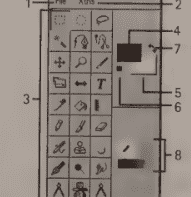

> 图2.1 GIMP 工具箱选择了矩形选择工具，颜色为黑色和白色。注意顶部的文件和编辑菜单。工具箱的布局非常简单。顶部是文件 (1) 和编辑 (2) 菜单。这些包含其他操作的下拉菜单。工具箱左侧是各种工具图标 (3)。有关这些工具的更多信息，请参见第 11、12 和 13 章。当前选中的工具会缩进并比其他任何工具颜色深。默认选择了矩形选择工具。

## GIMP 入门：创建新图像

您可以通过点击工具来切换工具。工具的右侧是活动颜色。顶部的颜色是前景色 (4)，下方是背景色 (5)。活动颜色会缩进。默认前景色为黑色，背景色为白色。左侧的小黑白方块 (6) 将颜色重置为默认的黑白。右侧的双向箭头 (7) 交换前景和背景颜色。此操作也可以通过快捷键 `[X]` 完成。当前画笔和图案显示在工具箱的右下角 (8)。

### 2.1.1 创建新图像

按照步骤创建新图像：

1. 点击工具箱中的文件菜单。
2. 点击新建 `[Ctrl+N]`。
3. 将弹出一个对话框，带有多个选项，如图 2.2 所示。

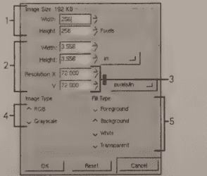

> 图2.2 新图像对话框
>
> 1. 第一个选项是尺寸 (1)。高宽可以独立选择。这里显示的是基于图层的大小。
> 2. 可以在此处选择实际大小 (2)。大小取决于分辨率 (3)，所以先选择分辨率。
> 3. 下一个选择是图像是 RGB 还是灰度 (4)。注意，您无法创建新的索引图像。大多数情况下，您会创建一个 RGB 图像。然而，如果您需要进行黑白工作，请选择灰度。（有关图像类型的更多信息，请参见第 62 页的“图像类型”）
> 4. 您最后的选择是背景颜色 (5)。选项有背景、白色、透明或前景。
> 5. 点击对话框底部的 OK，将创建一个新窗口。

当新窗口创建时（如图 2.3 所示），你将能够对其编辑。这里有几点需要注意：

- **标尺 (1)。** 侧边的标尺是以像素为单位测量的。
- **黄色虚线。** 如果你稍微放大窗口，就能更清楚地看到边缘的这些虚线。它们显示了你正在工作的图层的大小。通常虚线的大小等于图像的大小，但必要时可以调整大小（“调整图层”，第 42 页）。
- **滚动条 (2)。** 如果你的图像大于你正在工作的窗口，滚动条会出现在侧边。
- **图像菜单按钮 (3)。** 这个按钮在只有两个按钮时会用到。
- **掩罩切换按钮 (4)。** 这些按钮在快速掩罩（QuickMask）和普通模式之间切换。
- **光标位置 (5)。** 这里显示光标的坐标。
- **状态栏/取消按钮 (6)。** 这显示正在运行的插件的状态，点击取消按钮可以终止它们。

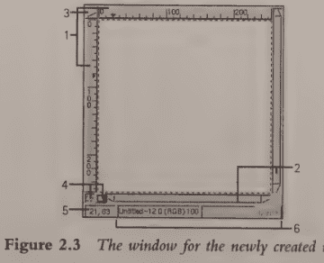

### 2.1.2 基础绘制技术

既然你已经打开了一个新图像，不如在里面画画画。在工具栏中选择一个工具。铅笔工具就是一个很好的选择，参见图 2.1 中的 (3)。通过用鼠标点击并拖动来画线。（哪种绘图程序不是这样操作的呢？）非常简单直观。

### 2.1.3 颜色选择

颜色选择对话框非常直观。它包含一些非常有用的选项，尽管并不总是显而易见的。

要访问颜色选择对话框，双击工具箱上的前景颜色或背景颜色（图 2.1 中的 (4)）。

颜色选择对话框出现，如图 2.4 所示。选择颜色有四种不同的方法：

- GIMP 方法
- 水彩方法
- 三角形方法
- GTK 方法

#### 2.1.3.1 GIMP 方法

这代表一个三维颜色立方体。在大窗口中，你看到的是该立方体的当前层，具有恒定的色相（hue）。在较小的垂直条 (1)（参见图 2.4）中，显示了不同色相的层范围。如果你沿着这个垂直条点击并拖动，你会发现色相是唯一的 HSV 值在变化。对话框顶部的两个正方形显示了当前颜色 (2) 和之前的颜色 (3)。右侧的滑块和数字列显示了所有值：H 代表色相 (4)，S 代表饱和度 (5)，V 代表亮度 (6)，R 代表红色，G 代表绿色，B 代表蓝色 (7)。注意，色相的范围是从 0 到 360 度，饱和度和亮度是百分比，范围从 0 到 100。R、G、B 的范围是从 0 到 255。还有一个区域可以以十六进制三元组 (8) 输入颜色，用于网页制作。

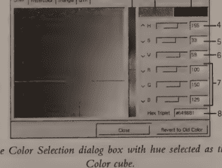

图 2.4 颜色选择对话框，其中色相被选为颜色立方体上的 Z 轴。

> *为了完全理解这一点，最好对 HSV 和 RGB 颜色模型有一定的背景了解。请看第 5 页关于颜色模型的更多信息。*

#### 导航 GIMP：颜色选择

默认情况下，色相被视为颜色立方体的 Z 轴。这意味着垂直条显示不同的色相。这使得饱和度沿 Y 轴（大调色板中的垂直方向）变化。亮度沿 X 轴（大调色板中的水平方向）显示。颜色立方体也可以在不同的轴显示。要这样做，点击你想要作为 Z 轴的按钮。例如，点击饱和度旁边的按钮将将其显示为 Z 轴。色相将变为 Y 轴，而亮度保持为 X 轴。按照以下步骤操作：

1. 点击大调色板找到所需的值。
2. 使用以下任一种方法进行微调：
   a. 输入所需颜色的数值。
   b. 点击底部的关闭按钮。

如果你对此颜色不满意，点击还原。

#### 2.1.3.2 水彩方法

这种方法通过模拟调色板（如图 2.5 所示）来选择颜色。在大窗口 (1) 中，显示了可用颜色。点击鼠标按钮将颜色添加到“画笔”。显示在较小的预览区域 (2) 中。避免使用鼠标拖动；这会导致奇怪的颜色。一旦对颜色满意，点击关闭按钮。还显示了颜色历史 (3)，可以从中选择颜色。画笔上的数量通过滑块 (4) 控制。

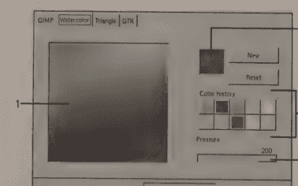

图 2.5 水彩菜单。

#### 2.1.3.3 三角形方法

三角形菜单（如图 2.6 所示）基于色轮。在大圆周 (1) 处选择颜色。然后从三角形 (2) 中选择特定的色调。选中的颜色显示在下方 (3)。


图 2.6 三角形菜单。

#### 2.1.3.4 GTK 方法

此菜单（如图 2.7 所示）允许使用 GTK 方法选择颜色。它也用于脚本（见第 27 页）中选择颜色。它类似于 GIMP 方法，但色轮 (1) 不同。大色轮代表色相和饱和度。当你环绕轮移动时，色相从 0 变为 360 度。当你沿着径向移动时，饱和度发生变化。最纯的颜色在边缘；最不纯的位于中心。通过条 (2) 选择亮度。颜色显示在底部 (3)。可以使用滑块 (4) 或键盘输入 (5) 输入特定颜色。


图 2.7 GTK 菜单。

### 2.1.4 工具选项

现在你已经掌握了基础知识，学习工具背后的选项很重要。有三种不同的方法可以获取特定工具的选项：

- 双击工具箱中的工具图标。
- 右键点击图像获取图像菜单，或点击图像左上角的箭头。进入对话菜单，然后点击工具选项。
- 点击工具箱中的文件菜单，进入对话菜单并点击工具选项。


每种方法都会出现相同的窗口。后两种方法似乎很浪费时间；为其中任一种方法分配快捷键可以节省时间。请看第 17 页关于 GIMP 快捷键学习如何操作。有关工具选项的信息，请见第 10、11 和 12 章。

## 2.1.5 撤销和重做

撤销和重做是必不可少的工具。撤销的快捷键是 `Ctrl+Z`；重做的快捷键是 `Ctrl+R`。记住这些。如果你想从菜单访问它们，可以在图像/编辑菜单中找到。由于存储撤销前的图像会占用 RAM，GIMP 允许你更改撤销次数。见第 17 页的“界面设置”部分。

## 2.2 首选项

GIMP 是高度自定义的。你第一次遇到它的地方是偏好菜单。它位于工具箱/文件/偏好或图像/文件/偏好菜单中。

偏好菜单中有以下选择：

- 新文件
- 显示
- 界面
- 环境
- 会话
- 监控
- 目录

### 2.2.1 新文件设置

在这里输入创建新文件时的默认值。有以下可用选项：

- 默认图像大小和单位。这里以像素输入位图大小。实际尺寸可以用各种单位输入，尽管英寸是最常用的。
- 默认分辨率和单位。在这里选择默认分辨率。也可以选择单位，每英寸像素是最常用的。
- 默认图像类型。在这里可以选择 RGB 或灰度模式。

### 2.2.2 显示设置

在“显示”部分中，你可以更改显示选项。有以下可用选项：

- 透明度类型。确定用于表示透明度的颜色。选项如下：
  a. 浅色格纹
  b. 中色格纹
  c. 深色格纹
  d. 仅白色
  e. 仅灰色
  f. 仅黑色
- 格纹大小。有以下选择：
  a. 小
  b. 中
  c. 大
- 立方插值。用于缩放图像时。它处理速度较慢，但效果更好。如果你的电脑较慢，请关闭此选项。

### 2.2.3 界面设置

偏好菜单中的下一个部分是界面。在这里你可以控制 GIMP 用户界面的一部分。有以下可用选项：

- 预览大小。这决定了图层菜单以及各种使用预览的插件的预览大小。较大的预览占用更多的 CPU 资源，也占用更多的屏幕空间，但效果更好。可以关闭预览以节省资源。
- 撤销次数。增加撤销次数有助于编辑图像，但会消耗大量 RAM。如果你的电脑内存不足，请考虑减小此值。

#### 导航 GIMP：界面设置

- 最近文档列表大小。决定在“文件”菜单中显示的最近文件数量。
- 显示工具提示。此切换开关可以打开或关闭工具提示。显示工具提示会在按钮上方显示描述信息。同样，这会使用系统资源，因此可以将其禁用。

在“图像窗口”子选项中，有以下可用选项：

- 缩放时调整窗口大小。这会导致窗口在放大或缩小时精确地适应图像大小。如果窗口比屏幕大，则尺寸将不会改变；取而将使用滚动条。
- 显示标尺。切换标尺的显示和隐藏。
- 显示状态栏。切换状态栏的显示和隐藏。
- “行进蚂蚁”的速度。“行进蚂蚁”是你所选区域周围的虚线。此处的数字是不符合直觉的。它代表更新更新前的毫秒延迟。数字越大，“蚂蚁”移动得越慢。
- 图像标题格式。决定图像窗口标题在窗口管理器中的显示方式。有以下可用选项：
  a. 自定义
  b. 标准
  c. 显示缩放百分比
  d. 显示缩放比例
  e. 显示反向缩放比例
- 完美-慢指针跟踪。这改进了跟踪光标的方法，但速度较慢。可以保持关闭。
- 禁用光标更新。通常情况下，GIMP 会根据你使用的工具更改光标。此选项使用系统资源，因此可以将其禁用。

### 2.2.4 环境设置

首选项菜单中的“环境”部分控制 GIMP 如何使用系统资源以及如何与它们交互。在此部分，有以下可用设置：

- 节能内存使用。取消勾选此项时，GIMP 会损失速度，但减少所需的内存。
- 瓦缓存大小。这更改了 GIMP 在硬盘上可以使用空间。增加此设置可以防止 GIMP 交换到磁盘。
- 最大图像大小。决定 GIMP 可以处理的图像的最大尺寸。

#### 导航 GIMP：目录设置

- 安装调色板。在 8 位 X 服务器上使用 GIMP 时，这是必须的。如果没有勾选此项，窗口管理器和其他程序将使用系统可用所有颜色，导致 GIMP 无法使用。安装调色板可确保 GIMP 拥有它所需的尽可能多的颜色。这可能会让其他程序在非活动时看起来很奇怪，但不会造成任何伤害。
- 调色板循环。此设置并不明显。它禁用了“行进蚂蚁”虚线；取而代之的是使用实线选择线。
- 缩略图。开启或关闭图像预览的写入。很有用，应该开启。

### 2.2.5 会话设置

此部分控制会话管理选项。有以下可用选项：

- 退出时保存窗口位置。这将跟踪窗口的位置并在 GIMP 重启时将它们放在相同的位置。
- 清除已保存的窗口位置。此按钮删除存储的窗口位置。
- 总是尝试恢复会话。此切换开关让 GIMP 在重启时恢复会话。
- 退出时保存设备状态。

### 2.2.6 显示器设置

此部分控制显示器分辨率设置。你可以从以下位置查看或设置显示器分辨率：

- 来自 X 服务器。你的分辨率将列在这里。
- 手动。可以手动设置分辨率。

### 2.2.7 目录设置

此部分非常简单。它显示 GIMP 使用的各种目录的位置。可以更改以下目录：

- Temp（临时）
- Swap（交换）

下拉菜单中显示以下目录，点击 + 号后更改：

- Brushes（笔刷）
- Gradients（渐变）
- Patterns（图案）
- Palettes（调色板）
- Plug-Ins（插件）
- Modules（模块）

点击新建按钮添加新目录。可以通过箭头按钮提高目录优先级。可以通过点击垃圾桶从列表中删除目录。

## 2.3 窗口操作

本节讨论了在图像内工作的各种操作。这些操作很容易学习会被反复使用。它们都在“图像”菜单中。以下窗口操作包括：

- 调整窗口大小
- 缩放
- 使用标尺和指南
- 视图

### 2.3.1 调整窗口大小

调整窗口大小可能是处理大型图像时要学习的内容之一。你必须记住，并不是所有的窗口管理器都是平等的（参见附录 C，“窗口管理器”）。很难描述调整窗口大小的精确过程，因为它不是由 GIMP 控制的。通常（但并非总是）窗口下角有可以拖动的句柄。可能会出现一条线来预览新窗口的大小。如果图像大于窗口，请使用滚动条移动。

### 2.3.2 缩放

可以通过多种方式缩放图像。第一种是使用缩放工具。第二种可能也是最常用的是使用 `-` 和 `=` 键；`-` 会缩小图像，而 `=` 将以实际大小或 100% 显示图像。缩放因子可以在“图像/缩放”菜单中选择。那里显示了各种比例。缩放是通过比例描述的。1:1 意味着一个屏幕像素等于图像像素。3:1 意味着图像是三倍大。正方形代表图像像素。最好按 2 的幂缩放（1:2, 2:1, 4:1 等）。不能输入任意数字；这样做是没有意义的。

### 2.3.3 使用标尺和指南

标尺和指南对于精确对齐图层和选择非常有用。对于任何为 Web 创建 Logo 的人来说都是一种福音，因为那里需要精确性。标尺和指南操作在“图像/视图”菜单中。使用标尺和指南时有几个选项：

- 切换标尺开启/关闭 (`Shift+Ctrl+R`)。如果你需要使用屏幕上的每一像素空间，此选项是必须的。
- 切换状态栏开启/关闭 (`Shift+Ctrl+S`)。如果你需要更多的空间，此选项可以关闭状态栏。
- 切换指南 (`Shift+Ctrl+T`)。指南是图像上的水平线或垂直线。通过点击标尺并将光标拖入图像中来放置指南。必须切换指南才能使用它们。指南（通常）是蓝色虚线，当你移动它们或当选择区域或图层在其上方时，它们会变为红色。
- 对齐到指南。可以切换指南让图层和选择“吸附”到指南上。当指南未开启时，对齐指南将不起作用。

### 2.3.4 视图

在“视图”菜单中还有其他几种操作：

- 切换显示。当此未开启时，可以开启或关闭“行进蚂蚁”虚线。
- 新视图。这会创建一个现有图像的精确复制窗口。
- 像素。当此开启时，每个图像像素将显示为一个屏幕像素。
- 缩放 100%。将图像按实际大小显示。
- 缩放比例。
- 切换显示。
- 切换指南。
- 切换标尺。
- 切换状态栏。
- 对齐到指南。
- 窗口信息。
- 新视图。
- 像素。
- 缩放 100%。
- 缩放比例。

## GIMP 导航：复制与剪切

**浮动选择**。浮动选择将出现在“图层和通道”菜单中（参见“图层和通道”，第 37 页）。浮动选择的作用类似于普通图层，不同之处无法在其内部进行选择。注意，这种行为与 GIMP 1.0 的处理不同。你可以在浮动选择内部进行绘制、擦除，甚至应用过滤器。在浮动选择被锚定或转换为新层之前，它将像普通图层一样工作。

你可以通过以下任何操作锚定浮动选择：

- 使用选择工具点击浮动选择区域内部。
- 点击“图层和通道”菜单中的“锚定图层”按钮。
- 从 `<图像>/图层` 菜单中选择“锚定” (`<Ctrl+H>`)。

浮动选择也可以变成一个新图层。只需点击“图层和通道”菜单中的“新建层”按钮即可。

有一个值得记住的技巧：每当你创建一个稍微复杂的选择时，将其保存到通道中。这有助于避免多次创建相同的选择（“保存到通道”，第 30 页）。

## 2.4.2 复制与剪切

复制和剪切都非常直观。复制的操作方法如下：

1. 确保激活了选择，无论是在图层中还是在浮动选择内部。


2. 要复制某些内容，点击`<图像>/编辑/复制` (`[Ctrl+C]`)。这会将选择复制到剪贴板。如果你想复制可见图层的组合，它将会被复制。只有包含选择的当前图层会被复制。选择`<图像>/编辑/复制可见`。这将实现等同于你合并了可见图层、复制选择，然后再次将它们分离的结果（“合并图层”，第 42 页）。

要剪切某些内容，请遵循以下步骤：

1. 激活选择。

2. 要从图层中剪切选择，请选择`<图像>/编辑/剪切` (`[Ctrl+X]`)。这将从当前图层中移除选择并将其放入剪贴板。

在对具有透明度的图像进行复制和剪切时，请注意只有图像中有颜料的部分才能被选择进行复制或剪切。选择中任何透明部分都将被忽略。

## 2.4.3 粘贴

粘贴也非常直观。当剪贴板中存在复制或剪切的内容时，该项可以粘贴到图像中。点击`<图像>/编辑/粘贴` (`[Ctrl+V]`) 粘贴该项。每当这样粘贴图像时，它就会变成一个浮动选择。此时，它必须锚定到当前图层或成为一个新层。

另一个选项是使用`<图像>/编辑` 菜单中的“粘贴到”。此操作允许你将内容粘贴到激活的选择中。此选择之外的任何内容都是可见的。使用“粘贴到”时，会创建一个浮动选择。因为如此，如果你已经有一个浮动选择，它会被取消，并创建新的粘贴选择。当你使用“粘贴到”时，新的浮动选择必须锚定到当前图层以实现该效果。如果你创建一个新层，粘贴缓冲区将不仅出现在激活选择的内部。

## 2.4.4 命名选择

如果你正在进行大量的复制、剪切和粘贴，你将希望利用命名缓冲区（Named buffer）。这允许你为选择命名，以便你可以拥有多个选择。`命名复制` (`[Shift+Ctrl+C]`)、`命名剪切` (`[Shift+Ctrl+X]`) 和`命名粘贴` (`[Shift+Ctrl+V]`) 都在`<图像>/编辑` 菜单中。

当你使用`命名复制`或`命名剪切`时，会弹出一个窗口询问缓冲区名称。为此选择输入一个名称，它将保存在命名缓冲区中。

使用`命名粘贴`时，会弹出一个窗口，列出命名缓冲区中的所有内容。点击“粘贴”、“粘贴到”或“新建层”将其插入图像中。点击“删除”从命名缓冲区中移除该选择。`命名剪切`或`命名复制`也会放置在常规缓冲区中，因此使用“粘贴”可以将其插入图像中。

## 2.4.5 高级选择

使用更复杂的选择可能是困难的。每次点击鼠标都有许多不同的选项。对于所有选择工具，按键操作和鼠标点击必须按此顺序进行：

1. 在点击鼠标按钮之前按住 `Shift` 或 `Ctrl` 键。

   a. 使用`Shift+点击`创建现有选择与新选择之间的并集（参见图 2.8）。光标在底部会显示一个`+`号表示此。

   b. 使用`Ctrl+点击`保留选择之间的差集（参见图 2.9）。光标在底部会显示一个`-`号表示此。

   c. 按住键并点击创建两个选择之间的交集（参见图 2.10）。光标在底部会显示一个`∩`号表示此（对于套索选择和智能剪刀，必须在点击所选区域内部时进行）。

2. 点击鼠标按钮。

3. 释放键并拖动鼠标以创建选择。

`img/f2e1dc39482e76a84057f638c7a2df_48_0.png`

`img/f2e1dc39482e76a84057f638c7a2df_48_1.png`

图 2.8 矩形选择与圆形选择之间的并集（`Shift+点击`）。

图 2.9 相同的的矩形选择与圆形选择之间的差集（`Ctrl+点击`）。

`img/f2e1dc39482e76a84057f638c7a2df_48_2.png`

图 2.10 矩形选择与圆形选择之间的交集（`Shift+Ctrl+点击`）。

矩形选择工具和椭圆选择工具（参见第 154 页）也使用按键（`Shift`、`Ctrl`或两者）来约束选择的形状。

要约束形状并替换当前选择，请遵循以下步骤：

1. 点击鼠标按钮。

2. 按下键（`Shift`或`Ctrl`）。

3. 拖动鼠标创建适当的选择。

要同时使用这两种效果，请遵循以下步骤：

1. 按住所需的键（`Shift`、`Ctrl`或两者）。

2. 点击鼠标按钮。

3. 释放按键。

4. 按住并保持所需的键以产生约束效果。

5. 然后可以拖动鼠标进行所需的选择。

如果你 制作了错误的选择，可以在仍在拖动时取消选择。在释放鼠标按钮之前按住右鼠标键以撤销新选择，然后释放右鼠标键。

要在复杂物体周围创建选择，通常最好是使用智能剪刀工具获取图像的大致形状。一旦选择了大致形状，将其转换为贝塞尔曲线以进行微调。GIMP 1.2 的一项新功能是路径（Paths）。路径提供了对贝塞尔曲线更强大的控制力。

如果物体非常复杂且背景杂乱，可能需要放大很多。然后使用自由手选择工具配合 `Shift` 和 `Ctrl` 键组合，确保每个像素都正确。如果你不需要极高的精度，使用`<图像>/选择/羽化`（Feather）来平滑边缘到背景的过渡。

## 2.4.9 锐化 (Sharpen)

锐化用于移除活动选择区域的抗锯齿。当创建椭圆形选择时，其边缘总是会有轻微的羽化，如图 2.11 所示。锐化会消除这种效果，产生类似图 2.12 所示的外。如果你对选择区域的羽化过度，并想重新开始，这个工具就会非常有用。锐化位于 `<Image>/选择` (Select) 中，其快捷键为`[Shift+Ctrl+H]`。

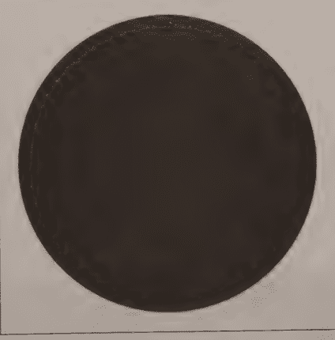

图 2.11 普通的椭圆形选择。注意其平滑的边缘。


图 2.12 锐化后的相同选择。注意其锯齿边缘。

## 2.4.10 边框 (Border)

边框将活动选择区域的外边缘替换为边框。会弹出的窗口询问边框的大小。在使用边框时，必须记住它是以活动选择区域的边缘作为边框的中心。如果你像图 2.13 所示创建一个 10 像素宽的边框，它将向内扩展 10 像素并向外扩展 10 像素。注意这是一个平滑的过渡。要获得锐利的边框，请使用`<Image>/选择/锐化` (`[Shift+Ctrl+H]`)。边框位于`<Image>/选择` (Select) 菜单中。


## 2.4.11 羽化 (Feather)

羽化的锐化的相反。它通过特定数量逐渐淡出选择区域。在编辑扫描照片时为了让粘贴的部分看起来更自然，这非常有用。它能让这些部分更容易地融入不同的背景。羽化位于`<Image>/选择` (Select) 中，其快捷键为`[Shift+Ctrl+F]`。


## 2.4.12 增大与缩小 (Grow and Shrink)

增大和缩小会改变活动选择区域的大小。它们是径向进行的，因此当使用“增大”时，矩形选择或其他具有尖锐角的选择将失去其定义的边角。增大和缩小都位于`<Image>/选择` (Select) 菜单中。

## 2.4.13 快速蒙罩 (QuickMask)

快速蒙罩是 GIMP 新增的功能，它让处理选择区域变得变得简单得多。这里的技巧与下一节的“保存到通道”非常相似，因为在过去就是这样操作的。快速蒙罩模式仅仅是使用通道的快捷方式。

要进入快速蒙罩模式，请点击图像窗口左下角的红色正方形。这会在图像上覆盖一层红色屏幕，代表未选择区域。使用绘图工具可以选择选择区域。白色漆料代表被选中区域；黑色漆料表示未被选中。灰色表示部分选择。这种模式对选择区域提供了非常精确的控制，因为可以使用常规工具、过滤器和脚本来精细地羽化选择区域。

要返回普通模式，只需点击图像窗口左下角带有虚线的正方形，快速蒙罩就会转换为选择区域。

快速蒙罩是本节关于选择区域内容最重要的部分。在从扫描照片创建图像时，它是一个无价的工具。查看图 2.15 和图 2.16 可以快速蒙罩的实际效果。


图 2.15 保时捷的选择蒙罩。

# 导航 GIMP：保存到通道与通道转选择

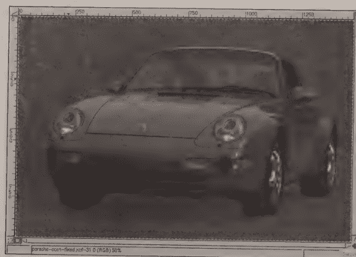

**图 2.16** 在快速蒙罩模式下查看保时捷的选择蒙罩。注意背景看起来非常暗淡。

## 2.4.14 保存到通道与通道转选择

保存到通道（Save to Channel）及其对应的通道转选择（Channel to Selection）需要一些通道的基础知识。更多信息请参阅第 48 页的“通道菜单”。

保存到通道获取活动选择区域并将其复制到通道中供以后使用。在通道菜单中，它显示为选择蒙罩。未选择的部分显示为黑色。在有白色漆料的地方，选择区域被完全选中。灰色表示部分选择。此选择蒙罩可以使用常规绘画工具进行编辑。通过双击“图层和通道”菜单中的通道名称，然后点击右侧的颜色框，可以更改此选择蒙罩的颜色。

当你对选择区域满意时，右键点击通道菜单中的选择蒙罩名称（见图 2.17）并选择`通道转选择` (`[Ctrl+S]`)。这是较高级的操作之一，但在处理扫描照片时，这是必要的。常规选择工具不具备足够的功能来创建复杂的选择区域以处理照片。

# 导航 GIMP：清除与填充


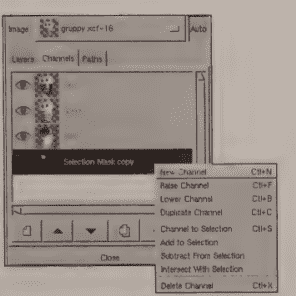

**图 2.17** 使用选择蒙罩。

### 2.4.15 按颜色选择 (Select by Color)

按颜色选择允许根据颜色进行选择。界面易于理解：

- 选择区域为白色，未选择区域为黑色，灰色区域为部分选择。

- 底部的模糊度滑块决定了颜色要求。

- 右侧是选项：

  a. 替换

  b. 相加

  c. 减去

  d. 交集

### 2.4.16 清除与填充 (Clear and Fill)

清除和填充是处理选择区域的简单工具。清除移除选择区域或图层中的所有漆料。填充向当前选择区域添加漆料。

### 2.4.17 描边 (Stroke)

描边使用当前的笔刷，在有选择的地方绘制线条。这对于使用选择工具绘制矩形、圆形和曲线非常有用。尝试不同的笔刷和工具，特别是它们的间距（见第171页）。也可以使用选择蒙罩创建有趣的效果。

## 2.5 杂项操作 (Miscellaneous Operations)

以下操作不属于任何特定类别，但都是非常有用的。GIMP 中有很多快捷键（你只需要学习如何使用它们来节省时间）。

### 2.5.1 从 GIMP 打印

在 PC 世界中，对 PostScript 的支持相当糟糕，大多数人没有支持 PostScript 的打印机。有一个免费的 PostScript 解释器 GhostScript，它可以支持大多数打印机。大多数 Linux 发行版自带此解释器。本节假设你有一个支持 PostScript 的打印机、配置良好的 GhostScript 或 PCL 打印机。

从 GIMP 打印非常简单：

- 点击 `<Image>/文件/打印`进入打印菜单。菜单中会有几个选项。右上角是图像的输出。有两个选择：

  - 文件

  - `Lp`（行打印机）

每个选项的详细设置可以在右侧的设置按钮中找到。如果你有驱动程序支持的打印机，请务必使用它。你可以使用驱动程序提供的额外功能，如分辨率或介质类型。如果没有支持的打印机，可以使用通用 PostScript 驱动。

- 使用 PostScript 驱动时，有一个 PPD（PostScript 打印描述）文件的选项。这允许你包含针对打印机的特定指令。如果你有 PostScript 打印机，可以通过以下任何方式获取 PPD 文件：

图像在纸张上的布局。此选项通过点击式界面控制。深色正方形表示图像，黑线表示纸张尺寸。无法对图像的位置进行精确控制。

### 2.5.2 从 GIMP 发送图像

如果你不打算在家里打印图像，或者需要将其发送给客户，那么“邮件图像”（Mail Image）插件非常有用且易于使用。它假设你的系统已经连接了可以使用的网络并设置了电子邮件。在“收件人”（To）字段中输入对方电子邮件地址。也可以输入主题。如果需要，可以输入简短的注释。文件名非常重要。GIMP 会根据文件名自动转换图像。使用此功能时要小心：如果保存失败，你将发送一封空邮件。请确保图像类型与格式正确，并且已经根据需要平化或合并了图层。最后一个选项是发送附件的格式。MIME 是最好的，但如果收件者使用的是旧版本的电子邮件程序，你可能需要使用 uencoding。此插件可以在 `<Image>/File/Mail Image` 中找到。

### 2.5.3 截屏

截图可以非常有用，特别是当你正在写一本关于图像处理程序的书籍时。它完全可能有其他用途。截图工具位于 `<Toolbox>/File/Acquire/Screenshot` 中。

截屏有两种主要选择：

- 抓取窗口（Grab a window）

- 抓取整个屏幕（Grab the whole screen）。

如果你只对特定窗口截图，还可以选择不包含装饰。装饰是窗口管理器添加的任何内容，例如工具栏或用于调整窗口大小的手柄。在进行全屏截图时，显示菜单内容可能有用。延迟允许此操作的发生。它可以根据需要设置为任何时间。

要进行截图：点击“抓取”（Grab）。

1. 选择你需要的选项，然后点击“抓取”。

   a. 如果你在抓取单个窗口，点击你想要的抓取按钮。

   b. 如果你正在进行全屏截图，点击“抓取”，窗口将消失。现在你有时间根据需要调整屏幕了。

2. 对于所有截图，在截图之前会响两次蜂，然后新图像就会出现。注意，截屏时不会显示鼠标光标。

> 如果你在截图中遇到颜色失真的问题，请尝试使用此命令以不同的位深运行你的 X 服务器：`startx --bpp 16`

某些旧版本的发行版对 24bpp 截图存在问题。

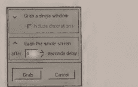

图 2.18 截图窗口的截图，设置为两秒后抓取全屏。

### 2.5.4 标签补全

GIMP 的“保存”（Save）和“打开”（Open）窗口允许你使用类似于 `bash` shell 中的标签补全功能。如果你输入部分文件名（如图 2.19 所示），然后按 `Tab` 键，它将尝试补全文件名。如果有多个匹配的文件，它将只会显示匹配的文件。如果你在处理目录中的许多不同文件，这非常有用。

注意窗口不显示隐藏文件。要查看它们，输入一个点（.），然后按 `Tab` 键，隐藏文件就会出现。


图 2.19 文件打开窗口，使用标签补全仅显示匹配的文件名。

# 3 图层与通道

| 页码 | 内容 |
|---|---|
| 38 | **图层窗口与通道窗口** |
| 38 | 图层窗口布局——控制图像中的不同图层。 |
| 39 | 通道窗口布局——控制红、绿、蓝部分。 |
| 40 | **图层操作** |
| 40 | 查看图层——如何查看。 |
| 41 | 添加和删除图层——如何添加。 |
| 42 | 移动图层——如何移动。 |
| 42 | 缩放图层——如何缩放。 |
| 43 | 平化图层——如何合并。 |
| 44 | 模式——关于模式的信息。 |
| 46 | 透明度——关于透明度的信息。 |
| 47 | 图层蒙罩——使用图层蒙罩。 |
| 48 | **通道** |
| 48 | 在特定通道中工作——特定通道。 |
| 49 | 通道操作——操作类型。 |

图层和通道非常重要。如果你用过 Photoshop，你会觉得很熟悉。

本章的第一部分是图层窗口与通道窗口的布局。

## 3.1 图层窗口与通道窗口

本章的第一部分是图层窗口与通道窗口的布局。

### 3.1.1 图层窗口布局

此菜单的布局（如图 3.1）非常简单。顶部显示图像的名称和缩略图。“自动”（Auto）按钮将自动显示对图层的更改。如果关闭它，缩略图将不会更新。接下来显示图层的模式。


图 3.1 图层窗口。

### 3.1.2 通道窗口布局

点击图层与通道窗口中的“通道”标签可以访问通道笔记本页（图 3.2）。如果你正在处理 RGB 图像，每个颜色通道都会在这里显示。眼睛图标表示该通道正在显示。任何创建的额外通道都会显示在这里。

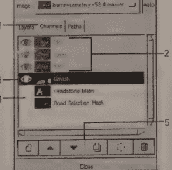

图 3.2 通道窗口。

## 3.2 层操作

此菜单中找到的操作对于处理任何类型的图像都极其有用。了解此菜单中的所有选项非常有帮助。通过点击图像的缩略图来选择要编辑的图层。图层将以蓝色高亮。

### 3.2.1 查看单个层

图层菜单（见图 3.3）中一个实用的操作是查看某些层并隐藏其他层。你可以通过点击眼睛图标来实现此操作。任何组合的层都可以开启或关闭。请注意，更改图层的可见性不会改变当前选中的层。如果你有许多层，并且只想查看某一层，请在按住 `Shift` 键的同时点击眼睛图标。所有其他层都将被隐藏。要再次显示所有层，只需按住 `Shift` 键并再次点击眼睛即可。


图 3.3 图层窗口。

### 3.2.2 添加和删除层

一旦你开始接触更复杂的图像处理，你就会需要在工作过程中添加和删除层。

#### 3.2.2.1 添加层

有几种不同的方法可以添加图层：

- 点击新建图层图标 (1)。

- 右键点击图层名称或缩略图，并选择新建图层 (2)。

- 当图层窗口处于激活状态时，按热键 `Ctrl+N`。

当你选择上述三种方法之一添加图层时，会弹出一个类似于图 3.4 的新窗口。该窗口为新图层提供了几个选项：

- 层名称

- 层宽度

- 层高度

- 单位。这对于使用图像尺寸的百分比尤为有用。

- 层填充类型。这决定了使用什么颜料来填充图层。

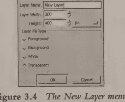

图 3.4 新图层菜单。

#### 3.2.2.2 删除层

删除层比添加层要简单得多。你可以执行以下操作之一：


- 右键点击图层名称或缩略图，并选择删除层。
- 当图层窗口处于激活状态时，按热键 `Ctrl+X`。

### 3.2.3 移动层

在处理多个图层时，通常需要移动它们。这是通过移动工具实现的，只需点击并拖动它们即可。图层的轮廓用黄色和黑色虚线显示。除非你在处理透明度，否则此操作非常简单。

在移动具有透明度的图层时，你必须点击包含颜料的区域。特定区域的颜料通过光标变为十字来指示。如果你不点击带有颜料的区域，下一个包含颜料的层将被选中并移动。当这种情况将发生时，光标会变成手部图标。如果该位置没有包含颜料的图层，光标将变成箭头。如果你在点击下一个图层时按住 `Shift` 键，它将强制移动活动图层，而不是选择下一个带有颜料的层。

可以使用引导线精确地对齐图层。更多信息请参阅第 21 页。

### 3.2.4 调整层的大小和缩放

调整图层的大小和缩放功能可以对图层组合的对齐进行非常精确的控制。这些操作与调整整个图像的大小和缩放非常相似。调整层的大小操作图像边界。内容不会改变，因此部分可能会被裁剪。缩放图层实际上会改变图层的内容。

要调整图层的大小，请遵循以下步骤：
1. 右键点击图层名称或缩略图。
2. 当图层窗口处于激活状态时，点击调整层大小 `Ctrl+R`。
3. 为图层输入新参数：
   - 新宽度
   - 新高度
   - 单位
   - X 比例
   - Y 比例
   - X 偏移
   - Y 偏移
也可以通过鼠标点击并拖动框来控制 X 和 Y 偏移。
4. 点击确定。

要缩放图层，请遵循以下步骤：
1. 右键点击图层名称或缩略图。
2. 当图层窗口处于激活状态时，点击缩放层 `Ctrl+S`。
3. 为图层输入新参数：
   - 新宽度
   - 新高度
   - 单位
   - X 比例
   - Y 比例
4. 点击确定。

### 3.2.5 合并层

当你准备好组合最终产品时，合并层是非常有用的。合并可见图层选取两个或多个可见的图层并将它们合并为一个层。当你有很多层需要合并，但又不想制作单层图像，因为可能还需要更多工作时可以使用这种技术。如果你正在制作 GIF 动画或具有透明度的图像，请使用此操作。当你选择合并可见图层时，会弹出一个窗口确定新图层的大小。

有几种方法访问合并可见图层操作：
- 右键点击图层名称或缩略图，并选择合并可见图层。
- 点击 `图像`/`合并可见图层`。
- 当图层窗口处于激活状态时，按热键 `Shift+M`。

合并时有以下可用选项：
- 扩展。创建一个足够大的图层。
- 裁剪到图像。创建一个足够大的图层。
- 裁剪到底部。创建一个足够大的图层。

## 图层与通道：模式 45

颜色变为白色。顶层中的白色或极浅颜漆不会影响图像。灰色像素会亮化下方的颜色。

### 3.2.7.6 滤色 (Screen)

滤色是正片的反向。它会漂白图像，并使其始终比原始图像亮。这比比将两个幻灯片指向同一个点。任何黑色像素都会变成完全透明，白色像素变成完全不透明。这种模式非常适合创建反射效果。

### 3.2.7.7 叠加 (Overlay)

叠加模式强调图像中的阴影和高光。黑色像素通过使阴影区域变暗来影响它们。白色像素则通过使高光区域变亮来影响它们。中间调区域会被涂上颜漆颜色。叠加适合在图像上覆盖文字。

### 3.2.7.8 差值 (Difference)

差值模式可以产生一些显著的结果。它比较图像中像素的亮度。生成的像素是两个像素之间差值的绝对值。例如，如果你在一个 `R:255 G:100 B:100` 像素上放置一个 `R:80 G:96 B:255` 像素，结果将是 `|(80-255)|=175 |(96-100)|=4 |(255-100)|=155`，即紫色。

### 3.2.7.9 变亮 (Addition)

变亮将两个图层的 RGB 值相加，每个通道的最大值为 255。这意味着黑色像素对图像没有影响，白色像素是完全不透明的。这与滤色模式类似，但变亮更多地取决于下层。

### 3.2.7.10 减差 (Subtract)

减差是变亮的反向。它从下层层中减去上层的 RGB 值。这意味着黑色像素表现就像透明的一样，但白色像素表现就像任何颜色一样。上层上的任何颜色都会用其互补色染了下层。

### 3.2.7.11 仅加深 (Darken Only)

当上层像素比下层像素暗时，此模式只会影响下层。这意味着白色像素通常是透明的，黑色像素是完全不透明的。这种效果通过比较每个 RGB 通道中的值，并对像素使用较小的值来实现。

### 3.2.7.12 仅减亮 (Lighten Only)

仅减亮是仅加深的反向。它影响下层中比上层更亮的像素。这意味着白色像素是不透明的，黑色像素是透明的。除非图像非常暗，否则较的颜色不会影响图像。较亮的颜色是不透明的。这种效果通过比较每个 RGB 通道中的值，并对像素使用较大的值来实现。

### 3.2.7.13 色相 (Hue)

色相使用上层的色相值在下层上绘画。这不会影响图层的饱和度或亮度。这种模式非常适合给图片染色。

### 3.2.7.14 饱和度 (Saturation)

此模式只影响像素的饱和度。它通常影响颜色的“纯度”。使用较高的饱和度值绘画会增强图层的基础颜色。例如，如果你有一张柔和色的图像，并使用高饱和度的饱和度图层，这将使颜色更纯或更亮。如果你使用低饱和度值，它将移除图像中的颜色，使其看起来更像灰度图像。

### 3.2.7.15 颜色 (Color)

此模式同时影响下层的色相和饱和度。它用于在不影响亮度值的情况下对区域染色。

### 3.2.7.16 亮度 (Value)

此模式只影响像素的亮度。它完全不影响颜色值。这种模式适用于调整照片中曝光不足或过的区域。

## 3.2.8 透明度和 Alpha 通道

在图层中处理透明度和 Alpha 通道时有一些注意事项。请考虑以下几：
- 不透明度滑动条。它控制整个图层的不透明度。如果图层上有半透明颜漆，它会变得更透明。不透明度范围从 0 到 100。
- 透明 `Transparent`。这在透明区域的可绘制和不可绘制之间进行切换。如果开启了此选项，你将无法绘制透明区域。开启此选项时，仍然可以在半透明区域上进行绘画。半透明区域将保留其 Alpha 值；只改变颜色。任何区域都可以像往一样删除。此选项非常适合更改文字层的颜色，或在形状上使用混合工具。

## 图层与通道：图层蒙

**背景层**。此图层是特殊的，因为在添加 Alpha 通道之前它无法使用透明度或图层蒙。但是，可以使用滑动条更改整体透明度。此外，在添加 Alpha 通道之前，背景层一直是底层。如果没有 Alpha 通道，它就无法上下移动。

## 3.2.9 图层蒙

图层蒙提供了对图像不透明度的更大控制。它们通过将不透明度表示为灰度可绘制区域来控制图层。黑色区域完全透明，白色区域完全不透明。灰色是半透明的。使用图层蒙的优势是你可以使用工具、过滤器和脚本来控制不透明度，而不仅仅是使用橡皮擦。要创建图层蒙，请遵循以下步骤：
1. 右键点击图层名称。
2. 点击图层蒙。
3. 选择以下项之一：
   - 白色
   - 黑色
   - 灰色

## 图层与通道：选择掩码

**新建通道**。可以通过以下任何方法创建新通道：
- a. 右键点击通道名称或缩略图并选择“新建通道”
- b. 使用快捷键 `Ctrl+N`
- c. 点击“新建通道”按钮

将弹出一个窗口，提示输入名称、透明度和色调。它默认初始化为 50% 的透明度和黑色色调。你可以通过点击彩色方块来更改色调。

**上移/下通道**。可以通过以下任何方法将通道上移或下：
- a. 右键点击通道名称或缩略图，选择“图层上移”或“图层下移”
- b. 使用快捷键 `Ctrl+F` 和 `Ctrl+B`
- c. 使用通道窗口中的图标

**复制通道**。可以通过以下任何方法复制选择掩码通道：
- a. 右键点击通道名称或缩略图，并点击“复制通道”
- b. 使用快捷键 `Ctrl+C`
- c. 点击“复制通道”图标

**删除通道**。可以通过以下任何方法删除通道：
- a. 右键点击通道名称或缩略图，并点击“删除通道”
- b. 使用快捷键 `Ctrl+X`
- c. 点击“删除通道”图标

**新建名称/透明度/色调**。双击图层名称可以更改其名称、透明度色调。默认情况下，新通道初始化为 50% 透明度，但你可能希望更改此设置。通过点击彩色方块更改色调。

### 3.3.3 选择掩码

使用通道的主要目的是处理选择掩码。这些是选择区域的 8 位灰度表示。黑色像素表示未选择区域。白色像素表示完全选中的像素。灰色表示部分选择区域。使用选择掩码的优势在于，你可以通过通道来控制选择。任何可以影响灰度图像的工具、滤镜或脚本都可以用于它。

如果你有现有的选择，可以通过“保存到通道”操作将其转换为通道。

在处理选择掩码时，有几个实用的技巧需要记住：
- 使用模糊画笔和工具来创建平滑的选择边缘。
- 尝试查看通道并更改其透明度以获得更多控制。


透明区域被选中，黑色区域未被选中。

在你编辑完通道后，有两种方法将其转换回选择：

- 右键点击通道名称或缩略图，并点击“通道转选择”。

- 使用快捷键 `Ctrl+S`。

# 图像操作

| 页码 | 主题 |
| --- | --- |
| 52 | 颜色—增强或影响图像中颜色的各种操作。 |
| 52 | 平化 |
| 53 | 反相 |
| 53 | 增加阶量化 |
| 54 | 阈值 |
| 54 | 色平衡 |
| 55 | 亮度与对比度 |
| 55 | 色相与饱和度 |
| 56 | 曲线 |
| 57 | 级别 |
| 59 | 去饱和化 |
| 59 | 自动拉伸对比度和 HSV |
| 59 | 归一化 |
| 60 | 通道操作—在图像上使用不同的通道操作。 |
| 60 | 复制 |
| 60 | 偏移 |
| 60 | 合成/分解 |
| 61 | Alpha—控制图像中 alpha 或透明度的操作。 |
| 61 | 添加 Alpha 通道 |
| 62 | Alpha 阈值 |
| 62 | 图像类型—GIMP 中的各种图像类型及其各自的优/缺点。 |
| 63 | RGB |
| 63 | 索引 |
| 64 | 灰度 |
| 64 | 直方图—使用直方图了解图像中的颜色信息。 |
| 65 | 保存调色板—保存调色板供以后使用。 |
| 65 | 图像变换—各种图像变换操作，如调整大小和裁剪。 |

- 65 调整图像大小
- 66 缩放
- 66 自动裁剪
- 66 激进裁剪
- 66 图像和图层旋转

如果你有一张扫描图像，或者绘制了需要调整的图像，“图像”菜单有很多实用的操作。这些操作在活动图层或选择区域上进行。某些操作（如 RGB 或索引）是在整个图像上执行的。

## 4.1 颜色

“颜色”菜单涉及调整图像色平衡的操作。这些对于提高扫描图像的质量非常有用。此菜单中的操作通常是处理照片时首先使用的。

### 4.1.1 均衡

如果图像颜色太亮或太暗，“均衡”可以修复图像的颜色。它会找到图像中最浅的颜色并将其变为白色，找到最深的颜色并将其变为黑色。不应在质量良好的图像上使用均衡，而应该用于有很多明亮或阴暗区域的图像。此操作可能会降低图片的质量，通常还需要额外的调整。图 4.1 和图 4.2 提供了均衡的（某种不充分的）灰度示例。


### 4.1.2 反相

反相当图像颜色太亮或太暗时可以修复颜色。它会反转图像或选择区域的颜色。黑色变为白色，白色像素变为黑色。图 4.3 和图 4.4 显示了反相操作。


### 4.1.3 增加阶量化

增加阶量化通过改变颜色分级来使图像看起来像索引图像（见“图像类型”，第 62 页）。通过点击彩色方块更改色调。增加阶量化决定颜色的分级（默认设置为黑色）。

这种操作通常用于给图像添加有趣的效果。图 4.5 和图 4.6 是增加阶量化的示例。

菜单底部的选项按钮让你选择要调整的像素：

- 阴影

- 色调

- 亮部

保留亮度可以保持每个像素的强度不变，但在进行大幅调整时可能会产生奇怪的图像。


### 4.1.4 阈值

阈值显示了图像亮度的直方图，如图 4.7 所示。阈值操作会将高于阈值的像素变为白色，低于阈值的变为黑色。这通常用于从图像中分离特定的色调。


### 4.1.5 色平衡

色平衡用于微调颜色。对于三种颜色都有三个滑块：

- 青/红

- 品红/绿

- 黄色/蓝

将所有三个滑块向 CMY（青、品红、黄）移动会使图像变暗，而向 RGB 颜色移动则会使图像变亮。

底部的选项按钮让你选择调整哪些像素：

- 阴影。只调整最暗的像素。

- 色调。调整中间像素。

- 亮部。只调整最亮的像素。

### 4.1.6 亮度与对比度

调整扫描图像的亮度和对比度非常有用。亮对比度滑块居于零，可以向两个方向调整。可以通过键盘输入数值进行微调。此操作非常直观。图 4.8 到图 4.11 提供了视觉示例。


### 图像操作：色阶 (Curves)

曲线菜单的原理非常直观。较色的像素在图表的左侧进行调整，较亮的像素在右侧进行调整。为了参考，图底部放置了两个灰度渐变。顶部的渐变（6）代表正在更改的实际图像颜色。底部的渐变（7）是参考渐变，显示正常曲线的样子。如果你在调整曲线时犯错，底部有一个重置按钮（8），可以将图形恢复到原始线条。

为了调整图像曲线时获得最佳效果，建议使用柔和的 S 型曲线，如图 4.12 所示。曲线的变化应该尽可能小。要调整图像的亮度，请拖动线条中点的曲线。这会调整图像的伽马（gamma）。另一个有用的操作是沿顶部或底角拖动直线。这会调整图像的对比度。为了理解曲线菜单的工作原理，查看调整前后的直方图很有帮助（见图 4.13 和 4.14）。

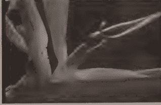


图 4.13 原图。

图 4.14 应用柔和 S 曲线后的图像。

### 4.1.9 色阶 (Levels)

色阶是另一种用于调整图像颜色的极佳图形化工具。此菜单与曲线菜单的效果相同，但界面有所不同。在色阶菜单中，会显示图像的直方图，如图 4.15 所示。底部有两个滑块：

- 顶部的滑块（1）代表可用颜色的范围。

- 底部的滑块（2）代表图像的整体亮度。

色阶可以同时用于所有通道和数值，也可以单独用于每个通道。该工具也适用于灰度图像，其中只能调整黑色和白色色级。通过通过移动箭头或使用键盘输入数值（3）来调整色阶。当修改“值”（Value）的输入色阶时，你正在调整图像的亮度。黑色箭头（4）左侧的所有像素都将变为黑色，白色箭头（5）右侧的所有像素都将变为白色。灰色箭头（6）代表颜色的中间调。图像的这种伽马设置可以像调整曲线菜单中曲线中点一样进行更改。向左滑动会使图像变亮，向右滑动会使图像变暗。

当修改特定颜色通道的输入色阶时，滑块的工作方式略有不同。色阶现在作用于图像颜色的量。完全白色区域具有所有颜色的量，不会受到调整色阶的影响。完全黑色的区域没有颜色，也不会受到调整色阶的影响。受影响的区域仅为黑白之间的范围。例如，黑色箭头（4）左侧的任何像素都将被移除通道。将箭头向右拖动会将灰度图像变为该通道的互补色。

例如，在红色通道中处理灰度图像时，将黑色箭头（4）向右拖动将变为青色。白色箭头（5）右侧的任何像素将获得其通道的完整值。如果你在绿色通道中工作，这将赋予图像绿色色调。灰色箭头代表颜色的中间调。向左拖动为像素添加更多通道颜色，向右拖动则从像素中移除通道颜色。底部滑块代表通道的整体水平。当对通道使用“值”时，将黑色箭头向右拖动会使图像变亮，或者增加图像中特定颜色的量。在颜色通道中工作时，将白色箭头向左移动会增加图像中互补色的量。在“值”通道中工作时，它会让图像变暗。与底部滑块不同，它会影响纯黑

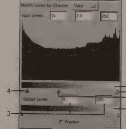

图 4.15 进行调亮调整的色阶菜单。

### 4.1.10 去饱和 (Desaturate)

去饱和移除图像像素中的所有颜色值，将其转换为灰度图像。请注意，这并没有使其成为灰度图像——它仍然是 RGB 。

### 4.1.11 自动拉伸对比度和 HSV

自动拉伸对比度和 HSV 工具会自动调整图像中的色阶。它们将图像中的颜色范围拉伸到整个颜色范围。对比度是在 RGB 模式下执行，而 HSV 在 HSV 模式下执行。这两种操作对于提高褪色、过度曝光或扫描不佳的照片质量都有用（见图 4.16 和 4.17）。

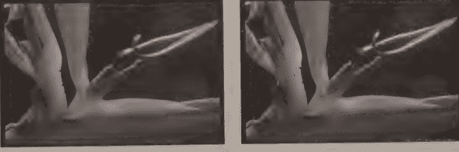

图 4.16 原图。

图 4.17 使用对比度进行“自动拉伸”后的图像。

### 4.1.12 标准化 (Normalize)

标准化工作方式与自动拉伸非常相似。它是改进扫描照片的极佳工具。标准化与对比度的区别在于，标准化整体调整通道色级，而对比度是独立调整（见图 4.18 和 19）。


图 4.18 原图。

图 4.19 标准化后的图像。

# 4.2 通道操作 (Channel Operations)

通道操作不属于某一特定类别，但每一个都很有用。在处理扫描照片时不要忘记这些操作：

### 4.2.1 复制 (Duplicate)

复制会在另一个窗口中创建图像的副本。

### 4.2.2 偏移 (Offset)

偏移水平或垂直方向移动图像。这对于创建图案或修复未对齐的边缘有用。

### 4.2.3 合并与分解 (Compose and Decompose)

合并和分解创建艺术效果非常有用。合并从不同的灰度图像创建图像。分解将图像拆分为单独的通道。分解有几种类型：

- RGB：将图像分解为红色、绿色蓝色通道。
- HSV：将图像分解为色相、饱和度和值通道。
- CMY：将图像分解为青、品红和黄色通道。
- CMYK：将图像分解为青、品红、黄色和黑色通道。
- Alpha：提供一个表示图像 Alpha 值的单一窗口。

要配合 Alpha 使用 CMY 或 CMYK，必须遵循以下步骤：
1. 提取 Alpha 通道。
2. 分解为 CMY 或 CMYK。
3. 根据需要编辑图像。
4. 合并为 CMY 或 CMYK。
5. 分解为 RGB。
6. 带有 Alpha 通道合并为 RGBA。

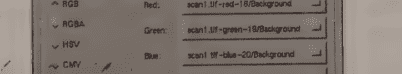

图 4.20 从三个灰度图像创建 RGB 图像的合并菜单。

合并是分解的反向：它从不同的灰度图像创建彩色图像，如图 4.20 所示。

菜单中的选项有：
- RGB 从代表红、绿、蓝通道的三个灰度图像创建彩色图像。
- RGBA 类似；但允许你添加 Alpha 用于透明。
- HSV 根据色相、饱和值合并图像。
- CMY 和 CMYK 根据 RGB 的互补色：青、品红和黄色合并图像。CMYK 在 CMY 的基础上增加了一个黑色通道，如果你为打印分离图像，这是至关重要的。

# 4.3 Alpha

图像菜单的这部分涉及 Alpha 或图像的透明度。

### 4.3.1 添加 Alpha 通道

添加 Alpha 通道是最常用的操作。它在图像中创建一个 Alpha 通道，允许背景图具有透明度。在完成之前，单层图像无法使用透明度。

### 4.3.2 Alpha 阈值 (Threshold Alpha)

Alpha 阈值与阈值操作非常相似。它用于将具有 255 种 Alpha“色调”的图像转换为 1 位 Alpha 层。1 位 Alpha 层意味着像素要么是完全不透明，要么是完全透明。此操作用于将具有不同透明度的 RGB 图像转换为适用于 Web 的格式，例如 GIF 格式。此操作不会显示直方图，因此你必须猜测图像的 Alpha 值。任何 Alpha 值小于所选值的像素将变为完全透明。任何 Alpha 值高于该值的像素将变为完全不透明。

# 4.4 图像类型

图像类型在 Gimp 中非常重要。Gimp 决定了 Gimp 如何处理你图像中的颜色信息。你使用的类型取决于应用程序和图像的文件格式。RGB 是工作时的首选类型，因为它支持尽可能数量的操作和过滤器。第 5 章“选择正确的文件格式”讨论了不同的文件格式，并提供了关于应该使用哪种图像类型的更多信息。

有三种不同的图像类型可用：RGB、索引（Indexed）和灰度（Grayscale）：
- **RGB。** 最常见。
- **索引。** 流行，因为有索引的文件格式，其中广为人知的是 GIF。
- **灰度。** 使用最少，因为它不支持颜色。然而，如果你创建的图像将是黑白的，那么在灰度模式下工作会好得多。

更改图像类型应该是对图像进行的操作的第一项和/或最后一项操作。在不同的图像类型之间进行切换可能会导致你丢失信息。应尽可能使用 RGB。大多数插件不与索引图像配合。如果你加载了索引图像，请立即将其转换为 RGB。

> 那些预处理工作的人员应该注意，Gimp 尚未支持 CMYK。任何为 Gimp 添加 CMYK 支持的人都将获得几分钟的成名时刻。

### 4.4.1 RGB

在 RGB 中表示颜色的方法非常直观。每个像素可以包含不同含量的红色、绿色和蓝色。每个通道的值范围可以从 0（无色）到 255（全色）。白色像素具有所有颜色的全分量（R: 255, G: 255, B: 255）。黑色像素完全没有颜色值（R: 0, G: 0, B: 0）。这允许许多不同的颜色组合。Gimp 允许 Alpha 值范围从 0（完全透明）到 255（完全不透明）。

“颜色选择”菜单基于这种颜色模型。像 JPEG、BMP 和 PNG 等大多数图像格式都使用 RGB 颜色模型。

### 4.4.2 索引

索引图像的工作方式与 RGB 不同。索引图像最多可以使用 256 种颜色，这些颜色是从可能的 1670 万种颜色中选出的。每个索引图像的颜色表存储在图像本身中。例如，此表可能会显示图像的程序对第 25 个像素使用 42 号颜色。

这种方法的问题是，并不是所有程序对图像中描述的值都具有相同的颜色。当在没有所有可用颜色的程序中查看图像时，就会产生问题。在不同平台上查看索引图像时会有巨大的问题。索引图像的另一个缺点是它们只支持 1 位 Alpha，因此透明度工作效果并不很好。

如果与索引图像相关有很多问题，为什么要使用它们呢？使用索引图像有几个优势：
- 如果你打算在同一个程序、同一个平台上显示你的图像，索引图像将非常有用。
- 其次，只使用了必要的颜色，因此索引图像的文件尺寸明显小于其他格式的尺寸。
- 索引图像还允许在其他更重要的图像和程序中使用更多颜色。
- 最后，索引图像是图标和其他小型图像的完美选择。最常见的索引文件格式是 GIF 和 BMP。


### 4.4.1 RGB

在 RGB 中表示颜色的方法非常直观。每个像素可以包含不同含量的红色、绿色和蓝色。每个通道的值范围可以从 0（无色）到 255（全色）。白色像素具有所有颜色的全分量（R: 255, G: 255, B: 255）。黑色像素完全没有颜色值（R: 0, G: 0, B: 0）。这允许许多不同的颜色组合。Gimp 允许 Alpha 值范围从 0（完全透明）到 255（完全不透明）。

“颜色选择”菜单基于这种颜色模型。像 JPEG、BMP 和 PNG 等大多数图像格式都使用 RGB 颜色模型。

### 4.4.2 索引

索引图像的工作方式与 RGB 不同。索引图像最多可以使用 256 种颜色，这些颜色是从可能的 16.7 万种颜色中选出的。每个索引图像的颜色表存储在图像本身中。例如，此表可能会显示图像的程序对第 25 个像素使用 42 号颜色。

这种方法的问题是，并不是所有程序对图像中描述的值都具有相同的颜色。当在没有所有可用颜色的程序中查看图像时，就会产生问题。在不同平台上查看索引图像时会有巨大的问题。索引图像的另一个缺点是它们只支持 1 位 Alpha，因此透明度工作效果并不很好。

如果与索引图像相关有很多问题，为什么要使用它们呢？使用索引图像有几个优势。如果你打算在同一个程序、同一个平台上显示你的图像，索引图像将非常有用。其次，只使用了必要的颜色，因此索引图像的文件尺寸明显小于其他格式的尺寸。索引图像还允许在其他更重要的图像和程序中使用更多颜色。最后，索引图像是图标和其他小型图像的完美选择。最常见的索引文件格式是 GIF 和 BMP。

- 最常见。
- 索引。流行因为因为有索引的文件格式，其中广为人知的是 GIF。
- 灰度。使用最少，因为它不支持颜色。然而，如果你创建的图像将是黑白的，那么在灰度模式下工作会好得多。

更改图像类型应该是对图像进行的操作第一项和/或最后一项操作。在不同的图像类型之间进行切换可能会导致你丢失信息。应尽可能使用 RGB。大多数插件不与索引图像配合。如果你加载了索引图像，请立即将其转换为 RGB。

> 那些预处理工作的人员应该注意，Gimp 尚未支持 CMYK。任何为 Gimp 添加 CMYK 支持的人都将获得几分钟的成名时刻。

### 4.3.2 Alpha 阈值 (Threshold Alpha)


Alpha 阈值与阈值操作非常相似。它用于将具有 255 种 Alpha“色调”的图像转换为 1 位 Alpha 层。1 位 Alpha 层意味着像素要么是完全不透明，要么是完全透明。此操作用于将具有不同透明度的 RGB 图像转换为适用于 Web 的格式，例如 GIF 格式。此操作不会显示直方图，因此你必须猜测图像的 Alpha 值。任何 Alpha 值小于所选值的像素将变为完全透明。任何 Alpha 值高于该值的像素将变为完全不透明。

# 4.4 图像类型

图像类型在 Gimp 中非常重要。Gimp 决定了 Gimp 如何处理你图像中的颜色信息。你使用的类型取决于应用程序和图像的文件格式。RGB 是工作时的首选类型，因为它支持尽可能数量的操作和过滤器。第 5 章“选择正确的文件格式”讨论了不同的文件格式，并提供了关于应该使用哪种图像类型的更多信息。

有三种不同的图像类型可用：RGB、索引（Indexed）和灰度（Grayscale）：

- **RGB。** 最常见。
- **索引。** 流行，因为有索引的文件格式，其中广为人知的是 GIF。
- **灰度。** 使用最少，因为它不支持颜色。然而，如果你创建的图像将是黑白的，那么在灰度模式下工作会好得多。

更改图像类型应该是对图像进行的操作第一项和/或最后一项操作。在不同的图像类型之间进行切换可能会导致你丢失信息。应尽可能使用 RGB。大多数插件不与索引图像配合。如果你加载了索引图像，请立即将其转换为 RGB。

> 那些预处理工作的人员应该注意，Gimp 尚未支持 CMYK。任何为 Gimp 添加 CMYK 支持的人都将获得几分钟的成名时刻。

### 4.4.1 RGB

在 RGB 中表示颜色的方法非常直观。每个像素可以包含不同含量的红色、绿色和蓝色。每个通道的值范围可以从 0（无色）到 255（全色）。白色像素具有所有颜色的全分量（R: 255, G: 255, B: 255）。黑色像素完全没有颜色值（R: 0, G: 0, B: 0）。这允许许多不同的颜色组合。Gimp 允许 Alpha 值范围从 0（完全透明）到 255（完全不透明）。

“颜色选择”菜单基于这种颜色模型。像 JPEG、BMP 和 PNG 等大多数图像格式都使用 RGB 颜色模型。

### 4.4.2 索引

索引图像的工作方式与 RGB 不同。索引图像最多可以使用 256 种颜色，这些颜色是从可能的 16.7 万种颜色中选出的。每个索引图像的颜色表存储在图像本身中。例如，此表可能会显示图像的程序对第 25 个像素使用 42 号颜色。

这种方法的问题是，并不是所有程序对图像中描述的值都具有相同的颜色。当在没有所有可用颜色的程序中查看图像时，就会产生问题。在不同平台上查看索引图像时会有巨大的问题。索引图像的另一个缺点是它们只支持 1 位 Alpha，因此透明度工作效果并不很好。

如果与索引图像相关有很多问题，为什么要使用它们呢？使用索引图像有几个优势。如果你打算在同一个程序、同一个平台上显示你的图像，索引图像将非常有用。其次，只使用了必要的颜色，因此索引图像的文件尺寸明显小于其他格式的尺寸。索引图像还允许在其他更重要的图像和程序中使用更多颜色。最后，索引图像是图标和其他小型图像的完美选择。最常见的索引文件格式是 GIF 和 BMP。

### 4.4.3 灰度

灰度图像与 RGB 图像相似，但它们只有一个通道。这种“颜色”实际上是灰色。灰度像素具有两个值：强度和可选的 Alpha。强度指的是像素中白色含量，范围从 0（黑）到 255（白）。Alpha 范围从 0（透明）到 255（不透明）。

灰度图像可以保存为许多格式。它可以很容易转换为索引，因为索引支持256 颜色。

## 4.5 直方图

直方图在处理扫描图像和调整曲线、级别时非常有用。直方图显示了图像各种强度的条形图。点击并拖动条形图会显示该范围的信息。

扫描图像的直方图可以揭示一些信息。如果直方图的右侧被截断，图像可能太暗了，应该调整扫描器的亮度。如果左侧被裁剪，图像可能太亮了，应该降低亮度。如果整个图表上布着许多随机峰值，图像可能有“噪声”，可以进行一些去噪处理（第221页）。要充分了解自动拉伸对比度和 HSV 操作的作用，查看应用前后的直方图，如图4.22和4.23所示。

# 图像操作：缩放图像 65

## 4.7.2 缩放图像

此操作会调整图像本身，而不仅仅是画布大小。可以按实际尺寸或比例进行调整。在这里可以选择用于缩放的单位。可以限制高/宽比例，或者通过点击“链接”来独立调整它们。在该菜单的后半部分，可以根据实际尺寸和分辨率对图像进行缩放。

## 4.7.3 自动裁剪 (Autocrop)

自动裁剪会自动裁掉单色或透明区域的大部分区域，使图像保持在中心。自动裁剪仅考虑活动层，因此在此执行此操作时，可能会丢失其他图层中的部分图像。

## 4.7.4 狂热裁剪 (Zealous Crop)

狂热裁剪与自动裁剪类似，但它实际上会对活动层进行更改。它会尝试将图像中的任何对象尽可能地相互靠拢，并裁剪掉外部边缘。这种效果在简单图像上很明显，在复杂图像上效果不显著。

## 4.7.5 图像和图层旋转

这些操作提供了旋转功能，无需使用缓慢的工具。它们可以应用于活动层，也可以应用于整个图像。当应用于活动层时，它们不会调整图层的大小。如果需要，必须稍后进行。当应用于整个图像时，则不需要调整图层大小。这些旋转只能以 90 度的倍数进行。它们只能顺时针旋转，因此如果你想逆时针旋转 90 度，请选择 270 度。

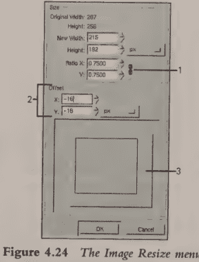

# 选择的文件格式

| 页 | 内容 |
| :--- | :--- |
| 69 | GIMP 的原生文件格式 |
| 69 | 加载和保存文件 |
| 71 | XCF: GIMP 的原生格式 |
| 72 | PAT: GIMP 的图案格式 |
| 72 | GBR: GIMP 的笔刷格式 |
| 72 | 其他图像格式 |
| 73 | 图像压缩 |
| 75 | TIFF |
| 75 | PostScript |
| 76 | JPEG |
| 76 | PNG |
| 77 | GIF |
| 77 | XPM |
| 78 | XWD |
| 78 | PSD |
| 78 | BMP |
| 79 | HTML |
| 79 | gzip 和 bzip2 |
| 79 | 网络图形 |
| 79 | 选择文件格式——如何为网络显示图像选择格式 |
| 80 | 网络调色板——创建在所有计算机上都能正常显示的图形 |
| 81 | GIF 动画——使用 GIF 文件创建动画 |
| 81 | 图像映射插件——使用插件自动创建图像映射 (ImageMaps) |

在计算机图形世界中，关注文件格式至关重要。不同的格式用于不同的目的，特别是在为网络设计图像时。在本章中，我们将探索 GIMP 可以使用的各种文件格式，以及你如何让你的图像看起来最好。表格 5.1 和 5.2 通过概述我们即将讨论的各种文件格式及其各自的功能奠定了基础。

## 表格 5.1 GIMP 支持的文件格式及其选项 ("Y" = 是, "N" = 否)

| 格式 | RGB | 灰度 | Y | 图层 | Alpha | 压缩 |
| :--- | :--- | :--- | :--- | :--- | :--- | :--- |
| XCF | Y | N | Y | Y | N | |
| TIFF | Y | N | N | N | Y | 无损 |
| PostScript | Y | Y | N | Y | N | |
| JPEG | Y | N | N | N | 有损 | |
| PNG | Y | N | Y | Y | Y | 无损 |
| GIF | N | Y | N | N | 1位 | 无损 |
| XMP | Y | N | N | 1位 | N | |
| XWD | Y | N | N | N | | |
| PSD | Y | Y | N | Y | N | |
| HTML | Y | Y | N | Y | N |

## 表格 5.2 表格 5.1 的延续

| 格式 | 隔织波 | 通道 | 选择 | 图层蒙罩 | 导引 |
| :--- | :--- | :--- | :--- | :--- | :--- |
| XCF | N | Y | Y | Y | Y |
| TIFF | N | N | N | N | N |
| PostScript | N | N | N | N | N |
| JPEG | Y | N | N | N | N |
| PNG | Y | N | N | N | N |
| GIF | Y | N | N | N | N |
| XPM | N | N | N | N | N |
| XWD | N | N | N | N | N |
| PSD | N | Y | N | N | N |
| HTML | N | N | N | N | N |

> *由于该格式的性质，某些这些选项可能不支持。*

# 选择的文件格式：加载和保存文件


# 5.1 GIMP 的原生文件格式

GIMP 拥有用于保存图像、笔刷等的自己的格式。了解这些格式非常有帮助。当你开始使用 GIMP 时，养成保存为 XCF 格式的习惯——它支持 GIMP 中的所有选项。

## 5.1.1 加载和保存文件

加载和保存文件是简单的操作。界面符合所有 GTK+ 应用程序的标准，所以这个菜单对你可能很熟悉。

### 5.1.1.1 加载文件

加载有三种方法：

- 点击 `图像/文件/打开`
- 点击 `工具箱/文件/打开`
- 按热键 [Ctrl+O]

这将弹出 GIMP 图像窗口，如图 5.1 所示。此窗口顶部有两个按钮：

- 创建目录 (1)。在当前位置创建一个目录。
- 删除文件 (2)。此按钮删除当前选中的文件。
- 重命名文件 (3)。弹出一个重命名当前选中文件的对话框。

接下来是用于加载文件的控制控件：

- 位置栏 (4)。显示文件浏览器的当前位置。这是一个访问父目录的下拉菜单。
- 目录 (5)。显示目录结构。这与其他程序类似，双击即可访问目录。
- 文件 (6)。在此部分显示目录中的文件。当前选中的文件高亮显示。如果你在这里双击文件，将被加载。
- 确定文件类型 (7)。此下拉菜单允许你选择文件格式。如果你使用“自动”，它将为你确定文件类型。
- 选择 (8)。在此输入文件名。可以使用类似于 shell `bash` 的补全来过滤文件和目录。
- 预览窗口 (9)。点击此 GIMP 新增功能会加载图像的缩略图。

选择文件后，点击底部的 OK 按钮，文件将被加载。

**选择的文件格式：加载和保存文件**


### 5.1.1.2 保存文件

保存文件有两种方法：保存和另存为。如果你正在保存未命名的图像，会自动弹出“另存为”菜单。如果图像已有文件名，你可以在“保存”和“另存为”之间进行选择。

使用“保存”有两个步骤：

- 点击 `图像/文件/保存` ([Ctrl+S])
- 输入文件格式的相关选项。如果该格式没有选项，它将直接覆盖旧文件。

使用“另存为”有三个步骤（图 5.2）：

- 点击 `图像/文件/另存为`。
- 在对话框中输入文件名 (1)。这与加载图像菜单的工作相同。选择位置和文件名后点击 OK。
- 在弹出的窗口中输入任何相关选项，然后点击 OK。

**选择的文件格式：XCF：GIMP 的原生格式**

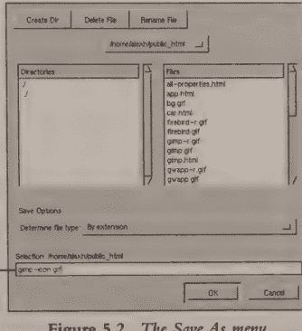

图 5.2 另存为菜单。

## 5.1.2 XCF：GIMP 的原生格式

XCF 是 GIMP 的主要文件格式。如果你正在处理一张图像，并希望以后还能继续处理，就使用它。这是因为 XCF 格式支持 GIMP 的所有功能。当你使用 XCF 时，图层、选择、Alpha 通道等都会保存在图像中。

然而，XCF 也有缺点。第一个也是最明显的缺点是其他程序对该格式缺乏支持。没有其他程序可以读取或写入这种格式。如果你正将图像发送给另一个 GIMP 用户，请使用这种格式。但不要把 XCF 发给打印机；他们将不知道如何处理。第二个缺点是图像的大小。因为每个细微的信息都保存在该图像中，文件可能会增长得非常快。你可能需要使用 `gzip` 或 `bzip2` 压缩这些文件（参见第 79 页“`gzip` 和 `bzip2`”）。

> 经常有传言 XCF 代表 Extra Cool Format（酷炫格式），但它更有可能源于最初开发 GIMP 的实验计算设施。

**选择正确的文件格式：XCF：GIMP 的原生格式**

XCF 格式支持以下选项：

- RGB
- 灰度模式
- 索引颜色
- 图层
- 通道
- 图层掩罩
- 8 位 Alpha
- 选择区域
- 导线
- 路径

## 5.1.3 PAT：GIMP 的模式格式

模式在 GIMP 中非常有用，这种格式用于读取和写入模式。你可以在 `<Gimp Directory>/share/gimp/patterns` 中找到已安装的模式。如果你创建了自己的模式，或者从互联网上下载了它们，请将它们放在自己的 GIMP 目录中：`~/.gimp/patterns`。模式可以以任何格式保存，尽管索引图像并不总是能产生正确的结果。使用 RGB 是最佳选择。你可以在第 175 页找到关于模式的更深入的讨论。

## 5.1.4 GBR：GIMP 的笔刷格式

如果你需要自定义笔刷形状来让图像看起来完美，那么 GIMP 的笔刷格式就非常重要。笔刷可以在 `<GIMP Directory>/share/gimp/brushes` 中找到。如果你创建了自己的笔刷，它们位于自己的 GIMP 目录中：`~/.gimp/brushes`。笔刷以灰度格式保存。如需了解如何创建自己的笔刷，请参阅第 174 页。

# 5.2 其他图像格式

在本节中，将讨论你在日常生活中会遇到的图像格式。不涵盖冷门格式。

许多人在保存图像时犯的一个根本性错误是没有进行平化处理（flattening）并移除 Alpha 通道。大多数图像格式不支持透明度，如果文件在保存时包含透明度，文件将无法正常显示。更多信息请参阅第 43 页的“平化图像”。

**选择正确的文件格式：图像压缩**

## 5.2.1 图像压缩

图像压缩对于 Web 来说非常重要，即使在不想占用大量磁盘空间的数印前工作中也是如此。为了学习在特定情况下使用什么种类型的压缩，了解不同类型压缩背后的基本理论是有帮助的。

### 5.2.1.1 有损压缩

有损压缩意味着图像信息将在压缩过程中丢失。这种形式的压缩通过丢弃肉眼看不见的必要细节来实现。它的原理是欺骗人类大脑，认为细节仍然存在，尽管实际上并不存在；大脑会方便地填补图片中缺失的部分。然而，当图像被放大时（即使是很小的放大），有损压缩也会变得明显。由于这种压缩方式丢失了重要信息，它应该只用于对尺寸至关重要的 Web 图形。此外，永远不要用它来保存中间文件。仅将有损压缩的格式作为最终格式。

### 5.2.1.2 无损压缩

无损压缩会压缩图像，但不会丢失图像中的任何信息。具有无损压缩的文件格式通过寻找纯色块行来实现这一点。在计算机语言中，这将由一行 0 或 1 表示。例如，它会将像如 `11111111111 00000` 这样的一行存储为 10 个 `1` 和 5 个 `0`。更高级的无损压缩类型可以发现复杂的模式并对其压缩，使其具有更小的尺寸。请参考图 5.3 和图 5.4 进行。无损压缩的优势在于你不会丢失图像中的任何信息。


图 5.3 使用无损压缩，这样的图像压缩效果很好。保存为 GIF 后，其文件大小为 2.5KB。

图 5.4 同一个图像旋转 90 度后，由于 GIF 使用无损压缩的方法，效果没有那么好。保存为 GIF 后，其文件大小为 7.3KB，尽管它和图 5.3 是同一个图像！

### 5.2.1.3 交错

另一种提供更小尺寸“幻象”的可用选项是渐进式 JPEG 或交错 GIF。这对于 Web 图形非常有用。当文件下载时，首先显示极低的分辨率，随着更多文件的下载，分辨率会逐渐提高。使用此选项时，文件的保存方式不同，但它们在完全加载后看起来是一样的。

通常，文件按数字顺序一次保存一个水平行。第 1 行首先，第 2 行其次，依此类推。当你从硬盘加载图像时，这是合理的。当保存交错文件时，每隔一行先保存一行，然后剩下的行在文件末尾保存。当用户在 Web 上查看图像时，首先下载第 1 行，然后是第 3 行，直到图像底部。这提供了图像的粗略细节。随着文件的继续下载，它会回到顶部并填充第 2 行，然后是第 4 行，依此类推。当交错文件完全下载后，它看起来完全一样，但对于查看图像的用户来说可能更有趣，因为在图像下载期间有东西可以看。

### 5.2.1.4 抖动（Dithering）

图像处理的另一部分是抖动。当颜色不足表示渐变时，就会发生抖动。这种技术通过将不同颜色的像素放在一起来创造另一种颜色的幻象。这在 GIF 图像中非常常见，但也用于其他格式。抖动在图像放大时最为明显。在许多情况下，它是图像压缩的重要部分。


图 5.3 使用无损压缩，这样的图像压缩效果很好。保存为 GIF 后，其文件大小为 2.5KB。

图 5.4 同一个图像旋转 90 度后，由于 GIF 使用无损压缩的方法，效果没有那么好。保存为 GIF 后，其文件大小为 7.3KB，尽管它和图 5.3 是同一个图像！

**选择合适的文件格式：XPM**

- 交叉扫描（参见第 73 页“图像压缩”章节）
- 无损压缩
- 支持伽马校正

## 5.2.6 GIF

GIF，即图形交换格式（Graphics Interchange Format），由 UniSys 所有。它们最初是为 CompuServe 创建的，但现在由于对计算机图形非常有用而变得非常流行。它们是创建小型图标和图像的完美选择，现在是互联网图像的行业标准。它们还可以处理动画。


动画是通过每个不同的层作为一个帧创建的。每帧之间的时间设置在层名称中。层的显示时间直接写在层名称中，或者将 100 毫秒显示时间写为 `(100ms)`。另一个选项是帧的显示方式。帧可以与前一帧合并，也可以替换它。这通过在层名称中添加 `(combine)` 或 `(replace)` 来。注意，某些程序不支持替换——它们将始终合并——而另一些则不支持合并。

GIF 图像支持以下选项：

- 索引
- 灰度模式
- 1 位 Alpha
- 无损压缩
- 交叉扫描
- 动画

## 5.2.7 XPM

XPM，或 X PixMap 格式，用于创建小型图片，特别是 Unix/Linux 系统的图标。它支持 1 位 Alpha，在保存时，会询问 Alpha 阈值（Alpha Threshold）。在保存之前进行这样做更好，这样你可以看到图像的样子（参见第 62 页“Alpha 阈值”）。

XPM 图像支持以下选项：

- RGB
- 灰度模式
- 1 位 Alpha

> * 当 UniSys 要求开发者向其支付版税以便在程序中使用 GIF 支持时，问题出现了。这震惊了编程界，但 UniSys 并没有在执行版税方面方面做太多。某些 Linux 发行版（例如 Debian）正因为这个原因包含了 GIF 支持。

## 5.2.8 XWD

XWD，或 X 窗口转储（XWindow Dump），是窗口系统中拍摄截图的文件格式。它应该只作为临时文件格式使用。TIFF 要好得多。

XWD 图像支持以下选项：

- RGB
- 灰度模式

## 5.2.9 PSD

PSD 图像是 Adobe Photoshop 的原生文件格式。此插件允许你读取但无法写入这些图像。理论上，PSD 应支持与 XCF 文件相同数量的选项。在实践中，它们并没有，因为 Photoshop 的帮助文件格式是专有的。如果你有一个可以正常加载的 PSD——太好了！如果它不起作用，你应该提交一个带有无法工作的示例图像的 bug 报告。

PSD 图像*应该*支持以下选项：

- RGB
- 灰度模式
- 8 位 Alpha
- 图
- 选择
- 通道

PSD 格式也支持 CMYK，但 GIMP 不支持。确保 PSD 文件为 RGB 格式。

## 5.2.10 BMP

BMP 格式非常常见，因为它是微软 Windows 的原生图像格式。大多数图形程序都会支持这种格式。其缺点是它不支持 Alpha 或图。

BMP 图像支持以下选项：

- RGB
- 灰度模式
- 无损压缩 (RLE)

## 选择合适的文件格式：选择文件格式 79

## 5.2.11 HTML

此插件允许你将图像保存为 HTML 表格，每个像素都是一个单元格。这可以用于快速设计表格，或使用低分辨率图形创建巨大的表格。虽然这种应用并不多，但值得提及。

HTML 插件支持以下选项：

- RGB
- 灰度模式
- 索引

## 5.2.12 gzip 和 bzip2

许多图像格式都内置了图像压缩，但有些没有。最明显的是 XCF 格式。GIMP 内置的一个实用插件是能够读取和写入使用 gzip 或 bzip2 压缩的图像。你只需要在文件名中添加 `.gz` 或 `.bz2`（同时仍需包含正确的格式扩展名）。它会自动进行压缩和解压。具有内置压缩的图像（如 JPEG）将不会从中受益——在某些情况下，文件大小实际上可能会增大。

## 5.3 Web 图形

GIMP 是创建 Web 图形的程序。针对 GIMP 有许多与 Web 图形相关的插件，包括图像映射（ImageMaps）、GIF 动画和图像优化。不需要外部程序来优化或制作你的图形——这一切可以在 GIMP 内部完成。

在设计 Web 图形时，有两个重要的概念需要注意。第一是，世界各地的人将使用各种类型的计算机（从高端工作站到掌上电脑）查看它们。颜色在这些不同平台上的显示不同，因此请注意。要记住的第二点是，仍然有人在使用 14.4Kbps 调制器连接互联网，所以图形应该越小越好。选择一种能提供最佳压缩的格式。

### 5.3.1 选择文件格式

Web 上基本上有两种图像格式：GIF 和 JPEG。PNG 已经获得了一些流行，但远未成为主流。某些第 4 版浏览器仍然不支持 PNG，因此本章仅讨论 GIF 和 JPEG。

选择合适的文件格式：选择文件格式 80

设计师面临的最大困境之一是在 GIF 和 JPEG 之间做出选择。两者都很有用，但用途各有侧重。GIF 适用于具有平涂颜色和简单形状的图像，而 JPEG 更适合照片和复杂图像。

- GIF：最适合图形和动画。
- JPEG：最适合照片和细节图像。

选择取决于项目的具体需求。在做决定时，请考虑文件大小、质量和浏览器支持。

现在你已经创建了一个区域，会弹出一个新窗口，其中描述了 HTML 链接信息。窗口中的第一个标签用于 HTML 相关的信息：地址、框架目标和注释。第二个标签用于调整区域的位置，第三个标签用于 JavaScript。当链接创建后，它将出现在右侧的列表中。

可以通过点击铅笔图标来编辑现有区域。这将打开包含所选形状所有选项的窗口。如果你想删除所选区域，请点击红色 X。

“首选项”（Preferences）菜单提供了工具栏上的选项，允许用户选择使用什么类型的图像映射（ImageMap）：

- NCSA
- CERN
- CSIA

它还提供了更改界面外观的选项。

“信息”（Information）菜单是输入地图一般信息的地方。可以在这里输入作者姓名、地图标题，最重要的是默认 URL。

# 编写你自己的 Script-Fu

| 页码 | 内容 |
|---|---|
| 84 | **Scheme 语言简介** |
| 84 | 基础 Scheme 操作—Scheme 语法概述。 |
| 86 | 变量—Scheme 分配变量的方法。 |
| 86 | 列表—如何在 Scheme 中使用列表。 |
| 88 | 函数—在 Scheme 中创建和使用函数。 |
| 88 | **Scheme 函数参考**—GIMP 可用的 Scheme 命令列表。 |
| 89 | **Script-Fu**—Script-Fu 简介，即 GIMP 的脚本接口。 |
| 90 | 编写一个基础脚本—编写一个简单的 Logo 生成器的基础。 |
| 93 | 添加功能—向此脚本添加更复杂的函数。 |
| 98 | 增强脚本—向此脚本添加更复杂的函数功能。 |
| 103 | 在图像或可绘制对象上使用 Script-Fu—编写操作现有图像的脚本的基础。 |

GIMP 自带了一个极其强大的脚本系统，称为 Script-Fu。Script-Fu 基于 SIOD——Scheme In One Defun。相比之下，值得注意的是，这比 Adobe Photoshop 拥有的任何功能都要高级。（Photoshop 中唯一与 Script-Fu 相似的是宏录制。）学习使用 Script-Fu 是一个好主意，因为可以可以节省你大量处理琐碎、重复任务的时间。对于 Web 设计师来说，Script-Fu 非常有用，因为它允许你创建一个主题来快速设计所有的图标和页眉。

# 6.1 Scheme 语言简介

Scheme 是一种基于 Lisp 的编程语言，Lisp 是一种高级脚本语言。作为 GIMP 用户，你并不需要了解背景，但如果你有 Lisp 经验，就会对语法非常熟悉。此外，如果你是惠尔罗罗特 48 系列计算器或其他任何使用逆波兰表示法（Reverse Polish Notation）计算器的所有者，这种语法也应该感到熟悉。

## 6.1.1 基础 Scheme 操作

这里描述了一些 Scheme 的基本操作。Scheme 操作的完整列表可以在 `http://people.delphi.com/gjc/siod.html` 。

学习 Scheme 的第一点是它是基于括号的语言。Scheme 函数的基本语法如下：

```
(function parameters)
```

在每组括号中，第一个项是函数。其余项是传递给函数的参数。使用分号创建注释。它们类似于 C++ 风格的注释——以两个正斜杠开头。

例如，考虑以下内容：

; 声明宽度和高度变量并分配虚拟值

```
(imgWidth 1)
(imgHeight 1)
```

GIMP 包含一个交互式的 Scheme 解释器，允许你输入 Scheme 命令（见图 6.1）。你运行的任何命令的结果都会在这里显示（1）。命令在当前命令（Current Command）部分输入（2）。要查看浏览（Browse），点击按钮（3）。

SIOD 的主页位于 `http://people.delphi.com/gjc/siod.html`。

# 编写你自己的 Script-Fu：基础操作


图 6.1 SIOD 窗口。

保持此窗口打开并尝试表 6.1 中描述的各种函数是一个好主意。以下简单的示例将返回：

`(+ 5 8)`

其他操作也同样简单。

| 函数 | 描述 |
|---|---|
| `(+ x1 x2 ...)` | 返回参数的和。 |


| `(- x1 x2 ...)` | 有一个参数时返回负值；多个参数时，返回第一个参数与其余参数的差。 |

| `(/ x1 x2 ...)` | 有一个参数时，返回倒数；否则，返回第一个参数与其余参数的商。 |

| `(< x y)` | 如果 `x` 小于 `y`，返回真。 |

| `(<= x y)` | 如果 `x` 小于 `y`，返回真。 |

| `(= x y)` | 如果 `x` 等于 `y`，返回真。 |

| `(> x y)` | 如果 `x` 大于 `y`，返回真。 |

| `(>= x y)` | 如果 `x` 大于等于 `y`，返回真。 |

扩展我们的简单示例，可以向函数传递多个参数。示例将返回：

`(+ 4 6 7)`

函数也可以嵌套。这是 Scheme 可能会让人混乱的地方。考虑等式 `(+ 3 5)=12`。你输入以下内容，将返回 8：

## 6.1.2 变量

在了解 Scheme 基础之后，你将想要声明变量。声明变量的最常用方法是通过 `let` 语句。当从对话框或另一个脚本传递参数时，使用以下形式：

```
(let (variable1 variable2 ...) expression1 expression2 ...)
```

在 `let` 语句中可以创建任意数量的变量和表达式。这是一个示例：

```
(let ((a 2) (b 4) (c 6)) (+ a c))
```

该语句初始化变量 `a`、`b` 和 `c` 并返回它们的和。如果现在尝试以下内容，将返回错误，因为括号内是局部变量。要在语句外创建变量，使用 `set` 语句。其语法如下：

```
(set variable value)
```

例如，执行这两个语句将返回 4：

```
(set Xpos 10)
```

```
(+ Xpos 4)
```

## 6.1.3 列表

列表比变量稍微复杂且强大。它们允许你定义一组由 Scheme 处理的变量。这些对于定义颜色非常重要，因为颜色被定义为红、绿、蓝值的列表。声明列表很容易。语法如下：

```
'(variable1 variable2 ...)
```

例如，声明变量 `lightGray` 看起来所示，并返回 `(200 200 200)`：

```
(let (lightGray (200 200 200)) lightGray)
```

列表可以包含字符串、其他列表和变量。字符串使用引号定义。例如，列表可以定义为：

```
('The GIMP "Reference" (1 2 4))
```

# 编写你自己的 Script-Fu：列表处理函数

## 6.1.3.1 列表创建函数

列表处理非常强大。有几个处理列表的函数。要学习的函数是 `cons`。它将变量连接成列表。语法如下：

```
(cons variable1 variable2)
```

问题是 `cons` 函数一次只能传递两个变量。如果你想创建一个带有四个参数的新列表，必须这样嵌套函数：

```
(cons 1 (cons 2 (cons 3 (cons 4))))
```

然而，`cons` 确实作用于现有列表。你可以取一个带有两个参数的列表并向其添加新参数。例如，以下函数将返回 `(1 2 3)`：

```
(let (smalllist) (cons 1 ('2 3))) smalllist)
```

`append` 是另一个处理列表的函数。它将一个或多个列表附加另一个列表。其语法如下：

```
(append list1 list2 ...)
```

## 6.1.4 列表处理函数

现在你已经创建了列表，你应该查看几个处理从列表中获取参数的函数。要使用的第一个函数是 `car`。它返回列表的第一个参数（或头部）。它完全不受列表。例如，如果你有一个名为 `textField` 的列表，设置为 `('The GIMP "Script-Fu" "Scheme')`，以下函数将返回 The GIMP：

```
(car textField)
```

另一个函数是 `cdr`。它返回列表的尾部。以下示例将返回 `("Script-Fu" "Scheme")`：

```
(cdr textField)
```

注意 `car` 返回单个参数，而 `cdr` 返回一个列表。如果列表中只有一个参数，`cdr` 将返回 `()`——一个空列表。

## 6.1.4.1 高级列表处理

现在你了解了 `car` 和 `cdr` 的基础，情况变得更复杂了。`car` 和 `cdr` 的不同组合可以返回列表的特定部分。例如，`(cdddr x)` 等同于 `(car (cdr (cdr (cdr x))))`。

## 6.1.5 函数

学习 Scheme 的下一步是定义函数。这是使用 Scheme 时最灵活的部分。定义函数的语法非常简单：

```
(define function variable! variable2...) (operations)
```

例如，以下代码将创建一个计算特定半径的圆形面积的函数：

```
(define circleArea radius) (* pi radius radius))
```

稍后可以用取值为 2 的半径调用它：

```
(circleArea 2)
```

`circleArea` 函数将返回 12.5664。

与列表一样，函数可以相互嵌套。

## 6.2 Scheme 函数参考

下表列出了 GIMP 可用的 Scheme 函数列表。

| 函数 | 描述 |

| --- | --- |

| `abs x` | 返回 `x` 的绝对值。 |

| `acos x` | 返回 `x` 的反余弦。 |

| `append 11 12 13 14 ...)` | 返回一个包含所有参数合并后的列表。示例：`(append '(a b) '(c d))` => `(a b c d)` |

| `asin x` | 返回 `x` 的反正弦。 |

| `atan x` | 返回 `x` 的反正正切。 |

| `atan2 x y` | 返回 `x/y` 的反正正切。 |

| `bustlast x` | 返回一个新列表，包含参数 `x` 中最后一个元素以外的所有元素。 |

| `cons x y` | 分配一个列表对象，`x` 为 `car`，`y` 为 `cdr`。示例：`(cons 1 (cons 2 (cons 3))))`变为 `(1 2 3)`。 |

| `cos x` | 返回余弦，`x` 的单位为弧度。 |

| `eq? x y` | 如果 `x` 和 `y` 是同一个对象，则返回真。 |

| `equal? x y` | 如果 `x` 和 `y` 是相等的对象，则返回真。 |

| `eqv? x y` | 如果 `x` 和 `y` 是同一个对象或数值相等，则返回真。 |

| `exp x` | 计算 `x` 的指数函数。 |

| `list item1 item2 ...)` | 使用 `cons` 函数将参数合并成列表。 |

| `log x` | 计算 `x` 的自然对数。 |

| `(max x1 x2 ...)` | 返回 `x1`、`x2` 等最大值。 |

| `(min x1 x2 ...)` | 返回参数的最小值。 |

| `(null? x)` | 如果 `x` 是空列表，则返回真。 |

| `(number->string x base width precision)` | 根据基数格式化数字，基数可以是 8、10、16 或符号 `e` 或 `f`。位宽和精度都是可选的。 |

| `(number? x)` | 如果 `x` 是数字，则返回真。 |

| `(parse-number str)` | 将字符串转换为数字。 |

| `(pow x y)` | 计算 `x` 的 `y` 次方的的结果。 |

| `(reverse x)` | 返回一个元素顺序与原列表相反的新列表。 |

| `(sin x)` | 计算弧度角角度 `x` 的正弦。 |

| `(sqrt x)` | 计算 `x` 的平方根。 |

| `(string-append str1 str2 str3 ...)` | 返回一个包含所有字符串参数拼接结果的新字符串。 |

| `(string-downcase str)` | 返回一个新字符串，将 `str` 的所有字符转换为小写。 |

| `(string-trim str)` | 返回一个通过去除指定字符串两端空白而得到的新字符串。 |

| `(string-trim-left str)` | 类似于 `string-trim` 但仅处理左侧。 |

| `(string-trim-right str)` | 类似于 `string-trim` 但仅处理右侧。 |

| `(string-upcase str)` | 返回一个将所有小写字符转换为大写的新字符串。 |

| `(string? x)` | 如果 `x` 是字符串，则返回真。 |

| `(tan x)` | 计算弧度角 `x` 的正切。 |

| `(while pred-form form1 form2 ...)` | 如果 `pred-form` 为真，将求值所有其他形式并循环。 |

## 6.3 Script-Fu

在熟悉 Scheme 的基础知识后，你可以开始为 GIMP 创建 Script-Fu 了。本节概述了创建一个简单脚本的过程。顺便提一下，这就是我用来创建主页（`http://www.dowco/~alexh`）上 Logo 的脚本。Script-Fu 非常适合这类工作。


> 我还把本章中的两个示例也发布在我的主页上。

### 6.3.1 编写基础脚本

任何 Script-Fu 的第一部分都是定义函数。我们的示例脚本定义为：

```
(define (script-fu-alexh-logo textStuff fontType fontSize bgColor))
```

这意味着有一个名为 `script-fu-alexh-logo` 的函数。它实际上没有执行任何操作，但这是一个很好的开始。它接收以下变量作为参数：

- `textStuff`: 文本内容
- `fontType`: 字体类型
- `fontSize`: 字体大小
- `bgColor`: 背景颜色

### 6.3.2 注册脚本

（注：原文此处似乎存在内容缺失或逻辑跳跃，已根据上下文语境进行翻译性处理）

这意味着有一个名为 `script-fu-alexh-logo` 的函数。它实际上没有执行任何操作，但这是一个很好的开始。它接收以下变量作为参数：

- `textStuff`: 文本内容
- `fontType`: 字体类型
- `fontSize`: 字体大小
- `bgColor`: 背景颜色

### 6.3.1.2 保存 Script-Fu

此示例已保存在 `~/gimp/scripts` 目录下。这是所有自定义脚本存放的地方。为了熟悉一下，输入脚本并将其保存为 `alexh-logo.scm`。然后，点击 `<Toolbar>/Menus/Script-Fu/Refresh` 刷新脚本。该脚本现在将出现在 `<Toolbar>/Menus/Script-Fu/Web page themes/AlexH/AlexH Logo` 中。

DB 浏览器（见图 6.2）现在应该会在窗口中显示该脚本。

# 编写你自己的脚本：为 GIMP 添加功能


## 6.3.2 为 GIMP 添加功能

现在是时候让脚本实际执行一些操作了。目前，我们只是创建一个简单的脚本，创建一个环绕某些示例文本的分层图像。它将遵循以下步骤：

- 1. 声明所有变量。
- 2. 创建图像。
- 3. 创建新层。
- 4. 清空背景层，使其具有正确的背景颜色。
- 5. 为层添加透明通道（alpha）。
- 6. 清空层。
- 7. 设置前景颜色。
- 8. 将文本放置在这个新层上。
- 9. 调整图像大小，使其精确贴合文本层。

所有这些都将在 `define` 函数内部。

### 6.3.2.1 声明变量

首先，我们必须使用 `let` 函数来声明我们需要的所有变量：

- `imgWidth`: 图像的宽度。用于确定层的大小。
- `imgHeight`: 图像的高度。用于确定层的大小。
- `img`: 实际图像。
- `bgLayer`: 名为“Background”（背景）的层。
- `baseLayer`: 名为“Text Layer”（文本层）的层。

编写你自己的脚本-Fu：为 GIMP 添加功能

它看起来像这样：

```
(let*
(
; 声明宽度高度变量并分配一个虚拟值

(imgWidth 1)
(imgHeight 1)

; 声明并创建新图像

(img
(car gimp-image-new imgWidth imgHeight RGB)
)

; 在图像中声明并创建层:

(bgLayer)
(car
(gimp-layer-new img imgWidth imgHeight RGB_IMAGE "Background" 100 NORMAL)
)

(baseLayer)
(car
(gimp-layer-new img imgWidth imgHeight RGB_IMAGE "Text Layer" 100 NORMAL)
)

; 脚本其余部分在此处。
)
)
```

### 6.3.2.2 创建新图像

在变量声明内部，我们使用 `gimp-image-new` 函数创建了新图像。如 DB Browser 所示，它接受三个参数：

- 宽度 `Width`
- 高度 `Height`
- 类型 `Type`

该函数的输出是一个列表，因此我们需要使用 `car` 函数来获取图像名称。

### 6.3.2.3 添加新层

我们还需要使用 `gimp-layer-new` 函数创建两个新层——`bgLayer` 和 `baseLayer`。根据 DB Browser，实现这一点需要七个参数：

- 图像 `Image`。层的名称。
- 宽度 `Width`。
- 类型 `Type`。层的类型，而不是图像类型。
- 名称 `Name`。引号中的层名称。
- `透明度 Opacity`。层的透明度（0 到 100）。
- `模式 Mode`。层的混合模式。（更多信息请参见第 44 页“Modes”。）

该函数的输出再次是一个列表，因此我们需要使用 `car` 获取正确的名称。

下一步是将创建的层添加到图像中。这是通过 `gimp-image-add-layer` 函数完成的。我们需要将 `bgLayer` 和 `baseLayer` 都添加到图像中：

```
(gimp-image-add-layer img bgLayer 1)
(gimp-image-add-layer img baseLayer 0)
```

函数末尾数字代表层的位置。0 是最高层，1 是下一个，依此类推。

### 6.3.2.4 设置颜色

我们现在设置前景和背景颜色。这些颜色通过包含三个数值的列表设置。注意，背景颜色是一个变量，而前景颜色是一个常量。使用 `gimp-palette-set` 函数设置颜色：

```
(gimp-palette-set-background bgColor)
(gimp-palette-set-foreground (0 0 100))
```

### 6.3.2.5 清空背景层

现在颜色设置好了，我们需要清空 `bgLayer` 来设置它的颜色。（如果不包含这一步，它将是随机颜色）。这是通过 `gimp-edit-clear` 函数完成的：

```
(gimp-edit-clear bgLayer)
```

### 6.3.2.6 编辑基础层

接下来，我们需要处理 `baseLayer`。它必须被清除为透明，但此层中没有 alpha 通道。我们使用 `gimp-layer-add-alpha` 函数来实现：

```
(gimp-layer-add-alpha baseLayer)
(gimp-edit-clear baseLayer)
```

### 6.3.2.7 添加文本

现在我们创建脚本中使用的文本。这是通过另一个 `let*` 函数完成的。它看起来如下：

```
(let*
(floatText
(car
gimp-text-fontname img baseLayer @ @ textStuff 5 TRUE fontSize PIXELS fontType)
)
)

; 调整图像到合适大小
(set! imgWidth (car (gimp-drawable-width floatText)))
(set! imgHeight (car (gimp-drawable-height floatText)))

(gimp-image-resize imgWidth imgHeight @ 0)
(gimp-layer-resize bgLayer imgWidth imgHeight @ 0)
(gimp-layer-resize baseLayer imgWidth imgHeight @ 0)

(gimp-floating-sel-anchor floatText)
```

此函数执行了几项操作，可以看作几个步骤：

- 1. 创建 `floatText` 画对象
- 2. 在 `floatText` 对象上写入文本
- 3. 调整图像和层的大小
- 4. 锚定 `floatText`

`floatText` 对象使用以下函数创建：

```
(floatText
(car
gimp-text-fontname img baseLayer @ @ textStuff 5 TRUE fontSize PIXELS fontType))
```

这创建了 `floatText` 对象，并使用文本函数绘制文本。它在 `baseLayer` 上绘图，但仍然是一个浮动选择。我们没有锚定浮动选择，因为我们仍然需要从中获取一些信息。

### 6.3.2.8 调整图像大小

下一步是将 `imgWidth` 和 `imgHeight` 的值更改为 `floatText` 的宽度和高度。这确保图像足够容纳文本。然后我们将图像和所有层调整到此大小：

```
(gimp-image-resize imgWidth imgHeight @ 0)
(gimp-layer-resize bgLayer imgWidth imgHeight @ 0)
(gimp-layer-resize baseLayer imgWidth imgHeight @ 0)
```


最后，我们可以使用 `gimp-floating-sel-anchor` 函数锚定 `floatText` 对象：

```
(gimp-floating-sel-anchor floatText)
```

此时，第二个 `let*` 函数结束，我们返回到第一个。脚本几乎完成了。我们现在必须告诉 GIMP 平化层并使用 `gimp-display-new` 函数显示此新图像：

```
(set bgLayer (car (gimp-image-flatten img)))
(gimp-display-new img)
```

括号关闭了 `let*` 语句。完成后的脚本如下所示：

```
(define (script-fu-alexh-logo textStuff fontSize bgColor)
; 开始脚本
(let*
; 声明宽度高度变量并分配一个虚拟值
(imgWidth 1)
(imgHeight 1)
; 声明并创建新图像
(img
(car gimp-image-new imgWidth imgHeight RGB)
)
; 在图像中声明并创建层:
(bgLayer)
(car
(gimp-layer-new img imgWidth imgHeight RGB_IMAGE "Background" 100 NORMAL)
)
(baseLayer)
(car
(gimp-layer-new img imgWidth imgHeight RGB_IMAGE "Text Layer" 100 NORMAL)
)
; 脚本其余部分在此处。
)
(gimp-image-add-layer img bgLayer 1)
(gimp-image-add-layer img baseLayer 0)
; 设置前景背景颜色
(gimp-palette-set-background bgColor)
(gimp-palette-set-foreground (0 0 100))
; 清空背景层
(gimp-edit-clear bgLayer)
; 添加 alpha并清空文本层
(gimp-layer-add-alpha baseLayer)
(gimp-edit-clear baseLayer)
; 创建新文本层
(let*
(floatText
(car
gimp-text-fontname img baseLayer @ @ textStuff 5 TRUE fontSize PIXELS fontType)
)
)
; 调整图像到合适大小
(set! imgWidth (car (gimp-drawable-width floatText)))
(set! imgHeight (car (gimp-drawable-height floatText)))
(gimp-image-resize imgWidth imgHeight @ 0)
(gimp-layer-resize bgLayer imgWidth imgHeight @ 0)
(gimp-layer-resize baseLayer imgWidth imgHeight @ 0)
(gimp-floating-sel-anchor floatText)
; 平化图像
(set bgLayer (car (gimp-image-flatten img)))
; 显示新图像
(gimp-display-new img)
)
; 注册脚本
(script-fu-register "script-fu-alexh-logo"
"*Toolbox/Xtna/Script-Fu/Web page themes/AlexH/AlexH Logo"
"在 Alex Harford 的网页主题中创建一个基础 Logo"
"Alex Harford"
"Copyright 1999 Alex Harford"
"July 21, 1999"
---
SF-STRING "Text": "Home"
SF-FONT "Font": "freefont-agate-normal-r-normal-24-\.\*.\.\*-p.\.\*"
SF-VALUE "Font size": "25"
SF-COLOR "Background Color": "(222 234 234)"))
```

### 6.3.3 增强脚本

现在我们已经有了一个基础脚本，让我们为其添加一些额外的效果。我们将为文本添加 3D 效果。请遵循以下步骤：

- 1. 复制 `baseLayer` 两次。
- 2. 将第一个新层的颜色更改为黑色。
- 3. 将第二个层的颜色更改为白色。

#### 编写你自己的 Script-Fu：增强脚本

- 4. 将第一层向下并向右偏移。
- 5. 将第二层向上并向左偏移。

这些步骤将在后续章节中讨论。

#### 6.3.3.1 复制 baseLayer

复制 `baseLayer` 使用 `gimp-layer-copy` 函数完成。首先，我们必须在 `let` 语句中声明变量。然后，按照如下方式复制图层：

```
(set! blackLayer (car gimp-layer-copy baseLayer TRUE))
(set! whiteLayer (car gimp-layer-copy baseLayer TRUE))
```

这些图层必须添加到图像中：

```
(gimp-image-add-layer img blackLayer 2)
(gimp-image-add-layer img whiteLayer 1)
```

#### 6.3.3.2 调整颜色

我们现在将使用油桶工具来调整颜色。有几个步骤需要遵循：

- 1. 将保留透明度的位设置为 TRUE：

```
(gimp-layer-set-preserve-trans blackLayer TRUE)
```

```
(gimp-layer-set-preserve-trans whiteLayer TRUE)
```

- 2. 选择整个图像：

```
(gimp-selection-all img)
```

- 3. 将前景色设置为黑色：

```
(gimp-palette-set-foreground '(@ @))
```

- 4. 填充 `blackLayer`：

```
(gimp-bucket-fill blackLayer @ 100 15 FALSE @ @)
```

- 5. 将前景色设置为白色：

```
(gimp-palette-set-foreground '(255 255 255))
```

- 6. 填充 `whiteLayer`：

```
(gimp-bucket-fill whiteLayer @ 100 15 FALSE @ @)
```

- 7. 取消整个图像的选择：

```
(gimp-selection-none img)
```

#### 6.3.3.3 偏移图层

接下来，每个图层都略微偏移。这是通过 `gimp-layer-set-offsets` 函数完成的：

```
(gimp-layer-set-offsets blackLayer 1 1)
(gimp-layer-set-offsets whiteLayer -1 -1)
```

#### 6.3.3.4 脚本的进一步改进

脚本现在可以运行，但需要更好的阴影效果。又创建了两个图层作为 `blackLayer` 和 `whiteLayer` 的副本：

```
(set! blackLayer (car gimp-layer-copy baseLayer TRUE))
(set! whiteLayer (car gimp-layer-copy baseLayer TRUE)))
```

#### 100 编写你自己的 Script-Fu：增强脚本

它们被油桶填充，并的偏移方式与其他图层相同。将保留透明度设置为 FALSE，然后应用 `plug-in-gauss-iir` 函数以获得更好的阴影：

```
(gimp-layer-preserve-trans trans blackblurLayer FALSE)
(gimp-layer-preserve-trans whiteblurLayerLayer FALSE)
(plug-in-gauss-iir TRUE img blackblurLayer 2 TRUE)
(plug-in-gauss-iir TRUE img whiteblurLayer 2 TRUE)
```

#### 6.3.3.5 清理

脚本现在基本上处于工作状态。然而，还需要一些额外的清理工作。我们将使用以下函数禁用撤销记录：

```
(gimp-image-disable-undo img)
```

现在在脚本末尾使用以下函数重新启用它：

```
(gimp-image-enable-undo img)
```

我们还将自动裁剪图像以节省空间：

```
(plug-in-autocrop TRUE img bgLayer)
```

此外，清除脏数据计数，以便图像可以在无任何提示的情况下关闭：

```
(old-fg (car (gimp-palette-get-foreground)))
(old-bg (car (gimp-palette-get-background)))
```

另一个技巧是确保前景和背景颜色不被改变。在第一个 `let*` 中添加这些行：


```
(gimp-palette-set-foreground old-fg)
(gimp-palette-set-background old-bg)
```

让我们添加其他让脚本更具配置性的变量：

- `SF-COLOR` "字体颜色：`$(0 0 100)`

- `SF-COLOR` "深色偏移颜色：`$(0 0 0)`

- `SF-COLOR` "浅色偏移颜色：`$(255 255 255)`

- `SF-ADJUSTMENT` "模糊半径：`$(2 1 50 1 10 0 0)`

- `SF-ADJUSTMENT` "深色偏移：`$(1 -100 100 1 10 0 1)`

- `SF-ADJUSTMENT` "浅色偏移：`$(1 -1 100 100 1 10 0 1)`

### 6.3.3.6 完成的脚本

适当变量已添加到 `define` 函数中，变量名已替换硬编码变量。我们完成的脚本如下：

```
(define
(script-fu-alexh-logo textStuff fontType fontSize fontColor
bgColour offset lightOffset
blurRadius posoffset negaffset )
```

# 编写你自己的 Script-Fu：增强脚本 101

```
; 开始脚本
(let*
(
; 声明宽度和高度变量并分配一个哑值
(imgWidth 1)
(imgHeight 1)

; 声明并创建新图像
(img
(car
(gimp-image-new imgWidth imgHeight RGB))

; 声明并创建图像中的图层：
(bgLayer)
(car
(gimp-layer-new img imgWidth imgHeight
RGB_IMAGE "Background" 100 NORMAL))
)
(baseLayer)
(car
(gimp-layer-new img imgWidth imgHeight
RGB_IMAGE "Text Layer" 100 NORMAL))
)

; 留背景颜色
(old-fg (car (gimp-palette-get-foreground)))
(old-bg (car (gimp-palette-get-background)))
)

; 禁用撤销记录
(gimp-image-disable-undo img)

; 将图层添加到图像
(gimp-image-add-layer img bgLayer @)
(gimp-image-add-layer img baseLayer @)

; 设置前景和背景颜色
(gimp-palette-set-background bgColor)
(gimp-palette-set-foreground fontColor)

; 清除背景层
(gimp-edit-clear img bgLayer)

; 添加透明通道并清除文本图层
(gimp-layer-add-alpha baseLayer)
(gimp-edit-clear baseLayer)

; 创建新的文本图层
```

继续...

```
(let*
(
(floatText
(car
  (gimp-text-fontname img baseLayer @ 0 textStuff 5 TRUE fontSize PIXELS
ype)
)
(blackblurLayer)
(whiteblurLayer)
)
)
```

; 调整图像到合适尺寸

```
(set imgWidth (car (gimp-drawable-width floatText ))
(set imgHeight (car (gimp-drawable-height floatText )) )
```

```
(gimp-image-resize imgWidth imgHeight @ 0)
(gimp-layer-resize bLayer imgWidth imgHeight @ 0)
(gimp-layer-resize baseLayer imgWidth imgHeight @ 0)
(gimp-layer-set-offsets blackLayer 1 1)
```

# 102 编写你自己的 ScriptFu：增强脚本

```
(gimp-layer-preserve-trans blackLayer FALSE)

(gimp-layer-preserve-trans whiteblurLayer FALSE)

(plug-in-gauss-iir TRUE img blackblurLayer 2 TRUE)

(plug-in-gauss-iir TRUE img whiteblurLayer 2 TRUE)
```

# 104 编写你自己的 Script-Fu：在图像或绘制图上使用 Script-Fu

我们将通过以下步骤完成：

- 1. 将图像复制一份新图像。
- 2. 当剩余帧数大于1时，循环：
   a. 复制基础层。
   b. 将其重命名为剩余帧数。
   c. 进行一定程度的像素化（Pixelize）。
   d. 减少帧数和像素化程度。
- 3. 将基础层重命名为 Frame 1。
- 4. 清理工作。

只需要两个变量：

- 最大像素化值
- 帧数

### 6.3.4.1 定义函数

编写脚本的第一步是创建 `define` 函数和 `script-fu-register` 函数：

```scheme

(define script-fu-pixel-anim img drawable maxPixel totalFrames)

(script-fu-register "script-fu-pixel-anim"

  "<Image>/Script-Fu/Animators/Pixelate"

  "超级马里奥风格的图像像素化"

  "Alex Harford (alexh@edowco.com)"

  "Copyright 1999 Alex Harford"

  "July 21, 1999"

  "RGB RGBA GRAY GRAYA" @

  SF-IMAGE "Image" @

  SF-DRAWABLE "Drawable" "Max Pixelization" (10 1 100 1 10 0 0)

  SF-ADJUSTMENT "Number of Frames" (10 1 100 1 10 0 1))

```

注意，这里有两个额外的变量：`img` 和 `drawable`。这些变量由 GIMP 自动传递给脚本，因为它们应用于特定图像上的特定绘制图。在编写影响现有图像的脚本时总是会使用。还要注意此滤器的位置：`<Image>/Script-Fu/Animators/Pixelate`。通常，作用于现有图像的脚本放在 `<Image>/Script-Fu` 部分。

### 6.3.4.2 分配变量

现在脚本的骨架已经到位，我们可以开始创建脚本。它从一个 `let*` 函数开始：

```scheme

(let*

  ; 声明变量并赋值

  (maxPixel (max 1 maxPixel))

  (totalFrames (max 1 totalFrames))

  (delta (/ maxPixel totalFrames))

  (framesleft totalFrames)

  (image (car (gimp-channel-ops img)))

  (base-layer (car (gimp-get-active-layer image))))

)

```

此函数完成了几项工作：

- 确保 `maxPixel` 和 `totalFrames` 大于 1。
- 声明变量 `delta` 并将其初始化为 `maxPixel` 除以 `totalFrames` 的结果。
- 声明变量 `framesLeft` 并将其初始化为 `totalFrames`。
- 声明新变量 `image`，并将其设置为 GIMP 传递给脚本的活动图像的副本。
- 声明变量 `base-layer` 并将其初始化为图像中的活动层。

### 6.3.4.3 像素化

现在我们必须决定如何处理实际的像素化。这是通过一个 `while` 循环和一个 `let*` 函数实现的：

```scheme

(while (> framesLeft 1)

  (let*

    (

      (pixel-layer (car (gimp-layer-copy base-layer TRUE)))

      (layer-name (string-append "Frame " (number->string framesLeft)))

    )

    (gimp-image-add-layer image pixel-layer (- totalFrames framesLeft))

    (gimp-layer-set-name pixel-layer layer-name)

    (plug-in-pixelize

      TRUE

      image

      pixel-layer
```


```
      maxPixel

    )

    (set! framesLeft (- framesLeft 1))

    (set! maxPixel (- maxPixel delta))

  ))
```

如果帧数大于1，`while` 循环就会运行。如果是，进入 `let*` 函数。该函数声明了两个新变量：

- `pixel-layer`。这是基础层的副本。
- `layer-name`。这仅仅是将变量设置为其对应的帧数。

该函数将新层添加到图像中，并通过用总帧数减去剩余帧数将其放在正确的位置。它将层重命名为 `layer-name`。

# 106 编写自己的 Script-Fu：在图像或绘制图上使用 Script-Fu

下一步是实际的像素化处理。调用 `plug-in-pixelize` 以 `maxPixel` 的量对层进行像素化。然后，剩余帧数减 1，`maxPixel` 减去 `delta`。这完成了 `let*` 和 `while` 语句。

最后，将基础层重命名为 Frame 1，并显示新图像：

```
(gimp-layer-set-name base-layer "Frame 1")
(gimp-display-new-image)
```

# 6.3.4.4 清理

我们将通过禁用撤销记录来添加额外的清理。我们的最终脚本如下：

```scheme
(define (script-fu-pixel-anim img maxPixel totalFrames)

  let*

    (

      ; 声明变量并赋值

      (maxPixel (max 1 maxPixel))

      (totalFrames (max 1 totalFrames))

      (delta (/ maxPixel totalFrames))

      (framesleft totalFrames)

      (image (car (gimp-channel-ops img)))

      (base-layer (car (gimp-get-active-layer image)))

    )

    (while (> framesleft 1)

      (let*

        (

          (pixel-layer (car (gimp-layer-copy base-layer TRUE)))

          (layer-name (string-append "Frame " (number->string framesleft)))

        )

        (gimp-image-add-layer image pixel-layer (- totalFrames framesleft))

        (gimp-layer-set-name pixel-layer layer-name)

        (plug-in-pixelize

          TRUE

          image

          pixel-layer

          maxPixel

        )

        (set! framesleft (- framesleft 1))

        (set! maxPixel (- maxPixel delta))

      ))

    (gimp-layer-set-name base-layer "Frame 1")

    (gimp-display-new-image))
```


# 扩展 GIMP：TrueType 字体

这将仅为当前的 X 会话设置字体。要让所有用户都能使用这些字体，你必须编辑 `/etc/XF86Config` 文件。找到包含 `FontPath` 单词的行。那里将有一系列指向各种字体位置的目录列表。它们都用逗号分隔。将目录 `/usr/X11/lib/fonts/freefont` 添加到此列表中。记得用逗号将新条目隔开。在完成这些更改后，你需要重启 X 服务器以读取这些更改。

现在，每当你启动 X 系统时，都会运行此程序，并且字体将是可用的。此过程适用于你从网上下载的任何 Unix 字体集。只需将 `Freefont` 名称替换为你下载的字体包名称即可。一个例外是 TrueType 字体，它们需要大量的额外设置。

## 7.1.2 TrueType 字体

可以为你的 X 服务器添加 TrueType 字体支持，从而允许 GIMP 使用它们。TrueType 字体在不同尺寸下都能提供更好的细节效果，并且在计算环境中被广泛使用，而不仅仅限于 Unix 社区。添加 TrueType 支持有两种方法：

- 补丁服务器。TrueType 字体的补丁可以在 http://www.ds.ed.ac.uk/home/jec/programs/xfsft/ 找到。这些补丁使用了位于 http://www.physiol.med.muenchen.de/robert/freetype.html 的渲染程序。即使对于有 Linux 经验的人来说，这也是一项非常巨大的工程，因为需要重新构建你的 X 服务器，而这个过程超出了本书的范围。
- 使用 Xifft 服务器。这是一个外部字体服务器，可以与你的 X 服务器分离开运行。该服务器可以在 `ftp://ftp.metalab.unc.edu/pub/Linux/X11/fonts/` 目录下找到。它的名称类似于 `xifft-<版本号>.tar.gz`。该程序的安装同样非常复杂，超出了本书的范围。

## 7.2 插件

插件对 GIMP 来说至关重要的。GIMP 中执行的几乎每个功能都是通过插件完成的。插件是由 GIMP 运行以执行某些操作的程序。这使得添加新变得变得简单。GIMP 网站上有一个插件注册表，位于 http://registry.gimp.org/。你可以找到在 GIMP 中使用过的每个插件的最新版本。你可能会发现对你有用的插件，或者正在开发中的新插件。随后，它们不会包含在自带版本中。

### 7.2.2 安装插件

要安装插件，请按照以下步骤操作：

- 从注册表下载最新版本。
- 将包解压到你的主目录中。
- 进入该目录。
- 输入 `make install`。

### 7.2.2.2 使用插件

要创建点击区域，请按照以下步骤操作：

- 选择区域的形状。可选形状包括圆形、矩形和多边形。
- 在想要创建的区域上点击并释放鼠标。
- 将鼠标移动到区域的端点并再次点击鼠标。

当你创建一个区域后，会弹出一个新窗口，其中描述了 HTML 链接信息：

- 窗口中的第一个标签页用于 HTML 相关信息：地址、框架目标和注释。
- 第二个标签页用于调整区域的位置。
- 第三个标签页用于 JavaScript。

当链接创建后，它将出现在右侧的列表中。你可以点击铅笔图标来编辑区域。这将打开带有所选形状选项的窗口。如果你想删除选定的区域，请点击红色的 X。

## 扩展 GIMP：ImageMap

此描述假设你对 ImageMap 有基础知识。关于创建 ImageMap 以及在网页中使用它们的更多信息，请参阅 http://home.2.consubnet.net/~cb00736/ImageMap.html

# 扩展 GIMP：gtkrc 文件的基础

“信息（Information）”菜单是输入地图一般信息的地方。在这里，可以输入作者姓名、地图的标题，以及最重要的默认 URL。

当地图完成后并保存后，可以将其插入到 HTML 文件中。

## 7.3 定制 GIMP

GIMP 使用 G Toolkit 作为其小组件集。小组件集用于控制应用程序的外观，包括滚动条、按钮等。使用 GIMP Toolkit 的优势在于它具有极高的定制性。更改你的 GTK+ 应用程序外观有两种方法：手动编辑 `gtkrc` 文件，或者从互联网上下载主题。

### 7.3.1 gtkrc 文件的基础

`gtkrc` 文件包含了所有告诉 GTK 应用程序外观应该是什么样的信息。你可以在 `~/.gimp` 目录中找到默认的 `gtkrc` 文件。它看起来类似于下所示：


# style `<name>` = `<name>`

```
# {
#   <option>
#}
#
# widget <widget_set> style <style_name>
# widget_class <widget_class> style <style_name>
```

```
style="ruler"
{
  font = "adobe-helvetica-medium-r-normal-*-80-*:*:*:*:*:*"
}

style="default"
{
  font = "adobe-helvetica-medium-r-normal-*-100-*:*:*:*:*:*"
}

widget_class="Ruler" style="ruler"
widget_class="class" style="default"
```

另一个 `gtkrc` 文件² 包含在 GIMP 源码目录下。名为 `gtkrc.forest2`。它看起来类似于下所示：

```
# style <name> = <name>
# {
#   <option>
#}
#
# widget <widget_set> style <style_name>
# widget_class <widget_class> style <style_name>

pixmap_path="/home/tiger/.gnome/textures
```

> ² `gtkrc.forest2` 是由著名的 Gimp'er tiger 创建的。

```
style 'default'
{
# font = '-schumacher-clean-medium-r-normal-80-75-c-50-iso8859-1'
font = '-.lucida-medium-r-normal-10-.*.*-iso8859-1'

# base, text, bg, fg are possible
bg[NORMAL] = { 0.70, 0.75, 0.35 }
bg[SELECTED] = { 0.31, 0.35, 0.35 }
bg[INENSITIVE] = { 0.70, 0.75, 0.67 }
bg[ACTIVE] = { 0.61, 0.65, 0.58 }
bg[PRELIGHT] = { 0.84, 0.89, 0.81 }

fg[NORMAL] = { 0.0, 0.0, 0.0 }
fg[SELECTED] = { 0.9, 0.9, 0.0 }
fg[ACTIVE] = { 0.33, 0.2, 0.0 }
fg[PRELIGHT] = { 0.5, 0.1, 0.0 }

text[INENSITIVE] = { 0.60, 0.65, 0.57 }

}
```

```
style 'ruler'
{
font = '-adobe-helvetica-medium-r-normal-*-80-.*.*...*.*'
}
```

```
widget_class "Ruler" style 'ruler'
widget_class "" style 'default'
```

如果你想使用你的 tiger `gtkrc`，请将其复制到你的 `.gimp/gtkrc` 文件中，当你重启 GIMP 时，它将采用那种样式。

外观是通过在 `gtkrc` 文件中创建各种“样式（styles）”控制的。这些样式遵循这种格式：

```
style 'name'
{
# 配置信息
}
```

在样式部分，有几个可以更改的不同选项。字体是通过类似于这样的线性选择的：

```
font = '-adobe-helvetica-medium-r-normal-*-80-.*.*..*.*.'
```

此示例使用了 Adobe Helvetica 字体。具体的字体信息可以通过程序 `xfontsel` 选择。

下一组受影响的选项涉及颜色。颜色使用如下百分比值进行选择：

```
Attribute[STATE] = { Red, Green, Blue }
```

颜色有三个属性：

- `fg`. 前景颜色。
- `bg`. 背景颜色。
- `text`. 文本颜色。

在这些每一个属性中，有五种这些属性可以存在的状态：

- `NORMAL`。属性的正常颜色。
- `PRELIGHT`。当光标悬停在上方时，属性的颜色。
- `ACTIVE`。当点击鼠标按钮时，属性的颜色。
- `INSENSITIVE`。当无法点击时，属性的颜色。
- `SELECTED`。被选中时，属性的颜色。

然后必须将样式应用于一组小组件。可以使用通配符来指定多个小组件。在所有小组件上使用“default”样式，它看起来类似于这样：

```
widget_class "default"
```


学习 `gtkrc` 文件中的所有内容超出了本书的范围。最好的办法是尝试 `gtkrc` 文件并看看你可以做什么。关于 `gtkrc` 文件的更多信息，请查看你的目录。该教程的 HTML 版本可以在 `docs/html/gtk_tut.html` 找到。

主题可以从互联网上下载。最好的寻找地方是 `http://gtk-themes.org/`。这里有三种不同类型的主题：

- `gtkrc` 文件，这些文件简单地替换你目录中的 `gtkrc` 文件。它们只是更改了各种属性的颜色。
- Pixmap 主题。这种类型的主题使用位图（`pixmaps`）来创建主题。

## 性能：IBM RS/6000 和 PowerPC 选项

以下章节改写自 EGCS 网站（`http://egcs.cygnus.com/onlinedocs/goc_2.html`）。用户有许多不同的处理器架构可供选择，使用针对特定机器的代码将显著提高性能。请注意您使用的是哪种 CPU 并针对其进行优化。

### Sparc 选项

如果您使用的是 Sparc 机器，可以使用以下选项：`-mcpu=cpu_type`。

此选项为特定机器类型设置指令集、寄存器集合和指令调度参数。

`cpu_type` 支持的值如下：

- `v7`
- `cypress`
- `v8`
- `supersparc`
- `sparlite`
- `hypersparc`
- `sparlite86x`
- `f930`
- `f934`
- `sparclet`
- `tsc701`
- `v9`
- `ultrasparc`

某些 `cpu_type` 是其他类型的子集：

- `v7`: `cypress`
- `v8`: `supersparc`, `hypersparc`
- `sparlite`: `f930`, `f934`, `sparlite86x`
- `sparclet`: `tsc701`
- `v9`: `ultrasparc`

### IBM RS/6000 和 PowerPC 选项

尽管这些处理器不同，但它们共享许多指令，因此它们在编译器选项中处于同一章节。

处理器类型通过 `-mcpu=cpu_type` 设置，以下列出了所有不同的处理器类型：

- `rs6000`—RS 6000 芯片
- `rios1`
- `rios2`
- `rsc`
- `601`—PowerPC 芯片
- `602`—PowerPC 芯片
- `603`—PowerPC 芯片
- `603e`—PowerPC 芯片
- `604`—PowerPC 芯片
- `604e`—PowerPC 芯片
- `620`
- `740`—G3
- `750`—G3
- `power`—IBM PowerPC
- `power2`—IBM PowerPC
- `powerpc`—通用 PowerPC 优化
- `403`
- `505`
- `801`
- `821`
- `823`
- `860`
- `common`—通用 IBM/Mac 优化

`common` 生成所有处理器都使用的代码。
使用 `-mthreads` 选项生成支持 AIX Threads 的代码。
使用 `-mcall-solaris` 为 Solaris 操作系统编译代码。
使用 `-mcall-linux` 为基于 Linux 的 GNU 系统编译代码。

### Intel 386 选项

使用 `-mcpu=cpu_type` 指定要优化的处理器类型。
`cpu_type` 的可选值如下：

- `i386`
- `i486`

### DEC Alpha 选项

- `i586`
- `i686`
- `pentium`
- `pentiumpro`
- `k6`

如果您使用 `-mcpu` 选项，它将产生针对特定处理器优化的代码，但该代码仍可在其他处理器上运行。如果您使用 `-march=cpu_type`，它将生成特定于处理器的代码，且无法在其他处理器上运行。`-march` 选项与 `-mcpu` 选项相同。

使用 `-align-double` 将产生的代码在 Pentium 上运行速度较快，但代价是消耗更多内存。

### DEC Alpha 选项

在 DEC Alpha 机器上编译时可以使用以下选项。使用 `-mcpu=cpu_type` 生成针对 `cpu_type` 优化的代码。`cpu_type` 支持的值为：

- `ev4`
- `21064`
- `ev5`
- `21164`
- `ev56`
- `21164a`
- `pca56`
- `21164pc`
- `21164PC`
- `ev6`
- `21264`

## 内存与交换空间

GIMP 是一个内存密集型程序。处理高分辨率图像会占用大量内存，特别是当存在多个层时。在系统中设置交换空间允许您将硬盘作为虚拟内存，这比标准内存便宜，但速度较慢。

关于 GIMP 内存有若干惯例：

- 使用至少 64MB RAM。任何少于此的内存会导致在使用 GIMP 时发生频繁交换。
- 旧版内核只能处理 127MB 的交换空间。2.2 或更高版本的内核可以处理更多空间，请利用这一特性。
- 交换空间应至少与系统中的物理 RAM 一样大。如果交换空间太小，在处理大图像时就会出现问题。
- GIMP 还使用 `~/.gimp` 目录存储交换文件。如果您发现内存不足，请确保不是分区空间已满。
- 可以增加 GIMP 的缓存大小（Cache Size），以防止其占用其他应用程序的内存。这可以在“性能（Performance）”菜单中找到。

## 优化

窗口系统可能是运行在系统上最消耗资源的程序。提高性能有许多方法。以下建议将有所帮助：

- 运行相应的 X server。有许多服务器可用，请确保您运行的是正确的那个。
- 以所需的最小位深运行。大多数人察觉不到每像素 24 位和 32 位（`bpp`）之间的差别。为了获得更佳性能，请以 `16bpp` 运行。
- 使用轻量级窗口管理器。
- 禁用后台程序。

# 外设

| 页面 | 内容 |
|---|---|
| 126 | Sane 的安装 |
| 133 | Sane 的支持 |
| 133 | Sane 的硬件 |
| 135 | Sane 的配置 |
| 135 | Sane 的模型 |
| 136 | Sane 的使用 |

本章讨论了 Sane 的安装、配置以及对扫描仪的使用。

Sane 旨在支持许多类型的扫描仪。以下为支持的扫描仪：

| 后端 | 版本 | 状态 | 制造商 | 模型 | 备注 |
|---|---|---|---|---|---|
| abaton | 0.1 | alpha | Abaton | 300/S | 已知功能支持 `sane-abaton` |
| agfafocus | 0.2 | alpha | AGFA | Focus GS | 灰色模式 |
| | | | Focus II | 仅线条模式 |
| | | | Focus Plus | 彩色模式 |
| | | | Siemens | Focus903 | 灰色模式 |

> 本章中的大部分信息在书籍打印后可能会过时。

> 许多信息经常变化。

> 更多信息请访问 `http://www.mostang.com/sane-backends.html`。

> 请注意，这些信息在您查看时可能已过时。

## 表 9.1 续。

| 后端 | 版本 | 状态 | 制造商 | 型号 | 注释 | 手册页 |
| --- | --- | --- | --- | --- | --- | --- |
| hp | 0.80 | alpha | HP | HP Scanjet Plus | | `sane-hp` |
| | | | | HP Scanjet lic | | |
| | | | | HP Scanjet lip | | |
| | | | | HP Scanjet licx | | |
| | | | | HP Scanjet 3c | | |
| | | | | HP Scanjet 4c | | |
| | | | | HP Scanjet 6100C | | |
| | | | | HP Scanjet 3p | | |
| | | | | HP Scanjet 4p | | |
| | | | | HP Scanjet 5p | | |
| | | | | HP Scanjet 6200C | | |
| | | | | HP Scanjet 6250C | | |
| | | | | HP PhotoSmart | | |
| microtek | 0.10 | beta | Microtek | Scanmaker E6 | | `sane-microtek` |
| | | | | Scanmaker E3 | | |
| | | | | Scanmaker E2 3-pass | | |
| | | | | Scanmaker 35t+ | 平面扫描仪 | | |
| | | | | Scanmaker III | | |
| | | | | Scanmaker IIISP | | |
| | | | | Scanmaker IIHR | 3-pass | | |
| | | | | Scanmaker IIG Gray only | | |
| | | | | Scanmaker II 3-pass | | |
| | | | Agfa | | Scanmaker | |
| | | | | 600Z(S) | 未测试（彩色？） | | |
| | | | | 600G(S) | 仅灰度（参见手册页） | | |
| | | | | Arcus II | Arcus II，而非 Arcus | | |
| | | | | StudioScan II | 功能尚不完全可用 | | |
| microtek2 | 0.6 | alpha | Microtek | 并行型号 | | `sane-microtek2` |
| | | | | unsupported | ScanMaker V300 | | |
| | | | | ScanMaker V310 | | | |
| | | | | ScanMaker V600 | | | |
| | | | | ScanMaker E3plus | | | |

## 使用外设：Sane

| 后端 | 版本 | 状态 | 制造商 | 型号 | 注释 | 手册页 |
| --- | --- | --- | --- | --- | --- | --- |
| | | | | ScanMaker X6 | | | |
| | | | | ScanMaker X6EL | | | |
| | | | | ScanMaker 330 | | | |
| | | | | ScanMaker 630 | | | |
| | | | | ScanMaker 636 | | | |
| | | | | ScanMaker 9600XL | 仅限平板模式 | ? |
| | | | | Phantom 636 | | | |
| musttek | 0.73 | beta | Musttek | MFC-600S | 1 pass；（F/w >= 1.01 scsi id MFC-06000CZ）仅基于 E3plus 的型号 | `sane-mustek` |
| | | | | MFC-600CD | 1 pass；（F/w >= 2.03 scsi id MFC-06000CZ） | | | |
| | | | | MFS-6000CX | 3 pass；（F/w >= 2.71 scsi id MSF-0600CX） | | | |
| | | | | MSF-6000SP | 1 pass；（F/w >= 3.12 scsi id MSF-0600SP） | | | |
| | | | | MFS-8000SP | 1 pass；（F/w >= 2.05 scsi id MSF-0800SP）；Lineart 丢失？ | | |
| | | | | MFC-800S | 1 pass；（F/w == 0.06 scsi id MFC-0800CZ）；彩色失败？ | | |
| | | | | MFS-1200SP | 1 pass；（F/w == 0.00 scsi id MSF-1200SP） | | |
| | | | | MFS-1200SP | 1 pass；（F/w == 0.07 scsi id MSF-1200SP） | | |

## 表 9.1 续。

| 后端 | 版本 | 状态 | 制造商 | 型号 | 注释 | 手册页 |
| --- | --- | --- | --- | --- | --- | --- |
| | | | | MFS-1200SP | 1 pass；（f/w == 0.02 scsi id MSF-1200SP）；彩色失败？ | | |
| | | | | MFS-1200CX | 3 pass；（f/w == 2.71 scsi id MSF-1200CX） | | |
| | | | | SE-6000SP | 1 pass；（f/w == ? scsi id C03 S10DW） | | |
| | | | | SE-12000SP | 1 pass；（f/w == 0.01 scsi id C06 S12DW） | | |
| net | 0.73 | beta | Network | 访问服务器 | | `sane-net` |
| pint | ? | ? | | | | `sane-pint` |
| plutek | 0.11 | beta | Plustek | Plutek 4830 | OK | ? |
| | | | | Plutek 9630 | 不工作 | | |
| | | | | Plutek Optic 600 | 不工作 | | |
| pnm | ? | beta | PNM | 用于调试前端 | `sane-pnm` |
| qcam | ? | ? | | | | `sane-qcam` |
| s9036 | ? | ? | | | | |
| sagitta | 0.3 | alpha | Qtronix | Sagitta Gray | 目前暂无黑白模式 | | |
| | | | | Sagitta Color | 目前尚不支持 | | |
| sharp | 15 | new | SHARP | JX-610 | 预览/彩色 Lineart 不工作（JX-610） | ? |
| | | | | JX-250 | Lineart 未提供有效输出 | | |
| | | | | JX-330 | 后端未经过 JX-330 测试 | | |

| 后端 | 版本 | 状态 | 制造商 | 型号 | 注释 | 手册页 |
| --- | --- | --- | --- | --- | --- | --- |
| SnapScan | 0.5 | alpha | AGFA | SnapScan 300 | 目前为 8 bits/sample | ? |
| | | | | SnapScan 310 | 目前为 8 bits/sample | ? |
| | | | | SnapScan 600 | 目前为 8 bits/sample | ? |
| | | | | SnapScan 1236 | 目前为 8 bits/sample | ? |
| | | | | Vuego | 310S | 兼容 SnapScan 310 | ? |
| st400 | ? | alpha | Siemens | ST400 | 8位灰度 | `sane-st400` |
| tamarack | 0.5 | beta | Tamarack | Artisan 6000C | 5 pass, 400 DPI | ? |
| | | | | Artisan 8000C | 5 pass, 400 DPI | | |
| | | | | Artisan 12000C | 5 pass, 600 DPI | | |
| urnax | 0.01-build-3 | stable | UMAX | 并行扫描仪 | 不支持 | `sane-umax` |
| | | | | Vista S6 | OK | | |
| | | | | Vista S6E | OK | | |
| | | | | UMAX S-6E | OK | | |
| | | | | UMAX S-EG | OK | | |
| | | | | Vista-S8 | 未测试 | | |
| | | | | Supervista S-12 | OK | | |
| | | | | UMAX S-12 | OK | | |
| | | | | UMAX S-12G | OK | | |
| | | | | Astra 600S | OK | | |
| | | | | Astra 610S | OK | | |
| | | | | Astra 1200S | OK | | |
| | | | | Astra 1200S | OK | | |
| | | | | UC 630 | OK | | |
| | | | | UC 630 | 1.6, OK | | |
| | | | | UC 80 | OK | | |
| | | | | UC 80 | 1.6, 仅彩色 | | |

## 使用外设：使用 Sane


在 GIMP 中使用 XSane 的用法非常简单：

1. 选择颜色模式（1）。
2. 选择扫描仪类型（2）。
3. 选择分辨率（3）。参见第 6 页“分辨率”。
4. 选择伽马校正（4）。
5. 选择亮度调整幅度（5）。参见第 59 页“亮度与对比度”。
6. 选择对比度调整幅度（6）。参见第 55 页“亮度与对比度”。
7. 点击预览窗口（7）选择你想扫描的区域。
8. 准备好扫描后，点击开始按钮（8）。图像将自动传输到 GIMP。

XSane 是一个仍在开发的新程序，因此不同版本之间的选项可能会发生变化。在你的 `/usr/local/share/sane` 目录下可以找到额外的文档，描述了不使用 GIMP 使用 XSane 的方法。

## 数位板

数位板是极出色的硬件，可以取代鼠标作为指针设备。在用 GIMP 进行绘图和修图时，它们是完美的。如果你已经为电脑准备了数位板，那么它可能在 GIMP 中受支持。并不是所有功能都可用，但基础功能（如压力和倾斜）应该是支持的。这是如何在 GIMP 中使用数位板的基本概述。更多详细信息，请访问 Owen Taylor 的页面：`http://www.gtk.org/~otaylor/xinput/howto/`。

### 支持的硬件

第一步是确保你的数位板受支持。支持以下设备：

- AceCad ADVANCED Digitizer 数位板
- Elographics 触摸屏
- Joystick
- MicroTouch TouchPen 触摸屏
- SGI 旋钮
- Summagraphics 数位板
- Wacom 数位板：
  - a. ArtZ II 系列
  - b. ArtPad II
  - c. Pen Partner
  - d. PL300
  - e. Intuos 系列*

> 此处的大部分信息改写自 Owen Taylor 写的 XInput HOWTO。`http://www.gtk.org/~otaylor/xinput/howto/`。版权（c）1997–1999 Owen Taylor。

> 这在欧洲被称为 UltraPad 系列。

> XFree86 3.3.1 包含了一个早期 Intuos 驱动程序，存在许多 bug。更新的测试版本请访问 `http://www.lavien.com/free/linux_intuos.html`。

## 为 XInput 配置 XFree86

现在必须配置 XFree86 以识别数位板。确保你系统中安装的 XFree86 版本至少为 3.3.4。如果你是旧版本，请升级。通过你发行版的包管理器进行操作是最简单的。

有必要编辑 `/etc/XF86Config` 文件。这必须以 `root` 身份执行。为了安全起见，在开始编辑之前备份该文件。

必须对文件进行以下更改：

1. 在 `Module` 部分，添加行 `Load "module.so"`。它看起来应该是这样：

```bash
Load "module.so"
```


# Section "Module"

```
# 这加载 Joystick 驱动的模块

Load "xfb86Wacom.so"
```
# EndSection

可用的模块有：

- `xf86Dial.so`-SGI 旋钮驱动
- `xf86Jst.so`-Joystick 驱动
- `xf86Summa.so`-Summagraphics 数位板驱动
- `xf86AceCad.so`-Ace ADVANCEDDigitizer 数位板驱动
- `xf86Elo.so`-Elographics 触摸屏驱动
- `xf86Touch.so`-MicroTouch Pen 触摸屏驱动
- `xf86Wacom.so`-Wacom 数位板驱动

## 2. 现在你必须向文件中添加 XInput 条目

为你的硬件查找并添加一个新的子部分。它看起来应该类似于这个 Wacom 触控笔条目：

```text
Section "XInput"

Subsection "WacomStylus"

    Port `/dev/ttyS1"

    DeviceName "Wacom"

    Mode Absolute

    Suppress 6

EndSubsection

Subsection "WacomEraser"

    Port `/dev/ttyS1"

    Mode Absolute

    Suppress 6

EndSubsection

Section
```


读取 `man XF86Config` 以获取关于你特定硬件的信息。

## 9.2.3 为 XInput 配置 GTK+

现在 XFree86 已经识别了硬件，就必须配置 GTK+ 以识别 XInput。这是通过重新编译 GTK+ 完成的。（有关编译 GTK+ 的更多信息请参见附录 A）注意你不需要重新编译。

重新编译 GTK+:

- 1. 运行 `./configure` 命令，添加语句 `--with-xinput=137`
- 2. 如果不起作用，检查依赖项。
- 3. 如果成功，运行 `make`。

## 142 绘制工具：画笔

在画笔上增加更多颜料。最有效的画笔是较大的实心画笔。羽毛笔（Feathered brushes）看起来比相同尺寸的实心画笔小得多。图 10.3 显示了用画笔绘制的一些示例线条。注意图 10.4 放大部分所示，线条平滑得多。


图 10.3 使用画笔工具绘制的线条。注意边缘看起来（例如铅笔工具）平滑得多，且某些笔画的颜料会淡出变为透明。


图 10.4 图 10.3 的放大区域，显示了平滑的边缘。

▶ 另参 画笔 (172)

## 10.3 喷笔

### 描述

喷笔工具的工作方式就像现实中的喷笔或喷漆。它能创建非常平滑的线条。

### 选项

速率 (Rate)

此选项与光标移动有关。低设置会创建均匀的线条，受移动影响较小。较高的速率意味着喷笔中的“颜料”流出更快，当光标减慢时会留下更深色的斑块。

压力 (Pressure)

此设置控制喷笔喷出的“颜料”量。较高的压力设置会产生颜色更深、更均匀的线条。低压力设置则非常不均匀。

直线 (Straight Line)

点击时按住 Shift 键，可以从上一个喷笔位置到当前位置绘制一条直线。

## 用法

喷笔就像一罐喷漆。你可以改变从喷嘴流出的“颜料”速率以及颜料的压力。要创建具有软边缘的深色均匀线条，请使用高压力但低速率。要创建看起来像用喷漆罐创作的线条，请使用较高的速率但较低的压力。这将使光标移动缓慢的地方颜色更深。使用此工具的最佳画笔是羽毛画笔。羽毛画笔看起来比实心画笔平滑且真实。图 10.5 显示了用喷笔工具绘制的一些示例线条。


图 10.5 使用喷笔工具绘制的线条。注意某些线条不均匀，而另一些更均匀。

另参 画笔 (172)

## 10.4 桶填充工具

### 描述 
桶填充工具用前景色填充相似颜色的区域。

### 选项

填充阈值 (Fill Threshold (1))（所有选项请参见图 10.6）。此设置决定桶填充的“溢出”程度。这是通过颜色或透明度的变化检测的。较高的设置会进一步扩散到不同的颜色。

填充类型 (Fill Type (2))（在此处通过按钮选择填充类型。前景色填充（BG Color Fill）使用激活的前景色填充。背景色填充（BG Color Fill）使用激活的背景色填充。图案填充（Pattern Fill）使用当前图案填充。）

合并采样 (Sample Merged (3))（此选项在计算阈值时考虑所有图层，但仅在活动层上绘制。）

背景颜色 (Background Color)（点击时按住 Shift 键以使用背景色进行填充。）

## 绘制工具：混合工具


图 10.6 桶填充工具的选项菜单。

## 用法

桶填充用纯色或图案填充大面积相似颜色或选择区域。该工具最用于填充计算机图像背景或平坦区域。由于颜色存在细微变化，桶填充工具对照片的效果不佳。该工具通过检测颜色变化来确定填充的面积。要在颜色发生轻微变化后停止，请使用小阈值。要填充大区域（即使颜色发生显著变化），请使用高阈值。阈值为 255 时填充所有内容。如果你有活动选择区域，使用桶填充工具将填充整个选定区域，无论颜色如何。

> *另参 模式 (44)

## 10.5 混合工具

### 描述
- 混合工具在点击鼠标按钮的地方和释放的地方之间创建渐变。

### 选项

偏移量 (Offset (1)) - 偏移量决定了前景色开始淡入背景色的位置（所有选项请参见图 10.7）。较高的偏移值使前景颜色更突出。这不用于线性、形状渐变或螺旋渐变。

混合 (Blend (2)) - 混合决定了渐变中颜色的变化方式。

- RGB 是标准颜色混合。
- HSV 在混合时遍历整个颜色光谱。
- 前景到透明（FG to Transparent）逐渐将前景淡化为透明。
- 自定义从编辑器器（Custom from Editor）允许用户使用渐变编辑器中的渐变，或创建自己的渐变。

## 146 绘制工具：混合工具

渐变 (Gradient (3)) 决定渐变的形状。

- 线性 (Linear) 遵循鼠标点击，从前景色扩散到背景。
- 径向 (Radial) 创建圆形渐变。
- 正方形 (Square) 创建正方形渐变。
- 锥形 (Conical) 创建锥形渐变。
- 形状渐变 (Shapeburst) 创建形状渐变。
- 螺旋 (Spiral) 创建螺旋渐变。
- 对称 (Symmetric) 创建对称渐变。
- 非对称 (Asymmetric) 创建非对称渐变。
- 自适应 (Adaptive) 创建自适应渐变。
- 超采样 (Super-sampling) 创建超采样渐变。


图 10.7 混合工具选项菜单

## 绘制工具：混合工具

## 用法

桶填充用纯色或图案填充大面积相似颜色或选择区域。该工具最用于填充计算机图像背景或平坦区域。由于颜色存在细微变化，桶填充工具对照片的效果不佳。该工具通过检测颜色变化来确定填充的面积。要在颜色发生轻微变化后停止，请使用小阈值。要填充大区域（即使颜色发生显著变化），请使用高阈值。阈值为 255 时填充所有内容。如果你有活动选择区域，使用桶填充工具将填充整个选定区域，无论颜色如何。

> *另参 模式 (44)

## 10.5 混合工具

### 描述
- 混合工具在点击鼠标按钮的地方和释放的地方之间创建渐变。

### 选项

偏移量 (Offset (1)) - 偏移量决定了前景色开始淡入背景色的位置（所有选项请参见图 10.7）。较高的偏移值使前景颜色更突出。这不用于线性、形状渐变或螺旋渐变。

混合 (Blend (2)) - 混合决定了渐变中颜色的变化方式。

- RGB 是标准颜色混合。
- HSV 在混合时遍历整个颜色光谱。
- 前景到透明（FG to Transparent）逐渐将前景淡化为透明。
- 自定义从编辑器器（Custom from Editor）允许用户使用渐变编辑器中的渐变，或创建自己的渐变。

渐变 (Gradient (3)) 决定渐变的形状。

- 线性 (Linear) 遵循鼠标点击，从前景色扩散到背景。
- 径向 (Radial) 创建圆形渐变。
- 正方形 (Square) 创建正方形渐变。
- 锥形 (Conical) 创建锥形渐变。
- 形状渐变 (Shapeburst) 创建形状渐变。
- 螺旋 (Spiral) 创建螺旋渐变。
- 对称 (Symmetric) 创建对称渐变。
- 非对称 (Asymmetric) 创建非对称渐变。
- 自适应 (Adaptive) 创建自适应渐变。
- 超采样 (Super-sampling) 创建超采样渐变。

## 10.6 文本工具

当你点击放置文本的区域时，你会看到三个不同的标签卡（参见图 10.12）。

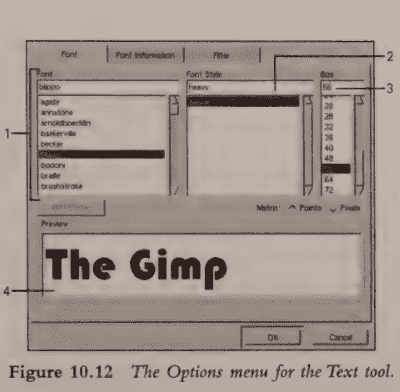

# 字体

这是窗口最重要的部分。它控制实际放置的字体。

- 字体 (1)。列出系统上可用的字体。
- 字体样式 (2)。如果字体支持特定样式（例如*斜体*或**粗体**），从中选择。
- 大号 (3)。选择使用的字体大小。可以设置为像素（pixels）或磅（points）。
- 文本框 (4)。在此框中输入文本。每当字体发生变化时，预览都会自动更新。

# 字体信息

此处显示有关特定字体的所有信息。值无法更改。

# 过滤器

此菜单允许你根据属性过滤不同类型的字体。

- 字体类型。这里三个选择：位图 (Bitmap)、可缩放 (Scalable) 和缩放位图 (Scaled Bitmap)。
- 字体字体。字体的制造商。
- 字重。决定字体的粗细。
- 字符集。字体的字符集：英语、希腊语等。
- 斜体。决定字体的倾斜程度：斜体 (Italic)、正体 (Roman) 或倾斜 (Oblique)。
- 设置宽度。决定字体的水平宽度。

# 绘制工具：文本工具

- **间距。**决定字母之间的间距。C 和 M 分别代表字符单元格 (character cell) 和等宽 (monospaced)。这些产生的间距类似于计算机终端，其中每个字符占据相同的空间。P 代表等比例 (proportional)，它允许字母占据不同的空间。

# 使用方法

GIMP 使用文本的能力有些欠缺，就像许多其他图像处理程序一样。如果你打算进行大量的文本处理，你可能想先使用 TeX'或其他排版程序，然后将其作为 PostScript 文件导入到 GIMP。

如果你只插入少量的文本，文本工具就足够了。为了获得最佳效果，请对你的字体使用抗锯齿（anti-aliasing）。还要选择可缩放的字体——例如 Blippo 或 RoostHeavy——这样你的文本看起来就不会是块状的。

> 字体字体 (110)，调整层大小

| 10.7 墨水工具 | [K] |
| :--- | :--- |
|or | 墨水工具模拟用书法笔进行绘画。它根据光标移动的速度改变自身的宽度。如果你有一个支持压力和倾斜的数位板，画笔的宽度取决于压力和倾斜角度 |
| 选项 | 决定笔尖（笔刷形状）的最大半径。注意笔刷的大小和形状无关 |
| 敏感度 | 决定工具对变化的敏感程度。较高的敏感度会产生较不均匀的线条 |
| 倾斜敏感度 | 决定工具对数位板倾斜的敏感程度。如果笔工具是鼠标，则不使用此选项 |
| 速度敏感度 | 此选项决定所涂颜料对变化的敏感程度。低敏感度意味着墨水的宽度变化很小。较高的敏感度将提供更真实的墨水工具效果 |
| 角度 | 决定笔尖的角度偏移。只有当你拥有数位板时才使用此选项 |

# 绘制工具：墨水工具

# 笔尖

此工具可以使用三种不同的笔尖（或称笔刷形状）：

- 圆形
- 正方形
- 菱形

# 使用方法

墨水工具最初设计用于帮助开发 X 服务器的数位板驱动程序。这个小程序已变成一个能够模拟真实墨水的优秀工具。使用数位板时效果最佳，但在使用鼠标时它仍然很有用。要使用此工具，只需在图像上画线，并以不同的速度移动鼠标。光标移动越快，线条就越细。图 10.13 显示了用这种方式绘制的一些示例线条。

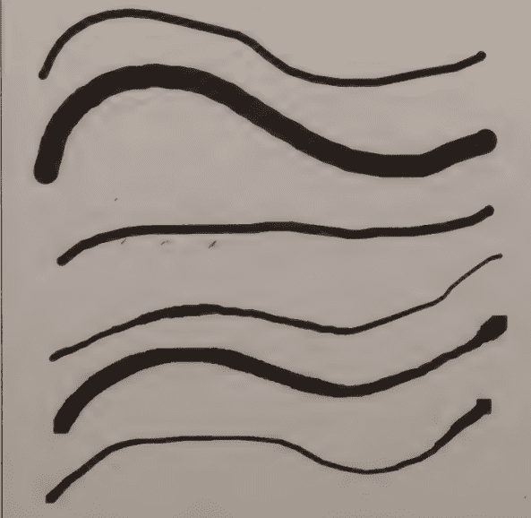

图 10.13 在不同敏感度下使用墨水工具绘制的一些样本线条。

# 11
选择工具

| 页码 | 目录 |
| :--- | :--- |
| 154 | 矩形选择——创建矩形选择。 |
| 154 | 椭圆选择——创建椭圆形选择。 |
| 155 | 手绘选择——允许你进行手绘（不规则）选择。 |
| 156 | 模糊选择——根据相似颜色进行选择。 |
| 156 | 贝塞尔曲线选择——创建非常复杂的曲线选择。 |
| 157 | 智能剪刀——尝试根据颜色智能地选择手绘区域。 |
| 158 | 移动——移动选择和图层。 |
| 159 | 裁剪——从图像中裁剪不需要区域。 |

# 154 选择工具：矩形选择

现在你已经在图像上画了画，在画布上移动这些图形以使它们看起来恰好是非常用的。选择工具提供了许多实现此目的的方法。它们允许你在非常特定的区域进行绘制和应用过滤器。在掌握这些选择工具后，你将能够在 GIMP 中非常高效地工作。这些工具的控制可能非常复杂，建议阅读“高级”

| 描述 | |
| :--- | :--- |
| 选项 | 此工具创建矩形选择。 |
| 固定大小/宽高比 | 此切换允许将选择的大小限制在特定大小或比例。最有用的单位是像素，它提供了绝对值。百分比也有用，它可以创建一个占图像特定百分比的选择。 |
| 并集 | 按住 Shift 键点击将选择添加到现有选择中。 |
| 强制正方形 | 按住 Shift 键移动以强制变为正方形。 |
| 差 | 按住 Ctrl 键点击以从现有选择中减去选择。 |
| 居中 | 按住 Ctrl 键移动以从点击的位置居中选择。 |
| 交集 | 按住 Ctrl 和 Shift 键点击仅选择原始选择和新区域重叠的部分。 |

> 字体选择 (24)

| 描述 | |
| :--- | :--- |
| 选项 | 此工具创建椭圆形选择。 |
| 抗锯齿 | 使用透明度使曲线更平滑。 |
| 羽化 | 此选项使选择的边缘变得模糊。它将使图像边缘附近的部分逐渐变为完全透明。 |

# 选择工具：手绘选择

# 固定大小/宽高比

此切换允许将选择的大小限制在特定大小或比例。最有用的单位是像素，它提供了绝对值。百分比也有用，它可以创建一个占图像特定百分比的选择。

# 并集

按住 Shift 键点击将选择添加到现有选择中。

# 强制圆形

按住 Shift 键移动以强制变为圆形。

# 差

按住 Ctrl 键点击以从现有选择中减去选择。

# 居中

按住 Ctrl 键移动以从点击的位置居中选择。

# 交集

按住 Ctrl 和 Shift 键点击仅选择原始选择和新区域重叠的部分。

> 字体选择 (24)

## 11.3 手绘选择 [F]

### 描述

手绘选择工具允许你创建手绘选择区域。它对于照片编辑中的修饰选择非常有用。

### 选项

使用透明度使曲线更平滑。

# 抗锯齿

此选项使选择的边缘变得模糊。它将图像边缘附近的部分逐渐变为完全透明。

## 11.4 模糊选择 [Z]

模糊选择工具允许你根据颜色进行选择。它会选择鼠标点击位置附近的任何内容，并扩展直到颜色变得太不同为止。在点击的同时拖动光标可以改变阈值。向左拖动会降低阈值；向右拖动会增加阈值。

### 描述

### 选项

此选项确定由所有层形成的图像的阈值，而不仅仅是活动层。它仅在活动层上创建选择。

- 抗锯齿 (Anti-Aliasing)
此选项通过透明度使曲线更平滑。

- 羽化 (Feather)
此选项使选择边缘模糊。它会让选择边缘附近的图像部分逐渐淡出透明。

- 阈值 (Threshold)
此滑块控制点击时使用的基础阈值，但可以通过点击并向右或左移动鼠标来增加或减少。

- 并集 (Union)
按住 Shift 键，然后点击将选择添加到现有选择中。

- 差集 (Difference)
按住 Ctrl 键，然后点击从现有选择中减去选择。

- 交集 (Intersection)
按住 Ctrl 和 Shift 键，然后点击。这仅选择原始选择和新区域重叠的地方。

## 11.5 贝塞尔选择 [B]

### 描述

此工具非常适合从照片中剪出复杂的形状。它是一个复杂的工具，因此其选项菜单如图 11.1 所示。

### 选项

- 抗锯齿 (Anti-Aliasing)
这通过透明度使曲线更平滑。

- 羽化 (Feather)
此选项使选择边缘模糊。它会让选择边缘附近的图像部分逐渐淡出透明。

- 并集 (Union)
按住 Shift 键，然后点击将选择添加到现有选择中。

### 选择工具：智能剪刀 (Intelligent Scissors)

### 移动手柄 (Move Handle)
在编辑器模式下按住 Shift 键并点击可以移动锚点上的单个手柄。

### 差集 (Difference)
按住 Ctrl 键，然后点击从现有选择中减去选择。

### 移动锚点 (Move Anchor)
在编辑器模式下按住 Ctrl 键并点击可以移动锚点。

### 交集 (Intersection)
按住 Ctrl 和 Shift 键，然后点击。这仅选择原始选择和新区域重叠的地方。


图 11.1 贝塞尔选择工具的选项菜单。

### 使用

贝塞尔选择工具是最复杂且功能强大的选择工具。要创建选择，可以在任何有曲线或尖角的地方点击鼠标按钮来勾勒所需的物体。这会在物体周围创建一系列锚点。当物体被完全包围时，点击原始锚点。这将你进入编辑模式。要创建曲线，点击并拖动锚点。这将把锚点变成曲线。在点击和拖动时按住 Shift 键可以移动单个手柄。要移动锚点，在点击和拖动时按住 Ctrl 键。得到满意的曲线后，点击选择内部。如果你正在进行并集、差集或交集操作，在点击时按住相应的键。这将给你选择结果。一旦完成选择，贝塞尔曲线将转换为“路径”。

> 另另智能剪刀 (157)

## 11.6 智能剪刀

### 描述

智能剪刀工具是从复杂图像中快速创建选择的优秀工具。它有一些相当复杂的选项，因此菜单如图 11.2 所示。注意，此工具并不总是正常工作，因此在修复之前它可能会从未来的版本中移除。

### 选项

- **抗锯齿** (Anti-Aliasing) (1) 这通过透明度使曲线更平滑。
- **羽化** (Feather) (2) 此选项使选择边缘模糊。它会让选择边缘附近的图像部分逐渐淡出透明。
- **曲线分辨率** (Curve Resolution) (3) 这决定了智能剪刀曲线的详细程度。较低的分值值会让曲线变得锯齿状。
- **边缘检测阈值** (Edge Detect Threshold) (4) 此选项决定工具对颜色变化的敏感度。范围为1到255。15通常是一个合适的值。
- **弹性** (Elasticity) (5) 弹性决定了工具偏离曲线贴合图像的程度。范围为0到1.0。此设置中的较高值并不总是能产生正确的结果。
- **转换为贝塞尔曲线** (Convert to Bezier Curve) (6) 一个非常实用的选项，将剪刀生成的曲线转换为贝塞尔曲线以便进一步调优。


图 11.2 智能剪刀的选项菜单。

> 参见贝塞尔选择 (156)

## 11.7 移动 [M]

**描述** 使用移动工具，你可以通过点击并拖动来移动选择或层。

**方向键** 此选项以非常小的增量移动选择。在使用方向键时按住 Shift 键可以以稍大的增量移动选择。

**移动层** 按住 Shift 键，并点击拖动以移动整个活动层。

**移动边界** 按住 Alt 键，并点击拖动以移动选择边界，但不移动选择内容。

### 使用

移动带有透明度的层时必须小心。要移动层，按住 Shift 键，并点击拖动以移动该层。

## 11.8 裁剪

### 描述
裁剪工具用于调整大小。

### 选项

- **当前层 (Current Layer)**
此选项在裁剪层或整个图像之间切换。

- **允许放大 (Allow Enlarging)**
这允许放大。最好关闭。

### 使用

选择裁剪后，会弹出对话框。要调整大小，按住 Shift 键，并点击拖动以移动区域。

# 图像变换工具：变换工具

163

## 缩放

在画布内缩放图像。这与图像菜单中的“缩放”类似，但它只作用于活动层。拖动时按住 Shift 键可以保持高度不变，而按住 Ctrl 键可以保持宽度不变。同时按住两个键可以保持宽高比例。有关使用此工具的具体信息请见下面的“用法”部分。

## 倾斜

在 X 或 Y 轴上扭曲图像。这种变换类似于将纸箱压扁，只有侧边的长度可以改变。一次只能对一个轴进行操作。选定的轴由鼠标第一次移动的方向决定。有关使用此工具的具体信息请见下面的“用法”部分。

## 透视

调整当前图层的透视。每个角都可以独立调整，从而创建出非常有趣且可能不现实的透视效果。有关使用此工具的具体信息请见下面的“用法”部分。

## 工具范式

- 这决定了边界的移动如何影响图像。这里有两个选项：
- **传统（Traditional）** 此选项非常直观。它变换图像以适应它被拖入的边界。旋转、倾斜、缩放和透视通常也会使用此选项。
- **校正（Corrective）** 此选项用于修复需要修正的图像。它执行传统模式的反向操作，通过变换新边界来适应旧边界。例如，如果有一张歪的扫描照片，可以在此模式下修复。只需在透视模式下将边界拖动到正确的形状。点击“变换”按钮时，它会将此新边界拉伸回旧边界，使照片完全变直。此模式通常仅用于透视模式，但也可以在其他模式下。

## 平滑

此选项的作用类似于抗锯齿：它让锯齿边缘变得更平滑。它适用于所有类型的变换。

## 显示路径

此选项显示变换过程中创建的最后路径。

## 显示网格

此选项在变换边界内开启网格。

## 网格密度

此选项定义开启网格时的密度。对于较大的图像，请使用较低的网格密度。该值范围从 0 到 5。

## 裁剪结果

选中此选项将保持图层大小不变，并丢失图层之外的任何信息。如果没有选中，图层将根据需要调整大小。

## 用法

变换工具每个部分的用法都相似。选择该工具后，必须先点击图层。活动图层的角会出现一个小方框。点击并拖动角部将调整图像。所有四个角都可以用于这些变换。

GIMP 1.2 为此工具提供了改进后的界面。对于每个模式，都会弹出一个信息窗口。该窗口提供了工具所需的各种。

可以使用键盘和鼠标输入来使操作更加精确。输入信息后，点击“旋转”、“缩放”、“倾斜”或“变换”按钮将开始变换。要放弃更改，点击“重置”按钮。

> 参见“调整大小与缩放”（第 42 页）

## 12.3 翻转工具 [Shift+F]

### 描述

翻转工具水平或垂直地镜像活动层。

## 选项 水平

水平翻转图像。箭头将变为水平对齐的双向箭头。

## 垂直

垂直翻转图像。箭头将变为垂直对齐的双向箭头。

## 12.4 橡皮擦 [Shift+E]

### 描述

橡皮擦工具移除图像上的油漆。

## 选项 直线

点击时按住 Shift 键，可以从上一个橡皮擦位置到当前位置画一条直线。

## 硬边缘

当从选项菜单中选中时，橡皮擦的画刷将没有任何透明度（边缘看起来非常粗糙）。

## 增量

此选项使橡皮擦笔触具有累积性，因此当鼠标在特定区域移动多次时，会擦掉更多油漆。这仅在画刷透明度小于 100% 时有用。

## 用法

橡皮擦工具与铅笔工具非常相似。它使用“画笔”菜单中选的画刷。使用实心画刷配合橡皮擦会得到模糊的线条，使其更平滑。要获得完全实心的形状，请选择“硬边缘”选项。使用模糊画刷将得到非常模糊的线条。橡皮擦将露出的颜色是背景色，除非图像中有 Alpha 通道，否则它将擦除为透明。

- 参见“添加 Alpha 通道”（第 61 页）和“画笔”（第 172 页）

## 12.5 克隆工具

### 描述

克隆工具复制选定的图像或图案，并像画刷一样进行涂绘。它非常适合照片编辑。

### 选项

## 源

允许您选择克隆工具中涂绘的源。“图像”使用选定的图像图层进行涂绘。“图案”使用当前图案。

### 对齐

此选项保持源与鼠标点击位置对齐。未选中时，画刷将始终从起点开始涂绘。

### 直线

点击时按住 Shift 键，可以从上一个画笔画刷位置到当前位置画一条直线。

### 选择源

当使用图像作为源时，点击时按住 Ctrl 键可以选择克隆工具的源点。

## 用法

克隆工具非常适合处理扫描图像中的皮肤、草地或其他复杂的纹理区域。最佳的画刷是边缘柔软的画刷。

## 12.6 卷积工具 [V]

## 描述 | 卷积工具手动模糊或锐化某些区域。 |
## 选项 | 确定将发生的模糊或锐化程度。这类似于“压力”选项。 |
## 模糊 | 导致区域变得模糊。 |
## 锐化 | 使区域变锐。 |
## 直线 | 点击时按住 Shift 键，可以从上一点开始进行模糊或锐化。 |
## 用法 | 卷积工具用于特定区域。锐化并不总是有效；它可能会产生斑点状图像。通常使用“增强”菜单中的“锐化”滤效果更好。 |

> > 参见“锐化”（第 224 页）和“模糊滤”（第 193 页）

## 12.7 颜色选取器 [0]

## 描述 | 颜色选取器从图像中选取颜色作为前景或背景色。 |
## 选项 |
| 采样合并 | 获取所有图层的平均颜色，而不仅仅是活动图层。 |
## 用法 | 通过点击来替换前景或背景色。选择颜色时会弹出一个窗口，显示 RGB 值、Alpha 值和颜色的十六进制元组。 |

> > 参见“颜色选择”（第 12 页）

## 12.8 减淡工具

## 描述 此工具使用画刷调整强度值。

## 选项 这是一个百分比值，用于控制强度变化的程度。

## 亮部 此切换会增加受影响像素的强度，使其变亮。

## 压暗 此切换会减少受影响像素的强度，使其变暗。

## 高光 此切换仅选择高强度值的像素。

## 中间调 此切换选择中等强度值的像素。

## 阴影 此切换选择低强度值的像素。

## 直线 点击时按住 Shift 键，可以从上一个绘图位置开始画出减淡（或压暗）的直线。

## 反转工具 使用另一种绘图方法。例如，如果在选项菜单中选择了亮部，则在按住 Shift 键时将使用压暗。

## 用法 减淡工具用于处理图像中需要更改强度的特定区域。受影响的区域由活动画刷决定。最佳画刷是边缘柔软的。此工具非常有助于强调或隐藏扫描照片中的元素，如脸部或汽车的镀铬部分。

168 图像变换工具：减光与加亮

- 1. 在 GIMP 中打开图片。图 12.1 显示了该示例。

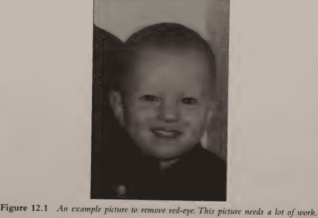

- 2. 打开“图层 (Layers)和通道 (Channels)”菜单。
3. 点击“通道”选项卡。
4. 点击蓝色和绿色通道以取消选择。此时只有红色通道处于高亮状态。
5. 选择减光与加亮工具 (`[Shift+D]`).
6. 双击减光与加亮工具打开选项菜单。
7. 选择“烧焦 (Burn)”作为类型。
8. 将曝光降低到 20.0。
9. 根据红眼的亮度选择合适的模式。通常使用“阴影 (Shadows)”效果最好。
10. 放大需要编辑的区域。图 12.2 显示了放大后的区域。

## 图像变换工具：污指 169

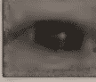

图 12.2 眼睛周围放大的区域。

- 1. 选择一个足够小的笔刷来处理眼睛。使用足够小的羽化笔刷来编辑红色边缘，而不影响高光中心。
2. 使用小笔触，使用“烧焦 (Burn)”工具加深红色区域。修复后的区域如图 12.3 所示。

图 12.3 去除红眼后的修复区域。注意，在灰度版本中，它看起来变暗了。在彩色打印中，所有的红色都被删除了。

- 13. 缩小查看更改。

> ► 另参阅“曲线 (Curves)”（第 56 页）

| 12.9 污指 `[Shift+S]` |
| --- | --- |
| 说明 | 污指工具使用当前画刷涂抹图层中的漆料。这种效果类似于在画布上涂抹油画。此效果类似于 IWarp 滤镜（第 210 页）。 |
| 选项 | 此百分比值决定污抹的程度。百分比越高，漆移动得越远，污抹效果越明显。使用 100% 的压力会导致初始区域被永久污抹。 |
| 直线 | 按住 Shift 键并点击，可以从上次绘制的位置开始直线污抹。 |
| 用法 | 污指工具用于在图像中创建艺术效果。涂抹背景区域以作为模糊的替代方案，使其失去焦点是非常有用的。此工具通常不用于增强照片，而是为了增添艺术风味。 |

> ► 另参阅“IWarp”（第 210 页）

# 13 笔刷、图案、调色板和渐变

| 页码 | 内容 |
|---|---|
| 172 | **笔刷**——如何在在 GIMP 中各种各种笔刷 |
| 175 | **图案**——使用可用于绘画和填充的各种图案。 |
| 176 | **调色板**——使用不同的调色板保存和选择预设颜色。 |
| 178 | **渐变**——如何选择和编辑渐变以制作平滑过渡。 |

## 笔刷、图案、调色板和渐变：选择使用的笔刷

本章的内容对于经验丰富的图形艺术家来说是熟悉的。初接触图形程序的新手需要阅读本章，以便充分利用 GIMP 的所有功能。

### 13.1 笔刷

本章的第一部分是最重要的：笔刷。你将在 GIMP 的每张图像上使用笔刷。

笔刷用于以下工具：

- 铅笔 (Pencil)
- 画笔 (Paintbrush)
- 喷笔 (Airbrush)
- 橡皮擦 (Eraser)
- 克隆工具 (Clone)
- 卷积工具 (Convolver)
- 描边 (Stroke)
- 减光/加亮 (Dodge/Burn)

### 13.1.1 选择使用的笔刷

菜单位置 `<Image>/Dialogs/Brushes...`

为工作选择正确的笔刷是一项需要快速学习的重要技能。有几种方法可以访问笔刷选择菜单：

- 点击 `<Image>/Dialogs/Brushes...`
- 点击 `<Toolbox>/File/Dialogs/Brushes...`
- 点击工具箱中显示的笔刷
- 使用热键 `[Shift+Ctrl+B]`

在笔刷选择菜单中，有一个对话框显示 GIMP 中可用的所有笔刷。请参考表 13.1 了解这些笔刷的描述和可能的用途。如果笔刷太大无法显示，用鼠标左键点击并按，将显示一张更大的图片。你可以通过鼠标点击它们来选择笔刷。笔刷的大小显示在笔刷菜单的右上角（见图 13.1）。

img/f2e1dc39d482e76a84057f638c7a2d3f_195_0.png)

图 13.1 笔刷选择窗口。

## 笔刷、图案、调色板和渐变：选择使用的笔刷

### 表 13.1 笔刷及其常见用途

| 笔刷名称 | 描述与效果 | 用途 |
| --- | --- | --- |
| 书法 (Calligraphic) | 笔尖，硬边缘 | 与水墨工具配合模拟书法笔。 |
| 普通圆圈 (Regular Circle) | 硬边缘，粗糙 | 用于精细调整。 |
| 模糊圆圈 (Fuzzy Circle) | 软边缘，平滑 | 用于画线。与橡皮擦、克隆工具配合良好。 |

GIMP 还提供了一些特殊笔刷，如图 13.2 所示：

- 五屑 (Confetti) (1)
- 对角星形 (Diagonal Star) (2)
- GIMP 图标 (GIMP logo) (3)
- 银河 (Galaxy) (4)
- XCF 属性 (Property of XCF) (5)
- 沙丘 (Sand Dunes) (6)
- 正方形 (Square) (7)

img/f2e1dc39d482e76a84057f638c7a2d3f_196_0.png

图 13.2 各种特殊笔刷的示例。

## 174 笔刷、图案、调色板和渐变：笔刷选项

### 13.1.2 笔刷选项

GIMP 中的笔刷有三个选项：

- **不透明度 (Opacity)**：范围从 0（完全透明）到 100（完全不透明）。不透明度影响笔刷的效果。
- **模式 (Mode)**：（第 44 页）允许你选择笔刷。
- **间距 (Spacing)**：这是使用笔刷绘画时使用的距离，单位为像素。

### 13.1.3 创建和编辑笔刷

GIMP 允许你创建自己的笔刷或编辑现有笔刷。创建自己的笔刷非常简单。只需遵循以下步骤：

1. 创建一个白色背景的新图像。
2. 将前景颜色设置为黑色。
3. 选择一个绘制工具。使用铅笔将产生硬边缘，而使用画笔或喷笔将产生软边缘。
4. 对于较小的图像使用较小的笔刷。
5. 创建你的自定义笔刷。在图像上画一些笔触。

## 13.2 图案 `[Shift+Ctrl+P]`

菜单位置 `<Image>/Dialogs/Patterns`

图案用于大面积覆盖纹理。使用图案的工具是油漆填充和克隆工具。脚本菜单中的某些脚本也使用图案。有几种方法可以访问图案选择菜单：

- 点击 `<Image>/Dialogs/Patterns...`
- 点击 `<Toolbox>/File/Dialogs/Patterns...`
- 点击工具箱中显示的图案
- 使用热键 `[Shift+Ctrl+P]`

你可以通过点击图案选择菜单中的项目来选择图案（见图 13.3）。如果图案太大无法在窗口中显示，点击并按住鼠标将显示完整图像。图案名称和大小将显示在右上角。

> *还有一个名为“选择到笔刷 (Selection to Brush)”的脚本，允许你跳过以下步骤。*

## 176 笔刷、图案、调色板与渐变：图案的创建与编辑

### 13.2.1 创建与编辑图案

图案（Patterns）本质上是以 GIMP 图案格式保存的 RGB 或灰度模式图像。创建自己的图案非常有用，特别是在为网页创建 Logo 和其他图像时。记住要让这些图像是可平铺的（tileable），这样图案中就不会出现明显的缝隙。

要创建自己的图像，请遵循以下步骤：

- 1. 创建一个新的 RGB 或灰度模式图像 ([Ctrl+N])。
- 2. 绘制你的新图案。
- 3. 使用“无缝”（Make Seamless）过滤器移除图像中任何明显的缝隙。
- 4. 将图像以 .pat 格式保存到 ~/.gimp/patterns 目录下。
此处弹出的对话框只有一个选项。这是在“图案选择”菜单中显示的图案名称。
- 5. 点击“图案选择”菜单中的“刷新”按钮，使你的新图案出现。

## 13.3 调色板 [Ctrl+P]

菜单位置 <Image>/Dialogs/Palettes

当你想要用特定的配色方案（如粉彩色）进行绘画时，就会用到调色板。在创建限制使用数量的图像时（第 80 页），它也非常有用。有几种方法可以访问“调色板”菜单：

- 点击 <Image>/Dialogs/Palettes...
- 点击 <Toolbar>/File/Dialogs/Palettes...
- 使用热键 [Ctrl+P]

GIMP 中的调色板只是一个包含许多不同颜色供选择的菜单。调色板可以在 ~/.gimp/palettes 中找到。

“调色板选择”菜单有几个选项，通过“编辑”按钮（如图 13:4 所示）访问：

- 编辑（Edit）：点击此按钮查看对可用调色板执行操作的菜单。
  - a. 新（New）：创建一个供使用的调色板。
  - b. 删除（Delete）：从 ~/.gimp/palettes 目录中删除当前调色板。
  - c. 右键点击特定颜色可以让你编辑、删除或添加新颜色。

> 注意：如果你删除了 ~/.gimp/palettes 目录中的调色板，你必须从 <Gimp Directory>/Palettes 复制它才能恢复。

## 笔刷、图案、调色板与渐变：调色板的创建与编辑


要使用调色板中的颜色，只需在调色板菜单中点击它，它将被设置为当前选颜色（前景或背景）。

默认安装的 GIMP 提供以下调色板：

- 熊（Bears）
- 金色（Bgold）
- 蓝色（Blues）
- 边界（Borders）
- 棕色与黄色（Browns_And_Yellows）
- 焦糖（Caramel）
- 瀑布（Cascade）
- 中国（China）
- 冷火（Coldfire）
- 酷色（Cool_Colors）
- 鹤（Cranes）
- 暗粉色（Dark_Pastels）
- 默认（Default）
- Ega
- 火代码（Firecode）
- 黄金（Gold）
- 灰紫（GrayViolet）
- 灰蓝（Grayblue）
- 灰色（Grays）
- 绿色（Greens）
- 高亮（Hilite）
- 卡其（Kahki）
- 亮度（Lights）
- 柔和（Muted）
- 命名颜色（Named_Colors）
- 新闻3（News3）
- Op2
- 喷漆画（Paintjet）
- 粉色（Pastels）
- 等离子体（Plasma）
- 红色（Reds）
- 红紫色（Reds_And_Purples）
- 皇室（Royal）
- 地形（Topographic）
- Visibone
- Visibone2
- 火山（Volcano）
- 暖色（Warm_Colors）
- Web

图 13.4 调色板选择窗口。

### 13.3.1 创建与编辑调色板

调色板可以通过两种方式创建：手动创建和从索引图像创建（请参见“保存调色板”，第 65 页）。

要手动创建调色板，请遵循以下步骤：

- 1. 打开“调色板选择”菜单。
- 2. 点击“编辑”。
- 3. 点击“新调色板”。

系统会要求为新调色板命名，并将创建此新调色板。

- 4. 新：创建一个供使用的调色板。
- 5. 删除：从 ~/.gimp/palettes 目录中删除当前调色板。
- 6. 右键点击特定颜色可以可以你编辑、删除或添加新颜色。

> 注意：如果你删除了 ~/.gimp/palettes 目录中的调色板，你必须从 <Gimp Directory>/Palettes 复制它才能恢复。

## 13.4 渐变 [Ctrl+G]

菜单位置 <Image>/Dialogs/Gradients

当你想要用特定的配色方案（如粉彩色）进行绘画时，就会用到渐变。在创建限制使用数量的图像时（第 80 页），它也非常有用。有几种方法可以访问“渐变”菜单：

- 点击 <Image>/Dialogs/Gradients...
- 点击 <Toolbar>/File/Dialogs/Gradients...
- 使用热键 [Ctrl+G]

GIMP 中的渐变只是一个包含许多不同颜色供选择的菜单。渐变可以在 ~/.gimp/palettes 中找到。

“渐变选择”菜单有几个选项，通过“编辑”按钮（如图 13:4 所示）访问：

- 编辑（Edit）：点击此按钮查看对可用调色板执行操作的菜单。
  - a. 新（New）：创建一个供使用的调色板。
  - b. 删除（Delete）：从 ~/.gimp/palettes 目录中删除当前调色板。
  - c. 右键点击特定颜色可以可以你编辑、删除或添加新颜色。

> 注意：如果你删除了 ~/.gimp/palettes 目录中的调色板，你必须从 <Gimp Directory>/Palettes 复制它才能恢复。

## 笔刷、图案、调色板与渐变：调色板的创建与编辑


要使用调色板中的颜色，只需在调色板菜单中点击它，它将被设置为当前选颜色（前景或背景）。

默认安装的 GIMP 提供以下调色板：

- Bears（熊）
- Bgold（金色）
- Blues（蓝色）
- Borders（边界）
- Browns_And_Yellows（棕色与黄色）
- Caramel（焦糖）
- Cascade（瀑布）
- China（中国）
- Coldfire（冷火）
- Cool_Colors（酷色）
- Cranes（鹤）
- Dark_Pastels（暗粉色）
- Default（默认）
- Ega
- Firecode（火代码）
- Gold（黄金）
- GrayViolet（灰紫）
- Grayblue（灰蓝）
- Grays（灰色）
- Greens（绿色）
- Hilite（高亮）
- Kahki（卡其）
- Lights（亮度）
- Muted（柔和）
- Named_Colors（命名颜色）
- News3（新闻3）
- Op2
- Paintjet（喷漆画）
- Pastels（粉色）
- Plasma（等离子体）
- Reds（红色）
- Reds_And_Purples（红紫色）
- Royal（皇室）
- Topographic（地形）
- Visibone
- Visibone2
- Volcano（火山）
- Warm_Colors（暖色）
- Web

图 13.4 调色板选择窗口。

### 13.3.1 创建与编辑调色板

调色板可以通过两种方式创建：手动创建和从索引图像创建（请参见“保存调色板”，第 65 页）。

要手动创建调色板，请遵循以下步骤：

- 1. 打开“调色板选择”菜单。
- 2. 点击“编辑”。
- 3. 点击“新调色板”。

系统会要求为新调色板命名，并将创建此新调色板。

- 4. 新：创建一个供使用的调色板。
- 5. 删除：从 ~/.gimp/palettes 目录中删除当前调色板。
- 6. 右键点击特定颜色可以可以你编辑、删除或添加新颜色。

## A 安装 GIMP

| 页码 | 内容 |
|---|---|
| 280 | 安装 RedHat 软件包 |
| 281 | 安装 Debian 软件包 |
| 281 | 从源码安装所需的图像库 |
| 281 | 安装指南 |
| 282 | Jpeglib |
| 283 | PNG |
| 283 | Libtiff |
| 284 | 安装 GTK+ |
| 284 | 编译安装 Glib 和 GTK+ |
| 285 | GIMP |
| 285 | 哪个版本适合我？ |
| 285 | 编译安装 GIMP |
| 287 | 编译安装 GIMP 的开发版本 |
| 288 | 编译安装 GIMP 的稳定版本 |

## 280 安装 GIMP：安装 RedHat 软件包

对于 Linux 或 Unix 的初学者来说，安装 GIMP 可能是一项困难且令人沮丧的任务，在开始安装 GIMP 之前，需要许多库。大多数 Linux 发行版都预装了 GIMP。如果你希望运行“前沿版本”的 GIMP 或其库，本附录中的信息至关重要。虽然提供了 GIMP 的二进制文件、RPM 或 DEB，但你也将学习如何从源码安装以完全自定义 GIMP。

### A.1 RedHat 软件包

RedHat 管理器 (RPM) 是一个可以方便安装的程序。大多数 Linux 发行版都预装了 GIMP。如果你希望运行“前沿版本”的 GIMP 或其库，本附录中的信息至关重要。虽然提供了 GIMP 的二进制文件、RPM 或 DEB，但你也将学习如何从源码安装以完全自定义 GIMP。

### A.3.2 Jpeglib

第一个安装的库是 jpeglib。可以在这里找到：


ftp://ftp.uu.net/graphics/jpeg/

将下载的文件解压到`/usr/local/src`。进入新创建的目录并输入：

```bash
./configure
```

默认情况下，它将到`/usr/local/lib`。这将配置程序在你的计算机上进行编译。运行完成后，输入：

```bash
make && make test
```

如果没有错误，输入：

```bash
make install
```

此时，编辑名为`/etc/ld.so.conf`的文件。如果该文件中没有看到`/usr/local/lib`，请将其添加到最后最后行。接下来，输入：

```bash
/sbin/ldconfig -v | more
```

你会在输出中看到多个以`libjpeg*`开头的文件。

# 安装 GIMP：Libtiff 283

解压此包并进入新目录。Zlib 使用不同的配置脚本进行安装，但命令行选项是类似的。输入以下命令设置编译环境：

```
./configure
```

使用`--prefix`选项设置不同的安装位置：

```
make test
```

这应该会在没有任何错误的情况下运行。如果你在运行`make test`时遇到错误，请检查`README`文件以获取额外说明。假设它在没有任何错误的情况下运行，输入以下命令：

```
make install && ldconfig
```

### A.3.3 PNG

读取和写入 PNG 文件需要 PNG 库。可以在这里获取：

```
ftp://ftp.uu.net/graphics/png/src/
```

在安装 PNG 之前，必须安装并运行`zlib`。PNG 的安装过程不是标准方法，因此仔细阅读`INSTALL`文件非常重要。开始时，当你位于`libpng`目录时，输入以下命令：

```
cp scripts/makefile.lnx Makefile
```

接下来，编辑`pngconf.h`以进行任何必要的配置更改。标准的 Linux 系统通常不需要任何更改。

注意，如果你正在运行 PowerPC 处理器，请取消注释`PNG_BIG_ENDIAN_SUPPORTED`所在的行。


接下来，输入以下命令：

```
make test
```

这将运行一个很小的测试程序，读取示例 PNG 文件并将其保存到另一个文件中。如果这两个 PNG 文件完全相同，则 PNG 库已准备好进行编译。如果你在此处遇到问题，请返回并确保`zlib`已正确安装。如果你在`zlib`目录运行了`make test`且运行成功，则说明`zlib`安装正确。接下来，输入以下命令：

```
make install && ldconfig
```

PNG 现在已安装在你的系统上。

### A.3.4 Libtiff

Libtiff 的安装非常简单。可以在这里找到：

```
ftp://ftp.sgi.com/graphics/tiff
```

解压此文件并进入`tiff-<版本号>`目录。

相关文档在`html`目录中。如果你愿意，可以阅读`index.html`文件及其说明。如果你是标准 Linux 系统，输入以下命令：
`./configure && make`

如果没有错误，输入以下命令：
`make install && ldconfig`

之前描述的库是运行功能性 GIMP 所需的所有库。可以安装其他库，但它们有非常特定的用途，大多数用户并不需要它们。下一个库 GTK+ 是运行 GIMP 必需的。

# A.4 安装 GTK+

GTK+，或 GIMP 工具包（Toolkit），是一个极其灵活的库，用于为 X Window 系统创建图形用户界面。Linux 许多应用程序都使用这个库，你会发现在系统上安装它非常有用。由于它广受欢迎，GTK+ 可能已经安装在你的系统上了。如果它过时，可能会导致困难，除非你拥有最新版本的 GTK+，否则删除旧库并安装新版本。

### A.4.1 编译并安装 Glib 和 GTK+

如果你决定升级或安装 GTK+，则有必要下载。GTK+ 的主页为 http://www.gtk.org，文件位于：
`ftp://ftp.gtk.org/pub/gtk`

第一步是安装`glib`，它之前包含在 GTK+ 中，但现在已增长到需要独立分发的程度。它位于与 GTK+ 相同的目录下。首先解压`glib`归包并进入该目录。输入以下命令为你的系统配置归包：
`./configure --disable-debug`

完成后，输入以下命令：
`make`

该库最常见的错误与线程有关。如果发生与线程相关的错误，请使用`--enable-threads=no`选项重新配置`glib`。

如果`glib`在没有错误的情况下完成安装，请输入以下命令：
`make install && ldconfig`

`glib`将为你的系统完成配置。完成后，返回`/usr/local/src`目录并解压 GTK+ 归包。要配置此包，输入以下命令：
`./configure --disable-debug`

# 安装 GIMP：编译并安装 GIMP

输入`--disable-debug`会从二进制文件中移除调试信息，从而产生更小、运行更快的程序。如果你感兴趣通过通过故障排除帮助 GTK+ 的开发，可以开启调试。这只有在你修改 GTK+ 代码时才是有必要的。

如果你有一个数位板，你还会想要 XInput 支持。这通过在`configure`命令中添加`--with-xinput=free`实现。

如果编译在没有错误的情况下完成，输入以下命令：

```
make && make install && ldconfig
```

如果你在编译 GTK+ 时遇到关于`gettext`的错误，请在运行`configure`时添加命令`--disable-tls`。

# A.5 GIMP

在 GIMP 需要的所有库都运行并安装后，终于是安装 GIMP 的时候了。在安装完所有其他库后，GIMP 的安装应该非常简单。不过，请准备好去泡咖啡。GIMP 的编译时间将是 Linux 内核的三倍以上。双 Pentium II 处理器在这里非常好。

### A.5.1 哪个版本适合我？

取决于你使用的 GIMP。如果你想要前沿功能，使用开发版。如果你需要一个不会意外崩溃的版本，使用稳定版。GIMP 软件包可以在这里获取：
`ftp://ftp.gimp.org/pub/`

`imp`软件包可以在这里获取。如果你要安装稳定版 GIMP，还需要下载额外的。这将为你提供许多额外的渐变、笔刷等。

### A.5.2 编译并安装 GIMP

在下载完成后，解压 GIMP 归包并进入该目录。输入以下命令配置你的系统：

```
./configure --disable-debug
```

完成后，检查文件查看是否生成了任何错误。常见的错误是缺少`zlib`库。日志文件将显示：

# 安装 GIMP

如果在检查 JPEG、PNG 或 TIFF 库时遇到任何错误，请返回并确保这些库已正确安装。如果这些库无法工作，GIMP 可以正确编译但拒绝打开图像。当你确定一切已就绪时，输入以下命令：

```
make
```

这需要很长时间（去泡咖啡）。编译完成后，输入以下命令：

```
make install && ldconfig
```

这将安装 GIMP 的二进制文件。如果你下载了额外文件，将其解压到`/usr/local/src`并进入该目录。输入以下命令：

```
./configure && make install
```

你现在有一个可以运行的 GIMP！！是时候开始使用了。不建议以 root 用户身份工作，请以普通用户登录。启动 X Windows。新的窗口管理器会在菜单中带有 GIMP 条目。是时候加载它了。如果你没有 GIMP 条目，打开一个`xterm`并输入以下命令：

```
gimp
```


会弹出一个对话框询问你是否要设置 GIMP 目录。点击安装按钮。GIMP 启动界面将弹出，然后主 GIMP 工具栏将出现。

> GIMP 1.2 的新功能是 GIMP-Perl 脚本扩展。该扩展目前处于测试阶段，安装可能很困难。冒险的用户可能想要尝试安装它，但对大多数人来说并不是真的需要。如果你尝试安装，你还需要安装另外三个包：
1. `GTK-Perl`。最新版本为 `0.5121`，从 `ftp://ftp.gimp.org/pub/gtk/perl` 获取。
2. `PDL`。可以在 `ftp://ftp.aao.gov.au/pub/pdl1/` 获取。
3. `Parse`。可以在 `http://www.cpan.org/modules/by-module/Parse` 获取。

## 安装 GIMP：编译并安装 GIMP 的开发版本

## 使用多个版本的 GIMP

有时，你可能希望在系统中安装两个版本的 GIMP——一个版本用于所有新颖酷炫的功能，另一个版本用于日常工作。

### A.5.3 编译并安装 GIMP 的开发版本

GIMP 的开发版本相比旧的稳定版本有许多改进。为了实现这些，它牺牲了稳定性，因此如果它崩溃或甚至无法编译，请不要感到。你可以从这里下载：

```
ftp://ftp.gimp.org/pub/gimp/unstable
```

该位置将有两个目录。GIMP 的最新版本将位于数字命名的目录中——例如 `1.1.8/`。`old` 目录包含了所有之前的开发版本。只有当你在使用最新版本遇到问题时，才仅使用该目录中的包。将最新软件包下载并解压到 `/usr/local/src`。进入新目录并输入以下命令：

```
./configure --enable-debug=no --prefix=/usr/local/gimp-1.1.6
```

当配置脚本完成为你的系统设置 GIMP 后，输入以下命令：

```
make && make install
```

如果在编译过程中遇到问题，你可能需要安装 `gettext` 软件包，或者使用 GIMP 提供的版本。可以通过在之前运行的配置脚本末尾添加 `--with-included-gettext` 来实现。从 GNU 站点安装 `gettext` 软件包可能是更好的选择。可以在这里找到最新版本：

```
ftp://ftp.gimp.org/pub/gimp/gettext/
```

或者，如果你不需要原生语言支持，请在配置脚本末尾添加 `--disable-nls`。在配置脚本完成后，输入以下命令：

```
make && make install
```


当 GIMP 完成编译后，你必须让系统感知新的库文件。你可以使用以下两种方法之一：

- 编辑 `/etc/ld.so.conf` 文件。如果你拥有超级用户权限，这是简单的方法。只需将 `/usr/local/gimp-1.1.6/lib` 目录添加到 `/etc/ld.so.conf` 文件中。保存文件，然后输入：
`ldconfig -v`

你应该会看到类似下面的条目：
`/usr/local/gimp-1.1.6/lib:`
`libgck-1.1.so.6 => libgck-1.1.so.6.0.0`
`libgimpui-1.1.so.6 => libgimpui-1.1.so.6.0.0`
`libgimp-1.1.so.6 => libgimp-1.1.so.6.0.0`

- 使用环境变量。使用 bash，请将以下内容添加到 `~/.profile` 文件中：
`export LD_LIBRARY_PATH="$LD_LIBRARY_PATH:/usr/local/gimp-1.1.6/lib"`

然后输入以下命令：
`source ~/.profile`

此时，你可能想尝试运行 GIMP。你需要在 xterm 中执行此操作，或者在你的窗口管理器中创建一个条目来执行文件 `/usr/local/gimp-1.1.6/bin/gimp`。当你第一次运行 GIMP 的开发版本时，它会要求你安装几个文件。点击 Install 按钮进行此操作。这将创建一个名为 `.gimp-1.1` 的新目录，其中包含必要的配置文件。在你验证其运行正常后，可以将其关闭。

### A.5.4 编译并安装 GIMP 的稳定版本

现在已经安装了开发版本，是时候编译 GIMP 的稳定版本了。你可以从这里下载：
`ftp://ftp.gimp.org/pub/gimp/v1.0`

解压归包并进入新目录。输入以下命令为你的机器设置 GIMP：
`./configure --prefix=/usr/local/gimp-1.0.4`

然后输入以下命令来编译 GIMP：
`make && make install`

当 GIMP 完成编译后，你必须让系统感知新的库文件。你可以使用以下两种方法之一：

- 编辑 `/etc/ld.so.conf` 文件。如果你拥有超级用户权限，这是简单的方法。只需将 `/usr/local/gimp-1.0.4/lib` 目录添加到 `/etc/ld.so.conf` 文件中。保存文件，然后输入：
`ldconfig -v`

你应该会看到类似下面的条目：
`/usr/local/gimp-1.0.4/lib:`
`libgck-1.1.so.6 => libgck-1.1.so.6.0.0`
`libgimpui-1.1.so.6 => libgimpui-1.1.so.6.0.0`
`libgimp-1.1.so.6 => libgimp-1.1.so.6.0.0`

- 使用环境变量。使用 bash，请将以下内容添加到 `~/.profile` 文件中：
`export LD_LIBRARY_PATH="$LD_LIBRARY_PATH:/usr/local/gimp-1.0.4/lib"`

然后输入以下命令：
`source ~/.profile`

此时，你可能想尝试运行 GIMP。你需要在 xterm 中执行此操作，或者在你的窗口管理器中创建一个条目来执行文件 `/usr/local/gimp-1.0.4/bin/gimp`。当你第一次运行 GIMP 的开发版本时，它会要求你安装几个文件。点击 Install 按钮进行此操作。这将创建一个名为 `.gimp-1.1` 的新目录，其中包含必要的配置文件。在你验证其运行正常后，可以将其关闭。

# 窗口管理器与 GIMP：WindowMaker

### B.2.5 IceWM

IceWM 是另一个轻量级窗口管理器。GIMP 位于 Applications/Graphics/Gimp 菜单下。GIMP 的配置文件位于 `~/.icewm/menu`。IceWM 的主页地址为 http://www.kiss.uni-lj.si/~k4fr@0235/icewm/。

### B.2.6 KDE

KDE 是另一个桌面环境，它使用自自己的窗口管理器 KWM。GIMP 位于 KDE Gears 菜单下的 non-KDE Apps/Graphics/Gimp 中。GIMP 的配置文件位于 `~/.kde/share/applk/apps/Graphic/gimp.kdelnk`。KDE 的主页位于 http://www.kde.org/。

### B.2.7 WindowMaker

WindowMaker 是一个类似于 AfterStep 的窗口管理器。GIMP 位于 Root 菜单下的 Applications/Graphics/Gimp。GIMP 的配置文件位于 `~/GNUSStep/Library/WindowMaker/menu`。WindowMaker 的主页位于 http://www.windowmaker.org。

# GIMP 的互联网资源

显而易见，GIMP 有许多专门的网页。这只是你可以在互联网上可能发现的内容示例。GIMP 网站托管了许多开发者网页，并提供了指向其他主页的链接。Tiger 的主页（http://tigert.gimp.org/）开发者网站的一个良好示例。对于其他网站，可以尝试输入开发者的电子邮件地址来查找页面，例如 username.gimp.org。可以在 www.gimp.org/~username 找到其他人员。

| 位置 | 标题 | 描述 |
| --- | --- | --- |
| http://www.gimp.org/links.html | GIMP.ORG -> links | GIMP 的重要链接 |
| http://www.gtk.org | GIMP ToolKit | GIMP 工具包主页。提供指向最新软件的链接。 |
| http://registry.gimp.org | GIMP 插件注册 | GIMP 稳定版和不稳定版的插件列表 |
| comp.graphics.apps.gimp | GIMP 新闻邮件组 | 这里是提问与 GIMP 相关问题的好地方。 |
| http://tigert.gimp.org/ | tigert.gimp.org | GIMP 艺术和资源的优秀页面。 |
| http://www.xach.com/gimp/news/index.html | Xach 的 GIMP 新闻 | 关于 GIMP 的最新新闻。还有许多出色的教程。 |
| http://luthien.nucleu.unam.mx/~federico/gimp/ | 每个人都爱 GIMP | Quartie 的 GIMP 资源页面。在这里可以找到许多插件。 |
| http://www.rru.com/~meo/gimp/ | GIMP 常见问题 | 关于 GIMP 的常见问题。 |
| http://www.gimp.org/mailing_list.html | GIMP 邮件列表存档 | GIMP 邮件列表的有用存档。在发布问题之前请检查此处。 |
| http://www.cooltext.com | CoolText.Com | Net-Fu 的优秀示例。 |
| http://www.isc.tamu.edu/~lewing/gimp/ | Larry Ewing 的 GIMP 页面 | Linux 图标的所在地。 |

# 脚本函数参考

| 页码 | 内容 |
| --- | --- |
| 301 | `gimp_drawable_get_pixel`—获取指定坐标处的像素值。 |
| 302 | `gimp_layer_add_alpha`—如果层还没有 Alpha 通道，则为层添加一个。 |
| ... | ... |

# 脚本函数引用：gimp_drawable_get_pixel 301

## D.1 脚本引用

### D.1.1 gimp_drawable_get_pixel

描述：此过程获取指定坐标处的像素值。`num_channels` 参数必须始终等于指定图层的每个像素字节数。

| 变量名 | 类型 | 描述 |
|---|---|---|
| drawable | PDB_DRAWABLE | 图层 |
| num_channels | PDB_INT32 | 像素的通道数 |
| pixel | PDB_INT8ARRAY | 像素值 |
| x coordinate | PDB_INT32 | x 坐标 |
| y coordinate | PDB_INT32 | y 坐标 |

```
if (condVar > someVal) {console.log("xxx")}
```
