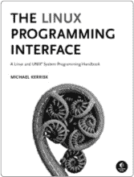
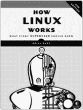

# GNU Make 入门指南


## 关于作者

John Graham-Cumming 是一位资深 GNU `make` 专家。他编写了广誉的基于机器学习的 POPFile 邮件过滤器，并成功促使英国政府对阿兰·图灵的待遇道歉。他拥有牛津大学计算机安全博士学位，目前就职于 CloudFlare。

## 关于技术审查员

Paul Smith 自 1996 年起一直是自由软件基金会 GNU `make` 项目的维护者。他从 20 世纪 80 年就开始使用并贡献自由软件，从 1993 年开始贡献 GNU/Linux。在职业上，他编写网络和数据库系统软件。在生活中，他喜欢和妻子孩子一起骑自行车和潜水。

## 前言

我不记得自己第一次遇到 `make` 程序是什么时候了，但我想，和很多程序员一样，我当时正尝试构建他人的软件。和许多程序员一样，我可能被 `make` 语法的简单性所吸引和诱惑，却没有意识到这个通用程序背后隐藏的深度和力量。

在多年处理各种真实的 Makefile、在博客上撰写我的发现，并回答博客读者的 GNU `make` 问题后，我获得了实战见解并对 GNU `make` 有了深刻的理解。许多见解来自于我创立的一家名为 Electric Cloud 的公司，我的项目之一就是完全复刻 GNU `make` 的功能。为了实现这一点，我吸收了 GNU `make` 手册；编写了无数测试 Makefile 以确保我用 C++ 编写的“GNU `make`”运行结果与真实程序一致；并花费数小时针对客户提供的真实 Makefile 对我的版本进行测试。

通过对 GNU `make` 的经验，我产生了写一本书的欲望，以分享技巧、警告、解决方案以及各种可能的性的，帮助程序员充分利用这个有时困难但最终不可或缺的程序。核心的 `make` 语法生成的 Makefile 简洁且易懂（至少小部分是如此），但可能难以维护。好的一面是，`make` 提供了足够的软件构建功能，而没有包含过多的额外特性。许多 `make` 的替代品虽然找到了自己的市场，但未能取代 GNU `make`（以及其他类似的 `make` 程序）。

我希望这本书能为那些每天处理 Makefile 的朋友，或者任何想过“现在，我该如何用 `make` 实现它？”的人提供实际帮助。如果你是 GNU `make` 的新手，我建议你从第 1 章开始，并顺序读完本书。否则，请随意跳读。无论如何，我希望你能找到一些想法，帮助你减少调试 Makefile 上花费的时间，花更多时间在快速构建上。

### 注意事项

由于 GNU `make` 对不同类型的空白字符敏感，每当需要制表符（tab）时，我都使用了 `→` 以清晰起见。

我特别感谢以下在 Makefile 极客和 GNU `make` 编程方面鼓励我的人：Mike Maciag、Eric Melski、Usman Muzaffar（出现在第 4 章）、John Ousterhout 以及 GNU `make` 的维护者 Paul Smith。最后，我非常感谢 No Starch Press 团队，当我毫无征兆地给他们发邮件时，他们欣然决定出版关于 GNU `make` 的书；他们是一个非常优秀的团队。

# 第 1 章 回顾基础

本章涵盖了可能被认为是基础 GNU `make` 知识的内容，但重点介绍了容易误解的功能，并澄清了 GNU `make` 中一些令人疑惑的部分。它涵盖了 GNU `make` 3.79.1、3.81、3.82 和 4.0 版本之间的差异。如果你在使用 3.79.1 之前的版本，可能应该升级。

本章绝不能替代官方的 GNU `make` 手册（自由软件基金会，2004 年）。我强烈建议你拥有一份。你也可以在[`www.gnu.org/make/manual`](http://www.gnu.org/make/manual)找到该手册。

## 将环境变量引入 GNU `make`

在 GNU `make` 启动时在环境中设置的任何变量在 Makefile 内部都可以作为 GNU `make` 变量可用。例如，考虑以下简单的 Makefile：

```make
$(info $(FOO))
```

如果在运行 GNU `make` 时环境变量中设置了 `FOO` 为 `foo`，则此 Makefile 将输出 `foo`，从而验证 `FOO` 在 Makefile 内部确实被设置为 `foo`。你可以通过 GNU `make` 的 `$(origin)` 函数来发现 `FOO` 是从哪里获取该值的。尝试如下所示添加 Makefile：

```make
$(info $(FOO) $(origin FOO))
```

如果变量 `FOO` 在环境中定义并自动导入到 GNU `make`，则 `$(origin FOO)` 的值为 `environment`。当你运行 Makefile 时，它应该输出 `foo environment`。

从环境中导入的变量可以在 Makefile 内部被覆盖。只需设置其值即可：

```make
FOO=bar
$(info $(FOO) $(origin FOO))
```

在 Makefile 中，通常可以在开始构建时通过命令行设置一些选项（options）。例如，你可能想在 Makefile 之外更改正在执行的构建类型或指定目标架构。

最常见的用例可能是一个调试选项，用于指定构建时应该创建可调试（debug）代码还是发布版（release）代码。处理此问题的简单方法是使用一个名为 `BUILD_DEBUG` 的 Makefile 变量，在 Makefile 中将其设置为 `yes`，并在构建发布版本时在命令行对其进行覆盖。例如，Makefile 的开头附近可能会有 `BUILD_DEBUG := yes` 这一行。然后 `BUILD_DEBUG` 变量将用于 Makefile 的其他地方，以决定如何设置编译器的调试选项。因为 `BUILD_DEBUG` 在 Makefile 中设置为 `yes`，所以默认会进行调试构建。那么在发布时，可以从命令行覆盖此默认值：

```shell
$ make BUILD_DEBUG=no
```

在接近发布时，你可能想在 shell 的启动脚本（例如 `.cshrc` 或 `.bashrc`）中将 `BUILD_DEBUG` 设置为 `no`，以便让所有的构建都是发布版而非调试版。遗憾的是，这行不通，因为 GNU `make` 继承环境变量的方式，以及 Makefile 内部变量覆盖环境变量的方式如此。

考虑这个简单的 Makefile，它打印 `BUILD_DEBUG` 的值，该值在 Makefile 开始时已设置为 `yes`：

```make
BUILD_DEBUG := yes
.PHONY: all
all: ; @echo BUILD_DEBUG is $(BUILD_DEBUG)
```

### 注意

在此示例中，与 `all` 目标相关的命令通过分号被放置在与目标名称同一行。另一种方法是：

```make
BUILD_DEBUG := yes
.PHONY: all
all:
→ @echo BUILD_DEBUG is $(BUILD_DEBUG)
```

但这需要用制表符（tab）来开始命令。当命令可以挤进单行时，使用 GNU `make` 提供的分号格式会更清晰。

现在尝试运行三次这个 Makefile：一次不带任何选项，一次在 GNU `make` 的命令行上设置 `BUILD_DEBUG`，最后一次在环境中设置 `BUILD_DEBUG`：

```shell
$ make
BUILD_DEBUG is yes
$ make BUILD_DEBUG=no
BUILD_DEBUG is no
$ export BUILD_DEBUG=no
$ make
BUILD_DEBUG is yes
```

最后一行显示 Makefile 内部定义的变量会覆盖环境中的值。但请注意，如果 `BUILD_DEBUG` 在 Makefile 中完全没有定义，它将从环境中继承并自动导入到 Makefile 中。

Makefile 中的定义覆盖已导入的环境变量的问题可以通过 GNU `make` 的“大杀器”来解决：`-e` 选项，它让环境具有优先级。但这会影响所有变量。

```shell
$ export BUILD_DEBUG=no
$ make
BUILD_DEBUG is yes
$ make -e
BUILD_DEBUG is no
$ make -e BUILD_DEBUG=maybe
BUILD_DEBUG is maybe
```

需要记住的规则是：命令行胜过 Makefile，Makefile 胜过环境。命令行上定义的变量优先级高于 Makefile 中定义的相同变量，而后者的优先级又高于环境中定义的相同变量。

可以设置一个默认值为 `yes` 的 `BUILD_DEBUG` 变量，并且可以在命令行或环境中对其进行覆盖。GNU `make` 提供了两种方法来实现此，这两种方法都依赖于检查变量是否已经定义。这里是一种方法：将原始 Makefile 中对 `BUILD_DEBUG` 的设置替换为：

```make
ifndef BUILD_DEBUG
BUILD_DEBUG := yes
endif
```

现在，如果 `BUILD_DEBUG` 尚未设置（这就是 `ifndef` 的意思：未定义），它将被设置为 `yes`；否则，保持原样。由于输入 `ifndef SOME_VARIABLE` 和 `endif` 稍微有点繁琐，GNU `make` 提供了 `?=` 形式的简写：

```make
BUILD_DEBUG ?= yes
.PHONY: all
all: ; @echo BUILD_DEBUG is $(BUILD_DEBUG)
```

`=` 运算符告诉 GNU `make` 除非 `BUILD_DEBUG` 已定义，否则将其设置为 `yes`；如果已定义，则对其原不管。重新运行测试的结果如下：

```shell
$ make
BUILD_DEBUG is yes
$ make BUILD_DEBUG=no
BUILD_DEBUG is no
$ export BUILD_DEBUG=no
$ make
BUILD_DEBUG is no
```

这种技术提供了极大的灵活性。Makefile 中的默认设置可以在环境中以及通过命令行上的临时覆盖被覆盖：

```shell
$ export BUILD_DEBUG=no
$ make BUILD_DEBUG=aardark
BUILD_DEBUG is aardark
```

### 注意

实际上 `ifndef` 和 `?=` 在处理已定义但设置为空字符串的变量时，存在着细微的区别。`ifndef` 意味着如果未定义（即使为空也定义），而 `?=` 将空变量视为已定义。

## 命令使用的环境

`make` 在运行命令（例如它执行的任何规则中的命令）时使用的环境，是 `make` 启动时的环境，加上 Makefile 中导出的任何变量——以及 `make` 自己添加的几个变量。

考虑这个简单的 Makefile：

```make
FOO=bar

all: ; @echo FOO is $$FOO
```

首先，注意双 `$` 符号：它是一个转义的 `$`，意味着传递给 shell 的命令是 `$`。你可以看到 `make` 传递给 shell 的命令是 `FOO is $FOO`。

如果你运行此 Makefile 而没有定义 `FOO`，你会看到输出 `FOO is`。由于 `make` 内部定义了 `FOO`，你会看到 `FOO is bar`。

如果你在运行 `make` 之前定义了 `FOO`，你会看到 `FOO is bar`。

`make` 还会向子环境添加一些变量——具体来说 `MAKEFLAGS`、`MFLAGS` 和 `MAKELEVEL`。`MAKEFLAGS` 和 `MFLAGS` 变量包含了命令行上指定的标志：`MAKEFLAGS` 包含了 GNU `make` 内部使用的格式标志，而 `MFLAGS` 仅出于历史原因而存在。永远在配方中使用 `MAKEFLAGS`。如果你真的需要，可以设置 `MFLAGS`。

如果你不确定 `FOO` 是否在环境中，但想确保它进入运行命令的环境，请使用 `export` 指令。例如，你可以通过修改 Makefile 来确保 `FOO` 出现在子环境中，如下所示：

```make
export FOO=bar

all: ; @echo FOO is $$FOO
```

或者，你也可以将 `export FOO` 放在单独一行。两种情况下，`FOO` 被导出到运行 `all` 规则的环境中。

你可以使用 `unexport` 从环境中移除变量。为了确保 `FOO` 从子环境中排除，无论它在父环境中是否被设置过，请运行以下操作：

```make
FOO=bar
unexport FOO

all: ; @echo FOO is $$FOO
```

你会看到输出 `FOO is`。

你可能想知道如果 `export` 和 `unexport` 一个变量会发生什么。答案是最后定义的指令生效。`export` 指令也可以配合目标特定的变量使用，为特定规则修改环境。例如：

```make
export FOO=bar

all: export FOO=just for all

all: ; @echo FOO is $$FOO
```

Makefile 为 `all` 规则将 `FOO` 设置为 `just for all`，为任何其他规则设置为 `bar`。

请注意，你不能通过目标特定的 `unexport` 从特定规则的环境移除 `FOO`。如果你编写 `all: unexport FOO`，将得到一个错误。

GNU `make` 还会向子环境添加一些变量——具体来说 `MAKEFLAGS`、`MFLAGS` 和 `MAKELEVEL`。`MAKEFLAGS` 和 `MFLAGS` 变量包含了命令行上指定的标志：`MAKEFLAGS` 包含了 GNU `make` 内部使用的格式标志，而 `MFLAGS` 仅出于历史原因而存在。永远在配方中使用 `MAKEFLAGS`。

如果你真的需要，可以设置 `MFLAGS`。`MAKELEVEL` 变量包含了通过 `$(MAKE)` 递归 `make` 的深度，从零开始。关于这些变量的更多详细信息，请参阅 GNU `make` 手册。

你也可以确保每个 Makefile 变量都被导出，这可以通过单独的一行写 `export` 或者通过指定 `.EXPORT_ALL_VARIABLES:` 来实现。但这些“地毯式”的方法可能不是好主意，因为它们会让子进程环境充斥无用的——甚至可能是有害的——变量。

## `$(shell)` 环境

你可能认为调用 `$(shell)` 时使用的环境与执行规则命令时使用的环境是相同的。事实上，事实并非如此。`$(shell)` 使用的环境与 GNU `make` 启动时的环境完全相同，没有任何添加或删除。你可以通过下面的 Makefile 来验证这一点，它在 `$(shell)` 调用内部和规则中都获取了 `FOO` 的值：

```make
export FOO=bar

$(info $(shell printenv | grep FOO))

all: ; @printenv | grep FOO
```

其输出如下：

```shell
$ export FOO=foo
$ make
FOO=foo
FOO=bar
```

无论你做什么，`$(shell)` 获取的都是父进程环境。

这是 GNU `make` 的一个 bug（bug #10593——详见[`http://savannah.gnu.org/bugs/?10593`](http://savannah.gnu.org/bugs/?10593)）。这个问题之所以没有被修复的原因之一是，显而易见的解决方案——直接在 `$(shell)` 中使用规则环境——会产生相当严重的后果。考虑这个 Makefile：

```make
export FOO=$(shell echo fooey)
all: ; @echo FOO is $$FOO
```

在 `all` 规则中 `FOO` 的值是多少？为了在 `all` 的环境中获取 `FOO` 的值，`$(shell)` 必须被展开，这需要获取 `FOO` 的值——这又需要展开 `$(shell)` 调用，如此循环，无止境。

面对这个问题，GNU `make` 的开发者选择了最简单的办法：他们根本没有去修复这个 bug。

鉴于这个 bug 短期内不会消失，一个通用方案是必要的。幸运的是，大多数优秀的 shell 都有一种内联设置环境变量的方法。因此，本节第一个 Makefile 可以修改为：

```make
export FOO=bar

$(info $(shell FOO=$(FOO) printenv | grep FOO))

all: ; @printenv | grep FOO
```

这得到了预期的结果：

```shell
$ make
FOO=bar
FOO=bar
```

它的工作原理是通过 `FOO=$(FOO)` 语法在 `$(shell)` 函数所使用的 shell 中设置 `FOO` 的值。因为 `$(shell)` 的参数在执行前会被展开，它会变成 `FOO=bar`，其值来自 Makefile 中设置的 `FOO` 的值。

如果环境中只需要一个额外的变量，这种技术运行良好。但如果需要很多变量，可能会有些问题，因为在单条命令行上设置多个 shell 变量会变得混乱。

更全面的解决方案是编写一个 `$(shell)` 命令的替代品，它可以导出变量。这里有一个函数 `env_shell` 正是这样做：

```make
env_file = /tmp/env
env_shell = $(shell rm -f $(env_file))$(foreach V,$1,$(shell echo export
$V=$($V) >> $(env_file)))$(shell echo '$2' >> $(env_file))$(shell /bin/bash -e
$(env_file))
```


在解释它如何工作之前，这里是之前的 `Makefile` 中使用它的方法。你只需要将 `$(shell)` 更改为 `$(call env_shell)`。`env_shell` 的第一个参数是你需要添加到环境中的变量列表，而第二个参数是待执行的命令。下面是导出了 `FOO` 的更新后的 `Makefile`：

```makefile
export FOO=bar

$(info $(call env_shell,FOO,printenv | grep FOO))

all: ; @printenv | grep FOO
```

当你运行它时，会看到以下输出：

```text
$ make
FOO=bar
FOO=bar
```

## `env_shell` 的工作原理

首先，它创建一个 shell 脚本，将第一个参数中的所有变量添加到环境中；然后，它执行第二个参数中的命令。默认情况下，该 shell 脚本存储在 `env_file` 变量命名的文件中（之前已将其设置为 `/tmp/env`）。

`/tmp/env` 最终包含：

```sh
export FOO=bar
printenv | grep FOO
```

我们可以将 `env_shell` 的调用分为四个部分：

- 它使用 `$(shell rm -f $(env_file))` 删除 `/tmp/env`。
- 它使用循环 `$(foreach V,$1,$(shell echo export $V=$($V) >> $(env_file)))` 添加包含第一个参数（`$1`）中每个变量定义的行。
- 它使用 `$(shell echo '$2' >> $(env_file))` 将要执行的实际命令追加到第二个参数（`$2`）。
- 它通过调用 `shell` 并使用 `-e` 选项运行 `/tmp/env`：`$(shell /bin/bash -e $(env_file))`。

这不是一个完美的解决方案；如果 GNU `make` 能自己解决这个问题就好了。

## 目标特定变量和模式特定变量

每个 `make` 用户都熟悉全局变量。一旦在 `Makefile` 中定义它们，就可以在任何地方使用。本节介绍目标特定变量和模式特定变量，并展示如何根据目标的名称选择性地更改值。

### 目标变量

下面显示了一个简单的 `Makefile`，说明全局作用域和局部作用域之间的区别：

```makefile
.PHONY: all baz

➊ VAR = global scope
   all: foo bar
   all: ; @echo $@ is $(VAR)

   foo: ; @echo $@ is $(VAR)

➋ VAR = local scope
   bar: baz
   bar: ; @echo $@ is $(VAR)
```

这个 `Makefile` 有三个目标：`all`、`foo` 和 `baz`。所有目标都是伪目标；因为我们只想演示全局作用域，这个 `Makefile` 并没有实际生成文件。`all` 目标要求 `foo` 和 `bar`，而 `bar` 依赖 `baz`。每个目标的命令都是相同的——使用 shell `echo` 打印 `VAR` 的值。

`VAR` 变量最初在 ➊ 被定义为 `global scope`。这是 `VAR` 在 `Makefile` 中任何地方的值，除非使用目标特定变量覆盖了该值。

为了说明局部作用域，在 `bar` 重新定义为 `local scope`。目标特定变量定义与普通变量定义完全相同：它们使用相同的 `=`、`:=`、`+=` 和 `?=` 操作，但前面是定义该变量的目标名称及其冒号。

如果你在这个 `Makefile` 上运行 GNU `make`，将得到以下输出：

```text
In foo VAR is global scope
In baz VAR is global scope
In bar VAR is local scope
In all VAR is global scope
```

你可以清楚地看到 GNU `make` 遵循其标准的深度优先、从左到右的搜索模式。首先它构建 `foo`，因为它是 `all` 的第一个依赖。然后它构建 `baz`，它是 `bar` 的依赖，也是 `all` 的第二个依赖。然后它构建 `bar`，最后是 `all`。

果真，在 `bar` 的规则内部，`VAR` 的值是 `local scope`。因为在 `all` 或 `foo` 中没有 `VAR` 的局部定义，因此在这些规则中 `VAR` 的值为 `global scope`。

但是 `baz` 呢？`Makefile` 的输出显示，`baz` 中 `VAR` 的值为 `local scope`（局部作用域），尽管并没有为 `baz` 显式定义目标特定的 `VAR`。这是因为 `baz` 是 `bar` 的前提条件，因此具有与 `bar` 相同的局部作用域变量。

目标特定变量（Target-specific variables）不仅适用于一个目标，还适用于该目标的所有前提条件，以及它们的所有前提条件，以此类推。目标特定变量的作用范围是整个目标树，从定义该变量的目标开始计算。

请注意，由于 `all`、`foo`、`bar` 和 `baz` 具有完全相同的配方（recipe），可以将它们全部写在同一行中，如下所示：

```makefile
all foo bar baz: ; @echo In $@ VAR is $(VAR)
```

但在本节中，我避免使用多个目标，因为这有时会引起混淆。许多 GNU `make` 用户认为这一行代表一条规则，会对 `all`、`foo`、`bar` 和 `baz` 运行一次，但实际上是四条独立的规则。

### 模式特定变量

模式特定变量（Pattern-specific variables）的工作方式与目标特定变量类似。但它们不是为目标定义的，而是为某种模式定义的，并应用于所有匹配该模式的目标。下面的示例与示例 1-1 类似，但经过了修改，以包含模式特定变量：

```makefile
.PHONY: all foo bar baz

VAR = global scope

all: foo bar
all: ; @echo In $@ VAR is $(VAR)

foo: ; @echo In $@ VAR is $(VAR)

bar: VAR = local scope
bar: baz
bar: ; @echo In $@ VAR is $(VAR)

baz: ; @echo In $@ VAR is $(VAR)

➊ f%: VAR = starts with f
```

最后一行 ➊ 将任何以 `f` 开头并后跟任何其他字符（即 `%` 通配符）的目标的 `VAR` 设置为值 `starts with f`。也可以使用多个目标来实现这一点，但目前不要担心这一点。

现在，如果你运行 `make`，将得到如下输出：

```text
$ make
In foo VAR is starts with f
In baz VAR is local scope
In bar VAR is local scope
In all VAR is global scope
```

这与示例 1-2 相同，但在 `foo` 的规则中，`VAR` 的值通过模式特定定义设置为 `starts with f`。

值得注意的是，这与 GNU `make` 的模式规则（pattern rules）无关。你可以使用模式特定变量定义更改普通规则中变量的值，也可以配合模式规则使用它。

例如，假设一个 `Makefile` 使用内置的 `%.o: %.c` 模式规则：

```makefile
%.o: %.c
## 执行的命令（内置）:
→ $(COMPILE.c) $(OUTPUT_OPTION) $<
```

可以使用模式特定变量为该规则构建的每个 `.o` 文件设置变量。以下是如何为每个 `.o` 文件的 `CFLAGS` 添加 `-g` 选项：

```makefile
%.o: CFLAGS += -g
```

在项目中，拥有一个编译文件的标准规则，并且针对特定文件或一组原本使用相同命令的文件，需要该规则的略有不同的版本，这并不罕见。例如，下面是一个使用模式规则构建两个子目录（`lib1` 和 `lib2`）中所有 `.c` 文件的 `Makefile`：

```makefile
lib1_SRCS := $(wildcard lib1/*.c)
lib2_SRCS := $(wildcard lib2/*.c)

lib1_OBJS := $(lib1_SRCS:.c=.o)
lib2_OBJS := $(lib2_SRCS:.c=.o)

.PHONY: all
all: $(lib1_OBJS) $(lib2_OBJS)

➊ %.o: %.c ; @$(COMPILE.C) -o $@ $<
```

首先，`Makefile` 将 `lib1/*` 中所有 `.c` 文件的列表存入变量 `lib1_SRCS`，并将 `lib2/*` 中的 C 文件存入 `lib2_SRCS`。然后，它使用替换引用（substitution reference）将 `.c` 更改为 `.o`，并将结果存储在 `lib1_OBJS` 和 `lib2_OBJS` 中。最后一行 ➊ 中的模式规则使用 GNU `make` 内置变量 `COMPILE.C` 运行编译器，将 `.c` 文件编译为 `.o` 文件。

`Makefile` 构建了 `lib1_OBJS` 和 `lib2_OBJS` 中的所有对象，因为它们是 `all` 的前提条件。`lib1_OBJS` 和 `lib2_OBJS` 都包含一个与 `.c` 文件对应的 `.o` 文件列表。当 GNU `make` 搜索 `.o` 文件（`all` 的前提条件）时，它发现这些文件缺失，但可以使用 `%.o: %.c` 规则来构建它们。

如果所有文件都相同，这种方法可以正常工作。但如果某些特定文件需要不同的标志（例如开启调试信息），则可以使用模式特定变量来覆盖。例如：

```makefile
special.o: CFLAGS += -g
```

这样，对于 `special.o`，`CFLAGS` 会增加 `-g`，而其他文件则保持不变。

## 版本

由于 GNU `make` 定期更新且新功能不断加入，了解运行的版本是非常重要的。你可以通过两种方式实现这一点：查看 `MAKE_VERSION` 或查看 `.FEATURES`（在 `make` 3.81 中引入）。也可以检查特定的功能，如 `$(eval)`。

### `MAKE_VERSION`

`MAKE_VERSION` 变量包含 `make` 版本号。下面是一个打印版本的示例 `Makefile`：

```makefile
.PHONY: all
all: ; @echo $(MAKE_VERSION)
```

当 GNU `make` 3.80 解析此 `Makefile` 时，输出如下：

```text
$ make
3.80
```

如果你想确定版本是否为 3.80 或更高版本，假设版本号总是 `X.YY.Z` 或 `X.YY` 格式，以下代码片段在版本等于或高于运行时版本时，将 `ok` 变量设置为非空：

```makefile
need := 3.80
ok := $(filter $(need),$(firstword $(sort $(MAKE_VERSION) $(need))))
```

如果 `ok` 不为空，则使用的版本满足要求或更高；如果它为空，则版本过旧。该代码片段通过创建一个包含运行中的 `make` 版本（`MAKE_VERSION`）和所需版本（`need`）的空格分隔列表，并对该列表进行排序。

假设运行版本是 3.81，`$(sort $(MAKE_VERSION) $(need))` 将是 `3.80 3.81`。它的 `firstword` 是 `3.80`，因此 `$(filter)` 调用将保留 `3.80`。因此，`ok` 将是非空。

现在假设运行版本是 3.79.1，`$(sort $(MAKE_VERSION) $(need))` 将是 `3.79.1 3.80`，`firstword` 返回 `3.79.1`。`$(filter)` 调用将移除 `3.79.1`，因此 `ok` 将为空。

### 注意

此片段对于从 10.01 开始的 `make` 版本无法正常工作，因为它假设主版本号是个位数。幸运的是，那还有很远的路！

## `.FEATURES`

GNU `make` 3.81 引入了默认变量 `.FEATURES`，它包含受支持的功能列表。在 GNU `make` 3.81 中，`.FEATURES` 中列出了并支持七个功能：

- `archives`：使用 `archive(member)` 语法处理归档（`ar`）文件。
- `check-symlink`：`-L` 和 `--check-symlink-times` 标记。
- `else-if`：非嵌套形式 `else if X` 中的 `else` 分支。
- `jobserver`：使用作业服务器进行并行构建。
- `order-only`：`order-only` 依赖项支持。
- `second-expansion`：依赖列表的双重展开。
- `target-specific`：目标特定和模式特定的变量。

GNU `make` 3.82 添加并支持以下内容：

- `oneshell`：`.ONESHELL` 特殊目标。
- `shortest-stem`：在匹配目标的模式规则之间选择时使用最短名称选项。
- `undefine`：`undefine` 指令。

GNU `make` 4.0 增加了以下内容：

- `guile`：如果编译 GNU `make` 时带有 GNU Guile 支持，则此项存在并支持 `$(guile)` 函数。
- `load`：支持加载动态对象以增强 GNU `make` 的功能。
- `output-sync`：支持 `-O`（以及 `--output-sync`）命令行选项。

你可以在最近的 GNU `make` 版本 3.81、3.82 和 4.0 中找到关于这些及许多其他特性的细节。

要检查特定功能是否可用，可以使用以下 `is_feature` 函数：如果请求的功能受支持，它返回 `T`；如果功能缺失，则返回空字符串：

```makefile
is_feature = $(if $(filter $1,$(.FEATURES)),T)
```

例如，下面的 `Makefile` 使用 `is_feature` 来输出 `archives` 功能是否可用：

```makefile
.PHONY: all
all: ; @echo archives are $(if $(call is_feature,archives),,not )available
```

下面是使用 GNU `make` 3.81 时的输出结果：

```text
$ make
archives are available
```

如果你想检查是否支持 `.FEATURES` 变量，可以使用 `MAKE_VERSION` 中描述的方法，或者简单展开 `.FEATURES` 并查看它是否为空。下面的 `Makefile` 片段正是这样做的：如果 `.FEATURES` 变量存在且包含任何功能，则将 `has_features` 设置为 `T`（表示真）：

```makefile
has_features := $(if $(filter default,$(origin .FEATURES)),$(if $(.FEATURES),T))
```

该片段首先使用 `$(origin)` 检查 `.FEATURES` 变量是否为默认变量；这样，如果有人在 `Makefile` 中定义了 `.FEATURES`，`has_features` 就不会被骗。如果是默认变量，第二个 `$(if)` 将检查 `.FEATURES` 是否为空。

## 检测 `$(eval)`

`$(eval)` 函数是一个强大的 GNU `make` 特性，在 3.80 版本中引入。`$(eval)` 的参数会被展开，然后像 `Makefile` 的一部分一样被解析，允许你在运行时修改 `Makefile`。

如果你使用 `$(eval)`，检查读取你的 `Makefile` 的 GNU `make` 版本是否支持该功能非常重要。你可以像之前那样使用 `MAKE_VERSION` 来检查版本是否为 3.80。或者，你可以使用下面的代码片段，仅当 `$(eval)` 被实现时才将 `eval_available` 设置为 `T`：

```makefile
$(eval eval_available := T)
```

如果 `$(eval)` 不可用，GNU `make` 将寻找名为 `eval eval_available := T` 的变量并尝试获取其值。当然，这个变量不存在，因此 `eval_available` 将被设置为空字符串。

你可以配合 `ifneq` 使用 `eval_available`，以便在 `$(eval)` 未实现时生成一个致命错误：

```makefile
ifneq ($(eval_available),T)
$(error This makefile only works with a Make program that supports $$(eval))
endif
```

如果你无法检查 `MAKE_VERSION`，`eval_available` 函数将特别有用，例如你的 `make` 正在使用非 GNU `make` 工具运行，如 `clearmake` 或 `emake`。

# 使用布尔值

GNU `make` 的 `$(if)` 函数和 `ifdef` 结构都将空字符串和未定义的变量视为假，将其他任何内容视为真。但它们在评估参数的方式上存在细微差异。

`$(if)` 函数，即 `$(if X,if-part,else-part)`，如果 `X` 不为空，则展开 `if-part`，否则展开 `else-part`。在使用 `$(if)` 时，条件会被展开，并对展开后的值进行空值测试。下面的代码片段报告称它执行了 `else-part` 分支：

```makefile
EMPTY =
VAR =
$(if $(VAR),if-part,else-part)
```

## `$(if)` 函数


`$(if)` 函数在 `X` 不为空时展开 `if-part`，否则展开 `else-part`。在使用 `$(if)` 时，条件会被展开，并对展开后的值进行空值测试。下面的代码片段报告称它执行了 `else-part` 分支：

```
EMPTY =
VAR =
$(if $(VAR),if-part,else-part)
```

## `ifdef` 结构

`ifdef` 结构检查变量是否已定义。如果是，则执行第一个块；否则，执行第二个块。

```
ifdef VAR
if-part
else
else-part
endif
```

## 未定义变量

如果变量未定义，`$(if)` 和 `ifdef` 将其视为空字符串。

```
$(if $(VAR),if-part,else-part)
```

GNU `make` 在 3.81 版本之前没有内置的逻辑运算符，直到该版本添加了 `$(or)` 和 `$(and)`。不过，可以很容易地创建操作布尔值的用户自定义函数。这些函数通常使用 GNU `make` 的 `$(if)` 函数来做决策。`$(if)` 将任何非空字符串视为 `'true'`，将空字符串视为 `'false'`。

## 用户自定义逻辑运算符

让我们为最简单的逻辑运算符 `or` 创建一个用户定义版本。如果任一个参数为真（即非空字符串），则结果也应该是非空字符串。我们可以通过简单连接参数来实现这一点：

```
or = $1$2
```

你可以使用一致的真值值中的 `make-truth` 函数来清理 `or` 的结果，使其在真时为 `T`，在假时为空字符串：

```
or = $(call make-truth,$1$2)
```

或者，为了更紧凑的版本，你可以直接写：

```
or = $(if $1$2,T).
```

以下所有均返回 `T`：

```
$(call or, , )
$(call or,T,)
$(call or, ,)
$(call or,hello,goodbye my friend)
```

从 `or` 返回假的唯一方法是传递两个空参数：

```
EMPTY=
$(call or,$(EMPTY),)
```

定义 `and` 稍微复杂一点，需要两次调用 `$(if)`：

```
and = $(if $1,$(if $2,T))
```

没有必要将其封装在 `make-truth` 中，因为如果参数非空，它总是返回 `T`；如果任一个参数为空，它则返回空字符串。

定义 `not` 只需要一个 `$(if)`：

```
not = $(if $1,,T)
```

定义了 `and`、`or` 和 `not` 后，你可以快速创建其他逻辑运算符：

```
nand = $(call not,$(call and,$1,$2)) nor = $(call not,$(call or,$1,$2))
xor = $(call and,$(call or,$1,$2),$(call not,$(call and,$1,$2)))
```

这些也都存在仅使用 `$(if)` 的简化版本：

```
nand = $(if $1,$(if $2,,T),T)
nor = $(if $1$2,,T)
xor = $(if $1,$(if $2,,T),$(if $2,T))
```

作为一个练习，尝试写一个 `xnor` 函数吧！

## 内置逻辑运算符（GNU make 3.81 及后续）

GNU `make` 3.81 及后续版本具有内置的 `and` 和 `or` 函数，它们比之前定义的版本更快，因此建议尽可能使用它们。你应该测试 `and` 和 `or` 函数是否存在，只有在它们不存在时才定义自己的。

判断 `and` 和 `or` 是否定义的最简单方法是尝试使用它们：

```
have_native_and := $(and T,T)
have_native_or := $(or T,T)
```

只有当内置的 `and` 和 `or` 函数存在时，这些变量才为 `T`。在 3.81 之前的 GNU `make` 版本（或像 `clearmake` 这样模拟 GNU `make` 的程序）中，`have_native_and` 和 `have_native_or` 将为空，因为 GNU `make` 找不到名为 `and` 或 `or` 的函数，也找不到名为 `and T`、`T` 或 `or T`、`T` 的变量！

你可以使用 `ifneq` 这些调用的结果，并在需要时定义自己的函数，如下所示：

```
ifneq ($(have_native_and),T)
and = $(if $1,$(if $2,T))
endif
ifneq ($(have_native_or),T)
or = $(if $1$2,T)
endif

$(info 这将会是 T: $(call and,T,T))
```

你可能担心自己到处都是 `$(call and,...)` 和 `$(call or,...)`，使用 `call` 来调用自己的逻辑运算符。你是否需要将这些全部改为 `$(and)` 和 `$(or)`——通过移除 `call` 来使用内置运算符？

这是没有必要的。GNU `make` 允许使用 `call` 关键字调用任何内置函数，因此 `$(and...)` 和 `$(call and,...)` 都会调用内置运算符。然而，反过来不行：你无法通过编写 `$(foo arg1,arg2)` 来调用用户定义的函数 `foo`。你必须写 `$(call foo,arg1,arg2)`。

因此，定义自己的 `and` 和 `or` 函数，并在 GNU `make` 3.81 或后续版本中良好地运行，只需要之前显示的行来定义 `and` 和 `or`——不需要其他更改。

请注意，内置函数与用户定义版本之间存在重要区别。如果第一个参数已经完全决定了真值，内置版本将不会评估第二个参数。例如，`$(and)` 和 `$(or)` 具有短路机制。用户定义版本则会评估所有参数。

## 命令检测

有时检查命令是否存在是非常有用的。下面的示例使用 `which` 来判断 `curly` 是否存在：

```
assert-present = $(if $(which $1 >/dev/null 2>&1),,error '$1' missing)

$(call assert-present,curly)
```

如果在没有 `curly` 的系统上运行这段代码，会发生以下情况：

```
$ make
Makefile:4: *** 'curly' missing. Stop.
```

如果命令仅由某些目标使用，那么只为相关目标使用 `assert-present` 将很有用。下面的 Makefile 只有在 `download` 目标作为构建的一部分时才会检查 `curly`：

```
all: ; @echo Do all...

download: export _check = $(call assert-present,curly)
download: ; @echo Download...
```

`download` 目标的第一行设置了目标特定的变量 `_check` 并将其导出为调用 `assert-present` 的结果。这导致 `$(call)` 只有在实际作为构建的一部分时才会发生，因为 `_check` 的值在准备配方时会被展开。例如，`make all` 不检查 `curly` 是否存在：

```
$ make all
Do all...
$ make download
Makefile:5: *** 'curly' missing. Stop.
```

## 延迟变量赋值

GNU `make` 提供了两种定义变量的方法：简单运算符 `:=` 和递归运算符 `=`。简单运算符 `:=` 会立即评估其右侧并使用结果的值设置变量值。例如：

```
BAR = before
FOO := $(BAR) the rain
BAR = after
```

这段代码片段导致 `FOO` 的值为 `before the rain`，因为在使用 `:=` 设置 `FOO` 时，`BAR` 的值是 `before`。

相反：

```
BAR = before
FOO = $(BAR) the rain
BAR = after
```

这导致 `FOO` 的取值为 `$(BAR) the rain`，而 `$(FOO)` 求值结果为 `after the rain`。这是因为 `=` 定义了一个递归变量（变量可以包含使用 `$()` 或 `${}` 语法引用其他变量的引用），其值在每次使用变量时都会被确定。相比之下，使用 `:=` 定义的简单变量具有单一的固定值，该值在定义时通过立即展开所有变量引用来确定。

简单变量具有显著的速度优势，因为它们是固定字符串，不需要在每次使用时进行展开。它们用起来可能比较棘手，因为编写 Makefile 的人员通常会假设变量可以按任何顺序设置，因为递归定义的变量（使用 `*=` 设置的变量）只有在被使用时才会获得其最终值。尽管如此，简单变量的访问速度通常比递归变量快，如果可能，我倾向于始终使用 `:=`。

但如果你能兼得两者的优点呢？一个变量只在第一次使用时设置，但会被设置为一个不会改变的固定值。如果变量的值需要大量计算，但最多只需要计算一次，或者如果变量从未被使用可能根本不需要计算，这将非常有用。可以通过 `$(eval)` 函数实现这一点。

考虑以下定义：

```
SHALIST = $(shell find . -name '*.c' | xargs shasum)
```

`SHALIST` 变量将包含当前目录及所有子目录下每个 `.c` 文件的名称和 SHA1 加密哈希值。计算这个值可能需要很长时间。使用 `=` 定义 `SHALIST` 意味着每次使用 `SHALIST` 时都会发生这个昂贵的调用。如果你使用它多次，可能会显著减慢 Makefile 的执行速度。

另一方面，如果你使用 `:=` 定义 `SHALIST`，`$(shell)` 只执行一次——但它会在每次加载 Makefile 时发生。如果 `SHALIST` 的值并不总是需要的（例如在运行 `make clean` 时），这可能是低效的。

我们需要一种定义 `SHALIST` 的方法，使得如果 `SHALIST` 从未被使用，则不执行 `$(shell)`；如果被使用，则只调用一次。以下是实现方法：

```
SHALIST = $(eval SHALIST := $(shell find . -name '*.c' | xargs shasum))$(SHALIST)
```

如果求值了 `$(SHALIST)`，`$(eval SHALIST := $(shell find . -name '*.c' | xargs shasum))` 部分就会被求值。因为这里使用了 `:=`，它实际上执行了 `$(shell)` 并重新定义了 `SHALIST` 为该调用的结果。GNU `make` 然后获取 `$(SHALIST)` 的值，而该值刚刚由 `$(eval)` 设置。

你可以通过创建一个使用 `$(value)` 函数（该函数显示变量定义而不进行展开）的小型 Makefile 来查看 `SHALIST` 的值而不对其进行求值：

```
 SHALIST = $(eval SHALIST := $(shell find . -name '*.c' | xargs
   shasum))$(SHALIST)

   $(info Before use SHALIST is: $(value SHALIST))
➊ $(info SHALIST is: $(SHALIST))
   $(info After use SHALIST is: $(value SHALIST))
```

在目录中带单个 `foo.c` 文件运行该命令将得到如下输出：

```
$ make
Before use SHALIST is: $(eval SHALIST := $(shell find . -name '*.c' | xargs
shasum))$(SHALIST)
SHALIST is: 3405ad0433933b9b489756cb3484698ac57ce821 ./foo.c
After use SHALIST is: 3405ad0433933b9b489756cb3484698ac57ce821 ./foo.c
```

显然，`SHALIST` 的值自在 ➊ 第一次使用以来已经发生了变化。

# 简单列表操作

在 GNU `make` 中，列表元素由空格分隔。例如，`peter paul and mary` 是一个包含四个元素的列表，`C:\Documents And Settings\Local User` 也是如此。GNU `make` 有几个用于操作列表的内置函数：

- `$(firstword)`：获取列表中的第一个单词。
- `$(words)`：统计列表元素的数量。
- `$(word)`：提取特定索引（从 1 开始计数）的单词。
- `$(wordlist)`：从列表中提取一个范围的单词。
- `$(foreach)`：让你遍历列表。

获取列表的第一个元素是非常轻而易见的：

```
MY_LIST = a program for directed compilation
$(info The first word is $(firstword $(MY_LIST)))
```

那将输出 `The first word is a`。

你可以通过计算列表中单词的数量 `N`，然后取第 `N` 个单词来获取最后一个元素。这里有一个 `lastword` 函数：

*注意：GNU make 3.81 及更高版本具有内置的 `lastword`，它比之前的实现更快。*

去掉列表的第一个单词只需返回从第二个元素到结束的子列表：

```
notfirst = $(wordlist 2,$(words $1),$1)
MY_LIST = a program for directed compilation
$(info $(notfirst,MY_LIST))
```

输出 `program`。

去掉列表的最后一个元素需要一些技巧，因为在 `make` 中没有简单的算术方法。相反，我们可以定义一个 `notlast` 函数，它在开头添加一个虚拟元素，并通过使用列表长度作为结束索引将其去掉：

```
notlast = $(wordlist 2,$(words $(1 dummy)),$(1 dummy))
```

（注：此处示例应配合 `program for directed compilation` 使用）

# 用户定义函数

本节关于在 Makefile 中定义 `make` 函数。在第 5 章中，你将学习如何通过 C 来定义更复杂的函数。我们在之前的章节中使用了许多用户定义函数，但现在我们将仔细观察。

## 基础知识

这是一个非常简单的 `make` 函数，它接受三个参数并在它们之间插入斜杠来创建一个日期：

```
make_date = $1/$2/$3
```

使用 `make_date` 时可以这样通过 `$(call)` 调用它：

```
today := $(call make_date,5,5,2014)
```

这导致 `today` 包含 `5/5/2014`。

该函数使用特殊变量 `$1`、`$2` 和 `$3`，它们包含了 `$(call)` 中指定的参数。参数数量没有上限，但如果你使用的参数超过 9 个，就需要括号——也就是说，你不能写 `$10` 而必须使用 `$(10)`。如果调用函数时缺少参数，这些变量的内容将未定义并视为空字符串。

特殊参数 `$0` 包含函数的名称。在前面的示例中，`$0` 是 `make_date`。

由于函数本质上是引用了由 GNU `make` 自动为你创建并填充的特殊变量的变量（如果你对任何参数变量（`$1` 等）使用 `$(origin)` 函数，它们会被归类为 `automatic`，就像 `$@` 一样），你可以使用内置的 GNU `make` 函数来构建复杂的函数。

这是一个使用 `$(subst)` 函数将路径中的每个 `/` 转换为 `\` 的函数：

```
unix_to_dos = $(subst /,\,$1)
```

不要担心这段代码中 `/` 和 `\` 的使用。GNU `make` 对转义字符的处理非常少，在大多数情况下，字面量 `\` 就是一个实际的反斜杠字符。你可以在第 4 章中阅读更多关于 `make` 如何处理转义的详细信息。

## 参数处理的陷阱

`make` 在处理 `$(call)` 时，会通过逗号分割参数列表来设置变量 `$1`、`$2` 等。然后会对这些参数进行展开，使得这些变量在被引用之前就已经被完全展开。这就像是 `make` 使用 `:=` 来设置它们一样。如果展开参数产生副作用（例如调用了 `$(shell)`），那么只要 `$(call)` 一执行，该副作用就会立即发生，即使该参数从未被被调用的函数使用。

一个常见的问题是，如果参数中包含逗号，参数分割可能会出错。例如，这里有一个交换两个参数的简单函数：

```
swap = $2 $1
```

如果你执行 `$(call swap,first,argument,second)`，`make` 无法得知第一个参数是指 `first,argument` 还是仅仅是 `first`。它会假设是后者，结果返回的是 `argument first` 而不是 `second first,argument`。

你有两种方法可以解决这个问题。第一，你只需要简单地将第一个参数隐藏在一个变量中。由于 `make` 在分割之后才会展开参数，变量内部的逗号不会引起任何混淆：

```
FIRST := first,argument
SWAPPED := $(call swap,$(FIRST),second)
```

另一种方法是创建一个只包含一个逗号的简单变量，并用它来代替：

```
c := ,
SWAPPED := $(call swap,first$cargument,second)
```

或者甚至调用那个 `,` 变量并使用它（带括号）：


```
, := ,
SWAPPED := $(call swap,first$(,)argument,second)
```

正如我们将在第 4 章中看到的，给变量起像 `,` 这样巧妙的名称虽然有用，但也容易出错。

## 调用内置函数

在 `make` 的内置函数中使用 `$(call)` 语法是可行的。例如，你可以像这样调用 `$(info)`：

```
$(call info,message)
```

这意味着你可以将任何函数名作为参数传递给自定义函数，并使用 `$(call)` 调用它，而无需知道它是否是内置的；因此，它允许你创建作用于函数的函数。例如，你可以创建函数编程中经典的 `map` 函数，它将一个函数应用到列表的每个成员并返回结果列表：

```
map = $(foreach a,$2,$(call $1,$a))
```

第一个参数是要调用的函数，第二个参数是需要进行遍历的列表。这里是 `map` 的一个示例——遍历变量名列表，并打印每个变量的定义值和展开值：

```
print_variable = $(info $1 ($(value $1) -> $($1)) )

print_variables = $(call map,print_variable,$1)
VAR1 = foo
VAR2 = $(VAR1)
VAR3 = $(VAR2) $(VAR1)

$(call print_variables,VAR1 VAR2 VAR3)
```

`print_variable` 函数接受变量名作为第一个也是唯一的参数，返回一个由变量名、定义及其值组成的字符串。`print_variables` 函数简单地使用 `map` 将 `print_variable` 应用于变量列表。以下是该 Makefile 片段的输出：

```
$ make
VAR1 (foo -> foo) VAR2 ($(VAR1) -> foo) VAR3 ($(VAR2) $(VAR1) -> foo foo)
```

`make` 中的函数也可以是递归的：函数可以 `$(call)` 自身。以下是函数编程中 `reduce` 函数的递归实现，它接受两个参数：一个会被 `reduce` 调用的函数以及一个要处理的列表。

```
reduce = $(if $(strip $2),$(call reduce,$1,$(wordlist 2,$(words $2),$2), \
$(call $1,$(firstword $2),$3),$3)
```

第一个参数（函数）会被带有两个参数调用：列表的下一个元素是 `reduce` 的第二个参数，以及上一次调用函数的结果。

为了看到实际效果，这里有一个从列表中删除重复项的 `uniq` 函数：

```
check_uniq = $(if $(filter $1,$2),$2,$2 $1)
uniq = $(call reduce,check_uniq,$1)
$(info $(call uniq,c b a a c c b a c b a))
```

输出为 `c b a`。这是因为 `reduce` 会对输入列表的每个成员调用 `check_uniq`，根据 `check_uniq` 的结果构建出一个新列表。`check_uniq` 函数只需判断元素是否存在于给定列表中（使用内置函数 `filter`），如果不存在，则返回追加后的列表。为了看到实际效果，这里有一个从列表中删除重复项的 `uniq` 函数：

```
check_uniq = $(if $(filter $1,$2),$2,$2 $1)
uniq = $(call reduce,check_uniq,$1)
$(info $(call uniq,c b a a c c b a c b a))
```

这里的输出为 `c b a`。这是因为 `reduce` 会对输入列表的每个成员调用 `check_uniq`，根据 `check_uniq` 的结果构建出一个新列表。`check_uniq` 函数只需判断元素是否存在于给定列表中（使用内置函数 `filter`），如果不存在，则返回追加后的列表。

# 近期 make 版本：3.81, 3.82 和 4.0

GNU `make` 变化缓慢，每隔几年就会发布新版本（包括主版本和小小版本）。本节假设使用的最旧常用版本是 3.79（发布于 2000 年 6 月 23 日），并重点介绍 3.81、3.82 和 4.0 中的变化。

## GNU make 3.81 的新特性

GNU `make` 3.81 于 2006 年 4 月 1 日发布，在上一版本（GNU `make` 3.80）发布多年后，包含了许多特性：支持 OS/2、新命令行选项、内置变量、新条件判断和新函数。完整的变更列表请参见 GNU `make` 3.81 源码包中的 *NEWS* 文件。

### .SECONDEXPANSION

`make` 用户遇到的一个令人沮丧的问题是，自动变量只有在规则命令执行时才有效并赋值；在规则定义中是无效的。例如，无法编写 `foo: $@.c` 来表示 `foo` 由 `foo.c` 制作，尽管在执行命令时 `$@` 的值为 `foo`。

```
foo:.c
```

在 3.81 版本之前，GNU `make` 支持在规则依赖列表中使用 `$$@`（注意是两个 `$`）（这种语法源于 SysV `make`）。例如，可以使用 `foo: $$@.c` 并相当于 `foo: foo.c`。这意味着 `$$@` 在规则命令中的值为 `$@`。要在 GNU `make` 3.81 及更高版本中使用该功能，必须在 Makefile 中定义 `.SECONDEXPANSION`。作为奖励，GNU `make` 在规则定义中支持所有的标准自动变量（但注意 `$$` 等自动变量始终为空，因为它们在解析 Makefile 时无法计算）。

二次展开不仅可以用于自动变量。用户定义的变量也可以进行*二次展开*，它们最终将获得在 Makefile 中最后定义的赋值。例如，你可以执行如下操作：

```
.SECONDEXPANSION:

FOO = foo

all: $$(FOO)
all: ; @echo Making $@ from $?

bar: ; @echo Making $@

FOO = bar
```

这产生了以下输出：

```
$ make
Making bar
Making all from bar
```

当读取 makefile 时，`all: $(FOO)` 被展开为 `all: $(FOO)`。随后，在确定如何构建 `all` 时，`$(FOO)` 被展开为 `bar`——即在 makefile 解析结束时 `FOO` 具有的值。请注意，如果你启用了 `.SECONDEXPANSION` 并且文件名中包含 `$` 符号，则需要通过写入 `$$` 来转义 `$` 符号。

## else

GNU `make` 3.81 引入的另一个特性是支持非嵌套的 `else` 分支，允许将条件判断与 `else` 写在同一行。例如，可以写写成：

```
ifdef FOO
$(info FOO defined)
else ifdef BAR
$(info BAR defined)
else
$(info BAR not defined)
endif
```

这种语法对于任何用过支持 `else if`、`elseif` 或 `elsif` 的语言的人来说都是熟悉的。这是 GNU `make` 将 `else` 和 `if` 写在同一行的方式。

在此之前，代码看起来是：

```
ifdef FOO
$(info FOO defined)
else
ifdef BAR
$(info BAR defined)
else
$(info BAR not defined)
endif
endif
```

与非嵌套 `else` 分支的版本相比，那种写法混乱得多且更难以阅读。

## -L 命令行选项

命令行选项 `-L`（以及其等效的长选项 `--check-symlink-times`）导致 `make` 在 GNU make 决定哪些文件需要重新构建时，同时考虑符号链接的修改时间以及符号链接所指向的文件的修改时间。以较新的者作为修改时间。如果构建过程使用符号链接指向不同版本的源文件，这将非常有用，因为更改符号链接会改变修改时间并强制重新构建。

## .INCLUDE_DIRS

`.INCLUDE_DIRS` 变量包含了 `make` 在查找使用 `include` 指令包含的 makefile 时将搜索的目录列表。该变量由 GNU `make` 内置的标准目录列表设置，并通过 `-I` 命令行选项进行修改。虽然可以在 makefile 中用 `=` 或 `:=` 修改 `.INCLUDE_DIRS` 的值，但这不会影响 GNU `make` 搜索 makefile 的方式。例如，在 Linux 上运行 `make -I /usr/foo` 配合以下 makefile 会输出 `/usr/foo /usr/local/include /usr/include`：

```
$(info $(INCLUDE_DIRS))
all: ; @true
```

## .FEATURES

`.FEATURES` 变量展开为 GNU make 支持的特性列表，可用于判断特定特性是否可用。在 Linux 上的 GNU `make` 3.81 中，`.FEATURES` 的列表为 `target-specific order-only second-expansion else-if archives jobserver check-symlink`。这意味着 GNU `make` 3.81 支持目标特定变量、顺序依赖、二次展开、嵌套条件、档案文件、并行作业服务器以及用于检查符号链接的 `-L` 命令行选项。要测试特定特性是否可用，可以使用 `$(filter)`：

```
has-order-only := $(filter order-only,$(FEATURES))
```

此行代码如果运行的 `make` 支持顺序依赖，则会将 `has-order-only` 设置为 true。但这并不向后兼容；例如在 GNU `make` 3.80 中 `.FEATURES` 会展开为空列表，尽管目标特定变量是可用的。向后兼容的检查首先需要判断 `.FEATURES` 是否非空。

## .DEFAULT_GOAL

通常，如果命令行没有指定目标，`make` 将构建它解析的第一个 makefile 中看到的第一个目标。可以通过 makefile 中的任何地方设置 `.DEFAULT_GOAL` 变量来覆盖此行为。例如，尽管遇到的第一个目标是 `fail`，以下 makefile 在命令行无目标运行时也会构建 `all`：

```
fail: ; $(error wrong)
.DEFAULT_GOAL = all
all: ; $(info right)
```

也可以变量 `.DEFAULT_GOAL` 获取当前默认目标；如果设置为空（`.DEFAULT_GOAL :=`），`make` 将自动选取遇到的下一个目标作为默认目标。

## MAKE_RESTARTS

`MAKE_RESTARTS` 变量是 `make` 在执行 makefile *重做（remaking）* 时重启的次数计数。GNU `make` 有一个特殊功能允许 `make` 重建 makefile。当使用 `include` 任何 makefile，以及 `make` 初始启动或通过 `-f` 命令行选项设置的 makefile 时，这种重做会自动发生。如果 GNU `make` 没有重启，`MAKE_RESTARTS` 为 `0`。

## 新函数

GNU `make` 3.81 还引入了一系列内置函数：

*   `$(info text)`：该函数将 `text` 打印到 STDOUT。例如，以下 makefile 打印 `Hello, World!`：

```
$(info Hello, World!)
all: ; @true
```

*   `$(word text)`：该函数与 `$(last)` 相同，但 `$(word)` 更高效。

*   `$(flavor VAR)`：该函数返回变量属性（递归展开为 `recursive`，简单展开为 `simple`）。例如，以下 makefile 打印 `REC` 是 recursive 而 `SIM` 是 simple：

```
REC = foo
SIM := foo
$(info REC is $(flavor REC))
$(info SIM is $(flavor SIM))

all: ; @true
```

*   `$(or arg1 arg2 ...) and $(and)`：`$(or)` 在其任意参数非空时返回非空字符串，而 `$(and)` 仅当所有参数都非空时返回非空字符串。如果你在使用 GMSL，`and` 和 `or` 函数是库的一部分。如果你在使用 GNU `make` 3.81 和 GMSL 1.0.6 或更高版本，新的内置函数*不会*被 GMSL 版本覆盖，这意味着使用 GMSL 的 makefile 与 GNU `make` 3.81 完全向后/向前兼容。

*   `$(abspath DIR)`：该函数返回相对于 GNU make 启动目录的 `DIR` 绝对路径（考虑任何 `-C` 命令行选项）。路径会解析所有的 `.` 和 `..` 元素并移除重复的斜杠。请注意 GNU `make` 不检查路径*是否存在*；它只是解析路径元素以生成绝对路径。例如，当以下 makefile 放在 `*/home/jgc*` 时，在我的机器上会打印 `/home/jgc/bar`：

```
$(info $(abspath foo/./..//////bar))

all: ; @true
```

*   `$(realpath DIR)`：该函数返回与 `$(abspath DIR)` 相同的结果，但会解析任何符号链接。例如，如果 `bar` 链接到 `over-here`，以下 makefile 如果从 `*/home/jgc*` 读取将返回 `/home/jgc/over-here`：

```
$(info $(realpath ../jgc/./bar))

all: ; @true
```

## GNU make 3.82 的新特性

GNU `make` 3.82 在 3.81 四年后发布，引入了许多新特性——以及若干处向后不兼容之处。

### 向后不兼容

GNU `make` 3.82 的 `NEWS` 文件开头包含了七个向后兼容性警告。以下是快速概述：

*   在 GNU `make` 中，执行规则命令的 shell 是通过 `-c` 命令行选项调用的，该选项告诉 shell 从 shell 的第一个非参数参数中读取要执行的命令。例如，当执行以下小型规则时，`make` 实际上执行了 `execve("/bin/sh", ["/bin/sh", "-c", "echo \"hello\""], ...)`。为了运行 `echo "hello"`，`make` 使用 shell `/bin/sh` 并为其添加了 `-c` 命令行选项。

    ```
    all: ; @echo "hello"
    ```

    但 POSIX `make` 标准在 2008 年被更改，要求在 shell 命令行上必须指定 `-e`。GNU `make` 3.82 及后续默认行为是除非指定了 `.POSIX` 特殊目标，否则不传递 `-e`。任何在 Makefile 中该目标的人都需要注意此变化。

*   自动变量 `$?` 包含了导致重构的所有先决目标的名称，*即使它们不存在*。以前，任何不存在的先决目标都不会被放入 `$?` 中。

*   `$(wildcard)` 函数一直返回排序后的文件列表，但这从未在文档中实际记录过。这种行为在 GNU `make` 3.82 中发生了变化，任何依赖 `$(wildcard)` 排序列表的 Makefile 都需要将其封装在 `$(sort)` 调用中；例如，使用 `$(sort $(wildcard *.c))` 来获取排序后的 `.c` 文件列表。

*   以前可以编写一种混合了模式目标和显式目标的规则，如下所示：

    ```
    myfile.out %.out: ; @echo Do stuff with $@
    ```

    这从未被记录，并在 GNU `make` 3.81 中被完全移除，因为因为它从未设计为工作。现在它会导致错误消息。

*   现在不再允许包含 `=` 号的先决目标，即使使用 `\` 进行转义也不行。例如，以下代码不再有效：

    ```
    all: odd\=name

    odd%: ; @echo Make $@
    ```

    如果你在目标或先决目标名称中需要等号，首先定义一个展开为 `=` 的变量，如下：

    ```
    eq := =

    all: odd$(eq)name
    odd%: ; @echo Make $@
    ```

*   在 GNU `make` 3.82 中，变量名不能包含空格。以前可以这样做：

    ```
    has space := variable with space in name
    $(info $(has space))
    ```

    如果你需要一个名称中包含空格的变量，首先定义另一个仅包含空格的变量，并按如下方式使用。但要小心；这种操作可能是危险且难以调试的。

    ```
    sp :=
    sp +=
    has$(sp)space := variable with space in name

    $(info $(has space))
    ```

*   模式规则和模式特定变量的应用顺序以前是它们在 Makefile 中被发现的顺序。这在 GNU `make` 3.82 中发生了变化：它们现在按“最短匹配干”（'shortest stem'）顺序应用。例如，下面的 Makefile 显示了在 GNU `make` 3.81 和 3.82 中如何使用不同的模式规则。


```make
all: output.o

out%.o: ; @echo Using out%.o rule
outp%.o: ; @echo Using outp%.o rule
```

*干*（stem）是模式中被`%`匹配的部分。在 GNU`make` 3.81 及之前的版本中，`out%.o`规则匹配是因为它是先定义的：

```text
$ make-3.81
Using out%.o rule
```

在 GNU`make` 3.82 及后续版本中，使用`outp%.o`规则是因为它的干更短：

```text
$ make-3.82
Using outp%.o rule
```

相似的行为也发生在模式特定变量。

### 新命令行选项：`--eval`

新的`--eval`命令行选项导致`make`在解析 Makefile 之前通过`$(eval)`运行其参数。例如，如果你有这个 Makefile 并运行`make --eval=FOO=bar`，你会看到输出`FOO has value bar`。

```make
all: ; @echo FOO has value $(FOO)
```

这是因为在解析 Makefile 之前，行`FOO=bar`被视为类似于 Makefile 的第一行，并将`FOO`设置为`bar`。

### 新特殊变量：`.RECIPEPREFIX`和`.SHELLFLAGS`

GNU`make` 3.82 引入两个新的特殊变量：

- `.RECIPEPREFIX`。GNU`make`使用`TAB`字符作为显著空白来开始规则中的命令。你可以通过`.RECIPEPREFIX`变量更改此。（如果`.RECIPEPREFIX`为空字符串，则使用`TAB`）。例如：

  ```make
  .RECIPEPREFIX = >

  all:
  > @echo Making all
  ```

  此外，`.RECIPEPREFIX`可以在 Makefile 中多次更改。

- `.SHELLFLAGS`。GNU`make`使用`TAB`字符作为显著空白来开始规则命令。你可以通过`.RECIPEPREFIX`变量更改此。（如果`.RECIPEPREFIX`为空字符串，则使用`TAB`）。例如：

  ```make
  .RECIPEPREFIX = >

  all:
  > @echo Making all
  ```

  （注：此处原文描述`.SHELLFLAGS`时似乎混用了`.RECIPEPREFIX`的示例，已按原文逻辑翻译）

  此外，`.RECIPEPREFIX`可以在 Makefile 中多次更改。

### `.ONESLL`目标

当执行规则命令时，每一行都在一个独立的 shell 中执行。如果在 Makefile 中设置了`.ONESLL`，所有行都在单个 shell 中执行。例如：

```make
all:
  echo hello
  echo world
```

### 使用`private`和`undefine`修改变量

目标变量通常对所有目标定义。但如果目标变量前带有`private`，则它只对该目标定义。在下面的 Makefile 中，`DEBUG`只对`foo.o`被设置为`1`：

```make
DEBUG=0

foo.o: private DEBUG=1
foo.o: foo.c
	echo DEBUG is $(DEBUG) for $@

foo.c: foo.in
	echo DEBUG is $(DEBUG) for $@
```

GNU`make` 3.82 的另一个关键字是`undefine`，它允许取消定义一个变量：

```make
SPECIAL_FLAGS := xyz
$(info SPECIAL_FLAGS $(SPECIAL_FLAGS))
undefine SPECIAL_FLAGS
$(info SPECIAL_FLAGS $(SPECIAL_FLAGS))
```

你可以使用`$(flavor)`函数检测空变量和未定义变量之间的差异。例如，以下代码输出`simple`然后是`undefined`：

```make
EMPTY :=
$(info $(flavor EMPTY))
undefine EMPTY
$(info $(flavor EMPTY))
```

在 3.82 之前的 GNU`make`版本中，`define`指令（用于定义变量）总是创建一个递归变量。例如，这里的`COMMANDS`将递归变量，在每次使用时展开：

```make
FILE = foo.c

define COMMANDS
wc -l $(FILE)
shasum $(FILE)
endef
```

在 GNU 3.82 中，可以在`define`语句名后添加可选的`=`、`:=`或`+=`。默认行为是新变量递归展开；这与添加`=`相同。添加`:=`创建简单变量，在定义时展开`define`的主体。添加`+=`则将多行追加到现有变量中。

下面的 Makefile 创建了一个名为`COMMANDS`的简单变量，然后向其添加行：

```make
FILE = foo.c

define COMMANDS :=
wc -l $(FILE)
shasum $(FILE)
endef

define COMMANDS +=

wc -c $(FILE)
endef
$(info $(COMMANDS))
```

注意上面额外的空行。这是为了让`wc -c $(FILE)`在`shasum $(FILE)`之后新的一行中出现。如果没有它，`wc -c $(FILE)`将追加到`shasum $(FILE)`后面而没有换行符。

GNU`make` 4.0 的发布了两个主要特性：与 GNU Guile 语言的集成，以及一个用于动态加载对象以运行时扩展`make`功能的实验性选项。此外，新的命令行选项对于调试特别有帮助。

## Guile

GNU`make` 4.0 变化是引入了新的`$(guile)`函数，其参数是用 GNU Guile 语言编写的代码。该代码会被执行，其返回值会被转换为字符串，并由`$(guile)`函数返回。

能够切换到另一种语言的能力为 GNU`make`增加了极大的功能。以下是一个使用 Guile 检查文件是否存在的简单示例：

```make
$(if $(guile (access? "foo.c" R_OK)),$(info foo.c exists))
```

在 GNU`make`中使用 GNU Guile 的详细信息将在第 5 章中介绍。

## 加载动态对象

在本书中我们没有使用`load`运算符在 C 中定义函数，但关于如何在 C 中定义函数以及加载动态对象的解释将在第 5 章中介绍。

## 使用`--output-sync`同步输出

如果你使用递归`make`或使用作业服务器（job server）并行运行规则，`make`产生的输出可能非常难以阅读，因为来自不同规则和子 make 的输出会混杂在一起。

考虑以下（稍显刻意的）makefile：

```make
all: one two three four

one two:
→ @echo $@ line start
→ @sleep 0.1s
→ @echo $@ line middle
→ @echo $@ line finish

three four:
→ @echo $@ line start
→ @sleep 0.2s
→ @echo $@ line middle
→ @echo $@ line finish
```

这个 makefile 包含四个目标：`one`、`two`、`three`和`four`。如果你使用`-j`选项，这些目标将并行构建。添加两次`sleep`调用是为了模拟执行时间不同的命令。

当使用`-j4`选项（并行运行四个作业）运行时，输出可能如下：

```text
$ make -j4
one line start
three line start
four line start
two line start
one line middle
two line middle
one line finish
two line finish
four line middle
three line middle
three line finish
four line finish
```

每个规则的输出行混合在一起，使得非常很难判断哪个输出属于哪个规则。指定`-Otarget`（或`--output-sync=target`）会让`make`跟踪哪些输出与哪个目标相关，并仅在规则完成后刷出输出。现在，每个目标的完整输出都是清晰可读：

```text
$ make -j4 -Otarget
two line start
two line middle
two line finish
one line start
one line middle
one line finish
four line start
four line middle
four line finish
three line start
three line middle
three line finish
```

指定`--output-sync=recurse`可以处理递归子 make——即调用`$(MAKE)`的规则——它通过缓冲规则的整个输出（*包括*子 make）并一次性输出。这防止了子 make 输出的混合，但可能会导致`make`输出出现长时间停顿。

## `--trace`命令行选项

你可以使用新的`--trace`选项来跟踪 makefile 中规则的执行。当在`make`命令行指定该选项时，每个被执行的规则命令将被打印出来，并带有关于规则定义位置以及执行原因的信息。

例如，这个简单的 makefile 有四个目标：

```make
all: part-one part-two

part-one: part-three
→ @echo Make $@

part-two:
→ @echo Make $@

part-three:
→ @echo Make $@
```

使用`--trace`运行：

```text
$ make --trace
makefile:10: target 'part-three' does not exist
echo Make part-three
Make part-three
makefile:4: update target 'part-one' due to: part-three
echo Make part-one
Make part-one
makefile:7: target 'part-two' does not exist
echo Make part-two
Make part-two
```

这向你展示了为什么每个规则被运行了、它们在 makefile 中的位置，以及执行了哪些命令。

## 新赋值运算符：`!=`和`::=`

你可以使用`!=`运算符执行 shell 命令并将变量设置为命令的输出，其方式类似于`$(shell)`。例如，下行使用`!=`获取当前日期和时间到变量中：

```make
CURRENTLY != date
```

`!=`的一个重要微妙之处在于，生成的变量是递归的，因此它的值在每次使用该变量时都会被展开。如果执行的命令（即`!=`的右侧）返回一个`$`，它会被`make`解释为变量引用并进行展开。由于此原因，使用`:=`配合`$(shell)`比使用`!=`更安全。（这是为了兼容 BSD`make`而添加的，也可能被添加到 POSIX。）

`::=`运算符与`:=`完全相同，是为了 POSIX 兼容性而添加的。

## `$(file)`函数

你可以使用新的`$(file)`函数来创建或向文件追加。以下 makefile 使用`$(file)`创建了一个文件：

```make
LOG = make.log

$(file > $(LOG))
all: part-one part-two

part-one: part-three
→ $(file >> $(LOG))
→ @echo Make $@

part-two:
→ $(file >> $(LOG))
→ @echo Make $@

part-three:
→ $(file >> $(LOG))
→ @echo Make $@
```

很容易看出`$(file)`函数是`make`的一个有用补充。

```text
$ make
Make part-three
Make part-one
Make part-two
$ cat make.log
part-three
part-one
part-two
```

## GNU make 4.1 新特性

`make`的最新版本是 4.1。它于 2014 年 10 月 5 日发布，包含了两个有用的更改以及大量的错误修复和改进。

引入了新变量`MAKE_TERUT`和`MAKE_TERM`。如果`make`认为`stdout`和`stderr`分别发送到了控制台，这些布尔值将被设置为真（即不为空）。

`$(file)`函数经过修改可以在不写入内容的情况下文件。如果没有文本参数，文件只需被打开并关闭；你可以使用`$(file > MY_FILE))`来创建一个空文件。

# 第 2 章 Makefile 调试

本章涵盖了在调试 makefile 时非常有用的技术。缺乏内置调试工具以及`make`中变量追踪的复杂性，使得理解为什么某个目标被构建（或通常没有构建）变得非常有挑战性。

本章的第一个示例展示了在 makefile 中添加的最有用行；它等同于插入代码的打印语句。

## 打印变量的值

如果你查看过 makefile，你会意识到 makefile 变量（通常称为变量）是任何`make`过程的核心。变量通常定义了将编译哪些文件、传递给编译器的命令行参数，甚至在哪里寻找编译器。如果你尝试过调试 makefile，你就知道自己最常的问题是：“变量`X`的值是多少？”

GNU`make`没有内置的调试器，也不提供像 Perl 或 Python 脚本语言那样的交互性。那么，如何确定变量的值呢？

看看示例 2-1，它只是设置了各种变量：

**示例 2-1. 设置各种变量的简单 makefile**

```make
X=$(YS) hate $(ZS)
Y=dog
YS=$(Y)$(S)
Z=cat
ZS=$(Z)$(S)
S=s

all:
```

`X`的值是多少？

由于这个 Makefile 规模小且结构简单，追踪所有变量赋值是可能的，但即便如此，得出`X`的值是`dogs hate cats`仍然需要一些精力。在一个数千行的 Makefile 中，特别是一个充分利用 GNU`make`变量和函数的 Makefile，要确定一个变量的值确实是一项大量的工作。幸运的是，这里有一个小型的`make`配方可以为你完成所有工作：

```make
print-%: ; @echo $* = $($*)
```

现在，你可以通过以下命令找到变量`X`的值：

```text
$ make print-X
```

由于不存在针对`print-X`目标的显式规则，`make`会查找模式规则，找到`print-%`（`%`起通配符的作用），并运行关联命令。该命令使用`$*`，这是一个特殊变量，它包含规则中`%`匹配到的值，用于打印变量名，然后执行`$($*)`获取其值。这在 Makefile 中是一项非常有用的技巧，因为它允许计算变量名。在这种情况下，要打印的变量名来自另一个变量`$*`。

以下是如何使用该规则打印 Makefile 中定义的变量值，参考示例 2-1：

```text
$ make print-X
X = dogs hate cats
$ make print-YS
YS = dogs
$ make print-S
S = s
```

有时候，知道变量是*如何*定义的很有用。`make`拥有`$(origin)`函数，它返回一个包含变量*类型*的字符串——即变量是在 Makefile 中定义的、在命令行定义的还是在环境中定义的。修改`print-%`以同时打印来源信息也很简单：

```make
print-%: ; @echo $* = '$($*)' from $(origin $*)
```

现在我们看到`YS`是在 Makefile 中定义的：

```text
$ make print-YS
YS = 'dogs' from file
```

如果我们在命令行上覆盖`YS`的值，我们将看到：

```text
$ make print-YS YS=fleas
YS = 'fleas' from command line
```

由于`YS`是在`make`命令行上设置的，它的`$(origin)`现在是`command line`而不再是`file`。

# 导出所有 Makefile 变量

前面的部分展示了如何使用特殊规则打印单个 Makefile 变量的值。但如果你想打印 Makefile 中定义的每一个变量呢？

幸运的是，GNU`make` 3.80 引入了几个新功能，使得使用单个规则打印 Makefile 中定义的所有变量值成为可能。

再次考虑示例 2-1。它设置了五个变量：`X`、`Y`、`Z`、`S`、`YS`和`ZS`。在示例中添加以下行可以创建一个名为`printvars`的目标，它将导出 Makefile 中定义的所有变量，如示例 2-2 所示。

**示例 2-2. 打印所有变量的目标**


```make
.PHONY: printvars
printvars:
→ @$(foreach V,$(sort $(.VARIABLES)),            \
→ $(if $(filter-out environ% default automatic,  \
→ $(origin $V)),$(info $V=$($V) ($(value $V)))))
```

在我们仔细观察其工作原理之前，请尝试自己试一下，如示例 2-3 所示。

### 示例 2-3：通过`printvars`导出示例 2-1 中的所有变量

```text
$ make printvars
MAKEFILE_LIST= Makefile helper.mak ( Makefile helper.mak)
MAKEFLAGS= ()
S=s (s)
SHELL=/bin/sh (/bin/sh)
X=dogs hate cats ($(YS) hate $(ZS))
Y=dog (dog)
YS=dogs ($(Y)$(S))
Z=cat (cat)
ZS=cats ($(Z)$(S))
```

注意`make`额外抛出了三个没有显式定义的变量——`MAKEFILE_LIST`、`MAKEFLAGS`和`SHELL`——但其余都在 Makefile 中定义。每一行都显示了变量名、其完全替换后的值以及其定义方式。

当用于打印变量的复杂长行重新格式化成这样时，理解起来要简单得多：

```make
$(foreach V,$(sort $(.VARIABLES)),
    $(if
➊   $(filter-out environment% default automatic,$(origin $V)),
      $(info $V=$($V) ($(value $V)))))
    )
```

`$(VARIABLES)`变量是`make` 3.80 中的新功能：它是 Makefile 中所有变量名的列表。首先，`$(sort)`对其排序。然后`$(foreach)`遍历排序后的列表，将`V`设置为每个名称。`$(if)`语句表示，如果`$(origin)`的结果匹配`environment%`、`default`或`automatic`（这些是`$(origin)`返回的类型），则返回空字符串；否则保持原样。这意味着`$(if)`的谓词仅在变量被定义时为真。`$(info $V=$($V) ($(value $V)))`输出包含变量名、其展开值和其定义值的消息。

`$(value)`函数是另一个新功能；它输出变量的值而不进行扩展。在示例 2-3 中，`$(YS)`会返回`dogs`，但`$(value YS)`会返回`$(Y)$(S)`。也就是说，`$(value YS)`显示`YS`是如何定义的，而不是最终值。这是一个非常有用的功能。

随着 Makefile 的增大，确定变量在哪里使用可能会变得困难。特别是由于 GNU `make`的递归变量：变量的使用可能隐藏在 Makefile 的其他变量声明中。此配方展示了如何在使用变量时对其进行追踪。

对于此示例，我们将使用示例 2-4 中的 Makefile（行已编号以便稍后引用）。

### 示例 2-4：用于追踪的示例 Makefile

```make
 1 X=$(YS) hate $(ZS)
 2 Y=dog
 3 YS=$(Y)$(S)
 4 Z=cat
 5 ZS=$(Z)$(S)
 6 S=s
 7
 8 all: $(YS) $(ZS)
 9 all: ; @echo $(X)
10
11 $(YS): ; @echo $(Y) $(Y)
12 $(ZS): ; @echo $(Z) $(Z)
```

运行时，该 Makefile 输出：

```text
dog dog
cat cat
dogs hate cats
```

如果你追踪了示例 2-4，你会发现变量`$(Y)`在第 8、9 和 11 行被使用，在第 12 行被使用了两次。变量的使用频率之高真是令人惊叹！这是因为`make`只有在需要时（即当变量被使用并进行展开时）才会获取递归展开变量（例如示例 2-4 中的`YS`）的值，而递归展开的变量往往是深度嵌套的。

在示例 2-4 简单的 Makefile 中追踪一个变量已经够烦人的了，但要在真实的 Makefile 中执行这种操作几乎是不可能的。幸运的是，通过以下代码可以让`make`为你完成工作，你应当将这些代码添加到被追踪的 Makefile 的开头（它只会在显式调用时才生效）：

```make
ifdef TRACE
.PHONY: _trace _value
_trace: ; @$(MAKE) --no-print-directory TRACE= \
      $(TRACE)='$$(warning TRACE $(TRACE))$(shell $(MAKE) TRACE=$(TRACE) _value)'
_value: ; @echo '$(value $(TRACE))'
endif
```

在我们深入探讨其工作原理之前，这里有一个使用它来追踪示例 Makefile 中`Y`值的例子。要使用追踪器，通过将`TRACE`变量设置为你想追踪的变量名，告诉`make`运行`trace`目标。追踪变量`Y`如下：

```text
$ make TRACE=Y
Makefile:8: TRACE Y
Makefile:11: TRACE Y
Makefile:12: TRACE Y
Makefile:12: TRACE Y
dog dog
cat cat
Makefile:9: TRACE Y
dogs hate cats
```

从`TRACE`输出可以看出，`Y`第一次在第 8 行`all`目标的定义中使用，该目标通过`$(YS)`引用了`Y`；接着在第 11 行`cats`目标的定义中使用，该目标也使用了`$(YS)`；然后在第 12 行使用了两次，分别是对`$(Y)`的两次直接引用；最后在第 9 行通过`$(X)`使用，`$(X)`引用了`$(YS)`，而`$(YS)`又引用了`$(Y)`。

同样，我们可以使用追踪器找到`$(S)`的位置：

```text
$ make TRACE=S
Makefile:8: TRACE S
Makefile:8: TRACE S
Makefile:11: TRACE S
Makefile:12: TRACE S
dog dog
cat cat
Makefile:9: TRACE S
Makefile:9: TRACE S
dogs hate cats
```

输出显示`S`第一次在第 8 行使用了两次（`all`目标使用了`XS`和`YS`，两者都使用了`S`）。然后`S`再次出现在第 4 行（因为使用了`YS`）和第 12 行（因为使用了`XS`）。最后，`S`在第 9 行使用了两次，此时`X`被回显，因为`X`被`XS`和`YS`使用，而两者都使用了`S`。

## 变量追踪器的工作原理

GNU `make`拥有一个特殊的`$(warning)`函数，它会向`STDERR`输出警告消息并返回空字符串。从高层面上来说，我们的追踪代码将被追踪变量的值修改为包含一个`$(warning)`消息。每当变量被展开时，就会打印该警告；每当`make`输出警告消息时，它会打印正在使用的 Makefile 名称和行号。

例如，假设`Y`的定义从：

```make
Y=dog
```

改为：

```make
Y=$(warning TRACE Y)dog
```

那么，每当`$(Y)`被展开时，就会生成一个警告，且`$(Y)`的值为`dog`。由于`$(warning)`不返回任何值，因此`Y`的值不受影响。

为了添加此`$(warning)`调用，追踪代码首先获取被追踪变量的未展开值，然后在其前面加上适当的`$(warning)`，最后使用经过特殊修改的检查变量值运行所需的`make`。它使用了`$(value)`函数，正如你在示例 2-2 中看到的，该函数允许你获取变量的未展开值。

这是追踪器的详细原理。如果定义了`TRACE`，`make`将处理追踪定义块。在这种情况下，由于`_trace`是遇到的第一个目标，它将成为默认运行的规则。`_trace`规则包含一条复杂的命令：

```make
@$(MAKE) --no-print-directory TRACE= \
       $(TRACE)='$$(warning TRACE $(TRACE))$(shell $(MAKE) TRACE=$(TRACE) _value)'
```

命令的右侧是一个`$(shell)`调用，它以不同的目标重新运行 Makefile。如果我们正在追踪`Y`，`make`将处理该命令：

```make
@$(MAKE) --no-print-directory TRACE= \
       $(TRACE)='$$(warning TRACE $(TRACE))$(shell $(MAKE) TRACE=$(TRACE) _value)'
```

此命令将正的`make`输出写入命令行，同时将跟踪输出重定向到`trace.log`。

# 跟踪规则执行

在 GNU `make` 4.0 之前，还没有内置方法可以跟踪 makefile 目标的执行顺序。GNU `make` 4.0 添加了`--trace`选项，我在 GNU make 4.0 Tracing 中涵盖了内容，但如果你需要使用较早版本的`make`，拥有另一种跟踪 Makefile 的方法会非常有用。这里展示的技巧适用于 GNU `make` 4.0 及更早版本。

> **注意**
>
> 如果你曾盯着晦涩难懂的日志输出并自问：“哪条规则导致了该输出？”或“`foo`规则的输出在哪里？”，那么这一节就是为你准备的。老实说，谁没有想过 GNU `make`的日志文件输出意味着什么呢？

## 示例

本节使用了以下示例 Makefile：

```make
.PHONY: all
all: foo.o bar

bar: ; @touch $@
```

它构建两个文件：`foo.o`和`bar`。我们假设`foo.c`存在，以便`make`的内置规则创建`foo.o`；而`bar`是一个简单的`touch $@`。如果你第一次使用此 Makefile 运行`make`，你会看到以下输出：

```text
$ make
cc -c -o foo.o foo.c
```

此日志输出相当晦涩。没有任何`bar`规则运行的迹象（因为`touch $@`使用了`@`修饰符隐藏了，这阻止了命令的打印）。也没有迹象表明`foo.o`规则生成了`cc`编译行。同样也没有迹象表明使用了`all`规则。

当然你可以使用`make -n`（它仅打印将执行的命令而不实际执行）来查看 GNU `make`将执行的工作：

```text
$ make -n
cc -c -o foo.o foo.c
touch bar
```

在这种情况下它是实用的，但通常情况下`make -n`的输出可能和普通日志文件一样晦涩，而且没有提供任何方法将日志中的行与 makefile 中的行进行匹配。

## SHELL 技巧

增强 GNU `make`输出的一种简单方法是重新定义`SHELL`，它是一个内置变量，包含当`make`执行命令时使用的 shell 名称。大多数 shell 都有一个`-x`选项，会导致它们打印即将执行的每条命令；因此，如果你在 Makefile 中通过附加`-x`来修改`SHELL`，它将在运行 makefile 时打印每条命令。

以下是使用 GNU `make`的`+=`运算符向`SHELL`添加`-x`修改后的示例 Makefile：

```make
SHELL += -x

.PHONY: all
all: foo.o bar

bar: ; @touch $@
```

在某些 shell 中这可能不起（shell 可能期望单个单词的选项）。在 GNU `make` 4.0 及后续版本中，名为`.SHELLFLAGS`的变量包含 shell 的标志，可以通过设置它来避免此问题，而不是修改`SHELL`。

现在 Makefile 的输出显示`touch bar`是`bar`规则生成的：

```text
$ make
cc -c -o foo.o foo.c
+ cc -c -o foo.o foo.c
+ touch bar
```

`SHELL`技巧有一个缺点：它会减慢`make`的速度。如果保持`SHELL`不变，`make`在知道可以直接执行命令时通常会避免使用 shell——例如编译和链接等简单操作。但一旦在 Makefile 中重新定义了`SHELL`，`make`将始终使用 shell，从而减慢速度。

当然，这并不意味着这是一个糟糕的调试技巧：为了短暂的变慢换取额外的信息是非常小的代价。但重新定义`SHELL`无法帮助跟踪日志文件行与 makefile 之间的关系。幸运的是，通过更智能的重新定义`SHELL`可以实现。

## 更智能的 SHELL 技巧

如果`SHELL`已定义，`make`在运行每个规则的每一行之前都会展开其值。这意味着如果`SHELL`的展开输出信息，那么就可以在每个规则运行之前打印信息。

正如你在跟踪变量值中看到的，`$(warning)`函数可以非常有帮助地输出你选择的字符串，以及 Makefile 的名称和写入`$(warning)`的行号。通过向`SHELL`添加`$(warning)`调用，可以在每次`SHELL`展开时打印详细信息。下面的代码段正是这样做的：

```make
OLD_SHELL := $(SHELL)
SHELL = $(warning Building $@)$(OLD_SHELL)

.PHONY: all
all: foo.o bar

bar: ; @touch $@
```

第一行将`SHELL`的原始值保存在名为`OLD_SHELL`的变量中。注意使用`:=`来获取`SHELL`的值。

```text
$ make --trace
<builtin>: update target 'foo.o' due to: foo.c
cc    -c -o foo.o foo.c
Makefile:4: target 'bar' does not exist
touch bar
```

当使用`--trace`选项时，GNU `make` 4.0 会覆盖`@`修饰符（在前面的示例中用于抑制`touch bar`），其方式与`-n`和`--just-print`标志相同。

# Makefile 断言（Assertions）

大多数编程语言都有断言（assertions）：如果所断言的值为真，则语句什么都不做，但如果为假，则会导致致命错误。它们通常被用作运行时调试辅助，以捕获异常情况。C 语言中一个典型的断言可能看起来像`assert(foo != bar)`，如果`foo`和`bar`相同，它会导致致命错误。

遗憾的是，GNU `make`并没有任何形式的内置断言。但从现有函数可以轻松创建断言，而且在 GNU Make 标准库（GMSL）中甚至定义了方便的断言函数。

GMSL 项目（在第 6 章中有介绍）提供了两个断言函数：`assert`和`assert_exists`。

## assert

如果`assert`的第一个参数为假，该函数将输出一个致命错误。与`make`的`$(if)`函数一样，GMSL 将任何非空字符串视为真，将空字符串视为假。因此，如果`assert`的参数为空字符串，则断言将导致致命错误；`assert`的第二个参数将作为错误的一部分打印出来。例如，这个 Makefile 会立即中断，因为`$(FOO)`和`$(BAR)`相同：

```make
include gmsl

FOO := foo
BAR := foo

$(call assert,$(call sne,$(FOO),$(BAR)),FOO and BAR should not be equal)
```

由于`assert`不是内置函数——它是在 GMSL Makefile 中用户定义的——因此我们必须使用`$(call)`。

我们得到如下消息：

```text
Makefile:5: *** GNU Make Standard Library: Assertion failure: FOO and BAR should
not be equal. Stop.
```

断言使用了另一个 GMSL 函数`sne`，它比较两个字符串，如果它们不等则返回真，否则返回假。

由于“真”仅仅意味着*非空字符串*，因此很容易断言一个变量已定义：

```make
include gmsl

$(call assert,$(FOO),FOO is not defined)
```

你可以使用这个断言，例如检查用户是否设置了所有必要的命令行变量；如果 make 正常运行需要`FOO`，但用户忘记在命令行上设置了它，那么该断言将导致错误。

你甚至可以使用断言来强制确保不使用某些命令行标志。这里有一个防止用户设置`-i`（忽略错误标志）的示例：

```make
include gmsl

$(foreach o,$(MAKEFLAGS),$(call assert,$(call sne,-i,$o),You can't use the -i option))

ifneq ($(patsubst -%,-,$(firstword $(MAKEFLAGS))),-)
$(call assert,$(call sne,$(patsubst i%,i,$(patsubst %i,i,$(firstword \
$(MAKEFLAGS)))),i),You can't use the -i option)
endif
```


这个示例比之前的两个复杂，因为 `make` 有两种方式将 `-i` 标志存储在 `MAKEFLAGS` 中：作为熟悉形式 `-i` 的标志，或者作为 `MAKEFLAGS` 第一个单词中的单字符块。也就是说，设置命令行标志 `-i -k` 会导致 `MAKEFLAGS` 的值为 `ki`。因此，循环中的第一个 `assert` 查找 `-i`，第二个 `assert` 在 `MAKEFLAGS` 的第一个单词中搜索 `i`。

## `assert_exists`

构建成功取决于所有必要文件的存在，因此 GMSL 提供了一个专门用于在文件缺失时发出警告的断言。`assert_exists` 函数有一个参数：必须存在的文件名。例如，为了在 Makefile 运行任何命令之前检查 `foo.txt` 文件是否存在，你可以在开头添加一个断言：

```make
include gmsl

$(call assert_exists,foo.txt)
```

如果文件不存在，构建将停止：

```text
Makefile:3: *** GNU Make Standard Library: Assertion failure: file 'foo.txt'
missing. Stop.
```

断言停止了构建，并显示了 Makefile 中找到断言的行（在本例中为 3）。

## `assert_target_directory`

在构建真实的 Makefile 时，一个常见问题是你必须在构建期间或之前构建目录层次结构。你可以通过创建一个特殊的 `assert_target_directory` 变量来确保在每个规则运行之前每个目录都存在，如示例 2-8 所示。

**示例 2-8：创建一个 `assert_target_directory` 变量**

```make
include gmsl

assert_target_directory = $(call assert,$(wildcard (dir $@)),Target directory $(dir $@) missing)

foo/all: ; @$(call assert_target_directory)
```

通过在每个规则开头插入 `$(call assert_target_directory)`，`make` 会检查目标所在的目录是否存在。例如，如果 `foo/` 不存在，示例 2-8 中的 Makefile 结果如下：

```text
Makefile:6: *** GNU Make Standard Library: Assertion failure: Target directory foo/ missing. Stop.
```

错误给出了文件名和发生问题时的行号，使得查找问题变得轻而易举。作为一个最后的技巧，可以使用两行修改来跟踪嵌套 Makefile 中的缺失目录，尽管会影响性能：

```make
include gmsl

assert_target_directory = $(call assert,$(wildcard (dir $@)),Target directory $(dir $@) missing)

OLD_SHELL := $(SHELL)
SHELL = $(call assert_target_directory)$(OLD_SHELL)

foo/all: ; @echo $@
```

`make` 展开 `SHELL` 的值，因此对每个规则都会调用 `assert_target_directory`。这个简单的更改意味着每个规则都会检查目录是否存在。`SHELL` 的新值由 `assert_target_directory` 调用（它始终返回空字符串）以及存储在 `OLD_SHELL` 中的 `SHELL` 原值组成。注意 `OLD_SHELL` 是使用 `:=` 定义的，这样 `SHELL` 就不会引用自己——`OLD_SHELL` 包含了运行时 `SHELL` 的值，可以安全地重新定义 `SHELL`。如果 `OLD_SHELL` 使用 `=` 定义，`make` 将由于循环引用而无法运行。

# 交互式 GNU `make` 调试器

尽管非常流行，但调试功能仍然很少。GNU `make` 有一个 `-d` 选项，可以输出关于构建的大量（但不一定有用）调试信息，以及一个 `-p` 选项可以打印 GNU `make` 内部的规则和变量数据库。本节将展示如何仅使用函数构建 GNU `make` 的交互式调试器。

该调试器具有断点功能、可以导出命中断点时的规则信息，并允许交互式查询变量值和定义。

## 调试器实战

在查看调试器如何工作之前，让我们先来看看如何使用它。调试器以及这些示例都假设你正在使用 GNU `make` 3.80 或更高版本。示例 2-9 显示了一个示例 Makefile，它根据先决条件 `foo` 和 `bar` 构建 `all`。

### 示例 2-9：使用 `__BREAKPOINT` 变量设置断点

```make
MYVAR1 = hello
MYVAR2 = $(MYVAR1) everyone
all: MYVAR3 = $(MYVAR2)
all: foo bar
→ $(__BREAKPOINT)
→ @echo Finally making $@
foo bar:
→ @echo Building $@
```

为了说明调试器的用法，我们在 `all` 规则的配方开头插入了一个仅包含变量 `__BREAKPOINT` 的行，从而设置一个断点。`$(__BREAKPOINT)` 在规则执行时会被展开，导致调试器在 `all` 规则即将运行之前中断执行并提示，如示例 2-9 所示。

当在没有名为 `all`、`foo` 或 `bar` 的现有文件的情况下执行此 Makefile 时，会发生如下：

```text
$ make
Building foo
Building bar
Makefile:51: GNU Make Debugger Break
Makefile:51: - Building 'all' from 'foo bar'
Makefile:51: - First prerequisite is 'foo'
Makefile:51: - Prerequisites 'foo bar' are newer than 'all'
1>
```

首先，你会看到执行 `foo` 和 `bar` 规则的输出（`Building foo` 和 `Building bar` 行），然后进入调试器。调试器中断显示了发生中断的行以及在哪个 Makefile。在本例中，断点发生在 Makefile 的第 51 行。（之所以是第 51 行是因为示例 2-9 中没有显示使调试器工作的所有实际 GNU `make` 变量。）

调试器还会输出关于正在构建的规则的信息。在这里你可以看到 `all` 是从 `foo` 和 `bar` 构建的，且第一个先决条件是 `foo`。这很重要，因为第一个先决条件被存储在 GNU `make` 的自动变量 `$<` 中（`$<` 通常用于编译的源代码文件名）。调试器还显示了 `all` 规则运行的原因：`foo` 和 `bar` 都比 `all` 新（因为它们都刚刚被各自的规则构建过）。

最后，调试器提示 `1>` 输入命令。调试器在接受 32 条命令之前会自动继续 Makefile 的执行。数字 `1` 表示这是第一条命令；一旦达到 `32>`，调试器将自动继续。首要操作是通过输入 `h` 请求帮助：

```text
1< h
Makefile:51: c       continue
Makefile:51: q       quit
Makefile:51: v VAR   print value of $(VAR)
Makefile:51: o VAR   print origin of $(VAR)
Makefile:51: d VAR   print definition of $(VAR)
2>
```

调试器提供了两种停止调试的方法：输入 `c` 继续正常执行 Makefile；输入 `q` 退出 `make`。三个调试器命令 `v`、`o` 和 `d` 允许用户通过询问变量的值、其来源（定义何处）或其定义来查询 GNU `make` 变量。例如，示例 2-9 中的 Makefile 包含两个变量 `MYVAR1` 和 `MYVAR2`，以及一个特定于 `all` 规则的变量 `MYVAR3`。第一步是询问调试器这些变量的值：

```text
2> v MYVAR1
Makefile:55: MYVAR1 has value 'hello'
3> v MYVAR2
Makefile:55: MYVAR2 has value 'hello everyone'
4> v MYVAR3
Makefile:55: MYVAR3 has value 'hello everyone'
5>
```

如果还不清楚 `MYVAR3` 如何获取值，你可以询问调试器其定义：

```text
5> d MYVAR3
Makefile:55: MYVAR3 is defined as '$(MYVAR2)'
6>
```

这显示 `MYVAR3` 被定义为 `$(MYVAR2)`。因此，显而易见的下一步是查找 `MYVAR2` 是如何定义的（以及 `MYVAR1`）：

```text
6> d MYVAR2
Makefile:55: MYVAR2 is defined as '$(MYVAR1) everyone' 7
> d MYVAR1
Makefile:55: MYVAR1 is defined as 'hello'
8>
```

如果还不清楚 `MYVAR1` 从何获取值，`o` 命令将显示其来源：

```text
8> o MYVAR1
Makefile:55: MYVAR1 is defined in the file
9
```

### 模式中的断点

除了在普通规则中设置断点外，你也可以在模式中设置断点。每当命中模式规则时，调试器都会暂停。例如：

```make
%.x:
	$(__BREAKPOINT)
```

### Makefile 中的断点

此外，如果需要，你可以直接在 Makefile 中插入断点。Makefile 的解析将在断点处暂停。例如，对于每个 `FOO` 的定义：

```make
FOO = foo
$(__BREAKPOINT)
FOO = bar
$(__BREAKPOINT)
```

这是一个示例运行：

```text
$ make
Makefile:76: GNU Make Debugger Break
1> v FOO
Makefile:76: FOO has value 'foo'
2> c
Makefile:78: GNU Make Debugger Break
1> v FOO
Makefile:78: FOO has value 'bar'
2>
```

### 调试器内部

调试器利用 GMSL 中定义的函数（你可以在第 6 章中更多了解 GMSL）。调试器的第一行包含了 GMSL 函数：

```make
include gmsl

__LOOP := 1 2 3 4 5 6 7 8 9 10 11 12 13 14 15 16 17 18 19 20 21 22 23 24 25 26 27 28 29 30 31 32
```

调试器使用 `__PROMPT` 变量输出 `n>` 并读取带单个参数的命令。`__PROMPT` 使用 Shell 命令 `read` 将命令和参数获取环境变量 `$CMD` 和 `$ARG`，然后返回一个包含两个元素的列表：第一个元素是命令，第二个是参数。

```make
__PROMPT = $(shell read -p "$(__HISTORY)> " CMD ARG ; echo $$CMD $$ARG)
```

你使用 `__BREAK` 变量来获取并处理单个命令。首先，它将 `__PROMPT` 的结果存储在 `__INPUT` 中，然后调用 `__DEBUG` 函数（处理调试器命令），并传入两个参数：由 `__PROMPT` 在 `__INPUT` 中返回的命令及其参数。

```make
__BREAK = $(eval __INPUT := $(__PROMPT))       \
          $(call __DEBUG,                      \
              $(word 1,$(__INPUT)),            \
              $(word 2,$(__INPUT)))
```

`__DEBUG` 函数处理调试器的核心逻辑。`__DEBUG` 接收 `$1` 中的单字符命令（其第一个参数）以及 `$2` 中命令的可选参数。`$1` 存储在变量 `__c` 中，`$2` 存储在 `__a` 中。然后 `__DEBUG` 检查 `__c` 以确定它是否为支持的调试器命令之一（`c`、`q`、`v`、`d`、`o` 或 `h`）；如果不是，将调用 `$(warning)` 输出错误信息。

`__DEBUG` 由一组嵌套的 `$(if)` 语句组成，使用 GMSL 的 `seq` 函数来判断 `__c` 是否为有效的调试器命令。如果是，则展开 `$(if)` 的第一个参数；如果不是，则检查下一个 `$(if)`。例如，`v` 命令（输出变量的值）的处理如下：

```make
$(if $(call seq,$(__c),v),$(warning $(__a) has value '$($(__a))'), ... next if ... )
```

如果 `__c` 命令是 `v`，则使用 `$(warning)` 输出由 `__a` 命名的变量的值（`$($(__a))` 输出存储在 `__a` 中的变量的值）。

当 `__DEBUG` 完成时，它返回 `$(true)` 或 `$(false)`（空字符串）。`$(true)` 表示调试器应该停止提示命令并继续执行（`q` 命令通过调用 GNU `make` 的 `$(error)` 函数来处理，会导致致命错误并停止 `make`）：

```make
__DEBUG = $(eval __c = $(strip $1))                      \
          $(eval __a = $(strip $2))                      \
          $(if $(call seq,$(__c),c),                     \
           $(true),                                      \
           $(if $(call seq,$(__c),q),                    \
            $(error Debugger terminated build),          \
            $(if $(call seq,$(__c),v),                   \
             $(warning $(__a) has value '$($(__a))'),    \
             $(if $(call seq,$(__c),d),                  \
     $(warning $(__a) is defined as '$(value $(__a))'),  \
               $(if $(call seq,$(__c),o),                \
     $(warning $(__a) came from $(origin $(__a))),       \
                $(if $(call seq,$(__c),h),               \
                 $(warning c       continue)             \
                 $(warning q       quit)                 \
             $(warning v VAR print value of $$(VAR))     \
             $(warning o VAR print origin of $$(VAR))    \
        $(warning d VAR print definition of $$(VAR)),    \
        $(warning Unknown command '$(__c)')))))))
```

最后，我们来到 `__BREAKPOINT` 的定义（我们在示例 2-9 中使用的断点变量）。它首先输出一个包含信息的 banner（稍后你会看到 `__BANNER` 的作用）；然后通过调用 `__BREAK` 循环请求命令。如果 `__LOOP` 中的项用尽（这是定义 32 个命令限制的地方）或者 `__BREAK` 的调用返回 `$(true)`，循环将终止：

```make
__BREAKPOINT = $(__BANNER)                              \
               $(eval __TERMINATE := $(false))          \
               $(foreach __HISTORY,                     \
                   $(__LOOP),                           \
                   $(if $(__TERMINATE),,                \
                      $(eval __TERMINATE := $(__BREAK))))
```

`__BANNER` 显示调试器已在断点停止，通过检查 GNU `make` 自动变量，它可以提供关于正在构建的规则的信息。


```
__BANNER = $(warning GNU Make Debugger Break)           \
           $(if $^,                                     \
              $(warning - Building '$@' from '$^'),     \
              $(warning - Building '$@'))               \
       $(if $<,$(warning - First prerequisite is '$<')) \
           $(if $%,$(warning - Archive target is '$%')) \
           $(if $?,$(warning - Prerequisites '$?' are newer than '$@'))
```

这里是完整的调试器代码：

```
__LOOP := 1 2 3 4 5 6 7 8 9 10 11 12 13 14 15 16 17 18 19 20 21 22 23 24 25 26 27 28 29 30 31 32

__PROMPT = $(shell read -p "$(__HISTORY)> " CMD)

__DEBUG = $(eval __c = $(strip $1))                      \
          $(eval __a = $(strip $2))                      \
          $(if $(call seq,$(__c),c),                     \
           $(true),                                      \
           $(if $(call seq,$(__c),q),                    \
            $(error Debugger terminated build),          \
            $(if $(call seq,$(__c),v),                   \
             $(warning $(__a) has value '$($(__a))'),    \
             $(if $(call seq,$(__c),d),                  \
     $(warning $(__a) is defined as '$(value $(__a))'),  \
               $(if $(call seq,$(__c),o),                \
     $(warning $(__a) came from $(origin $(__a))),       \
                $(if $(call seq,$(__c),h),               \
                 $(warning c       continue)             \
                 $(warning q       quit)                 \
             $(warning v VAR print value of $$(VAR))     \
             $(warning o VAR print origin of $$(VAR))    \
        $(warning d VAR print definition of $$(VAR)),    \
        $(warning Unknown command '$(__c)')))))))

__BREAK = $(eval __INPUT := $(__PROMPT))       \
          $(call __DEBUG,                      \
              $(word 1,$(__INPUT)),            \
              $(word 2,$(__INPUT)))

__BREAKPOINT = $(__BANNER)                              \
               $(eval __TERMINATE := $(false))          \
               $(foreach __HISTORY,                     \
                   $(__LOOP),                           \
                   $(if $(__TERMINATE),,                \
                      $(eval __TERMINATE := $(__BREAK))))

__BANNER = $(warning GNU Make Debugger Break)           \
           $(if $^,                                     \
              $(warning - Building '$@' from '$^'),     \
              $(warning - Building '$@'))               \
       $(if $<,$(warning - First prerequisite is '$<')) \
           $(if $%,$(warning - Archive target is '$%')) \
           $(if $?,$(warning - Prerequisites '$?' are newer than '$@'))
```

在查看调试器如何工作之前，让我们先看看如何使用它。调试器以及这些示例都假设你正在使用 GNU `make` 3.80 或更高版本。

这是一个示例 Makefile，它根据先决条件 `foo` 和 `bar` 构建 `all`。

```
include gmd

MYVAR1 = hello
MYVAR2 = $(MYVAR1) everyone

all: MYVAR3 = $(MYVAR2)
all: foo bar
all: ; @echo Finally making $@
foo bar: ; @echo Building $@

$(__BREAKPOINT)
```

为了说明调试器的用法，我们在 Makefile 的末尾插入一行仅包含变量 `$(__BREAKPOINT)` 的代码，从而设置一个断点。`$(__BREAKPOINT)` 会在 Makefile 完成解析时展开，导致调试器在运行任何规则之前中断执行并提示输入。（调试器通过开首的 `include gmd` 命令包含在此处。你可以从 GMD 网站 [`gmd.sf.net/`](http://gmd.sf.net/) 获取 GMD 文件；它们都是开源代码。）

当在不存在名为 `all`、`foo` 或 `bar` 的文件的情况下执行此 Makefile 时，会发生以下情况：

```
$ make
Makefile:11: GNU Make Debugger Break
1> h
Makefile:11: c:     continue
Makefile:11: q:     quit
Makefile:11: v VAR: print value of $(VAR)
Makefile:11: o VAR: print origin of $(VAR)
Makefile:11: d VAR: print definition of $(VAR)
Makefile:11: b TAR: set a breakpoint on target TAR
Makefile:11: r TAR: unset breakpoint on target TAR
Makefile:11: l: list all target breakpoints
2>
```

调试器会中断并等待输入。第一要件事是输入 `h` 查看帮助文本以及三个新命令：`b`（设置断点）、`r`（移除断点）和 `l`（列出当前断点）。

然后在在 Makefile 中设置两个断点：一个在构建 `foo` 时，另一个针对 `all`。（如果你回看 实战中的调试器），你会发现你也可以通过修改 Makefile 来实现这一点，但这些新断点可以在运行时动态设置。）

设置断点后，使用 `l` 命令验证它们是否已设置：

```
2> b foo
Makefile:11: Breakpoint set on `foo'
3> b all
Makefile:11: Breakpoint set on 'all'
4> l
Makefile:11: Current target breakpoints: 'all' 'foo'
5>
```

输入 `c` 继续执行会导致立即命中 `foo` 断点。`foo` 是 Makefile 将构建的第一个目标（之后是 `bar`，最后是 `all`）。断点指示 `foo` 的规则位于第 9 行：

```
5> c
Makefile:9: GNU Make Debugger Break
Makefile:9: - Building 'foo'
1>
```

继续执行，首先出现输出（在创建 `bar` 时生成），然后命中 `all` 断点。

```
1> c
Building foo
Building bar
Makefile:7: GNU Make Debugger Break
Makefile:7: - Building 'all' from 'foo bar'
Makefile:7: - First prerequisite is 'foo'
Makefile:7: - Prerequisites 'foo bar' are newer than 'all'
1>
```

`all` 断点打印的信息比 `foo` 多得多，因为 `all` 有先决条件。

## 简单部分

为了向 GNU `make` 调试器添加断点功能，首先修改了处理键盘的调试器代码以识别 `b`、`r` 和 `l` 命令，并调用用户定义的 GNU `make` 函数 `__BP_SET`、`__BP_UNSET` 和 `__BP_LIST`。

定义断点的目标只是 GMSL 目标名称集合。初始时，因此名为 `__BREAKPOINTS` 的集合是空的：

```
__BREAKPOINTS := $(empty_set)
```

设置和移除断点只需调用 GMSL 函数 `set_insert` 和 `set_remove` 来向 `__BREAKPOINTS` 中添加或删除元素：

```
__BP_SET = $(eval __BREAKPOINTS := $(call set_insert,$1,$(__BREAKPOINTS))) \
          $(warning Breakpoint set on `$1')

__BP_UNSET = $(if $(call set_is_member,$1,$(__BREAKPOINTS)),               \
        $(eval __BREAKPOINTS := $(call set_remove,$1,$(__BREAKPOINTS)))    \
        $(warning Breakpoint on `$1' removed),                             \
        $(warning Breakpoint on `$1' not found))
```

这两个函数都使用 GNU `make $(eval)` 函数来更改 `__BREAKPOINTS` 的值。`$(eval FOO)` 在解析 Makefile 期间将其参数 `FOO` 视为文本进行求值：这意味着在运行时你可以更改变量值或定义新规则。

`__BP_UNSET` 使用 GMSL 函数 `set_is_member` 来确定要移除的断点是否已定义，并在用户尝试移除不存在的断点时输出有用的信息。

## 技巧

为了让 GNU `make` 进入调试器，它必须展开 `BREAKPOINT` 变量，该变量会输出信息并提示命令。但为了实现这一点，我们需要一种方法在每次运行规则时都检查定义了哪些断点。

幸运的是，通过修改内置的 `SHELL` 变量可以让 `make` 展开 `BREAKPOINT`。

`SHELL` 变量在在规则内部运行命令时也会被展开。这使其成为检查断点的理想选择。以下是 GNU `make` 调试器中使用 `SHELL` 处理断点的实际代码：

```
__BP_OLD_SHELL := $(SHELL)
__BP_NEW_SHELL = $(if $(call seq,$(__BP_FLAG),$@), \
                 $(call $1,),                      \
                 $(__BP_CHECK))$(__BP_OLD_SHELL)
SHELL = $(call __BP_NEW_SHELL,$1)
```

首先，`SHELL` 的真实值存储在 `__BP_OLD_SHELL` 中（注意使用的是 GNU `make :=` 运算符来捕获 `SHELL` 的值而不是定义）。然后，重新定义 `SHELL` 以调用 `__BP_NEW_SHELL` 变量。

`__BP_NEW_SHELL` 是执行有趣工作的地方。它的最后部分是 `(__BP_OLD_SHELL)`，这是原始 `SHELL` 变量的值。毕竟，在检查完断点后，GNU `make` 需要使用原始 `shell` 来实际运行命令。在此之前有一个相当复杂的 `$(if)`。暂时关注一下对 `(__BP_CHECK)` 的调用。它是实际检查是否应该执行断点的变量。它的定义如下：

```
__BP_CHECK = $(if $(call set_is_member,$@,        \
              $(__BREAKPOINTS)),                  \
              $(eval __BP_FLAG := $@)             \
              $(eval __IGNORE := $(call SHELL,    \
                                 BREAKPOINT)))
__BP_FLAG :=
```

`__BP_CHECK` 用于检查当前构建的目标（存储在标准的 GNU `make` 自动变量 `$@` 中）是否存在于断点列表中。它使用 GMSL 函数 `set_is_member` 来此操作。如果目标存在，它会执行两件事：它将一个名为 `__BP_FLAG` 的内部变量设置为断点激活的目标，然后对一个变量执行 `$(call)` 操作，并将结果存储在名为 `__IGNORE` 的变量中以将其丢弃。这样做是为了确保 `__BP_CHECK` 的返回值始终为空；毕竟，它最终被用在 `SHELL` 的定义中，而 `SHELL` 最终只需要要执行的 `shell` 的名称。

丰富的 GNU `make` 用户会对这种奇怪的语法 `$(call SHELL,__BREAKPOINT)` 感到困惑。这涉及到某些 GNU `make` 的“火箭科学”技巧。

## 火箭科学

与其编写 `$(call SHELL,__BREAKPOINT)`，人们往往想写成 `$(__BREAKPOINT)` 来触发断点的激活。但这样做行不通。

这样做会导致致命的 GNU `make` 错误。从 `__BP_CHECK` 向上追踪变量链，可以很清楚地看到它被展开是因为 `SHELL` 正在被展开（因为一条规则即将运行）。进入 `__BREAKPOINT`，你会发现一个糟糕的惊喜：一个对 `$(shell)` 的调用（这可以在 加减法 中的 GMD 代码或前面的章节中看到），这会导致 `SHELL` 被展开。

危险，罗宾逊！`SHELL` 是基于 `SHELL` 定义的，这会导致 GNU `make` 识别到递归并放弃。`$(call SHELL,__BREAKPOINT)` 语法允许我们玩火。在 GNU `make` 中，任何当变量被 `$(call)` 时，用于检查递归的标志就会禁用。因此，执行 `$(call SHELL,__BREAKPOINT)` 意味着 `SHELL` 的递归标志被关闭（避免了错误），并且 `SHELL` 的定义带一个参数调用 `__BP_NEW_SHELL`。该参数是单词 `__BREAKPOINT`。`__BP_NEW_SHELL` 检查 `__BP_FLAG` 是否设置为与 `$@` 相同的值（它使用 GMSL 的 `seq` 函数来实现），然后继续 `$(call)` 它的第一个参数（即 `__BREAKPOINT`）；断点触发，提示符出现。

看起来当执行 `$(shell)` 且 `SHELL` 再次展开时，会发生某种可怕的无限递归。有两点防止了这种情况：`__BP_FLAG` 仍然与 `$@` 相同（因此 `__BP_CHECK` 不会被再次调用），而且这次 `SHELL` 没有参数（`$1` 的值为空），所以 `$(call $1,)` 什么都不做，递归随之停止。

# remake 简介

`remake` 项目 ([`bashdb.sourceforge.net/remake/`](http://bashdb.sourceforge.net/remake/)) 是 GNU `make` 的一个分支，它通过修改 GNU `make` 源代码集成了一个完整的调试器。`remake` 分自 GNU `make` 3.82，目前版本为 3.82+dbg-0.9。

## 仅打印和跟踪

为了说明 `remake` 的操作，让我们使用 示例 2-10 示例 makefile：


## 示例 2-10. 用于说明 `remake` 的简单 `makefile`

```
.PHONY: all
all: foo bar baz

foo: bar
→ @touch $@
bar:
→ @touch $@

baz: bam
→ @touch $@

bam:
→ @touch $@
```

对此 `makefile` 标准的 GNU `make -n`（或 `--just-print`）选项会产生以下输出：

```
$ make -n
touch bar
touch foo
touch bam
touch baz
```

但 `remake` 为每个规则提供了 `makefile` 和行号信息。这些信息显示了目标（`$@` 的值）和要运行的命令：

```
$ remake -n
##>>>>>>>>>>>>>>>>>>>>>>>>>>>>>>>>>>>>>>>>>>>>>>>>>>>>>>>>
Makefile:8: bar
touch bar
##<<<<<<<<<<<<<<<<<<<<<<<<<<<<<<<<<<<<<<<<<<<<<<<<<<<<<<<<
##>>>>>>>>>>>>>>>>>>>>>>>>>>>>>>>>>>>>>>>>>>>>>>>>>>>>>>>>
Makefile:5: foo
touch foo
##<<<<<<<<<<<<<<<<<<<<<<<<<<<<<<<<<<<<<<<<<<<<<<<<<<<<<<<<
##>>>>>>>>>>>>>>>>>>>>>>>>>>>>>>>>>>>>>>>>>>>>>>>>>>>>>>>>
Makefile:14: bam
touch bam
##<<<<<<<<<<<<<<<<<<<<<<<<<<<<<<<<<<<<<<<<<<<<<<<<<<<<<<<<
##>>>>>>>>>>>>>>>>>>>>>>>>>>>>>>>>>>>>>>>>>>>>>>>>>>>>>>>>
Makefile:11: baz
touch baz
##<<<<<<<<<<<<<<<<<<<<<<<<<<<<<<<<<<<<<<<<<<<<<<<<<<<<<<<<
```

当然，你必须运行任何真实的 `makefile` 来理解其执行过程。`remake` 提供了一个方便的跟踪选项 `-x`，它可以在运行 `makefile` 的同时输出关于为什么要构建目标的信息，并显示执行的命令及其输出：

```
$ remake -x
Reading makefiles...
Updating goal targets....
Makefile:2  File `all' does not exist.
  Makefile:4 File `foo' does not exist.
    Makefile:7 File `bar' does not exist.
    Makefile:7 Must remake target `bar'.
##>>>>>>>>>>>>>>>>>>>>>>>>>>>>>>>>>>>>>>>>>>>>>>>>>>>>>>>>
Makefile:8: bar
touch bar
##<<<<<<<<<<<<<<<<<<<<<<<<<<<<<<<<<<<<<<<<<<<<<<<<<<<<<<<<
##>>>>>>>>>>>>>>>>>>>>>>>>>>>>>>>>>>>>>>>>>>>>>>>>>>>>>>>>
Makefile:5: foo
touch foo
##<<<<<<<<<<<<<<<<<<<<<<<<<<<<<<<<<<<<<<<<<<<<<<<<<<<<<<<<
##>>>>>>>>>>>>>>>>>>>>>>>>>>>>>>>>>>>>>>>>>>>>>>>>>>>>>>>>
Makefile:14: bam
touch bam
##<<<<<<<<<<<<<<<<<<<<<<<<<<<<<<<<<<<<<<<<<<<<<<<<<<<<<<<<
##>>>>>>>>>>>>>>>>>>>>>>>>>>>>>>>>>>>>>>>>>>>>>>>>>>>>>>>>
Makefile:11: baz
touch baz
##<<<<<<<<<<<<<<<<<<<<<<<<<<<<<<<<<<<<<<<<<<<<<<<<<<<<<<<<
```

当发生错误时，跟踪选项才真正发挥作用。当为 `touch` 的命令中添加了不存在的选项 `-z` 时，输出如下：

```
$ remake -x
Reading makefiles...
Updating goal targets....
Makefile:2 File `all' does not exist.
  Makefile:4 File `foo' does not exist.
    Makefile:7 File `bar' does not exist.
    Makefile:7 Must remake target `bar'.
##>>>>>>>>>>>>>>>>>>>>>>>>>>>>>>>>>>>>>>>>>>>>>>>>>>>>>>>>
Makefile:8: bar
touch -z bar
##<<<<<<<<<<<<<<<<<<<<<<<<<<<<<<<<<<<<<<<<<<<<<<<<<<<<<<<<
##>>>>>>>>>>>>>>>>>>>>>>>>>>>>>>>>>>>>>>>>>>>>>>>>>>>>>>>>
Makefile:5: foo
touch foo
##<<<<<<<<<<<<<<<<<<<<<<<<<<<<<<<<<<<<<<<<<<<<<<<<<<<<<<<<
##>>>>>>>>>>>>>>>>>>>>>>>>>>>>>>>>>>>>>>>>>>>>>>>>>>>>>>>>
Makefile:14: bam
touch bam
##<<<<<<<<<<<<<<<<<<<<<<<<<<<<<<<<<<<<<<<<<<<<<<<<<<<<<<<<
##>>>>>>>>>>>>>>>>>>>>>>>>>>>>>>>>>>>>>>>>>>>>>>>>>>>>>>>>
Makefile:11: baz
touch baz
##<<<<<<<<<<<<<<<<<<<<<<<<<<<<<<<<<<<<<<<<<<<<<<<<<<<<<<<<
```

在输出输出的底部，是依赖 `bar` 成功构建的调用栈，此外还有 `touch` 生成的错误、实际执行的命令以及它在 `makefile` 中的位置。

## 调试

由于 `remake` 包含交互式调试器，你可以用它来调试 `touch` 问题。使用 `-X` 选项运行 `remake`（大写 `X` 用于调试；小写 `x` 用于跟踪），调试器会在第一个构建的目标处中断：

```
$ remake -X
GNU Make 3.82+dbg0.9
Built for x86_64-unknown-linux-gnu
Copyright (C) 2010 Free Software Foundation, Inc.
License GPLv3+: GNU GPL version 3 or later <http://gnu.org/licenses/gpl.html>
这是自由软件：你可以更改并分发它。
在法律允许的范围内不提供任何保证。
Reading makefiles...
Updating makefiles....
Updating goal targets....
  Makefile:2 File `all` does not exist.
-> (Makefile:4)
foo: bar
remake<0>
```

所以第一个断点发生在 `makefile` 第 2 行，显示第一个目标是 `all`（并显示完整的依赖列表）。输入 `h` 可以获得完整的帮助信息：

```
remake<0> h
  Command                Short Name  Aliases
  ---------------------- ----------  ---------
  break [TARGET|LINENUM] [all|run|prereq|end]* (b) L
  cd DIR                          (C)
  comment TEXT                    (#)
  continue [TARGET [all|run|prereq|end]*] (c)
  delete breakpoint numbers..     (d)
  down [AMOUNT]                   (D)
  edit                            (e)
  eval STRING                     (E)
  expand STRING                   (x)
  finish [AMOUNT]                 (F)
  frame N                         (f)
  help [COMMAND]                  (h) ?,

  info [SUBCOMMAND]               (i)
  list [TARGET|LINE-NUMBER]       (l)
  next [AMOUNT]                   (n)
  print {VARIABLE [attrs...]}     (p)
  pwd                             (P)
  quit [exit-status]              (q) exit, return
  run [ARGS]                      (R) restart
  set OPTION {on|off|toggle}
  set variable VARIABLE VALUE     (=)
  setq VARIABLE VALUE             (")
  shell STRING                    (!) !!
  show [SUBCOMMAND]               (S)
  source FILENAME                 (<)
  skip                            (k)
  step [AMOUNT]                   (s)
  target [TARGET-NAME] [info1 [info2...]] (t)
  up [AMOUNT]                     (u)
  where                           (T) backtrace, bt
  write [TARGET [FILENAME]]       (w)
```

由于 `touch` 问题发生在 `make` 执行的后阶段（在 `bar` 规则中），因此只需通过 `s` 继续单步步进即可：

```
remake<1> s
    Makefile:4 File `foo' does not exist.
-> (Makefile:7)
bar:
remake<2> s
      Makefile:7 File `bar' does not exist.
      Makefile:7 Must remake target `bar'.
Invoking recipe from Makefile:8 to update target `bar'.
##>>>>>>>>>>>>>>>>>>>>>>>>>>>>>>>>>>>>>>>>>>>>>>>>>>>>>>>>
touch -z bar
##<<<<<<<<<<<<<<<<<<<<<<<<<<<<<<<<<<<<<<<<<<<<<<<<<<<<<<<<
++ (Makefile:7)
bar
remake<3> s
touch: invalid option -- 'z'
Try 'touch --help' for more information.
Makefile:7: *** [bar] Error 1

#0 bar at Makefile:7
#1 foo at Makefile:4
#2 all at Makefile:2

***Entering debugger because we encountered a fatal error.
** Exiting the debugger will exit make with exit code 1.
!! (Makefile:7)
bar
remake<4>
```

在调试器中，你可以修复 `Makefile` 中的错误，然后输入 `R` 重新启动构建：

```
remake<4> R
Changing directory to /home/jgc and restarting...
GNU Make 3.82+dbg0.9
Built for x86_64-unknown-linux-gnu
Copyright (C) 2010 Free Software Foundation, Inc.
License GPLv3+: GNU GPL version 3 or later <http://gnu.org/licenses/gpl.html>
This is free software: you are free to change and redistribute it.
There is NO WARRANTY, to the extent permitted by law.
Reading makefiles...
Updating makefiles....
Updating goal targets....
  Makefile:2 File `all' does not exist.
-> (Makefile:4)
foo: bar
remake<0> c
```

现在运行正常了。

# 目标、宏值与展开

当在调试器中停止时，可以查询 `Makefile` 中目标的信息，例如变量值（已展开和未展开的）和命令。例如，在 示例 2-10 中，在断点处停止时，你可以使用 `target` 命令找到 `remake` 关于 `all` 目标的所有信息：

```
$ remake -X
GNU Make 3.82+dbg0.9
Built for x86_64-unknown-linux-gnu
Copyright (C) 2010 Free Software Foundation, Inc.
License GPLv3+: GNU GPL version 3 or later <http://gnu.org/licenses/gpl.html>
This is free software: you are free to change and redistribute it.
There is NO WARRANTY, to the extent permitted by law.
Reading makefiles...
Updating makefiles....
Updating goal targets....
  /home/jgc/src/thirdparty/remake-3.82+dbg0.9/Makefile:2 File `all' does not exist.
-> (/home/jgc/src/thirdparty/remake-3.82+dbg0.9/Makefile:4)
foo: bar
remake<0> target all
all: foo bar baz
# 伪目标 (.PHONY 的前提条件)。
# 尚未进行隐式规则搜索。
# 隐式/静态模式主体: `'
# 文件不存在。
# 文件未更新。
# 命令尚未开始。
# automatic
# @ := all
# automatic
# % :=
# automatic
# * :=
# automatic
# + := foo bar baz
# automatic
# | :=
# automatic
# < := all
# automatic
# ^ := foo bar baz
# automatic
# ? :=
remake<1>
```

`remake` 显示 `all` 是一个伪目标，并输出了将为此规则设置的自动变量信息。查询当前目标没有任何限制：

```
remake<1> target foo
foo: bar
# 尚未进行隐式规则搜索。
#  隐式/静态模式主体: `'
# 文件不存在。
# 文件未更新。
# 命令尚未开始。
# automatic
# @ := foo
# automatic
# % :=
# automatic
# * :=
# automatic
# + := bar
# automatic
# | :=
# automatic
# < := bar
# automatic
# ^ := bar
# automatic
# ? :=
#  要执行的命令（来自 `Makefile`, 第 5 行):
    @touch $@

remake<2>
```

由于目标 `foo` 拥有命令，它们被列在底部（以及它们在哪个 `Makefile` 中被找到）。要查看命令的展开形式，请使用 `target` 命令的 `expand` 修饰符：

```
remake<2> target foo expand
foo:
#  要执行的命令（来自 `Makefile`, 第 5 行）
   @touch foo

remake<3>
```

要获取变量的信息，我们使用方便的 `print` 和 `expand` 命令：`print` 提供变量的定义，`expand` 提供其展开后的值。以下是查找内置变量 `COMPILE.c` 定义（它包含了用于编译 `.c` 文件的命令）的方法：

```
remake<4> print COMPILE.c
(origin default) COMPILE.c = $(CC) $(CFLAGS) $(CPPFLAGS) $(TARGET_ARCH) -c
```

要查看展开后的值，对其进行 `expand`：

```
remake<7> expand COMPILE.c
(origin default) COMPILE.c := cc -c
```


`remake` 还可以使用 `set`（展开字符串并将变量设置为该值）和 `setq`（在不展开的情况下将变量设置为字符串）设置变量值。例如，将 `CC` 从 `cc` 改为 `gcc` 会改变 make 使用的 C 编译器：

```
remake<7> expand COMPILE.c
(origin default) COMPILE.c := cc -c
remake<8> print CC
(origin default) CC = cc
remake<9> setq gcc
Variable CC now value 'gcc'
remake<10> print CC
(origin debugger) CC = gcc
remake<11> expand COMPILE.c
(origin default) COMPILE.c := gcc -c
remake<12>
```

`remake` 是一个非常适合加入你的工具箱的工具。你不需要每天都使用它，但当你遇到麻烦的问题时，从 `make` 切换到 `remake` 是很容易，只要你没有使用 GNU make 4.0 引入的功能。

# 构建与重建

了解何时以及为何要重建目标是使用 GNU make 的基础。对于简单的 Makefile，理解为什么构建了特定的对象文件很容易，但对于真实的 Makefile，构建和重建变得复杂。此外，GNU make 的依赖具有局限性，因为当要求的修改时间晚于目标时文件就会更新。而且在大多数情况下，一个规则只更新一个目标。本章介绍了处理 GNU make 依赖的高级技术，包括当目标发生变化时重建、如何更好地实现递归 make，以及在单个规则中构建多个目标。

# 当 CPPFLAGS 变化时重建

本节将向你展示如何实现 GNU make 的重要“缺失功能”：当目标的命令发生变化时重建目标的能力。

例如，当在一个非调试构建之后运行调试构建时（例如通过先运行 `make` 后运行 `make DEBUG=1`）会发生什么呢？除非构建结构已经设计为使得目标名称取决于构建是调试模式还是非调试模式，否则什么都不会发生。

GNU `make` 无法检测到某些目标应该被重新构建，因为它没有考虑到配方（recipes）中命令的任何变化。例如，如果 `DEBUG=1` 导致传递给编译器的标志发生变化，那么目标就应该重新构建。

在本节中，你将学习如何通过几行 GNU `make` 代码来实现这一功能。

## 示例 Makefile

示例 3-1 中的示例 makefile 在本节中将用于演示*命令改变时重新构建*的系统。为了让系统的操作变得非常直观，我避免了使用 GNU `make` 的内置规则，因此这个 makefile 并没有想象中那么简单：

示例 3-1. 一个用于演示命令改变时重新构建系统的示例 Makefile。

```
all: foo.o bar.o

foo.o: foo.c
→ $(COMPILE.C) -DDEBUG=$(DEBUG) -o $@ $<

bar.o: bar.c
→ $(COMPILE.C) -o $@ $<
```

该 makefile 通过编译相应的 `.c` 文件创建两个 `.o` 文件：`foo.o` 和 `bar.o`。编译是通过内置变量 `COMPILE.C` 完成的（该变量通常是系统适用编译器的名称，后面跟着对 `CPPFLAGS` 等变量的引用，并使用 `$@` 和 `$<` 将代码编译成对象文件）。

对 `$(DEBUG)` 的特定引用通过编译器的 `-D` 选项转换为名为 `DEBUG` 的预处理器变量。`foo.c` 和 `bar.c` 的内容被省略了，因为它们无关。

当不带任何命令行选项运行 `make` 时（这意味着 `DEBUG` 未定义），会发生以下情况：

```
$ make
g++  -c -DDEBUG= -o foo.o foo.c
g++  -c -o bar.o bar.c
```

现在 `foo.o` 和 `bar.o` 已创建，因此再次输入 `make` 将无所事：

```
$ make
make: Nothing to be done for `all'.
```

输入 `make DEBUG=1` 同样无所事，尽管如果在定义 `DEBUG` 的情况下重新构建，对象文件 `foo.o` 可能会不同（例如，它可能会包含由使用源码中 `DEBUG` 变量的 `#ifdef` 控制的额外调试代码）：

```
$ make DEBUG=1
make: Nothing to be done for `all'.
```

下一节中的 `signature` 系统将解决这个问题，并且只需要 make 维护者极少的工作。

## 修改我们的示例 Makefile

为了修复上一节中的问题，我们将使用一个名为 `signature` 的辅助 makefile。稍后我们将查看 `signature` 是如何工作的；首先让我们看看如何修改示例 3-1 中的 makefile 来使用它：

```
include signature

all: foo.o bar.o

foo.o: foo.c
→ $(call do,$$(COMPILE.C) -DDEBUG=$$(DEBUG) -o $$@ $$<)

bar.o: bar.c
→ $(call do,$$(COMPILE.C) -o $$@ $$<)

-include foo.o.sig bar.o.sig
```

该文件做了三处更改：首先，在开头添加了 `include signature`，这样就包含了处理*签名*更新的代码。这些签名将捕获用于构建文件的命令，并在命令改变时用于重新构建。

其次，两个规则中的命令被封装在 `$(call do,...)` 中，并且每个命令的 `$` 符号都用第二个 `$` 进行转义。

第三，对于每个由 signature 管理的 `.o` 文件，都有一个相应的 `.sig` 文件的 `include`。makefile 的最后一行包含了 `foo.o.sig`（对应 `foo.o`）和 `bar.o.sig`（对应 `bar.o`）。注意这里使用的是 `-include` 而不是简单的 `include`，以防 `.sig` 文件缺失（如果包含的文件之一不存在，`-include` 不会产生错误）。

在你看到它是如何运作之前，这里是它运行的一些示例：

```
$ make
g++  -c -DDEBUG= -o foo.o foo.c
g++  -c -o bar.o bar.c
$ make
make: Nothing to be done for `all'.
```

首先是一个干净构建（此时不存在 `.o` 文件），然后重新运行 `make` 发现无可做。

但现在在 `make` 命令行上将 `DEBUG` 设置为 `1` 会导致 `foo.o` 重新构建：

```
$ make DEBUG=1
g++  -c -DDEBUG=1 -o foo.o foo.c
```

这是因为 `signature` 现在处于激活状态。

## Signature 如何工作

要理解 `signature` 如何工作，首先查看 `.sig` 文件内部。`.sig` 文件是由 makefile 中的规则自动生成的。

例如，在第一次干净构建后，`foo.o.sig` 的内容如下：

```
$(eval @ := foo.o)
$(eval % := )
$(eval < := foo.c)
$(eval ? := foo.o.force)
$(eval ^ := foo.c foo.force)
$(eval + := foo.c foo.force)
$(eval * := foo)

foo.o: foo.o.force

$(if $(call sne,$(COMPILE.C) -DDEBUG=$(DEBUG) -o $@ $<,\
g++ -c -DDEBUG= -o foo.o foo.c),$(shell touch foo.o.force))
```

前七行捕获了处理 `foo.o` 规则时自动变量的状态。我们需要这些变量的值，以便将当前的命令（通常使用自动变量）与规则上次运行时的命令进行比较。

接下来是 `foo.o: foo.o.force`。这表示如果 `foo.o.force` 更新，则必须重新构建 `foo.o`。正是这一行在命令改变时导致 `foo.o` 重新构建，而下一行在命令改变时更新 `foo.o.force`。

长 `$(if)` 语句使用 GNU 的 `sne`（字符串不相等）函数来比较当前命令（通过展开它们）与它们上一次展开时的值。如果命令发生了变化，就会调用 `$(shell touch foo.o.force)`。

因为 `.sig` 文件是在解析 makefile 时处理的（它们只是通过 `include` 读取的 makefile），在任何规则运行之前，所有的 `.force` 文件都已更新。因此，这个小的 `.sig` 文件完成了在命令改变时强制对象文件重新构建的所有工作。

`.sig` 文件由 `signature` 创建：

```
include gmsl

last_target :=

dump_var = \$$(eval $1 := $($1))

define new_rule
@echo "$(call map,dump_var,@ % < ? ^ + *)" > $S
@$(if $(wildcard $F),,touch $F)
@echo $@: $F >> $S
endef
define do
$(eval S := $@.sig)$(eval F := $@.force)$(eval C := $(strip $1))
$(if $(call sne,$@,$(last_target)),$(call new_rule),$(eval last_target := $@))
@echo "S(subst ",\",$(subst $$,\$$,$(if $$(call sne,$(strip $1),$C),$$(shell touch $F))))" >> $S
$C
endef
```

`signature` 包含了 GMSL ，并定义了重要的 `do` 变量，该变量用于封装规则中的命令。当 `do` 被调用时，它会创建一个相应的 `.sig` 文件，其中包含了所有自动变量的状态。

由 `do` 调用的 `new_rule` 函数捕了自动变量。它使用 GMSL 的 `map` 函数为每个 `@ % < ? ^ + *` 调用另一个函数（`dump_var`）。`new_rule` 函数还确保了相应的 `.force` 文件已经创建。

此外，`do` 输出了复杂的 `$(if)` 语句，其中包含了当前规则的未展开和已展开命令版本。然后它在最后实际运行了这些命令（即 `$C`）。

## 局限性

签名系统具有一些可能会让粗大者出错的限制。首先，如果规则中的命令包含任何副作用——例如，如果它们调用了 `$(shell)`——如果系统假设副作用只会发生一次，那么系统可能会表现异常。

其次，确保 `signature` 在任何 `.sig` 文件之前被包含至关重要。

第三，如果编辑了 makefile 规则中的命令发生了变化，签名系统将不会察觉。如果发生这种情况，必须重新生成相应的目标，以更新 `.sig` 文件。

尝试在 `new_rule` 的定义末尾添加以下行：

```
@echo $F: Makefile >> $S
```

你可以通过将 makefile 作为每个 makefile 目标的先决条件，让签名系统在 makefile 更改时自动重建。这一行是实现此最简单的方法。

# 当文件校验和变化时重新构建

除了让 GNU `make` 在命令更改时重建目标外，另一种常用技术是在文件内容变化时重建，而不仅仅是文件的时间戳。

这通常是因为生成的代码的时间戳或从源码控制系统中提取的代码的时间戳比相关对象旧，因此 GNU `make` 不知道要重新构建对象。即使文件内容与上次构建对象时的内容不同，这种情况也会发生。

一个常见的场景是，在本地机器上进行构建的工程师重建了所有对象，随后又从源码控制系统获取了最新版本的源文件。一些旧的源码控制系统会将源文件的时间戳设置为该文件提交到源码控制时的时间戳；在这种情况下，新构建的对象文件的时间戳可能比（可能已更改的）源代码新。

在本节中，你将学习一种简单的技巧，以便在源文件内容变化时让 GNU `make` 执行正确的操作（重建）。

## 示例 Makefile

在示例 3-2 中的简单 makefile 使用内置的从 `.c` 生成 `.o` 的规则，从 `foo.c` 和 `foo.h` 构建对象文件 `foo.o`：

示例 3-2. 从 `foo.c` 和 `foo.h` 构建 `foo.o` 的简单 makefile

```
.PHONY: all
all: foo.o

foo.o: foo.c foo.h
```

如果 `foo.c` 或 `foo.h` 任何一个比 `foo.o` 新，`foo.o` 将被重建。

如果 `foo.h` 更新但没有更新时间戳，GNU `make` 将什么都不做。例如，如果从源码控制更新了 `foo.h`，这个 makefile 可能会出错。

为了解决这个问题，我们需要一种方法强制 GNU `make` 考虑文件内容而不是时间戳。因为 GNU `make` 只能在内部处理时间戳，我们需要对 makefile 进行处理，使得文件时间戳与文件内容相关。

## 提取文件内容

检测文件变化的简单方法是使用消息摘要函数（如 MD5）来生成文件的摘要。因为文件中的任何更改都会导致摘要变化，因此只需检查摘要就足以检测文件内容的变化。

为了强制 GNU `make` 检查每个文件的内容，我们将为每个要测试的源文件关联一个扩展名为 `.md5` 的文件。每个 `.md5` 文件将包含对应源代码文件的 MD5 校验和。

在示例 3-2 中，源文件 `foo.c` 和 `foo.h` 关联了 `.md5` 扩展。每个 `.md5` 文件将包含对应源代码文件的 MD5 校验和。

（注：此处原文逻辑似乎存在重复或描述错乱，已根据语意翻译）

（此处描述了如何通过 MD5 逻辑重构）

## 修改后的 Makefile

```
to-md5 = $1

.PHONY: all
all: foo.o

foo.o: $(call to-md5,$(1))
```

（此处描述了 FORCE 技巧）

```
%.md5: FORCE
	$(shell md5sum $* | cut -d' ' -f1) > $@
```

为了查看此黑科技在其中一个前提文件的校验和发生变化时如何更新对象文件，让我们创建 `foo.c` 和 `foo.h` 文件并运行 GNU `make`：

```
$ touch foo.c foo.h
$ ls
foo.c foo.h makefile
$ make
cc -c -o foo.o foo.c
$ ls
foo.c foo.c.md5 foo.h foo.h.md5 foo.o makefile
```

GNU `make` 生成对象文件 `foo.o` 和两个 `.md5` 文件：`foo.c.md5` 和 `foo.h.md5`。每个 `.md5` 文件包含该文件的校验和：

```
$ cat foo.c.md5
d41d8cd98f00b204e9800998ecf8427e foo.c
```

首先，我们验证所有内容都是最新状态，然后验证修改 `foo.c` 或 `foo.h` 的任一文件的时间戳会导致 `foo.o` 重新构建：

```
$ make
make: Nothing to be done for 'all'.
$ touch foo.c
$ make
cc  -c -o foo.o foo.c
$ make
make: Nothing to be done for 'all'.
$ touch foo.h
$ make
cc -c -o foo.o foo.c
```

为了证明修改源文件的内容会导致 `foo.o` 重新构建，我们可以通过“作弊”来实现：修改例如 `foo.h` 的内容，然后执行 `touch foo.o` 让 `foo.o` 比 `foo.h` 新，这在通常情况下意味着 `foo.o` 将不会被构建。

结果，我们知道 `foo.o` 比 `foo.h` 新，但自上次构建 `foo.o` 以来，`foo.h` 的内容已经发生了：

```
$ make
make: Nothing to be done for 'all'.
$ cat foo.h.md5
d41d8cd98f00b204e9800998ecf8427e foo.h
$ cat >> foo.h
// Add a comment
$ touch foo.o
$ make
cc  -c -o foo.o foo.c
$ cat foo.h.md5
65f8deea3518fcb38fd2371287729332 foo.h
```

你可以看到 `foo.o` 被重新构建了，尽管它比所有相关的源文件都要新，并且 `foo.h.md5` 已经用 `foo.h` 的新校验和进行了更新。

## 改进代码

我们可以对代码进行几处改进：第一个是优化。当文件的校验和发生变化并触发更新规则时，`.md5` 文件实际上实际上对同一个文件运行了两次 `md5sum`，且结果相同。这是一种时间的的浪费。如果你使用的是 GNU `make` 3.80 或更高版本，可以将 `md5sum $*` 的输出存储在一个名为 `CHECKSUM` 的临时变量中，并直接使用该变量：

```
%.md5: FORCE
→ @$(eval CHECKSUM := $(shell md5sum $*))$(if $(filter-out \
$(shell cat $@ 2>/dev/null),$(CHECKSUM)),echo $(CHECKSUM) > $@)
```

第二个改进是让校验和对源文件中空白的变化不敏感。毕竟，如果两个开发者对缩进大小的意见分歧导致对象文件在其他任何内容都未发生变化的情况下重新构建，那将是一件遗憾。


`md5sum` 工具没有忽略空格的方法，但可以很容易地通过 `tr` 对源文件进行处理，在交给 `md5sum` 进行校验和之前剔除空格。（不过，请注意，删除所有空格可能不是一个好主意，至少对于大多数语言而言是如此。）

# 自动依赖生成

任何比简单示例更大的项目都会面临依赖管理问题。随着工程师修改项目，必须生成并保持依赖项的最新状态。GNU `make` 并没有提供处理此问题的工具。GNU `make` 提供的仅是通过其熟悉的 `target: prerequisite1 prerequisite2 ...` 语法表达文件之间关系的机制。

GNU `make` 的依赖语法是有缺陷的，因为它不仅仅是一个前提列表：第一个前提具有特殊含义。冒号右侧的任何内容都是前提，但带有配方（即命令）的第一个前提是特殊的：它是被赋值给自动变量 `$<` 的前提，并且通常也是传递给编译器（或其他命令）以生成目标的前提。

`$<` 变量在另一个方面也是特殊的。有时，一个目标会有一个配方以及其他指定前提的规则。例如，看到这样的内容并不常见：

```
foo.o: foo.c
4 @compile -o $@ $<

foo.o: myheader.h string.h
```

`$<` 的值是从带有配方的规则设置的（在这种情况下它将是 `foo.c`）。

看这个：

```
foo.o: foo.c header.h system.h
→ @echo Compiling $@ from $<...
```

它的输出为：

```
$ make
Compiling foo.o from foo.c
```

在这里，如果 `foo.c`、`header.h` 或 `system.h` 变化，就会构建 `foo.o`。

## Makefile Makefile

最大的问题是生成所有依赖。本节其余部分以下示例作为起点：

```
.PHONY: all
all: foo.o bar.o baz.o

foo.o: foo.c header.h
bar.o: bar.c header.h
baz.o: baz.c header.h
```

三个对象文件（`foo.o`、`bar.o`、`baz.o`）由相应的 `.c` 文件构建。

## makedepend 和 depend

由于手动维护任何 Makefile 是可能的，许多项目使用了常用的 `makedepend` 程序。`makedepend` 读取 C 和 C++ 文件，查看 `#include` 语句，打开文件并构建依赖。在项目中引入 `makedepend` 的基本方法是使用特殊的 `depend` 目标，如下：

```
.PHONY: all
all: foo.o bar.o baz.o

SRCS = foo.c bar.c baz.c

DEPENDS = dependencies.d
.PHONY: depend
depend:
→ @makedepend -f - $(SRCS) > $(DEPENDS)
```

使用此 Makefile 执行 `make depend` 会触发 `depend` 规则，对源（由 `SRCS` 定义）运行 `makedepend` 并将结果输出到名为 `dependencies.d` 的文件中（由 `DEPENDS` 定义）。

Makefile 最后一行通过包含 `dependencies.d` 文件来添加依赖项。

`dependencies.d` 看起来如下：

```
# DO NOT DELETE

foo.o: foo.h header.h
bar.o: bar.h header.h
baz.o: baz.h header.h
```

注意 `makedepend` 并没有尝试定义对象文件（例如 `foo.o`）与其生成的源文件（`foo.c`）之间的关系。在这种情况下，GNU `make` 标准规则将找到相关的 `.c` 文件。

## 自动化 makedepend 并移除 depend

`make depend` 样式存在两个问题。运行 `make depend` 可能会慢，因为即使没有变化也必须搜索每个文件。此外，它是一个手动步骤：在每次 `make` 之前，用户必须执行 `make depend` 以确保依赖是正确的。这些问题的解决方案是自动化。示例 3-4 显示了示例 3-3 中 Makefile 的另一个版本：

```
.PHONY: all
all: foo.o bar.o baz.o

SRCS = foo.c bar.c baz.c

%.d : %.c
→ @makedepend -f - $< | sed 's,\($*\.o\)[ :]*,\1 $@ : ,g' > $@

-include $(SRCS:.c=.d)
```

此版本仍然使用 `makedepend` 来生成依赖关系，但自动化了该过程，仅对已更改源运行 `makedepend`。它通过将每个 `.c` 文件与 `.d` 文件关联来实现。例如，`foo.o`（由 `foo.c` 构建）有一个 `foo.d` 文件，其中仅包含 `foo.o` 的依赖行。

以下是 `foo.d` 的内容：

```
# DO NOT DELETE

foo.o foo.d : foo.h header.h common.h
```

注意有一个新增：此行指定了何时重建 `foo.o`，同时也指定了在相同条件下应该重建 `foo.d`。如果与 `foo.o` 关联的任何源发生变化，`foo.d` 就会被重建。`foo.c` 未在列表中，因为它是作为重建 `.d` 文件的模式规则的一部分被提到的（主 Makefile 中的 `%.d : %.c` 规则意味着如果 `foo.c` 发生变化，`foo.d` 将被重建）。`foo.d` 是通过在示例 3-4. 需要时自动运行 `makedepend` 中所示的 `sed` 魔法添加到 `makedepend` 创建的依赖行的。

主 Makefile 的最后一行包含了所有的 `.d` 文件：`$(SRCS:.c=.d)` 通过将 `SRCS` 变量中的源列表扩展从 `.c` 更改为 `.d`。`include` 还告诉 GNU `make` 检查 `.d` 文件是否需要重建。

GNU `make` 会检查是否有规则来重建包含的 makefiles（在这种情况下为 `.d` 文件），在必要时对它们进行重建（遵循 Makefile 中指定的依赖关系），然后重启。这种 Makefile 重新制作功能（[`www.gnu.org/software/make/manual/html_node/Remaking-Makefiles.html`](http://www.gnu.org/software/make/manual/html_node/Remaking-Makefiles.html)）意味着只需输入 `make` 即可完成正确操作：它会重建任何需要的依赖文件，但仅在源文件发生变化时如此。然后 GNU `make` 将执行构建，并考虑新的依赖关系。

## 让删除的文件从依赖关系中消失

遗憾的是，如果源文件被删除，我们的 Makefile 会产生致命错误。如果 `header.h` 不再需要，则 `.c` 文件中对它的所有引用都被删除，文件从磁盘上删除，运行 `make` 会产生以下错误：

```
$ make
No rule to make target `header.h', needed by `foo.d'.
```

发生这种情况是因为 `header.h` 仍然作为 `foo.d` 的前提提到 `foo.d` 中；因此，`foo.d` 无法重建。你可以通过让 `foo.d` 的生成更加智能来修复此：

```
# DO NOT DELETE

foo.d : $(wildcard foo.h header.h common.h)
foo.o : foo.h header.h common.h
```

新的 `foo.d` 分别包含了 `foo.o` 和 `foo.d` 的依赖。`foo.d` 的依赖被封装在对 GNU `make` 的 `$(wildcard)` 函数调用中。

这里是更新后的 Makefile，包含了一个新的 `makedepend` 调用，随后是一个用于创建修改后 `.d` 文件的 `sed` 行：

```
.PHONY: all
all: foo.o bar.o baz.o

SRCS = foo.c bar.c baz.c

%.d : %.c
→ @makedepend -f - $< | sed 's,\($*\.o\)[ :]*\(.*\),$@ : $$\(wildcard \2\)\n\1 : \2,g' > $@

-include $(SRCS:.c=.d)
```

现在删除头文件不再会破坏 `make`：当解析 `foo.d` 时，`foo.d` 的依赖行通过了 `$(wildcard)`。当文件名中没有像 `*` 或 `?` 的通配符时，`$(wildcard)` 作为一个简单的存在性过滤器，从列表中移除任何不存在的文件。因此，如果 `header.h` 被删除，`foo.d` 的第一行将等于：

```
foo.d : foo.h header.h common.h
```

本节解释了当一个命令更新了多个文件时应该如何处理，以及如何表达这种关系，以便 GNU `make` 知道更新了多个文件并采取正确的行为。

## 不该这样做

想象有一个命令，它在一步之内通过相同的先行条件生成两个文件（`a` 和 `b`）。在本节中，我们用 `touch a b` 模拟了这种命令，但实际上，它可能比这复杂得多。

示例 3-5 展示了不该做的做法：

示例 3-5. 不该这样做

```
.PHONY: all
all: a b

a b: c d
→ touch a b
```

乍一看，示例 3-5 看起来正确的；它似乎表示 `a` 和 `b` 是通过单个命令从 `c` 和 `d` 构建的。如果你在 `make` 中运行此命令，可能会得到如下输出（特别是当你使用 `-j` 选项运行并行构建时）：

```
$ make
touch a b
touch a b
```

该命令运行了两次。在这种情况下，它是无害的，但对于一个执行实际工作的真实命令，运行两次几乎肯定是错误的做法。此外，如果你使用 `-j` 选项并行运行，可能会导致命令运行多次，且与自身同时并行运行。

原因是 GNU `make` 实际上是将该 makefile 解释为：

```
.PHONY: all
all: a b

a: c d
→ touch a b

b: c d
→ touch a b
```

这里有两个独立的规则（一个声明它构建 `a`；另一个说它构建 `b`），但它们都试图去构建 `a` 和 `b`。

## 使用模式规则

GNU `make` 确实有一种方法，通过模式规则（pattern rule）在单条规则中构建多个目标。模式规则可以包含任意数量的目标模式，并且仍然被视为单个规则。

例如：

```
%.foo %.bar %.baz:
→ command
```

这意味着扩展名为 `.foo`、`.bar` 和 `.baz` 的文件（当然还有与 `%` 匹配相同的前缀）将通过调用一次 `command` 来构建。

假设 makefile 如下所示：

```
.PHONY: all
all: a.foo a.bar a.baz

%.foo %.bar %.baz:
→ command
```

那么，`command` 只会被调用一次。事实上，只需指定其中一个目标，模式规则就会运行就足够了：

```
.PHONY: all
all: a.foo

%.foo %.bar %.baz:
→ command
```

这非常有用。例如：

```
$(OUT)/%.lib $(OUT)/%.dll: $(VERSION_RESOURCE)
→ link /nologo /dll /fixed:no /incremental:no  \
   /map:'$(call to_dos,$(basename $@).map)'    \
   /out:'$(call to_dos,$(basename $@).dll)'    \
   /implib:'$(call to_dos,$(basename $@).lib)' \
        $(LOADLIBES) $(LDLIBS)                 \
   /pdb:'$(basename $@).pdb'                   \
   /machine:x86                                \
   $^
```

这是一个来自真实 makefile 的实际规则，它一次性构建 `.lib` 及其关联的 `.dll`。

当然，如果文件的名称中没有共同部分，使用模式规则将不可行。它对于本节开头的简单示例无效，但有另一种替代方案。

## 使用哨兵文件（Sentinel File）

使用模式规则的一种可能替代方案是引入单个文件，以指示多目标规则中的任何目标是否已构建。创建一个单个“指示”文件可以将多个文件转换为单个文件，而 GNU `make` 理解单个文件。以下是重写后的 示例 3-5

```
.PHONY: all
all: a b

a b: .sentinel
→ @:

.sentinel: c d
→ touch a b
→ touch .sentinel
```

构建 `a` 和 `b` 的规则只能运行一次，因为只指定了一个先行条件（`.sentinel`）。如果 `c` 或 `d` 更新，`.sentinel` 就会被重建（因此 `a` 和 `b` 也会被重建）。如果 makefile 请求 `a` 或 `b`，它们将通过 `.sentinel` 文件进行重建。

`a b` 规则中奇特的 `@:` 命令仅意味着有构建 `a` 和 `b` 的命令，但它们什么都不做。

如果能让这透明化就好了。这就是 `atomic` 函数大显身场的地方。`atomic` 函数根据构建的目标名称自动设置哨兵文件，并创建必要的规则：

```
sp :=
sp +=
sentinel = .sentinel.$(subst $(sp),_,$(subst /,_,$1))
atomic = $(eval $1: $(call sentinel,$1) $(2))
```

```make
.PHONY: all
all: a b

$(call atomic,a b,
```

# 无痛非递归 make

一旦 makefile 达到一定规模（通常当它依赖子项目时），构建主不可避免会编写包含调用 `$(MAKE)` 的规则。这时构建主创建了递归 make：这样做非常有吸引力，因为从概念上讲，递归 make 非常简单：如果你需要构建子项目，只需进入该目录并运行 make。但它有一个致命缺陷：一旦启动了独立的 make 进程，所有的依赖信息就会丢失。父级 make 不知道子项目 make 是否真的需要，因此每次都必须运行，这可能很慢。解决这个问题并不容易，但非递归 make 一旦实现是非常强大的。

反对非递归 make 的常见理由是，使用递归 make，你可以在源码树的任何位置输入 `make`。这样做通常会构建树中该层 makefile 定义的对象（如果递归，则可能包括下方）。

非递归 make 系统（基于 `include` 语句而不是 `make` 调用）通常不提供这种灵活性，GNU `make` 必须从顶层目录运行。尽管非递归 GNU make 通常效率更高（从顶层运行应该很快），但为开发者提供与递归 make 相同的功能很重要。

本节概述了一种非递归 GNU make 系统的模式，该系统支持递归 make 中常见的“任意位置”风格。在目录中输入 `make` 将构建该目录及其子目录的所有内容，但没有递归的 `$(MAKE)` 调用。运行的单个 make 知晓项目和子项目的依赖关系，并可以高效地构建。

## 简单的递归 make

想象一个具有以下子目录的项目：

```
/src/
/src/library/
/src/executable/
```

`/src/` 是顶层目录，你在此输入 `make` 以获取完整构建。`/src/` 内部有一个 `library/` 目录，从源文件 `lib1.c` 和 `lib2.c` 构建名为 `lib.a` 的库：

```
/src/library/lib1.c
/src/library/lib2.c
```

`/src/executable/` 目录从两个源文件（`foo.c` 和 `bar.c`）构建一个名为 `exec` 的执行文件，并与库 `lib.a` 链接：

```
/src/executable/foo.c
/src/executable/bar.c
```

经典的递归 `make` 解决方案是在每个子目录下放置一个 makefile。每个 makefile 包含构建该目录对象的规则，而顶级 makefile 则递归进入每个子目录。以下是这种递归 makefile（`/src/makefile`）的内容：

```
SUBDIRS = library executable

.PHONY: all
all:
→ for dir in $(SUBDIRS); do \
→ $(MAKE) -C $$dir;         \
→ done
```

这会依次进入每个目录并运行 `make` 来先构建库，然后构建执行文件。执行文件与库之间的依赖关系（即必须在构建执行文件之前构建库）隐含在 `SUBDIRS` 中指定目录的顺序中。

这是一个使用 `for` 循环并为每个目录使用伪目标（phony targets）的改进示例：

```
SUBDIRS = library executable

.PHONY: $(SUBDIRS)
$(SUBDIRS):
→ $(MAKE) -C $@

.PHONY: all
all: $(SUBDIRS)

executable: library
```

你在 `all` 规则内部展开了循环，为每个子目录创建了独立的规则，并明确指定了 `executable` 和 `library` 之间的依赖关系。这段代码清晰得多，但它仍然是递归的，每个子目录都有单独的 `make` 调用。

## 一种灵活的非递归 make 系统


在转向非递归 `make` 时，理想的顶级 `makefile` 看起来像示例 3-6。

### 示例 3-6：一个小的非递归 `makefile`

```make
SUBDIRS = library executable

include $(addsuffix /makefile,$(SUBDIRS))
```

这仅仅是说包含每个子目录下的 `makefile`。技巧在于让它工作起来！在查看方法之前，这里是 `library` 和 `executable` 子目录中 `makefile` 内容的骨架：

```make
# /src/library/Makefile

include root.mak
include top.mak

SRCS := lib1.c lib2.c
BINARY := lib
BINARY_EXT := $(_LIBEXT)
include bottom.mak
```

以及：

```make
# /src/executable/Makefile

include root.mak
include top.mak
SRCS := foo.c foo.c
BINARY := exec
BINARY_EXT := $(_EXEEXT)

include bottom.mak
```

这些 `makefile` 分别指定了要构建的源文件（在 `SRCS` 变量中）、最终链接的二进制文件名称（在 `BINARY` 变量中）以及二进制文件的类型（使用 `BINARY_EXT` 变量，该变量由特殊变量 `_LIBEXT` 和 `_EXEEXT` 设置）。

这两个 `makefile` 都 `include` 了位于 `/src/` 目录下的通用 `makefile`：`root.mak`、`top.mak` 和 `bottom.mak`。

由于被包含的 `.mak` 文件不在子目录中，GNU `make` 需要去查找它们。若要在 `/src` 中查找 `.mak` 文件，请执行以下操作：

```shell
$ make -I /src
```

在这里，你使用了 `-I` 命令行选项，将目录添加到 `include` 搜索路径中。

要求用户在 `make` 命令行中添加任何内容是不理想的。为了避免这种情况，你可以创建一个自动向上遍历源码树寻找 `.mak` 文件的简单方法。以下是 `/src/library` 的实际 `makefile`：

```make
sp :=
sp +=
_walk = $(if $1,$(wildcard /$(subst $(sp),/,$1)/$2) $(call _walk,$(wordlist 2,$(words $1),x $1),$2))
_find = $(firstword $(call _walk,$(strip (subst /, ,$1)),$2))
_ROOT := $(patsubst %/root.mak,%,$(call _find,$(CURDIR),root.mak))

include $(_ROOT)/root.mak
include $(_ROOT)/top.mak

SRCS := lib1.c lib2.c
BINARY := lib
BINARY_EXT := $(_LIBEXT)

include $(_ROOT)/bottom.mak
```

`_find` 函数从 `$1` 所在的目录开始向上遍历目录树，寻找名为 `$2` 的文件。实际的查找是通过调用 `_walk` 函数实现的，它向上遍历树，在从 `$1` 开始的逐个缩短的路径中寻找文件 `$2`。

`makefile` 开头的代码块找到了 `root.mak` 的位置，它与 `top.mak` 和 `bottom.mak` 位于同一目录（即 `/src`），并将该目录保存在 `_ROOT` 中。

然后，`makefile` 就可以使用 `$(_ROOT)/` 来 `include` `root.mak`、`top.mak` 和 `bottom.mak` 文件，而无需输入 `make` 以外的任何内容。

以下是第一个包含的 `makefile`（`root.mak`）的内容：

```make
_push = $(eval _save$1 := $(MAKEFILE))
_pop = $(eval $(save$1))
_INCLUDE = $(call _pop,$1)
DEPENDS_ON = $(call _INCLUDE,$1)
DEPENDS_NO_BUILD = $(call _DEPENDS_ON,$1)
_MODULE_NAME = $(subst /,_,$(MODULE))
_MODULE_PATH = $(_ROOT)/$(_MODULE)
_MODULE_OUTPUT = $(OUTTOP)/$(_MODULE)

_OBJEXT := .o
_LIBEXT := .a
_EXEEXT :=
```

`_OUTTOP` 变量定义了所有输出（对象文件等）将放置的顶级目录。在这里它有默认值 `/tmp/out`，并用 `==` 定义。

接下来，`top.mak` 将 GNU `make` 的默认目标设置为 `all`。在这里它没有依赖项，但稍后会为每个模块添加。

随后，若干变量会将 `MODULE_PATH` 设置为正在构建的模块的完整路径。例如，在构建 `library` 模块时，`MODULE_PATH` 将为 `/src/library`。这个变量是复杂的，因为必须独立于执行 `make` 的目录（这样既可以在顶级执行 `make all`，也可以在单个 `library` 目录执行构建，甚至可以作为另一个模块的依赖项包含库）。

`MODULE_NAME` 仅仅是相对于树根的路径，并将 `/` 替换为 `_`。在示例 3-5 中，这两个模块的 `_MODULE_NAME` 为 `library` 和 `executable`。但如果 `library` 有一个包含 `sublibrary` 的子目录，那么它的 `_MODULE_NAME` 将是 `library_sublibrary`。

`_MODULE_NAME` 也被用于创建 `$(_MODULE_NAME)_OUTPUT` 特殊变量，该名称根据 `_MODULE_NAME` 计算。因此对于 `library` 模块，创建了变量 `library_OUTPUT`，其值为写入 `library` 对象文件的目录完整路径。输出路径基于 `_OUTTOP` 和正在构建模块的相对路径。结果是 `/tmp/out` 树镜像了源码树。

最后，设置了一些用于文件名的标准扩展定义。这里使用了 Linux 系统的定义，但对于 Windows 等不使用 `.o` 作为对象文件或使用 `.a` 作为库的系统，可以轻松更改。

`bottom.mak` 使用这些变量来设置实际构建模块的规则：

```make
$(_MODULE_NAME)_OBJS := $(addsuffix $(_OBJEXT),$(addprefix \
$($(_MODULE_NAME)_OUTPUT)/,$(basename $(SRCS)))) $(DEPS)
$(_MODULE_NAME)_BINARY := $($(_MODULE_NAME)_OUTPUT)/$(BINARY)$(BINARY_EXT)

ifneq ($(_NO_RULES),T)
ifneq ($($(_MODULE_NAME)_DEFINED),T)
all: $($(_MODULE_NAME)_BINARY)

.PHONY: $(_MODULE_NAME)
$(_MODULE_NAME): $($(_MODULE_NAME)_BINARY)
_IGNORE := $(shell mkdir -p $($(_MODULE_NAME)_OUTPUT))

_CLEAN := clean-$(_MODULE_NAME)
.PHONY: clean $(_CLEAN)
clean: $(_CLEAN)
$(_CLEAN):
→ rm -rf $($(patsubst clean-%,%,$@)_OUTPUT)

$($(_MODULE_NAME)_OUTPUT)/%.o: $((_MODULE_PATH)/%.c
→ @$(COMPILE.c) -o '$@' '$<'
$($(_MODULE_NAME)_OUTPUT)/$(BINARY).a: $($(_MODULE_NAME)_OBJS)
→ @$(AR) r '$@' $^
→ @ranlib '$@'
$($(_MODULE_NAME)_OUTPUT)/$(BINARY)$(_EXEEXT): $($(_MODULE_NAME)_OBJS)
→ @$(LINK.cpp) $^ -o'$@'

$(_MODULE_NAME)_DEFINED := T
endif
endif
```

`bottom.mak` 执行的第一步是设置两个具有计算名称的变量：`$(_MODULE_NAME)_OBJS`（通过转换 `SRCS` 变量中的扩展名得到的该模块对象文件列表）和 `$(_MODULE_NAME)_BINARY`（该模块创建的二进制文件名；这通常是正在构建的库或可执行文件）。

我们包含了 `DEPS` 变量，因此 `$(_MODULE_NAME)_OBJS` 变量也包含了模块需要但未构建的对象文件。稍后你会看到如何使用它来定义库和可执行文件之间的依赖关系。

接下来，如果之前没有设置该模块的规则（由 `$(_MODULE_NAME)_DEFINED` 变量控制），且没有被 `_NO_RULES` 变量显式禁用，则会定义构建模块的实际规则。

在这个示例中，显示的是 Linux 的规则。你可以在此处将此示例更改为其他操作系统。

`all` 将来自 `$(_MODULE_NAME)_BINARY` 的当前二进制文件添加先决条件，以便在执行完整构建时构建该模块。然后有一个规则将模块名称与模块二进制文件关联起来，这样就可以在构建的顶层输入类似 `make library` 的命令来只构建库。

然后有一个通用的 `clean` 规则和一个模块特定的清理规则（对于 `library` 模块，有一个名为 `clean-library` 的规则仅清理其对象文件）。`clean` 的实现是简单的 `rm -rf`，因为所有输出都组织在 `_OUTTOP` 的特定子目录中。

之后，使用 `$(shell)` 来设置模块输出的目录。最后，特定的规则将该模块输出目录中的对象文件与该模块源目录中的源文件关联起来。

在准备好这些基础设施后，我们终于可以查看 `executable` 目录下的 `Makefile`：

```make
sp :=
sp +=
_walk = $(if $1,$(wildcard /$(subst $(sp),/,$1)/$2) $(call _walk,$(wordlist 2,$(words $1),x $1),$2))
_find = $(firstword (call _walk,$(strip (subst /, ,$1)),$2))
_ROOT := $(patsubst %/root.mak,%,$(call _find,$(CURDIR),root.mak))

include $(_ROOT)/root.mak

$(call DEPENDS_ON,library)

include $(_ROOT)/top.mak

SRCS := foo.c bar.c
BINARY := exec
BINARY_EXT := $(_EXEEXT)
DEPS := $(library_BINARY)

include $(_ROOT)/bottom.mak
```

这看起来和库的 `Makefile` 非常相似，但存在差异。由于可执行文件需要库，`DEPS` 行指定了可执行文件依赖于库创建的二进制文件。由于每个模块都有对应对象和二进制文件的唯一变量，因此通过引用 `$(library_BINARY)` 很容易定义这种依赖关系，它将展开为库模块创建的库文件的完整路径。

为了确保 `$(library_BINARY)` 被定义，有必要包含来自 `library` 目录的 `Makefile`。`root.mak` 文件提供了两个使之变得极其简单的函数：`DEPENDS_ON` 和 `DEPENDS_ON_NO_BUILD`。

`DEPENDS_ON_NO_BUILD` 只是为指定的模块设置变量，以便在 `Makefile` 中使用。如果在 `executable` `Makefile` 中使用该函数，则库（`lib.a`）必须存在可执行文件才能成功构建。另一方面，`DEPENDS_ON` 在此处被用于确保在需要时构建 `library`。

`DEPENDS_ON_NO_BUILD` 提供了类似于经典递归构建的功能，这种构建不知道如何构建该库但依赖于它。`DEPENDS_ON` 更灵活，因为在不需要递归的情况下，你可以指定关系并确保代码被构建。

## 使用非递归 `make` 系统

非递归 `make` 系统提供了极大的灵活性。这里是几个示例，说明了非递归 `make` 系统与递归系统一样灵活（甚至更高！）。从顶层构建所有内容只需要简单的 `make`（在这些示例中，我们使用 `make -n` 命令以便清晰地显示命令）：

```shell
$ cd /src
make -n
cc -c -o '/tmp/out/library/lib1.o' '/home/jgc/doc/nonrecursive/library.c
cc -c -o '/tmp/out/library/lib2.o' '/home/jgc/doc/nonrecursive/library.c
ar r '/tmp/out/library/lib.a' /tmp/out/library/lib1.o /tmp/out/library/lib2.o
ranlib '/tmp/out/library/lib.a'
cc -c -o '/tmp/out/executable/foo.o' '/home/jgc/doc/nonrecursive/executable.c
cc -c -o '/tmp/out/executable/bar.o' '/home/jgc/doc/nonrecursive/executable.c
g++ /tmp/out/executable/foo.o /tmp/out/executable/bar.o /tmp/out/library/lib.a -o'/tmp/out/
```

清理所有内容也是简单的：

```shell
$ cd /src
make -n
```

从顶层目录，清理任何模块也是模块的：

```shell
$ cd /src
make -n
```

```shell
$ cd /src
make -n
```

```shell
$ cd /src
make -n
```

```shell
$ cd /src
make -n
```

```shell
$ cd /src
make -n
```

```shell
$ cd /src
make -n
```

```shell
$ cd /src
make -n
```

```shell
$ cd /src
make -n
```

```shell
$ cd /src
make -n
```

```shell
$ cd /src
make -n
```

```shell
$ cd /src
make -n
```

## 关于子模块

假设源码树实际上是：

```text
/src/
/src/library/
/src/library/sublibrary
/src/executable/
```

在 `library` 之下有一个额外的 `sublibrary`，它使用以下 `makefile` 从 `slib1.c` 和 `slib2.c` 构建出 `slib.a`：

```make
sp :=
sp +=
_walk = $(if $1,$(wildcard /$(subst $(sp),/,$1)/$2) $(call _walk,$(wordlist 2,$(words $1),x $1),$2))
_find = $(firstword (call _walk,$(strip (subst /, ,$1)),$2))
_ROOT := $(patsubst %/root.mak,%,$(call _find,$(CURDIR),root.mak))

include $(_ROOT)/root.mak
include $(_ROOT)/top.mak

SRCS := slib1.c slib2.c
BINARY := slib
BINARY_EXT := $(_LIBEXT)

include $(_ROOT)/bottom.mak
```

要指定 `library` 依赖于 `sublibrary`，只需在 `library` 目录下的 `makefile` 中添加一个 `DEPENDS_ON` 调用即可：

```make
sp :=
sp +=
_walk = $(if $1,$(wildcard /$(subst $(sp),/,$1)/$2) $(call _walk,$(wordlist 2,$(words $1),x $1),$2))
_find = $(firstword $(call _walk,$(strip (subst /, ,$1)),$2))
_ROOT := $(patsubst %/root.mak,%,$(call _find,$(CURDIR),root.mak))

include $(_ROOT)/root.mak

$(call DEPENDS_ON,library/sublibrary)

include $(_ROOT)/top.mak

SRCS := lib1.c lib2.c
BINARY := lib
BINARY_EXT := $(_LIBEXT)

include $(_ROOT)/bottom.mak
```

在这个示例中，没有 `DEPS` 行，因此 `library` 在对象级别上并不依赖于 `sublibrary`。我们只是将 `sublibrary` 声明为 `library` 的子模块，如果 `library` 需要构建，则 `sublibrary` 也需要构建。

回到并重复之前的示例，我们看到 `sublibrary` 已成功地包含了 `library` 的构建中（并自动包含了 `executable` 的构建）。

以下是从顶部的完整构建过程，随后是 `clean` 操作：


## 构建示例

在 `/src` 目录下执行以下命令：

```
$ cd /src
$ make -n
cc  -c -o '/tmp/out/library/sublibrary/slib1.o' '/home/jgc/doc/nonrecursive/library/sublibrary/
slib1.c'
cc  -c -o '/tmp/out/library/sublibrary/slib2.o' '/home/jgc/doc/nonrecursive/library/sublibrary/
slib2.c'
ar r '/tmp/out/library/sublibrary/slib.a' /tmp/out/library/sublibrary/slib1.o /tmp/out/library/
sublibrary/slib2.o
ranlib '/tmp/out/library/sublibrary/slib.a'
cc  -c -o '/tmp/out/library/lib1.o' '/home/jgc/doc/nonrecursive/library/lib1.c'
cc  -c -o '/tmp/out/library/lib2.o' '/home/jgc/doc/nonrecursive/library/lib2.c'
ar r '/tmp/out/library/lib.a' /tmp/out/library/lib1.o /tmp/out/library/lib2.o
ranlib '/tmp/out/library/lib.a'
cc  -c -o '/tmp/out/executable/foo.o' '/home/jgc/doc/nonrecursive/executable/foo.c'
cc  -c -o '/tmp/out/executable/bar.o' '/home/jgc/doc/nonrecursive/executable/bar.c'
g++   /tmp/out/executable/foo.o /tmp/out/executable/bar.o /tmp/out/library/lib.a -o'/tmp/out/
executable/exec'
$ make -n clean
rm -rf /tmp/out/library/sublibrary
rm -rf /tmp/out/library
rm -rf /tmp/out/executable
```

在这里，我们要求构建 `sublibrary`：

```
$ cd /src
$ make -n clean-library_sublibrary
rm -rf /tmp/out/library/sublibrary
$ make -n library_sublibrary
cc -c -o '/tmp/out/library/sublibrary/slib1.o' '/home/jgc/doc/nonrecursive/library/sublibrary/
slib1.c'
cc  -c -o '/tmp/out/library/sublibrary/slib2.o' '/home/jgc/doc/nonrecursive/library/sublibrary/
slib2.c'
ar r '/tmp/out/library/sublibrary/slib.a' /tmp/out/library/sublibrary/slib1.o /tmp/out/library/
sublibrary/slib2.o
ranlib '/tmp/out/library/sublibrary/slib.a'
```

如果我们要求构建 `executable` 模块，由于依赖关系，`library` 会同时被构建（同样还有 `sublibrary`）：

```
$ cd /src/executable
$ make -n executable
cc  -c -o '/tmp/out/library/sublibrary/slib1.o' '/home/jgc/doc/nonrecursive/library/sublibrary/
slib1.c'
cc  -c -o '/tmp/out/library/sublibrary/slib2.o' '/home/jgc/doc/nonrecursive/library/sublibrary/
slib2.c'
ar r '/tmp/out/library/sublibrary/slib.a' /tmp/out/library/sublibrary/slib1.o /tmp/out/library/
sublibrary/slib2.o
```

## 详解 `$(shell)`

`$(shell)` 是 GNU `make` 中相当于 shell 中反引号（`` ` ``）的操作符。它执行一个命令，将结果扁坦化（将所有包括换行符在内的空白字符转换为空格），并返回生成的字符串。

例如，如果你想将 `date` 命令的输出赋值给名为 `NOW` 的变量，你可以这样写：

```
NOW = $(shell date)
```

如果你想统计当前目录下的文件数量并将数字存入 `FILE_COUNT`，可以执行以下操作：

```
FILE_COUNT = $(shell ls | wc -l )
```

由于 `$(shell)` 会通过扁坦化输出将当前目录下所有文件名存入变量，因此以下代码是有效的：

```
FILES = $(shell ls)
```

文件之间的换行符会被替换为空格，使得 `FILES` 成为一个由空格分隔的文件列表。

通常会看到执行 `pwd` 命令并将当前工作目录赋值给变量（在此例中为 `CWD`）：

```
CWD = $(shell pwd)
```

我们稍后在考虑如何优化一个反复获取工作目录而浪费时间的示例 Makefile 时，会再介绍 `pwd` 命令。

## `=` 和 `:=` 的区别

在 99% 的情况下，你会看到 Makefile 中使用 `=` 形式的变量定义，如下：

```
 FOO = foo
   BAR = bar
   FOOBAR = $(FOO) $(BAR)

   all: $(FOOBAR)
➊ $(FOOBAR):
   →  @echo $@ $(FOOBAR)

   FOO = fooey
   BAR = barney
```

在这里，变量 `FOO`、`BAR` 和 `FOOBAR` 是*递归展开*变量。这意味着当需要某个变量的值时，它引用的任何变量都会在该点被展开。例如，如果需要 `$(FOOBAR)` 的值，GNU `make` 会获取 `$(FOO)` 和 `$(BAR)` 的值，将它们用空格连接在一起，并返回 `foo bar`。在变量变量时，会根据需要进行尽可能多层级的变量展开。

在这个 Makefile 中，`FOOBAR` 有两个不同的值。运行它会输出：

```
$ make
foo fooey barney
bar fooey barney
```

`FOOBAR` 的值用于定义 `all` 规则的依赖项列表，并展开为 `foo bar`；下一个规则 ➊ 也是同样的情况，它定义了针对 `foo` 和 `bar` 的规则。

但当规则被*执行*时，在 `echo` 中使用的 `FOOBAR` 值产生了 `fooey barney`。（你可以通过查看规则执行时 `$@`（即正在构建的目标）的值，来验证规则定义时 `FOOBAR` 的值确实是 `foo bar`）。

请记住以下两种情况：

- 当在 Makefile 中定义规则时，变量将求值为它们在 Makefile 中*该点*的值。

- 在配方（recipe，即命令部分）中使用的变量具有最终值：即变量在 Makefile 结束时的任何值。

如果将 `FOOBAR` 的定义改为使用 `:=` 而不是 `=`，运行该 Makefile 将得到完全不同的结果：

```
$ make
foo foo bar
bar foo bar
```

现在 `FOOBAR` 在任何地方的值都是相同的。这是因为 `:=` 强制在解析 Makefile 的这一刻展开定义右侧的内容。GNU `make` 并没有存储 `$(FOO) $(BAR)` 作为 `FOOBAR` 的定义，而是存储了 `$(FOO) $(BAR)` 的展开结果，而此时它是 `foo bar`。`FOO` 和 `BAR` 在 Makefile 后面被重新定义已无关；`FOOBAR` 已经展开并设置为了固定字符串。GNU `make` 将这种方式定义的变量称为*简单展开*（simply expanded）。

一旦变量变为简单展开，它将保持该状态，除非使用 `=` 操作符对其进行重新定义。这意味着当文本追加到简单展开的变量时，它会在添加到变量之前被展开。

例如，以下代码：

```
FOO=foo
BAR=bar
BAZ=baz
FOOBAR := $(FOO) $(BAR)
FOOBAR += $(BAZ)
BAZ=bazzy
```

结果是 `FOOBAR` 为 `foo bar baz`。如果使用 `=` 而不是 `:=`，当追加 `$(BAZ)` 时，它不会被展开，结果 `FOOBAR` 将是 `foo baz bazzy`。

## `=` 的隐藏成本

看这个示例 Makefile：

```
CWD = $(shell pwd)
SRC_DIR=$(CWD)/src/
OBJ_DIR=$(CWD)/obj/
OBJS = $(OBJ_DIR)foo.o $(OBJ_DIR)bar.o $(OBJ_DIR)baz.o

$(OBJ_DIR)%.o: $(SRC_DIR)%.c ; @echo Make $@ from $<

all: $(OBJS)
→  @echo $? $(OBJS)
```

它将当前工作目录存入 `CWD`，定义源目录和对象目录为 `CWD` 的子目录，定义了一组要在 `OBJ_DIR` 中构建的对象（`foo.o`、`bar.o` 和 `baz.o`），设置了一个模式规则来显示如何从 `.c` 构建 `.o`，最后规定默认情况下 Makefile 应该构建所有对象，并打印出过期的列表（`$?` 是规则过期的依赖项列表）以及完整的对象列表。

你可能会惊讶地发现，这个 Makefile 为了获取 `CWD` 值就调用了 8 次 shell。想象一下，在一个包含成百上千个对象的真实 Makefile 中，GNU `make` 会进行多少次昂贵的 shell 调用！

之所以会有如此多的 `$(shell)` 调用是因为 Makefile 使用了递归展开变量：其值在变量使用时确定，而不是定义时。`OBJS` 引用了三次 `OBJ_DIR`，每次都引用一次 `CWD`；每引用一次 `OBJS`，就会调用三次 `$(shell pwd)`。任何对 `SRC_DIR` 或 `OBJ_DIR` 的其他引用（例如模式规则定义）都会导致另一次 `$(shell pwd)`。

但解决此问题的快速方法只需将 `CWD` 的定义改为简单展开：

```
CWD := $(shell pwd)
```

## `(eval)` 与变量缓存

在上一节中，你学习了如何使用 `:=` 来加速 Makefile，从而避免重复执行 `$(shell)`。遗憾的是，重构 Makefile 以使用 `:=` 可能会出现问题，因为它们可能依赖于以任何顺序定义变量。

在本节中，你将学习如何使用 GNU `make` 的 `$(eval)` 函数，在利用 `=` 获取递归展开变量的优势的同时，能够获得类似于 `:=` 带来的速度提升。

## 关于 `$(eval)`

`$(eval)` 的参数会被展开，然后像在 Makefile 中直接输入的那样对其进行解析。因此，在 `$(eval)` 内部（它可能位于变量定义内部），你可以通过程序方式定义变量、创建规则（显式规则或模式规则）、包含其他 Makefile 等。这是一个非常强大的函数。

这里有一个示例：

```
set = $(eval $1 := $2)

$(call set,FOO,BAR)
$(call set,A,B)
```

这会导致 `FOO` 的值为 `BAR`，`A` 的值为 `B`。显然，这个例子可以在不使用 `$(eval)` 的情况下实现，但你很容易看出如何使用 `$(eval)` 对 Makefile 中的定义进行程序化的更改。

## `$(eval)` 的副作用

`$(eval)` 的用途之一是创建副作用。例如，这里有一个变量实际上是一个自动递增计数器（它使用了 GMSL 中的算术函数）：

```
include gmsl

c-value := 0
counter = $(c-value)$(eval c-value := $(call plus,$(c-value),1))
```

每当使用 `counter` 时，其值就会加一。例如，以下 `$(info)` 函数序列会从 `0` 开始顺序输出数字：

```
$(info Starts at $(counter))
$(info Then it's $(counter))
$(info And then it's $(counter))
```

输出如下：

```
$ make
Starts at 0
Then it's 1
And then it's 2
```

你可以使用这种简单的副作用来发现某个特定变量被 GNU `make` 重新评估的频率。你可能会对结果感到惊讶。例如在构建 GNU `make` 时，其 Makefile 中的变量 `srcdir` 被访问了 48 次；`OBJEXT` 被访问了 189 次，这还是在一个非常小的项目中。

GNU `make` 通过反复查看同一个字符串来访问一个不再变化的变量。如果被访问的变量很长（例如长路径）或包含对 `$(shell)` 的调用或复杂的 GNU `make` 函数，那么变量处理的性能可能会影响 `make` 的整体运行时间。

如果你试图通过并行执行 `make` 来缩短构建时间，或者开发者正在运行只需要重新构建少数文件的增量构建，这一点就尤为重要。在这两种情况下，GNU `make` 长的启动时间可能非常低效。

## 缓存变量值

GNU `make` 确实为反复评估变量的问题提供了解决方案：使用 `:=` 代替 `=`。使用 `:=` 定义的变量其值会被一次性设置，右侧内容会被评估一次，并将结果设置在变量中。使用 `:=` 可以让 Makefile 解析得更快，因为右侧只被评估一次。但它引入了局限性，因此很少被使用。一个局限性是它要求变量定义按照特定的顺序。例如，如果按如下排序：

```
FOO := $(BAR)
BAR := bar
```

那么 `FOO` 的结果将与如下排序的结果完全不同：

```
BAR := bar
FOO := $(BAR)
```

在第一个片段中，`FOO` 是空的，而在第二个片段中 `FOO` 是 `bar`。

相比之下，下面的写法就简单得多：

```
FOO = $(BAR)
BAR = bar
```

在这里，`FOO` 是 `bar`。大多数 Makefile 都是这种风格编写的，只有非常严谨（且对速度敏感）的作者才会使用 `:=`。

另一方面，几乎所有这些递归定义的变量在使用时都只有一个值。对于复杂的递归定义变量，很长的评估时间对 Makefile 作者来说是一种便利。

一个理想的解决方案是缓存变量值，这样既保留了 `=` 风格的活性，又为了速度让变量只被评估一次。显然，这会导致灵活性产生微小损失，因为变量无法取两个不同的值（这在 Makefile 中有时很有用）。但对于大多数用例，它将提供显著的速度提升。

## 缓存带来的速度提升

考虑示例 4-1 中的 Makefile。在这个 Makefile 中，`FOO` 和 `C` 被无意义地反复评估了一一遍。

```
C := 1234567890 ABCDEFGHIJKLMNOPQRSTUVWXYZ
C += $C
C += $C
C += $C
C += $C
C += $C
C += $C
C += $C
C += $C
C += $C
C += $C

FOO = $(subst 9,NINE,$C)$(subst 8,EIGHT,$C)$(subst 7,SEVEN,$C) \
$(subst 6,SIX,$C)$(subst 5,FIVE,$C)$(subst 4,FOUR,$C)           \
$(subst 3,THREE,$C)$(subst 2,TWO,$C)$(subst 1,ONE,$C)

FOO := $(subst 9,NINE,$C)$(subst 8,EIGHT,$C)$(subst 7,SEVEN,$C) \
$(subst 6,SIX,$C)$(subst 5,FIVE,$C)$(subst 4,FOUR,$C)           \
$(subst 3,THREE,$C)$(subst 2,TWO,$C)$(subst 1,ONE,$C)
```

这使得运行时间缩到了 1.8 秒，`C` 被评估了 9 次，而 `FOO` 只被评估了一次。但，显然需要使用 `:=`。使用 `counter` 技巧，你可以算出 `FOO` 和 `C` 被评估了多少次。`FOO` 被评估了 200 次，`C` 被评估了 100 次。

## 缓存函数

另一种缓存函数是这种简单的缓存方案：

```
cache = $(if $(cached-$1),,$(eval cached-$1 := 1)$(eval cache-$1 := $($1))$(cache-$1)
```

首先，定义了一个名为 `cache` 的函数，它会在第一次评估变量时自动缓存其值并在后续尝试时从缓存中检索。

`cache` 使用两个变量来存储变量的缓存值（当缓存变量 `A` 时，缓存值存储在 `cache-A` 中）以及该变量是否已缓存（缓存变量 `A` 时，*已缓存标记*为 `cached-A`）。

首先，它检查该变量是否已缓存；如果是，`$(if)` 什么都不做。如果没有，则会在第一个 `$(eval)` 中为该变量设置缓存标记，然后在第二个 `$(eval)` 中展开变量的值（注意 `$($1)`，它获取变量名并获取其值）并进行缓存。最后，`cache` 返回缓存值。


要更新 `Makefile`，只需将任何对变量的引用改为对 `cache` 函数的调用。例如，你可以通过简单的查找和替换，将示例 4-1 中所有的 `$(FOO)` 更改为 `$(call cache,FOO)`。结果所示示例 4-2。

### 示例 4-2：使用 `cache` 函数的示例 4-1 的修改版本

```
C := 1234567890 ABCDEFGHIJKLMNOPQRSTUVWXYZ
C += $C
C += $C
C += $C
C += $C
C += $C
C += $C
C += $C
C += $C
C += $C
C += $C

FOO = $(subst 9,NINE,$C)$(subst 8,EIGHT,$C)$(subst 7,SEVEN,$C) \
$(subst 6,SIX,$C)$(subst 5,FIVE,$C)$(subst 4,FOUR,$C)          \
$(subst 3,THREE,$C)$(subst 2,TWO,$C)$(subst 1,ONE,$C)

_DUMMY := $(call cache,FOO)
--snip--

.PHONY: all
all:
```

在我的机器上运行这段代码显示，现在对 `FOO` 只有一次访问，对 `C` 仍然是九次访问，运行时间为 2.4 秒。它没有 `:=` 版本（耗时 1.8 秒）那么快，但仍然快了 24%。在一个大型 `Makefile` 中，这种技术可以产生显著差异。

## 结语

处理变量最快的方法是尽可能使用 `:=`，但这需要仔细留心，而且可能最好只在一个新的 `Makefile` 中这样做（想象一下要回头重构一个现有的 `Makefile` 来使用 `:=` 是有多困难）。

如果你不得不使用 `=`，这里介绍的 `cache` 函数可以为你提供速度提升，进行增量短时间构建的开发者们会特别感激这一点。

如果只需要更改单个变量定义，则可以消除 `cache` 函数。例如，这里 `FOO` 的定义被更改为可以神奇地从递归定义变为简单定义：

```
FOO = $(eval FOO := $(subst 9,NINE,$C)$(subst 8,EIGHT,$C)$(subst 7,SEVEN,$C) \
$(subst 6,SIX,$C)$(subst 5,FIVE,$C)$(subst 4,FOUR,$C)$(subst 3,THREE,$C)     \
$(subst 2,TWO,$C)$(subst 1,ONE,$C))$(value FOO)
```

当第一次引用 `$(FOO)` 时，会执行 `$(eval)`，将 `FOO` 从递归定义的变量变为简单定义（使用 `:=`）。结尾的 `$(value FOO)` 返回存储在 `FOO` 中的值，使得这个过程变得透明。

## 隐藏目标的麻烦

看一眼示例 4-3 中的 `Makefile`：

### 示例 4-3：在此 `Makefile` 中，生成 `foo` 的规则也会生成 `foo.c`

```
.PHONY: all
all: foo_o foo.c

foo:
→  touch $@.c

%.o: %.c
→  touch $@
```

它包含一个让粗心者的陷阱，会导致 `make` 报告错误、使 `-n` 选项失效并阻止快速并行 `make`。它甚至会导致 GNU `make` 执行错误的工作并更新一个已经是新的文件。

上看，这个 `Makefile` 看起来非常简单。如果你通过 GNU `make` 运行它，它会构建 `foo`（生成 `foo` 和 `foo.c` 文件），然后使用底部的模式从 `foo.c` 生成 `foo.o`。它最终执行了以下命令：

```
touch foo.c
```

这是一个致命缺陷。`Makefile` 中没有处提到生成 `foo` 的规则实际上也生成了 `foo.c`。因此，`foo.c` 是一个 GNU `make` 未感知的“隐藏目标”，而隐藏目标会导致无数的问题。

GNU `make` 非常擅长跟踪需要构建的目标以及目标之间的依赖关系。但 `make` 程序的性能取决于输入。如果你不告诉 `make` 这种关系，它就会出错。

### 隐藏目标缺失时的意外错误

假设 `foo.c` 缺失，但 `make` 尝试构建：

```
$ rm -f foo.c
$ make
No rule to make target `foo.c', needed by `foo`.
```

### `-n` 选项失效

GNU `make` 中非常有用的 `-n` 选项让它打印将执行的命令而不实际执行：

```
$ make -n
touch foo.c
```

你看到 `make` 并没有实际运行 `touch` 命令，因为 `foo.c` 缺失了。

### 无法并行 `make`

GNU `make` 提供了一项方便的功能，允许它同时运行多个任务。如果在构建中有许多编译，指定 `-j` 选项（后跟任务数）可以最大化 CPU 利用率并缩短构建时间。

不幸的是，一个隐藏目标破坏了这个计划。这是在示例 4-3 中运行 `make -3` 的输出：

```
$ make -j3
touch foo.c
No rule to make target `foo.c', needed by `foo`.
Waiting for unfinished jobs....
```

GNU `make` 同时尝试构建 `foo`、`foo.o` 和 `foo.c`，并发现它不知道如何 `foo.c`，因为它应该等待 `foo`。

### 隐藏目标被更新时 `make` 执行错误的工作

假设运行 `make` 时文件 `foo.c` 已经存在。因为 `make` 不知道生成 `foo` 的规则会干扰 `foo.c`，即使它是新的，它也会被更新。在示例 4-2 中，`foo.c` 被一个无害的 `touch` 操作修改（仅更改文件时间戳），但不同的操作可能会破坏或覆盖文件的内容：

```
$ touch foo.c
$ rm -f foo foo.o
$ make
touch foo.c
touch foo.o
```

`make` 因为 `foo` 缺失而重新构建，并更新 `foo.c`，尽管它显然已经是新的。

### 你无法引导 `make` 构建 `foo.o`

你希望输入 `make foo.o` 会导致 GNU `make` 从 `foo.c` 构建 `foo.o`，并在时构建 `foo.c`。但 `make` 并不知道如何构建 `foo.c`。那只是在构建 `foo` 时偶然发生的：

```
$ rm -f foo.c
$ make foo.o
No rule to make target `foo.c', needed by `foo.o`.
```

### 因此，如果 `foo.c` 缺失，`make foo.o` 会导致错误

希望你现在已经相信了隐藏目标是一个坏主意，并且会导致各种构建问题。

# GNU `make` 的转义规则

有时你需要在 `makefile` 中插入特殊字符。例如，你可能需要在 `$(error)` 消息中包含一个换行符，在 `$(subst)` 中包含一个空格，或者将逗号作为 GNU `make` 函数的参数。这三个简单的任务在 GNU `make` 中执行起来可能异常令人沮丧；本节将带你了解消除这种挫败感的简单语法。

GNU `make` 在任何包含命令的行开头使用制表符是一个众闻名的语言特性，但其他一些特殊字符也会让你困惑。GNU `make` 处理 `$`、`%`、`?`、`*`、`[`、`~`、`\` 和 `#` 的方式都是特殊的。

## 处理 `$`

每个 GNU `make` 用户都熟悉用 `$` 来开始变量引用。你可以写 `$(variable)`（带括号）或 `${variable}`（带花括号）来获取 `variable` 的值，如果变量名是单个字符（例如 `a`），你可以省略括号直接使用 `$a`。

要获取一个字面上的 `$`，你需要写 `$$`。因此，要定义一个包含单个 `$` 符号的变量，你会写：`dollar := $$`。

## 使用 `%`

转义 `%` 并不像 `$` 那么简单，但只需要在三种情况下进行，且每种情况规则相同：在 `vpath` 指令中、在 `$(patsubst)` 中以及在模式规则或静态模式规则中。

转义 `%` 的三个规则为：

- 你可以使用单个 `\` 转义 `%`（即 `\%` 变成字符 `%`）。
- 如果你需要在 `%` 前面放置一个字面量的 `\`（即你希望 `\` 不要转义 `%`），请用 `\` 对其转义（换句话说，`\\%` 变成一个字面量 `\`，后跟一个*将要*用于模式匹配的 `%` 字符）。
- 不要担心在模式的任何地方转义 `\`。它会被视为字面量。例如，`\hello` 就是 `\hello`。

## 通配符与路径

符号 `?`、`*`、`[` 和 `]` 出现在文件名中会被特殊处理。一个如下所示的 `makefile`：

```
*.c:
→  @command
```

实际上会搜索当前目录下所有的 `.c` 文件，并为每个文件定义一个规则。目标（以及依赖项和 `include` 指令中提到的文件）会被通配（搜索文件系统并将文件名与通配符进行匹配）。通配符的含义与 Bourne shell 中的相同。

`~` 字符在文件名中也被特殊处理，并展开为当前用户的家目录。

所有这些特殊文件名字符都可以用 `\` 转义。例如：

```
\*.c:
→  @command
```

这个 `makefile` 为名为（字面量上的）`*.c` 的文件定义了一个规则。

## 续行

除了转义功能外，你还可以将行尾的 `\` 作为续行符：

```
all:         \
prerequisite \
something else
→  @command
```

在这里，`all` 规则有三个依赖项：`prerequisite`、`something` 和 `else`。

## 注释

你可以使用 `#` 字符开始注释，并可以使用 `\` 转义将其变为字面量：

```
pound := \#
```

在这里，`$(pound)` 是单个字符：`#`。

## 我只想一个换行符！

GNU `make` 尽力让你免受换行符的影响。你无法转义换行符——没有用于特殊字符的语法（例如，你不能写 `\n`），即使 `$(shell)` 函数也会从返回值中删除换行符。

但你可以使用 `define` 语法定义一个包含换行符的变量：

```
define newline

endef
```

注意，这个定义包含了两个空行，但使用 `$(newline)` 只展开为一个换行符，这对于很好地格式化错误消息非常有用：

```
$(error This is an error message$(newline)with two lines)
```

由于 GNU `make` 相当宽松的变量命名规则，定义名为 `\n` 的变量是可能的。如果你喜欢保持熟悉的写法，可以这样做：

```
define \n

endef

$(error This is an error message (\n)with two lines)
```

我们将在下一节详细介绍特殊变量名。

## 函数参数：空格与逗号

许多 GNU `make` 用户遇到的问题之一是 GNU `make` 函数参数中空格和逗号的处理。考虑以下 `$(subst)` 的用法：

```
spaces-to-commas = $(subst ,,,$1)
```

这接受三个由逗号分隔的参数：`from` 文字、`to` 文字以及要更改的字符串。

它定义了一个名为 `spaces-to-commas` 的函数，将其参数中的所有空格转换为逗号（这对于创建 CSV 文件可能很有用）。遗憾的是，它无法工作，原因有两个：

- `$(subst)` 的第一个参数是一个空格。GNU `make` 会移除函数参数周围所有的前导尾空白。在这种情况下，第一个参数被解释为空字符串。
- 第二个参数是逗号。GNU `make` 无法区分用于参数分隔的逗号和作为参数本身的逗号。此外，没有办法转义逗号。

## 幻地带

你可以采取 `$( )` 和 `$(\n)` 这样的定义并走得远，定义名为 `# `=` 或 `:` 的变量。这里是一些有趣的变量定义：

```
# 定义变量 $= 或 $(=) ，其值为 =
equals := =
$(equals) := =
# 定义变量 $# 或 $(#) ，其值为 #
hash := \#
$(hash) := \#
# 定义变量 $: 或 $(:) ，其值为 :
colon := :
$(colon) := :

# 定义变量 $($$) ，其值为 $
dollar := $$
$(dollar) := $$
```

这些定义可能没什么大用处，但如果你想将 GNU `make` 语法推向极限，可以尝试这个：

```
+:=+
```

是的，这定义了一个名为 `+` 的变量，包含一个 `+`。

# `$(wildcard)` 的问题

`$(wildcard)` 函数是 GNU `make` 的通配符函数（glob function）。它是获取 `Makefile` 内部文件列表的一种方法，但它的行为可能会出乎意料。它提供的结果并不总是与运行 `ls` 一致。继续阅读了解原因以及如何处理。

## `$(wildcard)` 详解

你可以在 `Makefile` 或规则的任何地方使用 `$(wildcard)` 来获取匹配一个或多个*通配符*样式模式的文件列表。例如，`$(wildcard *.foo)` 返回以 `.foo` 结尾的文件列表。记住，列表是一个字符串，列表元素之间用空格分隔，因此 `$(wildcard *.foo)` 可能会返回 `a.foo b.foo c.foo`。（如果文件名包含空格，返回的列表可能看起来是不正确的，因为无法区分列表分隔符——空格——与文件名中的空格。）

你也可以带入模式列表来调用 `$(wildcard)`，例如 `$(wildcard *.foo *.bar)` 会返回所有以 `.foo` 或 `.bar` 结尾的文件。`$(wildcard)` 函数支持以下通配符运算符：`*`（匹配 0 或多个字符）、`?`（匹配 1 个字符）和 `[...]`（匹配字符，如 `[123]`，或字符范围，如 `[a-z]`）。

`$(wildcard)` 的另一个有用特性是：如果传递给它的文件名不包含模式，则只是简单地检查该文件是否存在。如果文件存在，则返回其文件名；否则，`$(wildcard)` 返回一个空字符串。因此，`$(wildcard)` 可以与 `$(if)` 结合起来创建一个 `if-exists` 函数：

```
if-exists = $(if ($wildcard $1),$2,$3)
```

`if-exists` 有三个参数：要检查的文件名、如果文件存在时做什么，以及如果不存在时做什么。以下是它的一个简单示例：

```
$(info a.foo is $(call if-exists,a.foo,there,not there))
```

如果 `a.foo` 存在，这将打印 `a.foo is there`；如果不存在，则将打印 `a.foo is not there`。

## 意外的结果

以下每个示例都使用两个变量来获取特定目录下以 `.foo` 结尾的文件列表：`WILDCARD_LIST` 和 `LS_LIST` 分别通过调用 `$(wildcard)` 和 `$(shell ls)` 返回以 `.foo` 结尾的文件列表。变量 `DIRECTORY` 示例查找文件的目录；对于当前目录，`DIRECTORY` 留空。

初始的 `Makefile` 如下所示：

```
WILDCARD_LIST = wildcard returned '\$(wildcard $(DIRECTORY)*.foo)\'

LS_LIST = ls returned '\$(shell ls $(DIRECTORY)*.foo)\'

.PHONY: all

all:

→  @echo $(WILDCARD_LIST)

→  @echo $(LS_LIST)
```

在当前目录下有一个文件 `a.foo` 时，运行 GNU `make` 的结果如下：

```
$ touch a.foo
$ make

wildcard returned 'a.foo'

ls returned 'a.foo'
```

现在扩展 `Makefile`，使用 `touch` 创建一个名为 `b.foo` 的文件。`Makefile` 应该像示例 4-4 所示，返回不同的结果。

### 示例 4-4：当你运行这个 `Makefile` 时，`ls` 和 `$(wildcard)` 返回不同的结果

```
WILDCARD_LIST = wildcard returned '\$(wildcard $(DIRECTORY)*.foo)\'

LS_LIST = ls returned '\$(shell ls $(DIRECTORY)*.foo)\'

.PHONY: all

all: b.foo

→ @echo $(WILDCARD_LIST)

→ @echo $(LS_LIST)

b.foo:

→ @touch $@
```

通过 GNU `make` 运行此 `Makefile`（仅带有已存在的 `a.foo` 文件）会得到以下意外的输出：

```
$ touch a.foo
$ make

wildcard returned 'a.foo'

ls returned 'a.foo b.foo'
```


`ls` 返回了正确的列表（因为在运行 `all` 规则时 `b.foo` 已经创建），但 `$(wildcard)` 没有；`$(wildcard)` 似乎显示的是 `b.foo` 创建之前的状态。

在子目录（而不是当前工作目录中）中操作 `.foo` 文件会导致不同的输出，如示例 4-5 所示。示例 4-5：这时，`ls` 和 `$(wildcard)` 返回相同的结果。

## 意外结果解释

我们得到意外且显然不一致的结果，是因为 GNU `make` 包含它自己的目录条目缓存。`$(wildcard)` 从该缓存中读取（而不是像 `ls` 那样直接从磁盘读取）。了解缓存何时被填充，对于理解 `$(wildcard)` 返回的结果至关重要。

GNU `make` 只在被强制时填充缓存（例如，当它需要读取目录条目以满足 `$(wildcard)` 或通配符请求时）。如果你知道 GNU `make` 只在需要时填充缓存，就可以解释这些结果。

在示例 4-4 中，GNU `make` 在启动时填充了当前目录的缓存。因此，文件 `b.foo` 没有出现在 `$(wildcard)` 的输出中，因为它在填充缓存时还不存在。

在示例 4-5 中，GNU `make` 直到需要时才填充来自 `subdir` 的条目。这些条目第一次需要用于 `$(wildcard)`，而它是在 `subdir/b.foo` 创建之后执行的；因此，`subdir/b.foo` 确实出现在 `$(wildcard)` 的输出中。

在示例 4-6 中，`$(warning)` 发生在 Makefile 的开头并填充了缓存（因为它执行了 `$(wildcard)`）；因此，在整个 `make` 运行期间，`$(wildcard)` 的输出中缺少 `subdir/b.foo`。

预测缓存何时被填充是非常困难的。`$(wildcard)` 会填充缓存，在规则的目标或前提条件列表中使用诸如 `*` 的通配符运算符也会填充缓存。示例 4-7 是构建两个文件（`subdir/b.foo` 和 `subdir/c.foo`）并执行了几个 `$(wildcard)` 的 Makefile：

示例 4-7：当 GNU `make` 填充时，`$(wildcard)` 缓存可能难以理解。

```make
DIRECTORY=subdir/

.PHONY: all

all: $(DIRECTORY)b.foo
	@echo $(WILDCARD_LIST)
	@echo $(LS_LIST)

$(DIRECTORY)b.foo: $(DIRECTORY)c.foo
	@touch $@
	@echo $(WILDCARD_LIST)
	@echo $(LS_LIST)

$(DIRECTORY)c.foo:
	@touch $@
```

输出可能会让你感到惊讶：

```text
$ make

wildcard returned 'subdir/a.foo subdir/c.foo'

ls returned 'subdir/a.foo subdir/c.foo'

➊ wildcard returned 'subdir/a.foo subdir/c.foo'

ls returned 'subdir/a.foo subdir/b.foo subdir/c.foo'
```

尽管第一个 `$(wildcard)` 是在 `subdir/b.foo` 的规则中执行的，并且在创建 `subdir/b.foo` 的 `touch` 之后，但在 `$(wildcard)` 的输出中并没有提到 `subdir/b.foo` ➊。`ls` 的输出中也没有提到 `subdir/b.foo`。

原因是在规则中的任何行执行之前，整个命令块就会展开成其最终形式。因此，`$(wildcard)` 和 `$(shell ls)` 在 `touch` 执行之前就已经完成了。

如果使用 `-j` 选项并行运行 `make`，`$(wildcard)` 的输出将更加不可预测。在这种情况下，规则执行的精确顺序是不可预测的，因此 `$(wildcard)` 的输出可能更加不可预测。

以下是我的建议：不要在规则中使用 `$(wildcard)`；仅在解析时（在任何规则开始运行之前）在 Makefile 中使用 `$(wildcard)`。如果你将 `$(wildcard)` 的使用限制在解析阶段，就可以确保结果的一致性：`$(wildcard)` 将显示运行 GNU `make` 之前的文件系统状态。

# 创建目录

Makefile 开发者面临的一个常见问题是需要在构建之前（或至少在使用这些目录的命令运行之前）构建目录结构。最常见的情况是 Makefile 开发者想要确保创建目标文件的目录存在，并且他们希望自动实现这一点。本节介绍了在 GNU `make` 中实现目录创建的多种方法，并为疏忽的人指出了常见的陷阱。

## 示例 Makefile

以下 Makefile 使用 GNU `make` 的内置变量 `$(COMPILE)` 从 `foo.c` 通过运行编译器生成目标文件 `/out/foo.o`。

`foo.c` 与 Makefile 在同一目录下，但 `foo.o` 被放置在 `/out/`：

```make
.PHONY: all

all: /out/foo.o

/out/foo.o: foo.c
	@$(COMPILE) -o $@
```

只要 `/out/` 存在，这个示例就可以正常工作。但如果不存在，你将收到来自编译器的错误：

```text
$ make

Assembler messages:

FATAL: can't create /out/foo.o: No such file or directory

make: *** [/out/foo.o] Error 1
```

显然，你希望 Makefile 在 `/out/` 缺失时自动创建它。

# 不应该这样做

由于 GNU `make` 擅长创建不存在的内容，将 `/out/` 设置为 `/out/foo.o` 的前提条件并编写一个创建目录的规则似乎是显而易见的。这样，当我们需要构建 `/out/foo.o` 时，目录就会被创建。示例 4-8 展示了重构后的 Makefile，其中目录作为前提条件并有一个使用 `mkdir` 构建目录的规则。

示例 4-8：这个 Makefile 可能会做多余的工作。

```make
OUT = /out

.PHONY: all

all: $(OUT)

$(OUT)/foo.o: foo.c $(OUT)/.f
	@$(COMPILE.C) -o $@ $<

$(OUT)/.f:
	mkdir -p $(dir $@)
	touch $@
```

为了做到这一点，你可以在目录下存储一个特殊的空文件，我将其称为 `marker`（标记）文件，并将其作为前提条件。因为它是一个普通文件，所以适用于标准的 GNU `make` 重建规则，且其时间戳不受目录更改的影响。

如果你添加一个规则来构建该标记文件（并确保该目录存在），你可以通过指定该标记文件作为目录的代理，从而将一个目录指定为前提条件。

注意构建 `$(OUT)/.f` 的规则如何在必要时创建目录并触碰（`touch`）`.f` 文件。由于目标是一个文件（`.f`），因此可以安全地作为 `$(OUT)/foo.o` 规则中的前提条件。

`$(OUT)/.f` 规则使用 GNU `make` 函数 `$(dir FILE)` 来提取目标的目录部分（即 `.f` 文件的路径），并将该目录传递给 `mkdir`。

这里的缺点是，对于每个构建可能需要创建的目录中目标的规则，都必须指定 `.f` 文件。

为了方便使用，你可以创建函数来自动生成创建目录的规则，并计算 `.f` 文件的正确名称：

```make
marker = $1.f

make_dir = $(eval $1.f: ; @mkdir -p $$(dir $$@) ; touch $$@)

OUT = /out

.PHONY: all

all: $(OUT)/foo.o

$(OUT)/foo.o: foo.c $(call marker,$(OUT))
	@$(COMPILE.C) -o $@ $<

$(call make-dir,$(OUT))
```

在这里，`marker` 和 `make-dir` 被用来简化 makefile。

## 解决方案 4：使用仅顺序前提条件构建目录

在 GNU `make` 3.80 及更高版本中，另一种解决方案是使用“仅顺序”（order-only）前提条件。仅顺序前提条件会像正常一样在目标之前构建，但当前提条件变化时，不会导致目标重建。通常，当前提条件被重建时，目标也会被重建，因为 GNU `make` 假设目标依赖于该前提条件。仅顺序前提条件不同：它们在目标之前构建，但目标不会仅仅因为仅顺序前提条件的构建而更新。

这正是我们希望在原始错误示例示例 4-8中实现的：避免每次目录时间戳变化时都重建 `.o` 文件。

仅顺序前提条件是任何位于线符号 `|` 之后的前提条件，且必须放置在任何普通前提条件之后。

事实上，只需在示例 4-8的错误示例中添加这一个字符即可让它正常工作：

```make
OUT = /out

.PHONY: all

all: $(OUT)/foo.o

$(OUT)/foo.o: foo.c | $(OUT)/
	@$(COMPILE.C) -o $@

$(OUT)/:
	mkdir -p $@
```

如果目录不存在，则会运行 `$(OUT)/` 的规则，但目录的变化不会导致 `$(OUT)/foo.o` 被重建。

## 解决方案 5：使用模式规则、二次扩展和标记文件

在典型的 makefile 中（而不是像这种简单的示例），目标通常使用模式规则构建，如下：

```make
OUT = /out

.PHONY: all

all: $(OUT)/foo.o

$(OUT)/%.o: %.c
	@$(COMPILE.C) -o $@
```

但我们可以更改此模式规则，使用标记文件自动构建目录。

在 GNU `make` 3.8 及更高版本中，有一个令人兴奋的特性称为“二次扩展”（通过在 makefile 中指定 `.SECONDARY` 目标来启用）。通过二次扩展，任何规则的前提列表在规则被使用之前会经历第二次扩展（第一次扩展发生在读取 makefile 时）。通过用 `\` 转义任何 `$` 符号，可以在前提条件列表中使用 GNU `make` 变量（例如 `$@`）。

通过为每个目录使用标记文件并结合二次扩展，你可以创建一个 makefile，只需在任何规则的前提条件列表中进行简单添加，即可仅在需要时自动创建目录：

```make
OUT = /tmp/out

.SECONDARY:

all: $(OUT)/foo.o

$(OUT)/%.o: %.c $$@D/.f
	@$(COMPILE.C) -o $@

%/.f:
	mkdir -p $(dir $@)
	touch $@
```

用于生成 `.o` 文件的模式规则使用了一个特殊的前提条件 `$@D/.f`，它利用二次扩展特性获取构建目标所在的目录。这是通过对 `$@` 应用 `D` 修饰符实现的，从而获取目标的目录（而 `$@` 本身获取目标的名称）。

该目录将在构建 `.f` 文件的过程中，由 `%/.f` 模式规则构建。注意，`.f` 文件被标记为珍贵文件，这样 GNU `make` 就不会删除它们。

## 解决方案 6：在行内创建目录

也可以需要在它们的规则内部创建目录；这被称为“行内”创建目录。例如：

```make
OUT = /out

.PHONY: all

all: $(OUT)/foo.o

$(OUT)/foo.o: foo.c
	mkdir -p $(@D)
	@$(COMPILE.C) -o $@
```

在这里，我修改了 `$(OUT)/foo.o` 规则，使其每次都使用 `-p` 创建目录。这仅在少数规则需要创建目录时才有效。更新每个规则以添加 `mkdir` 是非常费力的，并且很可能遗漏某些规则。

# GNU make 如何处理带空格的文件名

GNU `make` 将空格字符视为列表分隔符；任何包含空格的字符串都可以被看作由空格分隔的单词列表。这是 GNU `make` 的基础，且空格分隔的列表随处可见。遗憾的是，当文件名包含空格时，就会出现一个问题。本节将介绍如何解决“文件名中的空格”问题。

## 示例 Makefile

假设你正面临创建一个 makefile，需要处理两个名为 `foo bar` 和 `bar baz` 的文件，其中 `foo bar` 由 `bar baz` 构建。包含空格的文件名处理起来比较棘手。

在 makefile 中编写此类内容的朴素方法是：

```make
foo bar: bar baz
	@echo Making $@ from $<
```

但这样做不起作用。GNU `make` 无法区分空格是文件名的一部分还是不是文件名的一部分的情况。事实上，这种朴素编写的 makefile 与以下内容完全相同：

```make
foo: bar baz
	@echo Making $@ from $<

bar: bar baz
	@echo Making $@ from $<
```

在文件名周围加上引号也是不起作用。如果你尝试这样做：

```make
"foo bar": "bar baz"
	@echo Making $@ from $<
```

GNU `make` 认为你是在说四个名为 `"foo`、`bar"`、`bar` 和 `baz"` 的文件。GNU `make` 忽略双引号并像通常一样通过空格分割列表。

## 使用 `\` 转义空格

处理空格问题的方法是使用 GNU `make` 的转义运算符 `\`，你可以用它来转义敏感字符（例如转义 `#` 以免其开始注释，或转义 `%` 以免其被用作通配符）。

因此，使用 `\` 转义带空格文件名规则中的空格。我们的示例 makefile 可以重写为：

```make
foo\ bar: bar\ baz
	@echo Making $@ from $<
```

它可以正常工作。`\` 在解析 makefile 时会被移除，因此实际的目标和前提条件名称正确包含空格。这将反映在自动变量中（例如 `$@`）。

当 `foo bar` 需要更新时，简单的 makefile 将输出：

```text
$ make

Making foo bar from bar baz
```

你也可以在 GNU `make` 的 `$(wildcard)` 函数内部使用相同的转义机制。检查 `foo bar` 是否存在，你可以使用 `$(wildcard foo\ bar)`，GNU `make` 会将 `foo bar` 视为一个单一文件名在文件系统中进行查找。

遗憾的是，GNU `make` 其他处理空格分隔列表的函数并不支持空格的转义。例如，`$(sort foo\ bar)` 的输出是列表 `bar foo\`，而不是你可能预期的 `foo\ bar`。事实上，`$(wildcard)` 是唯一支持使用 `\` 字符转义空格的 GNU `make` 函数。

当你必须处理包含目标列表的自动变量时，就会导致一个问题。考虑这个稍微复杂一点的例子：

```make
foo\ bar: bar\ baz a\ b
	@echo Making $@ from $<
```

现在 `foo bar` 有两个先决条件 `bar baz` 和 `a b`。在这种情况下，`$^`（所有先决条件的列表）的值是什么？它是 `bar baz a b`：转义消失了，而且即使转义没有消失，由于只有 `$(wildcard)` 支持 `\`，这一事实意味着它也是没用的。从 GNU `make` 的角度来看，`$^` 是一个包含四个元素的列表。

查看自动变量的定义告诉我们在文件名存在空格的情况下，哪些变量是安全的。表 4-1 显示了每个自动变量及其是否安全。

表 4-1：自动变量安全性

| 自动变量 | 是否安全？ |
| --- | --- |
| `$@` | 是 |
| `$<` | 是 |
| `$%` | 是 |
| `$*` | 是 |
| `$?` | 否 |
| `$^` | 否 |
| `$+` | 否 |

本质上是列表的变量（`$?`、`$^` 和 `$+`）是不安全的，因为 GNU `make` 的列表是用空格分隔的；其他的都是安全的。

情况变得糟糕。尽管表格中的前四个自动变量是安全的，但它们带有 `D` 和 `F` 后缀的修改版本（提取对应自动变量的目录和文件名部分）是不安全的。这是因为它们是基于 `dir` 和 `notdir` 函数定义的。

考虑这个 Makefile：

```make
/tmp/foo\ bar/baz: bar\ baz a\ b
	@echo Making $@ from $<
```

`$@` 的值如预期是 `/tmp/foo bar/baz`，但 `$(@D)` 的值是 `/tmp bar`（而不是 `/tmp/foo bar`），且 `$(@F)` 的值是 `foo baz`（而不是简单的 `baz`）。

## 将空格转换为问号

处理空格问题的另一种方法是将空格转换为问号。这里是转换后的 Makefile：

```make
foo?bar: bar?baz
	@echo Making $@ from $<
```


由于 GNU `make` 对目标和先决条件的名称进行通配符匹配（globbing）并尊重发现的任何空格，这将有效。但结果是不一致的。

如果在运行此 Makefile 时 `foo bar` 存在，模式 `foo?bar` 将变为 `foo bar`，并且该值将用于 `$@`。如果该文件在解析 Makefile 时缺失，则模式（以及 `$@`）将保持为 `foo?bar`。

另一个问题也存在：`?` 可能匹配空格以外的内容。例如，如果系统上有一个名为 `foombar` 的文件，Makefile 可能会在错误的文件上运行。

为了解决这个问题，Robert Mecklenburg 在《Managing Projects with GNU Make, 3rd edition》（O’Reilly, 2004）中定义了两个自动添加和删除空格的函数。`sq` 函数将每个空格转换为问号（`sq` 代表 space to question mark）；`qs` 函数则相反（它将每个问号转换为空格）。这里是使用两个函数（`sq` 和 `qs`）添加和删除问号的更新后的 Makefile。除非文件名包含问号，否则这是有效的，但需要将所有文件名的使用封装在 `sq` 和 `qs` 调用中。

```
sp :=

sp +=

qs = $(subst ?,$(sp),$1)

sq = $(subst $(sp),?,$1)

$(call sq,foo bar): $(call sq,bar baz)

→ @echo Making $(call qs,$@) from $(call qs,$<)
```

无论如何，由于我们无法确定自动变量中是否包含问号，使用基于列表的自动变量或任何 GNU `make` 列表函数仍然是不可能的。

## 我的建议

鉴于 GNU `make` 处理文件名中的空格存在困难，你能做什么呢？这里是我的建议：

**尽可能重命名文件以避免空格。**

然而，对于许多人来说这是可能的，因为文件名中的空格可能是由第三方添加的。

**使用 8.3 文件名。**

如果你在 Windows 上工作，可能可以使用简短的 8.3 文件名，这允许你可以在磁盘上保留空格，但在 Makefile 中避免它们。

**使用 `\` 进行转义。**

如果你需要这些空格，请使用 `\` 进行转义，这会提供一致的结果。只需确保避免表 4-1 中列出的不安全的自动变量即可。

如果你使用 `\` 进行转义并需要处理包含空格的文件名列表，最好的办法是将空格替换为其他字符，然后再改回来。

例如，以下代码中的 `s+` 和 `+s` 函数将转义的空格更改为 `+` 号然后再还原。然后你就可以安全地使用所有 GNU `make` 函数处理文件名列表了。只需确保在规则中使用这些名称之前移除 `+` 号即可。

```
space :=

space +=

s+ = $(subst \$(space),+,$1)

+s = $(subst +,\$(space),$1)
```

这里是一个使用它们将带有转义空格的源文件列表转换为对象文件列表的示例，然后这些列表被用于定义 `all` 规则的先决条件：

```
SRCS := a\ b.c c\ d.c e\ f.c

SRCS := $(call s+,$(SRCS))

OBJS := $(SRCS:.c=.o)

all: $(OBJS)
```

# 路径处理

Makefile 创建者经常必须处理文件系统路径，但 GNU `make` 提供的路径函数很少。由于路径语法的差异，跨平台的 `make` 非常困难。本节解释了在 GNU `make` 中处理路径的方法以及如何穿越平台雷区。

## 目标名称匹配

查看下面的示例 Makefile，假设 `../foo` 是缺失的。Makefile 能够创建它吗？

```
.PHONY: all

all: ../foo

.././foo:

→ touch $@
```

如果你用 GNU `make` 运行该 Makefile，可能会惊讶地看到以下错误：

```
$ make

make: *** No rule to make target '../foo', needed by 'all'. Stop.
```

如果你将 Makefile 修改为：

```
.PHONY: all

all: ../foo

./../foo:

→ touch $@
```

你会发现它按照预期工作。

第一个 Makefile 失败是因为 GNU `make` 不对目标名称进行路径处理，因此它看到了两个不同的目标 `../foo` 和 `.././foo`，无法建立它们之间的联系。第二个 Makefile 之所以有效是因为我在上一句话中撒了谎。GNU `make` 确实会进行非常小的路径处理：它会从目标名称开头的 `./`。因此在第二个 Makefile 中，两个目标都是 `../foo`，它按照预期工作。

GNU `make` 目标的通用规则是：它们被视为字面字符串，而不会对其进行任何方式的解释。因此，当你在 Makefile 中引用目标时，确保始终使用相同的字符串是非常关重要的。

## 处理路径列表 (Working with Path Lists)

需要强调的是，GNU `make` 列表只是字符串，其中任何空白字符都被视为列表分隔符。因此，不建议使用包含空格的路径，因为这会导致无法使用许多 GNU `make` 的内置函数，且路径中的空格会引起目标（targets）的问题。

例如，假设有一个目标是 `/tmp/sub directory/target`，我们为它编写了如下规则：

```
/tmp/sub directory/target:

→ @do stuff
```

GNU `make` 实际上会将其解释为两个规则，一个针对 `/tmp/sub`，另一个针对 `directory/target`，就像你写了下面一样：

```
/tmp/sub:

→ @do stuff

directory/target:

→ @do stuff
```

你可以通过用 `\` 转义空格来解决这个问题，但 GNU `make` 对这种转义的支持并不完美（它仅在目标名称和 `$(wildcard)` 函数中有效）。

除非必须使用，否则请避免在目标名称中使用空格。

## VPATH 和 vpath 中的路径列表

GNU `make` 中路径列表出现的另一个地方是在指定 `VPATH` 或使用 `vpath` 指令时，用于指定 GNU `make` 寻找依赖项（prerequisites）的位置。例如，可以将 `VPATH` 设置为一组由 `:` 或空白分隔的路径列表，以搜索源文件：

```
VPATH = ../src:../thirdparty/src /src

vpath %c ../src:../thirdparty/src /src
```

GNU `make` 会根据冒号或空白正确地分割该路径。在 Windows 系统上，GNU `make` 的原生构建使用 `;` 作为 `VPATH`（以及 `vpath`）的路径分隔符，因为 `:` 需要留给盘器符。在 Windows 上，GNU `make` 实际上会尝试智能地按冒号分割路径，除非它看起来像盘器符（一个字母后跟一个冒号）。这种盘器符智能如果在路径中有一个名称为单个字母的目录时就会产生问题：在这种情况下，你必须使用 `;` 作为路径分隔符。否则，GNU `make` 会认为它是盘器：

```
VPATH = ../src;../thirdparty/src /src

vpath %c ../src;../thirdparty/src /src
```

在 POSIX 和 Windows 系统上，路径中的空格都是 `VPATH` 和 `vpath` 的分隔符。因此，使用空格是编写跨平台 Makefile 的最佳选择。

## 使用 `/` 或 `\`

在 POSIX 系统上，`/` 是路径分隔符，而在 Windows 系统上是 `\`。在 Makefile 中经常看到如下构建路径的方式：

```
SRCDIR := src

MODULE_DIR := module_1

MODULE_SRCS := $(SRCDIR)/$(MODULE_DIR)
```

最理想的情况是移除那里仅限 POSIX 的 `/`，并将其替换为适用于不同分隔符的内容。一种一种方法是定义一个名为 `/` 的变量（GNU `make` 允许使用几乎任何字符作为变量名），并用它来替换 `/`：

```
/ := /

SRCDIR := src

MODULE_DIR := module_1

MODULE_SRCS := $(SRCDIR)$/$(MODULE_DIR)
```

如果这让你感到不舒服，就将其命名为 `SEP`：

```
SEP := /

SRCDIR := src

MODULE_DIR := module_1

MODULE_SRCS := $(SRCDIR)$(SEP)$(MODULE_DIR)
```

现在当你切换到 Windows 时，只需将 `/`（或 `SEP`）重新定义为 `\` 即可。赋值字面量 `\` 比较困难，但你可以重新定义 `/`（或 `SEP`）。

`realpath` 是 GNU `make` 中对 C 库函数 `realpath` 的封装器，它可以移除 `./`、解析 `../`、移除重复的 `/` 并跟踪符号链接。`realpath` 的参数必须在文件系统中存在。`realpath` 返回的路径是绝对路径。如果路径不存在，该函数返回一个空字符串。

例如，你可以这样找到当前目录的全路径：`current := $(realpath ./)`。

`abspath` 与其类似，但它不会跟踪符号链接，且其参数不需要指向已存在的文件或目录。

# 乌斯曼定律

`make clean` 并不真的能清理。这就是“乌斯曼定律”（以我一位聪明的同事命名，他花费了好几个月处理真实世界中的 Makefile）。`make clean` 的意图是回到一个所有内容都将从头开始构建的状态。但通常情况下并非如此。继续阅读以了解原因。

## 人为因素

OpenSSL Makefile 中的 `clean` 规则看起来如下：

```
clean:

→  rm -f *.o *.obj lib tags core .pure .nfs* *.old *.bak fluff $(EXE)
```

注意看，这是一长串显然由人工维护的目录、模式和文件名组成的列表，需要删除这些内容才能回到干净状态。人为维护意味着人为失误。假设有人添加了一条规则，创建一个固定名称的临时文件。这个临时文件应该被添加到 `clean` 规则中，但极大概率不会被添加。

乌斯曼定律降临了。

## 糟糕命名

以下是在许多自动生成的 Makefile 中发现的片段：

```
mostlyclean::

→ rm -f *.o

clean:: mostlyclean

→ -$(LIBTOOL) --mode=clean rm -f $(program) $(programs)

→ rm -f $(library).a squeeze *.bad *.dvi *.lj

extraclean::

→ rm -f *.aux *.bak *.bbl *.blg *.dvi *.log *.pl *.tfm *.vf *.vpl

→ rm -f *.*pk *.*gf *.mpx *.i *.s *~ *.orig *.rej *\#*

→ rm -f CONTENTS.tex a.out core mfput.* texput.* mpout.*
```

在这个示例中，三种类型的 `clean` 似乎具有不同程度的洁洁：`mostlyclean`、`clean` 和 `extraclean`。

`mostlyclean` 只是删除从源码编译的对象文件。`clean` 执行这些操作，并删除了生成的库和其他几个文件。你可能认为 `extraclean` 会比其他两个删除得更多，但它实际上删除的是另一组文件。我甚至见过带有 `reallyclean`、`veryclean`、`deepclean` 甚至 `partiallyclean` 规则的 Makefile！

当你无法从命名中判断每个规则的作用时，很容易在后续引发潜在问题。

乌斯曼定律再次降临了。

## 静默失败

这是另一个有时可以运行的 Makefile 片段：

```
clean:

→ @-rm *.o &> /dev/null
```

`@` 表示命令不会回显。`-` 表示返回的任何错误都会被忽略，且所有输出通过 `&>` 重定向到 `/dev/null`，使其变得不可见。由于 `rm` 命令中没有 `-f` 参数，任何失败（例如权限问题）将完全不会被察觉。

乌斯曼定律再次降临了。

## 递归清理

许多 Makefile 是递归的，`make clean` 也必须是递归的，因此你会看到以下模式：

```
SUBDIRS = library executable

.PHONY: clean

clean:

→ for dir in $(SUBDIRS); do \

→ $(MAKE) -C $$dir clean; \

→ done
```

这种方法的问题在于这意味着 `make clean` 必须在 `SUBDIR` 中的每一个目录下都能正常工作，导致了更多错误机会。

乌斯曼定律再次降临了。

# GNU make 并行的陷阱与优势

许多构建过程需要运行数小时，因此构建管理器通常会输入 `make` 然后回家过夜。GNU `make` 对此问题的解决方案是并行执行：这是一个简单的命令行选项，可以让 GNU `make` 利用 Makefile 中的依赖信息并行运行作业，并按照正确的顺序执行。

但在实践中，GNU `make` 的并行执行受到严重限制，因为几乎所有的 Makefile 都是基于其规则将串行运行的假设编写的。Makefile 的作者在编写时很少会“用并行思维进行思考”。这导致了隐藏的陷阱，要么导致构建因致命错误失败，要么更糟糕——在并行模式下运行 GNU `make` 时虽然构建“成功”，但结果生成了错误的二进制文件。

本节将探讨 GNU `make` 的并行陷阱以及如何通过这些方法获得最大的并行性。

## 使用 -j (或 -jobs)

要以并行模式启动 GNU `make`，可以在命令行上指定 `-j` 或 `--jobs` 选项。该选项的参数是 GNU `make` 并运行的最大进程数。

例如，输入 `make --jobs=4` 允许 GNU `make` 并行运行多四个子进程，这在理论上提供了 4 倍的最大加速。然而，理论时间受到 Makefile 中限制的严重限制。要计算最大实际加速比，你需要使用阿达尔定律（在阿达尔定律与并行的限制中有介绍）。

（注：原文后续部分存在大量重复段落，已根据要求在翻译中忽略掉重复内容。）

原因是，当在并行运行时，构建 `t2` 的规则可能会在构建 `t3` 的规则之前发生，而 `t2` 需要 `t3` 已经构建完成。在串行执行的情况下，这种情况没有发生，因为有从左到右的假设：构建 `t1` 的规则是 `t1: t3 t2`，这意味着 `t3` 会在 `t2` 之前被构建。

但在 Makefile 中并没有实际的依赖关系说明 `t3` 必须在 `t2` 之前构建。修复方法非常简单：只需在 Makefile 中添加 `t2: t3` 即可。

这是一个关于缺失或隐式（从左到右）依赖关系的真实问题的简单示例，这种问题困扰着许多并行运行的 makefiles。如果一个 Makefile 在并行运行时崩溃，非常值得立即寻找缺失的依赖关系，因为它们非常常见。

## 隐藏的临时文件问题

GNU `make` 在并行运行时可能崩溃的另一种方式是多个规则使用了同一个临时文件。请考虑示例 4-10 中的示例 Makefile：

示例 4-10. 一个破坏并行构建的隐藏临时文件

```
TMP_FILE := /tmp/scratch_file

.PHONY: all

all: t

t: t1 t2

→ cat t1 t2 > $@

t1:

→ echo Output from $@ > $(TMP_FILE)

→ cat $(TMP_FILE) > $@

t2:

→ echo Output from $@ > $(TMP_FILE)

→ cat $(TMP_FILE) > $@
```

不带并行选项运行，GNU `make` 输出以下内容：

```
$ make

echo Output from t1 > /tmp/scratch_file

cat /tmp/scratch_file > t1

echo Output from t2 > /tmp/scratch_file

cat /tmp/scratch_file > t2

cat t1 t2 > t
```

此时 `t` 文件包含：

```
Output from t1

Output from t2
```

但如果并行运行，示例 4-10 会给出以下输出：

```
$ make --jobs=2

echo Output from t1 > /tmp/scratch_file

echo Output from t2 > /tmp/scratch_file

cat /tmp/scratch_file > t1

cat /tmp/scratch_file > t2

cat t1 t2 > t
```

现在 `t` 包含：

```
Output from t2

Output from t2
```


发生这种情况是因为 `t1` 和 `t2` 之间不存在依赖关系（因为它们都不需要对方的输出），所以它们可以并行运行。在输出中，你可以看到它们正在并行运行，但两个规则的输出交织在一起了。由于两个 `echo` 语句先执行，`t2` 覆盖了 `t1` 的输出，因此当临时文件（两个规则共享）最终被 `cat` 到 `t1` 时，它的值是错误的，导致 `t` 的值错误。

这个示例似乎是刻意为之，但在真实的 makefiles 在并行运行时也会发生相同的情况，导致构建失败或构建了错误的二进制文件。例如，`yacc` 程序会产生名为 `y.tab.c` 和 `y.tab.h` 的临时文件。如果要在同一目录下同时运行多个 `yacc`，错误的文件可能会被错误的进程使用。

示例 4-10 中 Makefile 的简单解决方案是将 `TMP_FILE` 的定义更改为 `TMP_FILE = /tmp/scratch_file.$@`，这样它的名称将取决于正在构建的目标。现在，并行运行将如下所示：

```bash
$ make --jobs=2

echo Output from t1 > /tmp/scratch_file.t1
echo Output from t2 > /tmp/scratch_file.t2

cat /tmp/scratch_file.t1 > t1
cat /tmp/scratch_file.t2 > t2

cat t1 t2 > t
```

当 Makefile 中的多个作业写入一个共享文件时，会发生相关的问题。即使它们从不读取该文件（例如，它们可能会写入日志文件），对文件进行写访问锁定也会导致竞争的作业停顿，降低并行构建的整体性能。

考虑示例 4-11 中的示例 Makefile，它使用 `lockfile` 命令来锁定文件并模拟写锁。尽管文件被锁定，每个作业都会等待几秒：

> 示例 4-11. 在共享文件上锁定可以锁定并行构建并使其串行执行。

```make
LOCK_FILE := lock.me

.PHONY: all

all: t1 t2

→ @echo done.

t1:
→ @lockfile $(LOCK_FILE)
→ @sleep 10
→ @rm $(LOCK_FILE)
→ @echo done

t2:
→ @lockfile $(LOCK_FILE)
→ @sleep 20
→ @rm $(LOCK_FILE)
→ @echo done
```

（注：示例 11 的输入在源码中不完整，我根据上下文进行了格式化）。

## 递归 `make` 的正确方法

如果使用 `MAKE` 的 Makefile 小心，GNU `make` 足够智能可以跨共享并行性。GNU `make` 拥有一种跨大多数平台的消息传递机制（Windows 支持在 make 4.0 中添加），并允许子作业使用通过 `-j` 指定的所有作业。

唯一的陷阱是，你必须以允许子作业并行运行的方式来编写 Makefile。使用 shell `for` 循环处理每个子作业的经典递归 `make` 不允许同时运行多个子作业。例如：

```make
SUBDIRS := foo baz

.PHONY: all

all:
→ for d in $(SUBDIRS);     \
→ do                       \
→ $(MAKE) --directory=$$d;  \
→ done
```

这段代码有一个大问题：如果子作业失败，`make` 看起来执行成功了。可以修复，但修复变得越来越复杂；其他方法更好。

在并行模式下，`all` 规则遍历每个子目录并等待其 `$(MAKE)` 完成。尽管这些子作业都可以并行运行，但整体 `make` 并不会，这意味着加速效果并不理想。例如，如果 `bar` 目录中的 `make` 每次只能运行四个作业，那么在 16 核机器上运行并比在只有 4 核的机器上运行更快。

解决方案是移除 `for` 循环并将其替换为每个目录的单个规则：

```make
SUBDIRS := foo bar baz

.PHONY: all $(SUBDIRS)

all: $(SUBDIRS)

$(SUBDIRS):
→ $(MAKE) --directory=$@
```

每个目录都被视为一个伪目标，因为目录本身并没有被实际构建。

现在每个目录都可以在其他目录运行时同时运行，并行性最大化；甚至目录之间可以存在依赖关系，导致某些子 `make` 在其他 `make` 之前运行。当确保一个子 `make` 在另一个 `make` 之前运行很重要时，目录依赖关系会非常有用。

## 阿姆达尔法则与并行化的限性

此外，项目中可以实现的并行化程度存在实际限制。请查看示例 4-12：

> 示例 4-12. 使用 `sleep` 模拟需要时间完成的任务

```make
.PHONY: all

all: t
→ @echo done

t: t1 t2 t3 t4 t5 t6 t7 t8 t9 t10 t11 t12
→ @sleep 10
→ @echo Made $@

t1:
→ @sleep 11
→ @echo Made $@

t2:
→ @sleep 4
→ @echo Made $@

t3: t5
→ @sleep 7
→ @echo Made $@

t4:
→ @sleep 9
→ @echo Made $@

t5: t8
→ @sleep 10
→ @echo Made $@

t6:
→ @sleep 2
→ @echo Made $@

t7:
→ @sleep 12
→ @echo Made $@

t8:
→ @sleep 3
→ @echo Made $@

t9: t10
→ @sleep 4
→ @echo Made $@

t10:
→ @sleep 6
→ @echo Made $@

t11: t12
→ @sleep 1
→ @echo Made $@

t12:
→ @sleep 9
→ @echo Made $@
```

如果串行执行，大约需要 88 秒完成完成：

```bash
$ time make

Made t1
Made t2
Made t8
Made t5
Made t3
Made t4
Made t6
Made t7
Made t10
Made t9
Made t12
Made t11
Made t
done

make 0.04s user 0.03s system 0% cpu 1:28.68 total
```

假设可以获得任意数量的 CPU，最大的加速比是多少？通过逐步分析 makefile，你会发现 `t` 需要 10 秒来构建，并且在此之前必须构建所有内容。`t1`、`t2`、`t4`、`t6` 和 `t7` 都是独立的，其中耗时最长的 12 秒。`t3` 等待 `t5`，而 `t5` 需要 `t8`：这个链链总共需要 20 秒。`t9` 需要 `t10`，总共需要 10 秒，`t11` 需要 `t12`，还需要 10 秒。

因此，此构建中最长的串行部分是序列 `t`、`t3`、`t5`、`t8`，总共花费 30 秒。该构建永远不会快于 30 秒（比串行的 88 秒快 2.93 倍）。需要多少个处理器来实现这种加速？

通常情况下，可实现的最大加速受阿姆达尔法则限制：如果 `F` 是构建中无法并行化的比例，`N` 是可用处理器的数量，那么可实现的最大加速为 `1 / ( F + ( 1 - F ) / N )`。

在示例 4-12 示例中，34% 的构建无法并行化。表 4-4 显示了应用阿姆达尔法则的结果：

> 表 4-4. 基于处理器数量的最大加速

| 处理器数量 | 最大加速比 |
| --- | --- |
| 2 | 1.49x |
| 3 | 1.79x |
| 4 | 1.98x |
| 5 | 2.12x |
| 6 | 2.22x |
| 7 | 2.30x |
| 8 | 2.37x |
| 9 | 2.42x |
| 10 | 2.46x |
| 11 | 2.50x |
| 12 | 2.53x |

对于这个小型构建，阿姆达尔法则预测的最大加速比在 8 个处理器左右开始进入平台期。实际的平台期进一步受限于构建中只有 13 个可能的任务。

观察构建的结构，我们可以看到 8 个处理器是最大值，因为有 5 个任务可以在没有任何依赖的情况下并行运行：`t1`、`t2`、`t4`、`t6` 和 `t7`。一旦它们的依赖关系满足，三个小任务 `t3`、`t9` 和 `t11` 就可以并行运行。然而，瓶颈仍然是最长的串行链。

> 示例 4-15. 由示例 4-14 包含的 makefile

```make
THIS_MAKEFILE := $(call where-am-i)

$(warning $(THIS_MAKEFILE))
```

将示例 4-13、示例 4-14 和示例 4-15 这三个 makefile 放在 `/tmp`（以及子目录）中并运行 GNU `make`，将得到以下输出：

```text
foo/makefile:2: /tmp/foo/makefile
foo/bar/makefile:2: /tmp/foo/bar/makefile
```

在本章中，我们查看了 makefile 创建者和维护者在处理真实的 makefile 时会遇到的常见问题。在任何使用 `make` 的大型项目中，你都可能遇到其中一个或多个（甚至是全部！）问题。

# 第 5 章 突破边界

在本章中，你将发现一些你通常不需要、但有时会非常有用的技术。例如，有时通过在 C 甚至 Guile 中创建新函数来扩展 GNU `make` 的语言是有用的。本章将展示如何做到这一点以及更多内容。

## 算术运算

GNU `make` 没有内置的算术能力。但可以创建用于整数加、减、乘、除的函数。你还可以创建用于整数比较的函数，例如大于或不等于。这些函数完全通过使用 GNU `make` 的内置列表和字符串处理函数实现：`$(subst)`、`$(filter)`、`$(filter-out)`、`$(words)`、`$(wordlist)`、`$(call)`、`$(foreach)` 和 `$(if)`。在我们定义了算术函数后，将在 GNU `make` 中实现一个简单的计算器。

要创建一个算术库，我们首先需要数字的表示方法。表示数字的一种简单方法是使用包含该数量项的列表。例如，对于算术库，数字是一个由字母 `x` 组成的列表。因此，数字 5 用 `x x x x x` 表示。

给定这种表示法，我们可以使用 `$(words)` 函数将内部形式（所有 `x`）转换为人类可读的形式。例如，以下内容将输出 5：

```make
five := x x x x x

all: ; @echo $(words $(five))
```

让我们创建一个用户定义函数 `decode`，将其从 `x` 的表示法转换为数字：

```make
decode = $(words $1)
```

在 makefile 中使用 `decode`，我们需要使用 GNU `make` 函数 `$(call)`，它可以带一组参数调用用户定义函数：

```make
five := x x x x

all: ; @echo $(call decode$(five))
```

参数将存储在临时变量 `$1`、`$2` 等中。在接收一个参数（要解码的数字）的 `decode` 中，我们使用 `$1`。

### 加法和减法

现在我们有了表示法，就可以定义加、增（加 1）和减（减 1）的函数了：

```make
plus = $1 $2

increment = x

decrement = $(wordlist 2,$(words $1))
```

`plus` 函数将其参数创建一个列表；仅通过拼接就可以实现使用 `x` 表示法的加法。`increment` 函数向其参数添加单个 `x`。`decrement` 函数通过请求从 2 开始的整个 `x` 字符串来剥离其参数中的第一个 `x`。例如，以下代码将输出 1：

```make
two := x
three := x x
four := x x x
five := x x x x
six := x x x x

all: ; @echo $(call decode,$(call plus$(five),$(six)))
```

注意在 `decode` 的调用内部嵌套了对 `plus` 的调用，以便输出的是数字 1 而不是 `x` 列表。我们可以创建另一个简单函数 `double`，使其参数翻倍：

```make
double = $1 $1
```

实现减法比加法更有挑战性。但在此之前，让我们实现 `max` 和 `min` 函数：

```make
max = $(subst xx,x,$(join $1,$2))

min = $(subst xx,x,$(filter xx,$(join $1,$2)))
```

`max` 函数使用了两个 GNU `make` 内置函数：`$(join)` 和 `$(subst)`。`$(join LIST1,LIST2)` 两个列表，并通过拼接 `LIST1` 的第一个元素与 `LIST2` 的第一个元素，以此类推将它们连接在一起。如果一个列表比另一个长，剩余项将附加在最后。`$(subst FROM,TO,LIST)` 遍历列表并将匹配 `FROM` 的元素替换为 `TO` 值。要查看 `max` 如何工作，考虑 `$(call max$(five),$(six))` 中的事件序列：

```text
$(call max$(five),$(six))

→ $(call max,x x x x,x x x x x)
→ $(subst xx,x,$(join x x x x,x x x x x))
→ $(subst xx,x,xx xx xx x)
→ x x x x
```

首先，`$(join)` 将包含五个 `x` 的列表与包含六个 `x` 的列表连接，得到一个包含六个元素的列表，其中前五个是 `xx`。然后，`$(subst)` 将前五个 `xx` 转 `x`。最终结果是六个 `x`，即最大值。

要实现 `min`，我们使用类似的技巧，但只保留 `xx` 并丢弃 `x`：

```text
$(call min$(five),$(six))

→ $(call min,x x x x,x x x x x)
→ $(subst xx,x,$(join x x x x,x x x x x))
→ $(subst xx,x,xx xx xx x)
→ x x x x
```

`xx` 代表两个列表可能连接的地方。两个列表较短的那个只有 `xx`。`$(filter PATTERN,LIST)` 函数遍历列表并移除不匹配模式的元素。类似的模式也适用于减法：

```make
subtract = $(if $(call gte,$1,$2), \
       $(filter-out xx,$(join $1,$2)), \
       $(warning Subtraction underflow))
```

暂时忽略定义中的 `$(warning)` 和 `$(if)` 部分，专注于 `$(filter-out)`。`$(filter-out)` 是 `$(filter)` 的相反操作：它从列表中移除匹配模式的元素。例如，我们可以看到这里的 `$(filter-out)` 实现了减法：

```text
$(filter-out xx,$(join $(six),$(five)))
→ $(filter-out xx,$(join x x x x x,x x x x x))
→ $(filter-out xx,xx xx xx x)
→ x
```

此操作方式与 `$(call eq,$(five),$(five))` 相同，但将其中一个 `$(five)` 替换为 `$(six)`。由于 `$(filter 5,6)` 是一个空字符串，结果为假。

因此，`$(filter)` 函数充当了某种字符串相等运算符；在我们的案例中，这两个字符串是两个数字字符串的长度。`gt` 函数的实现方式类似：如果第一个数字字符串的长度不等于两个数字字符串的最大值，它返回一个非空字符串。这里是一个示例：

```text
$(call gt,$(six),$(five))

→ $(call gt,x x x x x x,x x x x x)
→ $(filter-out $(words x x x x x),
   $(words $(call max,x x x x x x,x x x x x)))
→ $(filter-out $(words x x x x x x),$(words x x x x x x))
→ $(filter-out 5,6)
→ 6
```

`gt` 函数的工作方式与 `eq`（之前描述过的）类似，但它使用的是 `$(filter-out)` 而不是 `$(filter)`。它将两个 `x` 表示形式的数字转换为数字，但使用 `$(filter-out)` 将其中第一个与两个中的最大值进行比较。当第一个数字大于第二个数字时，两个不同的数字被输入到 `$(filter-out)`。由于它们是不同的，`$(filter-out)` 返回一个非空字符串，表示真。

这里有一个第一个数字小于第二个数字的示例：

```text
$(call gt,$(five),$(six))

→ $(call gt,x x x x x,x x x x x x)
→ $(filter-out $(words x x x x x x x),
   $(words $(call max,x x x x x,x x x x x x)))
→ $(filter-out $(words x x x x x x x),$(words x x x x x x))
→ $(filter-out 6,6)
```

在这里，因为两个数字的最大与第二个数字相同（因为它是最大的），`$(filter-out)` 接收到相同的数字并返回一个空字符串，表示假。

同样地，我们可以定义不等于（`ne`）、小于（`lt`）和小于或等于（`lte`）运算符：

```make
```


```make
lt = $(filter-out $(words $1),$(words $(call max,$1,$2)))

ne = $(filter-out $(words $1),$(words $2))

lte = $(call lt,$1,$2)$(call eq,$1,$2)
```

`lte` 是根据 `lt` 和 `eq` 定义的。因为非空字符串意味着真，`lte` 只是拼接了 `lt` 和 `eq` 返回的值；如果其中一个返回真，那么 `lte` 就返回真。

## 乘法与除法

在定义了最后三个函数之后，我们将有一个非常强大的算术包：`multiply`、`divide` 和 `encode`。`encode` 是从整数创建一个由 `x` 组成的数字字符串的方法；我们将它留到最后，然后实现我们的计算器。

乘法使用 `$(foreach VAR,LIST,DO)` 函数。它将名为 `VAR` 的变量设置为 `LIST` 中的每个元素，并执行 `DO` 所指示的操作。因此，乘法的实现非常简单：

```make
multiply = $(foreach a,$1,$2)
```

`multiply` 只是根据第一个参数中 `x` 的数量，将其第二个参数字符串连接在一起。例如：

```make
$(call multiply,$(two),$(three))

→  $(call multiply,x x,x x x)

→  $(foreach a,x x,x x x)

→  x x x x x x
```

`divide` 是所有函数中最复杂的，因为它需要递归：

```make
divide = $(if $(call gte,$1,$2),             \

    x $(call divide,$(call subtract,$1,$2),$2),)
```

如果它的第一个参数小于第二个参数，除法将返回 `0`，因为 `$(if)` 的 `ELSE` 部分是空的（请见末尾的 `,)`）。如果可以进行除法，`divide` 通过使用 `subtract` 函数反复从第一个参数中减去第二个参数来工作。每减一次，它就会添加一个 `x` 并再次调用 `divide`。这里是一个示例：

```make
$(call divide,$(three),$(two))

→  $(call divide,x x x,x x)

→  $(if $(call gte,x x x,x x),

   x $(call divide,$(call subtract,x x x,x x),x x),)

→  x $(call divide,$(call subtract,x x x,x x),x x)

→  x $(call divide,x,x x)

→  x $(if $(call gte,x,x x),

   x $(call divide,$(call subtract,x,x x),x x),)

→  x
```

首先，`gte` 返回一个非空字符串，因此发生了递归。接下来，`gte` 返回一个空字符串，因此不再发生递归。

在除以 2 的特殊情况下，我们可以避免递归；我们定义 `halve` 函数为 `double` 的相反：

```make
halve = $(subst xx,x,      \

   $(filter-out xy,))
```

到目前你已经已经了 `halve` 中使用的所有函数。通过一个示例，例如 `$(call halve,$(five))`，来看看它是如何工作的。唯一棘手的地方是将用户输入的数字转换为 `x` 字符串。`encode` 函数通过从预定义列表中删除 `x` 的子字符串来实现这一点：

```make
16 := x x x x x x x x x x x x
```

一旦我们在编码中有了数字，就只有可用内存限制了我们可以处理的整数大小。

## 使用我们的算术库：计算器

为了真正展示这个库，这里有一个完全用 GNU `make` 函数实现的逆波兰计数法计算器：

```make
stack :=

push = $(eval stack := $$1 $(stack))

pop = $(word 1,$(stack))$(eval stack := $(wordlist 2,$(words $(stack)),$(stack)))

pope = $(call encode,$(call pop))

pushd = $(call push,$(call decode,$1))

comma := ,

calculate = $(foreach t,$(subst $(comma), ,$1),$(call handle,$t))$(stack)

seq = $(filter $1,$2)

handle = $(call pushd,                            

    $(if $(call seq,+,$1),                        \

      $(call plus,$(call pope),$(call pope)),     \

      $(if $(call seq,-,$1),                      \

      $(call subtract,$(call pope),$(call pope)), \\

        $(if $(call seq,*,$1),                    \

     $(call multiply,$(call pope),$(call pope)),  \

        $(if $(call seq,/,$1),                    \

       $(call divide,$(call pope),$(call pope)),  \

           $())
```

运算符和数字通过 `calc` 变量传递给 GNU `make`，用逗号分隔。例如：

```shell
$ make calc="3,1,-,3,21,5,*,+/"

54
```

显然，这不是 GNU `make` 设计初衷，但它确实展示了 GNU `make` 函数的力量。这里是完整的注释 Makefile：

```make
# input_int consists of 65536 x's built from the 16 x's in 16

16 := x x x x x x x x x x x x x x x x

input_int := $(foreach a,$(16),$(foreach b,$(16),$(foreach c,$(16),$(16)))))

## decode turns a number in x's representation into an integer for human
# consumption

decode = $(words $1)

# encode takes an integer and returns the appropriate x's
# representation of the number by chopping $1 x's from the start of
## input_int

encode = $(wordlist 1,$1,$(input_int))

# plus adds its two arguments, subtract subtracts its second argument
# from its first if and only if this would not result in a negative result

plus = $1 $2

subtract = $(if $(call gte,$1,$2),     \

       $(filter-out xx,$(join $1,$2)), \

       $(warning Subtraction underflow))

# multiply multiplies its two arguments and divide divides its first
# argument by its second

multiply = $(foreach a,$1,$2)

divide = $(if $(call gte,$1,$2),x $(call divide,$(call subtract,$1,$2),$2),)

# max returns the maximum of its arguments and min the minimum

max = $(subst xx,x,$(join $1,$2))

min = $(subst xx,x,$(filter xx,$(join $1,$2)))

# The following operators return a non-empty string if their result is true:

#

## gt First argument is greater than second argument

## gte First argument is greater than or equal to second argument

## lt First argument is less than second argument

# lte First argument is less than or equal to second argument

# eq First argument is numerically equal to the second argument

# ne First argument is not numerically equal to the second argument

gt = $(filter-out $(words $2),$(words $(call max,$1,$2)))

lt = $(filter-out $(words $1),$(words $(call max,$1,$2)))

eq = $(filter $(words $1),$(words $2))

ne = $(filter-out $(words $1),$(words $2))

gte = $(call gt,$1,$2)$(call eq,$1,$2)

lte = $(call lt,$1,$2)$(call eq,$1,$2)

# increment adds 1 to its argument, decrement subtracts 1\. Note that
# decrement does not range check and hence will not underflow, but
# will incorrectly say that 0 - 1 = 0

increment = $1 x

decrement = $(wordlist 2,$(words $1),$1)

# double doubles its argument, and halve halves it

double = $1 $1

halve = $(subst xx,x,$(filter-out xy x y,$(join $1,$(foreach a,$1,y x))))

# This code implements a Reverse Polish Notation calculator by
# transforming a comma-separated list of operators (+ - * /) and
# numbers stored in the calc variable into the appropriate calls to
# the arithmetic functions defined in this makefile.

# This is the current stack of numbers entered into the calculator. The push
# function puts an item onto the top of the stack (the start of the list), and
## pop removes the top item.

stack :=

push = $(eval stack := $$1 $(stack))

pop = $(word 1,$(stack))$(eval stack := $(wordlist 2,$(words $(stack)),$(stack)))

# pope pops a number off the stack and encodes it
# and pushd pushes a number onto the stack after decoding

pope = $(call encode,$(call pop))

pushd = $(call push,$(call decode,$1))

# calculate runs through the input numbers and operations and either
# pushes a number on the stack or pops two numbers off and does a
# calculation followed by pushing the result back. When calculate is
# finished, there will be one item on the stack, which is the result.

comma := ,

calculate=$(foreach t,$(subst $(comma), ,$1),$(call handle,$t))$(stack)

# seq is a string equality operator that returns true (a non-empty
# string) if the two strings are equal

seq = $(filter $1,$2)

# handle is used by calculate to handle a single token. If it's an
# operator, the appropriate operator function is called; if it's a
# number, it is pushed.

handle = $(call pushd,                            \

      $(if $(call seq,+,$1),                      \

        $(call plus,$(call pope),$(call pope)),   \

        $(if $(call seq,-,$1),                    \

      $(call subtract,$(call pope),$(call pope)), \

          $(if $(call seq,*,$1),                  \

      $(call multiply,$(call pope),$(call pope)), \

            $(if $(call seq,/,$1),                \

       $(call divide,$(call pope),$(call pope)),  \

              $(call encode,$1))))))))))
```

```make
.PHONY: calc

calc: ; @echo $(call calculate,$(calc))
```

当你学习 GNU Make 标准库时，将在第 6 章中更深入地了解这些技术。

# 创建 XML 物清单（Bill of Materials）

使用标准的 GNU `make` 输出，很难回答构建了什么以及为什么构建。本节介绍了一种简单技术，让 `make` 创建物清单（BOM）。

## 示例 Makefile 和 BOM

示例 5-1 展示了一个 Makefile。我们将查看其 BOM，然后反推 BOM 是如何生成的。在这种情况下，GNU `make` 生成如下内容：

```shell
$ make

Making baz

Making foo

Making all
```

在这里，Makefile 运行的每个规则都添加了 `<rule>` 标签，其 `target` 属性提供了构建目标的名称。如果规则有任何先决项，在 `<rule>`/`</rule>` 对中，先决项将被封装在 `<prereq>`/`</prereq>`。你可以通过标签的嵌套看到 Makefile 的结构。将 XML 文档加载到 XML 编辑器（或直接加载到浏览器中）可以任意展开或收缩树以探索 Makefile 的结构。

## 工作原理

为了创建示例 5-2 中所示的内容，对示例 Makefile 进行了修改，使用标准的 `include` 方法包含了一个特殊的 `bom` Makefile。包含该文件后，我们可以通过命令行运行 GNU `make`（例如 `make bom-all`）来生成 XML 输出。

`bom-all` 指令 GNU `make` 从 `all` 目标开始构建 BOM。这就像你输入了 `make all`，但现在会生成 XML 文档。默认情况下，XML 文档与 Makefile 同名，但附加 `.xml`。如果示例 Makefile 是 `example.mk`，创建的 XML 文档将是 `example.mk.xml`。

示例 5-3 显示了要包含的 `bom` Makefile 的内容：

示例 5-3. 创建 XML BOM 的 `bom` Makefile

```make
➊ PARENT_MAKEFILE := $(word $(words $(MAKEFILE_LIST)),x $(MAKEFILE_LIST))

➋ bom-file := $(PARENT_MAKEFILE).xml
```


```make
bom-old-shell := $(SHELL)

SHELL = $(bom-run)$(bom-old-shell)

bom-%: %
	@$(shell rm -f $(bom-file))$(call bom-dump,$*)

bom-write = $(shell echo '$1' >> $(bom-file))

bom-dump = $(if $(bom-prereq-$1),$(call bom-write,<rule target="$1">) \
	$(call bom-write,<prereq>)$(foreach p,$(bom-prereq-$1), \
	$(call bom-dump,$p))$(call bom-write,</prereq>)$(call bom-write,</rule>), \
	$(call bom-write,<rule target="$1" />))

bom-run = $(if $@,$(eval bom-prereq-$@ := $^))
```

首先，我们通过提取包含 `bom` 的 makefile 名称并存入 `PARENT_MAKEFILE` ➊ 来确定 XML 文件的正确名称，然后追加 `.xml`，并将生成的名称存储在 `bom-file` 中 ➋。

然后，我们使用了一个书中出现过多次的技巧：`SHELL` 技巧。GNU `make` 会为 makefile 中运行的每一个规则展开 `$(SHELL)` 的值。在 `$(SHELL)` 展开时，针对每个规则的自动变量（例如 `$@`）已经被设置好了。因此，通过修改 `SHELL`，我们可以在每个规则运行时，为 makefile 中的每个规则执行某些任务。

在 ➌ 处，我们使用立即赋值（`:=`）将 `SHELL` 的原始值存储在 `bom-old-shell` 中，然后在 ➍ 处将 `SHELL` 重新定义为 `$(bom-run)` 的展开值和原始 shell。因为 `$(bom-run)` 实际上展开为空字符串，其效果是为 makefile 中的每个规则都展开 `bom-run`，但实际使用的 shell 不受影响。

`bom-run` 定义在 ➐ 处。它使用 `$(eval)` 来存储当前正在构建的目标（通过 `$(if)` 确保 `$@` 已定义）与其依赖项之间的关系。例如，当正在构建 `foo` 时，会调用 `bom-run` 且 `$@` 设置为 `foo`，而 `$^`（所有依赖项的列表）设置为 `baz`。`bom-run` 将将 `bom-prereq-foo` 的值设置为 `baz`。稍后，这些 `bom-prereq-X` 变量的值将用于打印 XML 树。

在 ➎ 处，我们定义了处理 `bom-%` 目标的模式规则。由于 `bom-%` 的依赖项是 `%`，因此该模式规则的作用是构建匹配 `%` 的目标，然后构建 `bom-%`。在我们的示例中，运行 `make bom-all` 会匹配此模式规则来构建 `all`，然后运行与 `bom-%` 关联的命令，此时 `$*` 为 `all`。

`bom-%` 的命令首先删除 `bom-file`，然后从 `$*` 开始递归地转出 XML。在这个示例中，用户执行了 `make bom-all`，`bom-%` 命令会带参数 `all` 调用 `bom-dump`。

我们在 ➞ 处定义了 `bom-dump`。它非常常规：它使用辅助函数 `bom-write` 将 XML 片段回到 `bom-file` 中，并为其正在转出的每个目标的依赖项中的每个目标都调用自身。依赖项是从 `bom-run` 创建的 `bom-prereq-X` 变量中提取的。

## 注意事项

示例 5-3 中的技巧有一些注意事项。其中一个注意事项是该技术可能会产生海量的输出。这是因为它会在任何目标下方打印整个树。如果一个目标在树中出现多次，那么一个巨大的树就会在输出中重复多次。即使对于较小的项目，这可能导致 XML 的导出时间变得非常漫长。

作为解决方法，我们可以更改 `bom-dump` 的定义，为每个目标只导出一次依赖项信息。这比示例 5-3 中的方法快得多，并且可以使用下面的脚本进行处理以帮助理解 `make` 的结构：

```make
bom-%: %
	@$(shell rm -f $(bom-file))$(call bom-write,<bom>)$(call bom-dump,$*)$(call bom-write,</bom>)

bom-write = $(shell echo '$1' >> $(bom-file))

bom-dump = $(if $(bom-prereq-$1),$(call bom-write,<rule target="$1">) \
	$(call bom-write,<prereq>)$(foreach p,$(bom-prereq-$1), \
	$(call bom-write,<rule target="$p" />))$(call bom-write,</prereq>)$(call bom-write,<rule target="$1" />))
```

# 高级自定义函数

在第 1 章中，我们学习了如何在 `make` 中创建自定义函数。现在我们将查看 GNU `make` 源码，看看如何通过编写一些 C 代码来增强 `make`。

首先，我们从软件基金会获取 GNU `make` 源码。对于本节，我使用的是 `make` 3.81。对于 `make` 3.82 或 4.0，情况没有太大变化。

下载 `make-3.81.tar.gz`，`gunzip` 并 `untar`，然后使用标准的 `configure` 和 `make` 构建 GNU `make`。

完成后，我们在同一个目录下获得了一个工作的 GNU `make`。

## 开始修改 GNU `make`

知道正在运行哪个版本的 GNU `make` 非常方便，因此作为第一次修改，让我们更改请求版本信息时打印的消息。这里是默认的：

```text
$ make -v

GNU Make 3.81

Copyright (C) 2006 Free Software Foundation, Inc.

这是自由软件，请查看源代码以了解复制条件。

本程序不提供任何保证，甚至是对于商业性或特定用途的保证。

此程序编译自 i386-apple-darwin9.2.0
```

如你所见，我正在 Mac 上工作（最后那个字符串将取决于你工作的机器），使用的是 GNU `make` 版本 3.81。

让我们更改该消息，使其在版本号之后打印 `(with jgc's modifications)`。为了实现这一点，我们需要用编辑器打开 `main.c` 文件并找到 `print_version` 函数（位于 2922 行），它看起来如下：

```c
/* Print version information. */

static void
print_version (void)
{
  static int printed_version = 0;
  char *precede = print_data_base_flag ? "# " : "";

  if (printed_version)
    /* Do it only once. */
    return;

  /* Print this untranslated. The coding standards recommend translating the
     (C) to the copyright symbol, but this string is going to change every
     year, and none of the rest of it should be translated (including the
     word "Copyright", so it hardly seems worth it. */

  printf ("%sGNU Make %s\n\
%sCopyright (C) 2006 Free Software Foundation, Inc.\n",
          precede, version_string, precede);

  printf (_("%sThis is free software; see the source for copying conditions.\n\
%sThere is NO warranty; not even for MERCHANTABILITY or FITNESS FOR A\n\
%sPARTICULAR PURPOSE.\n"),
          precede, precede, precede);

  if (!remote_description || *remote_description == '\0')
    printf (_("\n%sThis program built for %s\n"), precede, make_host);
  else
    printf (_("\n%sThis program built for %s (%s)\n"),
            precede, make_host, remote_description);

  printed_version = 1;

  /* Flush stdout so the user doesn't have to wait to see the
     version information while things are thought about. */

  fflush (stdout);
}
```

`print_version` 中的第一个 `printf` 是打印版本号的地方。我们可以像这样修改它：

```c
printf ("%sGNU Make %s (with jgc's modifications)\n\
%sCopyright (C) 2006 Free Software Foundation, Inc.\n",
        precede, version_string, precede);
```

保存文件，然后重新运行 `make`。现在输入 `make -v`：

```text
$ ./make -v

GNU Make 3.81 (with jgc's modifications)

Copyright (C) 2006 Free Software Foundation, Inc.

This is free software; see the source for copying conditions.

There is NO warranty; not even for MERCHANTABILITY or FITNESS FOR A

PARTICULAR PURPOSE.

This program built for i386-apple-darwin9.2.0
```

现在我们知道正在处理的是哪个版本了。

## 内置函数的结构分析

GNU `make` 的内置函数定义在 `function.c` 文件中。要开始理解该文件是如何工作的，请查看 GNU `make` 包含的函数函数表。它被称为 `function_table_init[]`，位于第 2,046 行。由于其内容非常大，我删除了中间的一些行：

```c
static struct function_table_entry function_table_init[] =
{
  /* Name/size */          /* MIN MAX EXP? Function */

  { STRING_SIZE_TUPLE("abspath"),    0, 1, 1, func_abspath},
  { STRING_SIZE_TUPLE("addprefix"),  2, 2, 1,
    func_addsuffix_addprefix},
  { STRING_SIZE_TUPLE("addsuffix"),  2, 2, 1,
    func_addsuffix_addprefix},
  { STRING_SIZE_TUPLE("basename"),   0, 1, 1, func_basename_dir},
  { STRING_SIZE_TUPLE("dir"),        0, 1, 1, func_basename_dir},

  --snip--

  { STRING_SIZE_TUPLE("value"),      0, 1, 1, func_value},
  { STRING_SIZE_TUPLE("eval"),       0, 1, 1, func_eval},

#ifdef EXPERIMENTAL
  { STRING_SIZE_TUPLE("eq"),         2, 2, 1, func_eq},
  { STRING_SIZE_TUPLE("not"),        0, 1, 1, func_not},
#endif
};
```

每一行定义一个单一函数，由五部分信息组成：函数名称、函数必须具有的最少参数数量、最大参数数量（如果最小值为零且最大值为零，则意味着函数可以有无限数量的参数）、参数是否应该被展开以及实际执行该函数的 C 函数名称。

例如，这里是 `findstring` 函数的定义：

```c
{ STRING_SIZE_TUPLE("findstring"), 2, 2, 1, func_findstring},
```

`findstring` 至少需要两个参数，最多两个参数，并且在调用 C 函数 `func_findstring` 之前应该展开这些参数。`func_findstring`（位于 `function.c` 第 819 行）负责工作：

```c
static char*
func_findstring (char *o, char **argv, const char *funcname UNUSED)
{
  /* 在第二个字符串中查找第一个字符串的首次出现。 */

  if (strstr (argv[1], argv[0]) != 0)
    o = variable_buffer_output (o, argv[0], strlen (argv[0]));

  return o;
}
```

实现 GNU `make` 内置函数的 C 函数有三个参数：`o`（指向写入函数输出的缓冲区指针）、`argv`（以空结尾的字符串数组形式的函数参数）以及 `funcname`（包含函数名称的字符串；大多数函数不需要它，但如果一个 C 例程处理多个 GNU `make` 函数，它就很有帮助）。

你可以看到 `func_findstring` 仅仅使用了标准 C 库的 `strstr` 函数来查找其第二个参数（在 `argv[1]` 中）是否存在于其第一个参数（在 `argv[0]` 中）。

`func_findstring` 使用了一个方便的 GNU `make` C 函数 `variable_buffer_output`（定义在 `expand.c` 第 57 行）。`variable_buffer_output` 将字符串拷贝到 GNU `make` 函数的输出缓冲区 `o` 中。第一个参数应该是输出缓冲区，第二个是待拷贝的字符串，最后一个是要拷贝的字符串长度。

`func_findstring` 要么拷贝其第一个参数的所有内容（如果 `strstr` 执行成功），要么保持 `o` 不变（因此它是空的，因为它在调用 `func_findstring` 之前被初始化为空字符串）。

到此，我们有了足够的信息来开始编写自己的 GNU `make` 函数。

## 反转字符串

在 GNU `make` 中没有简单的方法反转字符串，但编写一个执行此操作的 C 函数并将其插入 GNU `make` 是很容易的。

首先，我们将向 `make` 识别的函数列表添加 `reverse` 的定义。`reverse` 将有一个必须展开的单一参数，并调用一个名为 `func_reverse` 的 C 函数。

以下是需要添加到 `function_table_init[]` 中的条目：

```c
{ STRING_SIZE_TUPLE("reverse"), 1, 1, 1, func_reverse},
```

现在我们可以定义 `func_reverse`，它通过交换字符反转 `argv[0]` 中的字符串，然后更新输出缓冲区 `o`，如示例 5-4 所示：

**示例 5-4. 使用 C 定义 GNU `make` 函数**

```c
static char*
func_reverse(char *o, char **argv, const char *funcname UNUSED)
{
  int len = strlen(argv[0]);

  if (len > 0) {
    char *p = argv[0];
    int left = 0;
    int right = len - 1;

    while (left < right) {
      char temp = *(p + left);
      *(p + left) = *(p + right);
      *(p + right) = temp;
      left++;
      right--;
    }

    o = variable_buffer_output(o, p, len);
  }

  return o;
}
```

该函数的工作原理是同时从字符串的开头和结尾移动并交换字符，直到 `left` 和 `right` 在中间相遇。

为了测试它，我们可以写一个简单的 makefile 来尝试三种情况：空字符串、偶数长度的字符串和奇数长度的字符串，所有都调用新的内置函数 `reverse`：

```make
EMPTY :=

$(info Empty string: [$(reverse $(EMPTY))])

EVEN := 1234

$(info Even length string: [$(reverse $(EVEN))])

ODD := ABCDE
```


`$(info Odd length string: [$(reverse $(ODD))]);`

输出显示它工作正常：

```
$ ./make
Empty string: []
Even length string: [4321]
Odd length string: [EDCBA]
```

使用 C 语言让你能够访问完整的 C 库函数；因此，你可以创建的 GNU `make` 内置函数仅限于想象力。

## GNU make 4.0 加载对象

向 GNU `make` 添加 `reverse` 函数相当复杂，因为我们必须修改 GNU `make` 的源代码。但使用 GNU `make` 4.0 或更高版本，可以在不更改源代码的情况下向 `make` 添加 C 函数。GNU `make` 4.0 添加了一个 `load` 指令，可以使用它来加载包含 C 编写的 GNU `make` 函数的共享对象。

你可以通过将示例 5-4 中的 `reverse` 函数保存为名为 `reverse.c` 的文件并进行一些修改，将其转换为可加载的 GNU `make` 对象。

```c
#include <string.h>
#include <gnumake.h>

➊ int plugin_is_GPL_compatible;

char* func_reverse(const char *nm, unsigned int argc, char **argv)
{
  int len = strlen(argv[0]);
  if (len > 0) {
➋   char * p = gmk_alloc(len+1);
    *(p+len) = '\0';
    int i;
    for (i = 0; i < len; i++) {
      *(p+i) = *(argv[0]+len-i-1);
    }
    return p;
  }
  return NULL;
}

int reverse_gmk_setup()
{
➌  gmk_add_function("reverse", func_reverse, 1, 1, 1);
  return 1;
}
```

通过调用 ➌ 处的 `gmk_add_function`，`reverse` 函数被添加到了 GNU `make` 中。随后，`reverse` 函数就可以像任何其他 GNU `make` 内置函数一样使用了。字符串的实际反转由 `func_reverse` 处理，它在 ➋ 处调用 GNU `make` API 函数 `gmk_alloc` 为新字符串分配空间。

在 ➊ 处有一个特殊的未使用变量 `plugin_is_GPL_compatible`，这是任何可加载模块所必需的。

要使用新的 `reverse` 函数，你需要将 `reverse.c` 文件编译为 `.so` 文件并将其加载到 GNU `make` 中：

```make
all:
  --snip--
  load reverse.so
➍ reverse.so: reverse.c ; @$(CC) -shared -fPIC -o $@ $<
```

`load` 指令加载 `.so`，而 ➍ 处的规则从 `.c` 文件构建 `.so`。当 GNU `make` 遇到 `load` 指令时如果 `.so` 文件缺失，GNU `make` 将使用该规则构建它，然后重启，并从头开始解析 Makefile。

加载后，你可以如下地使用 `reverse`：

```make
A_PALINDROME := $(reverse saippuakivikauppias)
```

注意，没有必要使用 `$(call)`。`reverse` 函数与其他任何内置的 GNU `make` 函数完全一样。

## 在 GNU make 中使用 Guile

GNU `make` 4.0 通过 `$(guile)` 函数引入了一个重大变化。该函数的参数被发送到内置的 Guile 语言并由其执行。（GNU Guile 是 Scheme 的实现，而 Scheme 本身是 Lisp。）`$(guile)` 的返回值是执行后的 Guile 代码的返回值，在转换为 GNU `make` 识别的类型后返回。严格来说，GNU `make` 并没有数据类型（一切都是字符串），尽管它有时会将字符串视为其他类型（例如，许多函数将带有空格的字符串视为列表）。

以下是如何使用 `$(guile)` 和 Guile 函数 `reverse` 反转一个列表：

```make
NAMES := liesl friedrich louisa kurt brigitta marta gretl
➊ $(info $(guile (reverse '($(NAMES)))))
```

运行后，此 Makefile 将输出：

```bash
$ make
gretl marta brigitta kurt louisa friedrich liesl
```

值得深入研究 ➊ 看看发生了什么，因为有几处微妙的点。`$(guile)` 的参数首先由 GNU `make` 展开，因此 ➊ 变为：

```make
$(info $(guile (reverse '(liesl friedrich louisa kurt brigitta marta gretl))))
```

因此，要执行的 Guile 代码是 `(reverse '(liesl friedrich louisa kurt brigitta marta gretl))`。GNU `make` 变量 `$(NAMES)` 已经展开为名称列表，并通过封装在 `'(...)` 中将其转换为 Guile 列表。因为 Guile 拥有数据类型，你必须使用正确的语法：在这种情况下，你需要用括号包裹列表并用单引号进行引用（quote），以告诉 Guile 这是一个字面量列表（而不是函数调用）。

Guile 的 `reverse` 函数反转此列表并返回反转后的列表。GNU `make` 随后将 Guile 列表转换为 GNU `make` 列表（一个带有空格的字符串）。最后，`$(info)` 显示该列表。

由于 Guile 是一门丰富的语言，可以创建更复杂的函数。例如，这里有一个名为 `file-exists` 的 GNU `make` 函数，它使用 Guile 的 `access?` 函数来判断文件是否存在。它在将 `access?` 返回的 Guile `#t`/`#f`（真/假）值转换为 GNU `make` 布尔值（真为空字符串，假为空字符串）后返回结果：

```make
file-exists = $(guile (access? "$1" R_OK))
```

注意参数 `$1` 周围的双引号。Guile 需要知道文件名实际上是一个字符串。

你可以通过 Guile 的 `http-get` 函数在 Makefile 中从 Web 下载数据，从而构建更复杂的示例：

```make
define setup
(use-modules (web uri))
(use-modules (web client))
(use-modules (ice-9 receive))
endef

$(guile $(setup))
```

`print-help` 使用 GNU `make` 的 `$(warning)` 函数，根据传递给它的两个参数输出适当的消息。第一个参数（存储在 `$1` 中）是目标的名称，第二个（存储在 `$2` 中）是帮助文本；它们通过 `--` 隔开。`$(warning)`向控制台写入消息并返回一个空字符串；因此，你可以安全地在规则的依赖列表（prerequisite list）中使用 `print-help`。

`print-help` 通过检查 `need-help` 变量来决定是否需要打印任何消息。如果用户在 `make` 命令行上指定了 `help`，该变量将为字符串 `help`，否则为空。无论何种情况，`print-help` 展开后的值都是空字符串。`need-help` 通过检查内置变量 `MAKECMDGOALS` 来确定用户是否在命令行上输入了 `help`，`MAKECMDGOALS` 是 `make` 命令行上指定的所有目标的以空格分隔的列表。`need-help` 过滤掉任何不与文本 `help` 匹配的目标，因此，如果 `help` 在 `MAKECMDGOALS` 中，它就是字符串 `help`，否则为空。

```
need-help := $(filter help,$(MAKECMDGOALS))
```

`need-help` 和 `print-help` 的定义已经包含了让 `make` 在命令行带有 `help` 运行时，在每个目标上打印帮助信息所需的所有。`help-system.mak` 的其余部分在用户简单输入 `make.` 时会打印消息 `Type 'make help' to get help`。

它为 makefile 定义了一个名为 `help` 的默认目标，如果命令行上没有指定其他目标，则将运行该目标：

```
help: ; @echo $(if $(need-help),,Type \'$(MAKE)$(dash-f) help\' to get help)
```

如果用户请求了 `help`（通过 `need-help` 变量确定），此规则将不会输出任何内容；但如果没有请求，它将输出包含 `make` 程序名称（存储在 `$(MAKE)` 中）的消息，随后跟上加载 makefile 的相应参数。最后部分非常微妙。

如果包含 `help-system.mak` 的 makefile 仅命名为 `Makefile`（或 `makefile` 或 `GNUmakefile`），那么 GNU `make` 会自动查找它，只需输入 `make help` 即可获得帮助。如果不是，则需要用 `-f` 参数指定实际 makefile 名称。

此规则使用一个名为 `dash-f` 的变量来输出正确的命令行。如果使用了默认 makefile 名称之一，`dash-f` 为空；或者它包含 `-f` 以及后跟正确的 makefile 名称：

```
dash-f := $(if $(filter-out Makefile makefile GNUmakefile, \
$(parent-makefile)), -f $(parent-makefile))
```

`dash-f` 查看名为 `parent-makefile` 变量的值，该变量包含了包含 `help-system.mak` 的 makefile 名称。如果它不是标准名称，`dash-f` 返回带有 `-f` 选项的父 makefile 的名称。

`parent-makefile` 是通过查看 `MAKEFILE_LIST` 定的。`MAKEFILE_LIST` 是到目前按顺序读取的所有 makefile 的列表。`help-system.mak` 首先确定自己的名称：

```
this-makefile := $(call last-element,$(MAKEFILE_LIST))
```

然后它通过从 `MAKEFILE_LIST` 中移除 `this-makefile`（即 `help-system.mak`）获取所有其他包含的 makefile 列表：

```
other-makefiles := $(filter-out $(this-makefile),$(MAKEFILE_LIST))
```

`other-makefiles` 的最后一个元素将是 `help-system.mak` 的父级：

```
parent-makefile := $(call last-element,$(other-makefiles))
```

你使用 `last-element` 函数来获取空格分隔列表的最后一个元素：

```
define last-element
$(word $(words $1),$1)
endef
```

`last-element` 通过使用 `$(words)` 获取单词计数并返回其引用的单词，从而返回列表中的最后一个单词。由于 GNU `make` 的列表从位置 1 开始，`$(words LIST)` 是最后一个元素的索引。

### 使用 print-help 为 Makefile 编写文档

使用 `print-help` 为 Makefile 编写文档非常简单。只需在你想要记录的每个目标的依赖列表中添加相关的 `$(call print-help,target,description)` 即可。如果你将该调用紧挨于用于该目标的命令添加，那么帮助系统不仅会打印帮助信息，还会引导用户指向 makefile 中查找更多信息的地方。

保持文档更新也很容易，因为目标的描述实际上是目标定义的一部分，而不是在单独的帮助列表中。

### 完整的 help-system.mak

最后，这是完整的 `help_system.mak` 文件：

```
help: ; @echo $(if $(need-help),,Type \'$(MAKE)$(dash-f) help\' to get help)
need-help := $(filter help,$(MAKECMDGOALS))
define print-help
$(if $(need-help),$(warning $1 -- $2))
endef
define last-element
$(word $(words $1),$1)
endef
this-makefile := $(call last-element,$(MAKEFILE_LIST))
other-makefiles := $(filter-out $(this-makefile),$(MAKEFILE_LIST))
parent-makefile := $(call last-element,$(other-makefiles))
dash-f := $(if $(filter-out Makefile makefile GNUmakefile, \
$(parent-makefile)), -f $(parent-makefile))
```

## 第 6 章：GNU Make 库

*GNU Make Library (GMSL)* 是一个托管在 SourceForge 上的开源项目，我启动它是为了防止 makefile 编写者重复造轮子，实现了一些常用函数，例如反转列表、字符串大写或对列表中的每个元素进行映射。

GMSL 拥有列表处理、完整的整数算术库以及用于数据结构的函数。此外还包含了关联数组、集合和栈的 GNU `make` 实现，以及内置的调试功能。

在本章中，你将学习如何在真实的 makefile 使用 GMSL 的函数。此外，你将看到 GMSL 不同类别的参考。有关 GMSL 的最新版本，请访问 [`gmsl.sf.net/`](http://gmsl.sf.net/)。

### 导入 GMSL

GMSL 通过一对名为 `gmsl` 和 `__gmsl` 的 makefile 实现。`__gmsl` 由 `gmsl` 导入，因此要在 makefile 中包含 GMSL，只需添加：

```
include gmsl
```

你可以在文件中这样做。为了防止重复定义和意外错误，GMSL 会自动检测它是否已被包含。

当然，GNU `make` 必须能够找到 `gmsl` 和 `__gmsl`。为了实现这一点，GNU `make` 默认会在多个地方查找 makefile，包括 `/usr/local/include`、`/usr/gnu/include/`、`/usr/include`、当前目录以及通过 GNU `make -I`（或 `--include-dirL`）命令行指定的任何目录。

`gmsl` 和 `__gmsl` 的良好位置是 `/usr/local/include`，那里所有的 makefile 都可以使用。

如果 GNU `make` 找不到 `gmsl` 或 `__gmsl`，你将得到常规的 GNU `make` 错误消息：

```
Makefile:1: gmsl: No such file or directory
```

GMSL 使用了一个小技巧来使其位置完全灵活。因为 `gmsl` 使用 `include` 查找 `__gmsl`，所以 `gmsl` 需要知道在哪里。

假设 `gmsl` 存储在 `/foo` 中并通过 `include /foo/gmsl` 包含。为了在不修改 `gmsl` 以硬编码 `__gmsl` 位置的情况下让其工作，`gmsl` 利用 `MAKEFILE_LIST` 确定它所在的位置，并在 `include __gmsl` 之前为其加上正确的路径。

```make
# Try to determine where this file is located. If the caller did
# include /foo/gmsl then extract the /foo/ so that __gmsl gets
# included transparently
__gmsl_root := $(word $(words $(MAKEFILE_LIST)),$(MAKEFILE_LIST))

# If there are any spaces in the path in __gmsl_root then give up
ifeq (1,$(words $(__gmsl_root)))
__gmsl_root := $(patsubst %gmsl,%,$(__gmsl_root))
else
__gmsl_root :=
endif

include $(__gmsl_root)__gmsl
```


如果你想让你的 Makefile 具有位置无关性（location independent），这是一个非常实用的技巧。

# 调用 GMSL 函数

GMSL 中的函数是按照普通的 GNU `make` 函数声明实现的。例如，`last` 函数（返回列表的最后一个元素）的声明如下：

```
last = $(if $1,$(word $(words $1),$1))
```

使用 GNU `make` 内置的 `$(call)` 来调用函数。例如，要返回列表 `1 2 3` 的最后一个元素，可以这样做：

```
$(call last,1 2 3)
```

这将返回 `3`。`$(call)` 会展开其第一个参数中命名的变量（在本例中为 `last`），并将特殊的局部变量（`$1`、`$2`、`$3`……）设置为 `$(call)` 函数名之后提供的参数。因此，在这种情况下 `$1` 是 `1 2 3`。

GMSL 定义了布尔值 `true` 和 `false`，它们只是变量，可以使用 `$()` 或 `${}` 访问：例如，`$(true)` 或 `${false}`。`false` 是空字符串，而 `true` 是字母 `T`；这些定义对应于 GNU `make` 的真（非空字符串）和假（空字符串）的概念。你可以在 GNU `make` 的 `$(if)` 函数或处理器 `ifeq` 中使用 `true` 和 `false`：

```
$(if $(true),It's true!,Totally false)

ifeq ($(true),$(true))
--snip--
endif
```

这些示例是人为构造的。你本期望 `$(if)` 中的 `$(true)` 和 `ifeq` 中的第一个 `$(true)` 是函数调用的返回值，而不是常量值。

## 检查 GMSL 版本

GMSL 包含一个函数，你可以用它来检查包含的版本与你使用的 GMSL 是否兼容。`gmsl_compatible` 函数检查所包含的 GMSL 版本号大于或等于作为参数传递的版本号。

在编写本文时，当前的 GMSL 版本是 `v1.1.7`。要检查包含的 GMSL 至少是（例如）`v1.1.2`，请调用 `gmsl_compatible` 并传入一个包含三个元素的列表参数：`1 1 2`。

```
$(call gmsl_compatible,1 1 2)
```

这将返回 `$(true)`，因为当前的 GMSL 是 `v1.1.7`，大于 `v1.1.2`。如果我们请求 `v2.0.0`，将得到响应 `$(false)`：

```
$(call gmsl_compatible,2 0 0)
```

确保你正在使用正确版本的 GMSL 的简单方法是将对 `gmsl_compatible` 的调用封装在断言中：

```
$(call assert,$(call gmsl_compatible,1 0 0),Wrong GMSL version)
```

如果发现不兼容的 GMSL 版本，这将导致 `make` 进程报错并停止。

## GMSL 实际使用示例

现在你已经配置好了 GMSL，让我们来看一些示例。这些示例都解决了真实世界 Makefile 必须处理的问题，例如不区分大小写的比较以及在路径搜索文件。

## 不区分大小写的比较

GMSL 包含两个函数，允许你创建一个简单的函数来对两个字符串进行不区分大小写的比较：

```
ifcase = $(call seq,$(call lc,$1),$(call lc,$2))
```

它的工作原理是将两个参数转换为小写（使用 GMSL 的 `lc` 函数），然后调用 `seq`（GMSL 字符串相等函数）来检查它们是否相同。这里是使用 `ifcase` 的方法：

```
CPPFLAGS += $(if $(call ifcase,$(DEBUG),yes),-DDEBUG,)
```

在这里，它用于检查 `DEBUG` 变量是否设置为 `yes`；如果是，则将 `-DDEBUG` 添加到 `CPPFLAGS` 中。

## 在路径上查找程序

这是一个在 `PATH` 中搜索可执行文件的函数定义：

```
findpath = $(call first,$(call map,wildcard,$(call addsuffix,/$1,$(call split,:,$(PATH)))))
```

例如，`$(call findpath,cat)` 将在 PATH 中搜索第一个 `cat` 程序。它使用了 GMSL 的三个函数：`first`、`map` 和 `split`。它使用了两个内置函数：`wildcard` 和 `addsuffix`。

对 `split` 的调用将 `PATH` 拆分为列表。`addsuffix` 为每个元素添加前缀。`map` 对每个元素应用函数。`wildcard` 返回匹配的文件列表。`first` 返回列表的第一个元素。

## 使用断言检查输入

通常，Makefile 是带有目标（goal）执行的。此外，还有影响构建的环境变量（如调试选项、架构设置）。检查这些变量是否正确设置的快速方法是使用断言函数。这里有一个示例，检查 `DEBUG` 是否设置为 `yes` 或 `no`，`ARCH` 是否包含单词 `Linux`，我们是否指定了输出目录 `OUTDIR` 以及该目录是否存在：

```
$(call assert,$(OUTDIR),Must set OUTDIR)
$(call assert_exists,$(OUTDIR),Must set OUTDIR)
$(call assert,$(if $(call seq,$(DEBUG),yes),$(true),$(call seq,$(DEBUG),no)),DEBUG must be yes or no)
$(call assert,$(call findstring,Linux,$(ARCH)),ARCH must be Linux)
```

如果断言函数的第一个参数为 `$(false)`（即空字符串），它们将生成致命错误。第一个 `assert` 检查 `$(OUTDIR)` 是否已设置了值。如果它有非空值，则断言通过；否则将生成错误：

```
Makefile:3: *** GNU Standard Library: Assertion failure: Must set OUTDIR.
Stop.
```

第二个断言是 `assert_exists` 形式，它检查其第一个参数是否存在于系统中。在这种情况下，它检查 `$(OUTDIR)` 指向的目录是否存在。它并不检查那是否是一个目录。我们可以添加另一个断言来这样做，如下：

```
$(call assert,$(wildcard $(OUTDIR)/.),OUTDIR must be a directory)
```

这会检查 `$(OUTDIR)` 是否包含点（`.`）。如果不包含，则 `$(OUTDIR)` 不是目录，`wildcard` 的调用将返回空字符串，导致断言失败。

## DEBUG 是否设置为 Y？

GMSL 拥有逻辑运算符 `and`、`or`、`xor`、`nand`、`nor`、`xnor` 和 `not`，它们与 GNU `make` 的真值概念以及 GMSL 变量 `$(true)` 和 `$(false)` 配合工作。

你可以将 GNU `make`（以及 GMSL）的布尔值同时用于 GMSL 函数和 GNU `make` 内置的 `$(if)`。GMSL 逻辑运算符的设计目的是为了配合 `$(if)` 和 GNU `make` 预处理器 `ifeq` 指令使用。

假设一个 Makefile 有一个调试选项，通过通过将环境变量 `DEBUG` 设置为 `Y` 来启用。使用 GMSL 函数 `seq`（字符串相等）和 `or` 运算符，你可以轻松地判断是否需要调试：

```
include gmsl
debug_needed := $(call or,$(call seq,$(DEBUG),Y),$(call seq,$(DEBUG),y))
```

由于 GMSL 有一个小写函数（`lc`），你可以在不使用 `or` 的情况下编写这个示例：

```
include gmsl
debug_needed := $(call seq,$(call lc,$(DEBUG)),y)
```

但逻辑运算符 `or` 让我们可以更加慷慨，在调试选项中同时接受 `YES` 和 `Y`：

```
include gmsl
debug_needed := $(call or,$(call seq,$(call lc,$(DEBUG)),y),$(call seq,$(call lc,$(DEBUG)),yes))
```

函数 `debug_needed` 同样不区分大小写。

## DEBUG 是否设置为 Y 或 N？

逻辑运算符的另一个可能用途是强制 Makefile 的用户将 `DEBUG` 设置为 `Y` 或 `N`，从而避免在他们忘记调试选项时出现问题。GMSL 断言函数 `assert` 如果其参数不为真，将输出致命错误。因此，我们可以用它来断言 `DEBUG` 必须是 `Y` 或 `N`：

```
include gmsl
$(call assert,$(call or,$(call seq,$(DEBUG),Y),$(call seq,$(DEBUG),N)),DEBUG must be Y or N)
```

这是一个示例：

```
$ make DEBUG=Oui
Makefile:1: *** GNU Make Standard Library: Assertion failure: DEBUG must be Y or N.
Stop.
```

当用户犯下错误将 `DEBUG` 设置为 `Oui` 时，断言会生成此错误。

## 在预处理器中使用逻辑运算符

由于 GNU `make` 的预处理器（包含 `ifeq`、`ifneq` 和 `ifdef` 指令）没有任何逻辑操作，因此很难编写复杂的语句。例如，要在 GNU `make` 中当 `DEBUG` 设置为 `Y` 或 `Yes` 时定义 Makefile 的某个部分，你必须重复一段代码（糟糕！）或者编写一个难以理解的语句：

```
ifeq ($(DEBUG),$(filter $(DEBUG),Y Yes))
--snip--
endif
```

这种方法的工作原理是用 `$(DEBUG)` 的值来过滤列表 `Y Yes`，如果 `$(DEBUG)` 不是 `Y` 或 `Yes`，则它将返回一个空列表；如果是，则返回 `$(DEBUG)` 的值。然后 `ifeq` 将得到的赋值与 `$(DEBUG)` 进行比较。这看起来相当非常丑陋，难以维护，并且包含一个微妙的 bug。（如果 `$(DEBUG)` 是空的会怎样？提示：空等同于 `Y` 或 `Yes`。）修复这个 bug 意味着执行如下操作：

```
ifeq (x$(DEBUG)x,$(filter x$(DEBUG)x,xYx xYesx))
--snip--
endif
```

GMSL 的 `or` 运算符让这变得清晰得多：

```
include gmsl
ifeq ($(true),$(call or,$(call seq,$(DEBUG),Y),$(call seq,$(DEBUG),Yes)))
--snip--
endif
```

这要可维护得多。它通过 `or` 两个 `seq` 调用并将结果与 `$(true)` 比较来工作。

## 移除列表中的重复项

GMSL 函数 `uniq` 用于移除列表中的重复项。GNU `make` 有内置的 `sort` 函数，可以对列表进行排序并去重；`uniq` 在不排序列表的情况下去重（如果列表顺序很重要，这非常有用）。

例如，`$(sort c b a a c)` 将返回 `a b c`，而 `$(call uniq,c b a a c)` 返回 `c b a`。

假设你需要通过移除重复条并保留顺序来简化 `PATH` 变量。`PATH` 通常是一个由冒号分隔的路径列表（例如 `/usr/bin:/bin:/usr/local/bin:/bin`）。这里 `simple-path` 是去除了重复项并保留了顺序后的 `PATH`：

```
include gmsl
simple-path := $(call merge,:,$(call uniq,$(call split,:,$(PATH))))
```

这使用了三个 GMSL 函数：`uniq`、`split`（根据特定的分隔符将字符串拆分为列表；在此情况下是冒号）和 `merge`（将列表合并为字符串，并用字符分隔列表条目；在此情况下是冒号）。

## 自动递增版本号

当软件发布时，有一种自动增加版本号的方法非常方便。假设一个项目包含一个名为 `version.c` 的文件，其中包含当前版本号字符串：

```
char * ver = "1.0.0";
```

理想的情况是只需输入 `make major-release`、`make minor-release` 或 `make dot-release`，让版本号的三个部分之一自动更新并更新 `version.c`。

为了理解它是如何工作的，请在版本号为 `1.0.0` 时执行 `make minor-release` 发生了什么。

`$(eval increment_name := $(call uc,$(subst -release,,@)))` ➊ 首先使用 `$(subst)` 从目标名称中移除 `-release`（因此 `minor-release` 变为 `minor`）。然后调用 GMSL `uc` 函数（将字符串大写）将 `minor` 变为 `MINOR`。将其存储在名为 `increment_name` 的变量中。这里的关键在于：`increment_name` 将作为要递增变量的名称（`MAJOR`、`MINOR` 或 `DOT` 之一）。

在 ➋，`$(eval increment_name := $(call inc,$$(increment_name))))` 执行执行了操作。它使用 GMSL `inc` 函数递增存储在变量中的值（注意 `$($(increment_name))`，它是获取另一个变量的值），然后将其设置为递增后的值。

最后，它只需创建一个包含新版本号的 `version.c` ➌。例如：

```
$ make major-release
echo 'char * ver = "2.0.0";' > version.c
$ make minor-release
echo 'char * ver = "1.1.0";' > version.c
$ make dot-release
echo 'char * ver = "1.0.1";' > version.c
```

这是从版本 1.0.0 开始使用 `-n` 选项并请求不同可能版本的结果。

# GMSL 参考

本节是 GNU Make 标准库 1.1.7 的完整参考，涵盖了 GMSL 逻辑运算符；整数函数；列表、字符串和集合操作函数；关联数组以及命名栈。对于每一类 GMSL 函数，你将看到一个函数介绍，随后是一个列出参数和返回值的快速参考部分。如需获取最新版本的完整参考，请访问 GMSL 网站：*[`gmsl.sf.net/`](http://gmsl.sf.net/)*。

如果你对高级 GNU `make` 编程感兴趣，那么研究 GMSL 的源码是非常值得的（尤其是 `__gmsl` 文件）。创建单个 GMSL 函数所使用的技术在其他情况下通常很有用。

## 逻辑运算符

GMSL 具有布尔值 `$(true)`（实际上是一个被设置为单个字符 `T` 的非空字符串）和 `$(false)`（一个空字符串）。你可以将以下运算符与这些变量或返回这些值的函数结合使用。

尽管这些函数的一致之处在于它们总是返回 `$(true)` 或 `$(false)`，但它们对接受任何表示 true 非空字符串是宽容的。例如：

```
$(call or,$(wildcard /tmp/foo),$(wildcard /tmp/bar))
```

这使用 `$(wildcard)` 和 GMSL 的 `or` 函数来测试两个文件 `/tmp/foo` 和 `/tmp/bar` 是否存在。执行 `$(wildcard /tmp/foo)`，如果文件存在将返回 `/tmp/foo`，否则返回空字符串。因此，`$(wildcard /tmp/foo)` 的输出可以直接传递给 `or`，其中 `/tmp/foo` 被解释为真，而空字符串被解释为假。

如果你更倾向于仅使用 `$(true)` 和 `$(false)` 这样的值，可以这样定义一个 `make-bool` 函数：

```
make-bool = $(if $(strip $1),$(true),$(false))
```

这将任何非空字符串（在去除空格后）转换为 `$(true)`，并将空白字符串（或仅包含空格的字符串）留为 `$(false)`。当函数返回的值可能包含空格时，`make-bool` 会非常有用。

例如，这里有一个简单的 GNU `make` 变量，如果当前月份是 1 月，则为 `$(true)`：

```
january-now := $(call make-bool,$(filter Jan,$(shell date)))
```

这会运行 `date` shell 命令，提取单词 `Jan`，并使用 `make-bool` 将其转换为真值。这样使用 `$(filter)` 将 `date` 的结果视为一个列表，然后过滤掉列表中任何不是 `Jan` 的单词。这种技术在其他情况下提取字符串部分时也可以非常方便。

你可以创建一个通用函数来发现列表是否包含某个单词：

```
contains-word = $(call make-bool,$(filter $1,$2))
january-now := $(call contains-word,Jan,$(shell date))
```


使用`contains-word`可以重新定义`january-now`。

### not

GMSL 包含了所有常见的逻辑运算符。最简单的是`not`函数，它在逻辑上取反其参数：

```
not

参数: 单个布尔值

返回:  如果布尔值为 $(false) 则返回 $(true)，反之亦然
```

例如，`$(call not,$(true))`返回`$(false)`。

### and

`and`函数在两个参数都为真时（且仅当在此时）返回`$(true)`：

```
and

参数: 两个布尔值

返回:   如果两个参数都是 $(true) 则返回 $(true)
```

例如，`$(call and,$(true),$(false))`返回`$(false)`。

### or

`or`函数在任意一个参数为真时返回`$(true)`：

```
or

参数: 两个布尔值

返回:   如果其中一个参数为 $(true) 则返回 $(true)
```

例如，`$(call or,$(true),$(false))`返回`$(true)`。

### xor

`xor`函数是异或：

```
xor

参数: 两个布尔值

返回:   如果恰好有一个布尔值为真则返回 $(true)
```

例如，`$(call xor,$(true),$(false))`返回`$(true)`。

### nand

`nand`仅仅是“非与”：

```
nand

参数: 两个布尔值

返回:   “非与”的值
```

例如，`$(call nand,$(true),$(false))`返回`$(true)`，而`$(call and,$(true),$(false))`返回`$(false)`。

### nor

`nor`仅仅是“非或”：

```
nor

参数: 两个布尔值

返回:   “非或”的值
```

例如，`$(call nor,$(true),$(false))`返回`$(false)`，而`$(call or,$(true),$(false))`返回`$(true)`。

### xnor

很少使用的`xnor`是“非异或”：

```
xnor

参数: 两个布尔值

返回:   “非异或”的值
```

注意，GMSL 逻辑函数`and`和`or`不是短路逻辑；在执行逻辑`and`或`or`之前，这两个函数的参数都会被展开。GNU `make` 3.81 引入了具有短路功能的内置`and`和`or`函数：它们先求值第一个参数，然后决定是否有必要求值第二个。

## 整数算术函数

在第 5 章（#ch05.html "第 5 章 突破极限"）中，你已经了解了如何通过将非负整数表示为`x`的列表在 GNU `make`中进行算术运算。例如，4 是`x x x x`。GMSL 对整数使用了相同的表示方法，并提供了大量的函数用于整数计算。

算术库函数有两种形式：每种函数的一种形式接收整数作为参数，另一种形式接收编码后的参数（`x`）。

### int_decode

`int_decode`函数接收一个`x`表示的数字并返回其整数：

```
int_decode

参数: 1: x 表示的数字

返回:   该数字对应的整数
```

### int_encode

`int_encode`是`int_decode`的相反：它接收一个整数并返回`x`表示：

```
int_encode

参数: 1: 可读的整数

返回:   x 表示的字符串
```

### int_plus

`int_plus`将两个`x`表示的数字相加并返回它们的和：

```
int_plus

参数: 1: x 表示的数字

       2: 另一个 x 表示的数字

返回:   x 表示的和的结果
```

### plus

要进行整数加法，使用`plus`函数，它在`x`表示之间转换并调用`int_plus`：

```
plus (wrapped version of int_plus)

参数: 1: 整数

       2: 另一个整数

返回:   两个整数的和
```

### int_subtract

`int_subtract`减去两个`x`表示的数字并返回其差的`x`表示：

```
int_subtract

参数: 1: x 表示的数字

       2: 另一个 x 表示的数字

返回:   x 表示的差的结果
```

### subtract

要进行整数减法，使用`subtract`函数，它在`x`表示之间转换并调用`int_subtract`：

```
subtract (wrapped version of int_subtract)

参数: 1: 整数

       2: 另一个整数

返回:   两个整数的差
```

### int_multiply

`int_multiply`乘以两个处于`x`表示的数字：

```
int_multiply

参数: 1: x 表示的数字

       2: 另一个 x 表示的数字

返回:   x 表示的乘积的结果
```

### multiply

`multiply`将乘以两个整数并返回它们的乘积。它自动在`x`表示之间转换并调用`int_multiply`：

```
multiply (wrapped version of int_multiply)

参数: 1: 整数

       2: 另一个整数

返回:   两个整数的乘积
```

### int_divide

`int_divide`将一个数字除以另一个；两者都以`x`表示，结果亦是：

```
int_divide

Arguments: 1: 一个 x 表示法下的数字

           2: 另一个 x 表示法下的数字

Returns:   参数 1 除以参数 2 在 x 表示法下的 

           整数除法结果
```

### divide

`divide`函数调用`int_divide`对两个十进制整数进行除法，并自动在`x`-表示法之间转换：

```
divide (wrapped version of int_divide)

Arguments: 1: 一个整数

           2: 另一个整数

Returns:   第一个参数除以第二个参数的整数除法
```

### int_max and int_min

`int_max`和`int_min`分别返回两个 x-表示法数字的极大值和最小值：

```
int_max, int_min

Arguments: 1: 一个 x 表示法下的数字

           2: 另一个 x 表示法下的数字

Returns:   其参数在 x 表示法下的最大值或最小值
```

### max and min

`int_max`和`int_min`的十进制整数等效函数是`max`和`min`；它们会自动在 x-表示法之间转换：

```
max, min

Arguments: 1: 一个整数

           2: 另一个整数

Returns:   其整数参数的最大值或最小值
```

### int_inc

`int_inc`是一个短小的辅助函数，仅用于向 x-表示法下的数字加 1：

```
int_inc

Arguments: 1: 一个 x 表示法下的数字

Returns:   x 表示法下加了 1 的数字
```

### inc

`inc`函数向十进制整数加 1：

```
inc

Arguments: 1: 一个整数

Returns:   加了 1 的参数
```

### int_dec

`int_inc`的相反函数是`int_dec`：它将一个数字减 1：

```
int_dec

Arguments: 1: 一个 x 表示法下的数字

Returns:   x 表示法下减了 1 的数字
```

### dec

`dec`函数将十进制整数减减 1：

```
dec

Arguments: 1: 一个整数

Returns:   减了 1 的参数
```

### int_double

`double`和`halve`函数（以及对应的`int_double`和`int_halve`）是为了性能考虑而提供的。如果你乘以 2 或除以 2，这些函数会比乘和除法更快。

`int_double`将一个整数翻倍：

```
int_double

Arguments: 1: 一个 x 表示法下的数字

Returns:   x 表示法下翻倍 (* 2) 的数字
```

### double

`double`将一个十进制整数翻倍：

```
double

Arguments: 1: 一个整数

Returns:   整数乘以 2
```

在内部，它会转换为`x`-表示法并调用`int_double`。

### int_halve

你可以通过对 x-表示法下的数字调用`int_halve`来执行除 2 的整数除法：

```
int_halve

Arguments: 1: 一个 x 表示法下的数字

Returns:   x 表示法下减 (/ 2) 的数字
```

### halve

最后，还有`halve`：

```
halve

Arguments: 1: 一个整数

Returns:   除以 2 的整数
```

这是`int_halve`的十进制整数等效函数。

## 整数比较函数

所有整数比较函数都返回`$(true)`或`$(false)`：

```
int_gt, int_gte, int_lt, int_lte, int_eq, int_ne

Arguments: 两个要比较的 x 表示法数字

Returns:   $(true) 或 $(false)

int_gt  第一个参数大于第二个参数

int_gte 第一个参数大于等于第二个参数

int_lt  第一个参数小于第二个参数

int_lte 第一个参数小于等于第二个参数

int_eq  第一个参数在数值上等于第二个参数

int_ne  第一个参数在数值上不等于第二个参数
```

这些可以用于 GNU `make`和 GMSL 函数，也可以用于期望布尔值值的指令（例如 GMSL 逻辑运算符）。

但你更有可能使用这些版本的比较函数：

```
gt, gte, lt, lte, eq, ne

Arguments: 两个要比较的整数

Returns:   $(true) 或 $(false)

int_gt  第一个参数大于第二个参数

int_gte 第一个参数大于等于第二个参数

int_lt  第一个参数小于第二个参数

int_lte 第一个参数小于等于第二个参数

int_eq  第一个参数在数值上等于第二个参数

int_ne  第一个参数在数值上不等于第二个参数
```

这些函数的操作是对十进制整数，而不是 GMSL 使用的内部`x`-表示法。

## 杂项整数函数

你可能不会对 GNU `make`算术进行任何高级操作，但这里详细介绍的杂项函数涉及进制转换和数值序列的生成。它们有时是有用的。

### sequence

你使用`sequence`函数来生成数字序列：

```
sequence

Arguments: 1: 一个整数

           2: 一个整数

Returns:   如果 arg1 >= arg2 则返回序列 [arg1 arg2]；如果 arg2 > arg1 则返回 [arg2 arg1]
```

例如，`$(call sequence,10,15)`返回`10 15`。

### dec2hex, dec2bin, and decoct

`dec2hex`、`dec2bin`和`decoct`函数在十进制、二进制和八进制之间进行转换：

```
dec2hex, dec2bin, decoct

Arguments: 1: 一个整数

Returns:   转换为十六进制、二进制或八进制的整数
```

例如，`$(call dechex,42)`返回`2a`。

### repeat and pad

有了`repeat`，我们只需要一种方法将字符串填充到某些字符长度。`pad`函数实现了这一点：

```
pad = $(call repeat,$1,$(call subtract,$2,$(call strlen,$3)))$3

padded2hex = $(call pad,0,$2,$(call dechex,$1))
```

它的三个参数是填充字符、填充输出的总字符宽度以及要填充的字符串。例如，`$(call pad,0,4,2a)`将返回`002a`。从这里可以很容易定义一个`padded2hex`。

正如你预期的，`$(call padded2hex,42,8)`返回`0000002a`。

## 列表操作函数

在 GNU `make`和 GMSL 术语中，列表是带有空白符分隔的字符字符串。GNU `make`处理列表的内置函数以及 GMSL 函数都将多个空格视为单个空格。因此，列表`1 2 3`和`1  2 3`是相同的。

我将在接下来的章节中详细介绍一些列表操作函数。这些函数在用法上比其他函数更复杂，并且通常出现在函数式语言中。

### 使用 map 对列表应用函数

当你使用 GNU `make`函数（无论是内置函数还是你自定义的）时，你实际上是在使用一种简单的函数式语言进行编程。在函数式编程中，通常有一个`map`函数，它可以将一个函数应用于列表的每一个元素上。GMSL 定义`map`正是为了实现这一功能。例如：

```
SRCS := src/FOO.c src/SUBMODULE/bar.c src/foo.c

NORMALIZED := $(call uniq,$(call map,lc,$(SRCS)))
```

假设`SRCS`中有一组文件名列表（可能指定了路径），这将确保所有文件名都转换为小写，然后应用`uniq`函数来获取唯一的源文件列表。

这里使用了 GMSL 函数`lc`将`SRCS`中的每个文件名转换为小写。你可以对内置函数和用户定义函数同时使用`map`函数。在这里，`NORMALIZED`的结果将是`src/foo.c src/submodule/bar.c`。

`map`的另一个用可能是获取每个源文件的大小的大小：

```
size = $(firstword $(shell wc -c $1))

SOURCE_SIZES := $(call map,size,$(SRCS))
```

在这里我们定义了一个`size`函数，它使用`$(shell)`调用`wc`，然后将其应用到`SRCS`中的每个文件。

在这里，`SOURCE_SIZES`可能类似于`1538 1481`，每个源文件对应一个元素。

### 一个 reduce 函数

函数式语言中的另一个常用函数是`reduce`。`reduce`将一个接受两个参数的函数应用于列表的连续元素，并将函数的返回值传递给下一次调用。GMSL 没有内置的`reduce`函数，但你可以很容易地定义它：

```
reduce = $(if $2,$(call $0,$1,$(call rest,$2),$(call $1,$3,$(firstword $2))),$3)
```


### 使用 `reduce` 求数字列表

将 `reduce` 与 `plus` 函数结合，你可以轻松地创建一个 GNU `make` 函数来对数字列表求和：

```make
sum-list = $(call reduce,plus,$1,0)
```

`sum-list` 函数接收一个参数，即数字列表，并返回这些数字之和。它向 `reduce` 传递了三个内容：为列表中的每个元素调用的函数名称（在此情况下为 `plus`）、数字列表以及一个起始数字（在此情况下为 `0`）。

以下是它的工作原理。假设调用了 `$(call sum-list,1 2 3 4 5)`。将执行以下 `plus` 的调用序列：

```make
$(call plus,1,0) 返回 1
$(call plus,1,2) 返回 3
$(call plus,3,3) 返回 6
$(call plus,6,4) 返回 10
$(call plus,10,5) 返回 15
```

第一次调用使用列表的第一个元素和起始数字 `0`。随后的调用使用列表中的下一个元素和上一次调用 `plus` 的结果。

你可以将 `sum-list` 与 `SOURCE_SIZES` 变量结合，获取源代码的总大小：

```make
TOTAL_SIZE := $(call sum-list,$(SOURCE_SIZES))
```

在这种情况下，`TOTAL_SIZE` 将是 `3019`。

### 在两对列表上映射函数

GMSL 为列表定义的另一个有趣函数是 `pairmap`。它接受三个参数：两个列表（长度应相同）和一个函数。该函数被依次应用于每个列表的第一个元素、第二个元素、第三个元素，依此类推。

假设 `SRCS` 包含一个源文件列表。使用我们定义的 `size` 函数结合 `map`，定义了 `SOURCE_SIZES`，它包含了每个源文件的大小列表。使用 `pairmap`，我们可以将两个列表压缩在一起，输出每个文件名及其大小：

```make
zip = $1:$2

SOURCES_WITH_SIZES := $(call pairmap,zip,$(SRCS),$(SOURCE_SIZES))
```

`zip` 函数被依次应用于源文件名和大小，并生成一个用冒号分隔文件名及其大小的字符串。使用本节中的示例文件和大小，`SOURCES_WITH_SIZES` 将是 `src/foo.c:1538 src/submodule/bar.c:1481`。

### `first`

`first` 接收一个列表并返回其第一个元素：

```text
first

参数: 1: 一个列表

返回值:   返回列表的第一个元素
```

注意 `first` 与 GNU `make` 函数 `$(firstword)` 是相同的。

### `last`

`last` 函数返回列表的最后一个元素：

```text
last

参数: 1: 一个列表

返回值:   返回列表的最后一个元素
```

GNU `make` 3.81 了 `$(lastword)`，其工作方式与 `last` 相同。

### `rest`

`rest` 函数几乎是 `first` 的相反。它返回列表除第一个元素以外的所有内容：

```text
rest

参数: 1: 一个列表

返回值:   移除了第一个元素的列表
```

### `chop`

要移除列表的最后一个元素，请使用 `chop`：

```text
chop

参数: 1: 一个列表

返回值:   移除了最后一个元素的列表
```

### `map`

`map` 遍历列表并在每个元素上调用函数：

```text
map

参数

1: 要调用的函数

2: 列表

返回值:   应用函数后的列表
```

### `pairmap`

`pairmap` 类似于 `map`，但它作用于一对列表：

```text
pairmap

参数

1: 要调用的函数

2: 第一个列表

3: 第二个列表

返回值:   对对应用函数后的列表
```

### `leq`

`leq` 列表相等函数在列表仅有空格不同时会正确返回 `$(true)`：

```text
leq

参数: 1: 要比较的列表...

2: 此列表

返回值:   如果列表相同则返回 true
```

例如，`leq` 认为 `1 2 3` 和 `1 2 3` 是相同的。

### `lne`

`lne` 是 `leq` 的相反：当两个列表不等时返回 `$(true)`：

```text
lne

参数: 1: 要比较的列表...

2: 此列表

返回值:   如果列表不同则返回 true
```

### `reverse`

`reverse` 一个列表可能是用的（因为可以反向传递给 `$(foreach)`）：

```text
reverse

参数: 1: 要反转的列表

返回值:   反转后的列表
```

### `uniq`

内置的 `$(sort)` 会对列表去重，但它是在排序的同时完成的。GMSL 的 `uniq` 函数在去重的同时保留了元素出现的顺序：

```text
uniq

参数: 1: 要去重的列表

返回值:   保留原始顺序的去重列表
```

例如，`$(call uniq,a c b a c b)` 将返回 `a c b`。

### `length`

获取列表中元素的数量，调用 `length`：

```text
length

参数: 1: 一个列表

返回值:   列表元素的数量
```

`length` 函数与 GNU `$(words)` 函数相同。

## 字符串处理函数

字符串是任何字符的序列，包括空格。字符串相等（和字符串不等）函数 `seq` 对于包含空格或仅由空格组成的字符串也有效。例如：

```make
# space 包含空格字符

space :=

space +=

# tab 包含制表符

tab :=→  # 需要保护制表符

$(info $(call seq,White Space,White Space))

$(info $(call seq,White$(space)Space,White Space))

$(info $(call sne,White$(space)Space,White$(tab)Space))

$(info $(call seq,$(tab),$(tab)))

$(info $(call sne,$(tab),$(space)))
```

这输出五次 `T`，表示每次调用 `seq` 或 `sne` 都返回了 `$(true)`。

与列表处理函数一样，我将在后续章节中详细介绍几个更复杂的函数。

### 将 CSV 数据拆分为 GNU `make` 列表

你可以使用 `split` 函数将 CSV 格式的值转换为 GNU `make` 列表。例如，通过逗号进行分割可以将一个 CSV 行转换为一个列表，并从该列表中提取出单独的项目：

```make
CSV_LINE := src/foo.c,gcc,-Wall

comma := ,

FIELDS := $(call split,$(comma),$(CSV_LINE))

$(info Compile '$(word 1,$(FIELDS))' using compiler '$(word 2,$(FIELDS))' with \
options '$(word 3,$(FIELDS))')
```

注意变量 `comma` 被定义为包含一个逗号字符，以便在 `$(call)` 调用 `split` 函数时使用。这个技巧在第 1 章中被讨论过。

### 从目录列表创建 `PATH`

`merge` 函数是 `split` 的相反操作：它通过某些字符分隔列表项，从列表生成一个字符串。例如，要将目录列表转换为适用于 `PATH` 的形式（通常由冒号分隔），可以如下所示定义 `list-to-path`：

```make
DIRS := /usr/bin /usr/sbin /usr/local/bin /home/me/bin

list-to-path = $(call merge,:,$1)

$(info $(call list-to-path,$(DIRS)))
```

输出为 `/usr/bin:/usr/sbin:/usr/local/bin:/home/me/bin`。

### 使用 `tr` 翻译字符

最复杂的字符串函数是 `tr`，它的操作类似于 shell 程序 `tr`。它将一组字符集合中的每个字符转换为第二个列表中对应的字符。GMSL 定义了一些用于 `tr` 的常用字符类（class）。例如，它定义了名为 `[A-Z]` 和 `[a-z]` 的变量（是的，它们的名字确实就是这样），它们包含了大写字母和小写字母。

我们可以使用 `tr` 创建一个将文本转换为黑客语（leet-speak）的函数：

```make
leet = $(call tr,A E I O L T,4 3 1 0 1 7,$1)

$(info $(call leet,I AM AN ELITE GNU MAKE HAXOR))
```

输出为 `1 4M 4N 31173 GNU M4K3 H4X0R`。

### `seq`

命名稍显误导的 `seq` 函数用于测试两个字符串是否相等：

```text
seq

Arguments: 1: 一个用于比较的字符串...

           2: ...此字符串

Returns:   如果两个字符串相同，则返回 $(true)
```

### `sne`

相反的，即字符串不相等，通过 `sne` 进行测试：

```text
sne

Arguments: 1: 一个用于比较的字符串...

           2: ...此字符串

Returns:   如果两个字符串不相同，则返回 $(true)
```

### `streln`

`length` 函数获取列表的长度；字符串对应的等函数是 `strlen`：

```text
strlen

Arguments: 1: 一个字符串

Returns:   字符串的长度
```

### `substr`

可以使用 `substr` 函数提取子字符串：

```text
substr

Arguments: 1: 一个字符串

           2: 起始偏移量（第一个字符为 1）

           3: 结束偏移量（包含该位置）

Returns:   一个子字符串
```

注意在 GMSL 中，字符串从位置 1 开始，而不是 0。

### `split`

要将字符串分割为列表，使用 `split` 函数：

```text
split

Arguments: 1: 用于分割的字符

           2: 要分割的字符串

Returns:   一个在第一个参数指定的分割字符处用空格分隔的列表
```

注意，如果字符串中包含空格，结果可能不符合预期。GNU `make` 使用空格作为列表分隔符，这使得处理空格和列表变得非常困难。关于 GNU `make` 处理空格的更多信息，请参见第 4 章。

### `merge`

`merge` 是 `split` 的相反操作。它接收一个列表并输出一个在每个列表元素之间插入字符的字符串：

```text
merge

Arguments: 1: 放在字段之间的字符

           2: 要合并为字符串的列表

Returns:   单个字符串，列表元素由第一个参数中的字符分隔
```

### `tr`

你使用 `tr` 函数翻译单个字符，它是创建 `uc` 和 `lc` 函数的构建模块：

```text
tr

Arguments: 1: 要翻译的字符列表

           2: 翻译后的字符列表

           3: 要翻译的文本

Returns:   翻译字符后的文本
```

### `uc`

`uc` 对字母 a-z 执行简单的大写转换：

```text
uc

Arguments: 1: 要转换为大写的文本

Returns:   大写形式的文本
```

### `lc`

最后，我们还有 `lc`：

```text
lc

Arguments: 1: 要转换为小写的文本

Returns:   小写形式的文本
```

这对字母 A-Z 执行简单的小写转换。

## 集合操作函数

集合由排序且去重复的列表表示。要从列表创建集合，请使用 `set_create` 或从 `empty_set` 开始并使用 `set_insert` 插入单个元素。空集由变量 `empty_set` 定义。

例如，一个 Makefile 可以在使用“从目录列表创建 `PATH`”中讨论的标记技术来跟踪它所创建的所有目录。

### `set_create`

通过 `set_create` 创建一个集合：

```text
set_create

Arguments: 1: 元素列表

Returns:   新创建的集合
```

它接收一个列表并返回一个集合。注意集合可能包含空格。

### `set_insert`

一旦创建了集合，可以使用 `set_insert` 向其添加元素：

```text
set_insert

Arguments: 1: 要插入集合的单个元素

           2: 集合

Returns:   插入元素后的集合
```

### `set_remove`

调用 `set_remove` 从集合中删除元素：

```text
set_remove

Arguments: 1: 要从集合删除的单个元素

           2: 集合

Returns:   删除元素后的集合
```

当元素不存在时，从集合移除也不会报错。

### `set_is_member`

要测试元素是否为集合的成员，调用 `set_is_member`。它返回一个指示元素是否存在的布尔值：

```text
set_is_member

Arguments: 1: 单个元素

           2: 集合

Returns:   如果元素在集合中，则返回 $(true)
```

### `set_union`

通过对两个集合调用 `set_union` 函数来合并它们。返回合并后的集合：

```text
set_union

Arguments: 1: 集合

           2: 集合

Returns:   两个集合的并集
```

### `set_intersection`

要确定两个集合的公共元素，使用 `set_intersection`。它返回两个集合中都存在的元素集合：

```text
set_intersection

Arguments: 1: 集合

           2: 集合

Returns:   两个集合的交集
```

### `set_is_subset`

有时需要知道一个集合是否是另一个的子集，可以通过调用 `set_is_subset` 来测试：

```text
set_is_subset

Arguments: 1: 集合

           2: 集合

Returns:   如果第一个集合是第二个集合的子集，则返回 $(true)
```

`set_is_subset` 返回一个指示第一个集合是否为第二个集合子集的布尔值。

### `set_equal`

要确定两个集合是否相等，调用 `set_equal`：

```text
set_equal

Arguments: 1: 集合

           2: 集合

Returns:   如果两个集合相同，则返回 $(true)
```

如果两个集合完全相同，`set_equal` 返回 `$(true)`。

`associative array`（关联数组）将一个键值（不包含空格的字符串）映射到单个值（任何字符串）。关联数组有时被称为映射（maps）甚至哈希表（尽管这是一个实现细节，且 GMSL 关联数组并没有使用哈希）。

你可以将关联数组作为 `lookup tables`（查找表）。例如：

```make
C_FILES := $(wildcard *.c)

get-size = $(call first,$(shell wc -c $1))

$(foreach c,$(C_FILES),$(call set,c_files,$c,$(call get-size,$c)))

$(info All the C files: $(call keys,c_files))

$(info foo.c has size $(call get,c_files,foo.c))
```

这个短小的 makefile 获取当前目录下所有 `.c` 文件列表及其大小，然后创建一个从文件名到其大小的关联数组。

`get-size` 函数使用 `wc` 获取文件的字节数。`C_FILES` 变量包含当前目录下所有的 `.c` 文件。`$(foreach)` 使用 GMSL 的 `set` 函数在名为 `c_files` 的关联数组中设置每个 `.c` 文件与其大小之间的映射关系。

以下是运行示例：

```text
$ make

All the C files: bar.c foo.c foo.c

has size 551
```

第一行是找到的所有 `.c` 文件列表；它是使用 `keys` 函数获取关联数组中的所有键打印的。第二行是通过 `get` 查询 `foo.c` 的长度得到的。

### `set`

GMSL 内部跟踪命名的关联数组，但没有必要显式创建它们。只需调用 `set` 来向数组添加元素，如果数组不存在，则会自动创建。请注意，数组的键不能包含空格。

```text
set

Arguments: 1: 关联数组名称

           2: 要关联的键值

           3: 与键关联的值

Returns:   无
```

### `get`

要从关联数组中检索一个项，请调用 `get`。如果键不存在，`get` 将返回一个空字符串。

```text
get

Arguments: 1: 关联数组名称

           2: 要检索的键

Returns:   数组中该键所存储的值
```

### `keys`

`keys` 函数返回关联数组中存在的所有键的列表。你可以配合 `$(foreach)` 使用它遍历关联数组：

```text
keys

Arguments: 1: 关联数组名称

Returns:   数组中所有定义键的列表
```


### defined

要测试键是否存在于关联数组中，请调用`defined`：

```
defined

Arguments: 1: 关联数组名称

           2: 要测试的键

Returns:   如果键已定义（即非空），返回 $(true)
```

`defined`返回一个布尔值，指示该键是否已定义。

## Named Stacks（命名栈）

`stack`（栈）是字符串的有序列表（不包含空格）。在 GMSL 中，栈存储在内部，并且像关联数组一样拥有名称。例如：

```
traverse-tree = $(foreach d,$(patsubst %/.,%,$(wildcard $1/*/.)),  \
$(call push,dirs,$d)$(call traverse-tree,$d))

$(call traverse-tree,sources)

dump-tree = $(if $(call sne,$(call depth,dirs),0),$(call pop,dirs) \
$(call dump-tree))

$(info $(call dump-tree))
```

这个短小的 makefile 使用栈来跟踪目录树。

### traverse-tree

`traverse-tree`函数使用`$(wildcard)`函数查找参数（存储在`$1`中）的所有子目录（查找目录下始终存在的`.`文件）。它使用`$(patsubst)`函数去掉`$(wildcard)`返回的每个值结尾的`/.`，以获取完整的目录名。

在进入该目录之前，它会将找到的目录推入名为`dirs`的栈。

### dump-tree

`dump-tree`函数从`dirs`栈中`pop`项，直到没有剩余（直到`depth`变为`0`）。

示例 6-1 显示了一个目录结构。

示例 6-1. 目录结构

```
$ ls -R sources
sources:
bar  foo

sources/bar:
barsub

sources/bar/barsub:

sources/foo:
subdir  subdir2

sources/foo/subdir:
subsubdir

sources/foo/subdir/subsubdir:

sources/foo/subdir2:
```

如果`sources`下存在此目录结构，makefile 将输出：

```
sources/foo sources/foo/subdir2 sources/foo/subdir sources/foo/subdir/
subsubdir sources/bar sources/bar/barsub
```

如果希望以深度优先的方式遍历目录树，可以使用栈函数来定义`dfs`，它会搜索目录树并构建一个包含按深度优先顺序排列目录的`dirs`栈：

```
__dfs = $(if $(call sne,$(call depth,work),0),$(call push,dirs,$(call depth,work))
```

# 表 6-1. GMSL 常量

| 常量 | 值 | 用途 |
| --- | --- | --- |
| `true` | `T` | 布尔值 true |
| `false` | (空字符串) | 布尔值 false |
| `gmsl_version` | `1 1 7` | 当前 GMSL 版本号（主版本、次要版本、修订版本） |

你可以通过将它们封装在`$()`或`${}`中，像访问普通 GNU `make` 变量一样访问这些常量。

## gmsl_compatible

你已经在检查 GMSL 版本中了解过`gmsl_compatible`函数：

```
gmsl_compatible

参数: 包含所需库版本号（主、次要

           修订版本）的列表

返回值: 如果库的当前版本与请求的版本号兼容，则返回 $(true)，否则返回 $(false)
```

在第 1 章中，你见过一个使用目标为`print-%`的模式规则来输出变量值的配方。由于这个规则非常有用，GMSL 定义了它自己的`gmsl-print-%`目标，你可以用它来打印包含 GMSL 的 Makefile 中定义的任何变量的值。

例如：

```
include gmsl
FOO := foo bar baz
all:
```

## gmsl-print-%

`gmsl-print-%`可用于打印任何 Makefile 变量，包括 GMSL 内部的变量。例如，`make gmsl-print-gmsl_version`会打印当前的 GMSL 版本。

```
gmsl-print-% (目标不是函数)

参数: % 应该替换为你想要打印的变量名

动作: 打印与 % 匹配的变量及其值
```

## assert

正如在 Makefile 断言中讨论过的，在 Makefile 中使用断言可能是很有用的。GMSL 提供了两个断言函数：`assert`和`assert_exists`。

```
assert

参数: 1: 必须为真的布尔值，否则断言将失败

       2: 随断言一起打印的消息

返回值: 无
```

## assert_exists

为了断言单个文件或目录是否存在，GMSL 提供了`assert_exists`函数：

```
assert_exists

参数: 1: 必须存在的文件名，如果缺失则将生成断言

返回值: 无
```

## 环境变量

表 6-2 显示了 GMSL 环境变量（或命令行覆盖），这些变量控制着各种功能位。

### 表 6-2. GMSL 环境变量

| 变量 | 用途 |
| --- | --- |
| `GMSL_NO_WARNINGS` | 如果设置，则阻止 GMSL 输出警告信息。例如，算术函数可能会产生下溢警告。 |
| `GMSL_NO_ERRORS` | 如果设置，则阻止 GMSL 生成致命错误：除以零或断言失败是致命的。 |
| `GMSL_TRACE` | 启用函数追踪。对 GMSL 函数的调用将导致名称和参数被追踪。请参见追踪变量值获取关于 Makefile 追踪的讨论。 |

这些环境变量都可以在环境或命令行中设置。

例如，这个 Makefile 包含一个始终失败的断言，这将停止`make`进程：

```
include gmsl
$(call assert,$(false),Always fail)
all:
```

设置`GMSL_NO_ERRORS`可以防止断言停止`make`进程。在这种情况下，`assert`的输出会被隐藏，且`make`将继续进行：

```
$ make
Makefile:5: *** GNU Make Standard Library: Assertion failure: Always fail.
Stop.

$ make GMSL_NO_ERRORS=1
make: Nothing to be done for 'all'.
```


```text
在 Makefile 中放置几个恰当的 GMSL 断言可以产生巨大影响。通过检查 Makefile 的先决条件（例如特定文件是否存在或编译器是否具有特定版本号），负责的 Makefile 编写者可以提醒用户问题，而无需强制他们去调试 `make` 往往晦涩难懂的输出。
```

# 目录 A. 更新

访问 [`nostarch.com/gnumake/`](http://nostarch.com/gnumake/) 获取更新、勘误和其他信息。

*来自的更多直白的书籍：*  **NO STARCH PRESS**



**THE LINUX PROGRAMMING INTERFACE**

**Linux and UNIX^® 系统编程手册**

*作者* MICHAEL KERRISK

2010 年 10 月，1552 页，$99.95

ISBN 978-1-59327-220-3

*精装本*



**HOW LINUX WORKS, 2ND EDITION**

**每个超级用户都应该知道的**

*作者* BRIAN WARD

2014 年 11 月，392 页，$39.95

ISBN 978-1-59327-567-9


**THE LINUX COMMAND LINE**

**入门教程**

*作者* WILLIAM E. SHOTTS,

2012 年 1 月，480 页，$39.95

ISBN 978-1-59327-389-7


**THINK LIKE A PROGRAMMER**

**创造性问题介绍**

*作者* V. ANTON SPRA

2012 年 8 月，256 页，$34.95

ISBN 978-1-59327-474-5


**ABSOLUTE OPEN**

**为偏执狂准备的 UNIX**

*作者* MICHAEL LUCAS

2013 年 4 月，536 页，$59.95

# 索引

## 关于索引的说明

索引链接显示为条目所在的章节。由于某些章节有多个标记，条目拥有多个链接并不稀见。点击任何链接将直接跳转到文本中的标记处。

## 符号

- `@`：命令，assert
- `\`（反斜杠）：assert
- 续行符：assert
- 转义 `%`：assert
- 转义空格：assert
- `::=`：新赋值：assert
- `:=`：运算符，assert
- 简单部分，assert
- 和 `$(shell)` 调用，assert
- 与 `=` 号的比较，assert
- 变量定义，assert
- `$`：变量引用，assert
- `$*`：变量，黑技巧演示，assert
- `$$`（双美元符号）：用于字面量 `$`，assert
- `$$@`：调用内置函数，assert
- `<$`：自动变量，黑技巧演示，assert
- `?`：自动变量，GNU make 3.82 的新特性，assert
- `=`（等号）：运算符，assert
- 与 `:=` 的比较，assert
- 隐藏成本的 `=` 和 `:=` 的区别
- 用于变量定义，命令检测
- `!=` 运算符：用于 shell 命令执行，新赋值运算符：`!=` 和 `::=`
- `>` 运算符：新赋值运算符：`!=` 和 `::=`
- `>>` 运算符：用于追加日志，新赋值运算符：`!=` 和 `::=`
- `#`（哈希号）：用于开始注释，续行
- `%`（百分号）：打印 Makefile 变量的值，处理 `$`
- 转义：处理 `$`
- 作为通配符：打印 Makefile 变量的值
- `+`（加号）：用于转义空格，我的建议
- `+=` 运算符：示例
- `+s` 函数：我的建议
- `?`（问号）：处理 `$`，将空格转换为问号
- 将空格转换为问号
- 在文件名中：处理 `$`
- `?=` 运算符：从 Makefile 外部设置变量，GNU make 陷阱：`ifndef` 和 `?=`
- 来自……的问题：GNU make 陷阱：`ifndef` 和 `?=`
- 用于设置变量：GNU make 陷阱：`ifndef` 和 `?=`
- `;`（分号）：用于单行命令，从 Makefile 外部设置变量
- `''`（单引号）：变量跟踪器的工作原理
- `/`（斜杠）：转换为 `\`，将空格转换为问号，使用 `/` 或 `\`
- 8.3 文件名：用于 Windows 系统，将空格转换为问号

## A

- `$(abspath)` 函数：新函数，内置路径函数和变量
- 加法：算术运算
- `$(addprefix)` 函数：动态断点演示
- `$(addsuffix)` 函数：动态断点演示，检查 GMSL 版本
- 阿姆达尔定律：使用 `-j`（或 `-jobs`），递归 `make` 的正确方法
- 以及并行化限制：递归 `make` 的正确方法
- 逻辑函数：用户自定义逻辑运算符，逻辑运算符
- `$(and)` 函数：新函数
- 归档（`ar`）文件：隐藏临时文件问题
- 归档功能：在 GNU make 3.81 中，`MAKE_VERSION`
- 参数：条件中的未定义变量，基础知识
- 丢弃不需要的参数：条件中的未定义变量
- 拆分列表：基础知识
- 算术：突破边界，算术运算，加法和减法，乘法和除法
- 加减法：算术运算
- 计算器：乘法和除法
- 乘法和除法：加法和减法
- 关联数组：`set_is_subset`
- `assert-command-present` 函数：内置逻辑运算符（GNU make 3.81 及以后）
- `assert_exists` 函数：`assert`，使用断言检查输入，`gmsl_compatible`
- `assert` 函数：GNU make 4.0 追踪，`gmsl_compatible`
- 断言：用于检查输入，查找程序
- `assert_target_directory` 变量：`assert_exists`
- 关联数组：在 GMSL 中，`set_is_subset`
- `atomic` 函数：使用哨文件
- `atomic` 规则：处理 makedepend
- 自动变量：内置函数，解决方案 4：使用仅顺序依赖构建目录，使用 `\` 转义空格
- 在依赖列表中：解决方案 4：使用仅顺序依赖构建目录
- 文件名中的空格安全性：使用 `\` 转义空格
- 有性和赋值：内置函数

## B

- 向后兼容性：用于 GNU make 3.82，GNU make 3.82 的新特性
- 反斜杠（`\`）：处理 `$`，续行，示例，使用 `/` 或 `\`
- 作为续行字符：续行
- 将斜杠转换为反斜杠：使用 `/` 或 `\`
- 转义 `%`：处理 `$`
- 转义空格：示例
- `basename` 函数：Windows 特性：不区分大小写但保留大小写
- 材料清单：XML，使用我们的算术库：计算器
- 二进制数：将十进制转换为二进制，整数比较函数
- 布尔值：检测 `eval`，布尔值逻辑运算，调用 GMSL 函数，使用断言检查输入
- 在 GMSL 中：调用 GMSL 函数
- 使用布尔值的逻辑运算：布尔值逻辑运算
- 添加断点函数：动态断点演示
- 断点：`assert_target_directory`，调试器演示，模式中的断点
- 在 GNU make 调试器中：`assert_target_directory`
- 在 Makefile 中：模式中的断点
- 在模式中：调试器演示
- 构建：重启，调试
- 构建主规则和调用 `$(make)`：使用哨兵文件
- 内置函数：参数处理陷阱，`.FEATURES`，开始修改 GNU make
- 结构剖析：开始修改 GNU make
- 调用：参数处理陷阱
- GNU make 3.81 的新特性：`.FEATURES`

## C

- `cache` 函数：通过缓存提高速度
- 目录条目缓存：使用 `$(wildcard)` 读取，意外结果
- 缓存：`eval` 的副作用，缓存变量
- 通过缓存提高速度：缓存变量
- 变量值：`eval` 的副作用
- 计算器：乘法和除法
- `call` 关键字：内置逻辑运算符（GNU make 3.81 及以后）
- `$(call)` 函数：参数处理陷阱，调用 GMSL 函数
- 使用内置函数：参数处理陷阱
- 不区分大小写的比较：检查 GMSL 版本
- 区分大小写的目标比较：Windows 特性：不区分大小写但保留大小写
- `-c` 命令行选项：在 GNU make 3.82 中，GNU make 3.82 的新特性
- `.c` 文件：在 `#include` 语句中，示例 Makefile
- C 函数：内置函数的剖析，反转字符串
- 访问库：反转字符串
- 参数：内置函数的剖析
- 字符翻译：将 CSV 数据拆分为 GNU make 列表
- `--check-symlink-times` 选项：`MAKE_VERSION`，`.SECONDEXPANSION`
- `chop` 函数：`last`
- 非递归 `make` 中的清理：灵活的非递归 `make` 系统
- `clean` 规则：灵活的非递归 `make` 系统，Usman 律，静默失败
- 递归：静默失败
- 命令行：将环境变量引入 GNU make，从 Makefile 外部设置变量，GNU make 3.82 的新特性，使用 `private` 和 `undefine` 关键字修改变量，使用 `--output-sync` 同步输出，变量跟踪器的工作原理，示例，`assert`，`assert_target_directory`，当 `CPPFLAGS` 变化时重新构建，让删除的文件从依赖中消失，GNU make 中的原子规则，灵活的非递归 `make` 系统，隐藏目标的问题，处理 `$`，使用 `-j`（或 `-jobs`），导入 GMSL
- 标志：用于强制不使用的断言，`assert`
- 选项：将环境变量引入 GNU make，从 Makefile 外部设置变量，GNU make 3.82 的新特性，使用 `private` 和 `undefine` 关键字修改变量，使用 `--output-sync` 同步输出，变量跟踪器的工作原理，示例，`assert_target_directory`，当 `CPPFLAGS` 变化时重新构建，让删除的文件从依赖中消失，GNU make 中的原子规则，灵活的非递归 `make` 系统，隐藏目标的问题，处理 `$`，使用 `-j`（或 `-jobs`），导入 GMSL
- `-d` 选项：`assert_target_directory`
- `-e` 选项：将环境变量引入 GNU make，从 Makefile 外部设置变量，GNU make 3.82 的新特性
- `--environment-overrides` 选项：将环境变量引入 GNU make
- `-I` 选项：导入 GMSL
- `-j4` 选项：使用 `private` 和 `undefine` 关键字修改变量
- `-j` 选项：使用 `-j`（或 `-jobs`），GNU make 中的原子规则，隐藏目标的问题
- `-MD` 选项：让删除的文件从依赖中消失
- `-n` 选项：示例，灵活的非递归 `make` 系统，隐藏目标的问题，处理 `$`
- `-p` 选项：`assert_target_directory`，不带选项的 `make` 命令
- `--trace` 选项：使用 `--output-sync` 同步输出，变量跟踪器的工作原理
- `override`：变量跟踪器的工作原理
- 设置变量值：将环境变量引入 GNU make
- 在定义的变量：从 Makefile 外部设置变量
- 命令：从 Makefile 外部设置变量，内置逻辑运算符（GNU make 3.81 及以后），GNU make 中的原子规则
- 要避免的操作：GNU make 中的原子规则
- 检测：内置逻辑运算符（GNU make 3.81 及以后）
- 用于多行的分号：从 Makefile 外部设置变量
- 函数参数中的逗号：我想要一个换行
- 我想要一个以 `#` 开头的注释：续行
- 续接比较：检查 GMSL 版本
- `double`：不区分大小写，检查 GMSL 版本
- 整数的函数：`double`
- `COMPILE.C` 变量：当 `CPPFLAGS` 变化时重新构建
- 示例 Makefile
- 条件中的未定义变量：使用布尔值常量
- 函数记忆化：一个 `$(eval)` 副作用
- 作为 `\` 的续接字符：续接自增计数器
- 续接自增计数器：一个 `$(eval)` 副作用
- `CPPFLAGS` 变化后重新构建：构建与重新构建
- CSV 数据拆分为 GNU make 列表：`length`
- `CURDIR` 变量：Windows 的特殊性：不区分大小写但保留大小
- 让 `$(wildcard)` 递归当前目录：Windows 的特殊性：不区分大小写但保留大小
- 查找完整路径：内置路径函数和变量

## D

- Guile 中的数据类型：在 GNU make 中使用 Guile
- `date` 命令：`ifend` 是做什么的，GMSL 参考
- 调试器：帮助，动态断点实战
- 调试 Makefile：Makefile 调试，打印 Makefile 变量值，跟踪变量值，变量跟踪器的工作原理，`assert_target_directory`，只需打印和跟踪
- 转出 Makefile 中的所有变量：打印 Makefile 变量值
- GNU make 调试器：断言目标目录
- `remake` 项目中的交互式调试器：仅打印与跟踪
- 打印 Makefile 变量值：Makefile 调试
- 跟踪规则执行：变量跟踪器如何工作
- 跟踪变量值：跟踪变量值
- `dec2bin` 函数：整数比较函数
- `dec2hex` 函数：整数比较函数
- `dec2oct` 函数：整数比较函数
- `dec` 函数：整数自增
- 十进制数：转换为十六进制、二进制或八进制，整数比较函数
- 解码用户定义函数：算术运算，使用我们的算术库：计算器
- `decrement` 函数：使用我们的算术库：计算器
- 递减：算术运算
- `.DEFAULT_GOAL` 变量：`.FEATURES`
- `define` 指令：使用 `private` 和 `undefine` 关键字更改变量，延续
- 用于换行符：延续
- 延迟变量赋值：命令检测
- 删除的文件：使其从依赖关系中消失，让删除的文件从依赖关系中消失
- 删除哨兵文件：使用哨兵文件
- 依赖关系：操作中的技巧，自动依赖生成，让删除的文件从依赖关系中消失，使用哨兵文件，灵活的非递归 `make` 系统，子模块如何？使用 `-j`（或 `-jobs`）
- 自动生成：操作中的技巧
- 定义：灵活的非递归 `make` 系统
- 生成表示规则的依赖关系：自动依赖生成
- 关于 `make` 过程和信息：使用哨兵文件
- 让删除的文件从依赖关系中消失
- 缺失：使用 `-j`（或 `-jobs`）
- 子模块：子模块如何？
- 依赖语法：操作中的技巧
- `depth` 函数：`push`
- `dfs` 函数：`dump-tree`
- 目录：`else`，`assert_exists`，使用哨兵文件，`ifndef` 的作用，意外的结果，不应做的事，方案 3：使用目录标记文件，Windows 特异性：大小写不敏感但保留大小，内置路径函数和变量，递归 `make` 的正确方法，`dump-tree`
- 构建层级结构：意外结果的解释
- 检查是否存在：`assert_exists`
- 当前目录：Windows 特异性：大小写不敏感但保留大小，内置路径函数和变量
- 为目录查找完整路径：内置路径函数和变量
- 对于当前的 `make`：Windows 特异性：大小写不敏感但保留大小
- 搜索列表：`else`
- 用于构建的仅顺序依赖：方案 3：使用目录标记文件
- 作为伪目标：递归 `make` 的正确方法
- 对于 GNU make：使用哨兵文件
- 通过 `shell` 调用创建：不应做的事
- 测试是否存在：不应做的事
- 遍历：`dump-tree`
- 使用 `wildcard` 读取条目缓存：意外的结果
- 目录标记文件：方案 2：当……时
- `dir` 函数：Windows 特异性：大小写不敏感但保留大小
- `divide` 函数：算术运算，使用我们的算术库：计算器
- 除法：算术运算
- `.dll` 文件：技巧
- 文档：技巧
- `print_help` 函数：技巧
- 调试器：`print_help` 用于技巧
- `$`：用于技巧
- 值：技巧
- `ifdef` 和 `endif`：技巧
- `else-if` 功能：技巧
- `=` 的隐藏成本：`=` 和 `:=` 的区别
- 用于变量定义：命令检测
- 错误：技巧，隐藏目标问题
- 缺失隐藏目标导致的错误：隐藏目标问题
- 递归：技巧
- `$(error)` 函数：通过 `q` 命令调用，调试器内部原理
- 错误信息：内置逻辑运算符（GNU make 3.81 及后续版本），GNU make 3.82 的新特性
- 来自混合模式目标：GNU make 3.82 的新特性
- 用于构建系统中缺失的软件：内置逻辑运算符（GNU make 3.81 及后续版本）
- 转义规则：你无法并行化 `make`
- `eval_available` 函数：检测 `$(eval)`
- `--eval` 命令行选项：新命令行选项：`--eval`
- `$(eval)` 函数：检测 `$(eval)`，延迟变量赋值，`=` 的隐藏成本，`$(eval)` 的副作用
- 检测：检测 `$(eval)`
- 来自……的副作用：`$(eval)` 的副作用
- 变量缓存：`=` 的隐藏成本
- `expand` 命令：目标、宏值与扩展
- `export` 指令：命令使用的环境

## F

- 假值常量：函数记忆化
- 特性：支持列表的扩展，`else`
- `.FEATURES` 变量：模式特定变量，`MAKE_VERSION`，`else`
- `file-exists` 函数：在 GNU make 中使用 Guile
- `$(file)` 函数：新赋值运算符：`!=` 和 `::=`
- 文件名：解决方案 5：使用模式规则、二次扩展和标记文件，Usman 律
- `clean` 规则：Usman 律
- 带有空格：解决方案 5：使用模式规则、二次扩展和标记文件
- 文件：新赋值运算符：`!=` 和 `::=`，当文件校验和变化时重新构建
- 创建或追加：新赋值运算符：`!=` 和 `::=`
- 检测变化：当文件校验和变化时重新构建
- 获取文件列表：黄昏带
- 填充缓存：意外结果
- `$(filter)` 函数：调用内置函数，`.FEATURES`
- `$(filter-out)` 函数：导出每个 Makefile 变量，加法与减法
- `_find` 函数：灵活的非递归 `make` 系统
- 查找路径上的程序：检查 GMSL 版本
- `findpath` 函数：检查 GMSL 版本
- `findstring` 函数：内置函数的解析
- `first` 函数：使用 reduce 数字列表
- `$(firstword)` 函数：延迟变量赋值
- `$(firstword $(origin))` 函数：获取 GNU make
- 用于 shell 的标志：`SHELL`
- `$(flavor)` 函数：新函数，使用 `private` 和 `undefine` 修改变量
- `FORCE`：空规则，修改后的 Makefile
- `$(foreach)` 函数：延迟变量赋值
- 软件基金：GNU make 手册，基础知识
- `function.c` 文件：修改 GNU make
- 函数：布尔值逻辑运算符，列表操作，参数处理注意事项，我想要换行，陷阱，修改 GNU make，`push`
- 参数：空格和逗号，我想要换行
- 内置函数：参数处理注意事项，修改 GNU make
- 函数解析：修改 GNU make
- 函数调用：参数处理注意事项
- 记忆化：`push`
- 用户定义函数：布尔值逻辑运算，列表操作，陷阱
- 高级函数：陷阱
- 带布尔值：布尔值逻辑运算

## G

- `gcc`：`-MP` 选项，消除 makedepend
- 生成代码的时间戳：工作原理
- `get` 函数：关联数组
- `get-url` 变量：在 GNU make 中使用 Guile
- 全局作用域：`$(shell)`，目标特定和模式特定变量
- 局部作用域：目标特定和模式特定变量
- 变量的作用域：`$(shell)`
- 通配符字符：处理 `$`
- 通配符函数：黄昏带
- `gmk_add` 函数：GNU make 4.0 可加载对象
- GMSL：GNU Make 标准库（参见 GNU Make 标准库（GMSL））
- `gmsl`：导入 GMSL
- `_gmsl`：导入 GMSL
- `gmsl_compatible` 函数：调用 GMSL 函数，函数记忆化
- `GMSL_NO_ERRORS` 环境变量：环境变量
- `GMSL_NO_WARNINGS` 环境变量：环境变量
- `gmsl-print-%`：`gmsl_compatible`
- GMSL 参考：GMSL 参考，`nand`，`double`，整数比较函数，`dec2hex`、`dec2bin` 和 `dec2oct`，`length`，`merge`，`set_is_subset`，`defined`，`push`，函数记忆化，环境变量
- 关联数组：`set_is_subset`
- 常量：函数记忆化
- 环境变量：环境变量
- 函数记忆化：`push`
- 整数算术函数：`nand`
- 整数比较函数：`double`
- 列表操作函数：`dec2hex`、`dec2bin` 和 `dec2oct`
- 逻辑运算符：GMSL 参考
- 杂项调试设施：函数记忆化
- 杂项整数函数：整数比较函数
- 命名栈：`defined`
- 集合操作函数：`merge`
- 字符串操作函数：`length`

# GNU Guile 语言

## 数据类型

在 GNU make 中使用 Guile 中的数据类型。

- `$(guile)` 函数：特性，使用 `private` 和 `undefine` 关键字更改变量，GNU make 4.0 可加载对象
- `reverse` 函数：在 GNU make 中使用 Guile
- 在文件中存储代码：在 GNU make 中使用 Guile

## GNU make

`GNU make`：模式特定变量，`MAKE_VERSION`，特性，调用内置函数，GNU make 3.82 新特性，使用 `private` 和 `undefine` 关键字更改变量，`$(file)` 函数，一个更聪明的 `SHELL` 技巧，内置路径函数和变量，反转字符串

### 版本 3.81

- `MAKE_VERSION`：调用内置函数，内置路径函数和变量
- `abspath` 和 `realpath`：内置路径函数和变量
- 特性：`MAKE_VERSION`，调用内置函数

### 版本 3.82 特性

- 特性：GNU make 3.82 新特性

### 版本 4.0

- 特性：使用 `private` 和 `undefine` 关键字更改变量
- 可加载对象：反转字符串
- `--trace` 命令行选项：一个更聪明的 `SHELL` 技巧

### 版本 4.1 特性

- 特性：`$(file)` 函数
- 版本检查：模式特定变量

## GNU make 调试器

`GNU make 调试器`：`assert_target_directory`，调试器实战，调试器内部，动态断点实战

- 添加断点函数：动态断点实战
- 模式中的断点：调试器实战
- 代码：调试器内部
- 动态断点：调试器内部
- 帮助信息：调试器实战
- 来自调试器的信息输出：调试器实战
- 内部原理：Makefile 中的断点
- 停止：调试器实战
- 使用 `assert_target_directory`

## GNU 标准库（GMSL）

`GNU 标准库（GMSL）`：GNU make 4.0 追踪，GNU 标准库，导入 GMSL，调用 GMSL 函数，检查 GMSL 版本，GMSL 参考，`nand`，`double`，整数比较函数，`dec2hex`、`dec2bin` 和 `dec2oct`，`length`，`merge`，`set_is_subset`，`defined`，`push`，函数记忆化，环境变量

- 断言函数：GNU make 4.0 追踪
- 关联数组：`set_is_subset`
- 调用函数：调用 GMSL 函数
- 检查版本：调用 GMSL 函数
- 环境变量：环境变量
- 调试设施：函数记忆化
- 记忆化：`push`
- 导入：导入 GMSL
- 整数算术函数：`nand`
- 整数比较函数：`double`
- 列表操作函数：`dec2hex`、`dec2bin` 和 `dec2oct`
- 逻辑运算符：GMSL 参考
- 杂项整数函数：整数比较函数
- 命名栈：`defined`
- 真实世界示例：检查 GMSL 版本
- 引用：`set_is_subset`（参见 GMSL 参考）
- 集合操作函数：`merge`
- 字符串操作函数：`length`

- `make` 命令的目标：自文档化 Makefile
- 大于（`gt`）运算符：加法，减法，使用我们的算术库
- `gte` 函数：减法，乘法和除法，使用我们的算术库
- `gt` 函数：减法，乘法和除法，使用我们的算术库
- `Guile`：使用 `private` 和 `undefine` 关键字更改变量（参见 GNU Guile 语言）
- `$(guile)` 函数：特性，使用 `private` 和 `undefine` 关键字更改变量，GNU make 4.0 可加载对象
- `halve` 函数：`int_inc`，`double`
- 哈希标记（`#`）：用于开始注释，续行
- `help`：用于调试器，调试器实战，动态断点实战
- `help_system.mak` 文件：用 `print-help` 文档化
- 十六进制数：转换为十进制，整数比较函数
- 隐藏目标：结论
- 隐藏临时文件：缺失依赖
- `http-get` 函数：在 GNU make 中使用 Guile

## I

- `ifcase` 函数：检查 GMSL 版本
- `ifdef` 指令：检测 `$(eval)`，DEBUG 是否为 Y 或 N
- `ifeq` 指令：DEBUG 是否为 Y 或 N
- `if-exists` 函数：幻影带
- `$(if)` 函数：检测 `$(eval)`，调试器内部
- 嵌套在 `_DEBUG` 中：调试器内部
- `ifneq` 指令：自定义逻辑运算符，DEBUG 是否设置为 Y 或 N？
- 导入：GNU Make 标准库（GMSL），导入 GMSL
- `inc` 函数：`int_inc`
- `include` 语句：使用哨兵文件
- `.c` 文件中的 `#include` 语句：一个 Makefile 示例
- 增量函数：使用我们的算术库：计算器
- 递增：进行算术运算
- 信息：来自调试器的输出，调试器实战
- `$(info text)` 函数：`.FEATURES`
- 内联目录创建：方案 5：使用模式规则、二次展开和标记文件
- 输入：用于检查的断言，在路径上查找程序
- `int_dec` 函数：`int_inc`
- `int_decode` 函数：整数算术函数
- `int_divide` 函数：`int_divide`
- `int_double` 函数：`int_inc`
- 整数算术函数：在 GMSL 中，`nand`
- 整数比较函数：在 GMSL 中，`double`
- `int_encode` 函数：整数算术函数
- `int_halve` 函数：`double`
- `int_inc` 函数：`int_inc`
- `int_max` 函数：`int_divide`
- `int_min` 函数：`int_divide`
- `int_multiply` 函数：`int_subtract`
- `int_plus` 函数：`nand`
- `int_subtract` 函数：`int_subtract`

## J

- `jobserver` 功能：在 GNU make 3.81 中，`MAKE_VERSION`
- `--jobs` 选项：用于并行执行，使用 `-j`（或 `-jobs`）
- `$(join)` 函数：加法与减法

## K

- `keys` 函数：关联数组

## L

- 末元素函数：自文档化的 Makefiles
- `last` 函数：新函数，`last`
- `$(lastword)` 函数：简单的列表操作，新函数
- `-L` 命令行选项：`.SECONDEXPANSION`
- `lc` 函数：检查 GMSL 版本，`merge`
- `length` 函数：`length`
- `leq` 函数：`pairmap`
- 小于（`lt`）运算符：加法与减法，使用我们的算术库：计算器
- 小于或等于（`lte`）运算符：加法与减法，使用我们的算术库：计算器
- `.lib` 文件：构建规则，使用模式规则
- 行：添加到变量中，使用 `private` 和 `undefine` 关键字更改变量
- 列表操作函数：在 GMSL 中，`dec2hex`、`dec2bin` 和 `dec2oct`
- 列表：延迟变量赋值，简单的列表操作，参数处理的陷阱，调用内置函数，GNU make 4.0 可加载对象，在预处理器中使用逻辑运算符，`dec2hex`、`dec2bin` 和 `dec2oct`，将 CSV 数据拆分为 GNU make 列表
- 将函数应用到每个成员：参数处理的陷阱
- 处理列表：延迟变量赋值
- 从列表中删除重复项：调用内置函数，在预处理器中使用逻辑运算符
- 从列表中移除第一个单词：简单的列表操作
- 反转：GNU make 4.0 可加载对象
- 空格和：`dec2hex`、`dec2bin` 和 `dec2oct`
- 列表到路径的变量：将 CSV 数据拆分为 GNU make 列表
- `lne` 函数：`pairmap`
- 可加载对象：反转字符串
- `load` 指令：`.FEATURES`，使用 `private` 和 `undefine` 关键字更改变量，反转字符串
- 局部作用域：对比全局作用域，目标特定和模式特定的变量
- 逻辑运算符：使用布尔值的逻辑运算，自定义逻辑运算符，DEBUG 是否设置为 Y 或 N？，GMSL 参考
- 使用布尔值：使用布尔值的逻辑运算
- 内置的：自定义逻辑运算符
- 在 GMSL 中：GMSL 参考
- 在预处理器中：DEBUG 是否设置为 Y 或 N？
- 自定义的：使用布尔值的逻辑运算
- 查找表：作为关联数组的 `set_is_subset`
- `ls` 函数：意外结果
- `lt`（小于）函数：加法与减法，使用我们的算术库：计算器
- `lte`（小于或等于）运算符：加法与减法，使用我们的算术库：计算器

## M

- `make` 规则：用于变量值，打印 Makefile 变量的值
- `MAKE_RESTARTS` 变量：`.FEATURES`
- `MAKE_VERSION` 变量：模式特定变量
- `map` 函数：参数处理陷阱，签名如何工作，在路径上查找程序，使用 `map` 将函数应用到列表，`last`
- `max` 函数：加法与减法，使用我们的算术库：计算器，`int_divide`
- `.md5` 文件：文件校验和变化时重新构建，修改后的 Makefile
- 强制重新构建：修改后的 Makefile
- `md5` 函数：记忆化版本，函数记忆化
- `Mecklenburg, Robert`：将空格转换为问号
- `memoization`：函数，`push`
- `merge` 函数：`merge`
- `message digest` 函数：文件校验和变化时重新构建
- `MFLAGS` 变量：命令使用的环境
- `min` 函数：加法与减法，使用我们的算术库：计算器，`int_divide`
- 杂项与调试设施：在 GMSL 中，函数记忆化
- 杂项整数函数：在 GMSL 中，整数比较函数
- 混合模式目标的错误消息：来自 GNU make 3.82 的新功能
- `mkdir` 命令：Makefile 示例
- 修改 GNU make：陷阱
- 模块：模块的规则，灵活的非递归 `make` 系统
- 乘法：加法与减法
- `multiply` 函数：乘法与除法，使用我们的算术库：计算器，`int_subtract`

## N

- `name`：向后兼容性，使 `$(wildcard)` 递归
- 当前 Makefile 的查找：使 `$(wildcard)` 递归
- 变量中的空格：向后兼容性
- 命名栈：在 GMSL 中，`defined`
- `nand` 函数：用户自定义逻辑运算符，`nand`
- `ndef`（未定义）指令：从 Makefile 外部设置变量
- `ne`（不等于）运算符：加法与减法，使用我们的算术库：计算器
- `need-help` 变量：自文档化 Makefile
- 换行符：续行
- `NEWS` 文件：调用内置函数
- 非空字符串：返回结果的函数，新函数
- 非空字符串作为真值：条件中的未定义变量
- 非递归 `make` 命令：使用哨兵文件
- `nor` 函数：用户自定义逻辑运算符，`nand`
- 无规则可以做的错误：Windows 的特性：大小写不敏感但保留大小写
- `not defined (ndef)` 指令：从 Makefile 外部设置变量
- `notdir` 函数：Windows 的特性：大小写不敏感但保留大小写
- 不等于（`ne`）运算符：加法与减法
- `not` 函数：使用布尔值的逻辑操作，逻辑运算符
- `.NOTPARALLEL`：隐藏临时文件

## O

- `.o`（对象）文件：Makefile 示例，修改后的 Makefile，不应做的事，方案 5：使用模式规则、二次展开和标记文件
- 对应的 `.sig` 文件：Makefile 示例
- 对……的破解更新：修改后的 Makefile
- 用于制作模式规则：方案 5：使用模式规则、二次展开和标记文件
- 不必要的重新构建：不应做的事
- 八进制数：转换为十进制，整数比较函数
- `oneshell` 特性：`.FEATURES`
- `.ONESHELL` 目标：新命令行选项：`--eval`
- `or` 函数：使用布尔值的逻辑操作，用户自定义逻辑运算符，使用断言检查输入，逻辑运算符
- 用于调试设置：使用断言检查输入
- `$(or)` 函数：新函数
- 顺序依赖特性：在 GNU make 3.81 中，`MAKE_VERSION`
- 顺序仅依赖项：用于构建目录，方案 3：使用目录标记文件
- `$(origin)` 函数：复习基础，基础，打印 Makefile 变量的值
- `--output-sync` 选项：`.FEATURES`，修改变量

## P

- 填充数字：用于 `dec2hex`、`dec2bin`、`dec2oct`
- `pair` 函数：求列表和，`last`，隐藏目标，使用 `-j`（`-jobs`），递归构建的方法
- `parent-makefile` 变量：自文档化 Makefile，处理 `$`，我的建议，目标匹配，Windows 的特性：大小写不敏感但保留大小写，使 `$(wildcard)` 递归，检查 GMSL 版本
- 在路径上查找程序：检查 GMSL 版本
- 用于拆分的函数：Windows 的特性：大小写不敏感但保留大小写，定义
- 模式规则：模式特定变量，GNU make 中的原子规则，方案 4：使用顺序仅依赖项构建目录
- 为了构建目标：解决方案 4：使用仅顺序依赖来构建目录
- `%.o: %.c`：模式特定变量
- 模式中的断点：调试器实战
- 模式特定变量：`$(shell)` 环境
- `peek` 函数：`push`
- 百分号（`%`）：打印 Makefile 变量的值，处理 `$`
- 转义：处理 `$`
- 作为通配符使用：打印 Makefile 变量的值
- `plugin_is_GPL_compatible` 变量：GNU make 4.0 可加载对象
- `plus` 函数：算术运算，使用我们的算术库：计算器，`nand`
- 加号（`+`）：用于转义空格，我的建议
- `pop` 函数：使用我们的算术库：计算器，`dump-tree`，`push`
- POSIX 系统：GNU make 3.82 的新特性，处理路径列表，使用 `/` 或 `\`
- 使用 `/` 作为路径分隔符：处理路径列表
- 区分大小写的文件：使用 `/` 或 `\`
- 和 `make`：GNU make 3.82 的新特性
- 珍贵文件：解决方案 5：使用模式规则、二次展开和标记文件
- 预处理器中的逻辑运算符：DEBUG 是否设置为 Y 或 N？
- 依赖项列表：调用内置函数，解决方案 4：使用仅顺序依赖来构建目录
- 规则中的自动变量：解决方案 4：使用仅顺序依赖来构建目录
- 规则的：调用内置函数
- 依赖项：不允许使用 `=` 符号，GNU make 3.82 的新特性
- `print` 命令：目标、宏值和展开
- `print-help` 函数：在 GNU make 中使用 Guile，使用 `print-help` 文档化 Makefile
- 打印：Makefile 调试，打印 Makefile 变量的值，示例
- 命令：在示例中
- Makefile 中每个定义的变量：打印 Makefile 变量的值
- Makefile 变量值：Makefile 调试
- `print_variable` 函数：参数处理陷阱
- `print_variables` 函数：调用内置函数
- `print_version` 函数：开始修改 GNU make
- `private` 关键字：使用 `private` 和 `undefine` 关键字更改变量
- 解决问题：拆分参数列表，基础
- 处理器：基于数量的最高速度，阿姆达尔定律与并行化的局限性
- 在路径中查找程序：检查 GMSL 版本
- `pushd` 函数：使用我们的算术库：计算器
- `push` 函数：使用我们的算术库：计算器，`push`
- `pwd` 命令：`$(shell)` 详解
- `PWD` 变量：Windows 奇特性：不区分大小写但保留大小

## Q

- `q` 命令：调试器内部
- `qs` 函数：将空格转换为问号
- 问号（`?`）：处理 `$`，将空格转换为问号
- 将空格转换为问号
- 在文件名中：处理 `$`
- 引号：在目标名称中添加，动态断点实战

## R

- `r` 命令（移除断点）：动态断点实战
- `realpath` 函数：新函数，内置路径函数和变量
- 重建：构建与重构，重构 `CPPFLAGS` 变化，签名工作原理
- 在 `CPPFLAGS` 变化后：构建与重构
- 示例 Makefile：重构 `CPPFLAGS` 变化
- 当文件校验和改变时：签名工作原理
- `.RECIPEPREFIX` 变量：新命令行选项：`--eval`
- 递归：调用内置函数，技巧，使用哨兵文件，无痛非递归 `make`，静默失败，隐藏的临时文件，`dump-tree`
- 带有 `clean`：静默失败
- 在 `dfs` 函数中：`dump-tree`
- 作为错误：技巧
- 与 `make` 使用：使用哨兵文件，无痛非递归 `make`，隐藏的临时文件
- 递归展开的变量：`$(shell)` 详解，变量的值
- 递归评估时间：变量的值
- 递归变量：用于定义，变量赋值
- `reduce` 函数：调用内置函数，应用函数到列表
- 递归实现：调用内置函数
- 重置项目：技巧，打印调试
- 交互式调试器中：打印调试
- `2hex`、`2bin` 和 `2oct`
- `rest` 函数：`last`
- `reverse.c` 文件：反转字符串
- `reverse` 函数：在 GNU make 中使用 Guile，`pairmap`
- 在 Guile 中：在 GNU make 中使用 Guile
- 逆波兰表达式计算器：乘法与除法
- 反转：内置函数的分析，GNU make 4.0 可加载对象
- 列表：GNU make 4.0 可加载对象
- 字符串：内置函数的分析
- 规则：调用内置函数，向后兼容，同步输出到 `--output-sync`，签名工作原理，`$(shell)` 详解，无法并行 `make`，陷阱
- 定义和变量值：`$(shell)` 详解
- 转义：无法并行 `make`
- 没有命令时：陷阱
- 应用顺序：向后兼容
- 依赖项列表的：调用内置函数
- 跟踪执行：同步输出到 `--output-sync`
- 包装命令：签名工作原理
- 在不带命令行选项的情况下运行 GNU make：重构 `CPPFLAGS` 变化
- 运行时调试辅助：GNU make 4.0 跟踪

## S

- 二次展开功能：`MAKE_VERSION`，解决方案 4：使用仅顺序依赖来构建目录
- 在 GNU make 3.81 中：`MAKE_VERSION`
- `.SECONDEXPANSION` 目标：调用内置函数，解决方案 4：使用仅顺序依赖项构建目录
- 自文档化 Makefiles：在 GNU make 中使用 Guile
- 分号（`;`）：用于单行命令，从 Makefile 外部设置变量
- 哨兵文件：使用模式规则，使用哨兵文件
- 删除：使用哨兵文件
- `seq`（字符串等同）函数：使用我们的算术库：计算器，使用断言检查输入，将 CSV 数据拆分为 GNU make 列表
- 调试设置：使用断言检查输入
- 序列函数：整数比较函数
- `set_create` 函数：`merge`，集合操作函数
- `set_equal` 函数：`set_is_subset`
- `set` 函数：目标、宏值和展开，关联数组
- `set_insert` 函数：`merge`，集合操作函数
- `set_intersection` 函数：`set_remove`
- `set_is_member` 函数：动态断点实战，简单部分，`set_remove`
- `set_is_subset` 函数：`set_is_subset`
- 集合操作函数：在 GMSL 中，`merge`
- `setq` 命令：目标、宏值和展开
- `set_remove` 函数：`set_remove`
- `set_union` 函数：`set_remove`
- `s+` 函数：我的建议
- 共享文件：源自隐藏的临时文件问题
- `$(shell)` 调用：命令使用的环境，内置逻辑运算符（GNU make 3.81 及后续），变量跟踪器如何工作，`ifndef` 做了什么，`=` 的隐藏成本，不应的操作
- `and :=`：`ifndef` 做了什么
- 创建目录：不应的操作
- 环境：命令使用的环境
- 递归展开的变量和 `=` 的隐藏成本
- 在哪个命令中：内置逻辑运算符（GNU make 3.81 及后续）
- shell 命令：用于执行的 `!=` 运算符，新赋值运算符：`!=` 和 `::=`
- `.SHELLFLAGS` 变量：新命令行选项：`--eval`，示例
- `SHELL` 技巧：其工作原理
- shell 调用：单次与多次，新命令行选项：`--eval`
- shell 脚本：用于向环境添加变量，`$(shell)` 环境
- `SHELL` 变量：示例，SHELL 技巧，简单部分
- 添加 `$(warning)`：SHELL 技巧
- 为了处理断点而展开：简单部分
- 重定义：示例
- 短路函数：`and`
- 最短路径特性：`.FEATURES`
- 最短路径顺序：用于模式规则，向后兼容性
- `.sig` 文件：内容，签名如何工作
- 签名 Makefile：示例，签名如何工作
- 签名系统：局限性，签名如何工作
- 简单变量：使用 `=` 定义，延迟变量赋值
- 简单展开变量：`=` 和 `:=` 的区别
- 单引号（`''`）：变量跟踪器如何工作
- `size` 函数：使用 `map` 对列表应用函数
- 斜杠（`/`）：转换为 `\`，使用 `/` 或 `\`
- Smith, Paul：让删除的文件从依赖项中消失
- `sne`（字符串不等于）函数：`assert`，签名如何工作，`sne`
- `$(sort)` 函数：调用内置函数
- 源码系统：时间戳来源，签名如何工作
- 空格：条件中的未定义变量，我想要一个换行符！解决方案 5：使用模式规则、二次展开和标记文件，示例 Makefile，将空格转换为问号，处理路径列表
- （另见空白）
- 在目标名中避免空格：处理路径列表
- 转换为空格：将空格转换为问号
- 定义：我想要一个换行符！
- 使用 `\` 转义：示例
- 带有空格的文件名：解决方案 5：使用模式规则、二次扩展和标记文件
- 函数中的空格：我想要一个换行符！
- 空格转逗号函数：解决方案 5：使用模式规则、二次展开和标记文件
- 在 Makefile 中：无法并行处理
- 作为变量名：无法并行处理
- 字符：无法并行处理的参数：空格和逗号
- 集合操作函数：在 GMSL 中，`merge`
- `setq` 命令：目标、宏值和展开
- `set_remove` 函数：`set_remove`
- `set_union` 函数：`set_remove`
- `s+` 函数：我的建议

## T

- 制表符字符：新的命令行选项：`--eval`，你无法并行化 `make`
- 作为空格：新的命令行选项：`--eval`
- 目标命令：调试，目标、宏值和扩展
- `expand` 修饰符：目标、宏值和扩展
- 目标：调试器原理，动态断点实战，简单部分，调试，当 `CPPFLAGS` 变化时重新编译，摒弃 makedepend，总结，解决方案 4：使用仅顺序依赖项构建目录，目标名称匹配，在 GNU make 中使用 Guile
- 给名称添加引号：动态断点实战
- 检查是否存在：简单部分
- 目标的文档：在 GNU make 中使用 Guile
- 隐藏：总结
- Makefile 中的信息：调试
- 名称匹配：目标名称匹配
- 过期并重新编译：当 `CPPFLAGS` 变化时重新编译
- 用于构建的模式规则：解决方案 4：使用仅顺序依赖项构建目录
- 目标特定特性：在 GNU make 3.81 中，`MAKE_VERSION`
- 目标特定变量：`$(shell)` 环境
- 临时文件：Usman 法则，缺失依赖
- `clean` 规则：Usman 法则
- 隐藏：缺失依赖
- 时间戳：签名如何工作，当文件校验和变化时重新编译，不应这样做
- 在目录上：不应这样做
- 在生成的代码上：签名如何工作
- `.md5` 文件变化：当文件校验和变化时重新编译
- 来自源码控制系统：签名如何工作
- `--trace` 命令行选项：通过 `--output-sync` 同步输出，变量跟踪器如何工作，更聪明的 SHELL 技巧
- 跟踪日志文件：将 `STDERR` 重定向到，变量跟踪器如何工作
- `TRACE` 变量：跟踪变量使用
- 跟踪：跟踪变量值，变量跟踪器如何工作
- 规则执行：变量跟踪器如何工作
- 变量值：跟踪变量值
- 字符转换：将 CSV 数据分为 GNU make 列表
- `traverse-tree` 函数：定义
- `tr` 函数：将 CSV 数据分为 GNU make 列表，`merge`
- Tromey, Tom：让删除的文件从依赖项中消失
- 真常量：函数记忆化
- 真值：一致的值，条件中的未定义变量

## U

- `uc` 函数：使用逻辑运算符
- `merge`
- 条件句中的 `undefined` 变量：条件中的未定义变量
- `undefined` 关键字：特征
- `user-defined` 函数：使用逻辑运算符
- `user-defined` 变量：布尔值
- `unexport` 变量：使用的环境
- `uniq` 函数：内置
- `uppercase` 字符串：使用逻辑运算符
- `user-defined` 函数：布尔值
- `user-defined` 变量：扩展
- `Usman’s` 法：Usman 法则
- `utc-time` 变量：在 `make` 中使用 Guile

## V

- `value` 函数：导出
- 变量：将环境导入 `make`
- 变量：从 Makefile 设置变量
- 变量：使用的环境
- `$(shell)` 环境：`$(shell)` 环境
- `$(shell)` 环境：布尔值
- `$(shell)` 环境：新函数
- `$(shell)` 环境：新的命令行选项：`--eval`
- `$(shell)` 环境：使用私有和未定义的关键字
- `$(shell)` 环境：新赋值运算符：`::=`
- `$(shell)` 环境：Makefile 调试
- `$(shell)` 环境：打印 Makefile 的值
- `$(shell)` 环境：跟踪变量值
- `$(shell)` 环境：变量跟踪器如何工作
- `$(shell)` 环境：调试器实战
- `$(shell)` 环境：`$(shell)` 解释

## W

- `$(warning)` 函数：追踪变量使用
- 未定义变量警告：使用布尔值
- `--warn-undefined-variables` 命令行选项：使用布尔值
- `wc` 函数：使用 `map` 将函数应用于列表，`set_is_subset`
- `which` 命令：在 `$(shell)` 调用中，内置逻辑运算符（GNU make 3.81 及以后）
- 空格：条件判断中的未定义变量，向后兼容性，新命令行选项：`--eval`，修改后的 Makefile，`ifndef` 的作用，我只想要一个换行符！`dec2hex`、`dec2bin` 和 `dec2oct`（另见空格）
- 函数参数周围：我只想要一个换行符！
- 校验和：修改后的 Makefile
- 列表：`dec2hex`、`dec2bin` 和 `dec2oct`
- `$(shell)`：`ifndef` 的作用
- 意义：条件判断中的未定义变量
- `tab` 字符：新命令行选项：`--eval`
- 变量名中：向后兼容性
- `wildcard`：打印 Makefile 变量的值
- `%`：打印 Makefile 变量的值
- 路径：`$(wildcard)` 函数，GNU make 3.82 新特性，根据依赖关系删除文件，阴影区，意外的结果，阿姆达尔定律与并行化限制，已定义
- 其中的转义机制：读取目录项缓存的 Makefile 示例，意外的结果
- 递归版本：阿姆达尔定律与并行化限制
- Windows：将空格转换为标记，处理路径列表，使用 `/`
- `\` 作为路径分隔符：处理路径列表
- 8.3 文件名：打印 Makefile 变量的值
- 大小写不敏感：转换为标记
- `$(word)` 函数：赋值
- `$(wordlist)` 函数：赋值
- 栈：赋值
- 树：赋值
- 工作目录：调用
- 导出：赋值

## Z

- `zip` 函数：数字列表求和

# GNU Make 教程

### John Graham-Cumming

Copyright © 2015

**GNU Make 教程。**

## 目录亮点

- 在命令行上，从 Makefile 外部设置变量
- 包含逗号，我只想要一个换行符！
- 在 makefiles 中，`$(shell)` 详解
- 特定于目标，变量追踪器如何工作
- 延迟赋值，命令检测
- 变量作为 `$*`，打印 Makefile 变量的值
- 用于引用的 `$`，处理 `$`
- 倾储，打印 Makefile 变量的值
- `$(eval)` 函数与缓存，`=` 的隐藏成本
- 返回风味的函数，新函数
- 从环境导入并覆盖，将环境变量引入 GNU make
- GNU make 3.82 新特性，新命令行选项：`--eval`
- 打印展开后的行，`=` 的隐藏成本
- 打印值，Makefile 调试
- 私有关键字 `private`，使用 `private` 和 `undefine` 关键字修改变量
- 递归展开，`$(shell)` 详解
- 从环境中移除，命令使用的环境
- 从调试器请求值，调试器实战
- 从 Makefile 外部设置，将环境变量引入 GNU make
- 用于向环境 shell 脚本，`$(shell)` 环境
- 简单展开，`=` 和 `:=` 的区别
- 目标特定和模式特定，`$(shell)` 环境
- 追踪值，追踪变量值
- 条件判断中的未定义，使用布尔值
- `undefine` 关键字，使用 `private` 和 `undefine` 关键字修改变量
- 名称中的空格，向后兼容性
- 工作目录作为，`$(shell)` 详解
- `.VARIABLES` 变量，列出所有 Makefile 变量
- 版本，模式特定变量，在预处理器中使用逻辑运算符
- 自动递增的数字，在预处理器中使用逻辑运算符
- 检查，模式特定变量
- `VERSION` 变量，在预处理器中使用逻辑运算符
- `vpath` 指令，路径列表，处理路径列表

## W

- `$(warning)` 函数：追踪变量使用
- 未定义变量警告：使用布尔值
- `--warn-undefined-variables` 命令行选项：使用布尔值
- `wc` 函数：使用 `map` 将函数应用于列表，`set_is_subset`
- `which` 命令：在 `$(shell)` 调用中，内置逻辑运算符（GNU make 3.81 及以后）
- 空格：条件判断中的未定义变量，向后兼容性，新命令行选项：`--eval`，修改后的 Makefile，`ifndef` 的作用，我只想要一个换行符！`dec2hex`、`dec2bin` 和 `dec2oct`（另见空格）
- 函数参数周围：我只想要一个换行符！
- 校验和：修改后的 Makefile
- 列表：`dec2hex`、`dec2bin` 和 `dec2oct`
- `$(shell)`：`ifndef` 的作用
- 意义：条件判断中的未定义变量
- `tab` 字符：新命令行选项：`--eval`
- 变量名中：向后兼容性
- `wildcard`：打印 Makefile 变量的值
- `%`：打印 Makefile 变量的值
- 路径：`$(wildcard)` 函数，GNU make 3.82 新特性，根据依赖关系删除文件，阴影区，意外的结果，阿姆达尔定律与并行化限制，已定义
- 其中的转义机制：读取目录项缓存的 Makefile 示例，意外的结果
- 递归版本：阿姆达尔定律与并行化限制
- Windows：将空格转换为标记，处理路径列表，使用 `/`
- `\` 作为路径分隔符：处理路径列表
- 8.3 文件名：打印 Makefile 变量的值
- 大小写不敏感：转换为标记
- `$(word)` 函数：赋值
- `$(wordlist)` 函数：赋值
- 栈：赋值
- 树：赋值
- 工作目录：调用
- 导出：赋值

## Z

- `zip` 函数：数字列表求和

2015007254

No Starch Press 以及 No Starch Press 标志是 No Starch Press, Inc. 的注册商标。此处提到的其他产品和公司名称可能是其各自所有者的商标。我们并非在每次出现商标名称时都使用商标符号，而是仅以编辑方式使用这些名称，并维护商标所有者的利益，无意侵犯相关商标。

本书中的信息按“原样”分发，不提供任何保证。在准备本作品时，我们已采取一切预防措施，但作者或 No Starch Press, Inc. 对因书中包含的信息直接或间接引起或据称引起的任何损失或损害，均不对任何个人或实体承担任何责任。

No Starch Press

2015-04-01T08:46:21-07:00
