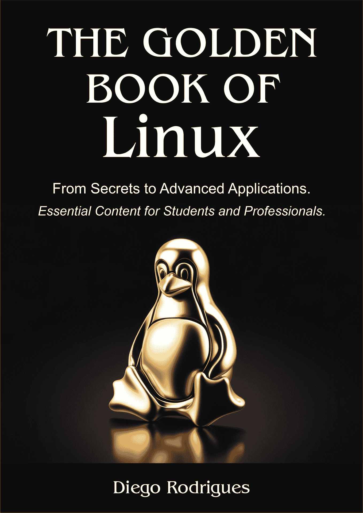

# Linux 金金书籍：从秘籍到高级应用





## 引言

欢迎阅读《Linux 黄金书：从秘密到高级应用》！如果你在这里，很可能你已经接触过 Linux 迷人的世界，或者可能听说过它的多功能和强大之处。准备好开启一段变革性的旅程吧，这不仅将提升你的技术技能，还将改变你思考和处理技术问题的方式。

### Linux 在当今世界的重要性

想象一个没有技术边界的世界，创新自由流动，知识公开共享。这就是 Linux 的精神。自诞生以来，Linux 一直是市场上最稳健、最灵活的操作系统之一。但是什么让 Linux 如此特别呢？

首先，Linux 是开源的，这意味着都可以查看、修改和分发它的代码。这种开放性允许了前所未有的全球协作，来自世界各地的开发者共同不断改进该系统。这种协作产生了一个既强大又安全的系统。

此外，Linux 以稳定性和性能闻称。Google、Facebook 和 Amazon 等公司依赖 Linux 来保持其业务的高效运行。在科学计算领域，为物理、化学和医学进步进行复杂计算的超级计算机大部分运行在 Linux 上。更不用说它在 Web 服务器上的主导地位了。

对于你，作为一名学生或技术专业人士，学习 Linux 不仅仅是获得一项新技能。它是在开启职业生涯中无限可能。

### Linux 的历史与演变

Linux 的故事始于一个名叫林纳斯·托瓦兹（Linus Torvalds）的大学生。1991 年，林纳斯在一个在线讨论组中宣布，他正在作为一个爱好开发一个新的操作系统。他并不知道这条信息将引发一场革命。

林纳斯启动这个项目是为了 `MINIX`（一种用于学术教学的操作系统）的替代品。他想创建一个更强大、更灵活的系统，利用现代计算机的架构。Linux 的第一个版本很小，但它迅速吸引了其他开发者的注意力。林纳斯鼓励的协作精神很快成为了开源运动的基石。

随着越来越多的人参与，Linux 的功能和人气日益增长。软件包管理系统的引入使用户能够轻松地安装和更新软件。`Linux kernel`（操作系统的核心）的开发持续增加对新硬件的支持，并改进了性能和安全性。

21 世纪，公司开始意识到 Linux 的商业潜力。`Red Hat`、`SUSE` 和 `Ubuntu` 等发行版相运而生，每个版本都提供了额外的支持和服务，促进了 Linux 在企业环境中的采用。今天，Linux 是全球 IT 基础设施的关键组件，从 Android 智能手机到构成云的服务器，无处不在。

### 目标与目标受众

这本书的设计有一个明确的目标：成为可用的最完整、最易于获取的 Linux 资源。我们希望填补其他材料的空白，并为学生和经验丰富的专业人士提供一份实用的指南。


如果你正开启你的 Linux 之旅，你将在这里找到坚实的基础。我们将涵盖从系统安装到基础概念的所有内容，例如目录结构和基本命令。对于经验丰富的专业人士，本书还对安全、虚拟化、自动化和软件开发等高级主题提供了深入的探索。

我们的使命是确保当你读完这本书时，不仅能熟练地使用 Linux，还能自信地将你的知识应用于现实项目。我们希望你不仅将 Linux 视为一个工具，而是将其视为职业生涯和专业成长中不可或缺的一部分。

## 书籍结构及使用方法

为了确保你从这本书书中获得最大的收益，我们按照循序渐进的方式安排了章节。我们从基础开始，建立坚实的基础，为后续讨论的高级主题提供支持。每一章都经过精心设计，易于理解且具有实用性，并配有代码示例和练习来帮助巩固学习成果。

让我们仔细看看书的结构：

### 第 1 章：Linux 基础
在这里，我们涵盖了基础知识：安装、语法、数据类型和控制结构。如果你是 Linux 新手，这一章将至关重要。对于老手来说，这是一个很好的复习机会。

### 第 2 章：系统管理 
我们将转向操作符和表达式，深入探讨对任何应用至关重要的数据处理和编程逻辑。

### 第 3 章：Shell 脚本 
函数是 Linux 的构建块。我们将学习如何正确地定义、使用和记录它们。模块将帮助我们组织代码并重用功能。

### 第 4 章：网络与连接 
我们将深入探索列表、元组、集合和字典。理解这些结构对于高效处理数据至关重要。

### 第 5 章：文件系统 
Linux 支持面向对象编程，这种范式有助于创建模块化和可重用的代码。这一章将涵盖类、对象、继承和多态。

### 第 6 章：Linux 安全 
与文件系统交互是一项基本技能。我们将学习如何读取、写入和操作不同类型的文件，从简单的文本到像 `JSON` 和 `XML` 等复杂格式。

### 第 7 章：虚拟化与容器 
我们引入了 `Flask` 和 `Django` 等流行框架。我们将学习如何创建 Web 应用程序，从简单的 API 到复杂的网站。

### 第 8 章：Linux 上的软件开发 
这是 Linux 真正发光的领域之一。我们将探索 `NumPy`、`Pandas` 和 `Matplotlib` 等库，这些是数据分析和可视化的基础。

### 第 9 章：Web 服务器与数据库
Linux 非常适合自动化。这一章将向你如何创建脚本来自动化重复任务并进行网络爬虫。

### 第 10 章：云计算与 DevOps 
通过 `Pygame`，我们将看到如何创建 2D 游戏。这是一个有趣的章节，展示了 Linux 创意的一面。

### 第 11 章：Linux 上的数据科学与机器学习 
我们将探索如何利用 Linux 进行网络通信，从简单的 `sockets` 到构建复杂的服务器和客户端。

### 第 12 章：嵌入式系统与物联网 中的 Linux 
我们将学习如何使用 `Tkinter` 和 `PyQt` 创建图形界面，从而开发交互式桌面应用程序。

### 第 13 章：高级技术与优化 
它将涵盖与 `SQL` 和 `NoSQL` 数据库的集成，使用 `SQLAlchemy` 和 `MongoDB` 等库。

### 第 14 章：Linux 的未来与新兴技术 
代码质量至关重要。这一章将讨论单元测试、持续集成和良好的编码实践。

### 第 15 章：资源管理 
Linux 提供了多种处理并发任务的方法。我们将查看 `threads`、`multiprocessing` 和 `asyncio`。

### 第 16 章：使用 Ansible 进行自动化 
安全是一个日益受到关注的问题。我们将探索确保程序和数据安全的技术。

### 第 17 章：高级安全 
Linux 并不是孤立存在的。我们将学习如何将其与 `C/C++`、`Java` 和 `.NET` 集成。

### 第 18 章：性能与扩展性 
本章将涵盖打包和部署 Linux 应用的最佳实践。

### 第 19 章：备份与恢复 
我们将学习如何在 `Raspberry Pi` 等设备上使用 Linux，包括物联网项目。

### 第 20 章：使用 Python 进行自动化 
自动化可以显著提高效率。在本章中，你将学习如何使用 `Python` 自动化任务。


## 流行的 Linux 发行版

- **CentOS**: 红帽企业级 Linux 的免费版本，因其稳定性被广泛用于服务器。
- **Debian**: 以其稳健性和大型软件仓库而闻名。
- **Arch Linux**: 适用于希望对系统拥有完全控制权级用户。

对于初学者，我建议从 `Ubuntu` 或 `Fedora` 开始。这些发行版拥有完善的文档和庞大的支持社区。

## 准备安装工作

一旦你选择了发行版，请从官方网站下载 ISO 镜像。你可以将此镜像刻录到 DVD，或者使用如 `Rufus`（适用于 Windows）或 `Etcher`（适用于 Linux 和 macOS）等工具创建启动 USB 优盘。

- **Rufus**: 使用简单，只需选择 ISO 镜像和 USB 设备即可。
- **Etcher**: 跨平台且直观，它也支持多种 Linux 发行版。

## 安装 Linux

将 USB 优盘或 DVD 插入电脑并重启。大多数系统允许你在启动过程中通过按下如 `F12`、`F10` 或 `ESC` 等键来选择启动设备。

按照所选发行版的安装程序步骤操作。以下是一些让过程更轻松的小贴士：

1. **分区**: 对于初学者，我建议使用自动分区选项。如果你觉得胜任，可以创建手动分区，但对于入门来说并不是必须的。
2. **用户配置**: 创建一个具有管理员（`sudo`）权限的用户账户。选择一个强密码并记住它。
3. **区域设置**: 根据你的喜好配置位置、语言和键盘布局。
4. **附加软件**: 某些发行版允许你在安装期间安装额外的软件，例如多媒体解码器。安装这些包是一个良好的习惯，可以避免以后出现问题。

安装完成后，拔掉优盘或 DVD 并重启系统。你将看到 Linux 登录界面，可以使用你创建的账户进行登录。

## 详细发行版介绍

### Ubuntu
`Ubuntu` 无疑是最受欢迎的发行版之一，特别是对初学者而言。它基于 `Debian`，并提供了一个名为 `GNOME` 的用户友好图形界面。`Ubuntu` 的发布周期是可预测的，每两年发布一个 `LTS`（长期支持）版本，保证五年的支持和更新。

### Fedora
`Fedora` 以处于技术前沿而闻名。它由 `Red Hat` 赞助，通常用作最终出现在 `Red Hat Enterprise Linux` 中的技术的测试场。它对于想要尝试最新开发的开发者来说非常理想。

### CentOS
`CentOS` 因其稳定性和与 `Red Hat Enterprise Linux` 的兼容性成为许多公司服务器的选择。尽管 `CentOS` 正在经历重大变化（随着 `CentOS Stream` 的引入），但它仍然是生产环境的可靠选择。

### Debian
`Debian` 以其稳健性和自由软件哲学而闻名。它拥有巨大的软件仓库，是许多其他发行版（包括 `Ubuntu`）的基础。对于任何想要稳定且可定制系统的人来说，`Debian` 都是极佳的选择。

### Arch Linux
`Arch Linux` 是为冒险者准备的。它提供了一种 DIY 方法，允许完全按照自己的想法配置系统。`Arch` 使用滚动更新模型，这意味着你始终可以访问最新版本的软件。

## Linux 目录结构

你对 Linux 注意的第一点之一就是目录结构。与 Windows 不同（Windows 文件组织在 `C:`、`D:` 等磁盘驱动器中），在 Linux 中，一切都是单一目录树的一部分。

以下是最重要的目录：

- `/`: 根目录，一切从这里开始。
- `/bin`: 包含系统运行必需的二进制文件（命令），所有用户均可访问。
- `/boot`: 启动系统所需的文件，例如内核和引导加载程序。
- `/dev`: 设备文件。在 Linux 中，一切都被视为文件，包括硬件设备。
- `/etc`: 系统配置文件。
- `/home`: 用户个人目录。每个用户在这里都有自己的目录。
- `/lib`: `/bin` 和 `/sbin` 目录中程序共享的必备库。
- `/media`: 可移动介质设备（如 CD 和 USB 优盘）的挂载点。
- `/mnt`: 文件系统的临时挂载点。
- `/opt`: 可选软件，通常用于安装额外的软件包。
- `/proc`: 虚拟文件系统，提供有关系统状态的信息。
- `/root`: 根用户（管理员）的家目录。
- `/run`: 自上次启动以的系统信息。
- `/sbin`: 系统管理所需的二进制文件。
- `/srv`: 系统提供的服务的特定数据。
- `/tmp`: 临时文件。每次重启时都会清理。
- `/usr`: 和用户文件。包含子目录，如用于用户二进制文件的 `/usr/bin`、用于库的 `/usr/lib` 以及用于共享数据的 `/usr/share`。
- `/var`: 变量文件，例如日志和数据库。

理解这种结构对于高效地导航和管理 Linux 系统至关重要。让我们探索一些帮助你在这些目录之间移动和操作文件的基础命令。

## 基础 Linux 命令

终端是 Linux 中一个强大的工具。学习如何高效地使用它对任何 Linux 用户都至关重要。以下是你应该知道的一些基础命令：

- `ls`: 列出目录内容。
- `ls -l`: 详细列表。
- `ls -a`: 隐藏文件。
- `cd`: 切换当前目录。
- `cd /home/user`: 进入用户家目录。
- `cd ..`: 返回目录层级中的上一层。
- `pwd`: 显示当前目录的完整路径。
- `cp`: 复制文件或目录。
- `cp file1 file2`: 复制 `file1` 到 `file2`。
- `cp -r dir1 dir2`: 复制 `dir1` 到 `dir2`。
- `mv`: 移动或重命名文件或目录。
- `mv file1 file2`: 将 `file1` 移动或重命名为 `file2`。
- `mv dir1 dir2`: 将 `dir1` 移动到 `dir2`。
- `rm`: 删除文件或目录。
- `rm file`: 删除 `file`。
- `rm -r dir`: 删除 `dir` 及其内容。
- `mkdir`: 创建新目录。
- `mkdir new_directory`: 创建名为 `new_directory` 的目录。
- `touch`: 创建空文件或更新修改时间。
- `touch new_file`: 创建 `new_file`。
- `nano`: 简单的非终端文本编辑器。
- `nano file`: 使用 `nano` 打开 `file`。
- `cat`: 显示文件内容。
- `cat archive`: 在终端显示 `archive` 的内容。
- `man`: 显示命令手册。
- `man ls`: 显示 `ls` 命令的手册。

## 用户与权限管理

Linux 管理中最重要的方面之一是用户和权限管理。我们将学习如何创建和管理用户账户、设置文件访问权限以及使用 `sudo` 以管理员身份运行命令。

### 创建和管理用户

创建新用户使用 `adduser` 命令。例如：

```bash
sudo adduser novo_user
```

这会创建一个名为 `new_user` 的用户并为其定义家目录。在创建过程中，系统会要求设置密码和其他可选信息。

删除用户使用 `deluser`：

```bash
sudo deluser novo_user
```

如果你想删除与该用户相关的家目录和文件，请添加 `--remove-home` ：

```bash
sudo deluser --remove-home novo_user
```

### 文件权限

在 Linux 中，每个文件和目录都有控制谁可以读取、写入或执行该文件的权限。这些权限分为三类：所有者、组和其他。

要查看文件的权限，我们使用 `ls -l`：

```bash
ls -l file
```

输出将类似于：


```sh
-rw-r--r-- 1 user group 4096 Jun  1 12:34 arquivo
```

在这里，`-rw-r--r--` 代表权限：

- `-`: 文件类型（`-` 表示普通文件）。
- `rw-`: 所有者权限（读和写）。
- `r--`: 组权限（读）。
- `r--`: 其他用户权限（读）。

要更改权限，我们使用 `chmod`：

```sh
chmod 755 file
```

这会将权限设置为 `rwxr-xr-x`，允许所有者读取、写入和执行，而允许组组和其他用户仅具有读取和执行权限。

### 使用 sudo

`sudo` 命令允许用户以超级用户（root）权限执行命令。要将用户添加到 sudo 组，我们使用：

```sh
sudo usermod -aG sudo user_name
```

这会将 `username` 添加到 sudo 组，允许其使用 `sudo` 运行管理命令。

在整个章节中，我们涵盖了入门 Linux 的核心基础知识。从安装和配置到管理用户和权限，你现在已经为探索 Linux 世界奠定了坚实的基础。在接下来的章节中，我们将深入更高级的主题，帮助你成为真正的 Linux 大师。

让我们共同这段学习与发现的旅程吧！

## 第二章

## 系统管理

欢迎阅读《Linux 黄金书：从秘密到高级应用》第二章。如果你已经熟悉了 Linux 的基础，现在是时候更进一步，深入研究系统管理了。本章将引导你了解 Linux 系统管理的一些最关键方面，包括包管理、服务与进程、资源监控、任务自动化以及数据备份与恢复。准备好发现许多专家可能尚未完全掌握的秘密。

## 包管理 (apt, yum, dnf, 等)

管理包是 Linux 系统管理员最基本的任务之一。包是构成你在系统中安装的软件的文件集合。有多个包管理系统，每个系统对应不同的 Linux 发行版。

### APT（高级软件包工具）

APT 是 Ubuntu 等基于 Debian 的发行版使用的包管理系统。它使安装、更新和删除软件包变得简单。

- 安装软件包：要安装新包，使用 `apt-get install` 命令。例如：

```sh
sudo apt-get install package_name
```

- 系统更新：保持系统最新状态对于安全和稳定性至关重要。要更新所有已安装包，使用：

```sh
sudo apt-get update
sudo apt-get upgrade
```

- 移除软件包：要移除你不再需要的包，使用：

```sh
sudo apt-get remove package_name
```

### YUM（修改过的黄狗更新器）

YUM 主要用于 CentOS 等基于 Red Hat 的发行版。它提供了与 APT 类似的功能。

- 安装软件包：

```sh
sudo yum install package_name
```

- 系统更新：

```sh
sudo yum update
```

- 移除软件包：

```sh
sudo yum remove package_name
```

### DNF（增强版 YUM）

DNF 是 YUM 的继任者，用于 Fedora 等发行版。它改进了依赖关系解析和性能。

- 安装软件包：

```sh
sudo dnf install package_name
```

- 系统更新：

```sh
sudo dnf update
```

- 移除软件包：

```sh
sudo dnf remove package_name
```

### 高级包管理技巧

- 自动更新：配置自动更新以确保系统在无需手动干预的情况下保持最新。在基于 Debian 的发行版上，你可以使用 `unattended-upgrades`。

```sh
sudo apt-get install unattended-upgrades
sudo dpkg-reconfigure -plow unattended-upgrades
```

- 自定义存储库：添加自定义仓库以获取标准库中不可用的软件。例如，添加 Node.js 仓库：

```sh
curl -fsSL https://deb.nodesource.com/setup_14.x | sudo -E bash -
sudo apt-get install -y nodejs
```

- 照照与回滚：使用包快照在更新关键包之前创建恢复点。`apt-clone` 等工具非常有用：

```sh
sudo apt-clone clone nome_do_snapshot
sudo apt-clone restore nome_do_snapshot
```

## 系统服务与进程

管理服务和进程对于保持系统顺利运行至关重要。服务是在后台运行执行基本任务的程序。进程是运行中程序的实例。

### 使用 systemd 管理服务

`systemd` 是现代 Linux 发行版中最常见的启动系统。它管理从启动到关机的服务和进程。

- 启动和停止服务：要启动服务，使用 `systemctl start` 命令：

```sh
sudo systemctl start service_name
```

停止服务：

```sh
sudo systemctl stop service_name
```

- 启用和禁用服务：要启用服务在启动时自动启动：

```sh
sudo systemctl enable service_name
```

禁用：

```sh
sudo systemctl disable service_name
```

- 检查服务状态：要检查服务的状态：

```sh
sudo systemctl status service_name
```

- 重启服务：要重启服务：

```sh
sudo systemctl restart service_name
```

### 进程管理

- 列出进程：`ps` 命令列出运行中的进程：

```sh
ps
```

- 监控进程：使用 `top` 或 `htop`：

```sh
top
htop
```

- 杀死进程：要强制杀死进程，使用 `kill -9`：

```sh
kill -9
```

### 服务与进程的高级技巧

- 自定义服务单元：创建服务单元来管理特定的应用程序。例如，为 Node.js 创建服务：

```sh
sudo nano /etc/systemd/system/meu_app.service
```

添加以下内容：

```ini
[Unit]
Description=My Node.js Application
After=network.target

[Service]
ExecStart=/usr/bin/node /caminho/para/meu_app.js
Restart=always
User=nobody
Group=nobody
Environment=NODE_ENV=production
WorkingDirectory=/path/to

[Install]
WantedBy=multi-user.target
```

然后启用并启动服务：

```sh
sudo systemctl enable meu_app
sudo systemctl start meu_app
```

- 控制组 (cgroups)：使用 `cgroups` 限制并监控进程资源使用。例如，创建一个限制 CPU 的 cgroup：

```sh
sudo systemd-run --scope -p CPUQuota=20% command
```

## 资源与性能监控

监控系统资源对于维护性能和稳定性至关重要。监控工具提供了关于 CPU、内存、磁盘和网络使用的宝贵见解。

### 监控工具

- top e htop：实时监控进程的基本工具。

```sh
top
htop
```

- vmstat：监控虚拟内存、进程和系统：

```sh
vmstat 2
```

- iostat：监控系统输入/输出统计：

```sh
iostat -xz 2
```

- netstat：监控网络连接、路由表和网络统计：

```sh
netstat -tuln
```

- iftop：实时监控网络带宽使用：

```sh
sudo apt-get install iftop
sudo iftop
```

- sar：收集并报告系统统计，适用于历史性能分析：

```sh
sudo apt-get install sysstat
sar -u 2 5
```

### 使用 Prometheus 和 Grafana 进行系统监控

对于高级监控，可以使用 Prometheus 和 Grafana。Prometheus 收集系统和应用指标，而 Grafana 在交互式仪表板中可视化这些数据。

- 安装 Prometheus：

```sh
sudo apt-get update
sudo apt-get install prometheus
```

- Prometheus 配置：编辑 `/etc/prometheus/prometheus.yml` 配置文件以定义监控目标。

- 安装 Grafana：


```sh
sudo apt-get install -y software-properties-common
sudo add-apt-repository "deb https://packages.grafana.com/oss/deb stable main"
sudo apt-get update
sudo apt-get install grafana
```

## 安装配置

- Grafana 配置：安装完成后，启动 Grafana：
```sh
sudo systemctl start grafana-server
sudo systemctl enable
grafana-server
```

- Prometheus-Grafana 集成：在 Grafana 中添加 Prometheus 作为数据源，并设置仪表板以实现指标可视化。

## 高级监控技巧

- 自定义告警：在 Prometheus 中配置告警，以便在性能异常时通知你。
```sh
groups:
- name: example
rules:
- alert: HighCPUUsage
  expr: 100 - (avg by (instance) (irate(node_cpu_seconds_total{mode="idle"}[5m])) * 100) > 80
  for: 5m
  labels:
    severity: critical
  annotations:
    summary: "High CPU usage detected"
    description: "CPU usage is above 80% for more than 5 minutes."
```

- 指标采集脚本：创建自定义脚本来收集特定系统的指标并将其导出到 Prometheus。

## 使用 cron 和 systemd 实现任务自动化

自动化循环任务对于系统效率至关重要。在 Linux 上，可以使用 `cron` 和 `systemd` 实现这一点。

### 使用 cron 进行自动化

`cron` 是一个任务调度器，允许你按固定间隔运行命令或脚本。

- 编辑 Cron 任务：使用 `crontab -e` 编辑 cron 任务。
```sh
crontab -e
```
按以下格式添加 cron 任务：
```sh
* * * * * command
```
星号代表分钟、小时、日期、月份和星期几。例如，要在每天凌晨 2 点运行一个脚本：
```sh
0 2 * * * /caminho/para/script.sh
```

- 列出 cron 任务：要列出已配置的 cron 任务：
```sh
crontab -l
```

### 使用 systemd 进行自动化

`systemd` 可用于创建替代 cron 任务的定时器（Timers）。定时器是 `systemd` 的单元，用于调度其他单元的执行。

- 创建服务单元：首先，创建一个服务单元。例如，`/etc/systemd/system/minha_trabalho.service`：
```sh
[Unit]
Description=My Task
[Service]
ExecStart=/path/to/script.sh
```

- 创建定时器单元：然后创建一个定时器单元。例如，`/etc/systemd/system/minha_trabalho.timer`：
```sh
[Unit]
Description=Run My Task daily
[Timer]
OnCalendar=daily
Persistent=true
[Install]
WantedBy=timers.target
```

- 激活定时器：激活并启动定时器：
```sh
sudo systemctl enable my_task.timer
sudo systemctl start my_task.timer
```

## 高级自动化技巧

- 依赖任务：配置依赖其他任务，确保它们按正确的顺序执行。例如，在 `systemd` 中，使用 `After` 指令定义依赖关系：
```sh
[Unit]
Description=My Task
After=other.service
```

- 可靠性和持久性：在 `systemd` 定时器中使用 `Persistent=true` 以确保任务在系统关闭期间也能运行。

## 数据备份与恢复

在 Linux 中，有多种工具可以管理备份。

### 备份工具

- rsync：强大的同步工具。
```sh
rsync -av --delete source/ destination
```

- tar：创建 tar 压缩包。
```sh
tar -cvpz backup.tar.gz directory
```

- Bacula：企业级备份。
```sh
sudo apt-get install bacula
```

## 备份策略

- 全量备份：包含所有数据。
- 增量备份：仅包含自上次备份以来的变化。
- 差异备份：包含自上次全量备份以来的变化。

### 恢复

- 快照：使用 LVM 创建快照。
```sh
lvcreate -L 10G -n snapshot /dev/vg0/lv
```

- 验证：定期检查备份。

## 变量与运算符

变量在任何编程语言中都是基础，Shell 脚本也不例外。它们允许你存储和操纵数据。在 Shell 脚本中，你不需要声明变量类型，Shell 会自动处理。

### 声明变量

要声明变量，只需为其赋值即可：
```sh
my_name="Diego"
echo "My name is $my_name"
```
注意，我们使用 `$` 符号来访问变量值。

### 运算符

运算符用于对变量执行操作。以下是一些示例：

- 算术运算符：`+`, `-`, `*`, `/`, `%`
```sh
a=10
b=5
echo $((a + b)) # 加法
echo $((a - b)) # 减法
echo $((a * b)) # 乘法
echo $((a / b)) # 除法
echo $((a % b)) # 取模
```

- 比较运算符：`-eq`, `-ne`, `-lt`, `-le`, `-gt`, `-ge`


```sh
a=10
b=5
if [ $a -eq $b ]; then
echo "a is equal to b"
else
echo "a is different from b"
fi
```

- 字符串：`=` `!=`, `-n`, `-z`

```sh
str1="hello"
str2="world"
if [ "$str1" = "$str2" ]; then
echo "The strings are the same"
else
echo "The strings are different"
fi
```

## 控制结构 (if, for, while)

控制结构允许你的脚本进行决策并重复操作。让我们探索最常见的结构：`if`、`for` 和 `while`。

## If-Else

`if` 命令用于根据条件做决策。

```sh
a=10
b=5
if [ $a -gt $b ]; then
echo "a is greater than b"
else
echo "a is not greater than b"
fi
```

### For 循环

`for` 循环用于重复特定次数的动作。

```sh
for i in 1 2 3 4 5; do
echo "Number: $i"
done
```

### While 循环

`while` 循环只要条件为真，就会持续执行。

```sh
counter=1
while [ $counter -le 5 ]; do
echo "Counter: $counter"
counter=$((counter + 1))
done
```

# 高级控制框架秘密

- **Case 语句**：使用 `case` 简化多个 `if` 条件。

```sh
color="red"
case $cor in
"red")
echo "The color is red"
;;
"blue")
echo "The color is blue"
;;
*)
echo "Unknown color"
;;
esac
```

- **Break 和 Continue**：使用 `break` 退出循环，使用 `continue` 跳到下一次迭代。

```sh
for i in 1 2 3 4 5; do
if [ $i -eq 3 ]; then
continue
fi
echo "Number: $i"
done
```

## 函数与模块化

函数允许你将代码组织成可重用的块，使脚本更易读和易于维护。

## 定义和调用函数

要定义一个函数，使用以下语法：

```sh
my function() {
echo "Executing my function"
}
my function
```

函数可以接受参数，通过 `$1`、 `$2` 等访问。

```sh
soma() {
result=$(( $1 + $2 ))
echo "The sum is: $result"
}
soma 5 10
```

## 脚本模块化

将相关的函数组织到单独的文件中并使用 `source` 将它们包含在主脚本中。

### 函数文件 (`funcoes.sh`):

```sh
soma() {
result=$(( $1 + $2 ))
echo "The sum is: $result"
}
```

### 主脚本 (`script_principal.sh`):

```sh
#!/bin/bash
source ./funcoes.sh
soma 5 10
```

# 高函数技巧

- **局部变量**：使用 `local` 在函数内部定义局部变量，避免与全局变量冲突。

```sh
my function() {
local var="local"
echo $var
}
```

- **函数返回值**：使用 `return` 返回状态码，使用 `echo` 返回值。

```sh
check_file() {
if [ -f "$1" ]; then
return 0
else
return 1
fi
}
check_file "file.txt"
if [ $? -eq 0 ]; then
echo "File exists"
else
echo "File not found"
fi
```

## 实用脚本

自动化任务可以节省时间并减少错误。让我们探索一些示例。

## 自动备份

创建一个脚本来备份目录并压缩。

```sh
#!/bin/bash
origin="/path/to/directory"
destination="/path/to/backup"
data=$(date +%Y%m%d)
backup_name="backup_$data.tar.gz"
tar -czf $destination/$backup_name $source
echo "Backup completed: $backup_name"
```

### 系统监控

一个简单的脚本用于监控 CPU 使用并在超过限制时发送警报。

```sh
#!/bin/bash
limit=80
uso_cpu=$(top -bn1 | grep "Cpu(s)" | sed "s/.* *\([0-9.]*\)%* id.*/\1/" | awk '{print 100 - $1}')
if (( $(echo "$uso_cpu > $limite" | bc -l) )); then
echo "Alert: CPU usage above $limit% - $uso_cpu%"
fi
```

### 自动更新

一个自动更新系统中所有软件包的脚本。

```sh
#!/bin/bash
sudo apt-get update && sudo apt-get upgrade -y
echo "Updates completed"
```

# 高级自动化秘密

- **定期定时 Crontab**：使用 `crontab` 调度定期运行的脚本。

```sh
crontab -e
# 添加以下行每天凌晨 2 点运行备份脚本
0 2 * * * /caminho/para/backup_script.sh
```

- **日志与通知**：添加日志和电子邮件通知以跟踪脚本执行情况。

```sh
# 添加日志和电子邮件通知以跟踪脚本执行情况
```


对于永久配置，请编辑系统配置文件。在 Ubuntu 等基于 Debian 的发行版中，这是在 `/etc/network/interfaces` 文件中完成的。

- 配置示例：

```sh
car eth0
iface eth0 inet static
address 192.168.1.100
netmask 255.255.255.0
gateway 192.168.1.1
```

在 CentOS 等基于 Red Hat 的发行版中，配置是在 `/etc/sysconfig/network-scripts/` 目录下的文件中完成的。

- 配置示例：

```sh
# /etc/sysconfig/network-scripts/ifcfg-eth0
DEVICE=eth0
BOOTPROTO=static
IPADDR=192.168.1.100
NETMASK=255.255.255.0
GATEWAY=192.168.1.1
ONBOOT=yes
```

## 网络诊断工具

诊断网络问题是系统管理员的一项基本技能。Linux 提供了许多强大的工具来帮助你识别和解决连接问题。

## Ping

`ping` 命令用于测试与网络上另一个设备的连接性。它向目标设备发送 ICMP ECHO_REQUEST 数据包并等待响应。

- 使用示例：

```sh
ping 8.8.8.8
```

## Netstat

`netstat` 是一个多功能工具，用于显示网络连接、路由表、接口统计、地址伪装等信息。

- 使用示例：

```sh
netstat -tuln
```

## Traceroute

`traceroute` 显示数据包到达目的地所经过的路由。它对于诊断网络问题发生的位置非常有帮助。

- 使用示例：

```sh
traceroute google.com
```

## IP

`ip` 命令取代了 `ifconfig` 和 `route`，提供了接口和路由表更现代、更完整的视图。

- 使用示例：

```sh
ip addr show
ip route show
```

## MTR (My Traceroute)

`mtr` 结合了 `ping` 和 `traceroute` 的功能，对网络路由和延迟提供持续分析。

- 使用示例：

```sh
mtr google.com
```

## Tcpdump

`tcpdump` 是一个数据包捕获工具，允许你实时检查网络流量。对于详细分析网络问题极其有用。

- 使用示例：

```sh
sudo tcpdump -i eth0
```

## 服务器配置

配置网络服务器是系统管理员的常见任务。让我们探索一些最重要服务器的配置。

## DHCP 服务器

DHCP 服务器自动分配网络上的 IP 地址分配。在 Ubuntu 上，`isc-dhcp-server` 是一个流行的选择。

- 安装：

```sh
sudo apt-get install isc-dhcp-server
```

- 设置：

编辑 `/etc/dhcp/dhcpd.conf` 文件来配置 IP 地址范围和其他选项。

```sh
subnet 192.168.1.0 netmask 255.255.255.0 {
range 192.168.1.100 192.168.1.200;
option routers 192.168.1.1;
option domain-name-servers 8.8.8.8, 8.8.4.4;
}
```

- 服务：

```sh
sudo systemctl start isc-dhcp-server
sudo systemctl enable isc-dhcp-server
```

## DNS 服务器

DNS 服务器将域名翻译为 IP 地址。`BIND` 是 Linux 上常见的 DNS 软件。

- 安装：

```sh
sudo apt-get install bind9
```

- 设置：

编辑 `/etc/bind/named.conf.local` 文件来定义 DNS 区域。

```sh
zone "meudominio.com" {
type master;
file "/etc/bind/db.meudominio.com";
};
```

创建区域文件 `/etc/bind/db.mydomain.com`：

```sh
$TTL 604800
@   IN  SOA ns1.meudominio.com. admin.meudominio.com. (
2021041501 ; Serial
604800     ; Refresh
86400      ; Retry
2419200    ; Expire
604800 )   ; Negative Cache TTL
@   IN  NS  ns1.meudominio.com.
ns1 IN  A   192.168.1.1
@   IN  A   192.168.1.1
```

- 服务：

```sh
sudo systemctl start bind9
sudo systemctl enable bind9
```

## FTP 服务器

FTP 服务器允许你在网络上的设备之间传输文件。`vsftpd` 是一个流行的选择。

- 安装：


```sh
sudo apt-get install vsftpd
```

- 设置：

编辑 `/etc/vsftpd.conf` 文件来配置 FTP 服务器。

```sh
anonymous_enable=NO
local_enable=YES
write_enable=YES
```

- 服务：

```sh
sudo systemctl start vsftpd
sudo systemctl enable vsftpd
```

# 服务器配置中的高级机密

- **自定义日志**：配置详细日志以监控服务器行为并尽早检测问题。

```sh
# 对于 BIND，将其添加到 named.conf
logging {
channel default_log {
file "/var/log/named.log" versions 3 size 5m;
severity info;
print-time yes;
};
category default { default_log; };
};
```

- **Chroot 监狱**：在 chroot 环境中运行服务以增加安全性。例如，对于 `vsftpd`，你可以在配置文件中配置 chroot 环境：

```sh
chroot_local_user=YES
```

## 网络安全

网络安全对于保护数据免受未经访问的攻击至关重要。Linux 提供了许多工具来保护网络。

## 使用 iptables 和 nftables 的防火墙

`iptables` 是配置 Linux 防火墙规则的强大工具。最近，`nftables` 作为更现代的替代方案被引入。


任何操作系统的核心都是文件系统。它定义了数据存储和检索的方式。在 Linux 中，有多种文件系统，每种都有其特性和优势。

## Ext4（第四代扩展文件系统）
Ext4 是 Linux 发行版中最常用的文件系统。它健壮、高效，并支持大容量卷和大文件。它的特性包括：

- 日志记录（Journaling）：保存更改日志，有助于在故障时进行恢复。
- 大文件支持：它可以处理多达 16TB 的文件。
- 性能：与之前的版本（`ext2` 和 `ext3`）相比，提供了更好的性能。

## XFS
XFS 以其在高性能系统上的可扩展性和性能而闻名。它是大型数据卷和高容量文件系统的理想选择。

- 高级日志：故障时具有更好的恢复能力。
- 一致的性能：对于需要高数据传输率的系统非常。
- 快照支持：允许你创建文件系统的瞬时副本。

## Btrfs（B 树文件系统）
Btrfs 是一种现代文件系统，旨在提供等高级功能：

- 快照与子卷：允许你创建瞬时快照并高效管理子卷。
- 校验和：数据完整性检查以防止损坏。
- 压缩：原生支持数据压缩，节省磁盘空间。

## 高级文件系统秘密
- Ext4 性能：使用 `noatime` 选项挂载文件系统以不更新访问时间，从而提高性能：
```sh
sudo mount -o noatime /dev/sda1 /mnt
```
- Btrfs 备份：使用 Btrfs 快照在不中断服务的情况下创建瞬时备份：
```sh
sudo sudo btrfs subvolume snapshot /dados /dados_snapshot
```

## 磁盘与分区管理
管理磁盘和分区是确保数据存储组织和效率的必备技能。`fdisk` 和 `gparted` 等工具被广泛用于此。

### 使用 fdisk
`fdisk` 是用于操作分区表的命令行工具。它非常强大，但需要小心。

- 列出分区：
```sh
sudo fdisk -l
```
- 创建新分区：
```sh
sudo fdisk /dev/sda
```
按照交互式指令创建分区。

### 使用 gparted
`gparted` 是一个让分区管理变得简单的图形界面。它非常适合偏好视觉化方法的人。

- 安装：
```sh
sudo apt-get install gparted
```
- 使用：从应用程序菜单或通过终端打开 `gparted`：
```sh
sudo gparted
```

### 高级分区管理秘密
- 安全调整：在调整分区大小之前务必备份数据。使用 `rsync` 执行此操作：
```sh
sudo rsync -av /source /destination
```
- 对齐分区：确保你的分区对齐，以提高 SSD 和高级磁盘的性能：
```sh
sudo fdisk -l -u /dev/sda
```

## 挂载与卸载文件系统
挂载和卸载文件系统是一常见但关重要的任务。它允许你访问不同的文件系统和设备。

### 挂载文件系统
要挂载文件系统，使用 `mount` 命令。这会将文件系统与系统上的挂载点关联。

- 示例：
```sh
sudo mount /dev/sda1 /mnt
```
- 挂载选项：使用不同的选项进行挂载，例如 `ro` 以只读模式挂载：
```sh
sudo mount -o ro /dev/sda1 /mnt
```

### 卸载文件系统
要卸载文件系统，使用 `umount` 命令。

- 示例：
```sh
sudo umount /mnt
```

### 自动挂载
通过编辑 `/etc/fstab` 文件配置自动挂载。这确保了文件系统在启动时自动挂载。

- 配置示例：
```
/dev/sda1 /mnt ext4 defaults 0
```

### 高级汇
- systemd 自动挂载：使用 `systemd` 配置自动挂载，以获得更大的灵活性控制：
```sh
sudo systemctl enable mnt
```
- NFS 和 CIFS：使用 NFS 和 CIFS 挂载网络文件系统以高效共享：
```sh
sudo mount -t nfs server:/path /mnt
sudo mount -t cifs //share /mnt
```

## 磁盘配额管理
管理磁盘配额对于控制多用户环境中的空间使用至关重要。它可以防止单个用户消耗所有存储资源。

### 配置配额
通过编辑 `/etc/fstab` 文件启用配额支持，并在相关分区上添加 `usrquota` 和 `grpquota`。

- 配置示例：
```
/dev/sda1 / ext4 defaults,usrquota,grpquota 0
```
重启系统或重新挂载分区以应用更改。

- 重启：
```sh
sudo mount -o remount /dev/sda1
```

### 初始化配额
使用 `quotacheck` 和 `quotaon` 命令初始化并启用配额。

- 初始化：
```sh
sudo quotacheck -c /dev/sda1
sudo quotaon -v /dev/sda1
```

### 配额管理
使用 `edquota` 命令编辑用户和组配额。

- 使用示例：
```sh
sudo edquota -u user
```

### 配额监控
使用 `quota` 命令检查配额使用情况。

- 使用示例：
```sh
quota -user
```

### 高级配额秘密
- 灵活配额：使用块和 i 节点配额不仅控制使用的空间，还控制创建的文件数量：
```sh
sudo setquota 1000 2000 ...
```
- 自动化脚本：创建脚本自动监控并调整配额，在达到限制时发送警报。

## LVM（逻辑卷管理器）
LVM 提供了管理卷的灵活性，允许动态调整大小和快照。它是管理员的强大工具。

### 初始设置
从安装 LVM 开始配置物理卷 (PV)、卷组 (VG) 和逻辑卷 (LV)。

- 安装：
```sh
sudo apt-get install lvm2
```
- 创建 PV：
```sh
pvcreate /dev/sda1
```
- 创建 VG：
```sh
vgcreate my_vg /dev/sda1
```
- 创建 LV：
```sh
lvcreate -L 10G -n my_lv my_vg
```

### 调整
LVM 的优势之一是可以根据需要调整逻辑卷。

- 扩展 LV：
```sh
sudo lvextend -L +5G /dev/meu_vg/meu_lv
sudo resize2fs /dev/meu_vg/meu_lv
```
- 缩小 LV：（注意：请先备份数据）
```sh
sudo resize2fs /dev/meu_vg/meu_lv
sudo lvreduce -L 10G /dev/meu_vg/meu_lv
```

### LVM 快照
快照允许你捕捉逻辑卷在某一时刻的状态。这对于备份和数据恢复有用。

- 创建快照：
```sh
sudo lvcreate -L 5G -s -n my_snapshot /dev/meu_vg/meu_lv
```

### 高级 LVM 秘密
- 精简配置：使用精简配置高效分配空间，允许空间分配开销：
```sh
sudo lvcreate --thinpool thinpool --size 100G meu_vg
sudo lvcreate --thin --name thinvol --virtualsize 10G meu_vg/thinpool
```
- 镜像卷：创建镜像卷实现冗余：
```sh
sudo lvcreate --type mirror -m1 -L 10G -n my_lv mirror_vg
```

探索 Linux 文件系统揭示了深度复杂性和优化效率的巨大潜力。通过理解文件系统类型、磁盘管理、挂载、配额和 LVM，你已经准备好管理任何规模的 Linux 环境。在下一章中，我们将使用更高级的技术继续探索 Linux，继续我们的知识与精通之旅。

## 第六章：Linux 安全
发现 Linux 安全秘密就像发现宝藏图。每发现一层保护，你就离构建真正安全的系统更近。我们将探索基础原理、配置防火墙、控制访问、加固系统并为有效的事件响应做好准备。


Linux 安全始于对一些基本原则的清晰理解。这些原则是你将要实施的所有安全措施的基础。

### 最小权限原则

该原则建议每个程序或用户应仅拥有执行其功能所必需的权限。这最大限度地降低账户被攻破时的损害风险。

### 定期更新

保持系统更新至关重要。漏洞会不断被发现，开发者会发布补丁来修复这些缺陷。使用 `apt`、`yum` 或 `dnf` 等工具保持你的系统和软件包处于最新状态。

- 使用 `apt` 的示例：

```sh
sudo apt-get update && sudo apt-get upgrade -y
```

### 强密码

弱密码为攻击者敞开了大门。为每个账户使用强且唯一的密码。`pwgen` 等工具可以帮助生成强密码。

- 使用 `pwgen` 生成密码：

```sh
sudo apt-get install pwgen
pwgen -s 16 1
```

### 防火墙配置 (iptables, ufw)

防火墙是防御攻击的第一道防线。正确配置防火墙可以阻止未经的访问并保护你的系统免受入侵。

### 使用 iptables

`iptables` 是 Linux 上配置防火墙规则的强大工具。它允许你定义精确的规则来控制入站和出站流量。

- 基础 iptables 规则：

```sh
sudo iptables -A INPUT -p tcp --dport 22 -j ACCEPT
sudo iptables -A INPUT -m state --state ESTABLISHED,RELATED -j ACCEPT
sudo iptables -A INPUT -p icmp -j ACCEPT
sudo iptables -P INPUT DROP
```

- 保存规则：

```sh
sudo sh -c "iptables-save > /etc/iptables/rules.v4"
```

### 使用 UFW (Uncomplicated Firewall)

对于偏好使用更简单工具的人，`ufw` 提供了一个用于配置防火墙的用户友好界面。

- 启用 UFW：

```sh
sudo ufw enable
```

- 允许 SSH：

```sh
sudo ufw allow ssh
```

- 查看状态：

```sh
sudo ufw status
```

### 高级防火墙配置秘籍

- 使用 `iptables` 进行速率限制：限制连接数以防止暴力破解攻击。

```sh
sudo iptables -A INPUT -p tcp --dport 22 -m conntrack --ctstate NEW -m recent --set
sudo iptables -A INPUT -p tcp --dport 22 -m conntrack --ctstate NEW -m recent --update --seconds 60 --hitcount 10 -j DROP
```

- 使用 `UFW` 日志：启用事件日志以监控疑活动。

```sh
sudo ufw logging on
```

### 访问控制 (PAM, sudoers)

控制谁可以访问系统的什么至关重要。让我们使用 `PAM`（可插拔认证模块）和 `sudoers` 文件探索访问控制。

### 配置 PAM

`PAM` 提供了一种实现身份验证策略的灵活方法。

- 配置文件：`PAM` 设置位于 `/etc/pam.d/`。限制失败登录尝试的示例配置是在 `/etc/pam.d/common-auth` 中添加以下行：

```sh
auth required pam_tally2.so onerr=fail deny=5 unlock_time=600
```

### sudo 管理

`sudoers` 文件定义了哪些用户可以以 root 身份运行命令。使用 `visudo` 编辑它以避免语法错误。

- sudoers 配置示例：

```sh
# 允许用户 'diego' 以 root 身份运行所有命令
diego ALL=(ALL) ALL
# 允许 'admin' 组无需密码运行特定命令
%admin ALL=NOPASSWD: /usr/bin/apt-get, /usr/bin/systemctl
```

### 高级访问控制秘籍

- 双重认证 (2FA)：通过添加 Google Authenticator 的 2FA 来增加安全性。

```sh
sudo apt-get install libpam-google-authenticator
google-authenticator
# 在 /etc/pam.d/sshd 的末尾添加该行
auth required pam_google_authenticator.so
```

- 基于角色的访问控制 (RBAC)：使用 `RBAC` 根据特定角色授予权限，使权限管理更高效。

### 系统加固加固过程涉及应用额外的安全设置以减少系统的攻击面。

### 禁用不必要的服务

运行的服务越少，攻击的入口就越少。识别并禁用不需要的服务。

- 列出服务：

```sh
sudo systemctl list-units --type=service --state=running
```

- 停用服务：

```sh
sudo systemctl disable service_name
sudo systemctl stop service_name
```

### SSH 配置

SSH 配置对安全至关重要。一些良好的实践包括：

- 禁用 root 登录：编辑 `/etc/ssh/sshd_config` 并定义：

```sh
PermitRootLogin no
```

- 使用密钥认证：禁用密码认证并使用 SSH 密钥。

```sh
PasswordAuthentication no
```

- 修改默认端口：将默认端口从 22 更改以减少自动化攻击的概率。

```sh
Port 2222
```

### 高级加固秘籍

- AppArmor 和 SELinux：使用 `AppArmor` 或 `SELinux` 对特定应用程序实施安全策略，限制它们能做什么。

```sh
sudo apt-get install apparmor
sudo aa-enforce /etc/apparmor.d/usr.sbin.mysqld
```

- 内核加固：应用如 `Grsecurity` 等内核安全补丁。

### 安全事件检测与响应

快速检测并响应安全事件至关重要。适当的工具和流程可以帮助识别和缓解威胁。

### 监控工具

- OSSEC：一种入侵检测系统 (HIDS)，监控日志、文件和进程。

```sh
sudo apt-get install ossec
```

- Auditd：用于审计和监控 Linux 上安全事件的工具。

```sh
sudo apt-get install auditd
```

### OSSEC 配置

- 安装：

```sh
sudo apt-get install ossec-hids
```

- 基础配置：编辑 `/var/ossec/etc/ossec.conf` 配置文件定义应该监控哪些日志和事件。

### Auditd 配置

- 安装：

```sh
sudo apt-get install auditd audisp-plugins
```

- 基础配置：编辑 `/etc/audit/audit.rules` 定义审计规则。监控重要文件的示例：

```sh
-w /etc/passwd -p wa -k passwd_changes
```

#### 事件响应流程

- 识别：使用如 `logwatch` 等工具分析日志并识别可疑活动。

```sh
sudo apt-get install logwatch
sudo logwatch --detail high --service sshd --range today
```

- 抑制：隔离受感染系统以防止攻击扩散。使用 `iptables` 阻塞来自可疑 IP 的流量。

```sh
sudo iptables -A INPUT -s IP_SUSITO -j DROP
```

- 清除与恢复：移除恶意软件、应用补丁并从备份恢复数据。`rkhunter` 等工具可以帮助识别 rootkit。

```sh
sudo apt-get install rkhunter
sudo rkhunter --check
```

- 事后回顾：记录事件、分析原因并实施措施防止未来的攻击。

### 高级检测与响应秘籍

- YARA 规则：使用 `YARA` 创建自定义规则检测文件和进程中的恶意软件模式。

```sh
sudo apt-get install already
yara -r my_rules.yar /path/to/file
```

- Linux 版 Sysmon：使用 `Sysmon` 监控详细系统事件，为恶意活动提供额外的可见性。


想象一下能够在一个系统中模拟多台计算机，每个系统都有自己的配置，或者将应用程序隔离在小型便携容器中，使其在任何环境中都能一致运行。欢迎来到 Linux 虚拟化和容器的世界！在本章中，我们将探索高级技术和技巧，这将改变你管理虚拟和容器环境的方法。

## 虚拟化简介 (KVM, VirtualBox)

虚拟化允许你在单一物理硬件上运行多个操作系统。这不仅最大限化地利用了资源，还为测试和开发提供了灵活性。Linux 上最流行的虚拟化解决方案是 `KVM` 和 `VirtualBox`。

## KVM (基于内核的虚拟机)

`KVM` 是一个开源虚拟化解决方案，它将 Linux 内核转换为虚拟机监控程序。由于其性能和内核集成，它是生产环境的理想选择。

### KVM 安装：

```sh
sudo apt-get install qemu-kvm libvirt-daemon-system libvirt-clients bridge-utils
sudo systemctl enable --now libvirtd
```

### 使用 KVM 创建虚拟机：

```sh
sudo virt-install \
--name ubuntu-vm\
--ram 2048 \
--disk path=/var/lib/libvirt/images/ubuntu-vm.qcow2,size=10 \
--vcpus 2 \
--os-type linux \
--os-variant ubuntu20.04 \
--network bridge=virbr0 \
--graphics none \
--console pty,target_type=serial \
--location 'http://archive.ubuntu.com/ubuntu/dists/focal/main/installer-amd64/' \
--extra-args 'console=ttyS0,115200n8 serial'
```

## VirtualBox

`VirtualBox` 是一个强大且易于使用的虚拟化工具，非常适合开发和测试环境。

### VirtualBox 安装：

```sh
sudo apt-get install virtualbox
```

### 使用 VirtualBox 创建虚拟机：

打开 `VirtualBox` 并按照向导创建新的虚拟机，指定操作系统、内存、硬盘和网络设置。

# 高级虚拟化秘籍

### KVM 快照：使用快照捕获虚拟机的状态，并轻松回滚更改。

```sh
sudo virsh snapshot-create-as --domain ubuntu-vm snapshot1 "Primeiro snapshot"
sudo virsh snapshot-revert ubuntu-vm snapshot1
```

### KVM 虚拟网络：配置虚拟网络以隔离和连接虚拟机。

```sh
sudo virsh net-create mynetwork.xml
```

## 虚拟机管理

高效管理虚拟机对于保持基础架构的整洁和优化至关重要。

## 使用 virsh 管理

`virsh` 是一个管理 `KVM` 中虚拟机的命令行工具。

### 列出虚拟机：

```sh
sudo virsh list --all
```

### 启动和停止虚拟机：

```sh
sudo virsh start ubuntu-vm
sudo virsh shutdown ubuntu-vm
```

### 监控资源：

```sh
sudo virsh domstats ubuntu-vm
```

## 使用 VirtualBox 管理

`VirtualBox` 提供了直观的 GUI 和强大的 CLI 用于管理。

### 列出虚拟机：

```sh
VBoxManage list vms
```

### 启动和停止虚拟机：

```sh
VBoxManage startvm "ubuntu-vm" --type headless
VBoxManage controlvm "ubuntu-vm" poweroff
```

### 调整特性：

```sh
VBoxManage modifyvm "ubuntu-vm" --memory 4096 --cpus 4
```

## 高级管理技巧

### 使用 Ansible 自动化：使用 Ansible 自动化虚拟机管理。

```yaml
- name: Manage VMs with Ansible
hosts: localhost
tasks:
  - name: Start VM
    command: virsh start ubuntu-vm
```

### 使用 rsync 进行增量备份：对虚拟机磁盘进行增量备份以节省空间和时间。

```sh
rsync -av --progress /var/lib/libvirt/images/ubuntu-vm.qcow2 /backup/
```

## 容器简介 (Docker, Podman)

容器是一种轻量级虚拟化技术，它将应用程序及其依赖项封装在隔离环境中，确保其在任何地方都能一致运行。

## Docker

`Docker` 是最流行的容器平台。它允许你在容器中创建、分发和运行应用程序。

### Docker 安装：

```sh
sudo apt-get install docker-ce docker-ce-cli containerd.io
sudo systemctl enable --now docker
```

### 创建并运行容器：

```sh
sudo docker run -d --name meu-container -p 80:80 nginx
```

## Podman

`Podman` 是 `Docker` 的替代方案，不需要运行的守护进程，增加了安全简单性。

### Podman 安装：

```sh
sudo apt-get install podman
```

### 创建并运行容器：

```sh
podman run -d --name meu-container -p 80:80 nginx
```

## 高级容器技巧

### Docker 卷：使用卷在容器之间持久化数据。

```sh
sudo docker volume create meu-volume
sudo docker run -d -v my-volume:/nginx-data
```

### 高效构建：优化你的 Dockerfile 以获得更快速、更小的构建结果。

```dockerfile
FROM node:14-alpine
WORKDIR /app
COPY package*.json ./
RUN npm install
COPY . .
CMD ["node", "app.js"]
```

## 容器和镜像管理

高效管理容器和镜像对于维护有序且安全的环境至关重要。

### 使用 Docker CLI 管理

### 列出容器和镜像：

```sh
sudo docker ps
```

### 停止和删除容器：

```sh
docker stop my-container
docker rm my-container
```

### 删除镜像：

```sh
docker images
```

### 使用 Podman 管理

### 列出容器和镜像：

```sh
podman ps -a
```

### 停止和删除容器：

```sh
podman stop meu-container
podman rm meu-container
```

### 删除镜像：

```sh
podman images
```

## 高级管理技巧

### 多阶段构建：使用多阶段构建创建更小的镜像。

```dockerfile
FROM golang:16 as builder
WORKDIR /app
COPY . .
RUN go build -o meuapp
FROM alpine:latest
WORKDIR /root/
COPY --from=builder /app/meuapp .
CMD ["./meuapp"]
```

### Podman 安全：无需 root 权限运行容器。

```sh
podman run -d --name seguro -p 80:80
```

## Kubernetes 编排

在管理大量容器时，`Kubernetes` 是首选工具。它自动化了部署、扩展和操作。

## Minikube 安装

`Minikube` 是一个让在本地运行 `Kubernetes` 变得简单的工具。

### Minikube 安装：

```sh
curl -LO https://storage.googleapis.com/minikube/releases/latest/minikube-linux-amd64
sudo install minikube-linux-amd64 /usr/local/bin/minikube
minikube start
```

## 创建部署

### 部署文件 (nginx-deployment.yaml)：

```yaml
apiVersion: apps/v1
kind: Deployment
metadata:
  name: nginx-deployment
spec:
  replicas: 3
  selector:
    matchLabels:
      app: nginx
  template:
    metadata:
      labels:
        app: nginx
    spec:
      containers:
      - name: nginx
        image: nginx:1.14.2
        ports:
        - containerPort: 80
```

### 应用部署：

```sh
kubectl apply -f nginx-deployment.yaml
```

# 管理 Pod 和 服务

### 列出 Pod：

```sh
kubectl get pods
```

### 创建服务：

```yaml
apiVersion: v1
kind: Service
metadata:
  name: nginx-service
spec:
  selector:
    app: nginx
  ports:
    - protocol: TCP
      port: 80
      targetPort: 80
  type: LoadBalancer
```

### 应用服务：

```sh
kubectl apply -f nginx-service.yaml
```

## 高级编排技巧

### 自动伸缩：配置自动伸缩以根据负载调整 Pod 数量。

```yaml
apiVersion: autoscaling/v1
kind: HorizontalPodAutoscaler
metadata:
  name: nginx-hpa
spec:
  scaleTargetRef:
    apiVersion: apps/v1
    kind: Deployment
    name: nginx-deployment
  minReplicas: 1
  maxReplicas: 10
  targetCPUUtilizationPercentage: 50
```

### 丝雀发布和蓝绿部署：使用高级部署策略以减少更新的影响并方便回滚。


探索 Linux 中的虚拟化和容器将为你揭示优化和管理 IT 环境的无限可能。通过掌握 `KVM`、`VirtualBox`、`Docker`、`Podman` 和 `Kubernetes` 的知识，你将完全有能力实施高效安全的解决方案。我们将在下一章继续这段旅程，探索更多让你成为真正 Linux 大师的秘密和高级技巧。

# 第 8 章

## Linux 软件开发

想象这样一个环境：作为一名开发者，你的创造力可以不受阻地流动，工具和设置和谐工作，将你的想法变为现实。欢迎来到 Linux 开发的世界。在本章中，我们将探索如何搭建一个强大的开发环境、使用编译和构建工具、掌握 `Git` 版本控制、实施持续集成（`CI/CD`），并使用 `Python`、`C` 和 `Java` 等流行语言开发软件。我们将揭示让你的技能提升到更高水平的秘密和技术。

## 开发环境配置

正确配置开发环境是确保生产力和效率的第一步。在 Linux 上，这涉及选择正确的工具并对其进行优化配置。

### 选择文本编辑器或 IDE

文本编辑器或 IDE（集成开发环境）是关重要的。一些流行的选项包括：

- `Visual Studio Code`：一个功能强大的编辑器，支持多种语言的扩展。

```sh
sudo snap install --classic code
```

- `Vim`：一个高度可配置编辑器，可以转变为功能完整的 IDE。

```sh
sudo apt-get install vim
```

- `Eclipse`：一个强大的 IDE，特别对 `Java` 开发有用。

```sh
sudo snap install --classic eclipse
```

### 基础工具的安装

除了编辑器之外，你还需要几个开发工具。

- `Git`：用于版本控制。

```sh
sudo apt-get install git
```

- 编译器：用于多种语言（`C`/C++` 使用 `gcc`，`Java` 使用 `openjdk`）。

```sh
sudo apt-get install build-essential openjdk-11-jdk
```

- 包管理器：用于安装库和依赖（`Python` 使用 `pip`，`Node.js` 使用 `npm`）。

```sh
sudo apt-get install python3-pip
sudo apt-get install npm
```

### 配置环境变量

环境变量有助于管理系统行为和工具设置。

- 在 `.bashrc` 中的配置示例：

```sh
export JAVA_HOME=/usr/lib/jvm/java-11-openjdk-amd64
export PATH=$PATH:$JAVA_HOME/bin
export PATH=$PATH:/usr/local/bin
```

### 高级配置秘密

- `别名与函数`：在 `.bashrc` 中使用别名和函数来加速常用任务。

```sh
alias gs='git status'
alias gp='git pull'
function mcd() {
mkdir -p "$1"
cd "$1"
}
```

- 虚拟环境：使用虚拟环境来隔离 `Python` 项目的依赖。

```sh
python3 -m venv my_environment
source meu_ambiente/bin/activate
```

## 编译与构建工具 (make, cmake)

编译和构建是软件开发中的关键过程，将你的源代码转换为高效的可执行文件。`make` 和 `cmake` 等工具在此过程中至关重要。

### 使用 make

`make` 是一个自动化工具，它根据 `Makefile` 编译代码并生成可执行文件。

- Makefile 示例：

```Makefile
CC=gcc
CFLAGS=-I.
DEPS = hellomake.h
OBJ = hellomake.o hellofunc.o
%.o: %.c $(DEPS)
$(CC) -c -o $@ $< $(CFLAGS)
hellomake: $(OBJ)
$(CC) -o $@ $^ $(CFLAGS)
```

- 使用 `make` 编译：

```sh
make
```

### 使用 cmake

`cmake` 是一个构建工具，为复杂项目生成 `Makefile` 文件或其他构建脚本。

- `CMakeLists.txt` 示例：

```cmake
cmake_minimum_required(VERSION 3.10)
project(HelloWorld)
add_executable(helloworld main.cpp)
```

- 使用 `cmake` 生成并编译：

```sh
mkdir build
cd build
cmake ..
make
```

### 高级构建秘密

- `并行构建`：使用并行构建来加速编译。

```sh
make -j$(nproc)
```

- `ccache`：使用 `ccache` 缓存构建结果并加速后续构建。

```sh
sudo apt-get install ccache
export CC="ccache gcc"
```

## 使用 Git 进行版本控制

`Git`是最流行的版本控制工具，允许你跟踪代码更改、与其他开发者协作并维护清晰的项目历史。

### Git 初始设置

- 设置名称和邮箱：

```sh
git config --global user.name "Your Name"
git config --global user.email "seu.email@example.com"
```

- 创建仓库：

```sh
git init my_project
cd my_project
```

### 基础 Git 命令

- 添加文件并提交：

```sh
git add .
git commit -m "First commit"
```

- 通过验证状态：

```sh
git status
```

- 检查提交日志：

```sh
git log
```

### 分支操作

分支允许你同时处理不同的功能或修复工作。

- 创建并切换到新分支：

```sh
git checkout -b my_branch
```

- 合并分支：

```sh
git checkout main
git merge my_branch
```

### 高级 Git 秘密

- `交互式变基`：使用交互式变基来清理提交历史。

```sh
git rebase -i
```


```sh
- 性能分析工具：使用性能分析工具优化你的代码性能。

```sh
# 准备 Python

pip install line_profiler

kernprof -l -v script.py
```

在 Linux 上深入软件开发开启了一个无限可能的世界，每种工具和技术都相互配合，以最大化你的工作效率和创造力。通过正确的配置、强大的工具、健壮的版本控制以及高效的 CI/CD 实践，你已经准备好应对任何挑战。我们将继续这段之旅，探索更高级的技术，确保你成为 Linux 软件开发的真正大师。让我们一起揭开新的秘密，将我们的技能提升到新的高度！

### 第 9 章：Web 服务器与数据库

想象你正在构建一个数字堡垒，其中每个组件都和谐地工作，以快速、安全且高效的方式提供内容。在本章中，我们将探索 Web 服务器配置、安全与优化技术、数据库配置与管理、备份与恢复实践以及性能监控与优化。你将发现让你的服务器管理技能提升到新水平的秘密。

## Web 服务器配置 (Apache, Nginx)

搭建 Web 服务器就像向世界开启你数字城堡的大门。让我们从两个最流行的 Web 服务器：Apache 和 Nginx 开始。

### Apache

Apache 由于其灵活性和庞大的模块生态系统，是是最常用的 Web 服务器之一。

- 安装 Apache：
```sh
sudo apt-get update

sudo apt-get install apache2
```

- 配置 Apache：

编辑主配置文件 `/etc/apache2/sites-available/000-default.conf` 来设置根目录和其他指令。

```xml
<VirtualHost *:80>
ServerAdmin webmaster@localhost
DocumentRoot /var/www/html
ErrorLog ${APACHE_LOG_DIR}/error.log
CustomLog ${APACHE_LOG_DIR}/access.log combined
</VirtualHost>
```

- 激活网站并重启 Apache：
```sh
sudo a2ensite 000-default.conf
sudo systemctl restart apache2
```

### Nginx

Nginx 以其高性能和低内存占用而闻名，是高流量网站的理想选择。

- 安装 Nginx：
```sh
sudo apt-get update

sudo apt-get install nginx
```

- 配置 Nginx：

编辑主配置文件 `/etc/nginx/sites-available/default` 来设置根目录和其他指令。

```nginx
server {
listen 80 default_server;
listen [::]:80 default_server;
root /var/www/html;
index index.html index.htm index.nginx-debian.html;
server_name _;
location / {
try_files $uri $uri/ =404;
}
}
```

- 测试配置并重启 Nginx：
```sh
sudo nginx -t
sudo systemctl restart nginx
```

## 高级 Web 服务器配置秘密

- Nginx 负载均衡：将 Nginx 配置为负载均衡器，在多个后端服务器之间分流量。
```nginx
upstream backend {
server backend1.example.com;
server backend2.example.com;
}
server {
listen 80;
location / {
proxy_pass http://backend;
}
}
```

- Apache 模块：使用 `mod_rewrite` 进行重定向，使用 `mod_security` 提供额外的安全保护。
```sh
sudo a2enmod rewrite
sudo a2enmod security2
sudo systemctl restart apache2
```

## Web 服务器安全与优化

保持 Web 服务器的安全和优化对于确保快速性能和防御威胁至关重要。

### Apache 和 Nginx 的安全

- 禁用目录列表：
```sh
### Apache
sudo nano /etc/apache2/apache2.conf
# 添加或编辑
<Directory /var/www/>
Options -Indexes
</Directory>

### Nginx
sudo nano /etc/nginx/nginx.conf
# 在 server 内部
```


```sql
USE performance_schema;

SELECT * FROM setup_instruments;
```

### 在 PostgreSQL 中使用 `pg_stat_statements`:

```sh
sudo nano /etc/postgresql/12/main/postgresql.conf

# 添加或取消注释
shared_preload_libraries = 'pg_stat_statements'

### 重启 PostgreSQL
sudo systemctl restart postgresql

### 启用扩展
sudo -i -u postgres
psql

CREATE EXTENSION pg_stat_statements;
```

## 外部监控工具

- **Prometheus 和 Grafana**: 配置 `Prometheus` 收集指标并使用 `Grafana` 对这些指标进行可视化。

```sh
sudo apt-get install prometheus grafana
```

- **Network data**: 一种实时监控工具。

```sh
bash <(curl -Ss https://my-netdata.io/kickstart.sh)
```

## 高级监控与优化技巧

- **查询优化**: 使用 `EXPLAIN` 优化 SQL 查询。

```sql
EXPLAIN SELECT * FROM my_table WHERE column = 'value';
```

- **缓存**: 使用 `Redis` 或 `Memcached` 缓存频繁查询和静态数据。

```sh
sudo apt-get install redis-server
```

凭借本章揭示的技巧和秘密，你已经准备好构建并维护健壮、安全且高效的 Web 服务器和数据库。每一次调整、配置和优化经过精心设计，以确保你的系统像润滑的机器一样运行，随时应对任何挑战。继续探索并应用这些知识，成为真正的 Linux 服务器管理大师。让我们共同前进，揭开新的秘密，将你的技能提升到新的高度！

# 第 10 章

## 云计算与 DevOps

想象一下你正在指挥一场数字交响乐，每台服务器、应用程序和云服务都奏着完美同步的音符。这就是云计算和 `DevOps` 用武之地场，它们将开发与运营在和谐的舞蹈在一起。在本章中，我们将探索云计算、自动化工具、`DevOps` 实践、监控与日志以及 `CI/CD` 如何将复杂基础设施的管理转变为简单高效的任务。准备好发现只有在书中才会揭示的秘密。

### 云计算简介 (AWS, Azure, GCP)

云计算改变了我们处理 IT 基础设施的方式。`AWS`、`Azure` 和 `GCP` 是这个宇宙中的巨头，提供了广泛的服务，允许应用程序快速高效地扩展。

### Amazon Web Services (AWS)

`AWS` 是最受欢迎的云提供商，以其广泛的服务闻名。

- **初始设置**:

```sh
aws configure
```

- **创建 `EC2` 实例**:

```sh
aws ec2 run-instances --image-id ami-0abcdef1234567890 --count 1 --instance-type t2.micro --key-name MyKeyPair --security-groups my-sg
```

### Microsoft Azure

`Azure` 是微软的云产品，与公司的其他工具和服务市无缝集成。

- **安装 Azure CLI**:

```sh
curl -sL https://aka.ms/InstallAzureCLIDeb | sudo bash
```

- **创建 `VM`**:

```sh
az vm create --resource-group myResourceGroup --name myVM --image UbuntuLTS --admin-username azureuser --generate-ssh-keys
```

### Google Cloud Platform (GCP)

`GCP` 以其强大的机器学习和数据分析工具而闻名。

- **安装 GCP SDK**:

```sh
curl https://sdk.cloud.google.com | bash
exec -l $SHELL
gcloud init
```

- **创建计算实例**:

```sh
gcloud compute instances create my-instance --zone=us-central1-a --machine-type=e2-medium --image-project=debian-cloud --image-family=debian-10
```

### 高级云秘密

- **自动伸缩**: 配置自动伸缩根据根据自动调整容量。

```sh
aws autoscaling create-auto-scaling-group --auto-scaling-group-name my-asg --instance-id i-1234567890abcdef0 --min-size 1 --max-size 5 --desired-capacity 2
```

- **负载均衡**: 使用负载均衡器将流量分布到多个实例上。

```sh
az network lb create --resource-group myResourceGroup --name myLoadBalancer --frontend-ip-name myFrontEnd --backend-pool-name myBackEndPool
```

## 自动化工具 (Ansible, Terraform)

基础设施自动化是提高效率和一致性的关键。`Ansible` 和 `Terraform` 是帮助完成此任务的两个强大工具。

### Ansible

`Ansible` 使用基于 `YAML` 的简单语言定义配置和自动化流程。

- **安装 Ansible**:

```sh
sudo apt-get update
sudo apt-get install ansible
```

- **基础 Playbook**:

```yaml
- hosts: webservers
become: yes
tasks:
- name: Instalar Apache
  apt:
    name: apache2
    state: present
```

- **运行 Playbook**:

```sh
ansible-playbook -i inventory myplaybook.yml
```

### Terraform

`Terraform` 允许你将基础设施定义为代码，支持多个云提供商。

- **安装 Terraform**:

```sh
curl -fsSL https://apt.releases.hashicorp.com/gpg | sudo apt-key add -
sudo apt-add-repository "deb [arch=amd64] https://apt.releases.hashicorp.com $(lsb_release -cs) main"
sudo apt-get update && sudo apt-get install terraform
```

- **基础配置文件**:

```hcl
provider "aws" {
  region = "us-west-2"
}
resource "aws_instance" "example" {
  ami = "ami-0c55b159cbfafe1f0"
  instance_type = "t2.micro"
}
```

- **应用配置**:

```sh
terraform init
terraform apply
```

### 高级自动化秘密

- **Ansible Vault**: 使用 `Ansible Vault` 管理秘密和敏感信息。

```sh
ansible-vault create secret.yml
```

- **Terraform 中的可复用模块**: 在 `Terraform` 中创建模块以复用配置。

```hcl
module "vpc" {
  source = "./modules/vpc"
}
```

## Linux 上的 DevOps 实践

`DevOps` 集成了开发与运营，促进协作与自动化。让我们探索 Linux 上一些本质的 `DevOps` 实践。

### 持续集成/持续部署 (CI/CD)

自动化持续集成和部署对于快速交付软件至关重要。

- **使用 Jenkins**:

```sh
sudo apt-get update
sudo apt-get install jenkins
sudo systemctl start jenkins
```

**在 Jenkins 中配置任务**:
- 配置 `Git` 仓库。
- 添加构建和部署步骤。

### 基础设施即代码 (IaC)

通过配置文件使用 `IaC` 管理 IT 资源。

**结合 Ansible 和 Terraform**:
- 使用 `Terraform` 基础基础设施。
- 使用 `Ansible` 配置这些基础设施。

### 高级 DevOps 秘密

- **蓝绿部署**: 利用蓝绿部署减少部署期间停机时间。

```sh
terraform apply -var 'deployment_type=blue'
terraform apply -var 'deployment_type=green'
```

- **金丝发布**: 在流量子上部署金丝发布以测试新版本。

```sh
kubectl apply -f canary-deployment.yaml
```


## 安装 Kibana:

```sh
sudo apt-get install kibana
sudo systemctl enable kibana
sudo systemctl start kibana
```

## 高级监控与日志技巧

- 使用 Prometheus 告警：在 Prometheus 中配置告警以通知你性能问题。

```yaml
groups:
- name: example
rules:
- alert: HighCpuUsage
  expr: node_cpu_seconds_total > 0.9
  for: 5m
  labels:
    severity: critical
  annotations:
    summary: "CPU usage is above 90%"
```

- 无 Kibana 自定义仪表板：在 Kibana 中创建自定义仪表板以查看日志和指标。

```sh
# 使用 Kibana 界面创建并自定义仪表板
```

## 持续集成/持续部署 (CI/CD)

自动化持续集成和持续部署可以确保代码更改被快速测试和部署。

### GitLab CI/CD
GitLab 提供了集成的 CI/CD 解决方案。

- GitLab 中的流水线配置：
```yaml
stages:
- build
- test
- deploy
build:
  stage: build
  script:
  - make build
test:
  stage: test
  script:
  - make test
deploy:
  stage: deploy
  script:
  - make deploy
```

### CircleCI
CircleCI 是另一个流行的 CI/CD 工具。

- CircleCI 中的流水线配置：
```yaml
version: 2.1
jobs:
build:
  docker:
    - image: circleci/python:3.7
  steps:
    - checkout
    - run:
        name: Install dependencies
        command: |
          python -m venv venv
          . venv/bin/activate
          pip install -r requirements.txt
    - run:
        name: Run tests
        command: |
          . venv/bin/activate
          pytest
workflows:
  version: 2
  build_and_test:
    jobs:
    - build
```

## 高级 CI/CD 技巧

- 动态流水线：为不同的环境（测试环境、生产环境）使用动态流水线。

```yaml
build-staging:
  stage: build
  script:
  - make build-staging
build-production:
  stage: build
  script:
  - make build-production
```

- 使用 Ansible 自动化部署：使用 Ansible 在 CI 之后实现部署。

```yaml
deploy:
  stage: deploy
  script:
  - ansible-playbook -i inventory deploy.yml
```

通过探索云计算和 DevOps 的深度，你将发现创建、管理和优化复杂基础设施的无限可能。通过本章揭示的技巧和秘密，你已经完全准备好将你的 IT 环境转变为效率与生产力的和谐交响乐。继续探索并应用这些知识，在技术领域达到新的高度。

## 第 11 章

## Linux 上的数据科学与机器学习

想象你正掌控着一艘复杂的太空飞器，探索广阔的数据宇宙并将原始信息转化为宝贵的发现。在 Linux 的数据科学和机器学习世界里，你成为了这艘船的船长，在强大的工具和先进技术的指导下。在本章中，我们将探索如何搭建数据科学环境、利用必要的库和工具、实现机器学习项目、自动化数据流水线以及优化模型性能。准备好深入探索只有最丰富的专家才掌握的秘密。

### 数据科学环境配置

要开始你的数据科学之旅，建立一个稳健高效的环境至关重要。Linux 为此提供了理想的平台，丰富的工具和包让开发变得更加简单。

### 安装 Python 和包管理器

由于其简单性以及丰富的库支持，Python 是数据科学的首选语言。

- 安装 Python：
```sh
sudo apt-get update
sudo apt-get install python3 python3-pip
```

- 配置虚拟环境：
```sh
sudo apt-get install python3-venv
python3 -m venv my_environment
source meu_ambiente/bin/activate
```

### 安装 Jupyter Notebook

Jupyter Notebook 是数据探索和交互式开发的必备工具。

- 安装 Jupyter Notebook：
```sh
pip install jupyter
jupyter notebook
```

### 高级配置技巧

- Conda 环境：使用 Conda 更高效地管理环境和依赖。
```sh
sudo apt-get install conda
conda create -n my_environment python=3.8
conda activate my_environment
```

- 自定义 Jupyter Kernel：为不同的项目环境向 Jupyter 添加自定义内核。
```sh
pip install ipykernel
python -m kernel install --user --name=my_environment
```

### 核心库与工具 (NumPy, Pandas, Jupyter)

正确的库是任何数据科学项目的基础。NumPy、Pandas 和 Jupyter 是数据处理、分析和可视化中不可或缺的。

### NumPy
NumPy 是数学运算和数组操作的基础。

- 安装 NumPy：
```sh
pip install numpy
```

- 使用示例：
```python
import numpy as np
arr = np.array([1, 2, 3, 4])
print(arr)
```

### Pandas
Pandas 通过其直观的数据结构简化了数据处理和分析。

- 安装 Pandas：
```sh
pip install pandas
```

- 使用示例：
```python
import pandas as pd
df = pd.read_csv('dados.csv')
print(df.head())
```

### Jupyter
Jupyter 为数据科学开发提供了迭代方法。

- 创建新 Notebook：
```sh
jupyter notebook
# 导航到 界面并创建一个新的 notebook
```

### 高级库技巧

- NumPy 向量化：使用向量化对大型数组进行操作。
```python
import numpy as np
arr = np.random.rand(100000)
result = np.sin(arr)
```

- Pandas 高级操作：使用 `groupby` 和 `pivot_table` 进行复杂分析。
```python
grouped = df.groupby('categoria').sum()
pivot = df.pivot_table(values='valor', index='categoria')
```

### 机器学习项目实现 (scikit-learn, TensorFlow)

实现机器学习涉及从准备数据到构建模型的所有环节。Scikit-learn 和 TensorFlow 是这些任务的关键工具。

### Scikit-learn
Scikit-learn 是 Python 中强大的机器学习库。

- 安装 Scikit-learn：
```sh
pip install scikit-learn
```

- Scikit-learn 项目示例：
```python
from sklearn.model_selection import train_test_split
from sklearn.ensemble import RandomForestClassifier
from sklearn.metrics import accuracy_score
df = pd.read_csv('dados.csv')
X = df.drop('label', axis=1)
y = df['label']
X_train, X_test, y_train, y_test = train_test_split(X, y, test_size=0.2, random_state=42)
model = RandomForestClassifier()
model.fit(X_train, y_train)
predictions = model.predict(X_test)
print(f'准确率: {accuracy_score(y_test, predictions)}')
```

### TensorFlow
TensorFlow 是用于数值计算和机器学习的开源库。

- 安装 TensorFlow：
```sh
pip install tensorflow
```

- TensorFlow 项目示例：
```python
import tensorflow as tf
from tensorflow.keras.models import Sequential
from tensorflow.keras.layers import Dense
model = Sequential([
  Dense(64, activation='relu', input_shape=(10,)),
  Dense(64, activation='relu'),
  Dense(1, activation='sigmoid')
])
model.compile(optimizer='adam', loss='binary_crossentropy', metrics=['accuracy'])
## 假设 X_train 和 y_train 已定义
model.fit(X_train, y_train, epochs=10, batch_size=32)
```

### 高级实现技巧

- 超参数调优：使用 Scikit-learn 的 `GridSearchCV` 寻找最佳超参数。
```python
from sklearn.model_selection import GridSearchCV
param_grid = {'n_estimators': [50, 100, 200], 'max_depth': [None, 10, 20]}
grid_search = GridSearchCV(RandomForestClassifier(), param_grid, cv=5)
grid_search.fit(X_train, y_train)
print(grid_search.best_params_)
```

- 使用 TensorFlow 进行分布式训练：利用分布式训练加速模型构建。
```python
strategy = tf.distribute.MirroredStrategy()
with strategy.scope():
  model = Sequential([
    Dense(64, activation='relu', input_shape=(10,)),
    Dense(64, activation='relu'),
    Dense(1, activation='sigmoid')
  ])
```


```python
model.compile(optimizer='adam', loss='binary_crossentropy', metrics=['accuracy'])
model.fit(X_train, y_train, epochs=10, batch_size=32)
```

## 数据流水线自动化

自动化数据流水线对于确保数据始终更新并准备好分析至关重要。

## Apache Airflow

Airflow 是一个用于调度和监控工作流的强大平台。

### 安装 Apache Airflow:

```sh
pip install apache-airflow
airflow db init
airflow users create --username admin --password admin --firstname Admin --lastname User --role Admin --email admin@example.com
```

### Airflow DAG 示例:

```python
from airflow import DAG
from airflow.operators.python_operator import PythonOperator
from datetime import datetime

def process_data():
    # 数据处理代码
    pass

dag = DAG('data_pipeline', description='Data pipeline example', schedule_interval='@daily', start_date=datetime(2021, 1, 1), catchup=False)
process_task = PythonOperator(task_id='process_data', python_callable=process_data, dag=dag)
process_task
```

## KubeFlow

KubeFlow 是一个在 Kubernetes 上构建和部署机器学习工作流的平台。

### KubeFlow 安装:

```sh
kubectl apply -f https://raw.githubusercontent.com/kubeflow/manifests/master/kfctl.yaml
```

### 创建流水线:

```python
import kfp
from kfp import dsl

def process_data_op():
    return dsl.ContainerOp(
        name='Process Data',
        image='python:3.7',
        command=['python', '-c'],
        arguments=['print("Processing data")']
    )

@dsl.pipeline(
    name='Data Pipeline',
    description='Example data pipeline with KubeFlow'
)
def data_pipeline():
    process_data_op()

if __name__ == '__main__':
    kfp.Client().create_run_from_pipeline_func(data_pipeline, arguments={})
```

## 高级自动化技巧

### 流线的 CI/CD: 将你的数据流水线与 CI/CD 集成，以实现测试和部署的自动化。

```yaml
stages:
  - build
  - deploy
build:
  stage: build
  script:
    - docker build -t my_pipeline_image .
deploy:
  stage: deploy
  script:
    - kubectl apply -f pipeline.yaml
```

### 流水线监控: 使用 Prometheus 等工具监控流水线的执行和性能。

```sh
# 在 Airflow 中配置指标并暴露给 Prometheus
```

## 模型性能与优化

确保你的机器学习模型高效准确至关重要。优化模型性能涉及高级技术和特定工具。

## 分析分析与调优

### TensorFlow Profiler: 使用 TensorFlow profer 识别训练瓶颈。

```python
import tensorflow as tf
tf.profiler.experimental.start('logdir')
model.fit(X_train, y_train, epochs=10, batch_size=32)
tf.profiler.experimental.stop()
```

### 使用 NumPy 管理内存: 在处理大型数组时高效管理内存。

```python
of the arr
import gc
gc.collect()
```

## 超参数优化

### Optuna: 使用 Optuna 进行高级超参数优化。

```python
import optuna
def objective(trial):
    param = {
        'n_estimators': trial.suggest_int('n_estimators', 50, 200),
        'max_depth': trial.suggest_int('max_depth', 10, 50)
    }
    model = RandomForestClassifier(**param)
    model.fit(X_train, y_train)
    return accuracy_score(y_test, model.predict(X_test))

study = optuna.create_study(direction='maximize')
study.optimize(objective, n_trials=100)
print(study.best_params)
```

## 性能与扩展性

### 批处理: 使用批处理来处理大量数据。

```python
for batch in pd.read_csv('dados.csv', chunksize=10000):
    process(batch)
```

### 分布式训练: 使用分布式训练来加速训练时间。

```python
strategy = tf.distribute.MirroredStrategy()
with strategy.scope():
    model = Sequential([
        Dense(64, activation='relu', input_shape=(10,)),
        Dense(64, activation='relu'),
        Dense(1, activation='sigmoid')
    ])
    model.compile(optimizer='adam', loss='binary_crossentropy', metrics=['accuracy'])
    model.fit(X_train, y_train, epochs=10, batch_size=32)
```

在 Linux 上进行数据科学和机器学习的之旅充满了发现与进步。通过本章分享的技巧和秘密，你已经准备好将原始数据转化为有价值的洞察，并创建高效准确的机器学习模型。继续探索并应用这些知识，成为 Linux 数据科学的真正大师，解锁新的秘密，并将你的技能推向前所未有的高度。

### 第 12 章：嵌入式系统与物联网中的 Linux

想象这样一个未来：你周围的设备，从咖啡机到恒温器，都协同工作，创造出一个完美和谐高效的环境。这就是物联网（IoT）和带有 Linux 的嵌入式系统的世界。在本章中，我们将深入探索智能连接和控制设备的无限可能。你将发现如何使用树莓派和 Arduino 设置物联网环境，实现项目。

## Linux 嵌入式系统

嵌入式系统是为特定任务设计的专用计算机，通常资源有限。

### 为什么在嵌入式系统中使用 Linux？

- **灵活性**: Linux 可以根据需求进行配置和定制。
- **开源**: 开源代码允许修改和改进。
- **社区支持**: 拥有巨大的开发者社区。

## 嵌入式系统示例：树莓派

树莓派是一个流行的开发平台，提供了强大的硬件和强大的 Linux 支持。

### 在树莓派上安装操作系统:

```sh
sudo apt-get install rpi-imager
```

## 物物开发环境配置

配置高效的开发环境对于物联网的成功至关重要。让我们探索必要的工具和步骤。

### 选择硬件

- **树莓派**: 性价廉的多功能微型。
- **Arduino**: 开源电子原型平台。

### 安装和配置关键工具

- **Node-RED**: 一种用于物联网设备的流编程工具。

```sh
sudo apt-get update
sudo apt-get install nodejs npm
sudo npm install -g --unsafe-perm node-red
node-red
```

- **MQTT 代理 (Mosquitto)**: 一种用于传感器和小设备的轻量级消息协议。

```sh
sudo apt-get install mosquitto mosquitto-clients
```

### 配置开发环境

- **Visual Studio Code**: 一个强大的扩展编辑器。

```sh
sudo snap install --classic code
```

## 高级开发环境技巧

- **Docker 隔离**: 使用 Docker 创建隔离的开发环境。

```sh
sudo apt-get install docker.io
sudo docker run -d -p 1880:1880 --name mynodered nodered/node-red
```

- **使用 Ansible 自动化**: 使用 Ansible 自动化开发环境设置。

```yaml
- name: 配置物联网开发环境
hosts: localhost
tasks:
  - name: 安装 Node.js 和 Node-RED
    apt:
      name: "{{ item }}"
      state: present
    loop:
      - nodejs
      - npm
  - name:全局安装 Node-RED
    npm:
      name: node-red
      global: yes
```

## 使用树莓派和 Arduino 实现项目

实战项目将帮助你理解如何在物联网解决方案中集成硬件和软件。

### 项目 1：基于树莓派的监控系统

所需硬件：

- 树莓派
- 温度传感器 (DHT11)


`sudo apt-get install python3-pip`

`pip3 install Adafruit_DHT`

## 监控脚本

```python
import Adafruit_DHT
import time

sensor = Adafruit_DHT.DHT11
pin = 4

while True:
    humidity, temperature = Adafruit_DHT.read_retry(sensor, pin)
    if humidity is not None and temperature is not None:
        print(f'Temp: {temperature} C  Humidity: {humidity} %')
    else:
        print('Failed to get reading. Try again!')
    time.sleep(2)
```

## 项目 2：使用 Arduino 控制 LED

### 所需硬件
- Arduino Uno
- LED
- 电阻

### Arduino 脚本
```cpp
int ledPin = 13;

void setup() {
    pinMode(ledPin, OUTPUT);
}

void loop() {
    digitalWrite(ledPin, HIGH);
    delay(1000);
    digitalWrite(ledPin, LOW);
    delay(1000);
}
```

## 高级实现秘诀

### 用于自动化的 Node-RED
通过 `Node-RED` 集成传感器和执行器来实现高级自动化。

```sh
# 在 Node-RED 中，配置 MQTT 输入节点和输出节点来控制设备。
```

### OTA（空中下载）更新
配置 OTA 更新以远程更新设备固件。

```sh
# 使用 ArduinoOTA 库在 Arduino 项目中实现 OTA 更新。
```

## IoT 设备之间的通信

IoT 设备之间的高效通信对于项目的成功实施至关重要。`MQTT` 等协议是理想的选择。

### MQTT
MQTT 是一种轻量级消息协议，非常适合 IoT 设备。

### 安装 MQTT Broker (Mosquitto)
```sh
sudo apt-get install mosquitto mosquitto-clients
```

### 使用 MQTT 进行发布和订阅
```sh
# 发布
mosquitto_pub -h localhost -t 'test/topic' -m 'Hello MQTT'
# 订阅
mosquitto_sub -h localhost -t 'test/topic'
```

## HTTP 与 WebSockets 
HTTP 被广泛使用，但 WebSockets 允许高效的双向通信。

### 使用 WebSockets 实现 Web 服务器
```python
from flask import Flask
from flask_socketio import SocketIO, send

app = Flask(__name__)
socketio = SocketIO(app)

@socketio.on('message')
def handleMessage(msg):
    print('Message: ' + msg)
    send(msg, broadcast=True)

if __name__ == '__main__':
    socketio.run(app)
```

## 高级通信秘诀

### 使用 TLS 安全性
配置 `TLS` 以通过 MQTT 进行安全通信。
```sh
sudo openssl req -new -x509 -days 365 -nodes -out /etc/mosquitto/certs/mosquitto.crt -keyout /etc/mosquitto/certs/mosquitto.key
```

### MQTT 中的 QoS
使用不同的服务质量 (`QoS`) 级别保证消息传递。
```sh
mosquitto_pub -h localhost -t 'test/topic' -m 'Hello MQTT' -q 1
```

## IoT 设备安全与管理

保持 IoT 设备的安全和良好管理对于系统完整性至关重要。

### IoT 设备安全
- **固件更新**：实施定期固件更新以修复漏洞。
- **身份验证与加密**：使用强身份验证和加密来保护数据。

### 监控与管理
- **监控工具**：使用 `Zabbix` 或 `Nagios` 等工具监控 IoT 设备。
```sh
sudo apt-get install zabbix-server-mysql zabbix-frontend-php
```
- **设备管理**：使用 `Balena` 或 `AWS IoT Core` 等平台远程管理设备。

### 高级安全与管理秘诀
- **密钥轮换**：定期更换加密密钥以增加安全性。
```sh
# 使用密钥管理库自动化旋转。
```
- **行为分析**：使用机器学习检测设备异常行为。
```python
# 使用 scikit-learn 实现异常检测模型。
from sklearn.ensemble import IsolationForest
```

使用 Linux 探索嵌入式系统和 IoT 的世界是一段迷人的创新与发现之旅。通过本章分享的技巧和秘诀，你已经充分准备好将普通设备转换为互联网络中的智能组件。继续探索、实施并提高你的技能，成为嵌入式系统和 IoT 的真正大师。让我们一起发现新可能性，并将能力提升到新的水平！

## 第 13 章

## 高级技术与优化

能够将你的 Linux 变成一台拥有无伦比性能的机器，精通每个技术方面并探索系统深度如何？这正是我们在本章将探索的内容：让你的技能提升到新水平的高级技术和优化。准备好发现超越基础的秘诀，提供少数为人知的洞察。

### 系统性能
能够将你的 Linux 变成一台拥有无伦比性能的机器，精通每个技术方面并探索系统深度如何？这正是我们在本章将探索的内容：让你的技能提升到新水平的高级技术和优化。准备好发现超越基础的秘诀，提供少数为人知的洞察。

### 内核设置
为了将你的 Linux 变成一台拥有无伦比性能的机器，精通每个技术方面并探索系统深度。这正是我们在本章将探索的内容：让你的技能提升到新水平的高级技术和优化。准备好发现超越基础的秘诀，提供少数为人知的洞察。

### 内核配置
为了将你的 Linux 变成一台拥有无伦比性能的机器，精通每个技术方面并探索系统深度。这正是我们在本章将探索的内容：让你的技能提升到新水平的高级技术和优化。准备好发现超越基础的秘诀，提供少数为人知的洞察。

### Sysctl 设置
为了将你的 Linux 变成一台拥有无伦比性能的机器，精通每个技术方面并探索系统深度。这正是我们在本章将探索的内容：让你的技能提升到新水平的高级技术和优化。准备好发现超越基础的秘诀，提供少数为人知的洞察。

### 内存管理
为了将你的 Linux 变成一台拥有无伦比性能的机器，精通每个技术方面并探索系统深度。这正是我们在本章将探索的内容：让你的技能提升到新水平的高级技术和优化。准备好发现超越基础的秘诀，提供少数为人知的洞察。

### I/O 设置
为了将你的 Linux 变成一台拥有无伦比性能的机器，精通每个技术方面并探索系统深度。这正是我们在本章将探索的内容：让你的技能提升到新水平的高级技术和优化。准备好发现超越基础的秘诀，提供少数为人知的洞察。

### 高级优化
为了将你的 Linux 变成一台拥有无伦比性能的机器，精通每个技术方面并探索系统深度。这正是我们在本章将探索的内容：让你的技能提升到新水平的高级技术和优化。准备好发现超越基础的秘诀，提供少数为人知的洞察。

## 底层与内核编程

对于想要更深一步的人来说，低层编程和内核修改提供了对系统运行方式的深度控制。

### 内核编译
编译自己的内核可以提供优化的性能并能够移除特定功能。

### 内核模块开发
编写内核模块允许你在不修改主内核的情况下向系统添加自定义功能。


# 高级文件与进程处理

通过高级方式操作文件和进程可以显著提高系统的效率和灵活性。

## 使用高级命令进行文件操作

- 使用 `awk` 和 `sed` 进行文本处理：

```sh
# 从 CSV 文件提取特定列
awk -F',' '{print $1, $3}' file.csv

# 替换文件中的文本
sed -i 's/old/new/g' file.txt
```

- 使用 `find` 和 `xargs`：

```sh
# 查找并删除旧文件
find /path -type f -mtime +30 | xargs rm
```

## 高级进程管理

- 使用 `nice` 和 `renice` 控制进程：

```sh
# 以低优先级启动进程
nice -n 19 command

# 修改运行中进程的优先级
sudo renice -n 10 -p PID
```

- 使用 `ps` 和 `top`：

```sh
# 列出带有详细信息的进程
ps to

# 实时监控资源使用情况
top
```

## 高级操作技巧

- 使用 `inotify` 进行文件监控：使用 `inotify` 监控文件和目录的更改。

```sh
sudo apt-get install inotify-tools
inotifywait -m /path/to/monitor
```

- 命名空间（Namespace）隔离：使用命名空间创建进程隔离的环境。

```sh
sudo unshare --pid --fork --mount-proc bash
```

## 故障排除与问题解决技巧

有效解决问题是任何系统管理员的一项技能。让我们探索超越基础的故障排除技巧。

### 日志分析

- 使用 `journald` 和 `syslog`：

```sh
# 使用 journald 查看系统日志
journalctl -xe

# 配置 syslog 重定向日志
sudo nano /etc/rsyslog.conf
```

- 过滤器和高级搜索：

```sh
# 按关键词过滤日志
journalctl | grep "error"

# 搜索特定服务的日志
journalctl -u service_name
```

### 网络调试

- 使用 `netstat` 和 `ss`：

```sh
# 使用 netstat 列出网络连接
netstat -tuln

# 使用 ss 列出网络连接
ss -tuln
```

- 使用 `tcpdump` 进行数据包分析：

```sh
sudo tcpdump -i eth0 -w captura.pcap
```

## 高级故障排除技巧

- 使用 `strace` 进行进程调试：使用 `strace` 跟踪系统调用和信号。

```sh
strace -o saida.txt -e trace=open,read,write command
```

- 磁盘诊断工具：使用 `smartctl` 等工具诊断磁盘问题。

```sh
sudo apt-get install smartmontools
sudo smartctl -a /dev/sda
```

## 最佳实践与案例研究

应用最佳实践并从真实案例中学习对 Linux 系统管理产生巨大影响。

### 良好的管理实践

- **文档**：维护所有系统配置和更改的详细且最新的文档。
- **自动化**：使用脚本和自动化工具处理重复任务。
- **备份**：实施稳健的备份策略并定期测试数据恢复。

### 案例研究

- **Web 服务器性能提升**：
    - **挑战**：Web 服务器在高负载下出现运行变慢。
    - **解决方案**：通过内核调优、I/O 优化以及使用 `Nginx` 进行负载均衡，显著提升了性能。
- **磁盘故障后的系统恢复**：
    - **挑战**：磁盘故障导致关键数据丢失。
    - **解决方案**：使用自动备份和 RAID 技术实现快速恢复并最大限地减少停机时间。

## 高级最佳实践技巧

- **安全审计**：使用 `Lynis` 等审计工具检查系统安全性。

```sh
sudo apt-get install lynis
sudo lynis audit system
```

- 使用 Git 进行配置管理：使用 `Git` 跟踪配置更改并与团队进行协作。

```sh
git init /etc
git add /etc
git commit -m "Initial settings"
```

在本章中，我们探索了将普通 Linux 系统转变为高效稳健机器的高级及优化技术。通过这些揭示的技巧和实践，你现在已经准备好面对复杂的挑战，并保持系统处于巅峰性能和安全状态。继续探索并应用这些知识，将你的技能提升到真正的 Linux 大师水平。让我们一起发现新领域，不断提高我们的能力！

# 第 14 章

## Linux 的未来与新兴技术

让我们想象这样一个未来：Linux 不仅主导我们的计算机和服务器，而且是改变世界上的最创新技术的基础。在本章中，我们将探索 Linux 的新兴趋势和创新，包括它在量子计算中的应用、人工智能的影响、区块链集成以及开源的未来。准备好发现将塑造未来的秘密和高级应用。

## Linux 的趋势与创新

Linux 正在不断演进，新的趋势和创新定期涌现。保持与同步对于充分利用该平台的潜力至关重要。

### 容器化与编排

容器的采用率持续增长，`Docker` 和 `Kubernetes` 等工具处于领先地位。

- **Docker**：它方便了在容器中创建、实施和执行应用程序。

```sh
sudo apt-get install docker.io
sudo docker run hello-world
```

- **Kubernetes**：实现大规模容器编排。

```sh
sudo snap install microk8s --classic
microk8s.start
```

### 无服务器计算

无服务器计算正受到关注，允许开发者在无需管理服务器的情况下执行函数。

- **AWS Lambda**：无服务器计算的一个流行示例。

```python
import json
def lambda_handler(event, context):
```

### 物联网 (IoT)

Linux 是许多 IoT 设备的基础，从简单的传感器到复杂的系统。

- **边缘计算**：靠近数据源的处理，降低延迟。

```sh
# IoT 设备示例
sudo apt-get install mosquitto
```

## 高级创新

- **eBPF (Extended Berkeley Filter)**：在内核中安全地执行代码。

```sh
# 使用 bcc-tools 使用 eBPF
linux-headers-$(uname -r)
```

- **使用 Ansible 和 Terraform 进行自动化**：简化基础设施管理。

```yaml
- name: 配置环境
  hosts: all
  tasks:
    - name: 安装必要的包
      apt:
        name: "{{ item }}"
        state: present
      loop:
        - git
        - curl
```

## 量计算

量子计算有望变革技术，Linux 在此扮演着关键作用。

### 什么是量子计算？

量子计算利用量子力学原理进行比经典计算机快的计算。

### Linux 与量子计算框架

- **Qiskit**：用于量子计算的开源框架。

```sh
pip install qiskit
```

- **量子电路示例**：

```python
from qiskit import QuantumCircuit, transpile, Aer, execute

qc = QuantumCircuit(2)
qc.h(0)
qc.cx(0, 1)
qc.measure_all()

simulator = Aer.get_backend('qasm_simulator')
compiled_circuit = transpile(qc, simulator)
job = execute(compiled_circuit, simulator)
result = job.result()
print(result.get_counts(qc))
```

## 量子计算高级技巧

- **量子模拟器**：使用模拟器测试量子算法。

```sh
# 安装 Qiskit 模拟器
sudo apt-get install qiskit-aqua
```

- **量子算法开发**：针对特定任务探索 Shor 算法和 Grover 算法。

```python
from qiskit.algorithms import Shor
N = 15 # 需要分解的数字
shor = Shor()
result = shor.factor(N)
```

## 人工智能对 Linux 的影响

人工智能 (AI) 正在改变世界，Linux 是许多 AI 工具和框架的首选平台。

### 非 Linux 流行 AI 框架

- **TensorFlow**：机器学习领域常用的库之一。

```sh
pip install tensorflow
```

- **PyTorch**：因其灵活性而受研究人员喜爱。

```sh
pip install torch
```

### 使用 TensorFlow 的神经网络示例

```python


```python
import tensorflow as tf
from tensorflow.keras.models import Sequential
from tensorflow.keras.layers import Dense

model = Sequential([
    Dense(64, activation='relu', input_shape=(784,)),
    Dense(64, activation='relu'),
    Dense(10, activation='softmax')
])
model.compile(optimizer='adam', loss='sparse_categorical_crossentropy', metrics=['accuracy'])
# 假设 X_train 和 y_train 已经定义
model.fit(X_train, y_train, epochs=10, batch_size=32)
```

# Linux 上的高级 AI 秘密

- **CUDA 与 GPU**: 使用 GPU 加速模型训练。

```sh
sudo apt-get install nvidia-cuda-toolkit
```

- **边缘 AI**: 将 AI 模型部署到边缘设备上进行本地处理。

```sh
# 在 IoT 设备上安装推理库
pip install tensorflow-lite
```

# Linux 与区块链

区块链正在改变我们存储和传输数据的方式。Linux 为开发区块链解决方案提供了坚实的基础。

## 什么是区块链？

区块链是一种分布式账本技术，为数字交易提供了安全性和透明度。

## Linux 上的区块链框架

- **Hyperledger Fabric**: 用于开发区块链解决方案的平台。

```sh
curl -sSL https://bit.ly/2ysbOFE | bash -s
```

- **以太坊 (Ethereum)**: 用于智能合约的去中心化平台。

```sh
sudo apt-get install software-properties-common
sudo add-apt-repository -y ppa:ethereum/ethereum
sudo apt-get update
sudo apt-get install ethereum
```

## Solidity 智能合约示例

```solidity
pragma solidity ⁰.8.0;
contract SimpleStorage {
    uint storedData;
    function set(uint x) public {
        storedData = x;
    }
    function get() public view returns (uint) {
        return storedData;
    }
}
```

# 高级区块链秘密

- **智能合约安全**: 使用 Mythril 等工具分析智能合约的漏洞。

```sh
pip install mythril
myth analyze contrato.sol
```

- **使用 Truffle 开发**: 促进智能合约的开发和测试。

```sh
sudo npm install -g truffle
truffle heat
```

# 开源与 Linux 社区的未来

开源社区对于 Linux 的持续发展至关重要。让我们探索开源的未来以及 Linux 社区如何演变。

## 开源的持续创新

开源运动仍然是创新的强大力量，不断出现新的令人兴奋的项目。

## 社区参与

贡献开源项目是学习和专业成长的绝佳方式。

- **在 GitHub 上贡献**: 加入项目，提交拉取请求（pull requests），与其他开发者协作。

```sh
git clone https://github.com/projeto-exemplo.git
sample project cd
git checkout -b my-feature
```

# Linux 社区高级秘密

- **导师与人脉**: 参加在线活动和社区，学习并分享知识。

```sh
# 加入 Stack Overflow、Reddit 和 Discord 群组论坛进行讨论
```

- **创新与可持续性**: 为关注可持续性和社会影响的项目贡献力量。

```sh
# 支持如 Open Climate Fix 等其他社会影响项目
```

Linux 仍然是技术创新的基本支柱，未来预示着更多的进步。通过本章探索的趋势和新兴技术，你已经准备好在不断变化的 Linux 世界中进行领导和创新。继续探索、学习并分享你的知识，我们将共同塑造一个光明、技术先进的未来。让我们向前迈进，发现新领域并将我们的技能推向新高度！

# 第 15 章

## 资源管理

想象你正在指挥一艘航天器，微调每一个系统以确保它们以最高的效率和可靠性运行。Linux 中的资源管理也是如此：你调整并监控每个组件以确保最佳性能。在本章中，我们将探索高级资源管理技术，从监控 CPU 和内存使用到设置资源限制以及解决瓶颈。让我们深入探索将让你完全掌握 Linux 资源管理的秘密。

## CPU 和内存使用监控

监控 CPU 和内存使用对于保持系统高效率运行至关重要。让我们从基础工具和技术开始，然后转向更复杂的方法。

### top 命令

`top` 是监控实时 CPU 和内存使用的的经典工具。

- **执行 top 命令**:
```sh
top
```

- **理解输出**: `top` 界面显示运行进程的信息，包括 CPU (`%CPU`) 和内存 (`%MEM`) 使用率。

### htop 命令

`htop` 是 `top` 的改进版本，具有更友好的界面和额外的功能。

- **安装并运行 htop**:
```sh
sudo apt-get install htop
htop
```

- **在 htop 中导航**: 使用方向键导航并按 F9 杀死进程。`htop` 还允许你查看线程并过滤进程。

### free 命令

`free` 适用于查看系统内存使用情况。

- **执行 free 命令**:
```sh
free -h
```

- **free 命令输出**: 显示内存总量、已用、空闲以及缓冲区/缓存 (buffers/cache)。

### 高级监控秘密

- **用于历史数据收集 Sar**:
```sh
sudo apt-get install sysstat
sar -u 1 3
```

- **使用 Grafana 和 Prometheus 监控**: 配置 Prometheus 收集指标并使用 Grafana 进行可视化。
```sh
sudo apt-get install prometheus grafana
```

## 系统监控工具 (top, htop)

除了 `top` 和 `htop`，其他工具提供了对资源使用的特定洞察。

### iotop 命令

`iotop` 监控磁盘/O。

- **安装并运行 iotop**:
```sh
sudo apt-get install iotop
sudo iotop
```

- **分析输出**: 显示哪些进程消耗最多的 I/O。

### vmstat 命令

`vmstat` 提供进程、内存、交换、I/O、系统和 CPU 的概述。

- **运行 vmstat**:
```sh
vmstat 2 5
```

- **输出解释**: 按定义的时间间隔显示系统活动。

### 高级监控工具

- **用于组合分析 Dstat**:
```sh
sudo apt-get install dstat
dstat
```

- **用于实时监控 Netdata**:
```sh
bash <(curl -Ss https://mydata.io/kickstart)
```

## 配置资源限制 (ulimit, cgroups)

确保没有进程垄用资源，防止性能下降。

### ulimit 命令

`ulimit` 设置当前会话的资源限制。

- **查看限制**:
```sh
ulimit -a
```

- **设置限制**:
```sh
ulimit -n 4096 # 设置打开文件数限制
```

### Cgroups

Cgroups（控制组）允许你对进程分组并限制它们使用的资源。

- **创建新的 cgroup**:
```sh
sudo cgcreate -g cpu,memory:/grupo_teste
```

- **设置 CPU 和内存限制**:
```sh
sudo cgset -r cpu.shares=512 grupo_teste
sudo cgset -r memory.limit_in_bytes=512M grupo_teste
```

- **在 cgroup 中运行进程**:
```sh
sudo cgexec -g cpu,memory:/grupo_teste command
```

## 高级限制秘密

- **用于细粒度控制的 Cgroups v2**:
```bash
# 系统上 cgroups v2 的配置和使用
```

- **使用 Systemd 自动化**: 在 systemd 服务文件中设置资源限制。
```ini
[Service]
CPUQuota=50%
MemoryLimit=512M
```

## 电源与性能管理

平衡效率和电源对于重要，特别是在服务器和移动设备上。

### 调优 TLP

TLP 是 Linux 上的一种高级电源管理工具。

- **安装和配置 TLP**:
```sh
sudo apt-get install tlp
sudo tlp start
```

- **查看电源设置**:
```sh
sudo tlp-stat
```

### 用于 CPU 控制的 cpupower

`cpupower` 允许调整 CPU 电源设置。

- **安装 cpupower**:
```sh
sudo apt-get install linux-tools-common linux-tools-generic
```


## 修改 CPU 调度器：

```sh
sudo cpupower frequency-set -g performance
```

## 高级电源管理技巧

### 自定义电源方案：
创建自定义脚本在电源方案之间切换。
```sh
sudo nano /etc/tlp.d/00-tlp-custom.conf
```

### 使用 Powertop 进行监控：
使用 `Powertop` 来识别并修复功耗问题。
```sh
sudo apt-get install powertop
sudo powertop
```

## 瓶颈的诊断与解决
识别并解决瓶颈对于维持系统性能的最佳水平至关重要。

### 使用 Perf 识别瓶颈
`perf` 是 Linux 上一个强大的性能分析工具。

#### 安装与使用 Perf：
```sh
sudo apt-get install linux-perf
sudo perf top
```

#### 记录与分析 Perf 数据：
```sh
sudo perf record -a -g -o perf.data
sudo perf report -i perf.data
```

#### 使用 iostat 进行 I/O 分析
`iostat` 监控系统 I/O 负载。

#### 安装与运行 iostat：
```sh
sudo apt-get install sysstat
iostat -x 2 5
```

## 高级诊断技巧

### 使用 Ftrace 进行深度调试：
使用 `Ftrace` 跟踪并分析内核中进程的执行情况。
```sh
sudo mount -t debugfs none /sys/kernel/debug
echo function > /sys/kernel/debug/tracing/current_tracer
```

### 使用 BPF (Berkeley Packet Filter) 进行高级分析：
使用 `BPF` 监控和调试系统行为。
```sh
sudo apt-get install bpfcc-tools
sudo /usr/share/bcc/tools/profile
```

掌握 Linux 资源管理就像掌握了开启系统潜力的钥匙。通过本章分享的技巧和秘密，你现在已经准备好高效有效地管理你的系统。继续探索并应用这些知识，以确保你的系统完美运行。让我们共同更进一步，揭示新的秘密，并将技能提升到更高的水平！

## 第 16 章：使用 Ansible 实现自动化
想象有一个不知疲倦的助手来自动处理重复和复杂的任务，释放你的时间来专注于创新和改进。欢迎来到 Ansible 自动化世界！在本章中，我们将探索 Ansible 如何改变你管理系统和配置的方式。我们将从 Ansible 入门到高级安全和自动化实践，分享将使你的技能提升到新水平的秘密。

### Ansible 简介
Ansible 是一种 IT 自动化工具，简化了系统、应用程序和配置的 own。它的无代理架构使得基础设施的部署和管理变得简单。

### 什么是 Ansible？
Ansible 是一个开源工具，使用 `SSH` 在机器之间进行通信，使用 `YAML` 定义配置和任务。

### Ansible 主要组件
- **Playbooks（剧本）**：包含在受管节点上运行的指令的 `YAML` 文件。
- **Inventories（清单）**：`Ansible` 应操作的节点列表。
- **Modules（模块）**：`Ansible` 执行任务的工具。

### 安装 Ansible
- 免费：
```sh
sudo apt-get update
sudo apt-get install ansible
```
- 非 CentOS：
```sh
sudo yum install epel-release
sudo yum install ansible
```

### Playbook 和清单设置
Playbooks 和清单是 Ansible 的核心。让我们探索如何配置和使用这些组件。

#### 创建简单的 Playbook
- Playbook 的基本结构：
```yaml
---
- name: Install and start Apache
hosts: webservers
become: yes
tasks:
  - name: Install Apache
    apt:
      name: apache2
      state: present
  - name: Start the Apache service
    service:
      name: apache2
      state: started
```
- 运行 Playbook：
```sh
ansible-playbook -i inventario.ini playbook.yml
```

#### 配置清单
- 清单文件：
```this
[webservers]
server1.example.com
server2.example.com
```
- 动态清单：
```sh
# 一个动态生成主机列表的脚本
```

### 高级 Playbook 和清单技巧
- Playbooks 中的变量：使用变量让 playbooks 更加灵活。
```yaml
whose:
  apache_package: apache2
tasks:
  - name: Install Apache
    apt:
      name: "{{ apache_package }}"
      state: present
```
- 循环和条件：执行重复和条件性任务。
```yaml
tasks:
  - name: Create users
    user:
      name: "{{ item }}"
      state: present
    with_items:
      - alice
      - bob
```

## 管理任务的自动化
使用 Ansible 自动化管理任务可以节省时间并减少错误。

#### 包更新
- 更新软件包的 Playbook：
```yaml
---
- name: Update packages on web servers
hosts: webservers
become: yes
tasks:
  - name: Update package list
    apt:
      update_cache: yes
  - name: Update all packages
    apt:
      upgrade: dist
```

#### 用户管理
- 管理用户的 Playbook：
```yaml
---
- name: Manage users
hosts: all
become: yes
tasks:
  - name: Add a new user
    user:
      name: johndoe
      state: present
      groups: sudo
```

#### 备份自动化
- 目录备份 Playbook：
```yaml
---
- name: Back up directories
hosts: backup_servers
become: yes
tasks:
```

### 自动化技巧
- 触发器（Handlers）：仅在需要时执行操作。
```yaml
handlers:
  - name: Restart Apache
    service:
      name: apache2
      state: restarted
```


-   最小权限原则：仅在需要时使用 `sudo`，并尽可能地减少执行权限。

在本章中，我们将探索使用 Ansible 实现的自动化力量，从基础概念到高级安全实践。通过我们分享的这些技巧和秘诀，你现在已经准备好转变管理 IT 基础设施的方式，使其更加高效和安全。继续探索并应用这些知识，将你的自动化技能提升到新的高度。让我们共同发现新的可能性，并不断改进我们的系统管理实践！

### 第 17 章：高级安全

让我们深入探索 Linux 高级安全的世界。我们将揭示能够加固系统以抵御复杂威胁的技术，并确保你始终领先一步。在本章中，我们将探索 SELinux 和 AppArmor 的实施、安全审计与监控、VPN 配置、防御 DDoS 攻击以及事件恢复与响应。准备好学习只有经验丰富的专家才知道的秘密。

## SELinux 和 AppArmor 的实现

### SELinux (增强型 Linux)

SELinux 是一种强制访问控制 (MAC) 实现，它将程序和用户限制在最所需的权限上。

- 启用 SELinux：
```sh
sudo apt-get install selinux
sudo setenforce 1
```

- 配置 SELinux 策略：
```sh
sudo nano /etc/selinux/config
# 设置 SELINUX=enforcing 以启用策略强制
```

- 基础 SELinux 命令：
```sh
sudo sestatus
sudo semanage fcontext -a -t httpd_sys_content_t "/web(/.*)?"
sudo restorecon -Rv /web
```

### AppArmor

AppArmor 是另一种强制访问控制系统，它根据配置文件限制单个程序的能力。

- 安装 AppArmor：
```sh
sudo apt-get install apparmor apparmor-profiles
sudo systemctl enable apparmor
sudo systemctl start apparmor
```

- AppArmor 配置文件管理：
```sh
sudo aa-status
sudo aa-enforce /etc/apparmor.d/usr.sbin.nginx
sudo aa-complain /etc/apparmor.d/usr.sbin.nginx
```

### 高级实施秘诀

- 自定义策略：
为关键服务创建自定义的 SELinux 策略。
```sh
sudo audit2allow -M mypol -a
sudo semodule -i mypol.pp
```

- 帮助工具：
使用 `audit2allow` 和 `audit2why` 等工具理解并解决权限问题。
```sh
sudo audit2allow -w -a
```

## 安全审计与监控

对系统保持警惕对于在威胁造成损害之前检测并缓解至关重要。

### 审计工具

- Auditd：
Auditd 是一个用于审计系统事件的守护进程。
```sh
sudo apt-get install auditd
sudo systemctl enable auditd
sudo systemctl start auditd
```

- 配置审计规则：
```sh
sudo nano /etc/audit/audit.rules
# 添加规则，如：
- -w /etc/passwd -p wa -k passwd_changes
```

- 查看审计日志：
```sh
sudo ausearch -k passwd_changes
sudo aureport -au
```

### 监控工具

- Tripwire：
Tripwire 监控系统文件的完整性。
```sh
sudo apt-get install tripwire
sudo tripwire --init
sudo tripwire --check
```

- Osquery：
Osquery 允许你使用 SQL 语言查询系统状态。
```sh
sudo apt-get install osquery
sudo osqueryi
```

### 高级审计与监控秘诀

- 与 SIEM 集成：
将安全日志与安全信息和事件管理 (SIEM) 系统集成，以进行深度分析。
```sh
# 将日志发送到 Splunk 或 Elasticsearch 的示例
```

- 自告警：
为关键事件配置自定义告警。
```sh
sudo nano /etc/audit/auditd.conf
# 配置告警指南
```

## 在 Linux 上配置 VPN

配置 VPN（虚拟专用网络）可以保证互联网通信的隐私和安全。

### OpenVPN

OpenVPN 是一种稳健且灵活的 VPN 解决方案。

- 安装 OpenVPN：
```sh
sudo apt-get install openvpn
```

- 配置 OpenVPN 服务器：
```sh
sudo nano /etc/openvpn/server.conf
# 配置服务器指南
```

- 生成证书和密钥：
```sh
sudo openvpn --genkey --secret /etc/openvpn/static.key
```

- 启动 OpenVPN 服务器：
```sh
sudo systemctl start openvpn@server
```

### WireGuard

WireGuard 是一种以其简单和高性能闻称的现代 VPN。

- 安装 WireGuard：
```sh
sudo apt-get install wireguard
```

- 配置 WireGuard：
```sh
sudo nano /etc/wireguard/wg0.conf
# 配置示例
[Interface]
PrivateKey = private_key
Address = 10.0.0.1/24
[Peer]
PublicKey = public_key_peer
AllowedIPs = 10.0.0.2/32
Endpoint = peer_endpoint:51820
```

- 启动 WireGuard：
```sh
sudo wg-quick up wg0
```

### 高级 VPN 配置秘诀

- 密钥轮：
实施定期密钥轮以增加安全性。
```sh
sudo wg set wg0 peer public_key_peer remove
```

- 自动连接脚本：
配置脚本在特定场景下自动连接 VPN。
```sh
sudo nano /etc/network/if-up.d/vpn
# 自动连接脚本
```

## 防御 DDoS 攻击

DDoS（分布式拒绝服务）攻击旨在过载你的资源，使其不可用。防御这些攻击至关重要。

### IPTables 配置

使用 IPTables 过滤并拦截恶意流量。

- 拦截恶意 IP：
```sh
sudo iptables -A INPUT -s IP_MALICIO - DROP
```

- 限制连接：
```sh
sudo iptables -A INPUT -p tcp --dport 80 -m connlimit --connlimit-above 10 -j REJECT
```

### Fail2Ban 配置

Fail2Ban 阻止表现异常的 IP。

- 安装 Fail2Ban：
```sh
sudo apt-get install fail2ban
```

- 配置 Fail2Ban 规则：
```sh
sudo nano /etc/fail2ban/jail.local
# 配置自定义规则
```

### 高级 DDoS 防秘诀

- CDN 使用：
使用 CDN 吸收并分散流量，缓解 DDoS 攻击的影响。
```sh
# 配置 Cloudflare 或其他 CDN
```

- DDoS 缓解工具：
使用 DDoS Deflate 等工具自动检测并缓解攻击。
```sh
sudo apt-get install ddos-deflate
```

## 事件恢复与响应

为安全事件做好准备对于减少损害和快速恢复至关重要。

### 事件响应计划

制定清晰的事件响应计划，包括识别、封锁、根、恢复和教训。

- 事件响应计划示例：
```sh
# 包含每个阶段详细步骤的文档
```

### 恢复工具

- Rkhunter：
Rkhunter（Rootkit Hunter）检查 rootkit 和后门的的存在。
```sh
sudo apt-get install rkhunter
sudo rkhunter --check
```

- Chkrootkit：
Chkrootkit 同样检查 rootkit 的存在。
```sh
sudo apt-get install chkrootkit
sudo chkrootkit
```

### 高级恢复与响应秘诀

- 定期备份：
定期备份并定期测试恢复。
```sh
sudo rsync -av --delete /data/ /backup/
```

- 事件模拟：
定期进行事件演练，确保团队做好准备。
```sh
# 测试响应计划有效性的实操模拟
```


在本章中，我们将探索 Linux 中的高级安全技术，从实施严格的访问控制到配置安全的 VPN 以及防御 DDoS 攻击。掌握了这些知识和秘诀，你已经准备好保护系统免受复杂的威胁，并对事件做出有效响应。继续提高你的安全技能并分享这些秘诀，让我们共同构建一个更安全、更健壮的数字环境。

## 第 18 章：性能与可扩展性

在最大化 Linux 系统的性能和扩展性方面，每一个细节都至关重要。让我们深入研究这些策略，确保你的服务器以最高效率运行并能够根据需要增长。本章将涵盖从性能分析到可扩展性和网络优化技术的所有内容，揭示使本书独独特的秘诀。

## 性能分析与基准测试

提高性能的第一步是理解瓶颈在哪里。分析和基准测试工具对此关重要。

### 性能分析工具

- `Perf`: 用于内核级性能分析的强大工具。

```sh
sudo apt-get install linux-perf
sudo perf top
```

使用 `perf top` 实时监控系统负载，并识别消耗资源最多的进程。

- `Sysbench`: 用于 CPU、内存和 I/O 的多功能基准工具。

```sh
sudo apt-get install sysbench
sysbench --test=cpu --cpu-max-prime=20000 run
```

通过不同的测试评估 CPU、内存和 I/O 性能，以识别改进领域。

- `Iostat`: 监控系统 I/O 统计。

```sh
sudo apt-get install sysstat
iostat -x 2 5
```

分析磁盘活动并识别潜在的 I/O 瓶颈。

### 高级基准测试秘诀

- 使用 `Fio` 进行 I/O 基准测试：使用 `fio` 进行高级 I/O 测试，模拟不同的负载模式。

```sh
sudo apt-get install fio
fio --name=test --ioengine=libaio --rw=randwrite --bs=4k --numjobs=4 --size=1G --runtime=60 --group_reporting
```

- 使用 `Perf` 创建配置文件：创建详细的配置以进行更深层的分析。

```sh
sudo perf record -a -g
sudo perf report
```

## 水平与垂直扩展技术

为了确保系统能够处理负载的增加，理解可扩展性技术至关重要。

### 垂直扩展

- 增加特性：为服务器添加更多的 CPU、内存或存储。

```sh
# 示例：添加更多内存
sudo sysctl -w vm.nr_hugepages=128
```

- 优化设置：调整系统设置以充分利用可用资源。

```sh
sudo nano /etc/sysctl.conf
# 添加或调整参数，例如：
vm.swappiness=10
```

### 水平扩展

- 添加更多服务器：将负载分布到多个服务器上。

```sh
# 使用 Kubernetes 等编排工具管理服务器集群
```

- 数据分片：在不同的服务器之间拆分数据，以减轻每台服务器的负载。

```sh
# 在 MongoDB 等数据库中实现分片
```

### 高级扩展秘诀

- 容器的使用：使用 `Docker` 创建可以轻松扩展的隔离环境。

```sh
sudo apt-get install docker.io
sudo docker run -d --name webapp -p 80:80 mywebapp
```

- 使用 `Kubernetes` 进行编排：使用 `Kubernetes` 管理容器集群。

```sh
sudo snap install micro8s --classic
```

## 负载均衡

负载均衡将流量分布到多个服务器上。

### 使用 NGINX 作为负载均衡器

`NGINX` 用于性能。

```sh
sudo apt-get install nginx
sudo nano /etc/nginx/nginx.conf
```

配置 `nginx.conf` 来管理流量。

### 使用 HAProxy 负载均衡

`HAProxy` 提供高级负载均衡。

```sh
sudo apt-get install haproxy
sudo nano /etc/haproxy/haproxy.cfg
```

配置 `haproxy.cfg` 以优化性能。

## 高性能网络优化

网络优化对于确保低延迟和高吞吐量至关重要。

### TCP/IP 设置

- `Sysctl` 参数：

```sh
sudo nano /etc/sysctl.conf
# 添加或调整参数
net.core.somaxconn = 1024
net.ipv4.tcp_tw_reuse = 1
```

- 应用设置：

```sh
sudo sysctl -p
```

### 使用 CDN（内容分发网络）

- 使用 Cloudflare 进行基础配置：

```sh
# 在 Cloudflare 中注册并配置你的网站
```

### 高级网络优化秘诀

- `TCP BBR`（瓶颈带宽和往返时间）：使用 `TCP BBR` 拥塞控制算法来提高网络性能。

```sh
sudo sysctl net.ipv4.tcp_congestion_control=bbr
```

- 使用高性能 NIC：配置高性能 `NICs`（网络接口卡）以增加吞吐量。

```sh
sudo ethtool -G eth0 rx 4096 tx 4096
```

## 可扩展性案例研究

在真实场景中应用学习的技术可以提供宝贵的见解。让我们来看一些展示如何有效扩展系统的案例研究。

### 案例研究 1：Web 应用程序的可扩展性

- 挑战：应用程序在流量高峰期间出现高延迟和响应缓慢的问题。
- 解决方案：实施了 `NGINX` 负载均衡和基于 `Kubernetes` 的水平扩展。

```yaml
apiVersion: apps/v1
kind: Deployment
metadata:
  name: webapp
spec:
  replicas: 5
  selector:
    matchLabels:
      app: webapp
  template:
    metadata:
      labels:
        app: webapp
    spec:
      containers:
      - name: webapp
        image: mywebapp:latest
        ports:
        - containerPort: 80
```

### 案例研究 2：数据库性能优化

- 挑战：高读写负载导致数据库查询缓慢。
- 解决方案：数据分片和索引的使用。

```sql
CREATE INDEX idx_column ON my_table (column);
```

### 高级案例研究秘诀

- 应用缓存：使用 `Redis` 等缓存来减轻数据库负载。

```sh
sudo apt-get install redis-server
```

- SQL 查询优化：使用 `EXPLAIN` 等工具分析并优化 SQL 查询。

```sql
EXPLAIN SELECT * FROM my_table WHERE column = 'value';
```


本章讨论的每种技术都为构建 Linux 系统提供了关键支持，这些系统不仅能满足如今的需求，还能在未来不断增长和适应。通过这些秘密和高级实践，你将完全有能力确保顶级的性能和可扩展性。继续探索、应用和分享这些知识，我们将共同把系统提升到效率和健壮性的新水平！

### 第 19 章：备份与恢复

在任何 IT 环境中，保护数据都是至关重要的。然而，备份和恢复策略的复杂性往往具有挑战性。让我们探索一些让这项任务不仅更简单而且更有效的技术和工具。本章涵盖了备份策略、必备工具、测试和验证备份的重要性，以及如何规划灾难恢复和业务连续性。让我们揭开只有在这里才能找到的秘密。

## 备份策略

不同类型的备份满足不同的需求，理解每种策略对于创建稳健的策略至关重要。

### 全量备份 (Full Backup)
全量备份是数据的完整拷贝，确保在发生总故障时拥有完整的恢复数据。
- 优点：简单直观，便于进行完整恢复。
- 缺点：消耗更多的时间和存储空间。

### 增量备份 (Incremental Backup)
增量备份仅保存自上次备份（无论全量还是增量）以来更改的数据。
- 优点：节省存储空间和时间。
- 缺点：恢复可能需要更长时间，因为它需要恢复上一次备份，然后是每一个增量备份。

### 差异备份 (Differential Backup)
差异备份保存自上次全量备份以来的所有更改，但不包括自上次增量备份以来的更改。
- 优点：比增量恢复更快，因为只需要上次的全量备份和差异备份。
- 缺点：消耗的空间比增量备份多，但比全量少。

### 高级备份策略
- **策略组合**：将每周全量备份与每日增量备份相结合，平衡效率与安全。
```
# 每日备份脚本
rsync -av --delete /source/ /backup/incremental/
```
- **快照的使用**：使用文件系统快照（如 `LVM` 或 `ZFS`）进行快速、一致的备份。
```
lvcreate --size=10G --name snap /dev/vg0/
```

### 备份工具
有效的工具对于实施你的备份策略至关重要。让我们探索一些最强大且多功能的工具。

### Rsync
`rsync` 是一种极高效的同步工具，是增量备份的理想选择。
- **简单 Rsync**：
```
rsync -av --delete /source/ /backup/
```

### Tar
`tar` 是一个创建 tarball 档的传统工具，适用于全量备份。
- **创建全量备份**：
```
tar -czvf backup_full.gz /source/
```

### Bacula
`Bacula` 是一个企业级备份解决方案，负责数据备份、恢复和验证。
- **安装与基础配置**：
```
sudo apt-get install bacula
sudo nano /etc/bacula/bacula-dir.conf
```

### 高级备份工具
- **通过 Cron 自动化**：使用 `cron` 配置自动化备份。
```
crontab -e
# 添加以下行进行每日备份
0 2 * * /usr/bin/rsync -av --delete /source/ /backup/incremental/
```
- **完整性检查**：使用校验和验证备份的完整性。
```
md5sum /backup/backup_full.gz > backup_full.md5
```

## 测试与验证备份
执行备份只是等式的一部分。测试并验证备份的完整性对于确保在需要时可以依赖它们至关重要。

### 使用 Rsync 验证备份
- **简单验证**：
```
rsync -av --dry-run --delete /source/ /backup/
```

### 使用 Tar 测试备份
- **测试提取**：
```
tar -xzvf backup_full.gz -C /tmp/test_restore/
```

### 高级测试与验证
- **测试自动化**：自动化备份测试过程以确保定期性。
```
crontab -e
# 添加以下行在周日早上进行每周测试
0 3 * * 0 /usr/local/bin/test_backup.sh
```
- **验证报告**：配置脚本通过电子邮件发送报告。
```
mail -s "备份验证报告" youremail@domain.com < /var/log/backup_verify.log
```

## 灾难恢复
为灾难做好准备对于尽量减少影响并确保快速有效的恢复至关重要。

### 灾难恢复计划
- **计划文档**：详细说明恢复过程的每一个步骤，从识别灾难到完全恢复。
```
# 灾难恢复计划示例
```

### 恢复工具
- **Bareos (Backup Archiving Recovery Sourced)**：
```
sudo apt-get install bareos
```
- **测试恢复**：
```
bareos-fd -c /etc/bareos/bareos-fd.conf
```

### 高级灾难恢复秘密
- **定期测试**：定期进行恢复测试，以确保你的计划在需要时有效。
```
# 调度恢复测试示例
```
- **地理冗余**：在不同的地理位置实施备份，以防止本地性灾难。
```
rsync -avz --progress /backup/ remote_user@remote_server:/remote_backup/
```

## 业务连续性规划
业务连续性超越了灾难恢复，确保你的运营可以不受中断地进行。

### 业务连续性计划 (PCN)
- **业务影响分析 (BIA)**：评估停机的潜在影响并识别关键功能。
```
# BIA 文档示例
```
- **连续性策略**：开发在中断期间维持基本运营的策略。
```
# 连续性策略
```

### 高级业务连续性秘密
- **连续性模拟**：进行连续性模拟以测试计划的有效性。
```
# 连续性模拟脚本
```
- **基础设施代码 (IaC) 的使用**：使用 `Terraform` 等工具以代码方式管理基础设施，便于恢复和连续性。
```
sudo apt-get install terraform
```

保护和恢复数据是关键任务，在紧急情况下可以决定成败。通过本章讨论的高级策略、工具和秘密，你将做好应对任何挑战。继续改进你的备份和恢复实践，确保你的系统随时应对任何突发状况。我们将共同安全、高效地加强基础设施并维护业务连续性！

# 第 20 章：高级网络管理

高级网络管理是任何稳健 IT 基础设施的关键方面。在本章中，我们将探索高级网络管理技术，从配置 `VLAN` 和子网开始，通过实施 `QoS`，再到使用 `Wireshark` 和 `tcpdump` 等高级网络工具。此外，我们将涵盖动态路由配置以及网络安全和划分实践。准备好发现本本书与众不同的秘密和技巧。

## 配置 VLAN 和子网

配置 `VLAN`（虚拟局域网）和子网对于网络划分以及提高安全性能至关重要。

### VLAN
`VLAN` 允许你将物理网络划分为多个逻辑网络。
- **在 Cisco 交换机上配置 VLAN**：
```
enable
configure terminal
vlan 10
name Finance
exit
interface FastEthernet0/1
switchport mode access
switchport access vlan 10
```
- **链路配置**：
```
interface FastEthernet0/24
switchport mode trunk
switchport trunk allowed vlan 10,20,30
```


# 子网

将较大的网络划分为较小的子网可以提高效率和安全性。

## 网络子网划分：

- 原始网络：`192.168.1.0/24`
- 子网 1：`192.168.1.0/26`
- 子网 2：`192.168.1.64/26`
- 子网 3：`192.168.1.128/26`
- 子网 4：`192.168.1.192/26`

## 高级 VLAN 与子网技巧

### 使用 VTP 进行动态配置：

使用 VLAN 桥接协议 (`VTP`) 管理跨大型网络的 VLAN。

```sh
enable
configure terminal
vtp mode server
vtp domain mydomain
```

### 重叠子网：

使用重叠子网允许不同 VLAN 之间进行通信，无需外部路由。

## QoS（服务质量）实现

QoS 是确保关键应用获得必要的网络优先级的关键所在。

## Cisco 交换机 QoS 配置

### 分类与标记：

```sh
enable
configure terminal
access-list 101 permit ip any any
class-map match-all VOIP
match access-group 101
policy-map QOS_POLICY
class VOIP
set ip dscp ef
```

### QoS 策略的应用：

```sh
interface FastEthernet0/1
service-policy input QOS_POLICY
```

## 高级 QoS 技巧

### 拥塞控制：

使用加权公平队列 (`WFQ`) 管理拥塞。

```sh
enable
configure terminal
interface FastEthernet0/1
fair-tail
```

### 应用流量管理：

使用 `NBAR`（基于网络的应用识别）识别并管理来自特定应用的流量。

```sh
enable
configure terminal
ip nbar protocol-discovery
```

## 高级网络工具 (Wireshark, tcpdump)

`Wireshark` 和 `tcpdump` 等高级工具对于网络分析和诊断是不可缺的。

### Wireshark

Wireshark 是一种协议分析工具，允许你实时捕获并交互网络流量。

#### 流量捕获：

```sh
sudo wireshark
```

#### 数据包过滤：

使用过滤器关注特定的数据包。

```sh
ip.src == 192.168.1.1 && tcp.port == 80
```

## Tcpdump

Tcpdump 是一个用于捕获和分析网络包的命令行工具。

#### 使用 Tcpdump 捕获流量：

```sh
sudo tcpdump -i eth0
```

#### 将捕获保存到文件：

```sh
sudo tcpdump -i eth0 -w capture.pcap
```

## 高级网络工具技巧

### 离线分析：

使用 `Wireshark` 分析由 `tcpdump` 生成的捕获文件。

```sh
wireshark capture.pcap
```

### 捕获自动化：

创建脚本自动化捕获和分析。

```bash
#!/bin/bash
tcpdump -i eth0 -w /var/log/captures/$(date +%F-%T).pcap
```

## 动态路由配置

动态路由允许路由器根据网络状况自动调整路由。

### OSPF 协议（开放最短路径优先）

OSPF 是一种动态路由协议，能够快速适应网络变化。

### Cisco 路由器上的基础 OSPF 配置：

```sh
enable
configure terminal
router ospf 1
network 192.168.1.0 0.0.0.255 area 0
```

### BGP 协议（边界网关协议）

BGP 用于大型网络（如互联网）中自治系统之间的路由选择。

### 基础 BGP 配置：

```sh
enable
configure terminal
router bgp 65000
neighbor 192.168.1.2 remote-as 65001
network 192.168.1.0 mask 255.255.255.0
```

## 高级动态路由技巧

### 处理路由指标：

调整指标以影响路由选择。

```sh
router ospf 1
area 0 range 192.168.0.0 255.255.0.0 cost 10
```

### 路由监控：

使用 `BGPMon` 等工具监控并告警路由变化。

```sh
# 使用 BGPMon 进行监控配置
```

## 网络安全与分段

确保网络安全和分段流量是保护基础设施的基础实践。

### 防火墙

配置防火墙以控制入站和出站流量。

#### IPTables 配置：

```sh
sudo iptables -A INPUT -p tcp --dport 22 -j ACCEPT
sudo iptables -A INPUT -j DROP
```

### 网络分段

网络分段限制攻击范围并隔离关键流量。

### DMZ 区域配置：

```sh
# 在防火墙上配置 DMZ 区域
```

## 高级网络安全技巧

### IDS/IPS（入侵检测/防御系统）：

使用 `Snort` 或 `Suricata` 检测并防止入侵。

```sh
sudo apt-get install snort
sudo snort -A console -c /etc/snort/snort.conf -i eth0
```

### 使用 VRF（虚拟路由和转发）进行分段：

实现 `VRFs` 对跨大型网络的流量进行分段。

```sh
ip link add vrf-blue type vrf table 10
ip link set dev vrf-blue up
```


```python
with smtplib.SMTP("smtp.dominio.com") as server:
    server.login("your_email@domain.com", "your_password")
    server.sendmail(msg["From"], [msg["To"]], msg.as_string())
```

# 网络爬虫与数据处理

从网络上提取和处理数据对于收集信息或与网站自动化交互非常有用。

## BeautifulSoup 简介

BeautifulSoup 是一个用于解析 HTML 和 XML 文档的 Python 库。

- 安装：
```sh
pip install beautifulsoup4
```

- 网络爬虫示例：
```python
import requests
from bs4 import BeautifulSoup

url = "http://example.com"
response = requests.get(url)
soup = BeautifulSoup(response.text, "html.parser")

for link in soup.find_all("a"):
    print(link.get("href"))
```

## 使用 Pandas 进行数据处理

Pandas 是一个用于数据处理强大的强大库。

- 安装：
```sh
pip install pandas
```

- 数据处理示例：
```python
import pandas as pd
data = {
    "name": ["Alice", "Bob", "Catherine"],
    "age": [24, 27, 22]
}
df = pd.DataFrame(data)
df.to_csv("dados.csv", index=False)
```

## 高级网络爬虫与数据处理技巧

- 使用 Selenium 自动化：使用 `Selenium` 与动态网站交互。
```sh
pip install selenium
```
```python
from selenium import webdriver
driver = webdriver.Chrome()
driver.get("http://example.com")
print(driver.title)
driver.quit()
```

- 处理大量数据：使用 `Dask` 处理大型数据集。
```sh
pip install dask
```
```python
import dask.dataframe as dd
df = dd.read_csv("big_file.csv")
df = df[df["coluna"] > 0]
df.to_csv("resultado.csv", single_file=True)
```

# 测试与部署自动化

自动化测试和部署对于维护软件质量和加速交付过程至关重要。

## 使用 PyTest 进行测试自动化

PyTest 是一个强大且灵活的测试框架。

- 安装：
```sh
pip install pytest
```

- 自动化测试示例：
```python
def test_sum():
    assert soma(1, 2) == 3

if __name__ == "__main__":
    import pytest
    pytest.main()
```

## 使用 Fabric 进行部署自动化

Fabric 是一个简化应用部署的 Python 库。

- 安装：
```sh
pip install fabric
```

- 部署脚本示例：
```python
from fabric import Connection
def deploy():
    c = Connection("user@server.com")
    c.run("cd /path/to/app && git pull")
    c.run("supervisorctl restart app")
if __name__ == "__main__":
    deploy()
```

## 高级测试自动化与部署技巧

- 持续集成：使用 `Jenkins` 集成并自动化测试与部署。
```sh
# Jenkins Jenkins 配置
sudo apt-get install jenkins
```

- 负载测试：使用 `Locust` 执行负载和性能测试。
```sh
pip install locust
```
```python
from locust import HttpUser, task
class MoveTest(HttpUser):
    @task
    def index(self):
        self.client.get("/")
```

# Python 脚本与 Shell 的集成

将 Python 脚本与 Shell 集成可以进一步增加脚本的灵活性和效率。

## 使用 Subprocess 执行 Shell 命令

`subprocess` 模块允许你从 Python 脚本执行 Shell 命令。

- 基础示例：
```python
import subprocess
result = subprocess.run(["ls", "-l"], capture_output=True, text=True)
print(result.stdout)
```

## 使用 Shell 和 Python 自动化流程

- 集成脚本示例：
```python
import us
import subprocess
import os

def list_directory():
    subprocess.run(["ls", "-l"])

def create_file(name):
    os.system(f"touch {name}")

if __name__ == "__main__":
    list_directory()
    create_file("new_file.txt")
```

## 高级 Python 与 Shell 集成技巧

- 进程管理：使用 `psutil` 监控和管理系统进程。
```sh
pip install psutil
```
```python
import psutil
for proc in psutil.process_iter(['pid', 'name']):
    print(proc.info)
```

- 复杂任务自动化：结合 Python 与 Shell 脚本来自动化复杂任务。
```sh
#!/bin/bash
python3 meu_script.py
```

探索 Python 在 Linux 环境中的应用，为自动化、集成和优化你的日常操作开启了无限可能。通过本章讨论的技巧和高级技术，你现在已经准备好将自动化技能提升到一个全新的水平。继续探索并应用这些知识，改变你与 Linux 系统交互的方式。一起，我们可以实现更高水平的效率和创新！

# 第 22 章

## 日志管理与审计

让我们揭秘 Linux 中日志管理和审计的秘密，这是维护系统完整性、安全合规性的基本要素。本章将涵盖从 syslog 配置和管理到使用强大的工具分析日志、使用 `auditd` 进行系统审计、法规合规以及持续监控工具的使用的所有内容。在这里，你将发现只有顶级专家才能掌握的惊人技巧。

## Syslog 配置与管理

Syslog 是收集和管理系统日志的基础工具。了解如何正确配置它是有效管理的第一步。

### Syslog 配置

Syslog 是收集和管理系统日志的基础工具。了解如何正确配置它是有效管理的第一步。

### 基础 Syslog
- Syslog 安装：
```sh
sudo apt-get install rsyslog
```

- `rsyslog.conf` 的配置：
```sh
sudo nano /etc/rsyslog.conf
```

确保模块已启用：
```plaintext
module(load="imsock")
module(load="imlog")
```

### 日志规则定义
```plaintext
*.* /var/log/syslog
```

### 将日志发送到远程服务器
- 发送配置：
```plaintext
*.* @server-log:514
```

### 高级 Syslog 技巧

- 自定义过滤与路由：为不同类型的日志创建自定义规则。
```plaintext
if $programname == 'sshd' then /var/log/sshd.log
```

- 日志压缩：
自动化压缩旧日志以节省空间。
```sh
sudo apt-get install logrotate
```

logrotate 配置：
```plaintext
/var/log/syslog {
    daily
    rotate 7
    compress
    delaycompress
    notification empty
    create 640 syslog adm
    sharedscripts
    postrotate
        /usr/lib/rsyslog/rsyslog-rotate
    endscript
}
```

## 使用工具进行日志分析

高效分析日志需要强大的工具。ELK Stack（Elasticsearch, Logstash, Kibana）是其中强大的解决方案之一。

### ELK Stack 安装

- Elasticsearch 安装：
```sh
sudo apt-get install elasticsearch
sudo systemctl start elasticsearch
sudo systemctl enable elasticsearch
```

- Logstash 安装：
```sh
sudo apt-get install logstash
sudo systemctl start logstash
sudo systemctl enable logstash
```

- Kibana 安装：
```sh
sudo apt-get install kibana
sudo systemctl start kibana
sudo systemctl enable kibana
```

### 基础 Logstash 配置

- `logstash.conf` 文件：
```plaintext
input {
  file {
    path => "/var/log/syslog"
    start_position => "beginning"
  }
}

filter {
  grok {
    match => { "message" => "%{SYSLOGTIMESTAMP:timestamp} %{SYSLOGHOST:host} %{DATA:program} - %{GREEDYDATA:message}" }
  }
}

output {
  elasticsearch {
    hosts => ["localhost:9200"]
  }
  stdout { codec => rubydebug }
}
```

### ELK Stack 高级技巧

- Kibana 自定义仪表板：创建自定义可视化仪表板来监控关键指标。
```plaintext
# 访问 http://localhost:5601 并配置你的仪表板
```

- 自动告警：在 Elasticsearch 中配置告警以通知关键事件。
```plaintext
# 使用 X-Pack 在 Elasticsearch 中配置告警
```

## 使用 auditd 进行审计

auditd 是 Linux 默认审计工具，对于跟踪安全和合规事件至关重要。

### Auditd 安装与配置

- 安装：
```sh
sudo apt-get install auditd
sudo systemctl start auditd
```


```sh
sudo systemctl enable auditd
```

## 基本配置

```sh
sudo nano /etc/audit/audit.rules
```

### 规则示例：

```plaintext
-w /etc/passwd -p wa -k passwd_changes
-w /var/log/ -p wa -k log_access
```

## 使用 auditd 进行监控和报告

### 查看事件

```sh
sudo ausearch -k passwd_changes
```

### 生成报告

```sh
sudo aureport -au
```

## auditd 高级秘籍

### 审计自动化
配置脚本自动生成报告并通过电子邮件发送。

```sh
sudo nano /etc/cron.daily/audit_report
```

**脚本内容：**

```sh
#!/bin/bash
ausearch -k passwd_changes | mail -s "Password Change Report" youremail@dominio.com
```

### 实时监控
使用 `auditd` 实时监控安全事件。

```sh
sudo auditctl -a always,exit -F arch=b64 -S execve -k monitor_exec
```

## 合规性与合规 (PCI-DSS, HIPAA)

对于许多组织而言，维持 `PCI-DSS` 和 `HIPAA` 等法规的合规至关重要。日志和审计在此过程中起着关键作用。

### PCI-DSS 和 HIPAA 要求
- `PCI-DSS`: 要求日志至少保留一年，其中三个月内可立即访问。
- `HIPAA`: 要求定期对受保护的健康信息 (`PHI`) 访问进行审计。

## 合规策略实施

### 日志保留策略
配置符合特定要求的保留策略。

```sh
sudo nano /etc/logrotate.conf
```

**配置示例：**

```plaintext
/var/log/syslog {
monthly
rotate 12
create
compress
}
```

### 定期审计
使用 `auditd` 和其他工具执行定期审计并确保合规。

```sh
sudo aureport -x --summary
```

## 高级合规秘籍

### 合规工具
使用如 `OpenSCAP` 等工具验证并维护合规性。

```sh
sudo apt-get install openscap-scanner
sudo oscap xccdf eval --profile pci-dss /usr/share/openscap/scap-yast/ssg-yast-pci-dss.xml
```

### 合规报告自动化
配置脚本自动生成并发送合规报告。

```sh
sudo nano /etc/cron.weekly/compliance_report
```

**脚本内容：**

```sh
#!/bin/bash
oscap xccdf eval --profile pci-dss /usr/share/openscap/scap-yast/ssg-yast-pci-dss.xml | mail -s "PCI-DSS Compliance Report" youremail@domain.com
```

## 持续监控工具

持续监控对于实时检测和响应安全事件至关重要。`Nagios`、`Zabbix` 和 `Prometheus` 等工具被广泛使用。

## Nagios 安装与配置

### 安装
```sh
sudo apt-get install nagios3
```

### 基本配置
```sh
sudo nano /etc/nagios3/nagios.cfg
```

**配置示例：**

```plaintext
define host {
use             linux-server
host_name my_server
alias Linux Server
address          192.168.1.1
}
```

## Zabbix 安装与配置

### 安装
```sh
sudo apt-get install zabbix-server-mysql zabbix-frontend-php
```

### 基本配置
```sh
sudo nano /etc/zabbix/zabbix_server.conf
```

**配置示例：**

```plaintext
DBHost=localhost
DBName=zabbix
DBUser=zabbix
DBPassword=your_password
```

## 高级持续监控秘籍

### 自定义告警
为特定事件配置自定义告警。

```sh
sudo nano /etc/nagios3/objects/commands.cfg
```

**配置示例：**

```plaintext
define command {
command_name    notify-by-email
command_line     /usr/bin/printf "%b" "Subject: $NOTIFICATIONTYPE$ Host Alert: $HOSTNAME$ is $HOSTSTATE$" | /usr/sbin/sendmail -v $CONTACTEMAIL$
}
```

### 与 ELK 栈集成
将 `Nagios` 和 `Zabbix` 与 `ELK Stack` 集成以进行更深层次分析。

```plaintext
# Logstash 配置以接收来自 Nagios/Zabbix 的数据
input {
udp {
port => 5000
type => "nagios"
}
}
```

深入探索 Linux 日志管理和审计可以改变你管理系统安全和合规的方式。这里分享的技术和秘籍对于将你的实践提升新水平至关重要。继续磨练技能并应用这些知识，你将能够很好应对任何 IT 环境的安全和合规挑战。让我们一起构建更安全、更高效的基础设施！

## 第 23 章

### 企业环境中的 Linux

进入企业环境下的 Linux 世界就像探索一个充满独特可能性和挑战的新纪元。本章将介绍如何部署企业级服务器、管理身份和认证、与 `Active Directory` 集成、应用企业安全策略以及执行集中化配置管理。准备好学习少数专家精通的秘籍和高级技术。

## 企业级服务器的实施

配置稳健可靠的服务器是任何企业基础设施的基础。

### 使用 Apache 配置 Web 服务器

**安装：**
```sh
sudo apt-get install apache2
```

**基本配置：**
```sh
sudo nano /etc/apache2/sites-available/000-default.conf
```

**配置示例：**
```plaintext
<VirtualHost *:80>
ServerAdmin webmaster
DocumentRoot /var/www/html
</VirtualHost>
```

**激活：**
```sh
sudo systemctl restart apache2
```

### 使用 Samba 配置文件服务器

**安装：**
```sh
sudo apt-get install samba
```

**基本配置：**
```sh
sudo nano /etc/samba/smb.conf
```

**配置示例：**
```plaintext
[share]
browseable = yes
writable = yes
guest ok = no
read only = no
```

**目录权限：**
```sh
sudo mkdir -p /srv/samba
sudo chown -R nobody:nogroup /srv/samba
sudo chmod 775 /srv/samba
```

**Samba 重启：**
```sh
sudo systemctl restart smbd
```

### 高级服务器秘籍

### 使用 NGINX 反向代理
将 `Apache` 与 `NGINX` 结合以提高性能和安全性。

```sh
sudo apt-get install nginx
sudo nano /etc/nginx/sites-available/default
```

**配置示例：**
```plaintext
server {
    listen 80;
    server_name exemplo.com;
    location / {
        proxy_pass http://localhost:8080;
        proxy_set_header Host $host;
        proxy_set_header X-Forwarded-For $proxy_add_x_forwarded_for;
    }
}
```

### 使用 Ansible 配置
使用 `Ansible` 自动化配置。

**Playbook 示例：**
```yaml
- hosts: webservers
  become: yes
  tasks:
    - name: 安装 Apache
      apt:
        name: apache2
        state: present
```

## 身份管理与认证 (LDAP, Kerberos)

集中化的身份管理对于安全和效率至关重要。

### OpenLDAP 配置

**安装：**
```sh
sudo apt-get install slapd ldap-utils
sudo dpkg-reconfigure slapd
```

**基本配置：**
```sh
sudo nano /etc/ldap/ldap.conf
```

**配置示例：**
```plaintext
BASE dc=example,dc=com
URI ldap://localhost
```

### Kerberos 配置

**安装：**
```sh
sudo apt-get install krb5-kdc krb5-admin-server
```

**基本配置：**
```sh
sudo nano /etc/krb5.conf
```

**配置示例：**
```plaintext
[libdefaults]
default_realm = EXAMPLE.COM
[realms]
EXAMPLE.COM = {
kdc = kerberos.example.com
admin_server = kerberos.example.com
}
```

**创建主：**
```sh
sudo kadmin.local
addprinc admin/admin
```

## 高级 LDAP 和 Kerberos 秘籍

### LDAP 与 Kerberos 集集成
配置集成以实现集中认证。

```plaintext
ldapsearch -x -b "dc=example,dc=com"
```

### 用户自动化脚本
创建脚本用于在 LDAP 中添加和管理用户。

```sh
sudo nano add_user.ldif
```

**示例脚本：**
```plaintext
dn: uid=john,ou=People,dc=example,dc=com
objectClass: inetOrgPerson
cn: John Doe
sn: Do
uid: john
```


`userPassword: {SSHA}password`

# Active Directory 集成

将 Linux 与 Active Directory (AD) 集成可以统一的身份管理。

## Realmd 安装

- 安装：
```sh
sudo apt-get install realmd sssd sssd-tools
```

- 发现并加入 AD 域：
```sh
sudo realm discover example.com
sudo realm join example.com -U Administrator
```

- SSSD 配置：
```sh
sudo nano /etc/sssd/sssd.conf
```

配置示例：
```plaintext
[sssd]
config_file_version = 2
domains = example.com
services = nss, pam
[domain/example.com]
ad_domain = example.com
krb5_realm = EXAMPLE.COM
realmd_tags = manages-system joined-with-samba
```

- 启动 SSSD 服务：
```sh
sudo systemctl start sssd
sudo systemctl enable sssd
```

## 高级 AD 集成秘籍

- 集成自动化：
使用脚本自动化入职过程。
```sh
sudo nano join_domain.sh
```

示例脚本：
```sh
#!/bin/bash
realm join example.com -U Administrator -p password
```

- 单点登录 (SSO) 配置：
配置 SSO 以获得统一登录体验。
```sh
sudo nano /etc/pam.d/common-auth
```

添加：
```plaintext
auth [success=1 default=ignore] pam_sss.so
```

# 企业安全策略

实施安全策略对于保护公司资产至关重要。

## 配置防火墙策略

- UFW 的安装与配置：
```sh
sudo apt-get install ufw
sudo ufw enable
sudo ufw allow 22
sudo ufw allow 80
sudo ufw allow 443
```

## 配置密码策略

- Libpam-pwquality 安装：
```sh
sudo apt-get install libpam-pwquality
```

- 策略配置：
```sh
sudo nano /etc/security/pwquality.conf
```

配置示例：
```plaintext
minlen = 12
dcredit = -1
ucredit = -1
```

## 高级安全策略秘籍

- 使用 Fail2Ban 进行持续监控：
使用 Fail2Ban 监控并阻止可疑登录尝试。
```sh
sudo apt-get install fail2ban
sudo systemctl start fail2ban
sudo systemctl enable fail2ban
```

- 安全报告自动化：
配置脚本定期生成安全报告。
```sh
sudo nano /etc/cron.weekly/security_report.sh
```

脚本内容：
```sh
#!/bin/bash
ausearch -m avc | mail -s "Weekly Security Report" youremail@dominio.com
```

# 集中化配置管理

在企业环境中保持配置的一致对于稳定性和安全至关重要。

## 使用 Puppet 进行配置管理

- Puppet 安装：
```sh
sudo apt-get install puppet
```

- 基础配置：
```sh
sudo nano /etc/puppet/puppet.conf
```

配置示例：
```plaintext
[main]
server = puppet.example.com
```

## 使用 Chef 实现自动化

- Chef 安装：
```sh
sudo apt-get install chef
```

- 基础配置：
```sh
sudo nano /etc/chef/client.rb
```

配置示例：
```plaintext
chef_server_url 'https://chef.example.com/organizations/myorg'
validation_client_name 'myorg-validator'
```

## 高级配置管理秘籍

- 将 Hiera 用于 Puppet：
使用 Hiera 管理数据和变量。
```sh
sudo nano /etc/puppet/hiera.yaml
```

配置示例：
```plaintext
---
:backends:
- yaml
:yaml:
:datadir: /etc/puppet/hieradata
:hierarchy:
- "%{::environment}/%{::hostname}"
- "%{::environment}"
- common
```

- 使用 Terraform 实现基础设施即代码 (IaC)：
使用 Terraform 定义并配置基础设施。
```sh
sudo apt-get install terraform
terraform init
terraform apply
```

在企业环境中使用 Linux 需要对几项高级技术和实践有深入的理解。通过本章讨论的策略、秘籍和技术，你已经充分准备好实施和管理一个稳健且安全的设施。继续探索这些实践，应用所学的知识并将你的技能提升到新水平。我们将共同转型并优化 Linux 在企业环境中的应用，创建高效且安全的解决方案！

# 第 24 章

## 内核编程

探索 Linux 内核编程是一段很少有人敢于尝试的迷人旅程。在本章中，我们将破解内核开发的秘密，理解它的结构，学习如何创建内核模块，掌握调试技术，并发现如何为 Linux 内核做出贡献。这些专属知识将使你处于技术的前沿。

## 内核开发简介

为 Linux 内核开发是一个令人兴奋且复杂的挑战，需要对操作系统有深入的理解。让我们从理解内核以及它为什么如此重要开始。

### 什么是内核？
内核是操作系统的核心，负责管理 CPU、内存、输入输出设备等，并确保系统的不同部分能够高效通信。

### 为什么要为内核开发？
为内核开发允许你优化性能、创建设备驱动并直接向操作系统核心添加新功能。

## 开发环境

- 环境准备：
```sh
sudo apt-get update
sudo apt-get install build-essential libncurses-dev bison flex libssl-dev libelf-dev
```

- 获取内核源码：
```sh
wget https://cdn.kernel.org/pub/linux/v5.x/linux-5.10.tar.xz
tar -xvf linux-5.10.tar.xz
cd linux-5.10
```

## 高级内核开发秘籍

- 自定义内核编译：
根据需求定制自己的内核。
```sh
make menuconfig
make -j$(nproc)
```

- 模块 vs 单体内核：理解可加载模块与单体内核的区别。

# Linux 内核结构

理解内核结构对于高效开发至关重要。

### 主要组件
1. **进程管理**：控制进程的创建和终止。
2. **内存管理**：管理内存。
3. **文件系统**：处理存储设备的读写。
4. **设备驱动**：允许软件与硬件交互。
5. **网络**：管理设备之间的数据通信。

## 浏览内核源码

- 目录结构：
```plaintext
linux-5.10/
├── arch
├── block
├── crypto
├── drivers
├── fs
├── include
├── kernel
...
...
```

## 高级内核结构秘籍

- 宏与规范：
使用 `MODULE_LICENSE`、`MODULE_AUTHOR` 等宏来描述模块。
```c
MODULE_LICENSE("GPL");
MODULE_AUTHOR("Your Name");
```

- 内核 API：
熟悉用于常用操作的内核 API。

# 内核模块开发

内核模块是可以动态加载和卸载的组件，无需重新编译内核即可添加功能。

## 创建简单模块

- "Hello World" 模块示例：
```c
#include <linux/init.h>
#include <linux/module.h>
#include <linux/kernel.h>
static int __init hello_init(void) {
    printk(KERN_ALERT "Hello, Kernel!\n");
    return 0;
}

static void __exit hello_exit(void) {
    printk(KERN_ALERT "Goodbye, Kernel!\n");
}

module_init(hello_init);
module_exit(hello_exit);

MODULE_LICENSE("GPL");
MODULE_DESCRIPTION("A simple Hello World Kernel Module");
MODULE_AUTHOR("Your Name");
```

- 编译并加载模块：
```sh
make -C /lib/modules/$(uname -r)/build M=$(pwd) modules
sudo insmod hello.ko
sudo rmmod hello
dmesg | tail
```

## 开发设备驱动

驱动允许内核与硬件交互。

- 简单设备驱动示例：
```c
#include <linux/module.h>
#include <linux/kernel.h>
#include <linux/fs.h>
#include <linux/cdev.h>
static int dev_open(struct inode *inodep, struct file *filep) {
    printk(KERN_INFO "Device opened\n");
    return 0;
}
```


```c
static struct file_operations fops = {
    .open = dev_open,
};

static int __init driver_init(void) {
    int major = register_chrdev(0, "my_device", &fops);
    printk(KERN_INFO "Registered device with major number %d\n", major);
    return 0;
}

static void __exit driver_exit(void) {
    unregister_chrdev(0, "my_device");
    printk(KERN_INFO "Unregistered device\n");
}

module_init(driver_init);
module_exit(driver_exit);
MODULE_LICENSE("GPL");
MODULE_AUTHOR("Your Name");
MODULE_DESCRIPTION("A simple Linux char driver");
```

# 高级内核模块秘密

### 调试宏
使用 `printk(KERN_DEBUG...)` 进行调试。

```c
#define DEBUG
#ifdef DEBUG
#define DEBUG_PRINT printk
#else
#define DEBUG_PRINT(...)
#endif
```

### 错误处理
为内核操作实现健壮的错误处理。

# 内核调试与分析
内核调试是解决问题和提高系统效率的一项技能。

## 使用 GDB 进行内核调试
### 配置内核以进行调试
```sh
sudo apt-get install gdb
gdb vmlinux
```

### 远程调试
```sh
gdb vmlinux
(gdb) target remote :1234
```

# 内核分析工具
### Ftrace
用于跟踪内核事件的工具。
```sh
echo function > /sys/kernel/debug/tracing/current_tracer
cat /sys/kernel/debug/tracing/trace
```

### Perf
性能分析工具。
```sh
sudo perf record -a -g
sudo perf report
```

# 高级调试秘密
### `kgdb` 的用法
`kgdb` 允许使用 GDB 进行内核调试。
```sh
echo "kgdboc=ttyS0,115200 kgdbwait" >> /etc/default/grub
sudo update-grub
```

### 用于调试控制的 SysRq
启用 SysRq 以直接调试命令。
```sh
echo "1" > /proc/sys/kernel/sysrq
```

# 向 Linux 内核贡献
向 Linux 内核贡献是参与社区和提高技能的极佳方式。

## 准备贡献
### 获取内核源码
```sh
git clone git://git.kernel.org/pub/scm/linux/kernel/git/torvalds/linux.git
cd linux
```

### Git 配置
```sh
git config --global user.name "Your Name"
git config --global user.email "seu.email@dominio.com"
```

## 贡献流程
### 创建并应用补丁
```sh
git checkout -b my-change
# 对代码进行修改
git add .
git commit -s -m "Change description"
git format-patch origin
```

### 发送至邮件列表
```sh
git send-email --to linux-kernel@vger.kernel.org *.patch
```

# 高级贡献秘密
### 代码验证工具
使用 `checkpatch.pl` 等工具确保代码合规性。
```sh
./scripts/checkpatch.pl --file my_file.c
```

### 参与讨论
积极参与邮件列表并审查来自其他开发者的补丁。

在 Linux 上精通内核编程是一个复杂但极有回报的旅程。凭借本章讨论的技巧、秘密和高级实践，你已经准备好面对内核开发中的任何挑战。继续探索、学习并为社区做贡献，你将成为真正的 Linux 内核大师。让我们共同提升内核开发水平，创造创新高效的解决方案！

# 第 25 章：高性能计算
探索高性能计算 (HPC) 世界就像发现了一个新宇宙，那里的效率和速度被推向极致。让我们深入这一章，发现如何搭建计算集群等。

## HPC 简介
高性能计算对于解决需要在短时间内进行大量计算的复杂问题至关重要。它被广泛应用于气候建模、粒子物理模拟、大数据分析等领域。

### 什么是 HPC？
HPC 涉及聚合计算资源协同工作，作为一个功能强大的系统，能够快速处理和分析海量数据。

### 为什么 HPC 重要？
HPC 允许研究人员和工程师执行普通计算机上无法可行或无法实现的模拟和分析，加速科学发现和技术创新。

## 配置计算集群
HPC 的基础是计算集群，一组相互连接以执行任务的相互计算机。

### 集群的组件
- **计算节点**：执行计算的机器。
- **控制节点**：协调任务并在计算节点之间分配工作。
- **高速网络**：保证节点之间的快速通信。

### 集群的基础配置
1. **操作系统安装**：
```sh
sudo apt-get install build-essential
sudo apt-get install openmpi-bin openmpi-common libopenmpi-dev
```
2. **网络配置**：
配置静态 IP 和 hosts 文件，以确保节点之间的有效通信。
```sh
sudo nano /etc/hosts
```
配置示例：
```plaintext
192.168.1.1    master
192.168.1.2    node01
```
3. **SSH 配置**：
允许节点之间进行无密 SSH。
```sh
ssh-keygen -t rsa
ssh-copy-id node01
ssh-copy-id node02
```

### 高级配置
```sh
rsync -av /etc/hosts node01
rsync -av /etc/hosts node02
```
文件系统 (NFS)
使用 `NFS` 共享目录。
```sh
sudo apt-get install nfs-server
sudo nano /etc/exports
```
配置示例：
```plaintext
/home/shared 192.168.1.0/24
```

# 集群管理工具
### Slurm
Slurm 是管理集群的最流行的工具之一。
**安装**：
```sh
sudo apt-get install slurm-wlm
```
**配置**：
```sh
sudo nano /etc/slurm/slurm.conf
```
示例：
```plaintext
ControlMachine=master
NodeName=node01 CPUs=4 State=UNKNOWN
NodeName=node02 CPUs=4 State=UNKNOWN
PartitionName=debug Nodes=node01,node02 Default=YES MaxTime=INFINITE State=UP
```

### Torque
Torque (Terascale Open-source Resource Queue) 是另一个流行的集群资源管理工具。
**安装**：
```sh
sudo apt-get install torque-server torque-mom torque-client
```
**配置**：
```sh
sudo pbs_server -t create
sudo qmgr -c "create node node01"
sudo qmgr -c "create node node02"
```

## 高级管理秘密
### 自动化脚本
创建脚本自动添加和移除集群节点。
```sh
#!/bin/bash
NODE_NAME=$1
ssh $NODE_NAME "sudo apt-get install torque-mom"
sudo qmgr -c "create node $NODE_NAME"
```
### 使用 Grafana 进行监控
集成 Slurm 或 Torque 与 Grafana 进行指标可视化。
```sh
sudo apt-get install grafana
```

# 科学与工程应用
HPC 被广泛应用于科学工程的各个领域，执行复杂的模拟和数据分析。

### 计算流体力学 (CFD) 模拟
**使用 OpenFOAM**：
```sh
sudo apt-get install openfoam
```
运行复杂的流体模拟：
```sh
blockMesh
icoFoam
```

### 分子建模
**使用 GROMACS**：
```sh
sudo apt-get install gromacs
```
运行分子动力学模拟：
```sh
gmx pdb2gmx -f protein.pdb -o processed.gro
gmx grompp -f em.mdp -c processed.gro -o em.tpr
gmx mdrun -v -deffnm em
```

### 大数据分析
**使用 Apache Hadoop**：
```sh


```sh
sudo apt-get install hadoop
```

处理海量分布式数据。

```sh
hadoop jar myjar.jar MyMainClass /input /output
```

# 高级 HPC 应用技巧

### 使用 MPI 进行并行化
使用 `MPI`（消息传递接口）在计算节点上实现任务并行。

```sh
mpirun -np 8 ./my_mpi_program
```

### GPU 使用
使用 `CUDA` 通过 GPU 加速仿真。

```sh
nvcc -o my_cuda_program my_cuda_program.cu
./my_cuda_program
```

# HPC 优化与性能
优化对于充分利用 HPC 资源至关重要。

## 性能分析

### 使用 Perf
```sh
sudo apt-get install linux-tools-common linux-tools-generic
perf record -a -g -o perf.data
perf report -i perf.data
```

## 并行化技术

### 任务划分
将任务分解为可以并行运行的小块块。

```c
#pragma omp parallel for
for (int i = 0; i < N; i++) {
// Task code
}
```

### 调整系统设置
#### NUMA 配置
调整非均匀内存访问（`NUMA`）设置以提高效率。

```sh
numactl --interleave=all ./my_hpc_program
```

# 高级优化技巧

### 瓶颈分析
使用 `Valgrind` 等工具识别并解决性能瓶颈。

```sh
sudo apt-get install valgrind
valgrind --tool=callgrind ./my_hpc_program
```

### 代码优化器
使用优过的编译器（如 `Intel Compiler`）来提升性能。

```sh
icc -O3 -o my_program my_program.c
```


```bash
探索高性能计算为改变世界的创新和发现开启了大门。通过本章分享的先进技术和秘诀，你已经准备好配置、管理和优化 HPC 集群，并将这些知识应用于科学和工程领域。继续探索、学习并应用这些技术，将你的 HPC 技能提升到新的高度。让我们共同构建一个更高效、更创新的未来！

## 结论

我们已经到达了这段穿越 Linux 宇宙之旅的终点。在本书中，我们探索了从基础知识到高级技术的所有内容，让你能够完全掌握这一最强大且多功能的操作系统。我们将回顾涵盖的要点，为读者继续旅程提供建议和后续步骤，并强调额外的资源以及 Linux 社区的重要性。

## 核心点回顾

### Linux 基础

我们从基础知识开始，这对任何用户或管理员都是至关重要的。我们学习了如何安装和配置不同的 Linux 发行版，理解了目录结构和基本命令。这些知识是进行 Linux 上任何活动的基础。

- 安装与配置：我们涵盖了 `Ubuntu`、`Fedora` 和 `CentOS` 等流行发行版的安装，并为日常使用配置了系统。
- 目录结构：我们探索了 Linux 目录的分层结构，理解了每个目录的重要性。
- 基本命令：我们学习了如 `ls`、`cd`、`cp`、`mv` 和 `rm` 等常用的基础命令。

## 系统管理

系统管理是高效、安全管理任何 Linux 环境的基础技能。

- 软件包管理：我们学习了如何使用 `apt`、`yum` 和 `dnf` 安装、更新和删除软件包。
- 服务与进程：我们学习了使用 `systemctl` 管理服务，并使用 `ps`、`top` 和 `htop` 监控进程。
- 资源监控：我们使用工具监控 CPU、内存和磁盘使用，确保系统运行最优。
- 任务自动化：我们探索了 `cron` 和 `systemd` 来自动化周期性任务。
- 备份与数据恢复：我们使用 `rsync`、`tar` 以及 `Bacula` 等高级工具实现了备份策略。

### Shell 脚本

Shell 脚本是自动化任务和高效管理 Linux 系统的强大工具。

- Shell 脚本简介：我们理解了 Shell 脚本的重要性，并学习了如何创建基础脚本。
- 变量与操作符：我们使用变量存储数据，使用运算符执行算术和逻辑操作。
- 控制结构：我们实现了 `if`、`for` 和 `while` 等控制结构来创建动态脚本。
- 函数与模块化：我们学习了使用函数将脚本模块化，使代码维护和重用更加容易。
- 实际自动化：我们为自动备份和系统使用报告等常见任务创建了脚本。

### 网络与连接

网络配置和管理对于企业或个人环境中 Linux 系统的高效运行至关重要。

- 网络基础：我们理解了网络概念并配置网络接口。
- 诊断工具：我们使用 `ping`、`netstat` 和 `traceroute` 等工具诊断网络问题。
- 服务器配置：我们配置了 `DHCP`、`DNS` 和 `FTP` 服务器以提供基本的网络服务。
- 网络安全：我们使用 `iptables` 和 `nftables` 实现防火墙保护网络免受威胁。

### 文件系统

在 Linux 中管理文件系统是任何系统管理员的基本技能。

- 文件系统的结构与类型：我们探索了不同类型的文件系统，如 `ext4`、`xfs` 和 `btrfs`。
- 磁盘与分区管理：我们学习了如何使用 `fdisk`、`parted` 和 `gparted` 管理磁盘和分区。
- 挂载与卸载：我们理解了如何手动和自动挂载/卸载文件系统。
- 配额管理：我们实现了磁盘配额来管理用户组的空间使用。
- LVM：我们配置并管理了逻辑卷管理器 (`LVM`)，以提高卷管理的灵活性。

### Linux 安全

安全是任何操作系统的首要任务，Linux 也不例外。

- 安全基础：我们学习了安全最佳实践，例如定期更新和正确的权限。
- 防火墙配置：我们使用 `iptables` 和 `ufw` 配置防火墙。
- 访问控制：我们通过 `PAM` 和 `sudoers` 管理访问。
- 系统加固：我们实现了加固技术以保护系统免受威胁。
- 事件检测与响应：我们使用工具检测并响应安全事件。

### 虚拟化与容器

虚拟化和容器的使用是现代 IT 世界的本质趋势。

- 虚拟化：我们使用 `KVM` 和 `VirtualBox` 配置了虚拟机。
- 容器：我们使用 `Docker` 和 `Podman` 创建和管理容器。
- Kubernetes 编排：我们实现了 `Kubernetes` 来大规模编排容器。

### Linux 上的软件开发

在 Linux 上进行开发既稳健又具有高度定制性。

- 环境配置：我们为不同的语言配置了开发环境。
- 编译与构建工具：我们使用了 `make` 和 `cmake` 等工具。
- 版本控制：我们使用 `Git` 管理源码。
- 持续集成：我们实现了 `CI/CD` 流水线来自动化构建和部署。
- 流行语言开发：我们使用 `Python`、`C` 和 `Java` 开发软件。

### Web 服务器与数据库

Web 服务器和数据库是大多数现代应用程序的基石。

- Web 服务器配置：我们配置了 `Apache` 和 `Nginx` 服务器。
- 安全与优化：我们为 Web 服务器实现了安全和优化实践。
- 数据库管理：我们配置并管理了 `MySQL` 和 `PostgreSQL`。
- 备份与恢复：我们为数据库实现了备份和恢复策略。
- 性能监控：我们监控并优化了 Web 服务器和数据库的性能。

### 云计算与 DevOps

云计算和 DevOps 实践对于持续的可扩展软件交付至关重要。

- 云计算：我们使用 `AWS`、`Azure` 和 `GCP` 配置资源。
- 自动化工具：我们使用 `Ansible` 和 `Terraform` 自动化基础设施。
- DevOps 实践：我们实现了 `DevOps` 实践以改进协作。
- 监控与日志：我们使用 `ELK Stack` 进行监控和日志记录。
- CI/CD：我们实现了 `CI/CD` 流水线来自动化构建和部署。

### 数据科学与机器学习

Linux 是数据科学和机器学习的强大平台。

- 环境配置：我们使用 `Jupyter` 和 `Pandas` 配置了数据科学环境。
- 核心库：我们使用了 `scikit-learn` 和 `TensorFlow` 等库。
- 流水线自动化：我们自动化机器学习流水线。
- 性能优化：我们优化模型性能。

### 嵌入式系统中的 Linux

Linux 被广泛嵌入式系统。

- 嵌入式系统：我们使用 `Raspberry Pi` 和 `Arduino` 等平台。
- 环境配置：我们配置了 `IoT` 开发环境。
- 项目实现：我们开发了 `IoT` 项目。

### 高级技术

性能优化对于精通 Linux 至关重要。

- 高级技术：我们探索了高级技术。
- 低级编程：我们使用了低级编程技术。
- 文件与进程：我们学习了如何处理文件和进程。
- 故障排除：我们实现了故障排除技术。

### Linux 的未来

Linux 的未来充满希望。

- 未来技术：我们探索了趋势。
- 量子计算：调查量子计算对 Linux 的影响。
- 人工智能：我们分析 AI 对 Linux 的影响。
- 区块链：探索区块链的使用。

### 读者的下一步

你已经完成了这段旅程，现在是继续学习和应用你所学知识的时候。

- 持续实践：不断实验以精通 Linux 并解决问题。
- 社区参与：参与如 `Stack Overflow` 等在线社区。
- 认证：考虑获得 `LPIC`、`RHCE` 或 `CompTIA Linux+` 等认证来验证你的技能并提升职业。
- 发行版特定论坛：与 `Ubuntu`、`CentOS` 和 `Fedora` 等用户交换经验。

## 其他资源与 Linux 社区

Linux 社区庞大且资源丰富。

- 官方文档：对于 `Ubuntu` 等发行版的官方文档是极佳的信息来源。
- 教程与博客：`DigitalOcean`、`HowToForge` 等网站提供了详细教程。
- 在线课程：`Coursera`、`Udemy` 和 `edX` 提供 Linux 相关课程。

## 附录

### 快速参考表

## Linux 目录结构

- `/`：系统根目录
- `/bin`：基础二进制命令
- `/boot`:系统启动文件，包括内核
- `/dev`:设备文件
- `/etc`:系统配置文件
- `/home`:用户家目录
- `/lib`:基础共享库
- `/media`:可移动媒体（CD-ROM、USB 等）的挂载点
- `/mnt`:临时挂载点
- `/opt`:可选软件包
- `/proc`：包含进程信息的虚拟文件系统
- `/root`:root 用户家目录
- `/run`:临时启动状态文件
- `/sbin`:系统管理员基础二进制命令
- `/srv`:系统提供的特定服务数据
- `/sys`：包含设备和内核信息的虚拟文件系统
- `/tmp`:临时文件
- `/usr`:应用程序和用户共享的文件
- `/var`:日志、邮件和缓存等变量文件

#### 基本命令及描述

##### 导航与文件管理命令

- `ls`:列出文件和目录
- `cd`:切换当前目录
- `pwd`:显示当前目录的完整路径
- `mkdir`:创建新目录
- `rmdir`:删除空目录
- `rm`:删除文件或目录
- `cp`:复制文件或目录
- `mv`:移动或重命名文件或目录
- `touch`:创建一个新空文件或更新现有文件的修改日期
- `cat`:显示文件内容
- `more`:一次一页显示文件内容
- `less`:支持分页滚动的显示文件内容
- `head`:显示文件前几行
- `tail`:显示文件最后几行

##### 进程管理命令

- `ps`:显示运行进程的列表
- `top`:实时显示运行进程
- `htop`:`top` 的交互式界面
- `kill`:发送信号终止进程
- `killall`:发送信号杀死所有指定名称的进程
- `pkill`:根据名称发送信号杀死进程
- `bg`:将进程置于后台
- `fg`:将后台进程调至前台
- `nice`:以修改后的优先级执行命令
- `renice`:更改运行进程的优先级

##### 用户与权限命令

- `adduser`:添加新用户
- `userdel`:删除用户
- `usermod`:修改现有用户
- `passwd`:更改用户密码
- `chown`:更改文件或目录的所有者
- `chmod`:更改文件或目录权限
- `su`:切换到用户
- `sudo`:以超级用户运行命令

##### 网络命令

- `ping`:向主机发送 ICMP 数据包并显示响应
- `ifconfig`:配置网络接口
- `ip`:配置网络接口
- `netstat`:显示网络连接、接口和统计
- `ss`:显示关于 TCP/IP 连接的详细信息
- `traceroute`:跟踪到主机的数据包
- `nslookup`:查询 DNS 服务器
- `dig`:执行详细 DNS 查询
- `wget`:从网络下载文件
- `curl`:向或从服务器传输数据

##### 软件包管理命令

- `apt-get`:基于 Debian 的发行版的包管理器
- `apt`:`apt-get` 的高级界面
- `yum`:基于 RPM 的发行版的包管理器
- `dnf`:基于 RPM 的发行版的代代管理器
- `rpm`:RPM 包管理器
- `snap`:Snap 软件包的包管理器
- `dpkg`:基于 Debian 的包管理器

##### 文件系统与系统命令

- `df`:显示磁盘空间使用
- `du`:显示文件和目录的空间使用
- `mount`:挂载文件系统
- `umount`:卸载文件系统
- `fsck`:检查并修复文件系统
- `mkfs`:创建文件系统
- `lsblk`:列出块设备
- `blkid`:显示块设备属性
- `fdisk`:操作磁盘分区
- `parted`:操作磁盘分区

##### 安全命令

- `ufw`:防火墙
- `iptables`:配置防火墙规则
- `firewalld`:动态防火墙
- `selinux`:管理 SELinux 安全策略
- `auditd`:管理系统审计
- `fail2ban`:防御暴力破解攻击
- `ssh`:通过 Shell 建立安全连接
- `gpg`:加密和签名

### 最终考虑

本附录提供了导航、管理和优化 Linux 系统的全面概述。使用本指南，你将高效、有效地掌握 Linux 命令和参考，这将帮助你成为真正的 Linux 专家。

## 术语表

### 重要术语与定义

#### A
- APT (Advanced Package Tool)：基于 Debian 的发行版的包管理系统。方便地安装、更新和删除软件。
- Audit：用于跟踪和记录系统内活动的过程。

#### B
- Bash (Bourne Again Shell)：Linux 上最常见的命令行解释器。
- BIOS (Basic Input/Output System)：计算机启动过程中使用的固件，初始化硬件并加载操作系统。

#### C
- CLI (Command Line Interface)：使用命令行而非图形界面与操作系统交互。
- Cron：任务调度工具，允许按固定间隔执行命令或脚本。

#### D
- Daemon：在后台运行的程序，执行任务或等待特定的服务请求。
- Distros (Linux Distributions)：基于 Linux 内核的操作系统变体。包括 Ubuntu、Fedora 和 CentOS。

#### E
- Emacs：强大且可定制的文本编辑器。
- EFI (Extensible Firmware Interface)：操作系统与硬件固件之间的接口，传统 BIOS 的继任者。

#### F
- Filesystem：操作系统用于管理存储设备上文件和目录的结构和方法。

#### G
- GNU：自由软件项目。
- GPG (GNU Privacy Guard)：用于签名的加密。

#### H
- Htop：`top` 的交互式界面。
- Hypervisor：创建机器虚拟化技术。

#### I
- Init System：初始化操作系统的进程。
- JSON (JavaScript Object Notation)：轻量级数据格式。

#### K
- Kernel：操作系统的内核。
- KVM (Kernel-based Virtual Machine)：Linux 中的虚拟化解决方案。

#### L
- LAMP Stack：自由软件组合 PHP。
- LVM (Logical Volume Manager)：用于灵活存储的卷管理系统。

#### N
- NFS (Network File System)：可以通过网络访问的分布式文件系统。
- NUMA (Non-Uniform Memory Access)：访问时间取决于位置的内存架构。

#### O
- Open Source：源代码自由修改和分发的软件。
- OProfile：Linux 性能分析工具。

#### P
- Package Manager：用于安装、更新和删除软件的系统。

#### Q
- QoS (Quality of Service)：用于保证性能的技术 set。
- Quota：对存储资源使用的限制。

#### R
- Root：具有完全管理权限的用户。也指 `/`。
- RPM (Red Hat Package)：基于 Red Hat 的发行版的包管理系统。

#### S
- SELinux (Security-Enhanced Linux)：内核的安全补丁集。
- SSH (Secure Shell)：用于远程访问 Linux 系统的协议。

#### T
- TAR (Tape Archive)：用于合并多个文件的归档工具。
- Tmux：终端复用器，允许多个终端会话。

#### U
- UFW (Uncomplicated Firewall)：`iptables` 的友好界面。
- UUID (Universally Unique Identifier)：用于识别信息的通用唯一标识符。

#### V
- Vim (Vi Improved)：高度配置且强大的文本编辑器。
- VM (Virtual Machine)：计算机系统的仿真。

#### W
- Wayland：现代图形服务器协议，旨在取代 X11。
- Wget：用于下载文件的命令行工具。

#### X
- X11 (X Window System)：图形环境的窗口系统。
- Xargs：从标准输入构建并执行命令行工具。

#### Y
- YUM (Yellowdog Updater, Modified)：基于 RPM 的发行版的包管理器。
- YAML (YAML Ain't Markup Language)：用于数据序列化的人类可读格式。

#### Z
- ZFS (Z File System)：先进文件系统和卷管理器。
- Zypper：openSUSE 发行版的包管理器。

