# Red Hat Linux 6.0 的安装和入门指南（Linux 资源系列）


## Linux Press

致谢

Copy Editor Dale Scheetz

Proofreading Les Villanyi

Cover Art Folio Creative Services

of Glen Ellen, California

安装方法 ........................................................ 39
安装期间的 PCMCIA 支持 ....................................... 39
从 CD-ROM 安装 ..................................................... 40
如何操作 ............................................................... 40
从 FTP 站点安装 .................................................. 41
如何操作 ............................................................... 41
从 HTTP 站点安装 .................................................. 41
如何操作 ............................................................... 42
从 NFS 服务器安装 ................................................ 42
如何操作 ............................................................... 42
从硬盘安装 ................................................. 42
如何操作 ............................................................... 43
需要网络启动盘吗？ .................................................... 43
需要 PCMCIA 支持软盘吗？ .............................................. 43
安装类别 ......................................................... 44
工作站类安装 .......................................... 44
它做什么？ ........................................................... 44
服务器类安装 .............................................. 45
它做什么？ ........................................................... 45
自定义类安装 .............................................. 46
磁盘分区 ............................................................. 46
为 Red Hat Linux 腾出空间 .............................................. 47
使用未分区的空闲空间 ............................................. 47
使用未使用分区的空间 ....................................... 48
使用活动分区的空闲空间 .................................. 49
分区命名方案 .................................................... 54
磁盘分区与其他操作系统 ................................ 55
磁盘分区和挂载点 ........................................... 56
需要多少个分区？ ....................................................... 56
最后一个问题：使用 LILO ............................................... 57
影响 LILO 的 BIOS 相关限制 .................................... 57
关于内核驱动程序的说明 .................................................. 59
如果遇到问题 ........................................................ 59
最后说明 ............................................................... 59

## 3 开始安装 .................................................... 61
安装程序用户界面 ...................................... 61
使用键盘导航 ............................................. 63
关于虚拟控制台的说明 .............................................. 64
启动安装程序 ............................................ 64
启动安装程序 ........................................... 65
开始安装 ................................................. 67
选择语言 ....................................................... 67
选择键盘类型 ................................................ 68
PCMCIA 支持 ........................................................... 69
选择安装方法 ........................................... 70

## 4 本地媒体安装 ................................................ 73
选择安装方法 ........................................... 73
从 CD-ROM 安装 .................................................... 74
从硬盘安装 ............................................... 75
升级或安装 .................................................... 75
安装 ............................................................... 76
升级 ............................................................... 76
安装类别 ....................................................... 77
SCSI 支持 ............................................................. 78
为 Red Hat Linux 创建分区 ...................................... 78


- 使用 Disk Druid .......................................................... 80
  - “当前磁盘分区”部分 ...................................... 80
  - “驱动器摘要”部分 ............................................. 81
  - Disk Druid 的按钮 ...................................................... 82
  - 方便的功能键 ....................................................... 83
  - 添加分区 ....................................................... 83
  - 添加分区时出现的问题 .......................................... 85
  - 删除分区 ...................................................... 86
  - 编辑分区 ....................................................... 86
  - 添加 NFS 挂载 ....................................................... 87
  - 重新开始 ............................................................. 87
  - 完成时 ............................................................. 87
- 使用 `fdisk` .............................................................. 88
  - `fdisk` 概述 ...................................................... 89
  - 更改分区表 .............................................. 90
  - 文件系统配置 .................................................. 91
  - 添加 NFS 挂载 ....................................................... 92
  - 初始化交换空间 ................................................... 93
  - 仅限硬盘安装 ......................................... 94
  - 格式化分区 ..................................................... 95
  - 选择和安装软件包 ............................................... 96
    - 选择组件 ...................................................... 96
    - 选择单个软件包 ............................................. 97
    - 快捷键 ............................................................... 97
    - 获取软件包信息 ....................................... 99
    - 软件包依赖关系 ...................................................... 99
    - 软件包安装 ...................................................... 100
- 5 网络安装 ................................................... 103
  - 选择安装方法 .......................................... 103
- 网络驱动程序配置 ........................................................ 104
- 配置 TCP/IP 网络 ........................................................ 104
- 通过 NFS 安装 ................................................................... 107
  - NFS 服务器信息 .............................................................. 107
- 通过 FTP 安装 ................................................................... 108
- 通过 HTTP 安装 .................................................................. 109
- 升级或安装 .............................................................. 110
  - 安装 ....................................................................... 111
  - 升级 ....................................................................... 111
- 安装类 ................................................................ 112
- SCSI 支持 ..................................................................... 114
- 为 Red Hat Linux 创建分区 ............................................... 114
- 使用 Disk Druid .................................................................. 116
  - “当前磁盘分区”部分 ............................................... 116
  - “驱动器摘要”部分 ...................................................... 117
  - Disk Druid 的按钮 ............................................................... 118
  - 方便的功能键 ............................................................... 118
  - 添加分区 ............................................................... 119
  - 添加分区时出现的问题 ................................................... 120
  - 删除分区 .............................................................. 121
  - 编辑分区 .............................................................. 121
  - 添加 NFS 挂载 .............................................................. 122
  - 重新开始 ................................................................... 122
  - 完成后 .............................................................. 122
- 使用 `fdisk` ..................................................................... 123
  - `fdisk` 概述 .............................................................. 124
  - 更改分区表 ...................................................... 125


# 文件系统配置 .......................................................... 126

## 添加 NFS 挂载 .............................................................. 126

## 初始化交换空间 ........................................................... 127

## 格式化分区 ............................................................. 128

## 选择和安装软件包 .................................................. 129

### 选择组件 ............................................................. 129

### 选择单个软件包 ..................................................... 130

### 快捷键 ..................................................................... 131

### 获取软件包信息 ............................................... 132

### 软件包依赖关系 ............................................................. 133

### 软件包安装 ............................................................. 134

# 6 完成安装 ....................................................... 135

## 配置鼠标 .............................................................. 135

## 配置网络 ........................................................... 137

### 网络配置对话框 ..................................................... 138

## 配置时区 ......................................................... 139

## 选择启动时启动的服务 ............................................. 140

## 配置打印机 ................................................................... 141

### 本地连接打印机 ............................................................ 143

### 远程 `lpd` 打印机 ................................................................... 144

### SMB、Windows 95/NT 打印机 .......................................................... 145

### NetWare 打印机 ...................................................................... 146

### 完成打印机设置 .............................................................. 147

## 设置 root 密码 ............................................................... 150

## 身份验证配置 .......................................................... 151

## 创建启动软盘 .............................................................. 152

## 安装 LILO ....................................................................... 154

### SMP 主板和 LILO ............................................................. 155

### 向 LILO 启动命令行添加选项 ....................................... 156

### LILO 的替代方案 .................................................................. 158

## 配置 X Window 系统 ...................................................... 158

### 配置 XFree86 服务器 ....................................................... 159

## 收尾工作 ....................................................................... 160

# 7 查找文档 .............................................................. 163

## 在线帮助 ....................................................................... 163

### 手册页 ....................................................................... 163

### 如何阅读手册页 .............................................................. 166

### 软件包文档 ............................................................... 167

### HOWTO 和常见问题解答 .................................................................. 168

### `locate` 命令 .............................................................. 168

### `info` 页面 .................................................................. 169

## 来自互联网社区的帮助 .................................................... 170

### Red Hat 邮件列表 ............................................................... 170

### USENET 新闻组 ................................................................ 171

### Red Hat 特定新闻组 .......................................................... 171

# 8 系统配置 .............................................................. 173

## 使用 Linuxconf 进行系统配置 ................................................ 174

### 运行 Linuxconf ................................................................ 175

### 树形菜单界面 ............................................................... 176

### 启用基于 Web 的 Linuxconf 访问 ................................................ 177

### 添加用户账户 -- 快速参考 ........................................... 178


## 添加用户账户 -- 总体概述 178

## 修改用户账户 -- 快速参考 182

## 修改用户账户 -- 总体概述 183

## 更改用户密码 -- 快速参考 184

## 更改用户密码 -- 总体概述 184

## 更改 root 密码 -- 快速参考 185

## 更改 root 密码 — 总览 185

## 禁用用户账户 — 快速参考 187

## 禁用用户账户 — 总览 187

## 启用用户账户 188

## 删除用户账户 — 快速参考 188

## 删除用户账户 — 总览 188

## 组 190

## 创建组 — 快速参考 190

## 创建组 — 总览 191

## 删除组 — 快速参考 193

## 删除组 — 总览 194

## 修改组成员身份 194

## 修改组成员身份 — 快速参考 195

## 修改组成员身份 — 快速参考 195

## 修改组成员身份 — 总览 195

## CD-ROM、软盘、硬盘和文件系统 — 内部解析 196

## 查看当前文件系统 — 快速参考 199

## 查看当前文件系统 — 总览 199

## 添加 NFS 挂载 — 快速参考 202

## 添加 NFS 挂载 — 总览 202

## 获取连接（网络配置） 204

## 添加调制解调器/PPP/SLIP 连接 — 快速参考 204

## 添加调制解调器/PPP/SLIP 连接 — 总览 204

## 修改 PPP 或 SLIP 配置 — 快速参考 211

## 修改 PPP 或 SLIP 配置 — 总览 211

## 其他网络连接 — 快速参考 212

## 其他网络连接 — 总览 212

## 名称服务器指定 215

## 日期和时间 219

## 使用控制面板进行系统配置 220

## 打印机配置 222

## 内核守护进程配置 228

## 更改模块选项 229

## 更改模块 230

## 添加模块 230

## 重启 Kerneld 231

## 网络配置 232

## 管理名称 233

## 管理主机 233

## 添加网络接口 234

## 管理路由 237

## 时间和日期 238

# 9 使用 RPM 进行软件包管理 239

## RPM 设计目标 240

## 使用 RPM 241

## 安装 241

### 软件包已安装 241

### 冲突文件 242

### 未解决的依赖关系 242

## 卸载 242

## 升级 243

## 刷新 244

## 查询 245

## 验证 246

## 用 RPM 给朋友留下深刻印象 247

## 其他 RPM 资源 250


## 10 GnoRPM ... 251

- 启动 GnoRPM ... 252
- 软件包显示 ... 254
- 选择软件包 ... 254
- 安装新软件包 ... 256
- 配置 ... 257
- 软件包操作 ... 260
- 查询软件包 ... 260
- 验证软件包 ... 262
- 卸载软件包 ... 263
- 升级软件包 ... 265

## 11 系统管理 ... 267

- 文件系统结构 ... 267
- FSS TND 概述 ... 267
- Red Hat Linux 中的 `/usr/local` ... 271
- Red Hat 特殊文件位置 ... 271
- Rexec 和 PAM ... 282
- Shadow 实用程序 ... 283
- 构建自定义内核 ... 284
  - 构建模块化内核 ... 285
  - 制作 `initrd` 镜像 ... 288
  - 构建单体内核 ... 288
- Sendmail ... 289
- 控制对服务的访问 ... 290
- 匿名 FTP ... 291
- NFS 配置 ... 291
- 启动过程、Init 和关机 ... 293
- Sysconfig 信息 ... 293
- `/etc/sysconfig` 中的文件 ... 293
- `/etc/sysconfig/network-scripts/` 中的文件 ... 297
- System V Init ... 301
- Init 运行级别 ... 304
- Init 脚本实用程序 ... 304
- 启动时运行程序 ... 305
- 关机 ... 305
- 救援模式 ... 305
- 一个实用的技巧 ... 306

## 附录 A

- 制作安装软盘 ... 307
  - 在 MS-DOS 下制作软盘 ... 308
  - 在类 Linux 操作系统下制作软盘 ... 309

## 附录 B

- 磁盘分区简介 ... 311
- 硬盘基本概念 ... 311
  - 重点不在于你写什么，而在于你怎么写 ... 312
- 分区 — 将一个驱动器变成多个 ... 314
- 分区中的分区 — 扩展分区的概述 ... 318

## 附录 C

- 软件包列表 ... 321
- 娱乐 ... 323
  - 游戏 ... 323
  - 图像 ... 325
- 应用程序 ... 327
  - 归档 ... 327
  - 通讯 ... 330
  - 数据库 ... 332
  - 编辑器 ... 333
  - 模拟器 ... 336

## 目录

+ 工程 ... 337
+ 文件 ... 338
+ 互联网 ... 340
+ 多媒体 ... 348


# 附录 D

## 通用参数和模块

+ 生产力 ....................................................... 353
+ 出版 ......................................................... 354
+ 系统 ............................................................. 360
+ 文本 ............................................................... 371
+ 基础 ............................................................. 373
+ 开发 ........................................................ 374
  + 调试器 ........................................................ 375
  + 语言 ........................................................ 376
  + 库 ........................................................ 381
  + 系统 ........................................................... 390
  + 工具 ............................................................ 391
+ 文档 ...................................................... 396
+ 系统环境 ................................................. 402
  + 基础 ............................................................. 403
  + 守护进程 .......................................................... 412
  + 内核 ........................................................... 424
  + 库 ........................................................ 425
  + Shell ............................................................. 435
+ 用户界面 ..................................................... 438
  + 桌面 ......................................................... 438
  + X 硬件支持 ............................................... 442
  + X ............................................................... 446

## 通用参数和模块

+ CD-ROM 参数 ............................................... 454
+ SCSI 参数 ................................................. 456
+ 以太网参数 ............................................. 460
+ 使用多块以太网卡 .................................. 464

# 附录 E

## 术语表

+ 术语表 ........................................................... 465

# 附录 F

## Kickstart 安装

+ Kickstart 安装 ........................................... 477
  + Kickstart 文件放置位置 ................................... 477
    + 在软盘上 ................................................... 477
    + 在网络上 ................................................ 478
  + 启动 Kickstart 安装 ............................... 479
  + Kickstart 文件 .............................................. 479
    + lang — 语言设置 ....................................... 480
    + network — 网络配置 ................................ 480
    + 安装方法 ................................................ 482
    + nfs — NFS 安装方法 ................................... 482
    + cdrom — CD-ROM 安装方法 ............................... 482
    + device — 可选硬件信息 ............................... 483
    + keyboard — 键盘类型 ............................................. 484
    + noprobe .............................................................. 484
    + device — 继续 .................................................... 484
    + 分区 .......................................................... 485
    + zerombr — 分区表初始化 ............................. 485
    + clearpart — 基于分区类型删除分区 ............. 486
    + part — 分区定义 .......................................... 486
    + 安装与升级 — 安装/升级选择 ...................... 487
    + mouse — 鼠标配置 .......................................... 488
    + timezone — 时区定义 ....................................... 488
    + xconfig — X Window 设置 ............................................. 489
    + rootpw — 设置根密码 .................................. 490
    + authconfig — 设置认证配置 .................... 490
    + lilo — LILO 配置 ............................................ 491
    + `%packages` — 软件包选择 ........................................ 492
    + `%post` — 安装后配置部分 .......................... 493
    + 索引 .................................................................. 495

# 前言

欢迎！感谢你对 Red Hat Linux 感兴趣。我们相信，我们拥有当今市场上最好的 Linux 发行版，并且我们一直在努力保持这一地位。Red Hat Linux 6.0 是 Red Hat Software 一系列软件中的最新产品。我们希望你喜欢它，并希望你像我们为你制作 Red Hat Linux 时一样享受使用它的乐趣。


虽然 Linux 在计算机用户群体中广为人知且颇受欢迎，但许多人直到现在才听说 Linux。对于这些人，以下部分应提供足够的背景知识，帮助你熟悉 Linux 和 Red Hat Software。

# 什么是 Linux？

1991 年 8 月，一位来自芬兰的学生在 `comp.os.minix` 新闻组发布了一个帖子，开头写道：

> 各位正在使用 minix 的朋友们，大家好——我正在为 386(486) AT 兼容机编写一个（免费的）操作系统（只是个爱好，不会像 gnu 那样庞大和专业）。

这位学生就是 Linus Torvalds，而他所说的“爱好”最终演变成了我们今天所知的 Linux。作为一个功能完备的类 POSIX 操作系统，Linux 不仅由 Linus 开发，还由世界各地数百名程序员共同开发。有趣的是，这项大规模、全球性的开发工作在很大程度上是协调的。当然，在内核方面 Linus 说了算，但 Linux 不仅仅是内核。这里没有管理基础设施；俄罗斯的一个学生拿到一块新主板，就会写一个驱动程序来支持主板上的某个炫酷功能。马里兰州的一位系统管理员需要备份软件，就自己编写，并免费提供给任何需要的人。正确的事情似乎总是在正确的时间发生。另一件有趣的事情是，Linux 可以完全不花一分钱获得。没错，大多数软件都可以（免费）提供给任何有时间且有下载意愿的人。但不是每个人都有那么多时间……

# 什么是 Red Hat Linux？

进入一群总部位于北卡罗来纳州的程序员。他们的目标是让更多人更容易尝试 Linux。与许多其他类似团体一样，他们的做法是将所有必要的零碎部分捆绑成一个有凝聚力的发行版，让“新手”免于在 PC 上引导新操作系统时遇到的一些较为深奥的方面。然而，与其他发行版不同，这个发行版有着根本性的不同。区别何在？它不是硬盘上装有可用 Linux 副本的快照，也不是一组可以从中提取操作系统不同部分的软盘，而是基于软件包的。Linux 世界的软件开发节奏很快，因此旧软件的新版本不断推出。对于其他发行版，升级软件很痛苦——完整的升级通常意味着删除硬盘上的所有内容并重新开始。每个软件包提供不同的软件部分，经过全面测试、配置并准备好运行。想尝试新的编辑器？下载软件包并安装。几秒钟内，你就可以试用它。不喜欢？执行一条命令，软件包就被删除了。如果仅此而已，这个发行版就已经相当出色了。但基于软件包还意味着另一个优势：这个 Linux 发行版可以轻松升级。到现在你大概已经猜到，北卡罗来纳州的这群程序员就是 Red Hat Software，而这个基于软件包的发行版就是 Red Hat Linux。自 Red Hat Linux 于 1994 年夏天推出以来，Linux 和 Red Hat Software 都取得了长足的进步。许多事情已经改变：支持更多新奇的硬件、可靠性大幅提高，以及全球越来越多的公司使用 Linux。但很多事情仍然没有改变。Linux 依然由世界各地的人们共同开发；Linus 仍然参与其中。Red Hat Software 依然位于北卡罗来纳州；依然在努力让 Linux 更方便人们使用。而 Red Hat Linux 依然基于软件包；一直都是如此，always will be. 自 4.0 版本发布以来，Red Hat Linux 运行于三大领先的计算平台：Intel 兼容 PC、Digital Alpha 计算机以及 Sun SPARC 设备。我们的统一源代码树以及 RPM（Red Hat Package Management）技术的优势使我们能够以最少的精力为每个平台部署 Red Hat Linux。这反过来又使用户能够尽可能轻松地在这些平台之间管理和移植软件。我们通过不受限制的 FTP 从我们的站点以及互联网上的许多镜像站点提供 Red Hat Linux。Red Hat Linux 也可通过 CD-ROM 获得。有关我们产品供应的最新信息以及指向其他 Linux 资源链接，请查看 Red Hat Software 的网站 http://www.redhat.com。

在大多数系统上，Red Hat Linux 安装起来很容易；安装程序可以在短短 15 分钟内引导您完成整个过程。系统本身非常灵活。有了 RPM，您可以以最小的努力安装和卸载单个软件包。由于 RPM，Red Hat Linux 也易于维护——可以验证和纠正软件包安装，并且可以简单可靠地安装和卸载软件包。此外，Red Hat Linux 也易于管理。包含了一套丰富的管理工具，可减少日常系统管理的麻烦。系统可自由分发的组件的完整源代码均已提供。

# 本手册概述

本手册的组织方式旨在指导您快速轻松地完成 Red Hat Linux 的安装过程。为实现这一目标，让我们快速浏览一下各章节，帮助您熟悉：

## Chapter 1, New Features Of Red Hat Linux 6.0

包含有关已添加到 Red Hat Linux 6.0 的新功能的信息。

## Chapter 2, Before You Begin

包含在开始 Red Hat Linux 安装之前应执行任务的信息。

## Chapter 3, Starting the Installation

包含启动 Red Hat Linux 安装过程的详细说明。

## Chapter 4, Local Media Installations

包含从 CD-ROM 或硬盘安装 Red Hat Linux 的说明。

## Chapter 5, Network Installations

包含通过 NFS、FTP 或 HTTP 安装 Red Hat Linux 的说明。

## Chapter 6, Finishing the Installation

包含完成安装过程所需的最后步骤的说明。

## Chapters 7 — 11

解释如何在系统上查找文档，以及如何使用随 Red Hat Linux 提供的各种系统管理和管理工具。它们还包括对您的 Red Hat Linux 系统的特殊之处的解释，包括特殊文件的位置等。

## Appendixes

包含有关 Red Hat Linux 的额外信息，包括对 Red Hat Software 支持服务的解释、软件包列表等。

# 快速入门信息

那些以前安装过 Red Hat Linux/Intel 且急于开始的人，只需从启动软盘启动即可（如果您的计算机支持直接从 CD-ROM 启动，则可使用 Red Hat Linux/Intel CD-ROM）。有两个独立的启动磁盘，一个用于 CD-ROM 和硬盘安装，另一个用于 NFS、FTP 和 HTTP 安装。¹

接下来，选择所需的安装方法。如果您将在安装过程中使用 PCMCIA 设备，则需要使用 PCMCIA 支持磁盘。²

- 1 如果您需要网络类型安装的启动磁盘，您必须自行创建。请参阅第 2.5 节获取该信息。

- 2 如果您将在安装过程中使用 PCMCIA 设备，您需要创建 PCMCIA 支持磁盘。第 2.6 节将描述该磁盘的制作方法。

# 从 Red Hat Linux 早期版本升级

Red Hat Linux 6.0 的安装过程包括从基于 RPM 技术的 Red Hat Linux 早期版本（2.0 至 5.2 inclusive）升级的能力。升级系统会安装模块化的 2.2.x 内核以及安装在您机器上的软件包的更新版本。升级过程使用 `.rpmsave` 扩展名保留现有配置文件（例如，`sendmail.cf.rpmsave`）并在 `/tmp/upgrade.log` 中留下记录其所采取操作的日志。随着软件的发展，配置文件格式可能会发生变化，因此您应在集成更改之前仔细比较原始配置文件和新文件。

# 来自开发者的寄语

我们要感谢所有测试人员信任早期版本的 Red Hat Linux 并花时间提交错误报告，尤其是那些自“万圣节”发布以来就一直支持 Red Hat 的您。我们还要感谢 Linus Torvalds 以及全球数百名开发人员，他们创造了真正分布式开发的奇迹之一。再次感谢您对 Red Hat Linux 的关注！

*The Red Hat Development Team*

# 编辑手记

Red Hat 扩展本安装指南范围的演进过程仍在继续。如前所述，他们已更新与实际安装过程相关的章节。他们还更新了新功能章节，以反映添加到 Red Hat Linux 6.0 的所有优秀内容。这就是“例行公事”。随着 `linuxconf` 系统配置工具的不断成熟，他们创建了一个新的系统配置章节，其中包含基于任务的 `linuxconf` 文档，以及仍然保留的控制面板工具的遗留部分。

他们的目标是继续添加 `linuxconf` 文档；你在这里看到的只是这一过程的第一步。软件包列表已被证明非常受欢迎；这次他们通过添加图标来改进它，以显示某个软件包是否属于预定义的软件包集。所有这些导致《安装指南》略微增重。这是预计会继续的趋势。

# 我不可能独自完成...


我要向本手册的过去作者们表示衷心感谢。他们的许多工作仍保留在此处。还要感谢那些耐心倾听我提问并更加耐心地给我答案的开发者和测试人员。没有他们的帮助，我无法完成这本手册。还要向文档团队的两位成员表示“BIG”感谢。我们的编辑 Paul Gallagher 对本手册的校对和编辑工作做得非常出色。他还撰写了本书的 GnoRPM 章节和《Red Hat Linux 官方入门指南》。文档团队的“无畏领袖”兼负责人 Edward Bailey 在让我保持最新信息并帮助我朝着正确的方向前进方面做得非常出色。他还被认为撰写了本《安装指南》中的新分区附录。没有他的领导和指导，这对我来说将是一项不可能完成的任务。你们二位合作起来很愉快，我真的无法表达足够的感谢。还要感谢过去《安装指南》的所有读者。没有他们的更正、建议甚至偶尔的赞扬，我就不知道自己是否走在正确的轨道上。你们的反馈已尽可能被纳入（在页数和截止日期允许的情况下）。请继续提供反馈。还要感谢 Cynthia Dale 更新了常见问题解答章节，以及 Jeff Goldin 为出版进行了校对。不幸的是，由于手册中空间不足，我们无法印刷它。但是，你可以在 `http://www.redhat.com/knowledgebase/index.html` 找到最新版本的 FAQ。最后，感谢 Red Hat Software 的支持团队。他们基于对数千名 Red Hat Linux 客户的丰富经验，对本手册提出了许多富有洞察力的建议。如果你发现自己阅读本《安装指南》更加轻松，其中很大一部分要归功于他们的努力。感谢 Red Hat Software 的每一个人对你们的帮助和支持。

Sandra A. Moore

# 1 Red Hat Linux 6.0 的新功能

本章描述了 Red Hat Linux 6.0 的新功能。

## 安装相关增强

以下是为了使 Red Hat Linux 安装过程更加简单而做出的许多更改的列表：

- New HTTP Installation Method
- “Out-of-the-Box” Processor Optimized Kernel Support
- New Boot Disks
- Improved Package Selection Screen
- New Authentication Configuration Screen
- Xconfigurator Now Part of Install

让我们更详细地了解一下每一个。

### New HTTP Installation Method

Red Hat Linux 6.0 安装程序已将 HTTP 添加到其可用的网络类安装列表中。与执行 FTP 安装的方式类似，你现在能够登录到一个网站并安装 Linux。有关网络类安装的更多信息，请参阅第 5 章。

### ‘Out-of-the-Box’ Processor Optimized Kernel Support

现在支持 Pentium Pro、Pentium II 和 Pentium III 处理器的优化内核以及 APM 启用的内核。此外，Red Hat Linux 6.0 安装现在具有 SMP 主板支持。安装过程将探测你的系统，如果检测到多于一个处理器，则会自动安装 SMP 启用的内核。

## The Installation Guide for Red Hat Linux 6.0

### New Boot Disks

Red Hat Linux 现在有两个启动盘。一个用于从本地媒体安装（CD-ROM 安装、硬盘安装），另一个用于基于网络的安装（NFS、FTP 或 HTTP）。此外，补充盘已被 PCMCIA 支持盘取代。所有安装方法现在只需要一张盘，除非你在安装过程中需要 PCMCIA 支持。如果需要，将提示你插入 PCMCIA 支持盘。

### Improved Package Selection Screen

单个软件包选择已得到改进，采用可折叠和可扩展的树形菜单，以便在安装过程中轻松选择软件包。

### New Authentication Configuration Screen

身份验证配置屏幕为你提供了启用三种不同类型密码的选项：

- Enable NIS — 允许你在一个 Network Information Service 域中以通用密码和组文件运行一组计算机。这里有两个选项可供选择：
  - NIS Domain — 此选项允许你指定系统将属于哪个域或计算机组。
  - NIS Server — 此选项会导致你的计算机使用特定的 NIS 服务器，而不是“广播”一条消息到局域网请求任何可用服务器托管你的系统。
- Enable Shadow Passwords — 提供一种非常安全的方法来保留你的密码。
- Enable MD5 Passwords — 允许密码长达 256 个字符，而非标准的八个。

### Xconfigurator 现在成为安装的一部分

`Xconfigurator` 现在在安装的最后阶段运行，在所有文件系统组件安装完成后。过去，如果 `Xconfigurator` 挂起，你很可能需要重新开始安装。现在可以在安装完成后启动 Red Hat Linux 并配置 X。此外，`Xconfigurator` 在安装期间会测试 X，以确保其为你的系统正确配置。`Xconfigurator` 还提供在安装完成后立即启动 X Window 系统的选项。

## 桌面和窗口管理器

Red Hat Linux 6.0 提供了更多图形用户界面的选择。

- 包含 Enlightenment 的 GNOME
- 包含 KDE

### 包含 Enlightenment 的 GNOME

GNOME 现在作为默认桌面管理器包含在 Red Hat Linux 6.0 中。GNOME 具有图形界面，使用户能够轻松使用和配置系统。GNOME 还支持拖放协议，有助于你使用非 GNOME 兼容的应用程序。Enlightenment 作为默认窗口管理器包含在内。Enlightenment 提供了一个具有出色图形界面的窗口管理器，并设计为允许用户以任何时尚的方式操作它。

### 包含 KDE

Red Hat Linux 6.0 还包含 KDE。KDE 是一个非常流行且功能强大的桌面环境，提供出色的图形界面、窗口管理器、文件管理器等。

## 杂项新功能

Red Hat Linux 6.0 的其他杂项功能包括：

- 增强的字体支持
- 增强的 Init 脚本
- Switchdesk 功能
- 包含最新的稳定 2.2 内核

### 增强的字体支持

TrueType 字体现在在 Red Hat Linux 6.0 中得到支持。动态字体加载现在得到支持，可用作本地机器上的字体服务器。

> 请注意：升级的用户在编辑字体路径之前将无法使用此功能。为此你必须编辑 `/etc/X11/XF86Config` 文件。向下滚动直到看到列出的字体路径。用 `FontPath "tcp/localhost:7100"` 全部替换它们。你还必须验证 `xfs`，X 字体服务器，是否正在运行。通过发出命令 `/sbin/chkconfig --add xfs`，你将确保它在系统启动时启动。

### 增强的 Initscripts

在启动和关闭系统时，Red Hat Linux 6.0 用户现在能够轻松查看服务是否失败，屏幕右侧会显示 OK、PASSED 或 FAILED。

### Switchdesk 功能

`Switchdesk`，正如其名所示，允许你轻松在不同的桌面环境之间切换，例如 GNOME、Another Level 或 KDE。只需运行 "`switchdesk`" 并选择你想要的界面即可。

### 包含最新的稳定 2.2 内核

Red Hat Linux 6.0 包含 Linux 内核 2.2 的最新稳定版本。

# 2 开始之前

虽然安装 Red Hat Linux 是一个直接的过程，但在开始安装前花一些时间可以使一切顺利得多。在本章中，我们将讨论在开始安装前应执行的操作。请注意：如果您当前运行的是版本 2.0 或更高版本的 Red Hat Linux 系统，您可以执行升级。浏览本章以回顾与安装相关的基本问题，并按顺序阅读以下章节，边读边执行。升级过程与安装过程完全相同；您将在启动安装程序并回答几个问题后被引导选择安装或升级。在安装 Red Hat Linux 之前，您应该做五件事：

- 1. 确保您拥有足够的文档，以便在安装后有效使用 Red Hat Linux 系统。
- 2. 确保您能够访问安装所需的 Red Hat Linux 组件。
- 3. 确保您了解计算机的硬件配置和网络信息。
- 4. 根据前两个任务，决定您将使用何种方法安装 Red Hat Linux。
- 5. 确定 Red Hat Linux 将驻留在硬盘驱动器上的位置。

让我们先确保您在安装 Red Hat Linux 后所需的文档。

## 获取文档


Red Hat Linux 是一个功能强大、功能齐全的操作系统。除非您是 Linux 专家，否则您需要额外的文档才能充分利用 Red Hat Linux 系统。我们强烈建议您阅读 Red Hat Linux 入门指南，以了解它在用和支持方面能为您提供什么。它已编写用于指导您在安装完成后使用 Red Hat Linux

completed. Everyone should review the Red Hat Linux Getting Started Guide for more information on available Linux documentation as well as using Red Hat Linux 6.0 to its full potential. While many people will find the resources described in the Getting Started Guide to be very helpful, people who are just starting to use Linux will likely need additional information. The information that will be most helpful to you depends on your level of Linux expertise:

New To Linux — If this is your first time using Linux (or any Linux-like operating system, for that matter), you'll need solid introductory information on basic UNIX concepts. For example, O'Reilly and Associates (http://www.ora.com/) produce a wide variety of Linux and UNIX-related books. Give their more general titles a try.

Some Linux Experience — If you've used other Linux distributions (or a Linux-like operating system), you'll probably find what you're looking for in some of the more in-depth reference material available. For example, O'Reilly's more specialized titles are valuable when you need a lot of information on a particular subject.

Old Timer — If you're a long-time Red Hat Linux user, you probably don't need us telling you what documentation to read. Thanks for reading this far!

## The Red Hat Linux 6.0 Components

The Red Hat Linux 6.0 set that you are currently learning about contains the one volume manual that includes the Red Hat Linux 6.0 Getting Started Guide and the Red Hat Linux 6.0 Installation Guide as well as 2 CD-ROMs

## Installation Guide

The Red Hat Linux Installation Guide is what you're currently reading. It contains the information necessary to install Red Hat Linux. In addition, it contains information about aspects of the operating system that are unique to Red Hat Linux.

## Red Hat Linux Getting Started Guide

The Red Hat Linux Getting Started Guide contains information on what to do after the installation has taken place. It will be referred to on many occasions in this text. We believe it is both well written and informative, and will guide you through the necessary steps of actually using your system once the install is in place. The Red Hat Linux Getting Started Guide covers topics ranging from learning the basics of your system, to navigating your system, to Gnome.

## CDs 1 and 2

These two Compact Discs contain the entire Red Hat Linux distribution, including source code. CD 1 contains all the binary packages built for your Intel computer. CD 2 contains the source packages that were used to build the binary packages on CD 1.

## Boot Diskette

This diskette is used to start the installation process for Red Hat Linux/Intel. Depending on your computer's configuration and the type of installation you select, you may or may not need the boot diskette. In addition, you may require a support diskette, again depending on your system's hardware configuration, and the installation method you choose. When we discuss the different installation methods later in this chapter, we'll explain which diskettes are needed for each type of installation, and give you instructions for producing any diskettes you require.

## Checking for Updated Diskette Images

From time to time, we find that the installation may fail, and that a revised diskette image is required in order for the installation to work properly. In these cases, we make special images available via the Red Hat Linux Errata. Since this is a relatively rare occurrence, you will in general save time if you try to use the standard diskette images first, and then review the Errata only if you experience any problems completing the installation. There are two ways to review the Errata:


- 1 World Wide Web — By pointing your web browser at `http://www.redhat.com/errata`, you can read the Errata on-line, and download diskette images easily.
- 2 Electronic Mail — By sending an empty mail message to `errata@redhat.com`, you will receive a mail message containing the complete Errata. Also included

是 Errata 中每个更新的软件包和软盘映像的 URL。通过使用这些 URL，您可以下载所需的任何软盘映像。传输软盘映像时请记得使用二进制模式！

目前，仅集中于包含新的软盘映像的 Errata 条目（文件名始终以 `.img` 结尾）。如果您发现某个条目似乎适用于您的问题，请获取软盘映像的副本，并按照附录 A 中的说明创建它们。

## 您应该知道的事情

为了在安装过程中避免任何意外，您应在尝试安装 Red Hat Linux 之前收集一些信息。您可以在随系统提供的文档中，或向系统的供应商或制造商找到这些信息中的大部分。请注意：Red Hat Linux 支持的最新硬件列表可以在 Red Hat Software 的万维网站 `http://www.redhat.com/hardware` 上找到。在继续之前，核对您的硬件与此列表是个好主意。

## 基本硬件配置

您应对安装在计算机中的硬件有基本的了解，包括：

- **硬盘** — 具体来说，数量、大小和类型。如果您有多个硬盘，了解哪个是第一个、第二个等会很有帮助。还应知道您的驱动器是 `IDE` 还是 `SCSI`。如果您有 `IDE` 驱动器，应检查计算机的 BIOS 以查看是否以 `LBA` 模式访问它们。请参阅计算机的文档以获取访问 BIOS 的正确按键顺序。请注意，计算机的 BIOS 可能以其他名称指代 `LBA` 模式，例如“大磁盘模式”。再次强调，应查阅计算机的文档以获得澄清。
- **内存** — 安装在计算机中的 RAM 容量。
- **CD-ROM** — 最重要的是，单元的接口类型（`IDE`、`SCSI` 或其他接口），以及对于非 `IDE`、非 `SCSI` CD-ROM，其品牌和型号。`IDE` CD-ROM（也称为 `ATAPI`）是最近制造的 PC 兼容计算机中最常见的类型。
- **SCSI 适配器（如果存在）** — 适配器的品牌和型号。
- **网卡（如果存在）** — 卡的品牌和型号。
- **鼠标** — 鼠标的类型（串行、PS/2 或总线鼠标）、协议（Microsoft、Logitech、MouseMan 等）和按钮数量；此外，对于串行鼠标，其连接的串行端口。

在许多较新的系统上，安装程序能够自动识别大多数硬件。然而，收集这些信息仍然是个好主意，以确保万无一失。

## 使用 Windows® 了解您的硬件

如果您的计算机已在运行 Windows 9x，您可以使用以下流程获取额外的配置信息：

- 在 Windows 运行的情况下，使用次要（通常为右）鼠标按钮单击“我的电脑”图标。应出现一个弹出菜单。
- 选择“属性”。“系统属性”窗口应出现（见图 2-1）。注意“计算机”下列出的信息——特别是列出的 RAM 容量。

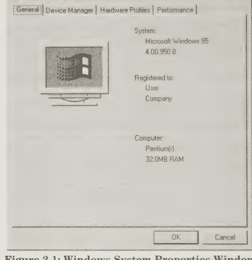

### 图 2-1：Windows 系统属性窗口

- 单击“设备管理器”选项卡。然后您将看到计算机硬件配置的图形表示。确保已选择“按类型查看设备”按钮。

此时，您可以双击图标（或单击加号 `[+]`）来更详细地查看每个条目（见图 2-2）。在以下图标下查找更多信息：

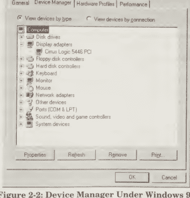

### 图 2-2：Windows 95 下的设备管理器

- 磁盘驱动器 — 您可以在此处找到硬盘的类型（`IDE` 或 `SCSI`）。（`IDE` 驱动器通常会包含“`IDE`”字样，而 `SCSI` 驱动器则不会。）
- 硬盘控制器 — 您可以在此处获取有关硬盘控制器的更多信息。
- CDROM — 在这里您可以了解连接到计算机的任何 CD-ROM 驱动器。请注意：在某些情况下，可能没有 CD-ROM 图标，但您的计算机仍具有功能正常的 CD-ROM 驱动器。这是正常的，具体取决于 Windows 最初的安装方式。在这种情况下，您可能可以通过查看计算机 `config.sys` 文件中加载的 CD-ROM 驱动程序来了解更多信息。
- 鼠标 — 计算机上存在的鼠标类型可以在此处找到。
- **显示适配器** — 如果你有兴趣运行 X Window 系统，你应该记下在这里找到的信息。
- **声音、视频和游戏控制器** — 如果你的计算机具有声音功能，你将在这里找到更多相关信息。
- **网络适配器** — 在这里你会找到有关你计算机的网卡（如果你有的话）的额外信息。
- **SCSI 控制器** — 如果你的计算机使用 SCSI 外设，你将在这里找到有关 SCSI 控制器的额外信息。

虽然这种方法并不能完全替代打开计算机机箱并实际检查每个组件，但在许多情况下它可以提供足够的信息以继续安装。

> **请注意：** 此信息也可以通过点击“`Print...`”按钮来打印。将会出现一个第二个窗口，允许你选择打印机，以及报告类型（“All Devices and System Summary”报告类型是最完整的）。

## 视频配置

如果你将安装 X Window 系统，你还应该熟悉以下内容：

- **你的显卡** — 卡的品牌和型号（或其使用的视频芯片组），以及它拥有的视频 RAM 容量。（大多数基于 PCI 的卡可由安装程序自动检测到。）
- **你的显示器** — 设备的品牌和型号，以及水平和垂直刷新率的允许范围。

## 网络相关信息

如果你将连接到网络，请确保你知道你的：

- **IP地址** — 通常表示为由点分隔的四个数字的集合，例如 `10.0.2.15`。
- **子网掩码** — 另一个由点分隔的四个数字的集合。子网掩码的示例为 `255.255.248.0`。
- **网关 IP 地址** — 又一个由点分隔的四个数字的集合。例如，`10.0.2.254`。
- **一个或多个域名服务器 IP 地址** — 一个或多个由点分隔的数字的集合。`10.0.2.1` 可能是域名服务器的地址。
- **域名** — 分配给你的组织的名称。例如，Red Hat Software 的域名为 `redhat.com`。
- **主机名** — 你计算机的名称。例如，一台计算机可能被命名为 `pooh`。

**请注意：** 上述信息仅为示例！在安装 Red Hat Linux 时不要使用它！如果你不知道网络的正确值，请咨询你的网络管理员。

## 安装方法

你可以通过多种不同的方法安装或升级 Red Hat Linux。每种方法在不同情况下效果最佳，并且有不同的要求。但在我们讨论每种安装方法之前，让我们先来看一个可能影响你们中的一些人的问题。

## 安装期间的 PCMCIA 支持

大多数基于 Intel 的笔记本电脑支持 PCMCIA（也称为 PC Card）。支持 PCMCIA 设备的计算机包含一个控制器，具有一个或多个可安装 PCMCIA 设备的插槽。这些设备可能是调制解调器、LAN 适配器、SCSI 适配器等。在 PCMCIA 兼容计算机上安装 Red Hat Linux/Intel 时，需要注意安装期间是否会使用 PCMCIA 设备。例如，如果你想从 CD-ROM 安装 Red Hat Linux/Intel，而你的 CD-ROM 驱动器连接到 PCMCIA 适配器，则安装程序将需要 PCMCIA 支持。同样，如果你要使用基于网络的安装方法之一，如果你的网络适配器基于 PCMCIA，则你将需要 PCMCIA 支持。

**请注意：** 如果你在笔记本电脑上安装 Red Hat Linux，并且使用笔记本电脑内置的 CD-ROM 驱动器，则不需要安装时的 PCMCIA 支持。PCMCIA 支持取决于两件事：

- 1 你计算机系统中的 PCMCIA 控制器的类型。
- 2 你希望在安装期间使用的 PCMCIA 设备的类型。

虽然几乎所有 PCMCIA 控制器和大多数流行的 PCMCIA 设备都得到支持，但也有一些例外。有关更多信息，请参阅 Red Hat Linux 硬件兼容性列表，网址为 `http://www.redhat.com/hardware`。需要记住的主要一点是，如果你需要安装时的 PCMCIA 支持，你将需要一个支持软盘。我们将在你确定哪种安装方法最适合你之后向你展示如何操作。

## 从 CD-ROM 安装

如果你有 Red Hat Linux CD-ROM，并且你的计算机具有受支持的 CD-ROM 驱动器，你应该考虑这种安装方法。直接从 CD-ROM 安装是最直接的方法。在从 CD-ROM 安装时，所选的软件包从 CD-ROM 中读取，并安装到你的硬盘上。

### 如何操作


顾名思义，你需要一个 Red Hat Linux CD-ROM、一个受支持的 CD-ROM 驱动器，以及启动安装程序的方法。Intel 系统需要使用启动软盘（如果在安装期间使用 PCMCIA 设备，则需要 PCMCIA 支持软盘）。有一种无需软盘的从 CD-ROM 安装的替代方法，但要求系统正在运行 DOS。我们将在“启动安装程序”中讨论这种方法（称为 autoboot）。现在请注意，使用 autoboot 时不可用 PCMCIA 支持。

请注意：更新的计算机也可以通过可启动 CD-ROM 来启动 Red Hat Linux/Intel CD-ROM。并非所有计算机都支持此功能，因此如果你的计算机无法从 CD-ROM 启动，你将不得不使用启动软盘（或从 DOS autoboot）来开始操作。请注意，你可能需要在计算机的 BIOS 设置中更改设置以启用此功能。

如果你已确定这种安装方法最适用

如果与你的情况不符，请跳至 **需要 PCMCIA 支持软盘？**。

## 从 FTP 站点安装

如果你没有 Red Hat Linux CD-ROM 或 CD-ROM 驱动器，但有网络访问权限，那么 FTP 安装可能适合你。通过 FTP 安装时，你选择的 Red Hat Linux 软件包会通过网络使用 FTP 下载到你的计算机上，然后安装到你的硬盘上。

### 如何操作

进行 FTP 安装时，你需要基于局域网的网络访问；通过调制解调器拨号连接是不够的。如果你的局域网有 Internet 访问权限，你可以使用许多镜像 Red Hat Linux 的 FTP 站点。你可以在 `http://www.redhat.com/mirrors.html` 上找到镜像站点列表。如果你的局域网没有 Internet 访问权限，一切都还没完。如果你的局域网中有一台计算机可以接受匿名 FTP 请求，只需将 Red Hat Linux 发行版的副本放在该系统上即可开始。**请注意：** 你的 FTP 服务器必须能够处理长文件名。对于 FTP 安装，你必须使用特定的网络安装启动软盘，以及在安装过程中使用 PCMCIA 设备时使用 PCMCIA 支持软盘。你需要配置有效的名称服务器，或者必须指定你要使用的 FTP 服务器的 IP 地址。你还需要 FTP 服务器上 Red Hat Linux 目录的路径。如果你已确定此安装方法最适用于你的情况，请跳至 **需要 PCMCIA 支持软盘？**。

## 从 HTTP 站点安装

如果你没有 Red Hat Linux CD-ROM 或 CD-ROM 驱动器，但有网络访问权限，那么 HTTP 安装可能适合你。通过 HTTP 安装时，你选择的 Red Hat Linux 软件包会通过网络使用 HTTP 下载到你的计算机上，然后安装到你的硬盘上。

### 如何操作

对于 HTTP 安装，你必须使用网络安装启动盘，如果在安装过程中使用 PCMCIA 设备，则需要 PCMCIA 支持软盘。你需要配置有效的名称服务器，或者必须指定你要使用的 HTTP 服务器的 IP 地址。你还需要 HTTP 服务器上 Red Hat Linux 目录的路径。如果你已确定此安装方法最适用于你的情况，请跳至 需要 PCMCIA 支持软盘？。

## 从 NFS 服务器安装

如果你的系统没有 CD-ROM 驱动器，但有网络访问权限，那么 NFS 安装可能适合你。通过 NFS 安装时，你选择的 Red Hat Linux 软件包会从 NFS 服务器系统通过 NFS 提供给你的计算机。然后将软件包安装到你的硬盘上。

### 如何操作

如果你想执行 NFS 安装，你需要将 Red Hat Linux CD-ROM 挂载在一台支持带 Rock Ridge 扩展的 ISO-9660 文件系统的机器上。该机器还必须支持 NFS。通过 NFS 导出 CD-ROM 文件系统。你需要配置名称服务器，或知道 NFS 服务器的 IP 地址，以及导出的 CD-ROM 的路径。请注意：你的 NFS 服务器必须能够处理长文件名。对于 NFS 安装，你只需要一张启动软盘即可。如果你已确定此安装方法最适用于你的情况，请跳至 需要 PCMCIA 支持软盘？。

## 从硬盘安装

如果其他安装方法都无法满足你的需求，但你有某种方式将 Red Hat Linux 软件包文件写入系统硬盘，你可以从硬盘安装。在此安装方法中，你选择的 Red Hat Linux 软件包从硬盘上的一个分区读取，并安装到另一个分区（或一组分区）上。

### 如何操作

硬盘安装方法需要你在开始 Red Hat Linux 安装程序之前做一些前期工作，因为你必须先将所有必要文件复制到一个分区。你必须首先在目录树的顶层创建一个 Red Hat 目录。所有要安装的内容都应放在该目录中。首先复制 `base` 子目录及其内容。接下来，将你想要安装的软件包复制到名为 `RPMS` 的另一个子目录中。你可以使用现有 DOS 分区或 Linux 分区上的可用空间，而该 Linux 分区在安装过程中不需要（例如，将用于安装后系统的数据存储的分区）。如果你使用的是 DOS 文件系统，你将无法使用 RPM 软件包的完整 Linux 文件名。安装过程不关心文件名是什么样，但最好你能跟踪它们。从硬盘安装时，你需要一张启动软盘，如果在安装过程中使用 PCMCIA 设备，则需要一张 PCMCIA 支持软盘。

## 需要网络启动软盘？

如果你通过 FTP、HTTP 或 NFS 执行安装，你需要创建自己的网络启动软盘。网络启动软盘映像文件是 `bootnet.img`，位于 Red Hat Linux/Intel CD 上的 `images` 目录中。请转到附录 B 并在那里按照说明操作。然后，返回此处，继续阅读。

## 需要 PCMCIA 支持软盘？

以下是你可以用来判断是否需要创建 PCMCIA 支持软盘的清单：

# Red Hat Linux 6.0 安装指南

- 从 PCMCIA 连接的 CD-ROM 安装 — 如果您将从 CD-ROM 安装 Red Hat Linux，并且您的 CD-ROM 驱动器是通过 PCMCIA 卡连接到计算机的，则您需要一张支持软盘。
- 使用 PCMCIA 网络卡安装 — 如果您在安装过程中将使用 PCMCIA 网络适配器，则您需要一张支持软盘。

如果您已确定需要一张支持软盘，您将不得不制作一张。PCMCIA 支持软盘映像文件为 `pcmcia.img`，位于您的 Red Hat Linux/Intel CD 上的 `images` 目录中。请转到附录 B 并在那里按照说明操作。然后，返回此处，继续阅读。

## 安装类别

Red Hat Linux 定义了三种不同的类别，或安装类型。它们是：

- Workstation
- Server
- Custom

这些类别为您提供了简化安装过程（会损失一些配置灵活性）的选项，或在安装过程稍复杂的情况下保留完全灵活性。让我们更详细地查看每个类别，以便您可以确定哪一个适合您。只有自定义类别安装允许您完全灵活。工作站类别和服务器类别安装会自动为您完成安装过程并省略某些步骤。

### 工作站类别安装

如果您是 Linux 世界的新手，并且想尝试一下，那么工作站类别安装最适合您。通过回答很少的安装问题，您就可以在很短的时间内运行 Red Hat Linux！

#### 它做什么？

工作站类别安装会删除所有已安装硬盘上的任何与 Linux 相关的分区（并使用所有空闲未分区磁盘空间）来创建以下分区：

- 一个 64MB 的交换分区。
- 一个 16MB 的分区（挂载为 `/boot`），其中存放 Linux 内核和相关文件。
- 一个可变大小的（确切大小取决于可用磁盘空间）分区（挂载为 `/`），其中存储所有其他文件。

这种磁盘分区方法可实现最简单的文件系统配置。请注意：您需要大约 600MB 的可用磁盘空间才能执行工作站类别安装。如果您的系统已运行 Windows，工作站类别安装将自动配置您的系统以使用 `LILO` 双启动。请注意：工作站类别安装将删除系统上任何硬盘上现有的任何 Linux 分区。它还将尝试在您的系统上自动设置双启动环境。

### 服务器类别安装

如果您希望系统作为基于 Linux 的服务器运行，并且不想大量自定义系统配置，则服务器类别安装最适合您。

#### 它做什么？

服务器类别安装会删除所有已安装硬盘上的所有现有分区，因此只有在您确定没有任何需要保存的内容时才选择此安装类别！安装完成后，您会发现以下分区：

- 一个 64MB 的交换分区。
- 一个 16MB 的分区（挂载为 `/boot`），其中保存 Linux 内核和相关文件。
- 一个 256MB 的分区（挂载为 `/`）。
- 一个至少 512MB 的分区（挂载为 `/usr`）。
- 一个至少 512MB 的分区（挂载为 `/home`）。
- 一个 256MB 的分区（挂载为 `/var`）。

这种磁盘分区方法可为大多数服务器类任务提供合理灵活的文件系统配置。**请注意：**您需要大约 1.6GB 的可用磁盘空间才能执行服务器类别安装。**请注意：**服务器类别安装将删除系统上所有现有硬盘上的任何现有分区。所有驱动器将被擦除所有信息和现有操作系统，无论它们是 Linux 分区还是其他分区。

## 自定义类别安装


# Red Hat Linux 6.0 安装指南

顾名思义，自定义类别安装强调灵活性。在自定义类别安装期间，磁盘空间应如何分区由您决定。您可以完全控制将安装在系统上的软件包。您还可以确定是否使用`LILO`启动系统。对于那些有先前 Red Hat Linux 安装经验的人来说，您已经做过自定义类别安装——它与我们在过去版本的 Red Hat Linux 中使用的安装程序相同。

## 磁盘分区

几乎所有现代操作系统都使用磁盘分区，Red Hat Linux 也不例外。安装 Red Hat Linux 时，需要处理磁盘分区。如果您以前没有处理过磁盘分区（或希望快速回顾基本概念），请在继续之前阅读附录 B。

**请注意：**如果您打算执行工作站或服务器类别安装，并且已经有足够的未分区磁盘空间，则无需阅读本节，可以转到**关于内核驱动程序的说明**。否则，请阅读本节以确定为 Red Hat Linux 释放磁盘空间的最佳方法 Linux 安装。

要安装 Red Hat Linux，您必须为其腾出磁盘空间。此磁盘空间必须与计算机上可能安装的其他操作系统（如 Windows、OS/2 或甚至另一个版本的 Linux）使用的磁盘空间分开。这是通过为 Red Hat Linux 专门分配一个或多个分区来实现的。

在开始安装过程之前，必须满足以下条件之一：

- 您的计算机必须有足够的未分区磁盘空间可用于安装 Red Hat Linux。

- 您的计算机必须有一个或多个可以删除的分区，从而释放出足够的磁盘空间来安装 Red Hat Linux。

让我们看看这是如何完成的。

## 为 Red Hat Linux 腾出空间

在尝试重新分区硬盘时，您可能会遇到三种可能的情况：

- 有未分区的可用空间。

- 有未使用的分区可用。

- 在正在使用的分区中有可用空间。

让我们按顺序查看每种情况。请注意：本节中的图示基于附录 B 中使用的图示，表示为 Red Hat Linux 释放磁盘空间所需的事件序列。如果这些图示对您没有意义，您应该在继续之前先阅读附录 B。请记住，这些插图为了清晰起见而进行了简化，并不反映您在实际安装 Red Hat Linux 时会遇到的确切分区布局。

### 使用未分区的可用空间

在这种情况下，已定义的分区并未覆盖整个硬盘，留下了未分配且不属于任何已定义分区的空间。图 2-3 显示了这种情况可能的样子。

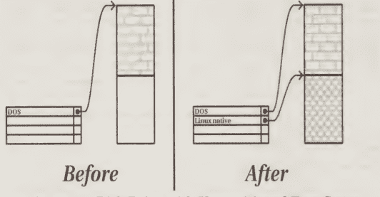

**图 2-3：具有未分区可用空间的磁盘驱动器**

如果您想一想，未使用的硬盘也属于这一类；唯一的区别是所有空间都不属于任何已定义分区。

无论如何，您可以简单地从未使用空间中创建必要的分区。不幸的是，这种情况虽然非常简单，但不太可能发生（除非您刚刚购买了一块新硬盘专门用于 Red Hat Linux）。

让我们继续看一个稍微更常见的情况。

### 使用来自未使用分区的空间

在这种情况下，也许您有一个或多个分区，您不再使用。也许您过去曾尝试过另一个操作系统，而您为其专门分配的分区似乎再也没有被使用过。图 2-4 说明了这种情况。

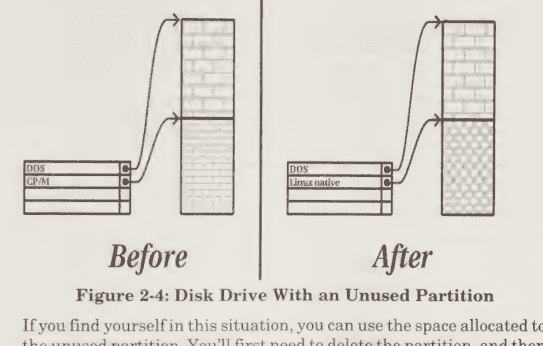

**Before**

**After**

**图 2-4：具有未使用分区的磁盘驱动器**

如果您发现自己处于这种情况，您可以使用分配给未使用分区的空间。您首先需要删除该分区，然后在其位置创建适当的 Linux 分区。您可以使用 DOS`fdisk`删除该分区，或者在自定义类安装过程中会给您机会这样做。

### 使用来自活动分区的可用空间

这是最常见的情况。遗憾的是，这也是最难处理的情况。主要问题是，即使您有足够的可用空间，它目前也分配给正在使用的分区。如果您购买的计算机预装了软件，硬盘很可能有一个巨大的分区存放操作系统和数据。

除了向系统添加新的硬盘之外，您有两个选择：

**破坏性重新分区** — 基本上，您删除单个大分区，并创建几个较小的分区。正如您可能想象的那样，原分区中的任何数据都会被销毁。这意味着必须进行完整备份。为了您自己的利益，请制作两份备份，使用验证（如果您的备份软件提供此功能），并在删除分区之前尝试从备份中读取数据。还请注意，如果该分区上安装了某种操作系统，也需要重新安装。在为现有软件创建较小的分区后，您可以重新安装任何软件，恢复您的数据，并继续进行 Red Hat Linux 安装。图 2-5 显示了此操作的进行情况。

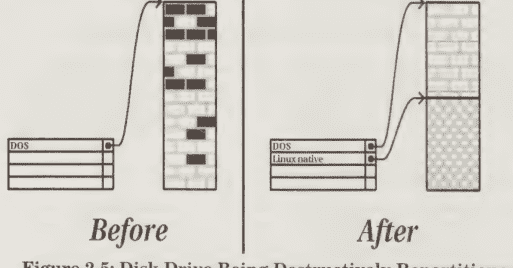

**Before**

**After**

**图 2-5：正在进行破坏性重新分区的磁盘驱动器**

> 请注意：正如图 2-5 所示，如果没有正确备份，原分区中的任何数据都将丢失！

**非破坏性重新分区** — 在这里，您运行一个程序来完成看似不可能的任务：它使大分区变小，而不会丢失该分区中存储的任何文件。许多人发现这种方法可靠且无问题。您应该使用什么软件来 perform this feat? 市场上有几种磁盘管理软件产品；你需要做一些研究，找到最适合你情况的那一款。

虽然非破坏性重新分区过程相当直接，但涉及多个步骤：

- 压缩现有数据

- 调整分区大小

- 创建新分区

让我们更详细地看看每一步。

#### 压缩现有数据

如图 2-6 所示，第一步是压缩现有分区中的数据。这样做的目的是重新排列数据，使其最大化分区“末尾”的可用空闲空间。

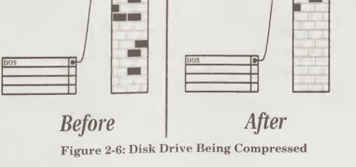

这一步至关重要；如果不这样做，你的数据位置可能会阻止分区被调整到期望的程度。还请注意，出于某种原因，一些数据无法移动。如果是这种情况（并且限制了新分区的大小），你可能被迫对磁盘进行破坏性重新分区。

#### 调整分区大小

图 2-7 显示了实际的调整大小过程。

虽然调整大小操作的实际结果因所用软件而异，但在大多数情况下，新释放的空间被用来创建一个与原始分区类型相同的未格式化分区。

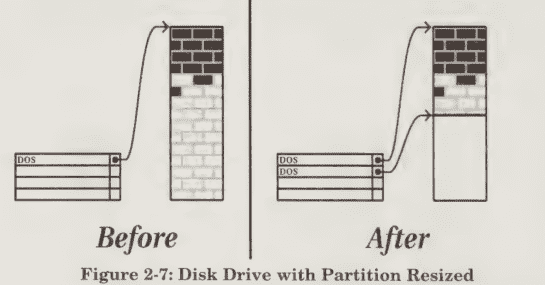

之前

之后

图 2-7：分区已调整大小的磁盘驱动器

了解你使用的调整大小软件如何处理新释放的空间非常重要，以便你可以采取适当的步骤。在我们所举的例子中，最好直接删除新的 DOS 分区，并创建适当的 Linux 分区。

#### 创建新分区

正如上一步所暗示的，创建新分区可能有必要也可能没有必要。然而，除非你的调整大小软件支持 Linux，否则你可能需要删除在调整大小过程中创建的分区。图 2-8 显示了此操作。

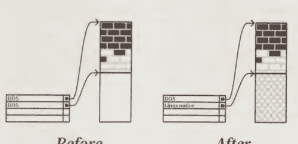

之前

之后

图 2-8：最终分区配置的磁盘驱动器

为了方便我们的客户，我们提供了`fips`实用程序。这是一个可自由获得的程序，可以调整 FAT（文件分配表）分区的大小。它包含在 Red Hat Linux/Intel CD-ROM 的`dosutils`目录中。请注意：许多人已成功使用`fips`重新分区他们的硬盘。然而，由于`fips`执行的操作性质以及它必须运行的各种硬件和软件配置，Red Hat Software 无法保证`fips`在你的系统上能正常工作。因此，`fips`完全不提供安装支持；使用风险自负。

话虽如此，如果你决定使用`fips`重新分区你的硬盘，你必须做两件事：

- 执行备份 — 制作计算机上所有重要数据的两份副本。这些副本应存储在可移动介质上（如磁带或软盘），并且在继续之前应确保它们可读。

- 阅读文档 — 完整阅读`fips`文档，该文档位于 Red Hat Linux/Intel CD 1 上的`/dosutils/fipsdocs`子目录中。

如果你决定使用`fips`，请注意，`fips`运行后你将剩下两个分区：你调整大小的那个，以及`fips`从新释放的空间中创建的那个。如果你的目标是使用该空间来安装 Red Hat Linux，你应该删除新创建的分区，可以在当前操作系统下使用`fdisk`，或者在自定义类安装期间设置分区时删除。

## 分区命名方案

Linux 使用字母和数字的组合来引用磁盘分区，这可能令人困惑，特别是如果你习惯了“ C 盘”这种引用硬盘及其分区的方式。在 DOS/Windows 世界中，分区命名方式如下：

- 检查每个分区的类型以确定 DOS/Windows 是否可以读取它。

- 如果分区类型兼容，则分配一个“驱动器号”。驱动器号从“C”开始。

- 然后可以使用驱动器号来引用该分区以及该分区上的文件系统。

Red Hat Linux 使用一种比其他操作系统采用的方法更灵活且传达更多信息的命名方案。命名方案基于文件，文件名为：

`/dev/xxyN`

以下是如何解读分区命名方案：

`/dev/` — 这个字符串是包含所有设备文件的目录的名称。由于分区位于硬盘上，而硬盘是设备，因此代表所有可能分区的文件都位于`/dev/`中。

`xx` — 分区名称的前两个字母表示分区所在的设备类型。你通常会看到`hd`（用于 IDE 磁盘）或`sd`（用于 SCSI 磁盘）。


`y` — 这个字母表示分区所在的设备。例如，`/dev/hda`（第一块 IDE 硬盘）或 `/dev/sdb`（第二块 SCSI 磁盘）。

`N` — 最后的数字表示分区。前四个（主分区或扩展分区）分区编号为 1 到 4。逻辑分区从 5 开始。例如，`/dev/hda3` 是第一块 IDE 硬盘上的第三个主分区或扩展分区；`/dev/sdb6` 是第二块 SCSI 硬盘上的第二个逻辑分区。

请注意：这种命名约定中没有任何部分是基于分区类型；与 DOS/Windows 不同，所有分区都可以在 Red Hat Linux 下被识别。当然，这并不意味着 Red Hat Linux 可以访问每种类型分区上的数据，但在许多情况下，可以访问专用于另一操作系统的分区上的数据。请记住这些信息；当你设置 Red Hat Linux 所需的分区时，这将使事情更容易理解。

## 磁盘分区和其他操作系统

如果你的 Red Hat Linux 分区将与用于其他操作系统的分区共享同一块硬盘，大多数情况下你不会遇到问题。然而，Linux 和其他操作系统的某些组合需要格外小心。有关创建与其他操作系统兼容的磁盘分区的信息可在多个 HOWTO 和 Mini-HOWTO 中找到，这些文档位于 Red Hat Linux CD 的 `doc/HOWTO` 和 `doc/HOWTO/mini` 目录中。特别是，名称以 Linux+ 开头的 Mini-HOWTO 非常有帮助。如果 Red Hat Linux/Intel 将与你的机器上的 OS/2 共存，你必须使用 OS/2 的分区软件创建磁盘分区——否则，OS/2 可能无法识别磁盘分区。在安装过程中，不要创建任何新分区，但请使用 Linux `fdisk` 为你的 Linux 分区设置正确的分区类型。

## 磁盘分区和挂载点

对于许多 Linux 新手来说，一个令人困惑的领域是如何分区被 Linux 操作系统使用和访问。在 DOS/Windows 中，相对简单：如果有多个分区，每个分区都会获得一个“驱动器号”。然后你使用驱动器号来引用给定分区上的文件和目录。这与 Red Hat Linux 处理分区的方式完全不同，更不用说磁盘存储的一般处理方式了。主要区别在于，每个分区都被用来形成支持单一文件和目录集所需的存储的一部分。这是通过将分区与目录关联的过程来实现的，该过程称为挂载。挂载分区会使其存储从指定的目录（称为挂载点）开始可用。例如，如果分区 `/dev/hda5` 挂载在 `/usr` 上，这意味着 `/usr` 下的所有文件和目录在物理上都位于 `/dev/hda5` 上。因此文件 `/usr/doc/FAQ/txt/Linux-FAQ` 将存储在 `/dev/hda5` 上，而文件 `/etc/X11/gdm/Sessions/Gnome` 则不会。继续我们的例子，`/usr` 下的一个或多个目录也可能是其他分区的挂载点。例如，一个分区（比如 `/dev/hda7`）可以挂载在 `/usr/local` 上，这意味着例如 `/usr/local/man/whatis` 将位于 `/dev/hda7` 而不是 `/dev/hda5` 上。

## 需要多少个分区？

在准备安装 Red Hat Linux 的过程中，你需要考虑一下新操作系统将使用的分区数量和大小。“需要多少个分区”这个问题在 Linux 社区中持续引发争论，而且在看不到争论结束的迹象的情况下，可以肯定地说，可能有与人数一样多的分区布局

在权衡利弊后，我们建议，除非你有特殊原因，否则应创建以下分区：

- **交换分区** — 交换分区用于支持虚拟内存。如果你的计算机 RAM 为 16 MB 或更少，则必须创建交换分区。即使你有更多内存，交换分区仍然是推荐的。交换分区的最小大小应等于计算机的 RAM，或 16 MB（以较大者为准）。最大可用的交换分区大约为 127 MB，因此创建大于该值的交换分区会导致空间浪费。注意，你也可以创建并使用多个交换分区，如果系统需要超过 127MB 的交换空间。以下分区专门针对 Red Hat Linux/Intel 安装。

- **/boot 分区** — 挂载在 `/boot` 上的分区包含操作系统内核以及引导过程中使用的其他几个文件。由于大多数 PC BIOS 的限制，创建一个小型分区来存放这些文件是个好主意。该分区不应大于 16MB。请注意：请务必阅读《磁盘分区和其他操作系统》——其中的信息适用于 `/boot` 分区！

- **根分区** — 根分区是 `/`（根目录）所在的位置。在此分区布局中，所有文件（`/boot` 中存储的文件除外）都位于根分区上。因此，最大化根分区的大小符合你的最佳利益。500MB 的根分区将允许相当于工作站级别的安装（几乎没有空闲空间），而 1GB 的根分区将让你安装所有软件包。

## 最后的复杂性：使用 LILO

`LILO`（Linux LOader）是在基于 Intel 的系统上启动 Red Hat Linux 最常用的方法。作为一个操作系统加载器，`LILO` 在任何操作系统“之外”运行，仅使用计算机硬件本身内置的基本输入/输出系统（即 BIOS）。本节描述了 `LILO` 与 PC BIOS 的交互，专门针对 Intel 兼容计算机。

### 影响 LILO 的 BIOS 相关限制

`LILO` 受制于大多数基于 Intel 的计算机 BIOS imposed 的一些限制。具体来说，大多数 BIOS 无法访问超过两块硬盘，并且无法访问任何驱动器中第 1023 柱面之后存储的数据。请注意，一些较新的 BIOS 不受这些限制，但这绝非普遍现象。`LILO` 在启动时需要访问的所有数据（包括 Linux 内核）都位于 `/boot` 目录中。如果你遵循上面推荐的分区布局，或你正在执行工作站或服务器级别的安装，引导目录将位于一个小型的独立分区中。否则，它将驻留在根分区中。在任何情况下，`/boot` 所在的分区必须符合以下准则，如果你打算使用 `LILO` 来启动你的 Red Hat Linux 系统：

在前两个 IDE 驱动器上 — 如果你有 2 个 IDE（或 EIDE）驱动器，`/boot` 必须位于其中之一上。请注意，此两驱动器限制也包括主 IDE 控制器上的任何 IDE CD-ROM 驱动器。因此，如果你在主控制器上有一块 IDE 硬盘和一个 IDE CD-ROM，即使你在次要 IDE 控制器上有其他硬盘，`/boot` 也必须仅位于第一块硬盘上。

在第一个 IDE 或第一个 SCSI 驱动器上 — 如果你有一个 IDE（或 EIDE）驱动器和一个或多个 SCSI 驱动器，`/boot` 必须位于 IDE 驱动器或 ID 为 0 的 SCSI 驱动器上。其他任何 SCSI ID 都无法工作。

在前两个 SCSI 驱动器上 — 如果你只有 SCSI 硬盘，`/boot` 必须位于 ID 为 0 或 ID 为 1 的驱动器上。其他任何 SCSI ID 都无法工作。

完全位于第 1023 柱面以下 — 不论上述哪种配置适用，存放 `/boot` 的分区必须完全位于第 1023 柱面以下。如果存放 `/boot` 的分区跨越第 1023 柱面，你可能会遇到一种情况，即 `LILO` 最初可以工作（因为所有必要信息都位于第 1023 柱面以下），但如果要加载新内核，而该内核位于第 1023 柱面之上，则会失败。

如前所述，可能某些较新的 BIOS 允许 `LILO` 在不符合我们准则的配置下工作。同样，`LILO` 的一些更晦涩的功能可能被用来启动 Linux 系统，即使配置不符合我们的准则。然而，由于涉及的变量众多，Red Hat Software 无法支持此类特殊努力。请注意：Disk Druid 以及工作站和服务器级别的安装均会

请将这些与 BIOS 相关的限制考虑在内。然而，如果你决定使用 `fdisk`，记住这些限制是你的责任。

## 关于内核驱动的说明

在安装 Red Hat Linux 期间，内核对支持的文件系统和其他驱动程序施加了一些限制。但是，安装完成后，Linux 下可用的所有文件系统都得到支持。在安装时，模块化内核支持 (E)IDE 设备（包括 ATAPI CD-ROM 驱动器）、SCSI 适配器和网卡。此外，所有鼠标、SLIP、CSLIP、PPP、PLIP、FPU 仿真、控制台选择、ELF、SysV IPC、IP 转发、防火墙和记账、反向 ARP、QIC 磁带和并行打印机都得到支持。

请注意：由于 Red Hat Linux 支持在许多不同类型的硬件上安装，许多驱动程序（包括 SCSI 适配器、网卡和许多 CD-ROM 的驱动程序）并未内置到安装期间使用的 Linux 内核中；相反，它们作为模块提供，并在安装过程中根据需要加载。如果需要，你在加载这些模块时将有机会为这些模块指定选项，事实上这些驱动程序将忽略你在 `boot:` 提示符下为它们指定的任何选项。

安装完成后，你可能想要重建一个包含对你特定硬件配置支持的内核。有关构建自定义内核的信息，请参阅 Building a Custom Kernel。请注意，在大多数情况下，自定义构建的内核是不必要的。

## 如果你遇到问题...

如果你在安装之前、期间或之后遇到问题，请查看 Red Hat Linux 常见问题列表。你可以在以下位置找到 FAQ：http://www.redhat.com/knowledgebase/index.html 在许多情况下，快速查看 FAQ 就可以让你迅速恢复运行。

## 最后说明


请在开始之前阅读所有安装说明；这将为你需要做出的任何决定做好准备，并应消除潜在的意外。

# 3 开始安装

本章解释如何启动 Red Hat Linux 6.0 安装过程。我们将在本章中介绍以下内容：

- 熟悉安装程序的用户界面；
- 启动安装程序；
- 选择安装方法。

到本章结束时，安装程序将在你的系统上运行，并且将选择适当的安装方法。

## 安装程序用户界面

Red Hat Linux 安装程序使用基于屏幕的界面，其中包含图形用户界面中常见的几乎所有“控件”。它们可能看起来与更图形化的对应物有点不同；图 3-1 和图 3-2 在此包含以便更容易识别。以下是最重要的控件列表：

- **Window** — 窗口（在本手册中也称为对话框）将在整个安装过程中出现在你的屏幕上。有时，一个窗口可能会覆盖另一个窗口；在这些情况下，你只能与最上层的窗口交互。完成该窗口后，它将消失，让你继续处理下面的窗口。

- **Text Input** — 文本输入行是你可以在其中输入安装程序所需信息的区域。当光标停留在文本输入行上时，你可以输入和/或编辑该行上的信息。

- **Check Box** — 复选框允许你选择或取消选择安装程序提供的特定功能。当光标停留在复选框内时，按下 `[Space]` 会使复选框在选中和未选中状态之间切换。

## Red Hat Linux 6.0 安装指南

- Text Widget — 文本控件是屏幕上专门用于显示文本的区域。有时，文本控件中也可能包含其他控件，例如复选框。文本控件可能包含一次无法全部显示的信息。在这些情况下，文本控件旁边会有一个滚动条；如果你将光标定位在文本控件内，则可以使用 `[uparrow]` 和 `[downarrow]` 键滚动查看所有可用信息。

- Scroll Bar — 滚动条提供你在文本控件中显示的信息中的相对位置的视觉指示。你的当前位置由 `#` 字符表示，当你前后滚动时，该字符会在滚动条上上下移动。

- Button Widget — 按钮控件是与安装程序交互的主要方法。通过“按下”这些按钮，你将逐步完成构成安装过程的一系列窗口。当按钮被光标高亮时可以按下。

- Cursor — 尽管不是控件，但光标用于选择（并与之交互）特定控件。随着光标在控件之间移动，它可能会导致控件变色，或者你只能看到光标本身位于控件内或旁边。在图 3-1 中，光标位于 `Ok` 按钮上。图 3-2 显示光标位于窗口顶部文本控件的第一行。

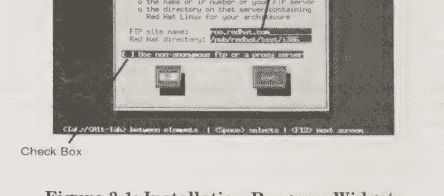

### Figure 3-1: Installation Program Widgets

## 图 3-2：更多安装程序控件

正如我们对这些控件的描述所猜测的那样，安装程序是基于字符的，并且不使用鼠标。这是由于安装程序必须在各种各样的计算机上运行，其中一些甚至可能没有鼠标。以下部分描述了与安装程序交互所需的按键。

## 使用键盘导航

你可以使用一组简单的按键在安装对话框中导航。你需要使用 `[<-, ]->`、 `[\uparrow]` 和 `[\downarrow]` 等各种键来移动光标。你也可以使用 `[Tab]` 和 `[Alt]+[Tab]` 在屏幕上的每个控件之间向前或向后循环。在大多数情况下，每个屏幕底部都会提供可用功能键的摘要。要“按下”一个按钮，将光标定位到按钮上（例如使用 `[Tab]`），然后按 `[Space]`（或 `[Enter]`）。要从项目列表中选择一个项目，将光标移动到要选择的项目并按 `[Enter]`。要选择带复选框的项目，将光标移动到复选框并按 `[Space]` 来选择项目。要取消选择，再次按 `[Space]`。按 `[F12]` 接受当前值并继续到下一个对话框；它通常等同于按下 `Ok` 按钮。请注意：除非对话框正在等待您的输入，否则在安装过程中不要按任何键——这可能会导致不可预测的行为。

## 关于虚拟控制台的说明

Red Hat Linux 安装程序不仅仅是在引导您完成安装过程时呈现的对话框。事实上，安装程序除了提供从 shell 提示符输入命令的方式外，还为您提供了多种诊断消息。它将此信息显示在五个虚拟控制台上，您可以使用单个按键在它们之间切换。这些虚拟控制台如果在安装 Red Hat Linux 时遇到问题会非常有帮助。显示在安装或系统控制台上的消息可以帮助确定问题。请参阅图 3-3，了解虚拟控制台的列表、切换到它们的按键以及其内容。

| Console | Keystroke | Contents |
|---|---|---|
| 1 | `[Alt]+[F1]` | installation dialog |
| 2 | `[Alt]+[F2]` | shell prompt |
| 3 | `[Alt]+[F3]` | install log (messages from install program) |
| 4 | `[Alt]+[F4]` | system log (messages from kernel, etc.) |
| 5 | `[Alt]+[F5]` | other messages |

图 3-3：虚拟控制台信息

通常，除非您试图诊断安装问题，否则没有理由离开虚拟控制台 #1。但如果你是好奇的类型，随意四处看看。

## 开始安装程序

现在是开始安装 Red Hat Linux 的时候了。要开始安装，首先需要启动安装程序。在开始之前，请确保您拥有安装所需的所有资源。如果您已经阅读过第 2 章并按照说明操作，您应该已准备就绪。

## 启动安装程序

要开始安装 Red Hat Linux，将启动软盘插入计算机的第一个软盘驱动器并重新启动（或从 Red Hat Linux CD-ROM 启动，如果您的计算机支持）。您的 BIOS 设置可能需要更改以允许您从软盘或 CD-ROM 启动。经过短暂延迟后，应出现包含 `boot:` 提示符的屏幕。该屏幕包含有关各种启动选项的信息。每个启动选项还关联有一个或多个帮助屏幕。要访问给定的帮助屏幕，请按屏幕底部行中列出的相应功能键。您应牢记两点：

- 如果您在一分钟内不采取任何操作，初始屏幕将自动启动安装程序。要禁用此功能，请按一个帮助屏幕功能键。

- 如果您按帮助屏幕功能键，读取帮助屏幕时会有一点延迟。

通常，您只需按 `[Enter]` 即可启动。观察启动消息以查看 Linux 内核是否检测到您的硬件。如果它没有正确检测到您的硬件，您可能需要以“expert”模式重新启动安装。专家模式禁用大部分硬件探测，并允许您在安装过程中为加载的驱动程序输入选项。专家模式可使用以下启动命令进入：

```
boot: expert
```

> 请注意：初始启动消息中不会包含任何有关 SCSI 或网络卡的引用。这些设备由在安装过程中加载的模块支持。选项也可以传递给内核。

例如，要指示内核在 128 MB 的系统中使用全部内存，请输入：

```
boot: linux mem=128M
```

然而，对于大多数计算机来说，没有必要向内核传递此参数。内核在大多数情况下会检测到系统拥有的内存量。为了确保所有内存都已被检测到，请在 shell 提示符下输入：

```
cat /proc/meminfo
```

这将以总计、已用、空闲等形式显示内核检测到的内存量。如果 `MemTotal` 对你的系统不正确，你将需要修改 `lilo.conf`，以便在启动时将该内存量传递给内核。例如，如果你的计算机有 96 MB 的 RAM，你将添加：

```
append="mem=96M"
```

输入任何选项后，按 `[Enter]` 使用这些选项启动。如果确实需要指定启动选项来识别硬件，请记下它们——稍后会用到。

## 不使用启动软盘进行安装

Red Hat Linux/Intel CD-ROM 也可以由支持可启动 CD-ROM 的较新计算机启动。并非所有计算机都支持此功能，因此如果你的计算机无法从 CD-ROM 启动，还有另一种无需使用启动软盘开始安装的方法。以下方法仅适用于基于 Intel 的计算机。如果你的计算机上安装了 MS-DOS，你可以直接从 CD 启动安装系统而无需使用任何软盘。为此（假设你的 CD 是 d: 盘），请使用以下命令：

```
C:\> d
D:\> cd \dosutils
D:\dosutils> autoboot.bat
```

请注意，如果在 DOS 窗口中运行，此方法将不起作用——`autoboot.bat` 文件必须在 DOS 作为唯一操作系统时执行。换句话说，Windows 不能正在运行。如果你的计算机无法直接从 CD-ROM 启动（并且你不能使用基于 DOS 的 `autoboot`），你将不得不使用启动软盘来开始操作。

## 开始安装

启动后，安装程序首先显示欢迎信息。按 `[Enter]` 开始安装。如果你想在此刻中止安装过程，只需现在弹出启动软盘并重新启动机器即可。

## 选择语言

在欢迎对话框之后，安装程序会要求你选择在安装过程中使用的语言（见图 3-4）。使用 `[↑]` 和 `[↓]` 键，选择适当的语言。语言右侧可能会出现滚动条——如果存在，则表示条目多于一次可显示的数量。在整个安装程序中你都会看到类似的滚动条。

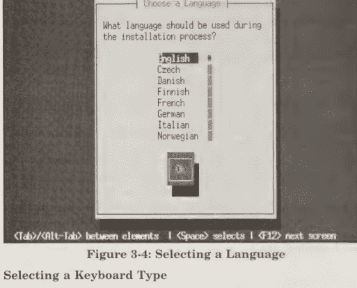

图 3-4：选择语言

## 选择键盘类型


接下来，安装程序会给你一个选择键盘类型的机会（见图 3-5）。你可以用与语言选择对话框相同的方式导航此对话框。

选择适当的键盘类型后，按 `[Enter]`；你选择的键盘类型将在安装过程的剩余时间以及每次启动 Red Hat Linux 系统时自动加载。

如果你想在安装 Red Hat Linux 系统后更改键盘类型，你可以使用 `/usr/sbin/kbdconfig` 命令，或在 root 提示符下输入 `setup`。

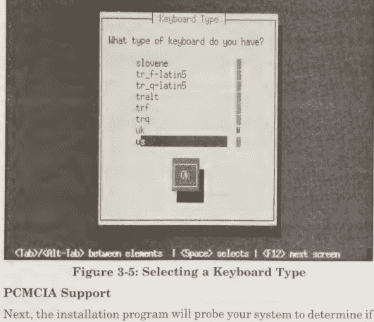

# 图 3-5：选择键盘类型

## PCMCIA 支持

接下来，安装程序将探测你的系统以确定系统是否需要 PCMCIA（也称为 PC Card）支持。如果发现 PCMCIA 控制器，将询问你是否需要在安装期间使用 PCMCIA 支持。如果你将在安装期间使用 PCMCIA 设备（例如，你有一个 PCMCIA 以太网卡并且将通过 NFS 安装，或你有一个 PCMCIA SCSI 卡并且将从 SCSI CD 安装），你应该选择 `Yes`。

请注意：此问题仅适用于实际安装期间的 PCMCIA 支持。即使你在此处选择 `No`，已安装的 Red Hat Linux 系统仍将支持 PCMCIA（假设你在后续安装）。如果您需要 PCMCIA 支持，系统会提示您插入 PCMCIA 支持软盘。插入后请选择 `Ok`。安装程序随后会显示进度条，表示正在加载支持软盘。

## 选择安装方法

接下来，系统会询问您希望使用何种类型的安装方法。您可以通过以下五种基本方法之一安装 Red Hat Linux（请参阅 `Installation Methods`），如果在安装过程中使用 PCMCIA 设备，则需要使用支持软盘。简而言之，您可以从以下位置安装 Red Hat Linux：

- **CD-ROM**
  - 如果您拥有 CD-ROM 驱动器和 Red Hat Linux CD-ROM。只有在安装过程中使用 PCMCIA 设备时才需要 PCMCIA 支持软盘。请参阅 `Installing from CD-ROM` 以选择 CD-ROM 安装方法。

- **Hard Drive**
  - 如果您已将 Red Hat Linux 文件复制到本地硬盘。只有在安装过程中使用 PCMCIA 设备时才需要 PCMCIA 支持软盘。请参阅 `Installing from a Hard Drive` 以选择硬盘安装方法。

- **NFS Image**
  - 如果您是从导出 Red Hat Linux CD-ROM 或 Red Hat Linux 镜像的 NFS Image 服务器进行安装。只有在安装过程中使用 PCMCIA 设备时才需要 PCMCIA 支持软盘。需要网络启动盘。请参阅 `Installing via NFS` 以选择 NFS 安装方法。

- **FTP**
  - 如果您直接从 FTP 服务器安装。只有在安装过程中使用 PCMCIA 设备时才需要 PCMCIA 支持软盘。需要网络启动盘。请参阅 `Installing via FTP` 以选择 FTP 安装方法。

- **HTTP**
  - 如果您直接从 HTTP Web 服务器安装。只有在安装过程中使用 PCMCIA 设备时才需要 PCMCIA 支持软盘。需要网络启动盘。请参阅 `Installing via HTTP` 以选择 HTTP 安装方法。

如果您选择执行 CD-ROM 或硬盘安装，请参阅第 4 章获取相关安装说明。

如果您选择执行基于网络的安装（NFS、FTP 或 HTTP），请参阅第 5 章获取相关安装说明。

# 4 本地媒体安装

## 选择安装方法

现在您必须决定希望使用何种类型的安装方法（请参阅 `Figure 4-1`）。突出显示适当的选项并选择 `Ok`，或按 `[Enter]`。

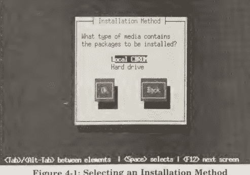

### Figure 4-1: Selecting an Installation Method

如果您不是执行本地媒体类型安装（CD-ROM 或硬盘），请跳至第 5 章进行网络类型安装。

如果您计划执行本地媒体类型安装，请继续阅读。

## 从 CD-ROM 安装

如果您要从 CD-ROM 安装 Red Hat Linux，请选择“CD-ROM”，并选择 `Ok`。安装程序随后会提示您将 Red Hat Linux CD-ROM 插入 CD-ROM 驱动器。插入后，请选择 `Ok`，并按 `[Enter]`。安装程序随后会探测您的系统并尝试识别您的 CD-ROM 驱动器。它首先会查找 IDE（也称为 ATAPI）CD-ROM 驱动器。如果找到，安装将继续。如果安装程序无法自动检测到您的 CD-ROM 驱动器，系统会询问您拥有什么类型的 CD-ROM。您可以从以下类型中选择：

### SCSI

如果您的 CD-ROM 连接到受支持的 SCSI 适配器，请选择此项；安装程序随后会要求您选择一个 SCSI 驱动程序。选择与您的适配器最相似的驱动程序。如有必要，您可以为驱动程序指定选项；不过大多数驱动程序会自动检测您的 SCSI 适配器。

### Other

如果您的 CD-ROM 既不是 IDE 也不是 SCSI CD-ROM，那就是“其他”。带专有 CD-ROM 接口的声卡就是这种 CD-ROM 类型的典型例子。安装程序会列出受支持 CD-ROM 的驱动程序列表 — 选择一个驱动程序，并在必要时指定任何驱动程序选项。

请注意：CD-ROM 的可选参数部分列表可在附录 D 中找到。如果您拥有 ATAPI CD-ROM 且安装程序未能找到它（换句话说，它询问您 CD-ROM 的类型），您必须重新启动安装，并输入 `linux hdX=cdrom`。将 `X` 替换为以下字母之一，具体取决于单元所连接的接口以及其配置为主设备还是从设备：

- `a` — 第一个 IDE 控制器，主设备
- `b` — 第一个 IDE 控制器，从设备
- `c` — 第二个 IDE 控制器，主设备
- `d` — 第二个 IDE 控制器，从设备

（如果您拥有第三个和/或第四个控制器，只需继续分配按字母顺序从控制器到控制器，从主设备到从设备排列字母。）一旦识别出您的 CD-ROM 驱动器，系统会提示您将 Red Hat Linux CD-ROM 插入 CD-ROM 驱动器。插入后请选择 `Ok`。稍作延迟后，下一个对话框将会出现。继续阅读 `Upgrading or Installing` 以获取升级或完整安装说明。

## 从硬盘安装

如果您要从本地连接的硬盘安装 Red Hat Linux，请突出显示“hard drive”并选择 `Ok`。在启动安装程序之前，您必须先将所有必要文件复制到本地连接硬盘上的一个分区。如果您尚未执行此操作，请参阅 `Installing from an HTTP site`。继续阅读 `Upgrading or Installing` 以获取升级或完整安装说明。

## Upgrading or Installing

在您选择安装方法后，安装程序会提示您进行安装或升级（见图 4-2）。

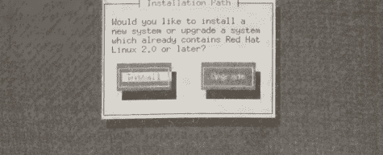

### 图 4-2：Upgrading or Installing

## The Installation Guide for Red Hat Linux 6.0

## Installing

您通常将 Red Hat Linux 安装在干净的磁盘分区或一组分区上，或覆盖另一套 Linux 安装。

请注意：在另一套 Linux 安装（包括 Red Hat Linux）上安装 Red Hat Linux 不会保留任何先前安装的信息（文件或数据）。请确保保存任何重要文件！如果您担心保存现有系统上的当前数据（而不自行备份），您应考虑执行升级而不是安装。

如果您希望执行完整安装，请选择 `Install`，然后跳至 `Installation Class`。

## Upgrading

Red Hat Linux 6.0 的安装过程包括从基于 RPM 技术的前期版本 Red Hat Linux（版本 2.0 及更高版本）升级的能力。升级系统会安装模块化的 2.2.x 内核以及当前安装在您机器上的软件包的更新版本。升级过程通过使用 `.rpmsave` 扩展名（例如，`sendmail.cf.rpmsave`）重命名它们来保留现有配置文件，并在 `/tmp/upgrade.log` 中留下操作日志。随着软件的演进，配置文件格式可能会发生变化，因此在整合更改之前，您应仔细比较原始配置文件和新文件。如果您希望升级 Red Hat Linux 系统，请选择 `Upgrade`。

请注意：某些升级的软件包可能需要安装其他软件包才能正常运行。升级程序会处理这些依赖关系，但它可能需要安装一些不在您现有系统上的额外软件包。

请注意：如果您机器上已安装 X Window System（以及可能的老版本 GNOME），您可能会看到一个屏幕，提示您安装本发行版中包含的最新版本 GNOME。

## Installation Class


如果您选择执行完整安装，安装程序会要求您选择一个安装类别（见图 4-3）。如果您选择执行升级，则不会看到此屏幕。您可以从以下安装类别中选择：

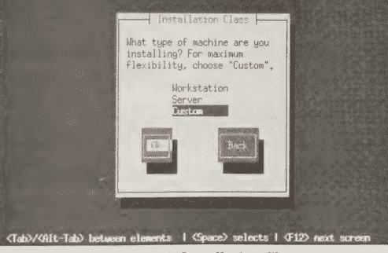

图 4-3：Installation Class

- **Workstation** — 工作站类安装将自动擦除您计算机硬盘上的所有 Linux 分区。此安装类型还将尝试自动设置双启动环境。
- **Server** — 服务器类安装将自动擦除您计算机硬盘上的所有分区（Linux 或其他）。
- **Custom** — 自定义类安装让您完全控制与分区相关的问题。如果您过去安装过 Red Hat Linux，自定义类安装与过去的安装最相似。

## The Installation Guide for Red Hat Linux 6.0

请注意：如果您选择 Workstation 或 Server，您计算机所有驱动器上的部分（或全部）存储数据将被擦除！系统会要求您确认您的决定；然而，请记住，一旦安装程序收到您的确认，擦除操作就不可逆转。

请注意：警告 — 如果您选择执行工作站类或服务器类安装，数据擦除将是不可逆的。被擦除数据的严重程度因安装类型而异：

- Workstation-class — 系统上任何硬盘上任何现有 Linux 分区上的数据将被擦除
- Server-class — 所有驱动器的所有分区上的数据将被完全擦除，无论是否在现有 Linux 分区上。

如果您选择工作站或服务器类安装，您将能够跳过自定义类安装所需的某些步骤。对于硬盘安装，请继续阅读。对于 CD-ROM 工作站或服务器类安装，您应转到第 6 章以继续安装。

## SCSI Support

接下来，安装程序将探测您的系统以查找 SCSI 适配器。在某些情况下，安装程序会询问您是否拥有任何 SCSI 适配器。如果您选择 Yes，下一个对话框会列出 SCSI 驱动程序。选择最接近您 SCSI 适配器的驱动程序。然后安装程序会给您一个机会来指定所选 SCSI 驱动程序的选项；大多数 SCSI 驱动程序应能自动检测您的硬件。

## 为 Red Hat Linux 创建分区

此时，有必要让安装程序知道它应该将 Red Hat Linux 安装在哪里。这是通过为一个或多个将安装 Red Hat Linux 的磁盘分区定义挂载点来完成的。您此时可能还需要创建和/或删除分区。

请注意：如果您尚未计划如何设置分区，请转到 Disk Partitions，并查看所有内容直到

## 关于内核驱动的说明。

作为最低要求，您需要一个大小合适的根分区，以及至少 16 MB 的交换分区。

如果您仍不确定如何设置分区，请参阅附录 B。

安装程序随后会显示一个对话框，允许您从两种磁盘分区工具中进行选择（见图 4-4）。您的选择有：

- Disk Druid — 这是 Red Hat Linux 的安装时磁盘管理实用程序。它可以根据用户提供的需求创建和删除磁盘分区，同时管理每个分区的挂载点。
- fdisk — 这是传统的 Linux 磁盘分区工具。虽然它比 Disk Druid 更灵活一些，但缺点是 `fdisk` 假定您具有一定的磁盘分区经验，并且能够适应其较为简洁的用户界面。

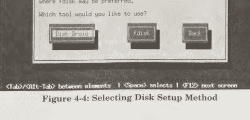

图 4-4：选择磁盘设置方法

## Red Hat Linux 6.0 安装指南

除某些深奥的情况外，Disk Druid 可以处理典型的 Red Hat Linux 安装的分区需求。

选择您想要使用的磁盘分区工具，然后按 `[Enter]`。如果您选择 Disk Druid，请继续阅读。如果您更愿意使用 `fdisk`，请转到“驱动器摘要”部分。

## 使用 Disk Druid

如果您选择了 Disk Druid，您将看到一个类似图 4-5 的屏幕。乍一看它可能显得很复杂，但实际上并非如此。让我们逐一介绍 Disk Druid 的三个部分。

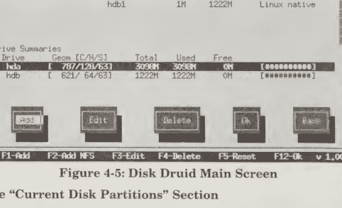

图 4-5：Disk Druid 主屏幕

### “当前磁盘分区”部分

“当前磁盘分区”部分中的每一行代表一个磁盘分区。您会注意到该部分右侧有一个滚动条，这意味着可能存在一次无法全部显示的分区。如果使用 `[上箭头]` 和 `[下箭头]` 键，您可以查看是否有其他分区。该部分中的每一行有五个不同的字段：

- **挂载点** — 此字段指示分区在 Red Hat Linux 安装并运行时将被挂载的位置。
- **设备** — 此字段显示分区的设备名称。
- **请求** — “请求”字段显示分区定义时所请求的最小大小。
- **实际** — “实际”字段显示当前分配给分区的空间。
- **类型** — 此字段显示分区的类型。

### 另一种类型的分区

当您滚动浏览“当前磁盘分区”部分时，您可能会看到“未分配请求分区”标题栏，后面跟着一个或多个分区。正如标题所暗示的，这些是已被请求但由于某种原因尚未分配的分区。出现未分配分区的一个常见原因是分区可用自由空间不足。无论如何，分区未分配的原因将在分区的挂载点之后显示。

### “驱动器摘要”部分

“驱动器摘要”部分中的每一行代表系统上的一个硬盘。每行具有以下字段：

- **驱动器** — 此字段显示硬盘的设备名称。
- **几何 [C/H/S]** — 此字段显示硬盘的几何结构。几何结构由三个数字组成，表示硬盘报告的柱面数、磁头数和扇区数。
- **总计** — “总计”字段显示硬盘上的总可用空间。
- **已用** — 此字段显示硬盘空间中有多少已分配给分区。
- **空闲** — “空闲”字段显示硬盘上仍未分配的空间。
- 条形图 — 此字段以视觉方式表示硬盘上当前使用的空间。方括号之间井号越多，表示空闲空间越少。在图 4-5 中，条形图显示没有空闲空间。

请注意：“驱动器摘要”部分仅用于指示您计算机的磁盘配置。它并非用于指定给定分区的目标硬盘。这在添加分区中描述得更详细。

### Disk Druid 的按钮

这些按钮控制 Disk Druid 的操作。它们用于添加和删除分区，以及更改分区属性。此外，还有用于接受您所做的更改或完全退出 Disk Druid 的按钮。让我们按顺序查看每个按钮。

Add — “Add”按钮用于请求新分区。选中后，会出现一个对话框，其中包含必须填写的字段。

Edit — “Edit”按钮用于修改“当前磁盘分区”部分中当前高亮显示的分区属性。选择此按钮将导致出现一个对话框。“编辑分区”对话框中的一些或全部字段可能会被更改，具体取决于分区信息是否已写入磁盘。

Delete — “Delete”按钮用于删除“当前磁盘分区”部分中当前高亮显示的分区。选择此按钮将导致出现一个对话框，要求您确认删除。

Ok — “Ok”按钮会将对系统分区所做的任何更改写入磁盘。在 Disk Druid 重写您的硬盘分区表之前，您将被要求确认更改。此外，您定义的所有挂载点都会传递给安装程序，并最终由您的 Red Hat Linux 系统用于定义文件系统布局。

Back — 此按钮会使 Disk Druid 在不保存任何更改的情况下中止。选择此按钮后，安装程序会将您带回上一个屏幕，以便您可以重新开始。

## 便捷功能键

Disk Druid 的按钮与可用的功能键之间存在一定的重叠，但有两个功能键没有对应的按钮：

- `[F2]` (Add NFS) — 此功能键用于向您的 Red Hat Linux 系统的挂载点集合中添加一个只读的 NFS 服务文件系统。选中后，会出现一个包含必须填写的字段的对话框。
- `[F5]` (Reset) — 此功能键用于丢弃您在 Disk Druid 中可能所做的所有更改，并将分区列表恢复为从硬盘上的分区表读取的状态。选中后，系统会询问您是否确认要丢弃更改。请注意，您指定的任何挂载点都将丢失，需要重新输入。

**请注意：** 您至少需要为 Red Hat Linux 专门分配一个分区，可选更多。有关此内容的更完整讨论请参见 **分区命名方案。**

现在让我们看看如何使用 Disk Druid 为您的 Red Hat Linux 系统设置分区。

## 添加分区

要添加新分区，请选择 Add 按钮，然后按 `[Space]` 或 `[Enter]`。将出现一个标题为 "Edit New Partition" 的对话框（见图 4-6）。它包含以下字段：

## The Installation Guide for Red Hat Linux 6.0

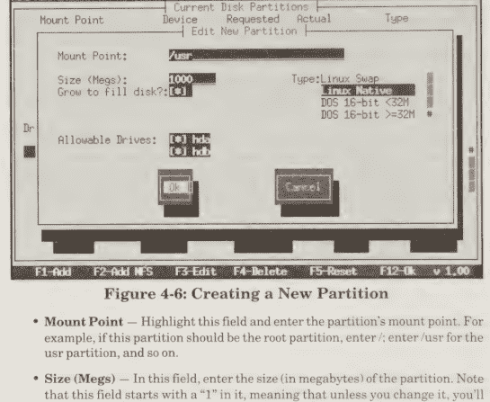

## Figure 4-6: Creating a New Partition

- **Mount Point** — 高亮此字段并输入分区的挂载点。例如，如果此分区应为根分区，请输入 `/`；对于 `usr` 分区，输入 `/usr`，依此类推。


- **Size (Mags)** — 在此字段中，输入分区的大小（以兆字节为单位）。请注意，此字段初始为 "1"，意味着除非您更改它，否则您将得到一个 1 MB 的分区。使用 [Backspace] 键将其删除，然后输入所需的分区大小。
- **Growable?** — 此复选框表示您在前一个字段中输入的大小应被视为分区的确切大小还是其最小大小。按 [Space] 来选中和取消选中该框。选中时，分区将增长以填满硬盘上的所有可用空间。在这种情况下，分区的大小会随着其他分区的修改而扩张和收缩。请注意，您可以使多个分区可增长；如果这样做，额外的空闲空间将在所有可增长分区之间共享。
- **Type** — 此字段包含不同分区类型的列表。使用 [↑] 和 [↓] 键选择适当的分区类型。
- **Allowable Drives** — 此字段包含系统上安装的硬盘列表，每个硬盘都有一个复选框。如果硬盘的框被选中，则此分区可以创建在该硬盘上。如果框未被选中，则分区永远不会创建在该硬盘上。通过使用不同的复选框设置，您可以指示 Disk Druid 按您希望的方式放置分区，或让 Disk Druid 决定分区应放置的位置。
- **Ok** — 当您对分区的设置感到满意并希望创建它时，选择此按钮并按 [Space]。
- **Cancel** — 当您不想创建分区时，选择此按钮并按 [Space]。

## 添加分区时出现的问题

请注意：如果您在添加分区时遇到问题，您可能希望参考附录 B 以获取更多信息。

如果您尝试添加分区而 Disk Druid 无法执行您的请求，您将看到类似图 4-7 的对话框。在该框中列出了当前未分配的任何分区，以及它们无法分配的原因。选择 Ok 按钮，然后按 [Space] 继续。请注意，未分配的分区也显示在 Disk Druid 的主屏幕上（尽管您可能需要滚动 Current Disk Partitions 部分才能看到它们）。

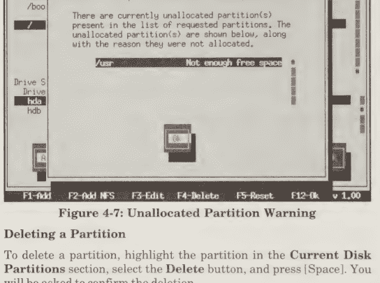

**Figure 4-7: Unallocated Partition Warning**

## 删除分区

要删除分区，请在 Current Disk Partitions 部分中高亮该分区，选择 Delete 按钮，然后按 [Space]。系统会要求您确认删除。

## 编辑分区

要更改分区的设置，请在 Current Disk Partitions 部分中高亮该分区，选择 Edit 按钮，然后按 [Space]。您将看到一个与图 4-7 中所示非常相似的对话框。进行适当的更改，选择 Ok，然后按 [Space]。

> 请注意：如果分区已存在于您的硬盘上，您将只能更改分区的挂载点。如果您想进行其他更改，您需要删除该分区并重新创建它。

## 添加 NFS 挂载

要添加一个只读的 NFS 服务文件系统，请按 [F2]。如果您尚未选择网络相关的安装方法，您将看到几个关于网络配置的对话框（请参阅网络驱动程序配置了解更多信息）。请适当填写这些框。随后您将看到一个标题为“Edit Network Mount Point”的对话框（类似于图 4-12 中的）。在此对话框中您需要输入 NFS 服务器名称、导出的文件系统的路径，以及文件系统的挂载点。选择适当的 Ok 或 Cancel 按钮，然后按 [Space]。

## 重新开始

如果您想放弃在 Disk Druid 中所做的任何更改，而宁愿改用 `fdisk`，您可以选中 Back 按钮，然后按 [Space]。如果您想继续使用 Disk Druid，但想重新开始，请按 [F5]，Disk Druid 将重置为初始状态。

## 完成后....

一旦您完成分区配置和输入挂载点，您的屏幕应该看起来像图 4-8 中的那样。选择 Ok，然后按 [Space]。然后转到 Installing Swap Space。

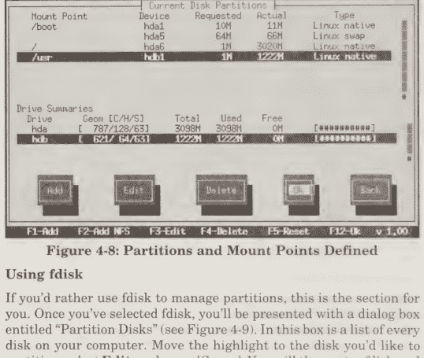

**Figure 4-8: Partitions and Mount Points Defined**

## 使用 `fdisk`

如果您宁愿使用 `fdisk` 来管理分区，这是适合您的部分。一旦您选择了 `fdisk`，您将看到一个标题为“Partition Disks”的对话框（见图 4-9）。此框中列出了计算机上的每个磁盘。将高亮移动到您想要分区的磁盘，选择 Edit，然后按 [Space]。您将进入 `fdisk` 并可以对所选磁盘进行分区。对每个想要分区的磁盘重复此过程。完成后，选择“Done。”

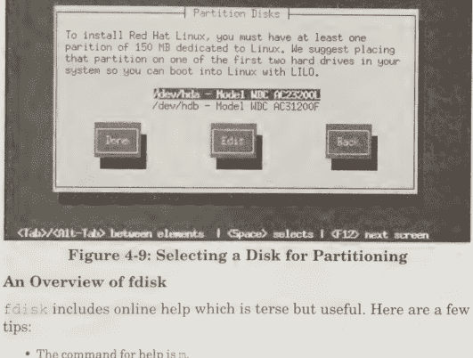

**Figure 4-9: Selecting a Disk for Partitioning**

## `fdisk` 概述

`fdisk` 包含简洁但有用的在线帮助。以下是一些提示：

- 帮助命令是 `m`。
- 要列出当前分区表，请使用 `p` 命令（见图 4-10）。
- 要添加新分区，请使用 `n`。
- Linux `fdisk` 默认创建类型为 Linux native 的分区。当您创建交换分区时，不要忘记使用 `t` 命令将其更改为类型 Linux swap。Linux swap 类型的数值为 82。对于其他分区类型，请使用 `l` 命令查看分区类型和值的列表。
- Linux 允许一个磁盘上有最多四个（4）个分区。如果您希望创建超过该数量的分区，其中一个（且只能一个）可以是扩展分区，它充当一个或多个逻辑分区的容器。由于它充当容器，扩展分区必须至少与它所包含的所有逻辑分区的总大小一样大。
- 在创建每个分区时，最好记下哪些分区（例如，`/dev/hda2`）用于哪些文件系统（例如，`/usr`）。
- 请注意：您所做的任何更改在您使用 `w` 命令保存并退出 `fdisk` 之前都不会生效。您可随时使用 `q` 命令退出 `fdisk` 而不保存更改。

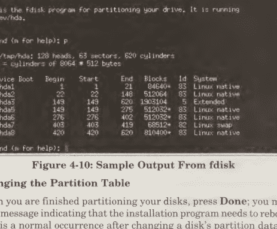

**Figure 4-10: Sample Output From `fdisk`**

## 更改分区表

当您完成磁盘分区后，按 Done；您可能会看到一条消息，提示安装程序需要重新启动。在更改磁盘分区数据后出现这种情况是正常的；通常在您创建、更改或删除任何扩展分区时就会发生。按 Ok 后，您的机器将重新启动。按照您之前进行到 Partitioning Disks 的相同安装步骤；然后只需选择 Done。

## 文件系统配置

下一个对话框包含 Red Hat Linux 可读取文件系统的所有磁盘分区的列表，包括 MS-DOS 或 Windows 的分区。这为您提供了将这些分区分配给 Red Hat Linux 文件系统的不同部分的机会。您分配的分区将在 Red Hat Linux 系统启动时自动挂载。选择您想要分配的分区并按 [Enter]（或选择 Edit）；然后输入该分区的挂载点，例如 `/usr`（见图 4-11）。

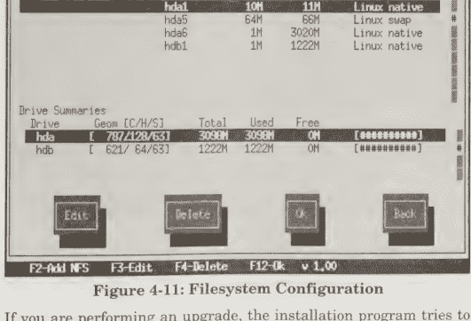

**Figure 4-11: Filesystem Configuration**

如果您执行的是升级，安装程序会尝试自动找到您的根分区；如果找到，它将自动获取所有这些信息，然后进入下一步。

## 添加 NFS 挂载

Red Hat Linux 还允许你在系统启动时挂载只读 NFS 卷；这使得目录树可以在网络上共享。要这样做，请按 [F2]。如果你尚未选择与网络相关的安装方法，你将会看到几个关于网络配置的对话框（请参阅 Configuring TCP/IP Networking 获取更多信息）。请适当填写。随后你将看到一个标题为 "Edit Network Mount Point" 的对话框。输入 NFS 服务器的主机名、NFS 卷的路径，以及该卷的本地挂载点（见图 4-12）。

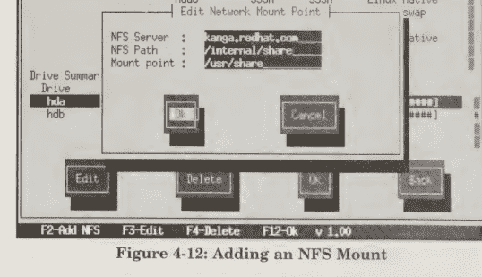

**图 4-12：添加 NFS 挂载**

## 初始化交换空间

现在安装程序将查找交换分区（见图 4-13）。如果找到，它会询问你是否要初始化它们。使用 [Space] 选择你希望初始化为交换空间的分区；如果你希望在格式化时检查坏块，请选择 Check for bad blocks during format 复选框。选择 Ok，然后按 [Space]。

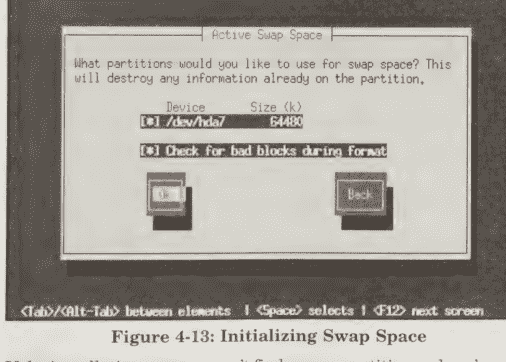

**图 4-13：初始化交换空间**

如果安装程序找不到交换分区而你确定存在一个，请确保已将分区类型设置为 Linux swap；请参阅 Creating Partitions for Red Hat Linux 以了解如何使用 Disk Druid 或 `fdisk` 进行设置。

## 仅限硬盘安装...


如果你不是执行硬盘安装，请跳至 Formatting Partitions。否则，请继续阅读。

此时，将显示一个标题为 “Select Partition” 的对话框（见图 4-14）。输入包含 RedHat 目录树的分区的设备名称。还有一个标记为 “Directory” 的字段。如果 RedHat 目录不在该分区的根目录下（例如，`/test/new/RedHat`），请输入 RedHat 目录的路径（在我们的示例中为 `/test/new`）。

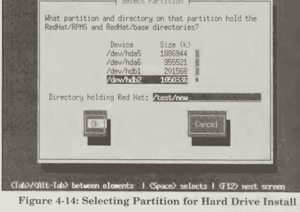

图 4-14：为硬盘安装选择分区

如果安装程序无法在你指定的分区和目录上找到必要的文件，你将被返回到 “Select Partition” 对话框以进行必要的更正。

如果一切都已正确指定，你应该会看到一个消息框，提示正在扫描软件包。

如果你正在进行工作站或服务器类安装，请转到第 6 章。继续阅读下一节以继续 Red Hat Linux 的自定义安装。

## 格式化分区

下一个对话框列出了要格式化的分区（见图 4-15）。所有新创建的分区都应被格式化。此外，任何包含你不再需要的旧数据的现有分区也应被格式化。但是，如果 `/home` 或 `/usr/local` 等分区包含你希望保留的数据，则不应格式化它们。选择要格式化的每个分区并按 [Space]。如果你希望在格式化每个文件系统时检查坏块，请选择 Check for bad blocks during format。选择 Ok，然后按 [Space]。

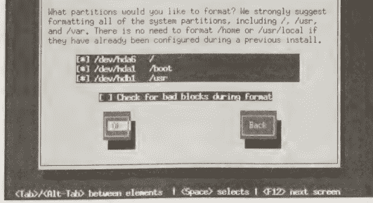

图 4-15：格式化分区

## 选择和安装软件包

在分区配置并选定格式化后，你就可以选择要安装的软件包了。你可以选择组件、按功能分组的软件包集合、单个软件包，或两者结合。

### 选择组件

组件根据其提供的功能将软件包分组在一起。例如，C Development、Networked Workstation 或 Web Server。选择你希望安装的每个组件并按 [Space]。选择 Everything（可在组件列表末尾找到）将安装随 Red Hat Linux 包含的所有软件包（见图 4-16）。选择每个软件包将需要接近 1 GB 的可用磁盘空间。

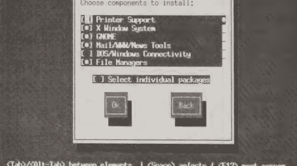

图 4-16：选择系统组件

如果您希望选择或取消选择单个软件包，请勾选 **Select individual packages** 复选框。

## Selecting Individual Packages

在选择完您希望安装的组件后，您可以对单个软件包进行选择或取消选择。安装程序会列出可用的软件包组；使用方向键选择一个组进行查看，然后按 [Enter] 或 [Space]。安装程序会列出该组中的软件包，您可以使用方向键突出显示一个软件包，然后按 [Space] 来选择或取消选择它（参见图 4-17）。

> **Please Note:** 一些软件包（如内核和某些库）是每个 Red Hat Linux 系统所必需的，无法选择或取消选择。

## Quick Keys

- **[o]** — 表示该组件组中至少有一个软件包已被选中。
- **[*]** — 表示该组件组的所有软件包均已被选中。
- **[–]** — 删除该组件组中的所有软件包。
- **[ * ]** — 选择该组件组中的所有软件包。

> **Please Note:** 在屏幕右上角，您将看到已选择安装的组件的大致系统大小。

## The Installation Guide for Red Hat Linux 6.0

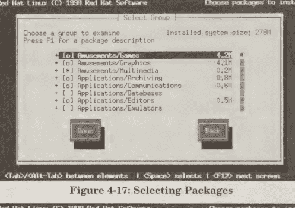

Figure 4-17: Selecting Packages

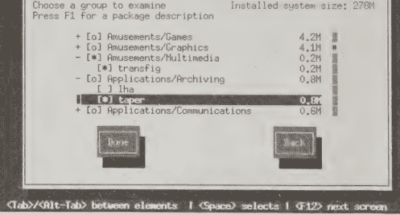

Figure 4-18: Selecting Packages — Expanded View

当您完成单个软件包的选择后，请在 Select Group 对话框中按 Ok。

## Getting Information about a Package

您可以通过按 [F1] 查看当前突出显示的软件包的详细描述。会出现一个包含软件包描述的对话框。您可以使用方向键滚动描述内容，如果描述无法完全显示在屏幕上。当您读完描述后，按 Ok，对话框将消失。之后您可以继续选择软件包。

> Please Note: 如果您更愿意在纸上阅读软件包描述，请翻到附录 C。

## Package Dependencies

许多软件包为了正常工作，依赖于必须安装在系统上的其他软件包或库。例如，许多图形化的 Red Hat 系统管理工具需要 python 和 pythonlib 软件包。为了确保您的系统拥有使其完全功能正常所需的所有软件包，Red Hat Linux 在每次安装或移除软件包时都会检查这些软件包依赖关系。在您完成选择要安装的软件包后，安装程序会检查所选软件包列表中的依赖关系。如果有任何软件包需要您未选择安装的另一个软件包，程序会列出这些未解决的依赖关系，并给您机会解决它们（参见图 4-19）。如果您直接按 Ok，程序将自动通过将所有必需的软件包添加到所选软件包列表中来解决它们。

## Package Installation

在所有软件包依赖关系解决后，安装程序会显示一个对话框，告知您将写入一个包含所有已安装软件包列表的日志文件到您的 Red Hat Linux 系统的 `/tmp/install.log` 中。选择 Ok 并按 [Space] 继续。此时，安装程序将格式化您选择格式化的每个分区。这可能需要几分钟（如果您指示安装程序检查坏块，则时间会更长）。一旦所有分区都已格式化，安装程序开始安装软件包。会显示一个名为 "Install Status" 的窗口，其中包含以下信息：

- **Package** — 当前正在安装的软件包的名称。
- **Size** — 软件包的大小（以千字节为单位）。
- **Summary** — 软件包的简短描述。
- **Package Installation Progress Bar** — 显示当前软件包安装完成程度的进度条。

## 统计部分 — 本节有三行，分别标记为“Total”、“Completed”和“Remaining”。顾名思义，这些行包含将要安装的软件包总数的统计信息、已完全安装的软件包数量的统计信息，以及尚未安装的软件包的统计信息。这些三行跟踪的信息包括：

- **Packages** — 软件包的数量。
- **Bytes** — 大小。
- **Time** — 所需的时间。

## 总体进度条 — 此条会改变颜色以显示整个安装的完成程度。

此时在所有软件包安装完成之前你无需再做任何事。完成的速度取决于你选择的软件包数量以及计算机的速度。一旦所有软件包都已安装，请转到第 6 章完成 Red Hat Linux 的安装。

# 5 网络安装

### 选择安装方法

现在你必须决定要使用哪种类型的安装方法（参见图 5-1）。突出显示适当的选项并选择 Ok，或按 [Enter]。

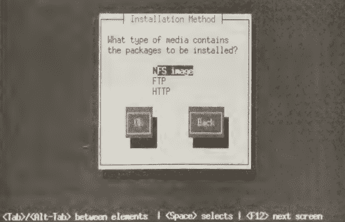

图 5-1：选择安装方法

如果你不是执行网络类型安装（NFS、FTP 或 HTTP），请跳至第 6 章完成安装过程，或返回第 4 章如果你需要执行 CD-ROM 或硬盘安装。

如果你计划进行网络类型安装，请继续阅读。

### 网络驱动程序配置

接下来，安装程序将探测你的系统并尝试识别你的网卡。大多数情况下，驱动程序可以自动定位网卡。如果它无法识别你的网卡，你将被要求选择支持你的网卡的驱动程序，并指定驱动程序定位和识别它所需的任何选项。

### 配置 TCP/IP 网络

在安装程序配置好你的网卡后，它会显示几个对话框用于配置系统的 TCP/IP 网络。第一个屏幕（如图 5-2 所示）允许你从三种网络配置方法中选择一种：

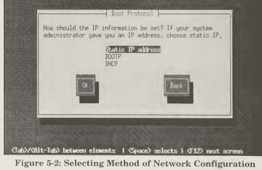

图 5-2：选择网络配置方法

- Static IP address — 你必须手动提供所有必要的网络相关信息。
- BOOTP — 必要的网络相关信息会通过 bootp 请求自动提供。
- DHCP — 必要的网络相关信息会通过 dhcp 请求自动提供。

请注意：BOOTP 和 DHCP 选项需要你的局域网上运行着一个处于活动状态且配置正确的 bootp（或 dhcp）服务器。

如果你选择 BOOTP 或 DHCP，你的网络配置将被自动设置，你可以跳过本节的其余部分。如果你选择了 Static IP address，你需要自己指定所有网络信息。图 5-3 包含与你将需要的信息类似的网络信息示例。

| Field | Example Value |


| --- | --- |
| IP Address | 10.0.2.15 |
| Netmask | 255.255.255.0 |
| Default Gateway | 10.0.2.254 |
| Primary Nameserver | 10.0.2.1 |
| Domain Name | redhat.com |
| Hostname | pooh.redhat.com |

图 5-3：示例网络信息

请注意：图 5-3 中的信息仅为示例！你应从你的网络管理员处获取适用于你的网络的正确信息。

第一个对话框要求你输入 IP 和其他网络地址（参见图 5-4）。输入你在安装期间使用的 IP 地址并按 `[Enter]`。安装程序会根据你的 IP 地址尝试猜测你的 Netmask；如果不正确你可以更改它。按 `[Enter]`。安装程序会根据你的 IP 地址和 netmask 猜测 Default gateway 和 Primary nameserver 地址；如果不正确你可以更改它们。

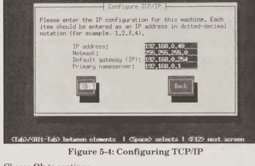

## Figure 5-4: Configuring TCP/IP

选择 `Ok` 继续。

在第一个对话框之后，你可能会看到第二个对话框。它会提示你输入域名、主机名和其他网络信息（参见 Figure 5-5）。输入系统的域名并按 `[Enter]`；安装程序会将域名带到主机名字段。输入你在域名前使用的主机名以形成完全限定域名（FQDN）。如果你的网络有多个名称服务器，你可以在 Secondary nameserver 和 Tertiary nameserver 字段中输入其他名称服务器的 IP 地址。

选择 `Ok` 继续。

## Figure 5-5: Configuring Networking

请注意：如果您执行的是 FTP 安装，请转到 Installing via FTP 并从那里继续。如果您执行的是 NFS 安装，请继续阅读。

### Installing via NFS

如果您通过 NFS 安装 Red Hat Linux 6.0，现在需要配置您的 NFS 服务器信息。

#### NFS Server Information

下一个对话框请求有关 NFS 服务器的信息（参见 Figure 5-6）。输入 NFS 服务器的名称（必须是完全限定域名）或 IP 地址，以及包含 Red Hat Linux CD 的导出目录的名称。例如，如果 NFS 服务器将 Red Hat Linux CD 挂载在 `/mnt/cdrom` 上，请在 Red Hat directory 字段中输入 `/mnt/cdrom`。如果 NFS 服务器导出的是 Red Hat Linux 安装树的镜像而不是 CD，请输入包含 RedHat 目录的目录。例如，如果你的 NFS 服务器包含目录 `/mirrors/redhat/i386/RedHat`,

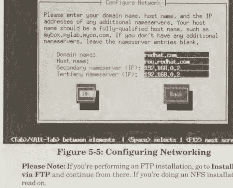

输入 `/mirrors/redhat/i386`。

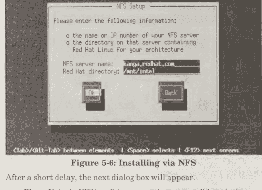

Figure 5-6: Installing via NFS

短暂延迟后，下一个对话框将出现。

> 请注意：NFS 安装在安装过程中不需要支持软盘，除非您使用 PCMCIA 设备来完成安装。如果是这样，在提示时您将需要使用 PCMCIA 支持磁盘。

### Installing via FTP

您现在应该看到“FTP Setup”对话框。这里是您将安装程序指向您选择的 FTP 站点的地方（参见 Figure 5-7）。输入您安装来源的 FTP 站点的名称或 IP 地址，以及其中包含您架构的 RedHat 目录的目录名称。例如，如果 FTP 站点包含目录 `/pub/mirrors/redhat/i386/RedHat`,

输入 `/pub/mirrors/redhat/i386`。如果您未使用匿名 FTP，或者如果您需要使用代理 FTP 服务器（例如，如果您位于防火墙后面），请选中复选框，然后另一个对话框将请求 FTP 帐户和代理信息。

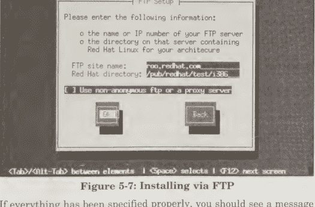

Figure 5-7: Installing via FTP

如果一切都已正确指定，您应该会看到一个消息框，指示 base/hdlist 正在被检索。

继续 Upgrading or Installing 以获取升级或完整安装说明。

### Installing via HTTP

您现在应该看到“HTTP Setup”对话框。这里是您将安装程序指向您选择的 HTTP 站点的地方。输入您安装来源的 HTTP 站点的名称或 IP 地址，以及其中包含您架构的 RedHat 目录的目录名称。例如，如果 HTTP 站点包含

目录 `/pub/mirrors/redhat/i386/RedHat`，输入 `/pub/mirrors/redhat/i386`。如果您未使用匿名 HTTP，或者如果您需要使用代理 HTTP 服务器（例如，如果您位于防火墙后面），请选中复选框，然后另一个对话框将请求 HTTP 帐户和代理信息。

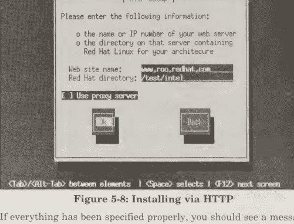

Figure 5-8: Installing via HTTP

如果一切都已正确指定，您应该会看到一个消息框，指示 base/hdlist 正在被检索。继续 Upgrading or Installing 以获取升级或完整安装说明。

## Upgrading or Installing

在您选择安装方法后，安装程序会提示您进行安装或升级（参见 Figure 5-9）。

## 图 5-9：升级或安装

### 安装

你通常在干净的磁盘分区或一组分区上安装 Red Hat Linux，或覆盖另一份 Linux 安装。

> 请注意： 在另一份 Linux 安装（包括 Red Hat Linux）上安装 Red Hat Linux 不会保留任何来自先前安装的信息（文件或数据）。请确保保存任何重要文件！如果你担心保存现有系统上的当前数据（而不自行备份），你应考虑执行升级。

如果你希望执行完整安装，请选择 `Install`，然后跳至 Installation Class。

### 升级

Red Hat Linux 6.0 的安装过程包括从基于 RPM 技术的前期版本 Red Hat Linux（2.0 及更高版本）升级的能力。升级你的系统会安装

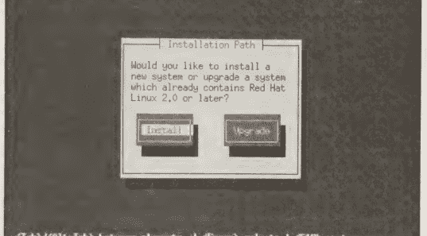

模块化的 2.2.x 内核以及当前安装在你的机器上的软件包的更新版本。升级过程通过使用 `.rpmsave` 扩展名重命名它们来保留现有配置文件（例如，`sendmail.cf.rpmsave`），并在 `/tmp/upgrade.log` 中留下记录其所采取操作的日志。随着软件的演进，配置文件格式可能会发生变化，因此在整合你的更改之前，你应仔细比较原始配置文件和新文件。如果你希望升级你的 Red Hat Linux 系统，请选择 `Upgrade`。

> 请注意：某些升级的软件包可能需要安装其他软件包才能正常运行。升级程序会处理这些依赖关系，但它可能需要安装额外的软件包。

> 请注意：如果你机器上已安装 X Window System（以及可能较旧版本的 GNOME），你可能会看到一个屏幕提示你安装本发行版中包含的最新版本的 GNOME。

## Installation Class

如果你选择执行完整安装，安装程序会要求你选择一个安装类别（见图 5-10）。如果你选择执行升级，则不会看到此屏幕。你可以从以下安装类别中选择：

## 图 5-10：安装类别

- **Workstation** — 工作站类安装将自动擦除你计算机硬盘上的所有 Linux 分区。此类安装将尝试自动设置双启动环境。

- **Server** — 服务器类安装将自动擦除你计算机硬盘上的所有分区。

- **Custom** — 自定义类安装会让你完全控制与分区相关的问题。如果你过去安装过 Red Hat Linux，自定义类安装与过去的安装最相似。

**请注意：** 如果你选择 `Workstation` 或 `Server`，你计算机上所有驱动器上的部分（或全部）存储数据将被擦除！系统会要求你确认你的决定；然而，请记住，一旦安装程序收到你的确认，擦除就是不可逆的。

**请注意：警告** — 如果你选择执行工作站类或服务器类安装，数据擦除将是不可逆的。

根据安装类型，被擦除数据的严重程度各不相同：

- Workstation-class — 系统上任何硬盘上任何现有的 Linux 分区上的数据将被擦除。

- Server-class — 所有驱动器的所有分区上的数据将被完全擦除，无论是否在现有的 Linux 分区上。

如果你选择工作站类或服务器类安装，你将能够跳过自定义类安装所需的某些步骤。

## SCSI 支持


在你选择适当的安装类别后，安装程序将探测你的系统以查找 SCSI 适配器。在某些情况下，安装程序会询问你是否拥有任何 SCSI 适配器。如果你选择 Yes，下一个对话框会列出 SCSI 驱动程序。选择最接近你的 SCSI 适配器的驱动程序。然后安装程序会给你一个机会来指定你所选 SCSI 驱动程序的选项；大多数 SCSI 驱动程序应能自动检测你的硬件。对于工作站类或服务器类安装，你应转到第 6 章以完成安装过程。

## 为 Red Hat Linux 创建分区

此时，有必要让安装程序知道它应该将 Red Hat Linux 安装在何处。这是通过为 Red Hat Linux 将要安装的一个或多个磁盘分区定义挂载点来完成的。你可能还需要在此时创建和/或删除分区。

> 请注意：如果你尚未计划如何设置你的分区，请转到 Disk Partitions，并查看到 A Note About Kernel Drivers 为止的内容。最低限度，你需要一个大小合适的根分区，以及至少 16 MB 的交换分区。

如果你仍不确定如何设置你的分区，请参阅附录 B 获取更多信息。安装程序随后会显示一个对话框，允许你从两个磁盘分区工具中选择（见图 5-11）。你有两个选择：

- **Disk Druid** — 这是 Red Hat Linux 安装时的磁盘管理实用工具。它可以根据用户提供的需求创建和删除磁盘分区，同时管理每个分区的挂载点。

- **fdisk** — 这是传统的 Linux 磁盘分区工具。虽然它比 Disk Druid 更灵活一些，但缺点是 fdisk 假定你对磁盘分区有一定经验，并且能适应其较为简洁的用户界面。

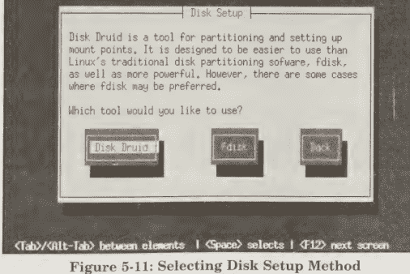

## 图 5-11：选择磁盘设置方法

除某些特殊情况外，Disk Druid 可以处理典型的 Red Hat Linux 安装的分区需求。

选择你想要使用的磁盘分区工具，然后按 `[Enter]`。如果选择 Disk Druid，请继续阅读。如果更愿意使用 fdisk，请转到“使用未使用的分区空间”。

## 使用 Disk Druid

如果你选择了 Disk Druid，你会看到类似图 5-12 的屏幕。乍一看可能令人望而生畏，但实际上并非如此。让我们逐一介绍 Disk Druid 的三个部分。

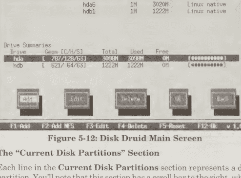

图 5-12：Disk Druid 主屏幕

### “当前磁盘分区”部分

“当前磁盘分区”部分中的每一行代表一个磁盘分区。你会注意到该部分右侧有一个滚动条，这意味着可能存在一次无法全部显示的分区。如果你使用 `[上箭头]` 和 `[下箭头]` 键，可以查看是否有其他分区。该部分中的每一行有五个不同的字段：

- Mount Point — 此字段指示分区在 Red Hat Linux 安装并运行时将被挂载的位置。
- Device — 此字段显示分区的设备名称。
- Requested — `Requested` 字段显示分区定义时请求的最小编码。
- Actual — `Actual` 字段显示当前分配给分区的空间。
- Type — 此字段显示分区的类型。

### 另一种类型的分区

当你在“当前磁盘分区”部分滚动时，你可能会看到“未分配请求分区”标题栏，后面跟着一个或多个分区。正如标题所暗示的，这些是已被请求但由于某种原因尚未分配的分区。出现未分配分区的一个常见原因是分区可用自由空间不足。无论如何，分区仍未分配的原因将在分区的挂载点之后显示。

### “驱动器摘要”部分

“驱动器摘要”部分中的每一行代表系统上的一个硬盘。每行具有以下字段：

Drive — 此字段显示硬盘的设备名称。Geom [C/H/S] — 此字段显示硬盘的几何结构。几何结构由三个数字组成，表示硬盘报告的柱面数、磁头数和扇区数。

Total — `Total` 字段显示硬盘上的总可用空间。

Used — 此字段显示硬盘空间中有多少已分配给分区。

Free — `Free` 字段显示硬盘上仍未分配的空间。

Bar Graph — 此字段以视觉方式表示硬盘上当前使用的空间。方括号之间井号越多，可用空间越少。在图 5-12 中，条形图显示没有可用空间。

请注意：“驱动器摘要”部分仅用于指示计算机的磁盘配置。它并非用于指定给定分区的目标硬盘。这在后面的“添加分区”部分中有更完整的描述。

### Disk Druid 的按钮

这些按钮控制 Disk Druid 的操作。它们用于添加和删除分区，以及更改分区属性。此外，还有用于接受所做更改或完全退出 Disk Druid 的按钮。让我们按顺序查看每个按钮。

`Add` — `Add` 按钮用于请求新分区。选中后，将出现一个对话框，其中包含必须填写的字段。

`Edit` — `Edit` 按钮用于修改“当前磁盘分区”部分中当前高亮显示的分区属性。选择此按钮将导致出现对话框。“编辑分区”对话框中的一些或全部字段可能会更改，具体取决于分区信息是否已写入磁盘。

`Delete` — `Delete` 按钮用于删除“当前磁盘分区”部分中当前高亮显示的分区。选择此按钮将导致出现对话框，询问你是否确认删除。

`Ok` — `Ok` 按钮会导致对系统分区所做的任何更改写入磁盘。在 Disk Druid 重写硬盘分区表之前，你将被要求确认更改。此外，你定义的所有挂载点都将传递给安装程序，并最终由你的 Red Hat Linux 系统用于定义文件系统布局。

`Back` — 此按钮会导致 Disk Druid 在不保存任何更改的情况下中止。选择此按钮时，安装程序将带你返回到上一个屏幕，以便重新开始。

### 方便的功能键

虽然 Disk Druid 的按钮与可用的功能键存在一些重叠，但有两个功能键没有对应的按钮：

- `[F2]` (`Add NFS`) — 此功能键用于向 Red Hat Linux 系统的挂载点集合中添加一个只读 NFS 服务的文件系统。选中后，将出现一个对话框，其中包含必须填写的字段。
- `[F5]` (`Reset`) — 此功能键用于丢弃你在 Disk Druid 中可能做出的所有更改，并将分区列表恢复为从硬盘分区表读取的状态。选中后，你将被要求确认是否要丢弃更改。注意，你指定的任何挂载点都将丢失，并且需要重新输入。

请注意：你需要至少为 Red Hat Linux 专用一个分区，可选更多。有关此内容的更完整讨论请参见 分区命名方案。

现在让我们看看如何使用 Disk Druid 为你的 Red Hat Linux 系统设置分区。

## 添加分区

要添加新分区，请选择 `Add` 按钮，然后按 `[Space]` 或 `[Enter]`。将出现一个标题为“Edit New Partition”的对话框框（见图 5-13）。它包含以下字段：

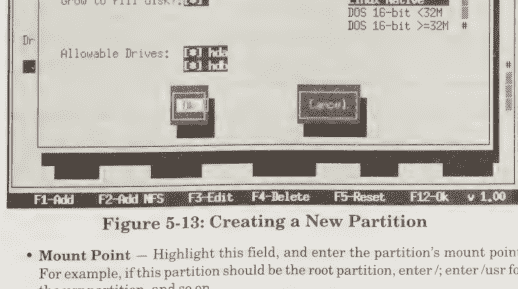

图 5-13：创建新分区

- Mount Point — 高亮此字段，并输入分区的挂载点。例如，如果此分区应为根分区，请输入 `/`；对于 usr 分区，输入 `/usr`，以此类推。
- Size (MB) — 在此字段中，输入分区大小（以兆字节为单位）。注意此字段初始为“1”，意味着除非你更改它，否则你将得到一个 1 MB 的分区。使用 `{Backspace}` 键将其删除，并输入期望的分区大小。
- **Growable?** — 此复选框表示你在前一字段中输入的大小应被视为分区的确切大小，还是其最小大小。按 `[Space]` 来选中和取消选中该框。选中时，分区将增长以填满硬盘上的所有可用空间。在这种情况下，分区的大小会随着其他分区的修改而扩张和收缩。注意你可以让多个分区都可增长；如果这样做，额外的空闲空间将在所有可增长分区之间共享。
- **Type** — 此字段包含不同分区类型的列表。使用 `[↑]` 和 `[↓]` 键选择适当的分区类型。
- **Allowable Drives** — 此字段包含系统上安装的硬盘列表，每个硬盘都有一个复选框。如果硬盘的框被选中，则此分区可以创建在该硬盘上。如果框未被选中，则分区永远不会创建在该硬盘上。通过使用不同的复选框设置，你可以指示 Disk Druid 按你希望的方式放置分区，或让 Disk Druid 决定分区应放置的位置。
- `Ok` — 当你对分区的设置感到满意并希望创建它时，选择此按钮并按 `[Space]`。
- `Cancel` — 当你不想创建分区时，选择此按钮并按 `[Space]`。

### 添加分区时的问题

**请注意：** 如果你在设置分区时遇到问题，请参阅附录 B 获取更多信息。如果你尝试添加分区而 Disk Druid 无法执行你的请求，你会看到如图 5-14 所示的对话框框。框中列出了当前未分配的任何分区，以及它们无法分配的原因。选择 `Ok` 按钮并按 `[Space]` 继续。注意未分配的分区也在 Disk Druid 的主屏幕上显示（尽管你可能需要滚动“Current Disk Partitions”部分才能看到它们）。

图 5-14：未分配分区警告

## 删除分区


要删除分区，请在“Current Disk Partitions”部分中高亮该分区，选择 `Delete` 按钮，然后按 `[Space]`。系统会要求你确认删除。

## 编辑分区

要更改分区的设置，请在“Current Disk Partitions”部分中高亮该分区，选择 `Edit` 按钮，然后按 `[Space]`。你将看到一个与图 5-13 所示非常相似的对话框框。进行适当的更改，选择 `Ok`，然后按 `[Space]`。

> 请注意：如果分区已存在于你的硬盘上，你将只能更改分区的挂载点。如果你想做其他更改，你需要删除该分区并重新创建它。

## 添加 NFS 挂载

要添加一个只读的 NFS 服务文件系统，请按 `[F2]`。如果您尚未选择与网络相关的安装方法，您将看到几个关于网络配置的对话框（请参阅 网络驱动程序配置 了解更多信息）。请适当填写这些框。然后您将看到一个标题为“Edit Network Mount Point”的对话框（类似于图 5-19 中的）。在此对话框中，您需要输入 NFS 服务器名称、导出文件系统的路径以及文件系统的挂载点。选择适当的 `Ok` 或 `Cancel` 按钮，然后按 `[Space]`。

## 重新开始

如果您想放弃在 Disk Druid 中所做的任何更改，而宁愿改用 `fdisk`，您可以选中 `Back` 按钮，然后按 `[Space]`。如果您想继续使用 Disk Druid，但想重新开始，请按 `[F5]`，Disk Druid 将重置为初始状态。

## 完成时...

一旦您完成分区配置和输入挂载点，您的屏幕应该看起来像图 5-15 中的那样。选择 `Ok`，然后按 `[Space]`。然后转到 初始化交换空间。

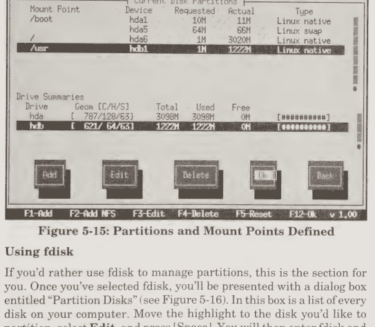

### 图 5-15：分区和挂载点已定义

## 使用 fdisk

如果您宁愿使用 `fdisk` 来管理分区，这是适合您的部分。一旦您选择了 `fdisk`，您将看到一个标题为“Partition Disks”的对话框（见图 5-16）。此框中列出了计算机上的每个磁盘。将高亮移动到您想要分区的磁盘，选择 `Edit`，然后按 `[Space]`。然后您将进入 `fdisk` 并可以对所选磁盘进行分区。对您想要分区的每个磁盘重复此过程。完成后，选择“Done。”

### 图 5-16：选择用于分区的磁盘

## fdisk 概述

`fdisk` 包含简洁但有用的在线帮助。以下是一些提示：

- 帮助命令是 `m`。
- 要列出当前分区表，请使用 `p` 命令（见图 5-17）。
- 要添加新分区，请使用 `n`。
- Linux `fdisk` 默认创建类型为 Linux native 的分区。当您创建交换分区时，不要忘记使用 `t` 命令将其更改为类型 Linux swap。Linux swap 类型的数值为 82。对于其他分区类型，请使用 `l` 命令查看分区类型和值的列表。
- Linux 允许一个磁盘上有最多四个（4）个分区。如果您希望创建超过该数量的分区，其中一个（且只能一个）可以是扩展分区，它充当一个或多个逻辑分区的容器。由于它充当容器，扩展分区必须至少与它所包含的所有逻辑分区的总大小一样大。
- 在创建每个分区时，最好写下哪些分区（例如，`/dev/hda2`）用于哪些文件系统（例如，`/usr`）。
- 请注意：您所做的任何更改在您使用 `w` 命令保存并退出 `fdisk` 之前都不会生效。您可以使用 `q` 命令随时退出 `fdisk` 而不保存更改。

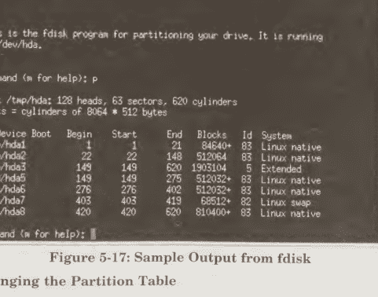

## 更改分区表

当您完成磁盘分区后，按 `Done`；您可能会看到一条消息，提示安装程序需要重新启动。在更改磁盘分区数据后出现这种情况是正常的；通常在您创建、更改或删除任何扩展分区时就会发生。按 `Ok` 后，您的机器将重新启动。按照您之前进行到 分区磁盘 的相同安装步骤；然后只需选择 `Done`。

## 文件系统配置

下一个对话框包含所有 Red Hat Linux 可读取文件系统的磁盘分区列表，包括 MS-DOS 或 Windows 的分区。这给了您将这些分区分配给 Red Hat Linux 文件系统不同部分的机会。您分配的分区将在 Red Hat Linux 系统启动时自动挂载。选择您想要分配的分区并按 `[Enter]`（或选择 `Edit`）；然后输入该分区的挂载点，例如 `/usr`（见图 5-18）。

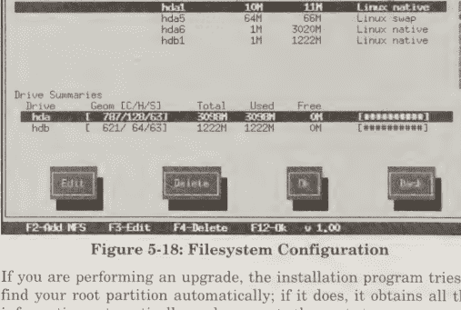

### 图 5-18：文件系统配置

如果您执行的是升级，安装程序会尝试自动找到您的根分区；如果找到，它将自动获取所有这些信息，然后进入下一步。

## 添加 NFS 挂载

Red Hat Linux 还允许您在系统启动时挂载只读 NFS 卷；这允许目录树在网络上共享。为此，请按 `[F2]`。如果您尚未选择与网络相关的安装方法时，将会弹出几个关于网络配置的对话框（请参阅 配置 TCP/IP 网络 获取更多信息）。请适当地填写它们。随后你将看到一个标题为“Edit Network Mount Point”的对话框。输入 NFS 服务器的主机名、NFS 卷的路径，以及该卷的本地挂载点（参见图 5-19）。

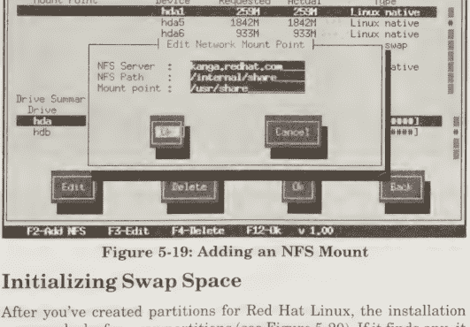

图 5-19：添加 NFS 挂载

## 初始化交换空间

在为 Red Hat Linux 创建分区后，安装程序会查找交换分区（参见图 5-20）。如果找到，它会询问是否要初始化它们。使用 `[Space]` 选择你希望初始化为交换空间的分区；如果你希望在格式化时检查坏块，请确保勾选 `Check for bad blocks during format` 复选框。选择 `Ok`，然后按 `[Space]`。

### 图 5-20：初始化交换空间

如果安装程序找不到交换分区而你确定存在一个，请确保已将分区类型设置为 Linux swap；请参阅 为 Red Hat Linux 创建分区 以了解如何使用 Disk Druid 或 `fdisk` 进行设置。

## 格式化分区

下一个对话框会列出要格式化的分区（参见图 5-21）。所有新创建的分区都应被格式化。此外，任何包含不再需要的旧数据的现有分区也应被格式化。但是，如果包含你希望保留的数据，则不应格式化诸如 `/home` 或 `/usr/local` 之类的分区。选择要格式化的每个分区并按 `[Space]`。如果你希望在格式化每个文件系统时检查坏块，请选择 `Check for bad blocks during format`。选择 `Ok`，然后按 `[Space]`。

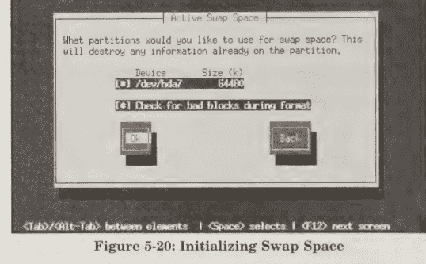

### 图 5-21：格式化分区

## 选择和安装软件包

在配置分区并选择格式化后，你就可以选择要安装的软件包了。你可以按功能分组的组件、单个软件包，或两者结合的方式进行选择。

### 选择组件

组件根据其提供的功能将软件包分组在一起。例如，C Development、Networked Workstation 或 Web Server。选择你希望安装的每个组件并按 `[Space]`。选择 `Everything`（可在组件列表末尾找到）将安装 Red Hat Linux 包含的所有软件包（参见图 5-22）。选择所有软件包将需要接近 1 GB 的可用磁盘空间。

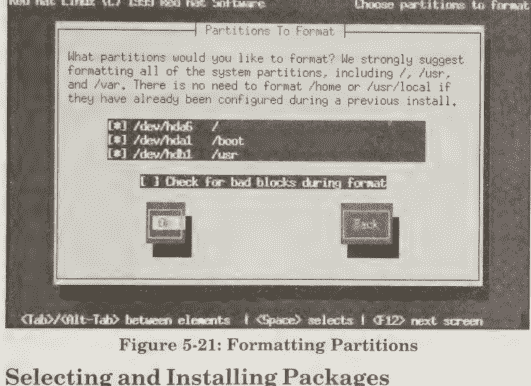

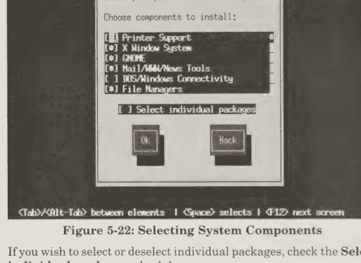

### 图 5-22：选择系统组件

如果你希望选择或取消选择单个软件包，请勾选 `Select individual packages` 复选框。

### 选择单个软件包

在选择要安装的组件后，你可以对单个软件包进行选择或取消选择。安装程序会列出可用的软件包组；使用方向键选择一个组进行查看，然后按 `[Enter]` 或 `[Space]`。安装程序会列出该组中的软件包，你可以使用方向键高亮一个软件包并按 `[Space]` 来选择或取消选择它（参见图 5-23）。

> 请注意：某些软件包（如内核和某些库）是每个 Red Hat Linux 系统必需的，无法选择或取消选择。

#### 快速键

- `[o]` — 表示该组件组中至少有一个软件包已被选择。
- `[*]` — 表示该组件组的所有软件包均已被选择。
- `[–]` — 移除该组件组中的所有软件包。
- `[*]` — 选择该组件组中的所有软件包。

请注意：在屏幕右上角你将看到已选择安装的组件的大致系统大小。

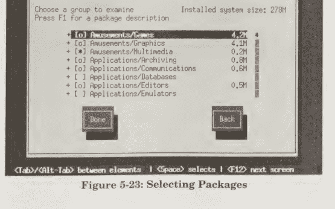

图 5-23：选择软件包

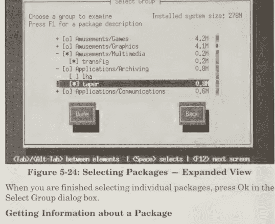

### Figure 5-24: Selecting Packages — Expanded View

当你完成选择单个软件包后，在“选择组”对话框中按 `Ok`。

## Getting Information about a Package


你可以通过按下 `[F1]` 查看当前高亮软件包的详细描述。将会出现一个包含软件包描述的对话框。你可以使用方向键滚动描述内容，如果内容超出屏幕显示范围。阅读完描述后，按下 `Ok`，对话框将会消失。然后你可以继续选择软件包（并查看其描述）。

请注意：如果您更愿意在纸上阅读软件包描述，请参阅附录 C。

## Package Dependencies

许多软件包为了正常工作，依赖于必须安装在系统上的其他软件包或库。例如，许多图形化的 Red Hat 系统管理工具需要 `python` 和 `pythonlib` 软件包。为了确保您的系统拥有使其完全功能所需的所有软件包，Red Hat Linux 在每次安装或移除软件包时都会检查这些软件包依赖关系。在您完成选择要安装的软件包后，安装程序会检查所选软件包列表中的依赖关系。如果任何软件包需要您未选择安装的另一个软件包，程序会列出这些未解决的依赖关系，并给您机会解决它们（参见图 5-25）。如果您直接按 `Ok`，程序将自动通过将所有必需软件包添加到所选软件包列表中来解决它们。

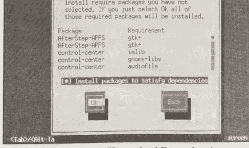

Figure 5-25: Unresolved Dependencies

## Package Installation

在所有软件包依赖关系都已解决后，安装程序会显示一个对话框，告知您将要写入一个包含所有已安装软件包列表的日志文件到您的 Red Hat Linux 系统的 `/tmp/install.log` 中。选择 `Ok` 并按 `[Space]` 继续。此时，安装程序将格式化您选择格式化的每个分区。这可能需要几分钟（如果您指示安装程序检查坏块，则时间会更长）。一旦所有分区都已格式化，安装程序开始安装软件包。会显示一个名为“Install Status”的窗口，其中包含以下信息：

- Package — 当前正在安装的软件包的名称。
- Size — 软件包的大小（以千字节为单位）。
- Summary — 软件包的简短描述。
- Package Installation Progress Bar — 显示当前软件包安装完成程度的条形图。

Statistics Section — 该部分有三行，分别标记为“Total”、“Completed”和“Remaining”。顾名思义，这些行包含将要安装的软件包总数、已完全安装的软件包数量以及尚未安装的软件包的统计信息。这三行跟踪的信息包括：

- Packages — 软件包的数量。
- Bytes — 大小。
- Time — 所用时间。

Overall Progress Bar — 该条形图会变色，显示整个安装接近完成的程度。

请注意：如果您执行的是 FTP 或 HTTP 安装，每次从站点检索软件包时都会弹出一个消息框。此时您无需再做任何操作，直到所有软件包都已安装完毕。完成速度取决于您选择的软件包数量以及计算机的速度。一旦所有软件包都已安装，请参阅第 6 章以完成 Red Hat Linux 的安装。

# 6 Finishing the Installation

## Configuring a Mouse

接下来，系统将探测鼠标。某些鼠标可能会自动检测到；在此情况下，会显示一个对话框，显示鼠标所找到的端口。然后您可能需要提供额外信息，例如您是否拥有双键鼠标，以及是否希望其模拟三键鼠标。做出适当的选择，然后继续到下一部分。更常见的是，您会看到与图 6-1 类似的屏幕。


### Figure 6-1: Mouse Configuration

安装程序对您系统鼠标类型的“最佳猜测”将被高亮显示。如果鼠标类型不准确，请使用 `[↑]` 和 `[↓]` 键滚动浏览不同的鼠标类型。一般来说，您应采用以下方法选择系统鼠标类型：

- 如果您在列表中找到与您的鼠标完全匹配的条目，请高亮该条目。
- 如果你确定找到了一只与你的鼠标兼容的鼠标，请高亮该条目。
- 否则，根据鼠标的按钮数量及其接口选择其中一个通用条目。要确定鼠标的接口，请沿着鼠标线缆追溯到其插入系统的接口。如果鼠标线缆末端的连接器插入的是矩形接口，则你拥有的是串口鼠标。另一方面，如果连接器是圆形的，则你拥有的是 PS/2 鼠标。如果你正在笔记本电脑上安装 Red Hat Linux，在大多数情况下，指向设备将与 PS/2 兼容。

Emulate 3 Buttons 复选框允许你将一只双按钮鼠标用作三按钮鼠标。一般来说，如果你有一只三按钮鼠标，使用 X Window System 会更容易。如果你选中此复选框，你可以通过同时按下两个鼠标按钮来模拟第三个“中间”按钮。

如果你选择了一只串口接口的鼠标，你将看到类似图 6-2 所示的屏幕。只需高亮你鼠标对应的串行端口，选择 `Ok`，然后按 `[Space]`。


图 6-2：串口鼠标端口选择

如果你在启动 Red Hat Linux 系统后希望更改鼠标配置，你可以使用 `/usr/sbin/mouseconfig` 命令。如果你希望将鼠标配置为左手鼠标，你可以重置鼠标按钮的顺序。这可以在你启动 Red Hat Linux 系统后通过输入 `gpm -B 321` 来完成。

## 配置网络

接下来，安装程序会给你一个配置（或重新配置）网络的机会。如果你是从 CD-ROM 或本地硬盘安装，安装程序会询问你是否要配置网络。如果你选择 `No`，你的 Red Hat Linux 系统将成为一台独立工作站。如果你选择 `Yes`，你可以按如下所述配置网络。如果你是通过网络介质安装，你已经输入了在安装期间使用的临时网络信息。安装程序提供三个选项（参见图 6-3 和 6-4）：


图 6-3：网络配置选项 — 本地介质安装

### 图 6-4：网络配置选项 — 网络安装

- Keep this setup — 保留安装期间使用的网络配置。你之前输入的所有网络信息将成为系统永久配置的一部分。
- Reconfigure network now — 安装程序会显示网络驱动程序配置中的网络配置对话框。安装期间使用的值将被填入作为默认值。 如果你的系统将安装在与用于安装 Red Hat Linux 的网络不同的网络上，请选择此项。
- Don’t setup networking — 完全不设置网络。你的系统将不会配置网络。 如果你通过网络安装了系统，但它将用作独立工作站，请选择此项。

## 网络配置对话框

如果你选择此时配置网络，你将看到一系列对话框。请参阅 Configuring TCP/IP Networking 获取更多信息。

## 配置时区

接下来，安装程序会显示一个对话框，帮助你配置系统的时区（参见图 6-5）。

如果你希望将硬件（CMOS）时钟设置为 GMT（格林威治标准时间，也称为 UTC 或协调世界时），请选择 Hardware clock set to GMT。将其设置为 GMT 意味着你的系统将正确处理夏令时，如果你的时区使用夏令时。大多数网络使用 GMT。

> 请注意：如果你的计算机有时运行其他操作系统，将时钟设置为 GMT 可能会导致其他操作系统显示错误的时间。还请记住，如果允许一个以上的操作系统自动更改时间以补偿夏令时，很可能会导致时间设置不正确。


图 6-5：配置时区

从列表中选择系统将运行的时区，然后按 `[Enter]`。

如果您在启动 Red Hat Linux 系统后想要更改时区配置，可以使用 `/usr/sbin/timeconfig` 命令。

## 启动时选择服务

**请注意：** 如果您执行的是工作站或服务器级别的安装，此部分安装将自动为您完成。请跳至 配置打印机。

接下来您会看到一个标题为“Services”（服务）的对话框（见图 6-6）。该框中显示了服务列表，每个服务旁边都有一个复选框。滚动浏览此列表，并选中您希望每次 Red Hat Linux 系统启动时自动启动的每个服务。如果您不确定某个特定服务是什么，将高亮移动到该服务上并按 `[F1]`。您将获得该服务的简要说明。


### 图 6-6：选择服务

请注意，您可以在安装后运行 `/usr/sbin/ntsysv` 或 `/sbin/chkconfig` 来更改哪些服务在重启时自动启动。

## 配置打印机

接下来系统会询问您是否要配置打印机。如果您选择“是”，则会弹出一个对话框，要求您指示打印机如何连接到计算机（见图 6-7）。


图 6-7：选择打印机类型

以下是三种可用打印机连接类型的简要说明：

- Local — 打印机直接连接到您的计算机。


- Remote lpd — 打印机连接到您的局域网（通过另一台计算机或直接连接），并且能够通过 `lpr/lpd` 进行通信。
- SMB/Windows 95/NT — 打印机连接到另一台通过 SMB 网络共享打印机的计算机，例如由 Windows 95 或 Windows NT 计算机共享的打印机。
Netware — 打印机连接到另一台通过 Novell NetWare 共享打印机的计算机。

选择打印机类型后，您将看到一个标题为“Standard Printer Options”（标准打印机选项）的对话框（见图 6-8）。输入您想要使用的队列名称和 spool 目录，或接受默认信息。


图 6-8：标准打印机选项

您接下来看到的对话框取决于您选择的打印机连接类型。

## 本地连接打印机

如果您选择“Local”作为打印机的连接类型，您会看到类似图 6-9 的对话框。


### 图 6-9：本地打印机设备

在提供的字段中输入打印机设备名称。为了方便，安装程序会尝试确定计算机上可用的打印机端口。选择 Next，然后按 `[Space]`。现在请转到 完成打印机设置 以继续。

## 远程 lpd 打印机

如果您选择“Remote lpd”作为打印机的连接类型，您会看到类似图 6-10 的对话框。


图 6-10：远程 lpd 打印机选项

在“Remote hostname”字段中输入打印机直接连接到的计算机的名称。远程计算机上与远程打印机关联的队列名称应填入“remote queue”字段。选择 Next，然后按 `[Space]`。现在请转到 完成打印机设置 以继续。

## SMB、Windows 95/NT 打印机

如果您选择“SMB, Windows 95/NT”作为打印机的连接类型，您会看到类似图 6-11 的对话框。


图 6-11：SMB 和 Windows95/NT 打印机选项

在提供的字段中输入必要的信息。选择 Next，然后按 `[Space]`。

## NetWare 打印机

如果您选择“NetWare”作为打印机的连接类型，您会看到类似图 6-12 的对话框。


图 6-12：Netware 打印机选项

在提供的字段中输入必要的信息。选择 Next，然后按 `[Space]`。

## 完成打印机设置

接下来，你会看到一个标题为“Configure Printer”（见图 6-13）的对话框。选择与你的打印机最接近的打印机类型。选择 Next，然后按 `[Space]` 继续。


Figure 6-13: Configure Printer

选择打印机类型后，你会看到一个与图 6-14 类似的对话框。适当设置纸张尺寸和分辨率。如果你的打印机在每行之后不会自动执行回车，则应勾选 Fix stair-stepping of text 复选框。


### Figure 6-14: Printer Settings

如果你的打印机支持，你将看到一个可以配置打印机颜色选项的对话框，或一个类似的对话框，可以在其中配置打印机使用的 uniprint 驱动程序的颜色和分辨率选项。适当设置这些选项。

最后，你会看到一个包含打印机所有相关信息的对话框（见图 6-15）。验证信息是否正确。如果一切看起来正常，请选择 Done。如果需要更改，请选择 Edit。你也可以选择 Cancel，如果你此时不想配置打印机。


### Figure 6-15: Verifying Printer Information

如果选择 Done，你将有机会配置另一台打印机，或继续安装。

## 设置 Root 密码

安装程序接下来会提示你为系统设置 root 密码（见图 6-16）。你将使用 root 密码首次登录你的 Red Hat Linux 系统。


Figure 6-16: Root Password

root 密码必须至少为六个字符长；你输入的密码不会回显到屏幕上。你必须输入两次密码；如果两次密码不匹配，安装程序会要求你重新输入。

你应该将 root 密码设置为你能记住但别人难以猜到的内容。你的姓名、电话号码、qwerty、password、root、123456 和 anteater 都是糟糕密码的例子。好的密码混合使用数字和大小写字母且不包含字典单词，例如 Aard387vark 或 420BMttNT。请记住密码区分大小写。写下此密码并将其保存在安全的地方。

**Please Note:** root 用户（也称为超级用户）可以完全访问整个系统；因此，以 root 用户登录最好仅用于执行系统维护或管理。请参阅第 8 章，了解在重新启动系统后为自己添加用户帐户的说明。Red Hat Linux Getting Started Guide 的 Welcome to Linux 章节中也可以找到创建新用户帐户的更基本方法。

## Authentication Configuration

设置 root 密码后，你将有设置不同网络密码认证的选项：

- **Enable NIS** — 允许你在同一个 Network Information Service 域中运行一组计算机，并使用共同的密码和组文件。这里有两个选项可供选择：
  - ✓ **NIS Domain** — 此选项允许你指定系统将所属的域或计算机组。
  - ✓ **NIS Server** — 此选项使你的计算机使用特定的 NIS 服务器，而不是“广播”消息到局域网请求任何可用服务器托管你的系统。
- **Enable Shadow Passwords** — 提供一种非常安全的方法来保存你的密码。`/etc/passwd` 文件被 `/etc/shadow` 取代，后者只有 root 可读。
- **MD5 Password** — 允许长密码使用多达 256 个字符，而不是标准的八个字母或更少。

**Please Note:** 要配置 NIS 选项，你必须连接到 NIS 网络。如果你不确定是否已连接到 NIS 网络，请咨询你的系统管理员。除非你正在设置 NIS 密码，否则你会注意到 Shadow password 和 MD5 均已选中。我们建议你同时使用两者以使你的机器尽可能安全（见图 6-17）。


Figure 6-17: Authentication Configuration

## Creating a Boot Diskette

Next, you'll be given the opportunity to create a customized boot diskette for your Red Hat Linux system (see Figure 6-18).


### Figure 6-18: Creating a Boot Diskette

A boot diskette can be handy for a number of reasons:

- **Use It Instead of LILO** — You can use a boot diskette instead of LILO. This is handy if you're trying Red Hat Linux for the first time, and you'd feel more comfortable if the boot process for your other operating system is left unchanged. With a boot diskette, going back to your other operating system is as easy as removing the boot diskette and rebooting.


- **Use It In Emergencies** — The boot diskette can also be used in conjunction with a rescue disk, which will give you the tools necessary to get an ailing system back on its feet again.

- **Use It When Another Operating System Overwrites LILO** — Other operating systems may not be as flexible as Red Hat Linux when it comes to supported boot methods. Quite often, installing or updating another operating system can cause the master boot record (originally containing LILO) to be overwritten, making it impossible to boot your Red Hat Linux installation. The boot diskette can then be used to boot Red Hat Linux so you can reinstall LILO.

Given these reasons to create a boot diskette, you should seriously consider doing so. Select Yes and press [Space] to create a boot diskette. Next, you’ll see a dialog box directing you to insert a blank diskette in your computer’s diskette drive. Select Ok, and press [Space] when you’ve done so.

After a short delay, your boot diskette will be done. After removing it from your diskette drive, label it clearly. Note that if you would like to create a boot diskette after the installation, you’ll be able to do so. If you boot your system with the boot diskette (instead of LILO), make sure you create a new boot diskette if you make any changes to your kernel. For more information, please see the `mkbootdisk` man page, by typing `man mkbootdisk` at the shell prompt.

## Installing LILO

**Please Note:** If you are performing a custom-class installation, please keep reading. If you are performing a workstation-class or server-class installation, this part of the installation process is automatically done for you. Please skip ahead to Configuring the X Window System.

In order to be able to boot your Red Hat Linux system, you usually need to install LILO (the Linux LOader). You may install LILO in one of two places:

### The Master Boot Record (MBR)

is the recommended place to install LILO, unless the MBR already starts another operating system loader, such as System Commander or OS/2’s Boot Manager. The master boot record is a special area on your hard drive that is automatically loaded by your computer’s BIOS, and is the earliest point at which LILO can take control of the boot process. If you install LILO in the MBR, when your machine boots, LILO will present a boot: prompt; you can then boot Red Hat Linux or any other operating system you configure LILO to boot (see below).

### The first sector of your root partition

is recommended if you are already using another boot loader on your system (such as OS/2’s Boot Manager). In this case, your other boot loader will take control first. You can then configure that boot loader to start LILO (which will then boot Red Hat Linux).

A dialog box will appear that will let you select the type of LILO installation you desire (see Figure 6-19). Select the location where you wish to install LILO and press Ok. If you do not wish to install LILO, press Skip.


*Figure 6-19: Installing LILO*

> Please Note: If you choose Skip, you will not be able to boot your Red Hat Linux system directly, and will need to use another boot method (such as a boot diskette). Use this option only if you know you have another way of booting your Red Hat Linux system!

## SMP Motherboards and LILO

This section is specific to SMP motherboards only. If the installer detects an SMP motherboard on your system, it will automatically create two `lilo.conf` entries as opposed to the usual single entry. One entry will be called `smp` and the other will be called `linux`. The `smp` will boot by default. However, if you have trouble with the `smp` kernel, you can elect to boot the `linux` entry instead. You will retain all the

功能与之前相同，但你将只使用单个处理器。

## 向 LILO 启动命令行添加选项

接下来，安装程序会询问你是否希望向 LILO 启动命令添加默认选项（参见图 6-20）。你输入的任何选项都将在每次启动时传递给 Linux 内核。当你在基本硬件配置中检查计算机的 BIOS 设置时，如果发现你的计算机以 LBA 模式访问硬盘，请勾选使用线性模式。选择 Ok 并在完成后按 [Space]。


**图 6-20：`LILO` 选项**

最后，安装程序将显示一个类似于图 6-21 的屏幕。所有可能可引导的分区都会列出，其中包括由其他操作系统使用的分区。“Boot label”列中将用单词“linux”填入存放你的 Red Hat Linux 系统根文件系统的分区。其他分区也可能有启动标签。如果你想为其他分区添加启动标签（或更改现有启动标签），请使用方向键突出显示所需分区。然后使用 [Tab] 键选择 Edit 按钮，并按 [Space]。你将看到一个小型对话框，允许你输入/修改分区的启动标签。完成后按 Ok。

> 请注意：“Boot label”列中的内容就是你在 `LILO` 的 `Boot:` 提示符下需要输入以启动所需操作系统的内容。但是，如果你忘记了系统上定义的启动标签，你始终可以在 `LILO` 的 `Boot:` 提示符下按 [?] 来显示已定义的启动标签列表。


**图 6-21：选择可引导分区**

还有一列标记为“Default”。只有一列分区在该列下包含星号。标记为默认的分区将在启动过程中没有用户输入时由 `LILO` 启动。最初，你的 Red Hat Linux 安装的根分区将被选为默认。如果你想更改此设置，请使用方向键突出显示你希望设为默认的分区，然后按 [F2]。星号应移动到所选分区。完成后，选择 Ok，然后按 [Space]。

## `LILO` 的替代方案

如果你不想使用 `LILO` 来启动你的 Red Hat Linux 系统，有几种替代方案：

### 启动软盘

你可以使用安装程序创建的启动软盘（如果你选择创建的话）。

### `LOADLIN`

可以从 MS-DOS 加载 Linux；不幸的是，它要求 Linux 内核的副本（如果你有 SCSI 适配器，则需要初始 RAM 磁盘）位于 MS-DOS 分区上。实现此目的的唯一方法是使用其他方法（例如，使用软盘上的 `LILO`）启动你的 Red Hat Linux 系统，然后将内核复制到 MS-DOS 分区。`LOADLIN` 可从 `ftp://metalab.unc.edu/pub/Linux/system/boot/dualboot/` 以及相关镜像站点获得。

### `SYSLINUX`

是一种与 `LOADLIN` 非常相似的 MS-DOS 程序；它也可在 `ftp://metalab.unc.edu/pub/Linux/system/boot/loaders/` 以及相关镜像站点获得。

**一些商业启动加载程序**，例如 System Commander，能够启动 Linux（但仍需要在你的 Linux 根分区中安装 `LILO`）。

## 配置 X Window 系统

如果你决定安装 X Window System 软件包，现在你将有机会为你的系统配置 X 服务器。如果你没有选择安装 X Window System 软件包，你可以跳到 Finishing Up。

## 配置 `XFree86` 服务器

如果你希望使用 `XFree86`，安装程序将启动 `Xconfigurator` 实用程序。`Xconfigurator` 首先探测你的系统，尝试确定你拥有的视频卡类型。如果失败，`Xconfigurator` 将显示一个视频卡列表。从列表中选择你的视频卡并按 [Enter]。如果你的视频卡未出现在列表中，`XFree86` 可能不支持它。但是，如果你对你的卡有技术知识，你可以选择 Unlisted Card 并尝试通过将你的卡的视频芯片组与其中一个可用的 X 服务器匹配来配置它。一旦你选择了视频卡，安装程序将安装适当的 `XFree86` 服务器，并且 `Xconfigurator` 将显示一个显示器列表。如果你的显示器出现在列表中，请选择它并按 [Enter]。否则，选择 Custom。如果你选择 Custom，`Xconfigurator` 会提示你选择显示器的水平同步范围和垂直同步范围（这些值通常可在随显示器提供的文档中找到，或向显示器供应商或制造商查询）。注意：除非你确定所选显示器不会超出你的显示器功能，否则不建议选择与你的显示器“相似”的显示器。如果这样做，你可能会超频你的显示器并损坏或毁坏它。接下来，`Xconfigurator` 会提示你输入视频卡上安装的视频内存量。如果你不确定，请查阅随视频卡提供的文档。选择比可用内存更多的内存不会损坏你的视频卡，但如果这样做，`XFree86` 服务器可能无法正确启动。如果所选视频卡可能具有视频时钟芯片，`Xconfigurator` 将显示一个时钟芯片列表。推荐的选择是 No Clockchip Setting，因为在大多数情况下 `XFree86` 可以自动检测正确的时钟芯片。接下来，`Xconfigurator` 提示你选择要使用的视频模式；通过按 [Space] 选择一个或多个模式。`Xconfigurator` 然后将包含你所有选择的配置文件写入 `/etc/X11/XF86Config`。最后，你将看到一个屏幕，提供运行 X 的选项。Windows 系统在你重启时运行。如果你选择运行 X，GNOME 将是你看到的默认桌面管理器。

## 完成...

在你配置了 X Windows 系统后，安装程序会提示你准备系统重启（参见图 6-22）。不要忘记取出可能在软盘驱动器中的软盘，或可能在 CD-ROM 驱动器中的 CD，如果你的系统能够从 CD-ROM 启动的话（除非你决定跳过标准的 `LILO` 安装，在这种情况下你需要使用安装过程中创建的启动软盘）。


**图 6-22：准备重启**

在你的计算机正常加电序列完成后，你应该会看到 `LILO` 的标准提示，即 `boot:`。在 `boot:` 提示符下，你可以执行以下任一操作：

按下 [Enter] — 导致 `LILO` 启动其默认启动项（由图 6-21 中所示的对话框定义）。

输入启动标签，后跟 [Enter] — 导致 `LILO` 启动与输入的启动标签对应的操作系统。

什么都不做 — 在 `LILO` 的超时期间后（默认为五秒），`LILO` 将自动启动默认启动项。

做任何适合启动 Red Hat Linux 的操作。你应该会看到一屏或多屏的消息滚动而过。最终，你应该会看到 `login:` 提示符。

恭喜！你的 Red Hat Linux 安装已完成！

如果你不确定下一步该做什么，我们建议你从 Red Hat Linux 入门指南开始，作为使用 Linux 的介绍。Red Hat Linux 入门指南涵盖了从“学习系统的基础知识”到“浏览你的系统”等主题以及更多内容。

# 7 查找文档

Red Hat Linux 包含数千页的在线文档，帮助你学习如何使用系统。包含的 `man` 页面、`info` 文档和纯文本文件提供了有关 Linux 几乎每个方面的信息。如果你已安装它，Red Hat Linux 还包含由 Linux 文档项目制作的文档。

## 在线帮助

当你寻找有关命令和错误消息的一般帮助时，最好的起点就在你的系统上。你的指尖上有几个不同的信息来源：

- Man Pages — 命令、文件格式和系统调用的权威参考资料。
- Package Documentation — 许多软件包包含额外的文档；`RPM` 可以帮助你找到它。
- HOWTOs and FAQs — 来自 Linux 文档项目的有用的信息。
- The `locate` Command — 一个可以帮助在命令与其文档之间建立联系的命令。
- `info` Pages — 无需 Web 的超文本文档。

让我们逐一查看每个信息来源。

### Man Pages

你系统上的几乎每个命令都有一个关联的 `man` 页面。这是你可以立即获取的文档，如果你有疑问或遇到问题。例如，如果你在使用 `ls` 命令时遇到问题，你可以使用 `man` 获取更多信息，输入 `man ls`。这将调出 `ls` 的 `man` 页面。`man` 页面是通过 `less` 程序查看的（这使得按屏向前和向后翻页变得容易），因此 `less` 的所有选项在 `man` 页面中都可以使用。`less` 中更重要的按键是：

- [q] 退出
- [Enter] 逐行向下翻页
- [Space] 逐页向下翻页
- [b] 向后翻一页
- [/] 后跟一个字符串和 [Enter] 搜索字符串
- [n] 查找上一次搜索的下一个出现位置

有时从纸张上阅读会方便得多。只要你有可用的打印机，你也可以打印 `man` 页面。如果你没有 PostScript 打印功能，只想打印 ASCII，你可以用以下方式打印 `man` 页面：

```
man COMMAND | lpr
```

如果你有 PostScript 打印机，你可能希望使用：

```
man -t COMMAND | lpr
```

在这两个命令中，将“COMMAND”替换为你想要获取帮助的命令。

有时你会发现某些系统组件有不止一个 `man` 页面。以下是用于划分 `man` 页面的章节的表格：

| Section | Contents |
| --- | --- |
| 1 | 用户命令 |
| 8 | 系统命令 |
| 2 | 系统调用 |


| 3 | 库调用 |
| 4 | 设备 |
| 5 | 文件格式 |
| 6 | 游戏 |
| 7 | 杂项 |
| 9 | 内核内部 |
| n | Tcl/Tk 命令 |

这也是各章节被搜索的顺序。这可能很重要；这里有一个例子：假设你想查看 `swapon` 系统调用的手册页。所以，你输入 `man swapon`。你实际上会得到 `swapon (8)` 的手册页，即用于控制交换的命令。根据上表，你可以看到你想要的是“系统调用”，位于第 2 节。然后你可以输入 `man 2 swapon`。所有这些都是因为 `man` 会按上面所示的顺序搜索手册目录，这意味着 `swapon (8)` 手册页会在 `swapon (2)` 手册页之前被找到。你也可以搜索手册页中的字符串。你这样做使用：

```
man -k string_to_search_for
```

不过，这只有在 `makewhatis` 数据库已创建的情况下才有效。在 Red Hat Linux 下，这由夜间运行的 `cron` 作业完成。如果你不让系统整夜运行，数据库就不会被创建。如果是这种情况，请以 `root` 用户身份运行以下命令：

```
/etc/cron.weekly/makewhatis.cron
```

完成之后（注意可能需要一段时间），你可以输入 `man -k swapon`。该命令会返回：

```
# man -k swapon
swapon, swapoff (2) - start/stop swapping to file/device
swapon, swapoff (8) - enable/disable devices and files for paging and swapping
```

所以你可以看到，第 2 节和第 8 节中都有关于 `swapon`（以及本例中的 `swapoff`）的页面。

### 如何阅读手册页

手册页在非常小的空间内提供了大量信息。正因为如此，它们可能难以阅读。以下是大多数手册页的主要部分快速概览：

- Name — 手册页中记录的程序或程序的名称。可能有多个名称，如果程序密切相关。
- Synopsis — 程序命令语法的概述，显示所有选项和参数。
- Description — 程序功能的简短描述。
- Options — 所有选项的列表，并附带每个选项的简短描述（通常与上一节合并）。
- See Also — 如果存在，列出与此程序以某种方式相关的其他程序的名称。
- Files — 如果存在，包含程序使用和/或修改的文件列表。
- History — 如果存在，说明程序开发中的重要里程碑。
- Authors — 编写程序的人。

如果你是 Linux 新手，不要指望能用手册页作为教程；它们是作为简明参考资料而设计的。试图通过手册页学习 Linux 就像试图通过阅读词典来学习如何说英语一样。但对于那些刚开始使用 Linux 的人来说，还有其他可能更有用的信息来源；让我们继续寻找文档...

### 包文档

许多包在其源代码包中包含 `README` 文件和其他文档。为 Red Hat Linux 构建的包定义了一个标准位置来安装这些文档，这样你就不必在源代码中搜索文档。每个包含文档的包（除手册页和需要放在特定位置的文件外）都会将其文档放在 `/usr/doc` 的子目录中。子目录的名称取决于包的名称和版本号。例如，`tin` 包的版本可能是 `1.22`。因此，其文档的路径将是 `/usr/doc/tin-1.22`。在大多数情况下，`/usr/doc` 中的文档为 ASCII 格式。你可以用 `more filename` 或 `less filename` 查看它们。拥有这个特殊的文档区域很方便，但如果你在寻找特定命令（或文件）的文档，而你不知道该命令来自哪个包怎么办？没问题！例如，假设文件 `/usr/bin/rtin`。你不确定它属于哪个包，但想了解更多关于它的信息。只需输入：

```
rpm -qdf /usr/bin/rtin
```

该命令将返回包含文件 `/usr/bin/rtin` 的包中的所有文档（包括手册页）的列表。`RPM` 远不止这个简单示例所能做到的。有关 `RPM` 的更多信息，请参阅第 9 章。

当然，也许这种信息并不是你想要的。也许你对任务导向的文档更感兴趣。如果是这样，请继续阅读...

### HOWTOs 和常见问题解答

如果你选择安装它，Linux 文档项目（LDP）的大部分内容都可以在你的系统上的 `/usr/doc` 中找到。`/usr/doc/HOWTO` 目录包含在你的 Red Hat Linux CD-ROM 刻录时可用的所有 HOWTO 的 ASCII 版本。这些文件可通过使用 `less` 命令查看。

```
less Installation-HOWTO
```

你也可能会遇到以 `.gz` 结尾的文件。它们使用 `gzip` 压缩以节省空间，因此在阅读前需要先解压缩。一种在不让磁盘上充满未压缩版本的情况下阅读 HOWTO 的方法是使用 `zless`：

```
zless 3Dfx-HOWTO.gz
```

`zless` 命令使用与 `less` 相同的按键，因此你可以轻松地在 HOWTO 中前后移动。

`/usr/doc/HOWTO/mini` 包含所有可用的 mini-HOWTO 的 ASCII 版本。它们未被压缩，可以使用 `more` 或 `less` 查看。`/usr/doc/HOWTO/other-formats/html` 包含所有 HOWTO 和 Linux 安装与入门指南的 HTML 版本。要查看这里的内容，只需使用你选择的网页浏览器即可。`/usr/doc/FAQ` 包含一些流行常见问题的 ASCII 版本（以及一些 HTML 版本），包括 `RedHat-FAQ`。它们可以使用 `more` 或 `less` 查看，或（对于 HTML 文件）使用你选择的网页浏览器查看。

### “locate” 命令

当你不知道命令或文件的全名，但需要找到它时，通常可以使用 `locate` 来找到它。`locate` 使用数据库来查找系统上的所有文件。通常，这个数据库会由 `cron` 作业每晚构建一次。但是，如果你的机器不是全天候启动 Linux，则不会发生这种情况。因此，如果是这种情况，你可能偶尔需要运行以下命令：

```
/etc/cron.daily/updatedb.cron
```

执行此操作时，你需要在系统上拥有 `root` 权限。这样可以使 `locate` 正常工作。因此，如果你知道需要找到所有“finger”文件，你可以运行：

```
locate finger
```

它应该返回类似以下内容：

```
/usr/bin/finger
/usr/lib/irc/script/finger
/usr/man/man1/finger.1
/usr/man/man8/in.fingerd.8
/usr/sbin/in.fingerd
```

需要注意的一点是，`locate` 不仅根据文件名返回命中结果，还根据路径名返回命中结果。因此，如果你的系统上有一个 `/home/djb/finger/` 目录，它将与该目录中的所有文件一起返回。

### “info” 页面

虽然 `man` 是最普遍的文档格式，但 `info` 强大得多。它提供超文本链接，使阅读大型文档变得容易得多，并为文档编写者提供许多功能。关于 Red Hat 的各个方面（尤其是来自 GNU 项目的部分）有一些非常完整的 `info` 文档。要阅读 `info` 文档，请在不带任何参数的情况下使用 `info` 程序。它会为你列出可用的文档。如果它找不到某些内容，很可能是因为你没有安装包含该文档的软件包。用 `RPM` 安装它，然后重试。如果你习惯使用 `emacs`，它内置了 `info` 文档浏览器。使用 `[Ctrl-h] [i]` 键序列即可查看。`info` 系统是一个基于超文本的系统。出现的任何高亮文本都是指向更多信息的链接。使用 `[Tab]` 将光标移动到链接上，然后按 `[Enter]` 跟随链接。按 `[p]` 返回上一页，`[n]` 移至下一页，`[u]` 上升一级文档。要退出 `info`，请按 `[Ctrl-x] [Ctrl-c]`（control-x 后跟 control-c）。学习如何使用 `info` 的最佳方法是阅读关于它的 `info` 文档。如果你阅读 `info` 呈现的第一屏，你就能开始使用了。

### 来自互联网社区的帮助

### Red Hat 邮件列表

如果你在线上找不到问题的帮助并且有 WWW 访问权限，你应该查看 `http://www.redhat.com/support/mailing-lists/`。在这里你可以搜索 `redhat-list` 的存档。许多问题已经在那里得到解答。Red Hat 列表的订阅地址遵循以下格式

```
<list-name>-request@redhat.com
```

只需将 `<list-name>` 替换为以下其中之一：

- `apollo-list`
- `applixware-list`
- `axp-list` `blinux-list`
- `cde-list`
- `gnome-announce`
- `gtk-list`
- `hurricane-list`
- `linux-alert`
- `linux-security`
- `m68k-list`
- `pam-list`
- `redhat-announce-list`


- `redhat-devel-list`
- `redhat-install-list`
- `redhat-list`
- `redhat-ppp-list`
- `rpm-list`
- `sound-list`
- `sparc-list`

要订阅，请向您想订阅的邮件列表地址发送邮件，并在主题行中写上 `subscribe`。要退订，请向您想退订的邮件列表地址发送邮件，并在主题行中写上 `unsubscribe`。然后要向邮件列表发送邮件，您只需发送到上面的地址，去掉名称中的 `-request` 即可。

## USENET 新闻组

另一个很好的帮助来源是 USENET 上的 `comp.os.linux` 层级结构。如果您熟悉新闻组，您应该去查看一下。

## Red Hat 专属新闻组

Red Hat Software 目前为 Red Hat 软件的用户托管了多个专门的新闻组。您可以直接从 `news.redhat.com` 读取这些组，也可以请您的新闻管理员将 `redhat.*` 层级结构添加到他们的新闻服务器中。

# 8 系统配置

安装完 Red Hat Linux 系统后，很容易认为安装期间所做的决定是刻在花岗岩上的，永远不会再改变。事实恰恰相反！Linux 的主要优势之一是操作系统可以配置为执行几乎任何任务。在 Red Hat Software，他们努力使系统配置尽可能简单易用。为此，他们在两个方面付出了艰苦努力：

- 通过内部开发系统配置工具；
- 通过与世界级系统配置工具的外部开发者合作。

熟悉多年 Red Hat Linux 的人可能都见过他们所称的“控制面板”系统配置工具。这些工具由 Red Hat Software 开发，以使系统配置更轻松。虽然这些工具确实让 Red Hat Linux 用户的生活更轻松，但它们也开启了寻找更灵活、更强大的系统配置工具的探索。他们的搜索在 1998 年 6 月将 `Linuxconf` 纳入 Red Hat Linux 5.1 时结束。现在，在这个版本的 Red Hat Linux 中，他们能够更全面地记录使用 `Linuxconf` 的流行系统配置方面。请注意“流行方面”这一术语。`Linuxconf` 最大的优势之一——其控制下的令人难以置信的配置选项范围——在记录所有内容时实际上是一个负担。请放心，随着新版本的 Red Hat Linux 发布，Red Hat 将继续扩展 `Linuxconf` 文档。但是控制面板工具呢？它们仍然在。尽管目前 `Linuxconf` 几乎可以完成控制面板工具能做的一切，但仍有两个领域控制面板占据上风：

- 打印机配置
- 内核守护进程控制

为此，控制面板文档已保留在本手册中，作为本章的后半部分。但现在，让我们来看看 `Linuxconf`...

## 使用 Linuxconf 进行系统配置

`Linuxconf` 是一个实用程序，允许您配置和控制系统的各个方面，并且能够处理各种程序和任务。完整记录 `Linuxconf` 本身就可以是一本独立的书籍，当然远超本章所能涵盖的范围。因此我们将重点关注那些涉及常见任务的领域，例如添加新用户和连接到网络。

有关 `Linuxconf` 的更多信息，包括其状态、最新版本等，可以在 `Linuxconf` 项目主页找到：

`http://www.solucorp.qc.ca/linuxconf/`

该网站包含相当详尽的 `Linuxconf` 信息，包括描述、原理、历史、联系人列表以及除软件本身之外的许多其他信息。它由 `Linuxconf` 的创建者 Jacques Gelinas 维护，因此是互联网上 `Linuxconf` 信息的最佳来源。

### 记号

准确描述 `Linuxconf` 中特定屏幕的位置很容易，但由于 `Linuxconf` 的层次结构特性，描述起来很冗长。如果结构是一棵家谱树，大多数数据输入屏幕都在第四代。要描述通往您将在其中向系统添加新用户的屏幕的路径，我们可以这样写：

> “从主屏幕选择 Config 选项，然后从中选择 users accounts 选项；在出现的 users accounts 屏幕上，选择 normal 选项，然后选择 user accounts 选项。”

相当冗长且不易获取。鉴于其与家谱树的结构相似性，我们可以这样写：

> “main window beget Users accounts tab, beget Normal tab...”

但那是太多 begets 了。相反，我们将使用以下格式：

```
[Config] -> [Users accounts] -> [Normal] -> [User accounts]
```

它更加简洁明了。它以 `Linuxconf` 入口屏幕为基础。这种方法的另一个优点是它不依赖于特定界面，因此无论你使用哪种界面，你都能确切知道信息在哪里。你开心，我们开心，那些反对冗长描述的树木也开心。还有什么能比这更好呢？

## 运行 Linuxconf

要运行 `Linuxconf`，你必须拥有 root 权限。如果你不是以 root 身份登录的，处理这种情况有一个简单的方法。使用 `su` 命令切换到 root。如果你还不熟悉它，请在 shell 提示符下输入 `su` 并按 `[Enter]`。它要求你输入的密码是 root 账户的。一旦你正确输入，你将拥有惊人的宇宙力量！好吧，至少能完全控制你的系统。总之，在 shell 提示符下输入 `linuxconf` 启动程序。`Linuxconf` 有以下用户界面：

- **命令行** — `Linuxconf` 的命令行模式在脚本中操作系统的配置时非常方便。
- **字符界面** — 字符界面采用与 Red Hat Linux 安装程序相同的用户界面风格，即使你没有运行 X，也能轻松地在 `Linuxconf` 中导航。
- **基于 X Window** — `Linuxconf` 可以利用 X 的优势，为你提供易于使用的“点击”树形菜单界面。这种导航形式是 `Linuxconf` 中新增的！有关更多信息，请参阅“树形菜单界面”小节。本章的插图都将使用这个界面。
- **基于 Web** — 基于 Web 的界面让远程系统管理变得轻而易举。Web 界面甚至还能与 Lynx 字符界面 Web 浏览器很好地配合！

`Linuxconf` 通常会根据 `DISPLAY` 环境变量以字符界面或 X 模式启动。第一次运行 `Linuxconf` 时，会显示一条介绍性消息；虽然它只显示一次，但从主屏幕访问帮助将提供相同的基本信息。

`Linuxconf` 提供上下文相关的帮助。要了解 `Linuxconf` 任何特定方面的信息，请从你希望获得帮助的屏幕上选择“帮助”。请注意，目前并非所有帮助屏幕都已完善；随着帮助屏幕的更新，它们将被包含在 `Linuxconf` 的后续版本中。

## 树形菜单界面

新版本的 `Linuxconf` 配备了完整的树形菜单界面。


图 8-1：`Linuxconf` 入口屏幕

找到合适的面板应该既简单又快捷。你可以通过点击菜单项图标来折叠和展开各个部分。单击图标一次即可激活该特定子菜单。再次单击将折叠它；再单击一次将再次展开它。选中的条目会以选项卡的形式出现在右侧面板中，并一直保留在那里，直到关闭为止。这将大大减少 `Linuxconf` 通常在你的桌面上造成的窗口杂乱。如果你打开的选项卡数量多于你想要的，只需点击每个选项卡底部的“取消”即可在不做任何更改的情况下关闭它，或点击“接受”应用更改。

> 请注意：如果你已经喜欢上以前的 X Window System 界面，它仍然可用。要恢复使用它：
>
> - 1. 在 shell 提示符下输入 `linuxconf` 启动 `Linuxconf`
> - 2. 打开 `[控制] -> [控制文件和系统] -> [Linuxconf 模块]`
> - 3. 取消选中树形菜单模块对应的“此模块处于活动状态”复选框。
> - 4. 点击“接受”
> - 5. 点击“退出”
> - 6. 重新启动 `Linuxconf`

## 启用基于 Web 的 Linuxconf 访问

出于安全原因，基于 Web 的 `Linuxconf` 访问默认处于禁用状态。在尝试使用 Web 浏览器访问 `Linuxconf` 之前，你需要先启用访问。以下是从文本模式界面进行设置的方法：

- 1. 在 shell 提示符下输入 `linuxconf` 启动 `Linuxconf`
- 2. 打开 `[配置] -> [网络] -> [杂项] -> [Linuxconf 网络访问]`
- 3. 在 `Linuxconf` html 访问控制对话框中，输入允许访问 `Linuxconf` 的计算机的主机名。如果你希望在本地使用基于 Web 的界面，还应包括你自己的系统。通过选中显示的复选框，与 `Linuxconf` 相关的 Web 访问可能会记录到系统的 `htmlaccess.log` 文件中。
- 4. 选择“接受”按钮并按 `[Space]`。然后选择“退出”按钮。

每个对话框以退出菜单层级。当你来到一个标记为系统状态的对话框时，按 `[Enter]` 以执行默认操作，即应用你所做的更改。

此时，基于 Web 的访问已启用。要测试它，请前往你已添加到访问控制列表的系统之一。启动你的 Web 浏览器，并输入以下 URL：

```
http://<host>:98/
```


（当然，将 `<host>` 替换为你的系统主机名。）

你应该会看到主 Linuxconf 页面。请注意，你需要输入系统的 `root` 密码才能访问第一页之外的内容。

## 添加用户账户 — 快速参考

1. 在 shell 提示符下输入 `linuxconf` 启动 Linuxconf
2. 打开 [Config] -> [Users accounts] -> [Normal] -> [User accounts]
3. 选择 Add
4. 输入账户的登录名和全名
5. 仅在必要时在其他字段中输入信息
6. 选择 Accept
7. 输入账户的初始密码
8. 在 `Confirmation` 字段中重新输入账户的初始密码
9. 选择 Accept

## 添加用户账户 — 总体概述

添加用户是你管理系统中会遇到的最基本任务之一。要添加用户：

- 在 shell 提示符下输入 `linuxconf` 启动 Linuxconf。
- 打开 [Config] -> [Users accounts] -> [Normal] -> [User accounts] 这将打开 Users accounts 选项卡（见图 8-3）。
- 如果系统上有超过 15 个账户，Linuxconf 将为你提供一个筛选屏幕（见图 8-2）。你可以使用它来选择比完整列表更小的账户范围。要获取完整列表，请在不更改任何参数的情况下选择 Accept。有关各种筛选器的详细信息，请在 Filter 控制屏幕上选择 Help 按钮。
- 选择 Add。这将打开 User account creation 选项卡（见图 8-4）。


### Figure 8-2: Filter Control Screen

User account creation 选项卡是你输入新账户所有信息的地方。有许多字段你应该了解，其中一些是必需的，一些是可选的。

### Figure 8-3: Users Accounts Screen

### Figure 8-4: User Account Creation

### Required Fields:

- `Login name` — 账户的名称。通常全部为小写字母。名字、姓氏、首字母或其组合是相当常见的登录名。对于名为 John T. Smith 的用户，“smith”、“john”、“jts”或“jsmith”都是常见的用户名。当然“spike”或其他名称也完全可以。你也可以使用数字，因此如果有第二个同首字母的人，“jts2”是可以的。此字段没有默认值。

### Optional Fields:

- `Full name` — 这是用户或账户的名称。对于个人，就是他们的名字，例如“John T. Smith”。如果账户代表职位而非个人，全名可能是职称。因此名为“webmaster”的账户的全名可能是“Red Hat Webmaster”或仅“Webmaster”。此字段没有默认值。
- `group` — 在这里你可以指定与账户关联的组。默认是一个与登录名相同的组。因此“jsmith”将有组“jsmith”。
- `Supplementary groups` — 这里是你指定任何附加组的地方。我们建议如果你想将用户添加到一个或多个组，请在此处操作，而不是更改 `group` 字段。组名应以空格分隔。此字段的默认值为空白，表示没有补充组。
- `Home directory` — 指定账户的主目录或登录目录。默认是`/home/login`，其中`login`由登录名替换。主目录是你登录时在目录结构中的起点，或在 X 中，为每个打开的 `xterm` 窗口。这也是存储账户特定首选项文件的位置。
- `Command interpreter` — 指定命令解释器的位置。命令解释器通常称为 shell。默认显示在下拉框中。
- `User ID` — 与每个用户账户关联的数字。这是系统在启动账户时自动生成的。

`User account creation` 屏幕有许多字段；只有 `login name` 是必需的，尽管强烈建议填写 `Full name` 字段。输入登录名和任何其他所需信息后，选择屏幕底部的 **Accept** 按钮。如果你决定不创建新用户，则点击 **Cancel** 即可。


### 图 8-5：更改密码屏幕

点击 Accept 后 Linuxconf 会提示你输入密码。还有一个名为 `Confirmation` 的字段，你需要在其中再次输入密码。这是为了防止你输错密码。密码长度必须至少为 6 个字符。它们可以包含数字以及大小写字母的混合。完成后点击 Accept。

## 修改用户账户 — 快速参考

请注意：虽然你可以更改任何用户账户的设置，但更改预创建账户的设置通常是不好的做法。最好在自己创建的账户中更改设置并探索选项。

1. 在 shell 提示符下输入 `linuxconf` 启动 Linuxconf。
2. 打开 [Config] -> [Users accounts] -> [Normal] -> [User accounts]。
3. 选择用户账户。
4. 按需修改条目。
5. 选择 Accept。

## 修改用户账户 — 总体概述

- 在 shell 提示符下输入 `linuxconf` 启动 Linuxconf。
- 打开 [Config] -> [Users accounts] -> [Normal] -> [User accounts]。这将打开 Users accounts 选项卡（见图 8-3）。
- 如果系统上有超过 15 个账户，Linuxconf 会为你提供一个筛选屏幕（见图 8-2）。你可以使用它来选择比完整列表更小的账户范围。要获取完整列表，请在不更改任何参数的情况下选择 Accept。有关各种筛选器的详细信息，请在 Filter 控制屏幕上选择 Help 按钮。
- 选择你想要修改的账户。这将打开 User information 选项卡。


### 图 8-6：用户信息屏幕

在 User information 屏幕上，可以按需更改信息。要实施更改请选择 Accept。如果决定不做任何更改请选择 Cancel。这可确保不做任何更改。

## 更改用户密码 — 快速参考

1. Start Linuxconf by typing `linuxconf` at the shell prompt.
2. Open [Config] -> [Users accounts] -> [Normal] -> [User accounts]。
3. Select the user account.
4. Select `Passwd`.
5. Enter the user's new password.
6. Reenter the user's new password in the `Confirmation` field.
7. Select Accept.

## 更改用户密码 — 总体概述

- 在 shell 提示符下输入 `linuxconf` 启动 Linuxconf。
- 打开 [Config] -> [Users accounts] -> [Normal] -> [User accounts]。这将打开 Users accounts 选项卡（见图 8-3）。
- 如果系统上有超过 15 个账户，Linuxconf 会为你提供一个筛选屏幕（见图 8-2）。你可以使用它来选择比完整列表更小的账户范围。要获取完整列表，请在不更改任何参数的情况下选择 Accept。有关各种筛选器的详细信息，请在 Filter 控制屏幕上选择 Help 按钮。
- 选择你想要更改密码的账户。这将打开 User information 选项卡（见图 8-6）。
- 从屏幕底部的选项中选择 `Passwd`。

Linuxconf 然后会提示你输入新密码。还有一个名为 `Confirmation` 的字段，你需要在其中再次输入密码。这是为了防止你输错密码。密码长度必须至少为 6 个字符。它们可以包含数字以及大小写字母的混合。如果决定不更改密码，只需点击 Cancel。输入新密码后选择 Accept。

## 更改 `root` 密码 — 快速参考

1. 在 shell 提示符下输入 `linuxconf` 启动 Linuxconf。
2. 打开 [Config] -> [Users accounts] -> [Normal] -> [Change root password]。
3. 输入当前的 `root` 密码。
4. 选择 Accept。
5. 输入新的 `root` 密码。
6. 在 `Confirmation` 字段中重新输入新的 `root` 密码。
7. 选择 Accept。

## 更改 `root` 密码 — 总体概述


更改 root 的密码与更改用户密码的处理方式不同。由于 root 访问的重要性以及安全考虑，Linuxconf 要求你验证你当前是否具有 root 账户的访问权限。

- 在 shell 提示符下输入 `linuxconf` 启动 Linuxconf。
- 打开 [Config] -> [Users accounts] -> [Normal] -> [Change root password]。


**图 8-7：Root 密码验证屏幕**

这个屏幕有点令人困惑，因为标题和描述都没有真正解释屏幕的目的。Linuxconf 看起来是在要求输入新密码，但实际上并非如此。相反，Linuxconf 需要当前 root 密码来验证对 root 账户的访问权限。Linuxconf 运行确实需要 root 权限，但运行后，如果使用 Linuxconf 的人离开一分钟，就没有东西能阻止任何人坐到电脑前。潜在的陷阱非常多！如果最初使用 Linuxconf 的人退出了 root，就无法再重新进入。缺乏验证也会让更改过 root 密码的人自由控制电脑。一旦你输入了 root 的当前密码，它会提示你输入新密码。还有一个名为 Confirmation 的字段，你需要在其中再次输入密码（见图 8-5）。这是为了防止你输错密码。密码长度必须至少为 6 个字符。它们可以包含数字以及大小写字母的混合。如果你决定不更改 root 密码，只需点击 Cancel。输入新密码后选择 Accept。更改会立即生效，不仅适用于以 root 登录，也适用于使用 `su` 命令切换为 root。

## 禁用用户账户 — 快速参考

- 在 shell 提示符下输入 `linuxconf` 启动 Linuxconf。
- 打开 [Config] -> [Users accounts] -> [Normal] -> [User accounts]。
- 选择该账户。
- 取消选择 account is enabled 复选框。
- 选择 Accept。

## 禁用用户账户 — 总体概述

为什么要禁用账户？好问题！没有唯一答案，但我们可以提供一些提供此选项的原因。最大的原因是安全。例如，你可能创建了一个特殊账户供客户、同事或朋友访问系统上的特定文件。该账户偶尔会使用，但只有在你知道有需要时才应使用。留下未使用的账户会成为想要入侵你系统的人的目标。删除它意味着每次想使用时都需要重新创建它。禁用账户解决了这两个问题，只需选择或取消选择一个复选框即可。要禁用账户：

- 在 shell 提示符下输入 `linuxconf` 启动 Linuxconf。
- 打开 [Config] -> [Users accounts] -> [Normal] -> [User accounts]。
- 取消选择标有 The account is enabled 的复选框。选择窗口底部的 Accept 按钮即可完成。

账户被禁用，可以稍后使用类似方法启用。

## 启用用户账户

默认情况下，所有新创建的用户账户都是启用的。如果需要启用账户，可以使用 Linuxconf 来完成。

在 shell 提示符下输入 `linuxconf` 启动 Linuxconf。

打开 [Config] -> [Users accounts] -> [Normal] -> [User accounts]。

选择你想要启用的账户。

选择 The account is enabled 复选框，然后在屏幕底部选择 Accept。

## 删除用户账户 — 快速参考

在 shell 提示符下输入 `linuxconf` 启动 Linuxconf。

打开 [Config] -> [Users accounts] -> [User accounts]。

选择你想要删除的账户。

在 User information 屏幕上选择 Del。

在 Deleting account... 屏幕上，选择账户数据的适当选项。

选择 Accept。

## 删除用户账户 — 总体概述

> 请注意：虽然有几个选项可以保留与账户关联的文件，但任何被删除的信息或文件都将消失且基本无法恢复。使用此选项时请谨慎！要删除账户：

- 在 shell 提示符下输入 `linuxconf` 启动 Linuxconf。
- 打开 [Config] -> [Users accounts] -> [User accounts]。
- 在 User accounts 屏幕上（见图 8-3）选择你想要删除的账户。
- 在 User information 屏幕底部（见图 8-6）选择 Del 以删除账户。

Linuxconf 然后会提示你一个选项列表。


**图 8-8：删除账户屏幕**

默认选项是归档账户的数据。归档选项具有以下效果：

- 从用户账户列表中移除该用户；
- 将用户主目录中的所有内容取出并归档（使用 `tar` 和 `gzip` 压缩），将 resulting 文件存储在名为 `oldaccounts` 的目录中。对于名为 `useraccount` 的账户，文件名将类似于 `useraccount-1999-10-10-497.tar.gz` 日期表示账户被删除的时间，其后的数字是实际执行删除的进程的 ID。`oldaccounts` 目录创建在所有用户目录的同一位置，并在使用此选项首次删除用户账户时自动创建。
- 未包含在用户主目录中但由该用户拥有的文件仍然保留。该文件仍归被删除账户的用户 ID（UID）所有。如果您创建新账户并专门分配被删除账户的 UID，它将成为任何剩余文件的拥有者。

在 **Deleting account `<accountname>`** 屏幕（见图 8-8）上选择 **Delete the account's data** 将会：

- Remove the user from the user accounts list;
- Remove the user's home directory and all its contents.

> **请注意：** 未包含在用户主目录中但由该用户拥有的文件将保留在系统上。该文件仍归被删除账户的用户 ID（UID）所有。如果您创建新账户并专门分配被删除账户的 UID，它将成为任何此类“孤立”文件的拥有者。

在 **Deleting account `<accountname>`** 屏幕（见图 8-8）上选择 **Leave the account's data in place** 将会：

- Remove the user from the user accounts list;
- Leave the user's home directory (with all its files) in place.

> **请注意：** 由被删除账户的用户 ID（UID）拥有的文件和目录将保留在系统上。如果您创建新账户并专门分配被删除账户的 UID，它将成为这些“孤立”文件的拥有者。

## 组

所有用户都属于一个或多个组。就像每个文件都有特定的拥有者一样，每个文件也属于特定的组。该组可能特定于文件的拥有者，也可能是所有用户共享的组。可以将读取、写入或执行文件的权限分配给组；这与拥有者的权限是分开的。例如，文件的拥有者将能够写入文档，而其他组成员可能只能读取它。

## 创建组 — 快速参考

- 在 shell 提示符下输入 `linuxconf` 启动 Linuxconf。
- 打开 [Config] -> [Users accounts] -> [Normal] -> [Group definition]。
- 选择 Add。
- 输入组名，并可选择性地输入备用成员。
- 选择 Accept。

## 创建组 — 总体概述

要创建新组：

- 在 shell 提示符下输入 `linuxconf` 启动 Linuxconf。
- 打开 [Config] -> [Users accounts] -> [Normal] -> [Group definition]。

如果您有超过 15 个组，您将被要求通过提供前缀来选择组。


您可以直接从此屏幕添加组，或继续到用户组屏幕。要继续，请选择带或不带前缀的 Accept 选项，要添加新组，请按 Add 选项。


**图 8-10：用户组屏幕**

在用户组屏幕底部选择 Add。


**图 8-11：组指定屏幕**

输入组名。您也可以在 Alternate members 字段中指定组成员。用户列表应以空格分隔，这意味着每个用户名与其下一个用户名之间必须有空格。完成后，选择 Accept，组将被创建。

## 删除组 — 快速参考


## 删除组

1. 在 shell 提示符下输入 `linuxconf` 启动 Linuxconf。
2. 打开 `[Config]` -> `[Users accounts]` -> `[Normal]` -> `[Group definitions]`。
3. 选择您要删除的组。
4. 选择 `Del`。
5. 确认删除。

### 删除组 — 总览

要删除一个组：

- 在 shell 提示符下输入 `linuxconf` 启动 Linuxconf。
- 打开 `[Config]` -> `[Users accounts]` -> `[Normal]` -> `[Group definitions]`。

如果您有超过 15 个组，您将获得一个筛选屏幕（见图 8-9）来通过指定前缀来缩小组的选择范围。

- 有或没有前缀，在屏幕底部选择 `Accept`。
- 在 User groups 屏幕（见图 8-10）中选择您要删除的组。
- 您将被呈现 Group specification 屏幕（见图 8-11）。
- 选择 `Del` 以删除该组。Linuxconf 然后会提示您确认删除。选择 `yes` 以删除该组。

该组的 files 将仍然保留，并且其各自的所有者仍将对其拥有完全控制权。组名将被替换为已删除组的 ID。文件可以通过使用 `chgrp` 命令分配给新组。有关 `chgrp` 的更多信息，可以在 shell 提示符下输入命令 `info chgrp` 或 `man chgrp`。 如果创建了一个新组并指定了已删除组的 ID，则该新组将有权访问已删除组的文件。 不用担心，Linuxconf 不会像旧用户 ID 那样回收旧组号，因此不会意外发生。

## 修改组成员身份

有两种方法可以修改属于一个组的用户的列表。您可以更新每个用户账户本身，也可以更新组定义。一般来说，最快的方法是更新每个组定义。如果您计划更改每个用户的不仅仅是组信息的信息，那么更新每个用户账户可能更容易。

### 修改组成员身份 — 快速参考

#### 在 Groups 下

1. 在 shell 提示符下输入 `linuxconf` 启动 Linuxconf。
2. 打开 `[Config]` -> `[Users accounts]` -> `[Normal]` -> `[Group definitions]`。
3. 选择您要添加或删除用户的组。
4. 在 `Alternate members(opt)` 字段中添加或删除新用户；确保所有用户名都用空格 `" "` 字符分隔。
5. 选择 `Accept`。

#### 在 Users 下

1. 在 shell 提示符下输入 `linuxconf` 启动 Linuxconf。
2. 打开 `[Config]` -> `[Users accounts]` -> `[Normal]` -> `[User accounts]`。
3. 选择您要添加或删除组的 user。相应地调整 `Supplementary groups` 字段；确保所有组名都用空格 `" "` 字符分隔。
4. 选择 `Accept`。
5. 对每个要添加的额外用户重复步骤 3 到 5。

### 修改组成员身份 — 总览

我们将首先详细介绍组定义方法。

- 在 shell 提示符下输入 `linuxconf` 启动 Linuxconf。
- 打开 `[Config]` -> `[Users accounts]` -> `[Normal]` -> `[Group definitions]`。

如果您有超过 15 个组，您将获得一个筛选屏幕（见图 8-9）来通过指定前缀来缩小组的选择范围。

- 有或没有前缀，在屏幕底部选择 `Accept`。
- 选择您要修改的组。这将打开 Group specification 屏幕（见图 8-11）。
- 从 `Alternate members` 字段中添加或删除每个用户。确保所有用户名都用空格 `" "` 字符分隔。
- 完成此操作后选择 `Accept`，它位于屏幕底部。

这将自动更新每个用户账户，并在添加时在 `Supplementary groups` 字段中显示该组，或在删除时将其移除。添加和删除组也可以通过修改每个单独的用户账户来完成。

- 在 shell 提示符下输入 `linuxconf` 启动 Linuxconf。
- 打开 `[Config]` -> `[Users accounts]` -> `[Normal]` -> `[User accounts]`。

如果系统上有超过 15 个账户，Linuxconf 将为您提供一个筛选屏幕（见图 8-2）。

- 在 User accounts 屏幕（见图 8-3）中，选择您要更新的用户。您将被呈现 User information 屏幕（见图 8-6）。
- 从 `Supplementary groups` 字段中添加或删除所需的组。每个组应由空格 `" "` 字符分隔。
- 完成您想要的所有更改后，在屏幕底部选择 `Accept`。

这将自动更新组定义。对每个用户重复此过程。

## CD-ROMs、软盘、硬盘和文件系统 — 内部解析

文件系统由文件和目录组成，所有内容都从单个根目录开始。根目录可能包含任意数量的文件和其他目录，每个目录依次如此。平均文件系统通常看起来像一棵倒置的树，目录作为分支，文件作为叶子。文件系统驻留在磁盘驱动器、硬盘驱动器和 CD-ROM 等大容量存储设备上。

例如，在 DOS 和 Windows 机器上，软盘驱动器通常以 `A:\` 为引用。这同时描述了设备（`A:`）以及该设备上的根目录（`\`）。同一系统上的主硬盘通常被称为 `C` 盘，因为第一个硬盘的设备规范是 `C:`。要指定 C 盘上的根目录，你需要使用 `C:\`。

在此安排下，有两个文件系统——`A:` 上的文件系统，以及 `C:` 上的文件系统。为了指定 DOS/Windows 文件系统上的任何文件，你必须显式指定文件所在的设备，或者它必须位于系统的默认驱动器上（这就是 DOS 臭名昭著的 C 提示符的来源——在只有一个硬盘的系统上，这是默认驱动器）。

在 Linux 下，可以将多个大容量存储设备上的文件系统链接成一个更大、单一的文件系统。这是通过将一个设备的文件系统“置于”另一个设备文件系统上的某个目录下实现的。因此，虽然 DOS 机器上软盘驱动器的根目录可能被称为 `A:\`，但在 Linux 系统上，同一驱动器可能作为 `/mnt/floppy` 访问。

以这种方式合并文件系统的过程称为挂载。当设备被挂载时，它就可以被系统的用户访问。挂载的设备的文件系统变得可访问的目录被称为挂载点。在上一段的示例中，`/mnt/floppy` 就是软盘驱动器的挂载点。请注意，除了常见的约定外，对挂载点的命名没有限制。我们完全可以同样将软盘挂载到 `/long/path/to/the/floppy/drive`。

## The Installation Guide for Red Hat Linux 6.0

需要记住的一点是，设备的全部文件和目录都相对于其挂载点。考虑以下示例：

- A Linux System
  - √ `/` — system root directory
  - √ `/foo` — mount point for the CD-ROM
- A CD-ROM
  - √ `/` — CD-ROM's root directory
  - √ `/images` — a directory of images on the CD-ROM
  - √ `/images/old` — a directory of old images

因此，如果上述描述了各个文件系统，并且你将 CD-ROM 挂载在 `/foo` 上，则新的操作系统目录结构将为：

- A Linux System (with the CD-ROM mounted)
  - √ `/` — system root directory
  - √ `/foo` — CD-ROM root directory
  - √ `/foo/images` — a directory of images on the CD-ROM
  - √ `/foo/images/old` — a directory of old images

要挂载文件系统，请确保以 root 身份登录，或使用 `su` 命令成为 root。对于后者，在 shell 提示符下输入 `su`，然后输入 root 密码。一旦成为 root，输入 `mount` 然后是设备和挂载点。例如，要将第一个软盘驱动器挂载到 `/mnt/floppy`，你需要输入命令：
```
mount /dev/fd0 /mnt/floppy
```

在安装时，Red Hat Linux 会创建 `/etc/fstab`。该文件包含有关设备及其关联挂载点的信息。使用该文件的优点是它可以让你缩短挂载命令。

使用 `/etc/fstab` 中的信息，你可以输入 `mount` 然后是挂载点或设备。`mount` 命令将在 `/etc/fstab` 中查找其余信息。可以手工修改此文件，也可以使用 Linuxconf。要使用 Linuxconf，请参阅紧随其后的 Section Reviewing Your Current Filesystem。

### Reviewing Your Current Filesystem — Quick Reference


1. Start Linuxconf by typing `linuxconf` at the shell prompt.

2. Open [Config] -> [File systems] -> [Access local drive]

   or to look at your network environment:

   Open [Config] -> [File systems] -> [Access nfs volume].

### Reviewing Your Current Filesystem — General Overview

We'll start by looking at your current directory structure.

- Start Linuxconf by typing `linuxconf` at the shell prompt.

- Open [Config] -> [File systems] -> [Access local drive].

## The Installation Guide for Red Hat Linux 6.0


### Figure 8-12: Local Volume Screen

The fields are:

- Source — The physical hardware; `hd` indicates an IDE hard drive, `fd` indicates a diskette drive, and `cdrom` typically indicates a CD-ROM drive. If your system has a SCSI drive, you will see an `sd` instead. More than one drive of a type are listed by letters, so `hda` represents the first IDE drive, while `hdb` would be the second. In some cases, you'll see numbers following these letters; on hard drives, the numbers represent the partitions on that drive, while for diskette drives, this number refers to the actual unit.

- Mount point — This is where in the system the drive is to be mapped when mounted.

- FsType — This is where the type of filesystem is indicated. A standard Linux partition uses the `ext2` filesystem type. A filesystem type of `vfat` indicates a DOS filesystem with long filename support, while a `fat` filesystem type is for DOS filesystems supporting traditional 8.3 filenames. The `iso9660` filesystem type indicates a CD-ROM drive, as seen in figure 8-12. Please Note: Red Hat Linux 6.0 can access FAT32 filesystems using the `vfat` filesystem type.

- **Size** — Size 表示文件系统以兆字节（M）为单位的大小。对于可移动媒体设备，如软盘驱动器和 CD-ROM 驱动器，所列大小为零。

- **Partition type** — 该分区上使用的文件系统的描述。

来自网络上其他机器的文件系统也可能可用。这些文件系统范围从单个小型目录到整个卷。对于这些分区，也没有 Size 或 Partition type 的信息。这些文件系统的附加信息（如有）将包含在：[Config] -> [File systems] -> [Access nfs volume] 下


### Figure 8-13: NFS Volume Screen

该屏幕与 Local volume 屏幕类似（参见图 8-12），在为每个条目提供的信息方面有一些显著差异：

- **Source** — 这将是提供文件系统的机器的名称，后跟远程目录。例如：`foo:/var/spool/mail`，其中 `foo` 是提供该目录的机器，而 `/var/spool/mail` 是被提供的目录。

- **FsType** — 这将始终为 `"nfs."`

## Adding NFS Mounts — Quick Reference

1. 在 shell 提示符下输入 `linuxconf` 启动 Linuxconf。

2. 打开 [Config] -> [File systems] -> [Access nfs volume]。

3. 选择 Add。

4. 输入文件系统所在的主机名。

5. 在 Volume 字段中输入远程文件系统的路径。例如，`/var/spool/mail`。

6. 指定系统上的挂载点。例如，`/mnt/foo`。选择 Accept。

## Adding NFS Mounts — General Overview

NFS 代表 Network FileSystem。它是一种让计算机通过网络共享其本地文件系统的部分的方式。这些部分可能小到单个目录，也可能包含数千个文件在庞大的目录层次结构中。例如，许多公司会有一个单一的邮件服务器，将个人邮件文件作为 NFS 挂载提供给每个用户的本地系统。要添加 NFS 挂载：

- 在 shell 提示符下输入 `linuxconf` 启动 Linuxconf。

- 打开 [Config] -> [File systems] -> [Access nfs volume]。

- 在 NFS volume 屏幕（参见图 8-13）上，选择 Add。


### Figure 8-14: Volume Specification Screen

Base 选项卡上的三个字段是你需要关注的内容。

- **Server** — 包含所需文件系统的机器的主机名。例如，`foo.bar.com`。

- **Volume** — 你希望添加的文件系统。例如，`/var/spool/mail`。

- **Mount point** — 你希望远程文件系统在系统中可访问的位置。例如，`/mnt/mail`。

这就是创建挂载所需的一切。Linuxconf 将相应地更新你的 `/etc/fstab` 文件。如果你知道有额外的要求，请阅读 Volume specification 屏幕上的帮助文件，并查看 `mount` 手册页以获取更多信息。输入信息后，选择 Accept。

## Getting Connected (Network Configuration)

开始连接时要确定的第一件事是，你是连接到局域网，例如办公室中的一组计算机，还是广域网，例如 Internet。在继续之前，了解你拥有的硬件以及你打算如何连接非常重要。如果你要拨号连接到另一台计算机，请确保你的调制解调器已安装并且电缆已正确布置。如果你使用网络卡，请确保它已正确安装并且电缆已正确连接。无论你指定什么网络配置，如果每条电话线或电缆都未就位，你永远无法连接。我们将从调制解调器连接开始，然后再介绍使用网络卡。

## Adding Modem/PPP/SLIP connections — Quick Reference

1. 在 shell 提示符下输入 `linuxconf` 启动 Linuxconf。

2. 打开 [Config] -> [Networking] -> [PPP/SLIP/PLIP]。

3. 选择 Add。

4. 选择连接类型。

5. 输入电话号码、登录名和密码。

6. 仅在必要时选择 Use PAP authentication only（仅适用于 PPP 账户）。

7. 选择 Accept。

## Adding Modem/PPP/SLIP connections — General Overview


在让你的 `PPP` 或 `SLIP` 账户工作之前，你需要从你的 `ISP`（Internet Service Provider）或系统管理员那里获取几条信息。对于某些提供商，你可能需要查阅如何在 Linux 系统上设置 `PPP` 连接的说明。一些 `ISP` 不善于处理使用 Linux 的个人。别担心，你仍然可以连接；你只需要从你的 `ISP` 获取一些额外信息。以下是在 Red Hat Linux 上连接所需的内容。`ISP` 代表可能会回复你不需要这些信息，或者可能会建议

你需要的信息不止于此。Red Hat 已使用智能默认值和 `linuxconf` 等工具简化了所需信息，以简化此过程。除非他们有专门针对 Red Hat Linux 的文档，否则只需请求以下信息即可开始。具体来说，你需要：

- 一个域名服务器（`DNS`）的 `IP` 地址；
- 需要拨号的电话号码；
- 你的登录名和密码；
- 如果你要连接的网络不会为你提供动态地址，则需要你的机器的 `IP` 地址；
- 你的 `ISP` 是否使用 `PAP`、`CHAP` 或 `MS-CHAP` 等身份验证方法。如果是，则你需要一个“密钥”来启用身份验证。密钥将是一个单词或字符序列。`CHAP` 和 `MS-CHAP` 目前不使用 `linuxconf` 支持，并且很少使用。

可能有帮助但不是必需的额外信息包括辅助域名服务器地址和搜索域。一旦你拥有所有这些信息，你就可以准备连接了。

- 在 shell 提示符下输入 `linuxconf` 启动 `Linuxconf`。
- 打开 `[Config]` -> `[Networking]` -> `[PPP/SLIP/PLIP]`。
- 选择 `Add`。

## Figure 8-15: PPP/SLIP/PLIP Configurations Screen

最初不会指定任何配置。选择 `Add` 后，你将可以选择 `PPP`、`SLIP` 和 `PLIP`。


## Figure 8-16: Type of Interface Screen

`PPP` 是最常用的接口，也是默认接口。要设置 `PPP` 连接，请选择 `PPP` 并点击 `Accept`。


## Figure 8-17: PPP Interface Screen

你会看到以下字段：

- Phone number - 用于访问远程系统的号码；
- Modem port - 指示你的调制解调器所在位置。应已设置好。
- Use PAP authentication (check box) - 如果你知道你要拨入的系统需要此项，请勾选；
- Login name - 你的 `PPP` 账户的登录名；
- Password - 你的 `PPP` 账户的密码。

请注意，标题栏为 `PPP interface ppp0`。`ppp0` 是第一个 `PPP` 接口，`ppp1` 将是第二个，以此类推。如果你有多个接口，跟踪你正在使用的接口非常重要。`SLIP` 连接使用 `sl` 而不是 `ppp` 作为其接口前缀。除了 `PAP` 身份验证选项外，添加 `PPP` 或 `SLIP` 账户的输入屏幕是相同的。

## Figure 8-18: SLIP Interface Screen

输入远程机器的完整电话号码，并确保包含访问外线所需的任何号码。例如，如果你需要先拨“9”然后再拨号码，而你要连接的计算机的电话号码为“555-0111”，那么你应输入“95550111”。接下来它会要求你输入调制解调器端口。这是一个可用端口的下拉框。如果你使用的是双启动 Linux/Windows 系统并且知道调制解调器所在的 `COM` 端口，以下映射可能有用：映射到 Windows `COM` 端口如下：

- `cua0` — `COM1`: under MS-DOS;
- `cua1` — `COM2`: under MS-DOS;
- `cua2` — `COM3`: under MS-DOS;
- `cua3` — `COM4`: under MS-DOS.

登录名是 `PPP` 账户的登录名。你输入的密码将以明文显示，因此在输入时请注意周围的人！如果你将使用 `PAP` 身份验证，请勾选该框；在输入其他所需信息后，选择屏幕底部的 `Customize` 按钮。所有其他信息都提供在各个标签页中，可以在 `Customize` 屏幕中设置，但将所有信息集中在主屏幕上更容易查找。


## Figure 8-19: PPP Interface Customization Screen

选择 `PAP` 标签并输入你的用户名，然后在 `Secret` 字段中输入 `ISP` 为你提供的密钥。其他默认值应足够，但如果需要，你可以使用 `Customize` 选项编辑初始设置。

### 修改 PPP 或 SLIP 配置 — 快速参考

- 1 在 shell 提示符下输入 `linuxconf` 启动 `Linuxconf`。
- 2 打开 `[Config]` -> `[Networking]` -> `[PPP/SLIP/PLIP]`。
- 3 选择要修改的配置。
- 4 修改所需设置；大多数设置在 `Communications` 选项卡上。
- 5 选择 `Accept`。

### 修改 PPP 或 SLIP 配置 — 总体概述

您可以通过从 `PPP/SLIP/PLIP` 配置屏幕上的列表中选择它来编辑现有配置以及删除它。

- 在 shell 提示符下输入 `linuxconf` 启动 `Linuxconf`。
- 打开 `[Config]` -> `[Networking]` -> `[PPP/SLIP/PLIP]`。
- 然后您将看到 `PPP/SLIP/PLIP` 配置屏幕（见图 8-15）。选择您想要修改或删除的配置。

这将打开您配置的相应界面屏幕。如果您想删除配置，屏幕底部的方便的 `Del` 按钮就在那里。`Modem` 端口位于 `Hardware` 选项卡上，是一个下拉菜单。如果您想更改创建配置时输入的其他设置，请选择 `Communication` 选项卡。第一个 `Send` 字段包含您的登录名，下一个 `Send` 字段包含您的密码。`Expect` 字段对应于 `login:` 和 `password:` 提示，这就解释了 `login:` 和 `passwd:` 条目。

请注意：`login:` 和 `passwd:` 条目可能与您的系统不同。不同的 `ISP/PPP` 服务器可能使用不同的文本，应根据您登录的服务器类型进行更改。相反，您可能会看到诸如 `User ID` 和 `authentication` 之类的提示。


## 图 8-20：SLIP 接口自定义屏幕

一旦您完成了更改，您可以测试您的配置是否正常工作。从屏幕底部选择 `Connect`。这将尝试使用您输入的信息将您连接到远程系统。一旦您完成配置和测试设置，我们建议使用 `usernet` 实用程序在日常使用中控制您的拨号网络连接。有关更多信息，请参阅 `usernet` 手册页。

### 其他网络连接 — 快速参考

由于可能的选择和子选择数量太多，本节没有快速参考。

### 其他网络连接 — 总体概述

通过以太网设置网络连接需要完全不同类型的设置。连接到令牌环或 `arcnet` 网络的网络连接遵循类似的程序，但此处不讨论。

- 首先您需要安装一块以太网卡。
- 在 shell 提示符下输入 `linuxconf` 启动 `Linuxconf`。
- 打开 `[Config]` -> `[Networking]` -> `[Client tasks]` -> `[Basic host information]`。`Host name` 选项卡会要求主机名，除非您在安装过程中未设置网络，否则应默认指定。如果尚未指定，请花时间现在配置它。跳过此选项卡。选择 `Adaptor 1` 选项卡。


## 图 8-21：Adapter 1

此屏幕上的第一项是复选框，用于指示此适配器是否启用或不启用。如果这是您打算使用的适配器，则应选中它。其下方是 `Config modes` 的选择。`Manual` 表示您将提供所有信息并自行输入。`DHCP` 和 `bootp` 从相应类型的远程服务器检索其信息。如果您不确定选择哪个选项，请咨询您的系统管理员。

### DHCP 和 bootp 必需字段：

- Net device - 您使用的网络卡类型；例如，`eth0` 将是使用第一块以太网卡的适当条目。
- Kernel module - 基于您的网络卡的正确模块；有关更多信息请参阅下面的列表。

对于 `DHCP` 和 `bootp` 配置，您只需指定 `Net device` 和 `Kernel module`。对于 `Net device`，您将从列表中进行选择，其中 `eth` 前缀代表以太网卡，`arc` 指定 `arcnet` 卡，`tr` 指定令牌环卡。网络卡及其各自模块的完整列表可在附录 D、`Ethernet parameters` 中找到。有关最新最新列表，请参阅 Red Hat 网站 `http://www.redhat.com`


netmask 信息将默认设置，尽管根据您设置的网络类型或成为其一部分的方式，您可能需要指定此信息。如果您连接到 ISP，请向他们索取信息。最有可能是 `255.255.255.0`（默认值）。

## 手动配置的必需字段：

- Primary name + domain — 主名称是您计算机的名称，而域是您的网络的指定方式。例如，`foo.bar.com`；`foo` 是主名称，`bar.com` 是域。
- IP address — 这是机器的地址，将遵循 `x.x.x.x` 的模式。例如，`192.168.0.13`。
- Net device — 您使用的网络卡类型；`eth0` 将是使用第一块以太网卡的适当条目。
- Kernel module — 基于您的网络卡的正确模块。

有关 net devices 和 kernel modules 的信息如上所述。适当的 primary name + domain 和 IP address 将取决于您是将计算机添加到现有网络还是创建

a new network. For connecting to an existing network, contact your systems administrator for the information. Getting a network connected to the Internet is beyond the scope of this book, and we recommend the following starting point:

*TCP/IP Network Administration, 2nd Edition, by Craig Hunt (O'Reilly and Associates).*

If you're setting up a private network that won't ever be connected to the Internet, then you can choose any primary name + domain name you would like and have several choices for IP addresses (See Figure 8-22).

| Addresses available | Examples |
|---|---|
| 10.0.0.0 - 10.255.255.255 | 10.5.12.14 |
| 172.16.0.0 - 172.31.255.255 | 172.16.9.1, 172.28.2.5 |
| 192.168.0.0 - 192.168.255.255 | 192.168.0.13 |

## Figure 8-22: Private Address Ranges

The three sets of numbers above correspond to class a, b, and c networks respectively. The classes are used to describe the number of IP addresses available as well as the range of numbers used to described each. The numbers above have been set aside for private networks.

**Please Note:** You should not use these IP addresses if you connect to the Internet since 192.168.0.* and 192.168.255.* are not reliably considered private. If you want your network to be connected to the Internet, or think you might want to at some point in the future, do yourself a favor and get yourself non-private addresses now.

## Nameserver Specification

A nameserver and default domain are also needed to establish a network connection. The nameserver is used to translate host names such as `private.network.com` to their corresponding IP address such as `192.168.7.3`. The default domain tells the computer where to look if a fully qualified hostname isn't specified. Fully qualified means that the

full address is given, so `foo.redhat.com` is the fully qualified hostname, while the hostname is simply `foo`. If you specified your default domain as `redhat.com`, then you could use just the hostname to connect successfully. For example `ftp foo` would be sufficient if your search domain is `redhat.com`, while `ftp foo.redhat.com` would be required if it wasn’t. To specify the nameserver, open

```
[Config] -> [Networking] -> [Name server specification (DNS)]
```


## Figure 8-23: Resolver Configuration Screen

Nameservers are ranked according to the order in which they are accessed, so it’s not unusual to see nameservers referred to as primary, secondary, tertiary and so on down the list if more than one is specified. Each of these must be an IP address and not a name. The computer has no way to resolve the name until it connects to a nameserver. Screamingly obvious when stated, but occasionally overlooked when people are simply asked to supply an address for a computer. In addition


to a default domain, you can also specify search domains. Search domains work differently; they progress from one to six in a similar manner to the nameserver. However, they all take precedence over the default domain! Keep this in mind when specifying search domains. Search domains are not commonly used. The one item not yet covered is the check box for DNS usage. If you are running a small private network with no Internet connection, then using `/etc/hosts` files and keeping them all synchronized will work. As you add more and more machines, the complexity increases until it is easier to have a single machine run a DNS than to continue to sync `/etc/hosts` files. There is another reason for not using DNS, and that is if your network is going to use NIS instead. Note that NIS can be used in conjunction with DNS. So to sum it all up, unless you know why using `/etc/hosts` or NIS would be best for your situation, DNS is probably going to be your best choice. You can add, modify, or delete entries from the `/etc/hosts` file using `Linuxconf`. Open `[Config]` -> `[Networking]` -> `[Misc]` -> `[Information about other hosts]`.


Figure 8-24: `/etc/hosts` Screen

## Red Hat Linux 6.0 安装指南

要修改或删除一个条目，请选中它。要删除该条目，请在主机/网络定义屏幕底部选择 `Del`。


图 8-25：主机/网络定义屏幕

要修改它，请根据需要更改信息。要添加新条目，请在 `/etc/hosts` 屏幕底部选择 `Add`。这也会打开主机/网络定义屏幕。必填字段：

- `Primary name + domain` — 主名称是计算机的名称，而域是其所连接网络的指定方式。例如，给定 `foo.bar.com`，`foo` 是主名称，`bar.com` 是域。
- `IP number` — 也称为 IP 地址；这是机器的地址，格式为 `x.x.x.x`。例如，`192.168.0.13`

可选字段：

- `Alias` — 完全限定域名的一种简写。这通常与主名称相同。因此，例如，如果完全限定域名是 `foo.bar.com`，你可以选择 `foo` 作为别名。
- `Comment` — 对该机器的注释。例如，“The remote nameserver。” 你需要同时指定主名称 + 域和 IP 号码。其他字段为可选。完成后，选择 `Accept`。

## 日期和时间

要进入日期和时间控制面板：

- 在 shell 提示符下输入 `linuxconf` 启动 `Linuxconf`。
- 在提示时输入 `root` 的密码（如果尚未以 `root` 身份登录）。
- 打开 `[Control]` -> `[Date & Time]`。

## Red Hat Linux 6.0 安装指南


图 8-26：工作站日期和时间

时区字段是一个长而全面的下拉列表，通常由一个大区域以及其内的城市或区域指定。示例包括 `Europe/Vienna` 和 `US/Eastern`。有一个复选框用于以 GMT 格式将日期存储在 CMOS 中。小时从 0（午夜）指定到 23（晚上 11 点）。月份也以数字指定。对于年份，请指定全部四位数。其他所有字段应不言自明。

## 使用控制面板进行系统配置

请注意：控制面板应用程序可以完成的大多数操作也可以使用 `Linuxconf` 完成。此外，`Linuxconf` 同时支持字符单元和图形用户界面。请参阅 System Configuration With Linuxconf 以了解 `Linuxconf` 的介绍。

控制面板是多个不同系统管理工具的启动平台（见图 8-27）。这些工具使你的生活更轻松，因为它们让你无需记住配置文件格式和笨拙的命令行选项即可进行配置。


图 8-27：控制面板

要启动控制面板，请以 `root` 身份启动 X Window System，使用 `startx`，然后在 `xterm` 中输入 `control-panel`。你需要以 `root` 身份运行才能成功运行控制面板工具。你也可以在已以普通用户身份运行 X 的情况下执行此操作。只需输入 `su -c control-panel`，然后在提示时输入 `root` 密码。如果你计划以 `root` 身份执行其他任务，你也可以输入 `su`，然后在提示时输入 `root` 密码。

请注意：如果未以 `root` 身份运行 X，你可能需要授予 `root` 访问你系统 X 服务器的权限。为此，在非 `root` 终端窗口上输入以下命令：

```
xhost +localhost
```

启动控制面板后，只需单击一个图标即可启动工具。请注意，你不会被阻止启动任何工具的两个实例，但这样做是非常不明智的，因为你可能会尝试在两个地方编辑同一文件并最终覆盖自己的更改。如果你不小心启动了工具的第二个副本，你应立即退出它。此外，在工具运行时，不要手动编辑由控制面板工具管理的任何文件。同样，在工具运行时，不要运行可能更改这些文件的其他程序（如 `Linuxconf`）。

# 打印机配置

打印机配置工具（`printtool`）维护 `/etc/printcap` 文件、打印 spool 目录和打印过滤器。过滤器允许您打印许多不同类型的文件，包括：

- 纯文本（ASCII）文件
- PostScript 文件
- TeX `.dvi` 文件
- GIF、JPEG、TIFF 及其他图形格式
- RPM

换句话说，只需使用 `lpr` 命令打印 GIF 或 RPM 文件，打印机就会执行“正确”的操作。


图 8-28：打印工具

要创建新的打印队列，请选择 `Add`。然后，选择要添加的打印机类型。`printtool` 可以配置四种类型的打印队列：

- 本地打印队列用于连接到 Red Hat Linux 系统上的打印机或串行端口的打印机。
- 远程打印队列连接到可通过 TCP/IP 网络访问的不同系统。
- SMB 打印队列连接到使用 LAN-Manager 类型（SMB）网络的不同系统。
- NCP 打印队列连接到使用 Novell 的 NetWare 网络技术 的不同系统。


# 图 8-29：选择打印机类型

选择打印机类型后，对话框会请求有关打印队列的进一步信息（见图 8-30）。所有类型的打印队列都需要以下信息：

- `队列名称：` 队列的名称。可使用 `|`（管道）字符分隔条目指定多个名称。
- `Spool 目录：` 这是文件在打印前存储在本地机器上的目录。请注意不要让多个打印机队列使用同一个 spool 目录。
- `文件限制：` 接受的最大打印作业大小，以千字节为单位（1 kb = 1024 字节）。大小为 0 表示不施加限制。
- `输入过滤器：` 过滤器将打印文件转换为打印机可处理的格式。按 `Select` 选择最适合您打印机的过滤器（见图 8-31）


除了配置能够打印图形和 PostScript 输出的打印队列外，您还可以配置仅文本打印机，只能打印纯 ASCII 文本。大多数打印机驱动程序也能在不先转换为 PostScript 的情况下打印 ASCII 文本；只需在配置过滤器时选择 Fast text printing。请注意：这仅适用于非 PostScript 打印机。

- **抑制页眉：** 如果您不希望在每个打印作业开始时打印页眉页，请勾选此项。

对于本地打印机，还需要以下信息：

打印机设备：通常为 `/dev/lp1`；打印机所连接的端口名称。串行打印机通常位于 `/dev/ttyS?` 端口。请注意，您需要手动配置串行参数。


图 8-30：添加本地打印机

# 图 8-31：配置打印过滤器

对于远程打印机，对话框包含额外的字段；请填写以下信息：

- Remote Host：托管打印机的远程机器的主机名。
- Remote Queue：要打印到的远程机器上的队列名称。

远程机器必须配置为允许本地机器在所需队列上打印。通常 `/etc/hosts.lpd` 控制此项。


图 8-32：添加远程打印机


图 8-33：添加 NCP 打印机

# 图 8-34：添加 SMB 打印机

对于 SMB 和 NCP 打印机，请填写以下信息：

- **打印机服务器的主机名：** 您要使用的打印机所连接的机器的名称。
- **服务器的 IP 地址：** 您要使用的打印机所连接的机器的 IP 地址；此项为可选，仅与 SMB 打印机相关。
- **打印机名称：** 您要打印的打印机名称。
- **用户：** 访问打印机时必须以其登录的用户名（通常 Windows 服务器为 guest，或 Samba 服务器为 nobody）。
- **密码：** 使用打印机所需的密码（通常为空）。如果您还不知道，有人应该能告诉您。

请注意：如果您需要为 SMB（LAN Manager）或 NCP（NetWare）打印队列使用用户名和密码，它们会以未加密的形式存储在本地脚本中。因此，其他人可能会获知用户名和密码。因此建议用于打印机使用的用户名和密码与 Red Hat Linux 系统本地用户账户的用户名和密码不同，这样唯一可能的安全风险就是未经授权使用打印机。如果 SMB 服务器上有文件共享，建议它们也使用与打印队列不同的密码。

在添加打印队列后，您可能需要重新启动打印机守护进程（`lpd`）。为此，请从 `lpd` 菜单中选择 Restart `lpd`。

您可以为已配置的任何打印队列打印测试页。从 Tests 菜单中选择您想要打印的测试页类型。


图 8-35：打印测试页

## Kernel Daemon Configuration

Red Hat Linux 包含 `kerneld`，即 Kernel Daemon，它会在需要时自动将一些软件和硬件支持加载到内存中，并在不再使用时将其卸载。图 8-36 所示的工具管理 `kerneld` 的配置文件。虽然 `kerneld` 可以在无需显式配置的情况下加载某些内容，例如文件系统，但当遇到通用硬件请求时，它需要知道要加载哪些硬件支持。


### Figure 8-36: Kernel Module Management

例如，当内核想要加载以太网支持时，`kerneld` 需要知道您使用的是哪种以太网卡，如果您的以太网卡需要特殊配置，它也需要知道这些信息。

### Changing Module Options

要更改模块加载时所使用的选项，请单击该行以选中它，然后单击 Edit 按钮。`kernelcfg` 将弹出一个类似图 8-37 的窗口。`kernelcfg` 所知晓的选项（通常为所有可用选项）各自都有自己的字段。通常，您希望忽略 Other arguments 字段。某些模块通常不接受参数；以防万一，它们有一个 Arguments 字段，允许您输入配置信息。


### Figure 8-37: Editing Module Options

### Changing Modules

要更改提供通用服务（例如以太网卡或 SCSI 主机适配器模块）的模块，您需要删除旧的模块并添加新的模块。要删除模块，请通过单击选中它，然后单击 Remove。然后单击 Add 以添加新模块，具体说明见下文。如果您更改了 SCSI 控制器（`scsi_hostadapter`），请记住使用 `/sbin/mkinitrd` 命令制作新的初始 ramdisk，如第 11 章 Making an initrd image 中所述。

### Adding Modules

要添加任何类型的模块，请单击 Add 按钮。您将看到一个对话框（图 8-38），提示您选择模块类型。以太网为 `eth`，令牌环为 `tr`，SCSI 控制器为 `scsi_hostadapter`，等等。单击 Ok 继续到下一个对话框。


Figure 8-38: Adding a module

如果有多个模块可用于您选择的模块类型，您将看到一个对话框（图 8-39），询问您想要使用哪个模块，并且可能还会询问有关模块类型的具体信息；例如对于以太网，您需要从 `eth0`、`eth1` 等中进行选择。完成后，再次单击 Ok 以继续在下一个对话框（图 8-39）中指定任何模块选项，该对话框与编辑模块的对话框相同。


Figure 8-39: Selecting From Available Modules

### Restarting Kernel

您使用 Kernel Daemon Configuration 工具所做的更改将写入 `/etc/conf.modules` 文件，`kerneld` 在启动时会读取该文件。更改完成后，您可以通过单击 Restart `kerneld` 按钮来重新启动 `kerneld`。这不会导致当前正在使用的模块被重新加载，它只会通知 `kerneld` 在未来加载更多模块时使用该配置。

## 网络配置

请注意：使用 Linuxconf 进行网络配置的文档可在《Getting Connected (Network Configuration)》中找到。

图 8-40 所示的网络配置工具（`netcfg`）旨在允许轻松操作诸如 IP 地址、网关地址和网络地址等参数，以及名称服务器和 `/etc/hosts`。


### 图 8-40：网络配置面板

网络设备可以被添加、删除、配置、激活、停用和别名化。支持以太网、arcnet、令牌环、pocket（ATP）、PPP、SLIP、PLIP 和回环设备。PPP/SLIP/PLIP 支持在大多数硬件上运行良好，但某些硬件设置可能会表现出不可预测的行为。使用网络配置工具时，点击 Save 将更改写入磁盘，要在不做任何更改的情况下退出，请选择 Quit。

### 管理名称

网络配置工具的名称面板有两个主要用途：设置计算机的主机名和域，以及确定将使用哪个名称服务器来查找网络上的其他主机。Network 工具无法将机器配置为名称服务器。要编辑字段或向字段添加信息，只需用鼠标左键单击该字段并输入新信息即可。


### 管理主机

在主机管理面板中，您可以添加、编辑或从 `/etc/hosts` 文件中删除主机。添加或编辑条目涉及相同的操作。编辑对话框将会出现，只需输入新信息并在完成后点击 Done。参见图 8-41 的示例。

### 添加网络接口

如果您在安装 Red Hat Linux 后向机器添加了网络接口，或在安装时未配置以太网卡，您可以通过几次鼠标点击来配置它。请注意：您可能需要配置 `kerneld` 以加载您要添加的网络接口的驱动程序（例如，`eth0`）；有关更多信息，请参阅 Kernel Daemon Configuration。

开始添加接口时，点击主面板中的 Interfaces。这将打开一个已配置设备的窗口，并有一行可用选项。参见图 8-42。


图 8-42：已配置接口


要添加设备，首先点击 Add 按钮，然后从出现的框中选择要配置的接口类型（参见图 8-43）。


### 图 8-43：选择接口类型

请注意：`netcfg` 中现在提供了一个 clone 按钮。此按钮可用于创建现有接口的“克隆”。通过使用克隆接口，笔记本电脑可以为工作局域网定义一个以太网接口，并为家庭局域网定义一个克隆以太网设备。

## PPP 接口

添加 PPP 接口可能只需在图 8-44 所示的 Create PPP Interface 对话框中提供电话号码、登录名和密码即可。如果您需要为 PPP 连接使用 PAP 认证，请选择 Use PAP authentication。在许多情况下，建立 PPP 连接需要一定程度的定制。选择 Customize 按钮将允许您对 PPP 接口的硬件、通信和网络设置进行更改。


图 8-44：创建 PPP 接口

## SLIP 接口

要配置 SLIP 接口，您必须首先提供电话号码、登录名和密码。这将为建立 SLIP 连接所需的 chat 脚本提供初始参数。当您选择 Done 时，会出现一个标题为 Edit SLIP Interface 的对话框，使您能够进一步自定义 SLIP 接口的硬件、通信和网络参数。

## PLIP 接口

要在系统上添加 PLIP 接口，您只需提供 IP 地址、远程 IP 地址和 Netmask。您还可以选择是否在启动时激活该接口。

## 以太网、Arcnet、令牌环和口袋适配器接口

如果您要为计算机添加以太网、arcnet、令牌环或口袋适配器，您需要提供以下信息：

- **设备：** 这由 `netconfig` 根据已配置的设备确定。
- **IP地址：** 为您的网络设备输入一个 IP 地址。
- **网络掩码：** 为您的网络设备输入网络掩码。网络地址和广播地址将根据您输入的 IP 地址和网络掩码自动计算。
- **启动时激活接口：** 如果您希望在机器启动时自动配置该设备，请通过单击该框来选择此项。
- **允许任何用户（停用）激活接口：** 如果您希望任何用户都能激活或停用接口，请选中此项。
- **接口配置协议：** 如果您的网络上有 BOOTP 或 DHCP 服务器并且希望使用它来配置接口，请选择适当的选项；否则，选择无。

在为新设备提供配置信息后，单击完成。该设备应作为非活动设备出现在您的接口列表中。（活动列应标记为否。）要激活新设备，请先用鼠标单击选择它，然后选择激活按钮。如果它没有正常启动，您可能需要通过选择编辑来重新配置它。

## 管理路由

在路由管理屏幕中，您可以添加、编辑或删除静态网络路由。添加或编辑条目涉及相同的操作，就像主机面板一样。编辑对话框将出现；只需输入新信息并在完成后单击完成。有关示例，请参阅图 8-45。

### 图 8-45：添加/编辑路由

## 时间和日期

> 请注意：有关使用 `Linuxconf` 设置系统时间和日期的文档可在控制面板的系统配置中的时间和日期部分找到。

时间机器允许您通过单击时间和日期显示的适当部分并单击箭头来更改值，从而更改时间和日期。

系统时钟在您单击设置系统时钟按钮之前不会更改。

单击重置时间可将时间机器时间重置为系统时间。

> 请注意：更改时间可能会严重混淆依赖于时间正常进展的程序，并可能导致问题。在更改时间和日期之前，请尽量退出尽可能多的应用程序和进程。

# 9 使用 RPM 进行软件包管理

Red Hat 软件包管理器（RPM）是一种开放的打包系统，任何人都可以免费使用，并且可在 Red Hat Linux 以及其他 Linux 和 UNIX 系统上运行。Red Hat Software 鼓励其他厂商花时间研究 RPM 并将其用于自己的产品。RPM 可根据 GPL 条款分发。对于最终用户，RPM 提供了许多功能，使维护系统比以往任何时候都容易。安装、卸载和升级 RPM 软件包都是单行命令，所有繁琐的细节都已为您处理好。RPM 维护已安装软件包及其文件的数据库，这使您可以对系统执行强大的查询和验证。在升级期间，RPM 会特别处理配置文件，因此您永远不会丢失自定义设置——这是使用普通的 `.tar.gz` 文件无法实现的。对于开发人员，RPM 允许您将软件的源代码打包为最终用户的源代码包和二进制包。此过程非常简单，并由您创建的单个文件和可选的补丁驱动。这种对“原始”源代码、您的补丁和构建说明的清晰划分，使得在发布新版本的软件时维护软件包变得更加容易。

**请注意：** 尽管了解 RPM 背后的概念不会有坏处，但安装、卸载和升级软件包还有另一种选择。对于那些更喜欢图形界面而不是命令行的人，我们建议您使用 GnoRPM。请参阅第 10 章了解更多信息。

## RPM 设计目标

在尝试了解如何使用 RPM 之前，先对设计目标有一个概念会有所帮助。

## 可升级性

使用 RPM，你可以在不完全重新安装的情况下升级系统的各个组件。当你获得基于 RPM 的操作系统（如 Red Hat Linux）的新版本时，就无需在机器上重新安装（像基于其他打包系统的操作系统那样）。RPM 允许对系统进行智能的、完全自动化的就地升级。包中的配置文件在升级过程中会被保留，因此你不会丢失自定义设置。

## 强大的查询功能

RPM 还设计了强大的查询选项。你可以对整个数据库进行搜索，查找包或特定文件。你也可以轻松查出某个文件属于哪个包以及它来自何处。RPM 包包含的文件位于压缩归档中，并带有包含有关包及其内容的实用信息的自定义二进制头，从而让你能够快速轻松地查询单个包。

## 系统验证

另一个强大的功能是验证包的能力。如果你担心删除了某个包的重要文件，只需验证该包即可。你将被通知任何异常情况。此时，如果需要可以重新安装该包。重新安装期间，你修改过的任何配置文件都会被保留。

## 原始源代码

一个关键的设计目标是允许使用由软件原始作者分发的“原始”软件源。使用 RPM，你可以获得原始源代码以及使用的任何补丁，再加上完整的构建说明。这在几个方面具有很大优势。例如，如果程序的新版本发布，你不必从头开始才能使其编译。你可以查看补丁，看看可能需要做什么。所有编译时默认值，以及为使软件正确构建而做的所有更改，都可以通过这种方式轻松查看。这个目标可能看起来只对开发者重要，但它也能为终端用户带来更高质量的软件。我们要感谢 BOGUS 发行版的成员们提出了原始源代码的概念。

## 使用 RPM

RPM 有五种基本操作模式（不计包构建）：安装、卸载、升级、查询和验证。本节包含每种模式的概述。有关完整细节和选项，请尝试 `rpm --help`，或查阅 Other RPM Resources 以获取有关 RPM 的更多信息。

## 安装

RPM 包通常具有类似 `foo-1.0-1.i386.rpm` 的文件名，其中包含包名（`foo`）、版本（1.0）、发行号（1）和架构（`i386`）。安装包就像这样简单：

```
# rpm -ivh foo-1.0-1.i386.rpm
foo ########################################
```

正如你所见，RPM 会打印出包的名称（不一定与文件名相同，文件名可能为 `1.rpm`），然后在包安装过程中打印出一连串的井号，作为进度指示器。安装包的设计很简单，但你可能会遇到一些错误：

### 包已安装

如果包已安装，你会看到：

```
# rpm -ivh foo-1.0-1.i386.rpm
foo package foo-1.0-1 is already installed
error: foo-1.0-1.i386.rpm cannot be installed
#
```

如果你真的想无论如何都安装该包，可以在命令行中使用 `--replacepkgs`，这会告诉 RPM 忽略该错误：

```
# rpm -ivh --replacepkgs foo-1.0-1.i386.rpm
foo ########################################
```

### 冲突文件

如果尝试安装包含已被其他包安装的文件的包，你会看到：

```
# rpm -ivh foo-1.0-1.i386.rpm
foo /usr/bin/foo conflicts with file from bar-1.0-1
error: foo-1.0-1.i386.rpm cannot be installed
#
```

要使 RPM 忽略该错误，请在命令行中使用 `--replacefiles`：

```
# rpm -ivh --replacefiles foo-1.0-1.i386.rpm
foo #############################################
```

### 未解决的依赖关系

RPM 包可以“依赖”其他包，这意味着它们需要其他包已安装才能正常运行。如果尝试安装存在此类未解决依赖关系的包，你会看到：


```
# rpm -ivh bar-1.0-1.i386.rpm
failed dependencies: foo is needed by bar-1.0-1
#
```

为处理此错误，你应安装所请求的包。如果你想强制安装（这是一个坏主意，因为包可能无法正确运行），请在命令行中使用 `--nodeps`。

## 卸载

卸载包与安装一样简单：

```
# rpm -e foo
#
```

注意，我们使用的是包名“`foo`”，而不是原始包文件 "`foo-1.0-1.i386.rpm`”。如果你卸载一个包时遇到依赖错误，可能是因为其他已安装的包依赖于你试图移除的包。例如：

```
# rpm -e foo
removing these packages would break dependencies:
  foo is needed by bar-1.0-1
#
```

要让 RPM 忽略该错误并仍然卸载该包（这也是个坏主意，因为依赖它的包可能无法正常工作），请在命令行中使用 `--nodeps`。

## 升级

升级一个包几乎就像安装一样。

```
# rpm -Uvh foo-2.0-1.i386.rpm
foo ########################################
```

上面你看不到的是 RPM 自动卸载了 `foo` 包的任何旧版本。事实上你可能总是想使用 `-U` 来安装包，因为即使没有安装过旧版本的包，它也能正常工作。由于 RPM 会智能地升级带有配置文件包，你可能会看到类似这样的消息：

```
saving /etc/foo.conf as /etc/foo.conf.rpmsave
```

这意味着你在包中的配置文件所做的更改可能与包中新的配置文件不“向前兼容”，因此 RPM 保存了你的原始文件，并安装了一个新文件。你应尽快调查并解决两个文件之间的差异，以确保你的系统继续正常运行。由于升级实际上是卸载和安装的组合，你可能会遇到这两种模式的任何错误，外加一个：如果你试图升级到一个版本号更旧的包，RPM 会认为你正在这样做，你会看到：

```
# rpm -Uvh foo-1.0-1.i386.rpm
foo package foo-2.0-1 (which is newer) is already installed
error: foo-1.0-1.i386.rpm cannot be installed
#
```

要让 RPM 仍然“升级”，请在命令行中使用 `--oldpackage`：

```
# rpm -Uvh --oldpackage foo-1.0-1.i386.rpm
foo #####################################################
```

## 刷新

刷新一个包与升级类似：

```
# rpm -Fvh foo-1.2-1.i386.rpm
foo #####################################################
```

RPM 的 freshen 选项会检查命令行中指定的包的版本与已安装在系统上的包的版本。当 RPM 的 freshen 选项处理到一个已安装包的新版本时，它会将其升级到新版本。然而，RPM 的 freshen 选项如果不存在同名的已安装包，则不会安装该包。这与 RPM 的升级选项不同，因为升级会安装包，无论是否已安装旧版本。RPM 的 freshen 选项适用于单个包或一组包。它在你刚下载了大量不同包，并且只想升级系统上已安装的那些包时特别方便。使用 freshen 选项意味着你不必挑选下载的包，在使用 RPM 之前删除任何不需要的包。在这种情况下，你只需发出以下命令：

```
# rpm -Fvh *.rpm
```

RPM 会自动仅升级那些已安装的包。

## 查询

查询已安装包的数据库是通过 `rpm -q` 实现的。一个简单的用法是 `rpm -q foo`，它会打印已安装包 `foo` 的包名、版本号和发行号：

```
# rpm -q foo
foo-2.0-1
#
```

除了指定包名，你还可以使用以下选项与 `-q` 结合来指定要查询的包。这些被称为包指定选项。

- `-a` 查询所有当前已安装的包。
- `-f <file>` 将查询拥有 `<file>` 的包。
- `-p <packagefile>` 查询包 `<packagefile>`。

有多种方式指定要显示有关查询包的哪些信息。以下选项用于选择你感兴趣的信息。这些被称为信息选择选项。

- `-i` 显示包信息，如名称、描述、发行版、大小、构建日期、安装日期、供应商和其他杂项信息。
- `-l` 显示包“拥有”的文件列表。
- `-s` 显示包中所有文件的状态。
- `-d` 显示标记为文档的文件列表（手册页、info 页、README 等）。
- `-c` 显示标记为配置文件的文件列表。这些是在安装后更改以使包适应你的系统的文件（`sendmail.cf`、`passwd`、`inittab` 等）。

对于显示文件列表的那些选项，你可以在命令行中添加 `-v` 来以熟悉的 `ls -l` 格式获取列表。

## 验证

验证一个包会将从该包安装的文件信息与原始包中的相同信息进行比较。在其他方面，验证会比较每个文件的大小、MD5 校验和、权限、类型、所有者和组。`rpm -V` 用于验证一个包。你可以使用查询时列出的任何包选择选项来指定你希望验证的包。简单用法是 `rpm -V foo`，它会验证 `foo` 包中的所有文件是否与最初安装时相同。例如：

- 要验证包含特定文件的包

  `rpm -Vf /bin/vi`
- 要验证所有已安装的包

  `rpm -Va`
- 要将已安装的包与 RPM 包文件进行验证：

  `rpm -Vp foo-1.0-1.i386.rpm`

如果怀疑你的 RPM 数据库已损坏，这会很有用。

如果一切验证正常则不会有输出。如果存在任何差异，它们将被显示。输出格式为 8 个字符的字符串，可能的 "c" 表示配置文件，然后是文件名。8 个字符中的每一个都表示文件的某个属性与 RPM 数据库中记录的该属性值比较的结果。单个 "."（句点）表示测试通过。以下字符表示某些测试失败：

- `5`

  MD5 校验和
- `S`

  文件大小
- `L`

  符号链接
- `T`

  文件修改时间
- `D`

  设备
- `U`

  用户
- `G`

  组
- `M`

  模式（包括权限和文件类型）

如果看到任何输出，请自行判断是否应删除或重新安装该包，或以某种方式修复问题。

## 用 RPM 给朋友留下深刻印象

RPM 是一款非常有用的工具，既可用于管理系统，也可用于诊断和修复问题。理解所有选项的最佳方式是查看一些示例。

- 假设你不小心删除了一些文件，但不确定删除了什么。如果你想验证整个系统并查看可能丢失的内容，你会输入：

```
rpm -Va
```

如果某些文件丢失或似乎已损坏，你可能需要重新安装该包，或先卸载然后重新安装该包。

- 假设你遇到一个不认识的文件。要找出哪个包拥有它，你会输入：

```
rpm -qf /usr/X11R6/bin/xjewel
```

输出看起来像：

```
xjewel-1.6-1
```

- 我们可以将上面两个示例结合在以下场景中。假设 `/usr/bin/paste` 出现问题。你想验证拥有该程序的包，但不知道是哪一个包。只需输入：

```
rpm -Vf /usr/bin/paste
```

适当的包将被验证。

- 如果你正在使用某个程序并想了解更多关于它的信息，你可以输入以下命令来查找“拥有”该程序的包附带了哪些文档（本例中为 `ispell`）：

```
rpm -qdf /usr/bin/ispell
```

输出将为：

```
/usr/man/man4/ispell.4
/usr/man/man4/english.4
/usr/man/man1/unqsq.1
/usr/man/man1/tryaffix.1
/usr/man/man1/sq.1
/usr/man/man1/munchlist.1
/usr/man/man1/ispell.1
/usr/man/man1/findaffix.1
/usr/man/man1/buildhash.1
/usr/info/ispell.info.gz
/usr/doc/ispell-3.1.18-1/README
```

- 你找到一个新 koules RPM，但不知道它是什么。要了解有关它的一些信息，请输入：

```
rpm -qip koules-1.2-2.i386.rpm.
```

输出将为：


```
Name         : koules Distribution: Red Hat Linux Colgate
Version      : 1.2        Vendor: Red Hat Software
Release      : 2          Build Date: Mon Sep 02 11:59:12 1996
Install date : (none)     Build Host: porky.redhat.com
Group        : Games      Source RPM: koules-1.2-2.src.rpm
Size         : 614939
Summary      : SVGAlib action game; multiplayer, network
Description  :
This arcade-style game is novel in conception and excellent
in execution. No shooting, no blood, no guts, no gore. The
play is simple, but you still must develop skill to play.
This version uses SVGAlib to run on a graphics console.
```

现在你想查看 koules RPM 安装了哪些文件。你会输入：

```
rpm -qlp koules-1.2-2.i386.rpm
```

输出为：

```
usr/man/man6/koules.6
/usr/lib/games/kouleslib/start.raw
/usr/lib/games/kouleslib/end.raw/
/usr/lib/games/kouleslib/destroy2.raw
/usr/lib/games/kouleslib/destroy1.raw
/usr/lib/games/kouleslib/creator2.raw
/usr/lib/games/kouleslib/creator1.raw
/usr/lib/games/kouleslib/colize.raw
/usr/lib/games/kouleslib
/usr/games/koules
```

这些只是几个示例。随着你使用该系统，你会发现 RPM 有更多用途。

## 其他 RPM 资源

如需了解有关 RPM 的更多信息，请查阅手册页、帮助屏幕（`rpm --help`），以及可在以下位置获取的 RPM 文档

http://www.rpm.org/

还有一本关于 RPM 的书籍可供使用。它名为 *Maximum RPM*，可通过 Red Hat Software 和您当地的书店获得。它包含大量关于 RPM 的信息，适用于最终用户和软件包构建者。该书的在线版本可在 http://www.rpm.org/ 获取。还有一个用于讨论 RPM 相关问题的邮件列表，名为 rpm-list@redhat.com。该列表归档在 http://www.redhat.com/support/mailing-lists/。要订阅，请向 rpm-list-request@redhat.com 发送邮件，并在主题行中写上 subscribe。

# 10 GnoRPM

Red Hat Linux 6.0 的新功能是 GnoRPM，这是一款在 X Window System 下运行的图形化工具。由 James Henstridge（james@daa.com.au）编写，GnoRPM 取代了 GLINT。虽然 GnoRPM 与 GLINT 有一些相似之处，但它速度更快、功能更强大，并且拥有更友好的用户界面。GnoRPM 是“GNOME 兼容”的，这意味着它能够无缝集成到 GNOME，即 X Window System 的桌面环境中。使用 GnoRPM，您可以轻松地：

- 安装 RPM 软件包
- 卸载 RPM 软件包
- 升级 RPM 软件包
- 查找新的 RPM 软件包
- 查询 RPM 软件包
- 验证 RPM 软件包

该界面包含一个菜单、一个工具栏、一个树形结构以及当前已安装软件包的显示窗口。在 GnoRPM 中执行操作的方式是找到并选择软件包，然后通过工具栏上的按钮或通过菜单选择要执行的操作类型。

- 安装软件包会将该软件包的所有组件放置到系统中的正确位置。
- 卸载则会删除软件包的所有痕迹，除了您修改过的配置文件。
- 升级软件包会安装新可用的版本并卸载之前安装的所有其他版本。这允许快速升级到软件包的最新版本。有关如何更改安装和卸载软件包的默认设置的信息，请参阅软件包操作。

您还可以使用 Web 查找选项在 Internet 上搜索新发布的软件包。您可以指示 GnoRPM 在查找新软件包时搜索特定发行版。（如果您的连接较慢，此选项完全执行可能需要一些时间。）有关此功能的更多信息，请参阅 `软件包操作`。

请注意：如果您选择使用 `Web 查找` 选项，请谨慎行事，因为无法验证众多存储库中提供的许多软件包的完整性。在安装软件包之前，您应该对该软件包执行查询，以帮助您判断其是否可信。非 Red Hat Software 生产的软件包不会得到 Red Hat Software 的任何支持。

使用 GnoRPM 执行所有这些以及许多其他操作与从 shell 提示符使用 `rpm` 相同。然而，GnoRPM 的图形化特性通常使这些操作更易于执行。

处理 GnoRPM 的正常方式是显示可用的软件包，选择要操作的软件包（们），然后从工具栏或菜单中选择执行操作的选项。

例如，您可以用几次按钮点击安装、升级或卸载多个软件包。同样，您也可以同时查询和验证多个软件包。

## 启动 GnoRPM

您可以从 X 终端窗口或从 GNOME 桌面面板的系统菜单启动 GnoRPM。要从 X 终端窗口启动 GnoRPM，在 shell 提示符下只需输入

```
gnorpm
```

这将打开主 GnoRPM 窗口（如图 10-1 所示）。

请注意：如果您想安装、升级或卸载软件包，您必须以 root 身份操作。最简单的方法是在 shell 提示符下输入 `su root` 然后输入 root 密码。但是，您无需以 root 身份即可查询和验证软件包。

GnoRPM 接口包含几个部分。

- `Package Panel` - 在左侧；允许你浏览和选择系统上的软件包。
- `Display window` - 在软件包面板右侧；显示面板中文件夹的内容。
- `Toolbar` - 在显示区和面板上方；是软件包工具的图形显示。
- `Menu` - 在工具栏上方；包含基于文本的命令，以及帮助信息、首选项和其他设置。
- `Status bar` - 在面板和显示窗口下方；显示所选软件包的总数量。


图 10-1：主 GnoRPM 窗口

## The Package Display

树视图左侧的每个文件夹图标都代表一组软件包。每组可以包含子组。组用于将执行类似功能的软件包放置在相似的位置。例如，Editors 文件夹包含 ed、vim 和 GXedit 等文本编辑器。从左侧的树视图中，你可能会在 Editors 下找到一个名为 Emacs 的文件夹，其中包含 emacs 和 emacs-X11。树视图也以可展开和可折叠的方式排列，这有助于你轻松浏览软件包：文件夹旁边带有 + 号表示该类别内有子文件夹。要查看组内的软件包和子组，请用鼠标左键单击一次文件夹或 + 号。显示窗口随后会显示该文件夹的内容。默认情况下，你会看到用图标表示的软件包。你可以通过选择 Interface 选项卡下的 View as list 来将该视图更改为列表视图，该选项卡可在 Operations -> Preferences 下找到。以这种方式，你可以在树视图中移动，打开并展开包含应用程序、游戏、工具等的文件夹。每个文件夹的内容将显示在右侧。

## Selecting Packages

要选择单个软件包，请用鼠标左键单击它。你会注意到软件包标题周围会出现高亮显示（如图 10-2 所示），表明它当前已被选中。要取消选择它，请用鼠标左键单击显示面板中的空白区域，或单击工具栏上的 Unselect 按钮。当你取消选择软件包时，高亮显示会消失。


图 10-2：在 GnoRPM 中选择软件包

你可以在树面板中的多个文件夹中同时选择和取消选择多个软件包。要增量选择多个软件包，请按住 Control 键的同时用鼠标左键单击；你会看到每个额外选择周围都有高亮显示。

要“全局”选择多个软件包，即在文件夹内进行更大范围的选择，请先单击一个软件包，然后按住 Shift 键的同时单击你希望选择的最后一个软件包。通过这样做，你会注意到起始选择和结束选择之间的各个软件包也会被高亮以便选择。使用此选项可比单独选择每个软件包更快地选择一组软件包。

GnoRPM 底部的状态栏将显示你已选择的软件包总数。


## Installing New Packages

要安装新软件包，请从工具栏中选择 Install。将会打开一个新窗口，显示用于安装新软件包的空间。请记住，你必须以 root 身份登录才能安装、升级和卸载。选择 Add 按钮。默认情况下，GnoRPM 会在 `/mnt/cdrom/RedHat/RPMS` 中搜索新软件包。（你可以在 Preferences 对话框的 Interface 选项卡中找到此选项。有关此功能的更多信息，请参阅 Configuration 部分。）如果默认路径中没有可用的软件包，你将看到一个 Add Packages 窗口，可以从中选择新软件包的适当位置。要选择项目，请用鼠标左键双击它，或单击 Add 按钮。所选软件包将添加到 Install 窗口。你也可以以相同的方式安装多个软件包；每次选择都将添加到 Install 窗口中。除了在 Install 窗口中选择安装软件包外，你还可以在对所选软件包执行查询后进行安装。单击 Query，这将打开 Package Info 窗口。在这里，你可以找到有关你所选要安装的文件的各种详细信息。信息将包括软件包的来源、构建日期、大小等。在此 Package Info 窗口中，你可以选择安装或升级软件包：如果软件包尚未安装在你的系统上，你会在窗口底部找到一个 Install 按钮。如果软件包已存在于你的系统上并且你正在查询更新版本，Package Info 窗口将提供一个 Upgrade 按钮，该按钮将执行升级到更新版本。你也可以从 GNOME Midnight Commander 文件管理器“拖放”软件包并将其放置到 Install 窗口中。要实现此操作，请打开文件管理器（例如，通过转到 GNOME 面板，单击 GNOME 脚印并打开文件管理器菜单）。找到可以找到软件包的目录，在左侧的树菜单中单击该目录。在右侧的显示窗口中，用鼠标左键单击软件包名称并在高亮显示时，通过保持手指按住鼠标按钮，一旦你将它拖到安装窗口上方，松开鼠标（以及软件包）。当你的软件包正在安装时，你会看到一个进度指示器。

## 配置

GnoRPM 为安装和卸载软件包、文档及其他功能提供了多种选择。你可以通过“首选项”对话框自定义 GnoRPM，该对话框可从菜单中的“操作 -> 首选项”访问。要在“首选项”对话框中进行选择，请选中选项旁边的复选框。在“行为”选项卡下，你会找到许多用于配置 GnoRPM 安装、卸载和升级软件包方式的选项。“行为”选项卡分为五个部分：安装、升级、其他、数据库和架构。请注意，默认情况下这些复选框不会被选中。在“安装选项”下，你有以下选择：

- 不检查依赖关系 - 选中后，将安装或升级软件包而不检查程序运行可能依赖的其他类型文件。但是，除非你清楚自己在做什么，否则我们强烈建议你不要使用此选项，因为某些软件包可能依赖其他软件包中的文件、库或程序才能正常运行。
- 不重新排序 - 如果 RPM 无法更改某些软件包的安装顺序以满足依赖关系，此选项非常有用。
- 不运行脚本 - 安装前和安装后脚本是命令序列，有时包含在软件包中以协助安装。此复选框类似于从 shell 提示符安装时的 `--noscripts` 选项。

在“升级选项”下，你可以选择以下内容：

- 允许替换软件包 - 用软件包自身的新副本替换原软件包。类似于 shell 提示符下的 `--replacepkgs` 选项。如果已安装的软件包已损坏或可能需要其他修复才能正常运行，此选项会很有用。
- 允许替换文件 - 允许替换由另一个软件包拥有的文件。此 RPM 选项在 shell 提示符下对应的命令是 `--replacefiles`。当存在两个文件名相同但内容不同的软件包时，此选项有时会很有用。
- 允许升级到旧版本 - 与 shell 提示符下的 RPM 选项 `--oldpackage` 类似，此选项允许你“升级”到较早的软件包。如果软件包的最新版本在你的系统上无法正常运行，此选项有时会很有用。
- 保留已过时的软件包 - 防止删除 Obsoletes 头中列出的软件包。

在“其他选项”中，你可以选择：

- 不安装文档 - 与 `--excludedocs` 类似，此选项可以通过排除文档（如手册页或与软件包相关的其他信息）来节省磁盘空间。
- 安装所有文件 - 安装软件包中的所有文件。

数据库选项和架构选项中的选择允许你决定是否要执行“测试”安装（该安装会检查文件冲突，而不实际执行安装），或者是否要排除针对其他操作系统或系统架构的软件包。在“界面”选项卡中，你会看到软件包显示方式的选择：要么是图标形式（基于图形），要么是列表形式（非图形，但可以提供关于软件包的更多信息）。在这些选择下方，你可以指定 GnoRPM 在系统上查找新 RPM 的路径。当你使用 Red Hat Linux CD-ROM 时，该路径可能是

```
/mnt/cdrom/RedHat/RPMS
```

这是 GnoRPM 的默认路径。如果你从 Internet 下载新的 RPM，或想通过 NFS 挂载的 CD-ROM 安装 RPM，则此路径会有所不同。

## 图 10-3：界面窗口

要更改此路径，请键入你要使用的 RPM 的完整路径。选择“应用”或“确定”按钮将保存此路径，使其成为将来会话的默认路径。更改此路径并关闭对话框后，你可以使用“安装”按钮查看新位置中可用的软件包。或者，如果你的 RPM 路径与首选项中的默认路径不匹配，将会出现一个浏览器窗口，允许你为新 RPM 选择正确的路径。除了使用文件对话框将文件添加到安装列表之外，你还可以从 GNOME Midnight Commander 文件管理器“拖动”文件到列表中以进行添加。在“Rpmfind”选项卡中，你会找到与 Web 查找功能对应的设置和选项。“元数据服务器”设置用于搜索的服务器。“下载目录：”条目允许你指定文件的存储位置。“本地主机名：”条目允许你设置主机名（以便 Rpmfind 可以猜测最近的镜像）。此外，你可以指定供应商、发行版名称，以及是否查找源文件和/或最新文件。


## 图 10-4：首选项中的发行版设置

在“发行版设置”选项卡中，您可以设置相关选项，用于从 Rpmdind 返回的候选中选择最合适的软件包，以及选择您希望使用的镜像。您为选择指定的评分越高（如图 10-4 所示），它将获得的优先级就越高；评分越低（例如 -1），则指定这些软件包不被推荐。

## 软件包操作

## 查询软件包

查询软件包最简单的方法是使用顶部菜单中的“查询”选项。如果要查询多个软件包，请先做出所有选择，然后按菜单上的“查询”按钮。此时将出现一个类似图 10-5 所示的窗口。您查询的软件包越多，在“查询”框中看到的“选项卡”就越多，每个选项卡对应一个软件包的查询窗口。


## 图 10-5：查询窗口

软件包名称显示在窗口顶部中央。下方，窗口分为两列信息列表；在这些信息下方，您会看到一个显示区域，用于展示软件包文件。

在信息列表的左栏中，您可以找到文件大小、文件所在主机、软件包发行版的名称以及其功能所属的组。

在右栏中，您可以找到软件包在您机器上的安装日期、软件包的构建日期、供应商名称以及打包该软件的团队名称。如果软件包尚未安装在您的机器上，该空间将仅显示“未安装”。

在描述下方是软件包中包含的文件列表。如果路径左侧相关列中出现 D，则该文件是文档文件，阅读它有助于了解如何使用应用程序。如果相应列中出现 C，则该文件是配置文件。在 S 列下，您可以查看软件包的“状态”；这里，您会收到文件是否被报告为从软件包中“缺失”的信息（因此可能意味着软件包存在问题）。

如果您正在查询一个已安装的软件包，还会在此窗口底部看到两个额外的按钮：“验证”和“卸载”。如果您正在查询尚未安装的软件包，底部按钮将显示为“安装”、“升级”和“检查签名”。

若要关闭查询窗口而不执行任何操作，请左键单击窗口栏右上角的 X。

## 验证软件包

验证软件包会检查软件包中的所有文件，以确保它们与系统上现有的文件一致。校验和、文件大小、权限和所有者属性都会与数据库进行核对。当您怀疑程序的某个文件因某种原因已损坏时，可以使用此检查。选择要验证的软件包与选择要查询的软件包类似。在显示窗口中选择软件包，然后使用工具栏上的“验证”按钮，或从菜单中选择“软件包 -> 验证”。此时会打开一个类似图 10-6 所示的窗口。


图 10-6：验证窗口

在检查软件包时，您可以在“验证”窗口中查看进度。如果在验证过程中发现任何问题，这些问题将在主显示区域中说明。

## 卸载软件包


卸载软件包会从您的机器上移除应用程序及相关文件。软件包卸载时，其使用且系统中其他软件包不需要的任何文件也会被移除。已更改的配置文件会被复制到`<filename>.rpmsave`，以便您以后可以重新使用它们。请注意：请记住，要卸载软件包，您必须使用 `root` 身份。如果卸载软件包会破坏“依赖关系”（这可能会妨碍需要软件包中被移除的一个或多个文件的其他应用程序），则会弹出一个对话框，要求您确认删除。如果您没有在“首选项”菜单中选中“不检查依赖关系”复选框（如图 10-7 所示），则会出现这种情况。


图 10-7：首选项中的行为选项卡

可以通过多种方法删除选定的软件包：从菜单中，**Packages** 下；从工具栏以及从 **Query** 功能中。如果你决定一次删除多个软件包，你可以选择增量或全局选择，就像安装、查询或验证时一样。你所做的所有选择的总和将反映在主窗口底部的状态栏中。因为你一次可以删除多个软件包，请谨慎选择只想删除的软件包。


## Figure 10-8: Uninstall Window

一旦你开始卸载，GnoRPM 会要求确认，显示如图 10-8 所示的窗口。所有即将被卸载的软件包都会列出。你应该全部查看一下，以确保不会删除你想保留的东西。点击 **Yes** 按钮将开始卸载过程。完成后，已删除的软件包和组将从它们所在的任何窗口中消失。

## Upgrading Packages

当软件包的新版本发布时，很容易将其安装到你的系统上。以与选择软件包安装相同的方式，从可用软件包窗口中选择软件包。工具栏上的 **Upgrade** 按钮以及从菜单中 **Operations -> Upgrade** 下的操作都将开始该过程。你只需以与安装新软件包相同的方式添加软件包。在升级过程中，你会看到与安装软件包时类似的进度指示器。完成后，软件包的旧版本将被删除，除非你另有指定（有关更多信息，请参阅 **Package Manipulation**）。

使用升级选项要比先卸载软件包的旧版本然后再安装新版本好得多。使用升级可以确保你对软件包配置文件所做的任何更改都能得到妥善保留，而先卸载再重新安装新软件包可能会导致这些更改丢失。

如果在安装过程中磁盘空间用完，安装将失败。但是，在发生错误时正在安装的软件包可能会留下一些文件。要清理这些文件，请在腾出更多磁盘空间后重新安装该软件包。

# 11 System Administration

本章是 Red Hat Linux 系统的概述。它将说明你可能不知道的系统事项以及与其它 UNIX 系统有所不同的事项。

## Filesystem Structure

Red Hat Software 致力于 Linux 文件系统标准，这是一份协作文档，定义了许多文件和目录的名称及位置。我们将继续跟踪该标准以保持 Red Hat 的合规性。虽然符合标准意味着许多事情，但其中最重要的两个是与其他合规系统的兼容性，以及能够以只读方式挂载 `/usr` 分区。`/usr` 分区包含通用可执行文件，并且不打算由用户更改。因此，`/usr` 分区可以从 CD-ROM 或通过只读 NFS 从另一台机器挂载。当前的 Linux 文件系统标准（FSSTND）文档是任何 FSSTND 合规文件系统的权威参考，但标准在许多领域未定义或可扩展。在本节中，我们提供了标准的概述以及标准未涵盖的文件系统部分的描述。完整的标准可以在以下地址查看：

`http://www.pathname.com/fhs/`

## Overview of the FSSTND

此处提到的目录和文件只是 FSSTND 文档中规定的众多文件中的一小部分。请查阅最新的 FSSTND 文档以获取最新和最完整的信息。

## The /dev Directory

`/dev` 目录包含代表连接到系统的设备的系统文件条目。这些文件对于系统正常运行至关重要。

## /etc 目录

`/etc` 目录保留用于本地于本机的配置文件。`/etc` 中不应放置二进制文件。过去放在 `/etc` 中的二进制文件现在应放入 `/sbin` 或可能是 `/bin`。`X11` 和 `skel` 目录应为 `/etc` 的子目录：

```
/etc |- X11 +- skel
```

`X11` 目录用于 X11 配置文件，如 `XF86Config`。`skel` 目录用于“骨架”用户文件，这些文件在用户首次创建时用于填充其主目录。

## /lib 目录

`/lib` 目录应仅包含执行 `/bin` 和 `/sbin` 中的二进制文件所需的库。

## /proc 目录

`/proc` 目录包含特殊文件，这些文件要么提取信息要么向内核发送信息。它是使用 `cat` 命令访问操作系统信息的一种简便方法。

## /sbin 目录

`/sbin` 目录用于仅 `root` 用户使用的可执行文件，且仅限于启动和挂载 `/usr` 并执行系统恢复操作所需的那些可执行文件。FSSTND 说：

> “/sbin 通常包含启动系统所需的文件，除 /bin 中的二进制文件外。/usr 已知已挂载后执行的任何内容（当没有问题时）应放置在 /usr/sbin 中。仅本地使用的系统管理二进制文件应放置到 /usr/local/sbin。”

至少，以下程序应位于 `/sbin` 中：

```
clock, getty, init, update, mkswap, swapon, swapoff, halt, reboot, shutdown, fdisk, fsck.*, mkfs.*, lilo, arp, ifconfig, route
```

## /usr 目录

`/usr` 目录用于可在整个站点共享的文件。`/usr` 目录通常有自己的分区，并且应可只读挂载。以下目录应为 `/usr` 的子目录：

```
usr
  |- X11R6
  |- bin
  |- dict
  |- doc
  |- etc
  |- games
  |- include
  |- info
  |- lib
  |- local
  |- man
  |- sbin
  |- share
  +- src
```

`X11R6` 目录用于 X Window System（Red Hat Linux 上的 XFree86），`bin` 用于可执行文件，`doc` 用于随机非手册页文档，`etc` 用于全站配置文件，`include` 用于 C 头文件，`info` 用于 GNU info 文件，`lib` 用于库，`man` 用于手册页，`sbin` 用于系统管理二进制文件（不属于 `/sbin` 的），`src` 用于源代码。

## /usr/local 目录

FSSTND 说：

> “/usr/local 层次结构供系统管理员在本地安装软件时使用。它需要在系统软件更新时免受覆盖。它可用于在多台机器间共享但不在 /usr 中找到的程序和数据。”

`/usr/local` 目录的结构与 `/usr` 目录相似。它具有以下子目录，其用途与 `/usr` 目录中的类似：

```
/usr/local
  |- bin
  |- doc
  |- etc
  |- games
  |- include
  |- info
  |- lib
  |- man
  |- sbin
  +- src
```

## /var 目录

由于 FSSTND 要求你能够只读挂载 `/usr`，任何写入日志文件或需要 spool 或 lock 目录的程序可能应将它们写入 `/var` 目录。FSSTND 声明“/var 用于...可变数据文件。这包括 spool 目录和文件、管理及日志数据，以及临时和临时文件。”以下目录应为 `/var` 的子目录：

```
/var
  |- log
  |- catman
  |- lib
  |- local
  |- named
  |- nis
  |- preserve
  |- run
  |- lock
  |- tmp
  +- spool
    |- at
    |- cron
    |- lpd
    |- mail
    |- mqueue
    |- rwho
    |- small
    |- uucp
    +- news
```

系统日志文件如 `wtmp` 和 `lastlog` 放在 `/var/log` 中。`/var/lib` 目录还包含 RPM 系统数据库。格式化的手册页放在 `/var/catman` 中，锁文件放在 `/var/lock` 中。`/var/spool` 目录具有各种需要存储数据文件的系统的子目录。

## Red Hat Linux 中的 /usr/local


在 Red Hat Linux 中，`/usr/local` 的预期用途与 FSSTND 规定的略有不同。FSSTND 指出 `/usr/local` 应存放那些希望在系统软件升级时保持安全的软件。由于 Red Hat Software 的系统升级可以通过 RPM 系统和 GnoRPM 安全完成，因此你无需通过将文件放入 `/usr/local` 来保护它们。相反，我们建议你将 `/usr/local` 用于本机专用的软件。例如，假设你通过只读 NFS 从 beavis 挂载了 `/usr`。如果你想要安装某个软件包或程序，但没有权限写入 beavis，则应将其安装在 `/usr/local` 下。之后，如果你设法说服了 beavis 的系统管理员将该程序安装到 `/usr`，就可以从 `/usr/local` 卸载它。

## Red Hat 的特殊文件位置

除了驻留在 `/var/lib/rpm` 中与 RPM 系统相关的文件（参见第 9 章）之外，还有两个为 Red Hat Linux 配置和操作保留的特殊位置。

control-panel 及相关工具会将大量内容放入 `/usr/lib/rhs`。这里可能没有任何你需要编辑的内容。它主要是小型脚本、位图和文本文件。

另一个位置 `/etc/sysconfig` 存储配置信息。该目录中文件的主要使用者是启动时运行的脚本。你可以手动编辑这些文件，但最好使用适当的 control-panel 工具。

## 用户、组和用户私有组

管理用户和组历来是一项繁琐的工作。Red Hat Linux 提供了一些工具和约定，使得用户和组的管理更加容易且更有用。管理用户和组最简单的方法是通过 Linuxconf（参见第 8 章）。不过，你也可以使用 `adduser` 从命令行创建新用户。

## 标准用户

表 133 列出了安装过程设置的标准用户（这基本上就是 `/etc/passwd` 文件）。表中的组 ID（GID）是该用户的主组。有关组如何使用的详细信息，请参阅用户私有组。

| 用户 | UID | GID | 主目录 | Shell |
|---|---:|---:|---|---|
| root | 0 | 0 | /root | /bin/bash |
| bin | 1 | 1 | /bin |  |
| daemon | 2 | 2 | /sbin |  |
| adm | 3 | 4 | /var/adm |  |
| lp | 4 | 7 | /var/spool/lpd |  |
| sync | 5 | 0 | /sbin | /bin/sync |
| shutdown | 6 | 0 | /sbin | /sbin/shutdown |
| halt | 7 | 0 | /sbin | /sbin/halt |
| mail | 8 | 12 | /var/spool/mail |  |
| news | 9 | 13 | /var/spool/news |  |
| uucp | 10 | 14 | /var/spool/uucp |  |
| operator | 11 | 0 | /root |  |
| games | 12 | 100 | /usr/games |  |
| gopher | 13 | 30 | /usr/lib/gopher-data |  |
| ftp | 14 | 50 | /home/ftp |  |
| nobody | 99 | 99 | / |  |

*图 11-1：标准用户*

## 标准组

表 134 列出了安装过程设置的标准组（这基本上就是 `/etc/group` 文件）。

| 组 | GID | 成员 |
|---|---:|---|
| root | 0 | root |
| bin | 1 | root, bin, daemon |
| daemon | 2 | root, bin, daemon |
| sys | 3 | root, bin, adm |
| adm | 4 | root, adm, daemon |
| tty | 5 |  |
| disk | 6 | root |
| lp | 7 | daemon, lp |
| mem | 8 |  |
| kmem | 9 |  |
| wheel | 10 | root |
| mail | 12 | mail |
| news | 13 | news |
| uucp | 14 | uucp |
| man | 15 |  |
| games | 20 |  |
| gopher | 30 |  |
| dip | 40 |  |
| ftp | 50 |  |
| nobody | 99 |  |
| users | 100 |  |
| floppy | 19 |  |

*图 11-2：标准组*

## 用户私有组

Red Hat Linux 使用用户私有组（UPG）方案，这使得 UNIX 组的使用更加容易。UPG 方案并没有在标准 UNIX 处理组的方式上添加或更改任何内容。它只是提供了一种处理组的新约定。每当你创建一个新用户时，默认情况下该用户会拥有一个唯一的组。该方案的工作原理如下：

### 用户私有组

每个用户都有自己的主组，且只有该用户是这个组的成员。

### umask = 002

传统的 UNIX umask 是 022，它可以防止其他用户以及用户主组中的其他成员修改该用户的文件。由于在 UPG 方案中每个用户都有自己的私有组，因此这种“组保护”不再需要。`umask` 设置为 002 可以防止用户修改其他用户的私有文件。`umask` 在 `/etc/profile` 中设置。

### 目录上的 setgid 位

如果你在目录上设置了 setgid 位（使用 `chmod g+s directory`），那么在该目录中创建的文件其组将被设置为该目录的组。

大多数计算站点喜欢为每个主要项目创建一个组，并将人员分配到他们需要的组中。传统上文件管理很困难，因为当有人创建文件时，该文件归属于他或她所属的主组。当一个人同时参与多个项目时，就很难让文件归属于与该项目相关联的组。在 UPG 方案中，组会根据项目自动分配给文件，这使得管理项目组变得非常简单。假设你有一个名为 devel 的大型项目，有很多人在 devel 目录中编辑 devel 文件。创建一个名为 devel 的组，将 devel 目录的组更改为 devel，并将所有 devel 用户添加到 devel 组中。现在，所有 devel 用户都可以编辑 devel 文件并在 devel 目录中创建新文件，而这些文件将始终保持其 devel 组身份。因此，它们始终可以被其他 devel 用户编辑。如果你有多个类似 devel 的项目，并且有用户同时参与多个项目，这些用户将永远不需要更改他们的 umask。

或在项目之间移动时组。每个项目主目录上的 setgid 位会“选择”正确的组。由于每个用户的 HOME 目录由用户及其私有组拥有，因此在 HOME 目录上设置 setgid 位是安全的。但是，默认情况下，文件会使用用户的初始组创建，因此 setgid 位将是多余的。

## 用户私有组原理

虽然 UPG 并不是 Red Hat Linux 6.0 的新功能，但仍有很多人对其提出疑问，例如为什么需要 UPG。以下是该方案的原理。

- 你希望有一组人在例如 `/usr/lib/emacs/site-lisp` 目录中的一组文件上工作。你信任少数人可以在那里随意操作，但 certainly 不是每个人。

- 所以你输入：

```
chown -R root.emacs /usr/lib/emacs/site-lisp
```

然后将适当的 user 添加到该组中。

- 为了允许用户在目录中实际创建文件，你输入：

```
chmod 775 /usr/lib/emacs/site-lisp
```

- 但是当用户创建新文件时，它会被分配用户的默认组（通常是 users）。为防止这种情况，你输入

```
chmod 2775 /usr/lib/emacs/site-lisp
```

这会导致目录中的所有内容都以“emacs”组创建。

- 但是新文件需要为 664 模式，以便 emacs 组中的其他用户能够编辑它。为此，你将默认 umask 设为 002。

- 好吧，这一切都运行良好，除了如果你的默认组是“users”，你在主目录中创建的每个文件都将对“users”中的每个人（通常是每个人）可写。

- 为此修复，你让每个用户将其“私有组”作为默认组。

此时，通过将默认 umask 设为 002 并为每个人分配一个私有默认组，你可以轻松设置用户可以利用的组，而无需做任何魔法。只需创建组，添加用户，并在组的目录上执行上述 chown 和 chmod 操作即可。

## 配置控制台访问


当普通（非 root）用户本地登录到计算机时，他们会获得两种特殊权限；他们可以运行原本无法运行的某些程序，并且可以访问原本无法访问的某些文件（通常是用于访问软盘、CD-ROM 等的特殊设备文件）。由于单台计算机上有多个控制台，并且多个用户可以同时本地登录到计算机，因此其中一个用户必须“赢得”访问文件的竞争。第一个在控制台登录的用户拥有这些文件。一旦第一个用户注销，下一个登录的用户将拥有这些文件。相比之下，每个在控制台登录的用户都将被允许运行通常仅限 root 用户的程序。默认情况下，这些程序会要求用户输入密码。如果正在运行 X，则会以图形方式完成，这使得可以从图形用户界面中将这些操作设为菜单项。默认情况下，可通过控制台访问的程序是 `shutdown`、`halt` 和 `reboot`。

## 禁用控制台程序访问

在控制台已得到其他保护的环境中（已设置 BIOS 和 LILO 密码，已禁用 control-alt-delete，已禁用电源和复位开关等），可能不希望控制台上的任意用户运行 `shutdown`、`halt` 和 `reboot`。为了禁用控制台用户对控制台程序的所有访问，你应运行以下命令：

```
rm -f /etc/security/console.apps/*
```

## 禁用所有控制台访问

为了禁用所有控制台访问，包括程序和文件访问，在 `/etc/pam.d/` 目录中，注释掉所有引用 `pam_console.so` 的行。以下脚本即可实现：

```
cd /etc/pam.d
for i in * ; do
  sed '/\[\].*pamconsole.so/s//\#/ ' < i > foo mv foo i
done
```

## 定义控制台

`/etc/security/console.perms` 文件定义了控制台组。该文件的语法非常灵活，因此可以编辑该文件，使这些说明不再适用。但是，默认文件有一行看起来像这样：

```
<console>=tty[0-9][0-9]* :[0-9]. [0-9] :[0-9]
```

当用户登录时，他们会被连接到某种命名的终端，要么是名称类似 `:0` 或 `mymachine.example.com:1.0` 的 X 服务器；要么是像 `/dev/tty` 或 `/dev/pts/2` 这样的设备。默认情况下，本地虚拟控制台和本地 X 服务器被视为本地，如果你希望将旁边串行终端端口 `/dev/ttyS1` 也视为本地，可以将该行更改为：

```
<console>=tty[0-9][0-9]* :[0-9]. [0-9] :[0-9] /dev/ttyS1
```

## 使文件可通过控制台访问

在 `/etc/security/console.perms` 中，有一个包含类似以下行的部分：

```
<cdrom>=/dev/cdrom
```

你也可以添加自己的行：

```
<scanner>=/dev/sga
```

（当然，确保 `/dev/sga` 真的是你的扫描仪，而不是例如你的硬盘）。这是第一部分。第二部分是定义对这些文件执行的操作。在 `/etc/security/console.perms` 的最后一部分查找类似

```
<console> 0600 <cdrom> 0600 root
```

的行并添加一行类似

```
<console> 0600 <scanner> 0600 root
```

然后，当你在控制台登录时，你将获得 `/dev/sda` 设备的所有权，权限将为 `0600`（仅你可读写）。当你注销时，该设备将由 root 拥有，并仍然具有 `0600` 权限（现在：仅 root 可读写）。

## 为其他应用程序启用控制台访问

如果你希望让除 `shutdown`、`reboot` 和 `halt` 之外的其他应用程序可供控制台用户访问，你还需要做一点点额外的工作。首先，控制台访问仅适用于位于 `/sbin` 或 `/usr/sbin` 中的应用程序，因此你希望运行的应用程序必须位于那里。创建一个从你的应用程序名称到 `/usr/bin/consolehelper` 应用程序的链接：

```
cd /usr/bin
ln -s consolehelper foo
```

创建文件 `/etc/security/console.apps/foo`；使用 `touch` 命令创建 `/etc/security/console.apps/foo`。在 `/etc/pam.d/` 中为 `foo` 服务创建一个 PAM 配置文件。我们建议你从 `shutdown` 服务的副本开始，如果你想改变行为，再进行修改：

```
cp /etc/pam.d/shutdown /etc/pam.d/foo
```

现在，当你运行 `/usr/bin/foo` 时，它将调用 `consolehelper`，`consolehelper` 在 `/usr/sbin/userhelper` 的帮助下将验证用户身份（如果 `/etc/pam.d/foo` 是 `/etc/pam.d/shutdown` 的副本，则会询问用户密码；否则，它将严格按照 `/etc/pam.d/foo` 中的规定执行），然后以 root 权限运行 `/usr/sbin/foo`。

## floppy 组

如果出于某种原因，控制台访问不适合你，并且你需要让非 root 用户访问系统的软盘驱动器，可以通过 `floppy` 组来实现。只需使用你选择的工具将用户添加到 `floppy` 组即可。下面是一个示例，展示如何使用 `gpasswd` 将用户 `fred` 添加到 `floppy` 组：

```
[root@bigdog root]# gpasswd -a fred floppy
Adding user fred to group floppy
[root@bigdog root]#
```

用户 `fred` 现在将能够访问系统的软盘驱动器（例如，使用 `mtools` 实用程序）。

## 使用 PAM 进行用户认证

任何赋予用户一定权限的程序都需要能够对用户进行认证。当你登录系统时，你提供用户名和密码，登录过程使用这些信息来认证登录——验证你就是你声称的那个人。除了密码之外，还可以有其他形式的认证，而且密码也可以用不同的方式存储。PAM，即“可插拔认证模块”，是一种允许系统管理员设置认证策略而无需重新编译进行认证的程序的方法。使用 PAM，你可以通过编辑配置文件来控制模块如何插入到程序中。大多数 Red Hat Linux 用户永远不需要接触这个配置文件。当你使用 RPM 安装需要认证的程序时，它们会自动进行正常密码认证所需的更改。但是，你可能希望自定义配置，在这种情况下，你需要理解该配置文件。

### PAM 模块

PAM 标准定义了四种类型的模块。`auth` 模块提供实际的认证，可能要求并检查密码，并设置“凭据”（如组成员身份或 Kerberos“票据”）。`account` 模块检查以确保认证被允许（账户未过期，用户被允许在一天中的这个时间登录等）。`password` 模块用于设置密码。`session` 模块在用户通过认证后使用，使其能够使用自己的账户，也许挂载用户的主目录或使其邮箱可用。这些模块可以堆叠，因此可以使用多个模块。例如，`rlogin` 通常使用至少两种认证方法：如果“rhosts”认证成功，就足以允许连接；如果失败，则进行标准密码认证。可以随时添加新模块，并且可以让支持 PAM 的应用程序使用它们。例如，如果你有一个

一次性密码计算器系统，并且你可以编写一个模块来支持它（编写模块的文档包含在系统中），PAM 感知的程序可以使用新模块并与新的一次性密码计算器协同工作，而无需重新编译或以任何方式修改。

### 服务

使用 PAM 的每个程序都定义自己的“服务”名称。`login` 程序定义服务类型为 `login`，`ftpd` 定义服务类型为 `ftp`，等等。通常，服务类型是用于访问服务的程序的名称，而不是（如果有区别）用于提供服务的程序。

### 配置文件

目录 `/etc/pam.d` 用于配置所有 PAM 应用程序。（这在早期的 PAM 版本中曾经是 `/etc/pam.conf`；在找不到 `/etc/pam.d` 条目时仍会读取 `pam.conf` 文件，但其使用已被弃用。）每个应用程序（实际上是每个服务）都有自己的文件。一个文件看起来像这样：

```
#
auth required /lib/security/pam_securetty.so
auth required /lib/security/pam_pwdb.so shadow nullok
auth required /lib/security/pam_nologin.so
account required /lib/security/pam_pwdb.so
password required /lib/security/pam_cracklib.so
password required /lib/security/pam_pwdb.so shadow nullok useauthtok
session required /lib/security/pam_pwdb.so
```


第一行是注释。任何以`#`字符开头的行都是注释。第二行到第四行堆叠了三个用于登录授权的模块。第二行确保如果用户尝试以`root`身份登录，他们登录的`tty`是否列在`/etc/securetty`文件中（如果该文件存在）。第三行会导致用户被要求输入密码并检查密码。第四行检查`/etc/nologin`文件是否存在，如果存在，则显示文件内容，并且如果用户不是`root`，则不允许他或她登录。

请注意，所有三个模块都会被检查，即使第一个模块失败。这是一个安全决策——它旨在不让用户知道其身份验证被拒绝的原因，因为知道被拒绝的原因可能会让他们更容易破坏身份验证。你可以通过将`required`改为`requisite`来改变这种行为；如果任何`requisite`模块返回失败，PAM会立即失败，而不会调用任何其他模块。

第五行会导致执行必要的记账。例如，如果启用了shadow密码，`pam_pwdb.so`模块将检查账户是否已过期，或者用户是否未更改其密码且更改密码的宽限期已过期。第六行将新更改的密码置于一系列测试之下，以确保它不能例如被基于字典的密码破解程序轻易确定。第七行（我们不得不换行）指定如果登录程序更改用户的密码，应使用`pam_pwdb.so`模块来执行此操作。（它仅在`auth`模块确定密码需要更改时才这样做——即如果shadow密码已过期。）第八行也是最后一行指定应使用`pam_pwdb.so`模块来管理会话。目前，该模块什么也不做；它可以被任何必要的模块替换（或通过堆叠补充）。

请注意，每个文件内各行的顺序很重要。虽然`required`模块调用的顺序其实并不重要，但还有其他控制标志可用。虽然`optional`很少使用，并且在Red Hat Linux系统上默认从不使用，但`sufficient`和`requisite`会使顺序变得重要。让我们来看一下`rlogin`的`auth`配置：

```
auth required /lib/security/pam_securetty.so
auth sufficient /lib/security/pam_rhosts_auth.so
auth required /lib/security/pam_pwdb.so shadow nullok
auth required /lib/security/pam_nologin.so
```

这看起来几乎与`login`条目相同，但多了一行指定额外模块，并且模块指定的顺序不同。首先，`pam_securetty.so`防止`root`登录发生在不安全的终端上。这有效地禁止了所有`root` `rlogin`尝试。如果你希望允许它们（在这种情况下，我们建议你不要连接互联网或位于良好的防火墙后面），你可以简单地删除该行。其次，`pam_nologin.so`检查`/etc/nologin`，如上所述。第三，如果`pam_rhosts_auth.so`对用户进行了身份验证，PAM会立即向`rlogin`返回成功，而无需进行任何密码检查。如果`pam_rhosts_auth.so`无法对用户进行身份验证，则该失败的身份验证将被忽略。最后（如果`pam_rhosts_auth.so`未能对用户进行身份验证），`pam_pwdb.so`模块执行正常的密码身份验证。请注意，如果你不希望在`securetty`检查失败时提示输入密码，可以将`pam_securetty.so`模块从`required`改为`requisite`。

## Shadow 密码

`pam_pwdb.so`模块将自动检测你是否使用shadow密码并进行所有必要的调整。请参阅Shadow Utilities了解更多信息。

## Rexec 和 PAM

出于安全原因，`rexec`在Red Hat Linux 6.0中未启用。如果你希望启用它，你需要在文件`/etc/pam.d/rexec`中注释掉一行。以下是该文件的示例（请注意，你的文件可能略有不同）：

```
#
auth required /lib/security/pam_pwdb.so shadow nullok
auth required /lib/security/pam_nologin.so
account required /lib/security/pam_pwdb.so
```

要启用`rexec`，必须注释掉涉及`pam_nologin.so`模块的那一行：

```
#
auth required /lib/security/pam_pwdb.so shadow nullok
#auth required /lib/security/pam_nologin.so
account required /lib/security/pam_pwdb.so
```

修改此文件后，`rexec`将被启用。

请注意：如果您的`/etc/pam.d/rexec`文件包含涉及`pam_securetty.so`模块的行，您将无法以`root`身份使用`rexec`。为此，您还必须注释掉涉及`pam_securetty.so`模块的那一行。

## 更多信息

这只是对PAM的介绍。更多信息包含在`/usr/doc/pam*`目录中，包括系统管理员指南、模块编写者手册、应用程序开发者手册以及PAM标准DCE-RFC 86.0。此外，还可以从Red Hat网站获取文档，网址为`http://www.redhat.com/linux-info/pam/`。

## 影子密码工具

Red Hat Linux 6.0显著增强了对影子密码（shadow passwords）的支持。影子密码是一种通过将加密密码（通常位于`/etc/passwd`）移动到具有更严格文件访问权限的另一个文件来提高系统安全性的方法。在安装过程中，您可以选择在系统上设置影子密码保护。`shadow-utils`包中包含许多支持以下功能的实用工具：

- 在普通密码和影子密码之间转换（`pwconv`、`pwunconv`）。
- 验证密码、组及相关的影子文件（`pwck`、`grpck`）。
- 符合行业标准的用户帐户添加、删除和修改方法（`useradd`、`usermod`和`userdel`）。
- 符合行业标准的用户组添加、删除和修改方法（`groupadd`、`groupmod`和`groupdel`）。
- 管理`/etc/group`文件的符合行业标准的方法（`gpasswd`）。

请注意：关于这些实用工具，还有几个额外的注意事项：

- 无论是否启用影子功能，这些实用工具都能正常工作。
- 这些实用工具经过轻微修改，以支持Red Hat Software的用户私有组方案。有关修改的说明，请参阅`useradd`手册页。有关用户私有组的更多信息，请参阅“用户私有组”一节。
- `adduser`脚本已替换为指向`/usr/sbin/useradd`的符号链接。

## 构建自定义内核

随着Linux 2.2.x内核引入模块化，构建自定义内核的方式发生了一些重大变化。过去，如果要访问特定的硬件或文件系统组件，您必须将支持编译到内核中。对于某些硬件配置，内核大小可能很快达到临界水平。为那些只是偶尔使用的项目提供现成的支持，是对系统资源的低效利用。凭借2.2.x内核的功能，如果有某些硬件组件或文件系统不常使用，可以按需加载它们的驱动程序模块。有关处理内核模块的信息，请参阅第8章中“使用控制面板进行系统配置”部分中的“内核守护进程配置”小节。

许多Linux新手经常问：“为什么我要构建自己的内核？”鉴于内核模块使用方面取得的进展，对这个问题的准确回答是：“除非您知道为什么需要构建自己的内核，否则您可能并不需要。”因此，除非您有特定理由构建自定义内核（或者您只是好奇心强），否则可以跳到`Sendmail`部分。

## 构建模块化内核

这些说明将为您提供利用内核模块化所提供的强大功能和灵活性所需的知识。如果您不希望利用模块化，请参阅“更改模块选项”一节，其中说明了构建和安装单内核的不同方面。假定您已经安装了`kernel-headers`和`kernel-source`包，并且在`/usr/src/linux`目录下执行所有命令。

在内核构建开始时，让源树处于已知状态非常重要。因此，建议您先执行`make mrproper`命令。这将删除任何配置文件以及可能散落在源树中的先前构建的残留物。现在，您必须创建一个配置文件，以确定新内核中将包含哪些组件。根据您的硬件和个人偏好，有三种方法可用于配置内核。

- `make config` — 一个交互式文本程序。显示组件，您用`Y`（是）、`N`（否）或`M`（模块）回答。
- `make menuconfig` — 一个图形化、菜单驱动的程序。组件在类别菜单中显示，您使用与Red Hat Linux安装程序相同的方式选择所需的组件。切换与您想要包含的项目对应的标签；`Y`（是）、`N`（否）或`M`（模块）。
- `make xconfig` — 一个X Window程序。组件列在不同级别的菜单中，使用鼠标选择组件。同样，选择`Y`（是）、`N`（否）或`M`（模块）。

请注意：为了使用`kerneld`（详见“内核守护进程配置”）和内核模块，您必须在配置中对`kerneld`支持和模块版本（`CONFIG_MODVERSIONS`）支持回答“是”。


请注意：如果您在（或为）一台使用“克隆”处理器（例如由 Cyrix 或 AMD 制造的处理器）的机器上构建 Linux/Intel 内核，建议选择 386 处理器类型。

## Red Hat Linux 6.0 安装指南

如果你希望使用已通过上述方法之一创建的配置文件（`/usr/src/linux/.config`）来构建内核，可以省略`make mrproper`和`make config`命令，并使用`make dep`命令后跟`make clean`来为构建准备源代码树。

下一步是对源代码组件进行实际编译，生成你的机器可用于启动的工作程序。此处描述的方法在出现意外情况时最易于恢复。如果你对其他可能性感兴趣，详细信息可在 Kernel-HOWTO 中找到，或在 Linux 系统上 `/usr/src/linux` 中的 Makefile 中找到。

- 使用`make boot`构建内核。

- 使用`make modules`构建你配置的任何模块。

- 使用以下命令将旧的模块集移开：

```
rm -rf /lib/modules/2.0.36-old
mv /lib/modules/2.0.36 /lib/modules/2.0.36-old
```

当然，如果你升级了内核，请将`2.0.36`替换为你正在使用的版本。

- 使用`make modules_install`安装新模块（即使你没有构建任何模块）。

如果你有 SCSI 适配器并且将 SCSI 驱动程序设为模块化，请构建一个新的 initrd 镜像（参见制作 initrd 镜像；请注意，在定制内核中将 SCSI 驱动程序设为模块化在实践中很少有必要）。

为了提供冗余的启动源以防止新内核出现可能的错误，你应保留原始内核。向 LILO 菜单添加内核与重命名 `/boot` 中的原始内核、将新内核复制到 `/boot`、在 `/etc/lilo.conf` 中添加几行并运行 `/sbin/lilo` 一样简单。以下是随 Red Hat Linux 发行的默认 `/etc/lilo.conf` 文件示例：

```
boot=/dev/hda
map=/boot/map
install=/boot/boot.b
prompt
timeout=100
image=/boot/vmlinuz
  label=linux
  root=/dev/hda1
  read-only
```

现在你必须更新 `/etc/lilo.conf`。如果你构建了新的 initrd 镜像，你必须告诉 LILO 使用它。在此 `/etc/lilo.conf` 示例中，我们在文件中间添加了四行以指示另一个可启动的内核。我们已将 `/boot/vmlinuz` 重命名为 `/boot/vmlinuz.old` 并将其标签更改为`old`。我们还为新内核添加了一行 initrd：

```
boot=/dev/hda
map=/boot/map
install=/boot/boot.b
prompt
timeout=100
image=/boot/vmlinuz
  label=linux
  initrd=/boot/initrd
  root=/dev/hda1
  read-only
image=/boot/vmlinuz.old
  label=old
  root=/dev/hda1
  read-only
```

现在系统启动时，在 LILO boot: 提示符下按下 [Tab] 时将显示两个选项；

```
LILO boot:
linux old
```

要启动新内核（`linux`）只需按 [Enter]，或等待 LILO 超时。如果你想启动旧内核（`old`），输入`old`并按 [Enter]。以下是步骤摘要：

- `mv /boot/vmlinuz /boot/vmlinuz.old`

- `cp /usr/src/linux/arch/i386/boot/zImage /boot/vmlinuz`

- `edit /etc/lilo.conf`

- `run /sbin/lilo`

你可以通过重新启动计算机并观察消息以确保硬件被正确检测来开始测试你的新内核。

## 制作 initrd 镜像

initrd 镜像用于在启动时加载你的 SCSI 模块。如果满足以下条件，shell 脚本 `/sbin/mkinitrd` 可以为你的机器构建适当的 initrd 镜像：

- loopback 块设备可用。

- `/etc/conf.modules` 文件中包含你的 SCSI 适配器的行；例如：

  - `alias scsihostadapter BusLogic`

要构建新的 initrd 镜像，请使用以下参数运行 `/sbin/mkinitrd`：

```
/sbin/mkinitrd /boot/newinitrd-image 2.0.36
```

其中 `/boot/newinitrd-image` 是用于新镜像的文件，`2.0.36` 是应在其 initrd 镜像中使用其模块（来自 `/lib/modules`）的内核版本（不一定与当前运行内核的版本号相同）。

## 构建单体内核

要构建单体内核，你遵循与构建模块化内核相同的步骤，只是有所例外。

- 配置内核时只回答是或否（不要让任何东西模块化）。

- 省略以下步骤：

  - `make modules`

  - `make modules_install`

- 编辑文件 `/etc/rc.d/rc.sysinit` 并通过在行首插入“#”来注释掉行`depmod -a`。

## Sendmail

默认的 `sendmail.cf` 文件将被安装在 `/etc` 中。默认配置应适用于大多数仅 SMTP 的站点。它不适用于 UUCP 站点；如果必须使用 UUCP 邮件传输，则需要生成新的 `sendmail.cf`。要生成新的 `sendmail.cf`，您需要安装 `m4` 和 sendmail 源代码包。阅读 sendmail 源代码中的 README 文件，了解创建 sendmail 配置文件的更多详细信息。此外，O'Reilly & Associates 出版了一本优秀的 sendmail 参考书，名为 `sendmail`，作者为 Bryan Costales。一种常见的 sendmail 配置是让一台机器充当网络上所有机器的邮件网关。例如，在 Red Hat Software 中，有一台名为 `mail.redhat.com` 的机器负责处理所有邮件。在该机器上，我们只需将 `mail.redhat.com` 将处理邮件的机器名称添加到 `/etc/sendmail.cw` 即可。以下是一个示例：

```
# sendmail.cw - include all aliases for your machine here.
torgo.redhat.com
poodle.redhat.com
devel.redhat.com
```

然后在其他机器上，`torgo`、`poodle`和`devel`，我们需要编辑 `/etc/sendmail.cf`，以便在发送邮件时“伪装”为 `mail.redhat.com`，并将任何本地邮件处理转发到 `redhat.com`。

在 `/etc/sendmail.cf` 中找到 `DH` 和 `DM` 行并按如下方式编辑它们：

```
# who I send unqualified names to
# (null means deliver locally)
DRmail.redhat.com
# who gets all local email traffic
DHmail.redhat.com
# who I masquerade as (null for no masquerading)
DMredhat.com
```

使用这种类型的配置，所有发送的邮件都将看起来好像是从 `redhat.com` 发送的，并且发送到 `torgo.redhat.com` 或其他主机上的任何邮件都将被传递到 `mail.redhat.com`。请注意，如果您将系统配置为伪装成另一台机器，则从您的系统发送到您系统的任何电子邮件都将被发送到您伪装的机器。例如，在上面的示例中，cron 守护进程定期发送到 `root@poodle.redhat.com` 的日志文件将被发送到 `root@mail.redhat.com`。

## 控制对服务的访问

作为安全措施，大多数网络服务由一个名为 TCP wrapper 的保护程序管理。受保护的服务是 `/etc/inetd.conf` 中列出并指定 `/usr/sbin/tcpd` 的服务。`tcpd` 可以根据请求的来源以及 `/etc/hosts.allow` 和 `/etc/hosts.deny` 中的配置允许或拒绝对服务的访问。

默认情况下 Red Hat Linux 允许所有服务请求。要禁用或限制服务，您可以编辑 `/etc/hosts.allow`。以下是一个示例 `/etc/hosts.allow` 文件：

```
ALL: redhat.com .redhat.com
in.talkd: ALL
in.ntalkd: ALL
in.fingerd: ALL
in.ftpd: ALL
```


此配置允许来自 `redhat.com` 和 `*.redhat.com` 机器的所有连接。它还允许来自所有机器的 talk、finger 和 ftp 请求。`tcpd` 可以使用 `/etc/hosts.allow` 和 `/etc/hosts.deny` 的组合进行更复杂的访问控制。请阅读 `tcpd(8)` 和 `hosts_access(5)` 手册页以获取完整详细信息。

## 匿名 FTP

设置匿名 FTP 很简单。您需要做的就是安装 `anon-ftp` rpm 包（您可能已在安装时完成）。一旦安装，匿名 FTP 就会运行起来。您可能希望编辑一些文件来配置您的 FTP 服务器。

- `/etc/ftpaccess` — 此文件定义了 ftp 服务器的大部分访问控制。您可以执行的操作包括：设置逻辑“组”以控制来自不同站点的访问、限制同时 FTP 连接数、配置传输日志记录等等。请阅读 `ftpaccess` 手册页以获取完整详细信息。

- `/etc/ftphosts` — `ftphosts` 文件用于允许或拒绝从各种主机访问某些帐户。请阅读 `ftphosts` 手册页了解详情。

- `/etc/ftpusers` — 此文件列出了不允许 ftp 进入您机器的所有用户。例如，`root` 默认列在 `/etc/ftpusers` 中。这意味着您不能 ftp 到您的机器并以 `root` 身份登录。这是一个良好的安全措施，但一些管理员更喜欢从此文件中删除 `root`。

## NFS 配置

NFS 代表 Network File System，即网络文件系统，是一种在机器之间共享文件的方式，就像它们在您的本地硬盘上一样。Linux 既可以作为 NFS 服务器也可以作为 NFS 客户端，这意味着它可以向其他系统导出文件系统，也可以挂载从其他机器导出的文件系统。

### 挂载 NFS 文件系统

使用 `mount` 命令从另一台机器挂载 NFS 文件系统：

```
mkdir /mnt/local
```

仅当 `/mnt/local` 不存在时才需要执行

```
mount bigdog:/mnt/export /mnt/local
```

在此命令中，`bigdog` 是 NFS 文件服务器的主机名，`/mnt/export` 是 `bigdog` 导出的文件系统，而 `/mnt/local` 是本地机器上我们希望挂载该文件系统的目录。执行 `mount` 命令后（如果我们拥有来自 `bigdog` 的适当权限），我们可以输入 `ls /mnt/local` 来查看 `bigdog` 上 `/mnt/export` 中的文件列表。

### 导出 NFS 文件系统

控制你想要导出哪些文件系统的文件是 `/etc/exports`。其格式为：

```
directory hostname(options)
```

其中 `options` 是可选的。例如：

```
/mnt/export speedy.redhat.com
```

将允许 `speedy.redhat.com` 挂载 `/mnt/export`，但：

```
/mnt/export speedy.redhat.com(ro)
```

则只允许 `speedy` 以只读方式挂载 `/mnt/export`。每次更改 `/etc/exports` 后，你必须告知 NFS 守护进程检查其中的新信息。实现此目的的一种简单方法是停止并重新启动守护进程：

```
/etc/rc.d/init.d/nfs stop
/etc/rc.d/init.d/nfs start
```

以下方法同样有效：

```
killall -HUP rpc.nfsd rpc.mountd
```

更多详细信息请参阅以下手册页：`nfsd(8)`、`mountd(8)` 和 `exports(5)`。另一本很好的参考资料是由 Hal Stern 编写、O'Reilly & Associates 出版的《Managing NFS and NIS Services》。

## 启动过程、Init 与关机

本节包含关于 Red Hat Linux 系统启动和关闭时所发生事情的信息。让我们从 `/etc/sysconfig` 中文件的信息开始。

### Sysconfig 信息

以下信息概述了 `/etc/sysconfig` 中的不同文件、其功能及其内容。

### `/etc/sysconfig` 中的文件

以下文件通常位于 `/etc/sysconfig` 中：

- `/etc/sysconfig/clock`

- `/etc/sysconfig/keyboard`

- `/etc/sysconfig/mouse`

- `/etc/sysconfig/network`

- `/etc/sysconfig/pcmcia`

- `/etc/sysconfig/amd`

- `/etc/sysconfig/tape`

让我们逐一了解每个文件。

#### /etc/sysconfig/clock

`/etc/sysconfig/clock` 文件控制对从系统时钟读取值的解释。较早版本的 Red Hat Linux 使用以下值（现已弃用）：

- `CLOCKMODE`= `mode`，其中 `mode` 为以下之一：

  - `GMT` — 表示时钟设置为 UTC。

目前，正确的值为：

- `UTC`= `boolean`，其中 `boolean` 为以下之一：

  - `true` — 表示时钟设置为 UTC。任何其他值表示时钟设置为本地时间。

#### /etc/sysconfig/keyboard

`/etc/sysconfig/keyboard` 文件控制键盘的行为。可以使用以下值：

- `KEYTABLE`=`file`，其中 `file` 是键表文件的名称。例如：

  `KEYTABLE="/usr/lib/kbd/keytables/us.map"`

#### /etc/sysconfig/mouse

`/etc/sysconfig/mouse` 文件用于指定有关可用鼠标的信息。可以使用以下值：

- `MOUSETYPE`=`type`，其中 `type` 为以下之一：

  - `microsoft` — Microsoft 鼠标。

  - `mouseman` — MouseMan 鼠标。

  - `mousesystems` — Mouse Systems 鼠标。

  - `ps/2` — PS/2 鼠标。

  - `msbm` — Microsoft 总线鼠标。

  - `logibm` — Logitech 总线鼠标。

  - `atibm` — ATI 总线鼠标。

  - `logitech` — Logitech 鼠标。

  - `mmseries` — 较旧版本的 MouseMan 鼠标。

  - `mmhitab` — mmhitab 鼠标。

- `XEMU3`=`emulation`，其中 `emulation` 为以下之一：

  - `yes` — 应模拟三键鼠标。

  - `no` — 鼠标已有三个按键。

此外，`/dev/mouse` 是指向实际鼠标设备的符号链接。

#### /etc/sysconfig/network

`/etc/sysconfig/network` 文件用于指定所需网络配置的信息。可以使用以下值：

- `NETWORKING`= `answer`，其中 `answer` 为以下之一：

  - `yes` — 应配置网络。

  - `no` — 不应配置网络。

- `HOSTNAME`= `hostname`，其中 `hostname` 应为 FQDN（完全限定域名），但也可以是任何你想要的主机名。

  - 请注意：为了与人们可能安装的较旧软件（如 `trn`）兼容，`/etc/HOSTNAME` 文件应包含与此处相同的值。

- `FORWARD_IPV4`= `answer`，其中 `answer` 为以下之一：

  - `yes` — 执行 IP 转发。

  - `no` — 不执行 IP 转发。

（当前的 Red Hat Linux 安装默认将此设置为 `"no"`（以符合 RFC 要求），但如果完全未设置 `FORWARD_IPV4`，则启用转发，以便与 Red Hat Linux 4.2 及更早版本上使用的配置文件兼容。）

- `GATEWAY`= `gw-ip`，其中 `gw-ip` 是网络网关的 IP 地址。

- `GATEWAYDEV`= `gw-dev`，其中 `gw-dev` 是网关设备（例如 `eth0`）。

- `NISDOMAIN`= `dom-name`，其中 `dom-name` 是 NIS 域名。

#### /etc/sysconfig/pcmcia

`/etc/sysconfig/pcmcia` 文件用于指定 PCMCIA 配置信息。可以使用以下值：

- `PCMCIA`= `answer`，其中 `answer` 为以下之一：

  - `yes` — 应启用 PCMCIA 支持。

  - `no` — 不应启用 PCMCIA 支持。

- `PCIC`= `pcic-type`，其中 `pcic-type` 为以下之一：

  - `i82365` — 计算机具有 `i82365` 风格的 PCMCIA 插槽芯片组。

  - `tcic` — 计算机具有 `tcic` 风格的 PCMCIA 插槽芯片组。

- `PCIC_OPTS`= `option`，其中 `option` 是插槽驱动程序（`i82365` 或 `tcic`）的时序参数。

- `CORE_OPTS`= `option`, 其中 `option` 是 `pcmcia_core` 选项的列表。

- `CARDMGR_OPTS`= `option`, 其中 `option` 是 PCMCIA `cardmgr` 的选项列表。

## /etc/sysconfig/amd


## `/etc/sysconfig/amd`

`/etc/sysconfig/amd` 文件用于指定 `amd` 的运行参数。可使用以下值：

- `ADIR=path`，其中 `path` 是 `amd` 目录。它应为 `/autmount`，且通常从不更改。
- `MOUNTPts=mountpts`，其中 `mountpts` 例如为 `/net/etc/amd.conf`。
- `AMDOPTS=options`，其中 `options` 是 `AMD` 的任何额外选项。

## `/etc/sysconfig/tape`

`/etc/sysconfig/tape` 文件用于指定与磁带相关的配置信息。可使用以下值：

- `DEV=devnam`，其中 `devnam` 是磁带设备（例如 `/dev/nst0`）。对这些脚本使用非倒带设备。对于 SCSI 磁带，这为 `/dev/nst#`，其中 `#` 是要使用的磁带驱动器的编号。如果只有一个，则使用 `/dev/nst0`。对于 IDE 磁带，使用 `/dev/ht#`，其中 `#` 是要使用的磁带驱动器的编号。如果只有一个，则使用 `/dev/ht0`。对于软盘式磁带驱动器使用 `/dev/ftape`。
- `ADMIN=account`，其中 `account` 是在备份因任何原因失败时发送邮件的用户账户。通常设置为 `root`。
- `SLEEP=time`，其中 `time` 是磁带操作之间休眠的时间。有些驱动器需要比其他驱动器多一点，但 `5` 对 8mm、4mm 和 DLT 似乎有效。
- `BLOCKSIZE=size`，其中 `size` 是磁带驱动器的最佳块大小。`32768` 的值对 8mm、然后是 4mm，现在是 DLT 都工作良好。最佳设置可能就是驱动器一次写入的数据量。
- `SHORTDATE=date`，其中 `date` 是求值为短日期字符串的字符串，用于备份日志文件名。默认设置是：`"$(date +%y:%m:%d:%H:%M)"`。
- `DAY=date`，其中 `date` 是求值为日期字符串的字符串，用于日志文件目录。默认设置是：`"$(date +log-%y:%m:%d)"`。
- `DATE=date`，其中 `date` 是求值为常规日期字符串的字符串，用于日志文件。默认设置是：`"$date"`。
- `LOGROOT=path`，其中 `path` 是日志目录的根目录。
- `LIST=file`，其中 `file` 是增量备份将用于存储增量列表的文件名。它后面会跟一个序列号。
- `DOTCOUNT=count`，其中 `count` 是用于在进行计数时使用的文件名，以知道使用哪个增量列表。
- `COUNTER=count-file`，其中 `count-file` 用于完成时倒带。
- `BACKUPTAB=file`，其中 `file` 是我们保存要制作的备份列表的文件名。

## `/etc/sysconfig/network-scripts/` 中的文件

通常在 `/etc/sysconfig/network-scripts` 中找到以下文件：

- `/etc/sysconfig/network-scripts/ifup`
- `/etc/sysconfig/network-scripts/ifdown`
- `/etc/sysconfig/network-scripts/network-functions`
- `/etc/sysconfig/network-scripts/ifcfg-<interface-name>`
- `/etc/sysconfig/network-scripts/ifcfg-<interface-name>-<clone-name>`
- `/etc/sysconfig/network-scripts/chat-<interface-name>`
- `/etc/sysconfig/network-scripts/dip-<interface-name>`
- `/etc/sysconfig/network-scripts/ifup-post`
- `/etc/sysconfig/network-scripts/ifdhcpclient-done`

## 让我们逐一查看

### `/etc/sysconfig/network-scripts/ifup`、`/etc/sysconfig/network-scripts/ifdown`

分别链接到 `/sbin/ifup` 和 `/sbin/ifdown`。这些是此目录中唯一应直接调用的两个脚本；这两个脚本根据需要调用所有其他脚本。这些符号链接仅出于遗留目的而存在——它们可能在未来版本中被删除，因此目前应仅使用 `/sbin/ifup` 和 `/sbin/ifdown`。这些脚本通常接受一个参数：设备的名称（例如 `eth0`）。在启动序列期间，它们会带第二个参数 `boot` 调用，以便在启动时不需要启动的设备（`ONBOOT=no`，[见下文]）在此时被忽略。

### `/etc/sysconfig/network-scripts/network-functions`

不是真正公开的文件。包含脚本用于启动和关闭接口的函数。特别是，它包含处理替代接口配置和通过 `netreport` 进行接口更改通知的大部分代码。

### `/etc/sysconfig/network-scripts/ifcfg-<interface-name>`

`/etc/sysconfig/network-scripts/ifcfg-<interface-name>-<clone-name>`

第一个文件定义一个接口，而第二个文件仅包含在 “克隆”（或替代）接口中不同的定义部分。例如，网络号可能不同，但其他所有内容可能相同，因此只有网络号在克隆文件中，而所有设备信息都在基础 `ifcfg` 文件中。可在 `ifcfg` 文件中定义的内容取决于接口类型。以下值适用于所有基础文件：

- `DEVICE=name`，其中 `name` 是物理设备的名称（动态分配的 PPP 设备除外，其中为 “逻辑名称”）。
- `IPADDR=addr`，其中 `addr` 是 IP 地址。
- `NETMASK=mask`，其中 `mask` 是网络掩码值。
- `NETWORK=addr`，其中 `addr` 是网络地址。
- `BROADCAST=addr`，其中 `addr` 是广播地址。
- `GATEWAY=addr`，其中 `addr` 是网关地址。
- `ONBOOT=answer`，其中 `answer` 为以下之一：
    - `yes` — 启动时应激活此设备。
    - `no` — 启动时不应激活此设备。
- `USERCTL=answer`，其中 `answer` 为以下之一：
    - `yes` — 非 `root` 用户允许控制此设备。
    - `no` — 非 `root` 用户不允许控制此设备。
- `BOOTPROTO=proto`，其中 `proto` 为以下之一：
    - `none` — 不应使用任何启动时协议。
    - `bootp` — 应使用 bootp 协议。
    - `dhcp` — 应使用 dhcp 协议。

以下值适用于所有 PPP 和 SLIP 文件：

- `PERSIST=answer`，其中 `answer` 为以下值之一：
    - `yes` — 此设备应始终保持活动状态，即使在调制解调器挂断后被停用也是如此。
    - `no` — 此设备不应始终保持活动状态。
- `MODEMPORT=port`，其中 `port` 是调制解调器端口的设备名称（例如，`"/dev/modem"`）。
- `LINESPEED=baud`，其中 `baud` 是调制解调器的线路速度（例如，`"115200"`）。
- `DEFABORT=answer`，其中 `answer` 为以下值之一：
    - `yes` — 在创建/编辑此接口的脚本时插入默认中止字符串。
    - `no` — 在创建/编辑此接口的脚本时不插入默认中止字符串。

以下值适用于所有 PPP 文件：

- `DEFROUTE=answer`，其中 `answer` 为以下值之一：
    - `yes` — 将此接口设置为默认路由。
    - `no` — 不将此接口设置为默认路由。
- `ESCAPECHARS=answer`，其中 `answer` 为以下值之一：
    - `yes` — 使用预定义的 `asyncmap`。
    - `no` — 不使用预定义的 `asyncmap`。

  （这表示一个简化接口；它不允许人们指定要转义的字符。不过，几乎任何人都可以使用 `00000000` 的 `asyncmap`，而且如果需要，也可以通过设置 `PPPOPTIONS` 来使用任意的 `asyncmap`。）

- `HARDFLOWCTL=answer`，其中 `answer` 为以下值之一：
    - `yes` — 使用硬件流控。
    - `no` — 不使用硬件流控。
- `PPPOPTIONS=options`，其中 `options` 是任意的选项字符串。它被放在命令行末尾，以便覆盖先前指定的其他选项（如 `asyncmap`）。


- `PAPNAME`=`name`，其中 `name` 用作 `pppd` 命令行中 `"name $PAPNAME"` 的一部分。请注意，`"remotename"` 选项总是被指定为逻辑 PPP 设备名称，例如 `"ppp0"`（如果之前启动了其他 PPP 设备，它可能实际上是物理设备 `ppp1...`），这使得管理 `pap/chap` 文件变得容易——名称/密码对与逻辑 PPP 设备名称关联，以便可以一起管理。原则上，不应该有任何东西阻止逻辑 PPP 设备名称使用 `"worldnet"` 或 `"myISP"` 而不是 `"ppp0"` — `"pppN"`。

- `REMIP`=`addr`，其中 `addr` 是远程 IP 地址（通常未指定）。

- `MTU`=`value`，其中 `value` 是用作 MTU 的值。

- `MRU`=`value`，其中 `value` 是用作 MRU 的值。

- `DISCONNECTTIMEOUT`=`value`，其中 `value` 表示在成功连接的会话终止后、重新建立连接之前等待的秒数。

- `RETRYTIMEOUT`=`value`，其中 `value` 表示在一次尝试失败后、再次尝试建立连接之前等待的秒数。

`/etc/sysconfig/network-scripts/chat-<interface-name>` — 此文件是用于 PPP 或 SLIP 连接的聊天脚本（chat script），旨在建立连接。对于 SLIP 设备，会根据聊天脚本编写一个 DIP 脚本；对于 PPP 设备，则直接使用聊天脚本。

`/etc/sysconfig/network-scripts/dip-<interface-name>` — 这个只写脚本由 `netcfg` 根据聊天脚本创建。不要修改此文件。将来，此文件可能消失，而是会根据聊天脚本即时创建。

## /etc/sysconfig/network-scripts/ifup-post

当任何网络设备（SLIP 设备除外）启动时，会调用此文件。它会调用 `/etc/sysconfig/network-scripts/ifup-routes` 来启动依赖于该设备的静态路由。为该设备启用别名。如果尚未设置主机名，并且可以找到该设备 IP 对应的主机名，则设置主机名。向任何请求网络事件通知的程序发送 `SIGIO`。可以根据需要扩展此文件，以修复名称服务配置、调用任意脚本等。

## /etc/sysconfig/network-scripts/ifdhcpcd-done

一旦 `dhcp` 配置完成，`dhcpcd` 就会调用此文件；它根据 `dhcpcd` 放置在 `/etc/dhcpcd/resolv.conf` 中的版本来设置 `/etc/resolv.conf`。

## System V 初始化

本节简要描述启动过程的内部机制。它详细介绍了机器如何使用 SysV init 启动，以及旧版 Linux 发行版中使用的 init 与 SysV init 之间的差异。`init` 是内核在启动时运行的程序。它负责启动所有需要在启动时运行的常规进程。这些进程包括允许你登录的 `getty` 进程、`NFS` 守护进程、`FTP` 守护进程，以及你希望在机器启动时运行的任何其他程序。SysV init 正迅速成为 Linux 世界中控制启动时软件启动的标准。这是因为它比传统的 BSD init 更易于使用，而且更强大、更灵活。SysV init 与 BSD init 的不同之处还在于，配置文件位于 `/etc` 的子目录中，而不是直接位于 `/etc` 中。这个目录称为 `rc.d`。在那里你会找到 `rc.sysinit` 和以下目录：

- `init.d`
- `rc0.d`
- `rc1.d`
- `rc2.d`
- `rc3.d`
- `rc4.d`
- `rc5.d`
- `rc6.d`

`init.d` 中包含一系列脚本。基本上，你需要为每个可能在开机时或进入其他运行级别时需要启动的服务准备一个脚本。服务包括网络、`nfs`、`sendmail`、`httpd` 等。服务不包括像 `setserial` 这样只需运行一次然后退出的程序。这类内容应放在 `rc.local` 或 `rc.serial` 中。如果你需要 `rc.local`，它应位于 `/etc/rc.d` 下。大多数系统都会包含一个，尽管它做的事情不多。如果你需要在启动时执行串口相关的特定操作，也可以在 `/etc/rc.d` 中添加 `rc.serial`。事件链如下：

- 内核会在多个位置查找 `init`，并运行第一个找到的 `init`
- `init` 运行 `/etc/rc.d/rc.sysinit`
- `rc.sysinit` 执行一系列必要的操作，然后运行 `rc.serial`（如果存在）
- `init` 运行默认运行级别的所有脚本
- `init` 运行 `rc.local`

默认运行级别由 `/etc/inittab` 决定。在文件靠近顶部的位置应该有一行类似：

```
id:3:initdefault:
```

从这一行中，你可以查看第二列，看到默认运行级别是 3，大多数系统都是如此。如果你想更改，可以手动编辑 `/etc/inittab` 并修改这个 3。在修改 `inittab` 时务必非常小心。如果不小心改坏了，可以通过重启并输入以下命令来修复：

```
LILO boot: linux single
```

这应该能让你以单用户模式启动，从而修复 `inittab`。那么，它如何运行所有正确的脚本呢？如果你在 `rc3.d` 上执行 `ls -l`，可能会看到类似下面的内容：

```
lrwxrwxrwx 1 root root 17 3:11 S10network -> ../init.d/network
lrwxrwxrwx 1 root root 16 3:11 S30syslog -> ../init.d/syslog
lrwxrwxrwx 1 root root 14 3:32 S40cron -> ../init.d/cron
lrwxrwxrwx 1 root root 14 3:11 S50inet -> ../init.d/inet
lrwxrwxrwx 1 root root 13 3:11 S60nfs -> ../init.d/nfs
lrwxrwxrwx 1 root root 15 3:11 S70nfsfs -> ../init.d/nfsfs
lrwxrwxrwx 1 root root 18 3:11 S90lpd -> ../init.d/lpd.init
lrwxrwxrwx 1 root root 11 3:11 S99local -> ../rc.local
```

你会注意到，这个目录中并没有真正的“文件”。里面的每一项都是指向 `init.d` 目录中某个脚本的链接。这些链接的开头还有一个“S”和一个数字。“S”表示启动这个脚本，而“K”表示停止它。数字只是用于排序。Init 会根据这些脚本出现的顺序启动所有服务。你可以重复使用数字，但这只会让你有点困惑。你只需要使用两位数字，加上一个大写的“S”或“K”，来表示启动或停止你所需的服务。`init` 如何启动和停止服务呢？很简单。每个脚本都被编写成接受一个参数，可以是“start”或“stop”。你实际上可以手动执行这些脚本，比如用这样的命令：

```
/etc/rc.d/init.d/httpd.init stop
```

来停止 `httpd` 服务器。`init` 只是读取文件名，如果它以“K”开头，就用“stop”参数调用脚本；如果以“S”开头，就用“start”参数调用脚本。为什么要这么多运行级别？有些人希望有一种简单的方法来将机器配置为多用途。你可以有一个“服务器”运行级别，只运行 `httpd`、`sendmail`、网络等；然后还可以有一个“用户”运行级别，运行 `xdm`、网络等。

## Init 运行级别

一般来说，Red Hat Linux 运行在运行级别 3——完整的多用户模式。Red Hat Linux 定义了以下运行级别：

| 运行级别 | 描述 |
|----------|-------------|
| 0 | 停机 |
| 1 | 单用户模式 |
| 2 | 多用户模式，无 NFS |
| 3 | 完整的多用户模式 |
| 4 | 未使用 |
| 5 | 完整的多用户模式（带有基于 X 的登录界面） |
| 6 | 重启 |

如果你的机器因为 `/etc/inittab` 损坏而无法启动，或者由于 `/etc/passwd` 损坏或忘记了密码而无法登录，可以在 LILO 启动提示符下输入 `linux 1` 进入单用户模式。系统会以一个非常精简的状态启动，并为你提供一个 shell，你可以在其中修复问题。

## Initscript 工具

`chkconfig` 工具提供了一个简单的命令行工具，用于维护 `/etc/rc.d` 目录层次结构。它使系统管理员不必再直接操作 `/etc/rc.d` 中的大量符号链接。此外，还有 `ntsysv` 工具，它提供了一个面向屏幕的界面，而 `chkconfig` 则是命令行界面。更多信息请参阅 `chkconfig` 和 `ntsysv` 的手册页。

## 在启动时运行程序


文件 `/etc/rc.d/rc.local` 会在启动时、所有其他初始化完成之后，以及每次更改运行级别时被执行。你可以在这里添加额外的初始化命令。例如，你可能想启动额外的守护进程，或初始化打印机。此外，如果你需要设置串口，可以编辑 `/etc/rc.d/rc.serial`，它会在启动时自动执行。默认的 `/etc/rc.d/rc.local` 只是创建一个带有内核版本和机器类型的友好登录横幅。

## 关机

要关闭 Red Hat Linux，请执行 `shutdown` 命令。你可以阅读 `shutdown` 的手册页以了解完整细节，但最常用的两种用法是：

```
shutdown -h now
```

```
shutdown -r now
```

它们都会干净地关闭系统。在关闭所有服务后，第一个命令会关闭机器电源，第二个命令会重新启动。虽然 `reboot` 和 `halt` 命令现在已经足够“聪明”，在系统处于运行级别 1-5 时执行它们会调用 `shutdown`，但养成这种习惯并不好，因为并非所有类 Linux 操作系统都具备此功能。

## 救援模式

当出现问题时，有几种方法可以尝试修复。但是，它们要求你对系统有充分的了解。本手册无法教你具体该怎么做，但我们会介绍如何使用我们的产品进入救援模式，在那里你可以运用自己的知识来挽救系统。

### 通过 LILO

如果你的系统能够启动，但启动完成后不允许你登录，你可以使用 `single` 或 `emergency` 启动选项。在 LILO 的 `boot:` 提示符下，输入 `linux single` 以进入单用户模式启动。在单用户模式下，你的本地文件系统会被挂载，但网络不会被激活。在紧急模式下，几乎不会进行任何设置。只有根文件系统会被挂载，并且以只读方式挂载。

### 紧急启动盘

在 Red Hat Linux 6.0 安装过程中创建的启动盘可以用作救援盘组的一部分。更多信息请阅读 Red Hat Linux 6.0 CD-ROM 上 `/doc` 目录中的 `rescue.txt` 文件，或参阅《Red Hat Linux 入门指南》。

### 一个实用技巧

你是否曾经重新编译过内核，并且急于尝试你的新成果，还没运行 `LILO` 就重启了？而且你在 `lilo.conf` 中没有为旧内核添加条目？继续读下去……这里有一个实用技巧。在很多情况下，你可以用 Red Hat Linux 启动盘来启动你的 Red Hat Linux/Intel 系统，并且根文件系统已经挂载好，随时可以使用。具体做法如下：在启动盘的 `boot:` 提示符下输入以下命令：

```
prompt: linux single root=/dev/hdXX initrd=
```

将 `/dev/hdXX` 中的 `XX` 替换为你的根分区对应的字母和数字。这是做什么的呢？首先，它以单用户模式启动，并将根分区设置为你的根分区。将 `initrd` 指定为空会绕过启动盘中与安装相关的映像，从而使你立即进入单用户模式。这个技巧有缺点吗？不幸的是，有。由于 Red Hat Linux 启动盘上的内核仅内置了对 IDE 的支持，因此使用 SCSI 系统的用户将无法使用这个技巧。在这种情况下，你将不得不使用前面提到的启动盘/救援盘组合。

# 附录 A

## 制作安装盘

有时需要从映像文件创建磁盘（例如，你可能需要使用从 Red Hat Linux 勘误表中获取的更新磁盘映像）。顾名思义，映像文件是包含磁盘内容精确副本（或称映像）的文件。由于磁盘除了文件中的数据外还包含文件系统信息，所以映像文件在写入磁盘之前是无法使用的。开始之前，你需要一张空白、已格式化、高密度（1.44 MB）的 3.5 英寸磁盘。你需要能访问一台带有 3.5 英寸磁盘驱动器，并且能够运行 DOS 程序或大多数类 Linux 操作系统中的 `dd` 实用程序的计算机。映像文件位于 Red Hat Linux CD 的以下目录中：

- `images` — 包含 Red Hat Linux 的启动映像和 PCMCIA 支持映像。

选定合适的映像后，就可以将映像文件传输到磁盘上了。如前所述，这可以在支持 DOS 的系统上完成，或在运行类 Linux 操作系统的系统上完成。

### 在 MS-DOS 下制作软盘

要在 MS-DOS 下制作软盘，请使用 Red Hat Linux CD 上 `dosutils` 目录中包含的 `rawrite` 实用程序。首先，适当标记一张空白、已格式化的 3.5 英寸软盘（例如“启动软盘”、“补充软盘”等）。将其插入软盘驱动器。然后，使用以下命令（假设您的 CD 为 `d:` 盘）：

```
C:\> d:
D:\> cd \dosutils
D:\dosutils> rawrite
Enter disk image source file name:
..\images\boot.img
Enter target diskette drive: a:
Please insert a formatted diskette into drive A:
and
press --ENTER-- : [Enter]
D:\dosutils>
```

`rawrite` 首先会要求您输入软盘映像的文件名；输入您希望写入的映像的目录和名称（例如，`..\images\boot.img`）。然后 `rawrite` 会要求输入要写入映像的软盘驱动器；输入 `a:`。最后，`rawrite` 会要求确认所选驱动器中已插入已格式化的软盘。按 `[Enter]` 确认后，`rawrite` 会将映像文件复制到软盘上。如果您需要制作另一张软盘，请标记另一张软盘，并再次运行 `rawrite`，指定适当的映像文件。

### 在类 Linux 操作系统下制作软盘

要在 Linux（或任何其他类 Linux 操作系统）下制作软盘，您必须拥有写入代表 3.5 英寸软盘驱动器的设备（在 Linux 下称为 `/dev/fd0`）的权限。首先，适当标记一张空白、已格式化的软盘（例如“启动软盘”、“补充软盘”等）。将其插入软盘驱动器（但不要发出挂载命令）。挂载 Red Hat Linux CD 后，切换到包含所需映像文件的目录，并使用以下命令（根据需要更改映像文件名和软盘设备）：

```
# dd if=boot.img of=/dev/fd0 bs=1440k
```

如果您需要制作另一张软盘，请标记另一张软盘，并再次运行 `dd`，指定适当的映像文件。

# 附录 B

## 磁盘分区简介

磁盘分区是个人计算机环境中的标准组成部分，并且已经存在相当一段时间了。然而，随着越来越多的人购买预装操作系统的计算机，相对较少的人了解分区的工作原理。本章试图解释磁盘分区的工作原理，以便您会发现 Red Hat Linux 的安装尽可能简单。

### 硬盘基本概念

硬盘执行一个非常简单的功能——它们存储数据并在命令下可靠地检索数据。在讨论诸如磁盘分区等问题时，了解底层硬件的一些知识很重要；不幸的是，很容易陷入细节。因此，让我们使用磁盘驱动器的简化图来帮助我们解释“在引擎盖下”发生了什么。图 B-1 显示了一个全新的、未使用的磁盘驱动器。


### 图 B-1：未使用的磁盘驱动器

没什么好看的，对吧？但如果我们从基础层面谈论磁盘驱动器，它就够用了。假设我们想在这个驱动器上存储一些数据。就目前情况而言，它不起作用。我们需要先做一些事情……

### 重点不在于你写什么，而在于你怎么写

老手们可能第一次就猜对了。我们需要格式化驱动器。格式化（在 Linux 用语中通常称为“创建文件系统”）会在驱动器上写入信息，将未格式化驱动器中空闲空间的无序状态转变为有序状态。


### 图 B-2：带文件系统的磁盘驱动器

正如图 B-2 所暗示的，文件系统施加的秩序涉及一些权衡：

- 驱动器可用空间的一小部分用于存储与文件系统相关的数据，可视为开销。
- 文件系统将剩余空间划分为大小一致的小段。在 Linux 世界中，这些段被称为 `inode`¹。

鉴于文件系统使目录和文件等成为可能，这些权衡通常被视为可以接受的小代价。还值得注意的是

> 1 `Inodes` 确实是大小一致的，不像我们的插图。此外，请记住，平均磁盘驱动器包含数千个 `inode`。但就本次讨论而言，请忽略这些细微差异。

值得注意的是，并不存在单一、通用的文件系统；如图 B-3 所示，磁盘驱动器上可能写入了多种不同文件系统中的一种。正如你可能猜到的，不同文件系统往往互不兼容；也就是说，支持某种文件系统（或少数几种相关文件系统类型）的操作系统可能不支持另一种文件系统。不过，这最后一点并不是一成不变的规则。例如，Red Hat Linux 支持多种文件系统（包括许多其他操作系统常用的文件系统），从而便于数据交换。


*图 B-3：具有不同文件系统的磁盘驱动器*

当然，将文件系统写入磁盘仅仅是个开始。这一过程的目的是真正地存储和检索数据。让我们看看在写入一些文件之后的驱动器。


*图 B-4：写入数据后的磁盘驱动器*

如图 B-4 所示，14 个原本空闲的 inode 现在保存了数据。我们无法确定此驱动器上有多少文件；可能少至 1 个，也可能多达 14 个，因为所有文件至少使用一个 inode。另需注意的重要一点是，已使用的 inode 不必形成连续区域；已使用和未使用的 inode 可能交错分布。这被称为碎片化。在尝试调整现有分区大小时，碎片化可能会产生影响。

与大多数计算机相关技术一样，磁盘驱动器也在随着时间不断变化。特别是，它们在一个特定方面发生了变化——变得更大。不是体积变大，而是容量变大。正是这种额外的容量推动了磁盘驱动器使用方式的改变。

### 分区——将一个驱动器变为多个

随着磁盘驱动器容量的飙升，一些人开始怀疑将所有空间集中在一个大块中是否真的那么理想。这种想法源于几个问题，既有哲学层面的，也有技术层面的。在哲学层面，当容量超过一定大小后，更大驱动器所提供的额外空间似乎只会造成更多的杂乱。在技术层面，有些文件系统在设计上从未考虑支持更大的驱动器；或者文件系统能够支持更大的驱动器，但文件系统带来的开销变得过大。解决这一问题的方法是将磁盘划分为多个分区。每个分区都可以像独立磁盘一样被访问。这是通过添加分区表来实现的。

**请注意：** 本章中的示意图将分区表显示为与磁盘驱动器本身分离，但这并不完全准确。实际上，分区表存储在磁盘的最开头，位于任何文件系统或用户数据之前。但为了清晰起见，我们在示意图中仍将其分开显示。


*图 B-5：带分区表的磁盘驱动器*

如图 B-5 所示，分区表分为四个部分。每个部分可以保存定义单个分区所需的信息，这意味着分区表最多只能定义四个分区。

每个分区表条目都包含该分区的几个重要特征：

- 分区在磁盘上起始和结束的位置；
- 分区是否为“活动”分区；
- 分区的类型。

让我们更仔细地看看这些特征。起始点和结束点实际上定义了分区在磁盘上的大小和位置。“活动”标志被某些操作系统的引导加载程序使用。换句话说，被标记为“活动”的分区中的操作系统将被引导。

分区的类型可能有点令人困惑。类型是一个标识分区预期用途的数字。如果这种说法听起来有点模糊，那是因为分区类型的含义本身就有点模糊。某些操作系统使用分区类型来表示特定的文件系统类型、标记该分区与特定操作系统相关联、指示该分区包含可引导的操作系统，或者上述三者的某种组合。

## 附录 B：磁盘分区简介

图 B-6 列出了一些常见（以及不常见）的分区类型及其数值。

| 分区类型 | 数值 | 分区类型 | 数值 |
|---|---|---|---|
| 空 | 00 | Novell Netware 386 | 65 |
| DOS 12位 FAT | 01 | PC/IX | 75 |
| XENIX root | 02 | 旧版 MINIX | 80 |
| XENIX usr | 03 | Linux/MINIX | 81 |
| DOS 16位 <=32M | 04 | Linux 交换分区 | 82 |
| 扩展 | 05 | Linux 原生 | 83 |
| DOS 16位 >=32M | 06 | Linux 扩展 | 85 |
| OS/2 HPFS | 07 | Amoeba | 93 |
| AIX | 08 | Amoeba BBT | 94 |
| AIX 可引导 | 09 | BSD/386 | a5 |
| OS/2 启动管理器 | 0a | OpenBSD | a6 |
| Win95 FAT32 | 0b | NEXTSTEP | a7 |
| Win95 FAT32 (LBA) | 0c | BSDI fs | b7 |
| Win95 FAT16 (LBA) | 0e | BSDI 交换分区 | b8 |
| Win95 扩展 (LBA) | 0f | Syrinx | c7 |
| Venix 80286 | 40 | CP/M | db |
| Novell? | 51 | DOS 访问 | e1 |
| Microport | 52 | DOS 只读 | e3 |
| GNU HURD | 63 | DOS 辅助 | f2 |
| Novell Netware 286 | 64 | BBT | ff |

图 B-6：分区类型

现在您可能会想，这些额外的复杂性通常是如何使用的。参见图 B-7 中的示例。


### 图 B-7：带单个分区的磁盘驱动器

没错——在许多情况下，只有一个分区占据整个磁盘，基本上又回到了未分区时代的做法。分区表中只有一个条目被使用，它指向分区的起始位置。我们将这个分区标记为“DOS”类型，尽管从图 B-6 可以看出，这种标注有些简单化，但足以用于本讨论。这是大多数新购买的预装某种 Windows 版本的计算机的典型分区布局。

### 分区中的分区——扩展分区概览

当然，随着时间的推移，人们很快发现四个分区不够用。随着磁盘驱动器容量不断增大，人们越来越可能配置四个大小合理的分区后仍有剩余磁盘空间。因此需要某种方法来创建更多分区。扩展分区应运而生。您可能已经注意到图 B-6 中有一种“扩展”分区类型；正是这种分区类型构成了扩展分区的核心。其工作原理如下。

当创建一个分区并将其类型设置为“扩展”时，就会创建一个扩展分区表。实质上，扩展分区本身就像一块磁盘驱动器——它有一个分区表，指向完全包含在扩展分区内部的一个或多个分区（现在称为逻辑分区，以区别于四个主分区）。图 B-8 显示了一个带有一个主分区和一个扩展分区的磁盘驱动器，扩展分区包含两个逻辑分区（以及一些未分区的空闲空间）。


### 图 B-8：带扩展分区的磁盘驱动器

如图所示，主分区和逻辑分区之间存在区别——主分区只能有四个，而逻辑分区的数量没有固定限制。（但实际上，在单个磁盘驱动器上定义和使用超过 12 个逻辑分区可能并不是一个好主意。）

# 附录 C

## 软件包列表

本附录列出了组成 Red Hat Linux 的软件包。在每个条目中，您将找到以下信息：

- 软件包名称
- 打包软件的版本号
- 打包软件的大小（以千字节为单位）
- 软件的简短描述

此外，某些软件包的名称旁会有一个或多个以下图标：

- [B] 此软件包属于 Red Hat Linux 基础部分，意味着它始终会被安装。
- [W] 工作站级安装包含此软件包。
- [S] 服务器级安装包含此软件包。

请注意：此软件包列表是在 Red Hat Linux 6.0 投入生产之前自动生成的。由于时间紧迫，您可能会在软件包列表中发现一些轻微的排版问题。然而，我们认为一份最新的软件包列表比一份排版完美的列表更重要。希望您也能认同……您可能还会注意到某些软件包版本不同，并且此处列出的软件包未在安装程序中提及（反之亦然）。软件包版本的任何差异通常都是正常的漏洞修复过程所致。“缺失”或“多余”的软件包可能是压制 CD-ROM 前的最后一刻改动造成的。另外请注意，“Base”组（及子组）中的所有软件包始终会被安装，因此在安装过程中您不会看到它们被明确提及。

### 安装后使用软件包列表

即使在安装 Red Hat Linux 之后，这个列表也会派上用场。你可以用它来搜索文档。方法如下：

1. 在此列表中查找软件包。
2. 记下软件包名称（每个软件包描述开头以粗体列出的第一项）。
3. 输入以下命令，注意软件包名称必须与列表中的完全一致（软件包名称区分大小写）：

```
rpm -qd package-name
```

（当然，请将 `package-name` 替换为实际的软件包名称。）

如果你已安装该软件包，你将得到一份文件名列表。每个文件都包含与你指定的软件包相关的文档。以下是你会看到的一些文件名类型：

- **`/usr/man... something.n`** — 这是一个 man 手册页。你可以使用 `man` 命令查看它（例如，`man something`。你可能还需要在 `man` 命令中包含文件末尾的数字（如 `man n something`。

- **`/usr/X11R6/man... something.nx`** — 这是 X Window System 某个部分的 man 手册页。查看这些文件的方式与常规 man 手册页相同。

- **`/usr/doc/something...`** — `/usr/doc` 下的文件可以有任意多种不同格式。有时文件名的结尾可以提示应如何查看它：

  - `.html` — HTML 文件。使用你选择的网页浏览器查看。
  - `.txt` — 文本文件。使用 `cat` 或 `less` 查看。
  - `.ps` — PostScript 文件。你可以将其打印到 PostScript 打印机，或使用 `gv` 查看。


进入`/path/to/xxx`目录，找到`xxx.json`。

在表达式`cvar = avar + bvar`中，加法运算符（`+`）将`avar`与`bvar`相加，得到它们的和`cvar`

在`List.of(arg0, arg1, arg2)`中，`List`接口的工厂方法`of()`接受一系列的元素，返回包含它们的只读列表。

之后我们这样调用`cmd`命令：`cmd arg0 arg1 arg2`。

```
if (condVar > someVal) {console.log("xxx")}
```

- `.gz` — 使用`gzip`压缩的文件。如果你复制原始文件，可以使用`gunzip`解压它（你可能希望保留原始文件的压缩状态以节省空间）。然后你可以像平常一样查看该文件。`zless`命令结合了`gunzip`和`less`，可以在不制作临时副本的情况下读取压缩文本文件。还有其他更优雅的处理压缩文件的方法，但这种方法适合刚开始使用 Linux 的人。

一般来说，你会发现的大多数文档文件都是上面列出的类型之一。如果有疑问，可以大胆猜测该文件是文本文件。你随时可以尝试使用`file`命令来查看文件内容是否可以被识别。

- `/usr/info` — `/usr/info`中的文件旨在使用`info`（或 Emacs 的 Info 模式）查看。如果你使用 Emacs，请按`Ctrl`+`I`，然后按`I`查看主 Info 屏幕。

## 娱乐

本节列出为世界各地的 Red Hat Linux 系统用户提供乐趣和娱乐的软件包。

## 游戏

本节列出包含各种游戏的软件包。

`cxhextris` — (版本 1.0, 39K)

`CXHextris`是流行的`xhextris`游戏的彩色版本，它是一种类似俄罗斯方块的游戏，使用六边形而不是正方形。`CXHextris`运行在 X Window System 中。如果你喜欢玩俄罗斯方块或类似俄罗斯方块的游戏，并希望在系统上玩一个，请安装`cxhextris`。你需要安装 X 才能玩`CXHextris`。

`fortune-mod` — (版本 1.0, 2,342K)

`fortune-mod`包含广受欢迎的`fortune`程序。想在你登录时看到一些随机的智慧语录吗？`Fortune`就是你的程序。喜欢玩乐的系统管理员可以将`fortune`添加到用户的登录文件中，这样用户每次登录时都能得到一点智慧。如果你想要一个能提供这些随机妙语的程序，请安装`fortune`。

`gnome-games` — (版本 1.0.2, 3,356K)

`[W]` `GNOME`是 GNU Network Object Model Environment（GNU 网络对象模型环境）。这是一个花哨的名字，但实际上`GNOME`是一个很好的 GUI 桌面环境。它强大、友好且易于配置的界面让使用计算机变得简单。该软件包会在你的系统上安装一些`GNOME`游戏，例如`gnothello`、`solitaire`、`tetris`等。

如果你想将图形界面与`GNUchess`一起使用，你还需要安装`xboard`软件包和 X Window System。

### `kdegames` — (版本 1.1, 5,289K)

K 桌面环境的游戏。此软件包包含：`kabalone`、`kasteroids`、`kblackbox`、`kmahjongg`、`kmines`、`konquest`、`kpat`、`kpoker`、`kreversi`、`ksane`、`kshisen`、`k sokoban`、`ksmiletis`、`ksnake`、`ksirtet`。

### `trojka` — (版本 1.1, 16K)

`Trojka`游戏涉及一组下落的方块。重点是在方块下落时移动它们，使三个相同方块最终彼此相邻，无论是水平还是对角线方向。一旦方块填满整个游戏区域，游戏就结束了。如果你想玩一个非 X 的下落方块游戏，请安装`trojka`软件包。

### `xbill` — (版本 2.0, 183K)

`xbill`游戏考验你的反应能力，你要寻找并摧毁所有形式的 Bill，建立新的操作系统，并大胆前往任何极客都未曾涉足的地方。随着 Linux 时代的发展，`Xbill`已成为越来越有吸引力的选择，并且在 Red Hat 非常流行。

### `xboard` — (版本 4.0.0, 601K)

`Xboard`是一个基于 X Window System 的图形化棋盘，可用于`GNUchess`和`Crafty`国际象棋程序、Internet Chess Servers（ICSs）、通过电子邮件下棋，或你自己的已保存棋局。如果你需要一个图形化棋盘，请安装`xboard`软件包。

### `xboing` — (版本 2.4, 1,043K)

`Xboing`是一个基于 X Window System 的游戏，类似于 Breakout 街机游戏。游戏的目标是让球在砖块上弹跳，直到你击穿所有砖块。

- `xpat2` — (版本 1.04, 456K)

`Xpat2`是 X Window 系统的一款通用接龙或单人纸牌游戏。`Xpat2`可使用不同的规则集，因此可用于玩蜘蛛纸牌、克朗代克以及其他纸牌游戏。

- `xpilot` — (版本 3.6.2, 1,617K)

`Xpilot`是一款基于 X Window 系统的多人空战游戏。游戏的目标是相互击落对方，也可以使用竞速模式只进行飞行。`Xpilot`类似于 Commodore 64 的`Thrust`游戏，后者与 Atari 的`Gravitar`和`Asteroids`相似（注意：这并非拼写错误）。除非你的网络上已有`xpilot`服务器，否则你需要在一台机器上设置服务器，然后在所有玩家的机器上设置`xpilot`客户端。

- `xpuzzles` — (版本 5.4.1, 469K)

一套面向 X Window 系统的几何益智玩具。`Xpuzzles`包含一个魔方版本以及其他各种几何魔方风格的谜题。

- `xtrojka` — (版本 1.2.3, 216K)

`xtrojka`游戏是 X Window 系统上的一款下落方块游戏，类似于`Xjewel`或俄罗斯方块。

## 图形

本节列出的软件包提供赏心悦目的图形。

- `mxp` — (版本 1.0, 55K)

`mxp`（Mandelbrot 浏览器）程序是一款用于计算和探索 Mandelbrot 集合的 X Window 系统应用程序。`Mxp`支持缩放/取消缩放、绘图窗口动态调整大小、设置保存/加载、异步图像生成、GIF 输出、动画、九种配色方案、颜色旋转、颜色更改选项以及详细统计信息。如果您需要一个用于 X Window 系统的 Mandelbrot 集合生成器，请安装`mxp`软件包。

- `xbanner` — (版本 1.31, 505K) `[W][S]`

`XBanner`程序允许在根窗口中显示文本、图案和图像，以便用户自定义 XDM 风格的登录屏幕和/或正常的 X 背景。如果您想改变 X 登录屏幕和/或 X 背景的外观，请安装`XBanner`。

- `xdaliclock` — (版本 2.14, 80K)

`xdaliclock`程序显示一个数字时钟，随着时间变化，数字会融合成新的数字。`Xdaliclock`可以以 12 小时或 24 小时模式显示时间，如果将鼠标按钮按住不放，还会显示日期。`Xdaliclock`内置两种大号字体，但也能使其他字体产生动画效果。如果您想要一个带有融化特效的大型时钟，请安装`xdaliclock`软件包。

- `xearth` — (版本 1.0, 192K)

`Xearth`是一个基于 X Window 系统的图形程序，显示地球的球体视图，包括主要城市和 Red Hat 软件的位置标记。地球会根据太阳当前位置正确着色，显示的图像每五分钟更新一次。

- `xfishtank` — (版本 2.0, 388K)

`xfishtank`程序会在屏幕上显示一个动画水族馆背景。`Xfishtank`可用于 X Window 系统。

- `xloadimage` — (版本 4.1, 255K)

`xloadimage`工具可在 X Window 系统窗口中显示图像、将图像加载到根窗口或将图像写入文件。`Xloadimage`支持多种图像类型（GIF、TIFF、JPEG、XPM、XBM 等）。如果您需要一个用于显示图像或将图像加载到根窗口的工具，请安装`xloadimage`软件包。

- `xlockmore` — (版本 4.13, 759K)

`xlockmore`工具是标准`xlock`程序的增强版本，可让您锁定 X 会话，使其他用户无法访问。`Xlockmore`会运行一个提供的屏幕保护程序，直到您输入密码。如果您需要锁定程序来保护 X 会话，请安装`xlockmore`软件包。

- `xmorph` — (版本 1996.07.12, 127K) `[W]`

`Xmorph`是一个数字图像变形（也称为 morphing）程序。`Xmorph`提供了创建变形效果所需的工具和易于理解的说明：将一幅图像转换为另一幅图像。`Xmorph`在 X Window 系统下运行。如果您需要一个创建变形图像的程序，请安装`xmorph`软件包。

- `xscreensaver` — (版本 3.08, 3,172K) `[W]`

`xscreensaver`软件包包含各种屏幕保护程序，供您消磨时光、放松头脑、消磨意志、享受催眠般的观赏乐趣。如果您需要用于 X Window 系统的屏幕保护程序，请安装`xscreensaver`软件包。

- `xwpick` — (版本 2.20, 50K)


xwpick 程序允许您从 X Window 系统窗口中选择一幅图像或图像中的一个矩形区域，然后将图像以多种格式写入文件，包括 PostScript(TM)、GIF 和 PICT。如果您需要从 X Window 系统屏幕截图并将其写入文件，请安装 `xwpick` 程序。

## 应用程序

本节包含 Red Hat Linux 的各种应用程序软件包。

### 归档

本节包含与文件高效存储和/或复制相关的软件包。

- `cpio` — (版本 2.4.2, 70K) [B]

    GNU `cpio` 可将文件复制到 `cpio` 或 `tar` 归档中或从中复制出来。归档文件包含一组其他文件及其相关信息，如文件名、所有者、时间戳和访问权限。归档可以是磁盘上的另一个文件、磁带或管道。GNU `cpio` 支持以下归档格式：二进制、旧 ASCII、新 ASCII、CRC、HPUX 二进制、HPUX 旧 ASCII、旧 `tar` 和 POSIX.1 `tar`。默认情况下，`cpio` 创建二进制格式的归档，以便与较旧的 `cpio` 程序兼容。在从归档中提取文件时，`cpio` 会自动识别正在读取的归档类型，并且可以读取在不同字节序的机器上创建的归档。如果您需要一个管理文件归档的程序，请安装 `cpio`。

- `dump` — (版本 0.4b4, 153K)

    此后，可以将增量备份叠加在完整备份之上。也可以从完整备份或部分备份中恢复单个文件和目录子树。如果您需要一个既能备份文件系统，又能在备份后恢复文件系统的系统，请安装 `dump`。

### `lha` — (版本 1.00, 56K)

[W]

`LHA` 是一种用于 LHarc 格式归档的归档和压缩工具。`LHA` 主要用于 DOS 环境，但也可以在 Linux 下用来从 LHA 归档中提取 DOS 文件。如果您需要从 LHA 归档中提取 DOS 文件，请安装 `lha` 软件包。

### `ncompress` — (版本 4.2.4, 31K)

[B]

`ncompress` 软件包包含 `compress` 和 `uncompress` 文件压缩与解压缩工具，它们与原始的 UNIX `compress` 工具（`.Z` 文件扩展名）兼容。这些工具无法处理 `gzip` 压缩的（`.gz` 文件扩展名）文件，但 `gzip` 可以处理这些压缩文件。

### `rmt` — (版本 0.4b4, 12K)

[B]

`rmt` 工具为 `dump`（文件系统备份程序）、`restore`（从备份中恢复文件的程序）和 `tar`（归档程序）等程序提供对磁带设备的远程访问。

### `sharutils` — (版本 4.2, 221K)

[W][S]

`sharutils` 软件包包含 GNU `shar` 工具，这是一组用于以称为 shell 归档（`shar`）的特殊纯文本格式对文件包（二进制或文本格式）进行编码和解码的工具。这种格式可以通过电子邮件发送（对于常规二进制文件来说可能存在问题）。`shar` 工具支持广泛的功能（压缩、`uu` 编码、分割长文件以进行多部分邮寄、提供校验和），这使得它在创建 `shar` 文件时非常灵活。文件发送后，`unshar` 工具会扫描邮件消息查找 `shar` 文件。`Unshar` 会自动去除邮件头和介绍性文本，然后解包 `shar` 文件。如果您经常通过电子邮件发送二进制文件，请安装 `sharutils`。

### `taper` — (版本 6.9, 847K)

`Taper` 是一个具有用户友好界面的备份和恢复程序。文件可以备份到磁带驱动器或硬盘。选择要备份/恢复文件的界面与 Midnight Commander 的界面非常相似，并且可以轻松遍历目录。`Taper` 支持递归选择目录。`Taper` 还支持备份 SCSI、`ftape`、`ztape` 和可移动驱动器。默认情况下，`taper` 设置为增量备份和自动最近恢复。如果您需要一个用户友好的文件备份和恢复程序，请安装 `taper` 软件包。

### `tar` — (版本 1.12, 474K)

[B]

GNU `tar` 程序可以将许多文件一起保存到一个归档中，并且可以从归档中恢复单个文件（或所有文件）。`Tar` 还可以用于向归档添加补充文件，以及更新或列出归档中的文件。`Tar` 包括多卷支持、自动归档压缩/解压缩、执行远程归档以及执行增量备份和完整备份的功能。如果您想使用 `Tar` 进行远程备份，您还需要安装 `rmt` 软件包。您应该安装 `tar` 软件包，因为您会发现它的压缩和解压缩工具对于处理文件至关重要。

### `unarj` — (版本 2.41a, 26K)

`UNARJ` 程序用于解压缩 `.arj` 格式的归档文件。`.arj` 格式的归档主要用于 DOS 机器。如果您需要解压缩 `.arj` 格式的归档文件，请安装 `unarj` 软件包。

### `unzip` — (版本 5.31, 370K)

[W]

`unzip` 工具用于列出、测试或提取 `zip` 归档中的文件。`Zip` 归档常见于 MS-DOS 系统。`zip` 工具（包含在 `zip` 软件包中）用于创建 `zip` 归档。`Zip` 和 `unzip` 都与 PKWARE/R 的 PKZIP（用于 MS-DOS）创建的归档兼容，但两个程序的选项和默认行为在某些方面确实有所不同。如果您需要列出、测试或提取 `zip` 归档中的文件，请安装 `unzip` 软件包。

### `zip` — (版本 2.1, 217K)

[W]

`zip` 程序是一种压缩和文件打包工具。`Zip` 类似于 UNIX `tar` 和 `compress` 命令的组合，并且与 PKZIP（一个用于 MS-DOS 系统的压缩和文件打包工具）兼容。如果您需要使用 `zip` 程序压缩文件，请安装 `zip` 软件包。

## 通信

本节包含与通信相关的软件包。

### `dip` —（版本 3.3.7o，88K）

[W][S]

`Dip` 是一个调制解调器拨号程序。`Dip` 负责处理拨号 IP 链路（如 SLIP 或 PPP）所需的连接。`Dip` 可以处理传入和传出的连接，并对传入连接使用密码安全验证。`Dip` 对于设置 PPP 和 SLIP 连接很有用，但两者都不强制要求使用它。`Netcfg` 使用 `dip` 来设置 SLIP 连接。如果你需要一个能够处理拨号 IP 连接的工具，请安装 `dip`。

### `efax` —（版本 0.8a，205K）

`Efax` 是一个小巧的 ANSI C/POSIX 程序，可使用任何 1 类、2 类或 2.0 类传真调制解调器发送和接收传真。如果你要发送传真并且拥有 1 类、2 类或 2.0 类传真调制解调器，则需要安装 `efax`。

### `getty_ps` —（版本 2.0.7j，127K）

[B]

`getty_ps` 软件包包含 `getty` 和 `ugetty` 程序，它们是完成 Red Hat Linux 系统登录过程的基本程序。`Getty` 和 `ugetty` 用于接受控制台或终端上的登录。`Getty` 由 `init` 进程调用，用于打开 tty 线路并设置其模式、显示登录提示并获取用户名，以及为用户启动登录过程。`Ugetty` 的工作方式与 `getty` 类似，区别在于 `ugetty` 会创建并使用锁文件，以防止两个或多个进程在使用同一 tty 线路时发生冲突。`Getty` 和 `ugetty` 还可以处理调制解调器应答以进行拨号连接，但建议使用 `mgetty` 来实现该目的。

### `kpilot` —（版本 3.1b8，876K）

`KPilot` 允许你将 PalmPilot 与桌面计算机同步。它可以备份和恢复各种数据库（地址簿、待办事项列表、备忘录等），还可以向 Pilot 安装应用程序。其中包含两个用于第三方应用程序 KOrganizer 的“通道”，可让你将该程序的待办事项列表和日历进行同步。

### `lrzsz` —（版本 0.12.20，391K）

[W][S]

`Lrzsz`（由 `lrz` 和 `lsz` 组成）是一个经过外观修改的 `zmodem`/`ymodem`/`xmodem` 软件包，基于 `rzsz` 软件包的公共领域版本构建。`Lrzsz` 的创建是为了为 Linux 系统提供一个可用的、受 GNU copyleft 保护的 Zmodem 解决方案。如果你同时安装了使用 `lrzsz` 的 Zmodem 通信程序，则应安装 `lrzsz`。如果你正在安装 `minicom`，则需要安装 `lrzsz`。

### `mgetty-sendfax` —（版本 1.1.14，272K）

`Sendfax` 是一个用于发送传真文件的独立后端程序。`mgetty` 程序（用于处理串行线路上登录的 `getty` 替代品）加上 `sendfax` 将允许你通过 2 类调制解调器发送传真。如果你想通过 2 类调制解调器发送传真，则需要安装 `mgetty-sendfax` 和 `mgetty` 软件包。

### `mgetty-viewfax` —（版本 1.1.14，94K）

`Viewfax` 可以在 X11 窗口中显示使用 `mgetty` 接收到的传真文件。`Viewfax` 能够对显示的传真进行放大和缩小。如果你安装 `mgetty-viewfax` 软件包，还需要安装 `mgetty`。

### `mgetty-voice` —（版本 1.1.14，651K）


mgetty-voice 软件包包含 `vgetty` 系统，该系统使 `mgetty` 和你的调制解调器能够支持语音功能。简单来说，`vgetty` 可以让你的调制解调器充当答录机。该系统的工作效果取决于你的调制解调器，它可能支持也可能不支持这种实现方式。如果你想让调制解调器尝试充当答录机，请将 `mgetty-voice` 与 `mgetty` 一起安装。

### minicom —（版本 1.82，302K）

[W][S]

`Minicom` 是一个简单的基于文本的调制解调器控制和终端仿真程序，与 MSDOS Telix 有些相似。`Minicom` 包含拨号目录、完整的 ANSI 和 VT100 仿真、一种（外部）脚本语言以及其他功能。如果你需要一个简单的调制解调器控制程序或终端仿真器，则应安装 `Minicom`。

### pilot-link —（版本 0.9.0，2,222K）

这套工具允许你在 \*nix 机器与 USR Pilot 之间上传和下载程序及数据文件。它还包含一些额外的实用工具，可以实现诸如将 Pilot 的日历应用程序与 `ical` 同步等功能。请注意，如果你需要 Python、Tcl 或 Perl 绑定，可能仍需要查阅 `pilot-link` 的源代码。

## sliplogin — (Version 2.1.1, 54K)

`sliplogin` 实用程序将标准输入上的终端线路转换为到远程主机的 SLIP（串行线路互联网协议）链路。`sliplogin` 通常用于允许拨入 SLIP 连接。如果您需要支持拨入 SLIP 连接，请安装 `sliplogin` 软件包。

## uucp — (Version 1.06.1, 2,079K)

[W][S]

`uucp` 命令在系统之间复制文件。Uucp 主要由远程机器用于下载和上传电子邮件和新闻文件到本地机器。如果您需要使用 `uucp` 在机器之间传输文件，请安装 `uucp` 软件包。

## Databases

本节包含与数据库相关的软件包。

### postgresql — (Version 6.4.2, 6,918K)

[S]

`Postgresql` 包含创建和运行 PostgreSQL 服务器所需的程序，进而允许您创建和维护 PostgreSQL 数据库。PostgreSQL 是一款先进的对象关系数据库管理系统（DBMS），支持几乎所有 SQL 构造（包括事务、子查询以及用户定义的类型和函数）。如果您想要创建和维护自己的 PostgreSQL 数据库和/或自己的 PostgreSQL 服务器，您应该安装 `postgresql`。如果您安装 `postgresql`，您还应该安装 `postgresql-data`，它将帮助您开始使用 PostgreSQL。

### postgresql-clients — (Version 6.4.2, 9,178K)

[S]

`Postgresql-clients` 包含访问 PostgreSQL 数据库管理系统服务器所需的客户端程序和客户端库。该软件包包含用于 C、C++ 和 PERL 的客户端库，以及用于在远程服务器上管理 PostgreSQL 数据库的命令行实用程序。如果您只是想连接到现有的远程 PostgreSQL 服务器，那么本软件包就是您所需要的。如果您正在安装 `postgresql`，您应该安装 `postgresql-clients`。如果您没有安装 `postgresql`，但想要访问远程 PostgreSQL 服务器上的 PostgreSQL 数据库，您也应该安装 `postgresql-clients`。

## Editors

本节包含与编辑文本文件相关的软件包。

### GXedit — (Version 1.23, 570K)

这是一款快速、易于使用的编辑器，既面向网络又非常安全。`GXedit` 是一款图形化文本编辑器，具有工具栏、网络栏和工具提示、拼写检查、内联帮助、将文本作为电子邮件发送的功能、宏等。`GXedit` 的设计在平衡这些以及许多其他功能的同时不会变得过于臃肿。您需要 `GTK+` 才能使用 `GXedit`。

### emacs — (Version 20.3, 17,340K)

[W][S]

`Emacs` 是一款功能强大、可定制、自文档化、无模式的文本编辑器。`Emacs` 包含特殊代码编辑功能、一种脚本语言（`elisp`），并且能够在不离开编辑器的情况下阅读邮件、新闻等。本软件包包含运行 `Emacs` 编辑器所需的库，因此如果您打算使用 `Emacs`，则需要安装本软件包。您还需要安装实际的 `Emacs` 程序软件包（`emacs-nox` 或 `emacs-X11`）。如果您不打算使用 X Window 系统，请安装 `emacs-nox`；如果您将使用 X，请安装 `emacs-X11`。

### emacs-X11 — (Version 20.3, 5,782K)

[W]

`Emacs-X11` 包含用于 X Window 系统的 `Emacs` 文本编辑器程序（它提供鼠标和其他 GUI 元素的支持）。`Emacs-X11` 也可在 X 之外运行 `Emacs`，但其内存占用比“非 X”`Emacs` 软件包（`emacs-nox`）更大。如果您将使用 X Window 系统运行 `Emacs`，请安装 `emacs-X11`。如果您打算同时使用 X 和非 X 运行 `Emacs`，您也应该安装 `emacs-X11`（两种方式都可以使用）。您还需要安装 `emacs` 软件包才能运行 `Emacs`。

### emacs-el — (Version 20.3, 21,631K)

`Emacs-el` 包含随主 `Emacs` 文本编辑器软件包一起提供的许多 `elisp` 程序的 `emacs-elisp` 源代码。只有当您打算修改任何 `Emacs` 软件包或查看一些 `elisp` 示例时，才需要安装 `emacs-el`。

### emacs-leim — (Version 20.3, 4,216K)

用于各种国际字符脚本的输入方法的 Emacs Lisp 代码。

## emacs-nox — (Version 20.3, 2,434K)

`Emacs-nox` 是不带 X Window System 支持的 `Emacs` 文本编辑器程序。只有当你计划完全在不使用 X Window System 的情况下使用 `Emacs` 时才需要安装此软件包（`emacs-X11` 既可在 X 中运行，也可在 X 外运行，但 `emacs-nox` 只能在 X 外运行）。你还需要安装 `emacs` 软件包才能运行 `Emacs`。

## gedit — (Version 0.5.1, 340K)

`gEdit` 是一款专为 GNOME 设计的小巧但功能强大的文本编辑器。它包括诸如分屏模式、插件 API，可让 `gEdit` 在保持核心精简的同时扩展以支持许多功能、通过使用“标签式”笔记本实现多文档编辑以及更多功能。要使用 `gEdit` 需要 GNOME（Gnome-Libs 和 Gtk+）。

## gnote pad+ — (Version 1.1.3, 189K)

`gnote pad+` 是一款易于使用、功能相对丰富的简单文本编辑器，适用于运行 X11 并使用 GTK+ 的系统。它的设计尽可能减少臃肿，同时仍提供现代基于 GUI 的文本编辑器中常见的许多功能。

## jed — (Version 0.98.7, 140K)

`Jed` 是一个基于 `slang` screen 库的快速、紧凑的编辑器。`Jed` 的功能包括仿真 Emacs、EDT、WordStar 和 Brief 编辑器；使用 `slang` 宏、颜色、键绑定等进行广泛自定义的支持；以及多种具有语法高亮的编程模式。如果你以前用过 `Jed` 并且喜欢它，或者如果你以前从未使用过任何文本编辑器并且仍在决定想使用哪一个，就应该安装 `jed`。你还需要安装 `slang`。

## jed-common — (Version 0.98.7, 1,502K)

`jed-common` 软件包包含任何 `jed` 二进制文件运行所需的文件（如 .sl 文件）。

## jed-xjed — (Version 0.98.7, 166K)

`Xjed` 是 `Jed` 文本编辑器的一个版本，可与 X Window System 一起使用。如果你喜欢 `Jed` 并且想在 X 下使用它，就应该安装 `xjed`。你还需要安装 X Window System。

## joe — (Version 2.8, 282K)

`Joe` 是一款易于使用、无模式的文本编辑器，非常适合初学者。`Joe` 使用了 Borland 开发环境中使用的相同 WordStar 键绑定。如果你以前用过它并且喜欢它，或者如果你仍在决定想使用哪种文本编辑器，或者如果你对 WordStar 情有独钟，就应该安装 `joe`。如果你刚开始使用，你可能应该安装 `joe`，因为它非常易于使用。

## vim-X11 — (Version 5.3, 1,395K)


`VIM`（Visual editor iMproved）是`vi`编辑器的更新和改进版本。`Vi`是`UNIX`的第一个真正的基于屏幕的编辑器，至今仍非常流行。`VIM`通过添加新功能改进了`vi`：多窗口、多级撤销、块高亮等。`VIM-X11`是可在`X Window System`中运行的`VIM`编辑器版本。如果你安装此软件包，你可以作为`X`应用程序运行`VIM`，并具有完整的`GUI`界面和鼠标支持。如果你想尝试具有图形和鼠标功能的`vi`版本，请安装`vim-X11`软件包。你还需要安装`vim-common`软件包。

## vim-common — (Version 5.3, 4,355K)

`VIM`（Visual editor iMproved）是`vi`编辑器的更新和改进版本。`Vi`是`UNIX`的第一个真正的基于屏幕的编辑器，至今仍非常流行。`VIM`通过添加新功能改进了`vi`：多窗口、多级撤销、块高亮等。`vim-common`软件包包含每个`VIM`二进制文件运行所需的文件。如果你安装`VIM`编辑器的任何版本，还需要安装`vim-common`软件包。

## vim-enhanced — (Version 5.3, 1,297K)

`VIM`（Visual editor iMproved）是`vi`编辑器的更新和改进版本。`Vi`是`UNIX`的第一个真正的基于屏幕的编辑器，至今仍非常流行。`VIM`通过添加新功能改进了`vi`：多窗口、多级撤销、块高亮等。`vim-enhanced`软件包包含一个具有额外、最近引入功能的`VIM`版本，例如`Python`和`Perl`解释器。如果你想使用包含最近添加的增强功能（如`Python`和`Perl`脚本语言的解释器）的`VIM`编辑器版本，请安装`vim-enhanced`软件包。你还需要安装`vim-common`软件包。

## vim-minimal — (Version 5.3, 445K)

`VIM`（Visual editor iMproved）是`vi`编辑器的更新和改进版本。`Vi`是`UNIX`的第一个真正的基于屏幕的编辑器，至今仍非常流行。`VIM`通过添加新功能改进了`vi`：多窗口、多级撤销、块高亮等。`vim-minimal`包包含`VIM`的精简版本，该版本安装到`/bin/vi`中，以便在仅存在根分区时使用。

## Emulators

本节包含与仿真其他操作系统相关的软件包。

### dosemu — (Version 0.99.10, 1,812K)

`Dosemu`是一个`DOS`仿真器。安装`dosemu`后，通过输入`dos`命令启动`DOS`仿真器。如果你使用`DOS`程序并希望在`Red Hat Linux`系统上运行它们，则需要安装`dosemu`。你可能还需要安装`dosemu-freedos`包。

### dosemu-freedos — (Version 0.99.10, 8,194K)

通常，`dosemu` `DOS`仿真器要求系统具有某种版本的`DOS`，或者系统分区是用`DOS`格式化并安装的。如果你的系统不符合上述任一要求，你可以改用`dosemu-freedos`包，该包包含一个`hdmage`文件，将安装在`/var/lib/dosemu`目录中。`hdmage`文件已可使用`FreeDOS`启动。你需要编辑`/etc/dosemu.conf`文件，将该映像添加到`dosemu`使用的磁盘“驱动器”列表中。如果你在安装`dosemu`包，并且系统上没有可用的`DOS`版本，且系统分区不是用`DOS`格式化并安装的，则应安装`dosemu-freedos`。

### xdosemu — (Version 0.99.10, 26K)

## Engineering

本节包含与工程技术相关的软件包。

### bc — (Version 1.05a, 128K)

`bc`包包含`bc`和`dc`。`Bc`是一种任意精度数值处理算术语言。`Dc`是一种交互式任意精度基于栈的计算器，可用作文本模式计算器。如果需要其数字处理功能或想使用其文本模式计算器，请安装`bc`包。

### gnuplot — (Version 3.7, 918K)

`Gnuplot`是一个命令行驱动的交互式函数绘图程序，特别适合科学数据表示。`Gnuplot`可用于以二维和三维以及多种不同格式绘制函数和数据点。如果需要用于科学数据表示的图形软件包，请安装`gnuplot`。

### units — (Version 1.0, 25K)

`Units`可将一个单位的数量转换为另一个单位，或告诉你将一个单位转换为另一个单位需要执行什么数学运算。`Units`只能处理乘法尺度变化（即，它无法告诉你如何将摄氏度转换为华氏度，后者除了乘法转换外还需要额外的加法步骤）。`Units`是一个方便的小程序，包含大量转换，从天文单位到秒差距，从汤匙到杯。你可能不需要安装它，但有时会派上用场。

### xlispstat — (Version 3.52.9, 2,871K)

`xlispstat`包包含`XLISP-PLUS`，即`X Window`系统的`Lisp`编程语言实现。`XLISP-PLUS`还包含用于执行高级统计计算的扩展。如果需要带有统计扩展的`X`版`Lisp`编程语言，请安装`xlispstat`包。

## File

本节包含与文件操作相关的软件包。

### bzip2 — (Version 0.9.0b, 233K)

`Bzip2`是一种可自由获得、无专利、高质量的数据压缩程序。`Bzip2`可将文件压缩到最佳技术能力的`10%`到`15%`以内。然而，`bzip2`的额外好处是其压缩速度约为那些技术的两倍，解压缩速度约为六倍。`Bzip2`不是最快的压缩实用程序，但它在速度和压缩能力之间取得了平衡。如果需要高质量的压缩实用程序，请安装`bzip2`。

### file — (Version 3.26, 206K)

`file`命令用于根据文件中包含的数据类型来识别特定文件。`File`可识别许多不同的文件类型，包括`ELF`二进制文件、系统库、`RPM`包和不同的图形格式。由于`file`命令是一个非常有用的实用程序，你应该安装`file`包。

### fileutils — (Version 4.0, 1,283K)

`fileutils`包包含许多`GNU`版本的常用流行文件管理实用程序。`Fileutils`包含以下工具：

- `chgrp`（更改文件组所有权）

- `chown`（更改文件所有权）

- `chmod`（更改文件权限）

- `cp`（复制文件）

- `dd`（复制和转换文件）

- `df`（显示文件系统的磁盘使用情况）

- `dir`（提供简要目录列表）

- `dircolors`（`ls`命令彩色版本的设置程序）

- `du`（显示磁盘使用情况）

- `install`（复制文件并设置权限）

- `ln`（创建文件链接）

- `ls`（以颜色列出目录内容）

- `mkdir`（创建目录）

- `mkfifo`（创建`FIFO`，即命名管道）

- `mknod`（创建特殊文件）

- `mv`（重命名文件）

- `rm`（删除/移除文件）

- `rmdir`（删除空目录）

- `sync`（同步内存和磁盘）

- `touch`（更改文件时间戳）

- `vdir`（提供长目录列表）

你应该安装`fileutils`包，因为它包含许多你会经常使用的文件管理实用程序。

### findutils -- (版本 4.1, 118K)

[B]

`findutils`软件包包含一些程序，它们将帮助你在系统中查找文件。`find`工具会在目录层级中搜索与一组特定条件（如文件名模式）相匹配的文件。`locate`工具会搜索一个数据库（由`updatedb`创建），以便快速查找与给定模式匹配的文件。`xargs`工具会根据标准输入参数（通常是`find`命令生成的文件名列表）构建并执行命令行。你应该安装`findutils`，因为它包含的工具在查找系统上的内容时非常有用。

### git -- (版本 4.3.17, 715K)

[W]

`GIT`（GNU 交互式工具）提供了一个可扩展的文件系统浏览器、一个`ASCII`/十六进制文件查看器、一个进程查看器/终止器，以及其他相关的实用程序和`shell`脚本。`GIT`可用于提高复制和移动文件及目录、调用编辑器、压缩和解压缩文件、创建和展开归档、编译程序、发送邮件等操作的速度和效率。`GIT`使用标准的`ANSI`颜色序列（如果可用）。如果你有兴趣使用其文件管理功能，就应该安装`git`软件包。

### gzip -- (版本 1.2.4, 242K)

[B]

`gzip`软件包包含流行的`GNU` `gzip`数据压缩程序。经过`gzip`压缩的文件具有`.gz`扩展名。你的`Red Hat Linux`系统上应该安装`gzip`，因为它是一个非常常用的数据压缩程序。

### slocate -- (版本 1.4, 19K)

[B]

`slocate`会搜索一个中央数据库（每晚更新），以查找与给定`glob`模式匹配的文件。这使你可以快速找到系统上任何位置的文件。

### stat -- (版本 1.5, 6K)

[B]

`stat`工具会打印指定文件的文件系统级信息，包括大小、权限、链接数、`inode`等。

### tree — (版本 1.2, 19K)


`tree` 工具会以树状格式递归显示目录的内容。`tree` 基本上是 DOS 下 `tree` 实用程序的 UNIX 移植版。如果你认为以树状格式查看指定目录的内容很有用，请安装 `tree`。

## 互联网

本节包含与互联网相关的软件包。

### `elm` — (版本 2.5.0, 616K)

[W][S]

Elm 是一个流行的终端模式电子邮件用户代理。Elm 包含所有标准的邮件处理功能，包括通过 `metamail` 提供的 MIME 支持。Elm 仍被一些人使用，但已不再开发。如果你以前使用过 Elm 并且对它很执着，你应该安装 `elm` 软件包。如果你想使用 `metamail` 的 MIME 支持，你还需要安装 `metamail` 软件包。

### `exmh` — (版本 2.0.2, 1,814K)

[W][S]

Exmh 为 MH/nmh 邮件（一个功能丰富的电子邮件处理系统）提供了 X 接口。Exmh 支持 MH 几乎所有（但不是全部）功能：查看文件夹中的消息、阅读/删除/重新归档消息，以及在阅读消息之前将到达的邮件分类到不同的文件夹中。Exmh 会突出显示哪些文件夹有新邮件，并指出哪些消息尚未阅读（这样你就不会丢失已分类的未读邮件）。如果你喜欢 MH/nmh 邮件，你应该安装 `exmh`，因为它使 MH/nmh 邮件系统更加用户友好。如果你更喜欢图形用户界面的邮件客户端，你可能也会想使用 `exmh`。请注意，你还需要安装 `nmh` 软件包。

### `faces` — (版本 1.6.1, 144K)

Faces 是一个用于可视化监控列表（通常是传入邮件消息列表、打印队列中的作业列表或系统用户列表）的程序。Faces 以五种不同的模式运行：监控新邮件、监控整个邮件文件、监控指定的打印队列、监控机器上的用户以及自定义监控。Faces 还包含一个用于在邮件消息中包含人脸图像（压缩的扫描图像）的实用程序。图像必须以某种方式压缩，然后可以在邮件程序中即时解压缩并显示。Faces 的这一功能通常与 `exmh` 邮件处理系统一起使用。如果你想使用它的列表监控功能或人脸图像包含功能，请安装 `faces`。如果你想在电子邮件中包含人脸图像，你还需要安装 faces-xface 软件包。如果你想开发 xface 应用程序，你还需要安装 faces-devel。

### faces-xface —（版本 1.6.1，21K）

[W][S]

Faces-xface 包含邮件用户代理程序处理 X-Face 邮件头所需的实用工具。当邮件程序读取邮件中的 X-face 头行时，它会调用这些实用工具来显示邮件中包含的人脸图像。如果你希望你的邮件程序能够显示 Faces 的 X-face 图像，则需要安装 faces-xface。

### `fetchmail` —（版本 4.7.0，538K）

[W][S]

Fetchmail 是一款远程邮件检索和转发实用工具，适用于按需 TCP/IP 链路，如 SLIP 或 PPP 连接。Fetchmail 支持互联网上当前使用的所有远程邮件协议（POP2、POP3、RPOP、APOP、KPOP、所有 IMAP、ESMTP ETRN）进行检索。然后 Fetchmail 通过 SMTP 转发邮件，以便你可以通过正常的邮件客户端阅读。如果你需要在 SLIP 或 PPP 连接上检索邮件，请安装 `fetchmail`。

### `fetchmailconf` —（版本 4.7.0，55K）

Fetchmailconf 是一个用于图形化配置你的 `.fetchmailrc` 首选项文件的 Tcl/tk 应用程序。Fetchmail 具有许多选项，对新用户来说可能令人望而生畏。此实用工具可以减少设置 `fetchmail` 时的猜测和麻烦。

### `finger` —（版本 0.10，32K）

[W][S]

Finger 是一个允许用户查看系统用户信息（登录名、主目录、姓名、在系统上登录时长等）的实用工具。`finger` 包包含标准的 `finger` 客户端和服务器。服务器守护进程（`fingerd`）从 `/etc/inetd.conf` 运行，必须修改该文件以禁用 `finger` 请求。如果你系统由多个用户使用并且希望 `finger` 信息可用，则应安装 `finger`。

### `ftp` —（版本 0.10，89K）

[W][S]

`ftp` 包提供了标准的 UNIX 命令行 FTP 客户端。FTP 是文件传输协议，是一种广泛使用的互联网协议，用于传输文件和归档文件。如果你的系统在网络上，你应该安装 `ftp` 以进行文件传输。

### `fwhois` —（版本 1.00，8K）

[W][S]

`fwhois` 程序是 `whois` 程序的一种不同风格。`fwhois` 和 `whois` 都查询互联网 `whois` 数据库以查找系统用户的信息。`fwhois` 比 `whois` 更小更紧凑，并且运行方式不同。如果你或你的系统用户需要一个用于查询 `whois` 数据库的程序，请安装 `fwhois`。你可能还想安装 `whois`，然后自行决定你更喜欢哪个程序。

### `gftp` —（版本 1.13，553K）

[W]

gFTP 是使用 Gtk 编写的适用于 X Windows 的多线程 FTP 客户端。它允许同时下载、恢复中断的文件传输、文件传输队列，具有非常不错的连接管理器以及更多功能。

### `ircII` —（版本 4.4，997K）

`ircII` 是一个流行的 Internet Relay Chat（IRC）客户端。IRC 客户端与 IRC 服务器通信，使用户能够通过互联网“聊天”。如果你想参与聊天室，请安装 `ircII`。

### kdenetwork —（版本 1.1，7,317K）

K 桌面环境的网络应用程序。包括：`karchie`（`ftp` 归档搜索器）；`kbfi`（邮件投递通知）；`kfinger`（“`finger`”实用工具）；`kmail`（邮件客户端）；`knu`（网络实用工具）；`korn`（邮箱监控工具）；`kppp`（简易 PPP 连接配置）；`krn`（新闻阅读器）；`ktalkd`（`talk` 守护进程）；`ksirc`（irc 客户端）。

### `kpppload` —（版本 1.04，88K）

监控你的 PPP 连接负载。看起来很像 `xload`。

### `lynx` —（版本 2.8.1，2,011K）

[W][S]

Lynx 是一款基于文本的 Web 浏览器。Lynx 不显示任何图像，但它支持框架、表格和大多数其他 HTML 标签。Lynx 相对于图形浏览器的主要优势是速度：Lynx 启动和退出迅速，并能迅速显示网页。如果你想尝试这种快速的非图形浏览器，请安装 `lynx`（你可能会欣赏它的优点）。

### `mailx` —（版本 8.1.1，89K）

[B]

`mailx` 包安装了 `/bin/mail` 程序，该程序用于发送快速的电子邮件（即无需打开功能齐全的邮件用户代理）。`Mail` 常用于 shell 脚本。你应该安装 `mailx`，因为它具有快速发送邮件的能力，如果你计划编写任何 shell 脚本，这尤其有用。

### `metamail` —（版本 2.7，341K）

[W][S]

`Metamail` 是一个用于处理多媒体邮件的系统，使用 `mailcap` 文件。`Metamail` 读取 `mailcap` 文件，该文件告诉 `Metamail` 调用哪个辅助程序来处理特定类型的非文本邮件。请注意，`metamail` 还可以为某些非邮件程序添加多媒体支持。如果需要使用 `mailcap` 文件为邮件程序和其他一些程序添加多媒体支持，则应安装 `Metamail`。

### `mutt` —（版本 0.95.4us，1,369K）

[W][S]

`Mutt` 是一款文本模式邮件用户代理。`Mutt` 支持颜色、线程、任意键重映射以及大量自定义。如果你过去使用过 `mutt` 并且更喜欢它，或者你对邮件程序不熟悉且尚未决定使用哪一个，则应安装 `mutt`。

### `nc` —（版本 1.10，105K）

`nc` 包包含 Netcat（程序实际名为 `nc`），这是一个使用 TCP 或 UDP 协议在网络连接上读取和写入数据的简单实用工具。Netcat 旨在成为一个可靠的后端工具，可直接使用或由其他程序和脚本轻松驱动。Netcat 也是一个功能丰富的网络调试和探索工具，因为它可以创建许多不同的连接并具有许多内置功能。如果你正在管理网络并且希望使用其调试和网络探索功能，你可能需要安装 `netcat` 包。

### `ncftp` —（版本 3.0beta18，725K）

## 附录 C：软件包列表

### netscape-common --（版本 4.51，7,128K）

[W][S]

该软件包包含 Netscape Navigator 网页浏览器与 Netscape Communicator 工具套件（包括 Navigator 网页浏览器、电子邮件客户端、新闻阅读器和网页编辑器）之间共享的文件。如果你要安装 netscape-navigator 和/或 netscape-communicator 程序，请安装 netscape-common 软件包。

### netscape-communicator --（版本 4.51，13,522K）

[W][S]


Netscape Communicator 是业界领先的网页浏览器。它支持最新的 HTML 标准、Java、JavaScript 以及部分样式表。它还包含一个功能齐全的 Usenet 新闻阅读器以及一个完整的电子邮件客户端。有关 Netscape Communicator 许可的信息，可在文件 `usr/doc/netscape-common-4.51/LICENSE` 中找到。

### netscape-navigator --（版本 4.51，7,242K）

Netscape Navigator 是业界领先的网页浏览器。它支持最新的 HTML 标准、Java、JavaScript 以及部分样式表。有关 Netscape Navigator 许可的信息，可在文件 `usr/doc/netscape-common-4.51/LICENSE` 中找到。这将安装基本的 Netscape Navigator 网页浏览器。如果你需要更多功能，如 Usenet 新闻阅读器和 HTML 编辑器，则应安装 netscape-communicator 软件包。

### nmh --（版本 0.27，4,646K）

[W][S]

Nmh 是一个基于 MH 电子邮件系统的邮件系统，旨在作为 MH 的（基本）兼容替代品。Nmh 并不是一个单一的综合程序。相反，它由许多相当简单的单一用途程序组成，用于发送、接收、保存、检索以及以其他方式处理电子邮件消息。你可以随意将 `nmh` 命令与其他 shell 命令穿插使用，或编写利用 `nmh` 命令的自定义脚本。如果你想把 `nmh` 用作真正的电子邮件用户代理，还需要安装 `exmh` 来为其提供用户界面——`nmh` 只有命令行界面。如果你想在 shell 脚本中使用 `nmh` 命令，或者想将 `nmh` 和 `exmh` 一起用作电子邮件用户代理，则应安装 `nmh`。

### pine --（版本 4.10，3,427K）

[W][S]

Pine 是一个非常流行、易于使用、功能齐全的电子邮件用户代理，它包含一个名为 `pico` 的简单文本编辑器。Pine 支持 MIME 扩展，也可用于阅读新闻。Pine 还支持 IMAP、邮件和 MH 风格的文件夹。由于 Pine 是一个非常常用的电子邮件用户代理，并且目前仍在开发中，因此应该安装它。

### rsh --（版本 0.10，127K）

[W][S]

rsh 软件包包含一组允许用户在远程机器上运行命令、登录其他机器以及在机器之间复制文件的程序（`rsh`、`rlogin` 和 `rcp`）。这三个命令都使用 `rhosts` 风格的认证。该软件包包含所有这些服务所需的客户端和服务器。它还包含一个用于 `rexec` 的服务器，这是执行远程命令的另一种方法。所有这些服务器都由 `inetd` 运行，并通过 `/etc/inetd.conf` 和 PAM 进行配置。`rexecd` 服务器默认禁用，但其他服务器已启用。应安装 rsh 软件包以启用对其他机器的远程访问。

### rsync --（版本 2.3.0，223K）

Rsync 使用一种快速可靠的算法，能非常迅速地将远程文件与主机文件同步。Rsync 速度很快，因为它只通过网络发送文件中的差异部分（而不是发送完整文件）。Rsync 通常被用作非常强大的镜像进程，或只是作为 `rcp` 命令的更强大替代品。该软件包中包含一份描述 `rsync` 算法的技术报告。如果你需要一个强大的镜像程序，请安装 `rsync`。

### slrn --（版本 0.9.5.4，425K）

[W][S]

SLRN 是一个功能强大、易于使用、支持线程的互联网新闻阅读器。SLRN 高度可定制，允许你设计复杂的过滤器来分类或删除新闻文章。SLRN 在慢速网络连接下也能良好运行，并包含一个离线阅读新闻的工具。如果你需要一个功能齐全的新闻阅读器，或者你的网络连接较慢，或者你想通过离线阅读新闻来节省在线时间，请安装 `slrn`。

### slrn-pull --（版本 0.9.5.4，66K）

该软件包提供 `slrn-pull`，允许为离线新闻阅读设置一个小型新闻暂存区。

### talk --（版本 0.10，33K）

[W][S]

ntalk 软件包为互联网 talk 协议提供客户端和守护进程程序，该协议允许你与其他系统上的用户聊天。Talk 是一种通信程序，它将一行行文本从一个终端复制到另一个用户的终端。如果你想使用 `talk` 与不同系统上的用户聊天，请安装 `ntalk`。

### tcpdump — (Version 3.4, 214K)

[W][S]

`Tcpdump` 是一个用于监控网络流量的命令行工具。`Tcpdump` 可以捕获并显示特定网络接口或所有接口上的数据包头。`Tcpdump` 可以显示所有数据包头，或仅显示符合特定条件的数据包头。如果您需要一个用于监控网络流量的程序，请安装 `tcpdump`。

### telnet — (Version 0.10, 180K)

[W][S]

Telnet 是一种用于通过 Internet 登录远程系统的流行协议。`telnet` 软件包提供了一个命令行 `telnet` 客户端以及一个 `telnet` 守护进程，该守护进程将支持远程登录到主机。`telnet` 守护进程默认启用。您可以通过编辑 `/etc/inetd.conf` 来禁用 `telnet` 守护进程。如果您想 `telnet` 到远程机器和/或支持对您自己的机器的远程登录，请安装 `telnet` 软件包。

### tin — (Version 1.4_990216, 1,193K)

[W][S]

Tin 是一个基本、易于使用的 Internet 新闻阅读器。Tin 可以通过 NNTP（Network News Transport Protocol）服务器在本地或远程读取新闻。如果您需要一个基本的新闻阅读器，请安装 `tin`。

### traceroute — (Version 1.4a5, 27K)

[W][S]

`traceroute` 实用程序显示 IP 数据包在前往指定网络（或 Internet）主机途中使用的路由。`traceroute` 显示数据包所经过路由上的机器的 IP 号码和主机名（如果可能）。`traceroute` 用作网络调试工具。如果您遇到网络连接问题，`traceroute` 会显示问题沿途的来源。如果您需要用于诊断网络连接问题的工具，请安装 `traceroute`。

### trn — (Version 3.6, 446K)

[W][S]

Trn 是一个支持线程的基本新闻阅读器。此版本配置为从 NNTP 新闻服务器读取新闻。如果您需要一个以线程格式显示新闻组帖子的基本新闻阅读器，请安装 `trn`。

### urlview — (Version 0.7, 37K)

`urlview` 从给定的文本文件中提取 URL，并使用用户指定的命令呈现 URL 菜单以供查看。

### wget — (Version 1.5.3, 335K)

GNU Wget 是一个文件检索实用程序，可使用 HTTP 或 FTP 协议。Wget 的功能包括在您注销时在后台工作、递归检索目录、文件名通配符匹配、远程文件时间戳存储和比较、使用 REST 与 FTP 服务器以及使用 Range 与 HTTP 服务器以在缓慢或不稳定的连接上检索文件、对代理服务器的支持以及可配置性。如果您需要使用 HTTP 或 FTP 检索大量文件，或需要用于镜像网站或 FTP 目录的实用程序，请安装 `wget`。

### xchat — (Version 0.9.4, 205K)

[W]

X-Chat 是 X Window System 的又一个 IRC 客户端，使用 Gtk+ 工具包。与其他 Gtk+ IRC 客户端相比，它使用起来相当容易，并且界面设计得相当不错。

### xmailbox — (Version 2.5, 33K)

[W][S]

`xmailbox` 程序是一个 X Window System 程序，用于在邮件到达时通知您。`Xmailbox` 与 `xbiff` 程序类似，但它提供更多功能和通知选项。如果您想要一个用于 X 的图形程序来在新邮件到达时通知您，请安装 `xmailbox` 软件包。

### xrn — (Version 9.01, 253K)

[W][S]

X Window System 的一个简单的 Usenet 新闻阅读器。`Xrn` 允许您通过指向和点击的方式阅读、回复和发布新闻消息。如果您需要 X 的简单新闻阅读器，请安装 `xrn` 软件包。

### ytalk — (Version 3.1, 68K)

`YTalk` 程序本质上是一个多用户聊天程序。`YTalk` 的工作方式与 UNIX `talk` 程序完全相同，甚至与相同的 `talk` 守护进程通信，但 `YTalk` 允许多个连接（与 UNIX `talk` 不同）。`YTalk` 还支持将程序输出重定向到其他用户以及易于使用的命令菜单。如果您需要一个多用户聊天程序，请安装 `ytalk` 软件包。

## Multimedia

本节包含与多媒体相关的软件包。

### ImageMagick — (Version 4.2.2, 3,150K)

[W][S]

ImageMagick 是一个功能强大的图像显示、转换和处理工具。它在 X 会话中运行。使用此工具，您可以查看、编辑和显示各种图像格式。此软件包安装运行 ImageMagick 所需的文件。


### aktion — (Version 0.3.3, 314K)

K 桌面环境的电影播放器。需要 `xanim` 才能运行。

### aumix — (Version 1.18.2, 65K)

[W]

Aumix 是一种基于 tty 的交互式控制声卡混音器的方法。它让您可以调整来自 CD、麦克风和板载合成器的输入电平以及输出音量。Aumix 可以从命令行、脚本或在控制台或终端上通过基于全屏 `ncurses` 的界面交互式地调整音频混音器。如果您需要控制音频混音器，请安装 `aumix`。如果您安装 `aumix`，您还需要安装 `ncurses`（因为 `aumix` 的界面基于 `ncurses`）和 `gpm`（用于鼠标支持）。

### awesfx — (Version 0.4.3a, 299K)

[W]

`awesfx` 软件包包含 AWE32 声音驱动程序所需的实用程序。如果您必须使用 AWE32 声音驱动程序，您应该安装此软件包。

### cdp — (Version 0.33, 39K)

### ee — (Version 0.3.8, 450K)

[W]

`ee` 软件包包含用于 GNOME 桌面环境的 Electric Eyes 图像查看器。Electric Eyes 主要是一个图像查看器，但也支持多种图像操作。Electric Eyes 几乎可以处理任何类型的图像。如果你需要图像查看器，请安装 `ee` 软件包。

### giftrans — (Version 1.12.2, 22K)

`Giftrans` 可将现有的 GIF87 文件转换为 GIF89 格式。换言之，`Giftrans` 可以使 .gif 图像中的某一种颜色（通常是背景色）变为透明。如果你需要一个快速、小巧、功能单一的图形程序，将现有的 .gif 转换为透明 .gif，请安装 `giftrans` 软件包。

### gimp — (Version 1.0.4, 8,060K)

[W]

GIMP 是一款图像处理程序，适用于照片修饰、图像合成和图像创作。许多人发现它在为网页创建徽标和其他图形时非常有用。GIMP 拥有许多你在同类商业软件中能找到的工具和滤镜，还有一些有趣的额外功能。GIMP 提供了大型图像处理工具箱，包括通道操作和图层、特效、亚像素成像和抗锯齿，以及转换，所有操作都支持多级撤销。这个版本的 GIMP 包含脚本功能，但其中许多脚本依赖于我们无法分发的字体。GIMP 的 ftp 站点提供了一个字体包，你可以自行安装，其中包含运行这些脚本所需的全部字体。有些字体的许可要求比较特殊；所有许可都记录在包中。如果你需要，可以获取 `ftp://ftp.gimp.org/pub/gimp/fonts/freefonts-0.10.tar.gz` 和 `ftp://ftp.gimp.org/pub/gimp/fonts/sharefonts-0.10.tar.gz`。或者，你也可以在运行脚本之前选择系统中已有的字体。

### gimp-data-extras — (Version 1.0.0, 7,825K)

为 `gimp` 提供的图案、渐变等资源。此软件包不是必需的，但包含许多对 `gimp` 有用的好东西。

### gnome-audio — (Version 1.0.0, 828K)

[W][S]

如果你使用 GNOME 桌面环境，可能会想安装这个补充声音软件包。

### gnome-media — (Version 1.0.1, 291K)

[W]

GNOME（GNU 网络对象模型环境）是一套用户友好的应用程序和桌面工具，可与 X Window 系统的窗口管理器配合使用。GNOME 在用途和范围上与 CDE 和 KDE 类似，但 GNOME 完全基于开源软件。GNOME 强大的环境赏心悦目，易于配置和使用。此软件包将安装 GNOME CD 播放器等媒体功能。

### kdegraphics — (Version 1.1, 2,685K)

K 桌面环境的图形应用程序。包括：`kdvi`（显示 TeX .dvi 文件）；`kfax`（显示传真文件）；`kfrac`（分形生成器）；`kghostview`（显示 PostScript 文件）；`kiconedit`（图标编辑器）；`kpaint`（简单的绘图程序）；`ksnapshot`（屏幕捕获工具）；`kview`（用于 GIF、JPEG、TIFF 等格式的图像查看器）。

### kdemultimedia — (Version 1.1, 2,277K)

K 桌面环境的多媒体应用程序。包括：`kmedia`（媒体播放器）；`kmid`（MIDI/卡拉 OK 播放器）；`kmidi`（MIDI 到 WAV 播放器/转换器）；`kmix`（混音器）；`kscd`（CD 音频播放器）

### libgr-progs — (Version 2.0.13, 1,580K)

[W][S]

`libgr-progs` 软件包包含一组脚本，用于操作 `libgr` 库支持的格式的图形文件。例如，`libgr-progs` 包含 `rasttopnm` 脚本，可将 Sun 光栅文件转换为便携式 anymap。`libgr-progs` 还包含许多其他用于在不同图形文件格式之间转换的脚本。如果你需要使用这些转换脚本，应安装 `libgr-progs`。你还需要安装 `libgr` 软件包。

### libungif-progs — (Version 4.1.0, 336K)

`libungif-progs` 软件包包含各种用于操作 GIF 格式图像文件的程序。如果你需要操作 GIF 格式的图像文件，请安装此软件包。你还需要安装 `libungif` 软件包。

### mikmod — (Version 3.1.5, 784K)

[W]

MikMod 是类 UNIX 系统上最好、最著名的 MOD 音乐文件播放器之一。这个特别发行版旨在 Linux 环境中轻松编译。MikMod 使用 OSS `/dev/dsp` 驱动程序（包括所有最新内核）进行输出，并且还可以写入 `.wav` 文件。支持的文件格式包括 MOD、STM、S3M、MTM、XM、ULT 和 IT。播放器使用 `ncurses` 用于控制台输出，并支持从 `gzip`/`pkzip`/`zoo` 压缩档案中透明加载以及播放列表的加载/保存。如果你需要 MOD 音乐文件播放器，请安装 `mikmod` 软件包。

### mpg123 — (版本 0.59q, 207K)

[W]

`Mpg123` 是一个用于 Unix 的快速、免费且可移植的 MPEG 音频播放器。它支持 MPEG 1.0/2.0 的第 1、2 和 3 层（“mp3”文件）。要获得完整的 CD 音质播放（44 kHz，16 位，立体声），需要 Pentium CPU。在 486 CPU 上可以实现单声道和/或降低质量的播放（22 kHz 或 11 kHz）。有关 MP3 许可证的信息，请访问：`http://www.mpeg.org/`

### multimedia — (版本 2.1, 344K)

[W]

`multimedia` 软件包包含几个用于处理多媒体文件的 X Window 系统工具：`xplaycd`、`xmixer` 和 `xgetfile`。`Xplaycd` 是一个 CD 播放器，用于在机器的 CD-ROM 驱动器上播放音频 CD。`Xmixer` 控制机器声卡上的音量设置。`Xgetfile` 是一个多功能的文件浏览器，用于 shell 脚本中。如果你需要音频 CD 播放器、声卡音量控制器或用于 shell 脚本的文件浏览器，请安装 `multimedia` 软件包。

### playmidi — (版本 2.4, 133K)

[W]

`Playmidi` 通过声卡合成器播放 MIDI（乐器数字接口）声音文件。该软件包包含用于简单 FM 合成器的基本鼓声采样。如果你想使用计算机的声卡播放 MIDI 文件，请安装 `playmidi`。

### playmidi-X11 — (版本 2.4, 39K)

[W]

`Playmidi-X11` 提供了一个 X Window 系统接口，用于通过声卡合成器播放 MIDI（乐器数字接口）声音文件。该软件包包含用于简单 FM 合成器的基本鼓声采样。如果你想使用 X 界面通过计算机的声卡播放 MIDI 声音文件，请安装 `playmidi-X11`。

### rhsound — (版本 1.8, 11K)

[W]

`rhsound` 软件包提供了一个脚本，可以保存和恢复标准内核声音驱动器的混音器设置和音量级别。这些混音器设置在关闭和重启时得以保留。如果你需要在关机与重启时保留内核声音驱动模块的混音器设置，请安装 `rhsound` 软件包。

### sndconfig — (版本 0.31, 221K)

[W]

`Sndconfig` 是一个基于文本的工具，用于设置 Red Hat Linux 系统上使用声卡所需的配置文件。`Sndconfig` 可以为使用 `/dev/dsp`、`/dev/audio` 和 `/dev/mixer` 设备的程序设置正确的声音类型。声音设置由 `aumix` 和 `sysV` 运行级别脚本保存。如果你需要配置声卡，请安装 `sndconfig`。

### sox — (版本 12.15, 233K)

[W]

`SoX`（Sound eXchange）是一个用于 Linux、UNIX 和 DOS PC 的声音文件格式转换器。`SoX` 自称“声音工具中的瑞士军刀”，可以在许多不同的数字化声音格式之间进行转换，并执行简单的声音处理功能，包括音效。如果你想要转换声音文件格式或处理一些声音，请安装 `sox` 软件包。

### transfig — (版本 3.2.1, 292K)


`transfig`工具会创建一个`makefile`，将`FIG`（由`xfig`创建）或`PIC`图形转换为指定的`LaTeX`图形语言（例如`PostScript/TM`）。`Transfig`用于创建可移植的`TeX`文档（即它们可以在多种环境中打印）。

## x11amp — (版本 0.9_alpha3, 1,341K)

[W]

## xfig — (版本 3.2.2, 2,545K)

`Xfig`是一个`X Window`系统工具，用于创建基本的矢量图形，包括贝塞尔曲线、直线、标尺等。生成的图形可以保存、在`PostScript`打印机上打印或转换为各种其他格式（例如`X11`位图、封装`PostScript`、`LaTeX`）。如果你需要一个简单的程序来创建矢量图形，应该安装`xfig`。

## xpaint — (版本 2.4.9, 448K)

[W]

`XPaint`是一个`X Window`系统彩色图像编辑程序，支持大多数标准绘图程序选项。`XPaint`还支持高级功能，如图像处理算法。`XPaint`允许你同时编辑多个图像，并支持多种图像格式，包括`PPM`、`XBM`、`TIFF`、`JPEG`等。如果你需要一个`X`下的绘图程序，请安装`xpaint`软件包。

## zgv — (版本 3.0, 175K)

`Zgv`是一个图像查看器，可以在`VGA`和`SVGA`显示器上显示`GIF`、`JPEG/JFIF`、`PNG`、`PBM/PGM/PPM`、`BMP`、`TGA`、`PCX`和`MRF`格式的图形。`Zgv`还可以显示图像的缩略图。`Zgv`基于`svgalib`，你的系统上需要安装`svgalib`才能使用`zgv`。如果你需要一个图像查看器，请安装`zgv`。

## 生产力

本节包含与提高生产力相关的软件包。

### gnome-pim — (版本 1.0.3, 673K)

[W]

`GNOME`个人信息管理器包含一些应用程序，使你可以更轻松地应对繁忙的生活。目前包含以下应用程序：`gnome-cal`：个人日历和待办事项列表 - `gnome-card`：朋友和业务联系人的联系人列表。

### gnumeric — (版本 0.21, 5,008K)

[W]

`GNOME`是`GNU`网络对象模型环境。这个强大的环境既易于使用又易于配置。该软件包将安装`Gnumeric`，即`GNOME`电子表格程序。该程序旨在替代商业电子表格，因此在该程序上投入了大量工作。如果你想使用`GNOME`电子表格`Gnumeric`，请安装此软件包。

### ical —（版本 2.2，790K）

[W][S]

`Ical`是一个基于`X Window System`的日历程序。`Ical`可以轻松创建/编辑/删除条目、创建重复条目、提醒您即将到来的约会、打印和列出事件，并支持不同用户之间的共享日历。如果您需要一个日历程序来跟踪您的日程安排，请安装`ical`。您需要安装`X Window System`才能使用`ical`。

### korganizer —（版本 1.1，1,220K）

`KOrganizer`是`KDE`的一款功能完整的日历和日程安排程序。它通过行业标准的`vCalendar`文件格式与其他日历应用程序进行数据交换。

## 出版

此部分包含与出版相关的软件包。

### enscript —（版本 1.6.1，1,515K）

`Enscript`是一个打印过滤器。它可以接收`ASCII`输入并将其格式化为`PostScript`输出。同时，它还可以进行一些实用的转换，例如将两页`ASCII`内容放在一页物理纸张上（并排显示）或更改字体。

### ghostscript —（版本 5.10，3,330K）

[W][S]

`Ghostscript`是一个软件集，提供`PostScript(TM)`解释器、一组`C`过程（`Ghostscript`库），该库实现了`PostScript`语言中的图形功能，以及一个用于处理便携式文档格式（`PDF`）文件的解释器。`Ghostscript`将`PostScript`代码转换为许多常见的位图格式，例如您的打印机或屏幕所理解的格式。`Ghostscript`通常用于显示`PostScript`文件，以及将`PostScript`文件打印到非`PostScript`打印机。如果您需要显示`PostScript`文件或将其打印到非`PostScript`打印机，则应安装`ghostscript`。如果您安装`ghostscript`，还需要安装`ghostscript-fonts`软件包。

### ghostscript-fonts —（版本 5.10，1,490K）

[W][S]

这些字体可在文本渲染过程中供`Ghostscript`解释器使用。它们是`Ghostscript`和`X11`之间共享字体的补充。

### groff —（版本 1.11a，2,842K）

(B)

`Groff`是一个文档格式化系统。`Groff`将标准文本和格式化命令作为输入，并生成格式化输出。创建的文档可以在显示器上显示或打印到打印机上。`Groff`的格式化命令允许您指定字体类型和大小、粗体、斜体、页面列数和列宽等。如果您想将`groff`用作文档格式化系统，则应安装`groff`。`Groff`也可用于格式化`man`手册页。如果您要在`X Window System`中使用`groff`，还需要安装`groff-gxditview`软件包。

### groff-gxditview —（版本 1.11a，73K）

`Gxditview`在`X Window System`显示器上显示`groff`文本处理器的输出。如果您打算将`groff`用作文本处理器，则应安装`gxditview`，以便在`X`中预览处理后的文本文件。您还需要安装`groff`软件包和`X Window System`。

### gv —（版本 3.5.8，424K）

[W][S]

`Gv`为`ghostscript PostScript(TM)`解释器提供了一个用户界面。`gv`源自`ghostview`程序，可以使用`X Window System`显示`PostScript`和`PDF`文档。如果您想查看系统中的`PostScript`和`PDF`文档，请安装`gv`软件包。您还需要安装`ghostscript`软件包以及`X Window System`。

### lout —（版本 3.08，3,452K）

`Lout`是一种用于文档格式化的高级语言。`Lout`读取文档的高级描述（风格类似于`LaTeX`），并可以生成用于打印的`PostScript(TM)`文件或生成纯文本。`Lout`支持包含浮动图形、表格、图表、旋转和缩放文本或图形、脚注、运行页眉、页脚、索引、目录和参考文献、交叉引用、数学方程和统计图表的文档排版。由于`Lout`是一种高级语言，因此可以通过定义进行扩展，这些定义应该比其他语言更容易编写。`Lout`支持（带连字符）多种语言：捷克语、丹麦语、荷兰语、英语、芬兰语、法语、德语、挪威语、俄语、斯洛文尼亚语、西班牙语和瑞典语。如果您想尝试`Lout`文档格式化系统，请安装`lout`软件包。除非您已经是`Lout`专家，否则您可能还想安装`lout-doc`软件包，其中包含`Lout`的文档。

## lout-doc — (Version 3.08, 2,069K)

The `lout-doc` package includes all of the documentation for the `Lout` document formatting language. The documentation includes manuals for regular users and for experts, written in `Lout` and available as `PostScript/TM` files. The documentation provides good examples for how to write large documents with `Lout`. If you're installing the `lout` package, you should install the `lout-doc` package.

## mpage — (Version 2.4, 90K)

[W][S]

The `mpage` utility takes plain text files or `PostScript/TM` documents as input, reduces the size of the text, and prints the files on a `PostScript` printer with several pages on each sheet of paper. `Mpage` is very useful for viewing large printouts without using up tons of paper. `Mpage` supports many different layout options for the printed pages. `Mpage` should be installed if you need a useful utility for viewing long text documents without wasting paper.


## printtool — (Version 3.40, 113K)

[W][S]

The `printtool` is a printer configuration tool with a graphical user interface. `printtool` can manage both local and remote printers, including Windows (SMB) and NetWare (NCP) printers. `printtool` should be installed so that you can manage local and remote printers.

## rhs-printfilters — (Version 1.51, 101K)

[W][S]

The rhs-printfilters package contains a set of print filters which are primarily meant to be used with the Red Hat `printtool`. These print filters provide an easy way for users to handle printing numerous file formats.

## sgml-tools — (Version 1.0.9, 1,877K)

SGMLtools is a text formatting package based on SGML (Standard Generalized Markup Language). SGMLtools allows you to produce LaTeX, HTML, GNU info, LyX, RTF, plain text (via `groff`), and other format outputs from a single source. SGMLtools is intended for writing technical software documentation. Install SGMLTools if you need a text formatting program that can produce a variety of different formats from a single source file. You should probably also install and try SGMLtools if you're going to write technical software documentation.

## tetex -- (Version 0.9, 39,613K)

[W]

TeTeX is an implementation of TeX for Linux or UNIX systems. TeX takes a text file and a set of formatting commands as input and creates a typesetter independent `.dvi` (DeVice Independent) file as output. Usually, TeX is used in conjunction with a higher level formatting package like LaTeX or PlainTeX, since TeX by itself is not very user-friendly. Install tetex if you want to use the TeX text formatting system. If you are installing tetex, you will also need to install tetex-afm (a PostScript/TM) font converter for TeX), tetex-dvips (for converting `.dvi` files to HP PCL format for printing on HP and HP compatible printers), tetex-dvips (for converting `.dvi` files to PostScript format for printing on PostScript printers), tetex-latex (a higher level formatting package which provides an easier-to-use interface for TeX) and tetex-xdvi (for previewing `.dvi` files in X). Unless you're an expert at using TeX, you'll also want to install the tetex-doc package, which includes the documentation for TeX.

## tetex-afm -- (Version 0.9, 3,030K)

[W]

Tetex-afm provides `afm2tfm`, a converter for PostScript font metric files. PostScript fonts are accompanied by `.afm` font metric files which describe the characteristics of each font. To use PostScript fonts with TeX, TeX needs `.tfm` files that contain similar information. `afm2tfm` will convert `.afm` files to `.tfm` files. If you are installing tetex in order to use the TeX text formatting system, you will need to install tetex-afm. You will also need to install tetex-dvips (for converting `.dvi` files to HP PCL format for printing on HP and HP compatible printers), tetex-dvips (for converting `.dvi` files to PostScript format for printing on PostScript printers), tetex-latex (a higher level formatting package which provides an easier-to-use interface for TeX) and tetex-xdvi (for previewing `.dvi` files in X). Unless you're an expert at using TeX, you'll probably also want to install the tetex-doc package, which includes documentation for TeX.

## tetex-doc -- (Version 0.9, 29,426K)

The tetex-doc package contains documentation for the TeX text formatting system. If you want to use TeX and you're not an expert at it, you should install the tetex-doc package. You'll also need to install the tetex package, tetex-afm (a PostScript font converter for TeX), tetex-dvips (for converting `.dvi` files to HP PCL format for printing on HP and HP compatible printers), tetex-dvips (for converting `.dvi` files to PostScript format for printing on PostScript printers), tetex-latex (a higher level formatting package which provides an easier-to-use interface for TeX) and tetex-xdvi (for previewing `.dvi` files).

## tetex-dvilj – (版本 0.9, 351K)

[W]


Dvilj 及其同类程序（包含在本软件包中）会将 TeX 文本排版系统输出的 `.dvi` 文件转换为 HP PCL（HP 打印机控制语言）命令。使用 `dvilj`，你可以将 TeX 文件打印到 HP LaserJet+ 及完全兼容的打印机上。使用 `dvilj2p`，你可以打印到 HP LaserJet IIP 及完全兼容的打印机。使用 `dvilj4`，你可以打印到 HP LaserJet4 及完全兼容的打印机。如果你正在安装 TeX 以便使用 TeX 文本排版系统，你还需要安装 `tetex-dvilj`。此外，你还需要安装 `tetex-afm`（用于转换 PostScript 字体描述文件）、`tetex-dvips`（用于将 `.dvi` 文件转换为 PostScript 格式以在 PostScript 打印机上打印）、`tetex-latex`（一个更高级的排版包，为 TeX 提供了更易于使用的界面）和 `tetex-xdvi`（用于在 X 中预览 `.dvi` 文件）。如果你正在安装 TeX 但并非 TeX 专家，你可能还需要安装 `tetex-doc` 软件包，其中包含 TeX 的文档。

## tetex-dvips – (版本 0.9, 856K)

[W]

Dvips 将 TeX 文本排版系统（或其他处理器如 GFtoDVI）生成的 `.dvi` 文件转换为 PostScript(TM) 格式。通常，PostScript 文件会直接发送到打印机。如果你正在安装 TeX 以便使用 TeX 文本排版系统，你还需要安装 `tetex-dvips`。此外，你还需要安装 `tetex-afm`（用于转换 PostScript 字体描述文件）、`tetex-dvilj`（用于将 `.dvi` 文件转换为 HP PCL 格式以在 HP 及 HP 兼容打印机上打印）、`tetex-latex`（一个更高级的排版包，为 TeX 提供了更易于使用的界面）和 `tetex-xdvi`（用于在 X 中预览 `.dvi` 文件）。如果你正在安装 TeX 但并非专家，你可能还需要安装 `tetex-doc` 软件包，其中包含 TeX 系统的文档。

## tetex-latex – (版本 0.9, 7,898K)

[W]

LaTeX 是 TeX 文本排版系统的前端。LaTeX 比 TeX 更易于使用，本质上是一组 TeX 宏，为用户提供方便、预定义的文档格式。如果你正在安装 TeX 以便使用 TeX 文本排版系统，你还需要安装 `tetex-latex`。此外，你还需要安装 `tetex-afm`（用于转换 PostScript 字体描述文件）、`tetex-dvilj`（用于将 `.dvi` 文件转换为 HP PCL 格式以在 HP 及 HP 兼容打印机上打印）、`tetex-dvips`（用于将 `.dvi` 文件转换为 PostScript 格式以在 PostScript 打印机上打印）和 `tetex-xdvi`（用于在 X 中预览 `.dvi` 文件）。如果你不是 TeX 专家，你可能还需要安装 `tetex-doc` 软件包，其中包含 TeX 的文档。

## tetex-xdvi — (版本 0.9, 1,030K)

[W][S]

Xdvi 允许你在 X Window System 上预览 TeX 文本排版系统输出的 `.dvi` 文件。如果你正在安装 `tetex` 以便使用 TeX 文本排版系统，你还需要安装 `tetex-xdvi`。此外，你还需要安装 `tetex-afm`（用于 TeX 的 PostScript 字体转换器）、`tetex-dvilj`（用于将 `.dvi` 文件转换为 HP PCL 格式以在 HP 及 HP 兼容打印机上打印）、`tetex-dvips`（用于将 `.dvi` 文件转换为 PostScript 格式以在 PostScript 打印机上打印）和 `tetex-latex`（一个更高级的排版包，为 TeX 提供了更易于使用的界面）。如果你不是 TeX 专家，你可能还需要安装 `tetex-doc` 软件包，其中包含 TeX 文本排版系统的文档。

## texinfo — (版本 3.12f, 799K)

[W][S]

Texinfo 是一个文档系统，可以从单个源文件同时生成在线信息和打印输出。通常，你需要编写两个独立的文档：一个用于在线帮助或其他在线信息，另一个用于排版手册或其他印刷作品。使用 Texinfo，你只需要编写一个源文档。这样，当作品需要修订时，你只需修订一个源文档。GNU 项目的大多数文档都使用 Texinfo 文件格式。如果你需要一个能够从同一源文件生成在线和打印文档的文档系统，和/或你打算为 GNU 项目编写文档，请安装 `texinfo`。

## xpdf — (版本 0.80, 1,351K)

Xpdf 是一个基于 X Window System 的便携式文档格式（PDF）文件查看器。PDF 文件有时被称为 Acrobat 文件，以 Adobe Acrobat（Adobe 的 PDF 查看器）命名。Xpdf 是一个使用标准 X 字体的小巧高效的程序。如果你需要一个 PDF 文件查看器，请安装 `xpdf` 软件包。

## System

本节包含与系统级操作相关的软件包。

### SVGA TextMode — (Version 1.8, 852K)

SVGA TextMode 是一个用于重新编程 SVGA 硬件的实用程序，可改善文本控制台的外观。如果你想改变文本控制台的外观，应安装 SVGA TextMode。该实用程序使用配置文件（`Xconfig` 或 `XF86Config`）来设置更高分辨率、更大字体、更高显示刷新率等文本模式。虽然 SVGA TextMode 可用于编程任何文本模式大小，但你的结果取决于你的 VGA 卡。

### arpwatch — (Version 2.14a, 104K)

`arpwatch` 软件包包含 `arpwatch` 和 `arpsnmp`。`arpwatch` 和 `arpsnmp` 都是网络监控工具。两个实用程序都监控以太网或 FDDI 网络流量并建立以太网/IP 地址对的数据库，并且可以通过电子邮件报告某些更改。如果你需要网络监控设备来自动跟踪网络上 IP 地址的流量，请安装 `arpwatch` 软件包。

### bind-utils — (Version 8.2, 1,320K)

[W][S]

Bind-utils 包含一套用于查询 DNS（域名服务）名称服务器以获取有关 Internet 主机的信息的实用程序。这些工具将为你提供给定主机名的 IP 地址，以及有关注册域和网络地址的其他信息。如果你需要从 DNS 名称服务器获取信息，应安装 `bind-utils`。

### comanche — (Version 990030, 372K)

Comanche（COnfiguration MANager for apaCHE）是 Apache Web 服务器的前端，Apache 是 Internet 上使用最广泛的 Web 服务器。Comanche 旨在使管理和配置 Apache 变得更容易。如果你需要 Apache Web 服务器的配置管理器，请安装 `comanche` 软件包。你还需要安装 `apache` 软件包。

### console-tools — (Version 19990302, 1,393K)

[B]

本软件包包含用于加载控制台字体和键盘映射的实用程序。它还包含许多不同的字体和键盘映射。

### control-panel — (Version 3.11, 186K)

[W][S]

Red Hat 控制面板是 X Window 系统的配置程序启动器。既方便又美观，Red Hat 控制面板让你可以轻松访问 Red Hat Linux 系统中包含的众多基于 X 的系统管理工具。最终，你将需要使用许多系统管理工具；本软件包可帮助你定位并启动其中许多工具。

### dialog — (Version 0.6, 88K)

[W]

Dialog 是一个实用程序，允许你在 TTY（文本模式）界面中显示对话框（包含问题或消息）。Dialog 从 shell 脚本中调用。以下对话框已实现：是/否、菜单、输入、消息、文本、信息、复选框、单选框和量规。如果你想创建 TTY 对话框，请安装 `dialog`。

### ext2ed — (Version 0.1, 288K)

Ext2ed 是一个提供文本和窗口界面用于检查和编辑 ext2 文件系统的程序。Ext2ed 应该比 `debugfs` 更易于使用，但 `debugfs` 功能更强大。请注意，此程序只能由非常有经验的文件系统黑客使用。如果你想检查和/或编辑你的 ext2 文件系统，并且你知道自己在做什么，请安装 `ext2ed`。

### fbset — (Version 2.0.19990118, 34K)

`fbset` 是一个用于查询和更改 fbcon 控制台视频模式的实用程序。

### gnome-linuxconf — (Version 0.21, 320K)

### gnorp — (Version 0.7, 374K)

[W][S]

Gnome RPM 是 RPM 的图形前端，与 Glint 类似，但使用 GTK 小部件集和 GNOME 库编写。它目前正在开发中，因此缺少一些功能，但你目前可以查询文件系统和数据库中的软件包，安装、升级、卸载和验证软件包。


### gtop — (Version 1.0.1, 267K)

[W]

GNOME 是 GNU Network Object Model Environment。这个强大的环境既易于使用又易于配置。本软件包将安装 GNOME 系统监视器 `gtop`，它显示内存图表和进程。

### hdparm — (Version 3.3, 37K)

[B]

`Hdparm` 是一个用于设置（E）IDE 硬盘参数的有用系统实用程序。例如，`hdparm` 可用于调整硬盘性能并使硬盘停止旋转以节省电力。

### ipxutils — (Version 1.0, 53K)

[S]

`ipxutils` 软件包包含在 Linux 下配置和调试 IPX 接口和网络所需的实用程序（`ipx_configure`、`ipx_internal_net`、`ipx_interface`、`ipx_route`）。IPX 是 Novell NetWare 文件服务器系统用于传输数据的底层协议。如果你需要在网络上配置 IPX 网络，请安装 `ipxutils`。

### isicom — (Version 1.0, 38K)

Multitech IntelligentSerialInternal (ISI) 数据文件的二进制映像和加载器。

### kdead — (Version 1.1, 1,378K)

K Desktop Environment 的系统管理工具。本软件包包含：`kdat`（磁带备份）；`ksysv`（sysV init 编辑器）；`kuser`（用户管理工具）

### kdeutils — (Version 1.1, 2,977K)

K Desktop Environment 的实用程序。包括：`ark`（tar/gzip 归档管理器）；`kab`（地址簿）；`karm`（个人时间跟踪器）；`kcalc`（科学计算器）；`kedit`（简单文本编辑器）；`kfloppy`（软盘格式化工具）；`kheedit`（十六进制编辑器）；`kjots`（笔记工具）；`klipper`（剪贴板工具）；`kljettool`(HP 打印机

## kernelcfg — (Version 0.5, 58K)

[W][S]

`kernelcfg` 软件包包含一个基于 X Window System 的图形用户界面工具，用于配置内核守护进程（`kerneld`）。`Kerneld` 会在需要时自动将一些硬件和软件支持加载到内存中，并在不再使用时卸载该支持。内核配置工具可用于告诉 `kerneld` 在收到通用硬件请求时加载哪些硬件支持。`Kernelcfg` 应该被安装，因为它是一个管理内核守护进程的有用实用程序。

## knfsd-clients — (Version 1.2, 10K)

`nfs-server-clients` 软件包包含 `showmount` 程序。`Showmount` 查询远程主机上的挂载守护进程，以获取有关该远程主机上 NFS（网络文件系统）服务器的信息。例如，`showmount` 可以显示挂载在该主机上的客户端。此软件包不需要挂载 NFS 卷。如果您想使用 `showmount` 工具查询 NFS 服务器，请安装 `nfs-server-clients`。

## linuxconf — (Version 1.14r2, 11,322K)

[B]

`Linuxconf` 是一个功能极强的系统配置工具。`Linuxconf` 为您提供了四种不同的界面可供选择：命令行、字符单元（如安装程序）、基于 X Window System 的 GUI 以及基于 Web 的界面。`Linuxconf` 可以管理您系统的大部分操作，包括网络、用户账户、文件系统、启动参数等。`Linuxconf` 将简化配置系统的过程。除非您完全满意手动配置系统，否则您应该安装 `Linuxconf` 软件包并使用 `Linuxconf`。

## macutils — (Version 2.0b3, 218K)

`macutils` 软件包包含一套用于操作常被 Macintosh 机器使用的文件的实用程序。`Macutils` 包含 `binhex`、`hexbin`、`macunpack` 等实用程序。如果您需要操作常被 Macintosh 机器使用的文件，请安装 `macutils`。

configuration tool): `klpq` (print queue manager) `knotes` (post-it notes for the desktop); `kpm` (process manager similar to 'top', but more advanced); `kwrite` (improved text editor).

## mkdosfs-ygg — (Version 0.3b, 17K)

[W]

`mkdosfs` 程序用于在 Linux 系统设备上创建 MS-DOS FAT 文件系统，通常是磁盘分区。如果您的机器需要支持 MS-DOS 风格的文件系统，则应安装 `mkdosfs` 软件包。

## mkisofs — (Version 1.12b5, 153K)

`mkisofs` 程序用作预制作程序；即，它生成 ISO9660 文件系统。`Mkisofs` 对给定的目录树进行快照并生成该树的二进制映像，当写入块设备时，该映像将对应于 ISO9660 文件系统。`Mkisofs` 用于刻录 CD-ROM，并包括创建可启动 El Torito CD-ROM 的支持。如果您需要用于刻录 CD-ROM 的程序，请安装 `mkisofs` 软件包。

## mkxauth — (Version 1.7, 15K)

[W|S]

`mkxauth` 实用程序有助于创建和维护 X 认证数据库（`.Xauthority` 文件）。`Mkxauth` 用于创建 `.Xauthority` 文件或将密钥从另一个本地或远程 `.Xauthority` 文件合并。Xauthority 文件由 `xauth` 用户导向访问控制程序使用，该程序根据 `.Xauthority` 文件的内容授予或拒绝对 X 服务器的访问。`mkxauth` 软件包应安装如果您打算使用用户导向访问控制为您的 X Window System 提供安全保护（这是个好主意）。

## modemtool — (Version 1.21, 15K)

[W|S]

`modemtool` 是一个简单的图形配置工具，用于选择调制解调器所连接的串行端口。如果您使用调制解调器，请安装 `modemtool`。

## mt-st — (Version 0.5b, 67K)

[B]

`mt-st` 软件包包含 `mt` 和 `st` 磁带驱动器管理程序。`Mt`（用于磁带驱动器）和 `st`（用于 SCSI 磁带设备）可以控制倒带、弹出、跳过文件和块等操作。此软件包可以帮助您管理磁带驱动器。

## mtools — (Version 3.9.1, 486K)

[W]

`Mtools` 是一组用于访问 MS-DOS 文件的实用程序。`Mtools` 允许您读取、写入和在 MS-DOS 文件系统文件（通常在 MS-DOS 软盘上）中移动。`Mtools` 支持 Windows95 风格的长文件名、OS/2 Xdf 磁盘和 2m 磁盘。如果您需要使用 MS-DOS 磁盘，请安装 `mtools`。

## ncpfs — (Version 2.2.0.12, 553K)

[S]

`Ncpfs` 是一个能够理解 Novell NetWare(TM) NCP 协议的文件系统。从功能上讲，NCP 在 NetWare 中的用途类似于 NFS 在 TCP/IP 世界中的用途。要使 Linux 系统挂载 NetWare 文件系统，需要一个特殊的挂载程序。`ncpfs` 软件包包含这样一个挂载程序以及用于配置和使用 `ncpfs` 文件系统的其他工具。如果您需要使用 `ncpfs` 文件系统来使用 Novell NetWare 文件或服务，请安装 `ncpfs` 软件包。

## netcfg — (Version 2.20, 165K)

[W][S]

A Red Hat Linux tool which provides a graphical user interface for setting up and configuring networking for your machine.

## open — (Version 1.4, 13K)

The `open` command starts a specified command with the first available virtual console, or on a virtual console that you specify. Install the `open` package if you regularly use virtual consoles to run programs.

## pciutils — (Version 1.99.4, 120K)

This package contains various utilities for inspecting and setting devices connected to the PCI bus. It requires kernel version 2.1.82 or newer (supporting the `/proc/bus/pci` interface).


## procinfo — (Version 16, 54K)

The `procinfo` command gets system data from the `/proc` directory (the kernel filesystem), formats it and displays it on standard output. You can use `procinfo` to acquire information about your system from the kernel as it is running. Install `procinfo` if you'd like to use it to gather and display system data.

## procps — (Version 2.0.2, 298K)

[B]

The `procps` package contains a set of system utilities which provide system information. `Procps` includes `ps`, `free`, `skill`, `snice`, `tload`, `top`, `uptime`, `vmstat`, `w`, and `watch`. The `ps` command displays a snapshot of running processes. The `top` command provides a repetitive update of the statuses of running processes. The `free` command displays the amounts of free and used memory on your system. The `skill` command sends a terminate command (or another specified signal) to a specified set of processes. The `snice` command is used to change the scheduling priority of specified processes. The `tload` command prints a graph of the current system load average to a specified tty. The `uptime` command displays the current time, how long the system has been running, how many users are logged on and system load averages for the past one, five and fifteen minutes. The `w` command displays a list of the users who are currently logged on and what they're running. The `watch` program watches a running program. The `vmstat` command displays virtual memory statistics about processes, memory, paging, block I/O, traps and CPU activity.

## procps-X11 — (Version 2.0.2, 0K)

The `procps-X11` package contains the `XConsole` shell script, a backwards compatibility wrapper for the `xconsole` program.

## psacct — (Version 6.3, 87K)

The `psacct` package contains several utilities for monitoring process activities, including `ac`, `lastcomm`, `accton` and `sa`. The `ac` command displays statistics about how long users have been logged on. The `lastcomm` command displays information about previous executed commands. The `accton` command turns process accounting on or off. The `sa` command summarizes information about previously executed commands. Install the `psacct` package if you'd like to use its utilities for monitoring process activities on your system.

## psmisc — (Version 18, 46K)

[B]

The `psmisc` package contains utilities for managing processes on your system: `pstree`, `killall` and `fuser`. The `pstree` command displays a tree structure of all of the running processes on your system. The `killall` command sends a specified signal (`SIGTERM` if nothing is specified) to processes identified by name. The `fuser` command identifies the PIDs of processes that are using specified files or filesystems.

## rdate — (Version 0.960923, 5K)

[W][S]

The `rdate` utility retrieves the date and time from another machine on your network, using the protocol described in RFC 868. If you run `rdate` as root, it will set your machine's local time to the time of the machine that you queried. Note that `rdate` isn't scrupulously accurate. If you are worried about milliseconds, get the `ntpd` program instead.

## rdist —（版本 6.1.5，141K）

[W][S]

`rdist` 程序可在多台主机上维护文件的相同副本。如果可能，`rdist` 会保留文件的所有者、组、模式和修改时间，并且可以更新正在执行的程序。

## rhmask —（版本 1.0，8K）

`rhmask` 实用程序可根据原始文件和更新后的文件创建掩码文件。掩码文件（可能是软件的最新新版本）随后可以自由分发到公共互联网服务器上。掩码文件仅对已经拥有原始软件包副本的用户有用。`rhmask` 实用程序使用简单的 XOR 方案创建文件掩码，并使用文件大小和 `md5` 校验和来确保结果的完整性。如果您需要用于创建文件掩码的实用程序，请安装 `rhmask` 软件包。

## rhs-hwdiag —（版本 0.35，75K）

[B]

`rhs-hwdiag` 软件包包含 Red Hat 硬件检测工具。这些工具会探测系统中的串行和并行端口，如果在硬件方面遇到问题，可用于查找硬件错误并将其报告给 Red Hat 支持团队。这些工具在某些情况下可能会产生不良副作用，因此请谨慎使用。

## screen —（版本 3.7.6，368K）

`screen` 实用程序允许您仅在一个终端上拥有多个登录会话。`Screen` 对于通过 `telnet` 登录机器或通过哑终端连接，但希望使用多个登录会话的用户非常有用。如果您需要一个支持在一个终端上进行多个登录的屏幕管理器，请安装 `screen` 软件包。

## setconsole —（版本 1.0，3K）

[B]

`Setconsole` 是一个基本的系统实用程序，用于设置 `/etc/inittab`、`/dev/systty` 和 `/dev/console` 文件以处理新的控制台。控制台可以是本地终端（即通过显卡直接连接到系统）或串行控制台。

## setserial —（版本 2.15，37K）

[B]

`Setserial` 是一个用于显示或设置串行端口信息的基本系统实用程序。`Setserial` 可以显示并允许您更改特定串行设备正在使用的 I/O 端口和 IRQ 等信息。您应该安装 `setserial`，因为您可能会发现它对于检测和/或更改设备信息很有用。

## setuptool —（版本 1.2，17K）

[B]


Setuptool 是一个用户友好的文本模式菜单实用程序，允许您访问 Red Hat Linux 操作系统中包含的所有文本模式配置程序。您应该安装 `setuptool` 软件包，因为您会发现其功能对于基本的系统管理非常有用。

## `statserial` —（版本 1.1，289K）

[W][S]

`statserial` 实用程序显示标准 9 针或 25 针串行端口上信号的表格，并指示握手线路的状态。`Statserial` 对于调试串行端口和/或调制解调器问题非常有用。如果您需要帮助调试串行端口或调制解调器问题的工具，请安装 `statserial` 软件包。

## `swatch` —（版本 2.2，129K）

`Swatch` 实用程序监视系统日志文件，过滤掉不需要的数据，并根据其在日志文件中发现的内容采取指定操作（例如发送电子邮件、执行脚本等）。如果您需要一个能够监视日志文件并在特定情况下提醒您的程序，请安装 `swatch` 软件包。

## `symlinks` —（版本 1.2，212K）

`symlinks` 实用程序对符号链接执行维护。`Symlinks` 会检查符号链接问题，包括指向不存在文件的悬空符号链接。`Symlinks` 还可以自动将绝对符号链接转换为相对符号链接。如果您需要一个用于维护系统上符号链接的程序，请安装 `symlinks` 软件包。

## `time` —（版本 1.7，18K）

[B]

GNU `time` 实用程序运行另一个程序，收集该程序在运行期间使用的资源信息，并显示结果。`Time` 可以帮助开发人员优化其程序。

## `timeconfig` —（版本 2.6，107K）

[B]

`timeconfig` 软件包包含两个实用程序：`timeconfig` 和 `setclock`。`Timeconfig` 提供了一个简单的文本模式工具，用于配置 `/etc/sysconfig/clock` 和 `/etc/localtime` 中的时间参数。`setclock` 工具将系统上的硬件时钟设置为系统时钟中存储的当前时间。

## `timetool` — (版本 2.5，22K)

[W][S]

`timetool` 实用程序为设置系统当前日期和时间提供了一个图形用户界面。

## `tksysv` — (版本 1.0，35K)

[W][S]

`Tksysv` 是一个基于 X Window System 的图形界面，用于编辑不同运行级别提供的服务。`Tksysv` 用于设置在系统的不同运行级别中哪些服务被停止以及哪些服务被启动。如果您想使用图形工具编辑运行级别服务，请安装 `tksysv` 软件包。

## `tunelp` — (版本 1.3，9K)

`tunelp` 实用程序为 lp 设备（`/dev/lp0`、`/dev/lp1`、`/dev/lp2`）设置各种参数。`Tunelp` 可以设置参数，如 lp 设备的中断使用、轮询率等。如果您需要一个用于设置 lp 设备参数的实用程序，请安装 `tunelp` 软件包。

## `ucd-snmp-utils` — (版本 3.6.1，253K)

[W][S]

`ucd-snmp` 软件包包含用于 UCD-SNMP 网络管理项目的各种实用程序。如果您需要使用 SNMP 协议管理网络的实用程序，请安装此软件包。您还需要安装 `ucd-snmp` 软件包。

## `usermode` — (版本 1.6，94K)

[W][S]

`usermode` 软件包包含几个面向用户的图形工具：`userinfo`、`usermount` 和 `userpasswd`。`Userinfo` 允许用户更改其 finger 信息。`Usermount` 允许用户挂载、卸载和格式化文件系统。`Userpasswd` 允许用户更改其密码。如果您希望为用户提供某些账户管理任务的图形工具，请安装 `usermode` 软件包。

## `usernet` — (版本 1.0.9，24K)

[W][S]

`usernet` 实用程序为操作网络接口提供了一个图形界面（将其启动或停止并查看其状态）。用户只能操作可由用户控制的接口。超级用户可以控制所有接口。如果您希望提供一个用于操作网络接口的图形实用程序，请安装 `usernet` 软件包。

## `vlock` — (版本 1.3，9K)

`vlock` 程序锁定控制台上的一个或多个会话。`Vlock` 可以锁定当前终端（本地或远程）或整个虚拟控制台系统，从而完全禁用所有控制台访问。`vlock` 程序在输入启动 `vlock` 的用户的密码或 root 密码时解锁。如果您需要禁用对一个控制台或所有虚拟控制台的访问，请安装 `vlock`。

## `which` — (版本 1.0，7K)

[B]

`which` 命令显示指定程序的完整路径名，如果指定程序在您的 `PATH` 中。

## `xcpustate` — (版本 2.5，33K)

`xcpustate` 实用程序是一个基于 X Window System 的监视器，显示 CPU 在不同状态下花费的时间。在 Linux 系统上，`xcpustate` 显示一个条形图，表示 CPU 使用的空闲、用户、nice 和系统时间（从左到右）的比例。如果您想使用水平条形样式的 CPU 状态监视器，请安装 `xcpustate` 软件包。

## `xosview` — (版本 1.7.1，109K)

`xosview` 实用程序显示一组条形图，显示当前系统状态，包括内存使用情况、CPU 使用率、系统负载等。`Xosview` 在 X Window System 下运行。如果您需要一个用于监控系统性能的图形工具，请安装 `xosview` 软件包。

## `xsysinfor` — (版本 1.6，22K)

`Xsysinfo` 是 X Window System 的图形内核监控工具。`Xsysinfo` 为某些内核参数显示垂直条形图：CPU 负载平均值、CPU 负载、内存和交换空间大小。如果您想使用图形内核监控工具，请安装 `xsysinfor` 软件包。

## `xtoolwait` — (版本 1.2，10K)

## Text

本节包含与文本操作相关的软件包。

`diffutils` — (版本 2.7，152K)

[B]

`Diffutils` 包含四个实用程序：`diff`、`cmp`、`diff3` 和 `sdiff`。`Diff` 比较两个文件并逐行显示差异。`cmp` 命令显示两个文件不同的偏移量和行号，或者 `cmp` 可以显示两个文件之间不同的字符。`diff3` 命令显示三个文件之间的差异。`diff3` 可用于当两个人对同一个原始文件做了独立的修改时；`diff3` 可以生成一个合并文件，其中包含两个人的修改以及冲突警告。`sdiff` 命令可用于交互式合并两个文件。如果您需要比较文本文件，请安装 `diffutils`。

`ed` — (版本 0.2，102K)

[B]

`Ed` 是一个面向行的文本编辑器，用于创建、显示和修改文本文件（交互式和通过 shell 脚本）。对于大多数用途，`ed` 在正常使用中已被全屏编辑器（例如 `emacs` 和 `vi`）取代。`Ed` 是原始的 UNIX 编辑器，可能被某些程序使用。一般来说，您可能不需要安装它，也可能很少使用它。

`gawk` — (版本 3.0.3，2,303K)

[B]

`gawk` 软件包包含 GNU 版本的 `awk`，这是一个文本处理实用程序。`Awk` 解释一种专用编程语言，以快速轻松地进行文本模式匹配和重新格式化工作。`Gawk` 应与 Bell Labs 研究版 `awk` 向上兼容，并且几乎完全符合 1993 年 POSIX 1003.2 标准对 `awk` 的规定。如果您需要文本处理实用程序，请安装 `gawk` 软件包。`Gawk` 被认为是处理文本的标准 Linux 工具。

`grep` — (版本 2.3，287K)

[B]

常用 `grep` 实用程序的 GNU 版本。`Grep` 在一个或多个输入文件中搜索包含与指定模式匹配的行，然后打印匹配的行。GNU 的 `grep` 实用程序包括 `grep`、`egrep` 和 `fgrep`。您应该在系统上安装 `grep`，因为它是一个非常有用的用于搜索文本文件、系统管理任务等的实用程序。

## 附录 C：软件包列表

### `indent` —（版本 1.9.1，81K）

`Indent` 是一个 GNU 程序，用于美化 C 代码，使其更易于阅读。`Indent` 也可以将一种 C 编写风格转换为另一种风格。`Indent` 能够理解正确的 C 语法，并尝试处理不正确的 C 语法。如果你正在用 C 语言开发应用程序，并且希望自动格式化代码，请安装 `indent` 软件包。

### `ispell` —（版本 3.1.20，4,049K）[W][S]

`Ispell` 是 GNU 交互式拼写检查器。`Ispell` 会检查文本文件中的拼写和印刷错误。当它发现词典中不存在的单词时，会为拼写错误的单词建议正确的拼写形式。如果你需要拼写检查程序，就应该安装 `ispell`（谁不需要呢……）。

### `less` —（版本 332，142K）[B]

`less` 工具是一个文本文件浏览器，类似于 `more`，但功能更强大。`Less` 允许你在文件中前后移动。由于 `less` 无需在启动前读取整个输入文件，因此它比文本编辑器（例如 `vi`）启动得更快。你应该安装 `less`，因为它是查看文本文件的基本工具，而且你会经常使用它。

### `m4` —（版本 1.4，120K）[W][S]


传统 UNIX 宏处理器的 GNU 实现。`M4` 对于编写可进行逻辑解析的文本文件非常有用，并且许多程序在构建过程中都会使用它。`M4` 内置了包含文件、运行 shell 命令、执行算术运算等功能。`autoconf` 程序需要 `m4` 来生成 `configure` 脚本，但运行 `configure` 脚本时并不需要它。如果你需要宏处理器，请安装 `m4`。

### mawk —（版本 1.2.2，131K）

`Mawk` 是 `awk` 编程语言的一个版本。`Awk` 解释一种专用编程语言，以快速进行文本模式匹配和重新格式化。`Mawk` 在某些方面对 `awk` 进行了改进，有时性能甚至超过 `gawk`（Linux 的标准 `awk` 程序）。`Mawk` 遵循 `POSIX 1003.2`（草案 11.3）对 `awk` 的定义。如果你使用 `awk`，就应该安装 `mawk`。

### rgrep —（版本 0.98.7，17K）

`rgrep` 工具在按指定模式进行 `grep` 搜索时，可以递归地向下遍历目录。请注意，这一功能确实会牺牲 `rgrep` 的性能，使其速度有些慢。`Rgrep` 还会高亮显示匹配的表达式。如果你需要能够高亮显示匹配表达式的递归 `grep`，请安装 `rgrep` 软件包。

### sed —（版本 3.02，68K）[B]

`sed`（流编辑器）是一个流式或批量（非交互式）编辑器。`Sed` 将文本作为输入，对文本执行一个或一组操作，然后输出修改后的文本。`Sed` 执行的操作（替换、删除、插入等）可以在脚本文件中指定，也可以从命令行指定。

### textutils —（版本 1.22，694K）[B]

一组用于修改文件内容的 GNU 工具，包括拆分、合并、比较和修改文件的程序。

### 基础（Base）

本部分包含与 Red Hat Linux 中所有安装都通用的部分相关联的软件包。

### redhat-logos —（版本 1.0.2，239K）[B]

`redhat-logos`（“本软件包”）包含 Red Hat“影子人”徽标和 `RPM` 徽标（“徽标”）的文件。Red Hat、Red Hat“影子人”徽标、`RPM` 和 `RPM` 徽标是 Red Hat Software, Inc. 在美国和其他国家的商标或注册商标。

Red Hat Software, Inc. 授予你在正常操作其他调用本软件包的程序期间使用本软件包的权利。Red Hat Software, Inc. 授予你复制和重新分发本软件包的权利和许可，但仅限于在正常操作过程中，连同复制或重新分发调用本软件包的附加软件包一起进行。上述权利免费授予你，但须满足以下条件：

- 1. 你制作的每份副本都包含上述版权声明和本许可，并且它们保持完整，不得以任何方式更改、删除或修改；
- 2. 你不得以任何方式修改本软件包，或任何或所有徽标的外观；
- 3. 你不得将任何或所有徽标用作或作为商标、商号或贸易标识的一部分；也不得以本许可规定之外的任何其他方式使用它们。

无担保。本软件包按“现状”提供，不提供任何明示或暗示的担保，包括但不限于对适销性和特定用途适用性的暗示担保，均在此予以否认。在任何情况下，Red Hat Software, Inc. 均不对任何直接、间接、附带、特殊、惩罚性或后果性损害（包括但不限于采购替代商品或服务；丧失使用、数据或利润；或业务中断）承担责任，无论其成因如何，也不论基于何种责任理论，无论是合同责任、严格责任还是侵权责任（包括疏忽或其他），均因使用本软件包而产生，即使已被告知此类损害的可能性。

### redhat-release —（版本 5.9.5.2，0K）[B]

Red Hat Linux 发行版文件

### 开发（Development）

本部分包含与 Red Hat Linux 下的软件开发相关的软件包。

## 调试器

本节包含与 Red Hat Linux 下调试程序相关的软件包。

### gdb —（版本 4.17.0.11，1,171K）

[W][S]

`Gdb` 是一个功能完善、以命令驱动的调试器。`Gdb` 允许你跟踪程序的执行，并在任何时候检查其内部状态。`Gdb` 可用于使用 GNU C 编译器 `gcc` 编译的 C 和 C++ 程序。

如果你打算开发 C 和/或 C++ 程序并使用 GNU `gcc` 编译器，你可能希望安装 `gdb` 来帮助你调试程序。

### lslk —（版本 1.19，35K）

`Lslk` 是一个锁文件列表工具。`Lslk` 尝试列出执行系统上本地文件的所有锁（即活动 inode 上的锁）。如果你需要一个用于列出文件锁的实用工具，请安装 `lslk`。

### lsof —（版本 4.40，547K）

`Lsof` 的名称代表 LiSt Open Files，即列出打开的文件，它确实就是这样做的。它列出 UNIX 系统上正在运行的进程打开的文件信息。

### ltrace —（版本 0.3.6，75K）

`Ltrace` 是一个调试程序，它运行指定的命令直到命令退出。在命令执行期间，`ltrace` 拦截并记录被执行进程调用的动态库调用以及被执行进程收到的信号。`Ltrace` 还可以拦截并打印进程执行系统调用。 如果你需要一个用于跟踪进程执行的系统管理员工具，应安装 `ltrace`。

### strace —（版本 3.1，123K）

[W][S]

`Strace` 程序拦截并记录正在运行进程调用和接收的系统调用。`Strace` 可以打印每个系统调用的记录、其参数和返回值。`Strace` 对于诊断问题和调试以及教学目的非常有用。如果你需要一个用于跟踪进程所做和接收的系统调用的工具，请安装 `strace`。

### xxgdb –（版本 1.12，103K）

[W]

`Xxgdb` 是 GNU `gdb` 调试器的 X Window System 图形界面。`Xxgdb` 提供视觉反馈并支持鼠标界面，供用户执行以下调试任务：通过断点控制程序执行、检查和遍历函数调用栈、显示变量和数据结构的值、浏览源文件和函数。如果你想使用图形界面与 GNU `gdb` 调试器一起使用，请安装 `xxgdb` 软件包。你还需要安装 `gdb` 软件包。

## 语言

本节包含与 Red Hat Linux 下可用的编程语言相关的软件包。

### cpp –（版本 1.1.2，135K）

[W][S]

C 预处理器是一个“宏处理器”，它由 C 编译器自动使用，以在实际编译前转换你的程序。它被称为宏处理器，因为它允许你定义“宏”，即较长构造的缩写。C 预处理器提供四种独立的设施，可供你按需使用：

- 头文件包含。这些是声明文件，可以替换到你的程序中。
- 宏展开。你可以定义“宏”，即任意 C 代码片段的缩写，然后 C 预处理器会将程序中的宏替换为其定义。
- 条件编译。使用特殊的预处理指令，你可以根据各种条件包含或排除程序的某些部分。
- 行控制。如果你使用程序将源文件组合或重新排列成中间文件然后编译，你可以使用行控制来告知编译器每行源代码的来源。

如果你是正在寻找此类宏处理器的程序员，你应该安装此软件包。

### egcs –（版本 1.1.2，3,525K）

[W][S]

`EGCS` 是一个自由软件项目，旨在利用开放的开发环境促进 GNU 编译器的进一步开发。`egcs` 软件包包含 `egcs` 编译器，这是一个旨在集成高性能和稳定开发环境所需的所有优化和功能而设计的编译器。如果你想使用实验性的 GNU 编译器，请安装 `egcs`。

## egcs-c++ — (版本 1.1.2, 5,912K)

该软件包为 GNU C 编译器添加了 C++ 支持。它支持当前 C++ 规范的大部分内容，包括模板和异常处理。它确实包含静态标准 C++ 库和 C++ 头文件；用于动态链接程序的库则单独提供。

## egcs-g77 — (版本 1.1.2, 4,631K)

`egcs-g77` 软件包提供使用 GNU `gcc` 编译器编译 Fortran 77 程序的支持。如果你要进行 Fortran 开发并且想使用 `gcc` 编译器，你应该安装 `egcs-g77`。你还需要安装 `gcc` 软件包。

## egcs-objc — (版本 1.1.2, 1,969K)

`Egcs-objc` 为 GNU C 编译器 (`gcc`) 提供 Objective C 支持。Objective C 是 C 语言的一个面向对象衍生版本，主要用于运行 NeXTSTEP 的系统。如果你要进行 Objective C 开发并且想使用 `gcc` 编译器，请安装 `egcs-objc`。你还需要安装 `gcc` 软件包。

## expect — (版本 5.28, 748K)

`Expect` 是 `tcl` 的一个扩展，用于自动化交互式应用程序，例如 `telnet`、`ftp`、`passwd`、`fsck`、`rlogin`、`tip` 等。`Expect` 对于测试上述应用程序也很有用。`Expect` 使脚本能够轻松控制另一个程序并与之交互。如果你希望开发与交互式应用程序交互的脚本，请安装 `expect` 软件包。你还需要安装 `tcl` 软件包。

## gnome-objc — (版本 1.0.1, 497K)

该软件包安装使用基于 Objective C 构建的 GNOME 程序所需的基本库。GNOME 是 GNU 网络对象模型环境 (GNU Network Object Model Environment)。它是一个功能强大、令人愉悦、易于使用和配置的计算机环境。


## guavac — (版本 1.2, 2,157K)

`guavac` 软件包包含 `guavac` 和 `guavad`。`Guavac` 是一个独立的 Java 编程语言编译器。`Guavac` 完全用 C++ 编写，应该可移植到任何支持 GNU C++ (`gcc`) 或类似编译器的平台。`Guavad` 是 `guavac` 的反汇编器。如果你的系统需要 Java 编译器，请安装 `guavac`。

## guile — (版本 1.3, 1,029K)

`GUILE`（GNU 的通用智能扩展语言，GNU's Ubiquitous Intelligent Language for Extension）是 Scheme 编程语言的一个库实现，用 C 编写。`GUILE` 提供了一个与机器无关的执行平台，可以在构建可扩展程序时作为库链接进去。如果你希望为你正在开发的程序添加可扩展性，请安装 `guile` 软件包。你还需要安装 `guile-devel` 软件包。

## itcl — (版本 3.0.1, 4,251K)

`[incr Tcl]`

是 Tcl 语言的一个面向对象扩展。它旨在支持 Tcl 中更结构化的编程。超过几千行的 Tcl 脚本会变得极其难以维护。这是因为普通 Tcl 的构建块是过程和全局变量，而且所有这些构建块必须位于一个单一的全局命名空间中。不支持保护或封装。`[incr Tcl]` 引入了对象的概念。每个对象是一个数据包，附带一组用于操作它的过程或“方法”。对象被组织为具有相同特征的“类”，并且类可以相互继承功能。这种面向对象的范式在基本变量/过程元素之上增加了另一个组织层次，从而使代码更易于理解和维护。

## kaffe — (版本 1.0.b3, 1,671K)

`Kaffe` 是一个免费的虚拟机，旨在执行 Java(TM) 字节码。`Kaffe` 可以配置为两种模式。在第一种模式下，它作为纯字节码解释器运行（与 Javasoft 的虚拟机类似）。在第二种模式下，它执行“即时”代码转换，将抽象代码转换为主机本机代码。第二种模式最终将使 Java 代码的执行速度与标准编译代码相同，同时保持代码独立性的优势和灵活性。如果你需要 Java 虚拟机，请安装 `kaffe` 软件包。

## p2c-devel — (版本 1.22, 26K)

`p2c-devel` 软件包包含开发 `p2c` Pascal 到 C 转换系统所需的文件。如果你想进行 `p2c` 开发，请安装 `p2c-devel` 软件包。

## perl — (版本 5.00502, 15,224K)

`Perl` 是一种高级编程语言，起源于 C、sed、awk 和 shell 脚本。`Perl` 擅长处理进程和文件，并且特别擅长处理文本。`Perl` 的特点是实用性和高效性。虽然 `Perl` 被用于许多不同的事情，但它最常见的应用（也是它最擅长的）可能是系统管理工具和 Web 编程。Web 上很大一部分 CGI 脚本是用 `Perl` 编写的。您的系统需要安装 `perl` 软件包，以便能够处理 `Perl` 脚本。

## 附录 C：软件包列表

### perl-MD5 — (版本 1.7，30K)

`[S]`

`perl-MD5` 软件包为 `Perl` 编程语言提供 `MD5` 模块。`MD5` 是 `Perl` 对 RSA Data Security Inc. 消息摘要算法的一种接口，允许 `Perl` 程序使用该算法。如果您的系统上有任何 `Perl` 程序要使用 RSA 的消息摘要算法，就应该安装 `perl-MD5` 软件包。

### pygnome — (版本 1.0.1，1,650K)

`PyGNOME` 是 `python` 的一个扩展模块，使您可以访问 GNOME 基础库。这意味着您可以访问更多控件、简单的配置界面、元数据支持以及许多其他功能。

### pygtk — (版本 0.5.12，2,259K)

`PyGTK` 是 `python` 的一个扩展模块，使您可以访问 `GTK+` 控件集。几乎任何您用 C 语言和 `GTK+` 能编写的东西，都可以用 `python` 和 `PyGTK` 编写（在合理范围内），并且能享受 `python` 的全部好处。

### python — (版本 1.5.1，5,829K)

`[W][S]`

`Python` 是一种解释型、交互式、面向对象的编程语言，经常被拿来与 Tcl、Perl、Scheme 或 Java 比较。`Python` 包含模块、类、异常、非常高级的动态数据类型和动态类型。`Python` 支持与许多系统调用和库的接口，以及与各种窗口系统（X11、Motif、Tk、Mac 和 MFC）的接口。程序员可以用 C 或 C++ 为 `Python` 编写新的内置模块。`Python` 可以用作需要可编程接口的应用程序的扩展语言。该软件包包含大多数标准 `Python` 模块，以及用于与 Tix 控件集（用于 Tk 和 RPM）接口的模块。请注意，`Python` 的文档由 `python-docs` 软件包提供。

### tcl — (版本 8.0.4，5,516K)

`[W][S]`

`Tcl` 是一种简单的脚本语言，旨在嵌入到其他应用程序中。`Tcl` 设计为与 `Tk`（一种控件集）一起使用，`Tk` 由 `tk` 软件包提供。该软件包还包含 `tclsh`，这是一个简单的 `Tcl` 应用程序示例。如果您正在安装 `tcl` 软件包并希望使用 `Tcl` 进行开发，还应该安装 `tk` 和 `tclx` 软件包。

### tclx — (版本 8.0.4，1,964K)

`[W][S]`

`TclX` 是一组扩展，使 `Tcl` 脚本语言更易于用于常见的 UNIX/Linux 编程任务。`TclX` 增强了 `Tcl` 对文件、网络访问、调试、数学、列表和消息目录的支持。`TclX` 既可以与 `Tcl` 应用程序一起使用，也可以与 `Tcl/Tk` 应用程序一起使用。如果您正在使用 `Tcl/Tk` 开发应用程序，请安装 `TclX`。您还需要安装 `tcl` 和 `tk` 软件包。

### tix — (版本 4.1.0.6，2,732K)

`[W][S]`

`Tix`（Tk 接口扩展）是 `Tk` 控件集的附加组件，包含超过 40 个控件的广泛集合。一般来说，`Tix` 控件比 `Tk` 提供的控件更复杂、功能更强大。`Tix` 控件包括 `ComboBox`、`Motif` 风格的 `FileSelectBox`、`MS Windows` 风格的 `FileSelectBox`、`PanedWindow`、`NoteBook`、层次列表、目录树和文件管理器。如果您想试用 `Tk` 的更复杂控件，请安装 `tix` 软件包。您还需要安装 `tcl` 和 `tk` 软件包。

### tk — (版本 8.0.4，5,289K)

`[W][S]`

`Tk` 是一个 X Windows 控件集，设计为与 `tcl` 脚本语言紧密配合。它使您能够编写具有完整功能 GUI 的简单程序，所花时间仅比编写基于文本的界面多一点点。`Tcl/Tk` 应用程序也可以在 Windows 和 Macintosh 平台上运行。

### tkinter — (版本 1.5.1，643K)

`[W][S]`

`Tkinter`（Tk 接口）程序是 `Python` 脚本语言的图形用户界面。如果您想使用图形用户界面进行 `Python` 编程，应该安装 `tkinter` 软件包。

## umb-scheme —（版本 3.2，1,211K）

`UMB Scheme` 是 Scheme 编程语言的一种公共领域实现。Scheme 是 Lisp 编程语言的一个静态作用域且支持正确尾递归的方言，其设计具有清晰简单的语义，以及最少量的表达式构造方式。如果您需要 Scheme 编程语言的实现，请安装 `umb-scheme` 包。

## 程序库

本节包含与 Red Hat Linux 下软件开发过程中所使用的库相关联的软件包。

## ImageMagick-devel —（版本 4.2.2，1,594K）

如果您想创建使用 `ImageMagick` 代码或 API 的应用程序，则需要同时安装这些软件包和 `ImageMagick`。不过，如果您只是单纯想使用 `ImageMagick`，则无需这些附加软件包。`ImageMagick-devel` 是 `ImageMagick` 的补充，包含开发应用程序所需的静态库和头文件。

## ORBit-devel —（版本 0.4.2，1,471K）

`ORBit` 是一个支持 C 语言的高性能 CORBA ORB（对象请求代理）。它允许程序向其他程序发送请求并接收回复，无论这两个程序位于何处。本软件包包含编写使用 CORBA 技术的程序所需的头文件、库和实用工具。

## XFree86-devel —（版本 3.3.3.1，7,875K）

`XFree86-devel` 包含开发在 X 客户端中运行的程序所需的库、头文件和文档。`XFree86` 包含基本的 Xlib 库以及 Xt 和 Xaw 小部件集。关于使用这些库进行编程的指导，O'Reilly & Associates 出版了一系列关于 X 编程的书籍，您可能会觉得有用。如果您要开发作为 X 客户端运行的程序，请安装 `XFree86-devel`。

## Xaw3d-devel —（版本 1.3，657K）


`Xaw3d` 是用于 X Window 系统的 MIT Athena 小部件集的增强版本。`Xaw3d` 以最少甚至无需修改源代码的方式为这些应用程序添加三维外观。`Xaw3d-devel` 包含用于开发充分利用 `Xaw3d` 功能的程序的头文件和静态库。如果您打算使用 `Xaw3d` 小部件集开发应用程序，则应安装 `Xaw3d-devel`。您还需要安装 `Xaw3d` 包。

## `apache-devel` —（版本 1.3.6，269K）

`apache-devel` 包包含 Apache 1.3.1 Web 服务器的源代码，以及构建 Apache 动态共享对象（DSO）所需的 `APXS` 二进制文件。如果您正在安装 Apache Web 服务器 1.3.1 版本，并且希望能够编译或开发 Apache 的附加模块，则需要安装此软件包。

## `audiofile-devel` —（版本 0.1.6，100K）

可用于开发音频文件应用程序的库、包含文件和其他资源。

## `bind-devel` —（版本 8.2，1,294K）

`bind-devel` 包包含 `bind` 8.x.x 版本 DNS（域名服务）开发所需的全部包含文件和库。如果您想开发 `bind` DNS 应用程序，则应安装 `bind-devel`。如果安装 `bind-devel`，则还需要安装 `bind`。

## `control-center-devel` —（版本 1.0.5，38K）

如果您对开发 GNOME 控制中心的面板感兴趣，您会想要安装此软件包。`Control-center-devel` 可帮助您创建控制中心中使用的“capplets”（控制中心小程序）。

## `e2fsprogs-devel` —（版本 1.14，260K）

`E2fsprogs-devel` 包含开发第二扩展（`ext2`）文件系统特定程序所需的库和头文件。如果您想开发 `ext2` 文件系统特定程序，则应安装 `e2fsprogs-devel`。如果安装 `e2fsprogs-devel`，您还需要安装 `e2fsprogs`。

## `esound-devel` —（版本 0.2.9，45K）

可用于开发 EsounD 应用程序的库、包含文件和其他资源。

## `faces-devel` —（版本 1.6.1，22K）

`Faces-devel` 包含 `faces` 程序开发环境（即静态库和头文件）。如果您想开发 Faces 应用程序，则需要安装 `faces-devel`。您还需要安装 `faces` 包。

## `fnlib-devel` —（版本 0.4，34K）

`Fnlib` 的头文件、静态库和文档。

## `freetype-devel` —（版本 1.2，511K）

仅当您打算开发或编译依赖 FreeType 库的应用程序时才需要此软件包。如果您只是运行现有应用程序，则不需要此软件包。

## `gd-devel` —（版本 1.3，7K）

这些是 `gd`（.gif 图形库）的开发库和头文件。如果您要安装 `gd` 图形库，则必须安装 `gd-devel`。

## `gdbm-devel` —（版本 1.7.3，72K）

`Gdbm-devel` 包含 `gdbm`（GNU 数据库系统）的开发库和头文件。如果您计划使用 `gdbm` 数据库进行开发，这些库和头文件是必需的。如果您正在开发使用 `gdbm` 数据库库的 C 程序，请安装 `gdbm-devel`。您还需要安装 `gdbm` 包。

## `gedit-devel` —（版本 0.5.1，8K）

`gEdit` 是一个针对 GTK+ 和/或 GNOME 的小巧但功能强大的文本编辑器。此软件包允许您开发可在 `gEdit` 中运行的插件。插件可以创建新文档，并以任意方式操作文档。

## `gimp-devel` —（版本 1.0.4，258K）

用于编写 GIMP 插件和扩展的静态库和头文件。

## `glib-devel` —（版本 1.2.1，309K）

作为公共库提供的 GIMP 的 X 库的支持库的静态库和头文件。`GLIB` 包含普遍有用的数据结构。

## `glibc-devel` — (版本 2.1.1, 32,857K)

要开发使用标准 C 库（几乎所有程序都会使用）的程序，系统需要具备这些标准的头文件和目标文件，以便创建可执行文件。

## `glibc-profile` — (版本 2.1.1, 30,448K)

当使用 `gprof` 对程序进行性能分析时，必须使用这些库而不是标准 C 库，`gprof` 才能正确地对它们进行分析。

## `gmp-devel` — (版本 2.0.2, 319K)

用于在应用程序中使用 GNU MP 任意精度库的静态库、头文件和文档。如果你想开发将使用 GNU MP 库的应用程序，则需要安装 `gmp-devel` 包。你还需要安装 `gmp` 包。

## `gnome-core-devel` — (版本 1.0.4, 122K)

用于创建 GNOME 面板的面板库和头文件。

## `gnome-games-devel` — (版本 1.0.2, 42K)

这个包安装了开发某些 GNOME 游戏所需的库和文件。

## `gnome-libs-devel` — (版本 1.0.5, 7,329K)

GNOME（GNU 网络对象模型环境）是一套用户友好的应用程序和桌面工具，与 X Window 系统的窗口管理器配合使用。GNOME 在目的和范围上与 CDE 和 KDE 类似，但 GNOME 完全基于开源软件。`gnome-libs-devel` 包包含开发 GNOME 应用程序所需的库和头文件。如果你想开发 GNOME 应用程序，则应安装 `gnome-libs-devel` 包。如果你只想使用 GNOME 桌面环境，则无需安装 `gnome-libs-devel`。如果你打算开发 GNOME 应用程序和/或使用 GNOME 桌面环境，还需要安装 `gnome-core` 和 `gnome-libs` 包。如果你想使用带 GNOME 前端的 Linuxconf，还需要安装 `gnome-linuxconf` 包。

## `gnome-objc-devel` — (版本 1.0.1, 694K)

可用于开发 Objective-C GNOME 应用程序的库、包含文件和其他文件。如果你对开发 GNOME 应用程序感兴趣，应安装此包。

## `gnome-pim-devel` — (版本 1.0.3, 38K)

开发通过 CORBA 与 `gnome-pim` 应用程序交互的应用程序所需的文件。

## `gpm-devel` — (版本 1.17.5, 27K)

`gpm-devel` 包包含开发鼠标驱动程序所需的库和头文件。此包允许你开发使用鼠标的文本模式程序。如果你需要开发使用鼠标的文本模式程序，请安装 `gpm-devel`。你还需要安装 `gpm` 包。

## `gtk+-devel` — (版本 1.2.1, 2,461K)

`gtk+-devel` 包包含开发 GTK+（GIMP 工具包）应用程序所需的静态库和头文件。`gtk+-devel` 包包含 `glib`（一组简化 GTK+ 应用程序开发的例程）、`GDK`（通用绘图工具包，简化了编写 GTK+ 控件和在应用程序中使用 GTK+ 控件的接口）以及 GTK+（控件集）。如果你需要开发 GTK+ 应用程序，请安装 `gtk+-devel`。你还需要安装 `gtk+` 包。

## `guile-devel` — (版本 1.3, 963K)

`guile-devel` 包包括你开发与 GUILE 可扩展性库链接的应用程序所需的库、头文件等。如果你想开发将链接到 GUILE 的应用程序，则需要安装 `guile-devel` 包。你还需要安装 `guile` 包。

## `imlib-devel` — (版本 1.9.4, 547K)

开发 Imlib 应用程序所需的头文件、静态库和文档。`Imlib` 是用于 X11R6 的图像加载和渲染库。如果你想开发 `Imlib` 应用程序，请安装 `imlib-devel` 包。你还需要安装 `imlib` 和 `imlib_cfgeditor` 包。

## `inn-devel` — (版本 2.2, 1,737K)

`inn-devel` 包包含 INN（InterNetNews）库，多个与 INN 交互的程序需要该库才能工作（例如，`newsgate` 和 `tin`）。如果你正在安装必须与 INN 新闻系统交互的程序，则应安装 `inn-devel`。

## `libhttp-devel` — (版本 1.0.2, 42K)

可用于 `libhttp` 开发的库和包含文件。

## `libgr-devel` — (Version 2.0.13, 320K)

`libgr-devel` 软件包包含头文件和静态库等，用于开发能够处理 `libgr` 库支持的各种图形文件格式的程序。如果你想开发处理 `libgr` 库所支持的图形文件格式的程序，请安装 `libgr-devel`。你还需要安装 `libgr` 软件包。

## `gnome-libs-devel` — (Version 1.0.1, 326K)


# Red Hat Linux 6.0 安装指南

GNOME（GNU 网络对象模型环境）是一套用户友好的应用程序和桌面工具，与 X Window 系统的窗口管理器配合使用。GNOME 在目的和范围上与 CDE 和 KDE 类似，但 GNOME 完全基于开源软件。`gnome-libs-devel` 软件包包含开发 GNOME 应用程序所需的库和头文件。如果你想开发 GNOME 应用程序，应安装 `gnome-libs-devel` 软件包。如果你只是想使用 GNOME 桌面环境，则无需安装 `gnome-libs-devel`。如果你要开发 GNOME 应用程序和/或使用 GNOME 桌面环境，还需要安装 `gnome-core` 和 `gnome-libs` 软件包。如果你想将 Linuxconf 与 GNOME 前端一起使用，还需要安装 `gnome-linuxconf` 软件包。

## `libjpeg-devel` — (Version 6b, 233K)

`libjpeg-devel` 软件包包含使用 `libjpeg` 库处理 JPEG 文件所需的头文件和静态库。如果你打算开发处理 JPEG 图像的程序，应安装 `libjpeg-devel`。你还需要安装 `libjpeg` 软件包。

## `libpcap` — (Version 0.4, 121K)

Libpcap 为底层网络监控提供了一个可移植的框架。Libpcap 可用于网络统计信息收集、安全监控和网络调试。由于几乎每个系统供应商都提供了不同的数据包捕获接口，`libpcap` 的作者创建了这个与系统无关的 API，以简化移植工作，并减少每个应用程序中多个依赖于系统的数据包捕获模块的需求。如果你需要在网络上进行底层网络流量监控，请安装 `libpcap`。

## `libpng-devel` — (Version 1.0.3, 485K)

`libpng-devel` 软件包包含使用 PNG（便携式网络图形）库开发程序所需的头文件和静态库。如果你想开发处理 PNG 图像格式文件的程序，应安装 `libpng-devel`。你还需要安装 `libpng` 软件包。

## `libtermcap-devel` — (Version 2.0.8, 12K)

该软件包包含开发访问 `termcap` 数据库的程序所需的库和头文件。如果你需要开发访问 `termcap` 数据库的程序，则需安装此软件包。你还需要安装 `libtermcap` 软件包。

## `libtiff-devel` — (Version 3.4, 1,614K)

该软件包包含使用 `libtiff` 库处理 TIFF 格式图像文件的程序所需的头文件和静态库。如果你需要开发处理 TIFF 格式图像文件的程序，应安装此软件包。你还需要安装 `libtiff` 软件包。

## `libungif-devel` — (Version 4.1.0, 271K)

该软件包包含使用 `libungif` 库加载和保存 GIF 格式图像文件的程序开发所需的静态库、头文件和文档。如果你需要开发使用 `libungif` 库函数加载和保存 GIF 格式图像文件的程序，应安装此软件包。你还需要安装 `libungif` 软件包。

## `libxml-devel` — (Version 1.0.0, 127K)

该软件包包含可用于开发 `libxml` 应用程序的库、头文件和其他文件。

## `linuxconf-devel` — (Version 1.14r2, 3,742K)

Linuxconf 是一个功能极其强大的系统配置工具。它提供了多种界面，通过这些界面你可以配置 Linux 系统并管理大部分系统操作。该软件包提供了在 Linuxconf 源码树之外开发 Linuxconf 模块和/或使用 Linuxconf 界面工具包开发独立实用程序所需的组件。如果你想开发 Linuxconf 模块，请安装 `linuxconf-devel`。你还必须安装 Linuxconf。

## `ncurses-devel` — (版本 4.2, 7,149K)

[W]

用于开发使用 `ncurses` CRT 屏幕处理和优化包的应用程序的头文件和库。如果您想开发使用 `ncurses` 的应用程序，请安装 `ncurses-devel` 包。

## `newt-devel` — (版本 0.40, 120K)

[W]

`newt-devel` 包包含开发使用 `newt` 的应用程序所需的头文件和库。Newt 是一个用于文本模式用户界面的开发库。Newt 基于 `slang` 库。如果您想开发使用 `newt` 的应用程序，请安装 `newt-devel`。

## `pilot-link-devel` — (版本 0.9.0, 1,635K)

此包包含用于构建 `pilot-link` 包的开发头文件。它还包括构建静态 pilot 应用程序所需的静态库。

## `popt` — (版本 1.2.3, 54K)

Popt 是一个用于解析命令行参数的 C 库。Popt 深受 `getopt()` 和 `getopt_long()` 函数的影响，但通过允许更强大的参数扩展对其进行了改进。Popt 可以解析任意的 `argv[]` 样式数组，并根据命令行参数自动设置变量。Popt 允许通过配置文件为命令行参数设置别名，并包含使用类似 shell 规则将任意字符串解析为 `argv[]` 数组的实用函数。如果您是 C 程序员并且想使用其功能，请安装 `popt`。

## `postgresql-devel` — (版本 6.4.2, 662K)

[S]

此包包含编译将直接与 PostgreSQL 服务器交互的应用程序所需的头文件和库。如果您想开发与 PostgreSQL 服务器交互的应用程序，请安装此包。

## `python-devel` — (版本 1.5.1, 3,499K)

Python 编程语言的解释器可以通过动态加载的扩展进行扩展，也可以嵌入到其他程序中。此包包含执行这些类型任务所需的头文件和库。如果您想开发 Python 扩展，请安装 `python-devel`。还需要安装 `python` 包。您可能还需要安装包含 Python 文档的 `python-docs` 包。

## `qt-devel` — (版本 1.44, 9,809K)

包含使用 Qt 开发应用程序所需的文件：头文件、Qt 元对象编译器、手册页、HTML 文档和示例程序。有关 Qt 的更多信息，请参阅 `http://www.troll.no`，或参阅 `file:/usr/lib/qt/html/index.html` 获取 Qt 的 HTML 格式文档。

## `readline-devel` — (版本 2.2.1, 261K)

[W]

`readline` 库将从终端读取一行并返回它。使用 `readline` 库允许程序员为用户提供易于使用且更直观的界面。如果您想开发使用 `readline` 库的程序，则需要安装 `readline-devel` 包。您还需要安装 `readline` 包。

## `rpm-devel` — (版本 2.93, 338K)

[W]

此包包含 RPM C 库和头文件。这些开发文件将简化编写操作 RPM 包和数据库的程序的流程，旨在使创建图形化包管理器或任何其他需要深入了解 RPM 包才能运行的工具变得更加容易。如果您想开发操作 RPM 包和数据库的程序，则应安装此包。

## `slang-devel` — (版本 1.2.2, 1,192K)

[W]

此包包含 S-Lang 扩展语言静态库和头文件，如果您想开发基于 S-Lang 的应用程序，则需要这些文件。还包含可能帮助您编写基于 S-Lang 的应用程序的文档。如果您想开发基于 S-Lang 扩展语言的应用程序，请安装 `slang-devel` 包。

## `sox-devel` — (版本 12.15, 855K)

此包包含编译将使用 SoX 声音文件格式转换器的应用程序所需的库。如果您想开发使用 SoX 的应用程序，请安装 `sox-devel`。

## `svgalib-devel` — (版本 1.3.1, 505K)

[W]

`svgalib-devel` 包包含构建使用 SVGA lib 低级图形库的程序所需的库和头文件。如果您想开发使用 SVGA lib 库的应用程序，请安装 `svgalib-devel` 包。

## `ucd-snmp-devel` — (版本 3.6.1, 275K)

`ucd-snmp-devel` 软件包包含用于 UCD-SNMP 项目网络管理工具的开发库和头文件。如果你希望开发基于 UCD-SNMP 项目网络管理工具的应用程序，请安装 `ucd-snmp-devel` 软件包。你还需要安装 `ucd-snmp` 和 `ucd-snmp-utils` 软件包。

## `w3c-libwww-devel` — (版本 5.2.6, 1,512K)

用于使用 `w3c-libwww` 的程序的静态库和头文件。

## `x11amp-devel` — (版本 0.9_alpha3, 13K)

用于构建 `x11amp` 插件的静态库和头文件。

## `xpm-devel` — (版本 3.4j, 221K)

[W]

`xpm-devel` 软件包包含开发使用 XPM 库的应用程序所必需的开发库和头文件。XPM 库被许多程序用于在 X Window 系统中显示像素图。如果你想开发使用 XPM 像素图库的应用程序，请安装 `xpm-devel` 软件包。你还需要安装 `xpm` 软件包。


`zlib-devel` — (版本 1.1.3, 165K)

[W]

`zlib-devel` 软件包包含开发使用 `zlib` 压缩和解压缩库的程序所需的头文件和库。如果你想开发使用 `zlib` 库的应用程序，请安装 `zlib-devel` 软件包。

## 系统

本节包含与在 Red Hat Linux 下构建系统级软件相关的软件包。

### `kernel-headers` — (版本 2.2.5, 2,692K)

[W][S]

`kernel-headers` 包含 Linux 内核的 C 头文件。这些头文件定义了构建大多数标准程序所需的结构和常量。重新构建内核也需要这些头文件。

### `kernel-source` — (版本 2.2.5, 46,139K)

`kernel-source` 软件包包含 Linux 内核的源代码文件。这些源代码文件是构建大多数 C 程序所必需的，因为它们依赖于源代码中定义的常量。如果你愿意（并且知道自己在做什么），源代码文件也可以用来构建一个针对你的特定硬件更好地调优的自定义内核。

## 工具

本节包含与在 Red Hat Linux 下开发软件所需的各种工具相关的软件包。

### `ElectricFence` — (版本 2.0.5, 44K)

[W][S]

如果你知道什么是 `malloc()` 违规，你会对 `ElectricFence` 感兴趣。`ElectricFence` 是一种可用于 C 编程和调试的工具。它利用系统的虚拟内存硬件来检测软件何时越过 `malloc()` 缓冲区边界，和/或检测对 `free()` 释放的内存的任何访问。然后 `ElectricFence` 会在导致边界违规的第一条指令处停止程序，你可以使用自己喜欢的调试器来显示违规语句。该软件包将安装 `ElectricFence`，如果你正在寻找一个调试器来查找 `malloc()` 违规，可以使用它。

### `autoconf` — (版本 2.13, 580K)

[W][S]

GNU 的 `Autoconf` 是一种用于配置源代码和 Makefile 的工具。使用 `Autoconf`，程序员可以创建可移植且可配置的软件包，因为允许构建软件包的人指定各种配置选项。如果你正在开发软件，并且希望使用它来创建用于配置源代码包的 shell 脚本，则应安装 `Autoconf`。如果安装 `Autoconf`，你还需要安装 GNU `m4` 软件包。请注意，最终用户可能使用 `Autoconf` 生成的脚本配置软件，但不需要 `Autoconf`；`Autoconf` 仅用于生成这些脚本，而不是使用它们。

### `automake` — (版本 1.4, 867K)

[W][S]

`Automake` 是一个实验性的 Makefile 生成器。`Automake` 的灵感来自 4.4BSD 的 make 和包含文件，但其目标是可移植，并符合 GNU 对 Makefile 变量和目标的规范。如果你正在开发软件，并希望使用它自动生成 GNU 标准 Makefile 的功能，则应安装 `Automake`。如果安装 `Automake`，你还需要安装 GNU 的 `Autoconf` 软件包。

### `bin86` — (版本 0.4, 73K)

[W][S]

`bin86` 软件包提供了一个用于实模式 80x86 指令的汇编器和链接器。你需要安装这个软件包，才能从源代码构建在实模式下运行的程序，包括 LILO 和内核的引导代码。如果你打算从源代码构建在实模式下运行的程序，应安装 `bin86`。

### `binutils` — (版本 2.9.1.0.22b, 5,165K)

[B][W][S]

`Binutils` 是一组二进制实用工具的集合，包括 `ar`（用于创建、修改和提取归档文件）、`nm`（用于列出目标文件中的符号）、`objcopy`（用于复制和转换目标文件）、`objdump`（用于显示目标文件的信息）、`ranlib`（用于生成归档内容索引）、`size`（用于列出目标文件或归档文件的段大小）、`strings`（用于列出文件中的可打印字符串）、`strip`（用于丢弃符号）、`c++filt`（用于解码 C++ 符号的过滤器）、`addr2line`（用于将地址转换为文件和行号）以及 `nbconvert`（用于将目标代码转换为 NLM）。如果你需要对二进制文件执行上述任何类型的操作，请安装 `binutils`。大多数程序员都会想要安装 `binutils`。

### `bison` — (版本 1.27, 153K)

[W][S]

`Bison` 是一个通用的解析器生成器，它将 LALR 上下文无关文法的文法描述转换为 C 程序来解析该文法。`Bison` 可用于开发各种语言解析器，从简单的台式计算器到复杂的编程语言。`Bison` 与 `Yacc` 向上兼容，因此任何正确编写的 `Yacc` 文法都应无需修改即可与 `Bison` 配合使用。如果你熟悉 `Yacc`，那么使用 `Bison` 应该不会有任何困难（但你需要非常精通 C 编程才能使用 `Bison`）。许多程序在构建过程中会使用 `Bison`。`Bison` 仅在用于开发的系统上才需要。如果你的系统将用于 C 开发，则应安装 `Bison`，因为它用于构建许多 C 程序。

### `blt` — (版本 2.4g, 4,007K)

`BLT` 是 Tk 工具包的一个扩展。`BLT` 最有用的功能是为 Tk 提供更多的小部件，但它也提供了更多的几何管理器和其他各种命令。请注意，使用 `BLT` 时无需对 Tcl 或 Tk 源文件进行任何修补，但你需要安装 Tcl/Tk 才能使用 `BLT`。如果你使用 Tk 工具包进行编程，则应安装 `BLT`。你需要安装 Tcl/Tk。

### `byacc` — (版本 1.9, 54K)

[W][S]

`Byacc`（Berkeley Yacc）是一个公共领域的 LALR 解析器生成器，许多程序在构建过程中会使用它。如果你打算在系统上进行开发，则需要安装此软件包。

### `cdecl` — (版本 2.5, 80K)

[W][S]

`cdecl` 软件包包含 `cdecl` 和 `c++decl` 实用工具，用于在英语与 C 或 C++ 函数声明之间进行转换。如果你打算进行 C 和/或 C++ 编程，则应安装 `cdecl` 软件包。

### `cproto` — (版本 4.6, 85K)

[W][S]

`Cproto` 从 C 源代码生成函数原型和变量声明。`Cproto` 还可以在旧式函数定义和 ANSI C 风格之间进行转换。但此转换会覆盖原始文件，因此请务必备份原始文件，以防万一出现问题。由于 `cproto` 使用由 `Yacc` 生成的解析器，它不会像其他原型生成器那样被复杂的函数定义所迷惑。`Cproto` 对 C 程序员很有用，因此如果你要进行任何 C 编程，请安装 `cproto`。

### `ctags` — (版本 3.2, 146K)

[W][S]

`Ctags` 生成一个 C 语言对象的索引（或标记）文件，这些对象位于 C 源文件和头文件中。该索引使文本编辑器或其他实用工具可以轻松定位索引项。`Ctags` 还可以生成交叉引用文件，以人类可读的形式列出在一组 C 语言文件中发现的各种对象的信息。`Exuberant Ctags` 改进了 `ctags`，因为它可以找到所有类型的 C 语言标记，包括宏定义、枚举值（`enum...` 内部的值）、函数和方法定义、`enum/struct/union` 标记、外部函数原型、`typedef` 名称和变量声明。`Exuberant Ctags` 比 `ctags` 更不容易被包含 `#if` 预处理条件构造的代码所迷惑。`Exuberant ctags` 支持输出 emacs 风格的 TAGS 文件，并可用于打印源文件中选定对象的列表。如果你将使用系统进行 C 编程，请安装 `ctags`。

### `cvs` —（版本 1.10.5，3,088K）[W][S]

`CVS` 代表并发版本系统（Concurrent Versions System）；它是一个版本控制系统，可以记录文件的历史（通常是源代码，但不总是）。`CVS` 只存储版本之间的差异，而不是存储你创建过的每个文件的每个版本。`CVS` 还记录了谁、何时以及为什么发生更改等信息。`CVS` 对于管理发布和控制多位作者对源文件的并发编辑非常有帮助。`CVS` 不仅为单个目录中的文件集合提供版本控制，还为包含受版本控制文件的目录层级集合提供版本控制。这些目录和文件可以组合在一起形成一个软件发布。如果你需要使用版本控制系统，请安装 `cvs` 软件包。

### `diffstat` —（版本 1.25，11K）

`diff` 命令逐行比较文件。`Diffstat` 读取 `diff` 命令的输出，并显示每个文件中插入、删除和修改的直方图。`Diffstat` 通常用于提供大型、复杂补丁文件中更改的摘要。如果你需要一个程序来提供 `diff` 命令输出的摘要，请安装 `diffstat`。你还需要安装 `diffutils`。

### `flex` —（版本 2.5.4a，302K）

[W][S]

`flex` 程序生成扫描器。扫描器是能够识别文本中词法模式的程序。`Flex` 将正则表达式和 C 代码的配对作为输入，并生成一个 C 源文件作为输出。输出文件被编译并与库链接以生成可执行文件。该可执行文件在其输入中搜索正则表达式的出现位置。当找到匹配时，它执行相应的 C 代码。`Flex` 被设计为与 `Yacc` 和 `Bison` 一起使用，并被许多程序用作其构建过程的一部分。如果你打算将系统用于应用程序开发，应安装 `flex`。


## `gettext` —（版本 0.10.35，889K）

[W][S]

GNU `gettext` 软件包提供了一套用于在程序中生成多语言消息的工具和文档。工具包括一组关于如何编写程序以支持消息目录的约定、消息目录的目录和文件命名组织、支持检索已翻译消息的运行时库，以及用于处理可翻译和已翻译字符串的独立程序。`Gettext` 提供了一个易于使用的库和工具，用于创建、使用和修改自然语言目录，是一种强大且简单的程序国际化方法。如果你想为正在开发的程序实现国际化或加入多语言消息，应安装 `gettext`。

## `gperf` —（版本 2.7，122K）

`Gperf` 是一个用 C++ 编写的完美哈希函数生成器。简而言之，完美哈希函数是一种哈希函数和数据结构，它允许仅通过对数据结构的`一次`探测就能识别一组单词中的关键字。如果你需要一个生成完美哈希函数的程序，请安装 `gperf`。

## `libtool` —（版本 1.2f，973K）

`libtool` 软件包包含 GNU `libtool`，这是一组 shell 脚本，用于自动配置 UNIX 及类 UNIX 架构，以通用方式构建共享库。`Libtool` 提供了一致、可移植的接口，简化了使用共享库的过程。如果你正在开发将使用共享库的程序，应安装 `libtool`。

## `make` —（版本 3.77，265K）

[W][S]

这是一个 GNU 工具，用于控制从程序的源文件生成可执行文件和其他非源文件。`Make` 允许用户构建和安装软件包，而无需深入了解构建过程的细节。关于程序应如何构建的详细信息在程序的 `makefile` 中提供给 `make`。你的系统应安装 GNU `make` 工具，因为它常用于简化程序的安装过程。

## `patch` —（版本 2.5，99K）

[W][S]

`patch` 程序将 `diff` 文件应用到原文件。`diff` 命令用于比较原文件与已更改的文件。`Diff` 列出对文件所做的更改。拥有原文件的人可以使用 `patch` 命令和 `diff` 文件将更改添加到原文件中（即对文件打补丁）。`Patch` 应被安装，因为它是升级应用程序的常见方式。

## `pmake` —（版本 2.1.33，1,031K）

[W][S]

### `pmake-customs` — (Version 2.1.33, 982K)

`Customs` 是 `PMake` 的远程执行设施。`Customs` 设计用于在具有一致共享文件系统的机器网络上运行。`Customs` 需要 Sun RPC 以使用 `XDR`（外部数据表示）例程进行日志功能。指定一台服务器作为主代理，它还负责记录机器何时宕机、哪些机器会接受来自给定机器的任务以及将可用机器分配给请求客户端。主任务不会分配给任何一台机器，而是当之前的 master 死亡时由活动代理之间决定。客户端提供以下功能：
- 修改本地机器的可用性标准（`importquota`）
- 查找网络上所有注册主机的状态（`reginfo`）。
- 中止、重启或 ping 网络上任何 `customs` 代理（`cctrl`）。
- 从 shell 导出命令（`export`）。
- 接受网络上所有主机的日志信息（`logd`）。

### `rcs` — (Version 5.7, 536K) [W][S]

修订控制系统（`RCS`）是一种管理文件多个版本的管理系统。`RCS` 自动化了文件修订的存储、检索、记录、标识和合并。`RCS` 对于频繁修订的文本文件很有用（例如程序、文档、图形、论文和格式化信件）。如果您需要一个管理文件不同版本的管理系统，则应安装 `rcs` 软件包。

## Documentation

### `bash2-doc` — (Version 2.03, 2,275K)

这是 GNU Bourne Again shell 的独立文档包。

### `faq` — (Version 5.2, 891K)

`faq` 软件包包含来自 SunSITE 网站（`http://sunsite.unc.edu/pub/Linux/docs/faqs/linux-faq/Linux-FAQ`）的关于 Linux 的常见问题解答（FAQ）文本。Linux FAQ 是关于 Linux 的绝佳信息来源。如果您想在自己的机器上阅读 Linux FAQ，请安装 `faq`。

### `gimp-manual` — (Version 1.0.0, 17,979K)

（FrameMaker）源代码。提供了 FrameMaker 源代码，供希望为图形文档项目做出贡献的人使用。对 GUM 的提交受手册的许可协议和条款约束，该协议和条款包含在文件 `COPYING` 中。GUM 是使用 GIMP 的完整指南。此版本的 GUM 相对于以前的版本有所改进。请务必查看新的图库章节，其中提供了 GIMP 功能的良好概述。图库展示了很酷的图像，并为您提供使用 GIMP 创建它们的提示。有关 GUM 的更多信息，请查看 GUM 网站 `http://manual.gimp.org/`。

### `gnome-users-guide` — (Version 1.0.5, 3,564K) [W]

此软件包将在您的计算机上安装 GNOME 桌面环境的用户指南。如果您将使用 GNOME 并希望有一个快速、方便的参考资料，则应安装此软件包。

### `helptool` — (Version 2.4, 23K) [W][S]

`helptool` 为搜索许多可用的帮助来源（包括手册页和 GNU texinfo 文档）提供统一的图形用户界面。如果您想使用它来搜索帮助文件，请安装 `helptool`。您需要安装 `X Window System` 才能使用 `helptool`。

### `howto` — (Version 6.0, 11,103K)

Linux HOWTO 是描述配置或使用 Linux 的特定方面的详细文档。Linux HOWTO 是关于系统的实用信息的绝佳来源。这些文档的最新版本位于 `http://sunsite.unc.edu/linux`。如果您想能够从自己的系统访问 Linux HOWTO 文档，请安装 `howto` 软件包。

### `howto-chinese` — (Version 6.0, 13,445K)

`howto-chinese` 软件包包含已翻译成中文的 Linux HOWTO 文档。Linux HOWTO 是描述配置或使用 Linux 的特定方面的详细文档。如果您想使用中文 Linux HOWTO 文档，请安装 `howto-chinese` 软件包。请注意，并非所有 HOWTO 都已翻译。如果您需要完整的 HOWTO 集合，您需要安装英文版本（`howto` 软件包）。

## Red Hat Linux 6.0 安装指南

请注意，并非所有 HOWTO 文档都已翻译。如果您需要完整的 HOWTO 文档集，您需要安装英文版本（`howto` 软件包）。

### `howto-french` —（版本 6.0，29,195K）

该软件包包含已翻译成法语的 Linux HOWTO 文档。Linux HOWTO 是详细介绍配置或使用 Linux 某一特定方面的文档。如果您希望使用法语的 Linux HOWTO，请安装 `howto-french` 软件包。请注意，并非所有 HOWTO 文档都已翻译。如果您需要完整的 HOWTO 文档集，您需要安装英文版本（`howto` 软件包）。

### `howto-german` —（版本 6.0，22,361K）

该软件包包含已翻译成德语的 Linux HOWTO 文档。Linux HOWTO 是详细介绍配置或使用 Linux 某一特定方面的文档。如果您希望使用德语的 Linux HOWTO，请安装 `howto-german` 软件包。请注意，并非所有 HOWTO 文档都已翻译。如果您需要完整的 HOWTO 文档集，您需要安装英文版本（`howto` 软件包）。

### `howto-greek` —（版本 6.0，7,712K）

该软件包包含已翻译成希腊语的 Linux HOWTO 文档。Linux HOWTO 是详细介绍配置或使用 Linux 某一特定方面的文档。如果您希望使用希腊语的 Linux HOWTO，请安装 `howto-greek` 软件包。请注意，并非所有 HOWTO 文档都已翻译。如果您需要完整的 HOWTO 文档集，您需要安装英文版本（`howto` 软件包）。

### `howto-html` —（版本 6.0，12,824K）

该软件包包含 HTML 格式的 Linux HOWTO 文档，以便您可以使用 Web 浏览器查看。Linux HOWTO 是详细介绍配置或使用 Linux 某一特定方面的文档。如果您希望在自己的机器上通过 Web 浏览器查看 Linux HOWTO，或者希望从您的 Web 服务器提供 HTML 格式的 HOWTO，请安装 `howto-html` 软件包。

### `howto-indonesian` —（版本 6.0，8,491K）

该软件包包含已翻译成印度尼西亚语的 Linux HOWTO 文档。Linux HOWTO 是详细介绍配置或使用 Linux 某一特定方面的文档。如果您希望使用印度尼西亚语的 Linux HOWTO，请安装 `howto-indonesian` 软件包。请注意，并非所有 HOWTO 文档都已翻译。如果您需要完整的 HOWTO 文档集，您需要安装英文版本（`howto` 软件包）。


## 附录 C：软件包列表

### `howto-italian` —（版本 6.0，21,596K）

该软件包包含已翻译成意大利语的 Linux HOWTO 文档。Linux HOWTO 是详细介绍配置或使用 Linux 某一特定方面的文档。如果您希望使用意大利语的 Linux HOWTO，请安装 `howto-italian` 软件包。请注意，并非所有 HOWTO 文档都已翻译。如果您需要完整的 HOWTO 文档集，您需要安装英文版本（`howto` 软件包）。

### `howto-japanese` —（版本 6.0，11,888K）

该软件包包含已翻译成日语的 Linux HOWTO 文档。Linux HOWTO 是详细介绍配置或使用 Linux 某一特定方面的文档。如果您希望使用日语的 Linux HOWTO，请安装 `howto-japanese` 软件包。请注意，并非所有 HOWTO 文档都已翻译。如果您需要完整的 HOWTO 文档集，您需要安装英文版本（`howto` 软件包）。

### `howto-korean` —（版本 6.0，19,242K）

该软件包包含已翻译成韩语的 Linux HOWTO 文档。Linux HOWTO 是详细介绍配置或使用 Linux 某一特定方面的文档。如果您希望使用韩语的 Linux HOWTO，请安装 `howto-korean` 软件包。请注意，并非所有 HOWTO 文档都已翻译。如果您需要完整的 HOWTO 文档集，您需要安装英文版本（`howto` 软件包）。

### `howto-polish` —（版本 6.0，9,474K）

该软件包包含已翻译成波兰语的 Linux HOWTO 文档。Linux HOWTO 是详细介绍配置或使用 Linux 某一特定方面的文档。如果您希望使用波兰语的 Linux HOWTO，请安装 `howto-polish` 软件包。请注意，并非所有 HOWTO 文档都已翻译。如果您需要完整的 HOWTO 文档集，您需要安装英文版本（`howto` 软件包）。

### `howto-serbian` —（版本 6.0，37K）

该软件包包含已翻译成塞尔维亚语的 Linux HOWTO 文档。Linux HOWTO 是详细介绍配置或使用 Linux 某一特定方面的文档。如果您希望使用塞尔维亚语的 Linux HOWTO，请安装 `howto-serbian` 软件包。请注意，并非所有 HOWTO 文档都已翻译。如果您需要完整的 HOWTO 文档集，您需要安装英文版本（`howto` 软件包）。

### `howto-sgml` —（版本 6.0，9,767K）

`howto-sgml` 软件包包含 SGML 格式的 Linux HOWTO 文档。SGML 格式文档是“源”文件。其他文件格式（文本、PostScript(TM)、DVI、HTML）均从 SGML 文档转换而来。

Linux HOWTO 是一些详细文档，描述了配置或使用 Linux 的某个特定方面。如果你希望使用 SGML 格式的 Linux HOWTO 文档，请安装 `howto-sgml` 包。

### `howto-slovenian` — (版本 6.0, 3,791K)

此软件包包含已翻译成斯洛文尼亚语的 Linux HOWTO 文档。Linux HOWTO 是一些详细文档，描述了配置或使用 Linux 的某个特定方面。如果你希望使用斯洛文尼亚语的 Linux HOWTO，请安装 `howto-slovenian` 包。请注意，并非所有 HOWTO 都已翻译。如果你需要完整的 HOWTO 集，你需要安装英文版本（`howto` 包）。

### `howto-spanish` — (版本 6.0, 7,739K)

此软件包包含已翻译成西班牙语的 Linux HOWTO 文档。Linux HOWTO 是一些详细文档，描述了配置或使用 Linux 的某个特定方面。如果你希望使用西班牙语的 Linux HOWTO，请安装 `howto-spanish` 包。请注意，并非所有 HOWTO 都已翻译。如果你需要完整的 HOWTO 集，你需要安装英文版本（`howto` 包）。

### `howto-swedish` — (版本 6.0, 4,009K)

此软件包包含已翻译成瑞典语的 Linux HOWTO 文档。Linux HOWTO 是一些详细文档，描述了配置或使用 Linux 的某个特定方面。如果你希望使用瑞典语的 Linux HOWTO，请安装 `howto-swedish` 包。请注意，并非所有 HOWTO 都已翻译。如果你需要完整的 HOWTO 集，你需要安装英文版本（`howto` 包）。

### `howto-turkish` — (版本 6.0, 816K)

此软件包包含已翻译成土耳其语的 Linux HOWTO 文档。Linux HOWTO 是一些详细文档，描述了配置或使用 Linux 的某个特定方面。如果你希望使用土耳其语的 Linux HOWTO，请安装 `howto-turkish` 包。请注意，并非所有 HOWTO 都已翻译。如果你需要完整的 HOWTO 集，你需要安装英文版本（`howto` 包）。

### `indexhtml` — (版本 5.8, 6K)

[W][S]

`indexhtml` 包包含用于欢迎页面的 HTML 页面和图形，该页面由你的 Web 浏览器显示，在你成功安装 Red Hat Linux 之后会看到。`indexhtml` 提供的 Web 页面会告诉你如何注册 Red Hat 软件，以及如何获取你可能需要的支持。

### `install-guide` — (版本 3.2, 1,373K)

`install-guide` 包含 Linux 文档项目（LDP）的《入门指南》HTML 格式版本。LDP《入门指南》旨在作为安装手册和 Linux 的入门指南。如果你正在安装 Red Hat Linux 操作系统，你应该忽略此处包含的安装说明，而改用 Red Hat 的《安装指南》。如果你希望使用自己的机器上的 Web 浏览器查看 LDP 的《入门指南》HTML 格式版本，或者希望在你的 Web 服务器上提供 LDP《入门指南》，则应安装 `install-guide` 包。

### `kernel-doc` — (版本 2.2.5, 2,306K)

此软件包包含内核源代码中的文档文件。关于 Linux 内核及其附带设备驱动程序的各类信息都记录在这些文件中。如果你需要参考 Linux 内核模块在加载时可以传递的选项，你可能也想安装此软件包。

### `lpg` — (版本 0.4, 1,739K)

`lpg` 包包含一份关于 Linux 系统编程的通用指南，格式为 HTML。你可以查看 Linux 文档项目的网站 `http://sunsite.unc.edu/LDP/` 以获取更多信息和可能的编程指南更新。如果你希望使用本地机器上的文件通过 Web 浏览器查看 Linux 编程指南，或者希望从你的 Web 服务器提供该指南，则应安装 `lpg` 包。

### `man-pages` — (版本 1.23, 1,795K)

[W][S]

来自 Linux 文档项目（LDP）的大量手册页（参考材料）。这些手册页按以下章节组织：第 1 节：用户命令（仅介绍）第 2 节：系统调用第 3 节：Libc 调用第 4 节：设备（例如 `hd`、`sd`）第 5 节：文件格式和协议（例如 `wtmp`、`/etc/passwd`、nfs）第 6 节：游戏（仅介绍）第 7 节：约定、宏包等（例如 `nroff`、`ascii`）第 8 节：系统管理（仅介绍）

### `nag` — (版本 1.0, 1,217K)

`nag` 包包含 Linux 文档项目的《网络管理员指南》。NAG 涵盖了广泛的 Linux 网络世界，包括 TCP/IP、UUCP、SLIP、DNS、邮件系统、NNTP 和新闻系统以及 NFS。请务必查看 LDP 的网站 `http://sunsite.unc.edu/linux/ldp.html`，以获取 NAG 的可能更新。如果你希望在自己的机器上使用 LDP 的《网络管理员指南》，请安装 `nag` 包。

### `python-docs` — （版本 1.5.1，2,611K）

`python-docs` 软件包包含有关 Python 编程语言和解释器的文档。这些文档以 ASCII 文本文件和 LaTeX 源文件的形式提供。如果你想使用 Python 语言的文档，请安装 `python-docs` 软件包。

### `rhl-alpha-install-addend-en` — （版本 5.2，200K）

`rhl-alpha-install-addend-en` 软件包以 HTML 格式包含 Red Hat Linux 5.2 Alpha 安装补遗文档。如果你想在自己机器上加载 HTML 版本的 Alpha 安装补遗，请安装 `rhl-alpha-install-addend-en` 软件包。

### `rhl-install-guide-en` — （版本 5.2，2,245K）


rhl-install-guide-en 软件包以 HTML 格式包含 Red Hat Linux 5.2 安装指南。Red Hat Linux 5.2 安装指南的在线副本可从 Red Hat Software 网页 `http://www.redhat.com` 获取。如果你想在自己机器上使用 HTML 版本的安装指南，请安装 `rhl-install-guide-en` 软件包。

- `sag` — （版本 0.6，644K）

这是 Linux 文档计划（Linux Documentation Project）的《系统管理员指南》，以 HTML 格式提供。本文档提供了 Linux 系统管理的通用指南。请查看 Linux 文档计划的网站 `http://sunsite.unc.edu/LDP/ldp.html` 以获取本文档的其他格式或任何更新。如果你想在自己机器上使用 LDP《系统管理员指南》的 HTML 版本，请安装 `sag` 软件包。

- `sendmail-doc` — （版本 8.9.3，1,360K）

`sendmail-doc` 软件包包含有关 Sendmail 邮件传输代理（MTA）程序的文档，包括发行说明、Sendmail 常见问题解答以及一些关于 Sendmail 的文章。这些文章以 PostScript/TM 和 troff 格式提供。如果你需要关于 Sendmail 的文档，请安装 `sendmail-doc` 软件包。

- `specspo` — （版本 6.0，850K）

`specspo` 软件包包含用于 Red Hat 软件包国际化的可移植对象目录。

## 系统环境

本节包含提供 Red Hat Linux 系统环境所需的软件包。

### 基础

本节包含基本系统环境所需的软件包。

- `MAKEDEV` — （版本 2.4，25K）[B]

`/dev` 目录包含与系统硬件（如声卡、串口或并口、磁带和 CD-ROM 驱动器等）相对应的重要文件。`MAKEDEV` 是一个帮助你在 `/dev` 目录中创建和维护这些文件的脚本。这些是安装 `MAKEDEV` 所需的文件。

- `SysVinit` — （版本 2.74，151K）[B]

`SysVinit` 软件包包含一组控制系统最基本功能的进程。`SysVinit` 是系统启动时 Linux 内核启动的第一个程序，它控制着所有其他程序的启动、运行和关闭。

- `adjtimex` — （版本 1.3，23K）

`Adjtimex` 是一个内核时钟管理程序，超级用户可以使用它来纠正系统时钟的任何漂移。用户可以使用 `adjtimex` 查看时间变量。

- `authconfig` — （版本 1.7，27K）[B]

`Authconfig` 是一个终端模式程序，用于在系统上设置网络信息服务（NIS）和影子（更安全的）密码。`Authconfig` 还会配置系统，使其在系统启动时自动开启 NIS。

- `basesystem` — （版本 6.0，0K）[B]

`Basesystem` 定义了基本 Red Hat Linux 系统的组件（例如，在引导过程中使用的软件包安装顺序）。`Basesystem` 应该是系统上安装的第一个软件包，并且绝不能被移除。

- `chkconfig` — （版本 1.0.4，69K）[B]

`Chkconfig` 是一个基本系统实用工具。它更新和查询系统服务的运行级别信息。`Chkconfig` 操作 `/etc/rc.d` 中的大量符号链接，这样系统管理员就不必经常手动编辑这些符号链接。

- `chkfontpath` — （版本 1.3，18K）[W][S]

这是一个简单的终端模式程序，用于添加、删除和列出 X 字体服务器路径中包含的目录。它主要用于在添加或删除包含字体的软件包时由 RPM“内部”使用，但在某些情况下，作为独立实用工具也可能有用。

- `crontabs` — （版本 1.7，4K）[B]

`crontabs` 软件包包含 root 用户的 crontab 文件。`Crontab` 是用于安装、卸载或列出驱动 cron 守护进程的表的程序。`cron` 守护进程检查 crontab 文件，以查看特定命令计划在何时执行。如果命令已计划执行，它就执行这些命令。`Crontabs` 处理一个基本系统功能，因此应该安装在你的系统上。

- `dev` — （版本 2.7.3，7K）[B]

Red Hat Linux 操作系统使用文件系统条目来表示连接到机器上的设备（CD-ROM、软盘驱动器等）。所有这些条目都位于 `/dev` 树中（尽管它们不一定要这样）。该软件包包含最常用的 `/dev` 条目。`dev` 软件包是 Red Hat Linux 系统的基本组成部分，需要安装。

- `e2fsprogs` — （版本 1.14，1,134K）[B]

`e2fsprogs` 软件包包含许多用于创建、检查、修改和纠正第二扩展（ext2）文件系统中任何不一致之处的实用工具。`E2fsprogs` 包含 `e2fsck`（用于在非正常关机后修复文件系统不一致）、`mke2fs`（用于初始化分区以包含空的 ext2 文件系统）、`debugfs`（用于检查文件系统的内部结构、手动修复损坏的文件系统或为 `e2fsck` 创建测试用例）、`tune2fs`（用于修改文件系统参数）以及大多数其他核心 ext2fs 文件系统实用工具。如果你需要管理 ext2 文件系统的性能，应安装 `e2fsprogs` 软件包。

- `eject` — （版本 2.0.2，46K）[B]

`eject` 程序允许用户通过软件控制弹出可移动介质（通常是 CD-ROM、软盘或 Iomega Jaz 或 Zip 磁盘）。`Eject` 还可以控制某些多碟 CD 换碟机，甚至某些设备的自动弹出功能。如果你想通过软件控制弹出可移动介质，请安装 `eject`。

## 附录 C：软件包列表

### etcskel —（版本 1.6，2K）

[B]

`etcskel` 软件包是 Red Hat 系统的基础组件之一。`Etcskel` 提供 `/etc/skel` 目录的文件。这些文件（`.Xdefaults`、`.bash_logout`、`.bash_profile`、`.bashrc`）在创建新账户时会被放置到每个新用户的家目录中。

### filesystem —（版本 1.3.4，80K）

[B]

`filesystem` 软件包是安装在 Red Hat Linux 系统上的基础软件包之一。`Filesystem` 包含 Linux 操作系统的基本目录结构，包括目录的正确权限。

### genromfs —（版本 0.3，12K）

`Genromfs` 是一个用于创建 romfs 文件系统的工具，romfs 是一种轻量级、只读文件系统，由 Linux 内核支持。

### info —（版本 3.12f，245K）

[B]

GNU 项目在其大部分文档中使用 texinfo 文件格式。`info` 软件包提供了一个独立的基于 TTY 的浏览器程序，用于查看 texinfo 文件。你应该安装 `info`，因为 GNU 的 texinfo 文档是了解系统上软件的重要信息来源。

### initscripts —（版本 3.98，148K）

[B]

`initscripts` 软件包包含用于启动你的 Red Hat 系统、更改运行级别以及干净地关闭系统的基本系统脚本。`Initscripts` 还包含激活和停用大多数网络接口的脚本。


board address and interrupt assignments. The cards also contain descriptions of the resources which need to be allocated. The BIOS on your system, or `isapnp` tools, uses a protocol described in the specification to find all of the PnP boards and allocate the resources so that none of them conflict. Note that the BIOS doesn't do a very good job of allocating resources. So `isapnptools` is suitable for all systems, whether or not they include a PnP BIOS. In fact, a PnP BIOS adds some complications. A PnP BIOS may already activate some cards so that the drivers can find them. Then these tools can unconfigure them or change their settings, causing all sorts of nasty effects. If you have PnP network cards that already work, you should read through the documentation files very carefully before you use `isapnptools`. Install `isapnptools` if you need utilities for configuring ISA PnP cards.

## kbdconfig —（版本 1.9，40K）

[B]

`kbdconfig` 实用程序是一个终端模式程序，用于设置系统的键盘映射。键盘映射对于使用美国默认键盘之外的任何键盘都是必要的。`kbdconfig` 在退出前会加载所选的键映射，并在重新启动后自动配置机器使用该键映射。你应该安装 `kbdconfig`，如果你需要一个用于更改键盘映射的实用程序。

## ld.so —（版本 1.9.5，247K）

[B]

该软件包包含共享库配置工具 `ldconfig`，该工具被许多软件包所必需。它还包括 Linux libc 5 的共享库加载器和动态加载器。

## ldconfig —（版本 1.9.5，223K）

[B]

`Ldconfig` 是一个基本系统程序，用于确定 `ld.so` 与共享库之间的运行时链接绑定。`Ldconfig` 扫描正在运行的系统并设置用于正确加载共享库的符号链接。它还创建了一个缓存（`/etc/ld.so.cache`），可加快使用共享库的程序的加载速度。

## lilo —（版本 0.21，1,095K）

[B]

`LILO`（Linux LOader）是一个基本系统程序，用于启动你的 Linux 系统。`LILO` 从软盘或硬盘加载 Linux 内核，启动内核并将系统控制权交给内核。`LILO` 还可以启动其他操作系统。

## logrotate —（版本 3.1，52K）

[B]

`logrotate` 实用程序旨在简化对生成大量日志文件的系统的日志文件管理。`Logrotate` 允许自动轮转、压缩、删除和邮件发送日志文件。`Logrotate` 可以设置为按天、按周、按月或当日志文件达到一定大小时处理日志文件。通常，`logrotate` 作为每日 cron 作业运行。如果你需要一个用于处理系统上日志文件的实用程序，请安装 `logrotate` 软件包。

## losetup —（版本 2.9，8K）

[B]

Linux 支持一种特殊的块设备，称为 loop 设备，它将普通文件映射到虚拟块设备。这允许文件在另一个文件内部用作“虚拟文件系统”。`Losetup` 用于将 loop 设备与常规文件或块设备关联、分离 loop 设备以及查询 loop 设备的状态。

## mailcap —（版本 2.0.1，34K）

[B]

`mailcap` 文件由 `metamail` 程序使用。`Metamail` 读取 `mailcap` 文件以确定应如何显示非文本或多媒体内容。基本上，`mailcap` 将特定类型的文件与邮件代理或其他程序可以调用以处理该文件的特定程序关联。应安装 `mailcap` 以允许某些程序能够处理非文本文件。

## man —（版本 1.5f，217K）

[B]

`man` 软件包包含三个用于查找有关 Linux 系统的信息和/或文档的工具：`man`、`apropos` 和 `whatis`。`man` 系统格式化并显示有关系统上命令或函数的在线手册页。`Apropos` 在 `whatis` 数据库（包含系统命令的简短描述）中搜索字符串。`Whatis` 在其自己的数据库中搜索完整单词。`man` 软件包应安装在你的系统上，因为它是查找文档的主要方式。

## mgetty —（版本 1.1.14，845K）

`mgetty` 软件包包含一个“智能”`getty`，允许通过串行线路（即通过调制解调器）登录。如果你使用的是 Class 2 或 2.0 调制解调器，`mgetty` 可以接收传真。如果你还需要发送传真，你需要安装 `sendfax` 程序。如果你将使用调制解调器拨入你的系统，你应该安装 `mgetty` 软件包。如果你想使用 `mgetty` 和你的调制解调器发送传真，你需要安装 `mgetty-sendfax` 程序。如果你需要一个传真查看器，你还需要安装 `mgetty-viewfax` 软件包。

## mingetty — (版本 0.9.4, 32K)

[B]

`mingetty` 程序是一个轻量级、极简的 `getty` 程序，仅用于虚拟控制台。`Mingetty` 不适用于串行线路（此时应使用 `mgetty` 程序）。

## mkbootdisk — (版本 1.1, 5K)

[B]

`mkbootdisk` 程序会创建一个独立的启动软盘，用于引导当前运行的系统。创建的启动盘会查找 `/etc/fstab` 中提到的设备上的根文件系统，并包含一个初始 ramdisk 镜像，该镜像会为系统加载任何必要的 SCSI 模块。

## mkinitrd — (版本 2.0, 7K)

[B]

`Mkinitrd` 创建用于初始 ramdisk（`initrd`）镜像的文件系统镜像。这些 ramdisk 镜像通常用于预加载访问根文件系统所需的块设备模块（SCSI 或 RAID）。换句话说，通用内核可以在没有针对任何 SCSI 适配器的驱动程序的情况下构建，这些适配器将 SCSI 驱动程序作为模块加载。由于内核需要读取这些模块，但在这种情况下它无法寻址 SCSI 适配器，因此使用了初始 ramdisk。初始 ramdisk 由操作系统加载器（通常是 `LILO`）加载，并且一旦 ramdisk 被加载，内核就可以使用它。Ramdisk 镜像会加载正确的 SCSI 适配器，并允许内核挂载根文件系统。`mkinitrd` 程序利用 `/etc/conf.modules` 文件中的信息创建这样的 ramdisk。

## mkkickstart — (版本 1.1, 4K)

`mkkickstart` 程序会根据主机编写一个 kickstart 描述。然后，在 CD-ROM 或 NFS 安装过程中，可以使用该 kickstart 描述在一台或多台其他机器上自动构建该机器的 Red Hat Linux 配置。如果您想使用 kickstart 方法自动安装 Red Hat Linux，请安装 `mkkickstart`。

## mktemp — (版本 1.5, 8K)

[B]

`mktemp` 实用程序接受给定的文件名模板，并覆盖其中的一部分以创建唯一的文件名。这允许 shell 脚本和其他程序安全地创建和使用 `/tmp` 文件。如果您需要使用将创建和使用唯一 `/tmp` 文件的 shell 脚本或其他程序，请安装 `mktemp` 软件包。

## 附录 C：软件包列表

## mount — (版本 2.9, 115K)

[B]

`mount` 软件包包含 `mount`、`umount`、`swapon` 和 `swapoff` 程序。系统中可访问的文件排列在一个大的树状结构中。这些文件可以分布在多个设备上。`mount` 命令将某个设备上的文件系统挂载到系统的文件树中。`umount` 命令将文件系统从树中卸载。`swapon` 和 `swapoff` 分别指定和禁用用于分页和交换的设备与文件。

## mouseconfig — (版本 3.7, 136K)

[B]

`Mouseconfig` 是一个基于文本的鼠标配置工具。`Mouseconfig` 设置配置和使用 Red Hat Linux 系统上的鼠标所需的文件和链接。`mouseconfig` 工具可用于为 `gpm` 等程序设置正确的鼠标类型，并且可以与 `Xconfigurator` 一起使用来为 X Window System 设置鼠标。

## net-tools — (版本 1.51, 395K)

[B]


net-tools 软件包包含设置网络所需的基本工具：`arp`、`rarp`、`ifconfig`、`netstat`、`ethers` 和 `route`。

## `ntsysv` — (版本 1.0.4, 23K)

[B]

`ntsysv` 更新和查询系统服务的运行级信息。`ntsysv` 使系统管理员不必直接操作 `/etc/rc.d` 中的众多符号链接。

## `pam` — (版本 0.66, 1,850K)

[B]

PAM（可插拔认证模块）是一个系统安全工具，允许系统管理员设置认证策略，而无需重新编译进行认证的程序。

## `passwd` — (版本 0.50, 28K)

[B]

`passwd` 软件包包含一个系统实用程序（`passwd`），它使用 PAM（可插拔认证模块）设置和/或更改密码。要使用 `passwd`，您的系统上应安装 PAM。

## `pwdb` — (版本 0.56, 417K)

[B]

`pwdb` 软件包包含 `libpwdb`，即密码数据库库。`Libpwdb` 是一个实现通用用户信息数据库的库。`Libpwdb` 是专门为与 Linux 的 PAM（可插拔认证模块）配合使用而设计的。`Libpwdb` 允许对安全工具（如 `/etc/passwd`、`/etc/shadow`）以及包括 NIS 和 Radius 在内的网络认证系统进行可配置的访问和管理。

## `quota` — (版本 1.66, 79K)

[B]

`quota` 软件包包含用于按文件系统监控和限制用户和/或组磁盘使用的系统管理工具。

## `raidtools` — (版本 0.90, 151K)

该软件包包含在 Linux 下设置和维护软件 RAID 设备所需的工具。它仅适用于 Linux 2.2 及更高版本的内核，或专门打了较新 raid 支持补丁的 2.0 内核。

## `rootfiles` — (版本 5.2, 1K)

[B]

`rootfiles` 软件包包含放置在 root 用户帐户中的基本必需文件。这些文件基本上与 `etcske l` 软件包中的文件相同，后者放置在普通用户的主目录中。

## `rpm` — (版本 2.93, 1,599K)

[B]

Red Hat 软件包管理器（RPM）是一个强大的命令行驱动的软件包管理系统，能够安装、卸载、验证、查询和更新软件包。每个软件包都由一个文件存档以及有关该软件包的信息（如其版本、描述等）组成。

## `setup` — (版本 2.0.1, 15K)

[B]

`setup` 软件包包含一组非常重要的系统配置和设置文件，例如 `passwd`、`group`、`profile` 等。您应该安装 `setup` 软件包，因为您会发现自己在系统管理中会用到它的许多功能。

## `shadow-utils` --（版本 980403，604K）

`shadow-utils` 软件包包含将 UNIX 密码文件转换为影子密码格式所需的程序，以及用于管理用户和组账户的程序。`pwconv` 命令将密码转换为影子密码格式。`pwunconv` 命令将影子密码反向转换并生成 `/etc/passwd` 文件（标准 UNIX 密码文件）。`pwck` 命令检查密码文件和影子文件的完整性。`lastlog` 命令打印所有用户的最后登录时间。`useradd`、`userdel` 和 `usermod` 命令用于管理用户账户。`groupadd`、`groupdel` 和 `groupmod` 命令用于管理组账户。

## `shapecfg` --（版本 2.0.36，6K）

`Shapecfg` 程序用于配置和调整流量整形带宽限制器。流量整形意味着设置流量应遵循的参数——即为带宽消耗设定标准。要使用 `Shapecfg`，您还必须安装支持 shaper 模块的内核（内核版本 2.0.36 或更高版本，以及较新的 2.1.x 内核）。如果您想设置流量带宽参数，并且拥有合适的内核，请安装 `shapecfg` 软件包。

## `termcap` --（版本 9.12.6，424K）

`termcap` 软件包提供 `/etc/termcap` 文件。`/etc/termcap` 是一个数据库，定义了各种终端和终端模拟器的能力。某些程序使用 `/etc/termcap` 文件来访问终端的各种功能（如响铃、颜色、图形等）。

## `tmpwatch` --（版本 1.5.1，9K）

`tmpwatch` 实用程序会递归搜索指定目录，并删除在指定时间段内未被访问的文件。`tmpwatch` 通常用于清理临时存放文件的目录（例如 `/tmp`）。`tmpwatch` 会忽略符号链接，不会切换文件系统，并且只删除空目录和普通文件。

## `utempter` --（版本 0.3，21K）

`Utempter` 是一个实用程序，允许程序将信息记录到特权文件（`/var/run/utmp`）中，而不会危及系统安全。它通过充当 root 和程序之间的缓冲区来完成此任务。

## `util-linux` --（版本 2.9o，960K）

`util-linux` 软件包包含大量 Linux 系统正常运行所必需的低级系统实用程序。在许多功能中，`util-linux` 包含 `fdisk` 配置工具和 `login` 程序。您应该安装 `util-linux` 以获取这些基本系统工具。

## `vixie-cron` --（版本 3.0.1，57K）

`vixie-cron` 软件包包含 Vixie 版本的 `cron`。`Cron` 是一种标准的 UNIX 守护进程，可在计划时间运行指定程序。Vixie `cron` 为标准版本的 `cron` 添加了更好的安全性和更强大的配置选项。

## `yp-tools` --（版本 2.1，161K）

网络信息服务（NIS）是一种系统，向网络上的所有机器提供网络信息（登录名、密码、主目录、组信息）。只要机器上运行着 NIS 客户端程序，并且用户的密码记录在 NIS `passwd` 数据库中，NIS 就可以使用户在网络的任何机器上登录。NIS 以前称为 Sun Yellow Pages（YP）。本软件包的 NIS 实现基于 FreeBSD 的 YP，是专门为 glibc 2.x 和 libc 5.4.21 及更高版本提供的移植版本。此软件包仅提供 NIS 客户端程序。要使用客户端，您需要先在网络上运行 NIS 服务器。`ypserv` 软件包提供了一个 NIS 服务器。如果网络上的机器需要 NIS 客户端程序，请安装 `yp-tools` 软件包。您还需要在每台运行 NIS 客户端程序的机器上安装 `ypbind` 软件包。如果需要 NIS 服务器，则需要在网络上的一台机器上安装 `ypserv` 软件包。

## 守护进程

本节包含与 Red Hat Linux 下运行的守护进程相关的软件包。

### `ORBit` --（版本 0.4.2，1,273K）

`ORBit` 是一个高性能的 CORBA ORB（对象请求代理）。它允许程序向其他程序发送请求并接收回复，无论这两个程序位于何处。您需要安装此软件包及

## 附录 C：软件包列表

如果你想要编写使用 CORBA 技术的程序，这里列出了相关的头文件、库和实用工具。

### `XFree86-xfs` — (版本 3.3.3.1, 505K) [W][S]

这是 XFree86 的字体服务器。通过此软件包，你可以向其他 X 服务器远程提供字体，远程系统将能够使用字体服务器上安装的所有字体，即使这些字体没有安装在远程计算机上。

### `am-utils` — (版本 6.0, 1,954K)

`Am-utils` 包含 `Amd`（流行的 BSD 自动挂载程序）的更新版本。自动挂载程序是一种维护已挂载文件系统缓存的程序。文件系统在用户首次引用时被挂载，在一段时间不活动后卸载。`Amd` 支持多种文件系统，包括 NFS、UFS、CD-ROM 和本地驱动器。如果你需要自动挂载和卸载文件系统的程序，应安装 `am-utils`。

### `anonftp` — (版本 2.8, 1,540K) [S]

`anonftp` 软件包包含允许对你的机器进行匿名 FTP 访问所需的文件。匿名 FTP 访问允许任何人无需拥有用户帐户即可从你的机器下载文件。匿名 FTP 是一种常用的通过互联网提供程序的方式。如果你希望允许从你的机器进行匿名 FTP 下载，应安装 `anonftp`。

### `apache` — (版本 1.3.6, 2,111K) [S]

`Apache` 是一个功能强大、功能完备、高效且免费的 Web 服务器。`Apache` 也是互联网上最流行的 Web 服务器。此软件包将在你的机器上安装 `Apache` Web 服务器。

### `apmd` — (版本 3.0beta5, 70K)

这是一个高级电源管理守护进程和实用工具。它可以监视你的笔记本电池，并在电池电量低时提醒所有用户。已加入针对 Rik Faith 原始版本的补丁，用于在挂起之前关闭 PCMCIA 插槽。

### `at` — (版本 3.1.7, 64K) [B]

`at` 和 `batch` 从标准输入或指定文件读取命令。`at` 允许你指定命令将在特定时间（现在或未来的指定时间）运行。`batch` 将在系统负载降至特定水平时执行命令。两个命令都使用 `/bin/sh` 来运行命令。如果你需要面向时间的作业控制实用工具，应安装 `at` 软件包。注意：如果是每天/每周等需要在同一时间重复的作业，应改用 `crontab`。

### `autofs` — (版本 3.1.3, 126K)


# 软件包说明

Autofs 控制自动挂载守护进程的操作。自动挂载守护进程会在你使用文件系统时自动挂载它们，并在不活动一段时间后卸载它们。文件系统可以包括网络文件系统、CD-ROM、软盘等。如果你想要一个用于自动挂载和卸载文件系统的程序，请安装此软件包。如果你的 Red Hat Linux 机器在网络中，应安装 `autofs`。

## `bdflush` — (版本 1.5, 10K) [B]

`bdflush` 进程启动内核守护进程，该守护进程将脏缓冲区刷新回磁盘（即将所有未写入的数据写入磁盘）。这有助于防止缓冲区变得过于陈旧。`Bdflush` 是系统正常运作所必需的基本系统进程。

## `bind` — (版本 8.2, 4,370K) [S]

`Bind` 包含 `named` 名称服务器（将主机名解析为 IP 地址，反之亦然）以及一个解析器库（系统库中的一组例程，为程序使用域名服务时提供接口）。名称服务器是一种网络服务，它使客户端能够命名资源或对象，并与其他网络机器共享此信息。`named` 名称服务器可以用作工作站上的缓存名称服务器，但通常整个网络只需要一台机器运行它。请注意，使 `bind` 充当简单缓存名称服务器的配置文件包含在 `caching-nameserver` 软件包中。如果你的网络需要名称服务器，请安装 `bind` 软件包。如果你希望 `bind` 充当缓存名称服务器，还需要安装 `caching-nameserver` 软件包。

## `bootparamd` — (版本 0.10, 18K)

`bootparamd` 进程提供 `bootparamd`，这是一个服务器进程，为无盘客户端成功启动提供所需信息。`Bootparamd` 首先在 `/etc/bootparams` 中查找该特定客户端的条目；如果本地 `bootparams` 文件不存在，它会查询相应的网络信息服务（`NIS`）映射。某些网络引导加载程序（尤其是 Sun 的）依赖特殊启动服务器代码位于服务器上，除了 `rarp` 和 `tftp` 服务器之外。这个 `bootparamd` 服务器进程与需要该启动服务器代码的 SunOS `bootparam` 客户端和服务器兼容。如果你需要为网络上的无盘客户端提供启动信息，应安装 `bootparamd`。

## `caching-nameserver` — (版本 6.0, 3K) [S]

`caching-nameserver` 软件包包含配置文件，这些文件将使 DNS 名称服务器 `bind` 充当一个简单的缓存名称服务器。许多拨号连接的用户将本软件包与 `bind` 一起用于此目的。如果你想要设置一个缓存名称服务器，则需要安装 `caching-nameserver` 软件包；你还需要安装 `bind`。

## `cleanfeed` — (版本 0.95.7b, 107K) [S]

`Cleanfeed` 是用于 Usenet 新闻服务器和路由器（`INN`、`Cyclone`、`Typhoon`、`Breeze` 和 `NNTP Relay`）的自动垃圾邮件过滤器。`Cleanfeed` 高度可配置、易于修改且速度非常快。它可以配置为阻止向非二进制新闻组发布二进制帖子、取消已被拒绝的文章，并拒绝来自本地用户的一些垃圾信息。如果你需要为 Usenet 新闻服务器提供垃圾邮件过滤器，请安装 `cleanfeed` 软件包。

## `comsat` — (版本 0.10, 17K)

`biff` 客户端和 `comsat` 服务器是一种过时的异步邮件通知方法。虽然它们仍然受支持，但大多数用户使用其 shell 的 `MAIL` 变量（或 `csh` shell 的 `mail` 变量）来检查邮件，或使用诸如 `xbiff` 或 `xmailbox` 之类的专用应用程序。如果未启用 `comsat` 服务，`biff` 将无法工作，你需要使用 `MAIL` 或 `mail` 变量。如果你希望在邮件到达时收到通知，可能会想安装 `biff`。然而，你或许应该考虑更现代的邮件通知方法（`xbiff` 或 `xmailbox`）。

## `dhcp` — (版本 2.0b1p16, 257K)

`DHCP`（动态主机配置协议）是一种协议，允许 IP 网络上的各个设备从 DHCP 服务器获取其自身的网络配置信息（IP 地址、子网掩码、广播地址等）。`DHCP` 的总体目的是使大型网络的管理更加容易。`dhcp` 软件包包括 DHCP 服务器和 DHCP 中继代理。如果你想在网络上设置 DHCP 服务器，应安装 `dhcp`。你还需要在客户端机器上安装 `dhcpcd` 软件包，该软件包提供 DHCP 客户端守护进程。

## `esound` — (版本 0.2.9, 178K) [W][S]

`Esound` —— Enlightened Sound Daemon —— 是一个服务器进程，允许多个应用程序共享单个声卡。例如，当你正在从 CD 听音乐并收到来自 ICQ 的声音相关事件时，你的应用程序不必争抢声卡的注意力。`EsoundD` 将多个音频流混合起来，由单个音频设备播放。如果你希望允许音频设备进行此类事件共享，请安装 `esound`。

## `gated` — (版本 3.5.10, 2,434K)

`GateD` 是一个模块化软件程序，由核心服务、路由数据库和支持多种路由协议（`RIP` 版本 1 和 2、`DCN HELLO`、`OSPF` 版本 2、`EGP` 版本 2、`BGP` 版本 2 至 4）的协议模块组成。`GateD` 设计用于处理动态路由，其路由数据库基于路由协议交换的信息构建。如果你需要路由守护进程，请安装 `gated`。

## `gpm` — (版本 1.17.5, 258K) [B]

`Gpm` 为基于文本的 Linux 应用程序（如 `emacs` 编辑器、`Midnight Commander` 文件管理系统和其他程序）提供鼠标支持。`Gpm` 还提供使用鼠标的控制台剪切和粘贴操作，并包含一个程序，允许在鼠标按钮点击时弹出菜单。如果你打算在 Red Hat Linux 系统中使用鼠标，应安装 `gpm`。

## `imap` — (版本 4.5, 1,485K)

`imap` 软件包为 `IMAP`（互联网消息访问协议）和 `POP`（邮局协议）邮件访问协议提供服务器守护进程。`POP` 协议使用“邮局”机器为用户收集邮件，并允许用户将邮件下载到本地机器进行阅读。`IMAP` 协议提供 `POP` 的功能，但允许用户在远程机器上阅读邮件，而无需下载到本地机器。如果你需要服务器支持 `IMAP` 或 `POP` 邮件访问协议，请安装 `imap` 软件包。

## `inews` — (版本 2.2, 74K)

`inews` 程序被一些新闻程序（例如 `inn` 和 `trn`）用于将 Usenet 新闻文章发布到本地新闻服务器。`Inews` 从文件或标准输入读取文章，添加头部，执行一些一致性检查，然后将文章发送到 `inn.conf` 文件中指定的本地新闻服务器。如果你需要用于向本地新闻服务器发布 Usenet 文章的程序，请安装 `inews`。

## `inn` — (版本 2.2, 6,246K) [S]

`INN` (InterNetNews) 是一个用于提供 Usenet 新闻和/或私有新闻供稿的完整系统。`INN` 包含 `innd`（一个 `NNTP`（网络新闻传输协议）服务器）和 `nnrpd`（一个为每个客户端生成的新闻阅读器）。`innd` 和 `nnrpd` 都略微偏离 `NNTP` 协议，但不会以容易被注意的方式偏离。如果您需要一套完整的系统来提供和阅读 Usenet 新闻，请安装 `inn` 包。如果您打算使用与 `INN` 接口的单独程序（如 `newsgate` 或 `tin`），您可能还需要安装 `inn-devel`。

## `intimed` — (版本 1.10, 210K)

`intimed` 包包含一个服务器 (`in.timed`)，它使网络中的机器时钟与服务器时间保持正确同步。如果您需要网络时间服务器，请安装 `intimed`。

## `knfsd` — (版本 1.2, 163K) [W][S]

这是“新的”内核 NFS 服务器及相关工具。它提供了比传统 Linux 用户态 NFS 服务器高得多的性能。

## `lpr` — (版本 0.35, 180K) [W][S]

`lpr` 包提供了用于管理打印服务的基本系统实用程序。`Lpr` 管理打印队列，将打印作业发送到本地和远程打印机，并接受来自远程客户端的打印作业。如果您的系统需要打印，您需要安装 `lpr` 包。

## `mars-nwe` — (版本 0.99pI15, 657K) [S]

`mars_nwe`（MARTin Stover 的 NetWare 模拟器）包使 Linux 能够为 NetWare 客户端提供文件和打印服务（即提供 Novell NetWare 文件服务器的服务）。`Mars_nwe` 允许 Linux 机器和 Novell NetWare 客户端之间使用 NetWare 的原生 `IPX` 协议套件共享文件。如果您的 Red Hat Linux 系统需要 Novell NetWare 文件服务器，请安装 `mars_nwe` 包。

## `mcserv` — (版本 4.5.29, 122K)


Midnight Commander 文件管理系统将允许您像操作本地文件一样操作远程机器上的文件。这仅在远程机器运行 `mcserv` 服务器程序时才有可能。`Mcserv` 为运行 Midnight Commander 的客户端提供对主机文件系统的访问。如果您想使用 Midnight Commander 文件管理系统远程访问机器的文件系统，请在这些机器上安装 `mcserv`。

## `mod_perl` — (版本 1.18, 1,261K)

`Mod_perl` 将 Perl 解释器集成到 Apache Web 服务器中，使 Apache Web 服务器可以直接执行 Perl 代码。`Mod_perl` 将 Perl 运行时库链接到 Apache Web 服务器，并为 Apache 的 C 语言 API 提供面向对象的 Perl 接口。最终结果是 CGI 脚本的处理过程更快，因为无需启动外部 Perl 解释器。如果您正在安装 Apache Web 服务器，并且希望它直接集成 Perl 解释器，请安装 `mod_perl`。

## `mod_php` — (版本 2.0.1, 676K)

PHP 是一种 HTML 嵌入式脚本语言。PHP 旨在使开发人员能够轻松编写动态生成的网页。PHP 还为多种商业和非商业数据库管理系统提供了内置的数据库集成，因此使用 PHP 编写支持数据库的网页相当简单。PHP 编码最常见的用途可能是替代 CGI 脚本。`mod_php` 模块使 Apache Web 服务器能够理解并处理网页中嵌入的 PHP 语言。此包包含 PHP/FI，即 PHP 2.01 版本。除非您使用专门依赖 PHP/FI 的应用程序，否则应安装包含 PHP3 的 `mod_php3` 包。PHP3 是 PHP/FI 的改进且功能更强的更新版本。

## `mod_php3` — (版本 3.0.7, 3,892K)

PHP 是一种 HTML 嵌入式脚本语言。PHP 旨在使开发人员能够轻松编写动态生成的网页。PHP 还为多种商业和非商业数据库管理系统提供了内置的数据库集成，因此使用 PHP 编写支持数据库的网页相当简单。PHP 编码最常见的用途可能是替代 CGI 脚本。`mod_php` 模块使 Apache Web 服务器能够理解并处理网页中嵌入的 PHP 语言。此包包含 PHP3，即 PHP 3.05 版本。如果您使用专门依赖 PHP/FI 的应用程序，则应安装 `mod_php` 包中包含的 PHP/FI 模块。如果您刚刚开始使用 PHP，则应安装此包。您还需要安装 Apache Web 服务器。

## `netkit-base` — (版本 0.10, 61K)

[W][S]

`netkit-base` 包包含基本网络工具 `ping` 和 `inetd`。`ping` 命令向指定网络主机发送一系列 `ICMP` 协议 `ECHO_REQUEST` 数据包，并可以告诉您该机器是否存活并正在接收网络流量。`Inetd` 监听某些 Internet 套接字上的连接请求，决定哪个程序应处理每个请求，然后启动该程序。任何连接到网络的机器都应安装 `netkit-base` 软件包。

## 附录 C：软件包列表

### `nscd` —（版本 2.1.1，33K）

`nscd` 缓存名称服务查询；它可以显著提高 `NIS+` 的性能，也可能对 `DNS` 有所帮助。由于内核端线程支持存在错误，你不能在 2.0 内核上使用 `nscd`。`nscd` 恰好会特别严重地触发这些错误。

### `pidentd` —（版本 2.8.5，129K）

[W][S]

`pidentd` 软件包包含 `identd`，它实现了 `RFC1413` 识别服务器。`Identd` 查找特定的 TCP/IP 连接，并返回用户名或有关拥有该连接的进程的其他信息。

### `portmap` —（版本 4.0，49K）

[W][S]

`portmapper` 程序是一个安全工具，可防止通过 `portmapper` 窃取 `NIS`（YP）、`NFS` 和其他敏感信息。`portmapper` 管理 `RPC` 连接，`RPC` 连接供 `NFS` 和 `NIS` 等协议使用。任何充当使用 `RPC` 的协议服务器的机器都应安装 `portmap` 软件包。

### `ppp` —（版本 2.3.7，301K）

[W][S]

`ppp` 软件包包含 `PPP`（点对点协议）守护程序以及 `PPP` 支持的文档。`PPP` 协议提供了一种在串行点对点链路上传输数据报的方法。如果你的机器需要支持 `PPP` 协议，则应安装 `ppp` 软件包。

### `procmail` —（版本 3.13，207K）

[B]

Red Hat Linux 使用 `procmail` 程序进行所有本地邮件投递。除了投递邮件之外，`procmail` 还可用于自动过滤、预排序和其他邮件处理任务。`Procmail` 也是 `SmartList` 邮件列表处理器的基础。

### `pump` —（版本 0.4，30K）

[B]

`DHCP`（动态主机配置协议）和 `BOOTP`（引导协议）是允许 IP 网络上的单个设备从网络服务器获取其自身网络配置信息（IP 地址、子网掩码、广播地址等）的协议。`DHCP` 和 `BOOTP` 的总体目的是简化大型网络的管理。`Pump` 是一个组合的 `BOOTP` 和 `DHCP` 客户端守护程序，它允许你的机器从服务器检索配置信息。如果你所在的网络使用 `BOOTP` 或 `DHCP`，则应安装此软件包。

### `routed` —（版本 0.10，39K）

[W][S]

`routed` 路由守护程序处理传入的 `RIP` 流量，并广播有关网络流量路由的传出 `RIP` 流量，以维护当前的路由表。这些路由表对于网络计算机至关重要，以便它知道数据包需要发送到何处。任何联网机器都应安装 `routed` 软件包。

### `rusers` —（版本 0.10，36K）

[W][S]

`rusers` 程序允许用户查看谁登录了本地网络上的各种机器。`rusers` 命令产生的输出类似于 `who` 命令，但针对指定的主机列表或本地网络上的所有机器。如果你需要跟踪谁登录了你的本地网络，请安装 `rusers`。

### `rwall` —（版本 0.10，18K）

`rwall` 命令向所有登录到指定主机的用户发送消息。实际上，你机器上的 `rwall` 客户端会将消息发送到指定主机上运行的 `rwall` 守护程序，然后 `rwall` 守护程序将消息转发给该主机上所有登录的用户。`rwall` 守护程序从 `/etc/inetd.conf` 运行，并且在 Red Hat Linux 系统上默认处于禁用状态（当你试图玩 Quake——我是说试图做一些工作时，不断收到所有这些消息可能会非常烦人）。如果你希望能够向登录到指定主机机器的用户发送消息，请安装 `rwall`。

### `rwho` —（版本 0.10，25K）

[W][S]

`rwho` 命令显示类似于 `who` 命令的输出（它显示谁已登录），针对本地网络上运行 `rwho` 守护程序的所有机器。如果你需要跟踪谁登录了你的本地网络，请安装 `rwho` 命令。

### `samba` —（版本 2.0.3，6,498K）

[S]

`Samba` 提供了一个 `SMB` 服务器，可用于向 `SMB`（有时称为“Lan Manager”）客户端（包括各种版本的 `MS Windows`、`OS/2` 和其他 Linux 机器）提供网络服务。`Samba` 还提供一些 `SMB` 客户端，它们补充了 Linux 中内置的 `SMB` 文件系统。`Samba` 使用基于 `TCP/IP` 的 `NetBIOS`（`NetBT`）协议，并且不需要 `NetBEUI`（Microsoft 原始 NetBIOS 帧）协议。`Samba-2` 具备几乎可用的 NT 域控制功能，并包含新的 `SWAT`（`Samba Web 管理工具`），该工具允许你使用喜爱的 Web 浏览器远程管理 `samba` 的 `smb.conf` 文件。目前，此功能通过 `inetd` 在 TCP 端口 901 上启用。请参阅 `WHATSNEW.txt` 文档以获取修复信息。此二进制版本包含加密密码支持。请阅读 `docs` 目录中的 `smb.conf` 文件和 `ENCRYPTION.txt` 以了解实现细节。注意：Red Hat Linux 5.X 使用 `PAM`，它集成了对 Shadow 密码的支持。请勿启用 `SHADOW_PWD` 选项重新编译。Red Hat Linux 在 `PAM` 中内置了对配额的支持。

### `sendmail` —（版本 8.9.3，526K）

[B]

`Sendmail` 程序是一种使用非常广泛的邮件传输代理（MTA）。MTA 将邮件从一台机器发送到另一台机器。`Sendmail` 不是用于阅读电子邮件的客户端程序。`Sendmail` 是一个幕后程序，它实际将你的电子邮件通过网络或 Internet 传送到你想要它去的地方。如果你需要重新配置 `Sendmail`，你还需要安装 `sendmail.cf` 软件包。如果你需要 `Sendmail` 的文档，可以安装 `sendmail-doc` 软件包。

### `sendmail-cf` —（版本 8.9.3，503K）

## `squid` — (版本 2.2.DEvel3, 1,861K)


Squid 是一款面向 Web 客户端的高性能代理缓存服务器，支持 FTP、gopher 和 HTTP 数据对象。与传统缓存软件不同，Squid 在单个非阻塞、I/O 驱动的进程中处理所有请求。Squid 将元数据和尤其是热门对象缓存在 RAM 中，缓存 DNS 查找结果，支持非阻塞 DNS 查找，并对失败的请求实现否定缓存。Squid 支持 SSL、广泛的访问控制和完整的请求日志记录。通过使用轻量级的 Internet 缓存协议，Squid 缓存可以按层次结构或网状结构排列，以进一步节省带宽。Squid 由一个主服务器程序 `squid`、一个域名系统查找程序 `dnsserver`、一个用于检索 FTP 数据的程序 `ftpget` 以及一些管理和客户端工具组成。当 Squid 启动时，它会生成可配置数量的 `dnsserver` 进程，每个进程可以执行单个阻塞式域名系统（DNS）查找。这减少了缓存等待 DNS 查找的时间。Squid 源自 ARPA 资助的 Harvest 项目。

## sysklogd — (版本 1.3.31, 112K)

[B]

`sysklogd` 包包含两个系统实用程序（`syslogd` 和 `klogd`），它们提供系统日志记录支持。`Syslogd` 和 `klogd` 以守护进程（后台进程）形式运行，并将系统消息记录到不同位置，如 `sendmail` 日志、安全日志、错误日志等。

## tcp_wrappers — (版本 7.6, 270K)

[W][S]

`tcp_wrappers` 包提供小型守护进程程序，可以监视和过滤针对 `systat`、`finger`、`ftp`、`telnet`、`rlogin`、`rsh`、`exec`、`tftpd`、`talk` 及其他网络服务的传入请求。如果您需要用于过滤传入网络服务请求的安全工具，请安装 `tcp_wrappers` 程序。

## tftp — (版本 0.10, 34K)

[W][S]

简单文件传输协议（TFTP）通常仅用于引导无盘工作站。`tftp` 包提供 TFTP 的用户界面，允许用户在远程机器之间传输文件。该程序和 TFTP 提供的安全性非常有限，除非确实需要，否则不应启用。TFTP 服务器从 `/etc/inetd.conf` 运行，并且在 Red Hat Linux 系统中默认禁用。

## timed — (版本 0.10, 74K)

[W][S]

`timed` 包包含 `timed` 守护进程和用于控制 `timed` 程序的 `timedc` 程序。`Timed` 将主机的时间与本地网络中其他机器的时间同步。`timedc` 程序用于控制和配置 `timed` 的操作。如果您需要使联网机器的时间保持同步的系统，请安装 `timed` 包。

## ucd-snmp — (版本 3.6.1, 1,504K)

[W][S]

SNMP（简单网络管理协议）是一种用于网络管理的协议（因此得名）。UCD-SNMP 项目包含各种 SNMP 工具：一个可扩展代理、一个 SNMP 库、用于向 SNMP 代理请求或设置信息的工具、用于生成和处理 SNMP 陷阱的工具、一个使用 SNMP 的 `netstat` 命令版本，以及一个 Tk/Perl MIB 浏览器。此包包含 `snmpd` 和 `snmptrapd` 守护进程、文档等。如果您需要网络管理工具，请安装 `ucd-snmp` 包。您可能还需要安装 `ucd-snmp-utils` 包，其中包含 UCD-SNMP 实用程序。

## wu-ftpd — (版本 2.4.2b18, 398K)

[S]

`wu-ftpd` 包包含 `wu-ftpd` FTP（文件传输协议）服务器守护进程。FTP 协议是一种在网络上和/或通过互联网在机器之间传输文件的方法。`Wu-ftpd` 的功能包括传输日志、命令日志、即时压缩和归档、用户类型和位置分类、每类限制、每目录上传权限、受限制的访客帐户、系统范围和每目录消息、目录别名、`cpath`、文件名过滤器和虚拟主机支持。如果您需要向远程用户提供 FTP 服务，请安装 `wu-ftpd` 包。

## xntp3 — (版本 5.93, 968K)

网络时间协议（NTP）用于将计算机的时间与另一个参考时间源同步。`xntp3` 包包含将通过 NTP 协议和 NTP 服务器将计算机时间同步到协调世界时（UTC）的实用程序和守护进程。`Xntp3` 包括 `ntpdate`（一个通过网络从远程机器获取日期和时间的程序）和 `ntpd`（一个持续调整系统时间的守护进程）。如果您需要工具来通过 NTP 协议保持系统时间同步，请安装 `xntp3` 包。

## ypbind —（版本 3.3，48K）

[W][S]

网络信息服务（NIS）是一种系统，可向网络上的所有机器提供网络信息（登录名、密码、主目录、组信息）。只要机器上运行着 NIS 客户端程序，并且用户的密码记录在 NIS passwd 数据库中，NIS 就能使用户登录网络上的任何机器。NIS 以前被称为 Sun Yellow Pages（YP）。该软件包提供 `ypbind` 守护进程。`ypbind` 守护进程将 NIS 客户端绑定到 NIS 域。运行 NIS 客户端程序的任何机器上都必须运行 Ypbind。在运行 NIS 客户端程序（包含在 `yp-tools` 软件包中）的任何机器上安装 `ypbind` 软件包。如果需要 NIS 服务器，还需要将 `ypserv` 软件包安装到网络上的某台机器上。

## ypserv —（版本 1.3.6.91，289K）

网络信息服务（NIS）是一种系统，可向网络上的所有机器提供网络信息（登录名、密码、主目录、组信息）。只要机器上运行着 NIS 客户端程序，并且用户的密码记录在 NIS passwd 数据库中，NIS 就能使用户登录网络上的任何机器。NIS 以前被称为 Sun Yellow Pages（YP）。该软件包提供 NIS 服务器，该服务器需要在您的网络上运行。NIS 客户端无需运行服务器。如果您需要在网络上使用 NIS 服务器，请安装 `ypserv`。您还需要在任何 NIS 客户端机器上安装 `yp-tools` 和 `ypbind` 软件包。

## Kernel

本节包含与 Red Hat Linux 所基于的 Linux 内核相关的软件包。

## kernel —（版本 2.2.5，9,812K）

[B]

`kernel` 软件包包含 Linux 内核（`vmlinuz`），它是 Red Hat Linux 操作系统的核心。内核处理操作系统的基本功能：内存分配、进程分配、设备输入和输出等。

## kernel-BOOT —（版本 2.2.5，5,881K）

该软件包包含精简版的 Linux 2.2.5 内核。此内核仅用于安装启动磁盘，不应用于已安装的系统，因为由于大小限制，此内核中关闭了许多功能。

## Appendix C: Package List

## kernel-pcmcia-cs —（版本 2.2.5，561K）

[B]

许多笔记本电脑（以及一些非笔记本电脑）支持用于扩展的 PCMCIA 卡。也称为“信用卡适配器”，PCMCIA 卡是用于 SCSI 支持到调制解调器等各种用途的小卡。PCMCIA 卡支持热插拔（即可以在不重新启动系统的情况下更换），使用起来非常方便。`kernel-pcmcia-cs` 软件包包含一组可加载的内核模块，这些模块实现应用程序编程接口、一组特定卡的客户端驱动程序以及一个卡管理器守护进程，该守护进程可以通过按需加载和卸载驱动程序来响应卡插入和移除事件。守护进程还支持热插拔，因此卡可以在任何时候安全地插入和弹出。如果您的系统使用 PCMCIA 卡，请安装 `kernel-pcmcia-cs` 软件包。

## kernel-smp —（版本 2.2.5，9,494K）

该软件包包含 Linux 2.2.5 内核的 SMP 版本。它仅在具有两个或更多 CPU 的机器上才需要，尽管它在单 CPU 机器上也应该能正常工作。

## modutils —（版本 2.1.121，841K）

[B]

`modutils` 软件包包含用于在 2.0 内核下自动加载模块以及在 2.0 和 2.2 内核下卸载模块的 `kerneld` 程序，以及其他模块管理程序。已加载和卸载的模块是设备驱动程序和文件系统，以及其他内容。

## Libraries

本节包含运行 Red Hat Linux 程序所需的库相关的软件包。

## XFree86-libs —（版本 3.3.3.1，2,060K）

[W][S]

`XFree86-libs` 包含大多数 X 程序正常运行所需的共享库。这些共享库被放在单独的软件包中，以便减少在没有 X 服务器的机器上（即通过网络）运行 X 应用程序所需的磁盘空间。如果您要在机器上安装 X Window System，您需要安装 `XFree86-libs`。您还需要安装 `XFree86` 软件包、`XFree86-75dpi-fonts` 软件包或 `XFree86-100dpi-fonts` 软件包（取决于显示器的分辨率）、`Xconfigurator` 软件包和 `X11R6-contrib` 软件包。最后，如果您要开发作为 X 客户端运行的应用程序，您还需要安装 `XFree86-devel`。

## 附录 C：软件包列表

### Xaw3d —（版本 1.3，292K）

[W][S]


Xaw3d 是 X Window 系统的 MIT Athena 小部件集的增强版本。Xaw3d 可在最小或无需更改源代码的情况下为应用程序添加三维外观。如果你使用的是包含 MIT Athena 小部件集的应用程序，并且希望为这些应用程序添加 3D 外观，则应安装 Xaw3d。

### audiofile —（版本 0.1.6，183K）

[W][S]

用于处理各种音频文件格式的库。由 `esound` 守护进程使用。

### cracklib —（版本 2.7，75K）

[B]

CrackLib 用于测试密码是否符合某些安全特性。你可以使用 CrackLib 阻止用户选择容易猜测的密码。CrackLib 执行以下测试：

- 它尝试从用户名和 `gecos` 条目生成单词并将这些单词与密码进行检查；
- 它检查密码中的简单模式；
- 它在词典中检查密码。

CrackLib 实际上是一个包含用于检查密码的特定 C 函数以及其他 C 函数的库。CrackLib 并不是 `passwd` 程序的替代品；它必须与现有的 `passwd` 程序一起使用。如果你需要一个程序来检查用户的密码是否至少是基本安全的，则应安装 `cracklib` 软件包。如果你安装了 CrackLib，你可能还想安装 `cracklib-dicts` 软件包。

### cracklib-dicts —（版本 2.7，235K）

[B]

`cracklib-dicts` 软件包包含 CrackLib 词典。CrackLib 需要使用适用于你的系统的词典，通常放在 `/usr/dict/words` 中。`cracklib-dicts` 还包含创建新词典所需的实用程序。如果你正在安装 CrackLib，你还应安装 `cracklib-dicts`。

### fnlib —（版本 0.4，352K）

[W]

Fnlib 是一个为 X 提供完整、可缩放 24 位彩色字体渲染能力的库。

### freetype —（版本 1.2，937K）

[W] [S]

FreeType 引擎是一个免费且可移植的 TrueType 字体渲染引擎。它已开发用于为各种平台和环境提供 TT 支持。请注意，FreeType 是一个库，而不是独立的应用程序，尽管其中包含了一些实用程序应用程序。

### gd —（版本 1.3，314K）

[B]

Gd 是一个用于绘制 `.gif` 文件的图形库。Gd 允许你的代码快速绘制图像（线条、弧线、文本、多种颜色、从其他图像剪切和粘贴、泛洪填充）并将结果写入 `.gif` 文件。Gd 在 Web 应用程序中特别有用，因为 `.gifs` 通常用作内联图像。但是请注意，`gd` 并不是一个绘图程序。如果你正在开发需要绘制 `.gif` 文件的应用程序，则应安装 `gd`。如果你安装了 `gd`，你还需要安装 `gd-devel` 软件包。

### gdbm —（版本 1.7.3，28K）

[B]

Gdbm 是一个 GNU 数据库索引库，其中包含使用可扩展哈希的例程。Gdbm 的工作方式与标准 UNIX `dbm` 例程类似。Gdbm 对编写需要访问简单高效数据库的 C 应用程序的开发人员有用，或者对构建将使用此类数据库的 C 应用程序的开发人员有用。如果你是 C 开发人员并且你的程序需要访问简单的数据库例程，则应安装 `gdbm`。你还需要安装 `gdbm-devel`。

### gimp-libgimp —（版本 1.0.4，173K）

[W]

用于在 The GIMP 与可能充当“GIMP 插件”的其他程序之间通信的库。

### glib —（版本 1.2.1，317K）

[B] [W]

Glib 是一个方便的实用函数库。这个 C 库旨在解决一些可移植性问题并提供大多数程序所需的其他有用功能。Glib 由 GDK、GTK+ 和许多应用程序使用。你应该安装 Glib，因为你的许多应用程序都依赖于此库。

### glib10 —（版本 1.0.6，54K）

[W][S]

`glib` 软件包包含一个有用的实用函数库，这些函数对于 Red Hat Linux 系统上许多不同程序的成功运行是必要的。

### glibc —（版本 2.1.1，25,792K）

[B]

包含系统上多个程序使用的标准库。为了节省磁盘空间和内存，以及便于升级，通用系统代码保存在一处并在程序之间共享。该软件包包含最重要的共享库集，即标准 C 库和标准数学库。没有这些，Linux 系统将无法运行。它还包含国家语言（区域设置）支持和时区数据库。

### gmp —（版本 2.0.2，117K）

[B]

`gmp` 软件包包含 GNU MP，这是一个用于任意精度算术、有符号整数运算、有理数和浮点数的库。GNU MP 针对速度进行了设计，无论操作数大小如何。GNU MP 速度快的原因有几个：它使用完整字作为基本算术类型，它使用快速算法，它仔细优化了许多 CPU 最常见的内部循环的汇编代码，并且它通常更强调速度而不是操作中的简洁/优雅。如果你需要一个快速的任意精度库，则应安装 `gmp` 软件包。

### gnome-audio-extra —（版本 1.0.0，2,659K）

[W]

该软件包包含用于自定义 GNOME 桌面环境发出的声音的额外音效文件。

### gnome-libs —（版本 1.0.5，2,210K）

[W][S]

GNOME（GNU Network Object Model Environment）是一套用户友好的应用程序和桌面工具，可与 X Window 系统的窗口管理器一起使用。GNOME 的目的和范围与 CDE 和 KDE 相似，但 GNOME 完全基于开源软件。`gnome-libs` 软件包包含 GNOME 所需的库。如果你想使用 GNOME 桌面环境，则应安装 `gnome-libs` 软件包。你还需要安装 `gnome-core` 软件包。如果你想开发 GNOME 应用程序，你还需要安装 `gnome-libs-devel`。如果你想使用 Linuxconf 并带有 GNOME 前端时，你还需要安装 `gnome-linuxconf` 软件包。

### gsl —（版本 0.3f，868K）

`gsl` 软件包包含 GNU 科学库（GSL）。GSL 是一个用 C 编写的数值分析例程集合。GSL 处于 alpha 开发阶段。它现在包含随机数套件、FFT 包、模拟退火和根查找。未来，它将包含数值和蒙特卡洛积分以及特殊函数。链接 GSL 可使程序访问可处理科学计算中遇到的许多问题的函数。如果需要用于高级科学数值分析的库，请安装 `gsl` 软件包。

### gtk+ —（版本 1.2.1，1,981K）

[W][S]

`gtk+` 软件包包含 GIMP 工具包（GTK+），一个用于 X Window 系统创建图形用户界面的库。GTK+ 最初是为 GIMP（GNU 图像处理程序）图像处理程序编写的，但现在也被其他多个程序使用。如果你计划使用 GIMP 或其他使用 GTK+ 的程序，你需要安装 `gtk+` 软件包。

### gtk+10 —（版本 1.0.6，1,139K）

[W][S]

最初为 GIMP 编写的 X 库，现在也被其他多个程序使用。此 RPM 是运行链接到 `gtk+` 和 `glib` 1.0 系列的应用程序所需的一组兼容性库。

### gtk-engines —（版本 0.5，2,387K）

X Window 系统可绘制对象。Imlib 提供了许多可用于常见操作的简单操作例程。如果需要 X11R6 的图像加载和渲染库，请安装 `imlib`。你可能还想安装 `imlib-cfgeditor` 软件包，它可以帮助你配置 Imlib。

### imlib-cfgeditor —（版本 1.9.4，333K）

[W]

`imlib-cfgeditor` 软件包包含 `imlib_config` 程序，你可以使用它来配置 Imlib 图像加载和渲染库。`imlib_config` 可用于控制 Imlib 如何使用颜色以及处理伽马校正等。如果你正在安装 `imlib` 软件包，你还应该安装 `imlib_cfgeditor`。

### kdelibs —（版本 1.1，5,771K）

K 桌面环境的库：包含的 KDE 库：`kdecore`（KDE 核心库）、`kdeui`（用户界面）、`kfm`（文件管理器）、`khtmlw`（HTML 小部件）、`kfile`（文件访问）、`kspell`（拼写检查器）、`jscript`（javascript）、`kab`（地址簿）、`kimgio`（图像处理）、`mediatool`（声音、混音和动画）。

### kdesupport —（版本 1.1，2,138K）

K 桌面环境的支持库，但不属于它本身。包含的库：`QwSpriteField`、`js`（javascript）、`uulib`、`mimelib`、`rdb`；根据 Red Hat 版本，库 `gdbm`、`jpeg` 和 `gif` 要么也包含在内，要么需要 Red Hat 提供的版本。此软件包还为 Red Hat Linux 提供额外的 KDE 支持：一个用户可以运行的脚本 `uske`，用于将 KDE 设置为默认桌面（在创建新用户时也会自动完成），以及用于激活 KDE X 显示管理器 `kdm` 以替换 `xdm` 的脚本。

### libPropList —（版本 0.8.3，111K）


PL 的目的是尽可能紧密地模仿 GNUstep/OPENSTEP 中使用的属性列表的行为（它们由 `NSString`、`NSData`、`NSArray` 和 `NSDictionary` 类形成）并保持适当的兼容性。PL 使使用配置文件或首选项文件的程序能够使这些文件与 GNUstep/OPENSTEP 的用户默认值处理机制兼容，而无需使用 Objective-C 或 GNUstep/OPENSTEP 本身。

## libc —（版本 5.3.12，5,259K） [B]

较旧的 Linux 系统（包括 Red Hat Linux 2.0 至 4.2 之间的所有版本）基于 `libc` 版本 5。`libc` 软件包包含 `libc5` 库和其他基于 `libc5` 的库。安装这些库后，需要它们的旧应用程序将能够在你的 `glibc`（`libc` 版本 6）上运行

## 附录 C：软件包列表

基于系统。应安装 `libc6` 软件包，以便你能运行需要 `libc` 版本 5 的旧应用程序。

## libelf —（版本 0.6.4，76K）

`libelf` 软件包包含一个用于访问 ELF 对象文件的库。`Libelf` 允许你访问 ELF 对象文件格式的内部结构，以便查看 ELF 文件的不同部分。如果需要访问 ELF 对象文件内部结构，请安装 `Libelf`。

## libghttp —（版本 1.0.2，85K）

[W][S]

用于发出 HTTP 1.1 请求的库。

## libgr —（版本 2.0.13，235K）

[W][S]

`libgr` 软件包包含一个函数库，支持处理各种图形文件格式的程序，包括 `.pbm`（便携式位图）、`.pgm`（便携式灰度图）、`.pnm`（便携式任意图）、`.ppm`（便携式像素图）等。

## libgtop —（版本 1.0.1，431K）

[W]

一个获取有关运行系统信息的库，例如 CPU 和内存使用情况、活动进程等。在 Linux 系统上，此信息直接取自 `/proc` 文件系统，而在其他系统上则使用服务器从 `/dev/kmem` 等读取该信息。

## libgtop-examples —（版本 1.0.1，937K）

这些是 `LibGTop` 的示例，`LibGTop` 是一个检索有关系统信息的库，例如 CPU 和内存使用情况。

## libjpeg —（版本 6b，239K）

[W][S]

`libjpeg` 软件包包含用于操作 JPEG 图像的函数库，以及用于访问 `libjpeg` 函数的简单客户端程序。`Libjpeg` 客户端程序包括 `cjpeg`、`djpeg`、`jpegtran`、`rdjpgcom` 和 `wrjpgcom`。`Cjpeg` 将图像文件压缩为 JPEG 格式。`Djpeg` 将 JPEG 文件解压缩为常规图像文件。`Jpegtran` 可对 JPEG 文件执行各种有用转换。`Rdjpgcom` 显示 JPEG 文件中包含的任何文本注释。`Wrjpgcom` 将文本注释插入 JPEG 文件。

## libjpeg6a — (Version 6a, 137K)

该软件包是一个用于处理 JPEG 图像的函数库，以及用于操作 JPEG 图像的简单客户端。此版本仅包含一个库，用于保持与 Red Hat Linux 早期版本向后兼容。

## libpng — (Version 1.0.3, 270K)

[W][S]

`libpng` 软件包包含用于创建和操作 PNG（便携式网络图形）图像格式文件的函数库。PNG 是一种与 GIF 格式类似的位图图形格式。PNG 是为取代 GIF 格式而创建的，因为 GIF 使用受专利保护的数据压缩算法。如果您需要操作 PNG 格式图像文件，应安装 `libpng`。

## libstdc++ — (Version 2.9.0, 3,421K)

[B]

EGCS 是一个自由软件项目，旨在使用开放的开发环境推动 GNU 编译器的发展。`egcs` 软件包包含 `egcs` 编译器，该编译器旨在集成高性能和稳定开发环境所需的所有优化和功能。EGCS 包含运行 C++ 应用程序所需的共享库，以及额外的 GNU 工具。如果您想使用实验性的 GNU 编译器，请安装 `egcs`。

## libtermcap — (Version 2.0.8, 58K)

[B]

`libtermcap` 软件包包含访问 termcap 数据库所需的基本系统库。`termcap` 库支持轻松访问 termcap 数据库，以便程序能够以终端无关的方式输出基于字符的显示。

## libtiff — (Version 3.4, 568K)

[W][S]

`libtiff` 软件包包含用于操作 TIFF（标记图像文件格式）图像格式文件的函数库。TIFF 是一种广泛使用的位图图像文件格式。TIFF 文件通常以 `.tif` 扩展名结尾，并且通常相当大。如果您需要操作 TIFF 格式图像文件，应安装 `libtiff` 软件包。

## libungif — (Version 4.1.0, 80K)

[W][S]

`libungif` 软件包包含用于加载和保存 GIF 格式图像文件的共享函数库。`libungif` 库可以加载任何 GIF 文件，但它仅以未压缩格式保存 GIF（即，它不会使用用于保存“普通”压缩 GIF 文件的受专利保护的 LZW 压缩）。如果您需要操作 GIF 文件，请安装 `libungif` 软件包。您还应安装 `libungif-progs` 软件包。

## libxml — (Version 1.0.0, 154K)

[W][S]

该库允许您操作 XML 文件。

## ncurses — (Version 4.2, 2,627K)

[B]

`curses` 库例程是一种终端无关的方法，可在合理优化的情况下更新字符屏幕。`ncurses`（新 `curses`）库是已停产的 4.4BSD 经典 `curses` 库的自由分发替代品。

## ncurses3 — (Version 1.9.9e, 330K)

`curses` 库例程是一种终端无关的方法，可在合理优化的情况下更新字符屏幕。`ncurses`（新 `curses`）库是已停产的 4.4BSD 经典 `curses` 库的自由分发替代品。

## newt — (Version 0.40, 128K)

[B]

`Newt` 是一个用于彩色文本模式、基于部件的用户界面的编程库。`Newt` 可用于向文本模式用户界面添加堆叠窗口、输入部件、复选框、单选按钮、标签、纯文本字段、滚动条等。该软件包还包含使用 `newt` 构建的程序所需的共享库，以及一个名为 `whiptail` 的 `/usr/bin/dialog` 替代品。`Newt` 基于 `slang` 库。

## p2c — (Version 1.22, 723K)

`P2c` 是一个将 Pascal 程序翻译成 C 语言的系统。`P2c` 接受某些 Pascal 方言的输入源文件：HP Pascal、Turbo/UCSD Pascal、DEC VAX Pascal、Oregon Software Pascal/2、Macintosh Programmer’s Workshop Pascal 和 Sun/Berkeley Pascal。`P2c` 输出一组 `.c` 和 `.h` 文件，这些文件构成与原始 Pascal 程序等效的 C 程序。然后可以使用标准 C 编译器（如 `gcc`）编译该 C 程序。如果您需要将 Pascal 代码翻译成 C 代码的程序，请安装 `p2c` 软件包。

## pythonlib — (Version 1.22, 236K)

[W][S]

`pythonlib` 包包含各种 Red Hat Linux 程序使用的 Python 代码。`Pythonlib` 包含多字段列表框和具有非标准键绑定的输入部件所需的代码等。

## qt — (Version 1.44, 2,093K)

`Qt` 是一个 GUI 软件工具包。`Qt` 简化了为 X Windows 编写和维护 GUI（图形用户界面）应用程序的任务。`Qt` 用 C++ 编写，并且完全面向对象。它拥有创建专业 GUI 应用程序所需的一切。而且它能让你快速创建它们。`Qt` 是一个跨平台工具包。在使用 `Qt` 开发软件时，你可以在 X Window 系统（Unix/X11）或 Microsoft Windows NT 和 Windows 95/98 上运行它。只需在你想要的平台上重新编译源代码即可。该软件包包含运行 `Qt` 应用程序所需的共享库，以及 `Qt` 的 README 文件。

## readline — (Version 2.2.1, 262K)

[B]

`readline` 库从终端读取一行并返回它，允许用户使用标准的 emacs 编辑键编辑该行。`readline` 库允许程序员为用户提供易于使用且更直观的界面。如果你想开发使用 `readline` 库的程序，你还需要安装 `readline-devel` 软件包。

## slang — (Version 1.2.2, 250K)

[B]

S-Lang 是一种解释型语言和编程库。S-Lang 语言的设计使其可以轻松嵌入到程序中，为程序提供强大的扩展语言。本软件包提供的 S-Lang 库提供了 S-Lang 扩展语言。S-Lang 的语法类似于 C，这使得在需要时将 S-Lang 过程重新编码为 C 变得容易。

## svgalib — (Version 1.3.1, 489K)

[W]


svgalib 软件包为 Linux 提供 SVGA lib 低级图形库。SVGA lib 是一个库，允许应用程序在各种硬件平台上使用全屏图形。许多游戏和实用程序使用 SVGA lib 进行图形处理。如果你使用任何依赖 SVGA lib 进行图形支持的程序，你需要安装 svgalib 软件包。

## w3c-libwww — (Version 5.2.6, 2,097K)

Libwww 是一个用 C 编写的通用 Web API，适用于 Unix 和 Windows（Win32）。它具有高度可扩展和分层的 API，可以适应许多不同类型的应用程序，包括客户端、机器人等。libwww 的目的是提供高度优化的 HTTP 示例实现以及其他 Internet 协议，并作为协议实验的试验场。

## words — (Version 2, 411K)

[B]

`words` 文件是 `/usr/dict` 目录的英语单词词典。像 `ispell` 这样的程序使用这个单词数据库来检查拼写。

## xpm — (Version 3.4j, 60K)

[W][S]

xpm 软件包包含 X Window System 的 XPM 像素图库。XPM 库允许应用程序显示彩色像素图图像，并被许多流行的 X 程序使用。

## zlib — (Version 1.1.3, 61K)

[B]

zlib 压缩库提供内存压缩和解压缩功能，包括未压缩数据的完整性检查。该版本的库仅支持一种压缩方法（deflation），但以后可能会添加其他算法，它们将具有相同的流接口。zlib 库被许多不同的系统程序使用。

## Shells

本节包含与 Red Hat Linux 上提供命令行用户界面的 shell 相关的软件包。

### ash — (Version 0.2, 361K)

[B]

`ash` shell 是 Berkeley Bourne shell 的克隆。`Ash` 支持所有标准 `sh` shell 命令，但比 `bash` 小得多。`ash` shell 缺少一些功能（例如，命令行历史记录），但需要的内存要少得多。如果你需要一个轻量级 shell，具有与 `bash` shell 相同的许多功能，你应该安装 `ash`。

### bash — (Version 1.14.7, 1,218K)

[B]

`Bash` 是 GNU 项目 `sh` 兼容的 shell 或命令语言解释器。`Bash`（Bourne Again shell）结合了 Korn shell（`ksh`）和 C shell（`csh`）的有用功能。大多数 `sh` 脚本可以在 `bash` 中无需修改即可运行。`Bash` 相对于 `sh` 提供了多项改进，包括命令行编辑、无限制大小的命令历史、作业控制、shell 函数和别名、无限制大小的索引数组以及从 2 到 64 的任意进制整数运算。`Bash` 最终旨在符合 IEEE POSIX P1003.2/ISO 9945.2 Shell 和 Tools 标准。`Bash` 是 Red Hat Linux 的默认 shell。你应该安装 `bash`，因为它流行且功能强大。你很可能会使用它。

### bash2 — (Version 2.03, 1,168K)

`Bash` 是 GNU 项目 `sh` 兼容的 shell 或命令语言解释器。`Bash`（Bourne Again shell）结合了 Korn shell（`ksh`）和 C shell（`csh`）的有用功能。大多数 `sh` 脚本可以在 `bash` 中无需修改即可运行。`Bash` 相对于 `sh` 提供了多项改进，包括命令行编辑、无限制大小的命令历史、作业控制、shell 函数和别名、无限制大小的索引数组以及从 2 到 64 的任意进制整数运算。`Bash` 最终旨在符合 IEEE POSIX P1003.2/ISO 9945.2 Shell 和 Tools 标准。

### mc — (Version 4.5.29, 2,449K)

[W]

Midnight Commander 是一个类似文件管理器的可视化 shell，但功能多得多。它是文本模式，但如果你运行 GPM，也包括鼠标支持。它的最酷功能是可以 ftp、查看 tar、zip 文件，并深入 RPM 以查找特定文件。-)

### pdksh — (Version 5.2.13, 402K)

`pdksh` 软件包包含 PD-ksh，即 Korn shell（`ksh`）的克隆。`ksh` shell 是一种命令解释器，适用于交互式和 shell 脚本使用。`ksh` 的命令语言是 `sh` shell 语言的超集。如果你想使用 `ksh` shell 的版本，请安装 `pdksh` 软件包。

### sash — (Version 2.1, 402K)

[B]

`Sash` 是一个简单、独立、静态链接的 shell，其中包含 `ls`、`dd` 和 `gzip` 等内置命令的简化版本。`Sash` 是静态链接的，因此它可以在没有共享库的情况下工作，因此对于从某些类型的系统故障中恢复特别有用。`Sash` 也可以用于安全地升级到共享库的新版本。

### sh-utils — (Version 1.16, 355K)

GNU shell 工具是一组在 shell 脚本中经常使用的实用系统工具。sh-utils 软件包包括 `basename`（用于从指定路径名中删除路径前缀）、`chroot`（用于更改根目录）、`date`（用于打印/设置系统时间和日期）、`dirname`（用于从给定路径中删除最后一层或文件名）、`echo`（用于打印一行文本）、`env`（用于显示/修改环境）、`expr`（用于计算表达式）、`factor`（用于打印质因数）、`false`（用于返回不成功的退出状态）、`groups`（用于打印指定用户所属的组）、`id`（用于打印真实/有效 uid/gid）、`logname`（用于打印当前登录名）、`nice`（用于修改调度优先级）、`nohup`（用于允许命令在注销后继续运行）、`pathchk`（用于检查文件名的可移植性）、`printenv`（用于打印环境变量）、`printf`（用于格式化并打印数据）、`pwd`（用于打印当前目录）、`seq`（用于打印数字序列）、`sleep`（用于暂停执行指定时间）、`stty`（用于打印/更改终端设置）、`su`（用于切换为另一用户或超级用户）、`tee`（用于将输出发送到多个文件）、`test`（用于计算表达式）、`true`（用于返回成功的退出状态）、`tty`（用于打印终端名称）、`uname`（用于打印系统信息）、`users`（用于打印当前用户名）、`who`（用于打印当前已登录用户的列表）、`whoami`（用于打印有效用户 ID）以及 `yes`（用于无限打印字符串）。

### tcsh — (Version 6.08 tcsh package.00, 488K)

`Tcsh` 是 `csh`，即 C shell 的增强版但完全兼容的版本。`Tcsh` 是一种命令语言解释器，可用作交互式登录 shell 和 shell 脚本命令处理器。`Tcsh` 包括命令行编辑器、可编程词补全、拼写校正、历史机制、作业控制以及类 C 语言的语法。

### zsh — (Version 3.0.5, 956K)

`zsh` shell 是一种可作为交互式登录 shell 和 shell 脚本命令处理器使用的命令解释器。`Zsh` 类似于 `ksh` shell（Korn shell），但包含许多增强功能。`Zsh` 支持命令行编辑、内置拼写校正、可编程命令补全、shell 函数（支持自动加载）、历史机制等。安装 `zsh` 软件包即可尝试使用不同的 shell。

## User Interface

本节包含与在 Red Hat Linux 上提供用户界面相关的软件包。

## Desktops

本节包含与 Red Hat Linux 上可用的桌面环境相关的软件包。

### AfterStep — (Version 1.7.75, 3,870K)

AfterStep 是 BowMan 窗口管理器的延续，该管理器最初由 Bo Yang 整合。BowMan 基于 Robert Nation 编写的 fvwm 窗口管理器。Fvwm 基于 twm 的代码。等等……它最初设计用于模拟 NEXTSTEP 用户界面的外观和感觉，但此后已朝着添加更多有用、受请求且有趣的功能迈进，尤其是在 1.4 版本中！构成 AfterStep 个性的更改最初是 bowman 开发的一部分，但由于希望超越简单模拟并成为其自身有价值的窗口管理器的利基，AfterStep 设计者决定更改项目名称并继续前进。AfterStep 的重要功能包括：

1. Wharf：一个自由浮动的应用程序加载器，可以“吞噬”正在运行的程序，并且还可以包含更多应用程序的“文件夹”。
2. 渐变填充的标题栏，带 5 个按钮：help/zap、action/tasks、iconize/maximise、shade/stick & close/destroy 按钮
3. 可配置以适应不同口味和管理风格的渐变填充根窗口弹出菜单
4. NEXTSTEP 风格的图标，使整个桌面保持一致的外观
5. 带桌面像素映射的像素图 Pager
6. 易于使用的外观文件，可与朋友分享桌面外观
7. 分层目录中的开始菜单条目
8. WinList：可水平或垂直的任务列表
9. 许多模块和 asapps，可为您的 X 窗口站提供良好的外观

## 附录 C：软件包列表


### AfterStep-APPS — (Version 990329, 1,119K)

[W][S]

没有一些酷炫的小程序，一个酷炫的窗口管理器算什么？嗯……它仍然很酷，但这些可以在 AfterStep 或 Window Maker 的 Wharf 模块中使用的应用程序，既能为你偏好的窗口管理器增添风味，又能提高生产力，例如实用的时钟和系统资源信息。如果你已安装 AfterStep 软件包，也应安装这些软件包。祝你享受！

### AnotherLevel — (Version 0.8, 302K)

[W][S]

`AnotherLevel` 是流行的 `fvwm2` 窗口管理器的自定义配置。Fvwm 代表 (?) 虚拟窗口管理器。你可以为 'f' 填入空白：fast、flexible、friendly 和 fabulous 都适用。该窗口管理器基于 Greg J. Badros 创建的 TheNextLevel 桌面配置，该配置赢得了 1996 年 Red Hat 桌面大赛。`AnotherLevel` 设计为可由用户轻松配置。

### WindowMaker — (Version 0.51.2, 3,933K)

`Window Maker` 是一款 X11 窗口管理器，其外观和感觉仿照了 NeXTSTEP (TM) 图形用户界面。它相对快速、功能丰富且易于配置和使用。`Window Maker` 是官方 GNU 项目的一部分，这意味着 `Window Maker` 可以与其他 GNU 项目互操作，例如 GNOME。`Window Maker` 允许用户即时切换主题，可将常用应用程序放置在类似于 AfterStep 的 Wharf 的应用程序停靠区，或放置在工作区停靠区，一个扩展应用程序停靠区用法的 'clip'。如果你使用 `Window Maker` 作为窗口管理器或想尝试使用它，应安装 `WindowMaker` 软件包。如果你确实安装了 `WindowMaker` 软件包，你可能还想安装 `AfterStep-APPS` 软件包，其中包含可与 AfterStep 和 Window Maker 窗口管理器一起使用的应用程序。

### control-center — (Version 1.0.5, 981K)

[W]

`Control-center` 是用于轻松设置 GNOME 环境的配置工具。GNOME 是 GNU Network Object Model Environment。这是一个花哨的名字，但实际上 GNOME 是一个不错的 GUI 桌面环境。它是一个功能强大、易于配置的环境，有助于使你的计算机易于使用。

### enlightenment — (Version 0.15.5, 3,703K)

[W]

`Enlightenment` 是为 X Window System 设计的窗口管理器，其设计目标是功能强大、可扩展、可配置且外观相当不错！它是图形化程度较高的窗口管理器之一。`Enlightenment` 超越了管理窗口的范畴，提供了一个实用且美观的图形 shell 来工作。它的设计是开放的，而不是规定策略，而是允许用户自行定义策略，精确到每一个细节。该软件包将安装 `Enlightenment` 窗口管理器。

### enlightenment-conf — (Version 0.15, 386K)

[W]

用于轻松设置 `Enlightenment` 的配置工具

### fvwm — (Version 1.24r, 573K)

[W][S]

`FVWM`（F 代表你想要的任何东西，但 VWM 代表 Virtual Window Manager）是 X Window System 的窗口管理器。`FVWM` 源自 `twm` 窗口管理器。`FVWM` 的设计旨在最小化内存消耗，提供具有 3D 外观的窗口框架，并提供简单的虚拟桌面。`FVWM` 可以配置为看起来像 Motif。如果你想使用 `FVWM` 窗口管理器，请安装 `fvwm` 软件包。如果你安装 `fvwm`，你还需要安装 `fvwm2-icons`。

### fvwm2 — (Version 2.2, 1,730K)

[W][S]

`FVWM2`（F 代表你想要的任何东西，但 VWM 代表 Virtual Window Manager）是 `FVWM` 窗口管理器的改进版本，适用于 X Window System，并与 `FVWM` 具有相同的特性。如果你想使用 `FVWM2` 窗口管理器，请安装 `fvwm2` 软件包。如果你安装 `fvwm2`，你还需要安装 `fvwm2-icons`。

### fvwm2-icons — (Version 2.2, 408K)

[W][S]

`fvwm2-icons` 软件包包含 `FVWM` 和 `FVWM2` X Window System 窗口管理器使用的图标、位图和像素图。如果你安装 `fvwm` 和/或 `fvwm2`，则需要安装 `fvwm2-icons`。

### gmc —（版本 4.5.29，7,078K）

[W]

Midnight Commander 是一个可视化 shell，很像文件管理器，但功能要多得多。这是 GNOME 版本。它最酷的功能是能够进行 FTP 操作、查看 tar 和 zip 文件，并翻查 RPM 中的特定文件。不过，Midnight Commander 的 GNOME 版本尚未完成。:(

### gnome-core —（版本 1.0.4，3,253K）

[W]

GNOME（GNU 网络对象模型环境）是一套用户友好的应用程序和桌面工具，可与 X Window 系统的窗口管理器配合使用。GNOME 在目的和范围上与 CDE 和 KDE 类似，但 GNOME 完全基于开源软件。`gnome-core` 软件包包含安装 GNOME 所需的基本程序和库。如果你想使用 GNOME 桌面环境，应安装 `gnome-core` 软件包。你还需要安装 `gnome-libs` 软件包。如果想在 GNOME 前端使用 Linuxconf，则还需要安装 `gnome-linuxconf` 软件包。

### kdesktop —（版本 1.1，11,806K）

K 桌面环境的核心应用程序。包括：`kdm`（替代 `xdm`）、`kwm`（窗口管理器）、`kfm`（文件管理器、网页浏览器、FTP 客户端等）、`konsole`（替代 `xterm`）、`kpanel`（应用程序启动器和桌面分页器）、`kaudio`（音频服务器）、`kdehelp`（用于查看 KDE 帮助文件、info 和 man 页面的查看器），以及其他 KDE 组件（`kcheckpass`、`kicbd`、`kvt`、`kscreen saver`、`kcontrol`、`kfind`、`kfontmanager`、`kmnuedit`、`kappfinder`）。通过 PAM 服务：`kde` 支持 PAM 密码认证。

### switchdesk —（版本 1.5，90K）

[W]

桌面切换器是一个工具，它使用户能够轻松地在已安装的各种桌面环境之间切换。该工具支持 GNOME、KDE 和 `AnotherLevel`。还可以在不同计算机上支持不同的环境，以及设置“全局默认值”。

### switchdesk-gnome —（版本 1.5，10K）

[W]

为桌面切换工具提供 GNOME 外观和感觉。

### switchdesk-kde —（版本 1.5，22K）

为桌面切换工具提供 KDE 外观和感觉。

### wmakerconf –（版本 1.7，569K）

`Wmakerconf` 是一个基于 GTK+ 的图形用户界面配置工具，用于 `Window Maker` 窗口管理器。`Wmakerconf` 支持 `Window Maker` 的所有属性。`Wmakerconf` 提供字体选择浏览器、位图预览浏览器、颜色选择对话框、快捷键对话框和文件选择对话框。`Wmakerconf` 还提供多语言工具提示。如果你使用 `Window Maker` 窗口管理器，那么可能应该安装 `wmakerconf` 软件包，因为它会使配置更容易一些。

### wmconfig –（版本 0.9.3，53K）

[W][S]

`wmconfig` 程序是一个辅助程序，为配置窗口管理器提供输出。`Wmconfig` 将为指定的 X 窗口管理器生成菜单定义列表（目前支持 `FVWM2`、`FVWM95`、`AfterStep`、`MWM`、`IceWM` 和 KDE）。`Wmconfig` 的输出可以放入你的 `.rc` 文件中，也可以用于其他配置目的。

### xfm –（版本 1.3.2，706K）

[W]

`Xfm` 是 X Window 系统的文件管理器。`Xfm` 支持在目录树中浏览、多窗口、移动/复制/删除文件，以及启动程序。如果你想使用图形化文件管理器程序，请安装 `xfm`。

### X 硬件支持

本节包含与在 Red Hat Linux 下为特定显卡提供硬件支持相关的软件包。

### XFree86-3DLabs –（版本 3.3.3.1，2,211K）

用于基于 3D Labs GLINT 和 Permedia 芯片组的显卡的 X 服务器，包括带有 IBM RGB526 RAMDAC 的 GLINT 500TX、带有 IBM RGB526 和 IBM RGB640 RAMDAC 的 GLINT MX、带有 IBM RGB526 RAMDAC 的 Permedia 以及 Permedia 2（classic、2a、2v）。


# 附录 C：软件包列表

## `XFree86-8514` –（版本 3.3.3.1，1,743K）

如果你正在安装 X Window 系统，并且系统中的显卡是较旧的 IBM 8514 或来自 ATI 等公司的兼容产品，则应安装 `XFree86-8514`。要安装 X Window 系统，你需要安装 `XFree86` 软件包、一个或多个 `XFree86` 字体软件包、`X11R6-contrib` 软件包、`Xconfigurator` 软件包和 `XFree86-libs` 软件包。如果你要开发作为 X 客户端运行的应用，则还需要安装 `XFree86-devel` 软件包。

## `XFree86-AGX` —（版本 3.3.3.1，1,925K）

这是用于 AGX 系列显卡的 X 服务器，例如 Boca Vortex、Orchid Celsius、Spider Black Widow 和 Hercules Graphite。如果您正在安装 X Window 系统并且系统中的显卡为 AGX，则需要安装 `XFree86-AGX`。要安装 X Window 系统，您需要安装 `XFree86` 软件包、一个或多个 `XFree86` 字体软件包、`X11R6-contrib` 软件包、`Xconfigurator` 软件包以及 `XFree86-libs` 软件包。最后，如果您要开发作为 X 客户端运行的应用程序，还需要安装 `XFree86-devel` 软件包。

## `XFree86-FBDev` —（版本 3.3.3.1，2,001K）

这是用于 Amiga、Atari 和 Macintosh/m68k 机器上使用的通用帧缓冲设备的 X 服务器。Intel 和 Alpha 架构的支持也包含在 Linux 2.2 内核中。

## `XFree86-1128` —（版本 3.3.3.1，1,182K）

这是用于 #9 Imagine 128 及类似视频板的 X 服务器。

## `XFree86-Mach32` —（版本 3.3.3.1，1,886K）

`XFree86-Mach32` 是用于基于 ATI Mach32 芯片构建的显卡的 X 服务器软件包，包括 ATI Graphics Ultra Pro 和 Ultra Plus。如果您正在安装 X Window 系统并且系统中的显卡基于 Mach32 芯片，则需要安装 `XFree86-Mach32`。您还需要安装 `XFree86` 软件包、一个或多个 `XFree86` 字体软件包、`X11R6-contrib` 软件包、`Xconfigurator` 软件包以及 `XFree86-libs` 软件包。最后，如果您要开发作为 X 客户端运行的应用程序，还需要安装 `XFree86-devel`。

## `XFree86-Mach64` —（版本 3.3.3.1，2,008K）

`XFree86-Mach64` 是用于基于 ATI Mach64 芯片的显卡的服务器软件包，例如 Graphics Xpression、GUP Turbo 和 WinTurbo 显卡。请注意，该服务器已知在某些 Mach64 显卡上存在问题。请查阅 `http://www.xfree86.org` 获取有关更新此服务器的最新信息。如果您正在安装 X Window 系统并且系统中的显卡基于 Mach64 芯片，则需要安装 `XFree86-Mach64`。您还需要安装 `XFree86` 软件包、一个或多个 `XFree86` 字体软件包、`X11R6-contrib` 软件包、`Xconfigurator` 软件包以及 `XFree86-libs` 软件包。最后，如果您要开发作为 X 客户端运行的应用程序，还需要安装 `XFree86-devel`。

## `XFree86-Mach8` —（版本 3.3.3.1，1,755K）

`XFree86-Mach8` 是用于基于 ATI Mach8 芯片构建的显卡的 X 服务器，包括 ATI 8514 Ultra 和 Graphics Ultra。如果您正在安装 X Window 系统并且系统中的显卡基于 Mach8 芯片，则需要安装 `XFree86-Mach8`。您还需要安装 `XFree86` 软件包、一个或多个 `XFree86` 字体软件包、`X11R6-contrib` 软件包、`Xconfigurator` 软件包以及 `XFree86-libs` 软件包。最后，如果您要开发作为 X 客户端运行的应用程序，还需要安装 `XFree86-devel`。

## `XFree86-Mono` —（版本 3.3.3.1，2,052K）

`XFree86-Mono` 是用于 VGA 显卡的通用单色（2 色）服务器。`XFree86-Mono` 可用于几乎所有 VGA 兼容显卡，但仅支持单色显示。如果您正在安装 X Window 系统并且您的 VGA 显卡目前不受支持，您应根据显示器的功能安装并尝试 `XFree86-Mono` 或 `XFree86-VGA16`。您还需要安装 `XFree86` 软件包、一个或多个 `XFree86` 字体软件包、`X11R6-contrib` 软件包、`Xconfigurator` 软件包以及 `XFree86-libs` 软件包。最后，如果您要开发作为 X 客户端运行的应用程序，还需要安装 `XFree86-devel`。

## `XFree86-P9000` —（版本 3.3.3.1，1,945K）

`XFree86-P9000` 是用于基于 Weitek P9000 芯片构建的显卡的 X 服务器，例如大多数 Diamond Viper 显卡和 Orchid P9000 显卡。如果您正在安装 X Window 系统并且您拥有基于 Weitek P9000 的显卡，则应安装 `XFree86-P9000`。您还需要安装 `XFree86` 软件包、一个或多个 `XFree86` 字体软件包、`X11R6-contrib` 软件包、`Xconfigurator` 软件包以及 `XFree86-libs` 软件包。最后，如果您要开发作为 X 客户端运行的应用程序，还需要安装 `XFree86-devel`。

## `XFree86-S3` —（版本 3.3.3.1，2,431K）

`XFree86-S3` 是用于基于 S3 芯片的显卡的 X 服务器，包括大多数 #9 显卡、许多 Diamond Stealth 显卡、Orchid Farenheits、Miro Crystal 8S、大多数 STB 显卡，以及一些带有内置图形加速器的主板（如 IBM ValuePoint 系列）。请注意，如果您拥有基于 S3 ViRGE 的显卡，则需要 `XFree86-S3V` 而不是 `XFree86-S3`。如果您正在安装 X Window 系统并且您拥有基于 S3 芯片的显卡，则应安装 `XFree86-S3`。您还需要安装 `XFree86` 软件包、一个或多个 `XFree86` 字体软件包、`X11R6-contrib` 软件包、`Xconfigurator` 软件包以及 `XFree86-libs` 软件包。最后，如果您要开发作为 X 客户端运行的应用程序，还需要安装 `XFree86-devel`。

## `XFree86-S3V` —（版本 3.3.3.1，2,160K）

`XFree86-S3V` 是用于基于 S3 ViRGE 芯片组的显卡的 X 服务器。如果您正在安装 X Window 系统并且您拥有基于 S3 ViRGE 芯片的显卡，则应安装 `XFree86-S3V`。您还需要安装 `XFree86` 软件包、一个或多个 `XFree86` 字体软件包、`X11R6-contrib` 软件包、`Xconfigurator` 软件包和 `XFree86-libs` 软件包。最后，如果你打算开发作为 X 客户端运行的应用程序，还需要安装 `XFree86-devel`。

### `XFree86-SVGA` — (版本 3.3.3.1, 3,097K)

`XFree86-SVGA` 是用于大多数简单帧缓冲 SVGA 设备的 X 服务器，包括基于 ET4000 芯片、Cirrus Logic 芯片、Chips and Technologies 笔记本芯片、Trident 8900 和 9000 芯片以及 Matrox 芯片的显卡。它适用于 Diamond Speedstar、Orchid Kelvins、STB Nitros and Horizons、Genoa 8500VL、大多数 Actix 板卡、Spider VLB Plus 等。它也适用于许多其他芯片和显卡，因此如果你遇到问题，可以尝试此服务器。

### `XFree86-VGA16` — (版本 3.3.3.1, 1,944K)

`XFree86-VGA16` 是一个适用于 VGA 板卡的通用 16 色服务器。`XFree86-VGA16` 几乎能在所有 VGA 风格图形板卡上工作，但只支持低分辨率的 16 色显示。如果你正在安装 X Window 系统，而你的 VGA 显卡没有由其他 X 服务器软件包专门支持，则应根据显示器功能安装 `XFree86-Mono` 或 `XFree86-VGA16`。你还需要安装 `XFree86` 软件包、一个或多个 `XFree86` 字体软件包、`X11R6-contrib` 软件包、`Xconfigurator` 软件包和 `XFree86-libs` 软件包。最后，如果你要开发作为 X 客户端运行的应用程序，还需要安装 `XFree86-devel`。


### XFree86-W32 — (版本 3.3.3.1, 1,793K)

XFree86-W32 是适用于基于 ET4000/W32 芯片构建的显卡的 X 服务器，包括 Genoa 8900 Phantom 32i、Hercules Dynamite、LeadTek WinFast S200、Sigma Concorde、STB LightSpeed、TechWorks Thunderbolt 和 ViewTop PCI。如果你正在安装 X Window 系统，而你的 VGA 显卡基于 ET4000/W32 芯片组，则应安装 XFree86-W32。你还需要安装 XFree86 软件包、一个或多个 XFree86 字体软件包、X11R6-contrib 软件包、`Xconfigurator` 软件包和 XFree86-libs 软件包。最后，如果你要开发作为 X 客户端运行的应用程序，还需要安装 XFree86-devel。

### XFree86-XF86Setup — (版本 3.3.3.1, 596K)

`XF86Setup` 是一个用于设置和配置 XFree86 服务器的图形用户界面配置工具。`XF86Setup` 可以配置视频设置、键盘布局、鼠标类型等。`XF86Setup` 不能用于非 VGA 兼容的显卡、固定频率显示器或 OS/2。如果你以前使用过 `XF86Setup`，并且更愿意继续使用它来配置 X 服务器，请安装 `XF86Setup`。如果你对 `XF86Setup` 没有偏好，则应安装并使用 `Xconfigurator`，这是 Red Hat 为 X Window 系统提供的图形用户界面配置工具。

### XFree86-Xnest — (版本 3.3.3.1, 2,242K)

`Xnest` 是一个运行在 X 窗口中的 X Window 系统服务器。`Xnest` 是一个“嵌套”窗口服务器，实际上是真实 X 服务器的客户端；真实 X 服务器为 `Xnest` 管理窗口和图形请求，而 `Xnest` 为自己的客户端管理窗口和图形请求。如果你需要一个作为真实 X 服务器客户端运行的 X 服务器（也许用于测试目的），则需要安装 `Xnest`。

### XFree86-Xvfb — (版本 3.3.3.1, 2,707K)

`Xvfb`（X 虚拟帧缓冲区）是一个 X Window 系统服务器，能够运行在没有显示硬件和物理输入设备的机器上。`Xvfb` 使用虚拟内存模拟一个哑帧缓冲区。`Xvfb` 不打开任何设备，但在其他方面就像一个 X 显示器。`Xvfb` 通常用于测试服务器。使用 `Xvfb`，可以在不使用支持所需深度的真实硬件的情况下，测试任意深度的 `mfb` 或 `cfb` 代码。`Xvfb` 还用于测试 X 客户端在不常见深度和屏幕配置下的表现，以 `Xvfb` 作为后台渲染引擎进行批处理，进行负载测试，帮助将 X 服务器移植到新平台，并为那些实际上并不需要 X 服务器却坚持要有一个的程序提供一种不显眼的运行方式。如果你需要测试 X 服务器或 X 客户端，你可能希望为此安装 `Xvfb`。

### Xconfigurator — (版本 4.1.3, 433K)

[W][S]

`Xconfigurator` 是一个全屏、菜单驱动的程序，引导你完成 X 服务器的设置。`Xconfigurator` 基于 XFree86 的实用程序 `xf86config` 的源代码。如果你正在安装 X Window 系统，则应安装 `Xconfigurator`。

## X

本节包含与 X Window 系统图形用户界面相关的软件包。

### X11R6-contrib — (版本 3.3.2, 474K)

[W][S]

如果你想使用 X Window 系统，应安装 X11R6-contrib。此软件包包含来自 X Window 系统第 11 版第 6 次发布 contrib 磁带中的许多有用程序。这些由不同用户贡献的程序包括 `listres`、`xbitf`、`xedit`、`xeyes`、`xcalc`、`xload` 和 `xman` 等。你还需要安装 XFree86 软件包、与你的显卡对应的 XFree86 软件包、一个或多个 XFree86 字体软件包、`Xconfigurator` 软件包和 XFree86-libs 软件包。最后，如果你要开发

### XFree86-100dpi-fonts — (Version 3.3.3.1, 1,228K)

如果你要使用 X Window System，并且你有一台能够支持 100 dpi 的高分辨率显示器，你应该安装 XFree86-100dpi-fonts。该软件包包含大多数 Linux 系统上使用的 100 dpi 字体集。如果你要安装 X Window System，你还需要安装 XFree86 软件包、对应你显卡的 XFree86 软件包、X11R6-contrib 软件包、`Xconfigurator` 软件包以及 XFree86-libs 软件包。如果你需要显示某些字体，你可能还需要安装其他 XFree86 字体软件包。最后，如果你要开发作为 X 客户端运行的应用程序，你还需要安装 XFree86-devel 软件包。

### XFree86 — (Version 3.3.3.1, 14,458K)

[W][S]

如果你想在你的机器上安装 X Window System（TM），你需要安装 XFree86。X Window System 提供了开发图形用户界面的基础技术。简单来说，X 在用户屏幕上绘制 GUI 的元素并建立将用户交互发送回应用程序的方法。X 还支持远程应用程序部署 — 在另一台计算机上运行应用程序，同时在你的机器上查看输入/输出。X 是一个功能强大的环境，支持许多不同的应用程序，例如游戏、编程工具、图形程序、文本编辑器等。XFree86 是在 Linux 以及其他平台上运行的 X 版本。该软件包包含 X 工作站的基本字体、程序和文档。然而，该软件包不提供你用来驱动视频硬件的程序。要控制你的显卡，你需要安装对应你计算机显卡的特定 X 服务器软件包。除了安装此软件包之外，你还需要安装对应你显卡的 XFree86 软件包、X11R6-contrib 软件包、`Xconfigurator` 软件包以及 XFree86-libs 软件包。你可能还需要安装其中一个 XFree86 字体软件包。最后，如果你要开发作为 X 客户端运行的应用程序，你还需要安装 XFree86-devel。

### XFree86-75dpi-fonts — (Version 3.3.3.1, 1,060K)

[W][S]

XFree86-75dpi-fonts 包含大多数 X Window System 上使用的 75 dpi 字体。如果你要使用 X Window System，你应该安装此软件包，除非你有一台可以支持 100 dpi 分辨率的显示器。在这种情况下，你可能更喜欢 XFree86-100dpi-fonts 软件包中提供的 100dpi 字体。你可能还需要安装其他 XFree86 字体软件包。要安装 X Window System，你需要安装 XFree86 软件包、对应你显卡的 XFree86 软件包、X11R6-contrib 软件包、`Xconfigurator` 软件包以及 XFree86-libs 软件包。最后，如果你要开发作为 X 客户端运行的应用程序，你还需要安装 XFree86-devel 软件包。

### XFree86-ISO8859-2 — (Version 1.0, 77K)

如果你使用 X Window System 并且想要显示中欧字体，你应该安装 XFree86-ISO8859-2 软件包。该软件包包含一套符合 ISO 8859-2 标准的完整中欧字体。此软件包中包含的字体免费分发，可自由使用，但须遵守随附的版权声明：Copyright (c) 1996, 1997 BIZNET Poland, Inc. All Rights Reserved. BIZNET 是 BIZNET Poland, Inc. 的注册商标。你可能还需要安装一个或多个其他 XFree86 字体软件包。要安装 X Window System，你需要安装 XFree86 软件包、对应你显卡的 XFree86 软件包、X11R6-contrib 软件包、`Xconfigurator` 软件包以及 XFree86-libs 软件包。最后，如果你要开发作为 X 客户端运行的应用程序，你还需要安装 XFree86-devel。

### XFree86-ISO8859-2-100dpi-fonts — (Version 1.0, 1,003K)


## `XFree86-ISO8859-2-100dpi-fonts`

`XFree86-ISO8859-2-100dpi-fonts`软件包包含用于 X Window System 的 100 dpi 分辨率的中欧（ISO 8859-2）字体。如果你需要在 X Window System 上显示中欧语言使用的特殊字符，并且你的显示器可以支持 100 dpi 分辨率，你应该安装`XFree86-ISO8859-2-100dpi-fonts`软件包。你可能还需要安装其他一个或多个 XFree86 字体软件包。要安装 X Window System，你需要安装`XFree86`软件包、对应你显卡的 XFree86 视频卡软件包、`X11R6-contrib`软件包、`Xconfigurator`软件包以及`XFree86-libs`软件包。如果你要开发作为 X 客户端运行的应用程序，你还需要安装`XFree86-devel`。

## `XFree86-ISO8859-2-75dpi-fonts` — (Version 1.0, 877K)

`XFree86-ISO8859-2-75dpi-fonts`软件包包含用于 X Window System 的 75 dpi 分辨率的中欧语言字体集。如果你有一台能够支持 100 dpi 的高分辨率显示器，你应该改装 100 dpi 版本的此软件包。如果你正在安装 X Window System，并且需要在 75 dpi 分辨率下显示中欧语言字符，你应该安装此软件包。你可能还需要安装一个或多个其他 XFree86 字体软件包。要安装 X Window System，你需要安装`XFree86`软件包、对应你显卡的 XFree86 视频卡软件包、`X11R6-contrib`软件包、`Xconfigurator`软件包以及`XFree86-libs`软件包。如果你要开发将作为 X 客户端运行的应用程序，你还需要安装`XFree86-devel`。

## `XFree86-ISO8859-2-Type1-fonts` — (版本 1.0, 1,905K)

`XFree86-ISO8859-2-Type1-fonts`软件包包含适用于 X Window System 的中欧 Type 1 字体。该字体集被称为 ulTi mo（或 ultimo）集合。其中包含的所有字体均为其作者所有，且为免费软件。原始字体来自互联网或光盘。如果您需要在 X Window System 上显示中欧语言字体，则应安装`XFree86-ISO8859-2-Type1-fonts`软件包。您可能还需要安装其他 XFree86 字体软件包中的一个或多个。要安装 X Window System，您需要安装`XFree86`软件包、与您的显卡对应的 XFree86 显卡软件包、`X11R6-contrib`软件包、`Xconfigurator`软件包和`XFree86-libs`软件包。最后，如果您要开发作为 X 客户端运行的应用程序，您需要安装`XFree86-devel`。

## `XFree86-ISO8859-9-100dpi-fonts` — (版本 2.1.2, 1,142K)

`XFree86-ISO8859-9-100dpi-fonts`软件包包含一组 100 dpi 分辨率且符合 ISO8859-9 标准的土耳其语字体，适用于 X Window System。如果您需要在 X Window System 上显示土耳其语字体，并且您的显示器支持 100 dpi 分辨率，则应安装此软件包。您可能还需要安装其他 XFree86 字体软件包中的一个或多个。要安装 X Window System，您需要安装`XFree86`软件包、与您的显卡对应的 XFree86 显卡软件包、`X11R6-contrib`软件包、`Xconfigurator`软件包和`XFree86-libs`软件包。如果您要开发作为 X 客户端运行的应用程序，您还需要安装`XFree86-devel`。

## `XFree86-ISO8859-9` — (版本 2.1.2, 85K)

`XFree86-ISO8859-9`软件包包含土耳其语（ISO8859-9）终端字体、用于 Q 和 F 风格土耳其键盘映射的`modmap`，以及一个用于更改`modmap`的简单实用程序。如果您需要在 X Window System 上显示土耳其语字体，或者需要使用 Q 和 F 风格的键盘映射，则应安装`XFree86-ISO8859-9`软件包。您可能还需要安装其他 XFree86 字体软件包。如果您正在安装 X Window System，您需要安装`XFree86`软件包、与您的显卡对应的 XFree86 显卡软件包、`X11R6-contrib`软件包、`Xconfigurator`软件包和`XFree86-libs`软件包。如果您要开发作为 X 客户端运行的应用程序，您还需要安装`XFree86-devel`。

## `XFree86-ISO8859-9-75dpi-fonts` — (版本 2.1.2, 1,032K)

`XFree86-ISO8859-9-75dpi-fonts`软件包包含一组 75 dpi 分辨率的土耳其语（ISO8859-9）字体，适用于 X Window System。如果您需要在 X Window System 上显示土耳其语字体，则应安装此软件包。如果您的显示器支持 100 dpi 分辨率，则应改为安装 100 dpi 字体软件包。您可能还需要安装其他 XFree86 字体软件包中的一个或多个。如果您正在安装 X Window System，您需要安装`XFree86`软件包、与您的显卡对应的 XFree86 显卡软件包、`X11R6-contrib`软件包、`Xconfigurator`软件包和`XFree86-libs`软件包。最后，如果您要开发作为 X 客户端运行的应用程序，您还需要安装`XFree86-devel`。

## `XFree86-cyrillic-fonts` — (版本 3.3.3.1, 301K)

包含在 XFree86 3.3.2 及更高版本中的西里尔字体。使用需要西里尔字符集的语言的用户应安装此软件包。

## `gdm` — (版本 1.0.0, 246K)

GNOME Display Manager 允许您在 X Window System 运行时登录系统。它具有高度的可配置性，允许您同时在本地计算机上运行多个不同的 X 会话，并且还可以管理来自远程计算机的登录连接。

## `gqview` — (版本 0.6.0, 186K)

GQview 是一个图形文件浏览器。提供单击即可查看您的图形文件的功能。包括缩略图视图、缩放和过滤功能。并支持外部编辑器。

## `kterm` — (版本 6.2.0, 154K)

`kterm`软件包为日语汉字字符集提供了一个终端模拟器。如果您需要汉字字符集终端模拟器，请安装`kterm`。您还需要安装 X Window System。

## `rxvt` — (版本 2.6.PRE2, 490K)

Rxvt 是适用于 X Window System 的彩色 VT102 终端模拟器。Rxvt 旨在为不需要`xterm`更复杂功能的用户提供`xterm`的替代品，例如 Tektronix 4014 仿真、会话记录和工具包风格的可配置性。由于它不支持这些功能，`rxvt`使用的交换空间比`xterm`少得多。对于服务大量 X 会话的机器来说，这是一个显著的优势。如果您希望提高服务器的性能，则应在任何服务大量 X 会话的机器上安装`rxvt`软件包。

## `urw-fonts` --（版本1.1，2,160K）

35种标准PostScript字体的免费版本。随着ghostscript的新版本发布，随附了标准35种Type 1 PostScript字体的高质量版本。这些字体由URW捐赠，并根据GPL许可发布。`fonts.dir`是特别制作的，以匹配字体的原始Adobe名称，例如Times、Helvetica等。使用X、LaTeX或Ghostscript时，这些字体是必备的！

## `x3270` --（版本3.1.1.6，561K）

`x3270`程序在X Window系统中打开一个窗口，模拟IBM 3278/3279终端的实际外观，该终端通常用于大型机应用程序。`x3270`还允许您从`x3270`窗口中`telnet`到IBM主机。如果您需要使用IBM 3278/3279终端模拟器访问IBM主机，请安装`x3270`软件包。

## `xinitrc` — (版本 2.1, 8K)

`xinitrc`软件包包含`xinitrc`文件，该文件是一个用于配置X Window系统会话或启动窗口管理器的脚本。如果您使用X Window系统，则应安装`xinitrc`软件包。

## 附录D：通用参数与模块

提供本附录是为了说明某些驱动程序可能需要的一些参数。应当指出，在大多数情况下，这些附加参数是不必要的。同时还列出了网络硬件以及该硬件所需的相关模块。请记住，如果您尝试使用的设备需要这些参数之一，并且该设备的支持未编译进内核，那么将参数添加到`LILO`引导命令的传统方法将不起作用。作为模块加载的驱动程序要求在加载模块时指定这些参数。Red Hat Linux安装程序允许您在加载驱动程序时指定模块参数。有关Red Hat Linux安装程序所使用的内核中编译的设备支持的更多信息，请参阅第2.9节。


请注意：并非所有列出的卡都受支持。请在Red Hat Software的网站 `http://www.redhat.com/support/docs/hardware.html` 上查看硬件兼容性列表，以确保您的卡受支持。

其中一个更常用的参数，即`hdX=cdrom`参数，可以在引导提示符下输入，因为它涉及对IDE/ATAPI CD-ROM的支持，而这属于内核的一部分。

在下表中，大多数未列出任何参数的模块要么能够自动探测以找到硬件，要么需要您手动更改模块源代码中的设置并重新编译。

### CD-ROM参数

| 硬件 | 模块 | 参数 |
|---|---|---|
| ATAPI/IDE CD-ROM驱动器 |  | `hdX=cdrom` |
| Aztech CD268-01A、Orchid CD-3110、Okano/Weames CDD110、Conrad TXC、CyCDROM CR520、CyCDROM CR540（非IDE接口） | `aztcd.o` | `aztcd=io_port` |
| Sony CDU 31A或33A CD-ROM | `cdu31a.o` | `cdu31a=io_port,IRQ,PAS`<br>`cdu31a_port=base_addr`<br>`cdu31a_irq=irq` |
| 带cm260主机适配器卡的Philips/LMS CDROM 206驱动器 | `cm206.o` | `cm206=io_port,IRQ` |
| Goldstar R420 CD-ROM | `gscd.o` | `gscd=io_port` |
| ISP 16、MAD16或Mozart声卡CD-ROM接口（OPTi 82C928和OPTi 82C929），适用于Sanyo/Panasonic、Sony或Mitsumi驱动器 | `isp16.o` | `isp16=io_port,IRQ,dma,drive_type`<br>`isp16_cdrom_base=io_port`<br>`isp16_cdrom_irq=IRQ`<br>`isp16_cdrom_dma=dma`<br>`isp16_cdrom_type=drive_type` |
| Mitsumi CD-ROM，标准型 | `mcd.o` | `mcd=io_port,IRQ` |
| Mitsumi CD-ROM，实验型 | `mcdx.o` | `mcdx=io_port_1,IRQ_1,io_port_n,IRQ_n` |
| Optics storage 8000 AT CD-ROM；“Dolphin”驱动器；Lasermate CR328A | `optcd.o` | `optcd=io_port` |
| 与SB Pro 16兼容 | `sbpcd.o` | `sbpcd=io_port,sb_pro_Setting` |
| Sanyo CDR-H94A | `sjcd.o` | `sjcd=io_port,sjcd_base=io_port` |
| Sony CDU-535和531（某些Procomm驱动器） | `sonycd535.o` | `sonycd535=io_port` |

## 附录 D：通用参数和模块

以下是这些模块使用的一些示例：

| 配置 | 示例 |
|---|---|
| ATAPI CD-ROM，跳线设为主盘在第 2 个 IDE 通道 | `hdc=cdrom` |
| 端口 340、IRQ 1 上的非 IDE Mitsumi CD-ROM | `mcd=0x340,11` |
| 使用实验驱动的三个非 IDE Mitsumi CD-ROM 驱动器，IO 端口 300、304 和 320，IRQ 分别为 5、10 和 11 | `mcdx=0x300,5,0x304,10,0x320,11` |
| 端口 340、无 IRQ 的 Sony CDU 31 或 33 | `cdu31=0x340,0` |
| （以上模块参数） | `cdu31_port=0x340` `cdu31a_irq=0` |
| 端口 220 上的 Aztech CD-ROM | `aztcd=0x220` |
| 端口 220 上的 SoundBlaster 接口的 Panasonic 型 CD-ROM | `sbpcd=0x230,1` |
| IO 340 和 IRQ 11 上的 Philips/LMS cm206 和 cm260 | `cm206=0x340,11` |
| IO 300 上的 Goldstar R420 | `gscd=0x300` |
| IO 地址 330 和 IRQ 1 上的 MAD16 声卡上的 Mitsumi 驱动器，探测 DMA | `isp16=0x330,11,0,Mitsumi` |
| IO 地址 320 上的 Sony CDU 531 | `sonycd535=0x320` |

请注意：大多数较新的 Sound Blaster 卡都带有 IDE 接口。对于这些卡，您无需使用 `sbpcd` 参数，只需使用 `hdx` 参数即可

## SCSI 参数

| 硬件 | 模块 | 参数 |
|---|---|---|
| NCR53c810/820/720 | `53c7_8xx.o` |  |
| NCR53c700/710/700-66 | `53c7_8xx.o` |  |
| AM53/79C974 PC-SCSI 驱动程序 | `AM53C974.o` | `AM53C974=host-scsi-id` |
| Qlogic PCI-Basic |  | `target-scsi-id,max-rate, max-offset` |
| 大多数 Buslogic（现为 Mylex）带“BT”部件号的卡 | `BusLogic.o` | `BusLogic_Options=option,option,...` |
|  |  | （参见 `/usr/src/linux/drivers/scsi/README.BusLogic`） |
|  | `NCR53c406a.o` | `ncr53c406a=io,port[,IRQ[,FASTPIO]]` |
|  |  | `ncr53c406a io=port irq=IRQ fastpio=FASTPIO` |
| Advanys SCSI 卡 | `advansys.o` |  |
| Adaptec AHA 152x | `aha152x.o` | `aha152x=io_base,IRQ,scsi_id,reconnect,parity` |
| Adaptec AHA 1542 | `aha1542.o` | `aha1542=io_base,bus on, busoff,dmaspeed` |
| Adaptec AHA 1740 | `aha1740.o` |  |
| Adaptec AHA-274x, AHA-284x, AHA-29xx, AHA-394x, AHA-398x, AHA-274x, AHA-274xT, AHA-2842, AHA-2910B, AHA-2920C, AHA-2930U/U2, AHA-2940W/U/UW/AU/U2W/U2B/U2BOEM, AHA-2944DWD/UD/UWD, AHA-2950U/W/B, AHA-3940/U/W/UW, AUW/U2W/U2B, AHA-3950U2D, AHA-3985/U/W/UW, AIC-777x, AIC-785x, AIC-786x, AIC-787x, AIC-788x, AIC-789x, AIC-3860 | `aic7xxx.o` | `aic7xxx=string` |
| Data Technology Corp DTC3180/3280 | `dtc.o` |  |
| DTP SCSI 主适配器（EATA/DM A） | `eata.o` | `eata=port0,port1,port2,...options` |
| PM2011B/9X ISA, PM2021A/9X ISA, PM2012A |  |  |
| PM2012B, PM2022A/9X EISA, PM2122A/9X, PM2322A/9X, |  | `eata io_port=port0,port1,port2,...option=value` |

## 附录 D：通用参数和模块

|  |  |  |
|---|---|---|
| SmartRAID PM3021, PM3222, PM3224 |  |  |
| DTP SCSI 适配器 PM2011, PM2021, PM2041, | `eata_dma.o` |  |
| PM3021, PM2012B, PM2022, PM2122, PM2322, PM2042, PM3122, PM3222, PM3322, PM2024, PM2124, PM2044, PM2144, PM3224, PM3334 |  |  |
| DTP EATA-PIO 板 | `eata_pio.o` |  |
| 基于 Future Domain TMC-16x0 的卡 | `fdomain.o` | `fdomain=io_base,IRQ,[ADAPTER_ID]` |
| TMC-1800, TMC-18C50 |  |  |
| TMC-18C30, TMC-36C70 |  |  |


| Future Domain TMC-1650 |  |  |
| TMC-1660, TMC-1670, TMC-1680, TMC-1610M/MER/MEX, TMC-3260（PCI） |  |  |
| Quantum ISA-200S, ISA-250MG |  |  |
| Adaptec AHA-2920A（PCI）（非 AHA-2920C） |  |  |
| NCR5380 和 NCR53c400 卡 | `g_NCR5380.o` | `ncr5380=io_port,IRQ,dma` |
|  |  | `ncr53c400=io_port,IRQ` |
|  |  | `ncr5380 io=io_port irq=IRQ dma=dma` |
|  |  | `ncr53c400 io=io_port irq=IRQ` |
| GDT ISA/EISA/PCI 磁盘阵列控制器 | `gdth.o` | `gdth=IRQ0,IRQ1,IRQ2... options.values` |
| IOMEGA MatchMaker 并行端口 |  |  |
| SCSI 适配器 | `imm.o` |  |
| 始终 IN2000 ISA SCSI 卡 | `in2000.o` | `in2000=setup_string:value` |
|  |  | `in2000 setup_string=value` |
| Initio INI-9X00/UW SCSI 主适配器 | `initio.o` |  |
| AMI MegaRAID 418, 428, 438, 466, 762 | `megaraid.o` |  |
| 带 810/810A/815/825/825A/860/875/876/895 芯片组的 NCR SCSI 控制器 | `ncr53c8xx.o` | `ncr53c8xx="option1:value1,option2:value2,..."` |
|  |  | `ncr53c8xx="option1:value1 option2:value2..."` |
| Pro Audio Spectrum/Studio 16 | `pas16.o` | `pas16=port,irq` |
| IOMEGA PPA3 并行端口 |  |  |

## 附录 D：通用参数和模块

| 硬件 | 模块 | 参数 |
|---|---|---|
| SCSI 主机适配器 | `ppa.o` |  |
| Perceptive Solutions PSI-240I EIDE | `psi240i.o` |  |
| QLogic Fast SCSI FASXXX<br>ISA/VLB/PCMCIA | `qlogicfas.o` |  |
| QLogic ISP100 SCSI-FCP | `qlogicfc.o` |  |
| QLogic ISP1020 Intelligent SCSI 卡<br>IQ-PCI, IQ-PCI-10, IQ-PCI-D | `qlogicisp.o` |  |
| Seagate ST01/ST02 | `seagate.o` | `controller_type=1 base_address=base_addr irq=irq` |
| Future Domain TMC-885, TMC-950 | `seagate.o` | `controller_type=2 base_address=base_addr irq=irq` |
| 带有 sym53c416 芯片组的卡 | `sym53c416.o` | `sym53c416=PORTBASE[IRQ]`<br>`sym53c416 io=PORTBASE irq=IRQ` |
| Trantor T128/T128F/T228<br>SCSI 主机适配器 | `t128.o` |  |
| Tekram DC390 和其他基于 AMD53C974A 的 PCI SCSI 适配器 | `tmscsim.o` | `tmscsim=ID,SPEED` |
| UltraStor 14F/34F SCSI 主机适配器<br>(14F, 24F, 34F) | `u14-34f.o` | `u14-34f=io_port1,io_port2...io_port10`<br>`u14-34f io_port=io_port1,io_port2...io_port10` |
| UltraStor 14F, 24F, 和 34F | `ultrastor.o` |  |
| WD7000-FASST2, WD7000-ASC,<br>WD7000-AX/MX/EX | `wd7000.o` | `wd7000=IRQ,dma,io_port`<br>`wd7000 io=io_port irq=IRQ dma=dma` |

以下是这些模块使用的一些示例：

| 配置 | 示例 |
|---|---|
| 端口 0x330、IRQ 11、SCSI ID 7 上的 Adaptec AHA1522 | `aha152x=0x330,11,7` |
| 端口 0x330 上的 Adaptec AHA1542 | `bases=0x330` |
| 0xCA000、IRQ 10 上的 Future Domain TMC-800 | `controller_type=2 base_address=0xca000 irq=10` |

当参数包含逗号时，请确保在逗号后不要加空格。

### 以太网参数

| 硬件 | 模块 | 参数 |
|---|---|---|
| 3Com 3c501 | `3c501.o` | `3c501=io,port,IRQ` |
| 3Com 3c503 和 3c503/16 | `3c503.o` | `3c503=io,port,IRQ`<br>`3c503=io,port,1_io,port,n_irq=IRQ,1_IRQ_n` |
| 3Com EtherLink Plus (3c505) | `3c505.o` | `3c505=io,port,IRQ,DMA`<br>`3c505=io,port,1_io,port,n_irq=IRQ,1_IRQ_2`<br>`dma=dma,1_dma_n` |
| 3Com EtherLink 16 | `3c507.o` | `3c507=io,IRQ`<br>`3c507=io,port,irq=IRQ` |
| 3Com EtherLink III | `3c509.o` | `3c509=IRQ` |
| 3Com ISA EtherLink XL | `3c515.o` |  |
| “Corkscrew” 3Com EtherLink PCI III/XL<br>Vortex (3c590, 3c592, 3c595, 3c597)<br>Boomerang (3c900, 3c905, 3c595) | `3c59x.o` |  |
| Apricot 680x0 VME, 82596 芯片组 | `82596.o` | `82596=IRQ`<br>`82596 irq=IRQ` |
| Ansel Communications AC3200 EISA | `ac3200.o` | `ac3200=io,port,IRQ`<br>`ac3200=io,port,1_io,port,n_irq=IRQ,1_IRQ_n` |
| Alteon AceNIC<br>千兆以太网驱动 | `acenic.o` | `acenic=trace,link`<br>`acenic trace=trace link=val` |
| Allied Telesis AT1700 | `at1700.o` | `at1700=io,port,IRQ`<br>`at1700=io,port,irq=IRQ` |
| Tangent ATB-II, Novell NL-10000,<br>Daystar Digital LT-200, Dayna DL2000,<br>DaynaTalk PC (HL), COPS LT-95,<br>Farallon PhoneNET PC II, III | `cops.o` | `cops=io,port,IRQ`<br>`cops io=io_port irq=IRQ` |
| COSA 或 SRP 同步串行卡的模块化驱动 | `cosa.o` | `cosa=io,port,IRQ,dma` |
| Crystal LAN CS8900/CS8920 | `cs89x0.o` | `cs89x0=io,port,IRQ,MEDIA_TYPE`<br>`cs89x0=io,port,irq=IRQ media=TYPE` |


# Red Hat Linux 6.0 安装指南

| 设备 | 模块 | 参数 |
|---|---|---|
| EtherWORKS DE425 TP/COAX EISA<br>DE434 TP PCI,<br>DE435/450 TP/COAX/AUI PCI<br>DE500 10/100 PCI<br>Kingston, LinkSys, SMC8432, SMC9332, Zynex31[45], 和 Zynex346 10/100 卡<br>带 DC21040 (无 SROM)、DC21041[A]、DC21140[A]、DC21142、DC21143 芯片组 | `de4x5.o` | `de4x5=io,port`<br>`de4x5 io=io_port`<br>`de4x5 args=ethX[tdx] autosense=MEDIA_STRING` |
| D-Link DE-600 以太网口袋适配器 | `de600.o` |  |
| D-Link DE-620 以太网口袋适配器 | `de620.o` | `de620 io=io_port irq=IRQ bnc=1 utp=1` |
| DIGITAL DEPCA & EtherWORKS<br>DEPCA, DE100, DE101,<br>DE200 Turbo, DE201 Turbo<br>DE202 Turbo TP/BNC, DE210, DE422 EISA | `depca.o` | `depca io=io_port,IRQ`<br>`depca io=io_port irq=IRQ` |
| Digi Intl. RightSwitch SE-X EISA 和 PCI | `dgrs.o` |  |
| Cabletron E2100 系列以太网卡 | `e2100.o` | `e2100 io=io_port,IRQ`<br>`e2100 io=io_port irq=IRQ` |
| Intel i82595 ISA<br>EtherExpressPro10/10+ 驱动 | `eepro.o` | `eepro io=io_port,IRQ,mem`<br>`eepro io=io_port irq=IRQ mem=mem` |
| Intel i82557/i82558 PCI<br>EtherExpressPro100 驱动 | `eepro100.o` |  |
| Intel EtherExpress 16 (82586) | `eexpress.o` | `eexpress io=io_port,IRQ`<br>`eexpress io=io_port irq=IRQ` |
| SMC EtherPower II 9432 PCI (83c170/175 EPIC 系列) | `epic100.o` |  |
| Racal-Interlan ES3210 EISA 网络适配器 | `es3210.o` | `es3210 io=io_port,IRQ,mem`<br>`es3210 io=io_port irq=IRQ mem=mem` |
| ICL EtherTeam 16/32 | `eth16i.o` | `eth16i io=io_port,mediatype`<br>`eth16i ioaddr=io_port mediatype=type` |
| EtherWORKS3 (DE203, DE204 和 DE205) | `ewrk3.o` | `ewrk3 io=io_port,IRQ`<br>`ewrk3 io=io_port irq=IRQ` |
| Fujitsu FMV-181/182/183/184 | `fmv18x.o` | `fmv18x io=io_port,IRQ`<br>`fmv18x io=io_port irq=IRQ` |
| Comtrol Hostess SV11 的模块化驱动 | `hostess_sv11.o` | `hostess_sv11 io=io_port,IRQ,DMABIT`<br>`hostess_sv11 io=io_port irq=IRQ dma=DMABIT` |
| HP PCLAN/plus | `hp-plus.o` | `hp-plus io=io_port,IRQ`<br>`hp-plus io=io_port irq=IRQ` |

## Red Hat Linux 6.0 安装指南

| 设备 | 模块 | 参数 |
|---|---|---|
| HP LAN 以太网 | `hp.o` | `hp_io=port,IRQ` |
|  |  | `hp_io=io_port,irq=IRQ` |
| 100VG-AnyLan 网络适配器 | `hp100.o` | `hp100_io=io_port,name` |
| HP J2585B, J2585A, J2970, J2973, J2573 |  | `hp100 hp100_port=io_port hp100_name=name` |
| Compex ReadyLink ENET 100-VG4, FreedomLine 100/VG |  |  |
| IBM Token Ring 16/4 | `ibmtr.o` | `ibmtr_io=io_port,IRQ,mem` |
|  |  | `ibmtr_io=io_port,irq=IRQ mem=mem` |
| AMD LANCE/PCnet | `lance.o` | `lance_io=io_port,IRQ,dma` |
| Allied Telesis AT1500, HP J2405A, NE2100, NE2500 |  | `lance_io=io_port,1_io_port,n_irq=IRQ,1_IRQ,2 dma=dma,1_dma,n` |
| Mylex LNE390 EISA 卡（LNE390A,LNE390B） | `lne390.o` | `lne390_io=io_port,IRQ,mem` |
|  |  | `lne390_io=io_port,irq=IRQ mem=mem` |
|  | `ltpco.o` | `ltpco_io=port,IRQ` |
|  |  | `ltpco_io=io_port,irq=IRQ` |
| NE1000 / NE2000（非 pci） | `ne.o` | `ne_io=io_port,IRQ` |
|  |  | `ne_io=io_port,irq=IRQ` |
| PCI NE2000 卡 | `ne2k-pci.o` |  |
| RealTEK RTL-8029, Winbond 89C940, Compex RL2000, KTI ET32P2, NetVin, NV5000SC, Via 82C926, SureCom NE34, Novell NE3210 EISA 网络适配器 | `ne3210.o` | `ne3210_io=io_port,IRQ,mem` |
|  |  | `ne3210_io=io_port,irq=IRQ mem=mem` |
| MiCom-Interlan NI5010 以太网卡 | `ni5010.o` | `ni5010_io=io_port,IRQ` |
|  |  | `ni5010_io=io_port,irq=IRQ` |
| NI5210 卡（82586 以太网芯片） | `ni52.o` | `ni52_io=io_port,IRQ` |
|  |  | `ni52_io=io_port,irq=IRQ` |
| NI6510, ni6510 EtherBlaster | `ni65.o` | `ni65_io=port,IRQ,dma` |
|  |  | `ni65_io=io_port,irq=IRQ dma=dma` |
| AMD PCnet32 和 AMD PCnetPCI | `pcnet32.o` |  |
| RedCreek Communications PCI | `rpcpci.o` |  |
| 使用 RTL8129 或 RTL8139 快速以太网芯片组的 RealTek 卡 | `rtl8139.o` |  |

## 附录 D：通用参数和模块

| 设备 | 模块 | 参数 |
|---|---|---|
| Sangoma S502/S508 多协议 FR | `sdla.o` |  |
| Sangoma S502A, ES502A, S502E, S503, S507, S508, S509 | `sdladrv.o` |  |
| SysKonnect Token Ring ISA/PCI 适配器、TR4/16(+) ISA 或 PCI、TR4/16 PCI 以及较旧的 SK NET TR4/16 ISA 卡 | `sktr.o` | `sktr=io_port,IRQ,mem`<br>`sktr io=io_port irq=IRQ mem=mem` |
| SMC Ultra 和 SMC EtherEZ ISA 以太网卡（8K, 83C790） | `smc-ultra.o` | `smc-ultra=io_port,IRQ`<br>`smc-ultra io=io_port irq=IRQ` |
| SMC Ultra32 EISA 以太网卡（32K） | `smc-ultra32.o` |  |
| SMC 9000 系列以太网卡 | `smc9194.o` | `smc9194=io_port,IRQ`<br>`smc9194 io=io_port irq=IRQ ifport=[0,1,2]` |


| Compaq Netelligent 10/100 TX PCI UTP | `tlan.o` | `tlan=io_port,IRQ,aui,debug` |
| Compaq Netelligent 10 T PCI UTP |  | `tlan io=io_port irq=IRQ` |
| Compaq Integrated NetFlex 3/P |  | 其他模块选项： |
| Compaq Netelligent Dual 10/100 TX PCI UTP |  | `speed=10Mbs,100Mbs` |
| Compaq Netelligent Integrated 10/100 TX UTP |  | `debug=0x0[1,2,4,8]` |
| Compaq Netelligent 10/100 TX Embedded UTP |  | `aui=1` |
| Compaq Netelligent 10 T/2 PCI UTP/Coax |  | `duplex=[1,2]` |
| Compaq Netelligent 10/100 TX UTP |  |  |
| Compaq NetFlex 3/P |  |  |
| Olicom OC-2325, OC-2183, OC-2326 |  |  |
| Digital 21x4x Tulip PCI 以太网卡 | `tulip.o` |  |
| SMC EtherPower 10 PCI(843T/8432BT) |  |  |
| SMC EtherPower 10/100 PCI(9332DST) |  |  |
| DEC EtherWorks 100/10 PCI(DE500-XA) |  |  |
| DEC EtherWorks 10 PCI(DE450) |  |  |
| DEC QSILVER's, Znyx 312 etherarray |  |  |
| Allied Telesyn LA100PCI-T |  |  |
| Danpex EN-9400, Cogent EM110 |  |  |
| 具有 VIA VT86c100a Rhine-II PCI 或 3043 Rhine-I 的 VIA Rhine PCI 快速以太网卡 D-Link DFE-930-TX PCI 10/100 | `via-rhine.o` |  |
| AT&T GIS（前身为 NCR）WaveLan ISA 卡 | `wavelan.o` | `wavelan=[IRQ,0],io_port,NWID` |
| 设备 | 模块 | 参数 |
|---|---|---|
| WD8003 和 WD8013 “兼容” 卡 | `wd.o` | `wd=io_port,IRQ,mem,mem_end` `wd=io=io_port,irq=IRQ,mem=mem,mem_end=end` |
| Packet Engines Yellowfin | `yellowfin.o` |  |
| G-NIC PCI 千兆以太网适配器 |  |  |
| 用于 AX.25 的基于 Z8530 的 HDLC 卡 | `z85230.o` |  |

以下是这些模块使用的一些示例：

| 配置 | 示例 |
|---|---|
| IO 地址为 300 且 IRQ 为 11 的 NE2000 ISA 卡 | `ne=0x300,11` |
|  | `ether=0x300,11,eth0` |
| IO 为 390、自动探测 IRQ 并使用 NWID 为 0x4321 的 Wavelan 卡 | `wavelan=0,0x390,0x4321` |
|  | `ether=0,0x390,0x4321,eth0` |

## 使用多个以太网卡

您可以在一台机器中使用多个以太网卡。如果每张卡使用不同的驱动程序（例如 3c509 和 DE425），您只需为每张卡在 `/etc/conf.modules` 中添加 `alias`（以及可能的 `options`）行即可。有关更多信息，请参阅第 8.2.2 节。如果任意两张以太网卡使用相同的驱动程序（例如两张 3c509 或一张 3c595 和一张 3c905），您需要将两个卡地址放在驱动程序的 `options` 行上（对于 ISA 卡而言），或（对于 PCI 卡）只需为每张卡添加一行 `alias`。有关使用多于一个以太网卡的更多信息，请参阅 Linux Ethernet-HOWTO。如果您在安装 Red Hat Linux 时安装了 howto 包，您可以在文件 `/usr/doc/HOWTO/Ethernet-HOWTO` 中找到它。

# 附录 E

## 术语表

### Alpha

由数字设备公司开发的一种 RISC（精简指令集计算机）架构。

### ATAPI

AT Attachment Packet Interface 的缩写。ATAPI 是 CD-ROM 驱动器通过 IDE 接口与计算机系统通信的协议。

### Binary

虽然计算机使用的基数为二的数字系统被称为二进制，但该词通常指的是程序的可执行形式。对比“源代码”。

### BIOS

Basic Input/Output System 的缩写。在 PC 兼容系统上，BIOS 用于在首次通电时执行启动系统硬件所需的所有必要功能。BIOS 还控制引导过程，提供低级输入/输出例程（因此得名），并且（通常）允许用户修改系统硬件配置的细节。

### Boot

“bootstrap”的简称。计算机在通电时启动操作系统所经历的过程。

### Boot Diskette

用于启动许多 Red Hat Linux 安装的软盘。

### Bootstrap

参见“Boot”。

### CISC

Complex Instruction Set Computer 的缩写。计算机的一种设计理念，即处理器被设计为执行相对大量的不同指令，每条指令的执行时间不同（取决于指令的复杂性）。对比 RISC。

### CMOS

最初是 Complementary Metal Oxide Semiconductor 的缩写——一种用于许多集成电路的半导体技术。现在常用来描述包含个人计算机 BIOS 设置和计算机硬件时钟的低级硬件。

### Cylinder

在指代磁盘驱动器时，磁盘驱动器的读写磁头在驱动器的磁盘盘片上可以占据的不同位置的数量。从上方看盘片，每个磁头位置在盘片表面上描述了一个不同直径的想象圆，但从侧面看，这些圆可以被视为彼此嵌套的一系列圆柱体，因此得名。另见 Geometry。

### Daemon

守护进程是在无需人工干预的情况下运行以完成给定任务的程序。例如，`lpd` 是一个控制打印作业流向打印机的守护进程。

### Dependencies

在指代软件包时，依赖关系是软件包之间存在的依赖要求。例如，软件包 `foo` 可能需要由软件包 `bar` 安装的文件。在此示例中，必须安装 `bar`，否则 `foo` 将有未解决的依赖关系。RPM 通常不允许安装具有未解决依赖关系的软件包。

### Device Driver

控制连接到计算机或成为计算机一部分的设备的软件。

### Disk Drive

参见 Hard Disk。

### Disk Druid

Disk Druid 是 Red Hat Linux 安装程序的一个组件，用于在安装过程中对磁盘驱动器进行分区。

### Diskette

一种小型可移动存储设备，置于可移除盒中，旨在由兼容的驱动器进行读写。

### Distribution

一种通常为 Linux 的操作系统，已被打包以便易于安装。

### Domain Name

域名用于标识计算机属于特定组织。域名具有层次结构，每个层级之间用句点（读作“点”）分隔。例如，Foo 公司的财务部门可能使用域名 “finance.foo.com”。

### Driver

参见 Device Driver。

### Dual Boot

将计算机系统配置为引导多个操作系统的行为。该名称有些名不副实，因为可以引导的系统数量可能超过“双”所暗示的两个。

### EIDE

Enhanced Integrated Drive Electronics 的缩写，是 IDE 接口标准的新版本，也是 IDE 接口的一种特定实现的另一名称。EIDE 使更大、更快的磁盘驱动器成为可能；大多数今天销售的系统都使用 EIDE。

### Errata

Errata 在拉丁语中意为“哎呀”。当发现软件存在错误时，通常会修复软件并作为勘误发布。Red Hat Linux 也不例外；我们在 http://www.redhat.com/errata 上有一个勘误网页。

### Extended Partition

包含其他分区的磁盘驱动器段。参见 Partition。

### FAQ

Frequently Asked Questions 的缩写。Linux 信息通常以问答列表的形式呈现，称为常见问题解答。

### fdisk

`fdisk` 是一个实用程序，用于创建、删除或修改磁盘驱动器上的分区。

### Filesystem


文件系统是信息存储在磁盘驱动器上的方法。不同的操作系统通常使用不同的文件系统，使得在两个操作系统之间共享磁盘驱动器的内容变得困难。然而，Linux 支持多种文件系统，使得例如读写专用于 Windows 的分区成为可能。

## Floppy
一种用于可移动盒式存储设备的历史术语，指在兼容驱动器中进行读写的小型大容量存储设备。参见“diskette”。

## Formatting
在磁盘驱动器上写入文件系统的操作。

## FQDN
Fully Qualified Domain Name 的缩写。FQDN 是人类可读的名称，其中包含计算机的主机名和相关联的域名。例如，给定主机名为 “foo”，域名为 “bar.com”，FQDN 将为 “foo.bar.com”。

## FTP
File Transfer Protocol 的缩写。也指一个程序的名称，正如其名所示，允许在网络上的一个系统与另一个系统之间复制文件。

## Gateway
在网络术语中，指连接一个或多个网络上的计算机到其他网络的设备。该设备可能是专用硬件（如路由器），也可能是一台配置为充当网关的通用计算机系统。

## Geometry
在指磁盘驱动器时，指磁盘驱动器内部组织的物理特性。请注意，磁盘驱动器可能会报告与“物理几何”不同的“逻辑几何”，通常是为了规避与 BIOS 相关的限制。另请参见 Cylinder、Head 和 Sector。

## GID
Group ID 的缩写。用户所属组的成员资格被识别给 Red Hat Linux 的各个部分的方式。GID 为数字形式，尽管人类可读的名称存储在 `/etc/group` 文件中。

## Group
组是为特定用户类别分配特定访问权限的一种方式。例如，所有从事项目 X 的用户都可以加入组 xproj。专用于项目 X 的系统资源（如磁盘空间）可配置为仅允许 xproj 成员完全访问。

## Hard Disk
硬盘包含旋转的磁性介质（呈磁盘形状）并高速旋转。小型磁头悬浮在每个磁盘表面上方，并用于在磁盘旋转时写入和读取数据。

## Head
在指磁盘驱动器时，指磁盘驱动器内的读写磁头数量。对于磁盘驱动器中的每个盘片，通常每个盘片有两个磁头——每个表面一个——尽管一个表面可能未使用。另请参见 Geometry。

# 附录 E：术语表

## Hostname
主机名是用于标识特定计算机系统的人类可读字符字符串。

## I18n
参见 Internationalization。

## IDE
Integrated Drive Electronics 的缩写，是连接主要磁盘和 CD-ROM 驱动器到计算机系统所使用的标准接口的名称。另请参见 “EIDE” 和 “ATAPI”。

## Intel
生产最常见于 PC 兼容个人计算机中的微处理器的公司。这些处理器包括 80386、80486、Pentium、Pentium Pro 和 Pentium II。

## Internationalization
设计和编写程序以便能够轻松配置为以一种以上语言与用户交互的做法。常被称为 “I18n”，由于 “i” 和 “n” 之间字母的数量。

## IP Address
IP 地址是标识 TCP/IP 网络上单个计算机系统（或更严格地说，这些计算机系统上的网络接口）的方法。所有 IP 地址均由四个数字块组成，每个数字范围为 0 到 255，并以句点分隔。

## Kernel
操作系统中其他部分所基于的核心部分。

## Library
在谈论计算机时，指一组执行程序常用所需操作的例程集合。库可以是共享的，意味着库例程驻留在与使用它们的程序分开的文件中。库例程也可以“静态链接”到程序中，意味着该程序所需的库例程的副本被物理添加到程序中。这样的静态链接二进制文件无需任何库文件存在即可执行。与共享库链接的程序在未安装所需库的情况下将无法执行。

### LILO
一种基于 Intel 兼容处理器的 Linux 系统常用引导加载程序。

### Linus Torvalds
1991 年在大学期间创建了 Linux。

### Linuxconf
由 Jacques Gelinas 编写的通用系统配置程序。Linuxconf 通过多种不同的用户界面提供基于菜单的系统配置方法。

### Linux
一种功能齐全、健壮、免费的操作系统，最初由 Linus Torvalds 开发。

### Logical Partition
存在于扩展分区内的分区。另见 "partition" 和 "extended partition."

### Master Boot Record
主引导记录（或 MBR）是磁盘驱动器存储空间中专门用于保存启动个人计算机引导过程所需信息的一个区域。

### MBR
参见 "Master Boot Record."

### Memory
在计算机方面，内存（一般而言）是指能够存储数据以供以后检索的任何硬件。在此上下文中，内存通常特指 RAM。

### MILO
一种基于 Alpha 处理器的 Linux 系统常用引导加载程序。

### Module
在 Linux 中，模块是一组执行系统级功能的例程，可以根据需要动态地从正在运行的内核中加载和卸载。模块通常包含设备驱动程序，与内核版本紧密绑定；从一个内核版本构建的大多数模块都无法在运行另一个内核版本的系统上正确加载。

### Mount Point
文件系统在被挂载后可访问的目录。

### Mount
使文件系统对系统用户可访问的操作。

### Nameserver
在 TCP/IP 网络术语中，名称服务器是一台可以将人类可读的名称（如 "foo.bar.com"）转换为数字地址（如 "10.0.2.14"）的计算机。

### Netmask
网络掩码是一组由句点分隔的四个数字块。每个数字通常表示为八位二进制数的十进制等价物，这意味着每个数字的取值范围在 0（全部八位清零）到 255（全部八位置位）之间。每个 IP 地址都由两部分组成（网络地址和主机号）。网络掩码用于确定这两部分的尺寸。网络掩码中置位的比特位置被视为代表网络地址保留的空间，而被清零的比特则被视为代表主机号保留的空间。

### NFS
NFS 是 Network File System 的缩写，是一种使远程系统上的文件系统在本地系统上可访问的方法。从用户角度来看，NFS 挂载的文件系统与直接连接的磁盘驱动器上的文件系统无法区分。

### Operating System
控制计算机各种资源的一组软件。

### Packages
包含软件的文件，并以特定格式编写，以便软件能够轻松安装和删除。

### PAM
PAM 是 Pluggable Authentication Modules 的缩写。PAM 是一种身份验证系统，控制对 Red Hat Linux 的访问。

### Partition
磁盘驱动器存储空间的一个段，可以像完整的磁盘驱动器一样访问。

### Partition Table
分区表是磁盘驱动器存储空间中专门用于定义该磁盘驱动器上存在的分区的一个区域。

### Partition Type
分区包含一个字段，用于定义分区预期包含的文件系统类型。分区类型实际上是一个数字，尽管很多时候分区类型以名称引用。例如，"Linux Native" 分区类型为 82。请注意该数字为十六进制。PC Card 参见 PCMCIA。

### PCMCIA
PCMCIA 是 Personal Computer Memory Card International Association 的缩写。该组织制定了一系列标准，定义了可包含内存、调制解调器、网络适配器等的小型信用卡尺寸设备的物理、电和软件特性。也称为 PC 卡，这些设备主要用于笔记本电脑（尽管某些台式系统也可以使用 PCMCIA 卡）。

### PCMCIA Support Diskette
Red Hat Linux 安装在安装过程中需要使用 PCMCIA 设备时所需的一张软盘。

### Permissions
控制对文件访问的一组标识符。权限由三个字段组成：用户、组和世界。用户字段控制拥有该文件用户对文件的访问，而组字段控制与文件组规范匹配的任何人的访问。正如名称所示，世界字段控制其他所有人的访问。每个字段都包含同一组比特，指定可以或不可以执行的操作，例如读取、写入和执行。

### PLIP
PLIP 是 Parallel Line Internet Protocol 的缩写。PLIP 是一种协议，允许通过计算机的并行端口使用专用电缆进行 TCP/IP 通信。

### POSIX
POSIX 是 Portable Operating System Interface 的一个略有拼写错误的缩写。源自 UNIX 操作系统的一组标准。

### Process
进程（用较为简化的术语来说）是 Linux 系统上运行的程序的一个实例。

### PS/2 Mouse
PS/2 鼠标因最初使用这种类型鼠标的计算机而得名——IBM PS/2。PS/2 鼠标可以通过其电缆末端的小型圆形连接器轻松识别。

### RAM


随机存取存储器的缩写。`RAM`用于在程序执行时保存程序，以及在数据处理时保存数据。`RAM`也是易失性的，这意味着写入`RAM`的信息在计算机电源关闭时就会消失。

### Reboot

重新启动引导过程。另见“Boot。”

### Red Hat Software

一家位于北卡罗来纳州的软件公司。生产并销售面向 Linux 操作系统的软件，包括 Red Hat Linux。

### Rescue Diskette

包含一个简易系统环境的软盘。正如名称所示，救援软盘通常用于尝试“拯救”一个不健康的系统，避免重新安装整个操作系统。

### RISC

精简指令集计算机的缩写。计算机的一种设计理念，即处理器被优化为在可预测的较短时间内执行相对较少的不同指令。与`CISC`对比。

### ROM

只读存储器的缩写。`ROM`用于保存计算机关闭时仍需保留的程序和数据。因为`ROM`是非易失性的；计算机下次重新打开时，`ROM`中的数据仍保持不变。正如名称所示，数据不能轻易写入`ROM`；根据`ROM`使用的技术，写入可能需要特殊硬件，或可能无法实现。计算机的`BIOS`可能会存储在`ROM`中。

### Root

授予对所有系统资源完全访问权限的登录账户的名称。也用于描述名为`/`的目录，如“根目录”。

### RPM

代表 Red Hat Package Manager 的缩写。`RPM`也是一个程序的名称，该程序可实现安装、升级和删除软件包。

### SCSI

小型计算机系统接口的缩写，`SCSI`是一种用于将各种设备连接到计算机的标准接口。虽然最流行的`SCSI`设备是磁盘驱动器，但`SCSI`磁带驱动器和扫描仪也很常见。

### Sector

在指磁盘驱动器时，指在磁盘的一次旋转中，在读写头位置不变的情况下，由磁盘驱动器的其中一个读写头可访问的固定大小（通常为 512 字节）区域的数量。另见 Geometry。

### Serial Mouse

串行鼠标是一种设计为连接到计算机串行端口的鼠标。串行鼠标可以通过其电缆末端的矩形连接器轻松识别。

### setgid

可用于设置进程`GID`的系统调用。程序可以使用`setgid`编写，使其能够假设系统上任何组的组`ID`。

### setuid

可用于设置进程`UID`的系统调用。程序可以使用`setuid`编写，使其能够假设系统上任何进程的用户`ID`。如果程序为“`setuid root`”，则被认为是一个可能的安全问题。

### Shadow Password

通常，每个用户的密码以加密形式存储在文件`/etc/passwd`中。该文件必须对所有用户可读，以便某些系统功能正常运行。然而，这意味着用户的加密密码副本很容易获得，从而可能对它们运行自动密码猜测程序。另一方面，影子密码将加密密码存储在单独的高保护文件中，使破解密码变得困难得多。

### SILO

一种常用的 Linux 系统引导加载程序，基于`SPARC`处理器。

### SLIP

串行线路互联网协议的缩写。`SLIP`是一种允许通过串行线路（通常通过拨号调制解调器连接）进行`TCP/IP`通信的协议。

### source code

构成程序的指令的人类可读形式。也称为“源代码”。如果没有程序的源代码，很难修改该程序。

### SPARC

由 Sun Microsystems 开发的一种`RISC`（精简指令集计算机）架构。

### Swap

也称为“交换空间”。当程序所需的内存超过计算机物理可用内存时，当前未使用的信息可以写入硬盘上的临时缓冲区，称为交换区，从而释放内存。某些操作系统支持交换到特定文件，但 Linux 通常交换到专用的交换分区。术语上的误称，在 Linux 中，`swap`用于定义按需分页。

### System Call

系统调用是代表进程完成系统级功能的例程。

### TCP/IP

传输控制协议/互联网协议的缩写，`TCP/IP`是今天在互联网上常用的网络标准的名称。

### Torvalds, Linus

参见 Linus Torvalds。

### UID

用户`ID`的简称。用户被识别为 Red Hat Linux 各部分的手段。`UID`是数字的，尽管人类可读的名称存储在`/etc/passwd`文件中。

### UNIX

一组源自一家电话公司某些人编写的原始版本而发展起来的类 Linux 操作系统。

### Unmount

撤销对文件系统的访问的行为（请注意，卸载文件系统的程序称为`umount`。）

### Virtual Console

虚拟控制台提供多个“屏幕”，用户可以在其上登录并运行程序。一次只有一个屏幕显示在计算机的显示器上；使用键序列在虚拟控制台之间切换。

### Widget

用户可操作的控件的标准化的屏幕表示。滚动条、按钮和文本框都是小部件的例子。

## X 窗口系统

X 窗口系统又被称为“X”，这种图形用户界面提供了当今大多数计算机系统常见的“桌面上的窗口”隐喻。在 X 下，应用程序充当客户端，访问 X 服务器，而 X 服务器管理着所有屏幕活动。此外，客户端应用程序可以与 X 服务器位于不同的系统上，从而允许远程显示该应用程序的图形用户界面。

## XFree86

X 窗口系统的一个免费实现。

# 附录 F：Kickstart 安装

由于需要自动化安装，Red Hat Software 创建了 Kickstart 安装方法。使用这种方法，系统管理员可以创建一个单独的文件，其中包含通常在一次典型的 Red Hat Linux 安装过程中会被询问的所有问题的答案。Kickstart 安装方法非常强大，通常只需一个 Kickstart 文件即可在多台机器上安装 Red Hat Linux。

**请注意：** Kickstart 安装只能使用 CD-ROM 和 NFS 安装方法执行。FTP、HTTP、SMB 或本地硬盘安装无法使用 Kickstart 模式自动完成。

### Kickstart 文件的放置位置

要使用 Kickstart 模式，必须首先创建一个 Kickstart 文件，并使其可供 Red Hat Linux 安装程序使用。通常，这可以通过将 Kickstart 文件复制到启动软盘，或将其放到网络上完成。基于网络的方法最为常用，因为大多数 Kickstart 安装都是在联网计算机上进行的。这也使得在多台计算机上安装 Red Hat Linux 更加容易，因为 Kickstart 文件可以保存在单个服务器系统上，并在安装过程中由各计算机读取。下面更深入地了解 Kickstart 文件可以放置的位置。

### 放在软盘上

要执行基于软盘的 Kickstart 安装，Kickstart 文件必须命名为`ks.cfg`，并位于启动软盘的顶层目录中。请注意，Red Hat Linux 启动软盘采用 MS-DOS 格式，因此可以轻松地在 Linux 下使用`mcopy`命令复制 Kickstart 文件（如果你坚持，也可以使用 Windows）。尽管技术上没有此要求，但大多数基于软盘的 Kickstart 安装都是从 CD-ROM 安装 Red Hat Linux。

### 放在网络上

使用 Kickstart 的网络安装相当常见，因为系统管理员可以轻松快速地自动安装许多联网计算机，而且不会带来麻烦。通常，最常用的做法是让管理员在本地网络中同时拥有 BOOTP/DHCP 服务器和 NFS 服务器。BOOTP/DHCP 服务器用于向客户端系统提供网络信息，而 NFS 服务器则提供安装过程中实际使用的文件。通常这两个服务器运行在同一台物理机器上，但这不是必需的。要进行基于网络的 Kickstart 安装，你的网络中必须有一台 BOOTP/DHCP 服务器，并且该服务器必须包含你要安装的机器的配置信息。BOOTP/DHCP 服务器将用于向客户端提供其网络信息以及 Kickstart 文件的位置。如果 BOOTP/DHCP 服务器指定了 Kickstart 文件，客户端系统将尝试对该文件路径进行 NFS 挂载，并将指定文件复制到客户端，将其用作 Kickstart 文件。所需的具体设置因你使用的 BOOTP/DHCP 服务器而异。以下是随 Red Hat Linux 附带的 DHCP 服务器的一个示例：

```
filename "/usr/new-machine/kickstart/";
next-server blarg.redhat.com;
```

请注意，应使用`filename`指定 Kickstart 文件的名称（或 Kickstart 文件所在的目录），并使用`next-server`设置 NFS 服务器名称。如果 BOOTP/DHCP 服务器返回的文件名以斜杠（`"/"`）结尾，则它仅被解释为路径。在这种情况下，客户端系统会使用 NFS 挂载该路径，并查找一个具有特定名称的文件。客户端查找的文件名为：

```
<ip-addr>-kickstart
```

文件名中的`<ip-addr>`部分应替换为客户端 IP 地址的点分十进制表示法。例如，IP 地址为 10.10.0.1 的计算机对应的文件名为：

```
10.10.0.1-kickstart
```


# Red Hat Linux 6.0 安装指南

# 附录 F：Kickstart 安装

`10.10.0.1-kickstart`。请注意，如果你没有指定服务器名称，那么客户端系统将尝试使用响应 BOOTP/DHCP 请求的服务器作为其 NFS 服务器。如果没有指定路径或文件名，客户端系统将尝试从 BOOTP/DHCP 服务器挂载 `/kickstart`，并将尝试使用上面所述的相同 `<ip-addr>-kickstart` 文件名来查找 kickstart 文件。

## 开始 Kickstart 安装

要开始 kickstart 安装，你必须从 Red Hat Linux 启动软盘启动系统，并在启动提示符下输入特殊的启动命令。如果 kickstart 文件位于启动软盘上，正确的启动命令应为：

```
boot: linux ks=floppy
```

如果 kickstart 文件位于服务器上，则适当的启动命令应为：

```
boot: linux ks
```

## Kickstart 文件

现在你已经了解了一些关于 kickstart 安装的背景信息，让我们来看看 kickstart 文件本身。kickstart 文件是一个简单的文本文件，包含由关键字标识的项目列表。你可以通过编辑 Red Hat Linux CD-ROM 的 `docs/` 目录中 found 的 `README.ks` 文件的副本来创建它，也可从头创建。你应该能够使用任何可以保存为 ASCII 文本的文本编辑器或文字处理器来编辑它。首先，在创建 kickstart 文件时请记住以下一些基本规则：

- 项目必须按顺序指定。尝试更改必需项目的顺序并不是一个好主意。
- 不必需的项目可以省略。
- 对于 kickstart 升级，以下项目是必需的：
  - language
  - installation method
  - device specification
  - keyboard setup
  - the upgrade keyword
  - LILO configuration

如果指定了任何其他项目用于升级，则这些项目将被忽略（请注意，这包括软件包选择）。

- 省略任何必需的项目将导致安装过程提示用户回答该问题，就像在正常安装期间一样。如果发生这种情况，一旦给出答案，安装将继续无人值守（除非它遇到另一个缺失的项目）。
- 以井号（`#`）开头的行被视为注释，并将被忽略。

让我们按顺序查看每个项目。

### `lang` — Language Setting

必须出现的第一个项目是语言设置。你指定的语言将在安装期间使用，并用于配置已安装系统的任何语言特定方面。语言规范必须是两字母 ISO 语言代码，例如 `en` 表示英语，`de` 表示德语，`fr` 表示法语，等等。例如，要将语言设置为英语，kickstart 文件应包含以下行：

```
lang en
```

### `network` — Networking Configuration

下一个项目是网络配置信息。此行用于告诉系统应如何为自身配置网络。它是可选的，如果省略，系统将被配置为独立操作。有三种不同的网络配置方法：

- DHCP
- BOOTP
- static

DHCP 方法使用 DHCP 服务器系统来获取其网络配置。正如你可能猜到的，BOOTP 方法类似，需要 BOOTP 服务器提供网络配置。static 方法要求你在 kickstart 文件中输入所有必需的网络信息。顾名思义，此信息是静态的，将在安装期间以及安装后使用。要指示系统使用 DHCP 获取其网络配置，请使用以下行：

```
network --bootproto dhcp
```

要指示机器使用 BOOTP 获取其网络配置，请在 kickstart 文件中使用以下行：

```
network --bootproto bootp
```

静态网络的行更复杂，因为你必须在一行中包含所有网络配置信息。你需要指定：

- IP address
- netmask
- gateway IP address
- nameserver IP address

这是一个静态行的示例：

```
network --bootproto static \
--ip 10.0.2.15 \
--netmask 255.255.255.0 \
```

```
-gateway 10.0.2.254 ~
-nameserver 10.0.2.1
```

**请注意：** 整个网络配置必须出现在同一行！我们在这里进行了换行以便于阅读。

如果你使用静态方法，有两点限制必须牢记：

1. 所有静态网络配置信息必须指定在一行上；你不能使用反斜杠来换行，例如。
2. 你只能在此处指定一个 `nameserver`。然而，如果需要，你可以使用 kickstart 文件的 `%post` 部分（在第 H.3.22 节中描述）来添加更多 `nameserver`。

### 安装方法

下一个必填项是安装方法。该项指示安装程序获取安装 Red Hat Linux 所需其余文件的来源。有两个选择：NFS 或 CD-ROM。我们先从 NFS 开始，分别来看一下。

#### `nfs` — NFS 安装方法

对于 NFS 安装方法，你必须包含 NFS 服务器的名称和要挂载的目录。以下是一个示例：

```
nfs -server hostname.of.server -dir
/path/to/RH/CD/image
```

#### `cdrom` — CD-ROM 安装方法

### `device` — 可选硬件信息

kickstart 文件中的下一组项用于指定可选硬件信息。对于大多数基于 PCI 的硬件，你可以省略此步骤，因为这些信息可以直接从硬件获取。请注意，IDE 硬盘和常见的 PCI 卡都属于此类。任何其他硬件可能需要在此处指定。要指定一个设备，请以 `device` 关键字开头，后跟设备类型：

- `ethernet`（用于以太网卡）
- `scsi`（用于 SCSI 卡）
- `cdrom`（用于非 SCSI、非 IDE 的 CD-ROM 驱动器；通常是带专有 CD-ROM 接口的声卡）

如果需要内核模块来支持该设备，模块名称跟在设备类型之后。最后，如果设备需要任何参数，可以使用 `--opts` 选项指定。用引号将参数括在 `--opts` 之后。我们将在下面给出一些示例。请注意，你可以在一个 kickstart 文件中指定多个类型的设备。例如，如果你知道将进行 kickstart 安装的机器具有 Adaptec 1542 或 Buslogic SCSI 卡，你可以在 kickstart 文件中同时输入两者。但请注意，安装程序只使用找到的第一张卡，因此请适当排序设备条目。ISA 3com 以太网卡的示例为：

```
device ethernet 3c509 --opts "io=0x330, irq=7"
```

Adaptec 1542 SCSI 卡的示例行如下：

```
device scsi aha154x
```

SoundBlaster CD-ROM 的示例可能如下所示：

```
device cdrom --opts "io=0x240"
```

### `keyboard` — 键盘类型

接下来你需要指定的项目是键盘类型的正确代码。对于美国键盘，类型为 `us`。对于其他键盘，请在已安装的 Red Hat Linux 系统上运行 `/usr/sbin/kbdconfig` 程序。另一种方法是先将键盘类型设置为 `us`，并在安装完成后在已安装的系统上运行 `kbdconfig` 以正确设置它。示例为：

```
keyboard us
```

### `noprobe`

如果你不想让系统设备控制器被自动探测，则可以发出以下命令：

```
noprobe
```

配置此命令后，你的系统将不会探测任何设备控制器，SCSI 或其他类型均不探测。这仅在你希望手动指定系统上的设备时使用。

请注意：安装过程中不会在任何时候提示你输入设备。你必须手动将它们输入到 kickstart 配置文件中，否则将无法继续安装。

### `device --continue`

你的系统通常设置为获取或找到一种类型的设备一个。未作更改时，kickstart 配置将为一种类型的设备加载模块，例如为一种 SCSI 适配器类型加载模块。除此之外，程序将不会为该类型的设备加载更多模块。为了为超过 1 个适配器类型加载模块（例如，两个不同的 SCSI 适配器），你需要添加以下命令：

```
device --continue
```

因此，如果你需要为 Adaptec 和 BusLogic 适配器加载模块，then you will need to have both of these specified in the configuration file and you will need to have `--continue` after the first one in the configuration file:

```
device scsi aic7xxx --continue
device scsi BusLogic
```


# Red Hat Linux 6.0 安装指南

However, if you have multiple adapters of the same type, then you will not need to be concerned with this line, as the single module insertion is enough to control all adapters of that type. For example, if you have three Adaptec adapters, then the single line

```
device scsi aic7xxx
```

will load and allow all three adapters to function.

## 分区

机器中的硬盘必须在安装 Red Hat Linux 之前进行分区。在本节中，我们将描述如何在 kickstart 文件中指定磁盘分区。

### zerombr — 分区表初始化

首先，如果你将 Red Hat Linux 安装在新机器上，你应该使用 `zerombr` 关键字来清除当前的分区信息。这是一个好主意，因为新硬盘上的分区表通常是错误的。以下是在新系统上使用 `zerombr` 的示例：

```
zerombr yes
```

另一方面，如果你安装的机器具有有效的分区表，即使你想更改其中一部分（或全部），你也应该这样使用 `zerombr`：

```
zerombr no
```

### clearpart — 基于分区类型删除分区

下一个命令是可选的，但可能很有用。如果你想删除所有分区，或仅删除与 Linux 相关的分区，可以使用 `clearpart`。例如，要清除类型为“Linux native”和“Linux swap”的所有分区，可以添加以下行：

```
clearpart  -linux
```

要从磁盘清除所有分区，以下行即可：

```
clearpart  -all
```

`clearpart` 唯一支持的选项是 `-linux` 和 `-all`。

### part — 分区定义

下一步是指定要创建的分区。这些分区将仅使用系统的未分区空闲空间创建。（换句话说，如果机器有 Windows 相关分区，并且你执行了 `clearpart -linux`，那么这些 Windows 分区将保持不变。）你必须使用以下格式逐行输入一个分区：

```
part <mntpt>  -size <size in megs> [-grow] -
[-maxsize <size in megs>]
```

（此 `part` 行被拆分以使其更易读。）`<mntpt>` 是你将在安装系统中的挂载位置（例如，根分区挂载点为 `/`，而你可能决定另一个分区挂载点为 `/home`）。`<size in megs>` 是分区大小，以兆字节为单位。你可以通过添加 `-grow` 选项可选地指定分区可增长。请注意，使分区可增长并不意味着你可以稍后增加其大小。相反，可增长分区将在所有固定大小分区创建后自动调整大小以使用所有可用的未分区空闲空间。由于未分区空闲空间的数量可能不同，并且你可能希望全部使用它，

通过将分区标记为可增长，你可以轻松确保不会浪费空间。如果有多个分区标记为可增长，空闲空间将在它们之间平均分配。请注意，你也可以使用可选的 `—maxsize` 参数限制可增长分区的大小。以下是 kickstart 分区实际操作的示例。假设你知道计划使用 kickstart 安装的一组机器中最小的磁盘为 1GB。你希望使用相同的 kickstart 文件。你可以使用以下分区方案：

```
zerombr no
clearpart --all
part / --size 250
part swap --size 50
part /usr --size 500 --grow --maxsize 800
part /tmp --size 100 --grow
```

按此方式定义时，安装程序首先会清除所有分区。然后它将设置一个 250MB 的根文件系统，后跟一个 50MB 的交换分区。接下来安装程序将创建一个至少 500MB 的 `/usr` 分区（记住，它是可增长的），但它不能增长超过 800MB。最后，最后一条行将创建一个至少 100MB 的 `/tmp` 分区（同样，它是可增长的）。因此，对于那个 1GB 系统，你将得到一个 250MB 的根分区、一个 50MB 的交换分区、一个 550MB 的 `/usr` 分区和一个 150MB 的 `/tmp` 分区。如果另一台系统有 2GB 驱动器，你将得到一个 250MB 的根分区、一个 50MB 的交换分区、一个 800MB 的 `/usr` 分区和一个 900MB 的 `/tmp`。

## install and upgrade — 安装/升级选择

接下来要指定的项目是你要执行全新安装还是对已安装系统的升级。对于全新安装，使用：

```
install
```

对于现有系统的升级，使用：

```
upgrade
```

请记住，对于升级而言，唯一重要的项目是：

- 安装介质（CD-ROM 或 NFS）

- 设备规格（如果必要）

- 键盘设置

- 安装/升级规格（应为升级，当然！）

- LILO 配置

## mouse — 鼠标配置

要定义系统所使用的鼠标类型，必须使用 `mouse` 关键字。在已安装的 Red Hat Linux 上运行 `mouseconfig --help` 以获取鼠标类型列表。根据鼠标类型，您可能还需要指定鼠标所连接的设备。默认设备对于总线鼠标是正确设置的。对于串行鼠标，默认设备为 `/dev/cua0`，但可使用 `--device` 选项后跟设备名称（如 `cua1`）来覆盖。例如，对于三键 PS/2 鼠标，您将使用：

```
mouse --kickstart generic3ps/2
```

对于双键 PS/2 鼠标，使用：

```
mouse --kickstart genericps/2
```

对于连接到第二个串行端口的双键 Microsoft 鼠标，使用：

```
mouse --kickstart microsoft --device cua1
```

## timezone — 时区定义

Red Hat Linux 是时区感知的，因此您需要指定机器运行的时区。这是通过 `timezone` 关键字完成的。有许多不同的时区；找到您所在时区的最佳方法是运行已安装的 Red Hat Linux 系统上的 `/usr/sbin/timeconfig`。如果您希望系统的硬件时钟设置为使用 GMT/UTC，请在 `timezone` 行中添加 `--utc` 选项。以下示例将时区定义为美国东部时区，并将系统时钟设置为 GMT：

```
timezone --utc
US/Eastern
```

## xconfig — X Window 设置

下一个项目是 X Window 设置行。安装程序通常会找到常见的 PCI 视频硬件，并知道要安装哪个 X 服务器。X 配置的关键字是 `xconfig`。如果您的显卡未被正确自动探测，您可以使用 `--card` 选项显式指定显卡。您可以在运行的 Red Hat Linux 系统上使用 `Xconfigurator --help` 获取可供选择的受支持显卡列表。如果您的显卡不在列表中但由现有服务器之一支持，您只需使用 `--server` 选项安装适当的服务器即可。同样，使用 `Xconfigurator --help` 获取服务器名称列表。您还需要指定显示器类型。如果不指定，安装将假定为可支持 640x480@60hz 的通用显示器。使用 `--monitor` 选项指定非默认类型。同样，`Xconfigurator --help` 将列出所有有效的显示器类型。如果您的显示器未列出，您可以使用 `--hsync` 和 `--vsync` 选项分别输入实际的显示器规格，用于水平和垂直同步频率。频率可以是单个数字（分别表示千赫兹和兆赫兹），用逗号分隔的数字组，或用破折号分隔的两个数字（表示范围）。例如：

```
xconfig --hsync "31.5,35.5,50-65" --vsync "50-70"
```

对于视频卡可被正确自动探测的机器的示例为：

```
xconfig --monitor "tatung cm14uhe"
```

对于没有任何内容被探测且显示器不在列表中的机器的示例可能是：

```
xconfig --server "Mach64" --hsync "31.5,35.5,50-65" --vsync "50-70"
```

## rootpw — 设置 Root 密码

您可以在 kickstart 文件中以明文形式放置 root 密码（在这种情况下，在 NFS 安装时它会以明文形式通过网络传输），也可以指定使用加密密码。要在 kickstart 文件中指定未加密的密码，请使用 `rootpw` 关键字，后跟明文密码：

```
rootpw mypasswd
```

如果您更愿意使用加密密码，请从 `/etc/passwd`（或您存储加密版本的位置）中获取它，并添加 `--iscrypted` 选项：


# Red Hat Linux 6.0 安装指南

# 附录 F：Kickstart 安装

```
rootpw --iscrypted
encryptedpasswdstring
```

## `authconfig` — 设置身份验证配置

设置 root 密码后，您可以设置不同的网络密码身份验证：

- 启用 NIS — 允许您在同一网络信息服务域中运行一组计算机，并使用共同的密码和组文件。这里有两个选项可供选择：

  - NIS 域 — 此选项允许您指定系统将所属的域或计算机组。

  - NIS 服务器 — 此选项使您的计算机使用特定的 NIS 服务器，而不是“广播”消息到局域网请求任何可用服务器来托管您的系统。

- 启用 Shadow 密码 — 为您提供一种非常安全的方法来保留密码。

- MD5 密码允许使用长达 256 个字符的密码，而不是标准的八个字母或更少。

`kickstart` 中 `authconfig` 的格式看起来类似：

```
auth --enablenis --nisdomain foo.redhat.com
--nisserver server.foo.redhat.com [--useshadow]
[--enablemd5]
```

请注意：方括号中的命令是可选的。如果您选择设置它们，则无需使用括号。

您可以使用以下命令更改 `authconfig` 来设置不同的密码选项：

- `--enablenis`          默认启用 `nis`
- `--nisdomain <domain>` 默认 NIS 域
- `--nisserver <server>` 默认 NIS 服务器
- `--useshadow`          使用 shadow 密码
- `--enablemd5`          启用 MD5 密码

## `lilo` -- LILO 配置

对于使用 LILO 的机器（基于 Intel 的系统），您可以使用 `lilo` 关键字指定 LILO 配置。默认行可以简单如下：

```
lilo
```

这将把 LILO 安装在硬盘的主引导记录（MBR）中，并自动为您的 Linux 安装以及 DOS 或 Windows 安装（如果存在）配置启动项。如果您不希望将 LILO 安装在 MBR 中，可以通过使用 `--location` 选项来操作。LILO 可以安装在三个可能的位置：

- `mbr` - 将 LILO 放在主引导记录上（默认）
- `partition` - 将 LILO 放在根分区的开头
- `none` - 完全不安装 LILO（在这种情况下，您需要自己的启动已安装系统的方法）

您还可以使用 `--append` 选项向 Linux 启动项添加一个 `append=` 行。如果您需要执行诸如设置内存大小等操作，这很有用。例如，要在具有 128MB RAM 的机器上将 LILO 安装在 MBR 上，您将添加以下 `lilo` 行：

```
lilo --append "mem=128M" --location mbr
```

（由于 Red Hat Linux 6.0 中的新内核，mem 启动时选项可能不再必要，但我们需要一个示例。）

## `%packages` — 软件包选择

您可以使用 `%packages` 关键字开始 `kickstart` 文件中列出您想要安装的软件包的部分（请注意，这仅适用于安装，因为升级期间不支持软件包选择）。软件包可以通过组件或单个软件包名称指定。安装程序定义了几个将相关软件包组合在一起的组件。请参阅任何 Red Hat Linux CD-ROM 上的 `RedHat/base/comps` 文件以获取组件列表。组件由以数字开头，后跟空格，然后是组件名称的行定义。组件中的每个软件包随后逐行列出，直到 `end` 关键字。单个软件包缺少组件行前面的前导数字。在大多数情况下，只需列出所需的组件，而无需列出单个软件包即可。请注意，Base 组件默认始终被选中，因此在 `%packages` 部分中无需指定它。以下是 `%packages` 部分的示例：

```
@ Networked Workstation
@ C Development
@ Web Server
@ X Window System
bsd-games
```

正如您所见，组件按一行一个指定，以 `@` 符号、空格，然后是 `comps` 文件中给出的完整组件名称开头。使用没有额外字符的方式指定单个软件包（示例中的 `bsd-games` 行就是一个单独的软件包）。

请注意：您还可以指示 `kickstart` 安装使用 `workstation-` 和 `server-class` 安装方法。为此，只需将以下其中一行添加到 `%packages` 部分即可：

```
@ Workstation
@ Server
```

## `%post` — 安装后配置部分

您可以选择在安装完成后在已安装的系统上运行的命令。此部分必须位于 `kickstart` 文件的末尾，并且必须以 `%post` 关键字开头。请注意，您可以在 `%post` 部分访问网络；但是，此时名称服务尚未配置，因此只有 IP 地址可用。以下是 `%post` 部分的示例：

```
# add comment to /etc/motd
echo "Kickstart-installed Red Hat Linux `/bin/date`" > /etc/motd
# add another nameserver
echo "nameserver 10.10.0.2" >> /etc/resolv.conf
```

此部分创建了一个包含 `kickstart` 安装日期的消息-of-the-day 文件，并通过向 `/etc/resolv.conf` 添加另一个名称服务器来解决 `network` 关键字的仅一个名称服务器限制。

# 索引

## 符号

- `/dev` 目录 267
- `/etc` 目录 268
- `/etc/hosts` 文件，管理 234
- `/etc/pam.conf` 280
- `/etc/pam.d` 280
- `/etc/sysconfig` 中的文件 293
- `/lib` 目录 268
- `/proc` 目录 268
- `/sbin` 目录 268
- `/usr` 目录 268
- `/usr/local` 目录 269, 271
- `/var` 目录 270
- `audiofile-devel` 软件包 382
- `aumix` 软件包 347
- `authconfig` 软件包 403
- 认证配置 151
  - MD5 密码 151
  - NIS 151
  - 影子密码 151
- 自动引导 67
- `autoconf` 软件包 391
- `autofs` 软件包 413
- 选择自动启动的服务 140
- `awesfx` 软件包 347

## A

- 账户管理 178
- 账户修改 182, 183
- 致谢 23
- `adjtimex` 软件包 403
- 系统管理 267
- `AfterStep` 软件包 437
- `AfterStep-APPS` 软件包 439
- `aktion` 软件包 347
- `am-utils` 软件包 413
- AMD 286
- `anontfp` 软件包 413
- 匿名 FTP 291
- `AnotherLevel` 软件包 439
- `apache` 软件包 413
- `apache-devel` 软件包 382
- `apmd` 软件包 413
- `arpwatch` 软件包 359
- `ash` 软件包 435
- `at` 软件包 413
- ATAPI CD-ROM
  - 无法识别的问题 74
- `audiofile` 软件包 426

## B

- `basesystem` 软件包 403
- `bash` 软件包 435
- `bash2` 软件包 435
- `bash2-doc` 软件包 396
- `bc` 软件包 337
- `bdfflush` 软件包 413
- `bin86` 软件包 391
- `bind` 软件包 414
- `bind-devel` 软件包 382
- `bind-utils` 软件包 359
- `binutils` 软件包 391
- BIOS，与 LILO 相关的问题 58
- `bison` 软件包 392
- `bit` 软件包 392
- 引导软盘 152
- 引导过程 293
- 可引导 CD-ROM 66
- 引导
  - 救援模式 305
  - 技巧 306
  - 使用软盘 305
  - 使用 LILO 305
  - 单用户 302
- `bootparamd` 软件包 414
- `byacc` 软件包 392
- `bzip2` 软件包 338

## C

- `caching-nameserver` 软件包 414
- CD-ROM
  - ATAPI 74
  - ATAPI，无法识别的问题 74
  - IDE 74
  - IDE，无法识别的问题 74
  - 其他 74
  - SCSI 74
- 可引导 CD-ROM 65
- CD-ROM 安装 40, 74
- CD-ROM 模块参数 454
- `cdecl` 软件包 392
- `cdp` 软件包 348
- 更改密码 184


- 更改 `root` 密码 185
- 更改时间/日期 238
- `chkconfig` 软件包 403
- `chkconfig` 实用程序 304
- `chkfontpath` 软件包 403
- 类别
  - 安装 44, 77, 112
- cleanfeed 软件包 415
- 时钟 139
- 克隆网络设备 234
- comanche 软件包 360
- comp.os.linux 171
- 组件
  - 选择 99, 132
- `comsat` 软件包 415
- 配置
  - 匿名 FTP 291
  - 时钟 139
  - 以太网 237
  - GnoRPM 257
  - `hosts` 234
  - 主机
  - 内核 228
    - 添加模块 230
    - 更改模块 230
    - 模块选项 228
    - 重新启动 230
  - LAN 管理器打印机 227
  - 本地打印机 223
  - NCP 打印机 225
  - NetWare 打印机 228
  - 网络 137, 231
  - 添加网络设备 233
  - 网络对话框 138
  - 网络路由 231
  - NFS 292
  - PLIP 235
  - 袖珍网络适配器 237
  - PPP 234
  - 打印机 141, 221
  - 打印机测试页 228
  - 远程打印机 225
  - 选择名称服务器 232
  - SLIP 235
  - SMB 打印机 226
  - 系统 173。参见 `Linuxconf`
  - 时间 139
  - 时区 139
  - 令牌环 237
  - X Window System 159
  - XFree86 159
- 硬件配置 34
  - 使用 Windows 查找 35
- 视频配置 37
- 配置控制台访问 276
- 控制台访问
  - 配置 276
  - 定义 277
  - 禁用 277
  - 禁用全部 277
  - 启用 278
  - 使文件可访问 277
- console-tools 软件包 360
- 虚拟控制台 64
- 控制面板。参见 `controlpanel`
- `control-center` 软件包 439
- control-center-devel 软件包 382
- `control-panel` 软件包 360
- `controlpanel` 221
- Costales, Bryan 289
- `cpio` 软件包 327
- `cpp` 软件包 376
- cprotp 软件包 392
- cracklib 软件包 426
- cracklib-dicts 软件包 426
- crontabs 软件包 403
- CSLIP 58
- `ctags` 软件包 393
- `cvs` 软件包 393
- cxhextris 软件包 323
- Cyrix 286

## D

- 内核守护进程 228
- 日期
  - 设置 238
- `dd`，用其创建安装软盘 309
- 删除账户 188
- 删除组 193, 194
- 软件包依赖关系 100, 133
- desktop-backgrounds 软件包 348
- 破坏性分区 50
- dev 软件包 404
- 设备
  - 网络，克隆 234
- dhcp 软件包 415
- `dialog` 软件包 360
- `diffstat` 软件包 393
- diffutils 软件包 370
- `dip` 软件包 330
- 目录
  - `/dev` 267
  - `/etc` 268
  - `/lib` 268
  - `/proc` 268
  - `/sbin` 268
  - `/usr` 268
  - `/usr/local` 269, 271
  - `/var` 270
- 禁用账户 188
- Disk Druid 79
  - 中止 87, 122
  - 使用其添加 NFS 87, 122
  - 使用其添加分区 84, 119
  - 按钮 82, 118
  - 当前分区屏幕 81, 117
  - 使用其删除分区 86, 121
  - 驱动器摘要屏幕 81, 117
  - 使用其编辑分区 86, 121
  - 功能键 83, 118
  - 添加分区的问题 85, 120
  - 重新开始 122
  - 使用 80, 116
  - 使用完成后 87, 122
- 磁盘分区 47
- 软盘
  - 引导 152
  - 创建引导盘 307
  - 创建网络引导盘 307
  - 创建 PCMCIA 支持盘 307
- 在类 Linux 操作系统下制作软盘 308
- 使用 MS-DOS 制作软盘 308
- 软盘 33, 43, 44
  - 引导 33
  - 更新的映像 33
  - 网络引导 43
  - 支持 44
- 文档 163
  - FAQs 168
  - 查找 168
  - HOWTO 文档 168, 169
  - HTML 169

## E

- `info` 页面 169
- `locate` 命令 169
- `makewhatis`，搜索 166
- `man` 手册页 163
- 打印 164
- 搜索 165
- 章节 166
- 在线 163
- 软件包文档 167
- PAM 282
- READMEs 167
- 文档，获取额外 31
- `dosemu` 软件包 336
- dosemu-freedos 软件包 336
- 驱动程序，内核 58
- `dump` 软件包 327
- e2fsprogs 软件包 404
- e2fsprogs-devel 软件包 382
- `ed` 软件包 371
- 编辑者致谢 23
- 编辑者说明 23
- `ee` 软件包 348
- `efax` 软件包 330
- egcs 软件包 376
- egcs-c++ 软件包 376
- egcs-g77 软件包 377
- egcs-objc 软件包 377
- `eject` 软件包 404
- ElectricFence 软件包 390
- `elm` 软件包 340
- `emacs` 170
- `emacs` 软件包 333
- emacs-el 软件包 333
- emacs-leim 软件包 334
- emacs-nox 软件包 334
- emacs-X11 软件包 333
- 启用账户 188
- `enlightenment` 软件包 439
- enlightenment-conf 软件包 439

## F

- `enscript` 软件包 354
- 勘误 33
- `esound` 软件包 415
- esound-devel 软件包 382
- etcsel 软件包 404
- 以太网 237
- Ethernet 模块参数 460
- Ethernet，支持多块网卡 464
- `exmh` 软件包 340
- `expect` 软件包 377
- 专家安装模式 65
- 导出 NFS 文件系统 292
- `ext2ed` 软件包 360
- 扩展分区 318
- faces 软件包 340
- faces-devel 软件包 382
- faces-xface 软件包 341
- FAQ
  - ATAPI CD-ROM
    - 无法识别的问题 74
  - IDE CD-ROM
    - 无法识别的问题 74
- faq 软件包 396
- 常见问题解答 168
- 访问 FAT32 文件系统 200
- `fbsel` 软件包 361
- `fdisk` 78
  - 概述 89, 124
  - 使用 89, 124
  - 新功能，6.0 27
- `fetchmail` 软件包 341
- `fetchmailconf` 软件包 341
- `file` 软件包 338
- 文件系统
  - 如何审查 199
  - 标准 267
  - 结构 267
- 文件系统配置 91, 126
  - 其他分区 91, 126
  - 根分区 91, 126
- 文件系统格式，概述 312
- filesystem 软件包 404
- 文件系统
  - NFS，导出 292
  - NFS，挂载 292
- fileutils 软件包 338
- findutils 软件包 338
- `finger` 软件包 341
- 完成安装 135
- `fips` 分区工具 53
- `flex` 软件包 394
- 软盘组，使用 278
- fnlib 软件包 426
- fnlib-devel 软件包 382
- 格式化分区 96, 128
- fortune-mod 软件包 323
- freetype 软件包 427
- freetype-devel 软件包 382
- 常见问题解答。参见 FAQs
- 用 RPM 令人印象深刻的朋友 247
- FSSTND 278
- FTP
  - 匿名 291
  - `ftpaccess` 291
  - `ftphosts` 291
  - `ftpsusers` 291
- FTP 安装 41
- FTP 安装 103, 108
- `ftp` 软件包 341
- `fvwm` 软件包 440
- `fvwm2` 软件包 440
- fvwm2-icons 软件包 440
- `fwhois` 软件包 342

## G

- `gated` 软件包 416
- `gawk` 软件包 371
- gd 软件包 427


gd-devel 软件包 383
gdb 软件包 375
gdbm 软件包 427
gdbm-devel 软件包 383
gdm 450
gdm 软件包 450
gedit 软件包 334
gedit-devel 软件包 383
genromfs 软件包 405
gettext 软件包 394
入门 22
入门指南 32
getty_ps 软件包 330
gftp 软件包 342
ghostscript 软件包 354
ghostscript-fonts 软件包 354
giftrans 软件包 348
gimp 软件包 348
gimp-data-extras 软件包 349
gimp-devel 软件包 383
gimp-libgimp 软件包 427
gimp-manual 软件包 396
git 软件包 339
glib 软件包 427
glib-devel 软件包 383
glib10 软件包 428
glibc 软件包 428
glibc-devel 软件包 383
glibc-profile 软件包 383
GLINT。参见 GnoRPM
术语表 465
gmc 软件包 440
gmp 软件包 428
gmp-devel 软件包 383
gnome-audio 软件包 349
gnome-audio-extra 软件包 428
gnome-core 软件包 440
gnome-core-devel 软件包 384
gnome-games 软件包 323
gnome-games-devel 软件包 384
gnome-libs 软件包 428
gnome-libs-devel 软件包 384
gnome-linuxconf 软件包 361
gnome-media 软件包 349

## H

gnome-objc 软件包 377
gnome-objc-devel 软件包 384
gnome-pim 软件包 353
gnome-pim-devel 软件包 384
gnome-users-guide 软件包 397
gnome-utils 软件包 361
GnoRPM 251
配置 257
安装软件包 256
软件包显示 254
软件包操作 260
查询软件包 260
使用其删除软件包 263
选择软件包 254
启动 252
使用其卸载软件包 263
使用其升级软件包 265
验证软件包 262
gnopm 软件包 361
gnotepad+ 软件包 334
gnucheck 软件包 323
gnumeric 软件包 353
gnuplot 软件包 337
gperf 软件包 394
gpm 软件包 416
gpm-devel 软件包 384
gview 450
gview 软件包 450
grep 软件包 371
groff 软件包 354
groff-gxditview 软件包 355
组创建 190
组管理 190
组修改 194, 195, 196
组 271
软盘，使用 278
标准 273
用户私有 271, 274
理由 275
gsl 软件包 429
gtk+ 软件包 429
gtk+-devel 软件包 385
gtk+10 软件包 429
gtk-engines 软件包 429
gtop 软件包 361
guavac 软件包 377
guile 软件包 377
guile-devel 软件包 385
gv 软件包 355
GXem 软件包 333
gzip 软件包 339
halt 268, 305
硬盘
基本概念 311
扩展分区 318
文件系统格式 312
分区介绍 314
分区类型 317
分区 311
硬盘安装 43, 75
硬件配置 34
使用 Windows 查找 35
hdparm 软件包 361
helptool 软件包 397
主机名 233
管理主机 233
hosts.allow 290
示例 290
hosts.deny 290
howto 软件包 397
howto-chinese 软件包 397
howto-croatian 软件包 397
howto-french 软件包 398
howto-german 软件包 398
howto-greek 软件包 398
howto-html 软件包 398
howto-indonesian 软件包 398
howto-italian 软件包 399
howto-japanese 软件包 399
howto-korean 软件包 399
howto-polish 软件包 399
howto-serbian 软件包 399
howto-sgml 软件包 399
howto-slovenian 软件包 399
howto-spanish 软件包 399
howto-swedish 软件包 399
howto-turkish 软件包 399
HOWTOs 168
HTTP 安装 42, 103, 108
HTTP 安装方法 27

## I

ical 软件包 353
IDE CD-ROM
未识别的问题 74
ImageMagick 软件包 347
ImageMagick-devel 软件包 381
imap 软件包 416
imlib 软件包 430
imlib-cfgeditor 软件包 430
imlib-devel 软件包 385
indent 软件包 371
indexhtml 软件包 400
inews 软件包 416
info 软件包 405
info 页面 169
信息，网络 38
信息，安装前 34
init，SysV 风格 301
initrd 288
initscript 工具 304
initscripts 软件包 405
inn 软件包 416
inn-devel 软件包 385
安装
CD-ROM 40, 70, 74
组件选择 97, 129
完成 135, 160
FTP 41, 70
硬盘 43, 70, 75
HTTP 42, 70
NFS 42, 107
NFS 映像 70
NFS 服务器信息 107
软件包信息 100, 133
软件包选择 96, 129, 130
PCMCIA 支持 39, 69
准备 31
选择网络驱动程序 104
TCP/IP 网络 104
升级 76, 111
install-guide 软件包 400
安装
类 45
kickstart。参见 kickstart 安装
语言选择 68
打印机 141
安装类 77, 112
安装指南 32
安装方法
CD-ROM 70, 74
FTP 70
硬盘 70, 75
HTTP 70
NFS 映像 70
选择 70, 73, 103
安装方法 39
安装模式，专家 65
安装问题
IDE CD-ROM 相关 74
安装程序
引导 65
不使用软盘引导 66
键盘导航 64
启动 65
用户界面 61
虚拟控制台 64
安装，启动 61, 67
安装软件包 97, 129
Intel 286
intimed 软件包 417
ipchains 软件包 405
ipxutils 软件包 362
ircII 软件包 342
isapnptools 软件包 405
isicom 软件包 362
ispell 软件包 372
itcl 软件包 378

## J

jed 软件包 334
jed-common 软件包 334
jed-xjed 软件包 335
joe 软件包 335

## K

kaffe 软件包 378
kbdconfig 软件包 406
kdeadname 软件包 362
kbase 软件包 441
kdegames 软件包 324
kdegraphics 软件包 349
kdelibs 软件包 430
kde 多媒体软件包 349
kdenetwork 软件包 342
kdesupport 软件包 430
kdeutils 软件包 362
内核 58
构建 284, 289
自定义 284, 289
内核的 initrd 映像 289
模块化 285
单块式 289
内核守护进程 228
内核驱动程序 58
内核选项 66
内核软件包 424
kernel-BOOT 软件包 424
kernel-doc 软件包 400
kernel-headers 软件包 390
kernel-pcmcia-cs 软件包 424
kernel-smp 软件包 425
kernel-source 软件包 390
kernelcfg 软件包 362
kerneld 229
添加模块 230
更改模块 230
模块选项 230
重新启动 231
键盘导航，安装程序 64
键盘类型，选择 68
keymap。参见键盘类型，选择
kickstart 文件
authconfig 490
cdrom 关键字 483
clearpart 关键字 486


device 关键字 483

基于软盘 478

格式 477

install 关键字 488

keyboard 关键字 484

lang 关键字 480

lilo 关键字 491

MD5 490

mouse 关键字 488

network 关键字 481

基于网络 478

nfs 关键字 482

NIS 490

软件包选择规范 492

part 关键字 486

安装后配置 493

rootpw 关键字 489

Shadow Password 490

timezone 关键字 488

upgrade 关键字 487

xconfig 关键字 488

zerombr 关键字 486

kickstart 安装 477

--continue 484

磁盘分区 485

基于软盘 478

文件格式 477

文件位置 477

基于网络 478

noprobe 484

分区 486

启动 479

knfsd 软件包 417

knfsd-clients 软件包 362

korganizer 软件包 354

kplot 软件包 330

kppload 软件包 342

kterm 450

kterm 软件包 450

## L

语言

选择 68

ld.so 软件包 406

ldconfig 软件包 406

LDP 163, 168

less 软件包 372

lha 软件包 328

libc 软件包 430

libelf 软件包 430

libghttp 软件包 430

libghttp-devel 软件包 430

libgr 软件包 430

libgr-devel 软件包 385

libgr-progs 软件包 349

libgtop 软件包 430

libgtop-devel 软件包 386

libgtop-examples 软件包 430

libjpeg 软件包 430

libjpeg-devel 软件包 386

libjpeg6a 软件包 432

libcap 软件包 386

libpng 软件包 432

libpng-devel 软件包 386

libPropList 软件包 430

libstdc++ 软件包 432

libtermcap 软件包 432

libtermcap-devel 软件包 387

libtiff 软件包 433

libtiff-devel 软件包 387

libtool 软件包 394

libungif 软件包 433

libungif-devel 软件包 387

libungif-progs 软件包 350

libxml 软件包 433

libxml-devel 软件包 387

LILO 154, 268

`/etc/lilo.conf` 288

向其中添加选项 156

替代方案 158

商业产品 158

LOADLIN 158

SYSLINUX 158

BIOS 相关问题 58

安装 154

MBR 上安装 154

分区相关问题 58

根分区上安装 154

SMP 主板 155

lilo 软件包 406

Linux

定义 19

Linux 文档项目 168。参见 LDP

类 Linux O/S

使用创建安装软盘 308

Linuxconf 174

使用进行账户管理 178, 179

使用进行账户修改 182, 183

使用更改密码 184

使用更改 root 密码 185

使用删除账户 188

使用删除组 193, 194

使用禁用账户 187

使用启用账户 188

使用文件系统审查 199

使用组创建 190

使用组管理 190

使用组修改 194

使用调制解调器配置 204

使用名称服务器指定 215

使用网络配置 204, 212

使用 NFS 挂载添加 201

overview of 174

PPP configuration modification 211

PPP configuration with 205

running 175

SLIP configuration modification 211

SLIP configuration with 204

time setting with 219

tree menu 176

users, adding with 178

web access 177

with Linuxconf 219

linuxconf package 363

linuxconf-devel package 387

LOADLIN 158

local media installations 73

CD-ROM 74

hard drive 75

local printer, configuring 141, 142

locate command, finding documentation with 168

logrotate package 406

losetup package 407

lout package 355

lout-doc package 355

lpd printer, configuring 141

lpg package 400

lpr package 417

lrzsz package 331

lslk package 375

lssof package 375

ltrace package 375

lynx package 342

## M

m4 package 372

macutils package 363

mailcap package 407

mailing lists

apollo-list 170

applixware-list 170

axp-list 170

blinux-list 170

cde-list 170

gnome-announce 169

gtk-list 169

hurricane-list 169

linux-alert 169

linux-security 171

m68k-list 171

pam-list 171

redhat-announce-list 171

redhat-devel-list 171

redhat-install-list 171

redhat-list 171

redhat-ppp-list 171

rpm-list 171

sound-list 171

support from 170

mailx package 343

make package 395

MAKEDEV package 402

`makewhatis` 166

man package 407

man pages 163

how to read 166

printing 164

searching 166

sections 165

man-pages package 400

mars-nwe package 417

master boot record. See MBR

mawk package 372

Maximum RPM 249

MBR, installing LILO on 154

mc package 436

mcserv package 417

metamail package 343

methods, installation 39

mgetty package 407

mgetty-sendfax package 331

mgetty-viewfax package 331

mgetty-voice package 331

mikmod package 350

mingetty package 407

minicom package 331

mkbootdisk package 408

mkdosfs-ygg package 363

mkntfs package 408

mkisofs package 363

mkkickstart package 408

`mkswap` 268

mktmp package 408

mkxauth package 363

mod_perl package 418

mod_php package 418

mod_php3 package 418

modem configuration 204

modemtool package 364

module parameters 453

modules

PAM 279

modutils package 425

`mount` package 409

mount points and partitions 56

mounting NFS filesystems 292

mouse, configuring 135

mouseconfig package 409

mpage package 356

mpg123 package 350

MS-DOS

creating installation diskette with 308

mt-st package 364


## M

- mtools and the floppy group 278
- mtools package 364
- multimedia package 350
- mutt package 343
- mxp package 325

## N

- nag package 401
- nameserver
  - selecting 232
- nameservers, specifying 215
- nc package 343
- ncftp package 343
- ncompress package 328
- ncps package 364
- nurses package 433
- nurses-devel package 388
- nurses3 package 433
- net-tools package 409
- netcfg package 364
- netkit-base package 419
- netnews, support from 171
- netscape-common package 344
- netscape-communicator package 344
- netscape-navigator package 344
- NetWare printer, configuration 145
- Netware printer, configuration 142
- network
  - interface
    - aliasing 232
  - network adapters, pocket 237
  - network boot diskette 43
  - network configuration: 137, 204, 213, 231
    - adding device 233
  - network configuration dialogs 138
  - network devices, clone 235
  - network information 38
  - network installations 103
    - FTP 103, 108
    - HTTP 103, 109
    - NFS 103, 107
  - network routes, managing 237
  - networking 233
- new features 27
  - 2.2 kernel 30
  - APM enabled kernel 27
  - Authentication Configuration 28
  - Enlightenment 29
  - font support 30
  - GNOME 29
  - Initscripts 30
  - installation method 27
  - installation-related 27
  - KDE 29
  - miscellaneous 29
  - new boot disks 28
  - Optimized kernels 27
  - package selection 28
  - pcmcia support disk 28
  - SMP Motherboard support 27
  - `switchdesk` 30
  - TrueType font support 30
  - `Xconfigurator` 28
- newt package 433
- newt-devel package 388
- NFS
  - configuration 292
  - exporting 292
  - mounting 292
- NFS Installation 103, 107
- NFS installation 42
- NFS mount, adding 92, 127
- NFS mounts, adding 201, 202
- nmh package 344
- non-destructive partitioning 50
- nscd package 419
- ntsysv package 409
- `ntsysv` utility 304

## O

- on-line documentation 163
- open package 364
- options, kernel 65
- ORBit package 412
- ORBit-devel package 381
- O'Reilly & Associates 289, 293
- OS/2 55, 154
- overview 21

## P

- p2c package 433
- p2c-devel package 378
- package
  - dependencies 100
  - installation screen 100, 134
  - package manipulation with `GnoRPM` 260
- packages
  - dependencies 133, 242
  - determining file ownership 248
  - documentation 167
  - finding deleted files from 248
  - freshening with `RPM` 244
  - handy hints 248
  - installing 96, 128, 241
  - keys for viewing packages 97, 131
  - list of 321
  - locating documentation for 248
  - obtaining information on 100, 133
  - obtaining list of files 249
  - preserving config files 243
  - querying 245
  - querying uninstalled 249
  - removing 243
  - removing with `glint` 263
  - selecting 96, 129
  - selecting individual 97, 131
  - uninstalling with `GnoRPM` 263
  - upgrading 243
  - upgrading with `GnoRPM` 265
  - verifying 246
  - verifying with `GnoRPM` 260, 263
- packages, `GnoRPM` 256
- PAM 279
  - additional information 282
  - configuration files 280
  - modules 279
  - rexec, access to 282
  - services 280
- pam package 409
- parameters, CD-ROM modules 454
- parameters, Ethernet modules 460
- parameters, module 453
- partition
  - `/boot` 57
  - root 57
  - 交换 57
  - 分区 47
  - 基本概念 311
  - 破坏性 50
  - 介绍 314
  - 与 `LILO` 相关的问题 57
  - 非破坏性 50
  - 其他操作系统 55
  - 使用空闲空间 47
  - 使用正在使用的分区 49
  - 使用未使用的分区 48
- 分区
  - 基本概念 311
  - 更改表 91, 126
  - 创建 78, 114
  - 扩展 318
  - 格式化 95, 128
  - 有多少 56
  - 介绍 314
  - 为...腾出空间 47
  - 与挂载点关系 56
  - 命名 54
  - 编号 55
  - 类型 317
- `passwd` 包 409
- 密码
  - root，设置 150
- 密码
  - shadow 282
- `patch` 包 395
- pciutils 包 365
- PCMCIA 支持 69
- PCMCIA，安装期间支持 39
- pdksh 包 436
- `perl` 包 378
- perl-MD5 包 379
- `pidentd` 包 419
- pilot-link 包 331
- pilot-link-devel 包 388
- `pine` 包 344
- `playmidi` 包 350
- playmidi-X11 包 351
- PLIP 58, 237
- plip。参见 PLIP
- 可插拔认证模块。参见 PAM
- `pmake` 包 395
- pmake-customs 包 395
- 分组网络适配器 234
- popt 包 388
- `portmap` 包 419
- postgresql 包 332
- postgresql-clients 包 332
- postgresql-devel 包 388
- PPP 58, 235
- ppp。参见 PPP
- PPP 配置 205
  - 修改 211
- ppp 包 419
- 安装前信息 34
- 打印机配置 141, 221
  - 完成 147
  - LAN 管理器 228
  - 本地 141, 143, 223
  - NCP 228
  - NetWare 145, 228
  - netware 142
  - 概述 196
  - 远程 227
  - 远程 lpd 141, 144
  - SMB 141
  - SMB，Windows 95/NT 141, 228
  - 测试页 228
  - 验证 147
- `printtool` 包 356
- 处理器
  - AMD 286
  - Cyrix 286
  - Intel 286
- `procinfo` 包 365
- proc mail 包 419
- procps 包 365
- procps-X11 包 365
- psacct 包 365
- psmisc 包 366
- `pump` 包 419
- pwdb 包 410
- pygnome 包 379
- pygtk 包 379
- `python` 包 379
- python-devel 包 388


python-docs 包 401

pythonlib 包 433

## Q

qt 包 433

qt-devel 包 389

使用 `GnoRPM` 查询包 260

快速开始 22

quota 包 410

## R

raidtools 包 410

rawrite，使用...创建安装软盘 308

`rc.local`，修改 305

rcs 包 396

rdate 包 366

rdist 包 366

阅读 man 手册页 166

readline 包 433

readline-devel 包 389

`README` 文件 167

Red Hat Linux 是什么 20

Red Hat Linux CD 33

Red Hat Linux，安装方法 39

Red Hat 新闻组 171

Red Hat 软件包管理器。参见 `RPM`

Red Hat 软件
邮件
redhat-install-list 171
邮件列表
rpm-list 171
邮件列表 170
apollo-list 170
applixware-list 170
axp-list 170
binux-list 170
cde-list 170
gnome-announce 170
gtk-list 170
hurricane-list 170
linux-alert 170
linux-security 171
m68k-list 171
pam-list 171
redhat-announce-list 171
redhat-devel-list 171
redhat-list 171
redhat-ppp-list 171
sound-list 171
sparc-list 171
WWW 171
Red Hat 特定文件位置 271

redhat-logos 包 373

远程 lpd 打印机，配置 141, 144

使用 `GnoRPM` 移除包 263

救援模式 305

使用技巧 306

使用软盘 305

使用 `LILO` 305

重启 `kerneld` 231

`rexec`，访问 282

rgrep 包 372

rhl-alpha-install-addend-en 包 401

rhl-install-guide-en 包 401

rhmask 包 366

rhs-hwidag 包 367

rhs-printfilters 包 356

rhsound 包 351

rmt 包 328

root 密码 150

root 密码，更改 185

rootfiles 包 410

routed 包 419

管理路由 237

`RPM`。参见 `rpm`

`rpm` 239

关于...撰写的书籍 249

依赖关系 242

设计目标 240

使用 `rpm` 确定文件所有权 247

文件冲突，解决 242

使用 `rpm` 查找已删除文件 247

freshen 244

刷新 244

实用提示 247

安装 241

使用 `rpm` 定位文档 247

专门的邮件列表 250

其他资源 250

保留配置文件 244

查询 245

查询文件列表 250

查询未安装的包 247

卸载 242

升级 243

使用 241

验证 246

专门的网站 249

rpm 包 410

rpm-devel 包 389

rsh 包 344

rsync 包 344

rusers 包 419

rwall 包 419

rwho 包 421

rxvt 450

rxvt 包 450

## S

sag 包 401

samba 包 421

sash 包 436

screen 包 367

SCSI 58

SCSI 支持 78, 114

sed 包 373

选择组件 97, 130

选择包 97, 130

使用 `GnoRPM` 选择包 254

sendmail 289

别名 289

伪装 289

与 UUCP 289

sendmail 包 421

sendmail-cf 包 421

sendmail-doc 包 401

服务
PAM 280
服务，控制访问 290
服务，选择自动启动 140

setconsole 包 367

setserial 包 367

setup 包 410

setuptool 包 367

sgml-tools 包 356

sh-utils 包 436

shadow 密码 282

shadow 实用工具 283

shadow-utils 包 411

shapecfg 包 411

sharutils 包 328

关闭 269, 305

slang 包 433

slang-devel 包 389

SLIP 58, 236

slip。参见 SLIP

SLIP 配置 205

修改 205

sliplogin 包 332

slocate 包 339

slrn 包 344

slrn-pull 包 345

SMB，Windows 95/NT 打印机，配置 141, 146

sndconfig 包 351

sox 包 351

sox-devel 包 389

## S

- specspo 软件包 402
- squid 软件包 421
- 标准组 273
- 标准用户 272
- 开始安装 67
- 开始安装程序 65
- stat 软件包 339
- statserial 软件包 367
- strace 软件包 375
- 文件系统结构 267
- 来自邮件列表的支持 170
- 来自 Usenet 的支持 170
- svgalib 软件包 434
- svgalib-devel 软件包 389
- SVGATextMode 软件包 359
- 交换空间初始化 93, 127
- `swapoff` 166, 268
- `swapon` 166, 268
- swatch 软件包 368
- switchdesk 软件包 441
- switchdesk-gnome 软件包 441
- switchdesk-kde 软件包 441
- symlinks 软件包 368
- sysconfig 信息 293
- sysklogd 软件包 421
- `SYSLINUX` 158
- 系统管理 267
- System Commander 158
- 系统配置 173. 参见 Linuxconf
- 系统关机 305
- SysV init 301
  - 使用的目录 301
  - 使用的运行级别 304
- SysVinit 软件包 402

## T

- talk 软件包 345
- taper 软件包 328
- tar 软件包 329
- tcl 软件包 380
- tclx 软件包 380
- TCP 包装器 290
- tcp_wrappers 软件包 422
- tcpd 290
- tcpdump 软件包 345
- tcsh 软件包 437
- telnet 软件包 345
- termcap 软件包 411
- 打印机测试页 228
- tetex 软件包 357
- tetex-afm 软件包 357
- tetex-doc 软件包 357
- tetex-dvilj 软件包 358
- tetex-dvips 软件包 358
- tetex-latex 软件包 358
- tetex-xdvi 软件包 359
- texinfo 软件包 359
- textutils 软件包 373
- tftp 软件包 422
- 时间
  - 设置 238
- time 软件包 368
- 时区设置 139
- timeconfig 软件包 368
- timed 软件包 422
- 时间设置 220
- timedtool 软件包 368
- tin 软件包 345
- tix 软件包 380
- tk 软件包 380
- tkinter 软件包 380
- tkysv 软件包 368
- tmpwatch 软件包 411
- 令牌环 237
- 托瓦兹，林纳斯 20
- traceroute 软件包 345
- transfig 软件包 351
- tree 软件包 339
- trn 软件包 346
- trojka 软件包 324
- tunelp 软件包 369

## U

- ucd-snmp 软件包 422
- ucd-snmp-devel 软件包 389
- ucd-snmp-utils 软件包 369
- umb-scheme 软件包 380
- unarj 软件包 329
- 使用 `GnoRPM` 卸载软件包 263
- units 软件包 337
- unzip 软件包 329
- 升级 20
  - 说明 76, 112
  - 执行 76, 111
- 如何升级 23
- 使用 `GnoRPM` 升级软件包 265
- urview 软件包 346
- urw-fonts 451
- urw-fonts 软件包 450


- Usenet 171
  - Red Hat 特有的新闻组 171

- 安装程序的用户界面 61

- 用户私有组 272, 274
  - 背后的原理 275

- usermode 软件包 369
- usernet 软件包 369

- 用户 272
  - 标准 272
  - 添加 178

- utempter 软件包 412
- util-linux 软件包 412

- 工具
  - shadow 283

- uucp 软件包 332

## V

- 使用 GnoRPM 验证软件包 262
- 视频配置 38
- vim-common 软件包 335
- vim-enhanced 软件包 335
- vim-minimal 软件包 336
- vim-X11 软件包 335
- 虚拟控制台 64
- vixie-cron 软件包 412
- vlock 软件包 369

## W

- w3c-libwww 软件包 434
- w3c-libwww-devel 软件包 389
- wget 软件包 347
- which 软件包 369
- WindowMaker 软件包 439
- Windows
  - 使用 Windows 查找硬件配置 35
- wmakerconf 软件包 441
- wmconfig 软件包 441
- words 软件包 434
- wu-ftpd 软件包 422

## X

- X Windows 配置 159
- x11amp 软件包 352
- x11amp-devel 软件包 390
- X11R6-contrib 软件包 446
- x3270 451
- xanim 软件包 352
- Xaw3d 软件包 425
- Xaw3d-devel 软件包 381
- xbanner 软件包 325
- xbill 软件包 324
- xboard 软件包 324
- xboing 软件包 324
- xchat 软件包 347
- Xconfigurator 159
- Xconfigurator 软件包 446
- xcpustate 软件包 370
- xdaliclock 软件包 326
- xdosemu 软件包 336
- xearth 软件包 326
- xfig 软件包 352
- xfishtank 软件包 326
- xfm 软件包 442
- XFree86
  - 配置 159
- XFree86 软件包 445
- XFree86-100dpi-fonts 软件包 446
- XFree86-3DLabs 软件包 442
- XFree86-75dpi-fonts 软件包 447
- XFree86-8514 软件包 442
- XFree86-AGX 软件包 442
- XFree86-cyrillic-fonts 450
- XFree86-cyrillic-fonts 软件包 450
- XFree86-devel 软件包 381
- XFree86-FBDev 软件包 443
- XFree86-I128 软件包 443
- XFree86-ISO8859-2 软件包 447
- XFree86-ISO8859-2-100dpi-fonts 软件包 448
- XFree86-ISO8859-2-75dpi-fonts 软件包 448
- XFree86-ISO8859-2-Type1-fonts 软件包 448
- XFree86-ISO8859-9 软件包 449
- XFree86-ISO8859-9-100dpi-fonts 软件包 449
- XFree86-ISO8859-9-75dpi-fonts 软件包 449
- XFree86-libs 软件包 425
- XFree86-Mach32 软件包 443
- XFree86-Mach64 软件包 443
- XFree86-Mach8 软件包 443
- XFree86-Mono 软件包 444
- XFree86-P9000 软件包 444
- XFree86-S3 软件包 444
- XFree86-S3V 软件包 444
- XFree86-SVGA 软件包 445
- XFree86-VGA16 软件包 445
- XFree86-W32 软件包 445
- XFree86-XF86Setup 软件包 445
- XFree86-xfs 软件包 413
- XFree86-Xnest 软件包 446
- XFree86-Xvfb 软件包 446
- xgammon 软件包 324
- xinitrc 451
- xjewel 软件包 324
- xli 软件包 337
- xloadimage 软件包 326
- xlockmore 软件包 328
- xmailbox 软件包 347
- xmorph 软件包 326
- xntp3 软件包 423
- xosview 软件包 370
- xpaint 软件包 352
- xpat2 软件包 325
- xpdf 软件包 359
- xpilot 软件包 325
- xpm 软件包 434
- xpm-devel 软件包 390
- xpuzzles 软件包 325
- xrn 软件包 347
- xscreensaver 软件包 326
- xsysinfo 软件包 370
- xtoolwait 软件包 370
- xtrojka 软件包 325
- xwpick 软件包 327
- xxgdb 软件包 375

## Y

- yp-tools 软件包 412
- ypbind 软件包 423
- ypserv 软件包 423
- ytalk 软件包 347

## Z

- zgv 软件包 353
- zip 软件包 329
- zlib 软件包 435
- zlib-devel 软件包 390
- zsh 软件包 437

## Notes

# 入门指南

for Red Hat Linux 6.0

Copyright © 1999 Red Hat Software, Inc.

Red Hat 是注册商标，Red Hat Shadow Man 标志、RPM、RPM 标志和 Glint 均为 Red Hat Software, Inc. 的商标。

Linux 是 Linus Torvalds 的注册商标。

Motif 和 UNIX 是 The Open Group 的注册商标。

Alpha 是 Digital Equipment Corporation 的商标。

SPARC 是 SPARC International, Inc. 的注册商标。带有 SPARC 商标的产品基于 Sun Microsystems, Inc. 开发的架构。

Netscape 是 Netscape Communications Corporation 在美国和其他国家/地区的注册商标。

Windows 是 Microsoft Corporation 的注册商标。

所有其他提及的商标和版权均为其各自所有者的财产。

Red Hat Software, Inc.

2600 Meridian Parkway

Durham, NC 27713

P. O. Box 13588

Research Triangle Park, NC 27709

(919) 547-0012

redhat@redhat.com

http://www.redhat.com

本书在编写过程中已采取一切预防措施，但出版商不对错误或遗漏，或因使用其中所含信息而造成的损害承担责任。

《官方 Red Hat Linux 入门指南》可以以任何介质、物理或电子形式整体或部分复制和分发，只要所有副本上保留此版权声明且保持不变。商业再分发是允许的，但您不得在比您接收时更严格的条款下整体或部分重新分发它。

## 目录

- Introduction ......................................................... 11
- The GNOME User's Guide ................................................ 11
- The Newbie's Guide to Red Hat Linux .................................... 13
- 1 An Introduction to GNOME ............................................... 17
- What is GNOME .......................................................... 17
- About This Guide ....................................................... 18


# Red Hat Linux 6.0 入门指南

## 2 GNOME Quick Start (19)

### GNOME Quick Start (19)

## 3 Window Managers and GNOME (23)

### About Window Managers (23)

### Changing Window Managers (24)

## 4 The Enlightenment Window Manager (25)

### Introduction (25)

### The Enlightenment Configuration Tool (25)

#### Basic Options (26)

#### Desktops (27)

#### Behavior (29)

#### Audio (31)

#### Special FX (32)

#### Backgrounds (33)

##### Setting the Background (34)

##### Creating a New Background (35)

#### Keyboard Shortcuts (40)

#### Enlightenment Menus (41)

##### Enlightenment Desktop Menus (41)

###### Guide to Enlightenment Desktop Menus (42)

##### Enlightenment Window Menus (43)

###### Guide to Enlightenment Window Menus (43)

## 5 Using the GNOME Panel (45)

### Introduction (45)

### The Basics (45)

### Using the Main Menu (45)

### Hiding the Panel (46)

### Moving and Adding Panels (46)

### Adding Applications and Applets to the Panel (47)

### Adding Application Launchers (47)

### Grouping Items with Drawers (49)

### Adding Applets (50)

### 运行应用程序 (51)

### 注销 GNOME (51)

## 6 GNOME 桌面 (55)

### 简介 (55)

### 使用桌面 (55)

### 桌面区域 (57)

### 其他桌面菜单 (57)

## 7 GNOME 文件管理器 (59)

### 简介 (59)

### 在 GNOME 文件管理器中移动 (61)

### 选择文件 (62)

### 复制和移动文件 (63)

### 重命名文件 (64)

### 从 GNOME 文件管理器启动应用程序 (66)

### 文件属性和操作 (66)

### 在文件管理器中更改您的首选项 (69)

### 文件显示 (70)

### 确认 (71)

### VFS (72)

### 缓存 (73)

### 自定义视图 (74)


### GNOME 文件管理器的菜单指南

### GNOME 的拖放之旅

## 8 配置面板

### 简介

### 全局面板属性

### 动画选项卡

### 启动器图标选项卡

### 抽屉图标选项卡

### 菜单图标选项卡

### 注销图标选项卡

### 杂项选项卡

### 此面板属性

### 边缘面板选项卡

### 背景选项卡

## 9 编辑主菜单

### 简介

### 配置主菜单

### 使用菜单编辑器

### 添加新菜单项

### 主菜单中的拖放

# 10 GNOME 控制中心

### 简介

### 桌面小程序

### 背景属性小程序

### 屏幕保护程序小程序

### 主题选择器

### 窗口管理器小程序

### GNOME 编辑属性

### GNOME MIME 类型

### 多媒体小程序

### 键盘蜂鸣

### 声音小程序

### 外设

### 键盘属性小程序

### 鼠标属性小程序

### 会话管理器

### 用户界面选项

### 应用程序默认值

### 对话框

### MDI

# 11 关于会话管理的说明

### 简介

### 重置 GNOME 会话

# 12 面板小程序

### 简介

### 娱乐

### 监视器

### 电池监视器

### 电池电量监视器

### CPU/内存使用率监视器

### CPU 负载小程序

### 内存负载小程序

### 交换负载小程序

### 多媒体

### CD 播放器小程序

### 混音器小程序

### 网络

### 邮件检查小程序

### PPP 拨号小程序


### WebControl 小程序 ..................................................... 120

### 实用工具 ............................................................... 120

### 时钟小程序 ........................................................... 120

Printer Applet ......................................................... 120

Drive Mount Applet ....................................................... 121

GNOME Pager ............................................................... 123

Quicklaunch Applet ........................................................ 124

13 GNOME CD Player ........................................................ 127

介绍 .............................................................. 127

使用 GNOME CD 播放器 ................................................. 127

14 GNOME 日历 ...................................................... 131

介绍 .............................................................. 131

设置 GNOME 日历 ............................................. 132

使用 GNOME 日历 .................................................. 133

日视图 .............................................................. 134

周视图 ............................................................. 136

月视图 ............................................................ 138

年视图 ............................................................. 139

创建新约会 .................................................. 140

15 欢迎来到 Linux ........................................................ 141

关于约定的说明 .................................................. 141

事物的根源 .................................................... 144

如何退出 ............................................................... 147

从控制台模式 .......................................................... 148

X 标记位置 ........................................................... 149

全新的你 ............................................................ 151

关机 .............................................................. 160

通过引导自救 ........................................... 164

一个好“男人”易于找到 .............................................. 167

什么是救援模式？ ....................................................... 170

16 你在这里 ............................................................ 175

使用 `pwd` 找到自己 ................................................. 176

从这里到那里：`cd` ............................................ 177

使用 `ls` 查看周围 .................................................... 185

文件系统的更大图景 .............................................. 193

“清洗”窗口 ...................................................... 196

使用 `cat` .................................................................. 197

使用重定向 .......................................................... 199

追加标准输出 ................................................. 203

重定向标准输入 ................................................ 205

管道 ..................................................................... 205

串联命令 ............................................... 207

所有权和权限 .................................................. 207

`chmod` 中的数字乐趣 ................................................. 217

## 17 管理文件和目录 ........................................ 221

- Shell 收集 ......................................................... 221

- 定位文件和目录 .............................................. 223

- 命令历史和 Tab 补全 ......................................... 224

- 识别和处理文件类型 .................................... 227

  - 压缩/归档文件 ................................................ 227

  - 文件格式 .............................................................. 227

  - 系统文件 .............................................................. 228

  - 编程和脚本文件 ........................................... 228

  - `less` 命令 .......................................................... 229

  - `more` 命令 .......................................................... 229

  - `head` 命令 .......................................................... 230

  - `tail` 命令 .......................................................... 230


# Red Hat Linux 6.0 入门指南

- `cat` 命令 ........................................................... 230
- `grep` 命令 .......................................................... 231
- I/O 重定向和管道 ................................................. 231
- 通配符和正则表达式 .............................................. 232
- 复制、移动和重命名文件和目录 ........................... 234
  - 复制文件 ............................................................. 234
  - 移动文件 .............................................................. 235
  - 重命名文件 ............................................................ 236
  - 删除文件和目录 ............................................ 236
- 是时候学习更多了 .......................................................... 238

## 18 我现在该做什么？ ....................................................... 239
- 获取适合你的文档 .............................. 239
- 面向 Linux 初学者的文档 ................................... 240
- 面向更有经验的 Linux 用户的文档 .............................. 241
- 面向 Linux 大师的文档 .............................................. 242
- X Window 系统 ....................................................... 243
  - 如果你尚未安装 X ................................................ 243
  - XFree86 配置 .................................................... 243
  - 如果你已经安装了 X ............................................ 246
  - 手动启动 X ...................................................... 246
  - 自动启动 X ...................................................... 247
  - 退出 X ............................................................... 248
  - 更改你的桌面 .................................................... 248
  - 虚拟控制台和 X ................................................... 249
  - 方便的基于 X 的工具 ................................................ 249
- 为 Red Hat Linux 系统配置声音 ............................. 250
  - 模块化声音驱动 .................................................... 250
  - 已识别的声音卡 ................................................... 250
  - 声音卡配置工具 .............................................. 251

- 万维网 ... 254
  - 万维网浏览器 ... 254
  - 万维网服务器 ... 254
- 祝你好运，尽情享受！... 254
- 索引 ... 255

### 简介

欢迎使用 Red Hat Linux 6.0！

在 Red Hat Software，我们相信我们提供了市场上最好的 Linux 发行版。我们希望您会认同，您为 Red Hat Linux 花费的时间和金钱确实物有所值。

近年来，Linux 已经引起了国内和国际媒体的广泛关注。几年前还只是“黑客的爱好”的东西，如今已被视为一种强大而经济的计算机操作系统。

如果您是众多首次接触 Red Hat Linux 的 Linux 用户之一，那么本书正是为您准备的！

在书中，您将找到宝贵的提示，帮助您熟悉新的桌面环境以及 Red Hat Linux 系统的工作方式。您将学习一些基础知识，并找到获取更多信息的途径。

本出版物分为两部分：
- GNOME 用户指南；
- Red Hat Linux 新手指南。

### GNOME 用户指南

GNOME 用户指南由 David A. Wheeler 和 Red Hat Software 编写，是浏览和定制 GNOME 时不可或缺的资源。您可以在 `www.gnome.org` 网站上以及已安装的 Red Hat Linux 系统中的 `/usr/share/gnome/help/users-guide/C/` 目录下找到 GNOME 用户指南，从索引页开始阅读。

GNOME 代表 GNU 网络对象模型环境（GNU Network Object Model Environment）。这是一个花哨的缩写，但它代表了一个令人愉悦的环境，提供了 Linux 的所有功能。GNOME 是 Red Hat Linux 6.0 的默认 X Window 系统环境。

在 GNOME 用户指南中，您将找到创建、移动和复制文件，探究您的新系统以及更多内容的方法——所有这些都在一个令人愉悦的图形环境中进行。

以下是这 14 章内容的预览：
- 1. **GNOME 简介** — 了解一些帮助创建 GNOME 的历史和理念。
- 2. **GNOME 快速入门** — 快速熟悉 GNOME 桌面环境。
- 3. **窗口管理器和 GNOME** — 了解窗口管理器的一些知识，以及哪些窗口管理器可以与 GNOME 良好配合。
- 4. **Enlightenment 窗口管理器** — 深入探讨 Red Hat Linux 的默认窗口管理器 Enlightenment。尽管 GNOME 不依赖于任何单一的窗口管理器，但 Enlightenment（简称“E”）凭借其时尚的特性吸引了不少粉丝。在这里，您将了解如何按照自己的喜好配置 E。
- 5. **使用 GNOME 面板** — 了解 GNOME 面板的来龙去脉，您可以从面板中找到并启动系统应用程序。面板具有高度灵活性，允许您添加常用应用程序、更改其位置、添加新面板等等。
- 6. **GNOME 桌面** — 您的 GNOME 桌面不仅仅是漂亮的外表。在这里，您可以了解如何“拖放”应用程序、存储文件、创建文件夹、切换桌面等等。
- 7. **GNOME 文件管理器** — GNOME 文件管理器为 Midnight Commander 的功能和强大性能增添了形式。在这里，您将学习如何查看和操作文件——无论是在本地系统上还是在互联网上。
- 8. **配置面板** — 当您熟练使用面板后，可以在这里学习如何进一步提高其生产效率和美观性。
- 9. **编辑主菜单** — 尽管主菜单让您可以轻松访问应用程序，但您不必局限于默认配置。在这里，您可以学习如何让菜单适应您的工作方式。
- 10. **GNOME 控制中心** — 正如其名，GNOME 控制中心允许您控制环境的视觉、触感和行为方式。您将学习如何以多种方式调整您的环境。
- 11. **关于会话管理** — 了解如何在登录时自动启动常用应用程序。
- 12. **面板小程序** — 从系统监视器到多媒体增强工具，这些小应用程序可以为您的环境增加生产力和乐趣。在本章中，您将了解哪些小程序最适合您。
- 13. **GNOME CD 播放器** — 本章向您展示如何访问并充分利用预装的 GNOME CD 播放器。
- 14. **GNOME 日历** — 使用此应用程序记录的不只是一周中的日子。

您可以在官方网站找到 GNOME 用户指南的多种翻译版本，以及最新的 GNOME 文档和软件：

`http://www.gnome.org`.


现在，让我们来看看您 Red Hat Linux 系统的一些细节……

# Red Hat Linux 新手指南

您是否被 root 和用户帐户之类的术语弄得晕头转向？下面这些内容正是为您准备的！

作为 Red Hat Linux 入门指南的第二部分，这本“新手指南”将帮助您在全新 Linux 系统的基础知识上站稳脚跟——从创建新帐户到在非图形环境中处理文件。

没有什么不对劲的地方需要一点引导——而你会在这些剩余章节中找到它。下面是你可以找到的内容预览：

- 15 **欢迎来到 Linux** — 学习如何创建自己的用户账户以最大化系统的安全性。你还会了解到如何关闭系统、创建救援磁盘等。
- 16 **你在这里** — 学习如何在 shell 提示符下浏览你的系统，如何组合命令以及一切如何协同工作。
- 17 **管理文件和目录** — 在这里，你将更深入地了解你正在使用的强大 shell，如何在输入命令时为自己节省时间和挫败感，以及如何重命名、复制、删除和移动文件和目录。
- 18 **我现在该做什么？** — 正在寻找有关你的 Red Hat Linux 系统更多信息的指针吗？在这里，你会找到关于在哪里可以找到大量文档和帮助的提示。你还可以了解更多关于你的 X Window System 以及如何处理其他系统任务。

## 更多内容即将到来

随着 Linux 的发展，你会发现对 Red Hat Linux 的支持也在不断发展。Red Hat Linux 入门指南就是这种支持——也是这种演进的一部分。在未来的版本中，预计会找到更多基本信息来帮助你充分利用你的 Red Hat Linux 系统。

这也是你发挥作用的地方。

## 千言万谢

本指南的定义就是一个团队项目，因为有很多人提供了宝贵的帮助，从提供建议和分享知识到校对。

感谢 Edward C. Bailey，文档部门的经理。Ed 从概念到“实战”阶段都在场，为风格和内容提供了专业的建议。

还要感谢 Sandra A. Moore，她负责《Red Hat Linux 官方安装指南》，在格式和校对方面给予了耐心和帮助。还有 David Mason，RHAD Labs 的技术作家，他像恶魔一样努力地完成了 GNOME 用户指南。

Red Hat Software 的支持团队——特别是 Stephen Smoogen 和 Eric Rahn Nolen（“Thor”）——在提供时间和建议方面慷慨无私。

以及工程师们，他们构建了最好的 Linux 发行版，衷心感谢！正是他们的工作让 Red Hat Linux 如此值得。

当然，也要感谢 Linus Torvalds 和世界各地的数千名 Linux 开发者。归根结底，这是他们的操作系统——而且它令人惊叹。

Paul Gallagher

# 1 GNOME 简介

## 什么是 GNOME

GNOME 是一个用户友好的桌面环境，使用户能够轻松使用和配置他们的计算机。GNOME 包括一个面板（用于启动应用程序和显示状态）、一个桌面（可放置数据和应用程序）、一套标准桌面工具和应用程序，以及一套使应用程序能够相互协作并保持一致的约定。其他操作系统或环境的用户在使用 GNOME 提供的功能强大的图形驱动环境时应该会感到宾至如归。

GNOME 完全是开源的（自由软件），其源代码由世界各地的数百名程序员开发。如果您想了解更多关于 GNOME 项目的信息，请访问 GNOME 网站 `http://www.gnome.org`。

GNOME 对用户来说有许多优势。GNOME 使使用和配置应用程序变得容易，而无需使用纯文本界面。

GNOME 高度可配置，使您可以将桌面设置为您想要的外观和感觉。GNOME 的会话管理器记住之前的设置，因此一旦您将事物设置成您喜欢的样子，它们就会保持不变。GNOME 支持多种人类语言，并且可以在不更改软件的情况下添加更多语言。GNOME 甚至支持多种拖放协议，以实现与非 GNOME 兼容应用程序的最大互操作性。

GNOME 对开发人员也有许多优势，这间接也有助于用户。开发人员无需购买昂贵的软件许可证即可使他们的商业应用程序符合 GNOME 标准。事实上，GNOME 是厂商中立的——没有任何界面组件由一家公司单独控制或限制修改和再分发。GNOME 应用程序可以用多种计算机语言开发，因此您不会被限制在单一语言。GNOME 使用通用对象请求代理架构（CORBA）以允许软件组件无缝互操作，无论它们是用何种计算机语言实现的，甚至无论它们运行在何种机器上。最后，GNOME 运行在多种类 Unix 操作系统上，包括 Linux。

GNOME 是 GNU Network Object Model Environment 的缩写，因此 GNOME 是更大 GNU 项目的一部分。GNU 项目始于 1984 年，旨在开发一个完全自由的类 Unix 操作系统。如果你想了解更多关于 GNU 项目的信息，你可以在 `http://www.gnu.org` 上阅读相关内容。

## 关于本指南

本用户指南旨在帮助你轻松熟悉 GNOME。无论是新手还是经验丰富的计算机用户都能从本指南中受益。如果你是 GNOME 的新手，甚至是计算机新手，你将了解如何使用你的桌面。如果你是高级用户，你可以利用专家提示帮助你熟悉 GNOME。

尽管本指南最初是用英文编写的，但现在或不久的将来已有许多翻译版本。如果你希望以其他语言阅读本指南，你应该检查你的操作系统发行版或访问 GNOME 网站以获取有关翻译的更多信息。

# 2 GNOME 快速入门

## GNOME 快速入门

图 2-1 显示了 GNOME 运行的示例。GNOME 可高度配置，因此你的屏幕可能看起来大不相同。


图 2-1：GNOME 显示示例。

图 2-1 底部那条长条是 GNOME 面板，其中包含一组有用的面板小程序和菜单。面板小程序是设计为放置在面板中的微型程序，例如，右侧最远的时钟小程序显示当前时间。面板两侧的箭头可隐藏（和取消隐藏）面板。

面板中包含一个风格化脚印的按钮是主菜单按钮。只需单击主菜单按钮，你就会看到预装的应用程序和操作的菜单，其中包括注销命令。

其余的屏幕空间称为“桌面”。只需将你最常使用的项目放在桌面上，你就可以双击一个项目（使用鼠标左键）来使用它：

- 如果该项目是一个程序，该程序将启动。
- 如果是数据，适当的程序将启动并加载该数据。
- 如果是目录，文件管理器应用程序将启动并显示该目录的内容。你的桌面上可能有一个标记为“主目录”的文件夹图标。双击它将启动文件管理器并打开你的主目录。

文件管理器应用程序让你可以操作你的文件。其窗口的左侧显示目录，右侧显示所选目录的内容：

- 要移动文件或目录，只需拖放即可。
- 要复制文件，在拖动时按住 `CTRL` 键。
- 要运行程序或编辑数据文件，双击它。
- 要对文件执行其他操作（如重命名或删除），使用鼠标右键选择它。
- 要一次选择多个项目，在按住 `SHIFT` 键的同时单击第一个项目之后的其他项目。

你可以通过启动两个文件管理器应用程序来轻松地在目录之间移动或复制文件，每个应用程序显示不同的目录。如果你想将文件放在桌面上，只需从文件管理器将其拖到桌面即可。事实上，在 GNOME 中将项目拖放到其他项目上通常会“做正确的事情”，使工作变得轻松。

GNOME 可高度配置；例如，你可以拥有多个面板（水平和垂直），选择其内容，并让它们自动隐藏。你可以包含在你的面板中的面板小程序有很多。你也可以更改屏幕的外观；本文档后面的部分会告诉你如何操作。

GNOME 遵循你应该注意的几个 UNIX 惯例。鼠标左键用于选择和拖动项目。鼠标右键会为所选对象弹出菜单（如果适用）。大多数 UNIX 鼠标有 3 个按钮，中间按钮用于粘贴文本（如果在文本区域中）或移动东西。如果你只有两个按钮，同时按下左右按钮即可模拟中间按钮。要复制文本，使用左键拖动要复制的文本，移动到想要放置文本的位置，然后按下中间按钮。

当应用程序窗口显示时，其边框中会有一些用于控制窗口的按钮。这些包括最小化、最大化和关闭窗口的按钮。它们的外观可以配置，并由一个名为“窗口管理器”的组件控制。

两种边框样式的示例是 Clean 样式（图 2-2）和 ICE 样式（图 2-3）：

- 在 Clean 边框样式中，下划线表示最小化，正方形表示最大化（使用整个屏幕），X 按钮表示关闭窗口。
- 在 ICE 样式中，X 按钮将关闭窗口。用鼠标左键单击箭头可最小化窗口，而用鼠标右键单击则显示其他选项的菜单。


如果你使用的是 GNOME 的默认安装，你可能会注意到最小化窗口实际上会使该窗口从桌面上消失。要恢复该窗口，你可以使用位于面板上的 `GNOME Pager`。`Pager` 会显示正在运行的任务以及它们在桌面上的位置。你会发现


你在 GNOME Pager 右侧任务列表中最小化的应用程序。按下该应用程序的按钮，它就会返回到你的桌面。


你可以在第 12 章中名为 GNOME Pager 的章节中阅读更多关于 GNOME Pager 的内容。

以下各节将更详细地介绍，描述系统的每个组件。

# 3 窗口管理器和 GNOME

## 关于窗口管理器

窗口管理器是控制 X 窗口环境中窗口的软件部分。任何窗口的放置、边框和装饰都由窗口管理器管理。这与许多其他操作系统非常不同，而且 GNOME 处理窗口管理器的方式也与其他桌面环境不同。

正如本指南前面所述，GNOME 不依赖于任何一个窗口管理器。这意味着当你决定切换窗口管理器时，你的桌面环境的主要部分不会发生变化。GNOME 与窗口管理器协同工作，为你提供最简单的工作环境。GNOME 不担心窗口的放置，而是从窗口管理器获取有关其放置的信息。GNOME Pager 仅适用于符合 GNOME 的窗口管理器，并且该管理器能够在桌面上拖放。

在本版 GNOME 用户指南发布时，Enlightenment 窗口管理器是唯一 100% 符合标准的窗口管理器。还有许多其他窗口管理器是部分符合标准或正在开发中以达到符合标准。

在本版 GNOME 用户指南发布时，部分到完全符合标准的窗口管理器有：

- Enlightenment - http://www.enlightenment.org
- Icewm - http://www.kiss.uni-lj.si/~k4fr0235/icewm/
- Window Maker - http://www.windowmaker.org
- FVWM - http://www.fvwm.org/

## 更改窗口管理器

你可以在任何时候通过在 GNOME 控制中心中使用窗口管理器小程序来更改正在使用的窗口管理器。你可以在第 10 章中名为 *Window Manager Capplet* 的章节中阅读更多关于此小程序的内容。

**重要提示：** 请记住，你选择的窗口管理器可能与 GNOME 不兼容，如果使用它，你可能无法享受到 GNOME 的某些功能。

# 4 Enlightenment 窗口管理器

## 简介

GNOME 是一个桌面环境，不依赖于任何一个窗口管理器来控制应用程序和其他功能之间的交互方式。GNOME 可以与各种窗口管理器协同工作。窗口管理器控制窗口边框、窗口装饰以及这些窗口的功能。目前大约有三到四个窗口管理器被认为是符合 GNOME 标准的。符合 GNOME 标准意味着不仅仅是能够与 GNOME 一起运行；它还意味着了解 GNOME 以及 GNOME 提供的功能。这包括会话管理、桌面设置，以及与 GNOME Pager 等应用程序的交互。

本版 Red Hat Linux 的默认窗口管理器是一个名为 Enlightenment 的窗口管理器。在 Enlightenment 中，有一个工具可以帮助你根据自己的规格配置窗口管理器。

## Enlightenment 配置工具

启动 Enlightenment 配置工具（E-conf）有两种方法。你可以打开 GNOME 控制中心并从桌面组中选择窗口管理器小程序。如果你当前使用的是 Enlightenment 作为窗口管理器，你可以通过按下运行 Enlightenment 配置工具按钮来运行 E-conf。

你也可以通过在桌面上点击鼠标中键（或如果你使用仿真，则同时按下左右鼠标键）并从弹出菜单中选择 Enlightenment 配置项来启动 E-conf。

E-conf 分为许多部分，控制 Enlightenment（E）内的各种效果和功能。你会找到这些部分的列表在 E-conf 的左上角。可供选择的分区包括：Basic Options、Desktops、Behavior、Audio、Special FX、Backgrounds、Themes 和 Shortcuts。

### Basic Options

E-conf 的 Basic Options 分区让你可以配置 E 如何控制桌面上窗口的移动和焦点。每种控制窗口的方法都有一个小图像来展示它们的外观，但也许最好的感受方式是选择一种，按下 Apply 按钮然后移动窗口。有三个区域可配置：Move Methods、Resize Methods 和 Keyboard focus follows。


图 4-1：Enlightenment 基本选项

- Move Methods - 此区域控制当你用鼠标在桌面上移动窗口时窗口的外观。你可以从 Opaque、Lined、Box、Shaded、Semi-Solid 和 Translucent 中选择。根据你的机器速度，其中一些移动方式可能比其他方式慢。
- Resize Methods - Resize Methods 选项控制调整窗口大小时窗口的外观。你可以在 Opaque、Lined、Box、Shaded 和 Semi-Solid 之间选择。同样，根据你的机器速度，其中一些方法可能比其他方法慢。
- **Keyboard focus follows** – 此区域控制哪个窗口获得焦点。获得焦点意味着键盘可以控制该窗口，如果你的 enlightenment 主题中有区别，该窗口将被高亮显示。你可以从 Mouse Pointer、Sloppy Focus 和 Pointer Clicks 中选择。
- **Mouse Pointer** - 当鼠标悬停在窗口上时将聚焦该窗口。Sloppy Pointer 会做同样的事情，但会在鼠标悬停在窗口上时聚焦该窗口，并保持焦点直到鼠标悬停在另一个窗口上。例如，你可以将鼠标移至一个窗口然后移至桌面上，该窗口仍将保持焦点，直到它悬停在另一个窗口上。**Pointer Clicks** 意味着你必须实际点击窗口才能使其获得焦点。

在任何时候，你都可以通过按下 **Reset all settings to system defaults and exit** 按钮将所有 Enlightenment 配置重置为默认设置。

### Desktops

正如你在第 7 章 *Desktop Areas* 部分中阅读的那样，GNOME 支持使用多个桌面区域，对于高级用户，还支持多个桌面。这些区域和桌面的控制实际上由窗口管理器处理。Enlightenment Configuration 工具允许你更改工作环境中可用的区域和桌面的数量。

# Figure 4-2: Enlightenment Desktops

E-conf 的 Desktops 分区有两个主要工具让你更改使用的区域和桌面的数量。第一个工具是 Size of Virtual Screen，它控制桌面区域的数量。桌面区域实际上只是被分割成许多“虚拟区域”的一个大屏幕。使用虚拟区域相对于多个桌面的优势在于，桌面上的拖放操作将在区域之间工作，GNOME 文件管理器等应用程序中的工作也是如此。要使用此工具，将两个滑块滑动到你希望使用的虚拟区域数量，横向和纵向。

第二个工具是 Separate Desktops，它允许你设置希望使用的桌面数量。与桌面区域不同，这些是完全独立的桌面。要使用此工具，将滑块向上或向下移动，直到达到你希望使用的桌面数量。

可视化你的多个区域/桌面情况的一个好方法是确保你正在运行 GNOME Pager。GNOME Pager


将显示你有多少个区域和桌面以及你的应用程序在这些空间中的位置。你也可以使用 GNOME Pager 在区域之间和桌面之间导航。你可以在第 13 章的 GNOME Pager 部分阅读有关 GNOME Pager 的更多信息。

*Edge resistance factor for auto flip* - 如果你使用桌面区域，你可以选择在鼠标越过屏幕边缘进入另一个区域的方向时切换区域。如果你启用了此功能，你可以通过将滑块移动到切换到下一个桌面的所需秒数来更改鼠标越过边缘时的阻力。

### Behavior

E-conf 的 Behavior 分区允许你控制 E 中的各种焦点和杂项行为。

# Red Hat Linux 6.0 入门指南


#### 图 4-3：Enlightenment 行为

- **高级焦点** - 此选项卡允许您更改与窗口聚焦相关的属性。
- **所有新出现的窗口获得键盘焦点** - 这可确保当您启动新应用程序时，窗口出现时即可开始工作，无需移动鼠标来获取窗口焦点。
- **所有新的弹出窗口获得键盘焦点** - 这将仅为新的弹出窗口赋予焦点。如果您选择此项而未选择“所有新出现的窗口获得键盘焦点”，则无论弹出窗口出现在哪里，弹出窗口都会获得焦点，但新启动的应用程序则不会。弹出窗口的示例是您在应用程序中可能收到的错误消息。


- **仅当其所有者处于焦点时，新弹出窗口才获得键盘焦点** - 这将仅在启动该窗口的应用程序事先具有焦点时，才为新的弹出窗口赋予焦点。

- **使用键盘切换焦点时提升窗口** - 如果您使用按键来更改窗口的焦点，这将使聚焦的窗口置于前台。

- **使用键盘切换焦点时将指针发送到窗口** - 如果您使用按键来更改窗口的焦点，这将把鼠标指针发送到聚焦的窗口。

- **杂项** - 此选项卡包含各种 Enlightenment 行为。

- **工具提示 开/关 及 工具提示弹出超时** - 这控制您是否希望在 Enlightenment 控制的窗口的各个部分显示工具提示。工具提示是一个小型信息窗口，当鼠标指针悬停在应用程序或组件中的元素上时打开。按钮旁边的滑动条让您可以更改鼠标悬停在 E 控制的组件上后工具提示出现所需的时间。速度以秒为单位测量。

- **X 秒后自动提升窗口** - 当鼠标悬停在非聚焦窗口上时，这将在您指定的秒数后聚焦该窗口。

- **临时弹出窗口与主窗口一起出现** - 如果您的应用程序在正常功能中弹出小型弹出窗口，这将确保这些弹出窗口与主窗口保持在一起。这在弹出窗口出现在屏幕的另一侧从而打断您的工作流程时很有帮助。

- **切换到弹出窗口出现的位置** - 这将把鼠标光标和键盘控制发送到桌面上出现的任何弹出窗口。

- **窗口图标化时显示图标** - 如果您选中此选项并最小化窗口，这将在创建的图块上显示窗口中正在运行的应用程序的可用图标。如果您使用 GNOME Pager，则无需启用此选项，因为它允许您访问已最小化的应用程序。

- **手动放置窗口** - 如果您希望自行放置新窗口，这将使鼠标对任何新窗口的放置具有控制权。

### 音频

您可以在本节中打开 Enlightenment 自身的声音事件。

### 特殊效果

E-conf 上的特殊效果部分控制 E 可用于控制窗口的各种特殊效果。如果您的机器较慢，您可能需要在此部分禁用这些功能。


图 4-4：Enlightenment 特殊效果

- 窗口滑动方法 - 此区域控制窗口首次显示时滑动时的外观。您必须启用滑动入功能才能使用这些功能。您可以从不透明、条纹、方框、阴影和半实心中选择。

- 窗口出现时滑动 - 您可以在此处打开或关闭窗口滑动入的特殊效果。要打开或关闭，请按速度滑动条旁边的按钮。速度滑动条控制窗口滑动的速度，以每秒像素为基准。

- 清理进行中时窗口滑动 - 这控制当您从 Enlightenment 菜单中选择“清理窗口”菜单项时窗口滑动的特殊效果。要打开或关闭，请按速度滑动条旁边的按钮。速度滑动条控制窗口滑动的速度，以每秒像素为基准。有关清理窗口功能的更多信息，请参阅名为 Enlightenment 菜单的部分。

## 背景

- **切换时桌面滑动** - 如果你使用多个桌面，这将使桌面在切换到新桌面时滑动。要打开或关闭此功能，请按下速度滑块旁边的按钮。速度滑块控制桌面滑动的速度，单位为每秒像素。

- **窗口阴影速度** - 如果你选择此选项，你可以通过双击其标题栏来阴影一个窗口。阴影会将窗口主体收进标题栏，使屏幕上仅显示标题栏。再次双击即可将窗口恢复到原始状态。按钮旁边的时长滑块控制此行为的速度。速度以每秒像素为单位进行测量。

- **拖拽条** - 一些 Enlightenment 主题会包含一个拖拽条，允许你滑动并预览下一个桌面区域或桌面。如果你不想使用它，请确保未选中它。你也可以决定在启用时将拖拽条放置在何处。

- **动画菜单** - 这将控制 Enlightenment 菜单的显示方式。如果通过按下小按钮启用此功能，菜单将被动画化。

- **使用更多内存以减少刷新** - 这会将菜单放入内存以加快速度。根据你的菜单情况，这可能会对系统内存造成较大负担。

你可以选择让 Enlightenment 控制你的桌面背景图像。设置背景由 Enlightenment 配置工具的此区域控制。

> 重要提示：如果选择让 Enlightenment 设置桌面背景，你将无法使用 GNOME 控制中心的“背景属性”小程序。如果你是 GNOME 或 Enlightenment 的新手，建议不要使用此功能。

## 图 4-5：Enlightenment 背景

## 设置背景

Enlightenment 背景选择器既可作为背景的文件查看器，也可作为背景的创建器。你会首先注意到有一个用于预览背景的大区域。该区域不仅是预览背景的好地方，还可作为“书签”区域。

要为桌面设置背景，你必须首先选择要为其设置背景的桌面。顶部标有 `Desktop 0` 的按钮会显示你正在为哪个桌面设置背景。如果你想为其他桌面设置，可以按下该按钮并选择正确的桌面。

> 注：`Desktop 0` 是任何一系列桌面中的第一个桌面。如果你在一个桌面上使用虚拟区域，它也是 `Desktop 0`。

一旦你选择了要设置背景的桌面


你就可以为该桌面选择一个背景。只需在预览区域右侧的集合中定位图像或颜色，或选择“无背景”按钮即可选择。

如果你不喜欢集合中的选择，可以创建一个新的。你将在下一节中找到有关创建新背景的更多信息。

> 注：如果你为某个桌面选择了“无背景”按钮，另一个应用程序或 GNOME 控制中心的“背景属性”小程序可以为该特定桌面设置背景。

## 创建新背景

要创建新背景，你必须首先按下“添加新”按钮，以开始将新背景添加到右侧背景集合中。这将在集合中添加一个新方框，起初为空白。

你可以通过选择刚添加的新方框并按下“编辑”按钮开始编辑新图像。这将弹出“编辑背景”对话框，允许你设置背景图像。

“编辑背景”对话框包含三个标签页，代表三种不同的背景类型：纯色、渐变、背景图像和叠加 Logo。

# Red Hat Linux 6.0 入门指南


## 图 4-6：纯色背景

- 纯色 - 此标签页包含颜色选择器和颜色属性滑块，允许你选择希望用作背景的纯色。


## 图 4-7：背景图像

- *Background Image* - 此选项卡允许你选择系统上的一个图像作为背景显示。你可以按下 `Browse` 按钮来查找图像，按下 `None` 按钮来清除已选择的图像。

找到你想要的图像后，你可以决定图像是否应以平铺的形式在屏幕上重复，保持其自身的宽高比，最大化其高度以适应屏幕，或最大化其宽度以适应屏幕。

# Red Hat Linux 6.0 入门指南


## 图 4-8：叠加 Logo

- **Overlayed Logo** - 此选项卡将允许你在其他选项卡中已设置的背景上叠加一个图像。你可以使用 `Browse` 按钮搜索正确的图像，并使用 `None` 按钮清除任何选择。

找到你想要叠加的图像后，你可以使用放置下拉列表选择希望图像显示的位置。你还可以决定是否保持图像原始的宽高比，最大化其高度以适应屏幕，或最大化其宽度以适应屏幕。

完成图像编辑后，按下 `Done` 按钮返回 `E-conf`。

## 主题

Enlightenment 因许多原因而闻名于 Linux 社区，其中最不为人知的是其有时令人惊叹且个性化的外观。

这可以归因于 Enlightenment 最有趣的功能之一，即对主题的支持。这些主题由 Raster 以及世界各地的许多 E 用户创建。事实上，已经建立了一个网站作为 E 主题的存储库，`http://e.themes.org`。


图 4-9：Enlightenment 主题

E 主题必须具有 `.etheme` 扩展名才能工作。某些主题可能适用于较旧版本的 Enlightenment，并且无法与最新版本一起使用，因此请确保你获取的是兼容的版本。

一旦你找到想要用于 E 的主题，你必须将其放入你的 `~/.enlightenment/themes/` 目录中。此目录中的所有 `.etheme` 文件都将在 Enlightenment 配置工具的主题部分中提供选择。

要更改主题，请在可用主题列表中选择你想要的主题，然后按下 `E-conf` 底部的 `Apply` 按钮。

## 键盘快捷键

键盘快捷键部分将允许你更改用于控制窗口、启动命令以及在窗口、区域和桌面之间导航的键盘快捷键。


## 图 4-10：Enlightenment 键盘快捷键

键盘快捷键部分分为两个主要区域，键盘快捷键列表和编辑当前选定的键盘快捷键。

在键盘快捷键列表中，你可以看到已定义的快捷键并选择它们进行编辑。你也可以通过按下 `New` 按钮添加新的快捷键，并通过按下 `Delete` 按钮删除它们。


编辑当前选定的键盘快捷键区域是你实际定义键盘快捷键将是什么的地方。要使用此区域，你必须选择要编辑的快捷键，或在按下 `New` 按钮后选择新添加的快捷键。一旦选择了快捷键，你可以更改其使用的键，甚至更改其执行的功能。

要更改快捷键使用的键，请按下 `Modifier` 选择按钮并选择你想要使用的修饰键。修饰键是 `ALT`、`CTRL` 和 `SHIFT`。你可以选择一个修饰键或多个修饰键的组合与你的快捷键一起使用。

此时你还需要通过按下 `Key definition` 框旁边的 `Change` 按钮来更改所使用的键。一旦按下 `Change` 按钮，你将收到一个简短的消息弹出窗口，提示你按下所需的键。按下该键后，定义将被更改。

要将新的快捷键分配给一个操作，只需滚动 `Action to perform` 列表并选择你希望此快捷键执行的操作即可。

你可能想要使用的某些按键可能需要定义操作。例如，如果你想使用键盘快捷键切换到特定桌面，你可以选择 `Goto Desktop`。在操作选项中，你可以通过输入正确的数字来定义想要前往的桌面。

## Enlightenment 菜单

像所有其他窗口管理器一样，Enlightenment 设计为可与或不与 GNOME 等桌面环境一起使用。这意味着它具有一些功能，允许你执行诸如启动应用程序和在桌面之间切换等操作。

为此，Enlightenment 为你提供了用于启动应用程序和执行任务的菜单。这些菜单可以在提供不同功能的两个位置中使用：桌面和任何窗口边框。

## Enlightenment 桌面菜单

要访问桌面菜单，请用鼠标中键单击桌面（或如果你启用了模拟，则同时按下左右鼠标键）。这将调出 Enlightenment 菜单。

桌面菜单将为你提供系统中可能已安装的各种应用程序。菜单中有些应用程序是你可能未安装的，Enlightenment 的创建者选择将其放入菜单中。

GNOME 主菜单项也在 Enlightenment 菜单中镜像显示。此外，你还可以启动 Enlightenment 配置工具或即时更改主题。

## Enlightenment 桌面菜单指南

> 重要提示：这些菜单可能会有所不同，如果 Enlightenment 主题的创建者更改了它们。如果本指南未涵盖的选项，你应查看你正在使用的主题的相关文档。

- **GNOME Apps** - 这是 GNOME 主菜单应用程序的镜像。
- **User Apps** - 这是你在 GNOME 主菜单的用户菜单中添加的任何应用程序的镜像。
- **Other Programs** - 这些是 Enlightenment 的创建者或你正在使用的主题的创建者决定包含的应用程序。你可能已在机器上加载这些应用程序，也可能未加载。
- **Desktop** - 此菜单包含对桌面进行更改的项目。
  - **Cleanup Desktop** - 这将按预定顺序排列桌面上的窗口，使其重新排列为更整洁的模式。如果由于桌面杂乱而难以找到应用程序，这非常有用。
  - **Go to Next Desktop** - 这将带你到下一个桌面或下一个桌面区域，具体取决于哪个在下一个。
  - **Go to Previous Desktop** - 这将带你到上一个桌面或区域，具体取决于哪个在下一个。
  - **FX Ripples** - 如果你有空闲时间并且或许有良好的幽默感，选择此项并密切关注屏幕底部。
- **Themes** - 这将搜索主题目录中你在机器上安装的任何主题。你可以选择任何可用的主题并即时更改主题。
- **Enlightenment Configuration** - 这将启动 Enlightenment 配置工具。
- **About Enlightenment** - 这将启动一个小窗口，为你提供有关 Enlightenment 的更多信息。
- **Help** - 这将启动 Enlightenment 的帮助系统
- **Restart Enlightenment** - 这将完全重新启动 Enlightenment。如果你使用的是在 Enlightenment 之上运行的 GNOME，则不推荐此选项，而应使用 GNOME 注销。

## Enlightenment 窗口菜单

窗口边框上提供的菜单可以通过两种方式启动。如果你使用的主题的创建者已包含它，你可以使用菜单按钮。你可能会发现某些主题并非如此，在这种情况下，你可以使用第二种选择方法。

获取窗口边框菜单的第二种方法是按住 `Alt` 键并在窗口边框或窗口本身的任何位置单击右鼠标按钮。这将使用随 Enlightenment 提供的默认键盘快捷键，但你应检查并确保你未在 Enlightenment 配置工具中更改此按键。

Enlightenment 窗口边框菜单允许你对窗口本身执行特定操作。

## Enlightenment 窗口菜单指南

> 重要提示：这些菜单可能会有所不同，如果 Enlightenment 主题的创建者更改了它们。如果本指南未涵盖的选项，你应查看你正在使用的主题的相关文档。

### Red Hat Linux 6.0 入门指南

- **Close** - 这将关闭窗口。
- **Annihilate** - 如果你关闭窗口有困难，这将终止应用程序。
- **Iconify** - 这将使你的窗口图标化。如果你使用的是 GNOME Pager，它将简单地将窗口最小化到 GNOME Pager 上的任务列表。如果你未运行 GNOME Pager，它将最小化为基于应用程序的图标
- **Raise** - 这将使窗口置于桌面上所有其他窗口的前面。
- **Lower** - 这将使窗口置于桌面上所有窗口的底部。
- **Shade/Unshade** - 这将“着色”窗口或如果窗口已被着色则取消着色。对窗口进行着色会将窗口“绘制”到窗口标题栏中，这样你只能看到标题栏本身。
- **Stick/Unstick** - 此菜单项允许你使窗口在所有桌面和桌面区域中可见。
- **Desktop** - 此菜单中的项目允许你将窗口移动到另一个桌面区域。可用的选择是：**Move to Area Right; Move to Area Left; Move to Area Above; Move to Area Below**。
- **Window Size** - 此菜单中的项目允许你将窗口调整为特定范围。范围分为高度、宽度和大小（高度和宽度）。在这些范围内，你可以选择希望如何调整大小到范围。

# 5 使用 GNOME 面板

### 简介

面板是 GNOME 界心的核心，并作为您所有系统应用程序、小程序和主菜单的存储库。面板还设计为高度可配置。面板为您提供了一个始终包含您想要的菜单和应用程序的位置。

### 基础知识

使用 GNOME 面板非常简单，任何使用过基于图形的操作系统的人都会很容易上手。您可以添加新的面板，向面板添加应用程序，并添加各种小程序。所有这些功能以及更多内容将在本节中描述。

### 使用主菜单

要开始使用任何预装的应用程序，请按主菜单按钮。主菜单具有风格化脚的图案，首次使用时位于屏幕左下角。您应该在按下主菜单按钮后释放鼠标按钮，以便您可以利用主菜单中的其他功能，例如右键单击和从菜单拖放。


图 5-1：主菜单按钮

主菜单是您系统上所有应用程序的起点。稍后在本手册中，您将学习如何自定义主菜单以适应您的工作环境，但现在您可以使用安装 GNOME 时建立的菜单。主菜单的工作方式与其他图形桌面环境中您可能使用过的任何其他菜单一样。只需按下主菜单按钮并从按钮弹出的菜单中进行选择即可。

### 隐藏面板

您可以在任何时候通过按下隐藏按钮来隐藏 GNOME 面板


这将使 GNOME 面板沿隐藏按钮上的箭头方向隐藏。面板的两侧都有隐藏按钮，因此您可以向任一方向隐藏它。

您可能希望面板在您不使用时自动隐藏。如果您无法以高分辨率运行系统，这可能是一个有用的功能。您可以在第 8 章找到有关如何自动隐藏面板的信息。

### 移动和添加面板

您桌面上的任何面板都可以通过使用鼠标中键拖动面板，或同时按下鼠标左右键来拖动面板到屏幕所需边缘的方式移动。如果您没有鼠标中键或未将鼠标配置为模拟中键，您也可以通过在面板配置对话框中更改其位置来移动面板。您可以在本文档的第 8 章中阅读更多内容。

您还可以通过从主菜单 | 面板菜单中选择添加新面板来向桌面添加新面板。您将可以选择边缘面板或角落面板。这两种面板类型将在下面描述。

- Edge Panel - 边缘面板与随 GNOME 启动的主面板完全相同。通过选择这种类型的面板，您可以向屏幕的另一边缘添加新面板，以为您提供更多功能。


## Corner Panel

角落面板是一个较小的面板，不会延伸到其所在屏幕边缘的程度。角落面板将延伸到其包含的图标和小程序的程度。隐藏按钮在使用角落面板时的工作方式略有不同。最靠近屏幕边缘的隐藏按钮将按通常方式隐藏面板，但另一个隐藏按钮会将整个面板发送到相反的边缘。当进行后者移动时，它不会隐藏面板，因为它正在更改其所在的屏幕一侧。如果您想隐藏它，您将不得不再次按下隐藏按钮。

您可以在任何时候通过从弹出菜单中选择 **Convert to edge panel** 或 **Convert to corner panel** 将当前面板更改为相反类型。可用选项取决于您右键单击的面板类型。显示的选项将与当前面板相反。

### 向面板添加应用程序和小程序

#### 添加应用程序启动器

如果您想向面板添加应用程序启动器（启动特定应用程序的图标），请右键单击面板并从弹出菜单中选择 **Add New Launcher**。

在选择 **Add New Launcher** 菜单项后，您将看到一个对话框，允许您设置要添加的应用程序启动器的属性。


## 图 5-3：创建启动器对话框

在创建启动器小程序对话框中，你可以为启动器添加名称、注释、启动应用程序的命令行，并定义应用程序类型。你还可以点击图标按钮，从图标选择器中选取一个图标来表示该应用程序。如果未选择图标，则将使用默认图标。

另一种更快捷地将应用程序启动器添加到面板的方法是进入主菜单，然后在某个应用程序菜单项上右键单击。你将看到另一个包含 **将此启动器添加到面板** 的菜单选项。如果选择此菜单项，它会自动将该应用程序的启动器添加到您调用主菜单所在的面板中。此时，你可以右键单击该启动器，然后选择“属性”菜单项以更改该启动器的任何选项。

### 使用抽屉对项目分组

如果你希望将部分应用程序分组在一起，可以使用抽屉。抽屉就是面板上的一个小型菜单式按钮，它将应用程序启动器集中放在一处。一旦你将抽屉放置在面板上，就可以单击它来展开应用程序菜单，再次单击即可收起它们。


图 5-4：面板上运行的抽屉

有几种方法可以将抽屉放置在面板上。首先，你可以在面板上右键单击，然后从弹出菜单中选择“添加抽屉”。其次，如果你想把主菜单中的整个子菜单变成抽屉，可以右键单击该菜单的标题栏，然后从弹出菜单中选择“将其作为抽屉添加到面板”。

你可以像添加抽屉一样向面板添加菜单。菜单与抽屉非常相似，区别在于它们不使用大图标来表示应用程序启动器，而是采用类似于主菜单的样式，即小图标加应用程序名称。你可以通过右键单击菜单的标题栏，然后从弹出菜单中选择“将此作为菜单添加到面板”来添加菜单。你也可以将系统目录作为菜单添加到面板，方法是从 GNOME 文件管理器中拖出一个目录，然后将其放到面板上。

### 添加小程序

你还可以向面板添加许多小程序。小程序是能够在面板内部执行任务的小型应用程序。可添加到面板的小程序有很多，本手册第 12 章会更详细地介绍这些内容。作为添加小程序的一个示例，你可以向面板添加另一个时钟小程序。要将时钟小程序添加到面板：

- 在面板上右键单击
- 从弹出菜单中选择“添加新小程序”菜单项。
- 这将弹出更多级别的子菜单。
- 选择“实用工具 | 时钟”菜单项。
- 时钟将添加到你的面板中。


图 5-5：时钟小程序

要移除你添加的时钟小程序，你可以右键单击时钟，然后从弹出菜单中选择“从面板移除”。

### 运行应用程序

在 GNOME 中有多种启动应用程序的方法。请记住，GNOME 的强项之一在于它允许你仅通过易用的图形界面即可启动和控制应用程序。启动所需应用程序的方法有很多：

正如你在上一节中看到的，你可以使用主菜单查找已预装的应用程序，或你通过菜单编辑器提供的应用程序。你可以在第 9 章中阅读更多关于菜单编辑器的内容。

你也可以从面板添加应用程序启动器，这已在“添加应用程序启动器”一节中介绍过。

如果你使用 GNOME 文件管理器，可以双击任何可执行文件，它就会运行。

你可以使用 GNOME 运行程序来启动任何应用程序。要使用它，请从主菜单中选择“运行程序”菜单项。这会启动一个简单对话框，让你输入用于启动应用程序的命令。例如，如果你想启动 Emacs 编辑器，而它不在菜单中也不在面板上，你可以启动 GNOME 运行程序，并在对话框的文本框中输入 `emacs`。

### 注销 GNOME

GNOME 提供了两种有用的注销方法。你可以使用“注销”菜单项或“注销”按钮。

“注销”菜单项是主菜单中的第一个菜单项。只需选择“注销”菜单项，系统将提示你是否要注销。选择“是”，你的 GNOME 会话将结束。

如果你愿意，可以把“注销”按钮添加到面板上。这只是注销的另一种方法，除了一个漂亮的按钮之外，不会提供任何其他功能。要在面板上添加“注销”按钮，请右键单击面板，然后从弹出菜单中选择“添加注销按钮”菜单项。按钮放置好后，你可以按下它来注销。

> 注意：如果你运行的是符合 GNOME 规范的窗口管理器，注销功能将同时退出窗口管理器和 GNOME。如果你运行的不是这种窗口管理器，则需要自行结束该窗口管理器。

当你注销 GNOME 时，将显示“注销”对话框。此对话框会询问你是否确实要注销，还提供不同的 GNOME 退出方式。

你有三种退出 GNOME 的选择。可以“注销”，这会直接把你带到终端；可以“关机”，这会关闭整个系统；或者可以“重启”，这会重启整个系统。

如果你不想注销，可以按“否”按钮，然后你会返回 GNOME 会话。


## 图 5-6：注销对话框

在“注销”对话框中，你可以在离开 GNOME 之前选择一项选项。

如果你想保存当前设置，可以选中“保存当前设置”复选框。这将保存你打开的应用程序以及面板的配置。

# 6 GNOME 桌面

## 简介

GNOME 桌面为你提供传统操作系统桌面的所有功能。你可以将文件、程序和目录文件夹拖到桌面上；也可以将这些项目拖回符合 GNOME 规范的应用程序中。

> 重要提示：GNOME 桌面实际上由 GNOME 文件管理器中的一个后台进程提供。如果出于任何原因该后台进程停止运行，你可以重新启动 GNOME 文件管理器，桌面将会恢复。如果确实需要这样做，你无需保持 GNOME 文件管理器窗口打开即可启用桌面。

### 使用桌面

使用桌面非常简单，只需将你日常使用的项目拖到桌面上即可。默认桌面将包括一个你的主目录（`/home/[用户名]`）的文件夹。默认情况下，GNOME 文件管理器窗口也会出现，供你访问系统的其他区域。

要使用拖放功能，你需要使用符合 GNOME 规范的应用程序或 Motif 应用程序。GNOME 兼容 Motif 的拖放功能，因此你会发现它与你已安装的许多应用程序都能配合使用。

存储在桌面上的所有项目都位于以下目录中：

```
/home/[user name]/.gnome-desktop/
```

当你希望某个项目出现在桌面上，但又无法使用拖放功能时，记住这一点会很有帮助。

启动 GNOME 后，你会注意到连接到系统的所有驱动器都会以相应的图标显示在桌面上。你可以利用这些图标挂载和访问这些驱动器。

> 重要提示：在利用这些图标之前，你必须拥有挂载桌面上所显示设备的权限。你必须拥有 root 密码才能完成此操作。如果你没有此密码，应咨询系统管理员。

如果你的机器上安装了 linuxconf，则可以很容易地获得挂载访问权限。只需在“访问本地驱动器”部分选择要访问的驱动器，然后在“选项”选项卡中选择“用户可挂载”选项。你的驱动器现在就可以由用户挂载了。

如果你没有 linuxconf，则必须编辑 `/etc/fstab` 以包含用户访问权限。这可以通过为驱动器添加用户访问权限来完成。例如：

如果你的 fstab 文件如下所示：

```
/dev/cdrom /mnt/cdrom iso9660 exec,dev,ro,noauto 0 0
```

在第四列中添加“user”：

```
/dev/cdrom /mnt/cdrom iso9660 user,exec,dev,ro,noauto 0 0
```

> 重要提示：根据你的系统和工作环境，这可能涉及一些安全风险。在使任何驱动器可被用户挂载之前，请咨询你的系统管理员。

一旦你拥有挂载驱动器的权限，就可以右键单击桌面上的驱动器图标。这将弹出一个小的弹出式菜单。

你可以选择“挂载设备”来挂载它，选择“弹出设备”来弹出它。挂载完成后，你可以双击它，或从弹出菜单中选择“打开”，以打开 GNOME 文件管理器窗口查看设备的内容。

如果你缺少可能已添加到机器上的任何驱动器，可以右键单击桌面的空白区域，然后从弹出菜单中选择“重新扫描可挂载设备”菜单项。

### 桌面区域

桌面区域允许你在同时处理许多任务时保持系统井井有条。就像一张桌子放不下东西时新增一张桌子一样，桌面区域让你可以切换到另一个区域启动更多程序。


尽管桌面区域由另一个名为“窗口管理器”的软件程序控制，GNOME 仍能感知它们。你可以在所用窗口管理器的配置中设置桌面区域的数量。如果你使用默认窗口管理器，或者你的窗口管理器带有图形化配置工具，你可以从“窗口管理器 Capplet”启动它。你可以在第 10 章的“窗口管理器 Capplet”一节中了解更多相关信息。

> 重要提示：大多数窗口管理器会提供多桌面选项，这与桌面区域不同。桌面区域是一个桌面的虚拟扩展，而多桌面实际上是独立的。

GNOME 的默认设置是使用单一桌面的桌面区域。这样做的原因在于，在较旧的应用程序（例如使用 Motif 的应用程序）中，用户可能会在跨桌面进行某些拖放操作时遇到问题。

## 其他桌面菜单

在 GNOME 中，你可以选择几个桌面菜单。通过在桌面的任何空白区域单击鼠标右键即可访问这些菜单。这会弹出一个包含以下项目的弹出菜单：

- 新建 | 终端 - 这将启动一个新的 GNOME 终端窗口，并自动导航到 `~/gnome-desktop` 目录。
- 新建 | 目录 - 这允许你在桌面上创建新目录。如果你想通过将文件放入新目录来整理桌面，这将是一个非常方便的工具。
- 新建 | 启动器 - 这允许你在桌面上放置一个新的应用程序启动器。当你选择此菜单项时，将启动一个“应用程序启动器”对话框，允许你指定应用程序及其属性。
- 新建 | [应用程序] - 某些应用程序可能会在“新建”菜单中为你添加项目。例如，Gnumeric 电子表格会在“新建”菜单中添加一个“新建 Gnumeric 电子表格”菜单项，以便你轻松启动新的电子表格。
- 排列图标 - 这将自动排列你的桌面图标。
- 创建新窗口 - 这将启动一个新的 GNOME 文件管理器窗口，显示你的主目录。
- 重新扫描可挂载设备 - 这将重新扫描你机器上的可挂载设备，并显示可能找到的任何新设备的图标。
- 重新扫描桌面 - 这将重新扫描 `~/.gnome-desktop` 目录中的文件。

# Red Hat Linux 6.0 入门指南

# 7 GNOME 文件管理器

### 简介

GNOME 包含一个文件管理器，允许你在舒适、强大、图形化的环境中操作系统中的文件。该文件管理器被称为 GMC，即 GNU Midnight Commander。GMC 基于 Midnight Commander 文件管理器，后者可以在终端中运行。

Midnight Commander 一直以其强大和易用而闻名。GMC 继承了 MC 的强大和易用性，并添加了 GNOME 图形前端。

如前一章所述，GNOME 文件管理器为 GNOME 提供了桌面功能。GNOME 文件管理器还通过 GNOME 文件管理器窗口提供了操作系统中文件的位置。

### 图 7-1：GNU Midnight Commander — GNOME 文件管理器

GNOME 文件管理器中有两个主要窗口。左侧是树状视图，按层次结构显示系统上的所有目录。右侧是目录窗口，显示你在树状视图中所选目录的内容。

要在树状视图中选择目录，只需单击鼠标即可。这将更改主目录视图，显示你选择的目录中的文件。如果目录中包含子目录，你可以单击树状视图中的加号展开该目录。

主文件视图有几个可供利用的视图选项：图标视图和详细视图。


图标视图是默认视图，会为每个文件显示大图标。简要视图以列表形式显示文件和目录，但不显示任何额外信息。详细视图会以列表形式显示目录中的文件以及有关文件的信息。自定义视图是列表视图，允许您选择要查看的文件信息。

在简要、详细和自定义视图中，如果您单击窗口顶部的信息标题之一，它将根据该信息对文件进行排序。例如，如果您想找到目录中最大的文件，可以单击“大小”标题，文件将按从大到小的顺序排序。再次单击“大小”标题将把排序从最小到最大更改。

## 在 GNOME 文件管理器中移动

在 GNOME 文件管理器中，树和主文件窗口上方有一个位置文本框。

在该文本框中，您可以输入要在主窗口中查看的文件的路径位置。

GNOME 文件管理器还配备了查看 FTP 站点的功能。要查看 FTP 站点，您需要通过拨号账户或网络连接到互联网。在位置文本框中输入 FTP 地址，GNOME 文件管理器将尝试连接到该站点。

确保您以以下方式输入 FTP 地址：

```
ftp://[site address]
```

在位置文本框旁边有一些您可能想要使用的导航按钮。这些带有箭头图标的按钮允许您在相邻目录中移动。左按钮会带您进入之前所在的目录，中间按钮会带您向上移动一级目录层次结构，右按钮如果您刚刚向后移动，则会带您进入下一个目录。

## 选择文件

提示：您可以通过在任何目录上使用鼠标中键来打开一个二级窗口。在主窗口中按住鼠标中键（或如果您使用的是仿真，则同时按下左右鼠标键）单击一个目录，将打开一个新窗口显示您单击的目录的内容。

选择文件是通过鼠标在 GNOME 文件管理器中单击文件或文件来完成的。所选文件将被突出显示以表明它已被选中。

有几种方法可以一次选择多个文件。一种方法是使用“橡皮筋”选择，通过单击并拖动鼠标光标围绕多个文件。这将产生一条小虚线，“橡皮筋”，以显示文件将被选择的区域。


图 7-2：“橡皮筋选择”

如果您希望更具选择性地选择文件，或者您需要的文件彼此不相邻，您可以使用 `CTRL` 键在选择更多文件时保留已选择的文件。这是通过选择一个文件，按住 `CTRL` 键并选择另一个文件来工作的。在按住 `CTRL` 键时，您将能够将文件添加到所选文件的“列表”中。一旦您通过任一方法选择了多个文件，您就可以复制或移动这些文件。

您也可以通过从编辑菜单中选择“全选”菜单项来选择目录中的所有文件。

您还可以通过在编辑菜单中使用“选择文件”菜单项来过滤您的选择。使用“选择文件”将显示一个简单的对话框，允许您输入选择的条件。在此字段中，符号 `*` 被解释为通配符，例如，它匹配任何字符串。例如，如果您想选择目录中以字母 D 开头的所有文件，您可以输入 `D*`（请注意，Unix 中的文件名区分大小写）。

## 复制和移动文件

在 GNOME 文件管理器中，拖放的默认操作是移动文件。但您也可以通过在拖动文件时按住 `SHIFT` 键来使用拖放复制文件。这对于拖动到桌面的任何文件都适用。

您还可以通过使用鼠标中键拖动文件或在拖动文件时按住 `ALT` 键来切换一个菜单，让您决定要执行的操作。松开拖动后，您将获得一个弹出菜单，其中包含“复制”、“移动”、“链接”和“取消拖动”等选项。

复制或移动文件的另一种方法是利用右键单击弹出菜单。右键单击要复制或移动的文件，然后从弹出菜单中选择“移动/重命名”或“复制”。这将打开一个对话框以执行这些任务。


## 图 7-3：移动对话框

要使用移动对话框，只需输入你希望移动文件到的路径即可。如果想重命名文件，可以在路径字符串中输入文件的新名称。复制对话框的外观和操作方式与移动/重命名对话框完全相同。

如果要移动的文件关联有一个符号链接——即指向文件实际所在位置的虚拟链接——你可以选择高级选项选项卡并选择保留符号链接。选择此项将确保在移动后链接仍然保留。

如果文件关联有符号链接，建议使用此方法移动文件。

## 重命名文件

在 GNOME 文件管理器窗口或桌面上重命名文件可以通过两种方式实现。

一种重命名文件的方法是右键单击文件并从弹出菜单中选择属性菜单项。在文件名文本框中，你可以输入希望显示的新名称。


## 图 7-4：文件属性

重命名文件的快捷方法是缓慢地双击文件。确保操作缓慢，以免启动文件，而是仅选中文件然后再次单击。此时文件名将进入编辑模式，你的鼠标光标会变为编辑线，你可以输入新名称。

## 从 GNOME 文件管理器启动应用程序

GNOME 文件管理器允许你通过在主窗口中双击与之关联有应用程序的文件来启动应用程序。你可以通过阅读第 10 章中名为 GNOME MIME 类型 的章节来更改文件类型的处理方式。

如果文件没有关联的应用程序，你可以右键单击文件并从弹出菜单中选择“使用以下方式打开”。这将弹出一个对话框，允许你定义将启动该文件的应用程序。例如，如果你想用 Emacs（一种流行的文本编辑器）编辑我的文件名 `test.txt`，你可以右键单击 `test.txt` 并选择“使用以下方式打开”。当你打开“使用以下方式打开”对话框时，只需在 `test.txt` 文件名前输入 `emacs`。当你按下确定后，Emacs 将打开该文件。


## 文件属性和操作

对于主文件显示中的任何文件，你可以右键单击它并从弹出菜单中选择多种属性和操作：

- **打开** - 这将使用与之关联的正确应用程序打开文件。你可以在第 10 章中名为 *GNOME MIME 类型* 的章节阅读有关编辑这些关联的更多信息。


- **使用以下方式打开** - 你可以使用此菜单项用任何应用程序打开文件。你可以在名为 *从 GNOME 文件管理器启动应用程序* 的章节中阅读有关此操作的更多信息。

- **查看** - 这将使用基本的文本查看器查看文件。

- **编辑** - 这将启动编辑器以编辑文件。启动的编辑器由与该文件类型关联的应用程序决定。你可以在第 10 章中名为 *GNOME MIME 类型* 的章节阅读有关编辑此关联的更多信息。

- **复制** - 这将把文件复制到剪贴板，以便在其他位置粘贴。

- **删除** - 这将删除文件。

- **移动** - 这将弹出移动对话框，允许你移动文件。你可以在名为 *复制和移动文件* 的章节中阅读有关此对话框和移动文件的更多信息。

- **属性** - 属性菜单项将启动属性对话框。属性对话框允许你编辑和查看所选文件的属性。

属性对话框包含三个选项卡：统计信息、选项和权限。

## 图 7-6：文件属性

# onionhead.jpg 属性

统计信息 | 选项 | 权限

完整名称：`/home/dcm/desktop/onionhead.jpg`

文件名 `onionhead.jpg`

文件类型：符号链接

目标名称：`/home/dcm/desktop/tmp/onionskin.jpg`

文件大小：35 字节

文件创建于：Tue, Jan 28 1999, 11:12:44 PM

最后修改于：Tue, Jan 28 1999, 11:12:44 PM

最后访问于：Thu, Feb 04 1999, 09:41:34 PM

确定

取消

- **统计** - 此选项卡将显示文件信息，包括名称、类型、大小和历史记录。您可以在“文件名”文本框中更改文件的名称。

- **选项** - 此选项卡允许您更改文件的操作选项。您可以定义如何打开、查看和编辑文件。如果需要在终端窗口中打开，您可以选择“需要终端运行”复选框。

注意：如果您从桌面上的图标打开“属性”对话框，您将能够在“选项”选项卡中更改该文件的图标。

- **权限** - 如果具有相应访问权限，此选项卡允许您更改文件的权限和所有权。您可以为用户、组和其他人选择读、写和执行权限。您还可以设置 UID、GID 和粘滞位，并定义文件的所有者。

## 在文件管理器中更改首选项

您可以为 GNOME 文件管理器配置许多设置。

这些设置可从 GMC 首选项对话框中访问。您可以通过从“编辑”菜单中选择“首选项”菜单项来启动此对话框。

GMC 首选项对话框分为五个主要部分：文件显示、确认、自定义视图、缓存优化和 VFS。

## 文件显示


### 图 7-7：文件显示首选项

文件显示选项卡允许您更改 GMC 中文件的显示方式。

- **显示备份文件** - 这将显示系统中可能存在的任何备份文件。

- **显示隐藏文件** - 这将显示所有“点文件”或以点开头的文件。这些文件通常包括配置文件和目录。

- **混合文件和目录** - 此选项将按您排序的顺序显示文件和目录，而不是始终将目录显示在文件上方。

- **使用 shell 模式代替正则表达式** - 此选项仅适用于高级用户。如果您不熟悉正则表达式，则不应使用此选项。如果您熟悉如何创建正则表达式，则可以选择此选项以在排序和筛选中使用它们。

## 确认


### 图 7-8：确认首选项

此选项卡允许您更改哪些功能在继续前需要您的确认。

- **删除文件时确认** - 删除文件前将弹出确认屏幕。

- **覆盖文件时确认** - 覆盖文件前将弹出确认屏幕。

- **执行文件时确认** - 执行文件前将弹出确认屏幕。

- **执行操作时显示进度** - 在执行某些操作（如复制、移动、删除等）时，将显示进度条。

## VFS


### 图 7-9：VFS 首选项

此选项卡允许您配置虚拟文件系统的选项。

虚拟文件系统允许您操作不在本地文件系统上的文件。VFS 有不同的版本，包括 `ftpfs` 和 `tarfs`。`ftpfs` 允许您在 FTP 站点上工作，而 `tarfs` 允许您访问 `.tar` 文件内部。

> 注意：`.tar` 文件是标准的 UNIX 归档格式

- VFS 超时 - 这将决定您在没有任何活动的情况下连接到任何 VFS 的时间。超时以秒为单位。

- 匿名 FTP 密码 - 这允许您设置登录匿名 FTP 站点的密码。通常您会希望将其设为您的电子邮件地址。

- 始终使用 FTP 代理 - 如果您需要使用代理连接到 FTP 站点，您将需要启用此选项。

## 缓存


### 图 7-10：缓存首选项

此选项卡允许您配置通过使用缓存来提高 GMC 速度的项目。

- **快速目录重载** - 此选项将目录信息存储在缓存中，以便更快地加载。

重要：如果您启用了快速目录重载，可能会遇到看不到已添加到目录中的新文件的问题。

- **复制文件前计算总数** - 这将使 GMC 在执行任务前确定您正在复制的文件数量，以便在过程中向您提供有关该过程的信息。

- **FTP 目录缓存超时** - 此选项会将最近访问的 FTP 站点信息在缓存中保留您指定的时间。时间以秒为单位。

- **允许在图标视图中自定义图标** - 这将允许您通过右键单击图标视图中的图标并选择“属性”菜单项来更改图标。您始终可以更改桌面上的项目图标，但只有在打开此选项时才能更改图标视图中的图标。

# Red Hat Linux 6.0 入门指南

重要提示：开启“在图标视图中允许自定义图标”功能可能会导致系统变慢。

## 自定义视图

自定义视图对话框允许您设置 GNOME 文件管理器中自定义视图的外观。


图 7-11：自定义视图对话框

自定义视图中有两列主要部分，分别是“可能的列”和“显示的列”。

“可能的列”列表包含所有可以显示的信息类型。如果您想包含其中一项，可以按“添加”按钮，它将被添加到“显示的列”列表中。

**显示的列**列表显示当前将包含在您的自定义视图中的信息类型。如果您想移除其中任何一项，可以按“删除”按钮。

如果您想重新排列**显示的列**列表中的项目，可以用鼠标将它们拖到所需位置。

## GNOME 文件管理器菜单指南

在本节中，将描述 GNOME 文件管理器中的每个菜单项。

> 提示：GNOME 文件管理器中的所有菜单都启用了可撕离功能。如果您希望任何菜单“浮动”在桌面上自己的窗口中，只需选择菜单顶部的虚线。

- **文件** - 文件菜单包含与文件和更高级别活动相关的内容。

  - **新建窗口** - 这将打开一个新的文件管理器窗口。

  - **打开** - 这将使用鼠标光标选择的打开文件。

  - **复制** - 这将启动复制对话框，让您可以将所选文件复制到您选择的 destinations。

  - **移动** - 这将启动移动/重命名对话框，让您可以将所选文件移动或重命名到您选择的 destinations。

  - **删除** - 这将删除您选择的 files。

  - **关闭** - 这将关闭 GNOME 文件管理器

- **编辑** - 编辑菜单包含与编辑和选择文件相关的内容。

  - **全选** - 这将选择您当前在 GNOME 文件管理器中所在的目录中的所有文件。

  - **选择文件** - 这将启动一个简单的对话框，允许您指定文件选择范围。例如，如果您希望选择所有以字母 D 开头的文件，您只需输入 `d*` 并按确定。

  - **反选** - 这将反转当前选择。例如，如果您在一个包含 10 个文件的目录中选择了 7 个文件，选择反选将选择剩余的三个文件并取消选择之前选择的 7 个文件。

- **重新扫描目录** - 这将重新扫描当前目录，以防目录中的文件已更改。

- **首选项** - 这将启动首选项对话框，以便您可以自定义 GNOME 文件管理器。

- **布局** - 此菜单包含与 GNOME 文件管理器中布局相关的内容。

- **按以下排序** - 这将启动一个对话框，允许您选择希望当前目录中的文件如何排序。您可以按以下其中一项排序：

  - 名称

  - 文件类型

  - 大小

  - 最后访问时间

  - 最后修改时间

  - 最后更改时间

- **过滤视图** - 这将弹出一个简单的对话框，允许您仅查看具有特定属性的文件。例如，如果您只想查看目录中以字母 D 开头的文件，您可以在对话框中输入 `d` 并按确定。如果您想再次查看所有文件，您需要再次启动过滤视图对话框并清空对话框或输入 `*`。

- **图标视图** - 选择此项将在主视图中以大图标显示文件。

- **部分视图** - 选择此项将在主视图中以仅显示文件名的列表形式显示文件。


- **完整视图** - 选择此项将在主视图中以显示所有文件信息的列表形式显示文件。
- **自定义视图** - 自定义视图主项将您的视图切换到自定义视图，这是一个列表视图，显示您指定的有关文件的信息。要自定义自定义视图，您需要在首选项对话框中使用自定义视图编辑器。您可以在名为 *在文件管理器中更改您的首选项* 的部分中阅读有关首选项对话框的更多信息。
- **命令** - 命令菜单包含运行命令的内容 on files in the GNOME File Manager.
- **Find File** - Find File brings up a dialog which allows you to search for particular files on your system.
- **Edit mime types** - This option will launch the GNOME Control Center Capplet that allows you to edit Mime Types for GNOME. Mime types determine, among other things, what application will handle particular file types. You can read more about mime types in the section called GNOME Mime Types in Chapter 10.
- **Run Command** - This menu item allows you to run a command from GMC.
- **Run Command in panel** - This menu item lets you run preloaded commands or commands you specify within the directory that you are currently in. Such commands might be to find SUID or SGID programs, etc.
- **Exit** - This will allow you to exit out of the GNOME File Manager.

**IMPORTANT:** This will exit all GNOME File Manager processes which include the GNOME Desktop. If you exit you will lose all functionality on your desktop. This option is not recommended.

## A Drag and Drop Tour of GNOME

There are many tips and tricks to the Desktop in GNOME. The Drag and Drop functionality extends to many areas of GNOME making it easy to interconnect GNOME in many interesting ways. Below is a series of tips and tricks to using GNOME Drag and Drop. This is a good tour of GNOME and will show you how to utilize GNOME to its fullest extent.

- **Drag a Color onto the Panel** - Whenever you have a color selector displayed you may drag a color from the selected color bar to the Panel and it will change the Panel to that color.
- **Drag a Pixmap to the Background Selector** - If you would like to change the background to an image, you can drag that image from your GNOME File Manager to the Monitor Image in the Background Capplet of the Control Center and it will change to that image.
- **Drag to an Application** - Many GNOME-compliant applications will accept drag and drop. If you would like to open a file in Gnumeric, a GNOME compliant spreadsheet application, you may simply drag the file from the GNOME File Manager onto Gnumeric and it will open the file. The same is true for applications built using Motif. You may drag a saved URL onto Netscape 4x and it will open the URL. This can be very useful if you are working within the GNOME File Manager and wish to quickly open a file.
- **Adding an Application Launcher to the Panel** - If you would like to add an application launcher to the Panel you may drag and drop any executable file from the GNOME File Manager, or the Desktop, onto the Panel. This will display the Create Launcher applet dialog box which will allow you to select a name and an icon for that launcher.
- **Dragging Files** - There are many ways to use drag and drop to help you manage your system. You can open two GNOME File Manager windows to two different directories then drag files between the two windows to copy, move, or link files. You can drag files from the File Manager to the desktop to make it more accessible. Use the middle mouse button or the right and left mouse buttons together and Drag a directory folder to the desktop. Choose the link option from the pop-up menu to make a link to the desktop. This will give you a quick way to launch the File Manager to that directory.
- **Dragging Directories** - You can drag a directory out of the GNOME File Manager and place it on the Panel. This will create a new menu which allows you easy access to the files in that directory.

You may drag any sub menu from the Main Menu to the panel and a new menu launcher is added to the panel. This allows easier access to that subset of menus.

# 8 Configuring the Panel

### Introduction


The GNOME Panel is highly configurable and comes equipped with many graphical tools to help you do the configuration. In this section you will learn how to configure any GNOME Panel the way you would like it.

## Global Panel Properties

To start configuring the GNOME panel right click on the panel and select the Global Properties menu item. You may also press the Main Menu button and select the Panel | Global Properties menu item.

This will bring the Global Panel Configuration dialog up. With this dialog you can set the global properties for all panels you use now and any panels you add in the future.


Figure 8-1: The Global Panel Configuration Dialog

## Red Hat Linux 6.0 入门指南

全局面板配置对话框包含六个选项卡，可帮助您配置 GNOME 面板的全局属性：动画、启动器图标、抽屉图标、菜单图标和杂项。下面将对每个选项卡进行说明。

### 动画选项卡

- **启用动画** - 这允许在此选项卡上可配置的动画可见。必须启用动画才能使用此选项卡的其他功能。默认位置为开启。
- **自动隐藏动画速度** - 如果面板自动隐藏，这将控制其发生的速度。
- **显式隐藏动画速度** - 这控制按下面板隐藏按钮时的隐藏速度。
- **抽屉动画速度** - 如果您使用抽屉面板，这将控制抽屉菜单升起的速度。
- **自动隐藏最小化延迟(ms)** - 如果将面板设置为自动最小化，这将允许您控制在最小化之前经过的时间。面板将在鼠标不再悬停其上方时开始计时。此时间以毫秒为单位。面板将在鼠标经过其最小化前占据的区域时再次出现。
- **自动隐藏最小化大小(pixels)** - 如果面板自动隐藏，这将决定面板最小化时显示的像素数。

### 启动器图标选项卡

- **启用平铺** - 此复选框将为面板上的所有图标启用背景平铺。
- **平铺文件名（上）** - 这是您希望在上位置（非活动，未按下）使用的平铺图像文件的名称和路径。您可以按浏览按钮搜索文件。必须启用平铺才能访问此选项。
- **平铺文件名（下）** - 这是您希望在下位置（活动，已按下）使用的平铺图像文件的名称和路径。您可以按浏览按钮搜索文件。必须启用平铺才能访问此选项。

### 抽屉图标选项卡

- **启用平铺** - 此复选框将为面板上的所有抽屉启用背景平铺。
- **平铺文件名（上）** - 这是您希望在上位置（非活动，未按下）使用的平铺图像文件的名称和路径。您可以按浏览按钮搜索文件。必须启用抽屉平铺才能访问此选项。
- **平铺文件名（下）** - 这是您希望在下位置（活动，已按下）使用的平铺图像文件的名称和路径。您可以按浏览按钮搜索文件。必须启用抽屉平铺才能访问此选项。
- **边框宽度（仅平铺）** - 这决定了平铺周围边框的宽度。必须启用抽屉平铺才能访问此选项。
- **深度（按下时位移）** - 这决定了平铺在按下时将位移的深度。必须启用抽屉平铺才能访问此选项。

### 菜单图标选项卡

- **启用平铺** - 此复选框将为面板上的主菜单按钮启用背景平铺。
- **平铺文件名（上）** - 这是您希望在上位置（非活动，未按下）使用的平铺图像文件的名称和路径。您可以按浏览按钮搜索文件。必须启用菜单平铺才能访问此选项。
- **平铺文件名（下）** - 这是您希望在下位置（活动，已按下）使用的平铺图像文件的名称和路径。您可以按浏览按钮搜索文件。必须启用菜单平铺才能访问此选项。
- **边框宽度（仅平铺）** - 这决定了平铺周围边框的宽度。必须启用菜单平铺才能访问此选项。
- **深度（按下时位移）** - 这决定了平铺在按下时将位移的深度。必须启用菜单平铺才能访问此选项。
- **边框宽度（仅平铺）** - 这决定了图标周围边框的宽度。如果您有一个图标通常会覆盖平铺，这非常有用。您可以将边框设置为更小尺寸，仍能看到您的平铺。
- **深度（按下时位移）** - 这决定了图标在按下时将位移的深度。必须启用平铺才能访问此选项。

### Logout Icon Tab

- **Tiles enabled** - 此复选框将为面板上的所有注销按钮启用背景瓦片。
- **Tile filename (up)** - 这是您希望在抬起位置（非活动，未按下）使用的瓦片的图像文件名和路径。您可以按浏览按钮来搜索文件。必须启用注销按钮瓦片才能访问此选项。
- **Tile filename (down)** - 这是您希望在按下位置（活动，已按下）使用的瓦片的图像文件名和路径。您可以按浏览按钮来搜索文件。必须启用注销按钮瓦片才能访问此选项。
- **Border width (tile only)** - 这决定了瓦片周围边框的宽度。必须启用注销按钮瓦片才能访问此选项。
- **Depth (displacement when pressed)** - 这决定了瓦片在按下时将位移的深度。必须启用注销按钮瓦片才能访问此选项。

### Miscellaneous Tab

- **Tooltips enabled** - 这将为面板上的项目启用工具提示。工具提示是在鼠标悬停在面板上的元素上时出现的弹出帮助对话框。
- **Show Small Icons** - 这将在主菜单中启用小图标。
- **Show ... buttons** - 这将启用在启动对话框的主菜单项上显示三个小点。
- **Show popup menus outside of panels** - 这允许弹出菜单在打开时出现在面板之外。关闭此选项时，弹出菜单将显示在面板上方。这在较小的屏幕或杂乱的桌面上很有用。
- **Keep menus in memory** - 这将使您的菜单保留在内存中，以便它们不会重新扫描新增项目。这可以提高 GNOME 的速度，但也可能导致您错过菜单中符合 GNOME 规范的新项目。
- **Switched movement** - 这允许面板上的启动按钮在移动时与其他图标交换位置。
- **Free Movement (doesn't disturb other applets)** - 此功能锁定面板上图标的排列。这是一个很好的功能，如果您喜欢图标的排列方式，可以使用它。
- **Prompt before logout** - 这将弹出一个是/否对话框，询问您是否真的要注销。
- **Raise panels on mouse-over** - 如果您使用的是不符合 GNOME 规范的窗口管理器，它将无法理解其与面板的关系。这可能导致您的面板被应用程序覆盖。如果启用此功能，您可以让面板在鼠标悬停在其上时自动置顶。
- **Keep panel below windows** - 如果您使用的是符合 GNOME 规范的窗口管理器，窗口管理器将理解其与面板的关系。如果选择此功能，窗口管理器和 GNOME 将允许应用程序出现在面板之上。这在较小的屏幕上很有用。
- **Close drawer if a launcher inside it is pressed** - 默认情况下，在其中选择项目时抽屉将保持打开状态。这可能会很烦人，因为抽屉将保持打开状态，直到您用鼠标单击将其关闭。选择此选项后，在其中选择任何项目时抽屉将自动关闭。
- **Applet padding** - 这会更改图标和小程序之间的空间（填充）量。

## This Panel Properties

每个面板的属性都可以单独配置。要更改活动面板的配置，请在面板上右键单击并从弹出菜单中选择“此面板属性”菜单项。您也可以按主菜单按钮并选择“面板 | 此面板属性”菜单项。

这将弹出面板属性对话框。在此框中，您可以更改活动面板的属性。

## The Getting Started Guide for Red Hat Linux 6.0


Figure 8-2: This Panel Properties Dialog

面板属性对话框包含两个选项卡，可帮助您设置活动面板属性：Edge Panel 和 Background。这两个选项卡将在下面进行解释。

### Edge Panel Tab


- Position - 这会更改屏幕上面板的位置。您可以选择顶部、右侧、左侧或底部。按下应用按钮后，面板将更改位置。
- **最小化选项** - 这里的选项将允许你使用隐藏按钮显式地自行隐藏面板，或在鼠标不在面板上方时自动隐藏。如果你选择自动隐藏，你可能也想在此禁用隐藏按钮。你也可以禁用面板上的隐藏按钮箭头图形。

## Background Tab

- **背景** - 这些选项允许你更改面板本身的背景。你可以选择标准、Pixmap 或颜色背景。面板的标准外观由你当前运行的 GTK 主题决定。Pixmap 选项允许你选择一张图片来平铺或缩放至面板。颜色选项允许你为面板指定特定颜色。

> **重要：** 更改面板背景更简单的方法是从 GNOME 文件管理器将图像文件拖放到面板上。这将自动把面板背景更改为该图像。

- **图像文件** - 如果你选择为面板背景使用 Pixmap，这将允许你选择要使用的图像。如果你按下浏览按钮，你可以搜索要使用的文件。
- **缩放图像以适应面板** - 这允许背景图像缩放至面板大小。如果未勾选，图像将平铺到面板。
- **背景颜色** - 如果你希望面板为单一颜色，此按钮将启动一个对话框，允许你指定要使用的颜色。

# 9 编辑主菜单

## 引言

主菜单是你的应用程序的存储库，可在面板上找到。主菜单预装在 GNOME 中，但可以配置以适应你的工作习惯。主菜单分为两个主要子目录：系统菜单和用户菜单。菜单编辑器可用于向主菜单添加新应用程序，但如果你不是系统管理员 root，则无法向系统菜单添加应用程序。在本节中，你将学习如何使用你日常想要使用的应用程序配置主菜单。

## 配置主菜单

如果你想更改主菜单或面板上任何其他菜单的属性，你可以右键单击菜单按钮并选择属性。这将启动菜单属性对话框。


图 9-1：菜单属性对话框

菜单属性对话框中的第一个选择项是菜单类型。这将允许你将菜单从主菜单更改为普通菜单。

## The Getting Started Guide for Red Hat Linux 6.0

菜单属性对话框中的其他选项是主菜单的子菜单选择。这些选择允许你选择主菜单中的内容，可以放在主菜单中、在子菜单中或关闭：

- **系统菜单** - 这是随 GNOME 一起提供的默认应用程序的菜单项。
- **用户菜单** - 这包含你使用菜单编辑器为你的用户账户添加的任何菜单项。
- **另一级菜单** - 如果你使用的是 Red Hat Linux 构建，这是一组随其默认提供的应用程序。
- **KDE 菜单** - 如果你是 Kool Desktop Environment 的用户，你可以选择包含 KDE 菜单中的应用程序。
- **Debian 菜单** - 如果你使用的是 Debian Linux 构建，这是一组随其默认提供的应用程序。

## 使用菜单编辑器

菜单编辑器是主菜单的配置工具。它在根据你的需求设置系统时非常有用。菜单编辑器是通过单击主菜单启动器并从主菜单中选择设置 | 菜单编辑器来启动的。

这将启动菜单编辑器。

## 图 9-2：菜单编辑器

菜单编辑器分为两个主要面板。左侧包含菜单的默认状态。右侧包含一个带标签的对话框，允许你向菜单添加新应用程序。

在左侧的菜单树中，你会注意到有两个主要菜单列表，一个用于用户菜单，一个用于系统菜单。用户菜单是供当前用户使用，系统菜单是供系统上所有用户使用。预包装的应用程序都位于系统菜单中。

在左侧的菜单列表中，你可以通过单击菜单旁边的加号打开和关闭文件夹，并查看当前菜单中的内容。


## 添加新菜单项

如果要添加新的菜单项，请单击工具栏上的“新建项”按钮。新菜单项将放置在当前突出显示的菜单位置。如果没有突出显示的菜单，则会将其放置在菜单树的顶部。选中新菜单项后，在右侧对话框中输入该菜单项的信息。信息填写完成后，单击“保存”按钮，新菜单项将插入到右侧菜单树中光标所在的位置。然后您可以通过按工具栏上的向上或向下按钮移动该菜单项。您也可以用鼠标左键拖动该菜单项来移动它。

> 重要说明：请记住，除非您以根用户身份登录，否则无法更改系统菜单。否则，您只能添加和编辑用户菜单。

## 在主菜单中拖放

- 在菜单编辑器中——菜单编辑器支持拖放功能，这将使您的工作更轻松。您可以将应用程序拖到您希望它们所在的文件夹中，或者完全重新排列您的文件夹。
- 拖到面板——如果您希望将菜单项放到面板上，可以从菜单中将其拖放到面板上，它将为您放置一个启动器，并设置好所有合适的属性。如果您不想使用拖放操作，也可以右键单击菜单项，然后从弹出菜单中选择“将此启动器添加到面板”。

# 10 GNOME 控制中心

### 简介

GNOME 控制中心允许您使用一组称为“capplets（控制小程序）”的工具来配置系统的各个部分。这些控制小程序可能与 GNOME 应用程序的核心套件相关，也可能与开发人员为其编写了控制小程序的其他应用程序相关。

您的控制中心可能包含比此处记录的更多的控制小程序，具体取决于系统上安装的应用程序。

控制中心分为两个主要部分：可配置控制小程序的菜单和主工作区。

使用控制中心时，只需从左侧菜单中选择一个控制小程序并双击它即可。完成操作后，工作区将发生变化，允许您配置该项。


图 10-1：GNOME 控制中心

您可以通过两种方式启动控制中心。要启动不带任何特定活动控制小程序的控制中心，请从“系统”菜单中选择“控制中心”菜单项。

如果您知道要编辑哪个控制小程序，可以通过在“控制中心”菜单中选择相应的菜单项来启动该控制小程序。

### 桌面控制小程序

#### 背景属性控制小程序

您可以在此处通过选择颜色或图像来设置背景图像的属性。如果选择颜色，则可以选择纯色或渐变颜色。如果选择渐变颜色，您可以在垂直渐变或水平渐变之间进行选择，并选择渐变结束时的第二种颜色。

如果您决定使用图像作为壁纸，可以浏览并选择要使用的图像。找到图像后，您需要决定希望图像是平铺、居中、保持宽高比缩放还是直接缩放。更改背景属性后，您可以按控制中心底部的“尝试”按钮来应用更改。

如果您想通过任何其他方式设置背景，可以选择“禁用背景选择”来禁用此控制小程序。


图 10-2：背景属性控制小程序

#### 屏幕保护程序控制小程序

在此控制小程序中，您可以更改 xscreensaver 属性。此控制小程序包含一个可选的屏幕保护程序列表和一个演示屏幕。在这两个对话框下方，您会看到一组用于更改全局屏幕保护程序设置的工具。如果您选择的屏幕保护程序具有特定设置，可以通过按“屏幕保护程序列表”下方出现的“设置”按钮来更改这些设置。

全局屏幕保护程序设置——在此控制小程序的这一部分中，您可以更改时间、密码和电源管理属性。您可以在“启动等待时间”文本框中输入分钟数，以决定屏幕保护程序在启动前等待多长时间。如果您希望在返回桌面时需要密码，请单击“需要密码”

“密码”按钮。你的账户登录密码就是为屏幕保护程序设置的密码。

你还可以选择使用电源管理——如果你的显示器支持的话。你可以通过在“关闭显示器”文本框内输入时间，来设置显示器关闭前的等待时间。


配置屏幕保护程序的设置。

图 10-3：屏幕保护程序属性小程序

## 主题选择器

“外观”控制小程序包含主题选择器，你可以通过它选择要运行的 GTK 主题。

GTK 主题是允许 GTK 控件集改变外观和感觉的主题。控件集是为应用程序提供按钮、滚动条、复选框等控件的工具集合。符合 GNOME 规范的应用程序使用 GTK 工具集，因此如果你更改 GTK 主题，你的大多数 GNOME 应用程序都会改变外观和感觉。

要更改 GTK 主题，请从主工作区左侧的“可用主题”列表中选择一个主题。如果选中了“自动预览”，你可以在下方的预览窗口中看到该主题的外观。如果你喜欢该主题，请按 GNOME 控制中心底部的“试用”按钮来安装它。

安装 GNOME 时会自带一些 GTK 主题。如果你想要更多主题，可以查看互联网上的资源，例如 `http://gtk.themes.org`。找到并下载你喜欢的主题后，按“安装新主题”按钮。这将启动一个文件浏览器，让你找到刚下载的主题。主题文件应为 tar.gz 或 .tgz 格式（即所谓的“tar 包”）。找到文件后按“确定”，它将自动为你安装该主题。之后，你可以在“可用主题”列表中查看已安装的主题。

主题被解压到 `.themes` 目录后，下次启动 GNOME 控制中心时，它就会列在“可用主题”窗口中。

# Red Hat Linux 6.0 入门指南


图 10-4：主题选择器小程序


如果你想更改当前主题使用的字体，可以选中“使用自定义字体”复选框，然后从其下方的字体按钮中选择字体。这会打开一个字体选择对话框，你可以在其中指定字体、样式和大小。

## 窗口管理器小程序

由于 GNOME 不依赖于任何特定的窗口管理器，因此该小程序允许你选择要使用的窗口管理器。窗口管理器小程序并不决定你可用的窗口管理器，而是允许你定义它们是什么，以及它们位于何处。


图 10-5：窗口管理器小程序

窗口管理器小程序有一个主列表，其中列出了当前可供选择的窗口管理器。处于活动状态的窗口管理器以“当前（Current）”一词标出。

如果你想在主列表中添加新的窗口管理器，可以按“添加”按钮。这将打开“添加新窗口管理器”对话框。

图 10-6：添加新窗口管理器

在“添加新窗口管理器”对话框中，你可以指定要给该窗口管理器使用的名称、启动该窗口管理器的命令，以及启动该窗口管理器可能附带的任何配置工具的命令。

如果你知道该窗口管理器完全符合 GNOME 规范，并且可以由会话管理，则可以选中“窗口管理器受会话管理”选项。如果不确定，应查看你的窗口管理器的文档。

完成后按“确定”。

添加完新的窗口管理器后，你会看到它出现在窗口管理器主列表中。如果需要更改在“添加新窗口管理器”对话框中设置的任何属性，可以用鼠标从主列表中选择该窗口管理器，然后按“编辑”按钮。

你也可以用鼠标在主列表中选择任意窗口管理器，然后按“删除”按钮将其删除。


如果您准备切换当前窗口管理器，可以从主列表中选择要运行的管理器，然后按 Try 按钮。如果您希望在切换之前或之后运行配置工具，请确保选中要配置的管理器，然后按 Run Configuration Tool for [window manager name] 按钮。

## GNOME 编辑属性

GNOME 编辑属性小程序允许您选择在使用 GNOME 时将作为默认编辑器的编辑器。这将允许像 GNOME 文件管理器这样的应用程序在您尝试打开与编辑关联的文件时启动正确的编辑器。选择列表中包含了所有流行的可用编辑器。此小程序与 Mime 类型小程序非常相似，但与某些应用程序相关联使用。


## GNOME MIME 类型

GNOME MIME 类型小程序允许您确定希望如何处理某些文件类型，即 MIME 类型。Mime 代表 Multipurpose Internet Mail Extensions，最初是为了允许电子邮件携带各种形式的数据而开发的。在 GNOME 中，您可以定义某些 MIME 类型以按您希望的任何方式处理。例如，如果您经常使用 `.sgml` 文件并且希望始终使用 Emacs 编辑它们，您可以配置 `.sgml` MIME 类型始终由 Emacs 处理。这意味着任何希望为您启动 mime 类型的程序都会打开 Emacs。这包括在 GNOME 文件管理器中双击文件类型。


图 10-8：GNOME MIME 类型

要添加新的 mime 类型，请按 Add 按钮。这将显示添加新 MIME 类型对话框，您可以在其中定义新的 MIME 类型。

要编辑现有的 MIME 类型，您可以使用鼠标光标选择该 MIME 类型，然后按 Edit 按钮。这将弹出 Set Actions for... 对话框。您可以定义 MIME 类型使用的图标、打开操作、查看操作和编辑操作。

## 多媒体小程序

### 键盘铃声

键盘铃声小程序允许您更改 CPU 扬声器在键盘错误或消息发送时发出的铃声。

音量更改铃声的实际音量。

音调滑块将更改播放音符的音高。默认设置为 440Hz，即中 C 以上的 A。

持续时间更改音调播放的时间长度。

测试按钮将允许您听到键盘铃声的当前设置。


图 10-9：键盘铃声小程序

### 音效小程序

音效小程序允许您为 GNOME 会话设置系统声音。音效小程序中有两个选项卡可供选择：常规和声音事件。

- 常规选项卡 - 此时常规选项卡中有两个选项可供选择，为 GNOME 和事件启用声音。如果选择启用 GNOME 的声音，您将确保 GNOME 的声音引擎（ESD）在您运行的每个 GNOME 会话中启动。启用事件的声音将在声音事件选项卡中设置的任何声音文件在这些事件发生时启动。启用这两项后，您将使用 GNOME 的会话管理，它会在您登录或注销时记住您的声音设置。

- 声音事件选项卡 - 此选项卡允许您浏览 GNOME 中的声音事件并更改其声音。

要更改与 GNOME 事件关联的声音，请在左侧的层次列表中选择该事件，然后按浏览按钮在系统上找到您希望与该事件关联的声音文件。

找到声音文件后，您可以按播放按钮测试声音，看看是否喜欢它以至于每次事件发生时都想听到它。


图 10-10：声音属性小程序

## 外设

控制中心本节中的小程序将帮助您配置硬件输入设备，包括键盘和鼠标属性。

### 键盘属性小程序

目前此小程序中有两个键盘设置。您可以更改自动重复和键盘点击的属性。

自动重复使您可以按住一个键并以您在此小程序中设置的速率和延迟重复该字符。键盘点击可在每次按键时播放轻微的点击声。


## 图 10-11：键盘属性小程序

### 鼠标属性小程序

鼠标属性小程序允许你更改左右手鼠标按钮，并在加速和阈值属性中进行定义。

加速设置允许你根据鼠标垫上鼠标的移动情况更改鼠标在屏幕上移动的速度。阈值设置允许你设置在开始使用加速设置中定义的加速速度之前必须移动鼠标的速度。


图 10-12：鼠标属性小程序

## 会话管理器

会话管理器小程序允许你控制 GNOME 会话管理。这包括哪些程序启动、如何保存你的 GNOME 配置以及如何注销。你可以在第 11 章中了解有关会话管理的更多信息。

- **注销时提示** - 此第一个选项允许你在注销时禁用提示。

- **自动保存会话更改** - 这将使会话管理在你注销时始终保存对 GNOME 会话所做的更改。

- **非会话管理的启动程序** - 这允许你在启动 GNOME 会话时启动非会话管理的应用程序。

注意：非 GNOME 兼容的程序不受会话管理，因此你无需将 GNOME 应用程序放在这里，你可以简单地让它们保持运行，并在注销时保存当前会话。

如果你希望向非会话管理的启动程序中添加新程序，请按添加按钮。这将启动一个简单的对话框，允许你指定启动应用程序的命令以及它将获得的优先级。

大多数你希望启动的应用程序的优先级为 50。如果你有一个需要在其他应用程序之前启动的应用程序，例如窗口管理器，你应该将优先级设置为较低的数字。

重要：此选项适用于高级用户。除非你熟悉优先级设置，否则应将应用程序的优先级保持在 50。

- 浏览当前正在运行的程序 - 这允许你查看当前正在运行的应用程序。你可以关闭这些应用程序，如果你愿意，这些应用程序将被从你的 GNOME 会话中移除。此列表中的应用程序大多是更高级别的应用程序，不应关闭它们。但是，如果你不希望使用 GNOME 的某些部分，例如面板，这就是你现在关闭它的地方，而你的下一个 GNOME 会话中将不再包含它。

重要：此选项仅适用于高级用户。你不应使用此工具关闭下次登录 GNOME 时可能希望使用的应用程序。

## 图 10-13：会话管理器小程序

## 用户界面选项

用户界面选项允许你更改 GNOME 兼容应用程序的外观。你可能会认识到这些应用程序是随 GNOME 预装的，或者它们声明是使用 GTK 构建的。

## 应用程序默认值

应用程序默认值小程序允许你更改 GNOME 兼容应用程序的某些用户界面方面。

> 重要：虽然此小程序让你能够很好地控制应用程序的外观和感觉，但你应将这些工具视为仅供高级使用。


# Red Hat Linux 6.0 入门指南

- **可分离和移动工具栏** - 默认情况下，GNOME 应用程序中的工具栏可以从其通常的位置拖出并放置在应用程序或桌面内的任何位置。如果你不希望使用此功能，可以将其关闭。

- **可分离和移动菜单栏** - 默认情况下，GNOME 应用程序中的菜单栏可以从其通常的位置拖出并放置在应用程序或桌面内的任何位置。如果你不希望使用此功能，可以将其关闭。

- **菜单栏具有浮雕边框** - 默认情况下菜单栏具有浮雕边框。如果你不喜欢这种外观，可以关闭此功能。


# Red Hat Linux 6.0 入门指南

- **工具栏具有浮雕边框** - 默认情况下工具栏具有浮雕边框。如果你不喜欢这种外观，可以关闭此功能。
- **工具栏按钮具有浮雕边框** - 默认情况下工具栏按钮在其自然状态下没有浮雕边框。它们会在鼠标悬停在其上时发生变化。如果你希望它们始终具有浮雕，可以打开此功能。
- **工具栏具有线分隔符** - 默认情况下工具栏按钮之间有细小的线分隔符。如果你不希望有线分隔符，可以关闭此功能。
- **工具栏具有文本标签** - 默认情况下工具栏按钮具有图像和文本来标识它们。如果你熟悉这些按钮且不需要文本，可以打开此功能。
- **状态栏在可能时可交互** - 一些应用程序可以将底部的状态栏分离为自己的窗口。如果你希望这些应用程序将状态栏分离到另一个窗口，可以打开此选项。
- **状态栏进度条在右侧** - 一些应用程序在其状态栏中有进度条。默认情况下这些进度条位于状态栏的右侧。如果你希望它们位于左侧，可以关闭此功能。
- **对话框按钮具有图标** - 一些对话框按钮例如“确定”可以具有图标。默认情况下提供此功能的应用程序已打开图标。如果你不希望看到它们，可以关闭此功能。
- **菜单项具有图标** - 一些应用程序中的菜单项会具有图标。如果你不希望在使用的应用程序中看到这些图标，可以关闭此功能。


Figure 10-14: Applications Defaults Capplet

## Dialogs

Dialogs Capplet 将允许你更改 GNOME 兼容应用程序中对话框的默认设置。对话框是由应用程序启动的窗口，用于帮助执行该应用程序所需的任务。对话框的一个例子是打印对话框，当你按下打印按钮时会出现。 该对话框允许你设置打印选项并启动打印过程。 Dialogs capplet 将允许你更改以下选项：

- Dialog buttons - 选择使用默认按钮、更分散的按钮、将按钮放在边缘、将按钮放在左侧并左对齐，以及将按钮放在右侧并右对齐。
- **Default position** - 这将让你选择对话框在启动时如何显示。你可以让窗口管理器为你决定（或在窗口管理器配置中你定义的方式），将对话框居中显示在屏幕上，或在启动时将它们放置在鼠标指针所在的位置。
- **Dialog hints** - 这将让你更改对话框提示的行为，对话框提示是在你将鼠标按钮移到按钮或对话框的某个部分上时出现的工具提示。你可以选择让提示像其他窗口一样处理，或让窗口管理器决定如何显示它们。

你可以告诉应用程序在应用程序允许的情况下使用状态栏而不是对话框。这仅适用于提供信息而非需要你进行交互的对话框。

你可以选择在可能的情况下将对话框放置在应用程序之上，这将有助于你在屏幕上整理窗口。如果你熟悉其他操作系统，你可能希望保持此选项选中，因为大多数操作系统都是这样处理对话框的。

**IMPORTANT:** 尽管此小程序让你能够很好地控制应用程序的外观和感觉，但你应仅将其视为高级用途的工具。


Figure 10-15: Dialog Capplet

## MDI

MDI capplet 允许你更改 GNOME 应用程序的 MDI 模式。MDI 代表 Multiple Document Interface，指的是在 GNOME 应用程序中如何显示多个文档。

> IMPORTANT: 尽管此小程序让你能够很好地控制应用程序的外观和感觉，但你应仅将其视为高级用途的工具。

GNOME 兼容应用程序中 MDI 的默认样式通常是选项卡或“笔记本”。如果你不喜欢选项卡的外观，你可以在此处更改它。

除了 Notebook 之外，你还会找到 Toplevel 和 Modal。Notebook 是默认的选项卡外观，Toplevel 在关闭前仅在顶层视图中显示活动文档，而 Modal 只有一个顶层窗口，可以在任何时候包含任何文档，但一次只能显示一个。如果你曾经使用过 Emacs，Modal 非常类似于 Emacs 处理缓冲区的方式。

如果你选择使用 Notebook 样式，你可以决定在应用程序中希望选项卡出现的位置。你可以让它们出现在应用程序的顶部、左侧、右侧或底部。请记住，这些选择仅在 GNOME 兼容的应用程序中有效。


Figure 10-16: MDI Capplet

## 11 A Word About Session Management

### Introduction

你在阅读关于 GNOME 的内容时可能已经看到过一些关于会话管理的介绍。会话管理在你使用 GNOME 和 GNOME 应用程序时可以是非常有用的工具。

会话管理的核心思想是，你的工作在你注销 GNOME 时会被保存。你的 GNOME“会话”在你注销时当前会被保存，不过你可能没有注意到它能做的一切。

会话管理最有用的功能之一是能够启动你在注销 GNOME 时打开的应用程序。这很容易通过你退出 GNOME 再重新进入来演示。你会看到你的应用程序重新出现在桌面上的与你注销时相同的位置。

如果有某些应用程序你希望在每次登录时启动，即使它们在上次会话保存时没有打开，你也可以将它们添加到 Session Manager Capplet 中，你可以在第 10 章的 Session Manager 部分阅读相关内容。

**IMPORTANT:** 如果你听说过应用程序数据会被会话管理，那么你听说的是 GNOME 的未来。为了正确保存应用程序数据，你必须使用完全兼容的 GNOME 应用程序。在本手册出版时，还没有提供完整会话管理以保存你的数据的应用程序，因此在出现此类应用程序并了解其功能之前，你不应依赖会话管理来保存你的应用程序数据。

### Resetting the GNOME Session

GNOME Session Manager 的一个高级功能是，如果出现任何问题，你可以恢复“干净会话”的能力。要做到这一点，你必须在登录 GNOME 时同时按住 CTRL 和 SHIFT 键。

这将弹出一个对话框，为你提供恢复 GNOME 会话的两种不同选项。

第一个选项是使用默认程序开始。此选项将删除有关应用程序的所有会话配置设置。这只会清除您上次注销时正在运行的应用程序的 GNOME 会话数据，它不会更改您可能在 GNOME 控制中心中的会话管理器小程序中设置的信息。

第二个选项是重置所有用户设置。这将重置所有 GNOME 应用程序和核心配置数据。此选项将销毁您对面板、GNOME 文件管理器、会话管理器小程序以及任何 GNOME 应用程序所做的配置。此选项不会删除桌面上的文件。

重要提示：这些选项适用于高级用户，仅应在 GNOME 会话出现问题时使用。如果您使用这些选项提供的功能，可能会丢失许多应用程序的数据。


图 11-1：重置 GNOME 会话的登录屏幕

## 12 面板小程序

### 简介

本节描述可添加到 GNOME 面板的 GNOME 小程序。要访问这些小程序，请右键单击面板并从弹出菜单中选择“添加新小程序”。

### 娱乐

娱乐小程序是设计用来通过为您提供纯粹为了娱乐而完全浪费时间和资源的东西来让您的生活更加丰富的小程序。如果您发现大脑中宝贵的空间被娱乐小程序教给您的东西填满了，那么该小程序的作者就成功完成了他们的任务。

### 监视器

监视器小程序旨在用于跟踪您的系统及其功能。您可以监视机器上剩余的资源，从而可以密切关注事物的运行情况。

### 电池监视器

电池监视器是一个简单的小程序，可让您看到笔记本电脑监视器上剩余的时间。

### 电池充电监视器

电池充电监视器在您为笔记本电脑充电电池时使用。它会显示您的电池已充电多少以及完成任务还剩下多少。

### CPU/MEM 使用率监视器

CPU/MEM 使用率监视器是一个小程序，可显示 CPU、内存和交换空间的当前使用情况。该小程序由三条条形图组成，用颜色表示使用情况。如果您在水平面板上运行该小程序，则顶部条为 CPU，中间条为内存，底部条为交换空间。如果您在垂直面板上运行该小程序，则 CPU 为左侧条，内存为中间条，交换空间为右侧条。


- CPU - CPU 条将使用三种颜色之一显示当前 CPU 使用率。黄色显示当前用户造成的当前负载。灰色显示非用户指定系统活动造成的当前负载。黑色显示空闲使用。
- MEMORY - 内存条使用四种颜色之一显示当前物理内存使用情况。黄色显示当前共享内存使用情况。灰黄色显示其他内存使用情况。灰色显示正在使用的缓冲区。绿色显示系统上可用的空闲物理内存。
- SWAP SPACE - 交换空间条使用黄色条显示正在使用的交换空间量。任何空闲交换空间将以绿色条显示。

### CPULoad 小程序


CPULoad 小程序是一个简单的图表，使用三种颜色之一显示当前 CPU 使用率：


黄色显示当前用户造成的当前负载。灰色显示非用户指定系统活动造成的当前负载。黑色显示空闲使用。

### MEMLoad 小程序

MEMLoad 是一个简单的图表，使用四种颜色之一显示当前内存使用情况：

#### 图 12-3：MEMLoad 小程序


黄色显示当前共享内存使用情况。灰黄色显示其他内存使用情况。灰色显示正在使用的缓冲区。绿色显示系统上可用的空闲物理内存。

### SWAPLoad 小程序

SWAPLoad 是一个简单的图表，使用两种颜色之一显示当前交换空间使用情况：


#### 图 12-4：SWAPLoad 小程序

黄色条显示当前正在使用的交换空间量。任何空闲交换空间将以绿色条显示。

### 多媒体

多媒体小程序是一组允许您在系统上使用多媒体的小程序。您将找到控制声音、视频和其他多媒体的小程序。

### CD 播放器小程序

CD 播放器小程序是一个简单的 CD 播放器，位于面板中。

当您在 CD-ROM 驱动器中插入音频 CD 时，您可以使用播放/暂停、停止、快进、快退和弹出按钮来控制 CD 播放。按钮上方有一个小显示屏，显示曲目剩余时间，快进和快退按钮之间是曲目编号。

#### 图 12-5：CD 播放器小程序


IMPORTANT: 要使此应用程序成功运行，您必须拥有对 CD-ROM 驱动器的正确访问权限。如果您拥有 root 密码，请在终端窗口中输入以下内容：

```
$ su
$ Password: [type in root password]
$ chmod a+r /dev/cdrom
$ exit
```

如果您的 CDROM 位于 `/dev/cdrom` 以外的其他位置，请确保在上述命令中进行更改。

如果您希望对 CD 有更多控制权，您可以右键单击 CD 播放器小程序并从弹出菜单中选择 Run `gtcd`。这将启动 GNOME CD 播放器，您可以在第 13 章中阅读更多相关信息。

IMPORTANT: 当 CD 播放器小程序运行时，您将无法通过 CD-ROM 驱动器上的弹出按钮进行物理控制。如果您想弹出光盘，必须使用 CD 播放器小程序上的弹出按钮。

### Mixer Applet

Mixer Applet 是一个简单的小程序，允许您控制系统音量。该小程序上有两个主要控件：音量滑块和静音按钮。要提高或降低音量，请使用鼠标拖动滑块。要静音系统，请按下小程序底部的小静音按钮。


#### 图 12-6：Mixer Applet

如果您希望对系统音量有更多控制权，您可以右键单击 Mixer Applet 并从弹出菜单中选择 Run `gmix` 菜单项。

### Network

网络小程序是所有允许您在网络或互联网上工作时进行监控或增强的小程序。网络小程序的范围从检查邮件到监控您在互联网上花费的时间。

### MailCheck Applet

Mailcheck 小程序将检查您系统上的邮件并通知您是否有新邮件等待。此时它只会检查您本地系统的邮件。它不会查询另一台服务器以获取您的邮件。要访问 Mailcheck 小程序的属性，请右键单击该小程序并从弹出菜单中选择 Properties 菜单项。邮件检查属性对话框将出现，您可以更改以下属性。如果您希望在每次更新前执行程序，您可以在 Execute 文本框中输入命令。这在您想要运行 fetchmail 从另一台服务器检索邮件时很有用。您还可以指定检查邮件的频率并选择要在小程序中显示的动画样式。

### PPP Dialer Applet

PPP Dialer 是一个小程序，可启动您的 ppp 连接。这是一个简单的小程序，要求您在系统上正确设置 ppp 连接。一旦您正确配置了 ppp 连接，您可以按下 On 按钮（其上显示播放/暂停图标）。这将启动您的 ppp 连接。

### WebControl Applet

WebControl 小程序允许您使用 URL 文本框中指示的 URL 启动网络浏览器。如果您希望启动新窗口而不是使用活动窗口，您可以选中 Launch new window 复选框。要清除 URL 文本框，请按 Clear 按钮。要访问属性，请右键单击 WebControl 小程序并从弹出菜单中选择 Properties 菜单项。邮件检查属性对话框将出现，您可以选择是否要在小程序上显示 URL 文本标签和启动新窗口选项。

### Utility

实用程序小程序是一组可在您的工作环境中使用的通用实用程序。

### Clock Applet

Clock 小程序是您首次安装 GNOME 时默认加载的唯一小程序。要访问时钟属性，请右键单击时钟并从弹出菜单中选择 Properties 菜单项。时钟属性对话框将出现，允许您指定是否希望显示 12 小时或 24 小时时间。

### Printer Applet

Printer Applet 由一个小型打印机图标表示，该图标位于您的面板上。如果您将文件拖到 Printer Applet 上，它会为您打印该文件。要设置 Printer Applet，请右键单击它并从弹出菜单中选择 Properties 菜单项。这将打开打印机属性对话框。在此对话框中，您可以指定打印机名称和打印命令。对于大多数系统，打印命令将是 `lpr`。


#### Figure 12-7: The Printer Applet Properties

### Drive Mount Applet

On many Unix-like systems, after inserting a disk you must tell the computer to mount it in order to use that disk.

The Drive Mount Applet allows you or your systems administrator to mount a drive on your system by simply clicking the icon on your Panel. In order for this to work you will to have to set the drive you want to access as user mountable.

This can be done quite easily if you have linuxconf installed on your machine. Just select the drive you want to access in the Access local drive section. In the Options tab select the User Mountable option. Your drive will now be mountable by users.

If you do not have linuxconf you must edit your `/etc/fstab` to include user access. This is done by adding user access to the drive. For example:

If your fstab file looks like this:

```
/dev/cdrom /mnt/cdrom iso9660 exec,dev,ro,noauto 0 0
```

Add “user” to the fourth column:

```
/dev/cdrom /mnt/cdrom iso9660 user,exec,dev,ro,noauto 0 0
```

Now that you can mount the drive without being root you may add the Drive Mount Applet to your panel by selecting Drive Mount from the Utilities menu in the Add new applet menu.

You will see a small drive image on your Panel that looks like a floppy drive.

#### Figure 12-8: The Drive Mount Applet


The Drive Mount applet will always default to access your floppy drive. You may change this by right mouse clicking on the applet and selecting the Properties item from the pop-up menu.


### Figure 12-9: The Drive Mount Applet

The Drive Mount Settings dialog allows you to define which drive you want to mount and where it is located.

The first option is how many seconds you wish to have before the applet updates. This will check the drive to make sure it is still mounted (in case it was unmounted by other means) and will display the applet correctly.

The second option you have is which icon to be displayed. You have a choice of four icons, Floppy, CDROM, Zip Disk, and Hard Drive. After you have selected the icon you must put the correct mount point for the drive in the Mount point text box.

The last option to set in the Drive Mount Settings is whether or not you wish to Use automount friendly status test If you are using a system that utilizes autofs to auto-mount your drives the Drive Mount applet might interfere with autofs. If this is the case you should select this option. If you are not using autofs (which is most likely the case) do not select this option as it is taxing on your system and is much slower.

## GNOME Pager

The GNOME Pager is an applet that will show you all of your virtual desktops and the applications within them. There are two main areas on the GNOME Pager, the Desktops view and the Applications view. In the Desktops view all of your desktops will be represented as a small rectangle. If there are any applications on the desktop, they will show up as small outlines according to their position on the desktop. The Applications view will show you the applications on your active desktop in a list view. If you press the button in the middle that contains the arrow it will show you a view of all desktops and list the applications that are currently on them.


> NOTE: If windows "disappear" from your screen when you iconify them, just add a GNOME Pager to your Panel.

You may access the GNOME Pager properties dialog with a right mouse click on the Pager and select the Properties menu item from the pop-up menu. On the left side of the GNOME Pager properties you may adjust: the maximum width of the task list, the number of rows in the task list, the number of columns in the task list and the number of rows in the pager. On the right side of the GNOME Pager properties you may turn on and off certain views on the Pager including: a view of all applications on all desktops, the tasks list, and the Pager view. You may also choose to use small pagers and include icons in the task list.


### Figure 12-11: The GNOME Pager Properties

## Quicklaunch Applet

The Quicklaunch Applet is a small applet that gives you a repository to place launchers. The Quicklaunch applet holds the application launchers you wish to have and allows you to click on them to launch the applications. Drag and drop functionality makes the setup of the Quicklaunch applet very easy and quick.


### Figure 12-12: The Quicklaunch Applet

要向 Quicklaunch 小程序添加启动器，你必须先在主菜单或桌面上设置好启动器。设置好启动器后，你可以将它拖放到 Quicklaunch 小程序上以创建一个小的启动器按钮。要启动应用程序，只需按下启动器按钮即可。

要从主菜单拖动启动器，请单击一次菜单以打开它，然后单击一次子菜单以打开它。用鼠标左键单击并按住应用程序启动器，将其拖到 Quicklaunch 小程序上并释放。

启动器进入 Quicklaunch 小程序后，你可以右键单击它并选择属性以更改与启动器关联的任何属性。启动的对话框是标准的 GNOME 启动器属性对话框，你可以在第 5 章的“添加应用程序启动器”一节中阅读更多相关信息。

# 13 GNOME CD 播放器

### 简介

GNOME CD 播放器（`gtcd`）是一个随 GNOME 预装的 GNOME 启用应用程序。这是一个简单的 CD 播放器，可让你在 PC 上收听光盘。

### 使用 GNOME CD 播放器

GNOME CD 播放器可在主菜单的音频菜单中找到，也可通过命令行使用 `$gtcd` 调用。


图 13-1：GNOME CD 播放器

重要提示：你必须拥有对 CD-ROM 驱动器的正确访问权限，才能使此应用程序成功运行。如果拥有 root 密码，请在终端窗口中输入以下内容：

```
$ su
$ Password: [type in root password]
$ chmod a+r /dev/cdrom
$ exit
```


如果你的 CD-ROM 位于 `/dev/cdrom` 以外的其他位置，请确保在上述命令中进行更改。

GNOME CD 播放器的工作方式与任何 CD 播放器一样，具有播放、停止、暂停等常用按钮。另有一个曲目选择按钮，可在下拉菜单中显示曲目标题。你也可以通过按首选项按钮来更改各种属性。这将打开 GNOME CD 播放器首选项对话框。

GNOME CD 播放器首选项中有三个选项卡：首选项、键盘快捷键和 CDDB 设置。


## 图 13-2：GNOME CD 播放器属性

- 首选项选项卡 - 在此对话框中你可以指定：
  - GNOME CD 播放器首次启动时和退出时的操作。
  - 系统上 CD-ROM 的位置。这通常是 `/dev/cdrom`。
  - 显示曲目和 CD 标题的颜色。
  - 显示曲目和 CD 标题的字体。
  - 是否在标题窗口上启用句柄，以便可以将标题窗口从 CD 播放器拖出并浮动在桌面上。
  - 当鼠标悬停在按钮上时是否启用工具提示。

- **键盘快捷键选项卡** - 在此选项卡中你可以更改与 GNOME CD 播放器关联的键盘快捷键。这些键盘快捷键允许你在不使用鼠标的情况下使用播放器。如果要更改其中一个绑定，请用鼠标选择它，并在 `单击此处更改` 文本框中输入新的按键。按应用保存更改

- **CDDB 设置选项卡** - CDDB 代表 CD 数据库，是一个庞大的全球 CD 信息数据库。每张 CD 都有一个身份，CD 播放器可以读取该身份。如果连接到互联网，它将搜索 CDDB 服务器以查找该 CD 身份并返回其拥有的任何信息。这通常包括 CD 标题、艺术家和曲目标题。它还可以包括注释和歌词信息。检索后，GNOME CD 播放器会将信息存储在你的硬盘上以供将来访问。在 CDDB 设置选项卡中，你可以更改 CDDB 服务器并编辑本地 CDDB 数据库。你可以通过访问 CDDB 网站（`http://www.dcdb.org`）阅读有关 CDDB 的更多信息。

GNOME CD 播放器的另一个功能是曲目编辑器。曲目编辑器可通过主 GNOME CD 播放器窗口上的曲目编辑器按钮启动。曲目编辑器允许你在 CD 曲目信息不正确或你的 CD 没有 CDDB 条目时编辑 CD 曲目信息。你还可以通过按下曲目编辑器底部的 CDDB 状态按钮来检查 CDDB 信息的状态。这将显示从 CDDB 服务器返回的任何消息。


Figure 13-3: The GNOME CD Player Track Editor

# 14 The GNOME Calendar

## Introduction

The GNOME Calendar is a simple calendar application which can be quite useful in your daily work. The Calendar, like the rest of GNOME, is in its infancy and while it is a very useful application, there will be some very impressive functionality that will come like network-shared calendar usage, and syncing capability with Palm Pilots and other hand held PDAs.

The Calendar is broken up into four main tabs: Day, Week, Month, and Year. Each view allows you to view the respective time period but will also allow you to schedule appointments from any one of the tabs.


Figure 14-1: The GNOME Calendar

## Setting Up the GNOME Calendar

The GNOME Calendar can be used in the state which it is shipped, but there are some tools available to make sure it is setup the way you would like it to be. The first place you should go is the GNOME Calendar Preferences. You can find the Preferences dialog by selecting the Preferences menu item from the File menu.


Figure 14-2: The GNOME Calendar Preferences

The Calendar Preferences dialog is broken up into two tabs, Time display and Colors.

- **Time** - This tab is broken up into three main sections: Time format, Weeks start on, and Day range.
- **Time format** - This allows you to choose between a 12 or 24 hour format clock.
- **Weeks start on** - This allows you to define what day your week will start on, Sunday or Monday. This will affect how the calendar is laid out in the Day and Week views.
- **Day range** - This section lets you choose what time your days will start and end. Any hours outside the range selected will not be displayed on your Day view.
- **Colors** - This tab allows you to change the default colors used in the Calendar. There are seven color choices you can customize: Outline, Headings, Empty days, Appointments, Highlighted day, Day numbers, and Current day's number. Each choice has a small color selector box next to it. When you press this box you will be given a color selector dialog in which you can choose the color you want. Once you have selected a color the small sample calendar on the right side of the tab will preview your choice.

Once you have made the changes to the Calendar Preferences you may press the Apply button to apply them.

## Using the GNOME Calendar

Using the GNOME Calendar is quite simple and most tasks can be performed from any of the major views, Day, Week, Month or Year. Probably one of the most important features to remember is that at any time you may right mouse click on a particular day and add a new appointment. There are many other features which will be described below in each of the major views.

## The Day View


## 日视图

The Day tab is probably the most useful view in the GNOME Calendar as it acts just as a day timer would. On the left of the tab is the hour listing for the current day. The light grey coloring in the hour list separates the work hours from the non-work hours. If you would like to change the work hours displayed in light grey you can do so in the section called Setting Up the GNOME Calendar.


Figure 14-3: The Day View

**TIP:** One tip for adding a new appointment in the Day View is to select a few hours in the hours list by clicking and dragging your mouse down the hours list. Once the correct range of time has been selected you may press Enter and type in the appointment. This will allow you to skip the Create New Appointment dialog.

Next to the hours listing in the right hand corner is a small full month calendar. You may change the month or year of the small month calendar by pressing the forward and backward arrows on the top. You may use the small month calendar to navigate the days as well. Double clicking on any day in the small month calendar will move the current day view to that particular day.

Below the small month calendar is your To-do list. The To-do list is a simple list where you can keep all your tasks on hand. To add an item to the To-do list press the Add button. This will launch a small editing box where you can type in the item. Once you have entered an item in the To-do list you may use the Edit and Delete to manage your items. The To-do items are available no matter which days are displayed in the Day View and can only be deleted with the Delete button.

## 周视图

周视图显示当前周，并附有您约会的详细描述。如果您想在周视图中的某一天添加约会，可以右键单击该天，然后从弹出菜单中选择“新建约会”菜单项。您也可以使用周视图导航到日视图中的特定日期。在周视图中双击任意一天，即可进入日视图中的该天。


图 14-4：周视图

在周视图的左下角有一个小月历。您可以通过按顶部的前进和后退箭头来更改小月历的月份或年份。您也可以使用小月历来导航日期。在小月历中双击任意一天，将使当前周视图移动到该特定周。

## 月视图

月视图显示整个月份，并附有您约会的简要详细描述。月视图使用日历中可用的自定义颜色。您可以在名为“设置 GNOME 日历”的部分中阅读如何设置这些颜色。对于有约会简要描述的任何一天，您可以单击该天以在弹出窗口中显示约会的详细描述。如果您想在月视图中为某一天添加约会，可以右键单击任意一天，然后从弹出菜单中选择“在此天新建约会”项。您可以使用弹出菜单中的项目通过选择“跳转到此天”、“跳转到此周”或“跳转到此年”在日、周和年视图中导航。


图 14-5：月视图

## 年视图

年视图显示整个年份，不显示约会的描述。与月视图类似，年视图也使用日历中可用的自定义颜色。您可以在名为“设置 GNOME 日历”的部分中阅读如何设置这些颜色。如果某天有约会，您可以单击该天，约会的描述将显示在弹出窗口中。如果您想在年视图中为某一天添加约会，可以右键单击任意一天，然后从弹出菜单中选择“在此天新建约会”项。您可以使用弹出菜单中的项目通过选择“跳转到此天”、“跳转到此周”或“跳转到此月”在日、周和月视图中导航。


图 14-6：年视图

## 创建新约会

在 GNOME 日历中创建新约会的方法有很多，最简单的方法是按按钮栏上的“新建”按钮。每当您创建新约会时，您将启动“创建新约会”对话框，该对话框允许您设置该约会的属性。“创建新约会”对话框分为两个不同的标签页，即“常规”和“重复”标签页。

- **General** - 常规标签页是您定义约会时间并为自己设置提醒的区域。常规标签页上有四个不同的区域：摘要、时间、警报和分类。
- **Summary** - 摘要框允许您输入约会的描述。请记住，只有这段描述的一部分会在周视图和月视图中显示。
- **Time** - 时间区域允许您通过选择日期和小时来设置约会的时间范围。每个开始和结束日期旁边都有一个名为日历的小选择框。按下后会弹出一个小日历。您可以在小日历中选择开始和结束日期。开始和结束小时旁边有一个小按钮，按下时会显示一天的小时。列表中的每个小时都有一个子菜单，显示每个季度小时，以便您可以选择它们。
- **Alarms** - 警报区域允许您设置警报以提醒您约会。您可以使用四种不同类型的警报来提醒自己约会：显示、音频、程序和邮件。显示警报将在您设定的时间在屏幕上显示一条消息。音频警报将在您设定的时间播放音频文件。程序警报将在您设定的时间运行您指定的程序。邮件警报将在您设定的时间向指定用户发送电子邮件。
- **Recurrence** - 重复标签页允许您指定约会应重复的频率（如果有）。如果您想要重复约会，您应首先设置的属性是重复规则。您可以从“无”、“每日”、“每周”、“每月”和“每年”中选择。对于每个选择，您可以调整所选项目的重复属性。在结束日期区域，您可以设置一条规则来停止约会的重复或允许其无限重复。在例外区域，您可以通过选择日期并按下添加按钮来对重复约会做出例外。

# 15 欢迎使用 Linux

恭喜！作为一名新的 Red Hat Linux 用户，您已成功安装了当今最先进的计算机操作系统之一。Linux 起源于 1991 年芬兰学生林纳斯·托瓦兹的业余爱好，从“黑客的最爱”发展成为家庭和企业用户的重要工具。六年前，据估计只有 10 万用户。今天，全球约有 1200 万用户依赖 Linux 来管理财务、使用和控制互联网服务、创作艺术作品等等。这一数字正在迅速增长；每天都有新用户发现 Linux 的强大功能和潜力。这种免费的类 UNIX 操作系统是一个多任务、多用户环境，具有卓越的内存管理、强大的安全功能等等。换句话说，就是强大，并且一旦您对 Linux 越来越熟悉，就越易于使用。

- 提示：Linux 最常发音为短音 “i”，重音在第一个音节，如 “LIH-nucks”。

接下来做什么？放松。在接下来的章节中，我们希望向您展示如何充分利用新系统的基础知识。如果您感兴趣，我们还将向您展示通往成为 Linux 大师的道路。

## 关于约定的说明

在您安装 Red Hat Linux 系统时，您可以选择完全在图形环境中工作，例如 GNOME，或者从控制台模式登录，这是非图形的。

如果您像许多新的 Linux 用户一样，您熟悉 Microsoft Windows、Apple Macintosh 或 IBM 的 OS/2 等图形环境。

因此，可以相当安全地认为您在安装 Red Hat Linux 6.0 时选择在图形环境中工作。

您会在桌面上或桌面底部的菜单上找到大量“指向并单击”应用程序的机会。但我们将花费大量时间从“shell 提示符”工作。


为什么？因为在完成任务的同时，您可以更深入地了解 Red Hat Linux 系统的工作原理。

- 提示：与图形展示不同，`shell 提示符`是您可以直接向`shell`键入命令的方式。您需要一个 `shell` 来使用 Linux，因为它是您与操作系统交互的工具。您将在第 3 章找到有关 `shell` 的更多信息。


### 图 15-1：面板上的 GNOME 脚印

获取 `shell` 提示符的方法有很多，具体取决于您使用的图形环境类型，例如 `GNOME`。根据所选环境，只需在桌面空白处右键或左键单击，您就会看到对 `xterm` 的引用。

通过“拖动”光标到该项目上，您将打开一个 `shell` 提示符窗口。有时，您也可以通过桌面上的菜单获得 `shell` 提示符窗口。

除了 `xterm` 之外，其他会为您提供 `shell` 提示符的引用包括：

- `terminal emulator window`
- `GNOME terminal`
- `Color Xterm`

我们将以 `GNOME` 为例。

首先，将光标移至桌面底部面板上的 `GNOME` 脚印。

现在，在脚印上左键单击一次（见图 15-1），一个“文件夹”菜单就会弹出。这些文件夹代表我们系统上各种软件组的类别。有实用程序、图形程序、互联网应用程序等等。

菜单弹出后，通过按住鼠标按钮同时将鼠标抬起至 `Utilities` 文件夹，将光标“拖动”到菜单的 `Utilities` 部分。

一旦光标悬停在文件夹上方，`Utilities` 文件夹右侧会出现一个新菜单。

在这里，在这个新子菜单的第一个条目中，有终端窗口的选择：`Regular xterm`、`Color xterm` 和 `GNOME terminal`（如图 15-2 所示）。要获取 `shell` 提示符，将光标定位到您选择的终端窗口上，然后释放鼠标按钮。


### 图 15-2：Utilities 中的 Shell 提示符菜单

- **提示：** 在 `Panel -> Utilities` 菜单中的选项中，`GNOME terminal` 最容易设置背景颜色和其他首选项。

现在，是时候迈出第一步了。

## 问题的根源

当你的 Red Hat Linux 系统启动时，你会看到屏幕上掠过一串串消息。其中许多消息只是告诉你计算机上有哪些服务正在启动。

- **提示：** 想更仔细地阅读这些启动消息吗？在 `shell` 提示符下，输入 `dmesg | more`。你就可以一屏一屏地阅读该文件。要向前移动，按 `{Spacebar}`；要退出，按 `{Q}`。

最后，我们会来到“登录提示符”（如图 15-3 所示）。你会看到：

```
Login:
Password:
```

这时，一些新用户很容易感到紧张，但不要惊慌。相反，回想一下：当你安装 Red Hat Linux 6.0 时，系统要求你设置一个 `root` 密码。


图 15-3：图形登录提示符的示例屏幕

具体来说，这就是你被要求选择用于登录 `root` 账户的密码。当你登录时——无论是 `root` 账户还是其他账户——你都是在向系统介绍自己。与系统上的所有其他账户不同，`root` 账户可以访问所有内容。`root` 账户也称为超级用户，它可以控制系统执行的所有操作。继续并登录；在 `Login:` 提示符后直接输入：

```
root
```

然后按 `[Enter]` 或 `[Tab]` 键。

- 提示：注意大小写。Linux 与 UNIX 一样，区分大写字母和小写字母。因此 `root` 与 `Root` 不同。事实上，就 Linux 而言，它们是两个不同的账户。

登录时不要担心出错；你随时可以使用 `[Delete]` 键重新开始。当系统提示时，输入你在安装 Red Hat Linux 时选择的密码。输入时你不会在屏幕上看到密码；这只是 Linux 系统的安全功能之一。

- 提示：请务必完全按照你看到的内容输入命令——空格、连字符等都要如此。对 Linux 来说，一个多余的空格或字母都可能产生天壤之别。

输入完密码后，按 `[Enter]`。你将看到新的桌面（类似于 4[7]）。一旦你更加熟悉你的新操作系统和 `GNOME`，你可能很快就会用应用程序填满那个桌面。


## 图 15-4：一个示例 GNOME 桌面

这里有大量的空间可以填充，不仅在你当前的桌面上，而且在众多桌面上——默认有四个。

- 提示：要了解 `GNOME` 的具体信息，包括应用程序和导航，请参阅本手册的“`GNOME` 用户指南”部分。

但现在，让我们先专注于你当前的桌面。随意四处看看。你可以先用鼠标左键双击桌面上的“主目录”文件夹。在这里，你会找到代表系统中各种目录和文件的图标。用鼠标左键单击底部面板一次，你就可以开始查看环境中附带的一些应用程序。从这里，你可以找到自定义工作区、搜索文件、写信或其他文档、启动电子表格等方法。但在你过于大胆之前……当你登录到 `root` 账户时，除非你确切知道自己在做什么，否则要避免更改文件或目录的诱惑。

原因如下：每当系统识别出你是 `root` 账户时，你几乎可以做任何事情：更改配置文件、创建新目录、为允许使用你计算机的用户创建和管理账户等等。这种权力是有代价的，随意摆弄配置文件、账户和目录很容易导致灾难。那么你应该如何安全操作呢？通过创建一个用户账户，我们稍后会介绍。有了用户账户，你就可以在工作或娱乐时确信自己不会损害系统。

## 如何退出

当你第一次四处查看完毕后，可以注销以结束会话（见图 15-5）。


图 15-5：找到“注销”选项

当你注销时，你会回到系统启动时看到的初始屏幕。要注销，只需转到面板上的 `GNOME` 足迹图标，左键单击一次，然后点击“注销”。你会看到

with a box, asking you whether you want to log out. Click once on Yes. After a few moments, you'll be returned to the log in screen.

- **Summary:** At `Login` - type `root` At `Password` - type your-root-password

- To quit — Left-click on the `GNOME` footprint, then click on `Log out`, click **Yes**.

## From Console Mode

When you were installing Red Hat Linux 6.0, you were given the option of starting from a graphical or console — non-graphical — screen. If you chose not to automatically start your computer in a graphical environment, you'll find a somewhat daunting, almost blank screen which will show you something like

```
Red Hat Linux release 6.0
Kernel 2.2 on an i686
login:
```

You can log in by typing `root` at the `Login:` prompt. Then, when **`Password:`** appears, type the password you chose at the time you installed Red Hat Linux 6.0.

- **Tip:** Just like the graphical login screen, don't expect to see your password "echoed" when you type in your password. Making sure that your password isn't seen is just one of Linux's many security features.

Now, you'll find a single `shell` prompt, which will appear similar to:


## Figure 15-6: A sample shell prompt after your login


# Red Hat Linux 6.0 入门指南

This tells you that you're logged in as `root` and in the directory called `root` (as shown in Figure 15-6).

You can exit at any time simply by typing `logoff` or `exit`.

- Tip: You can also press the `[Ctrl]` and `[D]` keys at the same time to return you to the login prompt.

## X Marks the Spot

If you installed the X Window System (also known simply as X) at the time of your Red Hat Linux installation, you've got a pleasing, graphical environment in which to work. If you didn't install X at that time, and you wish to use the X Window System, your best bet is to return to the CD at this time and re-install Red Hat Linux 6.0. (Sigh...) Certainly, there are other ways of installing X, but if you're fairly new to Red Hat Linux, and if you're starting out with a brand new installation, you'll find it takes less time — and frustration — to simply redo the installation.


**Figure 15-7: Starting the X Window System from the prompt**

If you did install the X Window System — but didn't choose to start GNOME automatically you're still ready to go. At the shell prompt, type:

```
startx
```

and the X Window System will begin (refer to Figure 15-7).

**Please Note:** You're logged into the system as the `root` account, also known as superuser. There's a reason the `root` account is known as superuser: In this account, you can make changes to just about anything. Unless you know what you're doing, you can easily harm your system by mistakenly changing settings.

Although you may be tempted to modify files or directories, you should resist making any changes until you've created a user account.

To log out of X, bring your mouse cursor to the GNOME panel, then left-click on the GNOME footprint. A menu of applications, utilities, games and other programs will pop up.

“Drag” your cursor to the item labeled Log out (as shown in Figure 15-5).

- Tip: You can “drag” your cursor by keeping the mouse button depressed with your finger while moving the cursor to your selected item. Once the cursor is over the item on the menu, releasing the mouse button will start the program.

Now, a separate window will appear, asking you to confirm your decision to log out.

Click on Yes, and you’ll be returned to the console.

You now will be back at your original shell prompt, so if you are done for the day, you should log out here too.

Whenever you want to start another X session, just type `startx` from the prompt.

- Summary: At the prompt, type `startx`; to exit — GNOME panel -> Log out

## A Brand New You

Now, let’s create a “user account.” If you’re familiar with MS-DOS or, to a lesser extent, Windows 98, you might be a little befuddled by the requirement of creating a user account. After all, if you can navigate the system and use programs in your `root` account, you might think that having two accounts on a single machine is excessive. Nothing could be further from the truth. Here’s why: Linux is a multi-tasking, multi-user system, which means it can safely and securely accommodate many users at one time, performing plenty of tasks each user requires. But only one account can be `root` — capable of changing the way the operating system works. Because “rooting around” can easily lead to havoc, it’s important to safeguard against accidents. That’s why just about every Linux user — even if they’re the system administrator — has their own user account. Once you’re logged in as `root`, you have two ways to conveniently add a user to the system: from within X and from the shell prompt. Both methods are quick and painless. Let’s say that the account you want to choose is called `billy`. From X: 你可以用来进行系统管理的最强大的工具之一是 `Linuxconf`。你可以使用 `Linuxconf` 添加和操作账户、监控系统活动以及许多其他系统功能。


**图 15-8：在 `Linuxconf` 中查找用户账户条目**

完全记录此实用程序的所有功能将占用比我们这里更多的空间。如需更详细地了解该应用程序的功能——包括对操作账户的更深入介绍——请参阅 Red Hat Linux 安装指南中的“使用 `Linuxconf` 进行系统配置”章节。


# Red Hat Linux 6.0 入门指南

## 添加用户账户

- 提示：你可以通过访问官方 `Linuxconf` 网站了解更多关于 `Linuxconf` 的信息：http://www.solucorp.qc.ca/linuxconf/。

从 shell 提示符访问 `Linuxconf` 的最简单方法之一。在提示符下，输入：

```
linuxconf
```

我们想要添加一个账户，所以让我们将左面板中的菜单向下滚动大约三分之一，到标记为 Users accounts 的条目。如果该条目旁边有一个 +，请继续单击“+”。现在，菜单将展开以显示 User accounts 列表中的条目（如图 15-8 所示）。

子条目将如下所示：

```
| -Users accounts
| Normal
|   User accounts
|   Group definitions
|   Change root password
```

用鼠标左键单击 Normal 下的 User accounts 条目。

在右面板中，你现在会看到一个当前用户账户的框（如图 15-9 所示）。


### 图 15-9：`Linuxconf` 中的用户账户

在右面板底部，单击 Add 按钮，该按钮位于 Quit 和 Help 按钮之间。

现在，我们会看到一个名为 User account creation 的对话框。在这里，我们将填写：Login name；Full name 和 group。

确保按钮缩进在语句 The account is enabled 旁边。

现在，让我们输入一个登录名。它应该很容易记住（密码应该复杂，但稍后再说...）。然后，你可以输入你的全名。


### 图 15-10：在 `Linuxconf` 中添加用户

- 提示：每个人的账户至少属于一个组。组用于确定文件访问权限。除非你指定一个组，否则你的用户账户的默认组将是你的登录名（例如，一个名为 billy 的组）。

完成后，你的条目应如下所示：

```
Login name........billy
Full name........Bilbo Baggins
group (opt).......billy
```

现在，只需单击标记为 Accept 的按钮即可。

我们几乎完成了。接下来，我们必须想出一个密码。

密码是防止窥探或恶意行为的最佳方法之一。如果你的密码安全且只有你知道，你就已在系统安全方面迈出了重要一步。


### 图 15-11：在 `Linuxconf` 中创建用户账户的密码

对于 root 和用户账户，你的密码应该是唯一的，并且足够容易记住。（如果密码写在纸上并贴在显示器上，密码就无法很好地保护！）

什么既独特又容易记住？同时包含数字和字母的密码。以下是一个示例：

- **弱密码：** airplane, icecream, california
- **更好的密码：** a!rp!9ne, !cec73am, c8L!70r&ia

还有一点：密码必须至少为六个字符——大小写字母和/或数字。

一旦你决定了一个你觉得能记住的密码，就在提供的框中输入。你看不到密码，除了以一系列星号显示（如图 15-11 所示）。

然后，单击 Accept 按钮。

系统会要求你重新输入密码以进行验证。再次，你在输入时看不到密码。

完成后，你将在账户面板中看到该账户（请参阅图 15-12 的示例）。

就这样。

### 图 15-12：`Linuxconf` 中的新用户账户

为了增加安全性，你应该时常更改密码。在你的用户账户中，点击账户名，然后点击底部的 `Passwd` 框，即可更改密码。

- 提示：现在你已经创建了用户账户，不妨重新考虑一下你的 root 账户密码是否足够安全。你可以通过 `Linuxconf` 内的 **Change root password** 选项轻松修改该密码。

要了解更多关于如何修改账户或执行其他账户操作的信息，请参阅《Red Hat Linux 安装指南》中的“系统配置”一章。

在 shell 提示符下输入：`useradd billy`。效果如下：

```
[root@localhost root]# useradd billy
[root@localhost root]#
```

（参见图 15-13。）


### 图 15-13：在 shell 提示符下添加用户

看起来好像什么都没有变，对吧？错。虽然提示符还是老样子，但新账户的条目已经创建好了。现在，该设置密码了。

在提示符下，输入 `passwd billy`。效果如下：

```
[root@localhost root]# passwd billy
[root@localhost root]#
```

（参见图 15-14。）

请记住，密码必须容易记住，并且是字母、符号和/或数字的独特组合。

就是这样。


### 图 15-14：在 shell 提示符下设置密码

从现在起，无论何时你想添加用户、更改账户信息或更改账户密码（包括 root 密码），都可以使用 `useradd` 或 `linuxconf` 来完成。不过，请确保你已以 root 用户身份登录。

- 提示：如果你经常在 root 账户和普通用户账户之间切换，可能会搞不清自己到底登录的是哪个账户。当你看到 shell 提示符开头有 `[root` 或结尾有井号（`#`）时，就可以确定你在 root 账户中。如果你看到（例如）`[billy` 或美元符号（`$`），那么你正在你的用户账户中工作。

无论你选择哪种方法——在 shell 提示符下操作或使用 `Linuxconf`——你的新用户账户的“登录目录”都会放在 `/home` 的一个子目录中。

最后，若要完成设置并尝试你的新账户，请从 root 账户注销。

你会被带回到登录界面。现在，你可以登录你的新用户账户了。

- 总结：在 X 中——在终端模拟窗口中输入 `linuxconf`。滚动到 `User Accounts -> Normal -> User Accounts`。点击 `Add`。在 shell 提示符下——再次在 shell 提示符下输入 `useradd accountname`，然后输入 `passwd accountname`。输入并重复输入密码。

## 关机

总有一天，电脑可能会像今天的电视一样易于使用（不，我们还没到那一步……）。也许我们会用遥控器在不同功能之间轻松导航并关闭机器。然而，目前你还不能简单地在用完电脑后直接关掉电源。你随时可以从你的账户注销，这会带你回到登录界面，但如果你想完全关闭机器，还需要多几个步骤。


### 图 15-15：命令 `top` 显示正在运行的进程

### 进程

原因如下：即使你可能没有在打字、听音乐或用 Netscape 浏览网页，你的机器仍在后台运行着各种各样的进程。（进程就是正在执行的程序。你的系统上随时都有多个进程在运行。）

- **提示：** 好奇想看一眼吗？只需进入 shell 提示符并输入 `top`。你会看到当前正在运行的进程（见图 15-15）。退出该视图，输入 `[Q]`。

（要了解关于 `top` 命令的更多信息，请在 shell 提示符下输入 `man top`；要向前翻一屏，按空格键 [Spacebar]；要向后翻一屏，按 [B]；要退出，按 [Q]。你会在本章后面更深入地了解这些“man 手册页”。）

就像一个忠实的助手，你的 Linux 系统一直默默地在执行各种任务。你不能就这样关灯锁门把助手留在里面。相反，你得给它时间收拾好手头的工作，确保一切各就各位，然后才说“晚安”。要在 GNOME 中关机或重启，请退出你的 X 会话（**panel -> Log out**）。回到登录界面后，左键点击 **Options**，然后选择 **Halt** 或 **Reboot**。接着系统会询问你是要停止还是重启机器。选择 Halt 关闭机器；选择 Restart 重新启动，或“重启”机器。


### 图 15-16：shell 提示符下的关机命令

在 shell 提示符下，您可以使用 root 账户重启或关闭系统。要从提示符下重启，请输入：

```
shutdown -r now
```

（见图 15-16。）

或者，如果您想退出系统并关闭电脑，请输入：

```
shutdown -h now
```


`-r`选项代表“重启”，而`-h`选项表示“关机”。使用`now`表示您希望立即执行此操作。

请注意：在从shell提示符执行关机之前，请记住保存您的工作并退出所有可能正在运行的应用程序，因为您可能会丢失工作。

如果您选择关闭系统，您将看到一系列关于哪些服务正在停止的消息；然后，您会看到：

```
The system is halted
```

现在一切已妥善收尾，可以安全关闭电脑了。

- 提示：尝试将`now`替换为`+5`；您会发现您刚刚命令您的助手在五分钟内收好一切并停止工作。

您可以通过输入以下命令了解关于`shutdown`命令的更多信息：

```
man shutdown
```

在shell提示符下输入。您将看到一个“手册页”，它会告诉您关于此命令的信息。

要前进一屏，请按`[空格键]`；要后退一屏，请按`[B]`；要退出，请按`[Q]`。

- 摘要：要从GNOME关机或重启，请在登录界面选择“选项 -> 关机或重启”。从shell提示符：以root身份登录，然后输入`shutdown -r now`（重启）或`shutdown -h now`（关机）。

## 用启动盘自救

当您以root账户登录时，您可能需要花几分钟创建一张新的“启动盘”或复制您已有的软盘。您应该制作启动盘的原因有很多：它可以帮助您从系统故障中恢复，可以帮助您测试下载并编译的新内核，还可以帮助您在一台计算机上使用多个操作系统。

- 提示：您总是可以使用启动盘的副本来构成救援盘组的前半部分。您需要一张启动盘和一张救援盘才能进入救援模式。要了解更多关于救援模式的信息，请参阅本章后面的内容。

在安装Red Hat Linux时，您有机会制作启动盘。如果您在安装时选择不制作，现在就是您从头开始的机会。现在，我们将在X会话中从shell提示符制作启动盘。转到shell提示符：例如，在GNOME中，左键单击面板上的GNOME足迹，在菜单中选择“实用工具”，然后点击标有`xterm`或`GNOME终端`的项目之一。现在，请确保您以root身份登录。在shell提示符下，例如，如果您看到类似`[billy@localhost billy]`的内容，请输入：

```
[billy@localhost billy] su
Password: yourrootpassword
[root@localhost billy]#
```

这将允许您从普通用户账户切换到root账户。请注意：当您处于root账户时，您是系统上一切事务的总指挥，所以务必小心。

- 提示：`su`命令的意思是“替换用户”（substitute users），它允许您临时以另一个用户身份登录。

简而言之，我们将找到Linux内核版本；然后，我们将使用`mkbootdisk`命令从内核制作一张可启动软盘。将一张标准软盘放入软盘驱动器。

- 提示：在Linux中，软盘驱动器被称为`/dev/fd0`。

如果您以前使用过该软盘，请记住：您将丢失该软盘上的所有内容！


图15-17：更改目录到`/lib/modules`

现在，在提示符下，输入：

```
cd /lib/modules
```

（如图17所示。）

现在，输入：

```
ls
```

`ls`命令将列出目录的内容。（您可以在第2章中了解更多关于`cd`和`ls`命令的信息。）现在，只需按照您看到的内容输入命令。

在这里，您可以找到您的Red Hat Linux系统的内核版本。内核是任何Linux系统的核心。您的内核版本将类似于：

```
2.2.x-yy
```

# Red Hat Linux 6.0 入门指南

（版本号后面会有几个数字，如 `2.2.2-0.1` 或 `2.2.5-1`）。

现在你已经找到了内核版本，你可以告诉 `mkbootdisk` 命令将哪个内核复制到你的软盘。 （如果不告诉 `mkbootdisk` 复制内核的位置，它将默认复制到 `/dev/fd0` 中的软盘。）

只需输入：

```
mkbootdisk --device /dev/fd0 2.2.5-1
```

然后按 `[Enter]`。

- 提示：如果你的屏幕因命令和“command not found”而变得有点拥挤，你可以始终通过在提示符下输入 `clear` 来重新开始。

你完成了。

- 摘要：以 root 身份，在终端窗口中，`cd /lib/modules`；选择内核编号；然后输入 `mkbootdisk --device /dev/fd0 kernel.number`。要清理显示，请输入 `clear`。

## 一个好的“Man”很容易找到

当你调查你的新系统时，你肯定会对命令和系统服务有疑问。 了解如何使用许多命令或某些应用程序的最简单方法之一是通过 `man` 命令。 单词 `man` 代表“manual”，即一系列在线“页面”，可以告诉你许多命令的用途。 以高度浓缩的格式，`man` 页面提供了命令用途的摘要、可用选项以及用于发出命令的语法摘要。 如果你自认为是 Linux 的“新手”，你可能不会像更习惯其简洁的信息传递方式的人那样觉得 `man` 页面有用。 但 `man` 页面可以帮助你找到在系统上正确使用命令的方法。 即使在此时，你也可以通过熟悉 `man` 页面来深入了解你的系统。 你最终肯定会想知道如何使用它们。 有几种方法可以查看 `man` 页面：从 GNOME 的帮助浏览器、从名为 `xman` 的应用程序或从 shell 提示符。


图 15-18：GNOME 帮助浏览器中的 Man 页面索引

GNOME 的帮助浏览器：要启动 GNOME 的帮助浏览器，请转到面板帮助系统。 GNOME 帮助浏览器将启动。 在第一页上，你会找到指向 `man` 页面和其他有用的文档的链接。

- 提示：阅读 GNOME 用户指南，了解如何从 GNOME 中获得更多收益，你可以在官方 GNOME 网站 `www.gnome.org` 上找到该指南。 有关 `man` 页面的更多信息，请参阅 Red Hat Linux 安装指南中的查找文档章节。

从 `xman`：根据你的窗口管理器，通过菜单访问 `man` 页面的图形呈现方式会有不同。 （窗口管理器 literally 管理你在 X 会话中窗口的呈现方式。）一种快速启动手册浏览器的方法是转到 shell 提示符并输入：

```
xman
```

这将启动 X Window System 手册浏览器。 当菜单出现时，单击 Manual Page。 从这里，你将有许多选项来查找 `man` 页面：你可以按字母顺序显示系统上的所有 `man` 页面；按命令或按它们出现的部分进行搜索。 要查看可用的帮助范围，请打开你的手册浏览器，然后单击 Manual Page，然后在选项下单击显示目录。 在这里，你会找到可供你使用的完整 `man` 页面列表。 从 shell 提示符：如果您不在 X 会话中，您仍然可以通过在 shell 提示符下输入

```
man pagename
```

来阅读 `man` 页面。 要向前滚动文档，请按 `[Space]`；要向后滚动，请按 `[B]`。 要退出文档，请按 `[Q]`。


### 图 15-19：在 shell 提示符下阅读 man 页面

当然，像任何好的帮助系统一样，`man` 命令也有自己的 `man` 页面。 在提示符下，输入

```
man man
```

以显示手册页（如图 19 所示）。

如果你想打印：

有时，仅在屏幕上查看 `man` 页面是不够的；你可能希望在面前有一份打印副本。 虽然你可以将页面发送到打印机，但由于 `man` 页面中的某些文本格式，你很可能会得到一份充满“垃圾”的文档，即从屏幕到打印机的符号无法转换。

# Red Hat Linux 6.0 入门指南

因此，在打印之前，你可能需要“去除”页面上的格式，这可以使用 `col` 命令来完成。（你大概能猜到，`col` 也有相应的 man 手册页。）

例如，要打印 `man` 的 man 手册页，可以输入：

```
man man | col -b | lpr
```

具体来说，上述命令将手册页条目的输出“发送”到 `col` 过滤器，该过滤器有助于为打印机格式化输出。然后，`col` 的输出被发送到打印机。这被称为管道（piping），你可以在第 2 章中了解更多相关信息。

## 什么是救援模式？

救援模式是一个术语，用于描述完全从软盘启动一个小型 Linux 环境的方法。本节接下来的内容可能会帮助你在某个时候从问题中恢复。这些说明的副本也以 `rescue.txt` 的形式保存在你的 Red Hat Linux 6.0 光盘上。顾名思义，救援模式是为了让你从某种困境中获救。在正常操作中，你的 Red Hat Linux 系统使用存储在系统硬盘上的文件来完成所有操作——运行程序、存储文件等等。然而，有时你可能无法让 Linux 完全运行起来，从而无法访问系统硬盘上的文件。通过使用救援模式，即使你实际上无法从该硬盘运行 Linux，也有可能访问存储在系统硬盘上的文件。通常，你需要进入救援模式的原因有两个：

- 你无法启动 Linux，并且想要修复它。


- 你遇到硬件或软件问题，想要从系统硬盘上取回一些重要文件。

让我们更详细地看看这两种情况。

## 无法启动 Linux

——很多时候，这是由于在安装 Red Hat Linux 之后又安装了另一个操作系统造成的。某些其他操作系统会假定你的计算机上没有其他操作系统，并覆盖原本包含 LILO 引导加载程序的 master boot record（MBR，主引导记录）。如果 LILO 以这种方式被覆盖，你就麻烦了——除非你能进入救援模式。

## 硬件/软件问题

——这一类情况可能和运行 Linux 的系统一样多。硬盘故障和构建新内核后忘记运行 LILO 只是可能阻止你启动 Red Hat Linux 的两种情况。如果你能进入救援模式，也许能够解决问题——或者至少能复制出你最重要的文件。进入救援模式需要什么？要进入救援模式，你需要一套救援软盘。这是两张包含进入救援模式所需文件的软盘。如果你在安装 Red Hat Linux 时选择了制作启动软盘，那么你已经完成了一半！救援软盘组中的第一张软盘就是这张启动软盘。接下来是第二张软盘……第二张软盘称为救援软盘。它是通过将镜像文件写入软盘而生成的。该镜像文件名为`rescue.img`，位于第一张 Red Hat Linux 光盘的`images`目录中。要访问此文件，你首先需要挂载你的 Red Hat Linux 光盘。先将光盘插入系统的光盘驱动器。你需要在以 root 身份登录的情况下执行此操作。输入以下命令：

```
mkdir /mnt/cdrom
```

现在，输入：

```
mount /dev/cdrom /mnt/cdrom
```

第一条命令可能会给出一个错误信息，说该文件已存在。没关系；我们只是想确保系统上有一个`/mnt/cdrom`目录。第二条命令应发出一条信息性消息，说明`/dev/cdrom`正在以只读方式挂载。**请注意：** 某些系统可能无法识别`/dev/cdrom`。如果是这种情况，你需要在命令中将`/dev/cdrom`替换为你的光盘驱动器的适当设备名称。接下来，发出以下命令（同样，以 root 身份登录）：

```
cd /mnt/cdrom/images
```

然后输入：

```
ls
```

以列出`images`目录的内容。你应该看到一个名为`rescue.img`的文件。这就是救援软盘镜像文件。接下来，将一张软盘放入你的第一个软盘驱动器，并输入以下命令：

```
dd if=rescue.img of=/dev/fd0 bs=1440k
```

你的系统软盘驱动器应开始向软盘写入数据。大约一分钟后，`dd`命令将完成，你会重新看到 shell 提示符。等待软盘驱动器的访问指示灯熄灭，这样就完成了！你现在有了一套救援软盘。将这张软盘标记为“Red Hat Linux 6.0 救援软盘”之类的内容，并放在安全的地方。希望你不必用到它。如果将来确实需要使用救援模式，操作方法如下。将启动软盘放入第一个软盘驱动器并启动系统。在`LILO Boot:`提示符下，输入`rescue`一词。你将看到 Linux 内核启动时常见的 kernel 消息。最终，系统会要求你插入下一张软盘，并按 [Enter]。取出启动软盘，插入救援软盘，然后按 [Enter]。救援软盘将被读入内存。大约一分钟后，你应该会看到 shell 提示符。就这样——你已经进入救援模式了！接下来怎么办？当涉及到救援模式时，这有点像问“一根绳子有多长？”你需要什么取决于

这在很大程度上取决于你的系统问题所在、你的Linux专业水平，以及一些我们甚至还没想到的变量。所以我们无法给你明确的指示。但我们可以告诉你在救援模式下你可以使用哪些程序。以下是列表：

```
badblocks  bash      bzip2
cat       chmod     chroot
cp        cpio       dd
e2fsck    fdisk     grep
gunzip    gzip      head
ifconfig  init      ln
ls        lsmnt     mkdir
mke2fs    mkmod     mount
mt        mv        open
pico      ping      ps
restore   rm        route
rpm       sed       sh
swapoff   swapon    sync
tac       tail      tar
traceroute umount    vi
vim
```

这些命令中，即使不是全部，你也可能对大部分感到陌生。不过，这些命令都有手册页。一旦你开始对这些命令感到更自如，就应该考虑通过手册页来熟悉它们。（如果你必须使用这些命令，可能就没有这种奢侈了……）到目前为止，你已经在你的Red Hat Linux系统上使用了一些相当有用的命令。然而，你可能不太清楚这些文件在目录中的位置。想了解更多关于Linux文件系统的信息，包括导航以及使用其他有用的命令来帮助你理解系统，请参阅下一章。

# 16 你在这里

假设你想在附近的购物中心买一双运动鞋。你可能不熟悉这个购物中心，但这不应该是个问题。为什么不是呢？因为有地图，你通常可以在购物中心所有主要入口附近找到它们。你的Red Hat Linux系统也是如此：一旦你知道要去哪里，导航就很容易了。

- **提示：** 确保你已经登录到你的用户账户！记住，除非你喜欢生活在狂野且危险的一面，否则用root账户进行所有活动就是在玩火自焚。如果你还没有创建你的用户账户，请转到第1章并立即创建。真的……不开玩笑……

## 用 `pwd` 找到你自己

迟早（很可能是早），当你开始浏览目录时，你一定会问：“我到底在哪里？” 你并不是在说哲学。DOS可以通过在提示符中显示来回答这个问题，比如：

```
C:GAMES\Quake\ID1>
```

你的Linux系统默认只显示你的当前目录。


图16-1：`pwd`命令显示你所处的位置

试一试：打开一个xterm窗口。你会看到类似这样的内容：

```
[billy@localhost billy]
```

## 从这里到那里：`cd`

每当你想切换目录时，你只需要输入：

```
cd
```

来，试试吧。在xterm窗口中，输入：

```
cd
```

那并没有做太多事情，不是吗？那是因为你没有告诉你的系统你想去哪里。无论是去购物中心的商店，还是去探望全国各地的亲戚，你必须知道如何从一个地点到另一个地点。也就是说，你需要知道要遵循的路径。就像生活中的任何事物一样，路径（或者说路径名）基本上是一组将你从一个点带到另一个点的方向。在你的Linux系统（以及DOS/Windows世界）中，你声明一个路径，将你从一个目录或文件带到另一个目录或文件。让我们再试一次。

现在输入：

```
pwd
```

你看到了什么？类似这样：

```
/home/billy
```

命令`pwd`代表“打印工作目录”（print working directory）。当你输入`pwd`时，你是在问你的Linux系统：“我在哪里？”你的系统通过将你所在的目录“打印”到显示器上来回应（如图16-1所示）。

看起来很容易，对吧？应该如此；你在四处查看时会经常使用`pwd`。（即使是Linux大师也依赖这个小命令。）

# Red Hat Linux 6.0 入门指南

打开一个xterm窗口。首先用`pwd`命令找到你自己。当你输入命令时，你的窗口将看起来像这样：

```
[billy@localhost billy] pwd
/home/billy
[billy@localhost billy]
```

既然你看到了自己在哪里，就可以开始告诉你的系统要遵循的路径。嗯，差不多……尝试输入：

```
cd home
```

发生了什么？你知道有一个名为`home`的目录，而且你输入了路径。那么这个“no such file or directory”是什么意思呢？这意味着你的路径不完整。尝试输入：

```
cd /home
```

现在你已经成功地切换了目录，从你的登录目录移动到了名为`home`的子目录。


图16-2：绝对路径名指出了完整路径

当然，区别在于添加了正斜杠。让我们花点时间看看为什么添加斜杠会带来如此大的不同。当你看到自己在`/home/billy`时，你查看的是完整路径——也就是从根目录开始的绝对路径。你可以把`billy`目录想象成位于根目录下方两层，根目录是系统的最顶层。所以当你输入：

```
cd /home
```

你实际上是在说“进入根目录，然后进入名为`home`的目录，它位于根目录下一层。”你指定了到达`home`目录的绝对路径（参见例如图 16-2）。现在，如果你输入：

```
cd /
```

你会得到一个看起来像这样的提示：

```
{billy@localhost /}
```


这个单独的正斜杠意味着你处于根目录。当你在根目录时，你在系统上无法再向上移动（在 DOS/Windows 中也是如此）。

要通过绝对路径从根目录返回到你的登录目录，只需输入：

```
cd /home/billy
```

你到家了。

使用绝对路径只是移动的一种方式。另一种从一个点到另一个点的方法是使用相对路径（如图 1-1 所示）。

让我们回到根目录：

```
cd /
```

现在，让我们使用相对路径名返回到你的登录目录：

```
cd home/billy
```

注意到 `/` 不见了吗？那是因为根目录是 `home` 目录的父目录，这意味着 `home` 目录位于根目录下一层。由于 `home` 是 `billy` 目录的父目录，这两个目录之间用 `/` 分隔。

如果你在登录目录中，只需输入即可向上移动一层目录到 `home`：

```
cd ..
```

相对路径描述了你想要 `cd` 到的目录，相对于当前目录而言。


图 16-3：相对路径名是相对于你的当前位置的

当你输入 `cd ..` 时，你是在说“向上移动一层目录。”从你的登录目录向上下一层就是 `home`。

- **提示：** 当提到包含其他目录的目录时，你可以称它们为父目录。在我们的例子中，`home` 是 `billy` 的父目录。

在 `cd` 时使用两个点 (`..`) 与说明你想要进入当前工作目录的父目录相同。试试使用单个点。

输入：

```
cd .
```

发生了什么？没什么。那是因为使用单个点 (`.`) 与指定当前工作目录相同。

绝对路径和相对路径之间的差异有时可能相当明显。

回到我们的购物中心类比，如果你使用绝对路径给出 directions，你可能会说：

> “拿你的车钥匙。上车。启动汽车。驶出车道。开到拐角处…”

……等等，直到你最终站在购物中心里你最喜欢的鞋店内。

当你使用相对路径时，你会说类似这样的话：

> “商店离这里几英里，在购物中心里。”

这有点夸张，但你明白了：只要你知道相对于当前位置想要去哪里，就可以使用相对路径。

- **提示：** 如果路径的第一个字符是 `/`，则该路径是绝对的；否则，它是相对路径。

你现在位于 `home` 目录，即你的登录目录的父目录。

输入：

```
cd ..
```

你就会发现自己位于根目录。

使用相对路径，通过输入以下命令返回到你的登录目录：

```
cd home/billy
```

看起来与绝对路径没什么不同，对吧？不过请注意，`home` 前面没有正斜杠。从本质上讲，你是在说，“向下进入一层目录，到 `home`，然后进入 `home` 目录中的 `billy`。”

- **提示：** 无论在系统中的哪个位置，只要输入 `cd ~` 即可快速跳回你的登录目录。

这并不是一个很好的演示。

试试这个：从你的登录目录输入：

```
cd ../../etc/X11
```

现在，你就在 `X11` 目录中，在这里你会找到与 X Window System 相关的配置文件和目录。

请注意：你始终可以输入 `pwd` 来了解自己在目录树中的位置。并且你可以使用 `cd ~` 命令返回到登录目录。

看看你上一次的 `cd` 命令。你实际上告诉系统的是：“进入父目录，然后进入该目录的父目录（即根目录），然后进入 `etc` 目录，再从那里进入 `X11` 目录。”

使用绝对路径也能快速到达 `X11`。输入：

```
cd /etc/X11
```

你就到了。

- **提示：** 在你给出要到达的目录或文件的相对路径之前，务必确认你当前所在的 working directory。 不过，当你给出另一个目录或文件的绝对路径时，就不用担心你在文件系统中的位置了。

现在你开始掌握如何切换目录了，看看切换到 `root` 的登录目录会发生什么。

```
cd /root
```

糟糕…… 你没有以 `root` 登录，所以你会被“拒绝访问”该目录。

拒绝访问 `root` 以及其他用户的账户（或登录目录）是你的 Linux 系统防止意外或恶意篡改的一种方式。 本章后面你会了解到更多关于文件“所有权”和权限的内容。

真的想切换到 `root` 登录吗？ 那你就得使用 `su` 命令。 输入这一系列命令：

```
[billy@localhost billy] su root
Password: (your root password)
[root@localhost billy]# cd /root
[root@localhost /root]#
```

一旦你输入了 `root` 密码，你会在命令提示符中看到变化，以显示你的新超级用户状态： 提示符前面的 `root` 账户标识，以及末尾的 `#` （如图 16-4 所示）。


图 16-4：成为 `root`

现在，当你 `cd` 到 `root` 的登录目录时，你将被授予访问权限。

当你完成 `root` 操作后，只需在提示符下输入 `exit` 即可。

```
[root@localhost /root]# exit
exit
[billy@localhost billy]
```

- **摘要：** 要使用绝对路径名切换目录，输入 `cd/ directory/directory`； 要使用相对路径名切换目录，输入 `cd directory` 移动到下一级目录，`cd directory/directory` 移动到下两级目录，等等； 要从文件系统的任何位置跳转到你的登录目录，输入 `cd ~`； 要切换到当前所在目录的父目录，输入 `cd ..`。 使用 `.` 来引用当前目录。

## 使用 `ls` 查看内容

现在你已经知道如何移动了，是时候看看目录里有什么了。 但首先，在我们继续之前，让我们确保你的登录目录里有可以查找的东西。 你可以先创建一个空文件。 为此，你可以在 shell 提示符下使用一个名为 `touch` 的工具。 试试看； 输入：

```
touch foo.bar
```

现在，在你的登录目录里，你有一个名为 `foo.bar` 的空文件。 你过几分钟就能看到它。 让我们也创建一个新目录，使用 `mkdir` 命令。 在提示符下，输入：

```
mkdir tigger
```

现在，你在登录目录中创建了一个名为 `tigger` 的目录。 从根目录看，你的新目录的绝对路径名将是 `/home/yourlogin/tigger`，而你的目录是 `tigger` 的父目录。 （你可以在第 3 章了解更多关于创建和删除文件和目录的内容。）

现在，你准备好了。

在 DOS 世界里，使用 `dir` 命令会显示目录的内容。

Linux 也是如此——有一些显著的例外。

在 Linux 中，`dir` 不能完全显示目录的内容，而且没有 list 命令——`ls`——那样的强大和灵活性。

例如，在你的登录目录中，输入：

```
dir
```

现在，在同一个 xterm 窗口中，输入：

```
ls
```

看起来一样（见图 16-5）。 你可以看到，其中包括其他内容，你的新文件 `foo.bar` 和新目录 `tigger`。


图 16-5： `dir` 和 `ls` 命令看起来相似

但相似之处到此为止。 `dir` 显示了你的目录内容，但实际上并没有显示全部内容。 即使单独使用 `ls` 命令，也不会显示目录中的所有文件。 要查看全部内容，你必须调用一个或两个选项。

例如，在你用来输入 `dir` 和 `ls` 命令的同一个窗口中，现在输入：

```
ls -a
```

差别很大。 当你添加 `-a` 选项时，你指定了要列出目录中的所有文件（见图 16-6）。

事实上，`ls` 命令有大量可用的选项。

- **提示：** 如果你想查看 `ls` 命令的所有选项，可以在 shell 提示符下输入 `man ls` 阅读手册页。如果想打印手册页，可以在提示符下输入 `man ls | col -b | lpr`。

为什么有这么多选项？因为它们可以帮助你根据自己的需求对信息进行排序。例如，你可以指定文件的显示方式、查看其权限等等。


图 16-6：带 `-a` 选项的 `ls` 命令

当你输入 `ls -a` 时，可能注意到了以点开头的文件。这些文件称为隐藏文件，或者更确切地说是点文件。

隐藏文件大多是配置文件，用于设置程序、窗口管理器、shell 等中的偏好。它们“隐藏”的原因是为了帮助防止用户意外篡改。

只要文件名以点（`.`）开头，它就是隐藏文件，`ls` 不会列出它。

查看所有文件可以为你提供大量详细信息，但只需添加多个选项，你还能发现更多信息。如果我们想查看文件或目录的大小、创建时间等信息，只需在 `ls -a` 命令中添加“长”选项（`-l`）。试试看。输入：

```
ls -al
```


现在显示的信息多了不少。你可以看到文件创建日期、大小、所有者、权限等等。你也不必非要位于要查看内容的目录中。让我们通过输入以下命令查看 `/etc` 目录中的内容：

```
ls -al /etc
```

在这里，你会获得关于 `/etc` 目录内容的丰富信息。如果希望列表显示颜色，只需加上 `--color` 选项。

```
ls -al --color /etc
```

对某些人来说，加上 `--color` 不仅仅是添加一抹色彩；它还能提示目录中文件的类型。例如，目录可能显示为皇家蓝，程序文件为绿色，以此类推。如果你喜欢这种显示效果，下面是如何让列表始终显示颜色的方法。简单来说，我们要在登录目录的 `.bashrc` 文件中添加一行。`.bashrc` 文件是 shell 在登录时使用的（图 16-7 显示了示例 `.bashrc` 文件）。在继续之前……


## 图 16-7：`.bashrc` 文件

请记住，如果你对配置文件所做的任何更改出了错，并且没有该文件的备份副本，那么这些更改可能会让你非常头疼。要制作备份副本，请确保你在登录目录中，并在 xterm 窗口中输入：

```
cd
```

进入你的登录目录。然后复制 `.bashrc` 文件，将其保留在同一目录中，但命名为类似 `.bashrc2` 的名称。

```
cp .bashrc .bashrc2
```

当你输入上述命令时，你的意思是：“复制 `.bashrc` 文件，并将该副本命名为 `.bashrc2`。”现在，你的登录目录中有一份未经修改的 `.bashrc` 文件的备份副本。如果你犯了错误或遇到问题，可以通过输入以下命令替换你的 `.bashrc` 文件：

```
cp .bashrc2 .bashrc
```

在 shell 提示符下输入即可。如果需要输入此命令，你的意思是：“复制文件 `.bashrc2`，并将该副本命名为 `.bashrc`。”这里的复制命令会覆盖原始 `.bashrc` 文件——而你仍会保留一份原始（且未修改的）`.bashrc` 文件副本，名为 `.bashrc2`。现在我们已经准备好了，将使用 Pico（一个简化的文本编辑器）打开 `.bashrc`。（文本编辑器是一种可以创建或修改文件的实用程序。）在 xterm 窗口中，输入：

```
pico .bashrc
```

你应该会看到类似这样的内容：

```
# .bashrc
# 用户特定的别名和函数
# 来源全局定义
if [ -f /etc/bashrc ]; then
  . /etc/bashrc
fi
```

这是一个相当短的文件。那些井号（`#`）是注释。它们后面的任何文本都会被 shell 忽略，但放在那里是为了帮助任何编辑或修改文件的人提供指导。将光标移到 `# 用户特定的别名和函数` 一行下方，输入：

```
alias ls="ls -al --color"
```

所以完整的文件看起来应该像这样：

```
# .bashrc
# 用户特定的别名和函数
alias ls="ls -al --color"
# 来源全局定义
if [ -f /etc/bashrc ]; then
```

. /etc/bashrc

fi

参见图 16-8 中 Pico 中的示例。


## Figure 16-8: Adding an alias for the ls command to the .bashrc file

再次检查是否有任何拼写错误，然后在你对更改满意后，通过按下 [Ctrl] 和 [X] 键退出。你会在编辑器屏幕底部看到一条消息：

```
Save modified buffer (ANSWERING "No" WILL DESTROY CHANGES)?
Press [Y] for "yes."
```

现在，底部会出现另一条消息：

```
File Name to write: .bashrc
Simply pressing [Enter] will save your changes to your
.bashrc file.
```

在你关闭 xterm 窗口并打开一个新的 xterm 之前，你将无法看到更改生效。一旦这样做，你就会看到你的修改生效。

以下是 `ls` 的一些流行选项的简短列表。请记住，你可以通过阅读 `ls` 手册页（`man ls`）来查看完整列表。

- **-a — all.** 列出目录中的所有文件，包括隐藏文件（`.filename`）。列表顶部的 `..` 和 `.` 分别指父目录和当前目录。
- **-l — long.** 列出内容的详细信息，包括权限 `{modes}`、所有者、组、大小、创建日期、文件是否链接到系统其他位置以及其链接指向的位置。
- **-F — file type.** 在每个列表末尾添加一个符号。这些符号包括 `/` 表示目录；`@` 表示指向另一个文件的符号链接；`*` 表示可执行文件。
- **-r — reverse.** 从后向前列出目录的内容。
- **-R — recursive.** 此递归选项会递归地列出所有目录（当前目录下）的内容。
- **-S — size.** 按文件大小排序。

在本章稍后，当我们向你介绍管道和 I/O 重定向时，你会发现还有其他查看目录内容的方法。

- **Summary:** 要查看目录的内容，在 shell 提示符下输入 `ls`；输入 `ls -a` 将显示目录中的所有内容；输入 `ls -a --color` 将按颜色分类显示所有内容。

# The Getting Started Guide for Red Hat Linux 6.0

## A Larger Picture of the Filesystem

每个操作系统都有一种存储文件和目录的方法，以便跟踪添加、修改和其他更改。在 Linux 中，每个文件都以唯一名称存储在系统中，目录中也可以包含其他文件目录 — 或子目录。你可以把系统想象成树状结构，其中目录“分支”。这些目录可能包含 — 或是“父级” — 其他目录，而这些目录可能包含自己的文件或目录。没有根就没有树，Linux 文件系统也是如此。无论分支有多远，一切都连接到根，由单个正斜杠（`/`）表示。提到“root”可能令人困惑 — root 账户、root 账户的登录目录和根目录（`/`），但可以这样想：root 登录，即系统管理员，对保持系统完整的重要性与系统的根（`/`）一样。

- Tip: 尽管存在其他 Linux 发行版，你的 Red Hat Linux 系统很可能与它们兼容。原因在于文件系统层次结构标准（也称为 FHS）。这些指南有助于标准化所有 Linux 系统上系统程序和文件存储方式。你可以在其网站阅读更多关于 FHS 的信息：http://www.pathname.com/fhs/

只要我们登录到用户账户 — 这将有助于防止灾难性错误 — 让我们四处看看。此次游览的第一站应该是根目录，这将让我们对事物所在位置有一个更广阔的视野。然后在 shell 提示符下，让我们输入：

```
cd /
```

我们会看到如下提示：

```
[billy@localhost /]
```

现在，让我们通过输入以下内容来查看哪些目录“分支”自根：

```
ls
```

# Red Hat Linux 6.0 入门指南

看起来没什么特别的，对吧？嗯，这有点像只看到冰山一角。这些是其他目录的父目录，其中可能还有其他目录……以此类推。


图 16-9：从根目录查看目录结构

以下是我们很可能会找到的几个目录：

+   etc   lib   sbin
+   usr   var

还有更多，但让我们来看看 `/etc` 目录。

```
[billy@localhost /] cd etc
[billy@localhost /etc] ls
```

在这里，在其他类型的文件和目录中，我们会找到配置文件，这些文件有助于使程序为我们的系统工作，存储我们的程序和系统设置等。在这里的目录中，你会看到 `/etc/X11`，它还包含 X Window 系统的目录和配置文件。

在 `/etc/skel` 目录中，你会找到骨架用户文件，这些文件用于为新创建的用户账户填充标准、常用的文件。这听起来可能有点哥特式，但它的意思是这样。当我们以 root 登录时，我们的首要任务之一是为自己创建一个账户。当我们的用户账户被创建时，文件会从 `/etc/skel` 取出并放入新账户中。这些文件有助于“填充”账户（骨架……血肉……明白了吗？）。让我们在 `/usr` 中四处看看。从我们当前位于 `/etc/skel` 的位置，我们可以输入：

```
[billy@localhost /skel] cd /usr
[billy@localhost /usr] ls
```

在 `/usr` 中，我们会找到一些包含系统最重要的程序和文件的目录（见图 16-10）。


### 16-10：`/usr` 中的 `ls` 命令

在 `/usr/man` 中我们会找到系统手册页；其他未被手册页涵盖的文档将位于 `/usr/doc` 中。在 `/usr/X11R6` 中，我们会找到与 X Window 系统相关的文件，包括配置和文档文件。虽然我们听到“库”这个词时可能会想到更具文学性的东西，但在 `/usr/lib` 中我们会找到被视为系统库的文件。在这种情况下，库是包含可被许多程序共享的常用代码片段的文件。Red Hat Linux 使用 `RPM`（Red Hat 软件包管理器）技术进行软件安装和升级。使用 `RPM`，无论是从 shell 提示符还是通过 `GnoRPM`，都是一种安全且方便的升级或安装软件的方式。有关使用 `GnoRPM` 的更多信息，请参阅 Red Hat Linux 安装指南中关于它的章节。然而，一旦你对系统更熟悉，可能会有时候你想安装可能不可用 `RPM` 格式的软件。为了最大限度地减少与 `RPM` 管理文件发生冲突，将此类软件放在 `/usr/local` 是最佳选择。

## “清洗”窗口

在 `xterm` 窗口中执行一次 `ls` 命令后，可能会感觉有点拥挤。我们可以随时退出终端窗口并打开一个新窗口，但这里有一个更快的方法来清除屏幕。只需在 shell 提示符下输入：

```
clear
```

`clear` 命令正如其名称所示：它清除终端屏幕。有时，你可能会意外地在终端窗口中打开程序文件或其他非文本文件。关闭文件后，你可能会发现你输入的文本与监视器上的输出不匹配。在这种情况下，你只需输入：

```
reset
```

即可将窗口恢复为默认值。

- **摘要：** 要清除控制台或 `xterm` 窗口中的杂乱，输入 `clear`；要将 `xterm` 窗口恢复为默认显示属性，输入 `reset`。

## 使用 `cat`

有一个方便的实用程序可以帮助你保存简短的列表，将这些列表组合在一起，同时向你展示 Red Hat Linux 系统背后的一些强大功能。该实用程序称为 `cat`，取自“concatenate”，意思是它将文件串联起来。但 `cat` 还可以快速演示两个重要术语：标准输入和标准输出。标准输入和标准输出将输入和输出（通常称为 I/O）定向到用户。如果程序从标准输入读取，默认情况下它将从键盘读取。如果程序写入标准输出，默认情况下它将写入屏幕。让我们启动 `cat` 来看看这意味着什么。在 shell 提示符下，输入：

```
cat
```

光标移动到空白行。现在，在那条空白行中，让我们输入：

```
stop at sneaker store
```

然后按下 `[Enter]` 键。

突然间，你的屏幕看起来像：

```
[billy@localhost billy] cat
stop by sneaker store
stop by sneaker store
```


### 图 16-11：`cat` 演示标准输入和标准输出

要退出 `cat`，现在只需按 `[Enter]` 将光标移动到空白行，然后同时按下 `[Ctrl]` 和 `[D]` 键。就这么简单。但 `cat` 刚刚演示了标准输入和标准输出的定义。你的输入是从键盘读取的（标准输入），然后该输入被导向你的终端（标准输出）。

- **总结：** 标准输入通常是从键盘输入的文本。标准输出是信息被发送到的地方，例如你的终端（如图 16-11 所示）。

## 使用重定向

现在我们已经了解了标准输入和标准输出是什么，是时候扩展一下了。重定向意味着让 shell 改变它认为的标准输入或标准输出的去向。我们之前使用 `cat` 来演示标准输入和标准输出背后的概念。现在，让我们使用 `cat` 来看看标准输出如何被重定向。要重定向标准输出，我们将使用 `>` 符号。将 `>` 放在 `cat` 命令之后（或放在任何写入标准输出的实用程序或应用程序之后）会将其输出导向该符号后面的文件名。让我们试试。在 `xterm` 窗口中输入：

```
[billy@localhost billy] cat > sneakers.txt
buy some sneakers
then go to the coffee shop
then buy some
coffee
```


图 16-12：将输出重定向到文件

现在按 `[Enter]` 进入空行，并使用 `[Ctrl]` 和 `[D]` 键退出 `cat`。注意区别了吗（见图 16-12）？其中一点是，没有重复的条目。这是因为 `cat` 的标准输出被重定向了。该重定向指向你新建的一个名为 `sneakers.txt` 的文件。

你可以在你的登录目录中找到该文件（如果想查看列表，我们建议使用 `ls`）。

你甚至可以使用 `cat` 来读取该文件，只需在提示符下输入：

```
cat sneakers.txt
```

- 提示：重定向输出到文件时要小心，因为很容易覆盖现有文件！确保你要创建的文件名与已存在的文件名不匹配，除非你想替换它。

让我们为另一个文件使用输出重定向，并将其命名为 `home.txt`。

```
[billy@localhost billy] cat > home.txt
bring the coffee home
take off shoes
put on sneakers
make some coffee
relax!
```

现在，在空行上，再次使用 `[Ctrl]` 和 `[D]` 键退出 `cat`。

我们可以通过输入以下内容再次检查文件：

```
cat home.txt
```

在提示符下。

让我们再次使用 `cat` 将 `home.txt` 与 `sneakers.txt` 连接起来，并将两个文件的输出重定向到一个我们将命名为 `saturday` 的新文件（你将在图 16-13 中找到示例）。

```
[billy@localhost billy] cat sneakers.txt home.txt > saturday
```

就这样。


### 图 16-13：连接文件并重定向输出

现在是时候检查我们的成果了。输入：

```
[billy@localhost billy] cat saturday
```

你应该会看到类似这样的内容：

```
[billy @localhost billy] cat saturday
buy some sneakers
then go to the coffee shop
then buy some coffee
bring the coffee home
take off shoes
put on sneakers

make some coffee
relax!
[billy @localhost billy]
```

你可以看到 `cat` 在 `sneakers.txt` 结束的地方添加了 `home.txt`。

- **提示：** 使用 `cat` 创建和合并短文件可以成为使用 `pico` 之类文本编辑器的便捷替代方案。

- **总结：** 通过使用输出重定向符号（`>`），你可以将输出发送到文件而不是终端。`cat` 实用程序可以与输出重定向一起使用，将文件合并成一个具有单一文件名的统一文件。

## 追加标准输出

输出重定向有一个巧妙的变体，允许你将新信息添加到现有文件的末尾。与使用 `>` 符号时类似，你告诉 shell 将信息发送到标准输出之外的地方。然而，当你使用 `>>` 时，你是在添加信息，而不是替换它。最好的解释就是演示，所以让我们取两个已经创建的文件——`sneakers.txt` 和 `home.txt`——并使用追加输出符号将它们连接起来。我们希望将 `home.txt` 中的信息添加到 `sneakers.txt` 中已有的信息中，所以我们输入：

```
cat home.txt >> sneakers.txt
```

现在让我们通过输入以下内容来检查文件：

```
cat sneakers.txt
```

它就在那里——`home.txt` 的内容在末尾。我们在输入该命令时所说的是：“将文件 `home.txt` 的输出追加到文件 `sneakers.txt`。”通过追加输出，我们节省了几个步骤（以及一些磁盘混乱），因为我们使用了现有文件，而不是创建新文件。现在比较 `sneakers.txt` 和 `saturday` 的结果，你会发现它们是相同的。要进行比较，只需输入：

```
cat sneakers.txt; cat saturday
```

两个文件的内容将被显示——首先是 `sneakers.txt`，然后是 `saturday`（如图 16-14 所示）。

- 提示：记住，当你追加输出时，必须包含双大于号符号（`>>`）。否则，你最终会替换你要追加信息的那个文件！

# Red Hat Linux 6.0 入门指南


### 图 16-14：串联命令和比较文件


（顺便说一下，如果你对上一条命令中分号的使用感到好奇，请继续阅读。本章后面会介绍。）

**摘要：** 要追加输出，请使用两个大于号（`>>`）。

例如：`cat addthisfile >> tothisfile`。

## 重定向标准输入

你不仅可以重定向标准输出，还可以对标准输入执行相同类型的重定向。方法如下：当你使用重定向标准输入符号 `<` 时，你是在告诉 `shell` 你希望将一个文件作为某个命令的输入读取。我们可以使用已创建的文件来演示这个概念。只需输入：

```
cat < sneakers.txt
```

因为我们使用了小于号（`<`）来分隔 `cat` 命令和文件，所以 `sneakers.txt` 的输出被 `cat` 读取。

## 管道

不，我们这里不会开始谈论管道工程。在 Linux 中，“管道”将一个命令的标准输出连接到另一个命令的标准输入。让我们退一步，回到 `ls` 命令。`ls` 有很多可用的选项，但如果目录的内容流逝得太快以至于你无法查看怎么办？让我们查看 `/etc` 目录的内容。

```
ls -al /etc
```

我们如何在输出冲出屏幕之前更仔细地查看它？一个答案是将输出通过管道传输到一个名为 `less` 的实用程序。`less`（像 `more` 一样）被称为分页器，允许我们一次一页（或一屏）地查看信息。我们使用竖线（`|`）来管道化命令（如图 16-15 所示）。

```
ls -al /etc | less
```

现在我们可以一次一屏地查看内容。要向前翻一屏，只需按 `[Space]`；要向后翻一屏，按 `[B]`；要退出，


### 图 16-15：将 ls 的输出通过管道传输到 less 分页器

只需按 `[Q]`。

实际上，我们在讨论管道是什么之前就已经在使用管道了。在之前提到手册页时，我们使用了以下命令来打印手册页条目：

```
man ls | col -b | lpr
```

在这里，我们将 `man ls` 的输出发送到一个名为 `col` 的过滤器，并使用 `-b` 选项帮助格式化文本以供打印机使用，然后将该输出发送到打印机，使用 `lpr` 命令。

**摘要：** 管道允许你将一个命令的输出作为另一个命令的输入。例如：`ls -al /etc | more` 将 `ls` 命令的输出通过管道传输到 `more` 实用程序以便轻松查看。

## 串联命令

Linux 允许你一次输入多个命令。唯一的要求是用分号分隔命令。想知道你使用 Netscape 在线了多长时间吗？只需将 `date` 命令与 Netscape 的命令组合起来。

```
date; netscape; date
```

请记住命令区分大小写，因此启动 Netscape 的命令必须为小写才能启动浏览器。在 `xterm` 窗口中，我们会看到类似这样的内容：

```
[billy@localhost billy] date; netscape; date
Saturday Mar 27 21:26:27 EST 1999
```

我们在关闭 Netscape 时会看到第二个 `date` 条目。然后，我们的屏幕会看起来像这样：

```
[billy@localhost billy] date; netscape; date
Fri Mar 26 13:26:27 EST 1999
Fri Mar 26 14:28:32 EST 1999
[billy@localhost billy]
```

提示符将返回。两个 `date` 命令结果之间的差异表明我们使用了 Netscape 刚好一个多小时

## 所有权和权限

本章前面，当我们尝试 `cd` 到 `root` 的登录目录时，我们收到了以下友好提示：

```
billy@localhost billy] cd /root
bash: /root: Permission denied
[billy@localhost billy]
```

# Red Hat Linux 6.0 入门指南

这就是 Linux 安全功能的一个演示。Linux 与 UNIX 一样，是一个多用户系统，文件权限是系统用来防止任何类型的篡改——恶意或无意的——的一种方式。当我们看到被拒绝权限时，获得进入的一种方法是 `su` 到 `root`，正如我们之前学到的那样。这是因为知道 `root` 密码的人拥有完全访问权限。

```
[billy@localhost billy] su root
Password: (your root password)
[root@localhost billy]# cd /root
[root@localhost /root]#
```

但切换到超级用户并不总是方便——也不明智，因为很容易不小心搞乱重要的配置文件。所有文件和目录都由创建它们的人“拥有”。我们在登录目录中创建了文件 `sneakers.txt`，所以 `sneakers.txt` “属于”我们。这意味着，我们可以指定谁有权读取文件、写入文件或，如果它是一个应用程序而不是文本文件，谁可以执行该文件。读取、写入和执行是权限中的三个主要设置。由于系统中的每个用户在创建时都被分配到一个组，因此我们还可以指定某些组是否可以读取、写入或执行我们的文件。让我们使用 `ls` 命令配合 `-l`（长）选项更仔细地查看 `sneakers.txt`（见图 16-16）。

```
[billy@localhost billy] ls -l sneakers.txt
-rw-rw-r- 1 billy billy 150 Mar 19 08:06
sneakers.txt
```

这里有很多细节。我们可以看到谁可以读取（`r`）和写入（`w`）文件，以及谁创建了文件（`billy`）以及所有者属于哪个组（`billy`）。

**提示：** 请记住，默认情况下，你的组是你在登录时选择的名称。


### 图 16-16：sneakers.txt 的权限

在组右侧的其他信息包括文件名、创建日期和时间以及大小。

所有这些破折号和字母是如何组合在一起的？看起来可能很难读，但其实并不难。让我们来看一下：

```
-rw-r--r--
```

这一列共有 10 个位置。第一个位置表示文件类型。剩下的九个位置实际上是针对三类用户的三组权限。

这三组分别是：文件的拥有者、文件所属的组以及“其他人”，即除文件拥有者（`billy`）以及 `billy` 所属组（也是 `billy`）之外的用户和组。

让我们把这些文件设置展开一点：

```
-  (-rw)  (-rw)  (r-)  1 billy billy
|  |  |  |
type owner group others
```

第一个项目指定文件类型，可能显示以下其中之一：

- `d` — 一个目录
- `-` — 一个普通文件（而不是目录或链接）
- `l` — 一个指向系统其他位置的程序或文件的符号链接

除第一个项目外，在接下来的三组中，我们会看到以下其中之一：

- `r` — 文件可读
- `w` — 文件可写
- `x` — 文件可执行（如果是程序）

当我们在拥有者、组或其它人中看到破折号时，表示该特定权限未被授予。让我们再次查看 `sneakers.txt` 的第一列并识别其权限。 （参见图 16-17）

```
[billy@localhost billy]$ ls -l sneakers.txt
-rw-rw-r-- 1 billy billy 150 Mar 19 08:08 sneakers.txt
[billy@localhost billy]
```


### 图 16-17：权限的更近视图

文件的拥有者 `billy` 有权限读取和写入该文件；它不是一个程序，所以 `billy` 没有执行它的权限。组 `billy` 也有权限读取和写入 `sneakers.txt`。与拥有者 `billy` 的程序表示法类似，组 `billy` 也没有执行权限。

在最后一组中，我们可以看到那些既不是用户 `billy` 也不是名为 `billy` 的组成员的人可以读取文件，但不能写入或执行它。

我们可以使用 `chmod` 命令来更改文件的权限。

让我们再多做一些关于 `sneakers.txt` 的工作，使用 `chmod` 命令更改权限。

原始文件如下所示，具有初始权限设置：

```
-rw-rw-r- 1 billy billy 150 Mar 19 08:08 sneakers.txt
```

只要我们是文件的拥有者——或者我们登录的是 `root` 账户——我们就可以以拥有者、组和其它人的任意组合更改权限。

现在，拥有者（就是我们）和我们的组（是 `billy`）可以读取和写入文件。

组外的人——例如 `adm` 组中的任何人——只能读取文件（`r—`）。

**提示：** 请记住文件权限是安全功能。每当你允许每个人读取、写入和执行文件时，你可能就会增加篡改的风险。因此，作为一条规则，你应该避免让每个人都可以读取和写入文件。

不过，在本例中，假设我们希望允许每个人写入文件，以便他们可以读取它、写入笔记并保存它。这意味着我们必须更改文件权限中的“其它人”部分。


# Red Hat Linux 6.0 入门指南

由于我们是文件的拥有者，因此不必 `su` 到 `root` 即可执行此操作。让我们先查看一下文件。在 shell 提示符下，输入：

```
ls -l sneakers.txt
```

这会给出以下文件信息：

```
-rw-rw-r-- 1 billy billy 150 Mar 19 08:08 sneakers.txt
```

现在，输入以下内容：

```
chmod o+w sneakers.txt
```

为了检查结果，我们可以再次列出文件的详细信息。现在，文件看起来像这样：

```
-rw-rw-rw- 1 billy billy 150 Mar 19 08:08 sneakers.txt
```

这就是结果：现在，每个人都可以读取和写入文件（图 16-18）。


图 16-18：更改 `sneakers.txt` 的权限

当我们输入 `o+w` 时，我们的意思是：“对于其他人，对文件 `sneakers.txt` 添加写权限。”

如果我们想移除 `sneakers.txt` 的所有访问权限（即使它只是一个粗略的购物清单），我们可以使用 `chmod` 命令来同时移除读和写权限，如下所示：

```
chmod go-rw sneakers.txt
```

结果会看起来像这样：

```
-rw--- 1 billy billy 150 Mar 19 08:08
sneakers.txt
```

通过输入 `go-rw`，我们的意思就是“对于组和其他人，移除对文件 `sneakers.txt` 的读和写权限。”

你可以把这些设置看作在使用 `chmod` 修改权限时的一种速记，因为你只需要记住 `chmod` 命令中的几个符号和字母。

以下是速记所代表的内容：

## Identities

- `u` — 文件的所有者（即拥有者）

- `g` — 用户所属的组

- `o` — 其他人（不是所有者或所有者的组）

- `a` — 所有人（`u`、`g` 和 `o`）

## Permissions

- `r` — 读访问

- `w` — 写访问

- `x` — 执行访问

## Actions

- `+` — 添加权限

- `-` — 移除权限

- `=` — 使其成为唯一权限

想试试吗？让我们移除 `sneakers.txt` 的所有权限——对所有人。

```
chmod a-rw sneakers.txt
```

现在，让我们看看是否能读取该文件：

```
[billy@localhost billy] cat sneakers.txt
cat: sneakers.txt: Permission denied
[billy@localhost billy]
```

看来成功了；甚至我们也无法访问该文件。但由于文件属于我们，我们始终可以更改权限以允许我们进行读写访问。（参见图 16-19）

```
[billy@localhost billy] chmod u+rw sneakers.txt
[billy@localhost billy] cat sneakers.txt
buy some sneakers
then go to the coffee shop
then buy some coffee
bring the coffee home
take off shoes
put on sneakers
make some coffee
relax!
[billy@localhost billy]
```


**Figure 16-19: Removing, then restoring permissions**

以下是可与 `chmod` 一起使用的一些常见设置示例：

- `g+w` — 为组添加写访问权限

- `o-rwx` — 移除其他人的所有权限

- `u+x` — 允许文件所有者执行文件

- `a+rw` — 允许所有人读写文件

- `ug+r` — 允许所有者和组读取文件

- `g=rx` — 仅允许组读和执行（不写）

通过添加 `-R` 选项，我们可以更改整个目录树的权限。

## The Getting Started Guide for Red Hat Linux 6.0

不过，这里有一个小小的变化，因为我们不能真正像运行应用程序那样“执行”一个目录。相反，当我们为目录添加或移除执行权限时，我们实际上是在允许（或拒绝）搜索该目录的权限。

要允许所有人对登录目录中的 `tigger` 目录具有读写访问权限，我们只需输入：

```
chmod -R a+rw tigger
```

但是……如果我们不允许其他人对 `tigger` 具有执行权限，那么谁拥有读或写访问权限就无关紧要了，因为没有人能够进入该目录——除非他们知道想要的确切文件名。

例如，让我们输入：

```
chmod a-x tigger
```

以移除所有人的执行访问权限。

现在当我们尝试 `cd` 进入 `tigger` 时会发生什么：

```
[billy@localhost billy] cd tigger
bash: tigger: Permission denied
billy@localhost billy]
```

让我们恢复我们和我们组的访问权限。

```
chmod ug+x tigger
```

现在，如果我们用 `ls -di` 检查工作结果，我们会看到只有其他人会被拒绝访问 `tigger`。

## Fun with Numbers in `chmod`

还记得我们提到 `chmod` 的“速记”方法吗？这里还有另一种更改权限的方法；乍一看可能有点复杂——尤其是如果你不擅长数学的话。让我们回到 `sneakers.txt` 的原始权限。

```
-rw-rw-r- 1 billy billy 150 Mar 19 08:08 sneakers.txt
```

每个权限设置都可以用一个数值表示：

- `r = 4`

- `w = 2`

- `x = 1`

- `- = 0`

将这些值相加后，总和用于设置特定权限——比使用字母“速记”更改权限更具体。在 `sneakers.txt` 中，那么这里是数值权限设置：

```
-    (-rw)    (-rw)    (r-)
  |       |       |
  0+4+2   0+4+2   4+0+0
```

用户的总数为六，组的总数为六，其他人的总数为四。那么权限设置读作 `664`。如果我们想更改 `sneakers.txt`，使我们组中的人没有写访问权限，但仍可读取文件（如图 16-20 所示），我们必须通过从该数字集中减去 2 来移除访问权限。

那么数值将变为六、四和四——也就是 `644`。

所以我们可以输入：

```
chmod 644 sneakers.txt
```

让我们通过列出文件来检查我们的更改（`ls -l sneakers.txt`）：

```
-rw-r--r-- 1 billy billy 150 Mar 19 08:08 sneakers.txt
```


图 16-20：移除组写权限

就是这样；现在，组和其他用户都不能对 `sneakers.txt` 进行写操作。要恢复文件的组写权限，我们只需将 `w` 的值（2）加到第二组权限上。

```
chmod 664 sneakers.txt
```

**提示：** 注意 `666` 和 `777`。撇开圣经含义不谈，这两种设置都会允许每个人对文件或目录进行读写。这样的设置可能会允许篡改敏感文件，因此一般来说，不建议允许这些设置。

以下是一些常见设置、数值及其含义的列表：

- `-rw---- (600)` — 只有用户具有读和写权限。

- `-rw-r--r-- (644)` — 只有用户具有读和写权限；组和其他用户只能读。

- `-rwx--- (700)` — 只有用户具有读、写和执行权限。

- `-rwxr-xr-x (755)` — 用户具有读、写和执行权限；组和其他用户只能读和执行。

- `-rwx--x--x (711)` — 用户具有读、写和执行权限；组和其他用户只能执行。

- `-rw-rw-rw- (666)` — 每个人都可以读写该文件。坏主意。

- `-rwxrwxrwx (777)` — 每个人都可以读、写和执行。另一个坏主意。

以下是目录的几个常见设置：

- `drwx--- (700)` — 只有用户可以在此目录中读、写。

- `drwxr-xr-x (755)` — 每个人都可以读取该目录，但其内容只能由用户更改。

**总结：** 你可以使用字母或数字通过 `chmod` 命令更改权限。输入 `chmod (权限) 文件` 来更改文件或目录的权限。

你已经在学习 Red Hat Linux 系统方面取得了相当大的进展——从导航到设置和更改权限。现在，是时候学习更多关于管理系统中内容的方法了。下一章将帮助你更好地了解文件类型以及如何使用各种命令。


# 17 管理文件和目录

如果你是 Linux 新手——而这样的用户有很多——当你想完成第一个任务时，你可能会感到有点迷失方向。放松一下。如果你有过其他操作系统的使用经验，学习 Linux 就像在新国家学习开车：想法是相同的，但一些细节有点不同。我们将在本章中介绍其中一些“道路规则”。但有一个你绝对离不开的新操作系统组件：shell。我们多次提到 shell——比如“shell 提示符”或“bash”。现在，是时候了解更多关于这个不可或缺的工具了。但首先，先讲一点历史...

## Shell 收集

在旧时代（我们说的是 60 年代），当 AT&T 的 Dennis Ritchie 和 Ken Thompson 设计 UNIX 时，他们想要创造一种人类可以与新系统交互的方式。

当时的操作系统确实带有“命令解释器”，可以从用户那里接收命令并将其解释为计算机可以理解的形式。

但 Ritchie 和 Thompson 想要更多一些，想要提供比当时命令解释器更好的功能。

于是出现了 Bourne shell（简单称为 `sh`），由 S.R. Bourne 创建，它实现了 UNIX 创造者的目标。

自 Bourne shell 创建以来，其他 shell 也被开发出来，例如 C shell（`csh`）和 Korn shell（`ksh`）。

当自由软件基金会寻求一个免版税的 shell 时，开发人员开始着手改进 Bourne shell 背后的语言，以及当时其他 shell 中流行的一些功能。

结果就是 Bourne Again Shell——即 `bash`。

## Red Hat Linux 6.0 入门指南

当然，到目前为止，当你在 shell 提示符下输错命令时，可能已经看到了 `bash` 这个词（例如 `bash: oops: command not found`）。

在第 1 章中，当我们讨论重定向和管道时，我们也在演示 `bash` 的强大功能。

**提示：** 你可以通过阅读 `bash` 的手册页来了解更多关于 `bash` 的信息。在 shell 提示符下，输入 `man bash`（或者你可以通过输入 `man bash | col -b > bash.txt` 将文件保存为文本文件，然后用像 `pico` 这样的编辑器或像 `less` 这样的分页程序打开阅读。你也可以用 `man bash | col -b | lpr` 打印该文件，但要提醒你：这是一个很大的文件。如果你想要更多信息，O'Reilly & Associates 出版了 Cameron Newham 和 Bill Rosenblatt 所著的 *学习 bash Shell*。

尽管你的系统带有几个不同的 shell，但 `bash` 是 Red Hat Linux 的默认 shell。

你可以把 `bash` 想象成一个脚程很快的办公室助理，他习惯于记录快速执行命令的方法。这个助理还记录着你喜欢如何定制工作方式的“提示”。

`bash` 保存的这些“提示”被称为*环境变量*。

shell 使用“环境”的方式就像我们使用环境（比如厨房）一样。我们在厨房里工作，摆放锅、平底锅和调味品。我们知道盘子在哪里，东西如何运作。

`bash` 及其环境也是如此。`bash` 有基本的布局，正如任何厨房都有基本的布局一样。例如，我们期望在厨房里看到锅，就像我们期望在 `bash` 中看到某些命令一样。

这就是环境变量背后的理念。

只要你的助理有正确的提示，他就能快速执行你的命令。

让我们来看看我们的环境变量。在 shell 提示符下，输入：

```
env
```

`bash` 使用了不少“快捷方式”，不是吗？

每一个都能帮助 `bash` 为你定制环境。

其中最重要的环境变量之一是 `PATH` 环境变量——它定义了所谓的默认路径。

我们的账户 `billy` 的 `PATH` 环境变量可能看起来像这样：

```
PATH=/usr/local/bin:/usr/X11R6/bin:/usr/bin:/bin:/usr/X11R6/bin:/home/billy/bin
```

它看起来有点拥挤，但 `PATH` 语句是一个很好的路标，它指向可以找到程序的位置。

**提示：** 还记得上一章提到的 FHS（文件系统层次结构标准）吗？`PATH` 语句是根据该标准设置的，程序也按照 FHS 安装在目录中。最终结果是，只要程序按照 FHS 安装，`PATH` 语句将使 `bash` 能够自动找到几乎任何程序。

### 定位文件和目录

有时我们知道某个文件或目录存在，但不知道在哪里找到它。使用 `locate` 命令可以更容易地搜索文件或目录。

使用 `locate`，我们会看到所有与搜索条件匹配的相关文件或目录。假设我们要搜索与 `finger` 命令相关的所有文件。

```
locate finger
```

`locate` 命令使用一个数据库来检查与字符串 `finger` 匹配的文件和目录。

**提示：** 要了解更多关于 `locate` 的信息，请在 shell 提示符下输入 `man locate` 阅读 `locate` 手册页。

这是一个方便的命令，工作速度非常快——只要数据库是最新的。该数据库会通过 `cron` 在每晚自动更新。什么是 `cron`？它是一个在后台运行的小程序，按预定时间间隔执行各种任务——例如更新 `locate` 数据库。

**提示：** `cron` 是一个守护进程。守护进程在后台处理任务。要阅读 `cron` 手册页，请在 shell 提示符下输入 `man cron`。

那么如果我们有以下情况会发生什么：

- 我们的机器上有多个操作系统，并在它们之间切换——导致我们停止并重新启动 Red Hat Linux 系统；
- 在一天结束时关闭并关掉我们的机器。

这可能意味着 `cron` 没有机会更新 `locate` 数据库。没问题。我们可以手动更新数据库。让我们试一试。

首先，`su` 到 `root`。

现在，在 shell 提示符下，输入：

```
/etc/cron.daily/updatedb.cron
```

几分钟后，`locate` 数据库就会是最新的。

### 命令历史与 Tab 补全

没过多久，一遍又一遍地输入相同命令的想法就变得毫无吸引力，充其量也是如此。

Linux 用户对此也并无不同感受。但在 Linux 中，由于你可以在 shell 提示符下串联命令，一个或几行命令中的一个小笔误就可能意味着所有输入都白费了。

所以有一个解决方案：它叫做命令行历史记录。通过使用上、下箭头键滚动，我们可以找到许多之前输入过的命令——包括那些有笔误的命令。

让我们通过再次查看 `sneakers.txt` 来试试。第一次时，在 shell 提示符下，我们输入：

```
cat sneakrs.txt
```

糟糕！当然什么也没发生，因为根本没有 `sneakrs.txt` 文件。没问题。我们只需使用上箭头键调出该命令，然后使用左箭头键移动到我们漏掉 “e” 的位置。插入该字母并再次按下 `[Enter]`。

瞧！我们现在看到了 `sneakers.txt` 的内容。

`bash` shell 最多可以存储 1,000 条命令。

**提示：** 通过在 shell 提示符下输入 `env` 命令，我们可以看到控制命令行历史记录大小的环境变量。读作 "`HISTSIZE=1000`" 的那一行告诉我们 `bash` 将在历史记录中存储 1,000 条命令。

命令行历史记录实际上保存在一个文件中，名为我们登录目录下的 `.bash_history`。我们可以通过多种方式读取它：使用 `pico`、`cat`、`less`、`more` 等。

不过要做好准备：该文件可能相当长。

让我们用 `more` 来读取它：

```
more .bash_history
```

要向前翻一屏，按 `[Space]`；要向后翻一屏，按 `[B]`；要退出，按 `[Q]`。

另一种节省时间的工具被称为制表符补全。如果你在输入部分文件名或路径名后按下 `[Tab]` 键，`bash` 会给出文件/路径的剩余部分，或发出一声蜂鸣。如果我们听到蜂鸣声，可以再次按下 `[Tab]` 来获取与迄今为止输入内容匹配的文件/路径列表。

因此，即使我们在一天结束时关闭机器，我们可能也不必费太多力气去记住更新 `locate` 数据库的命令：该命令很可能存储在命令行历史记录中，或可以通过制表符补全完成（只要我们记得该命令路径名的开头）。

制表符补全和命令行历史记录同样可以帮助你使用忘记的命令。

让我们试试用制表符补全来更新 `locate` 的数据库。首先，`su` 到 `root`。

现在，在 shell 提示符下，输入路径的开头：

```
/etc/cr
```

现在，按下 `[Tab]` 键，制表符补全将把路径补全为 `/etc/cron`（你会听到一声蜂鸣）。再次按下 `[Tab]`，你会看到可能的补全列表：

```
cron.daily cron.hourly cron.monthly cron.weekly crontab
```

因此将 `.daily` 添加到命令中（或只需输入 `.d` 并再次按下 `[Tab]`）。再次按下 `[Tab]`，结果将是：

```
logrotate tetex.cron tmpwatch updatedb.cron
```


# Red Hat Linux 6.0 入门指南

而这就是我们的 `updatedb.cron` 命令。我们只需将其添加到目前为止的路径末尾（或只需输入 u 并再次按下 [Tab]）并按下 [Enter] 来运行 `updatedb.cron`。

## 识别和处理文件类型

如果你是 Linux 新手，不久后你就会开始看到具有看似陌生的扩展名的文件。文件的扩展名是文件名的最后一部分，位于最后一个点之后（在文件 `sneakers.txt` 中，“txt” 就是该文件的扩展名）。

以下是扩展名及其含义的简要列表：

### 压缩/归档文件

- `Z` — 一个压缩文件
- `.tar` — 一个归档文件（tape archive 的缩写）
- `.gz` — 一个压缩文件（gzipped）
- `.tgz` — 一个已打包并压缩的文件

### 文件格式

- `.txt` — 一个纯 ASCII 文本文件
- `.html/.htm` — 一个 HTML 文件
- `.ps` — 一个 PostScript 文件；已格式化用于打印
- `.au` — 一个音频文件
- `.wav` — 一个音频文件
- `.xpm` — 一个图像文件
- `.jpg` — 一个图形或图像文件，例如照片或艺术作品
- `.gif` — 一个图形或图像文件
- `.png` — 一个图形或图像文件

### 系统文件

- `.rpm` — 一个 Red Hat Package Manager 文件
- `.conf` — 一个配置文件
- `.a` — 一个归档文件
- `.lock` — 一个“锁定”文件；确定程序是否正在使用

### 编程和脚本文件

- `.h` — 一个 C 和 C++ 程序语言头文件
- `.c` — 一个 C 程序语言源代码文件
- `.cpp` — 一个 C++ 程序语言源代码文件
- `.o` — 一个程序对象文件
- `.pl` — 一个 Perl 脚本
- `.tcl` — 一个 TCL 脚本
- `.so` — 一个库文件

但文件扩展名并不总是被使用，或一致地使用。那么当一个文件没有扩展名，或者文件似乎不是扩展名所表示的那种文件时会发生什么？

这时 `file` 命令就能派上用场了。

在第 1 章中，我们创建了一个名为 `saturday` 的文件——没有扩展名。使用 `file` 命令，我们可以通过输入以下命令来判断文件是什么：

```
file saturday
```

我们会看到它是一个文本文件。任何被指定为文本文件的文件都应该可以使用 `cat`、`more` 或 `less` 来读取。

- 提示：要了解有关 `file` 命令的更多信息，请通过输入 `man file` 来阅读 `file` 手册页。

说到读取文件……

在 Linux 中读取文件的方式有很多。例如在上一章中，我们介绍了分页器 `more` 和 `less`——它们被称为分页器，因为你可以“分页”地一次查看一屏文档。我们还学习了如何不仅能使用 `cat` 命令查看文件，还能操作文件。

但当需要查看 `README` 文件、手册页或你创建的文档时，还有更多选择。

你有许多工具可以帮助你读取文本文件，其中包括文本编辑器 `pico`、`emacs` 和 `vim`，分页器 `more` 和 `less`，以及查看器 `head`、`tail`、`cat` 和 `grep`。

让我们来看看这些工具中的一些功能。

## `less` 命令

在第 1 章中，我们介绍了分页器 `less`。`less` 是用于显示手册页的分页器。

让我们查看 `less` 的手册页，看看 `less` 的实际效果。

```
man less
```

要向前翻一屏，按 [Space]；要向后翻一屏，按 [B]，要退出，按 [Q]。

`less` 中还有其他强大的功能，包括能够水平滚动并指定滚动的行数。

## `more` 命令

乍看似乎很奇怪，`more` 提供的功能比 `less` 少（实际上，`less` 是由 `more` 启发的）。

让我们来看一下 `more` 的手册页，但这次我们将使用 `more` 打开该页面——通过将 `man` 的输出通过管道传递给 `more`。

```
man more | more
```

乍一看可能没什么不同，但 `more` 的增强功能比 `less` 少。最明显的区别可能是无法在文档中向后移动——尽管通过按 [Space] 向前移动和通过按 [Q] 退出是相同的。

## `head` 命令

如果你只想查看文件的开头，可以使用 `head` 命令。命令是：

```
head <filename>
```

`head` 可能很有用，但由于它仅限于前几行，你不会知道文件实际有多长。默认情况下，你只能读取文件的前 10 行，虽然我们可以通过输入以下命令指定要查看的数量来查看更多内容：

```
head -20 <filename>
```

阅读 `head` 的手册页（`man head`）以获取更多信息。你可能会发现 `less` 或 `more` 更有帮助，因为如果你发现所需的信息比你最初认为的更靠后，你可以分页浏览文件。

## `tail` 命令

`head` 的反面（显而易见）是 `tail`。使用 `tail`，你可以查看文件的最后 10 行。

## `cat` 命令

`cat` 命令，缩写为 concatenation，会将整个文件的内容全部输出到屏幕上。使用 `cat` 如果文件相当短，例如我们创建 `sneakers.txt` 时，会很方便。但如果文件相当长，它会很容易从屏幕上滚动过去，因为 `cat` 会显示整个文件。

## The `grep` Command

The `grep` command is pretty nifty for finding specific character strings in a file. Let’s say we want to find every reference we made to “coffee” in the file `sneakers.txt`, which we created in our login directory. We could type:

```
grep coffee sneakers.txt
```

and we would see every line in which the word “coffee” could be found.

- Tip: Unless otherwise specified, `grep` searches are case sensitive. That means that searching for Coffee is different than searching for coffee. So among `grep`’s options is `-i`, which allows you to make a case-insensitive search through a file. Read the `grep` man page for more about this command.

## I/O Redirection and Pipes

And don’t forget about using pipes and output redirection when you want to store and/or print information to read at a later time.

You can, for example, use `grep` to search for particular contents of a file, then have those results either saved as a file or sent to a printer.

To print the information about references to “coffee” in `sneakers.txt`, for example, we just type:

```
grep coffee sneakers.txt | lpr
```

This command behaves similar to the command `ls -al /etc | more`, which you may have used in Chapter 1 to list the contents of the `/etc` directory then send the results through the `more` command for viewing on the screen.


> **Tip:** Remember the distinction of using `>` and `>>`: using `>` will overwrite a file, while `>>` appends the information to a file. Usually, unless you’re certain you want to, it’s safer to use `>>`, because you won’t lose potentially valuable information (though you may have to edit the file if you didn’t want to append information to it).

## Wildcards and Regular Expressions

What if you forget the name of the file you're looking for? You can't say to your computer, "Find a file called 'sneak' or 'sneak-something'."

Well, yes you can, in a way. Using wildcards or regular expressions, you can perform actions on a file or files without knowing the complete filename. Just fill out what you know, then substitute the remainder with a wildcard.

> **Tip:** To read more about wildcards and regular expressions, take a look at the bash man page (`man bash`). Remember that you can save the file to a text file by typing `man bash | col -b > bash.txt`. Then, you can open and read the file with `less` or `pico` (`pico bash.txt`). If you want to print the file, be prepared: It's quite long.

We know the file's called "sneak-something.txt", so just type:

```
ls sneak*.txt
```

and there's the name of the file:

```
sneakers.txt
```

You'll probably use the asterisk (`*`) most frequently when you're searching. The asterisk will search out everything that matches the pattern you're looking for. So even by typing:

```
ls *.txt
```

or:

```
ls sn*
```

you'd find `sneakers.txt` — except that as time goes on, there will be more text files, and they'll all show up because they match the pattern you're searching for.

It helps, then, to narrow your search as much as possible.

One way to narrow the search might be to use the question mark symbol (`?`). Like the asterisk, using `?` can help locate a file matching a search pattern.

In this case, though, `?` is useful for matching a single character — so if you were searching for `sneaker?.txt`, you’d get `sneakers.txt` as a result — and/or `sneakerz.txt`, if there were such a filename.

When an asterisk, for example, just happens to be part of a filename, such as might be the case if the file `sneakers.txt` was called `sneak*.txt`, that’s when regular expressions can come in handy.

Regular expressions are more complex than the straightforward asterisk or question mark.

Using the backslash (`\`), you can specify that you don’t want to search out everything by using the asterisk, but you’re instead looking for a file with an asterisk in the name.

If the file is called `sneak*.txt`, then, type:

```
sneak\*.txt
```

Here is a brief list of wildcards and regular expressions:

- `*` — Matches all characters
- `?` — Matches one character in a string (such as `sneaker?.txt`)
- `\*` — Matches the `*` character
- `\?` — Matches the `?` character
- `\)` — Matches the `)` character

You can also use wildcards for more than searching: they can come in handy when you want to move and rename files. And regular expressions 可以帮助你重命名包含 `*` 和 `?` 等字符的文件。

想了解更多，请继续阅读。

## 复制、移动和重命名文件和目录

到目前为止，你已经了解了一些文件系统的结构；并且你已经学会了如何创建文件和目录。但仅仅因为你知道如何创建文件和目录，并不意味着你就必须接受你所做的更改。如果想要重命名和/或移动文件和目录怎么办？让我们从复制命令开始。

### 复制文件

就像许多 Linux 功能一样，当你想要操作文件和目录时，你有多种可供选择的选项。你也可以在复制、移动或删除文件和目录时使用通配符。基本上，复制命令并没有比输入以下内容更复杂：

```
cp <source> <destination>
```

因此，要将文件 `sneakers.txt` 复制到你的登录目录中的 `tigger` 目录，只需输入：

```
cp sneakers.txt tigger
```

注意你也使用了相对路径名来复制文件。你可以在 `cp` 中同时使用相对和绝对路径名。我们的登录目录是 `tigger` 目录的父目录；也就是说 `tigger` 在我们之下一级。阅读 `cp` 手册页（`man cp`）以获取 `cp` 可用的完整选项列表。但其中可与 `cp` 一起使用的选项有：

- `-i` — 交互式。如果文件将覆盖目标中的文件，则会提示你确认。这是一个方便的选项，因为它可以帮助你防止犯错。
- `-r` — 递归。不是只复制所有文件和目录，而是将整个目录树、所有子目录一起复制到另一个位置。
- `-f` — 强制。复制时不会提示你确认是否应覆盖文件。除非你确定要强制复制，否则你可能现在不想与此选项打交道。
- `-v` - 详细。会显示正在复制的文件的进度。

仅使用 `cp` 本身，命令执行时你不会看到太多。使用诸如 `-i` 之类的选项可以使过程更有用一些，因为如果你想将文件复制到已存在同名文件的位置，你会被先询问是否真的要覆盖——即替换——已存在的文件。

> **提示：** 请记住，你的选项之一是 `-f`（强制），它可以在不询问你是否确定时覆盖文件。确保在使用强制选项时，你真的想要覆盖一个文件。

现在我们已经在 `tigger` 目录中有了文件 `sneakers.txt`，让我们使用 `cp -i` 将文件再次复制到同一位置。


```
(billy@localhost billy)$ cp -i sneakers.txt tigger
cp: overwrite 'tigger/sneakers.txt' ?
```

如果我们想覆盖已存在的文件，我们可以按 `[Y]` 然后按 `[Enter]`。如果我们认为不想覆盖文件，现在是按 `[N]` 然后按 `[Enter]` 的时候。

### 移动文件

要移动文件，请使用 `mv` 命令（`man mv`），它与 `cp` 命令类似，只是使用 `mv` 时文件会从一个位置物理移动到另一个位置，而不是像 `cp` 那样被复制。使用 `mv` 的常见选项包括：

- `-i` — 交互式。如果 你选择的文件将覆盖目标目录中已存在的文件，则会提示你。这是一个不错的选项，因为与 `cp` 中的 `-i` 选项一样，你将有机会确保你想要替换现有文件。

- `-f` — 强制。覆盖交互模式并在不提示的情况下移动。除非你知道自己在做什么，否则此选项并不友好；在你对系统更熟悉之前请务必小心使用。

- `-v` — 详细。显示正在移动的文件列表。

如果你想将文件移出你的主目录并进入另一个目录，你会输入：

```
mv sneakers.txt tigger
```

或，

```
mv sneakers.txt /home/billy /home/billy/tigger
```

使用绝对路径名。

### 重命名文件

实际上，我们已经涵盖了重命名的一半，因为当你复制或移动文件时，你也可以重命名。要将文件 `sneakers.txt` 从我们的登录目录复制到我们的 `tigger` 子目录，只需输入：

```
cp sneakers.txt tigger
```

要将该文件从 `sneakers.txt` 复制并重命名为 `piglet.txt`，请输入：

```
cp sneakers.txt tigger/piglet.txt
```

要移动并重命名文件，只需在上述示例中将 `cp` 替换为 `mv`。如果 `cd` 到 `tigger` 并使用 `ls`，你会看到文件 `piglet.txt`。如果只是想重命名文件并保留其位置，只需在当前目录中 `mv`：

```
mv sneakers.txt piglet.txt
```

### 删除文件和目录

我们谈到了使用 `touch` 命令以及在第 2 章中使用重定向来创建文件。我们使用 `mkdir` 创建了目录 `tigger`。

# Red Hat Linux 6.0 入门指南

# 17 管理文件和目录

但我们还没有讨论如何删除文件和目录。

使用 `rm` 命令（`man rm`）删除文件和目录是一个直接的过程。让我们使用 `rm` 命令从 `tigger` 目录中删除我们新建的文件 `piglet.txt`：

```
rm piglet.txt
```

如果我们其实并不想摆脱它怎么办？太晚了！同样，这就是 `-i`（交互式）选项派上用场的地方，因为有了它，我们有机会思考是否真的想丢弃该文件。

```
[billy@localhost billy] rm -i piglet.txt
rm: remove ‘piglet.txt’?
```

你也可以使用通配符 `*` 删除文件，但要小心，因为你很容易删除不打算丢弃的文件。

要使用通配符删除文件，你需要输入：

```
rm pig*
```

你也可以在一行命令中删除多个文件，例如：

```
rm piglet.txt sneakers.txt
```

删除文件——以及目录——的选项包括：

- `-i` — 交互式。提示你确认删除。这很好。

- `-f` — 强制。覆盖交互模式并在不提示的情况下删除文件。这可能不好，除非你确切知道自己在做什么。

- `-v` — 详细。显示正在被删除的文件列表。

- `-r` — 递归。删除目录时，会删除指定目录下的所有文件和子目录。这也可以清除空目录。

# Red Hat Linux 6.0 入门指南

要使用 `rm` 删除目录，必须指定 `-r` 选项。

例如，如果你想递归删除目录 `tigger`，你需要输入：

```
rm -r tigger
```

如果你想组合选项，例如强制递归删除，可以输入：

```
rm -rf tigger
```

- 提示：小心！`rm` 是一个功能强大的命令，可能删除你的整个系统！如果你是 `root` 并输入简单命令 `rm -rf /` 你就完了——就像蛇吞尾一样，该命令会递归删除系统上的所有内容。

用于删除目录比使用 `rm` 更安全的替代方法是 `rmdir` 命令。使用此命令，你不被允许使用递归删除，因此包含文件的目录不会被删除。

输入 `man rmdir` 阅读 `rmdir` 手册页以了解有关该命令的更多信息。

## 是时候学习更多了

到目前为止，你已经学会了如何创建账户、使用密码、你的文件系统等。

但我们所涵盖的内容只是冰山一角。有书籍、网站和新闻组（Linux 用户在帮助新用户方面无人能及）可以帮助你了解有关新系统的更多信息。

你可以从下一章开始，在那里你会找到指向其他文档的指针，以及额外的安装后配置。

# 18 我现在该做什么？

现在你对 Red Hat Linux 系统有了一些更熟悉的了解，你可能会想：“我现在该做什么？”如果是这样，本章适合你。我们将从一些你可以去寻找更多文档和 Linux 用户社区帮助的基本地方开始。然后我们将向你展示如何进行安装后配置，以便你可以按自己的方式设置。但在做任何这些之前，让我们谈谈文档...

### 获取适合你的文档

确保你拥有适合你 Linux 专业水平的文档至关重要。没有比没有所需文档更能保证你使用 Red Hat Linux 的体验失败的方式了。正如名称所示，《Red Hat Linux 6.0 入门指南》正是这样——一份指导你使用新安装的 Red Hat Linux 系统迈出第一步的指南。让我们看看使用 Red Hat Linux 的三类人，并尝试更明确地说明你需要的文档。让我们先确定你的经验水平。以下是三个基本类别：

**Linux 新手** — 从未使用过任何 Linux（或类 Linux）操作系统，或仅有限接触过 Linux。可能有也可能没有使用其他操作系统（如 Windows）的经验。这是你吗？如果是，请转到 **首次使用 Windows 用户的文档。**

**有一定 Linux 经验** — 曾安装并成功使用过 Linux（但不是 Red Hat Linux）。或者，可能具有其他类 Linux 操作系统的同等经验。这描述了你吗？如果是，请转到 **更有经验的 Linux 用户的文档。**

**老手** — 曾安装并成功使用过 Red Hat Linux。你是老手吗？如果是，请转到 **Linux 大师的文档。**

# Red Hat Linux 6.0 入门指南

## 面向首次使用 Linux 用户的文档

> “千里之行，始于足下。”

这句老话几乎适用于任何事业；我们将把它应用到学习使用 Red Hat Linux 系统上。学习有效使用 Linux 系统可能是一段漫长而有益的旅程，在此过程中你会发现，自己可以轻松完成那些使用其他操作系统的人只能梦想的事情。但就像所有旅程一样，你必须从某个地方开始，迈出第一步。而你需要迈出的第一步，就是为自己准备一些文档！这一点再怎么强调也不为过；没有文档，你只会因无法让 Red Hat Linux 系统按你期望的方式工作而感到沮丧。

以下是你在 Linux 文档方面应该关注的内容：

- **Linux 简史** — Linux 的许多方面之所以如此，是因为历史先例。同样，Linux 文化在很大程度上也基于过去的历史。了解一些 Linux 的历史对你大有裨益，尤其是当你在互联网上与更有经验的 Linux 用户交流时。

- **Linux 工作原理的说明** — 虽然不必深入探究 Linux 内核最神秘的方面，但了解一下 Linux 是如何构建的仍然是个好主意。如果你曾使用过其他操作系统，这一点尤其重要；你对计算机工作方式的一些假设可能无法从那个操作系统转移到 Linux 上。几段讨论 Linux 工作原理（尤其是它与你熟悉的操作系统有何不同）的文字，对于你顺利上手 Red Hat Linux 系统来说可能价值连城。

- **入门命令概述（含示例）** — 这可能是 Linux 文档中最需要关注的内容。Linux 背后的设计理念是，将许多小命令以不同方式连接起来，比拥有几个能独自完成全部工作的大型（且复杂）命令更好。如果没有一些示例来说明 Linux 做事的方式，你会发现自己被 Red Hat Linux 系统上数量庞大的命令吓倒。

以下是一些可能有助于满足你所有需求的指引：

- **书籍** —《Linux 傻瓜书》，作者 John “maddog” Hall，IDG 出版；《使用 Linux》，作者 William H. Ball，Que 出版；《运行 Linux》，作者 Matt Welsh 和 Lar Kaufman，O’Reilly & Associates 出版；《Linux 卷 1：从 ac 到 zcat 的基础知识》，作者 Dale Sheetz 和 Mark Williams Company，Linux Press 出版；《Red Hat Linux 秘密》，作者 Naba Barkakati，IDG 出版。


- Red Hat 的网站 — 在 Red Hat 自己的网站（http://www.redhat.com）上，你会找到指向 Linux 文档计划（LDP）、官方 Red Hat Linux 6.0 安装指南、常见问题解答（FAQ）、一个可帮助你搜索附近 Linux 用户组的数据库、一个信息知识库等资源的链接。简而言之，你会发现大量信息来帮助你入门。

- 新闻组 — 在帮助新用户理解 Linux 方面，Linux 用户是首屈一指的。你可以在 Usenet 上找到数十个与 Linux 相关的新闻组，但通过 Deja News（http://www.dejanews.com）快速搜索就会发现：`linux.help`；`linux.redhat`；`linux.redhat.digest`；`linux.redhat.misc` 和 `linux.redhat.rpm`。此外，从 Deja News 网站，你可以经常搜索 Linux 新闻组中的特定信息。

随着你使用 Red Hat Linux 系统经验的积累，你可能会发现自己需要更深入的信息。继续阅读下一部分，了解那时对你有帮助的各类文档。

## 面向更有经验的 Linux 用户的文档

如果你使用过其他 Linux 发行版，你可能已经基本掌握了最常用的命令。你可能已经自行安装了 Linux 系统，甚至可能下载并构建过在互联网上找到的软件。那么，你会需要哪些类型的信息呢？

- 面向任务的信息 — 很多时候，你会发现想以某种特定方式配置 Red Hat Linux 系统，但不确定从何入手。在这种情况下，看看其他人在类似情况下做了什么往往大有帮助。这就是 Linux 文档计划（也称为 LDP）可以派上用场的地方。他们的每个 HOWTO 文档都记录了 Linux 的某个特定方面，从底层内核的深奥知识，到在业余无线电电台中使用 Linux。如果你在安装 Red Hat Linux 时选择了某个 howto 软件包，你会发现在系统中的 `/usr/doc/HOWTO` 目录下可以找到这些 HOWTO 文档。

## Linux 大师文档

如果你是一位长期使用 Red Hat Linux 的用户，你可能已经知道，下面这句话几乎道出了文档的全部要义：

`使用原力——阅读源代码！` 有些时候，你只能坐在那里查看源代码才能理解问题。幸运的是，由于 Linux 的自由可用特性，获取源代码很容易。要是理解它们也这么容易就好了……

既然我们已经介绍了文档，接下来看看其他常见的系统任务。

## X Window 系统

虽然有些人在首次登录时会使用字符界面，但许多人更倾向于图形化界面。对于 Linux 系统，图形用户界面就是 X Window 系统。要运行 X，你需要安装必要的软件包。如果你在最初安装 Red Hat Linux 时选择了“X Window 系统”组件，那么一切应该都已就绪。在这种情况下，请参阅 `XF86` 配置。

### 如果你尚未安装 X

如果你在安装 Red Hat Linux 时没有选择“X Window 系统”组件，你的 Red Hat Linux 系统将不会安装所需的软件。虽然可以手动安装必要的软件包，但重新安装可能会更容易，尤其是如果你刚接触 Linux。另一种可能是执行软件升级，并在软件包选择安装过程中选择你需要的 X Window 系统组件。

### XF86 配置

在你的机器上配置 XF86 有三种方法：

- `Xconfigurator`

- `xf86config`

- 手动配置

`Xconfigurator` 和 `xf86config` 在功能上等价，效果应该同样好。如果你在此过程中有任何不确定的地方，一个很好的附加文档来源是：http://www.xfree86.org

对于 `XF86Config` 文件，你可能有一块不受支持的显卡，或者你需要手动编写配置文件。通常情况是前者，所以在你尝试自己编写配置文件之前，请检查并确保你的显卡受支持。如果你的显卡不受 XF86 支持，你可能需要考虑使用商业 X 服务器。如果你对显卡是否受支持有疑问，可以访问 http://www.xfree86.org 查看 XFree86 的信息。

## X 服务器

如果你在安装时选择了正确的显卡，那么你应该已经安装了相应的 X 服务器。之后运行 `Xconfigurator` 或 `xf86config` 时，你需要确保选择相同的显卡，否则自动探测会失败。

如果你认为为你的显卡安装了错误的 X 服务器，则必须先安装正确的服务器才能进行配置。例如，如果 CD 挂载在 `/mnt/cdrom` 上，并且你需要安装 S3 服务器，请输入以下命令：

```
cd /mnt/cdrom/RedHat/RPMS
rpm -ivh XFree86-S3-3.1.2-1.i386.rpm
ln -sf ../../../usr/X11R6/bin/XF86S3 /etc/X11/X
```

这将安装 S3 服务器并创建正确的符号链接。

## Xconfigurator

要配置 X Window 系统，你必须首先选择显卡。向下滚动受支持的显卡列表，直到找到你机器中的显卡。图 1-1 可能有助于你确定与硬件匹配的视频服务器。如果你的显卡不在列表中，则可能不受 XFree86 支持。在这种情况下，你可以尝试列表中的最后一个条目（未列出的显卡）或商业 X Window 服务器。

下一步是选择显示器。如果你的显示器不在列表中，你可以选择一个通用显示器条目或“自定义”并输入你自己的参数。自定义显示器配置仅推荐给那些对 CRT 显示器内部工作原理有深入了解的人。普通用户可能应该使用列表中的通用选择之一。选择显示器后，你需要告诉 `Xconfigurator` 你的显存有多大。将高亮移动到相应的列表条目，然后按 `[Enter]` 或 `[F12]` 继续。下一步建议选择默认（无时钟芯片设置）条目，但有经验的用户可能想要选择特定的时钟芯片。

### 选择你的服务器

如果你不确定自己有什么芯片组，通常最好的办法是查看显卡。图 18-1 列出了哪些芯片组和板卡需要哪些服务器。选择与你的硬件最匹配的那一个。

| 服务器 | 芯片组 |
|---|---|
| 8514 | IBM 8514/A 板卡及真正的兼容卡 |
| AGX | 所有 XGA 图形板卡 |
| i128 | #9 Imagine 128（包括系列 II）板卡 |
| Mach32 | 使用 Mach32 芯片组的 ATI 板卡 |
| Mach64 | 使用 Mach64 芯片组的 ATI 板卡 |
| Mach8 | 使用 Mach8 芯片组的 ATI 板卡 |
| Mono | 单色 VGA 板卡 |
| P9000 | Diamond Viper（但不包括 9100）及其他 |
| S3 | #9 板卡、大多数 Diamond、部分 Orchids、其他 |
| S3V | 使用 S3 ViRGE（包括 DX、GX、VX）芯片组的板卡 |
| SVGA | Trident 8900 & 9400、Cirrus Logic、C&T、ET4000、S3 ViRGE、其他 |
| VGA16 | 所有 VGA 板卡（仅 16 色） |
| W32 | 所有 ET4000/W32 卡，但不包括标准 ET4000 |

图 18-1：XFree86 X 服务器

## 结束工作

如果以后你想提高显示器的刷新率，你

你可以手动编辑配置文件，也可以再次运行 `Xconfigurator`，从我们的列表中选择一款与你的显示器规格更匹配的显示器。

最后一步配置是选择要包含在 `XF86Config` 文件中的视频模式。使用方向键在每种颜色深度（8位、16位和24位）下的列表中上下移动光标。使用 `[空格键]` 选择单独的分辨率，使用 `[Tab]` 键在颜色深度字段之间切换。选择好要使用的视频模式后，将光标移到“OK”按钮并按 `[Enter]`，或使用 `[F12]` 快捷键。信息屏幕会提供关于选择视频模式、启动和停止 X 服务器的最新信息。

## 如果你已经安装了 X

如果你在安装 Red Hat Linux 时选择了“X Window System”组件，但没有选择在系统启动时自动启动 X，那么一切都已就绪。你只需让 X 运行起来即可。事实证明，有两种方法可以做到这一点：

- 登录后手动启动 X。

- 在系统启动时自动启动 X。

让我们先看手动过程。

## 手动启动 X

Red Hat Linux 在安装过程中会提供自动启动 X 的选项。如果你没有选择此选项，你会看到 Red Hat Linux 系统首次启动时出现的字符界面登录提示符。要启动 X，你首先需要登录。使用你的非 root 账户登录，然后输入 `startx` 命令。屏幕应该会变黑，稍等片刻后，你会看到一个带有一个或多个窗口的图形桌面。你看到的桌面外观会因你安装的软件包和其他变量而有所不同。（更多信息请参阅第 1 章。）

## 自动启动 X

请注意：在让 X 自动启动之前，务必确保你的 X 配置能正常工作。否则可能会导致难以登录你的 Red Hat Linux 系统。如果你还没有验证，请先查看上一节再继续。你可以将 Red Hat Linux 系统配置为在系统启动时自动启动 X。按此方式配置后，`xdm` 将运行，并显示一个图形化的登录屏幕。登录后，你将运行一个常规的 X 会话，就像你手动发出 `startx` 命令一样。

以下是操作方法的快速概览：

- 使用 `telinit` 测试 `xdm`。


- 编辑`/etc/inittab`。

- 重新启动。

让我们详细看看每个步骤。

## 使用`telinit`测试`xdm`

`telinit`命令用于更改Red Hat Linux系统的“运行级别”。运行级别控制系统操作的各个方面，包括是否应启动`xdm`。由于`xdm`在运行级别5下启动，你需要执行以下命令：

```
/sbin/telinit 5
```

请注意：你必须以`root`身份登录才能使用`telinit`。另外注意，更改运行级别时，不应在Red Hat Linux系统上运行任何其他程序，因为运行级别的更改可能会终止正在运行的程序。如果一切配置正确，稍等片刻后你应该会看到`xdm`登录屏幕。登录并确认X桌面出现。然后注销以确保`xdm`再次出现。如果确实如此，说明你的系统已正确配置为自动启动X。如果有问题，你可以使用`telinit`返回到运行级别3（例如“`/sbin/telinit 3`”），或重新启动。

## 编辑`/etc/inittab`

文件`/etc/inittab`除其他用途外，还用于确定系统的默认运行级别。我们需要将默认运行级别从3改为5；因此，我们需要编辑`/etc/inittab`。使用你喜欢的文本编辑器，更改`/etc/inittab`中的这一行：

```
id:3:initdefault:
```

完成后，它应该看起来像这样：

```
id:5:initdefault:
```

请注意：确保你只将数字3改为5！不要更改其他任何内容，否则你的Red Hat Linux系统可能根本无法启动！完成更改后，退出编辑器，并使用以下命令检查你的成果：

```
less /etc/inittab
```

（按[空格键]翻页浏览文件；按[Q]退出。）如果一切正常，就该重新启动了。使用`shutdown`命令正确关闭系统，然后你就完成了！

## 退出X

完成后，如果想退出X，请选择面板栏上的GNOME脚标，选择“注销”并回答“是”以确认你的决定。然后你将从系统注销。

请注意：如果使用GNOME作为桌面环境，所有当前正在运行的程序将在你重新登录时重新启动。

## 更换你的桌面

你可以使用`Switchdesk`功能来更换桌面环境。`Switchdesk`将显示一个屏幕，允许你在你安装的任何桌面环境之间切换。

运行程序并输入`switchdesk`。

on your system. You will then be asked to exit and restart X. You will see your new desktop of choice after X has restarted. To use the Switchdesk feature you can type `switchdesk` at the command line of an Xterm. If you are using GNOME, click on the GNOME foot, choose

## Virtual Consoles and X

Note that even if you’re running X, you still have access to the regular character-cell user interface. That’s because Red Hat Linux uses virtual consoles while X is running. To switch to a virtual console, press [Ctrl]-[Alt]-[Fn], where [Fn] is any one of the first six function keys. When switching virtual consoles, you should see a standard login prompt; at this point you can login and use the system normally on any (or all) of the virtual consoles. When you’d like to go back to your X session, simply press [Ctrl]-[Alt]-[F7].

Please Note: Some people remap keys under X; if you do this, be aware that your X keyboard mappings will only be active when in X. This can be confusing if, for example, you’ve swapped the [Ctrl] and [Caps Lock] keys under X, as you will have to use two different keystrokes to switch between X and non-X virtual consoles.

## Handy X-Based Tools

There are several tools that can make life easier for the new Red Hat Linux user. They perform tasks that either require root access, or can only be done by memorizing arcane commands. They all require X to run, so you’ll need to get that set up first. These tools are:

- User Information Tool — Makes it easy to update your “gecos,” or basic account information. Run `/usr/bin/userinfo` to start it.

- User Password Tool — Changing passwords is simple with this tool. It’s started by running `/usr/bin/userpasswd`

- Filesystem Mounting Tool — Makes mounting and unmounting filesystems simple. Every user-mountable filesystem must have the user option present in `/etc/fstab` (see the `mount` man page for more information on the user option). Run `/usr/bin/usermount` to start it.

- Network Device Tool – Starting and stopping network interfaces becomes a point-and-click operation with this tool. Run `/usr/bin/usernet` to start this tool. Requires that every interface to be controlled by usernets is configured to be "user-controllable." This can be done by using `netcfg`, and selecting the interface's Allow any user to (de)activate interface checkbox.

## Configuring Your Red Hat Linux System For Sound

By default, the only sound you'll hear out of your newly installed Red Hat Linux system is the ordinary, boring, default beep. If your computer system has sound hardware, chances are you can make it work under Red Hat Linux. In some cases successfully getting sound support to work requires a kernel rebuild. However, most of the time it's possible to use the modular sound drivers.

## Modular Sound Drivers


Red Hat Linux 6.0 includes the standard OSS/Free sound drivers. This makes it possible to load and unload the various sound drivers without recompiling the kernel or rebooting. For additional information, please consult the README files in the rhsound documentation directory (`/usr/doc/rhsound/`), and also the files in the kernel documentation directory (`/usr/doc/kernel-doc-*/sound`). There is a mailing list associated with the modular sound drivers (`sound-list@redhat.com`). To subscribe, send mail to `sound-list-request@redhat.com`, with "subscribe" as the subject line.

## Recognized Sound Cards

At this point, most sound cards should be recognized by the modular sound drivers; however, drivers for the following sound cards were among the first to be developed, and as such, have received the most testing:

- Sound Blaster 1.0
- Sound Blaster 2.0
- Sound Blaster Pro
- Sound Blaster 16
- Sound Blaster 16 PnP
- Sound Blaster AWE32/AWE64

## Sound Card Configuration Tool

Also included in Red Hat Linux 6.0 is `sndconfig`, a screen-oriented utility that can properly configure modular sound card drivers. There are a few things that you should know about `sndconfig`:

Plug and Play Aware — `sndconfig` is able to detect and automatically configure Plug and Play sound cards such as the Sound Blaster 16 PnP. The configuration information is stored in the `/etc/isapnp.conf` file, along with the configuration information for any other Plug and Play devices. In order to ensure that no configuration will be lost, `sndconfig` saves your original `/etc/isapnp.conf` file as `/etc/isapnp.conf.bak`.

Modifies `/etc/conf.modules` — `sndconfig` modifies the module configuration file (`/etc/conf.modules`) by adding information about the module options required for your sound card. Note that `sndconfig` saves your original `/etc/conf.modules` file as (`/etc/conf.modules.bak`).

To set up your sound card, run `/usr/sbin/sndconfig`. Note that you must be root in order to run `sndconfig`. If your system contains a Plug and Play sound card, `sndconfig` will identify it, and configure it appropriately. If you do not want `sndconfig` to probe for Plug and Play sound cards, run `sndconfig` with the `—noprobe` option. It is also possible to manually specify the settings for your sound card; to do so, run `sndconfig` with the `—noautoconfig` option. If `sndconfig` cannot automatically identify your system's sound card (or you ran `sndconfig` with the `—noprobe` option), you'll be asked to select the type of sound card you have (See Figure 18-2). Use the `[ ]` and `[ ]` keys to scroll through the different cards listed, and position the highlight on the entry that matches your system's sound card.


## 图 18-2：选择声卡类型

如果你使用 `--noautoconfig` 选项运行过 `sndconfig`，你会看到类似图 18-3 的屏幕。在这里你可以指定声卡的设置。使用 `[Tab]` 键选择一个字段，然后用方向键选择该字段的所需设置。完成后，选择“确定”，并按 `[Space]`。


## 图 18-3：配置声卡

在此屏幕之后，你可能会看到一个信息对话框，说明 `/etc/conf.modules` 已经存在。选择“确定”并按 `[Space]` 继续。

最后，`sndconfig` 会尝试播放一个声音样本以验证声卡配置是否正确。如果你能听到声音样本（确保扬声器音量已调高），那就完成了！

请注意：对于带有可识别 MIDI 合成器的声卡，`sndconfig` 也会尝试播放 MIDI 样本。

## 万维网

万维网是当今互联网最热门的部分之一。Red Hat Linux 让你以两种方式参与其中——作为 Web 浏览器和 Web 服务器。让我们来看看这两者。

### Web 浏览器

Linux 上有多种 Web 浏览器可用，包括自由分发的浏览器，如 Arena、Lynx 和 Grail。最受欢迎的商业浏览器是来自 Netscape Communications Corporation 的产品。现在它们随 Red Hat Linux 6.0 一起提供！如果你选择了 `netscape-communicator` 或 `netscape-navigator` 软件包，你就可以上网冲浪了。尽情享受吧！

### Web 服务器

如果你安装了 Apache Web 服务器（来自 `apache` 软件包），那么你的 Web 服务已经启动并运行了！只需将 Web 浏览器指向 http://localhost。默认显示的页面是 `/home/httpd/html/index.html`。你可以根据自己的喜好编辑这个文件（或完全替换它）。所有 CGI 程序、图标和 HTML 页面都存储在 `/home/httpd` 中，但这可以在 Apache 配置文件中更改，所有配置文件都存储在 `/etc/httpd/conf/` 中。所有 httpd 活动的日志保存在 `/var/log/httpd/` 中。设置你的网站就像将你自己的 HTML 页面和链接添加到 `/home/httpd/html/` 目录一样简单。有关自定义 Web 服务器的更多信息，我们推荐参考书《HTML: The Definitive Guide》，由 Chuck Musciano 和 Bill Kennedy 编写，O'Reilly & Associates 出版。

## 祝好运，尽情享受！

正如我们之前所说，有大量可用信息可以帮助你充分利用你的新 Red Hat Linux 系统。我们希望本指南能为你的旅程提供帮助。

# 索引

### 符号


.bashrc 文件 188

666 和 777 188

### A

- 账户
- Root，以 root 登录 144
- 用户，创建 151
- Apache 254
- Apache Web 服务器，配置 254

### B

- `bash` 221
- 启动盘，创建 164
- Bourne Again Shell 221

### C

- `Cat` 197
- `Chmod` 211
- `Chmod`，常见设置 215
- `clear` 196
- 颜色
  - 以颜色列出文件 188
  - Color Xterm 142
- 命令行历史 225
- 命令
  - 区分大小写 145
  - `cat`，使用 197
  - `chmod` 211
  - `clear` 196
  - 复制 189
  - `cp` 189
  - `grep` 230
  - `head` 230
  - `less` 229
  - 列出内容 185
  - `locate` 223
  - `ls` 185
  - `ls -a` 186
  - `ls -al` 188
  - `ls -al -color` 188
  - `ls`，常用选项 192
  - `mkbootdisk` 164
  - `mkdir` 185
  - `more` 229
  - 打印工作目录 177
  - `pwd` 177
  - `reset` 196
  - `startx` 150
  - `su` 164
  - 替换用户 164
  - `tail` 230
  - `top` 161
  - `touch` 185
  - `xman` 168
- 命令，串联 207
- 与其他 Linux 发行版的兼容性 193
- 配置：安装后 239
- Apache 254
- WWW 服务器 254
- 控制台
  - 从控制台登录 148
  - 启动 X Window 系统 149
- `cron` 224

### D

- 目录
  - `/etc` 188
  - `/usr` 195
  - 更改目录 177
  - 复制、移动、重命名 234
  - 删除 236
  - 列出内容 185
  - 定位 223
  - `skel` 195
- 目录，管理 221
- 文档
  - 手册页 167
- 文档
  - 有经验的用户 241
  - 专家 242
- 点文件。参见隐藏文件
- 驱动程序
  - 声卡 250

### F

- FHS 193
- 文件类型 227
  - 压缩/归档 227
  - 格式 227
  - 编程和脚本 227
  - 系统 227
- 文件
  - 复制、移动、重命名 234
  - 定位 223
  - 移动 235
- 文件，管理 221
- 文件系统层次结构标准 193
- 文件系统，理解 193

### G

- GNOME 帮助浏览器 168
- GNOME 终端 142
- GnoRPM 196

### H

- 隐藏文件 187
- HTML 254

### K

- 内核版本 165

### L

- Less 205
- `less` 229
- Linux
  - 基础知识 141
  - `linuxconf` 152
- 定位文件和目录 223
- 登录
  - 以 root 登录 144
  - 控制台模式 148
  - 图形化 144
- `ls` 185

### M

- 手册页，定义 167
- Mkdir
  - 使用 `mkdir` 创建目录 185
- 模块化声卡驱动 250
- 更多文档 239

### N

- 导航 175
- Netscape 254
- 新闻组 241

### O

- O'Reilly & Associates 254
- 所有权和权限 207

### P

- 密码 155
- 路径名
  - 相对和绝对 177
- 权限和所有权 207
- 权限，数字设置 217
- Pico
  - 使用以编辑 `.bashrc` 190
- 管道 205
- 即插即用 251
- 安装后配置 239
- `pwd` 176

### R

- 重新启动 162
- 递归 235, 237
- Red Hat 软件包管理器 196
- 重定向 199
- 救援模式，定义 170
- 重置 196
- Root 193
  - 和 root 登录 193
  - 你的首次登录 144
- Root 账户，定义 145
- Root 密码 144
- RPM 196

### S

- Shell 提示符 142
- 关机 160
- Skeleton 用户文件 195
- `sndconfig` 命令 251
- 声卡
  - 配置工具 251
- 标准输入 197
- 标准输入，重定向 205
- 标准输出 197
- 启动信息 144
- `startx` 命令 150
- 超级用户，定义 145
- Switchdesk 248

### T

- Tab 补全 226
- 终端模拟器窗口 142
- 终端窗口 143
- 文本编辑器 190
- Tigger 185
- Torvalds, Linus 141
- Touch
  - 使用创建文件 185

### U

- 用户账户，创建 151
- 实用工具
  - Cat 197
  - `less` 205

### V

- 视频适配器 244
  - S3 244

### W

- 通配符 232
- 更改窗口管理器 249
- 万维网 254
- WWW
  - 浏览器 254
  - 服务器 -- Apache 254

### X

- X 243
  - 自动启动 247
  - 手动启动 247
  - `usermode` 工具 249
- X Window 系统 243
- Xconfigurator 244
- `xdm`，配置 247
- XFree86
  - 服务器图表 245
  - Xconfigurator 244
- `xman`
  - 启动 X Window 手册浏览器 168
- Xterm，查找 142

## Linux 卷 1：ac 到 zcat 的基础

这是一本优秀的资源，适合经验丰富的 Linux 专业人士和初学者 alike，这也是 Linux 最令人兴奋的新书之一。改编自 Coherent 手册，这本 623 页的书籍分为两部分。第一部分称为教程。第二部分是词典。书中可以找到各种各样的示例。

## Debian Linux 用户指南

由 Debian Linux 开发团队之一撰写，《Debian Linux 用户指南》是安装和使用 Debian Linux 的易于遵循的指南。随书附带 3 张 CD，构成一个完整的即用型多任务操作系统

## Red Hat® Linux® 6.0 的安装和入门指南

Red Hat 是地球上最受欢迎的 Linux 发行版。Red Hat Linux 操作系统是一个基于 POSIX 的系统。它可以用作 UNIX® 工作站，用于从 Internet 服务器到家庭计算机工作站的各种应用。

有了这本方便的一体化《安装和入门指南》，你也能体验到超过 1200 万人使用的可靠 32 位操作系统

Red Hat Linux 6.0 CD-ROM 包含 Linux 操作系统和源代码，以及 C/C++ 编译器、编程语言、Internet 服务器、实用工具、编辑器等等。使用随附的 `RPM®`（Red Hat 软件包管理器），你可以快速安装额外的应用程序并使用 Red Hat 的未来版本升级你的系统。

## 安装和入门指南提供以下重要主题的信息

- 安装
- 使用 RPM 进行软件包选择
- 系统管理
- 系统配置
- 最新稳定 2.2.X 内核
- 网络
- GNOME & KDE 窗口管理器
- 增强的字体支持
- 包含超过 600 个软件包
- 以及更多、更多...

平台：Linux-i486 或更高

类别：操作系统

$36.95

包含 2 张 CD-ROM
