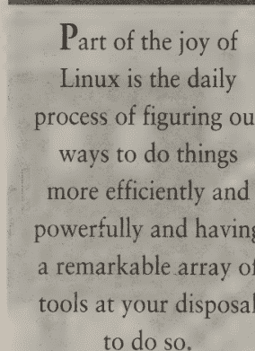
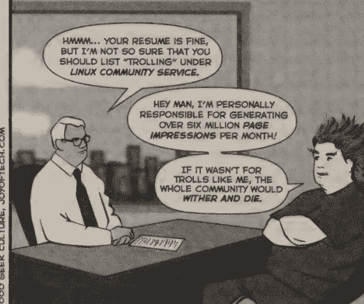
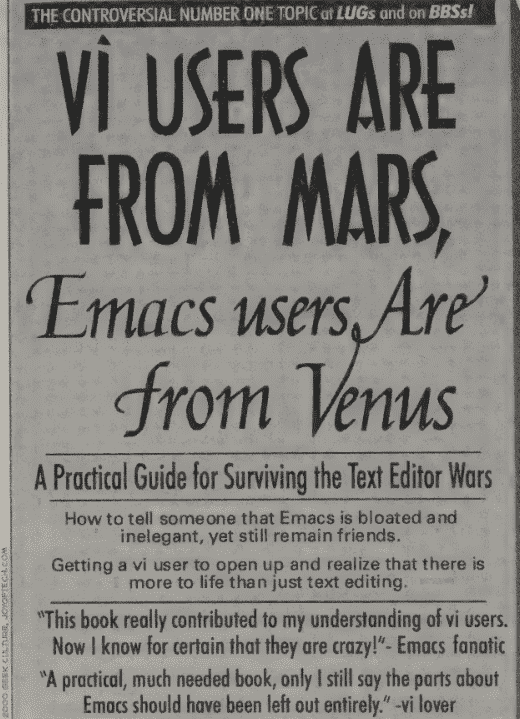
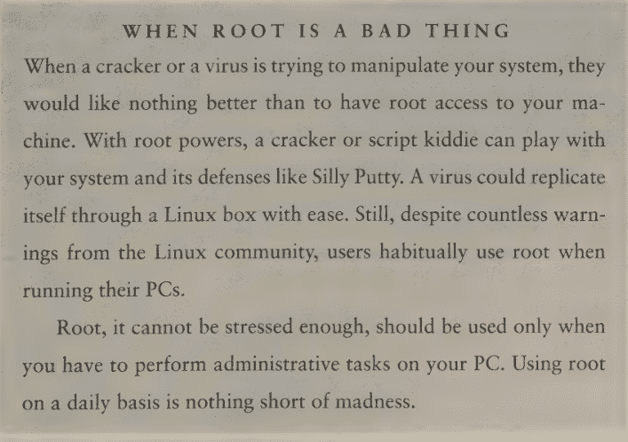
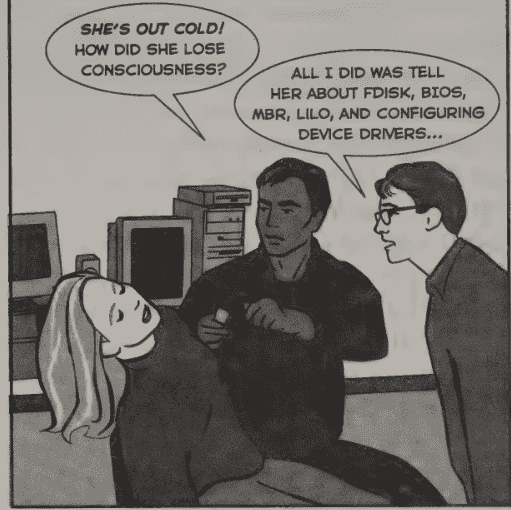
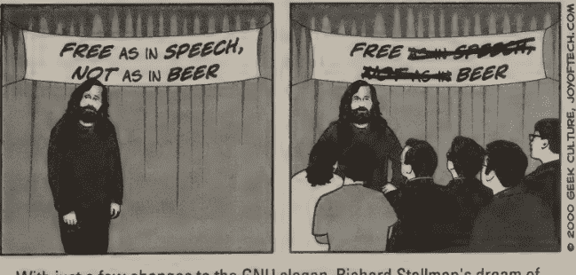

# Linux 的乐趣：开源美食指南

现在，Michael 将时间分配在写作、玩 Linux、把 Linux 偷偷安装到那些本不该运行它的笔记本电脑上，以及维护一个非常、非常紫色的数据库。


当他没有在写关于 Linux 的书籍（目前已超过 10 本）、为 *Linux Today* 贡献内容、管理 Browserwatch.com 和 BotSpot.com、驾驶塞斯 172 飞机，或者做一个完美妻子的丈夫和两个漂亮女儿的父亲时，土生印第安州人 **Brian Proffitt** 正在睡觉。哦，还有吃饭。


# 致谢

致 Alison——MPH

致带带我快乐的 Cindy——BKP

# 致谢

有很多人值得致谢，因为书中很大一部分内容源于多年来个人之间的对话和互动。

首先，Lynette Quinn 负有很大，不仅是因为她构思了这本书，还给了我尝试它的机会。Lynette 是耐心和冷静的典范。我的合作者 Brian 也应该对他的加入和文学创作上的付出表示深表感谢。他们两人促成了这本书的诞生，如果不是他们，你现在不会拿着它。

书中表达的任何想法都不是在真空中形成的。我很幸运被一群为 Linux 带来各种视角的人包围，所以感谢 Sam Rowe、Ed Heil 和 Brent Heatherwick，他们都分享了自己对 Linux（以及泛计算领域）经验的见解。他们对我来说就像是一个虚拟的 LUG（用户小组），我从他们每个人那里学到了很多。

在我写这本书期间，我也开始在 internet.com 的 Linux/开源频道工作。向那些与本书分享见解的编辑、作家和朋友们，表示感谢。

最后，我必须感谢 Alison，她帮助我完成了这本书。——Michael Hall

# 致谢

你永远不知道从何处开始写这些致谢，因为书中很大一部分内容源于多年来个人之间的对话和互动。我最初的反应是我不打算做这件事。

所以当 Michael 打给我并询问我是否能帮他写这本书时，我有些顾虑。不是担心帮他，而是担心这本书的主题。

因此，我必须特别感谢我的好朋友 Lynette，她将我从中部的外壳中拉出来，并在过去的几个月里帮助我写作。像她这样的朋友真的很有帮助。

我必须感谢我的合作者 Michael，他邀请我加入这个项目，并给了我更多关于 Linux 以及如何成为一名更好的作家的机会。我非常高兴时光流逝让我们成为了更好的朋友，尽管他偶尔会叫我叛徒混蛋。

当然，如果没有我爱的妻子和两个女儿的帮助，任何书都不可能完成。感谢她们在爸爸躲在办公室里自言自语地念着 Linux 和 X Window 时所给予的爱和支持。

——Brian Proffitt

# 关于作者

**Michael Hall** 目前住在弗吉尼亚州查洛茨斯尔。作为 internet.com Linux/开源频道的编辑，他为 *Linux Today* 提供内容并在 *Linux Planet* 写作。他认为 Linux 应该是一种沉浸式的体验。

**Brian Proffitt** 生活并工作在美国的心地带印第安波利。尽管如此，他是一个相当适应良好的人，可以在任何海岸地区生存。作为多本 Linux 相关书籍的作者，Brian 还是 BrowserWatch.com 和 BotSpot.com 的执行编辑，以及 *Linux Today* 的特约编辑。在忙碌之隙，Brian 与家人共度时光，最好是驾驶他的新私人飞行执照带他们兜风。

## 第一部分：你了解你的数百万伙伴是谁吗？

- 第 2 章 你有经验吗？41

## 第二部分：实战

## 引言

歌舞女、无政府工会主义者与计算机革命的红旗中的 Python

场景是拉斯维加斯的一间酒店房间，当时是 COMD 大会的第二天晚上。这个会议规模之大，需要两栋楼才能容纳。我来那里是为了尽力做好报道，但一路上，我没能忍住买玩具的冲动。作为一个强迫症式的设备狂魔，寻找有趣的东西对我并不困难；我最终选定了一个装在口袋电脑上的小相机。

我一整天都在用它拍照，回到房间后从手持设备下载快照，心想这些图像应该不会以某种我用 Linux 笔记本电脑无法读取的方式保存吧。自然地，我错了，我有了一堆完全没用的照片。如果我有一台 Windows 笔记本电脑，这完全没问题：每个人都会确保他们的硬件与 Windows 兼容。我花了几秒钟思考，自己当初在抹掉电脑上所有微软痕迹时是否太草率了。

幸运的是，除了设备狂的一面，我还是个乐观主义者。我做了任何一个优秀的互联网联网乐观主义者会做的事：启动调制调器并寻找答案。该产品已经出了几个月了，所以我内心深处知道会有解决方案。

## 引言

介绍一下 Tamer Fahmy，一个在德国的大学生。Tamer 使用着同样的相机，使用 Linux，并且对 Python 编程语言有足够的了解，可以获取我用相机拍摄的照片。快速下载后，我的问题迎刃而解了。

或者并没有。

Tamer 的软件很好，但一个小的 Bug 导致它无法在我的机器上运行。我写信向他，礼貌地请求帮助找出问题根源，他很快回复了。与此同时，那些照片静静地躺在那里等我查看。

现在，我对 Python 的了解有限——这是一种委婉的说法，意味着我其实对 Python 一窍不通。然而，我有 Tamer 程序的源代码，更不用说看到我照片的迫切渴望了。我开了今晚的第二瓶啤酒，在文本编辑器中打开了 Tamer 的程序，开始寻找问题。

几个小时和几瓶啤酒后，在快速浏览了几篇 Python 教程并与调试器进行了一场完全空想式的斗争后，问题得到了令我满意的解决。我把修复方案写给了 Tamer。

Tamer 在第二天早上回信时非常有礼貌，他告诉我虽然我修复了问题，但我完全搞错了，但他认为这是一次很好的尝试，并让他发现了问题所在，并问我是否愿意检查一下他附带的修复后的版本？

在 24 小时内，我买了相机，找到了让它运行的 Linux 解决方案，发现了一个 Bug，修复了一个 Bug，学习了关于为什么人们永远、永远不要直接调用 POSIX 模块的 Python 知识，让相机恢复工作，并结了一个新朋友。

Linux 之所以运行良好，是因为它是从成千上万次像我描述那样的互动成长出来的。它最初只是作为一种将一点 UNIX 带到典型家用电脑的方式，而现在很难说出哪个计算领域是它没有有用且至关重要的地位的。这种从爱好到现象的增长，是由人们通过协作解决微小的烦恼、添加新功能，并坦率地说，通过寻找玩新玩具的方法而建立的。

这把我们引向了一个问题，即我未能传达出为什么我是一个 Linux 支持者的失败历史。

并不是我们每个人都有幸运能将西班牙无政府工会主义集体的仰慕者纳入朋友圈。事实上，大多数人可能认为，如果你认识这样的人并称他为“朋友”，他可能只是某个可怜的咖啡馆怪人，你们偶尔会坐在隔壁的桌子旁，而这种“友谊”更像是一种友好的宽容。但在我的情况下，那些人是错的。

我确实有一个朋友是西班牙无政府工会主义集体的仰慕者。考虑到我们从八年级起一直保持联系，甚至在大学毕业后住在一起，可以肯定地说，这种友谊比那种普通的“忍受咖啡馆疯子的评价直到喝到杯底”之类的友谊要坚固得多。

这位特定的朋友出现在这里，出现在一本关于 Linux 书的引言中，因为当我试图解释为什么……嗯，Linux 酷毙时，他是第一个流露出明显且尴尬留白神情的人。他可能是我第一个尝试向所有人解释这整件事的人，这使得我最终的失败显得更加不幸。我花了四年才恢复过来。

有些人可能会看着一个西班牙无政府工会主义集体的仰慕者并说类似的话：“这是一个后意识形态时代！我们讨论的不是如何烘焙社会蛋糕，而是如何在由企业资本和日益显得古老的国家构成的多层蛋糕上排列樱桃。任何认为无政府工会主义者除了站在那里拉着脸之外，还有空间做些其他事情，然后好心地去注册民主党的人，都是，嗯，是不切实际的。”

# 引言 xvii

事后顾亮（Hindsight）。*事后顾亮*是指你在经历了一场糟糕的社交活动后想的一切。它是我们常见的对话惯例的核心，即为了掩盖我们被别人击得完败、显得愚蠢或被直接羞辱的事实，我们会通过说“我当时就像……”然后开始对我们说的话进行一段雄辩得多的论述。这是一种对话中的障眼法，它引用了一个具有实用价值的、模糊的、几乎没有动词的短语，并让听者去假设，如果我们没有被那个争论者的笨拙愚蠢完全分心，我们本可以赢得那场冲突。

这里没有事后顾亮。那是接下来的300页内容。

我完全失败了我的使命，即走向无政府工主义者者并将他们转变为我的思维方式。我并没有带着一群挥舞着红黑旗的黑客军团去围攻微软，并编写出那种美到足以让成年人睹之落泪的代码。

当然，在某些地方可能确实存在无政府工主义者，他们甚至在我打字时仍在为 Linux 做出贡献，他们做这件事的时间比我让大家因为晚餐分心而感到开心的时间还要长。那里还有大批坚定的共和党人、模糊的中立派民主党人、枪支爱好者、愤怒的黑格尔派小年轻人，以及兼职邮政人员，他们都在为 Linux 事业做着有用的事情，他们的努力每天都在让越来越多的人受益。

两年后我又获得了一个为 Linux 辩护的机会。

那是印第安纳州一个凉爽的春夜，刚刚参加完那种让人们在离开时深信不疑的婚礼。电脑男们都设法站了足够的时间，到了晚上最重要的部分：聊聊业务。

我的朋友在各自的领域都很成功。一个在 Stratus 主机上编程，那是真正的巨型设备。在一台运行时间以年来计算的机器上编写代码，他理应感到自豪。另一个在数据库巨头 Oracle 担任顾问：如果有哪家公司被要求编制所有存在过的东西，那他们会承包这份合同。

谈话转向了 Linux 的去向。

“它是给英特尔机器用的，”顾问说，“可不是什么严肃的硬件。它是穷大学生的新奇玩意。”

“它已经被移植到了某种运行在 Sparc 上的 UNIX 上……为什么会有人费劲把 Linux 装在它们上面呢？有什么意义呢？”

我想我的眼睛当时向上翻了个白眼，我永远不知道。我只知道该地区的所有人都意识到，这场派对即将遭受某种令人不悦的重力影响。我们被群体共识隔绝了，另一个赢得一个没有 Linux 使用者的机会又错失了。

Linux 爱好者之间分享的统计数据（那些关于巴斯克地区利润极其丰厚的集体的无政府工主义者）讲述了一个故事，表明 Linux 每天都在增长一点，正爬入（或冲入）计算世界中越来越多的地方。它在计算领域每个领域的份额都在增长，尽管一些自认为自己已经搞定一切的贫穷、愚蠢的巨头们正在寻找其他方法来忽视或兼并这一切。

一个原本在 386 上构思出来、为了治愈一个芬兰学生对“母操作系统”UNIX 的乡愁的事物——一个曾经甚至懒得帮助启动它运行的电脑的工具——现在正被塞进掌上电脑，被扩展到在巨型主机上运行，被调整以运行工业机器，并被磨合得对于那些认为在从山姆俱乐部买回的电脑上安装美国在线是一项计算天才之举的人来说变得非常有用。

NASA 科学家们使用 Linux（其中一人编写了那段关键的软件，免得我得出去为我的电脑买新的以太网卡），叛逆青少年使用 Linux，微软甚至被抓到过正在使用 Linux。在我以前工作过的高中，这在走廊里走动的极书呆男孩之间引发了一场微妙的重新洗牌，他们一夜之间展示了用 Microsoft FrontPage 制作的花哨页面，其唯一目的是为了交换任天堂卡带，转而大声喧哗地交换 Shell 账户（shell accounts）到他们彼此的 Linux “盒子”中，并在他们的主页上贴“本页面由 vi 文本编辑器编写”的横幅。

Linux 将留在那些投入时间构建它、学习它并每天使用它的人们的心脑海中。他们都认为这值得倡导，我也同意他们的观点。

我的合作者 Brian 对整件事也有自己的看法：

## 引言

# 黑暗面故事

我进入 Linux 的时间较晚。我生长在一个 Windows 统治世界的土地。那是一片单一的土地，充斥着青绿色的背景和信号新邮件收到的叮当小声。在我的 Windows 世界里，温暖而安全，我对效忠于威廉国王和雷德蒙法庭的忠诚感到舒适。

我甚至积极参与了 Windows 的推广，编辑那些能够抚平焦虑用户眉头的、让他们的忧虑幸福地烟消云散的书籍。在这个小世界里，黑暗、丑陋的事物不断出现，在所有美好纯洁的事物上投下阴影。这些是恶灵般的小问题，比如打印机程序无缘故地导致整个 Windows 系统崩溃，以及每当某些应用程序冻结就需要重启。

与此同时，我当然也听过其他的电脑王国。Macintosh 之乡似乎是一个相当不错的地方，尽管那里由前嬉皮士占据着。OS/2 在那时看起来非常前卫，但弥漫在那个小王国的恐惧太让人无法承受。

然后是 Linux。我认识的第一个在家里电脑上 Linux 的人是一个后来变成变装癖的男人——这让你知道了。

## 引言

我家里使用了双系统。突然间，电脑不再是敌人；它再次成了一个信赖的朋友。

说实话，问题确实存在。Linux 尽管强大且灵活，但它并非完完美。与 Windows 的那些 Bug 不同，Linux 中的问题在被修复后，它们就会彻底解决。它们不会在以后回来纠扰你。

我开始在同龄人中成为一名 Linux 传教士，他们只是摇着摇头，试图把我诱回 Windows 之乡（Windowland）。我不去。

Linux 还带了一位老朋友回到我的生活。我的书出现在全国各地的书架上，你别说，有一天，名叫迈克尔·哈尔（Michael Hall）的人正好在他当地书店的书架上看到了一本。

迈克尔我和我在大学相识，尽管我们的观点迥然不同（一个是每年投票的理想主义年轻民主党人，另一个是自诩为与世界的加密事实不断斗争的无政府主义者），但我们成了好朋友。我们对写作有着共同的热情和天赋，当我担任校报编辑时，他是执行编辑。我会尝试策划下周报纸的选题；而他会想办法在大学管理层因为我们做的那些颠覆性写作而关闭我们时，在校外印刷报纸。这是一个很好的平衡。

大学后，迈克尔在我担任编辑的一份社区报上做了一段时间记者。最终，他回了学校读书，而我最后搬到了新泽西州。

但 Linux 再次进入了彼此的生活。事实证明，迈克尔已经接触 Linux 很多了，并为 GNOME 文档项目贡献过一些力量。当我被邀请为 *Linux Today* 开始写作时，是我建议迈克尔也来贡献的。当我继续写书时，他更多地参与了 *Linux Today*，如今他是我在该网站的编辑。

## XXVI 引言

这些传记信息并不是为了让你对我们个人生活的乏味细节感到无聊。如果你用酒灌醉我们，你就能得到足够的那类信息。但谈论 Linux 时，我无法不提到 Linux 社区，因为正是那种社区感重燃了一段中断了近十年的友谊。

Linux 的发展已经超越了由某些芬兰学生拼凑出来的简单操作系统。Linux 不仅仅是高效软件代码的集合。Linux 超出了任何参与过它的人的梦想，或许正因为这些梦想，它已经变成了一个共同体，技术极客和普通人都可以沉浸在“那只虽然能梦想的小操作系统”的浪漫之中。

谈论 Linux 就无法不谈论其中的人。你也无法回避讨论这些人的文化和哲学，这远超其他操作系统供应商的资本主义心态。这一事实只要你开始接触 Linux 几乎是显而易见的。

如果你走向一位 Linux 用户并请她列出至少三个 Linux 内核的开发者，你可能会得到林斯·托瓦尔兹（Linus Torvalds）、艾兰·考克斯（Alan Cox）和泰德·索（Ted T’so）。现在去问一位 Windows 用户同样的问题，然后看着他们陷入空白吧。正是这种社区感让 Linux 成为比目前为止出的任何东西都更好的操作系统。人们的参与——而不是用户小组——确保了它的最终成功。

而这种归属感，这种对 Linux 的喜悦，才是这本书真正的主题。

## 第一部分

你知道你那数百万合作伙伴是谁吗？

## 第1章

### 顶端的企鹅

2001年2月，纽约市

在 Linux 世界博览会（LinuxWorld Expo）的展厅里，到处都是各类人。这是一个每半年一次（每个海岸一个）的 Linux 忠实者（以及没那么忠实的人）聚会的会议。从展厅的一端走到另一端，你会看到巨大的企鹅悬浮在戴着恶鬼角的青少年上方、来自 IBM 的企业人士、蜷缩在笔记本电脑前的少年男孩、读心者、雇佣模特、冷笑的科技记者、乐于应酬的高管、各色极客，以及偶尔出现的向他的信徒传教的 Linux 传教士。

今年的会议特别有趣。除了某些展位那种像杂技表演般的氛围——更不用说那由西装男、极客和广告人组成的互不匹配的动物园——我们许多记者感觉到，我们应该对一些展出商进行最后的访谈，因为这很可能是小型公司道路的终点。这种想法受到一些大型 Linux 公司裁员传闻的推动；受到数量减少的、依靠安装支持推销缩膜装发行版的机构的推动；还有大楼内最大的展位，它们由真正的巨型公司（如 IBM 和英特尔）拥有——这表明 Linux 是一个已经被定义计算领域的人们（无论好坏）进入的市场。

“看看周围，”一位作家说，“这些人中有一半明年就会离开。”一位年长的编辑对那些跑出沙盒的孩子开了一个玩笑。回头看一眼 Slashdoth 的展位，那里充满了豆袋沙发（这些是 Linux 聚会的*装点*，暗示着年轻人无忧无虑的精神和结实的背部）、尼力枪和 Playstation 游戏，可以看到一群穿着“企业周末装”的中年男子，用混合着困惑和俯视的眼神打量着这一切。他们的手伸进波拉抓绒背心的口袋里掏出名片，而这个临时“极客风”栖息地的周围围栏，这个栖息地本身是由 Slashdoth 所有者的企业慷慨所产的。

> “看看周围，”一位作家说，“这些人中有一半明年就会离开。”

我花时间和一家进入 Linux 世界的新公司的高管一起坐在豆袋沙发上。他正在开发软件，让家庭主妇、秘书和“终端用户”更容易处理 Linux。“终端用户”是一个神话中的生物，真正的极客们广泛认为它是脑叶切术的悲剧性，以及不幸的、与其他孩子在阳光下玩耍的青年的产物。这位高管提到了“黑客伦理”，指的是许多 Linux 先驱似乎都拥有的系列松散特征：好奇心、建设性的反权威主义、互助主义、独立性，以及对现成解决方案或典型答案的怀疑。

“你们公司对这一切还很新，”我说，“我没有别的意思，但这看起来不像一个黑客的集合。你们谈论黑客伦理，但看起来你们公司并不会真正……”

### 第1章——顶端的企鹅

直到黑客在用户群体中所占比例更小，才能获得成功。


坐在豆袋沙发上的高管沉默了一会儿，然后仔细挑选辞藻。“还是早期。黑客对我们至关重要，是创作上至关重要的人……但是，嗯，Linux 比任何群体都要大。”五分钟后，他抱怨开源软件中质量控制的糟糕状态，以及普通黑客对截止日的散漫遵守。

他希望那些孩子们离开沙盒。

但在同一天，我走到了一家试图通过一种运行在手持电脑上的 Linux 版本来立足的公司。展位处的人非常兴奋，他们的肢体语言几乎是疯狂的。我交谈的其中一位开发者的话倾泻而出。他兴奋地演示了一台手持电脑如何通过无线连接互联网进行即时聊天。他展示了即使是最平淡的数据如何通过他的软件进行转换，使其在从手持电脑到桌面台机，再到那些从不作为用户但彼此相互通信的过程等各种语境中变得有意义。他所传授的内容具有很高的“酷炫因子”，但他也有一个反复回到的点：这一切都是通过开源软件实现的。

“这一切都是使用开放标准，”他声称，“使用开源软件。而且这是在我们多年来基于自由软件所构建的所有工具上发生的。多年来，人们一直在不知情的情况下构建着基础，让信息拥有自己的生命，现在我们正在把它们整合在一起。”

对于任何从互联网进入初期就开始进入那些自封信息时代预言者意识的人来说，这部分程度上是因为，潮流总是来来去。在每个会议上，我们都被承诺一个智能软件的黄金时代，或者“更智能的信息”，或者其他的术语。

有人认为，开源软件本身是企业为了让自己显得时髦而推崇的时尚，而它们在寻找方法，在不分享任何东西的同时，利用那些渴望加入革命的青年的创造力。但事实是，这个家伙是对的。多年来，人们一直在构建一种基础设施，这绝不仅仅是为了推送横幅广告、色情和企业宣传网站。工具被制造出来，有时是为了进一步发展而必须制造的，有时仅仅是因为很有趣。

标准抵御了试图将其封闭的尝试，因为互联网用户社区需要这些标准保持开放，以确保他们的工具能够运行，通信保持畅通。

结果呢？小公司正试图用宏大的想法和革命者的热情重新定义一切。Linux 对他们来说从未是这项运动的意义所在，但 Linux 是免费且开源的——这是一个完美的基石，他们可以在此探索自己的想法，而无需重新发明或从零开始构建。

这一切构成了一个悖论：将 Linux 仅仅视为另一种工具的互联网愿景者；行业老兵们预测，随着股市狂热消退以及那些被证明不可行的注定失败的营收模式，少数几 Linux 公司将走向终结；来自最保守背景的“老顽童”们拥抱了一个由黑客构建、但现在属于每一个人（无论文化归属如何）的操作系统。所有的马似乎都在朝着一个预示着 Linux 作为一个现象终结的方向奔跑。然而，恰恰是因为这些事情，嗯，那企鹅才屹于顶端。

Linux 仅仅在十年前刚露面世界，对于爱好者来说，它只不过是一个有趣的消遣，承诺的也不过是在 PC 硬件上启动某个非常类 UNIX 的东西的新奇感。然而，在过去的十年里，Linux 已经从玩具变成了竞争者，随着它作为一种“胶水”操作系统立足了脚跟，它让许多公司感到恐惧。也许它在某些任务上执行得并不好，但在网络和系统管理员赖以维持运行的日常苦力工作方面，它表现卓越。

Linux 既备受赞誉也遭受唾弃（有时是出自同一批人），它在服务器机房和公众想象中的进步是不可否认的。这一现象在 1999 年的夏天和秋季达到巅峰，当时几家 Linux 公司进行了首次公开募股，其股价飙升至发行价的二十倍和三十倍，创造了新记录。然而，这种爆发消失了，但同样的公司现在仍在挣扎，虽然向着盈利迈进，但不再受到热度的推动。

这如何预示着一场赢得的革命呢？如果企业人士正在讨论如何引导那些最初让 Linux 诞生的黑客，而公众对这一现象的热情正在消退，那么胜利又在哪里？

答案在于 Linux 在 2001 年的无不在。当 Lin Torvalds 将 Linux 馈赠给世界时，他是在（经历了一个错误的开始后）以下条款下做的：Linux 对所有接受者开放，无论好坏。对 Linux 许可证（即规定了 Linux 分发条款和条件的文档）的源头——运动的含蓄理解是：软件必须保持开放可修改。这样，如果一个程序在满足他人需求方面未达到目标，链上的下一个人就可以采取必要措施，在现有工作的基础上进行构建并使其变得更好。

> 既备受赞誉也遭受唾弃（有时是出自同一批人），Linux 在服务器机房和公众想象中的进步是不可否认的。

多年来，Linux 很多次没有达到目标，起初甚至无法独立启动，然后连一套可靠的网络工具都缺少。然而，随着时间的推移，这些缺陷都得到了纠正——结果被整合到 Linux 这一不断增长、不断多样化的软件和工具集中，缓慢进入服务器机房和办公室后方、Web 服务器和桌面，直到我们来到今天，拥有了一个被 IBM 和微软等公司严肃以待的操作系统（其中一个希望获利，另一个则希望它在造成更多伤害之前消失）。

在经历了十年的持续进步后，Linux 无处不在。由于它以如此多的形式无处不在，由于许多持有许多不同议程的人的努力，它无法消失，因为从根本上说它不是整体。

> 在经历了十年的持续进步后，Linux 无处不在。

当我站在会议大厅里，周围环绕着即将消失的公司展位，被一群对他们可以使用的所有代码感激不尽、但对编写这些代码的黑客并不感激的高管包围，在 IBM 巨型展台的遮挡下，我意识到了一件重要的事情。即使革命已经结束，它在计算版图上留下的印记，无论投入什么样的营销炒作，这些印记都无法被消除，无论那些推销它的公司表现有多糟糕。

过去几年里，Linux 传教士们无论大小，发出的声响和愤怒汇聚在一起，为 Linux 赢得了一个入席席位。不论是黑客继续推动它，还是某些计算巨头最终驱动它，Linux 都是一个事实。

# 家里有通用型分时系统吗？：关于 UNIX 极快速粗暴的故事

如果你不知道 Linux 是源自何，就无法完全理解它，这是一个追溯到 30 多年前贝尔实验室的故事，UNIX 就是在那里出生的。

两位名叫 Ken Thompson 和 Dennis Ritchie 的计算机科学家正在开发一个名为 Multics（多路复用信息计算服务）的操作系统；这是一个试图为大型计算机创建一种能够提供多用户访问操作系统的尝试。Multics 由于其对资源的贪婪，赢得了管理层的反对，管理层随之拔掉了该项目的插头，导致这些男士们没有了操作系统项目。

Thompson 最终获得了 `PDP-7` 的使用权，并以计算机极客的方式，开始着手让它成为更好的游戏机。这反过来导致了第一个 UNIX 内核。而 Ritchie 则开发了一种编程语言，他将其称为“`C`”，用于 Thompson 的新操作系统。`C` 的重要性在于，它是编程语言可以“跨平台”这一理念的早期证明之一。也就是说，如果你用 `C` 在一台机器上出一个非常出色的《太空大战》版本，你就可以毫不费力地在具有不同操作系统的机器上运行它。

这被称为可移植性，计算机历史学家认为在进入 70 世纪之前，这种特性并不多。

因此在有了 `C` 之后，Thompson 和 Ritchie 被赋予了开发一个办公自动化系统的任务，他们被给了更好的硬件来完成——准确来说是 `PDP-11`。得益于 `C` 和可移植性的神奇，两人重写了早期的 UNIX 并将其移植到新硬件上。

可移植性让 UNIX 能够从最早的主机移动到新家，也让 UNIX 在计算机爱好者中传播（由于研究机构和大学之外计算机的稀缺，当时的爱好者与现在完全不同）。由于 AT&T 的反垄断诉讼，贝尔实验室在过去几年里对 UNIX 源码的分发相当友好，向大学免费提供了至少一个版本，另一个版本价格为 100 美元。企业和政府则支付数万美元。一段时间内，UNIX 源码非常繁荣，直到 AT&T 以其对专有源码的所有权为理由试图停止。

然而，UNIX 已经流行了。

已经有很多关于为什么 UNIX 如此受欢迎的书籍，我们可以花费这本书的剩余部分来纠结那些细节。如果我们这样做，这本书将不再是一本“开源的鉴赏家指南”，而是一本解剖学教材。我们不想去那里。但是，应该列出一些关键项目，因为它们在我们今天所知的 Linux 中以各种形式存在。对于每一个穿大宽松裤的男孩

那些在踩滑板时运行 Linux 的人是因为觉得它很“酷”，但也有许多人最初选择它是因为它提供了一个让他们可以在家里私密空间里尽情玩的 UNIX，而这正是他们渴望已久的东西。

所以……所有这些热情的原因在于：

- **可移植性**。得益于 `C` 语言，你可以将 UNIX 从一台机器移动到另一台机器，而无需从头重写所有喜爱的程序。
- **模块化**。它提供了大量功能强大、单用途的工具，这些工具非常节省内存和资源，但可以通过组合以多种方式产生巨大的效果。
- **灵活性**。它非常灵活，且不需要过多的深度知识。你可以利用对单个组件的掌握，通过脚本和管道（piping）来产生更大的结果，而无需在每次需求变化时编写一个全新的程序。

UNIX 强调的价值观与你在其他操作系统中看到的似乎是截然相反。例如，可移植性是 UNIX 爱好者共同的核心价值观。正是因为这种想要将一组通用工具从一台电脑移动到另一台电脑的渴望，使得如今现在运行在 Linux（及其亲戚）上的工具能够跨越令人惊叹的计算硬件：从普通的 PC 到 Mac，再到手持电脑和巨型大型机。

> UNIX 强调的价值观与你在其他操作系统中看到的似乎是截然相反的。

想象一个文字处理程序以及它所做的一切。它允许文本进行格式化、打印、预览、拼写检查以及各种“破坏”——而这一切都在一个程序中完成，随着时间的推移和新功能的不断加入，这个程序变得越来越大、越来越慢。文字处理器不是模块化的。现在考虑一组小程序，它们在单独运行时，功能上等同于蜂巢中的蜜蜂，每个都有单一目的。

例如，你可能有一个程序，仅用于输入文本。它不会检查你的拼写，也不会提供一种方法对你的工作进行精美的打印。然而，一旦你完成了该程序，你可以将文件交给一个拼写检查程序，尽管它可能做不了别的，但它真的擅长检查拼写。接着将文件交给格式化程序，该程序读取你的格式代码并将文本文件转换为打印机可以理解的内容。从那里，你将任务交给一个程序，它会以最小的开销安静而高效地处理打印。

对于“现代”思维方式来说，这显然是疯狂的。它意味着复杂性，因为这些程序中的每一个都必须独立运行——而我们都知道复杂事物有多糟糕。既然有了一站式解决方案，为什么还要费力去弄一堆小而高效的程序呢？

我们不会成为操作系统法西斯主义者，并认为这是一个糟糕的问题。在某些情况下，特别是考虑到如今良好的计算机硬件如此廉价，仅仅坚持使用那个巨大的、耗费内存、工具栏比世界上丢失的袜子还大的文字处理程序并继续下去，也是完全合适的。

另一方面，当你考虑到还有成百上千个像我描述的类似的程序时（它们真的可以做各种其他事情，而且是以各种组合方式进行的），这会让你陷入思考。如果你处于一个处理能力共享的环境中，这些执行完任务后就安静退出的微程序，最终比一个巨大的程序要节省多得的处理时间和内存。

在 UNIX 世界中，一旦我们采取所有的单用途工具并将它们结合在一起，“灵活性”就变成了一个非常简单的概念。就像由许多小链环制成的项链看起来比大铁环制成的项链更灵活一样，UNIX 的“小工具”方法意味着用户或程序员可以在所有这些工具之间建立更多微小且有意义的关系，并且有许多方法完成同样的事情，每种方法都与其他方法一样“正确”，即使某些在特定语境下比其他更合适。

UNIX 处理问题方式的美之处在于，你对一组相当小的所有可用工具的知识，可以通过叠加它们的效应并以各种组合方式创建更多工具来加以利用。正因为这些组合工具是由微小的、可替换的部件制成的，所以在在完成任务时存在着似乎无限的可能。UNIX 方法的几个特征很好地赋予了这种灵活性：

UNIX 方式中单任务程序模块化的一个实用的推论是，它们还应该充当过滤器，你可以通过它向其中“管道”信息。例如，考虑日常企业生活中最枯燥的任务之一：冒取他人的工作成果。

在这种情况下，你，一个拥有昂贵公寓和背着高额月供车贷的普通公司小职员，一直在邻居的阴影下苦作——你的邻居是勤奋的 John J. Spurworthy，他过去一年一直在研究一个你暗中渴望的项目。你有机会把他所有的工作都当作你自己的……但等等！那个混蛋已经确保了他的名字出现在与该项目相关的每一个文件中。

> 例如，考虑日常企业生活中最枯燥的任务之一：冒取他人的工作成果。

使用那个另一个文字处理程序（我们这里不指名道姓），你可以打开每个文件并搜寻他的名字。如果他只是把名字放在每个文件的开头，那也不太坏。得益于你用 UNIX 管道命令的能力，帮助正快路上。你只需要访问目录并输入：

```bash
cat * | sed s/John Spurworthy/Dick/g | lpr
```

然后他的工作就来了，它被 `cat` 命令打开（它擅长一件事：显示文件内容），经过了 `sed` 命令的过滤（它擅长一件事：切割和处理文本），然后交给 `lpr` 命令（它将文件发送到打印机），以其完好无损的状态呈现。当然，除了一个恼人的细节：在打印输出上再找不到他的名字了，这意味着你是一个……呃，一个贪婪的公司帅哥。

所以，你拥有了一些执行自己任务的小型单用途程序。此外，它们还可以相互通信，使你的计算机更像是一个充满能力的蜜蜂，而不是一群真正巨大的粉大象。再将易于脚本的元素加入其中，你就真的拥有了某些了的东西。

脚本是一个很容易理解的概念：与其反复输入一组命令，不如你写一个简单的程序（脚本）来替你输入。这种能力可能会让 DOS 用户想起批处理文件（batch files），但因为 UNIX 在早期就非常面向计算领域的权力用户，它开发了强大得多的脚本能力，而且在需要编写脚本时，它总有更多功能强大的单用途程序可使用。

对于许多任务，所有这些小程序——结合它们在向发送到管道中的下一个程序之前过滤信息的能力，进一步结合将更长的命令和管道序列组合成脚本的能力——意味着对于常见任务，我们不需要进行我们认为的“编程”。例如，你不需要学习 `C` 语言就可以想出一个巧妙的方法，把 Spurworthy 先生的所有工作放在一个秘密目录里，在它的几个文件里引入几个尴尬的错别字，然后发邮件给你的老板，提到 Spurworthy 似乎已经

> 脚本可以将你一次使用的所有程序组合成一个可以使用和重复使用的单一脚本。

典型 UNIX 系统的另一个要素是对对基于文本的配置文件的依赖。人们对此直翻白眼，回想起 Windows 早期的时代，那时一切都配置在无数个 INI 文件中。当你打开这些文件时，会想起为了处理一个巨大的注册表文件而要经历的折磨。

得益于你那些微型的、过滤、互操作且可脚本化的工具，配置 UNIX 及其所有应用程序变成了一件相当简单的事情。你可以将配置文件通过一系列命令处理，完成你所需的更改。对于只更改一个设置来说，这看似微不足道，但如果你是一个网络管理员，突然发现链游上某台计算机更改了名称或地址，而你的许多程序都依赖于知道这台计算机的位置，那么所有这些文本文件和小程序的优之处就显而易见了。

因此，UNIX 无处不在，人们深爱它。它是许多大学的事实计算标准，许多极客受益于管道、过滤器和脚本而感到世界随之震动。事实上，一个人对 UNIX 的热爱，加上他对当软件运行不符合其要求时被禁止修改计算机软件的痛恨，导致了一件确实罕见的事情：一场由“计算机电脑人”驱动的社会运动，这场运动催生了看待软件许可的新思维方式。这种新思维似乎颠覆了人们将知识产权视为限制性工具的观念。在此过程中，他还为 Linux 奠定了基础，Linux 的一切可能都归于此。

毫无疑问，如果没有他的工作，Linux 的面貌会有所不同。理查德·M·斯尔曼（Richard M. Stallman，通常被称为“RMS”）是 MIT 人工智能实验室的成员。在黑客中，该实验室在计算形成年所扮演的角色是传奇性的，而 RMS 是该实验室历史的一部分。

痛苦地陈述接下来的20年计算史，UNIX 继成为互联网的骨干，以及企业和大学的支柱。UNIX 在许多方面都是将互联网连接在一起的胶水。企业依赖 UNIX；它是许多人的首选操作系统。遗憾的是，由于它的流行以及被许多不同公司重新创造的方式，UNIX 成了它自身成功的受害者。这真的是一个以后以后再说的故事，但 UNIX 经历了一段碎片化时期。由于建立标准的尝试相互冲突，利用其传统优势之一——可移植性变得异常困难，以至于 UNIX 市场陷入了混乱。在许多方面，这为微软进入服务器市场提供了一个机会，而他们一直守到了今天。

现在是任何时候都合适的简要探讨一下整个“黑客”问题了，因为有这么多 Linux 爱好者自称为黑客，而许多没用过射线（cray rays）的人认为黑客无非是计算机破坏者，这让“真正的黑客”感到愤怒。

“黑客”的经典定义随来源而异。尽管如此，最稳妥的做法似乎是读成这样的：黑客对未知事物充满热爱。

他们充满好奇心，对事物的运作方式感兴趣，在解决问题时通常对形式主义不以为然。黑客并不受限于计算机。黑客并非对规则和秩序一一律不感兴趣。另一方面，他们的好奇心是一种驱动价值，并具有极高的优先级。

> 在黑客中，该实验室在计算形成年所扮演的角色是传奇性的，而 RMS 是该实验室历史的一部分。

当然，现今有许多自封的黑客在徘徊，这部分归功于 Linux 的流行以及它在软件黑客中的根源。我们曾非常荣幸地读过某人的信息，那人声称他“黑客入侵”了一个文字处理器，通过将“缩放”设置为 10% 来正确显示页面预览。有人可以辩论说，它缺乏巧思，但它在优雅性上弥补了这一点……只需两次鼠标点击，搞定！事实上，成为一个黑客是很时尚的，因此几乎没有任何同伴评审或认证来阻止人们自称这一头衔。但需要记住的一点是，“黑客”并不一定意味着“破坏者”，自称这一头衔的人通常是守法公民，而且绝不是为了骗取你的信用卡。

MIT 的 AI 实验室是 MIT 类计算机黑客的聚集地，RMS 就是其中一员。根据所有流行说法，实验室的文化多年来一直是极端开放的。共享软件是实验室成员之间的常态，他们互相帮助解决问题，或仅仅是让他们的计算机运行一些很好、很酷的东西。RMS 在一篇题为如下的文章中描述了他对那种社区的感感受：

> 黑客是对未知事物充满热爱的人。

“GNU 项目”：

> “我们没有把我们的软件称为‘自由软件’，因为那个术语还不存在；但它确实是如此。我们没有把我们的软件称为‘自由软件’，因为那个术语还不存在；但它确实是如此。每当来自另一大学或公司的人想要移植和使用时——如果你看到一个熟悉的程序，你总是可以查看源代码，这样你就可以阅读它、修改它或利用它。”

然而，多年来，实验室的开放精神开始衰落，RMS 将此归于许多原因，包括成员离开私营利益。此外，不断增长的计算机行业正确保软件成为专有的、封闭的作品。对于一个好奇事物运作的黑客来说，这是一种负担。对于一个相信共享信息以促进进步是一种道德义务的人来说，这是不可接受的。


因此，RMS 发现自己失去了他赖以生存的黑客社区，面临着一个将专利视为持续增长关键要素的大型行业。这不是他想要的世界，他意识到：

- 所以我寻找一种让程序员能为公益做出贡献的方法。我问自己，是否有我可以编写的程序或多个程序，以便让社区再次可能？答案很明确：首先需要一个操作系统。那是开始使用计算机的关键软件。有了操作系统，你可以做很多事情；没有它，你无法运行计算机。有了自由操作系统，我们可以再次拥有一个协作黑客社区——并邀请任何人加入。任何人都可以使用计算机，而不需要剥夺朋友。

- 作为一个操作系统开发者，我拥有这项工作所需的技能。尽管我无法保证成功，但我意识到我被赋予这项任务。我选择让系统与 `UNIX` 兼容，以便具有可移植性，这样 `UNIX` 用户就可以轻松切换。`GNU` 这个名字的选择遵循了黑客传统，作为一个递归缩写，代表 `GNU's Not Unix`（`GNU` 不是 `UNIX`）。

操作系统并不仅仅是一个勉能运行其他程序的内核。在20世纪70年代，每一个配得上 `way` 操作系统都包含了命令处理器、汇编器、编译器、调试器、文本编辑器、邮件处理程序等等。`ITS` 有，`Multics` 有，`VMS` 有，`UNIX` 也有。

因此，`RMS` 拥有了他的使命：创建一个自由的类 `UNIX` 操作系统，以便他以此召集此前未命名的

他再次回到了“自由软件”社区，并恢复了他在 `AI` 实验室期间所享有的开放性。他将项目命名为“`GNU`”，这是一个递归缩写，意为“`GNU's Not Unix`”，这不仅符合许多黑客对递归缩写的喜好，也反映了当时计算机行业诉讼频行的特点，这种特点本会迫 `AT&T` 像重锤一样撞击在这个初生的项目上。

`RMS` 关于“自由软件”的公式非常易于遵循：

- 你有自由为了任何目的运行该程序。
- 你有自由根据你的需要修改程序以适应你的需求。（为了让这种自由在实践中发挥作用，你必须拥有源代码，因为在没有源代码的情况下对程序进行更改极其困难。）
- 你有自由重新分发程序的副本，无论是免费还是收费。
- 你有自由分发程序的修改后版本，以便社区能够从你的改进中受益。

这些原则在 `GNU` 通用公共许可证（广泛被称为“`GPL`”）中得到了详细阐述。`GPL` 的设计旨在确保一旦软件根据上述定义被变为“自由”的，它就能保持这种状态。计算机社区中关于许可的奥秘存在着长期而激烈的争斗，但 `GPL` 的核心要义简单到足以在这里表达，直到你看到附录：

这是软件。这是源代码。随你怎么意处理。如果你改进了它，请确保包含所有的改进，并将其传递下去。不要试图阻止他人获取你的改进。我们可以告诉你，这是我们编写的软件，而这些是我们愿意让你拥有它的条款。

这是一种通往整个练习意图的漫长路径，读起来在一个诉讼较少的人的社会中，更像是：“要善待彼此。”

`RMS` 并不是唯一对 `UNIX` 感兴趣的人。在 70 年代，加利福尼亚州大学伯克利分校正在开发他们自己的基于 `AT&T` 许可源代码的变体，并被称为“`BSD`”。他们的版本非常受欢迎……以至于引发了诉讼，于是他们开始创建一个不受 `AT&T` 源代码束缚的 `UNIX` 版本。

正如大家所想象的，剥离整个操作系统的专有代码是一项艰巨的任务，但当法律尘埃落定，工作完成时，伯克利向世界交付了 `4.4BSD`。从这些代码中，我们今天有一系列常用的自由 `Unix`：`FreeBSD`、`OpenBSD` 和 `NetBSD`。

当 `Linux` 和 `BSD` 粉丝聚在一起时，一旦他们决定直抒不讳并亮剑相对，会有几个关键差异显现出来。

当 `GNU` 要求共享源代码和改进（我们很快就会看到 `Linux` 的基础这是在自由软件的基础上构建的），而 `BSD` 的许可证简单地说是：“拿去这些并随你怎么做，只需确保给予我们荣誉。不需要归还源代码。”

关于这些区别存在很多争吵，尤其是当有人发布显示某些 `BSD` 版本比 `Linux` 快得多的结果时。你看到的阵营之间的敌意有时源于，尽管拥有“纯洁性”、偶尔的技术优势以及宽松的许可证，但 `BSD` 并没有像 `Linux` 那样风靡。`BSD` 机器在互联网上运行良好，但知名度不够。有些人将其归咎于推迟发布 `BSD` 的法律问题，这给了 `Linux` 关键领先。其他人认为社区的本质不同，`BSD` 对新手和外人士更加封闭。

> 当 `Linux` 和 `BSD` 粉丝聚在一起时，一旦他们决定直抒不讳并亮剑相对，会有几个关键差异显现出来。

最终，这并不重要。对于热爱 `UNIX` 核心功能的人来说，两者提供了一个免费的好选择。选择其中一个还是另一个的区别很难界定，因为 `BSD` 和 `Linux` 在硬件平台上几乎无处不在，并且根据用户的需求各有侧秋。

如果从这里和我们叙事的早期部分可以吸取的教训，那就是 `UNIX` 出于各种原因，受到了前所未有的追随。即使在操作系统最封闭、最不可访问的时候，人们一直在寻找保留 `UNIX` 体验的方法。这说明了 `UNIX` 遗产有多么重要，对于只涵盖四种 `UNIX` 变体感到有些愧，明明还有更多。

因此在 1991 年，无论有人是否意识到，计算机世界已经准备好一种操作系统，将 `UNIX` 的力量和灵活性带到日益普及且廉价的桌面 `PC` 上。然后 `Linus Torvalds` 发布了一条消息……

```
From: torvalds@klaava.Helsinki.FI (Linus Benedict Torvalds)
groups: comp.os.minix
Subject: 你最希望在 minix 中看到什么？
Summary: 关于我新操作系统的小型调查
Message-ID: <1991Aug25.205708.9541@klaava.Helsinki.FI>
Date: 25 Aug 91 20:57:08 GMT
Organization: 赫尔辛基大学
所有使用 minix 的大家好——
我正在编写一个（自由）操作系统（只是一个爱好，不会像 gnu 那样大而专业），用于 386(486) AT 兼容机。这从 4 月就开始酝酿，现在开始准备就绪。我想听听大家对喜欢或不喜欢事物的反馈
```

在 `minix` 中，因为我的操作系统与它有些相似之处（由于其他原因，文件系统的物理布局相同等）。我目前移植了 `bash(1.08)` 和 `gcc(1.40)`，并且似乎运行良好。这意味着我将在几个月内能弄出一个实用的东西，我想知道大多数人最想要哪些功能。欢迎任何建议，但我不保证会实现它们 :-

`Linus` (`torvalds@kruuna.helinki.fi`)

备注。是的的——它不包含任何 `minix` 代码，并且有一个多线程文件系统。它不是可移植的（使用了 386 任务切换等），而且可能永远不会支持 `AT` 硬盘以外的任何东西，这就是全部了 :-

控制着计算机最基础的功能，并为程序与硬件（以输入、输出、网络或其他功能的形式）以及程序相互之间提供了方法。

最初，`Linus` 也曾打算以非商业许可协议发布他的内核，允许除以盈利为目的的企业以外的任何人获取和使用。但他最终改变了主意，按照由 `RMS` 和自由软件基金发起的 `GPL` 协议发布了它。得益于许可以及一些移植到这个初创操作系统中的早期工具，`Linux` 和 `GNU` 紧密地联系在一起。

通过第二条信息，`Linus` 宣布他正向世界发布 `Linux`：

发件人：`torvalds@klaava.Helsinki.FI` (`Linus Benedict Torvalds`)

新闻组：`comp.os.minix`

主题：适用于 `386-AT` 的免费类 `minix` 内核源码

消息-ID: `<19910ct5.054106.4647@klaava.Helsinki.FI>`

日期：1991年10月5日 05:41:06 GMT

你是否怀念 `minix-1.1` 的美好时光，那时候男人还是汉子，他们编写自己的设备驱动程序？你是否正缺少一个好的项目，并渴望着在一个可以根据自己的需求尝试修改的操作系统上大练手？你是否发现一切在 `minix` 上运行得良好时让你感到沮丧？是否不再需要为了让一个巧妙的程序运行起来而熬通宵？那么，这篇帖子可能正是为你准备的 :-)

正如我一个月前（？）提到的那样，我正在为 `AT-386` 计算机编写一个免费的 `minix` 仿品。它终于达到了甚至可以使用的阶段（尽管取决于你想做什么，可能并不适用），我愿意发布源代码供广泛分发。虽然它已经是 `0.02` 版本（包含一个非常小的补丁），但我已经成功地在它下下运行了 `bash/gcc/gnu-make/gnu-sed/compress` 等。

我这个业余项目的源码可以在 `nic.funet.fi` (`128.214.6.100`) 的 `/pub/OS/Linux` 目录下找到。该目录还包含了一些 `README` 文件和几个可以在 `linux` 下运行的二进制文件（`bash`、`update` 和 `gcc`，你还能想要的更多呢 :-）。提供了完整的内核源码，因为没有使用任何 `minix` 代码。库源码仅部分免费，因此目前无法分发。该系统能够“按原样”编译，并且已知可以运行。嘿。二进制文件（`bash` 和 `gcc`）的源码可以在同一地点的 `/pub/gnu` 找到。

因此，一个由 `Linus` 内核和少数 `GNU` 工具构建的非常基础的操作系统——`Linux` 诞生了。留此为止虽然很有戏剧性且富有叙事色彩，但重要的是，在 `Linus`（内核）与 `GNU`（试图构建 `UNIX` 的自由软件实现的尝试）的结合中，有一个元素不断引发冲突的冲突，这取决于那是否是一个新闻平淡的日子。

`Richard Stallman` 一直以意图是构建一个完整的操作系统，这不仅涉及软件工具，还包括一个内核。`GNU` 项目构建该内核的进展相当缓慢（直到今天，他们仍在进行那个雄心勃勃的“`HURD`”项目），随着 `Linus` 内核的到来，不再需要等待了：`GNU` 工具可以与 `Linux` 内核结合，一个操作系统就就绪了。

`RMS` 和许多人长期以来一直认为，由于大多数人所说的 `Linux` 操作系统在很大程度上依赖于 `GNU` 工具（并且在许多基础功能上继续依赖 `GNU` 工具），因此将其称为“`GNU/Linux`”是最恰当的。`RMS` 这是在物归其位，而其他人则认为，当存在许多其他构成 `Linux`（操作系统）的元素且这些元素与 `GNU` 完全没有关系时，这是在试图获取过多功劳。

有几个因素的运作让这场辩论变得比你想象的要更有活力：

- 首先，`RMS` 从内心心深处知道在这个问题上他是正确的。那些为了这样做是道德的而着手重写整个操作系统的人，不会在任何一点上退缩，无论这个命名上的观点对于参与程度不深的公众来说是多么微不足道。他广受尊敬（他本应如此），许多人认为他的观点引起了共鸣。
- 其次，同样数量的人认为在这个问题上他是错误的，并争论说如果 `GNU` 工具很重要，它们也并非不可或缺。
- 第三，比其他两组加起来还要多的人没有意见，并且当在谈论“与 `Linus Torvalds` 相关的那个操作系统”时，如果“`Linux`”足以传达你想表达的内容，他们真的不想使用“`GNU/Linux`”这一短语。

我们在本书中妥协使用了通用写法，但两位作者都确信，`Linux` 在其早期需要 `GNU` 工具才能达到今天的地步。有些人对 `Richard Stallman` 以及整个自由软件运动有其他方面的偏见，他们将持不同意见：我们认为他们是错误的，并认为因为纯粹历史之外的问题而淡化 `GNU` 对 `Linux` 操作系统的重要性是意义不存的。

曾有许多尝试解释为什么 `Linux` 的普及会如此迅速。但很清楚的是，在二十年里，有几个因素导致了这一点。

首先，`Linux` 提供了其创建者完全想要的东西：一个运行在 90 年代初常见的个人 `PC` 硬件上的类 `UNIX` 操作系统。`UNIX` 在大学里非常流行，而当时常见的 `PC` 替代品是微软的 `MS-DOS`，尽管它是派生的，但从未为消费者设计。

其次，`Linux` 不仅是类 `UNIX`，它还是可黑客的。人们可以进入操作系统的原理并根据自己的选择进行改进，或者至少可以接触到编写改进的人。

第三，`Linux` 的到来与互联网的普及相吻合。尽管 `UNIX` 已经存在很长时间，但网络正成为越来越多人的日常现实。到 90 年代初，学生宿舍里连接网络的终端已不再罕见，甚至大学员工也可以轻松通过调制解调器连接到校园的计算机。围绕 `Linux` 发展的社区是全球性的，网络将他们凝聚在一起。

在对 `Linux` 的最初热潮之后，`Linux` 文化中另一个有趣的方面发展了出来：发行版。

获取一个可以运行的 `Linux` 机器真正痛苦之一是下载所有需要的组件并编译它们，或者只是将它们放到机器上。人们通过发行版解决了这个问题，发行版仅仅是将基于 `Linux` 的操作系统的所有部分拷贝到磁盘或光盘中，然后……就是，分发。由于 `Linux` 和大部分软件

由于 `FSF` 的 `GPL` 协议的存在（该协议允许自由开放地重新分发软件，前提是提供其源代码），任何人都可以下载它，对其进行配置使其对大多数人来说开箱即用，并将其作为一种“发行版”重新分发。

起初，其中一些是粗糙的焊接凑品，仅仅是为了让 `Linux` 运行在机器上。但另一些版本随着 `Linux` 传道者开始意识到，`Linux` 对于第二批技术水平较低的电脑爱好者来说，越容易安装运行，它就能传播得越远，因此这些版本变得越来越完善。

一些公司围绕销售 `Linux` 发行版的业务成立，通过提供激励措施来让人们付费，以换取便利性，甚至在出现问题时通过电话或电子邮件获得支持——而这些内容在某种形式上是可以免费获取的。在目前的发行版中，`Slack` 可能是唯一一个追溯到 `Linux` 早期的版本了，但从 `Linux` 在地球上的存在时间来看，`Red Hat`（第一个广泛成功的商业发行版）和 `Debian`（完全由志愿者运行的发行版）看起来都有些“老龄”了。

早期商业 `Linux` 发行者的某种观点是，他们的利润将来自对 `Linux` 计算机安装和管理的支持。简而言之，他们通过销售带包装的、预封装的产品来赚钱，普通公众相比于简单的下载且没有电话支持，会认为这些包装产品更有安全感。相对来说，这种观点持续了相当几年。我们很快就会发现，它可能无法活过 2001 年。

得益于发行版（无论是否由公司运营），`Linux` 正在以惊人的速度赢得人心，它变得越来越容易获取。他们的努力确实让 `Linux` 对于任何有中等积极性、愿意阅读所有文档并研究如何从软磁盘或 `CD-ROM` 启动电脑的爱好者来说变得触手可及。

但与此同时，`Linux` 社区的一些人开始识别他们认为是一个问题：`RMS` 为其试图重新工程我们所有人思考软件方式的尝试所贴上的标签——“自由软件”（`free software`），而英语单词“`free`”中带有所有的歧义性。`Stallman` 绝不是意思是软件应该“不花钱”，而是创造这个词来代表源代码本身可以复制和重新分发的自由。然而，在许多电脑爱好者中，“自由软件”往往带有开发者如果想卖就无法卖掉的内涵。“免费软件”（`Freeware`）通常被视为低质量或不完整，是公司送出的，以证明你需要买更好的东西。

此外，尽管许多人已从 `Stallman` 的 `GNU` 项目中获益，但人们越来越感觉到，自由软件基金会（`FSF`）的隐含政治立场将随着企业对 `Linux` 的采用而缩水，这归功于它的语言，不那么慷慨的人会从该词非常体面的意义将其描述为“共产主义”。

当你停下来考虑有多少 `UNIX` 黑客厌恶重复发明造轮子时，这种似乎是对 `FSF` 对“自由软件”定义的不断重申，正让许多 `Linux` 拥护者感到非常恼怒。他们认为，只要 `Linux` 能够摆脱那些缺乏知情者的观念——即它是一个廉价、一次性的免费赠品——它就能作为一个“严肃”的操作系统拥有一席之地。

## Linux 之悦

### 技术的乐趣

作者：`Nitrozac` 和 `Snaggy`

在地球操作系统节（`Earth OS Fest`），每个人都喜欢装扮成自己喜欢的 `GNU/Linux` 名星，除了 `Zap`，他似乎总是困在扮演理查德·斯托尔曼。

根据雷蒙德的说法，需要的不是不断努力消除“自由软件”的负面内涵，而是发明一种新的营销方法。此外，他自己的政治立场使得整个自由软件基金会许可和宣言中的语言令他不感到不悦；他寻求让自由软件去政治化。

与早期 `Linux` 社区的另一位著名人物布鲁斯·珀恩斯（`Bruce Perens`，`Debian` 发行版前项目负责人）以及其他其他人，`ESR` 领导了一场将“开源软件”（`open-source software`）这一名称推向市场的运动，将其视为自由软件倡导者在此之前从事的这类代码共享的新思考方式。他们提交了《开源定义》，创建了一套标准，根据这些标准判断软件是否为开源，并监控了发布软件的许多许可证，以确定它们与《开源定义》的兼容性。

尽管《开源定义》显然对 `FSF` 的 `GPL` 表示了尊重，但开源支持者也强调 `Linux` 和开源世界的开发方法论元素。他们淡化了早期自由软件倡导者的政治信仰，转而将开源表达为一组设计范式，通过扩展黑客社区的大规模同行评审来消除漏洞并提供更安全的软件。

这种影响今天仍能被感受到。最近，这导致了对开源的几种看法。从“公司赠送他们所有的源代码，允许开发者社区随心所欲地做”，到“封闭式社区”（`gated communities`），后者公司对软件保持着严格控制。这些封闭式社区只允许极少数外部人员进入他们的开发过程，同时又试图重建服务于许多自由/开源软件项目的良好组织模型。

简之，由私有利益驱动的软件通常以一种“大教堂”（`cathedral`）的方式处理，由单一的小团队在孤立状态下开发项目。

除了推广开源软件外，`ESR` 还撰写了一系列论文，他希望这些论文能概括开源软件开发的定义特征。最著名的是第一篇，题为《大教堂与市集》（`The Cathedral and the Bazaar`，常被称为“`CatB`”），基于雷蒙德确定的主导软件开发的主要比喻。

简之，由私有利益驱动的软件通常以一种“大教堂”的方式处理，由单一的小团队在孤立状态下工作开发项目。另一方面，“市集”（`bazaar`）模式涉及大量的开发者在他们最感兴趣的项目部分进行工作。市集模式的特点是一种“接纳所有来者”的精神，它较少关注公司所属关系或工作场所产品组的任意定义，而更关注接近项目的开发者的个人价值：只要你能做出有意义的贡献并获得项目维护者的尊重，你就可以参与其中。

`CatB` 是一部受欢迎的作品。它的优势在于可以从一个真实的“市集风格”项目（`fetchmail`）中汲取案例，

它以非常简短的形式总结了开源软件引发的所有轰动。这对 `Netscape` 的高管产生了深远影响，当他们在 1998 年宣布将向世界发布其浏览器软件的源代码时，这种影响确立了它的重要性。有些人将 `Netscape` 的这这份“礼物”看作是利用开源软件热度的一种投机性尝试，但此举的影响在提升开源软件声誉的方面得到了印证。如果像 `Netscape` 这样显名的公司都愿意尝试这种开发模式，也许它其中确实有门道。


在 Mozilla 为开源软件赋予了声誉之后，媒体开始以以前所未有的方式关注 Linux。人们可以理解 Netscape 是什么，有些人会留下来听听它正在使用的新开发模式。反过来，他们经常被引导关注 Linux，被称为“对开源方法论最成功的遵循”。

似乎一夜之间，公众对该操作系统的意识爆发式增长，几家公司开始为上市盈利进行布局。发行公司红帽（Red Hat）和硬件制造商 VA Linux 都拥有非常成功的首次公开募股（IPO），让他们的一些员工和早期投资者一夜之间变成了纸上富翁。这两家公司周围的狂热氛围，在不断蓬勃的股市以及 Linux 本身变得越来越适应更多任务而引发的日益增加的热度推波下，使它们看起来像是最稳妥的赌注。

> 人们可以理解 Netscape 是什么，有些人会留下来听听它正在使用的新开发模式。

其他公司也开始加入。他们只需宣布“支持 Linux”或关键软件的“开源”即可。在半年时间里，Linux 股票一路飙升，然后底部崩盘了。随着分析师开始对 Linux 公司如何盈利提问尖锐问题，急于上市的公司撤回了 IPO 提议，而已经上市的公司则遭受了灾难性的下跌，股价从每股超过 200 美元的高点跌至每股 5 美元左右的低点。几家较小的公司几乎破产，而在 Corel 公司的案例中，这家通过采纳了自己的分发版来补充其 WordPerfect 产品的公司，卖掉了其大部分的 Linux 业务。

> 如果他们无法提供股票，只需开始宣布“支持 Linux”或关键软件的“开源”即可。

人们问的最难的问题是：“如果这东西是免费的，每个人都在学习如何使用它，而且安装变得越来越容易（某个版本甚至让你在等待 Linux 完成安装时玩俄罗斯块），那么安装支持的收入将从何来？”其他人则想知道，一旦像 Dell 和 Compaq 这样的巨头开始采用 Linux（它们的采用水平不断提高），从事 Linux 的硬件公司还能坚持多久。

在许多方面，答案来自公司本身，表现为围绕新模式的重新调整，旨在通过提供“服务”而非“支持”来盈利。公司曾建议通过电话支持赚钱，现在他们提供远程网络管理和安全审计。曾经认为认为只需在 CD 盘上封装大量额外软件就足够了，现在公司开始意识到，真正的财富在于与采用 Linux 用于日常运营的大型公司签订的合同。

所以我们得到了对 Linux 简史的总结，回回到了纽约的展会厅。

股市狂热已经消失，Linux 已从一个爱好者的玩具变成了公司赖以进行关键业务的严肃操作系统。它还出现在控制工业机器的微型嵌入设备和手持电脑中。在某些 Linux 公司从行业的宠儿变成几近破产的失败者的同一年，IBM 宣布它想向 Linux 开发投入 10 亿美元，其他公司也加入了进来。

换句话之：Linux 诞生于商业利益之外，它可能活得比许多试图使其商业化的第一代公司都要久。认为它的成功与其在股市中的表现有关，甚至与那些将其作为稳妥赚钱手段进行推销的公司的表现有关，都是一个误区。

> 换句话之：Linux 诞生于商业利益之外，它可能活得比许多试图使其商业化的第一代公司都要久。

尽管尽管 Linux 正在成为一种企业现象，但它仍然是一种“人”的现象。对公司来说这很棒，但对个人来说也非常棒。对于每一个站出来宣布 Linux 终究很有用的公司，全球都有成千上万的人在个人电脑上推动着它的使用。“Linux 社区”曾经可能只是少数远方的程序员，朝着在他们新的 386 机器上运行 UNIX 的目标努力。现在，它是由每天使用 Linux 的各种用户和黑客组成的遥远集合。正是这个社区让它成为一种喜悦。

## 你有经验吗？

## 从芜萝卜车上掉下来

如果为我使用 UNIX 的第二天做一份转录，它可能读像这样：

[电话响起]

语音：UCS 技术支持，请问有什么可以帮您的吗？

我：呃，我需要关于创建别名（alias）的帮助……我忘了所有的 UNIX 命令，我想要像 DOS 那样的命令。

语音：[闷声的叹息]我会给你转接给 UNIX 专家。

[电话被握住的声音]

模糊的声音：嘿。有人想在其中一台 Ultrix 机器上用回他们珍贵的 DOS 命令。你想接这个电话吗？

背景中微弱的声音：好……

[电话递交的声音]

我：呃，你好？我只是想打电话问问如何设置别名……

语音：好的。哪种 shell？

我：DOS 的那个。

语音：不是。UNIX 里哪种 shell？

我：自带的那个。

语音：[轻声叹息] 好。你必须编辑一个名为 `dotcasher` 的文件，所以用 `vi` 打开它。

我：把 `dotcasher` 拼写一下。

语音：`dot` `cash` `are` `see`

我：`Cash` 是钱的意思？

语音：不！不！抱歉……不……`see` `ayt`。

我：最后部分是？`ee` `are` `kay`？

语音：[闷声] 天天，我们碰到活口了。[大声地] 不。抱歉……是 `dot` `see` `ss` `ayt`。

我：好的。[打字并大声拼出] D...O...T...C...

语音：停。别停。开头是一个点。抱歉。所以是 `PERIOD` `C` `S` `S` `Y`。

我：好的。[打字并大声拼出] D...O...T...C...

语音：停。别停。开头是一个点。抱歉。所以是 `PERIOD` `C` `S` `R` `C`。

我：好的。[打字并大声拼出] D...O...T...C...

语音：停。别停。开头是一个点。抱歉。所以是 `PERIOD` `C` `S` `R` `C`。

（注：原文此处存在大量重复的 OCR 错误，翻译已按要求进行逻辑处理）

Linux 新手支持小组。

意识到，一个色彩鲜艳且简约的操作系统，其最佳呈现形式应该是承载它的电脑那一个色彩鲜艳且简约的机箱。看看 iMac 吧。

所以，尽管 Linux 在实现漂亮图形界面（GUI）方面有很多选择，但它仍然与大多数人习惯的有所不同。正如人们喜欢说的那样，存在一条“学习曲线”，而我们大多数人都是从底部开始的。

就像生活中几乎任何拥有追随者的事物一样，Linux 周围也存在着某种社区。事实上，在整个 Linux 世界（Linuxdom）中，可能没有比“Linux 社区”更频繁使用的短语了，“不，你再也不需要每天重启了”。如果你阅读任何与 Linux 相关的网站，或者在 IRC 上花时间与 Linux 爱好者聊天，你就会遇到这个词。

“社区”是这类被误用得令人悲伤的词之一，因为它曾经向人们传达了太多的信息。我们听到“社区”，就会想到一群关系紧密的人，他们彼此非常熟悉，拥有许多共同价值观，而且也许，如果我们被抛回到史前时代，他们会拿着尖锐的木棍来帮助对付山那头的人。

现在，到处都是社区。公司们谈论建立客户社区，目的是为了让我们在被推销东西时感到温暖和贴切。

> 社区是这类被误用得令人悲伤的词之一，因为它曾经向人们传达了太多的信息。

以 Jeep 为例，它有一个特殊的“营地”，那些经过证明过的 Jeep 车主可以在那里聚集，并沐浴在分享……呃者……拥有一辆 Jeep 这一共同体验所带来的相互光辉中。

或者考虑那些忙于构建用户在线社区的互联网公司。你知道的，万一我们真的被抛回到史前时代呢。

这样一来，美国在线（AOL）氏族将拿起尖锐的木棍对抗 Mindspring 氏族，而曾在瘟疫中几乎被消灭的 CompuServe 氏族则会躲在树枝上。你会站在哪一边？

如果微软试图谈论 Windows 用户社区，我们会大笑一场然后继续过我们的一天。由于 Windows 的无处不在，很难想象 Windows 用户之间拥有的共同点比……嗯，比他们用来关闭电脑的“开始”按钮多多少。但即使微软产品不是无处不在，在将 Windows 用户群体定义为一个社区时还有另一个障碍，那就是极少有人能对 Windows 的行为行使任何真正的控制权，而且极少数人对 Windows 的结果有任何利益关系。

Windows 由一家公司所有。除非你在那里找了工作并获得几次晋升，否则你永远对 Windows 的运行方式没有多少的话语权。对于大多数人来说，Windows 只是存在于那里。

尽管“社区”是一个如此被滥用的词，旨在触动我们的心弦以期希望我们掏腰包，但社区仍然生存了下来，而 Linux 就拥有这样一个社区。

问题是，像任何社区一样，它也有少量的笨蛋和自封的发言人，他们会告诉你社区想要什么，或者社区对某些事持什么看法。他们真正的意思是“我和我使用 Linux 的朋友想要什么”，或者“Slashdot 上的主流观点似乎是什么”。

事实是，Linux 世界里有各种利益和议程在运作。如果你只是一个从不做别的、只浏览网页和写邮件的用户，作为一个程序员，你可能不会注意到或不在意这个社区。如果你是一个参与了某种自由软件项目的程序员，你会多关心一点，因为 Linux 的日常运作方式会影响你的代码。如果你在商业领域，想将 Linux 用作文件或 Web 服务器，或者作为一种廉价的工作站操作系统，你将对 Linux 的方向有自己的一套顾虑。如果你在 Linux 内核本身上进行黑客开发，你也会自己的想法。

Linux 演化出一套与 Macintosh 和 Windows 计算机不同的行为。热爱电脑的人会比那些“只是用用”的人过得没那么轻松，因为他们倾向于将计算任务视为一种抽象。就像那些花时间真正理解母语的人更容易理解一种新语言一样，电脑爱好者更容易上手新操作系统的“语法”。Linux 也不例外。

如果你正因于琢结如何让某个功能运行起来而感到头晕脑胀，并且因为 Linux 缺少了你在 Windows 时代习惯的某个按钮或图标而使用 GNOME 或 KDE，请记住，缺失的按钮并不是问题所在。问题在于弄清楚那个按钮是起什么作用的。否则，你只是在抱怨那些该死的西班牙人对*伞（umbrella）*使用了不同的词汇。

> 热爱电脑的人会比那些“只是用用”的人过得没那么轻松，因为他们倾向于将计算任务视为一种抽象。

一旦你开始这样思考，向外面那些等待帮助的“企鹅人”志愿者军解释你的需求就会变得容易。“Windows 将通过拨号调制调器连接网络称为*拨号上网*。在 Linux 中对应的说法是什么？”这比说“我用不了 Netscape 了！”能更快地获得帮助。“Linux 上有像 WordPerfect 那样的程序吗？”比说“我没法写信！”更容易得到回答。（事实上，Linux 有版本的 WordPerfect——还有一大堆其他文字处理器。）

当你用尽了所有的在线帮助来彻底解决那些阻碍你完成日常任务的问题后，Linux 的快乐就降临了，

你将面临一个更广泛的问题，即实际上是学习如何像一个 Linux 用户一样思考。能够成功使用 Netscape 或检查邮件，小道道，这就像被告诉你下周开始在少林寺修习一样。严肃的 Linux 功夫（Linux Fu）涉及到爱好者所说的“积累你的汗水股份”。

### 汗水股份：当我们说“自己想办法解决”时是什么意思

当我打下最后句话时，我的耳朵在发烫。我坐在这里，现在是 2001 年初，如果说过去两年 Linux 世界在各地崇拜粉丝脑子里存在过什么，那就是“易用性”和“提升终端用户体验”。

全球的黑客们都在协调努力，工作到深夜，以生产高质量、用户友好的桌面和应用程序，让从从未见过除 Nintendo 以外东西的邻居小孩到街尾的老奶奶，每一个人都能觉得使用 Linux 变得轻而易举。而在那些连行代码都不会写的人中，一夜之间出了一批业余的酸豆。他们像血犬一样嗅着头条新闻，试图预测人们在“企鹅时代”何时会成群结队带着装满 Microsoft 产品的垃圾桶冲进这些用户的前院。

与此同时，严肃的 Linux 用户知道，要获得那些好东西——你听过的所有力量、灵活性和速度——你必须付出努力。Linux 没没有什么是你做不到的，但大多数好东西都根于我们之前稍微讨论过的一个 30 年前的设计，你得挖掘一下。

看这个例子：我已经关注 Mozilla 项目好几年了。简而言之，Mozilla 的网页浏览器曾称为 Netscape。最后，Joe 因为他在 IRC 上花费了大量时间告诉新 Linux 用户让他们自己想办法解决而得到了官方认可。

看这个例子：我已经关注 Mozilla 项目好几年了。简而言之，Mozilla 的网页浏览器曾称为 Netscape。最后，Joe 因为他在 IRC 上花费了大量时间告诉新 Linux 用户让他们自己想办法解决而得到了官方认可。

看这个例子：我已经关注 Mozilla 项目好几年了。简而言之，Mozilla 的网页浏览器曾称为 Netscape。最后，Joe 因为他在 IRC 上花费了大量时间告诉新 Linux 用户让他们自己想办法解决而得到了官方认可。

看这个例子：我已经关注 Mozilla 项目好几年了。简而言之，Mozilla 的网页浏览器曾称为 Netscape。最后，Joe 因为他在 IRC 上花费了大量时间告诉新 Linux 用户让他们自己想办法解决而得到了官方认可。

看这个例子：我已经关注 Mozilla 项目好几年了。简而言之，Mozilla 的网页浏览器曾称为 Netscape。最后，Joe 因为他在 IRC 上花费了大量时间告诉新 Linux 用户让他们自己想办法解决而得到了官方认可。

看这个例子：我已经关注 Mozilla 项目好几年了。简而言之，Mozilla 的网页浏览器曾称为 Netscape。最后，Joe 因为他在 IRC 上花费了大量时间告诉新 Linux 用户让他们自己想办法解决而得到了官方认可。

看这个例子：我已经关注 Mozilla 项目好几年了。简而言之，Mozilla 的网页浏览器曾称为 Netscape。最后，Joe 因为他在 IRC 上花费了大量时间告诉新 Linux 用户让他们自己想办法解决而得到了官方认可。

看这个例子：我已经关注 Mozilla 项目好几年了。简而言之，Mozilla 的网页浏览器曾称为 Netscape。最后，Joe 因为他在 IRC 上花费了大量时间告诉新 Linux 用户让他们自己想办法解决而得到了官方认可。

看这个例子：我已经关注 Mozilla 项目好几年了。简而言之，Mozilla 的网页浏览器曾称为 Netscape。最后，Joe 因为他在 IRC 上花费了大量时间告诉新 Linux 用户让他们自己想办法解决而得到了官方认可。

看这个例子：我已经关注 Mozilla 项目好几年了。简而言之，Mozilla 的网页浏览器曾称为 Netscape。最后，Joe 因为他在 IRC 上花费了大量时间告诉新 Linux 用户让他们自己想办法解决而得到了官方认可。

看这个例子：我已经关注 Mozilla 项目好几年了。简而言之，Mozilla 的网页浏览器曾称为 Netscape。最后，Joe 因为他在 IRC 上花费了大量时间告诉新 Linux 用户让他们自己想办法解决而得到了官方认可。

看这个例子：我已经关注 Mozilla 项目好几年了。简而言之，Mozilla 的网页浏览器曾称为 Netscape。最后，Joe 因为他在 IRC 上花费了大量时间告诉新 Linux 用户让他们自己想办法解决而得到了官方认可。

看这个例子：我已经关注 Mozilla 项目好几年了。简而言之，Mozilla 的网页浏览器曾称为 Netscape。最后，Joe 因为他在 IRC 上花费了大量时间告诉新 Linux 用户让他们自己想办法解决而得到了官方认可。

看这个例子：我已经关注 Mozilla 项目好几年了。简而言之，Mozilla 的网页浏览器曾称为 Netscape。最后，Joe 因为他在 IRC 上花费了大量时间告诉新 Linux 用户让他们自己想办法解决而得到了官方认可。

看这个例子：我已经关注 Mozilla 项目好几年了。简而言之，Mozilla 的网页浏览器曾称为 Netscape。最后，Joe 因为他在 IRC 上花费了大量时间告诉新 Linux 用户让他们自己想办法解决而得到了官方认可。

看这个例子：我已经关注 Mozilla 项目好几年了。简而言之，Mozilla 的网页浏览器曾称为 Netscape。最后，Joe 因为他在 IRC 上花费了大量时间告诉新 Linux 用户让他们自己想办法解决而得到了官方认可。

看这个例子：我已经关注 Mozilla 项目好几年了。简而言之，Mozilla 的网页浏览器曾称为 Netscape。最后，Joe 因为他在 IRC 上花费了大量时间告诉新 Linux 用户让他们自己想办法解决而得到了官方认可。

看这个例子：我已经关注 Mozilla 项目好几年了。简而言之，Mozilla 的网页浏览器曾称为 Netscape。最后，Joe 因为他在 IRC 上花费了大量时间告诉新 Linux 用户让他们自己想办法解决而得到了官方认可。

看这个例子：我已经关注 Mozilla 项目好几年了。简而言之，Mozilla 的网页浏览器曾称为 Netscape。最后，Joe 因为他在 IRC 上花费了大量时间告诉新 Linux 用户让他们自己想办法解决而得到了官方认可。

看这个例子：我已经关注 Mozilla 项目好几年了。简而言之，Mozilla 的网页浏览器曾称为 Netscape。最后，Joe 因为他在 IRC 上花费了大量时间告诉新 Linux 用户让他们自己想办法解决而得到了官方认可。

看这个例子：我已经关注 Mozilla 项目好几年了。简而言之，Mozilla 的网页浏览器曾称为 Netscape。最后，Joe 因为他在 IRC 上花费了大量时间告诉新 Linux 用户让他们自己想办法解决而得到了官方认可。

看这个例子：我已经关注 Mozilla 项目好几年了。简而言之，Mozilla 的网页浏览器曾称为 Netscape。最后，Joe 因为他在 IRC 上花费了大量时间告诉新 Linux 用户让他们自己想办法解决而得到了官方认可。

看这个例子：我已经关注 Mozilla 项目好几年了。简而言之，Mozilla 的网页浏览器曾称为 Netscape。最后，Joe 因为他在 IRC 上花费了大量时间告诉新 Linux 用户让他们自己想办法解决而得到了官方认可。

看这个例子：我已经关注 Mozilla 项目好几年了。简而言之，Mozilla 的网页浏览器曾称为 Netscape。最后，Joe 因为他在 IRC 上花费了大量时间告诉新 Linux 用户让他们自己想办法解决而得到了官方认可。

成为 Linux 用户是一段旅程，这是一段既有收获又令人沮丧的旅程。但这些回报值得付的汗水和故障。

> 毕竟，如果你不会写代码，你就得排除故障。

> 毕竟，如果你不会写代码，你就得排除故障。

> 毕竟，如果你不会写代码，你就得排除故障。

> 毕竟，如果你不会写代码，你就得排除故障。

> 毕竟，如果你不会写代码，你就得排除故障。

看这个例子：我已经关注 Mozilla 项目好几年了。简而言之，Mozilla 的网页浏览器曾称为 Netscape。最后，Joe 因为他在 IRC 上花费了大量时间告诉新 Linux 用户让他们自己想办法解决而得到了官方认可。


看这个例子：我已经关注 Mozilla 项目好几年了。简而言之，Mozilla 的网页浏览器曾称为 Netscape。最后，Joe 因为他在 IRC 上花费了大量时间告诉新 Linux 用户让他们自己想办法解决而得到了官方认可。

成为 Linux 用户是一段旅程，这是一段既有收获又令人沮丧的旅程。但这些回报值得付的汗水和故障。

所以，有几种方法可以定期下载东西。第一种方法是我们所谓的“非常无聊且愚蠢的方法”。这种无聊且愚蠢的方法涉及每天早上起床，登录电脑，访问网站，下载最新的构建，从 zip 文件中解压（嗯……这是 Linux，所以我们有 tarball），并安装它。通过练习（以及非常快的互联网连接），你可以在不到两分钟内完成。

规划出必须发生的事情其实很容易：

- 1. 我必须去获取程序并下载它。
- 2. 我必须解压到达的程序压缩包。
- 3. 由于 Mozilla 的每日构建版本（nightly builds）有时会出现问题，我必须确保有一种方法可以保留前一晚的版本，以免我因为自动化操作导致自己连浏览器都没有了。
- 4. 我需要做几项操作来安装程序。
- 5. 我必须在早上 6:30 之前完成这一切，因为那是我告诉自己每天早上准时起床的时间。

那么……该怎么办？

第一种选择显然是买一只猴子——一只非常聪明的猴子——并教它。我有猫。遗憾的是，我直觉上知道猴子（即使是技术型猴子）和猫是不对相处的。

第二种选择是弄清楚我有哪些可用工具并凑合一些东西，即使它并不优雅或聪明。从上上，我想要的只是让计算机在按照计划执行时，输入我愿意花精力去输入的相同的内容。

由于根据定义，大多数程序员都比任何罪恶都要懒，所以可以肯定，大多数下载程序都有某种方式被告知去执行某事，而不需要有人一直在旁边告诉它——否则它就不会由程序员编写了，而这简直是不可能的。这是 UNIX 哲学的一部分（援用一个被过度滥用和频繁引用的概念），即程序很容易集成到脚本和管道（pipes）中——即按顺序相互提供输入的命令链。因此，处理我正在尝试的核心任务的程序（一个 FTP 程序）很可能可以通过某种方式进行脚本化。

于是我四处打听，并小心避免将问题表述为：“救命！我无法自动下载 Mozilla，这意味着光是今年就浪费了七小时的生命！”

相反，我问的问题是：“有没有什么程序可以让我自动下载文件，而不需要手动登录 FTP 服务器？”

一个非常有用的答案很快就会到来。在这种情况下，是一个名为 `ncpftp` 的程序。与普通的 `ftp` 不同，`ncpftp` 允许你告诉你想一次性下载哪个文件，它会去获取并退出。完美。我花了几分钟在非常有帮助的手手册中阅读了关于 `ncpftp` 的一切（我可以通过在 Linux 控制台输入 `ncpftp` 来阅读它），然后我开始了下一个挑战：在固定的时间完成整个过程。

我本可以输入：“救命！如果我不能在凌晨 5 点下载，我还不如回到今年已经耗费了我七小时生命的旧习性中吧！”那是大忌。相反，我输入：“有人知道如何让一个程序每天在固定时间运行吗？”

一个非常有用的答案很快就会到来。在这种情况下，它是一个名为 `cron` 的程序。`cron` 允许你创建一个程序调度，这些程序必须在固定的时间（在预定时间的一分钟内，对我来说已经足够了）以各种间隔运行，从每小时到每天、每周到每月。完美。我花了几分钟在非常有帮助的手手册中阅读了关于 `cron` 的一切（不像 `ncpftp` 那么简单——`cron`、`crontab` 和 `cronbang` 都有页面条目，因为有一个名为 `cron` 的程序、一个名为 `crontab` 的文件以及一个名为 `cronab` 的程序，用于编辑名为 `crontab` 的文件内容）。我学到，通过在一个名为 `crontab` 的文件中创建像下面的一行，我至少可以下载一份最新版本的 Mozilla：

```
0 6 * * * ftpget -v ftp://ftp.mozilla.org/pub/mozilla/nightly/latest/mozilla-i686-pc-linux-gnu.tar.gz
```

再次，我没有以“救命！”开头任何信息，而是问道：“我有一份 Mozilla 副本想要试用，但我不知道如何使用它。它在一个名为 `mozilla-i686-pc-linux-gnu.tar.gz` 的文件中。”接着，非常有用的答案来了：在大多数情况下，要解压像这样的文件（称为 tarball，或者更技术地说，是 gzipped 归档），我只需要输入类似下面的命令：

```
xzf mozilla-i686-pc-linux-gnu.tar.gz
```

所以，我搞定了下载文件的部分，我知道如何按计划执行，并且知道拿到文件后该如何处理。接下来的工作是写一个快速脚本来完成这一切，然后我就上路了。我经历了和刚才完全相同的过程，只是这次我正在学习在 Linux 中编写脚本，有很多非常有帮助的人提供切实可靠的建议和实用的技巧。也许，在经过七八小时的研究后，我准备好呃，在接下来的几个月里节省七八小时。辉煌的进步！



事实上，在这个过程中我可能学到了很多 Linux 知识。我学会了如何非交互地下载文件。我学会了如何在任意时间运行程序（这对用电脑开灯非常有用）。我学会了如何按计划运行（在在每个周四的凌晨 5 点，这对我来说已经足够了，可以用电脑关灯，或者只是在每周备份所有文件）。我学到了什么是 tarball，以及如何使用它（这非常重要，在 Linux 社区中分享文件时，大多数情况下他们会使用 tarball 来执行）。

尽管我在这个特定任务上可能只节省了点时间，但我学到的知识让我在以后处理类似问题时变得非常容易。这就是 Linux 的乐趣。

还有第三种方法，除了训练猴子或询问很多人之外：我可以问问我的导师。

大多数 Linux 用户都有导师。有时导师是住在附近也使用 Linux 的人。有时导师是住在布拉格通过 IRC 提供建议的人。有时，人们蜷在一本书里喝几口威士忌并成为自己的导师——随着 Linux 的普及这变得越来越容易——但这是一项孤独的任务。

根据我的上一个例子，我可以走向我的导师说：“你知道吗，我厌了每天手动下载 Mozilla。应该有一种方法让它自动发生。”

如果我的导师足够好（而且如果你以后成为某人的导师，她就不会为我写脚本，或者正确地配置 `cron` 在正确的时间运行脚本）。相反，她会告诉我需要做什么，以及


Henry 非常高兴，他找到了他想要的东西——一张 Linux 导师感谢卡。

我可能用来执行它的某些工具。如果她手头有类似的，她可能会分享（但无需先对其中的粗糙边缘和大量的错误实践表示歉）。有了导师在手，这个问题可能在不到小时内就能解决，这并不糟——仅仅是一个月手动下载所有东西。

身边有导师是好的。只要记住，他们也在提供帮助，而且如果他们花时间引导你在 Linux 道路上畅行，他们就是在教你。回报自己的 Linux 导师最好的方式是花时间利用她教过你的东西来自己解决问题。如果你最终编写出一个极其复杂的脚本，导致你的机器停滞，为了一个简单的

# 第2章——你入世了吗？

当你闪烁灯光告诉别人你有邮件时，你的导师会报满意地微笑，因为你尝试应用她传授的知识。然后她会取着你的笑话大笑，这也会让她感到欣慰。

## 分组使用 Linux：支持你当地的 LUG

有时候，做任何事情最好的方法都是分组进行，而 Linux 用户在这方面提供了大量机会。多年来，Linux 用户现象的特征就是被称为“Linux 用户组”（Linux User Groups，简称“`LUGs`”）的当地 Linux 粉丝聚会的数量和热情。

虽然通过邮件列表、IRC 或新闻组进行交流很不错，但偶尔与其他 Linux 爱好者面对面交流，进行演示、聊天，或者只是在很不错的酒吧喝几瓶啤酒，可能会会更好。这可以将大量的经验聚集在一起，而且由于是局部的，还有许多其他好处。

> 回报你自己的 Linux 导师最好的方式，是花时间利用她已经教过你的知识来自己解决一些问题。

以为新的 Linux 机器选择互联网服务提供商（ISP）这个通常棘手的问题为例。虽然网上有很多关于如何使用调制解调器、电缆或 DSL 连接让 Linux 上网的通用良好建议，但没有人比你的 `LUG` 更清楚哪家本地 ISP 是最佳选择。他们可以告诉你谁对 Linux 友好，以及你所有潜在选择的细节。这可能决定了：是技术人员友好的造访并说“只需把你的盒子插在墙上就行”，还是经历一场充满指责和反复失败的漫长折磨。

我真希望当我第一次在 Linux 上建立 DSL 连接时，能参与我的 `LUG`：这样我可能就会避免来自某个对 Linux 敌视的安装“专家”的很多麻烦。

`LUG` 还能为你指引当地最好的硬件和软件供应商。再次，每当我面对我所在地区几家“家庭式”电脑店的抉择时，我真希望能提前知道，其中一家对任何关于商品如何与 Linux 兼容的查询都冷冰冰地回答“不行”，而另一家店则有几位对 Linux 友好的技术人员，他们在自己的电脑上运行 Linux，并且对库存中哪些是“必买”、哪些应该避开的东西了如指掌。

`LUG` 的另一个常见功能是一个被称为“`InstallFest`”（安装节）的悠久 Linux 传统。想象一个房间挤满了 Linux 爱好者，有大量的网络线缆、备用鼠标和键盘、一叠 Linux CD，以及一群渴望在自己电脑上安装 Linux 的好奇之士，你就拥有了一个为期一天的活动，期间不仅安装了 Linux，还为这些自豪的 Linux 机器新父母提供了实用的课程，解释了一些需要注意的事项。这是入门 Linux 的绝佳方式。

> 这可以将大量的经验聚集在一起，而且由于是局部的，还有许多其他好处。

最后，`LUG` 非常棒，因为它们将各种 Linux 和 Unix 经验汇聚到一起，从简单的爱好者到教授，再到资深系统管理员。如果你幸运的话，你的 `LUG` 可能还包括 BSD 爱好者，这让你有机会学习其他的“类自由系统”（freenix），尽管通常你的 `LUG` 就不再是 `LUG` 而是变成了 `UG`（Unix 用户组）。

接触 Linux 有许多方法——从简单的文件服务器到桌面电脑、图形工作站，再到分布式集群中的微小节点——你周围的经验越丰富，你在使用这些工具时获得帮助的机会就越大。

> `LUG` 的另一个常见功能是一个被称为 "`InstallFest`"（安装节）的悠久 Linux 传统。

计算世界中有一个悲剧性的现象（不限于 Linux，但无论如何值得注意），即年长、经验丰富的用户倾向于严厉对待他们认为懒惰或自私的新用户。我们之前提到过，但值得再次强调：Linux 是一种草根现象，通过其用户的热情来传播的，尽管有许多人试图从新用户身上获利，但最常见的去处仍然是论坛、`LUG` 和友善的导师。他们中的许多人虽然希望你享受 Linux 并继续使用它，但他们不会对“不帮我我就回到 Windows”之类的威胁做出回应。他们也不会回应那些没有表现出愿意帮助他人迹象，或者甚至对获得的帮助没有表现出一丝感激之情的人。

> 一旦你知道了去哪里寻找，感觉整个世界就像一个方便的 Linux 参考库一样。

成为一个良好的 Linux 公民意味着将这些人拥有的信息视为宝贵的资源，不要浪费或囤积。记住在可能的时候自力更生，并记住在接受带有条件的帮助时，你仍应当有义务在轮到你时以同样的方式来尊重帮助的给予精神。

那么，既然已经涵盖了学习 Linux 的所有方法，是时候进行一次快速的“导师测验”了。与那些在少林寺等地可能强加给你的混乱、痛苦的培训不同，我们提供了答案。

1. 要编辑文本文件，你会使用：
   - `vi`
   - `Emacs`
   - `sed`
   - 以上所有

2. 在编译新内核之前最好的做法是：
   - 对你现有的内核和模块进行备份
   - 确保你了解电脑的所有硬件，以便选择正确的选项
   - 确保你有一张“救援光盘”，以防你犯了错误且无法正常重启
   - 以上所有

3. 体验 Linux 最好的方式是：
   - 使用命令行
   - 使用 GUI
   - 穿着橡胶服并戴着口球
   - 以上所有

4. 真正的 Linux 导师：
   - 知道所有答案
   - 在被反驳时知道如何表现得深不可测并说“嗯，你可以那样做”
   - 理解 man页（帮助手册）以及 `/usr/share/doc` 中一切内容的巨大价值
   - 以上所有

5. 真正的 Linux 新手：
   - 立即要求答案
   - 仅对他们的问题提供模糊描述
   - 嘲笑曾经也犯过同样错误的其他 Linux 新手
   - 以上所有。

1. 以上所有，某种意义上如此。`Emacs` 和 `vi` 是文本编辑器，如果你知道如何使用 `sed`，你确实可以更改文件内容。这在某种程度上是一个陷阱题，因为我们认为 `sed` 非常酷炫，并鼓励你学习它。所有的顶尖导师对 `sed` 都有偏爱，即使当启动文本编辑器直接修改某些内容也可行。

2. 以上所有。导师也会出错。编译内核并不难，但很容易出错。永远不要把导师的身份等同于无所不能，也永远不要假设这能克制住让你在把系统陷入无法启动的状态且没有简单办法办法时，不把电脑扔出窗外。向你自己的导师要一些好听的音乐，伴随你思考那半部分启动信息的完全不完整性。

博格人入侵了隐士者王国，作者学习了新数学

当时我正坐在韩国南方的一家军用百品店（PX）里，吃着一片披萨，读着最新的《星条幅报》（Stars and Stripes），我读到了 Windows 95 发布的消息。滚石乐队也参与了其中，还有巨大的视频显示屏和跨城市的联动活动。据报道，消费者们处于近乎歇斯底里的状态，正试图买到精美的副本。比尔·盖茨在照片中神采飞扬地俯瞰着这一切，为自己策划了历史上首次作为文化活动进行的软件发布而感到自豪。我对整件事感到极其矛盾。

这整个发布活动的核心思想是“易用性”和“让每个人都能使用计算机”，这涉及到许多对“设置外设设备跳线帽这项枯燥又混乱的任务”的影喻。它将让上网变得更容易，让完成工作变得更有趣。它将把家庭计算革命的承诺直接送到每个人的门口。这听起来很无聊，坦率地说，我很困扰自己可能永远再也没有机会玩弄跳线设置了。

无论如何，那时我对微软已经相当反感了。在韩国的大部分时间里，我忙于尝试如何修复该单位的人员数据库。构建这个东西的人为了保持数学计算简单，使用了两位年份，结果中招了。因此，第 307 信号营总部和总部连的所有文书打字员都面临着愤怒且固执的数据库，该数据库坚称我们新入伍的士兵在服役期结束已经在军队服役了 93 年。强大的 307 营沦为了 Y2K 漏洞的受害者，甚至连借口都没有——在这个机器常规配备充足 8 MB 内存的时代，内存是稀缺的，迫使吝啬的程序员不得不谨慎地分配数字。

Y2K 漏洞并不是我对微软的问题。我的问题是军队没有给我们提供什么好的机器，但他们花了大量的钱确保所有机器都运行 Windows 3.1 以及所有相关的微软效率应用程序。仅仅启动其中一个就是让自己感到自己老老的练习，而把东西发送到打印机通常能给你一个打盹的绝佳借口。电脑根本无法背负一个巨大的图形用户界面（GUI），微软曾告诉任何人它们可以做到这一点，这让我深感受辱。

因此，Windows 95 似乎是未来苦难的预言。会有更多人花最廉微的价格购买机器，把它们拖回家，每当看一眼壁纸时都要花大量时间听硬盘的嘎吱声，这会让硬件商们很开心，因为他们将卖出新电脑。赚钱没有错，但似乎每当比尔·盖茨决定让我们生活变得更轻松时，计算机业务的勒索本质就变得更加明显了一点。

几个月后当我回到美国时，我与新单位的一名机械师混在了一起，那人很快就要前往韩国。他心里想着，拥有电子邮件是与家人保持联系的好方法。他的姐姐在阿拉斯加当一名监狱护士，带着一张金卡来到城里，渴望通过互联网的魔力让家人团聚。

### Nitrozac 和 Snaggy 带来的科技之乐

办公室里没有人能忍住慢下来看看 Ted 那场惨烈的车祸。我被选为离得最近的可用技术宅。他们把我塞进家里的面包车，前往当地的家电超级市场，在那里我需要为购买电脑提供建议。

2000 美元后，在我的强烈抗议下，我们在卧室里安装了一台新的奔腾电脑。我让它运行起来，稍微拨弄了一下鼠标以确保一切正常，宣布我的任务完成，然后就回了家。

一周后，一切都陷入了混乱。机器运行不正常。完全无法运行。我们打开它的机，它启动了（尽管花了很长时间），迎接我的是一个散满了通往虚无之处的快捷方式的桌面，一种色彩方案难陋得我不得不移开视线，还有一种有时有效、有时无效的声音，取决于即插即用声卡在启动时是否成功从 Windows 那里索取了正确的设置。事实上，任何即插即用的东西（即所有非内置的东西）都面临着获取正确配置的达尔文式斗争。这台电脑变成了某种卡夫式的存在。我花了一个下午和它交谈：

> “好吧。你告诉我声卡需要 IRQ 设置为 5。”
> “但我想让调制调器设置在 5。”
> “好。但你说过声卡也需要设置为 5。”
> “是的。”
> “行吧。让我们让声卡去 10。”
> “好。但我必须重启。”
> “行。”

无休止的嘎吱声……

> “现在调制调器设置在多少？”
> “十。声卡应该保持在 5。”
> “所以我们可以就留那样了？”
> “是的。”

## 第 3 章 我不用 Windows

显然，对于 Windows 95 而言，IRQ 是源于某种早于之前的编号系统。下一次重启机器时，声卡和调制调器又在争吵了，我敢发誓，我完全能听到某个处传来比尔·盖茨的咯咯大笑。

### 微软的执念

一段时间以来，我收集了微软的各种替代拼写，其中一些在书里是无法打印的：

- Micro$ft
- Microflap
- Microshaft
- Microsnot
- Microrot
- Mordorsoft
- Monop
- Microborg

比尔·盖茨本人被交称为：

- Bill
- Billgatus of Borg
- Gates
- Mr. Gates
- 胆小之王
- Billy
- Sauron

在微软反垄断案期间（就像人们大写“伍德斯托克”一样），盖茨成了一个如此巨大、阴险且影响深远的恶之网络中心，似乎没有任何事情能逃脱他的掌控。业余行业分析师纷至而至，审查这个微软阴谋的触角，并为每一个行为都想出了动机。

如果盖茨在天气炎热时户外穿牛仔裤，一个派系认为他是在向员工信号，面对可能让他被掏空等待被分食的法律问题，他依然保持着冷静从容。另一个派系几乎要崩溃了，他的时尚潮流只是第一个牺牲品。


当埃里克·雷蒙德（Eric Raymond，开源革命的约翰·雷德）发布著名的“万圣节文件”时，有人微软是故意泄露这些文件的，以证明他们有竞争对手。当然，其他人将其视为进一步的证据，证明微软帝国已经失去了集体理智，无法向这个渴望从无跳线声卡中解放的世界隐藏真相。雷蒙德对这件事的看法在对待那些“故意泄露”派的理论者时足够礼貌，但他认为微软最可能的情况是搞砸了。

## 第3章——我不用 Windows

这引发了其他人的一唱效应：

“如果我们谈论对付他，他们就会利用这一点来对付我们，这正是他们的计划！他们希望我们像那样说话！那样我们看起来就像是一群疯子！大家表现得正常！”

到此时，一个理性的旁观者已经完全判断出比尔·盖茨和他的“爪仆”们一直在忙什么了：他们一直在潜移默化地引导 Linux 社区陷入极度的偏执中。

### FUD 因素

然而，不可否认，微软（Micrap）通往顶点的道路经历了一段奇异且有时令人不悦的历程。他们甚至成功地将“恐惧、不确定和怀疑”这一短语从 IBM 身上夺取了关联性——而在微软（Mickeysoft, Mickeyshaft）出现之前，IBM 曾被认为是计算机领域发生过最糟糕的事情。

恐惧、不确定和怀疑（简称 `FUD`）是指对于那些选择 `FUD` 传播者试图推销的产品之外任何产品的人，大量撒谎发生在他们身上的可怕事情。这在现代计算时代有着悠久而丰富的历史，可以追溯到那句广为流传的老话：“没有人因为选择 IBM 而被解雇。”

你察觉到其中的威胁了吗？

埃里克·雷蒙德（Eric Raymond）的《术语表》（Jargon File）甚至给出了定义：

> “由吉·安达尔（Gene Amdahl）离开 IBM 自立公司后定义：‘FUD’是指 IBM 销售人员植入可能考虑使用安达尔产品的潜在客户心中的恐惧、不确定和怀疑。当然，这种想法是说服他们选择安全的 IBM 设备，而不是竞争对手的设备。”

### Linux 之悦

这种隐性的强制通常通过承诺“坚持 IBM 的人将获得好事”来实现，但黑暗的阴影却笼罩在竞争对手设备或软件的未来之上。1990 年以后，FUD 一词与微软的关联日益频繁，并已泛化为指代任何作为竞争武器使用的虚假信息。

这整件事是黑客、甚至是热爱技术的人心中的一道伤口，因为它冒犯了这样一种观点（技术人员以及其他坚定依赖于“绝对性”等烦人事物的人所共有）：只要有机会，每个人最终都将找到所有可能的解决方案中的最佳方案。

如果看着你桌子上那台灰色的 PC——它散发着一种自 1981 年以来基本未变过的色彩——并称其为“优雅”的念头，似乎比玛莎·斯图尔特（Martha Stewart）宣布“好”更令人不骨悚然，那么你可能会有些费劲。但如果你能对这个想法多思考一会儿，理解“优雅”可能如何应用于计算机，你就会明白即使工程师也有审美感，Linux 粉丝也是如此，而这正是所有引起不安的 FUD 来源。

这是一个 FUD 发挥作用的好例子。曾经，有一家公司想出一个想法：如果他们制造出一个比 `MS-DOS` 更好的 `MS-DOS`，他们就能垄断市场，赚点钱，然后退休到加勒比海某个岛屿，在海滩上度过余生。在任何其他市场，他们都会有所发现。雪佛兰（Chevrolet）试图以此对福特（Ford）这样做，Kibbles-n-Bites 试图以此对 Chuckwagon 这样做，而 ACME 鼠类抑制系统试图以此对 ACE 鼠夹这样做。

## 第3章——我不用 Windows

Nitrozac 和 Snaggy 所著《技术之悦》

在“永不重启山”（Never-Boot-Again Hill）上，有一些非常悲伤的故事。

他们根据自己的公司（数字研究公司 Digital Research）将产品命名为“`DR DOS`”，而且是一个非常出色的产品。它处理了越来越多的机器配备的扩展内存，这是 `MS-DOS` 尚无法声称的，而且还提供了一些易用性的增强。在某些方面，如果你是一个 `UNIX` 粉丝，这是一个消解你对必须与 `UNIX` 之外的东西工作而感到不快的好方法，因为它提供了一个好得多的外壳（`shell`）可以使用。

自然，这引起了微软阵营的恐慌。他们的一些合作伙伴（包括 IBM）认为更便宜、更好用的 `DR-DOS` 值得考虑，并在公开场合犯了说这样说的错误。微软最聪明的头脑聚在一起，让事情……呃，变得“正确”。

当时，微软正在准备 `Windows 3.1`。`Windows 1` 和 `Windows 2` 的效果并不理想，`Windows 3` 是一个相当可疑的改进，苹果公司在易用性方面仍被认为是统治者，很显然，微软需要一次大胜。他们已经有了营销炒作，有了一个酷炫的新标志，并且他们想出了一个笨拙但可用的 `GUI`（图形用户界面），这很可能会扭转局面。然而，他们不愿放弃 `MS-DOS` 的收入，也无法放弃 `MS-DOS` 本身。`Windows` 将继续保持对它的依赖。

怎么办？

他们决定用他们的新产品让 `DR-DOS` 无法使用。

一位微软高管写道：

> “很清楚，我们需要确保 `Windows 3.1` 仅运行在 `MS-DOS` 或其 OEM 版本之上……我们将采取的方法将是检测 `DR-DOS 6` 并拒绝加载。错误信息应该类似于……”

`Windows 3.1` 甚至还没有上市，错误信息应该类似于……`Windows 3.1` 甚至还没有上市，我们将采取的方法将是检测 de `DR-DOS 6` 并拒绝加载。错误信息应该类似于‘无效设备’。

## 第3章——我不用 Windows

Nitrozac 和 Snaggy 所著《技术之悦》

在“永不重启山”（Never-Boot-Again Hill）上，有一些非常悲伤的故事。

他们根据自己的公司（数字研究公司 Digital Research）将产品命名为“`DR DOS`”，而且是一个非常出色的产品。它处理了越来越多的机器配备的扩展内存，这是 `MS-DOS` 尚无法声称的，而且还提供了一些易用性的增强。在某些方面，如果你是一个 `UNIX` 粉丝，这是一个消解你对必须与 `UNIX` 之外的东西工作而感到不快的好方法，因为它提供了一个好得多的外壳（`shell`）可以使用。

自然，这引起了微软阵营的恐慌。他们的一些合作伙伴（包括 IBM）认为更便宜、更好用的 `DR-DOS` 值得考虑，并在公开场合犯了说这样说的错误。微软最聪明的头脑聚在一起，让事情……呃，变得“正确”。

当时，微软正在准备 `Windows 3.1`。`Windows 1` 和 `Windows 2` 的效果并不理想，`Windows 3` 是一个相当可疑的改进，苹果公司在易用性方面仍被认为是统治者，很显然，微软需要一次大胜。他们已经有了营销炒作，有了一个酷炫的新标志，并且他们想出了一个笨拙但可用的 `GUI`（图形用户界面），这很可能会扭转局面。然而，他们不愿放弃 `MS-DOS` 的收入，也无法放弃 `MS-DOS` 本身。`Windows` 将继续保持对它的依赖。

怎么办？

他们决定用他们的新产品让 `DR-DOS` 无法使用。

一位微软高管写道：

> “很清楚，我们需要确保 `Windows 3.1` 仅运行在 `MS-DOS` 或其 OEM 版本之上……我们将采取的方法将是检测 `DR-DOS 6` 并拒绝加载。错误信息应该类似于……”

`Windows 3.1` 甚至还没有上市，错误信息应该类似于……`Windows 3.1` 甚至还没有上市，我们将采取的方法将是检测 de `DR-DOS 6` 并拒绝加载。错误信息应该类似于‘无效设备’。

## 第3章——我不用 Windows

《技术之悦》，Nitrozac 和 Snaggy 著

在“永不重启山”（Never-Boot-Again Hill）上，有一些非常悲伤的故事。

他们根据自己的公司（数字研究公司 Digital Research）将产品命名为“`DR DOS`”，而且是一个非常出色的产品。它处理了越来越多的机器配备的扩展内存，这是 `MS-DOS` 尚无法声称的，而且还提供了一些易用性的增强。在某些方面，如果你是一个 `UNIX` 粉丝，这是一个消解你对必须与 `UNIX` 之外的东西工作而感到不快的好方法，因为它提供了一个好得多的外壳（`shell`）可以使用。

自然，这引起了微软阵营的恐慌。他们的一些合作伙伴（包括 IBM）认为更便宜、更好用的 `DR-DOS` 值得考虑，并在公开场合犯了说这样说的错误。微软最聪明的头脑聚在一起，让事情……呃，变得“正确”。

当时，微软正在准备 `Windows 3.1`。`Windows 1` 和 `Windows 2` 的效果并不理想，`Windows 3` 是一个相当可疑的改进，苹果公司在易用性方面仍被认为是统治者，很显然，微软需要一次大胜。他们已经有了营销炒作，有了一个酷炫的新标志，并且他们想出了一个笨拙但可用的 `GUI`（图形用户界面），这很可能会扭转局面。然而，他们不愿放弃 `MS-DOS` 的收入，也无法放弃 `MS-DOS` 本身。`Windows` 将继续保持对它的依赖。

怎么办？

他们决定用他们的新产品让 `DR-DOS` 无法使用。

一位微软高管写道：

> “很清楚，我们需要确保 `Windows 3.1` 仅运行在 `MS-DOS` 或其 OEM 版本之上……我们将采取的方法将是检测 `DR-DOS 6` 并拒绝加载。错误信息应该类似于……”

`Windows 3.1` 甚至还没有上市，错误信息应该类似于……`Windows 3.1` 甚至还没有上市，我们将采取的方法将是检测 de `DR-DOS 6` 并拒绝加载。错误信息应该类似于‘无效设备’。

最终结果非常简单。正如微软副总裁 James Allchin 所说：“我们需要……如果你信任 Linux 运行服务器，script-kiddies 利用开源软件中的所有漏洞会找到你并抹掉你的硬盘数据。”

## 第3章——我不用 Windows

`FUD`（恐惧、不确定和怀疑）如果被滥用就会变成一个毫无意义的词——这就像极客版的“狼来了！”，或者是对着一大名单被怀疑的微软同情者在那里手足乱脚。

### “当他们糟糕时，他们简直是可怕”

我们之前提到的那些“万圣节文档”（Halloween Documents）是微软员工口中所谓的“仅仅是一个想法”的有趣迹象，这足以让我们怀疑，他们到底觉得自己在正在产生些多么阴险的情绪。这些由微软的一名初级工程师编写，旨在对 Linux 在特定领域以及整个开源软件领域的兴起趋势进行评估，它们之所以得这个名字，是因为埃里克·雷蒙德（Eric Raymond）在 1998 年万圣节周末发布了他收到的第一份。

### 万圣节 I

有点像 `DR DOS`。不过，当作者坐下来写他对整件事的思考时，他可能觉得自己很积极，并且对“母公司”有一丝保护欲，因为在花了文档的大部分篇幅赞扬开源软件运行得很好之后，他认为自己最好为这种质量提供一个补救措施。他制定了策略：

> 一般情况下

如果这个句式结构不是最稳妥的，他的意图却是。允许我们稍作离题来解释一下。如果有帮助的话，想象此时我们已经悄悄变成了那种在派对上总是缠住你、以便向你解释今天在他电脑上发生的事情的人，这是重要的，那是因为我们确实如此。我们就是那种人。我们会把一切解释清楚，而你将错过那个关于雅皮族对所有优质社区的影响的话题。

`Internet`（互联网）是周围大小写不规范的单词之一。它不是一个单一的实体：它是一系列实体、网络的集合，它们的大部分时间都在忙自己的事情、洗牌文件并相互交流。互联网是这些网络之间的一种共同共识，即当它们需要交流以便更好地与其他网络往回推邮件、网页和色情图片时，应该该做什么。这些共识被称为“标准”。没有了标准，互联网就不再是一个让你觉得大写它有意义的东西了。

这些标准是由 `IETF`（互联网工程任务组组）以一种相当民主的方式达成的，`IETF` 由那些花费大量时间在现有实践、常识和“下一个大趋势”之间寻找微妙平衡的人组成。他们做得很好：大多数邮件都能到达它们的地方，“dot-com”是语言中无处不在（且令人烦恼）的一部分，人们会因为在工作时花太多时间在互联网上玩耍而被解雇。

所有这些标准的优点之一是它们是开放的。`IETF` 发布它对标准如何运作的看法，程序员们可以坐下来将此类标准实现为软件。最终结果非常清楚：例如，一个有进取的商人可以坐下来写一个符合电子邮件标准的邮件程序。该程序发送一封邮件，到达一个邮件服务器的门口，该服务器知道该如何处理它，然后它转而将邮件交给另一个服务器，该服务器对对错有同样的认知（在邮件服务器遵守的道德范围内）。

一点一滴地，邮件到达了它该去的地方，通过标准的“魔力”，你又看到了一个关于草本减肥计划或暴富计划的新推销。真，标准万岁！不过，《万圣节文档》的作者的目标并不是电子邮件。

在通过网络通信的计算机工作操作中，还有很多其他交互。每天早晨第一件事简单的登录动作就会触发几个标准，从共享目录复制文件、阅读网页、在线查看银行账户或从网站订购书籍也是如此。在一个标准开放且（我们在此插入这个短语）协议已商品化的世界里，处理这些交易的各种软件部分都可以由任何愿意花时间编写它们的人自由生产。然而，如果你是华盛顿的一家巨型软件公司，拥有让尼采都脸红的权力意志，这并对你没用。解决方案是？忙着让那些标准和协议难以复制，隐藏它们的运作方式，并把世界其他地方抛在脑后。

这名初级工程师很清楚，微软在应对席如其来的、烦人的、夺取心智的软件方面处于有利位置。他们占据了 90% 的桌面市场份额，并在小型服务器市场中占有合理的份额。最好的做法是确保如果你想让你的计算机与微软网络通信，你最好的选择是运行微软产品，你称之为“锁定”（`lock-in`），它的意思正如其字面意思。

几年后，微软一如既往地渴望为他们的反对者证明自己的观点是正确的，他们恰恰尝试了这样做：通过悄地“增强”一个名为“`kerberos`”的安全协议。`Kerberos` 在各地广泛使用，这使得更改它成为一项代价过高的提议，但微软还是尝试了。当有人在 `Slashdot` 网站发布微软所做的更改时，微软威胁要起诉。`Slashdot` 在随后的对视比赛中获胜了，开源社区也看清了《万圣节文档》到底是怎么回事。

### LINUX 的喜悦

所以，在概述了“问题”之后，我们留下了硬币的另一面。正如我之前所说的，很容易理解 `FUD` 给工程师或程序员带来的那种痛苦。另一方面，有一拨人对这些事情根本无关紧要，而且他们仍然对 `FUD` 这件事感到愤怒，这让人们怀疑为什么。我有两个理论。理论一是我喜欢所称的“慈善宽容理论”。它的内容如下：

> “比尔·盖茨是魔鬼。除了他对质量工程所犯的罪行外，他还花费了大量时间出现在全国各地的卧室里，趴在婴儿床边阴视着婴儿，并非常用力捏着他们。他的天气控制卫星在全国范围内下雨影响大比赛。他发明了宾克斯（Binks）。他投了你不支持的政党。顺便说一下，他的钱不是通过销售软件赚的；而是通过贸易海豹皮和象牙赚的。他踢狗。那么，鄙视这个人是合理的。我会讨厌任何在床里捏我的人，我相信我对盖茨先生相对理解的态度与我小时候住在德克萨斯州他没能找到我有关。

第二个理论没那么慈善，我称之为“不那么宽容理论”。它的内容如下：

> 如果你喜欢计算机，但你不喜欢编程，那么你会发现自己被相当清晰地归类为“用户”。“用户”这个标签并不是世界上最糟糕的事情，真的。每个办公室都有用户，他们静静地准备文档、玩电子表格、互相发送充满病毒的电子邮件并完成工作。这看起来并不光光，也不性感。当一个感到足够沮丧的技术人员说“用户”这个词时，听起来非常像“羊群”或“机器人”。用户之间的喜好程度符合人类正常的喜好和厌恶水平。然而，那些没有从事计算机工作的电脑爱好者比谁都清楚，从事计算机工作的人并不怎么看他们。他们渴望被认为具有独特的能力……比他们曾经教过的如何读电子邮件附件的“常人”更擅长整个计算机。

## 第 3 章——我不用 Windows

83

真的，现如今每个人都是用户，而且很多人甚至很擅长当用户。这其中没有未来。就在我坐下来写这篇文字之前，我在一家电脑商店目睹了一场冲突，三个青少年女孩对店员说他满脑子都是胡思的。对话是这样的：

- 店员：不……你不能那样共享电脑连接。
- 女孩：呃，就像，我是要用那个 `DSL` 路由器。
- 店员：但你不能让其他机器也连接到上面。
- 女孩：呃，你好，我有一个四口集线器，还为 Linux 盒子准备了两个网卡。这叫做 `IP masquerading`（IP 伪装）。
- 店员：Linux 不支持 `DSL`。它会崩溃。
- 女孩：翻了个白眼，径离开了。

看到了吗？如今每个人都很擅长电脑，而且那些并没有为此事实感到自豪。知道如何让电脑运行起来已经没没太大区别了，因为走廊尽头的秘书也会，或者街尾的某个女学生会妹正在购物最好的硬件，以便她使用 `IP masquerading` 和网络地址转换来建立一个四节点的异构网络，确保她能为自己和她的室友提供一个安全的网络化计算环境。

> Linux 是由那些很少听见的人构建的，当你在公共场合遇到他们时，他们会显得有些局促。

所以，如果你真的、非常喜欢电脑，并且真的很想让每个人知道，但让人们知道你像你喜欢的汽饮料一样独特且特别很重要，你该如何脱颖而出？你如何找回曾经因为“擅长电脑”而获得的尊重？你如何打开电脑却而不感觉自己像刚刚走进了一个妈妈爸爸开的那种米色小面包车？简单……选一个别人没听过的，或者只通过传闻知道它对新手有着恶魔般不友好的东西

### LINUX 的乐趣

安装它，然后到处向同事（或更有可能是向操场哥们儿）吹耀，让他们对你的技艺如此敬畏，以至于当你出现时他们会离开房间，因为和像你这么擅长电脑的人待在一起太难受了，哒哒！你再次与众不同了。

几年前，有一本杂志包含了一张 Linux 光盘，并附上了以下非常有帮助的文案：

> “Linux 是反叛者操作系统！安装它来给你的朋友留下印象！”

换句话说，不要安装它因为它代表了 30 年软件工程的精髓。不要安装它因为它更好用。不要安装它是因为你喜欢它。不要安装它为了学习。不要安装它为了在工作中取得领先。不要安装它因为它代表了软件设计中一次迷人的范式转移。

安装它是因为你也想成为一个“百乐（Pepper）”。

这一特定群体在声称自己与使用 `Windows` 机器或 `Macintosh` 的人不同，开始采取一些怪癖来进一步证实他们的特殊性，包括找回关于比尔·盖斯在他们摇篮里捏过他们的记忆。他们还花大量时间抱怨 Linux 还没有足够的游戏。而且由于他们并没有在编写软件、编写软件文档或帮助改进软件，他们花大量时间在想比尔·盖斯今天穿牛仔裤意味着什么。

简而言之，这种刻的理论是什么？有些人强迫性地不想与其他所有的傻蛋混淆。

不要通过这个特定的群体来判断 Linux。他们会改掉这一点的，但 Linux 早已超越了他们。Linux 是由那些很少听见的人构建的，当你在公共场合遇到他们时，他们会显得有些局促。他们可能看重比尔·盖斯或微软，考虑到放弃他们爱的 `Tux`（Linux 小鹅）去用像 `Windows` 这样“残废”的操作系统可能会让他们感到心痛，但他们忙于构建 Linux，没空在饮水机旁拦住你并烦你这件事。

## 第 4 章


# 第四章——表亲间的亲吻，爱人间的争吵

## 亲戚之吻，爱人的争吵

所以，在学习了足够的 `UNIX` 知识以便尝试，甚至成功找到了一份操作 `UNIX` 电脑的工作不久后，我发现自己面临一个糟糕的问题：我负责维护的那台机器出了某种非常严重的问题，我必须修复它。我老板把机器所有的手册都锁在了她的办公室里，以结束关于我们晚上是否应该关闭电脑的长期宿怨。我钦佩她对书籍是解决世界（或至少是我们电脑）问题的唯一合适知识来源的这种信念，尽管我有点反感她竟然认为在缺少几本技术手册的情况下我会放弃，或者在我无法指着某本书来证明我的观点后突然决定我是错的。

`Turner-offers`在我看来是计算世界中比较胆小的一个群体之一。既然你可以买一个不间断电源（`UPS`）和足够的抵御三哩岛年度产出的浪涌保护器，并积累所有的吹耀点，为什么要在晚上关闭你的电脑呢？

> 如果你的单用户桌面机器从没有运行过十四小时，你又如何能吹耀它所享有的运行时间呢？（等等，`OCR` 文本在这里重复了，让我们看看逻辑流）。

当然，这是一个简单的解决办法——只需要在 `Emacs` 中快速操作一番，机器就嗡嗡运行起来了！

`Emacs`？我竟然用 `Emacs` 来编辑配置文件？我是某种怪物吗？！我不会用 `vi` 吗？我是那种开着水泥搅拌机去露天电影院、用手榴炸苍蝇的人吗？我不知道 `vi` 的优雅和强大吗？我本该放过它的，为我糟糕的工具选择道歉，并继续在它的脚下学习。（注：由于提供的 `OCR` 文本存在大量重复和乱码，此处已根据“`Emacs` vs `vi`”的故事逻辑进行了重构）。

我争辩道，`vi` 是为了受虐者和拍马准备的，他们沉迷于某种怪特的快感，这种快感让大二学生逃到修道教派中，直到他们厌倦了吃稀粥，厌倦了用太短的草帚扫地。

相比之下，`Emacs` 是一个舒适的工具，被那些想要个性化文本编辑体验的人所使用，而这也是一个真正的 `UNIX` 用户所做的最重要的事情。我假定，使用 `vi` 的人是落后的，而且在拉着他们的背带时可能还在用“新立事物”这个词。

我的导师很小心地将我那封深思熟虑的信转发给了他的几个朋友，他们很乐意向我解释我错得有多。几周后，我的收件箱就不再冒烟了。

## 论维京掠夺者和暴怒的巨魔

回望 `UNIX` 的历史，并不难发现 `Linux` 继承的不仅仅是一种技术观点。

它还继承了一种文化。其中一部分在我们之前检查 `Linux` 来自何处以及它是如何变成现在的时已经涵盖过了，但那是无聊的部分。`Linux` 还继承了三十年来 `UNIX` 爱好者者之间的内斗，这要有趣得得多。一旦你读完这一章，你就将拥有在世界上去挑选你自己的战斗所需的最基本要素——并且被我一个朋友所说的“穿着背带的 `UNIX` 老骨头们”踩得脚不沾，他们在在你出生之前就在争论这些事情了。

在继续深入下去之前，我应该指出，`Linux` 社区内部存在几种类型的冲突，它们值得研究。

第一种很大程度上深受中世纪维京掠夺者学派的影响。尽管这些 `Linux` 用户没有长船可以停靠，没有狂暴的海域可以穿越，没有野蛮敌人可以摧毁，但他们有计算机，有互联网，并且对任何事情都持异议。他们通常在触手范围内拥有各种相当不错的酿造，虽然在整整一天的摧毁之后可能如一桶蜂蜜酒好，但也足够了。对于这些热心的人来说，战斗本身就是养分。如果你决定花足够的时间来互相攻击，他们会告诉你，“恶毒的攻击”有助于塑造性格。工作中，他们会告诉你，这不亚于达尔文式的过程，将好的思想从基因池中的劣质分离出来，确保 `Linux` 的健康。

> `Linux` 还继承了三十年来 `UNIX` 爱好者者之间的内斗，这要有趣得多。

他们热切地等待你的到来。第二种冲突的特点是对争吵感到略微焦虑。他们记得 `UNIX` 在 80 年代和 90 年代的濒死痛苦，他们很快指出这是由于大量的争吵和内斗造成的，这用低声而恐惧的语调被称为“分裂”。他们了解历史，并对此感到颤抖。他们在争论中出现，提醒战斗者们，尽管他们在争论某种工具的优劣，他们也欢迎你的到来，因为如果没有新人的加入，担心分裂就没有意义。

第三种学派已经有一个公的标签：巨魔（`trolls`）。巨魔在 `Linux` 社区这样的环境中生存，很大程度上生活在互联网上，因为他们通常免受身体攻击，而且他们在攻击时不需要脸。关于 `Linux` 的许多事情，《术语表》提供了现成的定义，我来说前两个：

- `troll` (`tról`) v. [源自 `Usenet` 组 `alt.folklore.urban` ] 在 `Usenet` 上发布帖子以吸引可预见的回复或攻击；帖子本身。源自短语“钓新手”（`trolling for newbies`），而这又源自主流的“钓鱼”，一种通过可能的地点投放饵的风格。一个构造良好的 `troll`会让很多新手和喷子变得比现在更加无，同时微妙地向更精明、丰富的人传达这是一个故意的 `troll`。如果你上当了，你就陷进去了。另见：`YHBT`。

- `troll` n. 一个长期在，为了骚扰某人或干扰讨论而经常向新闻组、讨论列表或电子邮件发布伪论、攻击或人身攻击的人。巨魔的特征是他们对当前话题没有真正的兴趣——他们只想发布引饵。像他们命名的那些丑陋生物一样，他们没有任何可救的特征，因此被认为是网络上的低等生命形式，正如：“噢，忽略他吧，他只是个巨魔。”

普通的巨魔可能对口水战有些情感投入，但你可能不知道是什么。他们更感兴趣的是让战斗者继续下去。

## `LINUX` 的乐趣

你可能从定义中发现，巨魔可以是微妙的人，尽管他们寻求挑起火花，而且识别一个巨魔是一个棘手的问题。你是对的。判断那个令你血压升高并激发你立刻写下激昂回复的人是一个仅仅持异意见的人，还是一个正在 `troll` 的人是很难判断的。这就是为什么记住你对 `Linux` 世界（或任何在线社区）越新，就越容易成为那些想要让战斗持续的人的猎物。

当然，巨魔利用了所有新手的共同点：融入他们新社区的渴望。如果你认为你可以通过冲到前面并攻击某人的特别令人不齿的观点来赢得观点，请记住，你可能只是在自己的额头上用荧光色画了“新手”两个字。

## `Nitrozac` 和 `Snaggy` 的《技术之悦



顺便提一下，巨魔也热切地等待你的到来。

涵盖了冲突相关的 `Linux` 社区后，进入冲突本身。我承诺不会尝试公平地呈现其中的任何内容。

## `vi` 与 `emacs`：手术刀与电锯

`Linux` 从根源上是围绕文本文件构建的。它用文本文件配置，大家非常高兴得到的源代码也是以文本文件形式提供的。大多数用 `Linux` 编程的人使用文本编辑器进行编程；此外，任何用过 `Linux` 下传统电子邮件程序（如 `Elm` 或 `PINE`）的人都用过文本编辑器撰写邮件。正如锤子或锯对木工来说至关重要，文本编辑器对 `Linux` 用户来说也至关重要。

那么，`Linux` 领域最古老的战斗——一个早于 `Linux` 本身的战斗——关于文本编辑器是合理的。我将介绍这些竞争者。

`vi` 有三种模式：命令模式、插入模式和末尾模式。在插入模式下，你输入文本；在命令模式下，你执行命令。`vi` 的强大之处在于你可以在不离开编辑器的情况下完成几乎所有的操作。对于初学者来说，学习曲线非常陡峭，但一旦掌握了它，它是极其高效的。

`emacs` 则是完全另一回事。它不仅仅是一个编辑器，它更像是一个操作系统。你可以在 `emacs` 中运行浏览器、邮件客户端、新闻阅读器，甚至可以玩游戏。`emacs` 的核心哲学是它的可扩展性，你可以通过 `Lisp` 语言来添加任何功能。

所以，`vi` 倾向于轻量和快速，而 `emacs` 倾向于全能和强大。

如果你认为自己处于文本输入模式，它会不断向你发出鸣叫，让你后悔在这个在这个。

此外，在学习 `vi` 的过程中，`vi` 会让你感到无比沮丧；你还应该知道，千万、千万不要按照它的拼写来读 `vi` 的名字。如果你把 `vi` 读成嗯……“`vi`”，你又在自己的额头上用荧光色写了一个巨大的“新手”二字。`vi` 的读音应该像它的读写一样（即它的另一种读法）：作为两个独立的字母：“`vee eye`”。练习一下。

`vi` 被其支持者推崇为任何严肃的 `Linux` 黑客可能想要或需要的唯一编辑器。毕竟，它是优雅、强大、轻量级的，等等等等。它的名字也很有趣，很难懂，而且极其没用处。

`vi` 的粉丝们为他们辛苦获得的知识和精通感到自豪。你可以找到上面印有“用 `vi` 编辑器制作”按钮的网页。咖啡杯上还印着你可能需要知道的命令。`vi` 的人以告诉新手使用 `vi` 博取着一种冷酷的快感。他们知道新手将陷入什么样的境地，而且并不打算警告他们。如果新手在相邻的隔间工作，`vi` 用户就会静静地坐着，听着新手终端一遍又一遍一遍的鸣叫，而 `vi` 的第一课正被敲进他们的脑子里：你不能在 `vi` 中“直接开始打字”。想这样做的人在道德上是有缺陷的。

## `Emacs`：你可以仅仅满足于编辑文本……

`Emacs` 是 `vi` 的对立面。`vi` 是轻量级的，`Emacs` 则是沉重的。`vi` 是优雅的，`Emacs` 也是优雅——但是以一种不同的、异类的方式。`vi` 的强大体现在以少胜多，而 `Emacs` 的强大体现在让文本文件不仅被成功编辑，而且被撞青并压扁了。

`Emacs` 不仅仅满足于编辑文件，它还能做很多事情，让你能够管理日历、玩游戏并阅读邮件，此外你写过的所有内容它都记得，并对你当前正在写的可能相关的内容提供建议。`Emacs` 还可以记住任何写过信的邮箱地址，在你发送的每封邮件末尾插入旨在骚扰美国国家安全局（`NSA`）的消息，甚至可以伪装成 `vi`。

归根结底，你可以启动 `Emacs` 并在其中生活一整天。它完全可以做到。有些人在发现 `Emacs` 正在接管他们的生活后，会对他们用 `Emacs` 做什么和不做什么做出非常坚定的决定。

> 既然我们面对的是效率狂，那十分分之一秒的浪费是浪费的，是不可原谅的。

所有这些力量都需要记忆大量的命令，并且是以牺牲你记得吃饭或睡觉的能力为代价的。另一方面，一旦你精通 `Emacs`，你可能已经达到了不再需要食物和睡眠的程度。我想，这必须得坏兼备吧。

`vi` 用户而言，他们通常将 `Emacs` 用户看作 `UNIX` 传统的破坏者。

“`Emacs`，”他们辩论道，“臃肿且不优雅。”

他们用两点支持这一论点。第一是，即使在状态糟糕的日子，`vi` 占用的内存也只有 `Emacs` 的十分之一左右。第二是，用 `Emacs` 做事情通常需要更多的按键。对比一下：

用 `vi` 保存文件，你输入以下内容：

```
:w
```

有时你必须先按 `Esc` 键，但这与 `Emacs` 噩梦般的复杂性相比。用 `Emacs` 保存文件，你必须执行以下命令：`CTRL+X`, `CTRL+S`。看到了吗？

这让你生命中损失了十分分之一秒。既然我们面对的是效率狂，那十分分之一秒的浪费是浪费的，是不可原谅的。

此外，`vi` 爱好者辩论道，`vi` 无处不在。由于它小巧且极简，它总能在大多数计算机上找到，它可以存储在软磁盘上，并且当系统发生真实问题时，它可能是你唯一拥有的工具。

`Emacs` 用户而言，他们认为 `vi` 用户是穴居人。毕竟，使用一个除了……你知道的，编辑文本之外做不了多少事的编辑器，就和使用石器和熊皮一样糟糕。

`Emacs` 爱好者热爱 `Emacs` 的另一个核心在于该编辑器可以使用 `Lisp` 进行编程。`Lisp` 是一种古老的语言，专为人工智能应用而设计。“`Lisp`，”其支持者会告诉你，“优雅且强大。”（现在想起来，像 `vi` 一样。）像 `vi` 一样，`Lisp` 曾让比你我更好的人陷入疯狂，甚至也把 `Emacs` 和 `vi` 都推向了发疯的程度。

这场文化冲突的最后观察是这些编辑器在 `Linux` 桌面面上显示的图标。`Emacs` 有一个微笑的 `gnu`（`GNU`）。当然，`gnu` 是 `GNU` 项目的吉祥物，而且 `Emacs` 确实有种大而毛茸茸的感觉，所以这很恰当。相反，`vi` 没有图标。

## 桌面大战：事关万物，时间有限

从以前，如果你想在 `Linux` 上使用图形界面（`GUI`），你的选择非常有限。桌面环境并不新鲜。在 80 年代，一些让 `Linux` 看起来像 `Windows` 的尝试是非常友好的。于是有了“桌面环境”。

通用桌面环境（`CDE`）是某些外观和行为一致的应用的标准。但当所有人都投向“通用桌面环境”时，它有几个缺点：

首先，它很丑。

其次，正如公司经常所做的，与 `CDE` 合作的政治问题慢了它的速度。

## `KDE`：通过德国工程胜

一群人决定通过 `KDE` 环境（通常被称为 `KDE`）来解决这个问题。`KDE` 的设计者们把人生的使命是生产软件，让 `Linux`（以及通常的 `UNIX`）对用户来说更容易接受。

看起来没什么大不了，但拥有一个只需定义一次所有小部件的工具包，并允许它们以更少的代码包含在程序中（比最初描述小部件所需的代码要少得多），会让程序员的生活变得简单得多。

因此，`KDE` 的优秀程序员们为了让自己的生活更轻松，选择了来自挪威的 `TrollTech` 公司的 `Qt` 工具包。他们认为 `Qt` 是目前最好的工具包，他们想为自己的软件选择最好的。然而，`Qt` 在许可证方面存在一个问题。

正如你记得的，许可证决定了你如何使用所遇到的任何软件。你大多数想在 `Windows` 或 `Macintosh` 上运行的软件（以及操作系统本身）的许可方式都是：你不能与他人分享它们的源代码，即使你可以分享，你对源代码也没有任何权利，而且如果你犯了错，可能得交出你的长子。

`TrollTech` 对这整件事并不坏，他们的许可证对开源开发者来说相当友善。然而，在涉及自由软件（`Free Software`）和左版许可（`Copyleft`）方面，它存在一些问题，因为它的某些限制过于严苛，以至于无法与自由软件共存。你可能想了解更多细节。毕竟，`Qt` 的许可证在“桌面大战”中的历史分量，正如刺杀斐迪南大公的刺客一样。总有一天，会有人写一本书，来向你有意义地阐述这一切。

目前，每当有人写“许可证指南”时，他们都是为了对自己最喜欢的许可证发表观点，并且通常会顺便讽刺其他许可证。我们本对那些计算机科学人士说几句——他们拥有足够的知识听起来很合理，直到你意识到他们的刀子扎得有多深，但我们不会这么做。他们给了我们 `Linux`，所以我们原谅了他们。等某本不涉及讽刺和捅刀的书写出来，我们会将其包含在附录。如果你能找到作者，如果你今天手头有点紧，真的需要了解过去两年在互联网上近乎持续的、随处被细致记录的网战，我们可以为你提供，那时他们甚至可能还会买一份。

所以，回到正题，`Qt` 在我们之前谈过的那种（与满足所有人无关的）“自由”意义上来说，它并不足够“自由”。事实上，问题足够大，以至于 `Red Hat` 曾一度宣布不会将其包含在他们的发行版中。随着桌面大战的发展，这被归因于 `Red Hat` 的所有阴险动机，包括通过将其设为默认值来瘫痪 `SuSE`（它支持 `KDE`）、民族主义（`KDE` 的许多核心开发者是德国人）以及垄断意图（这一点我们理解）。

第二个问题将我们带入了另一场早于 `Linux` 且可能比它更长久的战斗，那就是构建 `KDE` 所需的编程语言：`C++`。`C++` 的问题在于（正如任何讨厌它而支持 `C` 语言的完全理性的人所说的那样），它并不是。“`C`，”一个讨厌 `C++` 的完全理性的人会告诉你，“是用来构建 `UNIX` 的语言。`C` 是 `Linux` 内核的语言。`C` 优雅而简单。`C` 不受那些高雅学术分子对编程语言的观念的束缚。相比之下，`C++` 是笨蛋和时间太多的书呆子们的语言。`C++` 是一场即将发生的车祸。`C++` 并不统治一切。”

在此时，你会被要求用 `C++` 完成一个简单的编程任务，推测是因为你做不到。那个讨厌 `C++` 的完全理性的人会优越地坐在一旁微笑。然后，你那个比你懂行的朋友会解释这其实非常简单，但这需要你向质问者声明他的方法有问题，而这会引发你那个更有学识的朋友对 `C` 语言是给尼安人用的讽刺。以此类推。

简而言之：`KDE` 是建立在 `C++` 之上的。记两下。

第三次警告就不需要解释文字了：有些人认为 `KDE` 丑。这些同人在 `C/C++` 战争期间通常保持沉默，而且对许可证没有很复杂的意见。他们只是非常、非常担心自己的桌面看起来不丑，而他们已经表达了意见。

现在，如果 `Linux` 处于像 `Windows` 那种某种被锁定的状态，那么 `KDE` 的这些问题就不会是问题了。我们都知道，讨厌 `Windows` 的任何特点的最终结果都是换汤不药，只是有了更好的壁纸选择，以及一套新的、为了不让电脑每天崩溃而必须学会永远不要做的事项。这并不是说微软的人们听了你的抱怨并决定让你因为抱怨而受罪。无论你抱怨不抱怨，他们都会让你受罪。

正如我们所说的的，`Linux` 在各种方面都是自由的，包括如果你不喜欢某某东西，你很可能……

他们还计划用 `C` 语言构建 `GNOME`，这赢得了所有对 `KDE` 使用 `C++` 感到愤怒的人的赞誉。对于普通用户来说，还有其他一些明显的区别。`KDE` 偏向某种稳重的风格（被少数人斥为“太像 `Windows`”），而 `GNOME` 则呈现出不同的外观（被少数人斥为“太卡通化”）。

`GNOME` 被整个社区广泛赞誉为正当的努力，并被广泛蔑视为 `Red Hat` 的拙劣尝试。随着桌面大战的发展，这被归因于 `Red Hat` 的所有阴险动机，包括通过将其设为默认值来瘫痪 `SuSE`（它支持 `KDE`）、民族主义（`KDE` 的许多核心开发者是德国人）以及垄断意图（这一点我们理解）。

等等，如果你是顶级编辑器的宗教性用户，并且拥有一个道德上纯洁、概念上优越且吸引人的桌面，你仍然还没有脱。如果你在运行 `Linux`，你就在运行一个发行版。发行版是处理一种在如果没有发行版就会变得非常困难且混乱的问题的方法：让你自己让 `Linux` 运行起来。

大多数时候，我们并不会考虑开启电脑并等待启动时会发生什么。当然，`Linux` 并不是那种躲在蓝天白云这种迷人屏幕背后的操作系统——它会确确实楚地告诉你它正在做什么。从加载内核到启动 `GUI`，你可以读到 `Linux` 自行“提着鞋带”把自己建立起来的每一个步骤的信息。

## `LINUX` 之悦

# `Nitrozac` 和 `Snaggy` 著：技术之悦




当你在 Linux 中发送电子邮件、播放 CD、编译程序、浏览网页、编辑文件（我希望你用的是 `Emacs`——看看光用我已经给你的这几个工具就能挑起架有多容易？）或者打印图片时，你是在通过许多、许多种可能的选择和配置来完成这些的。你可以自己收集所有完成这些任务的软件，从源代码开始进行编译，并为它们编写配置文件，

> 当然，Linux 并不是那种躲在蓝天白云这种迷人屏幕背后的操作系统——它会确确实楚地告诉你它正在做什么。

希望你为了这些就搞定了那成百上千个小程序。或者你也可以直接去购买、借用或下载一个发行版。

发行版（Distributions）省去了运行 Linux 的大部分工作量。它们的维护者预先选择了一系列应用程序，完成了你至少启动并开始使用系统时所需的大部分配置，有时还会为你提供在你的电脑上安装和运行 Linux 的支持。

有些发行版一分钱不收，另一些可能高达 100 美元以上。

因为发行版如此多，而且因为它们在向终端用户提供可用的 Linux 安装方面有着如此截然不同的方法，它们自然是各种争斗的天然竞争者。

这里让我们快速看看与它们之间的恩怨。

## 红帽 (Red Hat)：面向大众的简单安装（而正是问题所在……）

红帽可能是所有发行版中最臭有名的，这归功于相当激进的营销，以及过去曾经最简单的安装方式之一。

当然，这种安装的便利性也让它在 Linux 社区中那些较愤怒的元素中结下了早期的敌人，其中许多人哀叹 Linux 的“平庸化”，因为“任何人”都能开箱即用地获得一个运行的安装。雪上加霜的是，红帽甚至胆敢提供了一种让安装软件变得真正非常、非常简单的方法。

`RPM`，全称“红帽软件包管理器”（Red Hat Package Manager），被纯主义者广泛视为最糟糕的娇溺行为。用户不需要从源码编译程序（这其实并不怎么费时间），只需输入一个命令即可从他们的电脑上添加或删除程序。`RPM` 并不是这个领域唯一的包管理器，但它是普通发行版中最受欢迎的，也是红帽的一个大卖点。那些只想“直接运行 Linux”的人可以省去尝试新软件的最后一件小苦差事。

有些满脑子坏水（mouthheaded types）的人会试图告诉你，`RPM` 因为其看起来运行很顺畅并允许程序以打包-预编译的形式存在，所以是一个“专有”程序，这引发了许可证战争的丑陋幽灵，如果一个主要的 Linux 发行版过度依赖闭源程序，那将是不吉利的。然而，快速查看 `RPM` 的源码（这暗示了它可能并不那么专有）就会发现，它很乐意地采用了 GNU 通用公共许可证（`GPL`）。

另一些人（我们承认他们拥有不可剥夺的偏执权利）则坚持认为红帽想要垄断 Linux 并成为下一个微软。认同一家公司的首要任务是赚钱和增长这种观点很难反驳，但更很难相信，一群最初就成功逃离微软的黑客和自由思想者社区，会安静地排队在一个新的垄断者身后。

另一些人（我们承认他们拥有不可剥夺的偏执权利）则坚持认为红帽想要垄断 Linux 并成为下一个微软。

红帽的人气当然也为他们招致了各种其他问题。由于大量新用户带着他们闪亮亮的新红帽安装四处走，却完全不知道如何保护这些机器免受来自邻里脚本小子（script kiddies）的初级攻击，因此有很多关于红帽（有时被称为“根帽”Root Hat）的叫声，因为它据称非常容易“获取 root 权限”或夺控制，以及它的安全性有多糟糕。

真的有那么糟吗？Linux 并不总是最宽容的，无论它被冠以哪个品牌名下。

## 深度 Debian (Debian)：自由或死亡，或者至少不要运行 Linux

`Debian` 项目（Debian Project）是另一个在 Linux 世界拥有卓越历史的发行版。它作为一个社区，其主要区别在于坚持将非自由软件排除在它的发行版之外。许多其他发行版乐意包含非自由软件，`Netscape` 浏览器是最典型的例子。另一方面，`Debian` 则通过提供 `Netscape` 来稍微对冲风险，当然，但这并不是他们发行版的“官方”部分，他们的发行版包含了成千上万个 `GPL` 下的程序。

还记得之前提到的 `KDE`/`GNOME` 争纷吗？`Debian` 是最后一个在该问题上妥协的发行版，当 `Qt` 重新获得许可后，它最终承认让 `KDE` 进入其发行版。这并没有阻止一些 `Debian` 那些更疯狂的反对者（他们因为 `Debian` 与其声称的伦理如此一致而仇恨他们）指责他们试图进行一次拙劣工作的阴险尝试。

而这正是 `Debian` 在发行版中占据特殊地位的来源：他们知道自己认为什么是正确的（自由的），并且他们竭尽全力坚持这一点。`Debian` 的另一个区别在于其冰川般的发布周期，这源于主流发行版中最严格的质量控制流程。`Debian` 只准备一次。优点是当你安装 `Debian` 时，可以保证获得一个不会出问题的发行版。缺点是等待一个新版本可能要等一或两个。然而，`Debian` 的开发者在这一点上非常固执，他们认为落后版本比前沿版本好。通过一个名为 `apt-get` 的精巧工具，`Debian` 能够不仅下载你想要的软件，还能下载它正确运行所需的每一个软件，只需一个命令。这种简单性在你安装后同样适用。这引起了所有优秀黑客共同拥的美德：懒惰。

典型的红帽或 `Mandrake` 或 `SuSE` 爱好者会为了给自己的喜欢的发行版发动攻击，宣布一种极其复杂的 `Perl` 脚本来解决 `RPM` 给任何有理性懒惰的人带来的困难。问题是，没有人想要一个软件包管理系统提供的这种易用性。遗憾的是，在从一个不少于四家公司宣布了解决 `RPM` 这一短板方案的会议回来后，我只能对着墙大喊“早告诉过你们了！”

## 第 4 章——表亲兄弟、情侣争吵

那些对系统中的每个元素都追求精细控制的人通常都很忙，没精力参与口水战，而且无论如何，他们都是脚踏实地的人。当你想到一个“优秀的 `Slackware` 拥护者”时，你想的是“忙于工作，没空闲谈”。

由于它有时会带来的困难，`Slackware` 在另一类人中也拥有一种不幸的极佳声誉——这些人谈论起“他们的机器”时，就像在为世界 500 强公司运营服务器集群一样，而实际上他们的意思是指在大姐姐去大学上学期间，父母允许他们使用的双系统 Windows 机器。对于某些人来说，他们给自己制造的困难程度反而是炫耀的资本。那些“糟糕的”`Slackware` 拥护者会出现在任何关于发行版的口水战中，坚信只要提到自己最喜欢的发行版就能让战斗双方沉默，因为他们一旦意识到与我们这些无畏的受虐者相比，自己是多么无法言表的拙劣。当你想到一个“糟糕的 `Slackware` 拥护者”时，你想的是“忙于渴望工作”。或者想想隔壁那个穿着特别肥大裤子的孩子，他让每个以“s”结尾的单词听起来都像是以“z”结尾，比如“`Slackware` rules”。

## Mandrake：两头兼顾

在 `Slackware` 光谱的另一端是 `Mandrake`。几何时，`Mandrake` 不仅仅是一个经过精调的红帽（Red Hat）版本，拥有更多功能、更友好的默认配置，而且它是专为奔腾（`Pentium`）计算机构建的这一巧妙事实。多年来，`Mandrake` 逐渐摆脱了“红帽尾灯追随者”的声誉，成为了了自己的发行版，并拥有一群非常忠诚的追者。

在大多数情况下，`Mandrake` 用户并不是挑事的人。他们只是喜欢在当地的沃尔玛（`WalMart`）买到最新版本（`Mandrake` 的营销非常激进，在许多其他发行版望而却步的地方随可见），并且知道开箱就能得到一个调优良好的产品。很多人问：

“如果它是基于红帽的，能有多好？”他们问道。

“如果你在沃尔玛都能买到，它能有多好？！”他们嘲笑道。

“奔腾优化带来的性能提升微乎其微，大多数用户只会将其视为自己过度活跃的想象的产物！”他们指责道。

普通的 `Mandrake` 用户会指出，它现在真的已经不那么基于红帽了，而且因为沃尔玛在卖“Linux Mandrake Deluxe版”的同时也卖了很多本“大鲈鱼”，并不意味着他们所卖的所有东西都是坏的，而且他们以前对奔腾优化也曾有过同样的想法，直到他们尝试了它们。

那么，谁是对的呢？

一方面，你有红帽用户，如果你让他们投票，他们享有“我是对的”这种奢侈。另一方面，你有 `Debian` 用户，他们知道他们最喜爱的发行版的每一个元素可能都经过了投票。然后你还有 `Slackware` 粉丝，他们像古代的武武士一样争论道，他们是在自己痛苦的熔炉中锻造了自己的安装系统；而 `Mandrake` 粉丝则争论道，安装一个开箱就不好用的东西简直是纯粹的疯狂。

好吧，他们都是对的。这其中包含了《Linux 之乐趣》的另一个秘密：就像迪士尼和拉斯维加斯的某种奇特混合体，它能迎合每种口味。唯一不对的人（这适用于本章中你读到的几乎所有内容）是那些最终不承认判断哪个工具最适合你的最佳标准是自己的人。

## 第 5 章

### 不造作的女孩

#### 与我的女性化的一接触

尽管我拥有一 Y 染色体，但我想我是属于那种被标记为“敏感”的男性类型。

我有一些坚实的理由来支持这一说法。作为一个由单亲妈妈养大的独生子，如果我希望能从青少年期活着走出来，就必须尽快搞懂女人。我母亲对睾酮的爆发并不是最宽容的。

我觉得我的成长环境引起了大家庭中某些成员的担忧。我的叔舅们和爷爷经常带我去参加各种球赛和钓鱼活动，很可能是为了确保我成长为一个异性恋者。当我在高中宣布我正在交往……一个女孩时，大家集体地松了一口气。

尽管如此，尽管我拥有所有的同理心和情绪稳定性，但在某些时刻，我男性的身份会表现得非常明显。例如，我倾向于将成功等同于我拥有的物品数量（老式的“谁的玩具最多”综合症）。我非常有竞争心，特别是在我只想赢的争论中。我完全不理解奥普拉（Oprah）。

另一个我的男性气概曾阻碍我的领域是技术领域。我曾认为，女性是不懂电脑的。一个极其尴尬的事件揭示了真相。

简而言之，我曾是中西部地区一所主要大学的天体物理学博士生。真的。当我努力着接受这个现实时，我接触到了一套全新的计算机界面，特别是这个新的 Windows 东西。

一天，我坐在电脑实验室里，试图弄清楚如何在房间另一侧的网络打印机上打印文件。实验室里还有另一个大年级研究生，她正安静地在她的终端上打字。周围没有别人，这慢慢把我逼疯了，因为根据实验室的时间表，应该有一个缩写为 AS 的实验助理值班。

在挫败了大约 15 分钟后，我的同学（可能已经听腻了我的咕哝和哼声了）离开了电脑，问我怎么了。于是，我礼貌地（我以为是）告诉她，隐去了技术细节：

> “我打印不了文件！”

她自动看向房间另一侧查看打印机是否在线，它在线。这本该是我第一个线索。

“那么，”她问，“它显示了什么？”

“它什么都没显示，”我抱怨道，“我按了打印，小打印机图标出现了，但什么也没发生。”

下决心要解决这个问题，我盯着屏幕看。担心我的文件会消失，我咕哝道。

“你发送的打印机对了吗？”她重复道。

“嗯……我想是……”我犹豫地说。

她无视了我说道：“你一直把文件发送到了工程楼的打印机。”点了几下。“好了，现在设置在这里了。”

然后她转过露出一个非常有魅力的微笑：“顺便说一下，我是实验助理，”我的同学安妮特·桑德斯（Annette Sanders）说道。

……或者非常冷。我后来试图说服自己，我没有发现她是实验助理，是因为她和我一样都是大年级学生。但我内心深处知道自己犯了什么错。

为了让我女儿那六岁的小手指学会打字，这事儿确实起作用了。

我的女儿对 Windows 系统很熟悉（那是她在家里使用的机器），她打开了 `Word` 而不是儿童程序，开始在屏幕上胡乱无章地敲击作业要求的短语。当实验老师路过时，她大发雷霆。我当时正在实验室的另一边帮助另一名学生，所以我不知道出了什么问题。我只听到：“你**完全没有**按照作业要求操作！”

我走过去，看到屏幕后就知道了发生了什么。尽管如此，我并不认为这是一件大事。毕竟，他们并没有保存这些文件，输出内容直接打印机打印出来也一样。然而，实验老师非常固执，她继续告诉我的女儿删掉已经输入的句子并重新开始。我不想破坏老师的权威，但又真的很保护我的女儿，于是我建议她将文本复制并粘贴到儿童程序中。这种方法行得通了，但老师开始抱怨说，她没有时间去纠正错误，反正班里的男生更有可能去进行实验。

我目瞪口呆。我几乎要失控了。“请问一下，你是说因为她是个女孩，我女儿在技术上就有某种缺陷吗？”我试着压低声音说话，但不出所料的是，当孩子们听到我声音中透出的愤怒时，房间里所有的交谈都停止了。

老师没有退缩。“根据我的经验，我觉得男生更有可能在电脑上尝试更高级的东西。”

> 当实验老师路过时，她大发雷霆。

# LINUX 之悦

我预感到自己很快就会面临牢狱或一场巨额诉讼。我冷静地、没有指屏幕上的任何地方，告诉女儿选择文本，点击“编辑”，点击“复制”，启动儿童程序，然后点击“编辑”，“粘贴”。我知道她现在还不会打字，但她可以操作鼠标和菜单。我的女儿遵循了快速指令，这让老师非常恼火，老师显然认为她没有能力。不仅如此，我爱的女儿还正式退出了 `Word` 作为动作的句号——我并没有要求她这么做。

这件事没有产生什么结果，除了女儿学会了如何剪切粘贴文本。然而，我希望老师能学到什么——但话又回来，墨守成规的人往往很难对付。

至少，安妮特·桑德斯（Annette Sanders）会这么说。

# IT 领域的女性

快：现在想一个极客（geek）。

你们中百分之九的人脑海中刚刚浮出一个光头、瘦瘦的小人，带着某种皮肤病，并且显然不喜欢洗澡。而且这个极客是个男性。我们都错于将极客身份与男性联系在一起。毕竟，统计数据支持这一点。在美国，IT 员工中近百分之八是男性。不幸的是，由于这种过度男性化的环境，IT 领域的女性往往得不到能力的认可。

# 第 5 章——不装模的女孩

一个故事讲述了一位高级女性工程师，她在机场等出差的航班时，遇到了同公司的一位男同事。当被问及要去哪里时，她回答说：“旧金山”。那个男人回答：“噢，去购物吗？”

这就是女性几乎每天都要面对的状况。研究表明，在商务环境中：

- 女性被中断的频率比男性高。
- 在会议上，人们与男性员工的眼神交流比与女性员工多。
- 女性提出的问题比男性少，或者问题更简单。

> 这个极客是个男性。

由于 IT 是一个男性主导的环境，女性员工很难与男性同事建立社交联系，因为非工作相关的话题通常是男性感兴趣的，比如运动或汽车，而许多女性对这些并不感兴趣。

这些只是发生的细微偏见。不幸的是，更公开的歧视和骚扰一直都在发生。

想象一下，女性黑客有多喜欢使用 Linux，那是一个比 IT 领域大多数领域更由男性主导的领域，这种感觉一定很棒！

然而，归益于加拿大信息架构师德布·理查森（Deb Richardson）的努力，她在 1999 年创立了 `LinuxChix`。`LinuxChix` 不仅成为了一个女性见面和讨论 Linux 的网站；它还成为了所有 Linux 新手的避风港。

# 技术之悦

作者：Nitrozac 和 Snaggy

在图书馆工作时，琳恩（LYNN）

察觉到了大麻烦！突然，

那个男人冲进了安静区域！

琳恩在书架间穿梭，

迅速变身为 Linux 女姐（LINUX LASS）！

听好了，书虫们！我正在

所有图书馆的电脑上安装

我的专有操作系统！

别那么快，你这个大霸凌！

这间资金不足的图书馆

负担不起你那不断升级的

专有程序！

`Webgrrls` 的创始人 Aliza Sherman 曾是自己网络咨询公司 `Cybergrrl, Inc.` 的总裁，她渴望结识行业内的其他女性。通过她的 `Cybergrrl` 网站，她开始定期与同期的女性进行邮件交流，并在 1995 年 4 月组织了首次聚会。到 11 月，仅纽约的会员人数增长了 200 多人。

`Webgrrls` 仍然是一个活跃的组织，尽管国际活动似乎有所放缓。然而，填补这一空白的是一个新的女性 IT 组织：`DigitalEve`。

`DigitalEve` 起于 2000 年 6 月，由三位想要建立技术网络组织的女性发起的。在短短五个月内，成员人数增长到近 7,000 人。`DigitalEve` 的成员来自 `Webgrrls` 分会；这两个组织有着相似的目标和理想。

在加拿大

> `Webgrrls` 首先是一个致力于为女性在技术行业中争取更佳地位的群体，通过为成员提供导师机会和工作机会来实现。

随着全球技术类职位的不断增加，显而易见，IT 领域的女性将不再是如此少数的群体，而且 IT 社区的所有成员，无论是 Linux 还是其他，

将很快面临学习以更高效的方式合作的挑战。

## LINUX 的乐趣

## 对未来的希望

女性在技术职场中的职业经历并非都是悲惨和不公的故事。当我们进入 21 世纪时，男女之间的商务关系已经取得了一些进展。个人关系仍然是一团糟，但二分之一的成功率也不算糟糕。

一个积极的经历是 Anna Dirks，她是一位二十多岁的用户界面工程师，任职于 `Helix Code`，这是最新的商业 Linux 组织之一。`Helix Code` 正在采用 `GNOME` 界面，并超越其最初的编程范围，创建一个精美且强大的版本用于商业转售。作为公司唯一的 UI 工程师，Dirks 是那个能让界面程序员和后端程序员进行长时间良好交流，从而设计出一个符合 `Helix Code` 风格、一致且具有品牌感的界面的人。

> 一个积极的经历是 Anna Dirks，她是一位二十多岁的用户界面工程师，任职于 `Helix Code`，这是最新的商业 Linux 组织之一。

`Helix Code` 是一家全新的公司，像技术行业的大多数初创公司一样，工作非常强度且耗时很长。`Helix Code` 的年轻员工对这种工作有更好的体力，而 Dirks 显然对在这种环境下工作感到兴奋，尽管有一点疲惫。

Dirks 进入技术领域来得较晚，她在爱荷华州长大，直到高中最后一年才接触过任何种计算机。这一切在她就读麻省理工学院（`MIT`）时改变了，那里计算机像空气一样无处不在。

起初，Dirks 在物理专业，但她发现“那个部门的虐待倾向超出了我的想象”，Dirks 说道。于是，她转到了电气工程专业，并开始每天使用 `UNIX` 计算机来完成工作。

在电气工程系，Dirks 是一个女性群体的一部分，这些女性仅占整个部门的 10%。她描述了在 във男性主导的环境中作为少数派时成为正当障碍的情况。

其中一个事件涉及她的一位教授向系里的一群女性进行讲座，并告诉她们在商务环境中，哭泣是不被允许的。系里的男性们没有受到过这种训诫。

Dirks 确实超越了这种大男子气的环境，并充分利用了她在 `MIT` 的时光，在获得电气工程学位的同时，还获得了创意写作和女性研究的学位。从 `MIT` 毕业后，她旅行了一段时间，在旧金山创办了互联网业务，并于 2000 年年中加入了 `Helix Code`。


虽然 Dirks 在 Helix Code 的经历很大程度上是积极的，但作为公司唯一的女性工程师引发了一些尴尬的时刻。Dirks 提到她与男性同事在处理冲突的方式上存在巨大差异。

“我正在学习在这里如何使用建设性冲突，”她解释道。

## LINUX 的乐趣

Dirks 想不出任何一次她的专业意见因为性别问题而受到挑战的事件。事实上，她特定工作的性质让她面临的冲突多于男女问题上的冲突。冲突解决是她工作中不可或缺的一部分，Dirks 并不觉得在这个领域有任何劣势。

Dirks 的经历似乎充分反映了技术初创公司的情况，在那里，年轻且不传统的员工倾向于不太关注性别角色，而更关注如何快速准确地完成工作。对于所有进入技术职场的人来说，这是一个好消息，因为人们将更多地根据才华而非染色体来判断。

## 迈向新事物

现在我们已经结束了对 Linux 后台文化的观察，是时候深入研究那些让极客心跳加速的内容了。是时候谈谈技术了。

在第二部分“实战”中，我们将开始从技术人员的角度观察为什么 Linux 很酷，而不会变得太技术化让你昏昏欲睡。第 6 章将以一个许多计算机用户亲切关心的话题开启讨论：安全性。你将发现 Linux 的安全性不仅仅是事后考虑，而且为什么

## 第 6 章——我干净了！我发誓！

英雄的朋友（当时是 PC 黑暗艺术领域一位更老练的巫师）看了一眼他的屏幕，低声念出了四个神秘的词汇：

“哥们儿，引导区病毒。”

“你说什么？”英雄问道。

“你的驱动器，伙计，”巫师边喝着可乐一边说，“它中了他的引导区病毒。在你给它写入新的主引导记录之前，它就完蛋了。但为了保险起见，你需要重新格式化驱动器。”

世界就这样崩塌了。结束了。

抛开这些修饰不谈，这是许多 Windows 用户熟悉的故事。无论如何，各种形状大小的病毒似乎每天都会渗透到全球 PC 的内存和硬盘中。我的故事有一个半圆的结局：虽然在重新安装所有软件时损失了大约一天的工作时间，但我需要的关键数据已经备份了，所以我真的没有损失什么重要的东西，除了一点自尊心。

> “我觉得我被侵犯了！”

当你意识到自己的 PC 被侵犯时，那种感觉是与伦比的。这是一种令人作呕的感觉，但你会发现自己无法移开视线，就像盯着一场车祸一样。病毒也许是这种侵犯最常见的形式，但它们只是你的机器被入侵的途径之一。真正的危险来自于那些积极试图进入你 PC 的智能黑客战士。

## LINUX 的乐趣

几年前，当我在一家大型房地产管理公司的 IT 部门工作时，我亲眼目睹了这样的攻击。当时，为了躲避用户的需求，我躲进了服务器房，与那些充满心地维护着一群 Windows NT 机器的极客们交流着故事。当我第无数次地赞美 Linux 的优点时，其中一个维护人员在全神贯屏幕的同时示意我闭嘴。我越过他的肩膀看去，看到活动日志在快速滚动。

“怎么了？”我问，比起对他被打断感到，我更多是因为自己的阅读速度没他快而感到沮丧。

“有人想闯进来，”他低声说，他的声音几乎被服务器和空调的白噪音所掩盖。

事实确实如此。我看着某人使用有效的用户 ID 但似乎没有有效密码的尝试破解。我问我的同事，他如何知道这不只是某个用户忘记了密码。

“看到那个 IP 地址了吗？那不是我们的网络，”他说，“那个 ID 是属于 John Smith 的。”

“他正在远程登录吗？”我问，已经猜到了答案。

“那可就太诡异了，因为我才 10 分钟前还在他办公室看到他。”

攻击就这样持续。幸运的是，史密特先生（为了应付可能出现的诉讼，姓名已更改）有一个相当不错的密码，在服务器维护人员锁定攻击之前，黑客没能猜中。

总而言之，这是一次平淡无奇的事件，直到我询问这种情况发生过多少次。

## 第 6 章——我干净了！我发誓！

“哦，我们每天都会遇到类似的情况。”

这值得深思。

## 你可以在网上拥有，也可以在现实世界拥有

尽管 Linux 社区有一点优越感（每当有新病毒席卷全球 Windows PC 时，他们就会变得有些自得其），但 Linux 并非、也从不是对攻击不可免疫的。尽管如此，从代码层面来说，Linux 比 Windows 家族的任何操作系统都更具安全意识。但即使是街上的警察也可能被抢劫；同样，如果恶作剧者和坏心之辈愿意下功夫，Linux 系统也可以被他们攻破。

简单的事实是，如果有人真的想要你的 PC，他们最终会找到办法。诀窍在于让门槛足够高，以至于他们灰心并离开，或者增加他们在入侵过程中被抓获的概率。

Linux 的本性使得设置此类障碍变得非常容易。某些批评者认为 Linux 笨拙且难以使用的属性，恰恰是入侵者难以对你的 Linux 机器大肆妄为的属性。

在检查这些神秘属性之前，让我们先回顾一下 Linux 机器（或任何其他 PC）是如何被侵入和掠夺的。这样就会更容易看出 Linux 如何击退这些不同类型的入侵者。

## 物理接触

物理访问是他人获取你的机器及其数据最直接的方式。一种方法是使用从天花板垂下的绳索。然而通常，这只是涉及某人（甚至是你认识的人）闲闲地走到你的 PC 前，阅读屏幕上的内容。

访问权限通常并不那么难以获得，特别是在办公环境中。如果你在一家中大型公司工作，你可能并不个人认识每一个人，这让黑客很容易通过伪装进入你的机器。他可能会说自己是 IT 部门的新顾问，来检查网络问题，并问你，能不能请帮他登录？

你可能会对被打断有点烦恼，但很有可能你

冒昧重复一下，由于病毒话题在流行媒体中被讨论得*厌而烦*，这里是计算机病毒的快速定义：*病毒*是一种计算机程序，有时嵌入另一个文件或应用程序中，在违背用户意愿的情况下在受感染的计算机上运行。

病毒根据其传播方式分类，分为两种基本类型：

- 简单的、普通的病毒
- 蠕虫病毒

还有第三类邪恶程序，它们的破坏力像病毒，但本质上不是病毒。尽管木马病毒的结果与许多病毒相同，但这些程序之所以如此不同，是因为它们不能自我复制；而蠕虫病毒可以。

普通病毒可以附着在可执行文件上，甚至在软磁盘的引导区上，准备感染它们到达的下一台 PC。老式的“普通”病毒会在其生命周期的某点复制自身的副本。有时，复制行为本身会对 PC 造成伤害，因为即使是微小代码的无限复制循环最终也会填满内存并导致停滞。

## 牛皮纸包裹

如果物理访问没有引起太多报道，那么传播情况则完全相反。像荣誉勋章一样，人们一边哀叹一边自豪自己命中了某种恶毒的毒株。这就是我们生病的时候。即使我们的整个驱动器都被击中，最终的反应也会是这样。在休息几天后，我们步履蹒跚地回到办公室，吹嘘自己感染了多少次。根据处理死亡的阶段，人们在达到这种平静状态之前，会经历五个阶段：

- 第一阶段：否定。“没可能，哥们儿。不是我。我知道那个病毒没有击中我的机器！”
- 第二阶段：愤怒。“那个该死的混蛋程序员最好别在我面前横穿马路！”
- 第三阶段：讨价。“噢，求求了，让我获取这些文件吧！剩下的都给你们，只要让我打开这些，拜托了！”
- 第四阶段：抑郁。“我的生活毁了。我连接纸牌都玩不了了……”
- 第五阶段：接受。这就是我们重建病毒留下的混乱局面并继续生活的时候。这包括向所有愿意听的人播报后果。毕竟，可怜者同不相怜。

系统。其他病毒仅仅是制造骚扰，例如在你的屏幕顶部显示“Windows 真烂！”，或者让你的电脑忘记连接了哪些打印机。还有一些病毒像末日武器一样，破坏任何它们能将电子爪子伸入的文件。

木洛马（Trojan Horses）之所以得名，是因为就像奥德赛和他的希腊同胞攻占特洛城时使用的巨大木马计策一样，木洛马可以隐藏在看似无害的文件中，例如文档、图像或可执行文件。如果木洛马隐藏在一个可执行文件中，通常该可执行文件会执行它预期的操作——同时对你的 PC 采取一些阴鬼祟的操作。木洛马不会自我复制；它们是一种一次性武器。

蠕虫是病毒的特殊形式，通过网络连接自我传播以感染其他计算机。蠕虫通常利用某种网络安全漏洞进入其他 PC。臭名昭著的 ILOVEYOU 病毒就是蠕虫的一个典型例子，因为它利用电子邮件连接来传播“爱”。

虽然病毒是 PC 最广知的攻击形式，但它们除了自我复制外，通常只会造成较小的伤害。

尽管如此，世界上病毒的数量之多（据上次统计为 5 万个）往往会让即使是最鲁莽的 PC 用户也感到胆寒。

到目前为止，5 万个病毒中只有三个是针对 Linux 用户的。实际上，这让 Windows 用户感到恐惧。到目前为止，5 万个病毒中只有三个是针对 Linux 用户的。由于 Linux 用户在他们的电子邮箱收件箱里出现附件时，并不会紧张！难怪当像 McAfee 这样的反病毒公司试图向 Linux 社区推销产品时，他们会笑得合嘴！这就像一个无神论者问神父他是否需要圣经的帮助。当然，Linux 用户对病毒的傲慢态度以后可能会带来麻烦。虽然子弹伤害不了钢铁人，但早晚会有人发现氪石的。

## 1-900-HACKERS

世界上很少有人像破解者（cracker）那样难以捉摸，破解者是黑客的违法违规版本。人们对这些法外之徒的看法取决于你问谁。例如，如果你问一位经验丰富的企业商务人士或 IT 员工他们对破解者怎么看，答案最有可能是“烧了他们”。这种不友好的反应，是因为破解者每年在美国造成的数百万美元的损失——这些损失最终由企业来买单。（当然，一旦你发现自己 13 岁的孩子躲在房间里做的事情远比从网上下载色情多得多，对破解者判刑的想法就会失去很多吸引力。）

另一方面，如果你对那些年轻、更具创造力的计算机群体进行调查，他们可能会用低沉、敬畏的语气谈论某些名字——如 Mitnick、Hackweiser 和 Jacket，这些都是精英中的精英的破解者。对于一个年轻的极客来说，这些人就是他们这一代的乔·迪马吉奥和威利·梅斯。

对于你这个普通的勇敢 PC 用户来说，他们最坏也是应该被畏的的罪犯，最好是希望他们不会将你的系统视为有吸引力的目标。无论如何，他们都值得某些尊重，你应该准备好你的系统来应对他们的攻击。

破解者构成了安全漏洞的第三层次：对你的系统进行完全远程攻击。要进入你的系统，他们只需要看到网络上的你的主机，即使该网络在互联网上。拥有拨号连接也不能保证安全保护。对他们来说，门就是门。问题是，你是否锁了足够的门来把他们挡在外面？

> 破解者使用各种工具来破解你系统的防御，最危险的是他们的大脑。

破解者使用各种工具来破解你系统的防御，最危险的是他们的大脑。除了这些相当可怕且痴迷的设备外，他们还可以使用一整架弹药来开锁，包括木洛马和各种脚本，在你还没意识到发生了什么之前就挖掘出你 PC 的秘密。

有些破解者从 FBI 和 DEA 那里借用技术，这些机构通常身穿全身护甲、手持半自动武器宣布他们的出现，大声命令所有人趴在地上，不给任何人反应的机会。破解者的“砸窗抢劫”攻击对 PC 用户具有类似的令人迷失方向的效果。

真正危险的破解者攻击是寂静的——那些在事情发生几小时、甚至几天后你才察觉的攻击。这些攻击在隐性和耐心方面堪称大师，留下了极少的线索。

还有“脚本小子”（script kiddie），这是一种新型破解者，他们在互联网上随机探测易漏洞系统。脚本小子并不在寻找特定的信息，他们想要获取 root 权限。

这些破解者通常想要什么？通过被称为 DDoS（分布式拒绝服务）攻击的技巧，他们击掉网站。一旦破解者拥有了大量的僵尸网络，他们就会向该网站发起大量请求。

有些破解者仅仅是好奇心强；他们访问系统是为了看看能学到什么。

留心。作为黑客，我们并不是为了毁灭你；我们在这里是为了观察、等待和学习。正如我之前所说的，我们是互联网的骑士。我们看到并听到了你认为自己只能听到、看到的东西，我们身处你认为只有你可以去的地方。我们观察你所做的一切。随你怎么称呼它……我们称之为工作。

## 第6章——我是干净的！我发誓！

## 科技之乐，作者：Nitrozac 和 Snaggy


Linux 会因为节制而更安全吗？如果病毒溜进 Linux 电脑，它会像像 Windows 那样惨重倒下吗？模模糊的答案是：是……也不是。让我来解释一下：Linux 环境并不不利于病毒攻击——除非某个笨头蛋没有正确地配置它。那样，它就可以肆无忌惮了。

这就是 Linux 应对病毒成功的秘诀：多用户配置。用英文来说就是：一台配置适当的 Linux PC，即使只是一台独立式家用电脑，也应该有一个名为 `root` 的超级用户账户，以及至少另外一个供日常使用的“普通”用户账户。

大多数病毒会感染现有的可执行文件；感染发生的唯一途径是病毒能够覆盖可执行文件。在大多数 Linux 系统上，只有 `root` 账户可以覆盖可执行文件。所以，如果普通人 Joe Average 以 javerage 的身份登录机器并让病毒进入硬盘，那么什么都不会发生，因为 javerage 账户无法覆盖可执行文件；它只能读取它们。病毒由于无法附着在任何东西上会立即死亡。

现在，如果 javerage 恰好拥有一或两个可执行文件，病毒仍然无法造成多大伤害；顶多只是 Joe 失去了在系统上运行几个应用程序的能力。他可能只需要重新安装或重新编译应用程序文件让程序重新运行，从而杀掉病毒。

Linux 对病毒来说也是一个不健康的环境，因为它不允许病毒执行在其他操作系统下生效的某些花招。任何普通用户账户都无法通过崩溃电脑或占用系统资源来锁定另一个用户的服务或权限——这可是 Windows 病毒库中的两个流行花招。

> 毕竟，在每一台拥有三层防护钛合金硬盘的 PC 背后，都有一个用户潜在的愚蠢错误，这种错误可能让所有的保护看起来像纸纸一样薄。

Linux 尚未发生病毒疫情的另一个原因是，Windows 操作系统中存在一个 Linux 根本不具备的弱点。微软无论好坏，很久以前就决定增加跨网络共享文件的便利性，即使该网络是互联网。因此，在 Outlook 或 Outlook Express 等产品中，任何大小和形状的可执行文件都可以随邮件一起，并通过点击邮件中的附件被拉取！

这种在没有任何安全阻止的情况下运行未保存到系统的应用程序的能力，为 Outlook 用户创造了天堂和地狱。运行那个“搅拌机里的小青蛙”可执行文件是很酷的，除非结果发现它是另一个具有相同文件名、且目的比看动画小青蛙被埋掉要阴险得多的东西（而且，说“看动画小青蛙被埋掉”已经是很厉害的说法了，你不觉得吗？）如果这样的程序通过电子邮件发送给 Linux 用户，它在运行之前必须先保存到文件系统。再次，即使它被感染，病毒可能也无法造成多大伤害。

这种邮件感染的方法是引入病毒并在 Linux PC 上造成破坏的一种可能方法，无论它是否经过良好防护。毕竟，在每一台拥有三层防护钛合金硬盘的 PC 背后，都有一个用户潜在的愚蠢错误，这种错误可能让所有的保护看起来像纸一样薄。

到目前为止，Linux 看起来相当安全，只要某个白痴没有让他的系统 24 小时运行 `root` 账户。这确实适用于病毒，它们没有多少智能，因此一旦遇到障碍就会放弃。但请记住，病毒是人编写的，而人可以制造出狡猾且非常有效的传递系统。

## 当 root 是坏事时

当黑客或病毒试图操纵你的系统时，他们最想得到的莫过于拥有你机器的 `root` 权限。有了 `root` 权限，黑客或脚本小子就可以像玩橡皮泥一样玩弄你的系统及其防御。病毒可以轻松地在 Linux 电脑中自我复制。尽管如此，尽管 Linux 社区出了无数警告，用户在运行 PC 时习惯性地使用 `root`。

`root`，无论怎么强调都不为过，应该只在必须对 PC 执行管理管理任务时才使用。每天使用 `root` 无异于疯狂。



## 科技之乐


这里有一个可能给用户造成重大伤害的场景：

一天，`Freshmeat` 上出现了一个新应用程序，它允许你在电脑背景上查看实时卫星图像。它并不复杂，但在极客看来某种方式很奇妙。一些用户下载并将其安装到自己的机器上。当他们安装时，他们是以 `root` 身份安装的，因为 `README` 文件上是要求这么做的（这绝不是什么寻常的要求）。也没有要求以 `root` 身份运行程序，尽管这应该让任何用户保持警惕。现在程序安装好了，用户高兴地看到他家乡（以及大陆其他地区）的实时画面跳出来。

## 对 Linux 电脑的利用

这句话听起来像是自命不凡，但它对所有用户都适用，而不仅仅是新用户：人是任何计算机中最薄弱的层级。黑客 Kevin Mitnick 创造了“社会工程学”一词，这是他称的通过骗术获取信息的业务。Mitnick 以及现在的其他黑客，通过冒充系统管理员并向用户索要密码来对用户进行社会工程。用户没有意识到管理员永远不需要他们密码的理由，立即提供了信息。为了帮助 IT 哥做什么都可以，对吧？

再次，这并不是为了批评新或缺乏经验的用户，就像 IT 员工在周五晚上喝着啤酒时嘲笑最新的“菜鸟（luser）”错误那样。这同样适用于那些员工。任何人都可以被骗。事实上，IT 员工经常是社会工程学的主要目标，因为他们拥有最多的知识。

给用户一些荣誉的话，他们并不是进入 PC 的唯一途径。黑客有很多方法可以在没有你帮助的情况下获得你机器的 `root` 权限。

实际上，防御的好坏取决于设置它的用户。（注：提供的提示文本包含大量重复循环和 OCR 错误，已清理提供唯一内容。）

## 第 6 章——我是清白的！我发誓！ 153

漏洞利用是那些“脚本小子”（script kiddies）的首要目标。他们正指望你没有及时更新系统，让其暴露在攻击之下（再次证明了，用户是安全屏障中最薄弱的一环）。例如，假设我们的脚本小子有一个可以利用 Linux 系统上 `ld.so` 的工具。这个工具通常只是一个精炼的脚本，旨在强制漏洞以 Linux 设计者完全没有预料的方式破坏代码。脚本小子会先坐在电脑前并获取一份目标列表。她通过向互联网地址列表（即 IP 地址）中的每台机器发送恶性数据包来实现此，以确定哪些是 Linux 机器。当然，这个过程是完全自动化的，让脚本小子只需输入几条命令就能完成大量工作。在定位 Linux 机器后，脚本小子会运行另一个扫描，以确定哪些 Linux 系统正在运行正确版本的 `ld.so`。即那个用户尚未修补安全漏洞的系统。现在目标已进入准星，脚本小子开始大显身手。

> 事实上，IT 员工通常是社会工程攻击的主要目标，因为他们拥有最多的可泄露知识。


所有这些扫描都应该被脚本小子访问的系统所注意到，但很多时候，这些电脑的用户并不会检查系统日志，而那里恰恰记录了所有这些扫描。当然，即使发现了扫描或入侵，脚本小子通常也使用另一个系统作为“僵尸”来替她干脏活。如果她的攻击被捕获并溯源，被识破的是僵尸系统，而不是她自己。另一个伪装因素是，脚本小子经常互相共享他们的受漏洞机器数据库，这使得你的系统在任何扫描完成很久之后仍可能被破解。而真正高明的脚本小子经常会在目标计算机上添加病毒化应用程序，允许他们为受害的 PC 创建后门。一旦建立了后门，访问者就可以进入并实施更改，而不会留下任何关于他们踪的日志。

当然，情况正在好转。随着更多漏洞被发现，别人可以利用的机会就变得越来越少。然而，针对漏洞更新你的 PC 不应该是你安全流程的终点。Linux PC 的所有者还有很多可以做也应该做的事情。

## 建立防护

当约会期间进展顺利时，男人通常会确保将那张特殊的卡安全地妥善放在钱包里。这张卡片的内容是为了提供一点：在通常不安全的世界里提供安全感。这是一个非常简单的设备，如果使用得当，它有巨大的潜力让事物留在它们该去的地方。

> 这种方法对任何计算机系统都不适用，任何试图向你出售这种系统的人都应该被扇一个大脑光。不存在针对 PC 攻击的全面、通用的保护措施，因为正如你刚刚读到的，你的系统可能以无数种方式被突破。同样，任何盾的组合无法阻挡一切。当你把计算机与破解客的智力对抗时，计算机每次都会输——只要破解客有足够的时间来完成他想做的事情。

而关键在于：时间。安全措施永远无法挡住所有人。无论使用什么系统，计算机都太笨了，无法绕过才华横溢的破解客。这就是你从未见过长了腿的电脑：如果你让他们走，它们会走下悬崖。话虽如此，如果一个安全系统首先阻止了那些几乎靠硬记利用系统的脚本小子（大多数小子都是如此），并成功地拖住黑客足够的时间直到你发现攻击并（希望）采取行动，那么它就是成功的。Linux 真正酷酷的地方在于，设置这些屏蔽并不需要费九牛之力。如前所述，操作系统本身就倾向于安全。你所做的只是加固它。

在回顾一些你可以更好地锁定 Linux 系统的简单方法之前，让我们先明确一点：这并不是一本安全手册，也不假装是手册。如果你拥有 Linux，或计划在不久后使用它，请在实施这些措施之前务必彻底研究相关安全性。本章剩余部分提供的解决方案仅供参考。有关 Linux 安全的资源，请参阅第 3 章。

如果有人能接触你的机器，并且拥有才华和时间，那么他最终能够破解它。这是不可避免的。你作为用户，需要做的是调整你的机器，使得破解你的数据所花费的时间和能量对于普通小偷来说不值，可能对于专业小偷来说也是不值的。以下是一些你可以让破解客的生活变得艰难一点的方法。

首先，你需要消除一个在启动 Linux 后立即出现的严重安全漏洞。在启动过程中，一个名为 Linux Loader (`LILO`) 的程序会启动，并在没有任何输入的情况下自动为你启动操作系统。当 `LILO` 首次启动时，它通常会暂停几秒钟以查看用户是否有其他指令。如果一个狡猾的人在暂停期间输入 `linux`，系统将自动进入 root 账户而无需询问密码！这在设计者看来似乎很愚蠢，但它实际上是一个进入系统的入口，用于发生某些错误且你需要进行维护的情况。要修复这个问题，你需要打开 `/etc/inittab` 并在 `initdefault` 行之后直接添加此行：

```
-S:/sbin/sulogin
```

这会强制用户在进入 Linux 单用户模式之前输入 root 密码。

这并不是破解客可以在 `LILO` 提示符执行的唯一技巧；其他命令也会让他们获得 root 权限。你需要完全消除他们对 `LILO` 提示符的访问。要做到这一点，编辑 `/etc/lilo.conf` 文件并在内容中添加行 `delay=1`。这个技巧将给用户十分之一秒的时间在 `LILO` 提示符处输入指令，无论运气多好他们无法做到。如果用户由于正当原因需要进入 `LILO` 提示符，他们一直可以使用带有 `LILO` 副本的启动盘。

锁定 `LILO` 提示符只是开始。如果你的 PC 像大多数电脑一样，那么它最初会寻找从软盘或 CD-ROM 驱动器启动，而不是硬盘。如果有人向你的驱动器中插入一张 Linux 软盘并重启机器，他就能获得你系统的 root 权限。他只需要挂载你的硬盘并开始搜寻它。解决此问题的最好方法是配置 PC 的 BIOS，使其仅从硬盘启动。为了额外的安全，为系统 BIOS 添加密码，只有你才能编辑它。

到目前，有人需要撬开你的 PC 外壳并捣弄内部才能接触你的数据。所以，如果你为外壳装一把好锁，你可能已经排除了 99% 试图通过物理接触进入机器的人。

### 越早越好

开始保护 PC 的最佳时间是在安装 Linux 期间。如果你从全新安装开始，你将清楚系统中有什么，这将减少意外惊喜的概率。

许多用户犯的一个经典错误是接受了 Linux 安装程序提供的安装预设软件包组的建议。例如，红帽提供了针对工作站和服务器的设置。这些设置如果被选中，将安装红帽认为你在运行这些功能时需要的所有内容。其他发行版也会这样做，试图为用户节省时间。

这听起来很美，但修复一个糟掉的系统花费的时间要比你在安装期间提前花费的时间多得多。具体来说，如果你的发行版有某种“自定义安装”选项，请使用它。你必须选择所有需要的软件包，但最终你将从中获得两个巨大的好处。

首先，你的系统运行的应用程序更少，这意味着可被利用的安全漏洞也更少。其次，你的硬盘不会被不必要的应用程序塞满，为你留下了更多空间从 RIAA……或者任何其他人那里下载 MP3。此外，如果你发现需要某些未安装的东西，Linux 的安装简单得惊人。

### 158 LINUX 之乐趣

当你对系统进行分区时，可以考虑一下安全问题。建议将 `/var` 挂载点放在单独的分区上。`/var` 通常是你接收邮件时保存邮件的地方。如果你万一遭遇了“邮件炸弹”，`/var` 可能会迅速填满。如果 `/var` 目录与根目录（`/`）在同一个硬盘分区上，那将是糟糕的；因为如果 `/` 分区满了，你的系统可能会陷入停滞。将 `/var` 放在它自己的分区上可以避免这种灾难。

你可能还会考虑为每个用户创建分区，以防他们耍花招，试图填满 `/` 分区以导致系统崩溃。

在安装完系统后，请确保你确切知道在哪里找到你所在 Linux 发行版的更新，并经常检查这个更新位置，以确保你的系统尽可能保持最新。

## 少即是多

对于你的 Linux 设备来说，安装越少的软件是一项良好的安全措施。但即使是极简主义的 Linux 安装，也可能让某些应用程序在你不知的情况下运行。这些应用程序被称为服务（services），Linux 运行它们是因为它本质上是一个服务器操作系统。你现在系统上可能运行三个三个服务是 `ftp`、`telnet` 和 `sendmail`，但在你启动 Linux 时，可能有更多服务开始运行。如果这些服务配置不当，相当多的服务就会向外界呈现出安全漏洞。

大量的材料都在讨论如何配置这些服务，使其能够抵御攻击。现在，只需把它们关掉即可。运行你不需要的服务就像使用 GPS 导航去街角的小杂货店。这不仅构成了巨大的安全风险，还会消耗处理器时间。

查阅你所在发行版的手册，查看是否有管理服务的专用工具；如果没有，你基本上需要编辑 `/etc/init.conf` 和 `/etc/rc.d/rc5d` 文件来停止服务运行。这绝对是你应该优先搜索的内容，但你会发现这种投入是值得的。

> 运行你不需要的服务就像使用 GPS 导航去街角的小杂货店。

## 迈向新事物

没有任何完美的硬件或软件解决方案能把人们挡在你的 PC 之外。最理想的情况下，你只能希望威慑他们。这种策略在长期以来于许多文明中一直有效。

例如，古埃及人在决定停止将国王埋在巨型金字塔内部时，发现了威慑的力量，那些金字塔本质上是巨大的广告牌，对任何在尼罗河徘徊的小偷说着“偷我吧”。公元前1504年，他们开始将国王埋在王谷内的隐蔽墓穴中。

大多数墓穴最终都被洗劫了。但有一座墓直到 1922 年仍保持相对完好：年轻法老图坦卡蒙的墓。

但古老的盗墓者确实有一个优势站在他们这边：搜索的时间、挖掘的时间和抢劫的时间。

即使现在的互联网速度极快，如今的现代掠夺者也不再拥有那种奢侈了。他们必须快速且安静，以免在被抓到正在“偷吃饼干”之前就暴露。

夺走他们的时间，他们可能无法从你那里偷取数据。

你会在 Linux 社区中遇到各种各形的人，而且绝非他们所有人都是粗鲁无礼的破解者和黑客。这些人中的许多人非常适应包容性的 Linux 社区，无论他们的行为看起来多么怪异。但有些用户我们甚至会侧目而视。他们是“两面派手”，即 Linux 的用户和 Windows 的畏惧者。

# 第 7 章

## 两面派手

在我第一次参加的 Linux 用户会议上，有一个男孩穿黑色胶质裤的小伙。请记住，那是 90 年代后期的事了，所以那时 Billy Idol 和 Depeche Mode 已经是 15 分钟以前的事了。

我倾向于对奇特的时尚选择产生负面反应，考虑到这相当虚伪，因为我穿牛仔裤和卫衣也会感到很舒服。

### 第七章——全能击手 (SWITCH HITTERS)

七宗罪孽——当你接触 Linux 用户并询问有关特定软件时，这一事实比任何时候都显得明显。

“你们有 Outlook 吗？”你可能会问，以此检查 Linux 能否运行微软的旗舰个人信息管理器应用程序。

我们会回答：“没有，但 Linux 有各种强大的电子邮件客户端，可以让你管理邮件。”

这是一个众所周知的现象：Linux 用户，特别是那些硬核极客，在回答技术问题时绝不能不显摆一下。归根结底，我们听起来就像一个书呆的益智秀节目主持人。

你并无畏惧，可能会再次尝试。

“这些电子邮件客户端带有通讯录功能吗？”

我们可能会有些不耐烦地抽了抽嘴角，并给你这个答复：“没多少软件有那个功能。不过，Gnome 的人哥正在开发一个名为 Evolution 的‘Outlook 杀手’。”

等这段话说完，我们又找回了信心，因为我们已经提供了所需的信息，或许还为你指明了方向，这样我们可以回去重新编译某些东西了。

“Outlook 杀手？”

遗憾的是，我们陷入了极客术语中，现在必须用日常英语解释我们的意思。在心里，我们开始通过抚摸那只可爱的小企鹅作为冷静的咒语。Tux 为我们指引方向。然后，我们解释道，所谓的“Outlook 杀手”，是指在 Linux 平台上运行方式与 Outlook 几乎相同的应用程序。

你亮了起来。“太棒了！我什么时候能拿到？”

在我们的脑海中，我们开始紧紧抓住 Tux。

> 这是一个众所周知的现象：用户用户，特别是硬核极客，在回答技术问题时绝不能不显摆一下。

### LINUX 之乐趣

“额额——

我们可能对你没有得到满意的答案感到失望，但我们现在真的需要处理编译工作了，所以如果你能的话——

“那个，你们有 Quicken 吗？”

突然，脑海中 Tux 的形象被勒住了。勒得很紧。

Linux 领域关于应用程序的对话并非都是这样，很多时候依然如此，这是由于一个关于 Linux 的巨大误解，这个误解每次提到都让我们精疲力竭：Linux 没有好程序。我们对此变得非常、非常防备，因为事实上，Linux 平台有数百个编写得极佳且稳定的应用程序。它们只是不像所有 Windows 应用程序那样为了图形用户界面装饰得花里胡哨。

在此时，任何 Windows 用户想要使用命令行应用程序的行为，都无比蒙着眼睛裸体走在街上。简直是如此令人畏惧。然而，我们却泰然处之，这让你窥见了我们集体心态的一个暗面。

这是程序争论的核心，也是 Linux 用户之所以变得如此极度防备的原因。因为 Windows 社区不愿承认任何没有窗口、菜单或鼠标指针的应用程序的存在，所以他们有一种强烈的信念，认为几乎找不到任何 Linux 应用程序。

另一个导致这一现象的因素是 Linux 应用程序几乎完全缺乏零售渠道。如果有人走进一家普通的电脑店，他找到盒装 Linux 应用程序的概率比中奖还要高。由于大多数 Linux 应用都是下载到用户 PC 上的，盒装的 Linux 应用程序非常罕见。这似乎降低了 Linux 应用在世界其他地区眼中地位。显然，除非你砍掉几棵树来包装并运输它，否则一个程序就不好。

第三，也可能最令人气愤的因素是，电脑用户似乎非常看重购买那些他们必须，呃，购买的软件。一个不进行商业销售的应用程序不会进入 Windows 用户的眼里（除非当然，他们能弄到一个盗版拷贝）。这种心态让 Linux 用户感到震惊，因为在这里，我们正以低价或免费向世界提供优秀的软件，却因为它们不值巨资而备受指点！这难怪 Linux 操作系统本身只有在出现在电脑店的缩膜包装盒中时，才获得普通 PC 用户的关注吗？

> 显然，除非你砍掉几棵树来包装并运输它，否则一个程序就不好。

当然，这个公式中存在缺口。由于 Windows 最初针对的是家庭和商务工作站市场，因此在 Windows 平台上存在着大量的个人娱乐和生产力应用程序。这就是为什么（目前）你无法在 Linux 上获得类似 Quicken 的产品，或者很多儿童教育游戏。然而，很快，Linux 就会填补这一差距。随着越来越多的 Linux 用户出现，软件公司将开始看到他们货物的潜在市场。而已经在该平台上工作的 Linux 开发者也将开始更多地使用 Linux 中可用的图形界面，从而创建更多易于使用的应用程序。

在此期间，许多人处于一种悬浮状态，悬在两个操作系统之间，无法在两者之间选择。但现在秘密要揭开了。你不需要在两者中择一。现在，我的朋友们，你们可以兼得。

## 你可以鱼和熊

在一台电脑上使用多个操作系统有多个优缺点。缺点包括在机器上安装两个或多个操作系统所带来的头疼问题，导致每个操作系统可用的内存变得受限。但使用多个操作系统的益处是巨大的。例如，你可以运行每个操作系统可提供的所有程序。你还能使用你 PC 拥的所有硬件。最后，你通过不需要购买任何 PC 节省了钱。

虽然我们可能不会冲到街上大喊，但许多 Linux 用户认为双启动是一个很好的方法——尤其是对于学习如何使用 Linux 的新用户。

## 探索新生活方式

如果你决定在 Windows 之外引入 Linux，你需要在硬盘上为它腾出空间。这就是分区发挥作用的地方。通过这种方式，分区的概念进入了视野。基本上，分区是一个虚拟

## 鸟类与蜜蜂

由于电脑的特性，这比想象的要复杂。例如，一个文件的数据并不存储在相邻的数据块中。数据可能存储在块 456、457 和 458，然后是块 6134，以此类推。（这是一个简化处理，但你明白意思。）文件系统的工作就是跟踪文件每个部分的位置。当你发送命令处理文件时，文件系统知道该文件存储的所有独立数据块。

### 第七章——全能击手 169

小蜜蜂在哪里被养？如果你说是蜂窝，你是对的。如果你在想这和分区有什么关系，请耐心。

蜂窝是一种精妙的装置，由蜂蜡制成的六角形细胞组成，安全地储存蜂蜜和蜜蜂幼虫。现在，请思考：如果没有蜂窝，蜜蜂该如何生存？答案是它们无法生存。

记住蜂窝，考虑数据是如何存储在驱动器上的。你看，如果没有预存在的结构，数据无法存储在驱动器上。当数据被放在驱动器上，它被写入这种结构，在 Linux 社区中被称为文件系统。文件系统是存储数据的格式——一个细胞的蜂窝，每个小块数据都被放在其中。

系统：“你曾经可以写入整个磁盘上的 1–25,000 区块，但现在你只被允许写入 1–17,500 区块。第二个文件系统将写入 17,501–25,000 区块，所以请放手吧！”

因此，你有了分区，每个分区可以使用不同的文件系统。类比一下，蜜蜂建造的蜂巢与黄蜂建造的蜂巢不同——结构相似，但结果不同。

今天兼容 Intel 的 PC 上使用了六种主要类型的文件系统：

- `FAT`。由 DOS（包括 Windows 3.1 和 Windows 95）以及 Windows NT 操作系统使用。
- `FAT32`。由 DOS（包括 Windows 95b 和 Windows 98）、Windows NT 和 Windows 2000 操作系统使用。
- `NTFS`。Windows NT 和 Windows 2000 使用。
- `ext2`。Linux 使用。
- `HPFS`。OS/2 使用。
- `swap`。所有操作系统都使用这种格式，PC 将其作为辅助 RAM。然而，Linux 将此空间放在单独的分区。当程序或进程使用的内存超过计算机上的 RAM 时，`swap` 分区将为进程提供额外的内存供使用。

不同类型的分区通常无法与其他操作系统协同工作。因此，为了在你的 PC 上安装 Linux，你需要在硬盘上创建一个 `ext2` 分区。遗憾的是，如果你的 PC 包含一个典型的 Windows 安装，那么你的 Windows 文件系统被包含在一个覆盖整个硬盘的大型分区中。这没有为新分区和新文件系统留出任何空间。记住，即使你的驱动器上有几 GB 的空闲空间，这些空间也像文件和目录一样，可能散布在整个硬盘中。

向现有的硬盘文件系统中添加分区最简单的方法是使用第三方应用程序。这会将你的所有数据推入一个单一的数据块集合，从而在硬盘的其他地方留下真正连续的空闲且无结构（未格式化）的空间，你可以在那里创建一个分区。

## 进入正题

在当今市场上所有的分区软件中，`PartitionMagic` 可疑是 Windows 用户最容易处理的。`PartitionMagic` 让你能够轻松地在硬盘上创建分区。它甚至附带了 `BootMagic`，这是一个多操作系统启动实用。

Nitrozac 和 Snaggy 编写的《The Joy of Tech》

### Linux 的乐趣

让 `PartitionMagic` 如此好用的原因是，它实际上可以创建一个 Linux `ext2` 分区而不会导致潜在的数据丢失。使用 `PartitionMagic` 创建原生 Linux 分区可以让你在安装过程中节省大量步骤。有关 `PartitionMagic` 的更多信息，请访问 http://www.powerquest.com/partitionmagic。

如果你将从 Windows 平台迁移，你可以在那里找到详细的产品信息供你使用。

如果你不想为 `PartitionMagic` 付钱，别担心。许多 Linux 发行版都完整提供了 `fips`，这是一个可以在 Windows 系统中调整大小和创建 FAT（FAT16 或 FAT32）分区的实用程序。`fips` 工具会缩小你当前 FAT 分区的大小并创建一个新的 FAT 分区。由于 Linux 只会位于 `ext2` 文件系统内部（该系统仅在安装过程中从未格式化的空间创建），你需要运行 DOS `fdisk` 实用程序来删除新的 FAT 分区。


你可能听过传说和故事，最终你必须在 PC 上使用 DOS 实用程序 `fdisk`。当你必须完全清除硬盘上的数据时，就会使用该实用程序。

当你安装 Linux 时，真的有两种情况需要用到 `fdisk`。第一种是你计划在 PC 上单独安装 Linux，或者彻底清空并创建新分区来安装 Linux。第二种是消除任何第三方分区实用程序（如 `fips`）可能为你创建的分区。`fdisk` 实用程序可以从硬盘上擦除这些非 ext2 分区。

现在你已经了解可以使用哪些工具为 Linux 分区留出空间，是时候检查 Linux 分区到底运作的。没错：分区——复数形式。

## 分开并不困难

对于普通 Windows 用户来说，分区世界是一个奇妙的世界，但它是我们与 Linux 一起吃饭、睡觉和呼吸的东西。

在大多数 Windows 机器上，硬盘上通常只有一个分区。无论硬盘大小是 6GB 还是 60GB，情况通常如此。当你明明知道系统只有一个物理硬盘时，你却在资源管理器中看到列出了多个硬盘？那是因为当 Windows 看到新分区时，它会自动为该驱动器分配一个驱动器器号。这是一个非常简单的系统。

然而，在 Linux 中情况并非如此。一个良好的 Linux 安装需要几个分区才能良好运行。但如果你在 Linux 中打开文件管理器，你会看到一个单一驱动器的目录树。那么这是怎么回事呢？

Linux 管理文件的方式与 Windows 完全不同。Linux 并不是使用驱动器器号来引用分区及其对应的文件系统，而是分离了组成其单一文件目录所需的文件和目录。事实上，这个“单一”文件系统实际上是由跨分区的无缝连接的独立目录树组成的。这些子目录树与主目录树连接或断开的地方被称为挂载点。

Linux 不使用驱动器器号来引用分区及其对应的文件系统，而是使用：

| 类型 | 所在设备 | 分区编号 |
| :--- | :--- | :--- |
| FAT | `/dev/sda` | 1 |
| FAT | `/dev/sdb` | 2 |
| FAT | `/dev/sdc` | 3 |
| FAT | `/dev/sda1` | 4 |
| FAT | `/dev/sdb1` | 5 |
| FAT | `/dev/sdc1` | 6 |

## Linux 的乐趣

Linux 管理文件的方式与 Windows 完全不同。Linux 并不是使用驱动器器号来引用分区及其对应的文件系统，而是分离了组成其单一文件目录所需的文件和目录。事实上，这个“单一”文件系统实际上是由跨分区的无缝连接的独立目录树组成的。这些子目录树与主目录树连接或断开的地方被称为挂载点。

## 出生

Windows，这个程序会让 Windows 觉醒并让它运行。在 Linux 中，是 `LILO` 启动程序让它发生。

## 第七章——杀手锏

Windows，这个程序会让 Windows 觉醒并让它运行。在 Linux 中，是 `LILO` 启动程序让它发生。

# Linux 之悦

那么，当你安装 Linux 时，只需通过让 `LILO` 引导程序引导主引导记录 `MBR` 来覆盖 NT OS 加载器即可。最后，编辑你的 `/etc/lilo.conf` 文件并添加一个“nt”选项，指向 NT 所在的设备（例如，`/dev/hda1`）。这之所以可行，是因为与 NT OS 加载器不同，`LILO` 足够聪明，可以如何与 NT 协作——这是 Linux 开放本性的另一个例子。

如果你想以后在安装了 Windows NT 或 Windows 2000 的情况下运行 Linux，并且不想完全删除你的 Linux 分区并重新开始，那么你需要在安装 NT 之前采取一些特殊步骤。最重要的是，你必须将 `LILO` 安装在 Linux 启动分区的第一个扇区，而不是 `MBR`。如果你这样做，`LILO` 和 NT OS 加载器之间就不会有冲突。遗憾的是，NT OS 加载器仍然无法看到 Linux，并且不会将 Linux 作为启动选项。现在到了机巧之处了。

有一种方法可以在 Linux 中创建一个 NT OS 加载器可以用来启动 Linux 的文件。但由于创建它需要一些时间，我们建议你获取一个小型第三方程序 `Bootpart`，可以在 `http://www.wimage.com/bootpart.htm` 获取。该程序将快速为 NT OS 加载器创建 Linux 启动文件，并将其放置在 NT OS 加载器可以使用的地方。如果你计划将 Windows NT 或 Windows 2000 与 Linux 使用，我们强烈推荐此应用程序。

现在你已经成功设法让你的电脑处理多个操作系统，你会发现在分区之间来回切换以使用你需要的专用程序非常容易。你甚至可以在分区之间共享数据——无需重启电脑。

# 挂载新操作系统

如果你已经为 PC 设置了 Linux 和 Windows（或 Linux 和其他系统）的双启动，那么你可以轻松地访问所有其他操作系统的目录。你只需要挂载驱动器，就像软磁盘或 CD-ROM 驱动器一样。

挂载是 Windows 用户看来非常奇异的概念。当 Windows 访问驱动器时，它会直接打开，简单直接。他们遇到的唯一麻烦是忘记将软磁盘或 CD-ROM 盘插入相应的驱动器。在 Linux 中（它不倾向于浪费处理器时间和内存来监控机器上的每一个驱动器和分区），你必须告诉 Linux 软驱驱动器中有一个新的软磁盘，并告诉它如何读取它。这被称为*挂载*。

对于 Windows 用户来说，这似乎完全是反倒的，但当你仔细思考一会儿时，它很有道理。除了节省处理器使用外，它还是维护系统安全的极佳方法。尽管如此，为了照顾“新来”，Linux 开发者在许多发行版中加入了名为“自动挂载”`automount` 的概念。自动挂载正如你想象的那样：它让 Linux 访问插入到外围驱动器的任何新磁盘，就像 Windows 一样。

在访问硬盘上的另一个分区时，自动挂载不会立即生效。要进入使用另一个操作系统的分区，你必须手动挂载备用分区。第一步是找到你的 Windows 分区的名称——而且这也不是什么容易的事。在你将电脑配置为多启动系统后，几个简单的步骤就能为你设置好。

在你的 Linux 系统中，打开文件 `/var/log/dmesg`，这是启动时发送给 Linux 内核的日志。我们喜欢使用 `Emacs` 文本编辑器，只需输入：

```
emacs /var/log/dmesg
```

在文件中，寻找列出系统驱动器的一行行。

`hda: WDC AC36400L, ATA DISK drive`

`hdc: ATAPI CDROM, ATAPI CDROM drive`

从这组值中，你可以看到你的硬盘命名为 `hda`（大多数硬盘都是如此，但你还是应该检查一下）。继续退出 `Emacs`。

现在你知道硬盘的名称了。但该硬盘上 Windows 分区的名称是什么呢？记住，Linux 不使用像 `C:\` 或 `D:\` 这样愚蠢的符号。幸运的是，这个问题没有简单的答案。

在你的终端窗口中（作为 root 用户），输入：

```
fdisk -l /dev/hda
```

嘿，别兴奋；我们不是要用 `fdisk` 来更改分区，只是为了检查它们。会出现此提示符：

`Command (m for help):`

在此提示符处输入 `p` 以查看位于硬盘上的分区列表，如下例所示：

| Device | Start | End | Blocks | Id | System |
| :--- | :--- | :--- | :--- | :--- | :--- |
| `/dev/hda1` | * | 827 | 664286 | c | Win95 FAT32 (LBA) |
| `/dev/hda2` | | 828 | 830 | 24097+ | 83 | Linux |
| `/dev/hda3` | | 831 | 1655 | 662612+ | 5 | Extended |
| `/dev/hda5` | | 831 | 1646 | 6554488+ | 83 | Linux |
| `/dev/hda6` | | 1647 | 1655 | 77261 | 82 | Linux swap |

就在那里，在黑色背景中。

# 第 8 章

# 玩具的乐趣

当我那时的未婚妻和我读研究生时，我们住在河岸边的一处大型公寓群里，就在校园的山下。要上大学，你可以穿过一个住宅区沿着那条较平缓的坡路直上上山，也可以沿着河向下，穿过一个商业区从另一条较平缓的坡路上山。

那时候钱很紧，所以开车是一项奢侈，我们只在去非常远的地方时才开车。否则，我们就走路或骑自行车。因为我确实（现在仍然）不擅长运动，尽管路更远，我早上也会骑自行车走那条较平缓的路。（你可以完全假设，我下午是顺着那条非常陡的坡路冲下去的。）

河边路上挤满了各种购物中心和餐厅，其中有一家店总是吸引我的目光：那是一个没有窗户的长方形建筑，带有一个很大的停车场。这间店几乎没有招牌，只有那种顶部顶着闪烁箭头、两面贴着塑料字母的可移动告示牌。上面的内容如下：


> 成人书店欢迎光临！抗议时全场商品八折

# LINUX 的乐趣

你不得不佩服老板们的创造力，尤其是每隔一周左右，会有某个教会团体或其他组织对这家成人书店进行抗议。每当这种情况发生时，胆子大的客户就会穿过防线来获取折扣。

由于我和我妻子都是在中西部的一些中小型小镇上长大的，我们俩对成人书店里卖的什么商品都没有概念概念。所以有一天，我灵机一主意，打算进去看看。在我们的关系中，只有我愿意付诸行动，因为我是 Y 染色体者，可以唤醒原始的男性本能，让我抛弃社会教养，悠闲地走进去。当然，我先向我的未婚妻确认过。我只是原始，并不愚蠢。我注意到店里第一点是那里真的很暗。在愣了一下之后，我的第一个念头是：“这鬼地方里怎么可能有人看书啊？”

天哪，我终于发现为什么那里那么暗。那里并没有真正意义上的书籍，只有大量宣扬着“这个大”、“那个大”之类的内容的杂志。这么说吧，那里有很多极客永远不应该接触的“硬件设备”。在发现后墙有一些硬币驱动的直播观看室并感到几分钟不适后，我迅速红着脸冲向门口，走在阳光下，变成了一个更有学问的人。

当我出来时，我眨了眨眼睛以适应刺眼的阳光，这时，在停车场的边缘，有一群（显然是迟到的）抗议者，他们立刻开始用像“罪人！”和“剥削者！”之类的叫声骚扰我。

社交探索就此结束。到学期结束时，我已经非常擅长爬上山那段陡峭的路了，因为我再也不可能去下山那段平坦的路了。

我们都有过通常不与他人分享的尴尬时刻，或者有一两个留给自己的罪恶之情。对某些人来说是巧克力；对另一些人来说是看 NASCAR 赛车。我的罪恶之情曾经是当我买了一个 PC 硬件看到上面的“微软兼容”标签时，那种显而易喻的喜悦感。当我把它带到收银台时，我的心加速了，知道这个新玩具可以在我的 Windows 机器上运行。

那是在我坚定拥抱 Linux 及其哲学之前。尽管我家里运行着一个 Windows 分区，但现在我所有的硬件购买都取决于 Linux 的能力。“微软兼容”对我来说已经没有任何意义了。

## LINUX 的乐趣

我不再懒惰地依赖世界上的企业庸才来为我配置电脑，而是亲手学习所有部分是如何协同工作的。

我不得不受困于硬件兼容列表和内核模块编译的阴暗世界中，以让我的玩具在我的 Linux 机器上运行。

当然，这种努力有它自己的报酬。我不再懒惰地依赖世界上的企业庸才来为我配置电脑，而是亲手学习所有部分是如何协同工作的。就像以前那家书店一样，这是一场教育。

正如歌词所说，事情正在变得越来越好。随着 Linux 在 IT 社区和市场中地位的加强，人们正努力让各种不同的硬件得到支持。

但这是一条漫长而艰巨的山路要爬。

## 欢迎来到超级硬件的世界

让我们开诚布公：Windows 提供的硬件兼容性比 Linux 多。

Windows 赢了这场斗争，是因为微软对电脑制造商采取了严重的“你的硬件必须足够好才能与我们的软件兼容”的态度。众所周知，态度几乎决定了一切。

这种态度的运作方式是：自 Windows 95 诞生以来，PC 用户就习惯了依赖那些无处不在的驱动程序，它们会自动安装电脑的新组件。驱动程序的设计是将适当的文件与新组件匹配，并将这些文件放置在你电脑的正确位置（如果你希望是的话）。在所有这一切过程中，它设定了你新硬件的配置，使其与 PC 的其他部分良好相处。

Windows 用户之所以能如此如此，仅仅是因为微软凭借其无处不在，成功地将硬件系统保持在某个“兼容窗口”内。当然，每家 PC 制造商都试图比竞争对手做出改进，改变并增强各种组件，然后激进地营销这些改进。然而，如果每个人都想在产品中包含 Windows，以利用其（迄为止）巨大的用户群，那么任何改进在理论上都能与 Windows 运行。

Linux 的批评者说它僵化且缺乏活性，因此难以使用。尽管 Linux 确实有自己的问题，但缺乏活性并非其问题之一。Windows 看起来更灵活，那是因为特定 PC 的安装路径已经由符合微软标准的硬件制造商铺就了。这就像是在自己负责数票的情况下，却声称赢得了选举。

另一方面，Linux 与 PC 和硬件制造商没有合作协议（尽管最近才出现了一些）。所以，就像斯嘉·奥哈拉一样，Linux 必须依靠他人的善意获得软件支持。硬件的支持部分是通过才华横溢的志愿者努力实现的。

> 尽管 Linux 确实有自己的问题，但缺乏活性并非其问题之一。

这些志愿者不惜花费几个小时甚至几天时间拆解某个硬件，翻遍其电子内部以查看哪些信号传输到哪个组件。然后，通过出色的逆向工程，他们编写了管理 Linux 硬件的程序。

当然，一些硬件制造商本性相当古板，对产品的内部工作原理被全世界看到感到反感。企业对“知识产权盗窃”的指责偶尔传到这个社区，并随着一些更严厉的制造商发布的停止令。抗议最大的制造商通常由于某种原因，不愿意为 Linux 产生自己的驱动程序和模块。也许他们没有足够的内部资源投入 Linux 工作，或者更遗憾的是，他们的高管/营销人员被微软巨大的营销攻势所蒙蔽。压过来自其他来源的声音，硬件制造商就会开始将 Linux 视为可以获得的收入来源。事实上，这种情况正在发生。随着 Linux 变得越来越像一家商业企业，制造商蜜蜂正嗡嗡作响，寻找采集花蜜的方法。

这些对于未来来说很好，但我们今天使用 Linux 的人面临着一些现实的障碍。

你可能会认为，在你的 Linux PC 上安装新玩具就像穿着比基尼爬珠朗玛峰一样困难。事实完全并非如此。但对于那些……的用户来说

由于微软与硬件制造商多年来一直互惠互利，这看起来可能相当困难。让我们来看看典型的硬件客户如何摆脱对 Windows 枷锁的依赖，并开始为他们的 Linux 机器准备硬件。

首先，当用户为他们的 PC 购买硬件时，他们通常属于两类之一。一类是谨慎的买家，他们在细致决定购买哪种硬件之前，会研究所有硬件类型的各种统计数据。你懂那种类型——他们非常紧张，但买到的东西总是看起来很棒。另一类是那种只只追求硬件快速、强劲的买家。他们可能会通过小道听到某些新设备，并决定是时候更换了。你懂那种类型——他们非常放松，但他们的东西总是看起来很棒。

这两种人格——以及介于两者之间的所有人——都可以在 Linux 硬件世界中生存。他们只需要先采取一些预防措施。

现在介绍 `HCL`（Linux 硬件兼容列表）。这些是 Linux 对那些小小的“微软兼容”标签的回答。

《Linux 硬件兼容性 HOWTO》是所有 HCL 之母，由 Linux 文档项目维护。该文档列出了所有已知与中央 Linux 内核兼容的硬件。它更新并不频繁，因为在现代，各个独立的 Linux 发行版本身维护着自己的 HCL。

无论你的购买策略如何，在安装新硬件之前检查你发行版的 HCL 是你能做的最重要的事情。

> 所以，就像斯嘉莱·奥哈一样，Linux 必须依靠别人的善意来获得所有不同硬件的软件支持。

## Linux 的乐趣

如果你渴望的硬件在列表中，那么一切就绪。如果没有，你可能会发现硬件性能性能问题。

HCL 经常被外部来源当作攻击 Linux 的弹药。“你必须在安装任何东西之前检查列表？这有多愚蠢？”这种批评通常在批评者被提醒“操作系统中使用 HCL 并不是 Linux 特有的”时停止了。微软自己的 Windows NT 系列操作系统（包括 Windows 2000 在内）也使用了某种形式的 HCL。微软的网站甚至会验证你当前的硬件设置，以查看是否与 Windows 冲突——这正是我们所有人需要的：一家大公司窥视并可能记录我们 PC 上的硬件。这就像是要求收税局（IRS）随心所欲地检查我们的银行账户。

尽管 HCL 并不是 Linux 特有的产物，但 Linux 社区倾向于将其视为荣誉勋章。“看这个月列表上有多少新设备，”我们这样说，对那些阻碍我们的人报以嘲笑的笑。但硬件兼容列表的作用不仅仅向世界展示 Linux 资源的匮乏和企业伙伴关系的。HCL 还有另一个用途：确保 Linux 操作系统尽可能地保持纯洁。目前企业对 Linux 支持的匮乏实际上对该平台有利，因为设备支持只能由少数程序员/黑客创建。与 Windows 不同，并不是任何设备都能加入这个俱乐部。它必须是相当可靠的东西；否则没人会费力为它构建驱动模块。由于这些驱动程序具有“自酿”的性质，它们的制作较少关注利润，而更多关注质量。

这种情况的最终结果是，Linux 操作系统获得了一组更小但更可靠的硬件。设备冲突很少发生，因为在创建设备驱动时投入了大量心血和精工。噢，当然，偶尔会出错，某些硬件会因为模块中的错误而出现故障。毕竟，开发者和黑客也是人。

当此类事件在 Windows 社区发生时，很多用户（是的，这确实会发生）被迫费尽周折才能获得某种软件修复。然而，当 Linux 用户面临此类问题时，我们有两个选择，而且都不需要漫长的等待。我们可以深入研究源代码并尝试自己修复，或者联系驱动程序的开发者并请求他们修复。由于我们强烈的社区意识，开发者通常会尽可能尽早满足我们的要求，或者将我们引给其他可以为我们解决问题的其他用户。没有附加条件，没有麻烦。也许他们某天会需要我们的帮助，如果我们能帮上，我们会乐意伸出手。

> “看这个月列表上有多少新设备，”我们这样说，对那些阻碍我们的人报以嘲笑的笑。

这是一个社区精神发挥作用的例子。在最近于纽约举行的 Linux 大会上，许多展位需要一台或两台 PC 来展示商品或提供到家庭办公室的在线连接。想象一下参与者们发现许多 PC 竟然（惊叹）安装了 Windows 时，他们有多么震惊。瞬间，数百台 PC 变成了巨大的镇纸纸。

因为在任何一场 Linux 大会上，实际上真的有数百种 Linux 发行版可以选择，每个人都拿出他们喜欢的 Linux 光，在任何参会者出现之前就开始安装 Linux。然而，无常的命运在那一天又玩了一个花招，因为会议中心的 PC 都使用了一种 Linux……不支持的冷门显示卡。

# 第 8 章——玩具的乐趣 191

## 技术的乐趣

作者：Nitrozac 和 Snaggy



你记得 `BIOS` 是控制启动过程的硬件/软件。引导程序（bootstrap）是 `BIOS` 的一部分，它始终存在，并锁定在永久存储器中。引导程序会快速检查你主机的内部系统部分，以查看是否检测到任何严重故障，例如内存损坏。

完成后，引导程序会将控制权交给 `BIOS` 的其余部分，而 `BIOS` 是你输入/输出（`I/O`）子系统的核心。`BIOS` 的工作是在启动时检测系统组件，并与操作系统协作处理设备调用。

连接到你计算机的每个设备都有一个独特的信号，允许处理器区分不同的设备。该信号有时被称为设备调用或中断。`BIOS` 会整理你 PC 上的所有设备和软件，并开始思考如何让其中一组相互协同工作。

为了让这一切变得更清晰，请想象一个旧式的电话交换机，接线员必须物理地连接网络中两个电话之间的连接。这实际上是相同的过程，只是在整理连接。只不过 `BIOS` 在毫秒内就完成了这一切，而且不会发出“铃铃铃……”的声音。

你通常在每次开启电脑时都能在屏幕上看到 `BIOS` 的输出。例如，`BIOS` 是统计你 PC 上 RAM 中所有内存大小的应用程序。你可能还会看到硬盘列表以及关于你主系统组件的信息。`BIOS` 负责首先检测你的硬盘，确定哪一个硬盘包含你想要启动的内核，并可选地配置任何即插即用设备。

一旦 `BIOS` 完成了它的各项工作，控制权就会传递给你可启动硬盘的第一个扇区（称为*主引导记录*，或简称为 `MBR`，即 *Master Boot Record*）。如果你还记得上一章的内容，`MBR` 包含了 `LILO`，即 Linux 启动加载程序，它简单地告诉处理器加载你的 Linux 内核或你在 PC 上配置的任何其他操作系统。

这并不是硬件故事的结束。一旦 `BIOS` 和 `LILO` 运行结束，真正复杂的部分开始了。试着不要叫叫。

Linux 内核本身接管工作，并必须检测、配置和管理所有内部和外部设备，以便 *Linux*（以及所有 Linux 应用）能够使用它们。它通过复杂的数据结构、设备驱动和内核进程来实现这一点。在你看到第一个 Linux 提示符或图形登录界面之前，屏幕上出现的一堆文本解释了内核和各种设备驱动发现了哪些硬件。

当内核完成主硬件的设置后，它会将控制权交给设备驱动程序，驱动程序是设计用于控制特定设备的独立微型程序。例如，为了处理 SoundBlaster 卡，你需要兼容 SoundBlaster 的音频驱动程序。还有不那么具体的驱动程序来处理网络和串口设备等事项。所有这些驱动程序都在启动时加载，就在内核完成连接它自己可以处理的设备并寻找连接到你电脑的新设备之后。如果有帮助的话，可以将内核想象成圣诞老人，而将设备驱动程序想象成所有不拿工会工资就干脏力活的小助手精灵们。

设备驱动程序在开始工作之前必须找到它们要工作的硬件。你可能认为 `BIOS` 会处理这些，但请记住，设备驱动程序是在启动过程结束时启动的，在 `BIOS` 完成工作并关闭之后很久了。解决方案相当简单：让驱动程序自己找出它们应该连接的设备在哪里。例如，网卡驱动程序知道网卡最可能位于 PC 上几个输入输出地址之一，因此它会探测这些地址以查看是否找到了卡片。如果找到了，驱动程序会将卡片与正确的软件连接起来以启动网络连接。

有趣的是，这在你每次启动电脑时都会发生。比只有五秒记忆的金金鱼更糟糕的是，驱动程序并不会“记住”上次设备在哪里，它们只看那里——有人可能已经从物理上移动了卡片或将其拔掉。或者可能是卡片故障了，没有从那里接收到信号。通过让驱动程序在处处寻找，降低了驱动程序因为无法在某个特定位置找到设备而导致计算机的概率。

如果你的卡片恰好位于不在驱动程序可能嫌疑人列表的地址上，驱动程序可能找不到它；在这种情况下，你必须告诉驱动程序去哪里寻找。你的硬件手册应该会给你提供如何在该组件上更改此设置的思路。

除了物理安装硬件设备之外，处理驱动程序是你应对硬件安装时面临的首要问题。不过，幸运的是，驱动程序比引导程序和 `BIOS` 代码要易于访问且灵活得多。

如果为新硬件提供了可用驱动程序，那太好了。你完全搞定了。你以后可能需要做一些修饰工作，但大部分工作可以在用户界面中完成。然而，如果在这个启动混乱过程中没有检测到设备，那么你需要确定该组件的驱动程序最初是否被加载了——但首先你需要找出问题是缺少驱动程序还是设备损坏。

> 如果有帮助，可以将内核想象成圣诞老人，而将设备驱动程序想象成所有不拿工会工资就干脏力活的小助手精灵们。

在计算机世界里没有什么是容易的，不是吗？

为了帮助你判断设备是否已实际检测到，Linux 提供了一个命令 `cat /proc/devices`，它列出了你的 Linux 系统在启动时检测的所有设备。如果你的设备不在列表中，且你确定设备连接正常，那么你需要为该设备找一个驱动程序。

她希望在出现特定情况时让应用程序执行的操作。代码可能会说：“如果点击了这个按钮，”那么就打开这个对话框。”

当然，代码并不会用英语详尽地说明这一切，尽管许多编程语言在用措辞、语法和基础词汇上接近英语。相反，指令被拆解成一个个优美、整洁的逻辑陈述，如果普通人长时间思考这些内容，头脑可能都会爆炸。幸运的是，程序员们绝非平庸之辈。

如果你还记得中学上过的那些计算机入门课程，计算机并不理解英语或地球上的任何其他语言（无论口语还是书面）。它们真正理解的是 0 和 1——二进制数字。而且，尽管一个程序对你我来说可能很复杂，但对计算机仍然是不可理解的，因为代码仍然是为人类编写的，而不是为计算机。计算机甚至无法尝试解释代码，因为文件通常只是简单的文本，而不是真正的程序。这就是编译（compiling）的作用：它将程序员编写的文本文件转换为计算机可以理解的应用程序。

由于 Linux 的开源特性，我们可以访问几乎所有在 Linux 平台上使用的应用程序的源代码。我们可以打开文件并根据自己的需求进行修改，当然前提是我们有时间和精力和。真正让我们兴奋、带给我们真正快乐的事，是我们可以访问内核（`kernel`）本身。这是其他操作系统很少敢做的事，但对 Linux 程序员来说是家常便饭。

这种开源思维对于微软世界的人来说是完全陌生的。“程序员编写的代码只属于他们自己而不属于其他人”这种断言在这一话题上采取了非常公司化的立场，正如人们预期的那样：我们做的，我们拥有它，我们通过它盈利。

向大众开放内核并不是这种思维的逆转，而是对“所有权”内涵的扩展。在 Linux 社区中，这种立场更倾向于：我们做的，我们拥有它，我们通过帮助你使用它来盈利。注意，这里并不是完全没有资本主义，也不应该没有。信不由你，程序员也有比特和字节，并且因擅长某事而获得回报并不可无耻的。

这是一个双赢的局面，在快乐的社区中产生了大量的忠诚度。大多数 Linux 发行版具有极高的忠诚度，因为客户感觉自己被当作真正的客户对待——一旦我们购买了产品，我们就可以随心所欲地更改它。

在更务实的层面上，内核编译为 Linux 用户提供了一些真正的益处。你自己编译的内核总是比你最初安装的内核快，原因有三：

- 首先，如果你只支持你机器上的硬件，你将显著减小内核的大小。这为程序留下了更多内存，因此你的机器交换（`swap`）操作会更少。这在内存较较小的机器上表现最为明显。

- 第二，当你使用编译器编译你的内核时，你可能会获得更好的优化技术的收益，这可以略微加快内核速度。

- 此外，你可以编译内核以直接利用你特定处理器的功能。大多数通用内核无法做到这一点，因为它们必须能够启动广泛的机器。一旦你在独特的系统上拥有了内核，就可以删掉所有不需要的额外支持，并加强你需要的配置。

除了速度提升，能够操作内核还会让你获得一个更稳定的机器。这可能会让一些 Linux 粉丝（penguinistas）感到震惊，但没有什么软件是完美的，即使是 Linux 内核也是如此。漏洞偶尔会溜入操作系统，但由于这些漏洞会随着时间的推移被修复，获取最新最稳定的内核可能会消除问题。

此外，编译自己的内核让你能够选择想要包含的部分。我们已经指出这将提高内核速度，但它也有助于提高可靠性。你内核中的代码越少，冲突的概率就越低。此外，随着内核的每次新编译，你应该获得额外的益处，即在早期版本中不存在或未得到良好支持的新功能。这种内核演进是 Linux 系统特有的，因为它是能力的缓慢、渐进式增长，而不是每隔一年左右发布新的 Windows 产品时那种功能的突然量子飞跃。

最后，内核编译将帮助企业应对一个在当今企业界刚刚兴起的领域：配置管理（`CM`）。配置管理允许大量计算机硬件和软件的所有者跟踪并维护他们拥有的每一件硬件和安装的每一个应用程序。如果实施得当，CM 对企业的好处是巨大的。如果所有类型的计算机硬件都进入清单，那么开始统一和整合硬件基础将变得简单得多。公司里不需要几十种不同的 CD-ROM 驱动器，CM 技术将类型减少到两三个。


Linux 在 CM 方面具有优势，因为可以安装独特的个性化内核。如果一个组织中的所有机器都被设计得一样，那么为其中一台机器优化的 Linux 内核对所有其他机器都运行良好。

# 你永远记得你的第一次

编译新内核前景对于大多数新 Linux 用户来说是非常令人畏惧的，这就是为什么新手倾向于使用 Linux 应用的自动安装包。一旦创建了新的 Linux 镜像文件，你就将其复制到 `/boot` 目录，然后通过 `lilo.conf` 配置 LILO 以接受新的 Linux 镜像。如果在在此过程中，你将内核的一部分配置为模块（`modules`），那么你将需要采取额外的步骤来单独编译模块并将它们放入 `/lib/modules` 目录。请记住，这只是内核编译涉及步骤的非常简略的概述。你应该始终对当前系统进行备份——特别是当前的 Linux 镜像和 `lilo.conf` 文件——以防发生意外。

## 第 9 章：你想把那玩意儿放那儿儿？

当维尼让作者感到毛骨悚然时

“你好，朋友！”

一个黄色、毛茸茸的、大约一英尺高的生物，正坐在我三岁女儿怀里环顾着房间。我们的猫看到它后立刻逃出了房间。我心里暗骂了一句脏话，因为脏话不是三岁孩子应该听到的词，除非爸爸正在高速公路上开车。

“噢，”我慢条斯理地说，“那是个很酷的玩具，宝贝。是妈妈给你买的吗？”

“是的，爸爸！”她咯咯笑着，“维尼会说话！它是我的！”

“我的”是我小女儿最近经常用到的一个词，主要是为了回应我大女儿对“她房间里的她的东西”表现出的强烈的领地意识。

我小心翼翼地继续交谈。“它说什么呢？”

于是，她把维尼带到我面前，扔下外套，爬到了我的腿上。事实证明，维尼和她玩了一系列很不错的游戏。当然，游戏时间都不长；毕竟，它是设计来和三岁孩子一起玩的。

果不其然，在维尼出一个谜语的中途，我的女儿去参加她每十五分钟一次的“烦扰姐姐”约会，把这玩意儿留在了我的腿上。作为一个男人，我立刻把它推到沙发的一侧，担心有人看到我拿着它。作为一个丈夫，我从沙发上直起身，去帮妻子把商店里剩下的东西提进来。

拿完四袋衣服后，我回到客厅拿剩下的东西，突然愣住了。维尼不再直视前方了。维尼现在正盯着电视，电视上正显示着埃米尔·拉加斯（Emeril Lagasse）在演播室厨房里的作剧。

我慢慢转过头，看到妻子正在我们的厨房里走动。“亲爱的，那什么——

维尼转过头看向我。

“我的老@#$%！”我惊叫道。

“什么？”我那长期隐忍的妻子问道。

“维尼在看我！”我说。

我盯着娃娃看，但能听到妻子在我脑后翻白眼。“这是一个会说话的娃娃，她没给你看它吗？它是会动的，”我的妻子解释道。现在维尼正看着她。

“是的，但它应该像这样跟着你在房间里转处转吗？说明书在哪儿？”

快速读完后，我很快发现这种行为并不是某种恶魔附身，而是对声音的实际程序响应。这只拟人化的小熊本应该尝试与其玩伴保持眼神交流。我最终冷静了下来，但每当我女儿把熊留在我的办公室时，我还是会把熊挪开。

## 技术的乐趣

这只脑子非常小的熊，似乎实际上并不是那么回事。这只维尼内部有一台计算机，被称为嵌入式系统。

简单来说，嵌入式系统是基于处理器的系统，处理计算机之外设备中的计算功能。嵌入式系统出现在你最意料不到的地方，尽管它们有时看起来很可怕，但它们通常非常有用。如果你环顾你现在坐的这个房间，你可能会发现至少有六个带有某种处理器的设备，它们像小地地精一样快乐地工作着，通过自动滴滤咖啡机和高度感应腕表让世界变得更美好。事实上，美国每个普通家庭都有数十个带有计算机处理器的电子硬件设备。除了电视和微波炉等显而易见的设备外，还有锅炉控制器、立体声扬声器、冰箱、汽车甚至具有某种思考能力的熨斗。

请注意，这些不是思瑞超级计算机。这些设备中的很多并没有做什么，仅仅是计时和监控一组非常有限的输入，以保持设备以特定的方式运行。但它们确实存在。所有制造的计算机芯片中只有 15% 实际上被安装到计算机中，这一事实应该能说明一些问题。

嵌入式系统对普通公众来说通常是见的，因为它们通常被要求在任何给定时间只管理几件事，而且通常不在与计算机通常关联的设备中。以现代电梯为例。你不会认为有一个复杂的处理器在运行，但事实上，如今大多数电梯的功能不仅仅是上下移动。电梯被程序设定为注意一天的时间。如果是早晨，它们会全部停在建筑的一楼。一旦乘客在较高楼层被送下，电梯就会直接送回楼下。相反，在下午离开建筑的高峰期，电梯会分布在整栋楼各处，以捕捉离开的乘客。一旦这些乘客被送到一楼，电梯将再次上升到高层，以满足想要离开工作场所的快乐员工的需求。

电梯通常足够聪明，知道什么时候是周末，它们可以静静休息一整天，磨洋工并与其他电梯聊天。真正聪明的系统

## 所有制造的计算机芯片中只有 15% 实际上被安装到计算机中，这一事实应该能说明一些问题。

嵌入式系统对普通公众来说通常是不可见的，因为它们通常被要求在任何给定时间只管理几件事，而且通常不在与计算机通常关联的设备中。以现代电梯为例。你不会认为有一个复杂的处理器在运行，但事实上，如今大多数电梯的功能不仅仅是上下移动。电梯被程序设定为注意一天的时间。如果是早晨，它们会全部停在建筑的一楼。一旦乘客在较高楼层被送下，电梯就会直接送回楼下。相反，在下午离开建筑的高峰期，电梯会分布在整栋楼各处，以捕捉离开的乘客。一旦这些乘客被送到一楼，电梯将再次上升到高层，以满足想要离开工作场所的快乐员工的需求。

电梯通常足够聪明，知道什么时候是周末，它们可以静静休息一整天，磨洋工并与其他电梯聊天。真正聪明的系统

## 第 9 章：你想把那玩意儿放那儿儿？

甚至会跟踪日历并知道什么时候是节日。当你感恩节在吃火鸡时，你可以放心，因为你知道你的电梯应该运行得更高效，从而为房主节省了大量的能源和维护成本。

## LINUX 的乐趣

这些设备中的所有芯片都需要某种软件来运行。正如你所预料的，几乎没有这些设备带有 CD-ROM 驱动器。熨斗和小熊不兼容。

## 月光酒软件与咖啡因

这些设备都需要某种软件来运行。正如你所预料的，几乎没有这些设备带有 CD-ROM 驱动器。熨斗和小熊不兼容。

在嵌入式系统的早期，程序员使用自己的代码，这运行了一段时间。但发生了两件事，真的搞砸了这一计划。

首先，每当设备 A 需要与设备 B 通信时，通信冲突的往往就像醉汉向任何人解释量子力学。为了解决这个问题，设备 A 的制造商可能会更改他们的代码来适应设备 B，自己复制一份设备 B（管它版权侵权诉讼），或者直接购买制造设备 B 的公司并让那里的员工更改

为了在这个变幻的开发平台中保持某种理智，嵌入式软件工程师想了一个主意，将一个微型操作系统嵌入到设备中，

第 9 章——你想把那放在哪儿？ 211

专门为处理该设备而编写的代码。尽管这会增加设备的内存开销，但其益处是巨大的。

在处理器上运行操作系统可以解决设备可能遇到的很多通信问题。如果设备 A 和设备 B 都使用某种操作系统，那么每个设备上的操作系统就可以管理通信任务，让原始代码不受干扰地运行其自身的业务。此外，操作系统还带来了其他优势，例如设备管理。如果由操作系统来管理设备，那么嵌入式程序员就不真的需要担心芯片组技术的最新进展了。毕竟，那是操作系统的工作。操作系统还可以携带代码库，这非常有帮助。

代码库是你可能听过办公室里的一些极客在茶水间喋喋口道谈过的话题。

# Nitrozac 和 Snaggy 著《科技之乐》

Linux 程序员在向咖啡因神进行伟大祈祷时，他们的信仰就是他们的动力。这种仪式大约是这样的：他们站在咖啡壶旁，咕哝着自己的工作，以及对付顽固的代码和硬件是有多么困难。这些是献给咖啡因神的祭品：“看我们工作有多么努力！请让我们获得这液体灵露的福分！”除了安抚一位小神之外，这些祭品

> 如果程序员可以访问某个库，噢，比方，它可以自动从邮件服务器抓取电子邮件，那么程序员就不必自己写这些代码了。

建立了一道由技术术语构成的声音屏障，让非技术人员感到无感，从而无法在茶水间多待比需要的多的一秒钟。这为这些技术极客提供了一种社交伪装，直到他们回到工位的相对安全区域。对此最好的反击是跳进茶水间大喊“鬼哟！”由于他们体内的咖啡因含量，他们需要一些时间才能把头从天花板上转过来，这为你留了足够的时间为自己的咖啡找足够的奶精和糖。

总之，如果你在第一次遇到他们时留心听了极客的胡语，你可能听过程序员自己在吟诵那些代码库。代码库对程序员来说非常重要，因为它们让他们有更多时间互相交流，或与各种咖啡壶交流。

简单版本是这样的：当编写一个应用程序时，它包含了许多行代码。应用程序越复杂，代码就越多，直到逻辑语句汇聚成一个成熟的应用程序（或者说程序员是希望这样）。从零开始编写整个应用程序有几个问题，其中最不容忽视的问题就是潜在的

# 第 9 章——你想把那放在哪儿？ 213

错误被埋在代码深处，以至于错误永远无法被发现。但一个确定会发生的问题是，输入所有这些代码需要大量的时间。难以置信的是，程序员现在偶尔也会约会，所以这种情况将变得无法忍受。

库登场了，它们是紧凑的代码组，包含了许多供程序员调用的通用函数。如果程序员可以访问某个库，比方，它可以自动从邮件服务器抓取电子邮件，那么程序员就不必自己写这些代码了。她只需要在自己的程序中编写代码，指向正确库中的正确函数，就完成了。她的应用程序将调用该库并为应用程序完成工作，每个人都心满意足。

除了节省时间，应用程序使用代码库占用的内存也有巨大的节省。一个能够利用不同库力量的应用程序是一个更小的应用程序——而更小的应用程序通常意味着更快的应用程序。

总结一下：操作系统是好的，独立应用程序是坏的。撇开浅薄的评论，问题变成了：哪种操作系统？

# 企鹅

几千年前，在美索不达米亚南部，地球上的所有人口仍说同一种语言。故事是这样说的。

有一天，一群在这一地区游牧的人们聚在一起，决定游牧的生活根本不适合他们。他们决定，与其在荒野中奔波追逐山羊，不如将他们的农业社会转变为城市贸易社会，向周围每个人宣布他们的新城，并开始过上生活。

# 214 《Linux 之乐》

那些南方美索不达米亚人真是精明。他们的建筑师开始设计和建造这座城市，公关和营销人员开始向该世界其他地区的其他棚窝户展示这一概念，通常一切进展顺利。

直到有一天，有人想出了一个绝妙的主意，在不断增长的城市中心建造一座巨大的塔，一座用来庆祝这些新城市化的美索不达米亚人到底有多时髦、国际化的塔。计划制定好了，施工开始进行。

与此同时，上帝按照典型的《旧约》风格，对这些人产生了一些意见。首先，通过放弃游牧生活并定居，他们忽视了祂在很久以前设定的一条规则：“去吧，要繁衍。”当然，他们确实在繁衍；美索不达米亚人建立了太多的夜店和旅馆，这怎么不会发生。但“去吧”的部分被欢快地忽略了。

> 因此，就像语言一样，我们面临着一大堆专有的操作系统来处理我们的电脑，嵌入式系统也是如此。

然后这座塔出现了——这座塔的建造不是为了庆祝祂，而是为了太阳、月亮、星辰……天上除祂之外的一切。不，这糟糕得多。这些是触犯天条的罪行，上帝没有浪费时间就狠狠惩罚了这些人。当祂惩完惩罚后，下方城市里的每个人都听不懂别人在说什么。随着不同语言的诞生，大塔和城市被遗弃了，星巴克的发明被推迟了数千年。

这是一个好故事，充满了通常的戏剧元素：性、感伤和悲剧。无论你是否相信它，我们仍然有不同的语言从不同的口出来。对于一个学习世界规律的孩子来说，语言仍然是交流的障碍，这似乎相当奇怪。毕竟，他们想，我们有手机已经近 100 年了，广泛的电子邮件通信也有大约 10 年了。为什么我们不能都开始用同一种语言说话呢？这时我们拍拍小约翰尼的头，夸他是个聪明的孩子，并开始指出操作系统的变幻，那是语言发展的微观世界。

“各种操作系统的演变直接归于人类的创造力，”我们对约翰尼说，“因为不同的开发者想出了完成同样事情的不同方法。而人类的骄傲和固执让这种分歧不断扩大。”这是目前嵌入式程序员面临的巨大挑战：既然他们应该在芯片组上使用操作系统，他们应该使用哪一个？

选择像人类语言一样多样，但它们可以简化为五类：

*   Windows 和 Windows 相关操作系统
*   DOS 和其他命令行操作系统
*   UNIX
*   实时操作系统
*   基于内核的操作系统，如 Linux 或自制内核，这些只是包裹了额外工具的操作系统。

## 亲爱的，我缩小了操作系统

最近几个月，微软通过推销其 Windows CE OS 在嵌入式系统市场取得了长足进展，向

# Linux 的乐趣

……芯片组程序员们。微软以操作熟悉为由，无颜无耻地推崇其手持 PDA 操作系统 WinCE 为一种嵌入式操作系统。那些深信了微软神话的制造商开始使用 WinCE，结果发现这个操作系统即使在最精简的形式下也极其庞大，并不算得上真正的“微小”。

古希腊人发现，如果你不断地分割一大块黄金，最终你会得到最小的黄金碎片：原子。诚然，这是一种过度简化，因为我们现在知道黄金原子并不像闪烁的金属物质，而像是一团亚原子粒子的云。尽管如此，对于一个尚未掌握室内排水技巧的文化来说，这已经算不错了。

> 微软的假设似乎，如果你对 Windows 进行足够多次分割，就能得到一个更版本的 Windows。

微软可能抓住了问题，但它在原子比喻上错过了“大盆船”。微软的假设是，如果你对 Windows 进行足够多次分割，就能得到一个更版本的 Windows。然而，你真正得到的是大量破碎的代码，它们在逻辑上必须缝合在一起，才能出一个扭曲的微型版 Windows。

WinCE 就像它的大哥 Windows 98 一样，也有一种不幸的倾向，会在自己的操作中纠结并崩溃。这可是你不想在心脏旁路机的芯片组中看到的。

WinCE 也是一种专有解决方案，这意味着它只有与其他 WinCE 芯片组配合时运行效率最高。现在你又回到了最初的通信问题。专有还意味着许可问题将介入，这意味着版税费用。

# 第 9 章——你想把那放在哪儿？ 217

# 今天你想欺骗谁？

DOS 也是一种专有操作系统，这要感谢比尔·盖茨和公司仅花 50,000 美元从西雅图计算机公司的 Tim Patterson 手中购买了 QDOS 操作系统。这比人们想象的要划算得多，因为微软当时正在向 IBM 推销一个概念，即为了进入新兴的微型计算机市场（IBM PC）使用 BASIC 编写应用程序。这种新设备需要一个操作系统，而当时微软没有人知道如何编写它（在某些方面，这种情况依然如此）。

盖茨建议 IBM 联系开发了 CP/M 操作系统的 Gary Kildall。当时，CP/M 是最火的新系统。遗憾的是，IBM 多次无法与 Kildall 会面，最终回到微软那里说他们也可以做操作系统。

一旦掌握了操作系统的主导权，微软接触了 Patterson 和西雅图计算机公司，谈判购买了 Patterson 的 QDOS（快速粗略操作系统），该系统是基于 CP/M 的。Patterson 使用一份 CP/M 手册在六周内写完了整个程序。这里没有版权侵权，因为 Patterson 对原始 CP/M 对 QDOS 进行了足够的修改。经过一些快速编辑，QDOS 变成了 MS-DOS（微软磁盘操作系统）并卖给了 IBM。微软方便地没有向西雅图计算机公司提到即将到来的 IBM 交易。盖茨还成功谈到了在 IBM PC 项目之外独立销售 MS-DOS 的权利，并将这款新操作系统卖给其他硬件供应商赚了数百万。

# Linux 的乐趣

尽管起源相当阴暗，DOS 仍然是一个相当高效的操作系统，而且体积很小，这使其成为嵌入式系统的理想选择。唯一的问题是，这个操作系统最初是为 1981 年的芯片组编写的，在演进过程中并没有走得远——特别是在 Windows 盖在上面之后，GUI 开始处理许多 DOS 原本需要执行的功能。在 DOS 和 Windows 奇特的共生关系中，DOS 已经萎缩成了一个过时的操作系统。

# UNIX：Linux 的祖父

任何关于嵌入式系统架构的讨论都会涉及 UNIX，生了 Minix，进而生了 Linux 的操作系统。

乍一看，Unix 非常适合嵌入式系统，因为它具有可扩展性，并且比微软的竞争对手稳定得多。遗憾的是，UNIX 的历史读起来就像一个年轻篮球星因为热爱比赛进入职业，结果在两三个赛季后就迷上了名声、金钱和未知的各种东西。就像《史努比的圣诞》一样，UNIX 商业化了。

UNIX 于 1969 年诞生于 AT&T 贝尔实验室，是旧 Multic 系统的衍生品。这个小操作系统的父母 Ken Thompson 和 Dennis Ritchie 将其命名为 UNICS（单复用信息计算系统），最终演变为 UNIX。AT&T 毕竟是 AT&T，拥有 UNIX 的全部所有权，它最终成为了各种网络化系统的首选操作系统，包括电话交换系统和新的学术网络 ARPANet。因为这个操作系统太优秀了，它成功地逃出了 AT&T 的管辖，其他心存良好的人开始摆弄这些代码。

到 1975 年，AT&T 之外的第一个商业 UNIX 版本出现在大学里，由加州大学伯克利分校的开发者创建。这是第一个 UNIX 分支，与 Linux 今日所享有的协作分发安排不同，这是一次真正的演化性分裂。

这种区别微妙但至关重要。Linux 的所有不同发行版无论多多样，都源于一个核心内核。因此，Red Hat、Slack 或 Yellow Dog 的用户了解他们内核内部的情况。

# Linux 的乐趣 220

## 经过改装的内核

嵌入式系统的另外两种分类可以同时讨论，因为它们具有相同的优缺点。

# 第 9 章——你想把那放在哪儿？ 221

第一类操作系统是实时系统。实时系统在操作系统领域等同于在老雪佛的发动机中注入一氧化氮。实时系统不是为运行应用程序提供支持，而是尽一切让应用程序以最快的速度运行。本质上，实时系统设置好一切后就让路。

某些实时系统派自于 Linux——它们是为处理实时需求而经过增强的精简版本。但到目前为止，所有这些系统无论来源如何，在本质上都是专有的，这导致了标准问题和许可费用。实时系统也是非常专业的软件，没有多少人为之编程，因此使用它们的公司面临着用人问题以及对操作系统的高度依赖。


同样的问题也适用于那些决定为芯片组制作自己的操作系统的勇敢冒险者。这看起来似乎是一个完美的解决方案，因为理想情况下操作系统应该是特定芯片组的最优系统。但再次，专有的公牛再次抬头，为所有相关者制造了头疼。

## 你知道会有这发生

这引出了我们嵌入平台最喜爱的操作系统——普通的 `Linux`。首先，在把这匹马被打之后，`Linux` 并不是专有的。它是开源的，所以任何人都可以抓取它、抽打它，并将其造成他们想要的任何形状或功能。因为 `Linux`

这是一个开放平台，其学习曲线要小得多，因为初次接触 `Linux` 的程序员不会发现任何他们无法处理的难题。即使他们遇到了不认识的东西，`Linux` 社区的本质也允许通过讨论组和邮件列表提供支持。程序员经常发布一个特定问题，并在几分钟内就能得到答案。他们所要做的就是礼貌地提问。`Linux` 的开放性意味着既没有专有标准来阻碍，也没有任何烦人的特许权费用。

> 它是开放的，因此任何人都可以抓取它、加工它，并将其打造成他们需要的任何形状或功能。

`Linux` 的架构本身非常适合嵌入式系统。由模块包围的核心内核可以轻松适配于最小的系统；只需丢弃所有模块，并仅针对在目标系统运行所需的驱动程序和库重新编译内核即可。一个新编译的内核可能只是你桌面上运行的 `Linux` 的缩影，但它可以完成它所需的任务。

由于内核是为其运行的每个处理器定制构建的，因此操作系统的稳定性非常强，适用于任务关键型芯片组，例如心脏监护仪中的芯片。

作为一种嵌入式操作系统，`Linux` 在过去几年中如野火般席卷，由于这些原因，迅速取代了市场上的专有系统。在调查中，制造商对 `Linux` 最喜爱的特性是它是免费的。毕竟，金钱依然说明一切。

无论工业界为何开始使用 `Linux`，他们使用的频率正在不断增加。许多行业分析师指出，芯片组的应用是公司开始认真考虑将 `Linux` 用于桌面的原因之一。毕竟，他们推论道，如果 `Linux` 对芯片来说足够好，那么它对我们的 PC 也应该足够好。

`Linux` 可能正在退回房屋，但它仍然正在进室内。

## 大小并不重要……真的如此

`Linux` 卓越的可扩展性意味着，只要你为该设备修改内核，它就能适应你放置的几乎任何平台。这就是为什么我们开始看到 `Linux` 出现在手持 `PDA` 和手表上，以及巨大的大型机设备上。这是一个“尺寸适应”的案例。不过，一切并非一帆风顺。将 `Linux` 塑造成奇特的系统——尤其是较大的系统——需要花费大量的努力。

`Linux` 设计用于运行在个人电脑平台上。由于其模块化本质，它可以很容易地被精简。构建它也很容易，但内核中添加的代码（无论是直接添加还是在模块内）越多，系统运行得就越慢。

`Linux` 并不完美，内核中添加的模块或代码越多，`Linux` 就越可能自绊绊子。开发者面临的挑战是将 `Linux` 优化到所选平台——而不会让它过载它不需要的功能。否则，速度和简单性就会被牺牲，`Linux` 将变成另一个臃肿的操作系统。

> 开发者面临的挑战是将 `Linux` 优化到所选平台，而不会让它过载它不需要的功能。

目前，`Linux` 开发者正处于一种窥视者的心态，试图将 `Linux` 适配到任何类型的平台，只需看看是否可行。最终，将找到一种平衡状态，`Linux` 将在真正需要它的平台上成熟。

## LINUX 的乐趣

`Linux` 不会尝试接管世界上所有的平台，就像我们所知的某些操作系统那样。但它最终可能处于那个位置。

你甚至可能最后把它穿在身上。

## 穿戴式 Linux

多伦多大学的史蒂夫·曼（`Steve Mann`）教授是一个肩负神圣使命的人：为大众提供便携式计算。不仅仅是任何便携式计算——而是你穿在身上的电脑。

`Mann` 早期的努力可能你已经认识的人所知。他是那个头顶大视频摄像机在麻理工学院（`MIT`）走来走去的人，将他看到的图像传输到网络上。这是一个相当令人措手无策的景象，因为摄像头遮了他脸的一半，并在一个看起来像大兔子天线的设备上广播信号。这是一个电视新闻总监的梦幻作品（看看那些 `MIT` 的家伙现在在做什么！）。今天，人们仍然对可穿戴电脑投之以鼻，但现在已经没有人嘲笑了了。越来越多的开发者正在认真考虑 `Mann` 和他的 `WearComp` 用户所提出的概念。

可穿戴式计算机正缓慢地出现在工作场所，因为越来越多具有被描述为“解放双手”特征特征的员工发现自己需要某种智能支持。但当你挂在电线杆上时，你无法使用笔记本电脑。然而，如果电脑系在你的腰带上，键盘在手臂上，显示器出现在眼睛旁边的抬头显示器中，那么你就了一个非常高效的助手。如果系统是语音激活会更好。可穿戴式计算机将在每个人需要时提供即时信息。不再有你每天在办公室遇到的那种延迟：“等一下，我把那个文件留在电脑里了。我稍后通过邮件发给你。”

机载摄像头可以记录你一天的所的一切，让你记录生活的个人日记。更实用的是，它可以识别出刚刚走向你并开始喋喋不停的人，而你完全不知道他们是谁。一个匿名名称会出现在你的显示器上，而你不需要知道身份。这就是 `Mann` 想带我们进入的未来，他正使用 `Linux` 实现它。`Linux` 非常契合 `Mann` 所描述的 `COHER`（完全开源的、工程与研究）。他认为，为了具有真正的科学性，设备需要所有工作部分都可供修改。“想象一个时钟，被设计成当盖子打开时，所有的齿轮都会向各个方向飞出，”`Mann` 在今年早些时候为《`Linux` 杂志》写道，“，“一个小孩子是无法做到的。”

# 科技之乐 —— 作者：Nitrozac 与 Snaggy

地面很坚硬，不会留下任何脚印，即使我们能看清周围的一切。我背对着同伴，缓慢地靠近那些箱子。在我们身后，我看到并听到了另一场正在进行的火战发出的隐秘动静。它离我们足够远，没有直接波及我们，但我知道如果有人为了脱身而冲进那片混战——

那里！有人正朝着我们冲过来！我瞄准了武器，寻找制服的颜色……不是我们的。我眯起眼睛扣动扳机，以一种半抽离的状态看着红色的液体从那个人的胸口溅出来。他们不再是我的关注对象了。

我转身发现我的伙伴已经转过了一个角，而我之前在那里负责掩护后方。我低声咒骂着，跟了上去；幸的是，我看到同伴并没有中弹。在他身后是这栋建筑里罕见的光，在淡黄色的光芒中勾勒出他的轮廓。在他面前是一叠箱子。我向他示意让他慢点，但约翰没有听见我的声音。

太晚了！

我惊恐地看着他额头的轮廓在喷溅的液体中爆炸了！

接着，我听到了他的攻击者幸灾祸的话：

“噢！噢天呐！对不起！对不起！你还好吗？”

嗯，并不完全是幸灾祸。

## 第十章——胡闹：企鹅在玩游戏

那是我们的朋友 Kate，她在躲起来后，误以为我们是敌人，并射中了约翰的头部。最糟糕的友军误伤。

约翰方面，在猛攻下略微踉跄了一下，然后冷静地擦掉头上和头盔上的油漆，对着 Kate 的反应咯咯起来，而不是因为被非法彩弹枪射中头部而愤怒。

这一刻的现实再次重新回归，提醒着我们这毕竟只是一个游戏，在一个旧仓库的地下室里玩——我们的出版分支对阵公司的竞争对手，用彩弹枪玩着抢旗旗的游戏，耳边还回响着重金属音乐。

但其他人已经听了 Kate 疯狂的道歉，而我们听到了敌人向我们飞奔而来的脚步声。

“走，走，走！”约翰大道，子弹越过我射向远处的黑暗。游戏再次开始了。

## 在这里，两个极客计算了风速

人类痴迷于游戏。只要有机会，地球上的每一个人都会玩某种游戏。他们需要的只是时间，而且很多时候甚至时间都不需要。

社会学家通常将这种行为视为早期人类竞争意识的自然产物。只有强者生存，速度更快的灵长类动物赢得猛犸，诸诸等等。顺便说一下，在发表完这个理论后，这些社会学家就拿出击手套和球棒，玩了一场激烈的软垒球赛。

游戏在任何地方、无处不在。从仓库里复杂的模拟战斗，到布鲁克林公园里同样野蛮的街头象棋，我们将在任何地方、任何时候迎接敌人的挑战。

电脑成为另一个游戏竞技场是合情合理的，因为其界面的可塑性是一个完美的平台，可以启动我们能想到的任何游戏——从太空中的 3D 斗斗，到解决我们世界之外世界的谜题，到大师级象棋，再到裸光扑克。（尽管从电脑的角度来看，后者没那么令人兴奋。）

所有的电脑游戏都需要大量的编程才能正常运行，因为游戏必须预判世界上最不可预测的元素的动作：人类玩家。所有的游戏开发者都必须与此斗争，甚至曾经，我也如此。

> 所有的电脑游戏都需要大量的编程才能正常运行，因为游戏必须预判世界上最不可预测的元素的动作：人类玩家。

那是 1984 年，我还是一个调皮的初中高二生。在人生的这个阶段，我对女孩非常感兴趣，遗憾的是，她们对我并不感兴趣。因此，我的精力被投入到其他的追求中，仅仅为了防止每当有拉啦队走过时，我的大脑不要爆炸。计算机课就是这样的出口之一，我肆无忌惮地投入了 `Apple IIc`——当时最火的 PC，拥有惊人的 512Kb 硬盘。

我们在课上的其中一项任务是学习如何为这个带有绿色阴极射线管屏幕的狂热平台编写一个游戏。为了节省时间，老师给了我们一些部分完成的程序模板供使用，我们将完成它们并构建下一个《吃豆人》。我们原本是这么想的。

我和实验伙伴选择的游戏是一个简单的大炮兵风格游戏，屏幕两端两把大枪相对对峙。考虑到弹道运动、风力和枪的角度，玩家将越过一座山进行发射，希望击中对方的大枪。

正如我所说，极客的。

程序的画面（如果说有的话的话）已经完成了，大枪的控制系统也是如此。我和我的朋友需要做的就是计算所需的公式，以弹道方式跟踪跨屏幕的弹药，然后根据射击的力和风力调整弹药的运动。

第一部分相当容易：只需要一个抛物线公式和一个简单的力/质量方程来计算弹药的轨迹和速度。但风！风简直害死我们了！好几天，我们拼命敲那些代码，试图把风力修正包含进去。

噢，我需要一个约会。急需。

接着在任务的最后一天，我们的数学老师给了我们获取修正公式的线索。我们冲向计算机教室，输入了 `BASIC` 代码行，哇哒！我们的第一个游戏！

> 好几天，我们拼命敲那些代码，试图把风力修正包含进去。随后两件事让我进入了程序员的华丽生活。首先，我觉得编程整体压力太大。其次，我是从和一个女孩在一起后开始的。电脑？什么电脑？

## 人类玩的游戏

第一个视频游戏发明于 1958 年。它是一个可以在示波器上玩的交互式网球游戏，在雅达的《乒乓球》发明十四年前就已经。

毕竟，总得有个开始。

就像处女第一次笨拙的吻，这个令人兴奋的单色游戏既笨拙又令人上迷：尽管界面粗糙，一旦人们玩了，它想要更多。

## Linux 之乐

性，一旦人们玩了，它想要更多。

官方地，这一里程碑在短短三年后实现，当时一位名叫 Russell 的 `MIT` 学生创造了《太空大战》。这一类别中的许多游戏吸引了老电脑用户，因为它们想起了他们过去玩过的真实游戏。

## 你的游戏信号是什么？

关于 `Linux` 和游戏这个话题，一如常有很多误解。最大的一个误解是 `Linux` 上没有游戏。这很容易被反驳。有数百个游戏可供 `Linux` 使用，正等待着渴望它们的用户。但如果你在几年前询问 `Linux` 游戏的可用性，你会非常失望。街机式游戏的匮乏是令人震惊的。

`Linux` 在游戏领域的起步为何如此糟糕？这实际上取决于我们讨论的是哪种游戏，因为在某些领域，`Linux` 已经（并且仍然）几乎装满了可以玩的东西。大多数主流 `Linux` 发行版都带有很多消遣性游戏，如麻将、跳棋和无处不在的接龙。这些是躲在小隔间里，等待五点钟到时的游戏。

“这不是药物问题”（然后他们纳闷为什么小约翰尼的成绩会大幅下滑）。看来，节制并不是什么 80 年代的一大风潮。这些游戏对现在已经年较大的 X 世代人来说最有吸引力，尽管很多小孩子玩这些游戏只是为了看看他们的父母年轻时在做什么。

`Linux` 平台上提供的第三类娱乐活动包括一些并非传统意义上的游戏，因为用户与计算机之间、或用户与用户之间并没有太多的互动性。这些是为了安抚我们内心极客烦躁情绪而设计的应用程序程序；它们通常被恰名恰当地称为“玩具”（toys）。

`Linux` 上的“玩具”是自包含的微应用程序，通常会做一些相当酷的事情。例如，有一个 `Worldwatch`，它能电子化模拟那些大型墙式显示器，显示在任何给定时刻地球表面的昼夜位置。它挺酷的，因为视觉效果很好；如果你经常要处理海外联系，且不确定对方那里是什么时间，那么它就挺实用的。

> 甚至它们的名字都传达着暴力感：`Doom`（毁灭世纪日）、`Quake`（震动）、`Heretic 2`（异端教徒2）、`Soldier of Fortune`（雇佣兵）……胆小的人不应该玩这些游戏，除非是为了释放大量的内心挫败感。

`Linux` 上有很多“玩具”，有些比其他的更有用。`Tea Cooker`（茶壶）会计时泡茶包需要多久，并在茶泡好时弹出消息。`Wmsun` 显示天气状况——在太阳表面。还有很多类似的程序，为了适应各种情况而设计，因此它们的吸引力更多地针对那些觉得这些小玩意很酷的人。

## 第 10 章——胡闹十足：企鹅在玩游戏

### Nitrozac 和 Snaggy 写的技术之乐

接着就是那些“大作”。就像拜访夜晚女主 Helga 一样，这些怪物级应用程序会抓住用户，按照自己的意愿肆弄一番，然后将其吐出，让用户感到一种异样的满足并点上烟。这些游戏通常是暴力的射击游戏，让玩家面对各种恶魔、变异物和外星星舰。甚至它们的名字都传达着暴力感：`Doom`、`Quake`、`Heretic 2`、`Soldier of Fortune`……胆小的人不应该玩这些游戏，除非是为了释放大量的内心挫败感。对于严肃的游戏玩家——他们购买 PC 的依据是“能运行多少游戏”而不是“硬盘空间有多大”——来说，这些是测试他们集体勇气的竞技场。

但在 `Linux` 平台上，这类游戏寥寥无几，这导致玩家们在喜爱的 `Linux` 平台上“背叛”，转向 Windows 平台，因为他们的很多游戏可以在那里玩。

至少在过去是这样。随着时间的推移，越来越多的游戏被添加到 `Linux` 平台，投入到那些充满愧疚的绝望 `Linux` 用户的怀抱中，他们只想忠于那只企鹅。

直到下一款游戏问世。

## 不仅仅是长得漂亮

`Linux` 新手经常会问这个问题，或者一个类似的变体：“既然 `Linux` 这么火，为什么没有多少为它开发的游戏呢？”

回答这个问题时，我们可能会有点防御性，并嘟囔类似的话：“严肃的 `Linux` 用户不需要玩游戏。”或者，“当然我们有游戏了。《小行星 3D》怎么样？”这些回答听起来满是合理化的味道。

简单的事实是，直到几年前，微软女主人轻而就能诱惑忠实的 `Linux` 用户躲在分区后面溜猫，在旁边玩《`Starfleet Command`》（Starfleet Command），而 `Linux` 分区只能独自留守。约翰发誓要忠于 `Linux`，但不知为何总是被微软女主人诱惑。

这位女主人敏锐过人，穿着华丽的应用程序掩盖她的真面目，并擅长将好用户和坏用户引入她的欺骗网。“毕竟，”用户说，“如果它能运行《`Myst`》，它怎么能坏呢？”

用户很容易被这种表象欺骗，但开发者不会。他们知道在所有光鲜之下，真正的女主人是什么样的。对他们来说，女主人有另一个更有力的诱饵：冷冰冰的现金。

在过去，游戏开发者面临着选择。他们可以在 `Linux` 上构建一个快速、令人兴奋的游戏，并心地生活在知道他们的游戏会被各地的 `Linux` 玩家喜爱和崇拜。或者，他们被诱惑在 Windows 上构建一个不是那么快（但仍然令人兴奋）的游戏，并心地在知道他们的游戏会被某些 Windows 用户玩，并且他们的（游戏开发者的，而不是用户的）银行账户会因为版税而膨胀。

猜猜他们选择了哪条路。

Windows 平台的游戏市场之所以爆炸，单纯是因为其庞大的客户群。在 `Linux` 上开发游戏绝非自杀行为。

为了在 `Linux` 机器上运行游戏并不容易。`OpenGL` 在 `Linux` 上无法运行，而且极少有加速卡拥有 `Linux` 驱动程序。

这种情况从 1993 年就开始发生变化，当时威斯康星大学的一位名叫 `Brian Paulle` 的硕士生开始编写 `Mesa`，这是一种专为 `UNIX` 和 `Linux` 的 X 窗口用户界面设计的 `OpenGL` 克隆程序。`Mesa` 是一个免费且开源的 API，它允许游戏程序员“打开引擎盖”，确保他们的游戏能以最佳性能运行。。尽管如此，`Mesa` 的进展很缓慢，因为尽管它在 Irix Windows 上的功能与 `OpenGL` 完全一致，但 Silicon Graphics（`SGI`）并没有为该产品授权。但在在这个充满诉讼之气的社会里，他们采取了极其慷慨的举措，他们也没有起诉 `Paulle`。`SGI` 的立场是：“它在那里，它能运行，但不是我们做的，所以我们不会支持它。”

黑客在这次 `Linux` 迁移中开始了关键作用。在获得（有时没有）许可，黑客开始对他们 PC 上的加速卡进行逆向工程，以弄清楚它们究竟是如何工作的。一旦完成，他们就可以为这些卡构建 `Linux` 驱动程序。

在某些情况下，卡制造商勉不情愿地接受了驱动程序的礼物——然后转头就把他们的卡推销为 `Linux` 兼容。在其他情况下，制造商会变得愤怒，威胁要由于黑客乱动他们产品极其机密的内部构造而起诉他们。黑客们只是笑了，并将驱动程序传给朋友，朋友再传给他们的朋友，以此类推……

一旦某些卡进入了 `Linux` 游戏领域，其他几个加速卡制造商也加入了进来，不愿让一个新市场溜。当这种情况发生时，游戏开发者开始将 `Linux` 视为一个可以开展业务的可行市场。

玩家们，尤其是那些反复无的人，也乐得合花。随着保真度重新占据主导，“情妇”（Windows）正缓慢但坚定地被要求离开。更好的是，长期 Windows 用户开始认真将 `Linux` 视为一个新伙伴，因为尽管他们拥有所有的华丽和工具，但他们的伙伴表现一直不佳。他们推理认为，`Linux` 可能没那么漂亮，但外表并不是一切。

## 幻想与现实

`Linux` 游戏的现实简单来说就是：如果你是一个休闲玩家，对有趣的消遣感兴趣，那么 `Linux` 将在各个方面满足你的需求。如果你是一个硬核玩家，`Linux` 正在改进，但要过一段时间，`Linux` 上的游戏多样性才能接近 Windows。

一旦你找到一个游戏，理想情况下，它可能仅仅像买一套盒装手册来帮助你安装游戏并上路那样简单。然而，有时情况并非如此。有些游戏要求你购买 Windows 版的游戏，然后再获取一份 `Linux` 版。这看起来似乎是多余的，但这确实有一个好的理由。如今的游戏带有大量的图形，这些图形占据了游戏附带 CD 的大部分空间。为了节省生产成本，游戏开发者将只发送程序的一部分，让游戏能够在 `Linux` 上运行，并访问原始 CD 中的图形。

而且有开发者在倾听。`Loki Entertainment` 起于 1998 年，所做的事情就是将游戏移植到 `Linux` 平台。这对比游戏行业非常有益，因为他们不需要投入时间和金钱自己来构建游戏的 `Linux` 移植版。这确实对那些仍然渴望游戏的 `Linux` 玩家有所帮助。`Loki` 在这种交易中作为中间人，表现也不错。


这种三层级的安排对 Linux 社区来说并不完美——没有什么是东西是完美的。在这种情况下，原始开发者对于发布游戏源代码表现出强烈的抵触。因此，进入 Linux 的游戏都是闭源二进制文件，无法为了更好的性能进行微调和操作。到为止，社区的反应只是低声的抱怨，因为对许多程序员来说，玩游戏的重要性可能高于编写代码。这完全取决于优先级。

在其他方面事情也在变好。2000 年 2 月，一家名为 Vicarious Visions 的游戏公司开发了第一款专门为 Linux 平台设计的高端 3D 动作游戏。《Terminal》是一款实时空间模拟器，深受许多 Linux 评论员的欢迎，不仅是因为它是“第一款”为 Linux 制作的商业游戏，而是因为它很好。

缓慢但坚定，游戏出版商正意识到，Linux 代表的不仅是一个可以开发的世界，而且是一个充满智力用户的世界，这些用户知道自己需要和喜欢什么，并且不吝于给开发者提供一些有见地的反馈——这种反馈不仅仅是说“这太糟了！”，而是准确地告诉开发者游戏为什么很糟，并对如何修复它提供一两个建议。

遗憾的是，加速卡的 Linux 驱动程序仍然落后。微软对硬件社区的束缚已经松动，但制造商由于公司大脑缺氧，仍然感到头晕脑胀。这个问题很快就会好转，因为会有更多针对 Linux 平台的卡驱动。

当卡同时发布 Windows 和 Linux 驱动程序时，游戏开发者应该开始向 Linux 玩家涌入大量的新游戏。毕竟，有玩家的地方，就有钱可赚。

## 迈向新事物

Linux 游戏的起步非常坎坷，这归功于操作系统的机制，它用兴奋和金钱的承诺诱走了用户和开发者。然而，塞壬的召唤已开始消退，游戏开发者也开始清醒过来，并终于将他们的游戏移植到 Linux 平台。集结号已经发出：游戏正在来到 Linux，许多动摇的心的人对此对此感到欣喜。

声音服务器（Sound Server）选项由于某种原因被勾选了。很高兴找到了解决方案，我勾选了该框，点击确定，然后等待听声音。

什么也没有。

嗯，也许重启后就好了。

还是什么也没有。

我回到声音控制面板。我勾选的选项仍然处于勾选状态。那么声音在哪里呢？当时我脑子里还有足够的微软式预期，认为一旦某个功能被激活，它就应该工作。Windows 能替我处理这一切，Linux 就不能吗？在那个黑暗的时刻，我感到被背叛了。

> 在那个黑暗的时刻，我感到被背叛了。

然后我甩掉杂念开始查阅文档。内置帮助系统没有给我太多线索，除了一个：检查硬件。这本是我认为已经处理好的事情，因为安装界面专门显示了检测到的声卡，而且正是正确的那一个。

我转向了 Linux 帮助的圣杯：`alt.os.linux` 新闻组。这些庞大的信息市场通常包含我需要的答案，只要我有耐心在成千上万条不同的信息中翻找寻找我寻求的知识。

半小时后，我对情况有了更好的了解。我发现，即使硬件在 Linux 中被检测到，并不意味着它已经*配置*好可以工作。换句话说，Linux 知道我的声卡在那里，但必须进一步指示它具体如何使用。

这初初看起来对于新的 Linux 用户来说似乎是一个巨大的麻烦，这确实是我那天脑海中闪过的念头之一，其中几个最好不要写在纸面上。在对 Linux 有了更多经验后，我明白了为什么这种方法并不一定是一件坏事。

Linux 归结底在于将控制权交给用户。在 Linux 中，拥有超级用户权限，一切都可以配置，这在 Windows 或 Macintosh 机器上是不完全可能的。

例如，如果你进入 Windows 机器的命令行，你只能使用 DOS。仅此。在 Linux 中，你可以根据自己的喜好精确指定命令行中使用哪种 shell：`bash`、`tcsh`、`csh` 等。我知道，尽量别太兴奋。这只是一个（极度极客的）例子，但它确实展示了如果你真的想使用它，Linux 的配置可以达到多么详细的程度。

这让我想起了声卡。Linux 希望用户去配置声卡，并不是因为程序员的懒惰，而是因为 Linux 程序员不想假定你如何配置那块卡。这是 Linux 和 Windows 之间一个微妙但重要的区别，许多人并没有意识到这一点。

带着我的新知识，我启动了声卡配置工具，逐步完成设置，重启了电脑，然后砰！《星际迷战》中的沃夫（Worf）告诉我我有“新消息”。

归结底来，我们倾向于把 PC 当成在洛杉矶街头上跳跃的改装低底盘（lowriders）。有声音只是让挂上听觉等同于“流苏挂件”变得容易得多。同样的理论也适用于我们显示器上显示的内容。一旦人们发现他们可以更改桌面的颜色，通常会进入一个实验阶段，在他们他们疯狂尝试将紫色和青色或或其他怪异的颜色组合在一起。

> Linux 归结底在于将控制权交给用户。

## Linux 的乐趣

不过，你必须先让显示器工作，尽管这并不总是最容易的。在第一次安装时我很幸运，因为 Linux 对我的显示器和显卡相当满意，至少显示了 X 窗口界面，尽管是像《读者文》大字版那样。

这一次，找到问题的解决方案——将屏幕分辨率调整到稍微容易接受范围，如 1024x768——并不那么简单。我尝试了硬件手段，结果发现对于视频显示，这是 Linux 自动完成某些配置的实例之一。它必须这样做；否则什么都不会显示。

在我的情况下，默认配置是极其糟糕的，我需要找到相应的工具来完成工作。所以，就像《盖的游记》（Gay Taleses）一样，我开启了寻找如何更改屏幕的个人旅程。

我很快发现，答案在 X 中。

X 并不是像过去许多夏季电影那样席卷全国的 X 战士热潮的一部分。X 是 X Window System（窗口系统）的缩写。在本章后面会讨论 X，但对它的简单描述是 Linux 的图形用户界面。

由于 X 管理 Linux 桌面窗口、菜单和对话框的显示，它承担了设置屏幕分辨率大小的任务。通过 `xf8config` 工具，我能够将屏幕调整到我想要的大小。

你会注意到，在这两个简短而令人兴奋的例子中，Linux 有一个独特的特征，这在硬件与操作系统整合时经常出现——即控制的隔间化。Linux 用户总是抓住这种配置工具碎片化的表象。“你什么都设置不了，”他们抱怨道，“因为找到正确的工具太难了。”

> 归结底来，我们倾向于把 PC 当成在洛杉矶街头上跳跃的改装低底盘。有声音只是让挂上听觉等同于“流苏挂件”变得容易得多。同样的理论也适用于我们显示器上显示的内容。一旦人们发现他们可以更改桌面的颜色，通常会进入一个实验阶段，在他们疯狂尝试将紫色和青色或或其他怪异的颜色组合在一起。

> Linux 归结底在于将控制权交给用户。

## Nitrozac 和 Snaggy 的科技之旅

## 第 11 章——响亮与图形

## X 级

书里只剩下两章了，现在可能是时候告诉你们，当你看着 Linux 机器的典型屏幕时，你并不是在看 Linux。你看到的是窗口，简称 X。它之所以叫 X 不仅仅是为了简洁，而是为了让 Linux 用户不必频繁说“窗口”这个词。这让我们感到有些不安。

非 Linux 用户通常对 X 到底做什么感到困惑。从表面上看，它似乎只是运行你看到的窗口和菜单。但这里包含的内容比看到的要多。

在微软 Windows 环境中，你拥有 DOS 操作系统，Windows 操作系统界面运行在其之上。“运行在其之上”意味着 Windows 本质上是从 DOS 平台运行的一个大程序，与从 DOS 运行《毁灭战士》并没有区别。这样做的结果是你必须运行 DOS 才能运行 Windows。

对于 Windows NT 用户来说，要简单一些。Windows NT/2000 是一个真正的图形用户界面（GUI）。这里的优势是你可以做到见即所得。当你需要时仍然运行 DOS，但在 Windows NT 中，一个 DOS 模拟器在 Windows 内部运行。模拟器是可以模拟另一个操作系统的外观和感觉的程序。然而，Windows NT 的一个缺点是，PC 需要更多的内存速度才能与同类的 Windows 98 系统高效运行。所有纯 GUI 会消耗大量的系统资源。

Linux 操作系统与 DOS/Windows 系统相似。像 DOS 一样，Linux 是一个文本的、命令行操作系统（尽管复杂得多），并且仅于此。这是一个重要的区别。Linux 被设计为命令行操作系统，而不是图形用户界面。

## 第 11 章——响亮且视觉化

在 Linux 的情况下，X 接口已经准备就绪并等待着 Linux。1986 年，一个由 UNIX 程序员组成的国际联合体开始根据捷罗帕洛阿尔托研究中心（Xerox Palo Alto Research Center）的 GUI 研究，构建一个图形化操作系统。这个地方正是诞生了 IT 世界中被称为 WIMP（窗口、图标、菜单、指针设备）的 GUI 界面的地方，所以这些家伙可不仅仅是坐着闻闻墨水粉。他们从事着非常严肃的界面工作，大多数现代 GUI 都要归功于他们。

Linux 在 1991 年引入后，X 很快进入了 Linux 桌面。当 Linux 开始出现在基于 Intel 的 PC 上时，X 的一个新实现版本 `XFree86` 帮助了这一过渡。`XFree86` 是大多数运行在 Linux 上的 GUI 的核心。在 Intel 机器上，它并不是 Linux 可用的唯一视觉界面，但它无疑是最受欢迎的。

> 它之所以叫 X，与其说是为了简洁，不如说是为了让 Linux 用户不必频繁地说“窗口（window）”这个词。

`XFree86` 也称为 X 服务器，它是将视频输出和 PC 输入结合并形成一个统一界面的地方。PC 输入来自两个基础输入设备：键盘和鼠标。然后，视频输出通过显卡发送到显示器。

尽管这听起来像是 GUI 的全部，但事实如此。事实上，X 本身完全不是 GUI。

有趣的地方在这里。

X 服务器只是显示系统的一层：即为 GUI 运行提供“家”的这一层。X 仅仅是一块视频白板（tabula rasa），能够显示任何发送给它的信号。为了生成构成传统意义上 GUI 的实际窗口和菜单，你需要在这个 X 服务器显示层中运行一个窗口管理器（window manager）。窗口管理器是为 X 服务器提供“外观”并决定图形应用程序如何显示的应用程序程序。这就是菜单和窗口被生成和控制的地方。

Linux 可以使用多个窗口管理器：AfterStep、AnotherLevel、Enlightenment、fwwm、fwwm95、KWM、Sawfish 和 tvm 等，等等。你可能听过的另外两个界面是 `GNOME` 和 `KDE`，但它们并不是真正的窗口管理器。

正如你在第 4 章中所读的，`KDE` 是 K 桌面环境（K Desktop Environment），它由德国学生 Matthias Ettrich 于 1996 年创建，他已经参与了 LyX 开发项目，渴望为 UNIX 平台创建一个直观的界面。1996 年，他发现了 Qt 代码库，他很快意识到这可以是实现他目标的技术。在迅速组建了一支志愿者开发者团队后，`KDE` 1.0 的工作很快开始了。

`KDE` 通常被称为窗口管理器，但实际上它不是。`KDE` 通常运行在一个名为 KWM（K 窗口管理器）的窗口管理器之上。随着 KWM 增强 `XFree86` 的视觉效果和感受，`KDE` 也增强了 KWM 的视觉效果和工具集。正因如此，`KDE`（以及 `GNOME`）被称为桌面环境。

在 Linux 社区中，`KDE` 被称为“看起来像 Windows 95 的那个”。但争议并不在于此。直到 2000 年 9 月，构建 `KDE` 基础的 Qt 库的挪威发行商 TrollTech 尚未在 GPL 开源许可证下发布这些库。这导致 Linux 社区的几位著名成员回避 `KDE` 和 `KDE` 相关的应用程序。例如，Debian 发行版的组织者不会在他们的桌面上官方支持 `KDE` 桌面，因为缺乏 GPL。

然而，一旦 Qt 库被纳入 GPL 状态，`KDE` 的情况就开始发生变化。在支持该界面的用户的长期压力下，发行版开始采纳并支持这一桌面环境，包括 Debian。`KDE` 目前在社区中正获得新的成功，因为用户正疯狂地抢购 2000 年 11 月发布的 `KDE2`，它看起来已经是任何任何平台上任何 GUI 的强力竞争对手了。

Linux 的另一个主要桌面环境是 `GNOME`（GNU 网络对象模型环境）桌面。`GNOME` 在 `KDE` 启动仅九个月后启动了，它可能是 Miguel de Icaza 为了直接响应我们在第 4 章中讨论过的 `KDE` 的某些感知到的局限性而创建的。

Icaza 的想法像火箭一样升起，很快世界各地的程序员都加入了了这个开发项目。

请记住，`KDE` 和 `GNOME` 并不是运行在 `XFree86` 上的真实窗口管理器。通常是 Sawfish 窗口管理器，尽管不一定如此。

`GNOME` 在 Linux 社区中取得了巨大成功，特别是在那些坚持在 PC 上只使用开源软件的纯主义者中。

然而，经常被问到的大问题是：这些选择意味着什么？每个组件负责什么？以下是运行 `GNOME` 环境的典型 Linux 系统上的组件列表及其各自的功能：

-   Linux。这是所有程序运行的基础。它处理所有基本的文件系统任务和设备任务，并将命令翻译成 PC 原始的机器语言。
-   `XFree86`。这是 GUI 的核心。它生成一个显示层，允许创建图形，并将这些图形与来自鼠标的输入相结合。
-   `gtk`。它负责所有窗口、对话框的外观。
-   Sawfish。窗口管理器提供所有菜单的外观。
-   `GNOME`。它通过提供额外的工具来增强外观。

无论你使用 `KDE` 还是 `GNOME`，应该注意，仅仅安装了特定的窗口管理器和桌面环境组合，并不意味着用户必须锁定在那种组合中。例如，如果你愿意，可以在 fww95 上运行 `GNOME`。这就是 Linux 开放平台的伟大之处之一：你对如何运行 PC 拥有真正的选择。

## 喷刷与触修

Linux 中的图形处理不仅仅是运行用户界面，任何想得开的人都可以拿一桶爆米花，把《泰坦尼克号》放进录像机或 DVD 播放器。看到电影里那艘大船了吗？它几乎不是真实的，因为即使世界之王詹姆斯·卡梅隆也不想挑战建造一艘白星号的全尺寸复制品。它实际上是微缩模型、计算机动画和一些实景的复合，全部由特效公司 Digital Domain 的 160 台 Alpha 处理器计算机合成的。其中 105 台计算机运行 Red Hat Linux 4.1，其余的是 Windows NT。

Alpha 处理器与大多数非苹果 PC 中的 Intel 处理器不同。它们在很大程度上比 Intel 芯片强大。尽管如此，使用错误的操作系统会让系统运行得令人痛苦（且昂贵）。在 Windows NT、Digital UNIX 和 Linux 之间做出选择时，Digital Domain 为执行真正图形任务的机器选择了 Linux。这主要是因为 Linux 灵活灵活，而且 Linux 代码的开源可用允许 Digital Domain 的员工根据他们的切需要修改操作系统。Linux 的稳定性也得到了了回报。Digital Domain 连续三个月每天 24 小时运行机器，没有发生重大停机。

当然，如果你家里没有凯特·温斯莱特或莱昂纳多·迪普里奥在附近准备制作家庭电影，还有其他使用 Linux 满足图形需求的方法。对于家庭用户来说，在 Linux 上玩图形最好、最强大的方法是利用 `GIMP`。

每当新用户听到这个应用程序时，通常会有某种反应，从嗤之大笑到感到一种隐约的不适感，因为他们觉得 Linux 用户似乎在嘲笑残疾人士。这个名字确实很奇怪，但它的历史并不比可口可乐老，可口可乐的名字直接源于这种著名软饮料的早期成分之一：古柯因。在这种情况下，这个名字源自 GNU 图像处理程序（GNU Image Manipulation Program）。这个名字基本上已经说明了一切。“the GIMP”中的“the”是一种亲切的喜爱，自该程序于 1997 年诞生以来一直伴随着它。极客们们用它来表示这是独一无二的 GIMP。（有些人通过幽默地引用《低俗小说》来维持这种说法：“把那个瘸（gimp）带进来。”）

这个名字确实很奇怪，但历史并不比可口可乐老。GNU 意味着 `GIMP` 完全符合自由软件基金会的通用通用许可证（GPL）。这不仅让大多数 Linux 用户感到温暖和亲切，还允许我们在有意愿时修改应用程序的核心代码（稍后会讨论这一点）。“图像处理程序”顾名其实义：如果你有一张图片，这个程序就会对其进行各种切割、切碎和扭曲，让它看起来完全符合你的要求。`GIMP` 自带的工具可以与 Adobe 的 Photoshop 竞争，而后者售价约为 600 美元。考虑到 Photoshop 的话，这并不算贵。相反，`GIMP` 是免费的。

对于 `GIMP` 自身无法完成的事情，进入组成 `GIMP` 的代码的能力让程序员能够为 `GIMP` 创建插件，以完成这些专门的任务。该应用程序实际上创建了数百个插件，为用户提供了不可思议的灵活性，可以对图像进行他们想象的任何操作。插件之外，还有脚本函数（script-funs），这些不是完全算插件的小型脚本应用程序，但仍为 `GIMP` 增加了额外功能。

`GIMP` 在 Linux 中不仅仅是一个漂亮的脸；它是 Linux 在一切运作如初时能提供的最佳成果的体现。它是一个高度健壮的应用程序，可以与市场上的任何商业软件竞争，而且它是开源的，这让用户能够像定制 62 年款雪佛兰柯尔特一样定制 `GIMP`。

## 既然可以免费得到牛，为什么还要为牛奶付钱？

除非你过去六个月一直躲在床里（或者躲在哪里），否则你可能听说过一个叫 Napster 的东西。Napster 被称为从“互联网以来最有革命性的工具”到“小偷的春梦”任何东西。对于大多数具有此类极端描述的事物，真相介于两者之间。事实上，Napster 既是一个 PC 客户端应用程序，也是一种文件共享服务，其明确目的（根据 Napster 公司的说法）是采样不同的歌曲。

Napster 是肖恩·法宁（Shawn Fanning）的作品，他创建这个应用程序是为了去互联网上搜寻音乐文件。他的目标文件格式是 `MP3` 格式，由于其极佳的压缩与质量比，它是将音乐压缩到易管理的文件大小同时保持良好声学效果的最佳格式。

## Linux 之悦

### 由 Nitrozac 和 Snaggy 编写的科技乐趣

当然，以前就有过这样的应用程序。这种程序被称为“机器人（robots）”，其传统形式是出去寻找选定的文件，然后创建一个指向所有文件 Web 链接的数据库。这种旧系统的缺点是，除非频繁更新，否则它很快就会过时。另一个问题是，任何 `MP3` 音乐文件根本不在互联网上——它们就坐在用户的家里或办公室 PC 上，远离任何 Web 服务器。


法宁的方法是反转机器人方法，给用户提供一种工具，这种工具不仅允许他们发现并获取其他用户的音乐文件，还能向其他用户报告他们的 PC 上有什么 MP3 音乐文件，以便进行共享。当 Napster 运行在客户端 A 的 PC 上时，客户端 A 可以看到其他每个客户端的所有音乐——而每个客户端都能看到并共享客户端 A PC 内容。当然，这种音乐共享的狂欢是有限制的。Napster 只能看到并抓取 MP3 文件，即使如此，也只能获取主机想要共享的文件。

法宁在 1998 年秋季开始就读东北大学后不久，就开始开发这个应用程序了。到第二年春天，他为了让它运行起来付出了努力，并为此辍学了。1999 年 5 月，他和他的叔叔成立了 Napster 公司。同年夏天，法宁发布了适用于 Windows 版本的 Napster 客户端早期测试版。说他的想法火得太快简直是保守的说法。*Napster 爆发了*。到 2000 年 10 月，法宁报告称 Napster 有 3,200 万用户，增长率达到每周 100 万用户。

## 第 12 章

### 分手如此艰难

#### 我的初体验

那是1992年，我像个异乡人一样，带着一种近乎恐惧的心情看着我的第一台 X 桌面。我当时是一个来自印第安纳州的小镇男孩，在一个看起来像位于东河畔联合国大楼的脏乱小办公室里工作，盯着闪烁的单色屏幕上那个类似 Windows 风格的 GUI。

窗外的景色几乎和室内一样令人生畏。隔着马路我可以看到土耳其大使馆；在东河上，绿色和平组织的“彩虹战士号”停泊在航道中央，手里拿着扩音器向联合国大声抗议。那天早上上班的路上，我经过了伊朗大使馆和伊拉克大使馆，这在海湾战争后的时代是相当令人不安的。我还路过了数不清的成人书店、窥视器和街头游女，但考虑到我与这些场所的过节，我并没有在它们面前久留。

我像个小贩，身上散发着新鲜玉米和印第安纳泥土的气息，被移植到这个名为曼哈顿的岛上担任学术期刊编辑。我每天从新泽西州的家里单程通勤两个小时到达这栋大楼；在最初的几天里，早上9点我就精疲力竭，主要是因为文化冲击。

当然，我很快就学会了这座城市的生存法则，并开始像其他市民一样，在地铁闸机口对着那些该死的游客大吼大叫。

今天，我开始接触了 Solaris 上的 X，我并不开心。但那是几个月后的事。今天，我接触了 Solaris 上的 X，我并不开心。

我的导师/编辑开始向我介绍这个系统的来龙，她直接称之为 UNIX，向我展示了 SGML 编辑器编译文章使用的两个重要工具，以及用于与作者通信的电子邮件应用程序。我需要完成以下工作：

- 电子邮件，我想我可以搞定，因为我上一份工作的地方有一个内部消息系统。
- 另一方面，SGML 却把我吓得够呛。面试这个职位时，他们告诉我我将使用桌面出版；但我眼前的这个东西看起来完全不像 Ventura Publisher 或 Adobe PageMaker，而那是我之前见过的。

“不，不，”我的新老板告诉我，“不是桌面出版。是电子出版。”它没有布局功能，也没有实时的所见即所得（WYSIWYG）——只是一个带有标签的文本编辑器，每你想看最终文本效果时，都必须手动进行预览。这个编辑器还处理 TeX，另一种上下文敏感的标记语言，我们用它来构建复杂的数学公式。

我简直身处地狱。

在家里，我正愉快地在 Windows for Workgroups 3.11 上忙碌。这个 Sun 界面的行为完全不同，有任务栏、开始菜单和弹出菜单。谁会用这种东西啊？太奇怪了！

随着时间的推移，我变得越来越擅长操作界面并应对 SGML 和 TeX 的严苛要求。我甚至不情愿地承认我开始喜欢 Sun 工作站的速度了，因为它明显比我家里的 286 快得多。

然后我产生了一个感悟。

在我工作大约三个月后，我的工作量明显减少；我的妻子要生我们的第一个孩子了，我准备好随时请假。由于我有了空闲，办公室里另一位对计算机世界更精通编辑指出了如何运行一个名为 Mosaic for X 的应用程序。

“它是做什么的？”我问同事 Walter。

“它连接互联网并让你查看上面的页面，”Walter 说，他在屏幕上的字段里输入了一串以“http://”开头的看起来晦涩的字符串。

“像邮件页面吗？”我回答道，“我不明白。”

“不，这叫 World Wide Web（万网）。来，看着，”他说着按下回车键。

接着，在 256 级灰度屏幕上，理查德·尼克松和埃尔维斯·普利士在椭圆形办公室握手。

> 另一方面，SGML 却把我吓得够呛。

作为一个信息成瘾者，我迷上了。

那时候的全球维网（我们还没习惯直接称它为“Web”）是一个原始的信息边疆，仅出现在几百个 HTML 页面上。但那些页面是多么精彩啊！我可以访问英国的一台电脑并查看伦敦街角的照片。从密歇根的一台电脑，我可以把一小时前的气象卫星照片拉到屏幕上并作为背景。

世界突然变得非常小。

那时，还没有 Yahoo 来追踪这些东西。整个维网都列在 NCSA 网站上，那是这个为 X 开发的新“浏览器”应用程序的创建者。新网站以每周大约十个的速度在该网站发布。（在我离开该机构时，这个网站已经无法列出每天出现的新网站百分之一了，维网的增长是如此巨大。）

回到家里，我不再愉快地在 Windows for Workgroups 3.11 上忙碌了。我没有互联网连接。CompuServe 仍然只有专利内容，新新泽西北部还没有互联网提供商（ISP）。我那台超快速、顶级的 PC 现在变成了一个华丽的打字机。

接下来发生了两件事。在经历忙碌而可怕的周六后，我们生了女儿，我的世界确实变得非常小。几周后，当我回到工作岗位，或者我们那位斯拉夫裔系统管理员从服务器房冲出来，几乎流着泪，向我们所有人求道：“求求了！停止你们正在做的事！你们给网络引入了太多流量！”

> 从密歇根的一台电脑，我可以把一小时前的气象卫星照片拉到屏幕上并作为背景。

在我们探索维网的渴望中（那时办公室里的每个人都在冲浪），我们无意中向服务器倾倒了数千个缓存文件，让它们陷入了电子瘫痪。

维网一度是禁止的。最终，我们重新夺回了它，尽管是以更受控的速度。

大约一年后我离开了那个机构，收拾好我的 286 和我们所有的行李，再次回到了印第安纳州家。

## 第 12 章——分手如此艰难

大约一年后我离开了那个机构，收拾好我的 286 和我们所有的行李，再次回到了印第安纳州家。

### L-O-LA

欺骗是求偶游戏中的很大一部分。如果我们不喜欢自己的形象，我们就改变它。外面有一个整个行业致力于放大女性和男性的解剖部位。

这类修改往往会缩短整个求偶过程的意义。如果一个女性本能地渴望她看到的强壮男性，那是大自然将更强的基因引入基因库的方式。但如果那个男人的肌肉是增强过的而非自然的，那么传递下去的就是较弱的基因。

当然，肌肉不是一切，但无论人们自称有多聪明、多敏感，会被某些东西所吸引。一个罗德学者在看到一双美腿时，可能会变成一个口水流滴的白痴。我们从不真正控制这些生理冲动，但通常必须避免行动。否则，长期关系将无法维持。相反，我们试图寻找有外貌和性格的人。

当然，某些欺骗并没有那么有害。给任何男人穿上一件合身的西装，他看起来很好——或者至少更好。一件华丽的礼袍提升了大多数女性的美感。这是羽毛，和化妆、香水和发型一样，与孔雀的羽毛没有区别。这种形象增强更像是广告，而不是整套新商品。它在说：“嘿！看！我在这里！”

不知为何，这种活动避开了许多极客成员。我们对异性别的爱有时会被我们对改进工作机器的动力需求所掩盖。毕竟，机器越好，我们下载和欣赏的裸照质量就越好。当然，极客的生活并不完全由软色 JPEG 图片的驱动；真正的

## 第 12 章——分手是真的难 269

这种驱动力似乎是有机会通过我们的双手和大脑去创造一些真正特别的东西。在过去，我们会是那些刻木或在日记上写字的人。今天，我们玩的是电脑——或者看起来是如此。极客们实际上并不是在玩，而是在制作和构建，寻找下一个“更好的解决方案”。

Linux 为这种社会群体中的许多人打开了一扇新大门。他们有机会不仅可以微调使其变得更好，还可以深入其内部从根本上进行彻底改变。即使不是极客，也能欣赏桌面如何轻松更改以满足他们的确切需求。那么，一旦尝过甜，Linux 用户发现自己很难离开她心爱的操作系统而去对付无处不在的 Windows，这又有什么奇怪的呢？

> 他们有机会不仅可以微调使其变得更好，还可以深入其内部从根本上进行彻底改变。

对于企鹅爱好者来说，不幸的现实是，由于 Windows 操作系统在商业、教育和家庭环境中的无处不在，我们经常被迫定期使用微软的产品。

只有最坚定的 Linux 用户才能保持家里没有 Windows，尤其是当周围有孩子时。有太多的教育程序是为 Windows（以及 Mac）机器构建的，根本无法将它们排除在家庭之外，因此硬核 Linux 用户不情愿地留下一台小机器，或者在大型机器的硬盘分区区上加载 Windows——并且对 LUG（Linux 版的基准服务会）的人们对此闭口不提。

工作情况通常更糟。美国企业对“微软之道”的引入，就像父母互相分享娃娃布娃娃或布兰妮·斯皮尔斯的演唱会门票一样。他们竭力在自己的电脑上安装来自雷德蒙的最新、最棒的玩具，然后奇怪为什么他们每隔几年就得为硬件升级付费。

### Linux 的喜悦

Linux 用户每个周一必须尝试面对这种环境：一个办公室里的 IT 员工公开宣称鄙视 Linux 及其所代表的一切，他们中可能有几个人自己用过它，但不想脱离“Win 软件包桶”。即使是高层 IT 工作人员，也很难将他们喜爱的 Linux 引入公司。他们面临着下属的抵抗，这些下属花费了所有的时间精力学习如何向微软致敬，并对要让自己洗脑去使用 Linux 感到愤恨。或者，他们必须与部门经理作斗，这些经理根据他们读过的某些杂志文章来决定所有员工的 IT 需求，并坚持按照自己的方式而不是 IT 的方式来。在任何情况下，Linux 都会被抛弃，而 Linux 用户则被迫与 Windows 和言和。

除非 Linux 用户变得狡诈。

人们经历着另一种与社交互动相关的转变，但本质上不是交配。这被称为跨性别，是指一个性别的成员完全且彻底地决定成为另一个性别的成员。这个决定并非轻率做出的，改变的原因是多样且极具个人色彩的。很多时候这种改变是秘密，因为社会很大程度上对它不理解的情况反应很糟糕。

> 或者，他们必须与部门经理作斗，这些经理根据他们读过的某些杂志文章来决定所有员工的 IT 需求，并坚持按照自己的方式而不是 IT 的方式来。

即使在现代社会，切换性别也不容易管理。有时会进行一种更剧烈但仍具个人化的改变：承担另一个性别的外部身份，这被称为易装癖。

同样，穿得像异性成员一样的原因也是多样且个人化的——但这种改变容易实现得多。

## 第 12 章——分手是真的难 271

### Nitrozac 和 Snaggy 著：科技之

同样，当 Linux 用户沉浸在敌对且适应不良的 Windows 机器环境中时，他们通常有三个选择。他们可以无所作为并痛苦；可以完全且反叛地将机器切换到 Linux，这种解决方案通常是不切实际的，并可能导致在工作中被终止；或者他们可以进行一种电子易装：将 Windows 机器装得像 Linux 盒子一样。

### 来实验室看看实验台上有什么

在你的 Windows 机器上添加看起来和感觉都像 Linux 应用的想法，并不是什么最新的执念。毕竟，微软 Windows 在过去的某个时候只是尝试在 Intel 机器上运行 Mac OS。

有几种不同的方法可以在非 Linux 机器上获取 Linux 东西——这实际上取决于你想做到什么种程度。对于这种效果，我们将关注三个不同的层次：Windows 版 Linux 应用、Windows 版 X 服务器，以及全

## Linux 的喜悦

直接在 Windows PC 上运行 Linux 盒子，而无需对硬盘进行分区。Windows 控制狂可能会把这些策略称为“违背事物正确规律的亵渎”，但请记住，这些软件中没有任何一个是是非或非法的。所以要保持开放。要有表现力。向你的 Windows 伴们展示如何放松和寻找乐趣。

### 一点蕾丝

有很多 Linux 应用是如此受欢迎、如此被广泛使用，以至于使用它们的人无法与它们分离任何一段时间。其中一个应用是 Emacs，根据 GNU Emacs 网站，它是一个“可扩展的、可定制的、自文档的实时显示编辑器”。（在英语中为“一个非常实用的文本编辑器”。）

Emacs 是一个强大的应用程序，允许用户创建从简单文本到复杂脚本的任何内容。正是这种后者的功能赋予了它如此魅力。毕竟，如果我们要玩代码，那么我们需要一个工具来操作。

> Windows 控制狂可能会把这些策略称为“违背事物正确规律的亵渎”，但请记住，这些软件中没有任何一个是是非或非法的。

Emacs 反对这样一种观点，即应用程序必须是巨大的、缓慢的、让你更改页面上字体大小、字体和分子结构的巨型应用。甚至有些 Linux 应用也因此有罪，例如 StarOffice 和 WordPerfect。硬核 Linux 用户拒绝这种文档创建观。

## 第 12 章——分手是真的难 273

他们的座右铭是：“只需给读者一些读的东西；剩下的会解决。” Emacs 无疑不是一个漂亮的程序。但它在原始功能上的优势，正是这些用户可以安装在他们的 Windows 机器上的功能。Xemacs 作为 Emacs 更具图形化的形式也适用于 Windows 平台。

> 毕竟，如果我们要玩代码，那么我们需要一个工具来操作

另一种被厌恶图形界面的 Linux 用户频繁使用的编辑器是 VIM。VIM 实际上代表改进版的 vi，与 Emacs 完全不同。VIM 及其前身 vi 是完全基于文本的编辑器，完全在 Linux 的控制模式下工作。Emacs 有菜单和快捷命令，而 VIM 只有命令且仅如此。

由于这种表面上完全缺乏界面，VIM 需要相当长才能适应。然而，经验 VIM 用户可以让这个程序运行起来。VIM 是 Windows 记本文和 Wordpad 程序的极佳替代品。

文本编辑器并不是唯一可以从 Linux 导出的东西。在 Windows 中创建 Linux 风格的一种简单方法是安装一些在两个平台上可用多年的大型应用程序。

首先，即使你做需要办公套件应用程序的工作，既然可以免费安装 StarOffice，为什么要为像微软 Office 这样的软件花钱？StarOffice 5.2 复制了 MS Office 的许多功能，并且兼容所有流行的文字处理、表格和演示文稿格式。例如，在创建文档时，你可以打开或创建 Word、WordPerfect、文本和 AbiWord 格式……甚至可以使用 XYWrite 文件格式，如果你需要处理某些古董的东西的话。

# LINUX 的乐趣

当然，StarOffice 并不是 Office，但在许多方面，它甚至更好。Windows 版本的界面与 Linux 版本完全相同，因此在两者之间切换时，无需进行任何调整。

另一个在两个平台上都完全相同的主要应用程序是 Netscape Communicator 互联网应用套件。Netscape 6 for Linux 由 Netscape Communicator、Composer 和 Messenger 组成，在许多功能上与其 Windows 对应版本相似。

然而，这个方案有两个缺点。首先，无论雷德蒙（微软总部所在地）怎么说，Windows 都让将 Internet Explorer 替换为其他浏览器变得非常、非常困难。基本上，你必须安装额外的 Netscape 浏览器套件，同时将 IE 留在机器上，并忍受它在几次会话中与 Netscape 争斗，直到你调整设置让 IE 忽略 Netscape。这并不难，只是非常痛苦。

一个更大的问题源于 Netscape 几年前决定将其所有的 Netscape for Linux 源代码向公众发布。这个庞大的开源项目被称为 Mozilla。尽管初衷良好，但 Netscape 未能如其那样承担项目所有权；由于缺乏真正的领导层，各个派系开始将现有的源代码引向几个不同的编程方向。最终，项目崩溃了，Mozilla 变成了从零开始对 Netscape 源代码的完全重写。尽管 Netscape 6 for Linux 与其 Windows 版本的对应版本相似，但与其他浏览器相比仍然非常缓慢。

看来，开源并不是软件开发的灵丹妙药。如果没有有效的领导，任何项目都可能误入歧途，而这个项目就是一个典型的例子。尽管如此，在两个平台上使用 Netscape 将为你带来很多同步性，并帮助缓解使用 Windows 的压力。

# 第 12 章——分手是困难的

# 《技术之乐》，作者：Nitrozac 和 Snaggy

Cygwin 开发工具已用于将大量应用程序移植到 Windows 平台。这些工具允许程序员快速调整现有的 UNIX 应用程序以使用 Win32 API。这些已移植应用程序的部分列表包括：

- Apache 1.3.9 和 php-4.0b2
- FreeCIV 1.8.0
- gcc 2.95.2
- Gimp for Win32
- Kerberos V4 eBones Distribution
- lynx-2.8.2r1
- perl-5.6.0
- TCL/Tk 8.1
- XChat-text 1.5.7

Cygwin 工具是将基于 Linux 的软件移植到 Win32 平台的强有力渠道。但使用你喜欢的 Linux 应用的 Windows 版本可能不足以满足你的“Linux 围裙”（Linux Kilt）。

# 那是围裙吗？

在 Windows 机器上实施更激进的改变是添加一个可以在其中运行任何 Linux 应用程序的程序。简而言之，你需要的是 X Window。如果你愿意，可以质疑我们的理智，但这个陈述是有道理的：对于 Windows PC，有多个版本的 X。

这些产品之一是 StarNet 的 X-Win32。在 Windows 平台上运行时，X-Win32 允许你连接到 Linux（或 UNIX）服务器，并在你的客户端机器上远程运行应用程序。然而，X-Win32 和类似产品并不允许用户原生运行 Linux；你必须将你的 Windows 机器指向网络某处的 Linux 服务器。不过，鉴于 Linux 在服务器平台而非客户端机器上的成功，这并不是一项艰巨的任务。当你在 Windows 系统上运行 X-Win32 时，它与在 Linux 上运行几乎完全一样，尽管存在一些速度限制。这也许是大多数人在 Windows 桌面面上获得 Linux 功能的最优折中方案，因为它很小、相对容易安装，而且运行非常快。

# VMware 报告


另一种解决方案是在你的 PC 上安装一种新类型的应用程序，它可以实际上让你在你的 Windows 机器上直接运行 Linux 平台。这种名为 `VMware` 的应用程序被称为虚拟机，它允许任何使用它的人在他的计算机上运行一个完全独立的操作系统——而不影响现有系统。当在你的 PC 上安装了 `VMware` 后，它会在你电脑的活动内存中创建一个虚拟机。对于运行在虚拟机上的任何系统来说，它就像是运行在一台真实的计算机上。当你意识到操作系统仅仅通过处理来自硬件的信号来工作时，这并不是一个难以跨越的障碍。`VMware` 在虚拟机内部发送相同的信号，因此操作系统（通常）并不知。

就像软件世界的其他任何事物一样，它也有一些局限性。这是计算机的共同点——`VMware` 将运行在其开发者指定的几乎任何 Linux 发行版上，并会在其中运行相同的发行版。遗憾的是，它能运行的唯一 Windows 平台是 NT/2000。所以，如果你有 Windows 98，现在就没你的运气了。

`VMware` 也运行得较慢，因为它借用了你系统的大部分资源来产生这台虚拟机。这使得 `VMware` 适合休闲使用，但专业用户会因为完成任务所需的时间而气得想要争吵。

用户该怎么办？典型的 Linux 安装不是那种可以放在 Windows 机器上的东西。相反，你必须将 Windows 分区推开，在硬盘上为新的操作系统（如 Linux）腾出空间。然后两个操作系统将完全相互独立地运行。然而，极少数 Linux 发行版可以在硬盘的 Windows 分区上运行，就像 Windows 应用程序一样。你只需要硬盘上的空间就大功告成了。实现这一壮举较大的 Linux 发行版之一是 `Corel Linux`。`Corel Linux` 对于 Linux 社区来说相对较，但由于其高度自动化的安装程序和易于配置的特点，它在早期就受到了相当的欢迎。

与其他大多数 Linux 发行版一样，`Corel Linux` 倾向于位于自己的磁盘分区。但 `Corel Linux` 也提供了直接安装在 Windows 分区的选择。通过这种方式安装 `Corel Linux` 后，用户将获得一个正常的 Windows 机器，只是少了一些空间。然而，通过一个命令，用户的机器就会变成一台能够做任何 Linux 机器能的事。由于系统资源必须与低效的文件系统竞争，它有点慢，但足以满足非最挑剔的用户。

与 `Corel Linux` 不同，另一个 Linux 发行版的构建是为了一个且只有一个目的：直接运行在 Windows 分区。`WinLinux 2000` 由 `JCRP` 构建，该公司技术总监 `Dinico Schwing` 将其发行版视为“一座将 Windows 用户引入 Linux 世界的桥梁”。`WinLinux 2000` 的工具比 `Corel Linux` 少，但考虑到共享 Windows 分区的空间和内存限制，这不是什么坏事。当你想做时，可以随时添加工具。

## 第13章

## Linux 经：资源

我只是喜欢读这些文章

新手以各种方式、出于各种理由出现在 Linux 的门槛上。许多人的脑细胞里已经转动着一些技术知识，很大一部分来自使用其他操作系统的经验。很少有人是完全没有经验就进入 Linux 的。

这是一个其他操作系统很少会面临的困境，因为那些系统通常被用作对计算机完全陌生的用户的入门起点。很少有新用户被直接安置在一台 Linux 机器前开始学习计算机技术。太多时候，新来首先接触的是 Windows 或 Macintosh 机器，除了市场份额的流失，这还给 Linux 社区带来了一整套新问题。

原因如下：每当我雇人来工作时，我喜欢找一个足够丰富、知道知行之的人，但又不是丰富到让他们从一开始开始就能完美完成工作。这听起来可能违背直觉，甚至适得其反，但我这种做法是有章法的。通过经验，我发现，一个人在新工作上的技能越熟练，我就需要花更多时间去消除他或她在此过程中可能养成的坏习惯。这并不是说我的员工必须完全按照我的方式做事。事实上，有时我也会从他们那里学到新东西。但无疑，人们会养成某种与我试图实现的目标完全不符的工作习惯。

同样的问题也出现在 Linux 新手身上——他们在学习如何使用电脑的过程中养成了与 Linux 工作原理不兼容的习惯。

新 Linux 用户面临的大问题之一是文件权限。这是 Windows 用户可以使用的功能，但只有最硬核的 Windows 用户才会正于为自己的文件设置限制。（这其实很遗憾，因为锁定任何人系统中的重要文件是一项极好的安全措施。）

在 Linux 中，文件权限远非仅仅是口头上说说。它是 Linux 运行的基本方式。在 Windows 中，假设任何用户都可以访问所有文件，除非另有说明。在 Linux 中，情况相反：除非另有说明，所有文件仅限创建它的用户访问，其他人都不。更让新 Linux 用户感到痛苦的是：应用程序也是这样处理的。

这就是那些让从微软阵营过来的人感到困惑的东西。而且他们总是会得出一个初步结论：因为 Linux 的行为如此怪异，它一定有问题。当然，微软本身也在竭尽全力推广这种观念。

当我真正开始接触 Linux 时，我也有同样的感受。我无法相信这个操作系统是多么笨拙。除了文件权限，谁能学会那些晦奥的控制台命令？`X Server` 到底是怎么回事，为什么它不能一步到位切换我的屏幕分辨率？还有天哪这企鹅是干什么用的？

这足以让你头大爆炸了。我喜欢把这段 Linux 使用期称为“`Tux` 青春期”。就像真正的青少年期一样，这是一个尴尬、沮丧的时期，充满了尴尬的时刻和谦卑的启示。唯一缺失的是激素，但除此之外，它几乎是一模一样。以下是一些支持这一理论的观察：

- **青少年期：** 你试图表现得像个大人，但你周围的人总是对你俯视临下，说诸如“你总会学会的”。
- **Tux 青春期：** 你试图表现得知道自己在做什么，但周围的 Linux 大师们总是对你俯视临下，说诸如“你总会学会的”。
- **青少年期：** 你知道对女朋友/男朋友说什么，但你的嘴和大脑似乎无法协同工作。
- **Tux 青春期：** 你知道你想对 Linux 大师们说什么，但你的嘴和大脑似乎无法协同工作。
- **青少年期：** 你不知道该碰什么。
- **Tux 青春期：** 你不知道该碰什么。

以此类推。

每个新 Linux 用户都需要的技术协助，是让他们忘记他们在此过程中学到的所有知识，并重新学习他们所需的知识。这种技术协助理想情况下应该以 Linux 大师的形式出现——即他们的人脉圈中某个已经在知识丛林中开辟了道路并找到 Linux 答案的人。

许多新 Linux 用户并没有拥有自己导师的这种运气。事实上，许多经验丰富的 Linux 用户可能也觉得自己还不够格成为某人的导师。在这种情况下，下一个知识来源显然是互联网。虽然没有导师那样亲切，但比书要亲，互联网上的许多网站包含关于 Linux 机器的特定且详细的信息。还有大量的留言板和新闻组，新用户可以在那里就他们遇到的障碍提问。

此外还有书籍。在当地书店的架上，存在着关于 Linux 及其无数组件的海量信息。承认有这本书，但还有哪些书被认为是必不可少的呢？

把这一章看作是你个人的 Linux 大师，引导你找到对于 Linux 初学者或高级用户来说至关重要的、无法通过网站获取的文档和书籍。

如果你的知识库里没有这些材料，那你真的只是在装样子了。

### 每个新 Linux 用户需要的技术协助方面

是让他们忘记他们在此过程中学到的所有知识，并重新学习他们所需的知识。

### 比五年级更好

当用户开始使用 Linux 时，他们有四个地方应该把浏览器指向那里，以获取关于 Linux 的背景知识。这些网站的内容从博学的论文到幽默的词汇表不等，但对以下内容都至关重要：

- 大教堂与集市 (网页版: `http://www.tedo.org/~esr/writings/cathedral-bazaar/`)
- 书籍：大教堂与集市 (`O'Reilly`, 1999)

如果世界将一切简化到极点，这可能是某人描述 Eric Raymond 对开源软件讨论的方式。

### 第13章——LINUX 经：资源 287

任何想要尝试开源的开发者首先需要来到这里，任何新的 Linux 用户也是如此。

#### 自由软件基金会 (Free Software Foundation)

网站：`http://www.gnu.org`

`FSF` 是理查德·斯托尔曼（Richard M. Stallman）的结晶，这个名字在 Linux 社区如此熟悉，以至于通常只被称为 `RMS`。Stallman 的前提基本上是这样的：源于纸质出版业的版权实践，对于数字软件行业并不特别适用。他认为软件创作者在执行版权时在道德上是错误的。他坚持认为，软件是自由使用的、自由修改的、也是自由复制的。

在做出这个决定后，Stallman 在 1984 年初开始编写 GNU 操作系统——远早于 1991 年 Linux 的发布。当七后 Linux 开发出来时，Stallman 和他的 GNU 项目成员已经开发并分发了 `GNU Emacs`，一个强大且高效的文本编辑器应用程序。

#### Nitrozac 和 Snaggy 编写的《技术之乐》



只需对 GNU 的口号进行少量修改，理查德·斯托尔曼让专有软件过时的梦想就几乎可以实现。

#### Linux 之悦

Stallman 还制定了 GNU 通用公共许可证（GNU GPL），这是一份基本上反转了版权法的法律文件。GNU GPL 不是保持软件私有，而是致力于让软件及其衍生版本保持自由。

当 Linus Torvalds 创建他的 Linux 内核时，显而易见，他可以利用 Stallman 创建的工具，例如 `GNU Emacs` 和 `GNU C` 库。事实上，Stallman 致力于创建的 GNU 系统缺少一个关键元素：内核。

这是一次软件领域的天作之合。通过将这些数字工具结合，并将 Linux 保持在 GNU GPL（也称为“左版许可”copyleft）之下，FSF 认为 Linux 真的应该被称为 GNU/Linux。

> 源于纸质出版业的版权实践，对于数字软件行业并不特别适用。

Stallman 在其 FSF 网站上的文章中明确表示，自由软件不等同于开源。Stallman 认为，“开源”一词将焦点从正确的理念上转移了。他解释说，“开源”仅被用于关注“制造高质量、强大软件的潜力，但规避了自由、社区和原则的理念”。

这种区别非常重要，它标志着 FSF 和开源支持者之间的分歧。这绝不是什么鸿沟，因为这些派系中的许多目标是重合的。尽管如此，Stallman 信仰的坚定性产生了一些摩擦，Linux 社区其他人的反应也从翻白眼到对 FSF 理想的公开猛烈攻击不等。

`RMS` 向软件开发领域宣布了一种有趣的新哲学，虽然在 Linux 社区中并不强制要求认同他的观点，但了解 FSF 的目标应该是必须的。

#### Linux 文档项目 (Linux Documentation Project)

网站：`http://www.linuxdoc.org/`

当你漫步进你当地的咖啡馆/休息室/书店时，移开电脑书籍区，你很可能会发现琳琅满目的 Windows 书籍。为什么书店里的 Linux 区域通常要小得多？毕竟，从用户友好性的角度来看，直到最近 Linux 才达到让街头的 Joe Schmee 感到舒适的程度。人们理应认为这会创造一个真正的市场需求，用书籍来解释到底该如何使用这个名为 Linux 的东西。

这种现象有两个原因。一个是金钱。这并不意外，如果出版商在某个细分市场中闻不到钱味，他们就不可能在该领域推出一两本象征性的书。而且直到最近，没有人从 Linux 中闻到钱味。（现在，当然随着商业发行版从微软这个巨头手中夺取市场份额，Linux 社区看起来更有可了，教程类书籍开始从出版社涌而出。）

另一个阻碍更为微妙，与 Linux 本身的性质有关。当你把 Linux 安装在电脑上时，它是非常个人化的东西。如果两个客户在同一天从当地大型超市购买了相同的 Linux 发行版，并回家安装在相同型号的电脑上，到最后，两台机器之间几乎会存在巨大的差异。

> Stallman 在其 FSF 网站上的文章中明确表示，自由软件不等同于开源。

与 Windows 不同（一台 Windows 机器几乎包含与另一台相同的操作系统级工具），Linux 操作系统的工具从一台机器到另一台机器可能变化巨大，即使是相同的发行版也是。这是由于 Linux 的模块化，它允许用户根据自己的需要拼凑出一个高度定制的、非常个人化的操作系统，而不是根据软件制造商认为他需要的。

现在，Linux 的模块化本质使得作者或出版商很难写出一本涵盖 Linux 每个层面的全面教程书。要确定这个操作系统最常用的方面就已经足够令人生畏了。面对这一挑战，由于出版商持有认为一群使用“免费”操作系统的人身上没有钱可赚的错误印象，他们推迟了进入 Linux 文档领域的脚步。

到目前为止尚未提到的第三个原因可能让 Linux 书籍一直保持在低水平了一段时间：Linux 用户根本不需要这些材料。毕竟，他们有 Linux 文档项目。`LDP` 是全球各地志愿者的集合。`LDP` 的唯一目标是创建 Linux 的全面文档。如果你是 Linux 新手或老手，`LDP` 网站都有你需要的资料。Linux 文档项目基于开源原则运作，贡献者每天向这些文档贡献知识，为了特定的任务。如果你需要，可以看看 Eric Raymond 的《术语》——关于黑客语言最完整的指南。

#### 了解术语 (Getting the Jargon)

网站：`http://www.tuxedo.org/~esr/jargon/`

所以，你如何运行 Linux 但发现自己与这种语言格格不入？那就看看《术语》。

> 如果你是 Linux 新手或老手，LDP 网站都有你需要的资料。

尽管这不是特定的 Linux 资源，但它与爱好者交流。

> 源于纸质出版业的版权实践，对于数字软件行业并不特别适用。
> 而且，直到最近，没有人从 Linux 中闻到钱味。
> Stallman 在其 FSF 网站上的文章中明确表示，自由软件不等同于开源。
> 还记得 2000 年总统大选的“悬挂选票”吗？
> 琳琅满目的 Windows 界面让每个人可以指向 Linux 桌面说“那是 Linux”。

#### 透 Windows (Peeping through the Windows)

琳琅满目的 Windows 界面让每个人可以指向 Linux 桌面说“那是 Linux”。

Linux 用户可以从大量的桌面环境和 X 窗口管理器中进行选择——这些都是为了让生活更简单的图形界面。然而，它们并不是 Linux 的全部；在许多情况下，经验丰富的用户将 GUI 视为实现某些目标的必要恶。

哪一个是最好的？我们绝不会告诉你，除非给你一条不可的建议：无论你选择哪种环境或 GUI，它必须适合你的需求。

#### GNOME

网站：`http://www.gnome.org`

首先，它不是“gnome”，像那些在斯堪的纳维亚乡村乱跑的穿蓝色衣服戴红帽子的小精灵。它是“Guh-nome”，“G”很重，“uh”很轻。很高兴我们澄清了这一点。

尽管如此，`GNOME` 是 Miguel de Icaza 的产物，一位墨西哥计算机工程专业的学生，他看了一眼 KDE 环境并非常喜欢——直到他发现下面隐藏着非自由代码。

De Icaza 是自由软件基金会的忠实追随者，认为 Linux 需要一种类似的、没有任何 KDE 限制的桌面环境。

`GNOME` 于 1997 年 8 月亮相，de Icaza 在 `comp.os:linux.announce` 新闻组宣布了它的存在。同年 12 月，第一个可测试版本已提供给 Linux 社区。然而，直到 1999 年 3 月，版本 1.0 才发布到

### 第 13 章——Linux 圣经：资源 293

对于普通大众而言，但到那时消息已经传开，成千上万的自由软件信徒加入了 `GNOME` 的行列。

`GNOME` 像 `KDE` 一样，是一个桌面环境。它不是像 `Enlightenment`、`IceWM` 或 `Sawfish` 那样的窗口管理器。窗口管理器控制图形化界面中窗口、菜单和其他视觉组件的外观和感受。另一方面，桌面环境为应用程序的运行提供了一个特定的平台。如果应用程序是为桌面环境编写的，它就可以利用该环境提供的许多通用功能。

在 Linux 社区中，`GNOME` 备受推誉不仅是因为其自由软件的。它通常被认为比 `KDE` 更具美感，因为 `GNOME` 的主题更具视觉吸引力。

除了 `GNOME` 的外观，Icaza 还为企业界对自由软件的认知推向了边界。在 `GNOME` 1.0 发布一年后，Icaza 与几家大公司合作成立了 `GNOME` 基金会——这是一个非营利组织，致力于以快速、开放的方式推动 `GNOME` 的开发。`GNOME` 基金会拥有如太阳微系统（Sun Microsystems）、康贝（Compaq）和 IBM 等高影响力成员，希望让 `GNOME` 成为 Linux 的*核心*界面，并让用户能够轻松适应该界面。

> 除了 GNOME 的外观，Icaza 还为企业界对自由软件的认知推向了边界。

人们使用 Linux 的主要障碍之一是认为它太难用，`GNOME` 基金会正想要改变这种认知。通过为软件开发者提供一个稳定且交流良好的环境来创建新的 `GNOME` 应用，`GNOME` 基金会充当了某种孵化器的角色，为 `GNOME` 界面带来了更多用户友好的应用程序。

#### KDE

网站：`http://www.kde.org`

`KDE` 是第一个为 Linux 平台开发的桌面环境，因此在稳定性和创新方面处于领先地位。但在许多方面，`KDE` 是 Linux 社区中任何类型应用程序中最受困的。其架构中持续存在非自由的核心代码，这确实让许多人对这个本应该是 Linux GUI 中倒数第二选择的产品产生了反感。然而，与这个问题形成鲜明对比的是，调查显示 `KDE` 的使用率了 70% 的 Linux 桌面。无论是否为自由软件，显然 `KDE` 做了一些对的事情。

`KDE` 于 1996 年启动，比 `GNOME` 的起源早了十个月。它为用户提供了极其神秘的 Linux 平台非常稳定的界面，并为开发者构建 Linux 核心应用程序提供了一个极佳的起点。

`KDE` 起初主要是志愿者的努力，直到今天依然如此。它与其竞争对手 `GNOME` 相比组织中心化程度较低，但这有助于它在专业领域取得远于其他开发小组的进展。

`KDE` 在与窗口管理器协作方面保持着严格的标准，以至于许多 `KDE` 的默认安装使用 `KDE` 自己的窗口管理器 `Kwm`。这与 `GNOME` 不同，`GNOME` 兼容多个窗口管理器。


这种表面上的灵活性缺失确实在美学方面阻碍了 KDE，但绝对有助于让 KDE 成为一个稳如磐石的平台。KDE 最近发布了 2.0 版本，这是一个期待已久的 GPL 产品，在让 Linux 对所有人都更容易用方面迈出了大步。

KDE 也在追随 GNOME 的足迹，最近创建了 KDE 联盟，承诺通过联盟新的企业赞助者将全力推广 KDE。批评者认为这只是对 GNOME 基金会的仿制，但 KDE 开发者断言，与基金会不同，联盟将只参与推广 KDE，而不参与实际开发。

鉴于其稳定性和普及率，KDE 是你应该关注的一个环境。

## X 窗口管理器

网站：http://www.plig.net/xwinman

选择窗口管理器绝不是一个容易的决定。如果你拥有包含多个窗口管理器的 Linux 发行版之一，那么你就幸运了，因为你可以尝试不同的界面来看看你喜欢哪种。如果你没有那么幸运，那么研究可能是你的第一步。市上有多种窗口管理器，那么从哪里开始最好呢？

组织最好的网站是 Window Managers for X 网站，由 Matt Chapman 维护。Chapman 仔细维护着一个网站，介绍并评测了市上的大多数 X 窗口管理器。

该网站还包含有关桌面环境的信息、书籍链接以及对 Linux GUI 各个方面的讨论。这听起来可能是一个技术爱好者的乐堂，但 Chapman 提供的信息是以简洁且非技术的方式呈现的，并有大量的教程让新用户熟悉这个窗口管理器的世界。

## 技术之乐

在一次 Linux 用户小组会议上……

## Linux 发行版

网站：各种

如果你认为市面上只有七八个 Linux 发行版，那么你将大吃一惊。Linux 用户有很多方式可以探索他们对这个操作系统的热爱，所有都是合法的。

组织最好的网站是 Window Managers for X 网站，由 Matt Chapman 维护。Chapman 仔细维护着一个网站，介绍并评测了市上的大多数 X 窗口管理器。

该网站还包含有关桌面环境的信息、书籍链接以及对 Linux GUI 各个方面的讨论。这听起来可能是一个技术爱好者的乐堂，但 Chapman 提供的信息是以简洁且非技术的方式呈现的，并有大量的教程让新用户熟悉这个窗口管理器的世界。

如果你认为市面上只有七八个 Linux 发行版，那么你将大吃一惊。Linux 用户有很多方式可以探索他们对这个操作系统的热爱，所有都是合法的。

- Amino：针对旧版 Intel 平台的发行版。
- Armed：基于 Red Hat 的发行版。
- Bastille：基于 Red Hat 的发行版。
- Best：基于 Red Hat 的发行版。
- Black Cat：基于 Red Hat 的发行版。
- Caldera：网络服务器发行版。
- e-smith：基于 Red Hat 的网络发行版。
- Conecta：在拉丁美洲流行的发行版。
- Corel：基于 Debian 的发行版。
- Debian GNU/Linux：带有图形的发行版。
- Definite：基于 Red Hat 的发行版。
- DLX：基于 Red Hat 的发行版。
- DLX：从软盘安装的发行版。
- Dragon：在 Windows 上运行的发行版。
- Elfstone：为程序员提供的稳定发行版。
- Eos：北卡州州立基于 Red Hat 的发行版。
- Finnix：便携式 Linux 发行版。
- HLC-Linux：针对高性能计算机的发行版。
- Independence：基于 Red Hat 的发行版。
- Krud：一种 Red Hat 发行版。
- KSI Linux：俄罗斯和乌克兰发行版。
- KW Linux：泰语发行版。
- Laser5：基于 Red Hat 的日本发行版。
- LibraNet (http://www.libranet.com) 一种基于 Debian 的发行版，通过高度自动化的过程试图消除安装烦恼。
- Linux/APUS (http://sunsite.auc.dk/ftp/pub/os/linux/apus/docs/faq.html) 为 Amiga Power Up Systems 设计的丹麦 Linux 发行版。
- Linux CE (http://www.linuxce.org/) 用于 Windows CE设备的 Linux。
- Linux/m68k (http://www.linux-m68k.org/) 运行在使用摩托罗拉 68020、68030、68040 和 68060 微处理器系统上的 Linux 移植。
- LinuxMac (http://www.macnews.de/_linuxmac/) 针对 PowerPC 平台的德国发行版。
- Linux-Mandrake (http://www.linux-mandrake.com/en/) 一种深受 Linux 用户社区赞誉的非常友好的客户端和服务器发行版。
- Linux on RS/6000 (http://www.rs6000.ibm.com/) 用于 IBM RS/6000 平台的“大铁机” Linux。
- LinuxPPC (http://www.linuxppc.org/) 针对 PowerPC 平台的 Linux 发行版。
- Linux-SIS (http://www.school.net.th/linux-sis) 在泰国学校广泛使用的泰国发行版。基于 Slackware。
- Linux/Sun3 (http://www.netpppl.fi/~pp/sun3/) 用于 Sun 3/50、Sun 3/60 和 Sun 3/160 工作站平台的 Linux。
- LOAF (http://loaf.ecks.org/) 代表“软磁盘上的 Linux”，作为便携网络客户端。
- LoopLinux (http://www.tux.org/pub/people/kent-robotti/looplinux/index.html) 曾名为 DosLinux，这种基于 Slackware 的发行版可以在任何 DOS/Windows 分区上运行。
- LunetIX (http://www.lunetix.de/) 基于 Caldera 的德语版 Linux。
- M.N.I.S. (http://www.mnis.fr/home/linux/) 一种基于 Debian 的法国发行版，使用了 KDE，这在传统上是 Debian 的禁忌。
- NoMad Linux (http://www.nomadlinux.com/) NoMad 是“一种基于 encap 包管理系统的发行版，以便于安装和升级”。
- PARISC Linux (http://parisc-linux.org/index.html) 用于 RISC 处理器平台的 Linux。
- Phat Linux (http://www.phatlinux.com/) 第一个设计为直接在 Windows 分区上运行的 Linux 发行版。
- Plamo Linux (http://www.linet.gr.jp/~kojima/Plamo/) 基于 Slackware 的日本发行版。
- Power Linux (http://power.linuxkorea.co.kr/) 基于 Red Hat 的韩国发行版，设计为 Web 服务器平台。
- PROSA/Debian (http://www.prosa.it/) 一种基于 Debian 的意大利发行版。
- Q40 Linux (http://www.geities.com/SiliconValley/Bay/2602/q40.html) 用于 Q40 和 Q80 主板机器的 Linux。
- Red Hat Linux (http://www.redhat.com/) 不是第一个发行版，但无疑是最流行的。除非你住在洞里，否则你听过它。
- ROCK Linux (http://www.rocklinux.org/index.html) 一种纯文本、纯命令行的 Linux发行版。不适合胆小的人，但非常强大。
- SGI Linux (http://www.sgi.com/software/linux/) 基于 Red Hat 的发行版，专门为 SGI 1400L 服务器设计。
- Skygate Linux (http://www.skygate.co.uk/skylinux.html) 基于 Red Hat，该发行版可以在 Windows 分区上运行。
- Slackware Linux (http://www.slackware.com) 第一个商业 Linux 发行版。作为主流发行版之一，它在推动 Linux 商业成功方面一直领先。
- Slinux (http://www.slinux.org/) 一种安全的服务器发行版。
- Small Linux (http://smalllinux.netpedia.net/) 能够多小？尝试在拥有 2MB RAM 和 40MB 硬盘的 386 笔记本电脑上运行 Linux。Small Linux。
- Stampede GNU/Linux (http://www.stampede.org/) 该发行版试图在易用性与高级用户的工具选择之间取得平衡。
- Storm Linux (http://www.stormix.com/) 基于 Debian，Storm 试图满足 Linux 的服务器市场需求。
- SuSE Linux (http://www.suse.com) 任何平台上最流行的欧洲应用，SuSE Linux 提供了独特的设置和配置工具，使其在美国大获成功。
- Tomsrtbt (http://www.toms.net/rb/) 一种可以放入软磁盘的自包含发行版。
- Trinux (http://www.trinux.org/) 一种软磁盘风格的发行版。
- Turkuaz (http://www.turkuaz.org/) 土耳其发行版。
- UltraLinux (http://www.ultralux.org/) 用于 SPARC 的发行版。
- Vedova (http://www.vedova.org/) 一种基于 Debian 的意大利发行版。
- WinLinux (http://www.winlinux.org/) 用于 Windows 的发行版。
- Yellow Dog Linux (http://www.yellowdog.org/) 用于 Macintosh 的发行版。

## 第 13 章——LINUX 经文资源

面向所有 Linux 相关事物。每个故事链接都提供了反馈功能。Linux Today 与 Slashdot 的区别在于它会发布原创新闻内容，而 Linux Today 是定期这么做的。

Linux Today 可以按原样查看，也可以进行自定义以显示你最感兴趣的话题。在任何时候都提供数百个网站链接。

Linux Today 是获取 Linux 社区各个方面最新消息的最佳去处。

## Freshmeat 和 LinuxApps.com

网站：http://freshmeat.net; http://www.linuxapps.com

由于 Linux 的去中心化特性，寻找新的和更新的程序可能是一件非常痛苦的事情。然而，这两个网站的存在缓解了这种痛苦。Freshmeat 和 LinuxApps 提供了任何地方都能找到的最完整的 Linux 应用程序库。访问其中任何一个网站，你就会理解这句大胆的言论。

应用程序按类别组织，并排列在项目页面，用户不仅可以访问最新的下载版本，还可以查看该应用程序的历史和变更日志。任何希望自己的应用被人们看到的 Linux 开发者都会将其发布在这两个或其中一个网站上。

这些中心存储库让你为自己的设备寻找 Linux 应用程序变得轻而易举。

## 用棕皮纸包装递送

网络是寻找关于 Linux 各种信息的好地方。事实上，它太棒了，以至于在支持一百多位 Windows 用户的段不愉快时光里，我发现自己不得不告诉搜索引擎，绝对不要返回关于如何修复 Linux 下特定问题的信息。

## LINUX 的乐趣

尽管如此，使用网络并不是一种选择，尤其是当你遇到的问题是无法让你的 Linux 机器连接到互联网时。

在这样的时刻，世界上最令人宽慰的事是一本厚实的好书，你在思考问题时可以把它放在膝盖上。

在其他时候，当你实际上无法坐在电脑前玩 Linux 时，能够阅读关于它的内容，并对事情为什么变成这样获得一点见解是很好的。因此，为了增加你的见识，这里提供了一些好奇的 Linux 爱好者的必读书籍。从如何让它运行到它为什么这样运行，无所不包。

## 运行 Linux 以及 Linux 配置与安装

现在，你的机器上安装了 Linux，你对它的运行原理感到好奇，并在寻找一本不仅仅是告诉你你可能会陷入困惑的书。不用找了，《Linux 配置与安装》业内人士简称为 LC&I 和《运行 Linux》就是你的选择。

首先，一个免责声明：我们两个都在《Linux 配置与安装》的一位合作者工作。

双重后空翻免责声明：多年前，Michael 使用 LC&I 完成了他的第一次真正的 Linux 安装。这是一本好书，部分内容由 Patrick Volkerding 撰写，他是 Slackware 发行版那位永远懈散的维护者。它提供的建议是很好的，是深入核心的、实用的信息，非常适合想要了解事物是如何运作在一起的 Linux 新手。

LC&I 在许多老牌 Linux 用户中非常受欢迎，他们还记得当红帽 Red Hat 仍然是“新手发行版”而 Slackware 还是王者时的日子。

《运行 Linux》广为人知、深受喜爱，并且经常是许多 Linux 爱好者的首选推荐，他们帮助初学者在导航……嗯，在运行 Linux 的崎岖水域时提供帮助。它受益于 Linux 文档项目 Matt Welsh 的智慧，还受益于 KDE 项目的 Matthias Kalle Dahlmeyer 以及编写 UNIX 将近 20 年的 Lar Kaufman 的智慧。它包含了你想要的 Linux 几乎每一个方面的信息，从最简单的配置到 Linux 编程的技巧。有时它有点过于泛泛，但如果你是一个自我驱动的学习者，愿意根据书中提供的线索查阅信息，那么以这本书为指南，你将学到很多。

## Linux 速查

O'Reilly 以其“壳” NShell 系列书籍闻名。如果你已经熟悉日常维护 Linux 系统的大部分问题，但需要一个快速参考，那么《Linux 速查》Linux in a Nutshell 是你的首选。它提供了 Linux 机器上常用命令和程序的完整列表，并带有命令行开关和选项的所有细节。把它想象成 Linux 的 man 字典手册。有人说它是把 Linux 手册页 man pages 打印在了纸上，但如果你喜欢在书中查找解决方案，那是件*好*的事情。

## UNIX 编程环境


想回到那个男人是男人、女人是女人，且 UNIX 让每个人都胆战心惊的时代吗？《Unix 编程环境》由 Brian Kernighan 和 Rob Pike 于 1984 年编写，是这类书籍之一，它们通过解释如何教新手如何处理它的，准确地告诉了你 UNIX 当时处于什么水平。Kernighan 是编程语言 `awk` 的合作者之一，该语言现在仍被用通用文本文件处理器使用。

书中的信息并不是你在其他地方找不到的，但它很有趣，因为它是从操作系统还没有图形界面（GUI）修饰的时代观察 UNIX 的。人们通过命令行学习 UNIX，并在文本终端前度日。更有趣的是，你想一想，当你阅读时，你可能发现它能帮助你理解 `shell`（壳）所提供的那种简晦且无情的环境背后的原因。反过来，它将帮助你培养直觉。

## UNIX 哲学

如果说前本书教了你构建代码的基础知识，《UNIX 哲学》则为各地的爱好者提供了一份指南。通过这本书你不会学会用你的新系统做任何事情，但你将了解到许多 UNIX 变体共同的设计理念。除了介绍章节外，书的大部分由 UNIX 特有的问题组成。通过对 UNIX 的介绍，作者反复强调了 UNIX 的美。它的模块化和对高效程序的重用能力即使在你认为它运行缓慢、很糟糕时，也提供了巨大的杠杆来产生优雅的解决方案。

## 总结

现在我们已经到了最后，我们只能期待 Linux 的未来。不久，Linux 2.4 内核将发布，为 Linux 用户和开发者提供整整一套可以玩的工具。

毕竟，游戏性是 Linux 社区的核心。从百万富翁的首席执行官到好奇的新手，每个人在使用 Linux 时都充满了乐趣。这不是一个强迫你遵守某种规则的操作系统——它是一个能让你制定自己的规则并玩玩自己的游戏的东西。

这就是为什么当我们面对来自另一个微软走庸所提出的毫无根据的指控时，我们可以微笑；因为我们知道最终我们已经赢得了操作系统战争，因为我们玩得最开心。

只要充满乐趣，Linux 就会继续增长和繁荣。

# 附录

# GNU 通用公共许可证

第2版，1991年6月

版权所有 (C) 1989, 1991 Free Software Foundation, Inc.

59 Temple Place, Suite 330, Boston, MA 02111-1307 USA

均允许复制和分发本许可证文档的逐字副本，但不允许对其进行更改。

# 前言

大多数软件的许可程序旨在剥夺你分享和更改它的自由。相比之下，GNU 通用公共许可证旨在保证你分享和更改自由软件的自由——确保软件对所有用户来说都是自由的。本通用公共许可证适用于自由软件会的大多数软件，以及任何其他作者承诺使用它的其他程序。（另一些自由软件会会由 GNU 库通用公共许可证涵盖。）你也可以将其应用于你的程序。

# Linux 的喜悦

当我们谈论自由软件时，我们指的是自由，而不是价格。我们的通用公共许可证旨在确保你拥有分发自由软件副本的自由（如果你愿意，可以对此项服务收费），你能够接收源代码或在需要时获取它，你能够更改软件或将其部分用于新的自由程序中；并且你知道你可以做这些事情。

为了保护你的权利，我们需要制定一些限制条件，禁止任何人剥夺你的这些权利或要求你放弃这些权利。如果你分发软件副本或对其进行修改，这些限制条件将转化为你必须承担的某些责任。

例如，如果你分发此类程序的副本（无论是免费还是付费），你必须向接收者提供你所拥的所有权利。你还必须确保他们接收或可以获取源代码。你必须向他们展示这些条款，以便他们了解自己的权利。

我们通过两个步骤保护你的权利：(1) 对软件进行版权保护，(2) 向你提供本许可证，该许可证赋予你复制、分发和/或修改软件的法律许可。

此外，为了保护每个作者以及我们，我们希望确保每个人都理解此自由软件不提供任何保证。如果软件被他人修改并传播，我们希望接收者知道他们不是原始版本，这样他人引入的任何问题都不会影响原始作者的声誉。

最后，任何自由程序都不断受到软件专利的威胁。我们希望避免自由程序的重新分发者分别获得专利许可，从而实际上使该程序成为专有。为了防止这种情况，我们明确规定，任何专利必须获得供所有人免费使用的许可，或者根本不颁发许可。

关于复制、分发和修改的精确条款和条件如下。

# GNU 通用公共许可证关于复制、分发和修改的条款和条件

0. 本许可证适用于任何包含版权持有者所作声明的程序或其他作品，该声明说明其可以根据本通用公共许可证的条款进行分发。下文的“程序”是指任何此类程序或作品，“基于程序创建的作品”是指版权法保护下的该程序或任何衍生作品：即包含该程序或其部分的作品，不论是逐字形式的，还是经过修改和/或翻译成另一种语言形式的。（在下文中称为“修改”。）每位被许可者均被称为“你”。

除复制、分发和修改之外的活动不受本许可证涵盖；它们在许可许可范围之外。运行程序的行为不受限制，程序的输出仅在其内容构成基于程序的作品时（独立于是否通过运行程序产生）才被涵盖。这是否取决于程序的功能。

1. 你可以以任何媒介按照你接收到的源码复制并分发程序源代码的逐字副本，前提是你必须在每份副本上显著且适当地发布适当的版权声明和免责声明；保留所有引用本许可证及不提供任何保证的通知；并向程序的任何其他接收者提供本许可证的副本连同程序一并提供。

你可以对传输副本的物理行为收费，并可以根据你的选择收取费用以提供保证保护。

2. 你可以对你的程序副本或副本或程序的任何部分进行修改，从而形成基于程序的作品，并根据上述第1节的条款复制并分发此类修改或作品，前提是你也满足以下所有条件：

a) 你必须使修改后的文件带有醒目的通知，说明你更改了文件以及任何更改的日期。

b) 你必须使你分发或出版的任何完整或部分包含或源自程序或其任何部分的作品，都根据本许可证的条款作为一个整体向所有第三方免费许可。

c) 如果修改后的程序在运行时通常会读取命令，那么你必须让它在以最普通的方式开始此类交互式使用时，打印或显示一份包含适当版权声明和不提供保证通知（或者说明你提供保证）的公告，告知用户可以在这些条件下重新分发程序，并告诉用户如何查看本许可证的副本。（例外：如果程序本身是交互式的但通常不打印此类公告，则你基于程序创建的作品不需要打印公告。）

这些要求适用于修改后的作品整体。如果该作品中可识别的部分并非源自程序，并且可以被合理认为其本身是独立分离的作品，那么当你将这些部分作为独立作品分发时，本许可证及其条款不适用于这些部分。但当你将这些部分作为基于程序的作品的整体进行分发时，整个作品的分发必须遵守本许可证的条款，该许可证的权限延伸到整体的每一个部分。

因此，本节的意图并不是对你完全编写的作品主张权利或反对你的权利；其意图是行使对基于程序的衍生或集合作品的分发权。

此外，在存储卷或分发介质上将基于程序的程序（或带有基于程序的作品）简单聚合，不会使其他作品进入本许可证的范围。

3. 你可以根据上述第1节和第2节的条款以目标代码或可执行格式复制并分发程序（或基于其的作品，第2节），前提是你也执行以下任一：

a) 附带完整的机器可读源代码，其必须在通常用于软件交换的介质上根据第1节和第2节的条款分发；或

b) 附带一份有效期至少三年的书面报价，承诺以不超过你物理分发成本的向任何第三方提供相关源代码的完整机器可读副本，并将在通常用于软件交换的介质上根据第1节和第2节的条款分发；或

c) 附带你收到的分发相关源代码的信息。（这种替代方案仅允许非商业分发，且仅在你根据上述b项以目标代码或可执行格式接收此类报价时有效。）

作品的源代码是指对其进行修改的首选形式。对于可执行作品，完整源代码意味着它包含的所有模块的源代码，加上任何相关的接口定义文件，以及控制编译和安装可执行程序的脚本。然而，作为一个特殊例外，分发的源代码不需要包含运行该可执行程序的操作系统主要组件（编译器、内核等）通常分发的（无论是源代码或二进制形式）任何内容，除非该组件本身随可执行文件一同提供。

# LINUX 的乐趣

如果可执行代码或对象代码的分发是通过提供从指定位置复制的访问来实现，那么提供等同的源代码复制访问即被视为源代码的分发，尽管第三方未被强制要求在复制对象代码的同时复制源代码。

4. 您不可以复制、修改、分许可或分发本程序，除非本许可另有明确规定。任何其他复制、修改、分许可或分发本程序的尝试都是无效的，并将自动终止您根据本许可所享的权利。然而，根据本许可从您处获得程序副本或权利的方，只要这些方保持完全符合规定，其许可将不会终止。

5. 您不要求接受本许可，因为您尚未签署它。但是，没有任何条款授予您修改或分发程序或其衍生作品的许可。如果您不接受本许可，法律上是禁止这些行为的。因此，通过修改或分发程序（或任何基于该程序的作品），您表示您接受本许可进行此类操作，并接受其所有关于复制、分发或修改程序或基于该程序的作品的条款和条件。

6. 每当您重新分发程序（或基于该程序的任何作品）时，接收方自动从原始许可方处获得一份许可，允许其根据这些条款和条件复制、分发或修改程序。您不得对接收方行使本许可授予的权利施加任何进一步限制。您不对应第三方遵守本许可的情况承担责任。

7. 如果由于法院判决、专利侵权指控或其他任何原因（不限于专利问题），导致您被施加了某些（通过法院命令、协议或其他方式）与本许可冲突的条件，这些条件并不能免除您本许可的条件。如果您无法通过分发来同时满足您在本许可项下的义务以及任何其他相关义务，那么作为结果，您可能无法分发该程序。例如，如果专利许可不允许所有通过您直接或间接接收副本的人免版税地重新分发该程序，那么您同时满足该许可和本许可的唯一方法就是完全停止分发该程序。

如果本节的任何部分在特定情况下被认为无效或不可执行，则该节的其余部分应适用，且该节整体在其他情况下也适用。

本节的目的不是诱导您侵犯任何专利或其他产权主张，或质疑任何此类主张的有效性；本节的唯一目的是保护自由软件分发系统的完整性，该系统是通过公共许可实践来实现的。许多人依靠该系统的一致应用，对该系统分发的广泛软件做出了慷慨贡献；作者/捐赠者决定其是否愿意通过任何其他系统分发软件，被许可者不能强加这一选择。

本节旨在彻底阐明被认为是本许可其余部分的后果。

-8. 如果程序的分发和/或使用在某些国家受到专利或受版权接口的限制，将程序置于本许可下的原始版权持有者可以增加一个明确的地理分发限制以排除这些国家，从而仅在未被此类排除的国家内或国家之间允许分发。在这种情况下，本许可包含了该限制，如同写在本许可的正文中一样。

9. 自由软件基金可能会随时发布通用公共许可的修订和/或新版本。这些新版本在精神上与当前版本相似，但在细节上可能有所不同，以解决新的问题或担忧。

每个版本都有一个不同的版本号。如果程序指定了适用于您的本许可版本号以及“任何后续版本”，您可以选择遵循该版本或自由软件基金发布的任何后续版本的条款和条件。如果程序未指定本许可的版本号，您可以选择自由软件基金发布的任何版本。

10. 如果您希望将程序的部分整合到分发条件不同的其他自由程序中，请写信给作者寻求许可。对于由自由软件基金拥有版权的软件，请写信给自由软件基金；我们有时会对此破例。我们的决定将受两个目标的指导：即维护我们自由软件的所有衍生品的自由状态，以及促进软件的的共享和重用。

# 免责声明

11. 由于本程序是免费许可的，因此在适用法律允许范围内不对程序提供任何保证。除非另有书面说明，否则版权持有者和/或其他方按“原样”提供程序，不提供任何形式的保证，无论是明示还是暗示的，包括但不限于对商品销性和特定用途适用性的暗示性保证。有关程序质量和性能的所有风险由您承担。如果程序被证明有缺陷，您将承担所有必要的服务、维修或更正的费用。

12. 在任何情况下，除非法律要求或经书面同意，任何版权持有者或根据上述许可修改和/或重新分发程序的任何其他方，对您的损害不承担责任，除非该持有者已被告知可能发生此类损害。

# 条款结束

Yoyodyne, Inc. 此此放弃对 James Hacker 编写的“Gnomovision’程序（一个针对编译器的程序）的所有版权权益。

<Ty Coon 的签名>, 1989年4月1日

Ty Coon, 副总裁 总裁

本通用许可许可证不允许将您的程序整合到专有程序中。如果您的程序是一个子程序库，您可能认为允许专有应用程序与该库进行链接会更有处。如果您确实想进行此项操作，请使用 GNU 库通用许可许可证代替本许可证。

## 索引

## A

- 账户, 147–151

- `root`, 147–148

- 用户, 252

- Adobe PhotoShop，对比 GIMP, 256

- AfterStep, Linux 窗口管理器, 252

- Alpha 处理器，对比 Intel 处理器, 255

- Amino 通信, 296

- AnotherLevel, Linux 窗口管理器, 252

- API (应用程序接口), 描述, 238–239

- 启示录 (Apocalypse), 296

- 应用 (另见程序)

- 代码库使用, 211–213

- 文件权限, 282

- Linux 缺点, 165–167

- Linux 的支持, 272–276

- 武装 Linux (Armed Linux), 297

- 星际大战 (Asteroids), Linux 支持, 233

- 伪草坪营销 (astro-turfing), 描述, 76

- AT&T, UNIX 开发历史, 218–220

- 作者性别歧视的轶事, 115–120

- Solaris 版 X 轶事, 263–267

- 自动挂载 (`automount`), 优点/缺点, 177

## B

- `bash`, 描述, 26

- Bastille Linux, 297

- 贝尔实验室 (Bell Laboratories), UNIX 开发历史, 9–11

- 最佳 Linux, 297

## BIOS

- 引导指南, 156–157

- 自举过程, 193–194

- 设备调用 (中断), 194–195

- 硬件配置过程, 194–198

- MBR (主引导记录) 搜索, 174

## Black Cat Linux, 297

- 书籍

- 《大教堂与大集市》(The Cathedral and the Bazaar), 36–37, 285–287

## 索引

- 书籍（续）

- 编写 Linux 的困难, 289–290

- Eric Raymond 的黑客术语表 (Eric Raymond's Jargon File), 71–72

- 万圣节文档 (Halloween Documents), 70, 77–80

- Linux 配置与安装, 306

- Linux 概论 (Linux in a Nutshell), 307

- 《新黑客字典》,34

- 数量较低的原因, 289

- 运行 Linux, 306

- UNIX 哲学, 308–309

- UNIX 编程环境, 307–308

- BootMagic 程序, 多操作系统用户, 171

- Bootpart 程序, Windows NT 加加载器, 176

- 自举 (bootstrap), 启动启动, 193–194

- BSD, Linux 开发历史, 23–25

- 构建 (builds)

- 自动下载方法, 54–57

- 描述, 52

- 《大教堂与大集市》，资源, 285–287

- CD-ROM 驱动器, 挂载, 177

- Chapman, Matt, 295

- 芯片组, 操作系统类型, 215

- CM (配置管理), 描述, 202

- 代码库, 嵌入式系统, 211–213

- 命令

- `cat`, 15, 197

- 文件用途, 203

- `lpr`, 15

- `mount`, 179–180

- 管道 (piping), 14–16

- 社区, 描述, 44–47

- comp.os.linux.announce 新组, 292

- Compaq, GNOME 基金支持, 106

- 编译代码, 描述, 198–204

- 计算机

- BIOS 引导指南, 156–157

- 引导扇病毒轶事, 133–135

- 自举过程, 193–194

- 游戏系统要求, 238–241

- 优点说明, 88–89

- 多操作系统优点/缺点, 167–168

- 物理访问安全问题, 137–138

- Connectica Linux, 297

- 版权, 不同的意见, 287

## C

- C 语言

- GNOME 支持, 105

- UNIX 开发历史, 10

- 对比 C++, 103–104

- C++ 语言, KDE 支持, 103–104

- Caldera OpenLinux, 297

- Corel Linux, 38, 278, 297

- COSHER 理想, 嵌入式系统, 225

- 攻击者 (rackers)

- 攻击目标, 144

- 攻击类型, 143–145

- DDoS (分布式拒绝服务) 攻击, 144

- 漏洞目标, 153–154

- 预防技术, 155–159

- `root` 访问问题, 149–151

- 脚本小子 (script kiddie), 143–144

- 安全问题, 141–146

- 社会工程学, 152

- 系统攻击轶事, 135–137

- 工具类型, 143

- United Loan Gunmen, 145–146

- 僵尸 PC, 144

- `cron` 程序, 自动下载用途, 55

- `crontab` 程序, 文件编辑用途, 55

- Cygwin 工具, Linux 支持, 275

- GNOME, 105–107, 292

- KDE (K桌面环境), 100–105

- 设备调用 (中断), 启动过程, 194–195

- 设备驱动

- 描述, 186

- 模块用途, 197–198

- 启动过程, 195–198

- 设备, 嵌入式系统, 205–225

- 拨号网络, 描述, 49

- Digital Domain, 泰坦尼克轶事, 255

- Digital Research, DR DOS 程序, 73–75

- Digital Eve, 开发历史, 125

- 目录, 挂载点, 178–180

- Dirks, Anna, Helix 开发, 126–128

- Amino 通信, 296

- 启示录 (Apocalypse), 296

- 武装 Linux (Armed Linux), 297


- 自动挂载 (`automount`), 优点, 177

- Bastille Linux, 297

- Best Linux, 297

- Black Cat Linux, 297

- Caldera OpenLinux, 297

- Connectiva Linux, 297

- Corel Linux, 278, 297

- 自定义安装选项, 157–158

- Debian GNU, 110–112, 297

（注：此处后续索引内容与前文重复，已按要求不再重复翻译）

- 索引（续）

- 编写 Linux 的困难, 289–290

- Eric Raymond 的黑客术语表 (Eric Raymond's Jargon File), 71–72

- 万圣节文档 (Halloween Documents), 70, 77–80

- Linux 配置与安装, 306

- Linux 概论 (Linux in a Nutshell), 307

- 《新黑客字典》, 34

- 数量较低的原因, 289

- 运行 Linux, 306

- UNIX 哲学, 308–309

- UNIX 编程环境, 307–308

- BootMagic 程序, 多操作系统用户, 171

- Bootpart 程序, Windows NT 加加载器, 176

- 自举 (bootstrap), 启动启动, 193–194

- BSD, Linux 开发历史, 23–25

- 构建 (builds)

- 自动下载方法, 54–57

- 描述, 52

- 《大教堂与大集市》，资源, 285–287

- CD-ROM 驱动器, 挂载, 177

- Chapman, Matt, 295

- 芯片组, 操作系统类型, 215

- CM (配置管理), 描述, 202

- 代码库, 嵌入式系统, 211–213

- 命令

- `cat`, 15, 197

- 文件用途, 203

- `lpr`, 15

- `mount`, 179–180

- 管道 (piping), 14–16

- 社区, 描述, 44–47

- `comp.os.linux.announce` 新组, 292

- Compaq, GNOME 基金支持, 106

- 编译代码, 描述, 198–204

- 计算机

- BIOS 引导指南, 156–157

- 引导扇病毒轶事, 133–135

- 自举过程, 193–194

- 游戏系统要求, 238–241

- 优点说明, 88–89

- 多操作系统优点/缺点, 167–168

- 物理访问安全问题, 137–138

- Connectica Linux, 297

- 版权, 不同的意见, 287

索引 329

GNU 共享左 (Copyleft), Qt 工具包问题, 102

硬件

- 启动过程, 193–198

- CM (配置管理), 202

GNU 通用许可证 (`GPL`), 311–321

- 兼容性问题, 183–188

- 编译代码, 198–204

- 驱动设备相关, 186–188

- 驱动程序配置过程, 194–198

- 嵌入式系统, 205–225

- 外部设备优势, 192–193

GNU 操作系统, 开发, 287–289

- `GPL` (GNU 公许可证), 描述, 22–23

- 图形, 泰坦尼克轶事，255

- GTK 工具包, 描述, 105

- `gtk`, Linux 窗口管理器, 254

- GUI (图形用户界面) 描述, 74

- 桌面环境, 99–107

- 选择指南, 292

HCLs, 189–190

- HCLs (Linux 硬件兼容列表), 189–190

- Heli Code, 描述, 126

- Heretic 2, Linux 支持, 234

- HLC-Linux, 298

- 家庭用户, 嵌入式系统, 205–209

- HPFS 文件系统, 描述, 170

- Gunfight, 游戏开发史, 232

- guru 问答, 62–64

- durus, 57–59

- gzipped 归包 (tarballs) 描述, 55

## H

- 黑客伦理, 描述, 4–5

- 黑客术语, 291

- 黑客, 定义, 19

- 硬盘

    - 添加新分区, 171–172

    - 引导区病毒轶事, 133–135

    - 显示分区名称, 178

    - 双系统引导分区要求, 168–176

    - MBR (主引导记录), 174

    - 挂载点命名规范, 173–174

    - 挂载, 177–180

    - `PartitionMagic` 程序, 171–172

- I Love You 病毒, 133

- I/O 子系统, 启动过程, 194–198

- IBM, MS-DOS 开发史, 217–218

- IETF (互联网工程任务组), 标准开发, 78–79

- 图像文件, 描述, 203

- 图像处理程序 (IMP), 描述, 256

- 独立性, 298

- 安装, Custom 选项优势, 157–158

- InstallFest, LUG 功能, 60–63

## I

- Intel 处理器,对比 Alpha 处理器, 255

- 内部设备, 硬件连接

## IT

- DigitalEve way, 125

- LinuxChix, 121–124

- Webgrrl International, 124–125

- WITT (技术领域女性), 125

- 女性进入该领域, 120–121

- 开发 Linux, 288

- 模块, 197–198

- 启动过程, 195

- UNIX 开发史, 10

- `kernelcfg` 工具, 内核编辑, 203

- Kernighan, Brian, 307

- Kildall, Gary, CP/M 开发者, 217

- Konquest, Linux 支持, 233

- Krud, 298

- KSI Linux, 298

- KW Linux, 298

- KWM, Linux 窗口管理器, 252

## J

- 术语交流 (Jargon Talk), 资源, 291–292

- JCRP, WinLinux 2000, 278

## K

- Kaufman, Lar, 307

- KDE (K 桌面环境)

    -++ 语言支持, 103–104

    - 开发史, 100–105

    - Linux 窗口管理器/桌面环境, 252–253

    - Qt 工具包, 102, 106–107, 252–253

    - 资源, 294–295

    -对比 GNOME, 292–294

    - 窗口管理器, 293

- KDE 联盟, 创始, 295

- kerberos 协议, 描述, 80

- 内核编译代码, 198–204

## L

- Laser5, 298

- LDP (Linux 文档项目), 289–291

- Learnux, 298

- LibraNet, 299

- 库, 代码, 211–213

- 许可证描述, 8

- Qt 工具包问题, 102, 106–107, 252–253

- LILO (Linux Loader)

    - 启动过程, 156

    - Bootpart/Windows NT 使用, 176

    - 描述, 174–176

    - 挂载驱动器, 177–180

    - 多系统要求, 175–176

    - 访问拒绝, 156

## M

- M.N.I.S., Linux 支持, 233

- HCLs (Linux 硬件兼容列表), 189–190

- 优势, 88

- 使用原因, 84–85

- 发行问题, 113–114

- Mann, Steve, 可穿戴电脑, 224, 268–271

- Melissa 病毒, 133

- `menconfig` 工具, 内核编辑, 203

- Mesa, OpenGL 克隆版, 240

- DirectX 3D API, 239

- Mistress, 诱惑 Linux 在 RS/6000, 299

- m68k, 299

- PPC, 299

- CE, 299

- Microsoft

    - Outlook, 148–149

    - Outlook Express, 148–149

    - Windows (续), 69

    - Windows 拼写, 81–82

    - 反垄断诉讼, 69–70

    - Windows 95 发布, 65–69

    - Windows NT, 175–176

- MS-DOS

    - 开发史, 217–218

- Multics (信息计算服务), 10

- 多系统优势/劣势, 167–168

- MBR (主引导记录), 描述, 174

- Moore, Gordon, 摩尔定律, 210

- 摩尔定律, 嵌入式系统, 210

- Mosaic for X, 开发史, 265–267

- Midway Games, 战斗, 232

- Minix, Linux 历史, 218

- Mitnick, Kevin, 151–152

- 文本编辑器, vi, 95–97

- 模块化, 描述, 12–14

- 模块, 描述, 197–198

- 显示器分辨率设置, 247–248

- 挂载点

    - 描述, 178–180

    - 创建, 178–180

    - 命名规范, 173–174

    - 驱动器, 177–180

- Mozilla 项目开发史, 51–52, 286

- MP3, Napster 开发史, 257–261

## N

- NAACP, 破解攻击, 145–146

- Napster, 开发史, 257–261

- `ncftp` 程序, 自动下载使用, 55

- Netscape (见下文)

## U

- UNICS (信息计算系统), 218

- UNIX, 218–220

## P

- PARISC Linux, 300

- `PartitionMagic` 程序, 添加新分区, 171–172

- 向现有硬盘添加分区, 171–172

- 自动挂载, 177–180

- 显示名称, 178

- 驱动器号分配过程, 173

- ext2, 170

- `fdisk` 工具, 172

- `fips` 工具, 172

- 文件系统类型, 170

- ILO 要求, 175–176

- 多系统要求, 168–176

- 分区要求, 168–176

## O

- 开源软件, 37, 286

- 操作系统, 217

## 资源

- 书籍, 306–309

- 《大教堂与巴市》, 285–287

- 自由软件基金 (Free Software Foundation), 287–289

- Freshmeat, 305

- GNOME, 292–294

- 互联网, 292–294

- 术语聊天 (Jargon Talk), 291–292

- KDE, 294–295

- Linux 发行版, 296–302

- Linux 文档项目 (Linux Documentation Project), 289–291

- Linux 大师, 284

- Linux Today, 304–305

- LinuxApps.com, 305

- Slashdot, 302–304

- X 窗口管理器, 295

- 逆棋 (Reversi), Linux 支持, 233

- Richardson, Deb, 121–124

- Ritchie, Dennis, 10, 218

- RMS (理查德·斯坦曼), 18–29, 107, 287

- 机器人, 描述, 258

- ROCK Linux, 300

- root 账户, 病毒防护问题, 147–151

- RPM (红帽软件包管理器), 描述, 109

- Russel, Steve, 232

## S

- Samba 服务器, Windows 电脑连接方法, 180–181

- Sanders, Annette, 117

- Sawfish, Linux 窗口管理器, 252, 254

- Schwingel, Dinamerico, 278

- 脚本小子 (script kiddie) cracker类型, 143–144

- 漏洞利用目标, 153–154

- 防止技术, 155–159

- root 访问问题, 149–151

- 脚本编写, 描述, 16–17

- 安全

- BIOS 启动指南, 156–157

- 破解者问题, 141–146

- 自定义安装选项优势, 157–158

- DoS (分布式拒绝服务)攻击, 144

- 漏洞利用, 152–154

- kerberos 协议, 80

- LILO 启动暂停修复, 156

- LILO 提示符访问拒绝技术, 156

- 分区指南, 158

- 物理访问问题, 137–138

- root 账户保护问题, 147–151

- 服务问题, 158–159

- 用户账户保护问题, 147–148

- 服务, 安全问题, 158–159

- SGI Linux, 300

- shell, bash, 26

- Sherman, Aliza, Webgrrls International 开发历史, 124–125

- 数字图形 (Silicon Graphics), OpenGL, 238–240

- Skygate Linux, 301

- Slack Linux 发行版问题, 112–113

- Linux 开发历史, 32, 301

- Slinux, 301

- Small Linux, 301

- 社会工程学, 描述, 252

- Soldier of Fortune, Linux 支持, 234

- 纸牌 (Solitaire), Linux 支持, 233

- 声音, 配置轶事, 245–247

- 太空对决 (Space Duel), Linux 支持, 233

- Spacewar, 游戏开发历史, 232

- Stampede GNU/Linux, 301

- Richardman., 18–29, 107, 287

- 标准, IETF (互联网工程任务组), 78–79

- StarNet, X-Win32 程序, 276

- Windows 版 StarOffice, Linux 支持, 273–274

- Storm Linux, 301

- Sun, GNOME 基金支持, 106

- SuSE Linux 描述, 301

- YaST 工具, 249

- YaST2 工具, 249

- 交换文件 (swap files), 描述, 170

- 汗水积累 (sweat equity), 构建, 50–57

分辨率，显示器设置，247–248


- tar 包 (gzip 归档)，描述，56

- 茶壶 (Tea Cooker)，Linux 玩具，234

- 技术支持 alt.os.linux 新闻组，246

- DigitalEve 组织，125

- Linux 大师，284

- LinuxChix, 121–124

- 资源类型，48–61

- Webgrls International, 124–126

- WITT (技术领域女性)，125

- Terminus，Linux 支持，242

- 文本编辑器

- Emacs,89–90, 97–99

- vi,89–90, 95–97

- Thompson, Ken, 10, 218

- tosortbt, 301

- 工具包描述，101

- GTK, 105

- Qt, 102–103, 252–253

- 纳瓦斯 (Torvalds, Linux)，8, 25–26, 286

- 玩具描述，233

- Tea Cooker, 234

- 游戏，234

- Wmsun, 234

- Trinux, 301

- 病毒类型，139–140

- troll，93

- Qt 工具，102, 252–253

- TurboLinux, 301

- Turku, 302

- Tannenbaum, Andy, Minix,26

- Tux，青少年期，283

- Vedova Linux, 302

- UltraLinux, 302

- UNICS (统一计算机系统)，开发，218

- BSD 版本，23–25

- 开发历史，9–25, 218–220

- 灵活性，12, 14

- 内核开发，10

- 模块化，12–14

- Multics (信息信息服务)，10

- 管道 (piping)，14–16

- 可移植性，10–12

- 文本配置文件，17

- 引导扇，133–135

- 分类类型，139

- 邮件问题，148–149

- 感染问题，139–140

- 漏洞问题，137–151

- 应用生活方式，164–167

- 实现阶段，138–139

- root 账户保护问题，147–151

- 病毒，139–140

- 蠕虫，139–140

- VMware，Linux 支持，277

- 用户保护问题，147–148

- 账户保护问题，147–148

- 用户账户保护问题，147–148

- Volkerding, Patrick, 306

- VRAM (显存)，开发历史，238

- KW Linux, 298

- Laser5, 298

- Learnux, 298

- LibraNet, 299

- 网站

- Amino 通讯，296

- Apocalypse, 296

- Armed Linux, 297

- Bastille Linux, 297

- Best Linux, 297

- Black Cat Linux, 297

- Bootpart 程序，176

- Calder OpenLinux, 297

- 大教堂 (The Cathedral) 与巴市，285–287

- Connectica Linux, 297

- CoreLinux, 297

- Debian GNU/Linux, 297

- Definite Linux, 297

- DLD Linux, 297

- DragonLinux, 297

- Elfstone, 298

- Eos Linux 发行版，298

- smith 服务器和网关，298

- Eurielec, 298

- Finnix, 298

- 自由软件基金，287–289

- Freshmeat, 305

- GNOME, 292–294

- HLC-Linux, 298

- Independence, 298

- Jargon Talk,291–292

- KDE, 294–295

- Krud, 297

- KSI Linux, 298

- Linux 文档项目，289–291

- Linux on RS/6000, 299

- Linux Today,304–305

- Linux/APUS, 299

- Linux/m68k, 299

- LinuxPPC, 299

- Linux/Sun3, 299

- LinuxApps.com, 305

- LinuxCE, 299

- LinuxMac, 299

- Linux-Mandrake, 299

- Linux-SIS, 299

- LOAF, 299

- LoopLinux, 299

- LunetIX, 300

- M.N.I.S., 300

- NoMad Linux, 300

- PARISC Linux, 300

- PartitionMagic 程序，172

- Phat Linux, 300

- Plamo Linux, 300

- Power Linux, 300

- PROSA/Debian, 300

- Q400

- 红帽 Linux, 300

- ROCK Linux, 300

- SGI Linux, 300

- Skygate Linux, 301

- Slackware, 301

- Slinux, 301

- Small Linux, 301

- Stampede GNU/Linux, 301

- Trinux, 301

- TurboLinux, 301

- Turku, 302

- UltraLinux, 302

- Vedova Linux, 302

- WinLinux, 302

- X 窗口管理器， 295

- Yellow Dog Linux, 302

- Webgrls International, 124–126

- Welsh, Matt, 307

- 小部件，101

- 女性

# 操作系统

# 享受 Linux 之悦

这是一见钟情（或者至少是一见倾心）。Linux 与你见过的任何操作系统都与不同，它让你深陷其中。然而，尽管共同度过了许多愉快的时光，关于 Linux 仍有很多你尚无所知的事——秘密、宝藏，以及你仍未触及的快乐。这正是你一直在寻找的书。

《Linux 之悦》大胆于拉开帷幕，揭示构成 Linux 历史与演变的迷人文化、社区和争议。从 10 年前由一位无名的芬兰程序员设计的胚胎操作系统，到如今全球约 1000 万用户青睐的多版本操作系统，Linux 凭借其优雅的架构和稳如磐山的可靠性，已成为开源倡导者商业软件开发者的宠儿。它是 Windows 和 Macintosh® 平台的一个酷炫替代方案——正如《Linux 之悦》是该领域更严肃、更像手册书籍的酷炫替代一样。无论你认为自己对 Linux 有多了解，或者你根本一无所知，你都会发现这本书将点燃你对 Linux 的热情，增加你的乐趣，并扩展你的知识！它太棒了，读完后你甚至需要去抽根烟。
